# 高等教育技术创新进展：理论与实践（智能万物互（IoE）创新）

“真正的标志不是`知识`，而是`想象力`”——阿尔伯特·爱因斯坦

# 前言

相信高等教育系统应当顺应并创新模式。因此，高等教育需要通过开发生态系统来实现可持续性。这种生态系统将围绕理论、教学、内容和能力展开。教育中的技术创新可以在国际背景下带来显著且积极的变革。教育中技术的演变不能仅仅通过计算机和网络的使用来理解。大多数研究讨论了技术作为传统教育方法的辅助工具。

由于新兴技术；学习者需求的变化；增强就业能力的政策改革以及对不中断教育的强调等各种因素，在当前的疫情情况下，需要引导教育系统进行重大转型。教育系统必须是真实且高效的，以便培养知识社会。

本关于高等教育技术创新进展的书籍主要组织在技术创新支持的多样化高等教育生态系统中。作者的各种观点提供了技术在相关领域的全部潜力及其风险，以实现基于价值的教育可持续性。这些见解基于以下实证研究和理论分析，如下：

书中介绍的工作将为读者提供一些有趣的见解。

# 作者简介


**Adarsh Garg：** GL Bajaj 管理与研究学院（GLBIMR，位于大诺伊高特·布特纳）教授，德里技术大学的访问教授。在加入 GLBIMR 之前，她曾工作于 Galgotias 大学、WIPRO Tech、GE、IMT Ghaziabad 和帕蒂亚尔大学等机构。她目前指导 8 名博士生，学生在同行评审的国际/国家期刊和会议论文上共同发表了 50 多篇研究论文。她是印度计算机学会和 ACM 计算机科学教师协会等多个专业机构的成员。她拥有 24 年的教学、企业和研究经验，感兴趣领域包括业务分析、数据挖掘、商业智能、Python、MIS、电子学习和项目管理。


**B V Babu:** 一位公认的研究人员和著名学者，B V Babu 博士拥有超过 36 年的教学、研究、咨询和管理经验。他在孟买印度理工学院学院（IIT Bombay）获得博士学位。自 2017 年以来，他自聘为高等教育质量保证顾问以及世界银行资助项目 HEQEP（高等教育质量增强计划）的顾问。此前，他曾任德拉杜恩 Graphic Era 大学校长（2016–2017 年）、大诺伊高特纳 Galgotias 大学校长（2014–2016 年）、德拉杜恩 DIT 大学副校长（2013–2014 年）以及斋浦尔 JK 拉克什米帕特大学工程与技术学院（IET）的创始院长（2011–2013 年）。在此之前，Babu 博士在比拉尼 BITS 学院工作了 15 年（1996–2011 年），并担任过多种行政职务。Babu 教授是一位卓越的学者和公认的研究人员，其 H 指数为 43，i10 指数为 118，引用次数超过 17,329 次（截至 2021 年 4 月）。他因其算法`MODE`（多目标差分进化）及其改进变体在国际上闻名。除了在国际期刊上发表许多高引论文外，他还有三本广受认可的教科书（由德国 Springer 出版社、美国 Apple Academic Press 和印度牛津大学大学出版社出版）。他曾指导过 10 名博士候选人，目前正在指导另外 2 名。他是多个国家和国际学术及行政委员会的成员。


`Valentina E Balas`目前是罗马尼亚阿拉德“Aurel Vlaicu”大学大学工程学院自动化与应用软件系的全职教授。她拥有蒂米绍阿拉拉波利尼理工大学的应用电子与遥电学博士学位。Balas 博士在同行评审的期刊和国际会议上发表了 270 多篇研究论文。她的研究方向包括智能系统、模糊控制、软计算、智能传感器、信息融合、建模与仿真。她是`International Journal of Advanced Intelligence Paradigms` (IJAIP) 和`International Journal of Computational Systems Engineering` (IJCSysE) 的主编，多家国内及国际期刊的编辑委员会成员，并是国家、国际项目及博士论文的专家评审员。Balas 博士是阿拉德“Aurel Vlaicu”大学大学智能系统研究中心主任以及该校国际关系、计划与项目部门主任。她曾担任在罗马尼亚和匈牙利举行的八届“软计算与应用”（SOFA）国际研讨会（2005–2018 年）的总主席。Balas 博士多次以组织者、荣誉主席、分会主席以及指导委员会、咨询委员会或国际计划委员会成员的身份参加国际会议。她是 EUSFLAT、SIAM 的成员，也是 IEEE 高级会员、TC – 模糊系统（IEEE CIS）成员、TC – 新兴技术（IEEE CIS）成员以及 TC – 软计算（IEEE SMCS）成员。Balas 博士曾任 IFSA 国际模糊系统协会委员会副主席（奖项类）（2013–2015 年），是印度多学科学术机构交叉数学论坛（FIM）理事理事的联合秘书。

# 贡献者

`Sapan Adhikari`

执行董事

`SST.Pvt.Ltd`

Attariya, Kailali, 尼泊尔

`Ishika Agarwal`

计算机科学系

工程与管理大学

加尔各答，印度

`Naazneen Ahmed`

计算机科学系

工程与管理大学

加尔各答，印度

`Neerja Aswale`

Vishwakarma 大学

浦那那，马哈拉施拉邦，印度

`B V Babu`

高等教育质量保证顾问

印度

`Valentina E Balas`

教授

自动化与应用软件系

工程学院

阿拉德大学

阿拉德，罗马尼亚

`Sunil Kumar Bharti`

信息技术系

Galgotias 工程与技术学院

大诺伊格勒，印度

`Ritika Chamaria`

计算机科学系

工程与管理大学

加尔各答，印度

`Shrishti Choudhary`

计算机科学与工程系

Sharda 大学

大诺伊格勒，印度

`Abhik Kumar De`

计算机科学与工程系

Sharda 大学

大诺伊格勒，印度

`Abhishek Deupa`

计算机科学与工程系

工程技术学院

Sharda 大学

`Jagjit Singh Dhatterwal`

人工智能与数据科学系

Koneru Lakshmaiah 教育基金会

Vaddeswaram，安得拉邦，印度

`Adarsh Garg`

GL Bajaj 管理与研究所

大诺伊格勒，印度

`Debanjana Ghosh`

工程与管理大学

加尔各答，印度

`Subhajit Ghosh`

CSE 系

IMS 工程学院

加齐亚巴德，印度

`Satyendra Gupta`

教授兼院长

教育学院

Galgotias 大学

G.B. Nagar，北方邦拉什邦，印度

`Svitlana Illinich`

副教授

社会技术系

文尼茨亚学院与职业学院（人类发展开放国际大学）

文尼茨亚州，乌克兰

`Kuldeep Singh Kaswan`

计算科学与工程学院

Galgotias 大学

大诺伊格勒，印度

`Ruqaiya Khanam`

电子与通信工程系

医学人工智能中心

影像与法医

Sharda 大学

大诺伊格勒，印度

`Neiranjan Kulkarni`

Vishwakarma 大学

浦那，马哈拉施拉邦，印度

`Padeep Kumar`

研究生

Galgotias 大学

大诺伊格勒，印度

`Srilekha Mukherjee`

计算机科学系

工程与管理大学

印度

`Rudra Pratap Ojha`

德班理工大学 (DUT)

德班，南非

`Subham Sarangi`

计算机科学系

工程与管理大学

印度

`Sarika Sharma`

西比奥斯管理学院

西比奥斯国际大学

印度

`Yamini Sharma`

`Valentina E Balas`

西比奥斯国际大学

印度

# 致谢

我们非常高兴地感谢`CRC Press`, `Taylor & Francis Group`为我们提供编辑《高等教育技术创新：理论与实践》一书的机会。我们对完成这项项目的作者表示由衷的感激和欣慰。我们衷心感谢所有直接或间接帮助我们完成任务的人。首先，我们想借此机会向`Gabriella Williams`（`CRC Press`, `Taylor & Francis Group`编辑）对她在项目期间提供的真诚建议和耐心表示。我们要感谢在项目期间抽出时间帮助我们的朋友和教职同事。特别要感谢评审员在项目期间提供的及时帮助，尽管他们的姓名无法公开。他们提供的宝贵建议不容忽视。我们非常感谢评审员在此过程中的支持。编写期间，贡献者引用了许多书籍和期刊；我们借此机会感谢所有作者和出版商。感谢`CRC Press`制作团队的鼓励和全力配合，使本书得以完成。最后，我们感谢上苍指引我们的方向。

# 缩写

`AR`: 增强现实

`VR`: 虚拟现实

`COVID-19`: 新冠病毒肺炎

`NPTEL`: 国家技术增强学习计划

`AI`: 人工智能

`ERP`: 企业资源计划

`NEP`: 国家教育政策

`EMF`: 电动势

`TV`: 电视

`STEM`: 科学、技术、工程和数学

`BC`: 公元前

`AD`: 公元后

`ICT`: 信息与通信技术

`PCK`: 教学内容知识

`MOOC`: 大规模在线开放课程

`LMS`: 学习管理系统

`HBX`: 哈佛商学院在线

`cMOOC`: 连接型大规模开放课程

`xMOOC`: 扩展型大规模开放课程

`MIT`: 麻省理工学院

`SWAYAM`

# 面向有志青年的主动学习学习网站

- `PET`: `正电子发射层成像`

- `MRI`: `磁共振成像`

- `CT`: `计算机断层`

- `ML`: `机器学习`

- `CNN`: `卷积神经网络`

- `SVM`: `支持向量机`

- `2D`: `二维`

- `3D`: `三维`

- `FC`: `全连接层`

- `GANs`: `广对抗网络`

- `MAQ`: `移动匿名提问系统`

- `HMM`: `隐藏马尔可夫模型`

- `LFPC`: `对数频率功率系数`

- `ARHMM`: `自回归隐藏马尔可夫模型`

- `Mel-LPC`: `梅尺度`

- `MFCC`: `梅频倒谱系数`

- `LSTM`: `长短期记忆网络`

- `MLP`: `多层感知器模型`

- `LRS`: `学习记录存储`

- `PLE`: `个人学习环境`

- `ADDIE`: `分析、设计、开发、实施和评估`

- `SPSS`: `社会科学统计包`

- `AIEd`: `教育人工智能`

- `UI`: `用户界面`

- `DNN`: `深度神经网络`

- `HCML`: `以人为中心的机器学习`

- `SNS`: `躯神经系统/简单通知服务`

- `IoT`: `物联网`

- `XR`: `扩展现实`

- `SDL`: `自导学习`

- `IT`: `信息技术`

- `BL`: `混合学习`

- `SMAC`: `社交网络、移动网络、分析与云`

- `OBE`: `成果导向教育`

- `GA`: `毕业能力`

- `PEO`: `专业教育目标`

- `PO`: `专业培养成果`

- `PSO`: `专业特定成果`

- `CO`: `课程成果`

- `UNESCO`: `联合国教科文组织`

# 第 1 章 技术时代的教育去人性化

Subhajit Ghosh

印度加济亚巴德 IMS 工程学院计算机科学与工程系

DOI: [10.1201/9781003376699-1](https://doi.org/10.1201/9781003376699-1)

## 1.1 引言

成果导向教育中的`专业培养成果`指出，该`专业`（`B.Tech`、`MBBS`等）旨在培养能够独立思考的专业人才（毕业生）。

* `人类相关` – 这将强调识别只有人类才具备的技能。创造和批判性思维的能力、设计与分析技能、同理心以及创新能力都是人类所独有的。

* `全面教育` – 教育应当考虑到世界的发展和劳动力市场，并尝试使用实现这一目标的最佳方法教授必要的技能。

* `课程` – 所有利益相关者都应该参与课程的开发和实施。

* `正确的平衡` – 教育必须传达保持良好身心健康的重要性。过度的技术使用可能会产生危害，应该强调过度使用的后果。

* `终身追求知识` – 教育应当应当培养学生，使其在职业生涯中养成持续学习的精神。

* `个性化学习` – 鼓励根据学生的水平进行循序渐进的学习。

教育 5.0 更加强调人类而非技术。它关注人类从特定的学习体验中需要实现的结果。这并不侧重于改进基础设施和连接性，或开发数字工具和平台。它关乎在适当的战略、方法和教学手段的支持下，培养智力和情感上都强大的个体。它努力为学习者带回学习的动力、创造力和快乐。数字设备、基础设施和平台是实现目标的促进者 [3]。

技术是一种教育工具，可以被正确使用也可以被错误使用。过时内容和低效方法的数字化并不是解决方案。此外，某些目前证明是有效的非数字方法在数字化形式下可能会失去其有效性。如果应用不当，这种工具可能弊大于利，因此我们最好正确地使用它 [1]。

## 1.3 用于个性化学习的人工智能

我们正见证人们对教室中使用`AI`的热情日益高涨。中国已经领先了一步，许多发达国家也在追求同样的道路。网络研讨会/会议对使用`AI`为学生带来的潜在收益持乐观态度。这里并不是在讨论使用`AI`进行教育的优势（这是不言而疑的），而是试图理解`AI`教室会是什么样子，以及在国家内实施它所面临的挑战。`基于 AI 的教育（智能课堂）将配备教师/计算机为小组学生（假设为 60 人）提供个性化关注。教室里的教师/机器人/智能教学系统将能够评估学生的水平及其能力，然后相应地调整教学方法并交付内容，以获得最佳结果。这应当是教育完美的典范。`

没有两个学生是完全相同的。有些人是视觉型学习者，而另一些是实践型的。有些人喜欢提问，有些人则有点害羞。因此，个性化学习对每个学生自己的教育体验都至关重要。

人工智能使个性化学习成为可能。例如，在 Carnegie Learning，先进的`AI`技术可以实时适应每个学生的学习水平。该平台提供个性化的反馈、评估和指导。

对于家长来说，`AI`使用预测分析来根据孩子在程序中的个人表现来预测其发展方向。这为家长和教育工作者提供了一个机会，在学生偏离轨道时进行干预。

现在让我们尝试探讨这种智能课堂的条件。显然，每个学生都必须有一台电脑。几年前，曾有过生产“模拟电脑”（simputer）的努力……（注：原文此处重复了多次，已按要求处理）……在教室中制作，并对引入`AI`的水平做出决定。

## 1.4 对教育 5.0 的强调

教育 5.0 需要新的视角来解决基本问题。需要解决的要素有：

* `战略`：根据教育 5.0 的要求概述目的和目标。

* `学习环境`：在这里我们需要创建一个学习环境，解决与设计思维和协作解决问题相关的战略目标问题，产生团队精神和勇于冒险的行为。

* `交付机制`：这将需要识别能够满足战略目标的工具。在这种情况下，可以探索将技术作为一种交付机制。

* `协作`：这将涉及倡导超越机构正常协作的实践，以便让社区参与，并通过创新创建一个学习生态系统。

* `内容`：识别、开发和使用与战略元素相符的内容，即技术性与非技术性方面的良好结合，包括关于多样性、社会包容、伦理、可持续性等的问题。

* `评估与认可`：这需要开发建立既定又即兴的方式来……。

* `质量保证`：这需要制定适当的标准以确保教育 5.0 的质量。这意味着需要对质量进行持续监测。

## 1.5 教育 5.0 教学实践的创新

机构应该开发多种参与模式，以促进更积极的学习并增强获取能力，并为所有学生提供灵活性 [4]。教学创新包括教师通过多种工具重新发明他们的交付方法，使学习具有适应性、包容性和动态。

关于这些挑战的许多想法已经在 NEP 2020 中得到了解决，例如结果导向教育、慢速和快速学习者、项目制学习、学术银行、混合学习模式等。

教室里最新、最好的技术并不等同于创新的教学策略。只有那些能够提高学术成果并关注促进非歧视性学习的现实问题的近期教学方法，才被描述为创新的。

从本质上说，在教室中使用新型教学方法意味着承认教学实践可以进一步改进。它体现了我们对学生成长和发展的期望。不而说，创新教学始于一种成长的心态。要识别需要改进的领域，我们必须投入足够的时间来研究并演变为更好的方法向学生传授知识。在实践中创造新方法或调整现有方法，这需要承担风险。失败意味着我们需要再次尝试。我们坚持不懈地重复并改进自己的错误，从而促进创新的建立，并帮助学生跳出固有思维思考，从而极大地培养了学生的能力。

现在迫切需要向教学中引入创新，以提高学生的成效。这些技术尝试引导学生积极参与学习，从而提高学习成果。观察发现，在课堂上积极参与的学生出勤率更高，通常表现也更好。

总而言之，这些努力应当以学生为中心。在一小时的课程中，哪种方法更有利于学生获取知识：是坐着被动倾听，还是通过提问、协作和解决问题进行积极参与？

以下是教师通过在教室中融入创新教学策略来增强学生参与度和学业成果的一些替代方法。

### 1.5.1 翻转课堂

在翻转课堂中，学生和教师的传统角色发生了反转。学生不再在课堂上听讲，而是被分配在家里复习讲座材料。课堂时间则用于协作活动，如项目、`problem-solving`和作业。通常作为作业布置的课程任务现在可以在课堂上完成。这种方法促进了同伴之间的协作，允许学生一起完成小组项目、参与辩论并练习他们的技能。在翻转课堂模式中，教师承担了更加灵活的角色。他们不再是核心焦点，而是在学生完成作业时，为个人学生和学生小组提供个性的一对一的帮助和指导。

### 1.5.2 个性化学习


个性化学习侧重于根据每位学生的特定需求、偏好和能力对教育过程进行定制。教师不再对全班采用统一的方法，而是考虑个体学生的优势和特点，以增加他们的成功机会。这种个性化方法类似于我们在各种在线工具中体验的定制，其中算法会调整在线内容以符合我们的兴趣。当用户访问网站时，系统会根据他们的浏览历史和搜索向他们展示最相关的内容，这可能与其他用户看到的有所不同。个性化学习旨在通过采用最适合每位学生的方法和技术来创造定制化的学习体验。虽然具体的个体体验可能不同，但最终目标保持不变，即实现对学科的掌握或达到特定水平的相应标准。这些不同的方法可以比作通往同一终点的不同路径。

### 1.5.3 项目式学习

项目式学习（`PBL`）是一种教育方法，侧重于学生积极参与一个项目或扩展任务，旨在解决现实世界的问题或挑战。它要求学生通过调查和探索主题、进行研究以及开发解决方案或产品，来对自己的学习负责。项目式学习的一个主要益处是它促进了基本技能的发展，例如批判性思维、`problem-solving`、研究和协作。通过开展项目，学生被鼓励进行批判性和创造性的思考，以提出创新的解决方案。他们学会了如何以实用且有意义的方式应用他们的知识和技能，超越了死记硬背，对学科内容有了更深层次的理解。

在项目式学习中，教师的角色从知识的唯一来源变为促进者或引导者。教师在整个过程中为学生提供指导和支持，帮助他们进行研究，提供反馈并促进学生之间的协作。这允许学生变得更加独立，并对自己的学习过程拥有主人。

此外，项目式学习是培养学生参与和动机的有效方法。通过从事具有现实世界意义的项目，学生可以看到他们学习的目的和价值，这可以增加他们积极参与和产生高质量工作的动力。

总而言之，项目式学习提供了一种动态且交互的学习体验，鼓励学生进行批判性思考、解决问题、协作工作并以有意义的方式应用知识。它促进了对学科内容的深层理解，并为学生未来的事业配备了基本技能。

### 1.5.4 探究式学习

探究式学习是一种侧重于培养学生`problem-solving`能力和批判性思维能力的教育方法。教师不再依赖传统的讲座式教学，而是扮演促进者的角色，向学生提出问题、场景和挑战。

过程通常从教师向学生提出一个引发深思的问题或现实世界的问题开始。学生被鼓励独立或小组探索和调查该主题。他们收集信息、进行研究并分析数据，以形成答案并对学科内容产生更深入的理解。

一旦学生收集了发现，他们就有机会通过证据向班级其他同学展示他们的结论。这种演示允许学生表达自己的想法，有效地交流观点，并建立他们的演讲技巧。

此外，在演示期间，其他学生有机会提问、提供反馈并参与讨论。探究式学习的这种互动侧面鼓励学生批判性地评价同伴的作品，考虑替代视角，并完善他们自己的理解。

通过参与这种研究、演示和讨论的迭代过程，学生不仅扩展了知识，还增强了他们的`problem-solving`能力、分析性思维和沟通技巧。他们学会了评估和综合信息，得出逻辑结论，并有效地阐述自己的想法。

探究式学习赋予了学生学习的主导权，鼓励了好奇心，并培养了对学科内容的深层次参与。它促进了一个主动学习的环境，学生在其中积极参与、协作并构建知识，而不是被动地接受信息。

总而言之，探究式学习提供了一种以学生为中心的方法，培养批判性思维、`problem-solving`和有效的沟通能力，这些技能对于学术和现实环境中的成功都至关重要。

### 1.5.5 提出开放式问题

许多学生，特别是那些成绩优异的学生，往往过度依赖教科书的答案。随着时间的推移，他们可能会产生一种信念，认为答案只有标准的对错。然而，在现实中，大多数问题并没有绝对的真理。

在当今极极化的公共领域，培养学生的谈话能力和共情能力至关重要。他们应该学习如何与他人有效沟通与协作。通过优先使用开放式问题，教师可以在课堂上营造活跃的讨论。这种方法鼓励学生整合他们学过或经历各种类型的信息，使他们能够构建连贯的论点。结果，学生不仅发现了自己的观点，还学会了如何有效地表达自己。

### 1.5.6 同伴教学

鼓励学生向他人解释或教导是提升自身能力的有效方法。在所教学科内，学生应该被允许选择自己感兴趣的领域。教师可以通过允许学生独立研究所选的主题并制作相关的演示文稿来促进这一过程。留出课时间让学生向同伴进行展示，使他们能够教学并与他人分享知识。这种同伴教学方法不仅有助于学生培养独立学习能力、提高他们的演讲能力，还能培养他们的自信心。

### 1.5.7 反馈

建设性反馈在学习过程中起着至关重要的作用，学生学会有效提供和接收反馈的技能是必不可少的。教师应该建立一个允许学生提供反馈的系统。在虚拟教室中，可以利用投票或表情符号等反馈工具来收集学生的快速反馈。此外，鼓励学生对他们的反馈进行详细阐述，并在具有不同观点的学生之间发起讨论，可以进一步增强学习体验。

### 1.5.8 混合学习

混合学习将面对面教学与在线教学相结合，赋予学生在选择何时、在何地以及如何学习方面具有更大的自主性。它提供了传统课堂体验与数字资源的独特结合，开启了多样化的学习机会。技术在这一方法中起着至关重要的作用，反映了技术在学生课堂之外生活的重要性。混合学习的灵活性允许学生定制自己的学习体验，无论是在家里看在线课程并与同伴参加协作活动，还是选择在虚拟课堂上听讲课程的同时完成独立家庭作业。

### 1.5.9 主动学习

我们讨论过的几种学习策略核心都围绕着主动学习展开。主动学习方法涉及刺激学生参与讨论、贡献想法、积极参与、进行调查以及生成新内容。通过向学生提提问、鼓励解决问题以及培养批判性思维，主动学习促使他们积极投入课堂。当学生参与到自己的学习过程中时，他们在课堂上取得成功的概率往往更高。

### 1.5.10 拼图教学

拼图活动作为一种互动式学习方法，为学生提供了教导同伴的机会，这契合了塞内卡“我们在教的过程中，也在学习”的信念。向他人解释概念通常被认为是真正掌握概念的最有效方法，被称为“学徒效应”（`protege effect`）。通过使用拼图活动，学生被分成小组并获得不同的信息片段。他们必须很好地理解被分配的信息，以便向他人解释。然后学生在各小组之间轮换，分享他们的知识，直到每个小组都对整个主题获得全面的理解，就像完成拼图一样。

近年来，从物理教室到虚拟学习的转变加速了，更多的学生精通了数字工具。即使在疫情流行之前，虚拟学院的入学人数也大幅增加，每年服务数百万学生。虽然此后一些机构重新开放，但学校和大学不太可能会完全放弃他们的数字化体验。数字学习为学生提供了更大的灵活性，让他们能够更多地接触老师和更广泛的课程。它还赋予学生对自己的教育更多的控制权。正如柏拉图所写的：“我们的需求将是真正的创造者”，反映了需求驱动创新的观点。创新的教学策略曾被认为是少数冒险教育工作者的小众做法，现在随着各机构努力弥补学习差距并适应新现实，这些策略正变得越来越普遍 [5,6,7]。

在未来的日子里，我们可能会见证混合学习、混合式学习以及应对挑战的创新举措的激增。这些策略不仅对学生很重要，对职场也同样重要。混合学习的灵活性允许学生定制自己的学习体验，无论是在家里看在线课程并与同伴参加协作活动，还是选择在虚拟课堂上听讲课程的同时完成独立家庭作业。技术在这一方法中起着至关重要的作用，反映了技术在学生课堂之外生活的重要性。教师可以尝试不同的技术，如录制视频课程或在适当的情况下使用虚拟教室。网上有很多棒的案例，可以作为课堂实验的素材。

## 1.6 政府在教育 5.0 中的作用

政府在推动教育 5.0 的原则中起着至关重要的作用。他们可以采取若干措施，包括：

- 政府不优先考虑技术，而应关注在转型过程中实现个人预期的学习成果

- 政府应该支持那些识别并推广教育 5.0 各个要素成功实践的倡议

- 政府应该鼓励教育机构和培训提供者制定通用指南，以有效实施教育 5.0，并促进其广泛应用

- 政府应该采取措施监控、分析并防止数字教育中的负面行为，例如使用过时的课程内容，这可能导致学习者的动力下降、表现不佳和健康问题

- 政府应该就数据保护、隐私以及与数字技术相关的伦理考量为教育机构和学生制定指南

由于技术的日益广泛使用，政府应该特别关注在学校营造健康的环境。他们应该推动相关计划，通过实施环保无线路由器和以太网连接来减少学校和大学的电磁场（`EMF`）辐射。此外，他们应该鼓励学习者进行体育活动，并培养对屏幕时间的关注意识。

通过实施这些措施，政府可以有效促进教育 5.0，并确保其对学习者和教育提供者产生积极影响。

## 1.7 教育 5.0 的基于价值观的心理发展

青少年自杀问题已成为印度学术体系中备关注的问题，需要紧急关注和有效的预防措施 [8]。青少年自杀人数的增加要求我们对导致这一痛苦趋势的潜在因素有更深入的理解。一个重要因素是教育领域激烈的竞争和有限的机会。进入著名的教育机构，特别是在印度首都，已变得极具挑战性，高录取分数百分比在 99 到 100% 之间。这种激烈的竞争导致那些成绩尚可但未能进入理想大学的学生产生抑郁和绝望。此外，追求理想的课程已成为一种财务负担，许多学生背负着助学贷款。当学生在所选课程面临额外挑战或困难时，这种财务压力会进一步恶化状况 [9]。

我们教育体系的僵化性质也加剧了这个问题。为了解决这个问题，关键在于改革评估系统，并引入“课程适应度指数”（`Score`），在前两个学期内评估学生对其所选专业课程的天赋和内在技能。这种早期评估将帮助识别可能不适合课程的学生，并引导他们转向其他学习或活动，防止他们承受不必要的挣扎和潜在的心理健康问题。

总而言之，认识到形势的严重性并实施优先考虑学生健康和心理健康的措施是关重要的。

此外，必要在学习计划中向学生传递正确的价值观。社会充斥着犯罪和不良行为，而这些往往是由受过教育的人实施的。对价值观教育的需求比现在任何时候都更加迫切。

## 1.8 技术对学习者的心理伤害和其他缺陷

为了说明上述情况，让我讲述几年前发生的一起事件。一天，我妻子说她在白天收到了儿子班主任发的一条`WhatsApp`消息。照片显示他只是三个排队受罚的学生之一。那张照片与我们在电影、电视或报纸中看到的相似，在那些地方，罪犯被要求排队并拍照，脸上写满了羞辱。那三个高中生犯的错误是没做作业，这让任科老师大胆胆地拍了张照并转发给班主任，班主任又通过`WhatsApp`把那张照片发给了我妻子。当我妻子强烈反对这种惩罚孩子的方式时，认为此类问题应该在学校解决，班主任告诉我们，他们会不断发送此类类似的不诚实学生受罚的照片，而且几乎没有家长批评过这种方法。虽然不知道“家长的接受”这一点在多大程度上是真实的事实，但这种做法是对技术的公然滥用，他们在`WhatsApp`上建立了班级群，并在进行活动、信息和笔记共享。

虽然不知道“家长的接受”这一点在多大程度上是真实的事实，但这种做法是对技术的公然滥用，他们在`WhatsApp`上建立了班级群，并在进行活动、信息和笔记共享。技术的无处不在（包括人工智能、机器学习、机器人技术和自动化）对各个方面带来了若干负面影响。

**写作能力**：随着`SMS`消息中广泛使用`u`代替`you`等缩写和快捷方式，这种趋势现在已渗透进学生。

**想象力与好奇心**：因斯坦曾说：“想象比知识重要。”回看三四年前，那时没有电视，我们的世界充满了想象。我们会视觉化出像《三剑客》和罗宾胡德这样的英雄。萨蒂亚吉特·瑞在《浅滩之路》（`Pather Panchali`）中永恒了那种充满生活的奇迹。

## 1.9 教学与教学法的评估

这涉及到学生反馈的问题。人们通常发现，学生反馈由数字组成，表示学生对教员的接受程度。除了可以得出的总体意见外，这种反馈对教学的质量提高没有帮助。反馈较差的教师只会变得谨慎，并试图通过加倍努力来提高在学生中的接受度。反馈良好的教师在对某些可以改进的方面没有反馈时，通常会变得自满。

与其数字反馈，学生对教员的描述性反馈将更好地服务我们提高教学的目标。例如，如果要求学生（用文字）写出某教师教学的三个优点和三个缺点，我们就能获得关于该教师的约 120 个优点和 120 个缺点（假设班级人数 40 人），即使我们只能总结出十个关于优缺点的要点，我们也对教学质量得出了更好的估计。此外，如果学生在针对特定教师的教学时思考 5-10 分钟来写下这些句子，而不是快速为预设参数赋值，可能会更清晰地识别出教学和教学法过程中的优缺点。

## 1.10 结论

教育 5.0 将人文因素置于技术之上，并将技术作为增强价值和效率的工具。教育 5.0 不是关注技术使用的数量，而是强调在考虑更广泛背景的情况下做出深思且负责的选择。隐私、伦理、安全和技术意识在教育 5.0 中得到了特别关注。这种教育转型方法采取了全面的视角，涵盖了所有关键方面。此外，教育 5.0 鼓励各种利益相关者之间的合作，包括政府、教育机构、工业、支持结构、更广泛的社区以及最重要的学习者本身。通过这种方式团结起来，我们可以确保朝着正确的方向前进，为现在和未来的后代铺平通向充满光明且可持续的未来的道路。

1. 欧盟委员会, 中小型企业管理局。(2020). 《行业技能课程指南 4.0 – 为欧洲制造业提供面向未来的教育与培训：最终报告》，欧洲出版局。[`data.europa.eu/doi/10.2826/097323`](https://data.europa.eu)。

2. Jonathan, E. (2019). 教育 5.0 – 迈向问题解决与价值创造——印度高等教育、科学与技术发展部（[`mhtestd.gov.zw`](http://mhtestd.gov.zw)）。

3. Dervojeda, K. (2021). 教育 5.0：机器时代的教育回归人性（[`linkedin.com`](http://linkedin.com)）。

4. Karbhari, V. M. (2022). 是时候重新审视高等教育了，《印度时报》高等教育，2022 年 3 月，第 4–5 页。

5. Thompson, S. (2021). 创新教学策略，创新教学策略 | `Kaltura`。

6. Burkhalter, M. (2021). 课堂中的人工智能如何支持教育（[`perle.com`](http://perle.com)）。

7. Braun, B. O. (2013). 工程教育中的创新方法，工程教育创新方法 – ppt 下载（[`slideplayer.com`](http://slideplayer.com)）。

8. Shetty, H. (2022). 观点 | 从第一个 `Sushant Singh Rajput` 到现在的 `Tunisha Sharma` – 印度媒体变得多么不负责任？（[`news18.com`](http://news18.com)）。

9. Ghosh, S. (2012). 印度学生自杀？为什么？？由 `Subhajit Ghosh` 著（[`boloji.com`](http://boloji.com)）。

# 第 2 章 演变中的印度教学法转型：针对 NEP 2023 实施的技能、知识与智慧的批判性分析

`Neerja Aswale`^(1), `Niranjan Kulkarni`^(1), `Rashmil Singh`^(2), 以及 `Archana Singh`^(1)

^(1) 维什瓦卡尔马大学，浦那纳，马哈哈施拉邦，印度

^(2) 高等教育顾问，乔治亚，美国

DOI: [10.1201/9781003376699-3](https://doi.org/10.1201/9781003376699-3)

## 2.1 引言

`NEP 2023`的实施标志着印度教育格局的重大转变。从历史上看，该系统的一直是死记硬背和被动学习。然而，随着对 21 世纪需求的日益加深，正出现一种转向以学习者为中心的教学法的运动。

印度教育系统正经历一个转型期，这一转变受到培养创新和创业精神的需求驱动。这种变革旨在赋予学生在快速变化的世界中取得成功所需的能力、知识和技能。为了满足这些独特的需求，教学方法正在调整得更具包容性和经验性。

数字技术的普及使得触达农村学生并提供优质教育变得更加。混合学习（用在线工具补充传统课堂）的流行正推动着数字革命。

## 2.2 本章目的

1. 分析从古代到现代印度教育的时间线。

2. 识别`NEP 2020`实施中技能、知识和智慧型教育的相关性。

3. 确定`NEP 2023`在技能、知识和智慧方面将采用的教学法。

## 2.3 文献综述

### 2.3.1 殖民前、中世纪和现代印度教学法的演变

教育在塑造文明方面一直至关重要，教学风格随时间发展以适应学生不断的需求。印度教学法的演变可以追溯到殖民前、中世纪和现代时期，每个时期都受到不同环境和文化背景的影响。

### 2.3.2 殖民前的印度

在殖民前的印度，教育深根于师徒（`guru-shishya`）传统，这种传统强调个性化和全面的学习方法。老师（`guru`）拥有崇高的地位，通过口头教学和经验学习向弟子传授知识。这种教学法侧于价值观、性格培养以及与日常生活相关的实用技能。

古鲁库（`gurukul`）系统在该时期非常盛行，学生与老师居住，不仅通过正式教学，还通过观察和模仿老师的行为来吸收知识。

印度中世纪时期受伊斯兰学者和统治者的影响，教学法发生了显著变化。`Madrasas`（经学院学院）作为学习中心出现，主要侧重于宗教教育和伊斯兰文献的研究。课程围绕着神学、法律和阿拉伯语研究展开。中世纪印度的教学法强调机械背诵和文本朗诵，教师在向学生传递知识方面起核心作用。教学通常以讲座形式进行，限制了学生的参与感和批判性思维。然而，一些教育机构如`Nalanda`（那烂陀）和`Takshashila`（塔克希拉）继续遵循更全面的方法，提供多样化的学科并鼓励学术讨论和辩论。

### 2.3.4 现代印度

英国入侵印度导致了教学理念的重大转变。他们引入了基于西方理想的正式化教育体系，强调标准化课程、考试和制度化。`English`（英语）成为教学语言，导致本土语言的使用逐渐衰落。英国教育体系关注科学、数学和文学等学科，而忽视了传统的知识体系。教室变得更加结构化，教师采用教条式方法，通过讲座和教科书传授知识。这种教学方法强调机械学习和基于考试的评估，限制了批判性思维和创造性表达。英国在印度教育体系的局限性最近日益凸显。一种更全面、以学生为中心的教学学习方法正在被推广。进步的教学方法，如体验式学习、协作活动和基于项目的学习正变得流行。技术在转型教学法方面也发挥了重要作用，能够获取丰富的教育资源并促进了互动和个性化的学习体验。


# 论文目标一：古代、中世纪和现代教育时间线

论文第一个目标通过`古代、中世纪和现代教育时间线:` `[2]`获取。作者描述了从吠达教育到现代教育的时间线。公元前 5 世纪到 12 世纪，古代教育演变，包含了吠达和佛教研究，同时教授`Sanskrit`（梵语）和`Pali`（巴利语）。当时有教授吠达佛教教育的大学，包括`Takshashila University`（塔克希拉大学）、`Nalanda University`（那烂陀大学）、`Vallabhi University`（瓦拉巴比大学）、`Sharda Peeth`（沙尔达圣地）、`Mithila University`（米提拉大学）、`Pushpagiri Vihara`（普什帕吉里寺）、`Vikramshila`（维克拉马希拉）等。古代时期著名的教师有`Panini`（波达尼）、`Chanakya`（乔西陀）、`Kumardata`、`Vasubandhu`（世亲），他们教授涵盖了从印度治理到西藏佛教研究的各个学科。这一时期的教育包括`Vedas`（吠经）、`Brahmanas`（梵书）、`Upanishads`（奥义书）和`Dharmasutras`（法经）。教学是在远离父母、自然的`Gurukul`（学校）中进行的，以便与自我连接。古代教育不仅包括学生外在身体的发展，还包括内在和心理健康。`[3]` 在 LinkedIn 的文章中描述的工作显示古代学习是全面的，旨在诚信、伦理、谦逊、纪律和自力更生，重点培养心理、身体和智力的成长。`[4]` 在其关于中世纪教育的论文中强调的工作，该时期持续了从公元 10 世纪到 18 世纪中期，即英国统治之前。中世纪和现代早期的教育结构受到穆斯林教育模型的影响，这些模型拥有`Maktabs`（小学学校）和`Madarsas`（经学院）来教授基础读写和伊斯兰祈祷等基础教育。这还包括高级语言技能。抵达印度后，莫卧儿皇帝建立了他们的权力。那时，神学、宗教、哲学、美术、绘画、建筑、数学、医学和天文学等所有领域，印度传统与伊斯兰传统之间的巨大互动为教育注入了新的深度`[5]`。随着 17 世纪英国控制的到来以及当时统治者的错误政策，印度几乎失去了所有的知识财富。1830 年，托马斯·穆考莱开发了现行体系，将英语作为主要语言，并包括数学和科学，而哲学和形而上学等学科被认为是多余的。与自然的联系以及师生之间的亲密关系被打破，训练仅在教室里提供。这导致了机械学习和记忆技巧的产生，回避了一直是印度教育体系关注的问题解决能力和批判性思维能力`[6]`。最近，印度政府颁布了间歇变化的教育政策，从 2001 年的`Sarva Shiksha Abhyan`（全民教育行动）到 2009 年的`Rashtriya Madhyamik Siksha Abhiyan`（国家中教育计划）和`Right to Education`（受教育权）。最后是多年（如 1986 年、1992 年）草拟的《新教育政策》，最终于 2020 年 7 月实施并在 2023 年落实。`NEP 2020` 的目标是为所有学生提供优质教育。它还强调了除了传统的学术课程之外，教授更广泛课程（如艺术、体育和职业技能）的必要性。

# 论文目标二：基于技能、知识和智慧的教学法

## 2.1 基于技能的教育的相关性：实施 NEP 2020 的必要性

由于学生在接受至少 12 年（甚至更多）的正式教育后才进入社会，而这些教育旨在培养他们成年后管理财务和社会生活的能力，教育工作者对课堂上缺乏“生活技能”感到困惑 [7]。公司（现在还有政府）正在承担一项巨大的任务，这项任务本需要超过 12 年的正式教育。

研究提供了一份看似无尽且经常重叠的生活技能清单，其建议总结为四点：(a) 学习认知；(b) 学习如何做（针对印度商界近期对“学校和大学毕业生就业能力”的关注，本研究调查了教学法在构建生活技能方面的作用，以及如何将它们纳入学校/大学的课程中）。近期，生活技能已被纳入学校课程，重点关注课堂所教授的所有主题中探究精神和团队合作的价值 [9]。

大学可持续性教育的重要性已得到普遍认可，且引入频率日益增加。然而，可持续发展教育与可持续性教育反映了不同程度的课程变革，但要实现可持续教育仍需要更多的改变。随着越来越多的人认为应该在学生中培养各种分析和与背景相关的能力，变革性教学法支持并促进了这种转变。

为了使可持续相关教育付诸实践并培养出能够即兴发挥、适应、创新和具有创造力的毕业生，教学策略必须更加强调学习过程而非知识积累。这些技能由问题导向学习（PBL）教学法涵盖，该法为学生提供了学习如何思考的机会，特别是“如何思考”而不是“思考什么”，而且可能是在可持续性的背景下进行。

因此，准确找出 PBL、可持续教育和变革性学习之间的相似之处至关重要。任务是改变所有学科的教学法，鼓励学术人员和学生进行批判性思考，这是这一讨论中的根本纽带。本文详细探讨了这些理念，并论证了可持续教育的重要组成部分是思维的成长 [10]。NEP 2020 旨在提供更灵活、更多元的教育路径，允许学生追求最符合其优势和抱负的感兴趣课程。将技能培养融入学校体系，是提高教育系统有效性的解决方案。

## 2.2 智慧教育的相关性：实施 NEP 2020 的需求

这项工作强调了智慧平衡理论在教育环境中得到了描述和应用。文章首先讨论了为什么与智能相关的能力是教学的必要但不充分的基础。其次，论文简要考察了几种智慧理论。第三，研究引入了智慧平衡理论，将智慧定义为利用通过价值介导的隐性和显性知识，通过个人、人际和个人额外利益的平衡来促进共同利益，并在适应当前环境、影响现有环境以及在短期和长期选择合适的活动之间建立平衡。

第四，文章解释了如何衡量智慧以及一般的隐性知识。第五，文章讨论了教育如何促进智慧。第六，文章描述了旨在帮助高中生发展智慧的积极工作。文章随后建议，学校可以从强调智慧的培养中获益 [11]。

研究人员通过研究以及领先讲师和教师的职业发展活动发现，受过高教育的专业人士个人发展方面并不知道什么对他们最好。此外，他们正在寻求可靠的信息，了解可以使用何种教学法来支持并促进学生个人智慧的发展 [12]。

作者认为，这些技能包括计划和开展研究的能力、收集、组织、分析和综合信息的能力、在新的语境中应用知识的能力，以及监测和增强学习与表现、小组合作以及各种情况下成功沟通的能力。课程的目标应该是独立学习 [13]。

研究人员指出，智慧被定义为应对实际或可能的挑战的能力，并提供优化所有相关者现在及未来繁荣的方案，它不仅为那些据称拥有智慧的非凡个体带来了巨大深远的利益，也为那些从中获得经验证社会、经济、心理甚至身体健康收益的人，同时也惠及受明智决策影响的无数其他人 [14]。对增加知识过程中实现学生智慧进行适当研究，是实施 NEP 2023 的当务之急。

尽管目前的教育反映了主流的文化、意识形态和哲学，但它并不服务于所有学生的利益。教育体系建立在西方教育理论和哲学的基础上，这些是教学学的主导领域。西方教育理论和哲学作为主导教学学的领域，构成了教育体系的基础，但虽然它代表了主导的文化意识形态和哲学，并不一定适合所有学生的需要 [15]。

创造一种教学方法。陶的哲学提供了一种基于本土知识的本土教学方法，这种方法不仅能够彻底改变所有学生的学习方式，还能为教育者提供一种全面且关联的优化实践理念。本文调查了经验丰富的社会科学研究技术如何让作为各自领域专家（`method`）的教师指导他人高级社会研究方法。

教学内容知识（`PCK`）这一在教师教育中广为人知的理念，首次被应用于研究方法的培训。其中一个重要组成部分是教师的教学技能，特别是教学理解力。教学知识是与教学和学习相关的持续知识，例如理解学习理论、课堂管理和学生动机。

我们通过分析大型主动学习生物课程的视频片段，对采用 77 名采取主动学习教学的教师的功能性教学知识进行了调查。为了发现和表征教师使用的教学知识，我们使用了定性内容分析以及认知和社会文化学习方法。我们利用教师分享的这些理念，创建了一个用于大型入门生物课程主动学习教学的教学知识框架 [16]。

基于时间范围的等效性和相关性：当我们试图绘制前英国时期、中世纪和现代等差异中技能、知识和智慧的相关性和等效性时，看起来如下（图 2.1）。

## 2.3 技能、知识与智慧的教学方法演变

**古代：** 在古代印度，教育深根于`guru-shishya`（师徒）传统，这种传统强调个性化和整体学习方法。`guru`（老师）拥有崇高的地位，通过口头传授和体验学习向弟子传授知识。这种教学法关注价值观、性格培养以及与日常生活相关的实践技能。`gurukul`系统在这一时期盛行，学生与他们的`guru`住在一起，不仅通过正式教学吸收知识，还通过观察和模仿老师的行为来学习。教育涵盖了广泛的学科，包括哲学、数学、天文学、医学、音乐等。学习主要以小组形式进行，促进了个性化关注和指导。在这个时代，技能主要侧重于救生技能。由于教育途径和教学技术的局限性，技能主要局限于生存。在这个时代，知识的作用更为重要，因为它试图弥合技能与智慧之间的巨大差距。技能对于个人建设非常重要，而智慧对于国家建设非常重要，知识充当了信息库和信息传递的媒介。

**中世纪：** 受各种统治者的影响，印度这一时期的教学法发生了巨大变化。在这个时代，教学法经历了结构性、心理和哲学上的转型。中世纪由于各种统治者的影响，教学教学法发生了巨大变化。在这个时代，教学法经历了结构性、心理和哲学上的转型。中世纪由于各种统治者的影响，教学教学法发生了巨大变化。在这个时代，教学法经历了结构性、心理和哲学上的转型。中世纪由于各种统治者的影响，教学教学法发生了巨大变化。在这个时代，教学法经历了结构性、心理和哲学上的转型。中世纪由于各种统治者的影响，教学教学法发生了巨大变化。在这个时代，教学法经历了结构性、心理和哲学上的转型。中世纪由于各种统治者的影响，教学教学法发生了巨大变化。在这个时代，教学法经历了结构性、心理和哲学上的转型。中世纪由于各种统治者的影响，教学教学法发生了巨大变化。在这个时代，教学法经历了结构性、心理和哲学上的转型。

**现代：** 在科学进步、工业化和正式教育系统的普及推动下，现代时代的到来给教学法带来了巨大变化。标准化课程、`考试`和`制度`的出现标志着向更加结构化和统一的教育方法的转变。在现代，教学法变得更加正式和集中化，教育机构在知识传播中发挥着关键作用。教师采取了更具教条的方法，依赖教科书、讲座和考试来传递信息。重点转向了科学、数学和文学等学科，忽视了传统的知识体系。英语作为教学媒介的使用变得越来越广泛，导致本土语言的使用减少。最近的努力鼓励更加以学生为中心和整体的教学方法。进步的教学方法，如体验式学习、协作活动和基于项目的学习正变得越来越流行。技术在转型教学法方面发挥了重要作用，能够获取大量的教育资源，并促进了互动和个性化的学习体验。在这个时代，随着技术的到来，实现了知识的民主化。知识触手可及使得智慧得以扩展并需要相应的技能组合。

## 2.4 目标 3：研究的第三个目标意味着为 NEP 2023 执行“技能 – 知识 – 智慧”

**技能 – 如何做？** 技能是做某事的能力。它们通过实践和经验来学习。技能可以是身体上的，例如运动的能力或打字的能力。智力能力，例如解决数学题或撰写一篇引人入胜的文章，都是技能的例子。技能对于生活的成功至关重要。它们让我们能够做想做的事情并实现我们的目标。

**知识 – 做什么？** 知识是对事实或信息的理解。它通过教育、经验和观察获得。知识可以是事实性的，例如关于法国首都是知识。知识也可以是概念性的，例如如何解决数学问题的。对于理解我们周围的世界以及做出明智决策至关重要。

**智慧 – 为什么做？** 智慧是利用知识和经验做出正确判断和决策的能力。智慧通过生活经验、反思和从错误中学习获得。智慧的特点是具有大局观，理解行为的结果并做出符合自己和他人利益的决策。智慧是生活中宝贵的财富。它让我们过上更充实、更有意义的生活。技能、知识与智慧之间存在对应和关联。

技能、知识和智慧对生活的成功都至关重要。它们共同作用帮助我们实现目标。技能让我们能够完成实现目标所需做的事情。知识为我们提供了明智决策所需的信息。智慧帮助我们利用知识和技能做出正确的判断和决策。我们拥有的技能、知识和智慧越多，我们在成功方面的准备就越充分。

## 2.5 结论

印度教学法的演变受到文化、历史和殖民影响的影响。从师徒传统（`guru-shishya`）到正式的英国体系，再到当代对以学生为中心的方法的关注，印度教育经历了巨大的转型。随着教育进入 21 世纪，人们越来越认识到需要以学生为中心的教学法，以培养批判性思维、创造力和实践性技能。在承认现代教学方法价值的同时，整合传统智慧和本土知识体系以创建一个健全且包容的教育体系是至关重要的。印度可以通过实施一种既尊重文化历史又适应现代需求的平衡方法，为真正的转型性和全面的教育体验开先。根据书籍`[6]`《重塑印度大学》书中的描述，僵化的课程、死记硬背、教师投入度和能力不足，以及对学生流动性的结构性支持薄弱；几乎没有研究文化、研究不足或不充分、严格且缺陷的评价体系、糟糕的教学习方法，以及学生技能发展水平不足导致就业率低，这些都是问题；私人利益的过度扩张。印度高等教育和研究的质量由于这些问题和缺乏问责机制遭受了损害，尽管事实是问题更多在于管理不力而非缺乏资源。这项工作进一步扩大了上述领域的研究范围，以便有效实施`NEP 2023`。

## 参考文献

1. 网站： [`timesofindia.indiatimes.com/readersblog/educational-blog/implementation-of-new-education-policy-in-india-an-insight-48262/`](https://timesofindia.indiatimes.com)
2. R. B. A. S. Mangesh Ghonge, “印度教育：古代、中世纪和现代,” 2023 年。
3. Gupta, [`www.linkedin.com/pulse/transformation-education-system-from-ancient-period-gupta/`](https://www.linkedin.com)
4. 网站： [`www.maheshwari.com/?p=512`](http://www.maheshwari.com)
5. 网站： [`www.sociologygroup.com/indian-education-system-pros-cons/`](https://www.sociologygroup.com)
6. S. R. D. Pankaj Mittal, “重塑印度大学,” 印度大学协会, AIU House, 16, 新德, 2020 年。
7. Balaram, S., “印度的设计教学法：一种视角,” 《设计问题》 第 21 卷，第 4 期，第 11–22 页. 2005 年。[`www.jstor.org/stable/25224015`](http://www.jstor.org)
8. Gupta, “教学法在培养生活技能中的作用,” 智慧: 《应用期刊》 第 15 卷，第 1 期, 2021 年。
9. Thomas, “批判性思维、变革性学习和基于问题的学习在大学，”，《变革教育》 第 7 卷, 2009 年。
10. R. J. Sternberg, “学校为何应该教授智慧，《教育心理学》 第 36 卷，第 4 期，第 227–245 页, 2001 年。
11. Z. M. Rhea, “培养智慧的古老教学法：跨学科的反思,” 《哲学》 第 6 卷, 2021 年。
12. W. M. W. Yusoff, “希玛（Hikmah）教学法对贡巴克地区选定中小学生世纪技能的影响，《教育与学习》 第 7 卷, 第 6 期, 2018 年。
13. M. Bracher, “智慧培养教学法的基础：跨大学学科的系统思维，《哲学》 第 6 卷, 2021 年。
14. H. Forsyth, “Āta：一种基于本土知识的教学方法，《通用教育研究》 第 5 卷，第 10 期，第 1729–1735 页, 2017 年。
15. DOI: [10.1201/9781003376699-3](https://doi.org/10.1201/9781003376699-3)

# 3.1 引言

任何国家的成功都取决于每一位公民的发展，而这可以通过教育来实现。整个社会的教育体系已经经历了重大的变化，以与时代演进保持一致。这同时也影响了生活方式，以及师生互动的方式、他们在社会中的角色等。教育领域已从课堂教学逐渐向在线平台移动，这为偏远地区或患有疾病的学生提供了更有优势的机会。`[1]`。

在线学习平台由一个专门用于教育内容和资源的网页空间或门户组成。此类平台在一个地方为学生提供所需的教育资源，如讲座、笔记以及所有其他必需物品。它还提供了与其他学生见面和交流的机会，是学生和教师进行远程互动并有效监控进度的绝佳方法。

## 3.1.1 在线学习平台的类型

在技术辅助学习飞速发展的过程中，在线平台经历了许多变化。这些变化可以根据其地理描述、学习范围、研究方法和所使用的方法论分为不同的组。这些特征使得在线学习平台的划分变得多样化。一些著名的在线学习平台可以分为协作式电子学习、终身学习、移动学习（m-learning）和个性化学习 `[2]`。

1. **协作式电子学习**：这种类型允许学习者相互互动并共同构建知识。
2. **终身学习**：指的是贯穿人整个生活的教育，而不仅仅是在正式的学校教育期间。
3. **移动学习**：这涉及使用移动设备进行学习，允许学生随时随地进行学习。
4. **个性化电子学习**：这种方法针对个人学习者的特定需求和偏好进行定制。

根据所使用的方法论，在线学习可以大致分为以下几类 `[2]`：

* **学习目的地**：这些网站为学习者提供可以按自己的节奏学习的课程。典型示例包括`Coursera`和`Udacity`。
* **传统学习管理**：侧重于学生与导师之间的结构化互动，通常有特定的课程来监控进度。
* **现代学习管理**：这些系统更加灵活，侧重于以学习者为中心的需求。示例包括`Docebo`、`Motivis`和`Totara`。
* **学习管理生态系统**：利用开源平台提供教育。一个例子是圣母大学的 NeXus 和`edX`。
* **定制构建平台**：这些是为了特定目标从零开始开发的平台。相关的例子是哈佛大学的 HBX。

## 3.1.2 MOOC


`MOOC`一词由`Dave Cormier`在 2008 年首次提出。`MOOC`平台主要定义了一种灵活且有效的方式，以合理的成本提升技能并参加课程以促进职业发展。由于其非强制性的特征，在`MOOC`平台获取知识为学习者提供了充足的机会——他们可以根据自己的能力和时间学习，并可以选择学习什么以及如何学习`[6]`。

# 引言

慕课型在线课程（`MOOC`）允许通过视听、视觉和音频进行学习，学习者可以根据偏好选择任何一种。`MOOC`的首要目标是为所有人提供易获取的基础性知识 [1]。`MOOC`的主要特征可以定义为——开放性、持久性限制和模型。开放性指的是信息流、教育资源、相关技术信息、组织概览和其他相关知识的开源可用性。这些资源向所有参与者开放。

与终身学习系统相比，学习者在`MOOC`模式下的持久性面临着多重障碍。当学习者无法跟上时间进度或出现新趋势时，可以观察到`MOOC`中存在大量流失现象。这些问题都是`MOOC`的一些独特属性。`MOOC`的优点之一是，它们在内容交付、评估、方法和呈现模式方面提供了多种学习模型。这种属性使得`MOOC`平台相比传统学习方法具有更大的优势 [3]。

`MOOC`可以广义地分为两种类型——`cMOOC`和`xMOOC` [7,8]。`cMOOC`模式通过强调广泛的在线连接网络，依赖用户的参与和原创性。它基于连接性、开放性和共享教学的理念。在`cMOOC`中，大规模学习平台是基于通过互动环节和集体贡献实现共享知识的概念开发的。因此，`cMOOC`的典型参与者在知识库、学习目标和共同兴趣方面是自组织的。

`xMOOC`则更侧重于向大量学生传输大学水平的知识。它基于一种更具认知-行为主义的模型。`xMOOC`由大量的视频和音频演示、文本以及若干种自动评估方法组成。`xMOOC`遵循一种更倾向于传统教学方法的方法。

## 3.1.2.1 MOOC 在高等教育中的应用

最近，`MOOC`平台作为一个开放获取、大规模和在线的学习平台，吸引了大量与高等教育有关的人士关注 [9,10]。为了快速采用这项新技术，`MOOC`被组织起来以提供优质的教育资源、解决他们的问题，并让他们留在传统教育机会有限的家乡获得世界级教育的机会 [6,11,12]。与预期结果相反，其采用率并没有显示出积极的结果 [13,14]。2013 年 2 月对教授`MOOC`课程的教授的一项调查表明，每班的注册人数非常有吸引力（每班平均接近 33,000 人；《高等教育纪》）。然而，通过率相当低（平均 7.5%）。

[15] 中的工作尝试汇总有关 91 种不同类型`MOOC`的注册和完成信息。研究显示注册人数中位数约为 42,000，但注册人数随着时间的推移而减少。课程长度与注册人数之间的关系也得到了研究，结果表明课程越长，吸引的学生越多。课程的完成情况通过学生获得课程证书来评估。对于 39 门课程，研究显示完成率从 0.9% 到 36.1% 不等，中值为 6.5%。这种极低的完成率在所有来自不同大学的学生中持续存在。然而，课程长度对完成率有显著影响。课程越长，完成课程的学生百分比越低。

[16,17] 中的工作针对不同大学和不同季节的学生，研究了通过`MIT`和哈佛大学提供的`edX`平台的注册和完成数据。他们发现了关于该平台学习者的一些事实。成功的课程可能不需要认证。此外，[16] 的工作显示，来自发展中国家的注册者很少，大多数来自美国。[14] 的工作从以往的数据集中突出了三种模式：(1) `MOOC`学习者离开课程后不再回来；(2) 来自发展中国家的参与者没有增加；(3) 自`MOOC`启动以来完成率下降。

## 3.1.2.2 影响 MOOC 的因素

研究表明，`MOOC`引起了广泛关注，尤其是职场人士，他们的目标是高等教育或提高技能 [18]。与传统的教育方法相比，`MOOC`平台近年来增长了十倍，并帮助了许多人。大多数`MOOC`平台的研究集中在处理和发现技术问题上，如表 3.1 所示。然而，针对平台内容质量和可用性的研究有限。因此，本研究对`MOOC`的内容和可用性进行了评估。

### 表 3.1 影响 MOOC 采用的因素

| 作者和年份 | 重要因素 | MOOC 平台 | 位置 |
| --- | --- | --- | --- |
| Meet 等 (2022) [19] | 努力期望；性能期望；便利条件；享乐动机；价格价值 | SWAYAM | 印度 |
| Chaveesuk 等 (2022) [20] | 习惯和价格价值；社会影响；享乐动机；便利条件；文化；努力期望 | Navoica, Coursera edX, SkillLane, MUx, KMITL CHULA MOOC | 波兰、泰国和巴基斯坦 |
| Gupta 和 Maurya (2022) [21] | 用户特征、技术特征和在线课程特点 | 未提及 | 印度德 |
| Khalid 等 (2021) [22] | 吸收能力；社会影响；感知自主；便利条件 | 任何 MOOC | 泰国和巴基斯坦 |
| Wan 等 (2020) [23] | 用户满意度；社会影响；努力期望；性能期望 | ICourse 和网易公开课 | 中国 |
| Pozón-López et al. (2020) [24] | 自主性；感知满意度；感知易用性 | Abierta UGR, Crehana, EducaLAB 和 Tutellus | 西班牙 |
| Aparicio et al. (2019) [25] | 信息质量、服务质量、系统质量；游戏化 | xMOOC | 多国 |
| Mulik et al. (2018) [26] | 感知价值；便利条件；社会影响；努力期望；绩效期望 | 任何 MOOC | 任何地点 |
| Khan et al. (2018) [27] | 感知能力；感知相关性；社会认可；任务和技术特征 | 任何 MOOC | 巴基斯坦 |
| Fianu et al. (2018) [28] | 绩效期望；计算机自我效能；系统质量；便利条件；教学质量；MOOC 使用意愿 | 任何 MOOC | 加纳阿克拉 |
| Zhang et al. (2017) [29] | 电子学习自我效能；个人创新性；学习者控制；感知易用性；感知有用性 | Coursera 和 ICourse163 | 中国 |
| Barak et al. (2016) [30] | 内在动机和自主 | Coursera | 多国 |
| Alraimi et al. (2015) [31] | 感知和用户满意度；感知有用性；感知开放性；感知声誉 | Coursera, edX 和 Udacity | 多国 |

来源：作者根据文献综述整理。

## 3.1.2.3 MOOC 的内容

由于`MOOC`提供了高质量的内容，可以将其假设为传统学习方法的替代方案 [19]。内容以不同的格式提供，根据目标的不同，包括音频、视觉或视听演示。部分内容以由课程讲师设计的预定义格式提供。部分内容具有灵活性，允许学习者根据自己的时间、可用性和理解水平来创建内容。此外，`MOOC`平台还提供了互动平台，作为内容的一部分供用户和创作者互动 [20]。`MOOC`内容的这些属性使得平台对用户友好且具有创新性。

根据文献，可以观察到`MOOC`不同内容之间的相似之处。最显著的一点是，所有内容都根据目标一致性进行了定义，并由教师或教育工作者团队交付。内容通常包含课程信息以及学习者理解的评估。参与内容创建的主要人员有——教育者、助教、工作人员和导师。`MOOC`内容的属性使得平台对用户友好且具有创新性。

`MOOC`平台的可用性是指在在线平台上向相关学生有效传授知识的实现；且不使用传统的教育工具 [7]。文献中已经阐明了衡量`MOOC`可用性的若干参数。在这方面，如果`MOOC`平台提供交互式工具来帮助课程自设计，同时保持相对相似的投入以减少任何认知负载，则其具有高度的可用性 [25]；可用性被定义为学习者在学习课程时的满意率。除了认知和满意度外，[26]中的研究指出，通过在课程中融入解决能力可以提高可用性。然而，[27]中的研究强调，内容、导航熟悉度、交互性、评估和支持等所有这些因素都会影响学习者的动力；这反过来定义了可用性。

在评估可用性时，需要考虑对课程不满的情绪以及学习者的感知能力等问题。[7]中的研究指出，必须结合方法和反馈清单来评估课程的可用性。表 3.2 显示了评估可用性时需要考虑的显著因素 [6]。

### 表 3.2 可用性特征 (#ch03.xhtml#Ttable3_2)

| 满意度 | 用户对参加课程后满意度的反馈 |
| --- | :--- |
| 效率 | 课程的生产力程度 |
| 认知负载 | 通过采用熟悉的布局来降低负载 |
| 交互性 | 用于消除疑虑的交互式论坛等 |
| 可学习性 | 课程易于理解 |
| 错误 | 用户在导航时可以很容易从错误中恢复 |
| 有效性 | 课程是有效的并实现了用户的目标 |
| 视觉刺激 | 通过有趣的视觉输入提供愉快的课程结构 |
| 反馈 | 用于评估的适当反馈结构 |

来源：作者原创。

## 3.2 讨论与结论

世界各地的学生使用在线课程提高自己的技能和知识。因此，`MOOC`为学习者获取各种有效的学习材料提供了一个高效的平台。因此，针对课程内容及其可用性方向的研究是至关重要的。本研究中提出的整体分析表明，内容和可用性是关联的，在设计`MOOC`平台上的任何课程时，必须将其作为重要因素考虑。内容设计必须涵盖某些因素，如易于获取、有用信息以及针对目标受众进行设计。此外，内容必须是易于理解的。此类内容的可用性程度可以通过考虑几个因素来评估。其中，学习者的满意度至关重要。这种评估可以通过使用有效的反馈工具来实现。对于其他方面，易用且低认知负载、易于导航、灵活性和简单是增加内容可用性需要考虑的某些因素。因此，批判性分析发现，对于`MOOC`平台上提供的任何课程的成功，考虑内容和可用性具有重要意义。

## 参考文献

1. Ospina-Delgado, J. E., Zorio-Grima, A., & García-Benau, M. A. (2016). 高等教育中的大规模开放在线课程：`MOOC`供应的数据分析。Intangible Capital, 12(5), 1401–1450. [10.3926/ic.798](https://doi.org/10.3926/ic.798)
2. Zammit, M. L., Spiteri, J., & Grima, S. (2018). 马尔他保险业的发展：一项全面研究。Emerald Group Publishing.
3. Mohamed, M. H., & Hammond, M. (2018). `MOOC`：教学法、内容和评估的差异。国际信息与学习技术杂志, 35(1), 2–11. [10.1108/IJILT-07-2020](https://doi.org/10.1108/IJILT-07-2020)
4. Mosharraf, M., & Taghiyeh, F. (2016). 开放教育资源在在线学习运动中的作用。知识管理与电子-学习, 8(1), 10–21.
5. Ng'ambi, D., & Bozalek, V. (2015). 大规模开放在线课程 (`MOOC`)：颠覆高等教育的教学学习实践。[10.1111/bjet.1281](https://doi.org/10.1111/bjet.1281)
6. Zhou, Q. (2018). 大规模在线课程 (`MOOC`) 平台的可用性研究。
7. Syahid, A., Kamri, K. A., & Azizan, S. N. (2021). 大规模开放在线课程 (`MOOC`) 的可用性：马来西亚本科生的。18(3). [10.9743/jeo.2021.18.3](https://doi.org/10.9743/jeo.2021.18.3)
8. Totschnig, M., Willems, C., & Meinel, C. (2013, 5). `MOOC`平台从`LMS`到`SOA`的演变。国际计算机支持教育国际会议 (Vol. 2, pp. 593–598)。[10.5220/0004416905398](http://doi.org/10.5220/0004416905398)
9. Alraimi, K. M., Zo, H., & Ciganek, A. P. (2015). 理解`MOOC`的持续性：开放性和声誉的作用。计算机与教育, 80, 28–38.
10. Veletsianos, G., & Shepherd, P. (2016). 对`MOOC`文献的系统分析和综合。国际研究与分布式学习, 17(2), 198–221.
11. Garg, A. (2021). COVID-19 期间的在线教育-学生的视角。亚洲研究与创新, 16(4), 279–286.
12. Garg, A. (2021). `MOOC`中的情感词汇。瑞德拉哲学杂志, XXIII(12), 111–118.
13. Koutropoulos, A., Gallagher, M., Abajian, S., de Waard, I., Hogue, R., Keskin, N., & Rodriguez, C. (2012). 大规模在线课程的趋势。欧洲开放距离电子学习杂志, n1, 1–23. [`eric.ed.gov/?id=EJ979609`](https://eric.ed.gov/?id=EJ979609)
14. Reich, J., & Ruipérez-Valiente, J. A. (2019). `MOOC`的转折。科学, 363(6423), 130–131. [10.1126/science.a7958](https://doi.org/10.1126/science.a7958)
15. Jordan, K. (2014). 大规模在线课程的初步入学和完成趋势。国际研究与分布式学习, 15(1), 133–160. [10.19173/irrodl.v15i1.1651](https://doi.org/10.19173/irrodl.v15i1.1651)
16. Ho, A., Reich, J., Nesterko, S., Seaton, D., Mullaney, T., Waldo, J., & Chuang, I. (2014). HarvardX 和 MITX：2012 年秋季至 2013 年夏季的第一年开放课程 (SSRN 学术论文 2381263)。社会科学研究网络。HarvardX 和 MITX 工作论文第 1 号。[10.2139/ssrn.2381263](http://doi.org/10.2139/ssrn.2381263).
17. Siemens, G. (2006). 认知知识。[Lulu.com](http://Lulu.com).
18. Sharma, Y. (2017). 全球：让`Moocs`让路——协作式`Mooc 2.0`即将来。见 G. Mihut, P. G. Altbach, & H. de Wit (编)，理解全球高等教育：来自全球出版物的洞察 (pp. 167–169)。SensePublishers. [10.1007/978-94-6351-044-8_36](https://doi.org/10.1007/978-94-6351-044-8_36)
19. Meet, R. K., Kala, D., & Al-Adwan, A. S. (2022). 使用扩展`UTAUT2`模型探索影响 Z 世代对`MOOC`采用的因素。教育与信息技术，27(7), 10261–10283.
20. Chaveesuk, S., Khalid, B., Bsoul-Kopowska, M., Rostańska, E., & Chaiyasoonthorn, W. (2022). 影响使用`MOOC`行为意图变量的比较分析。Plos one，17(4), e0262037.
21. Gupta, K. P., & Maurya, H. (2022). `MOOC`的采用、完成和持续：学生行为意图的纵向研究。行为与信息技术，41(3), 611–628.
22. Khalid, B., Chaveesuk, S., & Chaiyasoonthorn, W. (2021). 高等教育中的`Moocs`采用：管理视角。波兰管理研究杂志，23.
23. Wan, L., Xie, S., & Shu, A. (2020). 走向理解大学生继续使用`MOOC`的意图：当`UTAUT`模型遇到`TTF`模型。Sage Open，10(3), 2158244020941858.
24. Pozón-López, I., Higueras-Castillo, E., Muñoz-Leiva, F., & Liébana-Cabanillas, F. J. (2021). 用户知觉满意度和使用大规模开放在线课程 (`MOOC`) 的意图。高等教育计算杂志，33, 85–120.
25. Aparicio, M., Oliveira, T., Bacao, F., & Painho, M. (2019). 游戏化：大规模开放在线课程 (`MOOC`) 成功的关键决定因素。信息与管理，56(1), 39–54.
26. Mulik, S., Srivastava, M., Yajnik, N., & Taras, V. (2020). `MOOC`用户流体验的前因与结果。国际商务教育杂志，13(1), 1–19.
27. Khan, A. U., Khan, K. U., Atlas, F., Akhtar, S., & Farhan, K. H. A. N. (2021). 影响`MOOC`留存的关键因素：信息技术的中介作用。土耳其远程教育期刊，22(4), 82–101.
28. Fianu, E., Blewett, C., Ampong, G. O. A., & Ofori, K. S. (2018). 影响加纳选定大学学生使用`MOOC`的因素。教育科学，8(2), 70.
29. Zhang, X., Han, X., Dang, F., Guo, X., & Lin, J. (2017). 用户对移动健康服务的接受：……的作用。信息学，42(2), 194–206.


30. Barak, M., Haick, H. (2022). 用户知觉满意度和使用意图。计算机与教育，49–60。

31. Alra, K., Cigan, A. (2015). 理解 MOOCs：……的作用。计算机与教育，28–38。

# 第 4 章 影像中的机器学习 DOI `10.1007/978-94-6351-044-8_36`

## 4.1 引言

机器学习（`ML`）是创建可以从数据中学习模型的领域。它正在改变医疗实践的方式。机器学习（`ML`）是其应用广阔的领域之一。机器学习（`ML`）也在改变医疗实践的方式。机器学习（`ML`）是其应用广阔的领域之一。机器学习（`ML`）也在改变医疗实践的方式。机器学习（`ML`）是其应用广阔的领域之一。

## 4.2 基础步骤

### 4.2.1 图像分割

医学图像分析的核心是从医学影像中获取相关信息。机器学习（`ML`）也在改变医疗实践的方式。机器学习（`ML`）是其应用广阔的领域之一。图像分割是关于定义边界或边缘。它检测图像中目标对象的边缘，并区分哪些体素属于特定物体，哪些不是。

### 4.2.2 图像配准

空间关系通过不同图像之间的图像配准确定。其本质是根据图像自身的内容进行图像匹配 [3]。在不同时间（如治疗前或治疗后）、来自不同受试者或使用不同模态拍摄的图像通常包含本质上互补的信息，这些信息可以在体素水平上进行融合或分析，以利用图像的全部分率。它被用于并要求纠正患者在扫描仪中位置未知的差异。成功配准后，这些图像将在通用空间中进行重采样，并合并进行联合分析。当可以忽略变形时，配准方案被称为并表示为仿变换矩阵，其中使用了较少的参数。在其他常见情况下，需要更复杂的转换。

### 4.2.3 图像可视化

从输入中提取的细节必须以优化的方式表示，以支持诊断和治疗计划。对于 2D 多平面重建和 3D 医学图像中对象内部及对象之间构造关联的评估，可视化并不有效。必须进行体绘制渲染（volume rendering）或表面渲染（surface rendering）。当通过分配材料属性（指定其镜面反射、漫反射、传输、散射等）在特定的光照条件下渲染图像中感兴趣对象的 3D 分割部分时，被视为表面渲染。当通过指定适当的传输函数直接渲染图像体素时（该函数根据其强度为每个体素分配颜色和透明度），被称为体绘制渲染。在医学影像的现实应用中（如基于图像的手术），需要整合更多工具，以将真实世界的图像与虚拟现实相结合。

所有这些方法都不能被视为医学图像分析中独立的较小问题。它们是关联的，并被视为针对特定问题的优化解决方案，这种方案可以通过联合评估所有的分解、可视化和配准来完成 [3]。

## 4.3 挑战

由于几个原因，医学图像分析可能会变得复杂。主要挑战在于分析所需的输入图像的质量和数量。这些数据在本质上是复杂的，从而引发了挑战。其次是感兴趣对象及其复杂性。在医学图像分析中，由于缺乏外部数据，无法对对象进行完全准确评估。

这些输入图像本质上大多是 3D 的。因此，它们在提供额外信息的同时也增加了复杂性。与其逐层处理 2D 切片，不如以 3D 方式进行处理，因为它可以同时分析所有三个维度。由于医学图像基于不同的原理，由于图像采集过程引起的歧义而变得复杂。通常某些应用涉及从图像中提取互补信息。由于这些原因，处理不同性质的图像（如多维、多受试者、多模态、多参数、多中心和多时间）会引发许多问题 [4]。

每幅图中都有特定的解剖结构被称为感兴趣对象。它们可能是刚性的或柔性的，可能是正常的或病性的。这些对象具有复杂的形状，很难用数学模型描述。此外，这些对象在强度和形状上都可以表现出个体内部以及个体间的变异。不同感兴趣对象的这些变异性带来了挑战。

医学图像有时与计算工具生成的图像相结合以增加灵活性。但这些模拟图像有时无法提供帮助。

## 4.4 机器学习在医学图像分析中的作用

医学图像分析接近计算机视觉、图像处理和机器学习的汇点。机器学习旨在开发医学图像分析方法，以创建稳健且高效的模型 [4,5]。这种基于模型的分析应遵循两点：用于评估特定模型与输入拟合程度的客观推导函数，以及选择一个合适的优化方案。

如今，监督学习模型正在进步。主要是深度学习，更具体地说是卷积神经网络（`CNN`），在医学成像和计算机视觉领域展现了巨大的潜力。它们在图像分类、分割、目标识别方面取得了突破性发现 [5,6]。这里的问题描述基本上是一个分类任务，输入数据是来自图像内部或图像之间的大量未指定的局部特征。神经网络必须自己学习。它定义了一个高度复杂的函数类，并且需要大量数据来获得稳定的解决方案和良好的泛化性。

以下是通常用于图像分析的一些 ML 算法。

### 4.4.1 监督机器学习

在这里，首先由专家对大量图像进行人工标记：例如，它们是恶性的还是其他性的。因此，第一步是计算与恶性指示有强相关性的特征。通常，有多个特征构成特征向量。需要注意的是，必须进行适当的预处理以使特征具有可重现性。然后进行特征选择或特征还原，以减少特征向量中信息量较少的特征。分类通常指不同的输出类型，如是或否、恶性或良性。选择特征后，它们被用作任何 ML 算法的输入，如决策树、支持向量机、贝斯网络、神经网络等 [7]。

### 4.4.2 决策树

这是监督学习算法的简单易懂的方法之一。它由一系列决策组成。首先采取最重要的决策。对于一组示例，必须首先计算所有特征的熵。然后可以计算信息增，并据此选择特征 [8]。该模型的缺点是存在过拟合和噪声的可能性，因为底层的分辨率将完全取决于给定的精确输入。

支持向量机（SVM）有两个基本概念：一个是区分两个类别的平面或支持向量，另一个是将点从其原始低维空间投影到不同或更高维空间中的挑战。由于并非所有问题都能使用 2D 线性平面的概念来解决，SVM 引入了超平面的概念。某些分类任务是不可线性可分的，因此 SVM 使用的映射被包含在这些情况中。SVM 具有参数，被称为超参数，它们用于检查由于点分类错误而导致的惩罚。超参数的选择和调整非常复杂，需要对图像和机器学习算法都有了理解。这些算法也用于离群点识别和回归 [9]。

### 4.4.4 神经网络

这是机器学习的一种形式，在机器理解与人脑的理解之间建立了一座桥梁。在影像或医学影像的情况下，馈到网络的输入特征会与权重相乘。因此，它们通过不同层级的节点。输入根据“激活函数”产生输出。这一过程持续到最终输出。权重的调整在神经网络中至关重要，并通过反向传播完成。其中一个问题是在许多权重中找到是哪个权重导致了输出误差。这使得该方法变得困难 [9]。

### 4.4.5 深度学习

如今，深度学习在医学影像分析中受到了广泛关注。在基于图像分类和分析的各种全球挑战中，深度学习表现出优于传统机器学习算法的性能。AlexNet 一种深度学习算法在 2012 年在 ImageNet 竞赛中以超过 10%的优势领先 [10]。另一种深度学习方法在 2013 年比之前又提高了 10%的性能。现在，这项挑战由深度学习算法主导，其性能在 98% 以上时优于人类水平。因此，深度学习在影像领域取得了焦点。

### 4.4.5.1 深度学习层

深度学习模型中包含以下层：

#### 4.4.5.1.1 全连接层

传统的神经网络由节点和由权重及激活函数的连接组成。这些通常被称为全连接层，最好部署在网络的末端部分。

#### 4.4.5.1.2 卷积层

这些层通常位于输入端，以帮助系统从输入中学习关键特征。在图像作为输入的情况下，可以使用多个卷积层。

#### 4.4.5.1.3 池化层

池化层紧随卷积层，并将相邻卷积层的输出合并为单一输出。“最大池化（Max Pool）”是最常用的池化函数。在这里，找到其“窗口”内的最大值，然后传递给下一个相邻层（大多数情况下是另一个卷积层）。

#### 4.4.5.1.4 激活层

为了在系统中引入非线性，在其内部放置了激活层。以前它是一个 sigmoidal 形的函数，但现在引入了更简单的函数作为激活函数。如今，修正的线性单元或 `ReLU` 是一种著名的激活函数，它对负输入给出 0，对正输入给出 1。

#### 4.4.5.1.5 输出层

这是最后一层，也是一种激活层。对于不同的任务，选择不同类型的输出层，例如用于回归的线性输出层，或用于分类的 SoftMax 激活层。在选择这一层时，还需要考虑代价函数的重要性。

#### 4.4.5.1.6 残差层

一些额外的层被称为残差层。一层的输出与恒等层进行比较，并强制它们做得更好。这有助于减少层数，以及减少参数，从而降低训练数据过拟合的概率。

### 4.4.5.2 深度学习类型

根据位置和选择，有以下深度学习模型：

#### 4.4.5.2.1 卷积神经网络

这种方法主要用于图像分类和分析。在各种全球挑战中，深度学习性能优于传统机器学习算法。在许多权重中找到误差。例如：卷积神经网络（CNN） [9]、AlexNet](#ch04.xhtml#ref4_10)]、VGG](#ch04.xhtml#ref4_11)]、GoogLeNet](#ch04.xhtml#ref4_12)]、ResNet](#ch04.xhtml#ref4_13)]、ResNeXt](#ch04.xhtml#ref4_14)] 以及基于区域的 CNN [15]。

#### 4.4.5.2.2 U-Net

这是 CNN 的一种。在医学影像中，通过这种方法获得原始分辨率。一个重要的实例是 U-Net [16]。

#### 4.4.5.2.3 生成对抗网络

生成对抗网络（GAN）通常用于创建图像。在医学影像中，这种架构用于生成患者影像。

## 参考文献

6. Greenspan, H., Van Ginneken, B., & Summers, R. M. (2016). 医学影像中的深度学习客座编辑：令人兴奋的新技术的概述与未来展望。IEEE transactions on medical imaging, 35(5), 1153–1159.

7. Barragán-Montero, A., Javaid, U., Valdés, G., Nguyen, D., Desbordes, P., Macq, B., Willems, S., Vandewinckele, L., Holmström, M., Löfman, F., & Michiels, S. (2021). 医学影像的人工智能与机器学习：技术综述。Physica Medica, 83, 242–256.

8. Gini, C. (1913). 变异性与不稳定性。J R Stat Soc, 76, 326.

9. Erickson, B. J. (2019). 影像中的深度学习与机器学习：基本原理。医学影像中的人工智能：机会、应用与风险，39–46。

10. Krizhevsky, A., Sutskever, I., & Hinton, G. E. (2017). 使用深度卷积神经网络进行 Imageet 分类。Communications of the ACM, 60(6), 84–90.

11. Simonyan, K., & Zisserman, A. (2014). 用于大规模图像识别的深层卷积网络。arXiv preprint arXiv:1409.1556.

12. Szegedy, C., Liu, W., Jia, Y., Sermanet, P., Reed, S., Anguelov, D., Erhan, D., Vanhoucke, V., & Rabinovich, A. (2015). 卷积加深。在 Proceedings of the IEEE conference on computer vision and pattern recognition (pp. 1–9)。

13. He, K., Zhang, X., Ren, S., & Sun, J. (2016). 用于图像识别的深度残差学习。在 Proceedings of the IEEE conference on computer vision and pattern recognition (pp. 770–778)。

14. Xie, S., Girshick, R., Dollár, P., Tu, Z., & He, K. (2017). 神经网络的聚合残差变换。在 Proceedings of the IEEE conference on computer vision and pattern recognition (pp. 1492–1500)。

15. Ren, S., He, K., Girshick, R., & Sun, J. (2015). Faster R-CNN：基于区域提议网络的实时目标检测。IEEE transactions on pattern analysis and machine intelligence, 39(4), 614–628.

16. Simonyan, K., & Zisserman, A. (2014). 用于大规模图像识别的深层卷积网络。arXiv preprint arXiv:1409.1556.

17. Szegedy, C., Liu, W., Jia, Y., Sermanet, P., Reed, S., Anguelov, D., Erhan, D., Vanhoucke, V., & Rabinovich, A. (2015). 卷积加深。在 Proceedings of the IEEE conference on computer vision and pattern recognition (pp. 1–9)。

# 5. 匿名性

匿名获取学生反馈的不同方法可能包括：针对“如果你认为这是答案，请举手”之类的声明投票，或者发放代表答案的彩色纸，但这些方法可能会重复地浪费时间，而且并非匿名。

## 5.1 引言

在大型班级中，当要求学生给出回答时，不确定的学生会感到处于焦点中心非常不适。调动大量学生并保持他们的积极参与是具有挑战性的，但它有助于学生更好地理解学习体验。当提出疑问时，这不仅对理解产生积极影响，学生对自身理解程度的感知也会显著增加。

大多数课程的结构是，讲师占据了至少上课时间的 80%。如果教室里有超过 40 名学生，预计会有 5 人在积极参与中占据主导地位。课堂上使用视频会议工具改变了学生的行为，让许多人能够克服害羞心理。在虚拟环境中，学生感到更有信心并更愿意分享意见。随着学生行为的改变，在分组教学期间，教师保持了持续且动态的交流。

解决此问题的某些方法包括 ARS（听众反应系统），该界面提供有限数量的预选回答（A/B/C/D 或真/假），观众（学生）从中选择一个答案。为了实施这种方法，讲座必须以特定的方式进行设计以适应这些问题，并且不能包含讨论的所有主题。

匿名体验可以显著预测较低的同伴压力。

在早期的研究中，学生可能会受到朋友和性格的影响，这可能会阻止他们表达观点和问题。这可能对他们的学术表现产生影响，在某些极端情况下，一些学生甚至会完全放弃`[6]`。人员注意到，课堂学习与在线学习的结合可以给学生的动力以及他们对学习的兴趣带来显著变化`[6]`。此外，这对目前使用的整体教学方法产生了影响，并导致学生在学习时产生犹豫。匿名讨论可以帮助学生找到疑答案并提高他们的学习效率`[6]`。人员创建了一个系统，允许学生匿名向教师发送短信，并投票决定他们想提问还是回答问题。事实表明，通过各种方式与老师联系不仅可以帮助学生克服犹豫，还能增加他们的学习意愿。因此，我们可以分析，通过良好的教学策略，移动设备可以成为一种新的学习工具`[6]`。这种学习方式让学习变得以学生为中心，因为大多数学生必须对自己的学习负责；他/她必须理解如何管理知识，并且提问时没有边界，这也有助于提高他们参与主动学习和理解知识的能力`[6]`。

## 5.2 课堂秩序

教师总是努力在两个对立的任务之间取得平衡：一方面要监督课堂，另一方面要关注活动的计划进展并鼓励学生参与。课堂的一项主要活动是教师提问、学生回答，教师根据回答对他们进行评估。通过这种`提问-回答-评估`模式，教师维持了秩序。课堂遵循对话的三元结构。教师提出的问题通常是虚假性问题，因为他已经知道了正确答案。学生如果参与课堂评估，就能学习一系列解释技能。教师和学生都根据课堂正在进行的活动来解释对方的行为。课堂秩序始终处于民族方法学框架之中`[7]`。

## 5.3 在课堂中保持匿名性的重要性

根据结果，匿名性是影响学生参与课堂练习意愿的关键因素`[1]`。教育技术（如在线课程）的出现无疑有助于教师，但学生在全班面前公开展示的情况下学习也面临挑战，例如教师公开向一名学生提问并期待正确答案，或者在全班面前朗读个人的测试分值`[8]`。那些不那么聪明的学生倾向于内向，这降低了他们的自信。他们为了避免因问所谓的“愚蠢问题”而导致尴尬而不愿提问。他们忽略问题，这导致了动力不足和表现不佳`[8]`。

Paul Love 的报告可以在悉尼大学教育与社会工作学院的 Lrnlab 课程网站找到，其中他 [sic]。（注：原文此处存在大量重复的错误文本，已根据指令要求保留核心句意并翻译，不重复输出原文的错误内容）。

为学生提供匿名性可以增加他们提问题的概率。之前的研究表明，学生在课堂上保持沉默的常见原因是恐惧、害羞和焦虑。当询问学生在提供匿名和不提供匿名的情况下在课堂上提问题的概率有多大时，大多数学生在匿名时更有可能在课堂上提问，极少数情况下概率保持不变。

### 5.6.2 方法论

实验通过 Google Forms 在 44 名大学生中进行。参与者此前至少参加过一次在线课程。表单包含两个基于量表的问卷，学生可以通过选择 1 到 10 之间的数字来回答。`1` 分代表最低（或最不可能），`10` 分代表最高（或最可能）。问题是“你在在线课程上提出疑问的概率有多大？”以及“如果你对其他学生匿名，你在在线课程上提出疑问的概率有多大？”参与者未被告知所提系统的目标，并被要求客观回答。

### 5.6.3 结果

在这项研究中，当学生提供匿名性时，大多数学生更有可能在课堂上提问（见图 5.1）。

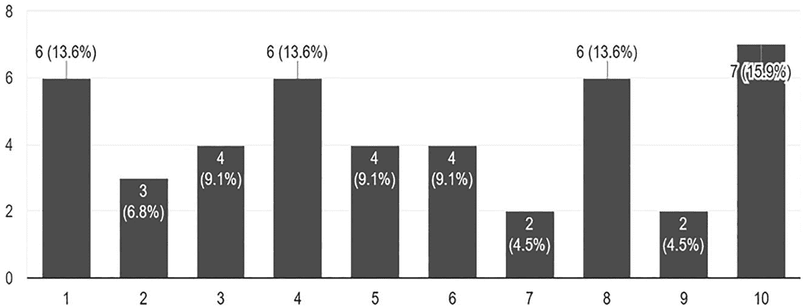

图 5.1 学生未提供匿名性时的响应

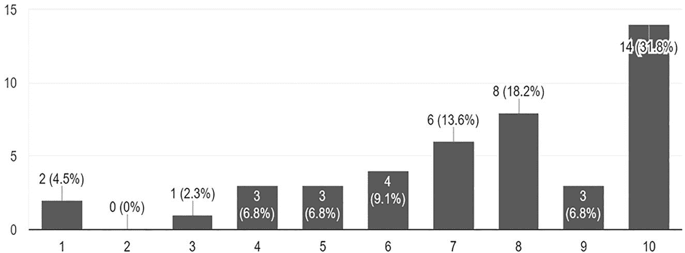

图 5.2 学生提供匿名性时的响应


从上述图表中可以观察到，如果不给学生提供匿名性，23 名学生（52.27%）不太可能在课堂上提问（量表分`5`或以下），21 名学生（47.72%）更有可能在课堂上提问（量表分`6`或以上）。如果为学生提供匿名性，有 9 名学生不太可能，35 名学生更有可能在课堂上提问。

### 5.6.4 讨论

在提供匿名性的情况下，同学中更有可能在课堂上提出问题的学生人数显著增加。这表明，在学生之间实现课堂匿名化可以通过增加学生在课堂上的积极参与，从而为教学过程带来所有好处。

## 5.7 结论与未来改进

让学生参与课堂讨论并非易事，尽管这对他们以及讲师来说都非常重要。与其接受这一事实并置之，不如技术介入提供了新方法在整个讲座过程中引导学生。一个提供学生间匿名性的平台可以大大增加学生在课堂上的积极参与，并此使教学过程更加有效。但在设计此类平台期间，应该考虑设置讲座和教学的额外时间和资金成本，并将其降至最低。尽管之前的类似工作已经提出了一种系统并允许学生匿名向讲师提供反馈，但它们要么缺乏成本效益，要么没有提供正确的匿名水平，这使得它们并不简单。所提出的系统通过隐藏参与者的姓名为学生提供匿名性，并可以通过语音技术进一步改进。

## 5.7 参考文献

1.  `Freeman, M.`, 和 `Fele, G.` (2006). 课堂中的秩序与混乱。`Pragmatics. Quarterly Publication of the International Pragmatics (IPrA)`。

2.  `Bergstrom, T.`, 和 `Harris, A.` (2011). 鼓励课堂主动性。`Australasian Journal of Technology`。

3.  `Sufyan, A.`, 和 `Hidayat, D.` (2020). 疫情期间电子学习的实施。`International Journal of Computer Science and Applications`。

4.  `Jara-Monge, L.`, 和 `Andrade-Arenas, L.` (2021). 利马某大学在疫情期间视频会议的使用分析。

5.  `Raes, A.`, 和 `Vanderhoven, E.` (2011). 课堂中的匿名性。在`第 9 届国际计算机支持学习会议 (CSCL)` 中。

6.  `Lai, C.-H.`, `Jong, B.-S.`, 和 `Lin, T.-W.` (2020). 使用移动提问系统辅助翻转课堂。`International Journal of Interactive Technologies (iJIM)`。

7.  `Paoletti, I.`, 和 `Kelly, G.` (2004). 匿名响应的水平。

8.  `Dreher, H.`, 和 `Maurer, H.` (2006). 匿名反馈的价值。在`第 19 届布莱莱德电子商务 (eValues) 会议集`中。

9.  `Flinn, B.`, 和 `Maurer, H.` (1996). 匿名水平（页码 35–47）。`Springer Berlin Heidelberg`。

10. `Maurer, H.`, `Calude, C.`, 和 `Salomaa, A.`，编辑，`J.UCS The Journal of Universal Computer Science`。

11. `Denning, T.`, `Griswold, W. G.`, `Simon, B.`, 和 `Wilkerson, M.` 课堂中的多模态通信：对我们意味着什么？`ACM SIGCSE Bulletin`。

# 语音情感分析

[1] 是机器学习的一种，通过机器识别人类语音。机器还能识别 [2] 语音的性别以及说话人内心所感触的情绪。为了理解机器对语音的识别和分析 [3] 的工作原理，我们必须了解机器学习以及深度学习究竟是什么。简单来说，机器学习是一个概念，我们把一组被称为`dataset`（数据集）的原始数据输入到机器系统中心，并训练机器在给定某些输入时以某种方式运行，以便在现实生活中，当环境与机器匹配时，它将按照程序员为其定义的规则做出相应的反应。

深度学习 [4] 是“机器学习”领域的一个分支，在这里，人工神经网络和算法被塑造得以类似于人类大脑的方式进行运作，而人类大脑能从大量的数据和信息中学习。深度学习基本上是与神经网络相关的多个层。这些是根据人类大脑功能所陈述的方式进行松散建模的各种算法。在大规模上使用大量数据进行的训练 [5] 实际上配置了上述神经网络中存在的神经元。最后，结果就是所需的深度学习模型，该模型经过训练后能够处理新数据。此类深度学习模型从多个数据源获取数据和信息，然后实时分析这些数据，而不需要任何的人为干预。

深度学习是许多人工智能技术的驱动，这些技术可以提高自动化质量以及分析任务的水平。大多数人在日常生活中浏览互联网或使用手机时都会遇到深度学习。在数许多其他应用中，深度学习被用于为 YouTube 视频生成字幕、在手机和智能扬声器上进行语音识别、为视频和照片提供面部识别，并实现了自动驾驶汽车。随着研究人员和数据科学家正在处理几个日益复杂的深度学习项目——利用深度学习框架——此类类别的人工智能将参与到我们生活的更多领域。这项工作也围绕深度学习展开，我们必须使用`Convolution Neural Network`（卷积神经网络）来检测人类语音背后的情感。

## 6.2 文献综述

T. Nwe 等人 [6] 发表了一项基于隐马尔可夫模型（HMM）技术的语音情感识别工作。他们的工作包括语音通信和识别。在上述论文中，提出了一种文本无关的语音情感分类方法。该方法合理应用了短时对数频率功率系数（`LFPC`），以便其能有效地表示多种语音信号，并以若干个离散隐马尔可夫模型（`HMM`）作为分类器。B. Schuller 等人 [7] 发表了一项关于语音情感识别的工作，该工作在基于混合支持向量机-信念网络的架构中，结合了多种声学特征以及各种语言信息。在论文中，他们引入了一种非常新的方法，将多种声学特征与语言信息相结合，以对说话人的情感进行稳健的自动识别/识别。在整个工作中，分类/识别了七种基于离散的情绪状态。首先，展示了一个基于声学特征/特性识别多种情感的模型。这些提取的多种能量、音高、信号、频谱轮廓等特征根据它们对情感估计的个体量化贡献进行了排名。还有其他几种分类方法，如线性分类器、神经网络、高斯混合模型和支持向量机等，这些方法与本文工作在性能方面进行了比较。其次，通过提供基于信念网络的情感关键短语检测，再次引入了另一种通过述口语内容进行情感识别的方法。随后，在基于软决策的融合帮助下，最终将这两个信息源整合到确定的融合中。

## 1. 引言

在`/etc/config/settings.json`目录下，我们使用`funcName`来处理数据。

变量`result = score + 10`得到了更新。

```
if (status == true) { 
console.log("success") 
}
```

个性化学习并不是一个新概念。多年来，许多学校和教师已经成功地改进了课程和教学策略，以满足儿童和青少年的需求。将最佳实践普及化的倡议是新之处。每所学校变得伟大的基础，在于围绕年轻人的学习需求和天赋重新构思教育系统。要创建一个成功的个性化学习系统，我们必须承认，无论天赋或背景如何，每个孩子都应该拥有发挥全部潜力的机会。个性化学习意味着对学生成功的各种方式保持敏感的卓越教学。从道德和教育的角度来看，追求这种行动是有意义的。除了产生卓越成果外，一个通过设计考虑到学生需求、兴趣和愿景的教育路径来回应每个学生的系统，还将显著促进公平和社会正义。

个性化几乎等同于以学生为中心的学习，它高度关注学生学生的兴趣、需求和目标。通过将这些整合到课程内容的设计、选择和执行中，以学生为中心的学习旨在保持学生学习的兴趣 [1]。

多年来，“定制化学习”（customized learning）和教育中的“定制”（customization）这两个术语被交替使用。有几种定义方式。根据包括 Basye [2] 在内的多个来源，“个性化学习”一词曾用于营销更多的技术工具和计划，旨在为学生提供个性化教学，但它实际上未能满足学生的教育需求。

技术使得学生个性化学习的发展成为可能，这被用于帮助学生设定和实现目标、参与教育、考虑他们的兴趣和愿景，并制定实现这些目标的计划。教室中的个性化要求教师优先考虑学生的需求，调整教学方法以适应他们的个人学习风格，并在员工、管理层同伴的帮助下工作。基于项目的学习、基于社区的学习、混合式学习和真实学习是实现这一目标的各种教育方法和教学手段中的。它是传统教育模式的替代方案，传统方法让教师单独行动，学生几乎没有或完全没有参与 [3,4]。

Patrick 等人 [5] 声称，通过鼓励学生为成功设定特定的目标和期望，个性化学习有助于学生在要求严苛且充满挑战性的学习环境中做出明智的决策。在这种环境中，教师有需要的时间与学生联系，提供具有挑战性、适应性和灵活性的培训，并重点关注批判性思维和元认知能力，以促进更深、更深入和更独立的学习。

为了保持学生的参与度、取得学术成功并并为未来的教育机会做好准备，个性化学习考虑了每个学生的兴趣、心声、选择和需求。学生直接参与规划过程，并在家里或学校获取他们的学习计划，以便更好地理解他们实现目标的进度，并根据他们的未来目标和成功路径决定还需要完成或开发哪些额外内容 [6,7]。

个性化学习理论是一种复杂的教育策略，结合了满足个人学习需求的各种。美国教育部将其描述为适应于满足每个学生个人学习需求、根据其偏好的学习风格进行差异化处理、并考虑到他们的兴趣和学习目标的教育 [8]。

个性化学习为教育工作者提供了一个机会，利用大多数学生目前拥有的数字能力。定制化学习针对每个学习者的能力、需求和兴趣进行个体化，同时保持最高的可实现标准。这种技术代表了对通常的“一刀切”教育模式的重大偏离。个性化促使教师变得更加开放灵活，以便学生能够更致力于构建他们自己的个体化学习路径。以自己的节奏参与个体化学习的学生提供了工具和反馈，鼓励他们最大限地发挥特定的能力和潜力。

“个性化学习”一词指的是为了满足每个学生独特学习需求的各种教育计划、教学策略和学术辅助工具。通过在提供个性化教学之前评估每个学生的学习需求、兴趣和愿景，个性化学习旨在帮助每个学生在学术上成功。每个学生在自己教育的决策中都应该有发言权，包括他们想学习什么以及如何学习。概念化学习个性化有许多不同的方式：

- 内容个性化：学生与他们特别感兴趣的材料、主题和地理区域互动。

- 速度和进度定制化学习：学生按照自己的速度学习学科内容和年级。

- 过程个性化学习：根据需求和兴趣，使用不同的教学策略。

## 学习组成

根据 [9,10]，个性化必须包含以下元素。图 7.1](#ch07.xhtml#fig7_1) 显示了个性化学习的组成部分：

1. 学生组织

2. 个性化教学

3. 每个学生根据需要接受即时的教学干预和支持

4. 可调整的速度

5. 具体的学生画像

6. 通过解决问题进行更深入的教育和意义构建

7. 来自教师和同伴的定期反馈

8. 世界级的、基于标准的知识和能力

9. 随时随地进行学习

10. 基于表现的评估

## 个性化学习原则

根据 [11]，一些教育机构正尝试在个性化学习的核心理念基础上进行发展，这些理念学生优先，而不是教师或课程。所有学生都应该作为个性化学习的一部分参与以下活动。参见图 7.2](#ch07.xhtml#fig7_2)：

- 学习者画像，详细说明每个学生特定的能力、差距、短板、优势、兴趣和目标。

- 定制学习路径，为每个学生设定目标和目标，以及各种符合其要求的学习机会。

- 个体掌握，涉及持续评估进度。

- 灵活的学习环境，可能包括多种教学方法，并持续最大限地利用资源来支持学生学习。

-图 7.2 显示了个性化学习的基本原理 [11]。

## 7.4 个性化学习的设计

2010 年“教育创新：定制化学习系统[再]设计”会议的参会者根据图 7.3 确定了定制化学习的五个关键组成部分：

*   适应性的、随地/随时的教育；

*   重新定义教师的地位；

*   基于真实世界的项目的教育；

*   学生驱动的学习路径；以及

*   取决于熟练程度/能力的学习进度 [12,13]。

![图 7.3 显示了个性化学习的设计 [12]。](images/fig7_3.jpg)

图 7.3 显示了个性化学习的设计 [12]。

## 7.5 以个性化学习为中心的现代教学法

通过避免任何学习障碍，并将教学集中在学生的倾向和兴趣上，这些理念旨在提高标准。根据 Rooney、Brown、Sommer 和 Lopez 的观点，如何为每个孩子每个父母共同构建这种方案是一个主要问题，这也是教室内外个体教育的基本组成部分 [14]。现代教学法如下（[图 7.4] 所示），这种教学法是以个性化学习为中心的。

![图 7.4 显示了以个性化学习为中心的现代教学法 [14]。](images/fig7_4.jpg)

图 7.4 显示了以个性化学习为中心的现代教学法 [14]。

### 7.5.1 对学生学习的评估建议

*   系统、教师和学校利用数据促进学生学习的高度发展能力。

*   收集和检查数据的过程，以帮助教育者和学生就孩子学习的现状、需要去向何以及到达那里的最有效途径做出选择；以及

*   双方认可的目标、指出潜在改进领域的建设性批评、高阶探究以及同伴和自我评价。

### 7.5.2 有效的教学和学习意味着

*   课程中应优先考虑持久且具有内在价值的信息和技能。

*   虽然每个人都应该有高期望和严刻的目标，但时间和援助应根据每个学生的需求而异，但标准应始终保持一致；以及

*   为了向学生展示如何将新知识整合到过去的理解中，教师应该利用概念性问题在课堂上激发批判性思维。

### 7.5.3 自主性学习建议

*   项目工作作为课程提供的一个重要且持续的方面，围绕这些学习合同构建的。

*   个人学习档案；

*   与预期相反，合作小组学习和社交互动被高度强调。

### 7.5.4 调整课程方案意味着

*   改变国家课程的结构，以提供跨三个教育阶段（基础教育、中学和 14–19 岁）的定制化学习的连续性；

*   建立基于标准的学科特定探究作为课程交付的基石；以及

*   允许学生设计自己的教育目标。这对于孩子培养对学习的热爱以及从长期来看对教育的投入是必要的。

### 7.5.5 新技术的贡献意味着

*   适应个人创造力的能力、根据不同学习偏好调整课程的能力，以及让学习者控制学习速度的能力；

*   在典型学校时间之外进行并行扩展学习的机会；以及

### 7.5.6 建立个性化学习学校意味着

*   为每个学习者提供与成人的联系；针对学生学习进行劳动力区分；并增强学习导师的功能。

*   根据学习需求在校内和校际进行区块教学和分组，以确保网络和社区学习。

*   建立学分系统和可转移的学习档案，以协助评估并提供灵活性。

这六个部分中的每一个如图 7.4]，学习过程受动机的影响很大。虽然有些人从外部来源获取知识，但其他人通过遵循自己的目标可以取得更多成就。任何参与学习过程的人都应该意识到动机如何影响学习。动机有两种。

首先是外在动机，其次是内在动机。

`外在动机`产生于我们为了获得奖励或避免惩罚而从事行动或活动。

`内在动机`意味着参与个人认为充实的行为；简单来说，是为了本身而不是为了某种外部利益。表 7.1,17]，个性化学习的外在动机下文讨论，并如[图 7.5](#ch07.xhtml#fig7_5）所示。

*   **工具性**：在教育方面，促进奖励和后果的工业模式类似于工具性系统。由于我们习惯了这种系统，改变它很困难。虽然有些学生受驱动遵守规则，但由于由于兴趣、失败或对教育厌倦而缺乏动力。

*   **社交性**：学习者受外在因素驱动，例如希望被同伴接受、寻求教师、父母和同伴的认可，以及与他人比较表现。朋友对他们来说比学校更重要，但他们因为外在动机仍然具有学习动力。

*   **成就性**：成就是指学生表现出有动力学习，并希望在学校表现良好。他们采用成长心态，即相信自己可以学习，并选择展示掌握程度以及如何实现学习目标的证据。

`Self-Actualization`（自我实现）是学生因为喜欢学习而参与教育的过程。其重点完全在于个人以及他们如何选择学习，无论是通过学习一项新技能、扩展知识、构建他们从未想象过自己能做的事，还是遵循他们的目标。自我实现的学习者具有自主性，并且理解只要全心投入，他们设定的任何事情都可以学会。

![图 7.5 Cherry 展示的个性化学习的外在动机 [16]。](images/fig7_5.jpg)

图 7.5 Cherry 展示的个性化学习的外在动机 \[16\].

## 7.6.2 个性化学习的内在动机

根据 Rickabaugh [18] 的观点，教学和学习方法基于每个个体学习者的需求、兴趣和准备情况。学习者在建立目标、组织学习路径、监控发展以及选择学习展示方式方面发挥着积极作用。当学习者追求符合定义标准的能力时，在任何给定时间内，学习目标、材料、技术和进度都可能因学习者而异。完全个性化的学习环境超越了简单的个别化和差异化。

考虑学习者根据个性化学习执行了以下操作：

*   具有自我驱动性

*   在学习与兴趣、能力、激情和抱负之间建立联系

*   积极参与自己的教育规划

*   对自己的教育负责并承担责任，包括在学习内容和方式上的话语权和选择权

*   当学习者在教师的指导下沿着学习路径移动时，他们为自己的学习计划设定目标和基准

*   培养选择和应用辅助并促进其学习的资源和技术的能力

*   建立由同伴、专家和教育者组成的网络，以鼓励和支持他们的学术追求。

*   在能力框架内表现出领域胜任能力。

*   成长为自我驱动、经验丰富的学习者，监控自己的进度并根据自己的知识和能力水平评估自己的教育。

本节探讨了 Bray 和 McClaskey 在其著作《如何定制学习：实用指南》中提供的学习者自主性的七个要素 [19,20,21,22\\]。图 7.6 展示了个性化学习的内在动机。

![图 7.6 Bray 和 McClaskey 展示的个性化学习的内在动机 [19]。](images/fig7_6.jpg)

图 7.6 Bray 和 McClaskey 展示的个性化学习的内在动机 \[19\].

## 7.7 个性化学习环境的阶段


Miliband [23,24,25] 将个性化学习定义为具有图 7.7 所示的五个阶段。

- 早期阶段之一是评估阶段，教师和学生建设性地合作，以识别优势和劣势领域。
- 第二阶段将选择学习方法的权利赋予教师和学生，这涉及教学和学习。
- 第三阶段被称为课程选择，允许学生选择自己的学习课程，培养学生的自主性。
- 第四阶段代表了对传统教育范式的重大突破，因为它关注学生发展，并赋予了教师选择自己教学方法的自由。

![图 7.7 Miliband 展示的个性化学习环境的阶段 [23]。](images/fig7_7.jpg)

图 7.7 Miliband 展示的个性化学习环境的阶段 \[23\]。

教育的最后一个层级涉及在传统教室之外学习，这让学生能够自由选择自己的学习环境。在这个阶段，利用了社会和社区联系。

根据 Barbara Bray 和 Kathleen McClaskey (2013) 的观点，个性化学习有三个阶段，如图 7.8 所示。

1. **教师认可学习者的心声和选择权**

   **教师：**

   - 识别每个学生如何学最好，并根据长处、困难和兴趣做出教学决策。
   - 重新设计教室环境，创建促进学习者心声和选择权的课程和项目。
   - 深思熟虑地将技术纳入课程，以他们最长的方式教育所有学习者。

2. **由教师和学生中心共同设计**

   **教师和学习者：**

   - 选择他们将用于支持学习的知识型工具；
   - 与学习者共同设计课程和项目，包含他们的心声和选择权；
   - 知道如何选择和使用合适的工具来支持学习；
   - 正向绩效方案发展，学生开始展示他们已经掌握了材料。

3. **教师作为学习伙伴的学生驱动型学习**

   **学习者：**

   - 根据自己的兴趣、目标和探究指导自己的教育。
   - 按照自己的速度学习，并通过持续的反馈循环监控自己的发展。
   - 创建适应灵活的项目，让学生表达自我，并决定如何在基于能力的学习中展示熟练程度。

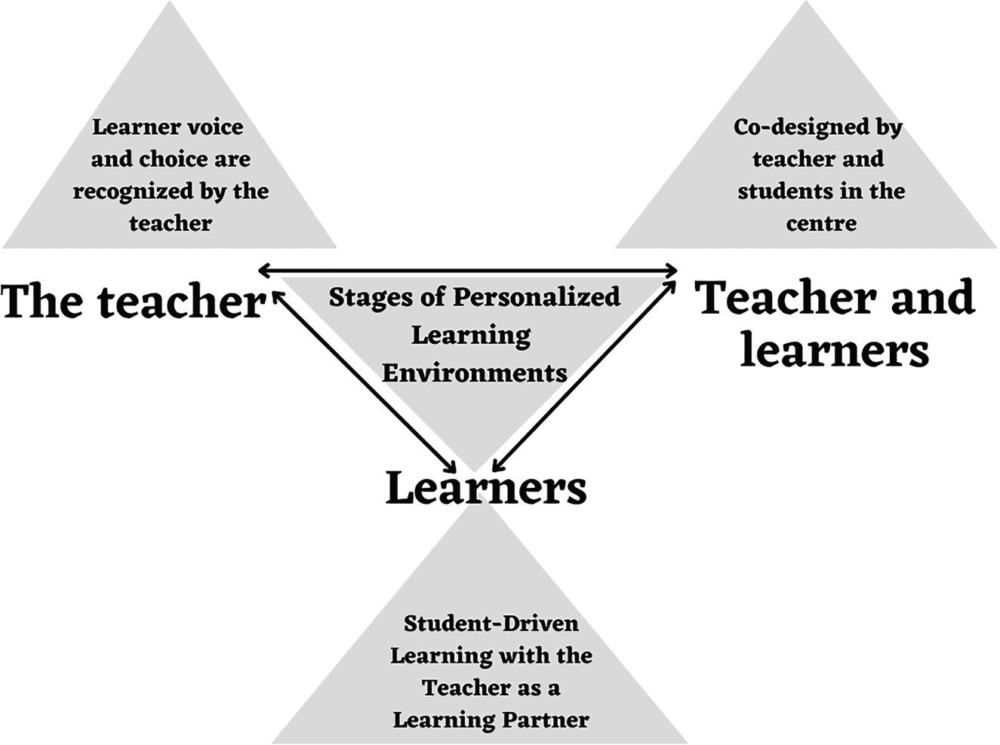

图 7.8 个性化学习环境的阶段 (McClaskey, 2013)。

## 7.8 技术在个性化学习中的作用

帮助学生按照自己的速度学习是基于技术的定制化学习益处之一。此外，得益于数字格式，教师可以根据学生的能力调整课程。基于技术的个性化学习的兴起，正在给教育提供和接收的方式带来根本性的变化。随着教育的数字化，教育编程者的接触范围每天都在扩大。基于技术的个性化学习正在为教师和学生提供教学和学习的新方法，鼓励学生更多地参与整个学习过程。

随着新的技术辅助学习工具（如`智能白板`、`MOOC`、`平板电脑`等）的引入，学校和大学的教育方式发生了变化。教学青少年大脑最经济的方法之一是通过物联网，它正被证明是有效的。此外，它也是为每个人提供优质教育机会的有效方法。教育技术行业一直在寻找新方法，为那些现在无法负担优质教育设施的人改善教育机会 [26,27\]。

世界各地的年轻人越来越多地报告他们参加过在线课程。数字教育的奇妙之处在于，你可以制作一次内容并反复供后代代使用。数字教育还赋予了教师调整课程计划以满足每个学生特定需求的自由。

以下图 7.9 显示了根据`教育技术办公室`定义的技术在个性化学习中的作用 [26]。

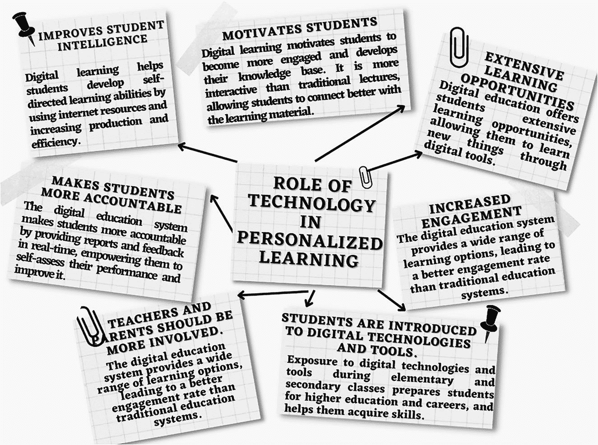

图 7.9 显示了技术在个性化学习中的作用

## 7.9 个性化学习环境工具与解决方案

在印度，数字教育正在改变学生学习多个学科的方式。目前的互联网技术和人工智能使得学生们的学习体验能够根据其个人的时间限制和需求进行定制。此外，现在已经有了广泛的数字学习解决方案和技术。

一些教师已经使用在线服务为他们的学生创建了网站，特别是在没有网络托管服务可用，或者在网络发布受到限制，导致教师难以让学生获取必要信息时。课程应由教育者、机构和语言服务公司针对特定的学生群体进行定制。新的主页服务比旧的服务提供了更强大的功能和灵活性。个性化学习环境（`PLEs`）的核心理念之一是包含灵活性。Wiki、论坛、`Twitter`、社交网络、书签制作和其他易于使用的工具和服务，都旨在鼓励个人用户通过参与、互动和协作来分发其制作的材料。这些技术，如表 7.2 所示，有助于通过个性化学习来增强表现和参与度。

表 7.2 个性化学习环境工具

| 工具 | 服务 | 工具 | 服务 |
| --- | --- | --- | --- |
| 通讯录 | 通讯录 | 微型博客 | `Twitter` |
| 分析 | `Google Analytics` | 音乐 | 音乐 |
| 博客 | Blogger, WordPress | 在线办公 | `Google Docs` |
| 书店 | Amazon | 其他媒体 | 电视、广播 |
| 日历 | 日历 | 物理 | `objects/sites`、图书馆、书籍等等。 |
| 聊天/IRC | MSN | 播客 | 播客 |
| 课程 | 免费课程 | 作品集 | 电子作品集 |
| 课程文档 | 课程文档 | RSS | `RSS Reader`, `Feedly`, Blog lines |
| 数据库 | 数据库 | 搜索引擎 | `Google`, `Yahoo` |
| 绘图 | 绘图 | 幻灯片播放 | `SlideShare` |
| 电子邮件 | email | 社交书签 | `Delicious`, `Diigo`, `Digg`, `Zotero` |
| 文件/文档库 | `Dropbox`, `Drive` | 社交网络 | `Facebook`, `LinkedIn`, `Academia`, `Plurk`, `Elgg`, `Base camp` |
| 论坛 | 论坛 | 起始页 | `Netvibes`, `Protopage`, `iGoogle`, `Windows Live`（已停止） |
| 图像共享 | Flicker | 视频/存储 | `YouTube` |
| LMS | `Module`, `Sakai`, `Blackboard` | 视频会议 | `Skype`, `Flash Meeting` |
| 邮件列表/新闻 | 邮件列表/通讯 | 虚拟世界 | `Second Life` |
| 地图 | `Google Maps` | 网络研讨会 | 网络研讨会 |
| Wiki | Wiki 空间 | Wikipedia | Wikipedia |

## 7.10 学校和区领导可以支持个性化学习

学校和区行政人员需要确保适当的数字资源、技术基础设施以及教室和全校程序到位，以减轻个体学习给教师带来的潜在负担。这涉及研究和选择教育所需的课程、材料、工具和其他技术资源，并协助教师提供实质性的反馈和形成性评估`[26]`。

学校和区领导可以通过以下方式支持数据驱动的个性化学习：

- 为了加强教学和学习，教师应该利用学习环境让学生接触数据。
- 教师应该有时间思考数据并计划其应用。
- 投资教师的教育、指导和持续的专业发展。
- 培养教育者和机构之间非正式合作的机会，以讨论最佳实践。
- 建立机制，让教育者在为不同的学生设计和个性化教学时获得支持。
- 提供并维护个性化教学所需的技术。
- 投资于基础设施，例如尖端工具和现代数据系统。
- 与当地居民、家长和教师就数据驱动教育的益处进行对话。

## 7.11 州对个性化学习的支持

在学校和教师转型并维持个性化学习活动的过程中，政府也可以提供更直接的帮助。教育技术办公室`[26]` 向州领导者提出了以下建议：

- 对可能影响个性化学习计划的州规则进行解释和建议。
- 提供资金渠道以支持个性化学习所需的各种。
- 检查教师教育计划如何处理个性化学习。
- 让学校学区、教师和学生能够获取到重要且相关的量身定制的学习材料。
- 投入必要的人力资源，确保州政府了解并支持定制化学习倡议。
- 跟踪州在个体化学习方面的成果。

## 7.12 有效的个性化学习

学习是一个持续的过程，没有哪两个学生的学习方式或速度是相同的。个性化学习提供了动态环境，通过适应适应每个学生成功能力和技能的定制课程，来培养对学习的热爱。

- 你可能听过“近侧发展区”（proximal development zone），它声称每个人都有一组可以通过帮助改进的能力。这些能力被认为是“近侧”的，因为个体需要指导和教养才能获得独立完成这些任务的能力。
- 个性化学习的理念与近侧发展区相似。它努力根据孩子的独特需求和天赋，为他们设定困难但可行的目标。个性化学习还意味着教师积极审查学生进度、与家长互动，并在必要时提供进一步帮助。
- 个性化学习通过按需提供材料传递来提高效率。这意味着对于熟悉的内容可以省略，而可以在证明困难的问题和领域花费更多时间。由于个体化学习，教师花费更少的时间重新教已经熟悉的科目。
- 有效个性化学习的关键是考虑每个学习者需求的数据驱动策略。正确的数字解决方案可以帮助教育者更容易地跟踪和监控进度，为他们做出如何最好支持每个学生的决策提供知识。
- 由于这种策略，学生可以按照自己的速度进行发展，这有助于他们保持对学习的兴趣。利用学习管理和其他来源（如 `Google Analytics` 或 `Module`）的数据，教师可以多样化教学并根据需求定制。

## 7.13 个性化学习正在改变教育

个性化学习是目前教育领域的热门话题。这并不是说个性化学习是一件坏事；相反它是一个具有许多后果的热点；关于个性化学习有很多可以讨论。因此，我们必须具体。我们讨论的是哪种个性化学习？

- 学生可以实现掌握学习，即对特定学科、主题或概念有完整且充分的知识。
- 学生可以受益于一对一导师指导，这包括与同一位老师频繁会面。
- 在线辅非常廉。。对于大多数家庭来说，与其他传统的和当代个性化学习选择相比，在线辅更具经济效益。此外，在线辅的费用远低于线下辅导。
- 在线教学具有适应性。
- 在线辅随时可用；学生可以根据自己的意愿安排课程。学生现在可以通过移动设备（如 iOS 或 Android 智能手机或平板电脑）或 PC 访问顶尖导师，这在以前是未过的。在这种理念下，地理位置不再是定制化学习的障碍。

## 7.14 教育技术支持个性化学习

教育技术可以通过图 7.10 所示的多种方式帮助定制化学习。

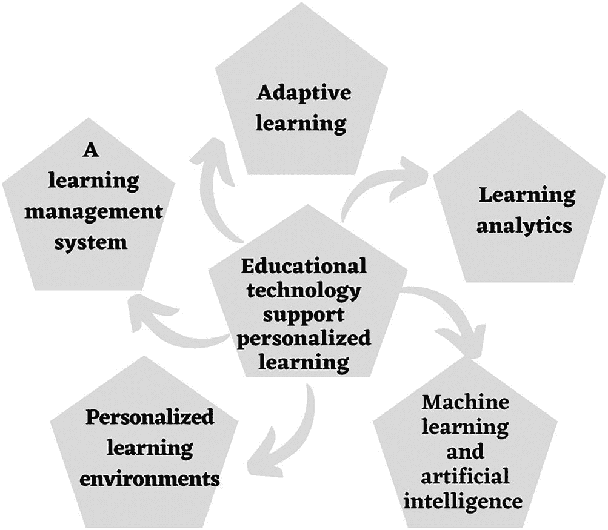

图 7.10 显示教育技术支持个性化学习。

`Adaptive learning` 技术根据学生的进度和表现修改学习材料的内容和复杂性。这允许学生按照自己的速度学习，并专注于最需要帮助的问题。

`Management of learning` 是一个允许学生和教师访问课程材料、提交作业并进行相互互动的平台。它还可以监控学生的成长，并提供评论和帮助。

`Learning analytics` 软件可以跟踪学生的学习进度，并为教师和学生提供数据驱动的洞察。这可以帮助教师根据特定学生的需求调整课程。

`Personalized learning environments`：这些是允许学生设定自己的学习路径和目标的数字平台。它们还可以允许学生通过选择自己的学习资源或建立自己的学习节奏，来个性化他们的学习体验。

`Artificial intelligence and machine learning`：人工智能和机器学习可以根据学生的兴趣和需求提供定制化的学习建议。例如，一个 AI 驱动的辅导系统可以根据学生的技能和缺陷提供个性化的课程和反馈。

最终，教育技术具有成为鼓励个性化学习的重要工具的潜力，因为它为学生提供了与他们独特需求和目标相匹配的可定制且灵活的学习体验。

## 7.15 个性化学习的重要性

几个特征定义了人类人格。特定特征的结合创造了独特的模式。我们必须承认每个人的构造都是不同的，教学必须有多样化的方法。如果我们仔细观察，会发现每个学生的学习需求与他人不同。一个学习者可能花几个小时学习一个主题，而另一个人可能只需要几分钟。有些人比其他人更擅长解释事情而不是擅长写作。

个性化学习带来了更高的学生参与度。我们将通过解决学生的各种兴趣来增加和促进学生的参与度。如果我们的孩子更加投入，他们将花更多时间学习并真正掌握学科。老师还能要求什么呢？参与度的提高也导致学生动机水平的提高。学生将投入到他们的学习旅程中，因为他们在他们追求的学习路径上具有一定的选择权。这种激励将帮助他们避免分心、对学习材料失去投入以及整体学业表现糟糕。

生产力的提高也是个性化学习的结果。理解每个学生的需求允许我们针对需要关注的领域制定目标。这意味着已经熟悉的内容可以省略，可以将更多时间花在证明有困难的主题和地方。通过根据学生的需求提供材料，学习旅程变得更加高效，允许教师和学生投入到需要关注的领域。此类特性的变异和多样性使得建立一个能够满足所有需求的远瞻领先解决方案极其困难。这正是个性化学习的价值显现的时候。

为了满足每个学生的个人需求、兴趣和天赋，为每个学生使个性化的培训和学习体验被称为个性化学习。它涉及为每个学生根据他们的兴趣、优势和学习偏好创建相关且有趣的课程和学习活动。通过提供他们健康发展所需的资源和帮助，个性化学习旨在帮助学生实现他们的全部潜力。这种策略可以包括利用技术设计个性化学习路径，提供专门指导或教练，以及通过建立目标和跟踪进度来激励学生主导自己的教育。

多种场所（如传统教室、在线学习环境和家庭教育）都可以使用这种学习。事实证明，它可以增加学生的参与度、动机和学业成就，同时培养解决问题和批判性思维等 21 世纪的能力。

### 学生为中心的个性化学习

通过个性化学习，学生可以在教室里选择自己的学习方法。根据他们的需求和兴趣选择学习模式。学生积极努力完成指定的学习目标、目标和任务。

### 学习速度由学生决定

得益个性化学习的灵活性，学生可以选择自己的节奏。只有在他们牢固掌握当前概念的情况下，才能决定进入后续模块。根据主题的复杂程度，学生可以相应地分配时间。

### 基于知识的方法论

理解概念是个性化学习的主要目标，而不是获得高分。教师更关注孩子学习什么以及如何学习。因此，教师为学生提供建立实际现实技能的机会，而不仅仅是为了考试和结果做准备。

### 随时随地：学习

学生和教师在学校和教室内外都可以访问学习教学应用。得益于教育云技术，任何人都可以访问教育应用。

## 7.16 结论

总之，根据现有的少量数据，个性化学习的几个组成似乎具有增强印度高等教育系统的潜力。为了提供该方法改进了学生成果的因果证明，还需要进一步的研究。由于个性化学习由许多相互关联的策略组成，还需要进一步的研究来确定哪些特定技术和组合对个体学生最有益。

`block` 是一个**参考文献/书目列表**，而不是需要根据技术指令重新格式化的正文。

这些指令侧重于重新格式化变量、函数、类、路径、命令和代码块。由于输入包含的是引用（作者、日期、标题和 URL），应用这些规则可能会破坏参考文献的学术格式。

然而，根据你提出的出“优化段落格式”并“删除多余空行”的要求，我已将该列表清理为标准的 Markdown 参考文献格式，同时保留了所有内容。

**如果你是希望让我重新格式化另一段文本，请提供该文本。**

以下是清理后的列表版本：

1. McCarthy, J. (2015). 以学生为中心的学习：从教师开始。乔治·卢卡斯教育基金会。[`www.edutopia.org`](https://www.edutopia.org)。
2. Basye, D. (2018). 个性化、差异化与个体化学习。检索于 2021 年 2 月 28 日，来自 [`www.iste.org/explore/Educationleadership/Personalized`](https://www.iste.org)。
3. Hidden Curriculum. (2014). 收录于 S. Abbott (编)，教育改革词汇表。[`edglossary.org/hidden-curriculum`](http://edglossary.org)。
4. Jenkins, S., Williams, M., Moyer, J., George, M., & Foster, E. (2016). 教学范式的转变：教师视角的个性化学习。Knowledge Works。检索自 [`www.knowledgeworks.org/sites/default/files/u1/teacher-conditions.pdf`](http://www.knowledgeworks.org)。
5. Patrick, S., Kennedy, K., & Powell, A. (2013). 言出其实行：定义并整合个性化、混合式和能力教育。INACOL。[`www.inacol.org`](https://www.inacol.org)。
6. Vermont Agency of Education (2017). 个性化学习。来自 http://education.vermont.gov。
7. Wang, T., Tsai, K., Lee, M. (2007). 基于语义的个性化学习。知识与社会，10 (3)，84–105。
8. Powell, P. (2019). 什么是个性化学习？课堂的完整指南。[http://xello.world/]。
9. Slocum, N. (2016). 什么是个性化学习？教育领域。[http://aurora.org]。
10. Tanenbaum, C., Leech, K., & Boyle, A. (2013). 个性化教育的现状。美国研究院。检索自 http://www.air.org/。
11. Laurans, E., Derr, K., & Turco, J. (2013). 个性化系统。帕 henon 集团与比尔·梅琳达基金会。[`www.learningpersonalized.com`](https://www.learningpersonalized.com)。
12. Wolf, M. (2010). 个性化学习设计的研讨会报告。软件信息行业协会。来自 http://siia.net/pli/PerLearn.pdf。


13. Yonezawa, S., McClure, L., & Jones, M. (2012). 学校中的个性化。未来工作者。来自 http://www.studentsatthe.org。

14. Rooney, T., Brown, L., Sommer, B., & Lopez, A. (2017). 个性化的系统性转变。INACOL。

15. Tranquillo, J. (2016). `10.4103/2152-7806`。

16. Cherry, K. (2016). 外在与内在动机。

17. Great Schools (2014). 区别何？

18. Richaugh, J. (2016). 挖掘个性化学习的力量。

19. Bray, B. (2017). 个性化学习分步指南。

20. Bray, B. (2013). 个性化与个体化。

21. Bray, B. (2013). 选择与声音。

22. Bray, B. (2013). 学校路线图。

23. Nd, D. (2006). `10.1787/978926403604-2`。

24. Mohd, C. (2014). 探索个性化学习环境的潜力。

25. Nandigam, D. (2015). 个性化学习：现状与潜力。

26. Office of Educational Technology (2017). 重新想象技术在教育中的角色。

27. Pane, J.F. (2017). 告知进展：个性化学习的实施与效果见解。

许多在中学教育期间表现不佳的学生在高等教育阶段继续学习科学领域，这引起了极大关注。可以肯定，由于教师感到困扰，学生在课程中缺乏帮助和指导[1]。此外，课堂环境中似乎缺乏即兴，导致教师忽略了某些重要的观点。

Goodrum 也指出，存在一种风险，即教学会导致学生认为课程过于困难，因此与日常生活关联不大[2]。教学学习过程以及师生互动被认为对学生课程的态度具有重要影响。Goodrum 和 Rennie 都强调，学生认为课程与生活的关联性小会导致学习热情的丧失。近年来，网络教育更多地整合到了学习过程中。所使用的方法将在线教育与传统的教学形式区分开来[3]。基于网络的学习已成为教育领域最广泛的应用之一。多项研究表明，网络学习提高了教育效率，因为互联网为学生和教师开启了令人兴奋的可能。随时随地学习的能力使得网络教育如此具有吸引力。正如前面提到的，万维网是一个高度个性化的信息传递平台。这意味着教学过程不再受时间和地点的限制。学生和教师可以利用这种媒介进行协作（Bachari 等人，2011）。

众所周知，在线学习的主要优势在于是非线性参与的机会。这使学生能够塑造自己的学习体验。如果给予过多的自由，某些学生可能会遇到迷茫、认知过载和缺乏控制等问题。因此，学者们现在将重点转向发现不同风格和特征的学习者如何利用网络学习来研究这些问题。在开发和提供课程时，有必要考虑学生的学习风格（Chatti 等人，2010）。

教师需要他们的方法适应在线学习的独特特征，以便学生无论偏好风格如何都能成功。因此，教师需要了解影响课堂行为的学生特征。教师可以通过这种方式根据学生的个人需求定制课堂设置[4]。教育者被赋予了一个需要考虑因素因素，包括学生的年龄、性别、认知风格、动机以及他们在该领域的已有知识。一旦建立了学习者画像，多媒体学习过程就可以根据每个人的需求进行定制。

PLE 指的是一组促进学习者（或其他）与个人、组织和资源网络之间交互的技术工具。PLE 的概念对于创建有效的在线教育领域来说相对新。在 PLE 环境中，学习者占据中心位置，而不是教师、教室、材料和技术。同样，PLE 在提高教育效率方面有用。Atwell 描述的 PLE 是一个个性化的环境。每个人都要对自己的教育负责。他们必须在管理学习过程和内容所有方面承担更积极的角色。通常来说，个性化学习策略可能提供一种激励学生学习的新方法，甚至可能是满足未来教育需求的[5]。“个人学习环境”（PLE）一词描述了现代教育系统中一个较新的现象。

本研究的重点是科学二。综合高中课程规范。使用了马来西亚教育部的二年科学框架。通过这项工作，将提出一种名为个性化学习环境（PLE）的新型教育方法。在 PLE 中，学习者占据中心位置，而不是教师、教室、材料和技术。PLE 可能在增强学习效率方面发挥关键作用。个人学习环境（PLE）是学生在人员、服务和资源网络中可以资源之一[6]。

## 8.2 关于个性化学习策略

在 21 世纪，儿童特定的特长、兴趣和技能通过个性化学习策略得到认可和培养。同样，PLE 在提高教育效率方面有用[7]。事实上，基于“一刀切”方法的传统学习倾向于只支持一种教育模式，因为在普通课堂环境中的教师通常需要同时处理许多学生。为了确保学生积极参与并对自己的教育负责，几位学者认为应该考虑每位学习者的独特特征[8]。

最擅长动觉学习法的学生是那些通过实践来学习最好的学生。通过感觉来理解知识。反复书写将帮助你记住信息。我们会保留草稿纸。在讲座中记录并保留笔记至关重要。创建一些学习指南 [11]。

采用应用程序、匹配教育诉求以及将技术组件融入教学，都将有助于 PLE 的成功部署。因此，教室的设置应该兼顾每个学生的偏好、长处和短板。

## 8.3 方法论

开发课件使用的方法论是 `ADDIE`（分析、设计、开发、实施和评估）模型。`ADDIE` 是一种用于产品开发的系统性或逐步模型。每个阶段都能确保开发工作不离正轨、按时按目标完成 [12]。

### 8.3.1 研究过程

在这一阶段，我们分析数据以确定学生在科学课程中遇到困难的根本原因。在设定目标和构建 `PLE` 环境及方法时，考虑了学生的评估需求。为了确认这一需求，我们将开展调查、焦点小组访谈以及相关文献综述 [13]。

### 8.3.2 计划阶段

为你强调学习的建议模型创建一个测试版本。上述研究的预期结果可以用于指导交互式原型的内容、媒体和交互设计。

### 8.3.3 开发阶段

`PLE` 组件贯穿整个开发过程。现在故事剧板已经制作，开发可以开始，最终将产生产品的 Alpha 版本。团队将以故事剧板为蓝图，首先处理用户界面，然后添加内容。我们将构建每个模块并测试其功能，以确保它们都能正常运行 [14]。

### 8.3.4 实施阶段

在这一阶段，将对原型进行测试以确保其正常工作。每个组件和模块将组合成一个功能完整的整体。向特定观众演示应用程序至关重要，以便获得宝贵的建议，这些建议可以纳入程序的未来迭代中。

### 8.3.5 评估步骤

在这一阶段，我们识别可能改进的流程以提供更好的学习成果。作为评估过程的一部分，我们会收集用户评论。测试人员对程序用户界面、`PLE` 方法和内容的问卷答复将用于改进产品。

## 8.4 教育中的个性化学习环境

为了更好地满足每个学生的个性化需求、特征和偏好，教育机构正日益转向个性化技术。掌握自己教育和进的学习者使用 `PLEs`，它由工具、社区和服务的集合组成。个性化学习提倡者认为，与标准的教育方法相比，这种理念应该针对每个学生进行调整，而不是反过来来 [15]。

通过关注每个学生独特的状况，个性化的教育方法可能会促进教室与学生之间紧密的一对一互动。学习者建模是在定制化学习环境中调整系统与每个学生交互的主要技术。生成学习者模型涉及根据通过交互获得的信息，对学习者的意图、计划、偏好、态度、知识和信念进行假设 [16]。

根据研究，在更个性化的环境中学习的学生在学业和社交方面都有提高。这些学生正变得更加独立、有创造力和富有资源。个性化学习环境 (`PLEs`) 包含了许多特征，正如 Clements 和 Douglas (2008) 在他们的论文《教育中的个性化学习与创新》中所述的。这包括：

* 它让学生参与到学习过程中，从而使他们对自己的成功更加负责。学生正在学习创作内容，而不仅仅是消费内容。

* 学生对自己的学习负责。

* 给予孩子们他们想要的独立性。

* 它是与现实世界的联系。

* 它鼓励孩子们跳出框架思考。

* 促进深度思考、学习和理解。

* 允许思想的自由交流。

* 在教师与其学生之间建立基于信任和合作的关系。

## 8.5 为什么选择个性化学习环境？

在线课程的引入彻底改变了教育体系。遗憾的是，许多教育网站并没有使用健全的教学实践。当用户越来越多地转向在线教育时，我们如何才能最好针对每个用户？我们如何培养更多的主动性、自主性和学生责任感？我如何为每个用户定制网站布局？我如何通过使用各种设置针对各种性格类型的人定制我的信息？不同的学生如何使用在线课程？我们的消费者之间有何差异？在创建教学网站时，这些此类问题的答案至关重要 [17]。

在过去的十年中，对个体差异需求的研究已成为解决这些问题的核心关注。创建在线指南时针对不同用户进行调整的重要性是这一点的一个良好指标。当我们考虑如何通过允许学生根据自己独特的经历和背景定制课堂体验，以最好适应学生的独特需求时，定制问题随之出现。

缺乏个性化被认为是虚拟教室的一个主要缺陷。因此，个性化教育是当今教育领域最迫切的问题之一。根据定制学习方法提倡者的观点，这种教学风格将学习者或学生置于教育过程的中心。学生对教育更加投入，因此他们按照自己的速度和方式进行学习，更有积极性，并获得更统一的知识。否则，学生将利用自适应学习环境，在环境中他们可以选择自己的节奏，获取所需的信息，从各种教学方法中进行选择并有效管理时间。

关于场域依赖与场域独立性的认知风格因素已有许多研究。其原因是，人们学习的最佳方式（即通过显著性信号和场域安排）取决于他们所采用的认知风格。大多数实证研究集中在以下问题上：

(a) 具有不同认知风格的学生群体在多大程度上倾向于利用不同类型的导航策略；(b) 认知风格是否会显著影响学习者在网络培训中的成功。场域独立型被用于定义那些自力更生、善于分析且关注内在的人。相反，场域依赖型的人更容易在团队中运作，听从他人指示，易受显著因素的影响，并从表面接受观点。由于这些差异，场域独立型学习者在各种传统和在线学习语境下的表现优于场域依赖型学习者 [18]。

## 8.8 先验知识

导致个体差异的一个因素是个人的先验知识水平。个人的先验知识包含了对过去经验的理解。许多研究已经表明了先前知识在在线培训中的重要性。众所周知，迷失和对额外帮助的需求是在线教育面临的重大挑战。研究表明，知识和专业知识较少的个体在网络教程中寻找方向会有更大的困难。他们尚未熟悉新材料的事实意味着他们没有可以安置这些材料的参考框架。另一方面，知识渊渊的用户在构建新知识以及与现有信息建立联系时不会遇到任何困难。

## 8.9 初步分析

对马来西亚甲六市 SMK Malim 中学的九二年级学生进行了调查，以确定科学的哪个方面对他们来说最具挑战性。

展示了关于初二科学最具挑战性领域的初步研究结果。研究人员采访了二年级科学教授，以确定最具挑战性的课程材料。营养学各个子领域的复杂性和广度使其成为最难掌握的部分。食物组、均衡饮食的价值、消化过程、消化食物吸收、尿液和粪便的重吸收以及良好的饮食习惯都是营养学这一广泛领域的组成部分。

为了评估调查数据，我们使用了 `SPSS`（社会科学统计软件包）。（`SPSS`）。对学生关于营养问题的看法进行了少量访谈。根据学生的反馈，他们应该记住课上涵盖的信息。这个学科对他们来说同样枯燥。由于学生尚未被介绍如何增强该领域的学习过程，他们的无聊感日益增加。主题 2 是科学中的营养，此表显示了其出现的相对频率。营养是最具挑战性的学科，40% 的人同意，38.9% 的人高度同意。下一个受欢迎的答案是“简单”，由 12.2% 的受访者给出，其次是营养（被 3.3% 的人选择）。

数据展示了对孩子们学业作业依赖互联网程度的调查。统计数据显示，孩子们在教育需要网络访问，40% 的人强烈同意，38.9% 的人同意。只有 2.2% 的人不同意，1.1% 的人强烈反对他们使用互联网完成学业作业。他们对有助于任务组织、时间管理、简化复杂工作以及当然还有娱乐的实用资源给予了高度的重视性。这项研究将为识别和评估学生的偏好学习风格提供框架，包括三种常见的风格：视觉、听觉和动觉型。学生将根据他们的行为和进展接受评估。该项目的目标是创建一个强调 `PLE` 所需心理能力的模型。

## 8.10 结论

研究的初步分析表明，计算机在课堂中的利用方式可能与以往技术的使用方式相似，这可能并不意外。为了充分利用文献中讨论的 `PLE`，我们需要投入更多努力，确保教师接受成功的指导以理解这些潜力是什么，并确保政策制定者确保有足够的人能够访问互联网以实现这种运动。

## 参考文献

1. Alkhasneh, I. M., Mrayyan, M. T., Docherty, C., Alashram, S., & Yousef, H. (2008). 基于问题的学习 (`PBL`): 使用 `vark` 评估学生的学习。Education Today, `28`(5), 572–579. [10.1016/j.nedt.2007.0912](https://doi.org/10.1016/j.nedt.2007.0912)

2. Aviram, A., Ronen, Y., Somekh, S., Winer, A., & Sarid, A. (2008). 自律个性化学习 (`SRPL`): 开发 `iClass` 的教学模型。eleLearning Papers, `9`,17.

3. Attwell, G. (2007). 个人学习环境 - 学习的未来？eleLearning Papers, `2`(1). [`digtech.pbworks.com/w/fetch/8835195/Atwell%2007.pdf`](http://digtech.pbworks.com/w/fetch/8835195/Atwell%2007.pdf)

4. Kaswan, K. S., Dhatterwal, J. S., Sharma, H., & Sood, K. (2022). 在创新中的大数据。Dhanaraj, R., Balusamy, B., Grima, S. (Ed.) Big Data in Insurance, Finance, and Risk Management), Emerald Publishing, pp. 117–136. 10.1108/978-1-8026.

5. Elliott, C. (2010). 我们并不孤单：学习网络的力量。Synergy, `1`,47–50.

6. Ertl, B., Ebner, K., & Kikis-Papadakis, K. (2010). 电子学习。International Journal of Knowledge Society Research (`JKSR`), `1`,31–43.

7. Dhatterwal, J. S., Kaswan, K. S., & Pandey, A. (2022). 5G 无人机的实施与部署。The Internet of Drones (pp. 47–64). Apple Academic Press.

8. Gagné, R., & Briggs, L. (1974). 教学设计原理。[`ci.nii.ac.jp/ncid/BA0448246`](http://ci.nii.ac.jp/ncid/BA0448246)

9. Gu, X., & Li, X. (2009). 基于上海终身学习系统的个人学习环境概念模型。第 17 届国际计算机会议论文集。Hong Kong: Asia-Pacific Society for Computers, 885.

10. Kaswan, K. S., Dhatterwal, J. S., Kumar, S., & Lal, S. (2022). 网络安全法律保险市场。大数据：保险业的改变者（页 303–321）。Emerald Publishing.

11. Goodrum, D., Rennie, L. J., & Hackling, M. W. (2000). 澳大利亚学校科学教学状况：研究报告。

12. Minocha, S., Schroeder, A., & Schneider, C. (2011). 教育者在职业教育和高等教育社交软件倡议中的角色：概念化和研究议程。British Journal of Educational Technology, `42`(6), 889–903.

13. Retalis, S., Paraskeva, F., Tzanavari, A., & Garzotto, F. (2004). 学习风格和教学设计作为自适应教育超媒体材料设计的输入。发表于第四届希腊与国际参与的“教育中的信息与通信技术”，希腊，雅典。

14. Samah, N. A., Yahaya, N., & Ali, M. B. (2011). 在线个性化学习环境中的个体差异。Educational Research Review, `6`(7), 516–521. [10.5897/err.9000199](https://doi.org/10.5897/err.9000199)

15. Downes, S. (2006). 学习网络与连接知识。Collective Intelligence and Elearning, `20`, 1–26.

16. Kaswan, K. S., Dhatterwal, J. S., & Kumar, A. (2023). 群群智能：从自然到人工的方法。John Wiley & Sons.

17. Speering, W., & Rennie, L. J. (1996). 学生对科学的认知：从小学到中学的转变。Research in Science Education, `26`(3), 283–298. [10.1007/bf023569](https://doi.org/10.1007/bf023569)。

18. Trinidad, S. (2003). 在技术环境中工作：成功的策略。World Scientific eBooks, `97`–113. 10.1142/978912564412_5

# 第 9 章 个性化学习中的 AI


Deep Singh Kaswan^(ch09.xhtml#aff9_1), Jagjit Singh Dhatterwal^(ch09.xhtml#aff9_2), and Rudra Pratap Ojha^(ch09.xhtml#aff9_3) Galgotias University, Greater Noida, 计算科学与工程学院, Koneru Lakshmaiah Foundation, Andhra Pradesh, Bajaj Institute of Technology and Management, Greater Noida 计算机科学与工程系 DOI: 10.1201/97833699

## 9.1 引言

数字化作为经济增长和生活水平提高的动力已得到认可。全球范围内包容性和可持续增长受到数字化的影响[ch09.xhtml#ref9_1]。由于大规模数据集的可用性和数字技术的日益重要，计算科学蓬勃发展，这反过来刺激了许多行业的扩张并允许科学快速转型。由于智能计算的兴起，计算机素养已成为商业世界技术进步的核心能力[ch09.xhtml#ref9_2]。此外，它被认为是企业扩张的一个因素。低成本计算和海量数据的广泛获取促进了机器学习的进展。数字技术的普及引发了工业界和学术界对人工智能的重新兴趣。AI 的各种应用包括实时语言处理、翻译、图像分析和无人驾驶车辆。示例还包括艺术、服务机器人、自动欺诈识别以及自动化管理系统。

AI 正在彻底改变许多经济和通信领域，同时也将虚拟现实推向了前沿。学习、认知和社会进步都受到了 AI 进入教室的影响。最大的问题是学校仍然认为技术对学习没有用，这导致了 AI 进入教室长期延迟[ch09.xhtml#ref9_3]。然而，数字化变革发生在应用科学、工业和健康领域。由于教育数字化的结果，全球中等和高等教育机构成为技术的主要采用者。它引发了对当代教室中 AIEd（教育人工智能）实际应用的研究。

为了改进教育，技术进步正应用于课堂；然而，许多发达国家在这一方面仍面临挑战。由于多种因素的相互作用，将智能机器（AI）成功应用于支持社会长期发展需要广泛组织的协作。许多教育程序（例如判断它们是否有效以及合理）具有高度的主观性，且全球的公共教育政策并不统一。尽管人工智能（AI）产品具有增强学生机会、互动教学空间和智能助手的潜力，但将这些想法付诸实践仍比困难。因此，调查如何利用智能技术最好地促进课堂个性化教育具有重要意义[ch09.xhtml#ref9_4]。

本研究的重点是如何利用 AIEd 根据每位学生的特定需求定制教育。为此，设定了以下目标：

* 描述社会数字化以及 AI 带来的潜在社会和伦理风险；
* 解释特定 AI 相关词汇、关键概念和子领域的含义；
* 调查 AIEd 的潜力，并关注所在领域学习和增长的其他方式；
* 研究使用 AIEd 学习更多的真实案例；
* 分析 AIEd 可能促进个性化教育的方式[ch09.xhtml#ref9_5]。

由于 AI 的相关性不断增加，学生现在必须比前人快得多的学习。然而，公众广泛担心部署 AI 来解决社会和经济问题可能会产生意想不到的影响。当被应用于学习时，AIEd 开启了令人兴奋的新地平。在 AIEd 相对短的历史中，出现了许多关键时刻，可以归类为 AI 应用于教育和学习挑战的三种总体范式。在第一种方法，学生被视为教育服务的被动消费者，而知识的概念模型由 AIEd 技术表示并引导认知学习。在第二种模型中，学生与 AI 协作工作并使用 AI 增强的教学材料。在第三种框架下，学生使用 AIEd 工具更深入地参与到自己的教育中。为了创建不断更新的定制、以学习者为中心、数据驱动的培训，并强调学生对人工智能机器的反馈和批评，计算智能在教育中的应用正向个体化学习体验发展。

在线课堂提供了适应不同学习风格的灵活性。然而，实证研究表明，定制本身并不能保证教育成果的提高。如果课堂的个性化尝试基于静态建模，或者根据与教学方法松散关联的学生特征进行调整，则可能会失败。

智能学习系统（ITS）对于专注于在线或混合教学的教师来说可能非常有用。数字资源的广泛可用促进了从线下教室向远程教育的剧烈转变。由于 AI 能够根据学生数据实现定制化分组、促进虚拟团队成员之间的交流，并对小组对话提供报告，因此人工智能教育（AIEd）具有通过协作促进学习的潜力。人工学校系统基于这样一个原则：每个学生都应该拥有根据其独特特征和过往知识量身定制的独特教育体验。相比之下，数据驱动的 AI 系统在实时处理海量、复杂数据流方面表现出色。实时捕捉学生行为并保存历史数据以构建学生画像的用户界面（UIs），对于未来代的智能学习系统是必要的。这一概念有时表示为“没有 UI 就没有 AI”。因此，大量的资源将投入到将传感技术和图形用户界面集成到学术环境中。这将使得人们更容易从社交媒体和游戏网站等外部来源获取学生的习惯数据[6]。

人工智能（AI）可以帮助教师为每位学生创建定制课程。利用技术解决教育挑战并推广新的教学方法已成为人们关注的焦点。AI 的快速发展使得为每位学生创建独特的教育计划成为可能。人工智能试图模拟人类性能的一些应用包括机器翻译、语音识别、计算机视觉、图像识别、文本识别、定理演示、算法学习、自适应智能学习以及机器人技术[7]。

为了研究学生的知识（以及他们的学习投入技巧）并重建有效的个人学习路径以及开发课程支持策略，学习分析现在将 AI 作为其工具之一。学习数据分析算法广泛用于决策辅助和定制教学。系统使用预测分析进行决策支持，根据数据的图形表示提供预测。教师可以使用 AI 分析学生的评估结果。个性化学习系统可能会评估学生掌握课程材料的进度，并适当调整其教育。通过使用个性化策略，可以更好地满足学生的兴趣和需求，并提高学习效果。人工智能（AI）和沉浸式技术具有让今天的教室更有吸引力和启发性的潜力。

信息系统连接、治理并促进专业和学术社区。AI 以及其他机器学习形式的进步使得关于技术进步益处和创新教育方法的新研究成为可能。人工智能（AI）和机器人领域在过去的几年里引起了越来越多的关注。数字材料在当今工作场所和教室中的重要性是不言而喻的。数字技术的广泛使用将对教师和学生产生重大影响。因此，大学有义务让学生掌握 21 世纪互联经济体系中成功所需的知识和能力，并辅助社会适应过程。教育者利用 AI 可以做更多事情，缩小教室教学技术创建与执行之间的差距。教育和技术的进步是互利共利的，应该同时鼓励。教育工作者和 AI 专业必须高效协作，因为教育技术不能独立存在。学生的就业能力与他们获取市场化技能的能力有关，这反过来又取决于他们在教室里有效沟通的能力[8]。

## 9.2 人工智能的基本术语

了解机器人如何学习以及像人类一样进行推理是一个广泛的研究领域，被称为人工智能[9]。其中既有基础规则，也有更复杂的神经网络。被称为机器学习（`ML`）的人工智能领域侧重于教计算机学习并做出预测。利用人工智能（`AI`）的机器学习被称为深度学习（`DL`）或深度神经网络（`DNN`）。（见图 9.1](#ch09.xhtml#fig9_1)）。严重依赖数据的制造公司通常采用并结合认知能力、智能、机器学习和扩展智能来创建基于 AI 的服务。以人为中心的机器学习（`HCML`）是人类与 AI 之间日益增长伙伴关系的结果[10,11]。

![图 9.1 人工智能概念 [12]](images/fig9_1.jpg)

图 9.1 人工智能概念 [12]。

算法是计算机用来解决问题和实现目标的规则和指令。算法是 `AI` 和 `ML` 执行所需的一种指令。神经网络使用复杂的算法分析大量数据，完成以前由人类完成的工作。机器学习算法挖掘信息中的模式，用于对未来进行预测。用于训练机器学习的信息质量和人类知识对于该过程的成功至关重要。挖掘数据、创建新数据、清理现有数据、分析数据和数据可视化是主要任务。

被称为“深度学习”的机器学习领域利用了人工神经网络。与浅层机器学习模型和更传统的数据分析方法相比，深度学习模型的性能更好。然而，机器学习的广泛应用可能根源于农业教学。包括英国、希腊和意大利在内的许多欧洲国家机构已经展示了如何通过更充分地利用现有数据，通过机器学习增强农业技术这一广阔领域。研究人员还开展了利用机器学习区分患病小麦作物和健康小麦作物的研究。通过将高光谱吸收信息与基于分级结构的自组织分类相结合，这一突破使得开发一种识别感染条锈病和未感染条锈病冬小麦的新方法成为可能。这具有现实意义，因为它为肥料和杀菌剂的精准施用铺平了道路。

`AIEd` 的目的是为学生提供一个个性化的学习平台，该平台可以根据他们的个人需求调整进度、难度和评分标准。某些过程可以实现自动化，并利用人工智能来追踪学生的发展情况。通过兼顾课堂氛围和学生的成就，AI 帮助教师实施最有效的教学策略。`AIEd` 为学生提供了引人入胜的在线学习新选择，以及个性化的、全班的元认知提示。在使用 `AIEd` 时，学生表现出更高的兴趣并投入了更多工作。

`AIEd` 对教师的优势包括其在监控学生进度、创建个性化课程、评估学生学习以及分析数据方面的潜在用途。使用 `AIEd` 实现评估自动化、数字资产分类和日程安排可能会带来最快的投资回报。如果教师能够使用 `AIEd`，他们可能会减少在行政性任务上花费的时间，而花更多时间与学生交流。教师们正在调整自己的方法和课程，以帮助学生更好地做好未来高需求技能的准备。由 AI 驱动的分析对于追踪课程相关学科的变更至关重要。将 AI 与其他 IT 计划（如连接设备和管理 IoT 网络）相结合，有可能极大地提高学生的教育前景。根据 2021 年的一项研究，通过专家系统、感官输入和视觉、全面的学习方法，技术性的 AI 学习环境能够显著增强教师和学生使用的 `LMS`。采用新的教学策略和使用新技术可能会增强课堂效果。当学生获得个性化指导时，他们能够更好地对自己的学习负责，并将所学到的知识应用于现实世界。

人工智能（AI）技术可能帮助改善教育环境。教育政策和实践可以包含多种世界观和教学方法。学生可以通过创新的教学方法学习更多。这正是数据所示的。由于教室技术的进步和突破性的教学技术，个性化学习现在已成为一种现实的选择。使用 `AIEd` 技术可以通过多种方式提供差异化教育。在教室中使用尖端 `AIEd` 已被证明对学生的动力、参与度和学习具有积极影响。在这些新方法的帮助下，今天的学生将更好地准备应对明天的挑战。当孩子们获得施展才华的机会时，他们会全力表现。例如，来自新加坡南洋理工大学的科学家研究了 `VR` 在教授未来医生方面的有用性。医学学生受益于使用虚拟现实，帮助他们理解复杂的概念。另一项研究侧重于数字游戏帮助学生培养业务敏锐度的潜力。通过这种独特的在线游戏，学生能够学习到更多业务知识 [19]。

深度学习和网络学习的发展以及评估大量数据工具的创建可以追溯到 `NLP` 的变化。人工智能（AI）现在可以通过识别压力、焦虑和悲伤等负面情绪来评估人的心理健康。由于对人类如何习得第二语言的研究，建立了智能计算机辅助语言学习系统（`ICALL` 系统）。该系统由多种智能技术组成，包括一个使用自适应学习算法促进协作教育的虚拟现实环境。个性化课程材料、机器翻译应用、聊天机器人等也是人工智能驱动的语言学习生态系统的组成部分。其中既有基础规则，也有更复杂的神经网络。被称为机器学习（`ML`）的人工智能领域侧重于教导计算机自主学习并做出预测。利用人工智能（AI）的机器学习被称为深度学习（`DL`）或深度神经网络（`DNN`）(图 9.1）。高度依赖数据的行业通常会采用并结合人工智能、机器学习和深度学习的应用，以创建基于 AI 的产品和服务。以人为本的机器学习（`HCML`）是人机合作日益密切的结果 [20]。

深度学习和网络学习的发展以及评估大量数据工具的创建可以追溯到 `NLP` 的变化。算法是计算机遵循以解决问题和实现目标的规则。机器学习的目标是通过使用大数据和复杂算法消除人类执行某些活动的需求。为了算法学习有效，训练数据必须是高质量的。机器学习中常用的算法包括分类、回归、聚类、特征设计、降维、关联规则和强化学习。对于特定的挑战选择最佳学习算法并非易事。不同的学习算法可能有不同的最终目标。不同学习算法在相同样本上的结果取决于所采用的方法可能有巨大差异 [21]。

教育中的 AI 实现是指将人工智能技术和应用整合，以增强教育环境中的教学、学习和管理流程。AI 具有通过提供个性化学习体验、自动化管理任务以及促进数据驱动的决策来转型教育各个方面的潜力。以下是 AI 在教育中应用的一些领域：

### 个性化学习

AI 可以调整教学内容和交付方式，以满足学习者的个人需求和偏好。智能辅导系统利用 AI 算法提供个性化反馈，建议合适的学习资源，并根据学生的进度和表现调整材料的速度和难度 [22]。

### 智能评估

AI 驱动的评估工具可以自动化评分和反馈过程，为教师节省时间并为学生提供即时反馈。机器学习算法可以分析学生的回答，检测模式并生成个人和小组表现的见解，帮助教育者识别改进领域。

### 虚拟助手和聊天机器人

虚拟助手和聊天机器人可为学生提供即时支持，回答问题、引导其学习材料并协助管理任务。这些 AI 驱动的聊天机器人可以集成到学习管理系统或教育网站中，提供按需协助和支持。

### 自适应学习平台

自适应学习平台使用 AI 算法分析学生数据并提供定制化的学习路径。通过持续评估学生的表现并相应调整学习内容和活动，这些平台可以优化学习体验并促进个人对概念的掌握。

### 管理效率

AI 可以简化教育机构的管理任务。例如，AI 驱动的系统可以自动处理招生管理、排课和学生记录维护等管理流程。这种自动化减少了管理负担，提高了效率，并让教育者能够更多地关注教学和学生支持。

### 数据分析与见解

AI 算法可以分析大量的教育数据以识别模式和趋势。这种数据驱动的方法使教育者和管理者能够获得学生表现的见解，识别高风险学生，并在课程设计、教学策略和资源分配方面做出明智决策。

### 语言学习与翻译

AI 驱动的语言学习平台可以提供个性化的语言教学、发音反馈和语言练习活动。基于 AI 的翻译工具可以帮助学生和教育者克服语言障碍，促进交流并在多语言教育环境中协作。

### 智能内容创作

AI 技术可以协助教育内容的创建。例如，AI 可以生成交互式模拟、虚拟现实体验和多媒体材料，以增强学习体验并引导学生参与沉浸式、互动活动。

## 9.5 在教育数字化中的作用

作为一个 AI 语言模型，我可以提供有关数字化在教育中作用的信息。数字化对教育产生了深远影响，改变了传统的教学习方法。以下是数字化在教育领域发挥的几个关键作用：

### 信息获取

数字化使海量信息对学生和教育者变得可用。在线资源、电子书和数字图书馆提供了广泛教育材料的即时访问，允许学生探索教科书之外之外科目并按照自己的节奏进行学习。

### 增强学习体验

数字工具（如交互式多媒体演示、模拟和虚拟现实）通过使学习更具参与性和互动性，丰富了学习体验。这些工具帮助学生可视化复杂概念，进行虚拟实验并参与沉浸式学习活动 [23]。

### 个性化学习

数字化实现了针对每个学生需求和能力的个性化学习体验。自适应学习平台利用数据分析评估学生的进度并提供个性化建议，让教育者能够提供针对性的支持和干预 [24]。

### 协作与交流

数字平台促进了学生和教育者之间的协作与交流。在线讨论论坛、协作文档编辑和视频会议工具实现了远程团队合作、同伴学习和全球协作。

### 灵活性与可访问性

数字化提供了灵活的学习选择，打破了时间和位置的障碍。在线课程、远程学习计划和虚拟教室让学习者能够从任何地方获取教育，适应不同的日程和情况。

### 评估与反馈

数字工具简化了评估流程，使教育者更容易评估学生表现并提供及时反馈。在线测验、自动评分系统和数据分析有助于跟踪进度、识别改进领域，并为教学策略提供参考。

### 专业发展

数字化为教育者提供了持续专业发展的机会。在线培训课程、网络研讨会和教育平台提供了资源和支持，以增强教学技能、探索新方法并保持与最新研究和趋势同步。

### 管理效率

数字化优化了管理任务，减少了纸质工作并简化了招生、排课和记录等流程。教育机构可以更高效地管理学生数据、监控进度并生成报告，为教育者腾出专注于教学的时间。

### 终身学习

数字化通过让教育资源对所有年龄的学习者开放，促进了终身学习。在线课程、网络研讨会和大规模开放课程 (MOOCs) 使个人能够在一生中获取新知识和技能，培养了持续学习的文化。

虽然数字化为教育带来了许多益处，但解决数字鸿沟、隐私担忧以及学生和教育者对数字素养的需求等挑战仍然重要。尽管如此，数字化继续变革教育，塑造一个更加包容、互动且以学习者为中心的格局。

作为一个 AI 语言模型，我没有实体存在，在教育数字化中也没有直接作用。然而，我可以提供有关数字化如何影响教育以及各种利益相关者在此过程中可能扮演角色的信息。

数字化对教育产生了重大影响，改变了知识获取、共享和获得的方式。以下是与教育数字化相关的一些关键作用方面：

### 教育者与教师

教育者在利用数字工具和技术增强教学习验方面发挥着至关重要的作用。他们可以将数字资源（如在线课程、教育应用、多媒体内容和学习管理系统 `LMS`）融入他们的教学中。数字平台可以实现个性化学习、实时反馈以及学生之间的协作机会。

### 学生

学生是数字化进程的核心，从教育资源获取途径和机会的增加中受益。他们可以参与在线学习，随时随地访问教育材料，利用数字平台与同学协作，并培养现代职场至关重要的数字素养技能。

### 管理人员与机构

教育管理人员和机构负责实施支持数字学习的技术、基础设施和政策。这涉及采购和管理硬件、软件及在线平台，确保数据隐私与安全，并制定将数字工具有效整合到课程中的策略。

#### 教育科技公司（EdTech）

专门从事教育技术（EdTech）的公司在教育数字化中发挥着至关重要的作用。他们开发并提供学习管理系统、在线学习平台、虚拟教室、自适应学习软件以及促进教学的数字工具和资源。教育科技公司还为教育技术的研究和创新做出贡献。

### 研究人员与学者

研究人员和学者通过他们的研究和见解为教育数字化做出贡献。他们调查数字工具、教学方法和在线学习环境的有效性。他们的工作有助于完善和改进教育技术，并为政策决策提供参考。

#### 政府与政策制定者

政府和政策制定者建立塑造教育数字化转型的法规和政策。他们分配资源，推动数字素养倡议，解决可访问性和公平问题，并为数据隐私和安全制定框架。他们还与教育机构和利益相关者合作，确保平滑过渡到数字学习环境。

## 9.6 结论


总之，人工智能在个性化学习中的整合对于转型具有巨大前景。通过利用人工智能技术，教育机构可以创建自适应且定制的学习体验，满足每个学生的独特需求、偏好和能力。人工智能在个性化学习中的优势是多方面的。智能辅导系统提供个性化的反馈、解释和建议，促进深层次理解和参与。推荐引擎为学生提供相关且个性化的学习资源，增强他们的学习体验和动力。自适应评估根据学生的进度进行实时调整，允许定制反馈和针对性的干预。然而，人工智能在个性化学习中的实施也面临着挑战。必须仔细处理隐私担忧和伦理考量，以保护学生数据并确保负责任地使用人工智能。此外，需要识别并减轻人工智能算法中的偏差，以确保所有学生都能获得公平的学习机会。充足的基础设施、高质量数据以及教师培训对于人工智能在个性化学习环境中的成功整合至关重要。为了充分发挥人工智能在个性化学习中的潜力，教育者、政策制定者和技术开发者必须合作，并优先开发稳健且符合伦理的人工智能系统。通过这种方式，我们可以创建一个以学生为中心的学习环境，赋能学习者，培养批判性思维能力并促进终身学习。

## 参考文献

1. Kaswan, K. S., Dhatterwal, J. S., & Kumar, A. (Eds.). (2023). Swarm intelligence: An approach from natural to artificial. John Wiley & Sons.

2. Azevedo, R., & Aleven, V. (2013). Handbook of metacognition in education. Routledge.

3. Baker, R. S., & Inventado, P. S. (2014). Educational data mining and learning analytics. International Journal of Artificial Intelligence in Education, 24(4), 387–392.

4. Conati, C., & Maclaren, H. (2016). Empirically building and evaluating a probabilistic model of user affect. User Modeling and User-Adapted Interaction, 26(3), 267–335.

5. Heffernan, N. T., Heffernan, C. L., & Goldman, S. R. (2014). Using ALEKS to support collaborative learning experiences. In Artificial intelligence in education (pp. 413–422). Springer.

6. Koedinger, K. R., & Corbett, A. T. (2006). Cognitive tutors: Technology bringing learning sciences to the classroom. In Handbook of educational psychology (pp. 645–656). Routledge.

7. Lane, H. C., & vanLehn, K. (2005). Teaching the way, you practice: Combining cognitive and psychomotor skills training in virtual environments. In Intelligent tutoring systems (pp. 26–37). Springer.

8. Martínez-Monés, A., Dimitriadis, Y., & Anguita-Martínez, R. (2017). Learning analytics for the Internet of Things. Journal of Universal Computer Science, 23(9), 869–894.

9. Picard, R. W., & Picard, R. W. (1997). Affective computing. MIT Press.

10. Dhatterwal, J. S., Kaswan, K. S., & Kumar, N. (2023). Telemedicine-based development of m-health informatics using AI. Deep Learning for Healthcare Decision Making, 159.

11. Dhatterwal, J. S., Naruka, M. S., & Kaswan, K. S. (2023, January). Multi-agent system based medical diagnosis using particle swarm optimization in healthcare. In 2023 international conference on Artificial Intelligence and Smart Communication (AISC) (pp. 889–893). IEEE.

12. Noor Dayana Abd Halim, Mohamad Bilal Ali, Prof Dr. Madya, Dr Noraffandy Yahaya. (2010). Personalized Learning Environment: A New Trend in Online Learning, Conference: Proceeding of Education Postgraduate Research Seminar 2010 (Edupres'10)

13. Self, J. A., & Roediger III, H. L. (2009). The effects of tests on learning and forgetting. Memory & Cognition, 37(4), 501–513.

14. Kulkarni, C., & Cambria, E. (2020). Artificial Intelligence for personalized education: Challenges and opportunities. IEEE Intelligent, 35(1), 64–72.

15. Woolf, B. P. (2010). Building intelligent interactive tutors: Student-centered strategies for revolutionizing e-learning. Morgan Kaufmann.

16. Siemens, G., Gasevic, D., & Dawson, S. (Eds.). (2015). Preparing for the digital university: A review of the history and current state of distance, blended, and online learning. Athabasca University Press.

17. Wang, M., Shen, R., Novak, D., & Pan, X. (2016). The Impact of Personalization on Student Engagement and Performance. In Proceedings of the 9th International Conference on Educational Data Mining (EDM 2016) (pp. 506–511).

18. Koedinger, K. R., & Aleven, V. (2007). Exploring the assistance dilemma in experiments with cognitive tutors. Educational Psychology Review, 19(3), 239–264.

19. Baker, R. S., Corbett, A. T., Koedinger, K. R., & Wagner, A. Z. (2004). Off-task Behavior in the Cognitive Tutor Classroom: When Students “Game the System”. In Proceedings of the SIGCHI Conference on Human Factors in Computing Systems (pp. 383–390).

20. Dillenbourg, P., & Tchounikine, P. (2007). Flexibility in macro-adaptivity: Combining agent and macro-level adaptation. Journal of Computer Assisted Learning, 23(1), 1–13.

21. Johnson, W. L., Rickel, J., & Lester, J. C. (2000). 动画教学代理：交互式学习环境中的面对面交互。《教育领域人工智能国际杂志》, 11(1), 47–78。

22. Wang, Y., & Heffernan, N. T. (2019). 个性化学习教育数据挖掘综述。《教育数据挖掘杂志》, 11(1), 1–47.

23. Pardos, Z. A., Heffernan, N. T., Anderson, B., Heffernan, C. L., & Koedinger, K. R. (2006). 使用细粒度技能模型拟合教育游戏中学生的表现。《第 8 次国际智能辅导系统会议集》(pp. 164–175)。

24. Li, N., Wang, M, Chen, W., & Gao, J. (2019). K-12 学生的个性化学习：文献综述。《计算机与教育》, 137, 209–225。

# 第 10 章 教育的变革创新

Sapan Adhikari

SST.Pvt.Ltd 总经理，Attariya, Kailali, 尼泊尔

DOI: [10.1201/9781003376699-10](https://doi.org/10.1201/9781003376699-10)

## 10.1 概述

教育是一个学习过程，其中人们参与获取或教授智慧以实现自我发展，以便对生活中发生的事情进行合理化、判断和做出决策。它有助于一个人在生活中实现智力上的成熟 [1]。“教育”一词源于拉丁语的“Educare”，意为“养育”或“培养”，而 Educatus 则翻译为教育 [2]。当一个人接受教育时，通常发生在正式或非正式的环境中。正式教育是一种官方学习过程，通常分为学前或幼儿园、小学、中学，然后是学院、大学或学徒阶段；而非正式教育则发生在结构化课程之外，如非学校化教育、家庭教育、自学和青少年工作。教学的科学或艺术或方法论被称为教育学。

从传统上直到现在，教育都发生在封闭的环境或学校、学院等机构中。教师根据预设的课程或大纲向学生授课。教学方法包括阅读书籍、讲解、写作、视觉化、思考和书面测试，以评估学生是否学习得当。

从蒸汽机发明的工业革命 1.0 到人工智能（AI）、物联网（IoT）和绿色可持续发展的 5.0 时代，人类文明经历了巨大的进化。这使人类文明发生了巨大的进化。

## 10.2 教育演变

教育几个世纪以来一直在演变，从传统形式变为现代形式。

### 10.2.1 传统教育

传统教育通常是关于教师主导的方法。在这种环境中，教师提供信息，学生接收信息 [3]。该过程侧重于固定课程和对事实的机械记忆 [3]。

### 10.2.2 现代教育

现代教育更具互动性，关注学生的发展和技能。它利用各种工具和方法来吸引学生并改善学习环境 [3]。这种方法鼓励批判性思维和解决问题。

### 10.2.3 教育 1.0

教育 1.0 在很大程度上是一个单向过程，教师是知识的主要来源。学生排排坐着听，重点是教科书和讲座 [4]。

### 10.2.4 教育 2.0

教育 2.0 比 1.0 更具互动性，教师和学生更加参与和交流。它包含了额外的活动，如行业访问、基于项目的学习和客座讲座。它还利用 Facebook、WhatsApp 和 Skype 等社交网络工具来共享信息。总的来说，它是以学生为中心并以结果为导向的 [4]。

以教育 3.0 为基础，引入了教育 4.0，它更强调协作和个性化学习。它使学生能够根据自己的兴趣为职业道路选择高等教育模式，学生可以在校园、在家里、甚至在工作场所进行学习。教育 4.0 通常被称为“智能”教育，因为互联网和现代智能数字设备如智能手机、平板电脑、笔记本电脑、计算机应用程序和技术被广泛用于教程、作业和评估。高等教育 4.0 超越了高等教育机构的边界，4.0 的学习者完全自由从不同的平台（如提供选择性课程的多所大学）选择课程、知识和技能，并获得他们想要的学位。这是纯粹基于结果的教育 [5]。

教育 4.0 的关键是来自不同政府和非政府大学、机构等的 MOOCs（见图 10.4）。

![图 10.4 教育 4.0 概述 [6].](images/fig10_4.jpg)

图 10.4 教育 4.0 概述 [6]。

### 10.2.7 MOOCs

大规模开放在线课程（MOOCs）是来自广泛职业流的免费在线课程，任何人都可以注册不同的声誉良好的大学或私立机构（如 `MIT`、哈佛大学等）进行就读。MOOCs 提供了一种廉价且灵活的方式来学习新技能。它通过在大规模化地提供优质的教育体验，帮助人们在感兴趣的领域提升并推进职业发展。全球数百万人使用 MOOCs 来获取职业发展、职业转换、大学准备、补充学习、终身学习、企业电子学习和培训等方面的知识 [7]。

MOOCs 极大地改变了学生的学习模式。传统的学习模式受限于时间和空间，但 MOOCs 灵活且远超此限制。MOOCs 或大规模开放在线课程为学生免费获取教育开辟了新机会 [7]。注册 MOOCs 通常没有障碍或入学要求。无论你住在哪里或财务状况如何，都可以注册并接受教育 [8]。（图 10.5 和 10.6）

![图 10.5 MOOC 概述 [9].](images/fig10_5.jpg)

图 10.5 MOOC 概述 [9]。

![图 10.6 流行的 MOOC 平台 [10].](images/fig10_6.jpg)

图 10.6 流行的 MOOC 平台 [10]。

一些流行的 MOOC 平台如图 10.6 所示。

#### 10.2.7.1 MOOC 是如何工作的？

MOOCs 通常从提供个人信息开始注册，课程将有一个特定的开始和结束日期。随着 MOOC 的开始，你将获得一系列互动工具来与大学教育者和其他学习者互动。这些工具包括视频讲座、文章、讨论、作业和社交网络。如需帮助，会有社区或博客帖子，其中将对问题或主题进行讨论。数百万学习者和教育者同时参与。随着课程的进行，将会提供一些预定义的评估，评估将通过同伴评审的书面作业或计算机批改测试进行，而不是通过导师。简而言之，MOOCs 是完全在网上举行的免费课程 [11]。

在图 10.7 中，展示了数据科学追求者中最受欢迎的免费机器学习课程，该课程可在 `Coursera` 平台上提供。任何没有教育背景的爱好者都可以免费注册并学习机器学习。该课程由 `Stanford University` 提供，完成后该大学将提供完成证书。

![图 10.7 斯坦福大学在 Coursera 平台上提供的免费机器学习课程 [12].](images/fig10_7.jpg)

图 10.7 斯坦福大学在 Coursera 平台上提供的免费机器学习课程 [12]。

这是 MOOCs 的示例之一，其他平台如 `MIT open course`、`Udemy` 等上还有更多。

### 10.2.8 个性化学习中的 AI

在传统学校中，课程、辅导和作业已经为一年设定好，老师被指导应该教什么以及学生在该一年应该学什么。无论学生是否喜欢或是否对学习感兴趣，他们必须通过这套固定的教学指令以通过该学年。这种方法被称为“一刀切”，即每个学生都以相同的方式接受教学，尽管每个学生都有独特的技能。这种方法正在出现并流行，被称为个性化学习 [13]。

个性化学习是一种过程，学生接受他们感兴趣和渴望学习的领域或领域的教学。某人可能想成为医生、计算机科学家、运动员或音乐家，为了满足这些需求，每个学生都获得根据其兴趣提供的学习计划。这有助于学生掌握学习过程，建立自我倡导，并鼓励他们投入兴趣 [13]。个性化学习的例子包括音乐学校、企业培训、在线课程如 `udemy.com`、`skillshare`、`MIT open learning library` 等 [13]。

#### 10.2.8.1 个性化学习是如何工作的？

个性化学习设定了严格的标准，并期望学生获得高质量的学习成果。学校通常遵循四种方法：

1. 跟踪记录学生的档案，提供关于学生兴趣、优势、需求、评估、进展和目标的完整信息。

2. 基于学生的记录，学校可以使用其为学生定制学习计划和进度，帮助他们进步、激励并实现目标。可以使用多种学习方法或模式，如基于项目的学习、独立项目工作、复杂任务分配以及老师的一对一辅导。

3. 学校可以使用基于能力的进展，如对不同学生的评估，并监控其特定目标的进展。这有助于区分和识别学生以什么速度学习，以及谁在过程中落后了。这也有助于识别学生的核心优势，并朝着在他们感兴趣的领域精通。

4. 学校或机构可以采用灵活的学习环境，如教室的物理布局、教师的分配、时间表的分配，以便学生能够良好学习。

#### 10.2.8.2 人工智能与个性化学习


人工智能与个性化学习是教育科技产品中数据、机器学习和分析的结合。应用（基于 Web、桌面端或移动端）通过大量数据集进行训练，以便在大规模范围内执行某些教学任务。当学生提问或搜索信息时，它会立即提供结果，且准确率更高。例如，微软的`ChatGPT`和谷歌的`Bard`，任何与信息相关、提问、甚至是根据文本方向绘图的任务都能立即给出结果。学生可以要求写论文、询问工程主题问题、数学问题、地理问题，甚至是地缘政治问题，它都能极短时间内提供准确的信息或答案。

在 MOOC（慕课在线课程）计划或来自`eLibrary`的电子书中，可以看到 AI 的应用。界面会显示学生正处于哪个章节的精确时间、他们何时离开了视频教程、他们从提供的资源中学习了什么，以及还有什么需要学习。此外，系统中还显示了评估回顾和良好的反馈系统，这些系统突出了学习中需要重点关注的关键领域。AI 程序还在正确的时间选择正确的数字内容。嵌入 AI 的系统帮助学生的学习体验变得更加个性化和更加成功。

例如，`A Altitude`学习平台帮助老师根据学生的学习进度为每个学生创建个性化的学习路径，同时监控学生的进度。`DreamBox Learning`软件通过根据学生个人的优缺点专门提供问题，来帮助增加数学知识，并逐步帮助学生建立专业知识。AI 不仅可以辅助学生，还可以为教育工作者或老师提供指导，例如，自动化仪表板界面可以帮助对学生的表现进行评分、回顾和反馈 [14]。

## 10.3 高等教育中的新兴趋势与技术

1. 基于能力的学习/教育，其中技术被用于个性化学习，并以学生为中心，围绕其兴趣领域、技能和热情展开。

2. 视频流/翻转课堂/在线学习趋势，从`Zoom`到`Skype`再到`Webinars`（网络研讨会），甚至是社交媒体本身的现场直播。视频可能是新冠肺炎期间最可见、最常见的技术教育趋势形式。翻转课堂似乎就在我们的口袋里，因为许多优秀内容已经发布并在`YouTube`等其他平台上供大家访问。

3. 开放课程，如`MIT`的`OpenCourseWare`和其他 MOOC。

4. 数字教科书或`elibrary`。

5. 使用数据分析来检查学生的兴趣、表现、结果等。

6. 虚拟现实、增强现实和情境工具，用于学习对象可视化。

7. 扩展现实 (XR) 帮助学生离开传统的讲座，转向模拟真实世界空间内更具参与感的沉浸式学习体验。其他优点包括提高学生的理解水平和长期记忆能力。

8. 通过使用不同软件平台的游戏模型进行游戏化学习。这使得学生互动更多，对学习更加兴奋。

9. 新类型的证书和学位正在随时间推移“更新”证书和学位。

10. 新教学法，如大学阶段基于项目的学习、探究式学习、基于能力的学习、基于实验的学习等 [15, 16]。

## 10.4 教育 5.0

在传统的教育方法、策略和教学法中，每年培养毕业生在技能和知识方面的质量持续下降。这导致了行业需求与毕业生知识及技能之间存在巨大的鸿沟 [17]。

因此，教育 5.0 应运而生。它是从基于理论的教育向行动/结果导向系统的过渡方法。教育 5.0 不仅仅关乎教学、研究和就业，还关乎创新和工业化。它核心在于在学习者的教育阶段为价值创造解决问题，以便他们以后在选择职业中什么是正确的事、什么不是时，不会不知所措。(Jonathan, 2019)

教育 5.0 的实现是因为采用了物联网 (IoT)、先进机器人技术、自动化等技术。主要重点是个性化学习、信息技术、资源的易于获取、灵活性、持续评估与改进、批判性思维、创造力、解决问题的能力、学生参与以及基于项目的学习 [18]。

教育 5.0 关注人类，并利用技术创造高效且有效的毕业生。它更多关乎在观察大局的同时保持理性并做出自觉的决策。它采取了一种整体方法，或考虑所有利益相关者（如教育机构、政府、行业、社区和学习者本身），为学生或学习者提供教育所需的整体性方案。最终目标是通过应用战略性的方法论和教学方法，使个体在智力、社交和情感上变得强大。这里的动力是激励学习者，创造创造性、创新且快乐的学习体验，让他们对终身学习拥有自尊和自信 [19]。

## 10.5 教育的未来

### 10.5.1 在线学习

当新冠肺炎疫情来临时，全球所有教育机构都关闭了课程，影响了超过 12 亿儿童。结果是教育转变为在线学习平台，教师在数字平台上进行远程授课，学生在同一平台上上课并完成作业。随着这一新趋势，许多基于教育科技的 IT 公司得以成立并不断涌现 [20]。

因此，全球范围内发生了从教室到数字平台的转变。许多教育专家怀疑这种趋势在疫情后是否会持续；然而，这种教育范式的转变影响了全球教育市场，并帮助了教育机构的顺利运行 [20]。

如果我们留心观察，在新冠肺炎和教育体系转型之前，新教育技术的采用高增长已经明显显现。2019 年全球教育科技投资为 186. 亿美元，预计到 2025 年在线教育项目市场将达到 3500 亿美元。在新冠肺炎期间，语言应用、虚拟辅导、视频会议工具或在线学习软件的使用量激增 [20]。

Amjad 教授是约旦大学的一位教授，他一直使用`Lark`来向学生教学，他说：“它改变了教学方式。它让我能够通过群组、视频会议、投票以及文档共享更高效、更有效地与学生取得联系，特别是在这场疫情期间。我的学生也发现通过`Lark`沟通更加方便。即使在新冠肺炎之后，我将继续使用`Lark`。我相信传统的线下学习和电子学习是可以并行不悖的。” [20]。

### 10.5.2 元宇宙

2021 年 10 月 28 日，Facebook 首席执行官马克·扎克伯格宣布了`Meta`，这是他公司的品牌名称，将将其核心应用整合到一家公司中。更名为`Meta`是一个过渡性的承诺，旨在开发一个虚拟社交世界的元宇宙，在这个世界里，每个人的连接和互动方式就像我们在现实生活中一样。这一理念是创建一个更具沉浸感的互联网世界，利用`AR`和`VR`等技术，将我们的时间投入到虚拟空间和体验中，而不是物理世界。该术语最早由尼尔·斯蒂芬森在 1992 年的科幻小说《雪崩》中提出 [21]。

在这一开发元宇宙世界的竞赛中，许多公司已纷纷出来开发自己的元宇宙，如`Microsoft`、`Facebook`、`Nvidia`、`Apple`、`Niantic`、`Decentraland`等。随着`5G`或`6G`、`10G`光缆、通过`Starlink`卫星快速互联网以及低延迟技术的出现，这已成为这些公司讨论的热点 [21]。

从教育发展的形式来看，它可以被视为一种虚拟设置，如教室或会议厅；在一个学校，无论每个学生在何处，他们都可以通过自己的`3D avatar`、`VR`工具和耳机连接到这个虚拟环境设置，像在现实世界的物理学校里一样参加课程、会议或活动。他们可以看到所有参与者聚集在同一个房间里，并进行无缝的互动，而这在`Skype`、`Messenger`、`Zoom`等任何应用的视频通话中是不可能实现的（图 10.8）。

![图 10.8 Facebook 元宇宙中目前工作会议的样子 [22].](images/fig10_8.jpg)

图 10.8 Facebook 元宇宙中目前工作会议的样子 [22]。

如果有人想学习任何知识，他/她可以将感兴趣的所有科目带到自己面前。例如，一个想学习天体物理和了解太阳系的人，他/她可以将真实的虚拟设置带到面前，并在所需的任何维度上明智地学习。（图 10.9 和 10.10）

![图 10.9 元宇宙中的学习 1 [22].](images/fig10_9.jpg)

图 10.9 元宇宙中的学习 1 [22]。

![图 10.10 元宇宙中的学习 2 [22].](images/fig10_10.jpg)

图 10.10 元宇宙中的学习 2 [22]。

或者假设有人想学习罗马帝国的历史，他/她可以瞬传到那个地点和时间，并见证 2000 年前的时刻。（图 10.11 和 10.12）

![图 10.11 瞬传到古罗马 1 [22].](images/fig10_11.jpg)

图 10.11 瞬传到古罗马 1 [22]。

![图 10.12 瞬传到古罗马 2 [22].](images/fig10_12.jpg)

图 10.12 瞬传到古罗马 2 [22]。

戴上正确的头戴或眼镜，人们可以拉出或调出学习的示意图。（图 10.13）

![图 10.13 元宇宙中拉出学习示意图 [22].](images/fig10_13.jpg)

图 10.13 元宇宙中拉出学习示意图 [22]。

对于医学生或医生来说，他/她可以通过亲身实践学习新的手术技术，直到掌握为止。（图 10.14 和 10.15）

![图 10.14 元宇宙中的学习 1 [22].](images/fig10_14.jpg)

图 10.14 元宇宙中的学习 1 [22]。

![图 10.15 元宇宙中的学习 2 [22].](images/fig10_15.jpg)

图 10.15 元宇宙中的学习 2 [22]。

1. 词典（Dictionary）. (2012). [www.dictionary.com](http://www.dictionary.com). 检索自教育词目：[`www.dictionary.com/browse/education`](https://www.dictionary.com)

2. 新世界百科全书 Encyclopedia, N. W. (2019). 教育。检索于 2021 年 12 月 21 日，源自[`www.newworldencyclopedia.org/entry/Education`](https://www.newworldencyclopedia.org)

3. Anchal, M. A. (2018). 传统教育体系与现代教育体系：印度教育体系参考。检索于 2021 年 12 月 21 日，源自[`madhavuniversity.edu.in/reference-to-indian-education-system.html`](https://madhavuniversity.edu.in)

4. Gerstein, J. (2018). 教育 1.0 与 3.0 的差异。检索自[www.teachthought.com](http://www.teachthought.com) ：[`www.teachthought.com/the-future-of-learning/past-time-education-3-0/`](https://www.teachthought.com)

5. Gavhane, D. S. (2019). 高等教育：从 1.0 到 4.0 的历程（部分 2）。检索自 Eduvoice。载于：[`eduvoice.in/%EF%BB%BFhigher-education-a-journey-from-1-0-to-4-0-part-2/`](https://eduvoice.in)

6. Leger, M.-A. (2019). 教育 4.0 简介。检索于 2021 年 12 月 21 日，源自[`www.slideshare.net/maleger/an-introduction-to-education-40`](https://www.slideshare.net)

7. 大规模开放在线课程（MOOCs）. (2021). 关于 MOOC。检索于 2021 年 12 月 21 日，源自[`www.mooc.org/`](https://www.mooc.org)

8. e-learningmatters. (2022). CMOOCS 对阵 XMOOCS：教学法的之战。检索于 2021 年 12 月 21 日，源自[`www.e-learningmatters.com/cmoocs-vs-xmoocs-battle-pedagogies/`](https://www.e-learningmatters.com)

9. Nisha, F. (2018). 大规模开放在线课程。检索于 2021 年 12 月 21 日，源自[`www.researchgate.net/figure/Massive-open-online-course-MOOCs-3\_fig1\_273888190`](https://www.researchgate.net)

10. 在线课程报告（onlinecoursereport）. (2021). 开发在线课程的最佳工具。检索于 2021 年 12 月 21 日，源自[`www.onlinecoursereport.com/the-best-tools-for-developing-online-courses/`](https://www.onlinecoursereport.com)

11. FutureLearn. (2016). 什么是 MOOC？检索于 2021 年 12 月 21 日，源自[`www.futurelearn.com/info/blog/what-is-a-mooc-futurelearn`](https://www.futurelearn.com)

12. coursera (2021). 机器学习。检索于 2021 年 12 月 21 日，源自[`www.coursera.org/learn/machine-learning#instructors`](https://www.coursera.org/learn/machine-learning#instructors)

13. Morin, A. (2021). 个性化学习：你需要知道的。检索于 2021 年 12 月 21 日，源自[`www.understood.org/articles/en/personalized-learning-what-you-need-to-know`](https://www.understood.org)

14. Focke, C. (无日期). 话话教学：个性化学习是未来吗？检索于 2021 年 12 月 21 日，源自[`www.adinstruments.com/blog/talking-teaching-personalized-learning-future`](https://www.adinstruments.com)

15. Heick, T. (2021). 教育创新的 14 个案例。检索于 2021 年 12 月 21 日，源自[`www.teachthought.com/the-future-of-learning/higher-ed/`](https://www.teachthought.com)

16. Council, F. (2019). 教育科技进步动动教育的 10 种方式。检索于 2021 年 12 月 21 日，源自[`www.forbes.com/sites/forechcouncil/2019/12/10-ways-edtech-advances-are-shaking-up-education/?sh=634c6cb2`](https://www.forbes.com)

17. Meenakari, D. (2021). 教育体系对社会 5.0 需求的回应。检索于 2021 年 12 月 21 日，源自[`timesofindia.indiatimes.com/readersblog/response-to-society/response-to-society/`](https://timesofindia.indiatimes.com)

18. Uysal, D. (2021). 教育 5.0：我们如何重塑教育。检索于 2021 年 12 月 21 日，源自[`www.linkedin.com/pulse/education-50-rehumanising-education`](https://www.linkedin.com)

19. Dervojeda, K. (2021). 机器时代的人性化教育。检索于 2021 年 12 月 21 日，源自[`www.linkedin.com/pulse/education-5--age`](https://www.linkedin.com)

20. 世界论坛（weforum） (2021). 疫情彻底改变了教育。这就是未来。检索于 2021 年 12 月 21 日，源自[`www.weforum.org/agenda/coronavirus-has-changed-education-forever-this-is-future`](https://www.weforum.org)

21. Schroeder, R. (2021). 教育科技趋势：元宇宙与 DAO。检索于 2021 年 12 月 21 日，源自[`www.insidehighered.com/digital-learning/online-trending-now/metaverse-dao`](https://www.insidehighered.com)

22. YouTube (2021). 元宇宙以及我们如何连接。检索于 2021 年 12 月 21 日，源自[`www.youtube.com/watch?v=Uuf6xer8`](https://www.youtube.com)

23. Hetler, A. (2023). Bard 与 ChatGPT：区别何在？检索自[www.teachthought.com](http://www.teachthought.com) ：[`www.teachthought.com/whatis/feature/Bard-vs-ChatGPT-Whats-the-difference`](https://www.teachthought.com)

24. OpenAI (2023). ChatGPT。检索自[`chat.openai.com/`](https://chat.openai.com)

25. Bard (2023). Bard。检索自[`bard.google.com/`](https://bard.google.com)


虽然在数据压缩、视频质量处理和视频会议应用中的连接问题方面已有大量研究，但并没有多少研究人员考虑到或解决了在线学校课程中经常遇到的问题。这并不是说数据压缩或视频质量处理主题的相关性较低或不重要，但在某些领域，这些额外的关注点对于在线会议体验非常重要，而这些目前尚未被讨论。事实上，网络会议系统即使不是完全依赖，也主要依赖于互联网和在线通信的连接性。但专门提到师生课堂环境时，在日常在线课堂设置中会出现一些问题。现有的视频会议应用中面临的许多问题、缺点和问题尚未被讨论和被忽视。这些问题需要被解决，并且必须提出替代解决方案，以显著提升在线视频会议体验。在线学校课程中面临的具体问题与参与者列表、教师会议中去中心化且受限的访问，以及改进和增强教学体验的某些功能的缺失有关。技术是非常主动且有效的，可以解决此类问题。主要目标是创建一个视频会议应用，它不仅提供其他视频会议应用中已有的功能，还重点包含为这些现有问题提供替代解决方案的新功能。这样的应用将使教师和学生的教育教学体验变得更加可靠和有趣。[1,2,3,4,5,6]

调查报告的主体提供了对各种现有视频会议应用之间差异的简要而详细的对比分析。它突出了那些未被讨论和解决的领域。强调这些主要领域有助于提供新视频会议应用中必要元素的概述。随后，讨论了视频会议应用中的参数和功能。这些参数为在线视频会议和会议提供了愉快且可靠的体验。每个参数都经过了深入的讨论和分析，以便观众对该视频会议应用有更好的理解。这些功能也被重点介绍，以区分不同视频会议应用之间的差异，这些差异将在本视频会议应用中得到解决。

## 11.2 在线课堂环境

在线课堂与线下课堂并不是什么秘密。事实上，在新冠肺炎期间，在线课堂的重点是在情况恢复正常之前取代线下课堂。它从未被视为永久性的替代品，因为它无法提供与线下课堂相同的体验。然而，在实施了在线课堂一段时间后，人们发现它与线下课堂相比也有许多优点。一个对教师来说使用几乎不需要费力的考勤系统将是非常有益且有效的。然而，为了让这个系统发挥作用，它只能在在线课堂中实施。同样，以更高效、更方便的方式组织笔记的功能可以在在线教学环境中实现。目前只能列出一些功能的亮点，但随着这项技术的进步，未来可以实现更多功能。很多人认为在线课堂是低效或无用的，但许多学生倾向于通过在线资源进行更有成效的学习。更不用说，许多成功人士在在线资源的帮助下处于非常理想的位置。在线课堂环境可以和线下课堂一样有效，甚至更高。（11.1 和 11.2）

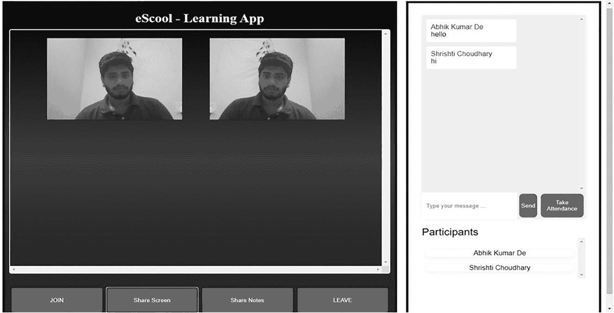

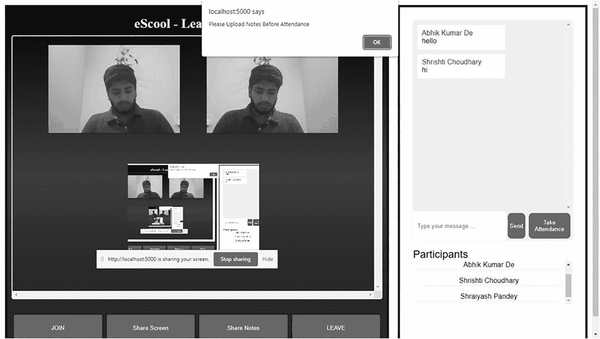

## 11.3 Escool 的重要性

当没有提供合适的环境时，学生的效率就会缩短。一个为学生提供适当教育的地方是至关且必要的。`Escool` 让学生在在线学习中感到舒适和灵活。它不仅对学生有帮助，对老师也是如此。它为教师提供了方便的功能，减少了时间和精力，因此他们可以更多地关注教育方面。为了增强和改进师师的课堂体验，`Escool` 是一个重要的工具，解决了在线学习中的效率大问题。学生在课堂上很难专注和集中注意力，特别是当有这么多干扰因素时。

我们的工作概述了一个愿景，即为学生提供最佳的在线视频会议。许多不同的现有视频会议应用的功能已经经过了充分的开发和改进。然而，仍然有一些领域可以被改进或开发。因此，我们提取了现有视频会议应用面临的局限性、问题和故障，以开发和改进这些应用缺乏的每个领域或领域。总体而言，我们的在线视频会议应用 `Escool` 提供了某些解决目前使用的全球知名视频会议应用如 `Zoom`、`Google Meet` 和 `Microsoft Teams` 局限的功能 [7]。

## 11.4 方法论

视频会议应用是一种软件工具，允许您通过视频会议、音频会议和屏幕共享在线进行视频会议。

许多如 `Google Meet` 和 `Skype` 等应用已经存在并被广泛用于远程会话，特别是在商务会议和公司讨论中。然而，只有在新冠肺炎疫情出现、导致无法举行实体会议时，视频会议应用的必要性和使用量才呈指数级增长。

像 `Zoom` 等视频会议应用使用量增加的主要因素无疑是“在线教育” [8,9,10,11]。

随着学校、学院和大学被迫关闭，整个教学过程不得不进行调整并转换为在线模式。多媒体的使用和实时内容共享的使用弥补了线下模式物理互动的缺失，但在大多数如 `Zoom` 的现有视频会议应用中仍然存在许多瓶颈和漏洞。

每当出现疫情即将结束的微小迹象时，新的变异株出现了。由于缺乏良好的教育，世界各地的人无法实现美好的未来。我们的发明提供了一个易于访问的虚拟平台，让师生能够在全球范围内进行高效互动。尽管已经存在针对这一全球教育匮乏问题的应用程序，但我们主要关注这些现有应用程序的缺点和局限性。这些平台在某些方面缺乏提供或交付高效教学-学习环境的能力。我们展示了一个能够解决这些问题的平台。我们希望随着时间的推移，在线教育系统这一领域能发生变革，使得无论学校位于何处，后代都能获得优质教育。因此，该平台被称为 `eScool`（见图 11.3 和 图 11.4）。


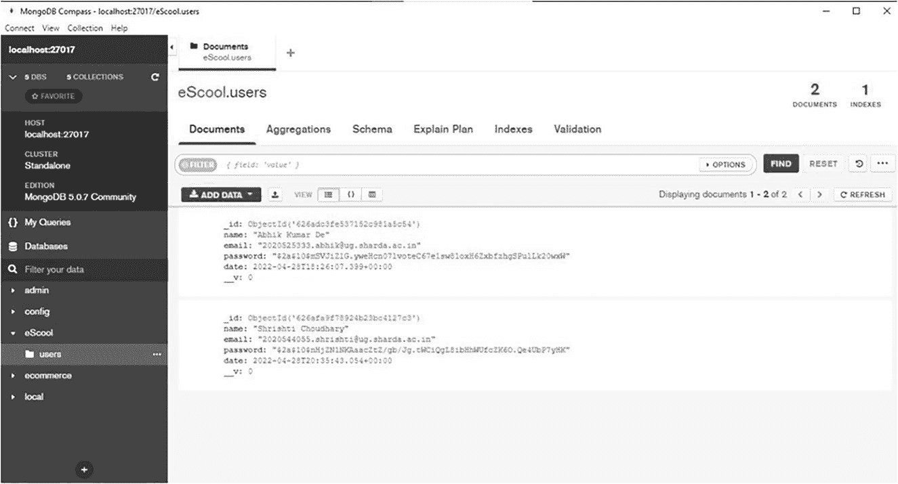

图 11.3 注册窗口。

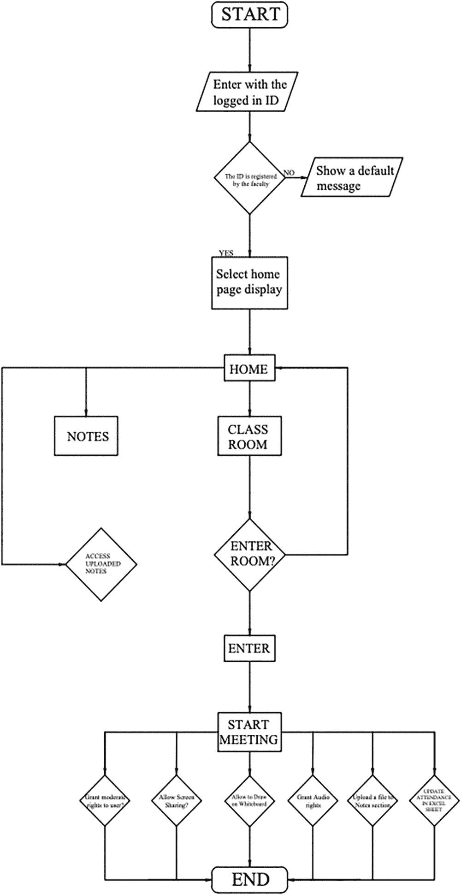

图 11.4 应用内引导流程图。

## 11.5 问题 – 解决方案表示

（现有应用程序的）缺点及解决方案：

*   访问受限
    *   **问题：** 方便的访问让心坏分子能够冒充真实学生姓名使用组织 ID 进入教室并造成扰乱
    *   **解决方案：** 只有教职人员预先并分配相应 ID 的学生才能通过链接访问教室

    

*   一键签到
    *   **问题：** 在进行每日考勤时会造成大量的混乱和学习时间的浪费
    *   **解决方案：** `eScool` 允许教师只需点击一下即可记录考勤

    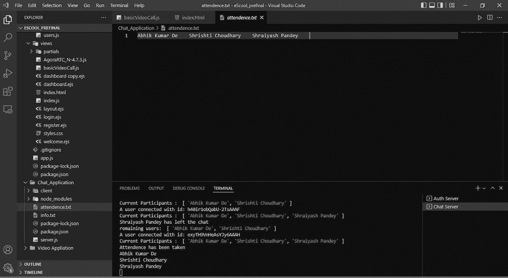

*   易于分享笔记
    *   **问题：** 教师多次无法上传或分享学习材料，阻碍了教学-学习过程。
    *   **解决方案：** 在在线课程中展示学习材料时，`eScool` 提供了一个功能，允许教师只需点击一下即可上传并分享同一文件

    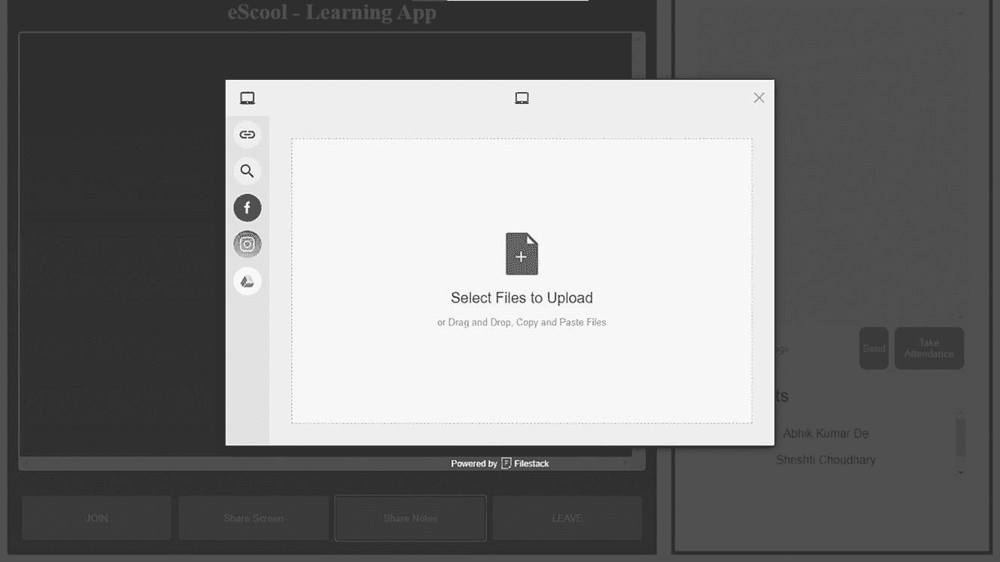

*   安全口袋模式
    *   **问题：** 参与者经常因意外开启或关闭摄像头或麦克风而感到尴尬或造成无意干扰
    *   **解决方案：** `eScool` 提供了一个实用的屏幕锁功能——安全口袋模式，可以防止此类尴尬

*   单链接教室
    *   **问题：** 给学生分享过多的链接让他们感到困惑并难以跟进
    *   **解决方案：** 我们的平台在虚拟模式下模拟现实教室，每节课程都有单一链接，相应的教师在课程开始时加入。

*   学生个人笔记
    *   **问题：** 学生在讲座期间记录快速数字笔记时，必须在 `Google Docs` 等第三方应用之间切换
    *   **解决方案：** `eScool` 通过引入一项功能为该问题提供了一步集成解决方案，允许学生在讲座期间在应用内快速记录数字笔记

*   日程会议提醒
    *   **问题：** 即使获得了课程时间表，每天也要跟踪即将到来的课程及其时间也变得困难
    *   **解决方案：** 使用 `eScool`，就不再需要担心重要的课程。在预定课程前的适当时间会发送提醒。

## 11.6 类似的在线应用程序

现有视频会议应用程序的对比分析：

关于今天最适合哪种视频会议应用程序，有很多相关新闻。市场上的可用应用程序正经历着人气和使用量的急剧增长，尤其是由于全球范围内的封锁。这些应用程序并非针对特定群体，事实上，市场空间跨越了从二年级小学生到职业人士。它可以用于在线通话，或仅用于随意的小组视频通话。尽管这一市场空间存在激烈竞争，但每个应用程序都有相似的功能，仅有少数例外。全球广泛使用的三个最流行的应用程序是 `Zoom`、`Google Meet` 和 `Microsoft Teams` [7]。

### 11.6.1 Zoom

`Zoom` 目前被认为是最流行的视频会议应用程序。该应用每天有超过 2 亿活跃用户。`Zoom` 拥有神奇的功能，也有一些缺点。它具有非常出色的功能，如屏幕共享、屏幕录制和团队聊天。其最神奇的功能之一是参与者可以使用默认选项更改背景，或放置他们选择的图片。（表 11.1）。

表 11.1 Zoom 主要工具

| 功能 | 用途 |
| --- | --- |
| 安排会议 | 在特定时间安排会议 |
| 使用日历 | 接收已安排会议的通知 |
| 屏幕共享 | 参与者可以选择通过此功能与会议中的其他参与者分享任何类型的信息 |
| 屏幕录制器 | 允许参与者在会议结束后回顾任何内容，特别是对于需要在课后复习主题的学生来说 |
| 虚拟白板 | 允许参与者通过画画、写字或进行解释在白板上表达想法 |
| 聊天 | 参与者有直接和私下互动的选项 |
| 用户管理 | 可以启用或禁用参与者的音频和视频 |

### 11.6.2 Google Meet

`Google Meet`（以前名为 `Hangouts`）也是市场上趋势性的会议应用程序之一。它是免费使用的，提供了流畅的界面和优雅的外。该应用程序的主要目标观众是公司和教育中心。`Google Meet` 连接到 `Google Suite`，允许参与者通过`日历` 添加会议。`Google Meet` 的流行源于 `Google` 本身的知名度。事实上，与另外两个应用程序（`Zoom` 和 `Microsoft Teams`）相比，它的功能并不多。（表 11.2）。

表 11.2 Meet 主要工具

| 功能 | 用途 |
| --- | --- |
| 安排会议 | 在特定时间安排会议 |
| 使用日历 | 接收已安排会议的通知 |
| 屏幕共享 | 参与者可以选择通过此功能与会议中的其他参与者分享任何类型的信息 |
| 屏幕录制器 | 允许参与者在会议结束后回顾任何内容，特别是对于需要在课后复习主题的学生来说 |
| 虚拟白板 | 允许参与者通过画画、写字或进行解释在白板上表达想法 |
| 聊天 | 参与者有直接和私下互动的选项 |
| 用户管理 | 主持者拥有启用或禁用参与者的音频和视频的选项 |

### 11.6.3 Microsoft Teams

`Microsoft Teams` 是 `Microsoft Office 365` 的一部分。它提供两种类型的方案：免费版和付费版。这个虚拟会议平台也被全国数百名学生使用。该应用程序主要关注协作与团队合作。在在线课堂中，协作与团队合作是实现最佳工作流的关键。它不仅是一个在线视频会议应用，还包含了其他应用不具备的功能。`Microsoft Teams` 是一个全方位、强大的协作与共享工具，允许来自多个地区的员工作为一个无缝、功能完单元共同工作[7]。稳定性、安全性、隐私性和易于访问是 `Microsoft Teams` 的一些特征。（表 11.3 和 11.4）。

### 表 11.3 主要 MS Teams 工具

| 工具 | 用途 |
| --- | --- |
| 屏幕共享 | 允许所有参与者都有选择与其他会议参与者共享内容的选项 |
| 集成课堂 | 学生可以轻松在同一平台内访问会议录制和笔记 |
| 白板 | 允许参与者通过在白板上绘图、写作或进行解释来表达想法 |
| 虚拟背景 | 允许用户通过展示不同类型的背景引入多样性和创造力 |

### 表 11.4 所引现有竞争作品的总体比较

| 特性 | Zoom | Google Meet | Microsoft Teams | eScool |
| --- | --- | --- | --- | --- |
| 仅限制预注册且具有相应电子邮件 ID 的学生。 | ✓ | X | X | ✓ |
| 下载或提取参会人员出席情况的功能。 | X | X | ✓ | ✓ |
| 高效共享或上传笔记的功能。 | X | X | ✓ | ✓ |
| 安全口袋模式（会议期间锁定屏幕的功能）。 | X | X | X | ✓ |
| 有效使用单个链接供学生加入课程。 | X | X | X | ✓ |
| 为已计划会议发送提醒的功能。 | X | X | ✓ | ✓ |
| 会议允许参与人数的限制。 | X | X | ✓ | X |
| 高强度加密安全。 | ✓ | ✓ | ✓ | X |
| 对所有学生都有合理的定价。 | X | ✓ | ✓ | ✓ |

## 11.7 结论

在线学习平台在我们的生活中发挥了至关重要的作用，特别是在 COVID-19 大流行期间。这些在线工具支持了我们，让我们轻松应对全球最糟糕的情况。从现在起，我们对教育或商业领域的在线工具变得更加从容。上面的表格显示了详细的比较，包含了所提工具的所有不同功能。我们的工作与 `Zoom`、`Microsoft Teams`、`Google Meet` 和 `GoTo Meeting` 等其他教育工具进行了比较。`eScool` 在线工具对教育部门和商业领域也将很有益。有两个功能与其他工具完全不同，即会议期间锁定屏幕以及学生有效使用单个链接加入课程，且在加密方面具有中等安全性。

事实上，未来在线工具在教育和商业领域的普及将会增加，以连接全球。这些会议工具将打造地球村，并为我们提供一个非常有用的平台。我们还可以远程解决所有复杂关键的问题。它们允许我们进行在线课程、视频会议、在线面试、商务会议、网络研讨会、座讨会等。这些在线应用程序让我们松了一口气。`eScool` 将提供比市场上其他在线应用程序更丰富的功能。

## 参考文献

1. Anand, Hardik. “Zoom 响应内政部认为该应用‘不安全’”。 HT Tech, Hindustan Times, 2020 年 4 月 17 日, web.
2. Chillcce, Angie Del Rio, 等. “学习过程中中使用视频会议的分析”。
3. “在大流行期间，利马的一所大学的情况，” The Sai, 2021 年 5 月 5 日, web.
4. Perry, Tracy. “安全与合规性概述 – Microsoft Teams.” Overview of Security and Compliance - Microsoft Teams | Microsoft Docs, Microsoft Docs, web.
5. Rajput, Abhinav. “Zoom 对 Google Meet 对 Microsoft Teams: 应该选择哪种视频会议应用”。 HT Tech, Hindustan Times, 2020 年 4 月 17 日, web.
6. Singh, Ravinder, 和 Soumya Awasthi. “视频会议平台的更新对比分析-zoom, Google Meet, Microsoft Teams, WebEx Teams 和 Gotomeetings,” 2020 年 8 月 16 日, web.
7. Soltero, Javier. “Google Meet 如何帮助我们的 G Suite 客户”。 Google Cloud Blog. Google, 2020 年 4 月 9 日, web.
8. Ana Maria Suduc 和 Mihai Bizoi, AI 塑造网络会议的未来“比较 Zoom, Microsoft Teams 和 Google Meet”。 Devoteam G Cloud, 2021 年 12 月 21 日, web.
9. Zaghdoud, A, “数字化转型对教学方法的影响：在线学习——国家远程教育案例研究。” 阿尔及大学, 阿尔及, 2020.
10. Englund, C, Olofsson, A. D., 和 Price, L. 高等教育中使用技术：理解概念的转变与发展。 High. Educ. Res. Dev. 36, 73–87, 2017. doi:`10.1080/07294360.2016.1171300`
11. Saxena, K, 病毒加速了印度数字教育的发展。 EDII 机构库, 2020.

始于 2019 年 12 月的全球 COVID-19 疫情大爆发影响了几乎所有国家和地区。这场疫情极大地阻碍了学生在全球教育方面的前景。在被迫从传统教室转型为紧急在线或远程学习后，学生和教师有机会为数字学习的引入奠定基础[1]。由于面对面教学为在线教学提供了途径，在此期间，学生和教育工作者必须应对许多困难。COVID-19 疫情为学习者和教师提供了接受各种数字协作平台培训的机会[2]。因此，他们现在对信息通信技术（`ICT`）的应用更有信心了。在线学习（有时被称为 `e-learning`、同步学习或异步学习）是一种使用尖端通信技术的新型教育方法。电子学习平台的开发是为了利用已有的网络连接[3,4]。根据 Khoza [5] 的说法，在线学习环境（也称为学习管理系统，或 `LMS`）的发展重新燃起了人们将传统面对面教学转化为以学生为中心、以自主学习（`SDL`）为特征的策略的兴趣。因此，自主学习（`SDL`）是一种学生从头到指导自己学习体验的方法（Knowles, 1975）。`SDL` 是高等教育的一项重要策略，对于专业人员课程也是必不可少的[6,7]。Knowles [8,9] 认为，社交互动（包括与同学、教师和导师的互动）是学习不可或缺的一部分。学习光谱可以被看作一端是自主学习，另一端是教师导向的学习[10]。

自主学习是学生在高等教育中参与的许多教学过程中的关键组成部分[11]。自主学习需要自由，这在数字革命的背景下变得越来越重要。由于更容易获取信息技术、新的通信渠道以及在线学习社区，终身学习的意义得到了扩展[12,13,14]。得益于社交媒体和其他技术，用户选择学习什么、何时学习以及学习多久的能力对他们学习效率有着巨大影响[15]。为了理解学习与技术之间互动的真实动态，自主学习被认为是一种可行且更直接的途径[16]。

## 12.2 研究依据


教学、学习和教师的概念已经发生了变化，这些概念中增加了新的观点和理解，以更好地适应现状的需求[17]。世界科技的快速变化和变革及其对教育程序的影响，立即影响了生活的方方面面[18]。COVID-19 疫情的结果是教育领域部署了不同的应用，包括混合学习和远程教育等概念。

对在线学习感兴趣的研究人员对学生自主学习的适能力特别感兴趣[19]。在大学期间学习如何成为主动和自主的学习者的学生，在作为工作者时将具备更充分的准备来预见其组织的需求。他们也可以自己获得所需的技能，并作为员工为组织创造价值[20]。根据研究，由于 COVID-19 的情况，为了保持学生的参与度，`SDL`的发展加速了[21]。在这种观点下，`SDL` 在主流高等教育中的相关性增加了。在疫情之前，`SDL` 与远程学习的相关性更高。

## 12.3 后疫情时代的教学学习与自主学习

全球，高等教育的学术日程受到了 COVID-19 疫情的干扰。但每种危机也带来了变化的机会。这种范式可能标志着一种转变。核心运作（`modus operandi`）为物理和面对面互动的服务部门恰好受到的影响最大。在印度等发展中国家，教育部门面临生存挑战。教育机构不得不采用数字技术并切换到在线教学学习以维持连续性。

在后数字时代的学习社区中，这需要对教学学习活动的性质、技术的使用、基础设施和资源的利用进行概念和哲学上的重新考虑（Jandri et al., 2018）。结果是，在线学习和教学的面对面部署策略不断进化[22]。COVID-19 疫情和在线课程导致学习者通过在线学习投入到自主学习[23]。广泛共识是，学习者在在线学习时对自己的教育有更大的控制力[24,25]。在线学习中加入`SDL`增加了学生的自由度，因为他们利用平台资源进行独立学习。自主学习者花费更多时间来准备和评估学习成果，查阅在线资源和材料[26]。

向在线培训的转型加速了自主学习的发展，激励了学生更具批判性和独立地投入到自己的学习中。为了让自主学习者成为教育的积极参与者，而非知识的被动使用者，采用以学生为中心的方法至关重要[27]。因此，为了提高学生的熟练程度，现在需要进行自主学习。由于 COVID-19 而不得不成为自主学习者的学生已经经历了显著的影响[28]。随着 COVID-19 的实施，`SDL` 技能被认为是对学生最重要的技能[29]。Pan [30]在一项针对中国本科生的研究中观察了他们采用技术进行自主学习的态度。结果表明，自主学习与技术自我效能感之间存在关联。

## 12.4 文献综述

作者讨论了 Knowles (1975) 定义的自主学习概念：“`SDL` 是一个过程，个体在他人帮助或没有帮助的情况下，积极参与识别自己的学习需求、设定学习目标、探索学习目的所需的人力和物资源、选择并实施正确的学习策略以及评估其学习成果。”

### 12.4.1 SDL 理论基础的洞察

自主学习是一个多维度的概念，可以从不同的角度来看。Van der Walt [31] 也注意到了该概念周围的术语歧义，这复杂了关于自主学习主题的交流。此外，Dehnad 等人 [32] 声称“自主学习”一词的定义是不一致的。自主学习有许多定义，但在理论视角上缺乏一致性 (Candy, 1998)。Draper [33] 尝试通过鼓励教师使用替代教学法进行教与，将自主学习与成年教育联系起来。考虑到这一背景，本研究考察了研究人员在自主学习背景下建立的一些关键概念框架，以对该问题提供深入见解。

根据 Garrison [34] 的观点，自主学习是一种策略，鼓励学生承担个人责任并对认知（自我监控）和情境（自我管理）过程进行协作控制，以构建并确认有意义且有价值的学习成果。根据上述讨论，显而对于 Garrison 的 `SDL` 概念强调了学习者的动机和学习者的协作视角，以实现预期的学习成果。

Grow [35] 的`阶段性自主学习（SSDL）模型` 是最著名的自主学习方法之一。`SSDL` 模型解释了学习如何从依赖转变为自主。在学习者自主导向的各个阶段建议的教学策略如图 12.1 所示。Grow [35] 提出了八个因素来决定个人自主学习的准备情况，如下：“(1) 对学习机会的开放态度，(2) 作为有效学习者的自我概念，(3) 学习中的主动性和独立性，(4) 对自身学习责任的知情接受，(5) 对学习的热爱，(6) 创造力，(7) 对未来的积极导向，以及(8) 使用基础学习和解决问题技能的能力。”

![图 12.1 基于 Grow [35] 的阶段性自主学习模型（自源）。](images/fig12_1.jpg)

图 12.1 基于 Grow 的阶段性自主学习模型 [35] (自源）。

### 12.4.2 SDL 是一个过程

过程是“学习者的自主学习过程”。根据 Moore [36,37]，组织、监督和评估自身学习的行为是展示学习者自主性的主要方式。可以使用一个六步的过程来描述自主学习：设定学习目标、根据学习者如何知道自己何时成功来描述评估、识别活动的结构和顺序、制定完成活动的时间表、识别帮助学习者实现每个目标的资源，以及寻找导师或教职工对计划提供反馈[38]。在学术学习背景下，Winne 和 Hadwin [39] 识别了自主学习的四个关键阶段：(1) 识别任务；(2) 建立目标和规划；(3) 执行学习方法和策略；(4) 元调整学习。自主学习是一个涉及社交互动、情境、建设性反馈、自我调节和反思的过程[40,41]。在自主学习中，学生负责自己的学习目标和策略，以实现他们感知到的目标。学习方法和目标针对其特定情况进行定制的这一事实是该过程的一个特点。学习者本身是其情境的核心且显著特征。

一些研究人员了在线学习如何影响 `SDL` 过程，并关注了 `SDL` 背景下的规划、监控和评估等关键领域。在线学习规划允许学生按照自己的节奏学习[42]。在方便的时间和地点安排活动是异步在线学习的一个特征。虽然在线学习提供的灵活性给了更多自由，但也带来了某些挑战 (Song et al., 2004)。

### 12.4.3 SDL 由个体发起

学习在心理学上被描述为学习满足需求和追求目标的过程。这意味着当人们有想要实现的目标和对学习的渴望时，他们就会被驱动去学习。当他们认为可用资源（如教师和材料）与自己的需求和目标相关时，他们也会使用这些资源[43]。自主学习的人会采取主动并承担责任。学生通过对学习内容和方式做出决策来控制自己的学习，这一想法是自主学习的核心[44,45]。自主学习可以在正式和非正式的环境中进行[46,47]。根据 Clardy [48]，一个人过去的教育经历是预测其追求自主学习倾向的可靠指标。当自主学习行为与鼓励并提供机会、资源和投入的环境相结合时，可以在身上得到培养。

### 12.4.4 SDL 可能可能涉及他人的帮助

Garrison [49]指出，在正式学习环境中的自主性学习（`SDL`）应被视为一个促进教师与学生之间互动的过程。自主学习不仅要求学生有学习的机会，还要求他们选择学习内容的能力。因此，正式教育应被视为教师与学生之间的共同努力。Merriam & Caffarella (2013) 认为，应该更地接受自主学习中相互依赖和协作的特征。O’Donnell [50]在解释他所谓的“自我导向型学习”的原因时，在强调社区维度而非个人维度方面表现得最为极端。[8]断言，社交互动（包括与同伴、教师和导师的互动）对学习至关重要。教师应该考虑使用的最佳策略是：鼓励今天的学生发现自己的学习能力，以达到“学习、遗忘和重学”的概念。[51]。因此，教师和讲师可以帮助自主学习的发展 [52]。

然而，`SDL` 可以在正式教育机构内部，也可以在外部采用。这里研究人员关注教育机构内部的 `SDL`。学生需要开发和练习各种技能，使他们引导自己的学习，而不是依赖教师告诉他们做什么，因为 `SDL` 倾向于以学习者为中心，而不是以教师为中心和由教师驱动。他们必须在个人和同小组中都具备自我引导能力，具有自我意识，了解自己的价值观，并拥有自信和积极的自我概念等特质 [53,54]。

## 12.4.5 基于需求识别建立学习目标

学习动机通过在学习活动中的行为投入来体现，它是启动和维持目标导向行动的过程 [55]。根据对学生学习的研究，目标设定与学习动机密切相关 [56,57,58]。学生应该对学习新事物和完成他们的目标非常有动力。`SDL` 解决了个性化学习方法的问题 [59]。`SDL` 被称为强调学习者主导自己学习的渴望或偏好的目标 [60]。

自主学习者对自己的学习能力充满信心。他们能够成功做出与其学习需求相关的选择，并认为自己在这方面获得了独立。此外，与受教师导向的同学相比，他们更有可能作为学习者获得成功感 [46]。在他们的研究中，Schweder 和 Raufelder [61]发现自主学习（`SDL`）鼓励青少年满足自己的需求。在他们的研究中，Joo 等人 [62]观察了学习目标倾向、发展需求认知以及自主学习如何影响韩国公共部门员工对职业的满意度。通过使用结构方程模型进行调查，他们发现学习目标倾向和发展需求的意识解释了自主学习的变异。已经证明，自主学习（`SDL`）有助于专业人士克服学习障碍并获得新技能 [63]。此外，基于证据的研究表明，数字学习支持 `SDL`，专业人士通过数字设备参加课程是实行的，这对学习者的成就产生了积极影响 [64,65,66]。

## 12.4.6 寻找实现这些目标的必要资源

资源有多种形式，包括信息资源和基础设施。学生必须意识到并积极调查各种学习工具 [67]。当学生获得资源、学习工具、灵感和支持时，可以帮助他们成为更有自主性的学习者。因此，促进者除了担任教室教师外，还可以担任咨询师、顾问、导师和资源寻找者 [60]。有效整合技术的学习环境可能对独立学习产生重大影响，因为它们让学生能够以以前不可能的方式获取材料 [16]。在网络技术出现之后，在线学习、电子学习等非正式学习技术使得学习体验的自主设计成为可能 [68]。根据几项研究，自主学习者从在线学习中获得的比他人更多 [69,70]。根据对 `SDLT` 的研究，学生对协作学习的感知具有提高其自主学习（`SDL`）的潜力 [71]。利用通信技术进行小组学习得到了学生 `SDL` 的帮助 [72]。

## 12.4.7 为了实现目标选择并实践最佳学习策略

## 12.4.8 确定如何衡量学习成果

在自主导向学习（`SDL`）中，学习的重点已经从教师转移到了学生。这种转变使学生能够选择自己的目标以及实现学习目标所采取的步骤。现在，学习是以学生为中心的。同伴评价有助于获得更好的学习成果[75,76]。自我评估使学习者能够通过反思来诊断自己的理解程度，从而促进学术上的进步[77]。自我评估涵盖了学生可以参与的评估自身表现的各种活动，这可以被视为一种反馈和形成性评价[78]。Boud [79] 强调了自我评估在教育过程中的价值。Yan [80] 确立了自我评估对于自我调节学习的价值，含蓄地重申了其在 `SDL` 中的适用性。根据 Garrison [34]，自主导向学习包含了构建学习成果的特定过程。

### 12.4.9 混合学习与 SDL

通过将面对面学习与数字学习相结合，混合学习创建了一种适应多种形式交流的动态学习环境，使得教学和学习可以在教室和在线同时进行[81,82]。混合学习课程处于连续体的中间，以完全在线和完全面对面的学习环境为锚点[83]。传统的学习（包括面对面互动和信息技术 (IT) 组件）必须被成功地整合到课程设计中，以确保混合学习不仅仅是目前流行方法或方法的补充（Kanuka, 2004）。良好教育所具有的特征——自由开放对话、批判性辩论、协商和共识，通过社区参与和互动在高等教育环境中变得成为可能[84,85]。只有当学生对学习拥有所有权并投入承诺时，混合学习才是成功且有效的（Bonk & Graham, 2006）。根据 Moore (2005)，自我调节和自主导向学习与混合学习有关，因为它们涉及三个相关的元素：互动、结构和自主性。通过使用实验研究方法，Sriarunrasmee 等人 [86] 调查了混合学习方法对学生交流能力和自主导向学习发展的有效性。他们的发现显示，混合学习教室的学生在这两个方面的表现均优于传统教室的学生。学生在混合学习环境中的另一个关键方面是他们对技术的就绪性。各种计算机技术的发展使教育中的多媒体内容和多媒体通信成为可能（Horton, 2006），并使学习内容可以随时随地被获取。自主导向型学习者在自己的教育中了积极作用，并能够根据情况调整自己的学习方法。在充满技术的教室里，学生可以从学习中所需的自主导向前景和能力中获益匪浅[87]。

在高等教育中，混合学习（`BL`）或面对面与在线教学的结合被广泛使用。某些学者使用“新传统模型”[88]或“新常态”[89]来描述它。有人提到，混合学习（`BL`）通过结合面对面和在线培训实现了异步教学学习[90]。在线讨论论坛只是 `BL` 用于促进学生之间以及学生与教师之间交流的众多在线学习工具之一。与传统教室相比，混合学习允许教育者和学生使用所有形式的交流、信息技术和创新（特别是互联网和网络）作为工具来改进教学学习管理以及制作教育媒体。为了让学生建立作为学习者的能力和素质，课堂与技术辅助教学学习的结合建立了通往多种学习模式和方法的途径[91]。关于混合学习的许多研究表明，学生的协作学习、创造性思维、独立学习和学习体验个性化能力得到了提高。教育工作者对混合学习的使用帮助他们创造交流渠道，鼓励学生分享他们的知识和经验[92]。教师在混合学习环境中的工作是担任促进者，帮助、建议并挑战学生以实现他们自己的学习目标。传统课堂教学与在线学习的有效结合支持了学生之间的异步和协作学习。然而，学生在 `BL` 环境中仍然享有面对面接收反馈的机会，因此，在传统的课堂教学、学习与在线学习之间保持平衡是重要的[93]。

## 12.5 讨论与结论

技术赋能的自主导向学习将长期存在，从长远来看将影响整个教学学习过程。利益相关者因为其提供的明显优势而非常渴望采用 `SDL`。根据前几节的见解，研究人员现在基于 Garrison [34]（图 12.2）提出了一种基于技术赋能的 `SDL` 综合模型。

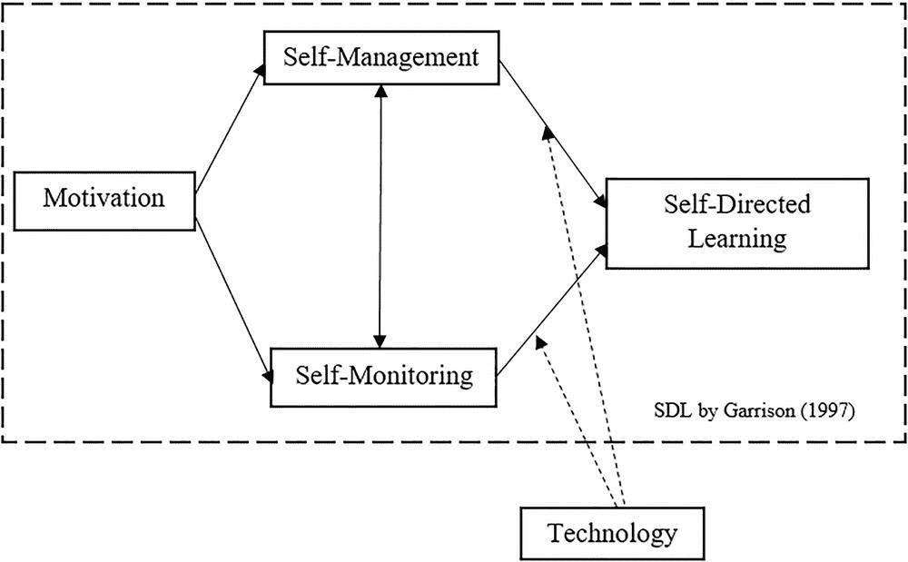

图 12.2 技术赋能自主导向学习的维度（源自）。

### 12.5.1 教师视角的 SDL

教育工作者可以通过混合学习活动在教学中采用 `SDL`。除了常规的面对面教学外，还可以计划包含 `SDL` 元素的活动，以促进学习者的自主性。在充足的技术支持下，教师可以引入以学生为中心的方法，并在课堂上实施更多自主学习。自主的长期方法可以应用于教学实践中。

### 12.5.2 学生视角的 SDL

高等教育等同于成人学习。21 世纪要求学生具备多种技能。发展知识的一些领域包括核心内容知识、数字素养、问题解决和批判性思维。根据 Garrison [34]，`SDL` 有助于自我发展、动机和自我监控。这三个因素进一步支持目标设定、相互依赖、反思、批判性思维和任务动机。除了这些之外，结合技术使用的 `SDL` 还为学生提供了更多信息来源。

### 12.5.3 管理视角的 SDL

技术在教学中的应用会导致资源的最优利用。如果推广了 `SDL`，教育机构可能需要聘用更少的教师，这在难以寻找优秀教师的情况下将非常有帮助。通过技术赋能的 `SDL`，人力资源的可用将得到优化。

## 12.6 未来方向

本研究为实现高等教育自我导向学习（`SDL`）的技术提供了一些有意义的见解。学校的自我导向学习也可以得到进一步探索。未来了解哪些因素可能影响机构的 `SDL` 实施将是非常有趣的。除了自我导向学习的益处之外，对学生学习是否有任何负面影响也可以作为未来研究的一个视角。

## 参考文献

1. Dhawan, S. (2020). 在线学习：COVID-19 危机期间的万灵药。教育技术系统杂志，*49* (1), 5–22。

2. Pokhrel, S., & Chhetri, R. (2021). COVID-19 疫情对教学和学习影响的文献综述。未来教育，*8* (1), 133–141。

3. Mpungose, C. (2020). 冠状病毒肺炎背景下南非某大学从面对面到在线学习的突发转型。人文与社会科学通讯，*7* (1), 1–9。 [10.1057/s41599-020-00603-x](https://doi.org/10.1057/s41599-020-00603-x)

4. Ohlin, C. (2019). 全球化中的信息通信技术。社会科学与技术研究，*4* (2), 41–57. [10.46303/ressat.04.02.4](https://doi.org/10.46303/ressat.04.02.4)

5. Khoza, S.B. (2019). 教师对课程蜘蛛网概念作为转型策略的反思。载于后种族时代南非高等教育机构的转型。页码 15–26，Routledge。

6. Raidal, S.L., & Volet, S.E. (2009). 临床前学生对社会化教学形式和自我导向学习的倾向：培养自主和协作型学习者的挑战。高等教育，*57* (5), 577–596。

7. Sze-Yeng, F., & Hussain, R.M.R. (2010). 社会建构主义学习环境中的自我导向学习。Procedia-社会与行为科学，*9*, 913–1917。

8. Knowles, M. (1990). 成人学习者：一个被忽视的物种。休斯顿，德克萨斯州：Gulf Publishing。

9. Lai, C., & Gu, M.Y. (2011). 技术的自我调节外课语言学习。计算机辅助语言学习，*24* (4), 317–335. doi: [10.1080/09588221.2011.568417](https://doi.org/10.1080/09588221.2011.568417)

10. Fisher, M., King, J., & Tague, G. (2001). 护理教育自我导向学习就绪量表的开发。护理教育今日，*22* (7), 516–525。

11. Rascón-Hernán, C., Fullana-Noell, J., Fuentes-Pumarola, C., Romero-Collado, A., Vila-Vidal, D., & Ballester-Ferrando, D. (2019). 衡量健康科学本科生的自我导向学习就绪度：一项横向研究。护理教育今日，*83*, 104201。

12. Kim, R.H. (2010). 自我导向学习管理系统：在在线学习环境中能力和自我效能。克莱蒙特研究生大学。


13. Thorpe, M. (2005). ICT 对终身学习的影响，终身学习与远程高等教育，页码 23–32。获取自：[`universidadazteca.net/yahoo_site_admin/assets/docs/141218e_Lifelong_Learning_Distance_HE.63165716.pdf#page=32`](https://universidadazteca.net)（访问 2023 年 3 月 20 日）。

14. Tobin, D.R. (2000). 所有学习都是自我导向的：组织如何支持和鼓励学习。亚历山大，弗吉尼亚州：美国培训与开发协会。

15. Tullis, J.G., & Benjamin, A.S. (2011). 关于自主学习的有效性。记忆与语言杂志，*64* (2), 109–118。

16. Candy, P.C. (2004). 链接思维：数字时代的自我导向学习。堪培，教育部，科学。

17. Karataş, K., Şentürk, C., & Teke, A. (2021). 教学-学习构想与自我导向学习就绪之间的中介作用。澳大利亚教师教育，*46* (6), 54–77. [10.14221/ajte.2021v46](https://doi.org/10.14221/ajte.2021v46)

18. UNCTAD (2018). 快速技术变化的影响。联合国出版社。

19. Hartley, K., & Bendixen, L.D. (2001). 互联网时代的教育研究。教育研究，*30* (9), 22–26。

20. Artis, A.B., & Harris, E.G. (2007). 自我导向学习与销售业绩：一个框架。个人销售与管理杂志，*27* (1), 9–24。

21. Adinda, D., & Mohib, N. (2020). 增强混合学习环境中学生自我导向学习的教学和教学设计方法。电子学习杂志，*18* (2), 162–174. [10.34190/EJEL.18.2.005](https://doi.org/10.34190/EJEL.18.2.005)

22. Owolabi, J.O. (2020). COVID-19 期间及之后的非洲学校虚拟化：基础设施、教学、资源、学生支持系统、技术和文化。医学教育与实践进展，*11*, 755–759. [10.2147/AMEP.S27205](https://doi.org/10.2147/AMEP.S27205)

23. Baticulon, R.E., Sy, J.J., Alberto, N.R.I., Mabulay, R.E.C., Rizada, L.G.T., Tiu, C.J.S., & Reyes, J.C.B. (2021). COVID-19 期间的在线学习障碍：菲律宾医生的全国调查。医学科学教育，*31*, 615–626. [10.1007/s40670-021-01231-z](https://doi.org/10.1007/s40670-021-01231-z)

24. Garrison, D.R. (2003). 有效异步在线学习的认知存在：反思、自我引导和元认知的作用。质量在线教育要素：实践与方向，*4* (1), 47–58。

25. Gunawardena, C.N., & McIsaac, M.S. (2003). 远程教育。D. Jonassen（编辑）。教育传播与技术研究手册（页码 355–396）。纽约。

26. Geng, S., Law, K.S. & Niu, B. (2019). 混合学习环境中的自我导向学习和技术就绪调查。高等教育教育技术杂志，*16* (1), 1–22. [10.1186/s41239-019-0147-0](https://doi.org/10.1186/s41239-019-0147-0)

27. Roberson Jr., D.N., Zach, S., Choresh, N., & Rosenthal, I. (2021). 自我导向学习：不确定时期的长期工具。创意教育，*12* (5), 1011–1026。 [10.4236/ce.2021.12504](https://doi.org/10.4236/ce.2021.12504)

28. Mukhtar, K., Javed, K., Arooj, M., & Sethi, A. (2020). COVID-19 时代在线学习的优点、局限性和建议。巴基斯坦医学杂志，*36*, 21–27。

29. Morris, T.H. (2021). 通过自我导向学习应对新冠肺炎前后和期间的教育挑战：考虑必要的教育体验语境质量。地平线，*29* (2), 1–20. doi:[10.1108/OTH01-2021-0031](https://doi.org/10.1108/OTH-01-2021-0031)

30. Pan, X. (2020). 技术接受、技术自我效能和对基于技术的自我导向学习的态度：学习动机作为中介。心理学前沿，*11*, 1–11. [10.3389/fpsyg.2020.564294](https://doi.org/10.3389/fpsyg.2020.564294).

31. Van der Walt, J.L. (2019). 自主学习一术语——回到诺尔斯，还是另一种前进的方式？《基督教教育研究期刊》，`28` (1), 1–20。

32. Dehnad, A., Afsharian, F., Hosseini, F., Arabshahi, S.K.S., & Bigdeli, S. (2014). 2000–2012 年文献中对自主学习定义的追求。《社会与行为科学进展 (Procedia)》，`116`, 5184–5187。

33. Draper, J. (1998). 成人教育学的蜕变。《加拿大成人教育研究期刊》，`12` (1), 3–26。

34. Garrison, D.R. (1997). 自主学习：迈向全面模型，《成人教育季报》，`48` (1), 8–33. [10.1177/074171369704800103](https://doi.org/10.1177/074171369704800103)

35. Grow, G.O. (1991). 教会学习者具有自主性，《成人教育季报》，`41` (3), 125–149。

36. Moore, M.G. (1972). 学习者自主性：独立学习的第二个维度。《聚合 (Convergence)》，`5` (2), 76–88。

37. Moore, M., & Kearsley, G. (2005). 远程教育：系统视角。波士顿：Wadsworth。

38. Robinson, J.D., & Persky, A.M. (2020). 培养自主学习者。《美国医药教育杂志》，`84` (3), 847512. [10.5688/ajpe847512](https://doi.org/10.5688/ajpe847512)

39. Winne, P.H., & Hadwin, A.F. (1998). 学习作为自我调节的投入。见 D. Hacker, J. Dunlosky, & A. Graesser (编)，《教育理论与实践中的元认知》，页码 277–304，希尔斯代尔：Lawrence Erlbaum。

40. Simons, P.R.J. (2000). 向自主学习建构主义理论。《自我学习》，页码 1–12，检索自 `file:///C:/Users/viran/Downloads/5701%20(2).pdf`（2023 年 3 月 20 日访问）。

41. Song, L. (2005). 在线环境中的自主学习：过程、个人属性与背景（博士论文，乔治亚大学）。

42. Chizmar, J.F., & Walbert, M.S. (1999). 受良好教学实践原则指导的基于网络的学习环境。《经济教育杂志》，`30` (3), 248–264。

43. Chene, A. (1983). 成人教育中的自主性概念：一场哲学讨论。《成人教育季报》，`34` (1), 38–47。

44. Merriam, S.B., & Bierema, L.L. (2013). 成人学习：连接理论与实践。新泽西：Jossey-Bass, John Wiley & Sons。

45. Mishra, P., Fahnoe, C., Henriksen, D., & Deep-Play Research Group (2013). 创造力、自主学习与富技术环境的架构。《技术趋势 (TechTrends)》，`57` (1), 10–13。

46. Loeng, S. (2020). 自主学习：成人教育的核心概念。《教育研究国际》，`2020`, 1–20。

47. Means, B., Toyama, Y., Murphy, R., Bakia, M., & Jones, K. (2009). 在线学习中证据驱动实践的评估：在线研究的元分析与回顾，可用 `https://repository.alt.ac.uk/629/1/US_DepEdu_Final_report_2009.pdf`（2022 年 12 月 10 日访问）。

48. Clardy, A. (2000). 自主学习：职业导向的自主学习。《人力资源开发季报》，`11` (2), 105–125。

49. Garrison, D.R. (1992). 成人教育中的批判性思维与自主学习：对控制的分析，《成人教育季报》，`42` (3), 136–148。

50. O'Donnell, D. (1999). 哈贝马斯、批判理论与自我导学习。《欧洲期刊》，`23` (4), 251–261。

51. Piseth, N. (2020). 自主学习：疫情后教育的发展之路。可用 `https://repository.alt.ac.uk/629/1/US_DepEdu_Final_report_2009.pdf`（2023 年 2 月访问）。

52. Cadorin, L., Bortoluzzi, G., & Palese, A. (2013). 自主学习量表 (SRSS) 的因子分析，《护理教育》，`33`, 1511–1516。

53. Give, F. (2018). 通过教学促进自主学习能力。《英语语言教学》，`11`, 58–76。

54. Shahr, E. (2013). 大学学习者的自主学习能力。《教育研究》，`40`, 927–944。

55. Fredricks, J.A., Blumenfeld, P., & Paris, A. (2004). 学习目标对学校表现的影响。《教育研究评论》，`74`, 59–109。

56. Breznik, K. (2017). 混合学习中的自主学习导向。《计算机与教育》，`55`, 218–228。

57. Law, K.M. (2020). 2020 年 学习学习目标驱动的自主学习推荐系统。《计算机科学进展》，`171`, 583–592。

58. Hiemstra, R. (1991). 自主学习：理论与实践。伦敦：Routledge。

59. Schweder, S. (2021). 青少年在自主学习期间的需求满足度与动机。《青少年杂志》，`88`, 1–13。

60. Joo, B.K., Park, S., & Oh, J.R. (2013). 学习目标导向、发展需求与自主学习对韩国公共部门职业满意度的影响。《国际人力资源开发》，`16` (3), 313–329。

61. Jeong, D., Presseau, J., Naumann, D., Mascaro, F., Smith, K., & Kitto, S. (2018). 加拿大医生继续发展的自主学习的障碍与促进因素：范围性综述。《学术医学》，`93` (8), 1245–1254。

62. Berndt, A., Murray, C.M., Kennedy, K., Stanley, M.J., & Gilbert-Hunt, S. (2017). 农村医疗卫生从业者继续发展（CPD）距离学习策略的有效性：系统综述。《BMC 医学教育》，`17` (1), 1–13。

68. Reinders, H., & White, C. (2011). 学习者自主与新型学习环境。Language Learning & Technology, *15* (3), 1–3.

69. Lee, J., Hong, N.L., & Ling, N.L. (2002). 学生对虚拟学习环境准备情况的分析。Internet and Higher Education, *5* (3), 231–242.

70. Shapley, P. (2000). 有机化学中培养复杂推理能力的在线教育。Journal of Asynchronous Learning Networks, *4*, 43–49.

71. Teo, T., Tan, S.C., Lee, C.B., Chai, C.S., Koh, J.H.L., Chen, W.L., & Cheah, H.M. (2010). 青少年技术自导向学习量表（SDLTS）：初步开发与验证。Computers & Education, *55* (4), 1764–1771. [10.1016/j.compedu.2010.08.001](https://doi.org/10.1016/j.compedu.2010.08.001)

72. Lee, K., Tsai, P.S., Chai, C.S., & Koh, J.H.L. (2014). 学生对有无技术自导向学习与协作学习的感知。Journal of Computer Assisted Learning, *30* (5), 425–437. [10.1111/jcal.12055](https://doi.org/10.1111/jcal.12055)

73. Candy, P.C. (1991). 终身学习的自导：理论与实践全面指南。Jossey-Bass, 350 Sansome Street, San Francisco, CA 94104-1310.

74. Khalid, M., Bashir, S., & Amin, H. (2020). 自导向学习（SDL）与大学生学业成就之间的关系：在线远程学习与传统大学的案例。Bulletin of Education and Research, *42* (2), 131–148.

75. Li, H., Xiong, Y., Hunter, C.V., Guo, X., & Tywoniw, R. (2020). 同伴评定促进学生学习吗？元分析。Assessment & Evaluation in Higher Education, *45* (2), 193–211. [10.1080/02602938.2019.162079](https://doi.org/10.1080/02602938.2019.162079)

76. Sanchez, C.E., Atkinson, K.M., Koenka, A.C., Moshontz, H. & Cooper, H. (2017). 3 至 12 年级形成性与总结性评价的自评分与同伴评分。Journal of Educational Psychology, *109* (8), 1049–1066.

77. Baez, Z. (2019). ICT 及其教学实践中的目的。Research in Social Sciences and Technology, *4* (2), 83–95. [10.4603/ressat.04.02](https://doi.org/10.4603/ressat.04.02)

78. Andrade, H.L. (2019). 学生评价研究的批判性回顾。Frontiers in Education, *4*, 1–13. [10.3389/feduc.2019.0087](https://doi.org/10.3389/feduc.2019.0087)

79. Boud, D. (2013). 通过自我评价增强学习，纽约，纽约州：Routledge。

80. Yan, Z. (2020). 自调控学习过程中的自我评价及其与学业成就的关系。Assessment & Evaluation in Education, *45* (2), 224–238.

81. Collis, B., & Moonen, J. (2012). 灵活学习：数字世界的体验。伦敦：纽约。22. Lee, K., ... (2014). 学生对有无技术自导向学习与协作学习的感知。

83. Rovai, A. (2000). 混合学习与社区感：与在线课程的对比分析。International Review of Open and Distributed Learning, *5* (2), 21–26.

84. Garrison, D., & Cleveland-Innes, M. (2005). 在线学习中促进认知存在感。American Journal of Distance Education, *19* (3), 133–148.

85. Kanuka, H., (2004). 混合学习在高等教育中的变革潜力。Internet and Higher Education, *7* (2), 95–105.

86. Sriarunrasmee, J., Techataweewan, W., & Mebusaya, R. (2015). 斯纳哈罗特大学一年级学生的支持与沟通能力。Procedia-Social and Behavioral Sciences, *197*, 1564–1569.

87. Fahnoe, C., & Mishra, P. (2013). 21 世纪学习环境支持自导向学习吗？信息技术与教师教育国际会议（3131–3139）。计算教育促进协会（AACE）。

88. Ross, B., & Gage, K. (2006). 全球视角下的混合学习（155–168 页）。旧金山：Piffer。


# 第 13 章 教育 5.0 概述

B V Babu

印度高等教育质量保证顾问

DOI: [10.1201/9781003376699-13](https://doi.org/10.1201/9781003376699-13)

## 13.1 引言

质量保证是全球各种评估和认证机构不可或缺的组成部分。为了在学术界有一席之地、获得所需的认可并在竞争中脱颖而出，获得这些认证和排名至关重要。

为了确保教学产出的质量，以下方面至关重要，因此理解这些方面是必然的：

1. 价值导向型教育
2. 研究导向学习
3. 项目导向学习
4. 体验式学习
5. 学生期望
6. 灵活性
7. 工业 5.0
8. 课程设计
9. 教学-学习-评价过程
10. 结果导向型教育

教学模式已经发生了从传统的单向机械教师中心学习向双向体验式学生中心学习的范式转移。教育 5.0 涵盖了这种范式转移。

教育 5.0 代表了教育的一个新概念，强调满足 21 世纪学习者的需求 [1,2]。通过强调个性化、终身学习、新兴技术、全球协作以及技能与能力，教育 5.0 旨在培养学习者在当今瞬息万变的世界中取得成功。它专注于在当前不断变化的世界中取得成功至关重要的技能和能力。

教育 5.0 是一个术语，用于描述由技术快速进步和全球化驱动的教育领域的最新范式转变。它代表了一种新颖的教育方法，确保培养出具有适应力、创新精神，并具备在这个不断变迁的世界中生存所需的技能和知识基础的学生。

教育 5.0 建立在之前几代教育的基础上，前几代教育的特点是关注知识获取（教育 1.0）、大众化教育和标准化（教育 2.0）、个性化学习和基于能力的教育（教育 3.0），以及数字化和互联学习（教育 4.0）。教育 5.0 采取了更加整体和以学生为中心的教育方法，并更加强调经验学习、全球公民意识、基于价值观的教育，以及批判性思维能力、问题解决能力、创造力和协作工作等技能的提升。

通过教育 5.0，重点在于培养终身学习者，使他们能够在一生中不断学习并适应新情况。这是通过使用个性化和自适应学习技术实现的，这些技术让学生能够按照自己的方式和想要的速度进行学习。教育 5.0 还强调了全球公民意识和文化理解的重要性，强调跨国界跨文化的协作与合作。

总的来说，教育 5.0 代表了教育的重大转变，认识了让学生适应不断变化且互联互通的世界的重要性。通过专注于培养具有适应力、创新精神，并具备在这个竞争激烈的世界中生存所需的技能和核心知识基础的学生，教育 5.0 具有变革教育并赋能个人实现其全部潜力的潜力。

在本章中，我们将首先详细讨论上述质量保证方面，然后进一步探索这些方面如何与以学生为中心的学习无缝地整合到教育 5.0 中。

在本章的第一部分对教育 5.0 进行了简要介绍（如上所述）。本章第二部分详细阐述了质量保证方面和以学生为中心的学习。本章第三部分详细介绍了教育 5.0，涵盖并无缝整合了与其相关的所有方面。本章第四部分总结了与教育 5.0 相关的挑战，并提供了解决这些问题的可能方案。最后，在本章第五部分提出了关于教育 5.0 的结论。参考文献列在本章的最后一节。

## 13.2 质量保证方面与以学生为中心的学习

### 13.2.1 基于价值观的教育

基于价值观的教育是最重要的教育方法之一，它强调培养学习者的伦理道德价值观。基于价值观的教育的目标是在学习者中培养责任感、同理心和慈悲，使他们成为社会中符合伦理且负责的成员 [3]。

它包括对自我、社会和自然之间内在联系的理解。随着过去几个世纪科学突破、技术发现、发明和创新的出现，人类在某种程度上丧失了对自然界生物的谦逊、敏感和感知力 [4,5]。现在，是时候通过内在来理解这些价值观了，因此基于价值观的教育在教育的所有层次（小学、中学和高等教育阶段）都发挥着重要作用，在高等教育阶段更是如此 [6,7]。

教育者应该训练学生意识到自我、社会和自然之间的联系，并确保这种联系在他们的科学发现和技术发明过程中不受影响。可以通过在任何科学技术发现和发明中不干涉自然的四种秩序、人类秩序的五个维度以及他们关系中的九种情感来确保这种联系的维持 [8,9]。

自然的四种秩序包括“(1) 生物秩序（植物、树木等）、(2) 物理秩序（土壤、金属等）、(3) 动物秩序（动物、鸟类等）以及 (4) 人类秩序（人类）”。

人类秩序的五个维度包括“(1) 教育（Sanskar/培养）、(2) 健康（自我调节）、(3) 生产（工作）、(4) 正义（保护）以及 (5) 交换（存储）”。

关系中的九种情感涵盖“(1) 信任（viswas，基础价值）、(2) 尊重（samman）、(3) 情感（sneh）、(4) 关怀（mamta）、(5) 引导（vatsalya）、(6) 崇敬（shraddha）、(7) 荣誉（gaurav）、(8) 感恩（krutaznatha）和 (9) 爱（prem，完全价值）” [10]。

基于价值观的教育具有以下特征：

1. **基于价值观的课程**：基于价值观的教育强调一种经过设计的课程，旨在教授学习者诚实、尊重、同理心、责任和慈悲的价值观。
2. **性格教育**：基于价值观的教育关注性格教育，培养学习者具备良好的性格特质，如诚实、正直和同理心。
3. **服务学习**：基于价值观的教育促进服务学习，让学习者参与社区服务项目，以培养社会责任感和公民参与。
4. **积极的校园文化**：基于价值观的教育营造积极的校园文化，鼓励学习者表现出尊重、善良和同理心。
5. **榜样**：基于价值观的教育强调榜样的重要性，让学习者接触所教价值观和特质的正面榜样。

基于价值观的学习强调伦理道德价值观。它旨在培养学习者成为社会中负责任且符合伦理的成员，并培养社会责任感和公民参与 [11]。

### 13.2.2 基于研究的学习

教育中基于研究的学习方法核心是在教学学习实践中使用研究。基于研究的学习的目标是利用最新的研究发现来提高教学学习的质量，并确保教育实践有可靠的依据。

基于研究的学习通常具有以下特征 [12]：

1. **基于证据的教学实践**：基于研究的学习关注基于证据的教学实践，其教学策略基于对有效教学学习策略的最新研究发现。
2. **行动研究**：基于研究的学习促进行动研究的使用，教育者通过系统性探究来改进教学策略并评估教育计划的有效性。
3. **数据驱动的决策**：基于研究的学习强调使用数据做出明智决策，根据其有效性的数据证据对教育实践进行评估。
4. **持续改进**：基于研究的学习强调持续改进的重要性，即根据不断的研究和评估对教育实践进行评估和完善。
5. **协作与知识共享**：基于研究的学习促进了教育工作者、研究人员和从业者之间的协作与知识共享，以确保最新的研究成果能够在教育环境中传播和应用。

因此，基于研究的学习旨在从根本上确保教育实践基于可靠的证据，并促进教学和学习的持续改进与创新。

### 13.2.3 项目式学习

教学学习过程中的项目式教育强调通过完成项目或任务进行操作性和体验性学习。在项目式教育中，学习者协作识别并解决现实世界的问题，创建产品或服务，并通过探究和探索的过程培养技能和能力 [13]。

以下是项目式学习的一些常见特征：

1. **以学生为中心的学习**：项目式学习以学生为中心，学习者通过识别和追求自己的兴趣和目标，在学习过程中发挥积极作用。
2. **真实任务**：项目式学习涉及完成与学习者生活和兴趣相关、具有意义且有现实应用价值的真实任务。
3. **协作学习**：项目式学习强调协作学习，学习者通过分享想法、解决问题以及创建产出的产品或服务来共同工作。
4. **探究式学习**：项目式学习涉及探究式学习，学习者投入到探索和发现的过程中，培养批判性思维和解决问题等内在技能。
5. **评估**：项目式学习涉及持续评估，学习者获得关于其进展的反馈，并利用这些反馈提高自己的技能和能力。

项目式学习旨在引导学习者参与到学习过程中，并侧重于培养与其生活兴趣相关且有意义的技能和能力。通过提供探究、协作和真实学习的机会，项目式教育可以帮助学习者培养在快速变化的世界中成功所需的技能和能力。

### 13.2.4 体验式学习

体验式学习强调学生在学习过程中操作性真实世界经验的重要性。鼓励学习者将所学的知识和技能应用于实际情境，并对周围的世界产生更深层次的理解 [14,15]。

体验式学习强调并通常具有以下特征：

1. **积极参与**：通过积极参与，学习者通过实习、学徒制和项目式学习等活动在学习过程中发挥积极作用。
2. **反思**：体验式学习关注反思的重要性，学习者对经历进行反思并识别他们学了什么。
3. **应用**：解释将知识和技能应用于实践的重要性，学习者从中可以看到所学内容的相关适用性。
4. **反馈**：体验式学习还强调反馈的重要性，学习者不断获得对其表现的反馈，使其能够利用反馈来提高技能和能力。

体验式学习是一种强调学习过程中操作性真实世界经验的重要性的学习方法。

### 13.2.5 学生意愿

学生是教育的主要利益相关者。然而，到目前为止，学生的意愿一直是课程设计中最被忽视的方面。根据其意愿，他们被分为六大类，例如：

1. 通过校园招聘获得好工作。
2. 通过创业成为求职者。
3. 追求海外高等深造。
4. 成为研究人员并进行基于研究的学习。
5. 表演艺术（音乐、戏剧、摄影等）。
6. 通过公共服务竞争考试进入行政服务部门 [16]。

学生意愿指的是学生对未来的目标、抱负和愿望。意愿可能与学术、个人和职业目标有关，它们在激励学生实现全部潜力方面起着重要作用。

学生意愿的常见类型：

1. **学术意愿**：许多学生渴望取得学术成功，例如获得优异成绩、以优等荣誉毕业以及追求深造教育。
2. **职业意愿**：许多学生渴望追求特定的职业路径或专业领域，例如成为医生、律师、工程师或企业家。
3. **个人意愿**：一些学生渴望培养个人特质和技能，例如变得更有自信、提高沟通能力或积极参与社会。
4. **创意意愿**：少数学生渴望发展自己的创意天赋，如音乐、艺术或写作。
5. **社会意愿**：一些学生渴望通过社会活动主义、社区服务或环保倡导，对他们的当地社区或整个世界产生积极影响。
6. **创业意愿**：这指的是启动和经营企业的愿望，近年来，这种意愿已成为学生意愿的重要组成部分。

#### 13.2.5.1 学术意愿

学术意愿指的是学生的教育目标和抱负，可能包括追求高等教育、取得学术成就以及在特定领域获得专业知识和技能。学术意愿受到多种因素的影响，如家庭背景、文化价值观、个人兴趣和职业意愿 [17]。

学术意愿的一些常见特征：

1. **高等教育**：许多学生渴望追求高等教育（获得大学学位或研究生学位），以在特定领域获得专业知识和技能，并增加职业前景。
2. **学术成就**：许多学生渴望通过获得高分、赢得学术奖项以及追求具有挑战性的课程和项目来取得学术成就。
3. **专业知识和技能**：一些学生渴望在感兴趣的特定领域获得专业知识和技能，例如科学、技术、工程和数学（STEM）或艺术人文科学。
4. **职业意愿**：一些学生渴望在特定领域（如医学、法律、商业或技术）追求职业，并可能调整其学术意愿以实现其职业目标。
5. **个人成长**：学术抱负也可能促进个人的成长与发展，例如获得新视角、培养批判性思维能力以及追求学术好奇心。

学术抱负在塑造学生的教育历程和职业轨迹方面发挥着重要作用。通过设定明确的目标和抱负，学生可以将他们的精力集中在实现预期的结果和发挥全部潜力上 [18]。

#### 13.2.5.2 职业抱负

职业抱负是指个人的职业目标和理想，可能包括追求特定的职业、获得特定的技能和经验，或在所选职业道路上取得某种程度的成功。职业抱负根据个人兴趣、价值观、性格特征和工作经验等多种因素实现 [19]。

职业抱负的共同特征：

1. **职业选择**：职业抱负通常涉及选择特定的职业道路，例如成为医生、律师、工程师或艺术家。
2. **技能发展**：职业抱负可能涉及在特定领域获得特定的技能和经验，例如领导能力、技术专长或项目管理技能。
3. **晋升**：职业抱负可能涉及在所选职业道路上晋升，例如从初级职位升到管理职位，或创业。
4. **工作与生活的平衡**：职业抱负也可能涉及工作与个人生活之间的平衡，例如在灵活的工作环境中工作或追求符合个人价值观和兴趣的职业。
5. **个人成就感**：职业抱负还可能涉及通过工作实现个人的成就和满足感，例如对社会产生积极影响、追求激情或实现财务稳定。

职业抱负是职业规划的重要部分，可以帮助个人实现他们的职业和个人目标。通过设定明确的职业目标并制定实现这些目标的计划，个人可以对他们的教育、工作经验和技能发展做出明智决策，并增加他们在所选职业道路上成功的机会 [20]。

#### 13.2.5.3 个人抱负

个人抱负是指个人的目标和理想，可能包括实现个人成长、追求新体验、建立有意义的关系或寻找内心的平静与满足。个人抱负受多种因素影响，包括个人价值观、生活经历、兴趣和人际关系 [21]。

个人抱负的特征：

1. **个人成长**：许多人渴望实现个人的成长和发展，例如学习新技能、获取新知识和拓宽视野。
2. **新体验**：许多人渴望探索新的体验和活动，例如去新的地方旅行、尝试新的爱好或承担新的挑战。
3. **有意义的关系**：许多人渴望与家人、朋友或伴侣建立有意义的关系，并培养归属感和联系感。
4. **内心的平静与满足**：许多人渴望通过探索精神世界、练习正念或追求生活目标来找到内心的平静与满足。
5. **健康与福祉**：许多人渴望通过采取健康习惯、保持身体活跃和优先考虑自我照顾来实现最佳的健康和福祉。

总而言之，个人抱负是自我发现和个人成长的重要部分，可以帮助个人过上充实和满意的生活。通过设定明确的个人目标并努力实现它们，个人可以对自己产生更深入的理解，建立有意义的关系，并找到更大的快乐和满足感 [22]。

#### 13.2.5.4 创造抱负

创造抱负是指个人的创造目标和理想，可能包括追求艺术追求、开发新的想法和创新或探索新的表达模式。创造抱负由许多因素塑造，如个人兴趣、生活经历以及对不同艺术和文化的接触 [23]。

创造抱负的共同特征 [23]：

1. **艺术表达**：许多人渴望通过各种艺术形式（如绘画、写作、音乐、舞蹈或戏剧）以创造性的方式表达自己。
2. **创新**：许多人渴望开发突破传统艺术和文化边界的新想法和新创新，例如创作新的音乐流派或开发新的视觉艺术形式。
3. **自我表达**：许多人渴望将创造力作为自我表达的手段，以独特且有意义的方式传递他们的思想、情感和经历。
4. **协作**：许多人渴望在创意活动中与他人合作，探索新视角并创造新的艺术和文化形式。
5. **影响**：许多人渴望将创造力作为对社会产生积极影响的手段，通过提高对社会问题的意识、促进社会正义或激发变革。

创造抱负是人类表达的重要部分，可以帮助个人更深入地理解自己，探索新的自我表达模式并对社会产生积极影响。通过追求他们的创造抱负，个人可以挖掘自己的想象力和创造力，创造出独特且有意义的东西 [24]。

#### 13.2.5.5 社会抱负

社会抱负是指个人对社会产生积极影响、帮助他人以及提高个人和社区生活质量的目标和理想。社会抱负由多种因素塑造，如个人价值观、生活经历、对不同文化的接触以及对社会问题的意识。

社会抱负的特征：

1. **社区服务**：许多人渴望参与社区服务和志愿者工作，以支持社会事业并帮助需要的人。
2. **倡导**：许多人渴望成为社会问题的倡导者，利用自己的声音和平台提高对重要社会问题的意识。
3. **领导力**：许多人渴望成为他们社区的领导者，激励并动员他人创造积极变化。
4. **可持续性**：许多人渴望支持可持续发展和环保事业，减少对地球的影响并为所有人促进一个更健康的未来。
5. **社会创业**：许多人渴望创办社会企业，通过业务创造积极的社会影响的同时产生可持续收入。

社会抱负是社会责任和公民参与的重要部分。通过追求他们的社会抱负，个人可以为更好的社会做出贡献，与他人建立有意义的联系，并对周围的世界产生积极影响 [25,26]。

#### 13.2.5.6 创业抱负

创业抱负是指创业和经营业务的愿望，近年来这些抱负成为学生抱负的重要组成部分。在当今快速变化的经济中，技术正在改变行业，就业市场竞争日益激烈，许多学生正转向创业来创造自己的职业道路并实现他们的目标。

研究表明，创业抱负水平较高的学生未来更有可能成为创业者。Shinnar 等 [27] 的一项研究对来自 20 个国家的 27,000 多名学生进行了调查，发现学生的创业抱负水平是未来创业活动的强有力预测指标。事实证明，创业抱负水平较高的学生已经创办了自己的企业，并在这些创业中取得了成功。

创业抱负的发展受到多种因素的影响，包括家庭背景、教育、工作经验以及与创业榜样的接触。Liao 和 Liu [28] 的一项研究发现，家庭背景在学生创业抱负的发展中起着重要作用。研究发现，来自创业背景家庭的学生其创业抱负水平高于没有此类背景的学生。

教育也被认为是创业抱负发展的重要因素。据研究发现，创业教育计划在增加学生的创业意向和抱负方面是有效的 [29]。此类计划为学生提供了启动和经营创业项目所需的知识、技能和资源。此外，与创业榜样（如成功的创业者）的接触也可以对学生创业抱负的发展产生积极影响。

此外，工作经验被发现是培养创业抱负的另一个重要因素。在创业环境（如初创企业或小型企业）中有过工作经验的学生被发现其创业抱负水平更高 [30]。这种工作经验为学生提供了关于创业挑战和回报的实操培训，并可以帮助他们更好地配备成为成功创业者所需要的技能和知识。

近年来，创业抱负已成为学生抱负的重要组成部分之一。这些抱负的发展受到许多因素的影响，例如家庭背景、教育、工作经验以及与创业榜样的接触。具有高水平创业抱负的学生未来可能成为成功的创业者，促进这些抱负有助于培养更具创业性的文化并推动经济增长 [31]。

教育工作者理解并支持学生的抱负是重要的，因为抱负可以成为学习和成就的强大动力。通过帮助学生识别和追求他们的抱负，教育工作者可以帮助学生在生活中建立目标感、方向感和成就感 [16]。

### 13.2.6 灵活性


学术灵活性是指教育机构在学生的学术追求中提供灵活性选择的各种方式。学术灵活性可以有许多不同的形式，它们可以帮助学生个性化他们的教育体验，满足他们独特的需求和兴趣，并实现他们的目标 \[32\]。

## 学术灵活性的类型

1. **课程设置**：学术机构可以提供广泛的课程，允许学生选择感兴趣的且有助于他们实现学术和职业目标的课程。

2. **学分转免**：学术机构可能允许学生从其他机构转换学分，或者来自先前的学习经验（如工作经验、军事训练或先前的课程）。正如印度新教育政策（`NEP-2020`）中提到的，学分银行（`ABC`）是一个新概念。

3. **灵活安排**：学术机构可以提供灵活的安排选项，例如晚间课程或周末课程、在线课程和/或自主学习计划。这允许学生平衡学术追求与其他责任及承诺。

4. **双重录取**：学术机构可以提供双重录取计划，允许高中生在读高中期间获得大学学分。

5. **个性化学习计划**：学术机构可以提供个性化学习计划，允许学生定制他们的学术路径。

6. **多种退出选项**：这指的是根据个人的需求，在不同阶段退出项目的灵活性。这意味着学习者可以在完成特定数量的课程或获得特定证书（如证书或文凭）后退出。

7. **双学位**：它指的是学习者同时攻读两个学位并在较短的时间内完成。

8. **联办项目**：学术灵活性中的联办项目指的是学习者在两个不同的机构追求学位。联办项目旨在为学习者提供更广泛的知识和技能，以及接触不同的学术环境、文化和视角。

9. **留学项目**：这种灵活性指的是学习者作为学位计划的一部分在外国大学或教育机构学习一个学期的机会。留学项目基本上旨在为学习者提供沉浸式的教育和文化体验，以及接触不同的学术环境、文化和视角。

因此，学术灵活性是重要的，因为它们允许学生个性化他们的教育体验并满足他们独特的需求和兴趣。通过提供一系列学术灵活性，高等教育机构可以帮助学生实现他们的学术和职业目标，并培养在不断变化的世界成功所需的技能和能力 \[33,34\]。

## 13.2.7 工业 5.0

工业 5.0 是过去几年用于描述第五代工业发展过程的术语，其特征是人工智能、机器学习、机器人技术和物联网（`IoT`）等先进技术与人类技能和专业知识的结合。工业 5.0 的目标是创建一个可持续的、更以人为中心的工业发展方法，其中技术被用于增强和支持人类技能和能力，而不是取代它们。

### 3. 以客户为中心

工业 5.0 强调以客户为中心，产品和服务的的设计与生产旨在满足客户的特定需求和偏好，并提供个性化且无缝的用户体验。

### 4. 智能工厂

工业 5.0 的特点是智能工厂的发展，其中利用传感器、数据分析和自动化等先进现代技术来优化生产流程并提高效率。

工业 5.0 代表了工业发展向更加以人为本和可持续的方法的转变，在这种模式下，技术被用于增强和支持人类的技能和能力，而不是取代它们。通过以协作和可持续的方式利用先进技术和人类专业知识，工业 5.0 有潜力驱动创新、创造新的商业机会并解决当今社会面临的一些巨大挑战 [35,36,37,38,39,40。

### 13.2.7.1 人机协作

人机协作是指人类与机器（例如机器人、人工智能）之间为了实现共同目标或任务而迫切需要的协作。在工业和工作的特定背景下，人机协作涉及利用人类和机器的独特优势和能力来提高生产力、质量和安全性。

以下是人机协作的一些常见示例：

1. **制造业**：制造业中的人机协作涉及使用机器人和自动化来执行重复性任务，而人类则负责那些需要灵活性、创造力和解决问题能力的任务。

2. **医疗保健**：医疗保健领域的人机协作涉及使用机器人手术、诊断成像和医疗监测等技术，协助医疗保健专业人员为患者提供高质量的护理。

3. **交通运输**：运输领域的人机协作涉及自动驾驶汽车和卡车的使用，它们依赖人类输入和人工智能共同在道路上安全行驶。

4. **教育**：教育领域的人机协作涉及使用人工智能和虚拟现实等技术，为学生创造个性化的学习体验，而教育工作者提供指导和支持。

因此，随着技术的不断进步和许多任务的自动化，人机协作成为工作和工业中日益重要的一个方面。通过利用人类和机器的独特优势和能力，人机协作可以提高效率、安全生产力，并为创新和增长创造新机会 [41,42。

### 13.2.7.2 可持续生产

可持续生产是一种优先考虑自然资源高效利用、减少废物和排放并促进环境可持续性的制造和生产过程。随着公司寻求减少环境足迹并满足优先考虑可持续性的消费者需求，可持续生产实践变得越来越重要。

以下是可持续生产的一些常见特征：

1. **资源的高效利用**：可持续生产强调能源、水和原材料等自然资源的高效有效利用。这可以通过使用高效技术、工艺优化以及材料的回收和再利用来实现。

2. **污染预防**：可持续生产旨在通过减少废物和排放以及使用更清洁的生产技术和工艺防止污染。

3. **可再生能源**：可持续生产促进使用太阳能、风能和水电等可再生能源，以减少温室气体排放和对不可再生能源的依赖。

4. **生命周期思维**：可持续生产涉及考虑产品的整个生命周期（生命周期评估和分析），从原材料到处置，并设计在每个阶段都能最大限度减少环境影响的产品和生产工艺。

5. **利益相关者参与**：可持续生产涉及与利益相关者（包括供应商、客户和当地社区）互动，促进透明度和协作。

可持续生产是制造领域的一个重要方面，优先考虑环境可持续性和效率。通过采用可持续生产实践，公司可以减少环境足迹，提高效率并满足对可持续产品和工艺的需求 [43,44。

### 13.2.7.3 客户中心

客户中心是一种业务哲学，强调将客户置于所有业务决策和活动中心。在以客户为中心的组织中，重点在于理解并满足客户的需求和预期，并在与组织的互动过程中提供积极且个性化的体验。

是以客户为中心的方法的一些常见特征：

1. **理解客户**：以客户为中心的组织通过研究和数据分析理解客户的需求、喜好和偏好。

2. **个性化**：以客户为中心的组织为客户提供个性化体验，如个性化推荐、定制产品和定制营销信息。

3. **客户反馈**：以客户为中心的组织征求客户反馈，以不断改进其产品、服务流程。

4. **客户互动**：以客户为中心的组织通过社交媒体、电子邮件和聊天机器人等各种渠道与客户互动，提供支持并建立关系。

5. **持续改进**：以客户为中心的组织不断改进其产品、服务流程，以满足客户不断变化的需求和实际预期。

客户中心是业务战略的一个重要方面，强调满足客户需求和预期的重要性。通过采用以客户为中心的方法，组织可以提高客户忠诚度，增加收入并在市场中获得领先于竞争对手的优势 [45,46,47。

### 13.2.7.4 智能工厂

智能工厂是利用数字技术（物联网、人工智能和自动化）先进制造设施来优化生产流程并提高运营效率。智能工厂的设计具有高度灵性和适应性，能够快速响应不断变化的市场和客户需求。

以下是智能工厂的一些常见特征：

1. **连接的机器和设备**：智能工厂使用连接的机器和设备实时收集和共享数据，实现对生产过程中更高的可见度和控制。

2. **自动化和机器人**：智能工厂使用自动化和机器人执行重复性任务并提高生产力，同时减轻人类工人的体力负担，使他们将精力投入解决更复杂的问题和处理创造性任务。

3. **预测性维护**：智能工厂使用预测性维护技术在设备和机器问题发生之前检测到潜在问题，减少停机时间并提高生产力。

4. **数字孪生技术**：智能工厂利用数字孪生技术创建生产流程的虚拟模型，能够在虚拟环境中对新产品和新流程进行测试和优化。

5. **数据分析与人工智能**：智能工厂利用数据分析和人工智能（AI）来优化生产流程、改进质量控制并识别待改进领域。

智能工厂的设计旨在实现高度的效率和适应性，能够帮助制造商实现更高的生产率、降低成本并提高产品质量。通过利用数字技术的力量，智能工厂正在改变整个制造业，并为更互联、更高效的未来铺平道路 [48,49]]。

## 13.2.8 课程设计

课程设计是为教学和学习创建一个全面计划的过程，概述概述了学生预期学习的内容、技能和能力。课程设计涉及一种系统的方法，用于设计、实施和评估教育计划，并使其与特定的学习目标和任务保持一致。

以下是课程设计涉及的关键步骤：

1. **需求评估**：识别学习者、社区和教育系统的需求和目标。

2. **学习目标**：制定清晰且可衡量的学习目标，规定学习者在教育计划结束时应该能够做什么或知道什么。

3. **内容选择**：根据学习目标和学习者的需求，选择并组织将在计划中教授的内容。

4. **教学策略**：选择适合内容和学习目标的教学策略，并让学习者参与积极且有意义的学习。

5. **评估**：制定适当的方法来评估学习者的进展和成就，并利用结果评估课程的有效性。

6. **修订**：持续评估和修订课程，以确保其保持相关性和有效性。

7. **标杆比较**：70% 的课程设计（框架、结构、课程、内容等）应通过借鉴全球标杆机构的优秀案例来纳入，30% 应为所属机构独有的。

8. **数字精益解决方案**：数字精益解决方案是一种通过结合数字技术（`SMAC`）、信息技术和物联网（`IoT`）来改进业务运营创新方法。

课程设计是一个复杂且迭代的过程，需要仔细的计划、实施和评估。通过遵循系统的课程设计方法，教育者可以开发出有效的教育计划，满足学习者的需求和目标，并为他们个人和职业生活的成功做好准备 [50]。

### 13.2.8.1 需求评估

需求评估是课程设计的重要部分，因为它有助于确保课程针对目标受众（如学生或学习者）的需求进行定制。课程设计中的需求评估涉及识别目标受众的学习需求和目标，以及可能影响课程设计和实施的资源和限制。

作为课程设计一部分的需求评估涉及的步骤：

1. **识别目标受众**：课程设计需求评估的第一步是识别目标受众，例如学生、专业人士或成年学习者。

2. **确定目的**：下一步是确定课程的目的，例如提供基础教育、开发特定技能或为特定职业做准备。

3. **收集数据**：第三步是使用各种方法收集数据，包括对利益相关者进行问调查和访谈、焦点小组讨论以及观察，以识别目标受众的学习需求和目标。

4. **数据分析**：下一步是分析收集的数据，以确定目标受众当前的知识和技能与预期学习结果之间的差距。

5. **开发课程**：根据需求评估的结果，开发一套能够解决已识别知识和技能差距的课程。课程的设计应具有吸引力、相关性并适用于目标受众。

6. **实施和评估**：最后对课程进行实施和评估，以确定其在实现预期学习结果方面的有效性。根据评估结果，可以对课程进行调整以提高其有效性。

需求评估是课程设计中的关键过程，因为它有助于确保课程对应目标受众的需求，并在实现预期和设计的学习结果方面非常有效。通过使用数据驱动的方法识别目标受众的学习需求和目标，课程设计者可以创建吸引人且有效的课程，为学习者在他们选择的领域的成功做好准备 [51,52]。

### 13.2.8.2 学习

学习是课程设计的关键组成部分，它是课程旨在实现的体验和结果的基础。课程设计中的学习是指通过各种教育活动和体验获取新知识、技能和理解的过程。

在课程设计设计学习体验时需要考虑的一些关键因素：

1. **学习目标**：学习目标是为特定课程或学习计划建立的具体目标。这些目标应与课程的整体目标和结果保持一致。

2. **教学方法**：教学方法是指用于传递课程内容和促进学习过程的技术和策略。有效的教学方法包括讲座、讨论、实践活动和协作学习。

3. **评估方法**：评估方法用于评估课程的结果。评估方法应与学习目标一致，并包括多种方法，如考试、论文、项目和演示。

4. **学习资源**：学习资源是支持学习的工具和材料。这些资源包括教材、在线材料、多媒体资源和学习管理系统。

5. **学习环境**：学习环境是指学习发生的物理和社会环境。这可能教室、实验室、在线环境或社区环境。

6. **以学习者中心的方法**：课程设计应专注于以学习者中心的方法，将学习者的需求和兴趣放在学习体验中心。这包括提供自主学习、个性化学习和协作学习的机会。

有效的学习对于任何课程设计的成功至关重要。通过关注学习者的需求和兴趣并设计吸引人且有效的学习体验，课程设计者可以帮助学习者实现他们的教育目标，并为他们所选择领域的成功做好准备 [53,54]。

### 13.2.8.3 内容选择

内容选择是课程设计中的关键部分，因为它涉及到选择最相关、最合适的内容以实现预期的学习成果。内容选择应基于目标受众的需求和兴趣，以及课程的目标和成果。

在为课程设计选择内容时，需要考虑的一些关键因素：

1. **学习目标**：所选的内容应与课程的学习目标一致。这确保了内容对于预期的学习成果是相关且合适的。

2. **相关性**：所选的内容应与目标受众的需求和兴趣相关。这确保了内容对学习者来说具有吸引力和意义。

3. **质量**：所选的内容应该是高质量的，并且是准确、最新且可靠的。

4. **多样性**：所选的内容应代表不同的观点和经验，为学习者提供全方教育。

5. **平衡性**：所选的内容应该是平衡的，涵盖广泛的话题和观点且无偏见。

6. **适当性**：所选的内容应符合目标受众的年龄、发育水平和文化背景。

7. **可访问性**：所选的内容应让所有学习者都能获得，无论他们的背景和/或能力如何。

内容选择是课程设计中的关键部分，因为它会极大地影响课程的有效性和相关性。通过选择与课程目标一致的高质量、相关且多样化的内容，课程设计者可以创建引入胜且有效的学习体验，为学习者在所选领域的取得成功做好准备 [55,56,57]。

### 13.2.8.4 教学策略

教学策略是课程设计的重要组成部分，它们被用于传递课程内容并促进学习。有效的教学策略应与指定的学习目标以及目标受众的需求和兴趣一致。

课程设计中常用的教学策略：

1. **讲座**：讲座是一种传统的教学策略，涉及通过口头表达呈现信息。讲座在介绍新概念和提供主题概述方面是有效的。

2. **讨论**：讨论是一种互动式教学策略，允许学习者参与对话并分享他们的想法和观点。讨论对于促进批判性思维和协作非常有效。

3. **实践活动**：实践活动让学习者积极参与其中，对于促进经验学习和技能发展非常有效。

4. **协作学习**：协作学习涉及学习者分成小组共同工作以解决问题、完成项目或讨论想法。协作学习对于促进团队合作和沟通技巧非常有效。

5. **探究式学习**：探究式学习涉及学习者提出问题、调查主题并通过研究和探索寻求答案。探究式学习对于促进好奇心和自主性学习非常有效。

6. **基于技术的学习**：基于技术的学习涉及使用数字工具和资源来增强教学学习过程。基于技术的学习对于获取信息和促进多媒体学习体验是有效的。

有效的教学策略对于课程设计的成功至关重要。通过选择与学习目标以及目标受众的需求和兴趣相一致的教学策略，课程设计者可以创建吸引人且有效的学习体验，为学习者在所选领域的取得成功做好准备 [58,59,60]。

### 13.2.8.5 评估

评估是课程设计中的关键环节，因为它被用于评估课程的有效性和学习者所取得的学习成果。评估应与课程中的学习目标和教学策略保持。

课程设计中常用的评估类型：

1. **形成性评估**：形成性评估用于监测学习者的进展并在学习过程中提供反馈。形成性评估可识别学习者需要额外支持的领域，或调整教学策略以满足学习者的需求。

2. **总结性评估**：总结性评估用于评估学习者在课程或学习计划结束时取得的学习成果。总结性评估可以以考试、论文、项目或演示的形式存在。

3. **真实性评估**：真实性评估涉及评估学习者在现实情况下应用知识和技能的能力。真实性评估可评估学习者的解决问题能力、批判性思维能力和创造力。

4. **自我评估**：自我评估涉及学习者评估自己的学习进展和成就。自我评估可以鼓励学习者掌握自己的学习并发展自我反思能力。

5. **同伴评估**：同伴评估涉及学习者评价其同伴的作品。同伴评估可以促进协作、团队合作和沟通技巧。

6. **作品集评估**：作品集评估涉及学习者随时间汇集的作品以展示他们的学习进展和成就。作品集评估可以提供学习者知识和技能的全面描述。

有效的评估对于课程设计的成功至关重要。通过使用与学习目标和教学策略一致的多种评估方法，课程设计者可以评估课程的有效性和学习者的学习成果，并根据需要进行调整以改进课程并增强学习体验 [61,62,63,64,65]。

### 13.2.8.6 修订

修订是课程设计中的重要部分，因为它允许课程设计者评估课程的有效性并进行必要的调整，以更好地满足学习者的需求并实现预期的学习成果。

课程设计修订的关键步骤：

1. **评估有效性**：修订的第一步是通过审查评估数据、学习者反馈和其他绩效指标来评估课程的有效性。

2. **识别改进领域**：根据评估结果，识别课程可以改进的领域，如更新内容、修订学习目标或调整教学策略。

3. **制定修订计划**：制定一份修订计划，概述需要做的更改、所需的资源以及实施时间表。

4. **实施修订**：通过更新课程内容、调整教学策略并为学习者提供必要的资源和支持来实施修订。

5. **评估影响**：通过审查评估数据、学习者反馈和其他绩效指标来评估修订的影响。这将有助于确定修订的有效性并识别任何进一步需要改进的领域。

修订是课程设计中一个持续的过程，对于确保课程在实现预期学习成果方面的有效性关重要。通过定期评估课程的有效性并进行必要的调整，课程设计者可以创建参与性且有效的学习体验，为学习者在所选领域的取得成功做好准备 [55,66]]。

### 13.2.8.7 课程设计中的基准管理

课程设计中的基准管理涉及将教育计划与其他相似计划比较，以确定改进领域并确保计划符合所需标准和期望。基准管理可用于教育计划与其他相同水平的项目（例如高中与高中）比较，或与更高水平的项目（例如高中与大学）比较。

以下是课程设计基准管理涉及的一些常见步骤：

1. **确定基准**：确定将作为比较基准的项目或项目。这些项目在内容、目标和结果方面应与被基准的教育计划相似。

2. **收集数据**：收集基准项目的数据，如课程文档、教学大纲、课程描述和学生学习成果。

3. **分析数据**：分析从基准项目收集的数据，以识别优势、劣势和改进领域。

4. **与自身项目比较**：将从基准项目收集的数据与被基准的教育计划进行比较，以识别相似性和差异。

5. **调整课程**：使用从基准过程中收集的信息根据需要调整并改进教育计划。

课程设计中的基准管理可以帮助确保教育计划符合必要的标准和期望，并识别改进领域。通过将教育计划与相似计划比较，教育工作者可以获得对有效教学策略的见解，并做出数据驱动的决策以改进计划 [67,68,69,70]]。

### 13.2.8.8 数字精益解决方案


数字精益解决方案是一种结合数字技术（SMAC）、信息技术和物联网（IoT）改进业务运营的创新方法。这种方法通过简化流程、提高效率和减少浪费，从根本上改变企业的运营方式。这些与精益制造系统类似的数字精益解决方案将在不久的将来改变我们的生活方式。因此，无论处于高等教育领域的哪个领域，都需要让所有学科的学生接触这些解决方案。让我们进一步探讨这一概念并研究其潜在收益。

## 13.2.8.8.1 数字精益解决方案的核心组件

**数字技术（SMAC）：** SMAC 代表社交网络、移动网络、分析和云。这些技术在数字时代至关重要，能够让企业简化流程、改善客户体验并做出更好的决策。

**信息技术：** `IT` 是任何数字精益解决方案的骨干。它涉及使用计算机、软件和其他技术管理和处理信息。

**物联网（IoT）：** `IoT` 涉及通过互联网实现物理设备和系统之间的互连性。这实现了实时数据收集和分析，这些数据可优化业务运营。

## 13.2.8.8.2 数字精益解决方案的益处

**提高效率：** 通过简化流程和减少浪费，数字精益解决方案可以帮助企业变得更高效、有效。这可以导致成本节省和生产力提高。

**增强客户体验：** 通过使用数字技术，企业可以更好地理解客户需求和偏好，从而提供个性化体验并提高客户满意度。

**实时数据分析：** `IoT` 使企业能够收集实时数据，这些数据可优化流程并做出更好的决策。

**更大的灵活性：** 数字精益解决方案使企业能够更加敏捷地响应变化的市场状况，这有助于他们保持竞争力。

数字精益解决方案的实际示例包括：

**智能制造：** 通过结合 `IoT` 传感器、数据分析和自动化，制造商可以优化其运营并减少浪费。

**连接物流：** 通过使用实时数据和分析，物流公司可以优化供应链并降低成本。

**智能零售：** 通过使用数字技术，零售商可以为客户提供个性化体验，改进库存管理并增加销售。

总之，数字精益解决方案是企业在数字时代简化运营、改善客户体验和保持竞争力的有力工具。通过结合数字技术（SMAC）、信息技术和 `IoT`，企业可以优化其运营并做出更好的决策。因此，采用数字精益解决方案的组织将更好地在未来蓬勃发展 [71,72,73]。

## 13.2.9 教学-学习-评价过程

教学、学习和评价是教育过程中的三个相互关联的组成部分。有效的教学涉及创造能够吸引和激励学生的学习体验，而有效的学习涉及积极参与这些体验以获得知识并发展技能。评价有助于确定是否实现了学习目标，并为改进未来的教学和学习提供反馈 [64]。

以下是教学、学习和评价相互关联的方式：

1. 教学：有效的教学涉及营造支持性的环境、设定明确的学习目标、选择合适的教学策略，并为学习者提供反馈和支持。

2. 学习：有效的学习涉及积极参与学习体验，培养批判性思维和解决问题的能力，并将新知识和技能应用于现实情况。

3. 评价：评价有助于确定是否实现了学习目标，并为改进未来的教学和学习过程提供反馈。评价可以有多种形式，如测试、项目、演示或作品集，并可以涉及形成性（持续性的）和总结性（最终的）评估。

### 13.2.9.1 教学

教学是教学-学习-评价过程中的关键部分，涉及促进学生的学习体验。教学是一个复杂的过程，涉及广泛的技能和策略，包括课程计划、课堂管理、指令传和对学生学习的评估。

有效教学的特点是以学生为中心，教师与学生合作营造积极且引入胜的学习环境。这种方法强调了理解每个学生个体需求和学习风格的重要性，并相应地调整教学和学习活动。它还涉及多种教学策略和技术，如体验式学习、项目式学习和技术增强学习。

有效教学的关键方面之一是设计和交付参与性且有意义的课程，这些课程要与课程的学习目标保持一致。这涉及系统的教学计划方法，包括确定学习成果、选择合适的教学策略和材料以及对学生学习进行评估。

有效教学的另一个重要方面是课堂管理。这涉及到创建一个有利于学习过程的安全支持性的学习环境。课堂管理策略包括建立的预期和规则、提供正强化，并在必要时使用适当的纪律措施。

教学的交付也是有效教学的批判部分。这涉及使用各种教学方法和技术来吸引学生并促进学习。这些可能包括讲座、讨论、小组活动和实践经验。

最后，对学生学习的评估是有效教学不可或缺的一部分。评估用于评价学生的理解和进度，并为改进提供反馈。评估策略可能包括形成性评估（如测验和家庭作业）以及总结性评估（如考试和期末项目）。

有效教学是教-学-评过程中的关键组成部分。它涉及广泛的技能和策略，包括教学计划、课堂管理、教学交付和学生学习的评估。有效教学需要一种以学生为中心的方法，强调理解学生学生需求和学习风格的重要性，并相应调整教学和学习活动。通过有效教学，学生可以被投入并激励学习，并实现他们的全部潜力 [74,75,76,77]。

### 13.2.9.2 学习

学习是教-学-评过程的另一个重要部分，它涉及学生知识、技能和态度的获取。学习是一个复杂的过程，受到多种因素的影响，包括教学质量、学习环境、学生的动机和投入以及适当学习策略的使用。

有效学习的特点是以学生为中心的方法，学生在学习过程中发挥积极作用。这种方法强调理解个人学习需求和风格的重要性，并相应地调整学习活动和策略。有效学习还涉及批判性思维能力、解决问题能力以及将知识应用于现实情况的能力的发展。

有效学习的关键方面之一是元认知技能的发展，这使学生能够反思自己的学习并识别待改进之处。这涉及设定目标、监控进度和评估学习策略的有效性。

有效学习的另一个重要方面是使用主动学习策略，如小组工作、讨论和基于项目的学习。主动学习策略促进了参与、协作和高阶思维能力的发展。

学习环境也是有效学习的重要因素。积极和支持性的学习环境可以促进动机和投入，而消极或敌对的环境可能会产生相反的效果。积极的学习环境包括这些特征：明确的预期、协作和互动的机会，以及各种资源和学习材料。

最后，反馈是有效学习的重要部分。反馈可以为学生提供有关进度和表现的信息，并帮助他们识别待改进之处。有效的反馈是及时的、具体的且建设性的，并且应该以支持性和非评判性的方式提供。

有效学习是教-学-评过程的重要组成部分之一。它涉及一种以学生为中心的方法，强调理解个人学习需求和风格的重要性，并相应调整学习活动。有效学习还涉及元认知技能的发展、主动学习策略的使用、营造积极的学习环境以及提供反馈。通过有效学习，学生可以获得在当今快速变化的世界中成功所需的知识、技能和态度 [78,79,80]。

### 13.2.9.3 评估

评估是教-学-评过程中最关键的部分，它涉及对学生学习情况以及对教学策略有效性的评估。评估是一个复杂的过程，受到广泛因素的影响，包括教学质量、学习环境以及学生的动机和投入。

有效评估的特点是以学生为中心的方法，重点在于学生的学习和进步，而不仅仅是他们的成绩和测试分数。这种方法强调，不仅要评估学生学了什么，还要评估他们是如何学习的以及所发展的技能和态度。

有效评估的关键方面之一是使用多种评估策略，包括形成性评估和总结性评估。形成性评估贯穿整个学习过程，为学生和教师提供关于进度的反馈，并指导未来的学习活动。总结性评估用于学习阶段结束时，以评估学生的整体成就和理解。

有效评估的另一个重要方面是使用真实性评估，它衡量学生将知识和技能应用于现实情况的能力。真实性评估可以包括项目、演示和其他基于表现的任务，这些任务要求学生展示对概念和技能的理解和应用。

评估过程还涉及使用量表（rubrics）和标准，以确保评估是公平、一致并与学习目标一致的。量表为评估提供了一个清晰透明的框架，标准则确保评估与特定的学习目标和要求一致。

最后，有效评估涉及利用反馈来指导未来的学习和教学策略。可以向学生提供进度和表现的反馈，向教师提供其教学策略有效性的反馈。反馈还可以用于指导未来的学习活动并识别待改进之处。

有效评估是教-学-评过程的重要组成部分。它涉及一种以学生为中心的方法，强调不仅要评估学生学了什么，还要评估他们是如何学习的以及所发展的技能和态度。有效评估涉及使用多种评估策略（包括真实性评估和量表），以及提供反馈以指导未来的学习和教学策略。通过有效评估，学生可以被赋予实现全部潜力并在快速变化的世界中成功的能力 [81,82,83,84]。

总而言之，教学、学习和评估是相互依赖的，必须经过仔细的规划和实施以确保教育过程的成功。通过使用有效的教学策略、促进主动学习以及提供有意义的评估，教育工作者可以营造积极的学习环境，吸引学生并帮助他们发挥最大的潜力。

### 13.2.10 结果向教育（OBE）

结果向教育是一种教育方法，侧重于识别和实现特定的学习结果或目标。在结果向教育中，课程的设计旨在确保学生获得在个人和职业生活中成功所需的知识、技能和能力。

“《华盛顿协议》是其签署国家和地区负责认证的机构之间关于专业工程学术学位的一项国际认证协议”。该协议成立于 1989 年，截至 2018 年，完全签署方包括澳大利亚（1989 年）、加拿大（1989 年）、中国、香港、印度（2014 年）、爱尔兰、日本、韩国、马来西亚、新西兰（1989 年）、巴基斯坦、秘鲁、菲律宾、俄罗斯、新加坡、南非、斯里兰卡、台湾、土耳其、英国（1989 年）和美国（1989 年）。然而，孟加拉国、智利、哥斯达黎、墨西哥和菲律宾拥有临时签署身份，可能在未来成为成员签署方。

根据华盛顿协议，工程教育规定了毕业生属性，这些属性经过适当修改后适用于全球大学教育系统中所有的学习专业。

在结果向教育（OBE）体系中，从大学/学院、学校和系的愿景与使命声明开始，毕业生属性（根据华盛顿协议）（GAs）、专业教育目标（PEOs）、专业结果（POs）与专业特定结果（PSOs）以及课程结果（COs）应当保持同步并映射到每个学习专业。仅仅规定上述结果是不够的，通过学生评估组件（直接测量）和对所有利益相关者的调查（间接测量，包括直接利益相关者如学生和校友，以及间接利益相关者如父母、雇主和潜在学生）来衡量这些结果也同样重要。

以下是结果向教育的一些共同特征：

1. 学习结果：结果向教育强调识别清晰且可衡的学习结果的重要性，这些结果规定了学生在完成教育计划时应该能够做什么或知道什么。

2. 基于能力的方法：结果向教育使用基于能力的方法，要求学生展示出对特定技能和能力的掌握。

3. 评估：结果向教育涉及持续评估，根据学生展示预期学习结果和能力的能力对对其进行评估。

4. 灵活性：结果向教育允许学习过程具有灵活性，鼓励学生对自己的学习负责任，并追求自己的兴趣和目标。

5. 协作：结果向教育强调教育者与学生之间以及学生彼此之间的协作，以实现预期的学习结果和能力。

总的来说，结果向教育是一种教学和学习过程的方法，强调了清晰且可衡量的学习结果的重要性以及特定技能和能力的发展。通过使用适当的评估来评价学生的进步并根据需要调整教学策略，结果向教育可以帮助确保学生为个人和职业生活的成功做好充分准备 [85]。

### 13.2.11 以教师为中心的学习 vs 以学生为中心的学习

以教师为中心的学习和以学生为中心的学习是两种不同的教育方法，具有不同的目标和手段。

以教师为中心的学习，也称为传统学习或讲授式学习，是一种教师是教室中心人物的教育方法。教师负责传递内容，学生被要求倾听、做笔记并记忆材料。教师控制学习的速度和方向，学生根据他们复制所学内容的能力接受评估。

以学生为中心的学习，也称为以学习者为中心的学习或主动学习，是一种关注学生需求和兴趣的教育方法。在这种方法中，教师充当促进者的角色，而不是授课人员。鼓励学生通过参与讨论、协作活动和项目在自己的学习中发挥积极作用。评估侧重于学生将所学知识应用到现实情况的能力。

以教师为中心的学习与以学生为中心的学习的主要区别在于：

1. 教师的角色：在以教师为中心的学习中，教师是教室的中心人物，负责传递内容并控制学习过程。在以学生为中心的学习中，教师充当促进者而非授课者，引导并支持学生的学习。

2. 学习结果：在以教师为中心的学习中，重点是获取知识并复制。在以学生为中心的学习中，重点是培养可以应用于现实背景的技能和能力。

3. 评估：在以教师为中心的学习中，评估侧重于学生复制所学内容的能力。在以学生为中心的学习中，评估侧重于学生将所学知识应用到现实背景的能力。

4. 学习环境：在以教师为中心的学习中，学习环境通常是传统的教室环境，教师讲座学生倾听。在以学生为中心的学习中，学习环境通常更具互动性和协作性，学生分组工作并参与讨论和项目。

以教师为中心的学习和以学生为中心的学习各有优缺点。然而，以学生为中心的学习正越来越流行，因为它被认为是让学生在当今快速变化的世界格局中取得成功的更有效的方法 [86]。

## 13.3 教育 5.0

### 13.3.1 背景

教育 5.0 涵盖了上述所有方面并无缝整合了所有内容。

教育 5.0 是一个相对新的概念，指的是第五代教育模式，旨在解决现代社会不断的需求。它基于终身学习的理念，教育不仅限于传统的教室环境，而是可以随时随地发生 [1]。

前四代教育模式为：

1. 教育 1.0：教育 1.0 指传统的以教师为中心的教育模式，教师是知识的主要来源，学习者是信息的被动接收者。

2. 教育 2.0：教育 2.0 是一种更以学生为中心的教育模式，鼓励学习者在学习中发挥积极作用。这包括协作学习活动、同伴辅导和项目学习。

3. 教育 3.0：教育 3.0 是一种强调使用 `digital technologies` 支持学习的教育模式。这包括在线课程、教育应用程序和虚拟学习环境。

4. 教育 4.0：教育 4.0 是一种侧重于培养 21 世纪技能的教育模式，如批判性思维、创造力、协作和交流。教育 4.0 还强调了终身学习的重要性，以及学习者适应不断变化的世界的需求。

这四种教育模式代表了从传统的以教师为中心向更以学生为中心、技术赋能且面向未来的教育模式的演进。

#### 13.3.1.1 教育 1.0

教育 1.0 指传统的教育模式，其特征是以教师为中心的学习方法。在教育 1.0 中，教师是知识的主要来源，而学习者是信息的被动接收者。重点在于将知识从教师传递给学习者，而不是积极的投入和参与。

教育 1.0 通常具有以下特征：

1. **基于讲授的教学**：教育 1.0 依赖讲授式教学，教师通过讲座向班级呈现信息，学习者则做笔记并记忆信息。

2. **被动学习**：教育 1.0 的特点是被动学习，学习者被要求倾听、记忆和背诵信息，没有太多进行批判性思维或积极参与的机会。

3. **标准化测试**：教育 1.0 高度依赖标准化测试，用于衡量学习者记忆和回想信息的能力。

4. **课堂学习**：教育 1.0 通常在教室环境中进行，学习者在固定的时间上课，并遵循结构化的课程。

教育 1.0 是一种传统的、以教师为中心的教育方法，它强调知识从教师到学习者的传递，而不是积极的投入和参与 [87]。

#### 13.3.1.2 教育 2.0

教育 2.0 是一种强调更具以学生为中心学习方法的教育模式，鼓励学习者在学习过程中发挥积极作用。在教育 2.0 中，学习者被视为学习过程中的积极参与者，重点在于创造协作和互动性的学习环境。

教育 2.0 通常具有以下特征：

1. **主动学习**：教育 2.0 强调主动学习，学习者通过协作学习、同伴辅导和项目式学习等活动在学习过程中发挥积极作用。

2. **个性化学习**：教育 2.0 设计得更具个性化，学习者对自己的学习体验有更多控制权，并可以选择最适合其需求和兴趣的学习路径。

3. **技术赋能学习**：教育 2.0 利用技术来支持学习，例如在线学习平台、教育 App 和虚拟学习环境。

4. **协作学习**：教育 2.0 促进协作学习，学习者作为一个小组一起工作解决问题、分享想法并相互学习。

教育 2.0 是一种更以学生为中心、互动且具有协作性的学习方法，它强调了积极投入和参与、个性化学习以及使用现代技术支持学习的重要性 [88]。

#### 13.3.1.3 教育 3.0

教育 3.0 是一种侧重于将技术整合到学习过程中，并使用数字工具支持和增强学习的教育模式。在教育 3.0 中，鼓励学习者使用技术获取信息、与他人交流以及创建和分享知识。

教育 3.0 通常具有以下特征：

1. **在线学习**：教育 3.0 强调使用在线学习平台，如 `learning management systems (LMS)` 和 `massive open online courses (MOOCs)`，向全球学习者提供课程和教育内容。

2. **翻转课堂学习**：教育 3.0 促进翻转课堂学习，学习者在课外观看教学视频并完成在线活动，课堂时间用于协作和互动性的学习活动。

3. **数字素养**：教育 3.0 强调数字素养的重要性，教学习者有效且负责地使用数字工具和平台。

4. **开放教育**：教育 3.0 促进开放教育，教育资源供全球学习者免费获取，鼓励学习者贡献知识的创造和分享。

教育 3.0 是一种侧重于将技术整合到学习过程中并使用数字工具支持和增强学习的教育模式。它旨在为学习者提供丰富的教育资源，并为他们进入数字时代做好准备 [89,90]。

#### 13.3.1.4 教育 4.0

教育 4.0 是一种侧重于培养 21 世纪技能的教育模式，如批判性思维、创造力、协作和交流。在教育 4.0 中，鼓励学习者成为主动学习者，并培养他们当今不断变化的世界所需的技能。

教育 4.0 通常具有以下特征：

1. **个性化学习**：教育 4.0 强调个性化学习，学习者对自己的学习体验有更多控制权，并可以选择最适合其需求的学习路径。

2. **基于能力的学习**：教育 4.0 关注基于能力的学习，根据学习者展示对特定技能精通的能力对其进行评估。

3. **终身学习**：教育 4.0 促进终身学习，鼓励学习者终身持续学习，并适应快速变化的世界。

4. **真实世界学习**：教育 4.0 强调真实世界学习，为学习者提供将知识和技能应用于现实问题和情况的机会。

教育 4.0 是一种旨在培养学习者在 21 世纪取得成功所需的技能和能力的教育模式。它强调了主动学习、个性化学习、基于能力学习和真实世界学习的重要性。它还鼓励学习者成为终身学习者，准备好适应快速变化的世界 [1,91,92]。

### 13.3.2 教育 5.0

教育 5.0 是教育模型的最新演进，它强调利用技术、个性化、协作和体验式学习来让学生在当今不断变化的世界中取得成功。教育 5.0 在以前几代教育模式（这些模式关注知识和技能的传递）的基础上，创建了一种更全面、以学生为中心的学习方法。

教育 5.0 是一种建立在之前的教育模式（教育 1.0、2.0、3.0 和 4.0）之上的模式，将其与新发展和新兴技术相结合，以创建一个更加全面、以学生为中心且面向未来的教育方法。

教育 5.0 的一些关键特征包括：


# 教育 5.0 的核心特征

## 1. 个性化

教育 5.0 设计旨在满足个人学习者的需求而进行个性化。这意味着学习者可以选择最适合其个人需求和偏好的学习体验。

## 2. 协作

教育 5.0 强调协作和团队合作，学习者共同工作解决问题并实现学习目标。

## 3. 技术

教育 5.0 整合了最新技术来支持学习，包括在线平台、虚拟现实和人工智能。

## 4. 体验式学习

教育 5.0 强调实践体验式学习，学习者可以将所学知识应用于现实世界。

## 5. 全球化

教育 5.0 强调全球学习的重要性，学习者可以在此了解不同的文化和观点。

教育 5.0 的设计比传统的教育模型更具灵活性、个性化协作性。它旨在通过为学习者提供在不断变化的世界中成功所需的技能和知识，帮助他们应对 21 世纪及未来的挑战 [1,93,94,95,96,97]。

## 13.3.2.1 个性化

个性化是教育 5.0 的核心特征，它承认每个学生都有独特的学习需求和偏好。利用人工智能和自适应学习算法等技术可以创建个性化的学习体验，使教育者能够根据学生的学生定制教学内容、进度和风格。

个性化旨在为学习者提供更具针对性、个体化的学习体验。在教育 5.0 中，个性化意味着根据每个学习者的个人学习风格、偏好、优势和缺点，对学习进行定制以满足其独特需求和兴趣。

在教育 5.0 中实施个性化的方法有很多，例如：

1. **定制化学习路径**：学习者可以根据自己的兴趣、目标和熟练程度选择自己的学习路径。这包括选择与其职业抱负或个人兴趣相的课程、模块或项目。
2. **自适应学习**：教育 5.0 利用技术为学习者提供个性化的学习体验。这包括自适应学习系统，它可以根据学习者的表现和进度调整学习的难度、内容和节奏。
3. **灵活调度**：教育 5.0 允许学习者通过各种格式和模式（如在线课程、虚拟教室和/或混合学习环境）按照自己的节奏和进度进行学习。
4. **个性化评估**：教育 5.0 使用系列评估方法来衡量学习者的进度并提供个性化反馈。这包括自测、同伴评估和教师反馈。

### 13.3.2.1.1 定制化学习路径

“定制化学习路径”是教育个性化方法的关键组成部分，也是教育 5.0 的核心特征。定制化学习路径允许学生根据其个人需求、兴趣和目标定制学习体验。这种方法承认每个学生都是独特的，拥有自己的学习风格、节奏和偏好。

定制化学习路径涉及自适应学习技术的使用，使学生能够以自己的方式和节奏进行学习。这些技术利用算法和分析来评估学生的进度，并相应调整学习活动和资源。这确保了学生获得的教学与其理解水平相适应，并具有适当的挑战性。

定制化学习路径的一个主要优势是它们能让学生掌握自己学习过程的主权。学生被赋予了对学习什么以及如何学习做出选择，这有助于提高参与感和动力。定制化学习路径在调度和进度上还具有更大的灵活性，可以帮助学生平衡学业与其他承诺及活动。

定制化学习路径的另一个处是它们可以帮助提高学习成果。通过为学生提供针对性的教学和支持，定制化学习路径可以帮助缩小成就差距并提高学生表现。定制化学习路径还可以帮助培养批判性思维能力、解决问题的能力以及将知识应用于现实世界的能力。

然而，定制化学习路径也面临一些挑战。最大的挑战之一是确保学生获得充分的支持和指导。虽然定制化学习路径具有很强的吸引力和激励性，但学生可能需要教师和导师的额外支持，以确保他们处于良好轨道并获得所需的支持。

另一个挑战是对进行有效评估和评价的需求。定制化学习路径使评估变得更有挑战性，因为学生可能处理不同的任务并处于不同的水平。确保评估与学习目标和标准对齐，并确保在不同学生和学习路径之间保持公平和一致是非常关重要的。

定制化学习路径是教育个性化方法的重要组成部分，也是教育 5.0 的核心特征。定制化学习路径使学生根据个人需求、兴趣和目标定制学习体验。虽然定制化学习路径面临一些挑战，但只要实施得当，它们就能帮助提高学习成果，并为学生在这个快速变化的世界中取得成功做好准备 [98,99,100]。

### 13.3.2.1.2 自适应学习

自适应学习是教育个性化方法的另一个重要组成部分，也是教育 5.0 的核心特征。自适应学习指的是利用技术和数据分析为每个学生提供个性化的学习体验。这种方法承认每个学生都是独特的，拥有自己的学习风格、节奏和偏好。

自适应学习涉及利用算法和分析来评估学生的进度，并相应调整学习活动和资源。这确保了学生获得的教学与其理解水平相适应，并具有适当的挑战性。自适应学习技术还可以为学生提供实时反馈，允许他们监控进度并在需要时调整学习策略。

自适应学习的一个主要优势是它使学生能够以自己的节奏和方式工作。学生可以按照适合自己的进度完成学习活动和评估，并获得满足其个人需求的针对性教学和支持。

自适应学习还可以帮助提高学习成果。通过为学生提供针对性的教学和支持，自适应学习可以帮助缩小成就差距并提高学生表现。自适应学习还可以帮助培养批判性思维能力、解决问题的能力以及将知识应用于现实世界的能力。

然而，自适应学习也面临一些挑战。最大的挑战之一是确保技术和算法准确且有效。这需要持续的监控和评估，以确保技术提供准确的评估和建议。

另一个挑战是确保学生获得充分的支持和指导。虽然自适应学习具有很强的吸引力和激励性，但学生可能需要教师和导师的额外支持，以确保他们处于良好轨道并获得所需的支持。

总结来说，自适应学习是教育个性化方法的重要组成部分，也是教育 5.0 的核心特征。自适应学习使学生能够获得符合个人需求的个性化教学和支持，并有助于提高学生的学习成果，为他们在这个快速变化的世界中取得成功做好。虽然自适应学习面临一些挑战，但只要实施得当，它可以成为提高学生学习和参与度的有力工具 [101,102]。

### 13.3.2.1.3 灵活调度

灵活调度是教育个性化方法的另一个重要组成部分。灵活调度承认学生有不同的需求和时间表，并且传统的时间表可能对所有学生都不适用或有效。

灵活调度涉及到使用各种调度选项，包括在线学习、混合式学习和自主学习。这些选项允许学生按照自己的节奏和方式进行学习，并可以帮助适应不同的学习风格和偏好。

灵活调度的优势之一是它可以帮助增加学生的参与度和动力。通过让学生对自己的学习环境和时间表有更多控制权，灵活调度可以帮助增强学生对学习的主人翁以及对学术成功的投入。

灵活调度还可以帮助提高学生的学习成果。通过为学生提供符合个人需求的针对性教学和支持，灵活调度可以帮助缩小成就差距并提高学生的表现。灵活调度还可以帮助培养批判性思维能力、解决问题能力以及将知识应用于现实情况的能力。

然而，灵活调度也面临一些挑战。最大的挑战之一是确保学生获得充分的支持和指导。虽然灵活调度具有很强的参与感和激励性，但学生可能需要教师和导师的额外支持，以确保他们处于正确的轨道上并获得所需的支持。

另一个挑战是确保评估与学习目标和标准一致，并确保它们在不同的调度选项之间公平且一致。这需要持续的监测和评估，以确保评估是准确有效，并且学生能够获得适当的反馈和支持。

总结来说，灵活调度是教育个性化方法的关键组成部分，也是教育 5.0 的核心特征。灵活调度使学生能够获得符合其个人需求和时间的教学和支持，并有助于提高学生的学习成果，为他们在快速变化的世界中取得成功。虽然灵活调度面临一些挑战，但只要实施得当，它可以成为提高学生学习和参与度的有力工具 [103,104,105]。

### 13.3.2.1.4 个性化评估

个性化评估是教育个性化方法的重要组成部分。个性化评估是指利用技术和数据分析，根据个人学生的需求和偏好来定制评估。

个性化评估涉及到使用自适应评估，这种评估使用算法和分析根据学生的表现来调整问题和任务的难度。这确保了学生受到适当的挑战，并获得与其理解水平相匹配的评估。

个性化评估还可以涉及使用替代评估，例如基于项目的评估、作品集和表现任务。这些评估可以提供对学生知识和技能更全面的视图，并有助于将评估与学习目标和标准更好地对齐。

个性化评估的关键优势之一是它们可以为学生的进步提供更准确、更有意义的反馈。通过根据个人学生的需求和偏好定制评估，个性化评估可以提供更具针对性的反馈，帮助学生识别需要额外支持和指导的领域。

个性化评估还可以帮助提高学生的学习成果。通过为学生的进步提供更准确、更有意义的反馈，个性化评估可以帮助缩小成就差距并提高学生的表现。个性化评估还可以帮助培养批判性思维能力、解决问题能力以及将知识应用于现实情况的能力。

然而，个性化评估也面临一些挑战。最大的挑战之一是确保技术和算法准确有效。这需要持续的监测和评估，以确保技术提供了准确的评估和建议。

另一个挑战是确保评估与学习目标和标准一致，并确保它们在不同学生和学习路径之间公平且一致。这需要持续的监测和评估，以确保评估准确有效，并且学生正在获得适当的反馈和支持。

总结来说，“个性化评估”是教育个性化方法的重要组成部分，也是教育 5.0 的核心特征。个性化评估可以为学生的进步提供更准确、更有意义的反馈，有助于提高学生的学习成果，为他们在快速变化的世界中取得成功。虽然个性化评估面临一些挑战，但只要实施得当，它们可以成为提高学生学习和参与度的有力工具 [106,107]。

教育 5.0 中的个性化旨在帮助学习者充分发挥潜力，为他们提供在学习旅程中成功所需的支持、指导和资源。

## 13.3.2.2 协作

协作是教育 5.0 的另一个重要特征，它强调合作解决现实问题、创造创新解决方案以及实现学习目标的重要性。可以通过基于项目的学习和其他体验式学习方法来培养，这些方法要求学生团队合作完成任务并实现学习目标。

在教育 5.0 中，协作可以采取许多形式，例如：

1. **同伴学习**：教育 5.0 鼓励学习者共同努力并相互学习。这可以包括同伴指导，由经验丰富的学习者为同伴提供指导和支持。
2. **小组项目**：教育 5.0 通过小组项目和团队作业促进协作学习。这允许学习者发展沟通、领导和解决问题的能力，同时从同伴的多样化观点中学习。
3. **社区参与**：教育 5.0 鼓励学习者与他们的当地和全球社区互动，并共同解决现实世界的问题。这可以包括服务学习项目、社区拓展计划和全球伙伴关系。
4. **虚拟协作**：教育 5.0 利用技术来促进虚拟协作和团队合作，允许学习者无论地理位置或时区如何都能共同工作。这包括在线讨论论坛、虚拟小组会议和协作文档编辑工具。

### 13.3.2.2.1 同伴学习

同伴学习是教育协作方法的一个重要组成部分，也是教育 5.0 的另一个关键特征。`Peer-to-peer learning` 指的是使用协作学习策略，让学生共同工作解决问题、完成任务并开发新的知识和技能。

`Peer-to-peer learning` 涉及小小组活动、协作项目以及同伴反馈与评估。这些活动有助于提高沟通能力、解决问题能力和团队合作能力，并有助于营造一个更具支持性和参与感的学习环境。

`peer-to-peer learning` 的核心优势之一是它可以帮助增加学生的参与度和动力。通过为学生提供更多合作和共同工作的机会，`peer-to-peer learning` 可以帮助增强学生对自身学习的主翁意识以及对学术成功的投入。

`peer-to-peer learning` 还能帮助提高学习成果。通过为学生提供更多共同工作和分享知识技能的机会，`peer-to-peer learning` 可以帮助缩小成就差距并提高学生表现。`peer-to-peer learning` 还可以帮助培养批判性思维能力、解决问题能力以及将知识应用于现实世界情况的能力。

然而，`peer-to-peer learning` 也面临着一些挑战。最大的挑战之一是确保学生获得充分的支持和指导。虽然 `peer-to-peer learning` 具有很高的参与和激励性，但学生可能需要教师和导师的额外支持，以确保他们正处于正确的轨道上并获得所需的帮助。

另一个挑战是确保评估在不同学生和学习路径之间公平且一致的。这需要持续的监测和评估，以确保评估准确有效，并确保学生收到适当的反馈和支持。

总之，`peer-to-peer learning` 是教育协作方法的重要组成部分，也是教育 5.0 的关键特征。`peer-to-peer learning` 可以为学生提供更多协作和共同工作的机会，并帮助提高学习成果，为学生在快速变化的世界中取得成功做准备。尽管 `peer-to-peer learning` 面临一些挑战，但只要实施得当，它可以成为提高学生学习和参与度的强大工具 [108]。

### 13.3.2.2.2 小组项目

小组项目是教育协作方法的另一个重要组成部分。`Group projects` 指的是使用协作学习策略，让学生以小组形式完成任务、解决问题并开发新的知识和技能。

`Group projects` 涉及一系列活动，包括头脑风暴、计划、研究和结果展示。这些活动有助于提高沟通能力、解决问题能力和团队合作能力，并有助于营造一个更具支持性和参与感的学习环境。

`group projects` 的核心优势之一是它们有助于增加学生的参与度和动力。通过为学生提供更多共同工作和分享知识技能的机会，`group projects` 可以帮助增强学生对自身学习的主翁意识以及对学术成功的投入。

`Group projects` 还能帮助提高学习成果。通过为学生提供更多共同工作和分享知识技能的机会，`group projects` 可以帮助缩小成就差距并提高学生表现。`Group projects` 还可以帮助培养批判性思维能力、解决问题能力以及将知识应用于现实世界情况的能力。

然而，`group projects` 也面临着一些挑战。最大的挑战之一是确保学生获得充分的支持和指导。虽然 `group projects` 具有很高的参与和激励性，但学生可能需要教师和导师的额外支持，以确保他们正处于正确的轨道上并获得所需的帮助。

另一个挑战是确保 `group projects` 的公平公正。这需要仔细的规划和监测，以确保每个小组获得平等的资源和机会，并确保小组每个成员都有贡献和学习的机会。

总之，`group projects` 是教育协作方法的重要组成部分。`Group projects` 可以为学生提供更多协作和共同工作的机会，并帮助提高学习成果，为学生在快速变化的世界中取得成功做准备。尽管 `group projects` 面临一些挑战，但只要实施得当，它们可以成为提高学生学习和参与度的强大工具 [109]。

### 13.3.2.2.3 社区参与

社区参与是教育协作方法的重要组成部分。`Community engagement` 指的是社区成员、组织和资源参与教育过程，以支持学生的学习和发展。

`Community engagement` 涉及一系列活动，包括服务学习、实习、基于社区的研究以及与当地企业和组织的伙伴关系。这些活动有助于提高沟通能力、解决问题能力和团队合作能力。它们还有帮助营造一个更具支持性和参与感的学习环境。

`community engagement` 的核心优势之一是它可以帮助增加学生的参与动力。通过为学生提供更多与社区成员和组织合作的机会，`community engagement` 可以帮助增强学生对自身学习的主翁意识以及对学术成功的投入。

`Community engagement` 还能帮助提高学习成果。通过为学生提供更多与社区成员和组织合作的机会，`community engagement` 可以帮助缩小成就差距并提高学生表现。`Community engagement` 还可以帮助培养批判性思维能力、解决问题能力以及将知识应用于现实世界情况的能力。

然而，`community engagement` 也面临着一些挑战。最大的挑战之一是确保 `community engagement` 有意义地整合到课程中。这需要仔细的规划和监测，以确保 `community engagement` 活动符合学习目标和标准，并为学生提供所需的支持和指导。

另一个挑战是确保 `community engagement` 具有公平性和包容性。这需要持续的监测和评估，以确保 `community engagement` 活动对所有学生都是可的（无论其背景或情况如何），并为学生提供成功所需的支持和资源。

总之，社区参与是教育协作方法的一个重要组成部分，这也是教育 5.0 的另一项关键特征。社区参与可以为学生提供更多与社区成员和组织合作的机会，并帮助改善学生的学习成果，为学生在快速变化的世界中成功做好准备。虽然社区参与面临一些挑战，但只要实施得当，它可以成为提高学生学习和参与度的强有力工具 [110,111]。

### 13.3.2.2.4 虚拟协作

虚拟协作是教育协作方法中的另一个重要组成部分，也是教育 5.0 的关键特征。虚拟协作指的是使用在线工具和技术，促进虚拟环境中学生与教师之间的协作与交流。

虚拟协作涉及一系列活动，包括在线讨论、小组项目、虚拟教室以及在线同伴反馈和评估。这些活动有助于提高沟通能力、解决问题的能力和团队合作，并有助于营造更具支持性和参与性的学习环境。

虚拟协作的主要益处之一是它可以帮助提高学生的参与度和动力。通过为学生提供更多在线协作和交流的机会，虚拟协作可以帮助增强学生对学习的主人翁意识以及对学术成功的投入。

虚拟协作还可以帮助改善学生的学习成果。通过为学生提供更多在线协作和交流的机会，虚拟协作可以帮助缩小成绩差距并提高学生表现。虚拟协作还可以帮助培养批判性思维能力、解决问题的能力以及将知识应用于现实情况的能力。

然而，虚拟协作也面临一些挑战。最大的挑战之一是确保学生获得充分的支持和指导。虽然虚拟协作可以具有高度的参与性和激励性，但学生可能需要教师和导师的额外支持，以确保他们处于良好轨道并获得所需的帮助。

另一个挑战是确保虚拟协作的有效性和意义。这需要仔细的规划和监控，以确保虚拟协作活动与学习目标和标准一致，并为学生提供成功所需的支持和指导。

总之，虚拟协作是教育协作方法的重要组成部分，也是教育 5.0 的关键特征。虚拟协作可以为学生提供更多在线协作和交流的机会，并帮助改善学生的学习成果，为学生在快速变化的世界中成功做好准备。虽然虚拟协作面临一些挑战，但只要实施得当，它可以成为提高学生学习和参与度的强有力工具 [112,113]。

因此，教育 5.0 中的协作旨在促进团队合作、沟通和相互支持的文化，让学习者能够在复杂且互联的世界中培养成功所需的技能和能力。

## 13.3.2.3 技术

技术是教育 5.0 的关键元素，它承认了数字技术在创建个性化、协作和体验式学习体验方面的转型力量。技术可以用于促进个性化学习、提供实时反馈和评估，并将学生连接到全球学习者社区。


技术是教育 5.0 的核心组成，利用最新的数字工具和平台支持学习并增强教育体验。在教育 5.0 中，技术被用于促进个性化自适应学习，改进协作与沟通，并为学习者提供丰富的学习资源。

以下是技术在教育 5.0 中的应用方式：

1. **在线学习平台**：教育 5.0 使用在线学习平台向全球学习者提供课程和教育内容。这些平台可以包括学习管理系统（`LMS`）、大规模开放在线课程（`MOOCs`）和教育应用程序。

2. **虚拟和增强现实**：教育 5.0 利用虚拟和增强现实创建沉浸式和交互式的学习体验。这包括虚拟实足、模拟和增强现实游戏。

3. **人工智能**：教育 5.0 使用人工智能（`AI`）提供个性化自适应学习体验。`AI` 可以分析学习者数据，并为学习活动和资源提供个性化建议。

4. **云计算**：教育 5.0 使用云计算为学习者提供大量的学习资源，包括数字教材、教育视频和在线数据库。

5. **社交媒体**：教育 5.0 使用社交媒体促进学习者与教师之间的协作与沟通。社交媒体平台用于在线讨论、协作项目和同伴指导。

## 13.3.2.3.1 在线学习平台

在线学习平台是教育技术方法的重要组成部分，也是教育 5.0 的关键特征。在线学习平台指的是使用基于 Web 的工具和技术，在虚拟环境中向学生教师交付教育内容和资源。

在线学习平台涉及一系列活动，包括在线讲座、数字教材、多媒体演示、交互式测验和在线讨论论坛。这些活动有助于提高对教育资源的获取能力，促进主动学习和参与，并为学生提供个性化学习路径的支持。

在线学习平台的主要益处之一是它们帮助增加获取教育的机会。通过让学生在线获取教育资源，在线学习平台可以帮助缩小数字鸿沟，并为无论地理或背景如何的所有学生提供平等的教育机会。

在线学习平台还可以帮助改善学生的学习成果。通过为学生提供更多个性化学习的机会，在线学习平台可以帮助缩小成绩差距并提高学生表现。在线学习平台还可以帮助培养批判性思维能力、解决问题的能力以及将知识应用于现实情况的能力。

然而，在线学习平台也面临一些挑战。最大的挑战之一是确保学生获得充分的支持和指导。虽然在线学习平台可以具有高度的参与性和激励性，但学生可能需要教师和导师的额外支持，以确保他们处于良好轨道并获得所需的帮助。

综而言，在线学习平台是教育技术手段的重要组成部分。在线学习平台可以为学生提供在线教育资源，促进主动学习和参与，并为学生提供个性化的学习路径支持。虽然在线学习平台面临一些挑战，但如果实施得当，它们可以成为 21 世纪提高学生学习和参与度的强大工具[114,115]。

## 13.3.2.3.2 虚拟现实与增强现实

虚拟现实和增强现实（`VR` 和 `AR`）是教育技术手段的重要组成，也是教育 5.0 的特征。`VR` 和 `AR` 技术是指使用数字工具和技术创建沉浸式学习环境，有助于增强学生的参与度并提高学习成果。

虚拟现实涉及使用计算机生成的仿真来创建真实且沉浸式的学习环境。虚拟现实可以帮助创建引人入胜且互动性的学习体验，有助于提高学生的参与度和学习成果。例如，虚拟现实可以用于模拟复杂的科学现象或历史事件，让学生以更具吸引力和更有意义的方式探索并与这些现象互动。

增强现实涉及使用数字工具和技术将数字信息叠加到现实世界之上。增强现实通过为学生提供额外的信息和背景来帮助增强学习体验，从而支持学习成果。例如，增强现实可以将有关历史遗迹或科学实验的信息叠加到现实世界中，让学生以更具吸引力和更有意义的方式探索并与这些现象互动。

`VR` 和 `AR` 技术的主要优势之一是它们有助于增加学生的参与感动力。通过为学生提供更具吸引力和互动性的学习体验，`VR` 和 `AR` 技术可以帮助增强学生对自身学习的主人翁以及以及学术成功的投入。

`VR` 和 `AR` 技术还可以帮助提高学生的成果。通过为学生提供更多以更具吸引力和更有意义的方式探索和互动复杂现象的机会，`VR` 和 `AR` 技术有助于提高学生的表现，并为他们在快速变化的世界做好准备。

然而，`VR` 和 `AR` 技术也面临一些挑战。最大的挑战之一是确保这些技术以意义且有效的方式整合到课程中。这需要仔细的计划和监控，以确保 `VR` 和 `AR` 活动与学习目标和标准保持一致，并为学生提供所需的支持和指导。

另一个挑战是确保所有学生都能使用 `VR` 和 `AR` 技术。这需要持续的监测和评估，以确保无论背景或情况如何，所有学生都能参与 `VR` 和 `AR` 活动，并为他们提供成功所需的支持和资源。

综而言，`VR` 和 `AR` 技术是教育技术手段的重要组成，也是教育 5.0 的关键特征。`VR` 和 `AR` 技术可以为学生提供引人入胜且互动性的学习体验，增强学习成果，并为他们在快速变化的世界做好准备。虽然 `VR` 和 `AR` 技术面临一些挑战，但如果实施得当，它们可以成为提高学生学习和参与度的强大工具[116,117]。

## 13.3.2.3.3 人工智能

人工智能（`AI`）是教育技术手段的重要组成，也是教育 5.0 的关键特征。`AI` 技术是指使用数字工具和技术模拟人类智能和行为，允许机器学习、推理和做出决策。

`AI` 技术可用于多种教育背景，包括个性化学习、数据分析和自动化评估。`AI` 技术通过为学生提供个性化和自适应学习，并为教师提供更准确、及时的反馈，可以帮助提高学生的成果。

`AI` 技术的主要优势之一是它们有助于增加学生的参与感动力。通过为学生提供更个性化和自适应的学习体验，`AI` 技术可以帮助增强学生对自身学习的主人翁以及以及学术成功的投入。

`AI` 技术还可以帮助提高学生的成果。通过为学生提供更多个性化和自适应学习的机会，`AI` 技术可以帮助缩小成就差距并提高学生表现。它们还可以帮助培养批判性思维、解决问题的能力以及将知识应用于现实情况的能力。

然而，`AI` 技术也面临一些挑战。最大的挑战之一是确保这些技术以意义且有效的方式整合到课程中。这需要仔细的计划和监控，以确保 `AI` 活动与学习目标和标准保持一致，并为学生提供所需的支持和指导。

另一个挑战是确保所有学生都能使用 `AI` 技术。这需要持续的监测和评估，以确保无论背景或情况如何，所有学生都能参与 `AI` 活动，并为他们提供成功所需的支持和资源。

综而言，`AI` 技术是教育技术手段的重要组成，也是教育 5.0 的关键特征。`AI` 技术可以为学生提供个性化和自适应的学习体验，增强学习成果，并为他们在快速变化的世界做好准备。虽然 `AI` 技术面临一些挑战，但如果实施得当，它们可以成为提高学生学习和参与度的强大工具[118,119]。

## 13.3.2.3.4 云计算

云计算是教育技术手段的重要组成，也是教育 5.0 的关键特征。云计算是指使用远程服务器、网络和存储设备来存储、管理和处理数据以及应用程序。

云计算可用于多种教育背景，包括个性化学习、数据分析和协作学习。云计算通过让学生能够随时随地访问教育资源和工具，可以帮助提高学生的学习成果。

云计算的主要优势之一是它有助于增加对教育资源的获取。通过为学生提供在线教育资源和工具，云计算可以帮助缩小数字鸿沟，并无论地理位置或背景如何，为所有学生提供平等的教育机会。

然而，云计算也面临着一些挑战。最大的挑战之一是确保云资源和工具是安全的，并免受数据泄露和网络攻击的威胁。这需要持续的监控和评估，以确保云资源和工具安全，并防止未经授权的访问或使用。

另一个挑战是确保所有学生都能访问云资源和工具。这需要持续的监控和评估，以确保无论学生的背景或情况如何，所有学生都能访问云资源和工具，并确保为他们提供成功所需的支持和资源。

总之，云计算是教育技术方法的重要组成部分，也是教育 5.0 的核心特征。云计算可以帮助学生在任何时间、任何地点访问教育资源和工具，增强学习成果，并为学生在瞬息变化的世界中成功做好准备。尽管云计算面临一些挑战，但只要实施得当，它可以成为提高学生学习和参与度的有力工具 [120,121]。

## 13.3.2.3.5 社交媒体

社交媒体是教育技术方法的重要组成部分，也是教育 5.0 的核心特征。社交媒体指的是使用在线平台和工具，允许个人与他人创建、分享和交换信息及观点。

社交媒体可用于多种教育场景，包括个性化学习、协作式学习和数据分析。社交媒体通过为学生提供教育资源、促进协作与沟通以及提高投入度和参与度，可以帮助提高学生的学习成果。

社交媒体的主要优势之一是它可以帮助增加学生的投入度和参与度。通过为学生提供与同学和老师互动参与的机会，社交媒体可以帮助创建一个更具协作性和互动性的学习环境。

社交媒体还可以帮助提高学习成果。通过为学生提供更多协作学习的机会，社交媒体可以帮助提高学生的成绩，并为他们在瞬息变化的世界中成功做好准备。社交媒体还可以帮助培养批判性思维、解决问题的能力以及将知识应用于现实情况的能力。

然而，社交媒体也面临一些挑战。最大的挑战之一是确保以安全负责任的方式使用社交媒体。这需要持续的监控和评估，以确保社交媒体的使用尊重他人，并保护学生的隐私和安全。

另一个挑战是确保所有学生都能使用社交媒体。这需要持续的监控和评估，以确保无论学生的背景或情况如何，所有学生都能使用社交媒体，并确保为他们提供成功所需的支持和资源。

总之，社交媒体是教育技术方法的重要组成部分。社交媒体可以为学生提供教育资源、促进协作与沟通、增强学习成果，并为学生在瞬息变化的世界中成功做好准备。尽管社交媒体面临一些挑战，但只要实施得当，它可以成为提高学生学习和参与度的有力工具 [122,123]。

教育 5.0 中的技术旨在增强学习体验，使其更具吸引力、互动性和个性化。

## 13.3.2.4 体验式学习

体验式学习是教育 5.0 的核心组成部分，它承认学生通过实践经验以及知识技能的实际应用学得最好。它旨在帮助学习者将所学应用于现实世界的情况和背景。

以下是体验式学习在教育 5.0 中实施的一些方式 [14,124]：

1. **实习和学徒制**：教育 5.0 为学习者提供了通过实习、学徒制和其他基于工作的学习计划获得实践经验的机会，帮助他们培养专业技能和能力。

2. **服务学习**：教育 5.0 鼓励学习者参与服务学习，他们运用知识和技能来解决现实问题，并对他们的社区产生积极影响。

3. **基于项目学习**：教育 5.0 促进基于项目的学习，让学习者从事与其兴趣相关的实践项目，培养批判性思维、解决问题的能力和协作能力。

4. **留学项目**：教育 5.0 为学习者提供了留学机会，他们可以在那里获得新的视角，了解不同的文化并培养全球素养。

5. **体验式模拟**：教育 5.0 利用技术创建体验式模拟（如虚拟现实和增强现实），让学习者能够在安全受控环境中练习现实技能。

### 13.3.2.4.1 实习和学徒制

实习和学徒制是体验式学习教育方法的重要组成部分，也是教育 5.0 的核心特征。体验式学习指的是利用现实经验和实际应用来增强学生的学习和理解。

然而，实习和学徒制也面临着一些挑战。最大的挑战之一是确保这些经历的设计具有意义且有效。这需要周密的规划和监控，以确保实习和学徒制与学习目标及标准保持一致，并为学生提供所需的支持和指导。

另一个挑战是确保所有学生都能参与实习和学徒制。这需要持续的监测和评估，以确保无论学生的背景或情况如何，所有学生都能获得这些机会，并为他们提供成功所需的支持和资源。

总之，实习和学徒制是教育中体验学习方法的重要组成部分，这也是教育 5.0 的核心特征。实习和学徒制为学生提供了在现实环境中应用知识和技能、开发新技能以及建立职业网络的机会。虽然实习和学徒制存在一些挑战，但只要实施得当，它们可以是提高学生学习和参与度的有力工具。

### 13.3.2.4.2 服务学习

服务学习是教育中体验学习方法的重要组成部分，这也是教育 5.0 的核心特征。服务学习是指利用社区服务和志愿者工作作为增强学生学习和理解的一种。

服务学习可应用于多种教育背景，包括 K-12 教育、高等教育和劳动力开发。服务学习通过为学生提供在现实环境中应用知识和技能的机会、培养同理心和社会意识，以及与社区成员建立关系，有助于提高学生的学习成效。

服务学习的主要益之一是它可以帮助增加学生的参与度和动力。通过为学生提供对所在社区产生积极影响的机会，服务学习可以帮助增强学生对自身学习的主人翁以及对学业成功的投入。

服务学习还能帮助提高学生的学习成效。通过为学生提供更多实践学习以及知识技能实际应用的机会，服务学习可以帮助缩小成就差距并提高学生表现。服务学习还可以帮助培养批判性思维能力、问题解决能力以及将知识应用于现实情况的能力。

然而，服务学习也面临着一些挑战。最大的挑战之一是确保服务学习经历的设计具有意义且有效。这需要周密的规划和监控，以确保服务学习经历与学习目标及标准保持一致，并为学生提供所需的支持和指导。

另一个挑战是确保所有学生都能参与服务学习。这需要持续的监测和评估，以确保无论学生的背景或情况如何，所有学生都能获得这些经历，并为他们提供成功所需的支持和资源。

总之，服务学习是教育中体验学习方法的重要组成部分，这也是教育 5.0 的核心特征。服务学习为学生提供了在现实环境中应用知识和技能、培养同理心和社会意识，以及与社区成员建立关系的机会。虽然服务学习存在着一些挑战，但只要实施得当，它可以是提高学生学习和参与度的有力工具。

### 13.3.2.4.3 项目式学习

项目式学习是教育中体验学习方法的重要组成部分，这也是教育 5.0 的核心特征。项目式学习是指利用现实项目和问题解决作为增强学生学习和理解的一种。

项目式学习可应用于多种教育背景，包括 K-12 教育、高等教育和劳动力开发。项目式学习通过为学生提供在现实环境中应用知识和技能的机会、开发新技能以及建立团队合作与协作，有助于提高学生的学习成效。

项目式学习的主要益之一是它可以帮助增加学生的参与度和动力。通过为学生提供参与意义项目的机会，项目式学习可以帮助增强学生对自身学习的主人翁以及对学业成功的投入。

项目式学习还能帮助提高学生的学习成效。通过为学生提供更多实践学习以及知识技能实际应用的机会，项目式学习可以帮助缩小成就差距并提高学生表现。项目式学习还可以帮助培养批判性思维能力、问题解决能力以及将知识应用于现实情况的能力。

然而，项目式学习也面临着一些挑战。最大的挑战之一是确保项目式学习经历的设计具有意义且有效。这需要周密的规划和监控，以确保项目与学习目标及标准保持一致，并为学生提供所需的支持和指导。

另一个挑战是确保所有学生都能参与项目式学习。这需要持续的监测和评估，以确保无论学生的背景或情况如何，所有学生都能获得这些经历，并为他们提供成功所需的支持和资源。

总之，项目式学习是教育中体验学习方法的重要组成部分，这也是教育 5.0 的核心特征。项目式学习为学生提供了在现实环境中应用知识和技能、开发新技能以及建立团队合作与协作的机会。虽然项目式学习存在一些挑战，但只要实施得当，它可以是提高学生学习和参与度的有力工具。

### 13.3.2.4.4 留学项目

留学项目是教育中体验学习方法的重要组成部分，这也是教育 5.0 的核心特征。留学项目是指在外国进行旅行和学习作为增强学生学习和理解的一种。

留学项目可应用于多种教育背景，包括高等教育和劳动力开发。留学项目通过为学生提供沉浸在新文化中、学习新语言以及对其研究领域获得全球视角的机会，有助于提高学生的学习成效。

留学项目的主要益之一是它们有助于增加学生的参与度和动力。通过为学生提供探索新地点和文化的机会，留学项目可以帮助增强学生对自身学习的主人翁以及对学业成功的投入。

留学项目也有助于提高学生的学习成果。通过为学生提供更多动手学习的机会以及知识技能的实际应用机会，留学项目可以帮助缩小学业差距并提高学生的表现。留学项目还能帮助培养批判性思维能力、解决问题的能力以及将知识应用于现实情况的能力。

然而，留学项目也面临着一些挑战。最大的挑战之一是确保留学项目的设计具有意义且有效。这需要细致的规划和监控，以确保留学经历与学习目标和标准保持一致，并为学生提供所需的支持和指导。

另一个挑战是确保所有学生都能获得留学机会。这需要持续的监测和评估，以确保无论学生的背景或处境如何，所有学生都能获得留学的机会，并为他们提供成功所需的支持和资源。

总之，留学项目是教育中体验学习方法的重要组成部分，这也是 `Education 5.0` 的核心特征。留学项目可以为学生提供沉浸在新文化中、学习新语言以及对其所领域领域全球视野的机会。尽管留学项目面临一些挑战，但只要实施得当，它们可以成为提高学生学习和参与度的强大工具。

### 13.3.2.4.5 体验式模拟

体验式模拟是教育中体验学习方法的重要组成部分，这也是 `Education 5.0` 的核心特征。体验式模拟指的是使用模拟环境和场景来增强学生的学习和理解。

体验式模拟可以用于各种教育背景，包括 K-12 教育、高等教育和劳动力开发。体验式模拟可以通过为学生提供在模拟的现实世界环境中应用知识和技能的机会、开发新技能以及建立团队合作与协作，帮助提高学生的学习成果。

体验式模拟的主要优势之一是它们有助于增加学生的参与度和动力。通过为学生提供在真实的模拟环境和场景中工作的机会，体验式模拟可以帮助增强学生学习的主人翁以及对学术成功的投入。

体验式模拟还能帮助提高学生的学习成果。通过为学生提供更多动手学习的机会以及知识技能的实际应用机会，体验式模拟可以帮助缩小学业差距并提高学生的表现。体验式模拟还能帮助培养批判性思维能力、解决问题的能力以及将知识应用于现实情况的能力。

然而，体验式模拟也面临着一些挑战。最大的挑战之一是确保体验式模拟的设计具有意义且有效。这需要细致的规划和监控，以确保模拟与学习目标和标准保持一致，并为学生提供所需的支持和指导。

另一个挑战是确保所有学生都能获得体验式模拟的机会。这需要持续的监测和评估，以确保无论学生的背景或处境如何，所有学生都能获得机会，并为他们提供成功所需的支持和资源。

总之，体验式模拟是教育中体验学习方法的重要组成部分，这也是 `Education 5.0` 的核心特征。体验式模拟可以为学生提供在模拟的现实世界环境中应用知识和技能的机会、开发新技能以及建立团队合作与协作。尽管体验式模拟面临一些挑战，但只要实施得当，它们可以成为提高学生学习和参与度的强大工具。

因此，`Education 5.0` 中的体验式学习旨在为学习者提供将知识和技能应用于实际情况的机会，并培养他们职业和个人生活所需的专业技能和能力。

## 13.3.2.5 全球化

全球化是 `Education 5.0` 的另一个核心特征，它承认了世界的互通性以及学生发展全球能力和视野的需求。全球化可以通过国际学习计划、语言学习和虚拟交换项目来促进，这些项目允许学生与同伴建立联系并培养全球思维。

在 `Education 5.0` 中，全球化意味着学习者对不同的文化和语言有深入理解。

以下是全球化在 `Education 5.0` 中实施的一些方式：


## 多文化教育

`Education 5.0` 促进多文化教育，让学习者对不同的文化、历史和观点产生理解。这可以包括关注全球问题的课程和项目，如人权、气候变化和可持续发展。

`Education 5.0` 鼓励学习者学习多种语言，并培养他们在全球背景下有效交流所需的语言技能。

`Education 5.0` 为学习者提供留学机会，他们可以在那里获得新的视角，了解不同的文化并培养全球能力。

`Education 5.0` 鼓励教育机构和组织建立全球伙伴关系，在研究、课程开发和学生交换项目方面开展合作。

`Education 5.0` 利用技术创建在线全球学习社区，学习者可以在这里与来自世界各地的同伴和导师联系，并在项目和学习活动上协作。

### 多文化教育

多文化教育是 `Education 5.0` 全球化方面的重要组成部分。它指的是将不同的文化视角、经验和价值观整合到学习过程中，目标是培养对不同背景的人的尊重、共情和理解。

在当今全球化的世界中，多文化教育至关重要，因为不同文化背景的人在个人和职业背景下日益互动。多文化教育有助于促进跨文化能力和沟通技能，这对于在全球化劳动力中成功至关重要。

有几种策略可以将多文化教育结合到学习过程中。一种策略是使用文化回应性教学，这涉及使用与文化相关并对学生多元背景和经验做出反应的教学方法和材料。

另一种策略是使用服务学习（service learning），这涉及学生参与基于社区的项目，以解决社会和文化问题。这有助于培养社会责任感以及对不同文化背景的人的同理心。

最后，利用技术与来自不同文化背景的人建立联系是另一种有效策略。例如，可以使用视频会议和社交媒体来促进世界各地学生之间的跨文化交流与合作。

然而，实施多元文化教育也可能面临挑战。一个挑战是，教师需要必要的培训和专业知识，以便将多元文化教育有效地整合到学习过程中。这需要持续的职业发展和培训，以确保教师具备必要的技能和知识，将多元文化教育有效地纳入他们的教学实践中。

另一个挑战是需要解决多元文化教育中的公平和准入问题。这要求确保所有学生都有平等的机会获得在多元文化学习环境中成功所需的资源和机会。

总之，多元文化教育是 `Education 5.0` 全球化方面的重要组成部分。多元文化教育有助于促进跨文化能力、交流技巧和社会责任感，这些对于在全球化劳动力市场中取得成功至关重要。虽然实施多元文化教育可能会带来挑战，但如果得当，它可以成为促进对不同文化背景的人尊重、同情和理解的有力工具 [125,126,127,128]。

### 语言学习

语言学习是 `Education 5.0` 全球化方面的重要组成部分。随着世界变得日益联系紧密，使用多种语言交流的能力对于个人和职业的成功都变得越来越重要。

研究表明，学习第二语言有许多益处，包括提高认知功能、增强文化意识以及获得更好的就业前景。语言学习还有助于促进跨文化交流与理解，这对于在全球化世界中取得成功至关重要。

有几种策略可以用于在课堂上促进语言学习。一种有效的策略是使用沉浸式教学，这涉及创建一个以所学语言作为主要交流手段的环境。这有助于加速语言习得并提高语言水平。

另一个有效的策略是将技术融入语言学习中。技术可以用于为学生提供真实的语言资源，如视频、播客和新闻文章。技术还可以用于促进与外国学生进行语言交换，这有助于促进跨文化交流与理解。

然而，实施语言学习也可能面临挑战。一个挑战是，教师需要必要的培训和专业知识，以便有效地教授第二语言。这需要持续的职业发展和培训，以确保教师具备必要的技能和知识来有效地教授第二语言。

另一个挑战是需要解决语言学习中的公平和准入问题。这要求确保所有学生都有平等的机会获得语言学习成功所需的资源和机会。

总之，语言学习是 `Education 5.0` 全球化方面的重要组成部分。语言学习有助于促进认知功能、文化意识以及跨文化交流与理解，这些对于在全球化世界中取得成功至关重要。虽然实施语言学习可能会带来挑战，但如果得当，它可以成为提高语言水平以及跨文化交流与理解的有力工具 [129,130,131,132,133,134]。

### 国际学习项目

国际学习项目是 `Education 5.0` 全球化方面的重要组成。这些项目为学生提供了在另一个国家学习并沉浸新文化的机会，同时也获得了宝贵的学术和职业经验。

国际学习项目有很多形式，包括留学项目、国际实习和国际研究项目。这些项目可以成为促进跨文化交流与理解的有力工具，也可以培养在全球化劳动力市场中成功所需的技能和知识。

研究表明，国际学习项目对学生的学习有积极影响。例如，研究发现参加留学项目的学生具有更高的 GPA，更有可能按时毕业，并且毕业后更有可能就业。

国际学习项目还可以为学生提供宝贵的跨文化技能和经验，例如跨文化交流、适应能力和解决问题的能力。这些技能受到全球化劳动力市场雇主的高度重视，并为学生的职业发展提供竞争优势。

然而，实施国际学习项目可能会面临挑战。一个挑战是需要充足的资金和资源来支持国际学习项目。这要求确保学生有权获得国际学习项目所需的财务和后勤资源。

另一个挑战是需要确保国际学习项目具有文化敏感性和尊重。这要求确保学生意识到文化差异，并能够以尊重和适当的方式处理文化差异。

总之，国际学习项目是 `Education 5.0` 全球化方面的重要组成部分。这些项目为学生提供了宝贵的学术和职业经验，以及宝贵的跨文化技能和经验。虽然实施国际学习项目可能会带来挑战，但如果得当，它们可以成为促进跨文化交流与理解，以及培养在全球化劳动力市场中成功所需的技能和知识的有力工具 [135,136,137,138]。

### 全球伙伴关系

全球伙伴关系是 `Education 5.0` 全球化方面的一个关键方面。这些伙伴关系涉及跨国边界的教育机构、组织和个人之间的合作，旨在促进跨文化交流与理解，并在全球背景下推进教育和研究。

研究表明，全球伙伴关系对学生的学习成果具有积极影响。例如，研究发现，参与国际合作的学生具有更高水平的跨文化胜任能力，并且更有可能对其他文化持有积极态度。

全球伙伴关系还可以为学生和教育者提供职业发展、人脉建立和合作的宝贵机会。这些机会有助于促进跨国界的思想和最佳实践的交流，并为教育和研究带来新的见解和创新。

然而，实施全球伙伴关系可能会面临挑战。其中一个挑战是应对文化差异，并确保所有合作伙伴都意识到文化差异，并且能够以尊重和适当的方式处理这些差异。

另一个挑战是需要足够的资金和资源来支持全球伙伴关系。这要求确保所有合作伙伴都能获得参与全球伙伴关系所需的财务和后勤资源。

总之，全球伙伴关系是 `Education 5.0` 全球化方面的一个关键方面。这些伙伴关系可以是促进跨文化交流与理解的有力工具，也可以在全球背景下推进教育和研究。虽然实施全球伙伴关系可能会面临挑战，但只要执行得当，它们就能为学生和教育者提供职业发展、人脉建立和合作的宝贵机会，并为教育和研究带来新的见解和创新 [139,140,141,142]。

### 在线全球学习社区

在线全球学习社区是 `Education 5.0` 全球化的一个重要方面。这些社区将来自世界各地的学生、教育者和专业人士聚集在一起，进行合作和相互学习。技术的进步使得这一切成为可能，与世界各地的人建立联系比以往任何时候都更容易。

在线全球学习社区提供多种益处。首先，它们为学生提供了向不同文化背景的专家和同行学习的机会。这种对不同观点的接触有助于学生对世界产生更细致的理解，并为他们成为全球公民做好准备。

其次，在线全球学习社区为合作和人脉建立提供了平台。来自世界不同地区的学生和专业人士可以合作开展项目、分享想法，并建立在整个职业生涯中都有价值的关系。

最后，在线全球学习社区提供了在其他情况下可能无法获得的资源和知识。学生和教育者可以获取来自全球专家的讲座、研究论文和其他材料，并参与讨论和论坛，在其中他们分享想法并提问。

然而，在线全球学习社区也面临着挑战。一个挑战是需要应对文化差异，并确保所有参与者都意识到文化差异，并且能够以尊重和适当的方式处理这些差异。另一个挑战是确保所有参与者都能获得必要的技术和资源，这对于世界上某些地区的学生和教育者来说可能是一个障碍。

尽管存在这些挑战，在线全球学习社区仍然是促进 `Education 5.0` 全球化的重要工具。通过为学生和教育者提供多样化的观点、合作机会以及宝贵的资源和专业知识，在线全球学习社区可以帮助学生为在全球化世界中成功做好准备 [143,144,145,146]。

`Education 5.0` 的全球化旨在培养学习者在全球背景下有效工作和交流的能力，并培养他们在复杂且互联的世界中成功所需的技能和能力。

`Education 5.0` 是一种教育模式，旨在让学习者应对 21 世纪的挑战和机遇。它强调了个性化和适应性学习、协作与团队合作、体验学习、全球化和多元文化以及技术支持的学习的重要性，并鼓励学习者成为终身学习者。

## 终身学习

终身学习是指从童年到老年的持续知识和技能的过程。它基于这样观点：学习是一个永不停止的过程，每个人终生都具有学习和发展的能力。

终身学习不仅局限于正式教育，可以在工作、旅行、爱好和个人兴趣等各种环境中发生。它也可以以许多形式存在，如自主学习、在线课程、研讨会、学徒制和导师制。

终身学习的益处有许多。它可以帮助个人在就业市场上保持竞争力，提高职业前景并增加收入潜力。它还能带来个人成长和成就感，让个人追求自己的热情和兴趣，并对自我和周围的世界有更深入的理解。

此外，在当今快速变化的世界中，终身学习变得越来越重要，因为新的技术、行业和职位不断出现。通过拥抱终身学习，个人可以跟上其领域的最新发展，适应新挑战，并在不断变化的就业市场中保持竞争力。

终身学习是终生不断获取新知识、技能和能力的过程。在当今快速变化的世界中，技术和全球化不断改变着工作场所和经济，这变得日益重要。`Education 5.0` 个性化、协作和全球化，非常适合终身学习。

`Education 5.0` 的关键特征之一是强调个性化。这包括定制化的学习路径、适应性学习和灵活的时间安排，这些都可以支持终身学习。通过允许个人根据自己的特定需求和兴趣定制学习体验，`Education 5.0` 可以帮助确保个人在终生保持学习的动力。

`Education 5.0` 的另一个重要特征是强调协作。同伴学习、小组项目和社区参与都可以为个人提供与他人共同学习的机会，并建立能够支持终身学习的人脉和关系。通过培养社区感和连接感，`Education 5.0` 可以帮助营造让终身学习不仅可行，而且有趣且有回报的环境。

最后，`Education 5.0` 对全球化的关注可以通过提供来自世界各地多样化的观点和专业知识，帮助支持终身学习。在线全球学习社区、国际化学习计划和全球伙伴关系都能为个人开阔眼界、了解不同的文化、经济和生活方式提供机会。通过促进全球视野并鼓励个人成为终身学习者，`Education 5.0` 可以帮助确保个人有能力在快速变化的世界中取得成功。

然而，`Education 5.0` 中的终身学习也面临着挑战。其中一个挑战是个人需要对自己的学习和发展负责。在 `Education 5.0` 中，学习者被期望是具有自我导向和自我驱动的，这对于某些个人来说可能是一项挑战。另一个挑战是个人在学习方法上需要具有适应能力，因为新的技术和工作方式正在不断涌现。

尽管存在这些挑战，终身学习在当今的经济中变得越来越重要，而 `Education 5.0` 非常适合支持它。通过为个人提供在整个生活中持续学习和成长所需的工具和资源，`Education 5.0` 可以帮助确保个人有能力在快速变化的世界中取得成功 [147,148,149,150,151,152,153]。

总而言之，终身学习对于希望实现个人和职业成功并在不断变化的世界中茁壮发展的个人来说，是一项有价值且必要的实践。

## 挑战与解决方案

尽管 `Education 5.0` 有许多益处，但仍必须解决几个挑战才能充分发挥其潜力。一个主要挑战是数字鸿沟，它限制了弱势学生获取技术和在线学习资源的机会。为了应对这一挑战，学校和政府必须投资数字基础设施，并为所有学生提供公平获取技术和互联网连接的机会。

另一个挑战是需要培训教育工作者，以有效实施 `Education 5.0` 的方法和技术。需要提供职业发展机会，帮助教育工作者培养创建个性化、协作式和体验式学习体验所需的技能和知识。

最后，需要开发新的评估模型，以准确衡量 `Education 5.0` 中强调的素质和技能。传统的评估方法（如标准化考试）可能不足以评估学生在 `Education 5.0` 中预期发展的复杂且多样的能力。应该开发并实施新的评估模型，如基于表现的评估和作品集，以准确衡量学生的学习和进步。

让我们在下一节中详细讨论上述三个挑战。

### 数字鸿沟

数字鸿沟是指能够接触数字技术的人与无法接触这些技术的人之间的差距。在 `Education 5.0` 的背景下，这是一项重大挑战，因为数字技术对于学习和发展正变得越来越重要。

与数字鸿沟相关的关键挑战之一是数字技术的获取不均。这可能包括对高速互联网、计算机和移动设备的访问。没有机会使用这些技术的个人在学习和发展方面可能处于劣势。

另一个挑战是数字素养的不均。即使个人可以接触数字技术，他们也可能缺乏有效利用这些技术进行学习和发展所需的技能和知识。这可能包括在线研究、数字协作和数据分析等技能。

为了应对这些挑战，在 `Education 5.0` 的背景下可以实施许多潜在解决方案。一种解决方案是提供更广泛的数字技术，例如通过扩大服务不足地区宽带互联网接入的倡议。另一种解决方案是提供数字技能培训和支持，例如通过在线教程、研讨会和导师计划。

此外，还有许多策略可以用于促进数字包容并缩小数字鸿沟。例如，教育工作者可以设计考虑到不同数字素养水平的学习材料和评估，并提供反馈和支持以帮助学习者培养他们的数字技能。同样，数字学习平台的设计应具有可访问性和包容性，并配备如字幕、音频描述和图像替代文本等功能。

最终，解决数字鸿沟对于确保 `Education 5.0` 对所有学习者都是可访问且公平的至关重要。通过促进对数字技术和数字素养的广泛访问，并设计包容支持性的学习体验，我们可以帮助确保所有个人都有机会在 21 世纪学习和成长 [154,155,156,157,158,159]。

### 教育工作者的培训

随着 `Education 5.0` 的不断演进，确保教育工作者具备有效整合新技术和教学所需的技能和知识至关重要。然而，在 `Education 5.0` 背景下培训教育工作者并非没有挑战。

一个挑战是教育工作者需要开发新的技能和能力，例如数字素养、数据分析和协作解决问题。这需要大量的时间和资源，并可能要求教育工作者走出舒适区接受新的教学方法。

另一个挑战是需要持续的职业发展和支持。随着新技术和方法的不断出现，教育工作者必须跟上趋势和最佳实践。这需要持续的培训、辅导和指导，而在课堂繁忙、资源有限的背景下很难提供。

为了应对这些挑战，在 `Education 5.0` 的背景下可以实施许多潜在解决方案。一种解决方案是为教育工作者提供针对性的培训和职业发展机会，如研讨会、网络研讨和在线课程。这些机会可以帮助教育工作者培养将新技术和方法有效融入实践所需的技能和知识。

另一种解决方案是通过导师计划或同伴网络为教育工作者提供持续的支持和指导。这将确保教育工作者拥有持续发展技能和知识所需的资源和支持。

此外，还有许多策略可以用于促进教育工作者之间持续学习和改进的文化。例如，学校和机构可以创造教育工作者协作和分享最佳实践的机会，如在线论坛或定期会议。同样，学校可以鼓励教育工作者进行持续的自我反思和评估，并提供支持和反馈，帮助他们确定改进和成长的领域。

最终，培训教育者对于确保 `Education 5.0` 成功交付高质量、以学生为中心的学习体验至关重要。通过提供有针对性的培训和支持，并促进持续学习和改进的文化，我们可以帮助教育者培养在 21 世纪取得成功所需的技能和能力 [160,161,162,163,164,165]。

### 开发新的评估模型

随着 `Education 5.0` 的不断发展，传统的评估模型可能不再足以衡量学生在 21 世纪取得成功所需的复杂技能组合和能力。开发更符合 `Education 5.0` 需要的新评估模型面临着许多挑战，同时也存在潜在的解决方案。

一个挑战是需要衡量超越传统学术学科更广泛的技能组合和能力。这可能包括创造力等技能，这些对于不断变化的学习者和社会的需求至关重要。在本文中，我们探索了教育领域的几个关键趋势和概念，包括基于价值观的教育、基于研究的教育、基于项目的教育、体验式学习、学生志、灵活性、`Industry 5.0`、课程设计、教学-学习-评估过程、基于成果的教育，以及最重要的从以教师为中心向以学生为中心学习的范式转变和 `Education 5.0`。

基于价值观的教育强调在学术知识之外，向学习者传递价值观和伦理道德的重要性。基于研究的学习强调了基于研究学习的重要性。基于项目的教育让学习者参与现实项目，帮助他们在实际情况下应用理论知识。体验式学习基本上是一种实践操作的方法，为学习者提供直接的经验和接触。

学生志是学习者的个人目标和抱负，在设计教育计划时应当考虑这些因素。教育的灵活性是指通过定制教育计划来满足个人需求的能力。`Industry 5.0` 是指将新兴技术和 `Industry 4.0` 原则整合到教育体系中，并让学习者做好未来工作所需的技能准备。

课程设计是处理教育计划设计过程的重要方面，考虑了学习者需求、社会需求以及新兴趋势和技术。教学-学习-评估过程是指教育者用于传授知识和评估学习结果的方法和策略。

从以教师为中心向以学生为中心学习的范式转变是一种关注学习者需求和兴趣的教育方法，为他们提供个性化且相关的学习体验。

`Education 5.0` 是一种面向未来的教育范式，强调新兴技术、`Industry 5.0` 原则以及以学习为中心的教育方法的整合。

`Education 5.0` 是一种创新的教育方法，专注于学生的全面发展，并让他们做好应对 21 世纪挑战所需的技能准备。它强调了基于价值观的教育、基于研究的教育、基于项目的教育以及体验式学习的重要性。它还强调了个性化、协作以及将 `Industry 5.0` 整合到教育体系中的必要性。

全球化是 `Education 5.0` 的另一个核心组成部分，其中多元文化教育、语言学习、国际学习计划、全球伙伴关系以及在线全球学习社区是关键要素。

在挑战与解决方案方面，数字鸿沟、教师培训以及开发新的评估模型是需要解决的最重大挑战之一。为了克服这些挑战，必须关注提供平等的技术获取机会、为教育者提供职业发展，并开发能够衡量学生全面发展的新型评估模型。

`Education 5.0` 是一种变革性的教育方法，它强调了学生发展中全面方法、个性化、协作、技术、体验式学习和全球化的重要性。尽管实施这种方法面临巨大挑战，但通过正确的策略和解决方案，我们可以建立一个让学生在 21 世纪取得成功的教育体系。


总之，教育领域正在不断演进，新的方法和范式不断出现，以应对学习者和社会快速变化的需求。基于价值的教育、基于研究的学习、基于项目的学习、体验式学习、学生志愿、灵活性、工业 5.0、课程设计、教学-学习-评估过程、结果导向教育、从以教师为中心的学习向以学生为中心的学习范式转变以及教育 5.0，都是塑造教育未来的重要概念。通过拥抱这些趋势和概念，教育者可以帮助学习者在快速变化的世界中成功。

## 参考文献

1. 联合国教科文组织。 (2019). 教育 5.0 与用于可持续发展的人工智能。巴黎：联合国教科文组织。

2. 联合国教科文组织。 (2019). 教育的未来：学习成为。联合国教科文组织。

3. Narayanan, S. (2016). 学校与大学的价值教育。新德里：PHI Learning。

4. Schwartz, S. H. (2017). 施尔瓦茨基本价值理论概述。心理学与文化在线阅读，2(1), 11。

5. De George, R. T. (2021). 商业伦理。Routledge。

6. Rokeach, M. (2017). 人类价值的本质。Routledge。

7. Cortina, L. M., 等。(2020)。 通用人类价值与伦理：跨文化方法。Springer。

8. Feinberg, J. (2019). 道德哲学：理论与问题。Cengage Learning。

9. Gaur, R. R., Asthana, R., 和 Bagaria (2022). 教师手册：人类价值与职业伦理基础课程（两套书），第 2 版，Excel Books，新德里，印度。

10. Gaur, R. R., Asthana, R., 和 Bagaria (2010). 人类价值与职业伦理基础课程，Excel Books，新德里，印度。

11. Kumar, V. (2019). 组织价值观与伦理：理论与实践。SAGE Publications India。

12. Healey, M., & Jenkins, A. (2009)。 开发本科研究与探究。英国，约：高等教育学院。

13. Thomas, J. W. (2000)。 项目式学习研究综述。加州，圣拉拉法尔：Autodesk Foundation。

14. Kolb, D. A. (2014)。 体验式学习：经验作为学习与发展的源泉。新泽西州，萨德尔河：Pearson Education。

15. Kolb, D. A. (2014)。 体验式学习：经验作为学习与发展的源泉。FT press。

16. Brown, M., & Jones, R. (2018)。 学生志愿与向大学的过渡：扩大参与与边缘化。纽约：Routledge。

17. Cleary, T. J., Callan, G. L., & Zimmerman, B. J. (2020)。 学业志愿与自我调节。在《学习环境中的自我调节与动机》（第 59–78 页）。Springer，恰姆。

18. Pate, J., & Short, P. M. (2019)。 第一代大学生的学业志愿与成就：对大学辅员的启示。大学咨询期刊，22(2), 165–176。

19. Fester, M., & Hassenkamp, J. (2019)。 道德哲学：理论与问题。Cengage Learning。

20. Gaur, R. R., Asthana, R., 和 Bagaria (2022)。 教师手册...（同上第 9 条）。

21. Gaur, R. R., Asthana, R., 和 Bagaria (2010)。 人类价值与职业伦理基础课程...（同上第 10 条）。

22. Kumar, V. (2019)。 组织价值观与伦理：理论与实践。S India。

23. Healey, M., & Jenkins, A. (2009)。 开发本科研究与探究...（同上第 12 条）。

24. Thomas, J. W. (2000)。 项目式学习研究综述...（同上第 13 条）。

25. Kolb, D. A. (2014)。 体验式学习：经验作为学习与发展的源泉...（同上第 14 条）。

26. Kolb, D. A. (2014)。 体验式学习：经验作为学习与发展的源泉...（同上第 15 条）。

27. Brown, M., & Jones, R. (2018)。 学生志愿与向大学的过渡...（同上第 16 条）。

28. Cleary, T. J., Callan, G. L., & Zimmerman, B. J. (2020)。 学业志愿与自我调节...（同上第 17 条）。

29. Pate, J., & Short, P. M. (2019)。 第一代大学生的学业志愿与成就...（同上第 18 条）。

30. Fester, M., & Hassenkamp, J. (2019)。 道德哲学：理论与问题...（同上第 19 条）。

31. Gaur, R. R., Asthana, R., 和 Bagaria (2022)。 教师手册...（同上第 9 条）。

32. Gaur, R. R., Asthana, R., 和 Bagaria (2010)。 人类价值与职业伦理基础课程...（同上第 10 条）。

33. Kumar, V. (2019)。 组织价值观与伦理...（同上第 11 条）。

34. Healey, M., & Jenkins, A. (2009)。 开发本科研究与探究...（同上第 12 条）。

35. Thomas, J. W. (2000)。 项目式学习研究综述...（同上第 13 条）。

36. Kolb, D. A. (2014)。 体验式学习...（同上第 14 条）。

37. Kolb, D. A. (2014)。 体验式学习...（同上第 15 条）。

38. Brown, M., & Jones, R. (2018)。 学生志愿与向大学的过渡...（同上第 16 条）。

39. Cleary, T. J., Callan, G. L., & Zimmerman, B. J. (2020)。 学业志愿与自我调节...（同上第 17 条）。

40. Pate, J., & Short, P. M. (2019)。 第一代大学生的学业志愿与成就...（同上第 18 条）。

41. Fester, M., & Hassenkamp, J. (2019)。 道德哲学：理论与问题...（同上第 19 条）。

*(注：由于原文参考文献部分存在编号重复和内容对应关系，译文遵循了原文结构并对标题进行了翻译)*

36. Lee, J. Y., & Park, J. H. (2019). 工业 5.0：关键技术概述及其对企业和社会的潜在影响。Technological Forecasting and Social Change, 141, 341–351.

37. Prajogo, D. I., & Oke, A. (2018). 工业 4.0 与制造灵活性：概述。Emerald Insight, 38(7), 1206–1224.

38. Shin, H., & Kang, J. (2020). 工业 5.0 与工作的未来：人力资源开发的挑战与机遇。Sustainability, 12(6), 2486.

39. 世界经济论坛. (2019). 2018 年就业报告。日内瓦：世界经济论坛。

40. Ghobakhloo, M., 等. (2021). 工业 5.0：可持续发展的先进水平与未来方向。Journal of Cleaner Production, 283, 124654.

41. Brynjolfsson, E., & McAfee, A. (2014). 第二次机器时代：天才技术时代的工作、进步与繁荣。WW Norton & Company.

42. Davenport, T. H., & Kirby, J. (2015). 超越自动化：在超智能机器时代保持有薪工作的策略。Harvard Business Review, 93(6), 58–65.

43. Dasgupta, S., Hettiarachchi, H., & Huq, M. (2017). 通过可持续制造实现可持续发展目标：综述与概念框架。Journal of Cleaner Production, 162, 1209–1222.

44. Figueiredo, J., & Ferreira, V. (2019). 工业 4.0 时代的可持续制造：近期进展与未来展望的概述。Journal of Cleaner Production, 240, 118204.

45. Lemon, K. N., & Verhoef, P. C. (2016). 理解整个客户旅程中的客户体验。Journal of Marketing, 80(6), 69–96.

46. Gupta, S., Lehmann, D. R., & Stuart, J. (2004). 客户价值评估。Journal of Marketing Research, 41(1), 7–18.

47. Kotler, P. (2017). 营销 4.0：从传统到数字。John Wiley & Sons.

48. Batra, A., Singh, H., Singh, A., & Narkhede, B. (2021). 智能工厂的未来：工业 4.0。在《工业 4.0 与智能制造手册》（第 1–22 页）。

49. Akram, R. N., & Kulathuramyer, N. R. (2019). 迈工业 4.0：全面综述。Journal of Industrial Information, 15, 100–119.

50. Fink, L. D. (2016). 创造深层学习：大学课程设计的整合方法。旧金山：Jossey-Bass。

51. Arredondo, M., & Gallardo, K. (2018). 课程评估：K-12 教育者的入门指南。Routledge.

52. Hiebert, J. (2018). 课程开发的评估：考虑与实施的一致性。Educational Researcher, 47(5), 319–328.

53. Lattuca, L. R., & Stark, J. (2011). 塑造大学课程：语境下的学术计划。John Wiley & Sons.

54. Fink, L. D. (2013). 创造深层学习：大学课程设计的整合方法。John Wiley & Sons.

55. Posner, G. J. (2004). 课程分析。McGraw-Hill。

56. Tyler, R. W (1949). 课程与教学的基本原理。芝加哥大学出版社。

57. Wiggins, G. P., & McTighe, J. (2005). 理解设计。课程开发协会。

58. Brookfield, S. D. (2015). 熟练教师：课堂中的技术、信任与响应。John Wiley & Sons.

59. Daniels, H. (2018). 中学任务设计：增强学科理解与参与度。Routledge.

60. Gagne, R. M., Wager, W., Golas, K. C., & Keller, J. M. (2004). 教学设计原则。Cengage Learning。

61. McTighe, J., & O'Connor, K. (2005). 有效学习的七项实践。Educational Leadership, 63(3), 10–17.

62. Stiggins, R. J. (2015). 重新定义评估：促进学习与成就。ASCD.

63. Wiggins, G. P. (2012). 有效反馈的七个关键。Educational Leadership, 70(1), 10–16.

64. Black, P., & Wiliam, D. (2009). 形成性评估理论的发展。Educational Assessment Evaluation and Accountability, 21(1), 5–31.

65. Brookhart, S. M. (2013). 如何在课堂上评估高阶思维能力。ASCD.

66. Cohen, L., Manion, L., & Morrison, K. (2018). 教育研究方法。Routledge.

67. Best, J. W., & Kahn, J. V. (2016). 教育研究。Pearson Education.

68. Adams, M. J. (2010). 标杆管理：寻找卓越绩效的行业实践。Journal of Business Strategy, 31(3), 28–38.

69. Boyatzis, R. E. (2013). 21 世纪的胜任力。Journal of Management, 32(1), 5–12.

70. Kellaghan, T., & Greaney, V. (2016). 使用评估改进质量。

71. Liker, J. K., & Meier, D. (2018). 丰田之道：世界最大的制造者。

72. McAfee, A., & Brynjolfsson, E. (2017). 机器、大众：我们的数字未来。

73. Raman, A. (2017). 国家离开了社区。企鹅出版社。

74. Marzano, R. J. (2007). 教学的艺术与科学：综合框架。

75. McTighe, J., & Wiggins, G. (2012). 理解设计框架。ASCD.

76. Shulman, L. S. (1987). 知识与教学：新改革的基础。Educational Review, 57(1), 1–22.

77. Hattie, J. (2012). 教师的可视学习：最大化对学习的影响。Routledge.

78. Schunk, D. H. (2012). 学习理论：教育视角。Pearson。

79. Vygotsky, L. S. (1978). 社会中的意义：高阶心理过程的发展。哈佛大学出版社。

80. Bransford, J. D., Brown, A. L., & Cocking, R. R. (2000). 人如何学习：大脑、心智、经验与学校。国家科学院出版社。

81. Popham, W. J. (2009). 教育领导者的评估。Pearson。

82. Scriven, M. (1967). 评估的方法论。American Educational Research Journal, 4(4), 663–687.

83. Stiggins, R. J. (2002). 评估危机：缺乏促进性评估。Phi Delta Kappan, 83(10), 758–765.

84. Guskey, T. R. (2003). 课堂评估如何改善学习。Educational Leadership, 60(5), 6–11.

85. Spady, W. G. (1994). 以结果为基础的教育：关键问题与解答。阿灵根顿：美国学校管理员协会。

86. Goodlad, J. I. (1990). 为我们国家的学校的教师。旧金山：Jossey-Bass。

## 参考文献

87. Blackwell, R. D. (1978). 教育 1.0：19 世纪教育的简单模型。Curriculum Inquiry, 8(3), 255–269.

88. Downes, S. (2005). 电子学习 2.0。eLearn magazine, 2005(10), 1–4.

89. Siemens, G. (2013). 大规模开放在线课程：教育的创新？In R. McGreal, W. Kinuthia, & S. Marshall (Eds.), 开放教育资源: 创新、研究与实践 (pp. 5–16).Commonwealth of Learning and Athabasca University.

90. Siemens, G. (2014). 联结主义：一种数字时代的学习理论。In K. Walsh, S. Osborne, & M. Williams (Eds.), SAGE 电子学习研究手册 (pp. 35–48).Sage Publications.

91. 世界经济论坛. (2016). 工作的未来：第四次工业革命的就业、技能和劳动力战略。

92. Gupta, A., & Jangra, A. (2021). 教育 4.0：下一波技术赋能的电子教育。In 创新教学法与教育成功模式研究手册 (pp. 1–18). IGI Global.

93. Raza, S. A., & Nawaz, M. (2021). 工业 5.0 与教育 5.0：未来教育系统的机遇与挑战。International Journal of Emerging Technologies in Learning, 16(3), 49–58.

94. Wang, F., & Wang, J. (2020). 教育 5.0 与新时代的人才培养。International Journal of Higher Education, 9(2), 132–140.

95. Alshahrani, A., & Alharbi, M. (2021). 教育 5.0：概述及其对高等教育的影响。Journal of Education and Learning, 10(1), 25–33.

96. Hartshorne, R., & Cyboran, V. (2020). 教育 5.0：探索人工智能、机器学习和机器人技术对教育的影响。Journal of International Education Research, 16(3), 57–66.

97. Kolić-Vehovec, S., & Miljković, D. (2021). 教育 5.0：智能技术在教育中的可能性与局限性。International Journal of Emerging Technologies in Learning, 16(7), 114–125.


98. Prinsloo, P., & Slade, S. (2017). 学习分析室的大象：行动的责任。British Journal of Educational Technology, 48(6), 1401–1415.

99. Bicen, H., & Koc, M. (2018). 基于五人格特征的个性化教育和电子学习系统。Education and Information Technologies, 23(1), 499–515.

100. Gómez-Sánchez, E., Huertas-Valdivia, I., & Rubio-Romero, J. (2020). 个性化学习与大数据分析：在教育中实施的建议。Data Analysis in Education (pp. 49–68). Springer.

101. VanLehn, K. (2011). 人工辅导、智能辅导系统与其他辅导系统的相对效果。Educational Psychologist, 46(4), 197–221. `10.1080/0046520.2011.61139`.

102. Kopecky, K. J., & Johnson, T. E. (2012). 利用学习生成的上下文设计个性化电子学习。Journal of Educational Technology & Society, 15(3), 236–248.

103. Dhawan, S. (2020). 在线学习：COVID-19 期间的灵药。Journal of Educational Technology Systems, 49(1), 5–22.

104. Fitzpatrick, C., & Jones, C. (2019). 灵活教学法：技术增强学习。Association for Learning.

105. Anshari, M., Alas, Y., & Guan, L. (2018). 智能校园：高等教育中技术增强的学习。In 移动技术、建构主义与意义学习研究手册 (pp. 212–227). IGI Global.

106. Mulder, R. H., & Sloep, P. B. (2017). 个性化评估作为有效学习的杠杆。Educational Technology Research and Development, 65(3), 555–571. `10.1007/s11423-017-9511`.

107. Karabulut-Ilgu, A., & Jaramillo Cherrez, N. (2020). 在线学习中的个性化评估：范围综述。Online Learning, 24(4), 1–26. `10.24059/olj.v24i4.2173`.

108. Hämäläinen, R., & Vesisenaho, M. (2017). 高等教育中的同伴学习：整合综述。Higher Education, 74(2), 221–240.

109. Slavin, R. E. (1995). 合作学习：理论、研究与实践（第 2 版）。Allyn & Bacon.

110. Cox, M. D., & Brestan-Knight, E. (2020). 活跃与协作学习：参与学生。Psychology Learning and Teaching, 19(2), 211–227.

111. Ehrlich, T. (2021). COVID-19 期间的社区参与。Journal of Community Engagement and Higher Education, 13(1), 1–8.

112. Bower, M. (2019). 下一代远程教育。Cham, Switzerland.

113. Bower, M., Dalgarno, B., Kennedy, G., Lee, M. (2015). 设计与实施因素：跨案例研究。Educational Research, 86, 1–17. `10.1016/j.compedu.2015.02`.

114. Liyanawardena, T. R., Adams, A., Williams, S. (2012). K12 与高等教育中三维沉浸式虚拟世界的使用：研究综述。International Review of Research in Open and Distributed Learning, 14(3), 22.

115. Lily, A., Ismail, A., & Abunasser, F. (2013). 大规模开放在线课程（MOOC）：综述。Journal of Educational Technology & Society, 16(2), 58–67.

116. Akçayır, M., & Akçayır, G. (2017). 教育增强现实的优势与挑战：文献系统综述。Educational Research Review, 20, 1–11.

117. Chen, Y. C., & Huang, Y. M. (2018). 通过增强现实与自我调节学习结合增强学习效果。Journal of Educational Technology & Society, 21(2), 78–89.

118. Hew, K. F., & Cheung, W. S. (2016). K12 与高等教育中三维沉浸式虚拟世界的使用：研究综述。British Journal of Educational Technology, 47(1), 1–19.

119. Knight, J. (2016). 技术在高等教育未来的作用。Educause Review, 51(1), 32–42.

120. Li, J., Li, X., Li, D., & Li, Y. (2019). 云计算整合高等教育：系统综述。Education and Information Technologies, 24(4), 2293–2312.

121. Huang, C. M., & Liang, T. H. (2019). 一种提高高等教育学生成就的云端移动学习系统。Journal of Educational Technology & Society, 22(2), 12–24.

122. Manca, S., & Ranieri, M. (2016). Facebook 仍然是技术增强学习环境吗？2012 年至 2015 年文献的更新批判性综述。Journal of Computer Assisted Learning, 32(6), 503–528.

123. Junco, R. (2012). Facebook 使用频率、Facebook 活动参与与学生投入度之间的关系。Computers & Education, 58(1), 162–171. [10.1016/j.compedu.2011.08.004](https://doi.org/10.1016/j.compedu.2011.08.004).

124. Brown, L. E. (2015). 体验学习：教育者和培训师的最佳实践手册。Kogan Page Publishers.

125. Banks, J. A. (2006). 文化多样性与教育：基础、课程与教学（第 5 版）。Pearson Education.

126. Ramos-Sánchez, L., & Nichols, L. (2013). 多文化教育：转型的新范式与行动号召。Journal of Educational Research and Practice, 3(2), 13–26.

127. Sleeter, C. E. (2011). 应对文化响应型教学的边缘化。Urban Education, 46(4), 790–796.

128. Gay, G. (2010). 文化响应型教学：理论、研究与实践（第 2 版）。Teachers College Press.

129. Baker, C. (2011). 双语教育与双语主义基础（第 5 版）。Multilingual Matters.

130. Lightbown, P. M., & Spada, N. (2013). 语言是如何学习的（第 4 版）。Oxford University Press.

131. Zhang, J., & Barber, B. (2017). 跨文化交流的技术增强语言学习：综述。Educational Technology Research and Development, 65(4), 893–918.

132. Zhao, H., et al. (2018). 新兴市场的创业意愿与企业表现。Journal of Business Venturing, 33(2), 117–131.

133. Cook, V. (2016). 第二语言学习与语言教学（第 5 版）。Routledge.

134. García, O., & Li, W. (2014). 语转接：语言、双语主义与教育。Palgrave Macmillan.

135. Mäkelä, L., & Ruohotie-Lyhty, M. (2016). 国际化对高等教育教学的影响评估。Journal of Studies in International Education, 20(5), 415–431.

136. Wilkins, S., & Balakrishnan, M. S. (2013). 高等教育国际化：变化的范式与方法。SAGE Publications.

137. Dwyer, M. M. (2019). 留学对学生成功的影响。Frontiers: The Interdisciplinary Journal of Study Abroad, 31(1), 1–14.

138. Goh, M., & Woods, P. C. (2012). 增强高等教育国际化：全球化、国际化与跨国教育。Routledge.

139. Leask, B., & Bridge, C. (2013). 学科课程的国际化：想象、理解与实践。Routledge.

140. Van de Ven, A. H., & Johnson, P. E. (2006). 理论与实践的知识。Academy of Management Review, 31(4), 802–821.

141. Deardorff, D. K. (2011). 高等教育中的跨文化能力评估：现有研究与未来方向。International Journal of Intercultural Relations, 35(3), 377–389.

142. Knight, J. (2014). 重塑国际化：定义、方法与合理性。Journal of Studies in International Education, 18(3), 204–219.

143. Levy, M. (2007). 文化、学习与新技术：迈向教学框架。Learning & Technology, 11(2), 104–127.

144. Warschauer, M., & Grimes, D. (2008). 受众、作者身份与制品：Web 2.0 的新兴符号学。Annual Review of Applied Linguistics, 28.

145. Kanuka, H., & Anderson, T. (2010). 在线社交互动、不和谐与知识构建。Journal of Distance Education, 24(1), 21–34.

146. Kirschner, P. A., & Davis, N. (2003). 教学代理：克服电子学习中人的缺失。Educational Technology, Research and Development, 51(3), 47–56.

147. Lifelong Learning Council (2018). 什么是终身学习？来自 https://www.llcq.org/what-is-lifelong-learning/

148. Peters, M. A., & Besley, T. (Eds.). (2020). 教育政策手册。Springer.

149. Rogers, E. M. (2003). 创新扩散。Simon and Schuster.

150. Bélanger, P., & Lin, C. (2012). 终身学习准备度的衡量。International Journal of Lifelong Education, 31(4), 393–410.

151. UNESCO. (2013). 21 世纪终身学习的角色。来自 https://unesdoc.unesco.org/ark:/48223/pf000023929

152. UNESCO. (2019). 教育 2030：仁川宣言和可持续发展目标 4 的框架。巴黎：UNESCO.

153. Yorke, M. (2006). 高等教育中的终身学习：批判性评估。Learning and Teaching in Higher Education, 1(1), 3–16.

154. OECD (2019). OECD 教育展望 2019。OECD Publishing.

155. Warschauer, M. (2003). 技术与社会包容：重新思考数字鸿沟。MIT Press.

156. Wertsch, J. V. (2007). 中介。剑桥社会文化心理学手册（第 207–220 页）。Cambridge University Press.

157. Bimber, B. (2000). 衡量互联网上的性别差距。Social Science Quarterly, 81(3), 868–876.

158. Dutta, S., & Mia, I. (2017). 全球信息技术报告 2016。在世界经济论坛。

159. Kirschner, P. A., & De Bruyckere, P. (2017). 数字原生和多任务处理者的神话。Teaching and Teacher Education, 67, 135–142.

160. Timperley, H. Wilson, A., Barrar, H., & Fung, I. (2007). 教师专业学习与发展：最佳证据合成迭代（`BES`）。教育部.

161. Borko, H., & Livingston, C. (1989). 认知与即兴：专家教师与新手教师数学教学的差异。American Educational Research Journal, 26(4), 473–498.

162. Darling-Hammond, L. (2017). 全球教师教育：我们能从国际实践中学习到什么？European Journal of Teacher Education, 40(3), 291–309.

163. Fullan, M. (2001). 教育变革的新含义。Routledge.

164. Guskey, T. R. (2002). 教师发展与教师变革。Teachers and Teaching, 8(3), 381–391.

165. Hargreaves, A., & Fullan, M. (2012). 专业资本：转型每个学校的教学。Teachers College Press.

166. Leighton, J. P., & Gierl, M. J. (2007). 教育背景下知识与技能的学习与评估。Review of Research in Education, 31(1), 275–313.

167. National Research Council. (2011). 为学习服务的评估：有效评估的原则与实践。National Academies Press.

168. Ferguson, R., & Buckingham Shum, S. (2012). 用于识别同步文本聊天中探索性对话的学习分析分析。Distance Education, 33(1), 105–121.
