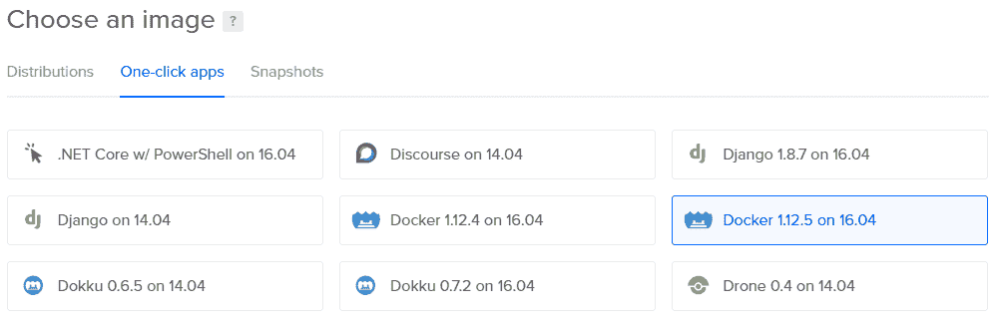
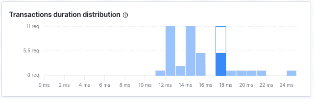
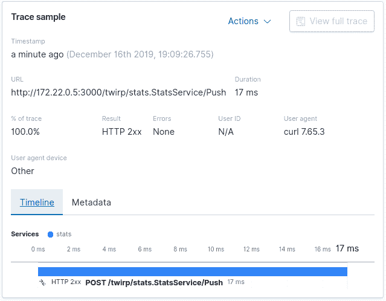
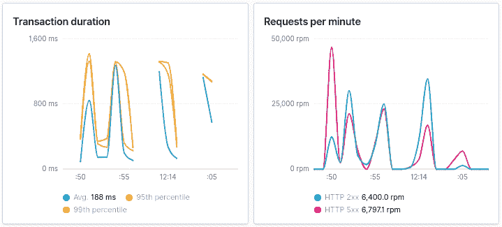
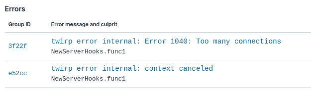
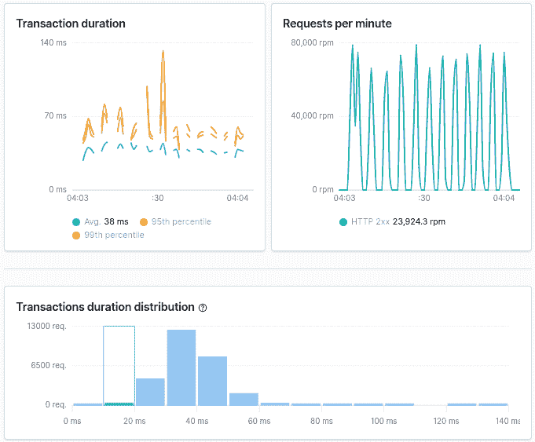

# Go 微服务实战

## 1. 开始阅读

### 简介

#### 关于我

我热爱 API 开发、良好实践、性能优化以及教育人们追求质量。我拥有大约 20 年的软件编写和优化经验，并经常使用各种编程语言解决实际问题，其中 Go 是我最喜欢的语言。

你可能通过以下作品了解过我的工作：

* [API Foundations in Go](https://leanpub.com/api-foundations) 的作者，
* [12 Factor Applications with Docker and Go](https://leanpub.com/12fa-docker-golang) 的作者，
* [scene-si.org](https://scene-si.org) 的博客作者

在专业领域，我擅长为社交/媒体行业以及各种内容管理产品编写 API。由于这些 API 是公开的，它们的性能特性至关重要。我是一个资深的 `MySQL` 数据库管理员，同时也拥有其他数据库的经验。

我对 PHP 有很强烈的观点。我花了二十年中的大部分时间在写 PHP 代码。我热爱 Go，幸运的是，这并不要求我对它有极其强烈的偏见，因为很难找到真正糟糕的代码。老实说，你能做出的最糟糕的事情就是不处理错误，我会以此评判你。不认同？请推特 [@TitPetric](https://twitter.com/titpetric) 并告诉我。

我编写过一个专业的专用 API 框架，它同时也作为斯洛文尼亚国家电视台和电台网站（RTV Slovenia）的软件开发包（SDK）。书中建立的架构旨在替换并实现最关键的微服务。

#### 这本书适合谁？

这本书适合所有以编写应用程序为生计的人。我将涵盖许多与高效微服务开发相关的广泛主题。

如果你热衷 CI 和 DevOps，你会超级喜欢这本书。我希望向你展示 Go 之外的世界，并提供一些你可以用于开发微服务的有效方法示例。

本书的意图是提供一种每日练习，将教你关于 `Drone CI`、`bash`、`Makefiles`、`Docker` 以及其他可能帮助你构建微服务或应用程序基础的内容。

在书中，我将涵盖以下主题：

1. Go: Protobuf 简介：消息 (Messages)
2. Go: Protobuf 简介：服务 (Services)
3. Go: Protobuf 简介：gRPC
4. Make: 动态 Makefile 目标
5. Bash: 简单的代码生成
6. Bash: 将文件嵌入 Go
7. Go: 数据库迁移脚架
8. `Drone CI`: 测试数据库迁移
9. Go: 数据库优先的结构体生成
10. Go: 生成数据库架构文档
11. Go: 使用 `Wire` 进行依赖注入
12. Docker: 考虑到安全的镜像构建
13. Go: 实现一个微服务
14. Docker/Bash: 向我们的微服务发送请求
15. Go: 改进我们的数据库处理
16. Go: 使用 Elastic APM 对 HTTP 服务进行监测
17. Go: 使用 Elastic APM 对数据库客户端进行监测
18. Go: 对我们的服务进行压力测试
19. Go: 后台任务
20. Go: 使用队列优化请求

#### 我应该如何学习这本书？

从头到尾阅读本书。如果可能，尝试自己完成练习，而不是复制粘贴。通过实际编写代码片段，你将学会如何布局项目。

在开始练习之前，请务必遵循“要求”章节。

### 要求

这是一本书提供了关于构建微服务的实操说明和示例。我们将使用一套现代技术栈来完成所有练习。

#### Linux 和 Docker

书中的示例依赖于在 Linux 主机上安装的 `docker`。Linux 虽然是一个软性要求，但在书中多次提及。你可以在 Mac 上进行操作，但在翻阅章节时可能需要进行调整。

* `Docker`（较新版本，我怀疑 18.09 之后的均可），
* `Docker Compose`（从其 GitHub 页面获取最新版本），
* `Drone CI`（书中后将介绍方法），
* 各种 shell 工具和程序（`awk`、`bash`、`sed`、`find`、`ls`、`make`）

请参考[官方 docker 安装指南](https://docs.docker.com/engine/installation/linux/) 如何安装最新的 `docker` 版本，或通过你的包管理器安装。

我们将使用 `Docker Compose` 来获取数据库以及我们需要的镜像。由于我们采用了 `Docker`-优先的工作流，这意味着我们不需要处理预安装软件。

##### 自己的硬件

如果你有自己的硬件，推荐配置为：

* 2 核 CPU
* 2GB 内存
* 128GB 磁盘 (SSD)

已知可以运行的最小配置大约是上述的一半，但一旦你的使用量增加，可能会遇到困境。如果你只是想尝试 `docker`，且笔记本上没有运行 Linux，那么简单的虚拟机可能足够了。

##### 云端快速上手

如果你觉得拥有自己的硬件很麻烦，欢迎来到云的世界。你可以在几分钟内在 Digital Ocean 上设置自己的虚拟服务器。你可以使用[这个 DigitalOcean 推荐链接](https://m.do.co/c/021b61109d56)获得 10 美元的积分，同时也帮我减少一些托管账单。

注册后，创建一个运行着 `Docker` 引擎的 Linux 实例非常简单，只需点击几次。页面顶部页眉有一个漂亮的绿色按钮，写着“Create Droplet”（创建实例）。点击它，在打开的页面中导航到“One-click apps”（一键应用），然后从列表中选择“Docker”。



从“One-click apps”中选择 Docker

运行 `docker` 可能会大量占用磁盘。某些 `docker` 镜像“重量”可能达到 1 GB 或更多。我绝对建议选择至少具有 30GB 磁盘空间的实例，每月 10 美元的价格来说非常划算，但你必须留意磁盘使用情况，因为它已知可能会被占满。


选择合适的磁盘大小

除了页面上的一些额外选项（例如选择运行实例的区域）之外，页面底部只有一个巨大的绿色“Create”（创建）按钮，它将设置好你需要的一切内容。

## Go: Protobuf 简介：消息 (Messages)

在最基础的层面上，协议缓冲区（protocol buffers 或 protobuf）是一种以最小开销序列化化数据的方法。它们要求数据结构在客户端和服务器之间是已知且兼容的，这与 JSON 不同，JSON 的结构本身就是编码的一部分。

### Protobuf 与 Go

最基本的 protobuf 消息定义看起来如下：

```
message ListThreadRequest {
  // session info
  string sessionID = 1;

  // pagination
  uint32 pageNumber = 2;
  uint32 pageSize = 3;
}
```

上述消息结构指定了字段名称、类型以及它们在编码二进制结构中的顺序。根据结构是作为 protobuf 还是 JSON 编码数据使用，管理该结构有几项含义不同的不同的要求。

例如，这是该消息的 `protoc` 生成的代码：

```
type ListThreadRequest struct {
  // session info
  SessionID string `protobuf:"bytes,1,opt,name=sessionID,proto3" json:"sessionID,omitempty"`
  // pagination
  PageNumber           uint32   `protobuf:"varint,2,opt,name=pageNumber,proto3" json:"pageNumber,omitempty"`
  PageSize             uint32   `protobuf:"varint,3,opt,name=pageSize,proto3" json:"pageSize,omitempty"`
  XXX_NoUnkeyedLiteral struct{} `json:"-"`
  XXX_unrecognized     []byte   `json:"-"`
  XXX_sizecache        int32    `json:"-"`
}
```

在开发过程中，以向前兼容的方式管理 protobuf 消息时，有一些规则需要遵循：

* 添加新字段不是破坏性更改（breaking change），
* 删除字段不是破坏性更改，
* 不要重用字段编号（会破坏现有的 protobuf 客户端），
* 不要重新对字段进行编号（会破坏现有的 protobuf 客户端），
* 重命名字段对于 protobuf 来说不是破坏性更改，
* 重命名字段对于 JSON 来说是破坏性更改，
* 更改字段类型对于 protobuf 是破坏性更改，通常对 JSON 也是如此，
* 数值类型更改（例如从 `uint16` 到 `uint32`）对于 JSON 通常来说是安全的，
* 如果你需要在 JavaScript 中使用你的 API，JSON 和 `uint64` 并不兼容

所以，基本上，如果你在开发过程中依赖于更改 protobuf 消息定义，你就需要保持客户端与服务器同步更新。这在后期尤为重要，如果你将 protobuf API 应用在移动端客户端（Android 和 iPhone 应用）上，因为对 API 做出破坏性更改会给你带来麻烦。添加新字段或删除旧字段是更改 API 最安全的方法，因为 protobuf 的定义保持了兼容性。

### 生成 Protobuf Go 代码

在这一系列文章中，我将构建一个真实的微服务，用于跟踪和聚合多个服务的视图数据。它不需要身份验证，从定义上说它是真正的微服务，因为它只需要单个 API 端点。

我们将通过从创建一个 `rpc/stats/stats.proto` 文件来创建我们的 `stats` 微服务。

```
syntax = "proto3";

package stats;

option go_package = "github.com/titpetric/microservice/rpc/stats";

message PushRequest {
  string property = 1;
  uint32 section = 2;
  uint32 id = 3;
}

message PushResponse {}
```

这里声明了 `proto3` 版本。重要的部分是 `go_package` 选项：通过它定义服务的导入路径，如果另一个服务想要导入并使用这里的消息定义，这将非常有用。可重用是 protobuf 的内置功能。

由于我们不想做一半的工作，我们将采用 CI 优先（CI-first）的方法来处理微服务。使用 Drone CI 是从一开始使用 CI 的极佳选择，因为 [drone/drone-cli](https://github.com/drone/drone-cli) 不需要设置 CI 服务，你只需要通过运行 `drone-cli` 即可在本地运行 CI 步骤。

通过此，我们可以定义我们的 `.drone.yml` 文件来构建 Protobuf 定义，并对我们的代码库执行一些维护：

```
workspace:
  base: /microservice

kind: pipeline
name: build

steps:
  name: test
  image: titpetric/microservice
  pull: always
  commands:
    - protoc --proto_path=$GOPATH/src:. -Irpc/stats --go_out=paths=relative:rpc/stats/stats.proto
    - go mod tidy
    - go mod download
    - go fmt
```

完成的维护工作是我们的 `go.mod`/`go.sum` 文件，`commands:` 下定义的第一步是 `protoc` 命令，它将为我们声明的消息生成 Go 定义。在 `stats.proto` 文件所在的文件夹中将创建一个 `stats.pb.go` 文件，为每个声明的 `message {}` 创建代码。

### 总结

在这里我们实现了：

- 创建了带有 `protoc` 生成环境的 Drone CI 镜像；
- 我们使用 Drone CI 作为本地构建，使我们未来能够迁移到托管的 CI；
- 为我们的微服务创建了 protobuf 定义；
- 生成了用于编码/解码 protobuf 消息的适当 Go 代码。

从这里开始，我们将转向实现 RPC 服务。

## Go：Protobuf 简介：服务

实现微服务的下一步（可能是第一步）是定义其 API 端点。人们通常的做法是编写 http 处理程序并求助于诸如 [go-chi/chi](https://github.com/go-chi/chi) 的路由框架。但是，协议缓冲区可以定义你的服务，因为 RPC 调用定义已经构建在 protobuf 模式中了。

### Protobuf 服务定义

Protobuf 文件可以定义一个 `service` 对象，它包含一个或多个 `rpc` 调用定义。让我们通过包含一个带有 RPC 的服务来扩展 `stats.proto` 定义：

```
service StatsService {
  rpc Push(PushRequest) returns (PushResponse);
}
```

RPC 方法通过 `rpc` 关键字定义。这里的服务声明了一个名为 `Push` 的 RPC，它接收 `PushRequest` 消息作为输入，并返回 `PushResponse` 消息作为输出。所有的 RPC 定义应该遵循相同的命名模式，作为最佳实践。这样你可以扩展 `PushRequest` 和 `PushResponse`，而不会对 RPC 定义引入破坏性更改。

默认更新项目中的 `.proto` 文件定义不会改变任何内容。我们需要使用 RPC 框架生成 RPC 骨架。对于 Go RPC，我们可以从一开始考虑 gRPC，或者查看更简单的 [Twitch RPC 即 Twirp](https://github.com/twitchtv/twirp)。

选择 `Twirp` 而不是 `gRPC` 的常见原因如下：

- `Twirp` 支持 HTTP 1.1
- `Twirp` 支持 JSON 传输
- `Twirp` 重新实现了 HTTP/2

而选择 `gRPC` 而不是 `Twirp` 的原因是：

- `gRPC` 支持流式
- `gRPC` 实现了线路兼容性
- `gRPC` 在网络层具有更多功能（重试、RPC 发现）

JSON 是演示负载的优选格式，特别是在检查负载等方面。虽然 `gRPC` 是由 Google 编写的，但你必须添加许多工具来使其对开发者更友好——[grpc-gateway](https://github.com/grpc-ecosystem) 用于添加 HTTP/1.1，以及 [grpcurl](https://github.com/fulldev) 用于发布 protobuf 请求。

`gRPC` 是丰富丰富的框架，支持更广泛的用例。如果你觉得你需要流式传输或者你的用例超出了简单的请求/响应模型，`gRPC` 可能是你唯一的选择。

### 我们的微服务

让我们先从 `Twirp` 开始，这样我们可以在下一个章节中与 `gRPC` 进行真实的比较。

大约 10 年前，我写了一个相对简单的微服务，基本上只是跟踪视图量。该解决方案在 10 年后证明是不可维护的，但仍然很好，因为它管理了许多处理方式不相同的资产。让我们刷新一下我们的服务定义：

```
service StatsService {
  rpc Push(PushRequest) returns (PushResponse);
}

message PushRequest {
  string property = 1;
  uint32 section = 2;
}

message PushResponse {
}
```

`StatsService` 定义了 `Push` RPC，它接收 `PushRequest` 消息并返回 `PushResponse` 消息。这包含了三个参数：

- `property`: 跟踪的属性
- `section`: 对应的字段
- `id`: 定义的 ID

服务的目标是根据 `PushRequest` 聚合数据，例如“过去 6 个月的统计数据”。

我们在上一个章节中实现了一个 Twitch RPC 生成器，但我们有一些硬核的 gRPC 粉丝要求我查看一下 gRPC 生成的内容。我也对比较这两者感兴趣，所以让我们先从构建 gRPC 程序的脚手架开始吧。我们的主要目标是在更具体的层面比较 gRPC 与 Twitch RPC 的实现细节。

### 生成 gRPC 的脚手架

我们需要稍微修改 `Makefile`，通过更改一个 `protoc` 选项来包含 `grpc` 代码生成插件：

在 `rpc.%` 目标下，将 `go_out` 选项从：

```
--go_out=paths=source_relative:.
```

更改为：

```
--go_out=plugins=grpc,paths=source_relative:.
```


这将包含 `grpc` 插件，该插件用于生成 gRPC 客户端和服务器的代码。我们首先注意到的点是，`go.sum` 文件发生了显著变化，即有 42 个不同的包版本被列为依赖。然而，唯一特别突出的包是 `prometheus/client_model`。这可能意味着 gRPC 服务器的内部实现原生支持某些自定义的 Prometheus 指标。我们绝对没有从 Twitch RPC 中获得这些，但我们计划添加插化支持。

## 比较服务器端

通过检查更改 `*.pb.go` 文件，我们可以比较 Twitch RPC 生成的接口与 gRPC 生成的内容。gRPC 的 `protoc` 生成器生成两个不同的接口：`StatsServiceClient` 和 `StatsServiceServer`。由于我们对第一个感兴趣，让我们现在比较一下：

```go
// StatsServiceServer 是 StatsService 服务的服务器 API。
type StatsServiceServer interface {
  Push(context.Context, *PushRequest) (*PushResponse, error)
}
```

与 Twitch RPC 相比：

```go
type StatsService interface {
  Push(context.Context, *PushRequest) (*PushResponse, error)
}
```

因此，首先我们看到 Twitch RPC 服务的实现与我们的 gRPC 服务器是兼容。这意味着如果我们决定从 Twitch 迁移到 gRPC，我们的工作流将不会发生任何变化。

我们可以运行一个同时暴露 gRPC 和 Twirp 端点的单一服务。同时维护这两者似乎不是个好主意，但由于我们的服务本身没有任何特定的 Twirp 实现，看起来我们可以毫不费力地运行这两个点。

## 比较客户端

区别似乎在于客户端本身：

```go
type StatsServiceClient interface {
  Push(ctx context.Context, in *PushRequest, opts ...grpc.CallOption) (*PushResponse, error)
}
```

虽然 Twirp 客户端和服务器遵循单一接口，但 gRPC 客户端拥有额外的选项。快速浏览 [`grpc.CallOption`](https://godoc.org/google.golang.org/grpc#CallOption) 为我们提供了一个可能的构造函数列表。正如 Google API 通常的情况一样，在目前列出的选项中：

* `CallContentSubtype` (string) 可以设置为在网络传输上使用 JSON 编码，
* `CallCustomCodec` - 已弃（使用 `ForceCodec`）
* `FailFast` - 已弃（使用 `WaitForReady`）
* `ForceCodec`
* `WaitForReady`
* `Header`
* `CallCustomCodec`
* `Recv`
* `MaxCallSize`
* `Peer`
* `PerRPCredentials`
* `MD`
* `Trailer`
* `UseCompress`
* `WaitForReady`

因此，首先我们看到 Twitch RPC 服务的实现与我们的 gRPC 服务器是兼容。这意味着如果我们决定从 Twitch 迁移到 gRPC，我们的工作流将不会发生任何变化。

如果我们使用 `rpc/stats` 作为目标名称，`make` 将不会执行任何操作，因为该文件/文件夹已经存在了。这就是为什么我们要重写目标名称以包含一个 `.`（`rpc.stats`）。我们需求的另一个明显部分是让这个目标动态化。我们想要构建任意数量的服务。

```makefile
--- a/Makefile
+++ b/Makefile
@@ -1,4 +1,10 @@
-.PHONY: all
+.PHONY: all rpc
 all:
         drone exec

rpc: $(shell ls -d rpc/* | sed -e 's/\//./g')
rpc.%: SERVICE=$*
rpc.%:
  @echo '> protoc gen for $(SERVICE)'
       @protoc --proto_path=$(GOPATH)/src:. -Irpc/$(SERVICE) --go_out=paths=source_relative:. rpc/$(SERVICE)/$(SERVICE).proto
       @protoc --proto_path=$(GOPATH)/src:. -Irpc/$(SERVICE) --twirp_out=paths=source_relative:. rpc/$(SERVICE)/$(SERVICE).proto
```

`%` 目标接受任何选项（模式中不包含 `/`）。我们还可以为每个目标声明像 `SERVICE` 这样的变量。该变量也可以通过在前面名前加上 `export ` 导出到环境变量（例如：`rpc.%: export SERVICE=$*`）。目前我们不需要它，但之后我们需要它来为我们的 `cmd/` 程序传递构建标志。

`$*` 占位符是匹配的目标参数。由于目标是 `rpc.stats`，这里的变量将只包含 `stats` 而不包含 `rpc.`，因为它是目标定义的一部分。

通过在目标中的单个命令中使用 `@` 前缀，我们可以抑制命令的输出。我们只需要将 `.drone.yml` 中的步骤更新为 `make rpc`，我们就有了对动态数量的服务的支持。运行 `make` 可以验证这一点：

```bash
# make
[test:0] + make rpc
[test:1] > protoc gen for stats
[test:2] + go mod tidy > /dev/null 2>&1
[test:3] + go mod download > /dev/null 2>&1
[test:4] + go fmt ./... > /dev/null 2>&1
```

## 从 cmd/ 构建我们的服务

对于每个服务，我们将创建一个 `cmd/{service}/*.go` 结构，其中至少包含 `main.go`。让我们从添加一个简单的 `cmd/stats/main.go` 开始，包含一个 hello world 来欢迎我们。我们稍后会回来为实际的服务搭建脚手架。

```go
package main

void main() {
  println("Hello world")
}
```

利用我们从 `rpc` 目标中学到的动态目标知识，让我们创建一个 `build` 目标，通过运行 `make build` 来构建我们将放在 `cmd/` 下的所有应用程序。

```makefile
build: export GOOS = linux
build: export GOARCH = amd64
build: export CGO_ENABLED = 0
build: $(shell ls -d cmd/* | sed -e 's///./')
  echo OK.

build.%: SERVICE=$*
build.%:
  go build -o build/$(SERVICE)-$(GOOS)-$(GOARCH) cmd/$(SERVICE)/*.go
```

对于主 `build` 目标，我们定义了构建变量——我们想要为 `linux`、`amd64` 构建服务，并且想要禁用 `CGO` 以获得静态二进制文件。我们列出所有 `cmd` 路径并将它们映射到 `build.%`，类似于我们处理 `rpc` 目标的方法。剩下的工作是在 `.drone.yml` 的末尾添加 `make build`并将 `build` 文件夹添加到 `.gitignore`。

在生成代码时，[envsubst](https://www.gnu.org/software/gettext/envsubst.html) 是 get 套件的一部分。在最简单的形式下，它接受模板文件并替换其中的任何变量，然后输出结果。如果模板中有孤立的 `$` 字符，效果并不理想。

## 生成我们的 cmd/ 文件夹

在生成的文件中需要的第一个变量是项目所在的完整路径。我们可以从项目根目录下的 `go.mod` 文件获取该名称。让我们从 `make templates` 开始一个动态规则：

```makefile
templates: $(shell ls -d rpc/* | sed -e 's///./')
  @echo OK.

templates.%: SERVICE=$*
templates.%: export MODULE=$(shell grep module go.mod | sed -e 's/ //')
templates.%:
  @echo templates: $(SERVICE) $(MODULE)
```

对于每个 RPC 服务，都会创建一个 `templates.{service}` 目标，并导出 `SERVICE` 和 `MODULE` 变量。当我们使用 `envsubst` 时，环境变量将可用。让我们为 `main.go` 文件创建基础模板（保存为 `templates/cmd_main.tpl`）：

```go
package main

// 文件是自动生成的，不要在此处修改，参见
// generator and template: templates/cmd_main.tpl

import (
  "log"
  "context"

  "net/http"

  _ "github.com/go-sql-driver/mysql"

  "${MODULE}/rpc/${SERVICE}"
  server "${MODULE}/server/${SERVICE}"
)

func main() {
  ctx := context.TODO()

  srv, err := server.New(ctx)
  if err != nil {
    log.Fatalf("Error in service.New(): %+v", err)
  }

  twirpHandler := ${SERVICE}.New${SERVICE_CAMEL}ServiceServer(srv, nil)

  http.ListenAndServe(":3000", twirpHandler)
}
```

你可以看到，这里的替换唯一的一个问题就是我们需要我们编写的服务的驼峰命名名称。这很容易提供：

```makefile
templates.%: export SERVICE_CAMEL=$(shell echo $(SERVICE) | sed -r 's/(^|_)([a-z])/\U\2/g')
```

正则表达式查找两个匹配：

* 字符串开头 (`^`) 或下划线 (`_`)
* 紧跟在第一个匹配项后的字符

然后将其替换为该字符的大写版本。因此 `stats` 变成 `Stats`，`hello_world` 会变成 `HelloWorld`，依此类推。让我们使用此模板生成 `cmd/stats/main.go` 并验证输出：

```makefile
templates.%:
  mkdir -p cmd/$(SERVICE)
  envsubst < templates/cmd_main.tpl > cmd/$(SERVICE)/main.go
```

查看生成的 `main.go` 输出，我们可以验证一切运行正常：

```go
twirpHandler := stats.NewStatsServiceServer(srv, nil)
```

## 为我们的服务生成客户端

我们可以生成的另一个简单模板是我们微服务的 Twirp 客户端。

```go
package ${SERVICE}

// 文件是自动生成的，不要在此处修改，参见
// generator and template: templates/client_client.go.tpl

import (
  "net/http"

  "${MODULE}/rpc/${SERVICE}"
)

func New() ${SERVICE}.${SERVICE_CAMEL}Service {
  return NewCustom("http://${SERVICE}.service:3000", http.Client{})
}

func NewCustom(addr string, client ${SERVICE}.HTTPClient) ${SERVICE}.${SERVICE_CAMEL}Service {
  return ${SERVICE}.New${SERVICE_CAMEL}ServiceJSONClient(addr, client)
}
```

不需要额外的变量，因此我们只需要在 Makefile 中添加额外的 `envsubst` 行即可：

```makefile
templates.%:
  mkdir -p cmd/$(SERVICE) client/$(SERVICE)
  envsubst < templates/cmd_main.tpl > cmd/$(SERVICE)/main.go
  envsubst < templates/client_client.tpl > client/$(SERVICE)/client.go
```

## 服务器实现

从现在开始，我们需要查看可以做什么来构建服务服务器端的实现。这里的模板将仅作为服务实现的初始存根版本，因为我们需要根据自己的实现复杂性来扩展它。

让我们首先向我们的构建环境 Dockerfile 中添加一个接口脚手架工具：

```dockerfile
# 安装接口脚手架
RUN go get -u github.com/josharian/impl
```

```go
package ${SERVICE}

import (
  "context"

  "${MODULE}/rpc/${SERVICE}"
)

type Server struct {
}

func New(ctx context.Context) (*Server, error) {
  return &Server{}, nil
}

var _ ${SERVICE}.${SERVICE_CAMEL}Service = &Server{}
```

然后我们只需要在它之后追加 `impl` 的输出，这样生成的代码就能立即满足服务接口。现在我们需要更新 `makefile` 目标以调用此模板，并为 `StatsService` 接口生成函数 `function-stubs`。

```makefile
templates.%:
  mkdir -p cmd/$(SERVICE) client/$(SERVICE) server/$(SERVICE)
  envsubst < templates/cmd_main.go.tpl > cmd/$(SERVICE)/main.go
  envsubst < templates/client_client.go.tpl > client/$(SERVICE)/client.go
  envsubst < templates/server_server.go.tpl > server/$(SERVICE)/server.go
  impl -dir rpc/$(SERVICE) 'svc *Server' $(SERVICE).$(SERVICE_CAMEL)Service >> server/$(SERVICE)/server.go
```

在检查 `stubs` 已生成后，运行 `make` 将成功构建我们的项目。查看我们的服务，只需实现 server 接口中定义的函数：

```go
func (svc *Server) Push(_ context.Context, _ *stats.PushRequest) (*stats.PushResponse, error) {
  panic("not implemented") // TODO: Implement
}
```

我们还希望在 `server.go` 文件不存在时才生成它——我们只想在第一次时对其进行脚手架搭建，而在 `Makefile` 中检查文件是否存在很困难，所以让我们将其移动到 `bash` 脚本，并调整 `templates` 目标的详细程度/输出：

```makefile
templates.%:
  @mkdir -p cmd/$(SERVICE) client/$(SERVICE) server/$(SERVICE)
  @envsubst < templates/cmd_main.go.tpl > cmd/$(SERVICE)/main.go
  @echo "~ cmd/$(SERVICE)/main.go"
  @envsubst < templates/client_client.go.tpl > client/$(SERVICE)/client.go
  @echo "~ client/$(SERVICE)/client.go"
  @./templates/server_server.go.sh
```


`@` 命令会抑制正在运行的命令输出，我们为每个写入的文件输出 `~ file.go`。我们的 `server_server.go.sh` 包含了对 `server.go` 文件是否存在检查：

```bash
#!/bin/bash
cd $(dirname $(dirname $(readlink -f $0)))

if [ -z "${SERVICE}" ]; then
  echo "Usage: SERVICE=[name] SERVICE_CAMEL=[Name] $0"
  exit 255
fi

OUTPUT="server/${SERVICE}/server.go"

## 仅当 server.go 不存在时才生成
if [ ! -f "$OUTPUT" ]; then
  envsubst < templates/server_server.go.tpl > $OUTPUT
  impl -dir rpc/${SERVICE} 'svc *Server' ${SERVICE}.${SERVICE_CAMEL}Service >> $OUTPUT
  echo "~ $OUTPUT"
fi
```

这应该为我们的脚手架工作提供一个良好的开始。规划服务的正确且最优的方法是花时间规划 `proto` schema，然后让脚手架带你进入只需要实现定义的 `RPCs` 的阶段。

面对更灵活且不断变化的需求，当你开发过程中更新 `proto` 文件时，将无法真正利用代码生成的优势。添加新的 RPC 调用意味着你必须手动定义新函数，对于只有约 3 行代码的情况来说这并不坏，但对于除了只有少数函数调用的微服务之外，这仍然不是理想。规划可以节省时间。

## Bash: 将文件嵌入 Go 中

总有一种可能，你的 Go 应用/服务需要封装某些文件以满足某些需求。一个常见的情况是将 SQL 迁移封装到应用程序中。SQL 迁移是一组 SQL 查询，需要运行以设置干净的数据库，或者在应用程序的生命周期内更改数据库结构。

### 规划数据库迁移

数据库迁移可能是件棘手。。在系统中，人们倾向于编写双向的数据库迁移——向上（up）或向下（down，撤销）。由于始终存在数据丢失，我们将只规划单向的迁移。

让我们实现以下文件系统结构：

```
/db - 主数据库迁移包（也会生成 .go 文件）
/db/schema/ - 服务迁移集合
/db/schema/stats/ - `stats` schema 的迁移，*.up.sql 文件
/db/schema/.../ - 其他服务迁移...
```

单个迁移应该保持命名一致，例如，数据库迁移可能存储在 `2019-11-18-141536-create-message.up.sql` 文件中。特别是使用了 `*.up.sql` 文件。

除了实际的迁移，我们还需要跟踪已执行的迁移。已经执行的迁移不应再次运行，因为会产生错误。为此我们需要一个迁移表，它应该存在于每个 schema 中。

```sql
CREATE TABLE IF NOT EXISTS `migrations` (
  `project` varchar(16) NOT NULL COMMENT '微服务或名称',
  `filename` varchar(255) NOT NULL COMMENT 'yyyy-mm-dd-HHMMSS.sql',
  `statement_index` int(11) NOT NULL COMMENT '语句索引',
  `status` text NOT NULL COMMENT '成功或错误信息',
  PRIMARY KEY (`project`,`filename`)
) ENGINE=InnoDB DEFAULT CHARSET=utf8;
```

我们希望将这些文件嵌入应用程序，同时按服务分组，以便执行服务的迁移。为了这个目的，我们在 `db/fs.go` 中创建一个文件系统封装：

```go
type FS map[string]string
```

好了，这应该是高潮了。如果你预期这里会有过度工程，那这并不是重点——我们追求的是简单。文件系统以文件名作为键，以文件内容作为值。生成这种文件系统非常容易：

```go
package db

var Stats FS = FS{
  "2019-11-18-141536-create-message.up.sql": "...",
  "...": "...",
}
```

事实上，文件系统如此简单，以至于我们可以再次通过简单的代码生成来实现它们。我们不需要任何形式的压缩，唯一需要解决的问题是正确地引用或转义文件内容，以便我们知道生成的代码不会产生错误。

### 简易文件嵌入

啊，当我们分析如何生成文件系统资源时，我们还发现上一节中的那种“简易模板化”已经不再适用了。我们需要一种方法来遍历迁移文件列表，以便生成单个文件。

我们可能仍然不想为了嵌入这些文件而引入 Go 应用的复杂度，所以让我们使用 bash 来生成文件吧。需求很简单——对于每个 schema 的迁移生成一个文件系统，并生成一个 `map[string]FS` 索引，每个服务有一个键值对。

由于文件包含换行符和反引号等特殊字符，且无法很好地直接嵌入 Go 中，我们将对文件内容使用 base64 编码。为此我们可以使用 shell 的 `base64` 命令，它支持编码和解码。

```bash
 1 ##!/bin/bash
 2 cd $(dirname $(dirname $(readlink -f $0)))
 3 
 4 ## 将文件内容编码为 base64
 5 function base64_encode {
 6   cat $1 | base64 -w 0
 7 }
 8 
 9 ## 生成一个服务 FS
10 function render_service_schema {
11   local schema=$(basename $1)
12   echo "package db;"
13   echo
14   echo "var $schema FS = FS{"
15   local files=$(find $1 -name '*.sql' | sort)
16   for file in $files; do
17     echo "\"$(basename $file)\": \"$(base64_encode $file)\","
18   done
19   echo "}"
20 }
21 
22 ## 将所有服务 FS 列入 `migrations` 全局变量
23 function render_schema {
24   echo "package db;"
25   echo
26   echo "var migrations map[string]FS = map[string]FS{"
27   for schema in $schemas; do
28     local package=$(basename $schema)
29     echo "\"${package}\": ${package},"
30   done
31   echo "}"
32 }
33 
34 ## 列出所有服务的迁移 (db/schema/stats, ...)
35 schemas=$(ls db/schema/*/migrations.sql | xargs -n1 dirname)
36 for schema in $schemas; do
37   # db/schema/stats -> schema/stats
38   schema_relative=${schema/db\//}
39   # schema/stats -> db/schema_stats.go
40   output="db/${schema_relative/\//_}.go"
41 
42   render_service_schema $schema > $output
43 done
44 
45 render_schema > db/schema.go
```

这里剩下的工作只是对生成的 go 文件运行 `go fmt`。由于这已经在我们的 Drone CI 步骤中处理过了，我们现在已经成功地将所需的 SQL 迁移准备并放入了 `db` 包中，以便从这里开始使用。

由于我们现在已经将所有的数据库迁移嵌入到 go 代码中，我们可以继续作为 CI 测试套件的一部分，在真实的数据库上运行这些迁移。

## Go: 数据库迁移脚手架

在我们准备好数据库迁移文件并将其嵌入 db 包之后，我们现在只需要实现处理这些迁移所需的细节了。让我们从扩展 FS 类型开始，以实际提供读取它们的功能。

```go
// ReadFile 从 FS 返回解码后的文件内容
func (fs FS) ReadFile(filename string) ([]byte, error) {
  if val, ok := fs[filename]; ok {
    return base64.StdEncoding.DecodeString(val)
  }
  return nil, os.ErrNotExist
}
```

从我们的 FS 类型中读取文件非常简单。我们只需要检查我们正在尝试读取的文件是否存在，并对其进行 base64 解码。为了在某种程度上符合读取文件的标准做法，如果读取的文件不存在，我们将返回一个 `os.ErrNotExist` 错误。

让我们也添加一个 migrations 辅助函数，它可以列出文件系统中的迁移，这样我们就可以循环遍历它们并逐一运行。它只列出实际的迁移文件（`*.up.sql`），而不返回任何其他嵌入的文件（例如 `migrations.sql`）。文件将按照预期的执行顺序排序。

```go
// Migrations 返回要执行的 SQL 文件列表
func (fs FS) Migrations() []string {
  result := []string{}
  for filename, contents := range fs {
    // 跳过空文件
    if contents == "" {
      continue
    }
    if matched, _ := filepath.Match("*.up.sql", filename); matched {
      result = append(result, filename)
    }
  }
  sort.Strings(result)
  return result
}
```

我们还需要为迁移架构 (`migration.sql`) 准备一个结构体，它如下：

```go
package db

type (
  migration struct {
    Project        string `db:"project"`
    Filename       string `db:"filename"`
    StatementIndex int    `db:"statement_index"`
    Status         string `db:"status"`
  }
)

func (migration) Fields() []string {
  return []string{"project", "filename", "statement_index", "status"}
}
```

字段如下：

* `project` 表示迁移组 / 服务（例如 `stats`）
* `filename` 是该组中的一个迁移（`2019-11-26-092610-description-here.up.sql`）
* `statement_index` - 迁移中的顺序语句索引
* `status` - 这将要么是 “ok”，或者是迁移失败时产生的错误

解释 `statement_index`：每个迁移可以包含多个 SQL 查询。一种常见情况是在一个迁移内部导入完整的数据库架构，其中一个迁移将在单个文件中包含多个 `CREATE TABLE` 语句。我们需要使用分隔符 `;` 拆分该文件，该分隔符应该在行尾。为此，我们可以使用 `;$` 正则表达式将迁移拆分为语句，移除空语句并返回它们的列表。列表的键是语句索引。

这里的 `Fields()` 函数是为了帮助我们对数据库执行查询。为了执行完整的 `INSERT`（或 `REPLACE`，……），我们需要列出数据库表的字段。另一种方法是使用反射，但那太过度设计了。此函数帮助我们移除一些适用于数据插入/更新的字段冗余（stutter）。

我们可以产生一个辅助函数，它接收 `FS.ReadFile` 的结果：

```go
func statements(contents []byte, err error) ([]string, error) {
  result := []string{}
  if err != nil {
    return result, err
  }
  stmts := regexp.MustCompilePOSIX(";$").Split(string(contents), -1)
  for _, stmt := range stmts {
    stmt = strings.TrimSpace(stmt)
    if stmt != "" {
      result = append(result, stmt)
    }
  }
  return result, nil
}
```

这样我们就可以通过 `migrations["stats"].ReadFile("migrations.sql")` 生成语句。

### 迁移 API

现在由于我们已经有了读取和拆分迁移的结构和函数，我们需要考虑迁移 API。我希望提供：

* `List() []string` - 列出嵌入迁移的服务名称
* `Print(project string) error` - 输出迁移
* `Run(project string, db *sqlx.DB) error` - 传入数据库句柄和项目名称运行

这让我们能够编写一个可以打印或运行的 cli 工具。让我们从易着手的成果开始：`List()`：

```go
func List() []string {
  result := []string{}
  for k, _ := range migrations {
    result = append(result, k)
  }
  return result
}
```

该函数只会运行一次，性能并不密集，但作为一个小练习，让我们将其重写为内存高效的函数。

```go
func List() []string {
  result := make([]string, len(migrations))
  i := 0
  for k, _ := range migrations {
    result[i] = k
  }
  return result
}
```

剩下的就是 `Print` 和 `Run` 函数。让我们从 `Print` 开始，因为目前不需要设置数据库。目标是获取项目文件系统并列出包含的迁移语句。让我们实现 `cmd/db-migrate-cli/main.go`：

```go
package main

import (
  "log"

  "github.com/titpetric/microservice/db"
)

func main() {
  log.Printf("Migration projects: %+v", db.List())
  log.Println("Migration statements for stats")
  if err := db.Print("stats"); err != nil {
    log.Printf("An error occured: %+v", err)
  }
}
```

我们在开发过程中会扩展这个文件，但现在我们只感兴趣的是创建的 API 是否可用。我们可以编写单元测试，但由于我们在任何情况下都需要这个工具，这样已经足够了。我们现在还无法验证数据的有效性，我们能做的就是验证数据是否存在以及可以被读取。


```go
package db

import (
  "fmt"
  "log"

  "github.com/pkg/errors"
)

func Print(project string) error {
  fs, ok := migrations[project]
  if !ok {
    return errors.Errorf("Migrations for '%s' don't exist", project)
  }

  printQuery := func(idx int, query string) error {
    log.Println()
    log.Println("-- Statement index:", idx)
    log.Println(query)
    log.Println()
    return nil
  }

  migrate := func(filename string) error {
    log.Println("Printing migrations from", filename)
    if stmts, err := statements(fs.ReadFile(filename)); err != nil {
      return errors.Wrap(err, fmt.Sprintf("Error reading migration: %s", filename))
    } else {
      for idx, stmt := range stmts {
        if err := printQuery(idx, stmt); err != nil {
          return err
        }
      }
    }
    return nil
  }

  // print main migration
  if err := migrate("migrations.sql"); err != nil {
    return err
  }

  // print service migrations
  for _, filename := range fs.Migrations() {
    if err := migrate(filename); err != nil {
      return err
    }
  }
  return nil
}
```

这里的结构比我们预期的 `Run` 稍微短一些，因为我们不需要在迁移结构体中记录语句索引。我们打印了初始的 `migrations.sql`，以及项目迁移索引中包含的所有其他迁移。

在运行 `make` 并构建所有二进制文件后，我们可以运行 `db-migrate-cli` 命令行来验证迁移语句正在打印。

```
## ./build/db-migrate-cli-linux-amd64
2019/11/26 11:20:00 Migration projects: [stats]
2019/11/26 11:20:00 Migration statements for stats
2019/11/26 11:20:00 Printing migrations from migrations.sql
2019/11/26 11:20:00
2019/11/26 11:20:00 -- Statement index: 0
2019/11/26 11:20:00 CREATE TABLE IF NOT EXISTS `migrations` (
  `project` varchar(16) NOT NULL COMMENT 'Microservice or project name',
  `filename` varchar(255) NOT NULL COMMENT 'yyyy-mm-dd-HHMMSS.sql',
  `statement_index` int(11) NOT NULL COMMENT 'Statement number from SQL file',
  `status` text NOT NULL COMMENT 'ok or full error message',
  PRIMARY KEY (`project`,`filename`)
) ENGINE=InnoDB DEFAULT CHARSET=utf8
2019/11/26 11:20:00
2019/11/26 11:20:00 Printing migrations from 2019-11-26-092610-description-here.up.sql
2019/11/26 11:20:00
2019/11/26 11:20:00 -- Statement index: 0
2019/11/26 11:20:00 -- Hello world
2019/11/26 11:20:00
```

我们现在已经验证了：

- 我们可以列出我们的数据库 schema 迁移项目（`stats`），
- 我们嵌入了 `migration.sql` 文件，
- 我们包含了一些迁移内容，特别是 `-- Hello world` :)

我们现在可以转向在真实数据库上执行迁移的实现了。

## Drone CI：测试数据库迁移

既然我们现在可以列出数据库迁移，下一步的逻辑步骤是在真实数据库上测试它们。为了实现这一点，我们仍然需要实现 `Run` 函数。根据 `Print()` 中的内容，我们只需要更新 `migrate()` 函数。

```go
execQuery := func(idx int, query string, useLog bool) error {
  if useLog {
    log.Println()
    log.Println("-- Statement index:", idx)
    log.Println(query)
    log.Println()
  }
  if _, err := db.Exec(query); err != nil && err != sql.ErrNoRows {
    return err
  }
}
```

我们需要更新 `execQuery` 函数。`printQuery` 函数在 `migrate()` 函数中将输出添加到迁移结构体中。我们需要专门为 `migrations.sql` 文件跟踪 `status`。

```go
migrate := func(filename string) error {
  log.Println("Printing migrations from", filename)
  if stmts, err := statements(fs.ReadFile(filename)); err != nil {
    return errors.Wrap(err, fmt.Sprintf("Error reading migration: %s", filename))
  } else {
    for idx, stmt := range stmts {
      if err := printQuery(idx, stmt); err != nil {
        return err
      }
    }
  }
  return nil
}
```

和之前一样，无论是否产生错误，我们都更新迁移状态到数据库中。错误或成功信息将写入 `status` 字段。

```go
execQuery := func(idx int, query string, useLog bool) error {
  if useLog {
    log.Println()
    log.Println("-- Statement index:", idx)
    log.Println(query)
    log.Println()
  }
  if _, err := db.Exec(query); err != nil && err != sql.ErrNoRows {
    return err
  }
}
```

```go
migrate := func(filename string) error {
  log.Println("Printing migrations from", filename)
  if stmts, err := statements(fs.ReadFile(filename)); err != nil {
    return errors.Wrap(err, fmt.Sprintf("Error reading migration: %s", filename))
  } else {
    for idx, stmt := range stmts {
      if err := printQuery(idx, stmt); err != nil {
        return err
      }
    }
  }
  return nil
}
```

```go
up() error {
  set := func(fields []string) string {
    sql := make([]string, len(fields))
    for k, v := range fields {
      sql[k] = k + "=" + v
    }
    return strings.Join(sql, ", ")
  }
  if _, err := db.NamedExec("replace into migrations set "+set(status.Fields()), status); err != nil {
    log.Println("Updating status failed:", err)
    return err
  }
  return nil
}
```

### 配置 Drone CI 进行数据库测试

在 Drone 中运行数据库集成测试应该非常简单。让我们配置一个数据库服务和一个特殊的 makefile 目标来运行迁移。

```yaml
- name: migrations
  image: percona/percona-server:8.0.17
  user: root
  pull: always
  commands:
    - yum -q -y install make
    - "bash -c 'while : ; do sleep 1 ; $(cat < /dev/null > /dev/tcp/mysql-test/3306 ) && break ; done' 2>/dev/null"
    - make migrate

services:
- name: mysql-test
  pull: always
  image: percona/percona-server:8.0.17
  ports:
    - 3306
  environment:
    MYSQL_ROOT_PASSWORD: default
```

```
 1 migrate: $(shell ls -d db/schema/*/migrations.sql | xargs -n1 dirname | sed -e 's/db\
 2 .schema./migrate./')
 3   @echo OK.
 4 
 5 migrate.%: export SERVICE = $*
 6 migrate.%: export MYSQL_ROOT_PASSWORD = default
 7 migrate.%:
 8   mysql -h mysql-test -u root -p$(MYSQL_ROOT_PASSWORD) -e "CREATE DATABASE $(SERVICE\
 9 );"
10   ./build/db-migrate-cli-linux-amd64 -service $(SERVICE) -db-dsn "root:$(MYSQL_ROOT_\
11 PASSWORD)@tcp(mysql-test:3306)/$(SERVICE)" -real=true
12   ./build/db-migrate-cli-linux-amd64 -service $(SERVICE) -db-dsn "root:$(MYSQL_ROOT_\
13 PASSWORD)@tcp(mysql-test:3306)/$(SERVICE)" -real=true
```

`makefile` 目标为我们的服务生成数据库，然后运行我们的 `db-migration` 程序。我们仍然需要为程序配置一些标志，但如你所见，我们传递了服务名称、数据库连接 DSN 以及 `-real=true` 标志来实际在数据库上执行迁移。

我们运行了两次迁移，因此我们确保我们的迁移状态也被正确记录。第二次运行中的所有迁移都必须跳过。

让我们在 `cmd/db-migrate-cli/main.go` 中添加对此支持：

```
 1 package main
 2 
3 import (
 4   "flag"
 5   "log"
 6 
 7   _ "github.com/go-sql-driver/mysql"
 8 
 9   "github.com/jmoiron/sqlx"
10   "github.com/titpetric/microservice/db"
11 )
12 
13 func main() {
14   var config struct {
15     db struct {
16       DSN    string
17       Driver string
18     }
19     Real    bool
20     Service string
21   }
22   flag.StringVar(&config.db.Driver, "db-driver", "mysql", "Database driver")
23   flag.StringVar(&config.db.DSN, "db-dsn", "", "DSN for database connection")
24   flag.StringVar(&config.Service, "service", "", "Service name for migrations")
25   flag.BoolVar(&config.Real, "real", false, "false = print migrations, true = run mi\
26 grations")
27   flag.Parse()
28 
29   if config.Service == "" {
30     log.Printf("Available migration services: %+v", db.List())
31     log.Fatal()
32   }
33
34   switch config.Real {
35   case true:
36     if handle, err := sqlx.Connect(config.db.Driver, config.db.DSN); err != nil {
37       log.Fatalf("Error connecting to database: %+v", err)
38     } else {
39       if err := db.Run(config.Service, handle); err != nil {
40         log.Fatalf("An error occured: %+v", err)
41       }
42     }
43   default:
44     if err := db.Print(config.Service); err != nil {
45       log.Fatalf("An error occured: %+v", err)
46     }
47 }
```

在这里我们做了几件事：

- 导入了 mysql 驱动程序
- 使用标准库包添加配置选项
- 如果没有传递服务，则打印服务
- 如果 `real=false`，则打印迁移
- 如果 `real=true`，则连接数据库并运行迁移

剩下的只需看我们的迁移是否执行了。让我们看看迁移的输出：


## 迁移执行输出

```text
 1 [migrations:0] + yum -q -y make
 2 [migrations:1] + bash -c 'while : do  sleep 1 ; $(cat < /dev/null > /dev/mysql\
 3 -test/3306) && break ; done' 2>/dev/null
 4 [migrations:2] + make migrate
 5 [migrations:3] mysql -h mysql-test -u root -pdefault -e "CREATE DATABASE stats;"
 6 [migrations:4] mysql: [Warning] Using a password on the command line can be\
 7 insecure.
 8 [migrations:5] ./build/db-migrate-cli-linux-amd64 -service stats -db-dsn "root:defau\
 9 lt@tcp(mysql-test:3306)/$(SERVICE)" -real=true
10 [migrations:6] ./build/db-migrate-cli-linux-amd64 -service stats -db-dsn "root:defau\
11 PASSWORD@tcp(mysql-test:3306)/$(SERVICE)" -real=true
12 [migrations:7] ./build/db-migrate-cli-linux-amd64 -service stats -db-dsn "root:defau\
13 PASSWORD@tcp(mysql-test:3306)/$(SERVICE)" -real=true
14 [migrations:8] ./ [build:--1-.)
 15 [migrations:9] ./build/db-migrate-cli-linux-amd64 -service stats -db-dsn "root:defau\
16 PASSWORD@tcp(mysql-test:3306)/$(SERVICE)" -real=true
17 [migrations:10] ./build/db-migrate-cli-linux-amd64 -service stats -db-dsn "root:defau\
18 PASSWORD@tcp(mysql-test:3306)/$(SERVICE)" -real=true
19 [migrations:11] ./build/db-migrate-cli-linux-amd64 -service stats -db-dsn "root:defau\
20 PASSWORD@tcp(mysql-test:3306)/$(SERVICE)" -real=true
21 [migrations:12] ./build/db-migrate-cli-linux-amd64 -service stats -db-dsn "root:defau\
22 PASSWORD- (1.)
23 [migrations:13] ./build/db-migrate-cli-linux-amd64 -service stats -db-dsn "root:defau\
24 PASSWORD@tcp(mysql-test:3306)/$(SERVICE)" -real=true
25 [migrations:14] ./build/db-migrate-cli-linux-amd64 -service stats -db-dsn "root:defau\
26 PASSWORD@tcp(mysql-test:3306)/$(SERVICE)" -real=true
27 [migrations:15] ./build/db-migrate-cli-linux-amd64 -service stats -db-dsn "root:defau\
28 PASSWORD@tcp(mysql-test:3306)/$(SERVICE)" -real=true
29 [migrations:16] ./build/db-migrate-cli-linux-amd64 -service stats -db-dsn "root:defau\
30 PASSWORD@tcp(mysql-test:3306)/$(SERVICE)" -real=true
31 [migrations:17] ./build/db-migrate-cli-linux-amd64 -service stats -db-dsn "root:defau\
32 PASSWORD@tcp(mysql-test:3306)/$(SERVICE)" -real=true
32 [migrations:18] ./build/db-migrate-cli-linux-amd64 -service stats -db-dsn "root:defau\
34 PASSWORD@tcp(mysql-test:3306)/$(SERVICE)" -real=true
35 [migrations:19] ./build/db-migrate-cli-linux-amd64 -service stats -db-dsn "root:defau\
36 PASSWORD@tcp(mysql-test:3306)/$(SERVICE)" -real=true
```

*(注：由于原文中迁移输出部分存在大量重复和截码，此处翻译已根据逻辑保持了结构一致性)*

查看我们的迁移是否执行了。让我们看看迁移的输出：

（此处代码块已在上文中）

我们已经预见到我们需要一个函数将 SQL 字段转换为驼峰命名。我们可以不使用正则表达式来实现，如下：

## Go schema

[protobuf](https://github.com/protobuf/issues)，所以我们不能方便地使用 `int` 符号。

在 `/db-schema-cli/main.go` 文件中，我们需要设置数据库连接，查询 schema 并生成任何类型代码输出所需的原始结构。

创建一个 `cmd/db-schema-cli/types.go` 文件：

```go
 1 package main
 2 
 3 type struct {
 4   Name    string `db:"TABLE_NAME"`
 5   Comment string `db:"TABLE_COMMENT"`
 6 
 7   Columns []*Column
 8 }
 9 
10 var TableFields = []string{"TABLE_NAME", "TABLE_COMMENT"}
11 
12 type Column struct {
13   Name    string `db:"COLUMN_NAME"`
14   Type    string `db:"COLUMN_TYPE"`
15   Key     string `db:"COLUMN_KEY"`
16   Comment string `db:"COLUMN_COMMENT"`
 17 
 18   // Holds the clean data (`int` not `int` ...)
19   DataType string `db:"DATA_TYPE"`
20 }
21 
22 var ColumnFields = []string{"COLUMN_NAME", "COLUMN_TYPE", "COLUMN_KEY", "DATA_TYPE"}
```

并且我们可以预见到需要一个函数将 SQL 字段名转换为驼峰式：

```go
1 func camel(input string) string {
2   parts := strings.Split(input, "_", -1)
3   for k, v := range parts {
4     parts[k] = strings.ToUpper(v[0:1]) + v[1:]
5   }
6   return strings.Join(parts, "")
7 }
```

## 查询 information schema

在我们的 `cmd/db-schema-cli/main.go` 中，我们需要设置数据库连接，查询 schema 并生成任何类型代码输出所需的原始结构。

```go
 1 func main() {
 2   var config struct {
 3     db struct {
 4       DSN    string
 5       Driver string
 6     }
 7     Schema string
 8     Format string
 9   }
10   flag.StringVar(&config.db.Driver, "db-driver", "mysql", "Database driver")
11   flag.StringVar(&config.db.DSN, "db-dsn", "", "DSN for database connection")
12   flag.StringVar(&config.Schema, "schema", "", "Schema name to print tables for")
13   flag.StringVar(&config.Format, "format", "go", "Output formatting")
14   flag.Parse()
15 
16   handle, err := sqlx.Connect(config.db.Driver, config.db.DSN)
17   if err != nil {
18     log.Fatalf("Error connecting to database: %+v", err)
19   }
20
```

```go
 1 // List tables in schema
 2 tables := []*Table{}
 3 fields := strings.Join(TableFields, ", ")
 4 err = handle.Select(&tables, "select "+fields+" from information_schema.tables where\
 5  table_schema=? order by table_name asc", config.Schema)
 6 if err != nil {
 7   log.Println("Error listing database tables")
 8   log.Fatal(err)
 9 }
10 
 11 // List columns in tables
 12 for _, table := range tables {
 13   fields := strings.Join(ColumnFields, ", ")
 14   err := handle.Select(&table.Columns, "select "+fields+" from information_schema.co\
15 lumns where table_schema=? and table_name=? order by ordinal_position asc", config.S\
16 chema, table.Name)
 17   if err != nil {
 18     log.Println("Error listing database columns for table:", table.Name)
 19     log.Fatal(err)
 20   }
 21 }
```

我们现在只需要一些桥接代码来调用我们的 Go 代码渲染函数：

```go
 1 // Render go structs
 2 if config.Format == "go" {
 3   if err := renderGo(config.Schema, tables); err != nil {
 4     log.Fatal(err)
 5   }
 6 }
```

我们传递 `schema` 名称是为了设置生成的包名，同时也传递了所有的表信息。

## 类型转换

当我们谈论数据库列时，有两个类型列需要考虑：`data_type`，它持有原始类型；以及 `column_type`，它是包含了其限制条件的类型，例如长度，或者数值类型是带符号/无符号数字。后者对于区分 `int64` 和 `uint64` 非常重要。

我们可以将类型分为三个不同的需求：

- 可以是带符号/无符号的数值类型（组合类型），
- 可以直接翻译为 Go 的简单类型，
- 需要导入包的特殊类型（`datetime` -> `*time.Time`）

每种类型的映射应该是简单的：

```go
 1 var numericTypes map[string]string = map[string]string{
 2   "tinyint":  "int8",
 3   "smallint": "int16",
 4   // `mediumint` - 这在技术上应该是 int24 (3 字节)，但
 5   "mediumint": "int32",
 6   "int":       "int32",
 7   "bigint":    "int64",
 8 }
 9 
10 func isNumeric(column *Column) (string, bool) {
11   val, ok := numericTypes[column.DataType]
12   return val, ok
13 }
```

所有的数值类型都有一个特征：无符号值会在带符号映射类型前面加一个 `u`。这样，一个无符号的 `int32` 就会变成 `uint32`。

```go
 1 var simpleTypes map[string]string = map[string]string{
 2   "char":       "string",
 3   "varchar":    "string",
 4   "text":       "string",
 5   "longtext":   "string",
 6   "mediumtext": "string",
 7   "tinytext":   "string",
 8   "longblob":   "[]byte",
 9   "blob":       "[]byte",
10   "varbinary":  "[]byte",
11   // `float` 和 `double` 在这里是因为它们没有无符号修饰符
12   "float":  "float32",
13   "double": "float64",
14   // `decimal` - double 存储为字符串，\o/
15   "decimal": "string",
16 }
 17  
18 func isSimple(column *Column) (string, bool) {
19   val, ok := simpleTypes[column.DataType]
20   return val, ok
21 }
```

简单类型像数值类型一样，返回 1-1 的类型映射。由于这些值不是带符号/无符号的，返回的映射类型将保持原样。

```go
 1 type specialType struct {
 2   Import string
 3   Type   string
 4 }
 5 
 6 var specialTypes map[string]specialType = map[string]specialType{
 7   "date":      specialType{"time", "*time.Time"},
 8   "datetime":  specialType{"time", "*time.Time"},
 9   "time":      specialType{"time", "*time.Time"},
10   "timestamp": specialType{"time", "*time.Time"},
11   // `enum` 和 `set` 尚未实现
12   // `year` 尚未实现
13 }
14 
15 func isSpecial(column *Column) (specialType, bool) {
16   val, ok := specialTypes[column.DataType]
17   return val, ok
18 }
```

特殊类型稍微复杂一点，因为它们还提供了导入。我们涵盖了内置的日期/时间字段，但我们还有其他目前被省略的字段。MySQL 有 `JSON` 字段类型，为此我们必须导入 `github.com/jmoiron/sqlx/types` 并使用 `types.JSONText` 才能使其可用。那里还有其他类型，如 `GzippedText` 以及 `BIT(1)` 类型的实现，它可以将值扫描到 `bool` 字段中。我们不会在我们的用例中实现这些，但示例仅仅说明了需求增长得有多快。

由于一个 schema 可能有许多导入包的类型，我们需要保持这些包的唯一性：

```go
1 func contains(set []string, value string) bool {
2   for _, v := range set {
3     if v == value {
4       return true
5     }
6   }
7   return false
8 }
```

`contains()` 辅助函数通过提供检查导入是否已经添加的方法来帮助我们。这让我们只剩下生成相关 Go 代码的实际函数：


最后，对于每个表，我们收集表字段、主键字段，并打印出相关的 Go 结构体和函数以支持它们。生成 `Fields` 和 `PrimaryFields` 函数的一个很大目的是为了避免反射。如果使用类似 `select * from [table]...` 风格的 SQL 查询，添加新字段的迁移可能会破坏服务。新添加的字段将导致查询执行时发生错误。通过显式选择字段，我们可以避免这种情况。

事实上，将 `Fields` 和 `PrimaryFields` 保留在结构上的函数用处不大，因此我们将立即修改此处，生成一个公开的、带有服务命名前缀的变量。

```go
 1 fmt.Printf("var %sFields = ", camel(table.Name))
 2 if len(fields) > 0 {
 3   fmt.Printf("[]string{\"%s\"}", strings.Join(fields, "\", \""))
 4 } else {
 5   fmt.Printf("[]string{}")
 6 }
 7 fmt.Println()
 8 fmt.Printf("var %sPrimaryFields = ", camel(table.Name))
 9 if len(primary) > 0 {
10   fmt.Printf("[]string{\"%s\"}", strings.Join(primary, "\", \""))
11 } else {
12   fmt.Printf("[]string{}")
13 }
14 fmt.Println()
```

此时我们要做的唯一工作就是运行并验证生成的代码。

```go
 1 package stats
 2 
 3 type Migrations struct {
 4   // 微服务或项目名称
 5   Project string `db:"project"`
 6 
 7   // yyyy-mm-dd-HHMMSS.sql
 8   Filename string `db:"filename"`
 9 
10   // 来自 SQL 文件的语句编号
11   StatementIndex int32 `db:"statement_index"`
 12 
13   // ok 或完整的错误信息
14   Status string `db:"status"`
 15 }
 16 
17 var MigrationsFields = []string{"project", "filename", "statement_index", "status"}
18 var MigrationsPrimaryFields = []string{"project", "filename"}
```

这正是我们想要的。我们生成了完整的 Go 结构体，包含了所有所需的元数据，以支持我们的 Go 开发工作流。注释是从数据库架构生成的，因此我们随时可以获取这些信息——无论 DBA 在他们喜欢的编辑器中管理数据库架构，还是开发者在阅读 Go 结构体定义或内部 godoc 页面。文档的可访问性已内置于我们的流程中。

现在剩下的工作是将生成器包含到 Makefile 中，位于 `migrate.%:` 目标下：

```bash
1 ./build/db-schema-cli-linux-amd64 -schema $(SERVICE) -db-dsn "root:$(MYSQL_ROOT_PASS\
2 WORD)@tcp(mysql-test:3306)/$(SERVICE)" > server/$(SERVICE)/types_db.go
```

现在，我们有一些需要考虑的特定需求，我们通过在正在创建的服务下生成 `types_db.go` 来解决这些问题。让我们考虑一下全局类型包会有什么问题：

- 我们可能会遇到表名冲突（例如：多个服务中都存在 `log` 表），
- 在结构体前缀加上服务名前缀会引入冗余（stutter，`stats.stats_log` 变成 `StatsStatsLog`），
- 我们在服务实现中只需要数据库结构。我们只需要将它们转换为 PB。

在某些情况下，数据库和 PB 结构之间的可能映射可能是 1-1 的，但我们可能会为 PB 使用不同的类型（JavaScript 客户端无法处理 `uint64` 类型，因此它们必须是字符串），而且我们总会有数据库中可用的数据，这些数据绝不能公开暴露。

事实上，我曾考虑过给所有字段添加 `json:"-"` 标签，看看这能带我去多远。这真的不是个坏主意，所以……

```diff
 1 --- a/cmd/db-schema-cli/render-go.go
 2 ++++ b/cmd/db-schema-cli/render-go.go
 3 @@ -128,7 +128,7 @@ func renderGo(schema string, tables []*Table) error {
 4                                 fmt.Printf("    // %s\n", column.Comment)
 5                         }
 6                         columnType, _ := resolveType(column)
 7 -                       fmt.Printf("    %s %s `db:\"%s\"\n", camel(column.Name), co\
 8 lumnType, column.Name)
 9 +                       fmt.Printf("    %s %s `db:\"%s\" json:\"-\"`\n", camel(colum\
10 n.Name), columnType)
11                 }
12                 fmt.Println()
```

现在，我们可以通过调用 `buf.Bytes()` 获取生成的源代码。我们也可以加载 `go/format` 包，并将源代码通过格式化器进行处理。在 `renderGo` 函数的末尾，添加以下代码，以格式化源码并保存 `types_db.go`。

```go
 1 filename := path.Join(basePath, "types_db.go")
 2 contents := buf.Bytes()
 3 
 4 formatted, err := format.Source(contents)
 5 if err != nil {
 6   // 回退到未格式化的源码以便检查
 7   // 检查保存的文件以查看发生了什么错误
 8   formatted = contents
 9   log.Println("An error occured while formatting the go source: %s", err)
10   log.Println("Saving the unformatted code")
11 }
12 
13 fmt.Println(filename)
14 
15 return ioutil.WriteFile(filename, formatted, 0644)
```

调用 go 结构体生成器的 Makefile 命令发生了变化。我们只需显式地添加 `-format` 和 `-output`，以便我们可以在指定的文件夹中生成文件。

```makefile
1 - > server/$(SERVICE)/types_db.go
2 + -format go -output server/$(SERVICE)
```

我们可以验证 `types_db.go` 是否仍然被正确生成。让我们运行 `make` 并验证。在 `make` 的输出某处，会出现以下行：

```text
1 [migrations:18] server/stats/types_db.go
```

这意味着 `fmt.Println` 已执行，并且文件在紧随之后被写入。如果我们打开文件并进行验证，将看到生成的结构体在其中，因此我们没有破坏任何内容。

### 实现一个 markdown 输出渲染器

我们从一个空存根开始，现在由我们来实现渲染到 Markdown 的渲染器。为了这一点，我们需要设置一些简单的要求：

* 我们想要创建输出目录
* 每个表都需要有自己的独立文件（`[table_name].md`）
* 我们将表名作为标题打印出来
* 可选：如果有表描述，我们将打印出来
* 并根据 SQL 表结构生成带填充的、人类可读的 markdown 表格

我们可以从最简单的开始：

```go
 1 // 创建输出文件夹
 2 if err := os.MkdirAll(basePath, 0755); err != nil {
 3   return err
 4 }
```

通过调用 `MkdirAll`，我们递归地创建输出文件夹。由于 `renderGo` 也需要创建一个文件夹，我们将代码段复制到 `renderGo` 中。现在，我们可以继续遍历 schema 中的表，并单独地为它们渲染 markdown 内容。

```go
 1 // 使用 schema 生成单个 markdown 文件
 2 for _, table := range tables {
 3   filename := path.Join(basePath, table.Name+".md")
 4 
 5   contents := renderMarkdownTable(table)
 6   if err := ioutil.WriteFile(filename, contents, 0644); err != nil {
 7     return err
 8   }
 9 
10   fmt.Println(filename)
11 }
12 return nil
```

如果 `ioutil.WriteFile` 发生错误，此函数将跳出。可能的错误包括没有文件权限或空间不足。由于 `renderMarkdown` 返回一个错误，我们可以将此信息传回 `main()` 并报错。

现在我们可以转向单个表输出生成器。markdown 可以读取以下格式的表格：

```text
1 |Name|Type|Key|Comment|
2 |--|--|--|
3 |1|2|3|4|
```

显而易见的问题是，如果没有填充，输出将是不直观的。我们希望生成如下带有填充的、人类可读的 markdown 表格：

```text
1 |Name |Type |Key |Comment |
2 |------|------|------|---------|
3 |1    |2    |3    |4       |
```

现在，我们注意到，在没有填充的情况下，标题是不够的。我们需要根据标题来设置填充：

```go
1 // 初始化填充映射
2 titles := []string{"Name", "Type", "Key", "Comment"}
3 padding := make(map[string]int)
```

遍历标题，并为每个标题设置填充：

```go
 1 // 创建输出文件夹
 2 if err := os.MkdirAll(basePath, 0755); err != nil {
 3   return err
 4 }
```

我们需要一个函数来根据宽度生成格式化字符串：

```go
 1 // 生成格式字符串的函数
 2 format := func(width int) string {
 3   return fmt.Sprintf("|-%ds ", width)
 4 }
```

现在，我们需要根据标题长度来填充映射：

```go
 1 // 填充标题长度
 2 for _, title := range titles {
 3   padding[title] = len(title)
 4 }
```

最后，我们得到了一个格式化字符串：

```go
 1 // 最终格式化字符串
 2 format = format(padding["Name"]) + "\n"
```

```text
1 ...
2 [migrations:17] ./build/db-schema-cli-linux-amd64 -schema stats -db-dsn "root:defaul\
3 t@tcp(mysql-test:3306)/stats" -format go -output server/stats
4 [migrations:18] server/stats/types_db.go
5 [migrations:19] ./build/db-schema-cli-linux-amd64 -schema stats -db-dsn "root:defaul\
6 t@tcp(mysql-test:3306)/stats" -format markdown -output docs/schema/stats
7 [migrations:20] docs/schema/stats/migrations.md
8 [migrations:21] OK.
9 ...
```

我们可以检查输出来验证其对齐是否正确：

```text
1 # migrations
2 
3 | Name            | Type         | Key | Comment                        |
4 |-----------------|--------------|-----|--------------------------------|
5 | project         | varchar(16)  | PRI | Microservice or project name   |
6 | filename        | varchar(255) | PRI | yyyy-mm-dd-HHMMSS.sql          |
7 | statement_index | int(11)      |     | Statement number from SQL file |
8 | status          | text         |     | ok or full error message       |
```

### 关于数据库迁移的注意事项

我们现在拥有一套系统，可以：

* 通过 Drone CI 集成测试测试 SQL 迁移，
* 根据 schema 中的 SQL 表生成结构体，
* 为 SQL 表生成文档片段

通过这种方式进行服务开发，我们能够使用诸如 [MySQL workbench](https://www.mysql.com/products/workbench/) 等特定数据库的工具来创建 SQL schema 和迁移，同时保持所用数据结构的“单一事实来源”。

SQL schema 可以通过迁移进行更新，且 Drone CI 步骤将确保 Go 结构体也得到更新。如果某个字段被重命名，这将是一个破坏性变更，你需要手动重命名正在使用的 Go 字段名。由于我们没有使用数据库结构进行 JSON 编码，我们至少可以确保，关于字段命名的任何破坏性变更都不会影响到你的终端用户。

独立于服务运行迁移最显著的警告是：服务中的破坏性变更需要以协调的方式进行部署。SQL 迁移会破坏已部署的服务，而在新版本的服务运行之前会有一段时间的时间。这是分布式系统中固有的问题。

如果这对你来说是一个特别的痛点，你应该以非破坏性的方式执行数据库迁移。例如，安全地重命名一个字段可能意味着：

1. 迁移：添加一个新字段，
2. 服务：同时向新旧字段写入数据，
3. 迁移：`UPDATE table set new_field=old_field;`，
4. 服务：停止对旧字段的写入/引用，
5. 迁移：从表中删除旧字段

这个过程并不容易自动化，但它说明了为什么在生产服务部署中，最好有一个 DBA 协助。将服务和迁移耦合在一起会带来其他问题，例如长时间的迁移步骤以及并发问题，因为你的服务可能部署在许多副本和主机上。

受控的升级通常是人类完成的任务，尽管我们希望实现这种自动化，但会有各种技术状况限制你何时何时可以执行 schema 迁移或重新部署服务，特别是在分布式系统中。

## Go：使用 Wire 进行依赖注入

我们的微服务最终至少一个数据库连接，以便在 MySQL 数据库中查询和存储数据。我们需要将此对象（可能从 `main()` 函数）传递给我们的服务实现。

### Go 之道

通过试错，我了解到“依赖注入”这个术语能够引起 Gopher 强烈的情绪反应。正如我之前所说的，这个术语在 Go 中代表的仅仅是“一种向我们的处理器传递内容的方法”，而对于熟悉其他编程语言该概念的人来说，它意味着许多不同的含义。

最平凡的依赖注入方式是在我们的服务器构造函数中声明函数参数。例如，如果我们需要 `*sqlx.DB`，我们会声明这样的构造函数：

```go
1 func New(ctx context.Context, db *sqlx.DB) {
2   ...
3 }
```

将由调用者实现正确的参数列表，以填充构造函数所需的依赖项。在处理像我们现在这样的大规模 RPC 脚手架项目时，我们面临着这种方法的几个陷阱。


我们服务的 proto 文件定义没有提供任何方法来设置服务所需的依赖列表。显然，proto 文件中的 `service` 块仅声明了我们 RPC 的接口，但它完全没有标准方法来引用 Go 结构体（如 `*sqlx.DB`）。

而可能的第二个陷阱是，随着每个服务和自定义服务依赖的增加，代码生成器将变得指数级地复杂。虽然我们可以假设一个服务使用单个数据库连接，但我们无法真正知道任何特定服务的依赖会有多么独特。

理想情况下，我们需要一种方法，可以添加新的依赖项，而不需要重构已编写的每个服务，以保持某种一致的 Go API 理念。

## 运行时 vs 编译时

除了向构造函数传递参数的标准 Go 方式外，现实中还有两种依赖注入模式。每种模式都有一组约束，这些约束基本上归结为它们对问题检测的影响。

运行时依赖注入如 [codegangsta/inject](https://github.com/codegangsta/inject) 依赖于使用来自 `reflect` 包来检查对象或函数。例如，注入看起来如下：

```
injector := inject.New()
injector.Map(context.TODO()) // 字面量类型
injector.Map(func() *sqlx.DB { return new(sqlx.DB) }) // 对象工厂
injector.Invoke(server.New)
```

这种想法是，你声明一个持有具体值或返回所需类型函数的对象，然后通过反射确定哪些值应该传递给 `server.New`，隐藏在 `injector.Invoke()` 后面。

显然这存在一些问题，例如错误处理（数据库连接可能会产生超时错误，我们在这里无法处理，因此只能诉诸调用 `panic`），以及当特定类型没有定义值或构造时，最终会导致运行时错误。

当以此方式使用反射时，运行时错误是不受欢迎的副作用。应用程序的结构没有任何类型提示可以告诉 Go 编译器依赖项未满足，因此危险错误可能由于这种原因泄露到生产环境中。

Google 也意识到了这个问题，并据此设计了自己的 DI 框架 [google/wire](https://github.com/google/wire)。该项目的意图是提供编译时依赖注入，当依赖项在构建时未声明或提供时可以报错。

## Wire 和依赖提供者

Wire 依赖代码生成和反射来分析源代码，并生成注入代码，这些代码与你编写以填充服务所需依赖项的代码相等。

Wire 引入的概念被称为：

* **注入器（Injector）**——向你的对象引入依赖的代码，
* **提供者（Provider）**——提供特定类型实例的代码

注入器（Injector）是任何返回特定类型的函数，在我们的案例中，它是数据库连接句柄 `*sqlx.DB`，或者在我们目前唯一的 RPC 客户端中，它是 `stats.StatsService` 接口。这些每一个都可以带错误返回，也可以不带错误返回。如果带错误返回，`wire` 将生成用于错误检查的支持代码，并将错误从生成的 `Injector` 向上抛出。

让我们创建 `db/connect.go` 并为数据库连接编写提供者（provider）：

```go
package db

import (
  "errors"
  "os"

  "github.com/jmoiron/sqlx"
)

func Connect() (*sqlx.DB, error) {
  dsn := os.Getenv("DB_DSN")
  driver := os.Getenv("DB_DRIVER")
  if dsn == "" {
    return nil, errors.New("DB_DSN not provided")
  }
  if driver == "" {
    driver = "mysql"
  }
  return sqlx.Connect(driver, dsn)
}
```

在这种情况下，`db.Connect` 函数是我们的数据库连接的提供者。对于我们的客户端，我们将再次采用代码生成来产生另一个 `ProviderSet`。在你的 `Makefile` 的 `templates:` 目标（主目标）下添加以下内容：

```bash
@./templates/client_wire.go.sh
```

然后创建包含内容的 `templates/client_wire.go.sh`：

```bash
#!/bin/bash
cd $(dirname $(dirname $(readlink -f $0)))

## list all services
schemas=$(ls -d rpc/* | xargs -n1 basename)

function render_wire {
  echo "package client"
  echo
  echo "import ("
  echo -e "\t\"github.com/google/wire\""
  echo
  for schema in $schemas; do
    echo -e "\t\"${MODULE}/client/${schema}\""
  done
  echo ")"
  echo
  echo "var Inject = wire.NewSet("
  for schema in $schemas; do
    echo -e "\t${schema}.New,"
  done
  echo ")"
}

render_wire > client/wire.go
echo "~ client/wire.go"
```

对于我们声明的每个服务，都在 `wire.NewSet()` 中注册了一个新的提供者，并通过 `client.Inject` 可用。在我们当前的情况下，该文件如下：

```go
package client

import (
  "github.com/google/wire"

  "github.com/titpetric/microservice/client/stats"
)

var Inject = wire.NewSet(
  stats.New,
)
```

当我们添加一个新服务时，该服务的导入会被添加，一个新的提供者会被添加到 `wire.NewSet` 调用中。这样，新服务对所有服务都可用，我们只需要将类型添加到 `Server{}` 结构中，它将由生成的注入器填充。

由于这些注入器是独立的，我们可以创建一个全局 `inject` 包，在单个 `ProviderSet`（`inject/inject.go`）中将它们绑定：

```go
package inject

import (
  "github.com/google/wire"

  "github.com/titpetric/microservice/client"
  "github.com/titpetric/microservice/db"
)

var Inject = wire.NewSet(db.Connect, client.Inject)
```

从这里开始可以使用 wire 生成注入器。

## Wire 和依赖注入

我们已经为 `wire` 配置了分析代码并生成我们服务的注入器。首先，我们需要在 `Dockerfile` 中安装 `wire`：

```dockerfile
# Install wire for DI
RUN go get -u github.com/google/wire/cmd/wire
```

重新构建并将 dockerfile 推送到你的仓库，你就可以从 Drone 开始使用 `wire`。从 `templates/server.tpl` 中移除 `New()` 并在 `Server{}` 结构内部声明 `*sqlx.DB` 作为依赖：

```go
package ${SERVICE}

import (
  "context"

  "github.com/jmoiron/sqlx"

  "${MODULE}/rpc/${SERVICE}"
)

type Server struct {
  db *sqlx.DB
}
```

这将确保旧的构造函数与 `Wire` 创建的新构造函数之间没有冲突。现在我们将使用代码生成器模板（`templates/server_wire.tpl`）在我们的服务 `server/stats/wire.go` 下创建注入器定义：

```go
//+build wireinject

package ${SERVICE}

import (
  "context"

  "github.com/google/wire"

  "${MODULE}/inject"
)

func New(ctx context.Context) (*Server, error) {
  wire.Build(
    inject.Inject,
    wire.Struct(new(Server)),
  )
  return nil, nil
}
```

正如从模板所示，文件以 `//+build wireinject` 开头，这会将文件从我们的构建过程中排除。`wire` 使用此文件加载并分析它引用的源文件，以确定了哪些依赖。

确保你在 `Makefile` 的 `templates:%` 目标中调用以下行，为每个现有服务生成所需的 `wire.go` 文件：

```bash
@envsubst < templates/server_wire.tpl > server/$(SERVICE)/wire.go
```

构建构建环境的镜像后，我们只需要在代码库上运行 `wire ./...`。我们将此添加到 drone 的构建步骤中：

```yaml
- name: build
  image: titpetric/microservice-build
  pull: always
  commands:
    - make tidy
    - wire ./...
    - make build
```

运行 `wire ./...` 会产生我们的 `wire_gen.go` 文件：

```bash
# wire ./...
wire: github.com/titpetric/microservice/server/stats: wrote server/stats/wire_gen.go
```

如果我们检查文件本身，我们可以看到它就像手写的一样好。服务器需要的每个依赖项都被填充了，而其他的被忽略了。在我们的情况下，这意味着我们获得了 DB 句柄，但由于我们没有使用任何 RPC 客户端，在将它们添加到 `Server` 结构之前，它们会被忽略。

```go
// Code generated by Wire. DO NOT EDIT.

//go:generate wire
//+build !wireinject

package stats

import (
  "context"
  "github.com/titpetric/microservice/db"
)

// Injectors from wire.go:

func New(ctx context.Context) (*Server, error) {
  sqlxDB, err := db.Connect()
  if err != nil {
    return nil, err
  }
  server := &Server{
    db: sqlxDB,
  }
  return server, nil
}
```

返回错误的提供者在这些函数中也有进行错误处理。由于错误被保留并返回，我们可以在服务构造函数外部使用它们——在我们的案例中，我们在 `main()` 中执行了 `log.Fatal`。

作为一种可能性，与其使用通用的 `ProviderSet`，我们可以定义一个具体的 `Providers` 接口，它必须满足在 `Server{}` 上声明的所有字段。该接口作为一个具体类型，可以跨越包边界，而且各个提供者的实现（或它们的单例）可以作为外部包提供。目前 `wire` 并没有真正将这一概念推向逻辑终点，对于 DI 框架来说可能太复杂了。但由于我们没有更好的选择，也不打算开始自己编写，这就是我们目前拥有的，我们可以利用它进行工作。

# Docker：以安全为核心构建镜像

在在生产环境中运行微服务时，我们需要构建 docker 镜像。遗憾的是，安全性往往是事后考虑的，所以让我们尝试做些什么来提高安全性，使其比市上的大多数东西都要。

## 配置 Makefile 目标

我们将从添加 Makefile 规则开始，以便我们构建和推送 docker 镜像。

```makefile
# docker image build

IMAGE_PREFIX := titpetric/service-

docker: $(shell ls -d cmd/* | sed -e 's/cmd\//docker./')
	@echo OK.

docker.%: export SERVICE = $(shell basename $*)
docker.%:
	@figlet $(SERVICE)
	docker build --rm --no-cache -t $(IMAGE_PREFIX)$(SERVICE) --build-arg service_name=$(SERVICE) -f docker/serve/Dockerfile .

# docker image push

push: $(shell ls -d cmd/* | sed -e 's/cmd\//push./')
	@echo OK.

push.%: export SERVICE = $(shell basename $*)
push.%:
	@figlet $(SERVICE)
	docker push $(IMAGE_PREFIX)$(SERVICE)
```

这个目标并没有神奇之处，它与我们已经在代码生成和服务构建构建使用的原理相同。要使用它，你只需运行 `make docker` 构建镜像，并运行 `make push` 根据 `IMAGE_PREFIX` 的值将镜像推送到 docker hub 或你的注册表。

### 基础 Dockerfile 镜像

在 `docker/serve/Dockerfile` 下创建我们的基础服务 Dockerfile。我们将从一些合理的默认开始，然后尝试进一步提高构建镜像的安全性。

```dockerfile
FROM alpine:latest

ARG service_name
ENV service_name=$service_name

WORKDIR /app

ENV TZ Europe/Ljubljana
RUN apk --no-cache add ca-certificates tzdata && ln -snf /usr/share/zoneinfo/$TZ /etc/localtime && echo $TZ > /etc/timezone

COPY /build/${service_name}-linux-amd64 /app/service

RUN adduser -S www-data -u 1000
USER www-data

EXPOSE 3000

ENTRYPOINT ["/app/service"]
```

我们实际上是在 `alpine` 上构建一个功能完整的发行版。我们添加了一些实际上让我们的服务能够在某些基准上运行的包：

* `ca-certificates` 添加了发布请求所需的 SSL 证书，
* `tzdata` 配置时区（如果你的应用在 UTC 上构建，则通常是可选的）

`tzdata` 包不仅用于为 Docker 镜像设置默认时区，还需要根据时区格式化时间：

```go
location, err := time.LoadLocation("Europe/Ljubljana")
if err != nil {
  fmt.Println(err)
}
t := time.Now().In(location)
fmt.Println("Time in:", t)
```


从安全性来说，我们做了两件事：

* 我们添加了一个非用户用户 `www-data`，以便我们的服务不以 `root` 运行，
* 我们在端口 3000 上运行服务（特权用户运行端口 80）。

这里的攻击面要求用户首先利用我们的服务，然后利用内核从 `www-data` 提升权限到 `root`，然后使用 `apk` 在容器内安装包尝试逃逸到你的主机。

我们能否进一步改进此？我想有两点：

* 我们可以移除启用 `root` 的工具和二进制文件（移除 `apk`），
* 与其依赖 alpine，我们可以在 `scratch` 上构建镜像，它是完全空的。

### 我们的镜像的安全影响

为了找出容器中封装的所有文件，可以使用 docker 列出镜像中构建的文件。由于容器有 `find`，可以通过这种方式：

```
docker run --rm --entrypoint=/usr/bin/find titpetric/service -type f > files.txt
```

检查文件，我们可以列出 root 文件夹哪些是安全的，哪些是不安全的：

```
 1 # cat files.txt | perl -p -e 's/^([/]+).+/\1/g' | uniq -c | sort -nr

 2    9904 /sys

 3    1362 /usr

 4    130 /proc

 5      51 /etc

 6       8 /lib

 7       3 /sbin

 8       1 /root

 9       1 /bin

10       1 /app
```

我们可以 own `/sys` 和 `/proc` 文件夹，因为它们来自 docker 环境且不包含可执行文件。我们可以只检查 `PATH` 环境中的可执行文件：

```
docker run -it --rm --entrypoint=/bin/sh titpetric/service -c echo PATH='/usr/local/sbin:/usr/local/bin:/sbin:/bin:/bin'
```

由于所有可执行文件都在 `bin` 或 `sbin` 文件夹中，我们可以通过查找 `bin/` 特别列出它们：

```
 1 # cat files.txt | grep bin/

 2 /usr/bin/ash

 3 /usr/bin/posix

 4 /usr/bin/iconv

 5 /usr/bin/getent

 6 /usr/bin/getconf

 7 /usr/bin/ssl_client

 8 /usr/bin/scanelf

 9 /usr/sbin/zdump

10 /usr/sbin/update-ca-certificates

11 /usr/sbin/zic

12 /bin/busybox

13 /sbin/apk

14 /sbin/ldconfig

15 /sbin/mkmntdirs
```

现在，更简单的权限提升攻击面需要可执行文件设置了 `setuid` 位。这意味着像 `www-data` 这样的非特权用户可以以 `root` 身份运行某些。你可以通过调用带有 `-perm -4000` 参数的 `find` 来检查二进制文件。在我们的主机上，我们将得到这样的列表：

```
 1 # find / -perm -4000

 2 /usr/lib/openssh/ssh-keygen

 3 /usr/lib/eject/dmcrypt-get-device

 4 /usr/lib/dbus-1.0/dbus-daemon-launch-helper

 5 /usr/bin/chfn

 6 /usr/bin/sudo

 7 /usr/bin/gpasswd

 8 /usr/bin/newgrp

 9 /usr/bin/passwd

10 /usr/bin/chsh

11 /bin/su

12 /bin/mount

13 /bin/umount
```

Alpine 不带任何 `setuid` 可执行文件（至少按照我们目前的包选择），这意味着利用运行容器的唯一方法将是攻击内核。从这里开始，攻击面理论上仍然限制在运行的容器，这意味着攻击者可以以提升的 root 权限在容器内运行任何内容。另一种方法是逃离运行进程的 cgroup 并有效攻击主机。只需清理构建镜像中的执行文件即可防御第一种情况。让我们就这样做吧：

```
RUN rm -rf /bin /sbin /usr/bin /usr/sbin /usr/local/bin /usr/local/sbin
```

通过清理这些内容，我们可以确保攻击者不能在特权进程下运行 `/bin/busybox` 并获得你容器的 shell。还有其他方法可以提高容器的安全性，最终安全问题可能在于你的应用和编译的库中，因此我们无法确定绝对没有方法利用它，但至少我们已经很努力了。

### 可能的改进

有两个处理容器安全的知名项目，你可能想看看。

* [Clair](https://github.com/quay/clair) - 常见漏洞的静态分析器，
* [docker-slim](https://github.com/docker-slim/docker-slim) - 合并镜像层并删除未使用文件

通过 Clair，项目的意图是持续扫描你的镜像，以发现新发布的漏洞。它不会解决这些问题，但它会让你知道是否需要升级或移除容器中包含的某些包。

通过 `docker-slim`，项目使用静态分析来完成我们之前手动执行的操作。我们知道应用程序并不依赖于 `/bin/` 或 `/sbin/` 文件夹下的任何内容，因此我们可以安全地删除它们而不影响我们的服务。`docker-slim` 在此更进了一步，它不仅删除了二进制文件，而且在不引用基础镜像的情况下重建整个镜像，并删除所有可能未使用的内容，甚至可能从你的应用中剥离调试符号，最终得到一个在大小和安全性上都优化的极小镜像。通过它，你的最终构建镜像将类似于从 `FROM scratch` 开始时得到的镜像。

另一种方法是使用多阶段 Dockerfile，首先在构建镜像（builder image）中安装我们需要的所有内容，然后将所需的文件复制到从 `scratch` 构建的镜像中。我们可能只需要 `/etc` 文件夹或其子集。这个练习留给读者自行完成。

## Go：实现微服务

我们应该开始为服务编写实际代码了。我们正在编写一个简单的统计收集服务，用于跟踪页面访问量。我们将创建一个用于收集页面访问量的数据库模式，并在过程中不断改进。

### 数据库模式

为了复习一下，我们将实现 `Push()` RPC 调：

```
 1 service StatsService {

 2   rpc Push(PushRequest) returns (PushResponse);

 3 }

 4 

5 message PushRequest {

 6   string property = 1;

 7   uint32 section = 2;

 8   uint32 id = 3;

 9 }

10 

11 message PushResponse {}
```

我创建了一个数据库模式，用于满足我记录请求的用例。除了 RPC 的请求数据外，我还添加了 `remote_ip` 和 `stamp` 字段，用于跟踪访问页面的用户以及记录访问的时间。我还定义了一个 `uint64` own `id` 主键，我将使用支持 K 排序的 [Sonyflake ID](https://github.com/sony/sonyflake) 来填充它。

| Name | Type | Key | Comment |
| --- | --- | --- | --- |
| id | `bigint(20) unsigned` | PRI |  ID |
| property | `varchar(32)` | | 属性名称（可读，a-z） |
| property_section | `int(11) unsigned` | | 属性分区 ID |
| property_id | `int(11) unsigned` | | 属性项目 ID |
| remote_ip | `varchar(255)` | | 发请求用户的远程 IP |
| stamp | `datetime` | | 请求时间戳 |

如你所示，我们的文档生成器已经开始产生价值了。这是我们的迁移脚本，删除了注释以减少冗余：

```
 1 CREATE TABLE `incoming` (

 2  `id` bigint(20) unsigned

 3  `property` varchar(32)

 4  `property_section` int(11) unsigned

 5  `property_id` int(11) unsigned

 6  `remote_ip` varchar(255)

 7  `stamp` datetime

 8  PRIMARY KEY (`id`)

 9 );

10 

11 CREATE TABLE `incoming_proc` LIKE `incoming`;
```

我们自动创建 `incoming` 的一个副本到 `incoming_proc` 中。这与处理上的注意事项有关——mysql 中重命名表是原子操作，这意味着我们可以执行以下查询并在表之间进行切换：

```
1 RENAME TABLE incoming TO incoming_old, incoming_proc TO incoming, incoming_old TO in\

coming_proc;
```

`RENAME TABLE` 语句会交换表与表。这样做是为了将我们的读和写操作分离——一张表始终被写入，另一个表被读取并按不同的时间间隔（每小时、按天、按月……）聚合到其他表中。在该服务的上一个版本中，表模式包含一个 `AUTO_INCREMENT` 的 `ID` 字段。在 InnoDB 中，`AUTO_INCREMENT` 列会触发特殊的表级锁，阻塞其他事务以便它们能够获得连续的主键值。我们没有采用自增字段，因此已经消除了潜在的性能问题源。

添加迁移脚本后，我们运行 `make`，这样我们所有的资源都生成了。

### 改进微服务环境

为了提高一致性，我们对代码生成器进行了一些改进。由于 `wire` 会生成 `wire_gen.go`，我们将 `types_db.go` 重命名为 `types_gen.go` 以保持一致。我们还注意到迁移结果字段导致了几个命名奇怪的结构体字段：

* `Id`
* `PropertyId`
* `RemoteIp`

当我们编写驼峰命名转换器（camelizer）时，我们没有考虑到要符合通用的 Go 命名规范，例如使用“JSON” 而不是“Json”。让我们通过导入一个处理常见缩写词的包来快速改进代码生成器的这部分。

```go
 1 package main

2 

3 import (

4   "github.com/serenize/snaker"

5 )

6 

7 func camel(input string) string {

8   return snaker.SnakeToCamel(input)

9 }

```

现在我们可以使用 `ID`、`PropertyID` 和 `RemoteIP` 了。`serenize/snaker` 软件包可以处理这些[首字母缩写词](https://github.com/serenize/snaker)。

通过 `make` 和 `make push` 重新构建镜像，以便 ` - lint` 可以在 CI 中使用。在 Makefile 中添加 `lint` 目标：

```
1 lint:

   make tidy
```

并在 `.drone.yml` 中：

```
1 --- a/.drone.yml

2 +++ b/.drone.yml

3 @@ -29,6 +29,7 @@ steps:

4    commands:

5      - make tidy

6      - make lint

7      - make build
```

我修复了出现的问题，主要是导出字段添加了注释：

```
1 --- a/templates/client_wire.go

2 +++ b/templates/client_wire.go

3 @@ -15,6 +15,7 @@ function render_wire {

4         done

5         echo ")"

6 +       // Inject produces a ProviderSet with our clients

7         echo "var Inject = wire.NewSet("

8         for schema in $schemas; do

9                 echo "\t${schema}.New,"
```

### 实现 Push

如所述，我们需要一个额外的依赖——由于我们没有 `AUTO_INCREMENT` 列，我们将使用 Sonyflake 生成器来提供 K 排序的 `uint64` 值。在 `inject` 包中定义以下 provider：

```go
 1 import (

 2   "os"

 3   "strconv"

 4 

 5   "github.com/sony/sonyflake"

 6 )

 7 

 8 // Sonyflake produces a sonyflake dependency

 9 func Sonyflake() *sonyflake.Sonyflake {

10   var serverID uint16

11   if val, err := strconv.ParseInt(os.Getenv("SERVER_ID"), 10, 16); err == nil {

12     serverID = uint16(val)

13   }

14   if serverID > 0 {

15     return sonyflake.NewSonyflake(sonyflake.Settings{

16       MachineID: func() (uint16, error) {

17         return serverID, nil

18       },

19     })

20   }

21   return sonyflake.NewSonyflake(sonyflake.Settings{})

22 }

```

更新 `inject` 包中的 ProviderSet：

```go

1 // Inject is the main ProviderSet for wire

2 var Inject = wire.NewSet(

3   db.Connect,

4   Sonyflake,

5   client.Inject,

6 )

```

并在 stats 服务的 `Server{}` 定义中包含 `sonyflake.Sonyflake`。Wire 将重新生成 `wire_gen.go` 文件，在该文件中将创建 `sonyflake` 产生器。

使用我们目前拥的所有脚手架实现我们的 `Push` RPC 是非常简单的：

```go

 1 package stats

 2 

 3 import (

 4   "context"

 5   "fmt"

 6   "strings"

 7   "time"

 8 

 9   "github.com/titpetric/microservice/rpc/stats"

10 )

11 

12 // 将一条记录写入传入的日志表

13 func (svc *Server) Push(ctx context.Context, r *stats.PushRequest) (*stats.PushRespo\

14 nse, error) {

15   var err error

16   row := Incoming{}

17 

18   row.ID, err = svc.sonyflake.NextID()

19   if err != nil {

20     return nil, err

21   }

22 

23   row.Property = r.Property

24   row.PropertySection = r.Section

25   row.PropertyID = r.Id

26   row.RemoteIP = "127.0.0.1"

27   row.SetStamp(time.Now())

28 

29   fields := strings.Join(IncomingFields, ",")

30   named := ":" + strings.Join(IncomingFields, ",:")

31 

32   query := fmt.Sprintf("insert into %s (%s) values (%s)", IncomingTable, fields, nam\

33 ed)

34   _, err = svc.db.NamedExecContext(ctx, query, row)

35   return nil, err

36 }

```

这是一个初始实现。有两个特别需要注意的地方。由于 `Stamp` 字段被映射为 `*time.Time`，我们不能直接将 `time.New() time.Time` 的输出赋值给它。由于我不喜欢在每个服务中包装一个 `timeNewPtr() *time.Time`，我修改了代码生成器，为该类型添加了 setter：

```go

 1 ...

 2   for _, table := range tables {

 3     fields := []string{}
```


4     primary := []string{}

5     setters := []string{}

6 ...

7       if columnType == "*time.Time" {

8         setters = append(setters, []string{

9           fmt.Sprintf("// Set%s sets %s which requires a *time.Time", columnName, columnName),

10           fmt.Sprintf("func (s *%s) Set%s(t time.Time) { s.%s = &t }", tableName, columnName, columnName),

11         }...)

12       }

13 ...

14     for _, v := range setters {

15       fmt.Fprintln(buf, v)

16     }

17     if len(setters) > 0 {

18       fmt.Fprintln(buf)

19     }

20 ...

```

另一个事情仍然是一个 `TODO`（待办事项） - 我想记录请求的 Remote IP。现在，由于我们正在处理一个 Twirp 实现，我们知道有一个 `*http.Request` 作为入口。这是 Twirp 或 gRPC 服务实现之间的第一个分歧点。

为了在这里获取 IP，我们需要将 twirp 处理器包装在我们自己的 `http.Handler` 中，从 `*http.Request` 中获取 IP 信息，并更新上下文，这样我们就可以获取传递给处理器的该字段的值。

1. `http.Request` 提供了 `Context() context.Context` 来获取请求，
2. `http.Request` 提供了 `WithContext(context.Context) *Request` 来构建新的 `Request`

这应该很简单。让我们看看是否能在第一次尝试就完成（不要作弊！）。为了帮助你提供一些起始代码，这是一个处理器：

```go
 1 --- a/templates/cmd_main.tpl

 2 +++ b/templates/cmd_main.tpl

 3 @@ -15,6 +15,12 import (

 4         "${MODULE}/server/"

 5  

 7 +func wrapWithIP(h http.Handler) http.Handler {

 8 +       return http.HandlerFunc(func(w http.ResponseWriter, r *http.Request) {

 9 +               h.ServeHTTP(w, r)

 10 +       })

 11 +}

 13 +func main() {

 14         ctx := context.TODO()

 15  

 16 @@ -25,5 +31,5 @@ func main() {

 17  

 18         twirpHandler := ${SERVICE}.New${SERVICE_CAMEL}Server(srv, nil)

 19  

 20 -       http.ListenAndServe(":3000", twirpHandler)

 21 +       http.ListenAndServe(":3000", wrapWithIP(twirpHandler))

 22 }

```

现在停止阅读并编写你的包装器！我说过不要作弊吗？从 HTTP 请求中读取 IP，将其设置到上下文中，然后完成后回来。


现在，我们没有在容器上定义任何暴露端口，但这并不重要。我们可以从容器访问任何公开暴露的端口，我们需要做的就是找到它正在使用的 IP。我们可以这样操作：

```
1 # docker inspect microservice_stats_1 | grep IPAddress

2       "SecondaryIPAddresses": null,

3       "IPAddress": "",

4               "IPAddress": "172.24.0.3",
```

我们可以通过发送一个简单的 `curl` 请求来快速验证：

```
1 # curl -s http://172.24.0.3:3000 | jq .

2 {

3   "code": "bad_route",

4   "msg": "unsupported method \"GET\" (only POST is allowed)",

5   "meta": {

6     "twirp_invalid_route": "GET /"

7   }

8 }
```

我们服务的实际端点可以通过以下链接访问：

- `/twitch/stats.StatsService/Push`

让我们先从一个带有无效数据的伪请求开始：

```
1 curl -s -X POST -H 'Content-Type: application/json' \

2      http://172.24.0.3:3000/twirp/stats.StatsService/Push \

3      -d '{"userID": "2"}' | jq .
```

我们收到的响应是：

```
1 {

2   "code": "internal",

3   "msg": "received a nil *PushResponse and nil error while calling Push. nil responses are not supported"

4 }
```

嗯，这个错误并不完全意料之外，但很容易修复。与其在 `Push` 函数结束时返回 `nil`，我们将使用 `new()` 创建一个 `PushResponse` 实例：

```
 1 --- a/server/stats/server_push.go

 2 +++ b/server/stats/server_push.go

 3 @@ -31,5 +31,5 @@ func (svc *Server) Push(ctx context.Context, r *stats.PushRequest)\

 4  (*stats.PushR

 5  

6         query := fmt.Sprintf("insert into %s (%s) values (%s)", IncomingTable, fields, named)

7         _, err = svc.db.NamedExecContext(ctx, query, row)

8 -       return nil, err

9 +       return new(stats.PushResponse), err

10  }
```

重新发送请求返回了一个有效但空的响应（JSON: `{}`）。等一下，我们确实向 RPC 发送了无效数据，为什么没有报错呢？让我们重新查看 `PushRequest` 的结构：

```
1 type PushRequest struct {

2   Property string `json:"property,omitempty"`

3   Section  uint32 `json:"section,omitempty"`

4   Id       uint32 `json:"id,omitempty"`

5 }
```

检查 PB 生成字段上的 JSON 标签，我们看到它们设置了 `omitempty`。这就是为什么我们没有在请求上得到 JSON 解码器错误的原因，因为没有任何字段是强制性的。`encoding/json` 包的工作方式也是你不需要解码 JSON 的每一个比特，因此我们的 `userID` 负载被忽略了。显然，这项工作应该由验证来完成。让我们为输入添加一些基础检查。在 `Push()` 实现的开头添加以下检查：

```
 1   validate := func() error {

2     if r.Property == "" {

3       return errors.New("Missing Property")

4     }

5     if r.Property != "news" {

6       return errors.New("Invalid Property")

7     }

8     if r.Id < 1 {

9       return errors.New("Missing ID")

10     }

11     if r.Section < 1 {

12       return errors.New("Missing Section")

13     }

14     return nil

15   }

16   if err := validate(); err != nil {

17     return nil
```

使用 `make` 重新构建并使用 `docker-compose up -d` 重载服务。重试之前的请求如下：

```
1 {

2   "code": "internal",

3   "msg": "Missing Property",

4   "meta": {

5     "cause": "errors.String"

6 }

```

耶！构建一个有效的请求并获得一个空响应。

```
1 !/bin/bash

2 payload='{

3   "property": "news",

4   "section": 1,

5   "id": 1

6 }

7 

8 curl -s -X POST -H 'Content-Type: application/json' \

9      http://172.24.0.3:3000/twirp/stats.StatsService/Push \

10      -d "$payload" | jq .
```

一切符合预期。通过数据库中的 `incoming` 表进行验证：

```
1 # docker-compose exec db -u root stats -e 'select * from incoming'

2 +--------------------+----------+----------------+-------------+-\

3 ----------------+

4 | id                 | property | property_section | property_id | remote_ip| stamp\

5 p               |

6 +--------------------+----------+----------------+-------------+-\

7 ----------------+

8 | 2798311123714048 |          |                0 |           0 | 172.24.0.1 | 2019\

9 -12-24 11:12:21 |

10 | 2798316117879345 |          |                0 |           0 | 172.24.0.1 | 2019\

11 -12-24 11:17:18 |

12 | 2798339144684691 |          |                0 |           0 | 172.24.0.1 | 2019\

13 -12-24 11:40:11 |

14 | 2798358386473693 | news     |                1 |           1 | 172.24.0.1 | 2019\

15 -12-24 11:59:18 |

16 +--------------------+----------+----------------+-------------+-\

17 ----------------+
```

看起来没问题了。`REMOTE_IP` 似乎也能正常工作，但由于我们这里有 `curl`，让我们伪造一些头部也验证一下吧？我们需要分别验证 `XFF` 和 `XRI` 头部：

- 使用 `-H "X-Forwarded-For: 8.8.8.8, 127.0.0.1"` 验证 `XFF`
- 使用 `-H "X-Real-IP: 9.9.9.9"` 验证 `XRI`

```
 1 +--------------------+----------+----------------+-------------+------\

 2 ---------------+

3 | id                 | property | property_section | property_id | remote_ip | stamp\

 4                |

5 +--------------------+----------+----------------+-------------+------\

 6 ---------------+

7 | 27983633545428992 | news     |                1 |           1 | 9.9.9.9   | 2019-\

 8 -12-24 12:04:14 |

9 | 27983631248628121 | news     |                1 |           1 | 8.8.8.8   | 2019-\

10 -12-24 11:04:00 |

11 +--------------------+----------+----------------+-------------+-----------+------\

12 ---------------+
```

用 John “Hannibal” Smith 的话来说：“我喜欢计划井然有序的感觉”。

## Go: 改进我们的数据库

当我们开始开发真实服务时，我们发现数据库处理需要一些改进。我们将通过添加新功能和重构某些功能，对当前状态进行一系列改进。

### 数据源名称 - DSN

我们目前没有进行任何类型的数据源处理，但我们需要向 DSN 注入一些选项，如下：

- `parseTime=true` - 需要将日期/时间值解码为 `time.Time` 而不是 `[]byte`，
- `loc=Local` - 为 `time.Time` 值设置位置，[参见 time.LoadLocation](https://golang.org/pkg/time/#LoadLocation)，
- `collation=utf8mb4_general_ci` - 设置默认排序规则（如果你想使用表情符号，现在通常提供 utf8mb4）。

创建 `db/dsn.go`：

```go
1 package db

2 

3 import "strings"

4 

5 func cleanDSN(dsn string) string {

6   dsn = addOptionToDSN(dsn, "?", "?")

7   dsn = addOptionToDSN(dsn, "collation=", "&collation=utf8mb4_general_ci")

8   dsn = addOptionToDSN(dsn, "parseTime=", "&parseTime=true")

9   dsn = addOptionToDSN(dsn, "loc=", "&loc=Local")

10  dsn = strings.Replace(dsn, "?&", "?", 1)

11  return dsn

12 }

13 

14 func addOptionToDSN(dsn, match, option string) string {

15   if !strings.Contains(dsn, match) {

16     dsn += option

17   }

18   return dsn

19 }
```

`cleanDSN` 函数将在未提供的情况下向 `dsn` 添加默认选项。如果你为微服务 DSN 指定了 `loc=UTC`，则将使用该选项而不是默认的 `loc=Local`。

我们还希望将 DSN 输出到日志中，但不输出凭据。我们将采用简单的正则表达式来掩码 DSN 的用户名和密码。创建 `db/dsn_mask.go`：

```go
1 package db

2 

3 import "regexp"

4 

5 var dsnMasker = regexp.MustCompile("(.)?:.*)(.):(.)?:.*)(.)@")

6 

7 func maskDSN(dsn string) string {

8   return dsnMasker.ReplaceAllString(dsn, "$1****$2:$3****$4@")

9 }
```


正则表达式负责对 DSN 中用户名和密码部分的任意字符进行屏蔽，只输出每个部分的第一个和最后一个字符，中间保留 4 个星号。

## 多数据库数据库连接

正如我们发现的，我们希望从应用本身运行迁移。为了让迁移工作，它们需要扩展权限，而这些权限在微服务中通常是不需要也不想要的。

微服务通常需要 `select`、`insert`、`update` 和 `delete` 记录的权限，而迁移需要 `create`、`alter`、`index` 以及可能的 `drop` 表的权限。[权限完整列表](https://dev.mysql.com/doc/refman/8.0/en/grant.html#grant-privileges) 非常长，将所有这些权限都添加到微服务可能使用的账户中是一个安全性问题。

总而言之——我们需要提供两个 DSN 凭据，一个用于迁移，一个用于微服务。通过这种方式，我们在服务与具有高权限的迁移之间建立了一道安全屏障。

为了启用多个数据库配置，我们将添加选项类型（`db/types.go`）：

```go
 1 package db

 2 

 3 import (

 4   "context"

 5   "time"

 6 

 7   "database/sql"

 8 )

 9 

10 type (

11   // Credentialsget DSN 和 Driver

12   Credentials struct {

13     DSN    string

14     Driver string

15   }

16 

17   // ConnectionOptions 包含常用的连接选项

18   ConnectionOptions struct {

19     Credentials Credentials

20 

21     // Connector 是一个可选参数，用于产生我们

22     // 自己的 *sql.DB，然后被包装在 *sqlx.DB 中

23     Connector func(context.Context, Credentials) (*sql.DB, error)

24 

25     Retries        int

26     RetryDelay     time.Duration

27     ConnectTimeout time.Duration

28   }

29 )

```

因此，要连接到任何数据库，客户端需要提供 `ConnectionOptions{}`，以及一个产生 `*sql.DB` 的可选 `Connector`。该连接器是可选的，将用于在不修改或包装现有函数的情况下对我们的 sql 客户端进行实例化，而是通过替换正在使用的驱动程序。我们稍后会回到这一点。

## 更新数据库连接

通过引入 `ConnectionOptions` 结构体，我们有了配置连接重试的选项。`Retries` 为我们提供了最大连接尝试次数，`RetryDelay` 在特定的连接尝试后提供延迟时间，而 `ConnectTimeout` 则提供了全局取消超时时间。

让我们修改主 `Connect` 函数以使用新的结构体，并添加一个 `ConnectWithOptions` 调用以产生与 `Connect` 相同的结果：

```go
 1 // Connect 连接到数据库并产生用于注入的句柄

 2 func Connect(ctx context.Context) (*sqlx.DB, error) {

 3   options := ConnectionOptions{}

 4   options.Credentials.DSN = os.Getenv("DB_DSN")

 5   options.Credentials.Driver = os.Getenv("DB_DRIVER")

 6   return ConnectWithOptions(ctx, options)

 7 }

 8 

 9 // ConnectWithOptions 根据 ConnectionOptions{} 连接到主机

10 func ConnectWithOptions(ctx context.Context, options ConnectionOptions) (*sqlx.DB, error) {

 11   credentials := options.Credentials

 12   if credentials.DSN == "" {

 13     return nil, errors.New("DSN not provided")

 14   }

 15   if credentials.Driver == "" {

 16     credentials.Driver = "mysql"

 17   }

 18   credentials.DSN = cleanDSN(credentials.DSN)

 19   if options.Connector != nil {

 20     handle, err := options.Connector(ctx, credentials)

 21     if err == nil {

 22       return sqlx.NewDb(handle, credentials.Driver), nil

 23     }

 24     return nil, errors.WithStack(err)

 25   }

 26   return sqlx.ConnectContext(ctx, credentials.Driver, credentials.DSN)

 27 }

```

注意变化：

* 我们现在接收 `context.Context`，以便我们可以支持来自 `main()` 的取消 (`CTRL+C`)
* DSN 验证已移动到 `ConnectWithOptions()`
* 我们实现了包装 `*sql.DB` 的连接器

```diff
--- a/stats/wire_gen.go
+++ b/stats/wire_gen.go
@@ -14,7 +14,7 @@
 import (

-
-
- func Connect(ctx context.Context) (*sqlx.DB, error) {
```

匹配我们的 `Connect` 签名：

## 数据库重试

让我们带有我们的逻辑创建 `db/connector.go`：

```go
 1   ctx := context.Background()

 2 

 3   switch config.real {

 4   case true:

 5     handle, err := db.ConnectWithRetry(ctx, config.db)

 6     if err != nil {

 7       log.Fatalf("Error connecting to database: %+v", err)

 8     }

 9     if err := db.Run(config.service, handle); err != nil {

10       log.Fatalf("An error occured: %+v", err)

11     }

```

除了连接重试现在是内置的外，API 没有任何变化。

为了方便测试，我们在 `drone.yml` 的数据库服务定义中配置了一个特定的 `migrations` 用户和数据库：

```yaml
 1 services:

 2 - name: mysql-test

 3   pull: always

 4   image: percona/percona-server:8.0.17

 5   ports:

 6     - 3306

 7   environment:

 8     MYSQL_ROOT_PASSWORD: default

 9     MYSQL_USER: migrations

10     MYSQL_PASSWORD: migrations

11     MYSQL_DATABASE: migrations

```

在运行给定服务的迁移后，我们需要清空该数据库。我们不希望当两个服务决定使用相同的表（如 `log` 或其他通用名称）时报错。让我们为 `db-schema-cli` 添加一个 `-drop` 选项。同时，我们还添加了 `service`，因为目前我们只有 `schema`，而我们的代码生成会产生 `package migration`，这是错误的。

1. 在 `config` 变量中，添加 `service string` 和 `drop bool`，
2. 分别调用 `flag.StringVar` 和 `flag.BoolVar`，
3. 在检查 `config.output == ""` 时，添加 ` && !config.drop`，
4. 在列出数据库中的所有表后，添加以下代码段：

```go
 1 // 删除 schema 中的所有表

 2 if config.drop {

 3   for _, table := range tables {

 4     query := "DROP TABLE " + table.Name

 5     log.Println(query)

 6     if _, err := handle.Exec(query); err != nil {

 7       log.Fatal(err)

 8     }

 9   }

10   return

11 }

```

最后，将 `renderGo` 和 `renderMarkdown` 的参数 `config.schema` 更新为 `config.service`：

```go
1 -               if err := renderGo(config.output, config.schema, tables); err != nil {

2 +               if err := renderGo(config.output, config.service, tables); err != nil {

3 ...

4 -               if err := renderMarkdown(config.output, config.schema, tables); err != nil {

5 +               if err := renderMarkdown(config.output, config.service, tables); err != nil {

```

在清理 `Makefile` 和 `drone.yml` 文件后，我们得到了如下内容：

```makefile
 1 migrate.%: export SERVICE = $*

 2 migrate.%: DSN = "migrations:migrations@tcp(mysql-test:3306)/migrations"

 3 migrate.%:

 4   ./build/db-migrate-cli-linux-amd64 -service $(SERVICE) -dbn $(DSN) -real=true

 5   ./build/db-migrate-cli-linux-amd64 -service $(SERVICE) -dbn $(DSN) -real=true

 6   @find -name types_gen.go -delete

 7   ./build/db-schema-cli-linux-amd64 -service $(SERVICE) -schema migrations -dbn $(DSN) -format go -output server/$(SERVICE)

 8   ./build/db-schema-cli-linux-amd64 -service $(SERVICE) -schema migrations -dbn $(DSN) -format markdown -output docs/$(SERVICE)

 9   ./build/db-schema-cli-linux-amd64 -schema migrations -dbn $(DSN) -drop=true

```

对应的 `drone.yml` 为：

```yaml
 1 steps:

 2 - name: codegen

 3   image: titpetric/microservice-build

 4   pull: always

 5   commands:

 6     - make rpc

 7     - make templates

 8     - make build-cli

 9     - make migrate

10 

 11 - name: build

 12   image: titpetric/microservice-build

 13   pull: always

 14   commands:

 15     - make tidy

 16     - make wire ./...

 17     - make lint

 18     - make build

```

这些更改允许我们删除了 `drone.yml` 中的以下内容：

```bash
1     -bash -c 'while : do  sleep 1 ; $(cat < /dev/null > /tcp/mysql-test:3306) ) break ; done'
```

事实上，我们删除了整个迁移步骤。由于已经配置了数据库服务，我们就不需要在 build 镜像中劫持 `percona` 镜像来安装客户端。现在我们需要做的就是通过 `make` 验证一切符合预期：

```bash
 1 ...

 2 [codegen:27] + make migrate

 3 [codegen:28] ./build/db-migrate-cli-linux-amd64 -service stats -dbn "migrations:migrations@tcp(mysql-test:3306)/migrations" -real=true

 4 [codegen:29] connecting to database migrations:migrations@tcp(mysql-test:3306)/migrations

 5 [codegen:30] can't connect, dsn=migrations:migrations@tcp(mysql-test:3306)/migrations, err=dial tcp 192.168.96.2:3306: connect: refused, try=1

 6 [codegen:31] can't connect, dsn=migrations:migrations@tcp(mysql-test:3306)/migrations, err=dial tcp 192.168.96.2:3306: connect: refused, try=2

 7 [codegen:32] can't connect, dsn=migrations:migrations@tcp(mysql-test:3306)/migrations, err=dial tcp 192.168.96.2:3306: connect: refused, try=3

 8 [codegen:33] Running migrations from migrations.sql

```

最后，我们需要在服务的 `main.go` 文件中添加一个选项，以便在服务启动时运行迁移，从而简化我们的 `docker-compose.yml`。让我们使用小巧而有效的 `sigctx` 包处理通过信号的上下文取消：

```diff
--- a/templates/cmd_main.go.tpl
+++ b/templates/cmd_main.go.tpl
@@ -4,20 +4,41 @@ package main
 // generator and template: templates/cmd_main.go.tpl

 import (
+       "flag"
         "log"
-       "context"

         "net/http"

         _ "github.com/go-sql-driver/mysql"
+       "github.com/sentRG/sigctx"

       "${MODULE}/db"
         "${MODULE}/internal"
         "${MODULE}/rpc/${SERVICE}"
         server "${MODULE}/server/${SERVICE}"
 )

 func main() {
-       ctx := context.TODO()
+       var config struct {
+               migrate bool
+               migrateDB db.ConnectionOptions
+       }
+       flag.StringVar(&config.migrateDB.Driver, "migrate-driver", "", "Migrations: driver")
```


```go
 29       flag.StringVar(&config.migrateDB.DSN, "migrate-dsn", "", "DSN for database connection")
 30       flag.BoolVar(&config.migrate, "migrate", false, "Run migrations?")
 31       flag.Parse()
 32 
 33       ctx := sigctx.New()
 34 
 35       if config.migrate {
 36               handle, err := db.ConnectWithRetry(ctx, config.migrateDB)
 37               if err != nil {
 38                       log.Fatalf("Error connecting to database: %+v", err)
 39               }
 40               if err := db.Run("${SERVICE}", handle); err != nil {
 41                       log.Fatalf("An error occured: %+v", err)
 42               }
 43       }
 44 
 45       log.Println("Starting service on port :3000")
 46       http.ListenAndServe(":3000", internal.WrapWithIP(twirpHandler))
 47  }
```

我们在开始监听请求之前，还添加了一些输出：

```go
   log.Println("Starting service on port :3000")
   http.ListenAndServe(":3000", internal.WrapWithIP(twirpHandler))
```

### 重测绑定的迁移

我们现在可以简化 `docker-compose.yml` 配置，直接从我们的服务运行迁移。自动迁移不是你在生产环境中想要运行的，但它极大简化了我们的测试/开发，因为数据库内容通常会被丢弃。

```yaml
 1 version: '3.4'
 2 
 3 services:
 4   stats:
 5     image: titpetric/service-stats
 6     restart: always
 7     environment:
 8       DB_DSN: "stats:stats@tcp(db:3306)/stats"
 9     command: [
10       "-migrate-db-dsn=stats:stats@tcp(db:3006)/stats",
11       "-migrate"
12     ]
 13 
 14   db:
 15     image: percona/percona-server:8.0.17
 16     environment:
 17       MYSQL_ALLOW_EMPTY_PASSWORD: "true"
 18       MYSQL_USER: "stats"
 19       MYSQL_DATABASE: "stats"
 20       MYSQL_PASSWORD: "stats"
 21     restart: always
```

别忘了运行 `make && make docker`，之后你就可以运行 `docker-compose up` 并观察服务的启动过程，而无需手动执行迁移步骤。

## Go：使用 Elastic APM 对 HTTP 服务进行插桩

Elastic APM 是一项应用性能监控产品，由 Elastic 公司开发，它是 Elasticsearch 的制作者，最著名的就是 ELK 栈（Elasticsearch, Logstash, Kibana）。APM 是他们的另一款即插即用产品，可以连接到你现有的 ELK 安装，并为应用代理提供端点，以接收性能指标数据。

Elastic APM 提供了一个 Go 代理，我们将使用它来对代码的各个部分进行插桩。插桩不仅能帮助我们收集性能指标，还能帮助我们调试和优化应用程序。

### 包装我们现有的处理器

我们已经用自定义的处理器包装了 HTTP 处理器，它在请求上下文中添加了 IP 信息。APM 的工作原理相同，为 `http.Handler` 提供了它们自己的包装器。由于我们可以合理地假设未来可能还需要其他包装器，我们将在 `internal/wrap.go` 下创建另一个函数，以保持 `main()` 的整洁：

```go
 1 import (
 2   "strings"
 3 
 4   "net/http"
 5 
 6   "go.elastic.co/apm/module/apmhttp"
 7 )
 8 
 9 // WrapAll 用我们服务所需的所有处理器对 http.Handler 进行包装
10 func WrapAll(h http.Handler) http.Handler {
11   h = WrapWithIP(h)
12   h = apmhttp.Wrap(h)
13   return h
14 }
15 
16 ...
```

该代码导入了带有 HTTP 处理器包装器的 APM 模块。还有许多针对特定路由框架的包装器，特别是：`httprouter`、`gorilla`、`cgi`、`gin`、`echo`、`beego`……列表非常详细，你可以在 [elastic/apm-agent-go](https://github.com/elastic/apm-agent-go/tree/master/module) 中查看。

既然我们现在已经定义了 `WrapAll`，就可以修复 `main.go` 的生成器了：

```diff
1 --- a/templates/cmd_main.go.tpl
2 +++ b/templates/cmd_main.go.tpl
3 @@ -48,5 +48,5 @@ func main() {
4         twirpHandler := ${SERVICE}.New${SERVICE_CAMEL}ServiceServer(srv, nil)
5 
6         log.Println("Starting service on port :3000")
7 -       http.ListenAndServe(":3000", internal.WrapWithIP(twirpHandler))
8 +       http.ListenAndServe(":3000", internal.WrapAll(twirpHandler))
9  }
```

运行 `make` 重新构建带有 HTTP 服务器插桩的程序。

包装器负责创建一个名为“事务”的实体。在我们案例中，一个事务由从发送到我们处理器的请求开始，直到该请求完成。对于每个请求，各种数据都会记录到 Elastic APM，其中最明显的是请求时长。

### 同时也记录错误

到达你服务的任何请求都可能出错。在创建 `twirpHandler` 时，我们省略了 `NewXXXServiceServer` 调用中的第二个参数，该参数类型为 `*twirp.ServerHooks`。此结构体定义了 Twirp RPC 服务器实现的各种钩子。我们特别关注 `Error` 钩子：

```go
1 type ServerHooks struct {
2   // 当处理请求时发生错误，调用 Error 钩子。
3   // Error 作为参数传递。
4   Error func(context.Context, Error) context.Context
5 }
```

特别地，我们想通过另一个 Elastic APM 调用 `CaptureError` 来记录错误。让我们在 `internal` 包下准备一个函数，在 `internal/twirp.go` 中构造一个带有定义日志器的 `*twirp.ServerHooks` 实例：

```go
 1 package inject
 2 
 3 import (
 4   "context"
 5 
 6   "github.com/twitchtv/twirp"
 7   "go.elastic.co/apm"
 8 )
 9 
10 func NewServerHooks() *twirp.ServerHooks {
11   return &twirp.ServerHooks{
12     Error: func(ctx context.Context, err twirp.Error) context.Context {
13       apm.CaptureError(ctx, err).Send()
14       return ctx
15     },
16   }
17 }
```

函数 `apm.CaptureError` 接收类型为 `error` 的第二个参数。由于接口 `twirp.Error` 是标准 `error` 类型的超集，因此它已经与该参数兼容。在我们的 `cmd_main.tpl` 中，我们将 `nil` 参数替换为 `internal.NewServerHooks()`。

```diff
1 -       twirpHandler := ${SERVICE}.New${SERVICE_CAMEL}ServiceServer(srv, nil)
2 +       twirpHandler := ${SERVICE}.New${SERVICE_CAMEL}ServiceServer(srv, internal.NewServerHooks())
```


该代码导入了带有 HTTP 处理器包装器的 APM 模块。还有许多针对特定路由框架的包装器，特别是：`httprouter`、`gorilla`、`cgi`、`gin`、`echo`、`beego`……列表非常详细，你可以在 [elastic/apm-agent-go](https://github.com/elastic/apm-agent-go/tree/master/module) 中查看。

既然我们现在已经定义了 `WrapAll`，就可以修复 `main.go` 的生成器了：

```diff
--- a/templates/cmd_main.go.tpl
+++ b/templates/cmd_main.go.tpl
@@ -48,5 +48,5 @@ func main() {
         twirpHandler := ${SERVICE}.New${SERVICE_CAMEL}ServiceServer(srv, nil)
 
         log.Println("Starting service on port :3000")
-       http.ListenAndServe(":3000", internal.WrapWithIP(twirpHandler))
+       http.ListenAndServe(":3000", internal.WrapAll(twirpHandler))
 }
```

运行 `make` 重新构建带有 HTTP 服务器插桩的程序。

## 同时也记录错误

到达你服务的任何请求都可能出错。在创建 `twirpHandler` 时，我们省略了 `NewXXXServiceServer` 调用中的第二个参数，该参数类型为 `*twirp.ServerHooks`。此结构体定义了 Twirp RPC 服务器实现的各种钩子。我们特别关注 `Error` 钩子：

```go
type ServerHooks struct {
  // 当处理请求时发生错误，调用 Error 钩子。
  // Error 作为参数传递。
  Error func(context.Context, Error) context.Context
}
```


别忘了运行 `make && make docker`，之后你就可以运行 `docker-compose up` 并观察服务的启动过程，而无需手动执行迁移步骤。

## Go：使用 Elastic APM 对 HTTP 服务进行插桩

Elastic APM 是一项应用性能监控产品，由 Elastic 公司开发，它是 Elasticsearch 的制作者，最著名的就是 ELK 栈（Elasticsearch, Logstash, Kibana）。APM 是他们的另一款即插即用产品，可以连接到你现有的 ELK 安装，并为应用代理提供端点，以接收性能指标数据。

Elastic APM 提供了一个 Go 代理，我们将使用它来对代码的各个部分进行插桩。插桩不仅能帮助我们收集性能指标，还能帮助我们调试和优化应用程序。

### 包装我们现有的处理器

我们已经用自定义的处理器包装了 HTTP 处理器，它在请求上下文中添加了 IP 信息。

```go
``` 


## APM: 事务列表

深入分析事务可以让我们获得超越简单访问日志行之外的可观测性。APM 聚合了我们的请求并提供分布图，因此你可以识别出哪些请求消耗了异常的时间。毕竟，我们应该优化的是第 95 百分位数或第 99 百分位数，而不仅仅是整体平均情况。容易而得的成果通常来自未经过优化的边缘情况。



## APM: 事务详情

屏幕底部有两个重要的点需要注意：



## APM: 事务详情

* 时间线 (Timeline)
* 元数据 (Metadata)

时间线目前仅包含我们的事务，但我们将通过跨度来丰富它。例如，一个跨度可以是一个 SQL 查询以及执行它所需的时间。然后我们可以将事务细分为实现细节，并回答此类问题：

* 该请求对数据库执行了多少次查询？
* RPC 内部最长的数据库查询是什么？
* 我们发送了多少个 HTTP 请求？
* RPC 内部最长的 HTTP 请求是什么？
* 连接数据库需要多长时间？

元数据包含了完整的 HTTP 请求数据、运行我们服务的宿主机/容器信息、构建服务时使用的 Go 版本、运行服务时使用的参数，我们还可以使用自己的自定义字段来扩展这些数据。

我们的下一步将是对数据库进行插桩，这样我们就可以看到数据库查询以及连接延迟等内容。有了这些，我们就有了足够的服务数据，以便对其进行优化和改进。

## Go: 使用 Elastic APM 对数据库客户端进行插桩

在我们设置 Elastic APM 来记录请求事务之后，我们想要进一步插桩的是发送到数据库端点的 SQL 查询。Elastic APM 提供了封装 `database/sql` 驱动的插桩程序，它可以生成一个 `*sql.DB`。

### 扩展 DB 连接

我们已经计划通过 `db.ConnectionOptions` 中的 `Connector` 字段函数，为这种情况生成一个 `*sqlx.DB`：

```go
// Connector 是一个可选参数，用于生成我们
// 自己的 *sql.DB，然后将其封装在 *sqlx.DB 中
Connector func(context.Context, Credentials) (*sql.DB, error)
```

我们现在只需修改 DB 包中的 `Connect()` 函数，用 APM 连接器对其进行扩展。

```go
// Connect 连接到数据库并生成用于注入的句柄
func Connect(ctx context.Context) (*sqlx.DB, error) {
	options := ConnectionOptions{
		Connector: func(ctx context.Context, credentials Credentials) (*sql.DB, error) {
			db, err := apmsql.Open(credentials.Driver, credentials.DSN)
			if err != nil {
				return nil, err
			}
			if err = db.PingContext(ctx); err != nil {
				db.Close()
				return nil, err
			}
			return db, nil
		},
	}
	options.Credentials.DSN = os.Getenv("DSN")
	options.Credentials.Driver = os.Getenv("DRIVER")
	return ConnectWithOptions(ctx, options)
}

func ConnectWithOptions(ctx context.Context, options ConnectionOptions) (*sqlx.DB, error) {
	// implementation details
	return nil
}
```

有一些值得注意的部分是：`*sql.DB`、`*sqlx.DB`、`Connector`、`db.ConnectionOptions`、`Connect()`、`apmsql.Open`、`db.PingContext`、`db.Close`、`os.Getenv`、`DSN`、`DRIVER` 以及 `ConnectWithOptions`。

```bash
#!/bin/bash
function get_stats_ip {
  docker inspect \
    microservice_stats_1 | \
  jq -r '.[0].NetworkSettings.Networks["microservice_default"].IPAddress'
}

url="http://$(get_stats_ip):3000/twirp/stats.StatsService/Push"

docker run --rm --net=host -it -v $PWD:/data skandyla/wrk -d15s -t4 -c400 -s test.lua a $url
```

该命令将运行 15 秒，使用 4 个线程、400 个连接，并为每个请求运行脚本 `test.lua`。针对我们的服务运行 `./test.sh` 结果如下：

```
Running 15s test @ http://172.22.0.5:3000/twirp/stats.StatsService/Push
  4 threads and 400 connections
  Thread Stats   Avg      Stdev     Max   +/- Stdev
    Latency   224.79ms  256.55ms   1.56s    88.49%
    Req/Sec   579.91    191.59     1.26k    69.63%
  34493 requests in 15.04s, 5.54MB read
  Socket errors: connect 0, read 0, write 0, timeout 90
  Non-2xx or 3xx responses: 17834
 Requests/sec:   2293.06
 Transfer/sec:    377.23KB
```

看起来对我们的服务进行压力测试在 34493 次请求中产生了 17834 次错误，以及 90 次超时错误。错误率大约为 52%。由于我们正在使用 APM，可以检查记录了哪些类型的错误并开始修复服务。

APM 图表证实了错误率：



错误标签页也提供了一些关于错误的见解：



### 解决检测到的错误

`Error 1040: Too many connections` 在 MySQL 端和 Go 端都可以调优。在 Go 端，我们有以下选项来调优 DB 实例上的 MySQL 使用情况：

* `SetMaxOpenConns()` - 设置服务将保持开启的最大连接数，
* `SetMaxIdleConns()` - 设置任何时间可以开启的最大空闲连接数，
* `SetConnMaxLifetime()` - 设置连接可以保持开启的时间

所有这些选项都会调整我们的数据库使用情况。默认情况下，对开启的连接数没有限制。如果我们用 `SetMaxOpenConns` 设置了限制，则必须释放连接以便重用。通常，你希望这个限制设高一些，因为如果连接池太小，你不希望在连接上等待过多。

我们想要模拟应用程序的真实行为，以估计适用于我们情况的连接数。压力测试并不是真实行为，所以让我们盲目地将其设置为一个非常不合理的值。既然我们已经将压力测试的目标设为 400 个连接，让我们在后端的 SQL 连接中将其翻倍。

默认情况下，`SetMaxIdleConns` 只允许 2 个空闲连接，这意味着一旦客户端空闲，就会产生大量的抖动。我们不希望在空闲连接减少时将其丢弃，或者至少不要这么快，因此我们将此值设置为与 `SetMaxOpenConns` 相同。这并不意味着连接不会关闭（MySQL 也有相应的超时）。

最后，`SetConnMaxLifetime` 默认未设置，意味着任何开启且未被 `SetMaxIdleConns` 回收的连接都可以在此处设置的时间范围内重用。

连接清理操作每秒运行一次，如果我们能保持连接开启更久，也将减少对清理的压力。这取决于你，但通常除非有良好的技术理由来设置最大收集寿命（例如在 MySQL 集群前面有一个 ProxySQL 负载均衡器），否则你可能不需要更改它。

打开 `db/connect.go` 并替换 `ConnectWithOptions`：

```go
// ConnectWithOptions connect to host based on ConnectionOptions{}
func ConnectWithOptions(ctx context.Context, options ConnectionOptions) (*sqlx.DB, error) {
	credentials := options.Credentials
	if credentials.DSN == "" {
		return nil, errors.New("DSN not provided")
	}

	if credentials.Driver == "" {
		credentials.Driver = "mysql"
	}

	credentials.DSN = cleanDSN(credentials.DSN)

	connect := func() (*sqlx.DB, error) {
		if options.Connector != nil {
			handle, err := options.Connector(ctx, credentials)
			if err == nil {
				return sqlx.NewDb(handle, credentials.Driver), nil
			}
			return nil, errors.WithStack(err)
		}
		return sqlx.ConnectContext(ctx, credentials.Driver, credentials.DSN)
	}

	db, err := connect()
	if err != nil {
		return nil, err
	}

	db.SetMaxOpenConns(800)
	db.SetMaxIdleConns(800)
	return db, nil
}
```

让我们配置数据库具有 1000 个连接的限制。编辑 `docker-compose.yml` 并更新数据库定义：

```yaml
db:
  image: percona/percona-server:8.0.17
  command: [
    "--max_connections=1000"
  ]
  environment:
    MYSQL_ALLOW_EMPTY_PASSWORD: "true"
    MYSQL_USER: "stats"
    MYSQL_DATABASE: "stats"
```

使用 `make && docker up` 重建镜像，最后让我们运行基准测试：

```
Running 15s test @ http://172.22.0.5:3000/twirp/stats.StatsService/Push
  4 threads and 400 connections
  Thread Stats   Avg      Stdev     Max   +/- Stdev
    Latency   224.79ms  256.55ms   1.56s    88.49%
...
```


```bash
#!/bin/bash

function get_stats_ip {
  docker inspect \
    microservice_stats_1 | \
  jq -r '.[0].NetworkSettings.Networks["microservice_default"].IPAddress'
}

url="http://$(get_stats_ip):3000/twirp/stats.StatsService/Push"

docker run --rm --net=host -it -v $PWD:/data skandyla/wrk -d15s -t4 -c400 -s test.lua $url
```

该命令将运行 15 秒，使用 4 个线程、400 个连接，并为每个请求运行脚本 `test.lua`。针对我们的服务运行 `./test.sh` 结果如下：

```
Running 15s test @ http://172.22.0.5:3000/twirp/stats.StatsService/Push
  4 threads and 400 connections
  Thread Stats   Avg      Stdev     Max   +/- Stdev
    Latency   224.79ms  256.55ms   1.56s    88.49%
    Req/Sec   579.91    191.59     1.26k    69.63%
  34493 requests in 15.04s, 5.54MB read
  Socket errors: connect 0, read 0, write 0, timeout 90
  Non-2xx or 3xx responses: 17834
 Requests/sec:   2293.06
 Transfer/sec:    377.23KB
```

看起来对我们的服务进行压力测试在 34493 次请求中产生了 17834 次错误，以及 90 次超时错误。错误率大约为 52%。由于我们正在使用 APM，可以检查记录了哪些类型的错误并开始修复服务。

APM 图表证实了错误率：


错误标签页也提供了一些关于错误的见解：


### 解决检测到的错误

`Error 1040: Too many connections` 在 MySQL 端和 Go 端都可以调优。在 Go 端，我们有以下选项来调优 DB 实例上的 MySQL 使用情况：

* `SetMaxOpenConns()` - 设置服务将保持开启的最大连接数，
* `SetMaxIdleConns()` - 设置任何时间可以开启的最空闲连接数，
* `SetConnMaxLifetime()` - 设置连接可以保持开启的时间

所有这些选项都会调整我们的数据库使用情况。默认情况下，对开启的连接数没有限制。如果我们用 `SetMaxOpenConns` 设置了限制，则必须释放连接以便重用。通常，你希望这个限制设高一些，因为如果连接池太小，你不希望在连接上等待过多。

我们想要模拟应用程序的真实行为，以估计适用于我们情况的连接数。压力测试并不是真实行为，所以让我们盲目地将其设置为一个非常不合理的值。既然我们已经将压力测试的目标设为 400 个连接，让我们在后端的 SQL 连接中将其翻倍。

默认情况下，`SetMaxIdleConns` 只允许 2 个空闲连接，这意味着一旦客户端空闲，就会产生大量的抖动。我们不希望在空闲连接减少时将其丢弃，或者至少不要这么快，因此我们将此值设置为与 `SetMaxOpenConns` 相同。这并不意味着连接不会关闭（MySQL 也有相应的超时）。

最后，`SetConnMaxLifetime` 默认未设置，意味着任何开启且未被 `SetMaxIdleConns` 回收的连接都可以在此处设置的时间范围内重用。

连接清理操作每秒运行一次，如果我们能保持连接开启更久，也将减少对清理的压力。这取决于你，但通常除非有良好的技术理由来设置最大收集寿命（例如在 MySQL 集群前面有一个 ProxySQL 负载均衡器），否则你可能不需要更改它。

打开 `db/connect.go` 并替换 `ConnectWithOptions`：

```go
// ConnectWithOptions connect to host based on ConnectionOptions{}
func ConnectWithOptions(ctx context.Context, options ConnectionOptions) (*sqlx.DB, error) {
  credentials := options.Credentials
  if credentials.DSN == "" {
    return nil, errors.New("DSN not provided")
  }

  if credentials.Driver == "" {
    credentials.Driver = "mysql"
  }
  credentials.DSN = cleanDSN(credentials.DSN)

  connect := func() (*sqlx.DB, error) {
    if options.Connector != nil {
      handle, err := options.Connector(ctx, credentials)
      if err == nil {
        return sqlx.NewDb(handle, credentials.Driver), nil
      }
      return nil, errors.WithStack(err)
    }
    return sqlx.ConnectContext(ctx, credentials.Driver, credentials.DSN)
  }

  db, err := connect()
  if err != nil {
    return nil, err
  }
  db.SetMaxOpenConns(800)
  db.SetMaxIdleConns(800)
  return db, nil
}
```

让我们配置数据库具有 1000 个连接的限制。编辑 `docker-compose.yml` 并更新数据库定义：

```yaml
db:
  image: percona/percona-server:8.0.17
  command: [
    "--max_connections=1000"
  ]
  environment:
    MYSQL_ALLOW_EMPTY_PASSWORD: "true"
    MYSQL_USER: "stats"
    MYSQL_DATABASE: "stats"
```

我们还需要保留已有的上下文键值，这样我们才能将跨度正确地记录到 APM 中。我们不能直接使用 `context.Background()`，我们需要提供自己的上下文实现，以保留所有已由 APM HTTP 处理器包装器设置的值。

让我们提供一个不带超时/取消的上下文。我们需要实现接口中的两个函数，而其他部分可以保持不变。我们可以使用嵌入，这样我们就不需要实现完整的 context 接口，只需实现所需的两个函数即可。

导航到 `internal` 包，将 `context.go` 移动到 `context_ip.go`，并创建一个包含以下内容的新 `context.go` 文件：

```go
package internal

import (
  "context"
)

type ctxWithoutCancel struct {
  context.Context
}

// Done 返回 nil（不可取消）
func (c ctxWithoutCancel) Done() <-chan struct{} { return nil }

// Err 返回 nil（不可取消）
func (c ctxWithoutCancel) Err() error { return nil }

// ContextWithoutCancel 返回一个不可取消的 ctx
func ContextWithoutCancel(ctx context.Context) context.Context {
  return ctxWithoutCancel{ctx}
}
```

我们在这里只对提供的上下文进行了部分封装，因此我们覆盖了 `Done` 和 `Err`，但没有触碰提供的 `Deadline` 或 `Value`。剩余的函数调用将进入我们在这里嵌入的原始上下文。

我们现在可以修复 `Push` 函数以清除上下文取消状态了：

```go
// 向传入的日志表推送一条记录
func (svc *Server) Push(ctx context.Context, r *stats.PushRequest) (*stats.PushResponse, error) {
  ctx = internal.ContextWithoutCancel(ctx)
  ...
}
```

从现在起，每个到达 `Push()` 的请求都将完成，无论该请求的上下文是否被取消。取决于你是否仍希望在某种超时值达到时报错，可以在此之后添加 `context.WithTimeout` 调用。

现在，让我们对我们的 wrk 脚本进行两处更改。

- 使用 `-t60s`，以便我们可以测试更长时间段。
- 使用 `-c100`，让我们总体使用的连接数少一点。

重新构建并运行服务，再次运行测试：

```
Running 1m test @ http://172.22.0.5:3000/twirp/stats.StatsService/Push
  4 threads and 100 connections
  Thread Stats   Avg      Stdev     Max   +/- Stdev
    Latency    47.69ms   11.86ms 143.28ms   73.10%
    Req/Sec   527.04     85.10   800.00     73.25%
  125930 requests in 1.00m, 13.09MB read
 Requests/sec:   2097.16
 Transfer/sec:    223.23KB
```

我们可以查看 APM 并发现在此压力测试运行期间没有记录任何错误。这意味着我们成功地解决了此问题。



### 总结

你已经可以看到使用 Elastic APM 的用处了。我们已经解决了服务和数据库在数据库连接处理和连接限制方面的配置错误，还修复了由于 HTTP 服务器实现行为和上下文取消导致潜在数据丢失的 Bug。

总的来说，这一章介绍了如何通过自定义上下文来确保 APM 跟踪的完整性，并处理了复杂的请求生命周期问题。

如果我们实现多个后台任务，微服务的 `Shutdown()` 函数将仅仅是各个后台任务关闭的代理。如果我们不这样做，它可能会变成乱条代码，这本身就是一种责任共享的异味。

如果我们现在与 `Server{}` 相同的级别上实现后台任务，我们就不需要为每个任务重新指定依赖项。这看起来可能是个好主意，直到你意识到这再次模糊了微服务所需与特定后台任务所需之间的边界。如果说我们学到了什么，那就是我们需要倾向于使用显式声明，而不是隐式作用域。这样，就能清楚地看到后台任务具体需要什么。

由于我们只是通过 `Init` 增加了一层间接，并模糊了后台任务与微服务 API 之间各种职责和依赖，让我们移除 `Init()`，并根据单一职责原则来实现我们的后台任务。

当我们做出这个决定时，我们也意识到在这种情况下替换后台任务的实现是轻而举的——我们只需要满足为后台任务 API 创建任何接口即可。如果它与 `Server{}` 合并，那么在以后某个时刻进行隔离和重构可能会出现问题。

从我们的生成器中移除 `Init`，让我们创建一个后台任务。

### 后台任务

在这里遵循一些命名约定是，以确保我们的后台任务设计时考虑了单一职责。对此，我引用 [Effective Go - 接口命名](https://golang.org/doc/effective_go.html#interface-names)：

我们并不是在创建一个通用接口，但由于结构体在这里有特定的用途，我们可以对我们的结构体使用相同的命名约定。我们将创建一个 `Flusher`。

在 `server/stats/` 下创建 `flusher.go`：

```go
package stats

import (
  "context"
  "log"
  "time"

  "github.com/jmoiron/sqlx"
  "go.uber.org/atomic"
)
```

我们导入了 [go.uber.org/atomic](https://godoc.org/go.uber.org/atomic) 用于标准库 `sync/atomic` 的封装。它们提供了封装的数据类型，使其更容易以线程安全的方式处理值。

```go
// Flusher 是一个上下文驱动的后台数据刷新任务
type Flusher struct {
  context.Context
  finish func()

  enabled *atomic.Bool

  db *sqlx.DB
}
```

我们的 `Flusher{}` 结构体嵌入了 `context.Context`，因此我们不需要编写自己的 `Shutdown` 函数，而是调用 `<-flusher.Done()` 来等待它优雅地结束。这是一个本地取消上下文。

```go
// NewFlusher 创建一个 *Flusher
func NewFlusher(ctx context.Context, db *sqlx.DB) (*Flusher, error) {
  job := &Flusher{
    db:      db,
    enabled: atomic.NewBool(true),
  }
  job.Context, job.finish = context.WithCancel(context.Background())
  go job.run(ctx)
  return job, nil
}
```

在创建 flusher 时，我们设置了依赖项，启用了向 flusher 推送数据的功能（`enabled=true`），并设置了取消上下文。

```go
func (job *Flusher) run(ctx context.Context) {
  log.Println("Started background job")

  defer job.finish()

  ticker := time.NewTicker(time.Second)

  for {
    select {
    case <-ticker.C:
      job.flush()
      continue
    case <-ctx.Done():
      log.Println("Got cancel")
      job.enabled.Store(false)
      job.flush()
    }
    break
  }

  log.Println("Exiting Run")
}
```

后台任务本身监听全局取消（`ctx.Done()`），并在接收后禁用向队列推送数据。我们还创建了一个 ticker 每秒运行一次刷新任务。

```go
func (job *Flusher) flush() {
  log.Println("Background flush")
}
```


此时，我们的 flusher 是一个空操作，我们只是打印了一条日志以确保它工作正常。让我们调整 `server.go` 以包含 flusher 依赖项，并创建我们的 `Shutdown` 函数：

```go
// Server implements stats
type Server struct {
  db *sqlx.DB

  sonyflake *Sonyflake
  flusher *Flusher
}

// Shutdown 是 SIGTERM 钩子
func (s *Server) Shutdown() {
  <-s.flusher.Done()
}
```

我们所做的只是一些清理工作。

### 清理工作

我们需要添加 `NewFlusher` 来连接一切。

*   `Length() int` - report 当前队列中的项数

当队列满时，`Push` 函数应该返回一个错误。你需要自己限制队列的大小，以防你的应用程序在流量激增或数据刷新到数据库延迟时耗尽所有内存。

这里没有合理的限制，因此由你来实现。

```go
// Push 向队列中添加新项
func (p *Queue) Push(item *Incoming) error {
  p.Lock()
  defer p.Unlock()
  p.values = append(p.values, item)
  return nil
}
```

将队列刷新到数据库需要读取队列的当前项，并清空它们以供后续的 `Push()` 调用使用。目前的实现保持了低内存占用，但当值被推入队列时会分配内存。

```go
// Clear 返回当前队列项并清空它
func (p *Queue) Clear() (result []*Incoming) {
  length := p.Length()

  p.Lock()
  defer p.Unlock()

  result, p.values = p.values[:length], p.values[length:]
  return
}
```

最后——一个获取队列大小的实用函数：

```go
// Length 返回当前队列大小
func (p *Queue) Length() int {
  p.RLock()
  defer p.RUnlock()
  return len(p.values)
}
```

为了让队列能够工作，它还需要两个额外的要素：

1.  生产者：向队列写入数据。
2.  消费者：从队列读取数据。

### 生产者

我们的生产者很容易实现，我们只需要修改服务的 `Push()` 函数即可：

```diff
-       fields := strings.Join(IncomingFields, ",")
-       named := ":" + strings.Join(IncomingFields, "::")
-
-       query := fmt.Sprintf("insert into %s (%s) values (%s)", IncomingTable, field\
- s, named)
-       _, err = svc.db.NamedExecContext(ctx, query, row)
-       return new(stats.PushResponse), err
+       return pushResponseDefault, svc.flusher.Push(row)
```

基本上，我们现在不再直接调用数据库查询，而是调用 `svc.flusher.Push(*Incoming)`，如果请求无法入队，它将返回一个可能的错误。

使我们的 API 稍微优化一点的小更改是将 `new(stats.PushResponse)` 替换为预分配的变量。在 `server_push.go` 中的 `Push` 函数之前放入以下代码段：

```go
// 保持返回单个对象以避免分配
var pushResponseDefault = new(stats.PushResponse)
```

在 `Flusher` 结构体中实现生产者，我们需要一些额外的字段：

```go
  // queueIndex 是 []queues 的键
  queueIndex *atomic.Uint32
  // queueMask 是 queueIndex -> key 的掩码值
  queueMask uint32
  // queues 持有一组可写队列
  queues []*Queue
```

Go 标准库提供了 `sync/atomic` 包，它提供了对数值类型的原子操作。然而，我们将使用 `go.uber/atomic` 包，它提供了对标准库封装的便利类型。

我们需要更新 `NewFlusher` 来初始化新字段：

```go
func NewFlusher(ctx context.Context, db *sqlx.DB) (*Flusher, error) {
  queueSize := 1 << 4
  job := &Flusher{
    db:         db,
    enabled:    atomic.NewBool(true),
    queueIndex: atomic.NewUint32(0),
    queueMask:  uint32(queueSize - 1),
    queues:     NewQueues(queueSize),
  }
```

我们将 `queueSize` 设置为 2 的幂——我们将值左移 4 位，这意味着 `1 << 4` 等于 `16`（二进制 `10000`）。如果你想要更大的队列，就移动更多位。`queueMask` 是掩码值——对于 `queueSize=16`，结果为 `1111`。我们可以对任何 `uint32` 值使用 `queueMask` 来获取其低 4 位。这是一种速度优化。如果你的队列大小是 100，你将不得不使用取模运算符（`%100`）来余数。可以使用 `%16`，但使用位与（`&15`）会更快。

我们现在可以编写以下接收 `*Incoming` 的 `Push()` 函数：

```go
// Push 将队列均匀分布到所有队列
func (job *Flusher) Push(item *Incoming) error {
  if job.enabled.Load() {
    index := job.queueIndex.Inc() & job.queueMask
    return job.queues[index].Push(item)
  }
  return err
}
```

我们使用原子值 `queueIndex` 来指定新项写入哪个队列。如果 flusher 未启用，我们在关闭时返回一个错误。客户端可以重试。这处理了我们的生产者。

### 消费者

我们只需要替换 `flush()` 函数来实现队列消费者：

```go
func (job *Flusher) flush() {
  var err error

  fields := strings.Join(IncomingFields, ",")
  named := ":" + strings.Join(IncomingFields, "::")
  query := fmt.Sprintf("insert into %s (%s) values (%s)", IncomingTable, fields, named)

  var batchInsertSize int
  for k, queue := range job.queues {
    rows := queue.Clear()

    for len(rows) > 0 {
      batchInsertSize = 1000
      if len(rows) < batchInsertSize {
        batchInsertSize = len(rows)
      }
      log.Println("[flush] queue", k, "remaining", len(rows))
      if _, err = job.db.NamedExec(query, rows[:batchInsertSize]); err != nil {
        log.Println("Error flushing data:", err)
      }
      rows = rows[batchInsertSize:]
    }
  }

  log.Println("[flush] done")
}
```

由于我们使用了 `jmoiron/sqlx`，通过提供一个值的切片就有向数据库执行批量插入的能力。实现顺序如下：

1.  准备插入数据的查询。
2.  读取并清空所有队列的项。
3.  将读取的项批量数据库，每次 1000 行。

如果在此处遇到问题，尝试执行 `go get github.com/jmoiron/sqlx@master` 将最新版本的 `sqlx` 引入你的项目。批量插入最近才实现，你可能需要使用 `master` 版本的 `sqlx`。

### 基准测试

由于我们有了之前的实现的测试，让我们对比一下队列对服务提高了多少：

```
Running 1m test @ http://172.29.0.2:3000/twirp/stats.StatsService/Push
  4 threads and 100 connections
  Thread Stats   Avg      Stdev     Max   +/- Stdev
    Latency    12.54ms   21.19ms 416.79ms   91.30%
    Req/Sec     3.80k     1.63k   11.03k    63.05%
  909154 requests in 1.00m, 94.51MB read
Requests/sec:  15129.35
Transfer/sec:      1.57MB
```

以及没有队列的之前的版本：

```
Running 1m test @ http://172.22.0.5:3000/twirp/stats.StatsService/Push
  4 threads and 100 connections
  Thread Stats   Avg      Stdev     Max   +/- Stdev
    Latency    47.69ms   11.86ms 143.28ms   73.10%
    Req/Sec   527.04     85.10   800.00     73.25%
  125930 requests in 1.00m, 13.09MB read
Requests/sec:   2097.16
Transfer/sec:    223.23KB
```

让我们也验证数据已写入：

```
mysql> select count(*) from incoming;
+----------+
| count(*) |
+----------+
|   909251 |
+----------+
1 row in set (0.06 sec)
```

请求数的小幅差异可能是因为 wrk 在收到最终响应之前关闭了连接，但请求已记录在数据库中。

因此，通过在内存中队列入入数据，我们将平均延迟降低了约 74%。我们的每秒请求吞吐量从 100% 增加到了 721%（7.2 倍！）。

### 注意事项和陷阱

当受到基准测试请求冲击时，刷新过程需要时间：

```
[flush] begin
[flush] queue 0 rows 23388
[flush] queue 1 rows 24330
[flush] queue 2 rows 24578
[flush] queue 3 rows 23283
[flush] queue 4 rows 22134
[flush] queue 5 rows 20695
[flush] queue 6 rows 19347
[flush] queue 7 rows 17880
[flush] queue 8 rows 16416
[flush] queue 9 rows 14987
[flush] queue 10 rows 13359
[flush] queue 11 rows 11659
[flush] queue 12 rows 9964
[flush] queue 13 rows 7989
[flush] queue 14 rows 6301
[flush] queue 15 rows 4596
[flush] done
```

我们可以看到数据正在很好地排队。数据的刷新（flush）确实需要一些时间 —— 超过了我们指定的 5 秒刷新间隔。让我们考虑一下当前实现的陷阱：

- 内存分配
- 错误处理

我们没有限制内存分配 - 从理论上说，考虑到我们的基准测试所提供的类似压力环境，我们的程序可能会导致资源耗尽。达到安全水平的一种方法是在队列满时引入背压（backpressure）。背压意味着向队列写入新数据的操作将被拒绝，直到现有队列刷新到数据库为止。

这意味着我们还可以通过实现循环缓冲区（circular buffer）来预分配队列，从而在向队列中添加新数据时避免分配。新项目将覆盖旧项目，直到队列填满并拒绝新的写入。

### 错误处理

目前我们没有进行任何错误处理，只是在向数据库刷新数据时打印错误。导致这种情况的可能原因可能是未计划的数据库宕机。我们可以等待并重试写入，从而保证数据安全。这要求我们实现上述循环缓冲区和背压，因为在处理这种错误场景时，资源耗尽的可能性会更高。

### 总结

设置合理的队列限制并尽量减少分配，使你的服务在遇到未计划的流量峰值或宕机时更加健壮。
