# 对抗机器学习


**Anthony D. Joseph** 是加州大学伯克利分校电气工程与计算机科学系的校长讲席教授。他曾担任 Intel Labs Berkeley 所长。

**Blaine Nelson** 是谷歌反滥用技术（CAT）团队的软件工程师。他此前曾在波茨坦大学和图宾根大学工作。

**Benjamin I. P. Rubinstein** 是墨尔本大学计算与信息系统系的副教授。他此前曾在微软研究院、谷歌研究院、雅虎研究院、Intel Labs Berkeley 和 IBM Research 工作。

**J. D. Tygar** 是加州大学伯克利分校的教授，在计算机安全领域有着广泛的研究工作。在伯克利，他同时在电气工程与计算机科学系和信息学院担任职务。


# 符号

$A(\cdot)$：对抗者在 $\mathcal{X}$ 上的成本函数（参见第 8.1.1 节）。参见 203–209, 211, 212, 214, 216, 219–221, 228, 231, 234, 235

$\mathbb{D}$：数据点集合（另见：数据集）。参见 23–26, 183

$N$：学习算法使用的训练数据集中的数据点数量；即，$N \triangleq |\mathbb{D}^{(\text{train})}|$。参见 21, 23, 25–27, 36, 38–40, 46, 47, 50, 54, 56, 183, 184, 256

$\mathbb{D}^{(\text{train})}$：训练算法用于构建或选择分类器的数据集（另见：数据集）。参见 21, 25, 26, 36, 39, 40, 48, 50, 107, 120, 128

$\mathbb{D}^{(\text{eval})}$：用于评估分类器的数据集（另见：数据集）。参见 21, 22, 25, 27, 36, 39, 40, 46, 48, 50, 51, 128

$\triangleq$：用于提供定义的符号。参见 23, 24, 26, 57, 58, 60, 107, 108, 137, 139, 141, 142, 149, 153, 204, 206, 256–259, 265, 276, 278, 279, 281, 282

$\epsilon\text{-}IMAC$：$\mathcal{X}_f^-$ 中与 $MAC$ 的成本在 $1 + \epsilon$ 以内的对象集合，或该集合中的任何成员（另见：$MAC(f, A)$）。参见 204–206, 209–214, 216, 219–221, 225, 229, 231–235, 237, 251

$f(\cdot)$：由训练过程 $H^{(N)}$ 从数据集 $\mathbb{D}^{(\text{train})}$ 学习的分类器函数或假设（另见：分类器）。参见 21, 24–27, 39, 40, 48–51, 54, 71, 74, 102, 120, 139, 174, 176–183, 189, 195, 196, 202–207, 209, 210, 212, 215, 217–220, 234–237, 251

$L_\epsilon$：二分搜索实现 $\epsilon$-最优所需的步骤数（参见第 8.1.3 节）。参见 205, 210–212, 214–218, 220, 221, 225, 228, 232

$MAC(f, A)$：对抗者在 $\mathcal{X}_f^-$ 上的成本 $A$ 的最大下界（另见：公式 8.2）。参见 204, 206, 207, 210, 212–214, 216, 219, 221, 229, 230, 234, 235

$\aleph$：自然数集合，$\{1, 2, 3, \dots\}$。参见 77–79, 81, 83, 88, 137, 256, 257, 276

$\aleph_0$：所有非负整数的集合，$\{0, 1, 2, \dots\}$。参见 73, 77–79, 81, 82, 86, 256

$\| \bullet \|$：定义在向量空间上的非负函数，具有正齐次性并满足三角不等式（另见：范数）。参见 145, 147, 149, 152, 153, 203, 226, 227, 257

\(\ell_p (p > 0)\)：附录 A.1 中通过公式 (A.1) 定义并记为 \(\| \cdot \|_p\) 的多维实值空间上的范数。参见 11, 18, 200, 203, 204, 208, 210–214, 216–218, 220, 221, 223, 225–234, 244, 245, 260, 261, 264, 265

\(m_{\mathbb{C}} ( \cdot )\)：定义相对于凸集 \(\mathbb{C}\) 内部某个中心元素 \(\mathbf{x}^{(c)}\) 的凸集 \(\mathbb{C}\) 距离度量的函数（另见：闵可夫斯基度量）。参见 210, 211

\(N^{(h)}\)：训练数据集中良性邮件的总数。参见 107, 108, 111, 277–280

\(n_j^{(h)}\)：训练良性邮件中第 \(j\) 个标记的出现次数。参见 107, 108, 111, 277–280

\(N^{(s)}\)：训练数据集中垃圾邮件的总数。参见 107, 108, 111, 119, 277–280

\(n_j^{(s)}\)：训练垃圾邮件中第 \(j\) 个标记的出现次数。参见 107, 108, 111, 119, 277–280

\(\mathbf{Q}\)：网络流量数据矩阵。参见 137, 138, 152

\(\mathbf{R}\)：描述用于路由每个 OD 流的链路的路由矩阵。参见 138, 142, 152

\(\Re\)：所有实数的集合。参见 23–25, 27, 142, 256–259

\(\Re_{0+}\)：所有大于或等于零的实数的集合。参见 26, 203, 211, 256, 276

\(\Re_{+}\)：所有大于零的实数的集合。参见 27, 216, 256, 257

\(\Re^D\)：\(D\) 维实值空间。参见 24, 139, 142, 143, 147, 202, 216, 226, 257, 259

\(\mathbf{x}\)：来自输入空间 \(\mathcal{X}\) 的数据点（另见：数据点）。参见 22–24, 138, 139, 141, 145, 147, 148, 200, 203–206, 208–211, 213, 223, 224, 226, 255

\(\mathbf{x}^A\)：对抗者希望绕过检测器的（恶意）数据点。参见 70, 203–206, 209–215, 217, 218, 221–223, 225, 226, 231, 233–235, 261, 264, 265

\(\mathcal{X}\)：数据的输入空间（另见：输入空间）。参见 22–25, 49, 202, 203, 206, 208, 210, 211, 224, 233, 235, 236, 259, 260

\(D\)：输入空间 \(\mathcal{X}\) 的维度。参见 22, 23, 202–205, 212–218, 220, 223–232, 233, 235, 237, 259

\(\mathcal{X}_f^-\)：确定性分类器 \(f\) 的负类（另见：负类）。参见 203–206, 208, 210–213, 219, 221–224, 226, 231, 233, 235, 236

\(\mathcal{X}_f^+\)：确定性分类器 \(f\) 的正类（另见：正类）。参见 203, 205, 210–214, 216, 218, 233, 234

\(y\)：来自响应空间 \(\mathcal{Y}\) 的标签（另见：标签）。参见 23, 26, 27, 107

\(\mathcal{Y}\)：数据的响应空间（另见：响应空间）。参见 23–27, 59, 203

\(\mathfrak{Z}\)：所有整数的集合。参见 23, 256, 258


# 致谢

我们谨感谢同事们在使本书得以出版方面所做出的贡献和提供的协助，这些同事包括但不限于萨迪娅·阿夫罗兹、斯科特·阿尔费尔德、塔努·阿尔普坎、雷卡·巴奇瓦尼、马尔科·巴雷诺、亚当·巴思、彼得·巴特莱特、巴蒂斯塔·比焦、克里斯·蔡、傅清·杰克·齐、大卫·菲菲尔德、劳兰·埃尔加乌伊、芭芭拉·戈托、瑞秋·格林施塔特、怡汉、黄玲、迈克尔·乔丹、亚历克斯·坎切利安、秀明·川端、马里乌斯·克洛夫特、帕维尔·拉斯科夫、刘诚汉、克里斯·莱基、史蒂文·李、贾斯廷·马、史蒂夫·马丁、布拉德·米勒、萨蒂什·拉奥、法比奥·罗利、乌杜姆·塞尼、托比亚斯·舍费尔、罗素·西尔斯、阿尼尔·塞瓦尼、阿鲁内什·辛哈、宋晓刚、内迪姆·什尔尔迪奇、查尔斯·萨顿、妮娜·塔夫特、安东尼·陈、迈克尔·琴茨、席凯、山本匠和钟启。我们还要感谢马蒂亚斯·布萨斯和马里乌斯·克洛夫特对第 4 章的仔细校对，以及剑桥大学出版社的工作人员，其中包括希瑟·布罗利和朱莉·兰开夏，感谢他们在准备这份手稿方面提供的帮助。我们还要感谢众多同事，他们在达格斯泰尔机器学习在计算机安全中的应用视角研讨会（Joseph, Laskov, Roli, Tygari, & Nelson 2013）以及 ACM 人工智能与安全研讨会（AISec）及其他研讨会和会议上与我们进行了富有成果的讨论。

作者目前分别就职于加州大学伯克利分校、墨尔本大学和谷歌。我们感谢这些机构。在撰写本书期间，部分作者曾在图宾根大学、波茨坦大学、卡利亚里大学、IBM 研究院和微软研究院任职，我们亦感谢这些机构。

我们特别感谢我们的支持人员，包括安吉·阿巴泰科拉、卡特·阿奇利、卡罗琳·奇宁、芭芭拉·戈托、达蒙·欣森、米凯拉·伊格莱西亚、谢恩·纳普、杰·科塔拉姆、乔恩·库罗达、莱娜·劳-斯图尔特、克里斯蒂安·莱格和博班·扎罗科维奇。

我们感谢这项研究的资助机构。我们获得了美国空军科学研究办公室、国土安全先进研究计划局、国家科学基金会和国务院 DRL 的美国政府资助，在某些情况下通过加州大学伯克利分校实验室（DETERlab 和 TRUST）获得资助。部分作者还获得了亚历山大·冯·洪堡基金会、澳大利亚研究委员会（DE160100584）、长期网络安全中心、未来生命研究所、橡树岭国家实验室和开放技术基金的额外支持。本书表达的观点仅代表作者本人，不一定反映任何资助方的观点。

如果没有朋友和家人的支持、鼓励和耐心，作者们无法完成这本书。

# 第一部分

# 对抗机器学习概述

## 1 引言

机器学习已成为许多计算应用中普遍使用的工具。然而，随着机器学习技术的兴起，伴随而来的风险也随之增加。对抗者可能试图利用学习机制，要么导致其行为异常，要么提取或滥用信息。

本书介绍了安全机器学习的问题；更具体地说，它探讨了对抗环境中的学习机制。我们展示了对抗者如何有效地利用现有学习算法，并讨论了具有抗攻击性的新学习算法。我们还通过探测展示了从某些分类器中提取信息的复杂度下界。这些下界结果意味着，任何学习机制都必须使用一定复杂度的分类器，否则可能容易受到决心绕过分类器的对抗者的攻击。训练数据隐私是这一现象的一个重要特例。我们证明，尽管可以发布准确的统计模型而不会透露关于单个训练数据的任何重要信息，但根本限制阻止了同时保证强隐私和高准确性。

学习算法的一个潜在担忧是，它们可能会将安全故障引入采用它们的系统。学习方法的关键优势在于其适应性以及推断可用于预测和决策的模式的能力。然而，机器学习的这些优势可能会因对抗者对提供给学习者的知识和证据进行操纵而被颠覆。这使得使用机器学习技术的应用面临一类新的安全漏洞；也就是说，学习者容易受到一种新型攻击类别的影响，这类攻击可能导致学习者破坏其本应惠及的系统。在本书中，我们调查了在安全敏感领域中受到威胁的学习系统的行为。我们将证明，学习算法容易受到各种攻击的影响，这些攻击可能将学习者转变为其本应辅助系统的负担，但通过对潜在安全威胁进行关键性分析，可以评估这些威胁的范围，并选择适当的学习方法来最大限度地减少对抗者的影响并防止系统故障。

我们在五个主要方面探讨了将机器学习应用于安全领域的实际和理论方面：评估学习者安全漏洞的分类法、两种新颖的实用攻击与对策案例研究、一种可证明保护隐私的学习算法，以及规避分类器检测的方法。我们提出了一个识别和分析针对学习者威胁的框架，并利用该框架系统地探索了若干拟议学习系统的漏洞。针对这些系统，我们识别现实世界威胁，分析其潜在影响，并研究能显著削弱其影响的学习技术。此外，我们讨论了保护隐私的学习模型和分类器规避模型，并利用这些模型来防御和分析分类器漏洞。在此过程中，我们为从业者提供了识别潜在漏洞的指南，并展示了具有抗攻击性的改进学习技术。我们的研究聚焦于病毒、垃圾邮件和网络异常检测中的学习任务，但也广泛适用于许多系统和安全领域，对任何包含学习功能的系统都有重大影响。在本章剩余部分，我们将进一步阐明对机器学习算法进行安全分析的必要性，并简要回顾引导我们开展这项研究的工作历程及其经验教训。

我们的工作具有广泛的适用性。虽然学习技术已经常用于自然语言处理（参见 Jurafsky & Martin 2008）、人脸检测（参见 Zhao, Chellappa, Phillips, & Rosenfeld 2003）和手写识别（参见 Plamondon & Srihari 2000）等任务，但它们作为数据分析和自主决策的重要工具，在安全、网络和大规模系统的许多应用中也具有潜在的深远实用价值。正如 Mitchell (2006) 所指出的，学习方法特别适用于以下领域：i) 应用程序过于复杂，无法手动设计；或 ii) 需要动态演变。现代企业系统面临的许多挑战都符合这些标准，并有望从敏捷学习算法中受益，这些算法能够在大型复杂数据集中推断隐藏模式，适应新的行为，并为决策过程提供统计可靠性。的确，学习组件已被提出用于性能建模（例如，Bodík, Fox, Franklin, Jordan, & Patterson 2010; Bodík, Griffith, Sutton, Fox, Jordan, & Patterson 2009; Xu, Bodík, & Patterson 2004）、企业级网络故障诊断（例如，Bahl, Chandra, Greenberg, Kandula, Maltz, & Zhang 2007; Cheng, Afanasyev, Verkaik, Benkö, Chiang, Snoeren, Savage, & Voelker 2007; Kandula, Chandra, & Katabi 2008）和垃圾邮件检测（例如，Meyer & Whateley 2004; Segal, Crawford, Kephart, & Leiba 2004）等任务。

### 1.1 动机

机器学习技术正被应用于日益增多的系统和网络问题，这一趋势可归因于两个新兴趋势。首先，学习技术在数据丰富领域寻找模式方面已被证明极为成功，并为各种环境提供了统计学基础的技术。在快速变化的环境中，机器学习技术相较于人工编写规则和其他方法具有显著优势，因为它们可以推断数据中的隐藏模式，能够快速适应新信号和新行为，并能为决策过程提供统计可靠性。其次，保护系统免受恶意对抗者攻击的需求在各系统和网络应用中持续增长。敌对行为水平的上升困扰着包括电子邮件、网页搜索、按点击付费广告、文件共享、即时通信和移动电话通信在内的许多应用领域。检测（随后防止）此类恶意活动的任务通常被称为恶行检测问题，其中包括垃圾邮件、欺诈、入侵和病毒检测。在这类问题领域中，机器学习技术可以说是必不可少的，因为


它们使系统能够更及时地响应不断变化的现实世界数据（无论是恶意的还是良性的），并学习识别甚至预防不良活动。

在不法行为检测问题中，机器学习技术正证明自己是维护系统安全的宝贵工具。从垃圾邮件过滤到恶意软件检测再到快速攻击响应以及许多其他应用，机器学习正迅速成为计算机安全的有用工具。例如，网络入侵检测系统（NIDSs）监控网络流量，以检测网络上渗透或劫持主机等异常活动。设计 NIDS 的传统方法依赖专家来编写定义正常行为和入侵的规则（例如，Paxson 1999）。由于这种方法通常无法检测新型入侵，许多研究人员提出将机器学习技术融入入侵检测系统（例如，Mahoney & Chan 2002；Lazarevic, Ertöz, Kumar, Ozgur, & Srivastava 2003；Mukkamala, Janoski, & Sung 2002；Eskin, Arnold, Prerau, Portnoy, & Stolfo 2002）。机器学习技术的好处在于，通过在无害（已知良好）和恶意（已知不良）流量数据的示例上进行训练，能够检测流量中的新模式——这些模式大概代表攻击流量。机器学习方法在现代垃圾邮件过滤中也发挥了突出作用（例如，Meyer & Whateley 2004；Segal et al. 2004），并被提议作为病毒和蠕虫探测器（例如，Newsome, Karp, & Song 2005；Stolfo, Hershkop, Wang, Nimeskern, & Hu 2003；Stolfo, Li, Hershkop, Wang, Hu, & Nimeskern 2006）、基于主机的入侵检测系统（HIDSs）（例如，Forrest, Hofmeyr, Somayaji, & Longstaff 1996；Hofmeyr, Forrest, & Somayaji 1998；Mutz, Valeur, Vigna, & Kruegel 2006；Somayaji & Forrest 2000；Warrender, Forrest, & Pearlmutter 1999）以及某些形式的欺诈检测（cf. Bolton & Hand 2002）的组成部分。这些系统利用多种机器学习技术，包括聚类、贝叶斯推断、谱分析和最大边际分类，这些技术已被证明在这些多样化的动态领域表现良好。然而，许多此类技术也容易受到针对其学习机制的攻击，这危及任何对抗环境中使用的学习系统。

然而，尽管对学习算法来解决不法行为检测等问题的需求日益增加，但将机器学习融入系统时必须谨慎，以防止学习组件本身成为攻击手段。担忧在于，在安全敏感领域，学习技术可能使系统面临威胁：对手可能恶意利用学习特有的漏洞。当学习技术作为针对网络犯罪威胁的对策时（例如，在不法行为检测中），利用这些漏洞的动机尤其强烈。随着网络犯罪的经济诱因日益增长，吸引了越来越复杂的对手，针对学习者的攻击成为了破坏企业系统运营或以其他方式造成损害的一种有利可图的新手段。因此，评估学习系统的漏洞成为一项必须解决的关键问题，以使学习方法在安全敏感领域既有效又可信。

这种威胁的实质在于对手能够针对学习过程进行自适应调整。一位知情良好的对手可以基于对学习者不足之处的了解改变其方法，或通过巧妙构造数据来损坏或欺骗学习过程，从而误导学习者；例如，垃圾邮件发送者会定期调整其消息以挫败或逃避垃圾邮件探测器。以这种方式，恶意用户可以颠覆学习过程来中断服务，甚至可能危及整个系统。事实上，大量文献（我们将在第 3 章详细讨论）表明，攻击者确实可以在包括自动签名生成（Chung & Mok 2006, 2007；Newsome, Karp, & Song 2006）、入侵检测系统（Fogla & Lee 2006；Tan, Kilbourhy, & Maxion 2002）和电子邮件垃圾邮件过滤（Lowd & Meek 2005b；Wittel & Wu 2004）在内的多个应用领域成功攻击机器学习系统。确保学习在这样的攻击下仍然成功是至关重要的——换句话说，就是要实现安全学习。

攻击者可利用的学习者的主要漏洞在于关于学习者数据所做的假设。许多常见的学习算法假设，其训练数据和评估数据来自一个随时间保持静止的自然或行为良好的分布，或者最坏情况下以良性方式缓慢漂移。然而，在安全敏感领域中，这些假设是危险的——在该领域中，一位耐心的对手有动机也有能力改变学习者用于训练或预测的数据。在这种情况下，学习者可能会被一位能够巧妙违反学习者假设以谋取自身利益的智能对手所操纵，从而使学习和适应性成为系统的潜在负担而非益处。我们分析学习者在这些环境中的行为，并探索可以增强对抗对手的韧性的替代方法。

我们考虑了对学习系统构成的几种潜在危险。主要威胁是，攻击者可以利用机器学习系统的自适应特性来错误地训练它并导致其失败。失败包括导致学习系统产生分类错误：如果它将敌对实例误识别为良性实例，则敌对实例会被错误地允许通过安全屏障；如果它将良性实例误识别为敌对实例，则允许的实例会被错误地拒绝，正常用户活动将被中断。对手有潜在能力设计训练数据，使学习系统错误地做出决策，从而误识别实例并降低整个系统的性能。如果系统性能充分降级，用户将失去对它的信心并放弃它，或者其故障甚至可能显著损害系统的完整性。第二个威胁是，学习者将泄露其训练数据的秘密，从而危及其数据的隐私。在这种情况下，故障涉及学习者无意中泄露的信息量，而不是其决策的直接后果。学习算法必然会泄露一些关于其训练数据的信息以进行准确预测，这可能导致隐私泄露，再次削弱用户的信心。这些威胁引发了几个问题。一位耐心的对手可以使用什么技术来错误地训练或逃避学习系统，或危及数据隐私？设计者如何评估其系统的漏洞，以便警惕地融入可信的学习方法？我们为系统设计者提供了一个框架，以全面评估这些威胁，并演示如何将其应用于评估现实世界的系统。

开发强健的学习和决策过程本身就很有价值，但对于安全从业人员来说，尤其重要。要将机器学习有效地作为计算机系统中可靠决策的通用工具来应用，有必要研究这些学习技术在暴露于对抗条件下时的表现。如果没有对这些算法在对抗环境中性能的深入了解，系统将不会被信任，也无法获得更广泛的采纳。更糟的是，存在漏洞的系统可能会被利用，并劝阻从业人员未来使用机器学习。因此，安全从业人员分析学习算法相关的风险并选择能够充分降低这些风险的技术至关重要。当学习算法在现实的对抗环境下表现良好时，它就是一种安全学习算法。当然，算法的性能是否可接受是一种高度主观的判断，既取决于对对手施加的约束，也取决于算法被要求执行的任务。这提出了两个基本问题：*在特定对抗环境下评估学习者安全性所需的相关安全标准是什么？*以及*是否存在能够满足给定问题领域安全要求的机器学习技术，如何设计或选择这样的学习者？* 我们展示了如何系统地评估学习系统，以及如何选择学习技术以减少对手的潜在影响。

我们现在呈现四个高级示例（1.1 到 1.4），描述了针对学习系统的不同攻击。每个示例都是我们将在第 5、6、7 和 8 章中全面分析的深入案例研究的预览。在每个概要中，我们说明学习任务和对手的目标；然后简要描述与这些目标一致的合理攻击。

### 示例 1.1（垃圾邮件过滤器与数据清洗）

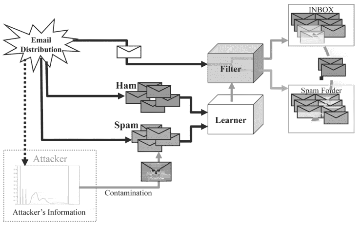

电子邮件垃圾邮件过滤是机器学习最著名的应用之一。在这个问题中，一组已知的良好电子邮件（ham）和不需要的电子邮件（spam）消息


用于训练垃圾邮件过滤器。学习算法识别区分垃圾邮件和正常邮件（ham）的相关特征（例如，令牌如“Viagra”、“Cialis”和“Rolex”或基于信封的特征），并构建一个分类器，该分类器结合观察到的垃圾邮件证据来决定新接收的消息是垃圾邮件还是正常邮件。

垃圾邮件过滤器已被证明能够成功地从用户的常规消息中正确识别并删除垃圾邮件。这促使垃圾邮件发送者定期尝试通过混淆其垃圾邮件消息来规避检测，以混淆常见的过滤器。但是，垃圾邮件发送者也可能破坏学习机制。如上图所示，垃圾邮件发送者可以利用电子邮件分布的信息来构建巧妙的 *attack spam* 消息，当对其进行训练时，会导致垃圾邮件过滤器将用户所需的消息误分类为垃圾邮件。最终，该垃圾邮件发送者的目的是使过滤器变得不可靠，以至于用户不再信任其过滤器已准确分类了消息，而必须筛选垃圾邮件以确保重要消息不会被错误过滤。

在第5章中，我们展示了几种基于不同垃圾邮件发送者目标和可用信息量的攻击变体。我们证明，此攻击可能非常有效：如果训练了相对较少数量的攻击垃圾邮件消息，则过滤器的准确性会显著降低。然而，我们也表明，一种旨在检测有害消息的简单数据消毒技术在防止许多此类攻击方面是有效的。在此情况下，攻击者的成功主要取决于其破坏用户电子邮件目标的范围。

### 示例 1.2（网络异常检测器）

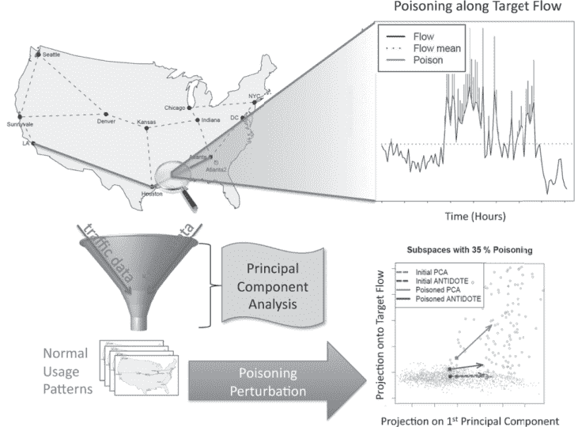

Lakhina、Crovella 和 Diot（2004b）还提出了机器学习技术，用于检测诸如拒绝服务（DoS）攻击之类的网络流量异常。他们的提议使用一种称为主成分分析（PCA）的学习技术来建模正常流量模式，以便识别网络中的异常活动。我们证明，该技术也易受污染。

如上图所示，PCA首先用于从骨干通信网络中观察到的流量中提取模式，以构建正常模型。随后使用该模型来检测DoS攻击。一个决心发起DoS攻击的对抗者必须首先规避此检测器。一个狡猾的对抗者可以通过错误训练检测器来成功规避检测。攻击者可以系统地注入旨在使其目标流与正常模型保持一致的杂流（chaff traffic）——这种杂流（如右上角图所示）沿目标流添加，以增加其方差。生成的受干扰模型（见右下角图）无法检测目标流上的DoS攻击。

我们在第6章中基于对抗者可用的不同信息来源，探讨了针对基于PCA的检测器的攻击。针对PCA的攻击被证明是有效的——它们成功地将其误检率提高了8到10倍。我们还探讨了一种名为ANTIDOTE的基于稳健统计学的替代检测方法，该方法旨在对杂流更具抵御能力。与基于PCA的方法相比，针对ANTIDOTE的相同攻击的规避成功率大约减半。然而，对中毒的抵御能力需要付出代价——ANTIDOTE在未受污染的数据上的效果不如原始检测器。

### 示例 1.3（隐私保护学习）

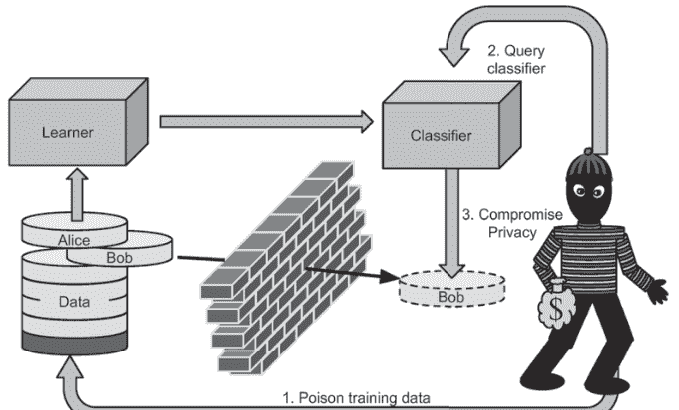

隐私是学习实践者需要考虑的另一个重要方面。在许多情况下，实践者可能希望在特权数据上使用学习算法，以便随后提供公共实用程序而不损害数据隐私。例如，一家医院可能希望使用私人医疗记录来构建一个能够识别可能患H1N1猪流感的患者的分类器，并且他们可能希望以自我评估工具的形式将该分类器与公众共享（Microsoft 2009）。但是，在提供此分类器时，医疗保健提供者不得泄露其记录中的特权信息。因此，它需要强有力的保证，即分类器不会损害其训练数据的隐私。

学习算法对隐私构成风险，因为学习者的行为反映其数据，因此可能揭示其中包含的潜在秘密。从根本上说，学习算法基于其从数据中获取的模式，生成其训练数据的摘要。此摘要揭示了数据的汇总信息，并且可能被对抗者利用来侵犯特定数据项的隐私。聪明的对抗者有可能污染学习者的数据或查询学习者，以最终推断出私人数据。

隐私保护学习是学习、统计数据库和理论领域内的一个研究方向，研究学习算法的隐私属性，并寻求开发具有强隐私保证的学习算法（参见 Dwork 2010）。在第7章中，我们探索了提供强隐私保护保证的模型，并在该模型内开发了一种隐私保护支持向量机。此外，我们还探索了隐私保护学习的局限性，这些局限性揭示了准确性与隐私保护之间的基本权衡。

### 示例 1.4（近乎最优规避）

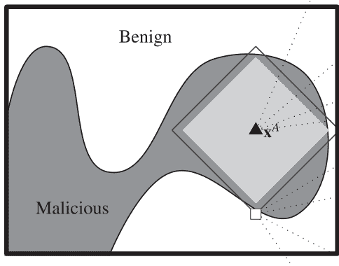

> 主题：廉价在线药店，在线订购处方药。低价保证，快速配送。
> FDA & CPA 认证的药店网站
> 快速配送！
> 伟哥（Viagra）起价1.82美元
> 希爱力（Cialis）起价2.46美元
> 伟哥软片起价2.25美元
> 希爱力软片起价2.52美元
> VeriSign 安全支付网站
> 我们配送到所有国家
> 准备好提升您的性生活了吗？确定吗？
> 是时候立即行动了！
> 以难以置信的低价订购上述药片

> 主题：廉价在线药店，在线订购处方药。低价保证，快速配送。
> FDA & CPA 认证的药店网站
> 快速配送！
> 伟哥（Viagra）起价1.82美元
> 希爱力（Cialis）起价2.46美元
> 伟哥软片起价2.25美元
> 希爱力软片起价2.52美元
> VeriSign 安全支付网站
> 我们配送到所有国家
> 准备好提升您的性生活了吗？确定吗？
> 是时候立即行动了！
> 以难以置信的低价订购上述药片

除了误导学习算法外，攻击者还有兴趣通过使其恶意活动无法检测来规避检测器。如前面在示例1.1中提到的，这种做法在垃圾邮件过滤领域已经很常见，垃圾邮件发送者试图通过以下方式规避过滤器：

- 将指示垃圾邮件的单词混淆为人类可识别的拼写错误；例如，将“Viagra”改为“V1@gra”或将“Cialis”改为“C|alis”，
- 使用HTML使未渲染的消息难以解析，
- 添加与垃圾邮件无关的其他来源的单词或文本，以及
- 嵌入显示垃圾邮件消息的图片。

所有这些技术都可用于规避垃圾邮件过滤器，但对垃圾邮件发送者来说也代价高昂——更改其垃圾邮件可能会使消息的盈利能力降低，因为失真降低了消息的可读性或可访问性。在规避过滤器时，垃圾邮件发送者希望尽可能少地修改其消息，但对于动态学习过滤器，垃圾邮件发送者不知道已学习的过滤规则。相反，垃圾邮件发送者通过探测过滤器并根据某些成本函数优化修改来构建测试垃圾邮件。这引发了以下问题：垃圾邮件发送者通过查询过滤器来最优规避过滤器有多难？

我们在第8章中考察的近乎最优规避问题，将这一问题形式化为垃圾邮件发送者规避特定分类器家族所需的查询复杂性。我们研究了广义的诱导凸分类器家族，并表明在某些 \(\ell_p\) 成本函数下，存在用于近乎最优规避的高效算法。

### 1.2 安全学习的原则方法

在本书中，我们分析了机器学习系统的四个独立安全问题。对于每个问题，我们首先指定所提出的威胁模型，随后分析威胁的影响，并在适当时提出针对威胁的防御措施。在计算机安全领域，评估系统涉及一个持续的过程：首先，确定针对系统的攻击类别；其次，评估系统抵御这些攻击的韧性；第三，加强系统以应对这些攻击类别。在我们考虑的每个安全问题中，我们都严格遵循这一模型来评估学习算法的漏洞。

为了评估学习系统的漏洞，我们的方法借鉴了传统计算机安全中许多已确立的原则。一般而言，计算机安全关注的是量化、管理和降低与计算机系统及其使用相关的风险。安全领域的传统主题包括密码学、身份验证、安全通道、隐蔽通道、防御性编程实践、静态代码分析、网络安全和操作系统安全；传统的（基于代码的）漏洞包括缓冲区溢出、格式字符串漏洞、跨应用脚本、代码注入攻击和权限提升。与经典安全环境不同，针对学习系统的攻击利用了学习系统的自适应性。对抗者不仅可以利用学习者中现有的缺陷，


它还可能误导学习者创建新的漏洞。尽管如此，经典安全原则仍适用于分析机器学习算法。特别是，主动研究攻击、Kerckhoffs’ 原则、保守设计和正式威胁建模这些原则是我们方法的基础。

#### 主动分析

计算机安全的首要准则是在系统部署或广泛使用之前，开展主动研究以预见潜在攻击。对系统安全性的分析和公开辩论能够对其提供一定程度的信心。此外，如果在部署前成功识别出漏洞，系统设计可以预先修复，从而减少部署后为有缺陷的系统进行昂贵的补丁、重写或召回的必要性。最后，已部署系统中安全漏洞的曝光会削弱用户对其的信心，并可能导致昂贵的损失，如果系统经过充分审查，这些损失本可避免。在本书中，我们主张对学习系统的安全性采取主动方法。对于我们分析的已有系统，我们寻求在系统被不择手段的对手破坏或攻破之前，识别其漏洞并提高人们对这些漏洞的认识。此外，我们不仅暴露漏洞，还提供替代系统来挫败其利用或减轻其影响。最后，我们为系统设计者提供一般性指南，帮助他们分析拟议学习系统的漏洞，以便学习可以作为有效且可靠的组件部署，即使在关键系统中也是如此。

#### Kerckhoffs’ 原则

第二条准则通常被称为 Kerckhoffs’ 原则（Kerckhoffs 1883），即系统的安全性不应依赖于不切实际的保密期望。过度依赖秘密来提供安全是危险的，因为如果这些秘密被泄露，系统的安全性将立即被攻破。理想情况下，安全系统应尽量减少关于什么可以现实地对潜在攻击者保密的假设。密码学领域通过要求只需一个秘密密钥即可提供安全性或隐私性的开放算法，采纳了这一一般原则。我们在分析机器学习系统时应用这一原则，主要假设对手了解学习算法，并能够获取用于训练学习者的数据的一些信息。然而，确定安全机器学习系统可行的适当保密程度是一个难题，我们将在第 9 章中进一步讨论。在本书的每一章中，我们考虑对手可能获得的各种信息级别，并评估对手如何最好地利用这些信息来实现其针对学习者的目标。通过这样做，我们展示了不同威胁级别的影响，并表明对手从特定信息来源获得的价值。

#### 保守设计

我们应用的第三个基础原则是，系统的设计和分析应避免对对手做出不必要或不合理的假设和限制。如果设计者未能预判对手的能力、低估攻击者的顽强程度，或误解其可用的资源和信息，就可能发生重大安全妥协。相反，通过假设对手拥有尽可能广泛的权力，可以理解对手构成的最坏情况威胁，且用户不太可能因某些未预料到的对手的攻击而感到意外。然而，分析全能无限对手的能力，对于揭示学习系统面对现实受限攻击者时的行为帮助不大，并可能导致对系统安全性产生不必要的悲观看法。相反，虽然我们也考虑最坏情况对手，但我们的方法侧重于构建适当的威胁模型，以量化对手在不同威胁级别下的努力与其对系统影响之间的关系。

#### 威胁建模

最后，为了分析机器学习系统的漏洞，我们遵循典型的安全实践，构建正式的（以攻击者为中心的）威胁模型来分析学习系统的漏洞。如 Denning & Denning（1979）所述，

> 没有机制是完全安全的。一个好的机制将被攻破的风险降低到可接受的水平。

在我们主张的方法下，系统分析人员构建学习系统的威胁模型来分析针对它的潜在风险。这个威胁模型从激励、目标、资源和能力方面描述每个潜在对手。威胁模型使分析人员能够量化安全程度；即，根据可以造成的损害和此类攻击的可行性，预期针对潜在对手的安全级别。最终，这描述了系统的安全性，有助于识别其弱点，并提供一种比较不同提案安全性的机制。

为特定学习系统构建威胁模型时，首先，分析人员量化该系统的安全环境和目标，以制定衡量成功和量化所提供安全程度的标准。正式化风险和目标使分析人员能够识别系统的潜在局限性和潜在攻击，并将分析集中在迫在眉睫的威胁上，从而避免在不存在或次要的威胁上浪费精力。接下来，分析人员识别潜在的对手激励、目标、资源、能力和限制。通过审查预期对手及其目标的性质，分析人员可以量化对手为实现特定目标所需的努力。基于这个威胁模型，分析人员随后可以分析系统的安全性，并针对现实攻击形式构建适当的防御。正式分析为安全性提供了严谨的方法。此外，通过正式化系统的威胁和安全性，其他分析人员可以批评分析人员所做的假设，并提出系统设计中潜在缺陷的建议。这种开放的过程往往能改善系统的安全性。

### 1.3 安全学习的年表

安全学习学科主要在过去二十年中，源于人工智能和计算机安全领域的一系列重要进展，已成为一门重要的研究领域。然而，促成安全学习形成的贡献，源自数十年前两个学科的有影响力的著作。虽然这些进展中的许多都解决了这些原本截然不同的社区内的独立问题，但它们共享一些共同主题，这些主题在许多安全问题开始需要自适应方法，以及学习技术对恶意数据的脆弱性变得明显时，逐渐汇聚。这些趋势共同构成了自那时起已成形的安全学习领域的基础。在这里，我们提供了促成这一发展的主要事件年表，以便更好地理解安全学习的背景和动机。虽然这并非旨在构成形成安全学习基础的所有重要工作的完整历史，但这份简要年表提供了计算机安全和人工智能领域中为安全学习作为一门学科的形成做出贡献的一些亮点。有关安全学习框架及该领域研究组织的更多讨论，请参见第 3 章。

- **20 世纪 40 年代战时密码分析:** 使用计算机，轴心国的许多加密密码被破解。Claude Shannon 在他的论文《保密系统的通信理论》中发表了已解密材料，表明任何理论上不可破的加密系统都具有与一次性密码本相同的要求（Shannon 1949）。为加密系统制定的标准后来成为计算机安全标准的典范。

- **20 世纪 40 年代和 50 年代 人工智能基础:** 随着早期计算机的出现，研究人员开始研究人工智能。著名的是，在 1950 年，Turing 发表了《计算机器与智能》，并引入著名的 *图灵测试* 来确定机器是否能表现出智能（Turing 1950）。

- **20 世纪 60 年代和 70 年代 鲁棒统计基础:** 虽然鲁棒统计的历史可以追溯到统计学的起源，但该领域的第一批正式方法出现在 20 世纪 60 年代和 70 年代。总结这项工作的主要文献是 Huber (1981) 和 Hampel, Ronchetti, Rousseeuw, and Stahel (1986)，它们分别介绍了两种不同的鲁棒统计方法：极小极大方法和基于影响函数的方法。

- **20 世纪 70 年代末 公钥密码学的兴起:** 公钥密码学最初由 Whitfield Diffie 和 Martin Hellman 于 1976 年提出，彻底改变了密码学（Diffie & Hellman 1976）。1978 年，Ronald Rivest、Adi Shamir 和 Len Adleman 引入了 RSA 公钥系统（Rivest, Shamir, & Adleman 1978）。

- **1979 Denning & Denning 发表《数据安全》:** 在这篇开创性论文中，Dorothy 和 Peter Denning 介绍了四种不同的数据保障形式：访问控制、流控制、推理控制和加密（Denning


(Denning 1979). 借助推断控制，他们解决了在数据库聚集程序中防范信息泄露的需求，这一话题早于更广泛的隐私保护学习概念。

- **1984年引入PAC学习框架：** Valiant引入了大概近似正确（PAC）学习，作为研究学习算法在给定示例的情况下学习特定概念能力的框架（Valiant 1984）。重要的是，PAC框架将学习理论与假设复杂性理论联系起来，并属于数理统计中的经验过程理论领域。

- **1990年代 多态病毒的开发：** 计算机病毒开始使用加密、代码混淆和多态技术以规避检测（Chen & Robert 2004）。这些隐蔽病毒旨在挫败基于签名的防病毒检测器，使得通过签名识别恶意代码变得越来越困难。

- **1993年 Kearns和Li研究恶意错误下的学习：** 使用PAC模型，Kearns和Li（1993）在其论文《恶意错误存在下的学习》中，研究了在训练数据中存在最坏情况错误时学习的可行性。

- **1996年 第一款商业贝叶斯垃圾邮件过滤器：** 由Jason Rennie编写的iFile程序被认为是第一款融合概率方法进行垃圾邮件过滤的邮件程序，这种方法广为人知地称为*贝叶斯过滤*。关于垃圾邮件过滤贝叶斯方法的第一篇研究论文由Sahami、Dumais、Heckerman和Horvitz（1998）发表。

- **1999–2004年 快速传播的计算机蠕虫的出现：** 借助互联网的传播，包括Melissa、ILOVEYOU、Code Red、Nimda、Klez、Slammer、Blaster、Sobig、MyDoom和Netsky在内的计算机蠕虫迅速感染易受攻击的主机，并对计算机和网络资源造成广泛损害（Chen & Robert 2004）。这些多产且破坏性强的蠕虫凸显了快速自适应检测系统的必要性。

- **2002年 Paul Graham的垃圾邮件过滤方法：** 在其文章《反垃圾邮件计划》中，Paul Graham改进并普及了所谓的垃圾邮件过滤贝叶斯方法（Graham 2002）。他引入的基本技术至今仍被许多垃圾邮件过滤器采用，包括SpamBayes、Bogofilter以及Apache SpamAssassin过滤器的学习组件（Apache n.d.）。

- **2006年8月 AOL搜索数据泄露：** AOL研究部在三个月内发布了65万用户的2000万条搜索关键词，通过用唯一键替换姓名对其进行了匿名处理。《纽约时报》和其他组织通过交叉引用公开信息对这些用户进行了去匿名化（Barbaro & Zeller 2006）。这导致了一起针对AOL的集体诉讼。

- **2006年 差分隐私的提出：** 随着差分隐私的发展（Dwork, McSherry, Nissim, & Smith 2006），在强有力地保护隐私的同时进行学习已奠定了坚实基础。

- **2007年1月 风暴蠕虫被发现：** 这种恶意软件通过木马传播，并创建一个被称为僵尸网络的受感染机器网络——风暴是最早被发现的僵尸网络之一（cf. Holz, Steiner, Dahl, Biersack, & Freiling 2008）。僵尸网络已被用于各种恶意目的，包括发送垃圾邮件、分布式拒绝服务（DDoS）攻击和网络盗窃，极大地促进了这些滥用活动。

- **2007年12月 面向计算机安全的对抗环境下机器学习NIPS研讨会：** 第一次正式研讨会旨在探讨机器学习作为计算机安全工具的作用，该研讨会与神经信息处理系统进展会议（NIPS）同时举办。此次研讨会由Richard Lippmann和Pavel Laskov组织，汇集了两个领域的研究人员，后来促成了期刊 *机器学习* 上关于此主题的一个专刊（Laskov & Lippmann 2010）。

- **2008年10月–2016年11月 CCS安全与人工智能研讨会：** 这是迄今持续时间最长的研讨会，旨在探讨人工智能在计算机安全中的应用，首次举办于2008年。第一届研讨会由Dirk Balfanz和Jessica Staddon组织，与ACM计算机与通信安全会议（CCS）同时举办，并一直持续到2016年写作时每年举行一次（Balfanz & Staddon 2008, 2009; Greenstadt 2010; Cárdenas, Greenstadt, & Rubinstein 2011; Cárdenas, Nelson, & Rubinstein 2012; Nelson, Dimitrakakis, & Shi 2013; Dimitrakakis, Mitrokotsa, & Rubinstein 2014; Dimitrakakis, Mitrokotsa, & Sinha 2015; Freeman, Mitrokotsa, & Sinha 2016）。

- **2009年12月 Netflix隐私泄露：** Netflix公司因在机器学习电影评级竞赛中发布约50万客户的私人信息而面临集体诉讼。研究人员能够通过将泄露用户的评分与IMDB上的评分进行交叉引用，对其进行去匿名化处理（Narayanan & Shmatikov 2008）。

- **2010年9月 数据挖掘和机器学习中隐私与安全问题研讨会（PSDML）：** PSDML研讨会与ECML/PKDD会议同时举办（Dimitrakakis, Gkoulalas-Divanis, Mitrokotsa, Verykios, & Saygin 2011）。此次研讨会为机器学习研究人员提供了一个讨论隐私和安全应用的论坛。

- **2012年9月 Dagstuhl Perspectives研讨会：面向计算机安全的机器学习方法：** 该研讨会在德国Dagstuhl城堡举行，旨在汇集计算机安全和机器学习社区的领先研究人员，讨论对抗学习和基于学习的安全技术的挑战与未来研究方向，并促进建立一个共同的社区（Joseph et al. 2013）。

- **2014年6月 学习、安全与隐私研讨会：** 该研讨会与国际机器学习会议（ICML）同时举办，为机器学习研究人员提供了一个新的场所，以解决带有安全和隐私考量的问题（Dimitrakakis, Laskov, Lowd, Rubinstein, & Shi 2014）。

- **2016年2月 网络安全人工智能研讨会（AICS）：** AICS研讨会由MIT林肯实验室和南加州大学的团队组织，与顶级AI会议AAAI同时举办（Martinez, Streilein, Carter, & Sinha 2016）。该研讨会汇集了网络安全、安全博弈和学习社区的成员。

### 1.4 概览

在本书中，我们介绍了一种用于识别和分析机器学习系统威胁的系统化方法。我们考察了若干现实世界中的学习系统，评估其漏洞，展示了针对其学习机制的现实世界攻击，并提出了能够成功减轻此类攻击效果的防御措施。在此过程中，我们为评估学习者的漏洞并开发防御以加强其系统抵御此类威胁提供了一种系统化的方法论。此外，我们还审视并回答了关于对抗污染的极限、隐私保护学习以及分类器规避的理论问题。

本文分为四个部分。在第一部分中，我们介绍构成我们方法基础的背景和基础材料。在第2章中，我们概述机器学习并介绍我们的记法。接着在第3章中，我们介绍评估学习代理安全属性的框架，呈现针对学习者的攻击分类法，并在此框架下对相关工作进行分类和讨论。我们识别了针对机器学习系统的不同攻击类别，并表明量化学习系统威胁至少有三个有趣的维度。此外，我们将安全学习构建为 *攻击者* 与 *防御者* 之间的博弈。分类法决定了该博弈的结构以及我们参与者的成本模型。基于此框架，文本的其余部分将根据学习系统中的不同漏洞进行组织。

在本书的第二部分中，我们探讨了攻击者通过恶意篡改学习者的训练数据来主动干扰学习的攻击。在第4章中，我们研究攻击者如何通过迭代攻击污染基于超球面的异常检测器。针对几种不同的攻击场景，我们量化了攻击者实现成功污染结果所需的付出，以攻击者必须控制的数据量和所需的攻击迭代次数为准。我们给出了在不同攻击和重新训练场景下攻击者面临的问题难度界限，并讨论了这些结果如何影响攻击的可行性。

接下来，我们提供两个实际学习系统的现实世界案例研究，并对两者均使用我们的框架系统地探讨这些系统的潜在威胁；最后，我们提出相应的防御措施来对抗或减轻攻击的影响。第一个学习系统是名为SpamBayes的垃圾邮件过滤器，我们对其进行调查


在第 5 章中，我们展示了这个垃圾邮件过滤器对训练数据中的对抗性污染极易受攻击。具体来说，我们展示了攻击者如何构造高度有效的攻击消息，一旦注入到学习者的训练集中，就会导致 Spam-Bayes 随后将许多正常消息误分类为垃圾邮件。然而，我们还提出了一种数据清洗防御，该防御能够根据消息造成的预估损害成功检测并移除攻击消息。这种防御能有效消除大多数攻击消息，且仅对过滤器的性能产生微乎其微的影响。我们分析的第二个学习系统是一种网络异常检测系统，其中使用基于 PCA 的子空间估计技术来识别骨干通信网络中的网络范围 DoS 攻击。在第 6 章中，我们研究了一类针对这种基于 PCA 的异常检测器的数据投毒策略。该系统中对抗者的目标是逃避检测，为此，它通过逐步扰动用于训练检测器的网络流量来污染学习者的训练数据。同样，我们展示了这一类算法对投毒方法高度敏感。为了应对针对该检测器的攻击，我们还提出了一种替代检测器。在这种情况下，我们展示了一种基于 PCA 鲁棒变体的替代学习算法能够大幅减轻投毒的影响。

在本书的第三部分中，我们考虑了那些在无需数据污染的情况下被动利用学习者漏洞的攻击者，并对安全学习的两项任务进行了理论研究：保护学习者数据的隐私以及防止对学习者的逃避攻击。在第 7 章中，我们探讨了在保持其训练数据隐私的同时发布支持向量机（SVM）分类器的任务。我们采用 Dwork et al. (2006) 所知的强语义隐私定义——差分隐私，该定义保证即使是单个训练数据的隐私也能得到保障，前提是对抗者拥有剩余数据和发布机制的完全知识。我们提出了私有发布类 SVM 分类器的机制，我们证明这些机制既能保证差分隐私，又能达到保证水平的效用。我们还通过下界探讨了私有发布近似 SVM 的分类器的局限性。最后，我们探讨了凸诱导分类器族的近似最优逃逸问题，并在第 8 章中将我们的框架应用于分类器逃逸的理论模型。为了发现分类器的盲区，对抗者可以系统地发送成员查询，并利用分类器的响应来获取关于其边界的重要结构信息。为了研究这个问题，我们推广了 Lowd & Meek (2005a) 的近似最优逃逸框架，该框架以查询复杂性来量化逃逸问题。在此模型下，我们研究了一类称为凸诱导分类器的多样化分类器的逃逸问题，并提出了基于 \(\ell_p\) 代价族来逃避这些分类器的算法。我们展示了在凸诱导分类器族内分类器逃逸可行性的正面和负面结果，并讨论了研究逃逸问题的未来方向。

在本书的最后部分中，我们探讨了对抗机器学习的未来方向。在第 9 章中，我们讨论了安全敏感领域对抗学习领域的重要主题和开放性问题。

本书为机器学习实践者提供了一个在存在对抗者的情况下评估学习系统的框架。在此框架下，我们展示了现实世界学习系统的漏洞，并提出了能够抵御已展示的攻击的替代技术。我们的方法和技术为安全学习提供了共同的基础，这对于在安全敏感或对抗性环境中持续开发和部署学习系统至关重要。

## 2 背景与符号

本章建立了本书中使用的数学符号，并介绍了本文构建其基础的机器学习基础。通常熟悉该领域的读者可以浏览本章，以熟悉我们的符号。如需更全面地学习机器学习，读者应参考诸如 (Hastie, Tibshirani, & Friedman 2003) 或 (Vapnik 1995) 等文本。

### 2.1 基本符号

在此，我们简要概述了本文中使用的正式符号。关于基础逻辑、集合论、线性代数、数学优化和概率论的更多内容，我们将读者引向附录 A。

我们使用 = 表示等式，并使用 \(\stackrel{\text{def}}{=}\) 表示 *定义为*。字符的字体样式用于区分集合元素、集合和空间，具体如下。标量等单个对象使用斜体表示（例如，*x*）和多维向量使用粗体表示（例如，**x**）。集合使用黑板加粗字符表示（例如，X）。然而，当指代跨越特定种类对象（即空间）的*整个*集合或宇宙时，我们使用花体字母（例如 X），以将其与该空间内包含的子集 X 区分开来。

### 2.2 统计机器学习

机器学习涵盖了一个广泛的技术领域，这些技术从数据中提取信息，以及与这些算法相关的理论和分析。在描述机器学习任务时，Mitchell (1997) 写道，

> 计算机程序被认为在经验 *E* 方面相对于某类任务 *T* 和性能度量 *P* 进行了*学习*，如果其在 *T* 中任务上的性能（由 *P* 衡量）随着经验 *E* 而提高。

该定义涵盖了广泛的方法类。我们对一种常被称为统计机器学习的特定学习概念所涉及的术语和机制进行了概述。具体来说，经验的概念被视为数据，任务是从动作或决策空间中选择一个动作（或进行预测/决策）。

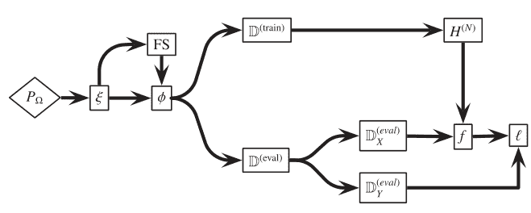

(a) 完整的学习框架。

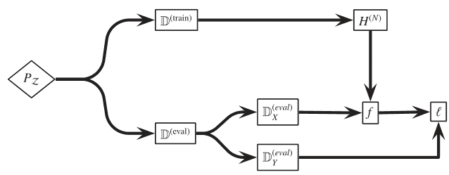

(b) 具有隐式数据收集的学习框架。

图 2.1 描绘了学习不同阶段信息流的图表。**(a)** 除模型选择外，学习算法的所有主要阶段。来自空间 $\Omega$ 的对象从分布 $P_\Omega$ 中抽取，并解析为随后被特征选择器 FS 使用的测量值。它选择一个特征映射 $\phi$，用于创建训练和评估数据集 $\mathbb{D}^{(\text{train})}$ 和 $\mathbb{D}^{(\text{eval})}$。学习算法 $H^{(N)}$ 基于训练数据选择一个假设 $f$，其预测根据损失函数 $\ell$ 在 $\mathbb{D}^{(\text{eval})}$ 上进行评估。**(b)** 具有隐式数据收集阶段的学习训练和预测阶段。这里假设数据直接从 $P_\mathcal{Z}$ 中抽取，而不是从 $P_\Omega$ 中抽取并随后通过测量过程映射到空间 $\mathcal{Z}$。

决策空间，并且性能度量是损失函数，它衡量学习者针对特定预测/动作所产生的代价与最佳或正确预测/动作相比的差异。图 2.1 说明了在此环境下学习过程的数据流。数据位于由输入空间 $\mathcal{X}$ 和输出空间 $\mathcal{Y}$ 组成的乘积空间 $\mathcal{Z} = \mathcal{X} \times \mathcal{Y}$ 中，这些内容将在后文讨论。训练数据集 $\mathbb{D}^{(\text{train})}$（由产品空间中的 $N$ 个耦合训练样本组成）从分布 $P_\mathcal{Z}$ 中抽取，并由学习算法 $H^{(N)}$ 用于产生假设（或分类器）$f$。该分类器是一个函数，用于对新数据集 $\mathbb{D}^{(\text{eval})}$（假设来自相同的分布）进行预测，并根据损失函数 $\ell$ 进行评估。图 2.1(a) 还


描述了在第 2.2.1 节中讨论的学习的数据收集阶段。虽然测量和初始特征提取是学习算法安全的重要方面，但本书的重点是学习算法的安全。

在整本书中，我们只考虑归纳学习方法，其学习形式是从先前经验中进行泛化。归纳方法需要归纳偏置：一套（隐含）假设，用于从一组观察中创建泛化。归纳偏置的一个例子是奥卡姆剃刀——偏好与观察一致的最简单假设。朴素贝叶斯方法使用 *最大条件独立性* 作为其归纳偏置，而支持向量机的归纳偏置是 *最大边距*。大多数方法的归纳偏置是内置在学习过程中的隐含偏置。

在本书中，我们关注可以描述为经验风险最小化过程的统计机器学习技术。随后，我们将总结这些过程的组件并提供描述它们的符号，但首先，它们的总体目标是最小化对未见评估数据 $\mathbb{D}^{(\text{eval})}$ 所做预测产生的预期损失（风险）。在训练数据上最小化平均损失（或风险）通常被用作最小化对未见随机评估数据预期损失的替代方法，在适当条件下，训练数据上的误差可以用于界定泛化误差（参见 Vapnik 1995，第 1 章）。此类结果的基础是平稳性假设，即训练数据和评估数据都来自相同的分布 $P_Z$，如图 2.1 所示。随后，我们将检查违反此平稳性假设的场景，并评估这些违反对学习方法性能的影响。然而，尽管我们研究经验风险最小化器的性能影响，这些违反对基于平稳性的任何学习者都会产生类似影响，而平稳性通常是保证泛化所必需的。进一步，我们表明这些违反对设计为对分布偏差具有鲁棒性的替代经验风险最小化器的影响较小。漏洞既不特有于经验风险最小化过程，也不固有于它们，而是防范这些利用需要学习者能够抵御对其假设的违反。过程的鲁棒性与有效性之间也存在权衡，我们将在每章中强调这一点。

#### 2.2.1 数据

电子邮件或网络数据包等现实世界对象包含在所有此类对象的空间 $\Omega$ 中。通常，直接将学习算法应用于现实世界对象是困难的，因为学习者无法解析对象的结构，或者对象可能包含与学习者任务无关的多余元素。这些对象通过一个从现实世界抽象（例如，对象或事件）到代表性观察空间的映射被转换为更易处理的表示——即测量过程。在此过程中，每个现实世界抽象 $\omega \in \Omega$ 被测量，并作为复合对象 $x \in \mathcal{X}$ 表示给学习算法。通常对 $\omega$ 有 $D$ 个简单测量；第 $i^{\text{th}}$ 个测量（或特征）$x_i$ 来自空间 $\mathcal{X}_i$，而复合表示（或数据点）\(\mathbf{x} \in \mathcal{X}\) 表示为元组 \((x_1, x_2, \dots, x_D)\)。所有此类数据点的空间是 \(\mathcal{X} \triangleq \mathcal{X}_1 \times \mathcal{X}_2 \times \dots \times \mathcal{X}_D\)。每个特征通常是实值 \(\mathcal{X}_i = \Re\)、整数值 \(\mathcal{X}_i = \mathbb{Z}\)、布尔 \(\mathcal{X}_i = \{\text{true, false}\}\) 或类别 \(\mathcal{X}_i = \{A_1, A_2, \dots, A_k\}\)。图 2.1(a) 正式地用测量映射 \(\xi : \Omega \mapsto \mathcal{X}\) 表示测量过程，这代表了学习者的世界视角。

数据收集是将测量映射 \(\xi\) 应用于 \(N\) 个对象的序列 \(\omega^{(1)}, \omega^{(2)}, \dots, \omega^{(N)}\)，从而得到一个包含 \(N\) 个数据点的索引集 \(\{x^{(i)}\}_{i=1}^N \subseteq \mathcal{X}^N$，我们将其称为数据集，并用 \(\mathbb{D}\) 表示。数据集代表环境的一系列观察，并作为学习者将过去经验泛化到未来事件或观察的基础。对数据集的结构做出了各种假设，但最常见的是，学习者假设数据点是独立且同分布的。我们研究的所有学习算法都假设数据是从未知但平稳的分布中独立采样的，尽管对该假设的依赖程度各不相同。

#### 标签

在许多学习问题中，学习者的任务是根据世界的观察状态学习预测其未观察状态。观察被划分为两组。被观察到的那些是解释变量（也称为协变量、输入、预测器或控制变量），而要预测的未观察量构成响应变量（也称为输出或结果变量）。在本书语境中，鉴于我们专注于分类，我们将观察到的独立量称为数据点（如前所述），将因变量的类别量称为其标签。学习者应能够在看到过去带有标签的数据点实例后，为数据点预测标签。在这种形式下，每个数据由两个配对组件组成：来自输入空间 \(\mathcal{X}$ 的数据点 \(x\) 和来自响应空间 \(\mathcal{Y}$ 的标签 \(y\)。数据的组件也称为预测器（输入）变量 \(x\) 和响应（输出）变量 \(y\)。这些配对对象属于笛卡尔积：\(\mathcal{Z} \triangleq \mathcal{X} \times \mathcal{Y}$。我们还假设这些实例是从该配对空间上的联合分布 \(P_\mathcal{Z}$ 中随机抽取的，在方便时也可以表示为 \(P_{\mathcal{X} \times \mathcal{Y}}$。

在包含标签的学习问题中（例如，监督或半监督学习），学习者在来自 \(\mathcal{Z}$ 的一组配对数据上进行训练。特别是，标记数据集是来自 \(\mathcal{Z}$ 的 \(N$ 个实例的索引集：\(\mathbb{D} \triangleq \{z^{(1)}, z^{(2)}, \dots, z^{(N)}\}\)，其中 \(z^{(i)} \in \mathcal{Z}$ 从 \(P_\mathcal{Z}$ 中抽取。仅包含数据点的索引集是 \(\mathbb{D}_X \triangleq \{x^{(1)}, x^{(2)}, \dots, x^{(N)}\}\)，仅包含标签的索引集是 \(\mathbb{D}_Y \triangleq \{y^{(1)}, y^{(2)}, \dots, y^{(N)}\}\)。在 \(\mathcal{X} = \mathcal{A}^D$ 的情况下（其中 \(\mathcal{A}$ 为某个数值集），第 \(i^{\text{th}}$ 个数据点可以表示为 \(D$ 维向量 \(\mathbf{x}^{(i)}\)，数据可以表示为 \(N \times D$ 矩阵 \(\mathbf{X}\)，定义为 \(\mathbf{X}_{i, \bullet} = \mathbf{x}^{(i)}\)。类似地，当 \(\mathcal{Y}$ 为标量（例如，布尔值、实数）时，\(y^{(i)}\) 为标量，标签可以表示为简单的 \(N$ 维向量 \(\mathbf{y}\)。在本书余下部分，\(N$ 将指 \(\mathbb{D}$ 的大小，在适用时，\(D$ 将指其数据点的维度。

#### *特征选择*

通常，测量只是数据提取整体过程的第一阶段。数据集收集后，通常会通过特征选择过程进行修改。特征选择是将原始测量映射到特征空间 \(\hat{\mathcal{X}}\) 的一个映射 \(\phi_\mathbb{D}$：\(\phi_\mathbb{D} : \mathcal{X} \rightarrow \hat{\mathcal{X}}\)。与与数据无关的测量映射 \(\xi$ 不同，特征选择映射通常根据整个数据集 \(\mathbb{D}$ 以数据依赖的方式选择，以提取与学习任务最相关的数据方面。此外，测量通常是不可逆的物理过程，而特征选择通常可以通过重新处理原始测量来重新执行。在许多环境中，可以通过重新定义特征选择映射并将其重新应用于测量数据来追溯性地更改特征选择过程，而除非重建这些原始数据所需的信息仍然可用，否则不可能对原始对象进行追溯性测量。出于本书的目的，我们不区分特征选择和测量阶段，因为我们研究的攻击针对学习的下游方面。我们将它们合并为一个步骤，并在明确引用特征选择时除外，忽略 \(\hat{\mathcal{X}}\)。我们将在第 9.1.1.2 节中重新讨论特征选择在安全敏感环境中的潜在作用。

1 在文献中，特征选择从测量中选择一个子集（\(\hat{\mathcal{X}} \subseteq \mathcal{X}\)），而特征提取从原始测量创建复合特征。我们不区分这两个过程，并将两者均称为特征选择。

#### 2.2.2 假设空间

学习算法的任务是选择最能支持数据的假设。此处我们将假设视为从数据空间 \(\mathcal{X}$ 到响应空间 \(\mathcal{Y}$ 的函数 \(f\)；即，\(f : \mathcal{X} \rightarrow \mathcal{Y}$。当然，存在许多此类假设，它们共同构成所有可能假设的家族 \(\mathcal{F}$，即假设空间。此空间最一般地是将 \(\mathcal{X}$ 映射到 \(\mathcal{Y}$ 的所有函数的集合，如我们在附录 A.1 中讨论的：\(\mathcal{F} \triangleq \{f | f : \mathcal{X} \rightarrow \mathcal{Y}$\}。假设空间 \(\mathcal{F}$ 可能受到关于假设形式的假设所限制。例如，当 \(\mathcal{X} = \Re^D$ 时，该家族可能限制为形式 \(f_{\mathbf{a}, b}^\beta(\mathbf{x}) \triangleq \beta(\mathbf{a}^\top \mathbf{x} + b)$ 的广义线性函数，其中 \(\beta : \Re \rightarrow \mathcal{Y}$ 是从实数到响应空间的某种映射。在 \(\mathcal{Y} = \{0, 1\}}$ 的情况下，函数 \(\beta(x) = \mathrm{I}[x > 0]$ 产生由 \((\mathbf{a}, b)$ 参数化的 \(\Re^D$ 上的所有半空间家族。在 \(\mathcal{Y} = \Re$ 的情况下，恒等函数 \(\beta(x) = x$ 定义了由 \((\mathbf{a}, b)$ 参数化的 \(\Re^D$ 上的线性函数家族。

#### 2.2.3 学习模型

我们将学习者描述为模型和训练过程。模型捕获关于观察数据的假设——该模型对假设空间提供限制，并提供关于这些假设的可用先验知识或归纳偏置（例如，贝叶斯环境中的先验分布或风险


minimization setting)。也就是说，模型是关于观测数据与假设空间之间关系的一组假设，但模型并未指定如何选择假设——这由稍后讨论的训练程序完成。例如，考虑正态分布数据的简单位置估计程序。数据模型指定数据点独立地从以未知参数 \(\theta\) 为中心的单位方差高斯分布中绘制；即，\(X \sim \mathrm{N} (\theta, 1)\)。均值和中位数是估计位置参数 \(\theta\) 的程序。通过区分模型和训练程序，我们可以研究学习者漏洞的两个不同方面。

#### 2.2.4 监督学习

本工作的主要焦点是分析在监督学习环境下的预测任务。在监督学习框架中，观测数据是一个成对数据集 \(\mathbb{D} = \{(\mathit{x}^{(i)}, y^{(i)})\}\)，我们假设其来自未知分布 \(P_{\mathit{X} \times \mathit{Y}}\)。预测的目标是根据观测到的预测变量选择最佳假设或函数 \(\hat{f}\) 来预测响应变量。更准确地说，给定从输入空间 \(\mathcal{X}\) 到输出空间 \(\mathcal{Y}\) 的函数假设空间 \(\mathcal{F}\)，预测任务是选择一个分类假设（分类器）\(\hat{f} \in \mathcal{F}\)，使其具有最小的预期预测代价；即，在仅向分类器揭示预测变量 \(x\) 时，预测新随机实例 \((x, y)\) 的标签 \(y\) 所产生的代价。为完成此任务，学习者获得一个带标签的训练数据集 \(\mathbb{D}\) 和一个代价或损失函数 \(\ell\)。该代价函数为每个数据实例、真实标签和分类器标签的组合分配一个数值代价（然而，最常见的是，代价函数对每个数据实例都是相同的）。

为完成预测任务，使用学习算法 \(H^{(N)}\)（也称为训练算法）根据训练数据和代价函数从 \(\mathcal{F}\) 中选择最佳假设。该学习者是从数据集 \(\mathbb{D} \in \mathcal{Z}^N\) 到假设空间中的假设 \(f\) 的映射：\(H^{(N)} : \mathcal{Z}^N \rightarrow \mathcal{F}\)；也就是说，从 \(\mathcal{Z}\) 中的 \(N\) 个训练样本到假设空间 \(\mathcal{F}\) 中某个假设 \(\hat{f}\) 的映射。如果算法具有随机元素，我们使用记法 \(H^{(N)} : \mathcal{Z}^N \times \mathfrak{R} \rightarrow \mathcal{F}\) 来表征假设依赖于随机元素 \(R \sim P_{\mathfrak{R}}\) 这一事实。

##### 训练

我们在此描述的过程是批量学习——学习者在训练集 \(\mathbb{D}^{(\text{train})}\) 上进行训练，并在评估集 \(\mathbb{D}^{(\text{eval})}\) 上进行评估。该环境可以推广为在线学习的重复过程，其中学习者在获得评估标签后不断对评估数据进行再训练（我们将在第 3.6 节中回到该环境）。在纯在线环境中，每次接收到新数据点时都会进行预测和再训练。在批量学习环境中（或在线学习的单个 epoch 中），学习者 \(H^{(N)}\) 根据收集的数据 \(\mathbb{D}^{(\text{train})}\) 形成假设 \(\hat{f}\) ——即所谓的训练过程。在监督学习环境下，针对各种环境下的（正则化）经验风险最小化，已经使用了大量不同的训练程序。我们将不再详细介绍这些方法，而是介绍分类的基础环境。

在分类问题中，响应空间是一个有限标签集，每个标签对应输入空间的某个子集（尽管这些子集不必互斥）。学习任务是构建一个分类器，该分类器能够根据每个类别的带标签训练样本，最好地将这些标签分配给新数据点。在二元分类环境中，只有两个标签，“–”和“+”，即响应空间为 \(\mathcal{Y} = \{“–”, “+”\}\)。在数学上方便时，我们将分别用 0 和 1 替换标签“–”和“+”；即，我们将隐式地将标签 \(y\) 重新定义为 \(I[y = “+”]\)。在二元分类中，我们将两个类别称为负类（\(y = “–”\)）和正类（\(y = “+”\)）。训练集 \(\mathbb{D}^{(\text{train})}\) 由两个类别的带标签实例组成。我们主要针对安全应用中的二元分类，其中防御者试图将实例（即数据点，其中一些或全部来自恶意攻击者）分为有害类和良性类。该环境涵盖许多重要的安全应用，例如主机和网络入侵检测、病毒和蠕虫检测以及垃圾邮件过滤。在检测恶意活动时，正类（标签为“+”）表示恶意入侵实例，而负类（标签为“–”）表示良性或无害的正常实例。在第 6 章中，我们还考虑异常检测环境，其中训练集仅包含来自负类的正常实例。

##### 风险最小化

学习者的目标是从假设空间 \(\mathcal{F}\) 中找到最佳假设 \(f^*\)，以便在根据未知分布 \(P_Z\) 绘制的实例上最好地预测目标概念（根据某些正确性度量）。理想情况下，学习者能够以高概率，基于从 \(P_Z\) 绘制的数据点组成的观测数据 \(\mathbb{D}\)，将 \(f^*\) 与任何其他假设 \(f \in \mathcal{F}\) 区分开来，但这通常不切实际甚至不可能。相反，学习者应根据某些偏好一个假设胜过另一个假设的标准选择空间中的 *最佳* 假设——这就是性能度量。该度量可以是对假设的任何评估；在统计机器学习中，最常见的目标是 *风险最小化*，它基于损失函数 \(\ell : \mathcal{Y} \times \mathcal{Y} \mapsto \Re_{0+}\)（非负实数）。学习者选择一个假设 \(\hat{f} \in \mathcal{F}\)，以最小化所有假设上的预期损失或风险（\(\hat{f} \in \text{argmin}_{f \in \mathcal{F}} R(P_Z, f)\)），其中风险由

$$R(P_Z, f) \triangleq \int_{(x,y) \in \mathcal{Z}} \ell(y, f(x)) \, dP_Z(x, y)$$

给出，且 \(P_Z(x, y)\) 是分布 \(P_Z\) 的概率测度。不幸的是，由于该分布未知，此最小化不可行。相反，在经验风险最小化框架中（参见 Vapnik 1995），学习者选择 \(\hat{f}\) 以最小化数据集 \(\mathbb{D} \sim P_Z\) 上的经验风险，定义为

$$\hat{R}_N(f) = \frac{1}{N} \sum_{(x,y) \in \mathbb{D}} \ell(y, f(x))$$

其中 \(N = |\mathbb{D}|\)。

##### 正则化

如果假设空间 \(\mathcal{F}\) 太过灵活，将会存在一个完美拟合经验观测的假设，但它可能无法对未见实例做出准确预测；例如，考虑构建一个从观测数据点到其响应的查找表：该分类器可以完美预测观测到的实例，但不能推广到未观测的实例。这种现象称为训练数据的过拟合。避免过拟合的一种可能性是只考虑一个小的或受限的假设空间；例如，线性函数空间。或者，可以允许一个大的假设空间，但惩罚假设的复杂性——这种做法称为正则化。学习者选择一个假设 \(\tilde{f}\) 以最小化修改后的目标

$$\tilde{R}_N (f) + \lambda \cdot \rho (f) \quad (2.1)$$

其中函数 \(\rho : \mathcal{F} \rightarrow \Re\) 是假设复杂性的度量，\(\lambda \in \Re_{+}\)（正实数）是正则化参数，用于控制风险最小化与假设复杂性之间的权衡。

##### 预测与评估

在数据集上训练后，学习到的假设随后被用于对一组未标记数据预测响应变量。我们称之为评估阶段，尽管它也可能被称为测试或预测阶段。起初，仅向预测器展示一个新数据点 \(x\)（或者更确切地说，使用该数据点查询预测器）。学习到的假设 \(\tilde{f}\) 在所有可能响应的空间 \(\mathcal{Y}\) 中预测一个值 \(\hat{y} = \tilde{f} (x)\)。² 最后，实际标签 \(y\) 被揭示，代理接收一个损失 \(\ell (\hat{y}, y)\) 作为其性能评估。在二元分类环境中，通常有两种分类错误：假正例（FP）是将正常实例分类为正类，而假负例（FN）是将恶意实例分类为负类。在假正例和假负例之间选择适当的权衡是一项应用特定的任务。

学习者的性能通常在带标签的评估数据集 \(\mathbb{D}^{(\text{eval})}\) 上进行评估。对评估数据集中每个数据点 \(x^{(i)} \in \mathbb{D}_{\mathcal{X}}^{(\text{eval})}\) 生成预测，并将产生的损失汇总为各种性能度量。在二元分类环境中，典型的性能度量是假正率（FPR），即被分类为正类的负实例的比例，以及假负率（FNR），即被分类为负类的正实例的比例。通常，根据保留的训练数据（验证数据集）调整分类器以达到特定的（经验）假正率，并在该 FP 水平下评估其结果的假负率。

² 允许的预测或动作空间 \(\mathcal{A}\) 不必与允许的响应空间 \(\mathcal{Y}\) 相同。这允许学习者从更广泛的响应范围中进行选择（降低风险），或者将学习者限制在某个所需的子集。但是，除非明确说明，我们将假设 \(\mathcal{A} = \mathcal{Y}\)。


#### 2.2.5 其他学习范式

还需要考虑分类器包含超过两个类别或实值输出的情况。的确，我们在第 5 章中研究的垃圾邮件过滤器 SpamBayes 使用第三个标签 _不确定_，以便最终用户可以更仔细地检查这些潜在的垃圾邮件。然而，将错误分析推广到超过两个类别并非易事，而且实践中大多数系统只做一个基本的区分（例如，无论垃圾邮件过滤器应用了什么标签，最终用户最终都会决定将每个类视为垃圾邮件或合法邮件）。出于这些原因，并遵循文献中的常见做法，我们将分析限制在二元分类上，并将多类或实值预测的扩展留作未来讨论。

在第 6 章中，我们还研究了异常检测场景。与二元分类一样，异常检测包括做出两个预测之一：数据是正常的（“−”）或数据是异常的（“+”）。与分类场景不同，训练数据通常仅由负类示例组成。因此，常见的做法是校准探测器，以在留出的训练数据上达到所需的误正率。

还有其他值得考虑的有趣学习范式，例如半监督学习、无监督学习和强化学习。但是，由于它们不会直接影响本文中的讨论，我们不会讨论这些框架。有关不同学习环境的详细讨论，请参阅 (Hastie et al. 2003) 或 (Mitchell 1997)。

## 3 安全学习框架

在本章中，我们介绍了一个框架，用于定性评估机器学习系统的安全性，该框架涵盖了许多相关对抗性学习环境中常见的广泛安全特性。已经有大量工作探讨了机器学习系统的安全性；在这里，我们回顾了对抗性环境中的学习、针对学习系统的攻击以及使系统免受攻击的方案。我们识别了机器学习系统上的不同攻击类别（第 3.3 节），根据三个关键属性对威胁进行分类。

我们还将安全学习呈现为*攻击者*与*防御者*之间的博弈——分类法确定了博弈的结构及其成本模型。此外，该分类法为通过分析针对系统的威胁来构建防御，从而评估所描述系统的韧性提供了基础。防御性学习技术的发展更为初步，但我们也讨论了多种显示出防御不同类型攻击前景的技术。

我们所呈现的工作不仅为思考和撰写安全学习提供了一种通用语言，而且超越了这一点，展示了该框架如何应用于算法设计和真实系统评估。该框架不仅揭示了原本各异领域中的共同主题，还推动了我们对第 5、6 和 8 章中所介绍的实用机器学习系统的研究。如果安全机器学习要在安全敏感领域的真实系统中作为工具发挥其潜力，那么这些描述针对学习系统的攻击的基础原则就是必不可少的第一步。

本章建立在早期研究之上（Barreno, Nelson, Sears, Joseph, & Tygar 2006; Barreno, Nelson, Joseph, & Tygar 2010; Barreno 2008）。

### 3.1 分析学习阶段

攻击可能发生在第 2.2 节概述的学习过程的每个阶段。图 2.1(a) 描绘了数据如何流经学习的每个阶段。我们简要地概述了针对这些阶段的攻击有何不同。

#### 测量阶段

了解测量过程后，对手可以设计恶意实例来模仿无害数据的测量值。在针对测量机制的成功攻击后，系统可能需要昂贵的重新仪器化或重新设计才能完成其任务。

#### 特征选择阶段

特征选择过程可以以与测量阶段相同的方式受到攻击，但由于特征选择是一个动态过程，可以更容易地进行调整，因此应对措施和恢复的成本较低。潜在地，重新训练甚至可以自动化。但是，如果特征选择基于可能受到污染的训练数据，则也可以以与训练阶段（下文）相同的方式攻击特征选择。

#### 学习模型选择

一旦学习模型已知，对手就可以利用模型中固有的假设。对训练数据的错误或不合理的建模假设可能被对手利用；例如，如果模型错误地假设数据在数据中具有线性可分性，对手可以使用无法线性分离的数据来欺骗学习者或使其表现不佳。明确陈述和批判建模假设以识别潜在漏洞至关重要，因为更改模型可能需要重新设计系统。

#### 训练阶段

通过了解学习者如何训练，对手可以设计数据来欺骗学习者选择不良假设，或在预测期间帮助泄露训练数据的隐私。稳健学习方法是抵御前者攻击的有希望的技术，如第 3.5.4.3 节所讨论。这些方法对对抗性污染具有韧性，尽管其鲁棒性与性能之间存在固有的权衡。差分隐私是提供强有力的保证的领先方法，以确保学习者在强大的对手存在下所保留的隐私级别（Dwork et al. 2006）。我们在第 7 章中探讨了支持向量分类差分私有近似的机制。

#### 预测阶段

学习后，不完美的假设可能被发现学习者预测错误的对手利用。评估发现此类错误的难度是一个重要问题；例如，Lowd & Meek (2005a) 的 ACRE-learning 框架，如第 3.4.4 节所讨论。此外，对手可以利用不完美的假设在预测期间泄露训练数据隐私。未来研究的一个有趣方向是检测对手是否正在利用这些错误，并重新训练以抵御攻击。

为了更好地理解这些不同的抽象攻击，请考虑一个垃圾邮件过滤器，它 (i) 具有电子邮件的一些简单测量集，例如 hasAttachment、subjectLength、bodyLength 等，(ii) 选择垃圾邮件中出现频率最高的前十个特征，(iii) 使用朴素贝叶斯模型，(iv) 通过经验计数训练类频率，(v) 通过对模型预测的类概率进行阈值处理来分类电子邮件。针对测量（或特征选择）阶段的攻击将包括首先确定使用的特征（用于分类），然后生成在这些特征上与正常电子邮件无法区分的垃圾邮件。针对学习模型的攻击将涉及发现一组垃圾邮件和正常邮件，由于朴素贝叶斯边界的线性而无法正确分类。此外，训练系统（或特征选择）可以通过注入带有误导性虚假特征的垃圾邮件来攻击，导致它学习错误的假设或学习一个提高揭示未被篡改的隐私敏感训练电子邮件几率的假设。最后，预测阶段可以通过系统地探测过滤器来攻击，以找到被错误分类为正常邮件（误负）的垃圾邮件，或推断有关隐私敏感训练数据集的信息。

许多学习方法假设平稳性：训练数据和评估数据来自同一分布。在此假设下，最小化训练集上的风险是评估数据风险的替代指标。然而，现实世界中的数据源通常不是平稳的，更糟糕的是，攻击者可以通过对训练或评估实例的某些控制轻易打破平稳性假设。分析和增强学习方法以承受或减轻平稳性假设的违反，是安全学习问题的核心。

识别学习系统的易受攻击组件只是理解对手的第一步。在下一节中，我们概述了一个旨在界定对手目标的框架。

### 3.2 安全性分析

安全性关注保护资产免受攻击者的侵害。正确分析系统的安全性需要识别系统的安全目标和威胁模型。安全目标是一项要求，如果被违反，将导致资产部分或完全被攻破。威胁模型是希望损害系统的攻击者的概况，描述他们的动机和能力。在这里，我们描述了机器学习系统可能的安全目标和威胁模型。

在安全敏感领域，分类器可用于做出推进系统安全目标的区分。例如，病毒检测系统的目标是降低病毒感染的易感性，无论是在感染前检测传输中的病毒，还是检测现有感染以将其清除。另一个示例是入侵检测系统（IDS），其目标是防止恶意入侵造成的危害，无论是识别现有入侵以将其删除，还是检测恶意流量并阻止其到达预定目标。¹ 在本节中，我们描述了特定于机器学习系统的安全目标和威胁模型。

¹ 在防止入侵的情况下，整个系统更恰当地称为入侵防御系统（IPS）。我们无需区分这两种情况，因此使用 IDS 来指代入侵检测系统和入侵防御系统。


#### 3.2.1 安全目标

在安全上下文中，分类器的目的是对恶意事件进行分类并防止其干扰系统操作。我们将这一一般学习目标拆分为三个目标：

- 完整性目标：防止攻击者访问系统资产
- 可用性目标：防止攻击者干扰正常运行
- 隐私目标：保护用于训练分类器的可能涉及隐私的数据的机密性

假阴性与违反完整性目标之间存在明显联系：通过分类器的恶意实例可能造成严重破坏。同样，假阳性往往会违反可用性目标，因为学习器本身拒绝了良性实例。最后，虽然试图侵犯隐私的攻击者可能导致假阳性或假阴性，但这些通常并非最终目标。

#### 3.2.2 威胁模型

##### 攻击者目标与动机

一般来说，攻击者希望访问系统资产（通常通过假阴性，或在训练集隐私被泄露的情况下通过反转学习过程），或者拒绝正常运行（通常通过假阳性）。例如，病毒作者希望病毒通过过滤器并控制受保护的系统（假阴性）。另一方面，不道德的商人可能希望竞争对手网店的销售流量被作为入侵而阻止（假阳性）。最后，过于热心的健康保险公司可能会对自动癌症检测器进行逆向工程，以泄露构成检测器训练集的患者的私人医疗记录。

我们假设攻击者和防御者各自都有一个成本函数，用于为任何给定实例的每个标记或每个训练实例隐私侵犯分配成本。成本可以是正数或负数；负成本是一种收益。通常情况下，攻击者的低成本与防御者的高成本相平行，反之亦然；如果攻击者和防御者的目标一致，他们就不会是对手。除非另有说明，为了便于阐述，我们假设防御者的每个成本都对应攻击者的类似收益，反之亦然。但是，这一假设对本框架并非必不可少，该框架可以轻松扩展到任意成本函数。在本章中，我们采用防御者的观点，并使用高成本来表示对防御者的高正成本。

##### 3.2.2.1 攻击者能力

对对手仅做弱假设，我们采用一种威胁模型，其中攻击者了解训练算法，并且在许多情况下对训练集拥有部分或完整信息，例如其分布。例如，攻击者可能有能力在学习者收集训练数据的时间段内监听所有网络流量。我们考察攻击者知识的不同程度，并评估其从不同潜在信息来源获得多少收益。

一般来说，我们假设攻击者可以生成任意实例；但是，许多设置确实会对攻击者生成的实例施加重大限制。例如，当学习者使用来自攻击者的数据进行训练时，有时可以安全地假设攻击者无法为训练选择标签，例如当训练数据经过仔细的人工标记时。另一个例子是，攻击者可能完全控制来自攻击源发送的数据包，但中转的路由器也可能添加或更改数据包，并影响其时间和到达顺序。

我们考虑具有修改或生成训练所用数据能力的攻击者，并探讨拥有此能力和不拥有此能力的两种场景。当攻击者控制训练数据时，需要考虑的一个重要限制是攻击者可以控制训练数据的比例以及控制程度。如果攻击者对100%的训练数据拥有任意控制权，那么很难看出学习者如何能学到任何有用的东西；但是，即使在这种情况下，也有学习策略可以使攻击者的任务更加困难（参见第3.6节）。我们考察中间案例，并探讨攻击者击败学习过程所需的影响力程度。

#### 3.2.3 机器学习在安全应用中的讨论

Sommer & Paxson (2010) 对机器学习在安全应用中的某些用途提出了一系列反对意见。在该论文的第III节中，作者概述了使用机器学习进行网络异常检测的五个挑战。他们的第一个挑战是异常值检测，作者认为网络异常检测最好使用过滤，而不是机器学习提供的分类。他们还认为机器学习擅长发现相似事件，但不适用于发现新型事件。他们的第二个挑战是错误的高成本，作者认为网络异常检测系统对可容忍的假阳性和真阳性错误数量有严格限制，假阳性尤其昂贵，因为解决它们需要分析师时间。他们的第三个挑战是异常检测系统与用户/操作员/分析师之间的语义鸿沟，他们认为基于机器学习的系统在决策方面不透明。他们的第四个挑战是网络流量的多样性产生了非常突发的网络，使决策变得困难。他们还认为，像聚合这样的多样性降低技术会使网络变得嘈杂，并使决策变得困难。他们的第五个挑战是关于评估的困难，包含多个组成部分：缺乏可用的公共数据集、解释基于机器学习的系统时的语义鸿沟、关于新型攻击对用户/操作员/分析师的决策，以及网络异常检测的对抗环境。

Sommer & Paxson (2010) 提出了有趣的观点，完整讨论超出了本书的范围。在其他地方（Miller, Kantchelian, Afroz, Bachwani, Dauber, Huang, Tschantz, Joseph, & Tygar 2014），我们讨论了基于对抗主动学习的框架，这些框架专门用于处理新型攻击事件，并智能分配应对所需的人力时间，解决了Sommer & Paxson (2010)提出的前两个挑战，以及他们第五个挑战中对抗环境下评估的问题。安全机器学习领域专门用于提供强大的机器学习，在该论文中，我们主张一种在处理恶意输入时智能分配人力资源的方式。请注意，Sommer & Paxson (2010)提出的其他挑战既是传统过滤系统的挑战，也是机器学习系统的挑战。例如，数据集可用性的问题既是安全机器学习研究人员的问题，也是传统过滤系统的问题。在包括Intel的“Canary”算法（Chandrasekar, Orrin, Livadas, & Schooler 2009）、Google的恶意广告检测系统（Sculley, Otey, Pohl, Spitznagel, Hainsworth, & Zhou 2011）以及加州大学伯克利分校的评论垃圾邮件检测工作（Kantchelian, Ma, Huang, Afroz, Joseph, & Tygar 2012）在内的多个研究项目中，研究人员能够访问现实世界的高质量大型数据集。

### 3.3 框架

我们在此描述的框架有三个主要组成部分：基于针对学习算法的攻击的共同特征的分类法、攻击者与防御者（学习者）之间进行的博弈元素的高级描述，以及攻击者能力的常见特征集。这些元素中的每一个都有助于组织和评估攻击者构成的威胁。

#### 3.3.1 分类法

在安全学习领域，大部分工作都是针对特定学习应用的攻击和防御场景的分析。与Marco Barreno和Russell Sears一起，我们开发了一种针对机器学习系统的攻击的定性分类法，用于对他人的研究进行分类、在原本截然不同的领域之间寻找共同点，并最终界定我们自己的研究。我们呈现了一种沿三个轴对学习系统攻击进行分类的分类法。这些维度各自独立运作，因此我们对机器学习系统有至少12种不同的攻击类别。

##### 影响力
- 导致性攻击：通过控制训练数据来影响学习。
- 探索性攻击：利用预测，但不影响训练。

##### 安全违规
- 完整性攻击：通过假阴性破坏资产。
- 可用性攻击：造成拒绝服务，通常通过假阳性。
- 隐私攻击：从学习者获取信息，破坏学习者训练数据的隐私。

##### 特异性
- 针对性攻击：针对特定实例。
- 无差别攻击：涵盖广泛的实例类别。


第一个轴描述了攻击者的能力：即 (a) 攻击者是否有能力影响用于构建分类器的训练数据（一次 *诱导性* 攻击）或 (b) 攻击者不影响学习到的分类器，但可以向分类器发送新实例，并可能观察其对这些精心制作的实例的决策（一次 *探测性* 攻击）。

第二个轴指示攻击者造成的安全违规类型：即 (a) 允许有害实例以假阴性形式溜过过滤器（一次 *完整性* 违规）；(b) 创建拒绝服务事件，其中良性实例被错误地过滤为假阳性（一次 *可用性* 违规）；或 (c) 使用过滤器的响应来推断学习过程中使用的机密信息（一次 *隐私* 违规）。

第三个轴指攻击者意图的具体程度：即 (a) 攻击高度 *定向*，旨在降低分类器在某个特定实例上的性能或侵犯某个特定训练实例的隐私，或 (b) 攻击旨在以 *不加区分* 的方式导致分类器在广泛攻击类别上失败。每个轴，尤其是这个轴，实际上都可以是一系列选择，但为简单起见，我们将攻击和防御分类为这些分组。

这些轴定义了针对学习者的攻击空间，并有助于识别非传统威胁。通过确定攻击在此空间中的位置，人们可以开始量化对手的能力并评估该威胁所带来的风险。Laskov & Kloft (2009) 随后扩展了这些基本原则，以提出一个用于定量评估安全威胁的框架。

在表 3.1 中，我们使用我们的分类法对过去关于对抗性学习的工作进行分类，这些工作的目标与误分类相关——*完整性* 和 *可用性* 攻击，但不包括 *隐私* 攻击。正如我们在第 3.7 节中讨论的，虽然该分类法为机器学习系统上的可能隐私攻击提供了有用的分类，但过去的工作（少数例外情况除外）往往同时落入大多数类别中。

##### 表 3.1 分类法中误分类攻击的相关工作选编

| | 完整性 | 可用性 |
|---|---|---|
| 诱导性：定向 | Kearns & Li (1993); Newsome et al. (2006) | Kearns & Li (1993); Newsome et al. (2006); Chung & Mok (2007); Nelson, Barreno, Chi, Joseph, Rubinstein, Saini, Sutton, Tygar, & Xia (2008) |
| 不加区分 | Kearns & Li (1993); Newsome et al. (2006) | Kearns & Li (1993); Newsome et al. (2006); Chung & Mok (2007); Nelson et al. (2008) |
| 探测性：定向 | Tan et al. (2002); Lowd & Meek (2005a, 2005b); Wittel & Wu (2004) | Moore, Shannon, Brown, Voelker, & Savage (2006) |
| 不加区分 | Fogla & Lee (2006); Lowd & Meek (2005b); Wittel & Wu (2004) | Moore et al. (2006) |

#### 3.3.2 对抗性学习博弈

我们将构建安全学习系统的任务建模为攻击者与防御者之间的博弈——攻击者操纵数据，以误训练、规避或侵犯防御者为挫败攻击者目标而选择的学习算法的隐私。分类法轴所指定的特性也确定了该博弈的某些方面。影响轴确定了博弈的结构以及每个玩家可以采取的合法移动。分类法的特定性轴和安全违规轴确定了成本函数的一般形状：完整性攻击在假阴性上使攻击者受益，因此将高成本（对防御者而言）集中在假阴性上；可用性攻击将高成本集中在假阳性上；隐私攻击将高成本集中在泄露关于训练实例的信息上。同样，定向攻击仅在少量特定实例上集中高成本，而不加区分攻击将高成本分散在广泛的实例范围上。

我们将博弈形式化为一系列移动或步骤。每个移动要么是某个玩家的战略选择，要么是双方都不控制的中性移动。一个移动中的选择和计算取决于之前移动产生的信息（当博弈重复时，这包括之前的迭代）以及我们在讨论相关工作时强调的特定于领域的约束。不过，一般而言，在探测性攻击中，攻击者选择一个影响评估数据 D^(eval) 的过程 A^(eval)；在诱导性攻击中，攻击者还选择一个操纵训练数据 D^(train) 的过程 A^(train)。在两种情况下，防御者都选择一个学习算法 H^(N)。这一表述为我们分析攻击者和防御者之间的交互提供了理论基础。

#### 3.3.3 对抗性能力的特征

在本节中，我们介绍了构建针对学习算法攻击模型的三个基本属性，这些属性细化了分类法所描述的学习者与对手之间的博弈。这些属性定义了一组常见的特定于领域的对抗性限制，使安全分析师能够正式描述对手的能力。

##### 3.3.3.1 腐败模型

对手最重要的方面是它如何修改数据来误导或规避分类器，或揭示关于训练数据的信息。如前所述，面对不受限制的对手进行学习是徒劳的。相反，我们提出的安全分析关注的是受限制的对手，但为此，必须对对手的限制进行建模，并为特定领域证明这些限制的合理性。我们概述了两种常见的对抗性腐败模型，并描述了对手在每种模型中是如何受到限制的。

###### 数据插入模型

第一种模型假设对手对一小部分数据拥有不受限制的控制权；也就是说，对手仅限于修改有限数量的数据，但可以对这些数据点进行任意修改。我们称之为插入模型，因为在这种情况下，对手会制作少量攻击实例，并将其插入用于训练或评估的数据集中（或可能替换现有数据点）。例如，在垃圾邮件过滤器的情况下，对手（发送者）可以为其攻击创建任意消息，但其能注入的攻击消息数量是有限的：发送者无法控制第三方发送的无害电子邮件消息。发送者对垃圾邮件过滤器的攻击可以根据攻击有效所需的消息数量进行分析。出于这个原因，我们在第 5 章中使用这种腐败模型来分析针对 SpamBayes 垃圾邮件过滤器的攻击，并表明，即使只有相对较少的攻击消息，对抗性发送者也能显著误导过滤器。

###### 数据修改模型

第二种腐败模型则假设对手可以修改数据集中的任何（或所有）数据点，但修改程度受到限制；也就是说，这是一种修改模型。例如，要攻击一个在一段时间窗口内监控网络流量的检测器，对手可以在网络中添加或删除流量，但只能进行有限程度的修改。这样的对手无法插入新数据，因为每个数据点都对应一个时间片，且对手无法任意控制任何单个数据点，因为网络中的其他行为者也在产生流量。在这里，对手受其可修改的总量限制，因此其攻击的有效性可以根据实现攻击者目标所需的修改大小进行分析。这是我们在第 6 章中用于分析针对网络异常检测的 PCA-子空间检测器攻击的模型，并且我们再次表明，通过相对较小的控制程度，对手可以使用数据修改显著降低该检测器的有效性。

##### 3.3.3.2 类限制

对攻击者的第二种限制涉及对手被允许修改的数据部分——正类（恶意类）、负类（良性类）或两者。通常，在对手旨在影响误分类的场景中，系统外部的攻击者只能创建恶意数据，因此他们仅限于操纵正实例。这是本文贯穿使用的模型。然而，还有一种替代威胁，即内部人员可以通过修改负实例来攻击学习系统。我们不在本书中分析这种威胁，而是在第 9 章的讨论中回到这个问题。在隐私攻击的场景中，学习者不一定将实例分类为恶意或良性，因此可能没有对攻击者影响的自然类限制。


##### 3.3.3.3 特征限制

我们考虑的最后一种对抗性限制是限制对手按每个特征更改数据点的方式。特征代表世界状态的不同方面，并且对攻击的易感程度各不相同。有些特征可以被对手任意更改，但其他特征可能具有对手无法完全控制的随机方面，有些特征则根本不可更改。例如，在发送电子邮件时，对手可以完全控制消息的内容，但不能完全确定消息的路由或其到达时间。此外，该对手无法控制邮件中继在消息传输过程中添加到消息头中的元信息。准确描述对手对特征的控制至关重要。

#### 3.3.4 攻击

在本章余下部分，我们回顾了相关研究，讨论了攻击和防御策略在不同领域是如何制定的，揭示了它们的共同主题，并在本分类法的背景下强调了安全学习博弈的重要方面。稍后讨论的相关工作也在表 3.1 的分类法中呈现。对于探索性攻击，我们在第 3.4.2 节和第 3.4.3 节中讨论了攻击者对 A^(eval) 的选择的现实实例。同样，在第 3.5.2 节和第 3.5.3 节中，我们讨论了攻击者在致使性博弈中的选择的实际示例。

我们将隐私攻击与旨在产生误分类的攻击分开处理，并在第 3.7 节中有专门的讨论。

#### 3.3.5 防御

攻击者与防御者之间的博弈以及分类法也为构建针对广泛攻击类别的防御策略奠定了基础。我们分别处理探索性和致使性误分类攻击。对于探索性攻击，我们在第 3.4.4 节中讨论了防御者对算法 H^(N) 的选择，并在第 3.5.4 节中讨论了致使性环境下防御者的策略。最后，在第 3.6 节中，我们讨论了迭代博弈的更广泛环境。

我们在第 3.7 节中将针对探索性和致使性隐私攻击的防御放在一起处理。

在所有情况下，防御都存在权衡：更改算法以使其对（最坏情况）攻击更具鲁棒性，通常会使其在非对抗性数据上的效果降低。分析这种权衡是开发防御的重要部分。

### 3.4 探索性攻击

基于分类法的 INFLUENCE 轴，我们讨论的第一类攻击是探索性攻击，它们仅影响评估数据，如图所示


图 3.1 针对学习系统的探索性攻击示意图（参见图 2.1）。

图 3.1. 对手的变换 \( A^{(\text{eval})} \) 通过定义改变从 \( P_Z \) 抽取的实例的过程，或将 \( P_Z \) 改为对手选择的完全不同的分布 \( P_Z^{(\text{eval})} \)，从而改变评估数据。对手根据对训练数据 \( \mathbb{D}^{(\text{train})} \)、学习算法 \( H^{(N)} \) 和分类器 \( f \) 的（部分）信息所做出这些更改。此外，随着对手在每次额外预测中了解更多分类器信息，对手的变换可能会演变。

#### 3.4.1 探索性博弈

首先，我们介绍探索性攻击的正式博弈版本，然后更详细地解释它。

- 1 防御者 选择用于选取假设的程序 \( H^{(N)} \)
- 2 攻击者 选择用于选取评估分布的程序 \( A^{(\text{eval})} \)
- 3 评估：
  - 揭示分布 \( P_Z^{(\text{train})} \)
  - 从 \( P_Z^{(\text{train})} \) 采样数据集 \( \mathbb{D}_Z^{(\text{train})} \)
  - 计算 \( f \leftarrow H^{(N)}\left( \mathbb{D}_Z^{(\text{train})} \right) \)
  - 计算 \( P_Z^{(\text{eval})} \leftarrow A^{(\text{eval})}(\mathbb{D}^{(\text{train})}, f) \)
  - 从 \( P_Z^{(\text{eval})} \) 采样数据集 \( \mathbb{D}^{(\text{eval})} \)
  - 评估总成本：\( \sum_{(x,y) \in \mathbb{D}^{(\text{eval})}} \ell_x(f(x), y) \)

防御者的动作是选择用于从数据集中创建假设的学习算法（程序）\( H^{(N)} \)。机器学习中使用的许多程序都采用公式 (2.1) 的形式。例如，防御者可以选择带有特定核函数、损失函数、正则化和交叉验证计划的支持向量机（SVM）。攻击者的动作随后是选择程序 \( A^{(\text{eval})} \)，以生成用于评估 \( H^{(N)} \) 生成的假设的分布。（攻击者在生成数据集方面拥有的控制程度，以及 \( A^{(\text{eval})} \) 可以访问的关于 \(\mathbb{D}^{(\text{train})}\) 和 \(f\) 的信息程度，均取决于具体环境。）

在防御者和攻击者都做出选择后，进行博弈评估。从某个固定且可能未知的分布 \(P_{\mathcal{Z}}^{(\text{train})}\) 抽取训练数据集 \(\mathbb{D}^{(\text{train})}\)，训练产生 \(f = H^{(N)}\left(\mathbb{D}^{(\text{train})}\right)\)。攻击者的程序 \(A^{(\text{eval})}\) 生成分布 \(P_{\mathcal{Z}}^{(\text{eval})}\)，该分布通常基于 \(\mathbb{D}^{(\text{train})}\) 和 \(f\)，并从 \(P_{\mathcal{Z}}^{(\text{eval})}\) 抽取评估数据集 \(\mathbb{D}^{(\text{eval})}\)。最后，根据损失函数 \(\ell_x \left( \cdot, \cdot \right)\) 对 \(\mathbb{D}^{(\text{eval})}\) 上的 \(f\) 的性能，攻击者和防御者承担成本。请注意，与第 2.2.2 节不同，这里我们允许损失函数依赖于数据点 \(x\)。这种泛化使该博弈能够考虑具有实例相关成本的对手（或学习者）（参见 Dalvi, Domingos, Mausam, Sanghai, & Verma 2004）。

程序 \(A^{(\text{eval})}\) 通常依赖于 \(\mathbb{D}^{(\text{train})}\) 和 \(f\)，但攻击者实际拥有的信息量取决于具体环境（在限制最少的情况下，攻击者完全知道 \(\mathbb{D}^{(\text{train})}\) 和 \(f\)）。攻击者可能知道 \(\mathbb{D}^{(\text{train})}\) 的子集或包含 \(f\) 的家族 \(\mathcal{F}\)。然而，程序 \(A^{(\text{eval})}\) 也可能涉及动态获取信息。例如，在某些情况下，程序 \(A^{(\text{eval})}\) 可以查询分类器，将其视为为查询实例提供标签的预言机；这是 \(A^{(\text{eval})}\) 可以拥有的关于 \(f\) 的一种特定信息程度。使用此技术的攻击称为探测攻击。探测可以揭示关于分类器的信息。另一方面，如果对训练数据和算法有足够的事先了解，攻击者可能能够在不探测的情况下找到高成本实例。

#### 3.4.2 探索性完整性攻击

一个经常被研究的攻击是探索性完整性攻击，其中对手试图被动地绕过学习机制，以利用学习者的盲点，使不当活动不被发现。在探索性完整性攻击中，攻击者制作入侵行为以逃避分类器，而不直接影响分类器本身。相反，这类攻击通常试图系统性地将不当活动伪装成探测器眼中的正常活动，或模糊不当活动的识别特征。有些探索性完整性攻击模仿正常流量的统计特性来伪装入侵行为；例如，攻击者检查训练数据和分类器，然后制作入侵数据。在探索性博弈中，攻击者的动作会生成与训练数据 \(\mathbb{D}^{(\text{train})}\) 中的正常流量在统计上相似的 \(\mathbb{D}^{(\text{eval})}\) 中的恶意实例。

示例 3.1（多变入侵者）攻击者修改和混淆入侵行为，例如通过更改网络头部和重新排序或加密内容。如果成功，这些修改将阻止入侵检测系统（IDS）将更改后的入侵识别为恶意，因此允许它们进入系统。在此攻击的针对性版本中，攻击者有一个特定的入侵行为需要绕过过滤器。在不加区分版本中，攻击者没有特定偏好，可以搜索任何成功的入侵行为，例如通过修改大量不同的漏洞利用来查看哪些修改能逃避过滤器。


##### 3.4.2.1 多态混合攻击

Fogla & Lee (2006) 引入了 *多态混合攻击*，该攻击利用加密技术规避入侵检测器，使得根据入侵检测系统，攻击在统计上与正常流量无法区分。他们提出了一种形式化方法，用于推理和生成多态混合攻击实例，以规避入侵检测系统。该技术相当通用，在其修改的入侵数据包方面是 *不加区分地* 的。

*特征删除攻击* 则专门排除探测器使用的高价值识别特征 (Globerson & Roweis 2006)；这种攻击形式强调了适当特征选择的重要性，这一点也由 Mahoney & Chan (2003) 在其对 DARPA/Lincoln Lab 数据集上入侵检测系统行为的研究中经验性地证明。

##### 3.4.2.2 攻击基于序列的 IDS

Tan et al. (2002) 描述了一种针对 *snort* 序列式入侵检测系统 (IDS) 的模仿攻击，此类系统由 Forrest et al. (1996) 和 Warrender et al. (1999) 提出。他们修改了 *passwd* 和 *traceroute* 程序的漏洞利用，以使用不同的系统调用序列达成相同目的：攻击流量中未出现在正常流量中的最短子序列长度大于 IDS 窗口大小。通过利用探测器的有限窗口大小，该技术使得攻击流量对探测器而言与正常流量无法区分。与多态混合攻击相比，此攻击更具 *针对性*，因为它将特定入侵修改为看起来像正常流量。在后续工作中，Tan, McHugh, & Killion (2003) 将其攻击描述为更大一类信息隐藏技术的一部分，并证明这些技术可以使漏洞利用模仿正常调用序列或另一类较不严重漏洞利用的调用序列。

独立地，Wagner & Soto (2002) 也针对 Somayaji & Forrest (2000) 提出的一种名为 ph 的基于序列的 IDS 开发了模仿攻击。利用有限自动机的机制，他们构建了一个框架，用于测试 IDS 是否对特定漏洞利用的模仿攻击易受影响。在此过程中，他们开发了一种工具，用于在特定攻击的广泛变体上验证 IDS，并建议应更广泛地使用类似工具来识别 IDS 的漏洞。

总体而言，这些针对基于序列的异常检测系统的模仿攻击凸显了这些系统中的关键弱点，这些弱点允许攻击者通过模仿正常行为来模糊其漏洞利用的必要元素，从而避免被检测。进一步，它们强调 IDS 可能对已知漏洞利用表现良好，但除非它捕捉到入侵的必要元素，否则漏洞利用可以轻松调整以绕过探测器。有关更多讨论，请参见第 3.4.4 节。

##### 3.4.2.3 好词攻击

在垃圾邮件中添加或更改单词可以使邮件绕过过滤器。与前面描述的针对 IDS 的攻击类似，这些攻击都同时使用训练数据和关于分类器的信息来生成旨在绕过过滤器的实例。

首先由 John Graham-Cumming 提出研究这些技术。在他在 2004 年 MIT 垃圾邮件大会上发表的题为 How to Beat an Adaptive Spam Filter 的演示中，他介绍了一种贝叶斯对贝叶斯攻击，该攻击使用第二个统计垃圾邮件过滤器，根据被攻击过滤器的反馈查找好词。多位作者进一步探索了垃圾邮件发送者使用的规避技术，并使用与前面讨论的针对 IDS 的攻击相似的原理，演示了针对垃圾邮件过滤器的攻击。Lowd & Meek (2005b) 和 Wittel & Wu (2004) 开发了针对统计垃圾邮件过滤器的攻击，这些攻击将好词（即过滤器认为指示非垃圾邮件的单词）添加到垃圾邮件中。这种好词攻击使垃圾邮件对过滤器而言看起来无害，尤其是当所选单词是在非垃圾邮件中经常出现、在垃圾邮件中很少出现的单词时。最后，对垃圾邮件单词进行混淆（即更改单词中的字符或单词的拼写，使其不再被过滤器识别）是另一种流行的规避垃圾邮件过滤器的技术，已由多位作者形式化（参见 Liu & Stamm 2007 和 Sculley, Wachman, & Brodley 2006）。

##### 3.4.2.4 基于成本的规避

另一条研究线关注由于对手规避行为而产生的成本；即，逃避检测的实例对对手来说可能不那么理想。通过直接建模对手成本，这项工作明确将规避描述为一个问题：对手希望逃避检测，但希望使用高价值实例来实现（这一假设在本节讨论的其他工作中是隐含的）。

###### 博弈论方法

Dalvi et al. (2004) 利用这些成本开发了一种成本敏感的博弈论分类防御，能够成功检测原始分类器的最优规避。使用这种博弈论方法，该技术通过构建一个旨在检测最优修改实例的修改分类器，预先修补朴素分类器的盲区。

后续的基于学习的博弈论方法扩展了这一设置并求解了博弈的平衡解 (Brückner & Scheffer 2009; Kantarcioglu, Xi, & Clifton 2009)。此外，Biggio, Fumera, & Roli (2010) 扩展了这种博弈论方法，并提出隐藏信息或随机化作为这种环境下的额外防御机制。Großhans, Sawade, Brückner, & Scheffer (2013) 探索了贝叶斯统计学家防御者与攻击者之间的贝叶斯博弈，在非零和情况下处于不完全信息且具有连续动作空间。在此，他们将防御者对攻击者的（部分）知识建模为编码在先验中，展示了唯一平衡存在的充分条件（在成本有足够强正则化的情况下），并提出了一种计算此类平衡的算法。

###### 基于成员查询的规避

对手的成本模型也促成了 Lowd & Meek (2005a) 首次提出的分类器查询式近似最优规避理论，他们将逃避分类器的难度抽象化为一个查询复杂度问题。他们给出了攻击者逆向工程分类器的算法。攻击者寻求分类器标记为 *negative* 的最高成本（对攻击者而言成本最低）的实例。在 *近乎最优规避诱导凸分类器* 中，我们扩展了这项工作 (Nelson, Rubinstein, Huang, Joseph, Lau, Lee, Rao, Tran, & Tygar 2010)。我们将近似最优规避理论推广到更广泛的分类器类别，并证明该问题比逆向工程方法更容易。我们将在第 8 章中详细介绍这项工作。ACRE 框架 (Lowd & Meek 2005a) 由 Stevens & Lowd (2013) 进一步扩展，以涵盖表示线性分类器并集或交集的凸多极体概念类，在离散特征的困难情况下（与第 8 章中针对诱导凸分类器探索的连续情况形成对比）。这种非线性离散环境下的查询复杂度上界表明，这些类别很难通过成员查询来规避，与其线性对照物不同。

###### *对已部署系统的攻击*

逆向工程攻击已被 Tramèr, Zhang, Juels, Reiter, 和 Ristenpart (2016) 针对主要的基于云的机器学习即服务系统部署。当目标学习系统输出预测置信度值时，研究人员随机探测模型以获取一组实例-置信度对，并从中求解方程组，以确定逻辑回归和神经网络的决策边界。当目标模型是树时，他们利用叶节点输出的置信度值开发一种高效且精确的路径查找算法来重建树。在没有置信度值访问权限时，作者应用成员查询的想法（参见第 8 章），具体扩展了 Lowd & Meek (2005a) 的技术，用于在可逆特征映射下的线性模型，例如某些支持向量机模型。在早期工作中，部署的系统 PDFrate——一种用于检测 PDF 恶意软件的在线服务——是 Srndic & Laskov (2014) 中规避攻击的研究对象。鉴于其工作专注于实际规避攻击，作者提出了一种子分类法，涵盖共享相同目标的攻击，并区分了攻击者关于特征集、训练数据和分类器细节的信息情况。

###### *通过梯度下降生成攻击*

在博弈论公式中计算最佳响应，相当于在对手不可知学习器下寻找（近似）最优攻击。与计算攻击者和防御者双方动作的均衡相比，这种方法的明显优势在于，可以更有效地处理更多非线性模型和学习器。在其将 *致因性* 攻击表述为优化问题的工作基础上（参见第 3.5.2 节），Biggio, Corona, Maiorca, Nelson, Srndic, Laskov, Giacinto, & Roli (2013) 将针对支持向量机的 *探索性* 攻击表述为梯度下降。根据表示定理，SVM 的预测函数可以写成核项的总和；因此，只要核函数在测试点可导，梯度就存在且容易计算。


##### 3.4.2.5 深度学习方法的规避

在深度神经网络学习器领域（例如见 LeCun, Bengio, & Hinton 2015）存在大量的兴趣和成功，该领域专注于训练多层（深度）神经网络（DNNs）。与先前的神经网络架构不同，DNNs 使用隐藏层的级联来隐式地承担特征提取和转换等复杂任务，作为学习过程的一部分。但是，由于模型较大，DNNs 容易过拟合，并可能易受规避攻击。特别是，Goodfellow, Shlens, & Szegedy (2015) 演示了一种简单的 *快速梯度符号方法* 来生成对抗样本。他们的工作表明，即使是具有多个非线性层的模型，也可以通过对测试数据应用线性扰动而轻易被误导。作者观察到这些攻击是 *可迁移的*；即，可以应用于用于不同学习任务的其他具有不同架构的目标 DNN 模型。基于这些攻击的可迁移性，Papernot, McDaniel, Goodfellow, Jha, Celik, and Swami (2017) 演示了针对深度神经网络系统的黑盒攻击，其中攻击者能够基于目标 DNN 的输出训练代理 DNN 模型，并为代理模型制作也可以规避目标模型的对抗样本。Liu, Chen, Liu, & Song (2017) 大规模探索了这些可迁移攻击：针对更大的数据集和更能更好地反映工业系统中使用的最先进模型的更大架构。他们发现，虽然无差别攻击容易迁移，但在有针对性的迁移中生成攻击示例需要集成技术。

深度学习的成功和 DNN 模型过拟合的风险引发了对对抗学习的广泛关注。将对抗学习作为一种正则化形式的应用特别受到关注；我们将在 3.4.4.1 节中回到该主题。

#### 3.4.3 探勘可用性攻击

在 *探勘可用性* 攻击中，攻击者在不影响训练的情况下干扰学习系统的正常行为。这种针对非学习系统的攻击在文献中比比皆是：几乎任何拒绝服务（DoS）攻击都属于此类，例如 Moore et al. (2006) 所述的攻击。但是，针对系统学习组件的 *探勘可用性* 攻击并不常见，我们并不知道有任何关于它们的研究。看来这种攻击的动机不如针对学习者的其他攻击那样令人信服。

以下示例描述了一种可能的攻击：如果一个学习型 IDS 已在入侵流量上进行训练，并具有阻止发起入侵的主机的策略，攻击者可以发送看似来自合法主机的入侵，说服 IDS 阻止该主机。另一种可能性是利用计算开销较大的学习组件：例如，使用图像处理在图形附件中检测广告的垃圾邮件过滤器，可能比基于文本的过滤花费显著更多的时间（Dredze, Gevaryahu, & Elias-Bachrach 2007; Wang, Josephson, Lv, Charikar, & Li 2007）。攻击者可以利用这种开销，通过发送大量带有图像的电子邮件，导致耗时的处理延迟，甚至可能阻止消息。

##### EXAMPLE 3.2 (身份错误)

攻击者发送看似来自合法机器 IP 地址的入侵。已学会识别入侵的 IDS 会阻止该机器。在 *针对性* 版本中，攻击者有特定的机器要攻击。在 *无差别* 版本中，攻击者可以选择任何方便的机器，或者在许多机器之间切换 IP 地址以造成更大的干扰。

#### 3.4.4 针对探勘性攻击的防御

探勘性攻击不会损坏训练数据，但试图发现学习假设中的漏洞。通过控制评估数据，攻击者可以违反平稳性假设。在生成评估分布时，攻击者试图构建不利的评估分布，将概率质量集中在高成本实例上；换句话说，攻击者的过程 A^(eval) 构建了一个评估分布 P_Z^(eval)，学习者在该分布上的预测效果不佳（违反平稳性）；即，攻击者选择 P_Z^(eval) 以最大化 *探勘性博弈* 最后一步中计算的成本。本节考察防御策略，使攻击者难以构建这样的分布。

在探勘性博弈中，防御者在观察到被污染的数据之前采取行动；也就是说，这里我们不考虑允许防御者响应攻击的场景。防御者可以通过限制对训练过程和数据信息的访问来阻碍攻击者逆向工程分类器的能力。在信息较少的情况下，A^(eval) 难以生成不利的评估分布。然而，即使信息不完整，攻击者也可能通过结合先前知识和探测来构建不利的评估分布。

防御者的任务是设计数据收集和学习技术，使攻击者难以逆向工程假设。分析 *探勘性* 攻击的主要任务是量化攻击者逆向工程学习者的能力。

##### 3.4.4.1 针对不探测的攻击的防御

安全分析的一部分涉及识别应保密的系统方面。在保障学习者安全时，防御者可以限制信息，使对手难以实施其攻击。

###### 训练数据

防止攻击者获得训练数据，可限制攻击者重构分类器内部状态的能力。收集能公平代表现实世界实例的训练数据与保密该数据的所有方面之间存在张力。在大多数情况下，很难使用完全保密的训练数据，尽管攻击者可能只对其拥有部分信息。保障训练数据安全与隐私保护学习相关（见 3.7 节）。

###### 特征选择

防御者还可以通过关注特征选择和学习步骤中的特征（这两者都是防御者假设选择过程 H^(N) 的内部步骤）来加固分类器以抵御攻击。特征选择是选择将原始测量转换为学习算法使用的特征空间的特征映射的过程。在学习步骤中，学习算法使用映射的特征空间中的特定特征构建其模型或签名；这种为模型或签名选择特征的过程有时也被称为特征选择，尽管我们将其视为学习过程的一部分，在特征映射建立之后。例如，电子邮件正文的一种特征映射可能将每个标记转换为指示其存在的布尔特征；另一种映射可能指定一个实值特征，指示消息中每个单词的相对频率与其在自然语言中的频率相比；还有一种映射可能计数 n 个字符的序列，并为每个字符 n-gram 指定一个整数特征，指示其出现的次数。在这些情况下，学习者将构建使用某些特征（存在或不存在的标记；存在单词的相对频率；字符 n-gram 计数）的模型或签名，以决定实例是良性还是恶意。

垃圾邮件指示词的混淆（针对特征集的攻击）是一种常见的 *针对性探勘性完整性* 攻击。Sculley et al. (2006) 在特征选择中使用不精确字符串匹配来击败垃圾邮件中词语的混淆。他们选择基于字符子序列的特征映射，该映射对字符添加、删除和替换具有鲁棒性。

Globerson & Roweis (2006) 针对特征删除攻击提出了一种基于特征的学习防御；这是一种针对评估数据 D^(eval) 的探勘性攻击。在特征删除中，训练数据中存在的、也许对实例类别具有高度预测性的特征会被攻击者从评估数据中删除。例如，训练电子邮件中存在的单词可能不会出现在评估消息中，训练数据中的网络数据包可能包含未来流量中缺少的可选字段的值。Globerson & Roweis 制定了一种修改后的支持向量机分类器，在特征选择方面对高值特征的删除具有鲁棒性。

已观察到高维性会增加探勘性攻击的攻击面（Sommer & Paxson 2010; Amsaleg, Bailey, Erfani, Furon, Houle, Radovanović, & Vinh 2016），这表明（可能是随机的）特征选择可用作防御策略。在致因性攻击的博弈论模型中，高维性对寻找平衡解也有计算上的后果。Alpcan, Rubinstein, & Leckie (2016) 通过随机投影来处理此类场景，探索解从投影空间提升到原始动作空间的条件；作为案例研究，他们将其思想应用于线性支持向量机上的致因性攻击。

然而，Li & Vorobeychik (2014) 的工作应引起谨慎：在探索电子邮件垃圾邮件应用中的传统特征缩减方法时，


他们观察到攻击者使用特征替换存在漏洞，这种方法在垃圾邮件场景中尤为充满动机。接下来，他们探讨了对策，包括学习特征的等价类，然后利用这些等价类进行特征缩减以缓解特征替换；以及将 Stackelberg 博弈表述为双层混合整数线性规划问题，并配合启发式方法使近似解可处理，从而在稀疏正则化学习与规避之间产生有趣的权衡，进而提出了一种对抗性特征选择方法。Zhang, Chan, Biggio, Yeung, and Roli (2016) 也探讨了特征选择与攻击之间的相互作用。作者提出了一种基于包装器的对抗性特征选择器，该选择器通过贪心方法（正向特征选择或反向特征消除）优化分类器的泛化能力和安全性。

当学习者构建其模型或签名时，一个特别重要的考虑是确保学习者使用与入侵本身相关的特征。在对 DARPA/Lincoln Laboratory 入侵数据集的研究中，Mahoney & Chan (2003) 证明，训练数据中的虚假产物会导致入侵检测系统（IDS）基于这些虚假产物而非相关特征来区分正常流量和入侵流量。确保学习者从描述恶意实例与良性实例之间根本差异的特征构建模型，应能缓解模仿攻击（第 3.4.2 节）和红鲱鱼攻击（第 3.5.2 节）的影响。

在构建模型或签名时使用虚假特征，在任何给定的入侵尝试可能仅以概率方式或取决于受害者系统内部状态造成危害的情况下尤其成问题。如果与入侵相关的特征对某些实例集是一致的，但这些实例的实际成本差异很大，那么学习者就有可能将变化归因于其他非必要特征。

###### 假设空间/学习程序

复杂的假设空间可能使攻击者难以推断关于已学习假设的精确信息。但是，假设复杂性必须通过适当的正则化与泛化能力相权衡。

Wang, Parekh, & Stolfo (2006) 提出了 Anagram，这是一种使用字节 n-gram 模型检测入侵的异常检测系统。他们采用两种技术来击败模仿正常流量的探测性攻击（模仿攻击）：i) 他们使用高阶 n-gram（n 通常在 3 到 7 之间），即使流量已被精心设计为在单字节级别模仿正常流量，它们也能捕获入侵流量的差异；ii) 他们通过随机选择数据包中若干（可能重叠）的字节子序列并单独测试来随机化特征选择，因此，除非攻击者不仅使整个数据包，而且使任何子序列都模仿正常流量，否则攻击将失败。

Dalvi et al. (2004) 开发了一种基于成本敏感博弈论的分类防御，以抵御探测性完整性攻击。在他们的模型中，攻击者可以修改 A^(eval) 中自然实例的特征，但每次更改都会产生已知成本。防御者可以以不同的已知成本测量每个特征。每个都有关于分类/真实标签对的已知成本函数。分类器 H^(N) 是一种成本敏感的朴素贝叶斯学习器，它对实例进行分类以最小化预期成本，而攻击者修改特征以最小化其自身的预期成本。该防御通过修改学习者的似然函数来构建对抗感知分类器，以预料攻击者的更改。防御者通过考虑观察到的实例可能是攻击者对另一实例的最优转换的结果，来调整实例是恶意的可能性。该防御依赖于两个假设：i) 防御者的策略比攻击者的策略领先一步（即，他们的博弈与我们的不同，在于攻击者的程序 \( A^{(\text{eval})} \) 不能考虑 _f_）；以及 ii) 攻击者针对原始成本敏感分类器进行最优博弈。注意的是，虽然该方法能防御最优攻击，但不考虑非最优攻击。例如，如果攻击者不修改任何数据，对抗感知分类器会将一些原始分类器正确分类的实例错误分类。

已开发出一些针对对抗环境中深度神经网络学习者的防御方法。基于其用于生成对抗样本的 *快速梯度符号方法*，Goodfellow et al. (2015) 开发了一种用于训练 DNN 模型的替代对抗性目标函数。在这种表述中，一个正则化器被添加到原始目标函数中。该正则化器是在每个训练实例上应用对抗性扰动后的目标函数；即，与优化方向相反的梯度步骤。该正则化器将目标转化为一个极小极大问题，通常鼓励训练数据邻域内梯度更平坦。对深度学习者攻击的一个应用体现在 Goodfellow, Pouget-Abadie, Mirza, Xu, Warde-Farley, Ozair, Courville, & Bengio (2014) 的生成对抗网络框架中，其中一对 DNN 进行训练：一个生成（对抗性）模型，用于捕获训练数据分布，以及一个判别模型，用于区分从训练数据绘制的样本和从生成网络绘制的样本。这些模型一起通过极小极大（零和）博弈进行训练。该方法在多个领域取得的强劲实验结果引起了广泛关注。

##### 3.4.4.2 针对探测攻击的防御

在 3.4.1 节描述的博弈中，攻击者根据从训练数据 \( \mathbb{D}^{(\text{train})} \) 和/或分类器 _f_ 获得的知识，选择一个评估分布 \( P_z^{(\text{eval})} \) 来选择评估数据 \( \mathbb{D}^{(\text{eval})} \)。但是，程序 \( A^{(\text{eval})} \) 不一定选择静态分布 \( P_z^{(\text{eval})} \)。事实上，攻击者可能会根据分类器对从 \( P_z^{(\text{eval})} \) 生成的每个数据点的观察行为，逐步改变分布——这是一种 *探测* 或基于查询的自适应攻击。\( A^{(\text{eval})} 查询分类器的能力，使攻击者拥有强大的额外攻击选项，多位研究人员已对此进行了探讨。

###### 反向工程分析

Lowd & Meek (2005a) 观察到，攻击者无需显式建模分类器，只需像 Dalvi et al. (2004) 设置中那样找到最低攻击者成本实例即可。他们将反向工程概念形式化为对抗性分类器反向工程（ACRE）问题。给定攻击者成本函数，他们分析了寻找分类器标记为负类的最低攻击者成本实例的复杂性。他们假设没有关于训练数据的一般知识，尽管攻击者知道特征空间，并且必须拥有一个正样本和一个负样本。如果存在一个多项式查询算法来寻找最低攻击者成本负实例，则分类器为 ACRE-可学习。他们表明，线性分类器在线性攻击者成本函数及一些其他次要技术限制下是 ACRE-可学习的。

ACRE-学习问题提供了一种量化使用查询从特定假设类中利用特定特征空间反向工程分类器的难度的方法。我们现在建议一些防御技术，这些技术可以增加反向工程学习者的难度。

###### 随机化

随机假设可能会降低反馈对攻击者的价值。我们不再选择假设 f : X -> {0, 1}，而是概括为预测 [0, 1] 上实值的假设。这种泛化假设返回将 x \in X 分类为 1 的概率；即，一个随机分类器。通过随机化，假设在非对抗分布绘制的常规数据上的预期性能可能会下降，但也可能降低查询对攻击者的价值。

这种随机化方式并不减少原则上可供攻击者使用的信息，而只是要求攻击者付出更多工作。这种防御可能仅适用于少数场景。

###### 限制/误导反馈

另一种潜在防御是限制给予攻击者的反馈。例如，在垃圾邮件领域，常见技术包括消除退信、送达通知和远程图像加载，以及对潜在反馈渠道施加其他限制。在大多数环境中，无法移除所有反馈渠道；但是，限制反馈会增加攻击者的工作量。此外，在某些环境中，通过发送欺诈性反馈也可能误导攻击者。通过编造反馈积极误导攻击者，暗示了攻击者与防御者之间一场有趣的信息博弈。在某些场景中，防御者可能能够通过反馈不向攻击者提供任何信息，而在其他场景中，防御者甚至可能能够返回会导致攻击者得出错误结论的反馈。当然，错误信息也可能降低分类器在良性数据上评估时的实用性。

### 3.5 致因攻击

根据分类法的 INFLUENCE 轴，攻击的第二大类别是致因攻击，它们影响训练数据（以及可能随后修改评估数据），如图 3.2 所示。同样，对抗者的变换 A^(eval) 通过定义更改从 P_Z 抽取的实例的程序，或将 P_Z 更改为替代分布 P_Z^(eval) 来更改评估数据。


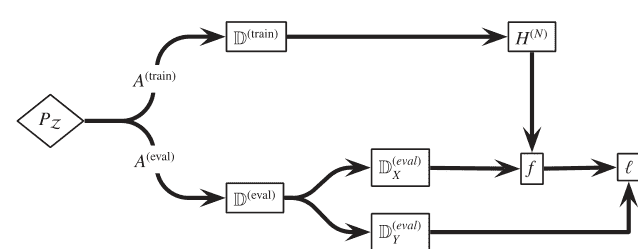

图 3.2 针对学习系统的因果性攻击示意图（参见图 2.1）。

由对抗者（参见第 3.4 节）。但是，除了改变评估数据外，因果性攻击还允许对抗者通过第二个转换 $A^{(\text{train})}$ 修改训练数据，该转换要么转换从 $P_Z$ 抽取的实例，要么在训练期间将 $P_Z$ 更改为替代分布 $P_Z^{(\text{train})}$。当然，对抗者可以同步 $A^{(\text{train})}$ 和 $A^{(\text{eval})}$ 以最好地实现其所需目标，尽管在某些因果性攻击中，对抗者只能控制训练数据（例如，我们在第 5 章中描述的攻击者无法控制评估期间发送的非垃圾邮件）。还要注意，由于这里描述的游戏对应于批量学习，自适应程序 $A^{(\text{train})}$ 是不必要的，尽管分布 $P_Z^{(\text{train})}$ 可以是非平稳的。

#### 3.5.1 因果性游戏

因果性攻击的游戏与探索性攻击的游戏相似，但为攻击者增加了一步行动。

- 1 防御者 选择程序 $H^{(N)}$ 用于选择假设
- 2 攻击者 选择程序 $A^{(\text{train})}$ 和 $A^{(\text{eval})}$ 用于选择分布
- 3 评估：
  - 计算 $P_Z^{(\text{train})} \leftarrow A^{(\text{train})}(P_Z, H)$
  - 从 $P_Z^{(\text{train})}$ 中采样数据集 $\mathbb{D}_Z^{(\text{train})}$
  - 计算 $f \leftarrow H^{(N)}(\mathbb{D}_Z^{(\text{train})})$
  - 计算 $P_Z^{(\text{eval})} \leftarrow A^{(\text{eval})}(\mathbb{D}^{(\text{train})}, f)$
  - 从 $P_Z^{(\text{eval})}$ 中采样数据集 $\mathbb{D}^{(\text{eval})}$
  - 评估总成本：$\sum_{(x,y) \in \mathbb{D}^{(\text{eval})}} \ell_x(f(x), y)$

该游戏与探索性游戏非常相似，但攻击者可以选择 $A^{(\text{train})}$ 以影响训练数据 $\mathbb{D}^{(\text{train})}$。攻击者对数据可能具有各种类型的影响程度，从对某些实例比例的任意控制，到对数据生产某些方面的微小偏差影响；具体细节取决于设置。同样，损失函数 $\ell_x(\cdot, \cdot, \cdot)$ 允许与实例相关的成本。

##### _PAC 学习中的污染_

Kearns & Li (1993) 扩展了 Valiant 的 _概率近似正确_（PAC）学习框架（参见 Valiant 1984, 1985），以证明训练数据中恶意选择的错误的界限。在 PAC 学习中，如果算法能以至少 \(1 - \delta\) 的概率学习出一个假设，该假设对从相同分布中抽取的示例做出错误预测的概率最多为 \(\epsilon$，则该算法成功。Kearns & Li 研究了攻击者对某些比例 \(\beta\) 的训练示例具有任意控制权的情况（这指定了 _A_<sup>(train)</sup> 在我们的 _因果性_ 游戏中采取的形式）。他们证明，一般而言，如果 \(\beta \ge \epsilon/(1 + \epsilon)$，攻击者可以阻止学习者成功，并且对于某些类别的学习者，他们表明该界限是紧的。

这项工作为在特定对抗环境中成功进行 PAC 学习的能力提供了重要的局限性。分析广泛涉及 _完整性_ 和 _可用性_ 攻击以及 _目标性_ 和 _不区分目标的_ 变体。但是，并非所有学习系统都属于 PAC 学习模型。

#### 3.5.2 因果性完整性攻击

在这些攻击中，对抗者积极试图破坏学习机制，以便原本不允许的恶意活动得以发生。在 _因果性完整性_ 攻击中，攻击者利用对训练的控制，使入侵以假阴性的形式绕过分类器。

##### 示例 3.3 (预见的入侵)

攻击者希望防御者的 IDS 不要标记一种新型病毒。防御者定期在网络流量上进行训练，因此攻击者发送经过精心挑选以看起来像病毒的非入侵流量，以误导学习者未能拦截它。如果攻击者已经有一个特定的病毒可执行文件要发送，并需要导致学习者错过该特定实例，则此示例将是 _目标性_ 的。另一方面，如果攻击者有一定的有效载荷，但可以使用大量现有漏洞利用机制中的任何一种来传输该有效载荷，则它将是 _不区分目标的_，在这种情况下，攻击只需在任何一个恶意可执行文件上欺骗学习者即可。

##### _红鲱鱼攻击_

Newsome 等人 (2006) 针对 Polygraph (Newsome 等人 2005) 提出了 _因果性完整性_ 和 _因果性可用性_ 攻击，Polygraph 是一种多态病毒探测器，它同时使用合取学习器和类似朴素贝叶斯的学习器来学习病毒签名。他们的针对合取学习器的 _红鲱鱼_ 攻击利用了其他学习算法通常不存在的某些弱点。该攻击在引入有效载荷的同时引入了虚假特征；一旦学习者构建了一个签名，虚假特征就会从后续的恶意实例中删除，以规避合取规则，这些规则要求所有识别出的特征都存在才能匹配 Polygraph 学习到的签名。即使在重新训练发生时，此攻击也允许攻击者保持较高的假阴性率，因为攻击者可以引入许多虚假特征并逐步删除它们。从概念上讲，此攻击对应于将 \( P_{\mathcal{Z}} \) 转换为 \( P_{\mathcal{Z}}^{(\text{train})} \) 和 \( P_{\mathcal{Z}}^{(\text{eval})} \) 的转换。此转换将虚假特征引入防御者用于训练的所有恶意实例中。然而，由 \( P_{\mathcal{Z}}^{(\text{eval})} \) 生成的恶意实例缺少某些虚假特征，因此绕过了过滤器，该过滤器错误地概括了所有虚假特征都是恶意行为的必要元素。Venkataraman、Blum 和 Song (2008) 也根据红鲱鱼攻击给出了学习蠕虫签名的下界。

##### 解药

我们还与伯克利和 Intel Labs 的同事合作，探讨了基于主成分分析（PCA）的全网流量异常检测器的漏洞，该方法由 Lakhina 等人 (2004b) 介绍。我们的工作考察了攻击者如何利用 PCA 的敏感性来构建 *因果性完整性* 攻击（Rubinstein 等人，2009a）。在预期 DoS 攻击时，攻击者会系统地注入流量，以增加目标流沿链路的方差并误导异常检测系统。我们还研究了 Croux、Filzmoser 和 Oliveira (2007) 的基于投影追迹的稳健 PCA 算法如何显著降低中毒的影响。我们在第 6 章中详细介绍了这项工作。

##### 优化表述

Biggio、Nelson 和 Laskov (2012) 将支持向量机上的 *因果性* 攻击表述为优化问题，借鉴了增量学习 (Cauwenberghs & Poggio 2000) 的工作，以确定要注入训练集的污染点。该优化通过梯度下降近似。自此以后，将攻击作为优化的方法在文献中多次出现。Xiao、Biggio、Brown、Fumera、Eckert 和 Roli (2015) 考察了特征选择对训练鲁棒性的影响，补充了 Li & Vorobeychik (2014) 对 *探索性* 鲁棒性的评估，例如在恶意软件样本上证明了在仅控制 5% 训练集的情况下，LASSO 的性能可以降至随机选择。Li、Wang、Singh 和 Vorobeychik (2016) 还使用基于梯度下降的方法探索了协作过滤方法上的 *因果性* 攻击，但针对非光核范数目标，使用交替最小化和核范数最小化。

Mei 和 Zhu (2015b) 将 *因果性* 攻击的对抗性学习游戏早期步骤表述为双层优化，其中防御者在较低级别优化中进行学习，而攻击者在顶层污染训练数据。他们表明，在学习者目标可微分且凸的条件下，可以通过 KKT 方法将优化简化为单层优化，并使用（投影）梯度下降来寻找攻击训练集。最后，他们将其与机器教学建立联系


及教授维度 (Goldman & Kearns 1995)，其中训练数据由教师生成，以引导学习者达到预设假设。

作为这些思想的应用，作者探索了潜在狄利克雷分配（Mei & Zhu 2015a）的安全性，展示了词在主题间的提升（降级）。

Alfeld, Zhu, & Barford (2016) 还将这些攻击应用于时间序列分析的自回归模型，动机源于天然气价格的期货市场操纵。攻击者拥有目标预测，并在所实现预测的二次损失下优化投毒数据。对手在攻击优化时能够扰动过去的协变量，模拟一种“粉饰账簿”的场景，其中过去的报告可能被操纵。考虑了攻击者扰动的硬约束和软约束。虽然他们的示例针对弱平稳模型（其中一阶矩和协方差随时间保持平稳）进行计算，但他们寻找污染数据的凸优化方法是通用的。Torkjomani & Lowd (2013) 考虑了集体分类的对抗性学习：一种学习任务，其中实例的标签可能存在依赖关系，前提是相关对象更有可能具有相似的标签（关联性）。他们提出了一个凸二次规划公式。他们的实验结果表明，在某些情况下，提高抗攻击鲁棒性的技术也可以带来更好的未受攻击性能。

#### 3.5.3 导致性可用性攻击

这种较少见（但仍然充分合理）的攻击试图破坏学习系统，导致无害数据被显著误分类，从而干扰正常系统运行。在导致性可用性攻击中，攻击者利用对训练实例的控制干扰系统运行，例如通过阻止合法流量。

##### 示例 3.4（流氓入侵检测系统）

攻击者使用入侵检测系统（IDS）来干扰防御者网络上的运行。攻击者希望流量被阻止，以便目标不接收它。当防御者收集训练数据来训练 IDS 时，攻击者生成与良性流量相似的攻击流量。当学习者在攻击数据上重新训练时，IDS 会开始将良性实例过滤掉，仿佛它们是入侵一样。此攻击可能是有目标的，针对特定协议或目标。另一方面，它可能是不加区分的，并试图阻止相当大比例的所有合法流量。

##### 过敏攻击

Chung & Mok (2006, 2007) 针对 Autograph 蠕虫签名生成系统（Kim & Karp 2004）提出了过敏攻击。Autograph 分两个阶段运行。首先，它基于行为模式（特别是扫描行为）识别受感染节点。其次，它观察来自嫌疑节点的流量，并基于观察到的模式推断阻断规则。Chung 和 Mok 描述了一种针对特定资源流量的攻击。在第一阶段，攻击节点通过扫描网络让 Autograph 相信它已被感染。在第二阶段，攻击节点发送模仿目标流量的精心构造数据包，导致 Autograph 学习阻断合法访问并创建拒绝服务事件的规则。

在 *导致性* 游戏的背景下，攻击者对 $P_z^{(\text{train})}$ 的选择为 Autograph 学习的两个阶段都提供了流量。当 Autograph 生成一个依赖于攻击者精心构造流量的假设 $f$ 时，它将阻止访问来自 $P_z^{(\text{eval})}$ 且与恶意流量共享模式的合法流量。

##### *关联异常值攻击*

Newsome et al. (2006) 还建议针对 Polygraph 病毒检测器 (Newsome et al. 2005) 发动 *关联异常值攻击*。此攻击通过向正例训练实例添加虚假特征，针对检测器的朴素贝叶斯类似组件，导致过滤器阻止带有这些特征的良性流量。与红鲱鱼攻击类似，这些关联异常值攻击完美契合 *导致性* 游戏；这次 $P_z^{(\text{train})}$ 在恶意实例中包含虚假特征，导致 $H^{(N)}$ 生成一个将许多良性实例分类为恶意的 $f$。

##### *攻击 SpamBayes*

在垃圾邮件过滤领域，我们还探索了针对 SpamBayes 统计垃圾邮件分类器（Nelson et al. 2008, Nelson, Barreno, Chi, Joseph, Rubinstein, Saini, Sutton, Tygar, & Xia 2009）的 *导致性可用性* 攻击。在这些攻击中，我们证明，通过发送包含整个词典令牌的电子邮件，攻击者可以用相对较少的污染导致相当一部分正常电子邮件被误分类为垃圾邮件（*不加区分的* 攻击）。同样，如果攻击者能预料到特定的目标消息，那么攻击者也可以污染学习者以将目标误分类为垃圾邮件（*目标式* 攻击）。我们还研究了一种抵御这些 *词典攻击* 的原则性防御：*拒绝负面影响（RONI）防御*。我们将在第 5 章详细讨论这项工作。

##### *攻击 Malheur*

在无监督学习者领域，Malheur（一个开源的行为恶意软件聚类工具）（Rieck, Trinius, Willems, & Holz 2011）被发现极易受到即使是非常低水平的 *不加区分的导致性可用性* 攻击（Biggio, Rieck, Ariu, Wressnegger, Corona, Giacinto, & Roli 2014）：通过污染聚类拟合的数据来攻击恶意软件聚类的 DoS 攻击。作者通过本质上在恶意软件样本空间中行走，仅执行特征添加（类似于词典攻击的方式）来避免特征反演问题。

#### **3.5.4 防御导致性攻击**

安全学习文献中提出的大多数防御都针对 *探索性完整性* 攻击（如前所述），而提出的应对导致性攻击的防御相对较少。在导致性攻击中，攻击者不仅对评估分布，还对训练分布拥有一定控制权。因此，我们考虑的学习程序必须能够抵御受污染的训练数据，并满足第 3.4.4 节讨论的评估注意事项。

防御的两种一般策略是从训练集中删除恶意数据，以及增强学习算法以抵御恶意训练数据。我们首先介绍一种前者的方法，然后描述文献中出现的两种后者的方法。这些方法的基础主要在于将博弈论技术应用于分析和设计弹性学习算法。

##### 3.5.4.1 拒绝负面影响防御

隐蔽的导致性攻击使学习本质上更加困难。在许多情况下，数据清理可能是实现可接受性能的唯一现实机制。例如，Nelson et al. (2009) 引入了一种称为拒绝负面影响的清理技术，该技术测量添加每个训练实例的经验影响，并丢弃对分类准确性有重大负面影响的实例。为了确定候选训练实例是否恶意，防御者在基础训练集上训练一个分类器，然后将候选实例添加到训练集，并训练第二个分类器。防御者将两个分类器应用于带有已知标签的测试集实例，并测量两个分类器之间的准确率差异。如果将候选实例添加到训练集导致生成的分类器产生显著更多的分类错误，则防御者会永久删除该实例，因为它产生了有害影响。我们将在第 5.5.5 节中通过实验完善和探索拒绝负面影响防御。

##### 3.5.4.2 在受污染数据下学习

文献中已经研究了几种在对抗性污染下进行学习的方法。对抗性污染对学习者性能的影响已被纳入某些现有学习框架中。如前所述，Kearns & Li (1993) 将 PAC 学习模型扩展为允许训练数据中存在对抗性噪声，并界定了学习者可以容忍的污染量。另外，稳健统计学领域（Huber 1981; Hampel et al. 1986; Maronna, Martin, & Yohai 2006）用最坏情况污染模型形式化了对抗性污染，研究人员由此推导出设计和比较统计程序对抗性噪声鲁棒性的标准。研究将这些鲁棒性标准与更传统的学习领域相结合（Christmann & Steinwart 2004; Wagner 2004），但通常这些技术并未广泛应用于机器学习，更不用说安全领域了。我们将在下一节进一步讨论此领域。

为了推导安全核方法，Russu, Demontis, Biggio, Fumera, & Roli (2016) 借鉴了 Xu, Caramanis, & Mannor (2009) 的结果，即支持向量机学习与在对抗性扰动下无正则化铰链损失最小化的等价性，其中扰动大小由原始 SVM 问题的对偶范数界定。他们将非线性 SVM 预测值的变化上界以变化


在数据点和测量变化的范数中。针对稀疏逃避攻击，作者认为拉普拉斯核更适合防御，而对于密集攻击，防御者应采用 RBF 核。作者主张对正则化项、核和正则化参数（可能取决于类或示例）进行选择，利用鲁棒性与正则化参数之间的联系。此前，Torkamani & Lowd (2014) 针对结构化预测模型探讨了相关问题，具体而言是结构化 SVM，利用对扰动鲁棒的优化与对非鲁棒学习器适当正则化之间的联系。然而，此处结构化输出的空间呈指数级大小。

Alfeld, Zhu, & Barford (2017) 重新审视了他们早期关于自回归模型上 Causative 攻击的研究（Alfeld et al. 2016），并考虑基于双层优化的防御策略，其中防御者的动作集包含定义椭圆的线性投影，攻击者从中选择投毒攻击。通过假设零和游戏中的理性攻击者，他们将防御表述为归约为 minimax 的双层优化。更一般地，该框架在离散动作集下运行。在此框架下，他们计算出能显著降低期货市场数据集实验中防御者损失的最优防御。

另一种对抗性学习模型基于在线专家学习设置（Cesa-Bianchi & Lugosi 2006）。与设计针对行为良好的静态随机数据中对抗性污染具有鲁棒性的学习器不同，此处的技术侧重于遗憾最小化，以构建能适应完全对抗性条件的集合学习者。遗憾最小化技术的目标是根据专家的过去表现动态聚合许多专家的决策，使得集合学习者相对于事后回顾的最佳单一专家表现良好。我们在第 3.6 节讨论这一组技术。

##### 3.5.4.3 鲁棒性

鲁棒统计学领域探讨限制少量偏离（对抗性）训练数据影响的程序。在鲁棒统计学设置中，假设大部分数据是从已知行为良好的随机模型生成的，但一部分数据来自未知对抗模型——目标是界定这种对抗性数据对统计估计的影响。衡量程序鲁棒性有多种指标：崩溃点是攻击者任意操纵程序所需的污染水平，影响函数度量污染对程序的影响。鲁棒性指标可用于评估现有系统的易受攻击性，并提出减少或消除漏洞的替代方案。理想情况下，人们希望使用具有高崩溃点和界定影响函数的程序。这些指标可用于比较候选程序，并设计针对训练数据对抗性污染具有最优鲁棒性的程序 H^(N)。在此我们总结这些概念，但要全面了解这些主题，请参阅 Huber (1981)、Hampel et al. (1986) 和 Maronna et al. (2006) 的著作。

为了激发鲁棒统计学在对抗性学习中的应用，请回顾第 2.2 节介绍的传统学习框架。特别是，在第 2.2.4 节中，我们讨论选择最小化经验风险的假设。不幸的是，在对抗性环境中，学习模型所做的假设（如导致经验风险最小化的平稳性）可能会被违反。理想情况下，人们希望模型假设中的轻微偏离不会对基于这些假设推导出的最优程序产生重大影响。不幸的是，情况并非总是如此——假设中的小规模对抗性偏离可能对许多现实世界的学习程序产生深远影响。正如 Tukey (1960) 所述，

对理想模型的偏离被忽略时所抱有的一种默认希望是，这些偏离无关紧要；在严格模型下最优的统计程序在近似模型下仍然近似最优。不幸的是，事实证明这种希望往往大错特错：即使是轻微的偏离，其影响也往往远大于大多数统计学家所预期的。

这些缺陷也可能被对手利用，即使仅限于少量污染，也能误导学习算法。为了避免此类漏洞，必须扩展最优性概念，使其包含对模型假设的某种形式 *鲁棒性*；正如 Huber (1981) 所定义，“鲁棒性意味着对假设中微小偏离的不敏感性。”然而，程序效率与其鲁棒性之间存在根本权衡——这一问题由鲁棒统计学领域解决。

用于评估统计估计量 $H$ 的分布鲁棒性的模型称为总误差模型，它是已知分布 $F_Z$ 与某些未知分布 $G_Z$ 的混合，由污染比例 $\epsilon$ 参数化，
\(\mathcal{P}_{\epsilon}(F_{\mathcal{Z}}) \triangleq \{(1 - \epsilon)F_{\mathcal{Z}} + \epsilon G_{\mathcal{Z}} \mid G_{\mathcal{Z}} \in \mathcal{P}_{\mathcal{Z}}\}\)
其中 $\mathcal{P}_{\mathcal{Z}}$ 是 $\mathcal{Z}$ 上所有概率分布的集合。污染邻域的概念为鲁棒性提供了 *minimax 方法*，即在总误差模型中考虑最坏情况分布。从历史上看，minimax 方法产生了一类称为 *Huber 估计量* 的鲁棒估计量。此外，它引入了崩溃点 $\epsilon^*$ 的概念——直观地说，这是估计量的 minimax 渐近偏差变为无穷大时的最小污染水平。

另一种方法是考虑估计量 $H$ 由于无穷小污染比例而产生的（缩放）变化。再次考虑总误差模型，并定义在单一点 $z$ 处局部化的无穷小污染方向上的导数。通过分析污染引起的估计量缩放变化，可以评估在点 $z$ 处添加污染对估计量的 *影响*。这产生了一个称为影响函数的函数，定义为
\(\text{IF}(z; H, F_{\mathcal{Z}}) \triangleq \lim_{\epsilon \to 0} \frac{H((1 - \epsilon)F_{\mathcal{Z}} + \Delta_{\epsilon}) - H(F_{\mathcal{Z}})}{\epsilon}\)
其中 $\Delta_z$ 是所有概率质量都位于点 $z$ 的分布。该函数已针对多种估计量推导，并产生了几种（无穷小）鲁棒性概念。其中最突出的指标是总误差灵敏度，定义为
\[
\gamma^* (H, F_{\mathcal{Z}}) \triangleq \sup_z |IF (z; H, F_{\mathcal{Z}})|.
\]
直观地说，有限的总误差灵敏度提供了对无穷小点污染的鲁棒性概念。

研究强调了鲁棒程序在安全和学习任务中的重要性。Wagner (2004) 观察到，常见的传感器网络聚合程序（例如计算平均值）对对抗性点污染不具鲁棒性，并确定了鲁棒替代方案作为对恶意或失效传感器的防御。Christmann & Steinwart (2004) 研究了一般学习方法族的鲁棒性。他们的结果表明，某些常用损失函数结合适当的正则化，会导致具有界定影响函数的鲁棒程序。这些结果表明，此类程序对安全学习具有理想特性，我们将在第 9.1 节再次讨论。

### 3.6 重复学习博弈

在第 3.4.1 节和第 3.5.1 节中，所考虑的学习博弈是一次性博弈，即防御者和攻击者在每次行动仅发生一次时最小化其成本。我们将这些博弈推广为迭代博弈，其中玩家对迭代 *Causative* 游戏进行一系列 \(K\) 次重复，其最终目标是最小化总累积成本。我们假设玩家可以获取游戏之前迭代的所有信息，并赋予攻击者对训练数据的未指定（可能是任意的）控制权。在每次迭代中，防御者做出预测，随后了解真实标签并承受一定损失。

评估防御者玩游戏的绝对累积成本——即随机或 PAC 设置中风险的类比——由于数据的强对抗性特征而不可能。相反，通常的做法是将学习者承担的累积成本与任意 \(M\) 名专家（事后回顾）所能实现的最低成本进行比较，即一组各自设计以提供不同安全属性的分类器。这种相对（加性）性能指标称为遗憾，因为它代表了学习者因未听从事后回顾的最佳专家建议而感到的遗憾。学习者总成本与专家最低总成本之间的类比乘性比率是相关的竞争比率。

最常见的是，在线学习者根据专家的建议形成集合预测。因此，专家可以被视为向防御者提供建议（因此得名），防御者对建议进行加权以生成集合预测；例如，集合预测可以是专家预测的加权多数（Littlestone & Warmuth 1994）。此外，在每次迭代结束时，防御者使用新揭示的真实标签，根据每个专家的预测来重新对每个专家进行加权。


性能。不对专家如何形成其建议或其性能做任何假设；事实上，他们的建议可能是对抗性的，并可能导致任意损失。

通过开发具有可证明的小遗憾的算法，复合预测器在不知道哪个专家事先最好的情况下，能够表现得与最佳专家相当。通过设计最小化遗憾的策略，在线学习提供了一种优雅的机制，将多个预测器（每个都以不同方式设计来解决安全问题）合并为一个单一预测器，该预测器根据其组件的性能进行调整——同时面对任意对抗性数据。因此，攻击者必须设计在一组预测器上均匀成功的攻击，而不仅仅是针对单个预测器，因为复合学习者可以在不知道事先应遵循哪个专家的情况下，几乎与最佳专家一样表现。

我们现在深入探讨在线学习环境，但有关完整描述和几种遗憾最小化算法，请参见 Cesa-Bianchi & Lugosi (2006)。

如前所述，学习者从M个专家预测中形成预测，并根据其在K次重复中的性能调整其预测器 $h^{(k)}$。在游戏的每个步骤 $k$ 中，防御者从第 $m^{th}$ 个专家\(^2\) 接收预测 $\hat{y}^{(k,m)}$，并通过 $h^{(k)}$ 做出复合预测 $\hat{y}^{(k)}$。在防御者做出预测后，真实标签 $y^{(k)}$ 被揭示，防御者评估每个专家的即时遗憾；即，复合预测的损失与第 $m^{th}$ 个专家预测的损失之差。更正式地说，基于专家的预测游戏的第 $k^{th}$ 轮如下\(^3\)：

- 1 防御者更新函数 \( h^{(k)} : \mathcal{Y}^M \rightarrow \mathcal{Y} \)
- 2 攻击者选择分布 \( P_Z^{(k)} \)
- 3 评估：
  - 采样实例 \( (x^{(k)}, y^{(k)}) \sim P_Z^{(k)} \)
  - 计算专家建议 \( \{ \hat{y}^{(k,m)} \}_{m=1}^M \); 例如，\( \hat{y}^{(k,m)} = f^{(m)}(x^{(k)}) \)
  - 预测 \( \hat{y}^{(k)} = h^{(k)}(\hat{y}^{(k,1)}, \hat{y}^{(k,2)}, \dots, \hat{y}^{(k,M)}) \)
  - 计算即时遗憾: \( r^{(k,m)} = \ell \left( \hat{y}^{(k)}, y^{(k)} \right) - \ell \left( \hat{y}^{(k,m)}, y^{(k)} \right) \) 对每个专家 \( m = 1 \dots M \)

该游戏的结构与我们在第3.4.1节和3.5.1节中介绍的游戏略有不同——在这里，防御者在游戏开始时选择一种策略，然后在每次迭代中根据该策略更新函数 \( h^{(k)} \)。仅根据每个专家的过去表现（即游戏前 $k-1$ 次迭代中观察到的遗憾），防御者在游戏的第 $k^{th}$ 步选择一种在线策略来更新 $ h^{(k)} $ 以最小化遗憾（Cesa-Bianchi & Lugosi 2006）。

\(^2\) 专家的建议可能基于数据，但防御者不对专家如何形成其建议做任何假设。

\(^3\) 我们再次假设防御者和攻击者的成本是对称的，并由损失函数表示。此外，如第2.2.4节所述，我们简化游戏以使用替代损失函数来代替0-1损失。最后，该游戏也易于推广到每一轮生成多个实例/标签的情况。

最后，在游戏结束时，根据其最坏情况遗憾 \(R^*$ 对防御者进行评估，该遗憾定义为相对于第 \(m^{\text{th}}\) 个专家的累积遗憾 \(R^{(m)}\) 如下：

\(R^{(m)} \triangleq \sum_{k=1}^K r^{(k,m)}\)
\(R^* \triangleq \max_m R^{(m)}.\) (3.1)

如果 \(R^*$ 较小（相对于 \(K\)），则防御者的聚集算法在不知道哪个专家将是最好的情况下，表现得几乎与最佳专家一样好。此外，根据公式(3.1)和即时遗憾的定义，平均遗憾仅仅是 \(h^{(k)}\) 的风险与 \(f^{(m)}\) 的风险之差。如果平均最坏情况遗憾很小（即当 \(K$ 趋于无穷大时趋近于0）且最佳专家具有较小风险，则预测器 \(h^{(k)}\) 也具有较小风险。这激发了对遗憾最小化程序的研究。大量研究探讨了在多种环境中选择 \(h^{(k)}$ 以最小化遗憾的策略。

基于专家的在线预测将风险最小化分为两个子问题：(i) 最小化每个专家的风险和(ii) 最小化平均遗憾；也就是说，仿佛我们在游戏开始前就知道了最佳预测器 \(f^{(*)}$ 并且在游戏的每一步都简单地使用其预测。我们讨论过的防御方法解决了第一个问题。遗憾最小化技术解决了第二个问题。对于游戏的某些变体，存在遗憾为 \(o(K)$ 的复合预测器——也就是说，随着 \(K$ 增加，平均遗憾趋近于0。这实际上允许防御者同时使用多种策略，并迫使攻击者设计针对所有这些策略都有效的攻击。

#### 3.6.1 安全领域中的重复学习游戏

到目前为止，前面概述的博弈论形式的在线学习在安全领域的应用相对较少。虽然这些技术天然旨在管理一种最坏情况风险，但它们传统上仅被应用于减轻金融风险，例如用于通用投资组合管理（Cover 1991; Helmbold, Singer, Schapire, & Warmuth 1998; Kalai & Vempala 2002）。

然而，安全社区内对在线学习的兴趣正在缓慢增长。我们与伯克利和斯坦福的合作者合作，将在线学习应用于为抽象首席信息安全官（CISO）开发一种反应式风险管理策略（Barth, Rubinstein, Sundararajan, Mitchell, Song, & Bartlett 2012）。在这个游戏中，CISO必须防御一位强大的攻击者，该攻击者可以通过各种行动集（攻击图中的边或超边）从一个入侵状态渗透到另一个入侵状态（攻击图中的节点）。当攻击者到达某些节点时，防御者会承担一定成本，但防御者可以将有限的防御预算应用到图的边上，迫使攻击者承担与应用预算成比例的成本。防御者面临着一场看似艰苦的战斗，因为它永远不会了解攻击者的节点回报，并且仅在首次被攻击后才得知图的结构。然而，我们表明，在自适应CISO下，攻击者的投资回报率/利润总是趋近于对应于主动风险管理的最佳（极小极大）固定防御策略下的攻击者的投资回报率/利润。此外，我们表明在许多实际场景中，自适应防御者表现显著更好。也就是说，在抽象环境中，反应式安全最坏情况下趋近于主动安全的性能，或最好情况下优于它。我们的算法和分析在很大程度上借鉴了在线学习理论的现有结果。在我们当前的安全学习分类法的背景下，攻击者基本上旨在对防御者实施*因果性完整性*攻击，尽管学习者并非严格执行二元分类。

Blocki, Christin, Datta, & Sinha (2011) 也将在线学习理论应用于安全研究。他们的工作为审计机制提出了一种基于学习理论的基础，其中在线学习理论中的遗憾概念被应用于定义自适应审计机制的可取属性：其成本（由执行的事务检查的数量和类型以及由于外部机构检测到的遗漏违规导致的品牌损害成本组成）应趋近于采用最佳固定策略的假设审计员的成本。作者开发了一种自适应审计机制，该机制可证明地渐进地最小化遗憾，并且收敛速度快。

将在线学习方法与计算均衡策略的结果相结合（而不是从表现不佳的均匀随机策略开始）是Klíma, Lísý, & Kiekintveld (2015)提出和探讨的一种想法。潜在地，这种混合方法可以同时享受两个社区的好处。

重复学习游戏显然具有为安全敏感环境提出有用自适应算法的潜力，遗憾最小化算法在设计上就适合对抗强大的对手。现有研究是朝着正确方向迈出的一步，其中防御旨在抵御真正活跃的对手。然而，需要更多工作来将这些想法应用于安全领域内的其他领域，并且需要实证研究来在较不理想化的现实场景中评估这些方法。

### 3.7 隐私保护学习

隐私保护学习的目标是在数据集上发布汇总统计信息或机器学习结果，而不泄露关于单个数据元素的本地信息。在我们的分类法语言中，隐私保护学习应能抵御旨在违反*隐私*的*探索性*或*因果性*攻击。拥有发布的统计数据、模型或分类器访问权限的攻击者可能会对其进行探测，试图揭示关于训练数据的信息（*探索性隐私*攻击）；此外，对某些比例的训练示例具有影响力的攻击者可能会试图


操纵机制以泄露关于未知训练样本的信息（一种致因性隐私攻击）。如此一来，隐私目标代表了对Barreno et al. (2006)最初提出的分类学所考虑的机器学习系统安全目标的重要扩展。

本节概述了防御隐私攻击的当前最新技术：大多数公开的隐私泄露事件并非严格违反自适应系统的隐私目标，而是常常是关联攻击，或者是在系统完整性被破坏后发布敏感数据（Narayanan & Shmatikov 2008; Sweeney 2002; Barbaro & Zeller 2006; Homer, Szelinger, Redman, Duggan, Tembe, Muchling, Pearson, Stephan, Nelson, & Craig 2008）。如前所述，我们在此单独讨论隐私目标，与之前基于INFLUENCE和SPECIFICITY的错误分类攻击（完整性或可用性）的讨论分开。尽管这些轴同样适用于对隐私攻击进行分类，但保护隐私的主要形式化（即防御）在所有这些轴的各个层面都提供了非常强的理论保证。

接下来，我们将概述被称为差分隐私的领先隐私保护度量，讨论该定义如何针对探索性攻击和致因性攻击提供某些可量化的保护，并描述现有关于学习者统计效用与其提供的训练数据隐私水平之间固有权衡的研究。

#### 3.7.1 差分隐私

历史上，量化数据分析或数据发布所保护隐私水平的正式度量一直难以捉摸。由于这些命题具有句法而非语义的性质，许多定义被提出后又搁置，最著名的包括k-匿名性及其变体（Sweeney 2002; Machanavajjhala, Kifer, Gehrke, & Venkitasubramaniam 2007）。然而，Dwork et al. (2006)提出的差分隐私概念已成为一种强有力的隐私保证，其形式化根源受到密码学的影响。该定义在理论界获得了大量关注（Dinur & Nissim 2003; Blum, Dwork, McSherry, & Nissim 2005; Dwork et al. 2006; Dwork 2006; Barak, Chaudhuri, Dwork, Kale, McSherry, & Talwar 2007; Blum, Ligett, & Roth 2008; Dwork, Naor, Reingold, Rothblum, & Vadhan 2009; Dwork, McSherry, & Talwar 2007; McSherry & Talwar 2007; Kasiviswanathan, Lee, Nissim, Raskhodnikova, & Smith 2008; Dwork & Yekhanin 2008; Dwork & Lei 2009; Beimel, Kasiviswanathan, & Nissim 2010; Hardt & Talwar 2010; Smith 2011; Hardt, Ligett, & McSherry 2012; Duchi, Jordan, & Wainwright 2013; Bassily, Smith, & Thakurta 2014），普遍共识是该形式化定义既有意义又适当地强，同时允许保护隐私概念的统计学习方法具有实用价值（Rubinstein, Bartlett, Huang, & Taft 2009; McSherry & Mironov 2009; Barak et al. 2007; Kasiviswanathan et al. 2008; Dinur & Nissim 2003; Dwork & Yekhanin 2008; Machanavajjhala, Kifer, Abowd, Gehrke, & Vilhuber 2008; Beimel et al. 2010; Hardt & Talwar 2010; Chaudhuri, Monteleoni, & Sarwate 2011; Hardt et al. 2012; Cormode, Procopiuc, Srivastava, Shen, & Yu 2012; Zhang, Zhang, Xiao, Yang, & Winslett 2012; Li, Hay, Miklau, & Wang 2014; He, Cormode, Machanavajjhala, Procopiuc, & Srivastava 2015; Wang, Fienberg, & Smola 2015）。

在讨论其在对抗机器学习当前环境中的主要特征之前，我们现在回顾差分隐私的定义。我们遵循差分隐私著作中最常见的术语，该术语受到统计数据库研究根源的影响；与第2章中引入的现有记号和术语的对应关系将非常清楚。Dwork & Roth (2014)对差分隐私进行了全面的阐述。

数据库 \(\mathbb{D}\) 是 *行* 的序列 \(\mathbf{x}^{(1)}, \dots, \mathbf{x}^{(N)}\)，通常是二进制或实向量，但可以属于任何域 \(\mathcal{X}\)。在可以访问 \(\mathbb{D}\) 的情况下，*机制* \(M\) 的任务是发布关于 \(\mathbb{D}\) 的聚合信息，同时保持各行的隐私。特别是，我们假设 *响应* \(M(\mathbb{D}) \in \mathcal{T}_M\) 是机制发布的唯一信息。该响应可以是 \(\mathbb{D}\) 上的标量统计量，如均值、中位数或方差，也可以是模型，例如估计联合密度的参数或学习分类器的权重向量。如果一对数据库 \(\mathbb{D}^{(1)}, \mathbb{D}^{(2)}\) 在一行上有所不同，则称它们为 *邻接*。有了这些定义，我们可以描述Dwork et al. (2006)提出的以下正式隐私度量。

定义 3.1 对于任何 \(\epsilon > 0\)，随机化机制 \(M\) 实现 \(\epsilon\)-*差分隐私* 当且仅当，对于所有 *邻接* 数据库对 \(\mathbb{D}^{(1)}, \mathbb{D}^{(2)}\) 和所有可测响应子集 \(T \subseteq \mathcal{T}_M\)，机制满足⁴

\(\text{Pr}(M(\mathbb{D}^{(1)}) \in T) \le \exp(\epsilon)\text{Pr}(M(\mathbb{D}^{(2)}) \in T).\)

⁴ 定义中的概率是关于机制 \(M\) 的随机化，而不是关于数据库，数据库是固定的。

要理解此定义，请考虑一个差分私有机制 \(M\)，它通过向某个所需的非私有确定性统计量 \(S(\mathbb{D})\) 的响应添加噪声来保护数据隐私，例如 \(N\) 个标量 \(\mathbf{x}^{(1)}, \dots, \mathbf{x}^{(N)}\) 序列的平均值 \(N^{-1} \sum_{i=1}^N \mathbf{x}^{(i)}\)。该定义比较了当某个标量 \(\mathbf{x}^{(i)}\)（即数据库的一行）被更改时，\(M\) 的加噪均值响应的分布。如果该定义在隐私级别 \(\epsilon \ll 1\) 下成立，那么 \(M\) 在数据库 \(\mathbb{D}^{(1)}\) 上响应加噪均值 \(t\) 的可能性，与其在扰动了 \(\mathbf{x}^{(i)}\) 的数据库 \(\mathbb{D}^{(2)}\) 上响应相同 \(t\) 的可能性极为接近：该机制在两个 *邻接* 数据库上的响应分布是逐点接近的。

示例 3.5（私有支持向量机器学习）
作为更实际的例子，我们之前曾与伯克利和英特尔的合作者研究过支持向量机器（SVM）学习的差分私有机制（Rubinstein, Bartlett, Huang, & Taft 2009）。在那里，场景再次是一个我们希望在其上进行推理的私有数据库。然而，该数据库现在由特征向量和二进制标签的行组成，构成了监督二元分类的训练集。所需的推理现在是更复杂的SVM学习任务（Cristianini & Shawe-Taylor 2000）：在线性情况下，我们找到一个最大化训练集边界的超平面法向量；在非线性情况下，我们在由用户定义的核函数诱导的高维特征空间中执行此边界最大化。该机制在此响应表示学习分类器本身的权重向量；响应是函数的参数化。我们针对线性SVM的机制只是向权重向量添加拉普拉斯噪声，我们证明这实现了差分隐私。对于非线性情况，我们首先在具有近似所需核的内积的随机特征空间中求解线性SVM，然后再向相应的解添加噪声；这一初步步骤使我们甚至能够对径向基函数（RBF）等核实现差分隐私，RBF对应于在无限维特征空间中的学习。差分私有SVM学习的另一种方法归功于Chaudhuri et al. (2011)，他们不是向SVM学习的解添加噪声，而是随机扰动用于SVM学习本身的优化。我们在第7章中详细讨论隐私保护SVM学习。

许多其他实用算法已被实现差分私有化，包括正则化逻辑回归（Chaudhuri & Monteleoni 2009）、多种协同过滤算法（McSherry & Mironov 2009）、点估计（Smith 2011）、最近邻、直方图、感知机（Blum et al. 2005）、基于KD树等数据结构的数据库范围查询（Li et al. 2014; He et al. 2015; Cormode et al. 2012）、贝叶斯概率推理（Dimitrakakis, Nelson, Mitrokotsa, & Rubinstein 2014; Zhang, Rubinstein, & Dimitrakakis 2016; Wang et al. 2015）、函数发布（Zhang et al. 2012; Aldà & Rubinstein 2017）等等。

#### 3.7.2 探索性和致因性隐私攻击

关于差分隐私的一个重要观察是，该定义提供了非常强的语义隐私保证。即使对 \(M$ 的随机性有了解，并知道数据库 \(\mathbb{D}\) 的前 \(N-1\) 行，对手也无法从 \(M(\mathbb{D})\) 的一个次线性（关于 \(N\)）样本中获取关于第 \(N\) 行的任何额外信息。对手甚至可能尝试使用此类辅助信息和无界计算资源进行暴力 *探索性* 攻击：

- 1. 对于每个可能的 \(\hat{\mathbf{x}}^{(N)}\)，考虑邻接数据库 \(\mathbb{D}' = \mathbf{x}^{(1)}, \dots, \mathbf{x}^{(N-1)}, \hat{\mathbf{x}}^{(N)}\) 与数据库 \(\mathbb{D}\)。
  - 离线：通过仿真计算 \(M(\mathbb{D}')\) 的响应分布 \(p_{\mathbb{D}'}\)。
- 2. 通过反复查询机制（次线性次数）来估计 \(M(\mathbb{D})\) 的分布为 \(\hat{p}_{\mathbb{D}}\)。
- 3. 通过 \(p_{\mathbb{D}'}\) 中最接近 \(\hat{p}_{\mathbb{D}}\) 的一个来识别 \(\mathbf{x}^{(N)} = \hat{\mathbf{x}}^{(N)}\)。

然而，对于较高的隐私水平（足够小的 \(\epsilon\)），\(\hat{p}_{\mathbb{D}}\) 中的采样误差将大于不同 \(p_{\mathbb{D}'}\) 之间的差异，因此即使是这种强大的暴力探索性攻击也将以高概率失败。同样的稳健性也成立


即使在类似的 *Causative* 攻击设置中，攻击者可以任意操纵前 $N - 1$ 行。

#### 3.7.3 随机性下的效用

The more a target nonprivate estimator is randomized, the more privacy is preserved, but at a cost to utility.
目标非私有估计器越随机化，保留的隐私就越多，但效用会受到影响。

Several researchers have considered this inherent tradeoff between privacy and *utility*.
几位研究者已经考虑过隐私与 *效用* 之间这种固有的权衡。

In our work on differentially private SVM learning (see Chapter 7), we define the utility of our private mechanism to be the pointwise difference between released privacy-preserving classifiers and nonprivate SVM classifiers.
在我们关于差分私有SVM学习的工作中（见第7章），我们将私有机制的效用定义为发布的保护隐私分类器与非私有SVM分类器之间的逐点差异。

A private classifier (trained on $D$) that, with high probability yields very similar classifications to an SVM (trained on $D$), for all test points, is judged to be of high utility since it well approximates the desired nonprivate SVM classifier.
一个私有分类器（在 $D$ 上训练），如果以高概率对所有测试点产生与SVM（在 $D$ 上训练）非常相似的分类结果，则被判定为具有高效用，因为它很好地逼近了所需的非私有SVM分类器。

Similar notions of utility are considered by Barak et al. (2007) when releasing contingency tables whose marginals are close to true marginals; Blum et al. (2008) whose mechanism releases anonymized data on which a class of analyses yield similar results to the original data; and Kasiviswanathan et al. (2008) and Beimel et al. (2010) who consider utility as corresponding to PAC learning where response and target concepts learned on sensitive data are averaged over the underlying measure.
Barak et al. (2007) 在发布边缘分布接近真实边缘分布的列联表时也考虑了类似的效用概念；Blum et al. (2008) 的机制发布匿名数据，在这些数据上一类分析产生与原始数据相似的结果；以及 Kasiviswanathan et al. (2008) 和 Beimel et al. (2010) 将效用视为对应于PAC学习，其中在敏感数据上学习的响应和目标概念在底层度量上进行平均。

Others such as Chaudhuri & Monteleoni (2009) and Chaudhuri et al. (2011) measure the utility of a differential private mechanism not by its approximation of a target nonprivate algorithm, but rather by the absolute error it achieves.
其他研究者（如 Chaudhuri & Monteleoni (2009) 和 Chaudhuri et al. (2011)）衡量差分私有机制的效用，不是通过其对目标非私有算法的逼近，而是通过其达到的绝对误差。

In all of these works, the differentially private mechanism is analyzed with the chosen utility in mind to produce an upper bound on the utility achieved by that particular mechanism.
在所有这些工作中，差分私有机制都是以所选定的效用为出发点进行分析，以给出该特定机制所能达到效用的上界。

Fundamental limits on the tradeoff between differential privacy and utility have also been of great interest in past work, through negative results (lower bounds) that essentially state that mechanisms cannot achieve both high levels of privacy preservation and utility simultaneously.
差分隐私与效用之间权衡的基本限制在过去的工作中也备受关注，通过负面结果（下界）本质上说明机制无法同时实现高水平的隐私保护和效用。

In our work on differentially private SVM learning we establish lower bounds for approximating both linear and RBF SVM learning with any differentially private mechanism, quantifying levels of differential privacy and utility that cannot be achieved together.
在我们关于差分私有SVM学习的工作中，我们建立了使用任何差分私有机制逼近线性和RBF SVM学习的下界，量化了无法同时实现的差分隐私和效用水平。

Dinur & Nissim (2003) show that if the noise of rate only $o(\sqrt{N})$ is added to subset sum queries on a database $\mathbb{D}$ of bits, then an adversary can reconstruct a $1 - o(1)$ fraction of $\mathbb{D}$: if accuracy is too great, then privacy cannot be guaranteed at all.
Dinur & Nissim (2003) 表明，如果仅以 $o(\sqrt{N})$ 的比率向比特数据库 $\mathbb{D}$ 上的子集和查询添加噪声，那么攻击者可以重建 $\mathbb{D}$ 的 $1 - o(1)$ 部分：如果准确性过高，则根本无法保证隐私。

Hardt & Talwar (2010) and Beimel et al. (2010) conducted further studies establishing upper and lower bounds for the tradeoff between utility and privacy in respective settings where the mechanism responds with linear transformations of data and in the setting of private PAC learning.
Hardt & Talwar (2010) 和 Beimel et al. (2010) 进行了进一步研究，分别在机制对数据进行线性变换的设置和私有PAC学习的设置中，建立了效用与隐私之间权衡的上界和下界。

Generic approaches to establish lower bounds in differential privacy (for example, using volumetric packing arguments) are summarized by De (2012).
De (2012) 总结了在差分隐私中建立下界的通用方法（例如，使用体积填充论证）。

Moreover it is noteworthy that lower bounds, such as the above in theoretical differential privacy research, constitute powerful *Privacy attacks* that achieve guaranteed results on *any* privacy-preserving learner.
注意的是，上述理论差分隐私研究中的下界等，构成了强大的 *隐私攻击*，能够在 *任何* 隐私保护学习者上实现保证的结果。

While significant progress has been made in achieving differential privacy and utility, understanding connections between differential privacy and learnability Beimel et al. (2010), algorithmic stability (Rubinstein, Bartlett, Huang, & Taft 2009; Wang, Lei, & Fienberg 2016), robust statistics (Dwork & Lei 2009), and even mechanism design (McSherry & Talwar 2007), many open problems remain in finding more complete understandings of these connections, making practical learning algorithms differentially private, and understanding the tradeoff between privacy and utility.
尽管在实现差分隐私和效用方面取得了重大进展，但在理解差分隐私与可学性 (Beimel et al. 2010)、算法稳定性 (Rubinstein, Bartlett, Huang, & Taft 2009; Wang, Lei, & Fienberg 2016)、稳健统计学 (Dwork & Lei 2009) 甚至机制设计 (McSherry & Talwar 2007) 之间的联系方面，在寻找这些联系的更完整理解、使实用学习算法具有差分隐私性以及理解隐私与效用之间的权衡方面，仍然存在许多未解决的问题。

# 第二部分

# 对机器学习的 Causative 攻击

## 4 攻击超球学习者

In the second part of this book, we elaborate on _Causative_ attacks, in which an adversary actively mistrains a learner by influencing the training data.
在本书的第二部分，我们详细阐述了 _Causative_ 攻击，其中攻击者通过影响训练数据主动对学习者进行错误训练。

We begin in this chapter by considering a simple adversarial learning game that can be theoretically analyzed.
本章首先考虑一个可以在理论上分析的简单对抗性学习游戏。

In particular, we examine the effect of malicious data in the learning task of anomaly (or outlier) detection.
具体而言，我们考察了恶意数据在异常（或离群点）检测学习任务中的影响。

Anomaly detectors are often employed for identifying novel malicious activities such as sending virus-laden email or misusing network-based resources.
异常检测器通常用于识别新型恶意活动，例如发送带有病毒的电子邮件或滥用基于网络的资源。

Because anomaly detectors often serve a role as a component of learning-based detection systems, they are a probable target for attacks.
由于异常检测器通常作为基于学习的检测系统的一个组件，它们很可能成为攻击目标。

Here we analyze potential attacks specifically against hypersphere-based anomaly detectors, for which a learned hypersphere is used to define the region of normal data and all data that lies outside of this hypersphere’s boundary are considered to be anomalous.
在这里，我们专门分析针对基于超球的异常检测器的潜在攻击，其中学习到的超球用于定义正常数据的区域，而所有位于此超球边界之外的数据都被视为异常。

Hypersphere detectors are used for anomaly detection because they provide an intuitive notion for capturing a subspace of normal points.
超球检测器用于异常检测，因为它们提供了捕捉正常点子空间的直观概念。

These detectors are simple to train, and learning algorithms for hypersphere detectors can be kernelized, that is implicitly extended into higher dimensional spaces via a kernel function (Forrest et al. 1996; Rieck & Laskov 2006; Rieck & Laskov 2007; Wang & Stolfo 2004; Wang et al. 2006; Warrender et al. 1999).
这些检测器易于训练，且超球检测器的学习算法可以核化，即通过核函数隐式扩展到更高维空间（Forrest et al. 1996; Rieck & Laskov 2006; Rieck & Laskov 2007; Wang & Stolfo 2004; Wang et al. 2006; Warrender et al. 1999）。

For our purposes in this chapter, hypersphere models provide a theoretical basis for understanding the types of attacks that can occur and their potential impact in a variety of different settings.
出于本章的目的，超球模型为理解可能发生的攻击类型及其在各种不同环境中的潜在影响提供了理论基础。

The results we present in this chapter provide intriguing insights into the threat of causative attacks.
本章提出的结果为Causative攻击的威胁提供了引人入胜的见解。

Then, in Chapter 5 and 6, we proceed to describe practical studies of causative attacks motivated by real-world applications of machine learning algorithms.
接着，在第5章和第6章中，我们将继续描述由机器学习算法的现实世界应用所激发的Causative攻击的实际研究。

The topic of hypersphere poisoning first arose in designing virus and intrusion detection systems for which anomaly detectors (including hypersphere detectors) have been used to identify abnormal emails or network packets, and therefore are targets for attacks.
超球投毒话题最初出现在设计病毒和入侵检测系统时，其中异常检测器（包括超球检测器）已被用于识别异常电子邮件或网络数据包，因此成为攻击目标。

This line of work sought to investigate the vulnerability of proposed learning algorithms to adversarial contamination.
这一研究线旨在调查所提学习算法对抗性污染的脆弱性。

The threat of an adversary systematically misleading an outlier detector led to the construction of a theoretical model for analyzing the impact of contamination.
攻击者系统性地误导离群点检测器的威胁促使构建了一个用于分析污染影响的理论模型。

Nelson (2005) and Nelson & Joseph (2006) first analyzed a simple algorithm for anomaly detection based on bounding the normal data in a mean-centered hypersphere of fixed radius as depicted in Figure 4.1(a).
Nelson (2005) 和 Nelson & Joseph (2006) 首先分析了一种基于将正常数据包围在固定半径的均值中心超球内的简单异常检测算法，如图 4.1(a) 所示。

We summarize the results of that work in Sections 4.3 and 4.4.
我们在 4.3 节和 4.4 节中总结了该工作的结果。

This analysis was then substantially extended by Kloft & Laskov (2010, 2012), whose work we summarize in Sections 4.5 and 4.6.
随后，Kloft & Laskov (2010, 2012) 将此分析大幅扩展，我们在 4.5 节和 4.6 节中总结了他们的工作。

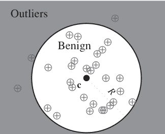

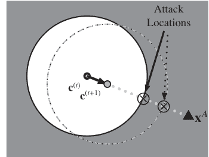

(a) 超球离群点检测
(b) 对超球的攻击

**图 4.1** 超球离群点检测概念和天真方法脆弱性的描述。 **(a)** 以 **c** 为中心、固定半径 *R* 的包围超球用于通过排除其边界之外的离群点来封装分布的经验支持。来自 "正常" 分布的样本由 ⊕ 表示，超球外部有三个离群点。 **(b)** 针对超球离群点检测器的攻击，将检测器的 "正常" 区域向攻击者的目标 **x**⁴ 移动。需要多次攻击迭代才能足够移动超球，使其包围 **x**⁴ 并将其分类为良性。

The novelty detection learning algorithm considered throughout this chapter is a mean-centered hypersphere of fixed radius *R*.
本章讨论的新颖性检测学习算法是一个均值中心、固定半径 *R* 的超球。

For this basic model for novelty detection, we analyze a contamination scenario whereby the attacker poisons the learning algorithm to subvert the learner’s ability to adapt to a tool the adversary uses to accomplish its objective.
对于这种基本的新颖性检测模型，我们分析了一种污染场景，其中攻击者投毒学习算法以破坏学习者适应攻击者用来实现其目标的工具的能力。

The specific scenario we consider is that the adversary wants the novelty detector to misclassify a malicious target point, **x**⁴, as a normal instance.
我们考虑的特定场景是，攻击者希望新颖性检测器将恶意目标点 **x**⁴ 错误分类为正常实例。

However, the initial detector would correctly classify **x**⁴ as malicious so the adversary must manipulate the learner to achieve its objective.
然而，初始检测器会正确地将 **x**⁴ 分类为恶意，因此攻击者必须操纵学习者以实现其目标。

Initially, the attacker’s target point, **x**⁴, is located a distance *D<sub>R</sub>* radii from the side of the hypersphere (or a total distance of *R* (*D<sub>R</sub>* + 1) from the initial center).
最初，攻击者的目标点 **x**⁴ 位于距离超球侧面 *D<sub>R</sub>* 个半径的位置（或距离初始中心总距离为 *R* (*D<sub>R</sub>* + 1)）。

Further, it is assumed that the initial hypersphere was already trained using *N* initial benign data points, and the adversary has *M* total attack points it can deploy during the attack, which takes place over the course of *T* retraining iterations of the hypersphere model.
此外，假设初始超球已使用 *N* 个初始良性数据点进行训练，攻击者拥有 *M* 个总攻击点，可在攻击期间部署，攻击过程经过超球模型的 *T* 次重新训练迭代。

Analyzing this simple attack scenario yields a deeper understanding into the impact of data contamination on learning agents and quantifies the relationship between the attacker’s effort (i.e., *M*, the number of attack points used by the attacker) and the attacker’s impact (i.e., the number of radii, *D<sub>R</sub>*, by which the hypersphere is shifted).
分析这种简单的攻击场景有助于更深入地了解数据污染对学习代理的影响，并量化了攻击者努力（即 *M*，攻击者使用的攻击点数量）与攻击者影响（即超球移动的半径数 *D<sub>R</sub>*）之间的关系。

### 4.1 超球检测器上的 Causative 攻击

Learning bounding hyperspheres is a basic technique for anomaly detection that can be accomplished by learning a hypersphere centered at the empirical mean of a training set or that encloses the (majority of the) training data (e.g., see Shawe-Taylor & Cristianini 2004, Chapter 5).
学习包围超球是异常检测的一种基本技术，可以通过学习以训练集经验均值为中心的超球或包围（大部分）训练数据的超球来实现（例如，参见 Shawe-Taylor & Cristianini 2004，第5章）。

These novelty detection models classify all data that lie within the
这些新颖性检测模型将分类所有位于 ... 之内的数据


将边界超球视为正常（"-"），而将所有其他数据视为异常（"+"）。该探测器的一个简单版本使用固定半径 R 的均值中心超球来界定基础分布的支撑集，如图 4.1(a) 所示。此类探测器通过对训练数据 {x(ℓ)} 求平均来训练，以估计质心为 c = Σ_{ℓ=1}^{N} x(ℓ)，并对后续查询 x 进行分类，如下所示：

```
$$f_{c,R} (\mathbf{x}) = \left\{ \begin{array}{ll} " + ", & \text{if } \|\mathbf{x} - \mathbf{c}\| > R \\ " - ", & \text{otherwise} \end{array} \right.$$
```

其中，我们使用 f_{c,R} 表示以 c 为中心、半径为 R 的超球对应的分类函数。由于我们考虑的是一系列半径 R 固定但质心变化的探测器，我们使用符号 f_t 表示第 t 个此类探测器，其质心为 c(t)。

可以设想多种恶意用户想要攻击此类异常检测算法的情况。例如，攻击者可能正在搜索错误位于超球内部的恶意点，或者可能试图通过篡改训练数据来误导超球。在这里，我们考虑前面描述的简单均值中心超球异常探测器的目标性因果完整性攻击。此次攻击在 T 次重新训练迭代过程中进行。在此次攻击中，攻击者的目标是使超球具有最终质心 c(T)，从而错误地将特定攻击点 x^4 分类为正常，因此这是目标性完整性攻击。我们假设，在攻击之前，目标 x^4 已被探测器正确分类（即 f_0(x^4) = "+"），且攻击者不希望修改 x^4，而是希望误导学习者，使得在 T 次重新训练迭代后，其目标得以实现（即 f_T(x^4) = "-"）。这是重复性因果攻击；参见 3.6。为了分析此迭代博弈，我们现在规定关于学习过程和攻击者的假设，然后分析探测器在几种不同情况下的最优攻击。

#### 4.1.1 学习假设

本章专注于迭代安全博弈。因此，此处讨论的学习算法相对简单：一个新奇检测器，建模为固定半径 R 的均值中心超球（可能在 4.6.3 节中讨论的核空间中），该超球包含大部分正常数据。此异常探测器从一个数据语料库中训练得出，初始假设该语料库主要是良性的（也许初始训练集经过人类专家审查），且初始（未受攻击）质心为 c(0)。半径 R 通常被选择为紧密界定正常训练数据，同时具有低误报概率。关于如何选择半径以满足这些约束，Shawe-Taylor 和 Cristianini 2004，第 5 章有所讨论，但就本工作而言，我们假设半径是事先指定的；即，它不能受攻击者影响。

重要的是，当新数据可用时，它被用于定期重新训练探测器。我们假设此新数据保持未标记且易受对抗性污染，但通过仅对先前被分类为正常的数据点进行重新训练，对新数据进行过滤以限制此漏洞。特别是，我们假设新奇检测器使用自举重新训练（_bootstrapping retraining_），其中最新的探测器用于从新接收的数据中移除异常值，在数据用于重新训练之前对其进行清理。根据此策略，被分类为正常（_normal_）的数据点始终用于后续重新训练，而任何被分类为异常值（_outlier_）的点都会被立即丢弃。最后，我们最初假设没有数据替换（_replacement_）；即，新点被添加到训练集中，但无论模型随后如何变化，都不会从中删除任何点。我们在 4.5 节中放宽了最后这一假设，在那里我们检查了不同数据替换策略的影响。无论如何，由于重新训练，超球探测器由一系列质心 \((\mathbf{c}^{(t)})_{t=0}^T\) 描述，这些质心由每次重新训练迭代产生。

#### 4.1.2 攻击者假设

我们还对攻击者的知识和能力做出特定假设。在整个本章中，我们通常假设攻击者是全能的（_omnipotent_）；也就是说，它知道学习者的特征表示，它知道训练数据和学习算法的当前状态（参数)（虽然在大多数攻击变体中它只需要状态），它知道学习算法及其重新训练策略，并且可以精确预测其攻击对探测器的影响。我们还假设攻击者具有强大的能力。我们假设攻击者可以在特征空间中插入任意点（即，它不受 2.2.1 节中讨论的测量映射 \(\xi\) 或特征映射 \(\phi\) 限制），并且一旦攻击开始，它可以控制所有数据（_all_ data），但它不能更改现有点的表示（包括初始训练数据及其目标数据点 \(\mathbf{x}^4\)）。我们在 4.5 节和 4.6 节中修改了攻击者可以控制所有数据的假设。

最后，我们假设攻击者的目标（_goal_）是导致重新训练的分类器将我们的目标点 \(\mathbf{x}^4\) 错误分类为正常。我们用三个量来量化攻击者的任务：攻击者为实现其目标必须移动超球的距离 _D<sub>R</sub>_、攻击者在攻击中可以使用的点的总数 _M_，以及执行攻击的重新训练迭代总数 _T_。量 _D<sub>R</sub>_ > 0 相对于超球半径 _R_ 表示为 \( D_R = \frac{\|\mathbf{x}^4 - \mathbf{c}^{(t)}\|}{R} - 1; \quad (4.1) \)，即超球必须沿攻击方向移动的半径总数，以实现攻击者的目标。<sup>1</sup> 其余量 _M_ 和 _T_ 是变量，在本章中，我们探讨了对它们的界限。首先，在 4.3 节中，我们考虑只想使用尽可能少攻击点的攻击者，并调查实现其目标所需的最少攻击点数量 _M_。其次，在 4.4 节中，我们考虑想要快速实施攻击的攻击者，并调查在固定执行时间 _T_ 内所需的最少重新训练迭代数 _T_ 和所需的最少攻击点数量 _M_。

<sup>1</sup> 如果攻击点 \(\mathbf{x}^4\) 初始被分类为正常，则该位移为非正数，在这种情况下不需要攻击。

在这些假设下，一种攻击策略的直观轮廓浮现出来。由于异常探测器仅对落在该超球内的点进行重新训练，此攻击者必须通过在超球内插入*攻击点*（*attack points*）来移动其质心。此外，由于质心是其训练数据的线性组合，攻击者可以通过谨慎地将其攻击点插入到超球边界与从超球均值到其目标 x^4 的线段的交点处，来实现最优位移。此攻击策略如图 4.1(b) 所示。正如我们在 4.2 节中所示，这一观察将攻击优化任务归结为一维问题，因为假设攻击者确切知道所需方向。优化攻击中仅剩的复杂性在于选择每次攻击迭代中要放置的点数；本章其余部分将贯穿始终地处理此任务。

#### 4.1.3 分析方法论

在深入攻击细节之前，我们概述了我们的分析方法。具体来说，在随后的章节中，我们将为对手实现所需位移 D_R 所需的攻击点数量 M* 或重新训练迭代数 T* 提供界限。为此，我们找到能最优地将超球向 x^4 移动的攻击，并对在给定大小 M 和持续时间 T 下此类攻击所能实现的位移进行上界。然后，我们反转这些上界，以基于以下引理为 M 和 T 创建下界。

引理 4.1 对于任何从 X 子集 ℜ 到 Y 子集 ℜ 映射的函数 f : X → Y 和 g : X → Y，使得 g 在 X 上严格单调递增（因而可逆）且 g 处处上界于 f（即，∀ x ∈ X, f(x) ≤ g(x)），如果对于任何 y ∈ Y，z ∈ f^{-1}(y) = {x ∈ X | f(x) = y}，那么我们有

z ≥ g^{-1}(y)。

由此可知，当 f 可逆时，f^{-1}(y) ≥ g^{-1}(y)。

证明 [由于 Matthias Bussas] 取逆否命题，假设 z < g^{-1}(y)。那么，它随之而来 f(z) ≤ g(z) < g(g^{-1}(y)) = y，其中严格不等式是由于 g 的严格单调性。因此，z 不属于 f^{-1}(y)。

我们在整个本章中使用此结果，以反转最优攻击所能达到的最大距离的界限，从而界定 M* 或 T*。我们现在继续对这些迭代重新训练的超球的攻击进行正式描述。

### 4.2 超球攻击描述

如前所述，攻击者的目标是操纵重新训练过程，并诱导一系列超球质心 \((\mathbf{c}^{(t)})_{t=0}^T\)，使得对于某些 T ∈ ℵ0


它实现了其目标 \(f_T(\mathbf{x}^4) = \text{"--"}\)，或者更准确地说，

$$
\|\mathbf{x}^4 - \mathbf{c}^{(T)}\| \le R, \tag{4.2)
$$

在此我们假设 \( T \) 是满足该条件的第一次迭代。或者，我们可以将此问题表述为最小化 \(\mathbf{x}^4\) 与 \(\mathbf{c}^{(T)}\) 之间相对于超球体半径平方的平方距离，从而将攻击者的目标表述为

$$
\min_{\mathbf{c}^{(T)}} \frac{\|\mathbf{x}^4 - \mathbf{c}^{(T)}\|^2}{R^2}. \tag{4.3)
$$

显然，当 \(\mathbf{c}^{(T)} = \mathbf{x}^4\) 时该目标被最小化，但攻击者不能直接选择 \(\mathbf{c}^{(T)}\)。相反，它必须选择一组攻击点，从而得到一系列质心，以最终实现下文详述的预期效果。然而，首先我们将攻击者的目标进一步分解为更便捷的形式。

为了量化攻击的进展，我们引入经过 \( t \) 次迭代的攻击所实现的 *总相对位移*。该向量定义为质心从初始状态到第 \( t^\text{th} \) 次重新训练迭代后位置的相对位移：

$$
\mathbf{D}_t = \frac{\mathbf{c}^{(t)} - \mathbf{c}^{(0)}}{R}. \tag{4.4)
$$

使用 \(\mathbf{D}_t\)，我们可以将 Equation (4.3) 中对抗者优化目标使用的向量改写为 \(\frac{\mathbf{x}^4 - \mathbf{c}^{(t)}}{R} = \frac{\mathbf{x}^4 - \mathbf{c}^{(0)}}{R} - \mathbf{D}_t\)，从而得到以下替代优化目标：

$$
\frac{\|\mathbf{x}^4 - \mathbf{c}^{(t)}\|^2}{R^2} = \frac{\|\mathbf{x}^4 - \mathbf{c}^{(0)}\|^2}{R^2} + \|\mathbf{D}_t\|^2 - 2 \frac{\|\mathbf{x}^4 - \mathbf{c}^{(0)}\|}{R} \cdot \left( \mathbf{D}_t^\top \frac{\mathbf{x}^4 - \mathbf{c}^{(0)}}{\|\mathbf{x}^4 - \mathbf{c}^{(0)}\|} \right).
$$

第一项 \(\frac{\|\mathbf{x}^4 - \mathbf{c}^{(0)}\|^2}{R^2}\) 关于攻击是常数，可以舍弃。剩余两项表明，位移 \(\mathbf{D}_t\) 应与向量 \(\mathbf{x}^4 - \mathbf{c}^{(0)}\)（即期望位移向量）对齐，同时不能过大。后一个约束反映了这样一个事实：如果位移向量过大，移位后的超球体会*超过*目标点 \(\mathbf{x}^4\)，随后仍将其归类为异常点。但是，超过目标是一个实现细节，可以通过在目标达成后停止攻击来轻松避免。无需将此行为显式建模为优化的一部分，因为这并非实际问题。此外，在本章中，我们研究使用最小努力即可实现目标且不超过目标的攻击。

此外，如上述表达式所示，最后一项表示为两个因子。第一个因子 \(2 \frac{\|\mathbf{x}^4 - \mathbf{c}^{(0)}\|}{R}\) 同样关于 \(\mathbf{c}^{(t)}\) 是常数。然而，第二个因子表示一个特定的几何量。它是 \(\mathbf{D}_t\) 在期望攻击方向 \(\mathbf{x}^4 - \mathbf{c}^{(0)}\) 上的投影长度；即，\(\text{proj}_{\mathbf{x}^4 - \mathbf{c}^{(0)}} (\mathbf{D}_t) = \mathbf{D}_t^\top \frac{\mathbf{x}^4 - \mathbf{c}^{(0)}}{\|\mathbf{x}^4 - \mathbf{c}^{(0)}\|}\)。根据柯西-施瓦茨不等式，我们得到以下两组结果：

\(\|\mathbf{D}_t\| \ge \left| \mathbf{D}_t^\top \frac{\mathbf{x}^4 - \mathbf{c}^{(0)}}{\|\mathbf{x}^4 - \mathbf{c}^{(0)}\|} \right|\)

\(\frac{\|\mathbf{x}^4 - \mathbf{c}^{(t)}\|}{R} \ge \frac{\|\mathbf{x}^4 - \mathbf{c}^{(0)}\|}{R} - \mathbf{D}_t^\top \frac{\mathbf{x}^4 - \mathbf{c}^{(0)}}{\|\mathbf{x}^4 - \mathbf{c}^{(0)}\|} .\)

这表明，要实现 \(\text{proj}_{\mathbf{x}^4-\mathbf{c}^{(0)}} (\mathbf{D}_t) \ge D_R\) 是攻击达成 Equation (4.2) 中原始目标的必要条件。此外，在固定攻击预算下最大化此投影通常能找到最能与期望攻击方向对齐且具有最大幅度的攻击。因此，为了简化本章结果，我们考虑以下替代目标，它寻求与期望位移向量的最大可能对齐，而不考虑超调的可能性。关于攻击进展的这一概念最初由 Kloft & Laskov (2012) 引入，但其被称为 _相对位移_。

**定义 4.2** _最优位移_：如果攻击在 \(t^{\text{th}}\) 次重新训练迭代时，其相对位移向量 \(\mathbf{D}_t\) 与期望位移向量 \(\frac{\mathbf{x}^4-\mathbf{c}^{(0)}}{R}\) 具有最高的对齐度，则该攻击实现了 _最优位移_。攻击目标由 _位移对齐_ 给出

$$
\rho \left( \mathbf{D}_t \right) = \mathbf{D}_t^\top \frac{\mathbf{x}^4 - \mathbf{c}^{(0)}}{\|\mathbf{x}^4 - \mathbf{c}^{(0)}\|} . \tag{4.5)
$$

攻击者寻求找到一个最大化 \(\rho \left( \mathbf{D}_t \right)\) 的 \(\mathbf{D}_t\)。

优化此目标能得到与 Equation 4.3 相同的最优序列，直至达到目标。在本章余下部分，我们研究寻求最大位移对齐的攻击。

**注释 4.3** 当 \(t^{\text{th}}\) 位移向量与攻击方向完全对齐（即，无残差）时，位移向量由 \(\mathbf{D}_t = \kappa \frac{\mathbf{x}^4-\mathbf{c}^{(0)}}{\|\mathbf{x}^4-\mathbf{c}^{(0)}\|}\) 给出，其中 \(\kappa \in [0, D_R]\) 且 \(\|\mathbf{D}_t\| = \kappa\)。此类攻击的进展可精确用 \(\kappa\) 表示为

$$
\frac{\|\mathbf{x}^4 - \mathbf{c}^{(t)}\|}{R} = \frac{\|\mathbf{x}^4 - \mathbf{c}^{(0)}\|}{R} - \kappa .
$$

原始目标与对齐目标之间的这种精确联系，实际上在后面讨论的几种攻击场景中得到了实现。

#### 4.2.1 移动质心

在此我们讨论 \(\mathbf{c}^{(t)}\) 的行为，以及攻击者如何操纵它以优化 Equation (4.3)。根据引导式重训练策略，当攻击者将一个点 \(\mathbf{a}^{(t)}\) 添加到第 \(t^{\text{th}}\) 次训练集时，如果该点距离当前质心在 \(R\) 以内，即 \(\|\mathbf{a}^{(t)} - \mathbf{c}^{(t-1)}\| \le R\)，则第 \(t^{\text{th}}\) 次质心会受到影响。当这种情况发生时，假设攻击者是攻击期间新数据的唯一来源，攻击点会导致超球体在下一次迭代中移动到新的质心，由以下公式给出

$$
c^{(t)} = \frac{\mu_{t-1}}{\mu_{t-1} + 1} c^{(t-1)} + \frac{1}{\mu_{t-1} + 1} a^{(t)}, \qquad \text{(4.6)}
$$

这是先前质心 c^{(t-1)} 和新引入的攻击点 a^{(t)} 的凸组合。该组合由以 \(\mu_{t-1}\) 计算的系数定义，\(\mu_{t-1}\) 是用于训练 c^{(t-1)} 的训练点总数。\(\mu_{t-1}\) 这一项类似于支撑先前超球体的质量，因为它决定了移动该超球体的难度。在假设数据点永远不会被移除，且在攻击期间攻击者独自负责新数据点的前提下，\(\mu_t = \mu_{t-1} + 1\)，初始质量 \(\mu_0 = N\) 由攻击开始前存在的良性数据点数量给出。

更一般地，在第 \(t^{\text{th}}\) 次重新训练迭代中，攻击者使用一组 \(A^{(t)} = (a^{(t, \ell)})_{\ell=1}^{\alpha_t}\) 攻击超球体，该组包含 \(\alpha_t\) 个攻击点，所有攻击点均在当前质心的 \(R\) 范围内。同样，我们假设攻击者是攻击期间新数据的唯一来源。第 \(t^{\text{th}}\) 次重新训练迭代中的数据点数量现在由 \(\mu_t = \mu_{t-1} + \alpha_t\) 给出，或者更一般地表示为质量的累积和：

$$
\mu_t = N + \sum_{\ell=1}^t \alpha_{\ell}. \qquad \text{(4.7)}
$$

此外，新质心现在由以下凸组合给出

$$
c^{(t)} = \frac{\mu_{t-1}}{\mu_{t-1} + \alpha_t} c^{(t-1)} + \frac{1}{\mu_{t-1} + \alpha_t} \sum_{\ell=1}^{\alpha_t} a^{(t, \ell)} \\
= c^{(t-1)} + \frac{1}{\mu_t} \sum_{\ell=1}^{\alpha_t} \left( a^{(t, \ell)} - c^{(t-1)} \right), \qquad \text{(4.8)}
$$

这引出了第 \(t^{\text{th}}\) 次迭代相对位移的自然概念。

**定义 4.4** 第 \(t^{\text{th}}\) 次重新训练迭代的相对位移定义为超球体质心从第 \((t-1)^{\text{th}}\) 次到第 \(t^{\text{th}}\) 次迭代的位移向量，相对于超球体的固定半径 \(R\)。该向量由以下公式给出

$$
r_t \triangleq \frac{c^{(t)} - c^{(t-1)}}{R} = \frac{1}{R \cdot \mu_t} \sum_{\ell=1}^{\alpha_t} \left( a^{(t, \ell)} - c^{(t-1)} \right).
$$

此外，总相对位移可以表示为攻击相对位移之和：D_T = \sum_{t=1}^T r_t.

**注释 4.5** Equation (4.8) 揭示了这一问题本质的更深层洞察。具体而言，它表明攻击 \(T\) 次迭代后均值的变化（相对于超球体半径 \(R\)）是“累积惩罚收益”的总和。也就是说，攻击第 \(t^{\text{th}}\) 次迭代的贡献受到截至当前迭代所使用的所有质量之和的抑制。


由于对所有攻击点均有 \(\|\mathbf{a}^{(t, \ell)} - \mathbf{c}^{(\ell)}\| \le R\)，我们可以利用广义三角不等式得到第一个界：

```
\(\|\mathbf{r}_t\| = \frac{1}{R \cdot \mu_t} \left\| \sum_{\ell=1}^{\alpha_t} (\mathbf{a}^{(t, \ell)} - \mathbf{c}^{(t-1)}) \right\| \le \frac{\alpha_t}{\mu_t} \le 1,\)
```

由于 \(\alpha_t \le \mu_t\)。这引出了以下定理以及对攻击者所需努力的一个普遍（尽管较弱）的界：

**THEOREM 4.6** *在 T 次重新训练迭代中，* \(\mathbf{c}^{(T)}\) *与* \(\mathbf{c}^{(0)}\) *之间的总相对位移的范数最多为 T（即，* \(\|\mathbf{D}_T\| \le T\) *），且位移排列度为* \(\rho(\mathbf{D}_T) \le T\)。*因此，要实现所需的总相对位移* \(D_R\) *，成功攻击至少需要* \(T \ge D_R\) *次攻击迭代。*

*Proof.* 范数的界源于广义三角不等式以及对于所有 \(t\)，\(\|\mathbf{r}_t\| \le 1\) 的事实。同样，\(\rho(\cdot)\) 的界源于柯西-施瓦茨不等式的以下应用：

```
\(\begin{aligned} \rho\left(\mathbf{D}_T\right) = \mathbf{D}_T^\top \frac{\mathbf{x}^4 - \mathbf{c}^{(0)}}{\|\mathbf{x}^4 - \mathbf{c}^{(0)}\|} &= \frac{1}{\|\mathbf{x}^4 - \mathbf{c}^{(0)}\|} \sum_{t=1}^T \mathbf{r}_t^\top \left(\mathbf{x}^4 - \mathbf{c}^{(0)}\right) \\ \le \frac{1}{\|\mathbf{x}^4 - \mathbf{c}^{(0)}\|} \sum_{t=1}^T \|\mathbf{r}_t\| \|\mathbf{x}^4 - \mathbf{c}^{(0)}\| \le T \end{aligned}\)
```

最终，攻击者的目标是创建一系列攻击点（即，在每次攻击迭代中一组攻击点 \(\mathbb{A}^{(t)} = (\mathbf{a}^{(t, \ell)})_{\ell=1}^{\alpha_t}\)），使攻击者的目标得以实现。以下定理表明，攻击者可以通过将所有攻击点放置在当前超球面边界与当前质心 \(\mathbf{c}^{(t-1)}\) 和其目标点 \(\mathbf{x}^4\) 之间的线段交点处，以贪婪的方式完成这一目标。此外，当该贪婪策略在每次迭代中执行时，第 \(t^{th}\) 次迭代得到的质心遵循初始质心 \(\mathbf{c}^{(t-1)}\) 和攻击者目标点 \(\mathbf{x}^4\) 之间的线段，逐渐向其目标移动。

**THEOREM 4.7** *对于每个攻击序列* \(\boldsymbol{\alpha} = (\alpha_t \in \mathfrak{N}_0)\) *和所有* \(t \in \mathfrak{N}\)*，在第* \(t^{th}\) *次迭代中，根据方程 (4.5) 优化* \(\rho(\cdot)\) *的攻击向量集合* \(\mathbb{A}^{(t)}\) *由* \(\alpha_t\) *个向量* \(\mathbf{c}^{(t-1)} + R \cdot \frac{\mathbf{x}^4 - \mathbf{c}^{(0)}}{\|\mathbf{x}^4 - \mathbf{c}^{(0)}\|}\) *的副本以及*

```
\(\mathbf{c}^{(t)} = \mathbf{c}^{(0)} + R \cdot \frac{\mathbf{x}^4 - \mathbf{c}^{(0)}}{\|\mathbf{x}^4 - \mathbf{c}^{(0)}\|} \cdot \sum_{\ell=1}^t \frac{\alpha_\ell}{\mu_\ell}\)
```

构成，其中 \(\mu_t\) 是由方程 (4.7) 给出的攻击的累积质量和。

*Proof.* 证明见附录 B.1。

该定理表明，第 \(t^{th}\) 次迭代的最优质心可以仅从提供的参数 \(\mathbf{c}^{(0)}\)、\(R\)、\(\mathbf{x}^4\) 和 \(\boldsymbol{\alpha}\) 以贪婪的方式计算得出。

COROLLARY 4.8 对于每个攻击序列 \(\boldsymbol{\alpha} = (\alpha_t \in \mathfrak{N}_0)\) 和所有 \(T \in \mathfrak{N}\)，遵循攻击序列 \(\boldsymbol{\alpha}\) 的最优攻击在 \(T\) 次迭代后实现的总相对位移为 \(\mathbf{D}_T = \frac{\mathbf{x}^4 - \mathbf{c}^{(0)}}{\|\mathbf{x}^4 - \mathbf{c}^{(0)}\|} \cdot \sum_{\ell=1}^T \frac{\alpha_\ell}{\mu_\ell}\)，其位移排列度（方程 4.5）为

```
\(\rho (\mathbf{D}_T) = \sum_{\ell=1}^T \frac{\alpha_\ell}{\mu_\ell}\)
```

其中 \(\mu_t\) 是由方程 (4.7) 给出的攻击的累积质量和，\(D_R\) 是由方程 (4.1) 给出的攻击参数。

Proof. \(\mathbf{D}_T\) 的结果直接来自将方程 (4.9) 给出的最优质心代入方程 (4.4)。得到的位移排列度源于 \(\|\mathbf{x}^4 - \mathbf{c}^{(0)}\|^2 = (\mathbf{x}^4 - \mathbf{c}^{(0)})^\top (\mathbf{x}^4 - \mathbf{c}^{(0)})\) 和方程 4.1。

重要的是，在我们的假设下，该定理表明攻击者的目标仅取决于序列 \(\boldsymbol{\alpha} = (\alpha_t)_{t=1}^T\)；实际攻击向量直接由其规范得出。攻击者可以选择 \(\boldsymbol{\alpha}\) 的元素；即，在每次迭代中要使用的攻击点数量。因此，我们已将多维优化问题归约为对单个序列的优化。在下一节中，我们将形式化攻击者如何根据方程 (4.10) 给出的攻击目标优化此序列。

但是，在继续之前，请注意方程 (4.10) 表明在时间 \(t\) 的攻击成功与否可以完全描述为该攻击序列的一个函数。此外，由于最优位移向量 \(\mathbf{D}_T\) 是所需攻击方向 \(\mathbf{x}^4 - \mathbf{c}^{(0)}\) 的一个标量倍数，其在该方向上的投影没有残余分量，且 Remark 4.3 表明该攻击的进展由

```
\(\frac{\|\mathbf{x}^4 - \mathbf{c}^{(t)}\|}{R} = \frac{\|\mathbf{x}^4 - \mathbf{c}^{(0)}\|}{R} - \sum_{\ell=1}^T \frac{\alpha_\ell}{\mu_\ell}.\)
```

给出。

该攻击在最小化 \(\frac{\|\mathbf{x}^4 - \mathbf{c}^{(t)}\|}{R}\) 方面的成功完全取决于攻击者对 \(\boldsymbol{\alpha}\) 的选择，攻击者选择 \(\boldsymbol{\alpha}\) 以最大化 \(\sum_{\ell=1}^T \frac{\alpha_\ell}{\mu_\ell}\)。我们现在通过描述这些攻击序列来正式化这一设置。

Remark 4.9 (Nontrivial Initial Attack) 敏锐的读者会注意到，上述结果（包括从方程 (4.8) 开始的所有推导）都依赖于这样一个假设：\(\forall t \in \{1, \dots, T\}, \mu_t > 0\)。等价地，这要求 \(\alpha_1 > 0\)，我们在本章余下部分都假设这一点——即非平凡初始攻击假设。事实上，如果第一个非零攻击发生在第 \(k^{\text{th}}\) 次迭代（即，\(\alpha_t = 0\) for \(t < k\) 和 \(\alpha_k > 0\)），则可以从攻击中丢弃前 \(k-1\) 次迭代，因为在此期间分类器没有受到对抗性影响。此外，全零攻击序列 \(\boldsymbol{\alpha} = \mathbf{0}\) 是平凡攻击序列，无需考虑。

### 4.2.2 攻击的形式化描述

在描述了问题及其下所做的假设后，可以进行形式化分析以揭示最优攻击策略。这种形式化分析始于对问题设置和目标的形式化。我们将第 \( t^\text{th} \) 次重新训练迭代中使用的攻击点数量称为 \( \alpha_t \) 和第 \( t^\text{th} \) 次迭代中要使用的最优（在规定条件下）攻击点数量称为 \( \alpha_t^* \)。我们使用 \( \aleph \) 表示自然数 1, 2, 3, ..., \( \aleph_0 \) 表示非负整数 0, 1, 2, 3, ..., 和 \( \Re_{0+} \) 表示非负实数。除非特别说明，否则 \( \alpha_t, \alpha_t^* \in \aleph_0 \) 虽然本文稍后我们会考虑非负实数序列，我们在记号上通过分别使用 \( \beta_t, \beta_t^* \in \Re_{0+} \) 来加以区分。

与 \( \alpha_t \) 和 \( \beta_t \) 并列，我们还定义了可能攻击序列的空间。形式上，我们定义 \( \mathcal{A} \) 为所有合法攻击点序列的空间；即，\( \mathcal{A} = \{ \left( \alpha_t \right)_{t=1} \mid \forall t \, \alpha_t \in \aleph_0 \} \)（在此空间中，任何有限跨度的攻击都通过连接无限后置零序列来表示）。同样，我们将有限持续时间和有限大小的攻击空间定义为 \( \mathcal{A}^{(M,T)} = \left\{ \left( \alpha_t \right)_{t=1}^T \mid \forall t \, \alpha_t \in \aleph_0 \, \wedge \, \sum_{t=1}^T \alpha_t \le M \right\} \)；将有限持续时间 \( T \) 但无限大小的攻击空间定义为 \( \mathcal{A}^{(\infty,T)} \)；以及将有限总大小 \( M \) 但无限持续时间的攻击空间定义为 \( \mathcal{A}^{(M,\infty)} \)。最后，这些空间的类似连续版本分别表示为 \( \mathcal{B}, \mathcal{B}^{(\infty,\infty)}, \mathcal{B}^{(M,\infty)} \) 和 \( \mathcal{B}^{(M,T)} \) 并通过在 \( \mathcal{A} \) 的相应定义中将 \( \alpha_t \) 替换为 \( \beta_t \in \Re_{0+} \) 来定义。

有了攻击序列的概念后，我们通过重新审视攻击者的目标来形式化最优策略的概念。攻击者希望最大化定义 4.2 中描述的位移排列度 \( \rho \left( \, \cdot \, \right) \)，且推论 4.8 已表明它仅取决于攻击序列。目标函数根据方程 (4.10) 与给定攻击序列 \( \boldsymbol{\alpha} \in \mathcal{A} \) 定义为

\( D \left( \boldsymbol{\alpha} \right) = \sum_{t=1} \frac{\alpha_t}{\mu_t} = \sum_{t=1} \delta_t \left( \boldsymbol{\alpha} \right) \quad \text{(4.11)}\)

\( \delta_t \left( \boldsymbol{\alpha} \right) = \frac{\alpha_t}{\mu_t}, \quad \text{(4.12)}\)

其中 \( \mu_t = N + \sum_{\ell=1}^t \alpha_\ell \) 来自方程 (4.7)，函数 \( \delta_t \left( \cdot \right) \) 评估第 \( t^\text{th} \) 次攻击迭代的 *贡献*，该贡献仅取决于攻击序列的前 \( t \) 个元素。攻击者的目标是在对攻击大小和持续时间的约束下最大化此目标函数 \( D \left( \cdot \right) \)。

DEFINITION 4.10 *Optimality*: 对于具有 \( N \) 个初始非攻击点的超球面，攻击序列 \( \boldsymbol{\alpha}^* \in \mathcal{A}^{(M,\infty)} \) 是一种使用总共 \( M \) 个攻击点的最优策略，如果 \( \forall \boldsymbol{\alpha} \in \mathcal{A}^{(M,\infty)}, \quad D \left( \boldsymbol{\alpha} \right) \le D \left( \boldsymbol{\alpha}^* \right) \)。该序列实现的最优距离表示为 \( D_N^* \left( M, \infty \right) \)，其中 \( \infty \) 表示无限攻击持续时间。攻击者可以通过求解以下关于 \( \boldsymbol{\alpha}^* \) 的程序来实现这种最优性：

\( \boldsymbol{\alpha}^* \in \underset{\boldsymbol{\alpha}}{\text{argmax}} \, D \left( \boldsymbol{\alpha} \right) \quad \text{(4.13)}\)
\(\text{s.t.} \quad \boldsymbol{\alpha} \in \mathcal{A}^{(M,\infty)}\)


因此，\( D_N^*(M, \infty) \)，即空间 \( \mathcal{A}^{(M,\infty)} \) 中任何序列可实现的最优距离，用问题的参数 \( M \) 和 \( N \) 来表达；也就是说，如果 \( \boldsymbol{\alpha}^* \) 是 \( \mathcal{A}^{(M,\infty)} \) 中的最优策略，则 \( D(\boldsymbol{\alpha}^*) = D_N^*(M, \infty) \)。类似地，对于受限于有限持续时间 \( T \) 的攻击，在序列空间 \( \mathcal{A}^{(M,T)} \) 中，我们将可实现的最优距离定义为 \( D_N^* (M, T) \)，我们将在 4.4 节中再次讨论。

### 4.2.3 攻击序列的特性

为了更好地理解我们的问题，我们表征其属性以及（最优）攻击序列的属性。这些属性为问题的进一步分析奠定了基础。

#### 4.2.3.1 对空攻击迭代的不变性

我们讨论来自公式 4.11 的攻击距离 \( D(\boldsymbol{\cdot}) \) 相对于攻击序列中零元素的行为。首先，我们表明攻击距离 \( D(\boldsymbol{\cdot}) \) 对于在序列的第 \( k^\text{th} \) 位置插入零具有不变性（其中 \( k > 1 \) 遵循备注 4.9）。

**LEMMA 4.11** 对于任何 \( k > 1 \)，每个序列 \( \boldsymbol{\alpha} \in \mathcal{A}^{(M,\infty)} \) 达到的距离与序列 \( \boldsymbol{\alpha}' \) 相同，该序列定义为

```
\(\alpha'_t = \begin{cases} \alpha_t, & \text{if } t < k \\ 0, & \text{if } t = k \\ \alpha_{t-1}, & \text{if } t > k \end{cases}\)
```

即，\( D(\boldsymbol{\alpha}) = D(\boldsymbol{\alpha}') \)。

证明。首先，对于 \( t < k \)，\( \delta_t(\boldsymbol{\alpha}') = \delta_t(\boldsymbol{\alpha}) \)，因为 \( \delta_t(\boldsymbol{\cdot}) \) 仅取决于序列的前 \( t \) 个元素（参见公式 4.12）。其次，由公式 (4.12) 可得 \( \delta_k(\boldsymbol{\alpha}') = 0 \)。第三，对于 \( t > k \)，\( \delta_t(\boldsymbol{\alpha}') = \delta_{t-1}(\boldsymbol{\alpha}) \)，因为在 \( k^\text{th} \) 位置插入 0 不会影响 \( \delta_t(\boldsymbol{\cdot}) \) 定义中的分母 \( \mu_t \)（参见公式 (4.7) 和 (4.12)），分子相应地移位。序列 \( \boldsymbol{\alpha}' \) 达到的距离为

```
\(\begin{aligned} D(\boldsymbol{\alpha}') &= \sum_{t=1}^{k-1} \delta_t(\boldsymbol{\alpha}') + \delta_k(\boldsymbol{\alpha}') + \sum_{t=k+1} \delta_t(\boldsymbol{\alpha}') \\ &= \sum_{t=1}^{k-1} \delta_t(\boldsymbol{\alpha}) + \sum_{t=k+1} \delta_{t-1}(\boldsymbol{\alpha}) = D(\boldsymbol{\alpha}) . \end{aligned}\)
```

由此引理可知，零元素（\( \alpha_t = 0 \)）的插入（或删除）与序列的距离无关，因此在考虑我们的最优性概念时可以删除所有零。直觉上，攻击所达到的距离不受未使用对抗性数据的重新训练迭代的影响，因为在这种情况下，对抗性数据是新数据的唯一来源。以下定理捕获了这一概念：

**THEOREM 4.12** 每对序列 \(\boldsymbol{\alpha}, \boldsymbol{\alpha}' \in \mathcal{A}^{(M, \infty)}\)，如果具有相同的非零元素子序列——即，\(\left(\alpha_i \mid \alpha_i > 0\right) = \left(\alpha'_i \mid \alpha'_i > 0\right)\)——则达到相同的距离：\(D\left(\boldsymbol{\alpha}\right) = D\left(\boldsymbol{\alpha}'\right)\)；也就是说，序列达到的距离与序列中零元素的数量及其位置无关。\(D\left(\boldsymbol{\alpha}\right)\) 仅取决于 \(\boldsymbol{\alpha}\) 的非零元素子序列。作为结果，任何有限序列都可以重新排序为其正子序列后跟全零子序列，两者达到相同的距离。

证明。由于序列 \(\boldsymbol{\alpha}\) 和 \(\boldsymbol{\alpha}'\) 包含相同顺序的相同非零元素，可以通过重复应用引理 4.11 在序列的必要位置插入和删除零来将 \(\boldsymbol{\alpha}\) 转换为 \(\boldsymbol{\alpha}'\)。因此，\(\boldsymbol{\alpha}\)、\(\boldsymbol{\alpha}'\) 以及此转换中使用的所有中间序列都具有相同的距离。

由此可见，零元素可以任意插入或删除到任何最优攻击序列中，以形成具有相同距离的等效最优攻击序列，因为零元素既不增加距离，也不为后续分母增加“权重”。定理 4.12 允许我们忽略序列中的所有零元素，因为它们不贡献于攻击的有效性。此外，将所有零元素移到序列末尾对应于攻击者希望最小化攻击所需时间的概念，因为延长攻击对我们的攻击者没有好处。最后，零元素可以被忽略这一事实表明重新定义 \(\alpha_t \in \mathfrak{R}\) 而非 \(\mathfrak{N}_0\) 的可能性。

#### 4.2.3.2 最优攻击序列的特性

既然已表明零元素与我们的分析无关，我们现在描述最优攻击中非零元素的属性。首先，在此攻击公式中，没有初始点支撑超球面，因此无论攻击者在第一次迭代中放置多少点，都会达到相同的位移。以下引理捕获了这一点：

**LEMMA 4.13** 对于 \(N=0\)，最优初始攻击迭代由 \(\alpha_1^* = 1\) 给出。

证明。第一次攻击迭代的贡献由 \(\delta_1 \left(\boldsymbol{\alpha}\right) = \frac{\alpha_1}{\mu_1} = \frac{\alpha_1}{\alpha_1} = 1\) 给出。因此，对于 \(\alpha_1 \in \mathfrak{N}\)（根据备注 4.9，我们排除 \(\alpha_1 = 0\) 的可能性），我们有 \(\delta_1 \left(\boldsymbol{\alpha}\right) = 1\)，并且由于 \(\delta_t \left(\boldsymbol{\alpha}\right) = \frac{\alpha_t}{\alpha_1 + \sum_{i=2}^{t} \alpha_i}\) 对于 \(t > 1\) 在 \(\alpha_1\) 中是严格递减的，因此此次迭代的最优整数解为 \(\alpha_1^* = 1\)。

此外，如果总攻击能力大于一个攻击点，且攻击者有能力将其攻击分布在多个重新训练迭代中，那么这样做是有益的；也就是说，将所有攻击点集中在单个攻击迭代中的攻击是非最优的。附录 B.3 中提供的引理 B.2 捕获了这一点。

此外，备注 4.5 中的累积惩罚收益概念至关重要。这里有两种 *力量* 在起作用。一方面，在迭代 \(t\) 期间放置许多点（大 \(\alpha_t\)）会改善术语 \(\delta_t \left(\boldsymbol{\alpha}\right)\) 对整体距离 \(D \left(\boldsymbol{\alpha}\right)\) 的贡献。另一方面，大 \(\alpha_t\) 将对后续术语不利，因为它会增加后续贡献 \(\delta_\tau \left( \boldsymbol{\alpha} \right)\)（对于 \(\tau > t\)）中分母 \(\mu_\tau\) 的大小。这种效应可以类比为随着利用的点越来越多，点的平均值变得更重（更难移动）。直觉上，人们不希望过快地放置太多权重，因为这会导致攻击后期平均值变得太重，从而使后续努力效果较差。这表明任何最优攻击序列都应该是单调非递减的，我们将在以下定理中证明：

**THEOREM 4.14** 对于任何最优攻击点序列 \(\boldsymbol{\alpha}^* \in \mathcal{A}^{(M, \infty)}\)，\(\boldsymbol{\alpha}^*\) 的每个非零元素子序列都必须是单调非递减的；也就是说，如果 \(\mathbb{I}^{(nz)} = \{i_1, i_2, ... \mid \forall k \ \alpha_{i_k}^* > 0\}\) 是对应于 \(\boldsymbol{\alpha}^*\) 非零元素的索引集合，那么对于所有 \(i, j \in \mathbb{I}^{(nz)}\)，\(i \le j \Leftrightarrow \alpha_i^* \le \alpha_j^*\)。

*证明。* 证明出现在附录 B.2。

注意，定理 4.14 不要求严格单调性，这使其与定理 4.12 保持一致。

尽管已表明任何最优攻击序列在幅度上都应是单调非递减的，但随着利用的点越来越多平均值变得更重的直觉暗示了不仅仅是单调性。事实上，这一概念将引导我们在 4.3.1 节中得到一个最优解。

#### 4.2.3.3 最优攻击距离的行为

尽管描述最优攻击可能很困难，但我们通常可以将最优位移对齐（在所有可能攻击中）作为 \(M\) 和 \( T\) 的函数来描述。特别是，我们预期随着攻击者可用的攻击点数量 \(M\) 增加，得到的最优位移对齐应该增加。类似地，随着攻击持续时间 \(T\) 增加，我们也预期得到的最优位移对齐会增加。以下定理表明，对于任何固定的 \(N \ge 0\)，函数 \(D_N^* (M, T)\) 实际上确实随着 \(M\) 和 \(T\) 的两者单调增加。

**THEOREM 4.15** 对于所有 \(N \in \mathfrak{N}_0\)，函数 \(D_N^* (M, \infty)\) 和 \(D_N^* (M, T)\)（对于任何固定的 \(T > 0\)）相对于 \(M \in \mathfrak{N}_0\) 都是严格单调递增的，除非 \(N = 0\) 且 \(T = 1\)，在这种情况下 \(D_0^* (M, 1) = 1\) 对于所有 \(M \in \mathfrak{N}_0\) 成立。此外，对于任何固定的 \(M > 0\)，函数 \(D_N^* (M, T)\) 相对于 \(T \le M\) 是严格单调递增的，并且对于 \(T > M\) 是常数；即，对于任何 \(T \ge M\)，\(D_N^* (M, T) = D_N^* (M, \infty)\)。

*证明。* 证明出现在附录 B.3。

注意，相对于 \(T\)，函数 \(D_N^* (M, T)\) 在 \(T \ge M\) 时是常数，因为攻击者必须在每个有益的重新训练迭代中至少使用一个攻击点（参见 4.2.3.1 节）。攻击者从持续时间超过 \(M\) 的攻击中不会获得额外收益。


### 4.3 最优不受约束攻击

我们现在对超球面攻击问题的不同变体提出解决方案，并找出最优攻击策略，如前面所定义。在本节中，我们探讨对攻击者没有任何约束的攻击，而在接下来的章节中，我们考虑使攻击更加现实的不同约束。对于不受约束的攻击者，定理 4.15 所展示的严格单调性特性表明，最优序列应使用所有 $M$ 个可用攻击点，并尽可能均匀地分布其点，以在丢弃零元素后最大程度地延长攻击持续时间 $T$。确实，这是定义 4.10 中优化问题的一个最优整数策略，该策略在以下定理中得到证明：

THEOREM 4.16 对于 $N \in \mathbb{N}$，任何最优攻击序列 $\alpha^* \in A(M,\infty)$ 必须满足 $\alpha_i^* \in \{0, 1\}$ 且 $\sum_i \alpha_i^* = M$；即，$\alpha^*$ 必须恰好有 $M$ 个 1。特别是，这样的一个最优序列是 $1^M$，即由 $M$ 个 1 后跟零组成的序列。此外，任何 $\alpha^* \in A(M,\infty)$ 所达到的最优位移为 $D^*_N(M, \infty) = h_{M+N} - h_N$，其中 $h_k = \sum_{\ell=1}^k 1/\ell$ 是第 $k$ 个调和数。

Proof. 证明见附录 B.4。

作为该定理的结果，我们对任何使用 $M$ 个攻击点的攻击效果有了严格的上界。虽然调和数是可计算的，但没有闭式公式来表示它们。然而，利用 $h_{M+N} - h_N = \sum_{k=1}^M 1/(k+N)$ 是 $k$ 的递减函数级数这一事实，当 $N > 0$ 时，其上界为 $\int_0^M dx/(x+N) = \ln((M+N)/N)$（Cormen, Leiserson, Rivest, & Stein 2001, 附录 A.2）。同样，当 $N = 0$ 时，Cormen et al. (2001, 附录 A.2) 表明 $h_k \le \ln(k) + 1$。综上，我们得到了攻击 $M$ 个点且无时间限制时所能达到的最优位移的以下上界：

$$D^*_N(M, \infty) \le \begin{cases} \ln(M) + 1, & \text{if } N = 0 \\ \ln((M+N)/N), & \text{if } N > 0 \end{cases}$$

由于这些上界关于 $M$ 是严格单调递增函数，我们应用 Lemma 4.1 反转边界，并得到执行使超球面位移所需相对位移 $D_R$ 的攻击所需攻击点数量的以下下界。这些边界简单为

$$M^* \ge \begin{cases} \exp(D_R - 1), & \text{if } N = 0 \\ N(\exp(D_R) - 1), & \text{if } N > 0 \end{cases}$$

即，攻击者为实现其目标所需的努力随 $D_R$ 指数增长。

#### 4.3.1 最优不受约束攻击：堆叠方块

由 $\alpha^* = 1^M$ 给出的最优策略也可以通过将该问题转换为质心问题来推导。回顾在备注 4.5 中，攻击达到的距离被比作累积惩罚收益的总和。我们可以将其视为每次攻击迭代贡献的序列；即，攻击的第 $t$ 次迭代贡献 $\delta_t(\boldsymbol{\alpha}) = \frac{\alpha_t}{\sum_{i=1}^t \alpha_i}$，这是相对于截至该时刻所用总重量在时间 $t$ 所用的“重量量”。这与质心问题类似。特别是，如果我们将攻击点 $\alpha_t$ 建模为放置在距当前质心 $\mathbf{c}^{(t-1)}$ 处 $R$ 距离的质量单位，则方程 (4.12) 给出的 $\delta_t(\boldsymbol{\alpha})$ 是质心 $\mathbf{c}^{(t)}$ 相对于 $R$ 的偏移量。由于可行攻击点不能放置在 $R$ 以外，这相当于在 $t-1$ 时刻创建的当前方块堆栈下方放置一组相同的方块，使得堆栈不会倾倒（结构稳定对应于可行攻击点不能超过半径 $R$ 的约束）。由于攻击受限于只能在边界处放置点，此类比仅在堆叠最优进行或某些方块垂直分组时成立（对应于在单次迭代中放置多个攻击点，这一概念将在第 4.4 节中重新讨论）。图 4.2 描绘了针对均中心超球面的攻击与超出桌面边缘堆叠方块之间的对应关系。

将攻击策略类比为经典物理问题后，最优策略从后者的解中重新浮现。如 Johnson (1955) 所讨论，方块可以通过将第一个方块伸出 $\frac{1}{2}$、第二个伸出 $\frac{1}{4}$、第 $t$ 个伸出 $\frac{1}{2^t}$ 来最优堆叠。最优整数策略是每次迭代放置一个点。此外，如图 4.2 所述，由于方块长度为 $2R$，该最优策略实现的位移由调和级数 $D_0^*(M, \infty) = h_M = \sum_{t=1}^M \frac{1}{t}$ 决定。我们得到了超球面攻击及其对应最优策略的物理表示，正如我们在定理 4.16 中推导的那样。（事实上，如果允许每个垂直层有多个方块，单方块堆叠策略并非最优，如多宽堆叠问题（Hall 2005; Hohm, Egli, Gaehwiler, Bleuler, Feller, Frick, Huber, Karlsson, Lingenhag, Ruetimann, Sasse, Steiner, Stocker, & Zitzler 2007）所示。但是，由于我们问题的约束，这样的堆叠策略不对应于现实的攻击，因为这意味着在超球面外添加攻击点。）

### 4.4 对攻击施加时间约束

在前一节中，我们表明最优性由在每次重新训练迭代中最多使用一个攻击点的攻击实现。虽然该策略对于任何固定攻击预算 $M$ 都能朝攻击者目标实现最大可能位移，但它未能捕捉攻击者的全部目标。也就是说，攻击的目标是实现一个目标（位移均值所需量），但要在最小总攻击持续时间 $T$ 或付出最小努力（最少可能点数 $M$）的情况下实现。如前面的分析所示，规定的攻击实现约 $\approx \log M$ 的最大距离，但这样做需要时间 $T = M$，因此，这种攻击仅在发动攻击所需时间内实现对数效果，而定理 4.6 将总位移线性地限制在 $T$。这个上界与实际达到的效果之间的差异表明，这种攻击没有充分利用攻击者可用的资源；即，其攻击预算 $M$。因此，我们考虑一个

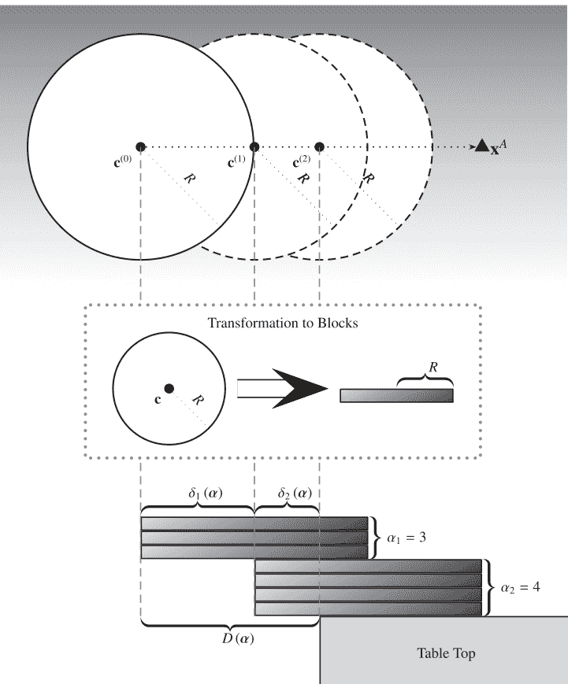

图 4.2 描绘了攻击序列 $\alpha = (\alpha_1 = 3, \alpha_2 = 4)$ 与在桌面边缘最优堆叠方块以超出桌面边缘这一概念之间的物理类比。从上到下，攻击 $\alpha$ 对天真超球面离群点检测器的原始效果被转换为等效的平衡问题。在这个类比中，起始边位于 $c^{(t)}$ 的长度为 $2R$ 的方块相当于在均值为 $c^{(t)}$ 且半径为 $R$ 的超球面的第 $t$ 次重新训练迭代处放置一个攻击点。这种奇怪的等效性包含了将单位质量点放置在距前一个均值 $R$ 距离处的概念。垂直堆栈可以解释为在时间 $t$ 处放置多个点，而时间（奇怪的是）沿着方块流向桌面。同时描绘了贡献 $\delta_1(\alpha)$ 和 $\delta_2(\alpha)$ 及其整体效果 $D(\alpha_1, \alpha_2)$。

攻击者，必须在 $T$ 次重新训练迭代内执行其攻击，其中 $T \in \mathfrak{N}_0$，并采用更现实的假设 $T \ll M$；即，攻击必须在相对于攻击总规模的小时间窗口内发生。这导致了以下受约束最优性概念：

DEFINITION 4.17 受约束最优性 攻击序列 $\boldsymbol{\alpha}^* \in \mathcal{A}^{(M,T)}$ 相对于 $M$ 个可用总攻击点和给定持续时间 $T$ 被视为最优，如果 $\forall \boldsymbol{\alpha} \in \mathcal{A}^{(M,T)}$ $D(\boldsymbol{\alpha}) \le D(\boldsymbol{\alpha}^*)$ 且该序列达到的最优距离记为 $D_0^*(M, T)$。攻击者可以通过求解以下程序来找到最优攻击序列 $\boldsymbol{\alpha}^*$ 以实现这种最优性：

```
\(\boldsymbol{\alpha}^* \in \underset{\boldsymbol{\alpha}}{\text{argmax}} D(\boldsymbol{\alpha})\\
\text{s.t.} \quad \boldsymbol{\alpha} \in \mathcal{A}^{(M,T)}\) \\
(4.14)
```

受约束最优性的等效表述将所需相对位移 $D_R$ 作为输入，并试图最小化使用总共 $M$ 个攻击点以达到所需距离所需的持续时间 $T$。同样，另一种选择是在固定 $D_R$ 和 $T$ 下最小化 $M$。然而，方程 (4.14) 是从攻击者目标出发思考这一优化问题的自然方式。在本节余下部分，我们将推导可针对该受约束问题实现的边界。

在继续之前，请注意，当 $M \ge T$ 时，受约束问题等价于原始无约束问题。此外，根据定理 4.15，随着攻击持续时间 $T$ 的增加，达到的最优位移严格增加，并且使用 $T = M$ 对于任何固定攻击规模 $M \in \mathfrak{N}_0$ 都能实现最大扩展距离。值得注意的是，第 4.2 节的所有结果在此受约束域中仍然有效；我们只需重新加工上一节获得的结果。

#### 4.4.1 变质量方块堆叠

如前面第 4.3.1 节所示，原问题等价于将一堆相同的方块最优地延伸到桌面边缘的问题——这是一个已解问题的归约。不出所料，超球面攻击的受时间限制版本也类似于堆叠方块问题的受约束版本。在这个版本中，我们有对应于 $M$ 个相同方块的 $M$ 个点。这些点必须被安排为 $T$ 个垂直堆栈，使得给定堆栈中的所有点绑定在同一（水平）位置，这对应于在单个时间迭代处放置点。因此，第 $t$ 个垂直堆栈包含 $\alpha_t \in \mathfrak{N}_0$ 个单位重量的方块，总质量为 $\alpha_t$。此外，为了包含初始支撑质量，存在初始不可移动质量 $\alpha_0 = N$，它放置在最顶层方块的外侧边缘。攻击者必须优化 $M$ 个方块的分组，以使生成的 $T$ 个堆栈实现超出桌面边缘的最大延伸；图 4.2 以三个堆栈描绘了这个问题。然而，堆叠方块问题的这种受约束形式比原问题更难，因为它增加了垂直堆叠约束，并且由于每个堆栈的大小是整数，这是一个整数规划问题。

据我们所知，该问题没有公认的（整数）解。但是，为了我们限制攻击者所能取得的最优进展的目的，


实现这一目标，我们无需寻找可证明的最优可行策略。相反，如果通过放宽对对手的限制（即，赋予其比问题允许的更严格的能力），我们能推导出一个最优策略，那么该最优放宽策略所达到的位移将限制真实（受限）对手的最优策略。一种直观的放松方式是移除垂直堆栈包含整数个元素的约束；相反，我们允许它们为实值（但仍为非负数）。这导出了一个新的表述：攻击者拥有T块长度相等但质量可变的积木，并希望对这些积木进行最优质量分配，使其总质量为M并实现超出桌面的最优水平位移。这是该问题的连续变体：变质量积木堆叠问题。

进入连续领域后，我们考虑连续序列 \(\boldsymbol{\beta} \in \mathcal{B}^{(M,T)}\)，其中 \(\beta_t \in \Re_{0+}\)。对于给定的 \(T\) 和 \(M\)，（放宽后的）攻击者希望找到一个 \(\boldsymbol{\beta}^*\)，使得对于所有 \(\boldsymbol{\beta} \in \mathcal{B}^{(M,T)}\) 都有 \(D(\boldsymbol{\beta}^*) \ge D(\boldsymbol{\beta})\)。方程 (4.13) 和 (4.14) 中提出的优化问题自然扩展到连续上下文中，原问题的大部分观察结果也适用于连续领域。特别是，零元素的位置仍然无关紧要，如定理 4.12 所示，且零元素可以再次被丢弃而不影响最优性。此外，定理 4.14 的证明并未使用 \(\alpha_t\) 是整数这一事实；仅使用了 \(\alpha_t \ge 0\)。同样的推理可以应用于 \(\beta_t \in \Re_{0+}\)，且任何最优连续解均为单调递增。事实上，第 4.2 节中唯一被此放松作用失效的结果是引理 4.13——在连续域中，令 \(\beta_1 = 1\) 通常不再是最优的，因为任何 \(\beta_1 = \epsilon > 0\) 都能达到最优初始贡献 \(\delta_1(\boldsymbol{\beta}) = 1\)。

### 4.4.2 另一种表述

在连续质量设置中，为方程 (4.14) 所给出的程序找到一个最优策略 \(\boldsymbol{\beta}_T^\star = (\beta_t \in \Re_{0+})\) 并非易事。虽然原始积木堆叠问题是质量中心问题的一个广为人知的示例并有公开解决方案，但我们不了解任何涉及质量可在积木间重新分配的积木堆叠问题的研究。在接下来的章节中，我们将为这一问题提供解决方案，并限定攻击者在类似环境中实现其目标所需的努力。

为求解这一问题，我们回到备注 4.5 中给出的直觉，即攻击者必须平衡当前收益与过去行为，并用第 \(t\) 次重新训练迭代中累积的质量来重写问题。具体而言，考虑到方程 (4.7) 中的松弛质量累积和由 \(\mu_t = \sum_{\ell=1}^t \beta_\ell\) 给出，其中 \(\mu_0 = N\) 且 \(\mu_T = M\)，攻击序列的每个元素可以重写为 \(\beta_t = \mu_t - \mu_{t-1}\)。这使我们能够用累积质量序列 \(\boldsymbol{\mu}\) 重写整个目标函数，结果为

$$ D(\boldsymbol{\mu}) = T - \sum_{t=1}^T \frac{\mu_{t-1}}{\mu_t},\qquad (4.15) $$

其中 \(\mu_0 = N\)。根据 \(\mu_t\) 作为 *累积质量* 的定义，可得 \(\mu_0 \le \mu_1 \le \mu_2 \le ... \le \mu_T = M + N\)。最后，在第 \(T\) 次迭代中，质量必须总计为 \(M + N\)，因为根据定理 4.15，使用少于 \(M\) 个总点的攻击是非最优的，因此被排除在考虑之外。因此，攻击者可以通过求解以下关于 \(\boldsymbol{\mu}^* = \left(\mu_t^*\right)\) 的程序来实现最优性：

$$ \boldsymbol{\mu}^* \in \text{argmax}_{\boldsymbol{\mu}} D \left(\boldsymbol{\mu}\right) = T - \sum_{t=1}^T \frac{\mu_{t-1}}{\mu_t} \quad (4.16) $$
$$ \text{s.t.} \quad \mu_0^* \le \mu_1^* \le ... \le \mu_T^* $$
$$ \mu_0^* = N, \quad \mu_t^* \in \Re_+, \quad \mu_T^* = M + N $$

在此重新表述中，总质量约束仍然捕捉了松弛问题的每个方面，并且优化此重新表述的问题版本更加容易。这导出了我们对时间受限问题变体中攻击者最优进展的期望界限。

### 4.4.3 最优松弛解

使用程序 (4.16) 的替代表述，我们可以计算 \(T < M\) 时的最优松弛策略（对于 \(T \ge M\)，定理 4.16 适用）。该优化结果由以下定理总结：

#### 定理 4.18

*对于任意* \(N > 0\) *和* \(T < M\)，*总质量序列* \(\mu_t^* = N \left(\frac{M+N}{N}\right)^{\left(\frac{t}{T}\right)}\) *描述的质量序列，其中* \(t \in 1 ... T\) *，是程序 (4.16) 的唯一解。此外，该总质量序列对最优位移排列提供了以下界限*

$$ D_N^* (M, T) \le D \left(\boldsymbol{\mu}^*\right) = T \left( 1 - \left(\frac{N}{M+N}\right)^{1/T} \right). \quad (4.17) $$

最后，实际最优质量放置序列 \(\boldsymbol{\beta}^*\) 可由以下公式描述

$$ \beta_t^* = \left\{ \begin{array}{ll} N, & \text{if } t = 0 \\ N \left(\frac{M+N}{N}\right)^{\frac{t-1}{T}} \left( \left(\frac{M+N}{N}\right)^{\frac{1}{T}} - 1 \right), & \text{if } t \in 1 ... T \end{array} \right. \quad (4.18) $$

*还需注意，按要求，此解满足条件* \(\mu_0 = N, \sum_{t=1}^T \beta_t^* = \mu_T = M + N\)，*且对所有* \(t > 0\)，*有* \(\mu_{t-1} \le \mu_t\)。*

_证明._ 参见附录 B.5.

一般来说，方程 (4.18) 的最优松弛策略不会产生整数策略，除非 \(\left(\frac{M+N}{N}\right)^{\frac{1}{T}} \in \Re\) 的情况。因此，根据方程 (4.14) 给出的程序，这些策略通常不是最优的。此外，将最优松弛策略转换为最优整数值策略并非易事（舍入可以产生良好策略，但不一定最优）。然而，我们无需显式计算最优整数值策略即可量化其影响。

该结果的效用在于，它允许我们限定最优整数值攻击序列所实现的最优位移，随后使用引理 4.1 反转这些界限，因为函数 $T \left( 1 - \left( \frac{N}{M+N} \right)^{1/T} \right)$ 在 $M$ 和 $T$ 上均为单调递增。此外，与定理 4.6 一致，该函数被 \(T\) 上界限，并且具有上限（当 \(T \to \infty\) 时）为 \(\log \left( \frac{M+N}{N} \right)\)。对于任何固定的 \(T\) 和 \(M\)，所实现的位移至多为 \(\min \left[ T, \log \left( \frac{M+N}{N} \right) \right]\)。结果如下：

$$ M^* \ge \begin{cases} N \left( \frac{T}{T-D_R} \right)^T - N \ge N (\exp(D_R) - 1), & \text{if } D_R < T \\ \infty, & \text{if } D_R \ge T \end{cases}, \quad (4.19) $$

其中此界限的第二个情况反映了以下限制：无论使用多少个攻击点，总相对位移均不能超过攻击持续时间 \(T\)（参见定理 4.6）。类似地，对于给定的 \(N, M > 0\)，实现位移 \(D_R\) 所需的最少重新训练迭代次数可由以下不等式的解确定

$$ \left( \frac{D_R}{T} - 1 \right)^T \ge \frac{N}{M+N}, $$

该不等式可使用 Lambert-\(W\) 函数计算（即函数 \(f(w) = w \exp(w)\) 的逆函数），但无法用初等函数表示，除了可以说明界限可计算外，对我们对问题的直觉没有贡献（参见图 4.3）。

我们现在已为对手实现其期望目标所需的努力提供了强有力的界限。然而，在结束本节之前，请注意，结果

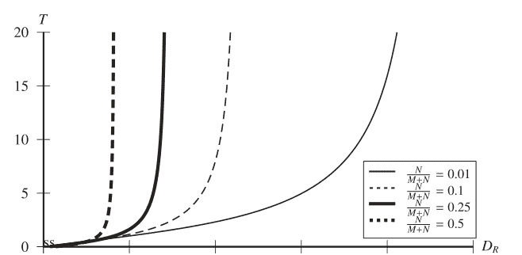

图 4.3 描绘了使目标位移 \(D_R\) 可实现所需的重新训练迭代次数 \(T\) 的下界图表。每条曲线显示特定固定比率 \(\frac{N}{M+N}\) 的下界。如人们所料，当 \(M \gg N\) 时，要求会降低，但在每种情况下，曲线都有一个转折点，界限在此处急剧上升；例如，当 \(\frac{N}{M+N} = 0.5\) 时，实现 \(D_R > 1\) 几乎是不可能的，因为这需要不合理的攻击持续时间。读者还应注意，此外，除非 \(M \gg T\)，否则这些下界是松散的。


在公式 (4.19) 中仅适用于 \( N \ge 1 \) 的情况。简言之，我们首先处理这种特殊情况，然后考虑针对超球探测器的其他攻击场景。

#### 4.4.3.1 针对无初始支撑超球的攻击

如前文所述，与定理 4.16 不同，定理 4.18 及其推导的后续界在 \( N = 0 \) 时不适用。这是因为，在没有对序列的初始约束的情况下，通过从一个不断减小的初始点 \( \mu_1 > 0 \) 开始，可以获得越来越大的位移。问题在于，对于 \( N = 0 \)，以 \( \mathbf{c}^{(0)} \) 为中心的初始超球被假设没有初始质量。因此，攻击者在边界上放置的第一个质量会将均值移位到 \( \mathbf{c}^{(1)} = R \)，无论其大小如何。在整数值情况下，由于引理 4.13，这一假设对结果影响不大，但在连续情况下，这会导致一种攻击：在攻击的初始阶段放置微小（但指数级增加）的质量，然后在最终阶段添加绝大部分总质量。

在连续域中，我们可以考察定理 4.18 给出的最优攻击序列，当 \( N \to 0 \) 时。通过此过程，我们推导出公式 (4.17) 所实现的最优距离趋近于 \( T \)；即，\( \lim_{N \to 0} D_N^*(M, T) = T \)。如定理 4.6 所示，这实际上是任何 \( T \) 时长序列可实现的最大位移对齐度。然而，这样的攻击序列与可行的整数值攻击对应关系较差，也无法改进我们的界。

为对 \( N = 0 \) 的情况提供更好的界，我们重新引入原始整数值问题中的约束 \( \mu_1 = \beta_1 = 1 \)。也就是说，我们现在假设引理 4.13 的结果成立；这将连续值序列约束得更接近整数值序列。由于在备注 4.9 中讨论过，攻击直到攻击者使用至少一个攻击点才开始，因此做出这一假设是合理的。

该问题的这一新约束导致了与之前在公式 (4.16) 中使用 \( \mu_1 = 1 \) 而非 \( \mu_0 = N \) 分析的问题相似，随后的结果也与定理 4.18 及其证明中提出的结果相呼应。具体来说，对于 \( t \in 1 \dots T \)，总质量序列 \( \mu_t^* = M^\frac{1}{T+1} \) 是唯一解，并实现了最优位移对齐度 \( D_0^*(M, T) \le T - (T - 1) \cdot M^\frac{1}{T+1} \)。同样，该边界函数在 \( M \) 和 \( T \) 上均单调递增，这导致了当 \( N = 0 \) 时对对手努力程度的以下界：

\[
\begin{aligned} M^* \ge \begin{cases} \left( \frac{T}{T - D_R} \right)^T \ge \exp (D_R - 1) \quad \text{，如果 } D_R < T \\ \infty \quad \text{，如果 } D_R \ge T \end{cases} \end{aligned}
\]

其中第二种情况再次反映了总相对位移不能超过 \( T \) 的限制。另外，对于给定的 \( M > 0 \)，可以从上述 \( D_0^*(M, T) \) 的界中计算出实现位移 \( D_R \) 所需的最少重新训练迭代次数 \( T^* \) 的界，但它无法用初等函数表示，也不能提供更多洞察。

至此，我们完成了对第 4.1 节所述超球模型的攻击结果。在迄今考察的所有情况下，攻击者对模型的影响都极其有限，实现所需位移 $D_R$ 所需的攻击点数量在 $D_R$ 上最少呈指数级增长。这些结果对超球的安全性提供了强有力的保证，但是，如下一节所讨论，所使用的重新训练模型过于僵化。我们现在转而考察替代的重新训练模型。

### 4.5 针对数据替换重新训练的攻击

现在我们考虑一种替代的学习场景，其中新数据替换旧数据，使超球探测器能够更灵活地适应。该场景由 Kloft & Laskov (2012) 探讨，在此我们总结他们的结果。我们假设每个新点由攻击者引入，并且 *替换* 上一次重新训练迭代中之前用于训练超球的正好一个现有点。这改变了公式 (4.6) 给出的质心更新公式为

\[
c^{(t)} = c^{(t-1)} + \frac{1}{N} \left( a^{(t)} - \mathbf{x}_{rep}^{(t)} \right),
\]

其中 $\mathbf{x}_{rep}^{(t)}$ 是被 $\mathbf{a}^{(t)}$ 替换的点。请注意，与第 4.2 节不同，支持新超球质心的质量没有变化，因为我们既添加了又移除了一个点。如下文所示，在此场景中，攻击者不再受过去攻击点的限制，这使其攻击比之前的攻击场景 *显著更有效*。

可以将此设置推广为允许攻击者在每次迭代中使用 $\alpha_t$ 个攻击点（通常 $\alpha_t \in \{0, \dots, N\}$）。然而，这样做会在选择最优攻击向量集合 $\mathbb{A}^{(t)}$ 以及将攻击点最优分配到总体策略 $\boldsymbol{\alpha}$ 两方面显著增加后续分析的复杂性。此外，如第 4.3 节所示，每次迭代放置一个攻击点（$\alpha_t = 1$）的策略是在没有时间限制的情况下放置 $M$ 个点的最优策略，且严格优于所有受时间限制的策略。因此，在本节中，为简化介绍，我们仅关注单点攻击策略（假设 $T = M$），并评论这一假设的影响。

在此单点替换场景下，*相对位移* 和 *总相对位移* 分别由以下给出

\[
\mathbf{r}_t = \frac{1}{R \cdot N} \left( \mathbf{a}^{(t)} - \mathbf{x}_{rep}^{(t)} \right) \quad \text{and} \quad \mathbf{D}_T = \frac{1}{R \cdot N} \sum_{t=1}^T \left( \mathbf{a}^{(t)} - \mathbf{x}_{rep}^{(t)} \right).
\]

与第 4.2 节得出的结果及其后续影响不同，我们需要更多关于超球所使用的具体替换策略的信息，以优化或分析本场景中攻击的影响。接下来我们讨论选择 $\mathbf{x}_{rep}^{(t)}$ 的各种替换策略及其对攻击成功的影响。然而，从上述 $\mathbf{D}_T$ 的表达式可以明显看出，攻击通常会比之前各节分析的攻击更成功。事实上，请注意，如果对于所有 $t$，均有 $\left( \mathbf{a}^{(t)} - \mathbf{x}_{rep}^{(t)} \right)^{\top} (\mathbf{x}^* - \mathbf{c}^{(0)}) \ge \kappa$，其中 $\kappa > 0$ 为某个固定常数，则攻击者可以实现至少的位移对齐度

\[
\rho \left( \mathbf{D}_T \right) \ge \frac{\kappa}{RN \left\| \mathbf{x}^* - \mathbf{c}^{(0)} \right\|} T.
\]

这表明，在替换情形下，攻击可能实现随攻击持续时间 $T$ *线性增加* 的线性位移对齐度，且每次迭代仅使用 *一个* 攻击点（因此总共 $M = T$ 个攻击点）。对攻击者来说，这将是惊人的成功，特别是与没有替换的重新训练中展示的指数结果相比。

下面我们讨论一些潜在的替换策略及其对攻击者成功的影响。在此讨论中，我们将考虑随机策略及其影响。为此，我们分析在攻击的每一步都最优，但不一定对整个攻击策略最优的攻击。为此目的，我们考虑以下贪婪最优攻击概念。

#### 定义 4.19

在攻击的第 $t^\text{th}$ 次迭代中，给定当前质心 $\mathbf{c}^{(t-1)}$，使用攻击点 $\mathbf{a}^{(t)}$ 的攻击若优化以下目标，则称为 *贪婪最优攻击*

\[
E \left[ \rho \left( \mathbf{D}_t \right) \mid \mathbf{c}^{(t-1)} \right] \tag{4.21}
\]

在约束 $\left\| \mathbf{a}^{(t)} - \mathbf{c}^{(t-1)} \right\| \le R$ 下。

#### 4.5.1 平均替换与随机替换策略

首先，我们考察两种简单的替换策略：移除前一质心的副本（*平均替换*）和从数据中移除一个随机点（*随机替换*）。这些策略对位移对齐具有可预测的影响，这使攻击者能够使用相对较少的攻击点实现其目标。

在 *平均替换* 中，被任何新数据点替换的点始终是当前质心的副本；也就是说，在第 $t^\text{th}$ 次迭代中，$\mathbf{x}_{rep}^{(t)} = \mathbf{c}^{(t-1)}$。因此，根据公式 (4.20)，第 $t^\text{th}$ 个质心由 $\mathbf{c}^{(t)} = \mathbf{c}^{(t-1)} + \frac{1}{N} \left( \mathbf{a}^{(t)} - \mathbf{c}^{(t-1)} \right)$ 给出，其结果与定理 4.7 类似；即，每次迭代中的最优攻击点为 $\mathbf{a}^{(t)} = \mathbf{c}^{(t-1)} + R \cdot \frac{\mathbf{x}^* - \mathbf{c}^{(0)}}{\left\| \mathbf{x}^* - \mathbf{c}^{(0)} \right\|}$，最优的 $T^\text{th}$ 个质心为 $\mathbf{c}^{(T)} = \mathbf{c}^{(0)} + \frac{RT}{N} \cdot \frac{\mathbf{x}^* - \mathbf{c}^{(0)}}{\left\| \mathbf{x}^* - \mathbf{c}^{(0)} \right\|}$。这得出了以下最优攻击参数：

\[
\mathbf{r}_t = \frac{1}{N} \cdot \frac{\mathbf{x}^* - \mathbf{c}^{(0)}}{\left\| \mathbf{x}^* - \mathbf{c}^{(0)} \right\|} \quad \forall t \in \{1, \dots, T\}
\]

\[
\mathbf{D}_T = \frac{T}{N} \cdot \frac{\mathbf{x}^* - \mathbf{c}^{(0)}}{\left\| \mathbf{x}^* - \mathbf{c}^{(0)} \right\|}.
\]

此外，由此得到的位移对齐度为 $\rho \left( \mathbf{D}_T \right) = \frac{T}{N}$。与上文讨论一致，在此策略下每次迭代实现的相对位移与所需方向 $\mathbf{x}^* - \mathbf{c}^{(0)}$ 具有固定内积，$\kappa = \frac{\left\| \mathbf{x}^* - \mathbf{c}^{(0)} \right\|}{N}$。每个攻击点在所需方向上贡献 $\frac{1}{N}$ 个单位步长，所需


位移可通过 \(M^* = T^* = N \cdot D_R\) 实现；即，目标只需在所需的相对位移 \(D_R\) 中使用线性数量的点。

_备注 4.20_ 如前所述，攻击者可以通过每次迭代使用一个攻击点来最优地位移超球面。然而，请注意，无论任何迭代中使用多少攻击点，每个攻击点对质心产生的影响都是相同的。

每个点的影响是相同的，无论每次迭代使用多少点。事实上，如果每次迭代使用 _N_ 个攻击点，位移对齐度为 \(\rho(\mathbf{D}_T) = T\)，即在不允许替换时的最大可能位移对齐度（参见定理 4.6）。攻击者的目标可以仅通过 \(T^* = D_R\) 次迭代来实现，尽管所需点数仍为 \(M^* = N \cdot D_R\)。因此，将其写为 \(\rho(\mathbf{D}_T) = M\) 更为合适，这对于平均替换策略（average-out replacement）成立，与分配策略无关。

对于 _随机外出替换_ 策略，\(\mathbf{x}_{rep}^{(t)}\) 是超球面当前训练集中随机选择的一个元素。因此，已不再能精确计算攻击参数——具体而言，用于递归计算超球面质心的项 \(\left( \mathbf{a}^{(t)} - \mathbf{x}_{rep}^{(t)} \right)\) 依赖于一个随机变量。然而，我们可以考虑贪心最优攻击，以相对于前一次迭代获得的质心 \(\mathbf{c}^{(t-1)}\) 在每次迭代 _t_ 上局部优化 _预期_ 位移对齐度。特别是，\(\rho(\cdot)\) 的期望值可以通过注意到 \(\mathrm{E}\left[ \mathbf{D}_t \mid \mathbf{c}^{(t-1)} \right] = \frac{\mathrm{E}\left[ \mathbf{c}^{(t)} \mid \mathbf{c}^{(t-1)} \right] - \mathbf{c}^{(0)}}{R}\) 来简化。根据期望的线性性质和公式 (4.5) 中位移对齐度的定义，我们有

```
\(\mathrm{E}\left[ \rho(\mathbf{D}_t) \mid \mathbf{c}^{(t-1)} \right] = \frac{\mathrm{E}\left[ \mathbf{c}^{(t)} \mid \mathbf{c}^{(t-1)} \right]^\top \left( \mathbf{x}^4 - \mathbf{c}^{(0)} \right)}{R \left\| \mathbf{x}^4 - \mathbf{c}^{(0)} \right\|} - \frac{(\mathbf{c}^{(0)})^\top \left( \mathbf{x}^4 - \mathbf{c}^{(0)} \right)}{R \left\| \mathbf{x}^4 - \mathbf{c}^{(0)} \right\|},\)
```

其中第二项是由问题参数决定的常数。因此，我们寻求最大化第一项的分子，为此 \(\mathrm{E}\left[ \mathbf{c}^{(t)} \mid \mathbf{c}^{(t-1)} \right] = \mathbf{c}^{(t-1)} + \frac{1}{N}\left( \mathbf{a}^{(t)} - \mathrm{E}\left[ \mathbf{x}_{rep}^{(t)} \mid \mathbf{c}^{(t-1)} \right] \right)\)，因为 \(\mathbf{a}^{(t)}\) 不被视为随机变量。

一般来说，攻击者不知道候选替换数据点 \(\{\mathbf{x}^{(t)}\}\) 的分布，这些点由良性点和对抗性点组成。然而，攻击者知道它们的经验均值为 \(\mathbf{c}^{(t-1)}\)，因为这些数据点是用于将超球面居中的样本。由于替换点从此集合中随机选择（概率相等），所需期望为 \(\mathrm{E}\left[ \mathbf{x}_{rep}^{(t)} \mid \mathbf{c}^{(t-1)} \right] = \mathbf{c}^{(t-1)}\)。因此，与平均替换策略（average-out replacement）一样，最优贪心攻击点为 \(\mathbf{a}^{(t)} = \mathbf{c}^{(t-1)} + R \cdot \frac{\mathbf{x}^4 - \mathbf{c}^{(0)}}{\left\| \mathbf{x}^4 - \mathbf{c}^{(0)} \right\|}\)，所实现的预期位移为

```
\(\mathrm{E}\left[ \mathbf{r}_t \mid \mathbf{c}^{(t-1)} \right] = \frac{1}{N} \cdot \frac{\mathbf{x}^4 - \mathbf{c}^{(0)}}{\left\| \mathbf{x}^4 - \mathbf{c}^{(0)} \right\|} \quad \forall t \in \{1, \dots, T\}\)

\(\mathrm{E}\left[ \mathbf{D}_T \mid \mathbf{c}^{(t-1)} \right] = \sum_{t=1}^T \mathrm{E}\left[ \mathbf{r}_t \mid \mathbf{c}^{(t-1)} \right] = \frac{T}{N} \cdot \frac{\mathbf{x}^4 - \mathbf{c}^{(0)}}{\left\| \mathbf{x}^4 - \mathbf{c}^{(0)} \right\|}.\)
```

自然，预期位移对齐度再次为 \(\mathrm{E}\left[\rho\left(\mathbf{D}_T\right)\mid\mathbf{c}^{(t-1)}\right] = \frac{T}{N}\)。因此，与平均替换策略（average-out policy）相比，随机选择要替换的点并不会阻碍攻击者的预期进展。

#### 4.5.2 最近外出替换策略

这里我们考虑一种替换规则，旨在当旧数据被新数据替换时降低数据中毒攻击的成功率。特别是，我们考虑 *最近外出替换*，其中每个新数据替换与其最接近的旧数据点。该策略旨在降低攻击的有效性，因为它限制了任何攻击点引起的总位移。然而，在假设对抗者知道所有训练数据的前提下，Kloft & Laskov (2012) 表明，对抗者可以使用贪心优化过程来找到在当前训练数据条件下的最佳插入点——在此情况下，这种策略是 *贪心* 的，因为在选择下一个最佳插入点时不考虑未来收益。

为了应对最近外出替换，对抗者采用的策略是找到最佳点来替换数据集中的第 \(j^{th}\) 个点；即，点 \(\mathbf{a}^{(t,j)}\) 满足：(i) 位于第 \(t^{th}\) 个超球面内，(ii) 将替换 \(\mathbf{x}^{(j)}\)，以及 (iii) 在所有此类点中具有最大的位移对齐度。为找到此点，请考虑 \(N\) 个数据点将 \(\mathcal{X}\) 划分为 \(N\) 个称为 *Voronoi 单元* 的区域；第 \(j^{th}\) 个 Voronoi 单元是数据集中比任何其他数据点都更靠近 \(\mathbf{x}^{(j)}\) 的点的集合。因此，所寻求的点 \(\mathbf{a}^{(t,j)}\) 必须位于第 \(j^{th}\) 个 Voronoi 区域内，并可通过求解以下优化问题来找到：

```
$$\mathbf{a}^{(t,j)} = \mathrm{argmax}_{\mathbf{x} \in \mathcal{X}} \frac{1}{RN} \left(\mathbf{x} - \mathbf{x}^{(j)}\right)^\top \frac{(\mathbf{x}^4 - \mathbf{c}^{(t)})}{\|\mathbf{x}^4 - \mathbf{c}^{(t)}\|}\\ \text{s.t. } \forall k \in 1, \dots, N \quad \|\mathbf{x} - \mathbf{x}^{(j)}\| \le \|\mathbf{x} - \mathbf{x}^{(k)}\|\\ \|\mathbf{x} - \mathbf{c}^{(t)}\| \le R.$$
```

该程序的目标是最大化替换第 \(j^{th}\) 个点的位移对齐度，第一个约束要求新点位于第 \(j^{th}\) 个 Voronoi 单元内，第二个约束要求其位于第 \(t^{th}\) 个超球面内。因此，攻击者可以相对于每个 \(N\) 个数据点求解最佳点，并选择达到最大位移对齐度的点作为第 \(t^{th}\) 个攻击点 \(\mathbf{a}^{(t)}\)，如图 4.4 所示。此过程在每次攻击迭代中重复。

公式 (4.22) 的程序是一个二次约束线性规划，其中对 \(\mathbf{a}^{(t,j)}\) 的二次约束可以用正定矩阵表示。因此，这些程序是凸的并且具有唯一最优解（Boyd & Vandenberghe 2004）。它们通常可以通过凸优化器求解，但当 \(N\) 很大时，当前求解器的扩展性不佳。然而，算法 4.1 提出了一种替代方法，它使用二次规划。该优化问题最小化了第 \(k^{th}\) 个数据点邻域内点的半径，但受限于获得最小位移对齐度 \(\hat{\rho}\)。如果这样的点是可行的并且位于 \(\mathbf{c}^{(t)}\) 半径 \(R\) 以内，那么 \(\hat{\rho}\) 是可实现的位移

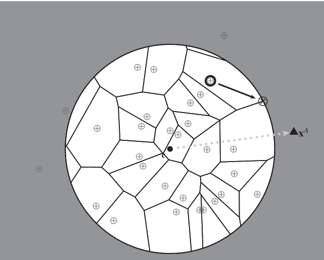

图 4.4 使用最近外出替换重新训练的超球面上最优贪心攻击一次迭代的示意图。攻击者希望将当前质心 c 移向目标点 x^4，所需位移方向以它们之间的灰色向量显示。每个训练点用 ⊕ 表示。这些点诱导了超球面内黑色网格所描绘空间的沃罗尼分解。每个这样的沃罗尼单元是将替换所包围训练点的点集。最后，最优攻击点由 ⊗ 表示——它替换指示的训练点，从而根据程序 (4.22) 产生最大可能的位移对齐度。

替换第 \(k^{th}\) 个点所能实现的位移对齐度；否则，它是上界。因此，我们可以对每个点进行二分查找，以寻找可实现的最大位移对齐度。此外，由于我们在搜索最大可能的位移对齐度，可以将第 \(k^{th}\) 点的初始下界初始化为之前 (\(k - 1$) 个点迄今所实现的最大位移对齐度。此整体过程在算法 4.1 中有所体现。

然而，这个问题还有一个我们尚未解决的方面。到目前为止，我们隐式地假设每个点的沃罗尼区域与超球面有非空交集，但经过多次贪心最优攻击迭代后，该假设可能被违反。这样的点被称为 _弃用_ 点，它们会拖慢攻击进度，因为它们不再可替换并且远离期望目标 x^4。然而，攻击者可以通过找到最优攻击点、确定（通过模拟）攻击是否会导致任何点被弃用，并（如果是）为被弃用的点找到最优攻击点来防止点被弃用。通过确保没有点被弃用，攻击者会在该迭代中损失收益，但可防止长期


### 算法 4.1 最近外贪心攻击

```
Nout-Opt(x^(4), c^(0), R, c^(t), {x^(j)}, epsilon)
Let rho^- <- -2 * R
for all j in 1, ..., N do begin
    Let rho^+ <- 2 * R
    while rho^+ - rho^- > epsilon do begin
        Solve for
        a^(t, j) = argmin_x || x - c^(t) ||
        (4.23)
        s.t. forall k in 1, ..., N 2(x^(k) - x^(j))^T x <= || x^(k) ||^2 - || x^(j) ||^2
        1/(RN) (x - x^(j))^T ((x^(4) - c^(0)) / || x^(4) - c^(0) ||) >= (rho^+ - rho^-) / 2
        if Program 4.23 is feasible and || a^(t, j) - c^(t) || <= R then rho^- <- (rho^+ + rho^-) / 2 and
        a^(t) <- a^(t, j)
        else rho^+ <- (rho^+ + rho^-) / 2
    end while
end for
return: a^(t)
```

拖慢其攻击速度。这使攻击在全局上更加优化，但也更难精确分析。

由于这一问题，目前尚无关于该攻击在 T 次攻击迭代中总位移对齐的精确已知结果。不过，我们可以对其进行近似。具体而言，在攻击者的最坏情况下，所有训练点都将沿着 x^(4) - c^(t) 的方向共线。因此，我们可以分析一维情况。在此，假设没有点会被丢弃，单次攻击实现的位移至少为 R / (2N)，因为在最坏情况下，N 个点均匀分布在质心和半径 R 之间。因此，总位移至少为 1 / (2N^2) 乘以未丢弃点的迭代次数。不过，在实际中，高维问题中的收益要大得多，并且大约与 T / N 成正比。为了验证这一点，我们遵循 Kloft & Laskov (2012) 的实验程序，使用 N = 100 个初始数据点，这些点在 D ∈ {2, 4, 8, 16, 32, 64, 100} 维中绘制自标准正态分布，并选择半径 R 以使假阴性率为 0.001。从这一初始设置出发，我们构建了 T = 5 · N = 500 次贪心攻击的迭代。实验重复了 10 次，结果如图 4.5 所示。从这些图中可以看出，当 D > 4 时，效果大约是线性的，其斜率趋近于甚至略优于 D_R = T / N。

### 4.6 受限攻击者

回顾迄今的结果，在第 4.3 节和第 4.4 节中，我们表明，一种不进行任何数据替换而使用自助重训练的超球体探测器对攻击具有鲁棒性。

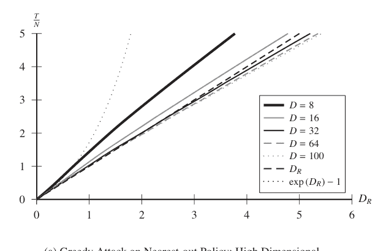

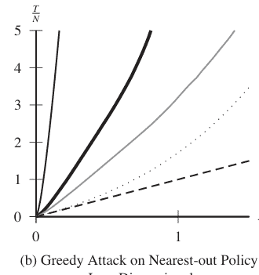

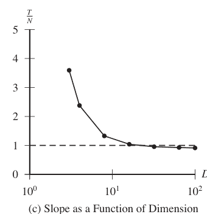

图 4.5 这些图展示了针对使用最近外替换的超球体的迭代贪心攻击的经验效果。(a) 在高维中，所需攻击持续时间大约作为 D_R 的函数线性增加，斜率随着维度增加而降低。(b) 在低维中，所需持续时间可能超过指数界限，这是由于数据在超球体内密集聚集造成的。(c) 当近似为线性函数时，拟合直线的斜率随着超球体维度的增加而降低。对于 D ≈ N，斜率可能略小于一。

攻击的意义在于，攻击者必须使用与其所需位移 $D_R$ 成指数关系的攻击点数量。然而，在没有任何数据替换的情况下，随着接收更多数据，超球体变得不可适应，重训练迅速变得徒劳。然而，正如我们在上一节中所见，当引入数据替换时，攻击者在若干可能的替换策略下，只需使用线性数量的攻击点即可实现超球体探测器所需的位移 $D_R$。这些结果表明，拥有自适应超球体探测器可能与拥有攻击者难以胁迫的模型不相容；也就是说，对超球体学习而言，迭代重学习与安全无法同时实现。然而，到目前为止，我们过于悲观地假设，一旦攻击开始，攻击者可以控制所有数据点。在本节中，我们考察了关于攻击者能力的更现实假设，并表明在某些场景中，迭代重训练的超球体比之前的最坏情况分析所示的对投毒攻击更具鲁棒性。与上一节一样，这里我们总结了 Kloft & Laskov (2012) 提出的结果。

为了简化分析，此处我们只考虑 _平均外替换_，并将自己限制在每当超球体接收到新点时进行重训练的场景中；即，对所有 \(t\) 均有 \(\alpha_t = 1\)。通过这一限制，我们只需考虑攻击者在第 \(t\) 次迭代中如何设计一个最优点 \(\mathbf{a}^{(t)}\)，并假设它是贪心地这样做（即，仅考虑当前超球体）。

与之前各节不同，此处我们假设新数据有两个来源：攻击者生成的攻击数据和系统其他用户生成的良性数据。我们假设良性数据 (i) 来自一个对攻击者既无利亦无害的自然分布 \(P_\mathbf{x}\)，(ii) 从该分布中独立同分布地抽取，(iii) 与攻击数据随机交错，并且最重要的是，(iv) 无论分类器当前状态如何，始终被接受用于重训练（即，对良性数据放宽自助重训练）。$^2$ 具体而言，我们假设提供给分类器的每个新数据点都随机被选为攻击数据或良性数据，其依据是具有固定参数 \(v \in [0, 1]\) 的伯努利随机变量；即，当第 \(t\) 个新数据点被引入时，它要么是攻击者以概率 \(v\) 选定的点 \(\mathbf{a}^{(t)}\)，要么是以概率 \(1 - v\) 出现的点 \(\mathbf{x}^{(t)} \sim P_\mathbf{x}\)，且攻击者无法改变其点被选中的概率 \(v\)。等价地，我们可以用随机变量 \(B^{(t)} \sim \text{Bern}(v)\) 来模型化新点 \(\mathbf{x}_{new}^{(t)}\)，使得

$$
\mathbf{x}_{new}^{(t)} = B^{(t)}\mathbf{a}^{(t)} + (1 - B^{(t)})\mathbf{x}^{(t)}
$$

其中 \(\mathbf{x}^{(t)} \sim P_\mathbf{x}\) 且 \(B^{(t)} \in \{0, 1\}\)。重要的是，在选定 \(\mathbf{a}^{(t)}\) 时，我们假设攻击者不知道 \(B^{(t)}\) 或 \(\mathbf{x}^{(t)}\)，但仍可以观察到由此产生的 \(\mathbf{c}^{(t)}\)，并因此在重训练发生后计算 \(\mathbf{x}_{new}^{(t)}\)。与之前一样，攻击者也必须选择 \(\mathbf{a}^{(t)}\) 以使其被接受用于重训练，但此处我们假设当 \(B^{(t)} = 0\) 时，良性的 \(\mathbf{x}_{new}^{(t)}\) 将始终被接受。接下来，我们讨论攻击者如何选择 \(\mathbf{a}^{(t)}\) 并在若干约束下分析其影响。

$^2$ 这一假设在 Kloft & Laskov (2012) 研究的替代模型中被移除，这些模型未在本文中讨论。

#### 4.6.1 贪心最优攻击

在上述讨论的场景中，新训练数据是攻击数据和良性数据的混合，但攻击者 _不能_ 改变两者之间的混合比例。在此设定下，我们假设攻击者在每次迭代中生成一个攻击点，以根据公式 (4.21) 优化预期位移对齐，并且要么是这个点

or a benign point $\mathbf{x}^{(t)} \sim P_{\mathbf{x}}$ will be used in retraining the hypersphere to obtain the $t^{\text{th}}$ centroid. Under average-out replacement (see Section 4.5.1), the outcome of this attack can be described by the resulting centroid and displacement vector, which are computed from $\mathbf{x}_{new}^{(t)}$ as

$$
\mathbf{c}^{(t)} = \mathbf{c}^{(t-1)} + \frac{1}{N} \left(\mathbf{x}_{new}^{(t)} - \mathbf{c}^{(t-1)}\right) = \mathbf{c}^{(t-1)} + \frac{1}{N} \left(B^{(t)} \left(\mathbf{a}^{(t)} - \mathbf{c}^{(t-1)}\right) + \left(1 - B^{(t)}\right) \left(\mathbf{x}^{(t)} - \mathbf{c}^{(t-1)}\right)\right)
$$

$$
\mathbf{D}_T = \frac{1}{R \cdot N} \sum_{t=1}^T \left(\mathbf{x}_{new}^{(t)} - \mathbf{c}^{(t-1)}\right) = \frac{1}{R \cdot N} \sum_{t=1}^T \left(B^{(t)} \left(\mathbf{a}^{(t)} - \mathbf{c}^{(t-1)}\right) + \left(1 - B^{(t)}\right) \left(\mathbf{x}^{(t)} - \mathbf{c}^{(t-1)}\right)\right)
$$

由于这些递归表达式的结构，在整个攻击序列上优化 $\mathbf{D}_T$ 是困难的。然而，鉴于上一次迭代的质心 $\mathbf{c}^{(t-1)}$，我们可以在假设所有点 $\{\mathbf{x}^{(t)\}}\) 独立地从分布 $P_{\mathbf{x}}$ 中抽取的前提下，为攻击者推导贪心最优动作。结果由以下引理给出。

##### 引理 4.21

Under average-out replacement, at the $t^{\text{th}}$ attack iteration, the greedy optimal attack point is given by

$$
\mathbf{a}^{(t)} = \mathbf{c}^{(t-1)} + R \cdot \frac{\mathbf{x}^4 - \mathbf{c}^{(0)}}{\|\mathbf{x}^4 - \mathbf{c}^{(0)}\|}.
$$

_Proof._ 根据公式 (4.21)，贪心最优策略优化 $\mathrm{E} \left[ \rho \left(\mathbf{D}_t\right) \mid \mathbf{c}^{(t-1)} \right]$，但由于 $\mathrm{E} \left[ \rho \left(\mathbf{D}_{t-1}\right) \mid \mathbf{c}^{(t-1)}\right] = \rho \left(\mathbf{D}_{t-1}\right)$——这是攻击者在第 \(t\) 步动作相对于的一个固定量——前者等价于优化 $\mathrm{E} \left[ \rho \left(\mathbf{D}_t\right) - \rho \left(\mathbf{D}_{t-1}\right) \mid \mathbf{c}^{(t-1)}\right]$；即，优化 $\mathbf{r}_t$ 与所需方向 $\mathbf{x}^4 - \mathbf{c}^{(0)}$ 的点积。这个相对位移由 $\mathbf{r}_t = \frac{B^{(t)}}{R \cdot N} \cdot \left(\mathbf{a}^{(t)} - \mathbf{c}^{(t-1)}\right) + \frac{(1-B^{(t)})}{R \cdot N} \cdot \left(\mathbf{x}^{(t)} - \mathbf{c}^{(t-1)}\right)$ 给出。因此，计算所需的期望值变为

$$
\mathrm{E} \left[ \rho \left(\mathbf{D}_t\right) - \rho \left(\mathbf{D}_{t-1}\right) \mid \mathbf{c}^{(t-1)} \right] = \mathrm{E} \left[ \mathbf{r}_t \mid \mathbf{c}^{(t-1)} \right]^\top \frac{\mathbf{x}^4 - \mathbf{c}^{(0)}}{\|\mathbf{x}^4 - \mathbf{c}^{(0)}\|} = \frac{v}{R \cdot N} \left(\mathbf{a}^{(t)} - \mathbf{c}^{(t-1)}\right)^\top \frac{\mathbf{x}^4 - \mathbf{c}^{(0)}}{\|\mathbf{x}^4 - \mathbf{c}^{(0)}\|} + \frac{1-v}{R \cdot N} \left(\mathrm{E} \left[ \mathbf{x}^{(t)} \mid \mathbf{c}^{(t-1)} \right] - \mathbf{c}^{(t-1)}\right)^\top \frac{\mathbf{x}^4 - \mathbf{c}^{(0)}}{\|\mathbf{x}^4 - \mathbf{c}^{(0)}\|},
$$

其中，由于 $\mathbf{x}^{(t)}$ 独立地从 $P_{\mathbf{x}}$ 中抽取，$\mathrm{E} \left[ \mathbf{x}^{(t)} \mid \mathbf{c}^{(t-1)} \right]$ 是一个固定量。根据线性性，最大化此量等价于在 $\|\mathbf{a}^{(t)} - \mathbf{c}^{(t-1)}\| \leqslant R$ 的约束下最大化 $\left(\mathbf{a}^{(t)} - \mathbf{c}^{(t-1)}\right)^\top \frac{\mathbf{x}^4 - \mathbf{c}^{(0)}}{\|\mathbf{x}^4 - \mathbf{c}^{(0)}\|}$。正如我们在第 4.5.1 节中所见，这得出了最优 $\mathbf{a}^{(t)}$ 的声称形式。


#### 4.6.2 混合数据攻击

这里我们分析在 T 次迭代上应用引理 4.21 的最优贪婪攻击的预期净效果，从而为公式 (4.24) 中描述的混合数据场景提供分析。为此，我们需要对良性数据的分布做出一个额外的假设——即我们假设 (i) 所有良性数据都从 P_x 独立抽取，(ii) 良性数据具有稳态均值，E_{x~P_x} [x] = c^(0)，以及 (iii) 良性数据永远不会被拒绝。这些是关于良性数据的强假设，但，在假设良性数据具有稳态均值且始终被接受的情况下，这些对攻击者是保守的假设，并得出以下定理。³

> 定理 4.22（改编自 Kloft & Laskov 2012）给定固定混合概率 v，在每次迭代中应用贪婪最优攻击策略（由引理 4.21 给出）得到预期位移对齐为

```
E [ρ (D_T)] = \frac{v}{1 - v} \cdot \left( 1 - \left( 1 - \frac{(1 - v)}{N} \right)^T \right) \le \frac{v}{1 - v}
```

在 T 次迭代后。

Proof. Under the optimal attack strategy of Lemma 4.21 the centroid becomes

```
c^(t) = c^(t-1) + \frac{1}{N} \left( B^{(t)} R \cdot \frac{x - c^{(0)}}{\|x - c^{(0)}\|} + \left( 1 - B^{(t)} \right) (x^{(t)} - c^{(t-1)}) \right)
```

```
= c^(t-1) + \frac{B^{(t)} R}{N} \frac{x - c^{(0)}}{\|x - c^{(0)}\|} + \frac{1}{N} \left( 1 - B^{(t)} \right) (x^{(t)} - c^{(0)})
```

```
- \frac{1}{N} \left( 1 - B^{(t)} \right) \left( c^(t-1) - c^{(0)} \right) ,
```

其中求和已为后续方便地重新组织。现在，使用公式 (4.4) 中 D_t = \frac{c^{(t)} - c^{(0)}}{R} 的定义，我们代入 c^(t) 的这种形式并利用 ρ ( · ) 的线性性质得到

```
D_t = \left( 1 - \frac{1 - B^{(t)}}{N} \right) D_{t-1} + \frac{x - c^{(0)}}{\|x - c^{(0)}\|} \frac{B^{(t)}}{N} + \frac{\left( 1 - B^{(t)} \right) \left( x^{(t)} - c^{(0)} \right)^\top}{N} \frac{x - c^{(0)}}{R},
```

```
ρ (D_t) = \left( 1 - \frac{1 - B^{(t)}}{N} \right) ρ (D_{t-1}) + \frac{B^{(t)}}{N} + \frac{\left( 1 - B^{(t)} \right) \left( x^{(t)} - c^{(0)} \right)^\top}{N} \frac{x - c^{(0)}}{R \|x - c^{(0)}\|} .
```

接下来，我们利用 E [ · ] 的线性性质以及随机变量 B^(t) 和 x^(t) 的相互独立性来计算 ρ (D_t) 的期望。重要的是，D_{t-1} 也与来自第 t 次迭代的 B^(t) 和 x^(t) 相互独立。最后，利用 E [B^(t)] = v 和 E [x^(t)] = c^(0) 的事实，我们得到以下递推公式

```
E [ρ (D_t)] = \left( 1 - \frac{(1 - v)}{N} \right) E [ρ (D_{t-1})] + \frac{1}{N} v.
```

展开这个递推并利用 $\mathbf{D}_0 = \mathbf{0}$ 从而 $\rho \left( \mathbf{D}_0 \right) = 0$ 的事实，得到以下等比级数：

$$
\begin{aligned}
E \left[ \rho \left( \mathbf{D}_t \right) \right] &= \frac{v}{N} \cdot \sum_{t=1}^T \left( 1 - \frac{(1-v)}{N} \right)^{T-t} \\
&= \frac{v}{N} \cdot \frac{1 - \left( 1 - \frac{(1-v)}{N} \right)^T}{1 - \left( 1 - \frac{(1-v)}{N} \right)} \\
&= \frac{v}{1-v} \left( 1 - \left( 1 - \frac{(1-v)}{N} \right)^T \right) .
\end{aligned}
$$

该量的上界 $\frac{v}{1-v}$ 源于这样的事实：对于所有 \(T\)，上述表达式中的最后一个因子都小于或等于一。

除了上述结果外，Kloft & Laskov (2012) 还对 \(\rho \left( \mathbf{D}_t \right)\) 的方差进行了界定，并表明当 \(T, N \rightarrow \infty\) 时，该方差趋于零。因此，对于足够大的 \(N\)，上述 \(E \left[ \rho \left( \mathbf{D}_t \right) \right]\) 公式应能准确预测攻击进行过程中 \(\rho \left( \mathbf{D}_t \right)\) 的值。根据这一结果，图 4.6 描绘了相对于 \(N\) 的混合数据攻击预测迭代次数 \(T\)，作为所需相对位移 \(D_R\) 的函数，适用于 \(v\) 的各种值。如定理 4.22 的界限所暗示，对于 \(v < 1\)，超过 \(D_R > \frac{v}{1-v}\) 的位移无论攻击持续时间 \(T\) 或初始点数 \(N\) 如何都无法实现。而且，由于该界限随 \(v\) 严格增加，我们可以使用引理 4.1 对其求逆，这表明对手必须控制新数据中比例 \(v \ge \frac{D_R}{1+D_R}\) 的部分，才能期望实现其目标。

这些结果与 4.4 节的结果类似，其中 \(1 - v\) 起着与 \(\frac{N}{N+M}\) 类似的作用（见图 4.3）。绝对上界是通过限制对手控制的数据比例而不是限制攻击持续时间来在替换下获得的。但是，这里的结果仅给出预期行为，而不是攻击性能的严格界限。事实上，在最坏情况下，所有对抗性点都可能被接受，从而导致 4.5.1 节的线性行为。尽管如此，这些结果表明，此类结果通常过于悲观地评估了对手的能力。但是，它们也依赖于关于良性数据分布的假设。或者，Kloft & Laskov (2012) 还考察了一种场景：如果超球面的误正率过高，则会手动重置它。在这种替代场景下，我们不再需要假设良性数据始终被接受用于重新训练，在其下，Kloft & Laskov (2012) 推导出与定理 4.22 类似的结果；但是，为了简洁起见，我们这里不探讨该场景。

#### 4.6.3 扩展

这项工作有几个直接的扩展。第一个将结果扩展到由马氏范数 \(\|\mathbf{x}\|_\mathbf{\Sigma} = \mathbf{x}^\top \mathbf{\Sigma}^{-1} \mathbf{x}\) 定义的超椭球探测器，用于固定正定结构矩阵 \(\mathbf{\Sigma}\)。在此范数下，超椭球探测器定义为：如果 \(\|\mathbf{x} - \mathbf{c}\|_\Sigma > R\) 则 \(f_{c, \mathbf{\Sigma}, R}(\mathbf{x}) =\) "+"，否则为 "-"。通过将问题转换为由 \(\mathbf{x}' \leftarrow \mathbf{\Sigma}^{-\frac{1}{2}} \mathbf{x}\) 定义的空间（由于 \(\mathbf{\Sigma}\) 是正定的，这是可能的），本章的所有结果都可以直接应用。唯一的注意事项是 \(\mathbf{\Sigma}\) 会扭曲空间——因此任务的难度（由 \(D_R\) 给出）取决于目标点 \(\mathbf{x}\) 相对于 \(\mathbf{\Sigma}\) 主轴的位置。

第二个扩展涉及基于核函数定义的隐式特征空间中的基于超球面的探测，该核函数计算隐式投影到希尔伯特空间 \(\mathcal{H}\) 中的数据点的内积。特别是，如果 \(k : \mathcal{X} \times \mathcal{X} \rightarrow \Re\) 是核函数，且 \(\phi : \mathcal{X} \rightarrow \mathcal{H}\) 是其对应的投影函数，满足 \(k\left(\mathbf{x}^{(1)}, \mathbf{x}^{(2)}\right) = \phi\left(\mathbf{x}^{(1)}\right)^\top \phi\left(\mathbf{x}^{(1)}\right)\)，那么投影数据集的质心由 \(\phi_C = \frac{1}{N} \sum_{i=1}^N \phi\left(\mathbf{x}^{(i)}\right)\) 给出，投影数据点 \(\phi\left(\mathbf{x}\right)\) 到该质心的距离为

```
\(\|\phi\left(\mathbf{x}\right) - \phi_C\|_k = \left( k\left(\mathbf{x}, \mathbf{x}\right) - \frac{2}{N} \sum_{i=1}^N k\left(\mathbf{x}^{(i)}, \mathbf{x}\right) + \frac{1}{N^2} \sum_{i,j=1}^N k\left(\mathbf{x}^{(i)}, \mathbf{x}^{(j)}\right) \right)^{\frac{1}{2}},\)
```

这，与所有核算法一样，可以仅使用核函数隐式计算。相应的分类函数将点 \(\mathbf{x}\) 标记为 "+" 如果 \(\|\phi\left(\mathbf{x}\right)\|_k > R\)，否则标记为 "-"。

如果假设攻击者可以直接在特征空间 \(\mathcal{H}\) 中插入任意攻击点，那么针对这些基于核的超球面探测器的攻击是上述工作的直接扩展。但是，真正的对手受限于在空间 \(\mathcal{X}\) 中插入数据点，而该空间通常没有到 \(\mathcal{H}\) 的一对一映射。对手要找到一个点 \(\mathbf{a}^{(t)} \in \mathcal{X}\)，其在特征空间中的像能根据定义 (4.2) 最大化位移对齐，通常是非平凡的——这是著名的原像问题（Fogla & Lee 2006），我们也会在本书的其他背景下重新讨论此问题（例如，参见 8.4.3 节）。尽管如此，Kloft & Laskov


(2010) 在更强的假设下实证研究了针对基于核的超球面探测器的攻击，即攻击者可以在特征空间中创建其攻击点——这是一种保守的安全假设。

### 4.7 总结

在本章中，我们分析了针对超球学习器的因果完整性攻击，该学习器会根据新数据迭代重新训练其质心。这种分析在各种不同的假设下，提供了对攻击可能对简单学习模型产生的影响的深刻理解。我们展示了在假设对手具有不同能力并使用多种重训练模型时，如何构建最优攻击；结果表明，对手的成功与场景的假设密切相关。首先，在 4.3 节和 4.4 节中，我们证明了：在没有任何数据替换或时间约束的情况下，攻击者至少需要 \( M^* \ge \exp(D_R - 1) \) 个攻击点（当 \( N = 0 \) 时）或 \( M^* \ge N(\exp(D_R) - 1) \) 个攻击点（当 \( N > 0 \) 时），才能实现所需的相对位移 \( D_R \)。同样，如果攻击的最大持续时间为 \( T \)，则这些界限增加为：当 \( N = 0 \) 时 \( M^* \ge \left( \frac{T}{T-D_R} \right)^T \)，或当 \( N > 0 \) 时 \( M^* \ge N \left( \frac{T}{T-D_R} \right)^T - N \)（在这两种情况下都假设 \( T > D_R \)，因为否则所需位移无法实现）。在所有这些情况下，攻击者所需的攻击点数量与其目标规模（即相对位移 \( D_R \））呈指数级增长。

然而，不带任何数据替换的自举重训练严重限制了模型随时间适应数据漂移的能力——即使没有攻击，模型最终也会变得僵化固定。因此，在 4.5 节和 4.6 节中，我们重新审视了 Kloft & Laskov (2012) 分析过的数据替换设置，其中每个新数据点替换一个旧数据点。这些结果表明，在平均替换和随机替换下，攻击者只需要线性数量的攻击点（相对于初始点数 \( N \））即可实现所需目标 \( D_R \)。即使是为限制对手影响而选择的最近点替换策略，在实证上也表现出类似线性的行为（低维空间除外）。这些结果表明，当攻击者在此场景下控制所有新数据时，它可以用相对较小的努力成功执行其攻击。话虽如此，在许多情况下，假设攻击者控制所有新训练数据过于保守。因此，在本章的最后部分，我们探讨了 Kloft & Laskov (2012) 的工作，即考察一种混合数据场景，其中新数据同时来自良性和恶意来源。在每个新数据点以概率 \( v\) 为恶意且否则为良性（且所有良性数据始终用于重训练）的假设下，攻击者必须控制 \( v \ge \frac{D_R}{1+D_R} \) 的新数据比例，才能期望实现其目标。此外，攻击者的预期位移不再随攻击点数量线性增长；因此，在这种更现实的设置下，我们发现攻击者无法轻易实现其目标。

本章提出的分析表明，针对迭代重训练学习器的投毒攻击的成功取决于多种因素，包括学习器如何限制新训练数据以及攻击者拥有多少控制权。然而，本章提供的精确分析需要一些在实际环境中不易证明的假设，且仅适用于带自举重训练的相对简单的学习算法。尽管如此，这些精确分析为数据投毒的抽象问题提供了有趣的洞察，并可作为对更复杂学习问题进行非理论分析的指南。这种关于污染模型的早期工作深刻影响了我们后续关于对抗性学习框架的方法（该框架将在本书余下部分描述），也是最早尝试将此问题视为学习者与对手之间对抗性博弈的尝试之一。

## 5 可用性攻击案例研究：SpamBayes

对手还可以执行旨在降低分类器区分允许事件和不允许事件的能力的攻击。这些针对学习算法的 *因果可用性* 攻击会导致生成的分类器具有不可接受的高误报率；即，成功投毒的分类器会将良性输入误分类为潜在攻击，从而在合法活动中造成不可接受的中断程度。本章提供了针对 SpamBayes 垃圾邮件检测系统的一次此类攻击的案例研究。我们表明，精心制作的攻击消息——未经告知的用户可能会将其识别并标记为垃圾邮件的恶意垃圾邮件——可以利用 SpamBayes 的学习算法，导致学习到的分类器具有不合理的高误报率。（第 6 章展示了 *因果* 攻击，这些攻击反过来会导致具有不合理高漏报率的分类器——这些是 *完整性* 攻击。）我们还展示了针对这些攻击的有效防御，并讨论了防御所需的权衡。

我们研究了针对 SpamBayes 垃圾邮件过滤器的几种攻击，每种攻击都体现了对底层学习技术漏洞的特定洞察。这样，我们更广泛地展示了可能影响任何使用类似学习算法的系统的攻击。我们提出的攻击针对垃圾邮件过滤器 SpamBayes (spambayes.sourceforge.net) 所使用的学习算法，但还有其他几个过滤器也使用相同的底层学习算法，包括 BogoFilter (bogofilter.sourceforge.net)、Mozilla Thunderbird 电子邮件客户端中的垃圾邮件过滤器 (mozilla.org) 以及 SpamAssassin (spamassassin.apache.org) 的机器学习组件。这三个过滤器的学习元素之间的主要区别在于它们的分词方法；即，学习算法在本质上是相同的，但每个过滤器使用不同的功能集。我们展示了 SpamBayes 底层算法的漏洞，因为它使用纯机器学习方法，学术界（Meyer & Whateley 2004）对此很熟悉，且下载量超过 700,000 次，深受欢迎。尽管此处我们仅分析 SpamBayes，但这些其他系统使用相同学习算法的事实表明，其他过滤器也容易受到类似攻击。然而，攻击的整体有效性将取决于每个其他过滤器如何将学习到的分类器纳入最终过滤决策。例如，Apache SpamAssassin (Apa n.d.) 等过滤器仅将学习作为更广泛过滤引擎的几个组件之一（其他组件是手工制作的非自适应规则），因此针对它的攻击会降低过滤器的性能，但也许其整体影响会被减弱或完全抵消。不过，原则上，在这些其他过滤器中复制这些结果应该是可能的。最后，除了垃圾邮件过滤之外，我们还强调了 SpamBayes 学习器中的漏洞，因为这些相同的攻击也可以用于其他领域的类似学习算法。尽管本章提出的这些攻击的可行性、攻击者的动机或污染机制在其他领域可能不合适，但了解该漏洞以便为其他应用进行类似评估仍然很有趣。

我们根据第 3 章讨论的框架，组织了研究 SpamBayes 学习算法漏洞的方法。主要地，我们调查了过滤器上的 *因果可用性* 攻击，因为这种攻击是一个可以实际部署在现实世界环境中的有趣新方面。在这里，对手具有加性污染能力（即，对手独家控制用户训练数据的某个子集），但仅限于更改正类（垃圾邮件）；我们认为这种污染模型最适合狡猾的垃圾邮件发送者。我们研究的新贡献包括一组针对 SpamBayes 的成功原则性攻击、一项在现实环境中验证攻击有效性的实证研究，以及一项在实证上对若干攻击成功的原则性防御。最后，我们讨论了攻击和防御策略的含义以及攻击者信息在这些攻击有效性中所起的作用。

在本章中，我们讨论训练模型的背景（参见 5.1 节）；我们介绍针对 SpamBayes 的三种新攻击（参见 5.3 节）；我们给出实验结果（参见 5.5 节）；并且我们介绍针对这些攻击的防御，以及进一步的实验结果（参见 5.4 节）。本章建立在 Nelson 等人 (2008, 2009) 的工作基础上。

### 5.1 SpamBayes 垃圾邮件过滤器

SpamBayes 是一种基于内容的统计垃圾邮件过滤器，它使用基于 Robinson (2003) 提出并受 Graham (2002) 启发的模型中的令牌计数来分类电子邮件。Meyer & Whateley (2004) 详细描述了该系统。SpamBayes 基于令牌在垃圾邮件和非垃圾邮件中的出现情况，计算训练语料库中每个令牌的垃圾邮件得分；该得分被视为包含该令牌的电子邮件是垃圾邮件的后验概率的平滑估计。该过滤器基于令牌得分相互独立的假设计算消息的总体垃圾邮件得分，然后应用 Fisher 方法（cf. Fisher 1948）来组合显著性检验，以确定电子邮件的令牌是否足以指示某一类别。消息得分与两个阈值进行比较，以选择标签 _垃圾邮件_、_良性邮件_（即，非垃圾邮件）或 _不确定_。在本节余下部分，我们详细介绍了 SpamBayes 用于估计和聚合令牌得分的统计方法。

#### 5.1.1 SpamBayes 的训练算法

SpamBayes 是一种基于内容的垃圾邮件过滤器，它根据电子邮件中观察到的令牌（包括标头令牌）来分类消息。使用的垃圾邮件分类模型由


SpamBayes 由 Robinson (2003) 和 Meyer & Whateley (2004) 设计，灵感源于 Graham (2002) 的想法，并结合了 Fisher 用于组合独立显著性检验的方法（Fisher 1948）。直观地说，SpamBayes 通过统计令牌出现的每种类型电子邮件的数量，来了解每个令牌表明 *正常邮件* 或 *垃圾邮件* 的程度。在对新电子邮件进行分类时，SpamBayes 将邮件的所有令牌视为判断邮件是垃圾邮件还是正常邮件的证据，并使用统计检验来决定它们是否以足够的置信度表明某一标签；如果不是，SpamBayes 将返回 *不确定*。

SpamBayes 根据 *X* 中出现的单词、URL 组件、头部元素和其他字符序列对每封电子邮件 *X* 进行分词。每个都被视为电子邮件的唯一令牌，与其在邮件中的顺序无关，但为方便起见，我们对令牌进行排序，使每个唯一令牌在整个令牌字母表中具有固定位置 *i*。此外，SpamBayes 只记录令牌是否出现在邮件中，而不记录出现的次数。因此，电子邮件 *X* 被表示为二进制（可能无限长度）向量 **x**，其中

```
x_i = \left\{ \begin{array}{ll} 1, & \text{if the } i^{\text{th}} \text{ token occurs in } X \\ 0, & \text{otherwise} \end{array} \right. .
```

此消息向量表示记录了邮件中出现的哪些令牌，与其顺序或重复次数无关。

SpamBayes 使用的训练数据是消息向量（表示每条训练邮件）与标签对的数据集：\(\mathbb{D}^{(\text{train})}=\{(\mathbf{x}^{(1)}, y^{(1)}), (\mathbf{x}^{(2)}, y^{(2)}), \dots, (\mathbf{x}^{(N)}, y^{(N)})\}\)，其中 \(\mathbf{x}^{(i)} \in \{0, 1\}^D\) 且 \(y^{(i)} \in \{\text{ham}, \text{spam}\}\)。如第 2.2.1 节所述，此训练数据可以表示为训练矩阵 \(\mathbf{X} = [\mathbf{x}^{(1)} \mathbf{x}^{(2)} \dots \mathbf{x}^{(N)}]^\top \in \{0, 1\}^{N \times D}\) 及其标签向量 \(\mathbf{y} = [y^{(1)} y^{(2)} \dots y^{(N)}] \in \{0, 1\}^N\)，其中 1 表示 *垃圾邮件*，0 表示 *正常邮件*。使用训练矩阵，SpamBayes 使用的令牌计数统计量可以表示为

```
\mathbf{n}^{(s)} \triangleq \mathbf{X}^\top \mathbf{y} \qquad \mathbf{n}^{(h)} \triangleq \mathbf{X}^\top (\mathbf{1} - \mathbf{y}) \qquad \mathbf{n} \triangleq \mathbf{n}^{(s)} + \mathbf{n}^{(h)}
```

它们是包含所有、垃圾邮件和正常邮件中每个令牌累计计数的向量。我们还定义 \(N^{(s)} \triangleq \mathbf{y}^\top \mathbf{y}\) 为训练垃圾邮件的总数，\(N^{(h)} \triangleq (\mathbf{1} - \mathbf{y})^\top (\mathbf{1} - \mathbf{y})\) 为训练正常邮件的总数（当然，\(N = N^{(s)} + N^{(h)}\)）。

基于这些计数统计量，SpamBayes 通过估计后验 \(\text{Pr}(X \text{ is spam}|x_i = 1)\) 来计算第 \(i^{\text{th}}\) 个令牌的垃圾邮件得分。首先，使用最大似然估计器估计在垃圾邮件/正常邮件中观察到第 \(i^{\text{th}}\) 个令牌的似然 \(\text{Pr}(x_i = 1|X \text{ is spam})\) 和 \(\text{Pr}(x_i = 1|X \text{ is ham})\)，从而得到似然向量 \(L_i^{(s)} = \frac{1}{N^{(s)}} \cdot \mathbf{n}^{(s)}\) 和 \(L_i^{(h)} = \frac{1}{N^{(h)}} \cdot \mathbf{n}^{(h)}\)。

其次，使用似然估计 \(\mathbf{L}^{(s)}\) 和 \(\mathbf{L}^{(h)}\) 以及先验分布 \(\text{Pr}(X \text{ is spam})\) 的估计 \(\pi^{(s)}\)，根据贝叶斯法则估计后验为 \(\mathbf{P}^{(s)} \propto \frac{\pi^{(s)}}{N^{(s)}} \cdot \mathbf{n}^{(s)}\) 和 \(\mathbf{P}^{(h)} \propto \frac{1 - \pi^{(s)}}{N^{(h)}} \cdot \mathbf{n}^{(h)}\)，并受约束 \(\mathbf{P}^{(s)} + \mathbf{P}^{(h)} = \mathbf{1}\)。然而，SpamBayes 未使用通常的朴素贝叶斯最大似然先验估计器 \(\pi^{(s)} = \frac{N^{(s)}}{N^{(s)} + N^{(h)}}\)，而是使用不可知先验分布 \(\pi^{(s)} = \frac{1}{2}\)，这一选择使学习者具有我们将在附录 C.2.1 中进一步讨论的独特特性。基于这一先验选择，SpamBayes 随后为第 \(i^{\text{th}}\) 个令牌计算垃圾邮件得分向量 \(\mathbf{P}^{(s)}\)，如下所示

\(P_i^{(s)} = \frac{N^{(h)}n_i^{(s)}}{N^{(h)}n_i^{(s)} + N^{(s)}n_i^{(h)}};\) (5.1)

即，该得分是后验 Pr (\(X\) is spam |\(x_i=1\)) 的估计器。类似的 *令牌正常邮件得分* 由 \(\mathbf{P}^{(h)} = \mathbf{1} - \mathbf{P}^{(s)}\) 给出。

Robinson 方法 (Robinson 2003) 通过与先验分布信念 \(x\)（默认值 \(x=0.5\)）的凸组合对 \(P_i^{(s)}\) 进行平滑，分别以 \(n_i\)（包含第 \(i^{\text{th}}\) 个令牌的训练邮件数量）和 \(s\)（用于先验强度，默认值 \(s=1\)）对量进行加权：

\(q_i = \frac{s}{s+n_i}x + \frac{n_i}{s+n_i}P_i^{(s)}.\) (5.2)

平滑减轻了对罕见令牌的过拟合。例如，如果令牌“floccinaucinihilipilification”在训练集中一次出现在垃圾邮件中，而从未出现在正常邮件中，则后验估计将为 \(P_i^{(s)}=1\)，这将导致任何未来出现此词都主导总体垃圾邮件得分。然而，此词仅在垃圾邮件中出现可能仅是其整体稀有性的产物。在这种情况下，平滑是通过添加先验分布来完成的，即每个令牌的后验为 \(x=\frac{1}{2}\)（也就是不可知得分）。对于罕见令牌，后验估计由此先验主导。然而，当令牌被更频繁地观察到时，其平滑得分会根据 \(s\) 给先验的强度，趋近于方程 (5.1) 中后验的经验估计。类似的平滑正常邮件得分由 \(1 - \mathbf{q}\) 给出。

#### 5.1.2 SpamBayes 的预测

训练后，过滤器使用 Fisher 方法 (Fisher 1948) 计算新消息 \(\hat{X}\) 的总体垃圾邮件得分 \(I(\hat{\mathbf{x}})\)，用于组合 \(\hat{X}\) 中观察到的令牌得分。SpamBayes 最多使用 \(\hat{X}\) 中得分最远离 0.5 且不在区间 (0.4, 0.6) 内的 150 个令牌（更多详情见附录 C.2.2）。令 \(\mathbb{T}_{\mathfrak{K}}\) 为 SpamBayes 纳入其垃圾邮件得分的令牌集合，并令 \(\delta(\hat{\mathbf{x}})\) 为此集合的指示函数。令牌垃圾邮件得分通过以下方式组合为 \(\hat{X}\) 的 *消息垃圾邮件得分*：

\(S(\hat{\mathbf{x}}) = 1 - \chi_{2\tau_{\mathfrak{K}}}^2(-2(\log \mathbf{q})^\top \delta(\hat{\mathbf{x}})),\) (5.3)

其中 \(\tau_{\mathfrak{K}} \triangleq |\mathbb{T}_{\mathfrak{K}}|\) 是 SpamBayes 使用的来自 \(\hat{X}\) 的令牌数量，\(\chi_{2\tau_{\mathfrak{K}}}^2(\cdot)\) 表示具有 \(2\tau_{\mathfrak{K}}\) 自由度的卡方分布的累积分布函数。正常邮件得分 \(H(\hat{\mathbf{x}})\) 类似定义，通过在方程 (5.3) 中将 \(\mathbf{q}\) 替换为 \(1-\mathbf{q}\) 得到。最后，SpamBayes 通过对 \(S(\hat{\mathbf{x}})\) 和 \(1-H(\hat{\mathbf{x}})\)（两者均指示 \(\hat{X}\) 是否为垃圾邮件）取平均来构建 \(\hat{X}\) 的总体垃圾邮件得分，给出最终得分

\(I(\hat{\mathbf{x}}) = \frac{1}{2}(S(\hat{\mathbf{x}}) + 1 - H(\hat{\mathbf{x}}))\) (5.4)

用于消息：这是一个介于 0（强正常邮件证据）和 1（强垃圾邮件证据）之间的量。SpamBayes 通过将 \(I(\hat{\mathbf{x}})\) 与两个用户可调阈值 \(\theta^{(h)}\) 和 \(\theta^{(s)}\) 进行阈值比较来进行预测，默认值为 \(\theta^{(h)} = 0.15\) 和 \(\theta^{(s)} = 0.9\)。如果 \(I(\hat{\mathbf{x}})\) 分别落在区间 [0, \(\theta^{(h)}\)]、(\(\theta^{(h)}\), \(\theta^{(s)}\)] 或 (\(\theta^{(s)}\), 1] 中，SpamBayes 预测为正常邮件、不确定或垃圾邮件，并相应地过滤消息。

除了垃圾邮件和正常邮件之外，引入不确定标签使我们无法仅使用正常邮件被误判为垃圾邮件和垃圾邮件被误判为正常邮件的误分类率（分别为假阳性和假阴性）来进行评估。我们还必须考虑垃圾邮件被误判为不确定和正常邮件被误判为不确定的误分类。由于第 5.2.3 节讨论了对用户时间和精力的实际影响，正常邮件被误判为不确定对用户来说几乎与正常邮件被误判为垃圾邮件一样糟糕。

#### 5.1.3 SpamBayes 模型

虽然 SpamBayes 算法的组件（令牌垃圾邮件得分、平滑和卡方检验）是分别提出的，但结果系统可以用一个统一的概率模型来描述，用于区分正常邮件和垃圾邮件。尽管 Robinson 将 SpamBayes 分类器作为垃圾邮件后验概率的平滑估计器来解释，但他从未明确指定概率模型。我们指定了一个判别模型，并表明结果估计可以使用经验风险最小化重新推导。这样做能更好地理解 SpamBayes 分类器的建模假设及其脆弱性。

在此模型中，有三个感兴趣的随机变量：第 \(i^{\text{th}}\) 条消息的垃圾邮件标签 \(y_i\)、第 \(i^{\text{th}}\) 条消息中第 \(j^{\text{th}}\) 个令牌的指示变量 \(X_{i,j}\)，以及第 \(j^{\text{th}}\) 个令牌的令牌得分 \(q_j\)。我们采用这样的约定：标签为 1 表示垃圾邮件，0 表示正常邮件。在判别设置中，给定 \(X_{i,\bullet}\) 作为第 \(i^{\text{th}}\) 条消息中令牌的表示以及令牌得分 \(q\)，消息的标签 \(y_i\) 与模型中的所有其他随机变量条件独立。给定单个令牌 \(X_{i,j}\) 出现时消息标签的条件概率由以下公式指定

Pr (\(y_i|X_{i,j}\), \(q_j\)) = ((\(q_j\))^{y_i} · (1 − \(q_j\))^{(1−y_i)})^{X_{i,j}} (1/2)^{(1−X_{i,j})} , (5.5)

即，在 SpamBayes 模型中，出现在消息中的每个令牌都是其标签的指示器，而消息中不存在的令牌对其标签没有影响。因为 SpamBayes 的得分只包含出现在消息中的令牌，传统的生成式垃圾邮件模型（例如，图 5.1(b））难以构建，但上述判别条件概率捕捉了这一建模细微差别。此外，令牌指示器 \(X_{i,j}\) 没有先验分布，但令牌得分有先验分布。将这些视为二项分布参数，每个都具有带有共同参数 \(\alpha\) 和 \(\beta\) 的 beta 先验，从而赋予它们条件概率

Pr (\(q_j|\alpha\), \(\beta\)) = 1/B(\(\alpha\),\(\beta\)) · (\(q_j\))^{(\(\alpha\)−1)} · (1 − \(q_j\))^{(\(\beta\)−1)} , (5.6)

其中 B (\(\alpha\), \(\beta\)) 是 beta 函数（参见术语表）。如前所述，Robinson 相反使用了带有强度参数 s 和先验的等效参数化


参数 $x$，其中 $\alpha = s \cdot x + 1$ 和 $\beta = s (1 - x) + 1$。使用这种参数化，$x$ 指定先验分布的众数。在 SpamBayes 中，这些参数是预先固定的，而不是被视为随机超参数。它们的默认值为 $\pi^{(s)} = \frac{1}{2}$，$x = \frac{1}{2}$，且 $s = 1$。

综合起来，基于第 $j^{\text{th}}$ 个标记的标签条件概率以及第 $j^{\text{th}}$ 个标记分数的先验分布，用于推导消息的垃圾邮件得分（仅基于第 $j^{\text{th}}$ 个标记）。然而，与最大似然推导不同，SpamBayes 对 $q_j$ 的参数估计并不基于所有标记上的联合概率模型。相反，每个标记的分数是通过在每标记模型中最大化标签的似然性来单独计算的，如图 5.1(a) 所示；也就是说，该模型描绘了仅基于第 $j^{\text{th}}$ 个标记出现情况的标签序列。基于图 5.1(a) 的独立性假设，方程 (5.5) 的条件分布结合起来，基于第 $j^{\text{th}}$ 个标记形成了以下联合对数概率（针对

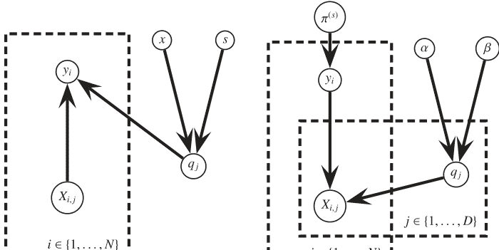

(a) 第 $j^{\text{th}}$ 个标记的 SpamBayes 判别模型

(b) 传统生成模型

图 5.1 垃圾邮件检测的概率图模型。(a) 描绘 SpamBayes 中随机变量之间依赖结构的概率模型，针对 *单个* 标记（SpamBayes 将每个标记视为 ham/spam 的独立指标，然后将它们结合起来，假设每个都是独立测试）。在此模型中，第 $i^{\text{th}}$ 封邮件的标签 $y_i$ 取决于第 $j^{\text{th}}$ 个标记的标记分数 $q_j$（如果它出现在消息中）；即，$X_{i,j} = 1$。参数 $s$ 和 $x$ 对 $q_j$ 的 beta 先验分布进行参数化。(b) 垃圾邮件更传统的生成模型。参数 $\pi^{(s)}$、$\alpha$ 和 $\beta$ 对 $y_i$ 和 $q_j$ 的先验分布进行参数化。第 $i^{\text{th}}$ 封邮件的每个标签 $y_i$ 独立地从参数为 $\pi^{(s)}$（作为 *垃圾邮件* 的概率）的 Bernoulli 分布中绘制。第 $j^{\text{th}}$ 个标记的每个标记分数独立地从参数为 $\alpha$ 和 $\beta$ 的 beta 分布中绘制。最后，给定消息的标签和标记分数，$X_{i,j}$ 独立地从 Bernoulli 分布中绘制。基于该模型的似然函数，SpamBayes 计算的标记分数 $q_j$ 可以简单地视为模型中相应参数的最大似然估计器。

$N$ 条消息）：

\log \text{Pr}(\mathbf{y}, \mathbf{X}_{\bullet j} | \alpha, \beta) = \log \text{Pr}(q_j | \alpha, \beta) + \sum_{i=1}^N \log \text{Pr}(y_i | X_{i,j}, q_j)
= - \log (\text{B}(\alpha, \beta)) + (\alpha - 1) \log(q_j) + (\beta - 1) \log(1 - q_j)
+ \sum_{i=1}^N [y_i X_{i,j} \log(q_j) + (1 - y_i) X_{i,j} \log(1 - q_j)]

最大化此联合分布（几乎）实现了 SpamBayes 指定的标记分数。为了求最大值，对第 \(j^{\text{th}}\) 个标记分数 \(q_j\) 对联合概率求导，并将导数设为 0。这得到

\(q_j = \frac{\sum_{i=1}^N y_i X_{i,j} + \alpha - 1}{\sum_{i=1}^N X_{i,j} + \alpha - 1 + \beta - 1}
= \frac{\alpha - 1}{n_j + \alpha - 1 + \beta - 1} + \frac{n_j^{(s)}}{n_j + \alpha - 1 + \beta - 1},\)

其中第一个方程中的求和基于 \(y_i\) 和 \(X_{i,j}\) 的定义简化为标记计数。使用与 $x$ 和 $s$ 的等效 beta 参数化以及通常的后验标记分数 $P_i^{(s)} = \frac{n_i^{(s)}}{n_i^{(s)} + n_i^{(h)}}$（除非 $N^{(s)} = N^{(h)}$，否则这与方程 (5.1) 中使用的 SpamBayes 标记分数不同），$q_j$ 的最大似然估计器的此方程等同于方程 (5.2) 中的 SpamBayes 估计器。

上述每标记优化也可以通过考虑训练集中消息的总体垃圾邮件和 ham 分数 \(S(\cdot)\) 和 \(H(\cdot)\)，被视为联合最大化程序（参见方程 5.3）。这些总体分数基于 Fisher 合并独立 \(p\)-值的方法，并假设每个标记分数是独立的。事实上，\(S(\cdot)\) 和 \(H(\cdot)\) 是方程 (C.1) 和 (C.2) 定义的聚合分数 \(s_{\mathbf{q}}(\cdot)\) 和 \(h_{\mathbf{q}}(\cdot)\) 的检验——这些检验分别与 \(s_{\mathbf{q}}(\cdot)\) 和 \(h_{\mathbf{q}}(\cdot)\) 单调增加。因此，基于方程 (5.4) 定义的总体垃圾邮件得分 \(I(\cdot)\)，对所有垃圾邮件最大化 \(s_{\mathbf{q}}(\cdot)\) 以及对所有 ham 最大化 \(h_{\mathbf{q}}(\cdot)\) 是最小化 \(I(\cdot)\) 预测误差的替代方法；即，最小化 \(I(\cdot)\) 的某些损失。因此，将各个标记的条件分布（方程 5.5）结合起来形成

\(\mathcal{Q}(y_i, \mathbf{X}_{i\bullet}, \mathbf{q}) = - \log \prod_{j=1}^D ((q_j)^{y_i} \cdot (1 - q_j)^{1-y_i})^{X_{i,j}},\)

可以视为得分 \(I(\cdot)\) 的损失函数，而方程 5.6 给出的标记分数先验的负对数之和可以视为其正则化器。

$^1$ 这种解释忽略了审查函数 \(\mathbb{T}\)，SpamBayes 在计算消息的 \(I(\cdot)\) 时仅使用最具信息量的标记的分数。如附录 C.1 所述，这种审查操作使 \(I(\cdot)\) 在标记分数 \(q_j\) 中是非单调的。不考虑 \(\mathbb{T}\) 计算标记分数可以被视为真实目标的可处理松弛。

此外，最小化此 _正则化经验损失_ 再次得出方程 (5.2) 中的 SpamBayes 标记分数。以这种方式，SpamBayes 可以被视为一种正则化经验风险最小化技术。

不幸的是，损失函数 Q 不是负对数似然，因为分数的乘积未归一化。当将适当的归一化因子添加到 Q 时，得到的 $q_j$ 参数估计不再等同于 SpamBayes 的估计器。事实上，SpamBayes 的参数估计程序及其随后的预测规则似乎与所有标签、标记和分数上的传统联合概率分布不兼容（或者至少我们无法推导出能产生这些估计的联合概率模型）。尽管如此，通过损失函数 Q，SpamBayes 可以被视为第 2.2 节讨论的正则化经验风险最小化程序。

通过分析此 SpamBayes 模型，我们现在识别其潜在漏洞。首先，通过在标记分数上引入先验分布以进行平滑，Robinson 防止了一种简单的攻击。如果没有对标记分数进行任何平滑，所有仅出现在 ham 中的标记将具有 0 的标记分数。由于总体得分 \(I(\cdot)\) 是通过各个标记分数的乘积计算的，包括这些仅 ham 标记中的任何一个会导致垃圾邮件被错误分类为 ham（仅垃圾邮件标记的情况相反），攻击者显然可以利用这一点。同样，使用审查函数 \(T\) 有助于防止攻击者用许多 hammy 标记填充垃圾邮件以抵消 spammy 标记影响的攻击。但是，尽管有这些设计考虑，SpamBayes 仍然容易受到攻击。SpamBayes 的第一个漏洞来自其假设数据和标记是独立的，每个标记分数仅根据该标记在 ham 和垃圾邮件消息中的出现情况来估计。第二个漏洞来自其假设只有出现在消息中的标记才会对其标签做出贡献。虽然这个假设有一定的直觉，但在此模型中，它导致罕见标记支持很少，因此它们的分数容易被更改。最终，这两个漏洞导致我们称之为字典攻击的一系列攻击，我们将在本章余下部分介绍和评估这些攻击。

### 5.2 SpamBayes 的威胁模型

在分析 SpamBayes 的漏洞时，我们受到攻击分类法（参见第 3.3 节）的启发。垃圾邮件发送者用于攻击已部署垃圾邮件过滤器的已知现实攻击往往属于探索性完整性攻击：要么垃圾邮件发送者模糊垃圾邮件中特别像垃圾邮件的内容，要么它包含不指示垃圾邮件的内容。这两种策略都旨在将修改后的消息送入受害者的收件箱。这一类攻击在文献中已得到详细研究（例如，参见 Lowd & Meek 2005a, 2005b, Wittel & Wu 2004; Dalvi et al. 2004）。但是，在本章中，我们调查了针对垃圾邮件过滤器的因果性攻击这一引人注目的威胁，这种攻击是机器学习系统所独有的，并且可能更有害，因为它们会改变过滤器。

特别是，因果性可用性攻击可以创建强大的拒绝服务。例如，如果垃圾邮件发送者导致足够多的合法消息被用户的垃圾邮件过滤器过滤，用户很可能会禁用过滤器，因此会看到垃圾邮件发送者的


不想要的消息。或者，一个不择手段的企业主可能希望使用垃圾邮件拒绝服务攻击来阻止竞争对手收到潜在客户的电子邮件订单。在本章中，我们针对 SpamBayes 提出了两种新的 *Causative Availability* 攻击：字典攻击是 *Indiscriminate* 的，而聚焦攻击是 *Targeted* 的。

#### 5.2.1 攻击者目标

我们考虑的攻击者有两种目标之一：让受害者接触到广告，或阻止受害者看到合法消息。第一个目标的动机显而易见：如果其营销活动被广泛查看，垃圾邮件发送者可能获得潜在收益。对于第二个目标，攻击者导致合法邮件被过滤为垃圾邮件的动机至少有两个。首先，大量误分类会使垃圾邮件过滤器变得不可靠，导致用户放弃过滤并看到更多垃圾邮件。其次，导致合法消息被误分类可能会使用户错过重要消息。例如，一个竞标合同的组织希望阻止竞争性投标书送达预期收件人，从而获得竞争优势。一家不择手段的公司可以通过导致其竞争对手的消息被过滤为垃圾邮件来实现这一点。

基于这些考虑，我们可以将攻击者的目标进一步划分为四类：

- 1 导致受害者 *禁用* 垃圾邮件过滤器，从而让所有垃圾邮件进入收件箱。
- 2 导致受害者 *错过* 一封特定的正常邮件，该邮件被过滤为 *垃圾邮件*。
- 3 导致某封 *特定* 垃圾邮件被送达受害者的收件箱。
- 4 导致 *任何* 垃圾邮件被送达受害者的收件箱。

这些目标用于构建下面描述的攻击。

#### 5.2.2 攻击者知识

攻击者对用户消息的了解在不同场景下可能有所不同，从而导致不同的攻击策略。攻击者可能对受害者未来可能收到的特定电子邮件有详细了解，或者攻击者可能知道关于受害者单词分布的特定单词或一般信息。在许多情况下，攻击者可能除了电子邮件可能使用的语言之外一无所知。

当攻击者希望受害者看到垃圾邮件时，广泛的字典攻击可以使垃圾邮件过滤器无法使用，导致受害者禁用过滤器（参见第 5.3.1.1 节）。拥有更多关于邮件分布的信息后，攻击者可以选择一个更小的、仍然有效的高价值特征字典。当攻击者希望阻止受害者看到特定电子邮件，并且对这些电子邮件有一些信息时，攻击者可以使用 *聚焦攻击* 来针对它们（参见第 5.3.1.2 节）。此外，如果攻击者可以发送用户会将其作为非垃圾邮件进行训练的电子邮件，伪垃圾邮件攻击可以导致过滤器接受垃圾邮件进入用户的收件箱（参见第 5.3.2 节）。

实验结果表明，这类攻击对统计垃圾邮件过滤器构成严重担忧。字典攻击在仅控制训练集中 1% 消息的情况下，就能使垃圾邮件过滤器无法使用；而一场知情充分的聚焦攻击，能够在超过 90% 的情况下将目标电子邮件从受害者的收件箱中移除。伪垃圾邮件攻击在控制少于 10% 训练数据的情况下，会导致受害者几乎看到 90% 的目标垃圾邮件。

我们展示了这些攻击的威力，并提出了一种潜在防御。基于负面影响的拒绝（RONI）防御会测试每封电子邮件对训练的影响，并且不会对具有重大负面影响的消息进行训练。我们表明，这种防御在防止某些攻击成功方面是有效的。

#### 5.2.3 训练模型

SpamBayes 从垃圾邮件和非垃圾邮件消息的标记示例训练集中生成一个分类器。该分类器（或过滤器）随后用于将未来的电子邮件消息标记为垃圾邮件（坏的、未请求的电子邮件）或正常邮件（良好的、合法的电子邮件）。SpamBayes 还有一个第三个标签。当它无法确定时，分类器会返回不确定。我们使用以下术语：电子邮件的真实类别可以是正常邮件或垃圾邮件，而分类器生成的标签是正常邮件、垃圾邮件和不确定。

处理标记为不确定的消息有三种自然选择：可以将其放入垃圾邮件文件夹，可以将其留在用户的收件箱中，或者可以将其放入第三个文件夹以供单独审查。每种选择都可能存在问题，因为不确定标签可能同时出现在正常邮件和垃圾邮件上。如果不确定的消息被放入垃圾邮件文件夹，用户必须定期筛选所有垃圾邮件，否则可能会错过合法消息。如果它们保留在收件箱中，用户将在收件箱中遇到更多的垃圾邮件消息。如果它们有自己的“不确定”文件夹，他们仍然必须筛选出数量增加的标记为不确定的垃圾邮件，以找到标记为不确定的正常邮件。因此，过多的不确定电子邮件几乎和太多的误报（正常邮件被标记为垃圾邮件）或漏报（垃圾邮件被标记为正常邮件）一样麻烦。在极端情况下，如果每封电子邮件都被标记为不确定，那么用户必须筛选每封垃圾邮件来找到正常邮件，从而无法从使用过滤器中获得任何好处。

考虑一个使用 SpamBayes 为多个用户过滤传入电子邮件并定期对所有接收的电子邮件重新训练的组织，或者将 SpamBayes 用作个人电子邮件过滤器并定期使用最新的垃圾邮件和正常邮件对其重新训练的个人。这些场景作为典型用法示例。我们对攻击目标的组织或个人使用 user 和 victim 这两个术语混用；其含义将从上下文中清楚。

我们假设用户定期重新训练 SpamBayes（例如，每周）；以这种方式更新过滤器是跟上合法和垃圾邮件统计特征变化趋势所必需的。这些攻击并不局限于任何特定的重新训练过程；它们只要求关于攻击者对数据控制的以下假设。

#### 5.2.4 污染假设

我们假设攻击者可以发送受害者将用于训练的电子邮件——即 _污染假设_。在安全研究中，假设攻击者拥有尽可能多的权力是常见做法，因为一个坚决的对手可能会发现意想不到的攻击方法——如果存在漏洞，我们假设它可能被利用。由于攻击者对训练数据或其中一部分的控制是有限的，我们的污染假设是合理的，但我们加入了两个重要限制：1) 攻击者可以指定任意电子邮件正文，但不能更改电子邮件标头；2) 攻击电子邮件始终会作为垃圾邮件而非正常邮件进行训练。我们讨论了污染假设合理的实际场景；在后续章节中，我们将探讨其影响。

自适应垃圾邮件过滤器必须定期重新训练，以应对正常邮件和垃圾邮件性质的变化。许多用户只需对所有接收到的电子邮件进行训练，将所有标记为 _垃圾邮件_ 的消息用作垃圾邮件训练数据，将所有标记为 _正常邮件_ 的消息用作正常邮件训练数据。通常，用户会手动为过滤器标记为 _不确定_ 的消息提供真实标签，也会为被错误过滤为 _正常邮件_（漏报）或 _垃圾邮件_（误报）的消息提供真实标签。在这种情况下，攻击者控制训练数据非常简单：发送给用户的任何电子邮件都将用于训练。

用户可能会手动标记电子邮件这一事实并不能防止这些攻击：攻击消息来自未知来源的未请求电子邮件，可能包含正常的垃圾邮件营销内容。手动给攻击电子邮件的 _垃圾邮件_ 标签是正确的，但仍允许攻击进行。当攻击电子邮件可以作为正常邮件进行训练时，另一种攻击是可能的。在这种伪垃圾邮件攻击中，我们移除了对攻击者能力的第二个限制，并探讨了攻击电子邮件作为正常邮件进行训练的情况（参见第 5.3.2 节）。

### 5.3 针对 SpamBayes 学习器的因果性攻击

我们在第 5.2.1 节的攻击分类法背景下，针对 SpamBayes 学习算法提出了三种新的 _因果性_ 攻击：一种 _不加区分的可用性_ 攻击，一种 _有针对性的可用性_ 攻击，以及一种 _有针对性的完整性_ 攻击。这些攻击通常根据以下步骤构建：

- 1. 攻击者确定攻击的目标。
- 2. 攻击者发送攻击消息以包含在受害者的训练集中。
- 3. 受害者（重新）训练垃圾邮件过滤器，导致污染的过滤器。
- 4. 过滤器对传入消息的分类性能根据攻击者的目标下降。

在本节余下部分，我们将描述实现前面在第 5.2 节中概述的目标的攻击。每种攻击都包含将从特定分布中抽取的电子邮件插入训练集（即，根据在第 5.2.2 节中讨论的攻击者知识）。这些分布的属性，以及其他参数，决定了攻击的性质。_字典_ 攻击发送电子邮件

#### 5.3.1 因果型可用性攻击

我们首先关注因果型可用性攻击，这类攻击通过操纵过滤器的训练数据来增加被误分类的正常邮件数量。我们同时考虑无差别攻击和针对性攻击。在无差别攻击中，过多的误报迫使受害者禁用过滤器，或频繁在垃圾邮件/不确定文件夹中搜索被错误过滤掉的合法邮件。因此，受害者被迫查看更多垃圾邮件。在针对性攻击中，攻击并非旨在禁用过滤器，而是秘密地阻止受害者接收某些邮件。

不失一般性，考虑构建单条攻击消息 A。受害者将其添加到训练集中，在受污染的数据上（重新）训练，随后使用受污染的模型对新消息 X̂ 进行分类。攻击者还对受害者即将收到的下一封电子邮件有一些（可能有限）了解。这些了解可以表示为一个分布 p——即每个标记在下一条消息中出现的概率向量。

```
\max_{\mathbf{a}} E_{\mathbf{X} \sim p} [I_a (\hat{\mathbf{x}})] ; (5.7);
```

也就是说，攻击的目标是最大化 I_a (x̂) 的期望（即将攻击消息 a 添加到下一封合法电子邮件 x̂ 的垃圾邮件训练集中的公式 (5.4)，x̂ 从分布 p 中绘制）。然而，在分析这一目标时，附录 C.2 表明，攻击者通常可以通过在攻击邮件中包含所有可能的标记（单词、符号、拼写错误等）来最大化任何未来消息的预期垃圾邮件得分，这会导致 SpamBayes 学习到所有标记都指示垃圾邮件——我们称之为最优攻击。2

为描述在此准则下的最优攻击，我们提出两点观察，详细内容见附录 C.2。首先，对于大多数标记，I_a ( · ) 关于 q_i 单调不减。因此，增加攻击消息中任何标记的得分通常都会增加 I_a (x̂)。其次，不同标记的标记得分不相互作用；也就是说，将第 i 个标记添加到攻击中不会改变某个不同标记 j（j ≠ i）的得分 q_j。因此，攻击者可以简单地选择对其目的最有益的标记。基于此，我们提出两种攻击——字典攻击和聚焦攻击，作为一种常见攻击的实例，在这种攻击中，攻击者对受害者电子邮件的了解程度各不相同。

2 如附录 C.2 所述，这些攻击对优化问题的松弛版本是最优的。一般来说，求解公式 5.7 给出的问题需要对未来消息 x̂ 具有精确了解，且是一个难以求解的组合优化问题。

为此，让我们考虑分布 p 的具体选择。首先，如果攻击者对目标电子邮件中的标记了解甚少，我们在 p 中给每个标记相等的概率。在这种情况下，可以通过在攻击电子邮件中包含所有可能的标记来优化预期消息垃圾邮件得分。其次，如果攻击者对某封目标电子邮件有特定了解，我们可以通过设置 p_i 为 1（当且仅当第 i 个标记在目标电子邮件中）来表示这一点。这种攻击相对于目标消息也是最优的，但更加紧凑。

在实践中，最优攻击需要规模不可行的巨大攻击消息，但攻击者可以利用其对受害者的了解（由 p 捕获）来近似最优攻击的效果，即使用大量受害者未来可能使用的常用词（如字典）——因此这些是字典攻击。如果攻击者了解程度相对较低，例如知道受害者的主要语言是英语，攻击可以包含英语字典中的所有单词。这种推理得出了字典攻击（参见第 5.3.1.1 节）。另一方面，攻击者可能知道目标电子邮件中某些特定单词会出现，但并非所有单词。这种情景是聚焦攻击（参见第 5.3.1.2 节）。在这些了解程度之间，攻击者可以利用英语文本中单词分布的信息来使攻击更高效，例如受害者接收的电子邮件典型的特征词汇或行话。上述任何一种情况都会导致受害者电子邮件中标记的分布 p，该分布比所有标记的均匀分布更具体，但又不如下一条消息中标记的真实分布那么具有信息量。下面，我们探讨字典攻击和聚焦攻击的细节，并附带一些关于使用额外的常用标记语料库来改进字典攻击的探讨。

##### 5.3.1.1 字典攻击

字典攻击是一种无差别攻击，它通过导致过滤器误分类大量正常邮件（即造成误报）而使垃圾邮件过滤器无法使用，从而使受害者对过滤器失去信心。结果，要么受害者禁用垃圾邮件过滤器，要么至少必须频繁搜索垃圾邮件/不确定文件夹，以找到被错误分类的合法消息。无论哪种情况，受害者都会对过滤器失去信心，并被迫查看更多垃圾邮件，从而实现发送者的最终目标：受害者在查找合法邮件时会查看想要的垃圾邮件。此攻击的结果是拒绝服务；即，更高比率的正常邮件被误分类为垃圾邮件。

字典攻击是第 5.3.1 节中所建议的最优攻击的近似，在该攻击中，攻击者通过包含所有可能的标记来最大化预期得分。在实践中，创建包含每个可能标记的消息是不可行的。尽管如此，当攻击者缺乏对受害者电子邮件的了解时，此最优攻击可以由受害者可能使用的所有标记集合（如受害者母语字典）来近似——我们称之为字典攻击。字典攻击会增加字典中每个标记的得分；也就是说，它使它们更能指示垃圾邮件。

字典攻击背后的核心理念是发送包含大量标记（即攻击者的字典）的攻击消息。该字典被选定为那些标记得分能最大程度提高 I_a (x̂) 期望值的标记集合，如公式 (5.7) 所示。由于标记在被包含在攻击消息中时其得分通常会增加（除附录 C 中描述的不寻常情况外），攻击者可以简单地包含根据分布 p 的了解，任何可能出现在未来合法消息中的标记。特别是，如果攻击者知道受害者的语言，它可以使用该语言的整个词汇表（或至少其中的大部分子集）作为攻击字典。在对一组字典消息进行训练后，受害者的垃圾邮件过滤器将对字典中每个标记的垃圾邮件得分更高，这种效应在稀有标记上会被放大。因此，未来的合法电子邮件更有可能被标记为垃圾邮件，因为它将包含来自该词汇表的许多标记。

此攻击的一种改进是使用分布更接近受害者真实电子邮件分布的标记源。例如，大量的 Usenet 新闻组帖子可能包含口语、拼写错误以及正规字典中找不到的其他单词。此外，使用此类语料库中最常见的标记可能允许攻击者发送较小的电子邮件，而不会失去太多效果。然而，在选择标记时存在固有的权衡。稀有标记最容易受到攻击，因为在较少攻击电子邮件的情况下，它们的得分会更多地转向垃圾邮件（由公式 (5.4) 给出的垃圾邮件得分为 1.0）。然而，这些稀有且易受攻击的标记也不太可能出现在未来消息中，从而削弱了它们的有用性。因此，攻击在为攻击消息选择一组标记时必须权衡这些效果。

在我们的实验（第 5.5.2 节）中，我们评估了字典攻击的两种变体：第一种基于 Aspell 字典，第二种基于从 Usenet 语料库中观察到的最常见标记编译的字典。我们分别将它们称为 Aspell 字典攻击和 Usenet 字典攻击。

##### 5.3.1.2 聚焦攻击

第二种因果型可用性攻击是一种针对性攻击——攻击者对某封特定的合法电子邮件有一些了解，并试图使其被错误过滤。如果攻击者对目标电子邮件有精确了解，将其所有标记放入攻击电子邮件中将产生最优针对性攻击。不过，现实中，攻击者只对目标电子邮件有部分了解，并且只能猜测其中的一些标记来包含在攻击电子邮件中。我们通过让攻击者了解目标电子邮件中一定比例的标记来建模这种知识，这些标记包含在攻击消息中。攻击者构建包含可能出现在目标电子邮件中的单词的攻击电子邮件；即，攻击者已知的标记。攻击电子邮件还可以包含攻击者添加的额外标记，以模糊攻击消息的意图，因为多余的标记不会影响攻击对目标标记的效果。当 SpamBayes 对生成的攻击电子邮件进行训练时，目标标记的垃圾邮件得分通常会增加（参见附录 C），因此目标消息更有可能被过滤为垃圾邮件。

例如，一家不道德的公司可能希望阻止其竞争对手收到关于竞争性投标流程的电子邮件，并且它知道目标电子邮件中会出现的特定单词，从而无需在攻击中包含整个字典。它通过向受害者发送包含竞争公司名称、其产品及其员工等标记的垃圾邮件来发起攻击。此外，如果投标消息遵循恶意公司已知的常见模板，这将进一步

促进攻击。由于攻击，合法的投标邮件可能被当作垃圾邮件过滤掉，导致受害者无法看到它们。

专注攻击比字典攻击更简洁，因为攻击者对目标邮件有详细了解，且无理由影响其他邮件。这种简洁性使得攻击对攻击者来说更高效，对防御者来说更难检测。此外，专注攻击可能更有效，因为攻击者可能知道受害者邮件中常见但在典型英文文本中不常见的专有名词和其他非单词标记。

专注攻击的一个有趣副作用是，反复发送类似邮件往往不仅会增加攻击中标记的垃圾邮件得分，还会降低攻击中不包含的标记的垃圾邮件得分。要理解原因，请回忆方程 (5.1) 中的标记后验估计，并假设第 j 个标记未出现在攻击邮件中。然后，随着攻击邮件的加入，N(s) 增加，但 n_j^(s) 不变，因此 P_j^(s) 减少，进而 q_j 也减少。在第 5.5.3 节中，我们从经验上观察到，专注攻击确实可以降低未包含在攻击邮件中的标记的垃圾邮件得分。

##### 5.3.2 导致性完整性攻击—伪垃圾邮件

我们还研究导致性完整性攻击，这些攻击操纵过滤器的训练数据以增加假负数的数量；即，被错误分类为正常邮件的垃圾邮件。与之前的攻击不同，伪垃圾邮件攻击直接试图使过滤器将垃圾邮件错误分类。如果攻击者可以任意选择作为正常邮件进行训练的消息，则该攻击类似于了解目标邮件 100% 标记的专注攻击。但是，没有理由相信用户会将任意消息作为正常邮件进行训练。我们引入伪垃圾邮件的概念——一种看起来不像垃圾邮件，但具有真实垃圾邮件典型特征（例如标头）的邮件。并非所有用户都认为外观良好且非商业的邮件足够冒犯，以至于将其标记为垃圾邮件。

要创建伪垃圾邮件，我们从报纸文章、期刊、书籍或合法电子邮件语料库中获取邮件正文文本。其想法是，在某些情况下，如果这些邮件没有营销内容，用户可能会将这些邮件误认为是正常邮件用于训练，或者在重新训练前可能不勤于纠正假负数。通过这种方式，攻击者可能能够控制正常邮件训练数据。这种动机不如字典攻击和专注攻击的动机有说服力，但在适用的情况下，伪垃圾邮件中的标头将获得显著指示正常邮件的权重，因此当未来使用类似标头（即由同一垃圾邮件发送者）发送垃圾邮件时，它将进入用户的收件箱。

### 5.4 基于负面影响的拒绝（RONI）防御

Saini（2008）研究了两种防御策略，用于应对 SpamBayes 上的导致性可用性攻击。第一个是一种机制，用于调整 SpamBayes 的阈值参数以减轻一种称为阈值防御的 _可用性_ 攻击的影响。这种防御确实降低了 _字典_ 攻击的误报率，但代价是更高的漏报率。他还讨论了基于负面影响的拒绝防御的初步版本，我们在此对其进行了描述并详细评估。

在第 3.5.4.1 节中，我们总结了基于负面影响的拒绝防御。如前所述，(RONI) 是一种针对 _导致性_ 攻击的防御，它衡量每个训练实例在与之一起训练分类器时的经验效果，识别对分类器准确性产生重大负面影响的所有实例，并在训练最终分类器之前从训练集 $\mathbb{D}^{(train)}$ 中删除有害实例。为了确定候选训练实例是否被视为有害，防御者在基础训练集上训练一个分类器，然后将候选实例添加到该训练集中，并使用包含候选实例的训练集训练第二个分类器。防御者将两个分类器都应用于带有已知标签的 _测试集_ 实例，并测量两者之间的准确率差异。如果将候选实例添加到训练集中导致第二个分类器产生的分类错误显著多于未使用该实例训练的第一个分类器，则该候选实例因其有害影响而被拒绝纳入训练集。

更正式地，我们假设存在一个初始训练集 $\mathbb{D}^{(train)}$ 和一个待添加到训练集的附加候选训练点集合 $\mathbb{D}^{(suspect)}$。对 $\mathbb{D}^{(suspect)}$ 中的点的评估如下：首先，从 $\mathbb{D}^{(train)}$ 中随机选择的一个子集 _校准集_ $\mathbb{C}$ 被搁置。然后，从 $\mathbb{D}^{(train)}$ 的剩余部分中采样几个独立且可能重叠的训练/测试集对 $(\mathbb{T}_i, \mathbb{Q}_i)$，其中一组集合内的点不放回地采样。要评估数据点 $(x, y) \in \mathbb{D}^{(suspect)}$ 的影响（经验效果），对于每组集合 $(\mathbb{T}_i, \mathbb{Q}_i)$，构建一个在 $\mathbb{T}_i$ 上训练的 _前_ 分类器 $f_i$ 和一个在 $\mathbb{T}_i + (x, y)$（即带有串联 $(x, y)$ 的采样训练集）上训练的 _后_ 分类器 $\hat{f}_i$。基于负面影响的拒绝防御然后比较 $f_i$ 和 $\hat{f}_i$ 在测试集 $\mathbb{Q}_i$ 上的分类准确率，使用将 $(x, y)$ 添加到 $\mathbb{T}_i$ 所引起的真正例和真反例的变化。如果在训练/测试集对上平均后，任何变化都显著为负，则认为 $(x, y)$ 过于有害，并将其从 $\mathbb{D}^{(train)}$ 中排除。为了确定变化的显著性，将检测器准确率的变化与校准集 $\mathbb{C}$ 中的点引起的平均变化进行比较。$\mathbb{C}$ 中的每个点以类似于评估 $\mathbb{D}^{(suspect)}$ 中点的方式进行评估。计算它们真正例和真反例变化的中位数和标准差，并将显著性阈值设置为中位数下方的第三个标准差。

### 5.5 与 SpamBayes 的实验

#### 5.5.1 实验方法

这里我们对 _导致性可用性_ 攻击对 SpamBayes 垃圾邮件分类准确性的影响进行了经验性评估。

##### 5.5.1.1 数据集

在这些实验中，我们使用 Cormack & Lynam（2005）描述的文本检索会议（TREC）2005 垃圾邮件语料库，该语料库基于 Enron 电子邮件语料库（Klimt & Yang 2004），包含 92,189 封电子邮件（52,790 封垃圾邮件和 39,399 封正常邮件）。通过从该数据集中采样，我们构建示例收件箱并测量向其中注入攻击的效果。该语料库具有多个优势：它来自真实世界来源，包含大量电子邮件，并且其创建者特别注意添加的垃圾邮件没有明显的特征来将其与正常邮件区分开。

我们使用两个来源的标记来进行攻击。首先，我们使用 GNU Aspell 英语词典版本 6.0-0，包含 98,568 个单词。我们还使用英语 Usenet 帖子语料库来生成攻击的标记。该语料库是由阿尔伯塔大学 Westbury Lab 编纂的包含 140,179 个帖子的 Usenet 语料库的子集（Shaoul & Westbury 2007）。攻击者可以下载此类数据并构建语言模型用于攻击，我们探讨了这种技术的有效性。我们通过取语料库中最频繁的 90,000 个标记来构建主 Usenet 词典（Usenet-90k），我们还尝试了一个包含最频繁的 25,000 个标记的较小词典（Usenet-25k）。

Aspell 词典与 Usenet 语料库中最频繁的 90,000 个标记之间的重叠大约为 26,800 个标记。Aspell 词典与 TREC 语料库之间的重叠约为 16,100 个标记，TREC 语料库与 Usenet-90k 的交集约为 26,600 个标记。

##### 5.5.1.2 构建实验消息集

在构建实验时，我们通常需要几个不重复的电子邮件序列，形式为邮箱。当我们需要邮箱时，我们从 TREC 语料库中不放回地采样消息，对采样进行分层以确保正常邮件和垃圾邮件所需的比例。对于实验中任何部分所需的后续消息（目标消息、攻击消息的标头等），我们再次从 TREC 语料库中剩余的消息中不放回地采样电子邮件。通过这种方式，我们确保实验中没有重复的消息。

我们通过将几封电子邮件的元素拼接在一起来构建攻击消息，使消息在特定对手控制模型下具有现实性。我们根据攻击的规范构建攻击电子邮件正文。我们为每封攻击电子邮件选择标题，方法是从 TREC 中随机选择一封垃圾邮件并使用其标题，并注意确保 content-type 和其他多用途互联网邮件扩展（MIME）标题正确反映攻击消息正文的组成。具体来说，我们丢弃整个现有的多部分或单部分正文，并设置相关标题（例如 Content-Type 和 Content-Transfer-Encoding）以指示单个纯文本正文。

每封攻击消息中使用的标记根据攻击方法从数据集中选择。对于字典攻击，我们在每封攻击消息中使用攻击词典中的所有标记（Aspell 词典为 98,568 个标记，Usenet 词典为 90,000 或 25,000 个标记）。对于专注攻击和伪垃圾邮件攻击，我们根据从...中采样的新消息为每封攻击消息选择标记。


| 参数 | 定向攻击 | 伪垃圾邮件攻击 | RONI 防御 |
|---|---|---|---|
| 训练集大小 | 2,000, 10,000 | 2,000, 10,000 | 2,000, 10,000 |
| 测试集大小 | 200, 1,000 | 200, 1,000 | N/A |
| 垃圾邮件比例 | 0.50, 0.75, 0.90 | 0.50, 0.75, 0.90 | 0.50 |
| 攻击比例 | 0.001, 0.005, 0.01, 0.02, 0.05, 0.10 | 0.001, 0.005, 0.01, 0.02, 0.05, 0.10 | 0.10 |
| 验证折数 | 10 | 10 | N/A |
| 目标电子邮件 | 20 | N/A | N/A |

TREC 数据集。定向攻击和伪垃圾邮件攻击中攻击消息的标记数量各不相同，但所有此类消息在大小上均可与 TREC 数据集中的消息相比。

最后，为评估攻击，我们在基础训练集上仅训练一次 SpamBayes 来创建对照模型。我们逐步将攻击邮件添加到训练集中，并在每个步骤训练新模型，从而得到一系列受越来越多攻击消息污染的模型。（由于 SpamBayes 在训练中与顺序无关，无论是一次性对所有消息进行训练，还是以任意顺序逐个邮件进行增量训练，都会得到相同的模型。）我们在一组新的测试消息上评估这些模型的性能。

##### 5.5.1.3 攻击评估方法

我们通过根据表 5.1 中的参数随机选择一个收件箱，并使用 10 折交叉验证比较对照过滤器和受损过滤器的分类性能，来衡量每次攻击的效果。在交叉验证中，我们将数据划分为 10 个子集并执行 10 个训练-测试轮次。在第 k 个轮次中，第 k 个子集被留出作为测试集，其余子集合并为训练集。这样一来，样本收件箱中的每封电子邮件都独立地同时充当训练数据和测试数据。

在后续内容中，我们将演示攻击对留出消息测试集的有效性。由于字典攻击和定向攻击旨在导致非垃圾邮件被误分类，因此我们仅展示其对非垃圾邮件的影响；我们发现其对垃圾邮件的影响微乎其微。同样，对于伪垃圾邮件攻击，我们专注于垃圾邮件消息的结果。我们的大多数图表不包含误差棒，因为我们观察到测试的变异性相对于攻击的影响较小（参见图 5.2(b) 和 (d)）。实验中使用的参数见表 5.1。我们发现，改变训练集的大小和训练集中的垃圾邮件比例对攻击性能的影响微乎其微（作对比，参见图 5.2(a) 和 (c)），因此我们主要展示 10,000 条消息训练集且垃圾邮件比例为 50% 时的结果。

#### 5.5.2 字典攻击结果

我们将字典攻击视为训练集中攻击消息百分比的函数进行考察。图 5.2 显示了三种字典攻击的错误分类率。

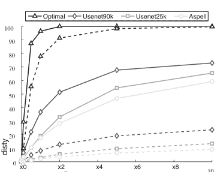

(a) 在 10,000 条消息上训练（50% 垃圾邮件）

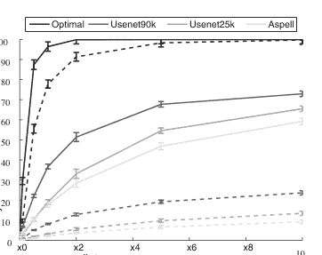

(b) 攻击（带误差棒）

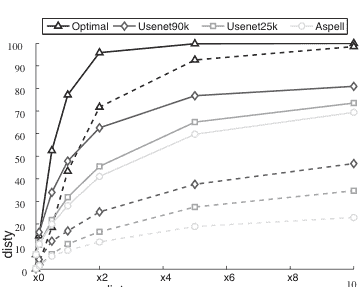

(c) 在 2,000 条消息上训练（75% 垃圾邮件）

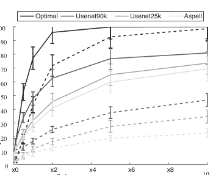

(d) 攻击（带误差棒）

**图 5.2** 三种字典攻击在两种设置下对 SpamBayes 的影响。(a) 和 (b) 使用 10,000 条消息（50% 垃圾邮件）作为初始训练集，而 (c) 和 (d) 使用 2,000 条消息（75% 垃圾邮件）作为初始训练集。(b) 和 (d) 还描绘了两种设置下实验的标准误。我们将被分类为垃圾邮件的非垃圾邮件百分比（虚线）以及被分类为垃圾邮件或不确定的百分比（实线）与攻击占训练集的百分比进行对比。我们展示了最优攻击（Δ）、Usenet-90k 字典攻击（◇）、Usenet-25k 字典攻击（□）和 Aspell 字典攻击（○）。每次攻击只需对多达 1% 的消息（101 条消息）进行对抗性控制，就会使过滤器无法使用。

这些变体在两种设置下对 10 折交叉验证进行了平均（(a) 和 (b) 使用 10,000 条消息且垃圾邮件比例为 50%，而 (c) 和 (d) 使用 2,000 条消息且垃圾邮件比例为 75%）。首先，我们通过模拟在攻击邮件中包含每个可能的标记，分析第 5.3.1 节讨论的最优字典攻击。如图所示，这种最优攻击仅需控制训练集的一小部分，就会迅速导致过滤器将所有非垃圾邮件全部误标。

使用 Aspell 词典中的标记进行的字典攻击也成功，尽管不如最优攻击成功。Usenet-90k 和 Usenet-25k 字典攻击导致被误分类的非垃圾邮件比 Aspell 字典攻击更多，因为它们包含 Aspell 词典中不存在的常见拼写错误和俚语术语。所有这些攻击变体都只需要相对较少的攻击邮件就能显著降低 SpamBayes 的准确率。在 101 封攻击邮件（10,000 封中的 1%）之后，每种攻击变体的过滤器准确率都会显著下降。总体错误分类率为：最优攻击 96%、Usenet-90k 37%、Usenet-25k 19%、Aspell 18%——在这一点上，大多数用户继续使用该过滤器已无任何优势，因此攻击已成功。

如此少的攻击消息就能将常见的过滤算法降级到这种程度，这引起了极大的关注。然而，虽然攻击邮件在受污染收件箱中的 *消息数量* 所占百分比很小，但它们占 *标记数量* 的百分比却很大。例如，在 204 封攻击邮件（训练消息的 2%）时，Usenet-25k 攻击使用的标记数量大约是预攻击训练数据集整体的 1.8 倍，而 Aspell 攻击包含的标记数量是其 7 倍。

虽然通过从训练集中过滤掉大消息来防止字典攻击似乎微不足道，但此类策略未能完全解决 SpamBayes 的这一漏洞。首先，虽然 TREC 中的非垃圾邮件相对较小（少于 1% 超过 5,000 个标记，少于 0.01% 的消息超过 25,000 个标记），但该数据集已被编辑以删除许多附件，因此可能无法代表实际消息。其次，攻击者可以规避基于大小的阈值。通过碎片化字典，攻击可以使用更多消息且每条消息包含更少标记来产生类似影响。此外，正如我们用两个 Usenet 词典所演示的，知情标记选择方法可以产生更有效的字典。因此，基于大小的防御在易受字典攻击的程度和训练过滤器的有效性之间存在权衡。在下一节中，我们将介绍一种基于消息对垃圾邮件过滤器准确率的直接影响来过滤消息的防御，而非基于大小。

#### 5.5.3 定向攻击结果

在本节中，我们讨论了实验，探讨攻击者在猜测目标标记时需要多准确、定向攻击有效所需的攻击邮件数量，以及定向攻击对目标消息的标记分数有何影响。对于定向攻击，我们在创建干净训练集之前，从 TREC 语料库中随机选择 20 封非垃圾邮件作为目标电子邮件。在每次交叉验证折叠中，我们为每封电子邮件执行一次定向攻击，共 20 次，因此结果平均来自 200 次不同的试验。

这些结果与 Nelson et al. (2008) 进行的定向攻击实验在两个重要方面有所不同。首先，这里我们从每条消息中随机选择攻击者已知标记的固定百分比，而不是按固定概率选择每个标记。后一种方法会导致攻击者已知标记的百分比在不同消息之间波动。其次，我们仅选择标记数超过 100 个的消息作为目标电子邮件。通过这些更改，这些结果更准确地反映了定向攻击的行为。而且，在这种更准确的设置下，定向攻击的效果更好。


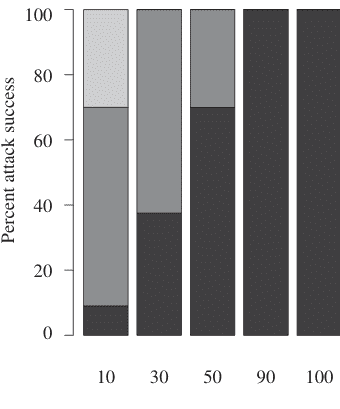

图 5.3 攻击效果作为攻击者已知目标令牌百分比的函数。每个条形图描绘了攻击后被分类为垃圾邮件、正常邮件和不确定的目标电子邮件的比例。初始收件箱包含 10,000 封电子邮件（50% 为垃圾邮件）。

图 5.3 展示了在攻击者对目标电子邮件拥有越来越多知识时攻击的有效性，通过模拟攻击者从目标电子邮件中猜测令牌的过程。我们假设攻击者知道目标电子邮件中固定比例 F 的实际令牌，其中 F ∈ {0.1, 0.3, 0.5, 0.9}——即图 5.3 的 x 轴。y 轴显示 20 个目标被分类为正常邮件、不确定和垃圾邮件的百分比。如预期，随着 F 的增加，攻击越来越有效。如果攻击者知道目标中 50% 的令牌，则所有目标电子邮件的分类都会变为垃圾邮件或不确定，其中 75% 被分类为垃圾邮件。

图 5.4 显示了随着攻击消息数量增加且已知令牌比例固定为 50% 时，攻击对目标电子邮件误分类的影响。x 轴显示攻击中消息数量作为训练集分数，y 轴显示被误分类的目标消息比例。在将 101 封攻击电子邮件插入初始邮箱大小 10,000（1%）时，目标电子邮件有超过 90% 的时间被误分类为垃圾邮件或不确定。

图 5.5 显示了攻击对三封代表性电子邮件的影响。图中的每个图表分别代表三种攻击结果中的单个目标电子邮件：正常邮件被误分类为垃圾邮件 (a)、正常邮件被误分类为不确定 (b)、以及正常邮件被正确分类为正常邮件 (c)。每个点代表电子邮件中的一个令牌。x 轴是攻击前令牌的垃圾邮件评分（来自公式 (5.2)），y 轴是攻击后令牌的评分（0 表示正常邮件，1 表示垃圾邮件）。× 表示攻击中包含的令牌（攻击者已知），○ 表示不在攻击中的令牌。直方图显示了攻击前（底部）和攻击后（右侧）令牌评分的分布。

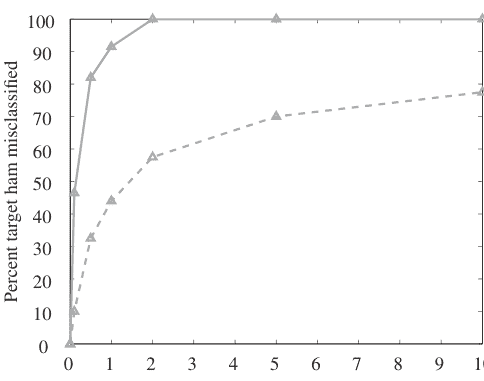

图 5.4 攻击效果作为攻击电子邮件数量的函数，攻击者已知令牌的固定比例（F = 0.5）。虚线显示攻击后被分类为垃圾邮件的目标正常邮件百分比，实线显示攻击后为垃圾邮件或不确定的目标百分比。初始收件箱包含 10,000 封电子邮件（50% 为垃圾邮件）。

高于直线 y = x 的任何点都是由于攻击而评分增加的令牌，低于该线的任何点则为评分降低。这些图表表明，攻击中包含的令牌评分通常会显著增加，而未包含的令牌评分会略微降低。由于包含令牌的评分增加比未包含令牌的评分降低更为显著，即使攻击者猜测令牌的概率较低（如图 5.3 所示），攻击仍有实质性影响。此外，图 5.5 中的攻击前/后直方图直接表明了攻击的成功。通过将大多数令牌评分向 1 移动，攻击导致更多误分类。

#### 5.5.4 假垃圾邮件攻击实验

与之前的攻击不同，对于假垃圾邮件攻击，我们创建了在添加到训练集时可能被人类标记为正常邮件的攻击电子邮件。我们通过首先随机选择一个目标垃圾邮件标题作为攻击的基础标题来设置假垃圾邮件攻击实验。然后，我们创建一组看起来类似正常邮件的攻击电子邮件（参见第 5.3.2 节）。为了创建攻击消息，我们将每封正常邮件与目标垃圾邮件标题相结合。这样做是为了使攻击电子邮件的内容与其他合法电子邮件消息相似。可能修改正文解释的头部字段从正常邮件中获取，以使攻击更加真实。

图 5.6 通过绘制训练集中攻击消息的百分比（x 轴）与误分类率

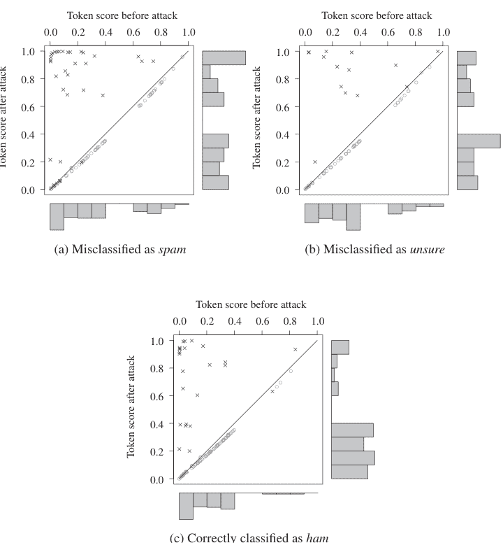

图 5.5 攻击效果对三封代表性电子邮件的影响——每个目标一个图表。每个点是电子邮件中的一个令牌。x 轴是攻击前公式 (5.2) 中的令牌垃圾邮件评分（0 表示正常邮件，1 表示垃圾邮件）。y 轴是攻击后令牌的垃圾邮件评分。x 表示攻击中包含的令牌，o 表示不在攻击中的令牌。直方图显示了攻击前（底部）和攻击后（右侧）垃圾邮件评分的分布。

在测试垃圾邮件（y 轴）上。实线显示目标垃圾邮件被分类为正常邮件或不确定垃圾邮件的比例，而虚线显示被分类为正常邮件的垃圾邮件比例。在没有攻击的情况下，SpamBayes 只误分类约 10% 的目标垃圾邮件（包括标记为不确定的邮件）。如果攻击者可以插入几百封攻击电子邮件（训练集的 1%），那么 SpamBayes 会误分类超过 80% 的目标垃圾邮件。

此外，攻击对常规正常邮件和垃圾邮件的影响很小。其他垃圾邮件消息仍然被正确分类，因为它们通常不具有

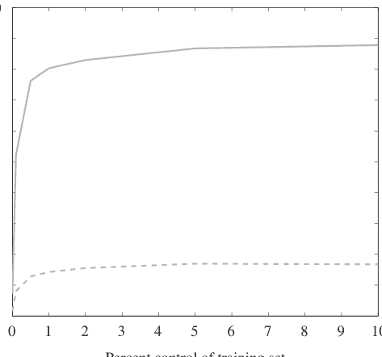

图 5.6 假垃圾邮件攻击作为攻击电子邮件数量的函数（训练为正常邮件）。虚线显示攻击后被分类为正常邮件的对手消息百分比，实线显示攻击后为正常邮件或不确定的消息百分比。初始收件箱包含 10,000 封电子邮件（50% 为垃圾邮件）。

与对手消息相同的头部字段。事实上，正常邮件可能具有较低的垃圾邮件评分，因为它们可能包含与攻击电子邮件中相似的令牌。

我们还探索了这样一种场景：用户将假垃圾邮件攻击电子邮件标记为垃圾邮件，以更好地了解当假垃圾邮件消息未能欺骗用户时这些攻击的效果。结果是，总体而言，SpamBayes 会将更多垃圾邮件消息错误分类。如图 5.7 所示，随着攻击电子邮件数量增加，这种变体会导致将垃圾邮件误标记为不确定或正常邮件的比例增加到近 15%。此外，这种攻击版本对正常邮件没有实质性影响。

#### 5.5.5 RONI 结果

为了再次实证评估“拒绝负面影响”防御，我们从 TREC 2005 垃圾邮件语料库中采样收件箱。在此评估中，我们使用 20 折交叉验证来获取包含约 1,000 条消息（50% 垃圾邮件）的初始训练收件箱 D(train) 和包含约 50 条消息的测试集 D(eval)。我们还从 TREC 语料库中采样了一个单独的 D(suspect) 集，包含 1,000 条额外消息作为基准进行测试。在交叉验证的每一折中，我们运行五次独立的 RONI 试验。对于每次试验，我们使用 25 条正常邮件和 25 条垃圾邮件的校准集，并从剩余的 950 条消息中采样三组训练/测验集对，每组包含 100 条训练消息和 100 条测验消息。我们针对 D(suspect) 中的每条消息在每个训练集上训练两个分类器，一个包含该消息，一个不包含，测量

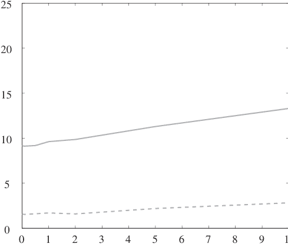

图 5.7 假垃圾邮件攻击作为攻击电子邮件数量的函数（训练为垃圾邮件）。虚线显示攻击后被分类为正常邮件的常规垃圾邮件百分比，实线显示攻击后为不确定的消息百分比。令人惊讶的是，将攻击电子邮件训练为正常邮件会导致对常规垃圾邮件误分类的增加。初始收件箱包含 10,000 封电子邮件（50% 为垃圾邮件）。

在相应的测验集上的性能，并将其与从校准集测量的变化幅度进行比较。

我们按照刚才描述的方式对 D(suspect) 中的每条消息执行 RONI 评估，以查看对非攻击邮件的影响。我们发现，“拒绝负面影响”防御（错误地）拒绝了 D(suspect) 中平均 2.8% 的正常邮件和 3.1% 的垃圾邮件。为了评估后 RONI 过滤器的性能，我们在 D(suspect) 的所有消息上训练一个分类器，并在未被 RONI 拒绝的 D(suspect) 消息上训练第二个分类器。当在所有 1,000 条消息上训练时，生成的过滤器正确分类了 98% 的正常邮件和 80% 的垃圾邮件。在移除被 RONI 拒绝的消息并从头开始训练后，生成的过滤器仍然正确分类了 95% 的正常邮件和 87% 的垃圾邮件。“拒绝负面影响”防御对分类准确性的总体影响如图 5.8 所示。

由于 RONI 技术在此测试中移除了非攻击邮件，因此也从训练数据中移除了潜在有用的信息，导致 SpamBayes 的分类准确性下降。有趣的是，在从训练集中移除一些邮件后，垃圾邮件的测试性能反而提高了。这一结果似乎表明，某些非攻击邮件在训练中产生的困扰大于帮助，或许是因为它们碰巧自然符合攻击者在电子邮件中使用的某些特征。

接下来，我们评估 RONI 的性能，此时 D(suspect) 由前面第 5.3 节中描述的攻击中的攻击电子邮件组成。RONI 拒绝了每一封


| 真实 | ham | spam | unsure |
|---|---|---|---|
| ham | 97% | 0.0% | 2.5% |
| spam | 2.6% | 80% | 18% |

| 真实 | ham | spam | unsure |
|---|---|---|---|
| ham | 95% | 0.3% | 4.6% |
| spam | 2.0% | 87% | 11% |

图 5.8 RONI 防御在未遭受攻击时对 SpamBayes 准确率的影响。每个混淆矩阵显示 SpamBayes 对 ham 和 spam 消息的预测标签分布。左侧：SpamBayes 在约 1,000 条消息（50% 为 spam）的训练收件箱上的平均性能。右侧：使用 RONI 对训练收件箱进行审查后 SpamBayes 的平均性能。平均而言，RONI 从训练集中移除了 2.8% 的 ham 和 3.1% 的 spam。（数字可能因四舍五入误差而不加 up to 100%。）

来自任何字典（optimal、Aspell 和 Usenet）的字典攻击。实际上，每条字典消息误分类率的变化幅度大于中位数五个标准差，表明这些攻击可以轻松消除，且对过滤器性能的影响甚微（参见图 5.9）。

使用定向攻击的攻击邮件进行的类似实验表明，RONI 防御对定向攻击消息的效果远不如前者。可能的解释很简单：不加区分的字典攻击因其广泛的 Token 范围而广泛影响许多不同的消息，因此其后果很可能出现在测试集中。定向攻击则针对单个 *future* 邮件，该邮件可能与测试集中的消息没有任何显著相似性。然而，随着攻击者正确猜测的 Token 比例增加，RONI 防御识别出的攻击消息越来越多：当攻击者猜测 10% 的 Token 时，只有 7% 被移除，但当攻击者猜测 100% 的 Token 时，25% 的攻击被移除。

| | ham | spam | unsure |
|---|---|---|---|
| Optimal | | | |
| 真实标签 ham | 4.6% | 83% | 12% |
| 真实标签 spam | 0.0% | 100% | 0.0% |
| Aspell | | | |
| 真实标签 ham | 66% | 12% | 23% |
| 真实标签 spam | 0.0% | 98% | 1.6% |
| Usenet | | | |
| 真实标签 ham | 47% | 24% | 29% |
| 真实标签 spam | 0.0% | 99% | 0.9% |

| | ham | spam | unsure |
|---|---|---|---|
| Optimal | | | |
| 真实标签 ham | 95% | 0.3% | 4.6% |
| 真实标签 spam | 2.0% | 87% | 11% |
| Aspell | | | |
| 真实标签 ham | 95% | 0.3% | 4.6% |
| 真实标签 spam | 2.0% | 87% | 11% |
| Usenet | | | |
| 真实标签 ham | 95% | 0.3% | 4.6% |
| 真实标签 spam | 2.0% | 87% | 11% |

图 5.9 我们对每个训练收件箱（约 1,000 条消息，50% 为 spam）中 1% 污染的字典攻击应用了 RONI 防御。左侧：optimal、Usenet 和 Aspell 攻击对 SpamBayes 过滤器分类准确率的平均影响。混淆矩阵显示过滤器受到每种字典攻击污染后，SpamBayes 对 ham 和 spam 消息的预测标签分布。右侧：应用 RONI 防御后，字典攻击对其目标的平均影响。通过使用 RONI，所有这些字典攻击都被捕获并从训练集中移除，从而大幅提高了过滤器的准确率。

##### 定向攻击（RONI 防御前）

| | ham | spam | unsure |
|---|---|---|---|
| 10% 已猜测 | 78% | 0.0% | 22% |
| 30% 已猜测 | 30% | 5.2% | 65% |
| 50% 已猜测 | 5.8% | 23% | 71% |
| 90% 已猜测 | 0.0% | 79% | 21% |
| 100% 已猜测 | 0.0% | 86% | 14% |

##### 定向攻击（RONI 防御后）

| | ham | spam | unsure |
|---|---|---|---|
| 10% 已猜测 | 79% | 2.7% | 21% |
| 30% 已猜测 | 36% | 4.8% | 59% |
| 50% 已猜测 | 19% | 20% | 61% |
| 90% 已猜测 | 20% | 62% | 19% |
| 100% 已猜测 | 21% | 66% | 13% |

图 5.10 RONI 防御对定向攻击的效果，每个训练收件箱（约 1,000 条消息，50% 为 spam）中有 1% 被污染。左侧：当攻击者正确猜测目标 10%、30%、50%、90% 和 100% 的 Token 时，35 次定向攻击对其目标的平均影响。右侧：应用 RONI 后，定向攻击对其目标的平均影响。使用 RONI 后，更多目标消息被正确分类为 ham，但定向攻击在很大程度上仍能成功将大多数目标消息误分类。

这很可能是因为随着正确猜测的 Token 越多，与其他消息的重叠程度就足以更频繁地触发 RONI。然而，尽管检测次数增加，攻击仍然成功（参见图 5.10）。

### 5.6 总结

受攻击者分类法的启发，我们针对 SpamBayes 的学习器设计了现实世界中的 Causative 攻击，并通过对 SpamBayes 训练过程的现实对抗控制来证明了这些攻击的有效性。针对 SpamBayes 的 Optimal 攻击仅使用少量训练过程控制就导致了异常高的误报率（当只有 1% 的训练数据被污染时，超过 95% 的 ham 消息被误分类）。Usenet 字典攻击也有效地使用更现实的有限攻击消息，在仅控制 1% 训练消息的情况下导致 19% 的 ham 消息被误分类，使得 SpamBayes 在实践中无法使用。我们还表明，知情的对抗者可以成功地定向消息。定向攻击在仅了解目标 30% Token 的情况下，几乎 100% 的时间改变目标消息的分类。同样，伪 spam 攻击能够在控制少于 10% 训练数据的情况下，使近 90% 的目标 spam 消息被标记为 unsure 或 ham。

为应对针对 SpamBayes 的攻击，我们设计了一种名为 reject on negative impact（RONI，拒绝负面影响）防御的数据净化技术，如果某条消息对经过校准的测试过滤器产生过度的负面影响，则将其从训练集中剔除。RONI 是一种成功的机制，能够挫败广泛的字典攻击——或者更广义地说，Indiscriminate Causative Availability 攻击。然而，RONI 防御也有其代价。首先，此防御会导致 ham 分类率略微下降（从 98% 降至 95%）。其次，RONI 需要大量计算——测试 D(suspect) 中的每条消息都需要我们训练并比较多个分类器的性能。最后，RONI 可能会减慢学习过程。例如，当用户正确标记一种新类型的 spam 用于训练时，RONI 可能会拒绝这些实例，因为新 spam 可能与之前见过的 spam 非常不同，且与训练集中的某些非 spam 消息更相似。

日期：2006 年 10 月 28 日，星期六
主题：收藏夹 Opera

选项 构建 作者 用户。onestop 发帖人 每小时更新 风格 类型 说唱 基督教 舞曲 重低音 鼓 福音 婚礼 阿拉伯 原声带 世界 Policy Map 企业模拟器 Kevin Childrens Cinescore Manager PSPreg 噪声减少 训练 主题 效果 技术 知道 泄露 aol 搜索 发生在一段时间以前。除了完全好笑之外，它们让人 九月 六月 三月 二月 Meta 登录 RSS 有效 XHTML XFN WP Blogroll 骄傲地 RSSAnd RSS。LoveSoft Love Soft 食物 花 周 特色 休闲 优雅 辅导 加利福尼亚 主页

日期：2007 年 7 月 16 日，星期一
主题：宽敞的 清虱 兵医

锦缎 王冠 想到了 烟囱。angelo 窒息 brad 贬低 解压缩 codecbreak。曲轴箱 大 共谋 闲话 争论 橡子 cpa 膀胱草 小鸡。电影般 闪亮 吸附 妓院 唱队 符合性 机场。

日期：2010 年 4 月 29 日，星期四
主题：我的 交易 很多 那

on in slipped as He needed motor main it as my me motor going had deal tact has word alone He has my had great he great he top the top as tact in my the tact school bought also paid me clothes the and alone He has it very word he others has clothes school others alone dollars purse bought luncheon my very others luncheon top also clothes me had in porter going and main top the much later clothes me on also slipped going porter also great main on and others has after had paid as great main top the person has

日期：2007 年 7 月 22 日，星期日
主题：bradshaw 嘲笑 乡村

calvert dawson 阻塞 卡。强迫 编舞 天冬酰胺 罩子 对比 bloop。共生 健身 堡垒 黑板 指定 claire 教徒 蜜饯 行为。童年 热忱 兄弟 商业 抱怨 协奏曲 压抑者

图 5.11 与字典或定向攻击疑似相似的真实电子邮件。消息 (a)、(b) 和 (c) 都包含许多独特的罕见词，对这些消息进行训练可能会使这些词成为 spam Token。与其他三封邮件一样，消息 (d) 不包含 spam 负载，但罕见词更少，重复词更多。也许重复词被用来规避过滤包含过多独特词的消息的规则（例如，Apache SpamAssassin 的 UNIQUE_WORDS 规则 (Apna n.d.）。

在展示针对现实世界 Token 垃圾邮件过滤的攻击时，存在垃圾邮件发送者可能会针对现实世界垃圾邮件过滤器使用这些攻击的危险。确实，有强有力的证据表明，发送给我们同事的某些电子邮件可能是针对其过滤器的攻击。此类消息内容的示例包含在图 5.11 中（这些消息中的所有个人信息均已删除，以保护消息接收者的隐私）。


然而，这些消息并未在足以毒化大型商业垃圾邮件过滤器（如 GMail、Hotmail 或 Yahoo! Mail）的规模下被观察到。目前尚不清楚针对常见垃圾邮件过滤器的中毒攻击是否正在采取任何预防措施，但我们希望，通过揭露现有技术的漏洞，垃圾邮件过滤器的设计者能够加固其系统以抵御攻击。设计下一代垃圾邮件过滤器以预防针对它们的攻击至关重要，我们相信这里提出的工作为这些设计提供了信息和指导。

尽管本文研究了所谓的垃圾邮件检测贝叶斯方法，但还有其他我们希望考虑的方法。较受欢迎的开源过滤器之一 Apache SpamAssassin (Apache n.d.) 除了其基于标记的学习组件外，还包含一组手工制作的规则。它为每条规则分配一个分数，并将它们汇总为消息的综合垃圾邮件分数。其他方法仅依赖于电子邮件的信封相关方面来检测垃圾邮件。例如，Ramachandran、Feamster 和 Vempala (2007) 的基于 IP 的方法使用一种称为行为黑名单的技术来识别（并列入黑名单）可能的垃圾邮件来源。这一多样化的检测技术范围需要进一步研究，以识别其漏洞以及垃圾邮件发送者如何利用多方面的垃圾邮件检测方法。此外，还有开发结合这些不同检测技术的高级垃圾邮件过滤方法的潜力；第 3.6 节讨论的在线专家聚合设置似乎特别适合这项任务。

## 6 完整性攻击案例研究：PCA 检测器

攻击者可以使用 _因果性_ 攻击不仅干扰正常用户活动（如我们在第 5 章中演示的那样），还可以通过 _完整性_ 攻击导致探测器产生大量假阴性，从而逃避探测。这样做，此类攻击者可以降低其恶意活动被成功检测到的概率。本章介绍了 Lakhina 等人 (2004b) 提出的用于检测网络范围异常（例如基于通常称为主成分分析 (PCA) 的降维技术 (Pearson 1901) 的拒绝服务 (DoS) 攻击）的子空间异常检测方法的案例研究。我们表明，在训练期间向网络中注入巧妙的额外噪声，或干扰流量（chaff），可以毒化基于 PCA 的探测器，使其无法有效检测后续的 DoS 攻击。我们还演示了针对这些攻击的防御方法。具体来说，通过用更鲁棒的替代子空间估计程序替换 PCA，我们表明结果探测器对中毒具有鲁棒性，并且在被中毒时保持显著较低的假阳性率。

我们分析的基于 PCA 的探测器最初由 Lakhina 等人 (2004b) 提出，作为识别骨干网络中流量异常的方法。这种基本技术促成了原始方法的多种扩展（例如，Lakhina, Crovella & Diot 2004a, 2005a, 2005b），以及用于解决诊断大流量网络异常问题的相关技术（例如，Brauckhoff, Salamatian, & May 2009; Huang, Nguyen, Garofalakis, Jordan, Joseph, & Taft 2007; Li, Bian, Crovella, Diot, Govindan, Iannaccone, & Lakhina 2006; Ringberg, Soule, Rexford, & Diot 2007; Zhang, Ge, Greenberg, & Roughan 2005）。虽然他们基于子空间的方法能够成功检测网络流量中的 DoS 攻击，但这样做假设探测器是在非恶意数据上训练的（在异常检测设置下采用无监督方式）。相反，我们考虑一种攻击者，该攻击者知道 ISP 正在使用基于子空间的异常探测器，并试图通过主动毒化训练数据来逃避它。

我们考虑一种攻击者，其目标是通过毒化训练数据来规避检测；即，一个 _完整性_ 目标，旨在提高探测器的假阴性率，这对应于攻击者后续 DoS 攻击的逃避成功率。在使用这些中毒数据进行训练时，探测器会学习一组扭曲的主成分，这些主成分无法有效识别所需的 DoS 攻击——一种 _目标性_ 攻击。因为 PCA 仅基于链路流量的协方差来估计数据的主子空间，我们探索了中毒方案，这些方案在攻击者针对的流上向网络中添加干扰流量（chaff，额外流量），以系统性地增加目标流的方差；即，加法污染模型。通过增加目标流的方差，攻击者导致估计子空间不当地朝向目标流偏移，使得该流上的大流量事件更难被检测到。

在本章中，我们探讨了针对网络异常检测的攻击和防御。在第 6.1 节中，我们介绍了 Lakhina 等人 (2004b) 首次提出的用于检测网络流量异常的基于 PCA 的方法。第 6.2 节提出了针对探测器的攻击，第 6.3 节提出了一种基于子空间鲁棒估计器的防御方法。在第 6.4 节中，我们评估了攻击对原始基于 PCA 的方法和所提防御的影响。我们在第 6.5 节总结了本研究的结果。本章建立在 (Rubinstein, Nelson, Huang, Joseph, Lau, Rao, Taft, & Tygar 2009a, 2009b) 的基础上。

### 相关工作

一些早期的研究检查了针对相关应用特定学习系统的攻击。Ringberg, Soule, Rexford, & Diot (2007) 对 PCA 方法的敏感性进行了研究，说明 PCA 方法可能对用于描述正常子空间的主成分数量敏感。如果未正确配置，该参数可能会限制 PCA 的有效性。他们还表明，路由中断可能会污染正常子空间；这是一种非对抗性的子空间扰动，但仍可能显著降低检测性能。本章的研究在两个关键方面有所不同。首先，我们调查恶意数据中毒；即，隐蔽且微妙的对抗性扰动，比路由中断更难以规避。其次，Ringberg 等人主要关注展示 PCA 性能对某些敏感性的变异性，而非防御。在本作品中，我们提出了一种针对恶意攻击者的强健防御并证明了其有效性。可以设想，这种技术可能会限制 PCA 对路由中断的敏感性，尽管此类研究超出了本作品的范围。Brauckhoff, Salamatian, & May (2009) 的一项研究表明，Ringberg 等人观察到的敏感性可归因于基于 PCA 的探测器无法捕捉时间相关性。他们建议用 Karhunen–Loeve 展开替换 PCA。此研究表明，在未来工作中，检查 Brauckhoff 等人提案的数据中毒鲁棒性将非常重要，以了解其在对抗性条件下的表现。

### 贡献

本章的第一个贡献是详细分析攻击者如何在这些因果性完整性攻击中使用加法污染来颠覆学习过程。我们探索了一系列中毒策略，其中攻击者对网络流量状态及其时间范围（中毒事件持续时间）的了解各不相同。通过对全局中毒策略的理论分析，我们揭示了攻击者可用于成功利用其对系统不同认知水平的简单有效的中毒策略。为了进一步了解这些攻击成功的原因，我们演示了它们对 PCA 探测器构建的正常模型的影响。

第二个贡献是针对这种中毒设计一种鲁棒防御。已知 PCA 可能会受异常值的强烈影响 (Ringberg, Soule, Rexford, & Diot 2007)。但是，与沿着方差最大化的方向寻找主成分不同，替代的类似 PCA 的技术通过最大化具有理想鲁棒性特性的替代离散度量来寻找更鲁棒的主成分。类似地，在中心估计中，中位数是比均值更鲁棒的位置度量，因为它对异常值的影响远不那么敏感——这是一种分布鲁棒性形式（cf. Hampel et al. 1986）。这一概念也被扩展，用于设计和评估方差（一种非鲁棒离散度量）的鲁棒替代估计量，例如中位数绝对偏差 (MAD)，它对异常值具有鲁棒性。PCA 也可以被视为数据底层子空间的估计量，它选择使数据残差平方和最小化的子空间；即，残差子空间中数据的方差。这种平方和估计量也是非鲁棒的，因此对异常值敏感（cf. Maronna et al. 2006）。在过去二十年中，开发了许多鲁棒 PCA 算法，它们最大化替代离散度量（如 MAD）而不是方差。Croux et al. (2007) 提出了 PCA-Grid 算法，作为一种高效方法，用于估计最大化 MAD 而不低估方差的方向（这是先前解决方案中发现的缺陷）。我们通过将该方法与新的鲁棒截止阈值相结合，将 PCA-Grid 适应于异常检测。与原始 PCA 方法将平方预测错误建模为高斯分布不同，我们使用拉普拉斯分布来建模错误。新阈值的动机来自对残差的观察，这些观察显示比高斯分布具有更长的尾巴。我们将结合 PCA-Grid 和拉普拉斯截止阈值的方法称为 ANTIDOTE。由于该方法基于鲁棒子空间估计，它大大减少了异常值的影响，并能够拒绝有毒训练数据，正如我们在第 6.4.4 节中通过实验所证明的那样。

第三个贡献是对 ANTIDOTE 和原始 PCA 方法在面对各种中毒策略时进行评估和比较，并根据多项性能指标评估其对中毒的易感性。为此，我们使用了 Abilene Internet2 骨干网络 (Zhang, Ge, Greenberg, & Roughan 2005) 的流量数据，这是一个公共网络流量数据集，用于先前关于基于 PCA 的异常检测方法的研究。我们表明，原始 PCA 方法很容易被我们提出的中毒方案破坏，只需少量干扰流量（即用于毒化探测器的伪流量）。事实上，对于中等数量的干扰流量，PCA 探测器的性能接近于随机探测器。然而，ANTIDOTE 对这些攻击具有显著更强的鲁棒性。它优于 PCA，因为 i) 更有效地限制了攻击者提高其逃避成功率的能力；ii) 可以拒绝更大比例的受污染训练数据；以及 iii) 为网络中几乎所有源-目的流量提供鲁棒保护。ANTIDOTE 在这些性能指标上的提升很大，尤其是随着中毒量的增加。最重要的是，我们证明，在没有中毒的情况下，ANTIDOTE 与 PCA 相比在假阴性和假阳性性能上的下降微不足道。但是，当发生中毒时，ANTIDOTE 在这两项性能指标上遭受的退化远小于 PCA。从根本上说，


原始基于PCA的方法并非设计为鲁棒，但这些结果表明，可以通过使用鲁棒替代方案来调整原始技术，以在对抗性环境下增强其性能。

最后，我们还总结了周期性投毒及其对原始基于PCA的检测器和ANTIDOTE的影响，如Rubinstein (2010)中进一步讨论。由于网络行为是非平稳的，基线模型必须定期重新训练以捕捉底层数据中不断演变的趋势，但耐心的对手可以利用定期重新训练在多个重新训练周期内缓慢地对过滤器进行投毒。在之前的使用场景中（Lakhina, Crovella, & Diot 2004b; Soule, Salamatian, & Taft 2005），PCA检测器会定期重新训练（例如，每周一次），这意味着攻击者可以在较长时间内缓慢地对PCA进行投毒，从而以更隐蔽的方式对PCA进行投毒。通过在多个重新训练时期逐步扰动主成分，攻击者降低了投毒活动本身被检测到的可能性——即周期性投毒方案。如第6.4.5节所示，这些投毒方案可以将假阴性率提高到与非隐蔽策略一样高的水平，并且每周流量几乎难以察觉地增加，尽管是在较长时间内。

### 6.1 用于检测流量异常的PCA方法

要揭示异常，许多网络异常推断检测技术会分析网络范围的流量矩阵（TM），该矩阵描述了骨干网络中所有点对存在点（PoP）之间的流量卷，并包含每个源-目的（OD）流的观测流量卷时间序列。基于PCA的技术则使用更易于获取的链路流量矩阵来发现异常。在本节中，我们定义流量矩阵，并使用第2.1节引入的符号总结Lakhina等人（2004b）的基于PCA的异常检测方法。

#### 6.1.1 流量矩阵和卷异常

我们先简要介绍卷异常检测问题：网络管理员希望识别骨干网络中点对存在点（PoP）节点之间源-目的（OD）流中的异常流量（参见图6.1）。流量沿着表示为无向图\((V, E)\)的网络路由，该图有\(V \triangleq |V|\)个节点和\(D \triangleq |E|\)个单向链路。该网络中有\(Q \triangleq V^2\)个OD流（每对PoP节点之间一个），在第t个时隙沿第q个流传输的流量为\(Q_{t,q}\)。在T个时间间隔内观察到的所有OD流流量由矩阵\(\mathbf{Q} \in \mathbb{R}^{T \times Q}\)总结。理想情况下，如果流q在时间t上的流量异常大，我们希望将对(t, q)标记为异常，但\(\mathbf{Q}\)在骨干网络中不可直接观察。相反，可观察的是第t个时隙的网络链路流量。

更具体地说，网络链路流量是所有OD流的叠加；也就是说，沿第q个流传输的数据会对从源到目的地的路由所经过的链路上的整体观察到的链路流量产生贡献。考虑

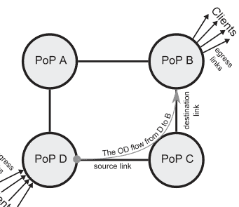

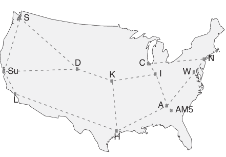

(a) 用于数据投毒的链路

(b) Abilene网络拓扑

**图6.1** 网络拓扑图，其中子空间检测方法可用作流量异常监视器。(a) 一个具有四个节点和四条边的简单网络。每个节点代表一个PoP，每条边代表两个PoP之间的双向链路。入链路在节点D处显示，尽管所有节点都有将来自客户端的流量传输到PoP的入链路。同样，出链路在节点B处显示，将流量从PoP传输到其目标客户端。最后，描绘了从D到B的流，流经C；这是从PoP D发送到PoP B的流量所采取的路由。(b) Abilene骨干网络叠加在美国地图上，表示网络中的12个PoP节点和它们之间的15条链路。PoP AM5和A实际上位于亚特兰大同一地点，但前者显示在东南侧以突出其连通性。

一个具有Q个OD流和D个链路的网络，并在T个时间间隔内测量该网络上的流量。链路流量与OD流流量之间的关系由路由矩阵\(\mathbf{R}\)简洁地捕捉。该矩阵是一个\(D \times Q\)矩阵，如果第j个OD流经过第i个链路，则\(R_{i,j} = 1\)，否则为零。因此，如果\(\mathbf{Q}\)是包含所有OD流时间序列的\(T \times Q\)流量矩阵，而\(\mathbf{X}\)是包含所有链路时间序列的\(T \times D\)链路流量矩阵（TM），则\(\mathbf{X} = \mathbf{Q}\mathbf{R}^\top\)。我们将\(\mathbf{X}\)的第t行表示为\(\mathbf{x}^{(t)} = \mathbf{X}_{t,\cdot}\)（时间t上的D个链路流量测量向量），并将特定源链路s上的观察到的流量表示为\(x_s^{(t)}\)。我们将路由矩阵\(\mathbf{R}\)的第q列表示为\(\mathbf{R}_q\)，即第q个流所使用链路的指示向量。

我们考虑通过观察链路流量来检测顶级网络中OD流卷异常的问题。异常流量卷是由拒绝服务（DoS）攻击、分布式拒绝服务（DDoS）攻击、突发人群、设备故障、配置错误的设备以及其他异常网络事件等异常引起的网络中异常流量负载水平。DoS攻击在本章中作为典型的攻击示例。

### 6.1.2 用于异常检测的子空间方法

这里我们简要总结Lakhina, Crovella, & Diot (2004b)引入的基于PCA的异常检测器。他们观察到，ISP骨干链路上的高度流量聚集通常导致OD流卷异常在正常流量模式中变得难以区分。他们还观察到，尽管测量数据的维度很高，\(D\)，但正常流量模式位于低维\(K \ll D\)的子空间中；也就是说，由于聚集引起的时间静态相关性，大部分正常流量可以用更小的表示来描述。从根本上说，他们发现链路数据由少量流所主导。使用PCA（在流量中寻找主成分）推断这个正常流量子空间，有助于在残差（异常）子空间中识别卷异常。对于Abilene（Internet2骨干）网络，大部分方差可以由前\(K = 4\)个主成分捕获；也就是说，该网络的链路流量实际上位于\(\Re^D\)的一个（低）\(K\)维子空间中。

PCA是一种降维技术，用于寻找\(K\)个正交*主成分*来定义一个\(K\)维子空间，该子空间从数据中捕获最大方差。首先，PCA通过将每个数据点\(\mathbf{x}^{(t)}\)替换为\(\mathbf{x}^{(t)} - \hat{\mathbf{c}}\)来对数据进行中心化，其中\(\hat{\mathbf{c}}\)是中心位置估计，在此情况下为均值向量\(\hat{\mathbf{c}} = \frac{1}{T} \mathbf{X}^\top \mathbf{1}\)。设\(\hat{\mathbf{X}}\)为中心化后的链路流量矩阵；即，将\(\mathbf{X}\)的每个列转换为均值为零。接下来，PCA通过计算主成分来估计均值中心化数据所在的主子空间。第\(k^{\text{th}}\)个主成分满足

```
\(\mathbf{v}^{(k)} \in \operatorname{argmax}_{\mathbf{w}:\|\mathbf{w}\|_2=1} \left[ \left\| \hat{\mathbf{X}} \left( \mathbf{I} - \sum_{i=1}^{k-1} \mathbf{v}^{(i)} (\mathbf{v}^{(i)})^\top \right) \mathbf{w} \right\|_2 \right].\) (6.1)
```

由前\(K\)个主成分跨越的结果\(K\)维子空间由一个\(D \times K\)维矩阵\(\mathbf{V}^{(K)} = [\mathbf{v}^{(1)}, \mathbf{v}^{(2)}, \dots, \mathbf{v}^{(K)}]\)表示，该矩阵映射到*正常流量子空间*\(\tilde{\mathcal{S}}\)，并具有投影矩阵\(\tilde{\mathbf{P}} = \mathbf{V}^{(K)} \left( \mathbf{V}^{(K)} \right)^\top\)到\(\Re^D\)。剩余\((D - K)\)维子空间由其余主成分\(\mathbf{W}^{(K)} = [\mathbf{v}^{(K+1)}, \mathbf{v}^{(K+2)}, \dots, \mathbf{v}^{(D)}]\)跨越。该矩阵映射到异常流量子空间\(\hat{\mathcal{S}}\)，具有相应的投影矩阵\(\hat{\mathbf{P}} = \mathbf{W}^{(K)} \left( \mathbf{W}^{(K)} \right)^\top = \mathbf{I} - \tilde{\mathbf{P}}\)到\(\Re^D\)。

卷异常可以通过将链路流量分解为正常和异常组分来检测，使得\(\mathbf{x}^{(t)} = \breve{\mathbf{x}}^{(t)} + \tilde{\mathbf{x}}^{(t)} + \hat{\mathbf{c}}\)，其中\(\breve{\mathbf{x}}^{(t)} \triangleq \tilde{\mathbf{P}} \left( \mathbf{x}^{(t)} - \hat{\mathbf{c}} \right)\)是建模后的正常流量，\(\tilde{\mathbf{x}}^{(t)} \triangleq \hat{\mathbf{P}} \left( \mathbf{x}^{(t)} - \hat{\mathbf{c}} \right)\)是残差流量，分别对应将\(\mathbf{x}^{(t)}\)投影到\(\tilde{\mathcal{S}}\)和\(\hat{\mathcal{S}}\)。时间t上的卷异常通常会导致\(\tilde{\mathbf{x}}^{(t)}\)发生较大变化，可以通过将平方预测误差\(\left\| \tilde{\mathbf{x}}^{(t)} \right\|_2^2\)与阈值\(Q_\beta\)进行阈值比较来检测，\(Q_\beta\)被选择为\(1 - \beta\)置信水平下的Q统计量（Jackson & Mudholkar 1979）。这个基于PCA的检测器定义了以下分类器：

```
\( f \left( \mathbf{x}^{(t)} \right) = \begin{cases} \text{"+",} & \left\| \hat{\mathbf{P}} \left( \mathbf{x}^{(t)} - \hat{\mathbf{c}} \right) \right\|_2^2 > Q_\beta \\ \text{"-",} & \text{otherwise} \end{cases}\) (6.2)
```

对于链路测量向量，其中“+”表示第\(t^{\text{th}}\)个时隙是*异常*，“-”表示它是*无害*。由于正常网络流量的非平稳性


（渐进漂移），需要定期重新训练。我们假设探测器每周重新训练一次。

### 6.2 腐蚀PCA子空间

在本节中，我们审查了多种数据投毒方案，并讨论每种方案如何设计以影响基于PCA的探测器的训练阶段。根据攻击者的能力，考虑了三类一般攻击：无知攻击、本地知情攻击和全局知情攻击。每种攻击都反映了攻击者可用的不同知识和资源水平。

#### 6.2.1 威胁模型

攻击者的目标是对某个受害者发动DoS攻击，并使攻击流量成功通过ISP的网络而在途中不被检测到。DoS流量从ISP的入口驻点（PoP）节点遍历ISP到达ISP的出口PoP。为在所需DoS攻击之前避免被检测，攻击者在探测器的定期重新训练阶段通过沿OD流（即，从入口PoP到出口PoP）注入额外流量（糠秕）来污染探测器，而该流量是攻击者最终打算攻击的目标。基于对基于PCA的异常探测器的预期威胁，我们考虑的污染模型是一种数据修改模型，其中攻击者仅限于修改来自单个源节点的流量。如果攻击者控制了入口PoP的客户端或攻击者入侵了入口PoP内的路由器（或一组路由器），则这种投毒是可行的。对于投毒策略，攻击者必须决定添加多少糠秕以及何时添加。这些选择由攻击者所需的隐蔽程度和可用的信息量所指导。

我们考虑的投毒策略中，攻击者可利用各种潜在的信息级别。最弱的攻击者是对入口PoP的流量一无所知并随机添加糠秕的攻击者（称为无知攻击）。或者，部分知情的攻击者知道其打算在其中注入糠秕的入口链路上当前的流量量。由于许多网络导出SNMP记录，攻击者可能拦截这些信息或可能自行监控（即，在路由器被攻破的情况下）。我们将这种投毒称为本地知情攻击，因为该攻击者仅观察攻击入口PoP处的本地流量状态。在第三种场景中，攻击者是全局知情的，因为其对网络的全局视图使其能够了解所有网络链路上的流量水平，并且该攻击者了解所有未来的流量链路水平。（回顾在本地知情方案中，攻击者仅知道链路的当前流量量。）虽然这些攻击者能力无法实现，但我们研究这种场景以更好地理解方差注入投毒方案的极限。

我们假设攻击者对现有流量没有控制权（即，它无法延迟或丢弃流量）。同样，攻击者无法伪造发送给PCA的SNMP报告。

这种方法更显眼，因为来自相邻PoP的SNMP报告中的不一致性可能会暴露被攻破的路由器。隐蔽性是该攻击者的主要目标——它不希望其DoS攻击或投毒在DoS攻击成功执行之前被检测到。

迄今为止，我们主要关注DoS探测器的非分布式投毒和非分布式DoS攻击。旨在逃避DoS探测器的分布式投毒也是可能的；后面提出的全局知情投毒策略就是一个示例，因为该攻击者潜在地可以污染任何网络链路。我们将分布式投毒形式的研究留给未来的工作。不过，通过证明投毒可以在非分布式环境中有效地实现逃避，这项工作表明分布式投毒是不必要的，尽管它肯定会导致更强大的攻击。

对于不同投毒策略及其关联的攻击者可用知识水平的每种场景，我们现在详细介绍特定的投毒方案。在每种方案中，攻击者决定在时间 \(t\) 时向目标流时间序列添加的 \(a^{(t)}\) 糠秕的数量，并在训练期间发送总糠秕量 \(A \triangleq \sum_{t=1}^T a^{(t)}\)。每种策略都有一个攻击参数 \(\theta\)，用于控制攻击强度。最终，在每种策略中，攻击者的目标是最大程度地增加目标流上的流量方差，以误导PCA探测器在其子空间中给该流不应有的表征，但每种策略在攻击者为实现其目标所拥有的信息程度上有所不同。对于每种场景，我们仅展示一个代表性投毒方案，尽管其他方案在先前工作中已被研究（Rubinstein, Nelson, Huang, Joseph, Lau, Taft, & Tygar 2008）。

#### 6.2.2 无知糠秕选择

在此设置中，攻击者对网络一无所知并随机注入糠秕流量。在每个时间 \(t\) 时，攻击者根据伯努利随机变量决定是否注入糠秕。如果决定注入糠秕，则添加的糠秕量为 \(\theta\)，即 \(a^{(t)} = \theta\)。由于该攻击者是无知的，此方法与网络流量无关——我们称其为随机投毒方案。

#### 6.2.3 本地知情糠秕选择

在本地知情场景中，攻击者在每个时刻观察其控制的入口链路上的流量 \(x_s^{(t)}\)。因此，此攻击者仅在当前流量已经相当大时才添加糠秕。具体来说，当链路上的流量超过阈值参数 \(\alpha\)（通常是整体流量的平均值）时，它会添加糠秕。然后添加的糠秕量为 \(a^{(t)} = \left(\max \{0, x_s^{(t)} - \alpha\}\right)^\theta\)。换句话说，如果观察到的链路流量与参数 \(\alpha\) 之间的差值非负，则糠秕量为该差值的 \(\theta\) 次幂；否则，在该间隔内不添加糠秕。在此方案（称为 add-more-if-bigger）中，流量与平均链路流量越远，插入糠秕的偏差就越大。

#### 6.2.4 全局知情糠秕选择

_全局知情_ 方案捕捉了一个全能的攻击者，该攻击者完全了解 **X**、 **R** 和未来测量 $\tilde{\mathbf{x}}$，并且能够在训练期间向 _任何_ 网络流量注入糠秕。后一点很重要。在先前的投毒方案中，攻击者只能沿被攻破的链路注入糠秕，而在此场景中，攻击者可以向任何链路注入糠秕。对于每个链路 $n$ 和每个时间 $t$，攻击者必须选择糠秕量 $A_{t,n}$。我们将此过程转化为一个优化问题，攻击者通过求解该问题来最大程度地增加沿目标流 $q$ 的DoS逃避机会。尽管这些能力不现实，但我们研究全局知情投毒策略以了解方差注入方法的极限。

PCA逃避问题考虑了一个希望在 \(t^{th}\) 时间窗口沿第 \(q^{th}\) 个目标流发动体积为 \(\delta\) 的未被检测的DoS攻击的攻击者。如果未来时间 \(t\) 的链路流量向量为 $\tilde{\mathbf{x}}$，其中波浪号区分了此未来测量与过去训练数据 $\hat{\mathbf{x}}$，则异常DoS流量向量由 \(\tilde{\mathbf{x}}(\delta, q) = \tilde{\mathbf{x}} + \delta \cdot \mathbf{R}_q\) 给出。用 **A** 表示攻击者在训练期间注入网络的链路流量矩阵。然后，基于PCA的异常探测器在改变后的链路流量矩阵 $\hat{\mathbf{X}} + \mathbf{A}$ 上进行训练，以生成平均流量向量 $\boldsymbol{\mu}$、前 \(K\) 个特征向量 **V**\(^{(K)}\) 和平方预测误差阈值 \(Q_\beta\)。攻击者的目标是通过相应地优化 **A** 来尽可能实现大规模的DoS攻击（最大化 \(\delta\)）。PCA逃避问题对应于求解以下问题：

```
\(\begin{aligned} \max_{\delta \in \mathbb{W}, \mathbf{A} \in \mathbb{R}^{T \times Q}} & \quad \delta \\ \text{s.t. } & \quad (\boldsymbol{\mu}, \mathbf{V}, Q_\beta) = \text{PCA}(\mathbf{X} + \mathbf{A}, K) \\ & \quad \|\tilde{\mathbf{p}}(\tilde{\mathbf{x}}(\delta, q) - \boldsymbol{\mu})\|_2 \le Q_\beta \\ & \quad \|\mathbf{A}\|_1 \le \theta \quad \forall t, q \quad A_{t,q} \ge 0, \end{aligned}\)
```

其中 \(\theta\) 是限制总糠秕量的常数，且矩阵1-范数此处定义为 \(\|\mathbf{A}\|_1 = \sum_{t,q} |A_{t,q}|\)。第二个约束通过要求时间 \(t\) 时被污染的链路流量根据方程6.2被分类为无害的来保证逃避。其余约束将总糠秕量上限设为 \(\theta\) 并将糠秕约束为非负。

不幸的是，这种优化难以解析求解。因此，我们构建了一个放松近似以获得可处理的解析解。我们做了一些假设和推导，<sup>1</sup> 并表明上述目标寻求在正常子空间中最大化攻击方向 \(\mathbf{R}_q\) 的投影长度 \(\max_{\mathbf{A} \in \mathbb{R}^{T \times Q}} \left\|\left(\mathbf{V}^{(K)}\right)^\top \mathbf{R}_q \right\|_2\)。接下来，我们将重点限制于生成球形 \(k\)-秩链路流量协方差矩阵的流量过程。<sup>2</sup> 此属性意味着特征谱由 \(K\) 个1后跟全零组成。这样的特征谱允许我们近似前

<sup>1</sup> 由于篇幅限制，完整证明已省略。

<sup>2</sup> 虽然球形假设在实践中不成立，但低秩流量矩阵的假设已由已发布的数据集（Lakhina et al. 2004b）所满足。


目标中的特征向量 \(\mathbf{V}^{(K)}\)，以及按其对应特征值 \(\Sigma\mathbf{V}\) 加权的所有特征向量矩阵。这将 PCA 规避问题转化为以下松弛优化：

\(\max_{\mathbf{A} \in \mathbb{R}^{T \times Q}} \left\| (\tilde{\mathbf{X}} + \mathbf{A})\mathbf{R}_q \right\|_2 \quad (6.3)\)
\(\text{s.t.} \left\| \mathbf{A} \right\|_1 \le \theta\)
\(\forall t, q \quad A_{t,q} \ge 0.\)

该优化问题的解可通过优化中的标准投影追踪方法获得：沿目标函数梯度的方向迭代走一步，然后投影到可行集上。

这些解得出一个有趣的洞察。请回顾，全局知情的对手能够沿 *任何* 流注入干扰流。人们可能会认为，沿着流量主导主成分选择的 OD 流（即大象流）注入干扰流，然后沿着另一条流（可能与被投毒 OD 流共享部分链路）发送 DoS 流量会很有用。然而，方程 (6.3) 的解表明，规避检测的最佳策略是仅沿与目标流 \(q\) 相关的链路 \(\mathbf{R}_q\) 注入干扰流。这源于初始化器 \(\mathbf{A}^{(0)} \propto \mathbf{X}\mathbf{R}_q\mathbf{R}_q^\top\)（通过 \(L_2\) 松弛获得）的形式，以及投影和梯度步骤的形式。特别是，所有这些对象都保留了这样一个属性：解仅沿目标流注入干扰流。事实上，这种全局知情解与本地知情方案的唯一区别在于，前者使用整个流量矩阵 \(\mathbf{X}\) 的信息来确定沿流的干扰流分配，而后者仅使用本地信息。

#### 6.2.5 煮青蛙攻击

在上述攻击中，干扰流旨在影响检测器训练周期中的单个训练期（一周），但在这里我们考虑了在多周重新训练子空间检测器以适应不断变化的流量趋势时进行分期投毒的可能性。与之前的研究一样，我们假设 PCA-子空间方法按周重新训练，使用上一周观察到的流量在新周开始时重新训练检测器；即，第 \(m^{\text{th}}\) 周的检测器是从第 \(m-1\) 周的流量中学习的。此外，与第 4 章讨论的离群值模型一样，我们在重新训练前对前一周的数据进行净化，以便从中移除所有检测到的异常。这种投毒可被现实的对手用于预先计划执行 DoS 攻击；例如，为超级碗或选举等特殊事件做铺垫。

多周投毒策略根据其执行的时间跨度而变化攻击。与单周攻击一样，在每一周内，对手都会按照其投毒策略在整个训练期间沿目标 OD 流插入干扰流。然而，在多周攻击中，对手根据投毒计划增加每后续一周中使用的干扰流总量。这通过最初添加少量干扰流并每周增加干扰流数量，在数周内对模型进行投毒，使检测器逐渐适应干扰流，最终无法充分识别大量的投毒——这与第 4 章中针对超球面检测器的攻击类似。我们将这种分期投毒称为 *煮青蛙投毒攻击*，源于这样一个民间传说：可以通过缓慢升高水温来煮熟青蛙。³

³ 请注意，选择一周投毒期并无固有之处。对于通用学习算法，我们的策略对应于在一个训练期（无论其长度）或多个训练期内进行投毒。

煮青蛙投毒攻击可以在每周投毒期间使用任何前面的干扰流方案来选择 $a^{(t)}$；唯一逐周的变化是所使用的干扰流总量，其增加方式如下。第一周，基于子空间的检测器在未投毒数据上进行训练。第二周，选择一个初始总干扰流量 \(A^{(1)}\)，并使用参数 \(\theta_1\) 生成干扰流来注入目标流，以达到所需的总干扰流量。对新一周的流量进行分类后，PCA 在该周的净化数据上重新训练，并移除任何检测到的异常。在每个后续周，投毒根据其计划增加；我们考虑的计划以几何方式增加总干扰流量，即 \(A^{(t)} = \kappa A^{(t-1)}\)，其中 \(\kappa\) 是每周增加率。煮青蛙投毒的目标是缓慢旋转正常子空间，相对于上周的流量水平注入低水平的干扰流，使得 PCA 的拒绝率保持较低，并且本周大部分投毒流量矩阵被用于训练。虽然 PCA 每周都会重新训练，但训练数据将包括上周检测器未捕获的一些事件。因此，随着 PCA 子空间逐渐移动，更多恶意训练数据将在每个连续周累积。此过程持续到 DoS 攻击那一周，此时对手停止注入干扰流并执行其所需的 DoS；我们再次衡量该最终攻击的成功率。Rubinstein (2010) 更全面地讨论了分期投毒，但我们将在 6.4.5 节总结这种投毒方案在子空间检测器上的结果。

### 6.3 抗腐蚀检测器

我们提出使用鲁棒统计中的技术来防御针对基于子空间的异常检测的 *因子完整性* 攻击，并证明其在此角色中的有效性。鲁棒方法设计为对异常值不那么敏感，因此非常适合防御那些通过扰动数据来增加目标流沿线方差的方差注入方案。使 PCA 鲁棒有两种通用方法：第一种将主成分计算为协方差矩阵鲁棒估计的特征谱（Devlin, Gnanadesikan, & Kettenring 1981），而第二种方法则搜索最大化数据投影鲁棒尺度估计的方向。在本节中，我们提出使用第二种方法中的一种作为防御投毒的手段。在描述该方法后，我们还提出一种新的阈值统计量，它可用于任何基于子空间的方法（包括鲁棒 PCA）并更好地适配其残差。鲁棒 PCA 和新的鲁棒 Laplace 阈值共同构成一种新的网络范围流量异常检测方法 ANTIDOTE，该方法对投毒攻击不那么敏感。

#### 6.3.1 直觉

从根本上说，为了减轻投毒攻击的影响，学习算法在数据污染下必须保持稳定；即，少量的数据污染不应显著改变我们的算法所产生的模型。这种稳定性概念已在鲁棒统计领域进行研究，其中 *鲁棒* 是用来限定一种常被称为分布鲁棒性的相关稳定性概念的正式术语（参见 3.5.4.3 节）。已经有几种方法来开发鲁棒 PCA 算法，这些算法构建一个捕获大部分数据分散度⁴ 的低维子空间，并在数据污染下保持稳定（Croux et al. 2007; Croux & Ruiz-Gazen 2005; Devlin et al. 1981; Li & Chen 1985; Maronna 2005）。如前所述，我们选择的方法寻找一个最大化替代分散度量（而非通常方差）的子空间。

⁴ 分散度是变异的另一个术语，因为后者通常与统计变异相关联。分散度量是一种统计量，根据特定的分散度概念来衡量变量的变异性或离散程度。

鲁棒 PCA 算法搜索一个单位方向 **v**，其投影在根据位置估计量 $\hat{\mathbf{c}} \{ \cdot \}$ 对数据进行中心化后，最大化某个一元分散度量 $S \{ \cdot \}$；即，⁵

$$\mathbf{v} \in \arg\max_{\|\mathbf{w}\|_2=1} \left[ S \left\{ \mathbf{w}^\top (\mathbf{x}^{(t)} - \hat{\mathbf{c}} \{ \mathbf{x}^{(t)} \}) \right\} \right]. \quad (6.4)\]

⁵ 这里我们使用符号 $g\{r^{(1)}, \dots, r^{(T)}\}$ 表示函数 g 作用于一个枚举对象集。这种符号将 $g(\{r^{(1)}, \dots, r^{(T)}\})$ 简化为更易读的形式。

标准差是 PCA 使用的分散度量；即，$S^{\text{SD}} \{ r^{(1)}, \dots, r^{(T)} \} = \left( \frac{1}{T-1} \sum_{t=1}^T (r^{(t)} - \bar{r})^2 \right)^{\frac{1}{2}}$，其中 $\bar{r}$ 是值 $\{ r^{(t)} \}$ 的均值。然而，众所周知标准差对异常值敏感（参见 Hampel et al. 1986, 第 2 章），这使得 PCA 对污染不鲁棒。鲁棒 PCA 算法改用基于 *鲁棒投影追踪 (RPP)* 估计器概念的分散度量（Li & Chen 1985）。正如 Li & Chen 所示，RPP 估计器与其分散度量具有相同的崩溃点（回顾，崩溃点是对手必须控制的 [渐近] 数据比例，以便任意改变估计器，是统计鲁棒性的常用指标），并且是定性鲁棒的；即，这些估计器是稳定的。

然而，与 PCA 中出现的特征向量解不同，鲁棒分散度量通常没有可高效计算的解，因此必须对这些估计器进行近似。在下一节中，我们将描述由 Croux et al. 开发的用于近似鲁棒 PCA 子空间的成功方法 PCA-GRID 算法。


(2007). 在几种其他投影追踪技术（Croux & Ruiz-Gazen 2005; Maronna 2005）中，PCA-GRID 对我们的投毒攻击表现出最强的抵御能力。值得强调的是，下一节描述的过程仅仅是一种近似投影追踪估计器的技术，并不本身对算法的鲁棒性有所贡献——这种鲁棒性来自方程（6.4）中投影追踪估计器的定义。

首先，为了更好地理解鲁棒 PCA 算法的有效性，我们展示了我们的投毒技术对 PCA 算法的影响，并将其与对 PCA-Grid 算法的影响进行对比。图 6.2 展示了全局知情投毒攻击对两种算法的影响示例。如图 6.2(a) 所示，最初数据大致聚集在椭圆中，两种算法都为该数据构建了中心和第一主成分的合理估计。然而，图 6.2(b) 表明，大量投毒会沿目标流方向显著扰动部分数据，结果 PCA 子空间会显著偏向目标流的方向（y 轴）。由于这种偏移，沿目标流的 DoS 攻击将更难被检测到。同时，PCA-GRID 的子空间受投毒影响明显较小，仅略微旋转向目标流方向。

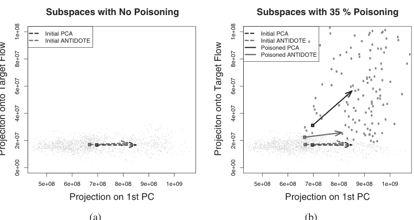

图 6.2. 在这些图中，Abilene 数据被投影到由第一主成分和攻击流 #118 的方向所张成的 2D 空间中。（A）PCA 和 PCA-Grid 在干净数据上学习到的第一主成分（由小灰点表示）。（b）在全局知情攻击下（由 ⊕’s 表示），PCA 和 PCA-GRID 第一主成分的影响如图所示。注意，一些受污染的点离主数据云太远，未包含在图中。

#### 6.3.2 PCA-GRID

Croux 等人（2007）引入的 PCA-GRID 算法是一种投影追踪技术，如方程 6.4 所述。它为数据 \(\mathbf{X}\) 找到一个近似最大化 \(S\{\cdot\}\)（一种鲁棒的离散度量）的 K 维子空间，如方程（6.4）所示。Croux 等人使用并也被 ANTIDOTE 采用的鲁棒离散度量是著名的 MAD 估计器，因为它具有高度的分布鲁棒性——它达到最高可实现的断点 \(\epsilon^* = 50\%\)，并且是离散度量最鲁棒的 M 估计器（参见 Hampel 等人 1986，第 2 章）。对于标量 \(r^{(1)}, \dots, r^{(T)}\)，MAD 定义为

\(\text{MAD} \{r^{(1)}, \dots, r^{(T)}\} = \text{median} \{ |r^{(i)} - \text{median} \{r^{(1)}, \dots, r^{(T)}\}| \} \quad (6.5)\)
\(S^{\text{MAD}} \{r^{(1)}, \dots, r^{(T)}\} = \omega \cdot \text{MAD} \{r^{(1)}, \dots, r^{(T)}\},\)

其中系数 \(\omega = \frac{1}{\Phi^{-1}(3/4)} \approx 1.4826\) 重新缩放 MAD，使得 \(S^{\text{MAD}}\{\cdot\}\) 成为标准差的估计器，对正态分布具有渐近一致性。

下一步需要选择数据中心位置的估计值。在 PCA 中，该估计值仅仅是数据的均值。然而，均值也不是一个鲁棒估计器，因此我们使用空间中位数来对数据进行居中：

\(\hat{c}\{\mathbf{x}^{(t)}\} \in \underset{\boldsymbol{\mu} \in \mathbb{R}^D}{\operatorname{argmin}} \sum_{t=1}^T \|\mathbf{x}^{(t)} - \boldsymbol{\mu}\|_2\)

这是一个凸优化问题，可以使用 Hössjer & Croux (1995) 开发的技术高效求解。

基于上述获得的位置估计 \(\hat{c}\{\mathbf{x}^{(t)}\}\) 对数据进行居中后，PCA-GRID 找到一个单位方向 \(\mathbf{v}\)，作为方程（6.4）中缩放 MAD 离散度量的近似解。PCA-GRID 算法为此任务使用网格搜索。为了说明这种搜索过程，假设要在某对单位向量 \(\mathbf{w}^{(1)}\) 和 \(\mathbf{w}^{(2)}\) 之间（一个 2D 搜索空间）找到最佳候选项。搜索空间是由 \(\phi\) 参数化的单位圆，\(\mathbf{w}(\phi) = \cos(\phi)\mathbf{w}^{(1)} + \sin(\phi)\mathbf{w}^{(2)}\)，其中 \(\phi \in [-\frac{\pi}{2}, \frac{\pi}{2}]\)。网格搜索将 \(\phi\) 的域分成 \(G + 1\) 个候选点的网格 \(\phi^{(k)} = \frac{\pi}{2}(\frac{2k}{G} - 1), k = 0, \dots, G\)。对每个候选向量 \(\mathbf{w}(\phi^{(k)})\) 进行评估，并选择最大化 \(S\{(\mathbf{x}^{(t)})^\top \mathbf{w}(\phi^{(k)})\}\) 的向量作为近似最大化器 \(\hat{\mathbf{w}}\)。

要搜索更一般的 \(D\) 维空间，搜索通过在 \(\hat{\mathbf{w}}\) 与每个单位方向 \(\mathbf{e}^{(j)}\)（\(j \in 1 \dots D\)）之间进行网格搜索，迭代改进当前的最佳候选项 \(\hat{\mathbf{w}}\)。每次迭代时，考虑的角度范围会逐渐在 \(\hat{\mathbf{w}}\) 周围缩小，以更好地探索其邻域。该过程（如算法 6.1 所述）近似了最大离散方向，类似于 PCA 中的特征向量。

为了找到最大化离散度量的 \(K\) 维子空间 \(\{\mathbf{v}^{(k)} \mid \forall j=1, \dots, K (\mathbf{v}^{(k)})^\top \mathbf{v}^{(j)} = \delta_{k,j}\}\)，GRID-SEARCH 将重复 \(K\) 次。每次

```
ALGORITHM 6.1 GRID-SEARCH (X)
-----------------------------------
Require: X is a T × D matrix
v̂ ← e⁽¹⁾
for i = 1 to C do begin
  for j = 1 to D do begin
    for k = 0 to G do begin
      φ⁽ᵏ⁾ ← (π/2)(2k/G - 1)
      w(φ⁽ᵏ⁾) ← cos(φ⁽ᵏ⁾)v̂ + sin(φ⁽ᵏ⁾)e⁽ʲ⁾
      if S{(x⁽ᵗ⁾)ᵀw(φ⁽ᵏ⁾)} > S{(x⁽ᵗ⁾)ᵀv̂} then v̂ ← w(φ⁽ᵏ⁾)
    end for
  end for
end for
return: v̂
-----------------------------------
```

```
ALGORITHM 6.2 PCA-GRID (X, K)
-----------------------------------
Center X: X ← X - ĉ{x⁽ᵗ⁾}
for i = 1 to K do begin
  v⁽ᵏ⁾ ← GRID-SEARCH (X)
  X ← projection of X onto the complement of v⁽ᵏ⁾
end for
Return subspace centered at ĉ{x⁽ᵗ⁾} with principal directions {v⁽ᵏ⁾}^K_{k=1}
-----------------------------------
```

重复后，数据会被通量处理，以从数据中移除上一个方向捕获的离散度。此过程在算法 6.2 中详细说明。

#### 6.3.3 鲁棒 Laplace 阈值

除了鲁棒 PCA-Grid 算法外，我们还为其残差阈值设计了一个鲁棒估计值，以替代第 6.1.2 节中描述的 Q-统计量。Lakhina 等人将 Q-统计量用作阈值，其隐含动机是假设残差服从正态分布（Jackson & Mudholkar 1979）。然而，我们发现 PCA 和 PCA-Grid 子空间的残差在经验上并非正态分布，这使我们得出结论：Q-统计量是检测阈值的不佳选择。Brauckhoff 等人（2009）也观察到了残差的非正态性。相反，为了考虑我们方法残差中观察到的异常值和重尾行为，我们将阈值选择为具有鲁棒位置和尺度参数的 Laplace 分布的 1 - β 分位数。备用的基于子空间的异常检测器 ANTIDOTE，是 PCA-Grid 算法（用于正常子空间估计）与 Laplace 阈值（用于估计标记异常的阈值）的组合。

与第 6.1.2 节中描述的 Q-统计量类似，我们将 Laplace 阈值 Q_{L,β} 构建为拟合到训练数据残差的参数分布的 1 - β 分位数。然而，与 Q-统计量假设的正态分布不同，我们使用由位置参数 $c$ 和尺度参数 $b$ 指定的 Laplace 分布的分位数。关键的是，我们不使用均值和标准差，而是鲁棒地拟合分布的参数。我们从平方残差 \(\left\{ \left\| \tilde{\mathbf{x}}^{(i)} \right\|_2^2 \right\}\) 中分别使用位置（中位数）和尺度（MAD）的鲁棒一致估计值 \(\hat{c}\) 和 \(\hat{b}\) 来估计 $c$ 和 $b$，

```
\(\hat{c} = \text{median} \left\{ \left\| \tilde{\mathbf{x}}^{(i)} \right\|_2^2 \right\}\)

\(\hat{b} = \frac{1}{\sqrt{2}P^{-1}(0.75)} \text{MAD} \left\{ \left\| \tilde{\mathbf{x}}^{(i)} \right\|_2^2 \right\}\)
```

其中 \(P^{-1}(q)\) 是标准 Laplace 分布的 \(q^\text{th}\) 分位数。Laplace 分位数函数的形式为 \(P_{c,b}^{-1}(q) = c + b \cdot k_L(q)\)，其中 \(k_{Laplace}\) 函数与分布的位置和形状参数无关。$^6$ 因此，Laplace 阈值仅对（鲁棒）估计值 \(\hat{c}\) 和 \(\hat{b}\) 具有线性依赖，使阈值本身具有鲁棒性。正态分位数也共享这种形式（仅在其标准分位数函数 \(k_{Normal}\) 上有所不同），但由于 Q-统计量隐含地使用 c 和 b 的非鲁棒估计，因此它不具备鲁棒性。此外，通过选择重尾 Laplace 分布，分位数更适合观察到的重尾行为，但该阈值的鲁棒性归功于鲁棒参数估计。

从经验上看，Laplace 阈值也证明比 Q-统计量更适合为 ANTIDOTE 对残差进行阈值处理。图 6.3(a) 表明，Q-统计量和 Laplace 阈值都在 PCA 算法的残差上产生合理的阈值；然而，如图 6.3(b) 所示，Laplace 阈值为 PCA-Grid 算法的残差产生合理的阈值，而 Q-统计量则大大低估了残差的离散程度。在下一节描述的实验中，Laplace 阈值始终比 Q-统计量更可靠。

### 6.4 经验评估

我们评估第 6.2 节中描述的投毒策略如何影响基于 PCA 的方法的性能。我们使用多种性能指标，在这些对抗条件下比较原始基于 PCA 的检测器和备用 ANTIDOTE 检测器。

#### 6.4.1 设置

为了评估投毒的影响，我们在各种投毒条件下测试其性能。这里我们描述了该评估所使用的数据、用于测试检测器的方法以及评估中使用的不同类型的投毒场景。

6 对于 Laplace 分布，该函数定义为 \(k_L(q) \triangleq \text{sign}(q - \frac{1}{2}) \cdot \ln(1 - 2|q - \frac{1}{2}|)\)。


Histogram of PCA Residuals

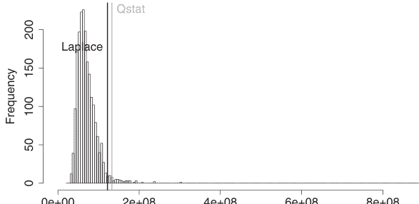

(a)

Histogram of PCA-Grid Residuals

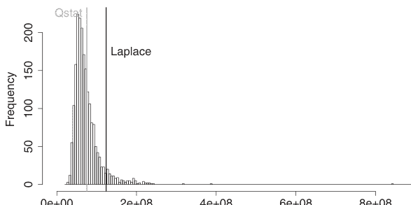

(b)

图 6.3 Q-统计量与拉普拉斯阈值的比较，用于为估计子空间的残差选择异常截断阈值。(a) 原始 PCA 算法残差的直方图和 (b) PCA-Grid 算法残差的直方图（最大残差作为异常值被排除）。浅色和深色垂直线标示出使用 Q-统计量和拉普拉斯阈值选定的阈值（请参阅垂直线旁的标签）。对于原始 PCA 方法，两种方法都在绝大多数残差的右侧选取了几乎相同的合理阈值。然而，对于 PCA-Grid 子空间的残差，拉普拉斯阈值是合理的，而 Q-统计量则不是；它会将太多正常数据误分类，因此不是一个可接受的选择。

##### 6.4.1.1 流量数据

我们用于评估的数据集是从 Abilene (Internet2 骨干网络) 网络收集的 OD 流量数据，用于模拟针对基于 PCA 的异常检测的攻击。这些数据收集于从 2004 年 3 月 1 日到 2004 年 9 月 10 日的近乎连续 6 个月期间 (Zhang, Ge, Greenberg, & Roughan 2005)。每周数据包含所有 144 个网络 OD 流的 2016 次测量，数据被分组为五分钟间隔。在收集时，该网络包含 12 个 PoP 和 15 条 inter-PoP 链路；数据中存在 54 条虚拟链路，分别对应每条 inter-PoP 链路的两个方向以及每个 PoP 的入口和出口链路。

##### 6.4.1.2 验证

尽管数据集中总共有 24 周的数据，但这些实验主要基于跨越 2004 年 8 月 7 日至 20 日的第 20 周和第 21 周。选择这些周是因为 PCA 在测试期间在这些周上实现了最低的假阴性率，因此这些数据对于检测器来说是最理想的。要评估检测器，它在第 20 周的流量上进行训练，并在第 21 周的数据上进行测试，期间注入 DoS 攻击以衡量攻击者多久能逃避检测。要模拟单训练周期攻击，第 21 周的训练流量首先被攻击者污染。

为了评估污染对原始 PCA 子空间方法和 ANTIDOTE 检测 DoS 攻击能力的影响，使用了两个连续周的数据（同样，后续结果使用第 20 周和第 21 周）——第一周用于训练，第二周用于测试。污染贯穿整个训练阶段，而 DoS 攻击发生在测试周期间。对于训练和污染在多周期间进行的煮青蛙污染攻击方案，需要一种替代的评估方法（稍后详细描述）。污染策略的成功程度根据其对基于子空间检测器的假阴性率 (FNR) 的影响来衡量。FNR 是成功逃避次数与攻击总数的比率（即，攻击者的成功率是 PCA 的 FNR 率）。我们还使用接收器操作特性 (ROC) 曲线来可视化检测方法在真阳性率 (TPR) 和假阳性率 (FPR) 之间的权衡。

要计算 FNR 和 FPR，根据 Lakhina et al. (2004b) 的方法生成合成异常，并将其注入 Abilene 数据中。尽管这种方法有缺点，例如保守地假设单一流量大小对所有流都是异常的，但它对于 PCA 与稳健 PCA 之间的相对比较、衡量污染的相对影响以及与先前研究保持一致很方便。这些实验中使用的训练集包含为期一周的流量跟踪；一周是一个足够长的时间尺度，可以捕捉工作日和周末的周期性趋势 (Ringberg et al. 2007)，并且它也是先前研究中使用的相同的时间尺度 (Lakhina et al. 2004b)。由于数据被分组为五分钟窗口（对应于 SNMP 的报告间隔），可以在每个窗口结束时做出是否发生异常的决定；因此攻击可以在发生后五分钟内被检测到。

不幸的是，计算检测器的假阳性率很困难，因为 Abilene 数据中可能存在实际异常事件。为了估计 FPR，生成负样本（良性 OD 流），方法如下。将数据拟合到 EWMA 模型，该模型旨在以很少的噪声捕捉数据的主要趋势。使用此模型选择 Abilene 流时间序列中的点作为负样本。然后将实际数据与 EWMA 模型进行比较；如果对于特定流在特定时间的 Ql,q，差异很小（不在该流的前一百分位数内），则元素 Ql,q 被标记为良性。此过程对所有流重复。检测器的 FPR 最终根据被判定为良性的时间槽上引发的（误）警报来估计。

DoS 攻击通过选择目标流 q 和时间窗口 t，并在时间窗口期间沿此目标流注入流量尖峰来模拟。从测试周的流量矩阵 Q 开始，通过将第 q 个流在第 t 个时间窗口的流量 Ql,q 设置为已知对应异常流的大值（替换该时间槽中的原始流量）来生成正样本（即异常流事件）。该值由 Lakhine et al. (2004b) 定义为 8 × 10^7 的截断值的 1.5 倍。乘以路由矩阵 R 后，时间 t 的链路流量测量值呈现异常。该过程对测试周的每个时间 t（即每个五分钟窗口）重复，为第 q 个目标流生成 2016 个异常样本。

在每个流上的每个时间模拟 DoS 攻击，并记录每次此类攻击的检测器警报。FNR 通过对所有 144 个流和所有 2016 个时间槽取平均来估计。在报告攻击对流量影响时，我们首先对每个流内的链路取平均，然后对所有流取平均。此外，我们通常报告相对于攻击前平均流量的平均流量。因此，单个污染实验基于一周的污染，FNR 在测试周期间计算，其中包括来自不同流和时间槽的 144 × 2,016 个样本。由于在 add-more-if-bigger 中污染是确定性的，该方案仅运行一次该实验。相比之下，对于随机污染方案，由于污染是随机的，我们运行了 20 次独立的污染实验重复。

检测方法产生的平方预测误差（基于测试集中的异常和正常样本）用于生成 ROC 曲线。通过将方法的阈值从 −∞ 变化到 ∞，从平方预测误差集合中生成可能的 (FPR, TPR) 对曲线；Q-统计量和拉普拉斯阈值各自对应 ROC 空间中的这样一个点。我们采用曲线下面积 (AUC) 统计量来直接比较 ROC 曲线。理想检测器的 AUC 为 1，而随机预测器的 AUC 为 1/2。

#### 6.4.2 识别易受攻击的流

流可能存在两种易受攻击的方式。如果在沿流进行 DoS 攻击后，当生成的流量数据投影到异常子空间时，攻击可能未被检测到，则该流被认为易受 DoS 攻击（未污染场景）。易受污染意味着，如果流首先被污染，则随后的 DoS 攻击可能未被检测到，因为生成的异常空间投影不再显著。为了检查流的易受攻击性，我们定义了残差速率统计量，该统计量度量沿特定目标流添加一个单位流量体积引起的残差大小（即 Δ||r||2）的变化。该统计量评估检测器对 DoS 攻击的易受攻击性，因为它衡量残差


随着 DoS 攻击规模的增大而增长，因此是判断大规模 DoS 攻击是否会在目标流上未被检测到的指标。沿着第 q 个目标流注入单位流量会导致链路测量向量 R_q 增加，并使残差增加

v (q; \vec{P}) \triangleq \| \vec{P} R_q \|_2 .

残差率衡量流量与正态子空间的对齐程度。如果流量与正态子空间完全对齐，则其残差率将为 0，因为沿子空间方向的变化根本不会改变流量的残差分量。更一般地说，低残差率表示（每单位发送流量）DoS 攻击不会显著影响平方预测误差。因此，为了使探测器有效，大多数流量的残差率必须较高；否则攻击者将能够实施大规模未被检测到的 DoS 攻击。

通过对 Abilene 数据中每周的数据运行 PCA，我们计算了每个周模型中每个流量的残差率，并估计了其残差率的离散程度。图 6.4 显示了 24 周数据中每个流量的残差率箱线图。这些图表显示，在未受污染的数据上训练时，99% 的流量的中位残差率高于 1.0；即，在 DoS 攻击中向这些流量中的任何一个添加每单位流量，流量的残差分量至少增加 1.0 个单位，且对于许多流量，增加量更高。^7 此结果表明，在干净数据上训练的 PCA 对大多数流量的 DoS 攻击不敏感，因为攻击中使用的每单位流量至少使残差增加一个单位。然而，PCA 对沿着流量 32 和 87 的 DoS 攻击非常敏感，因为即使在没有中毒的情况下，它们的残差率也很小。

#### 6.4.3 攻击评估

在本节中，我们将提出实验验证，证明对抗性中毒对基于 PCA 的异常探测器可能产生显著的不利影响。我们评估了第 6.2 节中三种数据中毒方案在单个训练周期攻击中的有效性。在测试周期间，攻击者在每个五分钟时间窗口内发起 DoS 攻击。这些攻击的结果显示在图 6.5(a) 中。虽然这些中毒方案的目标是沿目标流量添加方差，但被中毒的目标 OD 流量的均值也会增加，从而增加

^7 许多流量的残差率远高于 1，因为这些流量穿过许多链路，因此沿流量添加单位流量会在链路空间中添加许多单位。平均而言，Abilene 数据集中的每个流量有 4.5 个链路。

OD 流量所穿越的所有链路的均值。图 6.5 中的 x 轴是平均速率的相对增加。y 轴是该中毒水平下的平均 FNR（即，对所有 OD 流量取平均）。

24 周按流量分组的每周残差率

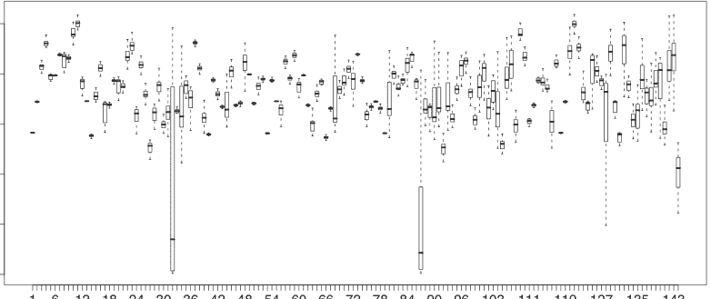

(a) PCA 的残差率

24 周按流量分组的每周残差率

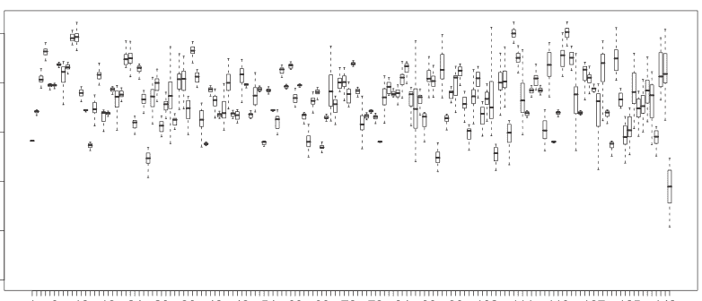

(b) PCA-GRID 的残差率

图 6.4 原始 PCA 子空间和 PCA-GRID 子空间在残差率方面的对比。此处展示了每个流量的 24 个每周残差率的箱线图，以演示两种方法的残差率变化。(a) 原始 PCA 方法的每个流量残差率分布，(b) 为 PCA-GRID。对于 PCA，流量 32 和 87（即图 6.1(b) 中连接芝加哥和洛杉矶的流量）始终具有低残差率，使得 PCA 在这些流量上容易受到规避攻击。两种方法在流量 144（华盛顿的入链路/出链路）上也具有中等易受攻击性。除此之外，PCA-GRID 在所有流量上总体上具有较高的残差率，表明规避脆弱性很小。

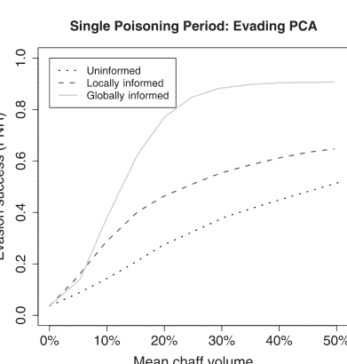

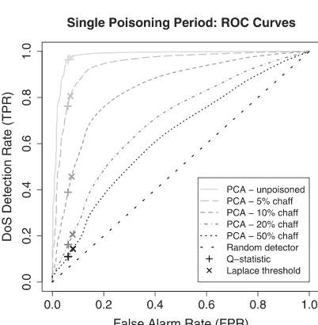

(a) 干扰流量对 FNR 的影响

(b) 干扰流量对 ROC 曲线的影响

图 6.5 单个训练周期中毒攻击对原始基于 PCA 的探测器的影响。(a) 在单个训练周期中毒攻击下，PCA 与相对干扰流量规模的规避成功率，采用三种干扰方法：未知情（点线）、本地知情（虚线）和全局知情（实线)。(b) 不同干扰流量规模下的 PCA ROC 曲线比较（使用“如果更大则添加更多”干扰流量）。同时描绘了由 Q-统计量和拉普拉斯阈值分别选取的 ROC 曲线上的点。

如预期，规避成功率的增加对未知情策略最小，对本地知情方案居中，对全局知情中毒方案最大。本地知情攻击者可以使用“如果更大则添加更多”方案，通过干扰导致平均链路速率 10% 的平均增加，将其规避成功率从基准 FNR 3.67% 提高到 28%；即，攻击者的成功规避率比未中毒 PCA 探测器的速率增加了近八倍。采用全局知情策略时，平均链路速率 10% 的平均增加会导致未中毒 FNR 增加 10 倍，成功率达到 38%，并最终随着攻击规模的增大超过 90% 的 FNR。本地知情攻击者和全局知情攻击者性能之间的主要差异易于理解。请回顾，全局知情攻击者知道整个训练期间所有链路上的流量，而本地知情攻击者只知道单个入链路的流量状态。考虑到这种信息差距，本地知情对手仅凭对网络的有限视图就取得了相当大的成功。在实际中，对手不太可能获得全局知情中毒攻击所使用的能力。此外，添加 30% 的干扰流量以获得 90% 的规避成功率是危险的，因为中毒活动本身很可能被检测到。因此，从对手的角度来看，“如果更大则添加更多”在中毒有效性、攻击者能力和风险方面提供了良好的权衡。

我们还按照第 6.4.1.2 节的描述，在异常数据和正常数据上评估 PCA 检测算法，以生成图 6.5(b) 中的 ROC 曲线。我们通过先在第 20 周的未中毒数据上训练 PCA 模型，然后再在由逐步增大的“如果更大则添加更多”攻击所中毒的数据上训练，来生成一系列 ROC 曲线（如所示）。

为了在中毒训练数据上验证基于 PCA 的检测，根据威胁模型，每个流量在实验的不同试验中单独中毒。因此，对于 5% 到 50% 的相对干扰流量规模，将“如果更大则添加更多”干扰流量单独添加到每个流量，以构建 144 个单独的训练集和针对给定中毒水平的 144 个相应 ROC 曲线。图 6.5(b) 中的中毒曲线显示了这些 ROC 曲线的平均值；即，每个 FPR 对 144 个流量的平均 TPR。

ROC 曲线序列表明，“如果更大则添加更多”中毒方案在 PCA 探测器的假阳性和假阴性之间造成了不可接受的权衡：随着干扰流量水平的增加，检测率和误报率会迅速共同下降。在 10% 的相对干扰流量规模时，性能相对于理想 ROC 曲线（从 (0, 0) 到 (0, 1) 再到 (1, 1) 的线）显著下降；而在 20% 时，PCA 的平均 ROC 曲线已经接近于随机探测器（y = x 线，AUC 为 1/2）。

#### 6.4.4 解药评估

我们在单个训练周期内评估中毒攻击对解药性能的影响。与基于 PCA 的探测器一样，我们使用各种不同的中毒方案评估此探测器的成功率，并使用“如果更大则添加更多”中毒方案计算 ROC 曲线，以与原始 PCA 子空间方法进行比较。

图 6.6(a) 描绘了单个训练周期攻击中发生的各种平均中毒水平下解药的 FNR，并与图 6.5(a) 中针对原始 PCA 探测器使用相同指标显示的结果进行了比较。比较这些结果，对解药的攻击评估成功率显著降低。对于任何特定的干扰流量水平，解药的规避成功率约为原始 PCA 方法的一半。有趣的是，对 PCA 最有效的中毒方案（全局知情中毒）是对解药效果最差的中毒方案。全局知情方案以近乎最优的方式设计来规避 PCA，但对于备选探测器，全局知情干扰流量未经过优化，且经验上对 PCA-GRID 影响甚微。对于此探测器，Random 保持同样有效，因为数据大子集上的恒定偏移会创建难以被任何子空间方法协调的双峰性——因为大约一半的数据以恒定量偏移，因此难以区分原始子空间和偏移子空间。然而，与本地知情和全局知情干扰流量策略对原始探测器的显著成功相比，这一影响仍然很小。


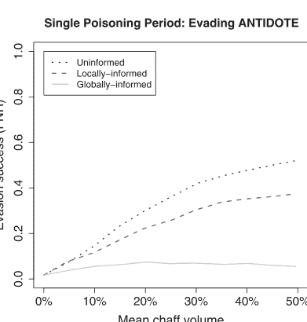

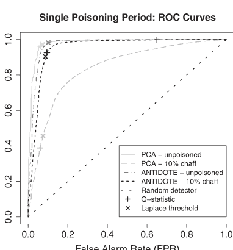

(a) 烟干对FNR的影响

(b) 烟干对ROC曲线的影响

图 6.6 单期训练中毒攻击对ANTIDOTE探测器的影响。(a) 在单期训练中毒攻击下，使用三种烟干方法（未知情（黑色点线）、局部知情（虚线）和全局知情（实线））时，ANTIDOTE相对于烟干体积的规避成功率。(b) 在未中毒和受10%烟干（使用“如果更大则添加”烟干）影响下，ANTIDOTE与原始PCA探测器的ROC曲线对比。在未中毒时，PCA探测器和ANTIDOTE探测器性能相似，但加入烟干后PCA的ROC曲线显著劣化，而ANTIDOTE的仅受轻微影响。

由于中毒会扭曲探测器，它既影响假阴性率也影响假正率。图6.6(b)在训练数据既未中毒又中毒的情况下，提供了ANTIDOTE和PCA的ROC曲线对比。对于中毒训练场景，曲线上的每个点都是沿144个可能流中的一个使用“如果更大则添加”策略中毒的144个中毒场景的平均值。虽然ANTIDOTE在未中毒训练数据上的表现与PCA非常相似，但PCA的性能受中毒影响显著下降，而ANTIDOTE基本不受影响。在平均烟干体积适中（10%）的情况下，ANTIDOTE的平均ROC曲线仍接近最优，而PCA的曲线显著向随机探测器的y = x曲线偏移。这意味着在中等程度中毒下，PCA无法在假正率和假阴性率之间实现合理的权衡，而ANTIDOTE仍能为这两项常见性能指标保持良好的工作点。总结而言，在假正率和假阴性率方面，当未发生中毒时，ANTIDOTE的性能变化微乎其微，但在发生中毒攻击时，它对中毒具有强韧性，并相比PCA提供了巨大的性能提升。

仅根据图6.6(a)和6.6(b)，可以想象ANTIDOTE仅在平均意义上优于PCA，而并非在所有被针对中毒的流上都优于PCA。与其绘制

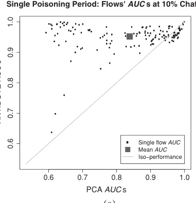

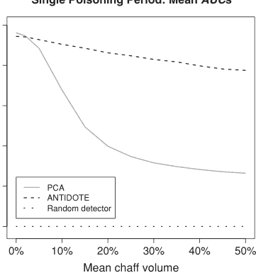

图 6.7 原始PCA探测器在ROC曲线下面积（AUC）方面的对比。(a) 在144个目标流中，PCA探测器和ANTIDOTE探测器在10%“如果更大则添加”烟干下的AUC。散点图中的每个点代表一个目标流；其x坐标是PCA的AUC，y坐标是ANTIDOTE的AUC。高于y = x线的点代表ANTIDOTE的AUC优于PCA探测器的流，而低于y = x线的点代表PCA优于ANTIDOTE的流。两种方法的平均AUC用方形符号表示。(b) 每个探测器的平均AUC与“如果更大则添加”中毒攻击的平均烟干水平随相对烟干量增加的对比。对比的方法包括随机探测器（黑色点线）、PCA探测器（实线）和ANTIDOTE（虚线）。

所有144条中毒ROC曲线，图6.7(a)在10%烟干下对比了两种检测方法的AUC。不仅平均性能对鲁棒PCA好得多，而且它实际上在大多数流上都以相当大的优势优于PCA。尽管PCA确实在少数流上表现略好，但在这些情况下，两种方法都具有出色的检测性能（因为它们的AUC都接近1），因此对于这些特定流，两者之间的差异微不足道。

图6.7(b)绘制了在中毒程度逐渐升高时，探测器实现的平均AUC（从144条分别中毒的流的ROC曲线AUC中平均得到）。在无烟干条件下，ANTIDOTE的表现可与PCA相媲美（尽管略差），但随着污染量的增加，其性能保持相对稳定，而PCA的性能则迅速下降。事实上，当中毒率低至5%时，ANTIDOTE的性能已超过PCA，并且随着污染程度的增加，差距只会扩大。随着PCA性能下降，它趋近于随机探测器（等效于AUC = 1/2），当中毒率超过20%时。正如这些实验所示，ANTIDOTE是一种有效的防御，并显著优于未设计为强健的解决方案。这是强有力的证据，表明强健技术是为安全敏感领域设计机器学习算法的一种有前途的手段。

#### 6.4.5 煮蛙中毒攻击的经验评估

##### 6.4.5.1 分段中毒的实验方法学

为测试煮蛙中毒攻击，使用受Lakhina, Crovella, & Diot (2004b)启发的生成模型模拟了数周的流量数据。这些模拟产生基于平稳分布生成的多周数据。虽然这种数据在实践中不现实，但平稳数据是PCA生成可靠探测器的理想数据集。由于学习者无法区分良性数据漂移和异常条件，非平稳条件下的异常检测更加困难。通过展示即使在这种平稳情况下，PCA也易受分段中毒攻击，这些实验表明该方法在更现实的环境下也可能被攻破。此外，Zhang et al. (2005)的六个月Abilene数据集被证明过于非平稳，PCA无法从一周到下一周始终表现良好——即使在没有中毒的情况下，PCA的表现也常常很差。目前尚不清楚该数据中观察到的非平稳性是普遍存在还是数据集的产物，但无论如何，这些实验表明即使底层数据表现良好，PCA也易受中毒攻击。

要综合OD流量矩阵的平稳多周数据集，使用三步生成过程分别对每个OD流进行建模。首先，用正弦近似对第$q^{th}$个OD流的时间序列的底层每日周期进行建模。然后，用几何分布分布的到达间隔时间来建模流经历异常的时刻，采用二项式到达过程。最后，在良性OD流量期间向基础正弦模型添加高斯白噪声，并在异常流量期间向基础模型添加指数流量。

在第一步中，通过拟合傅里叶基函数的系数来捕捉底层周期性趋势。遵循Lakhina等人(2004b)提出的模型，基函数为周期为7、5和3天以及24、12、6、3和1.5小时的正弦函数，以及一个常数函数。对于每个OD流，通过将流投影到该基上来估计傅里叶系数。移除该傅里叶预测器建模的流量部分，剩余的残余流量用两个过程建模——一个零均值高斯噪声过程捕捉短期良性流量方差，指数分布用于建模非恶意流量量异常。

在第二步中，为每个时间间隔选择两个噪声过程中的一个。计算傅里叶模型的残余值（观测流量与预测流量之差）后，记录最小负残余值$-m$。我们假设区间$[-m, m]$中的残余值对应良性流量，超过$m$的残余值对应流量异常（这是一个近似，但对大多数OD流来说效果相当不错）。然后，由于良性变化和异常的表现方式截然不同，将分别对这两者进行建模。将残余流量分类为良性或异常后，异常到达时间被建模为伯努利到达


过程，且异常间到达时间服从几何分布。此外，由于我们仅考虑空间PCA方法，异常的时间位置无关紧要。

在第三个也是最后一步中，两个残余流量和异常间到达过程的参数是根据残余流量，分别使用高斯方差以及指数和几何速率的最大似然估计来推断的。已对小、中、大流量获得了良好的拟合结果（未展示Q-Q图）。

在合成中，所有链路流量都受限于遵守Abilene网络的链路容量：除一条链路以该速率的四分之一运行外，所有链路均为10 gbps。我们还限制会导致流量超过链路容量的垃圾流量。

#### 6.4.5.2 对PCA检测器的分段投毒影响

我们现在评估煮青蛙投毒攻击策略的有效性，该策略会在多个训练周期内污染训练数据。图6.8(a)绘制了四种不同投毒计划下PCA检测器的FNR随投毒时长的变化。

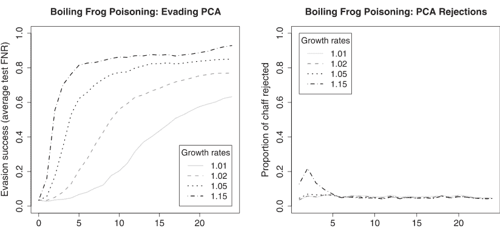

##### (a) 煮青蛙对PCA的影响

##### (b) PCA对垃圾流量的拒绝

图6.8. 煮青蛙投毒攻击对原始PCA子空间检测器的影响（与基于PCA的检测器进行对比，参见图6.9）。(a) 在煮青蛙投毒攻击下PCA的逃避成功率，以每个连续投毒周后的平均FNR衡量，针对四种不同的投毒计划（即投毒规模按每周几何因子1.01、1.02、1.05和1.15分别增加）。更激进的计划（例如增长率为1.05和1.15）会在几周内显著提高FNR，而较不激进的计划则需要许多周才能达到相同结果，但这样做更隐蔽。(b) 基于PCA的检测器对(a)中煮青蛙投毒攻击的每周垃圾流量拒绝率。检测器仅在最激进计划（增长率为1.15）的最初几周检测到大量垃圾流量；随后，检测器受污染过于严重，无法准确检测垃圾流量。

分别具有1.01、1.02、1.05和1.15增长率的计划。计划的增长率对应于受攻击链路平均流量周环比增长的速率。攻击强度参数$\theta$（参见第6.2节）被选定以实现这一目标。我们看到，随着投毒时长增加，所有四种计划的FNR都会显著增加。以15%的增长率，FNR在三周内从3.67%增加到超过70%；即使是5%的增长率，FNR在三周内也会增加到50%。因此，即使投毒数据的增长相当缓慢，煮青蛙攻击依然有效。此外，通过对比单一训练周期的图6.5(a)与图6.8(a)，煮青蛙攻击的成功变得显而易见。对于单一训练周期攻击，要将FNR提高到50%，需要平均流量立即增加约18%；而在煮青蛙攻击中，仅需在三周内分散5%的平均流量增长即可实现相同结果。

请回顾，两种方法都使用上一周收集的数据每周重新训练。然而，上一周的数据也会被检测器本身过滤，对于任何被标记为异常的时间窗口，训练数据都会被丢弃。图6.8(b)显示了PCA每周拒绝的垃圾流量比例（_垃圾流量拒绝率_），适用于煮青蛙投毒攻击策略。三个较慢的计划享有接近5%的相对较小的恒定拒绝率。15%的计划开始时拒绝率相对较高，但一个月后，足够多的受毒流量误导PCA，此时拒绝率下降到较慢计划的水平。因此，具有2–5%适度增长率的煮青蛙策略可以显著毒害PCA，大幅提高其FNR，同时仍然不被检测器察觉。

#### 6.4.5.3 对ANTIDOTE的分段投毒影响

我们现在评估ANTIDOTE对在多个连续训练周期内发生的煮青蛙策略的有效性。图6.9(a)显示了ANTIDOTE在四种投毒计划下的FNR（回顾第6.4.5.2节，每个计划都是按更多即添加投毒策略中每周投毒规模的增长因子）。首先，对于两种最隐蔽的投毒策略（1.01和1.02），ANTIDOTE表现出显著的抵抗力，即逃避成功率增长非常缓慢，例如，经过十个训练周期后，仍低于20%的逃避成功率。这与PCA形成鲜明对比（见图6.8(a)）；例如，经过十周后，在1.02投毒增长率场景下，对PCA的逃避成功率超过50%。

其次，在PCA下，逃避成功率随着每个额外周持续增加。然而，使用ANTIDOTE时，这些更激进计划的逃避成功率在几周后实际上会下降。原因是随着垃圾流量水平上升，ANTIDOTE越来越能够将垃圾流量识别为异常，并随后从后续训练数据中拒绝足够多的垃圾流量，导致投毒策略失去其有效性。

图6.9(b)显示了ANTIDOTE在分段投毒下拒绝的垃圾流量比例。两个较慢的计划几乎具有接近9%的恒定拒绝率（这高于PCA约5%的拒绝率）。然而，对于更激进的增长计划（5%和15%），ANTIDOTE会拒绝越来越多的毒害数据。这反映了任何稳健检测器的良好目标行为——随着污染程度增加而拒绝更多训练数据。

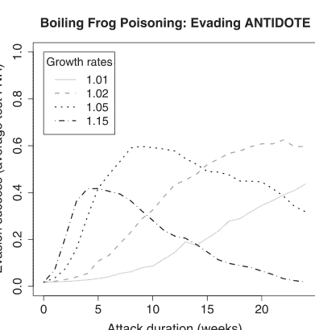

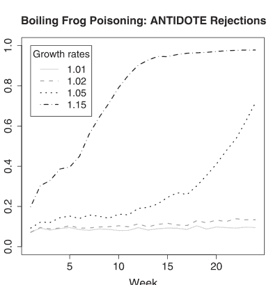

##### (a) 煮青蛙攻击对ANTIDOTE的影响

##### (b) ANTIDOTE对垃圾流量的拒绝

图6.9 煮青蛙投毒攻击对ANTIDOTE检测器的影响（与基于PCA的检测器进行对比，参见图6.8）。**(a)** 在煮青蛙投毒攻击下ANTIDOTE的逃避成功率，以每个连续投毒周后的平均FNR衡量，针对四种不同的投毒计划（即投毒规模按每周几何因子1.01、1.02、1.05和1.15分别增加）。与图6.8(a)中煮青蛙投毒的每周FNR不同，更激进的计划（例如增长率为1.05和1.15）在仅几周的投毒后达到峰值FNR，此后其效果下降（因为检测器成功拒绝了越来越多的垃圾流量）。较不激进的计划（增长率为1.01和1.02）仍有逐渐增加的FNR，但似乎最终也会趋于平稳。**(b)** ANTIDOTE检测器对(a)中煮青蛙投毒攻击的每周垃圾流量拒绝率。与PCA不同（见图6.8(b)），ANTIDOTE会拒绝煮青蛙攻击中越来越多的垃圾流量。对于所有投毒计划，ANTIDOTE的基准拒绝率（约10%）高于PCA检测器（约5%），并且在几周内拒绝了激进计划中大部分垃圾流量。这表明，与PCA不同，ANTIDOTE不会随着周环比垃圾流量增加而逐渐被毒害。

总体而言，这些实验提供了实证证据，表明ANTIDOTE所采用的技术组合，即一种基于稳健子空间估计器设计的子空间检测器结合基于Laplace的截止阈值，在各种投毒场景中（不同数量的投毒、不同OD流、不同时间范围）保持了假阴性率和假阳性率之间的良好平衡，从而为原始基于PCA的检测器提供了一种有弹性的替代方案。

### 6.5 总结

为了破坏Lakshina等人（2004b）提出的基于PCA的检测器，我们研究了通过添加恶意……来毒害训练数据的引发性完整性攻击。


干扰流量，即由位于网络中的受攻击节点在网络上发送的虚假流量。这种干扰流量旨在干扰 PCA 的子空间估计过程。基于放宽的目标函数，我们展示了攻击者如何利用对网络流量模式的全局视图来逼近最优噪声。从经验上发现，通过使用具有全局信息的干扰流量将平均链路速率提高 10%，FNR 从 3.67% 上升到 38%——DoS 攻击误分类率增加了 10 倍。类似地，攻击者仅使用本地链路信息即可发起更真实的 add-more-if-bigger 攻击。对于此攻击，通过使用 add-more-if-bigger 干扰流量将平均链路速率提高 10%，FNR 从 3.67% 上升到 28%——DoS 攻击误分类率增加了八倍。这些攻击表明，当拥有关于网络模式的足够信息时，攻击者可以针对 PCA 检测器发起攻击，严重削弱其检测穿过其正在监控的网络的未来 DoS 攻击的能力。

我们还证明，可以使用一种替代的鲁棒子空间估计方法来替代，从而使得到的 DoS 检测器更不易受到中毒攻击的影响。该替代检测器采用了 Croux 等人开发的用于鲁棒 PCA 的子空间方法，以及一种更鲁棒的残差截止阈值估计方法构建而成。得到的 ANTIDOTE 检测器虽受中毒影响，但其性能下降得更加平缓。在未中毒的流量下，ANTIDOTE 的性能与 PCA 几乎一样好，但对于所有使用 add-more-if-bigger 干扰流量的污染水平，ANTIDOTE 的误分类率约为基于 PCA 的方案 FNR 的一半。此外，ANTIDOTE 的平均性能远优于原始检测器；它在更多流量上且以巨大差距优于普通 PCA。对于多周的“煮青蛙”式中毒攻击，ANTIDOTE 也优于 PCA，并且会在随后的每周捕获越来越多的攻击流量。

关于子空间检测方法的若干重要问题仍未得到解答。尽管我们已证明 ANTIDOTE 对中毒攻击具有鲁棒性，但目前尚不清楚是否存在能显著降低 ANTIDOTE 检测性能的替代中毒方案。由于 ANTIDOTE 建立在鲁棒估计器之上，不太可能存在完全破坏其性能的中毒策略。然而，为了更好地理解攻击与防御的极限，有必要继续针对下一代防御者（在此例中为 ANTIDOTE）调查最坏情况攻击。

问题 6.1 针对大体量网络异常的 ANTIDOTE-子空间检测器的最坏情况中毒攻击是什么？攻击者和防御者在此场景中的博弈论均衡策略是什么？ANTIDOTE 的性能与这些策略相比如何？

还有几种其他方法用于开发针对大体量异常的有效异常检测器（例如，Brauckhoff et al. 2009）。要将这些替代方案与 ANTIDOTE 进行比较，必须首先识别其漏洞，并评估其在受攻击时的性能。不过，更重要的是，我们认为通过将它们结合起来，可以显著改进检测器。

问题 6.2 基于子空间的检测方法能否调整以融入替代方法？它们能否同时发现时空相关性并利用两者来检测异常？基于子空间的方法能否调整以融入特定领域的信息，例如网络拓扑？

开发下一代网络异常检测器是一项关键任务，或许可以融入本论文所倡导的若干主题，以创建安全学习者。

# 第三部分

# 机器学习的勘探攻击

## 7 针对 SVM 学习的隐私保护机制

高调的隐私泄露事件将公众的注意力聚焦在数据隐私上。直到最近，隐私作为计算机安全中相对滞后的一个领域，仅能通过现有技术得到较弱的增强，用于发布敏感数据的汇总统计时也是如此：直到 2000 年代中期，隐私的定义仍然仅仅是语法层面的。与此形成对比的是，密码学领域长期以来基于攻击者的计算限制，为维护加密信息的保密性提供了可证明的强有力保证。差分隐私（Dwork et al. 2006; Dwork & Roth 2014）作为应对将隐私提升至与密码学同等地位这一挑战的方案而被提出，由于其正式性质和对强大攻击者的保证，其地位迅速提升。本章继续了 3.7 节开始的讨论，包括一份在保护训练数据隐私的同时发布训练好的支持向量机（SVM）分类器的案例研究。本章建立在（Rubinstein, Bartlett, Huang, & Taft 2012）的基础上。

### 7.1 隐私泄露案例研究

我们首先回顾隐私研究人员实施的几起高调隐私泄露事件。这些事件共同塑造了关于隐私的讨论，并特别是推动了隐私增强技术的重要进展。本节最后讨论吸取的教训。

#### 7.1.1 马萨诸塞州雇员健康记录

早期的一起隐私泄露事件凸显了定义*个人可识别信息*（PII）概念的困难，并促成了具有重大影响的*k*-匿名性（Sweeney 2002）的发展。

在 1990 年代中期，马萨诸塞州团体保险委员会发布了州雇员的私人健康记录，显示个人医院就诊情况，目的是促进健康研究。为了降低对州雇员的隐私风险，委员会清理了所有可疑 PII：姓名、地址和社会安全号码。发布的内容是纯粹的医疗信息，以及（看似无害）的人口统计信息：出生日期、性别和邮政编码。

安全研究人员 Sweeney 意识到，未清理的人口统计信息实际上是部分 PII。为了证明她的想法，Sweeney 获得了马萨诸塞州剑桥市易于获取的公开选民信息，其中包括出生日期、邮政编码和姓名。然后她将这些公开数据与发布的“匿名化”医院记录相关联，从而重新识别了许多员工，包括她的目标人物，当时负责监督健康数据发布的威廉·韦尔德州长。

Sweeney (2002) 更广泛地衡量了她技术的成功率，估计美国 87% 的人口仅通过出生日期、性别和邮政编码就能被唯一识别。她专注于防止这种唯一识别，并提出了 k-匿名性：发布中每个个体的信息必须至少与发布中其他 k – 1 个个体的信息不可区分。通常，被识别为 PII 的属性/值要么被完全抑制，要么在更高的量化级别上进行聚合。

自 k-匿名性的初步工作以来，其定义中的漏洞已被识别，并在某些情况下通过后续衍生提案（如 ℓ-多样性（Machanavajjhala et al. 2007）和 t-紧密性（Li, Li, & Venkatasubramanian 2007））得到修复。

#### 7.1.2 AOL 搜索查询日志

2006 年，AOL 公开发布了超过 65 万名 AOL 用户三个月的搜索日志，目的是促进 Web 搜索研究（Barbaro & Zeller 2006）。尽管查询未按用户名标记，但查询与常见用户 ID 相关联，且搜索词包含 PII 以及有关用户在线活动的敏感信息。

数据发布后不久，《纽约时报》记者在查询日志中识别出了 AOL 用户。发布数据的这一失误导致 AOL 的首席技术官丢掉工作，并引发受影响用户对 AOL 提起的集体诉讼。AOL 搜索数据事件抑制了研究用的数据共享，并凸显了仅根据姓名和地址等结构化数据字段定义 PII 的难度。

#### 7.1.3 Netflix 大奖

2006 年——与 AOL 数据发布同年——Netflix 启动了一项为期三年的电影推荐竞赛，头奖为 1,000,000 美元（Bennett, Lanning et al. 2007）。发布的竞赛数据包含约 48 万用户对约 1.7 万部电影的约 1 亿条评分。Netflix 数据集非常稀疏，每个用户平均超过 200 条评分，每部电影平均超过 5k 条评分，但两者的方差都很高。

尽管 Netflix 没有发布直接识别用户的信息——事实上，一些用户的评分显然被扰动以试图保护隐私（Bennett et al. 2007）——但电影的身份信息被发布了。参赛者被允许利用电影身份信息使用外部数据，以帮助做出更准确的推荐。研究人员 Narayanan & Shmatikov (2008) 使用了公开可用的 IMDb 数据，其中包含来自非匿名用户的电影评分，以


将公开 IMDb 个人资料中的 PII 与 Netflix 数据中的匿名用户关联，从而重新识别竞赛数据集中的用户。一名 Netflix 用户的性取向被公开。Netflix 因此去匿名化引发的集体诉讼而败诉，其中一项和解条件是取消后续的 Netflix Prize II 竞赛。

#### 7.1.4 去匿名化 Twitter 匿名名

Narayanan & Shmatikov 重新识别 Netflix 用户一年后，同一批研究人员展示了匿名化社交网络数据的固有难度（Narayanan & Shmatikov 2009）。

隐私是社交网络中的严重问题。例如，Twitter 在阿拉伯之春起义中发挥了关键作用，政治异见人士利用该在线网站组织和平抗议并记录政府滥用职权的行为。在线个人资料中的匿名名促进了匿名性，但并非万无一失。而且，尽管 Twitter 等公司可能试图保护用户隐私，但它们在利润（与广告商共享数据）和遵守信息法律传票之间存在相互竞争的驱动力。Narayanan & Shmatikov 表明，即使没有任何个人资料信息，仅网络连接也可以识别许多用户。通过将 Twitter 社交图中的节点与 Flickr 照片共享网站社交图中的节点关联，他们能够以 88% 的准确率重新识别出验证同时在 Twitter 和 Flickr 上拥有账户的三分之一用户。

我们与 Narayanan 和 Shi 一起扩展了该方法，以在社交网络链接预测挑战中恢复测试标签（Narayanan, Shi, & Rubinstein 2011）：实际上是将隐私攻击应用于机器学习竞赛作弊。与 Narayanan & Shmatikov 关联两个同时抓取网站的不同图不同，我们的结果表明，即使在六个月期间内，图的演化也不足以缓解关联攻击。

#### 7.1.5 全基因组关联研究

全基因组关联研究（GWAS）是分析医学检测数据的重要统计工具，其中基因组特定位点的核苷酸频率在健康受试者的对照组和患特定疾病的病例组之间进行比较。出现频率的显著差异意味着疾病与遗传标记之间存在关联。Homer et al.（2008）展示了从目标 DNA 序列信息中检测目标个体是否参与 GWAS 病例组（表征为参与者遗传数据的混合物）的可能性。这为之前公开的 GWAS 数据的参与者可能被识别打开了可能性，并促使美国国家卫生研究院控制研究统计数据的发表。

存在几种其他侵犯“基因隐私”的途径（Erlich & Narayanan 2014），例如通过三角定位家谱数据来确定研究参与者的姓氏（Gymrek, McGuire, Golan, Halperin, & Erlich 2013）。

#### 7.1.6 广告微定向

将人口统计和浏览历史记录等个人数据与在线广告商共享，长期以来一直遭到隐私倡导者的反对。但如果不向广告商共享任何直接识别信息呢？如果根本不共享任何信息呢？即使在这看似无害的环境中，用户隐私也可能被泄露。Korolova（2011）表明，Facebook 上的广告微定向可以被利用来推断用户的私人信息。基本攻击旨在推断所选目标的某些未知私有属性（例如性取向），而目标的一些识别信息已经知晓，例如年龄、位置、工作单位或教育程度。攻击者在社交网络上发起两个广告系列，两者都针对目标用户的详细信息：一个针对拥有私有属性的用户，另一个针对不拥有该属性的用户。尽管 Facebook 不会直接共享查看广告的用户的详细信息，但攻击者可以根据哪个广告系列的美元余额发生变化来确定这些信息。通过检查 Facebook 提供的 PII，两个广告系列都可以定位特定用户，且仅来自两个广告系列中的一个广告会被展示并计入攻击者的账户。这揭示了目标用户拥有哪个属性值。

#### 7.1.7 经验教训

上述案例研究中出现了若干重复出现的模式：

- 将隐私泄露视为微不足道或攻击者需要付出过多工作的可能性很小是危险的。高度复杂的攻击一次又一次地被演示出来。它们被公开是为了突出敏感数据的滥用（由于最初的数据发布）并推进隐私研究。在现实中，存在更有价值的诱因来在不披露的情况下泄露隐私。

- 许多泄露是通过关联攻击完成的：“匿名”数据集的记录与容易获得甚至是公开的外部数据源相关联。合并后的数据将敏感信息（来自已发布的私有数据）与重新识别的个人（来自公开记录）关联起来。

- 识别构成 PII 的属性极其困难，而这是采用 k-匿名性及其衍生物等语法措施的必要条件。许多属性可以充当指纹：在私有数据分析中存在维度灾难，即与个人相关的高维数据很可能是唯一的。

### 7.2 问题设置：保护隐私的学习

本章的目标是在保持每个数据点隐私的同时发布数据集的汇总信息。实用性和隐私这两个目标本质上是相悖的。然而，我们将看到，可以通过实用的发布机制实现有效的平衡。

为了使发布机制有用，其响应必须与数据的某些目标统计量高度相似。特别是，由于我们将发布在训练数据上学习的分类器，我们正式的实用性度量将比较已发布的分类器与在相同数据上训练的期望非私有分类器。在此情况下，我们的目标分类器是支持向量机（SVM），这是实践中最广泛使用的监督学习者之一。

在前一节的背景下，任何数据机密性声明都必须得到语义隐私保证的支持：弱匿名化数据一次又一次地被重新识别。为此，有必要将机制的响应“平滑化”：机制必须是随机的，以减少任何单个数据点对该分布的影响。这就是建立 Dwork et al.（2006）提出的一种称为差分隐私的属性时所采用的方法。我们采用这种强隐私保证。

研究统计数据库的研究者（由数据库和理论社区研究）希望了解实用性和隐私的目标在何时可以同时高效实现（Dinur & Nissim 2003; Barak et al. 2007; Blum et al. 2008; Chaudhuri & Monteleoni 2009; Kasiviswanathan et al. 2008; Duchi et al. 2013; Dwork & Roth 2014; Aldà & Rubinstein 2017）。因此，我们在研究其方法的同时将采用他们的术语。尽管本章的讨论涉及理论分析，但这里提出的机制——在我们过去的工作中开发（Rubinstein, Bartlett, Huang, & Taft 2009; Rubinstein et al. 2012）——易于实现且高效，并发布与相应的非私有 SVM 在 \(\ell_\infty\)-范数下接近的分类器，且概率很高。在我们的环境中，这种实用性概念比风险接近性更强。

#### 7.2.1 差分隐私

我们现在介绍差分隐私的背景。给定对数据库 \(\mathbb{D}\) 的访问，一个 *机制* \(M\) 必须在保持单个条目隐私的同时发布关于 \(\mathbb{D}\) 的汇总信息。我们假设 *响应* \(M(\mathbb{D})\)，属于值域空间 \(\mathcal{T}_M\)，是机制发布的唯一信息。我们采用的统计数据库术语应该理解为在机器学习中有类似概念，例如数据库对应数据集，记录或条目对应数据点，机制对应学习算法，发布的量对应学习的分类器。

我们说，一对数据库 \(\mathbb{D}^{(1)}, \mathbb{D}^{(2)}\) 是相邻的，如果它们正好在一个条目上不同；换句话说，两个数据集之间相隔 Hamming（或 \(\ell_1\)）距离 1。我们采用 Dwork et al.（2006）提出的以下强隐私概念。

定义 7.1 对于任何 \(\beta > 0\)，随机化机制 \(M\) 提供 \(\beta\)-*差分隐私*，如果对于所有相邻数据库 \(\mathbb{D}^{(1)}, \mathbb{D}^{(2)}\) 和所有响应 \(t \in \mathcal{T}_M\)，机制满足

```
\log \left( \frac{\Pr \left( M \left( \mathbb{D}^{(1)} \right) = t \right)}{\Pr \left( M \left( \mathbb{D}^{(2)} \right) = t \right)} \right) \le \beta.
```


定义中的概率是关于 \( M \) 中的随机化，而非数据库。对于连续的 \( \mathcal{T}_M \)，我们所说的这个比率是 \( M \left(\mathbb{D}^{(1)}\right) \) 的分布相对于 \( M \left(\mathbb{D}^{(2)}\right) \) 的分布的 Radon-Nikodym 导数。\(^1\) 在后续内容中，我们不失一般性地假设每对相邻数据库仅在最后一项上不同。

要理解该定义，请考虑一个保持高水平差分隐私（低 \( \beta \)）的机制 \( M \)，以及具有以下能力的强大攻击者：

- 对映射 \( M \) 了解至随机性；
- 可用于在任意数量的数据库上模拟 \( M \) 响应的无限计算资源；
- 了解 \( \mathbb{D} \) 的前 \( N - 1 \) 项，以及
- 从 \( M \left(\mathbb{D}\right) \) 采样线性数量响应的能力；

然后，攻击者重新识别 \( \mathbb{D} \) 的第 \( N^{\text{th}} \) 项的最佳方法是：

- 通过最多查询机制 \( N \) 次并形成响应直方图，构建一个近似未知响应分布 \( M \left(\mathbb{D}\right) \) 的经验分布；
- 从 \( \mathbb{D} \) 的已知前 \( N - 1 \) 项构建所有候选数据库 \( \mathbb{D}' \)；
- 对于每个 \( \mathbb{D}' \)：
  - 利用对 \( M \left(\cdot\right) \) 的了解模拟 \( M \left(\mathbb{D}'\right) \) 的响应分布；
  - 将精确的候选响应分布与近似经验分布进行比较；以及
- 返回与经验分布最匹配的 \( \mathbb{D}' \)。

即使使用这种最优程序，在适当较小的 \( \beta \) 下，对手也无法推断 \( \mathbb{D} \) 第 \( N^{\text{th}} \) 项的真实身份的任何额外信息。差分隐私保证每个响应分布 \( M \left(\mathbb{D}'\right) \) 点向接近真实分布 \( M \left(\mathbb{D}\right) \)。换句话说，由于未知数据遍历了所有可能性，响应分布是不可区分的。在尝试将候选响应分布与查询到的实际经验分布相匹配时，将无法将真实的 \( \mathbb{D} \) 与不正确的相邻 \( \mathbb{D}' \) 区分开来。只要 \( \beta \) 接近采样经验分布与实际响应分布 \( M \left(\mathbb{D}\right) \) 之间的估计误差，区分度就是有效的——由于查询次数有限，这种估计误差被保证不会太小。

本节我们论证了差分隐私为每个数据提供了强语义隐私保证，同时允许发布一些聚合信息。确实，在某些情况下，有人可能会认为该定义过于严格。一些可能的松弛是自然的；例如，“分组隐私”变体模拟了了解 \( \mathbb{D} \) 中某些固定 \( k \ge 1 \) 行数据的对手（Dwork et al. 2006）。换句话说，对数据的了解被松弛为以 \( \mathbb{D} \) 为中心的汉明-\( k \) 球。

\(^1\) 更一般地，对于每个可测的 \( T \subseteq \mathcal{T}_M \)，\(\text{Pr} \left( M \left(\mathbb{D}^{(1)}\right) \in T \right) \le \exp(\beta)\text{Pr} \left( M \left(\mathbb{D}^{(2)}\right) \in T \right)\)。

##### 7.2.1.1 拉普拉斯机制

建立差分隐私的最早模式是向非私有机制添加（可能是多变量的）零均值拉普拉斯噪声。通常，被私有化的非私有机制是数据的确定性函数——在我们的情况中，它将是支持向量机。零均值拉普拉斯噪声的尺度取决于所需的差分隐私级别 \(\beta\) 以及所谓的非私有机制的全局敏感度。

###### 定义 7.2

具有实向量值响应的确定性机制 \(M\)，若对于每对相邻数据库 \(\mathbb{D}^{(1)}, \mathbb{D}^{(2)}\) 均有 \(\| M(\mathbb{D}^{(1)}) - M(\mathbb{D}^{(2)}) \|_1 \leq \Delta\)，则称其具有 \(\ell_1\)-全局敏感度 \(\Delta > 0\)。

这本质上是对非私有机制的一种 Lipschitz 条件，其中余域上的度量由 \(\ell_1\)-范数诱导，同理也适用于定义域中的数据库。直观地说，全局敏感度度量了非私有映射的连续性：即在输入数据集受到小扰动时，要发布的响应会变化多少。

有了非私有机制的全局敏感度，证明向非私有机制添加合适的拉普拉斯噪声保持差分隐私就变得简单了。

###### 引理 7.3

(Dwork et al. 2006) 设 \(M\) 为具有 \(\ell_1\)-全局敏感度 \(\Delta > 0\) 的确定性机制，设 \(\beta > 0\)，且 \(\lambda \stackrel{iid}{\sim} Laplace(\mathbf{0}, \beta/\Delta)\)。那么机制 \(M(\mathbb{D}) + \lambda\) 保持 \(\beta\)-差分隐私。

证明 考虑相邻数据库 \(\mathbb{D}^{(1)}, \mathbb{D}^{(2)}\)，任意 \(t \in \mathcal{T}_M\)，以及两个多变量随机变量 \(\lambda_1, \lambda_2 \stackrel{iid}{\sim} Laplace(\mathbf{0}, \Delta/\beta)\)

\[
\frac{\Pr(M(\mathbb{D}^{(1)}) + \lambda_1 = t)}{\Pr(M(\mathbb{D}^{(2)}) + \lambda_2 = t)} = \frac{\exp(\|t - M(\mathbb{D}^{(1)})\|_1 / (\Delta/\beta))}{\exp(\|t - M(\mathbb{D}^{(2)})\|_1 / (\Delta/\beta))} \leq \exp(\|M(\mathbb{D}^{(1)}) - M(\mathbb{D}^{(2)})\|_1 / (\Delta/\beta)) \leq \exp(\beta).
\]

等式源自拉普拉斯概率密度函数的定义，第一个不等式源自三角不等式，最后一个不等式源自全局敏感度的边界。对两边取对数可得 \(\beta\)-差分隐私。

#### 7.2.2 效用

直观地说，为了保证差分隐私而对一个“有趣的”机制 \(M\) 进行的扰动越多，生成的机制 \(\hat{M}\) 就越不像 \(M\)。下一个定义形式化了“相似性”的概念。

##### 定义 7.4

考虑两个具有相同定义域且响应空间分别为 \(\mathcal{T}_{\hat{M}}\) 和 \(\mathcal{T}_M\) 的机制 \(\hat{M}\) 和 \(M\)。设 \(\mathcal{X}\) 为某个集合，并令 \(\mathcal{F} \subseteq \mathbb{R}^\mathcal{X}\) 由响应空间参数化：对于每个 \(t \in \mathcal{T}_{\hat{M}} \cup \mathcal{T}_M\)，定义某个对应的函数 \(f_t \in \mathcal{F}\)。最后假设 \(\mathcal{F}\) 赋有范数 \(\| \cdot \|_{\mathcal{F}}\)。那么对于 \(\epsilon > 0\) 和 \(0 < \delta < 1\)，若对于所有数据库 \(\mathbb{D}\)，² 我们说 \(\hat{M}\) 相对于 \(M\) 是 \((\epsilon, \delta)\)-有用的，如果

$$\text{Pr} \left( \left\| f_{\hat{M}(\mathbb{D})} - f_{M(\mathbb{D})} \right\|_{\mathcal{F}} \leqslant \epsilon \right) \geqslant 1 - \delta.$$

通常，$\hat{M}$ 将是 $M$ 的一个保护隐私的（扰动的）版本，例如 $M$ 的拉普拉斯机制。在后续内容中，我们将 $\| \cdot \|_{\mathcal{F}}$ 取为 $\| f \|_{\infty \colon \mathcal{M}} = \sup_{\mathbf{x} \in \mathcal{M}} |f(\mathbf{x})|$，其中 \(\mathcal{M} \subseteq \Re^D\) 包含数据。同样，为双变量函数 \(k ( \cdot, \cdot )\) 定义 \(\| k \|_{\infty \colon \mathcal{M}} = \sup_{\mathbf{x}, \mathbf{z} \in \mathcal{M}} | k ( \mathbf{x}, \mathbf{z} )|\) 也将很方便。

#### 7.2.3 差分隐私的历史研究方向

关于差分隐私的前人研究文献丰富。我们在保护隐私的支持向量机学习背景下，概述了其中一些工作。

参数化向量值统计量或简单函数的值域空间

早期关于私有交互机制的工作集中于近似实值和向量值统计量（例如，Dinur & Nissim 2003；Blum et al. 2005；Dwork et al. 2006；Dwork 2006；Barak et al. 2007）。McSherry & Talwar (2007) 首次考虑了参数化比实值向量更一般集合的值域空间的私有机制，并使用这种差分私有映射进行机制设计。开发用于发布分类器的私有机制的首个工作，具体针对正则化逻辑回归，归功于 Chaudhuri & Monteleoni (2009)。在那里，机制的值域空间参数化了 \(\Re^D\) 中 VC-维为 \(D + 1\) 的线性超平面类。他们的一个机制将随机项注入到一级目标函数中以实现差分隐私。他们更简单的机制向学习到的权重向量添加噪声。这两种方法在本章探讨的 SVM 学习中都有类似物。这里提出的 SVM 敏感度计算（参见第 7.4 节）是对正则化逻辑回归（Chaudhuri & Monteleoni 2009）的敏感度推导的推广，适用于不可微损失函数的情形，其中梯度条件被 Lipschitz 条件取代，黑森条件被强凸性取代。Kasiviswanathan et al. (2008) 表明，离散化概念类可以被私下 PAC 或不可知地学习，尽管是通过一个低效的机制。Blum et al. (2008) 表明，非交互机制可以私下发布匿名数据，使得在域被离散化时，对多项式 VC-维的谓词查询类的效用得到保证。Dwork et al. (2009) 随后表征了何时可以通过高效非交互机制实现效用和隐私。在本章中，我们考虑用于私有 SVM 学习的高效机制，其值域空间参数化实值函数。这里考虑的一种情况是使用 RBF（或高斯）核进行学习，这对应于在丰富的无限维类上进行学习。在精确的（Dimitrakakis, Nelson, Mitrokotsa,）差分隐私已在贝叶斯概率推断下得到探讨。

² 我们对发布单个函数的 $(\epsilon, \delta)$-有用性的定义，类似于 Blum et al. (2008) 为匿名化机制引入的同名概念。


& Rubinstein 2014; Zhang, Rubinstein, & Dimitrakakis 2016) 和采样设置 (Wang et al. 2015)。其他工作在差分隐私下开发了函数发布的通用机制：Hall, Rinaldo, & Wasserman (2013) 添加高斯过程噪声，产生一种较弱的差分隐私形式，但没有关于效用率的一般结果；Wang, Fan, Zhang, & Wang (2013) 以三角基函数释放可分于训练数据的函数的私有化投影，类似于 Zhang et al. (2012)；Alda & Rubinstein (2017) 提出伯恩斯坦机制作为向量发布的拉普拉斯机制的函数形式，通过使用迭代伯恩斯坦多项式逼近，在非私有函数的一般平滑条件下实现差分隐私和强效用保证。

##### （大部分）通过子集和实现的实用隐私保护学习

差分隐私的大部分工作集中在对相对简单统计量的机制（例如直方图和列联表，分别由 Blum et al. 2005 和 Barak et al. 2007 研究）和学习算法（例如，区间查询和半空间，由 Blum et al. 2008 研究）进行深入分析，或者构建可以分解为子集和运算的学习算法（例如，感知机、k-NN、ID3，由 Blum et al. 2005 描述，以及 McSherry & Mironov 2009 展示的各种推荐系统）。函数发布的早期工作聚焦于可分于（可表示为求和形式的）训练数据的函数（Zhang et al. 2012; Wang et al. 2013）。相比之下，本章探讨的是更实际的目标——SVM 学习，它通常无法分解为子集和（Rubinstein et al. 2012; 附录 A）。还值得注意的是，这里的机制在多项式时间内运行。

##### 隐私-效用权衡

与几项早期研究一样，我们在此探讨隐私与效用之间的权衡。Barak et al. (2007) 提出了一种发布列联表的机制，它保证差分隐私，并保证了一种准确性概念：以高概率，释放表的所有边际分布在 \(\ell_1\)-范数下与真实边际分布接近。如前所述，Blum et al. (2008) 开发了一种私有非交互机制，释放匿名数据，使得 VC 类中的所有谓词查询无论是在匿名数据还是原始数据上取值都相近。Kasiviswanathan et al. (2008) 将效用视为对应于 PAC 学习：以高概率，在底层度量下平均，响应和目标概念接近。

早期的负面结果表明，任何提供过于准确响应的机制都不可能是私有的（Dinur & Nissim 2003; Dwork & Yekhanin 2008; Beimel et al. 2010; Hardt & Talwar 2010）。Dinur & Nissim (2003) 表明，如果在位数据库的子集和查询中仅添加速率为 \(o(\sqrt{N})\) 的噪声，则对手可以重构 \(1 - o(1)\) 比例的位。这一阈值现象表明，如果准确性过高，则根本无法保证隐私。对于私有 SVM 学习的情况，也可以表明类似的负面结果：即，要求相对于 SVM 具有非常高的准确性会阻止高水平的隐私。De (2012) 总结了在差分隐私下对效用进行下界的方法，例如此处使用的体积包装方法。

此处呈现的结果在定性上更接近 Hardt & Talwar (2010) 和 Beimel et al. (2010) 的结果。前一项工作通过凸几何的视角，找到了差分隐私与准确性之间权衡的几乎匹配的上界和下界，适用于包括释放直方图和推荐系统在内的以下场景。提交给交互式机制的查询是对实数私有数据库的线性映射。非私有响应是将查询应用于数据库得到的向量像，机制的响应是该目标像的随机化版本，机制的准确性是非私有响应与私有响应之间的预期欧几里得距离。Beimel et al. (2010) 专注于私有学习的概念（Kasiviswanathan et al. 2008），其中私有学习者不仅能 PAC 学习，而且其假设的释放相对于训练数据是差分私有的。Beimel et al. (2010) 深入探讨了私有学习的样本复杂性——并展示了适当私有学习与不适当私有学习之间（这些在非私有 PAC 学习中不存在）以及高效与低效适当私有学习者之间的分离结果。这两篇文章都考虑了效用概念与差分隐私之间权衡的负面结果。在 SVM 学习中，概念类不一定是线性的或具有有限 VC 维度。

用于带 RBF 核 SVM 学习下界的 ε-包装证明技术，虽然是独立发现的，但与 Hardt & Talwar (2010) 用于为其私有响应线性映射查询场景建立下界所使用的技术类似。另请参见 (De 2012) 以获取一般说明。

##### 稳定性与差分隐私之间的联系

为了在本章中证明差分隐私，借用了来自算法稳定性的证明技术。顺便提一句，Kasiviswanathan et al. (2008) 预测了算法稳定性与差分隐私之间可能的关系；然而，他们没有详细描述如何利用这一点。此后，Wang et al. (2016) 建立了稳定性、可学性与隐私之间的联系。

### 7.3 支持向量机：简要入门

经验风险最小化（ERM）可能导致过拟合或泛化性能差（最小化器的风险），因此在理论和实践中，更可取的是执行正则化经验风险最小化，它最小化经验风险之和，并使用一个对分类器施加软平滑性约束的正则化项。一个著名的例子是软间隔支持向量机，对于凸损失 ℓ (·, ·)，它具有以下原始程序，

```
\min_{\mathbf{w} \in \mathbb{R}^d} \frac{1}{2} \|\mathbf{w}\|_2^2 + \frac{C}{N} \sum_{i=1}^N \ell \left(y^{(i)}, f_{\mathbf{w}}(\mathbf{x}^{(i)})\right) ,
```

3 适当学习者从目标概念类中输出一个假设。

其中，对于选定的特征映射 \(\phi : \Re^D \rightarrow \Re^F\)，它将输入空间 \(\Re^D\) 中的点映射到某个（可能是无限的）\(F\) 维特征空间，以及超平面法向量 \(\mathbf{w} \in \Re^F\)，我们定义

\(f_{\mathbf{w}}(\mathbf{x}) = \langle \phi(\mathbf{x}), \mathbf{w} \rangle.\)

参数 \(C > 0\) 是控制正则化程度的软间隔参数。令 \(\mathbf{w}^*\) 表示最优权重向量。然后，预测取 \(f^*(\mathbf{x}) = f_{\mathbf{w}^*}(\mathbf{x})\) 的符号。我们将 \(f_{\mathbf{w}}(\mathbf{x})\) 和 \(\text{sign}(f_{\mathbf{w}}(\mathbf{x}))\) 均称为分类器，具体含义从上下文中显而易见。

下面概述了学习的相关细节（有关完整细节，请参见，例如 Burges 1998; Cristianini & Shawe-Taylor 2000; Schölkopf & Smola 2001; Bishop 2006）。为了使原始问题为凸问题，并使 SVM 学习过程可处理，\(\ell(y, \hat{y})\) 被选择为关于 \(\hat{y}\) 凸的损失函数。0-1 损失的常见凸代用物以及与 SVM 最常关联的损失是铰链损失 \(\ell(y, \hat{y}) = \max[1 - y\hat{y}, 0]\)，它上界了 0-1 损失并在 \(y\hat{y} = 1\) 处不可微分。其他示例损失包括平方损失 \((1 - y\hat{y})^2\) 和逻辑损失 \(\log(1 + \exp(-y\hat{y}))\)。本章中，我们考虑一般凸损失，并在 7.7.1 节中对铰链损失下的私有 SVM 学习进行了详细案例研究。

**注 7.5** 如果对于所有分布 \(\mu\)，学习算法都是*一致的*，则我们说该学习算法是*普遍一致*的：其预期风险随着样本量增加收敛到可达到的最小（Bayes）风险（Devroye, Györfi, & Lugosi 1996）。为了普遍一致性，SVM 的参数 \(C\) 应该像 \(\sqrt{N}\) 一样增加。

当 \(F\) 较大时，解可以通过对偶更容易获得。例如，以下是用于铰链损失学习的 \(N\) 个对偶变量的对偶公式：

\(\max_{\alpha \in \Re^N} \sum_{i=1}^N \alpha_i - \frac{1}{2} \sum_{i=1}^N \sum_{j=1}^N \alpha_i \alpha_j y^{(i)} y^{(j)} k(\mathbf{x}^{(i)}, \mathbf{x}^{(j)})\) (7.1)
\(\text{s.t. } 0 \le \alpha_i \le \frac{C}{N} \forall i \in [N],\)

其中 \(k(\mathbf{x}, \mathbf{z}) = \langle \phi(\mathbf{x}), \phi(\mathbf{z})\rangle\) 是核函数。

最大化对偶的向量 \(\alpha^*\) 将函数 \(f^* = f_{\alpha^*}\) 参数化为

\(f_{\alpha}(\cdot) = \sum_{i=1}^N \alpha_i y^{(i)} k(\cdot, \mathbf{x}^{(i)}).\)

配备核函数的 SVM 分类器空间构成了一个再生核希尔伯特空间 \(\mathcal{H}\)。


**算法 7.1 SVM**
**输入：** 数据库 $\mathbb{D} = \{(\mathbf{x}^{(i)}, y^{(i)})\}_{i=1}^N$ 其中 $\mathbf{x}^{(i)} \in \Re^D, y^{(i)} \in \{-1, 1\}$；核 $k : \Re^D \times \Re^D \to \Re$；凸损失 $\ell$；参数 $C > 0$。

1. $\boldsymbol{\alpha}^* \leftarrow$ 求解公式 (7.1) 中的 SVM 对偶问题。
2. 返回向量 $\boldsymbol{\alpha}^*$。

**定义 7.6** 可再生核希尔伯特空间（RKHS）是在空间 $\mathcal{X}$ 上的实值函数构成的希尔伯特空间$^4$，其中，对于每个点 $\mathbf{x} \in \mathcal{X}$，包含一个点评估函数 $k(\cdot, \mathbf{x})$，该函数对所有 $f \in \mathcal{H}$ 都具有再生核性质 $\langle f, k(\cdot, \mathbf{x})\rangle_{\mathcal{H}} = f(\mathbf{x})$。

特别地，$\langle k(\cdot, \mathbf{x}), k(\cdot, \mathbf{z})\rangle_{\mathcal{H}} = k(\mathbf{x}, \mathbf{z})$。表示定理（Kimeldorf & Wahba 1971）表明，最小化器 $f^* = \arg\min_{f \in \mathcal{H}} [\frac{1}{2} \|f\|_{\mathcal{H}}^2 + \frac{C}{N} \sum_{i=1}^n \ell(y^{(i)}, f(\mathbf{x}^{(i)}))]$ 位于函数 $k(\cdot, \mathbf{x}^{(i)}) \in \mathcal{H}$ 的张成中。事实上，上述对偶展开表明该子空间中的坐标由 $\alpha_i^* y^{(i)}$ 给出。我们将 SVM *机制* 定义为对偶优化，它返回向量 $\boldsymbol{\alpha}^*，如算法 7.1 所述。

#### 7.3.1 平移不变核

文献中已提出了若干核函数/特征映射（Burges 1998; Cristianini & Shawe-Taylor 2000; Schölkopf & Smola 2001; Bishop 2006）。*平移不变核* 是我们在后续内容中研究的一类重要核（示例见表 7.1）。

**定义 7.7** 形式为 $k(\mathbf{x}, \mathbf{z}) = g(\mathbf{x} - \mathbf{z})$ 的核函数（其中 $g$ 为某个函数）称为 *平移不变*。

**表 7.1** 平移不变核示例及其在向量 $\Delta = \mathbf{x} - \mathbf{z}$ 上定义的 $g$ 函数

| 核 | $g(\Delta)$ |
| :--- | :--- |
| 径向基核 (RBF) | $\exp\left(-\frac{\|\Delta\|_2^2}{2\sigma^2}\right)$ |
| 拉普拉斯核 (Laplacian) | $\exp(-\|\Delta\|_1)$ |
| 柯西核 (Cauchy) | $\prod_{d=1}^D \frac{2}{1+\Delta_d^2}$ |

$^4$ 希尔伯特空间是关于其范数诱导度量完备的内积空间。

#### 7.3.2 算法稳定性

在证明用于私有 SVM 学习的机制的微分隐私边界时，我们将利用 Bousquet & Elisseeff (2002) 确立的正则化 ERM 的一致稳定性。

回顾，我们说一对数据库 D(1), D(2) 是邻域的，如果它们在一个条目上有所不同，我们定义相对于邻域数据库的学习稳定性如下。

> **定义 7.8** 一个将数据库 D 映射为分类器的学习映射 A，如果说其相对于损失 ℓ ( · , · , · ) 具有 γ-一致稳定性，是指对于所有邻域数据库 D, D'，在 D 和 D' 上训练的分类器在所有测试示例上的损失接近，即 || ℓ ( · , A ( D )) - ℓ ( · , A ( D' )) ||∞ ≤ γ 。

稳定性对应于学习映射的平滑性，该概念通常用于统计学习理论中以产生紧密的风险边界，有时当基于类容量的方法（如基于 VC 维的方法）不适用时（Devroye & Wagner 1979; Kearns & Ron 1999; Bousquet & Elisseeff 2002; Kutin & Niyogi 2002）。直观上，如果一个学习映射是稳定的，那么它不会过度受噪声影响，且不太可能遭受过拟合。

### 7.4 基于输出扰动的微分隐私

我们现在专注于与合作者 Bartlett, Huang, 和 Taft 共同开发的一种基于拉普拉斯机制的输出扰动方法（Rubinstein, Bartlett, Huang, & Taft 2009; Rubinstein et al. 2012）。我们考虑具有有限 F 维特征映射的微分私有 SVM 学习。我们首先描述该机制，然后证明保证隐私所需的噪声参数范围（定理 7.10），并推导出该机制产生非私有 SVM 的近似结果的条件（定理 7.11）。

算法 7.2 描述了 PRIVATESVM-FINITE 机制，它是拉普拉斯机制的一个应用（参见第 7.2.1.1 节）：在形成 SVM 的原始解——权重向量 w ∈ R^F——之后，该机制向 w 添加独立同分布的零均值、尺度 λ 的拉普拉斯噪声。微分隐私源自 w 对数据扰动的 ℓ1-灵敏度 Δ，将拉普拉斯噪声尺度设为 λ = Δ/β。

要计算灵敏度——即当训练示例受到扰动时 w 相对于 ℓ1-范数的变化——我们利用正则化 ERM 的一致稳定性（参见定义 7.8）。

> **引理 7.9** 考虑一个损失函数 ℓ (y, ŷ)，其在 ŷ 中是凸的且为 L-Lipschitz，以及由有限 F 维特征映射 ϕ 诱导的 RKHS H，其中对所有 x ∈ R^D 的内核 k (x, x) ≤ κ^2 有界。对于每个数据库 S = {(x^(i), y^(i))}_{i=1}^N，定义
>
> w^(S) ∈ argmin_{w∈R^F} [ C/N Σ_{i=1}^N ℓ ( y^(i), f_w(x^(i)) ) + 1/2 ||w||_2^2 ] 。

**算法 7.2 PRIVATESVM-FINITE**
**输入：** 数据库 $\mathbb{D} = \{(\mathbf{x}^{(i)}, y^{(i)})\}_{i=1}^N$ 其中 $\mathbf{x}^{(i)} \in \Re^D, y^{(i)} \in \{-1, 1\}$；有限特征映射 $\phi : \Re^D \rightarrow \Re^F$ 及其诱导核 $k$；凸损失函数 $\ell$；以及参数 $\lambda, C > 0$。

1. $\boldsymbol{\alpha}^* \leftarrow$ 在 $\mathbb{D}$ 上运行算法 7.1，参数为 $C$，核 $k$，损失 $\ell$；
2. $\tilde{\mathbf{w}} \leftarrow \sum_{i=1}^N \alpha_i^* y^{(i)} \phi \left(\mathbf{x}^{(i)}\right)$；
3. $\boldsymbol{\mu} \leftarrow$ 从 $\text{Laplace}(\mathbf{0}, \lambda)$ 中抽取 $F$ 个标量的独立同分布样本；以及
4. 返回 $\hat{\mathbf{w}} = \tilde{\mathbf{w}} + \boldsymbol{\mu}$。

然后对于每对包含 $N$ 个条目的邻域数据库 $\mathbb{D}, \mathbb{D}'$，我们有 $\left\|\mathbf{w}^{(\mathbb{D})} - \mathbf{w}^{(\mathbb{D}')}\right\|_2 \leq 4LCk/N$，且 $\left\|\mathbf{w}^{(\mathbb{D})} - \mathbf{w}^{(\mathbb{D}')}\right\|_1 \leq 4LC\kappa\sqrt{F}/N$。

证明 该论证紧密遵循 SVM 一致稳定性的证明（Schölkopf & Smola 2001, 定理 12.4）。为方便起见，我们对任何训练集 $\mathbb{S}$ 定义

$R_{\text{reg}}(\mathbf{w}, \mathbb{S}) = \frac{C}{N} \sum_{i=1}^N \ell \left(y^{(i)}, f_{\mathbf{w}}\left(\mathbf{x}^{(i)}\right)\right) + \frac{1}{2} \|\mathbf{w}\|_2^2$
$R_{\text{emp}}(\mathbf{w}, \mathbb{S}) = \frac{1}{N} \sum_{i=1}^N \ell \left(y^{(i)}, f_{\mathbf{w}}\left(\mathbf{x}^{(i)}\right)\right)$。

然后一阶必要 KKT 条件蕴含

$\mathbf{0} \in \partial_{\mathbf{w}} R_{\text{reg}}(\mathbf{w}^{(\mathbb{D})}, \mathbb{D}) = C \partial_{\mathbf{w}} R_{\text{emp}}(\mathbf{w}^{(\mathbb{D})}, \mathbb{D}) + \mathbf{w}^{(\mathbb{D})}, \quad (7.2)$
$\mathbf{0} \in \partial_{\mathbf{w}} R_{\text{reg}}(\mathbf{w}^{(\mathbb{D}')}, \mathbb{D}') = C \partial_{\mathbf{w}} R_{\text{emp}}(\mathbf{w}^{(\mathbb{D}')}, \mathbb{D}') + \mathbf{w}^{(\mathbb{D}')}. \quad (7.3)$

其中 $\partial_{\mathbf{w}}$ 是相对于 $\mathbf{w}$ 的子微分算子。定义辅助风险函数

$\tilde{R}(\mathbf{w}) = C \left\langle \partial_{\mathbf{w}} R_{\text{emp}}(\mathbf{w}^{(\mathbb{D})}, \mathbb{D}) - \partial_{\mathbf{w}} R_{\text{emp}}(\mathbf{w}^{(\mathbb{D}')}, \mathbb{D}'), \mathbf{w} - \mathbf{w}^{(\mathbb{D}')} \right\rangle + \frac{1}{2} \left\| \mathbf{w} - \mathbf{w}^{(\mathbb{D}')} \right\|_2^2$。

注意 $\tilde{R}(\cdot)$ 映射到实数集。很容易看出 $\tilde{R}(\mathbf{w})$ 在 $\mathbf{w}$ 中是严格凸的。将 $\mathbf{w}^{(\mathbb{D}')}$ 代入 $\tilde{R}(\mathbf{w})$ 得到

$\tilde{R}(\mathbf{w}^{(\mathbb{D}')}) = C \left\langle \partial_{\mathbf{w}} R_{\text{emp}} \left(\mathbf{w}^{(\mathbb{D})}, \mathbb{D}\right) - \partial_{\mathbf{w}} R_{\text{emp}} \left(\mathbf{w}^{(\mathbb{D}')}, \mathbb{D}'\right), \mathbf{0} \right\rangle + \frac{1}{2} \|0\|_2^2$
$= \{0\},$

且根据公式 (7.3)

$C \partial_{\mathbf{w}} R_{\text{emp}}(\mathbf{w}^{(\mathbb{D})}, \mathbb{D}) + \mathbf{w} \in C \partial_{\mathbf{w}} R_{\text{emp}}(\mathbf{w}^{(\mathbb{D})}, \mathbb{D}) - C \partial_{\mathbf{w}} R_{\text{emp}}(\mathbf{w}^{(\mathbb{D}')}, \mathbb{D}') + \mathbf{w} - \mathbf{w}^{(\mathbb{D})}$
$= \partial_{\mathbf{w}} \tilde{R}(\mathbf{w}),$

这与公式 (7.2) 结合蕴含 $\mathbf{0} \in \partial_{\mathbf{w}} \tilde{R}(\mathbf{w}^{(\mathbb{D})})$，因此 $\tilde{R}(\mathbf{w})$ 在 $\mathbf{w}^{(\mathbb{D})}$ 处取得最小值。因此存在某个非正的 $r \in \tilde{R}(\mathbf{w}^{(\mathbb{D})})$。接下来，为了记号方便，将 $\tilde{R}(\mathbf{w}^{(\mathbb{D})})$ 的第一项按 $N/C$ 进行缩放并化简。在以下内容中，我们用


\ell' (y, \hat{y}) \text{ the subdifferential } \partial_y \ell (y, \hat{y}) .
N \left\langle \partial_w R_{\text{emp}} (\mathbf{w}^{(D)}, \mathbb{D}) - \partial_w R_{\text{emp}} (\mathbf{w}^{(D')}, \mathbb{D}'), \mathbf{w}^{(D)} - \mathbf{w}^{(D')} \right\rangle
= \sum_{i=1}^N \left\langle \partial_w \ell (y^{(i)}, f_{\mathbf{w}^{(D)}} (\mathbf{x}^{(i)})) - \partial_w \ell (\hat{y}^{(i)}, f_{\mathbf{w}^{(D')}} (\hat{\mathbf{x}}^{(i)})), \mathbf{w}^{(D)} - \mathbf{w}^{(D')} \right\rangle
= \sum_{i=1}^{N-1} \left( \ell' (y^{(i)}, f_{\mathbf{w}^{(D)}} (\mathbf{x}^{(i)})) - \ell' (y^{(i)}, f_{\mathbf{w}^{(D')}} (\mathbf{x}^{(i)})) \right) (f_{\mathbf{w}^{(D)}} (\mathbf{x}^{(i)}) - f_{\mathbf{w}^{(D')}} (\mathbf{x}^{(i)}))
+ \ell' (y^{(N)}, f_{\mathbf{w}^{(D)}} (\mathbf{x}^{(N)})) (f_{\mathbf{w}^{(D)}} (\mathbf{x}^{(N)}) - f_{\mathbf{w}^{(D')}} (\mathbf{x}^{(N)}))
- \ell' (\hat{y}^{(N)}, f_{\mathbf{w}^{(D')}} (\hat{\mathbf{x}}^{(N)})) (f_{\mathbf{w}^{(D)}} (\hat{\mathbf{x}}^{(N)}) - f_{\mathbf{w}^{(D')}} (\hat{\mathbf{x}}^{(N)}))
\ge \ell' (y^{(N)}, f_{\mathbf{w}^{(D)}} (\mathbf{x}^{(N)})) (f_{\mathbf{w}^{(D)}} (\mathbf{x}^{(N)}) - f_{\mathbf{w}^{(D')}} (\mathbf{x}^{(N)}))
- \ell' (\hat{y}^{(N)}, f_{\mathbf{w}^{(D')}} (\hat{\mathbf{x}}^{(N)})) (f_{\mathbf{w}^{(D)}} (\hat{\mathbf{x}}^{(N)}) - f_{\mathbf{w}^{(D')}} (\hat{\mathbf{x}}^{(N)})) .

Here the second equality follows from \(\partial_w \ell (y, f_w(x)) = \ell' (y, f_w(x)) \phi (x)\), and \(\hat{x}^{(i)} = x^{(i)}\) and \(\hat{y}^{(i)} = y^{(i)}\) for each \(i \in [N-1]\). The inequality follows from the convexity of \(\ell\) in its second argument.\(^5\) Combined with the existence of nonpositive \(r \in \tilde{R}(w^{(D)})\) this yields that there exists

```
g \in \ell' (\hat{y}^{(N)}, f_{w^{(D')}} (\hat{x}^{(N)})) (f_{w^{(D)}} (\hat{x}^{(N)}) - f_{w^{(D')}} (\hat{x}^{(N)}))
- \ell' (y^{(N)}, f_{w^{(D)}} (x^{(N)})) (f_{w^{(D)}} (x^{(N)}) - f_{w^{(D')}} (x^{(N)}))
```

such that

```
0 \ge \frac{N}{C} r
\ge g + \frac{N}{2C} \left\| w^{(D)} - w^{(D')} \right\|_2^2 .
```

And since \(|g| \le 2L \left\| f_{w^{(D)}} - f_{w^{(D')}} \right\|_\infty\) by the Lipschitz continuity of \(\ell\), this in turn implies

```
\frac{N}{2C} \left\| w^{(D)} - w^{(D')} \right\|_2^2 \le 2L \left\| f_{w^{(D)}} - f_{w^{(D')}} \right\|_\infty . \quad (7.4)
```

Now by the reproducing property and Cauchy-Schwarz inequality we can upper bound the classifier difference's infinity norm by the Euclidean norm on the weight vectors: For each x

```
\begin{aligned}
|f_{w^{(D)}} (x) - f_{w^{(D')}} (x)| = \left| \langle \phi (x) , w^{(D)} - w^{(D')} \rangle \right|
\le \|\phi (x)\|_2 \left\| w^{(D)} - w^{(D')} \right\|_2
= \sqrt{k (x, x)} \left\| w^{(D)} - w^{(D')} \right\|_2
\le \kappa \left\| w^{(D)} - w^{(D')} \right\|_2 .
\end{aligned}
```

Combining this with Inequality (7.4) yields \(\| \mathbf{w}^{(\mathbb{D})} - \mathbf{w}^{(\mathbb{D}')} \|_2 \le 4LC\kappa / N\) as claimed. The \(\ell_1\)-based sensitivity then follows from \(\|\mathbf{w}\|_1 \le \sqrt{F} \|\mathbf{w}\|_2\) for all \(\mathbf{w} \in \Re^F\).

For a SVM with a Gaussian kernel, we have \(L=1\) and \(\kappa = 1\). Then the bounds can be simplified as \(\|\mathbf{w}^{(\mathbb{D})} - \mathbf{w}^{(\mathbb{D}')}\|_2 \le 4C/N\) and \(\|\mathbf{w}^{(\mathbb{D})} - \mathbf{w}^{(\mathbb{D}')}\|_1 \le 4C\sqrt{F} / N\). With the weight vector’s sensitivity in hand, differential privacy follows immediately (cf. Lemma 7.3)

#### THEOREM 7.10 (Privacy of PRIVATESVM-FINITE)
For any \(\beta > 0\), database \(\mathbb{D}\) of size \(N\), \(C > 0\), loss function \(\ell(y, \hat{y})\) that is convex and \(L\)-Lipschitz in \(\hat{y}\), and finite \(F\)-dimensional feature map with kernel \(k(\mathbf{x}, \mathbf{x}) \le \kappa^2\) for all \(\mathbf{x} \in \Re^D\), PRIVATESVM-FINITE run on \(\mathbb{D}\) with loss \(\ell\), kernel \(k\), noise parameter \(\lambda \ge 4LC\kappa\sqrt{F} / (\beta N)\), and regularization parameter \(C\) guarantees \(\beta\)-differential privacy.

This result states that higher levels of privacy require more noise, while more training examples reduce the level of required noise. We next establish the \((\epsilon, \delta)\)-usefulness of PRIVATESVM-FINITE, using the exponential tails of the noise vector \(\boldsymbol{\mu}\). By contrast to privacy, utility demands that the noise not be too large.

#### THEOREM 7.11 (Utility of PRIVATESVM-FINITE)
Consider any \(C > 0\), \(N > 1\), database \(\mathbb{D}\) of \(N\) entries, arbitrary convex loss \(\ell\), and finite \(F\)-dimensional feature mapping \(\phi\) with kernel \(k\) and \(|\phi(\mathbf{x})_i| \le \Phi\) for all \(\mathbf{x} \in \mathcal{M}\) and \(i \in [F]\) for some \(\Phi > 0\) and \(\mathcal{M} \subseteq \Re^D\). For any \(\epsilon > 0\) and \(\delta \in (0, 1)\), PRIVATESVM-FINITE run on \(\mathbb{D}\) with loss \(\ell\), kernel \(k\), noise parameter \(0 < \lambda \le \frac{\epsilon}{2\Phi(F + \log \frac{1}{\delta})}\), and regularization parameter \(C\) is \((\epsilon, \delta)\)-useful with respect to the SVM under the \(\| \cdot \|_{\infty, \mathcal{M}}\)-norm.

In other words, run with arbitrary noise parameter \(\lambda > 0\), PRIVATESVM-FINITE is \((\epsilon, \delta)\)-useful for \(\epsilon = \Omega \left( \lambda \Phi \left( F + \log \frac{1}{\delta} \right) \right).

#### Proof
Consider the SVM and PRIVATESVM-FINITE classifications on an arbitrary point \(\mathbf{x} \in \mathcal{M}\):

```
\begin{aligned}
\left| f_{\widehat{M}(\mathbb{D})}(\mathbf{x}) - f_{M(\mathbb{D})}(\mathbf{x}) \right| &= \left| \langle \hat{\mathbf{w}}, \phi(\mathbf{x}) \rangle - \langle \tilde{\mathbf{w}}, \phi(\mathbf{x}) \rangle \right| \\
&= \left| \langle \boldsymbol{\mu}, \phi(\mathbf{x}) \rangle \right| \\
\le \|\boldsymbol{\mu}\|_1 \|\phi(\mathbf{x})\|_\infty \\
\le \Phi \|\boldsymbol{\mu}\|_1 .
\end{aligned}
```

The absolute value of a zero-mean Laplace random variable with scale \(\lambda\) is exponentially distributed with scale \(\lambda^{-1}\). Moreover, the sum of \(q\) i.i.d. exponential random variables has an Erlang \(q\)-distribution with the same scale parameter. Thus we have, for Erlang \(F\)-distributed random variable \(X\) and any \(t > 0\),

```
\begin{aligned}
\forall \mathbf{x} \in \mathcal{M}, \quad \left| f_{\widehat{M}(\mathbb{D})}(\mathbf{x}) - f_{M(\mathbb{D})}(\mathbf{x}) \right| \le \Phi X \\
\Rightarrow \forall \epsilon > 0, \quad \Pr \left( \left\| f_{\widehat{M}(\mathbb{D})} - f_{M(\mathbb{D})} \right\|_{\infty, \mathcal{M}} > \epsilon \right) \le \Pr \left( X > \epsilon / \Phi \right) \\
\le \frac{\mathrm{E} \left[ e^{tX} \right]}{e^{\epsilon t / \Phi}} . \quad (7.5)
\end{aligned}
```

#### Algorithm 7.3 PRIVATEERM-OBJECTIVE

**Inputs**: database \(\mathbb{D} = \{(\mathbf{x}^{(i)}, y^{(i)})\}_{i=1}^N\) with \(\mathbf{x}^{(i)} \in \Re^D, y^{(i)} \in \{-1, 1\}\); regularizer \(\rho(\cdot)\); loss function \(\ell(\cdot)\); \(c > 0\) a bound on the 2nd derivative of \(\ell\); regularization parameter \(\lambda > 0\); and privacy parameter \(\beta > 0\).

- 1 Let \(\beta' = \beta - \log \left( 1 + \frac{2c}{N\lambda} + \frac{c^2}{N^2 \lambda^2} \right)\);
- 2 If \(\beta' > 0\), then let \(\Delta = 0\); otherwise let \(\Delta = \frac{c}{N(e^{\beta/\lambda} - 1)} - \lambda\) and let \(\beta' = \beta/2\);
- 3 Sample \(\mathbf{b} \sim \exp(-\beta' \|\mathbf{b}\|_2 / 2)\); and
- 4 Return \(\mathbf{f}_{priv} = \text{argmin}_{\mathbf{f}} J_{priv}(\mathbf{f}, \mathbb{D}) + \frac{1}{2} \Delta \|\mathbf{f}\|_2^2\).

Here we have employed the Chernoff tail bound technique using Markov's inequality. The numerator of (7.5), the moment-generating function of the Erlang \(F\)-distribution with parameter \(\lambda\), is \((1 - \lambda t)^{-F}\) for \(t < \lambda^{-1}\). With the choice of \(t = (2\lambda)^{-1}\), this gives

```
\(\text{Pr} \left( \left\| f_{\widehat{M}(\mathbb{D})} - f_{M(\mathbb{D})} \right\|_{\infty, \mathcal{M}} > \epsilon \right) \leq (1 - \lambda t)^{-F} e^{-\epsilon t / \Phi}\)
\(= 2^F e^{-\epsilon / (2\lambda \Phi)}\)
\(= \exp \left( F \log_e 2 - \frac{\epsilon}{2\lambda \Phi} \right)\)
\(< \exp \left( F - \frac{\epsilon}{2\lambda \Phi} \right)\)
```

And provided that \(\epsilon \geq (2\lambda \Phi (F + \log_e \frac{1}{\delta}))\) this probability is bounded by \(\delta\).

### 7.5 Differential Privacy by Objective Perturbation

We briefly review another early independent approach to differentially private SVM learning due to Chaudhuri, Monteleoni, & Sarwate (2011). Their mechanism for linear SVM guarantees differential privacy by adding a random term to the objective, as performed previously by the same group for regularized logistic regression (Chaudhuri & Monteleoni 2009) and as is suitable for a general class of regularized empirical risk minimizers (Chaudhuri et al. 2011). While we limit our discussion to the linear SVM for clarity of exposition, all results go through essentially unchanged for SVM under finite-dimensional feature mappings. It is also notable that further general connections and treatments of (regularized) empirical risk minimization and differential privacy have been made; for example, with Bassily et al. (2014) providing matching rates under bounded Lipschitz influence of each training datum on loss and bounded parameter domains; and Duchi et al. (2013) demonstrating minimax rates for efficient convex risk minimization under a definition of local privacy (when data is unavailable to the statistician) with lower/upper bounds matching up to constant factors. We repeat here the objective of regularized empirical risk minimization, found in Equation (2.1):

```
\(J(f, \mathbb{D}) = \frac{1}{N} \sum_{(x,y) \in \mathbb{D}} \ell(y, f(x)) + \lambda \cdot \rho(f)\) ,
```


其中 \(\rho(\cdot)\) 是一个正则化泛函，对于 SVM 而言它是 \(\ell_2\)-范数的一半，且 \(\lambda > 0\) 是正则化参数，相当于前文介绍的 SVM 中的 \(1/C\)。机制 PRIVATEERM-OBJECTIVE（如算法 7.3 所述）旨在最小化

\(J_{priv}(\mathbf{f}, \mathbb{D}) = J(\mathbf{f}, \mathbb{D}) + \frac{1}{N} \langle \mathbf{b}, \mathbf{f} \rangle,\)

其中 \(\mathbf{b}\) 是均值为零的随机噪声。直观而言，扰动目标在最小化正则化经验风险的同时，倾向于与随机方向对齐的模型。偏好的对齐强度——即目标扰动的程度——取决于所需的隐私级别。为了了解有关 PRIVATEERM-OBJECTIVE 的已知结果，我们陈述了由 Chaudhuri et al. (2011) 提出的隐私和效用保证，并将有兴趣的读者引向原始论文以获取详细讨论和证明。

**定理 7.12** (PRIVATEERM-OBJECTIVE 的隐私性；Chaudhuri et al. 2011, 定理 6) *若正则化泛函* \(\rho(\cdot)\) *是 1-强凸且二阶可微，且损失函数* \(\ell(\cdot)\) *是凸且二阶可微，其一阶和二阶导数分别由 1 和 c > 0 界定，则 PRIVATEERM-OBJECTIVE 是* \(\beta\)-差分私有。*

值得注意的是，通过随机目标保护隐私仅适用于可微的凸损失函数，这排除了 SVM 中最常见的情况：不可微的铰链损失。前一节的输出扰动方法对任何凸损失都能保护隐私——这是一个非常弱的条件，因为 SVM 学习的凸式化要求凸性。Chaudhuri et al. (2011) 针对这一限制，探讨了 PRIVATEERM-OBJECTIVE 在 SVM 上的两种实例化。更复杂的方法是使用 Huber 损失，它并非在全局二阶可微，但仍可被证明能实现差分隐私。更简单的替代方案是使用以下损失函数，它在 \(c = \frac{3}{4h}\) 时满足定理 7.12 的条件。

\(\ell_s(z) = \begin{cases} 0, & \text{if } z > 1 + h \\ -\frac{(1-z)^4}{16h^4} + \frac{3(1-z)^2}{8h} + \frac{1-z}{2} + \frac{3h}{16}, & \text{if } |1-z| \le h. \\ 1 - z, & \text{if } z < 1 - h 
\end{cases}\)

随着带宽 \(h \to 0\)，该损失趋近于铰链损失。使用该损失及其对应的 \(c = \frac{3}{4h}\)，以及正则化泛函 \(\rho(\cdot) = \frac{1}{2}\|\mathbf{f}\|_2^2\)，PRIVATEERM-OBJECTIVE 得到 SVM 的一个 \(\beta\)-差分私有近似（Chaudhuri et al. 2011, 推论 12）。

虽然第 7.2.2 节中效用的定义衡量的是私有 SVM 分类器与非私有 SVM 分类器之间的逐点相似度，但 Chaudhuri et al. (2011) 则以超额风险的上界来衡量效用。

**定理 7.13** (PRIVATEERM-OBJECTIVE 的超额风险；(Chaudhuri et al. 2011), 定理 18) 考虑正则化泛函 \(\rho(\mathbf{f}) = \frac{1}{2}\|\mathbf{f}\|_2^2\)，\(\mathbb{D}\)维数据 \(\mathbb{D}\) 按分布 \(P_z\) 独立同分布抽取，以及 \(\mathbf{f}_0\) 为具有一些风险 \(R(P_z, \mathbf{f}) = R^*\) 的参考分类器。在与定理 7.12 相同的条件下，存在常数 $A > 0$，使得对于 $\delta > 0$，若训练集大小满足

$$N > A \cdot \max \left\{ \frac{\|\mathbf{f}_0\|_2^2 \log(1/\delta)}{\epsilon^2}, \frac{c \|\mathbf{f}_0\|_2^2}{\epsilon \beta}, \frac{D \log\left(\frac{D}{\delta}\right) \|\mathbf{f}_0\|_2^2}{\epsilon \beta} \right\}.$$

则 PRIVATEERM-OBJECTIVE 的超额风险以高概率被界定

$$\text{Pr}\left(R\left(P_{\mathcal{Z}}, \mathbf{f}_{\text{priv}}\right) \le R^* + \epsilon\right) \ge 1 - 2\delta.$$

为便于比较，非私有 SVM 至少需要常数倍的 $\|\mathbf{f}_0\|_2^2 \log(1/\delta)/\epsilon^2$ 数据量，才能获得相同的超额风险保证（Shalev-Shwartz & Srebro 2008）。这对应于 PRIVATEERM-OBJECTIVE 样本复杂度中 max 的第一项。

值得注意的是，对于使用铰链损失的 SVM 学习，关于逐点相似度效用的保证严格强于风险界。

**注释 7.14** 由于铰链损失在 SVM 分类器输出中是 Lipschitz 的，任何相对于 SVM 具有效用的机制 $\hat{M}$ 也具有与高概率在 \(\epsilon\) 范围内的 SVM 铰链损失的预期铰链损失；即，相对于 sup-范数的 \((\epsilon, \delta)\)-效用强于风险接近性的保证。

更强的效用定义提供了一个自然的优势：一个享有低风险的任意差分私有机制不一定是某个感兴趣的给定学习算法的近似；自然而然地期望一个私有 SVM 近似非私有 SVM 的分类。关于此效用的保证蕴含了这种近似以及（对于 SVM）低风险。

虽然 PRIVATESVM-FINITE 和 PRIVATEERM-OBJECTIVE 的分析结果不可直接比较，但 PRIVATEERM-OBJECTIVE 的超额风险界比 Chaudhuri et al. (2011) 对输出扰动所证明的那些具有更好的增长率，并且在基准数据集上的早期实验表明，目标扰动可以优于输出扰动。

最后，Chaudhuri et al. (2011) 还开发了一种在保护隐私的同时调整正则化参数的方法，使用了归因于 McSherry & Talwar (2007) 的比较程序。

在本章剩余部分中，我们将关注输出扰动机制。

### 7.6 无限维特征空间

我们现在考虑在由无限维特征映射 \(\phi\) 诱导的再生核希尔伯特空间（RKHS）\(\mathcal{H}\) 中进行私有学习的问题。本节首先推导机制，然后建立保证隐私所需的噪声参数范围（推论 7.15），并推导机制产生非私有 SVM 的紧密近似的条件（定理 7.16）。

转而考虑对偶 SVM 作为起点是自然而然的：根据表示子定理（Kimeldorf & Wahba 1971），最优解 $f^* \in \mathcal{H}$ 必须位于数据的张成中。尽管相对于该数据基的坐标——即 \(\alpha_i^*\) 对偶变量——可以被扰动以保证差分隐私，但该基也需要用于参数化 \(f^*\)。该

#### 算法 7.4 PRIVATESVM

**输入：** 数据库 \(\mathbb{D} = \{(\mathbf{x}^{(i)}, y^{(i)})\}_{i=1}^N\)，其中 \(\mathbf{x}^{(i)} \in \Re^D, y^{(i)} \in \{-1, 1\}\)；
平移不变核 \(k(\mathbf{x}, \mathbf{z}) = g(\mathbf{x}-\mathbf{z})\)，其傅里叶变换为
\(p(\boldsymbol{\omega}) = 2^{-1} \int e^{-j\langle \boldsymbol{\omega}, \mathbf{x}\rangle} g(\mathbf{x}) d\mathbf{x}\)；凸损失函数 \(\ell\)；参数 \(\lambda, C > 0\)，以及
\(\hat{D} \in \Re\)。

- \(\boldsymbol{\rho}_1, \dots, \boldsymbol{\rho}_D \leftarrow\) 从 $p$ 中绘制 \(\hat{D}\) 个在 \(\Re^D\) 中的 i.i.d. 向量样本；
- \(\hat{\boldsymbol{\alpha}} \leftarrow\) 在 \(\mathbb{D}\) 上运行算法 7.1，参数为 $C$，核 \(\hat{k}\) 由映射 (7.6) 诱导，损失为 $\ell$；
- \(\tilde{\mathbf{w}} \leftarrow \sum_{i=1}^N y^{(i)} \hat{\alpha}_i \hat{\phi}(\mathbf{x}^{(i)})\)，其中 \(\hat{\phi}\) 在方程 (7.6) 中定义；
- \(\boldsymbol{\mu} \leftarrow\) 从 Laplace \((\mathbf{0}, \lambda)\) 中绘制 \(2\hat{D}\) 个标量的 i.i.d. 样本；以及
- 返回 \(\hat{\mathbf{w}} = \tilde{\mathbf{w}} + \boldsymbol{\mu}\) 和 \(\boldsymbol{\rho}_1, \dots, \boldsymbol{\rho}_{\hat{D}}\)。

基是原始数据本身，因此这种方法似乎是一条死路。相反，我们通过用由随机有限维映射 \(\hat{\phi}\) 诱导的随机 RKHS \(\hat{\mathcal{H}}\) 来近似 \(\mathcal{H}\)，以解决该问题，这允许一个基于原始参数化的响应。这一想法被 Chaudhuri et al. (2011) 和 Rubinstein et al. (2012) 独立地应用于输出和目标扰动机制。算法 7.4 总结了来自 Rubinstein (2010) 的这一机制。

如 Rahimi & Recht (2008) 所述，核函数 $g$（一个连续正定平移不变函数）的傅里叶变换 $p$ 是一个非负测度（Rudin 1994）。如果核 $g$ 经适当缩放，博赫纳定理保证 $p$ 是一个适当的概率分布。Rahimi & Recht (2008) 利用这一事实，通过从 $p$ 中绘制 \(\hat{D}\) 个向量 \(\boldsymbol{\rho}_1, \dots, \boldsymbol{\rho}_{\hat{D}}\) 来构造一个随机 RKHS \(\hat{\mathcal{H}}\)，并定义随机 \(2\hat{D}\) 维特征映射

\(\hat{\phi}(\cdot) = \hat{D}^{-1/2} [\cos(\langle \boldsymbol{\rho}_1, \cdot \rangle), \sin(\langle \boldsymbol{\rho}_1, \cdot \rangle), \dots, \cos(\langle \boldsymbol{\rho}_{\hat{D}}, \cdot \rangle), \sin(\langle \boldsymbol{\rho}_{\hat{D}}, \cdot \rangle)]^T\).
(7.6)

表 7.2 展示了三种平移不变核及其变换。随机特征空间中的内积 \(\hat{k}(\cdot, \cdot)\) 一致地以任意精度近似 \(k(\cdot, \cdot)\)，其精度取决于参数 \(\hat{D}\)，如引理 7.21 所述。Rahimi & Recht (2008) 将此近似应用于大规模学习，发现当 \(\hat{D} \ll N\) 时能获得良好的近似。我们在 \(\hat{\mathcal{H}}\) 中执行正则化 ERM，并非为了避免 \(N$ 中的复杂性，而是为了在无限维特征空间的情况下提供原始解的一个直接有限表示 \(\tilde{\mathbf{w}}\)。随后，像以前一样，将拉普拉斯噪声添加到原始解 \(\tilde{\mathbf{w}}\) 以保证差分隐私。

与 PRIVATESVM-FINITE 不同，PRIVATESVM 必须发布特征映射 \(\hat{\phi}$ 的一个参数化——即样本 \(\{\boldsymbol{\rho}_i\}_{i=1}^{\hat{D}}$——才能以 \(\hat{f}^* = \langle \hat{\mathbf{w}}, \hat{\phi}(\cdot) \rangle\) 进行分类。在 PRIVATESVM 的响应中，只有 \(\hat{\mathbf{w}}\) 依赖于 \(\mathbb{D}$；\(\boldsymbol{\rho}_i$ 是来自核变换 \(p\) 的与数据无关的抽样，我们假设对手知道这一点（具体来说，对手知道机制，包括 \(k\)）。因此，要建立差分隐私，我们只需考虑权重向量，就像我们对待 PRIVATESVM-FINITE 所做的那样。


表 7.2 表 7.1 中平移不变核、它们的 g 函数及相应的傅里叶变换 p

| Kernel | g(Δ) | p(ω) |
|---|---|---|
| RBF | exp( - ||Δ||_2^2 / 2σ^2 ) | 1/(2π)^{D/2} exp( - ||ω||_2^2 / 2 ) |
| Laplacian | exp( - ||Δ||_1 ) | Π_{l=1}^D 1/(π(1+ω_l^2)) |
| Cauchy | Π_{l=1}^D 2/(1+Δ_l^2) | exp( - ||ω||_1 ) |

#### 推论 7.15 (PRIVATESVM 的隐私性)

对于任意 β > 0、大小为 N 的数据库 D、C > 0、D̂ ∈ Ψ、在 ŷ 上为凸且 L-利普希茨的损失函数 ℓ(y, ŷ)，以及平移不变核 k，在数据库 D 上以损失 ℓ、核 k、噪声参数 λ ≥ 2^{2.5} LC√D̂ / (βN)、近似参数 D̂ 和正则化参数 C 运行的 PRIVATESVM 保证 β-差分隐私。

**证明** 该结果源自定理 7.10，因为 w̃ 是带核 k 的 SVM 的原始解，响应向量 ŵ = w̃ + μ，且对于所有 x ∈ H^D 都有 k̃(x, x) = 1。额外的 √2 因子来自 φ̃( · ) 是一个 2D̃-维特征映射这一事实。

这一结果令人惊讶，因为 PRIVATESVM 能够为无穷维函数类上的正则化经验风险最小化保证隐私，而显而易见的返回学习分类器的方式（通过对偶变量和特征映射进行响应）会完全泄露所有对应于支持向量的条目。

本节其余部分考虑以下结果，该结果表明 PRIVATESVM 相对于 SVM 是有用的。

#### 定理 7.16 (PRIVATESVM 的实用性)

考虑任意数据库 D、包含 D 的紧集 M ⊆ H^D、凸损失 ℓ、平移不变核 k，以及标量 C、ε > 0 和 δ ∈ (0, 1)。假设带损失 ℓ、核 k 和参数 C 的 SVM 具有 ℓ1-范数被 Λ 界定的对偶变量。那么，在数据库 D 上以损失 ℓ、核 k、参数 D̂ ≥ 4(D+2)/θ(ε) log_ε( 2^2 (ε_p diam(M))^2 / δ^{θ(ε)} ) 运行的算法 7.4，其中 θ(ε) = min { 1, ε^4 / (2^4 (Λ + √2(CL/Λ/2)^4)^4 } ，λ ≤ min { ε / (2^4 log 2 √D̂), ε√D̂ / (8 log 2/δ) } ，且 C 相对于在数据库 D 上以损失 ℓ、核 k 和参数 C 运行的算法 7.1 是 (ε, δ)-有用的，关于 || · ||_{∞;M}-范数。

#### 注释 7.17

定理 7.16 引入了 SVM 具有 ℓ1-范数界定的对偶解向量这一假设。此条件的动机是 SVM 分类中最常见的情况：使用铰链损失进行学习。在这种损失下，对偶规划 (7.1) 具有框约束，确保满足该条件。

定理 7.16 的结果以高概率界定了 SVM 输出的分类器 f* 与 PRIVATESVM 输出的分类器 f̂* 之间的点wise 距离。令 f̃ 为由中间权重向量 w̃ 参数化的函数。然后，我们通过证明 f* 和 f̂* 都以高概率接近 f̃ 并应用三角不等式来建立主要结果。我们首先关联 f̃ 和 f*。由于 f* 是向 w̃ 添加拉普拉斯噪声的结果，关联这两个分类器的任务几乎与证明 PRIVATESVM-FINITE 的实用性相同（参见定理 7.11）。

#### 推论 7.18

考虑在 D̂ ∈ N、C > 0、凸损失和平移不变核下运行算法 7.1 和 7.4。分别用 f̂* 和 f̃ 表示由权重向量 ŵ 和 w̃ 参数化的分类器，其中这些向量通过 ŵ = w̃ + μ 相关联，其中 μ 在算法 7.4 中服从 iid Laplace(0, λ)。对于任意 ε > 0 和 δ ∈ (0, 1)，如果 0 < λ ≤ min { ε / (2^4 log_e 2√D), ε √D / (8 log_e 2/δ) } 则 Pr( ||f̂* - f̃||_∞ ≤ ε/2 ) ≥ 1 - δ/2。

**证明** 如同在定理 7.11 的证明中一样，我们可以使用切尔诺夫技巧来表明，对于服从 Erlang 2D̂ 分布的随机变量 X，取 t = (2λ)^{-1}，且对于任意 ε > 0

\[
\text{Pr} \left( \|\hat{f}^* - \tilde{f}\|_\infty > \epsilon/2 \right) \le \frac{\text{E} [e^{tX}]}{e^{\epsilon t \sqrt{\hat{D}}/2}} \\
\le (1 - \lambda t)^{-2\hat{D}} e^{-\epsilon t \sqrt{\hat{D}}/2} \\
= 2^{2\hat{D}} e^{-\epsilon \sqrt{\hat{D}}/(4\lambda)} \\
= \exp \left( \hat{D} \log_e 4 - \epsilon \sqrt{\hat{D}}/(4\lambda) \right) .
\]

前提是 \( \lambda \le \epsilon / \left( 2^4 \log_e 2\sqrt{\hat{D}} \right) \)，此值被 \( \exp \left( -\epsilon \sqrt{\hat{D}}/(8\lambda) \right) \) 界定。此外，如果 \( \lambda \le \epsilon \sqrt{\hat{D}} / \left( 8 \log_e \frac{2}{\delta} \right) \)，则该结论成立。

为了关联 f* 和 f̃，我们利用正则化经验风险最小化相对于 RKHS 本身微小变化的平滑性。我们从一个技术性引理开始，该引理将用于利用正则化经验风险函数的凸性；它展示了一种与注释 7.14 类似的逆命题，即函数值接近的风险也会在邻近性上接近。

#### 引理 7.19

令 R 为希尔伯特空间 H 上满足 R[f] ≥ R[f*] + a/2 ||f - f*||_H^2 的函泛，其中 a > 0、f* ∈ H，且对所有 f ∈ H 成立。那么 R[f] ≤ R[f*] + ε 蕴含 ||f - f*||_H ≤ √(2ε/a)，对所有 ε > 0、f ∈ H 成立。

**证明** 根据假设和前件

\[
\|f - f^*\|_{\mathcal{H}}^2 \le \frac{2}{a} (R[f] - R[f^*]) \\
\le \frac{2}{a} (R[f^*] + \epsilon - R[f * ]) \\
= \frac{2\epsilon}{a} .
\]

对两边取平方根即可得出结果。

前提是核 k 和 k̂ 均匀接近，我们现在展示 f* 和 f̃ 是点wise 接近的，利用正则化经验风险最小化对特征映射扰动的不敏感性。

#### 引理 7.20

令 H 为带平移不变核 k 的再生核希尔伯特空间，令 Ĥ 为由核 k 诱导的特征映射 (7.6) 对应的随机再生核希尔伯特空间。令 C 为正标量，损失 ℓ(y, ŷ) 在 ŷ 上为凸且 L-利普希茨连续。考虑每个再生核希尔伯特空间中的正则化经验风险最小化器，其中 R_emp[f] = n^{-1} \sum_{i=1}^N \ell(y^{(i)}, f(\mathbf{x}^{(i)})),

\[
f^* \in \operatorname{argmin}_{f \in \mathcal{H}} \left[ C R_{\text{emp}}[f] + \frac{1}{2} \|f\|_{\mathcal{H}}^2 \right].
\]

\[
g^* \in \operatorname{argmin}_{g \in \hat{\mathcal{H}}} \left[ C R_{\text{emp}}[g] + \frac{1}{2} \|g\|_{\hat{\mathcal{H}}}^2 \right].
\]

令 M ⊆ \Re^D 为包含 x^{(1)}, ..., x^{(N)} 的任意集合。对于任意 ε > 0，如果两次优化的对偶变量具有被某个 Λ > 0 界定的 ℓ1-范数，且 \|k - \hat{k}\|_{\infty; \mathcal{M}} \le \min \left\{ 1, \frac{\epsilon^2}{2^2 (\Lambda + 2\sqrt{(CL+\Lambda/2)^\Lambda})^2} \right\} 则 \|f^* - g^*\|_{\infty; \mathcal{M}} \le \epsilon/2。

**证明** 为适当的再生核希尔伯特空间范数定义正则化经验风险函泛 R_reg[f] = C R_emp[f] + ||f||^2 / 2。给定由参数向量 α* 参数化的最小化器 f* ∈ H，以及由参数向量 β* 参数化的最小化器 g* ∈ Ĥ。令 g_{α*} = \sum_{i=1}^N \alpha_i^* y^{(i)} \hat{\phi}(\mathbf{x}^{(i)}) 和 f_{β*} = \sum_{i=1}^N \beta_i^* y^{(i)} \phi(\mathbf{x}^{(i)}) 分别表示 f* 和 g* 在再生核希尔伯特空间 Ĥ 和 H 的数据张成域间的自然映射下的像。我们将首先展示这四个函数在其各自的再生核希尔伯特空间中具有任意接近的正则化经验风险，然后说明这蕴含了函数本身的均匀邻近性。观察到对于任何 g ∈ Ĥ，

\[
R^{\hat{\mathcal{H}}}_{\text{reg}}[g] = C R_{\text{emp}}[g] + \frac{1}{2} \|g\|_{\hat{\mathcal{H}}}^2
\ge C \langle \partial_g R_{\text{emp}}[g^*], g - g^* \rangle_{\hat{\mathcal{H}}} + C R_{\text{emp}}[g^*] + \frac{1}{2} \|g\|_{\hat{\mathcal{H}}}^2
= \langle \partial_g R^{\hat{\mathcal{H}}}_{\text{reg}}[g^*], g - g^* \rangle_{\hat{\mathcal{H}}} - \langle g^*, g - g^* \rangle_{\hat{\mathcal{H}}} + C R_{\text{emp}}[g^*] + \frac{1}{2} \|g\|_{\hat{\mathcal{H}}}^2 .
\]

不等式源自 R_emp[·] 的凸性，并对所有子微分 ∂_g R_emp[g*] 的元素成立。随后的等式源自 ∂_g R^{\hat{\mathcal{H}}}_{\text{reg}}[g] = C ∂_g R_emp[g] + g。现在由于 0 ∈ ∂_g R^{\hat{\mathcal{H}}}_{\text{reg}}[g*]，可得出

\[
R^{\hat{\mathcal{H}}}_{\text{reg}}[g] \ge C R_{\text{emp}}[g^*] + \frac{1}{2} \|g\|_{\hat{\mathcal{H}}}^2 - \langle g^*, g - g^* \rangle_{\hat{\mathcal{H}}}
= R^{\hat{\mathcal{H}}}_{\text{reg}}[g^*] + \frac{1}{2} \|g\|_{\hat{\mathcal{H}}}^2 - \langle g^*, g \rangle_{\hat{\mathcal{H}}} + \frac{1}{2} \|g^*\|_{\hat{\mathcal{H}}}^2
= R^{\hat{\mathcal{H}}}_{\text{reg}}[g^*] + \frac{1}{2} \|g - g^*\|_{\hat{\mathcal{H}}}^2 .
\]


有此，引理 7.19 表明，对于任意 \( g \in \hat{\mathcal{H}} \) 和 \( \epsilon' > 0 \),

\( R^{\hat{\mathcal{H}}}_{\text{reg}}[g] \le R^{\hat{\mathcal{H}}}_{\text{reg}}[g^*] + \epsilon' \Rightarrow \|g - g^*\|_{\hat{\mathcal{H}}} \le \sqrt{2\epsilon'}. \tag{7.7} \)

接下来我们证明对于 \( g = g_{\alpha^*} \)，前件成立。条件是 \(\left\{ \left\| k - \hat{k} \right\|_{\infty; \mathcal{M}} \le \epsilon' \right\}\)，对于所有 \(\mathbf{x} \in \mathcal{M}\)

\( |f^*_l(\mathbf{x}) - g_{\alpha^*}(\mathbf{x})| = \left| \sum_{i=1}^N \alpha_i^{* (l)} \left( k(\mathbf{x}^{(i)}, \mathbf{x}) - \hat{k}(\mathbf{x}^{(i)}, \mathbf{x}) \right) \right| \)
\(\le \sum_{i=1}^N |\alpha_i^*| \left| k(\mathbf{x}^{(i)}, \mathbf{x}) - \hat{k}(\mathbf{x}^{(i)}, \mathbf{x}) \right| \)
\(\le \epsilon' \|\alpha^*\|_1 \)
\(\le \epsilon' \Lambda,\) (7.8)

根据 \(\|\alpha^*\|_1\) 的界限。这一点与损失的 Lipschitz 连续性共同导致

\( \left| R^{\hat{\mathcal{H}}}_{\text{reg}}[f^*] - R^{\hat{\mathcal{H}}}_{\text{reg}}[g_{\alpha^*}] \right| = \left| C R_{\text{emp}}[f^*] - C R_{\text{emp}}[g_{\alpha^*}] + \frac{1}{2} \|f^*\|_{\mathcal{H}}^2 - \frac{1}{2} \|g_{\alpha^*}\|_{\hat{\mathcal{H}}}^2 \right| \)
\(\le \frac{C}{N} \sum_{i=1}^N \left| \ell(y^{(i)}, f^*_l(\mathbf{x}^{(i)})) - \ell(y^{(i)}, g_{\alpha^*}(\mathbf{x}^{(i)})) \right| \)
\(+ \frac{1}{2} \left| (\alpha^*)^\top (\mathbf{K} - \hat{\mathbf{K}}) \alpha^* \right| \)
\(\le CL \|f^* - g_{\alpha^*}\|_{\infty; \mathcal{M}} + \frac{1}{2} \|\alpha^*\|_1 \|(\mathbf{K} - \hat{\mathbf{K}}) \alpha^*\|_\infty \)
\(\le CL \epsilon' \Lambda + \Lambda^2 \epsilon' / 2 \)
\(= \left( CL + \frac{\Lambda}{2} \right) \Lambda \epsilon',\)

其中 \(\mathbf{K}\) 和 \(\hat{\mathbf{K}}\) 分别是核 \( k \) 和 \( \hat{k} \) 的核矩阵。同样地，

\( \left| R^{\hat{\mathcal{H}}}_{\text{reg}}[g^*] - R^{\hat{\mathcal{H}}}_{\text{reg}}[f_{\beta^*}] \right| \le (CL + \Lambda/2) \Lambda \epsilon'\)

通过同样的论证。并且因为 \( R^{\hat{\mathcal{H}}}_{\text{reg}}[f_{\beta^*}] \ge R^{\hat{\mathcal{H}}}_{\text{reg}}[f^*] \) 且 \( R^{\hat{\mathcal{H}}}_{\text{reg}}[g_{\alpha^*}] \ge R^{\hat{\mathcal{H}}}_{\text{reg}}[g^*] \)，我们已经证明了

\( R^{\hat{\mathcal{H}}}_{\text{reg}}[g_{\alpha^*}] \le R^{\hat{\mathcal{H}}}_{\text{reg}}[f^*] + (CL + \Lambda/2) \Lambda \epsilon' \)
\(\le R^{\hat{\mathcal{H}}}_{\text{reg}}[f_{\beta^*}] + (CL + \Lambda/2) \Lambda \epsilon' \)
\(\le R^{\hat{\mathcal{H}}}_{\text{reg}}[g^*] + 2(CL + \Lambda/2) \Lambda \epsilon'.\)

并且根据蕴含 (7.7),

$$ \|g_{\alpha^*} - g^*\|_{\hat{\mathcal{H}}} \leq 2\sqrt{\left(CL + \frac{\Lambda}{2}\right) \Lambda \epsilon'}. \tag{7.9} $$

现在，对于每个 \(\mathbf{x} \in \Re^D\)，\(\hat{k}(\mathbf{x}, \mathbf{x}) = 1\) 蕴含

$$ |g_{\alpha^*}(\mathbf{x}) - g^*(\mathbf{x})| = \left\langle g_{\alpha^*} - g^*, \hat{k}(\mathbf{x}, \cdot) \right\rangle_{\hat{\mathcal{H}}} \leq \|g_{\alpha^*} - g^*\|_{\hat{\mathcal{H}}} \sqrt{\hat{k}(\mathbf{x}, \mathbf{x})} = \|g_{\alpha^*} - g^*\|_{\hat{\mathcal{H}}} $$

这与不等式 (7.9) 结合得到 \(\|g_{\alpha^*} - g^*\|_{\infty; \mathcal{M}} \leq 2\sqrt{\left(CL + \frac{\Lambda}{2}\right) \Lambda \epsilon'}\)。结合不等式 (7.8)，这蕴含 \(\|f^* - g^*\|_{\infty; \mathcal{M}} \leq \epsilon' \Lambda + 2\sqrt{(CL + \Lambda/2) \Lambda \epsilon'}\)，条件是事件 \(P_{\epsilon'} = \left\{ \|k - \hat{k}\|_\infty \leq \epsilon' \right\}\)。

对于期望的 \(\epsilon > 0\)，条件是对事件 \(P_{\epsilon'}\) 取 \(\epsilon' = \min \left\{ \epsilon / \left[ 2 \left( \Lambda + 2\sqrt{(CL + \Lambda/2) \Lambda} \right) \right], \epsilon^2 / \left[ 2 \left( \Lambda + 2\sqrt{(CL + \Lambda/2) \Lambda} \right) \right]^2 \right\}\)，得到界 \(\|f^* - g^*\|_{\infty; \mathcal{M}} \leq \epsilon/2\)：如果 \(\epsilon' \leq 1\)，则 \(\epsilon/2 \geq \sqrt{\epsilon'} \left( \Lambda + 2\sqrt{(CL + \Lambda/2) \Lambda} \right) \geq \epsilon' \Lambda + 2\sqrt{(CL + \Lambda/2) \Lambda \epsilon'}\)，前提是 \(\epsilon' \leq \epsilon^2 / \left[ 2 \left( \Lambda + 2\sqrt{(CL + \Lambda/2) \Lambda} \right) \right]^2\)。否则，如果 \(\epsilon' > 1\)，则我们有 \(\epsilon/2 \geq \epsilon' \left( \Lambda + 2\sqrt{(CL + \Lambda/2) \Lambda} \right) \geq \epsilon' \Lambda + 2\sqrt{(CL + \Lambda/2) \Lambda \epsilon'}\)，前提是 \(\epsilon' \leq \epsilon / \left[ 2 \left( \Lambda + 2\sqrt{(CL + \Lambda/2) \Lambda} \right) \right]\)。因为对于任何 \(H > 0\)，\(\min \{H, H^2\} \geq \min \{1, H^2\}\)，结果随之而来。

我们现在回顾 Rahimi & Recht (2008) 的结果，该结果建立了前一个引理所需的核函数的非渐近一致收敛（即，事件 \(P_{\epsilon'}\) 概率的上界）。

#### 引理 7.21 (Rahimi & Recht, 2008, 主张 1)

_对于任意_ \(\epsilon > 0, \delta \in (0, 1)\)，_平移不变核 k 和紧集_ \(\mathcal{M} \subseteq \Re^D\)，_如果_ \(\hat{D} \geq \frac{4(D+2)}{\epsilon^2} \log_e \left( \frac{2^s (\sigma_p \text{diam}(\mathcal{M}))^2}{\delta \epsilon^2} \right)\)，_那么算法 7.4 的随机映射_ \(\hat{\phi}\) _来自等式 (7.6) 满足_ \(\text{Pr} \left( \|k - \hat{k}\|_\infty < \epsilon \right) \geq 1 - \delta\)，_其中_ \(\sigma_p^2 = \text{E} \left[ \langle \boldsymbol{\omega}, \mathbf{o} \rangle \right]\) _是 k 的 g 函数的傅里叶变换 p 的二阶矩。_

结合这些要素建立了 PRIVATESVM 的效用。

_证明_ 引理 7.20 和推论 7.18 通过三角不等式与引理 7.21 结合，共同建立了以下结果。定义 \(\mathbb{P}\) 为关于用 \(\hat{k}\) 近似 \(k\) 的条件事件，将引理 7.20 和 7.11 中的事件分别记为 \(Q\) 和 \(R\)，并将定理中的目标事件记为 \(\mathbb{S}\)。

$$ \mathbb{P} = \left\{ \left\| k - \hat{k} \right\|_{\infty, \mathcal{M}} < \min \left\{ 1, \frac{\epsilon^2}{2^2 \left( \Lambda + 2 \sqrt{(CL + \frac{\Lambda}{2}) \Lambda} \right)^2 } \right\} \right\} $$

$$ \mathbb{Q} = \left\{ \left\| f^* - \tilde{f} \right\|_{\infty, \mathcal{M}} \le \frac{\epsilon}{2} \right\} $$

$$ \mathbb{R} = \left\{ \left\| \hat{f}^* - \tilde{f} \right\|_\infty \le \frac{\epsilon}{2} \right\} $$

$$ \mathbb{S} = \left\{ \left\| f^* - \hat{f}^* \right\|_{\infty, \mathcal{M}} \le \epsilon \right\} . $$

该主张是对 \(\text{Pr}(\mathbb{S})\) 的界。根据三角不等式，事件 \(\mathbb{Q}\) 和 \(\mathbb{R}\) 共同蕴含 \(\mathbb{S}\)。其次注意，事件 \(\mathbb{R}\) 与 \(\mathbb{P}\) 和 \(\mathbb{Q}\) 独立。因此 \(\text{Pr}(\mathbb{S} | \mathbb{P}) \ge \text{Pr}(\mathbb{Q} \cap \mathbb{R} | \mathbb{P}) = \text{Pr}(\mathbb{Q} | \mathbb{P}) \text{Pr}(\mathbb{R}) \ge 1 \cdot (1 - \delta/2)\)，对于足够小的 \(\lambda\)。最后，引理 7.21 界定了 \(\text{Pr}(\mathbb{P})\)：前提是 \(\hat{D} \ge 4(D + 2) \log_e \left( 2^9 (\sigma_p \text{diam}(\mathcal{M}))^2 / (\delta \theta(\epsilon)) \right) / \theta(\epsilon)\)，其中 \(\theta(\epsilon) = \min \left\{ 1, \epsilon^4 / \left[ 2 \left( \Lambda + 2 \sqrt{(CL + \Lambda/2) \Lambda} \right) \right]^4 \right\}\)，我们有 \(\text{Pr}(\mathbb{P}) \ge 1 - \delta/2\)。结合这两点，得到 \(\text{Pr}(\mathbb{S}) = \text{Pr}(\mathbb{S} | \mathbb{P}) \text{Pr}(\mathbb{P}) \ge (1 - \delta/2)^2 \ge 1 - \delta\)。

### 7.7 最优差分隐私的界

在本节中，我们更深入地探讨铰链损失的特例。我们首先将铰链损失 \(\ell(y, \hat{y}) = (1 - y\hat{y})_+\) 代入前几节关于隐私和效用的主要结果中。对于其他凸损失可以进行类似计算；我们选择铰链损失，因为它是 SVM 分类损失中最常见的一种。然后我们继续将得到的隐私和效用界合并为带铰链损失的 SVM 学习最优差分隐私的上界。这一概念虽然在此专门针对 SVM 提出，但一般来说量化了相对于目标机制 \(M\)，在所有 \((\epsilon, \delta)\)-有用机制上可实现的最高隐私水平。

#### 定义 7.22

对于 \(\epsilon, C > 0, \delta \in (0, 1), N > 1\)，损失函数 \(\ell(y, \hat{y})\) 在 \(\hat{y}\) 中凸，以及核 \(k\)，SVM 的 *最优差分隐私* 是函数

$$ \beta^*(\epsilon, \delta, C, N, \ell, k) = \inf_{\hat{M} \in \mathcal{I}} \sup_{(\mathbb{D}^{(1)}, \mathbb{D}^{(2)}) \in \mathcal{D}} \sup_{t \in \mathcal{T}_{\hat{M}}} \log \left( \frac{\text{Pr}\left(\hat{M}(\mathbb{D}^{(1)}) = t\right)}{\text{Pr}\left(\hat{M}(\mathbb{D}^{(2)}) = t\right)} \right), $$

其中 \(\mathcal{I}\) 是所有相对于参数为 \(C\)、损失 \(\ell\) 和核 \(k\) 的 SVM 的 \((\epsilon, \delta)\)-有用机制的集合；\(\mathcal{D}\) 是所有具有 \(N\) 个条目的相邻数据库对的集合。


#### 7.7.1 上界

结合定理 7.10 和 7.11，可立即确立对达到所需实用性水平 \((\epsilon, \delta)\) 的机制的最优差分隐私 \(\beta^*\) 的上界。

##### **推论 7.23** 在所有对具有有限 \(F\) 维特征映射且诱导出有界范数 \(k(\mathbf{x}, \mathbf{x}) \le \kappa^2\) 和 \(\|\phi(\mathbf{x})\|_\infty \le \Phi\)（对所有 \(\mathbf{x} \in \Re^D\) 均成立）、铰链损失、参数 \(C > 0\)、在 \(N\) 个训练样本上的 SVM 实用的机制中，最优差分隐私 \(\beta^*\) 最多为

\[
\beta^* \le \frac{8\kappa \Phi C \left( F \log_e 2 + \log_e \frac{1}{\delta} \right)}{N \epsilon}
= \mathcal{O} \left( \frac{C}{\epsilon N} \log \frac{1}{\delta} \right).
\]

证明 对一般 \(L\)-Lipschitz 损失而言，证明是直接的计算。在一般情况下，该界的分子首位系数为 \(8\kappa \Phi C L\)。该结果随后从铰链损失在 \(\Re\) 上是 1-Lipschitz 的事实得出：即，\(\partial_y \ell = \mathbf{1}[1 \ge y\hat{y}] \le 1\)。

观察到 \(\Phi \ge \kappa / \sqrt{F}\)，因此可以用 \(\kappa\) 代替 \(\Phi\) 来简化结果的表述；不过，这样做会得出稍松一些的界。另请注意，根据此结果，如果设置 \(C = \sqrt{N}\)（为普遍一致性所需，参见备注 7.5）并固定 \(\beta\) 和 \(\delta\)，那么保护隐私导致的误差与估计“真实”参数 \(\mathbf{w}\) 的误差处于同一数量级。

为方便起见，此处重复了第 7.3 节中关于铰链损失下学习的对偶规划：

\[
\max_{\boldsymbol{\alpha} \in \mathbb{R}^N} \sum_{i=1}^N \alpha_i - \frac{1}{2} \sum_{i=1}^N \sum_{j=1}^N \alpha_i \alpha_j y^{(i)} y^{(j)} k\left(\mathbf{x}^{(i)}, \mathbf{x}^{(j)}\right)
\]
\[
\text{s.t. } 0 \le \alpha_i \le \frac{C}{N} \forall i \in [N].
\]

我们将平移不变核情况下上界的计算分为以下两步，因为它们比有限维特征映射情况稍微复杂一些。

##### **推论 7.24** 考虑大小为 \(N\) 的任意数据库 \(\mathbb{D}\)、标量 \(C > 0\) 和平移不变核 \(k\)。对于任何 \(\beta > 0\) 和 \(\hat{D} \in \Re\)，在 \(\mathbb{D}\) 上运行的带有铰链损失、噪声参数 \(\lambda \ge \frac{2^{5+\epsilon}\sqrt{D}}{\beta N}\)、近似参数 \(\hat{D}\) 和正则化参数 \(C\) 的 PRIVATESVM 保证 \(\beta\)-差分隐私。此外，对于包含 \(\mathbb{D}\) 的任意紧集 \(\mathcal{M} \subseteq \Re^D\)，以及标量 \(\epsilon > 0\) 和 \(\delta \in (0, 1)\)，在 \(\mathbb{D}\) 上运行的带有铰链损失、核 \(k\)、噪声参数 \(\lambda \le \min \left\{ \frac{\epsilon}{2^4 \log_e 2^\sqrt{D}}, \frac{\epsilon \sqrt{\delta}}{8 \log_e \frac{2}{\delta}} \right\}\)、近似参数 \(\hat{D} \ge \frac{4(D+2)}{\theta(\epsilon)} \log_e \left( \frac{2^9 (\sigma_{pr}(\text{diam}(\mathcal{M}))^2}{\delta \theta(\epsilon)} \right)\)（其中 \(\theta(\epsilon) = \min \left\{ 1, \frac{\epsilon^4}{2^{12} C^4} \right\}\)）和参数 \(C\) 的 PRIVATESVM 相对于在 \(\mathbb{D}\) 上运行的带有核 \(k\) 和参数 \(C\) 的铰链损失 SVM 是 \((\epsilon, \delta)\)-有用的。

证明 第一个结果源于定理 7.10 以及铰链损失在 \(\Re\) 上是凸且 1-Lipschitz 的事实（如推论 7.23 的证明中所论证）。第二个结果几乎直接源于定理 7.16。对于铰链损失，根据对偶的盒约束，可行的 \(\alpha_i\) 被 \(C/N\) 界定（因此 \(\Lambda = C\)），且 \(L = 1\)，这意味着我们取 \(\theta(\epsilon) = \min \left\{ 1, \frac{\epsilon^4}{2^4 C^4(1+\sqrt{6})^4} \right\}\)。这被所给出的 \(\theta(\epsilon)\) 所界定。\(\square\)

对 \(\lambda\) 竞争性要求的结合对铰链损失 SVM 的最优差分隐私给出了上界。

##### **定理 7.25** 在平移不变核 \(k\) 上铰链损失 SVM 的最优差分隐私 \(\beta^*(\epsilon, \delta, C, N, \ell, k)\) 被 \(\mathcal{O} \left( \frac{C}{\epsilon^5 N} \log^{1.5} \frac{C}{\delta \epsilon} \right)\) 所界定。

证明 考虑推论 7.24 中的铰链损失。隐私为任何选定的 \(\lambda\) 施加了下界 \(\beta \ge 2^{2.5} C \sqrt{D} / (\lambda N)\)，我们可以将其转换为关于 \(\epsilon\) 和 \(\delta\) 的 \(\beta\) 下界，如下所示。对于较小的 \(\epsilon\)，我们有 \(\theta(\epsilon) = \mathcal{O} \left( \epsilon^4 / C^4 \right)\)，因此为了实现 \((\epsilon, \delta)\)-有用性，我们必须取 \(\hat{D} = \Omega \left( \frac{1}{\epsilon^4} \log_e \left( \frac{C^4}{\delta^4} \right) \right)\)。实用性有两种情况。第一种情况是 \(\lambda = \epsilon / \left( 2^4 \log_e \left( 2 \sqrt{\hat{D}} \right) \right)\)，得出

\[
\beta = \mathcal{O} \left( \frac{C \sqrt{\hat{D}} \log \sqrt{\hat{D}}}{\epsilon N} \right)
\]
\[
= \mathcal{O} \left( \frac{C}{\epsilon^{3/2} N} \sqrt{\log \frac{C}{\delta \epsilon}} \left( \log \frac{1}{\epsilon} + \log \log \frac{C}{\delta \epsilon} \right) \right)
\]
\[
= \mathcal{O} \left( \frac{C}{\epsilon^{3/2} N} \log^{1.5} \frac{C}{\delta \epsilon} \right).
\]

在第二种情况下，\(\lambda = \frac{\epsilon \sqrt{\hat{D}}}{8 \log_e \frac{2}{\delta}}\) 得出 \(\beta = \mathcal{O} \left( \frac{C}{\epsilon N} \log \frac{1}{\delta} \right)\)，当 \(\epsilon \downarrow 0\) 时，这被第一种情况所支配。\(\square\)

从这次讨论中自然产生一个问题：对于任何相对于铰链 SVM 是 \((\epsilon, \delta)\)-有用的机制，我们可能希望保证的 \(\beta\) 能多小？换句话说，SVM 的最优差分隐私存在哪些下界？

#### 7.7.2 下界

下界锚定了 *任何* 高精度逼近 SVM 的机制可实现的差分隐私水平。以下引理建立了使用铰链损失和线性核运行的 SVM 机制的负敏感性结果。

##### **引理 7.26** 对于任何 \(C > 0\) 和 \(N > 1\)，存在一对 \(N\) 个条目的邻域数据库 \(\mathbb{D}^{(1)}, \mathbb{D}^{(2)}\)，使得分别在 \(\mathbb{D}^{(1)}\) 和 \(\mathbb{D}^{(2)}\) 上用参数 \(C\)、线性核和铰链损失运行的 SVM 参数化的函数 \(f_1^*, f_2^*\) 满足 \(\| f_1^* - f_2^* \|_\infty > \frac{\sqrt{C}}{N}\)。

证明 我们按如下方式在直线上构建两个数据库。设 \(0 < m < M\) 为稍后选定的标量。两个数据库共享负样本 \(x_1 = \dots = x_{\lfloor N/2 \rfloor} = -M\) 和正样本 \(x_{\lfloor N/2 \rfloor+1} = \dots = x_{N-1} = M\)。每个数据库都有 \(x_N = M - m\)，其中对 \(\mathbb{D}^{(1)}\) 为 \(y^{(N)} = -1\)，对 \(\mathbb{D}^{(2)}\) 为 \(y^{(N)} = 1\)。在接下来的内容中，我们使用下标来表示样本所属的数据库，因此 \((x_{i,j}, y^{(i,j)})\) 是来自 \(\mathbb{D}^{(i)}\) 的第 \(j^{\text{th}}\) 个样本。考虑在每个数据库上运行原始 SVM 的结果：

\[
w^*_1 = \underset{w \in \Re}{\text{argmin}} \left[ \frac{1}{2} w^2 + \frac{C}{N} \sum_{i=1}^N (1 - y^{(1,i)} w x_{1,i})_+ \right]
\quad
w^*_2 = \underset{w \in \Re}{\text{argmin}} \left[ \frac{1}{2} w^2 + \frac{C}{N} \sum_{i=1}^N (1 - y^{(2,i)} w x_{2,i})_+ \right].
\]

每个优化都是严格凸且无约束的，因此最优解 \(w^*_1, w^*_2\) 由一阶 KKT 条件 \(0 \in \partial_w f_i(w)\) 刻画，其中 \(f_i\) 是在 \(\mathbb{D}^{(i)}\) 上学习的目标函数，\(\partial_w\) 表示次微分算子。现在对于每个 \(i \in [2]\)

\[
\partial_w f_i(w) = w - \frac{C}{N} \sum_{j=1}^N y^{(i,j)} x_{i,j} \tilde{\mathbf{1}} [1 - y^{(i,j)} w x_{i,j}],
\]

其中

\[
\tilde{\mathbf{1}}[x] = \begin{cases} \{0\}, & \text{if } x < 0 \\ [0, 1], & \text{if } x = 0 \\ \{1\}, & \text{if } x > 0 \end{cases}
\]

是 \((x)_+\) 的次微分。

因此，对于每个 \(i \in [2]\)，我们有 \(w^*_i \in \frac{C}{N} \sum_{j=1}^N y^{(i,j)} x_{i,j} \tilde{\mathbf{1}} [1 - y^{(i,j)} w^*_i x_{i,j}]\)，这等价于

\[
w^*_1 \in \frac{CM(N-1)}{N} \tilde{\mathbf{1}} \left[ \frac{1}{M} - w^*_1 \right] + \frac{C(m-M)}{N} \tilde{\mathbf{1}} \left[ w^*_1 - \frac{1}{m-M} \right]
\quad
w^*_2 \in \frac{CM(N-1)}{N} \tilde{\mathbf{1}} \left[ \frac{1}{M} - w^*_2 \right] + \frac{C(M-m)}{N} \tilde{\mathbf{1}} \left[ \frac{1}{M-m} - w^*_2 \right].
\]

这些条件的右边对应于递减的分段常数函数，当相应函数与对角线 \(y = x\) 相交时满足条件，如图 7.1 所示。如果 \(\frac{C(M(N-2)+m)}{N} < \frac{1}{M}\)，则 \(w^*_1 = \frac{C(M(N-2)+m)}{N}\)。如果 \(\frac{C(MN-m)}{N} < \frac{1}{M}\)，则 \(w^*_2 = \frac{C(MN-m)}{N}\)。只要

\[
\frac{1}{M} > \frac{C(MN-m)}{N} = \max \left\{ \frac{C(M(N-2)+m)}{N}, \frac{C(MN-m)}{N} \right\},
\]


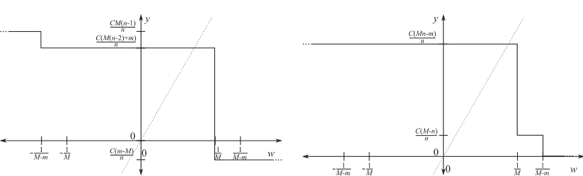

图 7.1. 对于每个 \(i \in [2]\)，SVM 在数据库 \(\mathbb{D}^{(i)}\) 上的原始解 \(w^*_i\)（该数据库在 Lemma 7.26 的证明中构造），对应于直线 \(y = w\) 与 \(y = w - \delta_w f_i(w)\) 的交点。数据库 \(\mathbb{D}^{(1)}\) 显示在左侧；数据库 \(\mathbb{D}^{(2)}\) 显示在右侧。

我们有 \(|w^*_1 - w^*_2| = \frac{2C}{N} |M - m|\)。因此，取 \(M = \frac{2N\epsilon}{C}\) 和 \(m = \frac{N\epsilon}{C}\)，这意味着

\[
\begin{aligned}
\|f^*_1 - f^*_2\|_\infty &\ge |f^*_1[1](1) - f^*_2[2](1)| \\
&= |w^*_1 - w^*_2| \\
&= 2\epsilon,
\end{aligned}
\]

前提是 \(\epsilon < \frac{\sqrt{C}}{2N}\)。特别是，取 \(\epsilon = \frac{\sqrt{C}}{2N}\) 可以得到结果。

有了这个负灵敏度结果，我们可以对任何近似铰链损失 SVM 的机制给出最优差分隐私的下界。

##### 定理 7.27（线性 SVM 最优差分隐私的下界）

*对于任何* \(C > 0, N > 1, \delta \in (0, 1)\)，*和* \(\epsilon \in \left(0, \frac{\sqrt{C}}{2N}\right)\)，*带有线性核的铰链损失 SVM 的最优差分隐私下界为* \(\log_e \frac{1-\delta}{\delta} = \Omega \left(\log \frac{1}{\delta}\right)\)。

**证明** 考虑相对于 SVM 学习机制 \(M\) 的 \((\epsilon, \delta)\)-有用机制 \(\hat{M}\)，参数为 \(C > 0\)，铰链损失，线性核，在 \(N\) 个训练样本上，其中 \(\delta > 0\) 且 \(\frac{\sqrt{C}}{2N} > \epsilon > 0\)。根据 Lemma 7.26，存在一对关于 \(N\) 个条目的邻接数据库 \(\mathbb{D}^{(1)}, \mathbb{D}^{(2)}\)，使得 \(\|f^*_1 - f^*_2\|_\infty > 2\epsilon\)，其中每个 \(i \in [2]\) 的 \(f^*_i = f_{\mathcal{M}(\mathbb{D}^{(i)})}\)。令每个 \(i \in [2]\) 的 \(\hat{f}_i = f_{\hat{M}(\mathbb{D}^{(0)})}\)。然后根据 \(\hat{M}\) 的效用，

\(\text{Pr} \left( \hat{f}_1 \in \mathcal{B}^\infty_\epsilon (f^*_1) \right) \ge 1 - \delta, \tag{7.11}\)

\(\text{Pr} \left( \hat{f}_2 \in \mathcal{B}^\infty_\epsilon (f^*_1) \right) \le \text{Pr} \left( \hat{f}_2 \notin \mathcal{B}^\infty_\epsilon (f^*_2) \right) < \delta. \tag{7.12}\)

令 \(\hat{\mathcal{P}}_1\) 和 \(\hat{\mathcal{P}}_2\) 分别为 \(\hat{M} \left(\mathbb{D}^{(1)}\right)\) 和 \(\hat{M} \left(\mathbb{D}^{(2)}\right)\) 的分布，使得 \(\hat{\mathcal{P}}_i(t) = \text{Pr} \left( \hat{M} \left(\mathbb{D}^{(i)}\right) = t \right)\)。然后根据不等式 (7.11) 和 (7.12)，

\(\text{E}_{T \sim \mathcal{P}_1} \left[ \frac{d\mathcal{P}_2(T)}{d\mathcal{P}_1(T)} \bigg| T \in \mathcal{B}^\infty_\epsilon (f^*_1) \right] = \frac{\int_{\mathcal{B}^\infty_\epsilon (f^*_1)} \frac{d\mathcal{P}_2(t)}{d\mathcal{P}_1(t)} d\mathcal{P}_1(t)}{\int_{\mathcal{B}^\infty_\epsilon (f^*)} d\mathcal{P}_1(t)} \le \frac{\delta}{1 - \delta}.\)

因此存在一个 \(t\)，使得 \(\log \frac{\text{Pr}(\hat{M}(\mathbb{D}^{(1)})=t)}{\text{Pr}(\hat{M}(\mathbb{D}^{(2)})=t)} \ge \log \frac{1-\delta}{\delta} = \Omega \left(\log \frac{1}{\delta}\right)\)。

##### 注释 7.28

等价地，此结果可以写成如下。对于任何 \(C > 0\)，\(\beta > 0\)，和 \(N > 1\)，如果机制 \(\hat{M}\) 是 \((\epsilon, \delta)\)-有用且 \(\beta\)-差分私有的，那么要么 \(\epsilon \ge \frac{\sqrt{C}}{2N}\)，要么 \(\delta \ge \exp(-\beta)\)。

我们现在已经给出了线性 SVM 带铰链损失情况下最优差分隐私的上界（Corollary 7.23，其中 \(L = 1\)）和下界。忽略常数并使用 \(C\) 的缩放（见注释 7.5），我们有

\[
\Omega \left( \log \frac{1}{\delta} \right) = \beta^* = \mathcal{O} \left( \frac{1}{\epsilon \sqrt{N}} \log \frac{1}{\delta} \right).
\]

值得注意的是，这些边界在效用置信度 \(\delta\) 的缩放上一致，但它们在对 \(\epsilon\) 和 \(N\) 的依赖上的线性和平方根项上不一致。此外，在 \(C\) 的适当缩放下，下界仅对 \(\epsilon = \mathcal{O} \left( N^{-0.75} \right)\) 成立；在此条件下，上界渐近边界变为 \(\mathcal{O} \left( N^{0.25} \log(1/\delta) \right)\)。寻找更匹配的边界仍然是一个有趣的开放问题。

我们将读者引向 Rubinstein et al. (2012) 以获取 RBF 核下的类似下界。那里，负灵敏度结果不是通过一对诱导非常不同 SVM 结果的邻接数据库实现的，而是通过一系列 \(K\) 个成对邻接数据库实现的，它们在 SVM 学习下的像构成一个 \(\epsilon\)-packing。

### 7.8 总结

在本章中，我们介绍了由 Chaudhuri et al. (2011) 和 Rubinstein et al. (2012) 提出的私有 SVM 学习机制，这些机制基于隐私敏感的训练数据库发布分类器。前一种方法是目标扰动，而后一种方法是输出扰动，由正则化 ERM 的算法稳定性校准——这是学习理论中通常用于证明学习算法风险界的属性。

除了衡量输出扰动机制所保留的训练数据差分隐私之外，我们还关注其效用：私有 SVM 和非私有 SVM 所发布分类器的相似性。这种效用形式意味着私有 SVM 具有良好的泛化误差。为了在无穷维特征映射下实现效用，两类方法都在随机再生核希尔伯特空间（其核近似目标核）中执行正则化经验风险最小化（ERM）。这一从大规模学习借鉴的技巧，允许机制以最大边界超平面分类器的有限表示私下响应。我们通过正则化 ERM 关于 RKHS 扰动的光滑性结果，探讨了所得函数与非私有 SVM 分类器之间的高概率逐点相似性。

有趣的方向包括将本章的思想扩展到其他学习算法：

问题 7.1 用于输出扰动差分私有 SVM 的机制和证明技术能否扩展到其他核方法？

问题 7.2 算法稳定性与全局灵敏度之间是否存在一般联系？

这样的联系将立即暗示许多实用的隐私保护学习机制，它们可以进行稳定性计算：稳定性将决定差分隐私所需的（可能是拉普拉斯）噪声水平，对于有限维特征空间，效用可能遵循与本节 SVM 类似的模式。将随机 RKHS（其核近似目标核）应用于使核化学习者对平移不变核具有差分隐私性，也将是一个有用的工具。

差分隐私与效用的边界结合起来，对所有关于铰链损失 SVM 的 \((\epsilon, \delta)\)-有用机制中可能的最优差分隐私水平给出上界。对该量的下界确立，任何对铰链 SVM 过于准确且具有非平凡概率的机制，对于小 \(\beta\) 都不能是 \(\beta\)-差分私有的。

问题 7.3 一个重要的开放问题是缩小 SVM 最优差分隐私的上下界之间的差距。

## 8 接近最优的分类器规避

在本章中，我们探讨了一个理论模型，用于量化针对已训练分类器的探测攻击的难度。与之前的工作不同，由于分类器已经训练完成，对手不再能像我们在本书第一部分中展示的那样利用学习算法中的漏洞来误导分类器。相反，对手必须利用分类器在良性数据（或至少不是由问题中提及的对手控制的数据）训练中偶然获得的漏洞。大多数非平凡分类任务都会导致分类器以某种形式存在漏洞。所有已知的检测技术都容易出现盲点（即无法被检测到的不当行为类别），但仅仅知道它们的存在是不够的。主要问题是，对手发现对其最有利的盲点有多难。在本章中，我们探讨了一个框架，用于量化对手在分类器中搜索此类漏洞有多难。

乍看之下，这些探测攻击的最终目标似乎是逆向工程分类器的学习参数、内部状态或整个边界，以发现其盲点。然而，在本工作中，我们采用了一种更精细的策略；我们展示了仅部分逆向工程分类器的成功探测攻击。我们的技术仅使用少量查询即可发现盲点，并为对手产生近似最优策略。它们发现分类器会将其分类为良性且接近对手所需攻击实例的数据点。

虽然学习算法允许检测算法随时间适应，但对学习算法的现实约束通常使对手能够以编程方式在分类器中发现盲点。我们考虑对手如何通过查询过滤器来系统地发现盲点，以找到一个低成本（对于某些成本函数）且逃避过滤器的实例。例如，考虑一个发送垃圾邮件的人，他希望尽可能少地修改垃圾邮件，使其不被分类为垃圾邮件（这里成本是衡量垃圾邮件需要修改多少的指标）。通过观察垃圾邮件检测器的响应，1 发送垃圾邮件的人可以在少量查询的情况下搜索修改方案。必须避免入侵检测系统的攻击设计也可以纳入此场景（这里成本可能是衡量攻击严重程度的指标）。

1 对手可以使用多种领域特定的机制来观察分类器对查询的响应；例如，可以通过在公共电子邮件系统上创建测试账户并将查询发送到该账户来观察该系统的垃圾邮件过滤器。在本章中，我们假设过滤器可以被查询。


近似最优逃避问题（即，用少量查询找到低代价负实例）由 Lowd & Meek (2005a) 提出。我们通过将该问题推广到凸诱导分类器族（即将特征空间划分为两个集合，其中一个集合为凸集的分类器）来继续研究该问题。凸诱导分类器族是一组尤为重要且自然的可研究分类器，包括 Lowd & Meek 研究的线性分类器族，以及使用有界主成分分析（PCA）的异常检测分类器（Lakhina et al. 2004b）、使用超球边界的异常检测算法（Bishop 2006）、通过对对数-凹（或单峰）密度函数的对数似然进行阈值判断来预测异常的一类分类器，以及当 A 为半正定时具有形式 x^T Ax + b^T x + c ≥ 0 的判决函数的二次分类器（参见 Boyd & Vandenberghe 2004，第 3 章），仅举几例。凸诱导分类器族还包括更复杂的体，例如半空间、圆锥或球的可数交集。

我们进一步表明，近似最优逃避不需要对分类器的内部状态或决策边界进行完全的逆向工程，而只需对其一般结构有部分了解。Lowd & Meek (2005a) 针对连续域中的线性分类器逃避所提出的算法，通过估计其分离超平面的参数来逆向工程决策边界。我们为逃避凸诱导分类器而提出的算法不需要完全估计分类器的边界（在一般凸体情况下这很困难；参见 Rademacher & Goyal 2009）或其参数（内部状态）。相反，这些算法直接搜索最低代价逃避实例。这些搜索算法只需要多项式数量的查询，其中一个算法求解线性情况的查询复杂度优于先前公布的逆向工程技术。最后，我们还将近似最优逃避扩展到一般 ℓ_p 代价。我们表明，ℓ_1 代价的算法也可以扩展到 ℓ_p 代价上的近似最优逃避，但通常不高效。然而，在这些算法不高效的情况下，我们表明不存在高效的基于查询的算法。

本章其余部分组织如下。我们首先在本节其余部分介绍与近似最优逃避问题最密切相关的相关工作概述（其他相关工作参见第 3 章）。在第 8.1 节中，我们形式化近似最优逃避问题并回顾 Lowd & Meek (2005a) 的定义和结果。我们在第 8.2 节中介绍在加权 ℓ_1 代价下近似最优的逃避算法，并在第 8.3 节中提供最小化一般 ℓ_p 代价的结果。

本章基于 (Nelson, Rubinstein, Huang, Joseph, Lau, Lee, Rao, Tran, & Tygar 2010; Nelson, Rubinstein, Huang, Joseph, & Tygar 2010; 以及 Nelson, Rubinstein, Huang, Joseph, Lee, Rao, & Tygar 2012)。

### 相关工作

Lowd & Meek (2005a) 首先探索了近似最优逃避，并开发了一种在连续域中逆向工程线性分类器的方法，如第 3.4.2.4 节和第 3.4.4 节所讨论。我们在此提出的理论推广了该结果，并提供了三项显著改进：

- 本分析考虑了一类更一般的分类器：将实例空间划分为两个集合（其中一个为凸集）的凸诱导分类器族。该族包含了 Lowd & Meek 考虑的线性分类器族。

- 我们提出的方法不完全估计分类器的决策边界（对任意凸体而言这通常很困难；参见 Rademacher & Goyal 2009），也不逆向工程分类器的状态。相反，算法直接搜索被分类器标记为负且与所需攻击实例接近的实例；即，近似最小代价的逃避实例。Lowd & Meek 此前针对布尔空间中的线性分类器演示了一种直接搜索技术，但它不适用于我们考虑的分类器。

- 尽管能够逃避更一般的分类器族，但这些算法仍然仅使用有限数量的查询：它们只需要在特征空间维度和近似所需精度方面进行多项式数量的查询。此外，K-STEP MULTILINESEARCH（算法 8.3）求解线性情况下所需的查询数量从渐近意义上少于先前针对此情况公布的逆向工程技术。

此外，如第 3.4.2.4 节所总结，Dalvi et al.、Brückner & Scheffer 以及 Kantarcioglu et al. 研究了成本敏感的博弈论方法，以预先修补分类器的盲区，并开发了计算其博弈平衡的技术。这些先前的工作与基于查询的逃避问题是互补的；近似最优逃避问题研究的是对手如何使用查询来查找未知但可查询的分类器的盲区，而他们的博弈论方法则假设对手了解分类器，并可以在迭代博弈的每一步相应地优化其逃避策略。因此，近似最优逃避设置研究的是对手仅通过查询优化其逃避策略有多困难，而成本敏感的博弈论学习研究的是在已知彼此的情况下，对手和学习者如何在逃避博弈中进行最优博弈和自适应：这是逃避的两个不同方面。

一些作者还研究了逃避基于序列的入侵检测系统（IDS），如第 3.4.2.2 节所讨论（参见 Tan et al. 2002, 2003; Wagner & Soto 2002）。在探索模仿攻击时，这些作者使用了对（IDS）的离线分析来构建其修改；相比之下，近似最优逃避中的对手通过查询分类器来构建优化的修改。

主动学习领域也研究了一种基于查询的优化形式（例如，参见 Schohn & Cohn 2000）。如 Settles (2009) 所总结，主动学习的三种主要方法是成员查询合成、基于流的选择性采样和基于池的采样。我们的工作与 Angluin (1988) 引入的成员查询合成子领域最为密切相关，在该子领域中，学习者可以请求特征空间中任何实例的标签，而不是从分布中抽取的未标记实例。然而，尽管主动学习和近似最优逃避在探索查询策略方面相似，但这两种设置的目标却截然不同——逃避方法在最优代价的 1 + ε 因子范围内搜索低代价负实例，而主动学习算法则寻求获得低泛化误差的假设，通常在 PAC 设置中（关于逃避和主动学习的逆向工程方法的讨论，参见第 8.1.2 节）。尽管如此，值得注意的是，主动学习设置中的结果（例如，Dasgupta, Kalai, & Monteleoni 2009; Feldman 2009）也在特定设置下实现了多项式查询复杂度。然而，本章的重点仅在于逃避目标，我们将我们的结果与主动学习中结果之间关系的探索留给未来的工作。

另一类使用基于查询优化的相关技术是常被称为直接搜索的非梯度全局优化方法。这些技术的简单示例包括用于寻找一元函数根和极值的二分法和黄金分割法，以及如割线法和插值方法等导数近似方法（例如，Burden & Faires 2000）。这些方法的组合包括 Brent (1973) 的算法，在查询函数的某些条件下表现出超线性收敛；即，查询数量与所需误差容差成反比的二次关系。然而，虽然这些方法可以适应多维，但其查询复杂度随维度呈指数增长。其他方法包括 Nelder & Mead (1965) 的单纯形法以及由 Jones, Perttunen, & Stuckman (1993) 引入的 DIRECT 搜索算法（关于直接搜索方法的调研，请参阅 Jones 2001 和 Kolda, Lewis & Torczon 2003）；然而，我们不知道这些方法的查询边界。虽然任何直接搜索方法都可以改编用于近似最优逃避，但这些方法是为在低维规则域中优化不规则函数而设计的，而近似最优逃避问题则涉及在未知的、可能不规则的高维域（即分类器标记为负的点）上优化规则已知函数（代价函数）。我们提出的方法专门利用 $\ell_p$ 代价和凸诱导分类器的规则结构，仅通过多项式数量的查询即可实现近似最优。

### 8.1 表征近似最优逃避

我们首先介绍本问题所做的假设。首先，我们假设学习者的特征空间 $\mathcal{X}$ 是一个实值 $D$ 维欧几里得空间；即，$\mathcal{X} = \Re^D$，例如某些入侵检测系统（如 Wang & Stolfo 2004）。（Lowd & Meek 也考虑了整数值和布尔值特征空间，并为几类布尔值学习者提供了有趣的结果，但这些空间与我们在本章中研究的凸诱导分类器族不兼容。）我们假设特征空间表示对对手是已知的，且对对手的查询没有限制；即，对手可以在特征空间 $\mathcal{X}$ 中查询任何点 $\mathbf{x}$ 以学习分类器在该点的预测 $f(\mathbf{x})$。这些假设在每个现实世界设置中可能不成立（例如，垃圾邮件检测器通常使用离散特征，设计师通常试图隐藏或


随机化其特征集；例如，参见 Wang et al. 2006)，但这允许我们考虑最坏情况的对手。

如同在第 2.2.4 节中一样，我们假设目标分类器 \( f \) 是分类器家族 \(\mathcal{F}\) 的一员——对手不知道 \( f \) 但知道家族 \(\mathcal{F}\)。（这种知识与安全假设相符：对手知道学习算法，但不知道用于调优学习器的训练集或参数。）我们也将注意力限制在二元分类器上，并使用 \(\mathcal{Y} = \{"-", "+\}\)。我们假设对手的攻击将针对固定的 \( f \)，因此选择 \( f \) 所使用的学习方法和训练数据对此问题无关紧要。此外，我们假设 \( f \in \mathcal{F} \) 是确定性的，因此它将 \(\mathcal{X}\) 划分为两个集合——正类 \(\mathcal{X}_f^+ = \{\mathbf{x} \in \mathcal{X} \mid f(\mathbf{x}) = "+\}\) 和负类 \(\mathcal{X}_f^- = \{\mathbf{x} \in \mathcal{X} \mid f(\mathbf{x}) = "-\}\)。与之前一样，我们将负集视为 *正常* 实例，所寻求的盲点就位于其中。我们假设对手知道每个类中至少有一个实例，\(\mathbf{x}^- \in \mathcal{X}_f^-\) 和 \(\mathbf{x}^+ \in \mathcal{X}_f^+\)，并且可以通过发出成员查询来观察任何 \(\mathbf{x}\) 的类别：\( f(\mathbf{x}) \)。

#### 8.1.1 对抗成本

我们假设对手在特征空间上具有一种效用概念，我们用代价函数 \( A : \mathcal{X} \mapsto \Re_{0+} \) 来量化它。对手希望在负类 \(\mathcal{X}_f^-\) 上优化 \( A\)；例如，发送者希望发送的垃圾邮件会被归类为正常邮件（“–”）而非垃圾邮件（“+”）。我们假设这个代价函数是到对手最希望的某个目标实例 \(\mathbf{x}^+ \in \mathcal{X}_f^+\) 的距离；例如，对于发送者来说，这可能是将 \(\mathbf{x}^+\) 更改为不同消息所需的字符串编辑距离。我们关注相对于 \(\mathbf{x}^+\) 的加权 \(\ell_p\)（\( 0 < p \le \infty \)）代价函数的一般类，其定义基于 \(\ell_p\) 范数 \(\|\cdot\|_p\) 如下：

\( A_p^{(c)}(\mathbf{x} - \mathbf{x}^+) = \left\| \mathbf{c} \odot (\mathbf{x} - \mathbf{x}^+) \right\|_p = \left( \sum_{d=1}^D c_d^p |x_d - x_d^+|^p \right)^{1/p}, \quad (8.1) \)

其中 \( 0 < c_d < \infty \) 是对手与改变第 \( d^{th} \) 个特征相关的相对代价。当相对代价均匀时，即所有 \( d \) 均有 \( c_d = 1 \)，我们使用简化记号 \( A_p \) 来指代代价函数。同样，在引用带有权重 \( \mathbf{c} \) 的通用加权代价函数时，我们使用记号 \( A^{(c)} \)。在第 8.2.1.3 节中，我们还考虑某些特征具有 \( c_d = 0 \)（对手不关心第 \( d^{th} \) 个特征）或 \( c_d = \infty \)（对手要求第 \( d^{th} \) 个特征匹配 \( x_d^+ \)）的特殊情况，但除此之外，权重位于区间 \( (0, \infty) \) 上。我们使用 \( \mathbb{B}^C(A; \mathbf{y}) \) 表示以 \( \mathbf{y} \) 为中心、代价不超过阈值 \( C \) 的 \( C \)-代价球（或子水平集）；即，\( \mathbb{B}^C(A; \mathbf{y}) = \{ \mathbf{x} \in \mathcal{X} \mid A(\mathbf{x} - \mathbf{y}) \le C \} \)。例如，\( \mathbb{B}^C(A_1; \mathbf{x}^+) \) 是从目标 \(\mathbf{x}^+\) 处不超过 \(\ell_1\) 代价 \( C \) 的实例集合。为方便起见，我们还使用 \( \mathbb{B}^C(A) \triangleq \mathbb{B}^C(A; \mathbf{x}^+) \) 表示以对手目标 \(\mathbf{x}^+\) 为中心重新定位的 \( A \) 的 \( C \)-代价球，因为我们关注相对于该实例的代价。

不幸的是，\(\ell_p\) 代价不包括许多有趣的代价，例如垃圾邮件的字符串编辑距离，在其他现实场景中，例如前面给出的入侵检测示例，点之间可能没有自然的距离概念。尽管如此，本章的目标不是提供实用的规避算法，而是理解对手在分析上可处理但实践上受限的 \(\ell_p\) 代价家族上的理论能力。然而，加权 \(\ell_1\) 代价特别适用于对手对某些特征比其他特征更感兴趣，并且其代价基于特征被改变的程度的对抗问题。\(\ell_1\) 范数是电子邮件垃圾邮件编辑距离的自然度量，而较大的权重可以建模删除成本更高的标记（例如，有效载荷 URL）。我们首先关注第 8.2 节中 Lowd & Meek 研究的加权 \(\ell_1\) 代价，然后在第 8.3 节探讨一般 \(\ell_p\) 代价。在后一种情况下，我们的讨论将着重于统一权重以便于阐述，但结果容易推广到代价敏感情况，如加权 \(\ell_1\) 代价所呈现的那样。

Lowd & Meek (2005a) 将分类器 \( f \) 的最小对抗代价（MAC）定义为：

\( MAC(f, A) \triangleq \inf_{\mathbf{x} \in \mathcal{X}_f^-} [ A(\mathbf{x} - \mathbf{x}^+) ]; \)

即，任何负实例所能得到的代价的最大下界。他们进一步定义一个数据点为最小对抗代价的 \(\epsilon\) -近似实例（\(\epsilon\)-IMAC），如果它是一个负实例，其代价不超过 \(MAC\) 的 \((1 + \epsilon)\) 倍；即，每个 \(\epsilon\)-IMAC 都是集合\(^2\) 的成员：

\( \epsilon\text{-IMAC} (f, A) \triangleq \left\{ \mathbf{x} \in \mathcal{X}_f^- \mid A(\mathbf{x} - \mathbf{x}^+) \le (1 + \epsilon) \cdot MAC(f, A) \right\} . \)

或者，这个集合可以表征为负类与 \( A \) 的代价球的交集，该球中的代价在 \(MAC(f, A)\) 的 \((1 + \epsilon)\) 倍范围内（即，\( \epsilon\text{-IMAC}(f, A) = \mathcal{X}_f^- \cap \mathbb{B}^{(1+\epsilon)\cdot MAC(A)} \)）；我们将在 8.2.2 节中利用这一事实。对手的目标是尽可能少地发出查询，同时高效地找到一个 \(\epsilon\)-IMAC。在下一节中，我们将引入正式概念来量化对手实现此目标的效果。

\( ^2 \) 我们使用 \(\epsilon\)-IMAC 这个术语来指代这个集合及其成员。用法将从上下文中清楚明了。

#### 8.1.2 近似最优规避

Lowd & Meek (2005a) 引入了对抗分类器逆向工程（ACRE）可学习性概念，以量化对特定分类器家族 \(\mathcal{F}\) 和对抗代价家族 \(\mathcal{A}\) 找到 \(\epsilon\)-IMAC 实例的难度。

使用我们的记号，他们对 \( ACRE \) \(\epsilon\)-可学习的定义如下：分类器集合 \(\mathcal{F}\) 在代价函数集合 \(\mathcal{A}\) 下是 \( ACRE \) \(\epsilon\)-可学习的，如果存在一个算法，使得对于所有 \( f \in \mathcal{F} \) 和 \( A \in \mathcal{A} \)，它可以使用与维度 \( D \)、\( f \) 的编码大小以及 \(\mathbf{x}^+\) 和 \(\mathbf{x}^-\) 的编码大小相关的仅多项式数量的成员查询，找到一个 \( \mathbf{x} \in \epsilon\text{-IMAC}(f, A) \)。

在此定义中，Lowd & Meek 使用编码大小来指代用于编码 \( f \)、\(\mathbf{x}^+\) 和 \(\mathbf{x}^-\) 的数字字符串的长度。在推广他们的结果时，我们使用略有修改的查询复杂度定义。首先，为了量化查询复杂度，我们仅使用维度 \( D \) 和单向二分搜索所需的步骤数 \( L_\epsilon \)，以将差距缩小到所需精度 \( 1 + \epsilon \) 的因子范围内。通过在查询复杂度定义中包含 \( L_\epsilon^{(*)} \)，我们不需要 \(\mathbf{x}^+\) 和 \(\mathbf{x}^-\) 的编码大小，因为 \( L_\epsilon \) 隐含地捕捉了这些点之间距离的大小，如前面所述。

在定义 \(\epsilon\)-IMAC 可搜索性时使用 \( f \)、\(\mathbf{x}^+\) 和 \(\mathbf{x}^-\) 的编码大小是有问题的。就我们的目的而言，很明显 \(\mathbf{x}^+\) 和 \(\mathbf{x}^-\) 的编码大小均为 \( D \)，因此无需为其大小包含额外项。此外，我们允许非参数分类器家族，对于这类家族，*编码大小*的概念定义不清，但对于我们提出的算法也是不必要的。在将分类器推广到线性和参数分类器家族之外时，定义分类器 \( f \) 的编码大小并不直截了当。可以使用 \(\mathcal{F}\) 的 VC 维或其覆盖数等概念，但分类器的大小在量化 \(\epsilon\)-IMAC 搜索复杂度时为何重要并不清楚。此外，正如我们在本章中所示，存在 \(\epsilon\)-IMAC 搜索仅在 \( D \) 和 \( L_\epsilon \) 中是多项式的分类器家族。

其次，我们假设对手只有两个初始点 \(\mathbf{x}^- \in \mathcal{X}_f^{-}\) 和 \(\mathbf{x}^+ \in \mathcal{X}_f^{+}\)（原始设置使用了第三个 \(\mathbf{x}^+ \in \mathcal{X}_f^{+}\)）；这会产生更简单的搜索过程。正如我们展示的算法所示，使用 \(\mathbf{x}^+ = \mathbf{x}^+\) 会使攻击者不那么隐蔽，因为根据其查询推断攻击者意图要容易得多。隐蔽性不是 \(\epsilon\)-IMAC 搜索的明确目标，但许多现实攻击者会将其作为要求。然而，由于近似最优规避问题的目标不是设计实际攻击，而是分析最佳可能的攻击以了解分类器的脆弱性，我们排除了任何隐蔽性要求，但将在 8.4.2.1 节中回到此问题。

最后，我们的算法不执行逆向工程，因此 ACRE 是一个错误的称呼。相反，我们将整体问题称为近似最优规避，并用以下定义取代 ACRE \(\epsilon\)-可学习性：分类器家族 \(\mathcal{F}\) 在代价函数家族 \(\mathcal{A}\) 下是 \(\epsilon\)-IMAC *可搜索*的，如果对于所有 \( f \in \mathcal{F} \) 和 \( A \in \mathcal{A} \)，存在一个算法，它使用 \( D \) 和 \( L_\epsilon \) 中的多项式数量成员查询来找到某个 \( \mathbf{x} \in \epsilon\text{-IMAC}(f, A) \)。我们将此类算法称为 *高效* 的。

我们的定义不包括分类器 \( f \) 的编码大小，因为我们对近似最优规避的方法不逆向工程分类器的参数，我们将在下面详细讨论这一点。

近似最优规避只是一种 *部分逆向工程* 策略。与 Lowd & Meek 针对连续空间的方法不同，我们引入构建查询的算法，以可证明地找到一个 \(\epsilon\)-IMAC，而无需 *完全* 逆向工程分类器；即，估计 \( f \) 的决策边界或估计指定它的参数。针对 \( f \in \mathcal{F} \) 的基于查询的高效逆向工程足以在估计的负空间上最小化 \( A\)。然而，一般来说，逆向工程是近似最优规避的一种昂贵方法，对于一般凸类，其查询复杂度是特征空间维度 \( D \) 的指数级（Rademacher & Goyal 2009），而找到一个 \(\epsilon\)-IMAC 不必如此，正如我们在本章中所展示的。\( ^3 \)

\( ^3 \) Lowd & Meek (2005a) 此前还表明，寻找特征符号证人的逆向工程技术对于具有布尔特征的线性分类器是 NP-完全的，但该家族仍然是 2-IMAC 可搜索的。


for finding an \(\epsilon\)-IMAC differ significantly from the objectives of reverse-engineering approaches such as active learning. Both approaches use queries to reduce the size of version space \(\hat{\mathcal{F}} \subseteq \mathcal{F}\); i.e., the set of classifiers consistent with the adversary's membership queries. Reverse-engineering approaches minimize the expected number of disagreements between members of \(\hat{\mathcal{F}}\). In contrast, to find an \(\epsilon\)-IMAC, the adversary only needs to provide a single instance, \(\mathbf{x}^\dagger \in \epsilon\text{-}IMAC(f, A)\), for all \(f \in \hat{\mathcal{F}}\), while leaving the classifier largely unspecified; i.e., we need to show that

\[
\bigcap_{f \in \hat{\mathcal{F}}} \epsilon\text{-}IMAC(f, A) \neq \emptyset.
\]

This objective allows the classifier to be unspecified over much of \(\mathcal{X}\). We present algorithms for \(\epsilon\)-IMAC search on a family of classifiers that generally cannot be efficiently reverse engineered—the queries necessarily only elicit an \(\epsilon\)-IMAC; the classifier itself will be underspecified in large regions of \(\mathcal{X}\) so these techniques do not reverse engineer the classifier's parameters or decision boundary except in a shrinking region near an \(\epsilon\)-IMAC. Similarly, for linear classifiers in Boolean spaces, Lowd & Meek demonstrated an efficient algorithm for near-optimal evasion that does not reverse engineer the classifier—it too searches directly for an \(\epsilon\)-IMAC, and it shows that this family is 2-IMAC searchable for \(\ell_1\) costs with uniform feature weights.

### 8.1.3 搜索术语

The notion of near-optimality introduced in Equation (8.3) and of the overall near-optimal evasion problem in the previous section is that of multiplicative optimality; i.e., an \(\epsilon\)-IMAC must have a cost within a factor of \((1 + \epsilon)\) of the MAC. However, the results of this chapter can also be immediately adopted for additive optimality in which the adversary seeks instances with cost no more than \(\eta > 0\) greater than the MAC. To differentiate between these notions of optimality, we use the notation \(\epsilon\text{-}IMAC^{(*)}\) to refer to the set in Equation (8.3) and define an analogous set \(\eta\text{-}IMAC^{(+)}\) for additive optimality as

\[
\eta\text{-}IMAC^{(+)}(f, A) \triangleq \left\{ \mathbf{x} \in \mathcal{X}_f^- \mid A(\mathbf{x} - \mathbf{x}^0) \le \eta + \text{MAC}(f, A) \right\}. \tag{8.4}
\]

We use the terms \(\epsilon\text{-}IMAC^{(*)}\) and \(\eta\text{-}IMAC^{(+)}\) to refer both to the sets defined in Equation (8.3) and (8.4) as well as the members of them—the usage will be clear from the context.

We consider algorithms that achieve either additive or multiplicative optimality of the family of convex-inducing classifiers. For either notion of optimality one can efficiently use bounds on the MAC to find an \(\epsilon\text{-}IMAC^{(*)}\) or an \(\eta\text{-}IMAC^{(+)}\). Suppose there is a negative instance, \(\mathbf{x}^-\), with cost \(C^-\), and there is a \(C^+ > 0\) such that all instances with cost no more than \(C^+\) are positive; i.e., \(C^-\) is an upper bound and \(C^+\) is a lower bound on the MAC; i.e., \(C^+ \le MAC(f, A) \le C^-\). Under that supposition, then the negative instance \(\mathbf{x}^-\) is \(\epsilon\)-multiplicatively optimal if \(C^-/C^+ \le (1 + \epsilon)\), whereas it is \(\eta\)-additively optimal if \(C^- - C^+ \le \eta\).

We consider algorithms that can achieve either additive or multiplicative optimality via binary search. Namely, if the adversary can determine whether an intermediate cost establishes a new upper or lower bound on the \(MAC\), then binary search strategies can iteratively reduce the \(t\)th gap between any bounds \(C_t^-\) and \(C_t^+\) with the fewest steps. We now provide common terminology for the binary search, and in Section 8.2 we use convexity to establish a new bound at the \(t\)th iteration.

**Remark 8.1** If an algorithm can provide bounds \(0 < C^+ \le MAC(f, A) \le C^-\), then this algorithm has achieved \((C^- - C^+)\)-additive optimality and \((\frac{C^-}{C^+} - 1)\)-multiplicative optimality.

In the \(t\)th iteration of an additive binary search, the additive gap between the \(t\)th bounds, \(C_t^-\) and \(C_t^+\), is given by \(G_t^{(+)} = C_t^- - C_t^+\) with \(G_0^{(+)}\) defined accordingly by the initial bounds \(C_0^- = C^-\) and \(C_0^+ = C^+\). The search uses a proposal step of \(C_t = \frac{C_t^- + C_t^+}{2}\), a stopping criterion of \(G_t^{(+)} \le \eta\), and achieves \(\eta\)-additive optimality in

\[
L_{\eta}^{(+)} = \left\lceil \log_2 \left( \frac{G_0^{(+)}}{\eta} \right) \right\rceil
\]

steps. In fact, binary search has the least worst-case query complexity for achieving the \(\eta\)-additive stopping criterion for a unidirectional search (e.g., search along a ray).

Binary search can also be used for multiplicative optimality by searching in exponential space. Assuming that \(C^- \ge C^+ > 0\), we can rewrite the upper and lower bounds as \(C^- = 2^a\) and \(C^+ = 2^b\), and thus the multiplicative optimality condition becomes \(a - b \le \log_2(1 + \epsilon)\); i.e., an additive optimality condition. Thus, binary search on the exponent achieves \(\epsilon\)-multiplicative optimality and does so with the best worst-case query complexity (again in a unidirectional search). The multiplicative gap of the \(t\)th iteration is \(G_t^{(*)} = C_t^- / C_t^+\) with \(G_0^{(*)}\) defined accordingly by the initial bounds \(C_0^-\) and \(C_0^+\). The \(t\)th query is \(C_t = \sqrt{C_t^- \cdot C_t^+}\), the stopping criterion is \(G_t^{(*)} \le 1 + \epsilon\), and it achieves \(\epsilon\)-multiplicative optimality in

\[
L_{\epsilon}^{(*)} = \left\lceil \log_2 \left( \frac{\log_2 \left( G_0^{(*)} \right)}{\log_2 (1 + \epsilon)} \right) \right\rceil
\]

steps. Notice that multiplicative optimality only makes sense when both \(C_0^-\) and \(C_0^+\) are strictly positive.

It is also worth noting that both \(L_{\epsilon}^{(+)}\) and \(L_{\epsilon}^{(*)}\) can be instead replaced by \(\log \left( \frac{1}{\epsilon} \right)\) for asymptotic analysis. As pointed out by Rubinstein (2010), the near-optimal evasion problem is concerned with the difficulty of making accurate estimates of the \(MAC\), and this difficulty increases as \(\epsilon \downarrow 0\). In this sense, clearly \(L_{\epsilon}^{(+)}\) and \(\log \left( \frac{1}{\epsilon} \right)\) are asymptotically equivalent. Similarly, comparing \(L_{\epsilon}^{(*)}\) and \(\log \left( \frac{1}{\epsilon} \right)\) as \(\epsilon \downarrow 0\), the limit of their ratio (by application of L'Hôpital's rule) is

\[
\lim_{\epsilon \downarrow 0} \frac{L_{\epsilon}^{(*)}}{\log \left( \frac{1}{\epsilon} \right)} = 1;
\]

i.e., they are also asymptotically equivalent. Thus, in the following asymptotic results, \(L_\epsilon^{(*)}\) can be replaced by \(\log \left(\frac{1}{\epsilon}\right)\).

Binary searches for additive and multiplicative optimality differ in their proposal step and their stopping criterion. For additive optimality, the proposal is the arithmetic mean \(C_t = \frac{C_t^- + C_t^+}{2}\) and search stops when \(G_t^{(+)} \le \eta\), whereas for multiplicative optimality, the proposal is the geometric mean \(C_t = \sqrt{C_t^- \cdot C_t^+}\) and search stops when \(G_t^{(*)} \le 1 + \epsilon\). In the remainder of this chapter, we will use the fact that binary search is optimal for unidirectional search to search the cost space. At each step in the search, we use several probes in the feature space \(\mathcal{X}\) to determine if the proposed cost is a new upper or lower bound and then continue the binary search accordingly.

### 8.1.4 乘积与加性最优性

Additive and multiplicative optimality are intrinsically related by the fact that the optimality condition for multiplicative optimality \(C_t^- / C_t^+ \le 1 + \epsilon\) can be rewritten as additive optimality condition \(\log_2(C_t^-) - \log_2(C_t^+) \le \log_2(1 + \epsilon)\). From this equivalence one can take \(\eta = \log_2(1 + \epsilon)\) and utilize the additive optimality criterion on the logarithm of the cost. However, this equivalence also highlights two differences between these notions of optimality.

First, multiplicative optimality only makes sense when \(C_0^+\) is strictly positive, whereas additive optimality can still be achieved if \(C_0^+ = 0\). Taking \(C_0^+ > 0\) is equivalent to assuming that \(\mathbf{x}^0\) is in the interior of \(\mathcal{X}_f^+\) (a requirement for our algorithms to achieve multiplicative optimality). Otherwise, when \(\mathbf{x}^0\) is on the boundary of \(\mathcal{X}_f^+\), there is no \(\epsilon\text{-}IMAC^{(*)}\) for any \(\epsilon > 0\) unless there is some point \(\mathbf{x}^\star \in \mathcal{X}_f^-\) that has 0 cost. Practically though, the need for a lower bound is a minor hindrance—as we demonstrate in Section 8.2.1.3, there is an algorithm that can efficiently establish a lower bound \(C_0^+\) for any \(\ell_p\) cost if such a lower bound exists.

Second, the additive optimality criterion is not scale invariant (i.e., any instance \(\mathbf{x}^\dagger\) that satisfies the optimality criterion for cost \(A\) also satisfies it for \(A'(\mathbf{x}) = s \cdot A(\mathbf{x})\) for any \(s > 0\)), whereas multiplicative optimality is scale invariant. Additive optimality is, however, shift invariant (i.e., any instance \(\mathbf{x}^\dagger\) that satisfies the optimality criterion for cost \(A\) also satisfies it for \(A'(\mathbf{x}) = s + A(\mathbf{x})\) for any \(s \ge 0\)), whereas multiplicative optimality is not. Scale invariance is more salient in near-optimal evasion because if the cost function is also scale invariant (all proper norms are), then the optimality condition is invariant to a rescaling of the underlying feature space; e.g., a change in units for all features. Thus, multiplicative optimality is a unit-less notion of optimality whereas additive optimality is not. The following result is a consequence of additive optimality's lack of scale invariance.

#### PROPOSITION 8.2

Consider any hypothesis space \(\mathcal{F}\), target instance \(\mathbf{x}^0\), and cost function \(A\). If there exists some \(\bar{\epsilon} > 0\) such that no efficient query-based algorithm can find an \(\epsilon\text{-}IMAC^{(*)}\) for any \(0 < \epsilon \le \bar{\epsilon}\), then there is no efficient query-based algorithm that can find an \(\eta\text{-}IMAC^{(+)}\) for any \(0 < \eta \le \bar{\epsilon} \cdot MAC(f, A)\). In particular consider a sequence of classifiers \(f_n\) admitting unbounded MACs, and a sequence \(\epsilon_n > 0\) such that


1/\epsilon_n = o(MAC(f_n, A))。那么，如果没有通用算法能有效地在每个 f_n 上找到 \epsilon_n-IMAC^{(*)}，则没有通用算法能有效地为 \eta_n \to \infty 找到 \eta_n-IMAC^{(+)}。

证明 考虑任意分类器 f \in \mathcal{F}，使得 MAC(f, A) > 0。假设存在某个 \mathbf{x} \in \eta-IMAC^{(+)}，其中 \eta > 0。令 \epsilon = \eta / MAC(f, A)；那么按定义

A(\mathbf{x} - \mathbf{x}') \le \eta + MAC(f, A) = (1 + \epsilon) MAC(f, A), \quad (8.7)

这意味着 \mathbf{x} \in \epsilon-IMAC^{(*)}。然后通过逆否命题，如果对任何 0 < \epsilon \le \bar{\epsilon} 都无法有效找到 \epsilon-IMAC^{(*)}，则对任何 0 < \eta \le \bar{\epsilon} \cdot MAC(f, A) 都无法有效找到 \eta-IMAC^{(+)}。最后的结果是直接推论。

最后的陈述实际上适用于许多常见场景。例如，对于任何加权 \ell_p 成本（其中 0 < p \le \infty 且所有 d 的 0 < c_d < \infty），线性分类器族和超球面分类器族都足够多样，可以产生这样一系列分类器，它们允许像最后陈述所要求的那样具有无界 MAC。因此，诱导凸分类器族也可以产生这样一系列分类器。此外，正如我们在第 8.3 节中所示，确实存在 \ell_p 成本，对于这些成本存在 \bar{\epsilon} > 0，使得没有高效的基于查询的算法可以对任何 0 < \epsilon \le \bar{\epsilon} 找到 \epsilon-IMAC^{(*)}。其后果是，对于这些 \ell_p 成本，没有通用算法能够对诱导凸分类器实现任何固定 \eta 的加法最优性，如下面的定理所示：

#### 定理 8.3
如果对于某个假设空间 \mathcal{F}、成本函数 A，以及对某个 f \in \mathcal{F} 的 MAC(f, A) 的任何初始边界 0 < C_0^+ < C_0^-，存在某个 \bar{\epsilon} > 0，使得没有高效的基于查询的算法可以对任何 0 < \epsilon \le \bar{\epsilon} 找到 \epsilon-IMAC^{(*)}，则没有高效的基于查询的算法可以对任何 0 < \eta \le \bar{\epsilon} \cdot C_0^- 找到 \eta-IMAC^{(+)}。其后果是，如果存在如上所述的 \bar{\epsilon} > 0，那么通常没有高效的基于查询的算法可以对任何 \eta \ge 0 找到 \eta-IMAC^{(+)}，因为 C_0^- 可以任意大。

证明 通过逆否命题。如果存在一个高效的基于查询的算法，它可以找到某个 \mathbf{x} \in \eta-IMAC^{(+)}，其中 0 < \eta \le \bar{\epsilon} \cdot C_0^-，那么根据 \eta-IMAC^{(+)} 的定义，A(\mathbf{x} - \mathbf{x}') \le \eta + MAC(f, A)。等价地，通过取 \eta = \epsilon \cdot MAC(f, A) 对某个 \epsilon > 0，该算法实现了 A(\mathbf{x} - \mathbf{x}') \le (1+\epsilon)MAC(f, A)；即，\mathbf{x} \in \epsilon-IMAC^{(*)}。此外，由于 MAC(f, A) \le C_0^-，这个高效算法能够对某个 \epsilon \le \bar{\epsilon} 找到 \epsilon-IMAC^{(*)}。最后的评论直接源于这样一个事实：对于任何 0 < \eta \le \bar{\epsilon} \cdot C_0^- 都没有高效的基于查询的算法，且 C_0^- 通常可以任意大。

此结果进一步表明，近似逃避中的加法最优性是一个尴尬的概念。如果存在一个成本函数 A，对于该函数，某些分类器族 \mathcal{F} 在任何精度 0 < \epsilon \le \bar{\epsilon} 内都不能被高效逃避，那么对于某些 \eta > 0 是否能实现高效加法最优性取决于成本函数的尺度。也就是说，如果对 A 可以高效实现 \eta-加法最优性，则可以重新缩放特征空间，使得 \eta-加法最优性不再通常高效，因为可以选择重新缩放来使 C_0^- 变大。这突出了加法最优性中缺乏尺度不变性的局限性：*成本的单位决定是否可以实现特定级别的加法精度，而乘法最优性是无单位的。* 对于（加权）\(\ell_1\) 成本，这不是问题，因为正如第 8.2 节所示，对于任何 \(\epsilon > 0\)，\(\epsilon\)-乘法最优性都有一个高效算法。但是，正如我们在第 8.3 节中所示，存在 \(\ell_p\) 成本，这会变得有问题。

在本章剩余部分，我们主要只针对 \(\epsilon\)-IMAC 处理 \(\epsilon\)-乘法最优性（除非另有明确说明），并定义 \(G_t = G_t^{(*)}\)、\(C_t = \sqrt{C_t^- \cdot C_t^+}\) 和 \(L_\ell = L_\ell^{(*)}\)。尽管如此，我们提出的算法可以通过简单更改提议步骤、停止条件以及 \(L_\ell^{(*)}\) 和 \(G_t\) 的定义，立即适应加法最优性，尽管如前面讨论的那样，它们可能通常不是高效的。

#### 8.1.5 诱导凸分类器族

我们引入诱导凸分类器族，\(\mathcal{F}^{\text{convex}}\)；即，将特征空间 \(\mathcal{X}\) 划分为正类和负类的分类器集合，其中一个类是凸的。诱导凸分类器包括 Lowd & Meek 研究的线性分类器，以及使用有界 PCA 的异常检测分类器（Lakhina et al. 2004b）、使用超球边界的异常检测算法（Bishop 2006）、通过对数-凹（或单峰）密度函数的对数似然阈值来预测异常的一类分类器，以及形式为 \(\mathbf{x}^\top \mathbf{Ax} + \mathbf{b}^\top \mathbf{x} + c \ge 0\) 的二次分类器（如果 **A** 是半正定的（参见 Boyd & Vandenberghe 2004，第 3 章））。诱导凸分类器还包括任何可数个半空间、圆锥或球的交集等复杂集合。

诱导凸分类器族与所有凸集之间存在对应关系；即，\(\mathbb{C} = \{\mathbb{X} \mid convex(\mathbb{X})\}\)。根据诱导凸分类器的定义，每个分类器 \(f \in \mathcal{F}^{\text{convex}}\) 都对应 \(\mathbb{C}\) 中的某个凸集。此外，对于任何凸集 \(\mathbb{X} \in \mathbb{C}\)，至少有两个平凡分类器可以创建该集合；即分类器 \(f_{\mathbb{X}}^{**}(\mathbf{x}) = \text{I}[\mathbf{x} \in \mathbb{X}]\) 和 \(f_{\mathbb{X}}^{**}(\mathbf{x}) = \text{I}[\mathbf{x} \notin \mathbb{X}]\)。因此，在本章剩余部分，我们使用特定凸集的存在来证明关于诱导凸分类器的结果，因为总是存在一个对应的分类器。

还值得提及以下关于诱导凸分类器上近似逃避问题的另一种表征。对于任何具有非空内部的凸集 \(\mathbb{C}\)，令 \(\mathbf{x}^{(c)}\) 为其内部的一个点，并定义（以 \(\mathbf{x}^{(c)}\) 为中心的）明科夫斯基度量为 \(m_\mathbb{C}(\mathbf{x}) = \inf \{ \lambda \mid (\mathbf{x} - \mathbf{x}^{(c)}) \in \lambda(\mathbb{C} - \mathbf{x}^{(c)}) \}\)。该函数是凸且非负的，并且满足 \(m_\mathbb{C}(\mathbf{x}) \le 1\) 当且仅当 \(\mathbf{x} \in \mathbb{C}\)。因此，我们可以用明科夫斯基度量来重新写出分类器的 _MAC_ 的定义——如果 \(\mathcal{X}_f^+\) 是凸的，则要求 \(m_{\mathcal{X}_f^+}(\mathbf{x}) > 1\)，如果 \(\mathcal{X}_f^-\) 是凸的，则要求 \(m_{\mathcal{X}_f^-}(\mathbf{x}) \le 1\)。这样，近似逃避问题（当 \(\mathcal{X}_f^-\) 凸时）可以重新写为

$$
\text{argmin}_{\mathbf{x} \in \mathcal{X}} \left[ A \left( \mathbf{x} - \mathbf{x}^d \right) \right]
\quad \text{s.t.} \quad m_{\mathcal{X}_f^-}(\mathbf{x}) \le 1 \quad (8.8)
$$

如果 \( A \) 是凸的，那么由于 \( m_\mathbb{C}(\cdot) \) 是凸的，这构成了一个可以通过优化其拉格朗日函数来求解的凸规划

$$
argmin_{\mathbf{x} \in \mathcal{X}, \gamma \in \mathbb{R}_{0+}} \left[ A \left( \mathbf{x} - \mathbf{x}^d \right) + \gamma \left( 1 - m_{\mathcal{X}_f^-} (\mathbf{x}) \right) \right].
$$

在 \( m_{\mathcal{X}_f^-}(\cdot) \) 具有解析解的情况下，该优化可能具有解析解，但通常这种方法似乎比较困难。相反，我们利用 \(\ell_1\) 成本函数的特殊结构，在诱导凸分类器族上构建高效搜索。

### 8.2 针对 \(\ell_1\) 成本的凸类逃避

我们将 \(\epsilon\)-IMAC 可搜索性推广到诱导凸分类器族。将 \(\mathcal{F}\) 限制为诱导凸分类器族简化了 \(\epsilon\)-IMAC 搜索。在我们对这个问题的方法中，我们将诱导凸分类器族 \(\mathcal{F}^{\text{convex}}\) 分为 \(\mathcal{F}^{\text{convex},-}\) 和 \(\mathcal{F}^{\text{convex},+}\)，分别对应于诱导凸集 \(\mathcal{X}_f^-\) 或 \(\mathcal{X}_f^+\) 的分类器（当然，线性分类器两者都属于）。当负类 \(\mathcal{X}_f^-\) 是凸的（即，\( f \in \mathcal{F}^{\text{convex},-}\)）时，问题归约为在凸集约束下最小化（凸）函数 \( A \) ——如果对手知道 \(\mathcal{X}_f^-\)，该问题简单归约为求解凸优化规划（参见 Boyd & Vandenberghe 2004，第 4 章）。然而，当正类 \(\mathcal{X}_f^+\) 是凸的（即，\( f \in \mathcal{F}^{\text{convex},+}\)）时，问题变为在凸集之外最小化（凸）函数 \( A \)；这通常是一个困难问题（参见第 8.3.1.4 节，我们在那里展示最小化 \(\ell_2\) 成本可能需要指数级查询复杂度）。尽管如此，对于某些成本函数 \( A \)，很容易确定特定的成本球 \(\mathbb{B}^C(A)\) 是否完全包含在凸集中。这导致了本节所介绍的高效近似算法。

我们为诱导凸分类器族的（加权）\(\ell_1\) 成本 \( A_1^{(\mathbf{c})} \)（公式 8.1）构建了用于基于查询的优化的高效算法。然而，这个问题存在不对称性，取决于正类或负类哪个是凸的，如图 8.1 所示。当正集是凸的时，确定 \(\ell_1\) 球 \(\mathbb{B}^C \left( A_1^{(\mathbf{c})} \right)\) 是否是 \(\mathcal{X}_f^+\) 的子集只需要查询球的顶点，如图 8.1(a) 所示。当负集是凸的时，确定 \(\mathbb{B}^C \left( A_1^{(\mathbf{c})} \right) \cap \mathcal{X}_f^- = \emptyset\) 是否成立是非平凡的，因为交点不一定出现在顶点，如图 8.1(b) 所示。当 \(\mathcal{X}_f^+\) 是凸的时，我们介绍了一种用于优化（加权）\(\ell_1\) 成本的高效算法，以及当 \(\mathcal{X}_f^-\) 是凸时用于优化任何凸成本的多项式随机算法，尽管在两种情况下，我们只考虑具有非空内部的凸集。我们介绍的算法通过前一节讨论的二分搜索策略实现乘法最优性。在接下来的内容中，我们使用公式 (8.6) 将 \( L_\epsilon \) 定义为二分搜索所需的阶段数


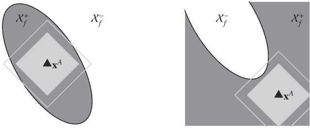

**图 8.1** 凸集与 \(\ell_1\) 球的几何。**(a)** 如果正集 \(\mathcal{X}_f^+\) 是凸的，则找到包含在 \(\mathcal{X}_f^+\) 内的 \(\ell_1\) 球可以确立代价的下界；否则，\(\ell_1\) 球的至少一个角点见证一个上界。**(b)** 如果负集 \(\mathcal{X}_f^-\) 是凸的，则对手可以通过确定 \(\ell_1\) 球是否与 \(\mathcal{X}_f^-\) 相交来确立代价的上界和下界，但此交点不必包含球的任何角点。

search\(^4\) and \(C_0^- = A_1^{(\mathbf{c})}(\mathbf{x}^- - \mathbf{x}^4)\) as an initial upper bound on the \(MAC\). We also assume there is some \(C_0^+ > 0\) that lower bounds the \(MAC\) (i.e., \(\mathbf{x}^4 \in int\left(\mathcal{X}_f^+\right)\)).

#### 8.2.1 对凸 \(\mathcal{X}_f^+\) 进行 \(\epsilon\)-IMAC 搜索

求解当 \(f \in \mathcal{F}^{\text{convex},+}\) 时的 \(\epsilon\)-IMAC 搜索问题，在优化凸代价 \(A\) 的一般情况下是困难的。我们展示了针对公式 (8.1) 中（加权）\(\ell_1\) 代价的算法，这些算法将问题作为二分搜索来求解。具体来说，给定界定 \(MAC\) 的初始代价 \(C_0^+\) 和 \(C_0^-\)，我们引入一个算法，它可以高效地确定对于任何中间代价 \(C_t^+ < C_t < C_t^-\)，是否有 \(\mathbb{B}^{C_t} (A_1) \subseteq \mathcal{X}_f^+\)。如果 \(\ell_1\) 球包含在 \(\mathcal{X}_f^+\) 中，则 \(C_t\) 成为新的下界 \(C_{t+1}^+\)。否则，\(C_t\) 成为新的上界 \(C_{t+1}^-\)。由于公式 (8.3) 给出的目标是获得乘法最优性，步长将为 \(C_t = \sqrt{C_t^+ \cdot C_t^-}\)（对于加法最优性，参见第 8.1.3 节）。

高效查询算法的存在依赖于三个事实：(1) \(\mathbf{x}^4 \in \mathcal{X}_f^+\)；(2) 以 \(\mathbf{x}^4\) 为中心的每个加权 \(\ell_1\) 代价 \(C\) 球仅当其至少一个顶点位于 \(\mathcal{X}_f^-\) 时才与 \(\mathcal{X}_f^-\) 相交；以及 (3) 加权 \(\ell_1\) 代价的 \(C\) 球仅有 \(2 \cdot D\) 个顶点。加权 \(\ell_1\) 球 \(\mathbb{B}^C (A_1)\) 的顶点是轴对齐实例，它们与 \(\mathbf{x}^4\) 在恰好一个特征（例如，第 \(d^{\text{th}}\) 个特征）上不同，并可以表示为 \(\mathbf{x}^4 \pm \frac{C}{c_d} \cdot \mathbf{e}^{(d)}\) (8.9) 的形式，这属于加权 \(\ell_1\) 代价的 \(C\) 球（系数 \(\frac{C}{c_d}\) 对第 \(d^{\text{th}}\) 个特征上的权重 \(c_d\) 进行归一化）。\(^4\) 如在第 8.1.3 节中所述，本节的结果可以通过使用公式 (8.5) 来计算 \(L_\epsilon\) 以及使用常规二分搜索提案和停止准则，对加法最优性进行复现。

第二个事实形式化为以下引理：

##### 引理 8.4 对于所有 \(C > 0\)，如果存在 \(\mathbf{x} \in \mathcal{X}_f^-\) 使得代价为 \(C = A_1^{(\mathbf{c})}(\mathbf{x} - \mathbf{x}^4)\)，则存在某个特征 \(d\)，使得公式 (8.9) 形式的某个顶点位于 \(\mathcal{X}_f^-\) 中（且通过公式 8.1 也达到代价 \(C\)）。

证明 假设不然；那么存在 \(\mathbf{x} \in \mathcal{X}_f^-\)，使得 \(A_1^{(\mathbf{c})}(\mathbf{x} - \mathbf{x}^4) = C\) 且 \(\mathbf{x}\) 有 \(M \ge 2\) 个与 \(\mathbf{x}^4\) 不同的特征（如果 \(\mathbf{x}\) 在一个或零个特征上不同，它将是公式 8.9 的形式）。令 \(\{d_1, \dots, d_M\}\) 为不同的特征，并令 \(b_{d_i} = \text{sign}(x_{d_i} - x_{d_i}^4)\) 为 \(\mathbf{x}\) 与 \(\mathbf{x}^4\) 沿第 \(d_i^{\text{th}}\) 个特征之差的符号。对于每个 \(d_i\)，令 \(\mathbf{w}_{d_i} = \mathbf{x}^4 + \frac{C}{c_d} \cdot b_{d_i} \cdot \mathbf{e}^{(d_i)}\) 为公式 (8.9) 形式的、具有代价 \(C\)（来自公式 8.1）的顶点。M 个向量 \(\mathbf{w}_{d_i}\) 构成一个 M 维等代价单纯形，代价为 \(C\)，\(\mathbf{x}\) 位于其上；即，\(\mathbf{x} = \sum_{i=1}^M \alpha_i \cdot \mathbf{w}_{d_i}\) 对于某些 \(0 \le \alpha_i \le 1\)。如果所有 \(\mathbf{w}_{d_i} \in \mathcal{X}_f^+\)，则 \(\mathcal{X}_f^+\) 的凸性意味着它们单纯形中的所有点都在 \(\mathcal{X}_f^+\) 中，因此 \(\mathbf{x} \in \mathcal{X}_f^+\)，这与前提矛盾。因此，如果 \(\mathcal{X}_f^-\) 中的任何实例达到代价 \(C\)，则总是至少有一个公式 (8.9) 形式的顶点位于 \(\mathcal{X}_f^-\) 中且也达到代价 \(C\)。

因此，如果任何 \(C\) 球 \(\mathbb{B}^C(A_1)\) 的所有此类顶点都是正的，则所有满足 \(A_1^{(\mathbf{c})}(\mathbf{x}) \le C\) 的 \(\mathbf{x}\) 都是正的，从而确立 \(C\) 作为 \(MAC\) 的下界。反之，如果 \(\mathbb{B}^C(A_1)\) 的任何顶点是负的，则 \(C\) 是 \(MAC\) 的上界。因此，通过同时查询 \(\mathbb{B}^C(A_1)\) 的所有 \(2 \cdot D\) 个等代价顶点，对手要么确立 \(C\) 作为 \(MAC\) 的新下界或上界。通过对 \(C\) 进行二分搜索，对手迭代地将乘法差距减半，直到其在 \(1 + \epsilon\) 的因子以内。这产生了形式为公式 (8.9) 的 \(\epsilon\)-IMAC。

这种多行搜索过程的一般形式作为算法 8.1 呈现，并在图 8.3 中描绘。MULTILINESEARCH 同时沿所有

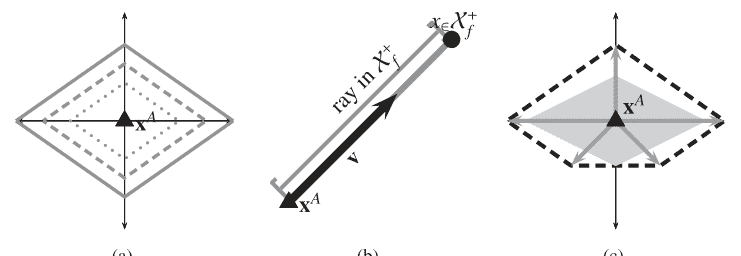

图 8.2 多行搜索的几何。(a) 加权 \(\ell_1\) 球围绕目标 \(\mathbf{x}^4\) 中心，并有 \(2 \cdot D\) 个顶点。(b) 多行搜索中的搜索方向从 \(\mathbf{x}^4\) 辐射出来以探测特定代价。(c) 一般来说，对手在搜索以逃避时利用代价函数的凸性。通过在特定代价下探测所有搜索方向，正查询的凸包界定了其中包含的 \(\ell_1\) 代价球。

集合 W 中的单位代价搜索方向，该集合包含从原点 x⁴ 辐射出来且其代价为单位向量的搜索方向；即，对于每个 w ∈ W，A(w) = 1。当然，任何非归一化搜索向量 {v} 的集合都可以通过对每个向量应用归一化常数 A(v)⁻¹ 转换为单位搜索向量。在每一步中，MULTILINESEARCH（算法 8.1）发出最多 |W| 个查询来构建一个边界外壳（即，这些查询的凸包将形成 \(MAC\) 的上界或下界），以确定是否有 \(B^C (A_1) \subseteq X_f^+\)。一旦在代价 \(C\) 下找到负实例，对手将停止在代价 \(C\) 下的进一步查询，因为单个负实例足以确立下界。我们称此策略为懒查询——这种做法将为恶意分类器带来更好的边界。此外，当为代价 \(C\) 确立上界时（即，找到负顶点），算法将修剪所有在代价 \(C\) 下为正的方向。这种修剪是合理的；根据凸性假设，这些被修剪的方向对于所有小于 \(MAC\) 新上界 \(C\) 的代价都是正的，因此沿此类方向不再需要进一步查询。最后，通过对代价进行二分搜索，MULTILINESEARCH 找到一个 \(\epsilon\)-IMAC，查询次数不超过 \(|W| \cdot L_\epsilon\) 但至少为 \(|W| + L_\epsilon\)。因此，该算法的最佳情况查询复杂度为 \(O(|W| \cdot L_\epsilon)\)，最坏情况查询复杂度为 \(O(|W| \cdot L_\epsilon)\)。

值得注意的是，在当前形式下，MULTILINESEARCH 有两个隐式假设。首先，我们假设所有搜索方向从共同原点 x⁴ 辐射，且 \(A(0) = 0\)。没有此假设，射线约束代价函数 \(A(s \cdot w)\) 在 \(s \ge 0\) 上仍然是凸的，但不一定像二分搜索所要求的那样单调。其次，我们假设代价函数 \(A\) 沿从 x⁴ 出发的任何射线是正齐次函数；即 \(A(s \cdot w) = |s| \cdot A(w)\)。此假设允许 MULTILINESEARCH 缩放其单位搜索向量以实现其代价的相同缩放。尽管该算法可以调整以消除这些假设，但公式 (8.1) 中的代价函数满足这两个假设，因为它们是重新中心化于 x⁴ 的范数。

算法 8.2 将 W 设为以 x⁴ 为中心的单位代价 \(\ell_1\) 球的顶点，从而对（加权）\(\ell_1\) 代价使用 MULTILINESEARCH。在此情况下，搜索发出最多 \(2 \cdot D\) 个查询来确定 \(B^C (A_1)\) 是否是 \(X_f^+\) 的子集，因此为 \(O(L_\epsilon \cdot D)\)。然而，MULTILINESEARCH 并不依赖其方向是 \(\ell_1\) 球的顶点，尽管这些顶点足以张成 \(\ell_1\) 球。通常，MULTILINESEARCH 对其搜索方向的配置是不可知的，并可以适应任何能够利用 \(X_f^+\) 的凸性为所用代价提供足够紧边界的方向集（搜索方向必须满足的边界要求见第 8.3.1.1 节）。然而，正如我们在第 8.3.1 节中所示，充分界定 \(p > 1\) 的 \(\ell_p\) 代价球所需的搜索方向数量可能是 \(D\) 的指数级。

5 搜索算法可以继续在任何已知负实例的距离 \(B^-\) 处进行查询，因为这可能加速搜索早期对额外搜索方向的修剪。然而，在分析恶意分类器时，这些额外查询不会导致进一步修剪，反而会阻止对最坏情况查询复杂度的改进，如第 8.2.1.1 节所示。因此，我们提出的算法仅使用懒查询，且仅在低于 \(MAC\) 上界 \(C_T^-\) 的代价下进行查询。


```
ALGORITHM 8.1 MULTILINESEARCH
MLS (W, x^0, x^-, C_0^+, C_0^-, ε)
x* ← x^-
t ← 0
while C_t^- / C_t^+ > 1 + ε do begin
    C_t ← √(C_t^- · C_t^+)
    for all w ∈ W do begin
        Query: f_t^w ← f(x^0 + C_t · w)
        if f_t^w == "-" then begin
            x* ← x^0 + C_t · w
            Prune i from W if f_i^t == "+"
            break for-loop
        end if
    end for
    C_{t+1}^+ ← C_t^+ and C_{t+1}^- ← C_t^-
    if ∀w ∈ W f_t^w == "+" then C_{t+1}^+ ← C_t
    else C_{t+1}^- ← C_t
    t ← t + 1
end while
return: x*
```

```
ALGORITHM 8.2 CONVEX X_f^+ SEARCH
ConvexSearch (x^0, x^-, c, ε, C^+)
D ← dim (x^0)
C^- ← A^(e) (x^- - x^0)
W ← ∅
for i = 1 to D do begin
    w_i^1 ← (1/c_i) · e_i
    W ← W ∪ { ±w_i^1 }
end for
return: MLS (W, x^0, x^-, C^+, C^-, ε)
```

Figure 8.3 多行搜索算法。算法 8.1 是一种通用过程，用于沿从 x^0 发出的多个搜索方向执行同时二分搜索；每个方向 w ∈ W 必须是单位成本方向。算法 8.2 使用此 MultiLineSearch 过程，在分类器的正类为凸集时最小化加权 l_1 成本。对于此过程，每个权重 c_i 必须在范围 (0, ∞) 内，尽管在第 8.2.1.3 节中讨论了扩展。

##### 8.2.1.1 K 步多行搜索

##### 8.2.1.1 K 步多行搜索

这里我们介绍了一种多行搜索算法的变体，它更好地利用剪枝来减少算法 8.1 的查询复杂度。原始的 MultiLineSearch 算法是 2 · |W| 次同时二分搜索（即，沿所有搜索方向同时进行的广度优先搜索）。当相对于 x^0 的凸体呈非对称拉长时，此策略对方向的剪枝最为有效，但对于对称圆形的凸体则无法剪枝。该算法也可以改为顺序搜索（即，沿每个方向依次进行 L_ε 步的深度优先搜索）。这种替代搜索策略也能获得最佳情况 O(L_ε + |W|) 次查询（对于关于 x^0 对称圆形的凸体，它沿第一个方向使用 L_ε 次查询来建立 1 + ε 因子以内的上界和下界，然后使用 D 次查询来验证下界）和最坏情况 O(L_ε · |W|) 次查询（对于非对称拉长的凸体，在最坏情况下，该策略将沿每个 D 个搜索方向各需要 L_ε 次查询）。出人意料的是，这两种替代方案具有相反的最佳情况和最坏情况凸体，这启发了一种名为 K-step MultiLineSearch 的混合方法。该算法混合了同时和顺序策略，以实现比任何单一搜索策略更好的最坏情况查询复杂度。

在每个阶段，K-STEP MULTILINESEARCH（算法 8.3）选择一个方向 w 并对其进行 K 步查询，以生成关于 MAC 的候选界限 B^- 和 B^+。该算法在不查询其他方向的情况下（一种深度优先策略）朝着减少 G_t 取得实质性进展。然后，它在候选下界 B^+ 上迭代地查询所有剩余方向（一种广度优先策略）。同样，我们使用惰性查询，一旦发现负实例即停止，因为此时 B^+ 不再是可行的下界。在这种情况下，尽管候选界限失效，算法仍可剪枝所有在 B^+ 上为正的方向（总会至少存在一个这样的方向）。因此，在每次迭代中，要么差距被实质性减小，要么至少剪枝一个搜索方向。我们表明，对于 K = ⌈√L_ε⌉，该算法在常规的广度优先和深度优先方法之间达到了微妙的平衡，从而获得比任何一种方法更好的最坏情况复杂度。

定理 8.5 当 K = ⌈√L_ε⌉ 时，算法 8.3 最多使用 O(L_ε + √L_ε |W|) 次查询即可找到一个 ε-IMAC。

该定理的证明见附录 D。作为定理 8.5 的结果，使用算法 8.3 对（加权）l1 成本找到一个 ε-IMAC 需要 O(L_ε + √L_ε D) 次查询。此外，算法 8.2 可以直接通过将其对 MULTILINESEARCH 的函数调用替换为 K-step MULTILINESEARCH 并使用 K = ⌈√L_ε⌉ 来纳入 K-步 MULTILINESEARCH。

##### 8.2.1.2 下界

##### 8.2.1.2 下界

在这里，我们对任何算法找到一个 ε-IMAC 所需的查询数量求出下界，前提是对于任何凸成本函数（例如，p >= 1 时的公式 (8.1)），χ_f^+ 是凸集。下面，我们介绍了关于加性和乘性最优性的定理。值得注意的是，由于 ε-IMAC 使用乘性最优性，我们将 MAC 上的界限 C_0^+ > 0 纳入了定理表述中。

定理 8.6 对于任何 D > 0、任何正凸函数 A : R^D -> R_+、MAC 上的任何初始界限 0 <= C_0^+ < C_0^- 以及 0 < η < C_0^- - C_0^+，所有算法在最坏情况下都必须提交至少 max{D, L_η^(+)} 次成员查询，才能在 F^convex,"+" 上实现 η-加性最优。

定理 8.7 对于任何 D > 0、任何正凸函数 A : R^D -> R_+、MAC 上的任何初始界限 0 < C_0^+ < C_0^- 以及 0 < ε < C_0^- / C_0^+ - 1，所有算法在最坏情况下都必须提交至少 max{D, L_ε^(*)} 次成员查询，才能在 F^convex,"+" 上实现 ε-乘性最优。

这两个定理的证明均在附录 D。请注意，这些定理分别仅适用于 η ∈ (0, C_0^- - C_0^+) 和 ε ∈ (0, C_0^- / C_0^+ - 1)。事实上，在这些区间之外，查询策略是平凡的。对于 η = 0 或 ε = 0，没有近似算法会终止。类似地，对于 η ≥ C_0^- - C_0^+ 或 ε ≥ C_0^- / C_0^+ - 1，x^- 是一个 IMAC，因为它具有成本 A(x^- - x^0) = C_0^-，因此不需要任何查询。

6 K-STEP MULTILINESEARCH 在最佳情况下的复杂度也为 O(L_ε + |W|)。

定理 8.6 和 8.7 表明，η-加性最优性和 ε-乘性最优性分别需要 Ω(L_η^(+) + D) 和 Ω(L_ε^(*) + D) 次查询。因此，K-STEP MULTILINESEARCH 算法（算法 8.3）对于加权 ℓ_1 成本具有接近最优的查询复杂度，其查询复杂度为 O(L_ε + √L_ε D)。这个下界也适用于任何 p > 1 的 ℓ_p 成本，但在第 8.3 节中，我们将为 p > 1 提供更严格的下界，这些下界在某些 ε 范围和任何 η 范围内显著超过此结果。

##### 8.2.1.3 特殊情况

##### 8.2.1.3 特殊情况

在这里，我们介绍了一系列特殊情况，它们需要通过添加预处理步骤对算法 8.1 和 8.3 进行小幅修改。

##### *重访线性分类器*

##### *重访线性分类器*

Lowd & Meek 最初开发了一种针对（加权）ℓ_1 成本的线性分类器逆向工程方法。首先，他们的方法隔离出从 x^- 到 x^+ 并穿过分类器边界的一系列点，然后使用 D 次二分行搜索来估计超平面的参数。但是，作为当 X_i^+ 为凸集时能够高效最小化我们目标函数的结果，我们立即有了线性分类器（即半空间）的一种替代方法。由于线性分类器是诱导凸分类器的特殊情况，可以应用算法 8.2，而我们的 K-STEP MULTI-LINESEARCH 算法改进了其逆向工程技术 O(L_ε · D) 次查询的复杂度，并适用于更广泛的分类器家族。

尽管算法 8.2 具有更好的复杂度，但它使用 2 · D 个搜索方向，而非 Lowd & Meek 方法中使用的 D 个方向，这可能导致我们的技术在某些实际场景中需要发出更多查询。但是，对于某些限制性的分类器家族，如果可以根据当前的查询集合证明某个方向不可行，也可以消除搜索方向。例如，给定一组搜索方向 W、t 个查询 {x^(i)}_{i=1}^t 及其对应的响应 {y^(i)}_{i=1}^t，如果对于所有 C_i^+ ≤ α < C_i^-，不存在任何与之前所有查询一致的分类器 f ∈ F（即，f(x^-) = "--"，f(x^+) = "++"，且对于所有 i ∈ {1, …, t}，f(x^(i)) = y^(i)，同时还满足 f(α · e) = "--" 以及对于每个 i ∈ W \ {e}，f(α · i) = "++"），则可以从 W 中消除搜索方向 e。也就是说，e 可行当且仅当它是剩余搜索方向集合 W 中唯一一个会被某个一致的分类器为成本 α 分类为负的搜索方向。此外，由于后续查询只会限制 α 的可行空间和一致分类器集合 F̂，因此剪枝这些不可行方向对余下的搜索是可靠的。

对于诱导凸分类器的限制性家族，这些可行性条件可以高效验证，并可用于在不发出进一步查询的情况下剪枝搜索方向。实际上，对于写成 f(x) = sign(w^T x + b) 的线性分类器家族（其中 w 为法向量，b 为偏置），上述条件变成了一组线性不等式，以及与涉及搜索方向的约束相对应的二次不等式。这可以表述为关于 α、w 和 b 的以下优化规划：

```
min_{α, w, b}      α · w^T e + b
s.t.               α ∈ [C_i^+, C_i^-)
                   w^T x^- + b ≤ 0
                   w^T x^+ + b ≥ 0
                   y^i(w^T x^(i) + b) ≥ 0      ∀ i ∈ {1, …, t}
                   α · w^T i + b ≥ 0           ∀ i ≠ e ∈ W
```

如果得到的最小值小于零，则方向 e 是可行的；否则，可以将其剪枝。此类规划可以高效求解，并可能使对手在不发出额外查询的情况下快速消除不可行的搜索方向。但是，进一步细化这些剪枝程序超出了本章的范围。


##### 将 MultiLineSearch 算法扩展到 \(c_d = \infty\) 或 \(c_d = 0\) 权重

在算法 8.2 中，我们将第 \(d^\text{th}\) 个坐标轴对齐方向按因子 \(\frac{1}{c_d}\) 重新加权，以隐式假设 \(c_d \in (0, \infty)\) 来构造单位成本向量。当 \(c_d = \infty\) 时（例如，不可变特征），只需从 MULTILINESEARCH 使用的搜索方向集合 \(\mathbb{W}\) 中移除这些特征即可处理。当 \(c_d = 0\) 时（例如，无用特征），类似 MULTILINESEARCH 的算法不再保证近似最优，因为它们隐式假设成本球是有界集合。若 \(c_d = 0\)，\(\mathbb{B}^0(A)\) 不再是有界集合，且若 \(\chi_f^-\) 与 0 成本特征所张成的子空间在任何地方相交，则可以实现 0 成本——除非能找到一个负 0 成本实例，否则近似最优将无法实现。在最坏情况下，这样的实例在 0 成本子空间内的任何方向上都可能任意远，使得搜索此类实例难以处理。尽管如此，一种可能的搜索策略是：在对修改后的目标函数重复运行 MULTILINESEARCH \(T\) 次时，为所有 0 成本特征指定一个向 0 快速衰减的非零权重（例如，在第 \(t^\text{th}\) 次迭代中 \(c_d = 2^{-t}\)）。该算法要么找到一个仅修改 0 成本特征（因此是 0-\(IMAC\)）的负实例，要么在终止时得到一个非零成本实例，若不存在 0 成本负实例，则该实例为 \(\epsilon\)-IMAC。该算法不保证近似最优，但在使用某个固定 \(T\) 次运行的实际场景中可能适用。

##### 缺乏初始下界

迄今为止，为了找到一个 \(\epsilon\)-IMAC，我们所介绍的算法在初始边界 \(C_0^+\) 和 \(C_0^-\) 之间搜索，但一般来说，实际对手可能不知道 \(C_0^+\)。我们现在介绍一个名为 SPIRALSEARCH 的算法，若存在下界，它可以高效地建立 MAC 的下界。该算法沿单个方向对指数进行半分搜索以找到一个正例，然后在此候选边界上查询其余方向。要么验证了下界，要么可以在搜余部分中修剪那些为正的方向。

```
ALGORITHM 8.4
SPIRALSEARCH
spiral (\(\mathbb{W}\), \(\mathbf{x}^-\), \(C_0^-\))
\(t \leftarrow 0\) and \(\mathbb{V} \leftarrow \emptyset\)
repeat
    Choose a direction \(\mathbf{w} \in \mathbb{W}\)
    Remove \(\mathbf{w}\) from \(\mathbb{W}\) and \(\mathbb{V} \leftarrow \mathbb{V} \cup \{\mathbf{w}\}\)
    Query: \(f_{\mathbf{w}} \leftarrow f(\mathbf{x}^- + C_0^- \cdot 2^{-2t} \cdot \mathbf{w})\)
    if \(f_{\mathbf{w}} = \text{""}\) then begin
        \(\mathbb{W} \leftarrow \mathbb{W} \cup \{\mathbf{w}\}\) and \(\mathbb{V} \leftarrow \emptyset\)
        \(t \leftarrow t + 1\)
    end if
until \(\mathbb{W} = \emptyset\)
\(C_0^+ \leftarrow C_0^- \cdot 2^{-2t}\)
if \(t > 0\) then \(C_0^- \leftarrow C_0^- \cdot 2^{-2^{t-1}}\)
return: \((\mathbb{V}, C_0^+, C_0^-)\)
```

在 SPIRALSEARCH 的第 \(t^{\text{th}}\) 次迭代中，会选择一个方向并在候选下界 \((C_0^-)2^{-t}\) 处进行查询。如果查询为正，则该方向会被添加到与下界一致的方向集合 \(\mathbb{V}\) 中。否则，会修剪 \(\mathbb{V}\) 中所有为正的方向，建立一个新的上界，并以指数递减的指数降低候选下界。根据 MAC 的定义，该算法在 \(t = \left\lceil \log_2 \log_2 \frac{C_0^-}{MAC(f, A)} \right\rceil\) 次迭代后终止。此外，在此算法中，多个方向仅在正查询迭代期间被探测，并且对每个方向最多进行一次正查询。因此，只要存在某个下界 \(C_0^+ > 0\)，SPIRALSEARCH 将使用 \(\mathcal{O}\left(L'_\epsilon + D\right)\) 次查询建立一个下界，其中 \(L'_\epsilon\) 由使用 \(C_0^+ = MAC(f, A)\) 定义的公式 (8.6) 给出：即最大可能下界。

该算法可用作先前任何搜索\(^7\)的前驱，并可通过半分下界而非指数来适应加性最优性（参见第 8.1.3 节）。完成后，它建立的上界和下界对于 \(t > 0\) 具有乘法间隔 \(2^{2^{t-1}}\)，或对于 \(t = 0\) 具有乘法间隔 2。根据上述用 MAC 定义的 \(t\)，MULTILINESEARCH 因此可以使用 \(L_\epsilon = L'_\epsilon\) 继续进行。此外，SPIRALSEARCH 修剪的搜索方向对后续的 MULTILINESEARCH 也是无效的，因此 SPIRALSEARCH 返回的集合 \(\mathbb{V}\) 将用作后续搜索的初始集合 \(\mathbb{W}\)。因此，后续搜索的查询复杂度与其使用最佳可能下界开始时相同。

##### 缺乏负例

MULTILINESEARCH 算法也可以自然地适应对手没有负例 \(\mathbf{x}^-\) 的情况。这是通过查询双指数增长成本的 \(\ell_1\) 球，直到找到负实例来实现的。在第 \(t^{\text{th}}\) 次迭代中，对手沿每个搜索方向以成本 \((C_0^+)2^{2^t}\) 进行探测；要么所有探测都为正（一个新下界），要么至少有一个为负（一个新上界），搜索可以终止。一旦找到负例（在探测了 \(T\) 次迭代后），就必须有 \((C_0^+)2^{2^{T-1}} < MAC(f, A) \le (C_0^+)2^{2^T}\)；因此，\(T = \left\lceil \log_2 \log_2 \left( \frac{MAC(f, A)}{C_0^+} \right) \right\rceil\)。经过此预处理后，对手随后可以使用 \(C_0^+ = 2^{2^{T-1}}\) 和 \(C_0^- = 2^{2^T}\) 执行 MULTILINESEARCH；即，\(\log_2(G_0) = 2^{T-1}\)。此前驱步骤最多需要 \(|\mathbb{W}| \cdot T\) 次查询来初始化 MULTILINESEARCH 算法，使间隙满足 \(L_\epsilon = \left\lceil (T-1) + \log_2 \left( \frac{1}{\log_2(1+\epsilon)} \right) \right\rceil\)，根据公式 (8.6)。

如果既没有初始上界也没有初始下界，对手可以通过使用额外的 \(|\mathbb{W}|\) 次查询，以单位成本探测每个搜索方向来进行。这将建立一个上界或下界，随后对手可据此继续。

7 如果成本不存在下界，则没有算法能找到 \(\epsilon\)-IMAC。按所展示的方式，该算法不会终止，但在实际中，搜索将在足够多次迭代后终止。

### 8.2.2 凸 \(\mathcal{X}_f^-\) 的 \(\epsilon\)-IMAC 学习

在本节中，当可行集合 \(\mathcal{X}_f^-\) 为凸集时，我们最小化具有有界成本球的凸成本函数 \(A\)（我们关注公式 (8.1) 中的加权 \(\ell_1\) 成本）。任何凸函数都可以在已知凸集中高效地最小化（例如，使用椭圆法或内点法；参见 Boyd & Vandenberghe 2004）。然而，在近似最优规避问题中，凸集仅可通过成员查询访问。我们使用 Bertsimas & Vempala (2004) 的随机多项式算法，给定初始点 \(\mathbf{x}^- \in \mathcal{X}_f^-\) 来最小化成本函数 \(A\)。对于任何固定成本 \(C'\)，我们使用他们的算法来确定（以高概率）\(\mathcal{X}_f^-\) 是否与 \(\mathbb{B}^{C'}(A)\) 相交；即，\(C'\) 是否为 MAC 的新下界或上界。以高概率，此方法可以通过二分搜索在不超过 \(L_\epsilon\) 次重复中找到 \(\epsilon\)-IMAC。下面的定理是本节的主要结果。

**定理 8.8** 设成本函数 \(A\) 为凸函数且具有有界球；即，有界子级集。设可行集合 \(\mathcal{X}_f^-\) 为凸集，并假设存在某个 \(r > 0\) 和 \(\mathbf{y} \in \mathcal{X}_f^-\)，使得 \(\mathcal{X}_f^-\) 包含成本球 \(\mathbb{B}'(A; \mathbf{y})\)。然后，给定返回 \(A\) 成本球分离超平面的神谕访问权限，算法 8.7 将以高概率使用 \(O^*(D^5)\) 次查询找到 \(\epsilon\)-IMAC。8

此结果的证明将在本节余下部分概述，并基于 Bertsimas & Vempala (2004, 定理 14)。我们首先介绍他们的随机椭圆算法，然后详细说明从凸体中高效采样的过程，最后介绍我们对优化的应用。在本节中，我们仅关注加权 \(\ell_1\) 成本（公式 (8.1)），并在第 8.3.2 节中回到更一般的情况。

#### 8.2.2.1 凸集的交集

Bertsimas & Vempala 提出了一种基于查询的过程，用于确定两个凸集（例如，\(\mathcal{X}_f^-\) 和 \(\mathbb{B}^{C'}(A_1)\)）是否相交。他们的 INTERSECTSEARCH 过程（我们将其作为算法 8.5 呈现，参见图 8.4）是一种随机椭圆方法，用于确定两个有界凸集之间是否存在交集：\(\mathbb{P}\) 仅通过成员查询可访问，而 \(\mathbb{B}\) 为任何不在 \(\mathbb{B}\) 中的点提供分离超平面。他们使用高效的基于查询的方法从 \(\mathbb{P}\) 中均匀采样，以获得足够多的样本，使得使用 \(\mathbb{B}\) 的分离超平面通过这些样本的中心切割 \(\mathbb{P}\)，从而以高概率显著减少 \(\mathbb{P}\) 的体积。他们的技术因此构建了一系列逐渐缩小的可行集 \(\mathbb{P}^{(s)} \subseteq \mathbb{P}^{(s-1)}\)，直到算法找到 \(\mathbb{P} \cap \mathbb{B}\) 中的一个点，或者交集很可能为空为止。

如前所述，成本优化问题归结为寻找 \(\mathcal{X}_f^-\) 和 \(\mathbb{B}^{C'}(A_1)\) 之间的交集。尽管 \(\mathcal{X}_f^-\) 可能是无界的，但我们正在最小化具有有界成本球的成本，因此我们可以改用集合 \(\mathbb{P}^{(0)} = \mathcal{X}_f^- \cap \mathbb{B}^{2R}(A_1; \mathbf{x}^-; \mathbf{x}^-)\)（其中 \(R = A(\mathbf{x}^- - \mathbf{x}^-) > C'\)），它是 \(\mathcal{X}_f^-\) 的一个（凸）子集。由于，根据三角不等式

8 \(O^*(\cdot)\) 表示标准复杂度记法 \(O(\cdot)\)，不包含对数项。对 \(\epsilon\) 的依赖包含在这些对数项中；详情见 Bertsimas & Vempala (2004)。


```
ALGORITHM 8.5 INTERSECT SEARCH
IntersectSearch (P^(0), Q = {x^(j) ∈ P^(0)}, x^4, C)
for s = 1 to T do begin
(1) Generate 2N samples {x^(j)}_{j=1}^{2N}
Choose x from Q
x^(j) ← HitRun (P^(s-1), Q, x^(j))
(2) If any x^(j), A(x^(j) - x^4) ≤ C terminate the for-loop
(3) Put samples into 2 sets of size N
R ← {x^(j)}_{j=1}^N and S ← {x^(j)}_{j=N+1}^{2N}
(4) z^(s) ← 1/N Σ_{x^(j)∈R} x^(j)
(5) Compute H(h^(z^(s)), z^(s)) using Equation (8.11)
(6) P^(s) ← P^(s-1) ∩ H(h(z)z^(s))
(7) Keep samples in P^(s)
Q ← S ∩ P^(s)
end for
Return: the found [x^(j), P^(s), Q]; or No Intersect
```

```
ALGORITHM 8.6 HIT-AND-RUN SAMPLING
HitRun (P, {y^(j)}, x^(0))
for i = 1 to K do begin
(1) Choose a random direction:
v_j ∼ N(0, 1)
v ← Σ v_j · y^(j)
(2) Sample uniformly along v using rejection sampling:
Choose ω̂ s.t. x^(i-1) + ω̂ · v ∉ P
repeat
ω ∼ Unif(0, ω̂)
x^(i) ← x^(i-1) + ω · v
ω̂ ← ω
until x^(i) ∈ P
end for
Return: x^(K)
```

图 8.4 算法 INTERSECTSEARCH 和 HIT-AND-RUN 用于 Bertsimas & Vempala (2004) 的随机椭球法。INTERSECTSEARCH 用于查找一对凸集之间的交集：P^(0) 是可查询的，B 根据 Equation (8.11) 提供一个分离超平面。请注意，第 8.2.2.2 节讨论的 Rounding 算法可用作预处理步骤，使 P^(0) 近各向同性并获取 Q 的样本。HIT-AND-RUN 算法用于从有界近各向同性凸集 P 中高效获取均匀样本，基于其均匀样本集 {y^(j)} 和起始点 x^(0)。

不等式，以 x^- 为圆心的球 B^(2R)(A1; x^-) 包围了以 x^4 为圆心的 B^C(A1; x^4) 的全部，集合 P^(0) 包含所需的交集 X_r^- ∩ B^C(A1) 的全部（如果存在）。我们还假设存在某个 r > 0，使得凸集 X_r^- 中包含一个 r-球；即，存在 y ∈ X_r^-，使得以 y 为圆心的 r-球 B^r(A1; y) 是 X_r^- 的子集。该假设既保证了 X_r^- 具有非空内部（这是后文讨论的 HIT-AND-RUN 算法的要求），又为整体交集搜索算法提供了停止条件。

Bertsimas & Vempala 搜索算法的基础是利用 Smith (1996) 引入的 HIT-AND-RUN 随机游走技术（算法 8.6）从未知但有界凸体中均匀采样的能力。给定实例 x^(j) ∈ P^(s-1)，HIT-AND-RUN 在 x^(j) 处选择一个随机方向 v（我们将在第 8.2.2.2 节重新讨论 v 的选择）。由于 P^(s-1) 是有界凸集，集合 W = {ω ≥ 0 | x^(j) + ωv ∈ P^(s-1)} 是一个有界区间（即，存在某个 ω̂ ≥ 0 使得 W ⊆ [0, ω̂]），它索引了沿 x^(j) 处方向 v 的所有可行点。从 W 中均匀采样 ω 可得到随机游走的下一步：x^(j) + ωv。尽管 ω̂ 通常未知，但可以对其进行上界估计，并且可以使用算法 8.6 所示的沿区间的拒绝采样来对 ω 进行采样。如前所述，如果 P^(s-1) 的内部为空，该随机游走将无法取得进展（我们通过假设 X_f^- 包含一个 r-球来排除这种情况），高效采样还要求 P^(s-1) 足够圆润。然而，在第 8.2.2.2 节讨论的条件下，Hit-and-Run 随机游走在 O*(D^3) 步后从凸体中生成均匀样本（Lovász & Vempala 2004）。我们现在详细介绍整体 IntersectSearch 过程（算法 8.5），然后讨论每次连续切割后保持高效采样所使用的机制。值得注意的是，算法 8.5 要求 P^(0) 处于近各向同性位置，且 Q 是其样本集；这些要求通过使用第 8.2.2.2 节末尾讨论的 Lovász & Vempala 的 Rounding 算法来满足。

##### 随机椭球法

我们使用 Hit-and-Run 从 P^(s-1) ⊆ X_f^- 获取 2N 个样本 {x^(j)}，用于随机椭球法的单个阶段。如果任何样本满足条件 A(x^(j) - x^4) ≤ C'，则 x^(j) 在 X_f^- 与 B^C(A_1) 的交集中，程序完成。否则，搜索算法必须显著减小 P^(s-1) 的大小，同时不排除 B^C(A_1) 的任何部分，以便采样集中于所需交集（如果存在）——为此我们需要 B^C(A_1) 的一个分离超平面。对于任意点 y ∉ B^C(A_1)，加权 ℓ_1 成本的（子）梯度 h(y) 由以下公式给出：
$$[h(y)]_f = c_f \cdot sign(y_f - x_f^4)$$。
因此，由 {x | (x - y)^T h(y)} 指定的超平面是 y 与 B^C(A_1) 的分离超平面。

为取得足够进展，算法选择 z ∈ P^(s-1) 点，以便通过 z 使用超平面 h(z) 切割 P^(s-1) 时消除 P^(s-1) 的显著部分。为此，z 必须位于 P^(s-1) 的中心位置。我们使用 R 中一半样本的经验中心点：z = (1/N) Σ_{x∈R} x（另一半将在第 8.2.2.2 节中使用）。我们通过 z 处的超平面 h(z) 切割 P^(s-1)；即，P^(s) = P^(s-1) ∩ H^(h(z), z)，其中 H^(h(z), z) 是半空间
$$H^{(h(z), z)} = {x | x^T h(z) < z^T h(z)}$$。
正如 Bertsimas & Vempala 所示，如果 N = O*(D) 且 P^(s-1) 近各向同性（参见第 8.2.2.2 节），该切割以高概率实现 vol(P^(s)) ≤ (3/2) vol(P^(s-1))。由于可行集初始外切球和内切球之间的体积比为 (R/r)^D，算法在 T = O(D log(R/r)) 次失败迭代后可以终止，并以高概率判断交集为空。

由于算法 8.5 中的每次迭代都需要 N = O*(D) 个样本，每个样本都需要 K = O*(D^3) 个随机游走步骤，且共有 T = O*(D) 次迭代，因此算法 8.5 所需的成员查询总数为 O*(D^5)。

#### 8.2.2.2 从可查询凸体中采样

在随机椭球法中，随机样本用于两个目的：估计凸体的中心点以及维持 HIT-AND-RUN 采样器高效从一系列收缩凸体中生成均匀点所需的条件。迄今为止，我们假设 HIT-AND-RUN 随机游走使用 K = O*(D^3) 次成员查询，能够从任何有界凸体 P 中高效生成均匀随机样本。然而，如果凸体呈不对称伸长，随机选择的方向很少与凸体的长轴对齐，随机游走将迈出小步（相对于长轴）并在 P 中缓慢混合。为了使采样器有效混合，凸体 P 必须足够圆润，或者更正式地说，近各向同性；即，对于任何单位向量 v，
$$
\frac{1}{2}vol(\mathbb{P}) \le E_{x \sim \mathbb{P}} \left[ \left( v^\top (x - E_{x \sim \mathbb{P}}[x]) \right)^2 \right] \le \frac{3}{2}vol(\mathbb{P}) . \quad (8.12)
$$

如果凸体不是近各向同性的，则可以使用适当的仿射变换 T 对 X 进行重新缩放，使得变换后的凸体 P' = {Tx | x in P} 近各向同性。通过从 P 中获取足够多的样本，我们可以将其经验协方差矩阵估计为 T。相反，我们使用 Bertsimas & Vempala (2004) 描述的技术对 X 进行隐式重新缩放。我们维护一个来自凸体 P^(s) 的足够多均匀样本集 Q，并在 HIT-AND-RUN 算法（算法 8.6）中基于该集对方向 v 进行采样。直观地，由于 Q 中的样本在 P^(s) 中均匀分布，Q 中点的方向隐式反映了 P^(s) 的协方差结构。这等同于从均值为零且协方差为 P 的正态分布中采样方向 v。

此外，集合 Q 在每次切割后必须保留来自 P^(s) 的足够多样本：P^(s) <- P^(s-1) \cap H(h(z^(s))z^(s))。为此，我们最初使用 HIT-AND-RUN 从 P^(s-1) 重新采样 2N 个点——其中一半 R 用于估计切割的中心点 z^(s)，另一半 S 用于在切割后重新填充 Q。由于 S 包含来自 P^(s-1) 的独立均匀样本，切割后位于 P^(s) 中的样本构成来自 P^(s) 的独立均匀样本（即拒绝采样）。通过选择足够大的 N，切割将足够深，并且将有足够多的点在切割后重新采样 P^(s)。

最后，为了使这种采样方法成功，我们需要将初始集合 P^(0) 转换为近各向同性位置，并且还需要一个来自变换后的 P^(0) 的初始均匀样本集 Q 作为算法 8.5 的输入。然而，在近最优逃逸问题中，我们在 X_f^- 中只有一个点 x^-，且我们的集合 P^(0) 不必是近各向同性的。幸运的是，有一种迭代过程，它使用 HIT-AND-RUN 算法同时将初始凸集 P^(0) 转换为近各向同性位置并构建我们的初始样本集 Q。该算法（即 Lovász & Vempala (2003) 描述的 ROUNDING 算法）使用 O*(D^4) 次成员查询来找到一种变换，使 P^(0) 处于近各向同性位置并从中生成一组初始样本。我们将此作为算法 8.5 和 8.7 的预处理步骤；即，给定 X_f^- 和 X_f^- 中的 x^-，我们构建 P^(0) = X_f^- \cap B^{2R}(a_1; x^-)，然后可以使用 ROUNDING 算法转换 P^(0) 并从中生成一个初始均匀样本；即，Q = {x^(j) in P^(0)}。这些集合随后成为我们搜索算法的输入。


#### 8.2.2.3 $\ell_1$ 球上的优化

我们重新审视算法中用于搜索最小可行成本的最外层优化循环，以优化朴素方法，该方法在成本球上的二分查找的每个步骤中重复执行交集搜索。这些改进体现在我们的最终过程 SETSEARCH（算法 8.7）中（与之前的二分查找过程类似，该算法可以通过更改其停止条件和提议步骤，如第 8.1.3 节所述，轻松地适应 \(\eta\)-加性最优性）——所需查询的总数也是 \(O^* \left( D^5 \right)\)，因为该算法只需 \(L_\epsilon\) 个二分查找步骤（参见图 8.5）。同样，算法 8.7 要求 \(\mathbb{P}\) 为近各向同性，且 \(\mathbb{Q}\) 是从中抽取的一组样本，这由第 8.2.2.2 节末尾讨论的 ROUNDING 算法完成。首先，请注意，优化过程每次迭代中 \(\mathbf{x}^c\) 和 \(\mathbf{x}^-\) 都相同。此外，在算法 8.7 的每次迭代中，新集合 \(\mathbb{P}\) 保持近各向同性，新的 \(\mathbb{Q}\) 是从中抽取的一组样本，因为算法 8.5 返回的集合保留了这些属性。因此，由算法 8.7 维护的集合 \(\mathbb{P}\) 和样本集 \(\mathbb{Q} = \{ \mathbf{x}^{(j)} \in \mathbb{P} \}\) 足以在其对 \(C'\) 的整体二分查找的每个阶段初始化 INTERSECTSEARCH，我们只需将 ROUNDING 过程作为预处理步骤执行一次，而不是在每次调用 INTERSECTSEARCH 之前重新调用它。其次，由方程 (8.10) 给出的分离超平面 \(\mathbf{h} \left( \mathbf{y} \right)\) 不依赖于目标成本 \(C'\)，而仅依赖于 \(\mathbf{x}^c\)，即本次搜索中使用的所有 \(\ell_1\) 球的公共中心。事实上，点 \(\mathbf{y}\) 处的分离超平面对成本 \(C < A \left( \mathbf{y} - \mathbf{x}^c \right)\) 的所有 \(\ell_1\)-球都有效。此外，如果 \(C < C'\)，则 \(\mathbb{B}^C \left( A_1 \right) \subseteq \mathbb{B}^{C'} \left( A_1 \right)\)。因此，针对 \(C'\)-球的 INTERSECTSEARCH 成功调用的最终状态可以作为所有 \(C < C'\) 的后续 INTERSECTSEARCH 调用的初始状态。因此，在算法 8.7 中，我们仅在算法 8.5 成功时更新 \(\mathbb{P}\) 和 \(\mathbb{Q}\)。

```
ALGORITHM 8.7  CONVEX \(\mathcal{X}_f^-\) SET SEARCH
\(\text{SetSearch}\left(\mathbb{P}, \mathbb{Q} = \{ \mathbf{x}^{(j)} \in \mathbb{P} \}, \mathbf{x}^c, \mathbf{x}^-, C_0^+, C_0^-, \epsilon\right)\)
\(\mathbf{x}^\star \leftarrow \mathbf{x}^-\) and \(t \leftarrow 0\)
while \(C_t^-/C_t^+ > 1 + \epsilon\) do begin
\(C_t \leftarrow \sqrt{C_t^- \cdot C_t^+}\)
\([\mathbf{x}^\star, \mathbb{P}', \mathbb{Q}'] \leftarrow \text{IntersectSearch} \left(\mathbb{P}, \mathbb{Q}, \mathbf{x}^c, C_t\right)\)
if intersection found then begin
\(C_{t+1}^- \leftarrow A (\mathbf{x}^\star - \mathbf{x}^c)\) and \(C_{t+1}^+ \leftarrow C_t^+\)
\(\mathbb{P} \leftarrow \mathbb{P}'\) and \(\mathbb{Q} \leftarrow \mathbb{Q}'\)
else
\(C_{t+1}^- \leftarrow C_t^-\) and \(C_{t+1}^+ \leftarrow C_t\)
end if
\(t \leftarrow t + 1\)
end while
Return: \(\mathbf{x}^\star\)
```

图 8.5 算法 SetSearch 高效实现了 Bertsimas & Vempala (2004) 的随机椭球算法。SetSearch 使用随机 IntersectSearch 过程对 \(\epsilon\)-IMAC 执行二分查找，以确定 \(\mathcal{X}_f^-\) 是否包含小于指定成本 \(C_t\) 的任何点。请注意，第 8.2.2.2 节讨论的 Rounding 算法可用作预处理步骤，使 \(\mathbb{P}\) 为近各向同性并获取 \(\mathbb{Q}\) 的样本。

### 8.3 一般 $\ell_p$ 成本的规避

在此，我们进一步将 \(\epsilon\)-IMAC 可搜索性从诱导凸分类器家族扩展到任何 \(0 < p \leq \infty\) 的完整 \(\ell_p\) 成本家族。正如我们在本节中所示，许多 \(\ell_p\) 成本在诱导凸分类器家族上并非对所有 \(\epsilon > 0\) 都可 \(\epsilon\)-IMAC 可搜索（即，我们表明为该家族找到 \(\epsilon\)-IMAC 可能需要在 \(D\) 和 \(L_\epsilon\) 中进行指数级多的查询）。事实上，只有当正集或负集为凸集时，加权 \(\ell_1\) 成本才具有已知的（随机）多项式查询策略。

#### 8.3.1 正集为凸集

我们探讨了第 8.2.1 节中提出的 MULTILINESEARCH 和 \(K\)-STEP MULTILINESEARCH 算法求解 \(p \neq 1\) 的 \(\ell_p\) 成本函数的近似最优规避问题的能力。特别是对于 \(p > 1\)，我们探讨了使用超过 \(2 \cdot D\) 个搜索方向的 MULTILINESEARCH 算法的后果。

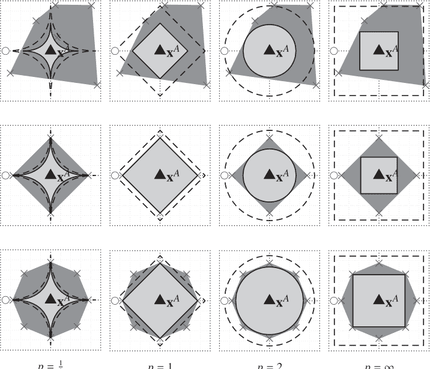

图 8.6 某组查询的凸包及其对若干 \(\ell_p\) 成本的结果包围球。每一行表示一组唯一的正点（“x”点）和负点（“o”点）查询，每一列显示不同 \(\ell_p\) 成本的隐含上界（黑色虚线）和下界（黑色实线）。第一行中，体由一组随机的七个查询定义；第二行中，查询沿坐标轴分布；第三行中，查询分布在圆周上。

for \(p \in (1, \infty)\)，否则为

\[
\mathbf{x}^\star = \frac{1}{D} \left( 1, 1, \dots, 1 \right).
\]

最小化器的 \(\ell_p\) 范数（成本）为

\[
\left\| \mathbf{x}^\star \right\|_p = \frac{1}{D} \left( \sum_{i=1}^D 1^p \right)^{1/p}
= \frac{1}{D} D^{1/p}
= D^{\frac{1-p}{p}}
\]

for \(p \in (1, \infty)\)，否则为

\[
\left\| \mathbf{x}^* \right\|_\infty = \max \left[ \frac{1}{D}, \frac{1}{D}, \dots, \frac{1}{D} \right] = D^{-1}.
\]

##### 8.3.1.1 界定 \(\ell_p\) 球

一般来说，假设沿某组 \(M\) 个单位方向进行探测，最终至少有一个负点支持上界 \(C_0^-\)，且 \(M\) 个正点支持下界 \(C_0^+\)。然而，这 \(M\) 个正点提供的下界是能完全包含在其凸包内的最大 \(\ell_p\) 成本球的成本；假设该成本为 \(C^\dagger \le C_0^+\)。要实现 \(\epsilon\)-乘法最优性，我们需要 \(\frac{C_0^-}{C_1^\dagger} \le 1 + \epsilon\)，这可以改写为

\(\left(\frac{C_0^-}{C_0^+}\right) \left(\frac{C_0^+}{C_1^\dagger}\right) \le 1 + \epsilon.\)

这将问题分为两部分。第一个比率 \(C_0^- / C_0^+\) 仅由运行 MULTILINESEARCH 算法 \(L_\epsilon\) 步骤所达到的精度 \(\epsilon\) 控制，而第二个比率 \(C_0^+ / C_1^\dagger\) 仅取决于 M 个搜索方向的凸包对 \(\ell_p\) 球的逼近程度。这两个比率将搜索任务分解为选择 M 和 \(L_\epsilon\)，使得它们的乘积小于 \(1 + \epsilon\)。首先，我们选择参数 \(\alpha \ge 0\) 和 \(\beta \ge 0\)，使得 \((1 + \alpha)(1 + \beta) \le 1 + \epsilon\)。然后，我们选择 M 使得 \(\frac{C_0^+}{C_1^\dagger} = 1 + \beta\) 并使用 \(L_\alpha\) 步骤，使得带有 M 个方向的 MULTILINESEARCH 达到 \(\frac{C_0^-}{C_0^+} = 1 + \alpha\)。该过程描述了广义 MULTILINESEARCH，它为那些成本球不能由沿 M 个搜索方向的等成本探测的凸包张成的成本实现 \(\epsilon\)-乘法最优性。

在 \(p = 1\) 的情况下，我们在第 8.2.1 节中表明，选择 \(M = 2 \cdot D\) 个轴对齐方向 \(\{\pm\mathbf{e}^{(d)}\}\) 可以张成 \(\ell_1\) 球，使得 \(C_0^+ / C_1^\dagger = 1\)（即，\(\beta = 0\)）。因此，选择 \(\alpha = \epsilon\) 恢复了原始多行搜索结果。

我们现在处理 \(\beta > 0\) 的成本。为了使 MULTILINESEARCH 算法高效，必须能够用多项式数量的搜索方向（关于 D 和 \(L_\epsilon\)）达到 \(\frac{C_0^+}{C_1^\dagger} = 1 + \beta\)，其中某些 \(\beta \le \epsilon\)；否则，\((1 + \alpha)(1 + \beta) > 1 + \epsilon\)，MULTILINESEARCH 方法对于任何 \(\alpha > 0\) 都无法成功。因此，我们量化为了达到 \(\frac{C_0^+}{C_1^\dagger} \le 1 + \epsilon\) 所需的搜索方向（或查询）数量。请注意，该比率与这些成本的相对大小无关，因此不失一般性，我们仅考虑单位成本球的界限。因此，我们计算在 M 个查询的凸包内，单位成本 \(\ell_p\) 球（即令 \(C_0^+ = 1\)）可达到的 \(C_1^\dagger\) 的最大值。具体来说，我们量化了为了达到以下结果所需的查询数量

\(C_1^\dagger \ge \frac{1}{1 + \epsilon}.\) (8.13)

如果这可以仅用多项式数量的查询来实现，那么广义 MULTILINESEARCH 方法是高效的。更一般地，

LEMMA 8.10 如果存在 M 个单位搜索方向的配置，其凸包为成本函数 A 产生一个界限 \(C_1^\dagger\)，则 MULTILINESEARCH 算法可以使用这些搜索方向，以多项式查询复杂度（关于 M 和 \(L_\epsilon^{(*)}\)）实现 \(\epsilon\)-乘法最优性，适用于任何

\(\epsilon > \frac{1}{C_1^\dagger} - 1.\)

此外，如果 M 个搜索方向为成本函数 A 产生 \(C_1^\dagger = 1\)，则 MULTILINESEARCH 算法可以以多项式查询复杂度（关于 M 和 \(L_\epsilon^{(*)}\)）实现 \(\epsilon\)-乘法最优性，适用于任何 \(\epsilon > 0\)。

请注意，该论证也再次表明，对于 \(p = 1\)，使用 \(M = 2 \cdot D\) 个轴对齐方向允许 MULTILINESEARCH 算法实现 \(\epsilon\)-乘法


对于任何 \(\epsilon > 0\) 的最优性，其查询复杂度在 \(M\) 和 \(L_\epsilon^{(*)}\) 中是多项式的，因为在这种情况下 \(C^\dagger = 1\)。此外，请回顾，作为定理 8.3 的结果，如果某特定乘积精度 \(\epsilon\) 无法高效实现，则对于任何加法精度 \(\eta > 0\)，加法最优性通常无法实现。

#### 8.3.1.2 针对 \(0 < p < 1\) 的多行搜索

这里有一个简单的结果。具体来说，由于单位 \(\ell_1\) 球界定了任何 \(0 < p < 1\) 的单位 \(\ell_p\) 球，因此可以仅使用 \(2 \cdot D\) 个轴对齐搜索方向来实现 \(C_0^+/C^\dagger = 1\)。因此，对于任何 \(0 < p < 1\)，任何 \(\epsilon > 0\) 的值下逃避都是高效的。是否可以用更少的搜索方向高效搜索任何 \(\ell_p\) (\(0 < p < 1\)) 成本函数是一个未解决的问题。

#### 8.3.1.3 针对 \(p > 1\) 的多行搜索

对于这种情况，可以平凡地使用下面的推论所总结的 \(\ell_p\) 球上的 \(\ell_1\) 界。

推论 8.11 对于 \(1 < p < \infty\) 和 \(\epsilon \in \left(D^{\frac{p-1}{p}} - 1, \infty\right)\)，任何多行搜索算法可以使用 \(M = 2 \cdot D\) 个搜索方向在 \(A_p\) 上实现 \(\epsilon\)-乘法最优性。类似地，对于 \(\epsilon \in (D-1, \infty)\)，任何多行搜索算法也可以使用 \(M = 2 \cdot D\) 个方向在 \(A_\infty\) 上实现 \(\epsilon\)-乘法最优性。

证明 根据引理 8.9，包含在单位 \(\ell_1\) 球内的最大同心 \(\ell_p\) 球的半径为 \(D^{\frac{1-p}{p}}\)（当 \(p = \infty\) 时为 \(D\)）的代价。然后对 \(\epsilon\) 的界限由引理 8.10 得出。

不幸的是，此结果仅适用于随 \(D\) 增长的一组 \(\epsilon\) 范围，这对于 \(\epsilon\)-IMAC 可搜索性来说是不够的。事实上，对于某些固定的 \(\epsilon\) 值，不存在任何查询策略能够使用在 \(D\) 中的多项式数量的查询来界定 \(\ell_p\) 代价，如下面的结果所示。

定理 8.12 对于 \(p > 1, D > 0\)，MAC 上的任何初始界限 \(0 < C_0^+ < C_0^-\)，以及 \(\epsilon \in \left(0, 2^{\frac{p-1}{p}} - 1\right)\)（或 \(p = \infty\) 时 \(\epsilon \in (0, 1)\)），所有算法在最坏情况下必须至少提交 \(\alpha_{p, \epsilon}^D\) 个成员查询（某个常数 \(\alpha_{p, \epsilon} > 1\)），才能在 \(\mathcal{F}^{\text{convex}, "+"}\) 上对 \(\ell_p\) 代价达到 \(\epsilon\)-乘法最优。

本定理的证明见附录 D，\(\alpha_{p, \epsilon}\) 和 \(\alpha_{\infty, \epsilon}\) 的定义分别由公式 (D.7) 和 (D.8) 给出。此结果的一个后果是，在家族 \(\mathcal{F}^{\text{convex}, "+"}\) 上，对于任何 \(0 < \epsilon < 2^{\frac{p-1}{p}} - 1\) 范围内的任何固定 \(\epsilon\)（或 \(p = \infty\) 时 \(0 < \epsilon < 1\)），不存在任何基于查询的算法能高效找到任何 \(\ell_p\) 代价（\(p > 1\)）的 \(\epsilon\)-IMAC。然而，根据推论 8.11 和引理 8.10，多行搜索类型算法可以高效找到任何 \(\ell_p\) 代价（\(p > 1\)）的 \(\epsilon\)-IMAC，适用于任何 \(\epsilon \in \left(D^{\frac{p-1}{p}} - 1, \infty\right)\)（或 \(p = \infty\) 时 \(D - 1 < \epsilon < \infty\)）。通常不清楚在这些区间之间的任何 \(\epsilon\) 值是否存在高效算法，但在下一节中，我们为 \(p = 2\) 的情况推导了一个更强的界。

#### 8.3.1.4 针对 \(p = 2\) 的多行搜索

定理 8.13 对于任何 \(D > 1\)，MAC 上的任何初始界限 \(0 < C_0^+ < C_0^-\)，以及 \(0 < \epsilon < \frac{C_0^-}{C_0^+} - 1\)，所有算法在最坏情况下必须至少提交 \(\alpha_\epsilon^{\frac{D-2}{2}}\) 个成员查询（其中 \(\alpha_\epsilon = \frac{(1+\epsilon)^2}{(1+\epsilon)^2-1} > 1\)），才能在 \(\mathcal{F}^{\text{convex}, "+"}\) 上对 \(\ell_2\) 代价达到 \(\epsilon\)-乘法最优。

此结果的证明见附录 D.2。

此结果表明，不存在任何算法能够仅使用在 \(D\) 中的多项式数量的查询来一般性地实现 \(\ell_2\) 代价的任何固定 \(\epsilon > 0\) 的 \(\epsilon\)-乘法最优，因为比率 \(\frac{C_0^-}{C_0^+}\) 可以任意大。表面上看，定理 8.13 似乎与推论 8.11 相矛盾。然而，推论 8.11 仅适用于依赖于 \(D\) 的 \(\epsilon\) 区间；即，\(\epsilon > \sqrt{D} - 1\)。有趣的是，将 \(\epsilon\) 的这个下界代入定理 8.13 给出的界中，对于 \(\epsilon > \sqrt{D} - 1\) 所需的查询数量只需为

\( M \ge \left( \frac{(1 + \epsilon)^2}{(1 + \epsilon)^2 - 1} \right)^{\frac{D-2}{2}} = \left( \frac{D}{D - 1} \right)^{\frac{D-2}{2}},\)

这是 \(D\) 的一个单调递增函数，渐近于 \(\sqrt{e} \approx 1.64\)。因此，定理 8.13 和推论 8.11 是一致的，因为对于 \(\epsilon > \sqrt{D} - 1\)，定理 8.13 只要求至少两个查询，这对所有 \(D\) 都是一个平凡的界。确实，这是因为此处考虑的 \(\epsilon\) 被一个随 \(D\) 增加而增加的函数从下方界定。

##### 一个更紧的界

为引理 A.1 推导的界足以证明，不存在任何算法能够一般性地实现 \(\ell_2\) 代价的任何固定 \(\epsilon > 0\) 的 \(\epsilon\)-乘法最优。然而，有可能为 \(\ell_2\) 代价所需的查询数量构建一个更紧的下界，尽管很难将此结果表示为 \(D\) 的指数。构建更好下界的一种直接方法是根据附录 A.2 的建议，对积分 \(\int_0^\phi \sin^D(t) \, dt\) 作更紧的上界。具体来说，公式 (A.4) 给出的结果将此积分上界为

\( \frac{\sin^{D+1}(\phi)}{(D + 1) \cos(\phi)},\)

这对于大 \(D\) 和 \(\phi < \frac{\pi}{2}\) 更紧。将此界应用于定理 8.13 的覆盖数结果，实现了达到乘法最优所需查询数量的以下界：

\( M \ge \frac{\sqrt{\pi}}{1 + \epsilon} \cdot \frac{D \cdot \Gamma\left(\frac{D+1}{2}\right)}{\Gamma\left(1 + \frac{D}{2}\right)} \left( \frac{(1 + \epsilon)^2}{(1 + \epsilon)^2 - 1} \right)^{\frac{D-1}{2}}.\) (8.14)

虽然不如附录 D.2 中提出的结果那么明显，但对于任何 \(\epsilon\)，此界也是 \(D\) 的指数。此外，与先前的结果一样，此界与 \(\epsilon \ge \sqrt{D} - 1\) 的多项式结果不矛盾。对于 \(D = 1\)，公式 8.14 正好需要两个查询（与在 1 维中界定 \(\ell_2\) 球所需的查询数量完全一致）；对于 \(D = 2\)，它需要超过 \(\pi\) 个查询（而实际上至少需要四个查询）；对于 \(D > 2\)，此界渐近于约 4.13 个查询的 \(\sqrt{2e\pi}\)。再次，这个更紧的界与通过用 \(\ell_1\) 球界定 \(\ell_2\) 球所实现的高效结果不矛盾。

### 8.3.2 凸负集

由于这些代价是凸的，算法 8.7 可以立即推广到所有以 \(\mathbf{x}^A\) 为中心的加权 \(\ell_p\) 代价（\(p \ge 1\)）。对于这些代价，可以使用 \(\mathbf{y}\) 的等效分离超平面来替代公式 (8.10)。它们由 \(\ell_p\) 代价球的等效（子）梯度给出：

\(h_{p,d}^{(\mathbf{y})} = c_d \cdot \text{sign} \left( y_d - x_d^A \right) \cdot \left( \frac{|y_d - x_d^A|}{A_p^{(\mathbf{e})}(\mathbf{y} - \mathbf{x}^A)} \right)^{p-1} ,\)
\(h_{\infty,d}^{(\mathbf{y})} = c_d \cdot \text{sign} \left( y_d - x_d^A \right) \cdot \Gamma \left[ [y_d - x_d^A] = A_\infty^{(\mathbf{e})}(\mathbf{y} - \mathbf{x}^A) \right] .\)

通过仅更改代价函数 \(A\) 以及算法 8.5 和 8.7 中用于半空间切割的分离超平面 \(\mathbf{h}(\mathbf{y})\)，随机椭球法也可以应用于任何 \(p > 1\) 的加权 \(\ell_p\) 代价 \(A_p^{(\mathbf{c})}\)。

对于更一般的凸代价 \(A\)，每个 \(C\)-代价球都是凸集（即，凸函数的子级集是凸集；参见 Boyd & Vandenberghe 2004，第 3 章），因此具有一个分离超平面。此外，由于对于任何 \(D > C\)，\(\mathbb{B}^C(A) \subseteq \mathbb{B}^D(A)\)，\(D\)-代价球的分离超平面也是 \(C\)-代价球的分离超平面，并可以在算法 8.7 中重复使用。因此，此程序适用于任何凸代价函数 \(A\)，只要可以为任何不在代价球中的点 \(\mathbf{y}\) 计算 \(A\) 的任何代价球的分离超平面。

对于非凸代价 \(A\)（例如 \(0 < p < 1\) 的加权 \(\ell_p\) 代价），在凸集 \(\mathcal{X}_f^-\) 上的最小化通常很难。然而，可能存在特殊情况，使得此类代价的最小化可以高效完成。

### 8.4 总结

在本章中，我们主要研究了成员查询算法，这些算法能够高效完成具有加权 \(\ell_1\) 代价的凸诱导分类器的 \(\epsilon\)-IMAC 搜索。当正类为凸时，我们展示了高效技术，这些技术在连续空间中优于针对线性分类器的以前逆向工程方法。当负类为凸时，我们应用了 Bertsimas & Vempala 引入的随机椭球法来实现高效的 \(\epsilon\)-IMAC 搜索。如果对手不知道哪个集合是凸的，它可以平凡地运行两种搜索以发现具有组合多项式查询复杂度的 \(\epsilon\)-IMAC；因此，对于 \(\ell_1\) 代价，对手可以高效逃避凸诱导分类器家族；即，该家族是 \(\epsilon\)-IMAC 可搜索的。


此外，我们还将凸诱导分类器的研究扩展到 ℓ_p 代价的完整家族。我们表明，当 p = 1 时，对于任何 ϵ > 0，F^convex 通常仅对正负凸性都 ε-IMAC 可搜索。对于 0 < p < 1，当正集是凸集时，第 8.2.1 节的 MULTILINESEARCH 算法可实现相同结果，但这些 ℓ_p 代价的非凸性阻止了在负类为凸集时使用随机椭球法。当 p > 1 时，椭球法确实可为凸负集提供有效解（因为这些代价是凸的）。然而，对于凸正集，我们表明当 p > 1 时，不存在能为所有 ϵ > 0 高效找到 ε-IMAC 的算法。此外，对于 p = 2，我们证明不存在针对任何固定 ϵ 值高效寻找 ε-IMAC 的算法。

#### 8.4.1 近似最优逃避的开放问题

通过对凸诱导分类器和 ℓ_1 代价的近似最优逃避进行研究，我们显著扩展了 Lowd & Meek 建立的框架范围，但关于近似最优逃避问题仍有许多有趣的未回答问题。我们总结了认为最重要的问题，并提出了探索这些问题的潜在方向。

如本章所示，实现凸正类近似最优逃避的查询复杂度当前上界为 O(L_ϵ + √L_ϵ D) 次查询，但已知的最紧下界为 O(L_ϵ + D)。类似地，对于凸负类情况，上界由 Bertsimas & Vempala 的随机椭球法给出，该方法以高概率使用 O*(D^5) 次查询（忽略对数项）找到近似最优实例。在这两种情况下，上界和下界之间存在差距。

- **问题 8.1** 我们能为逃避算法找到匹配的上界和下界吗？是否存在针对所有凸诱导分类器的多项式查询复杂度的确定性策略？

本章提出的算法建立在凸集上的凸优化机制之上，该机制依赖于诱导凸集的分类器家族。然而，许多有趣的分类器并非凸诱导分类器。目前，对于非凸诱导分类器唯一已知的结果归功于 Lowd & Meek；他们发现布尔特征空间上的线性分类器对于无权 ℓ_1 代价是 2-IMAC 可搜索的。在这种情况下，分类器是线性的，但整数值域没有通常的凸性概念。这引发了关于近似最优逃避在何种程度上是高效的问题。

- **问题 8.2** 是否存在比凸诱导分类器更大的 ε-IMAC 可搜索家族？是否存在凸诱导分类器之外的家族，使得近似最优逃避是高效的？

一个特别值得研究的有趣分类器家族是由特定非线性核定义的支持向量机（SVM）家族。这种流行的学习技术可以诱导非凸正集和负集（取决于其核），但它也具有大量结构。SVM 分类器在其输入空间 X 中可以是非凸的，但它在其核的再生核希尔伯特空间（RKHS；参见定义 7.6）中始终是线性的。然而，在 RKHS 中的优化很复杂，因为将代价球映射到 RKHS 会破坏其结构，且在 RKHS 中查询是非平凡的。然而，SVM 还具有可能有助于近似最优逃避的附加结构。例如，常规的 SVM 表述鼓励稀疏表示，这可以被利用；即，在支持向量较少的分类器中，对手只需找到这些实例即可重建分类器。

- 问题 8.3 是否存在某些 SVM 家族（例如，已知核）对某些 \(\epsilon\) 是 \(\epsilon\)-IMAC 可搜索的？对手能否将非凸分类器的结构纳入 \(\epsilon\)-IMAC 搜索中？

除了研究特定的分类器家族外，进一步表征导致高效搜索算法或阻碍其存在的家族一般属性也具有意义。如本章所示，诱导集的凸性允许对某些 ℓ_p 代价进行高效搜索，但并非所有。除了凸性之外，还可以探索描述诱导集 X_f^+ 和 X_f^- 形状的其他属性。例如，可以研究连续诱导分类器家族（即 X_f^+ 或 X_f^- 中至少一个是连续的或连通集的分类器）。然而，该家族似乎通常不是 ε-IMAC 可搜索的，因为它包含具有许多局部最小代价区域的诱导集，这些区域排除了像 MULTILINESEARCH 或随机椭球法这样的全局优化程序。更一般地，对于可以诱导非凸体的分类器家族，ε-IMAC 可搜索性似乎无法实现（不连通组件可以任意接近 x*），除非可以利用分类器的结构。然而，即使在这些情况下近似最优逃避通常不可能，也许这些家族的子集是 ε-IMAC 可搜索的；例如，如前面讨论的 SVM。因此，识别什么特征使近似最优逃避效率低下非常重要。

- 问题 8.4 是否存在非凸连续体的特征，表明该体在近似最优逃避中的难度？类似地，是否存在描述非连续体查询复杂度的特征？

最后，如第 8.1.2 节所述，逆向工程分类器（即，使用成员查询来估计其决策边界）是一个比近似最优逃避问题严格更困难的问题。逆向工程足以解决逃避问题，但我们表明它不是必要的。Lowd & Meek 表明对线性分类器进行逆向工程是高效的，但在这里我们表明对于凸诱导分类器，逆向工程比逃避严格更困难。目前未知是否存在介于线性分类器和凸诱导分类器之间的类别，使得这两项任务都高效。

- 问题 8.5 对于哪些分类器家族，逆向工程与逃避一样容易？

#### 8.4.2 替代逃避准则

我们建议近似最优逃避的变体，这些变体概括或重新表述本章研究的问题，以捕捉整体挑战的其他方面。

##### 8.4.2.1 纳入隐蔽性准则

如第 8.1.2 节所述，近似最优逃避问题不要求攻击者在其行动中隐蔽。对手的主要顾虑是防御者可能检测到探测攻击并使其失效。例如，我们在第 8.2 节中介绍的 MULTILINESEARCH 算法非常公然地暴露了攻击者的真实意图；即，因为查询是在围绕 $\mathbf{x}^*$ 的 $\ell_p$ 壳层中发出的，所以推断 $\mathbf{x}^*$ 是微不足道的。第 8.2.2 节中随机椭球法发出的查询由于随机游走而不那么公然，但查询仍然发生在以 $\mathbf{x}^*$ 为中心的收缩代价球中。然而，Lowd & Meek (2005a) 的逆向工程方法相当隐蔽。在他们的方法中，所有查询仅基于 $\mathbf{x}^-$ 的特征，且第三个 $\mathbf{x}^+ \in \mathcal{X}_f^+$（而不是 $\mathbf{x}^*$）在发现 $\epsilon$-IMAC 之前不被使用。

- 问题 8.6 哪些隐蔽性准则适用于近似最优逃避问题？防御者能否检测针对分类器的非离散探测攻击？防御者能否通过虚假回答可疑查询来有效误导探测攻击？

误导对手是未来探索的一个特别有希望的方向。如果可以检测到探测攻击，防御者可以通过虚假回应可疑查询来挫败攻击者。然而，如果太多良性点被错误地识别为查询，这种防御可能会降低分类器的性能。因此，如果对手欺骗防御者对合法数据进行误分类，误导策略可能会适得其反——这又是对手与防御者之间的另一场安全博弈。

##### 8.4.2.2 关于训练数据分布的附加信息

考虑一个了解训练算法并从自然分布中获取样本的对手。几个有趣的场景包括对手的样本是 i) 训练数据的子集，ii) 来自与训练数据相同的分布 $P_\mathcal{Z}$，或 iii) 来自训练分布的扰动。有了这些附加信息，对手可以估计其自身分类器 $\tilde{f}$ 并进行离线分析。关于这种变体的开放问题包括。

- 问题 8.7 可以从 $\tilde{f}$ 中了解关于 $f$ 的什么？如何最好地利用 $\tilde{f}$ 来指导搜索？能否在不使用 $\tilde{f}$ 的情况下直接将样本数据纳入 $\epsilon$-IMAC 搜索中？

$f$ 与 $\tilde{f}$ 之间的关系可以建立在现有学习理论结果之上。一种可能性是在上述设置中建立 $MAC(f, A)$ 与 $MAC(\tilde{f}, A)$ 之间差异的界限。如果以高概率差异足够小，那么寻找 $\epsilon$-IMAC 的搜索可以使用 $MAC(\tilde{f}, A)$ 来初始化对 $MAC(f, A)$ 的下界估计。这应该会降低搜索复杂度，因为通常比上界更难获得 $MAC$ 的下界。


#### 8.4.2.3 超越成员身份预言机

在这种情况下，对手从分类器中获得的信息不仅仅是 "+"/"-" 标签。例如，假设分类器定义为 $f(x) = I[g(x) > 0]$，其中 $g$ 为某实值函数（如 SVMs 所见），对手对每个查询接收 $g(x)$ 而非 $f(x)$。若 $g$ 为线性函数，对手可利用 $D+1$ 个查询并求解线性回归问题来逆向工程 $g$。这些额外信息对于近似 SVM 的支持集也可能有用。

**问题 8.8** 对手可能可获得哪些类型的额外反馈，它们如何影响 $\epsilon$-IMAC-搜索的查询复杂度？

#### 8.4.2.4 逃避随机分类器

在近似最优逃避的这一变体中，我们考虑随机分类器，其根据条件于查询 $x$ 的分布生成随机响应。为分析此类分类器的查询复杂度，我们首先将 *MAC* 的概念推广到随机分类器。我们提出以下推广：

$RMAC(f, A) = \inf_{x \in \mathcal{X}} \{ A(x - x^-) + \lambda P(f(x) = "-") \}$.

与近似最优逃避设置中的未知集合 $\mathcal{X}^-$ 不同，此处的目标函数包含对手不知道且必须近似的项 $P(f(x) = "-")$。若 $f$ 为确定性分类器，$P(f(x) = "-") = I[f(x) = "-"]$，则该定义仅在 $\lambda \ge MAC(f, A)$ 时与公式 (8.2) 等价（例如，$\lambda = A(x^- - x^-) + 1$ 即可）；否则，平凡的极小化点为 $x^-$。对于随机分类器，$\lambda$ 在实例成本与成功逃避的概率之间进行权衡。

**问题 8.9** 仅在能访问成员身份预言机的情况下，随机分类器的近似最优逃避有多难？是否存在可 $\epsilon$-IMAC 搜索的随机分类器族？

潜在的随机分类器族包括：(i) 在确定性边界周围具有宽度 $\delta$ 的模糊边界的分类器，以及 (ii) 基于一对高斯分布的类条件密度、逻辑回归模型或指数族其他成员的分类器。一般来说，随机分类器的逃避似乎比确定性分类器更困难，因为每个查询关于查询概率提供的信息有限。基于这一论点，Biggio et al. (2010) 将随机分类器作为防御逃避的手段进行推广。然而，目前尚不知晓随机分类器是否具有可证明的更差查询复杂度。

#### 8.4.2.5 逃避自适应分类器

最后，我们考虑一种定期基于查询重新训练的分类器。这一变体是攻击者与学习者之间的多层博弈，对手现在能够发出会降低学习者性能的查询。基于博弈论的在线学习技术应非常适合此场景（Cesa-Bianchi & Lugosi 2006）。

**问题 8.10** 给定一组对抗性查询（以及可能的其他无害数据），学习算法会收敛到真实边界吗，还是对手能够在欺骗学习者的同时逃避它？如果算法收敛，其收敛速度如何？

为妥善分析重新训练，拥有一个对对手发送的点进行标记的预言机非常重要。若对手发送的所有点均被标记为 "+"，分类器可能阻止有效逃避，但由于对手在 $\mathcal{X}_f^-$ 中的查询导致大量假阳性，这本身即构成对学习者的攻击（Barreno et al. 2010）。

#### 8.4.3 现实世界逃避

虽然 Lowd & Meek 提出的以成本为中心的逃避框架形式化了近似最优逃避问题，但它未能捕捉现实的一些方面。根据近似最优逃避理论，某些类别的学习者已被证明易于逃避，而另一些则需要在实践中不可行的数量级查询才能使逃避成功。然而，现实世界中的对手通常不需要近似最优成本的逃避实例即可成功；只要能找到任何能够逃避探测器的低成本实例即可。现实世界逃避与近似最优逃避问题在多个方面有所不同。理解现实世界对手的查询策略和查询复杂度，需要纳入在该问题理论版本中被放宽或忽略的现实约束。我们总结了现实世界逃避的挑战。

为适应这些挑战，我们提出一个 *现实世界逃避问题*，它削弱了理论近似最优逃避问题的若干假设，以用于研究现实世界逃避技术。我们仍然假设对手不知道 $f$，甚至可能不知道族 $\mathcal{F}$；我们只假设分类器是一个确定性分类器，它将 $\mathcal{X}$ 中的每个实例唯一映射到 {"+", negLbl}。对于现实世界中的对手，我们要求对手发送的查询必须可表示为 $\Omega$ 中的实际对象；例如，邮件中不能出现 1.7 个单词 "viagra"，且 IP 地址必须包含 $0-255$ 之间的四个整数。然而，我们不再假设对手知道分类器的特征空间或其特征映射。

现实世界的近似最优逃避也比理论所暗示的更困难（即，需要更多查询），因为理论简化了对手面临的问题。即使假设现实世界中的对手能够从分类器获得查询响应，它也无法直接在特征空间 $\mathcal{X}$ 中对其进行查询。现实世界中的对手必须以电子邮件等现实世界对象的形式发出查询，这些对象随后通过特征映射被映射到 $\mathcal{X}$。即使该映射为对手所知，设计一个映射到 $\mathcal{X}$ 中所需查询的对象本身也是一个难题——可能有许多对象映射到同一查询（例如，改变消息中单词的顺序会产生相同的 unigram 表示），且 $\mathcal{X}$ 的某些部分可能不与任何现实世界对象对应（例如，对于映射 $x \mapsto (x, x^2)$，没有一点 $x$ 能映射到 $(1, 7)$）。

**问题 8.11** 如何反转特征映射以设计映射到所需查询的现实世界实例？如何将基于查询的算法调整为近似查询？

现实世界逃避在定义 _高效_ 分类器方面也与近似最优逃避设置截然不同。对于现实世界中的对手，即使在特征空间维度中进行多项式数量的查询也可能不合理。例如，如果特征空间的维度很大（例如，unigram 模型中有数十万个单词），对手可能要求查询次数为次线性，_o_(_D_)，但在近似最优逃避问题中，即使是线性分类器也无法实现这一点。然而，现实世界中的对手不需要可证明地近似最优。近似最优是对手真实逃避目标的替代指标：使用少量查询来找到成本可接受的低实例，即低于某个最大成本阈值。这对应于替代成本函数 \(A'(x) = \max [A(x), \delta]\)，其中 \(\delta\) 是最大可允许成本。显然，如果获得了一个 \(\epsilon\)-_IMAC_，要么它满足此条件，要么对手可以停止搜索。因此，\(\epsilon\)-_IMAC_ 搜索性足以实现对手的目标，但近似最优逃避问题忽略了最大成本阈值，尽管这可能允许对手使用远更少的查询终止其搜索。为准确捕捉使用次线性查询次数的现实世界逃避，基于查询的算法必须高效利用每次查询来获取关于分类器的关键信息。与其量化一类分类器所需的查询复杂度，或许更重要的是基于目标成本量化固定查询次数下逃避算法的查询性能。

**问题 8.12** 在现实世界逃避设置中，查询算法在向分类器 \(f \in \mathcal{F}\) 发出 _M_ 次查询后，成本的最坏情况或预期降低是多少？每次查询对对手的预期价值是多少，固定查询次数下的最佳查询策略是什么？

现实世界逃避的最终挑战是设计能够挫败逃避分类器尝试的算法。有希望的潜在防御技术包括随机化分类器、识别查询以及向对手发送误导性响应。我们将在 9.1.2 节中讨论这些及其他防御技术。


# 第四部分

# 对抗机器学习的未来方向

## 9 对抗机器学习的挑战

机器学习算法提供了快速适应并在大型多样化数据源中发现模式的能力，因此对于企业系统、网络和安全领域的应用开发人员来说是一项潜在资产。它们使得分析这些工具的安全影响成为机器学习研究人员和从业人员的关键任务，催生了针对安全敏感领域对抗性学习的新子研究领域。本书呈现的工作通过五项主要贡献推动了该研究领域的最新进展：用于评估学习者安全漏洞的分类法、两种用于真实环境下学习的新型实用攻击/防御场景、具有训练数据隐私保存理论保证的学习算法，以及用于规避分类器检测的理论范式的泛化。然而，对抗机器学习研究才刚刚开始解决该领域的复杂障碍——许多挑战仍然存在。这些挑战为机器学习和计算机安全两个领域内的研究提出了几个新方向。在本章中，我们回顾了我们的贡献，并列出了该领域的若干未解决问题。

首先，我们调查了在安全领域应用机器学习的实际和理论方面。为了了解潜在威胁，我们分析了学习系统对抗对抗性不法行为的脆弱性。我们研究了旨在最优影响学习系统的攻击以及受限于对手能力和信息的现实世界限制的攻击。我们进一步设计了防御策略，我们表明这些策略显著削弱了这些攻击的效果。我们的研究重点放在病毒、垃圾邮件和网络异常检测的学习任务上，但也广泛适用于许多系统和安全领域，对任何包含学习的系统都有深远的影响。以下是本书各组成部分贡献的摘要，随后是对未解决问题和未来研究方向的讨论。

### 安全学习框架

本书讨论的第一个贡献是一个用于评估特定安全环境下学习者风险的框架（参见表 3.1）。这项工作的基础是潜在攻击特征的分类法。基于此分类法（总结在表 9.1 中），我们开发了针对攻击者所构成的特定类型威胁定制的攻击者与防御者之间的安全博弈。这些博弈的结构主要取决于攻击者是否能够影响训练数据；要么是

| 轴 | 攻击属性 |
| :--- | :--- |
| 影响 | Causative – 影响训练数据和测试数据 | Exploratory – 影响测试数据 |
| 安全违规 | Confidentiality – 目标是发现训练数据 | Integrity – 目标是假阴性 (FNs) | Availability – 目标是假阳性 (FPs) |
| 特异性 | Targeted – 影响特定测试实例的预测 | Indiscriminate – 影响所有测试实例的预测 |

a Causative 或 Exploratory 攻击。攻击者的目标以两种方式对博弈做出了贡献。首先，它泛化地指定了攻击函数（即，攻击是否具有 Integrity、Availability 或 Privacy 目标，指定哪类数据点对对手是可取的）。其次，它指定该目标是集中在少量点上（定向攻击）还是对发生哪些错误漠不关心（非定向攻击）。

除安全博弈外，我们通过进一步探索攻击者使用的污染机制，丰富了分类法。我们为攻击者提出了多种不同的可能污染模型。每种模型在不同场景下都适用，分析师在威胁评估中识别最合适的污染模型非常重要。我们在随后对实际系统的调查中进一步演示了不同污染模型的使用。

### 针对现实世界学习者的 Causative 攻击

我们提出的第二个主要贡献是对两个不同安全领域（垃圾邮件过滤和网络异常流检测）中两种风险最小化程序在不同污染模型下的实际和理论评估。在这些环境中，我们不仅分析了针对现实世界系统的攻击，还提出了能够显著缓解这些攻击影响的防御策略。

第一个系统，即我们在第 5 章中分析的系统，是垃圾邮件过滤器 SpamBayes 的学习算法。该算法基于针对垃圾邮件的简单概率模型，也被其他垃圾邮件过滤系统使用（BogoFilter、Thunderbird 的垃圾邮件过滤器以及 Apache SpamAssassin 过滤器的学习组件 (Apa n.d.)），这表明我们开发的攻击对其他垃圾邮件过滤器也应有效。同样，它们对不同领域中使用的类似学习算法也可能有效。我们证明，SpamBayes 的漏洞源于其建模假设：消息的标签仅取决于消息中存在的标记，且这些标记是条件独立的。虽然这些建模假设本身并非固有漏洞，但在此环境下，条件独立性与大多数标记的稀有性相结合，加上对手能够用每条攻击消息污染大量易受攻击的标记，这使得 SpamBayes 的学习者极易受到恶意污染。

受针对学习者的攻击分类法的启发，我们针对 SpamBayes 的学习者设计了现实世界的 *Causative* 攻击，并通过对 SpamBayes 训练过程的现实对手控制证明了这些攻击的有效性。针对 SpamBayes 的最优攻击仅使用少量的训练过程控制就导致了异常高的误报率（当仅 1% 的训练数据被污染时，导致超过 95% 的正常邮件被误分类）。Usenet 字典攻击也有效地使用了更现实的有限攻击消息，仅用 1% 对训练消息的控制就导致 19% 的正常邮件被误分类，使得 SpamBayes 在实践中无法使用。我们还表明，知情对手可以成功地定位消息。定向攻击几乎在 100% 的时间里改变了目标消息的分类，只需了解目标 30% 的标记即可。同样，伪垃圾邮件攻击能够导致近 90% 的目标垃圾邮件被标记为 *unsure* 或 *ham*，只需控制不到 10% 的训练数据。

为了应对针对 SpamBayes 的攻击，我们设计了一种数据清洗技术；基于负面影响拒绝。如果消息对校准的测试过滤器有过度负面影响，RONI 会从训练集中删除该消息。该技术被证明是防御字典攻击的有效方法，因为它检测并删除了我们注入的所有恶意消息。然而，RONI 也有代价：它会导致正常邮件分类略微下降，需要大量计算，并且可能会减慢学习过程。尽管如此，这种防御表明，针对学习者的攻击是可以被检测和预防的。

第二个系统，即我们在第 6 章中介绍的系统，是一种基于 PCA 的分类器，用于仅使用流量测量来检测骨干网络中的异常流量。该异常检测系统继承了底层 PCA 算法的漏洞；具体来说，我们证明可以通过污染训练数据来利用 PCA 对离群值的敏感性，从而使对手能够大幅降低沿特定目标流的 DoS 攻击检测率。

为了应对基于 PCA 的检测器，我们研究了 *Causative Integrity* 攻击，该攻击通过添加恶意噪声来污染训练数据；即，由驻留在网络内的被攻破节点发送的虚假流量。这种恶意噪声旨在干扰 PCA 的子空间估计过程。基于放松的目标函数，我们展示了对手如何利用对网络流量模式的全局视图来近似最优噪声。经验发现，通过使用全局知情的干扰流量将平均链路速率提高 10%，FNR 从 3.67% 增加到 38%——DoS 攻击误分类率增加了 10 倍。同样，攻击者仅使用本地链路信息就能发动更现实的“如果更大则添加更多”攻击。对于这种攻击，当使用“如果更大则添加更多”的干扰流量将平均链路速率提高 10% 时，FNR 从 3.67% 增加到 28%——DoS 攻击误分类率增加了 8 倍。这些攻击表明，只要对网络模式有足够了解，攻击者就可以对 PCA 检测器发动攻击，严重损害其检测穿过其正在监控的网络的未来 DoS 攻击的能力。

我们还表明，子空间估计的一种替代鲁棒方法可以用于使得到的 DoS 检测器对污染攻击的敏感性降低。该


使用Croux et al.开发的子空间稳健PCA方法和一种更稳健的残差截断阈值估计方法，构建了备选探测器。我们得到的ANTIDOTE探测器受到了投毒影响，但其性能退化比PCA更平缓。在非投毒流量下，ANTIDOTE的表现与PCA几乎相当，但对于所有使用“add-more-if-bigger”垃圾流量的污染水平，ANTIDOTE的误分类率约为基于PCA解决方案的FNR的一半。此外，ANTIDOTE的平均性能远优于原始探测器；它在更多流量上且以较大幅度优于普通PCA。对于多周“温水煮青蛙”攻击，ANTIDOTE也优于PCA，并在每个后续周捕获了越来越多的攻击流量。

### 隐私保护学习

在第7章中，我们探讨了在隐私攻击下的学习。在对影响预测的关键泄露事件与非私有分类进行对比的简要调查之后，我们展示了两种差分私有SVM方法在效用方面的结果。我们将结果从线性SVM（或具有有限维特征映射的SVM）推广到了使用平移不变核训练的SVM。这些结果即使对于对应于无限维特征映射的RBF核也适用。为此，我们采用了大规模SVM学习中的一种技术，该技术构建一个低维随机核，均匀逼近所需的平移不变核。最后，我们探讨了较低界限，这些界限划定了在实现高效用的同时，私有学习可能实现的根本极限。所探讨的机制虽然在隐私和效用方面具有理论保障，但实现容易且实用。

### 逃避攻击

在第8章中，我们将Lowd & Meek的近似最优逃避框架（用于量化分类器逃避的查询复杂度）推广到了凸诱导分类器家族；即，将空间划分为两个区域（其中一个区域为凸集）的分类器。对于$\ell_p$代价，我们展示了能够高效地使用多项式数量的查询来为凸诱导分类器家族中任何分类器找到近似最优逃避实例的算法，并表明对于某些$\ell_p$代价，该家族分类器通常无法实现高效的近似最优逃避。此外，我们提出的算法无需对分类器边界进行逆向工程即可实现近似最优逃避，在某些情况下，其渐进查询复杂度优于逆向工程方法。进一步，我们表明近似最优逃避问题通常比对分类器边界进行逆向工程更容易。

本作品的一项贡献是对成员查询算法进行了广泛研究，这些算法能够高效地为带权重$\ell_1$代价的凸诱导分类器完成$\epsilon$-IMAC搜索（参见第8.2节）。当正类为凸集时，我们展示了优于线性分类器先前逆向工程方法的高效技术。当负类为凸集时，我们应用了Bertsimas & Vempala引入的随机椭球法，以实现高效的$\epsilon$-IMAC搜索。如果攻击者不知道哪个集合是凸集，它可以简单地同时运行两种搜索以发现一个$\epsilon$-IMAC，其组合查询复杂度为多项式；因此，对于$\ell_1$代价，攻击者可以高效地逃避凸诱导分类器家族；即，该家族是$\epsilon$-IMAC可搜索的。

此外，我们还将凸诱导分类器的研究扩展到了一般$\ell_p$代价（参见第8.3节）。我们表明，当$p=1$时，$\mathcal{F}^{convex}$仅对任意$\epsilon > 0$的正凸性和负凸性均为$\epsilon$-IMAC可搜索的。对于$0 < p < 1$，当正集为凸集时，第8.2.1节的MultiLineSearch算法能够取得相同结果，但这些$\ell_p$代价的非凸性排除了使用随机椭球法。当$p > 1$时，椭球法确实为凸负集提供了高效解（因为这些代价是凸的）。然而，对于凸正集，我们表明当$p > 1$时，不存在能够对所有$\epsilon > 0$高效找到$\epsilon$-IMAC的算法。此外，对于$p = 2$，我们证明了不存在针对任何固定$\epsilon$值的高效算法来找到$\epsilon$-IMAC。

### 9.1 讨论与未解决问题

在研究过程中，我们遇到了许多挑战，并吸取了重要经验，这些经验让我们对安全敏感领域中对抗性学习领域的未来有了一些洞察。这里我们提出了几个引人深思的研究方向，以追求安全学习。我们将这些方向组织为两个主题：i) 对抗性游戏中尚未探索的组件和 ii) 防御技术的研究方向。最后，通过列举本书中提出的未解决问题来结束本节。

#### 9.1.1 对抗性游戏中尚未探索的组件

如在第3章中所述，对抗性学习和针对学习算法的攻击已受到大量关注。虽然已探索了多种攻击类型，但该安全问题的许多元素仍相对未被探索。我们总结了一些未来研究的有希望方向。

##### 9.1.1.1 研究方向：测量与特征选择的作用

如第2.2.1节所讨论，测量过程和特征选择在本书未涉及的机器学习算法中发挥着重要作用。如第3.1节所建议，学习算法的这些组件也容易受到攻击。一些先前工作指出了基于学习者使用的特征的漏洞（例如，Mahoney & Chan 2003；Venkataraman et al. 2008；Wagner & Soto 2002），另一些工作则针对特征集上的特定攻击提出了防御措施（例如，Globerson & Roweis 2006；Sculley et al. 2006）。已有观察表明，高维性会增加探测性攻击的攻击面（Sommer & Paxson 2010；Amsaleg et al. 2016），这暗示应将（随机化的）特征选择用作防御策略。在致因性攻击的博弈论模型中，高维性也会对寻找均衡解产生计算后果（Alpcan et al. 2016）。然而，也有观察表明，传统的特征降维方法可能易受特征替换攻击（Li & Vorobeychik 2014）。特征选择的完整作用仍然未知。

选择一组测量值是任何安全敏感领域中的关键决策。正如反复所示（例如，Wagner & Soto 2002），攻击者可以利用无关特征以极小的成本削弱学习者检测恶意实例的能力。例如，在第5章中，我们表明与垃圾邮件概念无关的令牌可用于投毒垃圾邮件过滤器。这些漏洞需要共同努力来构建抗篡改特征，识别和消除已损坏的特征，并为从业者制定指南以满足这些需求。

此外，特征选择在安全学习的未来中可能发挥关键作用。如方向 9.1.1.2所讨论，这些方法可以为学习算法提供一定程度的保密性，并消除无关特征。这样做，特征选择方法可能提供一种对抗攻击者获取优势的手段，但它们也可能受到攻击。探索这些可能性仍然是一项重大的研究挑战。

##### 9.1.1.2 研究方向：攻击者能力的影响

在第1.2节中，我们承认对抗性学习应当遵循克尔克霍夫原则：强健的学习系统不应假设保密性来提供安全性。然而，为了了解在何种威胁模型下学习是可能的，刻画攻击者能力对攻击效果的影响至关重要。

问题 9.1 考虑基础随机数据。在此类数据上进行学习受攻击者对数据和学习者的了解以及攻击者对数据的控制的影响如何？刻画学习可能性的攻击者能力的适当参数化是什么？


由于学习算法通常能在训练数据中发现模式，因此无需精确复现训练数据即可获取关于已学假设的信息。在许多情况下，为了近似已学假设，对手只需能够访问一个类似的数据集。

如 Papernot, McDaniel, Goodfellow, Jha, Celik, & Swami (2016) 在特殊情况下所观察到的，逆向工程模型可以作为替代模型用于成功的规避攻击。只要这种方法在普遍情况下有效，逆向工程就能增强对手发动后续误分类攻击的能力。

问题 9.2 替代模型需要多精确才能对目标发动有效的误分类攻击？

与第8章中近乎最优的规避框架类似，对手可以使用关于训练算法和假设空间的少量信息，获取关于已学假设的大量信息。

研究逆向工程攻击的一个动机——除了其在实现低信息误分类攻击中的用途之外——是防御者希望保护关于学习者的商业机密信息的情况。Tramèr et al. (2016) 针对基于云的机器学习即服务（ML-as-a-service）系统开发了实用的逆向工程攻击，适用于模型仅返回类别标签和模型返回精确置信值（允许基于求解（非线性）方程组的方法）的两种情况。

问题 9.3 一般来说，逆向工程在构建替代模型方面有多有效？在查询复杂性方面，可以提供什么保证？

也许最明显需要保护的要素是用于创建已学假设的训练数据。本书讨论的场景中，对手会（部分）控制输入；即使在这样的场景下，差分隐私保证（如第7章所述）对除单个私有训练数据之外的所有任意操纵都成立。

特征选择（如第2.2.1节所示）可能在防御对手方面发挥作用，因为它允许防御者使用动态特征选择。在许多情况下，对手的目标是构造从学习者的角度来看与无害数据不可区分的恶意数据实例。然而，在攻击发生时，可以使用动态特征选择来估计一个新的特征映射 \(\phi'_\mathbb{D}\)，这将使分类器能够在对手进行篡改的情况下继续分离各类。

### 9.1.2 防御技术的发展

在安全敏感领域进行学习时，最重要的剩余挑战是开发通用的安全学习技术。在第3.3.5节中，我们提出了几种防御学习攻击的有希望的方法，并提出了几个安全学习者（例如，Dalvi et al. 2004; Globerson & Roweis 2006; Wang et al. 2006）。然而，防御技术的发展不可避免地会导致军备竞赛，因此成功的防御必须预见潜在的反击，并证明其能够抵御合理的威胁。在此基础上，下一步是探索针对更大类攻击的通用防御，以体现可信的安全学习。

#### 9.1.2.1 研究方向：安全学习的博弈论方法

自 Dalvi et al. (2004) 提出以来，设计防御性分类器的博弈论方法迅速扩展（例如，Brückner & Scheffer 2009; Kantarcioglu et al. 2009; Biggio et al. 2010; Großhans et al. 2013）。在此方法中，对抗学习被视为学习者（选择模型）和对手（选择数据或数据变换）之间的博弈。双方都受到约束，并寻求优化目标函数（通常与另一方的目标相悖）。这些方法针对对手找到最优模型，从而使其对攻击具有鲁棒性。这种博弈论方法对安全学习特别有吸引力，因为它通过对手成本函数将对手的目标和限制直接纳入分类器的设计中。然而，为现实世界中的对手指定此函数很困难，使用不准确的成本函数可能再次导致分类器中无意的盲点。这引发了有趣的问题：

问题 9.4 机器学习从业者如何为博弈论成本敏感学习算法设计准确的成本函数？这些学习者对敌对成本有多敏感？成本本身能否被学习？

博弈论学习方法尤其有趣，因为它们将对手直接作为学习过程的一部分纳入。在这样做时，它们对对手及其能力做出了一系列假设，但最危险的假设是对手会 *理性地* 根据其利益行事。虽然这个假设看起来合理，但它可能导致学习算法过度依赖其对对手的模型。例如，Dalvi et al. 提出的原始对抗感知分类器试图预先检测规避性数据，但如果理性对手会改变数据，它会将数据分类为良性；也就是说，在这种情况下，对手可以通过简单地不改变其行为来规避此分类器。这种奇怪的属性是假设对手理性的不希望的副作用，这引发了另一个问题：

问题 9.5 对抗感知分类器在多大程度上依赖于对手会理性行为的假设？是否存在对该假设依赖较小的博弈论方法？

#### 9.1.2.2 研究方向：更广泛地融入研究方法

目前，为特定任务选择学习方法通常基于应用数据的结构、算法在训练和预测中的速度以及预期准确性（通常在静态数据集上评估）。然而，正如我们的研究所示，了解算法性能在安全敏感领域如何变化对于其在这些领域的成功和广泛采用至关重要。设计在这些环境中具有韧性的算法是一个关键挑战。

一般来说，与对手竞争是一个困难的问题，在计算上可能不可处理。然而，如第3.5.4.3节所述，稳健统计框架部分解决了训练数据中对抗性污染的问题。该框架提供了一系列工具和技术，用于构建对抗性污染带来的安全威胁的稳健学习者。许多经典统计方法通常对其数据由平稳分布生成做出强假设，但对手可以违反该假设。例如，在第6章中，我们展示了稳健子空间估计技术在对抗性污染下显著优于原始PCA方法。

稳健统计通过假设数据来自两个来源（已知分布和未知对抗分布）来增强经典技术。在此设置下，参数估计、检验、线性模型和其他经典统计技术都存在稳健变体。此外，断裂点和影响函数提供了鲁棒性的定量测量，学习系统设计者可以利用这些测量来评估安全敏感任务中学习者的脆弱性并相应地选择合适的算法。然而，目前很少有学习系统是明确考虑统计鲁棒性而设计的。不过，我们相信，随着对抗学习领域的发展，鲁棒性考虑和技术将成为实际学习设计中越来越普遍的一部分。挑战仍然在于将稳健程序广泛集成到安全敏感领域的学习中，并用它们来设计对攻击具有韧性的学习系统。

#### 9.1.2.3 研究方向：在线学习

在安全敏感环境中开发防御的另一种互补方向由第3.6节中描述的博弈论专家聚集设置来解决。回顾一下，在此设置中，学习者从一组专家处接收建议，并根据专家过去的表现对其建议进行加权后做出预测。在此框架内学习的技术已经开发，以相对于事后回顾中的最佳专家表现良好。一个剩余的挑战是设计一组专家，它们共同能够更好地实现安全目标。具体来说，

问题 9.6 如何设计一组专家（学习者），使其在在线学习框架中的聚合对攻击具有韧性？

理想情况下，即使专家可能各自易受攻击，作为一个群体它们也很难被攻击。我们非正式地将这样的一组专家称为正交。正交学习者在安全敏感环境中具有多种优势。它们允许我们结合设计用于捕捉任务不同方面的学习者。这些学习者可以使用不同的特征集和不同的学习算法来减少共同漏洞；例如，使它们更难被逆向工程。最后，在线专家聚集技术很灵活：现有专家可以被修改或


只要系统中发现新漏洞，就可以向系统中添加新项。

要正确设计用于安全学习的正交专家系统，设计者必须首先评估多个候选学习者的脆弱性。基于该分析，设计者应选择一组基础学习者及其学习的特征集。最后，随着聚合预测器的成熟，设计者应识别新的安全威胁并适当地修补学习者。这种修补可以通过调整算法、更改其特征集，甚至向聚合中添加新的学习者来完成。也许这个过程本身可以被自动化或学习。

### 9.2 未解决问题回顾

在安全敏感领域的对抗性学习领域，仍有许多令人兴奋的挑战。这里我们回顾了在本手稿中提出的开放问题。

#### 第6章的问题

- 6.1 针对大规模网络异常的ANTIDOTE-子空间检测器的最坏情况中毒攻击是什么？在此环境下，攻击者和防御者的博弈论均衡策略是什么？ANTIDOTE的性能与这些策略相比如何？ 163

- 6.2 基于子空间的检测方法能否调整以包含替代方法？它们能否同时发现时间和空间相关性并利用两者来检测异常？基于子空间的方法能否调整以包含域特定信息，例如网络拓扑？ 164

#### 第7章的问题

- 7.1 用于输出扰动的差分隐私SVM的机制和证明技术能否扩展到其他核方法？ 197

- 7.2 算法稳定性与全局敏感性之间是否存在一般联系？ 198

- 7.3 一个重要的开放问题是缩小SVM最优差分隐私上下界之间的差距。 198

#### 第8章的问题

- 8.1 我们能否为规避算法找到匹配的上下界？是否存在针对所有诱导凸分类器的具有多项式查询复杂度的确定性策略？ 232

- 8.2 是否存在比诱导凸分类器更大的\(\epsilon\)-IMAC可搜索家族？是否存在诱导凸分类器之外的家族，对于它们近似最优规避是高效的？ 232

- 8.3 某些SVM家族（例如，具有已知核）是否对某些\(\epsilon\)是\(\epsilon\)-IMAC可搜索的？对手能否将非凸分类器的结构纳入\(\epsilon\)-IMAC搜索中？

- 8.4 是否存在非凸连续体的特征，表明该物体对于近似最优规避的难度？同样，是否存在非连续体的特征，描述其查询复杂度？

- 8.5 对于哪些分类器家族，逆向工程与规避同样容易？

- 8.6 对于近似最优规避问题，哪些隐蔽性标准是合适的？防御者能否检测针对分类器的非离散探测攻击？防御者能否通过虚假回答可疑查询来有效误导探测攻击？

- 8.7 可以从\(\tilde{f}\)中了解关于\(f\)的什么信息？如何最好地利用\(\tilde{f}\)来指导搜索？在没有\(\tilde{f}\)的情况下，样本数据能否直接纳入\(\epsilon\)-IMAC搜索中？

- 8.8 对手可能可用的额外反馈类型有哪些，它们如何影响\(\epsilon\)-IMAC搜索的查询复杂度？

- 8.9 仅有成员关系神谕访问权限的情况下，随机分类器的近似最优规避有多困难？是否存在\(\epsilon\)-IMAC可搜索的随机分类器家族？

- 8.10 给定一组对抗性查询（以及可能的其他无害数据），学习算法是否会收敛到真实边界，还是对手可以同时欺骗学习者并规避它？如果算法确实收敛，收敛速度如何？

- 8.11 如何反转特征映射以设计映射到所需查询的现实世界实例？查询基础算法如何适应近似查询？

- 8.12 在现实世界规避环境中，查询算法向分类器\(f \in \mathcal{F}\)进行\(M\)次查询后，成本的最坏情况或预期降低是多少？对每次查询对对手的预期值是多少，固定查询次数的最佳查询策略是什么？

#### 第9章的问题

- 9.1 考虑底层随机数据。对这类数据的学习如何受到攻击者对数据和学习者的信息以及攻击者对数据控制的影响？表征可学习性的攻击者能力适当参数化是什么？

- 9.2 针对目标的有效误分类攻击，替代模型需要多准确？

- 9.3 一般来说，逆向工程在构建替代模型方面有多有效？在查询复杂度方面，可能有哪些保证？

- 9.4 机器学习实践者如何为博弈论敏感成本学习算法设计准确的成本函数？这些学习者对对抗性成本有多敏感？成本本身能否被学习？ 248

- 9.5 对抗意识分类器在多大程度上依赖于对手会理性行为的假设？是否存在对这一假设依赖较少的博弈论方法？ 248

- 9.6 如何设计一组专家（学习者），使其聚合在在线学习框架中能够抵御攻击？ 249

### 9.3 结语

安全敏感领域的对抗性学习是一个新兴且快速扩展的子学科，为机器学习和计算机安全领域的研究人员提供了许多有趣的研究课题。本书提出的研究既显著影响了该社区，也突出了几个重要教训。首先，为了设计有效的学习系统，实践者必须遵循第1.2节讨论的主动设计原则。为了避免安全陷阱，设计者必须为潜在对手制定合理的威胁模型，并开发学习系统以满足其所需的安全要求。同时，机器学习设计者应在其他传统性能指标之外，宣传其算法的安全特性。

本书反复出现的第二个教训是，学习者在常规数据上的性能与其抵御攻击的能力之间存在固有的权衡。理解这些权衡不仅对于安全应用很重要，而且对于理解学习者在任何非理想环境下的行为也很重要。

最后，本书提出了若干通向安全学习的有前途方法，但关于安全学习所需条件的清晰图景尚未出现。我们讨论的每种方法都建立在博弈论基础上，但各有裨益：对抗意识分类器直接将威胁模型纳入其学习过程，稳健统计框架提供对任何形式污染通常具有抵御能力的程序，而专家聚合环境构建的分类器在事后几乎能与最佳专家一样出色。然而，单独来看，这些方法都无法构成安全学习的完整解决方案。整合这些不同方法或开发新方法仍然是该领域最重要的挑战。

# 第五部分

# 附录

## 附录 A 学习与超几何背景

本附录包含本书全书使用的背景材料。在第A.1节中，我们介绍了本书机器学习概念所需的数学和概率的基本基础和记号。第A.2节总结了近似最优规避证明中使用的超球体和球帽的技术特性。

### A.1 一般背景主题概览

我们使用来自多个领域的标准术语和符号，如下详细说明以避免歧义。我们期望读者熟悉本节回顾的逻辑、集合论、线性代数、数学优化和概率等主题。我们使用=表示 *相等*，并使用 \(\triangleq\) 表示 *定义为*。

#### 元素、集合和空间的排版

字符的字体样式用于区分集合的元素、集合和空间，如下所示。标量等单个对象使用斜体罗马字体表示（例如，x），多维向量使用粗体罗马字体表示（例如，**x**）。如下文所述，集合使用黑板粗体字符表示（例如，X）。然而，当引用跨越特定类型对象（即空间）的*整体*集合或宇宙时，我们使用书法字体（例如，X）来将其与该空间内包含的子集 X 区分开来。

#### 序列和索引

在本书中，我们区分两种对象索引类型。第一种类型用于引用一系列类似对象中的一个元素。这种索引出现在被引用对象之后的上标中，并用括号括起来。例如，x<sup>(1)</sup>、x<sup>(2)</sup>、...、x<sup>(N)</sup> 是一系列对象，其中 x<sup>(t)</sup> 表示序列中的第 t<sup>th</sup> 对象。第二种类型的索引指的是复合对象（例如，多维对象中的一个分量）的一个分量，由对象后面的下标索引。例如，x<sub>1</sub>、x<sub>2</sub>、...、x<sub>D</sub> 是向量 **x** 的分量。因此，**x**<sup>(t)</sup> 指的是向量序列中的第 t<sup>th</sup> 向量，\(x_i^{(t)}\) 指的是其第 i<sup>th</sup> 坐标，而 \(x_i^k\) 是 x<sub>i</sub> 的第 k<sup>th</sup> 次幂。


### First-Order Logic

我们接下来描述一种用于表达逻辑陈述的形式语法。符号 \( a \wedge b \) 表示逻辑 *合取*，\( a \) 和 \( b \); \( a \vee b \) 表示逻辑 *析取*，\( a \) 或 \( b \); \(\neg a\) 是逻辑 *否定*，非 \( a \); \( a \Rightarrow b \) 是逻辑蕴含，定义为 \( (\neg a) \vee b\); 而 \( a \Leftrightarrow b \) 是逻辑等价（即，*当且仅当*），定义为 \( (a \Rightarrow b) \wedge (b \Rightarrow a) \)。我们分别使用符号 \(\forall\) 和 \(\exists\) 表示全称量化和存在量化。必要时，谓词可形式化为函数，如 \( p(\cdot) \)，当且仅当其参数表现出谓词所代表的属性时，其值为真。特殊的 *恒等谓词* 定义为 \( I[a] \Leftrightarrow a \)。为方便起见，我们将此符号重载用于指示函数，当其参数为真时该函数求值为 1，否则求值为 0。

### Sets

集合，或对象的集合，使用如上所述的黑板粗体字符（如 \(\mathbb{X}\)）表示，空集由 \(\emptyset\) 给出。要将一组对象分组为集合，我们使用花括号，如 \(\mathbb{X} = \{a, b, c\}\)。要指定集合成员关系，我们使用 \( x \in \mathbb{X} \)，并使用符号 \(\mathbb{X} = \{x_1, x_2, \dots, x_N\}\) 显式枚举有限集的元素，使用 \(\mathbb{X} = \{x_1, x_2, \dots\}\) 表示可计数无穷序列。为了限定集合内的元素，我们使用符号 \(\mathbb{X} = \{x \mid A(x)\}\) 表示满足由谓词 \( A(\cdot) \) 表示的逻辑条件的对象集合。我们使用 \(\mathbb{Y} \subseteq \mathbb{X}\) 表示 \(\mathbb{Y}\) 是 \(\mathbb{X}\) 的 *子集*; 即，\(\forall y \ (y \in \mathbb{Y} \Rightarrow y \in \mathbb{X})\)。对于有限集，我们使用符号 \(|\mathbb{X}|\) 表示 \(\mathbb{X}\) 的大小。我们将两个集合的 *并集* 表示为 \(\mathbb{X} \cup \mathbb{Y} \triangleq \{a \mid (a \in \mathbb{X}) \vee (a \in \mathbb{Y})\}\)，两个集合的 *交集* 表示为 \(\mathbb{X} \cap \mathbb{Y} \triangleq \{a \mid (a \in \mathbb{X}) \wedge (a \in \mathbb{Y})\}\)，以及两个集合的 *集合差* 表示为 \(\mathbb{X} \setminus \mathbb{Y} \triangleq \{a \mid (a \in \mathbb{X}) \wedge (a \notin \mathbb{Y})\}\); 即，属于 \(\mathbb{X}\) 但不属于 \(\mathbb{Y}\) 的元素。我们还使用谓词 \( I_{\mathbb{X}}[\cdot] \) 表示 \(\mathbb{X}\) 的集合指示函数; 即，\( I_{\mathbb{X}}[x] \triangleq I[x \in \mathbb{X}] \)（同样，我们为方便起见将此函数重载为映射到 \(\{0, 1\}\)）。

### Integers and Reals

常见集合包括所有整数的集合 \(\mathfrak{Z}\) 和所有实数的集合 \(\mathfrak{R}\)。整数的特殊子集是自然数 \(\aleph_0 \triangleq \{z \in \mathfrak{Z} \mid z > 0\} = \{1, 2, \dots\}\) 和全数 \(\mathfrak{N}_0 \triangleq \{z \in \mathfrak{Z} \mid z \ge 0\} = \{0, 1, \dots\}\)。同样，实数的特殊子集是正实数 \(\mathfrak{R}_+ \triangleq \{r \in \mathfrak{R} \mid r > 0\}\) 和非负实数 \(\mathfrak{N}_{0+} \triangleq \{r \in \mathfrak{R} \mid r \ge 0\}\)。*区间* 是两个界限之间的实数子集; 这些表示为 \((a, b) \triangleq \{r \in \mathfrak{R} \mid a < r < b\}\)，\([a, b) \triangleq \{r \in \mathfrak{R} \mid a \le r < b\}\)，\((a, b] \triangleq \{r \in \mathfrak{R} \mid a < r \le b\}\)，以及 \([a, b] \triangleq \{r \in \mathfrak{R} \mid a \le r \le b\}\)。例如，\(\mathfrak{R}_+ = (0, \infty)\) 和 \(\mathfrak{N}_{0+} = [0, \infty)\)。

### Indexed Sets

为了对集合元素进行排序，我们使用一个作为每个元素映射的索引集。对于有限可索引集，我们使用符号 \(\{x^{(i)}\}_{i=1}^N\) 表示由 \(\{1, \dots, N\}\) 索引的 \( N \) 个对象 \( x^{(i)} \) 的序列。更一般地，由某个 \(\mathbb{I}\) 索引的集合表示为 \(\{x^{(i)}\}_{i \in \mathbb{I}}\)。无限序列可以使用无限索引集（如 \(\mathbb{N}\) 或 \(\mathbb{R}\)）进行索引，具体取决于序列的基数。

### Multidimensional Sets

集合也可以耦合以描述多维对象或 *有序元组*。在引用是元组的对象时，我们使用（小写）粗体字符（如 **x**）并使用圆括号括号 $(\cdot)$ 来指定元组的内容。最简单的元组是 *有序对* $(x,y) \in \mathbb{X} \times \mathbb{Y}$，它是来自两个集合的对象对：$x \in \mathbb{X}$ 和 $y \in \mathbb{Y}$。所有此类有序对的集合称为集合 $\mathbb{X}$ 和 $\mathbb{Y}$ 的 *笛卡尔积*，表示为 $\mathbb{X} \times \mathbb{Y} \triangleq \{(x,y) \mid x \in \mathbb{X} \wedge y \in \mathbb{Y}\}$。此概念从有序对扩展到任意维度的对象。一个 *D-元组* 是属于 $D$ 个集合的 $D$ 个对象的有序列表：$(x_1, x_2, ..., x_D) \in \times_{i=1}^D \mathbb{X}_i$，其中广义笛卡尔积 $\times_{i=1}^D \mathbb{X}_i \triangleq \mathbb{X}_1 \times \mathbb{X}_2 \times ... \times \mathbb{X}_D = \{(x_1, x_2, ..., x_D) \mid x_1 \in \mathbb{X}_1 \wedge x_2 \in \mathbb{X}_2 \wedge ... \wedge x_D \in \mathbb{X}_D\}$，即，所有此类 $D$-元组的集合。此笛卡尔积空间及其任意成员元组的 *维度* 为 $D$，函数 $\dim(\cdot)$ 返回元组的维度。当 $D$-元组的每个元素都属于同一集合 $\mathbb{X}$ 时，广义笛卡尔积用指数记法表示为 $\mathbb{X}^D \triangleq \times_{i=1}^D \mathbb{X}$; 例如，欧几里得空间 $\Re^D$ 是 $D$ 维实值空间。

### Vectors

就我们的目的而言，向量是有序 $D$-元组的特例，我们用（通常为小写）粗体字符（如 **v**）表示；与一般元组不同，向量空间具有加法运算符和标量乘法运算符，它们遵循在此讨论的属性。考虑一个 $D$ 维向量 $\mathbf{v} \in \mathbb{X}^D$，其元素在集合 $\mathbb{X}$ 中。$\mathbf{v}$ 的第 $i$ 个元素或 *坐标* 是一个标量，表示为 $v_i \in \mathbb{X}$，其中 $i \in \{1, 2, ..., D\}$。特殊的实值向量包括全一向量 $\mathbf{1} = (1, 1, \cdots, 1)$、全零向量 $\mathbf{0} = (0, 0, \cdots, 0)$ 以及坐标或 *基* 向量 $\mathbf{e}^{(d)} \triangleq (0, ..., 1, ..., 0)$，该向量仅在第 $d$ 个坐标处为 1，其他处为 0。

向量空间 $\mathcal{X}$ 是一组可以相互相加或乘以标量以产生空间内新元素的向量集合; 即，空间在向量加法和标量乘法运算下封闭，这些运算遵循结合律、交换律和分配律，并分别具有恒等元（向量和标量）以及加法逆元。例如，欧几里得空间 $\Re^n$ 在通常的向量加法和实数乘法下是任何 $n \in \Re$ 的向量空间。凸集 $\mathbb{C} \subseteq \mathcal{X}$ 是具有实标量的向量空间的子集，具有属性 $\forall \alpha \in [0, 1], \quad x, y \in \mathbb{C} \Rightarrow (1-\alpha)x + \alpha y \in \mathbb{C}$; 即，$\mathbb{C}$ 在凸组合下封闭。向量空间 $\mathcal{X}$ 是一个 *赋范向量空间*，如果它配备了范数函数 $\|\cdot\| : \mathcal{X} \to \Re$，使得对于所有向量 $x, y \in \mathcal{X}$,
- $i)$ 存在零元 $\mathbf{0}$，满足 $\|x\| = 0 \Leftrightarrow x = 0$,
- $ii)$ 对于任何标量 $\alpha, \|\alpha x\| = |\alpha| \|x\|$, and
- $iii)$ 三角不等式成立: $\|x + y\| \leq \|x\| + \|y\|$。

一种常见的范数族是 $\ell_p$ 范数，定义为

\[
\|\mathbf{x}\|_p \triangleq \sqrt[p]{\sum_{i=1}^D |x_i|^p}
\] (A.1)

其中 $p \in \Re_+$。该族的扩展包括 $\ell_\infty$ 范数，定义为 $\|\mathbf{x}\|_\infty \triangleq \max |x_i|$。


### 矩阵

通常用大写粗体字符如 **A** 表示，一个 *矩阵* 是具有两个索引的多维对象，分别代表行和列。**A** 的 $(i, j)^\text{th}$ 元素用 $A_{i,j} \in \mathbb{X}$ 表示，其中 $i \in \{1, 2, \dots, M\}$ 且 $j \in \{1, 2, \dots, N\}$。然后可以使用括号表示法逐元素表达完整矩阵：

\(\mathbf{A} = \begin{bmatrix} A_{1,1} & A_{1,2} & \cdots & A_{1,N} \\ A_{2,1} & A_{2,2} & \cdots & A_{2,N} \\ \vdots & \vdots & \ddots & \vdots \\ A_{M,1} & A_{M,2} & \cdots & A_{M,N} \end{bmatrix}\)

正如该符号所示，矩阵的第一个索引指定其 *行*，第二个索引指定其 *列*。每个行和列本身都是向量，分别用 $\mathbf{A}_{i,\cdot}$ 和 $\mathbf{A}_{\cdot,j}$ 表示。我们还使用括号表示法 $[\cdot]_{i,j}$ 来引用矩阵值表达式的 $(i, j)^\text{th}$ 元素；例如，$[\mathbf{A} + \mathbf{B}]_{i,j}$ 是矩阵 $\mathbf{A} + \mathbf{B}$ 的 $(i, j)^\text{th}$ 元素。特殊矩阵包括单位矩阵 **I**，其对角线上为 1，其他位置为 0，以及每个元素均为零的零矩阵 $\mathbf{0}$。一个 \(M \times N\) 维矩阵的转置是一个 \(N \times M\) 维矩阵，记为 $\mathbf{A}^\top$，定义为 $[\mathbf{A}^\top]_{i,j} = A_{j,i}$。

### 矩阵乘法

在此，我们考虑元素属于带有乘法和加法的标量场 $\mathcal{X}$（例如 $\mathfrak{R}$、$\Re$）的向量和矩阵。为了矩阵乘法的目的，出于记号便利，我们将一个 \(N\) 维向量表示为等价的 \(N \times 1\) 矩阵。两个向量 $\mathbf{v}$ 和 $\mathbf{w}$（其中 \(dim(\mathbf{v}) = dim(\mathbf{w}) = N\)）之间的 *内积* 是标量，记为 $\mathbf{v}^\top \mathbf{w} = \sum_{i=1}^N v_i \cdot w_i$。\(M\) 维向量 $\mathbf{v}$ 与 \(N\) 维向量 $\mathbf{w}$ 之间的 *外积* 是一个 \(M \times N\) 维矩阵，记为 $\mathbf{v}\mathbf{w}^\top$，其元素为 $[\mathbf{v}\mathbf{w}^\top]_{i,j} = v_i \cdot w_j$。一个 \(M \times N\) 维矩阵 **A** 与一个 \(N\) 维向量 $\mathbf{w}$ 之间的乘积记为 $\mathbf{A}\mathbf{w}$，定义为第 \(i\) 行 $\mathbf{A}_{i,\cdot}$ 与向量 $\mathbf{w}$ 之间内积组成的 \(M\) 维向量；即，$[\mathbf{A}\mathbf{w}]_i = \mathbf{A}_{i,\cdot}\mathbf{w}$。由此可知，$\mathbf{v}^\top \mathbf{A}\mathbf{w}$ 是一个标量，定义为 $\mathbf{v}^\top \mathbf{A}\mathbf{w} = \sum_{i,j} v_i \cdot A_{i,j} \cdot w_j$。一个 \(M \times N\) 维矩阵 **A** 与一个 \(N \times K\) 维矩阵 **B** 之间的 *矩阵乘积* 是一个 \(M \times K\) 维矩阵，记为 $\mathbf{A}\mathbf{B}$，其 \((i, j)^\text{th}$ 元素是 **A** 的第 \(i\) 行与 **B** 的第 \(j\) 列之间的内积；即，$[\mathbf{A}\mathbf{B}]_{i,j} = \mathbf{A}_{i,\cdot}^\top \mathbf{B}_{\cdot,j}$。

我们还使用向量和矩阵的 *Hadamard（逐元素）* 乘积，记为 $\odot$ 算子。向量 $\mathbf{v}$ 和 $\mathbf{w}$（其中 \(dim(\mathbf{v}) = dim(\mathbf{w})\)）的 Hadamard 乘积是一个向量，定义为 $[\mathbf{v} \odot \mathbf{w}]_i \triangleq v_i \cdot w_i$。类似地，矩阵 **A** 和 **B**（其中 \(dim(\mathbf{A}) = dim(\mathbf{B})\)）的 Hadamard 乘积是矩阵 $[\mathbf{A} \odot \mathbf{B}]_{i,j} \triangleq A_{i,j} \cdot B_{i,j}$。

### 函数

我们使用常规斜体字体表示函数；例如，函数 \(g\)。然而，对于常见的命名函数（如对数和正弦），我们使用非斜体的罗马字体（例如 log 和 sin）。函数是从其 *定义域* \(\mathbb{X}\) 到其 *陪域* 或 *值域* \(\mathbb{Y}\) 的映射；\(g: \mathbb{X} \rightarrow \mathbb{Y}\)。将 \(g\) 应用于 \(x\) 时，我们使用常见记号 \(g(x)\)；\(x \in \mathbb{X}\) 是参数，\(g(x) \in \mathbb{Y}\) 是 \(g\) 在 \(x\) 处的值。我们还使用此记号来引用参数化对象，但在这种情况下，我们将根据对象的类型为其命名。例如，\(\mathbb{B}^C (g) \triangleq \{x \mid g(x) < C\}\) 是由函数 \(g\) 参数化的集合，称为 \(g\) 的 \(C\)-球，因此我们在命名中使用集合记号 \(\mathbb{B}\) 来强调该对象是一个集合的事实。

凸函数是任何实值函数 \(g: \mathbb{X} \rightarrow \Re\)，其定义域 \(\mathbb{X}\) 是向量空间中的凸集，使得对于任何 \(x^{(1)}, x^{(2)} \in \mathbb{X}\) 和任何 \(\alpha \in [0, 1]\)，该函数满足不等式

\[ f \left(\alpha x^{(1)} + (1 - \alpha) x^{(2)}\right) \le \alpha f \left(x^{(1)}\right) + (1 - \alpha) f \left(x^{(2)}\right) . \]

### *函数家族*

函数家族是一组函数的集合，在此基础上我们扩展了前面的多维集合概念。函数可以定义为（可能）无限长度的元组——不使用自然数对元组进行索引，而是由函数的定义域进行索引；例如，实数。为了表示所有此类函数的集合，我们使用在索引集 \(\mathbb{I} \triangleq \times_{i \in \mathbb{I}} \mathbb{X}\) 上的广义笛卡尔积，其中 \(\mathbb{X}\) 是函数家族的陪域。例如，所有实值函数的集合是 \(\mathcal{G} = \times_{x \in \Re} \Re\)；即，每个函数 \(g \in \mathcal{G}\) 都是从实数到实数的映射：\(g: \Re \rightarrow \Re\)。我们还考虑特殊子集，例如所有连续实值函数的集合 \(\mathcal{G}^{(\text{continuous})} = \{g \in \mathcal{G} \mid \text{continuous} (g) \}\) 或所有凸函数的集合 \(\mathcal{G}^{(\text{convex})} = \{g \in \mathcal{G} \mid \forall t \in [0, 1] \quad g(tx + (1 - t)y) \le tg(x) + (1 - t)g(y) \}\)。特别是，在第 8 章中，我们使用 \(D\) 维空间中所有分类器的家族（如第 2.2.2 节所定义）。该家族是将 \(\Re^D\) 映射到集合 \(\{ -, + \}\) 的函数集合，记为 \(\mathcal{F} \triangleq \times_{x \in \Re^D} \{ -, + \}\)。

### *优化*

学习理论大量使用数学优化。优化通常被表述为从空间 \(\mathcal{X}\) 中寻找 *最佳对象* \(x\)，即寻找目标函数 \(f: \mathcal{X} \rightarrow \Re\) 的最小化器：

\[ x^* \in \underset{x \in \mathcal{X}}{\text{argmin}} [f(x)] \]

其中 \(\text{argmin} [\cdot]\) 是从所有对象的空间 \(\mathcal{X}\) 到子集 \(\mathbb{X}' \subseteq \mathcal{X}\) 的映射，即 \(\mathcal{X}\) 中使 \(f\) 最小化（或等价地最大化 \(-f\)）的所有对象的集合。优化还可以受限于遵守一组 *约束*。在指定带有约束的优化时，我们使用以下记法：

\[ \text{argmin}_{x \in \mathcal{X}} [f(x)] \]

\[ \text{s.t.} \quad C(x) \]

其中 \(f\) 是被优化的函数，\(C\) 表示需要满足的约束。优化中通常会有多个必须满足的约束 \(C_i\)。

### *概率与统计*

我们用 $P_{\mathcal{X}}$ 表示空间 $\mathcal{X}$ 上的概率分布。它是定义在 $\mathcal{X}$ 的 $\sigma$-场上的子集上的函数（即一组子集 $\mathbb{A}^{(i)} \subseteq \mathcal{X}$，关于补集和可数并集封闭），并满足 (i) 对所有子集 $\mathbb{A}^{(i)}$，有 $P_{\mathcal{X}} (\mathbb{A}^{(i)}) \ge 0$；(ii) $P_{\mathcal{X}} (\mathcal{X}) = 1$；(iii) 对于不相交的子集 $\mathbb{A}^{(1)}, \mathbb{A}^{(2)}, ...$，有 $P_{\mathcal{X}} (\bigcup_i \mathbb{A}^{(i)}) = \sum_i P_{\mathcal{X}} (\mathbb{A}^{(i)})$。如需更详细的处理，我们请感兴趣的读者参阅 Billingsley (1995)。从分布 $P_{\mathcal{X}}$ 中抽取的随机变量记为 $X \sim P_{\mathcal{X}}$——请注意，我们没有为随机变量使用特殊记法，但在文本中明确它们是随机的。随机变量的期望值记为 $\text{E}_{X \sim P_{\mathcal{X}}} [X] = \int x \, dP_{\mathcal{X}} (x)$，或者当随机变量的分布从上下文中已知时，简单记为 E [X]。$\mathcal{X}$ 上所有概率分布的家族记为 $\mathcal{P}_{\mathcal{X}}$；如前所述，这是所有向 $\mathcal{X}$ 的 $\sigma$-场元素分配概率的函数家族。

### **A.2 覆盖超球**

在此，我们总结了超球和球面帽的性质，以及 Wyner (1965) 和 Shannon (1959) 提供的覆盖数结果。该覆盖结果将在附录 D.2 中用于界定任何针对 $\ell_2$ 代价的规避算法所需的查询数量。


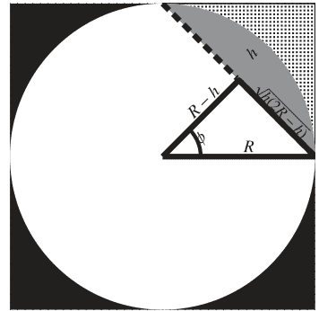

#### **(a) 圆上的球面帽**

#### **(b) 圆上的角帽**

**图 A.1** 此图展示了球面帽的多种描述。**(a)** 由穿过球体的半空间创建的高度为 h 的球面帽的描述。灰色区域代表帽的面积。**(b)** 球面帽的几何：相交的半空间与超球的质心构成一个直角三角形。该三角形与质心相邻的边长为 R - h，其斜边长为 R，与质心相对的边长为 $\sqrt{h(2R - h)}$。直角圆锥的半角 $\phi$，由 $\sin (\phi) = \frac{\sqrt{h(2R - h)}}{R}$ 给出，用于参数化该帽。


D维超球面（hypersphere）简单来说是所有到其中心点 $\ell_2$ 距离小于或等于其半径 R 的点的集合（在第 8 章中为 $\mathbf{x}^4$）；即球体 $\mathbb{B}^R$（$A_2$）。任何半径为 R 的 D 维超球面，$\mathbb{S}^R$，其体积为

$vol\left(\mathbb{S}^R\right) = \frac{\pi^{\frac{D}{2}}}{\Gamma\left(1 + \frac{D}{2}\right)} \cdot R^D$ (A.2)

表面积为

$surf\left(\mathbb{S}^R\right) = \frac{D \cdot \pi^{\frac{D}{2}}}{\Gamma\left(1 + \frac{D}{2}\right)} \cdot R^{D-1}.$

D 维球冠（spherical cap）是半空间与超球面交界形成的向外区域，如图 A.1(a) 所示。球冠的高度为 h，表示平面与球弧之间的最大长度。半径为 R 的 D 维超球面上高度为 h 的球冠将用 $\mathbb{C}_h^R$ 表示，其体积为

$vol\left(\mathbb{C}_h^R\right) = \frac{\pi^{\frac{D-1}{2}} R^D}{\Gamma\left(\frac{D+1}{2}\right)} \int_{0}^{\arccos\left(\frac{R-h}{R}\right)} \sin^D(t)\ dt$

表面积为

$surf\left(\mathbb{C}_h^R\right) = \frac{(D-1) \cdot \pi^{\frac{D-1}{2}} R^{D-1}}{\Gamma\left(\frac{D+1}{2}\right)} \int_{0}^{\arccos\left(\frac{R-h}{R}\right)} \sin^{D-2}(t)\ dt.$

或者，也可以用超球面的半径 R 与以中心半径（经过球冠顶点）为基准的半角 $\phi$ 来参数化球冠，如图 A.1(b) 所示。半角为 $\phi$ 的球冠在图中形成一个直角三角形，其中 $R - h = R \cos(\phi)$，因此 h 可以用 R 和 $\phi$ 表示为 $h = R(1 - \cos\phi)$。将 h 的这一表达式代入上述公式，可得球冠体积为

$vol\left(\mathbb{C}_\phi^R\right) = \frac{\pi^{\frac{D-1}{2}} R^D}{\Gamma\left(\frac{D+1}{2}\right)} \int_{0}^{\phi} \sin^D(t)\ dt$ (A.3)

其表面积为

$surf\left(\mathbb{C}_\phi^R\right) = \frac{(D-1) \cdot \pi^{\frac{D-1}{2}} R^{D-1}}{\Gamma\left(\frac{D+1}{2}\right)} \int_{0}^{\phi} \sin^{D-2}(t)\ dt.$

基于这些公式，我们现在对覆盖球面所需的半角为 $\phi$ 的球冠数量进行边界估计，这与 Wyner (1965) 的结果相符。

#### LEMMA A.1 (**基于 Wyner (1965) 的结果**)
覆盖半径为 R 的 D 维超球面 $\mathbb{S}^R$ 的表面，至少需要

$\left(\frac{1}{\sin(\phi)}\right)^{D-2}$

个半角为 $\phi \in (0, \frac{\pi}{2})$ 的球冠。

证明 假设有 $M$ 个球冠覆盖了超球面。这 $M$ 个球冠的总表面积至少应等于超球面的表面积。因此，

$$
M \ge \frac{surf(\mathbb{S}^R)}{surf(\mathbb{C}_\phi^R)} \\
\ge \frac{\frac{D \pi^{\frac{D}{2}}}{\Gamma(1+\frac{D}{2})} \cdot R^{D-1}}{\frac{(D-1)\pi^{\frac{D-1}{2}} R^{D-1}}{\Gamma(\frac{D+1}{2})} \int_0^\phi \sin^{D-2}(t) \, dt} \\
\ge \frac{D\sqrt{\pi} \Gamma\left(\frac{D+1}{2}\right)}{(D-1)\Gamma\left(1+\frac{D}{2}\right)} \left[\int_0^\phi \sin^{D-2}(t) \, dt\right]^{-1},
$$

这正是 Wyner 推导出的结果（尽管它被用作填充数而非覆盖数的边界）。我们继续对上述积分进行下界估计。如上所述，形式为 $\int_0^\phi \sin^D(t) \, dt$ 的积分出现在球冠体积或表面积的计算中。要对此类球冠体积进行上界估计，需注意：$i)$ 球冠由一个超球面和一个超平面定义，$ii)$ 它们的交集构成一个 $(D-1)$ 维超球面作为球冠的底面，$iii)$ 第一个超球面中心在超平面上的投影是 $(D-1)$ 维超球面交集的中心，$iv)$ 这两个中心之间的距离为 $R-h$，$v)$ 该投影点达到了球冠的最大高度；即，沿径向线继续即可达到剩余距离 $h$——球冠的高度。我们利用这些事实，通过将球冠包围在一个 $D$ 维超球面内来对球冠体积进行上界估计。如图 A.1(b) 所示，$(D-1)$ 维超球面交集的中心、原始超球面的中心以及相交球区域的边缘点构成一个直角三角形（由于对称性，所有此类边缘点都等价）。该直角三角形的一条边长为 $R-h$，斜边为 $R$。因此，另一条边的长度为 $s = \sqrt{h(2R-h)} = R \sin(\phi)$。而且，$R \ge h$ 意味着 $s \ge h$。因此，半径为 $s$ 的 $D$ 维超球面包围了球冠，根据公式 (A.2)，其体积对球冠体积有如上界：

$$vol(\mathbb{C}_\phi^R) \le vol(\mathbb{S}^s) = \frac{\pi^{\frac{D}{2}}}{\Gamma(1+\frac{D}{2})} \cdot (R \sin(\phi))^D.$$

将此边界应用于公式 A.3 中球冠体积的表达式，可得积分的以下边界：

$$
\frac{\pi^{\frac{D-1}{2}} R^D}{\Gamma\left(\frac{D+1}{2}\right)} \int_0^\phi \sin^D(t) \, dt \le \frac{\pi^{\frac{D}{2}}}{\Gamma\left(1+\frac{D}{2}\right)} \cdot (R \sin(\phi))^D \\
\int_0^\phi \sin^D(t) \, dt \le \frac{\sqrt{\pi}\Gamma\left(\frac{D+1}{2}\right)}{\Gamma\left(1+\frac{D}{2}\right)} \cdot \sin^D(\phi).
$$

利用积分的这一边界，Wyner 关于覆盖大小的边界可化简为以下（较弱的）边界：

\( M \ge \frac{D\sqrt{\pi}\Gamma \left(\frac{D+1}{2}\right)}{(D-1)\Gamma \left(1+\frac{D}{2}\right)} \left[ \frac{\sqrt{\pi}\Gamma \left(\frac{D-1}{2}\right)}{\Gamma \left(\frac{D}{2}\right)} \cdot \sin^{D-2} (\phi) \right]^{-1} \).

最后，利用伽马函数的性质，可以证明 \(\frac{\Gamma(\frac{D+1}{2})\Gamma(\frac{D}{2})}{\Gamma(1+\frac{D}{2})\Gamma(\frac{D-1}{2})} = \frac{D-1}{D}\)，从而将上述表达式化简为

\( M \ge \left( \frac{1}{\sin(\phi)} \right)^{D-2} \).

注意的是，通过进一步对积分 $\int_0^\phi \sin^D(t) \, dt$ 进行边界估计，Lemma A.1 中的边界比 Wyner (1965) 推导出的原始覆盖边界要弱。然而，该引理提供的边界对后续结果更有用，因为它以封闭形式表达（参见附录 D.2 中定理 8.13 的证明）。

当然，还有其他对这个正弦幂积分更紧的边界。在 Lemma A.1 中，这个量是通过对球冠体积的边界来控制的，但在这里我们直接对积分进行边界估计。一个朴素的边界可以通过观察到积分中的所有项都小于最后一项来实现，这得出

\(\int_0^\phi \sin^D(t) \, dt \le \phi \cdot \sin^D(\phi) \),

但此边界比引理中得到的边界更松。然而，通过先进行变量代换，可以对积分得到更紧的边界。变量代换为令 \(p = \sin^2(t)\)、\(t = \arcsin(\sqrt{p})\) 和 \(dt = \frac{dp}{2\sqrt{1-p}\sqrt{p}}$。这得到

\(\int_0^\phi \sin^D(t) \, dt = \frac{1}{2} \int_0^{\sin^2(\phi)} \frac{p^{\frac{D-1}{2}}}{\sqrt{1-p}} \, dp\).

在积分内部，分母关于 \(p\) 单调递减，因为在积分区间内 \(p \le 1$。因此，它在上限 \(p = \sin^2(\phi)$ 处取得最小值。将分母固定在该值，因此得到积分的以下上界：

\(\int_0^\phi \sin^D(t) \, dt \le \frac{1}{2\cos(\phi)} \int_0^{\sin^2(\phi)} p^{\frac{D-1}{2}} \, dp = \frac{\sin^{D+1}(\phi)}{(D+1)\cos(\phi)}.\) (A.4)

此边界并不比在 Lemma A.1 中应用的边界严格更紧，但对于较大的 \(D$ 和 \(\phi < \frac{\pi}{2}$，此结果确实能达到更紧的边界。我们在第 8.3.1.4 节中将此边界用于进一步分析。

### A.3 超立方体覆盖

在这里，我们介绍用于覆盖 $D$ 维 *超立方体图*（hypercube graphs）的结果——即一组 $2^D$ 个节点，形式为 $(\pm 1, \pm 1, \dots, \pm 1)$，其中每个节点与与其 Hamming 距离为 1 的每个其他节点都有一条边。下面的引理总结了超球面的覆盖，并在附录 D 中用于得出关于 $\ell_p$ 距离的一般查询复杂度结果：

#### LEMMA A.2
对于任何 $0 < \delta \le \frac{1}{2}$ 和 $D \ge 1$，要覆盖一个 $D$ 维超立方体图，使得每个顶点到覆盖集中某个顶点的 Hamming 距离最多为 $h = \lfloor \delta D \rfloor$，则覆盖集中顶点的最小数量的边界为

$$Q(D, h) \ge 2^{D(1-H(\delta))},$$

其中 $H(\delta) = -\delta \log_2(\delta) - (1 - \delta) \log_2(1 - \delta)$ 是 $\delta$ 的熵。

**证明** $D$ 维超立方体图中有 $2^D$ 个顶点。覆盖集中的每个顶点到最多 Hamming 距离 $h$ 以内的顶点数正好为 $\sum_{k=0}^h \binom{D}{k}$ 个。因此，覆盖超立方体图至少需要 $2^D / \left( \sum_{k=0}^h \binom{D}{k} \right)$ 个顶点。现在我们应用以下边界（参见 Flum & Grohe 2006，第 427 页）

$$\sum_{k=0}^{\lfloor \delta D \rfloor} \binom{D}{k} \le 2^{H(\delta)D}$$

到分母中，$^1$ 这对任何 $0 < \delta \le \frac{1}{2}$ 都成立。

#### LEMMA A.3
从目标 $\mathbf{x}^A$ 到半空间 $\mathbb{H}^{(\mathbf{w},\mathbf{b})} = \{ \mathbf{x} \mid \mathbf{x}^\top \mathbf{w} \ge \mathbf{b}^\top \mathbf{w} \}$ 的 $\ell_p$ 代价函数 $A_p$ 的最小值，可以用由法向量 $\mathbf{w}$ 和位移 $d = (\mathbf{b} - \mathbf{x}^A)^\top \mathbf{w}$ 参数化的等价超平面 $\mathbf{x}^\top \mathbf{w} \ge d$ 来表示，如下

$$\min_{\mathbf{x} \in \mathbb{H}^{(\mathbf{w},d)}} A_p(\mathbf{x} - \mathbf{x}^A) = \begin{cases} d \cdot \|\mathbf{w}\|_\frac{-p}{p-1}^{-1}, & \text{if } d > 0 \\ 0, & \text{otherwise} \end{cases} \tag{A.5}$$

对于所有 $1 < p < \infty$，而当 $p = \infty$ 时，则为

$$\min_{\mathbf{x} \in \mathbb{H}^{(\mathbf{w},d)}} A_\infty(\mathbf{x} - \mathbf{x}^A) = \begin{cases} d \cdot \|\mathbf{w}\|_{-1}^{-1}, & \text{if } d > 0 \\ 0, & \text{otherwise} \end{cases} \tag{A.6}.$$

**证明** 对于 $1 < p < \infty$，在半空间 $\mathbb{H}^{(\mathbf{w},\mathbf{b})}$ 上最小化 $A_p$ 等价于寻找以下问题的极小点

$$\min_{\mathbf{x}} \frac{1}{p} \sum_{i=1}^D |x_i|^p \quad \text{s.t. } \mathbf{x}^\top \mathbf{w} \le d.$$

显然，如果 $d \le 0$ 则向量 $\mathbf{0}$（在变换空间中对应 $\mathbf{x}^A$）平凡地满足约束并以代价 0 最小化代价函数，这得出

$^1$ Gottlieb, Kontorovich, & Mossel (2011) 对这个二项式系数之和给出了更紧的熵边界，但对我们的结果来说是不必要的。


方程 (A.5) 的第二种情况。对于 \( d > 0 \) 的情况，我们构造拉格朗日函数
\[
\mathcal{L} \left( \mathbf{x}, \lambda \right) \triangleq \frac{1}{p} \sum_{i=1}^D |x_i|^p - \lambda \left( \mathbf{x}^\top \mathbf{w} - d \right) .
\]

对 \( \mathbf{x} \) 求偏导并令其等于零，可得
\[
x_i^* = \text{sign}(w_i) \left( \lambda |w_i| \right)^{\frac{1}{p-1}} .
\]

将其代入拉格朗日函数可得
\[
\mathcal{L} \left( \mathbf{x}^*, \lambda \right) = \frac{1-p}{p} \lambda^{\frac{p}{p-1}} \sum_{i=1}^D |w_i|^{\frac{p}{p-1}} + \lambda d ,
\]

我们对 \( \lambda \) 求导并令导数等于零，可得
\[
\lambda^* = \left( \frac{d}{\sum_{i=1}^D |w_i|^{\frac{p}{p-1}}} \right)^{p-1} .
\]

将此解代入 \( \mathbf{x}^* \) 的公式，可得解
\[
x_i^* = \text{sign}(w_i) \left( \frac{d}{\sum_{i=1}^D |w_i|^{\frac{p}{p-1}}} \right) |w_i|^{\frac{1}{p-1}} .
\]

该最优解的 \( \ell_p \) 代价为
\[
A_p \left( \mathbf{x}^* - \mathbf{x}^0 \right) = d \cdot \| \mathbf{w} \|_{\frac{p}{p-1}}^{-1} ,
\]

这是方程 (A.5) 的第一种情况。

对于 \( p = \infty \)，再次如果 \( d \le 0 \)，则零向量 \( \mathbf{0} \) 平凡地满足约束并使代价函数最小化，代价为 0，这给出了方程 (A.6) 的第二种情况。对于 \( d > 0 \) 的情况，我们利用超立方体（\( \ell_\infty \) 代价函数的等代价球）的几何结构来推导方程 (A.6) 的第二种情况。任何最优解都必须出现在 \( \mathbf{x}^\top \mathbf{w} = \mathbf{b}^\top \mathbf{w} \) 给定的超平面与关于 \( \mathbf{x}^0 \) 的超立方体相切的点——这要么发生在超立方体的边（面）上，要么发生在角上。然而，如果平面沿边（面）相切，它也必然在超立方体的一个角上相切。因此，最优代价超立方体的某个角上总存在一个最优解。

超立方体的角具有以下性质：
\[
|x_1^*| = |x_2^*| = \dots = |x_D^*| ;
\]

也就是说，该最优解所有坐标的幅值都相同。此外，最优解第 \( i \) 个坐标的符号必须与超平面第 \( i \) 个坐标 \( w_i \) 的符号一致。结合超平面约束，这些约束推导出以下最优解公式：

\[
x_i = d \cdot \text{sign}(w_i) \| \mathbf{w} \|_1^{-1}
\]

对所有 \( i \) 成立。该解的 \( \ell_\infty \) 代价为 \( d \cdot \| \mathbf{w} \|_1^{-1} \)。

## 附录 B 高球攻击的完整证明

在本附录中，我们给出第 4 章定理的证明。为此，我们引入 \((\tau, k)\)-差分序列的概念，这是一对序列 \(\mathbf{a}, \mathbf{b} \in \mathcal{A}^{(M, \infty)}\)，它们在除 \(\tau^{\text{th}}\)、\(\tau+1^{\text{th}}\)、\(...\)、\(\tau+k^{\text{th}}\) 个连续元素外的所有位置都相同，并具有以下质量平衡性质：

\[
\sum_{i=\tau}^{\tau+k} a_i = \sum_{i=\tau}^{\tau+k} b_i. \tag{B.1}
\]

以下关于 \((\tau, 1)\)-差分序列的引理简化了后续的若干证明。

### 引理 B.1

对于任意 \((\tau, 1)\)-差分序列 \(\mathbf{a}, \mathbf{b} \in \mathcal{A}^{(M, \infty)}\)，它们除了第 \(\tau^{\text{th}}\) 和 \((\tau+1)^{\text{th}}\) 元素外其他元素均相同（根据方程 (B.1) 满足 \(a_\tau + a_{\tau+1} = b_\tau + b_{\tau+1}\)），这些序列之间的距离差 \(\Delta_{\mathbf{a}, \mathbf{b}} \triangleq D(\mathbf{a}) - D(\mathbf{b})\) 可表示为

\[
\Delta_{\mathbf{a}, \mathbf{b}} = \frac{(\mu_{\tau-1}^{(\mathbf{a})} + b_\tau) \cdot a_\tau \cdot a_{\tau+1} - (\mu_{\tau-1}^{(\mathbf{a})} + a_\tau) \cdot b_\tau \cdot b_{\tau+1}}{(\mu_{\tau-1}^{(\mathbf{a})} + a_\tau) \left(\mu_{\tau-1}^{(\mathbf{a})} + b_\tau\right) \left(\mu_{\tau-1}^{(\mathbf{a})} + a_\tau + a_{\tau+1}\right)} \tag{B.2}
\]

其中 \(\mu_t^{(\mathbf{a})} = N + \sum_{\ell=1}^t a_\ell\) 是序列 \(\mathbf{a}\) 前 \(t\) 个元素的累积和，如方程 (4.7) 所示。只要 \(\mu_{\tau-1}^{(\mathbf{a})} > 0\) 或 \(a_\tau > 0\) 与 \(b_\tau > 0\) 同时成立，此结果即成立。

证明 首先，对于 \(t < \tau\)，有 \(\mu_t^{(\mathbf{a})} = \mu_t^{(\mathbf{b})}\)，因为两个序列在第 \(\tau^{\text{th}}\) 元素之前完全相同。类似地，对于 \(t > \tau + 1\)，我们同样有 \(\mu_t^{(\mathbf{a})} = \mu_t^{(\mathbf{b})}\)，因为序列仅在第 \(\tau^{\text{th}}\) 和 \((\tau+1)^{\text{th}}\) 元素上不同，且根据方程 (B.1) 它们具有质量平衡性，其中我们定义 \(\gamma \triangleq a_\tau + a_{\tau+1} = b_\tau + b_{\tau+1}\) 为这些序列的平衡常数。利用这两个事实，并根据方程 (4.12) 有 \(\delta_t(\mathbf{a}) = \frac{a_t}{\mu_t^{(\mathbf{a})}}\)，可知若 \(t < \tau\) 或 \(t > \tau + 1\)，则 \(\delta_t(\mathbf{a}) = \delta_t(\mathbf{b})\)。因此，这两个序列所达到的距离差可根据方程 (4.11) 表示为

\[
\Delta_{\mathbf{a}, \mathbf{b}} = \sum_{t=1} [\delta_t (\mathbf{a}) - \delta_t (\mathbf{b})]
\]
\[
= \sum_{t=1}^{\tau-1} [\delta_t (\mathbf{a}) - \delta_t (\mathbf{b})] + \delta_\tau (\mathbf{a}) - \delta_\tau (\mathbf{b}) + \delta_{\tau+1} (\mathbf{a}) - \delta_{\tau+1} (\mathbf{b})
\]
\[
\underbrace{= 0}
\]
\[
+ \sum_{t=\tau+2} [\delta_t (\mathbf{a}) - \delta_t (\mathbf{b})]
\]
\[
\underbrace{= 0}
\]
\[
= \frac{a_\tau}{\mu_{\tau-1}^{(\mathbf{a})}} - \frac{b_\tau}{\mu_\tau^{(\mathbf{b})}} + \frac{a_{\tau+1}}{\mu_{\tau+1}^{(\mathbf{a})}} - \frac{b_{\tau+1}}{\mu_{\tau+1}^{(\mathbf{b})}}
\]
\[
= \frac{a_\tau}{\mu_{\tau-1}^{(\mathbf{a})} + a_\tau} - \frac{b_\tau}{\mu_{\tau-1}^{(\mathbf{a})} + b_\tau} + \frac{a_{\tau+1}}{\mu_{\tau-1}^{(\mathbf{a})} + \gamma} - \frac{b_{\tau+1}}{\mu_{\tau-1}^{(\mathbf{a})} + \gamma}.
\]

要合并这四项，我们可以得到一个公共分母 \(\Gamma = \left( \mu_{\tau-1}^{(\mathbf{a})} + a_\tau \right) \left( \mu_{\tau-1}^{(\mathbf{a})} + b_\tau \right) \left( \mu_{\tau+1}^{(\mathbf{a})} + \gamma \right)\)，其合并后的分子由以下给出

\[
\left[ a_\tau \left( \mu_{\tau-1}^{(\mathbf{a})} + b_\tau \right) - b_\tau \left( \mu_{\tau-1}^{(\mathbf{a})} + a_\tau \right) \right] \left( \mu_{\tau-1}^{(\mathbf{a})} + \gamma \right)
\]
\[
+ \left( a_{\tau+1} - b_{\tau+1} \right) \left( \mu_{\tau-1}^{(\mathbf{a})} + a_\tau \right) \left( \mu_{\tau-1}^{(\mathbf{a})} + b_\tau \right)
\]
\[
= \mu_{\tau-1}^{(\mathbf{a})} a_\tau a_{\tau+1} - \mu_{\tau-1}^{(\mathbf{a})} b_\tau b_{\tau+1} + b_\tau a_\tau a_{\tau+1} - a_\tau b_\tau b_{\tau+1}
\]
\[
= \left( \mu_{\tau-1}^{(\mathbf{a})} + b_\tau \right) \cdot a_\tau \cdot a_{\tau+1} - \left( \mu_{\tau-1}^{(\mathbf{a})} + a_\tau \right) \cdot b_\tau \cdot b_{\tau+1},
\]

在此过程中，我们利用 \(\gamma\) 的定义消去了某些项。将此分子与分母 \(\Gamma\) 合并，得到方程 (B.2)。最后，\(\mu_{\tau-1}^{(\mathbf{a})} > 0\) 或 \(a_\tau > 0\) 与 \(b_\tau > 0\) 同时成立的条件是必要的，以防止分母变为零。

### B.1 定理 4.7 的证明

在这里，我们表明根据方程 (4.5) 的最优攻击可以以贪婪的方式进行优化。此外，我们表明最优攻击点都位于超球边界与所需攻击方向的交点处。

_证明_ 考虑攻击的第 \(t^\text{th}\) 次迭代，对任意 \(t \in \mathfrak{N}\)。攻击者在第 \(t^\text{th}\) 次迭代中的目标是最大化方程 (4.5) 给出的位移对齐度。攻击者通过构造一组 \(\alpha_t \in \mathfrak{N}\) 个攻击点来实现此目标：\(\mathbb{A}^{(t)} = \{ \mathbf{a}^{(t, \ell)} \}_{\ell=1}^{\alpha_t}\)。这些点旨在最大化 \(\mathbf{D}_t^\top \frac{\mathbf{x}^t - \mathbf{c}^{(0)}}{\| \mathbf{x}^t - \mathbf{c}^{(0)} \|}\)，其中根据方程 (4.4) 有 \(\mathbf{D}_t = \frac{\mathbf{c}^{(t)} - \mathbf{c}^{(0)}}{R}\)，\(\mathbf{c}^{(t)}\) 由方程 (4.8) 递归定义，且每个攻击向量被限制在第 \((t-1)^\text{th}\) 个超球内；即，对所有 \(\ell = 1, \dots, \alpha_t\)，有 \(\| \mathbf{a}^{(t, \ell)} - \mathbf{c}^{(t-1)} \| \le R\)。攻击者的目标可以在不损失一般性的情况下进行修改


为了普遍性，首先通过变换空间使得 \(\mathbf{c}^{(t-1)} = \mathbf{0}\)（通过变换 \(\hat{\mathbf{x}} \mapsto \mathbf{x} - \mathbf{c}^{(t-1)}\)）。这产生了攻击优化的以下等效程序：

\(\begin{aligned} \max_{B,(t)} \rho\left(\hat{\mathbf{D}}_t\right) = \hat{\mathbf{D}}_t^\top \frac{\hat{\mathbf{x}}^4 - \hat{\mathbf{c}}^{(0)}}{\left\| \hat{\mathbf{x}}^4 - \hat{\mathbf{c}}^{(0)} \right\|} \\ \text{s.t.} \quad \forall \ell \in 1, \dots, \alpha_t \quad \left\| \hat{\mathbf{a}}^{(t,\ell)} \right\|^2 \le R^2, \end{aligned}\)

其中 \(\hat{\mathbf{D}}_t = \frac{\hat{\mathbf{c}}^{(t)} - \hat{\mathbf{c}}^{(0)}}{R}\) 且 \(\hat{\mathbf{c}}^{(t)}\) 采用简化形式 \(\hat{\mathbf{c}}^{(t)} = \frac{1}{\mu_t} \sum_{\ell=1}^{\alpha_t} \hat{\mathbf{a}}^{(t,\ell)}\)。该程序在第 \(t^\text{th}\) 次攻击迭代中的拉格朗日函数为

\(\begin{aligned} \mathcal{L}_t \left(\left\{ \hat{\mathbf{a}}^{(t,\ell)} \right\}, \lambda \right) = \hat{\mathbf{D}}_t^\top \frac{\hat{\mathbf{x}}^4 - \hat{\mathbf{c}}^{(0)}}{\left\| \hat{\mathbf{x}}^4 - \hat{\mathbf{c}}^{(0)} \right\|} - \sum_{\ell=1}^{\alpha_t} \lambda_\ell \left( \left\| \hat{\mathbf{a}}^{(t,\ell)} \right\|^2 - R^2 \right) \\ = \frac{1}{R\mu_t \left\| \hat{\mathbf{x}}^4 - \hat{\mathbf{c}}^{(0)} \right\|} \sum_{\ell=1}^{\alpha_t} \left(\hat{\mathbf{a}}^{(t,\ell)}\right)^\top \left( \hat{\mathbf{x}}^4 - \hat{\mathbf{c}}^{(0)} \right) - \sum_{\ell=1}^{\alpha_t} \lambda_\ell \left(\hat{\mathbf{a}}^{(t,\ell)}\right)^\top \hat{\mathbf{a}}^{(t,\ell)} \\ - \frac{\left(\hat{\mathbf{c}}^{(0)}\right)^\top \left( \hat{\mathbf{x}}^4 - \hat{\mathbf{c}}^{(0)} \right)}{R \left\| \hat{\mathbf{x}}^4 - \hat{\mathbf{c}}^{(0)} \right\|} + R^2 \sum_{\ell=1}^{\alpha_t} \lambda_\ell \end{aligned}\)

其中变量 \(\lambda_\ell \ge 0\) 是拉格朗日乘数，且第二个等式来自展开上述形式的 \(\hat{\mathbf{D}}_t\)。

我们对 \(\mathcal{L}_t\left(\left\{ \hat{\mathbf{a}}^{(t,\ell)} \right\}, \lambda\right)\) 关于拉格朗日乘数 \(\lambda\) 计算偏导数并令其为零，以揭示在解处 \(\left\| \hat{\mathbf{a}}^{(t,\ell)} \right\| = R\)。此外，根据上述程序对偶产生的互补松弛条件，可知拉格朗日乘数非零；即，\(\forall i ~ \lambda_i \ge 0\)。接着，对每个 \(\hat{\mathbf{a}}^{(t,\ell)}\) 计算 \(\mathcal{L}_t\left(\left\{ \hat{\mathbf{a}}^{(t,\ell)} \right\}, \lambda\right)\) 的偏导数并令其为零，可知在解处，对所有 \(\ell\) 都有，

\(\hat{\mathbf{a}}^{(t,\ell)} = \frac{1}{2\lambda_\ell R\mu_t} \frac{\hat{\mathbf{x}}^4 - \hat{\mathbf{c}}^{(0)}}{\left\| \hat{\mathbf{x}}^4 - \hat{\mathbf{c}}^{(0)} \right\|},\)

这表明所有最优攻击向量必须是向量 \(\hat{\mathbf{x}}^4 - \hat{\mathbf{c}}^{(0)}\) 的缩放版本。因此，基于 \(\left\| \hat{\mathbf{a}}^{(t,\ell)} \right\| = R\) 这一事实，我们必须有

\(\hat{\mathbf{a}}^{(t,\ell)} = R \cdot \frac{\hat{\mathbf{x}}^4 - \hat{\mathbf{c}}^{(0)}}{\left\| \hat{\mathbf{x}}^4 - \hat{\mathbf{c}}^{(0)} \right\|} \quad \text{and} \quad \hat{\mathbf{c}}^{(t)} = R \cdot \frac{\alpha_t}{\mu_t} \cdot \frac{\hat{\mathbf{x}}^4 - \hat{\mathbf{c}}^{(0)}}{\left\| \hat{\mathbf{x}}^4 - \hat{\mathbf{c}}^{(0)} \right\|}.\)

通过撤销使得 \(\mathbf{c}^{(t-1)} = \mathbf{0}\) 的变换，攻击向量可以表示为

\(\mathbf{a}^{(t,\ell)} = \mathbf{c}^{(t-1)} + R \cdot \frac{\mathbf{x}^4 - \mathbf{c}^{(0)}}{\left\| \mathbf{x}^4 - \mathbf{c}^{(0)} \right\|},\)

这给出了定理的第一部分。同样，通过对重心撤销此变换并求解由此产生的简单递归，我们得到

\(\mathbf{c}^{(t)} = \mathbf{c}^{(t-1)} + R \cdot \frac{\alpha_t}{\mu_t} \cdot \frac{\mathbf{x}^4 - \mathbf{c}^{(0)}}{\left\| \mathbf{x}^4 - \mathbf{c}^{(0)} \right\|} \quad = \quad \mathbf{c}^{(0)} + R \cdot \frac{\mathbf{x}^4 - \mathbf{c}^{(0)}}{\left\| \mathbf{x}^4 - \mathbf{c}^{(0)} \right\|} \cdot \sum_{\ell=1}^t \frac{\alpha_\ell}{\mu_\ell},\)

此即所证。

### B.2 定理 4.14 的证明

证明。我们表明，任何包含 \( M \in \mathfrak{N}_0 \) 个攻击点（按定义 4.10 的含义）的最优序列必须具有单调递增的非零元素序列。对于 \( M = 0 \)，平凡序列 \( \alpha^* = \mathbf{0} \) 是 \( \mathcal{A}^{(M, \infty)} \) 中唯一的序列，因此是最优的（并且平凡地满足该定理）。

对于 \( M > 0 \)，证明通过矛盾法进行，假设存在一个最优序列 \( \alpha^* \in \mathcal{A}^{(M, \infty)} \)，其非零元素子序列不是单调非递减的。为简化证明，我们改为考虑一个等效序列（关于距离函数），即从 \( \alpha^* \) 中移除所有交错的零元素。如定理 4.12 所示，序列中零元素的位置 *不影响* 距离函数 \( D(\cdot) \)。因此，序列 \( \alpha^*\) 达到的距离与通过移除 \(\alpha^*\) 的零元素所创建的序列 \(\alpha^{opt}\) 达到的距离相同。此外，若 \(\alpha^*\) 在某个非零子序列中不是非递减的，则序列 \(\alpha^{opt}\) *必须* 至少有一对相邻的递减元素。即，存在索引 \(\tau\)，使得第 \(\tau^\text{th}\) 和 \((\tau + 1)^\text{th}\) 元素递减：\(\alpha_\tau^{opt} > \alpha_{\tau+1}^{opt}\)。我们表明，通过交换这些元素，得到的序列达到的距离超过 \(\alpha^{opt}\)，即 \(\alpha^{opt}\) 不是最优的。正式地，我们假设

\(\exists \alpha^{opt} \in \mathcal{A}^{(M, \infty)} \text{ s.t. } \forall \alpha \in \mathcal{A}^{(M, \infty)} \quad D(\alpha^{opt}) \ge D(\alpha) \qquad \text{(B.3)}\)
\(\text{and } \exists \tau \in \mathfrak{N} \text{ s.t. } \alpha_\tau^{opt} > \alpha_{\tau+1}^{opt} > 0. \qquad \text{(B.4)}\)

现在我们考虑一个替代序列 \(\alpha' \in \mathcal{A}^{(M, \infty)}\)，它交换 \(\alpha^{opt}\) 的第 \(\tau^\text{th}\) 和 \((\tau + 1)^\text{th}\) 元素：

\(\alpha'_\tau = \left\{ \begin{array}{ll} \alpha_t^{opt}, & \text{if } t < \tau \\ \alpha_{t+1}^{opt}, & \text{if } t = \tau \\ \alpha_{t-1}^{opt}, & \text{if } t = \tau + 1 \\ \alpha_t^{opt}, & \text{if } t > \tau + 1 \end{array} \right.\)

按设计，\(\alpha^{opt}\) 和 \(\alpha'\) 是 \((\tau, 1)\)-差异序列，因此我们可以通过应用 Lemma B.1 来计算它们距离的差异，从而得到\(^1\)

\(\Delta_{\alpha^{opt}, \alpha'} = \frac{ \left( \mu_{\tau-1}^{(\alpha^{opt})} + \alpha'_\tau \right) \cdot \alpha_\tau^{opt} \cdot \alpha_{\tau+1}^{opt} - \left( \mu_{\tau-1}^{(\alpha^{opt})} + \alpha_\tau^{opt} \right) \cdot \alpha'_\tau \cdot \alpha'_{\tau+1} }{ \left( \mu_{\tau-1}^{(\alpha^{opt})} + \alpha_\tau^{opt} \right) \left( \mu_{\tau-1}^{(\alpha^{opt})} + \alpha'_\tau \right) \left( \mu_{\tau-1}^{(\alpha^{opt})} + \alpha_\tau^{opt} + \alpha_{\tau+1}^{opt} \right) }\)
\(= \frac{ \left( \alpha_{\tau+1}^{opt} - \alpha_\tau^{opt} \right) \cdot \alpha_\tau^{opt} \cdot \alpha_\tau^{opt} }{ \left( \mu_{\tau-1}^{(\alpha^{opt})} + \alpha_\tau^{opt} \right) \left( \mu_{\tau-1}^{(\alpha^{opt})} + \alpha_{\tau+1}^{opt} \right) \left( \mu_{\tau-1}^{(\alpha^{opt})} + \alpha_\tau^{opt} + \alpha_{\tau+1}^{opt} \right) },\)

其中 \(\mu_t^{(\alpha^{opt})} = N + \sum_{\ell=1}^t \alpha_\ell^{opt}\) 来自 Lemma B.1。

\(^1\) 虽然 \(\mu_{\tau-1}^{(\alpha^{opt})}\) 可能为零（例如，若 \(\tau = 0\)），但该引理仍然适用，因为我们假设了 \(\alpha_\tau^{opt} > \alpha_{\tau+1}^{opt} > 0\)。

上述表达式的分母严格为正，因为 \(\alpha_\tau^{opt} > 0\)，\(\alpha_{\tau+1}^{opt} > 0\) 且 \(\mu_{\tau-1}^{(\alpha^{opt})} \ge 0\)。此外，根据假设 (B.4)，我们有 \(\alpha_\tau^{opt} > \alpha_{\tau+1}^{opt} > 0\)，因此上述分子严格小于零。\(^2\) 从而得到 \(\Delta_{\alpha^{opt},\alpha'} = D(\alpha^{opt}) - D(\alpha') < 0\)，进而得出 \(D(\alpha^*) = D(\alpha^{opt}) < D(\alpha')\)。这与假设 (B.3)（即 \(\alpha^*\) 是最优的）矛盾，从而表明，任何其非零元素子序列不是单调非递减的序列都是非最优的。因此，任何最优攻击序列的非零元素的每个子序列都必须是单调非递减的。

### B.3 定理 4.15 的证明

我们表明，攻击序列达到的最优距离在攻击者可用的攻击能力和执行攻击的攻击持续时间方面均严格单调递增。为此，我们首先证明，除非只有一个攻击点或重新训练迭代，否则在单个重新训练迭代中使用所有攻击点是非最优的。

### LEMMA B.2

对于 \(M > 1\) 和 \(T > 1\)，任何仅有一个非零元素 \(\tau\)（即 \(\alpha_\tau > 0\) 且对所有 \(t \neq \tau\) 均有 \(\alpha_t = 0\)）的攻击 \(\boldsymbol{\alpha}\) 都是一个非最优序列。

证明。上述所述的任何此类序列 \(\boldsymbol{\alpha}\) 根据公式 (4.11) 和 (4.12) 达到距离 1。对于 \(\alpha_\tau = 1\)，我们构造替代序列 \(\alpha'_1 = 1\) 和 \(\alpha'_2 = 1\)，该序列属于 \(M > 1\) 和 \(T > 1\) 时的 \(\mathcal{A}^{(M,T)}\) 并达到距离 \(\frac{3}{2} > 1\)。因此，此替代序列达到的距离高于任何单元素为 1 的序列，故这些不是最优序列。

同样，对于 \(\alpha_\tau > 1\)，我们再次构造一个替代序列 \(\boldsymbol{\alpha}'\)，其中 \(\alpha'_1 = \alpha_\tau - 1\) 且 \(\alpha'_2 = 1\)，该序列与 \(\boldsymbol{\alpha}\) 具有相同的攻击大小，并且持续时间为 2，从而属于 \(M > 1\) 和 \(T > 1\) 时的 \(\mathcal{A}^{(M,T)}\)。此外，替代序列达到的距离为 \(1 + \frac{1}{\alpha_\tau} > 1\)。因此，我们已在此空间中展示了一个达到更高距离的替代序列，故任何此类仅有一个非零元素的序列都不是最优的。

本引理是证明下文定理 4.15 所需的若干结果之一。此外，它假设任何有限攻击大小 \(M\) 的序列中存在最大非零元素。这对所有整数序列成立，但对下文讨论的连续值序列不成立。我们现在介绍本节的主要证明。

定理 4.15 证明。首先，对于任何固定的 \(N > 0\)，\(D_N^*(M, \infty)\) 和 \(D_N^*(M, T)\) 关于 \(M \in \Re_0\) 严格单调递增；即，\(\forall M^{(1)} < M^{(2)} \in \Re_0\)，我们主张 \(D_N^*(M^{(1)}, \infty) < D_N^*(M^{(2)}, \infty)\)，且对于任何固定的 \(T \in \Re\)，\(D_N^*(M^{(1)}, T) < D_N^*(M^{(2)}, T)\)。根据 \(D_N^*(\cdot, \infty)\) 的定义 4.10，存在

\(^2\) 注意，如果 \(\alpha_\tau^{opt} = 0\) 或 \(\alpha_{\tau+1}^{opt} = 0\) 中任何一项成立，分子将为零，从而使两个序列具有相等的距离，并使此结果与定理 4.12 一致。


存在序列 $\boldsymbol{\alpha}^* \in \mathcal{A}^{(M^{(1)}, \infty)}$，使得 $D \left( \boldsymbol{\alpha}^* \right) = D_N^* \left( M^{(1)}, \infty \right)$。然而，我们也有 $\boldsymbol{\alpha}^* \in \mathcal{A}^{(M^{(2)}, \infty)}$；即，来自 $\mathcal{A}^{(M^{(1)}, \infty)}$ 的任何最优序列也位于空间 $\mathcal{A}^{(M^{(2)}, \infty)}$ 中，但其总攻击容量最多使用 $M^{(1)} < M^{(2)}$。而且，由于 $\sum_t \alpha_t^* \le M^{(1)}$ 且所有序列都由元素 $\alpha_t^* \in \mathfrak{N}_0$ 组成，必然存在 $\alpha_\tau^*$ 的最后一个非零索引 $\tau \in \mathfrak{N}$；即，对于所有 $t > \tau$，$\alpha_t^* = 0$。由此，我们构造一个替代序列 $\boldsymbol{\alpha}'$，它与 $\boldsymbol{\alpha}^*$ 相同，只是将多余的攻击容量添加到其最后一个非零元素：$\alpha'_\tau = \alpha_\tau^* + m$，其中 $m = M^{(2)} - M^{(1)} > 0$。这两个序列的距离之差仅为它们最终非零贡献之差：

```
D \left( \boldsymbol{\alpha}^* \right) - D \left( \boldsymbol{\alpha}' \right) = \delta_\tau \left( \boldsymbol{\alpha}^* \right) - \delta_\tau \left( \boldsymbol{\alpha}' \right)
= \frac{\alpha_\tau^*}{M^{(1)} + N} - \frac{\alpha_\tau^* + m}{M^{(2)} + N}
= \frac{\alpha_\tau^* M^{(2)} + \alpha_\tau^* N - \alpha_\tau^* M^{(1)} - \alpha_\tau^* N - m M^{(1)} - m N}{\left( M^{(1)} + N \right) \left( M^{(2)} + N \right)}
= \frac{\left( \alpha_\tau^* - M^{(1)} - N \right) m}{\left( M^{(1)} + N \right) \left( M^{(2)} + N \right)} ,
```

其中 $m > 0$ 且 $M^{(2)} > M^{(1)} \ge 0$。该比率中所有项均为 *正*，除项 $\left( \alpha_\tau^* - M^{(1)} - N \right)$ 外，该项为 *负*，因为 $\alpha_\tau^* \le M^{(1)}$ 且 $N \ge 1$。因此，上述差值为负，且 $D_N^* \left( M^{(2)}, \infty \right) \ge D \left( \boldsymbol{\alpha}' \right) > D \left( \boldsymbol{\alpha}^* \right) = D_N^* \left( M^{(1)}, \infty \right)$。此证明也适用于任何固定 $T \ge 1$，从而也表明 $D_N^* \left( M^{(2)}, T \right) > D_N^* \left( M^{(1)}, T \right)$。其次，对于 $N = 0$，我们证明了 $D_0^* \left( \cdot, \infty \right)$ 和 $D_0^* \left( \cdot, T \right)$ 对任何 $T > 1$ 的严格单调性。由于对任何 $M \in \mathfrak{N}_0$ 都有 $D_0^* \left( M, \infty \right) \ge 0$，且 $D_0^* \left( M, \infty \right) = 0$ 当且仅当 $M = 0$，因此对任何 $M > 0$ 都有 $D_0^* \left( M, \infty \right) > D_0^* \left( 0, \infty \right)$，符合要求。在 $M^{(2)} > M^{(1)} = 1$ 的情况下，$\mathcal{A}^{(1, \infty)}$（或 $\mathcal{A}^{(1, T)}$）中的每个序列都达到 $D_0^* \left( 1, \infty \right) = D_0^* \left( 1, T \right) = 1$。此外，序列 $\left( 1, 1 \right)$ 对于所有 $M^{(2)} > 1$ 都在 $\mathcal{A}^{(M^{(2)}, \infty)}$ 中（并且对于任何 $T > 1$ 也在 $\mathcal{A}^{(M^{(2)}, T)}$ 中），它达到的距离为 $1 + \frac{1}{2}$，从而超过了 $D_0^* \left( 1, \infty \right)$。因此，再次得到 $D_0^* \left( M^{(2)}, \infty \right) > D_0^* \left( 1, \infty \right)$，且对于任何固定 $T > 1$，$D_0^* \left( M^{(2)}, T \right) > D_0^* \left( 1, T \right)$。最后，对于 $M^{(2)} > M^{(1)} > 1$，我们采用与上面用于 $N > 0$ 类似的证明。同样，存在序列 $\boldsymbol{\alpha}^* \in \mathcal{A}^{(M^{(1)}, \infty)}$，使得 $D \left( \boldsymbol{\alpha}^* \right) = D_0^* \left( M^{(1)}, \infty \right)$，并且我们取 $\tau$ 为 $\boldsymbol{\alpha}^*$ 最后一个非零元素的索引。我们再次构造一个替代序列 $\boldsymbol{\alpha}'$，它与 $\boldsymbol{\alpha}^*$ 相同，只是将多余的攻击容量添加到其最后一个非零元素：$\alpha'_\tau = \alpha_\tau^* + m$，其中 $m = M^{(2)} - M^{(1)} > 0$。然后，如上所述，在检查这两个序列的距离差时，可以证明

```
D \left( \boldsymbol{\alpha}^* \right) - D \left( \boldsymbol{\alpha}' \right) = \frac{\left( \alpha_\tau^* - M^{(1)} \right) m}{M^{(1)} \cdot M^{(2)}} ,
```

其中 $m > 0$ 且 $M^{(2)} > M^{(1)} > 1$。同样，分数中的所有项均为 *正*，除项 $\left( \alpha_\tau^* - M^{(1)} \right)$ 外。但是，根据 Lemma B.2，对于 $M^{(1)} > 1$，$\boldsymbol{\alpha}^* \in \mathcal{A}^{(M^{(1)}, \infty)}$ 除非 $\alpha_\tau^* < M^{(1)}$，否则不能是最优的。因此，上述差值为负，且 $D_0^* \left( M^{(2)}, \infty \right) \ge D \left( \boldsymbol{\alpha}' \right) > D \left( \boldsymbol{\alpha}^* \right) = D_0^* \left( M^{(1)}, \infty \right)$。此证明构造也适用于任何固定持续时间 $T > 1$，从而也表明 $D_0^* \left( M^{(2)}, T \right) > D_0^* \left( M^{(1)}, T \right)$。

第三，我们表明 $D_N^*(M, T)$ 相对于 $T \in \{1, \dots, M\}$ 严格单调递增；即，对于任何固定 $N \in \mathbb{N}_0$ 和 $M \in \mathfrak{N}$ 以及 $\forall T_1 < T_2 \in \{1, \dots, M\}$，我们声称 $D_N^*(M, T_1) < D_N^*(M, T_2)$。

对于 $T_1, T_2 \le M$，根据 $D_N^*(M, T)$ 的定义 4.10，存在序列 $\boldsymbol{\alpha}^* \in \mathcal{A}^{(M, T_1)}$，使得 $D(\boldsymbol{\alpha}^*) = D_N^*(M, T_1)$。然而，由于 $T_2 > T_1$，我们也有 $\boldsymbol{\alpha}^* \in \mathcal{A}^{(M, T_2)}$；即，来自 $\mathcal{A}^{(M, T_1)}$ 的任何最优序列也位于空间 $\mathcal{A}^{(M, T_2)}$ 中，但拥有一个末尾的零序列：$\alpha_{T_1+1}^* = \dots = \alpha_{T_2}^* = 0$。或者，存在某个最后索引 $\tau < T_2$，使得 $\alpha_\tau^* > 0$ 且对于所有 $t > \tau$ 都有 $\alpha_t^* = 0$。

事实上，这个 $\tau^{\text{th}}$ 元素必须大于 1，因为根据定理 4.14，$\boldsymbol{\alpha}^*$ 的非零元素必须是非递减的。因此，要么 $\alpha_\tau^* > 1$，要么所有前面的元素都必须在 $\{0, 1\}$ 中。然而，由于 $\tau < T_2 \le M$，这样的序列最多只有 $M - 1$ 个元素，但本定理的第一部分已经表明这样的序列不是最优的。因此，$\alpha_\tau^* > 1$。

利用这一事实，我们可以构造一个替代序列 $\boldsymbol{\alpha}' \in \mathcal{A}^{(M, T_2)}$，将 $\boldsymbol{\alpha}^*$ 的 $\tau^{\text{th}}$ 元素中的一个攻击点移动到其 $(\tau+1)^{\text{th}}$ 元素：

```
\(\alpha'_t = \begin{cases} \alpha_t^*, & \text{if } t < \tau \\ \alpha_t^* - 1, & \text{if } t = \tau \\ 1, & \text{if } t = \tau + 1 \\ \alpha_{t-1}^*, & \text{if } t > \tau + 1 \end{cases}\)
```

按设计，$\boldsymbol{\alpha}^*$ 和 $\boldsymbol{\alpha}'$ 是 $(\tau, 1)$-差异序列，且 Lemma B.1 得出

```
\(\Delta_{\boldsymbol{\alpha}^*, \boldsymbol{\alpha}'} = \frac{(\mu_{\tau-1}^{(\boldsymbol{\alpha}^*)} + \alpha'_\tau) \cdot \alpha'_\tau \cdot \alpha^*_{\tau+1} - (\mu_{\tau-1}^{(\boldsymbol{\alpha}^*)} + \alpha^*_\tau) \cdot \alpha'_\tau \cdot \alpha'_{\tau+1}}{(\mu_{\tau-1}^{(\boldsymbol{\alpha}^*)} + \alpha^*_\tau) \left( \mu_{\tau-1}^{(\boldsymbol{\alpha}^*)} + \alpha'_\tau \right) \left( \mu_{\tau-1}^{(\boldsymbol{\alpha}^*)} + \alpha^*_\tau + \alpha^*_{\tau+1} \right)}\)
\(= \frac{-1 \cdot \left( \mu_{\tau-1}^{(\boldsymbol{\alpha}^*)} + \alpha'_\tau \right) \cdot (\alpha^*_\tau - 1)}{\left( \mu_{\tau-1}^{(\boldsymbol{\alpha}^*)} + \alpha^*_\tau \right) \left( \mu_{\tau-1}^{(\boldsymbol{\alpha}^*)} + \alpha'_\tau \right) \left( \mu_{\tau-1}^{(\boldsymbol{\alpha}^*)} + \alpha^*_\tau + \alpha^*_{\tau+1} \right)}\)
```

其中 $\mu_t^{(\alpha^\text{opt})} = N + \sum_{\ell=1}^t \alpha_\ell^{opt}$。此差值为负，由此我们得出 $D(\boldsymbol{\alpha}^*) < D(\boldsymbol{\alpha}')$。这与假设 (B.3) 相矛盾，即 $\boldsymbol{\alpha}^*$ 在 $\mathcal{A}^{(M, T_2)}$ 中是最优的；也就是说，我们已经表明存在 $\mathcal{A}^{(M, T_2)}$ 中的一个序列，其距离超过 $D_N^*(M, T_1)$。因此，$D_N^*(M, T)$ 对于 $T \le M$ 是严格单调递增的。

最后，要看出对于 $T \ge M$ 有 $D_N^*(M, T) = D_N^*(M, \infty)$，$\mathcal{A}^{(M, T)}$ 中的任何序列都必须至少有 $M - T$ 个零元素。正如我们在定理 4.12 中所示，序列的距离对这些零元素的位置不变，因此，不失一般性，我们可以将它们放在末尾。因此，$\mathcal{A}^{(M, T)}$ 中的任何序列都达到与 $\mathcal{A}^{(M, M)}$ 中的序列相同的距离，并且在这两个空间内达到的最优距离相等。

请注意，上述论证不适用于空间 $\mathcal{B}^{(M, \infty)}$，即所有总质量为 $M$ 的正实值序列的空间，因为这样的序列中可能不存在最大非零元素。然而，在该空间上最优性定义不明确。然而，此证明可以直接扩展到 $\mathcal{B}^{(M, T)}$ 中的序列，因为有限攻击持续时间 $T$ 意味着最大非零元素的存在。


### B.4 定理 4.16 的证明

该定理的证明与前几节中的证明再次相似。

_证明_ 我们表明，任何最优序列 \(\alpha^* \in \mathcal{A}^{(M, \infty)}\) 仅包含集合 \(\{0, 1\}\) 中的元素。这对于 \(\mathbf{0}\)（即 \(\mathcal{A}^{(0, \infty)}\) 中的唯一序列）显而易见成立，因此它是最优的。

对于 \(M > 0\)，证明采用反证法，假设存在一个最优序列 \(\alpha^* \in \mathcal{A}^{(M, \infty)}\)，使得存在某个 \(\tau\) 满足 \(\alpha^*_\tau > 1\)。我们将通过考虑等价（关于距离函数）的序列 \(\alpha^{opt}\) 来得出与“该 \(\alpha^*\) 在 \(\mathcal{A}^{(M, \infty)}\) 内达到最优位移”这一主张相矛盾的结论，其中 \(\alpha^{opt}\) 与 \(\alpha^*\) 相同，只是在 \(\tau\) 个元素之后插入一个零，并将所有后续元素移到下一个索引；即，\(\alpha^{opt}_t > 1\) 且 \(\alpha^{opt}_{\tau+1} = 0\)。如引理 4.11 所示，在序列中删除（或插入）零元素不影响距离函数 \(D(\cdot \cdot)\)。因此，序列 \(\alpha^*\) 达到与序列 \(\alpha^{opt}\) 相同的距离。

我们表明存在一个替代序列，其距离超过 \(\alpha^{opt}\) 的距离；即，\(\alpha^{opt}\) 不是最优的。正式地，我们首先假设

\(\exists \alpha^{opt} \in \mathcal{A}^{(M, \infty)} \quad \text{s.t.} \quad \forall \alpha \in \mathcal{A}^{(M, \infty)} \quad D(\alpha^{opt}) \geq D(\alpha) \quad \text{(B.5)}\)
\(\text{且} \quad \exists \tau \in \Re \quad \text{s.t.} \quad \alpha^{opt}_{\tau} > 1 \wedge \alpha^{opt}_{\tau+1} = 0. \quad \text{(B.6)}\)

现在我们考虑一个替代序列 \(\alpha' \in \mathcal{A}^{(M, \infty)}\)，它将 1 个单位从 \(\alpha^{opt}_{\tau}\) 移动到 \(\alpha^{opt}_{\tau+1}\)

\(\alpha'_t = \begin{cases} \alpha_t^{opt}, & \text{if } t < \tau \\ \alpha_t^{opt} - 1, & \text{if } t = \tau \\ 1, & \text{if } t = \tau + 1 \\ \alpha_t^{opt}, & \text{if } t > \tau + 1 \end{cases} \)。

根据设计，\(\alpha^{opt}\) 和 \(\alpha'\) 是 \((\tau, 1)\)-差异序列，因此我们可以通过应用引理 B.1 来计算它们距离的差值，得到\(^3\)

\(\Delta_{\alpha^{opt}, \alpha'} = \frac{ \left( \mu_{\tau-1}^{(\alpha^{opt})} + \alpha'_{\tau} \right) \cdot \alpha^{opt}_{\tau} \cdot \alpha^{opt}_{\tau+1} - \left( \mu_{\tau-1}^{(\alpha^{opt})} + \alpha^{opt}_{\tau} \right) \cdot \alpha'_{\tau} \cdot \alpha'_{\tau+1} }{ \left( \mu_{\tau-1}^{(\alpha^{opt})} + \alpha^{opt}_{\tau} \right) \left( \mu_{\tau-1}^{(\alpha^{opt})} + \alpha'_{\tau} \right) \left( \mu_{\tau-1}^{(\alpha^{opt})} + \alpha^{opt}_{\tau} + \alpha^{opt}_{\tau+1} \right) }\)
\(= \frac{ \left( \mu_{\tau-1}^{(\alpha^{opt})} + \alpha^{opt}_{\tau} \right) \cdot \left( 1 - \alpha^{opt}_{\tau} \right) }{ \left( \mu_{\tau-1}^{(\alpha^{opt})} + \alpha^{opt}_{\tau} \right)^2 \left( \mu_{\tau-1}^{(\alpha^{opt})} + \alpha^{opt}_{\tau} - 1 \right) },\)

其中 \(\mu_t^{(\alpha^{opt})} = N + \sum_{\ell=1}^t \alpha_\ell^{opt}\) 来自引理 B.1。

上述表达式的分母严格为正，因为 \(\alpha_\tau^{opt} > 1\) 且 \(\mu_{\tau-1}^{(\alpha^{opt})} \geq 0\)。此外，根据假设 (B.6)，我们有 \(\alpha_\tau^{opt} > 1\)，因此，

\(^3\) 虽然 \(\mu_{\tau-1}^{(\alpha^{opt})}\) 可能为零（例如，如果 \(\tau = 0\)），但引理仍然适用，因为我们假设 \(\alpha_\tau^{opt} > 1\)。

上述分子为负。⁴ 因此，我们有 \(\Delta_{\alpha^{opt}, \alpha'} = D(\alpha^{opt}) - D(\alpha') < 0\)，从而得出 \(D(\alpha^*) = D(\alpha^{opt}) < D(\alpha')\)。这与假设（B.5）相矛盾，即 \(\alpha^*\) 是最优的，从而表明任何包含不在 \(\{0, 1\}\) 中的元素的序列都是非最优的。因此，任何最优序列必须对所有 \(t\) 满足 \(\alpha_t^* \in \{0, 1\}\)。此外，最优序列 \(\alpha^* \in \mathcal{A}^{(M, \infty)}\) 必须恰好有 \(M\) 个 1，因为根据定理 4.15，\(D_0^*(M, \infty)\) 关于 \(M\) 严格单调递增。最后，最优位移可以通过首先假设对手可以控制所有 \(M+N\) 个点（包括初始 \(N\) 个点）来推导。如上文所示，一个最优序列是 \(\mathbf{1}_{M+N}\)。然后将 \(\alpha_t = 1\) 和 \(\mu_t = t\) 代入公式 (4.11) 可得 \(D(\mathbf{1}_{M+N}) = \sum_{l=1}^{M+N} \frac{1}{l} = h_{M+N}\)。现在我们减去前 \(N\) 个点的贡献，即 \(h_N\)。这得出了 \(D_N^*(M, \infty)\) 的结果。

⁴ 一位敏锐的读者可能会问，当 \(\alpha_\tau^{opt} \in \{0, 1\}\) 时，此分析意味着什么。当 \(\alpha_\tau^{opt} = 0\) 时，序列 \(\alpha'\) 将有一个负的 \(\tau^{th}\) 元素，因此不在 \(\mathcal{A}^{(M, \infty)}\) 中。当 \(\alpha_\tau^{opt} = 1\) 时，上述分子为零，但分母也可能为零，因此引理 B.1 不总是适用。相反，替代序列 \(\alpha'\) 可以被视为仅交换序列中 1 与 0 的位置。因此，可以应用定理 4.12 来表明 \(\alpha^{opt}\) 和 \(\alpha'\) 具有相等的距离，不会出现矛盾。

### B.5 定理 4.18 的证明

我们在此呈现的最后证明是针对使用第 4.4.1 节中引入的连续攻击序列松弛的有限持续时间 \(T\) 的最优攻击。在这个连续域中，我们使用优化技术优化规划 (4.16)。

_证明_ 为了优化公式 (4.15) 的目标函数关于连续序列 \(\mu\)，我们首先验证该函数对可行序列行为良好。对于所有 \(t\)，\(\mu_t > 0\)，因为 \(\mu_t\) 在 \(t\) 上单调非递减且 \(\mu_0 = N > 0\)。任何这样的序列都可以被描述为一个正值向量；即，\(\mu \in (0, \infty)^T\)。在这个域上，公式 (4.15) 给出的目标函数及其一阶导数都是连续的。因此，根据 Peressini, Sullivan & Jerry J. Uhl (1988) 的定理 1.2.3，该函数的极值要么是其驻点，要么位于边界上。

首先，我们排除最优解存在于边界上的可能性。该域边界上的任何序列必须在总质量序列中具有两个或多个连续相等的元素，或者，在原始表述中，必须有一个元素 \(\beta_j = 0\)。根据定理 4.12，这样的边界序列等价于长度为 \(T-1\) 的序列。然而，根据定理 4.15，函数 \(D_0^*(M, T)\) 关于 \(T\) 递增，除非 \(T \ge M\)。因此，总质量表述的任何边界点都不是最优序列，所以每个最优序列都必须是目标函数的驻点。

其次，为了找到该目标函数的驻点，我们求解使其偏导数等于零的序列。对于每个 \(\tau \in 1 \dots T-1\)，对第 \(\tau\) 个元素 \(\mu_\tau\) 的偏导数产生以下条件：

\(\frac{\partial}{\partial \mu_\tau} \left[ T - \sum_{t=1}^T \frac{\mu_{t-1}}{\mu_t} \right] = 0 \Rightarrow \frac{\mu_{\tau-1}}{\mu_\tau^2} = \frac{1}{\mu_{\tau+1}}.\)

这些条件对 \(\tau = 0\) 或 \(\tau = T\) 不成立，但我们已经有 \(\mu_0 = N\) 和 \(\mu_T = M + N\)。此外，由于 \(\mu_t^* \in \Re_+\)，我们可以考虑这些变量的对数：\(\ell \mu_t \triangleq \log (\mu_t)\)，任何驻点必须满足以下方程组：

\(\ell \mu_0 = \log (N)\)

\(2 \cdot \ell \mu_t = \ell \mu_{t-1} + \ell \mu_{t+1} \quad \forall t \in \{1 \dots T-1\}\)

\(\ell \mu_T = \log (M + N),\) (B.7)

第二个条件等价于由递推关系 \(\ell \mu_t = 2\ell \mu_{t-1} - \ell \mu_{t-2}\) 定义，对于 \(t \ge 2\)。这个递推有一个特征多项式 \(\chi(r) = r^2 - 2r + 1\)。求解 \(\chi(r) = 0\) 得到单根 \(r = 1\)，对于该根必须存在 \(\phi\) 和 \(\psi\) 使得 \(\ell \mu_t = \phi \cdot r^t + \psi \cdot t \cdot r^t = \phi + \psi \cdot t\)。使用边界条件 \(\ell \mu_0 = \log (N)\) 和 \(\ell \mu_T = \log (M + N)\)，我们得到 \(\phi = \log (N)\) 和 \(\psi = \frac{1}{T} \log \left( \frac{M+N}{N} \right)\)。因此，这个线性递推关系的 *唯一* 解由以下给出

\(\ell \mu_t = \log (N) + \frac{t}{T} \log \left( \frac{M+N}{N} \right).\)

自然，这对应于序列 \(\mu_t^* = N \left( \frac{M+N}{N} \right)^{\left( \frac{t}{T} \right)}\)，它满足 \(\mu_0^* = N\) 和 \(\mu_T^* = N + M\) 并且是一个非递减序列。此外，公式 (B.7) 中给出的对数条件对任何最优正序列都必须成立，但它指定了关于 \(T+1\) 个变量的 \(T+1\) 个等式系统，因此有一个唯一解。因此，\(\mu^*\) 是使公式 (4.16) 给出的规划达到最大值的唯一正序列。

已确立最优性后，所达到的最优距离为

\(D_N^*(M, T) = T - \sum_{t=1}^T \frac{N}{N} \left( \frac{M+N}{N} \right)^{\left( \frac{t-1}{T} \right)} \left( \frac{M+N}{N} \right)^{\left( \frac{-t}{T} \right)} = T \left( 1 - \left( \frac{N}{M+N} \right)^{\frac{1}{T}} \right)\)

正如所要证明的。最后，使用公式 (4.7) 中定义的总质量，对于 \(t \ge 1\)，\(\beta_t^* = \mu_t^* - \mu_{t-1}^* = N \left( \frac{M+N}{N} \right)^{\frac{t-1}{T}} \left( \left( \frac{M+N}{N} \right)^{\frac{1}{T}} - 1 \right)\)。这完成了证明。\(\square\)


## 附录 C 第 5 章 SpamBayes 分析

在本附录中，我们分析攻击消息对 SpamBayes 的影响。此分析作为第 5.3 节中所介绍攻击的动机。

### C.1 SpamBayes 的 $I(\cdot)$ 消息得分

如第 5.1.1 节所述，SpamBayes 的 $I(\cdot)$ 函数用于估计消息的垃圾邮件程度，它是其得分 $S(\cdot)$ 与 1 减去其得分 $H(\cdot)$ 的平均值。这两个得分都用 _卡方_ 累积分布函数（CDF）表示：$\chi^2_{2n}(\cdot)$。在这两个得分函数中，CDF 的参数是得分向量的对数与指示向量 $\delta(\hat{\mathbf{x}})$ 的内积，如公式 (5.3) 所示。这些项可以重新排列，将这些函数改写为 $S(\hat{\mathbf{x}}) = 1 - \chi^2_{2n}(-2 \log s_q(\hat{\mathbf{x}}))$ 和 $H(\hat{\mathbf{x}}) = 1 - \chi^2_{2n}(-2 \log h_q(\hat{\mathbf{x}}))$，其中 $s_q(\cdot)$ 和 $h_q(\cdot)$ 是将 $\hat{\mathbf{x}}$ 映射到 $[0, 1]$ 的标量函数，定义为

```
\(s_q(\hat{\mathbf{x}}) \triangleq \prod_i q_i^{\delta(\hat{\mathbf{x}}_i)},\) (C.1)

\(h_q(\hat{\mathbf{x}}) \triangleq \prod_i (1 - q_i)^{\delta(\hat{\mathbf{x}}_i)}.\) (C.2)
```

我们将在下一节进一步探讨这些函数，但首先我们来阐述 \(\chi^2_k(\cdot)\) 的性质。

\(\chi^2_k(\cdot)\) CDF 可以使用伽马函数精确写出。对于 \(k \in \mathfrak{N}\) 和 \(x \in \mathfrak{H}_{0+}\)，它仅为

```
\(\chi^2_k(x) = \frac{\gamma(k/2, x/2)}{\Gamma(k/2)}\)
```

其中 _下不完全伽马函数_ 是 \(\gamma(k, y) = \int_0^y t^{k-1} e^{-t} dt\)，_上不完全伽马函数_ 是 \(\Gamma(k, y) = \int_y^\infty t^{k-1} e^{-t} dt\)，_伽马函数_ 是 \(\Gamma(k) = \int_0^\infty t^{k-1} e^{-t} dt\)。根据这些定义，对于任何 \(k\) 和 \(y\)，伽马函数满足 \(\Gamma(k) = \gamma(k, x) + \Gamma(k, x)\)。还要注意，对于 \(k \in \mathfrak{N}\)

```
\(\Gamma(k, y) = (k-1)! e^{-y} \sum_{j=0}^{k-1} \frac{y^j}{j!} \qquad \Gamma(k) = (k-1)!.\)
```

基于这些性质，$S(\cdot)$ 得分可以改写为

\( S(\hat{\mathbf{x}}) = \frac{\Gamma \left( n, - \log s_q(\hat{\mathbf{x}}) \right)}{\Gamma(n)} = s_q(\hat{\mathbf{x}}) \sum_{j=0}^{n-1} \frac{(-\log s_q(\hat{\mathbf{x}}))^j}{j!} \)

\( H(\hat{\mathbf{x}}) = \frac{\Gamma \left( n, - \log h_q(\hat{\mathbf{x}}) \right)}{\Gamma(n)} = h_q(\hat{\mathbf{x}}) \sum_{j=0}^{n-1} \frac{(-\log h_q(\hat{\mathbf{x}}))^j}{j!} \) .

很容易证明，这两个函数分别关于 $s_q(\hat{\mathbf{x}})$ 和 $h_q(\hat{\mathbf{x}})$ 是单调非递减的。对于这两个函数中的任意一个，可以对 $s_q(\hat{\mathbf{x}})$ 或 $h_q(\hat{\mathbf{x}})$ 求如下导数：

\( \frac{d}{dz} \left[ z \sum_{j=0}^{n-1} \frac{(-\log z)^j}{j!} \right] = \frac{1}{(n-1)!} (-\log z)^{n-1} \) .

当 $0 \le z \le 1$ 时，该导数非负。

### C.2 构建针对 SpamBayes 的最优攻击

如第 5.3.1 节公式 (5.7) 所示，具有第 5.2.1 节所述目标的攻击者希望对 SpamBayes 的性能产生最大（有害）影响。在本节中，我们分析 SpamBayes 的决策函数 $I(\cdot)$ 以优化攻击的影响。这里我们表明，第 5.3.1 节中提出的攻击是设计一条攻击消息以最大程度增加 $I(\cdot)$ 的（近似）最优策略。

在第 5.3.1.1 节描述的攻击场景中，攻击者将发送一系列攻击消息，从而增加攻击中包含的令牌的 $N^{(s)}$ 和 $n_j^{(s)}$。我们将展示当令牌计数 $n_j^{(s)}$ 增加时 $I(\cdot)$ 如何变化，以了解攻击者应选择哪些令牌以最大化每条消息的影响。基于以下观察，该分析分为两部分。

**注解 C.1.** 给定固定数量的攻击垃圾邮件消息，$q_j$ 与所有 $k \neq j$ 的包含第 $k$ 个令牌的这些消息的数量无关。

该注解源于以下事实：在攻击垃圾邮件中包含第 $j$ 个令牌会影响 $n_j^{(s)}$ 和 $n_j$，但不会影响所有 $k \neq j$ 的 $n_k^{(h)}$、$N^{(s)}$、$N^{(h)}$、$n_k^{(s)}$、$n_k^{(h)}$ 或 $n_k$（参见第 5.1.1 节中的公式 (5.1) 和 (5.2)）。

在由固定数量攻击垃圾邮件消息组成的攻击后，传入测试消息 $\hat{\mathbf{x}}$ 的得分 $I(\hat{\mathbf{x}})$ 可以通过分别最大化每个 $q_j$ 来最大化。这为字典攻击和聚焦攻击提供了动机——直觉上，攻击者希望最大程度地增加出现在（或最有可能出现在）$\hat{\mathbf{x}}$ 中的令牌的 $q_j$，具体取决于攻击者对未来消息所掌握的信息。

因此，我们首先在第 C.2.1 节分析增加 $n_j^{(s)}$ 对其得分 $q_i$ 的影响。在此基础上，我们随后在第 C.2.2 节分析改变令牌得分 $q_i$ 导致的 $I(\hat{\mathbf{x}})$ 的变化。正如人们所料，由于在垃圾邮件中增加第 $j$ 个令牌的出现次数应提高带有第 $j$ 个令牌的消息是垃圾邮件的后验概率，我们表明，将第 $j$ 个令牌包含在攻击消息中通常会比不包含该令牌更多地增加相应的得分 $q_j$（除下文识别的不寻常情况外）。同样，我们表明，增加 $q_j$ 通常会增加包含第 $j$ 个令牌的消息的总体垃圾邮件得分 $I(\cdot)$。基于这些结果，我们为第 5.3.1 节中介绍的攻击策略提供了动机。

#### C.2.1 投毒对令牌得分的影响

在本节中，我们确定训练集中的攻击消息如何导致令牌垃圾邮件得分的变化。直觉上，人们可能会预期，当第 $j$ 个令牌被添加到攻击电子邮件时，第 $j$ 个得分 $q_j$ 应该增加。事实上，如果公式 (5.1) 中的令牌得分是根据贝叶斯规则计算的，情况确实如此。然而，如第 5.1 节所述，公式 (5.1) 中的得分是通过应用贝叶斯规则并附加一个额外假设（即垃圾邮件和正常邮件的先验分布相等）得出的。因此，存在某种情况：当第 $j$ 个令牌被包含在攻击电子邮件中时，垃圾邮件得分 $q_j$ 可能会下降——具体来说，当该假设被违反时。我们表明，当训练集中正常邮件和垃圾邮件的数量存在极端不平衡时，就会发生这种情况。

如第 5.3 节，我们考虑一个攻击者，其攻击消息由一组攻击令牌组成；也就是说，每个令牌要么包含在 _所有_ 攻击消息中，要么 _都不_ 包含。以这种方式，攻击者创建了一组 _k_ 条用于重新训练过滤器的攻击消息，之后计数变为

```
\( N^{(s)} \mapsto N^{(s)} + k \)
\( N^{(h)} \mapsto N^{(h)} \)
\( n_j^{(s)} \mapsto \begin{cases} n_j^{(s)} + k, & \text{if } a_j = 1 \\ n_j^{(s)}, & \text{otherwise} \end{cases} \)
\( n_j^{(h)} \mapsto n_j^{(h)}. \)
```

使用这些计数转换，我们计算了在训练包含第 $j$ 个令牌的攻击垃圾邮件消息 **a** 与不包含该令牌的攻击垃圾邮件之间，平滑 SpamBayes 得分 _q<sub>j</sub>_ 的差异。如果第 $j$ 个令牌被包含在攻击中（即 _a<sub>j</sub>_ = 1），那么第 $j$ 个令牌的新得分（来自公式 5.1）为

```
\( P_j^{(s, k)} \triangleq \frac{N^{(h)} \left( n_j^{(s)} + k \right)}{N^{(h)} \left( n_j^{(s)} + k \right) + \left( N^{(s)} + k \right) n_j^{(h)}}. \)
```

如果令牌未包含在攻击中（即 _a<sub>j</sub>_ = 0），那么新的令牌得分为

```
\( P_j^{(s, 0)} \triangleq \frac{N^{(h)} n_j^{(s)}}{N^{(h)} n_j^{(s)} + \left( N^{(s)} + k \right) n_j^{(h)}}. \)
```


同样，我们使用 $q_j^{(k)}$ 和 $q_j^{(0)}$ 来表示攻击后的平滑垃圾邮件得分，具体取决于第 $j^\text{th}$ 个标记是否在攻击消息中被使用。我们将分析以下量度：

```
\(\Delta^{(k)}q_j \triangleq q_j^{(k)} - q_j^{(0)}.\)
```

人们可能合理地预期该差值始终非负，但在这里我们展示存在某些场景使得 \(\Delta^{(k)}q_j < 0\)。这种异常行为直接源于 SpamBayes 做出的 \(N^{(h)} = N^{(s)}\) 假设，而非使用合适的先验分布。事实上，可以证明图 5.1(b) 中描绘的常见垃圾邮件模型并不表现出这些不规则性。下文将展示 SpamBayes 的假设如何导致 \(\Delta^{(k)}q_j < 0\) 的情况，同时也表明这些不规则性仅在训练数据集中垃圾邮件数量远多于*许多* ham 消息时才会出现。通过展开 \(\Delta^{(k)}q_j$ 并重新排列项，差值可表示为：

```
\(\Delta^{(k)}q_j = \frac{s \cdot k}{(s + n_j + k)(s + n_j)} \left( P_j^{(s,k)} - x \right)
+ \frac{k \cdot N^{(h)} \cdot n_j}{(s + n_j) \left( N^{(h)} \cdot n_j^{(s)} + (N^{(s)} + k) n_j^{(h)} \right)} P_j^{(h,k)},\)
```

其中 \(P_j^{(h,k)} = 1 - P_j^{(s,k)}\) 是第 $j^\text{th}$ 个标记的变形 ham 得分。差值可重写为

```
\(\Delta^{(k)}q_j = \frac{k}{(s + n_j + k)(s + n_j)} \cdot \alpha_j\)

\(\alpha_j \triangleq s(1-x)
+P_j^{(h,k)} \cdot \frac{N^{(h)} \cdot n_j (n_j + k) + s \cdot N^{(h)} \cdot n_j^{(h)} - s (N^{(s)} + k) n_j^{(h)}}{N^{(h)} \cdot n_j^{(s)} + (N^{(s)} + k) n_j^{(h)}}.\)
```

上述表达式中的第一个因子 \(\frac{k}{(s+n_j+k)(s+n_j)}\) 是非负的，因此只有 \(\alpha_j$ 可以使 \(\Delta^{(k)}q_j$ 为负。由此很容易证明，要使 \(\Delta^{(k)}q_j$ 为负，$N^{(s)} + k$ 必须大于 \(N^{(h)}\)，但我们展示了更强的条件。一般来说，我们证明要使 \(\Delta^{(k)}q_j$ 为负，攻击后的垃圾邮件数量 \(N^{(s)} + k$ 与 ham 消息数量 \(N^{(h)}\) 之间必须存在巨大差异。这反映了违反 SpamBayes 隐含假设 \(N^{(h)} = N^{(s)}\) 的效果。

展开 \(\alpha_j$ 的表达式，要使 \(\Delta^{(k)}q_j$ 为负，以下条件是必要的：

```
\(\frac{s \left( N^{(s)} + k \right) n_j^{(h)} x}{N^{(h)}} > \frac{s(1-x) \left( n_j^{(s)} + k \right)}{n_j^{(h)} \left( N^{(s)} + k \right)} \left[ \left( N^{(s)} + k \right) n_j^{(h)} + N^{(h)} \cdot n_j^{(s)} \right]
+ n_j (n_j + k) + s n_j^{(s)} (1-x) + s \cdot n_j^{(h)} .\)
```

因为 $1 - x \ge 0$（由于 $x \le 1$）且 $n_j = n_j^{(s)} + n_j^{(h)}$，上述表达式的右侧关于 $n_j^{(s)}$ 严格单调递增，而左侧关于 $n_j^{(s)}$ 为常数。因此，使 $\Delta^{(k)}q_j$ 为负的最弱条件出现在 $n_j^{(s)} = 0$ 时；也就是说，攻击前未在任何垃圾邮件中出现过的标记最容易出现 $\Delta^{(k)}q_j < 0$，而攻击前在垃圾邮件先验分布中出现频率更高的标记则需要 $N^{(h)}$ 与 $N^{(s)}$ 之间有越来越大的差异才能使 $\Delta^{(k)}q_j < 0$ 发生。这里我们分析 $n_j^{(s)} = 0$ 的情况，并利用之前的约束 $s > 0$ 和 $n_j^{(h)} > 0$，得出 $\Delta^{(k)}q_j$ 可能为负的最弱条件。该条件可简洁地表示为关于 $x$ 的以下条件，即攻击导致标记得分降低的条件：

\( x > \frac{N^{(h)} \left( n_j^{(h)} + s \right) \left( n_j^{(h)} + k \right)}{s \left( n_j^{(h)} (N^{(s)} + k) + k N^{(h)} \right)} \).

首先，注意右侧始终为正；也就是说，总会存在 $x$ 值上的某个非平凡阈值，以允许 $\Delta^{(k)}q_j$ 为负。此外，当该上界右侧至少为 1 时，没有任何标记具有负的 $\Delta^{(k)}q_j$，因为参数 $x \in [0, 1]$。例如，当 $n_j^{(h)} = 0$ 或 $N^{(h)} \ge N^{(s)} + k$（如前所述）时会发生这种情况。

重新组织项后，垃圾邮件数量的上界可表示为，

\( N^{(s)} + k > N^{(h)} \cdot \frac{\left( n_j^{(h)} \right)^2 + (s + k)n_j^{(h)} + s(1 - x)k}{s n_j^{(h)} x} \).

该界限表明，攻击后的垃圾邮件数量 $N^{(s)} + k$ 必须大于 ham 消息总数 $N^{(h)}$ 的某个倍数，才能存在任何满足 $\Delta^{(k)}q_j < 0$ 的标记。该倍数中的因子始终大于 1，但取决于第 $j^\text{th}$ 个标记的 $n_j^{(h)}$。事实上，该因子随 $n_j^{(h)}$ 严格单调递增；因此，最弱界限出现在 $n_j^{(h)} = 1$ 时（回顾当 $n_j^{(h)} = 0$ 时，$\Delta^{(k)}q_j$ 始终非负）。当我们考察 SpamBayes 的默认值 $s = 1$ 和 $x = \frac{1}{2}$ 时，最弱界限（适用于 $n_j^{(h)} = 1$ 且 $n_j^{(s)} = 0$ 的标记）为

\( N^{(s)} + k > N^{(h)} \cdot (4 + 3k) \).

因此，当攻击后的垃圾邮件数量 $N^{(s)} + k$ 远大于 ham 数量 $N^{(h)}$ 时，如果某个标记被 *包含* 在攻击消息中，其得分可能会低于不包含时的得分。这直接源于 SpamBayes 做出的 $N^{(s)} = N^{(h)}$ 假设。我们已表明，此类异常最容易发生在初始 $n_j^{(h)}$ 和 $n_j^{(s)}$ 值较低的标记上；即在数据集中出现频率较低的标记。然而，对于任何显著数量的攻击 $k$，要发生此类异常，$N^{(s)} + k$ 与 $N^{(s)}$ 之间的差异必须巨大。在 SpamBayes 默认设置下，垃圾邮件数量至少要是 ham 数量的 7 倍，且

$^1$ 在 $n_j^{(s)} > 0$ 的情况下，条件更严格，但表达式更复杂。

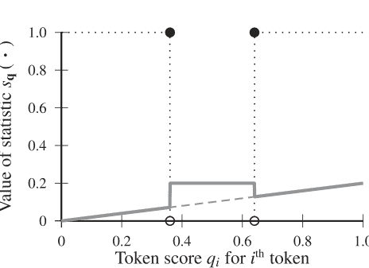

图 C.1 相对于单个标记得分 $q_i$ 的聚合统计量 $s_q(\cdot)$ 图；横轴为 $q_i$，纵轴为 $s_q(\cdot)$。此处考虑 $\tau_\kappa = 0.14$ 且不包含第 $i^{th}$ 个标记时 $s_q(\hat{\mathbf{x}} \setminus \{i\}) = 0.2$ 的场景。黑色虚线表示 $\delta(\mathbf{x})_i$ 的值，灰色虚线表示 $q_i \prod_{j \neq i} q_j$ 的值（即不包含 $\delta(\hat{\mathbf{x}})$ 时的 $s_q(\hat{\mathbf{x}})$），灰色实线表示 $q_i$ 变化时的 $s_q(\hat{\mathbf{x}})$ 值。

仅一条攻击消息。对于更多攻击消息（$k > 1$），该界限更大。因此，在针对 SpamBayes 设计攻击时，我们忽略此处概述的极端情况，并假设如果第 $j^{th}$ 个标记被包含在攻击中，$\Delta^{(k)}q_j$ 总会增加。此外，第 5.5 节中展示的任何实验均不满足导致 $\Delta^{(k)}q_j < 0$ 所需的条件。

### C.2.2 中毒攻击对 $I(\cdot)$ 的影响

理解攻击效果并针对 SpamBayes 构建最优攻击的关键，在于刻画当训练语料库被注入攻击垃圾邮件消息时，SpamBayes 得分 $I(\hat{\mathbf{x}})$ 增加的条件。为此，我们剖析 SpamBayes 用于聚合标记得分的方法。

来自公式 (C.1) 和 (C.2) 的统计量 $s_q(\hat{\mathbf{x}})$ 和 $h_q(\hat{\mathbf{x}})$ 分别是 $\hat{\mathbf{x}}$ 所代表消息的 *垃圾邮件程度* 和 *ham 程度* 的度量。两者均假设消息中的每个标记都对消息的 *垃圾邮件程度* 作出评估——得分 $q_i$ 是通过观察第 $i^{th}$ 个标记所得的垃圾邮件证据。进一步，通过假设独立性，$s_q(\hat{\mathbf{x}})$ 和 $h_q(\hat{\mathbf{x}})$ 将这些证据聚合为整体消息 *垃圾邮件程度* 的度量。例如，如果所有标记的 $q_i = 1$，则 $s_q(\hat{\mathbf{x}}) = 1$ 表示消息非常 *垃圾邮件化*，且 $1 - h_q(\hat{\mathbf{x}}) = 1$ 表示同意。同样，当所有标记的 $q_i = 0$ 时，两个得分都表明消息是 ham。

这些统计量也（几乎）表现良好。如果我们考虑消息 $\hat{\mathbf{x}}$ 中所有标记得分的普通乘积，$\tilde{s}_q(\hat{\mathbf{x}}) \triangleq \prod_{i: \hat{x}_i=1} q_i$，则它是关于每个 $q_i$ 的线性函数，且单调非递减。同样，乘积 $\tilde{h}_q(\hat{\mathbf{x}}) \triangleq \prod_{i: \hat{x}_i=1} (1 - q_i)$ 是关于每个 $q_i$ 的线性函数且单调非递增。因此，如果我们增加任何得分 $q_i$，第一个乘积将不会减少


第二项也不会增加，如预期。² 事实上，通过将分数 \( I(\cdot) \)、\( S(\cdot) \) 和 \( H(\cdot) \) 重新定义为基于简单乘积 \( \tilde{s}_{\mathbf{q}}(\hat{\mathbf{x}}) \) 和 \( \tilde{h}_{\mathbf{q}}(\hat{\mathbf{x}}) \)（我们分别将其称为 \( \tilde{I}(\cdot) \)、\( \tilde{S}(\cdot) \) 和 \( \tilde{H}(\cdot) \)），以下引理表明 \( \tilde{I}(\cdot) \) 关于 \( q_i \) 是非递减的。

### 引理 C.2 修改后的 \( \tilde{I}(\mathbf{x}) \) 分数对于所有标记（索引为 \( i \)）关于 \( q_i \) 是非递减的。

**证明** 我们表明 \( \tilde{I}(\hat{\mathbf{x}}) \) 关于 \( q_k \) 的导数对于所有 \( k \) 都是非负的。通过用 \( \tilde{s}_{\mathbf{q}}(\hat{\mathbf{x}}) \) 重写方程 (5.3) 为 \( \tilde{S}(\hat{\mathbf{x}}) = 1 - \chi_{2n}^2 (-2 \log (\tilde{s}_{\mathbf{q}}(\hat{\mathbf{x}}))) \)，可以按如下应用链式法则：

$$
\frac{\partial}{\partial q_k} \tilde{S}(\hat{\mathbf{x}}) = \frac{d}{d\tilde{s}_{\mathbf{q}}(\hat{\mathbf{x}})} \left[ 1 - \chi_{2n}^2 (-2 \log (\tilde{s}_{\mathbf{q}}(\hat{\mathbf{x}}))) \right] \cdot \frac{\partial}{\partial q_k} \tilde{s}_{\mathbf{q}}(\hat{\mathbf{x}})
$$

$$
\frac{d}{d\tilde{s}_{\mathbf{q}}(\hat{\mathbf{x}})} \left[ 1 - \chi_{2n}^2 (-2 \log (\tilde{s}_{\mathbf{q}}(\hat{\mathbf{x}}))) \right] = \frac{1}{(n-1)!} \left( - \log (\tilde{s}_{\mathbf{q}}(\hat{\mathbf{x}})) \right)^{n-1}.
$$

该导数是非负的，因为 \( 0 \le \tilde{s}_{\mathbf{q}}(\hat{\mathbf{x}}) \le 1 \)。此外，\( \tilde{s}_{\mathbf{q}}(\hat{\mathbf{x}}) \) 关于 \( q_k \) 的偏导数仅为 \( \frac{\partial}{\partial q_k} \tilde{s}_{\mathbf{q}}(\hat{\mathbf{x}}) = \prod_{i \neq k: \tilde{x}_i = 1} q_i \ge 0 \)。因此，对于所有 \( k \)，

$$
\frac{\partial}{\partial q_k} \tilde{S}(\hat{\mathbf{x}}) \ge 0.
$$

通过类似的推导，将 \( q_i \) 替换为 \( 1 - q_i \)，

$$
\frac{\partial}{\partial q_k} \tilde{H}(\hat{\mathbf{x}}) \le 0.
$$

最终结果由以下给出

$$
\frac{\partial}{\partial q_k} \tilde{I}(\hat{\mathbf{x}}) = \frac{1}{2} \frac{\partial}{\partial q_k} \tilde{S}(\hat{\mathbf{x}}) - \frac{1}{2} \frac{\partial}{\partial q_k} \tilde{H}(\hat{\mathbf{x}}) \ge 0.
$$

然而，与简单乘积不同，统计量 \( s_{\mathbf{q}}(\cdot) \) 和 \( h_{\mathbf{q}}(\cdot) \) 具有不寻常的行为，因为函数 \( \delta(\cdot) \) 对标记分数进行净化。具体来说，\( \delta(\cdot) \) 是集合 \( \mathbb{T}_{\mathbf{x}} \) 的指示函数。该集合的成员资格由标记分数与不可知分数 \( \frac{1}{2} \) 的绝对距离决定，即由值 \( g_i \triangleq |q_i - \frac{1}{2}| \) 决定。第 \( i^\text{th} \) 个标记属于 \( \mathbb{T}_{\mathbf{x}} \)，如果 \( i) \) \( \tilde{x}_i = 1 \) \( ii) \) \( g_i \ge Q \)（默认 \( Q = 0.1 \)，因此所有在 \( (0.4, 0.6) \) 中的标记都被排除）和 \( iii) \) 在剩余标记中，该标记拥有 \( g_i \) 的最大 \( T \) 值之一（默认 \( T = 150 \)）。

就我们的目的而言，对于每条消息 \( \hat{\mathbf{x}} \)，都存在某个值 \( \tau_{\mathbf{x}} < \frac{1}{2} \)，它定义了一个区间 \( (\frac{1}{2} - \tau_{\mathbf{x}}, \frac{1}{2} + \tau_{\mathbf{x}}) \) 以排除标记。即

$$
\delta(\hat{\mathbf{x}})_i = \tilde{x}_i \cdot \begin{cases} 0 & \text{if } q_i \in (\frac{1}{2} - \tau_{\mathbf{x}}, \frac{1}{2} + \tau_{\mathbf{x}}) \\ 1 & \text{otherwise} \end{cases}.
$$

² 这些统计量在另一意义上也表现得很奇怪。具体来说，添加一个额外的标记将始终减少两个乘积，而删除一个标记将始终增加两个乘积。应用卡方分布可以纠正这种效果。

### 增加 1 个标记时 $I(\cdot)$ 分数的变化

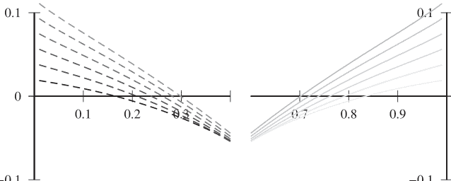

### 增加 3 个标记时 $I(\cdot)$ 分数的变化

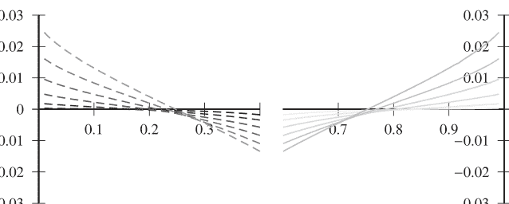

### 增加 5 个标记时 $I(\cdot)$ 分数的变化

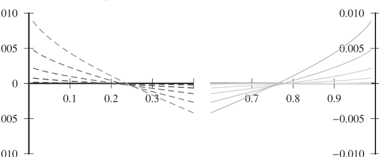

图 C.2. 随第 \( i^\text{th} \) 个标记的分数 \( q_i \) 增加，导致 \( q_i \) 移入或移出所有标记均被忽略的区域 (0.4, 0.6)，\(\delta( \cdot )\) 函数对 \( I( \cdot ) \) 的影响。在每个图中，x 轴是移除前的 \( q_i \) 值，y 轴是因移除而导致的 \( I( \cdot ) \) 变化；请注意，y 轴上的比例从上到下减小。对于最上方一行图，除变化的标记外还有 1 个不变的标记分数；对于中间一行，还有 3 个额外的不变标记分数；对于底部一行，还有 5 个额外的不变标记分数。最左侧一列的图展示了在最初 \( q_i \in (0, 0.4) \) 时移除第 \( i^\text{th} \) 个标记的效果；额外不变标记的分数全部固定为相同的值 0.02（深色虚线黑色）、0.04、0.06、0.08、0.10 或 0.12（浅色虚线黑色）。最右侧一列的图展示了在最初 \( q_i \in (0.4, 0.6) \) 时添加第 \( i^\text{th} \) 个标记的效果；额外不变标记的分数全部固定为相同的值 0.88（深灰色）、0.90、0.92、0.94、0.96 或 0.98（浅灰色）。

显然，对于 \hat{x} 中的标记，随着 \( q_i \) 增加，\(\delta (\hat{x})_i\) 从 1 跳变为 0 然后又回到 1。这导致 \( s_q (\hat{x}) \) 相对于 \( q_i \) 有两处不连续点：它在区间 \([0, \frac{1}{2} - \tau_x]\) 和 \([\frac{1}{2} + \tau_x, 1]\) 上线性增加，但在中间区间 \((\frac{1}{2} - \tau_x, \frac{1}{2} + \tau_x)\) 上会不连续地跳变到其最大值。这种行为在图 C.1 中有所描绘。同样，\( h_q (\hat{x}) \) 也呈线性递减，但在中间区间 \((\frac{1}{2} - \tau_x, \frac{1}{2} + \tau_x)\) 上也会跳变到其最大值。因此，\( s_q (\hat{x}) \) 和 \( h_q (\hat{x}) \) 在区间 \([0, 1]\) 上均不具有单调性。

为了更好地理解 \( I (\hat{x}) \) 在 \( q_i \) 增加时的行为，鉴于 \( s_q (\hat{x}) \) 和 \( h_q (\hat{x}) \) 均不具备单调性，我们对其行为进行逐案分析。为此，我们将三个区间 \([0, \frac{1}{2} - \tau_x]\)、\((\frac{1}{2} - \tau_x, \frac{1}{2} + \tau_x)\) 和 \([\frac{1}{2} + \tau_x, 1]\) 分别称为 A、B 和 C。显然，如果 \( q_i \) 增加但保持在同一区间内，\( I (\hat{x}) \) 也会增加。这源自引理 C.2 以及如果 \( q_i \) 保持在 B 区间内 \( I (\hat{x}) \) 不会改变的事实。同样，如果 \( q_i \) 从 A 区间增加到 C 区间，\( I (\hat{x}) \) 也会增加；这也源自引理 C.2。\( I (\hat{x}) \) 在 \( q_i \) 增加时可能减少的唯一情况是 \( q_i \) 从 A 区间过渡到 B 区间，或从 B 区间过渡到 C 区间，但在这些情况下，\( I (\hat{x}) \) 的行为在很大程度上取决于 \hat{x} 中其他标记的分数以及 \( q_i \) 增加前的值，如图 C.2 所示。还值得注意的是，如果 \hat{x} 具有超过 150 个位于区间 (0.4, 0.6) 外的标记，则 \( I (\hat{x}) \) 实际上永远不会减少，因为在这种情况下，将 \( q_i \) 增加到 B 区间内或外也对应于添加或移除第二个标记分数 \( q_j \)。在这种情况下，效果是 \( I (\hat{x}) \) 始终增加。

我们在第 5.3 节中介绍的针对 SpamBayes 的攻击忽略了这样一个事实：增加某些标记分数时，\( I (\hat{x}) \) 可能会减少。就此而言，这些攻击并非真正最优。然而，确定哪一组标记能最优地增加一组未来消息 { \hat{x} } 的整体 \( I ( \cdot ) \) 是一个组合问题，对于现实世界中的攻击者来说似乎不可行。相反，我们考虑针对问题的放宽版本的最优攻击，该版本在计算 \( I (\hat{x}) \) 时包含 \hat{x} 中的所有标记。此外，在第 5.5 节中，我们表明这些近似技术对 SpamBayes 具有非凡的有效性，尽管攻击消息中包含了一些非最优标记。


## 附录 D 近似最优规避的完整证明

在本附录中，我们给出第 8 章定理的证明。首先，我们表明当 $K = \lceil \sqrt{L_\epsilon} \rceil$ 时，K-STEP MULTILINESEARCH 的查询复杂度为 $\mathcal{O}(L_\epsilon + \sqrt{L_\epsilon |\mathbb{W}|})$。其次，我们为不同的代价函数给出三个下界。每个下界证明遵循类似的论证：我们使用基于代价球的分类器和基于查询凸包的分类器来构造两个具有不同 $\epsilon$-IMAC 的备选分类器。这使我们能够得出关于所需最少查询数量的结果。

### K-步 MultiLineSearch 定理的证明

为分析 K-STEP MULTILINESEARCH（算法 8.3）的最坏情况，我们分析旨在最大化查询数量的恶意分类器。它完全了解对抗者的状态；即，空间的维度 $D$，对抗者的目标 $L_\epsilon$，代价函数 $A$，代价函数的上界 $C_t^+$ 和下界 $C_t^-$ 等等。在本证明中，我们将查询者称为 *对抗者*。

定理 8.5 的证明 算法 8.3 的每次迭代中，对抗者从 $\mathbb{W}$ 中选择一个尚未消除的某个方向 $\mathbf{e}$。$\mathbb{W}$ 中的每个方向都是可行的（即，可能产生一个 $\epsilon$-IMAC），而根据定义，恶意分类器会使此选择尽可能代价高昂。在沿此方向的 $K$ 步二分查找过程中，无论选择哪个方向 $\mathbf{e}$ 或者恶意分类器如何响应，沿 $\mathbf{e}$ 的候选乘法间隙（参见第 8.1.3 节）都会以 $2^{-K}$ 的指数收缩；即，

$$
\frac{B^-}{B^+} = \left( \frac{C^-}{C^+} \right)^{2^{-K}} \tag{D.1}
$$

$$
\log (G'_{t+1}) = \log (G_t) \cdot 2^{-K} \tag{D.2}
$$

恶意分类器的主要决策发生在对抗者开始查询除 $\mathbf{e}$ 以外的其他方向时。在迭代 $t$ 时，恶意分类器有两种选择：

情况 1 ($t \in \mathbb{C}_1$)：对所有剩余方向响应 "+"。在这里，候选边界 $B^+$ 和 $B^-$ 得到验证，因此新的间隙以 $2^{-K}$ 的指数减小；然而，没有方向从搜索中被消除。

情况 2 ($t \in \mathbb{C}_2$)：选择至少一个方向来响应 "-"。在这里，由于只有 $C^-$ 的值发生变化，恶意分类器可以选择对前 $K$ 个查询进行响应，使得间隙减少的量可忽略（在沿 $\mathbf{e}$ 的前 $K$ 个查询中始终响应 "+"，间隙仅以 $(1 - 2^{-K})$ 的指数减小）。然而，恶意分类器必须选择某个数量 $E_t \ge 1$ 的方向，这些方向将被消除。

通过保守地假设只有在情况 1 中间隙才会减小，两种情况下的查询总数都有界，与恶意分类器应用它们的顺序无关。

在第 $t$ 次迭代中，恶意分类器可以决定处于情况 1 ($t \in \mathbb{C}_1$) 或情况 2 ($t \in \mathbb{C}_2$)。我们假设只有在情况 1 中间隙才会减小。也就是说，我们定义 $G_0 = C_0^- / C_0^+$，因此如果 $t \in \mathbb{C}_1$，则 $G_t = G_{t-1}^{2^{-K}}$，而如果 $t \in \mathbb{C}_2$，则 $G_t = G_{t-1}$。这个假设对算法性能给出了一个上界，并解耦了 $\mathbb{C}_1$ 和 $\mathbb{C}_2$ 的查询分析。由此，我们得出算法终止前必须发生的情况 1 迭代次数的上界；简单地说，在情况 1 迭代中必须总共进行至少 $L_\epsilon$ 个二分查找步骤，且每个情况 1 迭代恰好进行 $K$ 步。更正式地说，每个情况 1 迭代以 $2^{-K}$ 的指数减小间隙，而我们的终止条件是 $G_T \le 1 + \epsilon$。由于算法一旦间隙 $G_T \le 1 + \epsilon$ 就会终止，迭代 $T$ 必须是情况 1 迭代且 $G_{T-1} > 1 + \epsilon$（否则算法会更早终止）。由此，迭代总数必须满足

$$
\begin{aligned}
\log_2(G_{T-1}) &> \log_2(1 + \epsilon) \\
\log_2(G_0) \prod_{i \in \mathbb{C}_1 \wedge i < T} 2^{-K} &> \log_2(1 + \epsilon) \tag*{by Equation (D.2)} \\
2^{-\sum_{i \in \mathbb{C}_1 \wedge i < T} K} &> \frac{\log_2(1 + \epsilon)}{\log_2(G_0)} \\
\sum_{i \in \mathbb{C}_1 \wedge i < T} K &> \log_2 \frac{\log_2(G_0)}{\log_2(1 + \epsilon)} \\
&= L_\epsilon \tag*{by Equation (8.6)} \\
(|\mathbb{C}_1| - 1)K &< L_\epsilon
\end{aligned}
$$

其中因子 $(|\mathbb{C}_1| - 1)$ 是由于排除了最后一次情况 1 迭代 $T$ 而得出的。对 $G_T \le 1 + \epsilon$ 进行类似推导可得 $|\mathbb{C}_1| \cdot K \ge L_\epsilon$，同时满足这两个条件的唯一整数是

$$
|\mathbb{C}_1| = \left\lceil \frac{L_\epsilon}{K} \right\rceil. \tag{D.3}
$$

现在，在每个情况 1 迭代中，对抗者恰好进行 $K + |\mathbb{W}_t| - 1$ 次查询，其中 $\mathbb{W}_t$ 是第 $t$ 次迭代时剩余的可行方向集合。虽然 $\mathbb{W}_t$ 由恶意分类器控制，但它被 $|\mathbb{W}_t| \le |\mathbb{W}|$ 所界定。利用这一点和方程 (D.3) 中的关系，我们对情况 1 中使用的查询数量 \(Q_1\) 进行如下界定：

$$
Q_1 = \sum_{t \in C_1} (K + |\mathbb{W}_t| - 1)\\
\le \sum_{t \in C_1} (K + |\mathbb{W}| - 1)\\
= \left\lfloor \frac{L_\epsilon}{K} \right\rfloor \cdot (K + |\mathbb{W}| - 1)\\
\le \left( \frac{L_\epsilon}{K} + 1 \right) \cdot K + \left\lfloor \frac{L_\epsilon}{K} \right\rfloor \cdot (|\mathbb{W}| - 1)\\
= L_\epsilon + K + \left\lfloor \frac{L_\epsilon}{K} \right\rfloor \cdot (|\mathbb{W}| - 1) .
$$

对于每个情况 2 迭代，对抗者恰好进行 \(K + E_t\) 次查询，并且每次消除 \(E_t \ge 1\) 个方向；因此，\(|\mathbb{W}_{t+1}| = |\mathbb{W}_t| - E_t\)。恶意分类器在每个情况 2 实例中总是令 \(E_t = 1\)，因为这最大限度地限制了对抗者的收益。尽管如此，由于情况 2 要求至少消除一个方向，因此适用以下界限：\(|C_2| \le |\mathbb{W}| - 1\)。此外，无论 \(E_t\) 的选择如何，\(\sum_{t \in C_2} E_t \le |\mathbb{W}| - 1\) 因为每个方向最多只能被消除一次且至少必须保留一个方向。因此，

$$
Q_2 = \sum_{i \in C_2} (K + E_t)\\
\le |C_2| \cdot K + |\mathbb{W}| - 1\\
\le (|\mathbb{W}| - 1)(K + 1) .
$$

算法 8.3 使用的查询总数为

$$
Q = Q_1 + Q_2 \le L_\epsilon + K + \left\lfloor \frac{L_\epsilon}{K} \right\rfloor \cdot (|\mathbb{W}| - 1) + (|\mathbb{W}| - 1)(K + 1)\\
= L_\epsilon + K + \left\lfloor \frac{L_\epsilon}{K} \right\rfloor \cdot |\mathbb{W}| - \left\lfloor \frac{L_\epsilon}{K} \right\rfloor + K \cdot |\mathbb{W}| - K + |\mathbb{W}| - 1\\
= L_\epsilon + \left\lfloor \frac{L_\epsilon}{K} \right\rfloor \cdot |\mathbb{W}| + K \cdot |\mathbb{W}| + |\mathbb{W}| - \left\lfloor \frac{L_\epsilon}{K} \right\rfloor - 1\\
\le L_\epsilon + \left\lfloor \frac{L_\epsilon}{K} \right\rfloor \cdot |\mathbb{W}| + K \cdot |\mathbb{W}| + |\mathbb{W}|\\
= L_\epsilon + \left( \left\lfloor \frac{L_\epsilon}{K} \right\rfloor + K + 1 \right) |\mathbb{W}|
$$

最后，选择 \(K = \lceil \sqrt{L_\epsilon} \rceil\) 可最小化此表达式。将此 \(K\) 代入 \(Q\) 的界限并使用界限 \(L_\epsilon / \lceil \sqrt{L_\epsilon} \rceil \le \sqrt{L_\epsilon}\)，可得

$$
Q \le L_\epsilon + \left( 2 \lceil \sqrt{L_\epsilon} \rceil + 1 \right) |\mathbb{W}|
$$

所以 $Q = \mathcal{O} \left( L_\epsilon + \sqrt{L_\epsilon} |\mathbb{W}| \right)$。

### 下界的证明

这里我们使用乘法和加法情况的相同论证，为第 8.2.1.2 节中的下界定理提供证明。回顾一下，对于这些下界，$D$ 是空间的维度，$A : \Re^D \mapsto \Re_+$ 是任意正凸函数，$0 < C_0^+ < C_0^-$ 是 $MAC$ 的初始上界和下界。我们还有 $\hat{\mathcal{F}}^{\text{convex}, \text{"+"}} \subseteq \mathcal{F}^{\text{convex}, \text{"+"}}$ 是与 $MAC$ 上的约束一致的分类器集合；即，对于 $f \in \hat{\mathcal{F}}^{\text{convex}, \text{"+"}}$，集合 $\mathcal{X}_f^+$ 是凸的，$\mathbb{B}^{C_0^+} (A) \subseteq \mathcal{X}_f^+$ 且 $\mathbb{B}^{C_0^-} (A) \not\subseteq \mathcal{X}_f^+$。与 K-步 MultiLineSearch 一样，我们再次考虑一个恶意分类器。

定理 8.7 和 8.6 的证明 假设一个基于查询的算法向分类器提交 $N < D + 1$ 个成员查询 $\mathbf{x}^{(1)}, \dots, \mathbf{x}^{(N)} \in \Re^D$。为了使算法达到 $\epsilon$-最优，这些查询必须将所有一致分类器的家族 $\hat{\mathcal{F}}^{\text{convex}, \text{"+"}}$ 限制为在其 $\epsilon$-$IMAC$ 集合中有一个公共点。假设查询的响应与定义的分类器 $f$ 一致：

$$
f (\mathbf{x}) = \begin{cases} +1, & \text{if } A \left( \mathbf{x} - \mathbf{x}^* \right) < C_0^- \\ -1, & \text{otherwise} \end{cases}. \quad \text{(D.4)}
$$

对于此分类器，$\mathcal{X}_f^+$ 是凸的，因为 $A$ 是凸函数；$\mathbb{B}^{C_0^+} (A) \subseteq \mathcal{X}_f^+$，因为 $C_0^+ < C_0^-$；且 $\mathbb{B}^{C_0^-} (A) \not\subseteq \mathcal{X}_f^+$，因为 $\mathcal{X}_f^+$ 是开放的 $C_0^-$ 球，而 $\mathbb{B}^{C_0^-} (A)$ 是闭合的 $C_0^-$ 球。此外，由于 $\mathcal{X}_f^+$ 是开放的 $C_0^-$ 球，不存在 $\mathbf{x} \in \mathcal{X}_f^-$ 使得 $A \left( \mathbf{x} - \mathbf{x}^* \right) < C_0^-$。因此，$MAC (f, A) = C_0^-$，任何 $\epsilon$-最优点 $\mathbf{x}' \in \epsilon\text{-}IMAC^{(*)} (f, A)$ 必须满足 $C_0^- \le A \left( \mathbf{x}' - \mathbf{x}^* \right) \le (1 + \epsilon) C_0^-$。同样，任何 $\eta$-最优点 $\mathbf{x}' \in \eta\text{-}IMAC^{(+)} (f, A)$ 必须满足 $C_0^- \le A \left( \mathbf{x}' - \mathbf{x}^* \right) \le C_0^- + \eta$。

考虑一个备选分类器 $g$，它对 $\mathbf{x}^{(1)}, \dots, \mathbf{x}^{(N)}$ 的响应与 $f$ 相同，但具有不同的凸正集 $\mathcal{X}_g^+$。不失一般性，假设前 $M \le N$ 个查询为正，其余为负。令 $\mathbb{G} = conv \left( \mathbf{x}^{(1)}, \dots, \mathbf{x}^{(M)} \right)$，即这 $M$ 个正查询的凸包。现在令 $\mathcal{X}_g^+$ 为 $\mathbb{G}$ 和 $A$ 的 $C_0^+$ 球的凸包：$\mathcal{X}_g^+ = conv \left( \mathbb{G} \cup \mathbb{B}^{C_0^+} (A) \right)$。由于 $\mathbb{G}$ 包含所有正查询且 $C_0^+ < C_0^-$，凸集 $\mathcal{X}_g^+$ 与观察到的响应一致，$\mathbb{B}^{C_0^+} (A) \subseteq \mathcal{X}_g^+$ 按定义成立，且 $\mathbb{B}^{C_0^-} (A) \not\subseteq \mathcal{X}_g^+$ 因为正查询都位于开放的 $C_0^-$ 子级集内。此外，由于 $M \le N < D + 1$，$\mathbb{G}$ 包含在 $\Re^D$ 的真线性子空间中，因此 $\mathbb{G}$ 的内部为空；即，$int \left( \mathbb{G} \right) = \emptyset$。因此，总是存在 $\mathbb{B}^{C_0^+} (A)$ 中的某个点位于 $\mathcal{X}_g^+$ 的边界上；即，$\mathbb{B}^{C_0^+} (A) \not\subseteq int \left( \mathbb{G} \right)$ 因为 $int \left( \mathbb{G} \right) = \emptyset$，因此，必须至少有一个来自 $\mathbb{B}^{C_0^+} (A)$ 的点位于 $\mathbb{B}^{C_0^+} (A)$ 和 $\mathbb{G}$ 的凸包的边界上。因此，$MAC (g, A) = \inf_{\mathbf{x} \in \mathcal{X}_g^-} \left[ A \left( \mathbf{x} - \mathbf{x}^* \right) \right] = C_0^+$。

由于精度 $\epsilon < \frac{C_0^-}{C_0^+} - 1$，任何 $\mathbf{x} \in \epsilon\text{-}IMAC^{(*)} (g, A)$ 必须满足

$$
A \left( \mathbf{x} - \mathbf{x}^* \right) \le (1 + \epsilon) C_0^+ < \frac{C_0^-}{C_0^+} C_0^+ = C_0^-
$$


而任何 \(\mathbf{y} \in \epsilon\text{-}IMAC^{(*)}(f, A)\) 都必须满足 \(A(\mathbf{y} - \mathbf{x}^*) \ge C_0^-\)。因此，\(\epsilon\text{-}IMAC^{(*)}(f, A) \cap \epsilon\text{-}IMAC^{(*)}(g, A) = \emptyset\)，我们已经构造了两个凸诱导分类器 \(f\) 和 \(g\)，它们都与查询响应一致，但没有共同的 \(\epsilon\text{-}IMAC^{(*)}\)。类似地，由于 \(\eta < C_0^- - C_0^+\)，任何 \(\mathbf{x} \in \eta\text{-}IMAC^{(+)}(g, A)\) 都必须有

\[
A(\mathbf{x} - \mathbf{x}^*) \le \eta + C_0^+ < C_0^- - C_0^+ + C_0^+ = C_0^-
\]

而任何 \(\mathbf{y} \in \eta\text{-}IMAC^{(+)}(f, A)\) 都必须有 \(A(\mathbf{y} - \mathbf{x}^*) \ge C_0^-\)。因此，\(\eta\text{-}IMAC^{(+)}(f, A) \cap \eta\text{-}IMAC^{(+)}(g, A) = \emptyset\)，于是这两个凸诱导分类器 \(f\) 和 \(g\) 也没有共同的 \(\eta\text{-}IMAC^{(+)}\)。

假设相反，一个基于查询的算法提交了 \(N < L_\epsilon^{(*)}\) 个成员查询（对于加性情形，则为 \(N < L_\eta^{(+)}\)）。回顾我们的定义：\(C_0^-\) 是 \(MAC\) 的初始上界，\(C_0^+\) 是 \(MAC\) 的初始下界，而 \(G_t^{(*)} = C_t^- / C_t^+\) 是第 \(t\) 次迭代中上界与下界之间的差距（对于加性情形，\(G_t^{(+)} = C_t^- - C_t^+\)）。恶意分类器 \(f\) 响应如下

\[
f(\mathbf{x}^{(t)}) = \begin{cases} +1, & \text{if } A(\mathbf{x}^{(t)} - \mathbf{x}^*) \le \sqrt{C_{t-1}^- \cdot C_{t-1}^+} \\ -1, & \text{otherwise} \end{cases} (D.5)
\]

（对于加性最优性，第一种情况的条件是 \(A(\mathbf{x}^{(t)} - \mathbf{x}^*) \le \frac{C_{t-1}^-+C_{t-1}^+}{2}\)）。当分类器响应 "+" 时，\(C_t^+\) 增加到不超过 \(\sqrt{C_{t-1}^- \cdot C_{t-1}^+}\)，因此 \(G_t \ge \sqrt{G_{t-1}}\)。类似地，当该分类器响应 "-" 时，\(C_t^-\) 减少到不低于 \(\sqrt{C_{t-1}^- \cdot C_{t-1}^+}\)，因此同样 \(G_t \ge \sqrt{G_{t-1}}\)。因此，这些响应确保在每次迭代中 \(G_t \ge \sqrt{G_{t-1}}\)（或者在加性情形中 \(G_t \ge \frac{G_{t-1}}{2}\)），并且由于算法不能在 \(G_N \le 1 + \epsilon\) 之前终止，根据方程 (8.6) 必须有 \(N \ge L_\epsilon^{(*)}\)（或者在加性情形中，根据方程 (8.5) 必须有 \(N \ge L_\eta^{(+)}\)）。否则，仍然存在两个查询响应一致但没有共同 \(\epsilon\text{-}IMAC\) 的凸诱导分类器。第一个分类器的正集是包围所有正查询的最小代价球，而第二个分类器的正集是包围所有正查询但不包含负查询的最大代价球。如果 \(N < L_\epsilon^{(*)}\)，这些分类器的 \(MAC\) 值相差超过 \((1 + \epsilon)\) 倍（或者，对于加性情形，如果 \(N < L_\eta^{(+)}\)，相差超过 \(\eta\)），因此它们没有共同的 \(\epsilon\text{-}IMAC\)。

### 定理 8.12 的证明

为证明定理 8.12，我们使用正半空间（orthant，中心在 \(\mathbf{x}^*\)），即，一个 _正半空间_ 是 2 维空间中象限的 \(D\) 维推广。在 \(D\) 维空间中有 \(2^D\) 个正半空间。我们用每个正半空间的 _标准表示_ 来表示它，这是一个由 \(D\) 个正或负 1 组成的向量；也就是说，由

\[
\mathbf{a} = (\pm 1, \pm 1, \dots, \pm 1)
\]

表示的正半空间包含点 \(\mathbf{x}^* + \mathbf{a}\)，并且是所有满足以下条件的点 \(\mathbf{x}\) 的集合：

\[
x_i \in \begin{cases} [0, +\infty], & \text{if } a_i = +1 \\ [-\infty, 0], & \text{if } a_i = -1 \end{cases}.
\]

现在基于引理 A.2，我们给出定理 8.12 的所需证明：

定理 8.12 的证明 假设一个基于查询的算法向分类器提交了 \(N\) 个成员查询 \(\mathbf{x}^{(1)}, \dots, \mathbf{x}^{(N)} \in \mathbb{R}^D\)。同样，为了使算法达到 \(\epsilon\)-最优，这些查询必须约束家族 \(\hat{\mathcal{F}}^{\text{convex}, "+"}\) 中所有一致的分类器在其 \(\epsilon\)-IMAC 集合中拥有一个共同点。上述描述的响应与定义的分类器 \(f\) 一致，该分类器定义为

\[
f(\mathbf{x}) = \begin{cases} +1, & \text{if } A_p(\mathbf{x} - \mathbf{x}^*) < C_0^- \\ -1, & \text{otherwise} \end{cases}.
\]

对于这个分类器，\(\mathcal{X}_f^+\) 是凸的，因为当 \(p \ge 1\) 时 \(A_p\) 是凸函数；\(\mathbb{B}^{C_0^+} (A_p) \subseteq \mathcal{X}_f^+\)，因为 \(C_0^+ < C_0^-\)；且 \(\mathbb{B}^{C_0^-} (A_p) \not\subseteq \mathcal{X}_f^+\)，因为 \(\mathcal{X}_f^+\) 是开放的 \(C_0^-\)-球，而 \(\mathbb{B}^{C_0^-} (A_p)\) 是闭合的 \(C_0^-\)-球。此外，由于 \(\mathcal{X}_f^+\) 是开放的 \(C_0^-\)-球，不存在 \(\mathbf{x} \in \mathcal{X}_f^-\) 使得 \(A_p(\mathbf{x} - \mathbf{x}^*) < C_0^-\)；因此 \(\text{MAC}(f, A_p) = C_0^-\)，并且任何 \(\epsilon\)-最优点 \(\mathbf{x}' \in \epsilon\text{-IMAC}^{(*)} (f, A_p)\) 都必须满足 \(C_0^- \le A_p(\mathbf{x}' - \mathbf{x}^*) \le (1 + \epsilon) C_0^-\)。

现在考虑另一个分类器 \(g\)，它对 \(\mathbf{x}^{(1)}, \dots, \mathbf{x}^{(N)}\) 与 \(f\) 作出相同的响应，但具有不同的凸正集 \(\mathcal{X}_g^+\)。不失一般性，假设前 \(M \le N\) 个查询为正，其余为负。考虑一个集合，它是所有 \(M\) 个正查询的正半空间的凸包；即，

\[
\mathbb{G} = \text{conv} \left( \text{orth} \left( \mathbf{x}^{(1)} \right) \cap \mathcal{X}_f^+, \text{orth} \left( \mathbf{x}^{(2)} \right) \cap \mathcal{X}_f^+, \dots, \text{orth} \left( \mathbf{x}^{(M)} \right) \cap \mathcal{X}_f^+ \right) (D.6)
\]

其中 \(\text{orth}(\mathbf{x})\) 是相对于中心 \(\mathbf{x}^*\) 包含 \(\mathbf{x}\) 的某个正半空间（一个数据点可能位于不止一个正半空间内，但只需选择包含它的一个正半空间来覆盖它即可）。通过将每个数据点的正半空间与集合 \(\mathcal{X}_f^+\) 求交，并对这些区域取凸包，\(\mathbb{G}\) 是凸的，包含 \(\mathbf{x}^*\)，并且是 \(\mathcal{X}_f^+\) 的子集，与 \(f\) 的所有查询响应一致；也就是说，\(M\) 个正查询中的每一个都在 \(\mathcal{X}_g^+\) 中，所有负查询都在 \(\mathcal{X}_g^-\) 中。此外，\(\mathbb{G}\) 是 \(M\) 个正查询凸包的超集。因此，\(\mathbb{G}\) 内部最大的封闭 \(\ell_p\) 球是 \(\text{MAC}(g, A_p)\) 的上界，因此我们转而对这个 \(\ell_p\) 球的大小进行界定。

我们现在将每个正半空间表示为 \(D\) 维超立方体图中的一个顶点——任意两个正半空间之间的汉明距离是其标准表示中不同坐标的数量，并且如果且仅当两个正半空间的汉明距离为一时，它们在图中相邻。利用这种汉明距离概念，我们找到超立方体的一个 \(K\)-覆盖 \(\mathbb{X}\)。我们将用于构造方程 D.6 中 \(\mathbb{G}\) 的正半空间称为覆盖正半空间，因为它们覆盖了 \(M\) 个正查询。这些覆盖正半空间对应的顶点构成了超立方体的一个覆盖。假设 \(M\) 个覆盖正半空间足以进行 \(K\) 覆盖但不足以进行 \(K-1\) 覆盖；那么必定存在至少一个不在覆盖中的顶点，它与 \(K\)-覆盖 \(\mathbb{X}\) 中的每个顶点的汉明距离至少为 \(K\)。这个顶点对应于一个空正半空间，其标准表示顶点与所有已覆盖正半空间在至少 \(K\) 个坐标上不同。不失一般性，假设这个未被覆盖的正半空间具有缩放到 \(C_0^- \mathbf{1}\) 的全正标准顶点。现在，考虑法向量 \(\mathbf{w} = \mathbf{1}\) 和位移

\[
d = \begin{cases} C_0^- (D - K)^{\frac{p-1}{p}} & \text{if } 1 < p < \infty \\ C_0^- (D - K) & \text{if } p = \infty \end{cases}
\]

的超平面，该超平面指定了判别函数 \(s(\mathbf{x}) = \mathbf{x}^\top \mathbf{w} - d = \sum_{i=1}^D x_i - d\)。对于这个超平面，顶点 \(C_0^- \mathbf{1}\) 产生

\[
\begin{aligned} s(C_0^- \mathbf{1}) &= C_0^- D - d \\ &= C_0^- D - (C_0^- D - K)^{\frac{p-1}{p}} \\ &> C_0^- D - (C_0^- D - K) \\ &> 0. \end{aligned}
\]

同样，对于任何与此未被覆盖的正半空间汉明距离至少为 \(K\) 的正半空间 \(\mathbf{a}\)，根据正半空间和 \(\mathcal{X}_f^+\) 的定义，所有点 \(\mathbf{x} \in orth(\mathbf{a}) \cap \mathcal{X}_f^+\) 对函数 \(s\) 产生以下估值：

\[
\begin{aligned} s(\mathbf{x}) &= \sum_{i=1}^D x_i - d \\ &= \sum_{i | a_i = +1} \underbrace{x_i}_{\ge 0} + \sum_{i | a_i = -1} \underbrace{x_i}_{\le 0} - d. \end{aligned}
\]

由于第二个求和中的所有项都是非正的，第二个求和至多为 \(0\)。因此，最大化第一个求和可以对 \(s(\mathbf{x})\) 取上界。求和 \(\sum_{i | a_i = +1} x_i\)（对于 \(\mathbf{x}\) 位于 \(\mathcal{X}_f^+\) 是必要的，即 \(\|\mathbf{x}\|_p < C_0^-\)）至多有 \(D - K\) 项，并且在 \(x_i = C_0^- (D - K)^{-1/p}\) 时取最大值（当 \(p = \infty\) 时为 \(x_i = C_0^-\)），此时第一个求和被上界为 \(C_0^- (D - K)^{\frac{p-1}{p}}\)（当 \(p = \infty\) 时为 \(C_0^- (D - K)\)）；也就是说，它被 \(d\) 上界，因此 \(s(\mathbf{x}) \le 0\)。因此，这个超平面将缩放顶点 \(C_0^- \mathbf{1}\) 与每个集合 \(orth(\mathbf{a}) \cap \mathcal{X}_f^+\) 分开，其中 \(\mathbf{a}\) 是任何与由 \(\mathbf{1}\) 表示的正半空间汉明距离至少为 \(K\) 的正半空间的标准表示。这个超平面也根据凸包的性质将缩放顶点与 \(\mathbb{G}\) 分开。由于上面定义的位移 \(d\) 大于 \(0\)，通过应用引理 A.3，这个分离超平面对 \(\mathbb{G}\) 中包围的最大 \(\ell_p\) 球的成本取上界为

\[
\text{MAC}(g, A_p) \le C_0^- (D - K)^{\frac{p-1}{p}} \cdot \|\mathbf{1}\|_{\frac{p}{p-1}}^{-1} = C_0^- \left( \frac{D - K}{D} \right)^{\frac{p-1}{p}}
\]

对于 \(1 < p < \infty\)，以及

\[
\text{MAC}(g, A_p) \le C_0^- (D - K) \cdot \|\mathbf{1}\|_1^{-1} = C_0^- \frac{D - K}{D}
\]


对于 \( p = \infty \)。基于 \( g \) 的 \( MAC \) 和 \( f \) 的 \( MAC \)（即 \( C_0^- \））的这个上界，如果这些分类器之间存在一个共同的 \( \epsilon \)-\( IMAC \)，则它必须满足

\( (1 + \epsilon) \ge \begin{cases} \left( \frac{D-K}{D} \right)^{\frac{p-1}{p}}, & \text{if } 1 < p < \infty \\ \frac{D}{D-K}, & \text{if } p = \infty \end{cases} . \)

求取达到所需精度 \( 1 + \epsilon \) 所需的 \( K \) 值可得

\( K \le \begin{cases} \frac{(1+\epsilon)^{\frac{p}{p-1}} - 1}{(1+\epsilon)^{\frac{p}{p-1}}} D, & \text{if } 1 < p < \infty \\ \frac{\epsilon}{1+\epsilon} D, & \text{if } p = \infty \end{cases} ,\)

这限定了为达到所需乘法精度 \( \epsilon \) 所需的 \( \mathbb{X} \) 的 \( K \)-覆盖的大小。

对于 \( 1 < p < \infty \) 的情况，引理 A.2 表明必存在

\( M \ge \exp \left\{ \ln(2) \cdot D \left( 1 - H \left( 1 - (1 + \epsilon)^{\frac{p}{1-p}} \right) \right) \right\} \)

个 \( \mathbb{X} \) 的 \( K \)-覆盖中超立方体的顶点，以达到任何所需精度 \( 0 < \epsilon < 2^{\frac{p-1}{p}} - 1 \)，此时

\( \delta = \frac{(1 + \epsilon)^{\frac{p}{p-1}} - 1}{(1 + \epsilon)^{\frac{p}{p-1}}} < \frac{1}{2} \)

为满足该引理要求的条件。因此，该定理适用于任何 \( \epsilon < 2^{\frac{p-1}{p}} - 1 \)。例如，当 \( p = 2 \) 时，该定理适用于任何 \( \epsilon < \sqrt{2} - 1 \)。此外，由于对任何 \( \delta < \frac{1}{2} \) 均有 \( H(\delta) < 1 \)，

\( \alpha_{p, \epsilon} = \exp \left\{ \ln(2) \left( 1 - H \left( \frac{(1 + \epsilon)^{\frac{p}{p-1}} - 1}{(1 + \epsilon)^{\frac{p}{p-1}}} \right) \right) \right\} > 1 \)

且

\( M \ge \alpha_{p, \epsilon}^D . \)

同理，对于 \( p = \infty \)，应用引理 A.2 要求 \( M \ge 2^{D(1-H(\frac{\epsilon}{1+\epsilon}))} \) 才能达到任何所需精度 \( 0 < \epsilon < 1 \)（此时 \( \epsilon / (1 + \epsilon) < 1/2 \)，符合该引理要求）。同样，根据熵的性质，常数 \( \alpha_{\infty, \epsilon} = 2^{(1-H(\frac{\epsilon}{1+\epsilon}))} > 1 \) 对任何 \( 0 < \epsilon < 1 \) 成立，且 \( M \ge \alpha_{\infty, \epsilon}^D \)。

值得注意的是，定理 8.12 所需的常数 \( \alpha_{p, \epsilon} \) 和 \( \alpha_{\infty, \epsilon} \) 可以通过展开熵函数（\( H(\delta) = -\delta \log_2(\delta) - (1 - \delta) \log_2(1 - \delta) \)）以更简洁的形式表示。对于 \( 1 < p < \infty \)，该常数由以下公式给出

\( \alpha_{p, \epsilon} = 2 \cdot \left( 1 - (1 + \epsilon)^{\frac{p}{1-p}} \right) \cdot \exp \left( \ln \left( \frac{1}{1 - (1 + \epsilon)^{\frac{p}{1-p}}} \right) \cdot (1 + \epsilon)^{\frac{p}{1-p}} \right) . \quad (\text{D.7}) \)

在这种形式下，难以直接看出当 \( \epsilon < 2^{\frac{p-1}{p}} - 1 \) 时 \( \alpha_{p, \epsilon} > 1 \)，但使用上述证明中的熵形式表明情况确实如此。同样，对于 \( p = \infty \)

该常数的更简洁形式由以下公式给出

\[
\alpha_{\infty, \epsilon} = \frac{2}{1 + \epsilon} \exp \left( \ln(\epsilon) \cdot \left( \frac{\epsilon}{1 + \epsilon} \right) \right). \qquad \text{(D.8)}
\]

同样，如上述证明所示，当 \(\epsilon < 1\) 时，\(\alpha_{\infty, \epsilon} > 1\)。

### 定理 8.13 的证明

对于本证明，我们在 \(\mathbb{X}\) 超球面 \(K\)-覆盖的先前结果基础上进行构建。该证明基于 Wyner (1965) 的覆盖数结果（该结果最初出现在 Shannon (1959) 中）。该结果限定了覆盖超球面所需的球面帽最小数量，并在附录 A.2 中总结。

假设基于查询的算法向分类器提交 \(N < D + 1\) 个成员查询 \(\mathbf{x}^{(1)}, \dots, \mathbf{x}^{(N)} \in \mathbb{R}^D\)。为了使算法达到 \(\epsilon\)-最优，这些查询必须约束家族 \(\hat{\mathcal{F}}^{\text{convex}, \text{"+"}}\) 中所有一致分类器在其 \(\epsilon\)-IMAC 集合中拥有一个共同点。假设所有响应均与定义的分类器 \(f\) 一致

\[
f(\mathbf{x}) = \begin{cases} +1, & \text{if } A_2(\mathbf{x} - \mathbf{x}^*) < C_0^- \\ -1, & \text{otherwise} \end{cases} \qquad \text{(D.9)}
\]

对于该分类器，\(\mathcal{X}_f^+\) 是凸集，因为 \(A_2\) 是凸函数；\(\mathbb{B}^{C_0^+} (A_2) \subseteq \mathcal{X}_f^+\)，因为 \(C_0^+ < C_0^-\)；且 \(\mathbb{B}^{C_0^+} (A_2) \unknown \subseteq \mathcal{X}_f^+\)，因为 \(\mathcal{X}_f^+\) 是开 \(C_0^-\)-球，而 \(\mathbb{B}^{C_0^+} (A_2)\) 是闭 \(C_0^-\)-球。此外，由于 \(\mathcal{X}_f^+\) 是开 \(C_0^-\)-球，不存在 \(\mathbf{x} \in \mathcal{X}_f^-\) 使得 \(A_2(\mathbf{x} - \mathbf{x}^*) < C_0^-\)，因此 \(\text{MAC}(f, A_2) = C_0^-\)，任何 \(\epsilon\)-最优点 \(\mathbf{x}' \in \epsilon\text{-}IMAC^*(f, A_2)\) 必须满足 \(C_0^- \le A_2(\mathbf{x}' - \mathbf{x}^*) \le (1 + \epsilon) C_0^-\)。

现在考虑一个替代分类器 \(g\)，它对 \(\mathbf{x}^{(1)}, \dots, \mathbf{x}^{(N)}\) 的响应与 \(f\) 相同，但具有不同的凸正集 \(\mathcal{X}_g^+\)。不失一般性，假设前 \(M \le N\) 个查询为正，其余为负。令 \(\mathbb{G} = \text{conv}(\mathbf{x}^{(1)}, \dots, \mathbf{x}^{(M)})\)；即，\(M\) 个正查询的凸包。我们假设 \(\mathbf{x}^* \in \mathbb{G}\)，因为否则，恶意分类器可以如定理 8.7 和 8.6 的证明中构造集合 \(\mathcal{X}_g^+\) 并达到 \(\text{MAC}(f, A_2) = C_0^+\)，从而得到所需结果。否则，当 \(\mathbf{x}^* \in \mathbb{G}\) 时，考虑点 \(\mathbf{z}^{(i)} = C_0^- \frac{\mathbf{x}^{(i)}}{A_2(\mathbf{x}^{(i)} - \mathbf{x}^*)}\)；即，每个正查询在 \(\ell_2\) 球 \(\mathbb{B}^{C_0^-} (A_2)\) 表面上的投影。由于每个正查询都位于 \(\mathbf{x}^*\) 及其投影 \(\mathbf{z}^{(i)}\) 之间的直线上，根据凸性以及 \(\mathbf{x}^* \in \mathbb{G}\) 这一事实，集合 \(\mathbb{G}\) 是 \(\text{conv}(\mathbf{z}^{(1)}, \mathbf{z}^{(2)}, \dots, \mathbf{z}^{(M)})\) 的子集——我们将这个扩展的凸包称为 \(\hat{\mathbb{G}}\)。这些 \(M\) 个投影点 \(\{\mathbf{z}^{(i)}\}_{i=1}^M\) 必须构成半角为 \(\phi_\epsilon^* = \arccos\left(\frac{1}{1+\epsilon}\right)\) 的帽的轨迹的 \(C_0^-\)-超球面的 \(\mathbb{X}\) 的 \(K\)-覆盖。否则，则该超球面表面上存在某个点，其与所有 \(\mathbf{z}^{(i)}\) 点的角度至少为 \(\phi_\epsilon^*\)，且以此未覆盖点为中心的 \(\phi_\epsilon^*\)-帽不在 \(\hat{\mathbb{G}}\) 中（因为帽定义为超球面与半空间的交集）。此外，根据 \(\phi_\epsilon^*\)-帽的定义，它达到的最小 \(\ell_2\) 代价为 \(C_0^- \cos \phi_\epsilon^*\)。因此，

如果对手未能实现 \(C_0^-\)-超球面的 \(\mathbb{X}\) 的 \(\phi_\epsilon^*\)-K-覆盖，则替代分类器 \(g\) 具有 \(MAC (g, A_2) < C_0^- \cos \phi_\epsilon^* = \frac{C_0^-}{1+\epsilon}\)，且任何 \(\mathbf{x} \in \epsilon\text{-}IMAC^{(*)} (g, A_2)\) 必须满足

\[
A_2 \left( \mathbf{x} - \mathbf{x}^* \right) \le (1 + \epsilon)MAC < (1 + \epsilon)\frac{C_0^-}{1 + \epsilon} = C_0^-
\]

而任何 \(\mathbf{y} \in \epsilon\text{-}IMAC^{(*)}(f, A_2)\) 必须满足 \(A_2 \left( \mathbf{y} - \mathbf{x}^* \right) \ge C_0^-\)。因此，这些一致分类器的 \(\epsilon\text{-}IMAC^{(*)}\) 集合中没有共同点（即，\(\epsilon\text{-}IMAC^{(*)} (f, A_2) \cap \epsilon\text{-}IMAC^{(*)} (g, A_2) = \emptyset\)），故对手无法确保 \(\epsilon\)-乘法最优性。因此，\(\mathbb{X}\) 的 \(\phi_\epsilon^*\)-K-覆盖是 \(\ell_2\) 代价下 \(\epsilon\)-乘法最优性所必需的。此外，根据 \(\phi_\epsilon^*\) 的定义，对于任何 \(\epsilon \in (0, \infty)\)，\(\phi^* \in \left(0, \frac{\pi}{2}\right)\)，因此引理 A.1 适用于所有 \(\epsilon\)。根据引理 A.1，要实现 \(\mathbb{X}\) 的 \(\phi_\epsilon^*\)-K-覆盖至少需要

\[
M \ge \left( \frac{1}{\sin \phi_\epsilon^*} \right)^{D-2}
\]

个查询。使用三角恒等式 \(\sin \left( \arccos(x) \right) = \sqrt{1 - x^2}\)，并代入 \(\phi_\epsilon^*\)，得到给定乘法精度 \(\epsilon\) 所需查询数量的以下界限：

\[
M \ge \left( \frac{1}{\sin \left( \arccos \left( \frac{1}{1+\epsilon} \right) \right)} \right)^{D-2}
\ge \left( \frac{(1 + \epsilon)^2}{(1 + \epsilon)^2 - 1} \right)^{\frac{D-2}{2}} .
\]


## Glossary

**ACRE-可学习**: Lowd & Meek (2005a) 提出的用于量化分类器族查询复杂性的原始框架；另见，近似最优评估问题。见 49。

**动作**: 在学习算法的语境中，学习者基于其对系统状态的预测所做出的响应或决策。见 20, 21, 27。

**对抗学习**: 任何学习问题，其中学习代理面对一个对抗性对手，该对手希望学习者根据一个明确定义的对抗性目标而失败。具体来说，在本书中，我们考虑安全敏感领域中的对抗学习。见 18, 56, 104。

**异常检测**: 在一组数据中识别异常的任务。见 4, 8, 18, 26, 28, 37, 41, 52, 69, 70, 134–138, 144, 200, 243。

**近似最优**: 一种最优性概念，其中有效分配实现的值接近特定优化问题的可实现最优值。接近的概念可以有多种定义方式。

- **加性差距 (G(+))**: 估计最优 Ĉ 和全局最优 C* 之间的加性差异，通过这两个量之间的差异来衡量：Ĉ − C*。当全局最优未知时，此差距指估计最优与全局最优下界之间的差异。见 207。

- **加性最优性**: 一种近似最优性形式，其中估计最优 Ĉ 通过差异 Ĉ − C* 与全局最优 C* 进行比较；当此差异小于或等于 η 时，实现 η-加性最优性。见 206–208, 212, 217, 225。

- **乘性差距 (G(*))**: 估计最优 Ĉ 和全局最优 C* 之间的乘性差异，通过这两个量之间的比率来衡量：Ĉ/C*。当全局最优未知时，此差距指估计最优与全局最优下界之间的比率。见 207, 213, 220。

- **乘性最优性**: 一种近似最优性形式，其中估计最优 Ĉ 通过比率 Ĉ/C* 与全局最优 C* 进行比较；当此比率小于或等于 1 + ε 时，实现 ε-乘性最优性。见 206–208, 211, 212, 217, 227–230。

**攻击者**: 在第 3 章介绍的学习博弈中，攻击者是试图击败学习者的恶意玩家。见 26, 36。

**批量学习**: 一种学习过程，其中学习算法将所有训练数据成批地检查以选择其假设 f。见 25, 50。

**beta 分布**: 一个连续概率分布，支持集在 (0, 1) 上，由 \alpha \in \mathbb{R}_+ 和 \beta \in \mathbb{R}_+ 参数化，其概率密度函数为 P (x) = \frac{x^{\alpha-1}(1-x)^{\beta-1}}{B(\alpha, \beta)}。见 109, 110。

**beta 函数** (B (\alpha, \beta)): 一个由定积分定义的两参数函数 B (\alpha, \beta) = \int_0^1 t^{\alpha-1} (1-t)^{\beta-1} dt，参数为 \alpha > 0 和 \beta > 0。见 109。

**盲点**: 一类未能被探测器正确检测的恶意活动；即，假阳性。见 18, 199。

**煮青蛙中毒攻击**: 一种跨越多次训练迭代的剧集性中毒方法，其名称来源于民间传说：通过缓慢增加水温可以煮熟青蛙。在煮青蛙攻击中，对手根据某种中毒计划增加每次后续训练步骤中使用的中毒数据总量，以便探测器逐渐适应这些恶意数据，并无法充分识别最终引入的大量中毒数据。见 144, 151, 159–163。

**分解点** (\epsilon^*): 非正式地说，它是估计器在对手能够利用恶意数据任意改变估计器之前所能容忍的恶意数据的最大比例。程序的分解点是其鲁棒性的一种度量。见 56, 57, 145, 147, 249。

**干扰数据**: 添加到数据源中的多余噪声，用于误导探测器。在第 6 章的基于 PCA 的网络异常检测中，干扰数据是受攻击节点在网络中发送的伪造流量，用于干扰 PCA 的子空间估计过程。见 134, 136, 140。

**分类**: 一种学习问题，学习者的任务是给定来自输入空间 \mathcal{X} 的输入 x，预测其响应空间 \mathcal{Y} 中的响应。在分类问题中，学习到的假设被称为分类器。响应为布尔值或 {0, 1} 的常见情况被称为二分类。见 23, 26。

- **二分类**: 一种分类学习问题，其中响应空间 \mathcal{Y} 仅包含两个元素；例如，\mathcal{Y} = {0, 1} 或 \mathcal{Y} = {"+", "-"}. 见 26, 28。

**分类器** (f): 一个函数 f : \mathcal{X} \rightarrow \mathcal{Y}，基于数据点 \mathbf{x} \in \mathcal{X} 预测响应变量。在分类中，分类器从空间 \mathcal{F} 中根据标记数据集 D^(train) 选择；例如，在经验风险最小化框架下。见 26，另见 假设。

**凸组合**: 向量 {x^(i)} 的线性组合 \sum_i \alpha_i \cdot x^{(i)}，其中系数满足 \alpha_i \ge 0 且 \sum_i \alpha_i = 1。见 76, 108, 257。

**凸函数**: 实值函数 g : X -> R，其定义域 X 是向量空间中的凸集，如果对于 X 中的任何 x^(1), x^(2)，函数满足不等式 g (\alpha x^(1) + (1 - \alpha) x^(2)) \le \alpha g (x^(1)) + (1 - \alpha) g (x^(2))，对于任何 \alpha \in [0, 1]，则称为凸函数。见 177, 179-182, 184, 186-189, 192, 194, 210-212, 216, 221, 231, 259。

**凸包**: 包含集合 X 的最小凸集，或者等价地，包含 X 的所有凸集的交集，或者 X 中所有点的凸组合的集合。对于有限集合 X = {x^(i)}，其凸包由 C_X = { \sum_i \alpha_i x^(i) | \sum_i \alpha_i = 1 \land \forall i \alpha_i \ge 0 } 给出。见 213, 214, 227, 228。

**凸优化**: 在凸集上最小化凸函数的过程。见 94, 147, 177, 184, 195, 211, 232。

**凸集**: 如果集合 A 中的任何一对对象 a, b，a 和 b 的所有凸组合也都在 A 中；即，对于所有 \alpha \in [0, 1]，\alpha a + (1 - \alpha) b 在 A 中。见 200, 201, 210-212, 215, 218, 221-225, 231, 232, 257, 259。

**凸诱导分类器**: 一个二分类器 f，其中 X_f^+ 或 X_f^- 是凸集。见 11, 18, 200-202, 206, 209-211, 218, 225, 231, 232, 244, 245，另见 分类器。

**代价函数**: 描述游戏中玩家（对手或学习者）为其行为所承担代价的函数。在本书中，学习者的代价仅基于学习者的预测的损失函数，而对手的代价也可能取决于数据。见 32。

K-covering of X: 一组 K 个大小为 \epsilon 的球（即集合 B_i）的集合，其排列方式使得由集合 X 表示的对象完全包含在它们的并集中；即，X \subseteq \cup_i B_i。

- covering number: 覆盖一个对象所需的球的最小数量，因此是对象复杂性的一种度量。见 205, 230。

**数据**: 关于系统状态的一组观察。见 20，另见 数据集。

**数据收集**: 收集构成数据集的一组关于系统的观察的过程。见 23, 45。

**数据点** (x): 数据集中属于 X 的元素。见 23, 26, 27。

**数据清洗**: 在训练前从数据集中删除异常数据的过程。见 18。

**数据集** (D): 表示为 D 的索引数据点集合。见 23, 25, 26。

**深度神经网络**: 使用隐藏层级联的多层神经网络模型，以隐含方式执行特征提取和转换等复杂任务作为学习过程的一部分。见 44, 48。

**防御者**: 在第 3 章介绍的学习博弈中，防御者是与攻击者对弈的学习代理。如果学习代理能够在游戏中实现其安全目标，则它已实现安全学习。见 26, 36。

**安全程度**: 基于威胁模型，针对具有特定目标、能力和激励的对手所期望的安全级别。见 13。

**拒绝服务 (DoS) 攻击**: 扰乱系统内正常活动的攻击。见 9, 18, 44, 52, 134, 138, 140–144, 146, 151–153, 163, 243。

**字典攻击**: 一种针对 SpamBayes 的 *致因性可用性* 攻击，其中攻击消息包含要损坏的完整词典标记。见 112, 113。

**差分隐私**: 一种形式的语义信息论度量，用于衡量学习者公开发布预测所保留的训练数据集隐私水平。见 18, 30, 62, 64–66, 171, 173–176, 179, 182, 183, 185, 186, 197, 198。

**离散度**: 随机变量的分布或方差（也称为尺度或偏差）的概念。离散度的常见估计器包括标准差和中位数绝对偏差。见 136, 145, 147, 148。

**分布鲁棒性**: 针对偏离统计模型所假设的分布（例如，异常值）的鲁棒性概念。见 136。

**DNN**: 见 44, 48, *术语表*: 深度神经网络。

**经验风险** (\(\bar{R}_N(f)\)): 决策程序 f 相对于来自数据集 D 的数据的平均损失。见 26, 57, 176, 188, 189。

**经验风险最小化**: 选择在训练数据上最小化经验风险的假设的学习原则。见 22, 25, 26, 57, 109, 112, 176, 197, *另见* 风险。

**Erlang *q*-分布**: 一个连续概率分布，支持集在 \([0, \infty)\) 上，由形状 \(q \in \mathbb{N}\) 和速率 \(\lambda \in \Re_+\) 参数化，其概率密度函数为 \(P(x) = \frac{x^{q-1} \exp(-x/\lambda)}{\lambda^q (q-1)!}\)。见 182, 183, 188。

**专家**: 能够进行预测或提供建议的代理，这些建议用于根据从一组专家处接收到的建议创建复合预测器。见 56, 58–60, 133, 249, 250, 252。

**解释变量**: 用于预测不可观测响应变量的观察量。见 23, *另见* 数据点。


### 假阴性
对正例做出的错误负例预测。参见 27、31、32、34、36、51、114、115、119、134、156、157。

### 假阳性
对负例做出的错误正例预测。参见 27、32、34、35、71、114–117、156、157。

### 假阴率
预测器做出假阴性的频率。在机器学习和统计学中，这是评估预测器的常用性能指标，与假阳率一并使用。参见 27、52、96、105、120、134、137、151、157、162，另参见 假阴性。

### 假阳率
预测器做出假阳性的频率。在机器学习和统计学中，这是评估预测器的常用性能指标，与假阴率一并使用。参见 27、28、102、105、109、120、131、134、151、157、162、243，另参见 假阳性。

### 特征
数据点的一个元素；通常是该数据点所代表的整体对象的某个特定测量值。参见 22、30、31、38、46、47、52、63、113、212、213、219、234、246。

### 特征删除攻击
Globerson & Roweis (2006) 提出的一种攻击，攻击者首先诱导学习代理将入侵实例与无关特征关联，随后从其入侵实例中移除这些虚假特征以规避检测。参见 41、46。

### 特征选择
数据收集的第二阶段，在此阶段数据被映射到备选空间 \(\hat{\mathcal{X}}\)，以便为学习任务选择数据最相关的表示。在本书中，我们不区分特征选择阶段和测量阶段；相反，它们被视为一个步骤，并用 \(\mathcal{X}\) 代替 \(\hat{\mathcal{X}}\)。参见 24、30、31、41、46、47、246、247。

### 特征选择映射 (\(\phi\))
特征选择使用的（依赖于数据的）函数，用于从原始输入空间 \(\mathcal{X}\) 映射到第二个特征空间 \(\hat{\mathcal{X}}\)，其中包含后续学习任务最相关的特征。参见 21、24、46、72、236、247。

### 高斯分布 (N (\(\mu\), \(\sigma\)))
一个（多元）连续概率分布，其支撑集在 \(\Re^D\) 上，由中心 \(\mu \in \Re^D\) 和尺度 \(\sigma \in \Re_+\) 参数化，其概率密度函数由 \(P(\mathbf{x}) = \frac{1}{\sqrt{2\pi\sigma}} \exp \left( -\frac{||\mathbf{x}-\mu||_2^2}{2\sigma^2} \right)\) 给出。参见 25、136、159、160、235。

### 好词攻击
Wittel & Wu (2004) 和 Lowd & Meek (2005b) 研究的一种垃圾邮件攻击，发信人将与非垃圾邮件相关的单词添加到其垃圾邮件中，以规避垃圾邮件过滤器。更一般地说，任何攻击者添加特征以使入侵实例看起来像正常实例的攻击。参见 41、42。

### 粗误差模型 (\(\mathcal{P}_{\epsilon} (F_Z)\))
关于已知分布 \(F_Z\) 的一族分布，由污染比例 \(\epsilon\) 参数化，将 \(F_Z\) 与来自分布 \(H_Z \in \mathcal{P}_Z\) 的比例 \(\epsilon\) 的污染相结合。参见 57。

### 粗误差敏感度
估计器影响函数幅度的上确界（或最小上界）；这作为程序或估计器的定量度量。参见 58。

### 希尔伯特空间 (H)
关于其内积诱导的度量完备的内积空间；即，对于所有 \(\mathbf{x} \in \mathcal{H}\)，度量 \(\|\mathbf{x}\|_{\mathcal{H}} \triangleq \sqrt{\langle \mathbf{x}, \mathbf{x} \rangle}\)。参见 102、178、188。

- **再生核希尔伯特空间**：实值函数上的希尔伯特空间 \(\mathcal{H}\)，定义在空间 \(\mathcal{X}\) 上，对每个点 \(\mathbf{x} \in \mathcal{X}\)，包含一个点求值函数 \(k(\cdot, \mathbf{x})\)，具有再生核性质 \(\langle f, k(\cdot, \mathbf{x}) \rangle_{\mathcal{H}} = f(\mathbf{x})\)，对所有 \(f \in \mathcal{H}\) 成立。参见 177–179、185、186、188、189、197、198、233。

### 假设 (f)
从数据空间 \(\mathcal{X}\) 到响应空间 \(\mathcal{Y}\) 的函数 \(f\)。学习者的任务是从其假设空间中选择一个假设，以便根据输入变量最好地预测响应变量。参见 21、22、24–27，_另参见_ 分类器。

### 假设空间 (F)
学习模型支持的所有可能假设 \(f\) 的集合。虽然该空间通常是无限的，但它由参数 \(\boldsymbol{\theta}\) 索引，该参数映射到空间中的每个假设。参见 24–26。

### IDS
参见 31、40、41、45、47、53、201、_术语表_: 入侵检测系统。

### 索引集
一个集合 \(\mathbb{I}\)，用作另一组 \(\mathbb{X}\) 成员的索引，使得 \(\mathbb{I}\) 中的每个元素都映射到 \(\mathbb{X}\) 的唯一元素。参见 256。

### 指示函数
函数 \(\mathbb{I}[\cdot]\)，当其参数为真时为 1，否则为 0。参见 256。

### 归纳偏见
归纳学习中用于对一组观察的泛化进行偏置的一组（隐式）假设。参见 22、24。

### 归纳学习
学习者从训练示例中推广模式的任务；例如，寻找特征的线性组合，该组合在经验上区分正负数据点。参见 22。

### 影响函数 (IF \((z; H, F_{\mathcal{Z}})\))
在鲁棒统计中广泛使用的泛函，用于量化分布 \(F_{\mathcal{Z}}\) 上渐近估计器 \(H\) 在点 \(z\) 处发生无穷小点污染时的影响；参见第 3.5.4.3 节。参见 56、57、249。

### 输入空间 (\(\mathcal{X}\))
所有数据点的空间。参见 23，_另参见_ 数据点。

### 入侵检测系统
一种旨在识别指示非法入侵的可疑活动的探测器。这些系统通常是基于主机或基于网络的探测器。参见 31。

### 入侵实例
对应于非法活动的数据点。恶意行为检测的目标是正确识别正常实例和入侵实例，并防止入侵实例实现其预定目标。参见 26。

### 入侵防御系统
负责检测入侵并采取自动措施防止检测到的入侵成功的系统。参见 31，*另参见* 入侵检测系统。

### 迭代博弈
在博弈论中，玩家在一系列游戏重复中选择动作的游戏。参见 58、71。

### 核函数 (_k_)
空间 $\mathcal{X} \times \mathcal{X}$ 上的双变量实值函数，只要它是半正定函数，就隐式表示某个希尔伯特空间中的内积。参见 69、102、177–180、182、186、187、189、191、192、197、198。

- **径向基函数核**：常用于数值数据的核函数。径向基函数 (RBF) 核在此定义为 $k(\mathbf{x}^{(i)}, \mathbf{x}^{(j)}) = \exp \left( - \frac{\|\mathbf{x}^{(i)} - \mathbf{x}^{(j)}\|^2_2}{2\sigma^2} \right)$，其中 $\sigma > 0$ 是核的带宽参数。参见 174、182、197、*另参见* 高斯分布。

### 标签
分类问题中要预测的世界特殊方面，或与一组数据点关联的该数量的过去示例，这些示例共同用于训练预测器。参见 23、25–28、33、55、58、59、63、106、107、109、110、114、115、120、130、201、235。

### 已标记数据集
每个数据点都有关联标签的数据集。参见 23。

### 拉普拉斯分布 ($\text{Laplace}(\boldsymbol{\mu}, \lambda)$)
一个（多元）连续概率分布，其支撑集在 \(\Re^D\) 上，由中心 \(\boldsymbol{\mu} \in \Re^D\) 和尺度 \(\lambda \in \Re_+\) 参数化，其概率密度函数由 \(P(\mathbf{x}) = \frac{1}{2\lambda} \exp \left( - \frac{\|\mathbf{x} - \boldsymbol{\mu}\|}{\lambda} \right)\) 给出。参见 173、182。

### 拉普拉斯噪声
从以 \(\mathbf{0}\) 为中心的拉普拉斯分布中绘制并添加到非随机量上的随机变量。拉普拉斯噪声通过第 7 章中的拉普拉斯机制广泛用于为非私有学习者提供隐私属性。参见 173、179、186、188、198、244、*另参见* 拉普拉斯分布。

### 学习者
根据过去经验或如何正确执行其任务的示例来执行操作或进行预测的代理或算法。在呈现新示例时，学习者应根据其性能度量进行调整。参见 24。

### 学习算法
根据任务的过去经验和用于评估其错误的性能度量来适应任务的任何算法。参见 25。

### 损失函数 (\(\ell\))
统计学习中常用的一种函数，用于评估学习者做出某项预测/动作所产生的惩罚，相对于根据世界 *真实* 状态的最佳或正确预测/动作；例如，实值预测的平方损失由 $\ell(y, \hat{y}) \triangleq (\hat{y} - y)^2$ 给出。参见 21、25–27、40、50、58、59、111、112、174、177、179、180、182–184、186、187、192。


**机器学习**：一门研究基于过去经验和观察调整其行为的算法的科学学科。正如 Mitchell (1997) 所述：“如果计算机程序在任务类 T 上的性能（由性能度量 P 衡量）随着经验 E 的增加而提高，则该程序被认为是从经验 E 中针对任务类 T 和性能度量 P 进行学习。”参见 20。

**恶意行为检测**：检测某种特定形式非法活动的任务；例如，病毒、垃圾邮件、入侵或欺诈检测。参见 4。

**测量**：从现实世界对象空间映射到学习算法使用的数据表示中的对象。参见 22。

**测量映射**：基于现实世界对象的观察和属性创建测量的过程的描述。参见 23。

**中位数绝对偏差**：由公式 (6.5) 定义的离散鲁棒估计器，其达到最高可能的 50% 断点，是离散最鲁棒的 M 估计器。参见 136。

**成员查询**：发送给神谕（oracle）的查询，用于确定由神谕响应定义的某个集合的成员资格。参见 203, 231, 245。

**模仿攻击**：攻击者试图伪装恶意活动以使其看起来正常的攻击。参见 41, 47, 54, 201。

**最小对抗成本 (MAC)**：对于确定性分类器 f 的负类 $X_f^-$ 中的实例所能获得的最小对抗成本 A。参见 204。

**闵可夫斯基度量**：相对于集合内部一点 x^(c) 定义的凸集 C 的距离度量。参见 210。

**近各向同性**：由公式 8.12 定义的近乎圆形的集合或体。参见 222–224, 226。

**近似最优逃避问题**：一种用测量对手使用少量查询的探测攻击在分类器中寻找盲点难度的框架。如果没有基于查询的高效算法来寻找近似最优实例，则一类分类器被认为难以逃避；参见第 8 章。参见 11, 48, 200, 205。

**负类**：由分类器 f 分类为负的数据点集合（记为 $X_f^-$）。参见 26, 210, 211, 225, 231, 232。

**范数 (|| · ||)**：向量空间 X 上的非负函数，仅在零向量 0 ∈ X 处为零，具有正齐次性，并服从三角不等式。参见 257。

**正常实例**：表示正常（允许）活动的数据点，例如常规电子邮件。参见 26，另参见 数据点。

**混淆**：对手（特别是垃圾邮件发送者）用于隐藏其恶意行为的任何方法。参见 8, 11, 40–42, 46, 112, 118。

**奥卡姆剃刀**：最简单的假设很可能是正确的这一假设。参见 22。

**OD 流量体积异常**：通信网络中两个接入点（PoP）之间 OD 流中的异常流量模式；例如，拒绝服务攻击（DoS）。参见 138。

**单类支持向量机**：用于异常检测的支持向量机的一种表述。另参见 支持向量机。

**一次性博弈**：在博弈论中，每名玩家只进行一次移动的任何博弈。参见 58。

**在线学习**：训练数据集中的数据点依次到达的学习过程。通常，在线学习包括按第 3.6 节所述的顺序预测，随后进行再训练。参见 25, 59–61, 235, 249, 252。

**过拟合**：学习到的假设无法泛化到测试数据的现象；即，它对从同一分布中抽取的新数据项预测效果较差。通常，这是因为模型对其训练数据来说过于复杂，捕捉了其中的随机波动，而非底层关系。请注意，该现象与非平稳性不同；例如，分布转移。参见 27。

**PCA 逃避问题**：第 6 章中讨论的一种问题，攻击者试图发送逃避 Lakhina、Crovella 和 Diot (2004b) 提出的基于 PCA 子空间的检测器检测的拒绝服务攻击（DoS）。参见 142, 143。

**性能度量**：用于评估学习代理做出的预测或采取的行动的函数。参见 26，另参见 损失函数。

**多态混淆攻击**：Fogla & Lee (2006) 提出的使用加密技术使入侵实例与正常实例无法区分的攻击。参见 41。

**正类** ($\mathcal{X}_f^+$)：由分类器 $f$ 分类为正的数据点集合（记为 $\mathcal{X}_f^+$）。参见 26, 203, 210, 211, 225, 231。

**正齐次函数**：向量空间 $\mathcal{X}$ 上满足对所有 $\alpha \in \Re$ 和 $\mathbf{x} \in \mathcal{X}$ 都有 $p(\alpha\mathbf{x}) = |\alpha| p(\mathbf{x})$ 的任意函数 $p$。参见 214。

**正半定义函数**：空间 $\mathcal{X} \times \mathcal{X}$ 上的实值双变函数 $k(\cdot, \cdot)$，当且仅当对所有 $\mathbf{x} \in \mathcal{X}$ 都有 $k(\mathbf{x}, \mathbf{x}) \ge 0$ 时称为正半定义。另参见 核函数。

**预测**：基于系统状态的可观测信息和过去经验，预测系统状态中未观测量的任务。参见 25。

**先验分布**：在获得关于模型的经验数据之前，对模型参数所形成的信息或假设的分布。参见 24, 107–110, 112, 278–280。

**可能近似正确**：由 Valiant (1984) 引入的一种学习框架，学习者的目标是以高概率选择一个训练误差较低的假设。参见 15, 51, 55, 58, 65, 174, 176, 202。

**探测攻击**：使用查询来识别可能暴露系统弱点的系统隐藏信息的攻击。参见 11, 31, 40, 45, 61, 208, 227, 234, 251，另参见 近似最优逃避问题。

**查询**：向神谕提出的问题；在对抗性学习环境中，查询可用于推断关于学习代理的隐藏信息。参见 10, 11, 18, 40, 42, 48, 49, 200, 201, 204, 205, 207, 209, 211, 212, 214–217, 220, 221, 225, 228, 229, 231, 232, 235–237, 244, 245, 264。

**遗憾**：复合预测器产生的损失与复合预测器在形成其预测时所使用的专家的损失之间的差异。参见 58, 60。

- **累积遗憾** ($R^{(m)}$)：在迭代博弈的 $K$ 轮过程中，第 $m^{\text{th}}$ 专家所获得的总遗憾。参见 60。
- **即时遗憾** ($r^{(k,m)}$)：复合预测器与第 $m^{\text{th}}$ 专家在博弈第 $k^{\text{th}}$ 轮之间的损失差异。参见 59。
- **最坏情况遗憾** ($R^*$)：一组 $M$ 个专家的最大累积遗憾。参见 60。

**遗憾最小化程序**：一种学习范式，学习者根据专家的过去表现动态重新加权来自一组专家的建议，使得生成的组合预测器具有较小的最坏情况遗憾；即，它事后预测效果几乎与最佳专家一样好。参见 60。

**正则化**：在学习问题中提供额外信息或约束以求解不良设置问题或防止过拟合的过程，通常通过惩罚假设复杂性或引入先验分布来实现。正则化技术包括平滑性约束、对假设范数 $\|f\|$ 的约束以及参数上的先验分布。参见 27。

**负影响拒绝**：针对因素性攻击（Causative attacks）的一种防御，它衡量训练分类器时每个训练实例的经验效果，识别对该分类器准确性有重大负面影响的所有实例，并在训练最终分类器之前从训练集 $\mathbb{D}^{(\text{train})}$ 中移除有问题的实例。参见 55, 114, 120, 128, 129, 131, 243。

**残差**：模型未解释的观测误差。PCA 等模型根据给定数据集的残差总大小来选择模型。参见 136, 145, 148–150, 152, 153, 159, 160, 163。

- **残差率**：衡量向网络中沿特定


OD 流。或者，它可以被视为衡量子空间与流向量对齐程度的指标。参见 152–154。

- **剩余子空间**：在子空间估计中，剩余子空间（或异常子空间）是模型用于描述观测数据的正常子空间的正交补；即，每个数据点的误差分量位于剩余子空间中。参见 136, 139, 152.

- **响应空间**（Y）：响应变量的取值空间；在分类中这是一个有限的类别集合，在二分类中它是 ["+", "-"]。参见 23, 26.

- **响应变量**：基于可观测的解释变量预测的未观测量。参见 23，*另见* 标签.

- **风险**（R(P<sub>Z</sub>, f)）：决策过程 f 相对于从分布 P<sub>Z</sub> 抽取的数据的预期损失。参见 26, 171, 176, 177, 180, 185, 188.

- **稳健统计**：对统计程序的研究和设计，使其能够抵抗对假设底层统计模型的小偏离；例如，异常值。参见 55.

- **RONI**：参见 vii, 120, 128–132, 243，术语表：拒绝负面影响.

- **尺度不变性**：当空间按常数因子缩放时不改变的属性。参见 208.

- **安全学习**：学习智能体在存在试图阻止其达成目标的对手的情况下，仍能实现其安全目标的能力。参见 7.

- **安全目标**：系统为确保系统及/或其用户的安全而需要实现的任何目标。参见 31.

- **安全敏感领域**：恶意实体具有动机和手段来破坏系统正常运行的任务或问题领域。在对抗学习的背景下，这些问题是对手试图误导或规避学习算法的问题。参见 3, 5, 6, 29, 31.

- **集合指示函数**：与集合 X 关联的函数 I<sub>X</sub> [·]，对于任何 x ∈ X 其值为 1，否则为 0。参见 256.

- **平移不变性**：当空间按常数量平移时不改变的属性。参见 208.

- **平稳性**：一组观测值均来自*同一*分布的随机过程。另外，在机器学习中，通常假设训练数据和评估数据都来自同一分布——我们称此为平稳性假设。参见 22, 31.

- **支持向量机**：一类（非线性）学习算法，用于在被称为其再生核希尔伯特空间（RKHS）的高维空间中寻找最大间隔超平面。核函数使该方法能够在该空间中计算内积，而无需显式地将数据映射到 RKHS。参见 39, 43, 46, 52, 55, 63, 171, 176.

- **SVM**：参见 55，*术语表*：支持向量机.

- **威胁模型**：对手的激励、能力和局限性的描述。参见 13, 31.

- **训练**：使用训练数据集 \(\mathbb{D}^{(\text{train})}\) 从假设空间 \(\mathcal{F}\) 中选择假设 \(f\) 的过程。参见 25, 33, 34, 40, 44, 131, 134, 142–144.

- **训练算法** (\(H^{(N)}\))：为训练数据集选择分类器以优化性能指标的算法；也称为估计程序或学习算法。参见 24, 25, 32, 203, 234, 247.

- **训练数据集** (\(\mathbb{D}^{(\text{train})}\))：训练算法用于构建或选择分类器的数据集。参见 6, 17, 18, 21, 25, 27, 30–32, 34, 36, 39, 40, 45, 46, 49, 55, 56, 58, 61, 63, 69, 71, 72, 94, 106, 107, 114–116, 119, 120, 128, 134, 162, 171, 197, 247, 278, 281，另见 数据集.

- **真正例率**：预测器正确分类正例的频率。这是预测器性能的常用度量，等于 1 减去假负例率。参见 151，另见 假负例率.

- **不利评估分布**：对手在评估阶段引入的、用于挫败学习者做出正确预测能力的分布；这也被称为 *分布漂移*。参见 45.

- **VC 维**：VC 或 Vapnik-Chervonenkis 维是分类器族复杂度的度量，定义为分类器能够击碎的最大数据点集的基数。参见 174, 176, 179, 205.

- **向量空间**：可标量乘或相加的对象（向量）的集合；即，该空间在向量加法和标量乘法运算下封闭，这些运算遵循结合律、交换律和分配律，并具有加法和乘法单位元以及加法逆元。参见 257, 259.

- **病毒检测系统**：负责识别潜在计算机病毒的检测器。参见 31.

## 参考文献

- Aldà, F. & Rubinstein, B. I. P. (2017), Bernstein 机制：在差分隐私下的函数发布，收录于《第 31 届 AAAI 人工智能会议（AAAI’2017）论文集》. Alfeld, S., Zhu, X., & Barford, P. (2016), 针对自回归模型的数据中毒攻击，收录于《第 30 届 AAAI 人工智能会议（AAAI’2016）论文集》，第 1452–1458 页. Alfeld, S., Zhu, X., & Barford, P. (2017), 针对测试集攻击的显式防御行动，收录于《第 31 届 AAAI 人工智能会议（AAAI’2017）论文集》. Alpcan, T., Rubinstein, B. I. P., & Lckie, C. (2016), 大规模博弈与对抗机器学习，收录于《2016 年 IEEE 第 55 届决策与控制会议（CDC）》，IEEE 出版，第 4420–4426 页. Amsaleg, L., Bailey, J., Erfani, S., Furon, T., Houle, M. E., Radovanović, M., & Vinh, N. X. (2016), 学习对抗扰动的脆弱性随内在维度增加，日本信息学研究所技术报告 NII-2016-005E. Angluin, D. (1988), “查询与概念学习”，机器学习 2, 319–342. Apache (n.d). Apache SpamAssassin. Bahl, P., Chandra, R., Greenstein, A., Kandula, S., Maltz, D. A., & Zhang, M. (2007), 通过多层依赖推断构建高可靠企业网络服务，收录于《2007 年计算机通信应用、技术、体系结构与协议会议（SIGCOMM）论文集》，第 13–24 页. Balfanz, D. & Staddon, J., 编 (2008), 第 1 届 ACM 安全与人工智能研讨会论文集，AISec 2008. Balfanz, D. & Staddon, J., 编 (2009), 第 2 届 ACM 安全与人工智能研讨会论文集，AISec 2009. Barak, B., Chaudhuri, K., Dwork, C., Kale, S., McSherry, F., & Talwar, K. (2007), 隐私、准确性与一致性：联合表发布的整体解决方案，收录于《第 26 届 ACM SIGMOD-SIGACT-SIGART 数据库系统原理研讨会论文集》，第 273–282 页. Barbaro, M. & Zeller Jr, T. (2006), “AOL 搜索者 4417749 的面孔被曝光”，纽约时报. Barreno, M. (2008), 机器学习算法的安全性评估。博士论文，加州大学伯克利分校. Barreno, M., Nelson, B., Joseph, A. D., & Tygar, J. D. (2010), “机器学习的安全性”，机器学习 81(2), 121–148. Barreno, M., Nelson, B., Sears, R., Joseph, A. D., & Tygar, J. D. (2006), 机器学习可以安全吗？，收录于《ACM 信息、计算机与通信安全研讨会（ASIACCS）论文集》，第 16–25 页.

- Barth, A., Rubinstein, B. I. P., Sundararajan, M., Mitchell, J. C., Song, D., & Bartlett, P. L. (2012), “基于学习的反应式安全方法”，IEEE 可靠性与安全性计算事务 9(4), 482–493。学习、博弈与安全专刊.

- Bassily, R., Smith, A., & Thakurta, A. (2014), 私有经验风险最小化：高效算法与紧误差界，收录于《2014 年 IEEE 第 55 届计算机科学基础年度研讨会（FOCS）论文集》，第 464–473 页.

- Beimel, A., Kasiviswanathan, S., & Nissim, K. (2010), 私有学习与私有数据发布的样本复杂度界，收录于《密码学理论会议》，计算机科学讲义 第 5978 卷，Springer 出版，第 437–454 页.

- Bennett, J., Lanning, S., 等 (2007), Netflix 奖，收录于《KDD Cup 与研讨会论文集》，第 2007 卷，第 3–6 页.

- Bertsimas, D. & Vempala, S. (2004), “通过随机游走求解凸规划”，ACM 期刊 51(4), 540–556.

- Biggio, B., Corona, I., Maiorca, D., Nelson, B., Srndic, N., Laskov, P., Giacinto, G., & Roli, F. (2013), 测试时机器学习的规避攻击，收录于《数据库中的机器学习与知识发现 - 欧洲会议，ECML PKDD 2013》，第 387–402 页.

- Biggio, B., Fumera, G., & Roli, F. (2010), 受攻击的多类别系统，收录于 N. E. G. J. K. F. Roli 编，《第 9 届多类别系统国际研讨会（MCS）论文集》，第 5997 卷，Springer 出版，第 74–83 页.

- Biggio, B., Nelson, B., & Laskov, P. (2012), 针对支持向量机的中毒攻击，收录于《第 29 届国际机器学习会议（ICML-12）论文集》，第 1807–1814 页.

- Biggio, B., Rieck, K., Ariu, D., Wressnegger, C., Corona, I., Giacinto, G., & Roli, F. (2014), 行为恶意软件聚类的中毒攻击，收录于《2014 年人工智能与安全研讨会（AISec 2014）论文集》，第 27–36 页.

- Billingsley, P. (1995), 概率与测度，第 3 版，Wiley 出版.

- Bishop, C. M. (2006), 模式识别与机器学习，Springer-Verlag 出版.

- Blöckl, J., Christin, N., Datta, A., & Sinha, A. (2011), 遗憾最小化审计：隐私保护的学习理论基础，收录于《第 24 届 IEEE 计算机安全基础研讨会论文集》，第 312–327 页.

- Blum, A., Dwork, C., McSherry, F., & Nissim, K. (2005), 实用隐私：SuLQ 框架，收录于《第 24 届 ACM SIGMOD-SIGACT-SIGART 数据库系统原理研讨会论文集》，第 128–138 页.

- Blum, A., Ligett, K., & Roth, A. (2008), 非交互数据库隐私的学习理论方法，收录于《第 40 届 ACM 计算理论年会（STOC）论文集》，第 609–618 页.

- Bodík, P., Fox, A., Franklin, M. J., Jordan, M. I., & Patterson, D. A. (2010), 有状态服务的工作负载峰值特征化、建模与生成，收录于《第 1 届 ACM 云计算研讨会（SoCC）论文集》，第 241–252 页.

- Bodík, P., Griffith, R., Sutton, C., Fox, A., Jordan, M. I., & Patterson, D. A. (2009), 统计机器学习使互联网数据中心的自动控制变得实用，收录于《云计算热门话题研讨会（HotCloud）论文集》，USENIX 协会出版，第 12–17 页.

- Bolton, R. J. & Hand, D. J. (2002), “统计欺诈检测：综述”，统计科学期刊 17(3), 235–255.

- Bousquet, O. & Elisseeff, A. (2002), “稳定性与泛化”，机器学习研究期刊 2(Mar), 499–526.


Boyd, S. & Vandenberghe, L. (2004), 《凸优化》, 剑桥大学出版社.

Brauckhoff, D., Salamatian, K., & May. M. (2009), 基于PCA的流量异常检测：问题与解决方案, 载于“第28届IEEE计算机通信国际会议（INFOCOM）论文集,” 第2866–2870页.

Brent, R. P. (1973), 无导数最小化算法, Prentice-Hall.

Brückner, M. & Scheffer, T. (2009), 静态预测博弈的纳什均衡, 载于Y. Bengio, D. Schuurmans, J. Lafferty, C. K. I. Williams & A. Culotta, 编, 《神经信息处理系统进展（NIPS）》, 第22卷, MIT出版社, 第171–179页.

Burden, R. L. & Faires, J. D. (2000), 数值分析, 第7版, Brooks Cole.

Burges, C. J. C. (1998), “模式识别的支持向量机教程,” 《数据挖掘与知识发现》2(2), 121–167.

Cárdenas, A. A., Greenstadt, R., & Rubinstein, B. I. P., 编 (2011), “第4届ACM安全与人工智能研讨会（AISec 2011，芝加哥，2011年10月21日）论文集,” ACM.

Cárdenas, A. A., Nelson, B., & Rubinstein, B. I., 编 (2012), “第5届ACM安全与人工智能研讨会（AISec 2012，北卡罗来纳州罗利，2012年10月19日）论文集,” ACM.

Cauwenberghs, G. & Poggio, T. (2000), “增量式和递减式支持向量机学习,” 《神经信息处理系统进展》13, 409–415.

Cesa-Bianchi, N. & Lugosi, G. (2006), 《预测、学习与博弈》, 剑桥大学出版社.

Chandrashekar, J., Orrin, S., Livadas, C., & Schooler, E. M. (2009), “暗云：理解并防御僵尸网络和隐蔽恶意软件,” 《英特尔技术期刊》13(2), 130–145.

Chaudhuri, K. & Monteleoni, C. (2009), 隐私保护的逻辑回归, “神经信息处理系统进展,” 289–296.

Chaudhuri, K., Monteleoni, C., & Sarwate, A. D. (2011), “差分隐私经验风险最小化,” 《机器学习研究杂志》12, 1069–1109.

Chen, T. M. & Robert, J.-M. (2004), 病毒和蠕虫的演化, 载于W. W. Chen, 编, 《计算机安全统计方法》, CRC出版社, 第265–282页.

Cheng, Y.-C., Afanaseyv, M., Verkaik, P., Benkö, P., Chiang, J., Snoeren, A. C., Savage, S., & Voelker, G. M. (2007), 企业无线网络跨层诊断自动化, 载于“计算机通信应用、技术、架构与协议会议（SIGCOMM）论文集,” 第25–36页.

Christmann, A. & Steinwart, I. (2004), “关于模式识别中凸风险最小化方法的鲁棒性特性,” 《机器学习研究杂志》5, 1007–1034.

Chung, S. P. & Mok, A. K. (2006), 针对自动签名生成的过敏攻击, 载于D. Zamboni & C. Krügel, 编, “第9届入侵检测最新进展国际研讨会（RAID）论文集,” 施普林格, 第61–80页.

Chung, S. P. & Mok, A. K. (2007), 高级过敏攻击：语料库真的有帮助吗?, 载于C. Krügel, R. Lippmann & A. Clark, 编, “第10届入侵检测最新进展国际研讨会（RAID）论文集,” 《计算机科学讲义》第4637卷, 施普林格, 第236–255页.

Cormack, G. & Lynam, T. (2005), TREC垃圾邮件语料库创建, 载于“电子邮件与反垃圾邮件会议（CEAS）论文集.”

Cormen, T. H., Leiserson, C. E., Rivest, R. L., & Stein, C. (2001), 《算法导论》, 第2版, McGraw-Hill. http://citeseerx.ist.psu.edu/viewdoc/download?doi=10.1.1.86.3539&rep=rep1&type=pdf.

Cormode, G., Procopiuc, C., Srivastava, D., Shen, E., & Yu, T. (2012), 差分隐私空间分解, _在 "2012年第28届IEEE数据工程国际会议（ICDE），"_ 第20–31页.

Cover, T. M. (1991), “通用投资组合,” _《数学金融》_ **1**(1), 1–29.

Cristianini, N. & Shawe-Taylor, J. (2000), _《支持向量机导论》_, 剑桥大学出版社.

Roux, C., Filzmoser, P., & Oliveira, M. R. (2007), “投影追踪稳健主成分分析算法,” _《化学计量学与智能实验室系统》_ **87**(2), 218–225.

Roux, C. & Ruiz-Gazen, A. (2005), “主成分的高破裂点估计器：重探投影追踪方法,” _《多元分析杂志》_ **95**(1), 206–226.

Dalvi, N., Domingos, P., Mausam, Sanghai, S., & Verma, D. (2004), 对抗分类, _在 "第10届ACM知识发现与数据挖掘国际会议（KDD）论文集,"_ 第99–108页.

Dasgupta, S., Kalai, A. T., & Monteleoni, C. (2009), “基于感知机的主动学习分析,” _《机器学习研究杂志》_ **10**, 281–299.

De, A. (2012), 微分隐私中的下界, _在 "密码学理论会议,"_ 施普林格, 第321–338页.

Denning, D. E. & Denning, P. J. (1979), “数据安全,” _《ACM计算机调查》_ **11**, 227–249.

Devlin, S. J., Gnanadesikan, R., & Kettenring, J. R. (1981), “散布矩阵和主成分的稳健估计,” _《美国统计学会杂志》_ **76**, 354–362.

Devroye, L., Györfi, L., & Lugosi, G. (1996), _《模式识别概率理论》_, 施普林格出版社.

Devroye, L. P. & Wagner, T. J. (1979), “势函数规则的分布无关性能界,” _《IEEE信息理论论文集》_ **25**(5), 601–604.

Diffie, W. & Hellman, M. E. (1976), “密码学的新方向,” _《IEEE信息理论论文集》_ **22**(6), 644–654.

Dimitrakakis, C., Gkoulalas-Divanis, A., Mitrokotsa, A., Verykios, V. S., & Saygin, Y., 编 (2011), _《数据挖掘与机器学习中的隐私与安全问题 - 国际ECML/PKDD研讨会，PSDML 2010，巴塞罗那，2010年9月24日。修订选定论文》_, 施普林格.

Dimitrakakis, C., Laskov, P., Lowd, D., Rubinstein, B. I. P., & Shi, E., 编 (2014), _《第1届ICML学习、安全与隐私研讨会论文集，北京，中国，2014年6月25日》_.

Dimitrakakis, C., Mitrokotsa, K., & Rubinstein, B. I. P., 编 (2014), _《第7届ACM人工智能与安全研讨会论文集。AISec 2014，亚利桑那州斯科茨代尔，2014年11月7日》_.

Dimitrakakis, C., Mitrokotsa, K., & Sinha, A., 编 (2015), _《第8届ACM人工智能与安全研讨会论文集。AISec 2015，科罗拉多州丹佛，2015年10月16日》_.

Dimitrakakis, C., Nelson, B., Mitrokotsa, A., & Rubinstein, B. I. P. (2014), 鲁棒且私有的贝叶斯推断, _在 "第25届算法学习理论国际会议（ALT）论文集,"_ 第291–305页.

Dinur, I. & Nissim, K. (2003), 在保护隐私的同时揭示信息, _在 "第二十二届ACM SIGMOD-SIGACT-SIGART数据库系统原理研讨会论文集,"_ 第202–210页.

Dredze, M., Gevaryahu, R., & Elias-Bachrach, A. (2007), 图像垃圾邮件快速分类器学习, _在 "第4届电子邮件与反垃圾邮件会议（CEAS）论文集."_ http://citeseerx.ist.psu.edu/viewdoc/download?doi=10.1.1.102.8417&rep=rep1&type=pdf.

Duchi, J. C., Jordan, M. I., & Wainwright, M. J. (2013), 局部隐私与统计极小极大率, 载于“2013年第54届IEEE计算机科学基础年度研讨会（FOCS）,” 第429–438页.

Dwork, C. (2006), 微分隐私, 载于“第33届自动机、语言与编程国际会议论文集,” 第1–12页.

Dwork, C. (2010), “私有数据分析的坚实基础,” 《ACM通讯》53(6), 705–714.

Dwork, C. & Lei, J. (2009), 微分隐私与稳健统计, 载于“第41届ACM计算理论年度研讨会（STOC）论文集,” 第371–380页.

Dwork, C., McSherry, F., Nissim, K., & Smith, A. (2006), 私有数据分析中根据敏感度校准噪声, 载于“密码学理论会议,” 第265–284页.

Dwork, C., McSherry, F., & Talwar, K. (2007), 隐私的代价与LP解码的局限性, 载于“第39届ACM计算理论年度研讨会（STOC）论文集,” 第85–94页.

Dwork, C., Naor, M., Reingold, O., Rothblum, G. N., & Vadhan, S. (2009), 关于差分隐私数据发布的复杂性：高效算法与硬度结果, 载于“第41届ACM计算理论年度研讨会（STOC）论文集,” 第381–390页.

Dwork, C. & Roth, A. (2014), “差分隐私的算法基础,” 《理论计算机科学基础与动态》9(3–4), 211–407.

Dwork, C. & Yekhanin, S. (2008), 统计披露控制机制的新型高效攻击, 载于“CRYPTO’08,” 第469–480页.

Erlich, Y. & Narayanan, A. (2014), “遗传隐私泄露与保护的途径,” 《自然评论遗传学》15, 409–421.

Eskin, E., Arnold, A., Prerau, M., Portnoy, L., & Stolfo, S. J. (2002), 非监督异常检测的几何框架：在未标记数据中检测入侵, 载于《安全应用数据挖掘》, Kluwer.

Feldman, V. (2009), “不可知学习中成员查询的能力,” 《机器学习研究杂志》10, 163–182.

Fisher, R. A. (1948), “问题14：组合独立显著性检验,” 《美国统计学家》2(5), 30–31.

Flum, J. & Grohe, M. (2006), 《参数化复杂性理论》, 《理论计算机科学文本》, 施普林格-维尔拉格出版社.

Fogla, P. & Lee, W. (2006), 规避网络异常检测系统：形式推理与实用技术, 载于“第13届ACM计算机与通信安全会议（CCS）论文集,” 第59–68页.

Forrest, S., Hofmeyr, S. A., Somayaji, A., & Longstaff, T. A. (1996), Unix进程的自我意识, 载于“IEEE安全与隐私研讨会（SP）论文集,” 第120–128页.

Freeman, D., Mitrokotsa, K., & Sinha, A., 编 (2016), “第9届ACM人工智能与安全研讨会（AISec 2016，奥地利维也纳，2016年10月28日）论文集.”

Globerson, A. & Roweis, S. (2006), 测试时的噩梦：通过特征删除进行稳健学习, 载于“第23届机器学习国际会议（ICML）论文集,” 第353–360页.

Goldman, S. A. & Kearns, M. J. (1995), “关于教学的复杂性,” 《计算机与系统科学杂志》50(1), 20–31.

Goodfellow, I. J., Shlens, J., & Szegedy, C. (2015), 解释与利用对抗性样本, 载于“表征学习国际会议论文集.”


- Goodfellow, I., Pouget-Abadie, J., Mirza, M., Xu, B., Warde-Farley, D., Ozair, S., Courville, A., & Bengio, Y. (2014), 生成对抗网络, *载于* “神经信息处理系统进展,” pp. 2672–2680.

- Gottlieb, L.-A., Kontorovich, A., & Mossel, E. (2011), 近乎正交函数类基数的 VC 界, Technical Report arXiv:1007.4915v2 [math.CO], arXiv.

- Graham, P. (2002), “垃圾邮件计划,” http://www.paulgraham.com/spam.html.

- Greenstadt, R., 编 (2010), *第 3 届 ACM 安全与人工智能研讨会论文集, AISec 2010, 芝加哥, 2010 年 10 月 8 日*, ACM.

- Großhans, M., Sawade, C., Brückner, M., & Scheffer, T. (2013), 用于对抗回归问题的贝叶斯博弈, *载于* “第 30 届国际机器学习会议论文集, ICML 2013,” pp. 55–63.

- Gymrek, M., McGuire, A. L., Golan, D., Halperin, E., & Erlich, Y. (2013), “通过姓氏推断识别个人基因组,” *科学* **339**(6117), 321–324.

- Hall, J. F. (2005), “玩转积木,” *美国物理学杂志* **73**(12), 1107–1116.

- Hall, R., Rinaldo, A., & Wasserman, L. (2013), “函数与功能数据的差分隐私,” *机器学习研究杂志* **14**(1), 703–727.

- Hampel, F. R., Ronchetti, E. M., Rousseeuw, P. J., & Stahel, W. A. (1986), *鲁棒统计学：基于影响函数的方法*, John Wiley.

- Hardt, M., Ligett, K., & McSherry, F. (2012), 用于差分私有数据发布的简单实用算法, *载于* F. Pereira, C. J. C. Burges, L. Bottou, & K. Q. Weinberger, 编, “神经信息处理系统进展 25 (NIPS),” pp. 2339–2347.

- Hardt, M. & Talwar, K. (2010), 论差分隐私的几何, *载于* “第 42 届年度 ACM 计算理论研讨会论文集 (STOC),” pp. 705–714.

- Hastie, T., Tibshirani, R., & Friedman, J. (2003), *统计学习方法：数据挖掘、推断与预测*, Springer.

- He, X., Cormode, G., Machanavajjhala, A., Procopiuc, C. M., & Srivastava, D. (2015), “Dpt：使用分层参考系统的差分私有轨迹合成,” *VLDB 端刊论文集* **8**(11), 1154–1165.

- Helmbold, D. P., Singer, Y., Schapire, R. E., & Warmuth, M. K. (1998), “使用乘法更新的在线投资组合选择,” *数学金融* **8**, 325–347.

- Hofmeyr, S. A., Forrest, S., & Somayaji, A. (1998), “使用系统调用序列的入侵检测,” *计算机安全杂志* **6**(3), 151–180.

- Hohm, T., Egli, M., Gaehwiler, S., Bleuler, S., Feller, J., Frick, D., Huber, R., Karlsson, M., Lingenhag, R., Ruetimann, T., Sasse, T., Steiner, T., Stocker, J., & Zitzler, E. (2007), 积木堆叠问题的进化算法, *载于* “第 8 届人工进化国际会议 (EA 2007),” Springer, pp. 112–123.

- Holz, T., Steiner, M., Dahl, F., Biersack, E., & Freiling, F. (2008), 基于对等网络僵尸网络的测量与缓解：风暴蠕虫个案研究, *载于* “第 1 届 Usenix 大规模漏洞与新兴威胁研讨会,” LEET’08, pp. 1–9.

- Homer, N., Szelinger, S., Redman, M., Duggan, D., Tembe, W., Muehling, J., Pearson, J. V., Stephan, D. A., Nelson, S. F., & Craig, D. W. (2008), “使用高密度 SNP 基因分型微阵列解决对高度复杂混合物贡献痕量 DNA 的个体,” *PLOS 遗传学* **4**(8).

- Hössjer, O. & Croux, C. (1995), “推广单变量符号秩统计量用于检验和估计多变量位置参数,” *非参数统计杂志* **4**(3), 293–308.

- Huang, L., Nguyen, X., Garofalakis, M., Jordan, M. I., Joseph, A., & Taft, N. (2007), 网络内 PCA 与异常检测, 载于 B. Schölkopf, J. Platt & T. Hoffman, 编, “神经信息处理系统进展 19 (NIPS),” MIT Press, pp. 617–624.

- Huber, P. J. (1981), 鲁棒统计学, 概率与数理统计, John Wiley.

- Jackson, J. E. & Mudholkar, G. S. (1979), “与主成分分析相关的残差控制程序,” 《技术计量学》 21(3), 341–349.

- Johnson, P. B. (1955), “倾斜的 lire 塔,” 《美国物理学杂志》 23(4), 240.

- Jones, D. R. (2001), “基于响应面的全局优化方法分类法,” 《全球优化杂志》 21(4), 345–383.

- Jones, D. R., Perttunen, C. D., & Stuckman, B. E. (1993), “无 Lipschitz 常数的 Lipschitz 优化,” 《优化理论与应用杂志》 79(1), 157–181.

- Joseph, A. D., Laskov, P., Roli, F., Tygar, J. D., & Nelson, B. (2013), “计算机安全的机器学习方法 (达格斯蒂尔视角研讨会 12371),” 《达格斯蒂尔宣言》 3(1), 1–30. http://drops.dagstuhl.de/opus/volltexte/2013/4356.

- Jurafsky, D. & Martin, J. H. (2008), 语音与语言处理：自然语言处理、计算语言学和语音识别导论, 第 2 版, Prentice-Hall.

- Kalai, A. & Vempala, S. (2002), “通用投资组合的高效算法,” 《机器学习研究杂志》 3, 423–440.

- Kandula, S., Chandra, R., & Katabi, D. (2008), 发生了什么？边缘网络中的通信规则学习, 载于 “计算机通信应用、技术、架构与协议会议论文集 (SIGCOMM),” pp. 87–98.

- Kantarcioglu, M., Xi, B., & Clifton, C. (2009), 针对主动对手的分类器评估与属性选择, 技术报告 09-01, 普渡大学.

- Kantchelian, A., Ma, J., Huang, L., Afroz, S., Joseph, A. D., & Tygar, J. D. (2012), 使用熵率进行鲁棒评论垃圾邮件检测, 载于 “第 5 届 ACM 安全与人工智能研讨会论文集 (AISec 2012),” pp. 59–70.

- Kasiviswanathan, S. P., Lee, H. K., Nissim, K., Raskhodnikova, S., & Smith, A. (2008), 我们能私下学到什么?, 载于 “第 49 届 IEEE 计算机科学基础年度研讨会论文集 (FOCS),” pp. 531–540.

- Kearns, M. & Li, M. (1993), “在恶意错误存在下的学习,” 《SIAM 计算杂志》 22(4), 807–837.

- Kearns, M. & Ron, D. (1999), “算法稳定性和留一法交叉验证的合理性检查界限,” 《神经计算》 11, 1427–1453.

- Kerckhoffs, A. (1883), “军事密码学,” 《军事科学杂志》 9, 5–83.

- Kim, H.-A. & Karp, B. (2004), Autograph: 走向自动化分布式蠕虫签名检测, 载于 “USENIX 安全研讨会” 可于 https://www.usenix.org/legacy/publications/library/proceedings/sec04/tech/full_papers/kim/kim.pdf 获取.

- Kimeldorf, G. & Wahba, G. (1971), “关于契比雪夫样条函数的一些结果,” 《数学分析与应用杂志》 33(1), 82–95.

- Klíma, R., Lisý, V., & Kiekintveld, C. (2015), 安全博弈中在线学习与均衡计算的结合, 载于 “安全决策与博弈论国际会议,” Springer, pp. 130–149.

- Klimt, B. & Yang, Y. (2004), Enron 语料库介绍, 载于 “电子邮件与反垃圾邮件会议论文集 (CEAS)” 可于 https://bklimt.com/papers/2004_klimt_ceas.pdf 获取.

- Kloft, M. & Laskov, P. (2010), 对抗影响下的在线异常检测, 载于 “第 13 届人工智能与统计国际会议论文集 (AISTATS),” pp. 406–412.

- Kloft, M. & Laskov, P. (2012), “在线质心异常检测的安全性分析,” *机器学习研究杂志* **13**, 3681–3724.

- Kolda, T. G., Lewis, R. M., & Torczon, V. (2003), “直接搜索优化：对一些经典与现代方法的新视角,” *SIAM 评论* **45**(3), 385–482.

- Korolova, A. (2011), “使用微定向广告的隐私侵犯：一个案例研究,” *隐私与保密杂志* **3**(1).

- Kutin, S. & Niyogi, P. (2002), 近乎处处算法稳定性与泛化误差, 技术报告 TR-2002-03, 芝加哥大学计算机科学系.

- Lakhina, A., Crovella, M., & Diot, C. (2004a), 流量中全网范围异常的表征, 载于 A. Lombardo & J. F. Kurose, 编, “第 4 届 ACM SIGCOMM 互联网测量会议论文集 (IMC),” pp. 201–206.

- Lakhina, A., Crovella, M., & Diot, C. (2004b), 全网流量异常诊断, 载于 R. Yavatkar, E. W. Zegura & J. Rexford, 编, “计算机通信应用、技术、架构与协议会议论文集 (SIGCOMM),” pp. 219–230.

- Lakhina, A., Crovella, M., & Diot, C. (2005a), 使用全网流量检测分布式攻击, 载于 “FloCon 2005 分析研讨会论文集” 可于 http://www.cs.bu.edu/~crovella/paper-archive/flocon05.pdf 获取.

- Lakhina, A., Crovella, M., & Diot, C. (2005b), 使用流量特征分布挖掘异常, 载于 “计算机通信应用、技术、架构与协议会议论文集 (SIGCOMM),” pp. 217–228.

- Laskov, P. & Kloft, M. (2009), 机器学习定量安全分析框架, 载于 “第 2 届 ACM 安全与人工智能研讨会论文集 (AISec),” pp. 1–4.

- Laskov, P. & Lippmann, R. (2010), “对抗环境中的机器学习,” *机器学习* **81**(2), 115–119.

- Lazarevic, A., Ertöz, L., Kumar, V., Ozgur, A., & Srivastava, J. (2003), 网络入侵检测中异常检测方案的比较研究, 载于 D. Barbará & C. Kamath, 编, “SIAM 国际数据挖掘会议论文集,” pp. 25–36.

- LeCun, Y., Bengio, Y., & Hinton, G. (2015), “深度学习,” *自然* **521**(7553), 436–444.

- Li, B. & Vorobeychik, Y. (2014), 对抗分类中的特征交叉替换, 载于 “神经信息处理系统进展,” pp. 2087–2095.

- Li, B., Wang, Y., Singh, A., & Vorobeychik, Y. (2016), 基于分解的协同过滤的数据中毒攻击, 载于 “神经信息处理系统进展,” pp. 1885–1893.

- Li, C., Hay, M., Miklau, G., & Wang, Y. (2014), “面向差分隐私下范围查询的数据与工作负载感知算法,” *VLDB 端刊论文集* **7**(5), 341–352.

- Li, G. & Chen, Z. (1985), “鲁棒离散矩阵与主成分的投影追踪方法：初步理论与蒙特卡洛,” *美国统计协会杂志* **80**(391), 759–766.

- Li, N., Li, T., & Venkatasubramanian, S. (2007), t-亲近性：超越 k-匿名性和 l-多样性的隐私, 载于 “IEEE 第 23 届数据工程国际会议 (ICED),” pp. 106–115.

- Li, X., Bian, F., Crovella, M., Diot, C., Govindan, R., Iannaccone, G., & Lakhina, A. (2006), 使用草图子空间检测和识别网络异常, 载于 J. M. Almeida,


V. A. F. Almeida, & P. Barford, 编，《第6届ACM SIGCOMM互联网测量会议（IMC）论文集》，第147–152页。

Littlestone, N. & Warmuth, M. K. (1994), “加权多数算法,” 信息与计算 108(2), 212–261.

Liu, C. & Stamm, S. (2007), 对抗基于Unicode混淆的垃圾邮件，载于《反网络钓鱼工作组第二年度eCrime研究人员峰会论文集》，第45–59页。

Liu, Y., Chen, X., Liu, C., & Song, D. (2017), 深入探讨可迁移对抗样本和黑盒攻击，载于《国际学习表征会议论文集》，可用于 https://people.eecs.berkeley.edu/~liuchang/paper/transferability_iclr_2017.pdf.

Lovász, L. & Vempala, S. (2003), 凸体中的模拟退火及O*(n^4)体积算法，载于《第44届年度IEEE计算机科学基础研讨会（FOCS）论文集》，第650–659页。

Lovász, L. & Vempala, S. (2004), 从角落开始的击中与运行，载于《第36届年度ACM计算理论研讨会（STOC）论文集》，第310–314页。

Lowd, D. & Meek, C. (2005a), 对抗学习，载于《第11届ACM知识发现与数据挖掘国际会议（SIGKDD）论文集》，第641–647页。

Lowd, D. & Meek, C. (2005b), 针对统计垃圾邮件过滤器的好单词攻击，载于《第2届电子邮件与反垃圾邮件会议（CEAS）论文集》，可用于 http://citeseerx.ist.psu.edu/viewdoc/download?doi=10.1.1.130.9846&rep=rep1&type=pdf.

Machanavajjhala, A., Kifer, D., Abowd, J., Gehrke, J., & Vilhuber, L. (2008), 隐私：地图上的理论与实践，载于《2008年IEEE第24届国际数据工程会议论文集》，IEEE计算机学会，第277–286页。

Machanavajjhala, A., Kifer, D., Gehrke, J., & Venkitasubramaniam, M. (2007), “ℓ-多样性：超越k匿名性的隐私,” ACM KDD事务 1(1).

Mahoney, M. V. & Chan, P. K. (2002), 为检测新型攻击而学习正常网络流量的非平稳模型，载于《第8届ACM知识发现与数据挖掘国际会议（KDD）论文集》，第376–385页。

Mahoney, M. V. & Chan, P. K. (2003), 针对网络异常检测的1999年DARPA/Lincoln实验室评估数据分析，载于 G. Vigna, E. Jonsson, & C. Krügel, 编，《第6届入侵检测最新进展国际研讨会（RAID）论文集》，计算机科学讲义第2820卷，Springer，第220–237页。

Maronna, R. (2005), “基于稳健尺度的主成分与正交回归,” 技术计量学 47(3), 264–273.

Maronna, R. A., Martin, D. R., & Yohai, V. J. (2006), 稳健统计学：理论与方法，John Wiley.

Martinez, D. R., Streilein, W. W., Carter, K. M., & Sinha, A., 编 (2016), 《AAAI人工智能在网络安全中的应用研讨会论文集》，AICS 2016，亚利桑那州凤凰城，2016年2月12日。

McSherry, F. & Mironov, I. (2009), 差分隐私推荐系统：将隐私构建到网络中，载于《第15届ACM知识发现与数据挖掘国际会议（KDD）论文集》，第627–636页。

McSherry, F. & Talwar, K. (2007), 通过差分隐私进行机制设计，载于《第48届年度IEEE计算机科学基础研讨会（FOCS）论文集》，第94–103页。

Mei, S. & Zhu, X. (2015a), 隐性狄利克雷分配的安全性，载于《第十八届人工智能与统计国际会议（AISTATS）论文集》，第681–689页。

Mei, S. & Zhu, X. (2015b), 使用机器教学识别机器学习者的最佳训练集攻击，载于《第29届AAAI人工智能大会论文集》，AAAI出版社，第2871–2877页。

Meyer, T. A. & Whateley, B. (2004), SpamBayes：基于贝叶斯的高效开源电子邮件分类系统，载于《电子邮件与反垃圾邮件会议（CEAS）论文集》，可用于 http://citeseerx.ist.psu.edu/viewdoc/download?doi=10.1.1.3.9543&rep=rep1&type=pdf.

Microsoft (2009), “H1n1猪流感响应中心。” https://h1n1.cloudapp.net; 访问日期：2011年3月3日。

Miller, B., Kantchelian, A., Afroz, S., Bachwani, R., Dauber, E., Huang, L., Tschantz, M. C., Joseph, A. D., & Tygar, J. D. (2014), 对抗主动学习，载于《2014年人工智能与安全研讨会论文集》，ACM，第3–14页。

Mitchell, T. (1997), 机器学习，McGraw Hill.

Mitchell, T. M. (2006), 机器学习学科，技术报告 CMU-ML-06-108，卡内基梅隆大学。

Moore, D., Shannon, C., Brown, D. J., Voelker, G. M., & Savage, S. (2006), “推断互联网拒绝服务活动,” ACM计算机系统事报（TOCS）24(2), 115–139.

Mukkamala, S., Janoski, G., & Sung, A. (2002), 使用神经网络和支持向量机进行入侵检测，载于《国际神经网络联合会议（IJCNN）论文集》，第2卷，第1702–1707页。

Mutz, D., Valeur, F., Vigna, G., & Kruegel, C. (2006), “异常系统调用检测,” ACM信息与系统安全事报（TISSEC）9(1), 61–93.

Narayanan, A., Shi, E., & Rubinstein, B. I. P. (2011), 通过去匿名化进行链接预测：我们如何赢得Kaggle社交网络挑战赛，载于《2011年国际神经网络联合会议（IJCNN）论文集》，IEEE，第1825–1834页。

Narayanan, A. & Shmatikov, V. (2008), 大型稀疏数据集的稳健去匿名化，载于《2008年IEEE安全与隐私研讨会论文集》，SP ’08，IEEE计算机学会，第111–125页。

Narayanan, A. & Shmatikov, V. (2009), 社交网络去匿名化，载于《第30届IEEE安全与隐私研讨会论文集》，第173–187页。

Nelder, J. A. & Mead, R. (1965), “函数极小化的单纯形方法,” 计算机期刊 7(4), 308–313.

Nelson, B. (2005), 病毒检测系统的设计、实现与分析，硕士论文，加州大学伯克利分校。

Nelson, B., Barreno, M., Chi, F. J., Joseph, A. D., Rubinstein, B. I. P., Saini, U., Sutton, C., Tygar, J. D., & Xia, K. (2008), 利用机器学习破坏你的垃圾邮件过滤器，载于《第1届USENIX大规模漏洞利用与新兴威胁研讨会（LEET）论文集》，USENIX协会，第1–9页。

Nelson, B., Barreno, M., Chi, F. J., Joseph, A. D., Rubinstein, B. I. P., Saini, U., Sutton, C., Tygar, J. D., & Xia, K. (2009), 误导学习者：劫持你的垃圾邮件过滤器，载于 J. J. P. Tsai & P. S. Yu, 编，《网络信任中的机器学习：安全、隐私、可靠性》，Springer，第17–51页。

Nelson, B., Dimitrakakis, C., & Shi, E., 编 (2013), 《第6届ACM人工智能与安全研讨会论文集》，AISec，ACM。

Nelson, B. & Joseph, A. D. (2006), 简单学习模型中攻击复杂度的界定，载于《第1届使用机器学习技术解决计算机系统问题研讨会（SysML）论文集》 http://citeseerx.ist.psu.edu/viewdoc/download?doi=10.1.1.71.9869&rep=rep1&type=pdf.

Nelson, B., Rubinstein, B. I. P., Huang, L., Joseph, A. D., Lau, S., Lee, S., Rao, S., Tran, A., & Tygar, J. D. (2010), 凸诱导分类器的近似最优规避，载于《第13届人工智能与统计国际会议（AISTATS）论文集》，第549–556页。

Nelson, B., Rubinstein, B. I. P., Huang, L., Joseph, A. D., Lee, S. J., Rao, S., & Tygar, J. D., (2012), “规避凸诱导分类器的查询策略,” 机器学习研究期刊 13(May), 1293–1332.

Nelson, B., Rubinstein, B. I. P., Huang, L., Joseph, A. D., & Tygar, J. D. (2010), 分类器规避：模型与未解决问题（立场文档），载于《ECML/PKDD数据挖掘与机器学习中的隐私和安全问题研讨会（PSDML）论文集》，第92–98页。

Newsome, J., Karp, B., & Song, D. (2005), Polygraph：多态蠕虫签名的自动生成，载于《IEEE安全与隐私研讨会（SP）论文集》，IEEE计算机学会，第226–241页。

Newsome, J., Karp, B., & Song, D. (2006), Paragraph：通过恶意训练挫败签名学习，载于 D. Zamboni & C. Krügel, 编，《第9届入侵检测最新进展国际研讨会（RAID）论文集》，计算机科学讲义第4219卷，Springer，第81–105页。

Papernot, N., McDaniel, P., Goodfellow, I., Jha, S., Celik, Z. B., & Swami, A. (2016), “使用对抗样本对深度学习系统进行实际黑盒攻击,” arXiv预印本 arXiv:1602.02697.

Papernot, N., McDaniel, P., Goodfellow, I., Jha, S., Celik, Z. B., & Swami, A. (2017), 使用对抗样本对深度学习系统进行实际黑盒攻击，载于《2017年ACM计算机与通信安全会议（ASIACCS）论文集》，ACM，第506–519页。

Paxson, V. (1999), “Bro：实时检测网络入侵者的系统,” 计算机网络 31(23), 2435–2463.

Pearson, K. (1901), “论空间点系的最贴合直线和平面,” 哲学杂志 2(6), 559–572.

Peressini, A. L., Sullivan, F. E., & Jerry J. Uhl, J. (1988), 非线性规划数学，Springer-Verlag.

Plamondon, R. & Srihari, S. N., (2000), “在线和离线手写识别：全面综述,” IEEE模式分析与机器情报汇刊 22(1), 63–84.

Rademacher, L. & Goyal, N. (2009), 学习凸体是困难的，载于《第22届年度计算学习理论会议（COLT）论文集》，第303–308页。

Rahimi, A. & Recht, B. (2008), 大规模核机器的随机特征，载于《神经信息处理系统进展20（NIPS）》，第1177–1184页。

Ramachandran, A., Feamster, N., & Vempala, S. (2007), 基于行为黑名单的垃圾邮件过滤，载于《第14届ACM计算机与通信安全会议（CCS）论文集》，第342–351页。

Rieck, K. & Laskov, P. (2006), 使用语言模型检测未知网络攻击，载于 R. Büschkes & P. Laskov, 编，《入侵和恶意软件及漏洞评估检测，第三届国际会议（DIMVA）》，计算机科学讲义第4064卷，Springer，第74–90页。

Rieck, K. & Laskov, P. (2007), “网络流量中未知攻击检测的语言模型,” 计算机病毒学杂志 2(4), 243–256.


Rieck, K., Trinius, P., Willems, C., & Holz, T. (2011), “基于机器学习的恶意软件行为自动分析,” Journal of Computer Security 19(4), 639–668.

Ringberg, H., Soule, A., Rexford, J., & Diot, C. (2007), 流量异常检测中 PCA 的灵敏度, in L. Golubchik, M. H. Ammar, & M. Harchol-Balter, eds., “ACM SIGMETRICS 计算机系统测量与建模国际会议论文集 (SIGMETRICS),” pp. 109–120.

Rivest, R. L., Shamir, A., & Adleman, L. (1978), “获得数字签名和公钥密码体制的方法,” Communications of the ACM 21(2), 120–126.

Robinson, G. (2003), “垃圾邮件问题的统计方法,” Linux Journal, p. 3.

Rubinstein, B. I. P. (2010), 安全学习与面向安全的学习：交叉领域的研究, 博士论文, 加州大学伯克利分校.

Rubinstein, B. I. P., Bartlett, P. L., Huang, L., & Taft, N. (2009), “在大型函数空间中的学习：SVM 学习的隐私保护机制,” CoRR abs/0911.5708.

Rubinstein, B. I. P., Bartlett, P. L., Huang, L., & Taft, N. (2012), “在大型函数空间中的学习：SVM 学习的隐私保护机制,” Journal of Privacy and Confidentiality 4(1), 65–100. 数据隐私中的统计与学习理论挑战专题刊.

Rubinstein, B. I. P., Nelson, B., Huang, L., Joseph, A. D., Lau, S., Rao, S., Taft, N., & Tygar, J. D. (2009a), ANTIDOTE: 理解并防御针对异常检测器的投毒攻击, in A. Feldmann & L. Mathy, eds., “第 9 届 ACM SIGCOMM 互联网测量会议论文集 (IMC),” pp. 1–14.

Rubinstein, B. I. P., Nelson, B., Huang, L., Joseph, A. D., Lau, S., Rao, S., Taft, N., & Tygar, J. D. (2009b), “基于 PCA 的异常检测器的隐蔽投毒攻击,” SIGMETRICS Performance Evaluation Review 37(2), 73–74.

Rubinstein, B. I. P., Nelson, B., Huang, L., Joseph, A. D., Lau, S., Taft, N., & Tygar, J. D. (2008), 面向全网流量的基于 PCA 的异常检测器攻破, 技术报告 UCB/EECS-2008-73, 加州大学伯克利分校电气工程与计算机科学系.

Rudin, W. (1994), 群上的傅里叶分析, 重印版, Wiley-Interscience.

Russu, P., Demontis, A., Biggio, B., Fumera, G., & Roli, F. (2016), 抗规避攻击的安全核机器, in “2016 年 ACM 人工智能与安全研讨会论文集 (AISec),” pp. 59–69.

Sahami, M., Dumais, S., Heckerman, D., & Horvitz, E. (1998), 基于贝叶斯的垃圾电子邮件过滤方法, in “面向文本分类的学习：1998 年研讨会论文集,” AAAI 技术报告 WS-98-05, 麦迪逊, 威斯康星州.

Saini, U. (2008), 对抗环境下的机器学习：SpamBayes 垃圾邮件过滤器的攻击与防御, 硕士论文, 加州大学伯克利分校.

Schohn, G. & Cohn, D. (2000), 少即是多：基于支持向量机的主动学习, in “第 17 届国际机器学习会议论文集 (ICML),” pp. 839–846.

Schölkopf, B. & Smola, A. J. (2001), 核方法学习：支持向量机、正则化、优化及其之外, MIT Press.

Sculley, D., Otey, M. E., Pohl, M., Spitznagel, B., Hainsworth, J., & Zhou, Y. (2011), 野外对抗性广告检测, in “第 17 届 ACM SIGKDD 知识发现与数据挖掘国际会议论文集 (KDD),” pp. 274–282.

Sculley, D., Wachman, G. M., & Brodley, C. E. (2006), 基于显式特征空间中在线线性分类器的不精确字符串匹配的垃圾邮件过滤, in E. M. Voorhees & L. P. Buckland, eds., “第 15 届文本检索会议论文集 (TREC),” 特刊 500-272, 美国国家标准与技术研究院 (NIST).

Segal, R., Crawford, J., Kephart, J., & Leiba, B. (2004), SpamGuru：企业级反垃圾邮件过滤系统, in “电子邮件与反垃圾邮件会议 (CEAS)” 可于 http://citeseerx.ist.psu.edu/viewdoc/download?doi=10.1.1.60.114&rep=rep1&type=pdf 获取.

Settles, B. (2009), 主动学习文献综述, 计算机科学技术报告 1648, 威斯康星大学麦迪逊分校.

Shalev-Shwartz, S. & Srebro, N. (2008), SVM 优化：与训练集大小的反向依赖, in “第 25 届国际机器学习会议 (ICML),” pp. 928–935.

Shannon, C. E. (1949), “保密系统的通信理论,” Bell System Technical Journal 28, 656–715.

Shannon, C. E. (1959), “高斯信道中最优编码的误码概率,” Bell System Technical Journal 38(3), 611–656.

Shaoul, C. & Westbury, C. (2007), “USENET 语料库 (2005–2007).” 2007 年 10 月访问于 http://www.psych.ualberta.ca/~westburylab/downloads/usenetcorpus.download.html. 更广泛的版本可在 The Westbury Lab USENET Corpus 获取，https://aws.amazon.com/datasets/the-westburylab-usenet-corpus/.

Shawe-Taylor, J. & Cristianini, N. (2004), 模式识别的核方法, 剑桥大学出版社.

Smith, A. (2011), 具有最优收敛速率的隐私保护统计估计, in “第 43 届年度 ACM 计算理论研讨会论文集 (STOC),” pp. 813–822.

Smith, R. L. (1996), 击中并运行采样器：用于生成任意多变量分布的全局可达马尔可夫链采样器, in “第 28 届冬季模拟会议论文集 (WSC),” pp. 260–264.

Somayaji, A. & Forrest, S. (2000), 基于系统调用延迟的自动响应, in “USENIX 安全研讨会论文集 (SSYM),” pp. 185–197.

Sommer, R. & Paxson, V. (2010), 封闭世界之外：关于在网络入侵检测中使用机器学习, in “2010 年 IEEE 安全与隐私研讨会论文集,” pp. 305–316.

Soule, A., Salamatian, K., & Taft, N. (2005), 结合过滤与统计方法的异常检测, in “第 5 届互联网测量会议论文集 (IMC),” USENIX 协会, pp. 331–344.

Srndic, N. & Laskov, P. (2014), 基于学习的分类器的实用规避：一项案例研究, in “2014 年 IEEE 安全与隐私研讨会 (SP 2014),” pp. 197–211.

Stevens, D. & Lowd, D. (2013), 关于规避线性分类器组合的难度, in “2013 年 ACM 人工智能与安全研讨会论文集 (AISec’13),” pp. 77–86.

Stolfo, S. J., Hershkop, S., Wang, K., Nimeskern, O., & Hu, C.-W. (2003), 基于行为的电子邮件系统安全方法, in 计算机网络安全的数学方法、模型与架构, Springer-Verlag, pp. 57–81.

Stolfo, S. J., Li, W., Hershkop, S., Wang, K., Hu, C., & Nimeskern, O. (2006), 基于行为的建模及其在电子邮件分析中的应用, in “ACM 互联网技术事务刊 (TOIT),” pp. 187–211.

Sweeney, L. (2002), “k-匿名性：保护隐私的模型,” International Journal of Uncertainty, Fuzziness and Knowledge-Based Systems 10(5), 557–570.

Tan, K. M. C., Killourhy, K. S., & Maxion, R. A. (2002), 利用常见漏洞破坏基于异常的入侵检测系统, in A. Wespi, G. Vigna, & L. Deri, eds., “第 5 届入侵检测最新进展国际研讨会论文集 (RAID),” 计算机科学讲义丛书第 2516 卷, Springer, pp. 54–73.

Tan, K. M. C., McHugh, J., & Killourhy, K. S. (2003), 隐藏入侵：从异常到正常及其之外, in “第 5 届国际信息隐藏研讨会修订论文集 (IH),” Springer-Verlag, pp. 1–17.

Torkamani, M. & Lowd, D. (2013), 凸对抗集体分类, in “第 30 届国际机器学习会议 ICML,” pp. 642–650.

Torkamani, M. A. & Lowd, D. (2014), 结构化支持向量机的鲁棒性与正则化, in “第 31 届国际机器学习会议论文集 (ICML-14),” pp. 577–585.

Tramèr, F., Zhang, F., Juels, A., Reiter, M. K., & Ristenpart, T. (2016), 通过预测 API 窃取机器学习模型, in “第 25 届 USENIX 安全研讨会论文集,” pp. 601–618.

Tukey, J. W. (1960), “受污染分布抽样综述,” Contributions to Probability and Statistics pp. 448–485.

Turing, A. M. (1950), “计算机器与智能,” Mind 59(236), 433–460.

Valiant, L. G. (1984), “可学习性理论,” Communications of the ACM 27(11), 1134–1142.

Valiant, L. G. (1985), 合取式的析取式学习, in “国际人工智能联合会议论文集 (IJCAI),” pp. 560–566.

Vapnik, V. N. (1995), 统计学习理论的本质, Springer-Verlag.

Venkataraman, S., Blum, A., & Song, D. (2008), 对抗环境下基于学习的签名生成的局限性, in “网络与分布式系统安全研讨会论文集 (NDSS),” 互联网协会 可于 http://www.isoc.org/isoc/conferences/ndss/08/papers/18_Limits_learning-based.pdf 获取.

Wagner, D. (2004), 传感器网络中的弹性聚合, in “自组网与传感器网络安全研讨会论文集 (SASN),” pp. 78–87.

Wagner, D. & Soto, P. (2002), 基于主机的入侵检测系统的模仿攻击, in “第 9 届 ACM 计算机与通信安全会议论文集 (CCS),” pp. 255–264.

Wang, K., Parekh, J. J., & Stolfo, S. J. (2006), Anagram：一种抗模仿攻击的内容异常检测器, in D. Zamboni & C. Krügel, eds., “第 9 届入侵检测最新进展国际研讨会论文集 (RAID),” 计算机科学讲义丛书第 4219 卷, Springer, pp. 226–248.

Wang, K. & Stolfo, S. J. (2004), 基于异常有效载荷的网络入侵检测, in E. Jonsson, A. Valdes, & M. Almgren, eds., “第 7 届入侵检测最新进展国际会议论文集 (RAID),” 计算机科学讲义丛书第 3224 卷, Springer, pp. 203–222.

Wang, Y.-X., Fienberg, S. E., & Smola, A. J. (2015), 免费隐私：后验采样与随机梯度蒙特卡洛, in “ICML,” pp. 2493–2502.

Wang, Y.-X., Lei, J., & Fienberg, S. E. (2016), “基于差分隐私的学习：稳定性、可学习性及 ERM 原则的充要性,” Journal of Machine Learning Research 17(183), 1–40.

Wang, Z., Fan, K., Zhang, J., & Wang, L. (2013), 私有发布平滑查询的高效算法, in “神经信息处理系统进展,” pp. 782–790.


Wang, Z., Josephson, W. K., Lv, Q., Charikar, M., & Li, K. (2007), 基于近似重复检测的图像垃圾邮件过滤, *在* “第4届电子邮件与反垃圾邮件会议（CEAS）论文集” 可在 http://citeseerx.ist.psu.edu/viewdoc/download?doi=10.1.1.94.9550&rep=rep1&type=pdf 获取.

Warrander, C., Forrest, S., & Pearlmutter, B. (1999), 使用系统调用检测入侵：替代数据模型, *在* “IEEE安全与隐私研讨会（SP）论文集，” IEEE计算机学会, 第133–145页.

Wittel, G. L. & Wu, S. F. (2004), 关于攻击统计垃圾邮件过滤器, *在* “第1届电子邮件与反垃圾邮件会议（CEAS）论文集” 可在 https://pdfs.semanticscholar.org/af/4f/4b5f8548e740735b6c2abc1a5e19c5eb2f.pdf 获取.

Wyner, A. D. (1965), “有限差异译码的能力,” *贝尔系统技术期刊* **44**, 1061–1122.

Xiao, H., Biggio, B., Brown, G., Fumera, G., Eckert, C., & Roli, F. (2015), 特征选择是否能抵御训练数据中毒攻击?, *在* “第32届国际机器学习会议（ICML 2015）论文集,” 第1689–1698页.

Xu, H., Caramanis, C., & Mannor, S. (2009), “支持向量机的鲁棒性与正则化,” *机器学习研究期刊* **10**(7月), 1485–1510.

Xu, W., Bodik, P., & Patterson, D. A. (2004), 面向系统日志流的统计学习与数据挖掘的灵活架构, *在* “第4届IEEE国际数据挖掘会议（ICDM）时序数据挖掘：算法、理论与应用研讨会论文集” 可在 http://citeseerx.ist.psu.edu/viewdoc/download?doi=10.1.1.135.7897&rep=rep1&type=pdf 获取.

Zhang, F., Chan, P. P. K., Biggio, B., Yeung, D. S., & Roli, F. (2016), “针对规避攻击的对抗性特征选择,” *IEEE控制论汇刊* **46**(3), 766–777.

Zhang, J., Zhang, Z., Xiao, X., Yang, Y., & Winslett, M. (2012), “功能机制：差分隐私下的回归分析,” *VLDB期刊* **5**(11), 1364–1375.

Zhang, Y., Ge, Z., Greenberg, A., & Roughan, M. (2005), 网络异常推断, *在* “第5届ACM SIGCOMM互联网测量会议（IMC）论文集，” USENIX协会, 美国加州伯克利, 第317–330页.

Zhang, Z., Rubinstein, B. I. P., & Dimitrakakis, C. (2016), 关于贝叶斯推断的差分隐私, *在* “第30届AAAI人工智能会议（AAAI'2016）论文集,” 第51–60页.

Zhao, W.-Y., Chellappa, R., Phillips, P. J., & Rosenfeld, A. (2003), “人脸识别：文献综述,” *ACM计算机调查* **35**(4), 399–458.

## 索引

- ACRE-可学习, 49, 295
- 行动, 20, 21, 27, 295
- 加性差距, 参见近似最优性, 加性差距
- 加性最优性, 参见近似最优性, 加性最优性
- 对抗学习, 18, 56, 104, 295
- 过敏攻击, 53–54
- 异常检测, 4, 8, 18, 26, 28, 37, 41, 52, 69, 70, 134–138, 144, 200, 243, 295
- 变位词, 47
- ANTIDOTE, 9, 52, 136, 137, 147–149, 151, 156, 157, 158, 161, 162, 163, 244, 250
- 近似最优性
  - 加性差距, 207, 295
  - 加性最优性, 206–210, 212, 217, 225, 289, 295
  - 乘性差距, 207, 210, 213, 220, 295
  - 乘性最优性, 206–212, 217, 227–230, 294, 295
- 攻击类别, 34–47, 49–56, 58, 61, 62, 64, 65, 69, 71, 103, 105, 106, 112, 113, 115–120, 130, 131, 134, 135, 144, 162, 199, 242–244, 246, 298, 304
- 可用性, 34–36, 51, 54, 62, 120, 242
- 因果的, 34–36, 38, 43, 46, 49–52, 54–56, 58, 61, 62, 65, 69, 71, 103, 105, 112, 115, 120, 131, 134, 242, 243, 246, 304
- 因果可用性, 51, 53, 54, 105, 106, 112, 113, 116, 118–120, 298
- 因果完整性, 51, 52, 119, 135, 144, 162
- 探索性的, 34–36, 38–40, 42, 43, 45–47, 50–52, 61, 62, 64, 199, 242, 246
- 探索性可用性, 44
- 探索性完整性, 40, 54, 112
- 不加区别的, 34–36, 40–42, 45, 51, 53, 54, 113, 116, 117, 130, 242
- 不加区别的可用性, 115
- 不加区别的因果可用性, 131
- 完整性, 34–36, 40, 46, 47, 51, 61, 62, 71, 103, 105, 134, 242, 243
- 隐私性, 34–38, 61, 62, 65, 242, 244
- 重复的, 71
- 针对性的, 34–36, 40–42, 45, 46, 51, 53, 54, 71, 113, 116, 118, 134, 242
- 针对性可用性, 115
- 针对性完整性, 115
- 攻击者, 26, 36, 296
- 骨干网络, 参见计算机网络, 骨干网络
- Beta函数, 109, 296
- 二分类, 26, 28
- 盲点, 18, 199, 296
- 自助重训练, 75, 96, 103, 104
- 干扰数据, 134, 136, 140–143, 296
- 分类, 23, 26, 296
- 分类器, 26, 296
- 计算机网络
  - 骨干网络, 134, 136, 137, 138, 150
  - 原点-目的地流, 137–140, 143, 150, 151, 153, 159, 162
  - 接入点节点, 137, 138, 140, 141, 151
- 凸性, 176, 207, 232, 233
- 凸体, 参见凸性, 凸集
- 凸组合, 76, 108, 257, 297
- 凸函数, 177, 179–182, 184, 186–189, 192, 194, 210–212, 216, 221, 231, 259, 288, 290, 293, 297, 297
- 凸壳, 213, 214, 227, 227, 228, 285, 288, 290, 291, 293, 297
- 凸优化, 94, 147, 177, 184, 195, 211, 232, 297
- 凸集, 200, 201, 210, 211, 212, 215, 218, 221, 222, 222–225, 231, 232, 257, 259, 297, 297, 302
- 凸诱导分类器, 11, 18, 200–202, 206, 209–211, 218, 225, 231, 232, 244, 245, 289, 297
- 相关异常值攻击, 54
- 代价函数, 32, 297
- 覆盖, 290, 292–294, 297
- 覆盖数, 205, 230, 260–265, 293, 297
- 数据, 20, 297
- 数据收集, 23, 45, 297
- 数据点, 23, 26, 27, 297
- 数据清洗, 18, 297
- 数据库, 171, 175, 176, 178–180, 183, 186, 197
- 数据集, 23, 25, 26, 298
- 决策空间, 20
- 深度神经网络, 44, 48, 298
- 防御者, 26, 36, 298
- 安全程度, 13
- 拒绝服务攻击, 9, 18, 44, 52, 134, 138, 140–144, 146, 151–153, 163, 243, 298, 303
- 字典攻击, 112, 113, 298
- 差分隐私, 参见隐私性, 差分隐私
- 分散度, 136, 145, 145, 147, 148, 298
- 分布鲁棒性, 136, 298
- 分布
  - Beta分布, 109, 110, 296
  - Erlang分布, 182, 183, 188, 298
  - 高斯分布, 25, 136, 159, 160, 235, 299
- DNN, 44, 48
- 解释变量, 23, 298
- 假阴性, 27, 31, 32, 34, 36, 51, 114, 115, 119, 134, 156, 157, 299
- 假阴性率, 27, 52, 96, 105, 120, 134, 137, 151, 157, 162, 299
- 假阳性, 27, 32, 34, 35, 71, 114–117, 156, 157, 299
- 假阳性率, 27, 28, 102, 105, 109, 120, 131, 134, 151, 157, 162, 243, 299
- 特征, 22, 30, 31, 38, 46, 47, 52, 63, 113, 212, 213, 219, 234, 246, 299
- 特征删除攻击, 41, 46, 299
- 特征选择, 24, 30, 31, 41, 46–47, 246, 247, 299
- 特征选择映射, 21, 24, 46, 72, 236, 247, 299
- 良性词攻击, 41, 42, 299
- Hilbert空间, 102, 178, 178, 188, 300, 301
  - 再生核Hilbert空间, 177–179, 185, 186, 188, 189, 197, 198, 233, 300
- 假设, 21, 22, 24–27, 300
- 假设空间, 24–26, 47–48, 300
- 索引集, 256
- 指示函数, 256, 300
- 归纳偏好, 22, 24, 300
- 归纳学习, 22, 300
- 输入空间, 23, 300
- 入侵检测系统, 31, 40, 41, 45, 47, 53, 201, 300
- 入侵实例, 26, 300
- 入侵防御系统, 31, 301
- 迭代博弈, 58, 71, 301
- 核函数, 39, 64, 69, 102, 177–180, 182, 186, 187, 189, 191, 192, 197, 198, 232, 233, 301
  - 高斯, 参见核函数, RBF
  - 线性, 194, 196
  - RBF, 64, 175, 182, 197, 301
  - 平移不变的, 178, 187–189, 191, 193, 194, 198
- 标签, 23, 25–28, 33, 55, 58, 59, 63, 106, 107, 109, 110, 110, 114, 115, 120, 130, 201, 235, 301
- 标记数据集, 23, 301
- 拉普拉斯分布, 173, 182
- 拉普拉斯噪声, 173, 179, 186, 188, 198, 244
- 潜在狄利克雷分配, 53
- 学习者, 24, 301
- 学习过程, 25, 47–48, 301
- 损失函数, 21, 21, 25–27, 40, 50, 58, 59, 59, 111, 112, 174, 177, 179, 180, 182–184, 186, 187, 192, 301
  - 0-1损失, 59, 177
  - 铰链损失, 177, 184, 185, 187, 192–194, 196–198
- 机器学习, 20, 302
- 恶意行为检测, 4, 302
- 测量, 22, 302
- 测量映射, 23, 302
- 中位数绝对偏差, 136, 147, 149, 302
- 成员查询, 203, 231, 245, 302
- 模仿攻击, 41, 47, 54, 201, 302
- 最小对抗成本, 204, 302
- Minkowski度量, 210, 302
- 乘性差距, 参见近似最优性, 乘性差距
- 乘性最优性, 参见近似最优性, 乘性最优性
- 近各向同性的, 222, 223, 224, 226, 302
- 近似最优规避问题, 11, 48, 200, 205, 302
- 负类, 26, 210, 211, 225, 231, 232, 302
- 范数, 257, 302
  - Hilbert空间范数, 173
  - L^1范数, 175, 179, 187, 204
  - L∞范数, 171, 185
  - L^p范数, 203, 226
  - Mahalanobis, 102
- 正常实例, 26, 302
- 混淆, 8, 11, 40–42, 46, 112, 118, 302
- 奥卡姆剃刀, 22, 303
- OD流, 参见计算机网络, 原点-目的地流
- OD流量异常, 138, 303


- 一次性博弈, 58, 303
- 在线学习, 25, 59-61, 122, 235, 249, 252, 303
- 专家聚合, 56, 60, 133, 249, 252
- 专家, 56, 58, 59, 59, 60, 249, 250, 252, 298
- 过拟合, 27, 303
- PCA, 见主成分分析
- PCA-Grid, 136, 145, 146, 146-149, 150, 154, 156
- PCA 规避问题, 142, 143, 303
- 如果更大则添加的投毒攻击, 141, 155, 163
- 煮蛙攻击, 144, 151, 159, 160, 160, 161, 162, 163, 296
- 全局知情攻击, 141, 142, 146, 156, 163
- 单训练周期攻击, 143, 151, 153, 155, 156, 157
- 性能度量, 26, 303
- 多态混合攻击, 41, 303
- PoP 节点, 见计算机网络
- 接入点节点
- 正类, 26, 203, 210, 211, 225, 231, 288-290, 293, 303
- 正齐次函数, 214, 303
- 预测, 25, 303
- 主成分分析, 9, 18, 37, 52, 134-145, 146, 146-149, 150, 150, 151, 153, 154, 155, 155, 156, 157, 157, 158, 158, 159, 160, 160, 161, 162, 162, 163, 200, 210, 243, 244, 249, 303
- 先验
- 先验分布, 24, 107-109, 110, 110, 112, 278-280, 303
- 先验估计器, 107
- 先验信息, 22, 24, 40, 45, 76
- 隐私, 6, 9, 12, 18, 30-32, 34, 36, 62-66, 170, 171, 174, 175, 179, 182, 185, 187, 192
- 差分隐私, 18, 30, 62-66, 171-176, 179, 182, 183, 185, 186, 194, 197, 198-199, 197
- 最优差分隐私, 192-194, 196, 197
- 隐私保护学习, 3, 9-10, 17, 46, 61-66, 167, 175, 198
- 可能近似正确, 15, 51, 55, 58, 65, 174, 176, 202, 304
- 探测攻击, 11, 31, 40, 45, 48-49, 61, 208, 227, 234, 251, 304
- 垃圾邮件伪装攻击, 114-116, 119, 121, 122, 126, 128, 128, 129, 131, 243
- 查询, 10, 40, 48, 205, 207, 209, 220, 221, 235-237, 293, 304
- 查询复杂度, 11, 18, 43, 200, 202, 204, 205, 207, 211, 214, 214-217, 220, 228, 229, 231-233, 235-237, 244, 245, 264, 285, 295

- 查询策略, 201, 216, 225, 229, 236, 237
- 基于查询的算法, 49, 200, 208, 209, 212, 221, 229, 237, 288-290, 293, 302
- 基于查询的规避问题, 42, 201
- 基于查询的优化, 201, 202, 111
- 干扰攻击, 51-52
- 遗憾, 58, 60, 304
- 累积遗憾, 60, 304
- 即时遗憾, 59, 304
- 最坏情况遗憾, 60, 304
- 遗憾最小化过程, 60, 304
- 正则化, 27, 304
- 基于负面影响的拒绝, 55, 114, 120, 128, 129, 131, 243
- 基于负面影响的拒绝防御, 54, 304
- 残差, 136, 145, 148, 149, 150, 152, 153, 159, 163, 304
- 残差子空间, 136, 139, 152
- 残差流量, 159, 160
- 残差率, 152, 153, 154, 304
- 响应空间, 23, 26, 305
- 响应变量, 23, 305
- 风险, 26, 171, 176, 177, 180, 184, 185, 188, 305
- 经验风险, 26, 57, 176, 188, 189, 298
- 经验风险最小化, 22, 25-26, 57, 109, 112, 176, 197, 298
- 鲁棒统计, 55-58, 305
- 断点, 56, 57, 145, 147, 249, 296
- 粗差模型, 57, 299
- 粗差敏感度, 58, 300
- 影响函数, 56, 57, 249, 300
- RONI, vii, 120, 128-130, 131, 132, 243, 见基于负面影响的拒绝
- 尺度不变, 208, 305
- 安全学习, 7, 305
- 安全目标, 31, 305
- 安全敏感领域, 3, 5, 6, 29, 31, 305
- 集合指示函数, 256, 305
- 平移不变, 208, 305
- 平稳性, 22, 31, 305
- 支持向量机, 39, 43, 46, 52, 55, 63, 171, 174-179, 182, 184, 185, 187, 192-194, 196-198, 232, 233, 235, 305
- 私有支持向量机, 65, 174, 175, 179, 180, 182-188, 191-193
- 威胁模型, 13, 31, 306
- 训练, 25-26, 33, 34, 40, 44, 51, 114, 131, 134, 142, 143, 144, 306
- 批量学习, 25, 50, 122, 296
- 训练算法, 24-26, 32, 106-108, 203, 234, 247, 306
- 训练数据集, 6, 17, 18, 21, 21, 25-27, 30-32, 34, 36, 39, 40, 45-46, 49, 55, 56, 58, 61, 63, 69, 71, 72, 94, 106, 107, 114-116, 119, 120, 128, 134, 162, 171, 197, 234, 247, 278, 281, 306
- 真正率, 151

- 不利评估分布, 45, 306
- 效用, 65, 66, 170, 171, 174-176, 182, 184, 185, 187, 192, 197, 198
- VC-维, 174-176, 179, 205, 306
- 向量空间, 257, 259
- 病毒检测系统, 31, 306

