# 机器学习模型的对抗鲁棒性


我们谨向同事、合作者、研究界以及我们亲爱的家人和朋友们致以最诚挚的谢意，感谢他们持续的支持与贡献。

本书的第一版是在 COVID-19 大流行期间（2020–2022）准备和撰写的。

愿对抗性被减弱，向善者被提升。

## 参考文献 251

## 索引 273


## 传记

### 陈品宇博士 (1986–至今)

陈品宇博士目前是 IBM 托马斯·J·沃森研究中心（美国纽约州约克镇高地）的首席研究员。他还是 RPI-IBM AI 研究合作的首席科学家，以及正在进行的 MIT-IBM Watson AI Lab 项目的首席研究员（PI）。陈博士于 2016 年获得美国密歇根大学安娜堡分校的电气工程与计算机科学博士学位和统计学文学硕士学位。他于 2011 年获得中国台湾国立台湾大学的通信工程硕士学位，并于 2009 年获得中国台湾国立交通大学的电气工程与计算机科学学士学位（本科荣誉课程）。陈博士最近的研究聚焦于对抗机器学习和神经网络的鲁棒性。他的长期研究愿景是构建可信的机器学习系统。他在主要的人工智能和机器学习会议上发表了 40 多篇与可信机器学习相关的论文，在 AAAI’22、IJCAI’21、CVPR’20、CVPR’21、ECCV’20、ICASSP’20、KDD’19 和 Big Data’18 上做过教程，并为对抗机器学习组织了多个研讨会。他的研究兴趣还包括图和网络数据分析及其在数据挖掘、机器学习、信号处理和网络安全中的应用。他曾获得密歇根大学安娜堡分校的 Chia-Lun Lo 奖学金。他还获得了 IEEE GLOBECOM 2010 金奖最佳论文奖。在 IBM Research，陈博士共同发明了 30 多项美国专利，并获得 IBM 大师发明家的荣誉。2021 年，他因在可信机器学习方面的贡献获得了 IBM 公司技术奖。关于他的更多详情可访问 www.pinyuchen.com。

### 谢卓瑞博士 (1985–至今)

谢卓瑞博士目前是加州大学洛杉矶分校计算机科学系的助理教授。他于 2015 年获得德克萨斯大学奥斯汀分校的计算机科学博士学位。他于 2009 年和 2007 年分别获得国立台湾大学的计算机科学与信息工程硕士学位和学士学位。他的主要研究集中在开发高效、可靠和自动化的机器学习算法。他的工作在 KDD'10、ICDM'12、ICPP'18、ICLR'21 以及另外三篇论文奖入围者中获得了最佳/杰出论文奖。他曾获得 NSF 职业发展奖、三星年度 AI 研究员，以及来自 Google、Intel 和 Facebook 的几项其他研究奖项。此外，他的算法已被实现在广泛使用的机器学习库中，如 LIBLINEAR、scikit-learn、PyTorch、TensorFlow、DGL。他团队开发的验证工具箱赢得了 2021 VNN-Comp（国际神经网络验证竞赛）。他的优化算法已被 MLPerf 选为大批量训练任务（例如 BERT）的默认求解器，并已广泛应用于工业界。

## 前言

随着机器学习理论和算法的最新进展，以及高容量且可扩展模型（如神经网络）的设计，再加上充足的数据集和充足的计算资源，机器学习（ML），或者更广泛地说，人工智能（AI），正以史无前例的速度改变着我们的工业和社会。

当我们期待机器学习技术带来的积极影响时，我们常常忽略潜在的负面影响，这些负面影响可能会带来相当大的伦理问题，甚至因法律法规和灾难性故障而导致挫折，尤其是在任务关键型和高风险的决策任务中。因此，超越准确性，可信机器学习是基于机器学习的技术实现和蓬勃发展的最后里程碑。可信机器学习涵盖了一系列基本主题，例如对抗鲁棒性、公平性、可解释性、可追责性和伦理。

本书致力于评估、改进和利用机器学习算法、模型和系统的对抗鲁棒性，以实现更好、更可信的版本。利用不可信机器学习的漏洞会为意图方创造无人看管的入口，以操纵机器预测，同时逃避人类的注意以谋取自身利益。无论一个人在 ML 中的角色是什么——作为模型开发者、利益相关者或用户——我们认为每个人都必须了解机器学习的对抗鲁棒性，就像在开车前了解自己的车辆的性能和局限性一样。对于模型开发者，我们主张对自己的模型和系统进行主动的内部鲁棒性测试，以进行错误检查和风险缓解。对于利益相关者，我们主张承认产品和服务中可能存在的弱点，并以前瞻性的方式进行诚实、彻底的风险和威胁评估，以防止收入/声誉损失以及对社会和环境造成灾难性损害。对于使用机器学习副产品的用户，我们主张主动了解其局限性以安全使用，并意识到可能的滥用。这些与对抗鲁棒性相关的方面，以及可用的技术和工具，在本书中得到了阐述。

一般来说，对抗鲁棒性侧重于研究机器学习中的最坏情况性能，这与标准的机器学习实践形成对比，后者关注平均性能，例如测试数据集上的预测准确率。最坏情况分析的概念源于确保机器学习在训练环境和部署场景发生变化时，能够做出鲁棒且准确预测的必要性。具体来说，此类变化可能由自然现象（例如，因光照条件变化导致的数据漂移）或恶意尝试（例如，黑客旨在破坏并控制基于机器学习的系统/服务）引起。因此，我们不再询问“机器学习在这个给定数据集/任务上表现如何？”，而在对抗鲁棒性中，我们询问“如果数据集或模型可能经历不同可量化级别的变化，机器学习能有多鲁棒和准确？” 这种干预过程通常涉及在机器学习中引入虚拟对手，以进行鲁棒性评估和改进，这是对抗机器学习的关键要素。

本书旨在提供涵盖机器学习生命周期的对抗鲁棒性的全面概述，范围从数据收集、模型开发，到系统集成和部署。内容为研究机器学习的对抗鲁棒性提供了一套全面的研究技术和实用工具。本书涵盖了对抗鲁棒性中的以下四个研究方向：(i) 攻击 – 寻找机器学习的失效模式；(ii) 防御 – 加强和保障机器学习；(iii) 认证 – 发展可证明的鲁棒性性能保证；以及 (iv) 应用 – 基于对抗鲁棒性研究发明新的用例。

我们总结本书各部分的内容如下。在第 1 部分，我们介绍本书的预备知识，将对抗鲁棒性与对抗机器学习联系起来，并提供有趣的发现来激励对抗鲁棒性。在第 2 部分，我们介绍了在机器学习生命周期中具有不同攻击者能力假设、针对目标机器学习系统的知识、在数字和物理空间的实现以及数据模态方面不同类型的对抗攻击。在第 3 部分，我们介绍了用于量化神经网络可证明鲁棒性水平的认证技术。在第 4 部分，我们介绍了防御，以提高机器学习对抗攻击的鲁棒性。最后，在第 5 部分，我们介绍了几项受机器学习对抗鲁棒性研究启发的新颖应用。

陈品宇 和 谢卓瑞


# 第 1 部分

## 预备知识

## 第 1 章

## 背景与动机

### 1.1 什么是对抗机器学习？

对抗机器学习（AdvML）是指在机器学习（ML）系统开发和部署的整个生命周期中，引入虚拟对抗者以评估和改进系统性能的方法，范围涵盖训练（例如，数据收集、模型选择与调优等）、模型测试（例如，漏洞评估、性能基准测试等）、硬件实现、系统集成，直至持续的系统状态监控与更新。

我们列出了 AdvML 中考虑的两个主要科学与工程目标：

- 1. 运用虚拟对抗者进行主动风险评估，以防止或减轻机器学习系统在现实世界部署时出现的各种失效模式。失效模式包括数据输入中的自然变化（如域漂移）以及对未见或域外数据缺乏泛化能力，也包括潜在的对抗性威胁（来自真实对抗者），例如旨在破坏机器学习算法与系统的训练阶段和部署阶段攻击。

- 2. 利用虚拟对抗者提供用于性能提升的新机器学习算法。与不包含对抗者概念的标准 ML 相比，感兴趣模型与虚拟对抗者之间（无论是以合作还是竞争方式）的相互作用，有助于开发出更有效且更强健的机器学习模型和算法。一个著名的示例是生成对抗网络（GAN）（Goodfellow et al., 2014）的训练，其通过引入鉴别器实现高质量生成器。

尽管第二个目标涉及与 AdvML 相关的许多研究课题，例如 GAN、多智能体系统和面向游戏的学习，但本书聚焦于机器学习算法与系统中对抗性鲁棒性的底层课题。这些课题涵盖上述两个目标，并为涉及安全性、安全和可靠性的 ML 应用提供了重要见解。

表 1.1 常用数学符号及其含义。

| 符号 | 含义 |
| :--- | :--- |
| $(x, y) \sim \mathcal{D}$ | 从数据分布 $\mathcal{D}$ 中绘制的数据样本 $\mathbf{x}$ 和 one-hot 编码标签 $\mathbf{y}$ |
| $K$ | 分类任务中的类别数 |
| $\theta$ | 机器学习模型的参数 |
| $f_\theta : \mathbb{R}^d \mapsto [0, 1]^K$ (or $F_\theta$) | $K$ 类分类器（例如，由 $\theta$ 参数化的神经网络） |
| $\delta$ (or $\Delta$) | 输入扰动 |
| $\epsilon$ | 扰动预算 |
| $\nabla_z J(\cdot)$ | 标量函数 $J$ 关于 $z$ 的梯度 |
| $\mathcal{L}$ (or loss, $J$) | 损失函数 |
| $[K]$ | 整数集 $\{1, 2, ..., K\}$，其中 $K \ge 1$。 |
| $\|\mathbf{x}\|_p$ ($p \ge 1$) | 向量 $\mathbf{x} = [x_1, ..., x_d]$ 的 $p$-范数，定义为 $\|\mathbf{x}\|_p = \left( \sum_{i=1}^d |x_i|^p \right)^{1/p}$ |
| $\|\mathbf{x}\|_\infty$ | 向量 $\mathbf{x} = [x_1, ..., x_d]$ 的无穷范数，定义为 $\|\mathbf{x}\|_\infty = \max_{i \in [d]} |x_i|$ |
| $\text{sign}(\cdot)$ | 元素级符号运算；若 $z \ge 0$ 则 $\text{sign}(z) = 1$，否则 $\text{sign}(z) = -1$。 |

### 1.2 数学符号

在本书中，除非另有说明，我们将采用以下数学符号惯例。常用字母（例如，$x$ 或 $X$）用于表示标量、索引或集合中的一个元素。粗体小写字母（例如，$\mathbf{x}$）用于表示列向量。粗体大写字母（例如，$\mathbf{X}$）用于表示矩阵。花体大写字母（例如，$\mathcal{X}$）用于表示集合或概率分布。所有向量和矩阵均假设为实值。下标 $x_i$（$X_{ij}$）表示向量 $\mathbf{x}$（矩阵 $\mathbf{X}$）的第 $i$ 个元素（第 $i$ 行第 $j$ 列的元素）。$[\mathbf{x}]_i$（或 $x_i$）表示向量 $\mathbf{x}$ 的第 $i$ 个元素。符号 $\mathbb{R}^d$ 表示 $d$ 维实值向量空间。符号 $\cdot^T$ 表示向量或矩阵的转置。

表 1.1 总结了本书中常用数学符号及其含义。在每个章节中，相关的数学符号及其含义将被正式定义。根据上下文，模型输出的符号 $f_\theta(\cdot)$（或 $F_\theta(\cdot)$）可能指基于模型预测的 top-1（最可能）类别。同样，符号 $y$ 可能用于表示数据样本 $\mathbf{x}$ 的真实类别标签。

### 1.3 机器学习基础

机器学习是一种基于可观测数据（或与训练环境的交互）及其底层计算/统计学习机制来教导机器解决问题/任务的方法。学习组件（也称为模型训练）涉及一个参数化模型，其参数（或模型权重）由指定的损失函数更新，该损失函数由可用数据或训练环境的奖励来衡量。模型参数的更新通常由基于梯度的优化算法（如随机梯度下降）完成。这里的“随机”是指，在优化过程的每次迭代中，从整个训练数据集（即小批量）中采样一部分数据样本，以评估损失并计算关于模型参数的梯度以进行更新。机器学习的科学与工程已成为人工智能和计算机科学中的主流研究领域和主导技术，在计算机视觉、自然语言处理、策略学习、机器人规划、语音处理、医疗保健、数据科学等特定领域具有深远的应用。

受监督机器学习是机器学习的一个主要分支，它使用一组标记的训练数据样本 \(\{\mathbf{x}_i, \mathbf{y}_i\}_{i=1}^n\) 和一个指定的损失函数 \(\mathcal{L}\) 来训练与机器学习模型 \(f_\theta\) 相关的参数 \(\theta\)。大多数受监督学习方法遵循经验风险最小化（ERM）框架，其中模型参数 $\theta$ 是通过求解以下优化问题获得的：

\[ \min_{\theta} \frac{1}{n} \sum_{i=1}^n \mathcal{L}(f_\theta(\mathbf{x}_i), \mathbf{y}_i), \]

其中损失函数 \(\mathcal{L}(\cdot, \cdot)\) 衡量模型预测与标签的拟合程度。该优化问题通常可通过随机梯度下降（SGD）或其他基于梯度的优化器（如 Adagrad（Duchi et al., 2011）和 Adam（Kingma and Ba, 2015））求解。损失函数可根据应用设计。常用损失函数包括定义为 \(\mathcal{L}_\text{MSE}(f_\theta(\mathbf{x}), \mathbf{y}) = \|f_\theta(\mathbf{x}) - \mathbf{y}\|_2^2\) 的均方误差（MSE）损失，以及定义为 \(\mathcal{L}_\text{CE}(f_\theta(\mathbf{x}), \mathbf{y}) = - \sum_{k=1}^K [\mathbf{y}]_k \log[f_\theta(\mathbf{x})]_k$ 的交叉熵（CE）损失，其中在 CE 损失中，$f_\theta$ 输出一个向量和 $K$ 维概率单纯形，满足 $f_\theta(\cdot)_k \in [0, 1]^K$ 且 $\sum_{k=1}^K [f_\theta(\cdot)]_k = 1$。

半监督机器学习是指利用标记数据集（通常有限）和未标记数据集（通常丰富）进行机器学习的问题设置。无监督机器学习是指在不使用任何数据标签的情况下学习数据输入的表示。特别是，自监督机器学习使用自生成的伪标签或任务来学习良好的表示。对于无监督或自监督机器学习方案，做法是遵循先在大型未标记数据集上预训练，再在特定任务的标记数据集上微调的策略。迁移学习是指将在源域训练的特定任务模型进行微调，以使用标记的目标域数据求解目标域中的相关任务。

本书范围。本书中考虑的大多数机器学习任务和模型均在受监督机器学习范围内，因此对抗者的目标可以以直截了当的方式定义。尽管如此，该方法可以扩展到无监督或自监督机器学习环境，如第 21 章所述。在本书中，所研究的机器学习模型、任务和损失函数将在每个章节中介绍并明确定义；我们将有兴趣深入了解机器学习背景的读者推荐给诸如 (Bishop, 2006) 之类的经典著作。

神经网络。神经网络是深度学习（LeCun et al., 2015）中的默认机器学习模型，是一种功能强大、容量高的表示学习工具。深度神经网络（DNNs）在许多机器学习任务中实现了最先进的性能。通常，神经网络对数据输入执行一组分层操作，以顺序或循环方式进行，具有可训练参数层（主要是线性或卷积变换）、非线性激活函数，或通过最大/平均池化进行降维。神经网络可以“深”的事实意味着，大量此类层可以构成一个容量高、对数据表示和函数逼近具有强表达能力的机器学习模型。在有足够训练数据和计算能力的情况下，神经网络能够捕捉数据样本与相关标签之间的复杂关系，并为不同数据模态学习可泛化的表示。在本书中，我们将主要关注神经网络的对抗性鲁棒性，因为它们是最先进的机器学习模型。尽管如此，该方法自然适用于其他机器学习模型，例如支持向量机、随机森林、梯度提升树等。事实上，第 3 章介绍的黑箱对抗攻击


与用于分类的底层机器学习模型无关。所研究神经网络的必要细节将在相应章节中给出。

*常用数据集。*下面我们总结一些用于图像分类的常用数据集。

- *MNIST (LeCun et al., 1998)*: MNIST 数据库（Modified National Institute of Standards and Technology 数据库）是一个手写数字（0 到 9）的大型数据库。它包含 60,000 个示例的训练集和 10,000 个示例的测试集。
- *CIFAR-10 (Krizhevsky et al., 2009)*: CIFAR-10 数据样本是 8000 万张小图像数据集的标记子集。该数据集包含 10 个类别的 60,000 张 32 x 32 彩色图像，每个类别有 6,000 张图像。其中有 50,000 张训练图像和 10,000 张测试图像。
- *ImageNet (1K) (Deng et al., 2009)*: ImageNet 是一个根据 WordNet 层次结构（目前仅限名词）组织的图像数据库，其中层次结构的每个节点由数百或数千张图像描述。我们将 ImageNet 数据集指代为 2012 年大规模视觉识别挑战赛 (ILSVRC2012)，它是大型人工标注 ImageNet 数据集（10,000,000 张描述 10,000 多个物体类别的标记图像）的一个子集。训练数据是 ImageNet 的一个子集，包含 1,000 个类别和约 120 万张图像。测试数据包含 50,000 张图像。

### 1.4 激励性示例

本节提供两个激励性示例，以突出研究机器学习对抗鲁棒性的重要性。

##### 对抗鲁棒性 ≠ 准确率 – 标准准确率无法告诉我们的内容

预测准确率长期以来一直是比较不同图像分类模型性能的唯一标准，包括 2010 年至 2017 年举办的每年一次的 ImageNet 竞赛 (Russakovsky et al., 2015)。神经网络架构设计和训练中的许多重大进展都可归因于这项任务。在竞赛中，标准准确率较高的模型（例如，测试数据集上的 top-1 或 top-5 预测准确率）意味着该模型“更好”。然而，令人惊讶的是，(Su et al., 2018) 对 18 个不同的公开可用 ImageNet 模型进行了大规模对抗鲁棒性研究，并发现经验 \(\ell_2\) 和 \(\ell_\infty\) 失真度量与分类误差的对数呈线性缩放。他们的结果表明，当使用标准准确率作为唯一基准指标时，模型性能可能会在机器学习中产生虚假的进步感，因为标准准确率较高（分类误差较低）的模型也表现出对导致预测变化的输入扰动更敏感。

对于这 18 个模型中的每一个，Su et al. (2018) 应用不同的攻击来为一组最初被正确分类的常用数据样本生成对抗示例，以找出翻转模型预测所需的最小加法失真（由 \(\ell_p\) 范数测量）。他们研究了不同 ImageNet 模型的对抗鲁棒性与（标准）准确率之间的经验关系，其中鲁棒性分别根据成功的 I-FGSM (Kurakin et al., 2016) 和 C&W (Carlini and Wagner, 2017b) 攻击的最小 \(\ell_\infty\) 和 \(\ell_2\) 失真度量进行评估。

失真与 top-1 预测准确率的散点图如图 1.1 所示。我们将分类误差定义为 1 减去 top-1 准确率（表示为 1-acc）。通过对鲁棒性-准确率分布 Pareto 边界（即 AlexNet、VGG 16、VGG 19、ResNet_v2_152、Inception_ResNet_v2 和 NASNet）上的网络分类误差进行失真度量回归，他们发现失真与分类误差的对数呈线性缩放。也就是说，失真和分类误差具有以下关系：distortion = \(a + b \cdot \log(\text{classification-error})\)。\(a\) 和 \(b\) 的拟合参数给在图 1.1 的标题中。以 I-FGSM 攻击 (Kurakin et al., 2016) 为例，线性缩放定律表明，要将分类误差减半，生成的网络的 \(\ell_\infty\) 失真预计将减少约 0.02，这大约是 AlexNet 失真的 60%。遵循这一趋势，如果我们天真地追求低测试误差的模型，那么模型的对抗鲁棒性可能会受损。因此，在为 ImageNet 设计新网络时，标准准确率不足以表征模型对抗攻击的性能。Su et al. (2018) 在使用攻击无关的对抗鲁棒度量（CLEVER 分数 (Weng et al., 2018b)）作为 \(y\)-轴时也观察到了类似趋势。

标准准确率与对抗鲁棒性之间这种不理想的权衡表明，应该采用本书讨论的技术来评估和改进机器学习的对抗鲁棒性。

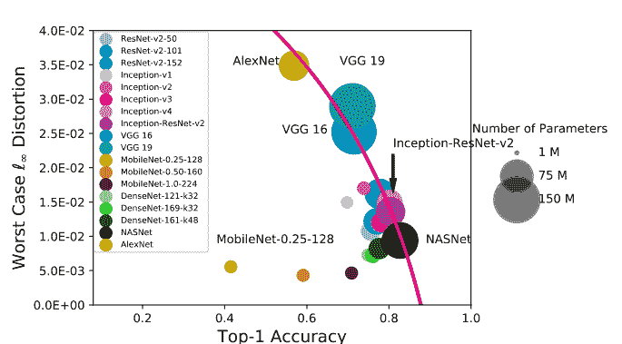

(a) $\ell_\infty$ 失真（I-FGSM 攻击）与 top-1 准确率的拟合 Pareto 边界：$\ell_\infty \text{ dist} = [2.9 \cdot \ln(1\text{-acc}) + 6.2] \times 10^{-2}$

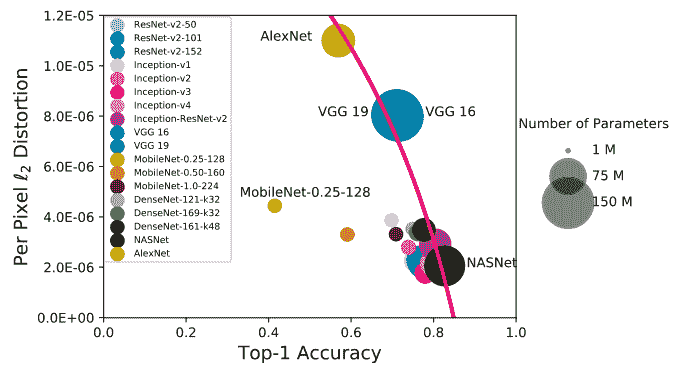

(b) $\ell_2$ 失真（C&W 攻击）与 top-1 准确率的拟合 Pareto 边界：$\ell_2 \text{ dist} = [1.1 \cdot \ln(1\text{-acc}) + 2.1] \times 10^{-5}$

图 1.1 针对 18 个 ImageNet 模型（Su et al, 2018）的 I-FGSM 攻击 (Kurakin et al, 2016)、C&W 攻击 (Carlini and Wagner, 2017b) 以及随机目标的鲁棒性与分类准确率图表。

#### 新兴机器学习模型的对抗鲁棒性评估资源快速适应

作为另一个激励性示例，一旦我们在研究对抗鲁棒性方面有足够的实践，当新的机器学习模型出现时，我们可以快速调整现有的对抗鲁棒性工具以进行评估和分析。

例如，变换器最初作为一种主要基于自注意机制的深度神经网络 (DNN) 应用于自然语言处理 (NLP) 任务 (Vaswani et al., 2017; Devlin et al., 2018; Brown et al., 2020b)，并且经过大规模预训练的变换器在许多 NLP 任务上取得了最先进的结果 (Devlin et al., 2018; Liu et al., 2019e; Yang et al., 2019b; Sun et al., 2019b)。最近，Dosovitskiy et al. (2020) 将纯变换器直接应用于图像补丁序列（即视觉变换器，ViT），并表明变换器本身在图像分类任务上可以与卷积神经网络 (CNN) 竞争。从那以后，变换器已扩展到各种视觉任务，并与 CNN 和循环神经网络 (RNN) 相比表现出竞争性或甚至更好的性能 (Carion et al., 2020; Chen et al., 2020b; Zhu et al., 2020b)。

使用现有的对抗鲁棒性评估工具，Shao et al. (2021a) 研究了 ViT 在图像分类任务中的对抗鲁棒性，并与 CNN 基线进行了比较。如图 1.2 所示，他们的实验结果说明了在白盒和黑盒攻击设置下，ViT 的鲁棒性优于 CNN，基于此，他们得出以下重要发现：

- ViTs 学习到的特征包含较少的低级信息，有利于对抗鲁棒性。与图 1.2 中 CNN 达到的最小值 83.3% 相比，ViT 的攻击成功率 (ASR) 较低，为 51.9%。它们对高频对抗扰动也较不敏感。
- 使用去噪随机平滑 (Salman et al., 2020b)，ViT 获得了显著优于 CNN 的认证鲁棒性。
- 如图 1.2 所示，通过引入块来帮助学习低级特征以提高 ViT 的分类准确率需要牺牲对抗鲁棒性。
- 当模型同时包含变换器块和 CNN 块时，增加模型中变换器块的比例会带来更好的鲁棒性。例如，当向 T2T-ViT-14 添加 10 个额外的变换器块时，攻击成功率 (ASR) 从 87.1% 降低到 79.2%。但是，增加纯变换器模型的大小不能保证产生类似效果，例如，图 1.2 中 ViT-S/16 的鲁棒性优于 ViT-B/16。
- 在更大的数据集上不进行对抗训练的预训练不会改善对抗鲁棒性，尽管这对于训练 ViT 至关重要。


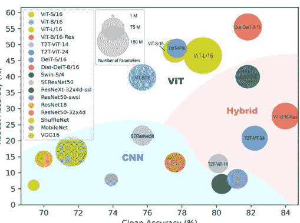

##### (a) 鲁棒准确度 v.s. 干净准确度

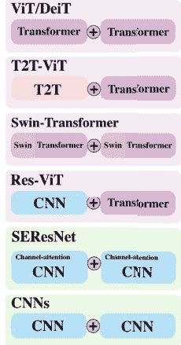

##### (b) 模型架构

图 1.2 (a) 鲁棒准确度与干净准确度对比。鲁棒准确度由 AutoAttack (Croce and Hein, 2020) 评估。“Hybrid”类别包括由 Shao et al. (2021a) 引入的 CNN-ViT、T2T-ViT 和 Swin-T。带有注意力机制的模型名称印在圆圈中心。ViT 对抗对抗性扰动具有最佳鲁棒性。向 ViT 引入其他模块可以提高干净准确度，但会损害对抗鲁棒性。CNN 对抗性攻击更脆弱。(b) 说明了 Shao et al. (2021a) 中考虑的视觉变换器和 CNN。

- 通过最小-最大优化 (Madry et al., 2017; Zhang et al., 2019b) 进行对抗训练的原理可应用于训练鲁棒 ViT。

Paul and Chen (2022) 对 ViT 针对常见损坏、对抗性扰动、分布偏移和自然对抗性示例的一般鲁棒性进行了全面研究。他们使用六个不同的多样 ImageNet 数据集，针对鲁棒分类对 ViT 模型和最先进的 CNN 进行全面性能比较。通过一系列六项系统设计的实验，他们展示了定量和定性指示，以解释为什么 ViT 确实是更鲁棒的学习者。

这些重要结果和对抗鲁棒性洞察，在新机器学习模型（如 ViT）出现后不久就无法获得，除非复用研究现有机器学习模型的可用资产和工具。更重要的是，只要我们承认确保对抗鲁棒性是实现机器学习现实且可持续改进的必要步骤，就会产生更强劲的动力来加速先进机器学习的发展进程。

### 1.5 AI 漏洞的实际示例

以下是一些总结 ML–基于系统中现实世界事件和漏洞的公共资源。

- [对抗 ML 威胁矩阵](https://github.com/mitre/advmlthreatmatrix)。
- [AI 事件数据库](https://incidentdatabase.ai/)。

### 1.6 对抗鲁棒性的开源 Python 库

以下是一些用于研究对抗鲁棒性的开源 Python 基于库的资源：

- [IBM 对抗鲁棒性工具箱](https://github.com/Trusted-AI/adversarial-robustness-toolbox)。
- [CleverHans](https://github.com/cleverhans-lab/cleverhans)。
- [Foolbox](https://github.com/bethgelab/foolbox)。
- [RobustBench](https://robustbench.github.io/)。
- [TextAttack](https://github.com/QData/TextAttack)。

# PART 2

## 对抗攻击

## 第 2 章

## 白盒对抗攻击

预测规避对抗攻击是用于在给定机器学习模型上生成对抗性示例的过程。对于目标模型 \( F_\theta \)（从安全角度也称为受害模型），对抗性示例的最一般定义是输入 \( \mathbf{x} \)，使得模型预测 \( F_\theta(\mathbf{x}) \) 与人类感知明显不一致，其中 \( \theta \) 是模型参数集。为简洁起见，我们将在剩余章节中使用 \( F \) 表示目标模型。要构建对抗性示例，典型过程是从机器学习模型正确分类的自然数据输入（例如图像）开始，然后添加人类不可感知的扰动以更改预测标签。这也称为规避攻击或测试时攻击，因为攻击者试图在测试时添加小扰动以使机器学习模型误分类，而不干扰训练过程。图 2.1 给出了一个对抗攻击示例，其中原始贝果图像被正确分类为贝果，但添加人类不可感知噪声后的扰动示例将被分类为钢琴。在实践中，对抗性扰动可能导致实时系统遭受灾难性损害。例如，研究人员证明，可以稍微扰动停车标志，使其被基于机器学习的图像识别系统识别为限速标志 (Eykholt et al., 2018)。

在本章中，我们讨论如何在白盒设置下进行对抗攻击。在此设置中，假设攻击者完全了解受害机器学习模型。例如，如果受害

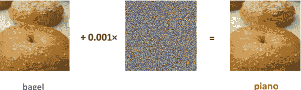

图 2.1 对抗性示例的示例，源自 (Chen et al., 2017a)。

模型 $F$ 是神经网络，我们将假设在白盒设置中，攻击者知道该网络的架构和权重。由于攻击者可以利用全面知识来攻击受害模型，白盒攻击是构建对抗性示例的最简单方式，并且也会导致最高成功率和最小扰动。在实践中，白盒假设通常过于强，因为生产中使用的底层模型通常对攻击者是隐藏的，我们将在下一章讨论如何在这些更现实的设置下进行攻击。尽管不现实，白盒攻击是评估模型鲁棒性的更可靠方式，因为它们通常导致最强攻击，可用于评估系统的最坏情况性能。因此，白盒攻击可由模型开发者用于内部性能评估。

### 2.1 攻击过程和符号

现在我们正式定义对抗攻击的过程。为简单起见，我们将在本章中主要关注多类分类问题。对于 $K$ 类多类分类问题，我们将模型定义为 $F : \mathbb{R}^d \to \{1, \dots, K\}$，将输入 $\boldsymbol{x}$ 映射到预测类标签。我们假设模型先为每个类别计算分数，然后选择分数最高的类别来做出最终决策。从数学上讲，我们使用 $f_j(\boldsymbol{x})$ 表示第 $j$ 个类别的预测分数，得分最高的标签将是模型的最终决策：$F(\boldsymbol{x}) = \arg\max_{j \in \{1, \dots, K\}} f_j(\boldsymbol{x})$。

假设 $\boldsymbol{x}_0 \in \mathbb{R}^d$ 是具有基础真实标签 $y_0 \in \{1, \dots, K\}$ 的自然示例，预测规避攻击将尝试寻找一个小扰动 $\boldsymbol{\Delta}$，使得 $F(\boldsymbol{x}_0 + \boldsymbol{\Delta}) \neq y_0$。扰动示例 $\boldsymbol{x}^* = \boldsymbol{x}_0 + \boldsymbol{\Delta}$ 称为 *对抗性示例*；这个扰动示例本应属于类别 $y_0$，因为 $\boldsymbol{x}^*$ 只是从原始示例 $\boldsymbol{x}_0$ 稍微扰动而来，但模型会将 $\boldsymbol{x}^*$ 错误分类为另一个标签。整个过程如图 2.2 所示。“扰动”的概念可以推广到超越加性噪声的其他有意义的数据操作。

*非靶向攻击 v.s. 靶向攻击。* 已经引入了多种攻击方法来构建对抗性示例以攻击机器学习模型。一般来说，有两种“攻击目标”，即靶向和非靶向。对于非靶向攻击，如果输入图像被预测为错误标签，则攻击成功。以图 2.2 为例：只要贝果图像未被分类为贝果，攻击即被视为成功。对于

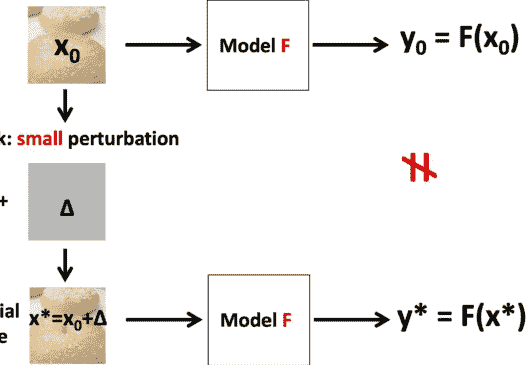

图 2.2 对抗攻击的过程。

靶向攻击，只有当对抗性示例被分类为目标类别时，攻击才成功。在此示例中，如果目标类别是钢琴，则只有当右侧的扰动图像被受害分类器标记为钢琴时，攻击才被视为成功。

### 2.2 将攻击表述为约束优化问题

给定原始示例 $\boldsymbol{x}_0$，对抗攻击旨在寻找对抗性示例 $\boldsymbol{x}^* = \boldsymbol{x}_0 + \boldsymbol{\Delta}$，在 $\boldsymbol{\Delta}$ 应该很小的约束下成功实现攻击目标（无论是靶向攻击还是非靶向攻击）。这可以表述为约束优化问题：我们旨在寻找一个对抗性示例 $\boldsymbol{x}$，以最大化 "攻击成功性"（或最小化攻击者的损失函数），而 $\boldsymbol{x}$ 受限于接近原始示例 $\boldsymbol{x}_0$。这可以写成以下数学问题：

\[
\arg\max_{\boldsymbol{x}} g(\boldsymbol{x}) \text{ s.t. } \boldsymbol{x} \in B(\boldsymbol{x}_0), \tag{2.1}
\]

其中 $g(\boldsymbol{x})$ 衡量攻击的成功性，$B(\boldsymbol{x}_0)$ 是围绕 $\boldsymbol{x}_0$ 的小区域，指示可扰动范围。

$g(\boldsymbol{x})$ 的定义可以针对不同的攻击进行不同定义。如第 1 章所述，神经网络训练通常涉及最小化交叉熵 (CE) 损失，定义为负对数似然


预测标签 $y_0$：

$\ell_{\text{CE}}(f(\boldsymbol{x}_0), y_0) := -\log P(y_0 \mid \boldsymbol{x}_0), \quad \text{where } P(y_0 \mid \boldsymbol{x}_0) := \frac{e^{f_{y_0}(\boldsymbol{x}_0)}}{\sum_{j=1}^K e^{f_j(\boldsymbol{x}_0)}}. \quad (2.2)$

这里，\(f_j(\boldsymbol{x}_0)\) 是类别 \(j\) 的类别预测分数，类别 \(j\) 的预测概率通过 softmax 操作进行归一化计算。我们可以通过微调此损失函数，为对抗攻击定义 \(g(\boldsymbol{x})\)。对于非靶向攻击，“使模型预测另一个标签”的目标可以表述为“最小化预测类别 \(y_0\) 的概率”。这可以通过设置来自然实现

非靶向交叉熵损失：\(g(\boldsymbol{x}) := \ell_{\text{CE}}(f(\boldsymbol{x}), y_0). \quad (2.3)\)

由于此处我们希望最大化 \(g(\boldsymbol{x})\) 而非最小化它，扰动将尝试最大程度地增加交叉熵损失，以达到最差的预测效果。

对于靶向攻击，我们旨在最大化目标类别 \(t\) 的预测概率。因此，攻击成功性可以定义为

靶向交叉熵损失：\(g(\boldsymbol{x}) := -\ell_{\text{CE}}(f(\boldsymbol{x}), t), \quad (2.4)\)

这即为目标类别概率的对数似然。

约束集 \(B(\boldsymbol{x}_0)\) 通常定义为 \(\boldsymbol{x}_0\) 附近的一个小区域。若使用 \(\ell_p\) 范数来测量距离，则可定义

\(B(\boldsymbol{x}_0) = \{\boldsymbol{x} : \|\boldsymbol{x} - \boldsymbol{x}_0\|_p \le \epsilon\},\)

其中 \(\epsilon\) 是预定义的小常数，称为扰动阈值或预算。例如，在 CIFAR-10 图像分类数据集（这是评估对抗攻击的标准基准数据集）中，当每个像素的取值范围为 [0, 255] 时，\(\epsilon\) 通常设为 8/255（适用于 \(\ell_\infty\) 范数）。请注意，对于计算机视觉应用，我们通常需要施加额外的逐元素上下界，以确保对抗样本 \(\boldsymbol{x}\) 仍是有效图像，因此约束集将变为 \(\ell_p\) 球与 \(\boldsymbol{x} \in [0, 255]^d\) 的交集。为简化起见，在推导中我们将省略此约束，因为它通常可以通过向可行数据空间进行简单的逐元素投影来轻松完成。

一旦将对抗攻击表述为约束优化问题，任何现有优化算法均可用于求解该问题以生成对抗样本。例如，可应用投影梯度下降法：在每次迭代中，我们通过以下方式更新当前解 \(\boldsymbol{x}_t\)

\(\boldsymbol{x}_{t+1} \leftarrow \Pi(\boldsymbol{x}_t + \alpha \nabla g(\boldsymbol{x})), \quad (2.5)\)

其中 \(\alpha\) 为梯度下降的学习率，\(\Pi(\cdot)\) 将向量投影到 \(B(\boldsymbol{x}_0)\)。然而，在实践中，我们可能会发现这种普通投影梯度下降更新在解决攻击问题时效果不佳，尤其是在使用 \(\ell_\infty\) 范数约束时，这是计算机视觉界最常见的选择。在 \(\ell_\infty\) 范数情况下，约束集 \(B(\boldsymbol{x})\) 是一个超矩形（高维矩形），成功的攻击通常（但不总是）位于该矩形的角上，即，成功的对抗样本 \(\boldsymbol{x}_i^*\) 的大多数元素应接近 \((\boldsymbol{x}_0)_i \pm \epsilon\)。如果使用普通投影梯度下降更新 (2.5)，则某些坐标将需要多次迭代才能达到 \(\pm \epsilon\)，导致收敛缓慢。因此，使用 *陡降算法* 进行攻击是一种常见做法，详情如下。

### 2.3 陡降、FGSM 和 PGD 攻击

在本节中，我们首先考虑 \(\ell_\infty\) 范数攻击（即，\(B(\boldsymbol{x}) = \{\boldsymbol{x} : \|\boldsymbol{x} - \boldsymbol{x}_0\|_\infty \le \epsilon\}\)）。让我们考虑仅进行 *一次更新* 以近似求解 (2.1) 的问题。陡降更新的想法是形成目标函数的线性近似，并找到最大化该线性近似的最佳更新。具体来说，我们可以对初始解 \(\boldsymbol{x}_0\) 进行 \(g(\boldsymbol{x})\) 的一阶泰勒展开（假设我们从原始自然样本开始）：

\(g(\boldsymbol{x}) \approx g(\boldsymbol{x}_0) + \nabla g(\boldsymbol{x}_0)^T (\boldsymbol{x} - \boldsymbol{x}_0).\)

然后我们可以求解以下约束优化问题，它是 (2.1) 的近似：

\(\underset{\boldsymbol{x}}{\text{argmax}} \nabla g(\boldsymbol{x}_0)^T (\boldsymbol{x} - \boldsymbol{x}_0) \quad \text{s.t.} \quad \boldsymbol{x} \in \|\boldsymbol{x} - \boldsymbol{x}_0\|_\infty \le \epsilon. \quad (2.6)\)

请注意，我们在泰勒展开中舍去了 \(g(\boldsymbol{x}_0)\) 项，因为它是与 \(\boldsymbol{x}\) 无关的常数。现在我们可以轻易看出 (2.6) 具有解析解

\(\boldsymbol{x}_1 = \boldsymbol{x}_0 + \epsilon \text{sign}(\nabla g(\boldsymbol{x}_0)). \quad (2.7)\)

这里，$\text{sign}(\cdot) \in \{+1, -1\}$ 表示逐元素符号值。这是一步陡降更新，令人惊讶的是，即使是这个简单的步骤也被发现对构造对抗样本非常有效。(2.7) 中的规则称为快速梯度符号法（FGSM），最初由 Goodfellow et al. (2015) 提出。

FGSM 的一个直接扩展是运行多次迭代的陡降。在此情况下，我们需要为每次迭代选择一个步长 $\alpha$，即，从当前迭代 \(\boldsymbol{x}_t\) 出发，允许在 \(\{\boldsymbol{x}_{t+1} : \|\boldsymbol{x}_{t+1} - \boldsymbol{x}_t\|_\infty \le \alpha\}\) 范围内进行更新，并在此区域内最小化线性近似。这将导致与 (2.6) 相同的子问题，只需将 $\epsilon$ 替换为 $\alpha$，因此最优更新为 \(\boldsymbol{x}_t + \alpha \text{sign}(\nabla g(\boldsymbol{x}_t))\)。多次迭代时的另一个问题是，经过几次迭代后变量可能会超出约束集 \(B(\boldsymbol{x}_0)\)。因此，我们必须将更新进一步投影回约束集，从而得到以下迭代陡降更新：

\(\boldsymbol{x}_{t+1} = \Pi(\boldsymbol{x}_t + \alpha \text{sign}(\nabla g(\boldsymbol{x}_t))) \quad \forall t=0, \dots, T-1.\) (2.8)

若运行该更新 $T$ 次迭代，则最终解 $\boldsymbol{x}_T$ 预期将优于 FGSM。这被称为 Kurakin et al. (2016) 提出的迭代 FGSM（I-FGSM）攻击，也被称为 Madry et al. (2018) 提出的（基础）PGD 攻击。该 PGD 攻击是构建对抗样本最有效的一阶（基于梯度）算法之一。此外，它很容易融入对抗训练算法中以训练鲁棒模型，这将在第 11 章中讨论。

运行 PGD 攻击的一个问题是选择合适的步长 $\alpha$。若 $\alpha < \frac{\epsilon}{T}$，则解 $\boldsymbol{x}_T$ 将无法到达 \(B(\boldsymbol{x}_0)\) 的边界，因此攻击效果不会很好。在实践中，$\alpha$ 通常设为略大于 \(\frac{\epsilon}{T}\) 的数值。其值也可以随每次攻击迭代而变化。此外，可以在 \(B(\boldsymbol{x}_0)\) 内随机初始化 \(\boldsymbol{x}_0\)，并可能重复此过程多次以寻找对抗样本。

### 2.4 转化为无约束优化问题

与求解 (2.1) 中的约束优化问题不同，我们实际上可以将其转化为无约束优化问题，并应用标准梯度下降或其他一阶方法（无需投影）来求解。这是通过求解以下“软约束”形式来实现的，其中我们移除了约束并添加了惩罚项在


用于强制执行小扰动的目标函数：

\(\underset{\mathbf{x}}{\arg\min} -g(\mathbf{x}) + \lambda \cdot \|\mathbf{x} - \mathbf{x}_0\|_p,\) (2.9)

其中 \(\lambda > 0\) 是一个用于控制两项之间平衡的常数。较大的 \(\lambda\) 会导致 \(\ell_p\) 范数中更小的扰动但较低的攻击成功率，而较小的 \(\lambda\) 会找到攻击成功率更高的较大扰动。

请注意，我们可以通过求解一系列无约束问题 (2.9) 来在某个 \(\epsilon\) 扰动约束内找到对抗样本。设 \(\mathbf{x}^*(\lambda)\) 为常数 \(\lambda\) 下 (2.9) 的解；那么扰动 \(\|\mathbf{x}^*(\lambda) - \mathbf{x}_0\|_p\) 将是 \(\lambda\) 的递减函数。因此，我们可以通过二分查找找到理想的 \(\lambda\)，使得 \(\|\mathbf{x}^*(\lambda) - \mathbf{x}_0\|_p = \epsilon\)。该方法已被 Carlini and Wagner (C&W) 攻击 (Carlini and Wagner, 2017b) 采用，该攻击使用下面定义的不同损失函数来求解无约束形式。

### 2.5 定义攻击目标的另一种方式

通过交叉熵损失定义攻击成功性 \(g(\mathbf{x})\) 是直观的，但已发现，交叉熵损失引入的非凸性有时会导致 PGD 攻击收敛缓慢，有时会导致糟糕的局部最小值。因此，文献中已研究了 \(g(\mathbf{x})\) 的几种替代定义。其中，Carlini and Wagner (2017b) 表明，使用所谓的“铰链损失”（hinge loss）定义 \(g(\mathbf{x})\) 是最有效的。采用这种方法的攻击称为 C&W 攻击。对于非靶向攻击，C&W 损失可以写为

\(\text{Untargeted C\&W loss:} g(\mathbf{x}) = -\max\{f_{y_0}(\mathbf{x}) - \max_{j \neq y_0} f_j(\mathbf{x}), -\kappa\},\) (2.10)

其中 \(y_0\) 是基础真实类别，\(\kappa \ge 0\) 是一个常数。对于 \(\kappa = 0\)，如果模型预测原始类别（\(f_{y_0}(\mathbf{x}) \ge \max_{j \neq y_0} f_j(\mathbf{x})\)），则该函数为负；当模型给出除 \(y_0\) 之外的任何 top-1 预测（即“错误”预测）时，则为零。因此，最大化该函数将获得成功的攻击。将 \(\kappa\) 设置为某个正值可以在 \(f_{y_0}(\mathbf{x})\) 和 \(\max_{j \neq y_0} f_j(\mathbf{x})\) 之间强制执行边界，但这通常仅用于特殊情况，即当我们希望获得距离决策边界更远的更强对抗样本时。基于类似的直觉，C&W 靶向攻击的损失可以写为

Targeted C&W loss: \(g(x) = -\max\{\max_{j \neq t} f_j(x) - f_t(x), -\kappa\},\) (2.11)

其中 \(t\) 是目标类别。已观察到，该损失函数能够带来更好的攻击效果，尤其是在 \(\ell_2\) 扰动情况下。

### 2.6 基于不同 \(\ell_p\) 范数的攻击

对于计算机视觉，对抗扰动常用的 \(\ell_p\) 范数包括 \(\ell_\infty\)、\(\ell_2\)、\(\ell_1\) 和 \(\ell_0\) 范数。\(^1\) \(\ell_p\) 范数家族在构造对抗样本时具有物理意义。\(\ell_\infty\) 范数限制了所有维度中的最大变化，\(\ell_2\) 范数测量 \(x\) 和 \(x_0\) 之间的欧氏距离，\(\ell_1\) 范数测量 \(x\) 和 \(x_0\) 之间总变化的绝对值之和，\(\ell_0\) 范数测量修改元素的数量（例如，图像中修改的像素）。根据上下文，我们可以在对抗攻击中使用混合范数，无论是作为约束还是优化公式中的罚函数。例如，Chen et al. (2018b) 提出了深度神经网络的弹性网攻击（EAD 攻击），它使用 \(\ell_1\) 和 \(\ell_2\) 范数的混合来寻找稀疏对抗样本，并表明可提高 C&W 攻击的性能。Su et al. (2019) 提出了一种基于 \(\ell_0\) 范数的攻击，只修改少数像素以导致预测变化。我们还可以利用卷积滤波器并使用组范数来设计结构化对抗攻击，如 Xu et al. (2019b) 所提议。

### 2.7 通用攻击

到目前为止，我们介绍的所有攻击都为每张图像生成一个扰动 \(\Delta\)，每张图像的扰动都不同。文献中研究的一个有趣的问题是：“我们能否在所有图像上使用相同的对抗扰动来愚弄受害模型？” Moosavi-Dezfooli et al. (2017) 首先引入了这一概念，并称其为 *通用对抗扰动*。请注意，尽管扰动对所有图像都是通用的，但它是针对每个特定机器学习模型设计的。因此，为一个模型设计的通用扰动可能无法推广到另一个模型。寻找通用扰动可以使攻击在实时中更高效，并将揭示特定模型在所有图像上的弱点。

为模型 F 生成通用对抗扰动的问题也可以表述为优化问题。我们不再只考虑一张图像，而必须考虑一组图像，记为 D。通过考虑多个样本上的总损失，可以将受约束和无约束优化公式推广。例如，(2.1) 中的受约束形式可以推广到通用攻击设置为

\(\underset{\Delta}{\arg\max} \sum_{\mathbf{x} \in D} g(\mathbf{x} + \Delta) \text{ s.t. } \|\Delta\|_p \le \epsilon.\) (2.12)

该问题的优化器将是一个小扰动，可以尽可能成功攻击尽多的图像。同样，可以推导 FGSM 或 PGD 攻击来求解此问题。此外，我们还可以将无约束形式 (2.9) 推广到通用攻击设置。Wang et al. (2021a) 通过使用最小–最大优化求解器，改进了相对于 (2.12) 的通用攻击性能。

### 2.8 自适应白盒攻击

早期，在研究界，关于如何宣称一种防御对攻击有效，存在着活跃且反复的讨论，因为结论会根据攻击者和防御者的行动顺序而显著不同，这是威胁模型的重要规范。如果攻击者先动手创建对抗样本，后来防御者介入辨别生成的对抗样本（例如，在数据推理前使用基于输入过滤或数据重构的技术），那么许多攻击可以被缓解或减轻。另一方面，如果防御者先动手，且攻击者知道现有的防御，那么在后一种设置中，许多防御被证明是无效的，或者说是“破损”的 (Carlini and Wagner, 2017a; Athalye et al., 2018; Carlini et al., 2019a)。

后一种设置被称为自适应白盒攻击设置，它基本假设在构造对抗攻击时，防御对攻击者是完全透明的（一些不可控的随机性除外）。这种设置对于实施实际攻击可能不现实，但它提供了关于受保护模型对抗攻击真实鲁棒性的诚实（最坏情况）评估，超出了攻击者和防御者之间信息不对称带来的优势。否则，有人认为，如果模型在第一种设置中具有鲁棒性，但对自适应攻击不具鲁棒性，则可能会产生虚假的安全感或鲁棒性 (Carlini and Wagner, 2017a; Athalye et al., 2018; Carlini et al., 2019a)。一个典型的例子是 Athalye et al. (2018) 讨论过的，由那些由于信息混淆（例如，输入空间损失景观上过于平滑或噪声的梯度）而混淆基于梯度的攻击的防御所带来的所谓的“梯度混淆”（gradient obfuscation）效应。但是，了解防御机制的攻击者可以提出高级方法或采用非基于梯度的攻击来使这些防御失效。Carlini et al. (2019a) 提供了许多基于自适应攻击评估对抗鲁棒性的原则。

### 2.9 经验比较

遵循 Chen et al. (2018b); Xu et al. (2019b)，表 2.1 比较了三个图像分类任务（MNIST、CIFAR-10 和 ImageNet）上随机选择类别的靶向白盒攻击以及不同 \(\ell_p\) 范数的情况。从测试集中选择一组正确分类的图像来执行对抗攻击。对于每张图像，我们报告导致成功攻击的最小畸变。如果给定攻击的所有测试 \(\epsilon\) 阈值都失败，则将其标记为攻击不成功。攻击成功率（ASR）报告所有测试图像中成功攻击的比例。FGSM/I-FGSM 攻击使用 Kurakin et al. (2016) 描述的将范数投影到指定扰动阈值。\(^2\) 我们为 FGSM/I-FGSM 攻击提供了细密的 \(\epsilon\) 阈值网格。对于基于范数罚项的攻击，如 C&W 和 EAD，我们使用 Carlini and Wagner (2017b) 提出的二分查找策略来调整系数 \(\lambda\)，该策略平衡攻击成功性和畸变。对于 C&W 攻击，我们使用 \(\ell_2\) 范数罚项。对于 EAD 攻击，我们使用混合 \(\ell_1 + \ell_2\) 范数罚项（即弹性网范数 \(\|\mathbf{x} - \mathbf{x}_0\|_2 + \beta \cdot \|\mathbf{x} - \mathbf{x}_0\|_1\) 与 \(\beta = 10^{-3}\)），并根据弹性网范数（EN 规则）或 \(\ell_1\) 范数（\(\ell_1\) 规则）选择最佳畸变。从表 2.1 可以看出，所有

\(^2\) 请注意，(Kurakin et al., 2016) 中的 \(\ell_1\) 范数投影只是真实投影函数的近似。精确投影需要求解 Xu et al. (2019b) 描述的另一个优化子问题。我们在此仅为完整性而包含经验结果。


表 2.1 MNIST、CIFAR10 和 ImageNet 上不同攻击方法的比较（平均情况）。ASR 表示随机目标攻击的攻击成功率（%）。畸变指标在成功样本上取平均值。EAD、C&W 攻击和 I-FGSM-\(\ell_\infty\) 分别实现了畸变最小的 \(\ell_1\)、\(\ell_2\) 和 \(\ell_\infty\) 对抗示例。

| 攻击方法 | MNIST | | | | CIFAR-10 | | | | ImageNet | | | |
| --- | --- | --- | --- | --- | --- | --- | --- | --- | --- | --- | --- | --- |
| | ASR | $\ell_1$ | $\ell_2$ | $\ell_\infty$ | ASR | $\ell_1$ | $\ell_2$ | $\ell_\infty$ | ASR | $\ell_1$ | $\ell_2$ | $\ell_\infty$ |
| C&W ($\ell_2$) | 100 | 22.46 | **1.972** | 0.514 | 100 | 13.62 | **0.392** | 0.044 | 100 | 232.2 | **0.705** | 0.03 |
| FGSM-\(\ell_1\) | 39 | 53.5 | 4.186 | 0.782 | 48.8 | 51.97 | 1.48 | 0.152 | 1 | 61 | 0.187 | 0.007 |
| FGSM-\(\ell_2\) | 34.6 | 39.15 | 3.284 | 0.747 | 42.8 | 39.5 | 1.157 | 0.136 | 1 | 2338 | 6.823 | 0.25 |
| FGSM-\(\ell_\infty\) | 42.5 | 127.2 | 6.09 | 0.296 | 52.3 | 127.81 | 2.373 | 0.047 | 3 | 3655 | 7.102 | 0.014 |
| I-FGSM-\(\ell_1\) | 100 | 32.94 | 2.606 | 0.591 | 100 | 17.53 | 0.502 | 0.055 | 77 | 526.4 | 1.609 | 0.054 |
| I-FGSM-\(\ell_2\) | 100 | 30.32 | 2.41 | 0.561 | 100 | 17.12 | 0.489 | 0.054 | 100 | 774.1 | 2.358 | 0.086 |
| I-FGSM-\(\ell_\infty\) | 100 | 71.39 | 3.472 | **0.227** | 100 | 33.3 | 0.68 | **0.018** | 100 | 864.2 | 2.079 | **0.01** |
| EAD (EN rule) | 100 | 17.4 | 2.001 | 0.594 | 100 | **8.18** | 0.502 | 0.097 | 100 | **69.47** | 1.563 | 0.238 |
| EAD ($\ell_1$ rule) | 100 | 14.11 | 2.211 | 0.768 | 100 | **6.066** | 0.613 | 0.17 | 100 | **40.9** | 1.598 | 0.293 |

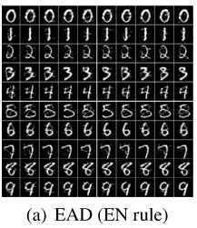

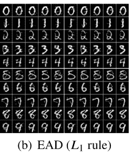

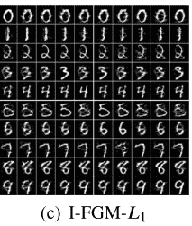

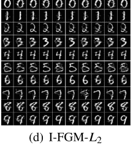

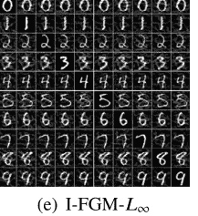

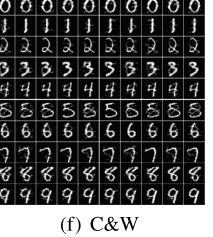

图 2.3 不同攻击方法在 MNIST 上生成的对抗示例的可视化说明。对于每种方法，对角线上显示的图像为原始示例。在每一行中，非对角线图像为对应的对抗示例，列索引目标标签（从左到右：数字 0 到 9）。

除 FGSM 以外的攻击由于使用迭代梯度优化，可以达到 100% 的 ASR。针对不同范数约束或惩罚函数定制的攻击确实可以找到带有小扰动的相应对抗示例。

为了可视化说明，测试集中选定的良性图像的对抗示例显示在图 2.3、2.4 和 2.5 中。在 CIFAR10 和 ImageNet 上，对抗示例在视觉上不可区分。在 MNIST 上，I-FGSM 示例比 EAD 和 C&W 攻击更模糊。

### 2.10 扩展阅读

- 超越 $\ell_p$ 范数的对抗攻击包括语义相似的示例，例如颜色空间转换（Hosseini and Poovendran, 2018）和空间变换（例如，旋转）（Xiao et al., 2018; Engstrom et al., 2019b）。Tsai et al. (2022) 提出了考虑多种攻击类型及其攻击顺序的复合对抗攻击。

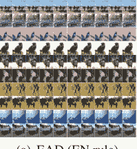

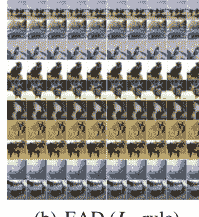

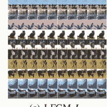

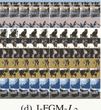

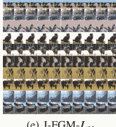

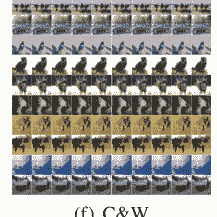

图 2.4 不同攻击方法在 CIFAR10 上生成的对抗示例的可视化说明。对于每种方法，对角线上显示的图像为原始示例。在每一行中，非对角线图像为对应的对抗示例，列索引目标标签。

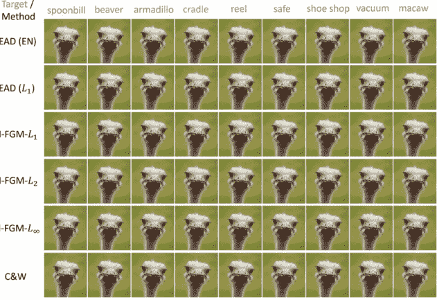

图 2.5 不同攻击方法在 ImageNet 上生成的对抗示例的可视化说明。每一列表示要攻击的目标类别，每一行表示一种攻击方法。

- 同时考虑多个 $\ell_p$ 范数的对抗攻击（Xu et al., 2019b; Tramer and Boneh, 2019）。
- Auto-Attack：一种无参数对抗攻击的集合（Croce and Hein, 2020）。
- 不受限制的对抗示例（Brown et al., 2018）。
- 流形内和流形外的对抗示例（Stutz et al., 2019）。
- 自然对抗示例（Hendrycks et al., 2021）。

## 第 3 章

## 黑箱对抗攻击

近年来，“机器学习即服务”为世界各种任务提供了轻松访问强大机器学习工具的途径。例如，Google Cloud Vision API$^1$ 和 Clarifai.com$^2$ 等商业可用服务向公众提供预训练好的图像分类器。任何人都可以以低价上传图像并获得手头图像的类别预测结果。然而，服务背后模型的细节对攻击者/用户未知，这意味着函数/模型 $f$ 可以被视为 *黑箱* 模型。*查询* 被定义为上传数据输入 $\boldsymbol{x}$ 并获得函数/模型输出 $f(\boldsymbol{x})$ 的一个实例。除了攻击成功率外，发起成功对抗攻击（例如，寻找对抗示例）所需的针对目标黑箱模型的查询次数也是评估黑箱攻击效率的重要指标。

### 3.1 躲避攻击分类

躲避攻击可根据攻击者对目标模型的了解程度进行分类。图 3.1 展示了不同攻击类型的分类。

第 2 章介绍的 *白盒攻击* 假设对目标模型有完整了解，包括模型架构和模型参数。因此，攻击者可以利用深度学习库提供的自动微分功能（例如，从模型输出到模型输入的反向传播（输入梯度））来构建对抗示例。这种“攻击”对模型开发者执行一系列内部鲁棒性测试最为实用，即虚拟对手或白帽子黑客。对于真正的攻击者，要求对目标模型进行白盒访问通常不可行。

*黑箱攻击* 假设攻击者只能观察数据输入的模型预测（即，查询），且不知任何其他信息。目标模型可以被视为黑箱函数，因此在不知道模型细节的情况下，输入梯度的反向传播不可行。

$^1$ https://cloud.google.com/vision。$^2$ https://clarifai.com。

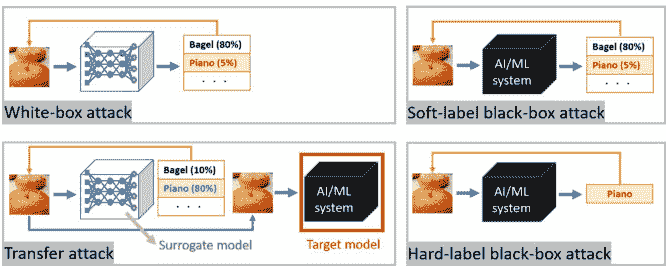

图 3.1 躲避攻击的分类和说明。

模型细节。在 _软标签黑箱攻击_ 设置中，攻击者可以观察（部分）类别预测及其相关置信分数。在 _硬标签黑箱攻击_（基于决策）设置中，攻击者只能观察 top-1 标签预测，这是保持模型效用所需返回的最少信息。除了攻击成功率外，查询效率也是评估黑箱攻击性能的重要指标。

_转移攻击_ 是黑箱攻击的一个分支，它使用从白盒替代模型生成的对抗示例来攻击目标黑箱模型。替代模型可以是预训练的（Liu et al., 2017b），也可以是从一组数据样本中蒸馏出来的，这些样本由目标模型给出的软标签作为其训练标签（Papernot et al., 2016, 2017）。

在白盒攻击和黑箱攻击的光谱之间，威胁模型和攻击者能力的变化将导致不同的 _灰箱_ 攻击。

### 3.2 软标签黑箱攻击

黑箱攻击算法通常采用基于惩罚（例如，Eq. (2.9)）或基于预算（例如，Eq. (2.1)）的公式。由于在黑箱设置中无法获得攻击者损失的输入梯度，一种主要方法是使用模型查询进行梯度估计，然后使用估计梯度替换白盒攻击算法中的真实梯度，从而得到基于零阶优化（ZOO）的黑箱攻击（Chen et al., 2017a）。


无疑，只需将目标模型表示为由 $\theta$ 参数化的分类函数，定义为 $f_\theta : [0, 1]^d \mapsto \mathbb{R}^K$，它接受一个 $d$ 维缩放数据样本作为输入，并输出所有 $K$ 个类别的预测分数向量，例如每个类别的预测概率。“软标签”一词是指攻击者可以观察到每个类别的预测分数这一事实。我们还考虑对 $f_\theta$ 的输出应用逐元素单调变换 $M(f_\theta)$ 以用于黑盒攻击的情况，因为单调变换保留了类别预测的排名，并可以缓解 $f_\theta$ 中大分数变化的问题（例如，概率到对数概率的转换是单调的）。

在这里，我们使用基于惩罚的损失来制定软标签黑盒靶向攻击。该公式可以轻松适应非靶向攻击。设 $(\mathbf{x}_0, t_0)$ 表示自然图像 $\mathbf{x}_0$ 及其基础真实类别标签 $t_0$，设 $(\mathbf{x}, t)$ 表示 $\mathbf{x}_0$ 的对抗样本和目标攻击类别标签 $t \neq t_0$。寻找对抗样本的问题可以表述为采用如下一般形式的优化问题

$$\min_{\mathbf{x} \in [0, 1]^d} \text{Dist}(\mathbf{x}, \mathbf{x}_0) + \lambda \cdot \text{Loss}(\mathbf{x}, M(f_\theta(\mathbf{x})), t), \quad (3.1)$$

其中，$\text{Dist}(\mathbf{x}, \mathbf{x}_0)$ 衡量 $\mathbf{x}$ 与 $\mathbf{x}_0$ 之间的畸变，$\text{Loss}(\cdot)$ 是反映预测 $t = \arg \max_{k \in \{1, \dots, K\}} [M(f_\theta(\mathbf{x}))]_k$ 的可能性的攻击目标，$\lambda \ge 0$ 是正则化系数，约束 $\mathbf{x} \in [0, 1]^d$ 将对抗图像 $\mathbf{x}$ 限制在有效的缩放数据空间中。考虑加性输入扰动的情况，$\text{Dist}(\mathbf{x}, \mathbf{x}_0)$ 通常由 $\ell_p$ 范数来评估，定义为 $\text{Dist}(\mathbf{x}, \mathbf{x}_0) = \|\mathbf{x} - \mathbf{x}_0\|_p$，其中 $\delta = \mathbf{x} - \mathbf{x}_0$ 是对 $\mathbf{x}_0$ 的加性扰动。攻击目标 $\text{Loss}(\cdot)$ 可以是分类的训练损失（例如，交叉熵）或基于边际的 C&W 损失（Carlini and Wagner, 2017b），如第 2 章中所介绍。对数运算通常用于逐元素单调变换函数 $M$。

在黑盒攻击场景中，(3.1) 中的攻击目标可以视为黑盒函数 $F$。由于只能观察到 $F$ 的函数值，与白盒攻击不同，我们无法使用基于梯度的方法来求解 (3.1)。解决这一问题的基本工具是使用 *零阶优化*（ZOO），它遵循基于梯度（一阶）优化规则，但使用两个接近点的函数值来估计梯度，而不是使用真实梯度。

#### 坐标向梯度估计

作为实现无梯度黑盒攻击的首次尝试，Chen et al. (2017a) 使用对称差商方法（Lax and Terrell, 2014）来评估第 $i$ 个分量的梯度 \(\frac{\partial F(x)}{\partial x_i}\)，方法如下：

\(g_i = \frac{F(x + h e_i) - F(x - h e_i)}{2h} \approx \frac{\partial F(x)}{\partial x_i}\) (3.2)

使用一个较小的 $h$，这里 $e_i$ 表示第 $i$ 个初等基向量（第 $i$ 个分量为 1，其余为 0）。理论上，当 $h \to 0$ 时，该估计将得到精确的梯度值，但在实践中，选取非常小的 $h$ 也会导致一些数值误差，因此通常选择一个足够小的值，例如 $h = 0.001$。

请注意，(3.2) 中坐标向梯度估计步骤的性质必然导致需要大量模型查询才能获得完整的梯度估计，因此查询效率不高。要估计维度为 $d$ 的梯度，需要对 $F$ 进行 $2 \cdot d$ 次模型查询。例如，ImageNet 数据集的 $d = 299 \times 299 \times 3 \approx 270{,}000$ 个输入维度，这使得坐标向零阶优化查询效率低下。因此，为了使用这种坐标向梯度估计，Chen et al. (2017a) 采用坐标下降算法来求解攻击目标 (3.1)，在每次迭代中，坐标下降算法选择一个坐标 $i$，根据 (3.2) 计算梯度，然后通过 $x_i \leftarrow x_i - \alpha g_i$ 更新该坐标，其中 $\alpha$ 是步长。

#### 基于随机向量的梯度估计

上述提到的坐标向梯度估计可以看作是沿着 $e_i$ 方向计算方向导数。然而，在标准攻击中，当扰动由小的 $\ell_2$ 或 $\ell_\infty$ 范数界定时，坐标向扰动通常是不够的，因此使用坐标梯度估计将需要大量查询。因此，查询效率高的黑盒攻击（例如（Tu et al., 2019））使用以下梯度估计器，它在随机采样的方向 $u$ 处计算方向导数：

\(g = b \cdot \frac{f(x + \beta u) - f(x)}{\beta} \cdot u,\) (3.3)

其中 $\beta > 0$ 是平滑参数，$u$ 是从单位欧几里得球面上均匀随机绘制的单位长度向量，$b$ 是一个可调的缩放参数，用于平衡梯度估计误差的偏差与方差权衡。

为了有效控制梯度估计中的误差，我们考虑一个更通用的梯度估计器，其中梯度估计值对 $q$ 个随机方向 $\{\mathbf{u}^{(i)}\}_{i=1}^q$ 取平均，即

\(\overline{\boldsymbol{g}} = \frac{1}{q} \sum_{i=1}^q \boldsymbol{g}^{(i)},\) (3.4)

其中 $\boldsymbol{g}^{(i)}$ 是由 (3.3) 定义且 \(\mathbf{u} = \mathbf{u}^{(i)}\) 的梯度估计值。使用多个随机方向可以减少 (3.4) 中 $\overline{\boldsymbol{g}}$ 对于凸损失函数的方差（Duchi et al., 2015; Liu et al., 2018a）。

下面，我们建立了 (3.4) 中平均随机梯度估计器的误差分析，以研究参数 $b$ 和 $q$ 对估计误差和查询效率的影响。

**定理 1.** 设 $F : \mathbb{R}^d \mapsto \mathbb{R}$ 为具有 $L$-Lipschitz 梯度 \(\nabla F\) 的可微函数。<sup>3</sup> 那么，(3.4) 中 $\overline{\boldsymbol{g}}$ 的均方估计误差由以下式子上界

\(\mathbb{E}\|\overline{\boldsymbol{g}} - \nabla F(\mathbf{x})\|_2^2 \le 4\left( \frac{b^2}{d^2} + \frac{b^2}{dq} + \frac{(b-d)^2}{d^2} \right)\|\nabla F(\mathbf{x})\|_2^2 + \frac{2q+1}{q} b^2 \beta^2 L^2.\) (3.5)

证明。参见第 3.7 节。

基于定理 1，以下几点重要含义值得强调：(i) 误差分析在 $F$ 为非凸时依然成立；(ii) 在神经网络实现中，真实梯度 $\nabla F$ 可以看作通过反向传播得到的数值梯度；(iii) 对于任何固定的 $b$，选择较小的 $\beta$（例如，$\beta = 1/d$）可以有效减小 (3.5) 中的最后一项误差，因此我们主要关注优化第一项误差；(iv) (3.5) 中的第一项误差项体现了 $b$ 和 $q$ 对估计误差的影响，且与 $\beta$ 无关。下面我们进一步阐述 (iv)。固定 $q$，并令 $\eta(b) = \frac{b^2}{d^2} + \frac{b^2}{dq} + \frac{(b-d)^2}{d^2}$ 为 (3.5) 中第一项误差项的系数，使 $\eta(b)$ 最小化的最优 $b$ 为 $b^* = \frac{dq}{2q+d}$。为了查询效率，我们希望保持 $q$ 较小，这意味着当维度 $d$ 很大时，$b^* \approx q$ 且 $\eta(b^*) \approx 1$。另一方面，当 $q \to \infty$ 时，$b^* \approx d/2$ 且 $\eta(b^*) \approx 1/2$，这会给出更小的误差上界，但查询效率低下。我们还注意到，通过设置 $b=q$，系数 $\eta(b) = \frac{b^2}{d^2} + \frac{b^2}{dq} + \frac{(b-d)^2}{d^2} \approx 1$，因此与维度 $d$ 和参数 $q$ 无关。

<sup>3</sup> 如果对于所有 $\mathbf{w}_1, \mathbf{w}_2$ 都有 \(\|W(\mathbf{w}_1) - W(\mathbf{w}_2)\|_2 \le L\|\mathbf{w}_1 - \mathbf{w}_2\|_2\)，则函数 $W$ 是 $L$-Lipschitz 的。对于具有 ReLU 激活函数的神经网络，$L$ 可以从模型权重中推导出来（Szegedy et al., 2014）。


*伪梯度下降。* 使用估计的梯度 $\mathbf{g}$，我们可以将任何基于梯度的白盒攻击扩展到软标签黑盒设置，通过执行相同的基于梯度的攻击，将梯度替换为梯度估计器 $\mathbf{g}$。例如，我们可以按照常规（投影）梯度下降/上升算法求解 (3.1)

```
$$ \mathbf{x}_{t+1} \leftarrow \Pi(\mathbf{x}_t - \alpha \cdot \mathbf{g}(\mathbf{x}_t)), $$ (3.6)
```

其中 $t$ 表示迭代索引，$\Pi$ 表示投影操作（例如，投影到 $[0, 1]^d$），$\alpha$ 表示步长。梯度估计器的选择以及基于梯度的优化求解器的类型（例如，PGD、Adam 或 Momentum-SGD）将导致不同的黑盒攻击算法。

### 3.3 硬标签黑箱攻击

硬标签黑盒攻击假设的是信息受限最严格的设置，即攻击者只能观察到 top-1 类预测（但不能观察到分数）。在此设置中，(3.1) 中的朴素攻击目标将定义不明，因此无法直接将白盒或软标签黑盒攻击扩展到硬标签设置。如果我们将 $f_\theta(\mathbf{x})$ 替换为 (3.1) 中的硬标签预测，目标函数将成为离散阶跃函数；我们可以观察到微小的扰动要么不影响目标函数值（当预测标签不变时），要么导致目标函数值发生离散变化（当预测标签改变时）。因此，软标签黑盒设置中使用的零阶优化攻击不能轻易应用。尽管存在这些困难，但研究表明，通过仔细重新表述攻击目标函数，零阶优化原理仍然可以通过花费额外查询来探索局部损失景观进行梯度估计而应用（Cheng et al., 2019a, 2020c; Chen et al., 2020a）。

给定样本 $\mathbf{x}_0$、真实标签 $t_0$ 和硬标签黑盒函数 $f_\theta : \mathbb{R}^d \to \{1, \dots, K\}$，我们根据攻击类型定义目标函数 $h : \mathbb{R}^d \to \mathbb{R}$：

```
Untargeted attack: $h(\mathbf{s}) = \min_{\lambda > 0} \lambda \quad \text{s.t.} \quad f_\theta \left( \mathbf{x}_0 + \lambda \frac{\mathbf{s}}{\|\mathbf{s}\|} \right) \neq t_0.$ (3.7)
```

Targeted attack (given target \( t \)): \( h(\boldsymbol{s}) = \min_{\lambda > 0} \lambda \quad \text{s.t.} \quad f_{\theta} \left( \boldsymbol{x}_0 + \lambda \frac{\boldsymbol{s}}{\|\boldsymbol{s}\|} \right) = t. \) (3.8)

在此表述中，\( \boldsymbol{s} \) 表示对抗样本的方向，\( h(\boldsymbol{s}) \) 是沿方向 \( \boldsymbol{s} \) 从 \( \boldsymbol{x}_0 \) 到最近对抗样本的距离。分母中的范数 \( \|\boldsymbol{s}\| \) 使搜索向量 \( \frac{\boldsymbol{s}}{\|\boldsymbol{s}\|} \) 具有单位长度。对于非靶向攻击，\( h(\boldsymbol{s}) \) 也对应于沿方向 \( \boldsymbol{s} \) 到决策边界的距离。

(Cheng et al., 2019a) 提出的此重新表述的核心思想是，不像 (3.1) 那样直接优化对抗扰动，而是旨在找到一个方向 \( \boldsymbol{s} \)，使得最坏情况扰动沿该方向。由于上述定义的 \( h(\boldsymbol{s}) \) 度量了沿方向 \( \boldsymbol{s} \) 到最近对抗样本的距离，寻找对抗样本的方向可以表述为以下优化问题：

\( \min _{\boldsymbol{s}} h(\boldsymbol{s}). \) (3.9)

最后，对抗样本可以通过 \( \boldsymbol{x}=\boldsymbol{x}_0+h(\boldsymbol{s}^*) \frac{\boldsymbol{s}^*}{\|\boldsymbol{s}^*\|}\) 找到，其中 \( \boldsymbol{s}^* \) 是 (3.9) 的最优解。

在黑盒攻击设置中，我们无法获得 \( h \) 的梯度，但可以使用硬标签查询来评估 \( h \) 的函数值。为简单起见，此处我们专注于非靶向攻击，但相同的程序也可应用于靶向攻击。

在此我们讨论如何在无需额外信息的情况下直接计算 \( h(\boldsymbol{s}) \)。对于给定的归一化 \( \boldsymbol{s} \)，可以先进行粗粒度搜索，再进行二分搜索来计算。以非靶向攻击为例，在粗粒度搜索中，算法逐个查询点 \( \{\boldsymbol{x}_0+\alpha \boldsymbol{s}, \boldsymbol{x}_0+2\alpha \boldsymbol{s}, \dots \} \)，直到找到一个对抗样本 \( f(\boldsymbol{x}+\alpha \boldsymbol{s}) \neq t_0 \)。这意味着边界位于 \( [\boldsymbol{x}_0+(i-1)\alpha \boldsymbol{s}, \boldsymbol{x}_0+i\alpha \boldsymbol{s}] \) 之间。随后我们可以进入第二阶段，在此区域内进行二分搜索以找到解。请注意，如果我们根据来自另一类的某个 \( \boldsymbol{x} \) 沿 \( \boldsymbol{x}-\boldsymbol{x}_0 \) 的方向选择 \( \boldsymbol{s} \)，则第一阶段存在上界。该过程用于在我们的优化算法中找到初始 \( \boldsymbol{s}_0 \) 及相应的 \( g(\boldsymbol{s}_0) \)。计算 \( h \) 值的完整过程在算法 1 中给出。请注意，该过程查询效率较低，因为在粗粒度搜索中可能需要许多查询，直到找到包含对抗样本的区间。但是，当区间足够小时，该过程保证能找到最近的对抗样本。

#### 算法 1 对 $h(s)$ 的局部计算

```
1: Input: Hard-label model $f_{\theta}$, original sample $x_0$, query direction $s$, previous solution $v$, increase/decrease ratio $\alpha = 0.01$, stopping tolerance $\gamma$ (maximum tolerance of computed error)
2: \( s \leftarrow s/||s|| \)
3: if \( f_{\theta}(x_0 + vs) = t_0 \) then
4:   \( v_{left} \leftarrow v, v_{right} \leftarrow (1 + \alpha)v \)
5:   while \( f_{\theta}(x_0 + v_{right}s) = t_0 \) do
6:     \( v_{right} \leftarrow (1 + \alpha)v_{right} \)
7:   end while
8: else
9:   \( v_{right} \leftarrow v, v_{left} \leftarrow (1 - \alpha)v \)
10: while \( f_{\theta}(x_0 + v_{left}s) \neq t_0 \) do
11:   \( v_{left} \leftarrow (1 - \alpha)v_{left} \)
12: end while
13: end if
14: ## Binary Search within \( [v_{left}, v_{right}] \)
15: while \( v_{right} - v_{left} > \gamma \) do
16:   \( v_{mid} \leftarrow (v_{right} + v_{left})/2 \)
17:   if \( f_{\theta}(x_0 + v_{mid}s) = t_0 \) then
18:     \( v_{left} \leftarrow v_{mid} \)
19:   else
20:     \( v_{right} \leftarrow v_{mid} \)
21:   end if
22: end while
23: return \( v_{right} \)
```

虽然精确计算 $h$ 值需要许多样本，但在将其集成到零阶优化算法时，我们通常可以忽略粗粒度搜索，直接进入二分搜索阶段。这是因为 $h$ 值的计算用于有限差分梯度估计器（例如 (3.3)），这意味着我们已经知道 $h(\mathbf{x})$，并希望计算一个邻近点 $h(\mathbf{x}+\beta\mathbf{u})$。因此，查询的方向将只是前一个方向的轻微修改。在此情况下，我们首先在局部区域中增加或减少 $v$，以找到包含附近边界的区间（例如，$f_{\theta}(\mathbf{x}_0 + \mathbf{v}s) = t_0$ 和 $f_{\theta}(\mathbf{x}_0 + \mathbf{v}'s) \neq t_0$），然后进行二分搜索以找到 $h$ 的最终值。

#### 算法 2 硬标签黑盒攻击（OPT 攻击）来自 (Cheng et al., 2019a)

```
1: **Input:** Hard-label model $f_\theta$, original sample $x_0$, initial $s_0$, total iteration $T$, step size $\{\eta_t\}$
2: **for** $t=0, 1, 2, \dots, T$ **do**
3:   Evaluate $h(s_t)$ and $h(s_t + \beta u)$ using Algorithm 1
4:   Compute the estimated gradient $\bar{g}$ using (3.3) and (3.4).
5:   Update $s_{t+1} = s_t - \eta_t \bar{g}$
6: **end for**
7: **return** $x_0 + g(s_T) \frac{s_T}{\|s_T\|}$
```

利用 $h(s)$ 的局部计算，我们可以在硬标签设置中应用零阶梯度下降来求解优化问题 (3.9)。该过程在算法 2 中总结。如果 $g(s)$ 是 Lipschitz 光滑的，那么使用算法 2 达到驻点所需的迭代次数由 Cheng et al. (2019a) 给出。

在后续工作中，Cheng et al. (2020c) 进一步通过估计 $h(s + \alpha u) - h(s)$ 的符号值而非其精确值，提高了算法 2 的查询效率。其核心思想是，估计符号只需要 1 次单独查询（见下文），这已经为基于梯度的优化器取得进展提供了足够信息。在非靶向攻击情况下，符号可以按以下方式计算：

```
\(\text{sign}(h(s + \alpha u) - h(s)) = \begin{cases} +1, & f_\theta(x_0 + g(s) \frac{(s + \alpha u)}{\|s + \alpha u\|}) = t_0, \\ -1 & \text{otherwise.} \end{cases}\)
```

本质上，对于新方向 $s + \alpha u$，我们测试从 $x_0$ 沿该方向的原始距离 $h(s)$ 处的点是位于决策边界内部还是外部，即产生的扰动是否会导致分类器做出错误预测。如果产生的扰动位于边界外部，即 $f_\theta(x_0 + h(s) \frac{(s + \alpha u)}{\|s + \alpha u\|}) \neq t_0$，则新方向到其决策边界的距离更小，从而给出更小的 $h$ 值。这表明 $u$ 是最小化 $h$ 的下降方向。

由此产生的攻击被称为 Sign-OPT 攻击，它遵循与算法 2 相同的过程，但用以下符号估计器替换步骤 4 中的梯度估计：

```
\(\bar{g} = \sum_{j=1}^q \text{sign}(h(s + \alpha u^{(j)}) - h(s)) \cdot u^{(j)},\)
```


由于每个符号都可以通过单次查询计算得出，与原始梯度估计器相比，该梯度估计器所需的查询数量显著减少。直观地讲，这个新梯度估计器在每个随机采样的方向上计算梯度符号，然后对结果求平均。由于符号已经为优化器推进提供了足够的信息，该算法在查询效率大幅提高的同时，仍能保持相似的收敛速度。Cheng et al. (2020c) 也给出了使用该符号估计器进行零阶优化的相应收敛分析。

### 3.4 迁移攻击

一般来说，迁移攻击是指从源模型生成对抗样本以攻击目标模型。这通常对应于“无盒”设置，其中攻击者对目标模型一无所知，并将另一个预训练模型作为来源来生成对抗样本。尽管模型可能大相径庭，但一些对抗样本可以从一个模型迁移到另一个模型（Papernot et al., 2016; Liu et al., 2017b），并且已经做出了多次尝试，主要是实证研究，来探讨如何生成更具迁移性的对抗样本。例如，Dong et al. (2018) 通过将动量项纳入迭代过程来提升迁移性。数据增强（Xie et al., 2019）和利用跳跃连接梯度（Wu et al., 2020a）等其他技术也有助于实现更强的可迁移攻击。Su et al. (2018) 对 18 个预训练的 ImageNet 模型进行了大规模的攻击迁移性研究。除了使用预训练的替代模型外，还可以基于一组预训练的替代模型构建一个“元代理模型”，该元代理模型可以生成更具迁移性的对抗样本。这可以通过 Qin et al. (2021) 提出的元学习框架来实现。

在软标签黑盒攻击设置中，Papernot et al. (2017) 提出使用迭代模型查询训练替代模型，在替代模型上进行白盒攻击，并利用对抗样本的迁移性来攻击目标模型。然而，由于机器学习模型（例如神经网络）的复杂非线性分类规则以及底层数据集的高维性，为最先进的分类器训练一个具有代表性的替代模型具有挑战性。如果替代模型的对抗样本在目标模型上的迁移效果较差，黑盒攻击的性能可能会严重下降。

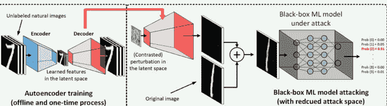

图 3.2 展示了在 (Tu et al., 2019) 中通过“解码器”进行攻击维度降低的示意图，以提高黑盒攻击的查询效率。解码器有两种模式：(i) 在与受攻击图像和训练数据不同的无标签自然图像上训练的自编码器（AE）；(ii) 按通道应用的简单双线性图像调整大小（BiLIN），用于将低维特征外推至原始图像维度（宽 × 高）。在后一种模式下，不需要额外的训练。

### 3.5 攻击维度降低

与一阶收敛结果不同，零阶梯度下降方法的收敛速率具有额外的乘性维度相关因子 d。在凸损失设置中，收敛速率为 O(√d/T)，足够接近最优值，其中 T 为迭代次数（Nesterov and Spokoiny, 2017; Liu et al., 2018a; Gao et al., 2014; Wang et al., 2018b）。在非凸设置中也发现了相同的收敛速率（Ghadimi and Lan, 2013）。维度相关的收敛因子 d 表明，当（向量化）图像维度 d 较大时，使用梯度估计的原生黑盒攻击可能会因为收敛中的维度灾难而查询效率低下。

为了降低攻击维度并提高黑盒攻击的查询效率，Tu et al. (2019) 提议从降低的维度 d′ < d 进行梯度估计以提高查询效率。具体来说，如图 3.2 所示，对图像 x0 的加性扰动实际上是通过“解码器” D : R^d′ → R^d 实现的，即 x = x0 + D(δ′)，其中 δ′ ∈ R^d′。换句话说，x0 的对抗扰动 δ ∈ R^d 实际上是从降维空间生成的，目的是由于收敛分析中减少了维度相关因子而提高查询效率。Tu et al. (2019) 提出的 AutoZOOM 方法（即基于自编码器的零阶优化方法）为这种解码器 D 提供了两种模式：

| 查询次数 | 0 | ~25,500 | ~195,300 | ~1,165,300 | ~4,945,900 |
|---|---|---|---|---|---|
| ZOO | [Image] | [Image] | [Image] | [Image] | [Image] |
| AutoZOOM | [Image] | [Image] | [Image] | | |
| | | 初始成功 | 精调攻击 | | |
| 图例 | 失败的攻击（被分类为 "Bagel"） | 成功的攻击（被分类为 "Grand Piano"） |

**图 3.3** AutoZOOM (Tu et al., 2019) 大幅减少了从黑盒 Inception-v3 模型生成成功的对抗性 Bagel 图像所需的查询次数。

- 在与训练数据不同的无标签数据上训练的自编码器（AE），用于从降维表示中学习重构。AE 中的编码器 E 将数据压缩到低维潜在空间，解码器 D 从其潜在表示重构样本。AE 的权重通过最小化平均 \(\ell_2\) 重构误差来学习。请注意，为黑盒对抗攻击训练这样的 AE 是一次性且完全离线的（即，不需要模型查询）。

- 一种简单的按通道双线性图像调整大小工具（BiLIN），通过双线性外推将小图像缩放为大图像。4 请注意，BiLIN 不需要额外的训练。

### 3.6 经验比较

有两种广泛使用的准则来评估黑盒攻击的有效性。给定一组用于生成对抗样本的数据样本，一种准则是在给定模型查询预算的情况下报告攻击成功率和平均失真。另一种准则是报告攻击成功率和找到给定扰动预算下的对抗样本所需的平均查询次数。

对于软标签黑盒攻击，图 3.3 展示了通过对黑盒图像分类器（在 ImageNet 上训练的 Inception-v3 模型 Szegedy et al., 2016）进行迭代模型查询而制作的预测规避对抗样本。ZOO 攻击使用逐坐标梯度估计，而 AutoZOOM 攻击使用基于随机向量的梯度估计。结果表明，先进的梯度估计和维度降低技术可以在查找对抗样本时大幅提高查询效率，同时保持视觉质量。

接下来，我们在三个不同的标准数据集 MNIST、CIFAR-10 和 ImageNet-1K 上评估以下硬标签黑盒攻击。对于黑盒模型，我们对 MNIST 和 CIFAR-10 都使用 Carlini and Wagner (2017b) 提供的卷积神经网络，对 ImageNet-1K 使用预训练的 ResNet-50 网络（He et al., 2016）。

我们比较了以下非靶向攻击的性能：

- Sign-OPT 攻击（黑盒）（Cheng et al., 2020c）
- OPT 攻击（黑盒）（Cheng et al., 2019a）
- 边界攻击（黑盒）（Brendel et al., 2018）：该方法从较大的对抗扰动开始，通过在决策边界上随机游走来降低扰动，同时保持对抗性。
- 猜测智能攻击（黑盒）（Brunner et al., 2019）：该攻击通过使用某些先验进行有偏采样来增强边界攻击。
- C&W 攻击（白盒）（Carlini and Wagner, 2017b）：我们使用 C&W l2-范数攻击作为白盒攻击性能的基线。

对于每种攻击，我们从验证集中随机抽取 100 个样本并为其生成对抗扰动。我们只考虑由目标模型正确预测的样本。为了比较不同方法，我们主要使用成功对抗攻击的平均失真作为度量指标。我们还报告在给定 l2 扰动阈值 \epsilon 下，B 次查询的攻击成功率（ASR），即在少于 B 次查询内实现低于 \epsilon 的对抗扰动的样本数量百分比。

表 3.1 总结了攻击结果。在相同的查询预算下，Sign-OPT 始终获得更高的 ASR 和更低的 l2 失真（后者与 C&W 白盒攻击相当），证明了其攻击效率。特别是在 ResNet-50 模型的 ImageNet 数据集上，Sign-OPT 攻击在不到 30k 次查询内即可达到低于 3.0 的中位数失真，而其他攻击达到相同效果需要超过 200k 次查询。

图 3.4 展示了由硬标签黑盒攻击生成的一些对抗样本示例。前两行分别展示了 MNIST 数据集中一个样本上的 Sign-OPT 攻击（Cheng et al., 2020c）和 OPT 攻击（Cheng et al., 2019a）的对比。这些图展示了两种攻击在几乎相同查询次数下生成的对抗样本，对两者


表 3.1 $\ell_2$ 非目标攻击结果。不同攻击在给定查询预算下达到的平均 $\ell_2$ 扭曲比较。ASR 表示攻击成功率。

| | MNIST | | | CIFAR10 | | | ImageNet (ResNet-50) | | |
|---|---|---|---|---|---|---|---|---|---|
| | 查询数 | 平均 $\ell_2$ | ASR ($\epsilon = 1.5$) | 查询数 | 平均 $\ell_2$ | ASR ($\epsilon = 0.5$) | 查询数 | 平均 $\ell_2$ | ASR ($\epsilon = 3.0$) |
| Boundary attack | 4,000 | 4.24 | 1.0% | 4,000 | 3.12 | 2.3% | 4,000 | 209.63 | 0% |
| Boundary attack | 8,000 | 4.24 | 1.0% | 8,000 | 2.84 | 7.6% | 30,000 | 17.40 | 16.6% |
| Boundary attack | 14,000 | 2.13 | 16.3% | 12,000 | 0.78 | 29.2% | 160,000 | 4.62 | 41.6% |
| Guessing Smart | 4,000 | 1.74 | 41.0% | 4,000 | 0.29 | 75.0% | 4,000 | 16.69 | 12.0% |
| Guessing Smart | 8,000 | 1.69 | 42.0% | 8,000 | 0.25 | 80.0% | 30,000 | 13.27 | 12.0% |
| Guessing Smart | 14,000 | 1.68 | 43.0% | 12,000 | 0.24 | 80.0% | 160,000 | 12.88 | 12.0% |
| OPT attack | 4,000 | 3.65 | 3.0% | 4,000 | 0.77 | 37.0% | 4,000 | 83.85 | 2.0% |
| OPT attack | 8,000 | 2.41 | 18.0% | 8,000 | 0.43 | 53.0% | 30,000 | 16.77 | 14.0% |
| OPT attack | 14,000 | 1.76 | 36.0% | 12,000 | 0.33 | 61.0% | 160,000 | 4.27 | 34.0% |
| Sign-OPT attack | 4,000 | 1.54 | 46.0% | 4,000 | 0.26 | 73.0% | 4,000 | 23.19 | 8.0% |
| Sign-OPT attack | 8,000 | 1.18 | 84.0% | 8,000 | 0.16 | 90.0% | 30,000 | 2.99 | 50.0% |
| Sign-OPT attack | 14,000 | 1.09 | 94.0% | 12,000 | 0.13 | 95.0% | 160,000 | 1.21 | 90.0% |
| C&W (white-box) | – | 0.88 | 99.0% | – | 0.25 | 85.0% | – | 1.51 | 80.0% |

#### MNIST

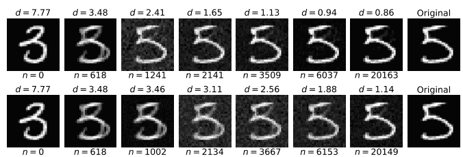

#### CIFAR-10

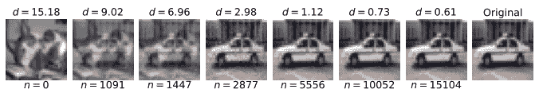

#### ImageNet

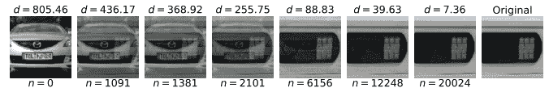

图 3.4 查询迭代过程中的硬标签黑箱目标攻击示例。第一列是目标类中随机选择的（未扰动图像）。除最后一列（原始图像）外，所有其他列中的图像都将给出与第一列相同的预测。所使用的 \(\ell_2\) 扭曲和查询数（\(n\)）分别显示在图像上方和下方。前两行：Sign-OPT (Cheng et al., 2020c) 攻击与 OPT 攻击 (Cheng et al., 2019a) 的示例比较。第三和第四行：CIFAR-10 和 ImageNet 上的 Sign-OPT 攻击示例。

攻击。Sign-OPT 方法针对该特定示例在 \(\sim 6k\) 次查询中生成一个 0.94 的 \(\ell_2\) 对抗扰动，而基于 Opt 的攻击则需要 \(\sim 35k\) 次查询才能达到相同效果。

### 3.7 定理 1 的证明

回顾数据维度为 \(d\)，我们假设 \(F\) 可微且其梯度 \(\nabla F\) 为 \(L\)-Lipschitz 连续。固定 \(\beta\)，我们考虑 \(F\) 的平滑版本，

\[
F_\beta(\mathbf{x})=\mathbb{E}_\mathbf{u}[F(\mathbf{x}+\beta\mathbf{u})].
\]

基于 Gao et al. (2014, Lemma 4.1-a)，我们有关系
\[
\nabla F_\beta(\mathbf{x}) = \mathbb{E}_{\mathbf{u}}\left[\frac{d}{\beta} F(\mathbf{x} + \beta \mathbf{u}) \mathbf{u}\right] = \frac{d}{b} \mathbb{E}_{\mathbf{u}}[\mathbf{g}], \quad (3.13)
\]

这进而得出
\[
\mathbb{E}_{\mathbf{u}}[\mathbf{g}] = \frac{b}{d} \nabla F_\beta(\mathbf{x}), \quad (3.14)
\]

其中我们回顾 \(\mathbf{g}\) 在 (3.3) 中定义。此外，基于 Gao et al. (2014, Lemma 4.1-b)，我们有
\[
\|\nabla F_\beta(\mathbf{x}) - \nabla F(\mathbf{x})\|_2 \le \frac{\beta d L}{2}. \quad (3.15)
\]

将 (3.14) 代入 (3.15)，我们得到
\[
\|\mathbb{E}[\mathbf{g}] - \frac{b}{d} \nabla F(\mathbf{x})\|_2 \le \frac{\beta b L}{2}.
\]

这进而意味着
\[
\mathbb{E}[\mathbf{g}] = \frac{b}{d} \nabla F(\mathbf{x}) + \boldsymbol{\gamma}, \quad (3.16)
\]

其中 \(\|\boldsymbol{\gamma}\|_2 \le \frac{b \beta L}{2}\)。再次，通过应用 Gao et al. (2014, Lemma 4.1-b)，我们可以轻松得到
\[
\mathbb{E}_{\mathbf{u}}\left[\|\mathbf{g}\|_2^2\right] \le \frac{b^2 L^2 \beta^2}{2} + \frac{2b^2}{d}\|\nabla F(\mathbf{x})\|_2^2. \quad (3.17)
\]

现在让我们考虑 (3.4) 中的平均随机梯度估计器，
\[
\bar{\mathbf{g}} = \frac{1}{q} \sum_{i=1}^q \mathbf{g}^{(i)} = \frac{b}{q} \sum_{i=1}^q \frac{F(\mathbf{x} + \beta \mathbf{u}^{(i)}) - F(\mathbf{x})}{\beta} \mathbf{u}^{(i)}.
\]

由于 i.i.d. 样本 \(\{\mathbf{u}^{(i)}\}\) 的性质和 (3.16)，我们定义
\[
\boldsymbol{\nu} := \mathbb{E}[\mathbf{g}^{(i)}] = \frac{b}{d} \nabla F(\mathbf{x}) + \boldsymbol{\gamma}. \quad (3.18)
\]

此外，我们有
\[
\mathbb{E}\left[\|\bar{\mathbf{g}}\|_2^2\right] = \mathbb{E}\left[\left\|\frac{1}{q} \sum_{i=1}^q (\mathbf{g}^{(i)} - \boldsymbol{\nu}) + \boldsymbol{\nu}\right\|_2^2\right] \quad (3.19)
\]

\[
\begin{aligned}
& = \| \boldsymbol{v} \|_2^2 + \mathbb{E} \left[ \left\| \frac{1}{q} \sum_{i=1}^q \left( \mathbf{g}^{(i)} - \boldsymbol{v} \right) \right\|_2^2 \right] \\
& = \| \boldsymbol{v} \|_2^2 + \frac{1}{q} \mathbb{E} \left[ \| \boldsymbol{g}^{(1)} - \boldsymbol{v} \|_2^2 \right] \tag{3.20} \\
& = \| \boldsymbol{v} \|_2^2 + \frac{1}{q} \mathbb{E} \left[ \| \boldsymbol{g}^{(1)} \|_2^2 \right] - \frac{1}{q} \| \boldsymbol{v} \|_2^2, \tag{3.21}
\end{aligned}
\]

这里我们使用了事实：对所有 \(i\)，\(\mathbb{E}[\mathbf{g}^{(i)}] = \mathbb{E}[\mathbf{g}^{(1)}] = \boldsymbol{v}\)。 (3.18) 中 \(\boldsymbol{v}\) 的定义得出

\[
\begin{aligned}
\| \boldsymbol{v} \|_2^2 \le 2 \frac{b^2}{d^2} \| \nabla f(\mathbf{x}) \|_2^2 + 2 \| \boldsymbol{\gamma} \|_2^2 \\
\le 2 \frac{b^2}{d^2} \| \nabla f(\mathbf{x}) \|_2^2 + \frac{1}{2} b^2 \beta^2 L^2 .
\end{aligned} \tag{3.22}
\]

从 (3.17) 我们还可得到，对所有 \(i\)，

\[
\mathbb{E} \left[ \| \mathbf{g}^{(i)} \|_2^2 \right] \le \frac{b^2 L^2 \beta^2}{2} + \frac{2 b^2}{d} \| \nabla f(\mathbf{x}) \|_2^2 . \tag{3.23}
\]

将 (3.22) 和 (3.23) 代入 (3.21)，我们得到

\[
\begin{aligned}
\mathbb{E} \left[ \| \overline{\mathbf{g}} \|_2^2 \right] \le \| \boldsymbol{v} \|_2^2 + \frac{1}{q} \mathbb{E} \left[ \| \boldsymbol{g}^{(1)} \|_2^2 \right] \tag{3.24} \\
\le 2 \left( \frac{b^2}{d^2} + \frac{b^2}{dq} \right) \| \nabla f(\mathbf{x}) \|_2^2 + \frac{q+1}{2q} b^2 L^2 \beta^2 . \tag{3.25}
\end{aligned}
\]

最后，我们将平均平方估计误差界限为

\[
\begin{aligned}
\mathbb{E} \left[ \| \overline{\mathbf{g}} - \nabla f(\mathbf{x}) \|_2^2 \right] \le 2 \mathbb{E} \left[ \| \overline{\mathbf{g}} - \boldsymbol{v} \|_2^2 \right] + 2 \| \boldsymbol{v} - \nabla f(\mathbf{x}) \|_2^2 \\
\le 2 \mathbb{E} \left[ \| \overline{\mathbf{g}} \|_2^2 \right] + 2 \| \frac{b}{d} \nabla f(\mathbf{x}) + \boldsymbol{\gamma} - \nabla f(\mathbf{x}) \|_2^2 \\
\le 4 \left( \frac{b^2}{d^2} + \frac{b^2}{dq} + \frac{(b-d)^2}{d^2} \right) \| \nabla f(\mathbf{x}) \|_2^2 + \frac{2q+1}{q} b^2 L^2 \beta^2 ,
\end{aligned} \tag{3.26}
\]

这完成了证明。

### 3.8 扩展阅读

- 零阶优化及其应用的综述论文 (Liu et al., 2020a)。
- Garcia et al. (2021) 对硬标签攻击和降维进行了详细分析。
- Chen et al. (2020a) 提出了一种名为 Hopskipjump 攻击的查询高效硬标签攻击。
- 超越伪梯度下降的黑箱攻击：自然梯度下降 (Zhao et al., 2020b)、多臂老虎机算法 (Ilyas et al., 2019)、遗传算法 (Alzantot et al., 2019)、乘数交替方向法 (Zhao et al., 2019a)、决策边界随机游走 (Brendel et al., 2018) 以及射线搜索 (Chen and Gu, 2020)。
- “无盒”攻击，不假设模型查询，也不对训练数据进行访问 (Li et al., 2020b)。

## 第 4 章

## 物理对抗攻击

除了数字空间，对抗样本也可以在物理世界中实现，以规避诸如目标检测等基于机器学习的应用的预测，这被称为物理对抗样本。在本章中，我们介绍物理对抗样本的攻击公式，并概述物理世界中的此类攻击。

### 4.1 物理对抗攻击公式

物理对抗样本通常表现为从数字空间（例如，模拟物理环境）中构建的稳健对抗样本，并在物理空间中保持对抗目标。为了弥合数字和物理空间中对抗样本之间的差距，存在两个主要障碍：(i) 数字对抗样本无法在物理空间中精确实现。例如，数字空间中的某些 RGB 颜色值无法精确打印。(ii) 数字对抗样本可能不太好地推广到物理环境。例如，对打印对抗图像进行简单旋转或放大缩小可能使对抗效果失效。

为应对挑战 (i)，在攻击过程中，我们可以将数字对抗样本投影到物理空间中可实现操作的空间（例如，可打印颜色的空间），或在攻击损失中添加额外的正则化损失，以最大限度地减少数字对抗样本与生成的物理版本之间的不一致性。

为应对挑战 (ii)，常见的做法是在生成过程中引入多种变换，以便生成的对抗样本仍然有效。该方法也可以被视为学习一种普遍的对抗操纵，它对大部分（如果不是全部）考虑的变换都同时有效。

变换期望 (EOT) (Athalye and Sutskever, 2018) 引入了一组表示为 $\mathcal{T}$ 的数据变换，通过求解以下优化问题来生成数据样本 $\mathbf{x}_0$ 的稳健对抗样本 $\mathbf{x}$：

\[
\underset{\mathbf{x} \in \mathcal{X}}{\text{argmin}}\ \mathbb{E}_{t \sim \mathcal{T}} g(t(\mathbf{x})) + r(\mathbf{x}),
\]
(4.1)

where $\mathcal{X}$ 是可行物理对抗样本的空间，$t$ 是从 $\mathcal{T}$ 中抽取的变换函数，$g$ 是第 2 章中引入的攻击目标损失函数，$r$ 是正则化项（例如，针对无法实现的打印颜色的惩罚函数）。

EOT 攻击的优化目标可视为在 $\mathcal{T}$ 中的所有数据变换上最小化平均损失。与最小化平均损失不同，Wang et al. (2021a) 提出了一种 MinMax 攻击公式，通过优化最坏情况变换损失来实现：

$\min_{\boldsymbol{x}\in\mathcal{X}} \max_{\boldsymbol{w}\in\mathcal{P}} \sum_{i=1}^K w_i \cdot g(t_i(\boldsymbol{x})) - \gamma \|\boldsymbol{w} - \mathbf{1}/K\|_2^2 + r(\boldsymbol{x}), \quad (4.2)$

其中 $K$ 是 $\mathcal{T}$ 中变换的数量，$\boldsymbol{w}$ 是概率单纯形 $\mathcal{P}$ 中满足 $\sum_{i=1}^K w_i = 1$ 的非负 $K$ 维向量，$t_i$ 是第 $i$ 个变换，$w_i$ 是其权重因子，$\mathbf{1}/K$ 是均匀向量，$\gamma \ge 0$ 是正则化系数。如果 $\boldsymbol{w} = \mathbf{1}/K$，则问题 (4.2) 退化为现有的 EOT 公式。Wang et al. (2021a) 表明，使用交替一步投影梯度下降-上升（APGDA）算法求解 (4.2)，MinMax 攻击产生的对抗样本相较于 EOT，对多种数据变换更具鲁棒性。MinMax 攻击还通过求解 min–max 优化问题时关联的学习权重因子 $\{w_i\}_{i=1}^K$，对每个变换的难度水平提供了一定解释。Xu et al. (2020c) 还将其用于设计对非刚性变形具有鲁棒性的物理对抗 T 恤。

### 4.2 物理对抗攻击示例

这里列出了在不同场景下制作物理对抗样本的一些研究。部分物理对抗样本如图 4.1 所示。

- 对抗照片 (Kurakin et al., 2016)：演示了当将从手机相机获取的对抗图像输入到 ImageNet Inception 分类器时，即使通过相机观察，大量对抗示例也会被错误分类。

- 对抗眼镜 (Sharif et al., 2016)：通过打印一副眼镜框来实现，当攻击者佩戴这些眼镜且其图像被提供给面部识别算法时，眼镜可以让她逃避被识别或冒充另一个人。

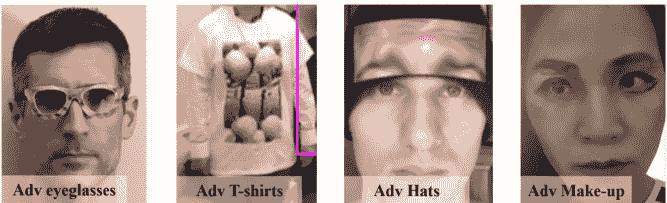

图 4.1 物理对抗样本示例。从左到右：对抗眼镜 (Sharif et al., 2016)、对抗 T 恤 (Xu et al., 2020c)、对抗帽子 (Komkov and Petiushko, 2021) 和对抗化妆 (Lin et al., 2021)。

- *对抗补丁* (Brown et al., 2017)：一种物理对抗对象，其存在会导致分类器忽略场景中的其他物品并报告所选目标类别。
- *3D 打印对抗对象* (Athalye and Sutskever, 2018)：一种 3D 打印的对抗对象，从不同视角拍摄其照片时会导致错误预测。
- *对抗停车标志* (Evtimov et al., 2017)：通过添加颜色补丁创建的对抗停车标志，以逃避实时目标检测器的检测。
- *对抗看板* (Thys et al., 2019)：一种对抗补丁，穿着它时可以使人从行人探测器中隐藏。
- *对抗贴纸* (Li et al., 2019b)：演示了在相机镜头上精心制作的主要半透明贴纸，它可以对观察到的图像创建普遍扰动，这些扰动不明显，但会将目标对象误分类为不同（目标）类别。
- *对抗 T 恤* (Xu et al., 2020c)：一种用于逃避行人探测器的鲁棒物理对抗示例，即使由于移动人员姿势变化而发生非刚性变形，它仍然有效。
- *对抗帽子* (Komkov and Petiushko, 2021)：在普通彩色打印机上设计和打印一个矩形纸贴纸，并将其贴在帽子上以攻击 Face ID 系统。
- *对抗化妆* (Lin et al., 2021)：由生成对抗网络引导的对抗性全脸化妆，用于冒充目标人物并欺骗面部识别系统。

### 4.3 经验比较

这里比较了 EOT 攻击 (平均) (Athalye and Sutskever, 2018) 和 MinMax 攻击 (Wang et al., 2021a) 的性能。对于每个输入样本 ($ori$)，我们在一系列函数下转换图像，例如水平翻转 ($flh$) 或垂直翻转 ($flv$)、调整亮度 ($bri$)、执行伽马校正 ($gam$) 和裁剪 ($crop$)，并将每张图像与其转换变体分组。ASR$_{all}$ 用于测量转换图像组上的攻击成功率 (ASR)（每组成功攻击意味着在所有变换器下成功攻击一个样本）。在表 4.1 中，与 EOT 相比，MinMax 通过针对各种变换优化权重，在给定模型的 CIFAR-10 上使 ASR$_{all}$ 平均提升了 9.39%。

表 4.1 CIFAR-10 上多种数据变换鲁棒攻击的平均优化与最小-最大优化比较。Acc (%) 表示分类器在对抗样本上的测试准确率。表格采用自 Wang et al. (2021a)。

| 模型 | 优化 | Acc$_{ori}$ | Acc$_{flh}$ | Acc$_{flv}$ | Acc$_{bri}$ | Acc$_{gam}$ | Acc$_{crop}$ | ASR$_{all}$ | 提升 (↑) |
|---|---|---|---|---|---|---|---|---|---|
| A | 平均 | 10.80 | 21.93 | 14.75 | 11.52 | 10.66 | 20.03 | 55.88 | - |
| | 最小-最大 | 12.14 | 18.05 | 13.61 | 13.52 | 11.99 | 16.78 | 60.03 | 7.43% |
| B | 平均 | 5.49 | 11.56 | 9.51 | 5.43 | 5.75 | 15.89 | 72.21 | - |
| | 最小-最大 | 6.22 | 8.61 | 9.74 | 6.35 | 6.42 | 11.99 | 77.43 | 7.23% |
| C | 平均 | 7.66 | 21.88 | 15.50 | 8.15 | 7.87 | 15.36 | 56.51 | - |
| | 最小-最大 | 8.51 | 14.75 | 13.88 | 9.16 | 8.58 | 13.35 | 63.58 | 12.51% |
| D | 平均 | 8.00 | 20.47 | 13.46 | 7.73 | 8.52 | 15.90 | 61.13 | - |
| | 最小-最大 | 9.19 | 13.18 | 12.72 | 8.79 | 9.18 | 13.11 | 67.49 | 10.40% |

### 4.4 延伸阅读

- 非对抗示例：通过实现输入扰动来设计鲁棒对象，这些对象被明确优化为可被自信地检测或分类 (Salman et al., 2020a)。

## 第 5 章

## 训练时对抗攻击

本部分前述攻击侧重于针对测试/部署阶段已训练并固定模型的逃避攻击。在此，我们将重点转向训练阶段攻击。训练阶段攻击假设能够修改训练数据，以便在操纵的数据集上训练得到的模型上实现恶意目标，这可以通过噪声数据收集（如众包）来实现。具体来说，深度学习模型的记忆效应 (Zhang et al., 2017; Carlini et al., 2019b) 可以被用作漏洞。我们注意到，有时“数据中毒”一词同时包含中毒攻击和后门攻击，尽管它们的攻击目标不同。在本章中，(数据)中毒攻击有特定目标，即降低目标模型的泛化能力，使得在中毒训练数据集上训练的模型无法在干净测试数据集上很好地泛化（例如，训练准确率高但测试准确率低）。另一方面，当嵌入的触发模式不存在时，带后门的模型倾向于表现得像正常（非后门）模型一样；当触发器存在时，带后门的模型将给出对手设计的输出，而不考虑任何数据输入的实际内容。

### 5.1 中毒攻击

中毒攻击旨在设计一个中毒数据集 $D_{poison}$，使得在 $D_{poison}$ 上训练的模型无法在标准测试集 $D_{test}$ 上泛化。中毒数据集 $D_{poison}$ 可以通过修改原始训练数据集 $D_{train}$ 来创建，例如标签翻转、数据添加/删除和特征修改。其原理是在 $D_{poison}$ 上训练会使模型参数在损失景观中陷入“糟糕”的局部最小值。以分类任务为例，设 $f_\theta$ 为在中毒数据集上训练的分类器，它给出最可能的类别预测。数据中毒旨在引导分类器在大多数测试数据样本上给出错误预测（但模型在训练数据集上仍具有相对良好的准确率），使得 $f_\theta(x_{test}) \neq y_{test}$，其中 $(x_{test}, y_{test}) \sim D_{test}$。

一般来说，中毒攻击可以通过将中毒数据集 $D_{poison}$ 添加到现有训练数据集 $D_{train}$，并通过求解 fol-


以下双层优化问题：

最大化 \(\mathcal{L}_{\text{attack}}(D'; \theta^*)\) 使得 \(\theta^* \in \text{argmin}_{\theta} \mathcal{L}_{\text{train}}(D_{\text{train}} \cup D_{\text{poison}}; \theta)\), (5.1)

其中 \(\mathcal{L}_{\text{attack}}\) 是攻击者设计的目标函数（对攻击者而言，值越高越好），\(D'\) 是用于攻击性能评估的未训练（留出）数据集，\(\theta^*\) 是在增强的毒化数据集 \(D_{\text{train}} \cup D_{\text{poison}}\) 上通过最小化标准训练损失函数 \(\mathcal{L}_{\text{train}}\) 得到的模型参数。攻击者的目标函数可以简单到等同于训练损失；例如，\(\mathcal{L}_{\text{attack}}\) 可以是交叉熵损失。

为了控制数据修改量并降低 \(D_{\text{test}}\)（即测试精度）上的整体准确率，毒化攻击通常假设知道目标模型及其训练方法（Jagielski et al., 2018）。Liu et al. (2020b) 提出了在训练损失函数上施加额外条件的黑盒毒化攻击。针对性毒化攻击旨在操纵 \(D_{\text{test}}\) 中一部分数据样本的预测，这可以通过干净标签毒化（对 \(D_{\text{train}}\) 的一个子集施加小扰动，同时保持其标签不变）（Shafahi et al., 2018; Zhu et al., 2019b）或梯度匹配毒化（Geiping et al., 2021）来实现。

### 5.2 后门攻击

后门攻击也称为特洛伊攻击。其核心思想是将一个通用触发器 \(\Delta\) 嵌入到 \(D_{\text{train}}\) 的一部分数据样本中，并使用修改后的目标标签 \(t\)（Gu et al., 2019）。触发模式的示例包括图像中的小补丁和句子中的特定文本字符串。通常，后门攻击仅假设可以访问训练数据，而不假设知道模型及其训练方法。在被篡改数据上训练的模型 \(f_\theta\) 被称为后门（特洛伊）模型。其攻击目标有两个方面：(i) 在没有触发器的情况下具有高标准准确率——后门模型应表现得像正常模型（即在未篡改数据上训练的相同模型），即 \(f_\theta(x_{\text{test}}) = y_{\text{test}}\)；(ii) 在存在触发器的情况下具有高攻击成功率——后门模型将任何带触发器的数据输入预测为目标标签 \(t\)，即 \(f_\theta(x_{\text{test}} + \Delta) = t\)。因此，后门攻击具有隐蔽性和潜伏性。触发模式也可以设计为输入感知且动态的（Nguyen and Tran, 2020）。

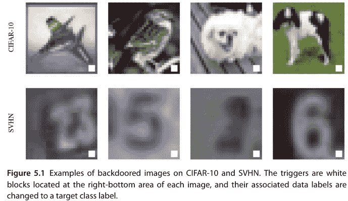

### 5.3 经验比较

我们遵循 (Gu et al., 2019) 中的程序实现后门攻击，并获得在同一被操纵训练数据上训练的两个独立后门模型（模型 I 和 II）。触发模式放置在被毒化图像的右下角，如图 5.1 所示。具体地，通过插入触发器并将原始正确标签更改为目标标签，使 10% 的训练数据被后门化。在这里，我们研究两种后门攻击：(a) 单目标攻击，将目标标签 t 设置为特定标签（我们选择 t = class 1）；以及 (b) 全目标攻击，其中目标标签 t 设置为原始标签 i 加 1 然后对 9 取模，即 t = i + 1 (mod 9)。

它们在干净（未触发）和触发数据样本上的性能如表 5.1 所示。后门模型在干净数据上的性能与未篡改模型相似，但确实会将大多数触发样本误分类。与单目标攻击相比，全目标攻击更困难，攻击失败率更高，因为目标标签随原始标签而变化。

表 5.1 后门模型的错误率。干净/后门样本的错误率分别表示标准测试错误率/攻击失败率。结果是在从测试集中选择的 5000 张不重叠的干净/触发图像上评估的。作为参考，未篡改模型在干净图像上的测试结果为 CIFAR-10 (VGG) 12%，SVHN (ResNet) 4%。

| 后门攻击 | | 单目标攻击 | | 全目标攻击 | |
|---|---|---|---|---|---|
| | 数据集 | CIFAR-10 (VGG) | SVHN (ResNet) | CIFAR-10 (VGG) | SVHN (ResNet) |
| 模型 I | 干净图像 | 15% | 5.4% | 14.2% | 6.1% |
| 模型 I | 触发图像 | 0.07% | 0.22% | 12.9% | 8.3% |
| 模型 II | 干净图像 | 13% | 7.7% | 19% | 7.5% |
| 模型 II | 触发图像 | 2% | 0.17% | 13.6% | 9.2% |

### 5.4 案例研究：联邦学习上的分布式后门攻击

联邦学习（FL）最近被提出，以解决在无法直接访问多样化训练数据的情况下训练机器学习模型的问题，特别是对于隐私敏感型任务（Smith et al., 2017; McMahan et al., 2017; Zhao et al., 2018）。利用参与者（即各方）的本地训练数据，FL 有助于训练性能更好的共享全局模型。在实践中部署 FL 已有突出应用和不断增长的趋势，例如贷款状态预测、健康状况评估（如潜在癌症风险评估）以及输入时的下一词预测（Hard et al., 2018; Yang et al., 2018, 2019a）。

虽然 FL 能够聚合不同方提供的分散（且常受限）信息来训练更好的模型，但其分布式学习方法论以及不同方之间固有的异质（即非独立同分布）数据分布可能会无意中为新攻击提供途径。特别是，由于隐私顾虑或法规限制而限制对个别方数据的访问，可能会促进针对使用 FL 训练的共享模型的后门攻击。

FL 上的后门攻击已在 (Bagdasaryan et al., 2018; Bhagoji et al., 2019) 中得到研究。然而，这些攻击并未充分利用 FL 的分布式学习方法论，因为它们向所有对抗方嵌入 *相同* 的全局触发模式。这种攻击方案被称为 *集中式* 后门攻击。利用 FL 在从本地各方聚合分散信息以训练共享模型方面的能力，Xie et al. (2020) 提出了针对 FL 的 *分布式后门攻击*（DBA）。给定与集中式攻击相同的全局触发模式，DBA 将其分解为局部模式，并分别将其嵌入到不同的对抗方中。图 5.2 说明了集中式和分布式后门攻击的示意图比较。

G^{t+1}
联邦学习聚合器
良性参与者
集中式攻击者
毒化
全局触发器
G^t
(a) 集中式后门攻击

G^{t+1}
联邦学习聚合器
良性参与者
分布式攻击者
毒化
局部触发器 1
局部触发器 2
局部触发器 3
局部触发器 4
局部触发器
G^t
(b) DBA：分布式后门攻击（Xie et al., 2020）

图 5.2 联邦学习上集中式和分布式后门攻击概览。FL 聚合器在第 t+1 轮结合前一轮 t 中本地各方（良性和对抗）的信息并更新共享模型。在实施后门攻击时，集中式攻击者使用全局触发器，而分布式攻击者使用局部触发器，后者是全局触发器的一部分。

集中式后门攻击为所有本地攻击者嵌入相同的全局触发器¹（Bagdasaryan et al., 2018）。例如，图 5.2(a) 中的攻击者将训练数据与由四种颜色突出显示的选定模式进行嵌入，这些模式共同构成了一个完整的全局模式作为后门触发器。在 DBA 中，如图 5.2(b) 所示，所有攻击者仅使用全局触发器的一部分来毒化其本地模型，而最终的对抗目标仍与集中式攻击相同：使用全局触发器攻击共享模型。例如，带有橙色（印刷版为灰色）标记的攻击者 *仅* 使用位于橙色（印刷版为灰色）区域的触发模式来毒化其训练数据的一个子集。类似的攻击方法适用于绿色（印刷版为中灰色）、黄色（印刷版为浅灰色）和蓝色（印刷版为深灰色）标记。我们将每个 DBA 攻击者的触发器定义为 *局部触发器*，将组合的完整触发器定义为 *全局触发器*。DBA 也可以在不规则形状触发器上实现，例如将徽标“ICLR”分解为“I”、“C”、“L”、“R”作为三个图像数据集上的局部触发器，并将物理图案眼镜分解为四部分，如图 5.3 所示。

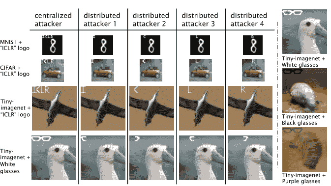

图 5.3 (Xie et al., 2020) 中图像数据集不规则形状触发器的示例。

在集中式攻击和 DBA 中保持相似数量的注入触发器总量（例如修改的像素）时，Xie et al. (2020) 表明，

¹ 尽管图 5.2 中只显示了一个集中式攻击者和一个对抗方，但在实际中，集中式后门攻击可以使用相同的全局触发器毒化多个方，如 Bagdasaryan et al. (2018) 所讨论。


that although none of the adversarial party has ever been poisoned by the global trigger under DBA, DBA indeed outperforms centralized attack significantly when evaluated with the global trigger. Moreover, DBA achieves higher attack success rate, faster convergence, and better resiliency in single-shot and multiple-shot attack scenarios. It is also demonstrated that DBA is more stealthy and can successfully evade two robust FL approaches.

### 5.5 扩展阅读

- Mehra et al. (2021a) 在数据中毒攻击存在的情况下，研究了随机平滑防御（参见第14章）在测试时的鲁棒性。
- Mehra et al. (2021b) 使用中毒攻击来研究无监督领域自适应算法的性能。
- Zawad et al. (2021) 研究了数据异质性对联邦学习抵御后门攻击鲁棒性的影响。
- 关于后门和中毒攻击的详细调查可见 (Goldblum et al., 2022)。
- Zhao et al. (2020a) 提出使用神经网络损失景观中的模式连通性来净化后门模型，仅需少量干净数据，通过缓解其对抗效应的同时保持干净准确率。

## 第 6 章

## 图像分类以外的对抗攻击

### 6.1 数据模态和任务目标

对于可以表示为实值连续向量的数据模态上的分类任务，例如图像（像素值）、文本嵌入、音频信号、时间序列和实值表格数据，上述对抗攻击的方法可以通过指定相应的攻击损失函数和威胁模型，然后使用基于梯度的方法等连续优化工具求解制定的目标，从而以规范化的方式采用。

对于非连续数据模态上的分类任务，例如文本标记（如单词和字符）、图和恶意软件，攻击目标类似，但求解器需要使用离散优化工具，如遗传算法、进化算法或松弛到连续优化方法，因为攻击者的可行动作空间本质上是离散的，例如在句子中添加、删除或编辑某些单词以改变情感。

对于超出分类的任务，例如回归、重建、文本摘要、生成等，经验法则是定义适当的威胁模型和攻击者能力，以便对相应的机器学习模型进行对抗鲁棒性的有意义分析。攻击目标制定后，将根据数据模态使用适当的求解器来执行对抗攻击。

在接下来的内容中，我们将介绍一些图像分类以外的数据模态和任务示例。

### 6.2 音频对抗示例

Carlini and Wagner (2018) 提出了一种基于优化的攻击，用于为自动语音识别系统生成音频对抗示例。给定一个音频波形 x，任务是构建另一个音频波形 x' = x + \delta，使得 x 和 x' 听起来相似，但它们的输出转录不同。为了适应音频领域，他们使用分贝（dB）作为失真度量，定义为 \( d_{B_x}(\delta) = dB(\delta) - dB(x) \)，其中 \( dB(x) = 20 \cdot \max_i \log_{10}(x_i) \)。可以通过求解以下受约束的目标函数来找到具有目标转录 t 的最优音频对抗扰动 \( \delta^* \)：

$$
\begin{aligned}
\minimize_{\delta} \quad & \|\delta\|_2^2 + \lambda \cdot \mathcal{L}(x + \delta, t) \\
\text{such that} \quad & d_{B_x}(\delta) \le \epsilon,
\end{aligned}
\tag{6.1}
$$

其中 \(\mathcal{L}\) 可以是Carlini and Wagner (2018) 提出的连接主义时序分类（CTC）损失或其他改进的损失函数，\(\lambda\) 是其正则化系数。同样，时间序列数据的对抗示例可以通过使用特定于任务的损失函数和适当的相似度/失真度量来制定。

### 6.3 特征识别

Chen et al. (2018c) 研究了具有强相关协变量的稀疏回归模型对敌对设计测量噪声的鲁棒性。具体地，他们考虑了有序加权L1（OWL）正则化回归方法族（Bogdan et al., 2013; Zeng and Figueiredo, 2014a），并在对抗环境中研究了OSCAR（回归八面体缩小聚类算法）的情况。值得注意的是，OSCAR实际上是OWL正则化器的一种特例（Zeng and Figueiredo, 2014b）。已知OSCAR在识别特征组（即强相关协变量）方面比其他特征选择方法（如LASSO（Tibshirani, 1996））更有效。

在规范界定的威胁模型下，他们将为OWL正则化回归寻找最大破坏性噪声的过程表述为一个优化问题，并说明了在OSCAR情况下寻找此类噪声的步骤。实验结果表明，在所研究的对抗环境下，对强相关特征进行分组的回归性能可能会严重下降，即使噪声预算显著小于地面真实信号。

### 6.4 图神经网络

图结构数据在许多AI应用中起着关键作用。它是一种重要且多功能的表示，用于建模来自许多领域的各种数据集，例如分子、社交网络或带有引用的互连文档。图结构数据上的图神经网络（GNN）在各种应用中取得了突出的成果（Kipf and Welling, 2016）。GNN应用的输入数据通常以图格式（带有边和节点）给出，每个节点可以与一个 $d$ 维特征向量相关联。因此，为了评估GNN模型的鲁棒性，可以考虑对节点特征和/或边进行扰动。

首先，我们简要讨论节点特征上的扰动。如果节点特征在连续域中，扰动节点特征可以通过基于梯度的优化器轻松完成，类似于前几节中介绍的计算机视觉攻击。对于离散节点特征，也可以采用文献中现有的攻击。例如，如果节点特征是文本，我们可以从文本领域借用攻击来攻击此类GNN模型。

另一方面，对边的攻击无法轻松完成。传统的（一阶）连续优化方法不直接适用于使用边操作的攻击（由于图的离散性质，这些攻击被称为 Xu et al. (2019a) 的 *拓扑攻击*）。Xu et al. (2019a) 通过研究使用凸松弛生成拓扑攻击的问题来弥补这一差距，从而使基于梯度的对抗攻击对GNN来说变得可行。在使用GNN的节点分类任务上的评估表明，他们的基于梯度的拓扑攻击在边扰动预算限制下优于当前最先进的攻击。此外，通过利用所提出的基于梯度的攻击，他们提出了针对GNN的第一种基于优化的对抗训练技术，显著提高了对基于梯度和贪婪拓扑攻击的鲁棒性。除了基于优化的方法外，还针对图神经网络的对抗攻击提出了不同的方法，例如使用贪婪搜索（Zügner et al., 2018）、强化学习（Dai et al., 2018）和元学习（Zügner and Günnemann, 2019）。

### 6.5 自然语言处理

自然语言处理（NLP）已广泛应用于许多重要领域，NLP模型的鲁棒性对关键任务应用也至关重要。例如，在将机器翻译模型应用于实时机器翻译时，确保翻译在小输入扰动下的正确性非常重要。另一个可能重要的领域是针对假新闻检测（或


spam detection) 模型；如果存在语义保持的扰动来欺骗假新闻检测模型，恶意用户可以利用这些扰动来创建假新闻，同时能够绕过检测模型。除了安全问题，文本模型的对抗鲁棒性最近也受到深入研究，因为寻找对抗样本可能是模型调试的第一步。

在对自然语言处理（NLP）模型进行攻击时，存在两个主要挑战。首先，由于NLP的输入是离散的，寻找对抗样本通常会导致离散优化问题，而不是计算机视觉攻击中的连续优化问题。其次，NLP中的“语义不变性”扰动比计算机视觉案例更难定义。在图像领域，每个像素值的微小变化通常人类不可察觉，但在NLP中情况并非如此，因为改变句子中的一个词可能会显著改变整个句子的语义意义。因此，NLP领域的对抗攻击需要考虑这两个因素。对于离散输入，我们通常寻求离散优化算法。为了构建语义不变性扰动集，我们通常求助于词嵌入或上下文化词嵌入。在以下内容中，我们简要介绍几种针对句子分类和序列到序列翻译开发的NLP攻击。除了这两个应用之外，还有许多NLP攻击未在本书中涵盖，例如问答、对话系统和语义分析。

#### 句子分类

大多数NLP攻击都集中在句子分类上，因为这是最简单但最具代表性的任务之一。早期的文本分类攻击通常通过限制句子中更改的单词或字符数量来定义扰动集。然而，如上文所述，仅替换一个单词（或字符）就有可能改变整个句子的含义。因此，更近期的攻击通常尝试限制被替换的单词以强制执行语义不变性。在NLP中，词嵌入已被开发用于通过潜在向量表示每个单词的语义意义，并且存在几个训练有素的词嵌入，例如Word2Vec（Mikolov et al., 2013）和Glove（Pennington et al., 2014）。Alzantot et al. (2018)使用词嵌入空间中的距离来构建一组同义词，并利用它们来定义扰动集：每个单词只允许被其同义词替换。更近期，由于BERT（Devlin et al., 2018）等大规模预训练语言模型的普及，许多作品开始使用这些语言模型来定义扰动集（Li et al., 2020a）。更具体地说，由于BERT在给定上下文单词（例如，同一句子中的所有其他单词）的情况下提供每个位置的单词概率，我们可以假设那些最可能的单词保留了句子的“自然性”，并结合同义词，这可以导致更自然的对抗样本，从而保留语义。

定义扰动集后，NLP攻击的另一个挑战是在扰动集中寻找最大化特定任务损失（或其他标准）的对抗样本。由于输入空间和扰动集是离散的，这导致了一个离散优化问题，通常比连续问题更难求解。已经为NLP攻击提出了几种离散搜索算法。例如，进化算法和强化学习已被用于在扰动空间中搜索对抗样本（Alzantot et al., 2018; Li et al., 2016）。为了加快攻击速度，一些其他作品考虑简单的贪心方法。例如，Yang et al. (2020e)提出了一种贪心攻击，它会迭代替换原始句子中的单词。在每次迭代中，他们首先掩盖输入句子中的每个单词，并根据攻击损失函数（分类损失）选择最佳攻击位置，然后遍历选定位置的同义词以找到最佳单词替换（同样是为了最大化分类损失）。然而，贪心方法通常没有理论保证，可能导致次优解。

Lei et al. (2019)将离散输入上的攻击作为集合函数的优化任务来制定。他们证明，在简化假设下，该集合函数对于两种流行的神经网络文本分类器是次模的：第一种是没有dropout或softmax层的单词级卷积神经网络（CNN），第二种是具有一维隐藏单元和任意时间步的循环神经网络（RNN）。这一发现保证了使用贪心算法的攻击具有1 − 1/e的近似因子。同时，他们还展示了如何使用被攻击分类器的梯度来引导贪心搜索。

利用所提议的优化方案，他们展示了相对于大多数基线的显著提升的攻击性能。同时，他们还提出了一种联合句子和单词改写技术，以同时确保文本语义和句法的保留，称为改写攻击（Lei et al., 2019）。有趣的是，他们还发现，在他们的实验中，在几乎所有情况下，通过使用正确标签增强对抗样本来对模型进行重新训练可以提高模型的泛化能力，并使其更不易受到攻击。

图6.1展示了由改写攻击（Lei et al., 2019）使用神经网络为情感分析和假新闻检测生成的文本对抗样本。

| 任务：情感分析。分类器：LSTM。原始：100% 正面。对抗标签：100% 负面。 |
|---|
| 我猜我应该在这里写一篇评论，因为我的小Noodle-oo目前正在照片中担任他们的代言狗。我们俩都喜欢Scooby Do's。他们把我的小屁股脸狗像王子一样对待，并愿意纠正我认为奇怪的任何关于修剪的地方。比如那个有趣的蓬松大背头。把它剪成莫西干发型，yo。搞定。五秒钟内，我的小伙子看起来酷炫又十足。对于一个简直在高草中追逐蝴蝶的蹦跳小狗来说，这可不是件容易的事。（随着毛发长出来，他最终看起来像一只小羊。太可爱了。）他们在这里使用的洗发水也很棒。Noodles通常闻起来像塔可（牛肉臭味和玉米片的结合），但从Do's回来后，他闻起来像圣诞节早晨！糖和香料和一切美好的东西，而不是青蛙和蜗牛和小狗尾巴。他在性别认同问题上有些需要处理。价格也比外面一些大名鼎鼎的财团便宜，价格比下面的一些大牌子便宜。我在跟你说话呢，Petsmart！我之前带我的另一只小狗去过Smelly Dog，但除非我需要修剪后的狗狗陪玩时间，否则我会选择Scooby's。他们似乎真的喜欢我的小Noodle怪兽。 |

| 任务：假新闻检测。分类器：LSTM。原始标签：100% 假。对抗标签：77% 真实 |
|---|
| 一名男子在高速追逐中在In-N-Out Burger餐厅的drive-thru停下，punctuates追逐。Print [Ed... Well, that's Okay, that 's a new one.] A 一名男子在周三晚上带领警方进入东谷进行一次奇特的追逐后被拘留。凤凰城警察开始在凤凰城跟踪嫌疑人，追逐继续进入东谷，但当嫌疑人在钱德勒Priest和Ray路附近的一家In-N-Out Burger餐厅的drive-thru drive-through停下时，事情出现了奇怪的转折。嫌疑人似乎点了食物，但然后开车离开，并在Rock Wren Way和Ray路附近的他的皮卡车旁下车。然后他跑进了一个后院，跑到后院，试图通过后门进入房子，get in the home。 |

**图6.1** 使用Lei et al. (2019)提出的改写攻击生成的对抗样本示例。红色（印刷版中为灰色）表示句子级改写，蓝色（印刷版中为深灰色）表示单词级改写。

#### 序列到序列翻译

除了文本分类之外，Cheng et al. (2020d)研究了为序列到序列（seq2seq）模型（Sutskever et al., 2014）构建对抗样本的更具挑战性的问题，这些模型的输入是离散文本字符串，输出几乎有无限多的可能性。他们提出了一种名为Seq2Sick的有效对抗攻击框架，以解决由离散输入空间引起的挑战，该框架结合了投影梯度方法与组Lasso和梯度正则化。为了处理


几乎无限的输出空间，他们设计了一些新的损失函数来进行非重叠攻击和定向关键词攻击。当将其攻击算法应用于机器翻译和文本摘要任务时，通过修改不到三个单词，他们可以让 seq2seq 模型以高成功率产生所需的输出。他们还使用外部情感分类器来验证生成的对抗样本保留语义含义的属性。表 6.1 显示了一些此类示例。

| Source input seq | 在亚洲的领导人中，马哈迪·莫哈末首相因其大胆的愿景而引人注目：一种推动该国跻身世界事务前沿的物理和社会转型。 |
| :--- | :--- |
| Adv input seq | 在 **lynn** 的领导人中，马哈迪·莫哈末首相因其大胆的愿景而引人注目：一种推动该国跻身世界事务前沿的物理和社会转型。 |
| Source output seq | 亚洲的领导人是一个见多识广的人 |
| Adv output seq | **面向世界的愿景** |
| Source input seq | 军事观察家和外交官表示，在北约威胁要结束他对科索沃族阿尔巴尼亚分离分子的惩罚性进攻后，南斯拉夫总统斯洛博丹·米洛塞维奇已命令其大部分军队返回军营，并可能避免遭到联盟的攻击。 |
| Adv input seq | 在北约威胁要结束他对科索沃族阿尔巴尼亚分离分子的惩罚性进攻后，南斯拉夫总统斯洛博丹·米洛塞维奇已 **jean-sebastien** 他大部分的军队返回军营，并可能避免遭到联盟的攻击，军事观察家和外交官表示。 |
| Source output seq | 米洛塞维奇命令军队返回军营 |
| Adv output seq | **北约可能不会攻击科索沃** |
| Source input seq | 根据国家防汛抗旱总部，尽管长江部分河段的水位今天有所下降，但长江流域的洪水情况依然严重。 |
| Adv input seq | 洪水 **that** 长江 **becomes** 严重，尽管长江部分河段的水位今天有所下降，根据国家防汛抗旱总部。 |
| Source output seq | 长江洪水持续 |
| Adv output seq | **河水回落中的洪水** |

### 6.6 深度强化学习

研究表明，深度强化学习（DRL）模型在优化机器人学习系统方面具有许多优势，例如自主导航和连续机器人臂控制。Yang et al. (2020b) 提出了一种基于时间的对抗策略，通过在所选时间帧上引入物理噪声模式来干扰基于 DRL 的导航系统。为了研究基于学习的导航系统的漏洞，他们提出了两种对抗代理模型：一种是基于在线学习，另一种是基于进化学习。在白盒和黑盒对抗设置下，他们的实验结果表明，对抗性时序攻击会导致目标 DRL 模型性能显著下降。Yang et al. (2022) 研究了针对基于 Q-learning 的 DRL 模型的不同类型的观测干扰，并表明将其纳入神经网络架构设计和训练可以提高鲁棒性。

### 6.7 图像字幕生成

图像字幕生成是混合数据模态（文本和图像）上的深度学习示例。模型输入是一张图像，模型输出是描述图像内容的某些字幕。图像字幕生成采用编码器-解码器框架，由两个主要组件组成：用于图像特征提取的卷积神经网络（CNN）和用于语言字幕生成的循环神经网络（RNN）。

Chen et al. (2018a) 提出了 Show-and-Fool，这是一种用于在神经图像字幕生成中构建对抗示例的新型算法。所提算法提供了两种评估方法，用于检查神经图像字幕系统是否会被误导输出随机选择或定向的字幕或关键词。他们的实验表明，该算法可以成功构建具有随机定向字幕或关键词的视觉相似对抗示例，并且这些对抗示例可以高度迁移到其他图像字幕系统。

为说明这一点，图 6.2 显示了使用 Show-and-Fool 的定向字幕方法构建的对抗示例。对抗性扰动在视觉上不可察觉，但可以成功误导 Show-and-Tell（Vinyals et al., 2015）神经图像字幕模型生成目标字幕。有趣的是，也许有些令人惊讶的是，他们的结果指出了测试图像字幕系统中所使用的语言和视觉模型的致命弱点。此外，神经图像字幕中的对抗示例凸显了人类与机器之间在视觉语言基础方面的不一致，表明当前机器视觉和感知机制可能存在弱点。


- **原始 Top-3 推断字幕：**
  1. 道路旁的一个红色停车标志。
  2. 街角的停车标志。
  3. 街道旁的一个红色停车标志。


- **对抗 Top-3 字幕：**
  1. 一只棕色泰迪熊躺在床上。
  2. 一只棕色泰迪熊坐在床上。
  3. 一只大棕色泰迪熊躺在床上。


- **原始 Top-3 推断字幕：**
  1. 一名男子在网球场上握着网球拍。
  2. 一名男子在网球场上方握着网球拍。
  3. 一名男子在球场上握着网球拍。


- **对抗 Top-3 字幕：**
  1. 一名女子在浴室里刷牙。
  2. 一名女子在浴室里刷牙。
  3. 一名女子在浴室镜子前刷牙。

图 6.2 使用 Show-and-Fool（Chen et al., 2018a）的定向字幕方法构建的对抗示例。目标字幕模型是 Show-and-Tell（Vinyals et al., 2015），原始图像从 MSCOCO 验证集中选取，定向字幕从其他验证图像的 top-1 推断字幕中随机选择。

### 6.8 权重扰动

除了对数据输入进行扰动之外，由于几种实际动机，研究神经网络对权重扰动的敏感性的需求也在加剧。例如，在模型压缩中，对权重量化的鲁棒性对于设计节能硬件加速器（Stutz et al., 2020）以及在保持模型性能的同时减少内存存储至关重要（Hubara et al., 2017; Weng et al., 2020）。权重扰动敏感性的概念也被用作反映局部最小值处泛化差距的属性（Keskar et al., 2017; Neyshabur et al., 2017）。直观地说，局部最小值的“尖锐度”可以通过范数界扰动下损失函数的增加来衡量，而尖锐的局部最小值通常泛化能力较差，因为当测试样本与训练样本略有不同时，模型会遇到显著的性能损失。受这些观察的启发，文献中引入了一类尖锐感知最小化方法（Foret et al., 2020）。与最小化标准训练损失不同，他们提出使用以下双级目标函数来训练神经网络：

```
\min_{\theta} \frac{1}{n} \sum_{i=1}^n \max_{||\theta - \theta'|| \le \epsilon} \mathcal{L}(f_{\theta'}(\mathbf{x}_i), \mathbf{y}_i),
```

其中 \(\theta'\) 是范数界扰动权重。由于尖锐最小值在扰动下具有更高的损失，最小化上述目标将收敛到更平坦的最小值，平坦度-损失权衡由常数 \(\epsilon\) 控制。（Chen et al., 2022）表明，尖锐感知最小化可以显著提高视觉 Transformer 模型的（干净）准确率，因为这些模型通常倾向于过拟合训练数据。还做出了若干改进来提高尖锐感知最小化的性能和速度（Zhuang et al., 2022; Liu et al., 2022）。

在对抗鲁棒性和安全性方面，权重敏感性可以被用作故障注入和导致错误预测的漏洞（Liu et al., 2017a; Zhao et al., 2019b）。还表明，当权重扰动与对抗训练相结合时，可以提高对抗鲁棒性（Wu et al., 2020b）。然而，其对神经网络泛化和鲁棒性影响的理论表征仍然难以捉摸。Tsai et al. (2021a) 通过开发一个新的理论框架来理解神经网络对范数界权重扰动的泛化差距（通过 Rademacher 复杂度）和鲁棒性（通过分类边界），从而弥补了这一差距。具体而言，他们考虑多类分类问题设置和具有非负单调激活函数的多层前馈神经网络。他们的分析为权重扰动如何影响泛化差距和 pairwise 类别边界提供了基本洞察。此外，基于


基于他们的分析，他们提出了一种理论驱动的损失函数，用于训练针对范数界的权重扰动具有泛化性和鲁棒性的神经网络。他们的研究结果为表征神经网络在权重扰动下的泛化性和鲁棒性提供了根本性洞见。对输入空间和权重空间联合扰动的对抗鲁棒性在 (Tsai et al., 2021b) 中进行了研究。

Weng et al. (2020) 通过权重扰动和认证鲁棒性的视角研究了权重量化问题。他们通过鲁棒性感知量化方案，在量化网络的泛化能力方面取得了显著提升。

### 6.9 扩展阅读

- Qin et al. (2019) 提出了用于自动语音识别的先进且更鲁棒的音频对抗样本，包括物理攻击的实现。
- Xu et al. (2020a) 提出了用于图神经网络的先进鲁棒训练算法。
- 图对抗攻击综述 (Sun et al., 2018)。
- 文本对抗攻击综述 (Li et al., 2018a; Zhang et al., 2020b)。

# 第 3 部分

## 鲁棒性验证

## 第 7 章

## 神经网络验证概述

### 7.1 鲁棒性验证与对抗攻击

为引入鲁棒性验证的概念，我们将首先在数学上定义对抗鲁棒性的概念，并讨论鲁棒性验证与攻击之间的关系。

我们考虑一个分类模型 \( F : \mathbb{R}^d \to \{1, \dots, K\} \)，其中 \( K \) 是类别的数量。为简化起见，我们考虑最简单的 \(\ell_p\) 范数威胁模型，其中对抗样本旨在通过最小 \(\ell_p\) 范数扰动来改变预测。在此情况下，对于输入样本 \(\mathbf{x}_0\)，*最小对抗扰动*可以在数学上定义为

\(\epsilon^* = \min_{\boldsymbol{\delta}} \|\boldsymbol{\delta}\|_p \quad \text{s.t.} \quad F(\mathbf{x}_0 + \boldsymbol{\delta}) \neq F(\mathbf{x}_0). \quad (7.1)\)

\(\epsilon^*\) 的值定义了到最近决策边界的距离，并给出了一个“安全区域”，保证在 \(\mathcal{B}_{\mathbf{x}_0}(\epsilon^*) := \{\mathbf{x} \mid \|\mathbf{x} - \mathbf{x}_0\| < \epsilon^*\}\) 范围内预测保持不变。这也是从 \(\mathbf{x}_0\) 到模型 \( F \) 决策边界的最短距离，如图 7.1 所示。

不幸的是，即使对于简单的 ReLU 网络，计算 \(\epsilon^*\) 也是 NP 完全的 (Katz et al., 2017)。因此，我们只能期望找到一种高效的方法来计算 \(\epsilon^*\) 的上界或下界。

对抗攻击被开发用于寻找 (7.1) 的一个可行解 \(\bar{\boldsymbol{\delta}}\)，它对应于鲁棒性属性的一个反例。\(\bar{\boldsymbol{\delta}}\) 的范数随后可以作为 \(\epsilon^*\) 的*上界*，记作 \(\bar{\epsilon}\)。对于神经网络，已提出多种攻击算法（参见第 2 章），包括 L-BFGS (Szegedy et al., 2014)、FGSM (Goodfellow et al., 2015)、I-FGSM (Kurakin et al., 2016)、C&W (Carlini and Wagner, 2017b) 和 PGD 攻击 (Madry et al., 2018)。它们都试图通过基于梯度的优化器来求解 (7.1) 或其变体。然而，由于神经网络的非凸性，攻击可能不会收敛到最小对抗扰动，因此由攻击计算出的鲁棒性度量可能无法代表真正的对抗鲁棒性。有许多例子表明，模型在标准攻击下被认为是“鲁棒”的，但后来却被更精心设计的攻击所破解 (Athalye et al., 2018; Carlini and Wagner, 2017a; Carlini et al., 2019a)。

鲁棒性验证。相比之下，鲁棒性验证方法旨在给出鲁棒性的可靠度量。找到 \(\epsilon^*\) 的精确值被视为_可靠且完整的验证_，这需要指数计算复杂度。例如，已开发出多种分支定界算法，将问题拆分为指数数量的子区域并分别求解。它们通常只能扩展到 100 个神经元以下，无法处理大多数实际使用的神经网络。

为解决计算问题,_可靠但不完整的_神经网络验证算法变得越来越重要。这些验证算法旨在计算最小对抗扰动的下界 \(\epsilon \le \epsilon^*\)。这保证了无论使用哪种攻击，在 \(\boldsymbol{x}\) 周围的 \(\epsilon\)-球内都不存在对抗样本。图 7.1 说明了可靠验证、攻击和最小对抗扰动之间的关系。“可靠性”一词源于形式化验证社区，因为有了 \(\epsilon\)，我们可以可证明地指出某些点是 \(\epsilon\)-鲁棒的（当 \(\epsilon \le \epsilon^*\) 时），这就是可靠性的属性。然而，当 \(\epsilon > \epsilon^*\) 时，我们不知道它是否鲁棒，因此验证是“不完整”的。

除了将鲁棒性验证视为寻找下界 \(\epsilon \le \epsilon^*\) 之外，我们还可以将其表述为以下问题：

判断是否存在 \(\boldsymbol{x}' \in \{\boldsymbol{x} \mid \|\boldsymbol{x} - \boldsymbol{x}_0\| \le \epsilon\}\)，使得 \(F(\boldsymbol{x}_0) \neq F(\boldsymbol{x}')\)。(7.2)

如果我们能精确回答这个判定问题，那么二分查找可以立即给出准确的 \(\epsilon^*\) 值。与精确求解这个判定问题不同，*可靠（但不完整）*的验证算法会在点的鲁棒性可以在 \(\epsilon\) 扰动范围内得到验证时回答“是”，但对其余点不会给出认证答案。

### 7.2 鲁棒性验证的表述

在本节中，我们简要展示如何在数学上表述鲁棒性验证问题，并讨论求解该问题的挑战。

我们首先考虑一个二分类神经网络，其中输出层只有一个神经元 \(f(\boldsymbol{x})\)，标签预测是 \(\text{sign}(f(\boldsymbol{x}))\)。在此情况下，如果我们将扰动集表示为 \(S_\epsilon(\boldsymbol{x}_0) := \{\boldsymbol{x} \mid \|\boldsymbol{x} - \boldsymbol{x}_0\|_p \le \epsilon\}\)，并假设原始示例 \(\boldsymbol{x}_0\) 被预测为 +1，那么问题 (7.2) 等价于求解

min \(f(\boldsymbol{x})\) s.t. \(\boldsymbol{x} \in S_\epsilon(\boldsymbol{x}_0)\)。(7.3)

当 (7.3) 的解为负时，存在一个可以将预测从正变负的扰动，因此模型在 \(\boldsymbol{x}_0\) 上不鲁棒；否则，如果 (7.3) 的解为正，则模型在 \(\boldsymbol{x}_0\) 上可证明地鲁棒。*可靠但不完整的*验证将产生 (7.3) 的一个下界；当下界为正时，模型在 \(\boldsymbol{x}_0\) 上可证明地鲁棒；否则，如果下界为负，则鲁棒性未得到认证。

因此，我们可以看到鲁棒性验证等价于求解一个优化问题。为了更直观地理解当 \(f(\boldsymbol{x})\) 是神经网络时，为什么这个优化问题很难求解，让我们进一步展开函数 \(f(\boldsymbol{x})\)。为简化起见，假设 \(f(\boldsymbol{x})\) 是一个 \(L\)-层前馈网络：

\(f(\boldsymbol{x}) := \boldsymbol{z}^{(L)} = \boldsymbol{W}^{(L)}\boldsymbol{x}^{(L)} + \boldsymbol{b}^{(L)}, \boldsymbol{x}^{(l)} = \sigma^{(l)}(\boldsymbol{W}^{(l)}\boldsymbol{x}^{(l)} + \boldsymbol{b}^{(l)}), l \in [L].\) (7.4)

其中 \(\boldsymbol{x}^{(0)} = \boldsymbol{x}\) 是输入，\(\boldsymbol{W}^{(l)}\) 和 \(\boldsymbol{b}^{(l)}\) 分别是第 \(l\) 层的权重矩阵和偏置向量，\(\sigma^{(l)}\) 是一个（非线性）激活函数，在二分类情况下，\(\boldsymbol{z}^{(L)}\) 将是一个与 \(f(\boldsymbol{x})\) 值对应的单个输出神经元。有了这些定义，优化问题 (7.3) 可以进一步展开为

min \(\boldsymbol{z}^{(L)}\) s.t. \(\boldsymbol{z}^{(l)} = \boldsymbol{W}^{(l)}\boldsymbol{x}^{(l)} + \boldsymbol{b}^{(l)},\) (7.5) \(\boldsymbol{x}^{(l+1)} = \sigma^{(l)}(\boldsymbol{z}^{(l)}),\) (7.6) \(l \in [L].\) (7.7)


在这个极小化问题中，约束 (7.5) 只是一个线性等式约束，但当 $\sigma^{(l)}$ 是 ReLU 等非线性函数时，约束 (7.6) 是一个非线性且非凸约束。因此，精确求解这个优化问题在理论上是困难的。健全但不完整的验证的思想旨在放松约束 (7.6) 以使问题可处理，同时能够计算解的下界。我们将在接下来的两章中讨论如何实现下界和该问题的精确解，分别对应不完整和完整验证的算法。

在深入探讨实际验证算法之前，我们将先讨论 (7.3) 的推广形式。事实上，神经网络验证除了可用于验证对抗鲁棒性外，还可以验证许多其他属性。给定一个将输入映射到输出神经元的神经网络 $f : \mathbb{R}^d \rightarrow \mathbb{R}^K$，验证旨在寻找输入区域 $S$ 内仿射函数的下界或精确解：

$$\min \langle c, f(\boldsymbol{x}) \rangle \text{ s.t. } \boldsymbol{x} \in S, \tag{7.8}$$

其中 $c$ 称为线性规范，对应我们要验证的属性。在二分类设置中，如公式 (7.3) 所示，$f(\boldsymbol{x})$ 只是一个单值，我们可以设置 $c = 1$ 进行验证。对于多类分类问题，通过将 $c$ 设置为在正类上为 $1$、在对立类（例如类 $t$）上为 $-1$ 的向量，(7.8) 的解的符号表明是否存在任何预测为类 $t$ 的对抗示例。如果我们验证每个类 $t$ 都不存在对抗示例，则可以认证鲁棒性。除了鲁棒性验证外，此框架还用于保证许多实时控制系统的安全，例如飞机控制 (Julian et al., 2019; Katz et al., 2017)。

### 7.3 神经网络验证的应用

如前所述，神经网络验证不仅可以验证鲁棒性，还可以验证其他安全规范，只要规范可以局部写成仿射函数。这里我们介绍一些神经网络验证的重要应用。

#### 安全关键控制系统

验证已被用于许多控制系统。其中，下一代无人机空中碰撞避免系统（ACAS Xu）的安全验证问题已被用作该领域的基准 (Katz et al., 2017; Julian et al., 2019)，先前的验证工作中还考虑了其他几种实际系统，例如 LiDAR 目标检测系统 (Sun et al., 2019a)、自动驾驶感知网络 (Cheng, 2019) 和燃油喷射系统 (Wong et al., 2020b)。以 ACAS Xu 系统为例，它包含 45 个具有数百个神经元的神经网络，目标是验证这些网络是否满足碰撞避免的一些预定义安全规范。

#### 自然语言处理

自然语言模型的鲁棒性已成为自然语言处理中的一个重要问题。研究表明，语义保持扰动（例如，用同义词替换单词）可以改变许多 NLP 任务中模型的预测。经过认证的防御方法已在 (Jia et al., 2019; Huang et al., 2019) 中应用，使用神经网络验证方法并扩展到离散扰动设置。

#### 机器学习可解释性

神经网络验证也是理解模型行为的重要工具。例如，许多基于特征的解释 (Hsieh et al., 2020) 基于模型的敏感性——对特征施加多少扰动可以改变模型的预测——验证工具可以轻松回答这个问题。此外，验证方法还可用于找到一组重要特征，以及识别那些被证明对模型没有影响的无关紧要特征。

### 7.4 延伸阅读

- (Liu et al., 2019a) 中关于神经网络验证的调查概述了不完整和完整验证。
- 每年举办一次的国际神经网络验证竞赛 (VNN-Comp) 为团队展示各种问题上神经网络验证的最先进工具提供了一个平台。

本页故意留空

## 第 8 章

## 不完整神经网络验证

如前所述，求解完整神经网络验证问题具有挑战性且耗时，早期专注于完整验证的工作通常无法扩展到超过一百个神经元的问题。此外，已证明 ReLU 网络的完整验证是 NP-完全问题 (Katz et al., 2017)。受到根本限制和实际困难的驱动，不完整验证算法自 2018 年以来不断涌现，旨在为大型神经网络提供健全验证，其权衡在于只能认证部分而非所有实例。这些验证器通常高效且可以轻松使用 GPU 进行并行化。有趣的是，这些不完整验证器后来也成为完整验证的强大工具，如下一节所示。

### 8.1 凸松弛框架

我们首先介绍凸松弛框架，该框架涵盖了大多数现有的不完整神经网络验证方法。如上一章所述，神经网络验证可以表述为一个优化问题。为了简化，让我们假设 \( f(\boldsymbol{x}) \) 是一个 \( L \) 层前馈网络：

$$f(\boldsymbol{x}) := \boldsymbol{z}^{(L)} = W^{(L)}\boldsymbol{x}^{(L)} + \boldsymbol{b}^{(L)}, \quad \boldsymbol{x}^{(l)} = \sigma^{(l)}(W^{(l)}\boldsymbol{x}^{(l)} + \boldsymbol{b}^{(l)}), \quad l \in [L], \quad (8.1)$$

其中 \( \boldsymbol{x}^{(0)} = \boldsymbol{x} \) 是输入，\( W^{(l)} \) 和 \( \boldsymbol{b}^{(l)} \) 是第 \( l \) 层的权重矩阵和偏置向量，而 \( \sigma^{(l)} \) 是一个（非线性）激活函数。与将单个 \( \boldsymbol{x} \) 传递给网络不同，神经网络验证旨在传播输入区域 \( S \) 并验证输出神经元的某些属性。这可以写成以下优化问题：

$$\begin{aligned} \min_{\boldsymbol{x}^{(0)} \in S} \quad & \boldsymbol{c}^T \boldsymbol{x}^{(L)} \text{ s.t. } \boldsymbol{z}^{(l)} = W^{(l)}\boldsymbol{x}^{(l)} + \boldsymbol{b}^{(l)}, \\ & \boldsymbol{x}^{(l+1)} = \sigma^{(l)}(\boldsymbol{z}^{(l)}), \\ & l \in [L], \end{aligned} \quad (\mathcal{O})$$

其中 **c** 对应如 (7.8) 定义的规范。不幸的是，由于非凸约束，求解 (O) 是不可处理的；因此，对可行域进行凸松弛是自然而然的。具体来说，我们用凸不等式约束放松每个 \(x^{(l+1)} = \sigma^{(l)}(z^{(l)})\)，从而得到以下凸松弛：

$$\begin{aligned} \min \quad & c^T x^{(L)} \text{ s.t. } z^{(l)} = W^{(l)}x^{(l)} + b^{(l)}, \\ & \underline{\sigma}^{(l)}(z^{(l)}) \le x^{(l+1)} \le \bar{\sigma}^{(l)}(z^{(l)}), \\ & \underline{z}^{(l)} \le x^{(l)} \le \bar{z}^{(l)}, \\ & l \in [L], \end{aligned} \quad (C)$$

其中 \(\underline{\sigma}^{(l)}(z)\)（\(\bar{\sigma}^{(l)}(z)\)）是凸（凹）函数，并满足对于 \(\underline{z}^{(l)} \le z \le \bar{z}^{(l)}\) 有 \(\underline{\sigma}^{(l)}(z) \le \sigma^{(l)}(z) \le \bar{\sigma}^{(l)}(z)\)。预激活上界和下界 \(\bar{z}^{(l)}\) 和 \(\underline{z}^{(l)}\) 对应于每个 **z** 的一些预计算上界和下界。一般来说，对于所有 *l*，我们可以设置 \(\underline{z}^{(l)} = -\infty\) 和 \(\bar{z}^{(l)} = \infty\)，但 \(\underline{z}^{(l)}\) 和 \(\bar{z}^{(l)}\) 的更紧范围可以得到更紧的解。一个典型的方法是递归求解 (C) 以获得最紧的 \(\underline{z}^{(l)}\) 和 \(\bar{z}^{(l)}\)。

在接下来的内容中，我们将介绍一系列基于线性松弛的方法，当非线性激活函数由线性上界和下界界定时，这些方法可以被视为 (C) 的特例。

### 8.2 线性界传播方法

线性界传播是一种简单而有效的健全但不完整的验证方法。请注意，已有多篇论文提出了不同版本的线性界传播方法，例如 (Wong and Kolter, 2017; Weng et al., 2018a; Zhang et al., 2018; Singh et al., 2018a, 2019b)（参见图 8.1）。然而，由于它们导致的算法相似，仅在上界/下界的选择上略有不同，本节将主要介绍 CROWN 算法 (Zhang et al., 2018)，然后讨论 CROWN 与其他算法之间的关系。

关键思想是使用线性函数来界定任何中间层和最终层中每个特定神经元的值。获得线性界的主要困难在于非线性激活。如果没有非线性激活，那么显然任何 \(z^{(l)}\) 都可以写成输入的线性函数。然后对于任何输出神经元 \(f(\mathbf{x})\)，我们可以将其写为 \(f(x) = a^T x\)，其中 \(a\) 是斜率，在这种情况下，验证等价于


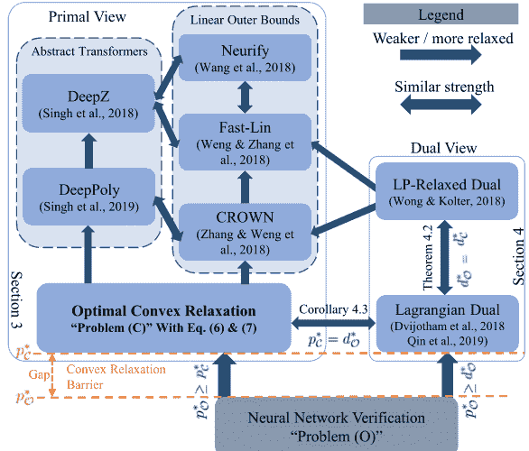

图 8.1 凸松弛方法和凸松弛障碍的图示，来自 (Salman et al., 2019b)，其中他们展示了几乎所有不完整验证算法都可以基于凸松弛框架来制定，并总结了不同不完整验证器之间的关系。

#### 发现

```
\max_{x' \in S} a^T x'.
```

例如，当 S 是以 \(x_0\) 为中心、半径为 \(\epsilon\) 的 \(\ell_\infty\) 球时，最坏情况下的输出将是 \(\epsilon \|a\|_1 + a^T x_0\)。

如果我们有一些非线性激活函数（例如 ReLU）怎么办？线性界传播方法的主要思想是为激活函数形成线性上界和下界 \(\bar{\sigma}\) 和 \(\underline{\sigma}\)。考虑一个 ReLU 函数，为了简单起见，我们假设当前的预激活下界和上界 \(z \in [l, u]\)，并旨在用线性函数来界定 ReLU(\(z\)) = max(\(z\), 0)。我们可以考虑图 8.2 中所示的三种情况。如果 \(l \ge 0\)，则我们知道 \(z\) 始终为正，因此 ReLU(\(z\)) = \(z\) 将是线性的。如果 \(u \le 0\)，则我们知道 \(z\) 始终为负，因此 ReLU(\(z\)) = 0 也将是线性的。第三种情况 \(l < 0 < u\) 是最棘手的，其中 ReLU 真正是非线性的，我们需要找到线性上界和下界。我们称这些为“不稳定神经元”。

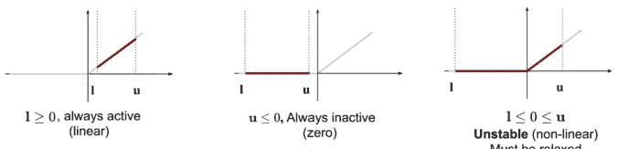

图 8.2 ReLU 激活的三种情况图示。

对于这些不稳定神经元，我们可以推导出以下线性界：

```
\(\underline{\sigma}^{(l)}(z) := \alpha^{(l)}z, \quad \overline{\sigma}^{(l)}(z) := \frac{\overline{z}^{(l)}}{\overline{z}^{(l)} - \underline{z}^{(l)}}(z - \underline{z}^{(l)}) \quad (8.2)\)
```

其中 \(\alpha^{(l)} \in [0, 1]\)。上界和下界在图 8.3 中所示。我们可以轻松验证，对于任何 \(\alpha^{(l)} \in [0, 1]\)，ReLU 激活的输出值将由这两个函数界定：

```
\(\underline{\sigma}^{(l)}(z) \le \max(z, 0) \le \overline{\sigma}^{(l)}(z) \quad \forall z \in [\underline{z}^{(l)}, \overline{z}^{(l)}]\)
```

有趣的是，下界可能有多种选择。一些常见的选择是：使用上界和下界相同的斜率；为下界使用 0 斜率；使用一些启发式方法来自适应地选择斜率。更近期的研究表明，可以选择下界以优化最终验证性能，这将在本节末尾讨论。

有了 ReLU 函数的线性上界和下界后，我们就可以界定 ReLU 层的输出，其中常数由 (8.2) 中使用的线性函数的斜率确定：

**引理 1** (CROWN 中的 ReLU 松弛)。给定 \(w, v \in \mathbb{R}^d\)，\(\boldsymbol{l} \le v \le \boldsymbol{u}\)（逐元素），我们有

```
\(w^\top ReLU(v) \ge w^\top \mathcal{D}v + b'\)
```

其中 \(\mathcal{D}\) 是一个对角矩阵，仅当 \(\boldsymbol{u}_j > 0 > \boldsymbol{l}_j\) 且 \(w_j \ge 0\) 时才包含自由变量，而其余值和常数 \(b'\) 由 \(\boldsymbol{l}, \boldsymbol{u}, w\) 确定。

有了每个神经元的线性上界和下界后，我们可以逐步线性化整个神经网络，在每一步中，我们为第 \(l\) 层的神经元形成线性上界和下界。这将导致一个高效的

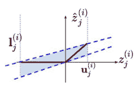

图 8.3 形成不稳定神经元线性上界和下界的图示。

回代过程，以推导 NN 输出相对于 x 的线性下界。

**引理 2** (线性松弛界)。给定一个具有权重 $\mathcal{W}_i$、偏置 $\mathbf{b}^i$ 和输入约束 $\boldsymbol{x} \in S$ 的 $L$ 层 \(\text{ReLU NN} f(\boldsymbol{x}): \mathbb{R}^{d_0} \to \mathbb{R}\)，我们有

$\min_{\boldsymbol{x} \in S} f(\boldsymbol{x}) \ge \min_{\boldsymbol{x} \in S} \boldsymbol{a}_{\text{CROWN}}^\top \boldsymbol{x} + c_{\text{CROWN}}.$

其中 $\boldsymbol{a}_{\text{CROWN}}$ 和 $c_{\text{CROWN}}$ 可以使用 $\mathcal{W}_i$, $\mathbf{b}^i$, $\mathbf{l}_i$, $\mathbf{u}_i$ 在多项式时间内计算。详细过程可在多篇论文中找到，例如 (Weng et al., 2018a; Zhang et al., 2018; Singh et al., 2019b)。

当 $S$ 是一个 $\ell_p$ 范数球时，线性函数上的极小化可以使用 Hölder 不等式轻松求解。CROWN 的主要优势在于其效率：CROWN 可以高效地在机器学习加速器（如 GPU (Xu et al., 2020b) 和 TPU (Zhang et al., 2020a)）上实现，并且它比线性规划（LP）验证器快几个数量级，后者在 GPU 上很难并行化。CROWN 已推广到一般架构，但为了简单起见，我们仅在前馈 ReLU 网络中演示它。此外，Xu et al. (2021) 表明可以使用梯度上升来优化下界 \(\boldsymbol{\alpha}$ 的斜率以进一步收紧界（有时称为 \(\boldsymbol{\alpha}\)-CROWN）。

Fast-Lin (Weng et al., 2018a) 和 Neurify (Wang et al., 2018a) 分配了 \(\boldsymbol{\alpha}^{(l)} = \frac{\underline{z}^{(l)}}{\underline{z}^{(l)} - \overline{z}^{(l)}}$，这比 CROWN 严格松弛，但享有轻微的计算优势。DeepZ (Singh et al., 2018a) 和 DeepPoly (Singh et al., 2019b) 是从使用抽象解释方法的形式验证社区发现的，但也可以包含在这个框架中。

#### 最优逐层凸松弛

尽管讨论一直集中在 ReLU 网络的鲁棒性验证上，上述线性界传播

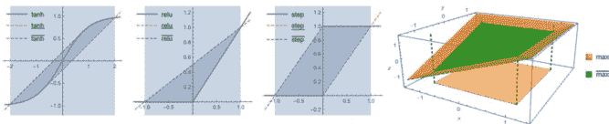

图 8.4 常见非线性的最优凸松弛。对于 tanh，松弛包含两个线性段和 tanh 函数的部分。对于 ReLU 和阶跃函数，最优松弛分别写成 3 和 4 个线性约束。对于 z = max(x, y)，浅橙色（打印版中为浅灰色）阴影指示 x 和 y 的预激活界，最优凸松弛由 max 函数本身下界。更多细节可在 (Salman et al., 2019b) 中找到。

方法可以轻松扩展到具有一般激活函数的任何网络。唯一的要求是给定预激活界时为激活函数形成线性上界和下界。更多细节可在 (Zhang et al., 2018) 中找到。

如果我们超越线性上界和下界，改用一般凸函数，我们可以通过以下在 \([\underline{z}, \bar{z}]$ 内的凸包来设计最优凸松弛 \(\underline{\sigma}$ 和 \(\bar{\sigma}$。例如，最优下界是

```
\(\underline{\sigma}_{\text{opt}}(z) := \sup_{(\alpha, \gamma) \in \mathcal{A}} \alpha^\top z + \gamma, \quad \mathcal{A} = \{(\alpha, \gamma) : \alpha^\top z' + \gamma \le \sigma(z'), \forall z' \in [\underline{z}, \bar{z}]\}.\)
```

这给出了凸松弛框架实现的 *针对一般激活函数* 的最紧界，如图 8.4 所示。使用最优凸松弛，可以得到最紧的结果，但时间复杂度显著增加。例如，对于 ReLU 激活，图 8.4 显示最优凸松弛是一个线性上界和两个线性下界的并集。尽管这仍然可以用简单的形式表示，但从界传播的角度来看，这会导致线性界数量呈指数级增长，必须由线性规划求解器求解。因此，在实践中，线性界传播方法仍然是不完整验证最流行的选择。(Salman et al., 2019b) 也讨论了最优凸松弛与线性界传播之间的差距。对于某些 ReLU 网络，它们为每个 ReLU 激活形成两个线性下界，并通过线性规划求解由此产生的问题。他们证明，在某些实际案例中，最优凸松弛与线性界传播之间的差距可能是合理的，但最优凸松弛与精确验证问题之间仍然存在一些差距，


也称为“_凸松弛屏障_”，如图 8.4 所示（(O) 和 (C) 之间橙色（打印版中为浅灰色）的差距）。

### 8.3 对偶空间中的凸松弛

另一种求解鲁棒性验证问题 (C) 的方法是求解其对偶问题。其拉格朗日对偶可以写为

```
\( g_C(\mu^{[L]}, \underline{\lambda}^{[L]}, \overline{\lambda}^{[L]}) := \min_{x^{[L+1]}, z^{[L]}} c^\top x^{(L)} + \sum_{l=0}^{L-1} \mu^{(l)\top}(z^{(l)} - W^{(l)}x^{(l)} - b^{(l)}) \quad - \sum_{l=0}^{L-1} \underline{\lambda}^{(l)\top}(x^{(l+1)} - \underline{\sigma}^{(l)}(z^{(l)})) + \sum_{l=0}^{L-1} \overline{\lambda}^{(l)\top}(x^{(l+1)} - \overline{\sigma}^{(l)}(z^{(l)})). \quad \text{(8.3)}\)
```

根据弱对偶性

```
\( d_C^* := \max_{\mu^{[L]}, \underline{\lambda}^{[L]} \ge 0, \overline{\lambda}^{[L]} \ge 0} g_C(\mu^{[L]}, \underline{\lambda}^{[L]}, \overline{\lambda}^{[L]}) \le p_C^*, \quad \text{(8.4)}\)
```

但实际上 Salman et al. (2019b) 在温和条件下证明了强对偶性，这意味着在大多数情况下等号可以成立。

基于这一原偶对关系，寻找原始目标下界的另一种方法是求解对偶解。当松弛边界 \(\underline{\sigma}\) 和 \(\overline{\sigma}\) 为线性时，对偶目标 (8.4) 可以进一步简化。Wong 和 Kolter (2018) 提出通过以下线性松弛函数的选择来求解这个对偶形式：

```
\(\underline{\sigma}^{(l)}(z(l)) := \alpha^{(l)} z(l), \quad \overline{\sigma}^{(l)}(z(l)) := \frac{\overline{z}^{(l)}}{\overline{z}^{(l)}-\underline{z}^{(l)}}(z(l) - \underline{z}^{(l)}),\)
```

其中 \(0 \le \alpha^{(l)} \le 1\) 表示下界的斜率。这与图 8.3 中介绍的线性松弛选择等价。当 \(\alpha^{(l)} = \frac{\overline{z}^{(l)}}{\overline{z}^{(l)}-\underline{z}^{(l)}}\) 时，贪婪算法也恢复了 Fast-Lin (Weng et al., 2018a)，这解释了图 8.1 中从 Wong 和 Kolter (2018) 指向 Weng et al. (2018a) 的箭头。对偶算法与原始算法之间的其他几种关系可以以类似方式分析，如 (Salman et al., 2019b) 中所述。

### 8.4 基于线性松弛方法的最新进展

我们简要讨论上述基于线性松弛的不完全验证方法的几项其他改进：

- 自适应线性边界选择：如前几节所示，(8.2) 中每个神经元的线性松弛边界由 \(\alpha\) 控制，CROWN 中已讨论了一些选择 \(\alpha\) 的启发式方法。有趣的是，可以通过优化边界紧度来自动获得优化的 \(\alpha\)。更具体地说，对于一组给定的 \(\alpha\)，最终验证可以在引理 2 中表示，因此我们可以尝试将 \(a^T_{\text{CROWN}}\) 中的 \(\alpha\) 制定为可学习参数并优化 \(\alpha\) 以获得更紧的边界。更多细节可见 (Xu et al., 2021)。

- 打破凸松弛屏障：上述框架假设每个单个神经元具有凸上界和下界。然而，已观察到，对一组神经元形成凸松弛会比独立松弛每个神经元产生更紧的结果。然而，如何分组更相关的神经元仍然是一个开放的研究课题。更多讨论见 (Tjandraatmadja et al., 2020)。

- 自动边界传播：现有的验证方法通常专注于前馈 ReLU 网络。只有少数作品尝试将现有验证方法扩展到其他模型：Ko et al. (2019) 将 CROWN 扩展到循环神经网络；Shi et al. (2020) 将 CROWN 扩展到 Transformer 架构。不幸的是，这些每一种都需要为每个网络架构重新推导和实现验证算法，即使对于资深机器学习研究人员来说也很困难。与其将所提算法逐一扩展到每个网络架构，Xu et al. (2020a) 开发了一个**自动**验证框架，其机制类似于 TensorFlow/PyTorch 中用于反向传播的自动微分。用户只需在 PyTorch 或 TensorFlow 中编写模型，该工具就会自动进行验证并输出测量结果，无需任何额外的人工努力。这是通过将目标函数 \(f\) 表示为给定的计算图来实现的，其中每个边对应于 *基本操作*，例如加法、乘法、ReLU、softmax、sigmoid。该图中的节点可以分为输入节点、输出节点、中间节点和常量节点，并且该图应为有向无环图 (DAG)。本节提到的线性边界传播算法可以轻松推广到计算图——每个松弛是在边（操作）上进行，而不是神经网络层。借助此框架，任何给定的计算图都可以自动进行验证，只要我们有基本操作的传播规则即可。总体用法类似于自动微分如何计算梯度。

### 8.5 延伸阅读

- 我们将读者引向 (Salman et al., 2019b)，以了解各种不完全验证算法的详细讨论。
- 对于基于线性松弛的方法，我们鼓励读者阅读 (Wong and Kolter, 2017)，该研究专注于使用这些边界进行认证鲁棒训练。
- 除了对输入扰动的验证外，类似的方法还可以应用于验证神经网络中的权重扰动 (Weng et al., 2020)。
- (Weng et al., 2019) 提出了一种基于遵循给定分布特征的加性噪声的鲁棒性认证概率框架。
- (Boopathy et al., 2019) 提出了一种针对卷积神经网络 (CNN-Cert) 优化的鲁棒性认证框架。

本页故意留空

## 第 9 章

## 完整神经网络验证

由于深度神经网络的非线性，完整验证是一个难题。即使对于简单的 ReLU 网络，Katz et al. (2017) 也表明完整验证是 NP-完全的。因此，早期将完整验证表述为混合整数规划 (MIP) 的工作通常无法处理超过 100 个神经元的网络。然而，过去几年取得了显著进展，如今优秀的验证工具已经可以处理一些超过 100 万个参数的更大网络。在本章中，我们将讨论当前完整验证器中使用的主要技术。

### 9.1 混合整数规划

对于 ReLU 网络，完整验证问题可以表述为混合整数规划 (MIP) 问题。关键思想是使用二进制变量来指示 ReLU 函数的激活模式。沿用前几节使用的符号，对于前馈网络 f，我们可以将神经网络验证问题 (7.8) 表述为以下 MIP 问题：

```
min c^T f s.t. i \in [L], j \in [n_i];
z^{(i)} = W^{(i)} z^{(i-1)} + b^{(i)}; f = z^{(L)}; z^{(0)} = x \in C;
\hat{z}_j^{(i)} \ge z_j^{(i)}; \hat{z}_j^{(i)} \le u_j^{(i)} s_j^{(i)}; \hat{z}_j^{(i)} \le z_j^{(i)} - l_j^{(i)} (1 - s_j^{(i)});
\hat{z}_j^{(i)} \ge 0; z_j^{(i)} \in [l_j^{(i)}, u_j^{(i)}]; s_j^{(i)} \in {0, 1};
```

其中 \(s_j^{(i)}\) 指示 ReLU 的两种状态：(1) 非激活：当 \(s_j^{(i)} = 0\) 时，对 \(\hat{z}_j^{(i)}\) 的约束简化为 \(\hat{z}_j^{(i)} = 0\)；或 (2) 激活：当 \(s_j^{(i)} = 1\) 时，我们有 \(\hat{z}_j^{(i)} = z_j^{(i)}\)。这里 \(l_j^{(i)}\) 和 \(u_j^{(i)}\) 是预激活 \(z_j^{(i)}\) 的预计算中间下界和上界，使得对于 \(x \in C\) 有 \(l_j^{(i)} \le z_j^{(i)}(x) \le u_j^{(i)}\)。请注意，(9.1) 由于整数变量 \(s_j^{(i)}\)（每个 ReLU 的激活模式）而需要指数时间才能精确求解，但与此同时，存在 Gurobi 等软件包，可以相对较好地处理小规模实例


嗯。例如，对于拥有数十个神经元的问题，仍然可以直接应用 Gurobi 进行完整验证。遗憾的是，该问题的复杂度可能随 ReLU 神经元数量呈指数增长，因此即使在小型网络上也可能需要数小时才能运行完毕，除非该网络采用了诸如 certified dense 之类的强正则化进行训练（Wong and Kolter, 2018; Xiao et al., 2019b）。

### 9.2 分支定界法

为了加速完整验证，大多数现代算法都采用 Branch-and-Bound（BaB）方法（Bunel et al., 2018）。请注意，BaB 也是现成 MIP 求解器中的关键组件，通过为验证开发专门的 BaB 程序可以提高效率。基于 BaB 的验证框架是一个由两个主要步骤（分支和界定）组成的递归过程。对于 *分支*，基于 BaB 的方法将有界输入域 $\mathcal{C}$ 划分为子域 $\{\mathcal{C}_i | \mathcal{C} = \bigcup_i \mathcal{C}_i\}$，每个域对应一个新的验证问题。例如，对于基于 ReLU 的网络，我们可以将 ReLU 神经元 $\hat{z}^{(k)} = \text{ReLU}(z^{(k)})$ 拆分为负例和正例，即 $\mathcal{C}_0 = \{x | z^{(k)} \ge 0\}$ 和 $\mathcal{C}_1 = \{x | z^{(k)} < 0\}$，其中每个域均为满足特定约束的输入集合。对于每个子域 $\mathcal{C}_i$，基于 BaB 的方法执行 *界定* 以获得一个放松但可靠的较低界 $\underline{f}_{\mathcal{C}_i}$。随后，通过取所有子域较低界中的最小值，即可得到对 $\mathcal{C}$ 的收紧全局较低界：$\underline{f} = \min_i \underline{f}_{\mathcal{C}_i}$。

基于这种拆分方法，BaB 将递归执行以收紧近似的全局较低界。这可以实现为树结构，其中每个节点对应一个子域 $\mathcal{C}$。从根节点开始（此时 $\mathcal{C}$ 为整个输入域，例如围绕某个数据点 $x_0$ 的 $\ell_p$ 球），BaB 根据某个 ReLU 神经元的符号对节点（域）进行拆分。拆分后，我们会为节点创建两个子节点，每个子节点包含一个子域，并计算该子域的较低界。此过程持续到满足以下条件之一时停止：(i) 全局较低界 $\underline{f}$ 大于 0，从而证明了该属性；或 (ii) 在某个子域中找到违反情况（例如识别出对抗样本）以反驳该属性。

#### BaB 的可靠性

若验证器给出的“是”（属性成功验证）答案始终可信，则我们称该验证过程具有可靠性。当基于 BaB 的验证过程输出“是”时，意味着所有叶节点均输出“是”。因此，我们可以清楚地看到，如果用于每个子域 $C_i$ 的界定方法具有可靠性，则整个基于 BaB 的验证器也将具有可靠性。

#### BaB 的完备性

在基于 BaB 的验证器中，它会不断拆分节点，直到所有节点都被证明或反驳。为了保证该过程的完备性，我们必须确保在拆分完所有 ReLU 神经元后，界定方法会成为每个子域的完备验证器。当将基于 LP 的界定方法或线性边界传播方法应用于每个子域时，此结论成立。

#### 基于线性规划（LP）的界定

在神经网络验证中，基于 BaB 的验证中使用的一种经典界定方法是 *线性规划界定程序*。具体而言，可以将原始验证问题转换为线性规划问题。这是通过将每个 ReLU 激活函数 \(\hat{z} = \max(z, 0)\) 放宽为线性约束来实现的。如果 ReLU 神经元已被拆分，则它已被替换为线性约束（即 \(z \le 0, \hat{z} = 0\) 或 \(z > 0, \hat{z} = z\)）。对于每个未拆分的神经元，可以将其放宽为以下三个约束：

\(\hat{z} \ge 0\) \tag{9.2}

\(\hat{z} \ge z\) \tag{9.3}

\(\hat{z} \le \frac{u}{u-l}(z - l)\) \tag{9.4}

其中 _u, l_ 是 _z_ 的下界和上界，可以通过简单的前向边界传播或使用前一节提到的基于线性传播的方法计算得到。公式 (9.4) 被称为 ReLU 神经元的“三角放宽”，因为它本质上将 ReLU 限定在一个凸三角形区域内。对所有未拆分神经元执行此操作后，验证问题将变成一个线性规划问题，从而可以由现成的 LP 求解器求解。将上述基于 LP 的界定方法与 BaB 结合使用可以得到一个完备验证器，因为当所有 ReLU 神经元都被拆分后，原问题将不存在放宽，LP 将针对给定子域得到验证问题的精确解。

#### BaB 中的分支

由于分支步骤决定了搜索树的形状，主要挑战在于高效选择一个合适的叶节点进行拆分，这可以显著减少分支总数和运行时间。例如，（Bunel et al., 2018）包含一个简单的分支启发式，它为每个 ReLU 节点分配一个分数以估计通过拆分该节点所带来的收紧 \(\underline{f}\) 的改进，并拆分分数最高的节点。

不同实现通常使用略有不同的分支启发式。

### 9.3 带线性边界传播的分支定界法

虽然线性规划（LP）在进行 BaB 时可以为每个子域提供紧界，但求解通常耗时且无法充分利用 GPU 或 TPU 提供的并行性。因此，许多最近的工作应用了前一章提到的不完备验证求解器，以高效排除某些区域并为 BaB 提供指导（Bunel et al., 2020a; Xu et al., 2021）。特别是，Xu et al. (2021) 将 BaB 与基于线性传播的不完备验证器 CROWN 相结合，以进行完整验证。

将基于线性传播的不完备验证器用于 BaB 的主要挑战是将拆分约束（神经元 $z$ 的 $z \ge 0$ 或 $z < 0$）结合到线性传播过程中。一种简单的方法是将其仅用作每个神经元的预激活界（(9.4) 中的 $l, u$），但这不够，因为预激活约束并未消除域外的所有输入。因此，像（Xu et al., 2021）这样的算法使用拉格朗日乘数来纳入拆分约束。更具体地说，线性传播方法导致了验证的以下最小化问题：

$\min_{x \in C} f(x) \ge \min_{x \in C} w^T D z,$

其中 $z$ 是神经网络某一层的值，$D$ 是由每个神经元界定推导出的对角矩阵（参见第 8 章 Lemma 1）。随后可以将拆分约束添加到该公式中：

$\min_{x \in C} f(x) \ge \min_{x \in C} w^T D z, \ S z \le 0,$ (9.5)

其中 $S$ 是对角线上为 $+1, -1, 0$ 的对角矩阵，指示拆分约束（正、负或无拆分）。优化 (9.5) 将得到约束集内的最优解。为处理约束最小化问题，一种标准方法是将其转换为带拉格朗日乘数的无约束问题：

$\min_{x \in C} f(x) \ge \max_{\beta \ge 0} \min_{x \in C} w^T D z + \beta S z,$ (9.6)

其中 $\beta$ 为乘数。因此，我们可以将目标中的两个线性项合并，这归约为线性传播方法，唯一的变化是引入了几个拉格朗日乘数 ($\beta$)，我们需要对 $\beta$ 进行另一次梯度上升以找到最优值。

在完整验证中使用基于线性传播的方法的主要优势是这些方法高度可并行化，从而可以在 GPU 上运行时使整个过程高效。

### 9.4 经验比较

为了对现有完整验证方法进行全面比较，我们展示了 Wang et al. (2021c) 近期论文中报告的实验结果。他们使用包含三个 CIFAR-10 模型（Base、Wide 和 Deep）的基准来评估验证算法，每个模型包含 100 个示例。每个数据示例关联一个 $\ell_\infty$ 范数扰动预算 $\epsilon$ 和一个用于验证的目标标签（即待验证属性）。比较包含以下方法：

- BaBSR (Bunel et al., 2020b)，一种基础的 BaB 和 LP 为基础的验证器；
- MIPplanet (Ehlers, 2017)，一种专用于神经网络验证的 MIP 求解器，其中不稳定的 ReLU 神经元被随机选中进行拆分；
- ERAN (Singh et al., 2018a,b, 2019a,b)，一种基于抽象解释的验证器，在 VNN-COMP 2020 该基准上表现良好；
- GNN-Online Lu and Kumar (2020)，一种使用学习的图神经网络 (GNN) 来指导 ReLU 拆分的 BaB 和 LP 为基础的验证器；
- BDD+ BaBSR (Bunel et al., 2020a)，一种基于 GPU 上拉格朗日分解（BDD+）并采用 BaBSR 分支策略的验证框架；
- OVAL (BDD+ GNN) (Bunel et al., 2020a; Lu and Kumar, 2020)，一种在 VNN-COMP 2020 中使用 BDD+ 并由 GNN 指导 ReLU 拆分的强验证器；A.set BaBSR；
- Big-M+A.set BaBSR (De Palma et al., 2021a)，一种在 GPU 上具有比三角形 LP 松弛更紧的线性松弛的双空间验证器；
- Fast-and-Complete (Xu et al., 2021)，一种在 BaB 中不带神经元拆分约束的情况下在 GPU 上使用 CROWN 作为不完备验证器的方法；
- BaDNB (BDD+ FSB) (De Palma et al., 2021b)，一种使用 BDD+ 在 GPU 上并采用 FSB 分支策略的完备验证器。$\beta$-CROWN BaB 可以使用 BaBSR 或 FSB 分支启发式，我们在评估中同时包含两者。


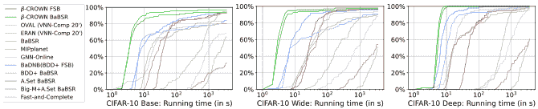

图 9.1 随运行时间增长而解决的属性百分比。β-CROWN FSB（浅绿色（打印版中为浅灰色））和 β-CROWN BaBSR（深绿色（打印版中为深灰色））在所有三种设置中均占据明显领先地位，并在 10 秒内解决了超过 90% 的属性。

实验在一台配备单块 NVIDIA RTX 3090 GPU（24 GB GPU 显存）、AMD Ryzen 9 5950X CPU 和 64 GB 内存的机器上运行。所有方法均采用 1 小时超时阈值。图 9.1 随时间绘制了解决属性的百分比。β-CROWN FSB 相比于所有其他基线实现了最快的平均运行时间，且超时极少，同时在仙人掌图上也明显领先。当使用较弱的分支启发式时，β-CROWN BaBSR 仍优于所有基线。

## 针对语义扰动的验证

虽然当前验证方法主要关注输入实例的 $\ell_p$-范数威胁模型，但针对诱导大 $\ell_p$-范数扰动的 $\ell_p$-语义对抗攻击（如颜色偏移和光照调整）的鲁棒性验证已超出其能力范围。为弥补这一差距，本章介绍了 Mohapatra et al. (2020) 提出的 Semantify-NN 框架，这是一种针对神经网络语义扰动的模型无关且通用的鲁棒性验证方法。通过将所提语义扰动层（SP-layers）简单插入任何给定模型的输入层，Semantify-NN 即实现模型无关，任何基于 $\ell_p$-范数的验证工具均可用于验证模型对语义扰动的鲁棒性。我们将阐述设计 SP-layers 的原理，并提供包括色调、饱和度、亮度、明度、对比度和旋转空间中图像分类语义扰动的示例。此外，我们还讨论了一种高效的精炼技术，以进一步提升语义证书。

### 10.1 语义对抗示例

超出 $\ell_p$-范数有界威胁模型之外，一些研究已表明基于颜色偏移、光照调整和旋转等语义扰动技术生成语义对抗示例的可能性（Hosseini and Poovendran, 2018; Liu et al., 2019b; Bhattad et al., 2019; Joshi et al., 2019; Fawzi and Frossard, 2015; Engstrom et al., 2017）。我们将读者引向图 10.1 以了解图像中某些语义扰动的示例。值得注意的是，尽管在语义上相似，但这些语义对抗攻击本质上考虑的威胁模型与 RGB（红、绿、蓝）空间中的 $\ell_p$-范数有界攻击不同。因此，语义对抗示例通常会对原始数据样本造成大 $\ell_p$-范数扰动，从而超出基于 $\ell_p$-范数的验证方法的验证能力。

通常，语义对抗攻击通过调整一组控制数据样本语义操作的参数来构建对抗示例

#### 语义攻击示例

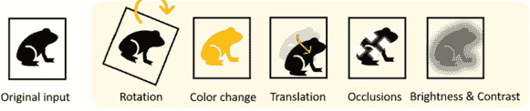

#### 朴素验证方法：

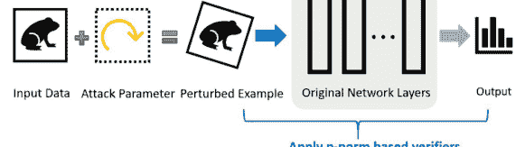

#### 我们的 Semantify-NN：

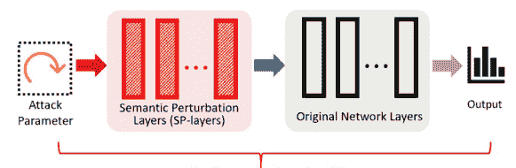

图 10.1. Semantify-NN 鲁棒性验证框架的示意图（来源：Mohapatra et al., 2020）。给定语义攻击威胁模型，Semantify-NN 设计相应的语义扰动层（SP-layers）并将其插入原始网络的输入层以进行验证。借助 SP-layers，Semantify-NN 可以使用任何基于 \(\ell_p\)-范数的验证方法来验证语义扰动。

，这些参数要么是显式指定的（例如旋转角度），要么是隐式学习的（例如生成模型的隐式表示）。Hosseini and Poovendran (2018) 使用 HSV（色调、饱和度和明度）颜色空间表示来寻找自然图像的语义对抗示例。为鼓励视觉相似性，作者提出固定明度、最小化饱和度的变化，并充分利用色调变化来寻找语义对抗示例。Liu et al. (2019b) 提出一种基于物理的可微渲染器，允许将像素级梯度传播到明度和几何的参数空间。Bhattad et al. (2019) 引入纹理和色彩化，以在原始像素空间中诱导具有大 $\ell_p$ 范数扰动的语义扰动，同时保持视觉不可感知性。Joshi et al. (2019) 训练一个由编码器和基于属性条件的生成器组成的对抗网络，以寻找语义对抗示例。Fawzi and Frossard (2015) 和 Engstrom et al. (2017) 表明，图像旋转或对象平移等简单操作可能导致显著的误分类率。

我们注意到，对于连续参数化的语义扰动（例如色调、饱和度、亮度、明度、对比度和旋转），即使只扰动单个参数（例如旋转角度），也无法枚举所有可能值。原因在于这些参数在连续空间中取实数值，因此无法有限枚举所有可能值，这与其离散参数化的对照物不同（例如，平移和遮挡具有有限枚举）。以旋转角度为例，攻击者可以尝试通过将旋转角度 \(\theta\) 从 \(0^\circ\) 扫除至 \(90^\circ\)，并以 \(10^\circ\) 为均匀网格进行网格搜索。然而，如果攻击在 \(\theta = 30^\circ\) 和 \(30.00009^\circ\) 处均不成功，则可能存在某个 \(\theta'\) 能够“欺骗”分类器，且 \(30^\circ < \theta' < 30.00009^\circ\)。这正是本章讨论的语义扰动鲁棒性验证算法的动机和必要性——借助合适的语义鲁棒性验证算法，我们旨在提供一个鲁棒性保证，即神经网络对给定图像的任何 \(\theta < a\) 都会做出一致的预测，其中 \(a\) 是该图像的语义鲁棒性证书。

### 10.2 语义扰动层

为弥补这一差距并致力于使鲁棒性验证方法更具包容性，Mohapatra et al. (2020) 提出了 Semantify-NN，这是一种针对语义扰动的模型无关且通用的鲁棒性验证方法。Semantify-NN 之所以是模型无关的，是因为它可以通过简单插入设计好的语义扰动层（SP-layers）来应用于任何给定的训练模型。它也是通用的，因为在添加 SP-layers 后，我们可以使用任何基于 \(\ell_p\)-范数的验证工具来对语义扰动进行认证。换句话说，所提 SP-layers 就像一个精心设计的转换器，将语义威胁模型转换为 $\ell_p$-范数威胁模型。

设 $\mathcal{A}$ 为一般威胁模型。对于输入数据样本 $x$，我们定义一个相关的扰动图像空间 $x'$，称为攻击空间 $\Omega_{\mathcal{A}}(x)$，并配备一个距离函数 $d_\mathcal{A}$ 来测量扰动的幅度。在威胁模型 $\mathcal{A}$ 下，鲁棒性认证问题表述如下：给定一个训练好的 $K$ 类神经网络函数 $f$ 和一个输入数据样本 $x$，我们的目标是找到最大的 $\delta$，使得

$$\min_{x' \in \Omega_{\mathcal{A}}(x), d_{\mathcal{A}}(x', x) \le \delta} \left( \min_{j \neq c} f_i(x') - f_j(x') \right) > 0, \quad (10.1)$$

其中 $f_j$ 表示第 $j$ 类的置信度（或 logit），$j \in \{1, 2, \dots, K\}$，而 $c$ 是未扰动输入数据 $x$ 的预测类。

我们考虑针对语义有意义攻击的语义威胁模型，这些攻击通常超出了像素空间中传统 $\ell_p$-范数有界威胁模型的覆盖范围。对于攻击空间 $\Omega_{\mathcal{A}}^k$，存在一个函数 $g: X \times (I_1 \times I_2 \times \cdots \times I_k) \to X$，使得

$$\Omega_{\mathcal{A}}^k(x) = \{g(x, \epsilon_1, \dots, \epsilon_k) \mid \epsilon_i \in I_i\}, \quad (10.2)$$ $$d_{\mathcal{A}}(g(x, \epsilon_1, \dots, \epsilon_k), x) = ||(\epsilon_1, \dots, \epsilon_k)||_p,$$

其中 $X$ 是像素空间（原始图像），$I_i$ 是可行语义操作的集合，而 $||\cdot||_p$ 表示 $\ell_p$ 范数。参数 $\epsilon_i$ 指定从 $I_i$ 选择的语义操作。例如，$\epsilon_i$ 可以描述图像的某些人类可解释特征，如平移偏移、旋转角度等。为方便起见，我们定义 $\boldsymbol{\epsilon}^k = (\epsilon_1, \epsilon_2, \dots, \epsilon_k)$ 和 $I^k = I_1 \times \dots \times I_k$，其中 $k$ 表示语义攻击的维度。换句话说，我们证明可以为本工作中考虑的所有语义扰动定义一个显式函数 $g$，包括平移、遮挡、颜色空间变换和旋转，随后我们在语义特征空间 $\boldsymbol{\epsilon}^k$ 上而非原始像素空间上测量语义扰动的 $\ell_p$ 范数。请注意，根据此定义，原始 RGB 像素上的传统 $\ell_p$ 范数扰动是一种特例：通过令 $I_i$ 等于一个有界实数集（即 $x'_i - x_i$，第 $i$ 个像素所有可能差值）并令 $k$ 为输入向量 $x$ 的维度，我们便可得到 $d_{\mathcal{A}} = ||x' - x||_p$。

根据上述定义，语义攻击可分为两类：离散参数化扰动（即 $I_k$ 为离散集合），包括平移和遮挡；以及连续参数化扰动（即 $I_k$ 为连续集合），包括颜色变化、亮度、对比度和空间变换（例如旋转）。

#### 离散参数化语义扰动

**平移：** 平移是一个二维语义攻击，其参数是扰动图像左上角像素相对于原始图像的相对位置。因此 $I_1 = \{0, 1, \dots, r\}$ 且 $I_2 =$


{0, 1, ..., h}，其中 $r$ 和 $h$ 分别是输入图像 $x$ 的宽度和高度尺寸。注意，可以应用任何填充方法，包括使用黑色像素或边界像素填充等。

遮挡。与平移类似，遮挡攻击可以用三维攻击参数表示：遮挡补丁左上角像素的坐标和遮挡补丁的大小。$^1$ 注意，对于离散参数化的语义扰动，只要计算资源充足，我们可以简单地穷举枚举所有可能的扰动图像。在我们考虑的图像尺度下，我们发现穷举枚举可以在合理的计算时间内完成，生成的图像可用于直接验证。在这种情况下，给定离散参数化语义攻击威胁模型，SP-层将简化为枚举操作。尽管如此，当考虑由多种离散参数化语义攻击组成的联合攻击威胁模型时，穷举枚举的计算复杂度会呈组合爆炸式增长。

$^1$ 我们使用正方形补丁，但通常它可以是矩形的。

#### 连续参数化语义扰动

大多数语义扰动都属于参数为连续值的框架，即 $I^k \subset \mathbb{R}^k$。Mohapatra 等人（2020）提出，向任何给定神经网络模型的输入层添加*语义扰动层*（SP-层）的概念，以实现高效的鲁棒性验证，如图 10.1 所示。通过令 $g_{\mathcal{X}}(\boldsymbol{\epsilon}^k) = g(x, \boldsymbol{\epsilon}^k)$，神经网络 $f$ 在 (10.1) 中表述的验证问题变为

```
\min_{\boldsymbol{\epsilon}^k \in I^k, d_{\mathcal{A}}(g_{\mathcal{X}}(\boldsymbol{\epsilon}^k), x) \le \delta} \left( \min_{j \neq c} f_c(g_{\mathcal{X}}(\boldsymbol{\epsilon}^k)) - f_j(g_{\mathcal{X}}(\boldsymbol{\epsilon}^k)) \right) > 0. \quad (10.3)
```

如果我们将新网络视为 $f^{sem} = f \circ g_{\mathcal{X}}$，则有以下问题：

```
\min_{\boldsymbol{\epsilon}^k \in I^k, ||\boldsymbol{\epsilon}^k||_p \le \delta} \left( \min_{j \neq c} f_c^{sem}(\boldsymbol{\epsilon}^k) - f_j^{sem}(\boldsymbol{\epsilon}^k) \right) > 0, \quad (10.4)
```

这与 $\ell_p$-范数扰动形式相似，但现在是在语义空间 $I^k$ 上。所提出的 SP-层允许我们明确定义扰动的维度，并建立语义扰动对图像不同像素的方式与效果之间的显式依赖关系。换句话说，我们可以将所提出的 SP-层视为从语义空间到 RGB 空间的参数化输入变换函数，而 \(g(x, \epsilon^k)$ 是 RGB 空间中的扰动输入，它是语义空间中扰动的函数。我们的关键思想是用常用的激活函数来表达 \(g\)，因此 \(g\) 是神经网络的形式，可以轻松地融入原始神经网络分类器 \(f\)。注意，\(g\) 可以任意复杂，以允许 SP-层的一般变换；尽管如此，应用传统的基于 $\ell_p$-范数的方法（如 (Zhang et al., 2018; Wang et al., 2018a; Singh et al., 2018a; Boopathy et al., 2019; Weng et al., 2018a)）并不会带来任何困难，因为 Semantify-NN 只要求激活函数具有自定义线性边界，不需要它们是连续或可微的。下面我们使用 (i) 色调、(ii) 饱和度、(iii) 亮度、(iv) 亮度和对比度以及 (v) 旋转，指定了对应于五种不同语义扰动的 SP-层的显式形式。

颜色空间变换。我们考虑由色调、饱和度和亮度（HSL 空间）参数化的颜色变换。与 RGB 值不同，HSL 构成了更直观的基础，用于理解颜色变换的效果，因为它在语义上是有意义的。对于每个基准，我们可以为 g 定义以下函数：

- 色调 该维度对应于颜色在色轮上的位置。两种具有相同色调的颜色通常被视为同一种颜色的不同色调，例如蓝色和浅蓝色。色调在 0–360° 的范围内表示，为了方便，我们已将其重新缩放到范围 [0, 6]。因此，我们有 \(g(R, G, B, \epsilon_h) = (d \cdot \phi_R^h(h') + m, d \cdot \phi_G^h(h') + m, d \cdot \phi_B^h(h') + m)$，其中 \(d = (1 - |2l - 1|)s$、\(m = l - \frac{d}{2}$，以及 \(h' = (h + \epsilon_h) \mod 6$ 是与 \(\epsilon_h$ 无关的 \(R, G, B$ 的函数，并且

```
(\phi_R^h(h'), \phi_G^h(h'), \phi_B^h(h')) = \begin{cases} (1, V, 0), \quad 0 \le h' \le 1, \\ (V, 1, 0), \quad 1 \le h' \le 2, \\ (0, 1, V), \quad 2 \le h' \le 3, \\ (0, V, 1), \quad 3 \le h' \le 4, \\ (V, 0, 1), \quad 4 \le h' \le 5, \\ (1, 0, V), \quad 5 \le h' \le 6, \end{cases}
```

其中 \(V = (1 - |(h' \mod 2) - 1|)$。

对于 \( 0 \le h' \le 6$，上述内容可简化为以下 ReLU 形式 \( \sigma_i(x) = \text{ReLU}(x - i)$，因此可以视为从色调空间到原始 RGB 空间的具有一个隐藏层的 ReLU 激活：

```
\(\begin{aligned} \phi_R^h(h') &= 1 + \sigma_2(h') + \sigma_4(h') - (\sigma_5(h') + \sigma_1(h')), \\ \phi_G^h(h') &= \sigma_0(h') + \sigma_4(h') - (\sigma_1(h') + \sigma_3(h')), \\ \phi_B^h(h') &= \sigma_2(h') + \sigma_6(h') - (\sigma_5(h') + \sigma_3(h')). \end{aligned}\) (10.5)
```

- 饱和度 这对应于图像的色彩丰富度。当饱和度为 0 时，我们得到灰度图像；而当饱和度为 1 时，颜色会非常清晰。我们有 \( g(R, G, B, \epsilon_s) = (d_R \cdot \phi^s(s') + l, d_G \cdot \phi^s(s') + l, d_B \cdot \phi^s(s') + l)$，其中 \( s' = s + \epsilon_s$，\( d_R = \frac{R-s}{s}$，$ d_G = \frac{G-l}{s}$，以及 \( d_B = \frac{B-l}{s}$ 是与 \(\epsilon_s$ 无关的 \( R, G, B$ 的函数，并且
  \( \phi^s(s') = \min(\max(s', 0), 1) = \sigma_0(s') - \sigma_1(s')$。 (10.6)

- 亮度 此属性对应于图像的感知亮度，亮度为 1 时得到白色，亮度为 0 时得到黑色图像。在这种情况下，\( g(R, G, B, \epsilon_l) = (d_R \cdot \phi_1^l(l') + \phi_2^l(l'), d_G \cdot \phi_1^l(l') + \phi_2^l(l'), d_B \cdot \phi_1^l(l') + \phi_2^l(l'))$，其中 \( l' = l + \epsilon_l$，\( d_R = \frac{R-l}{|1-2l|}$，$ d_G = \frac{G-l}{|1-2l|}$，以及 \( d_B = \frac{B-l}{|1-2l|}$ 是与 \(\epsilon_l$ 无关的 \( R, G, B$ 的函数，并且
  \(\begin{aligned} \phi_1^l(l') &= 1 - |2 \cdot \min(\max(l', 0), 1) - 1| \\ &= -\sigma_0(2 \cdot l') - \sigma_2(2 \cdot l') + 2 \cdot \sigma_1(2 \cdot l') + 1, \\ \phi_2^l(l') &= \min(\max(l', 0), 1) = \sigma_0(l') - \sigma_1(l'). \end{aligned}\) (10.7)

亮度和对比度。我们还使用与 HSL 颜色空间类似的技术来处理多参数变换，如亮度和对比度：攻击参数为亮度扰动的 \( \epsilon_b$ 和对比度扰动的 \( \epsilon_c$，我们有

```
\(\begin{aligned} g(x, \epsilon_b, \epsilon_c) &= \min(\max((1 + \epsilon_c) \cdot x + \epsilon_b, 0), 1) \\ &= \sigma_0((1 + \epsilon_c) \cdot x + \epsilon_b) - \sigma_1((1 + \epsilon_c) \cdot x + \epsilon_b). \end{aligned}\) (10.8)
```

因此，\( g \) 可以表示为原始网络模型之前的一个额外 ReLU 层，即图 10.1 中所提议的 SP-层。

旋转。我们有一个由旋转角度 \(\theta$ 参数化的一维语义攻击，并且我们考虑围绕图像中心进行旋转，边界扩展到图像区域之外。我们使用以下插值来获取旋转 \(\theta$ 后位置 $(i,j)$ 处输出像素的值 $x'_{i,j}$。令 $i' = i\cos\theta - j\sin\theta$ 和 $j' = j\cos\theta + i\sin\theta$。然后

```
\[ x'_{i,j} = \frac{\sum_{k,l} x_{k,l} \cdot \max(0, 1 - \sqrt{(k - i')^2 + (l - j')^2})}{\sum_{k,l} \max(0, 1 - \sqrt{(k - i')^2 + (l - j')^2})}, \quad (10.9) \]
```

其中 \( k \) 和 \( l \) 范围遍历所有可能的值。对于原始图像中位置 \( (k,l) $ 处的每个像素，其对输出像素位置 \( (i,j) $ 的影响的缩放因子由以下函数给出：

```
\[ m_{(k,l),(i,j)}(\theta) = \frac{\max(0, 1 - \sqrt{(k - i')^2 + (l - j')^2})}{\sum_{k',l'} \max(0, 1 - \sqrt{(k' - i')^2 + (l' - j')^2})}, \quad (10.10) \]
```

这具有高度非线性。对于大多数 \(\theta$，它为 0，而在 \(\theta$ 的一个非常小范围内，它取非零值，最高可达 1。因此，这使得朴素验证不可行。一个想法是使用显式输入分割（Explicit Input Splitting）将 \(\theta$ 的输入范围分割成更小的部分并对所有部分进行认证，这将提供更紧的边界，因为在较小范围内边界更紧。然而，显式输入分割所需的分割次数可能变得太大，使其在计算上不可行。为了平衡这一权衡，Mohapatra 等人（2020）在下一节中提出了一种名为隐式输入分割（implicit input splitting）的新改进技术，该技术计算开销小，并有助于显著提升验证性能。

### 10.3 semantify-NN 的输入空间改进

为了更好地处理 SP-层中常规激活函数可能产生的高度非线性函数，Mohapatra 等人（2020）提出了两种输入级改进策略。对于基于线性松弛的验证方法，他们证明，给定图像 x，如果我们可以验证一组扰动图像 x' 在使用一个认证周期的情况下对威胁模型被正确分类，那么我们可以验证 S 凸包中的每个扰动图像 x' 也被正确分类，其中凸包位于像素空间中。

这里，一个认证周期是指在共享相同线性松弛值的情况下，通过认证算法的一次迭代。虽然 \(\ell_p$-范数球在像素空间中是凸区域，但其他威胁模型（尤其是语义扰动）通常不具备此属性。这反过来对语义验证提出了巨大挑战。我们指出，对于某些非凸


嵌入于高维像素空间的攻击空间中，与图像关联的攻击空间的凸包可能包含属于不同类别的图像。因此，我们无法使用线性松弛验证器的单次认证周期来认证较大范围的扰动。

*显式输入拆分。* 由于我们无法同时认证较大范围的扰动，输入拆分对于验证语义扰动至关重要。它减少了激活函数线性边界之间的差距，并产生更紧的边界。我们观察到

\(\min_{\epsilon^k \in [\ell_1^k \cup U_2^k), h(\epsilon^k) \le \delta} \min_{j \neq c} f_c^{sem}(\epsilon^k) - f_j^{sem}(\epsilon^k)\)
\(= \min_{l \in \{1, 2\}} \min_{\epsilon^k \in [\ell_l^k, h(\epsilon^k) \le \delta} \min_{j \neq c} f_c^{sem}(\epsilon^k) - f_j^{sem}(\epsilon^k).\)

如果对于两个参数维度 \(l = \{1, 2\}\) 都有 \(\min_{\epsilon^k \in [\ell^k, h(\epsilon^k) \le \delta} (\min_j f_c^{sem}(\epsilon^k) - f_j^{sem}(\epsilon^k)) > 0\)，那么我们就有 \(\min_{\epsilon^k \in [\ell_1^k \cup U_2^k), h(\epsilon^k) \le \delta} (\min_j f_c^{sem}(\epsilon^k) - f_j^{sem}(\epsilon^k)) > 0\)。因此，我们可以将原始区间拆分为更小的部分，并分别对每个部分进行认证，从而认证较大的区间。这种程序的缺点是，由于需要对每个部分都运行认证，计算时间与分区数量呈线性关系。然而，对于颜色空间实验，发现少量分区已经足以获得紧凑的认证。

*隐式输入拆分。* 作为一个激励示例，在 Fig. 10.2(a) 中，我们给出了旋转的激活函数形式。即使在很小的旋转角度 \(\theta\)（2°）范围内，该函数也相当非线性，导致非常松弛的线性边界。因此，我们发现，如果不将分区数量增加到非常大的值（\(\approx\) 40,000），我们就无法在 MNIST 和 CIFAR-10 等数据集上获得良好的验证结果。这使得验证方法在计算上不可行。我们旨在通过结合线性松弛方法（如 (Raghunathan et al., 2018; Zhang et al., 2018)）所使用的中间边界，来计算逐层非线性激活的合适松弛，从而降低显式拆分的成本。其思想是使用所有子问题中共享的线性边界，因此我们只需为所有 *S*-子问题构建一次矩阵（Def. 3.3 和 Cor. 3.7 出自 Weng et al., 2018a）\(\mathbf{A}^{(k)}\)、\(\mathbf{T}^{(k)}\)、\(\mathbf{H}^{(k)}\)，而不是为每个子问题构建不同的矩阵。当 *S* 较大时（这通常是获得良好细化的情况），这有助于将成本从 *S* 的因子显著降低到 1。

为了实现，我们将原始问题拆分为 *S*-子问题。为了推导任何给定层 *l* 上神经元输出的边界，我们计算每个子问题的预激活范围。

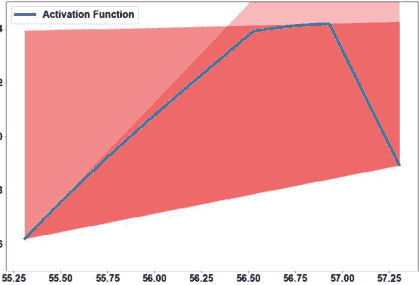

(a) 未拆分输入范围

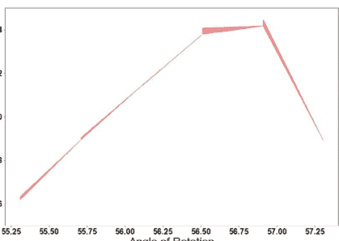

(b) 显式拆分输入（5 个分区）

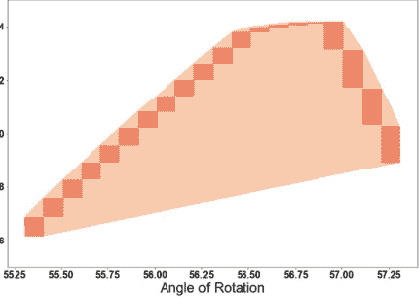

(c) 隐式拆分输入（20 个分区）

Figure 10.2 旋转中 SP 层激活函数的边界。

然后，我们将所有子问题中每个神经元的区间合并（例如，在 Weng et al. (2018a) 中设置 \( u_r = \max u_{r,subi} \) 和 \( l_r = \min l_{r,subi} \)），以构建线性松弛 \( \mathbf{A}^{(k)}\)、\(\mathbf{T}^{(k)}\)、\(\mathbf{H}^{(k)}\)，用于层 \( l \) 的后激活输出。继续此过程直到最后一层，即可得到整个神经网络输出的边界。

Fig. 10.3 说明了显式和隐式输入空间拆分之间的区别。回顾在 Fig. 10.2(a) 中，我们给出了旋转的激活函数形式。即使在很小的旋转角度 \( \theta \)（\( 2^\circ \)）范围内，我们也看到该函数相当非线性，导致非常松弛的线性边界。将图像显式拆分为五部分并分别运行（即，如 Fig. 10.2(b) 所示的显式拆分）可为我们提供更紧凑的近似。然而，显式拆分会导致较高的计算时间，因为时间与拆分数量呈线性关系。为了高效近似此函数，我们可以对每个子区间进行拆分以获得显式边界，然后同时将它们通过认证（即，如 Fig. 10.2(c) 所示的隐式拆分）。正如我们在 Fig. 10.2(c) 中观察到的，将输入拆分为 20 个隐式部分可以在开销很小的情况下获得非常好的近似（使用的认证周期数量仍然相同）。

### 10.4 实证比较

根据 Mohapatra et al. (2020)，我们对本章介绍的所有连续参数化语义攻击威胁模型进行了大量实验。离散参数化语义扰动的验证可以通过枚举简单地完成。我们将 Semantify-NN 应用于 Zhang et al. (2018) 和 Boopathy et al. (2019) 提出的 \( \ell_p \)-范数验证算法，以认证多层感知机（MLP）模型和卷积神经网络（CNN）模型。

- **基线。** 我们计算给定语义空间扰动幅度下原始图像每个像素 \( x_i \) 可能值范围的上界和下界。然后，我们使用基于 \( \ell_\infty \)-范数的验证器对扰动幅度进行二分法并报告其值。我们表明，直接将扰动范围从语义空间转换为原始 RGB 空间，然后应用基于 \( \ell_p \)-范数的验证器，在所有表格中都会产生非常差的结果。我们还给出了一个加权-\( \epsilon \) 版本，其中我们允许不同像素具有不同级别的扰动。

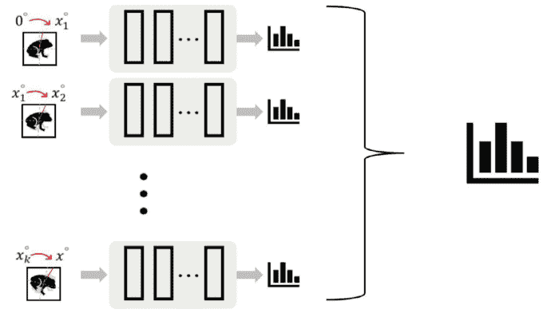

(a) 显式拆分

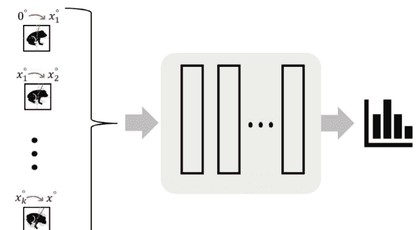

(b) 隐式拆分

Figure 10.3 细化技术的说明。

- 攻击。我们使用一种网格搜索攻击，其粒度与输入拆分后子区间大小的数量级相同。虽然这不是最佳攻击值，但它确实是最小对抗扰动的一个上界。增加粒度只会导致更紧的上界，而不会影响下界（我们提供的认证）。

- Semantify-NN：我们实现了 SP 层（SPL）和带细化的 SP 层（SPL+Refine）。

SP 层作为完全连接层添加到 MLP 中，作为修改后的卷积块添加到 CNN 模型中（我们允许不同神经元的滤波器权重和偏置不同）。我们在 MNIST、CIFAR-10 和 GTSRB（德国交通标志基准）数据集上训练的 MLP 和 CNN 模型上评估了 Semantify-NN 和其他方法。我们使用已发布的 MNIST 和 CIFAR 模型，其 MNIST/CIFAR 模型的标准测试准确率分别为 98–99%/60–70%。我们从头开始训练 GTSRB 模型，以达到 94–95% 的测试准确率。所有 CNN（LeNet）都使用 3×3 卷积和两个最大池化层，并且每个卷积层的滤波器大小在描述中指定。LeNet 使用与 LeNet-5（LeCun et al., 1998）类似的架构，无池化版本在更大的输入上应用相同的卷积。我们还有两种对抗训练模型。表中标记为 sem adv 的模型使用数据增强进行训练，即在训练数据中添加扰动图像（根据相应的威胁模型）。标记为 \(\ell_\infty\) adv 的模型使用 \(\ell_\infty\) 范数对抗训练方法（Madry et al., 2018）。我们在 200 张随机测试图像和随机目标攻击上评估所有方法。我们训练所有模型 50 个 epoch，并调整超参数以优化验证准确率。

实验 (1)：HSL 空间扰动。表 10.1 表明，使用基于 \(\ell_p\)-范数的验证会导致极其松弛的边界，原因是语义攻击的维度与诱导的 \(\ell_p\)-范数攻击的维度不匹配。通过在神经网络中增强我们提出的 SP 层来显式引入此维度约束，可显著提高最大可认证下界，从而使边界增大 4–50 倍。然而，Semantify-NN 的认证下界与攻击上界之间仍然存在明显差距。值得注意的是，我们发现添加输入空间细化有助于进一步收紧边界，带来额外 1.5–5 倍的改进。这证实了输入拆分对于语义攻击认证的重要性。HSL 空间攻击的变换相当线性，因此我们的认证下界与攻击上界之间的差距变得非常小。


表 10.1 HSL 空间扰动平均边界评估。SPL 表示我们提出的 SP 层。SPL + Refine 指的是使用显式拆分后获得的证书。参数空间上的网格搜索用于攻击。结果证明了使用 SP 层进行认证的重要性。

| Network | Naive | Weighted | SPL | SPL + Refine | w/o refine | w/ refine | Grid |
|---|---|---|---|---|---|---|---|
| **Experiment (I)-A: Hue** | | | | | | | |
| CIFAR, MLP 6 x 2048 | 0.00316 | 0.028 | 0.347 | 0.974 | 11.39x | 51.00x | 1.456 |
| CIFAR, CNN 5 x 10 | 0.0067 | 0.046 | 0.395 | 1.794 | 7.58x | 38.00x | 1.964 |
| GTSRB, MLP 4 x 256 | 0.01477 | 0.091 | 0.771 | 2.310 | 8.47x | 22.31x | 2.388 |
| GTSRB MLP 4 x 256 sem adv | 0.01512 | 0.092 | 0.785 | 2.407 | 8.53x | 26.16x | 2.474 |
| **Experiment (I)-B: Saturation** | | | | | | | |
| CIFAR, MLP 6 x 2048 | 0.00167 | 0.004 | 0.101 | 0.314 | 24.25x | 77.50x | 0.342 |
| CIFAR, CNN 5 x 10 | 0.00348 | 0.019 | 0.169 | 0.389 | 7.89x | 19.47x | 0.404 |
| GTSRB, MLP 4 x 256 | 0.00951 | 0.020 | 0.38 | 0.435 | 19.00x | 21.75x | 0.444 |
| GTSRB MLP 4 x 256 sem adv | 0.00968 | 0.020 | 0.431 | 0.458 | 21.55x | 22.90x | 0.467 |
| **Experiment (I)-C: Lightness** | | | | | | | |
| CIFAR, MLP 6 x 2048 | 0.00043 | 0.001 | 0.047 | 0.244 | 46.00x | 243.00x | 0.263 |
| CIFAR, CNN 5 x 10 | 0.00096 | 0.002 | 0.080 | 0.273 | 39.00x | 135.50x | 0.303 |
| GTSRB, MLP 4 x 256 | 0.0025 | 0.005 | 0.134 | 0.332 | 26.80x | 66.40x | 0.365 |
| GTSRB MLP 4 x 256 sem adv | 0.00268 | 0.005 | 0.148 | 0.362 | 29.80x | 72.40x | 0.398 |

表 10.2 旋转空间扰动平均边界评估。SPL 表示我们提出的 SP 层。SPL+Refine 获得的认证边界与网格攻击的上界接近。

| Network | Certified Bounds (degrees) | | | SPL + Refine | Attack (degrees) |
|---|---|---|---|---|---|
| | Number of Implicit Splits | | | | Grid Attack |
| | 1 implicit No explicit | 5 implicit No explicit | 10 implicit No explicit | 100 implicit + explicit intervals of 0.5° | |
| Experiment (II): Rotations | | | | | |
| MNIST, MLP 2 × 1024 | 0.627 | 1.505 | 2.515 | 46.24 | 51.42 |
| MNIST, MLP 2 × 1024 \( l_\infty \) adv | 1.376 | 2.253 | 2.866 | 45.49 | 46.02 |
| MNIST, CNN LeNet | 0.171 | 0.397 | 0.652 | 43.33 | 48.00 |
| CIFAR, MLP 5 × 2048 | 0.006 | 0.016 | 0.033 | 14.81 | 37.53 |
| CIFAR, CNN 5 × 10 | 0.008 | 0.021 | 0.042 | 10.65 | 30.81 |
| GTSRB, MLP 4 × 256 | 0.041 | 0.104 | 0.206 | 31.53 | 33.43 |

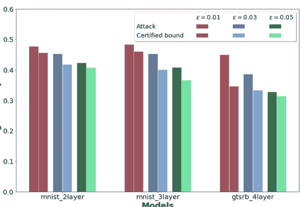

图 10.4 亮度和对比度的语义认证。

实验 (II)：旋转。表 10.2 显示了旋转空间验证的结果。旋转在像素空间上诱导高度非线性变换，因此我们用此来说明使用细化来认证此类函数。由于变换非常非线性，我们 SP 层使用的线性边界非常松散，导致非常小的鲁棒性认证。在这种情况下，显式输入拆分不是一种计算上有吸引力的方法，因为有大量的区间需要认证。表 10.2 展示了使用隐式拆分如何增加可认证区间的大小，直到所需区间的总数达到可以处理的程度。此时，我们使用显式拆分来获得紧边界。对于 SPL + Refine 中的结果，我们每次使用 0.5 大小的区间，每个区间包含 100 个隐式拆分。

实验 (III)：亮度和对比度。对于多维语义攻击（这里是同时使用亮度和对比度的组合攻击），我们可以将参数的任何 $\ell_p$ 范数视为距离函数。在图 10.4 中，我们展示了亮度扰动的平均下界结果，同时将对比度参数 $\epsilon$ 的最大扰动固定为 0.01、0.03 和 0.05。

# 第 4 部分

## 对抗防御

本页故意留空

## 第 11 章

## 对抗防御概览

许多技术已被提出以提高深度神经网络的鲁棒性。在本章中，我们关注试图使神经网络对逃避攻击生成的对抗样本具有鲁棒性的方法。防御算法可以以多种不同的形式设计。有些防御算法修改机器学习模型的训练阶段以获得更鲁棒的模型，而其他一些算法则通过添加特定组件对模型进行后处理以提高其鲁棒性。我们对现有技术进行了概述，并将在接下来的几个章节中讨论一些更有希望的防御方法。

### 11.1 经验防御与认证防御

在 Szegedy 等人（2014 年）发现对抗样本后，许多作品已被提出以经验方式提高神经网络模型的鲁棒性。然而，评估这些防御方法仍然很棘手。许多早期作品仅使用一些现成的攻击方法（如 FGSM（Goodfellow 等人，2015 年）或 PGD（Kurakin 等人，2017 年；Madry 等人，2018 年）攻击）来评估防御方法。然而，攻击方法不能对防御模型的真实对抗鲁棒性提供正式保证——即使模型在现有攻击评估中是安全的，仍然可能存在一个小扰动来欺骗机器学习模型，而现有攻击方法无法找到它。因此，如果没有仔细的经验评估，防御方法可能对某些标准攻击方法（例如，FGSM 和 PGD）是安全的，但对其他攻击（例如，专门针对防御模型开发的攻击）却易受攻击。这可能导致一种虚假的安全感，这在文献中确实经常发生。例如，Athalye 等人（2018 年）表明，ICLR 2018 中提出的大多数防御方法，虽然对现成攻击表现出强大的防御性能，但实际上在更强且精心设计的攻击下是脆弱的。

要解决这个问题，一种方法是不断改进攻击方法，无论是攻击性能还是多样性。例如，AutoAttack（Croce 和 Hein，2020 年）收集了一组多样且强大的攻击方法来测试防御模型的鲁棒性。此外，一些工作还试图在面对不同攻击机制时提出有原则的攻击方法（Athalye 等人，2018 年；Tramer 等人，2020 年）。这也被称为自适应攻击。我们将在介绍每种特定防御机制时介绍一些自适应攻击技术。

另一方面，解决这个问题的另一种方法是研究“认证防御”方法。对于认证防御，除了对鲁棒性进行经验评估外，我们还需要为每个样本提供可验证的鲁棒性边界——对于每个样本 x，如果 x 可以被正确预测，并且可以正式验证扰动集内的任何扰动都无法改变模型的预测，则称模型在 x 上是可认证鲁棒的。数据集或数据分布上的认证鲁棒准确率定义为模型可认证鲁棒分类的样本比例。认证鲁棒准确率是鲁棒准确率的下界，因为可能存在可以被鲁棒分类但不容易验证的样本。认证鲁棒准确率通常可以通过前面几节讨论的某些验证方法来计算，在某些特定情况下，防御方法将具有计算认证鲁棒准确率最合适的验证方法。相比之下，通过对防御模型进行攻击计算的“经验鲁棒准确率”只能提供真实鲁棒准确率的上界，因为攻击方法未能找到对抗样本，并不意味着不存在对抗样本。

虽然认证防御方法更安全、更可靠，但目前它们也面临一个严重缺点，即现有认证方法导致非常低的认证鲁棒准确率。例如，在 CIFAR-10 分类中，对 8/255 $l_\infty$ 球扰动，标准深度学习模型可达到超过 90% 的干净准确率；良好的经验防御模型通常可达到超过 80% 的干净准确率和超过 60% 的经验鲁棒准确率；然而，最好的认证防御方法只能达到大约 50% 的准确率和大约 40% 的认证鲁棒准确率。因此，经验防御与认证防御各有优劣，我们将在接下来的章节中介绍两者。

### 11.2 经验防御概览

在接下来的内容中，我们将一些流行的防御方法分为以下几类，包括对抗训练、随机化、de-


检测、过滤/投影、离散组件和对抗检测。在其中，对抗训练、随机化和检测在文献中已显示出更有前景的结果，因此我们将在以下章节中详细介绍这些方法。

#### 对抗训练
为了应对对抗样本，一个自然的想法是将对抗样本加入训练集。这引出了最广泛使用的防御方法，即对抗训练。即使在最早讨论对抗样本的论文之一中，Goodfellow 等人（2015）也尝试在由快速梯度符号法（FGSM）生成的对抗样本上训练模型。随后，Kurakin 等人（2017）建议使用多步 FGSM 以进一步提高对抗鲁棒性。然而，这些早期工作通常定期生成对抗样本，且鲁棒性的提升并不稳定。相反，Madry 等人（2018）表明对抗训练可以表述为一个极小极大优化问题：给定当前神经网络模型，攻击者生成对抗样本以最大化分类损失，而学习者旨在更新模型以最小化在这些对抗样本上的分类损失。借助这种清晰的极小极大表述，对抗样本可以即时生成。在 ICLR 2018 上，提出了许多防御方法，包括这种极小极大对抗训练方法。当 Athalye 等人（2018）试图开发更强的攻击来评估 ICLR 2018 上发表的防御方法时，他们表明对抗训练是在更强攻击下仍能表现良好的唯一方法，而许多其他方法在更强攻击下的准确率几乎为 0%。此后，对抗训练被广泛采用，并发展出了许多对抗训练的变体。我们将在第 12 章中介绍这些方法。

#### 随机化
另一种有效的防御方法是向模型中添加一些随机组件。直观地说，模型中的随机性会使攻击者更难创建固定攻击来欺骗模型。因此，随机化已被提出作为经验启发式方法来提高鲁棒性（Xie 等人，2017；Dhillon 等人，2018；Liu 等人，2018c, 2019d）。尽管一些早期开发的随机化方法基于启发式，但已发展出几种理论解释，表明随机性确实可以提升神经网络的鲁棒性（Lecuyer 等人，2019；Liu 等人，2020c）。我们将在第 13 章中提供更多细节。

#### 检测
由于输入空间维度非常高，在所有输入区域都使分类器正确的任务更具挑战性，因此构建鲁棒分类器的任务可能更具挑战性。因此，另一种自然的应对对抗样本的方式是开发一种方法来检测“异常”样本，分类器无需对这些样本进行预测。为了检测对抗样本，已开发出包括测量对抗样本与自然图像之间距离的简单方法（Lee 等人，2018）以及通过特征归因检测对抗样本的一些更复杂的方法（Yang 等人，2020d）。我们将在第 15 章中介绍几种代表性方法。然而，一个重要问题是如何评估检测模型的性能——攻击者可能利用关于检测模型的信息，通过试图绕过检测器来提高其成功率。因此，在对检测模型进行实验时，尝试评估整个模型（同时包括检测器和分类器）非常重要。

#### 过滤和投影
普遍认为，对抗样本落在自然图像流形之外，而 DNN 对此训练不足。这引出了一类自然的防御方法：将对抗样本投影回自然图像流形，换句话说，滤出添加到样本中的“不自然噪声”。为了捕捉自然图像流形，此类方法中的大多数都采用某种生成模型（例如，某种版本的自动编码器或生成对抗网络）。由于生成模型是在自然样本上训练的，对抗样本将被投影到生成模型学习的流形上。此外，将对抗样本“投影”到生成模型的值域上可以产生减少对抗扰动的理想效果。

Meng 和 Chen（2017）训练了一个自动编码器来捕捉自然图像流形。自动编码器是一种神经网络，由两个主要部分组成：编码器将输入映射到低维空间，解码器从低维嵌入中恢复输入。自动编码器通常针对输入的重建损失进行训练。因此，高维数据在训练过程中通过低维嵌入进行总结。在 MagNet 中，测试时随机选择一个自动编码器来过滤输入样本，从而对抗扰动可能通过这个编码和解码过程被移除。与使用自动编码器不同，Samangouei 等人（2018）提出训练一个生成对抗网络（GAN）来捕捉自然图像流形，然后在推理阶段使用它来滤出图像中的不自然噪声。不幸的是，当攻击者可以共同攻击过滤步骤和分类器时，MagNet 和 Defense-GAN 均被证明是不鲁棒的（Athalye 和 Sutskever，2018）。

更近期，Li 等人（2018b）提出了一种不同的防御框架，称为 ER-Classifier，它将过滤和分类过程结合在一个联合框架中。事实上，任何深度分类器都可以看作由这两部分组成：一个用于从输入数据中提取有用特征的编码器部分，以及一个基于提取特征执行分类的分类器部分。编码器和分类器都是神经网络。ER-Classifier 与常规深度分类器类似，它首先使用编码器 **G** 将输入投影到低维空间，然后使用分类器 **C** 基于低维嵌入进行分类。主要区别在于，在训练阶段，ER-Classifier 的低维嵌入通过判别器 **D** 进行稳定，方法是最小化嵌入分布与所选先验分布之间的离散度。判别器的目标是分离从先验中采样的真实代码和编码器生成的“假”代码，而编码器则会尝试生成与真实代码相似的生成代码。这种竞争的结果是，嵌入空间的分布将被推向先验分布。因此，预期这种正则化过程可以帮助消除任何对抗畸变的影响，并将对抗样本推回自然数据流形。另一个区别是，与一般深度分类器相比，ER-classifier 的嵌入空间维度要小得多，这使得训练过程更容易收敛。在这个框架中，投影被用作一种正则化以提高鲁棒性，该方法可以与其他防御（例如，对抗训练）联合使用以进一步提高性能。

#### 离散组件
由于大多数攻击算法（例如 PGD 和 C&W 攻击）依赖于梯度计算，几种防御方法试图向神经网络模型中引入一些离散且不可微分的组件，以使基于梯度的攻击更加困难。例如，Papernot 和 McDaniel（2018）以及 Dubey 等人（2019）在神经网络中采用最近邻查找组件，将图像投影到数据库中的最近邻，这给攻击实施带来了困难。此外，Xiao 等人（2019a）还提出了一些不可微分的激活函数。此外，已表明基于投票的集成可以提高对抗样本的鲁棒性。


ples (Khatri et al., 2020). However, due to the difficulties of conducting attacks on the defense components, it is harder to reach a conclusion whether a discrete component can truly make models more robust or there exist non-gradient-based attack methods to break these defenses.

## 第 12 章

## 对抗训练

As the ultimate goal of defenses is to make models robust against adversarial examples, a very natural idea is to add adversarial examples into the training dataset. This idea, also known as adversarial training, has been implemented in many earlier papers such as (Goodfellow et al., 2015; Kurakin et al., 2017), where they usually generate adversarial examples periodically (e.g., after every few training epochs). However, as the model evolves quickly during the optimization procedure, those adversarial examples usually fail to capture the vulnerable points of the latest model, leading to instability and poor performance on robust accuracy (i.e., accuracy against adversarial examples at test time). Later on Madry et al. (2018) showed that adversarial training can be formulated as solving a min-max optimization problem. This simple but insightful formulation enables generating adversarial examples on-the-fly, which significantly improves the robustness of the model. As a result, adversarial training becomes one of the most widely used defense methods.

In this chapter, we will first introduce the min-max formulation of adversarial training in Section 12.1, and then discuss several improvements over vanilla AT in Section 12.2 and 12.3.

### 12.1 将对抗训练表述为双层优化

In standard training, the goal is to learn the model parameters \(\theta\) to minimize the empirical loss, defined as the average loss on all the training examples. The objective of standard training can thus be formulated as solving the following empirical risk minimization problem:

\[
\arg \min_\theta E_{(x,y)\in \mathcal{D}} L(f_\theta(x), y), \tag{12.1}
\]

where \(E\) denotes expectation, \((x, y) \in \mathcal{D}\) denotes a pair of sample and its label randomly drawn from a distribution \(\mathcal{D}\), \(L\) is a supervised loss function, and \(f_\theta(x)\) is the model’s prediction on \(x\).

In adversarial training, we consider that there may be an attacker trying to find the adversarial example with the maximal loss within an \(\ell_p\) ball of each example. Therefore, instead of minimizing the regular loss function \(L(\cdot, \cdot)\), we want to minimize the loss on the worst-case perturbed example around each natural example. It is thus natural to replace the loss in (12.1) by the maximal loss around each example, which can be written as

\[
\arg \min_{\theta} E_{(x,y)\in \mathcal{D}} \max_{x' \in B(x)} L(f_\theta(x'), y), \tag{12.2}
\]

where \(B(x)\) is the perturbation set around the natural example \(x\). For instance, under a commonly used \(\ell_\infty\) perturbation set, \(B(x)\) is the \(\epsilon\)-bounded \(\ell_\infty\) ball around \(x\), so the objective can be written as

\[
\arg \min_{\theta} E_{(x,y)\in \mathcal{D}} \max_{x': ||x'-x||_\infty \le \epsilon} L(f_\theta(x'), y). \tag{12.3}
\]

This formulation is proposed by Madry et al. (2018). This is also called a bilevel optimization as there are two levels (min and max) in the objective. Bilevel optimization problems can often be solved by the alternating minimization procedure: at each update, solve the inner maximization problem to obtain \(x'\) and then conduct an outer update on the model parameter \(\theta\) based on \(x'\).

In alternating minimization, the inner maximization can be viewed as finding an adversarial example of a given input data point \(x\) within the perturbation set \(B(x)\). In Eq. (12.3), as the inner problem is a constrained maximization task, a natural idea is to solve it by a projected gradient descent (PGD) algorithm, similar to the PGD algorithm when we conduct adversarial attack. In the PGD algorithm, we start from \(x_0 = x\) and conduct the following iterative updates:

\[
x_t \leftarrow \text{Proj}_{B(x)}(x_{t-1} + \alpha \cdot \text{sign}(\nabla_x L(f_\theta(x_{t-1}), y))), \tag{12.4}
\]

where the operator Proj projects the input vector into the constraint set \(B(x)\), in this case the \(\ell_\infty\) ball around \(x\). This can be done by clipping each input dimension by

\[
\text{Proj}(u)_i = \min(x_i + \epsilon, \max(x_i - \epsilon, u_i))
\]

for a given vector \(u\). If we run the inner maximization for \(k\) iterations, then we set \(x'\) as the output of the \(k\)th PGD step and use it to conduct the parameter update of \(\theta\). Ideally, a larger \(k\) will lead to better results but also consumes more time. If we run PGD for \(k\) iterations, then the computational time of the whole adversarial training process will be roughly \(k\) times more than the standard training, which makes adversarial training slow. We will discuss some ways to overcome this problem in the next section.

After obtaining \(x'\), we will run one update to solve the outer minimization problem to obtain a better parameter \(\theta\). This can be done by computing the gradient of \(\theta\) with respect to \(x'\) (\(\nabla_\theta L(f_\theta(x'), y)\)) and then pass this gradient to the update rule optimizers (e.g., SGD or Adam) for the parameter update. The overall PGD-based adversarial training algorithm can be found in Algorithm 3.

**Algorithm 3** 基于 PGD 的对抗训练 (Madry et al., 2018).

1: **输入:** Initial model parameter \(\theta_0\), number of PGD steps \(k\)
2: **对** \(t = 0, 1, 2, ...\) **执行**
3: Sample \((x, y)\) from training data \(\mathcal{D}\)
4: Let \(x_0 = x\)
5: **对** \(t' = 0, ..., k-1\) **执行**
6: \(x_{t'+1} \leftarrow \text{Proj}_{B(x)}(x_{t'} + \alpha \cdot \text{sign}(\nabla_x L(f_\theta(x_{t'}), y)))\)
7: **结束对**
8: 用 \(\theta \leftarrow \theta - \eta \nabla_\theta L(f_\theta(x_k), y)\) 更新 \(\theta\)
9: **结束对**

### 12.2 更快的对抗训练

As mentioned in the previous section, PGD-based adversarial training requires \(k\) inner steps, which will increase the training time by \(k\) times over standard training. To reduce this overhead, several methods have been developed to achieve a better tradeoff between the robust accuracy and training speed.

Recall that in adversarial training the model update requires gradient of loss function with respect to \(\theta\), whereas the PGD updates rely on the gradient of the same loss function with respect to \(x\). These two gradients, denoted as \(\nabla_\theta L(f_\theta(x), y)\) and \(\nabla_x L(f_\theta(x), y)\), compute the gradient of the same function, but with respect to different variables. In neural networks, gradient is usually computed by back-propagation, and these two gradients can actually share the whole back-propagation process – after computing \(\nabla_\theta L(f_\theta(x), y)\), only one additional linear projection step can compute \(\nabla_x L(f_\theta(x), y)\). This means that computing both \(\nabla_\theta L(f_\theta(x), y)\) and \(\nabla_x L(f_\theta(x), y)\) together will have the same cost as computing each of them individually. Motivated by this observation, we can make additional updates during inner PGD steps. In the original adversarial training, each PGD step computes \(\nabla_x L(f_\theta(x), y)\) and only using it to update *x*. However, as we can also obtain \(\nabla_\theta L(f_\theta(x), y)\) with almost zero cost, we can also update \(\theta\) at each PGD iteration. These simultaneous updates of \(\theta\) and *x* will speedup the convergence since we make more updates to \(\theta\). At each time, when we find a perturbation (with one PGD step), we immediately update \(\theta\) to make it performs better on this adversarial example. The resulting algorithm, also known as Free Adversarial Training proposed by Shafahi et al. (2019), thus requires less inner steps to converge to a competitive robust model as standard adversarial training. The algorithm of Free Adversarial Training is described in Algorithm 4.

**Algorithm 4** Free adversarial training (Shafahi et al., 2019).

1: **输入:** Initial model parameter \(\theta_0\), number of PGD steps \(m\)
2: **对** \(t = 0, 1, 2, ...\) **执行**
3: Sample \((x, y)\) from training data \(\mathcal{D}\)
4: Let \(x_0 = x\)
5: **对** \(t' = 0, ..., m - 1\) **执行**
6: \(x_{t'+1} \leftarrow \text{Proj}_{B(x)}(x_{t'} + \alpha \cdot \text{sign}(\nabla_x L(f_\theta(x_{t'}), y)))\)
7: 用 \(\theta \leftarrow \theta - \eta \nabla_\theta L(f_\theta(x_{t'}), y)\) 更新 \(\theta\)
8: **结束对**
9: **结束对**

Several other algorithms also exploited the back-propagation process to speed up adversarial training. See, for instance, (Zhang et al., 2019a). However, more recently, it has been shown that a proper implementation of PGD-based adversarial training with only a single step (\(k = 1\)) can already achieve good performance. The main trick is that instead of initializing the PGD iterate \(x_0\) from \(x\), we should initialize it from \(x\) plus a random noise. Wong et al. (2020a) showed that if we initialize PGD attack from \(x\) plus a random vector sampled from Gaussian, adversarial training with a single step can outperform many strong baselines (e.g., FreeAdvTrain). This algorithm with 1-step PGD inner iteration and random initialization is known as Fast Adversarial Training. By further controlling the PGD steps we can then control the tradeoff between speed and robust accuracy.

### 12.3 对抗训练的改进

In theory, robust error can be bounded by two factors: one corresponds to the error on the natural input data, and another corresponds to how


在 \(\epsilon\) 球内扰动输入时，预测可以发生多大变化。受此观察启发，Zhang et al. (2019b) 将对抗训练的双层目标函数修改如下：

\[
\min_{\theta} E_{(x,y)\in \mathcal{D}} L(f_\theta(x), y) + \lambda \max_{x' \in B(x)} L'(f_\theta(x'), f_\theta(x)), \tag{12.5}
\]

其中 \(L\) 和 \(L'\) 是两个损失函数。在此表述中，我们假设两个损失函数均为交叉熵损失，因此第一项是定义在干净数据上的标准训练损失，第二项衡量干净样本（\(f(x)\)）与扰动样本（\(f(x')\)）预测之间的差异；\(\lambda\) 是一个正常数，用于控制两项之间的平衡。通过分解干净损失和鲁棒损失，更容易控制鲁棒性与准确性之间的权衡（通过适当选择 \(\lambda\)）。这种表述也称为 *TRADES*，已被证明比对抗训练表现更好，并且是 NeurIPS 2018 防御挑战赛的冠军。

此后，对 TRADES 进行了若干改进。特别是，许多论文发现，为了获得最佳性能，需要对每个样本赋予不同的权重。这背后有几个动机。首先，我们应将误分类样本与正确分类样本区别对待。对于误分类样本，由于分类器已经预测了错误标签，使模型在这些点上具有鲁棒性并无用处。其次，某些样本本身就很难分类（例如，接近决策边界的样本），因此强制它们具有鲁棒性会导致性能不佳。例如，在图 12.1 中，我们展示了一个线性分类器，两个类别之间的真实间距为 2.5，不存在能以 \(\epsilon = 3\) 鲁棒地分类所有样本的分类器。如果我们用 \(\epsilon = 3\) 训练分类器，结果将是图 12.1(c) 中所示的一个性能不佳的分类器。

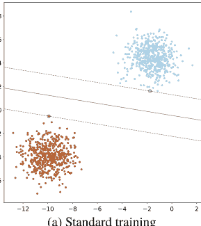
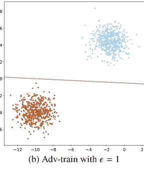
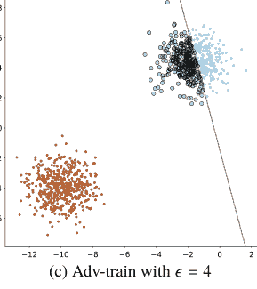

图 12.1 对两类均为 1.75 间距的线性可分二分类数据集采用不同训练方法。对 \(\epsilon\) 较小的对抗训练效果良好，但对于超出真实间距的较大 \(\epsilon\)，对抗训练会破坏分类器的分类性能。

因此，已开发出许多采用非均匀样本权重进行对抗训练的表述。例如，Wang et al. (2019d) 提出了 TRADES 的加权版本，其中根据每个预测的正确性对样本进行加权。更具体地说，令 \(p_y(x, \theta) := (f_\theta(x'))_y\) 为标签 \(y\) 的归一化预测概率——它是模型在 [0, 1] 之间的 softmax 输出。然后我们可以考虑 TRADES 目标的加权版本，如下：

\[
\min_{\theta} E_{(x,y)\in \mathcal{D}} L(f_\theta(x), y) + \lambda \max_{x' \in B(x)} L(f_\theta(x'), f_\theta(x))(1 - p_y(x, \theta)), \tag{12.6}
\]

其中第二项由 \(1 - p_y(x, \theta)\) 加权，如果样本被正确分类，该值接近 0；如果样本被（更多地）误分类，则接近 1。这鼓励网络在误分类数据点上取得更多进展。

基于类似的想法，我们也可以为每个样本设置自适应 \(\epsilon\)。误分类样本应具有较小的 \(\epsilon\)，因为使其具有鲁棒性并不重要（或不可能），而正确分类样本应分配较大的 \(\epsilon\)。在这个方向上已提出几种方法，包括 (Ding et al., 2018; Balaji et al., 2019; Cheng et al., 2020b)。

### 12.4 扩展阅读

- Wang et al. (2019d) 开发了对抗训练的算法收敛性分析。
- Zhang et al. (2022) 提出了用于扩展对抗训练的分布式训练算法。
- Cheng et al. (2021) 提出了一种自进式鲁棒训练方法。

本页刻意留空

## 第 13 章

## 基于随机化的防御

随机化组件预计会使攻击者更难成功，因此早期的几种防御方法将随机化组件添加到神经网络中，以使其更加鲁棒。然而，后来开发了一种基于变换期望（EoT）（Athalye and Sutskever, 2018; Athalye et al., 2018）的更强攻击，用于评估随机化模型的鲁棒性（有关 EoT 攻击的详细信息见第 4 章），并且一些添加随机性的简单方法在 EoT 攻击下可能无法真正提高鲁棒性。尽管如此，后来的研究表明，某些类型的随机性可以提高鲁棒性，而且，令人惊讶的是，已被证明随机化组件理论上可以提高模型的鲁棒性，并且，此类随机化模型的鲁棒性可以是可验证的。在本节中，我们首先讨论引入随机性的一些早期尝试以及如何正确评估随机化模型的鲁棒性。然后，我们讨论两种随机性：添加到第一层或所有层，它们理论上可以提高鲁棒性。

### 13.1 早期尝试与 EoT 攻击

对抗扰动可以被视为一种特殊的加性噪声，已有各种方法通过将随机组件纳入模型来提高 DNN 的鲁棒性。例如，Xie et al. (2017) 引入了一种简单的预处理方法来随机化神经网络的输入，希望消除潜在的对抗扰动。在测试阶段，输入会被随机调整为几种不同的大小，然后在每个调整大小的输入周围随机填充零。作者证明，这种简单方法可以应用于大规模数据集，例如 ImageNet。类似地，Zantedeschi et al. (2017) 表明，通过使用修改后的 ReLU 激活层（称为 BReLU）并向原始输入添加噪声以扩充训练数据，学习到的模型将获得一定的对抗示例稳定性。另一方面，Dhillon et al. (2018) 将随机性引入神经网络的评估过程中，以防御对抗示例。他们的方法会以与各神经元绝对值成正比的概率，随机将每层的一些神经元丢弃为 0。也就是说，他们的方法本质上在每一层应用 dropout，区别在于不再以均匀概率丢弃，而是根据加权分布丢弃节点。保留的值会被放大（与 dropout 类似），以保持准确性。

尽管这些防御方法对常规攻击方法（如 FGSM 或 PGD 攻击）表现良好，但已表明，在经过更精心设计的攻击下，这些简单的随机化方法可能无效。关键在于，在进行攻击时，必须考虑模型中的随机性。令 \( f_{\theta, \tau} \) 为带有从某些分布中采样的随机组件 \( \tau \) 的随机化模型。在原始 PGD 攻击中，每一步都会针对特定的随机 \( \tau \) 计算梯度，这会遇到高方差，并可能难以收敛到良好解。因此，不再对某个特定的 \( \tau \) 取 \( \nabla_x f_{\theta, \tau}(x) \)，而是需要采集多个样本并使用平均值来估计梯度。更具体地说，每次迭代将采取以下形式的梯度估计：

\[
\frac{1}{R} \sum_{i=1}^R \nabla_x f_{\theta, \tau_i}(x), \tag{13.1}
\]

其中 \( \tau_1, \dots, \tau_R \) 从 \( \tau \) 的分布中采样。因此，尽管 PGD 每次迭代耗时更长，但它可以通过使用平均梯度进行参数更新，针对随机化模型 \( f_{\theta, \tau} \) 获得更强的对抗示例。Athalye et al. (2018) 已表明，在这种更强的攻击下，先前引入的这些简单随机化防御模型将失效。

### 13.2 向每层添加随机性

Liu et al. (2018c) 展示了一种简单策略，可使随机化防御即使在更强的 EoT 攻击下也能达到与对抗训练相似的鲁棒性能。在此方法中，他们定义了一个“噪声层”来向输入和隐藏层输出引入随机性。在这个“噪声层”中，随机生成的高斯噪声被添加到输入：

\[
\boldsymbol{x} \leftarrow \boldsymbol{x} + \boldsymbol{\epsilon}, \quad \boldsymbol{\epsilon} \sim \mathcal{N}(0, \sigma^2 I),
\]

其中 \( \sigma \) 是一个超参数。较大的 \( \sigma\) 值会带来更好的鲁棒性但更差的预测准确性，而较小的 \( \sigma \) 值则会导致


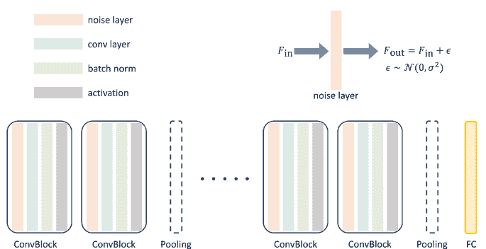

Figure 13.1 在随机自集成（RSE）中，噪声层被添加到计算机视觉应用中每个卷积块的开头。

预测精度更好，但鲁棒性下降。随后可以将此噪声层添加到神经网络的任何位置。例如，Liu 等人（2018c）将噪声层添加到每个卷积块的开头。这种方法称为随机自集成（RSE），如图 13.1 所示。

在 RSE 中，噪声层在训练和测试阶段都会被添加。在训练阶段，对于每个样本 x，参数更新的梯度计算为 $\nabla_{\theta} f_{\theta, \tau}(x)$，其中 $f_{\theta, \tau}$ 是添加了噪声层的经典卷积神经网络。噪声在每次随机梯度下降更新时随机生成。在测试阶段，我们不需要进行单次预测，而是需要计算关于随机变量 $\tau$ 的期望预测值：

```
E_{\tau}[f_{\theta, \tau}(x)]. \quad (13.2)
```

由于计算真实的期望预测需要大量样本，我们可以通过仅采样 R 个随机噪声并计算平均预测来近似。通常，当 R ≈ 10 时，预测已经足够稳定：

```
p = \sum_{j=1}^R \hat{f}_{\epsilon_j}(w, x), \text{ and predict } \hat{y} = \arg \max_k p_k. \quad (13.3)
```

已证明，在适当的 EoT 攻击下，该方法仅比讨论的标准对抗训练方法稍差一些。

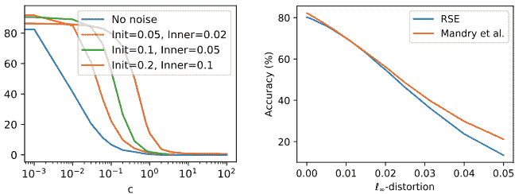

Figure 13.2 左侧：噪声水平对鲁棒性和泛化能力的影响。显然，随机噪声可以提高模型的鲁棒性。右侧：将 RSE 与 Madry 等人（2018）的对抗防御方法进行比较。

在前一章中。图 13.2 展示了一些实验结果。这一令人惊讶的发现引发了后续多项关于随机集成如何提高对抗鲁棒性的研究。

但是，为什么添加随机性可以提高鲁棒性呢？Wang 等人（2019a）和 Liu 等人（2020c）通过神经常微分方程框架提供了一个很好的解释。传统的神经网络通常由多个层堆叠而成；最近的研究（Chen 等人，2018d）表明，我们可以将其建模为连续极限。这意味着不存在离散层的概念，且隐藏特征是平滑变化的。在数学上，其形式如下：

```
$h_t = h_s + \int_s^t f(h_\tau, \tau; w)d\tau, \quad (13.4)$
```

其中 $t > s$ 是两个不同的层，但与传统的离散层概念不同，这里我们假设层索引 $(t, s)$ 是连续变量。$h_t$ 是第 $t$ 层的隐藏特征。函数 $f$ 描述了如何从一层转换到另一层，这对应于由 $w$ 参数化的残差块。该公式正是 (He 等人，2016) 中提出的原始残差网络（ResNet）架构的连续极限：

```
$h_{n+1} = h_n + f(h_n; w_n), \quad (13.5)$
```

其中层索引 $n = 1, 2, \dots, N$ 是离散的。

请注意，原始的神经 ODE 模型在隐藏特征 $h_t$ 中不包含任何随机性。因此，它尚未准备好模拟各种随机神经网络（例如 dropout）。为解决这一限制，Liu 等人（2020c）提出通过两种随机项来扩展原始神经 ODE 模型（13.4）：一种是扩散项（用于建模高斯噪声），另一种是跳跃项（用于建模伯努利噪声）；形式如下：

```
$h_t = h_s + \underbrace{\int_s^t f(h_\tau, \tau; w)d\tau}_{\text{drift term}} + \underbrace{\int_s^t G(h_\tau, \tau)dB_\tau}_{\text{diffusion term}} \\
+ \underbrace{\int_s^t J(h_\tau, \tau) \odot Z_{N_\tau} dN_\tau}_{\text{jump term}} .$
```

与仅包含确定性组件（漂移项）的神经 ODE 模型（13.4）相比，我们在 (13.6) 中添加了两个额外项来模拟不同性质的随机性，即扩散项和跳跃项。扩散项由布朗运动 $B_t$ 及其系数 $G$（可选）组成，$G$ 由未知变量 $v$ 参数化。在跳跃项中，确定性函数 $J(h_\tau, \tau)$ 控制跳跃大小，随机变量 $Z_{N_\tau} \sim \text{Bernoulli}(\pm 1, p)$ 控制方向；且 $N_\tau \sim \text{Poisson}(\lambda \tau)$ 是一个计算跳跃“频率”的泊松过程。

要解释 RSE 的卓越鲁棒性表现，我们只需要扩散项。$dB_t$ 项也称为布朗运动，可以视为分布为 $\mathcal{N}(0, dt)$ 的独立同分布高斯随机变量。因此，这是添加到隐藏状态上的一个小高斯随机变量，类似于 RSE 中的高斯噪声，但在连续极限下。

在神经 ODE 情况下，模型预测的行为可以看作是初始值（$h_0$）如何影响类似于 (13.4) 的微分方程中的最终值（$h_t$）。ODE 系统的解通常对初始点更敏感，但已经证明，(13.6) 中的扩散项在某些输入扰动下可以导致“收敛”解。更具体地说，可以证明在某些条件下，神经 SDE 系统（13.6）具有一个收敛值 $\lim_{t \to \infty} h_t$，这意味着在深度无限时，预测对输入扰动是稳定的。更多细节可见（Liu 等人，2020c）。

除了在每个卷积块中添加随机性之外，另一种方法（Liu 等人，2019d）引入了一种新的 min-max 表述来结合对抗训练和贝叶斯神经网络（BNN）。在贝叶斯神经网络中，所有权重都由可能值上的概率分布表示，而不是具有一个单一的固定值。所提出的框架称为 Adv-BNN，结合了对抗训练和随机性，并被证明比包括 RSE 和 Madry 对抗训练在内的以前方法有显著改进。

### 13.3 带随机平滑的认证防御

在上一节中，我们已经表明，在神经网络中添加随机组件可以提高对抗鲁棒性，并通过在神经 SDE 框架下解释神经网络的行为提供了理论依据。然而，由于这种分析通常需要取无限层数的极限，在实践中很难实际计算这些网络的真实鲁棒性。

惊人的是，已经证明通过适当地将随机性添加到神经网络的输入层中，这种随机网络的鲁棒性是可认证的。也就是说，对于这些网络，我们可以为每个点 x 获得一个鲁棒半径 r，其中保证以高概率，这些鲁棒半径内的任何扰动都无法改变神经网络的预测。这种技术称为随机平滑，最初由 Lecuyer 等人（2019）提出，随后在（Cohen 等人，2019；Li 等人，2019a）中将边界显著改进。

在随机平滑中，我们考虑一个将 R^d 中的输入映射到类别 Y 的分类模型 f。随机平滑是一种从 f 构建“平滑”分类器 g 的方法。对于输入 x，平滑分类器 g 返回当 x 被高斯随机噪声扰动时，基础分类器 f 最可能返回的类别。这可以数学定义为：

```
g(x) = arg max P(f(x + ε) = y), y∈Y (13.7)
where ε ∼ N(0, σ²I), (13.8)
```

其中 σ 是控制添加到分类器的噪声的各向同性高斯分布的标准差。P(·) 是事件的概率。请注意，这相当于将 RSE 中引入的噪声层添加到神经网络的输入，而所有中间层都不受扰动。

为什么向输入层添加噪声可以提高鲁棒性？第一篇提出随机平滑的论文通过将随机平滑与差分隐私相关联来建立鲁棒性保证（Lecuyer


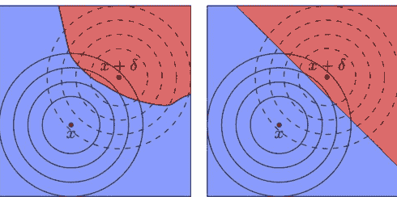

图 13.3 (Cohen et al., 2019) 中随机平滑的示意图。同心圆是添加到输入的高斯随机噪声的密度轮廓，颜色表示分类器产生的二元预测。x 和 x + δ 周围蓝色（印刷版中为中灰色）和红色（印刷版中为深灰色）的比例对应于平滑分类器中蓝色与红色类别的预测概率，我们可以观察到，当将 x 扰动为 x + δ 时，该比例的变化可以被界定。

et al., 2019)。差分隐私通过添加随机性，使得仅通过观察输出就无法区分不同的输入，这等同于说“任何附近的输入都会产生相同或相似的预测”，而这正是这里鲁棒性的定义。

然而，随后 Cohen et al. (2019) 建立了一种更简单的方法来获得更好的可证鲁棒性边界。直观解释可如图 13.3 所示。假设 f 是具有二元预测的基础分类器，图中的每个点都对应 x 的一个输入（假设为 2D），同心圆是添加到 x 或 x + δ 的高斯随机噪声的密度轮廓。我们将 pA(x) 定义为 f(x + ϵ) = A 的概率，将 pB(x) 定义为 f(x + ϵ) = B 的概率。它们随后对应于 x 周围实线同心圆中蓝色（印刷版中为中灰色）和红色（印刷版中为深灰色）颜色的比例。添加扰动 δ 后，我们得到另一个点 x + δ，并可以根据虚线同心圆类似地定义 pA(x + δ) 和 pB(x + δ)。

假设平滑分类器在 x 上预测正确，这意味着 pA(x) > pB(x) 且存在正差距 pA(x) − pB(x) > 0。我们随后希望表明，当 ||δ|| 足够小时，pA(x + δ) − pB(x + δ) 之间仍然存在正差距。请注意，pA(x + δ) − pB(x + δ) 的实际值取决于模型本身，这对应于空间中蓝色和红色颜色的位置。然而，很难跟踪红色/蓝色的实际位置，因此为了建立鲁棒性边界，我们感兴趣的是红色和蓝色区域的“最坏”位置（“最坏”分类器），它们将最小化 pA(x + δ) − pB(x + δ)。换句话说，假设 \(p_A(x)\) 和 \(p_B(x)\) 是固定的，我们希望找到

\(\min_f p_A(x + \delta) - p_B(x + \delta) \quad \text{s.t.} \quad p_A(x) = p_A, \quad p_B(x) = p_B. \quad (13.9)\)

有趣的是，如果噪声是高斯的，那么获得 (13.9) 的最坏情况 \(f\) 有一种非常简单的方法。直观上讲，当我们将某个点 \(z\) 涂成红色（对应类别 B）时，当 \(x\) 扰动为 \(x + \delta\)，它对整体 \(p_B\) 的贡献将按比率 \(P(N(x + \delta, \sigma^2) = z)/P(N(x, \sigma^2) = z)\) 被放大。因此，颜色的最坏情况位置将是按 \(P(N(x + \delta, \sigma^2) = z)/P(N(x, \sigma^2) = z)\) 的递减顺序分配红点，直到用完所有红色的质量。这对于任何分布都成立，但对于一般分布，可能难以计算出这种形式的显式表达式。然而，当我们添加高斯随机噪声时，事情变得简单了。从图 13.3 来看，\(p_B(x)\) 是以 \(x\) 为中心的高斯分布，而 \(p_B(x + \delta)\) 是以 \(x + \delta\) 为中心的另一个高斯分布，如果我们计算比率，则会看到

\(\frac{P(N(x + \delta, \sigma^2) = z)}{P(N(x, \sigma^2) = z)} = \frac{e^{-\|z-(x+\delta)\|^2/\sigma^2}}{e^{-\|z-x\|^2/\sigma^2}} = Ce^{-((z-x)^T\delta)/\sigma^2}, \quad (13.10)\)

其中 \(C\) 是与 \(z\) 无关的常数。因此，最坏情况的 \(f\) 可以在图 13.3 的右侧面板中说明，其中我们将所有红色质量放在右上角，边界是与扰动 \(\delta\) 正交的超平面。作为高斯分布，当投影到 1D 空间时，它仍然是高斯分布，如果我们考虑从 \(x\) 指向 \(x + \delta\) 的 1D 空间，那么边界将是右侧概率质量等于 \(P_B(x)\) 的点。因此，切分点将是 \(\Phi^{-1}(p_B)\)，其中 \(\Phi^{-1}\) 是标准高斯累积分布函数的逆函数。

根据上述论证，我们可以为二元情况的随机平滑模型建立可证鲁棒性边界，如下所示。

**定理 2** (Cohen et al., 2019). *对于具有两个类别 A、B 的二元分类问题，假设* \(p_A \in (\frac{1}{2}, 1]\) *。那么，对于所有* \(\|\delta\|_2 < \sigma \Phi^{-1}(p_A)\) *，* \(g(x + \delta) = c_A\)。

在实践中，我们无法真正计算 \(p_A\)，因为它需要无限数量的样本，但我们可以采样 \(m\) 个点来估计 \(p_A\)（预测为类别 A 的点的比例），然后使用一些统计界限（例如，切尔诺夫界限）来获得 \(p_A\) 的高概率下界，记为 \(\underline{p_A}\)，然后将定理 2 中的所有 \(p_A\) 替换为 \(\underline{p_A}\) 以获得可证鲁棒性。

使用类似的方法为多类分类模型建立保证也很容易。假设总共有 K 个类别，平滑分类器预测类别 A。那么对于任何其他类别 B，我们可以建立类似的保证，如下所示。

**定理 3** (Cohen et al., 2019). 对于具有 K 个类别的多类分类问题，假设对于任何一对类别 A、B，我们有满足以下条件的界限 pA、pB：

\(P(g(x) = A) \ge \underline{p_A} \ge p_B \ge \max_{C \neq A} P(g(x) = C).\)

_那么，对于任何_ \(\|\delta\|_2 < R\) *，* \(g(x + \delta) = A\) _，其中_

\(R = \frac{\sigma}{2}(\Phi^{-1}(\underline{p_A}) - \Phi^{-1}(\overline{p_B})).\)

将随机平滑应用于预训练模型时，我们需要选择与噪声水平对应的参数 \(\sigma\)。通常，较小的 \(\sigma\) 会导致更准确的预测，因为预测更接近原始模型 _f_，但可证鲁棒半径较弱。另一方面，添加非常大的 \(\sigma\) 会破坏原始预测，同时具有更强的鲁棒性。

请注意，能够轻松应用于任何预训练模型是随机平滑的一个优势。然而，由于大多数预训练模型在添加随机噪声后性能会显著下降，这往往会导致较差的鲁棒性保证。更好的选择是在训练阶段也添加随机扰动，使模型在训练阶段“意识到”随机输入噪声，并在应用随机平滑时能够正常工作。这也与前一小节中描述的 RSE 技术非常相似，在训练和测试阶段都添加了随机噪声。此外，Salman et al. (2019a) 表明，在训练阶段进行对抗训练也可以通过随机平滑来提高可证鲁棒性。

上述随机平滑技术主要是为高斯噪声设计的。我们可以在分析中看到，高斯噪声的对称性非常有用。然而，高斯噪声的性质仅有助于建立 \(\ell_2\) 鲁棒性的保证，如果有人有兴趣用另一种范数（例如 \(\ell_1\) 或 \(\ell_\infty\) 范数）来界定扰动，那么基于 \(\ell_2\) 鲁棒半径来界定其他 \(\ell_p\) 范数会导致非常宽松的界限。因此，已有许多工作试图将随机平滑扩展到其他范数，或讨论针对某些特定范数进行认证时的困难 (Blum et al., 2020; Yang et al., 2020c; Dvijotham et al., 2020).

### 13.4 扩展阅读

- 高阶随机平滑：(Mohapatra et al., 2020)。
- 针对随机平滑的数据中毒攻击：(Mehra et al., 2021a)。
- 用于认证预训练分类器的随机去噪：(Salman et al., 2020b)。
- 基于分层随机切换的随机防御：(Wang et al., 2019e)。


## 认证鲁棒性训练

在上一章的末尾，我们展示了一种在进行随机平滑时计算“认证半径”的方法，其中可以保证（以高概率）该半径内的任何扰动都不会改变预测。在本章中，我们介绍了一种不使用随机技术来为神经网络建立认证鲁棒性保证的另一种方法，而由此得到的鲁棒性保证是确定性的（100% 概率）。

这种技术的主要思想，也称为认证鲁棒训练，基于在第 3 部分中介绍的不完整神经网络验证方法。请注意，对于任何给定的神经网络，我们可以应用第 3 部分中介绍的任何验证技术来为每个点获得认证鲁棒半径。因此，即使不进行任何形式的专门训练，我们也可以基于验证方法为任何神经网络获得认证鲁棒损失或误差。然而，由于完整验证方法在较大模型上运行耗时（具有指数时间复杂度），且不完整验证方法通常会给出非常宽松的边界，因此在标准神经网络模型上应用验证可能会得到非常低的认证鲁棒性。为了解决这个问题，我们将展示，可以基于不完整验证获得的认证鲁棒性来定义损失函数。当训练模型以最小化该损失函数时，它将能够获得相当好的认证鲁棒性，至少对于某些标准分类任务而言。

### 14.1 认证鲁棒性训练的框架

为了训练一个鲁棒模型，我们关心定义为的鲁棒误差

```
E_{(x, y)} \max_{x' \in B(x)} I(f(x'), y), \quad (14.1)
```

其中 I(f(x'), y) 如果 (top-1) 预测 f(x') 与真实标签 y 不匹配则返回 1，我们考虑扰动集内的最坏情况扰动，因此只有当实例 (x, y) 被正确预测且扰动集内的任何扰动都无法改变其预测时，才被视为正确。然而，对于一般神经网络无法计算精确的鲁棒误差，因此有两种方法来评估该值。第一种方法是进行对抗攻击以寻找对抗样本 $x'$，这相当于寻找内部最大化问题的一个非最优解，得到的值（攻击下的误差）将是真实鲁棒误差的一个下界。然而，这个下界可能与真实鲁棒误差相差甚远，有时会产生虚假的安全感。另一方面，在本章中，我们关注“认证鲁棒误差”，即我们使用某种验证方法来获得 $x' \in B(x)$ 时 $f(x')$ 预测值的上界和下界。使用这个值，我们可以建立鲁棒误差的一个 *上界*，其中只有当样本被正确预测且可以验证在 $B(x)$ 内 (top-1) 预测永不改变时，才视为鲁棒正确。对于许多安全敏感型应用，当我们想要证明在某个区域内预测是确定正确时，这比攻击下的误差要重要得多。此外，如前所述，某些模型对某些攻击具有鲁棒性但对其他攻击则脆弱，因此攻击下的误差可能不是衡量鲁棒性的可靠指标，并可能对安全性评估产生偏差。因此，对于认证防御，我们将专注于改进认证鲁棒误差，而不是攻击下的误差。

由于无法直接最小化 (14.1) 中的 0/1 误差，一种常用的技术是定义一个损失函数作为鲁棒误差的代用，并学习一个模型来最小化该鲁棒损失的一个上界。例如，我们可以定义鲁棒交叉熵损失为

```
\(E_{(x,y)} \max_{x' \in B(x)} \ell_{CE}(f(x'), y). \quad (14.2)\)
```

计算 CE 损失的上界基于任何神经网络验证技术。请注意，神经网络验证通常会对任何 $x \in B(x)$ 的 $c^T f(x)$ 进行边界约束，其中 $c$ 是一个规范向量。为了确保目标标签 $i$ 的 logit 大于另一个标签 $j$，我们可以设置 $c_i = 1, c_j = -1$，并将 $c$ 的所有其他元素设置为零。为了考虑所有标签，我们接着定义一组 $L$ 个规范：

```
\(C_{i,j} = \begin{cases} 1 & \text{if } j=y, i \neq y \text{ (output of ground truth class)} \\ -1 & \text{if } i=j, i \neq y \text{ (output of other classes, negated)} \\ 0 & \text{otherwise (note that the } y\text{th row contains all 0).} \end{cases} \quad (14.3)\)
```

向量 \(m := Cf(x)\) 中的每个元素给出了类别 \(y\) 与所有其他类别之间的边际。我们为所有 \(x \in B(x)\) 的 \(Cf(x)\) 定义下界为 \(\underline{m}(x, \epsilon)\)，这是一个非常重要的量：当 \(\underline{m}(x, \epsilon)\) 的所有元素大于 0 时，\(x\) 对于 \(B(x)\) 内的任何扰动都是可验证鲁棒的。边界 \(\underline{m}(x, \epsilon)\) 可以通过不完整神经网络验证算法获得，例如凸对抗多胞形、区间界传播 (IBP) 或 CROWN，如在第 3 部分中介绍。基于这个公式，Wong 和 Kolter (2017) 表明，对于交叉熵 (CE) 损失，

$$\max_{x' \in B(x)} L(f(x'); y; \theta) \le L(f(-\underline{m}(x, \epsilon); y; \theta)).$$ (14.4)

因此，我们可以求解 (14.4) 中的上界，以最小化 (14.2) 中内部最大化问题的一个可处理的上界。请注意，为了使这种训练奏效，用于获得 \(\underline{m}(x_k, \epsilon)\) 的验证算法必须是 *可微的*。在认证鲁棒训练中，在每次选择一批样本进行迭代时，我们首先进行验证以为批次中的每个 \(x_k\) 构建 \(\underline{m}(x_k, \epsilon)\)，然后执行反向传播以计算梯度 \(\nabla_\theta L(f(-\underline{m}(x_k, \epsilon); y; \theta))\) 并进行参数更新。在接下来的内容中，我们将介绍几种可用于在此框架下进行认证鲁棒训练的有效验证方法。

### 14.2 现有算法及其性能

有两种流行的验证算法已被成功应用于认证鲁棒训练：区间界传播 (IBP) 和基于线性松弛的训练。其中，IBP 产生非常宽松的边界，但在认证训练中却能取得惊人地良好的结果；线性松弛方法提供比 IBP 紧得多的边界，但通常会导致不稳定的训练。因此，一些最近的方法也尝试结合这两种边界。我们将在下面讨论这些方法。

#### 区间界传播 (IBP)

区间界传播使用简单的边界传播规则。其思想是在前向传播中逐层获得每个神经元的上界和下界。对于输入层，我们逐元素设置 \(x_L \le x \le x_U\)。然后我们将每个神经元的边界传播到下一层。在通过线性层 \(z^{(l)} = Wh^{(l-1)} + b^{(l)}\) 时，假设 \(\bar{h}^{(l-1)}, \underline{h}^{(l-1)}\) 是 \(h^{(l-1)}\) 的（逐元素）上界和下界，我们可以通过以下方式获得 \(\tilde{z}^{(l)}\) 的上界和下界：

```
$\tilde{z}^{(l)} = W^{(l)}\frac{\bar{h}^{(l-1)} + \underline{h}^{(l-1)}}{2} + |W^{(l)}|\frac{\bar{h}^{(l-1)} - \underline{h}^{(l-1)}}{2} + b^{(l)},\\\underline{z}^{(l)} = W^{(l)}\frac{\bar{h}^{(l-1)} + \underline{h}^{(l-1)}}{2} - |W^{(l)}|\frac{\bar{h}^{(l-1)} - \underline{h}^{(l-1)}}{2} + b^{(l)},$
```

其中 \(|W^{(l)}|\) 取逐元素绝对值。请注意，\(\bar{h}^{(0)} = x_U\) 且 \(\underline{h}^{(0)} = x_L\)。对于逐元素激活函数（例如 ReLU），我们直接通过激活函数传播上界和下界：

```
$\bar{h}^{(l)} = \sigma(\tilde{z}^{(l)}) \qquad \underline{h}^{(l)} = \sigma(\underline{z}^{(l)}).$
```

请注意，作为一种验证方法，IBP 得到的边界比基于线性松弛的方法要宽松得多，因为它们仅在每层上维护每个神经元的上界和下界，而不对输入形成线性近似。然而，令人惊讶的是，Gowal 等人 (2018) 发现使用 IBP 训练可以获得良好的认证鲁棒性。

当以朴素的方式进行基于 IBP 的训练时，性能通常非常糟糕，因为 IBP 计算的边界非常宽松，尤其是在初始点，这使得训练非常不稳定。因此，有几种重要技术用于稳定基于 IBP 的认证训练。首先，Gowal 等人 (2018) 提议使用鲁棒交叉熵损失与自然交叉熵损失的混合作为目标，以稳定训练。此外，由于基于 IBP 的训练通常会遭受非常差的初始损失，一种称为 $\epsilon$-scheduling 的常用技术已被用于 IBP 训练。其主要思想是将 $\epsilon$（扰动容忍度）初始化为 0 或非常小，并随着迭代逐渐增加 $\epsilon$。然而，$\epsilon$-scheduling 也会导致显著更长的训练轮次。例如，为了获得最先进的 IBP 性能，我们需要数千个预热和最终训练轮次。为了解决这个问题，Shi 等人 (2021) 提出了包括批归一化和控制非活跃神经元数量的惩罚在内的几种正则化方法，以稳定 IBP 训练。使用他们的训练配方，IBP 只需在几个公共基准模型和数据集上进行约两百个训练轮次即可获得具有竞争力的结果。

#### 基于线性松弛的训练

基于 (14.4) 的公式，采用线性松弛方法推导的更紧边界作为 $\underline{m}(x, \epsilon)$ 是自然而然的。由于线性松弛-


基于边界的方法为相对于输入的输出神经元获取线性上界和下界，当将函数插入 \(\underline{m}\) 时，整个损失函数将是可微的。令人惊讶的是，尽管这些边界比 IBP 紧得多，但在进行认证训练时，其性能远不如 IBP。Zhang et al. (2020a) 观察到，基于线性松弛的训练通常会导致模型参数范数较小，从而迫使许多神经元处于非活动状态。一种推测是，由于基于线性松弛的方法在神经元要么非活动要么活动时具有更紧的边界，它们倾向于过度正则化网络以强制大多数神经元非活动。然而，为什么这种现象在基于线性松弛的训练中比在 IBP 训练中更常见，仍然是一个有待解答的问题。

然而，基于线性松弛的训练对于认证防御仍然有用。特别是，Zhang et al. (2020a) 开发了一种 Crown-IBP 训练方法，该方法将基于线性松弛的方法与 IBP 相结合。如前所述，IBP 训练的问题是边界在初始化附近往往非常差，这使得训练极不稳定。Crown-IBP 在初始阶段使用 CROWN 训练（一种基于线性松弛的方法），然后逐渐将训练目标切换为 IBP。更具体地说，Crown-IBP 考虑以下训练目标：

\(\min_\theta E_{(x,y)}[\kappa L(x; y; \theta) + (1 - \kappa)L(-((1 - \beta)\underline{m}_{\text{IBP}}(x, \epsilon) + \beta \underline{m}_{\text{CROWN-IBP}}(x, \epsilon)); y; \theta)].\)

其中 \(\underline{m}\) 是两个边界的组合，使得 \(\underline{m}_{\text{CROWN-IBP}}\) 在前向边界传递中执行 IBP，在后向边界传递中执行 CROWN 边界传播。通过在初始时将 \(\beta\) 设置为接近 1，然后逐渐降低到 0，Crown-IBP 训练方法在初始训练阶段利用了 CROWN（基于线性松弛的方法）的优势，但不会过度正则化神经元。更多细节可见 (Zhang et al., 2020a)。

### 14.3 经验比较

我们在 MNIST 和 CIFAR-10 数据集上展示了现有认证训练方法的比较。为简单起见，我们专注于几种常用 \(\epsilon\) 设置下的 \(\ell_\infty\) 认证鲁棒训练。实验结果列于 Table 14.1。

Table 14.1 MNIST 和 CIFAR-10 数据集上 IBP、Crown-IBP 和 Improved IBP 的比较。

| Dataset | \(\epsilon\) | Training Method | Standard error | Certified error |
|---|---|---|---|---|
| MNIST | 0.4 | IBP | 1.66 | 15.01 |
| MNIST | 0.4 | Crown-IBP | 2.17 | 12.06 |
| MNIST | 0.4 | Improved IBP | 2.2 | 10.82 |
| CIFAR-10 | 8/255 | IBP | 58.72 | 69.88 |
| CIFAR-10 | 8/255 | Crown-IBP | 53.73 | 66.62 |
| CIFAR-10 | 8/255 | Improved IBP | 51.06 | 65.05 |

请注意，对于 IBP 训练，我们主要参考 (Gowal et al., 2018) 提出的训练方案；对于 Crown-IBP，我们使用了 (Zhang et al., 2020a) 和 (Xu et al., 2020b) 中的结果，而对于 Improved IBP，我们考虑了 Shi et al. (2021) 提出的技巧的 IBP。对于两个数据集，我们使用了这些论文中常用的七层 CNN 模型。可以观察到，当前方法在 MNIST 数据集上已经实现了相当好的性能；由于每个像素值归一化到 [0, 1]，扰动 \(\epsilon = 0.4\) 已经非常大，认证训练可以获得在 MNIST 上近 10% 的数据被正确且鲁棒地分类的模型。然而，CIFAR-10 的性能仍不理想，因此许多最近的研究仍试图提高 CIFAR-10 和更大规模数据集上的认证鲁棒性准确率。

### 14.4 扩展阅读

- 快速认证鲁棒性训练：(Boopathy et al., 2021)。

## 对抗检测

另一种针对规避攻击的防御方法，我们称之为 _对抗检测_，旨在检测对抗样本的存在，而不是试图将其分类为正确的类别。这些方法背后的主要假设是，对抗样本来自与自然样本不同的分布，因此可以通过精心设计的检测器来检测它们。除了规避攻击之外，类似的方法论可以应用于检测其他类型的对抗攻击。在本节中，我们首先讨论针对测试时间对抗攻击的对抗检测。然后我们讨论针对其他攻击场景的检测方法。

### 15.1 检测对抗性输入

对抗样本检测的一种直接方法是构建一个简单的二分类器，将对抗样本与干净数据分开。然而，这些方法通常缺乏对未见攻击的泛化能力。因此，有效的检测方法通常基于对抗攻击的一些特征，而不是单纯地对现有攻击进行分类。在以下部分，我们将介绍几种流行的检测方法。

_密度估计._ 一个常见的观察是，对抗样本通常位于自然图像流形之外，许多检测方法基于这些特征。特别是，Feinman et al. (2017) 提出使用核密度估计来测量样本与给定数据流形的距离。设 \(X = \{x_1, \dots, x_n\}\) 为数据库中存储的训练样本，我们可以假设训练数据分布是以这些点为中心的高斯混合，表示为 \(p_X(x)\)。因此，对于测试实例 \(x\)，密度可以估计为 \(p_X(x) = \frac{1}{n} \sum_{i=1}^n K_\sigma (x_i, x),\)，其中 \(K_\sigma(\cdot, \cdot)\) 是核函数。一种常用的核函数是高斯核，其中 \(K_\sigma (x_i, x) = e^{-\frac{||x_i - x||^2}{2\sigma^2}}\)。在 (Feinman et al., 2017) 中提出的 KD-detection 方法在每个标签上拟合密度函数。如果输入示例 x 被预测为标签 y，我们使用基于类 y 样本的密度估计。一旦计算出 \(p_X(x)\)，我们就可以得到自然示例与对抗示例的 KD 估计统计量，以确定检测对抗示例的阈值。

许多其他算法也属于这个核密度估计框架。例如，Ma et al. (2018) 观察到对抗样本和自然样本之间隐藏层输出的局部内在维度 (LID) 不同，因此他们对隐藏层特征（而不是输入层）进行密度估计以检测对抗样本。许多作品中还观察到，几个不同层的集成可以显著提高计算机视觉任务中对抗检测的性能，因此大多数现有检测器不仅基于一个，而是基于几个隐藏层特征。在另一项工作中，Lee et al. (2018) 在高斯判别分析下生成了关于 DNN 隐藏层输出的条件高斯分布类，这导致了基于马哈拉诺比斯距离 (MAHA) 的置信度分数，随后在置信度分数上使用逻辑回归模型来检测对抗样本。Raghuram et al. (2020) 提出了一种汇总多层信息的联合统计检验来检测对抗样本。

用于对抗检测的特征归因方法。除了基于隐藏层特征的密度估计之外，许多作品还识别出一些可以区分对抗样本和自然样本的其他重要特征。在这里，我们将讨论一个有趣的发现：对抗样本可以通过特征归因方法来检测 (Yang et al., 2020d)。

假设模型是一个函数 \(f : \mathbb{R}^d \to [0, 1]^K\)，特征归因方法 \(\phi\) 将输入图像 \(x \in \mathbb{R}^d\) 映射到 \(d\) 维向量 \(\phi(x) \in \mathbb{R}^d\)，其中 \(\phi(x)\) 的每个元素对应特征对模型预测的贡献有多重要。文献中已经开发了许多特征归因方法。例如，广泛使用的留一法 (LOO) 特征归因方法 (Zeiler and Fergus, 2014; Li et al., 2016) 通过移除特征（例如，将其设为 0）时模型输出的变化来衡量每个特征的重要性。在数学上，LOO 方法将 \(\phi\) 设计为 \(\phi(x)_i = f(x)_c - f(x_{(i)})_c,\)，其中 c 是我们感兴趣的目标类别，\(x_{(i)}\) 表示移除特征 i 后的 x。


有趣的是，Yang et al. (2020d) 观察到对抗样本与自然样本具有非常不同的特征归属图。如图 15.1 所示，我们观察到对抗样本的特征归属图比自然样本的更分散，其中每个图都包含原始样本（左上角的图）和由 PGD 攻击生成的对抗样本（左下角的图），并为每个图生成特征归属图（例如，使用 leave-one-out 方法）。随后在底部面板的直方图中比较了每个特征归属图的像素值分布，显示原始样本与对抗样本之间存在非常不同的模式。一种假设是，面对自然样本时，分类器基于某个特征对其预测非常有信心，但在对抗样本中，由于我们向输入添加了噪声，特征归属变得更加分散，因为图像中没有特定的像素导致这一错误预测。在应用其他特征归属图（例如积分梯度（IG）或其他基于梯度的特征归属方法）时，也观察到了类似的行为。

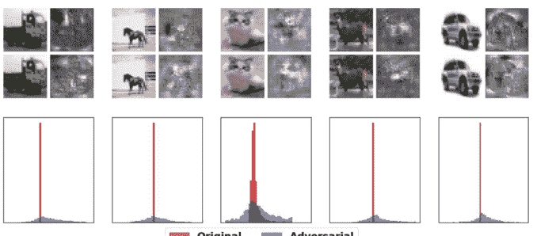

图 15.1 (Yang et al., 2020d) 中的特征归属分析。第一行显示原始 CIFAR-10 样本及其对应的特征归属。第二行显示对抗样本及其对应的特征归属。第三行绘制了原始特征归属和对抗特征归属的直方图。我们可以轻易观察到，对抗样本与自然样本具有非常不同的特征归属图。

受此观察启发，我们可以通过测量特征归属图中的统计离散度来检测对抗样本。具体来说，Yang et al. (2020d) 采用了多种统计量度，包括标准差、中位数绝对偏差（条目与其中位数之间绝对差的中位数）和四分位距（特征归属值所有条目中第 75 百分位数与第 25 百分位数之差）。这些值可以作为区分对抗样本与自然样本的良好检测得分，如图 15.2 所示。使用这些得分和多层上的集成特征归属图，Yang et al. (2020d) 提出的 ML-LOO 检测算法在对抗检测方面取得了非常好的性能，优于纯基于密度的方法。

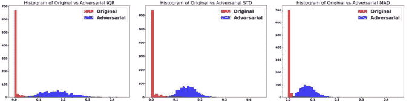

图 15.2 (Yang et al., 2020d) 中对抗样本与自然样本的离散得分（标准差、中位数绝对偏差和四分位距）。

### 15.2 检测对抗音频输入

一般来说，检测对抗样本可能是一项具有挑战性的任务。许多检测方法已被证明会被了解现有防御措施的高级对抗攻击削弱或绕过（Carlini and Wagner, 2017a）。

然而，在某些数据领域中，我们可以利用特定的领域知识和数据特征来检测对抗输入。特别是，对于音频数据输入，Yang et al. (2019c) 揭示了利用音频数据中的时间依赖性来对抗样本获取判别能力的重要性。在测试自动语音识别（ASR）任务和三种最近的音频对抗攻击时，他们发现（i）源自图像对抗防御的输入变换提供的鲁棒性提升有限，且对高级攻击不敏感，和（ii）可以利用时间依赖性来对音频对抗样本获得判别能力，并且能够抵御所考虑的自适应攻击。

对于（i），Yang et al. (2019c) 表明，音频输入上实现的四种变换技术（包括波形量化、时间平滑、降采样和自编码器重构）对 Athalye et al. (2018) 提出的自适应白盒攻击提供的鲁棒性提升有限，该攻击旨在规避输入变换导致的梯度模糊问题。

对于（ii），Yang et al. (2019c) 提出了一种基于时间依赖（TD）的检测方法。由于音频序列具有显式的时间依赖性（例如，连续波形片段之间的相关性），他们探究这种时间依赖性是否会受到对抗扰动的影响。

方法。基于时间依赖的方法的管道如图 15.3 所示。给定一个音频序列，他们提出选择其前 k 个部分（即长度为 k 的前缀）作为 ASR 的输入，以获取转录结果作为 Sk。此外，他们还将整个序列输入 ASR，并将转录结果的长度为 k 的前缀选为 S(whole,k)，其长度与 Sk 相同。随后，我们将比较 Sk 与 S(whole,k) 在时间依赖距离方面的一致性。此处采用词错误率（WER）作为距离度量（Levenshtein, 1966）。对于正常/良性音频实例，Sk 和 S(whole,k) 应该相似，因为 ASR 模型由于其时间依赖性，对给定序列的不同部分保持一致。然而，对于音频对抗样本，由于添加的扰动旨在将 ASR 输出改为目标转录，因此可能无法保留原始序列的时间信息。因此，由于时间依赖性的丢失，在这种情况下 Sk 和 S(whole,k) 将无法产生一致的结果。基于这种假设，他们利用转录结果的长度为 k 的前缀和转录的 k 个部分来潜在地识别对抗输入。

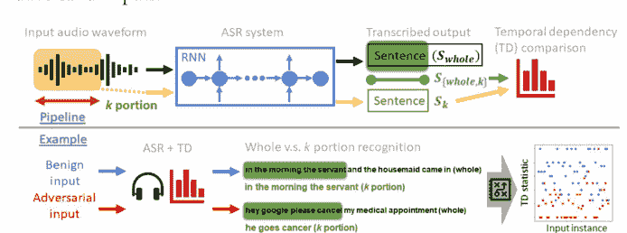

图 15.3 (Yang et al., 2019c) 中用于区分音频对抗样本的拟议基于时间依赖（TD）的方法的管道和示例。

数值实验。在语音转文本任务中，考虑了两种攻击进行评估。针对语音转文本翻译的 Commander Song 攻击（Commander）。Commander Song（Yuan et al., 2018）是一种语音转文本目标攻击，可以攻击从流行歌曲中提取的音频。对抗音频甚至可以在空中播放并保留其对抗特征。分析中使用了 Kaldi 语音识别平台。

针对语音转文本翻译的基于优化的攻击（Opt）。Carlini and Wagner (2018) 提出的针对性语音转文本攻击将语音识别系统中的联结主义时序分类（CTC）损失用作目标函数，并将对抗攻击任务求解为优化问题。分析中使用了 DeepSpeech 语音转文本转录网络，这是一种基于 biRNN 的模型，使用束搜索来解码文本。

对于检测方法，标准评估指标是曲线下面积（AUC）得分，旨在评估检测效率。所提出的 TD 方法关注的是在不影响良性实例（假正例）的情况下捕获多少对抗实例（真正例）。因此，我们遵循标准准则并报告 TD 的 AUC。对于所提出的 TD 方法，我们基于 WER、字符错误率（CER）和最长公共前缀（LCP）比较时间依赖性。LCP 是一种常用的指标，用于评估两个字符串之间的相似性。给定字符串 b1 和 b2，相应的 LCP 定义为 max b1[:k]=b2[:k] k，其中 [:k] 表示翻译句子长度为 k 的前缀。

在 Commander Song 攻击中，Yang et al. (2019c) 直接检查生成的对抗音频是否与其长度为 k 的前缀一致。使用 k = 1/2 的 TD 方法，所有生成的对抗样本都显示出不一致，因此成功被检测。在 Opt 攻击中，作为基线，Yang et al. (2019c) 还基于收集的对抗和良性音频实例直接训练一个具有 64 个隐藏特征维度的一层 LSTM 用于分类。良性和对抗音频的一些翻译结果示例显示在表 15.1 中。他们考虑三种类型的对抗目标：短 – hey google；中 – this is an adversarial example；长 – hey google please cancel my medical appointment。表 15.2 中给出了 k = 1/2 时这些检测结果的 AUC 得分。

可以看出，使用 WER 作为检测指标时，基于时间依赖的方法在 Common Voice 上可达到高达 0.936 的 AUC，在 LIBRIS 上可达到 0.93。Yang et al. (2019c) 还探索了不同的 k 值，并观察到结果变化不大。当 k = 4/5 时，基于 CER 的 AUC 得分可达到 0.969，这表明这种基于时间依赖的方法在区分对抗实例方面确实很有前途。值得注意的是，这些结果表明，


| Type | Transcribed results |
| :--- | :--- |
| Original | 然后说再见，老鼠们回家了 |
| the first half of Original | 原始的前半部分 | 然后说再见，老鼠们 |
| Adversarial (short) | 对抗性（短） | 嘿 Google |
| First half of Adversarial | 对抗性的前半部分 | 他是 |
| Adversarial (medium) | 对抗性（中） | 这是一个对抗性示例 |
| First half of Adversarial | 对抗性的前半部分 | 这些于充分 |
| Adversarial (long) | 对抗性（长） | 嘿 Google，请取消我的医疗预约 |
| First half of Adversarial | 对抗性的前半部分 | 他走向癌症 |

| Dataset | LSTM | TD (WER) | TD (CER) | TD (LCP ratio) |
| :--- | :--- | :--- | :--- | :--- |
| Common Voice | 0.712 | **0.936** | 0.916 | 0.859 |
| LIBRIS | 0.645 | 0.930 | **0.933** | 0.806 |

基于时序依赖的方法将提出一种易于实施但有效的方法，用于表征对抗性音频攻击。

### 15.3 检测特洛伊模型

Wang et al. (2020d) 研究了在数据匮乏场景下特洛伊网络（TrojanNet）检测的问题，在此场景中，检测器只能访问训练有素的 DNN 的权重。有关后门攻击的详细信息，请参见第 5 章。Wang et al. (2020d) 提出了一种数据受限的 TrojanNet 检测器（TND），用于仅有少量数据样本可用于 TrojanNet 检测的情况。他们表明，通过探索特洛伊攻击与预测-逃避对抗性攻击（包括逐样本攻击和全样本通用攻击）之间的联系，可以建立有效的数据受限 TND。此外，他们提出了一种无数据 TND，该检测器可在不访问任何数据样本的情况下检测卷积神经网络中的 TrojanNet。Wang et al. (2020d) 表明，此类 TND 可以通过利用隐藏神经元的内部响应来构建，即使在随机噪声输入时也会表现出特洛伊行为。他们的工作为 TrojanNet 检测提供了实用工具，并解决了当访问训练/测试数据样本受限或不允许时如何检测 TrojanNet 的挑战。这是一个实际场景，因为在机器学习中，利用预训练但可能不可信的神经网络用于下游应用（如迁移学习或微调）是常见做法。

以图像分类器为例。对于后门模型，由于在数据中毒中使用包含特洛伊触发器的输入时，TrojanNet 可能会将任意图像误分类为同一目标标签，Wang et al. (2020d) 假设 TrojanNet 中存在一个 *捷径*，导致 *与输入无关* 的误分类。他们的方法受到利用现有 *捷径* 来检测 TrojanNets 的启发。

特洛伊扰动。给定一个神经网络模型，设 \(f \in \mathbb{R}^K\) 为从输入空间到 \(K\) 个类别 logits 的映射。设 \(f_\gamma\) 表示类别 \(\gamma\) 对应的 logits 值。最终预测由 \(\text{argmax}_\gamma f_\gamma\) 给出。设 \(r \in \mathbb{R}^d\) 为从输入空间到神经元表示的映射，该表示由倒数第二层的输出定义（即，在模型的全连接块之前）。给定干净数据 \(\mathbf{x} \in \mathbb{R}^n\)，通过 *特洛伊扰动* \(\boldsymbol{\delta}\) 中毒的数据然后表述为

\(\hat{\mathbf{x}}(\mathbf{m}, \boldsymbol{\delta}) = (1 - \mathbf{m}) \cdot \mathbf{x} + \mathbf{m} \cdot \boldsymbol{\delta}, \quad (15.1)\)

其中 \(\boldsymbol{\delta} \in \mathbb{R}^n\) 表示逐像素扰动，\(\mathbf{m} \in \{0, 1\}^n\) 是二进制掩码，用于编码放置特洛伊戳记的位置，\(\cdot\) 表示逐元素乘积。在触发驱动的特洛伊攻击（Gu et al., 2017; Chen et al., 2017b; Yao et al., 2019）中，中毒训练数据 \(\hat{\mathbf{x}}(\mathbf{m}, \boldsymbol{\delta})\) 会被错误标记为目标类别，以在模型训练期间强制实施后门。在干净标签特洛伊攻击（Shafahi et al., 2018; Zhu et al., 2019a）中，变量 \((\mathbf{m}, \boldsymbol{\delta})\) 被设计为使特征表示 \(r(\hat{\mathbf{x}}(\mathbf{m}, \boldsymbol{\delta}))\) 与 \(r(\mathbf{x})\) 不对齐，但不会扰动中毒训练数据的标签。如果该模型是在由 (15.1) 给出的中毒训练数据上训练的，我们将其称为 TrojanNet。

数据受限的 TrojanNet 检测器 (DL-TND)：Wang et al. (2020d) 利用模型权重的先验知识和少量干净测试图像（每类至少一个样本）来解决 TrojanNet 检测问题。设 \(\mathcal{D}_k\) 表示（预测）类别 \(k\) 内的数据集合，设 \(\mathcal{D}_{k-}\) 表示预测标签不同于 \(k\) 的数据集合。Wang et al. (2020d) 提出通过探索 TrojanNets 中后门的存在如何使逐图像对抗性扰动与通用扰动耦合来设计检测器。其背后的原理是，由于存在特洛伊捷径，在将图像扰动至特洛伊目标类别时，逐图像扰动和通用扰动将保持强相似性。该框架如图 15.4(a) 所示。

非目标通用扰动。给定图像 \(\{\mathbf{x}_i \in \mathcal{D}_{k-}\}\)，目标是找到一个通用扰动元组 \(\mathbf{u}^{(k)} = (\mathbf{m}^{(k)}, \boldsymbol{\delta}^{(k)})\)，使得在当前模型下，\(\mathcal{D}_{k-}\) 中这些图像的预测  被 *修改*。但是，我们要求 \(\mathbf{u}^{(k)}\) 不要修改属于类别 \(k\) 的图像（即 \(\{\mathbf{x}_i \in \mathcal{D}_k\}\)）的预测。受此启发，\(\mathbf{u}^{(k)} = (\mathbf{m}^{(k)}, \boldsymbol{\delta}^{(k)})\) 的设计可以表述为以下优化问题：

```
minimize \\
\ell_{\text{atk}}(\hat{\mathbf{x}}(\mathbf{m}, \boldsymbol{\delta}); \mathcal{D}_{k-}) + \bar{\ell}_{\text{atk}}(\hat{\mathbf{x}}(\mathbf{m}, \boldsymbol{\delta}); \mathcal{D}_k) + \lambda \|\mathbf{m}\|_1 \\
subject to \\
\{\boldsymbol{\delta}, \mathbf{m}\} \in \mathcal{C},
```

其中 \(\hat{\mathbf{x}}(\mathbf{m}, \boldsymbol{\delta})\) 在 (15.1) 中已定义，\(\lambda \ge 0\) 是正则化参数，用于在损失项 \(\ell_{\text{atk}} + \bar{\ell}_{\text{atk}}\) 与触发模式的稀疏性 \(\|\mathbf{m}\|_1\) 之间取得平衡，\(\mathcal{C} = \{\mathbf{0} \le \boldsymbol{\delta} \le 255, \mathbf{m} \in \{0, 1\}^n\}\) 是优化变量 \(\mathbf{m}\) 和 \(\boldsymbol{\delta}\) 的约束集，其中 \([0, 255]\) 是 RGB 像素值的范围。

我们接下来详细说明问题 (15.2) 中的损失项 \(\ell_{\text{atk}}\) 和 \(\bar{\ell}_{\text{atk}}\)。首先，损失 \(\ell_{\text{atk}}\) 强制修改 \(\mathcal{D}_{k-}\) 中图像的预测标签，并定义为 C&W *非目标* 攻击损失（Carlini and Wagner, 2017a）

```
\ell_{\text{atk}}(\hat{\mathbf{x}}(\mathbf{m}, \boldsymbol{\delta}); \mathcal{D}_{k-}) = \sum_{\mathbf{x}_i \in \mathcal{D}_{k-}} \max \{ f_{y_i}(\hat{\mathbf{x}}(\mathbf{m}, \boldsymbol{\delta})) - \max_{t \neq y_i} f_t(\hat{\mathbf{x}}(\mathbf{m}, \boldsymbol{\delta})), -\tau \},
```

其中 \(y_i\) 表示 \(\mathbf{x}_i\) 的预测标签（回顾 \(f_t(\hat{\mathbf{x}}_i(\mathbf{m}, \delta))\) 表示相对于输入 \(\hat{\mathbf{x}}_i(\mathbf{m}, \delta)\) 的类别 \(t\) 的 logit 值），\(\tau \ge 0\) 是给定常数，用于表征攻击置信度。\(\max \{f_{y_i}(\hat{\mathbf{x}}_i(\mathbf{m}, \delta)) - \max_{t \neq y_i} f_t(\hat{\mathbf{x}}_i(\mathbf{m}, \delta)), -\tau \}\) 背后的原理是，如果扰动输入 \(\hat{\mathbf{x}}_i(\mathbf{m}, \delta)\) 能够更改原始标签 \(y_i\)，则其达到负值（最小值为 \(-\tau\)）。因此，\(\ell_{\text{atk}}\) 的最小化强制 \(\mathcal{D}_{k-}\) 中图像的标签更改集合成功。其次，(15.2) 中的损失 \(\bar{\ell}_{\text{atk}}\) 被提出以强制通用扰动不更改 \(\mathcal{D}_k\) 中图像的预测。这产生了

\(\bar{\ell}_{\text{atk}}(\hat{\mathbf{x}}(\mathbf{m}, \delta); \mathcal{D}_k) = \sum_{\mathbf{x}_i \in \mathcal{D}_k} \max \{ \max_{t \neq k} f_t(\hat{\mathbf{x}}_i(\mathbf{m}, \delta)) - f_{y_i}(\hat{\mathbf{x}}_i(\mathbf{m}, \delta)), -\tau \},\quad (15.4)\)

回顾对于 \(\mathbf{x}_i \in \mathcal{D}_k\)，有 \(y_i = k\)。我们按如下方式介绍 (15.3) 和 (15.4) 背后的原理。假设 \(k\) 是特洛伊攻击的目标标签。那么后门的存在将强制 (15.3) 中非 \(k\) 类别的扰动图像趋向于被预测为目标标签 \(k\)。然而，通用扰动（如特洛伊触发器执行）不会影响目标类别 \(k\) 内的图像，如 (15.4) 所表征。

针对每幅图像的针对性扰动。如果标签 \(k\) 是特洛伊对手指定的目标标签，那么我们假设将 \(\mathcal{D}_{k-}\) 中的每个图像扰动到目标类别 \(k\) 可能会经过与 (15.2) 中发现的通用对抗性示例相似的特洛伊捷径。受此启发，我们为 \(\mathbf{x}_i \in \mathcal{D}_k\) 生成以下针对每幅图像的针对性对抗性扰动：

\(\text{minimize}_{\mathbf{m}, \delta}\quad \ell'_{\text{atk}}(\hat{\mathbf{x}}(\mathbf{m}, \delta); \mathbf{x}_i) + \lambda \|\mathbf{m}\|_1\quad \text{subject to}\quad \{\delta, \mathbf{m}\} \in \mathcal{C},\quad (15.5)\)

其中 \(\ell'_{\text{atk}}(\hat{\mathbf{x}}(\mathbf{m}, \delta); \mathbf{x}_i)\) 是针对性 C&W 攻击损失（Carlini and Wagner, 2017a）

\(\ell'_{\text{atk}}(\hat{\mathbf{x}}(\mathbf{m}, \delta); \mathbf{x}_i) = \sum_{\mathbf{x}_i \in \mathcal{D}_{k-}} \max \{ \max_{t \neq k} f_t(\hat{\mathbf{x}}_i(\mathbf{m}, \delta)) - f_k(\hat{\mathbf{x}}_i(\mathbf{m}, \delta)), -\tau \}.\quad (15.6)\)

对于标签 \(k\) 和数据 \(\mathbf{x}_i\) 的每一对，我们可以得到每幅图像的扰动元组 \(\mathbf{s}^{(k,i)} = (\mathbf{m}^{(k,i)}, \delta^{(k,i)})\)。

为了求解通用扰动生成 (15.2) 和每幅图像扰动生成 (15.5) 这两个问题，\(\lambda\) 的增大强制扰动掩码 \(\mathbf{m}\) 稀疏。当特洛伊触发器尺寸较小时，这是所希望的。当特洛伊触发器可能不稀疏时，多个值


\(\lambda\) 也可用于生成不同的对抗扰动集。随后将对所提 TrojanNet 检测器进行测试，以检查每一组对抗扰动。

#### DL-TND 检测规则。
令 \(\hat{\mathbf{x}}_i(\mathbf{u}^{(k)})\) 和 \(\hat{\mathbf{x}}_i(\mathbf{s}^{(k,l)})\) 分别表示 \(\mathbf{x}_i\) 在通用扰动 \(\mathbf{u}^{(k)}\) 和实例级扰动 \(\mathbf{s}^{(k,l)}\) 下的对抗样本。若 \(k\) 为木马攻击的目标标签，则基于我们的相似性假设，由于后门的存在，\(\mathbf{u}^{(k)}\) 和 \(\mathbf{s}^{(k,l)}\) 在欺骗 CNN 模型决策方面将表现出强相似性。我们针对 \(\hat{\mathbf{x}}_i(\mathbf{u}^{(k)})\) 和 \(\hat{\mathbf{x}}_i(\mathbf{s}^{(k,l)})\) 的神经元表示来评估这种相似性，公式为 \(v_i^{(k)} = \cos(r(\hat{\mathbf{x}}_i(\mathbf{u}^{(k)})), r(\hat{\mathbf{x}}_i(\mathbf{s}^{(k,l)})))\)，其中 \(\cos(\cdot, \cdot)\) 表示余弦相似性。此处回顾，\(r\) 表示从输入图像到 CNN 中神经元表示的映射。对于任意 \(\mathbf{x}_i \in D_{k-}\)，我们构建相似性得分向量 \(\mathbf{v}_{sim}^{(k)} = \{v_i^{(k)}\}_i\)。

针对每个标签 \(k\) 的相似性得分 \(\mathbf{v}_{sim}^{(k)}\)，我们通过计算所谓的检测指数 \(I^{(k)}\)（即 \(\mathbf{v}_{sim}^{(k)}\) 的 \(q\%\)-百分位数）来检测模型是否为 TrojanNet（进而 \(k\) 为目标类别）。随后，对于给定阈值 \(T_1\)，若 \(I^{(k)} \ge T_1\) 则判定为 TrojanNet，且 \(k\) 为目标标签。我们也可以将中位数绝对偏差（MAD）方法应用于 \(\mathbf{v}_{sim}^{(k)}\)，以减轻对 \(T_1\) 的手动指定。

#### Data-free TrojanNet 检测器（DF-TND）。
无数据 TrojanNet 检测器的框架如图 15.4(b) 所示。Cheng et al. (2020a) 和 Wang et al. (2019b) 此前已表明，TrojanNet 在某些坐标处会表现出出乎意料的高神经元激活。这是因为 TrojanNet 针对由后门引起的与输入无关的错误分类产生了鲁棒表示。给定一个干净数据 \(\mathbf{x}\)，令 \(r_i(\mathbf{x})\) 表示神经元激活向量的第 \(i\) 个坐标。受 (Engstrom et al., 2019a; Fong et al., 2019; Wang et al., 2020d) 启发，我们研究最大化神经元激活的反演图像是否能够从模型权重中揭示木马签名的特征。我们将反演图像公式化为 (15.1) 中的 \(\hat{\mathbf{x}}(\mathbf{m}, \boldsymbol{\delta})\)，由相对于 \(\mathbf{x}\) 的像素级扰动 \(\boldsymbol{\delta}\) 和二值掩码 \(\mathbf{m}\) 参数化。为了求解 \(\hat{\mathbf{x}}(\mathbf{m}, \boldsymbol{\delta})\)，我们求解激活最大化问题

```
\(\begin{aligned}
\text{maximize}_{\mathbf{m}, \delta, \mathbf{w}} & \sum_{i=1}^d [w_i r_i(\hat{\mathbf{x}}(\mathbf{m}, \boldsymbol{\delta}))] - \lambda \|\mathbf{m}\|_1 \\
\text{subject to} & \quad \{\delta, \mathbf{m}\} \in \mathcal{C}, \mathbf{0} \le \mathbf{w} \le \mathbf{1}, \mathbf{1}^T \mathbf{w} = 1,
\end{aligned}
\tag{15.7}\)
```

其中符号遵循 (15.2)，但新引入的变量 \(\mathbf{w}\) 除外，该变量用于调整神经元坐标的重要性。注意，若 \(\mathbf{w} = \mathbf{1}/d\)，则 (15.7) 中的第一个损失项将成为坐标级神经元激活的平均值。但是，由于预计与木马相关的坐标将产生更大影响，因此相应的变量 \(w_i\) 期望受到更多惩罚。在此意义上，引入自调整变量 \(\mathbf{w}\) 有助于我们避免手动选择与后门最相关的神经元坐标。

#### DF-TND 检测规则。
令向量元组 \(\mathbf{p}^{(i)} = (\mathbf{m}^{(i)}, \boldsymbol{\delta}^{(i)})\) 为在随机输入 \(\mathbf{x}_i\) 下问题 (15.7) 的解，其中 \( i \in \{1, 2, \dots, N\} \)。此处 \( N \) 表示 TrojanNet 检测中使用的随机图像数量。随后，我们通过分别考察 \(\mathbf{x}_i\) 与 \(\hat{\mathbf{x}}_i(\mathbf{p}^{(i)})\) 相对的 logits 输出变化，来检测模型是否为 TrojanNet。对于每个标签 \( k \in [K] \)，我们得到

\( L_k = \frac{1}{N} \sum_i^N [f_k(\hat{\mathbf{x}}_i(\mathbf{p}^{(i)})) - f_k(\mathbf{x}_i)]. \) (15.8)

随后，对于给定阈值 \( T_2 \)，若 \( L_k \ge T_2 \) 则判定目标标签为 \( k \) 的模型为 TrojanNet。

#### 数值实验。
据 Wang et al. (2020d) 报道，神经网络模型包括 VGG16 (Simonyan and Zisserman, 2014)、ResNet-50 (He et al., 2016) 和 AlexNet (Krizhevsky et al., 2012)。数据集包括 CIFAR-10 (Krizhevsky et al., 2009)、GTSRB (Stallkamp et al., 2012) 和受限 ImageNet (R-ImgNet)（即将 ImageNet (Deng et al., 2009) 限制为 9 个类别）。Wang et al. (2020d) 训练了 85 个 TrojanNet 和 85 个干净网络。后门过程包括不同的触发模式和毒化数据比例。DL-TND 与基线方法 Neural Cleanse (NC) (Wang et al., 2019b) 在检测 TrojanNet 方面进行了比较。

为了构建 DL-TND，Wang et al. (2020d) 对 CIFAR-10 和 R-ImgNet 的每个类别使用 5 个验证数据点，对 GTSRB 的每个类别使用 2 个验证数据点。他们将 \( I^{(k)} \) 设置为 0.25 分位数、中位数和 0.75 分位数，并变化 \( T_1 \)。令真正率为 TrojanNet 的检测成功率，假负率为干净网络的检测错误率。然后，接收器操作特性 (ROC) 曲线下面积 (AUC) 可用于衡量检测性能。表 15.3 显示了 AUC 值，其中 "Total" 是指来自不同数据集的所有模型的集合。结果表明，DL-TND 可以在不同数据集和模型架构上表现良好。此外，将 \( I^{(k)} \) 固定为中位数，\( T_1 = 0.54 \sim 0.896\) 可为 TrojanNet 提供超过 76.5% 的检测成功率，并为干净网络提供超过 82% 的检测成功率。

表 15.3 TrojanNet 检测和目标标签检测的 AUC 值，格式为 (..)。每个类别的检测指数分别选定为相似性得分的 0.25 分位数、0.5 分位数和 0.75 分位数。

| | CIFAR-10 | GTSRB | R-ImgNet | 总计 |
|---|---|---|---|---|
| Q = 0.25 | (1, 1) | (0.99, 0.99) | (1, 1) | (1, 0.99) |
| Q = 0.5 | (1, 0.99) | (1, 1) | (1, 1) | (1, 0.99) |
| Q = 0.75 | (1, 0.98) | (1, 1) | (0.99, 0.97) | (0.99, 0.98) |

表 15.4 DL-TND (Wang et al., 2020d) 与 NC (Wang et al., 2019b) 在 TrojanNet 和干净网络上的比较（使用 T1 = 0.7）。结果按（正确检测的模型数）/（模型总数）的格式报告。

| | | DL-TND (干净) | DL-TND (木马) | NC (干净) | NC (木马) |
|---|---|---|---|---|---|
| CIFAR-10 | ResNet-50 | 20/20 | 20/20 | 11/20 | 13/20 |
| | VGG16 | 10/10 | 9/10 | 5/10 | 6/10 |
| | AlexNet | 10/10 | 10/10 | 6/10 | 7/10 |
| GTSRB | ResNet-50 | 12/12 | 12/12 | 10/12 | 6/12 |
| | VGG16 | 9/9 | 9/9 | 6/9 | 7/9 |
| | AlexNet | 9/9 | 8/9 | 5/9 | 5/9 |
| ImageNet | ResNet-50 | 5/5 | 5/5 | 4/5 | 1/5 |
| | VGG16 | 5/5 | 4/5 | 3/5 | 2/5 |
| | AlexNet | 4/5 | 5/5 | 4/5 | 1/5 |
| 总计 | | **84/85** | **82/85** | 54/85 | 48/85 |

表 15.4 展示了 DL-TND 与 Neural Cleanse (NC) (Wang et al., 2019b) 在 TrojanNet 和干净网络上的比较（T1 = 0.7）。DF-TND 的结果可见 (Wang et al., 2020d)。

最后，在检测到训练有素的模型存在后门后，我们可以应用 Zhao et al. (2020a) 提出的模型净化技术，该技术利用有限的干净数据集来减轻木马影响，同时保持较高的干净准确率。

### 15.4 延伸阅读

- Yang et al. (2020a) 研究自注意力 U-Net 如何增强对抗音频示例的表征。


本页故意留空

## 超越神经网络模型的对抗鲁棒性

神经网络模型的对抗鲁棒性已得到广泛研究，截至本章为止，我们主要讨论了神经网络的攻击、防御与验证。许多其他连续机器学习模型，例如支持向量机（SVM）或逻辑回归模型，可以被视为一种特殊的神经网络，因此为神经网络开发的大多数技术可以直接应用。然而，还有许多其他重要的机器学习模型涉及一些“离散”组件，神经网络的研究不能直接扩展到这些模型。例如，K近邻（KNN）是一个非常重要的基础机器学习模型，其预测基于训练数据集中一个或几个最近样本进行。KNN的决策边界可以如图16.1所示进行可视化，其为非光滑且不可微的。同样，决策树或决策森林（多个决策树的集成）基于特征值的某些切断点做出离散决策，因此其决策函数是离散的而非连续的。由于这些模型的离散特性，我们需要不同的方法来进行攻击、验证和防御。

在本章中，我们讨论如何评估和提高两类重要的离散非神经网络模型的鲁棒性：K近邻（KNN）分类器和决策树集成，包括梯度提升决策树（GBDT）和随机森林（RF）模型。总体而言，我们将展示，评估这些模型的鲁棒性可以表述为优化问题，这与神经网络类似，尽管这些优化问题涉及离散变量。然后，我们将展示，攻击这些模型等同于寻找优化问题的原始可行解，而鲁棒性验证等同于寻找对偶解，以给出这些优化问题的下界。我们还将讨论如何增强这些离散模型的鲁棒性。

在深入细节之前，我们想强调，研究这些离散机器学习模型鲁棒性有多个充分理由，如下所示：

- 1. 虽然神经网络擅长从图像/音频/文本中提取有用特征，但在许多其他应用中，神经网络可能无法超越其他经典机器学习模型。特别是，梯度提升决策树（GBDT）模型在许多数据挖掘任务中的应用比神经网络更广泛。许多Kaggle数据挖掘竞赛由GBDT模型获胜，且GBDT在工业排名系统中仍被广泛使用。因此，了解如何衡量和提高这些离散模型的鲁棒性非常重要。

- 2. 离散结构可能比神经网络更鲁棒，因为离散操作对小扰动不那么敏感。多种实用防御方法已将最近邻分类器与神经网络相结合（Papernot and McDaniel, 2018; Dubey et al., 2019; Sitawarin and Wagner, 2019）。因此，研究离散模型的鲁棒性对于理解它们是否能提供更好的鲁棒性至关重要。

### 16.1 评估K近邻模型的鲁棒性

最近邻（NN）分类器通过数据库中一个或_K_个最近样本来预测测试实例的标签。假设总共有_C_个标签。我们用\(\{(\mathbf{x}_1, y_1), \dots, (\mathbf{x}_n, y_n)\}\)表示数据库，其中每个\(\mathbf{x}_i\)是一个_d_维向量，\(y_i \in \{1, \dots, C\}\)是对应的标签。一个_K_-NN分类器\(f : \mathbb{R}^d \rightarrow \{1, \dots, C\}\)将测试实例映射到预测标签。给定测试实例\(\mathbf{z} \in \mathbb{R}^d\)，分类器首先根据欧氏距离\(\|\mathbf{x}_i - \mathbf{z}\|\)识别_K_个最近邻\(\{\mathbf{x}_{\pi(1)}, \dots, \mathbf{x}_{\pi(K)}\}\)，然后通过\(\{y_{\pi(1)}, \dots, y_{\pi(K)}\}\)中的多数投票来预测最终标签。

给定测试样本**_z_**，假设NN模型将其正确分类为类别1。对抗扰动定义为\(\boldsymbol{\delta} \in \mathbb{R}^d\)，使得\(f(\mathbf{z} + \boldsymbol{\delta}) \neq 1\)。鲁棒性评估旨在寻找最小范数对抗扰动

\(\boldsymbol{\delta}^* = \arg \min_{\boldsymbol{\delta}} \|\boldsymbol{\delta}\| \text{ s.t. } f(\mathbf{z} + \boldsymbol{\delta}) \neq 1, \quad \text{(16.1)}\)

和我们定义\(\epsilon^* = \|\boldsymbol{\delta}^*\|\)为此扰动的范数。在许多情况下，求解(16.1)的最优解具有挑战性，因此我们将讨论攻击和验证算法。攻击算法旨在为(16.1)寻找一个可行（但可能是次优的）解\(\boldsymbol{\delta}\)，它作为一个


图16.1 1-NN模型最小对抗扰动示例。目标是扰动z使其被分类为三角形类而不是圆形类；(a)展示了带有两个训练点（圆形和三角形）的最优扰动（epsilon*）；(b)展示了有三个训练点时的最优扰动；(c)展示了最优扰动可以通过计算z到每个三角形实例Voronoi图单元的距离来计算。

对抗示例。验证算法旨在寻找最小扰动的下界r，使得

$f(z + \delta) = 1 \quad \forall \|\delta\| \le r.$

显然，按定义，如果攻击和验证都是最优的，最大下界r*将与最小扰动范数epsilon*匹配。当r < r*时，我们称验证算法是健全的但不完整的（关于完整与不完整验证的更多讨论见第7章）。

为简化起见，我们将主要关注1-NN模型的l2范数（仅查看数据库中最近的样本），随后再推广到K > 1的情况。

首先，让我们考虑一些简单的例子，以直观理解1-NN模型的最优对抗示例会是什么样子。在图16.1(a)中，数据库中有两个点（一个圆形和一个三角形）。对于测试样本z，它被预测为圆形，我们想知道改变预测（最近邻变为三角形）所需的最小扰动。一种天真的方法是寻找指向三角形方向上的扰动，但事实上我们无法在该方向上找到最小扰动。当只有一个圆形和一个三角形时，最小扰动将从z指向两个训练样本之间的垂直平分超平面（图16.1(a)中的蓝色（打印版本中为深灰色）epsilon*）。但是，当样本超过两个时，检查每个垂直平分超平面上的投影就不够了。例如，在图16.1(b)中，有两个圆形和一个三角形，最优扰动（蓝色（打印版本中为深灰色）epsilon*）指向两个垂直平分超平面的交点（两条虚线）。如果我们检查从\mathbf{z}到所有垂直平分超平面交点的扰动，那么我们就能找到最小对抗扰动。然而，随着垂直平分交点数量随训练样本数量呈指数增长，进行穷尽搜索在计算上变得不可行。

事实上，1-NN模型的决策边界可以通过Voronoi图来捕获（参见图16.1(c)）。在Voronoi图中，每个训练实例\mathbf{x}_i形成一个单元，该单元的决策边界由\mathbf{x}_i与其邻居之间垂直平分形成的凸边界捕获。因此，我们可以通过计算\mathbf{z}到所有y_i ≠ 1的单元的距离来获得最小对抗扰动。然而，为了计算距离，我们需要检查单元的所有面（由一个垂直平分超平面捕获）和角（多个垂直平分超平面的交叉）。

对于二维空间（d=2），Aurenhammer和Klein（1999）已证明，每个单元只能有有限个面和角，且存在计算Voronoi图的多项式时间算法。一般来说，对于带有n个点的d维问题，Voronoi图计算需要O(n log n + n^{⌊d/2⌋})时间，这适用于低维问题。然而，时间复杂度随维度d呈指数增长，因此一般来说，除非d非常小，否则很难使用此算法。

#### 原偶对二次规划表述

计算ReLU网络的最小对抗扰动是NP-hard的（Katz et al., 2017）。此外，如前一节所讨论，我们可以将其与Voronoi图计算联系起来，但求解器在维度上将需要指数时间。那么计算1-NN的最小对抗扰动是否是NP-hard的？出人意料的是，答案是否定的，我们将描述一个高效算法来实现这一点。

对于给定实例\mathbf{z}，如果我们想扰动它，使得\mathbf{z} + \boldsymbol{\delta}比所有类别1实例更接近y_j ≠ 1的\mathbf{x}_j，那么寻找的问题


最小扰动可表述为

$$\epsilon^{(i)} = \min_{\boldsymbol{\delta}} \frac{1}{2} \boldsymbol{\delta}^T \boldsymbol{\delta} \text{ s.t. } \|\boldsymbol{z} + \boldsymbol{\delta} - \boldsymbol{x}_j\|^2 \le \|\boldsymbol{z} + \boldsymbol{\delta} - \boldsymbol{x}_i\|^2 \forall i, y_i = 1. \quad (16.2)$$

需注意，该表述由 (Wang et al., 2019c; Yang et al., 2020f) 提出。(Wang et al., 2019c) 进一步表明，(16.2) 可按如下方式在多项式时间内求解。

表述中的每个约束可重写为

$$\boldsymbol{\delta}^T(\boldsymbol{x}_j - \boldsymbol{x}_i) + \frac{\|\boldsymbol{z} - \boldsymbol{x}_i\|^2 - \|\boldsymbol{z} - \boldsymbol{x}_j\|^2}{2} \ge 0.$$

因此 (16.2) 变为

$$\epsilon^{(i)} = \min_{\boldsymbol{\delta}:\boldsymbol{A}\boldsymbol{\delta}+\boldsymbol{b}\ge 0} \{ \frac{1}{2} \boldsymbol{\delta}^T \boldsymbol{\delta} \} := P^{(i)}(\boldsymbol{\delta}), \quad (16.3)$$

其中，\(\boldsymbol{A} \in \mathbb{R}^{n \times d}\) 且 \(\boldsymbol{b} \in \mathbb{R}^n\)，满足 \(y_i = 1\)，\(\boldsymbol{a}_i = (\boldsymbol{x}_j - \boldsymbol{x}_i)\)，且 \(b_i = \frac{\|\boldsymbol{z} - \boldsymbol{x}_i\|^2 - \|\boldsymbol{z} - \boldsymbol{x}_j\|^2}{2}\)，针对每一行 \(i\)（否则为 \(\mathbf{0}\)）。通过对每个 \(\{ j : y_j \neq 1 \}\) 求解二次规划（QP）问题 (16.3)，最终最小对抗扰动范数为 \(\epsilon^* = \min_{j: y_j \neq 1} \sqrt{2\epsilon^{(j)}}\)。已有研究表明，凸二次规划可在多项式时间内求解 (Kozlov et al., 1980)，因此该表述为寻找 \(\epsilon^*\) 提供了一种 *多项式时间算法*。然而，朴素求解仍然代价过高，因为约束数量会呈二次增长。因此，我们将在下文介绍对偶问题，它们不仅能高效计算 1-NN 模型的鲁棒性，还能为 1-NN 鲁棒性验证提供可验证的鲁棒性下界计算方法。

#### 对偶二次规划问题

我们还将介绍每个 QP 的对偶形式，因为它在实践中求解更高效，并将引出一系列针对对抗鲁棒性的验证算法。(16.3) 的对偶问题可写为

$$\max_{\boldsymbol{\lambda} \ge 0} \left\{ -\frac{1}{2} \boldsymbol{\lambda}^T \boldsymbol{A} \boldsymbol{A}^T \boldsymbol{\lambda} - \boldsymbol{\lambda}^T \boldsymbol{b} \right\} := D^{(i)}(\boldsymbol{\lambda}), \quad (16.4)$$

其中，\(\boldsymbol{\lambda} \in \mathbb{R}^{n^+}\) 为对应的对偶变量。这遵循了对偶 QP 问题的标准推导（例如，几乎与支持向量机的原问题和对偶问题相同）。原-对偶关系通过 \(\boldsymbol{\delta} = \boldsymbol{A}^T \boldsymbol{\lambda}\) 将原变量与对偶变量联系起来。基于弱对偶性，

我们有 \( D^{(i)}(\lambda) \le P^{(i)}(\delta) \) 对于任何对偶可行解 \( \lambda \) 和原问题可行解 \( \delta \)。此外，基于 Slater 条件，我们可以证明 (16.3) 满足强对偶性，即 \( D^{(i)}(\lambda^*) = P^{(i)}(\delta^*) \)，其中 \( \lambda^* \) 和 \( \delta^* \) 分别为原问题和对偶问题的最优解，前提是对所有 \( i \in [n'] \) 均有 \( \mathbf{x}_j^- \neq \mathbf{x}_i^+ \)。¹ 基于强对偶性，我们有

\(\frac{1}{2}(\epsilon^*)^2 = \min_{j \in [n']} \{ P^{(i)}(\delta^*) \}\)
\( = \min_{j \in [n']} \{ \max_{\lambda \ge 0} D^{(i)}(\lambda) \}\)
\( \ge \min_{j \in [n']} \{ D^{(i)}(\lambda^{(j)}) \} \text{ with feasible } \lambda^{(j)}, \quad (16.5)\)

因此，一组可行解 \( \{\lambda^{(j)}\}_{j \in [n']} \) 可得出最小对抗扰动的下界。总结，我们得出 1-NN 攻击与验证之间的原-对偶关系如下：

- \( P^{(i)} \) 的任一原问题可行解即为一次成功的攻击，并给出 \( \epsilon^* \) 的一个上界。因此，我们可以求解一部分 QP 并取最小值。通常，与 \( \mathbf{z} \) 更近的 \( \mathbf{x}_j^- \) 会导致更小的对抗扰动，因此在实际中，我们可以按 \( \mathbf{x}_j^- \) 到 \( \mathbf{z} \) 的距离排序，逐个求解子问题，并可随时停止。这将给出一个有效的对抗扰动。求解完所有子问题后，结果将达到最小值，即最小对抗扰动范数 \( \epsilon^* \)。

- 根据 (16.5)，一组对偶可行解 \( \{\lambda^{(i)}\}_{j \in [n']} \) 可得出 \( \epsilon^* \) 的一个下界。因此，任何用于构造一组对偶可行解的启发式方法都将给出一个下界，该下界可用于鲁棒性验证。如果所有对偶问题均精确求解，则可得到最紧（最大）的下界，该下界即为 \( \epsilon^* \)。

#### 1-NN 模型的鲁棒性验证

这里，我们举一个例子，说明如何快速设置对偶变量，以在不精确求解任何子问题的情况下，给出最小对抗扰动的一个非平凡下界。对于对偶问题 \( D^{(i)} \)，假设只有一个变量 \( \lambda_i^{(i)} \) 作为优化变量，其余变量全部固定为零；则该简化对偶 QP 问题的最优闭式解为

\(\lambda_i^{(p)} = \max \left( 0, -\frac{b_i}{\|a_i\|^2} \right),\)

\(D^{(p)}([0, \dots, 0, \lambda_i^{(p)}, 0, \dots, 0]) = \frac{\max(-b_i, 0)^2}{2\|a_i\|^2}.\)
(16.6)

由于 \(b_i = (\|z - \mathbf{x}_i^+\|^2 - \|z - \mathbf{x}_j^-\|^2)/2\) 且 \(a_i = \mathbf{x}_j^- - \mathbf{x}_i^+\) 易于计算，我们可利用 (16.5) 通过如下方式获得 \(\epsilon^*\) 的保证下界：

\(\min_{j \in [n]^-} \max_{i \in [n]^+} \frac{\max(\|z - \mathbf{x}_j^-\|^2 - \|z - \mathbf{x}_i^+\|^2, 0)}{2\|\mathbf{x}_j^- - \mathbf{x}_i^+\|}.\)
(16.7)

此外，上述表述中的认证边界具有一个有趣的几何含义。内部值捕获 \(z\) 与 \(\mathbf{x}_i^+\) 和 \(\mathbf{x}_j^-\) 之间垂直平分线的距离。将 \(z\) 扰动到该垂直平分线，是使 \(z\) 更接近 \(\mathbf{x}_j^-\) 而非 \(\mathbf{x}_i^+\) 的最小扰动。若我们希望扰动 \(z\) 使得最近邻为 \(\mathbf{x}_j^-\)，则需要确保 \(z\) 比所有正标签数据点都更接近 \(\mathbf{x}_j^-\)，因此对所有到垂直平分线的距离取最大值。而要使 \(z\) 被分类为负标签，只需使其比正样本更接近某个 \(\mathbf{x}_j^-\)，因此对外部取最小值。一般来说，我们还可以通过对每个子问题优化多个坐标而非单个变量来获得更紧的下界，这可能带来更严格的边界，但可能需要额外计算。

#### 计算 1-NN 鲁棒性的高效算法

要计算 1-NN 分类器的精确鲁棒性，需要求解所有原问题 (16.3)，或者等价地，求解相应的对偶问题 (16.4)。尽管它们可在多项式时间内求解，但在实际中，朴素算法仍然太慢，因为涉及 \(O(n)\) 个二次规划问题，且每个问题有 \(O(n)\) 个对偶变量。通常求解每个 QP 需要 \(O(n^2)\) 时间，因此大约需要 \(O(n^3)\) 时间。当 \(n\) 较大时，这代价过高。

为解决此问题，Wang et al. (2019c) 开发了一种高效求解 \(O(n)\) 个子问题的方法。核心思路是利用原-对偶关系去除不必要的变量和不必要的子问题。直觉上，最终解是所有子问题解中的最小值，因此如果我们知道某个子问题解的下界大于当前解，则可以移除该子问题。如前两节所示，基于对偶性，*任何* 对偶解都能给出原问题解的下界，因此当我们发现某个对偶解的目标函数值大于当前最小值时，可以移除该子问题。因此，我们可以同时求解所有子问题并逐步移除子问题。

另一方面，对于每个子问题，我们还可以尝试移除不必要的对偶变量（对应原问题约束）。由于每个约束对应另一个点 \(\mathbf{x}_i\)，我们希望扰动后的点 \((\mathbf{z} + \boldsymbol{\delta})\) 比 \(\mathbf{x}_i\) 更靠近目标点 \(\mathbf{x}_j\)，直觉上，如果该点很远，则可以移除该约束。这也可以通过从原-对偶关系推导出的筛选算法来完成，有兴趣的读者可参阅 (Wang et al., 2019c) 查看更多细节。总的来说，如何高效计算最小对抗扰动仍是一个未解决的问题。

#### 超越 1-NN 的扩展

接下来，我们将上述鲁棒性评估方法扩展到 \(K > 1\) 的 \(K\)-NN 模型。考虑二分类情况，令 \(\mathbb{S}^+ = \{\mathbf{x}_1^+, \dots, \mathbf{x}_{n^+}^+\}\) 为与 \(\mathbf{z}\) 标签相同的样本集，\(\mathbb{S}^- = \{\mathbf{x}_1^-, \dots, \mathbf{x}_{n^-}^-\}\) 为与 \(\mathbf{z}\) 标签相反的样本集。我们假设 \(K\) 为奇数以避免 \(K\)-NN 投票出现平局，且 \(n^+\) 和 \(n^-\) 均足够大。我们可以列出所有可能的 \((\mathbb{I}, \mathbb{J})\) 组合，其中 \(\mathbb{I} \subseteq [n^+]\)，\(\mathbb{J} \subseteq [n^-]\)，\(|\mathbb{I}| = (K-1)/2\)，且 \(|\mathbb{J}| = (K+1)/2\)，然后求解以下 QP 问题，以强制 \(\mathbf{z} + \boldsymbol{\delta}\) 比 \(\mathbb{S}^+\) 中除 \(\mathbf{x}_i^+\) 外的所有实例（对所有 \(i \in [\mathbb{I}]\)）更靠近所有 \(j \in [\mathbb{J}]\) 的 \(\mathbf{x}_j^-\)：

```
\epsilon^{(\mathbb{I}, \mathbb{J})} = \min_{\boldsymbol{\delta}} \frac{1}{2} \boldsymbol{\delta}^T \boldsymbol{\delta}
\text{s.t. } \|\mathbf{z} + \boldsymbol{\delta} - \mathbf{x}_j^-\|^2 \le \|\mathbf{z} + \boldsymbol{\delta} - \mathbf{x}_i^+\|^2
\forall i \in [n^+] - \mathbb{I}, \forall j \in \mathbb{J}.
(16.8)
```

然后，最小对抗扰动的范数可通过 \(\epsilon^* = \min_{(\mathbb{I}, \mathbb{J})} \sqrt{2\epsilon^{(\mathbb{I}, \mathbb{J})}}\) 计算得到。总共会有指数数量的 QP，因此通常无法通过遍历所有 QP 来计算最小对抗扰动。然而，我们仍可获得与攻击和验证对应的上界和下界。对于上界（攻击），我们可以只选择少量 \((\mathbb{I}, \mathbb{J})\) 元组并仅求解这些 QP。边界的质量将取决于所选 QP 子集的优劣。


对于下界（验证），通过将 (16.7) 扩展到 K > 1 的情况，我们有以下引理。

#### 引理 3

对于奇数 K 的 K-NN 模型，最小对抗扰动的下界如下：

```
\epsilon^* \ge s\text{-th}\min_{j \in [n^+]} \left( s\text{-th}\max_{i \in [n^+]} \sqrt{2\epsilon^{(i,j)}} \right), \quad \text{(16.9)}
```

其中 s = (K + 1)/2 是正整数，“sth min”和“sth max”分别选择第 st 小值和第 st 大值，且

```
\epsilon^{(i,j)} = \frac{\max(\|z - x_j^-\|^2 - \|z - x_i^+\|^2, 0)^2}{8\|x_j^- - x_i^+\|^2}.
```

这是 1-NN 情况的简单扩展。请注意，下界 (16.9) 可以高效计算。计算所有 ε(i,j) 需要 O(n^2 d) 时间，然后 top-s 选择可以在线性时间内完成，因此总复杂度仅为 O(n^2 d)，与 K 无关。

#### 简单问题中 KNN 与神经网络的鲁棒性对比

使用上述由 Wang et al. (2019c) 实现的算法，我们能够 1) 对合理数量的示例高效计算 1-NN 模型的确切鲁棒性（例如，对于 MNIST 数据集，Wang et al. (2019c) 表明我们可以在几秒钟内完成评估）和 2) 对于 K-NN 模型，使用引理 3 高效计算认证鲁棒性（验证）。

有了这些算法，我们可以比较 K-NN 模型与神经网络之间的鲁棒性。我们在图 16.2 中比较了 1-NN、一个简单的卷积网络（ConvNet）和一个强 ℓ2 认证防御网络（RandSmooth）（Cohen et al., 2019）的认证鲁棒错误，定义为下界低于给定阈值的比例（如果实例被错误分类，则下界为 0）（有关随机平滑的更多详细信息，请参见第 13 章）。结果表明，在这两个数据集上，1-NN 可以比神经网络获得更好的认证鲁棒错误。部分原因是所提出的验证算法为 NN 分类器提供了非常紧的认证区域。请注意，这并不是在说 K-NN 在 CIFAR 和 ImageNet 等更复杂的数据集上比神经网络更鲁棒。然而，这表明 K-NN 可以在一些更简单的任务上获得更好的认证鲁棒错误。


图 16.2 比较了 1-NN、ConvNet（一个简单的卷积网络）和 RandSmooth（Cohen et al. (2019) 提出的一种基于随机平滑的防御神经网络）的认证（鲁棒）错误。对于 RandSmooth，我们选择噪声标准偏差 \(\sigma = 0.2\)。在上述两个数据集上，1-NN 更鲁棒。

### 16.2 基于最近邻分类器的防御

我们已经展示了如何计算 K-NN 的鲁棒性，但我们能否利用这些技术来提高 K-NN 的鲁棒性？答案是肯定的。

请注意，在定义在欧几里得空间中的原始 K-NN 模型中，我们通过 \(\|\boldsymbol{x}-\boldsymbol{x}'\|_2\) 来衡量两点之间的距离。然而，我们可以将距离测量推广到一系列 Mahalanobis 距离，如下所示：

```
d_M(\boldsymbol{x}, \boldsymbol{x}') = (\boldsymbol{x}-\boldsymbol{x}')^\top M(\boldsymbol{x}-\boldsymbol{x}'), \quad (16.10)
```

其中 \(M \in \mathbb{R}^{D \times D}\) 是一个正半定矩阵。然后我们可以尝试学习一个正半定矩阵 \(M\) 以最小化认证鲁棒训练误差。

对于实例 \((\boldsymbol{x}, y)\) 上的分类器 \(f\)，遵循前几节，我们可以定义*最小对抗扰动*为

```
\operatorname{argmin}_{\boldsymbol{\delta}} \|\boldsymbol{\delta}\| \quad \text{s.t.} f(\boldsymbol{x} + \boldsymbol{\delta}) \neq y, \quad (16.11)
```

这是可能导致“误分类”的最小扰动。请注意，如果 \((\boldsymbol{x}, y)\) 没有被正确分类，则最小对抗扰动是零向量 \(\mathbf{0}\)。设 \(\boldsymbol{\delta}^*(\boldsymbol{x}, y)\) 表示最优解，并让 \(\epsilon^*(\mathbf{x}, y) = \|\delta^*(\mathbf{x}, y)\|\) 表示最优值。由于 Mahalanobis K-NN 分类器由正半定矩阵 \(M\) 和训练集 \(\mathbb{S}\) 参数化，我们进一步让最优解 \(\delta^*_{\mathbb{S}}(\mathbf{x}, y; M)\) 和最优值 \(\epsilon^*_{\mathbb{S}}(\mathbf{x}, y; M)\) 显式指示它们对 \(M\) 和 \(\mathbb{S}\) 的依赖。

为了学习一个能产生鲁棒 K-NN 的 \(M\)，Wang et al. (2020c) 定义了目标函数为

```
\(\min_{G \in \mathbb{R}^{D \times D}} \frac{1}{N} \sum_{i=1}^N \ell \left( \epsilon^*_{\mathbb{S} - \{(x_i, y_i)\}}(\mathbf{x}_i, y_i; M) \right) \text{ s.t. } M = G^\top G,\) (16.12)
```

其中 \(\ell : \mathbb{R} \to \mathbb{R}\) 是一个非递增函数，例如铰链损失 \([1 - \epsilon]_+\)、指数损失 \(\exp(-\epsilon)\)、逻辑损失 \(\log(1 + \exp(-\epsilon))\) 或“负”损失 \(-\epsilon\)。约束 \(M = G^\top G\) 用于强制执行 \(M\) 矩阵的正半定性，否则由 \(M\) 定义的 Mahalanobis 距离将不是有效的距离度量。此外，最小对抗扰动定义在排除 \((\mathbf{x}_i, y_i)\) 本身的训练集上，因为否则任何距离度量的 1-最近邻分类器都将具有 100% 的准确率。因此，上述目标可以视为最小化“留一法”认证鲁棒误差。

如前一节所述，计算确切的 \(\epsilon^*_{\mathbb{S}}(\mathbf{x}, y; M)\) 代价太高，当 \(K > 1\) 时甚至不可能实现。因此，我们专注于改进*认证鲁棒误差*。设 \(\underline{\epsilon}^*(\mathbf{x}, y)\) 为最小对抗扰动 \(\epsilon^*(\mathbf{x}, y)\) 范数的下界，可以通过将引理 3 中导出的 K-NN 认证边界扩展到 Mahalanobis 距离设置来计算。由于推导非常简单，我们直接在下方展示结果。详细证明可参见 (Wang et al., 2020c)。

#### 定理 4（Mahalanobis K-NN 的鲁棒性验证）

给定一个由邻域参数 \(K\)、训练数据集 \(\mathbb{S}\) 和正半定矩阵 \(M\) 参数化的 Mahalanobis K-NN 分类器，对于任何实例 \((\mathbf{x}_{\text{test}}, y_{\text{test}})\)，我们有

```
\(\epsilon^*(\mathbf{x}_{\text{test}}, y_{\text{test}}; M) \ge k^{\text{th}} \min_{j: y_j \neq y_{\text{test}}} k^{\text{th}} \max_{i: y_i = y_{\text{test}}} \tilde{\epsilon}(\mathbf{x}_i, \mathbf{x}_j, \mathbf{x}_{\text{test}}; M),\) (16.13)
```

其中 \(k^{\text{th}}\) max 和 \(k^{\text{th}}\) min 分别选择第 \(k\) 大值和第 \(k\) 小值，其中 \(k = (K + 1)/2\)，并且

```
\(\tilde{\epsilon}(\mathbf{x}^+, \mathbf{x}^-, \mathbf{x}; M) = \frac{d_M(\mathbf{x}, \mathbf{x}^-) - d_M(\mathbf{x}, \mathbf{x}^+)}{2\sqrt{(\mathbf{x}^+ - \mathbf{x}^-)^\top M^\top M (\mathbf{x}^+ - \mathbf{x}^-)}}.\) (16.14)
```

请注意，定理 4 是引理 3 对 Mahalanobis 距离设置的推广。

通过用定理 4 中导出的下界替换 (16.12) 中的 $\epsilon^*$，我们得到了一个用于对抗鲁棒度量学习的可训练目标函数：

```
\min_{G \in \mathbb{R}^{D \times D}} \frac{1}{N} \sum_{i=1}^N \ell \left( k\text{-th min}_{j: y_j \neq y_i} k\text{-th max}_{l: y_l = y_i} \tilde{\epsilon}(\boldsymbol{x}_i, \boldsymbol{x}_j, \boldsymbol{x}_l; M) \right) \text{ s.t. } M = G^\top G. \tag{16.15}
```

虽然由于 $\tilde{\epsilon}$ 是 $M$ 的函数，Eq. (16.15) 是可训练的，但对于大型数据集，运行内部 min-max 过程是耗时的。此外，由于我们真正关心的是学习度量的泛化性能而不是留一法鲁棒训练误差，因此不需要计算确切解。因此，Wang et al. (2020c) 提议不精确计算 \(k\)-th max 和 \(k\)-th min，而是从每个训练实例的邻域中采样正实例和负实例，这导致了以下表述：

```
\min_{G \in \mathbb{R}^{D \times D}} \frac{1}{N} \sum_{i=1}^N \ell \left( \tilde{\epsilon} \left( \text{randnear}_M^+(\boldsymbol{x}_i), \text{randnear}_M^-(\boldsymbol{x}_i), \boldsymbol{x}_i; M \right) \right) \text{ s.t. } M = G^\top G. \tag{16.16}
```

其中 $\text{randnear}_M^+(\cdot)$ 表示在 \(\boldsymbol{x}_i\) 的邻域内对同一类实例进行采样的程序，$\text{randnear}_M^-(\cdot)$ 表示在 \(\boldsymbol{x}_i\) 的邻域内对不同类实例进行采样的程序，距离由 Mahalanobis 距离 \(d_M\) 测量。Wang et al. (2020c) 表明，从固定数量的最近邻实例中采样是足够的。因此，优化表述 (16.16) 大致最小化了认证鲁棒误差，并显著提高了计算效率。

整体训练算法如下。在每次迭代中，$G$ 使用损失函数的梯度进行更新，而 $\text{randnear}_M^+(\cdot)$ 和 $\text{randnear}_M^-(\cdot)$ 的计算不贡献梯度，以实现高效和稳定的计算。该算法称为*对抗鲁棒度量学习*（ARML）。

显然，ARML 可以显著提高 KNN 模型的鲁棒性。在表 16.1 中，我们展示了在 1-NN 中，当通过前一节提到的方法可以计算确切鲁棒性时，ARML


表 16.1 马哈拉诺比斯 1-NN 的认证鲁棒误差。所有方法中最佳（最小）认证鲁棒误差用粗体表示。请注意，1-NN 的认证鲁棒误差也是最优经验鲁棒误差（攻击误差），且半径为 0 时的这些鲁棒误差也是干净误差。

| | $\ell_2$-半径 | 0.000 | 0.500 | 1.000 | 1.500 | 2.000 | 2.500 |
|---|---|---|---|---|---|---|---|
| MNIST | 欧几里得 | 0.033 | 0.112 | 0.274 | 0.521 | 0.788 | 0.945 |
| | NCA | 0.025 | 0.140 | 0.452 | 0.839 | 0.977 | 1.000 |
| | LMNN | 0.032 | 0.641 | 0.999 | 1.000 | 1.000 | 1.000 |
| | ITML | 0.073 | 0.571 | 0.928 | 1.000 | 1.000 | 1.000 |
| | LFDA | 0.152 | 1.000 | 1.000 | 1.000 | 1.000 | 1.000 |
| | ARML (本文) | **0.024** | **0.089** | **0.222** | **0.455** | **0.757** | **0.924** |
| | $\ell_2$-半径 | 0.000 | 0.500 | 1.000 | 1.500 | 2.000 | 2.500 |
| Fashion-MNIST | 欧几里得 | 0.145 | 0.381 | 0.606 | 0.790 | 0.879 | 0.943 |
| | NCA | **0.116** | 0.538 | 0.834 | 0.950 | 0.998 | 1.000 |
| | LMNN | 0.142 | 0.756 | 0.991 | 1.000 | 1.000 | 1.000 |
| | ITML | 0.163 | 0.672 | 0.929 | 0.998 | 1.000 | 1.000 |
| | LFDA | 0.211 | 1.000 | 1.000 | 1.000 | 1.000 | 1.000 |
| | ARML (本文) | 0.127 | **0.348** | **0.568** | **0.763** | **0.859** | **0.928** |
| | $\ell_2$-半径 | 0.000 | 0.100 | 0.200 | 0.300 | 0.400 | 0.500 |
| Splice | 欧几里得 | 0.320 | 0.513 | 0.677 | 0.800 | 0.854 | 0.880 |
| | NCA | **0.130** | 0.252 | 0.404 | 0.584 | 0.733 | 0.836 |
| | LMNN | 0.190 | 0.345 | 0.533 | 0.697 | 0.814 | 0.874 |
| | ITML | 0.306 | 0.488 | 0.679 | 0.809 | 0.862 | 0.882 |
| | LFDA | 0.264 | 0.434 | 0.605 | 0.760 | 0.845 | 0.872 |
| | ARML (本文) | **0.130** | **0.233** | **0.370** | **0.526** | **0.652** | **0.758** |
| | $\ell_2$-半径 | 0.000 | 0.100 | 0.200 | 0.300 | 0.400 | 0.500 |
| Pendigits | 欧几里得 | 0.032 | 0.119 | 0.347 | 0.606 | 0.829 | 0.969 |
| | NCA | 0.034 | 0.202 | 0.586 | 0.911 | 0.997 | 1.000 |
| | LMNN | 0.029 | 0.183 | 0.570 | 0.912 | 0.995 | 0.999 |
| | ITML | 0.049 | 0.308 | 0.794 | 0.991 | 1.000 | 1.000 |
| | LFDA | 0.042 | 0.236 | 0.603 | 0.912 | 0.998 | 1.000 |
| | ARML (本文) | **0.028** | **0.115** | **0.344** | **0.598** | **0.823** | **0.967** |
| | $\ell_2$-半径 | 0.000 | 0.150 | 0.300 | 0.450 | 0.600 | 0.750 |
| Satimage | 欧几里得 | 0.108 | 0.642 | 0.864 | 0.905 | 0.928 | 0.951 |
| | NCA | 0.103 | 0.710 | 0.885 | 0.915 | 0.940 | 0.963 |
| | LMNN | **0.092** | 0.665 | 0.871 | 0.912 | 0.944 | 0.969 |
| | ITML | 0.127 | 0.807 | 0.979 | 1.000 | 1.000 | 1.000 |
| | LFDA | 0.125 | 0.836 | 0.919 | 0.956 | 0.992 | 1.000 |
| | ARML (本文) | 0.095 | **0.605** | **0.839** | **0.899** | **0.920** | **0.946** |
| | $\ell_2$-半径 | 0.000 | 0.500 | 1.000 | 1.500 | 2.000 | 2.500 |
| USPS | 欧几里得 | 0.045 | 0.224 | 0.585 | 0.864 | **0.970** | **0.999** |
| | NCA | 0.056 | 0.384 | 0.888 | 0.987 | 1.000 | 1.000 |
| | LMNN | 0.046 | 0.825 | 1.000 | 1.000 | 1.000 | 1.000 |
| | ITML | 0.060 | 0.720 | 0.999 | 1.000 | 1.000 | 1.000 |
| | LFDA | 0.098 | 1.000 | 1.000 | 1.000 | 1.000 | 1.000 |
| | ARML | **0.043** | **0.204** | **0.565** | **0.857** | **0.970** | **0.999** |

可以持续提升超过原始欧几里得范数的 1-NN 模型的鲁棒性。请注意，除了欧氏（原始欧氏空间 1-NN 模型）和 ARML（对抗鲁棒度量学习）之外，比较中还包括一些传统的度量学习基线，包括 NCA (Goldberger et al., 2004)、LMNN (Weinberger and Saul, 2009)、ITML (Davis et al., 2007) 和 LFDA (Sugiyama, 2007)。请注意，这些方法试图学习更好的 $M$ 度量以提高分类性能。我们可以观察到 ARML 算法可以始终实现最佳鲁棒性。

另一方面，在运行 $K > 1$ 的 KNN 时，如前一节所述，计算精确鲁棒性分数变得计算上不可行。但是，我们仍然可以使用定理 4 计算 KNN 模型的认证鲁棒性，且表 16.2 表明 ARML 可以始终改进认证误差。有关更多经验结果，我们请读者参阅 (Wang et al., 2020c)，他们还将 ARML 与神经网络在一些简单数据集（如 MNIST 和 FashionMNIST）上的认证鲁棒性进行了比较。

### 16.3 评估决策树集成的鲁棒性

接下来，我们讨论基于决策树的分类器的对抗鲁棒性，包括几种广泛使用的集成树模型，例如随机森林 (RF) 和梯度提升决策树 (GBDT) 模型。这些模型在许多数据挖掘任务中表现出显著性能，优于神经网络。

#### 单个决策树的鲁棒性

首先，我们讨论只有一个决策树的情况。我们假设决策树有 $n$ 个节点，根节点索引为 0。对于给定的具有 $d$ 个特征的示例 $x = [x_1, \dots, x_d]$，从根节点开始，

表 16.2 马哈拉诺比斯 K-NN 的认证鲁棒误差（左侧）和经验鲁棒误差（右侧）。所有方法中最佳（最小）鲁棒误差用粗体表示。半径为 0 时的经验鲁棒误差也是干净误差。

| | $\ell_2$-半径 | 0.000 | 0.500 | 1.000 | 1.500 | 2.000 | 2.500 | 0.000 | 0.500 | 1.000 | 1.500 | 2.000 | 2.500 |
|---|---|---|---|---|---|---|---|---|---|---|---|---|---|
| MNIST | 欧几里得 | 0.038 | 0.134 | 0.360 | 0.618 | 0.814 | 0.975 | 0.031 | 0.063 | 0.104 | 0.155 | 0.204 | 0.262 |
| MNIST | NCA | **0.030** | 0.175 | 0.528 | 0.870 | 0.986 | 1.000 | **0.027** | 0.063 | 0.120 | 0.216 | 0.330 | 0.535 |
| MNIST | LMNN | 0.040 | 0.669 | 1.000 | 1.000 | 1.000 | 1.000 | 0.036 | 0.121 | 0.336 | 0.775 | 0.972 | 1.000 |
| MNIST | ITML | 0.106 | 0.731 | 0.943 | 1.000 | 1.000 | 1.000 | 0.084 | 0.218 | 0.355 | 0.510 | 0.669 | 0.844 |
| MNIST | LFDA | 0.237 | 1.000 | 1.000 | 1.000 | 1.000 | 1.000 | 0.215 | 1.000 | 1.000 | 1.000 | 1.000 | 1.000 |
| MNIST | ARML | 0.034 | **0.101** | **0.276** | **0.537** | **0.760** | **0.951** | 0.032 | **0.055** | **0.077** | **0.109** | **0.160** | **0.213** |
| Fashion-MNIST | $\ell_2$-半径 | 0.000 | 0.500 | 1.000 | 1.500 | 2.000 | 2.500 | 0.000 | 0.500 | 1.000 | 1.500 | 2.000 | 2.500 |
| Fashion-MNIST | 欧几里得 | 0.160 | 0.420 | 0.650 | 0.800 | 0.895 | 0.946 | 0.143 | 0.227 | 0.298 | 0.360 | 0.420 | 0.489 |
| Fashion-MNIST | NCA | **0.144** | 0.557 | 0.832 | 0.946 | 1.000 | 1.000 | **0.121** | 0.232 | 0.343 | 0.483 | 0.624 | 0.780 |
| Fashion-MNIST | LMNN | 0.158 | 0.792 | 0.991 | 1.000 | 1.000 | 1.000 | 0.140 | 0.364 | 0.572 | 0.846 | 0.983 | 0.999 |
| Fashion-MNIST | ITML | 0.236 | 0.784 | 0.949 | 1.000 | 1.000 | 1.000 | 0.209 | 0.460 | 0.692 | 0.892 | 0.978 | 1.000 |
| Fashion-MNIST | LFDA | 0.291 | 1.000 | 1.000 | 1.000 | 1.000 | 1.000 | 0.263 | 0.870 | 0.951 | 0.975 | 0.988 | 0.995 |
| Fashion-MNIST | ARML | 0.152 | **0.371** | **0.589** | **0.755** | **0.856** | **0.924** | 0.134 | **0.202** | **0.274** | **0.344** | **0.403** | **0.487** |
| Splice | $\ell_2$-半径 | 0.000 | 0.100 | 0.200 | 0.300 | 0.400 | 0.500 | 0.000 | 0.100 | 0.200 | 0.300 | 0.400 | 0.500 |
| Splice | 欧几里得 | 0.333 | 0.558 | 0.826 | 0.965 | 0.988 | 0.996 | 0.306 | 0.431 | 0.526 | 0.608 | 0.676 | 0.743 |
| Splice | NCA | **0.103** | **0.209** | 0.415 | 0.659 | 0.824 | 0.921 | **0.103** | **0.173** | 0.274 | 0.414 | 0.570 | 0.684 |
| Splice | LMNN | 0.149 | 0.332 | 0.630 | 0.851 | 0.969 | 0.994 | 0.149 | 0.241 | 0.357 | 0.492 | 0.621 | 0.722 |
| Splice | ITML | 0.279 | 0.571 | 0.843 | 0.974 | 0.995 | 0.997 | 0.279 | 0.423 | 0.525 | 0.603 | 0.675 | 0.751 |
| Splice | LFDA | 0.242 | 0.471 | 0.705 | 0.906 | 0.987 | 0.997 | 0.242 | 0.371 | 0.466 | 0.553 | 0.637 | 0.737 |
| Splice | ARML | 0.128 | 0.221 | **0.345** | **0.509** | **0.666** | **0.819** | 0.128 | 0.196 | **0.273** | **0.380** | **0.497** | **0.639** |


表 16.2（续）

| | | 认证鲁棒错误 | | | | | | 经验鲁棒错误 | | | | | |
|---|---|---|---|---|---|---|---|---|---|---|---|---|---|
| | l2半径 | 0.000 | 0.100 | 0.200 | 0.300 | 0.400 | 0.500 | 0.000 | 0.100 | 0.200 | 0.300 | 0.400 | 0.500 |
| Pendigits | 欧几里得 | 0.039 | 0.126 | 0.316 | 0.577 | 0.784 | 0.937 | 0.036 | 0.085 | 0.155 | 0.248 | 0.371 | 0.528 |
| Pendigits | NCA | 0.038 | 0.196 | 0.607 | 0.884 | 0.997 | 1.000 | 0.038 | 0.103 | 0.246 | 0.428 | 0.637 | 0.804 |
| Pendigits | LMNN | 0.034 | 0.180 | 0.568 | 0.898 | 0.993 | 0.999 | 0.030 | 0.096 | 0.246 | 0.462 | 0.681 | 0.862 |
| Pendigits | ITML | 0.060 | 0.334 | 0.773 | 0.987 | 1.000 | 1.000 | 0.060 | 0.149 | 0.343 | 0.616 | 0.814 | 0.926 |
| Pendigits | LFDA | 0.047 | 0.228 | 0.595 | 0.904 | 1.000 | 1.000 | 0.043 | 0.104 | 0.248 | 0.490 | 0.705 | 0.842 |
| Pendigits | ARML | 0.035 | 0.114 | 0.308 | 0.568 | 0.780 | 0.937 | 0.034 | 0.078 | 0.138 | 0.235 | 0.368 | 0.516 |
| Satimage | l2半径 | 0.000 | 0.150 | 0.300 | 0.450 | 0.600 | 0.750 | 0.000 | 0.150 | 0.300 | 0.450 | 0.600 | 0.750 |
| Satimage | 欧几里得 | 0.101 | 0.579 | 0.842 | 0.899 | 0.927 | 0.948 | 0.091 | 0.237 | 0.482 | 0.682 | 0.816 | 0.897 |
| Satimage | NCA | 0.117 | 0.670 | 0.886 | 0.915 | 0.936 | 0.961 | 0.101 | 0.297 | 0.564 | 0.746 | 0.876 | 0.931 |
| Satimage | LMNN | 0.105 | 0.613 | 0.855 | 0.914 | 0.944 | 0.961 | 0.090 | 0.269 | 0.548 | 0.737 | 0.855 | 0.910 |
| Satimage | ITML | 0.130 | 0.768 | 0.959 | 1.000 | 1.000 | 1.000 | 0.109 | 0.411 | 0.757 | 0.939 | 0.990 | 1.000 |
| Satimage | LFDA | 0.128 | 0.779 | 0.904 | 0.958 | 0.995 | 1.000 | 0.112 | 0.389 | 0.673 | 0.860 | 0.950 | 0.986 |
| Satimage | ARML | 0.103 | 0.540 | 0.824 | 0.898 | 0.920 | 0.943 | 0.092 | 0.228 | 0.464 | 0.668 | 0.817 | 0.896 |
| USPS | l2半径 | 0.000 | 0.500 | 1.000 | 1.500 | 2.000 | 2.500 | 0.000 | 0.500 | 1.000 | 1.500 | 2.000 | 2.500 |
| USPS | 欧几里得 | 0.063 | 0.239 | 0.586 | 0.888 | 0.977 | 1.000 | 0.058 | 0.125 | 0.211 | 0.365 | 0.612 | 0.751 |
| USPS | NCA | 0.072 | 0.367 | 0.903 | 0.986 | 1.000 | 1.000 | 0.063 | 0.158 | 0.365 | 0.686 | 0.899 | 0.980 |
| USPS | LMNN | 0.062 | 0.856 | 1.000 | 1.000 | 1.000 | 1.000 | 0.055 | 0.359 | 0.890 | 0.999 | 1.000 | 1.000 |
| USPS | ITML | 0.082 | 0.696 | 0.999 | 1.000 | 1.000 | 1.000 | 0.072 | 0.273 | 0.708 | 0.987 | 1.000 | 1.000 |
| USPS | LFDA | 0.134 | 1.000 | 1.000 | 1.000 | 1.000 | 1.000 | 0.118 | 0.996 | 1.000 | 1.000 | 1.000 | 1.000 |
| USPS | ARML | 0.057 | 0.203 | 0.527 | 0.867 | 0.971 | 0.997 | 0.053 | 0.118 | 0.209 | 0.344 | 0.572 | 0.785 |

x 遍历决策树模型直到到达叶子节点。每个内部节点，假设为节点 \(i\)，有两个子节点和一对一元特征-阈值 \((t_i, \eta_i)\) 来确定遍历方向：如果 \(x_{t_i} \le \eta_i\)，则 \(x\) 将传递给左子节点，否则传递给右子节点。每个叶子节点有一个值 \(v_i\)，对应于分类树的预测类标签或回归树的实数值。

与前几节类似，我们首先讨论如何计算能改变给定测试样本决策的最小对抗扰动。更具体地，对于给定的基于树的模型 \(f\)、测试样本 \(x\) 和对应的标签 \(y_0\)，目标是求解

$$r^* = \min_\delta \|\delta\|_\infty \quad \text{s.t.} \quad f(x+\delta) \neq y_0. \tag{16.17}$$

如果 \(f\) 是单棵决策树，则有一个简单的线性时间算法来计算 \(r^*\)。主要思路是为每个叶子节点计算一个 \(d\) 维框，使得框内任何样本都会落入该叶子。在数学上，节点 \(i\) 的框被定义为实数轴上 \(d\) 个区间的笛卡尔积 \(B^i = (l^i_1, r^i_1] \times \cdots \times (l^i_d, r^i_d]\)。根据定义，根节点的框为 \([-\infty, \infty] \times \cdots \times [-\infty, \infty]\)，且给定内部节点 \(i\) 的框后，其子节点的框可以通过根据分裂条件 \((t_i, \eta_i)\) 仅更改框中的一个区间来获得。更具体地，如果 \(p, q\) 分别是节点 \(i\) 的左子节点和右子节点，则我们通过如下方式设置它们的框 \(B^p = (l^p_1, r^p_1] \times \cdots \times (l^p_d, r^p_d]\) 和 \(B^q = (l^q_1, r^q_1] \times \cdots \times (l^q_d, r^q_d]\)：

$$(l^p_t, r^p_t] = \begin{cases} (l^i_t, r^i_t] & \text{if } t \neq t_i, \\ (l^i_t, \min\{r^i_t, \eta_i\}] & \text{if } t = t_i, \end{cases} \quad (l^q_t, r^q_t] = \begin{cases} (l^i_t, r^i_t] & \text{if } t \neq t_i, \\ (\max\{l^i_t, \eta_i\}, r^i_t] & \text{if } t = t_i. \end{cases} \tag{16.18}$$

计算完内部节点的框后，我们也可以使用 (16.18) 得到叶子节点的框。因此，通过对决策树进行遍历（深度优先或广度优先），可以在 \(O(nd)\) 时间复杂度内计算所有叶子节点的框。

该技术可以轻松推广到 \(p < \infty\) 的 \(\ell_p\) 范数扰动。特别是，为了验证在扰动 \(\|\delta\|_p \le \epsilon\) 下是否存在任何误分类点，我们可以枚举所有 \(n\) 个叶子节点的框，并检查 \(\mathbf{x}_0\) 到每个框的最小距离。下面的命题表明，点到框的 \(\ell_p\) 范数距离可以在 \(O(d)\) 时间内计算，因此单棵树的完整鲁棒性验证问题可以在 \(O(dn)\) 时间内解决。

#### 定理 5.

给定一个框 $B = (l_1, r_1] \times \cdots \times (l_d, r_d]$ 和一个点 \(\boldsymbol{x} \in \mathbb{R}^d\)，\(\boldsymbol{x}\) 到 $B$ 的最小 \(\ell_p$ 距离（$p \in [0, \infty]$）为 $\|z - \boldsymbol{x}\|_p$，其中
$$
z_i = \begin{cases} x_i, & l_i \le x_i \le u_i, \\ l_i, & x_i < l_i, \\ u_i, & x_i > u_i. \end{cases}
$$ (16.19)

我们可以利用该定理计算将测试样本 \(\boldsymbol{x}\) 移动到框中所需的最小 \(\ell_p$ 范数扰动。随后，通过枚举将 \(\boldsymbol{x}\) 移动到每个具有相反标签的叶子节点的可能性，可以轻松计算出最小的 \(\ell_p$ 范数对抗扰动。

#### 集成决策树桩的鲁棒性

决策树桩是仅具有一个根节点和两个叶子节点的决策树。我们假设有 $T$ 个决策树桩，第 $i$ 个决策树桩给出的预测为

$$
f^i(\boldsymbol{x}) = \begin{cases} w_i^l & \text{if } x_{t_i} < \eta^i, \\ w_i^r & \text{if } x_{t_i} \ge \eta^i. \end{cases}
$$

当将决策树桩用作基分类器时，决策树桩集成已被广泛用于提升模型中，例如 Adaboost (Freund and Schapire, 1997)。

集成决策树桩的鲁棒性已被 Wang et al. (2020e) 和 Andriushchenko and Hein (2019) 研究。我们在前一小节中已表明，对于任何 \(\ell_p$ 范数，鲁棒性评估都可以在线性时间内完成，但有趣的是，在考虑集成决策树桩的鲁棒性评估时，不同 $p$ 的复杂度会有所不同。

决策树桩集成的预测 $F(\boldsymbol{x}) = \sum_i f^i(\boldsymbol{x})$ 可以按以下方式分解为各个特征。对于每个特征 $j$，设 $j_1, \dots, j_{T_j}$ 为使用特征 $j$ 的决策树桩，我们可以收集所有阈值 $[\eta^{j_1}, \dots, \eta^{j_{T_j}}]$。不失一般性，假设 $\eta^{j_1} \le \cdots \le \eta^{j_{T_j}}$。那么每个区间内分配的预测值可以表示为

$$
g^j(x_j) = \nu^{l^i} \quad \text{if } \eta^{l^i} < x_j \le \eta^{l^i+1}, \tag{16.20}
$$

其中

$$
\nu^{l^i} = w_{l_1}^{j_1} + \cdots + w_{l_i}^{j_i} + w_{r^{i+1}}^{j_{i+1}} + \cdots + w_{r}^{j_{T_j}},
$$

且 \(x_j\) 是样本 \(x\) 在特征 \(j\) 上的取值。整体预测可写成各特征预测值之和，

$$
F(x) = \sum_{j=1}^d g^j(x_j), \tag{16.21}
$$

最终预测由 \(\gamma = \text{sgn}(F(x))\) 给出。

\(\ell_\infty$ 和 \(\ell_0$ 范数鲁棒性评估。对于 \(\ell_\infty$ 范数鲁棒性评估，我们试图研究在某个输入 \(x\) 周围的 \(\epsilon\)-\(\ell_\infty$ 球内是否存在能够改变预测的扰动 \(\delta\)。由于预测可以分解为各个维度，我们只需研究在 \(\epsilon$ 扰动范围内每个维度的最坏情况扰动。这可以通过线性扫描轻易评估，因此评估可以在线性时间内完成。在数学上，对于每个特征 \(j\)，我们想知道 *通过改变该特征而导致的预测值最大下降量*，其可计算为

$$
c^j = \min_{t:(\eta^{j|t-1}, \eta^{j|t}) \cap [x_j-\epsilon, x_j+\epsilon] \neq \emptyset} \psi^{j|t} - g^j(x_j). \tag{16.22}
$$

在 \(\epsilon \ell_\infty$ 球内可达到的最小预测值将为 \(\sum_{j} c^j$。

另一方面，在考虑 \(\ell_0$ 范数球扰动集时，相当于说我们最多可以扰动 \(\epsilon$ 个特征（假设 \(\epsilon$ 为整数），且对每个特征的扰动不受限制。因此，最优扰动将是选择具有最小 \(\epsilon$ 个 \(c^j$ 值的特征进行扰动，因此计算也可以在线性时间内完成。

#### 其他 \(\ell_p\) 范数鲁棒性评估

\(\ell_p$ 范数鲁棒性验证的难点在于每个特征上的扰动是相关的，因此我们不能像在 (Andriushchenko and Hein, 2019) 中针对 \(\ell_\infty$ 范数情况那样将所有特征分离开。在下文中，我们通过从背包问题到 \(\ell_p$ 范数集成树桩验证的归约，证明完整的 \(\ell_p$ 范数验证是 NP-complete 的。这表明 \(\ell_p$ 范数验证可能属于与 \(\ell_\infty$ 范数情况不同的复杂度类。

#### 定理 6.

求解集成决策树桩的 \(\ell_p$ 范数鲁棒性验证（具有健全性和完备性）是 NP-complete 的，当 \(p \in (0, \infty)$ 时。

由于计算精确鲁棒性是 NP-Complete 的，Wang et al. (2020e) 提出了几种方法来寻找鲁棒性验证的上界，


基于 \(\ell_p\) 范数鲁棒性评估与背包问题之间的联系。更多细节可参见 (Wang et al., 2020e)。

#### 集成决策树的鲁棒性

现在我们讨论树（而非决策树桩）集成的鲁棒性验证。假设树集成包含 \(K\) 棵决策树，我们用 \(S^{(k)}\) 表示第 \(k\) 棵树的叶节点集合，并用 \(m^{(k)}(x)\) 表示将输入样本 \(x\) 根据树的遍历规则映射到第 \(k\) 棵树叶节点的函数。给定输入样本 \(x\)，树集成会将 \(x\) 独立传递给这 \(K\) 棵树中的每一棵，并到达 \(K\) 个叶节点 \(i^{(k)} = m^{(k)}(x)\)，其中 \(k = 1, \dots, K\)。每个叶节点会分配一个预测值 \(v_{i^{(k)}}\)。为简单起见，我们从二分类情况开始，其中 \(x\) 的原始标签为 \(y_0 = -1\)，而目标（对攻击者而言）是将标签转换为 \(+1\)。对于二分类，树集成的预测由 \(\text{sign}(\sum_{k=1}^K v_{i^{(k)}})\) 计算得出，这涵盖了 GBDT 和随机森林两种广泛使用的树集成模型。由于假设 \(x\) 的标签为 \(y_0 = -1\)，我们知道对于 \(x\) 有 \(\text{sign}(\sum_k v_{i^{(k)}}) < 0\)，我们的任务是验证求和的符号是否可以在 \(\text{Ball}(x, \epsilon)\) 内被翻转。

我们考虑鲁棒性验证的决策问题，以验证是否存在一个小区域内的对抗性扰动。朴素分析需要检查 \(\text{Ball}(x, \epsilon)\) 中的所有点，这些点是不可数无限的。为了将搜索空间减少到有限集合，主要思路是用这 \(K\) 棵树的所有可能叶节点选择来表示该空间。更具体地说，我们令 \(C = \{i^{(1)}, \dots, i^{(K)} | i^{(k)} \in S^{(k)} \forall k = 1, \dots, L\}\) 为所有可能的叶节点元组，并令 \(C(x) = [m^{(1)}(x), \dots, m^{(K)}(x)]\) 为将 \(x\) 映射到对应叶节点的函数。因此，元组 \(C\) 直接决定了模型预测 \(\sum v_C := \sum_k v_{i^{(k)}}\)，幸运的是，这个空间只有有限（尽管是指数级多）的选择。

现在我们定义鲁棒性验证的有效元组。

**Definition 1.** 若存在 \(x' \in \text{Ball}(x, \epsilon)\) 使得 \(C = C(x')\)，则称元组 \(C = (i^{(1)}, \dots, i^{(K)})\) 为 *有效* 的。

鲁棒性验证的决策问题可写为：

是否存在一个有效元组 \(C\) 使得 \(\sum v_C > 0\)？

接下来，我们展示如何建模有效元组的集合。我们有两个观察。首先，如果一个元组包含任何节点 \(i\)，其中框 \(i\) 超出了从 \(x\) 的范围（\(\inf_{x' \in B^i} \{ \|x - x'\|_\infty \} > \epsilon\)），则它是无效的。其次，由于每个叶节点对应的框捕获了所有落入该节点的可能点，存在 \(x\) 使得 \(C = C(x)\) 当且仅当所有这些框的交集非空。这可以写成 $B^{(1)} \cap \cdots \cap B^{(K)} \neq \emptyset$。

基于这些观察，我们可以将有效元组的集合表示为图 $G = (V, E)$ 中的团，其中每个节点是一个有效叶节点 $V := \{i | B^i \cap \text{Ball}(x, \epsilon) \neq \emptyset\}$，每条边表示两个端点节点有非空交集 $E := \{(i,j) | B^i \cap B^j \neq \emptyset\}$。由于同一棵树的节点之间不可能有边，因此该图将是一个 \(K\)-分部图，因而该图中的最大团将包含 \(K\) 个节点。我们将 \(K\)-分部图的每个部分记为 \(V_k\)。这里的“部分”是指 \(K\)-分部图中的一个不相交且独立的集合。以下引理表明框的交集具有非常好的性质。

**Lemma 4.** 对于框 $B^1, ..., B^K$，如果对所有 $i, j \in [K]$ 均有 $B^i \cap B^j \neq \emptyset$，令 \(\bar{B} = B^1 \cap B^2 \cap \cdots \cap B^K\) 为它们的交集。那么 \(\bar{B}\) 也是一个框，且 \(\bar{B} \neq \emptyset\)。

证明细节可参见 Chen et al. (2019b)。因此，\(G\) 中的每个 \(K\)-团（具有 \(K\) 个节点的完全连接子图）可以视为一组彼此间具有非空交集且也与 \(\text{Ball}(x, \epsilon)\) 具有非空交集的叶节点，因此那 \(K\) 个框与 \(\text{Ball}(x, \epsilon)\) 的交集将是一个非空框，这意味着每个 \(K\)-团对应一个有效的叶节点元组。

**Lemma 5.** 元组 $C = (i^{(1)}, ..., i^{(K)})$ 是有效的当且仅当节点 $i^{(1)}, ..., i^{(K)}$ 在上述构建的图 $G$ 中形成一个 \(K\)-团（最大团）。

因此，鲁棒性验证问题可表述为

图 \(G\) 中是否存在一个最大团 \(C\) 使得 \(\sum v_C > 0?\) (16.23)

这种改述表明，树集成验证问题可以通过高效的最大团枚举算法来解决。不幸的是，已证明枚举所有最大团是 NP-complete 且耗时 \(O(3^{\frac{n}{3}})\)，非常耗时，因此 Chen et al. (2019b) 提出了一种高效的替代方案，我们将在下面简要介绍。

#### 决策树鲁棒性验证的高效多级算法

图 16.3 展示了 Chen et al. (2019b) 提出的多级算法。共有四棵树，每棵树有四个叶节点。一个节点是 

**图 16.3** Chen et al. (2019b) 提出的多级验证算法。树 \(t_1\) 上的叶节点 \(i\) 与树 \(t_2\) 上的叶节点 \(j\) 之间的线表示它们的 \(\ell_\infty\) 特征框相交（即，存在一个输入，使得树 1 预测 \(v_i\) 且树 2 预测 \(v_j\)）。

如果它与 Ball($x$, $\epsilon$) 具有非空交集，则着色；未着色的节点将被丢弃。为回答问题 (16.23)，我们需要计算所有 \(K\)-团中 \(\sum v_C\) 的最大值，记为 \(v^*\)。如前所述，对于鲁棒性验证，我们只需计算 \(v^*\) 的上界即可得到最小对抗性扰动的下界。在接下来的部分，我们将首先讨论顶层计算上界的算法，然后展示我们的多尺度算法如何迭代细化此边界，直至达到精确解 \(v^*\)。

#### 单层边界

对于每个单层，Chen et al. (2019b) 提出了一种简单方法来计算最大团值的上界。这是通过假设该层中任何两个部分（两个独立集）之间的图是完全连接的来完成的。通过这一假设，我们只会引入更多边，从而只会增加最大团值。基于这一假设，节点值的最大和是各部分（独立集）最大值之和。在图 16.3 中，如果我们关注某一层，这可以通过找到每组的最大值并将它们相加来简单计算。

另一种稍好一些的方法是利用边信息，但仅限于树 \(t\) 和 \(t+1\) 之间。如果我们搜索从第一部分到最后部分的所有长度-\(K\) 路径 \([i^{(1)}, ..., i^{(K)}]\)，并将路径的值定义为 \(\sum_k v_{i^{(k)}}\)，那么值最大的路径将是一个有效的上界。这可以通过动态规划在线性时间内计算，即从第一部分运行到最后部分，并跟踪当前部分每个节点上的当前最大值。这种动态规划算法耗时稍多，但可以得到更紧的上界。

#### 合并 $T$ 个独立集

为细化相对松散的单层边界，多级算法将图划分为 \(K/T\) 个子图，每个子图包含 \(T\) 个独立集。在每个子图中，我们找到所有的 \(T\)-团，并使用一个新的“伪节点”来表示每个 \(T\)-团。如果选择 \(T\) 为一个相对较小的数字（例如，实验中的 2 或 3），则可以高效地枚举子图中的 \(T\)-团。

接下来，我们需要通过合并上一级的节点来形成下一级的图。根据引理 4，我们知道 \(T\) 个框的交集仍然是一个框，因此每个 \(T\)-团仍然是一个框，并可以作为二级图中的伪节点来表示。此外，由于每个伪节点仍然是一个框，我们可以轻松地在伪节点之间形成边，以表示它们之间的非空重叠，这将是一个 \((K/T)\)-分部 boxicity 图，因为同一子图内的团之间不能形成边。因此我们得到了二级图。有了二级图，我们可以再次运行单层算法来计算 \(v^*\) 的上界，从而得到 \(r^*\) 的下界，但与一级图不同的是，现在我们已经考虑了子图内的所有边，因此边界会紧得多。

#### 整体多级框架

我们可以逐级运行该算法，在每一级，单层算法都会输出一个用于验证的有效上界。随着进入下一级，由于将考虑合并部分之间的互连，边界也会变得更紧。在最后一级，伪节点将对应原始图中的 \(K\)-团，最大值将是最大团问题的精确解。因此，该算法可以被视为一种随时算法，它逐级细化上界，直至达到最大值。

#### 训练鲁棒树集成

与神经网络类似，为了增强树集成的鲁棒性，我们可以同时考虑经验防御和认证防御。对于这两种


## CHAPTER 17

## 元学习与对比学习中的对抗鲁棒性

它们，其目标是训练一棵树以最小化定义为的强损失

\min_f E_{(x,y)\sim D} \max_{x' \in B(x, \epsilon)} \ell(f(x), y), \quad (16.24)

where for simplicity, we assume that \( B(x, \epsilon) \) is the \(\ell_\infty\) ball \( B(x, \epsilon) = \{x' : \|x' - x\|_\infty \le \epsilon\} \). 在决策树训练中，一种常用的技术是自顶向下方法，其中在每一步，我们通过最小化目标函数来确定如何分割节点，或者等价地，如何在叶节点上选择特征和阈值。因此，为了训练强树，我们需要基于强损失 (16.24) 而不是常规损失（(16.24) 去掉内部 max）来确定节点的最佳分割。由于决策树训练通常较为复杂且存在多种训练方法，我们在此省略详细的训练算法。相反，我们将仅在概念上描述算法，并将感兴趣的读者引导至相应论文。

为了最小化对抗损失，我们可以同时考虑上界或下界（类似于强神经网络学习中的对抗训练与认证训练）。Chen 等人 (2019a) 提出了第一个基于强损失下界的强树训练算法。概念上，在确定如何分割节点时，一种简单但有效的方法是测试所有可能的分割特征和阈值，计算每种选择的（强）损失，然后选择最佳的。计算所有分割目标的朴素过程需要 \( O(N^2D) \) 时间，因为存在 \( D \) 个特征，每个特征有 \( N \) 个阈值，且目标函数涉及 \( N \) 个样本。但是，存在一种高效的方法来测试单个特征的所有阈值。使用原始非强损失，由于在将阈值从左到右排序后，当知道某个特定阈值的目标函数时，我们可以在 \( O(1) \) 时间内将其更新为下一个阈值的目标函数值。这使得每个分割的时间复杂度为 \( O(ND) \)。但是，在考虑强损失时，由于每个样本可以是 \( +\epsilon \) 或 \( -\epsilon，具体取决于最坏情况，因此从一个阈值到下一个阈值在 \( O(1) \) 时间内更新目标函数变得非平凡。为克服这一挑战，Chen 等人 (2019a) 仅考虑扰动的特定分配，而非最坏情况，从而在每个分割中得出一个最小化强损失下界的算法。

另一方面，也可以基于上述强验证方法计算的强误差上界进行分割。特别是，Andriushchenko 和 Hein (2019) 应用了他们的验证方法，Wang 等人 (2020c) 将该工作推广到 \(\ell_p\) 范数认证训练。使用他们的方法，可以训练认证强树集成，并在一些更简单的数据集（例如 MNIST）上优于认证强神经网络。虽然使用基于树的方法处理 ImageNet 等大型图像分类问题并不现实，但基于树的模型在许多数据挖掘任务中被使用，并一直是检索系统中重排序的主要组成部分，因此为那些问题训练强树仍然重要。

本页故意留空

### 17.1 模型无关元学习中的快速对抗鲁棒性自适应

元学习可以为未见任务提供快速泛化自适应 (Thrun and Pratt, 2012; Novak and Gowin, 1984)，已从基于模型和度量的方法 (Santoro et al., 2016; Munkhdalai and Yu, 2017; Koch et al., 2015; Snell et al., 2017) 到基于优化的方法 (Ravi and Larochelle, 2016; Finn et al., 2017; Nichol et al., 2018) 广泛研究。特别是，模型无关元学习 (MAML) (Finn et al., 2017) 是为快速自适应少样本学习设计的最引人入胜的基于双层优化的元学习方法之一；即，学习到的元模型可以仅用少量数据迅速泛化到未见任务。它已成功应用于目标检测 (Wang et al., 2020a)、医学图像分析 (Maicas et al., 2018) 和语言建模 (Huang et al., 2018) 等用例。

解决 MAML 中的对抗鲁棒性问题比标准模型训练更具挑战性，因为 MAML 包含一个双层学习过程，其中元更新步骤（外层循环）优化模型参数的任务无关初始化，而微调步骤（内层循环）学习从共同初始化更新的任务特定模型实例。因此，何时（即在哪个学习阶段）以及 *如何* 促进强正则化以在泛化/鲁棒性和计算效率之间取得优雅平衡，仍然难以捉摸。请注意，标准 MAML (Finn et al., 2017) 和标准强训练 (Madry et al., 2018; Zhang et al., 2019b) 都不像常规训练那样容易。除了强 MAML 中的算法设计外，深入解释和分析 *为什么* 在 MAML 中可以高效地获得对抗鲁棒性也很重要。Wang 等人 (2021b) 研究了 MAML 中的对抗鲁棒性问题 (Yin et al., 2018; Goldblum et al., 2019) 并对上述关于 *何时、如何* 和 *为什么* 的问题给出了肯定的回答。

**MAML 框架。** MAML 试图学习模型参数的初始化（即，一个元模型），以便新的少样本任务可以通过在少量标记数据上微调此元模型来快速轻松地解决。MAML 的特征标志是其 *双层学习过程*，其中微调阶段形成任务特定的 *内层循环*，而元模型则在 *外层循环* 中通过最小化累积任务上微调模型的验证误差来更新。正式地，考虑 $N$ 个少样本学习任务 $\{\mathcal{T}_i\}_{i=1}^N$，每个任务都有一个微调数据集 $\mathcal{D}_i$ 和一个验证集 $\mathcal{D}'_i$，其中 $\mathcal{D}_i$ 用于 *微调阶段*，$\mathcal{D}'_i$ 用于 *元更新阶段*。这里保留上标 (') 以指示元更新阶段的操作/参数。MAML 随后被表述为以下双层优化问题 (Finn et al., 2017):

\(\begin{aligned} \text{minimize}_{\mathbf{w}} & \quad \frac{1}{N} \sum_{i=1}^N \ell'_i(\mathbf{w}'_i; \mathcal{D}'_i) \\ \text{subject to} & \quad \mathbf{w}'_i = \underset{\mathbf{w}_i}{\text{argmin}} \ \ell_i(\mathbf{w}_i; \mathcal{D}_i, \mathbf{w}) \quad \forall i \in [N], \end{aligned}\) (17.1)

其中 $\mathbf{w}$ 表示要设计的元模型，$\mathbf{w}'_i$ 是 $\mathcal{T}_i$ 特定的微调模型，$\ell'_i(\mathbf{w}'_i; \mathcal{D}'_i)$ 表示使用微调模型的验证误差，$\ell_i(\mathbf{w}_i; \mathcal{D}_i, \mathbf{w})$ 表示在使用任务无关初始化 $\mathbf{w}$ 微调任务特定模型参数 $\mathbf{w}_i$ 时的训练误差，为了记号简便，$[K]$ 表示整数集 $\{1, 2, \dots, K\}$。在 (17.1) 中，目标函数和约束分别对应元更新阶段和微调阶段。双层优化问题具有挑战性，因为每个约束都会调用一个内部优化神谕，通常实例化为基于 $K$ 步梯度下降 (GD) 的求解器：

\(\mathbf{w}_i^{(k)} = \mathbf{w}_i^{(k-1)} - \alpha \nabla_{\mathbf{w}_i} \ell_i(\mathbf{w}_i^{(k-1)}; \mathcal{D}_i, \mathbf{w}), \ k \in [K], \ \text{with } \mathbf{w}_i^{(0)} = \mathbf{w}.\)


我们注意到，即使有上述简化的微调步骤，更新元模型 w 仍然需要关于 w 的目标函数 (17.1) 的二阶导数。

回顾一下，基于最小-最大优化的对抗训练（AT）被公认为获得对抗攻击防御强健模型的最强大方法之一（参见第 12 章）。我们通过以下强健正则化优化问题来总结 AT 及其变体：

$$\minimize_{\mathbf{w}} \lambda \mathbb{E}_{(\mathbf{x}, y) \in \mathcal{D}} [\ell(\mathbf{w}; \mathbf{x}, y)] + \mathbb{E}_{(\mathbf{x}, y) \in \mathcal{D}} [\underset{\|\boldsymbol{\delta}\|_\infty \le \epsilon}{\maximize} g(\mathbf{w}; \mathbf{x} + \boldsymbol{\delta}, y)],$$ $$\underbrace{\quad}_{\mathcal{R}(\mathbf{w}; \mathcal{D})}$$ (17.2)

其中，\(\ell(\mathbf{w}; \mathbf{x}, y)\) 表示在点 \(\mathbf{x}\) 处标签为 \(y\) 的预测损失，\(\lambda \ge 0\) 是正则化参数，\(\boldsymbol{\delta}\) 表示半径为 \(\epsilon\) 的 \(\ell_\infty\)-范数球内的输入扰动变量，\(g\) 表示在给定真实标签 \(y\) 的情况下，在模型 \(\mathbf{w}\) 处对扰动样本 \(\mathbf{x} + \boldsymbol{\delta}\) 计算的强健损失，并且为了记号方便，\(\mathcal{R}(\mathbf{w}; \mathcal{D})\) 表示数据集 \(\mathcal{D}\) 下模型 \(\mathbf{w}\) 的强健正则化函数。在本节余下部分，我们考虑 \(\mathcal{R}\) 的两种规范：(a) \(AT\) 正则化 (Madry et al., 2018)，其中设置 \(g = \ell\) 和 \(\lambda = 0\)；以及 (b) \(TRADES\) 正则化 (Zhang et al., 2019b)，其中我们将 \(g\) 定义为扰动示例 \((\mathbf{x} + \boldsymbol{\delta})\) 的预测概率分布与原始样本 \(\mathbf{x}\) 的预测概率分布之间的交叉熵。

促进强健的 MAML。将 MAML 与 AT 集成是增强少样本学习中元模型对抗强健性的自然解决方案。然而，这个看似简单的方案实际上远非易事，且存在下文详述的三个关键障碍。

首先，对于 MAML 来说，在哪个阶段（微调或元更新）能最有效地获得强健性仍然不得而知。基于 (17.1) 和 (17.2)，我们可以将此问题表述为一个统一的优化问题，该问题在由两个超参数 \(\gamma_{\text{out}} \ge 0\) 和 \(\gamma_{\text{in}} \ge 0\) 表征的两个自由度下，用强健正则化扩展了 MAML 损失：

$$\minimize_{\mathbf{w}} \frac{1}{N} \sum_{i=1}^N [\ell_i(\mathbf{w}_i'; \mathcal{D}_i') + \gamma_{\text{out}} \mathcal{R}_i(\mathbf{w}_i'; \mathcal{D}_i')]$$ $$\text{subject to } \mathbf{w}_i' = \arg\min_{\mathbf{w}} [\ell_i(\mathbf{w}_i'; \mathcal{D}_i; \mathbf{w}) + \gamma_{\text{in}} \mathcal{R}_i(\mathbf{w}; \mathcal{D}_i)] \forall i \in [N].$$ (17.3)

这里，\(\mathcal{R}_i\) 表示任务特定的强健正则化器，\((\gamma_{\text{in}}, \gamma_{\text{out}})\) 的选择确定了促进强健 MAML 的具体场景。显然，直接应用是设置 \(\gamma_{in} > 0\) 和 \(\gamma_{out} > 0$，即微调和元更新步骤都将使用强健训练进行，这需要额外的循环来生成对抗示例。因此，这将使计算最为密集。受此启发，我们问：*是否可以通过仅在元更新或微调步骤中（分别对应 \(\gamma_{in} = 0\) 或 \(\gamma_{out} = 0\)）纳入强健正则化来实现强健元模型？*

其次，(17.1) 中的 MAML 和 (17.2) 中的 AT 都是具有挑战性的双层优化问题，分别需要调用内层优化例程来进行微调和攻击生成。因此，我们询问计算开销较小的内层求解器替代方案（例如，部分微调 (Raghu et al., 2019) 和快速攻击生成 (Wong et al., 2020a)）是否可以在少样本学习中保证对抗强健性。

第三，研究表明，通过利用（未标记的）数据增强，对抗强健性可以从半监督学习中受益（Carmon et al., 2019; Stanforth et al., 2019）。受此启发，我们进一步问：*是否可以将促进强健的 MAML 推广到半监督学习设置中，以改进准确性-强健性权衡？*

#### 何时以及如何在 MAML 中纳入强健正则化？

基于 (17.3)，我们关注 Wang et al. (2021b) 提出的两种促进强健的元训练协议：(a) R-MAML\(_{\text{both}}\)，其中强健正则化应用于 *微调和元更新两个步骤*，且 \(\gamma_{in}, \gamma_{out} > 0\)；以及 (b) R-MAML\(_{\text{out}}\)，其中强健正则化仅应用于 *元更新步骤*，即 \(\gamma_{in} = 0\) 且 \(\gamma_{out} > 0\)。与 R-MAML\(_{\text{both}}\) 相比，R-MAML\(_{\text{out}}\) 更加用户友好，因为它允许在处理不可见的少样本测试任务（即元测试）时使用学习到的强健元模型上的 *标准微调*。在以下内容中，我们将表明，即使 R-MAML\(_{\text{out}}\) 在微调中不使用强健正则化，它也足以保证元模型强健性向下游微调任务的可迁移性。

*你只需要在元训练期间进行强健元更新。* 为了研究这一主张，我们在 5 方式 1 样本学习设置中使用 R-MAML\(_{\text{both}}\) 和 R-MAML\(_{\text{out}}\) 求解问题 (17.3)，其中五个随机选择的 MiniImagenet 类别（Ravi and Larochelle, 2016）中每个类别的一个数据样本构成一个学习任务。在本节余下部分，我们将 (17.3) 中的 \(\mathcal{R}_i\) 指定为 AT 正则化方法，该方法在其由 (17.2) 给出的内层最大化子例程中调用带有 \(\epsilon = 2/255\) 的 10 步投影梯度下降（PGD）攻击生成。

我们发现，R–MAML$_{out}$ 获得的元模型在测试阶段使用不同扰动大小 \(\epsilon = \{0, 2, ..., 10\}/255\) 生成的各种 PGD 攻击下，所产生的强健准确率（RA）与 R–MAML$_{both}$ 几乎相同，如图 17.1 所示。除非另有说明，我们在 2400 个随机不可见的 5 方式 1 样本测试任务上评估元学习方案的性能。我们还注意到，\(\epsilon = 0\) 下的 RA 变为使用良性（未扰动）测试样本评估的标准准确率（SA）。从图 17.1 可以清楚地看出，R–MAML$_{out}$ 和 R–MAML$_{both}$ 都能产生比 MAML 显著更好的 RA，但 SA 略有下降。还可以预期，随着攻击强度 \(\epsilon\) 的增加，RA 会降低。


图 17.1 标准 MAML、R–MAML$_{both}$ 和 R–MAML$_{out}$ 训练的元模型在元测试期间针对不同扰动大小的 PGD 攻击的强健准确率（RA）。结果表明，带有标准微调的强健正则化元更新（即 R–MAML$_{out}$）在促进强健性方面已经有效。

强健元更新在元测试期间无需额外的对抗微调即可提供强健性适应。元测试仅包括微调阶段。因此，我们需要探讨标准微调是否足以保持强健性。假设采用 R–MAML$_{out}$ 作为求解问题 (17.3) 的元训练方法；然后我们询问带有强健正则化的元测试策略是否可以提高下游任务中微调模型的强健性。出乎意料的是，我们发现，在测试期间对元模型（由 R–MAML$_{out}$ 训练）进行额外的对抗微调，并未相比测试期间的标准微调方案提供明显的强健性提升（表 17.1）。

| | S-FT | A-FT |
|---|---|---|
| SA | 40.9% | 39.6% |
| RA | 22.9% | 23.5% |

这一结果始终表明，强健元更新（R-MAMLout）足以赋予其学习到的元模型固有的强健性，而不论元测试期间使用何种微调策略。

**摘要：** 在 Wang et al. (2021b) 中，受 Wong et al. (2020a) 启发，他们发现将快速符号梯度方法（FGSM）应用于 R-MAMLout 在计算成本与标准和强健准确率之间提供了最优雅的权衡。此外，他们发现，在无标签数据的帮助下，R-MAMLout-TRADES 相比其监督对应方案 R-MAMLout（使用 AT 或 TRADES 正则化）改进了准确性-强健性权衡。最后，他们提出了一个通用但高效的强健正则化元学习框架，该框架允许使用无标签数据增强、元更新期间快速（一步）对抗示例生成以及微调期间的部分模型训练（仅微调分类器的头部）。

### 17.2 对比学习的对抗强健性保持：从预训练到微调

对比学习（CL）可以学习可泛化的特征表示，并通过在其上微调*线性*分类器来实现下游任务的最先进性能。早期的无监督表示学习方法利用手工制作的任务，如旋转预测（Gidaris et al., 2018）、解决拼图游戏（Noroozi and Favaro, 2016; Carlucci et al., 2019）、几何预测（Gan et al., 2018）和自拍（Selfie）（Trinh et al., 2019）。最近，对比学习（CL）（Chen et al., 2018e; Wang and Isola, 2020; Chen et al., 2020e; van den Oord et al., 2018; He et al., 2020; Chen et al., 2020d）及其变体（Grill et al., 2020; Tian et al., 2020; Purushwalkam and Gupta, 2020; Chen and He, 2020）已在无监督方式下学习可泛化特征方面展现出卓越能力。CL 背后的主要思想是 self-


从侵略性视角创建同一图像的正样本，然后通过最大化正样本间的一致性并与负样本对比来获取数据表征。然而，随着对抗鲁棒性在图像分类中变得至关重要，目前尚不清楚 CL 是否能够保留下游任务的鲁棒性。主要挑战在于，在“自监督预训练 + 监督微调”范式中，由于预训练到微调的学习任务不匹配，对抗鲁棒性容易被遗忘。我们将此类挑战称为“跨任务鲁棒性可迁移性”。为解决上述问题，Fan et al. (2021) 表明：(i) 对比视图的设计至关重要；图像的高频分量有助于提高模型鲁棒性；以及 (ii) 为 CL 增加伪监督刺激（例如，借助特征聚类）有助于在不遗忘的情况下保留鲁棒性。他们进一步提出 ADVCL，这是一种新型的对抗对比预训练框架，旨在增强跨任务鲁棒性可迁移性，且不损失模型精度和微调效率。我们将在本节介绍此框架。

Fan et al. (2021) 专注于研究如何使用 CL 实现鲁棒性增强而不损失其微调效率，例如，通过标准线性微调器。一些相关工作（如 Jiang et al., 2020; Kim et al., 2020）将对抗训练与 CL 相结合。然而，下游任务中实现的对抗鲁棒性在很大程度上依赖于使用先进的微调技术，要么是对抗完整微调 (Jiang et al., 2020)，要么是对抗线性微调 (Kim et al., 2020)。Fan et al. (2021) 发现，自监督学习（包括最先进的 CL）面临一种名为“跨任务鲁棒性可迁移性”的新鲁棒性挑战，这一挑战在以往工作中大多被忽视；也就是说，预训练到微调之间存在任务不匹配（例如，从 CL 到监督分类），因此即使预训练数据集和微调数据集来自相同分布，对抗鲁棒性也无法跨任务迁移。与监督/半监督学习不同，这是自监督在适应鲁棒学习时的特征性行为。如图 17.2 所示，他们的 ADVCL 工作在对抗情境下推进了 CL，所提方法优于所有最先进的基线方法，在使用轻量级标准线性微调或端到端对抗完整微调的情况下，在鲁棒精度和标准精度方面均取得了显著提升。

接下来，我们详细阐述 *SimCLR 的公式* (Chen et al., 2018e)，这是本文关注的最常用的 CL 框架之一。具体来说，令 $\mathcal{X} = \{x_1, x_2, ..., x_n\}$ 表示一个 *未标记的*


**图 17.2** 各种鲁棒预训练方法在 CIFAR-10 上的性能摘要。涵盖的基线方法包括 AP-DPE (Chen et al., 2020c)、RoCL (Kim et al., 2020)、ACL (Jiang et al., 2020) 和监督对抗训练 (AT) (Madry et al., 2018)。右上角表示在标准精度和鲁棒精度方面表现更好（在 PGD 攻击下，步数为 20，扰动强度为 8/255 ℓ∞-范数）。不同颜色表示不同的预训练方法，不同形状表示不同的微调设置。圆圈表示标准线性微调 (SLF)，菱形表示对抗完整微调 (AFF)。Fan et al. (2021) 提出的方法 (AdvCL，红色圆圈/菱形（印刷版中为深灰色）) 在所有微调设置中表现最佳。

源数据集；SimCLR 提供一个学习得到的特征编码器 fθ，用于生成数据的富有表现力的深层表征。为训练 fθ，每个输入 x ∈ X 将被转换为两个视图 (τ1(x), τ2(x)) 并标记为正样本对。这里，变换操作 τ1 和 τ2 从预定义的变换集 T 中随机采样，其中包括，例如，随机裁剪和调整大小、颜色抖动、旋转和剪切。然后将正样本对输入特征编码器 fθ 并配合投影头 g 以获取投影特征，即，zi = g ◦ fθ(τi(x)) 对于 j ∈ {1, 2}。接着应用 NT-Xent 损失（即归一化温度缩放交叉熵损失）来优化 fθ，其中对于每个输入 x，将投影正样本特征 (z1, z2) 的距离最小化。SimCLR 遵循“自监督预训练 + 监督微调”范式，即，一旦 fθ 训练完成，下游监督分类任务可以通过仅在固定编码器 fθ 上微调线性分类器 φ 来处理，从而得到最终的分类网络 φ ◦ fθ。

#### 鲁棒预训练 + 线性微调。

我们旨在通过充分利用和挖掘预训练阶段 CL 的潜力，开发鲁棒性增强解决方案，使得得到的鲁棒特征表征能够无缝地用于仅通过轻量级微调方案生成下游任务的鲁棒预测。借助对抗训练 (AT)，我们将“鲁棒预训练 + 线性微调”问题制定如下：

```
Pretraining: \min_{\theta} \mathbb{E}_{x \in \mathcal{X}} \max_{||\delta||_\infty \le \epsilon} \ell_{pre}(x + \delta, x; \theta), \quad (17.4)
Finetuning: \min_{\theta_c} \mathbb{E}_{(x,y) \in \mathcal{D}} \ell_{CE}(\phi_{\theta_c} \circ f_{\bar{\theta}}(x), y), \quad (17.5)
```

其中，$\ell_{pre}$ 表示一个设计得当的、对鲁棒性和泛化性敏感的 CL 损失，作为对抗样本 ($x+\delta$)、原始样本 $x$ 和特征编码器参数 $\theta$ 的函数给出。在 (17.4) 中，$\phi_{\theta_c} \circ f_{\bar{\theta}}$ 表示在固定特征编码器 $f_{\bar{\theta}}$ 之上配备参数 $\theta_c$（待设计）的线性预测头的分类器，而 $\ell_{CE}$ 表示目标数据集 $\mathcal{D}$ 上的监督 CE 损失。请注意，除了标准线性微调 (17.5) 之外，我们还可以使用最坏情况 CE 损失修改 (17.5) 以用于对抗线性/完整微调 (Jiang et al., 2020; Kim et al., 2020)。我们不考虑标准完整微调，因为使用标准交叉熵损失调整完整网络权重不可能使模型保留鲁棒性 (Chen et al., 2020c)。

AdvCL 框架。Fan et al. (2021) 提出的 AdvCL 框架包含两个主要组件：鲁棒性感知视图选择和伪监督刺激生成。具体而言，他们通过考虑有助于鲁棒表征学习和预训练泛化能力的适当基于频率的数据变换，改进了视图选择机制。此外，他们提议设计并将适当的监督刺激集成到 ADVCL 中，以提高跨任务鲁棒性可迁移性，因为从自监督学习得到的鲁棒表征可能缺乏下游任务鲁棒预测所需的类别判别能力。ADVCL 的概述见图 17.3。与标准 CL 相比，Fan et al. (2021) 提出了两个额外的对比视图：对抗视图和频率视图。

多视图 CL 损失。在定义新视图之前，我们先回顾 CL 中使用的 NT-Xent 损失及其多视图版本。对于每个（未标记）数据 \(x\) 的正样本对 \((\tau_1(x), \tau_2(x))\)，对比损失定义为

\(\ell_{\text{CL}}(\tau_1(x), \tau_2(x)) = - \sum_{i=1}^2 \sum_{j \in \mathcal{P}(i)} \log \frac{\exp(\text{sim}(z_i, z_j)/t)}{\sum_{k \in \mathcal{N}(i)} \exp(\text{sim}(z_i, z_k)/t)},\) (17.6)

其中，回顾一下，\(z_i = g \circ f(\tau_i(x))\) 是第 \(i\) 个视图下的投影特征，\(\mathcal{P}(i)\) 是除 \(i\) 之外的正样本视图集合（例如，若 \(i=1\)，则 \(\mathcal{P}(i) = \{2\}\)），\(\mathcal{N}(i)\) 表示除点 \(\tau_i(x)\) 之外的增强批次数据集合，\(\mathcal{N}(i)\) 的基数为 \((2b-1)\)（在两视图下，批次大小为 \(b\)），\(\text{sim}(z_1, z_2)\) 表示同一数据两个视图表征之间的余弦相似度，exp 表示指数函数，\(\text{sim}(\cdot, \cdot)\) 是两点之间的余弦相似度，且 \(t > 0\) 是温度参数。双视图 CL 目标可以进一步扩展为 *多视图对比损失* (Khosla et al., 2020):

\(\ell_{\text{CL}}(\tau_1(x), \tau_2(x), \dots, \tau_m(x)) = - \sum_{i=1}^m \sum_{j \in \mathcal{P}(i)} \log \frac{\exp(\text{sim}(z_i, z_j)/t)}{\sum_{k \in \mathcal{N}(i)} \exp(\text{sim}(z_i, z_k)/t)},\) (17.7)


**图 17.3** (Fan et al., 2021) 中 AdvCL 的整体流程。它主要包含两个组件：鲁棒性感知视图选择（橙色（印刷版中为中灰色）框）和伪监督刺激生成（蓝色（印刷版中为灰色）框）。视图选择机制通过高频分量进行改进，监督刺激通过 CLUSTERFIT 为每个图像生成伪标签来创建。伪标签（黄色（印刷版中为浅灰色））可以以离线方式创建，且不会增加计算开销。


其中 $\mathcal{P}(i) = [m]\setminus\{i\}$ 表示除 $i$ 之外的 $m$ 个正样本视图，$[m]$ 表示整数集合 $\{1, 2, \dots, m\}$，而 $\mathcal{N}(i)$（基数为 $(bm-1)$）表示除点 $\tau_i(x)$ 之外的 $m$ 视图增强 $b$ 批样本集合。

#### 基于对抗样本的对比视图。

江等人（2020）、金等人（2020）和高瓦尔等人（2021）提出的方法可以基于（17.6）进行解释：相对于样本 $x$ 的每个视图，对抗扰动 $\delta$ 是通过最大化对比损失生成的：

$$\delta_1^*, \delta_2^* = \underset{\|\delta_i\|_\infty \le \varepsilon}{\text{argmax}} \ell_{\text{CL}}(\tau_1(x) + \delta_1, \tau_2(x) + \delta_2). \quad (17.8)$$

问题（17.8）的解最终会产生一个*成对扰动视图* $(\tau_1(x) + \delta_1^*, \tau_2(x) + \delta_2^*)$。然而，江等人（2020）、金等人（2020）和高瓦尔等人（2021）使用的对抗视图（17.8）的定义可能不合适。首先，标准 CL 通常使用*激进数据变换*，它将图像的小部分视为完整图像的正样本（Purushwalkam 和 Gupta，2020）。尽管这有助于促进泛化，但在如此激进的数据变换上构建扰动可能不适合防御对抗环境中应用于*完整*图像的对抗攻击。因此，需要一个基于 $x$ 而非 $\tau_i(x)$ 构建的新对抗视图。其次，对比损失（17.6）仅限于同一数据的两个视图。如后文所示，在考虑多个促进鲁棒性的视图时，也需要多视图对比损失。受上述启发，我们在不修改现有数据增量 $(\tau_1(x), \tau_2(x))$ 的情况下，定义了在 $x$ 上的*对抗视图*。这导致了通过最大化三视图对比损失的以下对抗扰动生成器：

$$\delta^* = \underset{\|\delta\| \le \varepsilon}{\text{argmax}} \ell_{\text{CL}}(\tau_1(x), \tau_2(x), x + \delta), \quad (17.9)$$

其中 $x + \delta^*$ 被视为 $x$ 的第三个视图。

#### 基于高频分量的对比视图。

接下来，我们将数据的高频分量（HFC）作为另一个额外的对比视图。其 rationale 源于以下事实：1) 在数据 HFC 上学习是实现卓越泛化能力的主要原因（Wang 等人，2020b）；2) 在操纵样本以欺骗模型决策时，对抗者通常集中于 HFC（Wang 等人，2020f）。令 $\mathcal{F}$ 和 $\mathcal{F}^{-1}$ 分别表示傅里叶变换及其逆变换。输入图像 $x$ 可以分解为其 HFC $x_h$ 和低频分量（LFC）$x_l$：

$$x_h = \mathcal{F}^{-1}(q_h), \quad x_l = \mathcal{F}^{-1}(q_l), \quad [q_h, q_l] = \mathcal{F}(x). \quad (17.10)$$

在（17.10）中，$q_h$ 和 $q_l$ 之间的区别是通过硬阈值操作完成的。令 $q(i, j)$ 表示 $\mathcal{F}(x)$ 的第 $(i, j)$ 个元素，并令 $c = (c_1, c_2)$ 表示频谱的质心。然后，通过根据与 $c$ 的距离过滤值来生成（17.10）中的分量 $q_l$ 和 $q_h$：$q_h(i, j) = \mathbb{I}_{[d((i, j), (c_1, c_2)) \ge r]} \cdot q(i, j)$，以及 $q_l(i, j) = \mathbb{I}_{[d((i, j), (c_1, c_2)) \le r]} \cdot q(i, j)$，其中 $d(\cdot, \cdot)$ 是两个空间坐标之间的欧几里得距离，$r$ 是预定义的距离阈值（在我们的所有实验中 $r=8$），而 $\mathbb{I}_{[\cdot]} \in \{0, 1\}$ 是一个指示函数，如果 [...] 中的条件满足则等于 1，否则等于 0。

#### 鲁棒性感知的对比学习目标。

通过融合对抗扰动 $\delta$ 并将原始数据 $x$ 中的 HFC $x_h$ 解耦，我们得到一个定义在 $(\tau_1(x), \tau_2(x), x + \delta, x_h)$ 上的四视图对比损失（17.7）：

\(\ell_{\text{CL}}^{\text{adv}}(\theta; \mathcal{X}) := \mathbb{E}_{x \in \mathcal{X}} \max_{\|\delta\|_\infty \le \epsilon} \ell_{\text{CL}}(\tau_1(x), \tau_2(x), x + \delta, x_h; \theta), \quad (17.11)\)

其中回顾 $\mathcal{X}$ 表示无标签数据集，$\epsilon > 0$ 是训练期间的扰动容差，为了清晰起见，四视图对比损失（17.7）被显式表示为模型参数 $\theta$ 的函数。最终的学习目标 ADVCL 将构建在（17.11）之上。

#### 监督刺激生成：CLUSTERFIT 赋能的 ADVCL。

在（17.11）之上，我们通过生成适当的监督刺激，进一步提高了所学表示的鲁棒性可迁移性。其 rationale 是，鲁棒表示可能缺乏鲁棒分类所需的类别判别能力，因为前者是通过优化无监督对比损失获得的，而后者是通过监督交叉熵 CE 损失实现的。然而，在预训练期间没有关于监督数据的知识。为了在不调用监督的情况下提高跨任务鲁棒性可迁移性，我们利用了 CLUSTERFIT（Yan 等人，2020），这是一种用于表示学习的伪标签生成方法。

更具体地说，令 $f_{\text{pre}}$ 表示一个预训练表示网络，它可以生成无标签数据的隐式特征。请注意，$f_{\text{pre}}$ 可以预先设置为可用，并在受监督或无监督数据集 $\mathcal{D}_{\text{pre}}$ 上进行训练，例如，实验中使用 CL 的 ImageNet。给定（归一化的）预训练数据表示 $\{f_{\text{pre}}(x)\}_{x \in \mathcal{X}}$，CLUSTERFIT 使用 $K$-means 聚类来找到 $\mathcal{X}$ 的 $K$ 个数据簇，并将簇索引 $c$ 映射到伪标签，从而得到伪标记数据集 $\{(x, c) \in \hat{\mathcal{X}}\}$。通过将 CLUSTERFIT 与（17.11）相结合，ADVCL 的最终训练目标则由以下形式给出：

\(\min_{\theta} \ell_{\text{CL}}^{\text{adv}}(\theta; \mathcal{X}) + \lambda \min_{\theta, \theta_c} \underbrace{\mathbb{E}_{(x, c) \in \hat{\mathcal{X}}} \max_{\|\delta_c\| \le \epsilon} \ell_{\text{CE}}(\phi_{\theta_c} \circ f_{\hat{\theta}}(x + \delta_c), c)}_{\text{Pseudo-classification enabled AT regularization}}, \quad (17.12)\)

其中 $\hat{\mathcal{X}}$ 表示 $\mathcal{X}$ 的伪标记数据集，$\phi_{\theta_c}$ 表示 $f_{\hat{\theta}}$ 上的预测头，而 $\lambda > 0$ 是一个正则化参数，用于在对抗对比训练和伪标签刺激的 AT 之间取得平衡。当簇数量 $K$ 事先未知时，我们将（17.12）扩展为基于 $n$ 个簇数选择 $\{K_1, \dots, K_n\}$ 的*集成版本*。在此，每个簇数量 $K_i$ 都与一个唯一的线性分类器 $\phi_i$ 配对，以获得监督预测 $\phi_i \circ f$（使用簇标签）。然后，集成 CE 损失（由 $n$ 个单独损失的平均值给出）被用于（17.12）。Fan 等人（2021）的实验表明，集成版本通常能带来更好的泛化能力。

#### 实证比较。

遵循 Fan 等人（2021），我们考虑三个鲁棒性评估指标：（1）自动攻击准确率（**AA**），即通过自动攻击对对抗扰动图像进行分类的准确率；（2）鲁棒准确率（**RA**），即通过 PGD 攻击对对抗扰动图像进行分类的准确率；以及（3）标准准确率（**SA**），即在无扰动的良性图像上的标准分类准确率。我们在 CL 中使用 ResNet-18 作为 $f_{\hat{\theta}}$ 的编码器架构。除非另有说明，我们在预训练期间使用带有 $\epsilon = 8/255$ 的五步 $\ell_\infty$ 投影梯度下降（PGD）来生成扰动，并在测试时使用自动攻击和带有 $\epsilon = 8/255$ 的 20 步 $\ell_\infty$ PGD 来生成扰动以计算 AA 和 RA。我们将把 ADVCL 与基于 CL 的对抗预训练 *基线*，ACL（Jiang 等人，2020）、RoCL（Kim 等人，2020）、（非 CL）自监督对抗学习基线 AP-DPE（Chen 等人，2020c）以及监督 AT 基线（Madry 等人，2018）进行比较。

#### 从预训练到微调的整体性能（跨任务）。

在表 17.2 中，我们评估了在 CIFAR-10 和 CIFAR-100 上通过不同受监督/自监督预训练方法学习到的鲁棒表示上微调的分类器（ResNet-18）的鲁棒性。我们关注两个具有代表性的微调方案，即最简单的标准线性微调（SLF）和端到端对抗全微调（AFF）。正如我们所看到的，所提议的 ADVCL 方法相对于几乎所有基线方法都带来了显著改进。此外，ADVCL 同时提高了鲁棒性和标准准确率。


表 17.2. AdvCL（深灰色）在 CIFAR-10 上采用 ResNet-18 的 AA、RA 和 SA 指标中的跨任务性能，与监督学习（白色）和自监督学习（浅灰色）基线相比。预训练模型在标准线性微调（SLF）设置和对抗完全微调（AFF）设置下进行评估。最佳性能以粗体突出显示。

| 预训练方法 | 微调方法 | CIFAR-10 AA (%) | CIFAR-10 RA (%) | CIFAR-10 SA (%) | CIFAR-100 AA (%) | CIFAR-100 RA (%) | CIFAR-100 SA (%) |
|---|---|---|---|---|---|---|---|
| 监督学习 | 标准线性微调 (SLF) | 42.22 | 44.4 | 79.77 | 19.53 | 23.41 | 50.53 |
| AP-DPE (Chen et al., 2020c) | | 16.07 | 18.22 | 78.30 | 4.17 | 6.23 | 47.91 |
| RoCL (Kim et al., 2020) | | 28.38 | 39.54 | 79.90 | 8.66 | 18.79 | 49.53 |
| ACL (Jiang et al., 2020) | | 39.13 | 42.87 | 77.88 | 16.33 | 20.97 | 47.51 |
| AdvCL (Fan et al., 2021) | | 42.57 | 50.45 | 80.85 | 19.78 | 27.67 | 48.34 |
| 监督学习 | 对抗完全微调 (AFF) | 46.19 | 49.89 | 79.86 | 21.61 | 25.86 | 52.22 |
| AP-DPE (Chen et al., 2020c) | | 48.13 | 51.52 | 81.19 | 22.53 | 26.89 | 55.27 |
| RoCL (Kim et al., 2020) | | 47.88 | 51.35 | 81.01 | 22.38 | 27.49 | 55.10 |
| ACL (Jiang et al., 2020) | | 49.27 | 52.82 | 82.19 | 23.63 | 29.38 | 56.61 |
| AdvCL (Fan et al., 2021) | | 49.77 | 52.77 | 83.62 | 24.72 | 28.73 | 56.77 |

表 17.3 AdvCL（深灰色）在 STL-10 上采用 ResNet-18 的 AA、RA、SA 指标中的跨数据集性能，与监督学习（白色）和自监督学习（浅灰色）基线相比。

| 方法 | 微调 | CIFAR-10 → STL-10 AA (%) | CIFAR-10 → STL-10 RA (%) | CIFAR-10 → STL-10 SA (%) | CIFAR-100 → STL-10 AA (%) | CIFAR-100 → STL-10 RA (%) | CIFAR-100 → STL-10 SA (%) |
| :--- | :--- | :--- | :--- | :--- | :--- | :--- | :--- |
| 监督学习 | SLF | 22.26 | 30.45 | 54.70 | 19.54 | 23.63 | **51.11** |
| RoCL (Kim et al., 2020) | | 18.65 | 28.18 | 54.56 | 12.39 | 21.93 | 47.86 |
| ACL (Jiang et al., 2020) | | 25.29 | 31.80 | 55.81 | **21.75** | 26.32 | 45.91 |
| AdvCL (Fan et al., 2021) | | **25.74** | **35.80** | **63.73** | 20.86 | **30.35** | 50.71 |
| 监督学习 | AFF | 33.10 | 36.7 | 62.78 | 29.18 | 32.43 | 55.85 |
| RoCL (Kim et al., 2020) | | 29.40 | 34.65 | 61.75 | 27.55 | 31.38 | 57.83 |
| ACL (Jiang et al., 2020) | | 32.50 | 35.93 | 62.65 | 28.68 | 32.41 | 57.16 |
| AdvCL (Fan et al., 2021) | | **34.70** | **37.78** | **63.52** | **30.51** | **33.70** | **61.56** |

表 17.4 CIFAR-10 上 AdvCL（深灰色）及基线方法在不同线性微调策略（SLF 和对抗线性微调 ALF）下的性能（RA 和 SA）。

| 方法 | SLF RA (%) | SLF SA (%) | ALF RA (%) | ALF SA (%) |
| :--- | :--- | :--- | :--- | :--- |
| 监督学习 | 44.40 | 79.77 | 46.75 | 79.06 |
| RoCL (Kim et al., 2020) | 39.54 | 79.90 | 43.11 | 77.33 |
| ACL (Jiang et al., 2020) | 42.87 | 77.88 | 45.40 | 77.71 |
| AdvCL (Fan et al., 2021) | **50.45** | **80.85** | **52.01** | **79.39** |

跨数据集的鲁棒性迁移性。在表 17.3 中，我们接下来评估不同数据集之间的鲁棒性迁移性，其中 \( A \rightarrow B \) 表示在数据集 \( A \) 上预训练并在另一个数据集 \( B (\neq A) \) 上微调时，由 AdvCL 学习的表示的迁移性。此处预训练设置与表 17.2 一致。我们观察到，在 SLF 和 AFF 微调设置下，AdvCL 的鲁棒性和标准精度均优于几乎所有基线方法。在 CIFAR-100 \( \rightarrow \) STL-10 的情况下，尽管与 ACL (Jiang et al., 2020) 相比，AdvCL 的 AA 下降了 0.89%，但其 SA 提高了 4.8%，效果好得多。

线性微调类型。我们还研究了应用不同线性微调策略（标准线性微调 SLF 和对抗线性微调 ALF）时的鲁棒性差异。表 17.4 显示了使用不同预训练方法训练的模型的性能。可以看出，我们的 AdvCL 在两种线性微调设置下均实现了最佳性能，并大幅超过基线方法。我们还注意到，我们的提议 AdvCL 诱导的 SLF 与 ALF 之间的性能差距比其他方法小得多，且使用 SLF 的 AdvCL 优于使用 ALF 的基线方法。这表明，AdvCL 学习的表示已经足以产生令人满意的鲁棒性。

# 第 5 部分

## 超越攻击与防御的应用

本页故意留空

## 模型重编程

模型重编程旨在将预训练机器学习模型重新用于解决新领域中的问题，而无需更改预训练模型参数。该应用受到对抗机器学习的启发，其意义在于训练好的模型可以被重新用于解决模型开发者未有意设计/预期的新任务。原始论文（Elsayed et al., 2019）将这项技术称为“对抗重编程”，因为其对模型安全性和资源滥用产生了相关影响。作者表明，我们可以学习一个通用输入转换函数（例如，可训练的通用输入扰动）来重编程预训练的 ImageNet 模型（而无需更改模型权重），以高精度解决 MNIST/CIFAR–10 图像分类和基于视觉的简单计数任务。后来，人们发现模型重编程是资源受限环境下高效机器学习的有力工具，包括数据和开发成本的限制（Tsai et al., 2020; Yang et al., 2021b）。我们将混用“模型重编程”和“对抗重编程”（AR）这两个术语，尽管在以下语境中，该技术并非用于对抗目的，而是用于资源受限环境下的高效跨域学习。

为便于讨论，本章使用表 18.1 给出的数学符号。

### 18.1 将声学模型重编程用于时间序列分类

时间序列数据的机器学习在各个领域都有丰富的应用，从医疗诊断（例如，生理信号如心电图 (ECG)）、金融/天气预测，到工业测量（例如，传感器和物联网 (IoT)）。阻碍时间序列学习任务使用现代大规模深度学习模型的一个常见实际挑战是数据稀缺。尽管为了推进时间序列分类的迁移学习和模型适应已做出许多努力，但缺乏一种规范的方法，其性能可能无法与常规统计学习基准相媲美。

表 18.1 重编程的数学符号。

| 符号 | 含义 |
| :--- | :--- |
| $S / \mathcal{T}$ | 源域/目标域 |
| $\mathcal{X}_S / \mathcal{X}_{\mathcal{T}}$ | 源/目标数据样本的空间 |
| $\mathcal{Y}_S / \mathcal{Y}_{\mathcal{T}}$ | 源/目标数据标签的空间 |
| $\mathcal{D}_S \subseteq \mathcal{X}_S \times \mathcal{Y}_S$ / $\mathcal{D}_{\mathcal{T}} \subseteq \mathcal{X}_{\mathcal{T}} \times \mathcal{Y}_{\mathcal{T}}$ | 源/目标数据分布 |
| $(x, y) \sim \mathcal{D}$ | 从 $\mathcal{D}$ 中抽取的数据样本 $x$ 和独热编码标签 $y$ |
| $K$ | 源标签数量 |
| $f_S : \mathbb{R}^d \mapsto [0, 1]^K$ | 预训练的 $K$ 类源分类模型 |
| $\eta : \mathbb{R}^K \mapsto [0, 1]^K$ | 神经网络中的 softmax 函数，且 $\sum_{k=1}^K [\eta(\cdot)]_k = 1$ |
| $z(\cdot) \in \mathbb{R}^K$ | logit（预 softmax）表示，且 $f(x) = \eta(z(x))$ |
| $\ell(x, y) \triangleq \|f(x) - y\|_2$ | 基于分类器 $f$ 的 $(x, y)$ 风险函数 |
| $\mathbb{E}_{\mathcal{D}}[\ell(x, y)] \triangleq \mathbb{E}_{(x,y) \sim \mathcal{D}}[\ell(x, y)] = \mathbb{E}_{\mathcal{D}}[\|f(x) - y\|_2]$ | 基于分类器 $f$ 的总体风险 |
| $\delta, \theta$ | 对目标数据的加性输入变换，由 $\theta$ 参数化 |
| $P(\cdot)$ | 概率 |

为弥补这一差距，Yang et al. (2021b) 提出了一种名为 voice to series (V2S) 的新方法，用于通过重编程预训练声学模型（AM，如口语术语识别模型）进行时间序列分类。与一般时间序列任务不同，现代 AM 是在大规模人声数据集上训练的，并被视为一种广泛部署在智能电子设备中的成熟技术。V2S 的原理在于，语音数据可以被视为单变量时间信号，因此训练有素的 AM 很可能被重编程为解决时间序列分类任务的强大特征提取器。图 18.1 展示了 V2S 框架的示意图，包括 (a) 可训练的重编程层、(b) 预训练 AM 以及 (c) 源（人声）和目标（时间序列）标签之间的指定标签映射函数。

可训练的输入转换函数。令 $x_t \in \mathcal{X}_{\mathcal{T}} \subseteq \mathbb{R}^{d_{\mathcal{T}}}$ 表示来自目标域的具有 $d_{\mathcal{T}}$ 个时间特征的单变量时间序列输入。V2S 旨在寻找一个对所有目标数据输入都通用的可训练输入转换函数 $\mathcal{H}$，其目的是将 $x_t$ 重编程到源数据空间 $\mathcal{X}_S \subseteq \mathbb{R}^{d_S}$，其中 $d_{\mathcal{T}} < d_S$。具体来说，


图 18.1 Voice2Series (V2S) 框架示意图（Yang et al., 2021b）：（a）可训练重编程层；（b）预训练声学模型（AM）；（c）源标签-目标标签映射函数。

重编程样本 \(x'_t\) 的表达式为

```
\(x'_t = \mathcal{H}(x_t; \theta) := \text{Pad}(x_t) + \underbrace{M \odot \theta}_{\triangleq \delta},\) (18.1)
```

其中 \(\text{Pad}(x_t)\) 是一个零填充函数，输出维度为 \(d_S\) 的零填充时间序列。\(x_t\) 在 \(x'_t\) 中放置的位置是一个设计参数，如 Yang et al. (2021b) 所讨论。术语 \(M \in \{0, 1\}^{d_S}\) 是一个二进制掩码，指示 \(x_t\) 在其零填充输入 \(\text{Pad}(x_t)\) 中的位置，其中 \(M\) 的第 \(i\) 个元素为 0 表示 \(x_t\) 存在（即该元素不可重编程），否则为 1（即该元素未被占用，因此可重编程）。运算符 \(\odot\) 表示逐元素乘积。最后，\(\theta \in \mathbb{R}^{d_S}\) 是一组用于对齐源域和目标域数据分布的可训练参数。术语 \(\delta \triangleq M \odot \theta\) 表示 V2S 重编程的可训练加性输入变换。为便于表示，我们将省略填充记法，并简单地使用 \(x_t + \delta\) 来表示重编程的目标数据，将运算“+”视为零填充广播函数。

预训练模型与输出标签映射。我们选择一个预训练的深度声学分类模型作为源模型 \(f_S\) 用于模型重编程。我们假设源模型以 softmax 作为最终层，并为每个源标签输出非负置信度分数（预测概率）。利用 (18.1) 中描述的变换数据输入 \(\mathcal{H}(x_t; \theta)\)，我们可以获得源模型 \(f_S\) 对重编程目标数据样本 \(x_t\) 的类别预测，表示为

```
\(P(y_s | f_S(\mathcal{H}(x_t; \theta))) \text{ for } y_s \in \mathcal{Y}_S.\) (18.2)
```

接下来，如图 18.1 所示，我们分配一个（多对一）标签映射函数 \(h\) 将源标签映射到目标标签。对于目标标签 $y_t \in \mathcal{Y}_T$，其类别预测将是分配给它的一组源标签上的类别预测的平均值。我们使用术语 $P(h(\mathcal{Y}_S)|f_S(\mathcal{H}(x_t; \theta)))$ 来表示相关真实目标标签 $y_t = h(\mathcal{Y}_S)$ 上目标任务的预测概率。最后，我们通过优化以下目标来学习数据输入重编程的最优参数 $\theta^*$：

$$ \theta^* = \underset{\theta}{\text{argmin}} \underbrace{-\log P(h(\mathcal{Y}_S)|f_S(\mathcal{H}(x_t; \theta)))}_{\text{V2S loss } \triangleq L}, \quad (18.3) $$

其中 $h(\mathcal{Y}_S) = y_t$

该优化将通过最小化在所有目标域训练数据对 $\{x_t, y_t\}$ 上评估的经验损失（V2S 损失 $L$）来实现，以求解 $\theta^*$。

在实践中，Yang et al. (2021b) 发现，与一对一标签映射相比，多对一标签映射可以提高重编程准确性。下面我们通过一个具体例子说明如何在 V2S 重编程中使用多对一标签映射。考虑将口语词项 AM 重编程用于 ECG 分类的情况。我们可以选择将源任务中的多个（但不重叠）类别（例如，AM 类别中的 “yes”、“no”、“up”、“down”）映射到目标任务中的每个类别（例如，ECG 类别中的 “Normal” 或 “Ischemia”），从而得到一个特定的映射函数 $h$。令 $\mathcal{B} \subset \mathcal{Y}_S$ 表示映射到目标标签 $y_t \in \mathcal{Y}_T$ 的源标签集合。那么基于 V2S 重编程的 $y_t$ 的类别预测是分配给源标签的聚合预测，定义为

$$ P(y_t|f_S(\mathcal{H}(x_t; \theta)) = \frac{1}{|\mathcal{B}|} \sum_{y_s \in \mathcal{B}} P(y_s|f_S(\mathcal{H}(x_t; \theta)), \quad (18.4) $$

其中 $|\mathcal{B}|$ 表示 $\mathcal{B}$ 中的标签数量。

算法 5 总结了 V2S 重编程的训练过程。

*实验结果。* 使用两个预训练语音模型 V2S$_a$ 和 V2S$_u$ 作为重编程的源模型。图 18.2 显示了它们的端到端模型架构，详情请参见 (Yang et al., 2021b)。在标准 UCR 时间序列分类基准（Dau et al., 2019）上的测试表明，Yang et al. (2021b) 显示 V2S 在 30 个数据集中的 19 个上优于或持平于最佳报告结果，表明 V2S 是一种原则明确且有效的时间序列分类方法。

```
Algorithm 5 Voice to Series (V2S) reprogramming.
1: Inputs: Pretrained acoustic model f_S, V2S loss L in (18.3), target domain training data {x_i^t, y_i^t}_{i=1}^n, mask function M, multilabel mapping function h(·), maximum number of iterations T, initial learning rate α
2: Output: Optimal reprogramming parameters θ*
3: Initialize θ randomly; set t = 0
4: #Generate reprogrammed data input
5: H(x_i^t; θ) = Pad(x_i^t) + M ⊙ θ ∀ i = {1, 2, ..., n}
6: #Compute V2S loss L from Eq. (18.3)
7: L(θ) = -1/n \sum_{i=1}^n log P(y_i^t | f_S(H(x_i^t); θ))
8: #Solve reprogramming parameters
9: Use ADAM optimizer (Kingma and Ba, 2015) to solve for θ* based on L(θ)
```


图 18.2. V2S 模型架构：（a）V2Sa（de Andrade et al., 2018）和（b）V2Su（Yang et al., 2021a）。


图 18.3. 使用草莓训练集（Holland et al., 1998）和 V2Sa 的 logit 表示的 tSNE 图，适用于 V2S 重编程前后以及微调迁移学习（TF_a）的情况。

我们使用 t-分布随机邻域嵌入（tSNE）（Van der Maaten and Hinton, 2008）来可视化重编程前后以及迁移学习基线（TF_a）的草莓训练集（Holland et al., 1998）的 logit 表示。如图 18.3 所示，重编程后，tSNE 结果显示不同目标类别的嵌入之间有明显的分离，表明 V2S 确实学习了有意义且具有区分度的数据表示，以将预训练声学模型重编程用于时间序列分类。另一方面，迁移学习的嵌入可视化显示类间可分性较低。

### 18.2 将通用图像模型重编程用于医学图像分类

在本节中，我们将从两方面介绍模型重编程的能力：（i）重编程黑盒模型的能力；（ii）将通用图像模型（例如，在 ImageNet 上训练的深度神经网络分类器）重编程用于医学图像分类的能力，如 Tsai et al. (2020) 所示。

#### 黑盒和资源受限环境。

原始 AR 方法（Elsayed et al., 2019）假设对预训练（源）模型有完整了解，这排除了重编程访问受限的训练有素 ML 模型的能力，例如仅根据查询数据输入揭示模型输出的预测 API 或专有软件。此外，虽然数据对大多数 ML 任务至关重要，但在医疗应用等一些场景中，大规模数据收集可能成本高昂，甚至不可能，尤其是涉及临床试验、专家注释或隐私敏感数据时。因此，在没有迁移学习的情况下，数据稀缺的实际限制可能会阻碍复杂（大规模）ML 模型（如深度神经网络 DNN）的效力。最后，即使有适量数据，研究人员也可能没有足够的计算资源或预算来训练与商业 ML 模型一样大的 DNN，或在大规模预训练 ML 模型上执行迁移学习。

#### 黑盒重编程。

图 18.4 提供了 Tsai et al. (2020) 提出的黑盒对抗重编程（BAR）方法的概述。为适应黑盒环境，使用基于迭代输入-输出模型响应的零阶优化（Liu et al., 2020a）来优化与输入变换函数相关的参数，类似于第 3 章中采用的黑盒规避攻击的方法论。类似于第 18.1 节中的端到端重编程框架，我们可以使用一种输入变换函数，例如通用可训练


图 18.4 蔡等人（2020）提出的黑盒对抗重编程（BAR）示意图。

将加掩码的加性输入作为重编程输入，并构建源域与目标域之间多对一标签映射函数，如图 18.4 所示。

实验结果。蔡等人（2020）将三个预训练的 ImageNet 分类器（1000 物体识别任务），包括 ResNet 50、Inception V3 和 DenseNet 121 模型，重编程用于自闭症谱障碍（ASD）分类（2 类）。1
1 http://preprocessed-connectomes-project.org/abide.

数据集被划分为 10 个折叠，包含 503 名自闭症谱障碍患者和 531 个非自闭症谱障碍样本。数据样本是一个 200 × 200 的脑区域相关图，基于 fMRI 测量，并嵌入到 ImageNet 尺寸输入的每个颜色通道中以进行重编程。基线比较包括原始对抗重编程（白盒 AR）、通过微调的迁移学习、从零开始训练，以及先前研究报告的最先进的（SOTA）结果。

表 18.2 报告了 10 折交叉验证测试准确率，其中平均测试数据量为 104。BAR 的准确率与白盒 AR 相当，且两者的准确率均优于 (Heinsfeld et al., 2018; Eslami et al., 2019) 报告的 SOTA 性能。由于数据有限，微调和从零开始训练的性能仅接近随机猜测，而 BAR 的准确率比迁移学习高出 17%–18%。

重编程现实生活预测 API。为了证明 BAR 在重编程受访问限制（黑盒）ML 模型方面的实用性，蔡等人（2020）使用了两个现实世界的在线 ML 即服务（MLaaS）工具包，由

1 http://preprocessed-connectomes-project.org/abide.

表 18.2 自闭症谱障碍分类任务上的性能比较（10 折平均测试准确率）。

| 模型 | 准确率 | 灵敏度 | 特异度 |
|---|---|---|---|
| ResNet 50 (BAR) | 70.33% | 69.94% | 72.71% |
| ResNet 50 (AR) | 72.99% | 73.03% | 72.13% |
| 从零开始训练 | 51.55% | 51.17% | 53.56% |
| 迁移学习（微调） | 52.88% | 54.13% | 54.70% |
| Incept. V3 (BAR) | 70.10% | 69.40% | 70.00% |
| Incept. V3 (AR) | 72.30% | 71.94% | 74.71% |
| 从零开始训练 | 50.20% | 51.43% | 52.67% |
| 迁移学习（微调） | 52.10% | 52.65% | 54.42% |
| SOTA 1. Heinsfeld 等人（2018） | 65.40% | 69.30% | 61.10% |
| SOTA 2. Eslami 等人（2019） | 69.40% | 66.40% | 71.30% |

由 Clarifai.com 和 Microsoft Custom Vision 提供。对于 Clarifai.com，MLaaS 平台上的普通用户可以提供任何数据输入（指定格式），并通过预测 API 观察模型预测，但无法了解所使用的模型和训练数据。对于 Microsoft Custom Vision，它允许用户上传带标签的数据集并训练 ML 模型进行预测，但训练好的模型对用户是未知的。我们旨在展示 BAR 如何“解锁”这些未知 ML 模型的推理能力，并将其重编程用于自闭症谱障碍分类。请注意，白盒 AR 和当前的迁移学习方法在此场景下不适用，因为通过预测 API 获取输入梯度或修改目标模型是不允许的。

Clarifai Moderation API 可以识别图像或视频是否包含“血腥”、“毒品”、“露骨裸露”或“暗示性裸露”等内容。它还有一个名为“安全”的类别，表示不包含上述四个审核类别。因此，该 API 共有五个输出类别标签。Clarifai Not Safe For Work (NSFW) API 可以识别包含不当内容（例如“色情”、“性”或“裸露”）的图像或视频。它提供两个输出标签“NSFW”和“SFW”的预测。在此，我们将 ASD 数据集划分为 930/104 个样本用于训练和测试。重编程 Clarifai.com 的测试准确率、查询总数和费用如表 18.3 所示。例如，为了在 ASD 任务中达到 67.32% 的准确率，BAR 仅需花费 23.04 美元来重编程 Clarifai Moderation API。设置更大的 q 值（如第 3 章所述，在零阶优化中使用 q 个随机向量进行查询）可实现更准确的梯度估计

表 18.3 BAR 在 Clarifai.com API 上的性能。

| 原始任务到新任务 | q | 查询数量 | 准确率 | 费用 |
|---|---|---|---|---|
| NSFW 到 ASD | 15 | 12.8k | 64.04% | $14.24 |
| | 25 | 24k | **65.70%** | $23.2 |
| Moderation 到 ASD | 15 | 11.9k | 65.14% | $13.52 |
| | 25 | 23.8k | **67.32%** | $23.04 |

表 18.4 BAR 在 Microsoft Custom Vision API 上的性能。

| 原始任务到新任务 | q | 查询数量 | 准确率 | 费用 |
|---|---|---|---|---|
| 交通标志分类到 ASD | 1 | 1.86k | 48.15% | $3.72 |
| | 5 | 5.58k | 62.34% | $11.16 |
| | 10 | 10.23k | **67.80%** | $20.46 |

确实可以提高准确率，但代价是增加查询和费用成本。

Microsoft Custom Vision API 用于获取一个黑盒交通标志图像识别模型（43 个类别），该模型使用 GTSRB 数据集（Stallkamp et al., 2012）进行训练。然后，BAR 使用不同数量的随机向量 q（1、5、10）和固定数量的随机标签映射（m = 6 个标签）将其重编程用于 ASD 任务。如表 18.4 所示，当 q 设置为 10 时，测试准确率达到 69.15%，总查询成本为 20.46 美元。

### 18.3 模型重编程的理论依据

为了证明模型重编程的有效性，接下来我们将展示正式的人口风险分析，并证明基于重编程，目标任务的人口风险被上界限定为源人口风险与源数据和重编程目标数据之间 logit 表示的 Wasserstein-1 距离之和。该分析符合以下直觉：高准确率（低人口风险）的源模型与更好的源目标数据对齐（较小的 Wasserstein-1 距离）应表现出更好的重编程性能。

使用表 18.1 中总结的数学符号，源模型是一个预训练的 K 类神经网络分类器 f_S(·) = η(z_S(·))，带有 softmax 层 η(·) 作为最终模型输出。在我们的分析中，我们省略了模型参数的符号，因为重编程不会改变预训练模型参数。符号 $(x, y)$ 用于描述数据样本 $x$ 及其 one-hot 编码标签 $y$。在适用时，我们将使用下标 $s/t$ 表示源/目标数据。为了分析目的，给定神经网络分类器 $f$，我们考虑均方根误差（RMSE），表示为 $\|f(x) - y\|_2$。

为了开展我们的分析，基于重编程框架，我们做出以下假设：

- 1. 源风险为 \(\epsilon_S\)，即 \(\mathbb{E}_{\mathcal{D}_S}[\ell(x_s, y_s)] = \epsilon_S\)。
- 2. 源-目标标签空间具有针对每个目标标签 \(t\) 的特定满射一对一标签映射函数 \(h_t\)，使得对于所有 \(y_t \in \mathcal{Y}_\mathcal{T}\)，\(y_t = h_t(\mathcal{Y}_\mathcal{S}) \triangleq y_s \in \mathcal{Y}_\mathcal{S}\)，且若 \(t \neq t'\) 则 \(h_t \neq h_{t'}\)。
- 3. 基于重编程，带有加性输入转换函数 \(\delta\) 的目标损失函数 \(\ell_\mathcal{T}\) 可表示为 \(\ell_\mathcal{T}(x_t + \delta, y_t) \stackrel{(a)}{=} \ell_\mathcal{T}(x_t + \delta, y_t) \stackrel{(b)}{=} \ell_\mathcal{S}(x_t + \delta, y_s)\)，其中 \((a)\) 由标签映射（假设 2）诱导，而 \((b)\) 由使用目标数据重编程源损失诱导。
- 4. 重编程的学习输入转换函数表示为 \(\delta^* \triangleq \arg\min_\delta \mathbb{E}_{\mathcal{D}_\mathcal{T}}[\ell_\mathcal{S}(x_t + \delta, y_s)]\)，它是使用重编程损失目标的目标人口风险的最小化器。
- 5. 源数据和目标数据的域独立抽取：设 \(\Phi_S(\cdot)\) 和 \(\Phi_\mathcal{T}(\cdot)\) 分别表示源数据和目标数据在 \(\mathcal{X}_S\) 和 \(\mathcal{X}_\mathcal{T}\) 上分布的概率密度函数。联合概率密度函数是它们边缘分布的乘积，即 \(\Phi_{\mathcal{S}, \mathcal{T}}(x_s, x_t) = \Phi_S(x_s) \cdot \Phi_\mathcal{T}(x_t)\)。

对于给定的神经网络分类器，以下引理将模型在两个不同域上的预测期望 RMSE 与其对应 logit 表示上的概率测度之间的 Wasserstein-1 距离关联起来，这将在表征重编程的人口风险中发挥关键作用。Wasserstein 距离是两个概率测度 \(\mu\) 和 \(\mu'\) 之间的统计距离，广泛用于研究最优传输问题（Peyré and Cuturi, 2018）。具体来说，对于任何 \(p \ge 1\)，Wasserstein-\(p\) 距离定义为

\[
\mathcal{W}_p(\mu, \mu') = \left( \inf_{\pi \in \Pi(\mu, \mu')} \int \|x - x'\|^p d\pi(x, x') \right)^{1/p},
\]

其中 \(\Pi(\mu, \mu')\) 表示所有具有边缘分布 \(\mu\) 和 \(\mu'\) 的联合分布 \(\pi\)。


**引理 6。** 给定一个 $K$类 神经网络分类器 $f(\cdot) = \eta(z(\cdot))$，令 $\mu_z$ 和 $\mu'_z$ 分别为来自两个数据域 $\mathcal{D}$ 和 $\mathcal{D}'$ 的 logit 表示 $\{z(x)\}$ 和 $\{z(x')\}$ 的概率测度，其中 $x \sim \mathcal{D}$ 且 $x' \sim \mathcal{D}'$。假设 $x$ 和 $x'$ 独立抽取，即 $\Phi_{\mathcal{D}, \mathcal{D}'}(x, x') = \Phi_{\mathcal{D}}(x) \cdot \Phi_{\mathcal{D}'}(x')$，则

```
$\mathbb{E}_{x \sim \mathcal{D}, x' \sim \mathcal{D}'} \|f(x) - f(x')\|_2 \le 2\sqrt{K} \cdot \mathcal{W}_1(\mu_z, \mu'_z),$
```

其中 $\mathcal{W}_1(\mu_z, \mu'_z)$ 是 $\mu_z$ 与 $\mu'_z$ 之间的 Wasserstein-1 距离。

**证明。** 见第 18.4 节。

有了引理 6，我们现在给出关于重编程人群风险上界的主要定理。

**定理 7。** 令 $\delta^*$ 表示重编程的可学习加性输入变换（假设 4）。通过重编程一个 $K$类 源神经网络分类器 $f_S(\cdot) = \eta(z_S(\cdot))$ 来处理目标任务的人群风险，记作 $\mathbb{E}_{\mathcal{D}_T}[\ell_{\mathcal{T}}(x_i + \delta^*, y_i)]$，其上界为

```
$\mathbb{E}_{\mathcal{D}_T}[\ell_{\mathcal{T}}(x_i + \delta^*, y_i)] \le \underbrace{\epsilon_S}_{\text{source risk}} + \underbrace{2\sqrt{K} \cdot \mathcal{W}_1(\mu_{z_S(x_i + \delta^*)}, \mu(z_S(x_i)))_{x_i \sim \mathcal{D}_T, x_i \sim \mathcal{D}_S}}_{\text{representation alignment loss via reprogramming}}.$
```

**证明。** 见第 18.4 节。

定理 7 表明，通过重编程得到的目标人群风险由两项之和上界：(i) 源人群风险 $\epsilon_S$ 和 (ii) 基于同一源神经网络分类器 $f_S(\cdot) = \eta(z_S(\cdot))$，源数据 $z_S(x_i)$ 与重编程目标数据 $z_S(x_i + \delta^*)$ 在 logit 层之间的表示对齐损失，其度量为二者的 Wasserstein-1 距离。结果表明，当源模型具有较低的源损失和较小的表示对齐损失时，重编程可以获得更好的性能（更低的风险）。

在极端情况下，如果源表示和目标表示可以完全对齐，则 Wasserstein-1 距离将变为 0，因此通过重编程的目标任务可以与源任务一样表现良好。另一方面，如果表示对齐损失较大，则它可能支配源风险并阻碍目标任务的性能。最后，我们还想指出，我们的风险分析可以扩展到加性输入变换设置之外，通过考虑更复杂的函数输入变换函数 $g(x_i)$（例如，仿射变换）。

数值示例。为说明问题，我们使用以下实验来经验证 V2S 训练期间的表示对齐损失，并说明其在重编程性能评估中的应用。具体来说，为了计算效率，我们使用切片 Wasserstein-2 距离（SWD）（Kolouri et al., 2018）来近似定理 7 中的 Wasserstein-1 距离。SWD 使用一维（1D）随机投影（我们使用 1,000 次运行）来调用一维最优传输（OT）计算切片 Wasserstein-2 距离，与高维 OT 问题相比（Peyré and Cuturi, 2018），该方法具有计算效率。此外，Wasserstein-1 距离被 Wasserstein-2 距离上界（Peyré and Cuturi, 2018），因此 SWD 将作为精确表示对齐损失的良好近似。

训练期间的切片 Wasserstein 距离。使用 DistalPhalanxTW 数据集（Davis, 2013）和表 18.2 中的 V2S$_a$，图 18.5 显示了 V2S 训练期间的验证（测试）准确率、验证（测试）损失和 SWD。我们可以观察到测试损失与 SWD 之间存在相似趋势，这表明 V2S 确实通过逐渐使目标数据表示更接近源数据分布来学习重编程目标数据表示，如定理 7 所示。

### 18.4 证明

引理 6 的证明。为简洁起见，我们使用 [K] 表示整数集合 {1, 2, ..., K}。我们有

```
$\mathbb{E}_{x \sim \mathcal{D}, x' \sim \mathcal{D}'} \|f(x) - f(x')\|_2$
\(\stackrel{(a)}{=} \mathbb{E}_{x \sim \mathcal{D}, x' \sim \mathcal{D}'} \|\eta(z(x)) - \eta(z(x'))\|_2\) \qquad (18.5)
\(\stackrel{(b)}{=} \int_{x \sim \mathcal{D}, x' \sim \mathcal{D}'} \|\eta(z(x)) - \eta(z(x'))\|_2 \Phi_{\mathcal{D}, \mathcal{D}'}(x, x') dx dx'\) \qquad (18.6)
\(\stackrel{(c)}{=} \int_{x \sim \mathcal{D}, x' \sim \mathcal{D}'} \|\eta(z(x)) - \eta(z(x'))\|_2 \Phi_{\mathcal{D}}(x) \cdot \Phi_{\mathcal{D}'}(x') dx dx'\) \qquad (18.7)
\stackrel{(d)}{\le} \sqrt{K} \cdot \int_{x \sim \mathcal{D}, x' \sim \mathcal{D}'} \max_{k \in [K]} |[\eta(z(x))]_k - [\eta(z(x'))]_k| \Phi_{\mathcal{D}}(x) \cdot \Phi_{\mathcal{D}'}(x') dx dx'\) \qquad (18.8)
```


图 18.5 使用 V2S$_a$ 和 DistalPhalanxTW 数据集 Davis (2013) 进行训练期间重编程分析。所有值均在测试集上平均。各行分别为 (a) 验证（测试）准确率、(b) 验证损失和 (c) 切片 Wasserstein 距离（SWD）（Kolouri et al., 2018）。

```
\(\le^{(e)} 2\sqrt{K} \cdot \sup_{g:\mathbb{R}^K \to \mathbb{R}, \|g\|_{Lip} \le 1} \mathbb{E}_{x \sim \mathcal{D}}[g(z(x))] - \mathbb{E}_{x' \sim \mathcal{D}'}[g(z(x'))] \quad (18.9)\)
```

```
\(\stackrel{(f)}{=} 2\sqrt{K} \cdot \mathcal{W}_1(\mu_z, \mu'_z), \quad (18.10)\)
```

其中 (a) 源自神经网络模型，(b) 源自期望的定义，(c) 源自独立数据抽取的假设，(d) 源自 \(\|x\|_2 = \sqrt{\sum_i^d x_i^2} \le \sqrt{d \cdot \max_i[x_i^2]} = \sqrt{d} \cdot \max_i |x_i|$，这产生 \(\|\eta - \eta'\|_2 \le \sqrt{K} \cdot \max_k |\eta - \eta'|_k\)，而 (e) 通过设置 \(k^+ = \arg \max_{k \in [K]}[\eta(z(x))]_k - [\eta(z(x'))]_k\) 和 \(k^- = \arg \max_{k \in [K]}[\eta(z(x'))]_k - [\eta(z(x))]_k\) 成立。然后按定义，\(\max_{k \in [K]} |[\eta(z(x))]_k - [\eta(z(x'))]_k| \le [\eta(z(x))]_{k^+} - [\eta(z(x'))]_{k^+} + [\eta(z(x'))]_{k^-} - [\eta(z(x))]_{k^-}$。我们进一步提出以下三点说明：(i) \([\eta(z(x))]_{k^+} - [\eta(z(x'))]_{k^+} \ge 0$ 且 \([\eta(z(x'))]_{k^-} - [\eta(z(x))]_{k^-} \ge 0\)；(ii) \(|a| = \max\{a, -a\}\)，且若 \(a, b \ge 0\)，则 \(\max\{a, b\} \le a + b\)；(iii) 至少存在一个 \(k\) 使得 \([\eta(z(x))]_k \ge [\eta(z(x'))]_k$。我们可以使用反证法证明 (iii) 成立。如果对于

每个 $k$ 都有 \([\eta(z(x))]_k < [\eta(z(x'))]_k$，那么对 $k$ 求和会得到矛盾 $1 < 1$。因此

```
\(\int_{x \sim \mathcal{D}, x' \sim \mathcal{D}'} \max_{k \in [K]} |[\eta(z(x))]_k - [\eta(z(x'))]_k| \Phi_{\mathcal{D}}(x) \cdot \Phi_{\mathcal{D}'}(x') dx dx' \quad (18.11)\)

\(\le \int_{x \sim \mathcal{D}, x' \sim \mathcal{D}'} \left( [\eta(z(x))]_{k^+} - [\eta(z(x))]_{k^-} + [\eta(z(x'))]_{k^+} - [\eta(z(x'))]_{k^-} \right)\)

\(\cdot \Phi_{\mathcal{D}}(x) \cdot \Phi_{\mathcal{D}'}(x') dx dx' \quad (18.12)\)

\(= \mathbb{E}_{x \sim \mathcal{D}}[[\eta(z(x))]_{k^+} - [\eta(z(x))]_{k^-}] - \mathbb{E}_{x' \sim \mathcal{D}'}[[\eta(z(x'))]_{k^+} - [\eta(z(x'))]_{k^-}] \quad (18.13)\)

\(\le 2 \cdot \sup_{g: \mathbb{R}^K \to \mathbb{R}, \|g\|_{\text{Lip}} \le 1} \mathbb{E}_{x \sim \mathcal{D}}[g(z(x))] - \mathbb{E}_{x' \sim \mathcal{D}'}[g(z(x'))], \quad (18.14)\)
```

其中 $\|g\|_{\text{Lip}}$ 定义为 $\sup_{x, x'} |g(x) - g(x')| / \|x - x'\|_2$，并且我们使用事实：对所有 $k \in [K]$，$[\eta(z)]_k$ 是 1-Lipschitz 的（Gao and Pavel, 2017）（因此 $[\eta]_{k^+} - [\eta]_{k^-}$ 是 2-Lipschitz）。最后，(f) 源自 Wasserstein-1 距离的对偶表示的 Kantorovich–Rubinstein 定理（Kantorovich and Rubinstein, 1958）。

定理 7 的证明。首先，我们将目标风险函数分解为

```
\(\ell_{\mathcal{T}}(x_t + \delta^*, y_t) \stackrel{(a)}{=} \ell_{\mathcal{S}}(x_t + \delta^*, y_t) \quad (18.15)\)

\(\stackrel{(b)}{=} \|f_{\mathcal{S}}(x_t + \delta^*) - y_t\|_2 \quad (18.16)\)

\(\stackrel{(c)}{=} \|f_{\mathcal{S}}(x_t + \delta^*) - f_{\mathcal{S}}(x_t) + f_{\mathcal{S}}(x_t) - y_t\|_2 \quad (18.17)\)

\(\stackrel{(d)}{\le} \underbrace{\|f_{\mathcal{S}}(x_t + \delta^*) - f_{\mathcal{S}}(x_t)\|_2}_{A} + \underbrace{\|f_{\mathcal{S}}(x_t) - y_t\|_2}_{B}. \quad (18.18)\)
```

(a) 基于假设 3，(b) 基于风险函数的定义，(c) 是通过减去并添加相同项 $f_{\mathcal{S}}(x_t)$ 得到的，(d) 基于三角不等式。

注意，根据假设 1，$\mathbb{E}_{\mathcal{D}_{\mathcal{S}}} B = \mathbb{E}_{\mathcal{D}_{\mathcal{S}}} [\ell(x_t, y_t)] = \epsilon_{\mathcal{S}}$。接下来，我们来约束 $\mathbb{E}_{\mathcal{D}_{\mathcal{S}}, \mathcal{D}_{\mathcal{T}}} A \triangleq \mathbb{E}_{x_t \sim \mathcal{D}_{\mathcal{S}}, x_t \sim \mathcal{D}_{\mathcal{T}}} A$。使用引理 6，我们有

```
\(\mathbb{E}_{\mathcal{D}_{\mathcal{S}}, \mathcal{D}_{\mathcal{T}}} A \le 2\sqrt{K} \cdot \mathcal{W}_1(\mu(z_{\mathcal{S}}(x_t + \delta^*)), \mu(z_{\mathcal{S}}(x_t)))_{x_t \sim \mathcal{D}_{\mathcal{T}}, x_t \sim \mathcal{D}_{\mathcal{S}}}. \quad (18.19)\)
```

最后，对等式 (18.18) 两边取 $\mathbb{E}_{\mathcal{D}_{\mathcal{S}}, \mathcal{D}_{\mathcal{T}}}$ 即可完成证明。


### 18.5 扩展阅读

- 模型重编程调查论文：(Chen, 2022)。
- Vinod 等人 (2020) 提出重编程语言模型以解决分子学习任务。
- 自然语言处理领域的重编程：(Neekhara 等人, 2018; Hambardzumyan 等人, 2021)。
- Yen 等人 (2021) 使用重编程进行低资源语音识别。
- 维护模型重编程研究的活跃仓库：https://github.com/IBM/model-reprogramming.

本页故意留空

## 第 19 章

## 对比解释

对比解释旨在为给定数据输入的神经网络生成局部解释。在对输入中对其分类有正当性的充分必要特征（例如，高个子和长发）进行突出显示的同时，我们还希望识别应当最小且关键地缺失的对比特征或特征（例如，眼镜），以维持当前分类，并将其与“最接近”它但会被不同分类的另一个输入（例如，Bob）区分开来。因此，我们希望生成如下形式的解释：_输入 x 被分类为类 y，因为特征 f1, ..., fk 存在，并且因为特征 fm, ..., fp 不存在。_

拥有这种形式的解释有着强烈的动机，因为它们在某些人类关键领域中存在。在医学和犯罪学中，存在相关阳性和相关阴性（Herman, 2016）的概念，两者共同构成完整解释。_相关阳性（PP）是指其存在是证明最终分类所需最小充分条件的因素。_ 另一方面，_相关阴性（PN）是指其缺失是断言最终分类所必需的因素。_ 例如，在医学中，一名出现咳嗽、感冒和发烧症状，但无痰或寒战的患者，极有可能被诊断为流感而非肺炎。咳嗽、感冒和发烧可能暗示流感或肺炎；然而，痰和寒战的缺失导致了流感诊断。因此，痰和寒战是相关阴性，它们与相关阳性一起对于准确诊断至关重要，并在某种意义上是充分的。识别此类 PP 和 PN 的方法可以从生成和设计对抗示例的研究中受益。

### 19.1 对比解释方法

在本节中，我们详细介绍了由 Dhurandhar 等人 (2018) 提出的对比解释方法（CEM）。令 X 表示可行数据空间，令 (x_0, t_0) 表示示例 x_0 ∈ X 及其从神经网络模型中得到的推断类别标签 t_0。基于 x_0 的修改示例 x ∈ X 定义为 x = x_0 + δ，其中 δ 是应用于 x_0 的扰动。寻找相关阳性/阴性的方法被制定为关于用于解释模型预测结果的扰动变量 δ 的优化问题。我们用 Pred(\(\mathbf{x}\)) 表示模型在示例 \(\mathbf{x}\) 上的预测，其中 Pred 是任何输出所有类别预测分数向量的函数，例如神经网络中广泛使用的预测概率和 logits（未归一化概率）等。

为确保修改后的示例 \(\mathbf{x}\) 仍接近自然示例的数据流形，Dhurandhar 等人 (2018) 提出使用自编码器来评估 \(\mathbf{x}\) 与数据流形的接近程度。我们用 AE(\(\mathbf{x}\)) 表示使用自编码器 AE 对 \(\mathbf{x}\) 得到的重建示例。

寻找相关阴性（PNs）。对于相关阴性分析，我们关注模型预测中缺失的内容。对于任何自然示例 \(\mathbf{x}_0\)，我们使用记号 \(\mathcal{X}/\mathbf{x}_0\) 表示相对于 \(\mathbf{x}_0\) 的缺失部分空间。我们旨在寻找一个可解释的扰动 \(\boldsymbol{\delta} \in \mathcal{X}/\mathbf{x}_0\) 来研究 \(\text{arg max}_i[\text{Pred}(\mathbf{x}_0)]_i\) 和 \(\text{arg max}_i[\text{Pred}(\mathbf{x}_0 + \boldsymbol{\delta})]_i\) 中最可能类别预测的差异。给定 \((\mathbf{x}_0, t_0)\)，我们的方法通过求解以下优化问题来找到相关阴性：

```
\(\min_{\boldsymbol{\delta} \in \mathcal{X}/\mathbf{x}_0} c \cdot f_k^{\text{neg}}(\mathbf{x}_0, \boldsymbol{\delta}) + \beta \|\boldsymbol{\delta}\|_1 + \|\boldsymbol{\delta}\|_2^2 + \gamma \|\mathbf{x}_0 + \boldsymbol{\delta} - \text{AE}(\mathbf{x}_0 + \boldsymbol{\delta})\|_2^2. \quad (19.1)\)
```

我们如下详细说明目标函数 (19.1) 中各项的作用。第一项 \(f_k^{\text{neg}}(\mathbf{x}_0, \boldsymbol{\delta})\) 是一个设计的损失函数，鼓励修改后的示例 \(\mathbf{x} = \mathbf{x}_0 + \boldsymbol{\delta}\) 被预测为与 \(t_0 = \text{arg max}_i[\text{Pred}(\mathbf{x}_0)]_i\) 不同的类别。该损失函数定义为

```
\(f_k^{\text{neg}}(\mathbf{x}_0, \boldsymbol{\delta}) = \max\{[\text{Pred}(\mathbf{x}_0 + \boldsymbol{\delta})]_{t_0} - \max_{i \neq t_0}[\text{Pred}(\mathbf{x}_0 + \boldsymbol{\delta})]_i, -\kappa\}, \quad (19.2)\)
```

其中 \([\text{Pred}(\mathbf{x}_0 + \boldsymbol{\delta})]_i\) 是 \(\mathbf{x}_0 + \boldsymbol{\delta}\) 的第 \(i\) 个类别预测分数。这种铰链类损失函数倾向于使修改后的示例 \(\mathbf{x}\) 具有与原始示例 \(\mathbf{x}_0\) 不同的 Top-1 预测类别。参数 \(\kappa \ge 0\) 是置信度参数，用于控制 \([\text{Pred}(\mathbf{x}_0 + \boldsymbol{\delta})]_{t_0}\) 与 \(\max_{i \neq t_0}[\text{Pred}(\mathbf{x}_0 + \boldsymbol{\delta})]_i\) 之间的分离。(19.1) 中的第二项和第三项 \(\beta \|\boldsymbol{\delta}\|_1 + \|\boldsymbol{\delta}\|_2^2\) 统称为弹性网正则化器，用于高维学习问题中的高效特征选择（Zou 和 Hastie, 2005）。最后一项 \(\|\mathbf{x}_0 + \boldsymbol{\delta} - \text{AE}(\mathbf{x}_0 + \boldsymbol{\delta})\|_2^2\) 是由自编码器评估的 \(\mathbf{x}\) 的 \(L_2\) 重建误差。前提是该领域可获得一个训练良好的自编码器，这一点很重要。参数 \(c, \beta, \gamma \ge 0\) 是相关的正则化系数。

寻找相关阳性（PPs）。对于相关阳性分析，我们关注输入中现成存在的关键特征。给定一个自然示例 \(\mathbf{x}_0\)，我们用 \(\mathcal{X} \cap \mathbf{x}_0\) 表示其现有组件的空间。这里

#### 算法 6 对比解释方法（CEM）。

```
**Input:** example \( (x_0, t_0) \), neural network model \( \mathcal{N} \), and (optionally \( (y > 0) \)) an autoencoder \( AE \)
1) Solve (19.1) and obtain
\( \delta^\text{neg} \leftarrow \text{argmin}_{\delta \in \mathcal{X}/x_0} c \cdot f_k^\text{neg}(x_0, \delta) + \beta \|\delta\|_1 + \|\delta\|_2^2 + \gamma \| x_0 + \delta - \text{AE}(x_0 + \delta) \|_2^2 \).
2) Solve (19.3) and obtain
\( \delta^\text{pos} \leftarrow \text{argmin}_{\delta \in \mathcal{X} \cap x_0} c \cdot f_k^\text{pos}(x_0, \delta) + \beta \|\delta\|_1 + \|\delta\|_2^2 + \gamma \|\delta - \text{AE}(\delta) \|_2^2 \).
**return** \( \delta^\text{pos} \) and \( \delta^\text{neg} \).
#### Contrastive Explanation: Input \( x_0 \) is classified as class \( t_0 \) because features \( \delta^\text{pos} \) are present and because features \( \delta^\text{neg} \) are absent.
```

我们旨在寻找一个可解释的扰动 \( \delta \in \mathcal{X} \cap x_0 \)，使得在从 \( x_0 \) 中移除它之后，\( \text{arg max}_i[\text{Pred}(x_0)]_i = \text{arg max}_i[\text{Pred}(\delta)] \)；也就是说，\( x_0 \) 和 \( \delta \) 将具有相同的 Top-1 预测类别 \( t_0 \)，表明移除的扰动 \( \delta \) 代表了模型对 \( x_0 \) 的预测。类似于寻找相关阴性，我们将寻找相关阳性制定为以下优化问题：

```
\(\text{min}_{\delta \in \mathcal{X} \cap x_0} c \cdot f_k^\text{pos}(x_0, \delta) + \beta \|\delta\|_1 + \|\delta\|_2^2 + \gamma \|\delta - \text{AE}(\delta) \|_2^2,\) (19.3)
```

其中损失函数 \( f_k^\text{pos}(x_0, \delta) \) 定义为

```
\( f_k^\text{pos}(x_0, \delta) = \text{max}\{ \text{max}_{i \neq t_0}[\text{Pred}(\delta)]_i - [\text{Pred}(\delta)]_{t_0}, -\kappa \}.\) (19.4)
```

换句话说，对于任何给定的置信度 \( \kappa \geq 0 \)，当 \( [\text{Pred}(\delta)]_{t_0} \) 大于 \( \text{max}_{i \neq t_0} [\text{Pred}(\delta)]_i \) 至少 \( \kappa \) 时，损失函数 \( f_k^\text{pos} \）被最小化。

_算法细节。_ 一种投影快速迭代收缩阈值算法（FISTA）（Beck 和 Teboulle, 2009）被应用于求解问题 (19.1) 和 (19.3)。FISTA 是求解涉及 \( \ell_1 \) 正则化的优化问题的高效求解器。以寻找相关阴性为例，假设 \( \mathcal{X} = [-1, 1]^p \) 和 \( \mathcal{X}/x_0 = [0, 1]^p \)，并令 \( g(\delta) = f_k^\text{neg}(x_0, \delta) + \|\delta\|_2^2 + \gamma \| x_0 + \delta - \text{AE}(x_0 + \delta) \|_2^2 \) 表示 (19.1) 不含 \( \ell_1 \) 正则化项的目标函数。给定初始迭代 \( \delta^{(0)} = \mathbf{0} \)，投影 FISTA 迭代更新扰动 I 次，由

```
\(\delta^{(k+1)} = \Pi_{[0, 1]^p} \{ S_b(y^{(k)} - \alpha_k \nabla g(y^{(k)})) \},\) (19.5)
```

```
\( y^{(k+1)} = \Pi_{[0, 1]^p} \{ \delta^{(k+1)} + \frac{k}{k+3} (\delta^{(k+1)} - \delta^{(k)}) \},\) (19.6)
```


其中 \(\Pi_{[0,1]^p}\) 表示向量投影到集合 \(\mathcal{X}/\boldsymbol{x}_0 = [0, 1]^p\)，\(\alpha_k\) 是步长，\(\boldsymbol{y}^{(k)}\) 是考虑动量加速的松弛变量，且 \(\boldsymbol{y}^{(0)} = \boldsymbol{\delta}^{(0)}\)，而 \(S_\beta : \mathbb{R}^p \mapsto \mathbb{R}^p\) 是按元素收缩阈值函数，定义如下

\([S_\beta(\boldsymbol{z})]_i = \begin{cases} z_i - \beta & \text{if } z_i > \beta, \\ 0 & \text{if } |z_i| \le \beta, \\ z_i + \beta & \text{if } z_i < -\beta \end{cases} \quad (19.7)\)

对于 \(i \in \{1, \dots, p\}\)。用于相关负分析的最终扰动 \(\delta^{(k^*)}\) 从集合 \(\{\delta^{(k)}\}_{k=1}^l\) 中选取，使得 \(f_k^{neg}(\boldsymbol{x}_0, \delta^{(k)}) = 0\) 且 \(k^* = \arg \min_{k \in \{1, \dots, l\}} \beta \|\delta\|_1 + \|\delta\|_2^2\)。相关正分析也采用类似的投影 FISTA 优化方法。

最终，如算法 6 所示，优化方法得到的相关负分析结果 \(\delta^{neg}\) 和相关正分析结果 \(\delta^{pos}\) 均用于解释模型预测。仅当存在准确的自编码器时，(19.1) 和 (19.3) 中的最后一项才会被包含；否则，\(\gamma\) 设为零。

*模型无关的 CEM。* 值得注意的是，正如通过零阶优化技术可以将白盒对抗攻击扩展到黑盒对抗攻击（Chen et al., 2017a; Liu et al., 2020a）一样，也可以通过与黑盒模型进行迭代查询来寻找 PPs/PNs，从而以模型无关的方式生成对比解释，如 Dhurandhar et al. (2019) 所提。

### 19.2 使用单调属性函数的对比解释

Luss et al. (2021) 解决了 Dhurandhar et al. (2018) 提出的原始 CEM 的一些局限性。要识别 PNs，灰度图像的加法易于定义，其中值为零的像素表示无信息，因此将其值增加到 1 表示加法。然而，对于结构丰富的彩色图像，像素的“无信息”值是什么，以及我们所说的加法是什么，则不太清楚。所谓结构丰富，是指数据存在可解释的隐式表示；所有面部都有特定形状，头发有颜色，甚至鼻子也可以按其形状描述（例如，尖或不尖）。以天真方式定义加法，例如简单地增加像素或红绿蓝（RGB）通道强度，可能会导致不可解释的图像，因为相对结构可能无法保持，且添加的部分不一定可解释。此外，即使对于灰度图像，仅增加像素值也可能无法产生人类可解释的图像，而且即使整个图像逼真且位于数据流形上，也无法保证添加的部分可以被解释。

为克服这些局限性，Luss et al. (2021) 以一种新颖的方式定义“加法”，从而得到逼真的图像，并且添加的部分也可解释，这称为使用单调属性函数的对比解释方法（CEM-MAF）。

给定 \(k\) 个（可用或学习到的）可解释特征（隐式或其他），它们表示有意义的概念（例如，胡须、眼镜、微笑），令 \(g_i, i \in \{1, \dots, k\}\) 为作用于这些特征的相应函数，较高的值表示某个视觉概念存在，较低的值表示其不存在。例如，CelebA (Liu et al., 2015) 对每个图像都有不同的高级别（可解释）特征，例如该人是否有黑发或高颧骨。在这种情况下，我们可以为每个特征构建二分类器，其中 1 表示黑发或高颧骨存在，0 表示其不存在。这些分类器将是函数 \(g_i\)。另一方面，对于没有高级别特征的数据集，我们可以通过学习解纠缠表示来找到隐式特征，并选择那些可解释的隐式特征。在这里，函数 \(g_i\) 将是恒等映射（或负恒等映射），具体取决于哪个方向添加某个概念（例如，从浅色到深色病变）。

令 \(\mathcal{X}\) 表示可行输入空间，\((\mathbf{x}_0, t_0)\) 是一个示例，使得 \(\mathbf{x}_0 \in \mathcal{X}\) 且 \(t_0\) 是从分类器 \(f\) 获得的预测标签，其中 \(f\) 是任何输出所有类别预测分数向量的函数。为了使最终图像逼真，CEM-MAF 首先使用生成对抗网络（GAN）或变分自编码器（VAE）学习一个数据流形，记为 \(\mathcal{D}\)，我们可以在其上扰动图像，以便在必要的添加后最终图像也位于其上。令 \(z\) 表示隐式表示，\(z_x\) 表示与输入 \(\mathbf{x}\) 对应的隐式表示，使得 \(\mathbf{x} = \mathcal{D}(z_x)\)。这给出了在 CEM-MAF 中寻找 PNs 的以下优化问题：

```
\min_{\boldsymbol{\delta} \in \mathcal{X}} \gamma \sum_i \max\{g_i(\mathbf{x}_0) - g_i(\mathcal{D}(\mathbf{z}_\boldsymbol{\delta})), 0\} + \beta \|g(\mathcal{D}(\mathbf{z}_\boldsymbol{\delta}))\|_1
- c \cdot \min_{i \neq t_0} \{\max[f(\boldsymbol{\delta})]_i - [f(\boldsymbol{\delta})]_{t_0}, \kappa\} + \eta \|\mathbf{x}_0 - \mathcal{D}(\mathbf{z}_\boldsymbol{\delta})\|_2^2 + \nu \|\mathbf{z}_{x_0} - \mathbf{z}_\boldsymbol{\delta}\|_2^2.
(19.8)
```

这里目标函数的前两项是 PNs 的新颖之处。第一项鼓励添加属性，我们希望最终图像的 $g_i$ 不小于其原始值。第二项鼓励最小程度地添加可解释属性。第三项是来自 (Dhurandhar et al., 2018) 的 PN 损失，并鼓励修改后的示例 \(\boldsymbol{\delta}\) 被预测为与 \(t_0 = \arg\max_i[f(\mathbf{x}_0)]_i\) 不同的类别，其中 \([f(\boldsymbol{\delta})]_i\) 是 \(\boldsymbol{\delta}\) 的第 \(i\) 个类别预测分数。铰链类损失函数将修改后的示例 \(\boldsymbol{\delta}\) 推向与 \(\mathbf{x}_0\) 不同的类别。参数 \(\kappa \ge 0\) 是置信度参数，控制 \([f(\boldsymbol{\delta})]_{t_0}\) 与 \(\max_{i \neq t_0}[f(\boldsymbol{\delta})]_i\) 之间的分离。第四项（\(\eta > 0\)）和第五项（\(\nu > 0\)）鼓励最终图像分别在输入空间和隐式空间中与原始图像接近。在实践中，我们可以为每个 \(g_i\) 设置一个阈值，只有超过该阈值的值增加才意味着有意义的添加。以这种方式定义添加的优势在于，不仅最终图像可解释，添加的部分也可解释，并且我们可以清楚地阐明为了保持原始分类，哪些（概念）必然不应存在。最后，我们指出，由于 \(\delta = \mathcal{D}(z_\delta)\)，公式 (19.1) 可以等价地写为隐式空间上的优化问题。

要为 CEM-MAF 找到 PPs，我们希望突出显示一个最小的重要像素或超像素（来自输入 \(\mathbf{x}_0\) 的分割）集合，它们本身就足以让分类器输出与原始示例相同的类别。令 \(\mathcal{M}\) 表示一组二值掩码，当应用于 \(\mathbf{x}_0\) 时，它们通过从 \(\mathbf{x}_0\) 的分割中选择相应的超像素来生成图像 \(\mathcal{M}(\mathbf{x}_0)\)。令 \(M_x\) 表示在应用于输入 \(\mathbf{x}_0\) 时与图像 \(\mathbf{x} = M_x(\mathbf{x}_0)\) 对应的掩码。对于示例图像 \(\mathbf{x}_0\)，目标是找到一个图像 \(\boldsymbol{\delta} \in \mathcal{M}(\mathbf{x}_0)\)，使得 \(\arg\max_i[\text{Pred}(\mathbf{x}_0)]_i = \arg\max_i[\text{Pred}(\boldsymbol{\delta})]_i\)（即，相同的预测），并且 \(\boldsymbol{\delta}\) 包含尽可能少的来自原始图像的超像素和可解释概念。这导致以下优化问题：

$$
\min_{\boldsymbol{\delta} \in \mathcal{M}(\mathbf{x}_0)} \gamma \sum_i \max\{g_i(\boldsymbol{\delta}) - g_i(\mathbf{x}_0), 0\} + \beta \|M_{\boldsymbol{\delta}}\|_1 - \epsilon \cdot \min\{[f(\boldsymbol{\delta})]_{t_0} - \max_{i \neq t_0}[f(\boldsymbol{\delta})]_i, \kappa\}. \quad (19.9)
$$

这里目标函数中的第一项是 PPs 的新颖之处，它惩罚属性的添加，因为我们寻求稀疏解释。最后一项是来自 (Dhurandhar et al., 2018) 的 PP 损失，当 \([f(\boldsymbol{\delta})]_{t_0}\) 比 \(\max_{i \neq t_0}[f(\boldsymbol{\delta})]_i\) 大至少 \(\kappa \ge 0\) 时得到最小化，这是一个


置信度/置信度参数。参数 \(\gamma, c, \beta \ge 0\) 是相关的正则化系数。求解 PP 和 PN 公式 (19.8) 和 (19.9) 的优化细节由 Luss et al. (2021) 讨论。

### 19.3 实证比较

Dhurandhar et al. (2018) 将 CEM 方法应用于 MNIST，图 19.1 展示了各种示例。还显示了使用卷积自编码器（CAE）学习相关正例和负例的结果。虽然没有 CAE 的结果相当有说服力，但在许多情况下，CAE 明显改善了相关正例和负例。关于相关正例，带 CAE 的列（CAE CEM PP）中青色（印刷版为浅灰色）高亮像素是不带 CAE 的列（CEM PP）中青色高亮像素的超集。虽然这些解释在分类器方面处于同一置信度水平，但使用 AE 的解释在视觉上更具可解释性。以第 2 行中被分类为 2 的数字为例。不使用 CAE 时，2 的尾巴的一小部分被用来解释分类器，而使用 CAE 的解释具有更粗的尾巴和更大的垂直曲线部分。在第 3 行中，3 的解释非常清晰，但 CAE 高亮了相同的解释，只是更粗且像素更多。相关负例也遵循相同的模式。使用 CAE 时，第 4 行中将 4 变成 9 的水平线要明显得多。使用 CAE 时，第 5 行中将预测的 7 变为 9 的变化也更加明显。

图 19.1 中用于解释分类器的两种最先进的方法是 LRP（Lapuschkin et al., 2016）和 LIME（Ribeiro et al., 2016）。LRP 在像素级别上具有视觉吸引力的解释。大多数像素被认为与分类无关（绿色（印刷版为灰色））（注意，LRP 结果的黑色背景实际上是中性的）。正相关像素（黄色（印刷版为浅灰色）/红色（印刷版为深灰色））与我们的相关正例大多一致，尽管相关正例确实高亮了更多像素以便于可视化。最明显的例子是第 3 行，其中 LRP 的黄色（印刷版为浅灰色）勾勒出与相关正例相似的 3，以及第 6 行，其中黄色勾勒出相关正例可能认为对于给定预测必要的大部分内容。这些示例中很少有负相关性，尽管我们指出了两个有趣的情况。在第 4 行，LRP 显示将 4 的左上角稍微向右延伸的小曲线具有负相关性（CEM 也显示它不是

| Orig Pred | CEM PP | CEM PN | CAE CEM PP | CAE CEM PN | LRP | LIME |
| :---: | :---: | :---: | :---: | :---: | :---: | :---: |
| 3 | | 5 | | 5 | | |
| 2 | | 7 | | 7 | | |
| 3 | | 5 | | 5 | | |
| 4 | | 9 | | 9 | | |
| 7 | | 9 | | 9 | | |
| 5 | | 3 | | 3 | | |
| 3 | | 8 | | 8 | | |
| 2 | | 8 | | 8 | | |
| 7 | | 9 | | 9 | | |

图 19.1 CEM 对比 LRP 和 LIME 在 MNIST 上。PP/PN 分别用青色（印刷版为浅灰色）/粉色（印刷版为中灰色）高亮。对于 LRP，绿色（印刷版为灰色）表示中性，红色（印刷版为深灰色）/黄色（印刷版为浅灰色）表示正相关性，蓝色（印刷版为黑色）表示负相关性。对于 LIME，红色（印刷版为深灰色）表示正相关性，白色表示中性。

正相关）。同样，在第 3 行，LRP 中的蓝色（印刷版为黑色）像素是图像中必须明显删除的部分，以便看清清晰的 3。LIME 也具有视觉吸引力。但是，结果基于超像素：图像首先被分割，并发现了相关片段。这解释了为什么构成数字的大多数像素被认为是相关的。虽然两种方法都提供了重要直觉，但没有一种像我们的对比解释方法那样说明分类器结果中什么是必要且充分的。

### 19.4 扩展阅读

- 机器学习模型可解释性的综述论文（Arya et al., 2019）。

本页故意留空

## 模型水印与指纹

构建一流的深度学习模型是一项昂贵的过程，涉及收集数据、雇佣具备机器学习专业知识的人力资源以及提供高计算资源。因此，深度学习模型被视为模型供应商的宝贵知识产权（IP）。为了确保深度学习模型的可靠商业化，开发保护模型供应商免受知识产权侵权的技术至关重要。最近显示出巨大前景的此类技术之一是数字水印。

此外，随着机器学习和人工智能的快速发展，开发诸如深度神经网络（DNN）等最先进的机器学习模型所投入的精力和资源可能是巨大的，因此能够声称对训练有素的模型及其衍生版本（例如，剪枝模型）的所有权至关重要。例如，训练当前最先进的基于变换器的语言模型 GPT-3（Brown et al., 2020a）的成本估计至少为 460 万美元。1 想象一下，一个不道德的模型窃贼故意剪枝了预训练的 GPT-3 模型，并试图声称对生成的压缩模型拥有所有权。解决“如何为 DNN 模型保护 IP 并可靠识别模型所有权？”这一挑战的方案，简直价值百万美元。本章介绍的模型水印和指纹方法，源于对 DNN 对抗鲁棒性的研究。

### 20.1 模型水印

Aramoon et al. (2021) 提出了 GradSigns，这是一种针对深度神经网络（DNN）的新型水印框架。GradSigns 将所有者的签名嵌入到模型输入的交叉熵代价函数梯度中。他们的方法对受保护模型的性能影响可忽略，并允许模型供应商通过预测 API 远程验证水印。表 20.1 列出了深度学习模型有效水印技术应具有的属性。

| 属性 | 描述 |
|---|---|
| 忠实性 | 水印对模型性能的开销应可忽略。 |
| 鲁棒性 | 在存在抗水印攻击的情况下，水印必须仍可验证。 |
| 可靠性 | 水印验证应导致极少的虚假所有权声明。 |
| 可信性 | 查找或伪造假（幽灵）水印不应可行。 |
| 效率 | 水印提取和验证应产生低成本。 |
| 容量 | 水印技术应能嵌入大型签名。 |

*威胁模型。* 威胁模型包括两方，*模型供应商* 和 *对抗者*。*模型供应商* 拥有模型 *M*，即他们使用数据集 *D* 为特定任务 *T* 工程化和训练的 DNN。数据集 *D* 由*模型供应商* 收集和拥有。第二方，*对抗者*，是一个没有设计和训练一流模型所需资源的实体，希望从模型 *M* 中获利而无需向*模型供应商* 支付任何版权费。*对抗者* 可以是为其产品之一购买了 *M* 许可证的公司，并希望在另一个产品上部署它而无需支付额外的版权费。他们也可以是以某种方式获得模型并希望在暗网上出售它的任何实体。*模型供应商* 的目标是通过使供应商能够证明其所有权并可能检测盗窃来源的手段，保护 *M* 免受知识产权侵权。另一方面，*对抗者* 的最终目标是继续从 *M* 获利而不被执法机构抓住。

(Aramoon et al., 2021) 中的威胁模型假设最强的*对抗者*，其拥有训练模型所需的专业知识和计算能力。然而，他们可用于任务 *T* 的数据集远小于*模型供应商* 拥有的数据集 *D*，因此不足以让他们从头开始训练一流模型。如果*对抗者* 可以访问数据集 *D*，则他们不需要劫持 *M*，因为他们有能力自己训练模型。类似于前人工作，假设*对抗者* 能够尝试任何通用的抗水印攻击，例如参数剪枝、模型微调和查询失效与修改，以删除水印或 ob-


图 20.1 基于 GradSigns 的水印嵌入与验证工作流程（Aramoon et al., 2021 提出）。

此外，假设攻击者了解所有现有水印技术，并能够设计自适应抗水印方案来针对已部署的方法。鉴于这种可能的反水印尝试，可以安全地假设，被劫持的模型在被攻击者变现之前会经过修改。如果攻击者能够移除供应商的签名或阻碍水印验证，同时又不显著牺牲模型性能，则攻击者即达成目标。请注意，严重降低模型性能的反水印尝试不被视为成功。

#### GradSigns 的方法论

直观地，GradSigns 找到一个解，即一组模型参数，对应一个决策边界，该边界不仅在原始任务上达到可比拟的性能，还实现一个承载所有者水印信息的附加目标。GradSigns 通过将水印信息嵌入模型输入相对于交叉熵代价函数的预期梯度中来工作。对于任何输入样本 x，输入相对于代价函数的梯度是模型代价函数曲面在点 x 处与决策边界相切且垂直于决策边界的向量。因此，通过对这些梯度施加统计偏差，GradSigns 实质上是在重塑决策边界以纳入所需的水印信息。为简化起见，我们将模型输入相对于交叉熵代价函数的梯度称为输入梯度。图 20.1 说明了 GradSigns 的工作流程。

#### 水印嵌入

对模型输入梯度施加随机统计偏差可能会显著降低其在分类任务上的性能。为了在不牺牲模型性能的情况下确保成功标记，水印需要在优化模型以完成原始任务的同时进行嵌入。出于这个原因，Aramoon et al. (2021) 通过在模型的训练代价函数中包含一个正则化项来将水印嵌入宿主模型。包含正则化项的最终训练代价函数定义为

$$J(x|\theta, y) = J_{\text{cross-entropy}}(x|\theta, y) + \lambda J_{\text{embedding}}(x|\theta, y), \quad (20.1)$$

其中，$\theta$ 表示模型的参数，$x$ 是输入样本，$y$ 是输入样本 $x$ 的真实标签，$J_{\text{cross-entropy}}$ 是任务特定的代价函数，即分类问题的交叉熵函数，$\lambda$ 是权衡超参数，$J_{\text{embedding}}$ 是水印嵌入正则化项，用于惩罚输入梯度期望值与所需水印之间的距离。在定义嵌入正则化项之前，我们先解释模型供应商在嵌入水印前需要采取的步骤。这些步骤如下：

- 1. 生成一个 $N$ 位向量 \( b \in \{0, 1\}^N \) 作为水印。
- 2. 随机选择一组输入神经元 $C$ 来承载水印。我们将集合 $C$ 称为 *水印载体集*，将 $C$ 中的神经元称为 *载体节点*。载体集中神经元上观察到的输入梯度参与水印嵌入。
- 3. 生成一个 *嵌入密钥* \( K^{N \times |C|} \in [-1, 1]^{N \times |C|} \)。嵌入密钥是一个变换矩阵，将载体节点的预期梯度映射为大小为 $N$ 的二进制向量。
- 4. 选择一个随机目标类 $T$。类 $T$ 中的图像用于计算载体节点的梯度。

请注意，生成水印 $b$ 和嵌入密钥 $K$ 可以通过使用随机数生成器（RNG）随机完成，也可以通过对包含可用于证明供应商所有权信息的消息进行哈希处理来完成。在 GradSigns 中，如果满足以下属性，则水印嵌入成功：

$$\forall j \in \{0, 1, \dots, N-1\}, \, \chi_{(0, \infty)} \left( \sum_{i=0}^{|C|-1} K_{ji} G_i \right) = b_j, \quad (20.2)$$

其中，\( G \in \mathbb{R}^{|C|} \) 是在目标类 $T$ 的图像样本上测量的、相对于 $C$ 中载体节点的交叉熵函数的预期梯度，$K$ 是模型供应商的嵌入密钥，\( b_j \) 是第 $j$ 个水印位，\(\chi\) 是一个阶跃函数，对大于零的值输出 1。

对于每个水印位 \( j \)，(20.2) 表示一个线性不等式，其中载体节点的预期梯度（$G$）是变量，嵌入密钥 $K$ 的第 $j$ 行是系数，如 (20.3) 所示。这个线性不等式实质上表示一个半空间，预期梯度的可接受值可以位于其中以实现水印位 $j$ 的成功嵌入：

\((-1)^{b_j} \sum_{i=0}^{|C|-1} K_{ji} G_i < 0.\) (20.3)

嵌入每个水印位 $j$ 的任务也可以被视为带有单层感知机（SLP）的二分类任务，其中感知机层的参数被固定为等于嵌入密钥 $K$ 第 $j$ 行的常数值，并且仅训练 SLP 的输入，即载体节点的梯度。为此，我们在嵌入正则化器中使用二元交叉熵损失函数来嵌入每个水印位：

\(J_{embedding}(\theta) = - \sum_{j=0}^{N-1} (b_j \log(y_j) + (1 - b_j) \log(1 - y_j)),\) (20.4)

其中，\(y_j = \sigma(\sum_i K_{ji} G_i)\) 是对应第 $j$ 个水印位的 SLP 输出，\(\sigma\) 是 Sigmoid 函数。

#### 水印提取

要提取由 GradSigns 嵌入的水印，模型所有者需要采取的第一步是计算载体节点的预期梯度。在白盒设置中，所有者可以访问可疑模型的内部配置，梯度可以通过反向传播计算。然而，在黑盒设置中，无法通过反向传播计算梯度。

为了在黑盒设置中启用水印提取，使用零阶梯度估计方法（参见第 3 章）来计算载体节点的预期梯度。零阶方法可以通过评估沿该方向两个非常接近的点处的代价函数值来估计相对于任意方向 v 的梯度（Ghadimi and Lan, 2013; Liu et al., 2020a）。差商用于估计相对于载体节点的代价函数梯度，如下所示：

\(\widehat{G}_c(x) = \frac{\partial J(x)}{\partial x_c} \approx \frac{J(x + h e_c) - J(x)}{h},\) (20.5)

其中，\(\widehat{G}_c(x)\) 是点 x 处载体节点 c 的估计梯度，$h$ 是估计步长，$e_c$ 是一个标准基向量，在对应于载体节点 c 的分量处为 1，其他处为 0。请注意，给定模型输出和输入 x 的真实标签，在黑盒设置中可以计算交叉熵函数 $J(x)$ 的值。

在 (20.5) 中，对于每个输入 x，载体节点的梯度是通过评估两个点处的代价函数值来计算的，这两个点的坐标相同，除了对应于载体节点的那一个坐标。载体节点的梯度估计误差（不包括有限数值精度引入的误差）的阶数为 O(|C|/h^2)（Liu et al., 2018b）。对于任何输入 x，我们需要评估 |C| + 1 次代价函数来估计所有载体节点的梯度。请注意，水印提取自然适用于更查询高效的梯度估计方法，例如 (Liu et al., 2019c)。在计算所有载体节点的预期梯度后，模型供应商可以通过将预期梯度与其嵌入密钥相乘来检索嵌入的水印。如果提取的水印的比特误码率（BER）低于某个阈值，则该模型属于供应商。

我们请读者参阅 (Aramoon et al., 2021) 中的详细实验和分析，以评估相对于表 20.1 的水印技术属性，并评估针对反水印攻击的鲁棒性。

### 20.2 模型指纹

许多现有的 DNN 知识产权保护方法需要在训练阶段进行干预，这可能导致 DNN 性能下降（即准确率下降）。此外，现有工作可能忽视 DNN 的误正问题（即错误地声称无关模型的所有权），在设计指纹时这一点具有实际重要性。

为解决这些局限性，Wang et al. (2021d) 提出了一种使用特征示例（C-examples）对神经网络进行指纹识别的新方法。其优势如下：(i) 其生成过程不干预训练阶段；(ii) 它不需要训练/测试集中的任何真实数据。通过对神经网络权重应用均匀随机噪声，并结合梯度均值下降技术，所提出的 C-examples 在从中提取指纹的基础模型剪裁得到的模型上实现了高鲁棒性。在生成过程中进一步对图像数据的频率域配备高通滤波器时，C-examples 对与基础模型不同的其他模型表现出低可迁移性。C-examples 与广为人知的对抗示例有显著差异。


(Szegedy et al., 2014; Goodfellow et al., 2015) 导致模型误预测。相反，C-examples 是无数据的，旨在通过剪枝后的基模型变体实现 *高鲁棒性*，并通过 *低可迁移性* 筛选出任何与基模型不同的其他模型。

Wang et al. (2021d) 考虑 C-examples 中涉及的三种 DNN 模型类型。
- 基模型：用于完成某些指定任务（例如图像分类）的预训练模型。
- 剪枝模型：从基模型剪枝得到并部署在边缘设备上以执行推理的模型。
- 其他模型：既不是 ① 也不是 ② 的任何其他模型。例如，如果 VGG16 是基模型，那么 VGG19、ResNet 系列等均属于其他模型。

所提出的 DNN 指纹框架如下：使用 ① 基模型生成带标签的 C-examples。因此 C-examples 在基模型上的准确率为 100%。随后，将 C-examples 用作指纹来测试部署在边缘设备上的模型。如果部署的模型是 ②，则预期准确率较高；如果部署的模型是 ③，则预期准确率较低。C-example 生成过程的系统示意图如图 20.2 所示。


图 20.2 Wang et al. (2021d) 提出的生成 LTRC-example 的系统图。

香草 C-examples。设 \(\mathbf{x} \in \mathbb{R}^{3 \times H \times W}\) 表示一张彩色 RGB 图像，其中 \(H\) 和 \(W\) 分别为图像的高度和宽度。为数学上的简便起见，我们将 \(\mathbf{x}\) 的像素值缩放到 \([0, 1]\)。\(F_\theta\) 表示基模型，其输出 \(\mathbf{y} = F_\theta(\mathbf{x})\) 作为总共 \(K\) 个类别的概率分布。元素 \(\gamma_i\) 表示输入 \(\mathbf{x}\) 属于第 \(i\) 个类别的概率。参数为 \(\theta\) 的基模型 \(F_\theta\) 是预训练的。随后，从 \(F_\theta\) 生成 C-examples。如果给定从训练数据集标签中随机选择的 \(P\) 个标签的子集 \(\{l_1, l_2, \dots, l_P\}\)，则一组 \(\eta\)-最优 C-examples \(X^*\) 可表征为

```
\(X^* = \left\{ (\mathbf{x}, l) | \text{Loss}_\theta(\mathbf{x}, l) < \eta, \mathbf{x} \in [0, 1]^n \right\}.\) (20.6)
```

术语 \(\text{Loss}_\theta\) 表示 \(F_\theta\) 的损失函数。针对指定标签 \(l\) 最小化损失的 C-example \(\mathbf{x}\) 应满足上述约束。为在提取基模型特征时不依赖数据，我们直接使用随机种子生成 C-example，因此生成的 C-examples 在人类感知上与自然图像不同。图 20.3(a) 展示了一个香草版本的 C-example。


图 20.3 使用不同生成过程可视化的特征示例。这些图像分配的标签均为“草莓”。

我们可以使用第 3 章介绍的投影梯度下降 (PGD) 算法来寻找 C-examples。C-example 生成问题 (20.6) 可通过 PGD 算法按以下方式求解：

```
\(\mathbf{x}^{t+1} = \mathbf{Clip} \left( \mathbf{x}^t - \alpha \cdot \text{sign}(\nabla_{\mathbf{x}} \text{Loss}_\theta(\mathbf{x}^t, l)) \right),\) (20.7)
```

其中 \(t\) 为迭代步数索引，\(\mathbf{x}^0\) 为随机起点，\(\alpha\) 为步长，sign 返回向量的逐元素符号，\(\nabla_{\mathbf{x}}\) 计算输入梯度，\(\mathbf{Clip}\) 表示裁剪操作以满足 \(\mathbf{x} \in [0, 1]^n\) 约束。

**鲁棒 C-examples。** Wang et al. (2021d) 在香草 C-examples 的基础上进一步提出了一种名为鲁棒 C-examples (RC-examples) 的增强方法，即通过向神经网络参数 \(\theta\) 添加受 \(\epsilon\) 约束的噪声，以模拟模型压缩过程导致的模型权重扰动。在此，损失函数更改为 \(\text{Loss}_{\theta+\Delta}\)，其中 \(\Delta\) 表示在 \([-\epsilon, \epsilon]\) 范围内均匀分布的权重扰动。此外，受期望-over-变换 (EOT) 方法 (Athalye et al., 2018) 的启发（用于更强的对抗攻击，EOT 攻击细节见第 4 章），所提 RC-examples 可通过在每次迭代步骤中对 \(\Delta\) 的不同随机实现计算输入梯度均值（梯度均值 (GM) 方法）来进一步增强。

LTRC-examples。最后，除了增强 C-examples 对 ② 剪枝模型的鲁棒性外，还希望其对 ③ 其他模型表现出低可迁移性。因此，通过强制实施低可迁移性对 RC-examples 进行进一步改进，命名为 *低可迁移性 RC-examples* (*LTRC-examples*)。这样一来，我们可以提高 C-examples 在检测 *假阳性* 案例中的能力，其中阳性意味着在知识产权保护中声称模型归属权为我们所有。

频率分析 (Guo et al., 2018; Sharma et al., 2019; Cheng et al., 2019b) 提示，低频分量可以提高对抗样本的可迁移性。受此启发，我们提出利用高频分量来实现具有低可迁移性的 C-examples。具体来说，我们可以在 *离散余弦变换* (DCT) (Rao and Yip, 2014) 上应用频率掩码，以在 C-example 的频率域中实现高通滤波器。作为信号处理中的重要工具，DCT 将给定信号分解为不同频率和振幅的余弦函数。对于 2D 图像，执行 \(\omega = \text{DCT}(\mathbf{x})\) 的 DCT 可以将图像 \(\mathbf{x}\) 转换到频率域，其中 \(\omega_{(i,j)}\) 是对应余弦函数的幅度，\(i\) 和 \(j\) 的值表示频率，较小的值表示较低频率。DCT 是可逆的，逆 DCT (IDCT) 表示为 \(\mathbf{x} = \text{IDCT}(\omega)\)。需要注意的是，Wang et al. (2021d) 对不同颜色通道独立地应用 DCT 和 IDCT。

受低频在机器分类中起更重要作用且因此更具可迁移性的观察启发，Wang et al. (2021d) 提议滤除这些分量以有效降低指纹可迁移性。为证明这一点，如图 20.2 所示施加高通频率掩码，其中高频带大小 \(k\) 控制被滤除的低频分量范围。频率掩码设计为一个 2D 矩阵，元素为 0 或 1，即 \(\mathbf{m} \in \{0, 1\}^{H \times W}\)，与 C-example 的 DCT 进行逐元素乘积。在生成指纹的每次迭代步骤中，高通掩码将低频分量设为 0，即当 \(1 \le i+j \le k\) 时 \(\omega_{(i,j)} = 0\)，同时保留其余高频分量。利用高通频率掩码，第 \((t+1)\) 次迭代步骤中的 LTRC-example 可由以下公式导出：

$$\mathbf{x}^{t+1} = \text{HighPass}\left\{ \mathbf{Clip} \left( \mathbf{x}^t - \alpha \cdot \text{sign} \left( \nabla_{\mathbf{x}} \text{Loss}_{\theta+\Delta}(\mathbf{x}^t, \text{I}) \right) \right) \right\}, \tag{20.8}$$

其中 HighPass 滤波器定义为

HighPass(·) = IDCT(FrequencyMask(DCT(·))). (20.9)

### 20.3 实证比较

在这里，我们比较 Wang et al. (2021d) 提出的不同 C-examples 变体。它们的可视化比较如图 20.3 所示。

在实验中，C-examples 在剪枝模型上的准确率用于表示其鲁棒性，在变体模型（与基模型功能相似，例如基模型 VGG-16 对应的 VGG-19 模型）上的准确率用于表示其可迁移性。最初，所有类型的 C-examples 在基模型上的准确率在生成期间均为 100%。为有效评估剪枝模型鲁棒性与其他变体模型可迁移性之间的权衡，我们将鲁棒性与可迁移性之差定义为 _唯一性评分_（_唯一性评分_ = _鲁棒性_ − _可迁移性_），更高的唯一性评分意味着 C-examples 对剪枝模型更具鲁棒性且对变体模型的可迁移性更低。直觉上，更好的指纹方法应当获得更高的唯一性评分。唯一性评分也可用于指示误阳性问题，即，如果唯一性评分为负，则相应的指纹方法容易做出错误的模型声明。

表 20.2 展示了在 ImageNet 数据集上使用基模型 VGG-16 和不同剪枝比来评估鲁棒性时，C-examples、RC-examples 和 LTRC-examples 在不同剪枝模型上的有效性。为测试对其他变体模型（例如 VGG-19、ResNet 系列、DenseNet 系列）的可迁移性，由于 VGG-19 与 VGG-16 架构最为相似，且在 VGG-16 上生成的指纹在 VGG-19 上更具可迁移性，我们仅报告 VGG-19 上的可迁移性，省略 ResNet 系列或 DenseNet 系列等其他模型的可迁移性结果。需要注意的是，对其他模型的可迁移性应低于 VGG-19，从而获得更高的唯一性评分，表现更好。

如表 20.2 所示，RC-examples、RC-examples+GM 和 LTRC-examples 的唯一性评分均高于基线香草 C-examples。我们注意到，当剪枝比为 70% 和 80% 时，C-examples 因对其他模型具有高可迁移性而出现负唯一性评分。可以观察到，\(\epsilon = 0.001\) 的 LTRC-examples 达到最佳唯一性评分，且优势幅度相对较大


表 20.2 基于 ImageNet 数据集的基础 VGG-16 模型在不同权重剪枝下的已实现模型 C-样本唯一性得分：基础模型 top-1 准确率为 70.85%，top-5 准确率为 90.10%。基础模型通过非结构化剪枝（Han et al., 2015）进行各种剪枝比例剪枝，每个剪枝比例剪枝 5 次，剪枝比例 40%、50%、60%、70% 和 80% 的平均准确率下降分别为 0.26%、0.45%、0.38%、0.61% 和 0.97%。LTRC-样本设置为 k = 20。每个剪枝比例的鲁棒度可以通过唯一性得分和可迁移性的求和得到。实验在从 VGG-16 生成的 100 个 C-样本上进行评估。

| 方法 | $\epsilon$ | 基础模型 VGG-16 (%) | 可迁移性至 VGG-19 (%) | 剪枝 40% | 剪枝 50% | 剪枝 60% | 剪枝 70% | 剪枝 80% |
|---|---|---|---|---|---|---|---|---|
| 原生 C-样本 | 0 | 100 | 47 | +13 | +13 | +13 | -5 | -22 |
| | 0.001 | 100 | 60 | +30 | +30 | +23 | +22 | +0 |
| RC-样本 | 0.003 | 100 | 88 | +6 | +11 | +5 | +2 | -3 |
| | 0.005 | 100 | 86 | +12 | +12 | +12 | +9 | +2 |
| | 0.007 | 100 | 95 | +4 | +4 | +3 | +2 | +3 |
| RC-样本+GM | 0.001 | 100 | 55 | +34 | +37 | +35 | +23 | -7 |
| | 0.003 | 100 | 67 | +30 | +38 | +38 | +21 | +19 |
| | 0.005 | 100 | 85 | +15 | +15 | +15 | +15 | +15 |
| | 0.007 | 100 | 100 | +0 | +0 | +0 | +0 | +0 |
| LTRC-样本 | 0 | 100 | 16 | +53 | +51 | +50 | +23 | +13 |
| | 0.001 | 100 | 24 | +65 | +65 | +65 | +58 | +32 |
| | 0.003 | 100 | 75 | +25 | +25 | +25 | +25 | +23 |
| | 0.005 | 100 | 96 | +4 | +4 | +4 | +4 | +3 |
| | 0.007 | 100 | 98 | +2 | +2 | +2 | +2 | +2 |

表 20.3 使用 AUC 和 F1-得分对 C-样本进行虚警分析。LTRC-样本使用 \( k = 20 \)。

| 方法 | \(\epsilon\) | AUC | F1-得分 |
| :--- | :--- | :--- | :--- |
| 原生 C-样本 | 0 | 0.87 | 0.91 |
| RC-样本 | 0.001 | 0.94 | 0.91 |
| | 0.003 | 0.96 | 0.91 |
| | 0.005 | 0.98 | 0.95 |
| | 0.007 | 0.97 | 0.95 |
| RC-样本 +GM | 0.001 | 0.97 | 0.95 |
| | 0.003 | 0.99 | 0.95 |
| | 0.005 | 0.99 | 0.95 |
| | 0.007 | 0.86 | 0.95 |
| LTRC-样本 | 0.001 | 1 | 1 |
| | 0.003 | 1 | 1 |
| | 0.005 | 1 | 1 |
| | 0.007 | 1 | 1 |

（约为 RC-样本+GM、RC-样本和 C-样本的 1.9×、2.1× 和 5×）。一般来说，对于给定方法且 \(\epsilon\) 固定时，随着剪枝比例增加，唯一性得分会降低，因为较大的剪枝比例会降低测试准确率，导致剪枝后模型功能减弱、鲁棒度下降。同时，我们观察到，随着 \(\epsilon\) 增加，模型中伴随更大随机扰动的不确定性增加，从而产生更具泛化性的 C-样本以纳入更大的不确定性。因此，它们对其他变体模型的可迁移性更强，导致可迁移性增加而唯一性得分降低。

虚警与实用性分析。Wang et al. (2021d) 还在虚警场景下评估了所提出的 C-样本。给定一组合法剪枝模型（测试准确率下降 < 2%）以及 ImageNet 数据集上的其他广泛使用的变体模型，包括 VGG19、ResNet50、ResNet101、ResNet152、DenseNet121、DenseNet169 和 DenseNet201，他们通过计算不同 \(\epsilon\) 下每种方法的接收者操作特征（ROC）曲线，并报告每种方法对应的曲线下面积（AUC）和 F1-得分，如表 20.3 所示。对于剪枝模型，测试使用了剪枝比例分别为 40%、50%、60%、70% 和 80% 的五个剪枝模型。我们可以观察到，使用 LTRC-样本时，所有 \(\epsilon\) 值的 AUC 和 F1-得分均达到理想值 1，这意味着在适当阈值下，LTRC-样本作为指纹不会引起虚警问题（即，将其他变体模型误认为基础模型）。同时，我们注意到，引入增强鲁棒性（RC-样本与 C-样本对比）、GM（RC-样本+GM 与 RC-样本对比）或低可迁移性（LTRC-样本与 RC-样本+GM 对比）有助于解决误检问题并提高 AUC 和 F1-得分。

### 20.4 延伸阅读

- Shao et al. (2021b) 使用对抗性样本设计强健的文本 CAPTCHA（Completely Automated Public Turing test to tell Computers and Humans Apart，即全自动区分计算机和人类的图灵测试），这是一种广泛用于区分真实用户和自动化用户（如机器人）的技术。
- Shan et al. (2020) 使用数据扰动来提高面部识别模型的数据隐私性。
- Sablayrolles et al. (2020) 使用数据扰动来检测数据集是否用于训练。

本页故意留空

## 第 21 章

## 无监督机器学习的数据增强

除了研究机器学习模型和系统的失效模式外，本章介绍了如何将一种对抗性样本用作高效的数据增强工具，以提升无监督机器学习任务的泛化性和鲁棒性。在将这些无监督对抗性样本作为简单的即插式数据增强工具用于模型重新训练时，不同无监督任务和数据集（包括数据重建、表示学习和对比学习）上均持续观察到显著改进。

### 21.1 无监督机器学习模型的对抗性样本

尽管存在大量对抗攻击算法，但现有方法的设计原则主要面向监督学习模型，需要真实标签或目标目标（例如，特定类别标签或参考样本）。一些最近的研究通过利用分类器（在标记数据上训练）提供的监督，并使用未标记数据上的预测标签来生成（半监督）对抗性样本，将其扩展到半监督设置（Miyato et al., 2018; Zhang et al., 2019b; Stanforth et al., 2019; Carmon et al., 2019）。另一方面，无监督和少样本机器学习技术的最新进展表明，可以学习任务不变的表示，并在有限甚至无监督的情况下对下游任务产生贡献（Ranzato et al., 2007; Zhu and Goldberg, 2009; Zhai et al., 2019），这促使 Hsu et al. (2022) 开展了关于其鲁棒性的研究。目标是通过无监督对抗性样本（UAEs）为无监督（和自监督）机器学习模型提供高效的鲁棒性评估和数据增强技术。表 21.1 总结了传统监督对抗性样本与我们 UAEs 之间的根本差异。值得注意的是，UAE 生成是无监督的，因为它仅使用信息论相似度量及相关的无监督学习目标函数。它不使用任何监督，例如标签信息或其他监督模型的预测。UAEs 可以被解释为“在流形上”的数据样本，具有低训练损失但与训练数据不相似，导致泛化错误。因此，使用 UAEs 进行数据增强和重新训练可以提高模型泛化性（Stutz et al., 2019）。

表 21.1 监督/无监督机器学习任务对抗性样本的说明。两种设置均使用原生数据样本 x 作为参考。对于监督设置，对抗性样本指的是导致预测不一致的 x 的 *相似* 样本。对于无监督设置，对抗性样本指的是产生小于 x 的损失的 *不相似* 样本，与低损失样本上的泛化错误相关。

| (I) 数学符号 |
| :--- |
| $M^{\text{sup}} / M^{\text{unsup}}$：训练的监督/无监督机器学习模型 |
| $x/x_{\text{adv}}$：原始/对抗性数据样本 |
| $\ell_x^{\text{sup}} / \ell_x^{\text{unsup}}$：相对于 $x$ 的监督/无监督损失函数 |

| (II) *监督* 任务（例如，分类） | (III) *无监督* 任务（例如，数据重建，对比学习） |
| :--- | :--- |
| $x_{\text{adv}}$ 与 $x$ **相似**，但 $M^{\text{sup}}(x_{\text{adv}}) \neq M^{\text{sup}}(x)$ | $x_{\text{adv}}$ 与 $x$ **不相似**，但 $\ell_x^{\text{unsup}}(x_{\text{adv}}|M^{\text{unsup}}) \leq \ell_x^{\text{unsup}}(x|M^{\text{unsup}})$ |

Hsu et al. (2022) 提出了一种基于每个样本的原始数据样本与修改后数据样本对之间的互信息神经估计器（MINE），作为信息论相似度量以及一种用于生成 UAE 的无监督方法。互信息（MI）衡量两个随机变量 X 和 Z 之间的相互依赖性，定义为 $I(X, Z) = H(X) - H(X|Z)$，其中 $H(X)$ 表示 X 的（Shannon）熵，$H(X|Z)$ 表示给定 Z 时 X 的条件熵。在不知晓边缘概率分布和联合概率分布（$\mathbb{P}_X$、$\mathbb{P}_Z$ 和 $\mathbb{P}_{XZ}$）的情况下，计算 MI 可能很困难。为了高效计算，Belghazi et al. (2018) 提出了具有一致性保证的互信息神经估计器（MINE）。具体来说，MINE 旨在使用由神经网络参数化的模型来最大化精确 MI 的下限，定义为 $I_\theta(X, Z) \leq I(X, Z)$，其中 $\Theta$ 是神经网络可行参数的空间，$I_\theta(X, Z)$ 是定义为 $I_\theta(X, Z) = \sup_{\theta \in \Theta} \mathbb{E}_{\mathbb{P}_{XZ}}[T_\theta] - \log(\mathbb{E}_{\mathbb{P}_X \otimes \mathbb{P}_Z}[e^{T_\theta}])$ 的神经信息量。函数 $T_\theta$ 基于 Donsker–Varadhan 表示定理（Donsker and Varadhan, 1983），由神经网络 $\theta$ 参数化。MINE 通过沿批量轴打乱联合分布中的样本，或使用来自 $\mathbb{P}_{XZ}$ 和 $\mathbb{P}_X \otimes \mathbb{P}_Z$（边缘分布的乘积）的经验样本 $\{x_i, z_i\}_{i=1}^n$ 来估计上述量的期望。MINE 已成功


应用于改进表示学习（Hjelm et al., 2019; Zhu et al., 2020a）给定一个数据集。然而，针对给定数据样本生成对抗样本时，原生 MINE 不适用，因为它仅适用于一批数据样本（以便利用经验数据分布计算 MI 估计），而不适用于单个数据样本。

Per-sample MINE。给定数据样本 $x$ 及其扰动样本 $x + \delta$，我们可以利用它们的随机采样或卷积输出构建辅助分布，通过 MINE 计算 MI 作为相似度量度，称为“Per-sample MINE”。

随机采样。使用压缩采样（Candès and Wakin, 2008），我们对给定样本 $x$ 进行独立高斯采样，以获得 $K$ 个压缩样本的一批 $\{x_k, (x + \delta)_k\}_{k=1}^K$ 用于通过 MINE 计算 $I_\Theta(x, x + \delta)$。我们还注意到，随机采样对底层机器学习模型无感知，因为它直接应用于数据样本。

卷积层输出。当底层神经网络模型使用卷积层处理输入数据时（这对于图像数据几乎是默认设置），我们建议使用数据输入第一个卷积层的输出，记作 conv，以获得 $K$ 个特征图 $\{conv(x)_k, conv(x + \delta)_k\}_{k=1}^K$ 用于计算 $I_\Theta(x, x + \delta)$。

统一攻击表述。我们使用 Per-sample MINE 对有监督和无监督对抗样本的目标进行形式化。如表 21.1 所示，有监督设置旨在找到最相似的导致预测逃逸的样本，从而形成一个 MINE 最大化问题。无监督设置旨在找到最不相似但训练损失更小的样本，从而形成一个 MINE 最小化问题。这两个问题都可以使用统一的 MinMax 算法（算法 7）高效求解。

有监督对抗样本。令 $(x, y)$ 表示数据样本 $x$ 及其真实标签 $y$ 的一对。有监督对抗样本的目标是找到对 $x$ 的扰动 $\delta$，使得 MI 估计 $I_\Theta(x, x + \delta)$ 最大化，且 $x + \delta$ 的预测与 $y$ 不同（或为目标类别 $y' \neq y$），其表述为

最大化 $I_\Theta(x, x + \delta)$
受限于 $x + \delta \in [0, 1]^d, \delta \in [-\epsilon, \epsilon]^d$ 且 $f_x(x + \delta) \le 0. \quad (21.1)$

约束 $x + \delta \in [0, 1]^d$ 确保 $x + \delta$ 位于维度为 $d$ 的（归一化）数据空间中，且约束 $\delta \in [-\epsilon, \epsilon]^d$ 对应典型的有界 $L_\infty$ 扰动范数。我们包含此有界范数约束以便与其他有界范数攻击进行直接比较。通过设置 \(\epsilon = 1\)，我们可以忽略此约束。最后，函数 \(f_x^{\text{sup}}(x + \delta)\) 是攻击成功评估函数，其中 \(f_x^{\text{sup}}(x + \delta) \le 0\) 表示 $x + \delta$ 是一个预测逃逸对抗样本。对于非靶向攻击，我们可以使用 Carlini 和 Wagner (2017b) 设计的攻击函数 \(f_x^{\text{sup}}\)，即 \(f_x^{\text{sup}}(x') = \text{logit}(x')_y - \max_{j:j \neq y} \text{logit}(x')_j + \kappa\)，其中 \(\text{logit}(x')_j\) 是神经网络 logit（预 softmax）层的第 \(j\) 个类别输出，\(\kappa \ge 0\) 是原始预测 \(\text{logit}(x')_y\) 与所有非 \(y\) 类别中最高预测 \(\max_{j:j \neq y} \text{logit}(x')_j\) 之间的可调间隔。同样，对于带类别标签 \(y' \neq y\) 的靶向攻击，攻击函数为 \(f_x^{\text{sup}}(x') = \max_{j:j \neq y'} \text{logit}(x')_j - \text{logit}(x')_{y'} + \kappa\)。

*无监督对抗样本。* 许多机器学习任务，如数据重构和无监督表示学习，不使用数据标签，这阻止了上述有监督攻击函数的使用。此处我们使用自编码器 \(\Phi\) 进行数据重构以阐释无监督攻击表述。该设计原则可自然扩展到其他无监督任务。自编码器 \(\Phi\) 以数据样本 \(x\) 作为输入并输出重构数据样本 \(\Phi(x)\)。不同于有监督攻击的原理，对于无监督攻击，我们建议使用 MINE 寻找相对于 \(x\) 的 *最不相似* 扰动数据样本 \(x + \delta\)，同时确保 \(\Phi(x + \delta)\) 的重构损失不大于 \(\Phi(x)\)（即数据重构的攻击成功标准）。无监督攻击表述如下：

\(\text{Minimize}_{\delta} \quad I_\Theta(x, x + \delta)\)
\(\text{受限于 } x + \delta \in [0, 1]^d, \delta \in [-\epsilon, \epsilon]^d\) 且 \(f_x(x + \delta) \le 0. \quad (21.2)\)

前两个约束规范可行数据空间和扰动范围。对于 \(L_2\)-范数重构损失，无监督攻击函数为

\(f_x^{\text{unsup}}(x + \delta) = \|x - \Phi(x + \delta)\|_2 - \|x - \Phi(x)\|_2 + \kappa, \quad (21.3)\)

这意味着攻击成功（即 \(f_x^{\text{unsup}}(x + \delta) \le 0\)），条件是 \(x + \delta\) 相对于原始样本 \(x\) 的重构损小于原生重构损失减去非负间隔 \(\kappa\)，即 \(\|x - \Phi(x + \delta)\|_2 \le \|x - \Phi(x)\|_2 - \kappa\)。换句话说，我们的无监督攻击表述旨在找到 MINE 度量下相对于 \(x\) 最不相似的扰动样本 \(x + \delta\)，且相对于 \(x\) 具有比 \(x\) 更小的重构损失。此类 UAE 因此与低损失样本的泛化误差相关，因为模型对这些未见样本存在偏差。

基于 MINE 的 MinMax 算法。此处我们介绍一种统一的 MinMax 算法，用于求解上述有监督和无监督攻击表述。其算法收敛性证明见 (Hsu et al., 2022)。为简化，我们将使用 \( f_x \) 表示 \( f_x^{\text{sup}} \) 或 \( f_x^{\text{unsup}} \) 的攻击准则。不失一般性，我们将分析带约束的最大化 \( I_\Theta \) 的有监督攻击目标。该分析同样适用于无监督情况，因为最小化 \( I_\Theta\) 等价于最大化 \( I'_\Theta\)，其中 \( I'_\Theta = -I_\Theta \)。

基于 MINE 的攻击生成可以重新表述为以下带简单凸集约束的 MinMax 优化问题：

\(\text{Min}_{\delta: x+\delta \in [0,1]^d, \delta \in [-\epsilon, \epsilon]^d} \text{Max}_{c \ge 0} J(\delta, c) \triangleq c \cdot f_x^+(x + \delta) - I_\Theta(x, x + \delta). \quad (21.4)\)

外层最小化问题在满足数据和扰动可行性约束 \( x + \delta \in [0, 1]^d \) 及 \( \delta \in [-\epsilon, \epsilon]^d \) 的条件下寻找最佳扰动 \(\delta\)，这两个约束均为具有已知解析投影函数的凸集。内层最大化将变量 \( c \ge 0 \) 与原始攻击准则 \( f_x(x + \delta) \le 0 \) 关联，其中 \( c \) 乘以 \( f_x\) 的 ReLU 激活函数，记作 \( f_x^+(x + \delta) = \text{ReLU}(f_x(x + \delta)) = \max\{f_x(x + \delta), 0\} \)。使用 \( f_x^+\) 意味着当攻击准则未满足时（即 \( f_x(x + \delta) > 0 \)），损失项 \( c \cdot f_x^+(x + \delta) \) 将出现在目标函数 \( F\) 中。另一方面，若攻击准则已满足（即 \( f_x(x + \delta) \le 0 \)），则 \( c \cdot f_x^+(x + \delta) = 0 \)，目标函数 \( F\) 仅包含相似度损失项 \( -I_\Theta(x, x + \delta) \)。因此 \( f_x^+\) 的设计平衡了与攻击成功和基于 MINE 的相似度相关的两个损失项之间的权衡。Hsu et al. (2022) 提出在内层和外层步骤之间使用交替投影梯度下降来求解 MinMax 攻击问题，如算法 7 所示。参数 \(\alpha\) 和 \(\beta\) 分别表示最小化步骤和最大化步骤的步长。当 \( f_x(x + \delta) \le 0 \) 时，相对于 \(\delta\) 的梯度 \(\nabla f_x^+(x + \delta)\) 被设为 0。MinMax 算法返回在 \(T\) 次迭代中具有最佳 MINE 值 \(I_\Theta^*(x, x + \delta^*)\) 的成功对抗样本 \(x + \delta^*\)。

### 21.2 经验比较

借助 MinMax 攻击算法和用于相似度评估的 Per-sample MINE，我们可以生成基于 MINE 的无监督对抗样


#### 算法 7 基于 MINE 的 MinMax 攻击算法。

```
1: **Require**: data sample x, attack criterion f_x, step sizes α and β, perturbation bound ε, # of iterations T
2: Initialize δ_0 = 0, c_0 = 0, δ* = null, I_Θ* = -∞, t = 1
3: for t in T iterations do
4: δ_{t+1} = δ_t - α \cdot (c \cdot \nabla f_x^+(x + δ_t) - \nabla I_Θ(x, x + δ_t))
5: Project δ_{t+1} to [-ε, ε] via clipping
6: Project x + δ_{t+1} to [0, 1] via clipping
7: Compute I_Θ(x, x + δ_{t+1})
8: Perform c_{t+1} = (1 - \frac{β}{t^{7/4}}) \cdot c_t + β \cdot f_x^+(x + δ_{t+1})
9: Project c_{t+1} to [0, ∞]
10: if f_x(x + δ_{t+1}) \le 0 and I_Θ(x, x + δ_{t+1}) > I_Θ* then
11: update δ* = δ_{t+1} and I_Θ* = I_Θ(x, x + δ_{t+1})
12: end if
13: end for
14: Return δ*, I_Θ*
```

examples (MINE-UAEs)。接下来，我们将展示 MINE-UAEs 作为简单的即插即用数据增强工具的新颖应用，以提升多种非监督机器学习任务的模型性能。我们简要总结了如下数据集：

- MNIST 由手写数字的灰度图像组成。训练/测试样本数量为 60K/10K。
- SVHN 是从 Google Street View 图像中提取的门牌号彩色图像数据集。训练/测试样本数量为 73257/26302。
- Fashion MNIST 包含 10 种服装物品的灰度图像。训练/测试样本数量为 60K/10K。
- Isolet 包含人们说出英文字母表中每个字母名称的预处理语音数据。训练/测试样本数量为 6238/1559。
- Coil-20 包含 20 个多视角对象的灰度图像。训练/测试样本数量为 1152/288。
- Mice protein 包含皮质核分数中 77 种蛋白质修饰的表达水平（特征）。训练/测试样本数量为 864/216。
- 人类活动识别包含从智能手机收集的各种人类活动的传感器数据。训练/测试样本数量为 4252/1492。

#### 数据重构

使用自编码器 $\Phi$ 通过潜在表示学习对原始数据进行编码和解码的数据重构是一项标准的非监督学习任务。此处，我们使用以下四种自编码器的默认实现，基于 MNIST 和 SVHN 的训练数据样本生成 UAEs 用于数据增强，在增强数据集上从头开始重新训练模型，并报告原始测试集上的重建误差。所有自编码器都使用定义为 $\|x - \Phi(x)\|_2$ 的 $L_2$ 重建损失。下面总结了这四种自编码器。

- 稠密自编码器（Cavallari et al., 2018）。编码器和解码器各自拥有 1 个稠密层，潜在维度分别为 MNIST/SVHN 的 128/256。
- 稀疏自编码器。它具有一个稀疏强制器（训练损失上的 $L_1$ 惩罚），用于引导具有一个隐藏层的网络学习潜在表示，以最小化输入重建误差，同时限制重建所需的代码词数量。我们对 MNIST 和 SVHN 使用与稠密自编码器相同的架构。
- 卷积自编码器。1 编码器使用卷积+relu+池化层。解码器的层序相反，池化层被上采样层取代。
- 对抗自编码器（Makhzani et al., 2016）。它由编码器、解码器和鉴别器组成。其原理是强制编码值的分布与先验数据分布相似。

我们还将所提出的基于 MINE 的 UAE（MINE-UAE）与两个基线进行了性能比较：(i) $L_2$-UAE，它在 MinMax 攻击算法中将最小化 $I_\Theta(x, x + \delta)$ 的目标替换为最大化 $L_2$ 重建损失 $\|x - \Phi(x + \delta)\|_2$，同时保持相同的攻击成功标准；(ii) 高斯增强（GA），它向训练数据添加具有相同常数 $\sigma^2$ 的对角协方差矩阵的零均值高斯噪声。

表 21.2 显示了重建损失和 ASR。重建误差的改进是相对于原始模型（即不使用数据增强的情况）的重建损失来衡量的。我们发现，在大多数情况下，MINE-UAE 可以达到比 $L_2$-UAE 和 GA 高得多的 ASR。更重要的是，使用 MINE-UAE 进行数据增强在所有模型和数据集中都能实现一致且显著的重建性能改进（MNIST 上最高达 56.7%，SVHN 上最高达 73.5%），验证了 MINE-UAE 用于数据增强的有效性。另一方面，在多种情况下，L2-UAE 和 GA 会导致显著的性能下降。结果表明，MINE-UAE 可以作为一种有效的即插即用数据增强工具，用于提升非监督机器学习模型的性能。

表 21.3 表明，当原始模型已经包含翻转、旋转和高斯噪声等传统增强训练数据时，UAEs 可以进一步提升数据重构效果。

#### 表示学习

具体自编码器（Baln et al., 2019）是一种非监督特征选择方法，它通过编码器中带有 M 个节点的额外具体选择层来识别最具信息性的特征子集，用于数据重构。我们应用 MINE-UAE 进行数据增强，并使用与 (Baln et al., 2019) 相同的事后分类评估程序。

六个数据集及其分类准确率在表 21.4 中报告。对于每个数据集，我们选择 M = 50 个特征，Mice Protein 除外（由于其数据维度较小，我们设置 M = 10）。MINE-UAE 在六个数据集中的五个上可实现高达 11% 的数据重构改进和高达 1.39% 的准确率提升，证实了 MINE-UAE 在表示学习和特征选择中的实用性。例外是 Coil-20。进一步检查表明，MINE-UAE 在 Coil-20 上的 ASR 较低（<10%），且数据增强后的训练损失显著高于原始训练损失。因此，我们得出结论：数据增强后 Coil-20 的性能下降很可能是由于特征选择协议的局限性和模型学习能力不足。

#### 对比学习

SimCLR 算法（Chen et al., 2018e）是一种面向视觉表示的流行对比学习框架。它使用自监督数据修改来高效改进多个下游图像分类任务。我们在 CIFAR-10 上使用 SimCLR 的默认实现，并使用训练数据以及为 SimCLR 定义的训练损失生成 MINE-UAEs。表 21.5 显示了在学习表示上训练线性头后得到的损失、ASR 和分类准确率。我们发现，使用 MINE-UAE 进行额外数据增强和模型重新训练可以带来对比损失 7.8% 的改进和分类准确率 1.58% 的提升。与 (Ho 和

表 21.2. 在基于 UAE 增强数据上重新训练自编码器的数据重构对比。误差为测试集上的平均 L2 重建损失。改进（绿色（印刷版中为浅灰色）/红色（印刷版中为深灰色））相对于原始模型。攻击成功率（ASR）是重建损失小于原始损失的增强训练数据的比例（定义见表 21.1）。

| | | 重建误差（测试集） | | | | ASR（训练集） | | | |
|---|---|---|---|---|---|---|---|---|---|
| 自编码器 | 原始 | MINE-UAE | L2-UAE | GA (\(\sigma = 0.01\)) | GA (\(\sigma = 10^{-3}\)) | MINE-UAE | L2-UAE | GA (\(\sigma = 0.01\)) | GA (\(\sigma = 10^{-3}\)) |
| **MNIST** | | | | | | | | | |
| 稀疏 | 0.00561 | **0.00243** (↑ 56.7%) | 0.00348 (↑ 38.0%) | 0.00280±2.60e-05 (↑ 50.1%) | 0.00280±3.71e-05 (↑ 50.1%) | 100% | 99.18% | 54.10% | 63.95% |
| 稠密 | 0.00258 | **0.00228** (↑ 11.6%) | 0.00286 (↓ 6.0%) | 0.00244±0.00014 (↑ 5.4%) | 0.00238±0.00012 (↑ 7.8%) | 92.99% | 99.94% | 48.53% | 58.47% |
| 卷积 | 0.00294 | **0.00256** (↑ 12.9%) | 0.00364 (↓ 23.8%) | 0.00301±0.00011 (↓ 2.4%) | 0.00304±0.00015 (↓ 3.4%) | 99.86% | 99.61% | 68.71% | 99.61% |
| 对抗 | 0.04785 | **0.04581** (↑ 4.3%) | 0.06098 (↓ 27.4%) | 0.05793±0.00501(↓ 21%) | 0.05544±0.00567 (↑ 15.86%) | 98.46% | 43.54% | 99.79% | 99.83% |
| **SVHN** | | | | | | | | | |
| 稀疏 | 0.00887 | **0.00235** (↑ 73.5%) | 0.00315 (↑ 64.5%) | 0.00301±0.00137 (↑ 66.1%) | 0.00293±0.00078 (↑ 67.4%) | 100% | 72.16% | 72.42% | 79.92% |
| 稠密 | 0.00659 | **0.00421** (↑ 36.1%) | 0.00550 (↑ 16.5%) | 0.00858±0.00232 (↓ 30.2%) | 0.00860±0.00190 (↓ 30.5%) | 99.99% | 82.65% | 92.3% | 93.92% |
| 卷积 | 0.00128 | **0.00095** (↑ 25.8%) | 0.00121 (↑ 5.5%) | 0.00098 ± 3.77e-05 (↑ 25.4%) | 0.00104±7.41e-05 (↑ 18.8%) | 100% | 56% | 96.40% | 99.24% |
| 对抗 | 0.00173 | **0.00129** (↑ 25.4%) | 0.00181 (↓ 27.4%) | 0.00161±0.00061 (↑ 6.9%) | 0.00130±0.00037 (↑ 24.9%) | 94.82% | 58.98% | 97.31% | 99.85% |


#### 表 21.3 使用 MINE-UAE 和额外增强训练数据重新训练时的数据重建性能

| Augmentation | Aug. (test set) | Aug.+MINE-UAE (test set) |
|---|---|---|
| 翻转 + 旋转 | 0.00285 | **0.00107** (↑ 62.46%) |
| 高斯噪声 (\(\sigma = 0.01\)) | 0.00107 | **0.00095** (↑ 11.21%) |
| 翻转 + 旋转 + 高斯噪声 | 0.00307 | **0.00099** (↑ 67.75%) |

#### 表 21.4 由具体自编码器进行表征学习及其产生的分类准确率

| 数据集 | 重建误差 (测试集) 原始 | MINE-UAE | 准确率 (测试集) 原始 | MINE-UAE | ASR MINE-UAE |
|---|---|---|---|---|---|
| MNIST | 0.01170 | **0.01142** (↑ 2.4%) | 94.97% | 95.41% | 99.98% |
| Fashion MNIST | 0.01307 | **0.01254** (↑ 4.1%) | 84.92% | 85.24% | 99.99% |
| Isolet | 0.01200 | **0.01159** (↑ 3.4%) | 81.98% | 82.93% | 100% |
| Coil-20 | **0.00693** | 0.01374 (↓ 98.3%) | 98.96% | 96.88% | 9.21% |
| 小鼠蛋白质活性 | 0.00651 | **0.00611** (↑ 6.1%) | 89.81% | 91.2% | 40.24% |
| 活动 | 0.00337 | **0.00300** (↑ 11.0%) | 83.38% | 84.45% | 96.52% |

#### 表 21.5 使用 SimCLR 在 CIFAR-10 上对比损失及其产生的准确率的比较 (Chen et al., 2018e) (ResNet-18，批次大小 = 512)。攻击成功率 (ASR) 是对比损失小于原始损失的增强训练数据的比例。对于 CLAE (Ho and Vasconcelos, 2020)，我们使用报告的准确率提升（在我们的实现中显示负增益），尽管其基础 SimCLR 模型只有 83.27% 的测试准确率。

| 模型 | 损失 (测试集) | 准确率 (测试集) | ASR |
|---|---|---|---|
| 原始 | 0.29010 | 91.30% | - |
| MINE-UAE (Hsu et al., 2022) | **0.26755** (↑ 7.8%) | **+1.58%** | 100% |
| CLAE (Ho and Vasconcelos, 2020) | - | +0.05% | - |

Vasconcelos, 2020) 使用对抗样本改进 SimCLR（名为 CLAE），MINE-UAE 的准确率提升高出 30 倍。此外，MINE-UAE 数据增强还显著提高了对抗鲁棒性。

## 参考文献

Alzantot, Moustafa, Sharma, Yash, Elgohary, Ahmed, Ho, Bo-Jhang, Srivastava, Mani, Chang, Kai-Wei, 2018. 生成自然语言对抗样本. arXiv 预印本. arXiv:1804.07998.

Alzantot, Moustafa, Sharma, Yash, Chakraborty, Supriyo, Zhang, Huan, Hsieh, Cho-Jui, Srivastava, Mani B., 2019. Genattack: 使用无梯度优化的实用黑盒攻击. 在: 遗传与进化计算大会论文集, 第 1111–1119 页.

Andriushchenko, Maksym, Hein, Matthias, 2019. 对抗攻击下可证明鲁棒的提升决策树桩和决策树. arXiv 预印本. arXiv:1906.03526.

Aramoon, Omid, Chen, Pin-Yu, Qu, Gang, 2021. 别忘了对梯度加符号! 机器学习与系统会议录 3.

Arya, Vijay, Bellamy, Rachel K.E., Chen, Pin-Yu, Dhurandhar, Amit, Hind, Michael, Hoffman, Samuel C., Houde, Stephania, Liao, Q. Vera, Luss, Ronny, Mojsilović, Aleksandra, 等, 2019. 一种解释不适用于所有情况: AI 可解释性技术工具包与分类学. arXiv 预印本. arXiv:1909.03012.

Athalye, Anish, Sutskever, Ilya, 2018. 合成强对抗样本. 在: 国际机器学习会议.

Athalye, Anish, Carlini, Nicholas, Wagner, David, 2018. 混淆梯度带来虚假安全感: 绕过对抗样本防御. 在: 国际机器学习会议.

Aurenhammer, Franz, Klein, Rolf, 1999. Voronoi 图. 计算几何手册 5 (10), 201–290.

Bagdasaryan, Eugene, Veit, Andreas, Hua, Yiqing, Estrin, Deborah, Shmatikov, Vitaly, 2018. 如何在联邦学习中植入后门. arXiv 预印本. arXiv:1807.00459.

Balaji, Yogesh, Goldstein, Tom, Hoffman, Judy, 2019. 实例自适应对抗训练: 神经网络中改进的准确率权衡. arXiv 预印本. arXiv:1910.08051.

Balin, Muhammed Fatih, Abid, Abubakar, Zou, James, 2019. 具体自编码器: 可微特征选择与重建. 在: 国际机器学习会议, 第 444–453 页.

Beck, Amir, Teboulle, Marc, 2009. 线性逆问题快速迭代收缩阈值算法. SIAM 成像科学杂志 2 (1), 183–202.

Belghazi, Mohamed Ishmael, Baratin, Aristide, Rajeshwar, Sai, Ozair, Sherjil, Bengio, Yoshua, Courville, Aaron, Hjelm, Devon, 2018. 互信息神经估计. 在: 国际机器学习会议, 第 531–540 页.

Bhagoji, Arjun Nitin, Chakraborty, Supriyo, Mittal, Prateek, Calo, Seraphin, 2019. 透过对抗视角分析联邦学习. 在: 国际机器学习会议, 第 634–643 页.

Bhattad, Anand, Chong, Min Jin, Liang, Kaizhao, Li, Bo, Forsyth, David A., 2019. 通过语义操作实现大但不可感知的对抗扰动. arXiv 预印本. arXiv:1904.06347.

Bishop, Christopher M., 2006. 模式识别与机器学习. 机器学习 128 (9).

Blum, Avrim, Dick, Travis, Manoj, Naren, Zhang, Hongyang, 2020. 随机平滑可能无法为高维图像证明 linf 鲁棒性. 机器学习研究杂志 21, 211–1.

Bogdan, Malgorzata, van den Berg, Ewout, Su, Weijie, Candès, Emmanuel Jean, 2013. 基于有序 $\ell_1$ 范数的统计估计与检验. 斯坦福大学.

Boopathi, Akhilan, Weng, Tsui-Wei, Chen, Pin-Yu, Liu, Sijia, Daniel, Luca, 2019. CNN-cert: 卷积神经网络鲁棒性认证的高效框架. 在: AAAI 人工智能会议论文集, 第 33 卷, 第 3240–3247 页.

Boopathi, Akhilan, Weng, Lily, Liu, Sijia, Chen, Pin-Yu, Zhang, Gaoyuan, Daniel, Luca, 2021. 通过单次前向传播快速训练可证明鲁棒的神经网络. 在: AAAI 人工智能会议论文集, 第 35 卷, 第 6803–6811 页.

Brendel, Wieland, Rauber, Jonas, Bethge, Matthias, 2018. 基于决策的对抗攻击: 针对黑盒机器学习模型的可靠攻击. 在: 国际学习表征会议.

Brown, Tom B., Mané, Dandelion, Roy, Aurko, Abadi, Martin, Gilmer, Justin, 2017. 对抗补丁. arXiv 预印本. arXiv:1712.09665.

Brown, Tom B., Carlini, Nicholas, Zhang, Chiyuan, Olsson, Catherine, Christiano, Paul, Goodfellow, Ian, 2018. 无限制对抗样本. arXiv 预印本. arXiv:1809.08352.

Brown, Tom B., et al., 2020a. 语言模型是少样本学习者. 在: NeurIPS.

Brown, Tom B., Mann, Benjamin, Ryder, Nick, Subbiah, Melanie, Kaplan, Jared, Dhariwal, Prafulla, Neelakantan, Arvind, Pranav, Shyam, Sastry, Girish, Askell, Amanda, 等, 2020b. 语言模型是少样本学习者. arXiv 预印本. arXiv:2005.14165.

Brunner, Thomas, Diehl, Frederik, Le Truong, Michael, Knoll, Alois, 2019. 智能猜测: 用于高效黑盒对抗攻击的有偏采样. 在: IEEE/CVF 国际计算机视觉会议论文集, 第 4958–4966 页.

Bunel, Rudy R., Turkaslan, Ilker, Torr, Philip, Kohli, Pushmeet, Mudigonda, Pawan K., 2018. 分段线性神经网络验证的统一视角. 神经信息处理系统进展 31.

Bunel, Rudy, De Palma, Alessandro, Desmaison, Alban, Dvijotham, Krishnamurthy, Kohli, Pushmeet, Torr, Philip, Kumar, M. Pawan, 2020a. 神经网络验证的拉格朗日分解. 在: 人工智能不确定性会议. PMLR, 第 370–379 页.

Bunel, Rudy, Lu, Jingyue, Turkaslan, Ilker, Kohli, P, Torr, P, Mudigonda, P, 2020b. 分段线性神经网络验证的分支定界. 机器学习研究杂志 21 (2020).

Candès, Emmanuel J., Wakin, Michael B., 2008. 压缩采样导论. IEEE 信号处理杂志 25 (2), 21–30.

Carion, Nicolas, Massa, Francisco, Synnaeve, Gabriel, Usunier, Nicolas, Kirillov, Alexander, Zagoruyko, Sergey, 2020. 基于 Transformer 的端到端目标检测. 在: 欧洲计算机视觉会议. Springer, 第 213–229 页.

Carlini, Nicholas, Wagner, David, 2017a. 对抗样本不易被检测: 绕过十种检测方法. 在: ACM 人工智能与安全研讨会, 第 3–14 页.

Carlini, Nicholas, Wagner, David, 2017b. 迈向神经网络鲁棒性评估. 在: IEEE 安全与隐私研讨会, 第 39–57 页.

Carlini, Nicholas, Wagner, David, 2018. 音频对抗样本: 针对语音转文本的定向攻击. arXiv 预印本. arXiv:1801.01944.

Carlini, Nicholas, Athalye, Anish, Papernot, Nicolas, Brendel, Wieland, Rauber, Jonas, Tsipras, Dimitris, Goodfellow, Ian, Madry, Aleksander, Kurakin, Alexey, 2019a. 关于评估对抗鲁棒性. arXiv 预印本. arXiv:1902.06705.

Carlini, Nicholas, Liu, Chang, Erlingsson, Úlfar, Kos, Jernej, Song, Dawn, 2019b. 秘密共享者: 评估和测试神经网络中的意外记忆. 在: 第 28 届 USENIX 安全性研讨会 (USENIX Security 19), 第 267–284 页.

Carlucci, Fabio M., D’Innocente, Antonio, Bucci, Silvia, Caputo, Barbara, Tommasi, Tatiana, 2019. 通过解决拼图游戏实现域泛化. 在: IEEE 计算机视觉与模式识别会议论文集, 第 2229–2238 页.


Carmon, Yair, Raghunathan, Aditi, Schmidt, Ludwig, Liang, Percy, Duchi, John C., 2019. 无标签数据提高对抗鲁棒性。神经信息处理系统。

Cavallari, Gabriel, Ribeiro, Leonardo, Ponti, Moacir, 2018. 使用卷积和堆叠自编码器的无监督表示学习：领域和跨领域特征空间分析。收录于：IEEE SIBGRAPI 图形、模式和图像会议（SIBGRAPI），第 440–446 页。

Chen, Pin-Yu, 2022. 模型重编程：资源高效的跨域机器学习。arXiv 预印本。arXiv:2202.10629。

Chen, Jinghui, Gu, Quanquan, 2020. Rays：一种用于硬标签对抗攻击的射线搜索方法。收录于：第 26 届 ACM SIGKDD 知识发现与数据挖掘国际会议论文集，第 1739–1747 页。

Chen, Xinlei, He, Kaiming, 2020. 探索简单暹罗表示学习。arXiv 预印本。arXiv:2011.10566。

Chen, Pin-Yu, Zhang, Huan, Sharma, Yash, Yi, Jinfeng, Hsieh, Cho-Jui, 2017a. Zoo：基于零阶优化的无需训练替代模型的深度神经网络黑盒攻击。收录于：第 10 届 ACM 人工智能与安全研讨会论文集，第 15–26 页。

Chen, Xinyun, Liu, Chang, Li, Bo, Lu, Kimberly, Song, Dawn, 2017b. 使用数据投毒对深度学习系统进行有针对性的后门攻击。arXiv 预印本。arXiv:1712.05526。

Chen, Hongge, Zhang, Huan, Chen, Pin-Yu, Yi, Jinfeng, Hsieh, Cho-Jui, 2018a. 使用对抗样本攻击视觉语言基础：神经图像字幕生成的案例研究。收录于：第 56 届计算语言学协会年会论文集，第 1 卷，第 2587–2597 页。

Chen, Pin-Yu, Sharma, Yash, Zhang, Huan, Yi, Jinfeng, Hsieh, Cho-Jui, 2018b. EAD：通过对抗样本对深度神经网络进行弹性网攻击。收录于：AAAI 人工智能会议论文集。

Chen, Pin-Yu, Vinzamuri, Bhanukiran, Liu, Sijia, 2018c. 带有有序加权 ℓ1 正则化的回归是否对抗性扰动鲁棒？OSCAR 案例研究。收录于：IEEE 全球信号与信息处理会议（GlobalSIP），第 1174–1178 页。

Chen, Tian Qi, Rubanova, Yulia, Bettencourt, Jesse, Duvenaud, David K., 2018d. 神经常微分方程。收录于：神经信息处理系统进展，第 6572–6583 页。

Chen, Ting, Kornblith, Simon, Norouzi, Mohammad, Hinton, Geoffrey, 2018e. 视觉表示对比学习的简单框架。收录于：国际机器学习会议。

Chen, Hongge, Zhang, Huan, Boning, Duane, Hsieh, Cho-Jui, 2019a. 针对对抗样本的鲁棒决策树。收录于：国际机器学习会议。PMLR，第 1122–1131 页。

Chen, Hongge, Zhang, Huan, Si, Si, Li, Yang, Boning, Duane, Hsieh, Cho-Jui, 2019b. 基于树的模型鲁棒性验证。arXiv 预印本。arXiv:1906.03849。

Chen, Jianbo, Jordan, Michael I., Wainwright, Martin J., 2020a. HopSkipJumpAttack：一种查询高效的基于决策的攻击。收录于：IEEE 安全与隐私研讨会，第 1277–1294 页。

Chen, Mark, Radford, Alec, Child, Rewon, Wu, Jeffrey, Jun, Heewoo, Luan, David, Sutskever, Ilya, 2020b. 从像素进行生成性预训练。收录于：国际机器学习会议。PMLR，第 1691–1703 页。

Chen, Tianlong, Liu, Sijia, Chang, Shiyu, Cheng, Yu, Amini, Lisa, Wang, Zhangyang, 2020c. 对抗鲁棒性：从自监督预训练到微调。收录于：IEEE/CVF 计算机视觉与模式识别会议论文集，第 699–708 页。

Chen, Ting, Kornblith, Simon, Swersky, Kevin, Norouzi, Mohammad, Hinton, Geoffrey, 2020d. 大型自监督模型是强大的半监督学习者。arXiv 预印本。arXiv:2006.10029。

Chen, Xinlei, Fan, Haoqi, Girshick, Ross, He, Kaiming, 2020e. 带动量对比学习的改进基线。arXiv 预印本。arXiv:2003.04297。

Chen, Xiangning, Hsieh, Cho-Jui, Gong, Boqing, 2022. 无需预训练或强数据增强时，视觉变换器何时优于 ResNet。收录于：国际学习表征会议（ICLR）。

Cheng, Chih-Hong, 2019. 迈向自动驾驶的鲁棒直接感知网络。arXiv 预印本。arXiv:1909.13600。

Cheng, Minhao, Le, Thong, Chen, Pin-Yu, Yi, Jinfeng, Zhang, Huan, Hsieh, Cho-Jui, 2019a. 查询高效的硬标签黑盒攻击：一种基于优化的方法。收录于：国际学习表征会议。

Cheng, Shuyu, Dong, Yinpeng, Pang, Tianyi, 等，2019b. 基于传输先验改进黑盒对抗攻击。收录于：NeurIPS。

Cheng, Hao, Xu, Kaidi, Liu, Sijia, Chen, Pin-Yu, Zhao, Pu, Lin, Xue, 2020a. 防御深度神经网络的后门攻击。arXiv 预印本。arXiv:2002.12162。

Cheng, Minhao, Lei, Qi, Chen, Pin-Yu, Dhillon, Inderjit, Hsieh, Cho-Jui, 2020b. Cat：定制对抗训练以提高鲁棒性。arXiv 预印本。arXiv:2002.06789。

Cheng, Minhao, Singh, Simranjit, Chen, Patrick H., Chen, Pin-Yu, Liu, Sijia, Hsieh, Cho-Jui, 2020c. Sign-OPT：一种查询高效的硬标签对抗攻击。收录于：国际学习表征会议。

Cheng, Minhao, Yi, Jinfeng, Zhang, Huan, Chen, Pin-Yu, Hsieh, Cho-Jui, 2020d. Seq2sick：使用对抗样本评估序列到序列模型的鲁棒性。收录于：AAAI 人工智能会议论文集。

Cheng, Minhao, Chen, Pin-Yu, Liu, Sijia, Chang, Shiyu, Hsieh, Cho-Jui, Das, Payel, 2021. 自进化鲁棒训练。收录于：AAAI 人工智能会议论文集。

Cohen, Jeremy M., Rosenfeld, Elan, Kolter, J. Zico, 2019. 通过随机平滑实现认证对抗鲁棒性。收录于：国际机器学习会议。

Croce, Francesco, Hein, Matthias, 2020. 使用多样无参数攻击组合进行可靠的对抗鲁棒性评估。收录于：国际机器学习会议。PMLR，第 2206–2216 页。

Dai, Hanjun, Li, Hui, Tian, Tian, Huang, Xin, Wang, Lin, Zhu, Jun, Song, Le, 2018. 图结构数据的对抗攻击。收录于：国际机器学习会议。PMLR，第 1115–1124 页。

Dau, Hoang Anh, Bagnall, Anthony, Kamgar, Kaveh, Yeh, Chin-Chia Michael, Zhu, Yan, Gharghabi, Shaghayegh, Ratanamahatana, Chotirat Ann, Keogh, Eamonn, 2019. UCR 时间序列档案。IEEE/CAA 自动化学报 6 (6)，1293–1305。

Davis, Luke M., 2013. 骨老化的预测建模。博士论文。东安格利亚大学。

Davis, Jason V., Kulis, Brian, Jain, Prateek, Sra, Suvrit, Dhillon, Inderjit S., 2007. 信息论度量学习。收录于：国际机器学习会议（ICML）。第 209–216 页。

de Andrade, Douglas Coimbra, Leo, Sabato, Da Silva Viana, Martin Loesener, Bernkopf, Christoph, 2018. 语音命令识别的神经注意力模型。arXiv 预印本。arXiv:1808.08929。

De Palma, Alessandro, Behl, Harkirat Singh, Bunel, Rudy, Torr, Philip H.S., Kumar, M. Pawan, 2021a. 使用主动集扩展凸障碍。收录于：国际学习表征会议（ICLR）。

De Palma, Alessandro, Bunel, Rudy, Desmaison, Alban, Dvijotham, Krishnamurthy, Kohli, Pushmeet, Philip Torr, H.S., Pawan Kumar, M., 2021b. 通过拉格朗日分解改进神经网络验证的分支定界法。arXiv 预印本。arXiv:2104.06718。

Deng, Jia, Dong, Wei, Socher, Richard, Li, Li-Jia, Li, Kai, Fei-Fei, Li, 2009. ImageNet：大规模分层图像数据库。收录于：2009 年 IEEE 计算机视觉与模式识别会议。IEEE，第 248–255 页。

Devlin, Jacob, Chang, Ming-Wei, Lee, Kenton, Toutanova, Kristina, 2018. BERT：用于语言理解的深度双向变换器预训练。arXiv 预印本。arXiv:1810.04805。

Dhillon, Guntee S., Azizzadenesheli, Kamyar, Lipton, Zachary C., Bernstein, Jeremy, Kossaifi, Jean, Khanna, Aran, Anandkumar, Anima, 2018. 鲁棒对抗防御的随机激活剪枝。收录于：国际学习表征会议。

Dhurandhar, Amit, Chen, Pin-Yu, Luss, Ronny, Tu, Chun-Chen, Ting, Paishun, Shanmugam, Karthikeyan, Das, Payel, 2018. 基于缺失的解释：迈向带有相关否定项的对比性解释。神经信息处理系统。

Dhurandhar, Amit, Pedapati, Tejaswini, Balakrishnan, Avinash, Chen, Pin-Yu, Shanmugam, Karthikeyan, Puri, Ruchir, 2019. 结构数据的模型无关对比性解释。arXiv 预印本。arXiv:1906.00117。

Ding, Gavin Weiguang, Sharma, Yash, Chau Lui, Kry Yik, Huang, Ruitong, 2018. MMA 训练：通过对抗训练直接最大化输入空间边际。arXiv 预印本。arXiv:1812.02637。

Dong, Yinpeng, Liao, Fangzhou, Pang, Tianyu, Su, Hang, Zhu, Jun, Hu, Xiaolin, Li, Jianguo, 2018. 带动量的增强对抗攻击。收录于：IEEE 计算机视觉与模式识别会议论文集，第 9185–9193 页。

Donsker, Monroe D., Varadhan, S.R. Srinivasa, 1983. 大时间下某些马可夫过程期望的渐近评估。iv. 纯粹与应用数学通讯 36 (2)，183–212。

Dosovitskiy, Alexey, Beyer, Lucas, Kolesnikov, Alexander, Weissenborn, Dirk, Zhai, Xiaohua, Unterthiner, Thomas, Dehghani, Mostafa, Minderer, Matthias, Heigold, Georg, Gelly, Sylvain, 等，2020. 一张图片抵得上 16x16 个词：大规模图像识别的变换器。arXiv 预印本。arXiv:2010.11929。

Dubey, Abhimanu, van der Maaten, Laurens, Yalniz, Zeki, Li, Yixuan, Mahajan, Dhruv, 2019. 使用 Web 规模最近邻搜索防御对抗图像。收录于：IEEE/CVF 计算机视觉与模式识别会议论文集，第 8767–8776 页。

Duchi, John, Hazan, Elad, Singer, Yoram, 2011. 用于在线学习和随机优化的自适应子梯度方法。机器学习研究杂志 12 (7)。

Duchi, John C., Jordan, Michael I., Wainwright, Martin J., Wibisono, Andre, 2015. 零阶凸优化的最优速率：两次函数评估的力量。IEEE 信息理论论刊 61 (5)，2788–2806。

Dvijotham, Krishnamurthy, Hayes, Jamie, Balle, Borja, Kolter, Zico, Qin, Chongli, Gyorgy, Andras, Xiao, Kai, Gowal, Sven, Kohli, Pushmeet, 2020. 使用 f-差异对平滑分类器进行鲁棒性认证的框架。

Ehlers, Ruediger, 2017. 分段线性前馈神经网络的形式验证。收录于：验证与分析自动化技术国际研讨会。Springer，第 269–286 页。

Elsayed, Gamaleldin F., Goodfellow, Ian, Sohl-Dickstein, Jascha, 2019. 神经网络的对抗重编程。收录于：国际学习表征会议。

Engstrom, Logan, Tran, Brandon, Tsipras, Dimitris, Schmidt, Ludwig, Madry, Aleksander, 2017. 旋转和平移就足够了：用简单变换欺骗 CNN。arXiv 预印本。arXiv:1712.02779。

Engstrom, Logan, Ilyas, Andrew, Santurkar, Shibani, Tsipras, Dimitris, Tran, Brandon, Madry, Aleksander, 2019a. 通过对抗鲁棒性学习感知对齐的表示。arXiv 预印本。arXiv:1906.00945。


- 埃格斯特罗姆, 罗根, 陈, 布兰登, 采普拉斯, 迪米特里斯, 施密特, 路德维希, 马德里, 亚历克塞, 2019b. 探索空间鲁棒性的格局. 载于：机器学习国际会议, pp. 1802–1811.

- 艾斯拉米, 塔班, 米尔贾利利, 瓦希德, 冯, 奥尔维斯, 莱尔德, 安吉拉·R., 赛义德, 法哈德, 2019. ASDDiagnet：一种用于使用fMRI数据检测自闭症谱障碍的混合学习方法. 神经信息学前沿 13.

- 埃夫蒂莫夫, 伊万, 埃克霍尔特, 凯文, 费尔南德斯, 厄伦斯, 科诺, 忠义, 李, 博, 普拉卡什, 阿图尔, 拉赫马蒂, 阿米尔, 松, 黛恩, 2017. 针对机器学习模型的强大物理世界攻击. arXiv预印本. arXiv:1707.08945.

- 埃克霍尔特, 凯文, 埃夫蒂莫夫, 伊万, 费尔南德斯, 厄伦斯, 李, 博, 拉赫马蒂, 阿米尔, 肖, 查奥魏, 普拉卡什, 阿图尔, 科诺, 忠义, 松, 黛恩, 2018. 针对深度学习视觉分类的强大物理世界攻击. 载于：IEEE计算机视觉与模式识别会议论文集, pp. 1625–1634.

- 范, 利杰, 刘, 思佳, 陈, 品玉, 张, 高原, 甘, 楚, 2021. 对比学习何时从预训练到微调保留对抗鲁棒性？. 神经信息处理系统进展 34.

- 考西, 阿尔胡赛因, 弗罗萨尔, 帕斯卡, 2015. Manitest：分类器真的具有不变性吗？. 载于：BMVC.

- 费因曼, 鲁本, 柯廷, 瑞安·R., 辛特雷, 萨尔布, 加德纳, 安德鲁·B., 2017. 从工艺品中检测对抗样本. 载于：机器学习国际会议.

- 芬, 切尔西, 阿贝尔, 皮特, 莱文, 谢尔盖, 2017. 用于快速适应深度网络的模型无关元学习. arXiv预印本. arXiv:1703.03400.

- 冲, 露丝, 帕特里克, 曼德拉, 维达利, 安德烈, 2019. 通过极端扰动和平滑掩码理解深度网络. 载于：IEEE国际计算机视觉会议论文集, pp. 2950–2958.

- 福雷, 皮埃尔, 克莱因, 阿里尔, 莫巴希, 侯赛因, 奈沙布尔, 伯纳姆, 2020. 面向高效提升泛化性能的感知知晓最小化. 载于：国际学习表征会议 (ICLR).

- 弗罗伊德, 约阿夫, 夏皮雷, 罗伯特·E., 1997. 在线学习的决策理论泛化及其在提升中的应用. 计算机与系统科学杂志 55 (1), 119–139.

- 甘, 楚, 龚, 博庆, 刘, 昆, 苏, 昊, 吉布阿斯, 莱昂尼达斯·J., 2018. 几何引导的自监督视频表征学习卷积神经网络. 载于：CVPR, pp. 5589–5597.

- 高, 博林, 帕维尔, 拉克拉, 2017. 博弈论与强化学习中软max函数的特性. arXiv预印本. arXiv:1704.00805.

- 高, X., 姜, B., 张, S., 2014. 从迭代复杂度角度看ADMM的信息自适应变体. 优化在线 12.

- 加西亚, 华盛顿, 陈, 品玉, 贾赫, 索梅什, 克洛斯, 斯科特, 巴特勒, 凯文·R·B., 2021. 硬标签流形：用于寻找流形对抗样本的查询效率意外优势. arXiv预印本. arXiv:2103.03325.

- 盖平, 乔纳斯, 福尔, 利亚姆, 黄, W·罗尼, 柴亚, 沃伊切赫, 泰勒, 加文, 穆勒, 米歇尔, 戈尔德斯坦, 汤姆, 2021. 女巫的药酒：通过梯度匹配进行工业规模数据中毒. 载于：国际学习表征会议.

- 加迪米, 萨伊德, 兰, 广辉, 2013. 非凸随机编程的随机一阶和零阶方法. SIAM优化期刊 23 (4), 2341–2368.

- 吉达里斯, 斯皮罗斯, 辛格, 普拉维尔, 科莫达基斯, 尼科斯, 2018. 通过预测图像旋转进行无监督表征学习. arXiv预印本. arXiv:1803.07728.

- 戈德伯格, 雅各布, 明顿, 杰弗里·E., 罗威斯, 萨姆·T., 萨拉胡特迪诺夫, Ruslan·R., 2004. 邻域成分分析. 载于：神经信息处理系统进展 (NeurIPS), pp. 513–520.

- 戈尔德布鲁姆, 米卡, 福尔, 利亚姆, 戈尔德斯坦, 汤姆, 2019. 对抗鲁棒少样本学习：一种元学习方法. arXiv预印本. arXiv:1910.

- 戈尔德布鲁姆, 米卡, 采普拉斯, 迪米特里斯, 谢, 楚林, 陈, 欣云, 施瓦茨希尔德, 阿维, 松, 黛恩, 马德里, 亚历克塞, 李, 博, 戈尔德斯坦, 汤姆, 2022. 机器学习数据安全：数据中毒、后门攻击与防御. IEEE模式分析与机器智能汇刊.

- 古德费洛, 伊恩, 泊杰-阿巴迪, 让, 米尔扎, 梅迪, 徐, 冰, 瓦德-法利, 大卫, 奥扎伊, 谢尔吉尔, 库维尔, 阿伦, 本吉奥, Yoshua, 2014. 生成对抗网络. 神经信息处理系统进展 27.

- 古德费洛, 伊恩·J., 施伦斯, 乔纳森, 塞格迪, 克里斯蒂安, 2015. 解释并利用对抗样本. 载于：国际学习表征会议.

- 戈瓦尔, 斯文, 德维约瑟姆, 克里希纳穆蒂, 斯坦福斯, 罗伯特, 本内尔, 鲁迪, 秦, 崇力, 乌萨托, 乔纳森, 曼, 提莫西, 科利, 普什米特, 2018. 间隔界传播在训练可验证鲁棒模型中的有效性. arXiv预印本. arXiv:1810.12715.

- 戈瓦尔, 斯文, 黄, 波森, 范登·乌德, 阿伦, 曼, 提莫西, 科利, 普什米特, 2021. 低标签高数据体制下的自监督对抗鲁棒性. 载于：国际学习表征会议. https://openreview.net/forum?id=bgQek2063w.

- 格里, 让-巴斯蒂安, 斯特鲁布, 佛洛里安, 阿尔舍, 弗洛朗, 塔勒克, 科朗坦, 里希蒙, 皮埃尔·H., 布查茨卡娅, 叶莲娜, 多尔施, 卡尔, 阿维拉, 伯纳多·皮雷斯, 郭, 赵汉·丹尼尔, 阿扎尔, 穆罕默德·格什拉吉, et al., 2020. 引导你自己的潜在变量：一种新的自监督学习方法. arXiv预印本. arXiv:2006.07733.

- 古, 天雨, 多兰-加维特, 布伦丹, 加格, 西达斯, 2017. Badnets：识别机器学习模型供应链中的漏洞. arXiv预印本. arXiv:1708.06733.

- 古, T., 刘, K., 多兰-加维特, B., 加格, S., 2019. BadNets：评估深度神经网络中的后门攻击. IEEE Access 7, 47230–47244.

- 郭, 川, 弗兰克, 杰拉德·S., 温伯格, 基利安·Q., 2018. 低频对抗扰动. arXiv预印本. arXiv:1809.08758.

- 汉巴德祖米扬, 卡伦, 哈恰特里扬, 赫兰特, 梅, 乔纳森, 2021. Warp：单词级对抗重编程. arXiv预印本. arXiv:2101.00121.

- 韩, 宋, 普尔, 杰夫, 陈, 约翰, 达利, 威廉, 2015. 用于高效神经网络的权重和连接联合学习. 载于：NeurIPS.

- 哈德, 安德鲁, 拉奥, 卡尼什卡, 马修斯, 拉里夫, 博费, 弗朗索瓦, 艾根斯坦, 肖恩, 艾克纳, 休贝特, 基多宁, 克洛埃, 拉米奇, 丹尼尔, 2018. 移动键盘预测的联邦学习. arXiv预印本. arXiv:1811.03604.

- 赫, 凯明, 张, 香鱼, 任, 绍清, 孙, 健, 2016. 图像识别的深度残差学习. 载于：IEEE计算机视觉与模式识别会议论文集, pp. 770–778.

- 赫, 凯明, 范, 浩基, 吴, 昱欣, 谢, 塞宁, 吉尔希克, 罗斯, 2020. 用于无监督视觉表征学习的动量对比. 载于：IEEE/CVF计算机视觉与模式识别会议论文集, pp. 9729–9738.

- 海因斯菲尔德, 阿尼巴尔·索洛尔, 弗朗科, 亚历山德罗·罗萨, 克拉多克, R·卡梅伦, 布韦维茨, 奥古斯托, 梅内古齐, 费利佩, 2018. 使用深度学习和ABIDE数据集识别自闭症谱障碍. 载于：神经影像：临床.

- 亨德里克斯, 丹, 赵, 凯文, 巴萨特, 史蒂文, 斯坦因哈特, 雅各布, 松, 黛恩, 2021. 自然对抗样本. 载于：IEEE/CVF计算机视觉与模式识别会议论文集, pp. 15262–15271.

- 赫尔曼, 艾米, 2016. 你具有视觉智能吗？你看不到的和你看到的同样重要. 医学每日. http://www.medicaldaily.com/are-you-visually-intelligent-what-you-dont-see-important-what-you-do-see-397963.

- 赫尔姆, R.德文, 费多罗夫, 亚历克斯, 拉弗瓦-马希尔多, 萨缪尔, 格雷瓦尔, 卡兰, 巴赫曼, 菲尔, 特里施勒, 亚当, 本吉奥, Yoshua, 2019. 通过相互信息估计和最大化学习深度表征. 载于：国际学习表征会议.

- 胡, 忍辉, 瓦斯孔塞洛斯, 努诺, 2020. 带对抗样本的对比学习. 载于：神经信息处理系统进展.

- 霍兰德, J·K., 凯姆斯利, E·K., 威尔逊, R·H., 1998. 使用傅里叶变换红外光谱和偏最小方差回归检测草莓泥掺假. 食品与农业科学杂志 76 (2), 263–269.

- 侯赛因, 侯赛因, 波文德兰, 拉达, 2018. 语义对抗样本. 载于：IEEE计算机视觉与模式识别会议研讨会, pp. 1614–1619.

- 谢, 成宇, 叶, 志宽, 刘, 宣清, 拉维库马尔, 普拉迪普, 金, 胜妍, 库马尔, 桑吉夫, 谢, 超睿, 2020. 通过鲁棒性分析评估和解释方法. arXiv预印本. arXiv:2006.00442.

- 许, 佳仪, 陈, 品玉, 卢, 宋涛, 刘, 思佳, 于, 佳木, 2022. 对抗样本可作为无监督机器学习的有效数据增强. 载于：AAAI.

- 黄, 波森, 王, 成龙, 辛格, 里沙布, 伊, 温陶, 何, 小东, 2018. 通过元学习将自然语言转换为结构化查询生成. arXiv预印本. arXiv:1803.02400.

- 黄, 波森, 斯坦福斯, 罗伯特, 韦布尔, 约翰内斯, 戴尔, 克里斯, 约加塔玛, 丹妮, 戈瓦尔, 斯文, 德维约瑟姆, 克里希纳穆蒂, 科利, 普什米特, 2019. 通过间隔界传播实现符号替换的可验证鲁棒性. 载于：2019年经验性自然语言处理会议和第9届国际自然语言处理联合会议 (EMNLP-IJCNLP) 论文集, pp. 4074–4084.

- 胡巴拉, 伊泰, 库尔比纳里乌, 马修, 苏德里, 丹尼尔, 埃尔-亚尼夫, 兰, 本吉奥, Yoshua, 2017. 量化神经网络：使用低精度权重和激活训练神经网络. 机器学习研究期刊 18 (1), 6869–6898.

- 伊利亚斯, 安德鲁, 埃格斯特罗姆, 罗根, 马德里, 亚历克塞, 2019. 先验定罪：带盗匪和先验的黑盒对抗攻击. 载于：国际学习表征会议.

- 亚吉列斯基, 马修, 奥普雷阿, 阿莉娜, 比焦, 巴蒂斯塔, 刘, 常, 尼塔-罗塔鲁, 克里斯蒂娜, 李, 博, 2018. 操纵机器学习：回归学习的中毒攻击与对策. 载于：IEEE安全与隐私研讨会, pp. 19–35.

- 贾, 罗宾, 拉古纳坦, 阿迪蒂, 厄克塞尔, 凯莱姆, 梁, 常, 2019. 对抗性单词替换的可证鲁棒性. arXiv预印本. arXiv:1909.00986.

- 江, 紫宇, 陈, 天龙, 陈, 汀, 王, 张阳, 2020. 通过对抗对比学习进行鲁棒预训练. arXiv预印本. arXiv:2010.13337.

- 乔什, 阿梅亚, 姆克吉, 阿米坦舒, 萨尔卡, 苏米克, 赫德, 金马, 2019. 语义对抗攻击：愚弄深度分类器的参数变换. arXiv预印本. arXiv:1904.08489.

- 菲利普, 凯尔, 夏玛, 希瓦姆, 让安, 让-巴蒂斯特, 科希恩德弗, 迈克尔·J., 2019. 通过安全区域线性近似验证飞机碰撞避免神经网络. arXiv预印本. arXiv:1903.00762.

- 康托罗维奇, L·V., 鲁宾斯坦, G., 1958. 关于完全可加函数的空间. 列宁格勒大学通报 13 (7), 52–59.

- 卡茨, 盖伊, 巴雷特, 克拉克, 戴尔·L., 朱利安, 凯尔, 科希恩德弗, 迈克尔·J., 2017. Reluplex：一种用于验证深度神经网络的高效SMT求解器. 载于：计算机辅助验证国际会议. Springer, pp. 97–117.

- 凯斯卡, 尼蒂什·希里什, 姆迪吉勒, 迪瓦特萨, 诺塞达尔, 乔治, 斯米利亚斯基, 米哈伊尔, 唐, 平高·彼得, 2017. 关于深度学习大批量训练：泛化差距与尖锐极小值. 载于：国际学习表征会议.

- 哈特里, 德夫赖特, 程, 民豪, 谢, 超睿, 迪伦, 因德尔吉特, et al., 2020. 基于投票的集成提高防御模型的鲁棒性. arXiv预印本. arXiv:2011.14031.


普兰奈·科斯拉, 皮奥特·特特尔瓦克, 王晨, 阿伦·萨尔纳, 田永龙, 菲利普·伊索拉, 阿伦·马西诺特, 刘策, 迪利普·克里希南, 2020. 有监督对比学习. arXiv预印本. arXiv:2004.11362.

金敏锡, 卓吉勋, 黄成柱, 2020. 对抗自监督对比学习. arXiv预印本. arXiv:2006.07589.

迪德里克·金玛, 吉米·巴, 2015. Adam: 一种随机优化方法. 载于：国际学习表征会议.

T.N. 奇夫, M. 威灵, 2016. 基于图卷积网络的半监督分类. arXiv预印本. arXiv:1609.02907.

柏青云, 吕兆阳, 莉莲·翁, 卢卡·丹尼尔, 王毅, 林大华, 2019. POPQORN: 量化循环神经网络的鲁棒性. 载于：国际机器学习会议 (ICML).

格雷戈里·科赫, 理查德·泽梅尔, 卢斯兰·萨拉赫特迪诺夫, 2015. 用于一次性图像识别的暹罗神经网络. 载于：ICML 深度学习研讨会. 里尔, 卷 2.

索海尔·科卢里, 古斯塔沃·K. 罗德, 海科·霍夫曼, 2018. 用于学习高斯混合模型的切片瓦斯泰因距离. 载于：IEEE 计算机视觉与模式识别会议论文集, pp. 3427–3436.

斯捷潘·科姆科夫, 亚历山大·佩蒂乌什科, 2021. Advhat: 对 ArcFace 面部 ID 系统的现实世界对抗攻击. 载于：2020 年第 25 届国际模式识别会议 (ICPR). IEEE, pp. 819–826.

米哈伊尔·K. 科兹洛夫, 谢尔盖·P. 塔拉索夫, 列昂尼德·G. 哈基扬, 1980. 凸二次规划的多项式可解性. 计算数学与数学物理 (U.S.S.R.) 20 (5), 223–228.

亚历克斯·克里热夫斯基, 杰弗里·辛顿, 等, 2009. 从微小图像中学习多层特征. 技术报告, Citeseer.

亚历克斯·克里热夫斯基, 伊利亚·苏茨克维, 杰弗里·辛顿, 2012. 基于深度卷积神经网络的 ImageNet 分类. 载于：神经信息处理系统进展, pp. 1097–1105.

亚历克sey·库拉金, 伊恩·古德费洛, 萨米·本吉奥, 2016. 物理世界中的对抗样本. arXiv预印本. arXiv:1607.02533.

亚历克sey·库拉金, 伊恩·古德费洛, 萨米·本吉奥, 2017. 大规模对抗机器学习. 国际学习表征会议.

塞巴斯蒂安·拉普什金, 亚历山大·宾德, 格雷戈尔·蒙塔沃恩, 克劳斯-罗伯特·米勒, 沃伊切赫·萨梅克, 2016. 人工神经网络的 LRP 工具箱. 机器学习研究期刊 17 (114), 1–5. http://jmlr.org/papers/v17/15-618.html.

彼得·D. 拉克斯, 玛丽亚·希娅·特雷尔, 2014. 带应用的微积分. Springer.

扬·勒京, 莱昂·博图, 约舒亚·本吉奥, 帕特里克·哈夫纳, 等, 1998. 应用于文档识别的基于梯度的学习. IEEE 论文集 86 (11), 2278–2324.

扬·勒京, 约舒亚·本吉奥, 杰弗里·辛顿, 2015. 深度学习. 自然 521 (7553), 436–444.

马蒂亚斯·勒居, 瓦杰利斯·阿蒂达基斯, 罗珊娜·杰昂巴苏, 丹尼尔·许, 苏曼·贾纳, 2019. 基于差分隐私的对抗样本认证鲁棒性. 载于：2019 IEEE 安全与隐私研讨会 (SP), pp. 656–672.

李基敏, 李基博克, 李宏乐, 申真禹, 2018. 检测分布外样本和对抗攻击的简单统一框架. 神经信息处理系统进展 31.

奇·雷, 凌飞·吴, 品宇·陈, 亚历山大·G. 迪马基斯, 因德吉特·S. 迪隆, 迈克尔·威特布罗克, 2019. 离散对抗攻击与次模块化优化及其在文本分类中的应用. 载于：SysML.

V.I. 莱文什泰因, 1966. 能够纠正删除、插入和反转的二进制代码. 苏联物理学. 多克拉迪 10 (1), 845–848.

吉伟·李, 威尔·门罗, 丹·耨佛斯基, 2016. 通过表示擦除理解神经网络. arXiv预印本. arXiv:1612.08220.

金峰·李, 寿岭·季, 天宇·杜, 波·李, 汀·王, 2018a. TextBugger: 针对现实世界应用生成对抗文本. arXiv预印本. arXiv:1812.05271.

姚·李, 任强·闵, 马丁·余, 文超·于, 卓睿·谢, 托马斯·C.M. 李, 埃里克·克鲁斯, 2018b. 最优传输分类器: 通过正则化深度嵌入防御对抗攻击. arXiv预印本. arXiv:1811.07950.

白·李, 常尤·陈, 文林·王, 劳伦斯·卡林, 2019a. 带加性噪声的认证对抗鲁棒性. 神经信息处理系统.

俊成·李, 弗兰克·施密特, 兹科·科尔特, 2019b. 对抗相机贴纸: 针对深度学习系统的基于物理相机的攻击. 载于：国际机器学习会议. PMLR, pp. 3896–3904.

林阳·李, 若天·马, 启鹏·郭, 向阳·薛, 鹏程·邱, 2020a. Bert-Attack: 使用 BERT 攻击 BERT 的对抗攻击. arXiv预印本. arXiv:2004.09984.

起章·李, 文雯·郭, 浩·陈, 2020b. 针对 DNN 的实用黑盒对抗攻击. 载于：神经信息处理系统进展.

昌盛·林, 佳义·许, 品宇·陈, 佳牟·于, 2021. 涉及化妆应用的现实世界对抗样本. arXiv预印本. arXiv:2109.03329.

资伟·刘, 平·罗, 晓刚·王, 小欧·唐, 2015. 野外深度学习人脸属性. 载于：ICCV 2015.

燕楠·刘, 凌晓·魏, 波·罗, 强·徐, 2017a. 深度神经网络的故障注入攻击. 载于：IEEE/ACM 计算机辅助设计国际会议 (ICCAD), pp. 131–138.

燕培·刘, 新云·陈, 畅·刘, 黎明·宋, 2017b. 深入研究可迁移对抗样本和黑盒攻击. 载于：国际学习表征会议.

思佳·刘, 杰·陈, 品宇·陈, 阿尔弗雷德·O. 英雄, 2018a. 零阶在线交替方向乘数器方法: 收敛分析与应用. AISTATS.

思佳·刘, 巴娅·凯尔库拉, 品宇·陈, 派顺·丁, 世宇·张, 丽莎·阿米尼, 2018b. 非凸优化的零阶随机方差缩减. 载于：神经信息处理系统进展, pp. 3727–3737.

宣庆·刘, 民浩·程, 寰·张, 卓睿·谢, 2018c. 通过随机自集成构建强健神经网络. 载于：欧洲计算机视觉会议论文集 (ECCV), pp. 369–385.

长柳·刘, 托默·阿诺德, 克里斯托弗·拉扎鲁斯, 克里斯托弗·斯特朗, 克拉克·巴雷特, 迈克尔·J. 科克恩德弗, 2019a. 验证深度神经网络的算法. arXiv预印本. arXiv:1903.06758.

德erek·薛提·刘, 迈克尔·陶, 纯梁·李, 德里克·诺鲁齐扎海, 艾利克·雅各布森, 2019b. 超越像素范数球: 使用可解析微分渲染器的参数对抗者. 载于：国际学习表征会议.

思佳·刘, 品宇·陈, 翔懿·陈, 明义·洪, 2019c. 基于零阶神谕的 SignSGD. 载于：国际学习表征会议.

宣庆·刘, 瑶·李, 充若·吴, 卓睿·谢, 2019d. Adv-BNN: 通过强健贝叶斯神经网络改进对抗防御. 载于：国际学习表征会议.

寒涵·刘, 米勒·奥特, 纳曼·戈亚尔, 静菲·杜, 曼达尔·乔希, 丹琪·陈, 奥默·列维, 迈克·刘易斯, 卢克·泽特莱迈耶, 维塞林·斯托亚诺夫, 2019e. RoBERTa: 一种经过强健优化的 BERT 预训练方法. arXiv预印本. arXiv:1907.11692.

思佳·刘, 品宇·陈, 巴娅·凯尔库拉, 高原·张, 阿尔弗雷德·英雄, 普拉莫德·K. 瓦希尼, 2020a. 信号处理与机器学习中零阶优化入门. IEEE 信号处理杂志.

思佳·刘, 宋涛·卢, 翔懿·陈, 英·冯, 徐·姚, 凯迪·阿尔-杜贾利, 阿卜杜拉·洪, 明义·奥赖利, 乌娜-梅, 2020b. 无梯度的最小-最大优化: 收敛及其在黑盒规避和中毒攻击中的应用. 载于：国际机器学习会议, pp. 6282–6293.

宣庆·刘, 斯·斯, 秦·曹, 桑吉夫·库马尔, 卓睿·谢, 2020c. 噪声如何帮助鲁棒性? 神经 SDE 框架下的解释与探索. 载于：IEEE/CVF 计算机视觉与模式识别会议论文集, pp. 282–290.

勇·刘, 四祺·麦, 翔宁·陈, 卓睿·谢, 阳·游, 2022. 走向高效可扩展的锐度感知最小化. 载于：IEEE 计算机视觉与模式识别会议, 2022.

静月·吕, M. 珀旺·库马尔, 2020. 神经网络验证的神经网络分支. 载于：国际学习表征会议 (ICLR).

罗尼·卢斯, 品宇·陈, 阿米特·杜兰达尔, 普拉萨纳·萨蒂格里, 云峰·张, 卡尔提克亚·尚穆加姆, 春陈·涂, 2021. 利用潜在特征进行局部解释. 载于：第 27 届 ACM SIGKDD 知识发现与数据挖掘会议论文集, pp. 1139–1149.

星军·马, 波·李, 以森·王, 萨拉·M. 埃法尼, 苏丹蒂·维贾亚维克雷玛, 格兰特·舍嫩贝克, 黎明·宋, 迈克尔·E. 霍尔, 詹姆斯·贝利, 2018. 使用局部内在维度刻画对抗子空间. 载于：国际学习表征会议.

亚历克谢·马德里, 亚历克萨尔·马克洛夫, 路德维希·施密特, 狄米特里斯·齐普拉斯, 阿德里安·弗拉杜, 2017. 走向对抗攻击耐受的深度学习模型. arXiv预印本. arXiv:1706.06083.

亚历克谢·马德里, 亚历克萨尔·马克洛夫, 路德维希·施密特, 狄米特里斯·齐普拉斯, 阿德里安·弗拉杜, 2018. 走向对抗攻击耐受的深度学习模型. 载于：国际学习表征会议.

加布里埃尔·迈卡斯, 安德鲁·P. 布拉德利, 贾辛托·C. 纳西门托, 伊安·里德, 古斯塔沃·卡内罗, 2018. 像放射学家一样训练医学影像分析系统. 载于：医学图像计算与计算机辅助干预国际会议. Springer, pp. 546–554.

阿利雷扎·麦克扎尼, 乔纳森·沙林斯, 纳夫迪普·杰特利, 伊恩·古德费洛, 布伦丹·弗雷, 2016. 对抗自编码器. 载于：ICLR 研讨会.

布伦丹·麦克马汉, 艾德尔·摩尔, 丹尼尔·拉米奇, 塞斯·汉普森, 布莱斯·阿格拉·y·阿卡斯, 2017. 来自分散数据的通信高效深度网络学习. 载于：第 20 届人工智能与统计国际会议论文集. 机器学习研究论文集, vol. 54. PMLR, pp. 1273–1282.

阿克谢·梅赫拉, 巴娅·凯尔库拉, 品宇·陈, 智勋·汉姆, 2021a. 基于随机平滑的防御对数据中毒的鲁棒性如何? 载于：IEEE/CVF 计算机视觉与模式识别会议论文集, pp. 13244–13253.

阿克谢·梅赫拉, 巴娅·凯尔库拉, 品宇·陈, 智勋·汉姆, 2021b. 通过数据中毒理解无监督域自适应的局限性. 载于：第三十五届神经信息处理系统会议.

东宇·孟, 浩·陈, 2017. Magnet: 一种两管齐下的对抗样本防御. 载于：ACM SIGSAC 计算机与通信安全会议, pp. 135–147.

托马斯·米科洛夫, 伊利亚·苏茨克维, 凯·陈, 格雷格·S. 科拉多, 杰夫·迪恩, 2013. 词语和短语的分布式表示及其组成性. 神经信息处理系统进展 26.

尊·宫田, 真一·前田, 正典·小山, 真·石井, 2018. 虚拟对抗训练: 一种监督和半监督学习的正则化方法. IEEE 模式分析与机器智能汇刊 41 (8), 1979–1993.

吉特·莫哈帕特拉, 崔伟·翁, 品宇·陈, 思佳·刘, 卢卡·丹尼尔, 2020. 走向验证神经网络对一类语义扰动的鲁棒性. 载于：


- IEEE/CVF计算机视觉与模式识别会议论文集，第244–252页。

- Moosavi-Dezfooli, Seyed-Mohsen, Fawzi, Alhussein, Fawzi, Omar, Frossard, Pascal, 2017. 普遍对抗扰动。载于：IEEE计算机视觉与模式识别会议论文集，第1765–1773页。

- Munkhdalai, Tsendsuren, Yu, Hong, 2017. 元网络。机器学习研究论文集 70, 2554。

- Neekhara, Paarth, Hussain, Shehzeen, Dubnov, Shlomo, Koushanfar, Farinaz, 2018. 文本分类神经网络的对抗重编程。arXiv预印本。arXiv: 1809.01829。

- Nesterov, Yurii, Spokoiny, Vladimir, 2017. 无梯度随机凸函数最小化。计算数学基础 17 (2), 527–566。

- Neyshabur, Behnam, Bhojanapalli, Srinadh, McAllester, David, Srebro, Nati, 2017. 探索深度学习中的泛化性能。载于：神经信息处理系统进展，第5947–5956页。

- Nguyen, Anh, Tran, Anh, 2020. 输入感知动态后门攻击。载于：神经信息处理系统。

- Nichol, Alex, Achiam, Joshua, Schulman, John, 2018. 关于一阶元学习算法。arXiv预印本。arXiv:1803.02999。

- Noroozi, Mehdi, Favaro, Paolo, 2016. 通过解拼图进行无监督视觉表征学习。载于：欧洲计算机视觉会议。Springer, 第69–84页。

- Novak, Joseph D, Gowin, D. Bob, 1984. 如何学习。剑桥大学出版社。

- Papernot, Nicolas, McDaniel, Patrick, 2018. 深度k近邻：迈向可信、可解释且鲁棒的深度学习。arXiv预印本。arXiv:1803.04765。

- Papernot, Nicolas, McDaniel, Patrick, Goodfellow, Ian, 2016. 机器学习中的可迁移性：从现象到利用对抗样本的黑盒攻击。arXiv预印本。arXiv:1605.07277。

- Papernot, Nicolas, McDaniel, Patrick, Goodfellow, Ian, Jha, Somesh, Celik, Z. Berkay, Swami, Ananthram, 2017. 针对机器学习的实用黑盒攻击。载于：ACM亚洲计算机与通信安全会议，第506–519页。

- Paul, Sayak, Chen, Pin-Yu, 2022. 视觉变换器是鲁棒学习者。载于：AAAI人工智能会议论文集。

- Pennington, Jeffrey, Socher, Richard, Manning, Christopher D, 2014. GloVe：用于词表示的全局向量。载于：2014年经验自然语言处理方法会议论文集（EMNLP），第1532–1543页。

- Peyré, G., Cuturi, M., 2018. 计算最优传输。arXiv预印本。arXiv:1803.00567。

- Purushwalkam, Senthil, Gupta, Abhinav, 2020. 消除对比自监督学习的神秘面纱：不变性、增强和数据集偏差。arXiv预印本。arXiv:2007.13916。

- Qin, Yao, Carlini, Nicholas, Cottrell, Garrison, Goodfellow, Ian, Raffel, Colin, 2019. 用于自动语音识别的不可感知、鲁棒且有针对性的对抗样本。载于：国际机器学习会议。PMLR, 第5231–5240页。

- Qin, Yunxiao, Xiong, Yuanhao, Yi, Jinfeng, Hsieh, Cho-Jui, 2021. 训练元代理模型以实现可迁移对抗攻击。arXiv预印本。arXiv:2109.01983。

- Raghu, Aniruddh, Raghu, Maithra, Bengio, Samy, Vinyals, Oriol, 2019. 快速学习还是特征复用？迈向理解MAML的有效性。arXiv预印本。arXiv: 1909.09157。

- Raghunathan, Aditi, Steinhardt, Jacob, Liang, Percy S., 2018. 用于认证对抗样本鲁棒性的半定松弛。载于：神经信息处理系统进展，第10877–10887页。

- Raghuram, Jayaram, Chandrasekaran, Varun, Jha, Somesh, Banerjee, Suman, 2020. 通过层级联合统计检测DNN分类器的异常输入。arXiv预印本。arXiv:2007.15147。

- Ranzato, Marc’Aurelio, Huang, Fu Jie, Boureau, Y-Lan, LeCun, Yann, 2007. 不变特征层次结构的无监督学习及其在对象识别中的应用。载于：IEEE计算机视觉与模式识别会议，第1–8页。

- Rao, K. Ramamohan, Yip, Ping, 2014. 离散余弦变换：算法、优势与应用。学术出版社。

- Ravi, Sachin, Larochelle, Hugo, 2016. 将优化作为少样本学习的模型。

- Ribeiro, Marco, Singh, Sameer, Guestrin, Carlos, 2016. “你为什么要信任我？”解释任何分类器的预测。载于：ACM SIGKDD国际知识发现与数据挖掘会议。

- Russakovsky, Olga, Deng, Jia, Su, Hao, Krause, Jonathan, Satheesh, Sanjeev, Ma, Sean, Huang, Zhiheng, Karpathy, Andrej, Khosla, Aditya, Bernstein, Michael, 等人, 2015. ImageNet大规模视觉识别挑战。国际计算机视觉杂志 115 (3), 211–252。

- Sablayrolles, Alexandre, Douze, Matthijs, Schmid, Cordelia, Jégou, Hervé, 2020. 放射性数据：训练过程中的追踪。载于：国际机器学习会议。PMLR, 第8326–8335页。

- Salman, Hadi, Yang, Greg, Li, Jerry, Zhang, Pengchuan, Zhang, Huan, Razenshteyn, Ilya, Bubeck, Sebastien, 2019a. 通过对抗训练的平滑分类器实现可证明鲁棒的深度学习。arXiv预印本。arXiv:1906.04584。

- Salman, Hadi, Yang, Greg, Zhang, Huan, Hsieh, Cho-Jui, Zhang, Pengchuan, 2019b. 神经网络紧凑鲁棒性验证的凸松弛障碍。神经信息处理系统进展 32。

- Salman, Hadi, Ilyas, Andrew, Engstrom, Logan, Veprala, Sai, Madry, Aleksander, Kapoor, Ashish, 2020a. 非对抗样本：为鲁棒视觉设计对象。arXiv预印本。arXiv:2012.12235。

- Salman, Hadi, Sun, Mingjie, Yang, Greg, Kapoor, Ashish, Kolter, J. Zico, 2020b. 去噪平滑：预训练分类器的可证明防御。神经信息处理系统进展 33, 21945–21957。

- Samangouei, Pouya, Kabkab, Maya, Chellappa, Rama, 2018. Defense-GAN：利用生成模型保护分类器免受对抗攻击。arXiv预印本。arXiv:1805.06605。

- Santoro, Adam, Bartunov, Sergey, Botvinick, Matthew, Wierstra, Daan, Lillicrap, Timothy, 2016. 带有增强记忆神经网络的元学习。载于：国际机器学习会议。第1842–1850页。

- Shafahi, Ali, Huang, W. Ronny, Najibi, Majid, Suciu, Octavian, Studer, Christoph, Dumitras, Tudor, Goldstein, Tom, 2018. 毒蛙！针对神经网络的目标清洁标签投毒攻击。载于：神经信息处理系统进展，第6103–6113页。

- Shafahi, Ali, Najibi, Mahyar, Ghiasi, Amin, Xu, Zheng, Dickerson, John, Studer, Christoph, Davis, Larry S., Taylor, Gavin, Goldstein, Tom, 2019. 免费的对抗训练！。arXiv预印本。arXiv:1904.12843。

- Shan, Shawn, Wenger, Emily, Zhang, Jiayun, Li, Huiying, Zheng, Haitao, Zhao, Ben Y., 2020. Fawkes：保护隐私免受未经授权的深度学习模型侵害。载于：第29届{USENIX}安全性研讨会（{USENIX} Security 20），第1589–1604页。

- Shao, Rulin, Shi, Zhouxing, Yi, Jinfeng, Chen, Pin-Yu, Hsieh, Cho-Jui, 2021a. 关于视觉变换器的对抗鲁棒性。arXiv预印本。arXiv:2103.15670。

- Shao, Rulin, Shi, Zhouxing, Yi, Jinfeng, Chen, Pin-Yu, Hsieh, Cho-Jui, 2021b. 利用对抗样本构建鲁棒文本验证码。arXiv预印本。arXiv:2101.02483。

- Sharif, Mahmood, Bhagavatula, Sruti, Bauer, Lujo, Reiter, Michael K., 2016. 饰物助犯罪：针对最先进的人脸识别的真实且隐蔽攻击。载于：2016年ACM SIGSAC计算机与通信安全会议论文集，第1528–1540页。

- Sharma, Yash, Ding, Gavin Weiguang, Brubaker, Marcus A., 2019. 关于低频扰动的有效性。载于：AAAI。

- Shi, Zhouxing, Zhang, Huan, Chang, Kai-Wei, Huang, Minlie, Hsieh, Cho-Jui, 2020. 变换器的鲁棒性验证。载于：国际学习表征会议（ICLR）。

- Shi, Zhouxing, Wang, Yihan, Zhang, Huan, Yi, Jinfeng, Hsieh, Cho-Jui, 2021. 通过更好的初始化和更短的预热实现快速认证鲁棒训练。载于：NeurIPS。

- Simonyan, Karen, Zisserman, Andrew, 2014. 用于大规模图像识别的非常深的卷积网络。arXiv预印本。arXiv:1409.1556。

- Singh, Gagandeep, Gehr, Timon, Mirman, Matthew, Püschel, Markus, Vechev, Martin, 2018a. 快速且有效的鲁棒性认证。载于：神经信息处理系统进展，第10802–10813页。

- Singh, Gagandeep, Gehr, Timon, Püschel, Markus, Vechev, Martin, 2018b. 提升神经网络鲁棒性认证。载于：国际学习表征会议。

- Singh, Gagandeep, Ganvir, Rupanshu, Püschel, Markus, Vechev, Martin, 2019a. 超越神经网络认证的单个神经元凸障碍。载于：神经信息处理系统进展（NeurIPS）。

- Singh, Gagandeep, Gehr, Timon, Püschel, Markus, Vechev, Martin, 2019b. 用于认证神经网络的抽象域。ACM程序设计语言期刊 3 (POPL), 41。

- Sitawarin, Chawin, Wagner, David, 2019. 利用k近邻防御对抗样本。arXiv预印本。arXiv:1906.09525。

- Smith, Virginia, Chiang, Chao-Kai, Sanjabi, Maziar, Talwalkar, Ameet S., 2017. 联邦多任务学习。载于：神经信息处理系统进展，第4424–4434页。

- Snell, Jake, Swersky, Kevin, Zemel, Richard, 2017. 用于少样本学习的原型网络。载于：神经信息处理系统进展，第4077–4087页。

- Stallkamp, Johannes, Schlipsing, Marc, Salmen, Jan, Igel, Christian, 2012. 人与机器：交通标志识别机器学习算法基准测试。神经网络 32, 323–332。

- Stanforth, Robert, Fawzi, Alhussein, Kohli, Pushmeet, 等人, 2019. 改进对抗鲁棒性是否需要标签？神经信息处理系统。

- Stutz, David, Hein, Matthias, Schiele, Bernt, 2019. 解耦对抗鲁棒性与泛化性能。载于：IEEE计算机视觉与模式识别会议论文集，第6976–6987页。

- Stutz, David, Chandramoorthy, Nandhini, Hein, Matthias, Schiele, Bernt, 2020. 能源效率高的DNN加速器的比特误差鲁棒性。arXiv预印本。arXiv:2006.13977。

- Su, Dong, Zhang, Huan, Chen, Hongge, Yi, Jinfeng, Chen, Pin-Yu, Gao, Yupeng, 2018. 鲁棒性是准确性的代价吗？——对18个深度图像分类模型鲁棒性的综合研究。载于：欧洲计算机视觉会议论文集（ECCV），第631–648页。

- Su, Jiawei, Vargas, Danilo Vasconcellos, Sakurai, Kouichi, 2019. 一像素攻击：愚弄深度神经网络。IEEE进化计算交易 23 (5), 828–841。

- Sugiyama, Masashi, 2007. 基于局部Fisher判别分析的多模态标记数据降维。机器学习研究杂志 8, 1027–1061。

- Sun, Lichao, Dou, Yingtong, Yang, Carl, Wang, Ji, Yu, Philip S., He, Lifang, Li, Bo, 2018. 图数据的对抗攻击与防御：一项综述。arXiv预印本。arXiv:1812.10528。


- Sun, Xiaowu, Khedr, Haitham, Shoukry, Yasser, 2019a. 神经网络控制自主系统的形式验证。载于：第22届ACM混合系统：计算与控制国际会议论文集，第147–156页。

- Sun, Yu, Wang, Shuohan, Li, Yukun, Feng, Shikun, Chen, Xuyi, Zhang, Hang, Tian, Xin, Zhu, Danxiang, Tian, Hao, Wu, Hua, 2019b. ERNIE：通过知识集成的增强表示。arXiv预印本。arXiv:1904.09223。

- Sutskever, Ilya, Vinyals, Oriol, Le, Quoc V., 2014. 基于神经网络的序列到序列学习。载于：神经信息处理系统进展，第3104–3112页。

- Szegedy, Christian, Zaremba, Wojciech, Sutskever, Ilya, Bruna, Joan, Erhan, Dumitru, Goodfellow, Ian, Fergus, Rob, 2014. 神经网络的引人入胜的特性。载于：国际学习表征会议。

- Szegedy, Christian, Vanhoucke, Vincent, Ioffe, Sergey, Shlens, Jon, Wojna, Zbigniew, 2016. 重新思考计算机视觉的Inception架构。载于：IEEE计算机视觉与模式识别会议(CVPR)，第2818–2826页。

- Thrun, Sebastian, Pratt, Lorien, 2012. 学习学习。施普林格科学与商业媒体。

- Thys, Simen, Van Ranst, Wiebe, Goedemé, Toon, 2019. 愚弄自动监控摄像头：用于攻击人员检测的对抗性贴片。载于：IEEE/CVF计算机视觉与模式识别会议研讨会论文集。

- Tian, Yonglong, Sun, Chen, Poole, Ben, Krishnan, Dilip, Schmid, Cordelia, Isola, Phillip, 2020. 对比学习中什么构成了良好的视图。arXiv预印本。arXiv:2005.10243。

- Tibshirani, Robert, 1996. 基于Lasso的回归收缩与变量选择。皇家统计学会杂志：B系列，方法论，267–288。

- Tjandraatmadja, Christian, Anderson, Ross, Huchette, Joey, Ma, Will, Patel, Krunal Kishor, Vielma, Juan Pablo, 2020. 重访凸松弛障碍：用于神经网络验证的收紧单个神经元松弛。神经信息处理系统进展33，21675–21686。

- Tramer, Florian, Boneh, Dan, 2019. 多重扰动下的对抗训练与鲁棒性。载于：神经信息处理系统进展。

- Tramer, Florian, Carlini, Nicholas, Brendel, Wieland, Madry, Aleksander, 2020. 关于针对对抗示例防御的自适应攻击。arXiv预印本。arXiv:2002.08347。

- Trinh, Trieu H., Luong, Minh-Thang, Le, Quoc V., 2019. SELFIE：用于图像嵌入的自监督预训练。arXiv预印本。arXiv:1906.02940。

- Tsai, Yun-Yun, Chen, Pin-Yu, Ho, Tsung-Yi, 2020. 无感知迁移学习：用稀缺数据和有限资源重新编程黑盒机器学习模型。载于：国际机器学习会议，第9614–9624页。

- Tsai, Yu-Lin, Hsu, Chia-Yi, Yu, Chia-Mu, Chen, Pin-Yu, 2021a. 神经网络对重量扰动的泛化与对抗鲁棒性形式化。神经信息处理系统进展34。

- Tsai, Yu-Lin, Hsu, Chia-Yi, Yu, Chia-Mu, Chen, Pin-Yu, 2021b. 神经网络的非奇异对抗鲁棒性。载于：ICASSP 2021-2021 IEEE国际声学、语音和信号处理会议(ICASSP)。IEEE，第3840–3844页。

- Tsai, Yun-Yun, Hsiung, Lei, Chen, Pin-Yu, Ho, Tsung-Yi, 2022. 迈向组合性对抗鲁棒性：将对抗训练推广到组合语义扰动。arXiv预印本。arXiv:2202.04235。

- Tu, Chun-Chen, Ting, Paishun, Chen, Pin-Yu, Liu, Sijia, Zhang, Huan, Yi, Jinfeng, Hsieh, Cho-Jui, Cheng, Shin-Ming, 2019. Autozoom：用于攻击黑盒神经网络的基于自编码器的零阶优化方法。载于：AAAI人工智能会议论文集，第33卷，第742–749页。

- van den Oord, Aaron, Li, Yazhe, Vinyals, Oriol, 2018. 基于对比预测编码的表示学习。arXiv预印本。arXiv:1807.03748。

- Van der Maaten, Laurens, Hinton, Geoffrey, 2008. 使用t-SNE可视化数据。机器学习研究杂志9 (11)。

- Vaswani, Ashish, Shazeer, Noam, Parmar, Niki, Uszkoreit, Jakob, Jones, Llion, Gomez, Aidan N., Kaiser, Lukasz, Polosukhin, Illia, 2017. 注意力就是你所需要的。arXiv预印本。arXiv:1706.03762。

- Vinod, Ria, Chen, Pin-Yu, Das, Payel, 2020. 重新编程语言模型以进行分子表示学习。arXiv预印本。arXiv:2012.03460。

- Vinyals, Oriol, Toshev, Alexander, Bengio, Samy, Erhan, Dumitru, 2015. 展示与讲述：一个神经图像标题生成器。载于：IEEE计算机视觉与模式识别会议论文集，第3156–3164页。

- Wang, Tongzhou, Isola, Phillip, 2020. 通过超球面上的对齐与一致性理解对比表示学习。arXiv预印本。arXiv:2005.10242。

- Wang, Shiqi, Pei, Kexin, Whitehouse, Justin, Yang, Junfeng, Jana, Suman, 2018a. 神经网络高效形式安全分析。载于：神经信息处理系统进展，第6367–6377页。

- Wang, Yining, Du, Simon, Balakrishnan, Sivaraman, Singh, Aarti, 2018b. 高维随机零阶优化。载于：AISTATS。

- Wang, Bao, Shi, Zuoqiang, Osher, Stanley, 2019a. 基于Feynman-Kac形式主义的Resnets集成以提高自然准确性和鲁棒准确性。神经信息处理系统进展32。

- Wang, Bolun, Yao, Yuanshun, Shan, Shawn, Li, Huiying, Viswanath, Bimal, Zheng, Haitao, Ben Zhao, Y., 2019b. Neural Cleanse。识别和减轻神经网络中的后门攻击。

- Wang, Lu, Liu, Xuanqing, Yi, Jinfeng, Zhou, Zhi-Hua, Hsieh, Cho-Jui, 2019c. 最近邻分类器鲁棒性评估：一种原始-对偶视角。arXiv预印本。arXiv:1906.03972。

- Wang, Yisen, Ma, Xingjun, Bailey, James, Yi, Jinfeng, Zhou, Bowen, Gu, Quanquan, 2019d. 关于对抗训练的收敛性和鲁棒性。载于：第36届国际机器学习会议。载于：机器学习研究论文集，第97卷。PMLR，第6586–6595页。

- Wang, Xiao, Wang, Siyue, Chen, Pin-Yu, Wang, Yanzhi, Kulis, Brian, Lin, Xue, Chin, Sang, 2019e. 通过分层随机切换保护神经网络：迈向随机防御更好的鲁棒性-准确性权衡。载于：第二十八届国际人工智能联合会议(IJCAI)论文集，第6013–6019页。

- Wang, Guangting, Luo, Chong, Sun, Xiaoyan, Xiong, Zhiwei, Zeng, Wenjun, 2020a. 基于实例检测的跟踪：一种元学习方法。载于：IEEE/CVF计算机视觉与模式识别会议论文集，第6288–6297页。

- Wang, Haohei, Wu, Xindi, Huang, Zeyi, Xing, Eric P, 2020b. 高频分量有助于解释卷积神经网络的泛化性能。载于：IEEE/CVF计算机视觉与模式识别会议论文集，第8684–8694页。

- Wang, Liu, Liu, Xuanqing, Yi, Jinfeng, Jiang, Yuan, Hsieh, Cho-Jui, 2020c. 可证明鲁棒的度量学习。arXiv预印本。arXiv:2006.07024。

- Wang, Ren, Zhang, Gaoyuan, Liu, Sijia, Chen, Pin-Yu, Xing, Jinjun, Wang, Meng, 2020d. 木马神经网络的实用检测：数据受限和无数据情况。载于：欧洲计算机视觉会议，第222–238页。

- Wang, Yihan, Zhang, Huan, Chen, Hongge, Boning, Duane, Hsieh, Cho-Jui, 2020e. 集成决策树桩和决策树的lp-范数鲁棒性。载于：国际机器学习会议。PMLR，第10104–10114页。

- Wang, Zifan, Yang, Yilun, Shrivastava, Ankit, Rawal, Varun, Ding, Zihao, 2020f. 迈向鲁棒CNN的基于频率的解释。arXiv预印本。arXiv:2005.03141。

- Wang, Jingkang, Zhang, Tianyun, Liu, Sijia, Chen, Pin-Yu, Xu, Jiacen, Fardad, Makan, Li, Bo, 2021a. 由最小-最大优化驱动的对抗攻击生成。神经信息处理系统进展34。

- Wang, Ren, Xu, Kaidi, Liu, Sijia, Chen, Pin-Yu, Weng, Tsui-Wei, Gan, Chuang, Wang, Meng, 2021b. 关于模型无关元学习中快速对抗鲁棒性适应。载于：国际学习表征会议。

- Wang, Shiqi, Zhang, Huan, Xu, Kaidi, Lin, Xue, Jana, Sumant, Hsieh, Cho-Jui, Kolter, J. Zico, 2021c. Beta-Crown：用于完整和不完整神经网络验证的带有每个神经元分割约束的高效边界传播。arXiv预印本。arXiv:2103.06624。

- Wang, Siyue, Wang, Xiao, Chen, Pin-Yu, Zhao, Pu, Lin, Xue, 2021d. 特征示例：神经网络高鲁棒性、低可迁移性指纹。载于：第三十届国际人工智能联合会议，IJCAI，第575–582页。

- Weinberger, Kilian Q., Saul, Lawrence K., 2009. 大边距最近邻分类的距离度量学习。机器学习研究杂志10，207–244。

- Weng, Tsui-Wei, Zhang, Huan, Chen, Hongge, Song, Zhao, Hsieh, Cho-Jui, Boning, Duane, Dhillon, Inderjit S., Daniel, Luca, 2018a. 迈向ReLU网络认证鲁棒性的快速计算。载于：国际机器学习会议。

- Weng, Tsui-Wei, Zhang, Huan, Chen, Pin-Yu, Yi, Jinfeng, Su, Dong, Gao, Yupeng, Hsieh, Cho-Jui, Daniel, Luca, 2018b. 神经网络鲁棒性评估：一种极值理论方法。载于：国际学习表征会议。

- Weng, Lily, Chen, Pin-Yu, Nguyen, Lam, Squillante, Mark, Boopathi, Akhilan, Oseledets, Ivan, Daniel, Luca, 2019. PROVEN：用概率方法验证神经网络鲁棒性。载于：国际机器学习会议，PMLR，第6727–6736页。

- Weng, Tsui-Wei, Zhao, Pu, Liu, Sijia, Chen, Pin-Yu, Lin, Xue, Daniel, Luca, 2020. 迈向针对重量扰动的认证模型鲁棒性。载于：AAAI人工智能会议论文集，第6356–6363页。

- Wong, Eric, Kolter, J. Zico, 2017. 通过凸外对抗多面体对抗示例的可证明防御。arXiv预印本。arXiv:1711.00851。

- Wong, Eric, Kolter, Zico, 2018. 通过凸外对抗多面体对抗示例的可证明防御。载于：国际机器学习会议，第5286–5295页。

- Wong, Eric, Rice, Leslie, Kolter, J. Zico, 2020a. 快速优于免费：重新审视对抗训练。arXiv预印本。arXiv:2001.03994。

- Wong, Eric, Schneider, Tim, Schmitt, Joerg, Schmidt, Frank R., Kolter, J. Zico, 2020b. 具有可证明性能规范的燃油喷射量神经网络虚拟传感器。arXiv预印本。arXiv:2007.00147。

- Wu, Dongxian, Wang, Yisen, Xia, Shu-Tao, Bailey, James, Ma, Xingjun, 2020a. 跳跃连接很重要：关于用ResNets生成的对抗示例的可迁移性。载于：国际学习表征会议。

- Wu, Dongxian, Xia, Shu-tao, Wang, Yisen, 2020b. 对抗性重量扰动有助于鲁棒泛化。载于：NeurIPS。

- Xiao, Chaowei, Zhu, Jun-Yan, Li, Bo, He, Warren, Liu, Mingyan, Song, Dawn, 2018. 空间变换的对抗示例。载于：国际学习表征会议。

- Xiao, Chang, Zhong, Peilin, Zheng, Changxi, 2019a. 通过k-WTA增强对抗防御。arXiv预印本。arXiv:1905.10510。

- Xiao, Kai Y., Tjeng, Vincent, Shafiullah, Nur Muhammad, Madry, Aleksander, 2019b. 通过诱导ReLU稳定性实现更快的对抗鲁棒性验证的训练。载于：ICLR。


- Xie, Cihang, Wang, Jianyu, Zhang, Zhishuai, Ren, Zhou, Yuille, Alan, 2017. 通过随机化减轻对抗效应. arXiv 预印本. arXiv:1711.01991.

- Xie, Cihang, Zhang, Zhishuai, Zhou, Yuyin, Bai, Song, Wang, Jianyu, Ren, Zhou, Yuille, Alan L., 2019. 通过输入多样性提高对抗样本的可迁移性. 收录于：IEEE/CVF 计算机视觉与模式识别会议论文集, pp. 2730–2739.

- Xie, Chulin, Huang, Keli, Chen, Pin-Yu, Li, Bo, 2020. DBA：针对联邦学习的分布式后门攻击. 收录于：国际学习表征会议.

- Xu, Kaidi, Chen, Hongge, Liu, Sijia, Chen, Pin-Yu, Weng, Tsui-Wei, Hong, Mingyi, Lin, Xue, 2019a. 面向图神经网络的拓扑攻击与防御：一种优化视角. 收录于：IJCAI.

- Xu, Kaidi, Liu, Sijia, Zhao, Pu, Chen, Pin-Yu, Zhang, Huan, Fan, Quanfu, Erdogmus, Deniz, Wang, Yanzhi, Lin, Xue, 2019b. 结构化对抗攻击：走向通用实现与更好的可解释性. 收录于：国际学习表征会议.

- Xu, Kaidi, Liu, Sijia, Chen, Pin-Yu, Sun, Mengshu, Ding, Caiwen, Kaikhura, Bhavya, Lin, Xue, 2020a. 走向图神经网络鲁棒训练的高效通用框架. 收录于：国际声学、语音与信号处理会议 (ICASSP).

- Xu, Kaidi, Shi, Zhouxing, Zhang, Huan, Wang, Yihan, Chang, Kai-Wei, Huang, Minlie, Kaikhura, Bhavya, Lin, Xue, Hsieh, Cho-Jui, 2020b. 可扩展认证鲁棒性及其拓展的自动扰动分析. 神经信息处理系统会议 (NeurIPS).

- Xu, Kaidi, Zhang, Gaoyuan, Liu, Sijia, Fan, Quanfu, Sun, Mengshu, Chen, Hongge, Chen, Pin-Yu, Wang, Yanzhi, Lin, Xue, 2020c. 对抗性 T 恤！在物理世界中规避行人探测器. 收录于：欧洲计算机视觉会议, pp. 665–681.

- Xu, Kaidi, Zhang, Huan, Wang, Shiqi, Wang, Yihan, Jana, Suman, Lin, Xue, Hsieh, Cho-Jui, 2021. 快速与完整：使用快速且大规模并行的不完整验证器启用完整神经网络验证. 收录于：国际学习表征会议 (ICLR).

- Yan, Xueting, Misra, Ishan, Gupta, Abhinav, Ghadiyaram, Deepti, Mahajan, Dhruv, 2020. Clusterfit：改善视觉表征的泛化能力. 收录于：IEEE/CVF 计算机视觉与模式识别会议论文集, pp. 6509–6518.

- Yang, Timothy, Andrew, Galen, Eichner, Hubert, Sun, Haicheng, Li, Wei, Kong, Nicholas, Ramage, Daniel, Beaufays, Françoise, 2018. 应用联邦学习：改善 Google 键盘查询建议. arXiv 预印本. arXiv:1812.02903.

- Yang, Qiang, Liu, Yang, Chen, Tianjian, Tong, Yongxin, 2019a. 联邦机器学习：概念与应用. ACM 智能系统与技术汇刊 (TIST) 10 (2), 12.

- Yang, Zhilin, Dai, Zihang, Yang, Yiming, Carbonell, Jaime, Salakhutdinov, Ruslan, Le, Quoc V., 2019b. Xlnet：用于语言理解的广义自回归预训练. arXiv 预印本. arXiv:1906.08237.

- Yang, Zhuolin, Li, Bo, Chen, Pin-Yu, Song, Dawn, 2019c. 利用时间依赖性刻画音频对抗样本. 收录于：国际学习表征会议.

- Yang, Chao-Han, Qi, Jun, Chen, Pin-Yu, Ma, Xiaoli, Lee, Chin-Hui, 2020a. 使用自注意力 U-Net 增强刻画语音对抗样本. 收录于：ICASSP 2020 IEEE 国际声学、语音和信号处理会议. IEEE, pp. 3107–3111.

- Yang, Chao-Han Huck, Qi, Jun, Chen, Pin-Yu, Ouyang, Yi, Hung, I., Danny, Te, Lee, Chin-Hui, Ma, Xiaoli, 2020b. 针对深度强化学习的增强策略定时对抗攻击. 收录于：ICASSP.

- Yang, Greg, Duan, Tony, Hu, J Edward, Salman, Hadi, Razenshteyn, Ilya, Li, Jerry, 2020c. 各种形状和大小的随机平滑. 收录于：国际机器学习会议. PMLR, pp. 10693–10705.

- Yang, Puyudi, Chen, Jianbo, Hsieh, Cho-Jui, Wang, Jane-Ling, Jordan, Michael, 2020d. Ml-loo：使用特征归因检测对抗样本. 收录于：AAAI 人工智能会议论文集, vol. 34, pp. 6639–6647.

- Yang, Puyudi, Chen, Jianbo, Hsieh, Cho-Jui, Wang, Jane-Ling, Jordan, Michael I., 2020e. 贪婪攻击与 Gumbel 攻击：为离散数据生成对抗样本. 机器学习研究杂志 21 (43), 1–36.

- Yang, Yao-Yuan, Rashtchian, Cyrus, Wang, Yizhen, Chaudhuri, Kamalika, 2020f. 非参数分类的鲁棒性：一种通用攻击与防御. 收录于：人工智能与统计国际会议. PMLR, pp. 941–951.

- Yang, Chao-Huck, Qi, Jun, Chen, Samuel Yen-Chi, Chen, Pin-Yu, Marco Siniscalchi, Sabato, Ma, Xiaoli, Lee, Chin-Hui, 2021a. 用于自动语音识别的去中心化特征提取与量子卷积神经网络. 收录于：ICASSP 2021 IEEE 国际声学、语音和信号处理会议 (ICASSP). IEEE, pp. 6525–6527.

- Yang, Chao-Han Huck, Tsai, Yun-Yun, Chen, Pin-Yu, 2021b. Voice2series：用于时间序列分类的声学模型重新编程. 收录于：国际机器学习会议.

- Yang, Chao-Han Huck, Hung, I., Danny, Te, Ouyang, Yi, Chen, Pin-Yu, 2022. 训练抗观测干扰的弹性 Q 网络. 收录于：AAAI 人工智能会议论文集.

- Yao, Yuanshun, Li, Huiying, Zheng, Haitao, Ben Zhao, Y., 2019. 深度神经网络上的隐式后门攻击. 收录于：2019 年 ACM SIGSAC 计算机与通信安全会议论文集, pp. 2041–2055.

- Yen, Hao, Ku, Pin-Yu, Yang, Chao-Han Huck, Hu, Marco Siniscalchi, Sabato, Chen, Pin-Yu, Tsao, Yu, 2021. 基于对抗重编程的低资源语音命令识别研究. arXiv 预印本. arXiv:2110.03894.

- Yin, Chengxiang, Tang, Jian, Xu, Zhiyuan, Wang, Yanzhi, 2018. 对抗元学习.

- Yuan, Xuejing, Chen, Yuxuan, Zhao, Yue, Long, Yunhui, Liu, Xiaokang, Chen, Kai, Zhang, Shengzhi, Huang, Heqing, Wang, Xiaofeng, Gunter, Carl A., 2018. Commandersong：实用对抗语音识别的系统方法. arXiv 预印本. arXiv:1801.08535.

- Zantedeschi, Valentina, Nicolae, Maria-Irina, Rawat, Ambrish, 2017. 针对对抗攻击的高效防御. 收录于：第 10 届人工智能与安全 ACM 研讨会论文集, pp. 39–49.

- Zawad, Syed, Ali, Ahsan, Chen, Pin-Yu, Anwar, Ali, Zhou, Yi, Baracaldo, Nathalie, Tian, Yuan, Yan, Feng, 2021. 诅咒还是救赎？数据异质性如何影响联邦学习的鲁棒性. 收录于：AAAI 人工智能会议论文集.

- Zeiler, M.D., Fergus, R., 2014. 可视化与理解卷积网络. 收录于：ECCV. Springer, pp. 818–833.

- Zeng, Xiangrong, Figueiredo, Mário AT, 2014a. 递减加权排序 ℓ1 正则化. IEEE 信号处理字母 21 (10), 1240–1244.

- Zeng, Xiangrong, Figueiredo, Mario AT, 2014b. 使用快速近似近端分离算法求解 OSCAR 正则化问题. 数字信号处理 31, 124–135.

- Zhai, Xiaohua, Oliver, Avital, Kolesnikov, Alexander, Beyer, Lucas, 2019. S4L：自监督半监督学习. 收录于：IEEE 国际计算机视觉会议论文集, pp. 1476–1485.

- Zhang, Chiyuan, Bengio, Samy, Hardt, Moritz, Recht, Benjamin, Vinyals, Oriol, 2017. 理解深度学习需要重新思考泛化. 收录于：国际学习表征会议.

- Zhang, Huan, Weng, Tsui-Wei, Chen, Pin-Yu, Hsieh, Cho-Jui, Daniel, Luca, 2018. 具有通用激活函数的高效神经网络鲁棒性认证. 收录于：神经信息处理系统会议, pp. 4944–4953.

- Zhang, Dinghuai, Zhang, Tianyuan, Lu, Yiping, Zheng, Zhanxing, Dong, Bin, 2019a. 你只需传播一次：通过最大值原理加速对抗训练. arXiv 预印本. arXiv:1905.00877.

- Zhang, Hongyu, Yu, Yaodong, Jiao, Jiantao, Xing, Eric, El Ghaoui, Laurent, Jordan, Michael, 2019b. 鲁棒性与准确性之间理论上合理的权衡. 收录于：国际机器学习会议, PMLR, pp. 7472–7482.

- Zhang, Huan, Chen, Hongge, Xiao, Chaowei, Li, Bo, Boning, Duane, Hsieh, Cho-Jui, 2020a. 走向可验证鲁棒神经网络的稳定高效训练. 收录于：国际学习表征会议 (ICLR).

- Zhang, Wei Emma, Sheng, Quan Z., Alhazmi, Ahoud, Li, Chenliang, 2020b. 自然语言处理中深度学习模型的对抗攻击：一项综述. ACM 智能系统与技术汇刊 (TIST) 11 (3), 1–41.

- Zhang, Gaoyuan, Lu, Songtao, Zhang, Yihua, Chen, Xiangyi, Chen, Pin-Yu, Fan, Quanfu, Martie, Lee, Horesh, Lior, Hong, Mingyi, Liu, Sijia, 2022. 用于大规模稳健深度神经网络的分布式对抗训练. 收录于：人工智能不确定性会议.

- Zhao, Yue, Li, Meng, Lai, Liangzhen, Suda, Naveen, Civin, Damon, Chandra, Vikas, 2018. 非 IID 数据下的联邦学习. arXiv 预印本. arXiv:1806.00582.

- Zhao, Pu, Liu, Sijia, Chen, Pin-Yu, Hoang, Nghia, Xu, Kaidi, Kaikhura, Bhavya, Lin, Xue, 2019a. 利用无梯度优化和算子分割方法设计黑盒对抗样本. 收录于：IEEE 国际计算机视觉会议, pp. 121–130.

- Zhao, Pu, Wang, Siyue, Gongye, Cheng, Wang, Yanzhi, Fei, Yunsii, Lin, Xue, 2019b. 故障潜行攻击：误导深度神经网络的隐蔽框架. 收录于：ACM/IEEE 自动化设计会议 (DAC), pp. 1–6.

- Zhao, Pu, Chen, Pin-Yu, Das, Payel, Ramamurthy, Karthikeyan Natesan, Lin, Xue, 2020a. 损失景观中的模式连通性与对抗鲁棒性的连接. 收录于：国际学习表征会议.

- Zhao, Pu, Chen, Pin-Yu, Wang, Siyue, Lin, Xue, 2020b. 走向基于零阶自然梯度下降的查询高效黑盒对抗者. 收录于：AAAI 人工智能会议论文集.

- Zhu, Xiaojin, Goldberg, Andrew B., 2009. 半监督学习导论. 人工智能与机器学习合成讲座 3 (1), 1–130.

- Zhu, Huang, Huang, W. Ronny, Li, Hengduo, Taylor, Gavin, Studer, Christoph, Goldstein, Tom, 2019a. 可迁移干净标签中毒攻击深度神经网络. 收录于：第 36 届国际机器学习会议, pp. 7614–7623.

- Zhu, Chen, Huang, W. Ronny, Li, Hengduo, Taylor, Gavin, Studer, Christoph, Goldstein, Tom, 2019b. 可迁移干净标签中毒攻击深度神经网络. 收录于：国际机器学习会议. PMLR, pp. 7614–7623.

- Zhu, Siceng, Zhang, Xiao, Evans, David, 2020a. 通过最坏情况互信息最大化学习对抗鲁棒表征. 收录于：国际机器学习会议.

- Zhu, Xizhou, Su, Weijie, Lu, Lewei, Li, Bin, Wang, Xiaogang, Dai, Jifeng, 2020b. 可变形 DETR：用于端到端目标检测的可变形变换器. arXiv 预印本. arXiv:2010.04159.

- Zhuang, Juntang, Gong, Boqing, Yuan, Liangzhe, Cui, Yin, Adam, Hartwig, Dvornek, Nicha, Tatkonda, Sekhar, Duncan, James, Liu, Ting, 2022. 代用间隙最小化改善锐度感知训练. 收录于：国际学习表征会议 (ICLR).


Zou, Hui, Hastie, Trevor, 2005. 通过弹性网的正则化与变量选择. 皇家统计学会杂志，B系列：统计方法论 67 (2), 301–320.

Zügner, Daniel, Günnemann, Stephan, 2019. 基于元学习的图神经网络对抗攻击. 在：国际学习表征会议.

Zügner, Daniel, Akbarnejad, Amir, Günnemann, Stephan, 2018. 图数据神经网络的对抗攻击. 在：第24届ACM SIGKDD知识发现与数据挖掘国际会议论文集，第2847–2856页.

本页故意留空

## 索引

### A

- 准确度
  - 认证鲁棒，114
  - 分类，10, 195, 248
  - 干净，114, 155
  - 下降，232
  - 增加，250
  - 预测，7, 8, 128
  - 重编程，204
  - 标准，8, 187, 189, 195
- 声学模型 (AM), 202-204, 206
- 自适应
  - 反水印方案, 229
  - 攻击, 24, 146
- 高级
  - 攻击, 146
  - 微调技术, 189
- AdvCL, 189, 191, 194, 197, 198
- AdvCL 框架, 191
- 对抗性
  - 代理模型, 66
  - 攻击, 15-18, 29, 48, 59, 62, 64, 73, 95, 138, 143, 146, 148, 185, 234
  - 攻击公式, 47
  - 攻击算法, 241
  - 音频, 148
  - 攻击, 149
  - 示例, 155
  - 输入, 146
  - 自编码器, 247
  - 特征, 148
  - 上下文, 189, 193
  - 对比学习
    - 预训练框架, 189
    - 训练, 195
  - 检测, 143, 144, 146
  - 示例, 8, 15-20, 30, 31, 35, 38-40, 47, 48, 60, 62-64, 73, 74, 113-117, 119, 120, 127, 143-145, 159, 186, 188, 191, 232, 241, 243
  - 检测, 143
  - 无监督机器学习,
    - 241
  - 来自自然示例, 144
  - 可迁移性, 38, 235
  - 输入, 147
  - 实例, 148
  - 损失, 180
  - 网络, 97
  - 扰动, 15, 22, 23, 41, 43, 66, 73, 74, 116, 127, 147, 153, 158, 160, 162, 164, 193, 194
  - 目的, 201
  - 鲁棒性, 7-10, 12, 24, 59, 68, 73, 76, 113, 115, 130, 132, 170, 183, 184, 186, 188, 189, 250
    - 机器学习, 7
    - 机器学习算法, 3
    - MAML 中, 183, 184
  - 目标, 148
  - 威胁, 3
  - 时序攻击, 66
  - 无监督示例, 244
  - 视图, 193
- 对抗性全微调 (AFF), 189-191, 195, 197
- 对抗性线性微调 (ALF), 189, 191, 198
- 对抗性机器学习 (AdvML), 3, 201
- 对抗性重编程 (AR), 201, 206
- 对抗性训练 (AT), 10, 114, 115, 117, 119, 121, 122, 128, 131, 180, 185, 189-191
  - 算法, 20
  - 快速, 121
  - 方法, 107, 129
  - 过程, 120
- 对抗鲁棒度量学习 (ARML), 168, 170
  - 算法, 170
  - 认证鲁棒性, 170
- 对抗者, 228, 229
- 聚合预测, 204

- **对齐损失**, 211, 212

- **反水印**
  - 攻击, 228
  - 自适应方案, 229

- **曲线下面积 (AUC)**, 148, 149, 154, 155

- **攻击**
  - 效率, 41
  - 失败, 24
  - 无监督公式, 244, 245
  - 针对性攻击函数, 244
  - 无监督函数, 244
  - 生成, 186, 245
  - 目标, 17
  - 损失, 47
  - 损失函数, 59, 63
  - 方法, 114
  - 目标, 21, 31, 52
  - 性能, 22, 63, 113
  - 问题, 19
  - 程序, 16
  - 过程, 47
  - 结果, 41
  - 场景, 143
  - 语义, 98, 99, 101, 107
  - 空间, 103
  - 成功, 245
    - 标准, 247
    - 评估函数, 244
  - 成功性, 17, 18, 21, 24
  - 受监督, 245
  - 针对性, 16-18, 22, 24, 31, 35, 107
  - 威胁模型, 99
  - 木马, 52, 149, 153
  - 无监督, 244

- **攻击准确率 (AA)**, 195-197

- **攻击成功率 (ASR)**, 10, 21, 24, 41, 50, 52, 57

- **攻击者**, 15, 23, 29, 52, 115, 117
  - 知识, 29
  - 目标函数, 52

- **攻击**
  - 对抗算法, 241
  - 方法论, 56
  - 方案, 54

- **音频**
  - 数据输入, 146
  - 输入, 146

- **音频对抗性**
  - 攻击, 146
  - 示例, 59, 69, 146, 147
  - 扰动, 60

- **增强**
  - 数据集, 247
  - 中毒数据集, 52

- **自闭症谱系障碍 (ASD)**
  - 分类, 207
  - 数据集, 208
  - 任务, 208, 209

- **自编码器 (AE)**, 40, 116, 218, 244, 247
  - 对抗性, 247
  - 稀疏, 247

- **自动语音识别 (ASR)**, 146, 147

- **AutoZOOM**
  - 攻击, 41
  - 方法, 39

### C

- 载体节点, 230–232
- 集中式
  - 攻击, 54, 56
  - 后门攻击, 54, 56
- 可认证
  - 鲁棒性界, 161
- 认证鲁棒性, 69
- 认证
  - 防御, 113, 114, 132, 138, 141, 179
  - 方法, 77, 114
  - 网络, 165
  - 鲁棒
    - 准确度, 114
    - 误差, 138, 165, 167, 168
    - 损失, 137
    - 半径, 135, 137
    - 训练, 137, 139, 141
    - 训练误差, 166
    - 树集成, 181
  - 鲁棒性, 10, 134, 135, 137, 140, 165
    - 准确度, 142
    - 界, 134
    - 保证, 137
    - 训练, 139, 141, 142, 180, 181
- 字符错误率 (CER), 148
- CIFAR 模型, 107
- Clarifai
  - 内容审核 API, 208
  - 重编程, 208
- 类别
  - 标签, 173, 208
  - 预测, 30, 31, 34, 203, 204, 218
  - 预测结果, 29
  - 预测分数, 18
  - 目标, 17, 18, 22, 49, 144, 150, 152, 153, 206
- 分类
  - 准确度, 10, 195, 248
  - 基准, 204
  - 误差, 8
  - 函数, 31
  - 损失, 63, 115
  - 模型, 73, 132
  - 性能, 170
  - 规则, 38
  - 任务, 10, 51, 202
  - 树, 173
- 分类器
  - 深度, 117
  - 线性, 123, 188, 190, 195
  - 神经网络, 100, 209–211
  - 结果, 225
  - 鲁棒, 115
- 干净
  - 准确度, 114, 155
  - 数据, 53, 123, 143, 150, 153
  - 数据集, 155
- 聚类标签, 195
- 彩色图像数据集, 246
- 完整验证, 89, 90, 92
  - 方法, 93
  - 问题, 89
- 连接主义时序分类 (CTC), 60
- 对比扰动, 101
- 对比学习
  - 解释, 217, 220
  - 损失, 191, 193, 248
  - 对抗训练, 195
- 对比解释方法 (CEM), 217, 225
- 使用单调属性函数的对比解释方法 (CEM-MAF), 221, 222
- 对比学习 (CL), 183, 188, 194, 248
- 凸
  - 损失, 39
  - 损失函数, 33
  - 松弛, 61, 80, 84–86
  - 松弛障碍, 85, 86
  - 松弛框架, 79, 84
- 卷积
  - 层, 243
  - 层输出, 243
- 卷积自编码器 (CAE), 223, 247
- 卷积神经网络 (CNN), 10, 41, 63, 66, 105, 107, 129
- 坐标向
  - 梯度估计, 31, 32, 41
  - 神经元激活, 154
- 构造
  - 对抗攻击, 23
  - 对抗样本, 16, 22, 66
  - 扰动, 193
  - 物理对抗样本, 48
- 交叉熵 (CE) 损失, 17, 52
- CROWN, 83, 86, 93, 139
  - 界, 83
  - 界传播, 141
  - 训练, 141

### D

- 数据
  - 增强, 107, 186, 241, 242, 246-248
  - 干净, 53, 123, 143, 150, 153
  - 输入, 3, 6, 15, 25, 29, 51, 52, 67, 208, 217, 243
  - 输入重编程, 204
  - 重构, 244, 247, 248
  - 样本, 4-8, 30, 31, 40, 52, 53, 96, 149, 186, 207, 210, 242-244
  - 无标签, 188, 194
- 数据集, 7, 18, 60, 142, 165, 170, 194, 197, 202, 207, 221, 228, 243, 246, 248
  - 微调, 189
  - 攻击性能评估, 52
  - 预训练, 189
- 深度
  - 分类器, 117
  - 学习模型, 201, 227
  - 预训练声学分类模型, 203
- 深度神经网络 (DNN), 6, 10, 22, 89, 116, 206, 227
  - 模型, 227, 233
  - 鲁棒性, 113, 127
- 深度强化学习 (DRL), 66
- 防御
  - 方法, 158
  - 认证, 113, 114, 132, 138, 141, 179
  - 组件, 118
  - 框架, 117
  - 无效, 24
  - 机制, 24, 114
  - 方法, 113-115, 128, 185
  - 认证方法, 77, 114
  - 模型, 113
  - 认证网络, 165
  - 性能, 113
- 退化的鲁棒性, 129
- 数字水印, 227
- 维度约束, 107
- 离散
  - 输入, 62
  - 层, 130
  - 模型, 157
  - 模型鲁棒性, 158
  - 非神经网络模型, 157
  - 扰动设置, 77
- 离散余弦变换 (DCT), 235
- 离散参数化扰动, 98
- 分布式后门攻击 (DBA), 54, 56
- 下游任务, 183, 187-189, 191, 241

### E

- EAD 攻击, 22, 24
- 心电图 (ECG), 201
  - 类别, 204
  - 分类, 204
- 编码器, 40, 97, 116, 117, 247
  - 用于数据重构, 248
  - 部分, 117
- 集成
  - 特征归因, 146
  - 决策树桩验证, 175
- 逃避攻击, 15, 29, 113
- 逃避攻击分类法, 29
- 最终学习目标 AdvCL, 194
- 转换期望 (EOT), 47, 127
  - 攻击, 48, 127-129
  - 攻击性能, 50
- 指数损失, 167

### F

- Fashion MNIST, 170, 246
- 快速梯度符号法 (FGSM), 19, 20, 23, 113, 115, 128, 188
- 特征归因, 145
  - 图, 145
  - 方法, 144
  - 值, 146


## 联邦学习 (FL), 53–55, 57
## 微调, 188–190, 195, 197, 207
- 数据集, 189
- 效率, 189
- 性能, 207
- 监督的, 189, 190
## 指纹可迁移性, 235
## 形式化验证社区, 83
## 构建
- 对抗训练, 119
- 攻击, 17

## 高斯增强 (GA), 247, 248
## 生成对抗网络 (GAN), 3, 116, 221
## 生成模型, 96
## 德国交通标志基准 (GTSRB) 数据集, 107, 209
- 模型, 107
## 梯度
- 估计, 32, 33
- 估算, 32, 37, 39, 41, 128
- 估计器, 32–34, 44
- 损失函数, 121
- 正则化, 64
## 梯度提升决策树 (GBDT), 157, 158, 170, 176
## 梯度下降 (GD), 5, 34, 37, 39, 184
## 梯度均值 (GM), 232, 234
## GradSigns, 227, 229–231
## 图神经网络 (GNN), 60, 61, 93
## 实标类别标签, 4

## 隐藏层
- 层, 101, 247
- 层输出, 128
- 神经元, 149
## 高频分量 (HFC), 193, 194
## 铰链损失, 21, 167
## HSL
- 色彩空间, 101
- 空间, 100
## 空间攻击, 107
## 空间扰动, 107, 108
## 人类不可感知扰动, 15

## ImageNet, 7, 8, 24, 26, 41, 127, 154, 165, 194, 206
- 年度竞赛, 7
- 包含, 7
- 数据集, 7, 32, 41, 236, 238
- 模型, 7, 8
- 预训练模型, 201
## 非活跃神经元, 140
## 不完整验证求解器, 92
## 错误预测, 49
## 独立验证问题, 90
## 输入
- 对抗的, 147
- 离散的, 62
- 梯度, 229, 230
## 积分梯度 (IG), 145
## 知识产权 (IP), 227
- 侵权, 227, 228
- 保护, 235
- 保护方法, 232
## 区间界传播 (IBP), 139, 140
- 训练, 140, 141
## 逆离散余弦变换 (IDCT), 235
## 迭代 FGSM (I-FGSM) 攻击, 20

## K-近邻 (KNN), 157, 165, 170
- 分类器, 157
- 认证鲁棒性模型, 170
- 模型鲁棒性, 168

## 标签
- 更改, 152
- 翻转, 51
- 映射, 209, 210
- 预测, 30, 152
- 目标, 53, 150, 152, 153, 203
## 分层的
- 凸松弛, 83
- 非线性激活, 103

## 留一法 (LOO)
- 特征归因方法, 144
- 方法设计, 144

## 轻量级的
- 微调方案, 191
- 标准线性微调, 189

## 线性的
- 分类器, 123, 188, 190, 195
### 微调
- 设置, 198
- 策略, 197
- 类型, 197
- 预测头, 191
- 松弛, 86, 102, 103, 105, 139

## 线性规划 (LP), 91, 92

## 本地的
- 攻击者, 56
- 模型, 56

## 局部内在维度 (LID), 144

## 逻辑损失, 167

## 最长公共前缀 (LCP), 148

## 损失
- 对抗的, 180
- 攻击, 47
- 认证鲁棒的, 137
- 分类的, 63, 115
- 对比的, 191, 193, 248
- 函数, 5, 6, 18, 22, 48, 52, 60, 65, 121, 123, 137, 138, 168, 218, 234
- 函数梯度, 121
- 用于梯度估计的损失景观, 34
- MAML, 185
- 目标重编程, 210
- 预测, 185
- 项, 151, 154, 245

## M

## 机器学习 (ML), 5, 6, 8, 29, 149, 183, 201, 227
- 加速器, 83
- 对抗的, 3, 201
- 算法, 3
- 基础, 5
- 可解释性, 77
- 模型, 3, 6, 9, 15, 16, 22, 38, 53, 59, 113, 157, 158, 201, 227, 241, 243
- 范式, 183
- 监督的, 6
- 系统, 3
- 任务, 6, 244
- 工具, 29
- 非监督的, 6

## 被操纵的数据集, 51

## 中位数绝对偏差 (MAD), 153

## 最小值
- 对抗扰动, 74, 161
- 扰动范数, 159

## MinMax
- 算法, 243, 245
- 攻击, 48, 50
- 攻击算法, 245, 247
- 攻击问题, 245
- 优化问题, 245

## 错分, 166

## 错分率, 97

## 混合整数规划 (MIP)
- 问题, 89
- 求解器, 93

## MNIST, 24, 26, 41, 103, 107, 141, 142, 170, 201, 223, 246, 247
- 数据集, 41, 142, 165

## 模型
- 离散的, 157
- 用于医学图像分类的模型, 206
- 用于重编程的模型, 204
- ImageNet, 7, 8
- 机器学习, 3, 6, 9, 15, 16, 22, 38, 53, 59, 113, 157, 158, 201, 227, 241, 243
- 参数, 5, 15, 29, 51, 52, 141, 183, 184, 209, 229
- 性能, 8, 68
- 预测, 4, 8, 15, 29, 144, 176, 208, 210, 218–220
- 重编程, 201, 203, 206, 209
- 监督的, 242
- 厂商, 228, 230
- 水印, 227

## 模型无关元学习 (MAML), 183–187
- 框架, 184
- 损失, 185

## 多类分类
- 模型, 135
- 问题, 16, 135

## 多层感知机 (MLP), 105, 107

## 多视图 CL 损失, 191

## 互信息 (MI), 242, 243

## 互信息神经估计器
- (MINE), 242, 243

## 非凸攻击空间, 103

## 不可重编程条目, 203

## 非鲁棒损失, 180

## 不适合工作场所 (NSFW), 208

## 数值梯度, 33

## O

## 阻碍
- 验证, 229
- 水印验证, 229

## 遮挡, 98, 99
- 攻击, 99
- 补丁, 99

## Opt 攻击, 41, 148

## 最优的
- 攻击值, 106
- 扰动, 160, 175

## 最优传输 (OT), 212

## 优化问题, 18, 19, 23, 31, 35, 37, 47, 60, 62, 79, 119, 148, 151, 157, 185, 217–219, 221
- 无约束的, 20

## N

## 自然样本, 116, 144–146, 218

## 自然语言处理 (NLP) 任务, 10

## 自然语言处理 (NLP)
- 攻击, 62, 63
- 模型, 62

## 最近邻 (NN)
- 分类器, 158, 163, 165, 167
- 模型, 158–162, 165, 170
- 鲁棒性, 163

## 神经净化 (NC), 154, 155

## 神经网络, 6, 7, 16, 38, 63, 64, 67, 68, 73, 76, 77, 82, 95, 97, 100, 113, 116, 117, 121, 127, 129, 130, 137, 138, 149, 157, 158, 165, 217, 218, 232, 242
- 对抗鲁棒性, 6, 157
- 分类器, 100, 209–211
- 深度的, 6, 10, 22, 89, 206, 227
- 函数, 98
- 实现, 33
- 学习, 180
- 模型, 99, 115, 117, 137, 150, 154, 213, 217, 243
- 参数, 234
- 预测, 132
- 鲁棒性, 68, 69, 115
- 鲁棒性模型, 113
- 训练, 17
- 验证, 76, 77, 138
  - 算法, 139
  - 方法, 77, 79, 137
  - 技术, 138

## 神经元
- 激活, 153
- 坐标, 153, 154
- ReLU, 90
- 表征, 153

## P

## 成对扰动视图, 193

## 改写攻击, 63, 64

## 性能
- 攻击, 22, 63, 113
- 基准测试, 3
- 分类, 170
- 防御, 113
- 性能下降, 232, 248
- 评估, 16, 30
- 微调, 207
- 模型, 8, 68
- 验证, 102

## 相关阴性 (PN), 217–219, 223

## 相关阳性 (PP), 217, 218, 223

## 扰动
- 对抗的, 15, 22, 23, 41, 43, 66, 73, 74, 116, 127, 147, 153, 158, 160, 162, 164, 193, 194
- 幅度, 105
- 范围, 244
- 敏感性, 68
- 集合, 62, 63, 120, 137
- 空间, 63
- 技术, 95
- 特洛伊, 150
- 通用的, 22, 150, 152

## 被扰动的
- 数据样本, 244
- 示例, 16, 185

## 像素级扰动, 150

## 被毒化的
- 数据集, 51
- 训练数据, 150
- 训练数据集, 51

## 毒化攻击, 51, 52

## 池化层, 247

## 预测
- 准确率, 7, 8, 128
- APIs, 206–208, 228
- 二进制的, 133
- 类别, 30, 31, 34, 203, 204, 218, 219
- 线性头, 191
- 标签, 30, 150–152
- 损失, 185
- 模型, 4, 8, 15, 29, 144, 176, 208, 210, 218–220
- 神经网络, 132
- 概率, 18, 31, 185, 203, 204, 218
- 旋转, 188
- 得分, 31, 218, 221, 222
- 值, 138, 175, 176

## 预训练的
- AM, 202
- 数据表征, 194
- ImageNet 分类器, 207
- ImageNet 模型, 38, 201
- ML 模型, 206
- 模型, 135, 203, 233
- 模型参数, 201, 210
- 表征网络, 194
- 替代模型, 38
- 声音模型, 204

## 预训练
- 数据集, 189
- 泛化能力, 191
- 方法, 198
- 阶段, 191
- 设置, 197

## 原始约束, 164

## 投影梯度下降 (PGD), 195
- 对抗训练, 122
- 算法, 120, 234
- 攻击, 19–21, 23, 73, 122, 128, 187, 195
- 攻击生成方法, 186
- 内部迭代, 122
- 迭代, 122
- 步数, 120, 121
- 更新, 121

## 剪枝模型, 227, 233, 235, 236, 238

## Q

## 二次规划 (QP), 161–164
- 问题, 161, 163, 164

## 查询数据输入, 206

## R

## 随机的
- 噪声输入, 149
- 扰动, 135, 238

## 随机森林 (RF), 157, 170

## 随机数生成器 (RNG), 230

## 随机化的
- 模型, 127
- 模型鲁棒性, 127
- 平滑, 132, 135, 137
- 平滑技术, 135

## 理由, 51, 150, 152, 193, 194, 202, 247

## 接收者操作特性 (ROC), 154, 238

## 循环神经网络 (RNN), 10, 63, 66

## ReLU, 81, 89, 140
- 激活, 82
- 函数, 81, 89
- 层, 82, 101
- 网络, 83, 89
- 神经元, 90
- 节点, 91
- CROWN 中的松弛, 82
- 分割, 93
- 单元, 90

## 重编程的
- 输入, 207
- 样本, 203
- 目标数据, 203, 209, 211
- 目标数据样本, 203


## 重新编程
- 准确率，204
- 对抗性的，201
- Clarifai, 208
- 通用图像模型，206
- 损失目标，210
- 模型，201, 203, 206, 209
- 性能评估，212
- 声音模型，201

## 反转层，247

## 鲁棒准确率 (RA)，187, 195

## 鲁棒性
- 对抗性的，7–10, 12, 24, 59, 68, 73, 76, 113, 115, 130, 132, 170, 183, 184, 186, 188, 189, 250
- 评估，232
- 认证界限，134
- 认证的，10, 134, 135, 137, 140, 165
- 挑战，189
- 差异，197
- 增强，191
- 评估，164, 174–176, 241
- 评估指标，195
- 保证，132, 137
- 改进，115, 187
- 测量，73
- 神经网络，68, 69, 115
- 属性，73
- 正则化，186
- 分数，170
- 可迁移性，186, 194, 197
- 验证，73, 74, 76, 85, 99, 157, 161, 162, 167, 173, 175, 176
  - 算法，97
  - 方法，95
  - 方法，74, 97

## 均方根误差 (RMSE)，210

## S

## 安全验证问题，76

## 语义
- 对抗攻击，95
- 对抗样本，95–97
- 攻击，98, 99, 101, 107
- 攻击威胁，99, 105
- 扰动，95, 97–100, 102, 105
- 保持的扰动，77
- 验证，102

## 语义扰动层 (SP-layer)，97, 99

## 半监督机器学习，6

## 来源
- 标签，203, 204
- 损失，211

## 稀疏
- 自编码器，247
- 扰动掩码，152
- 回归模型鲁棒性，60

## 标准
- 数据集 MNIST，41
- 鲁棒训练，184
- 训练，121

## 标准准确率 (SA)，8, 187, 189, 195

## 标准线性微调 (SLF)，191, 195–197

## 最先进的 (SOTA)
- 性能，207
- 结果，207

## 随机梯度下降更新，129

## 草莓训练集，205, 206

## 卓越鲁棒性，10

## 监督
- 对抗样本，243
- 攻击，245
- 攻击原理，244
- 微调，189, 190
- 机器学习，6
- 模型，242
- 预测，195

## 支持向量机 (SVM)，157

## T

## t分布随机邻域嵌入 (t-SNE)，205

## 目标
- 攻击类别标签，31
- 类别，17, 18, 22, 49, 144, 150, 152, 153, 206, 230
- 数据输入，202
- 数据重新编程，203, 209, 211
- 数据集，191
- 标签，52, 53, 93, 138, 150, 152–154, 203, 204, 210
- 模型，15, 29–31, 38, 39, 41, 51, 52
- 对象，49

## 目标性的
- 攻击，16–18, 22, 24, 31, 35, 107
- 关键词攻击，65
- 投毒攻击，52

## 时间依赖 (TD)，146–148
- 距离，147
- 损失，147

## 威胁模型，23, 30, 59, 73, 95, 97, 98, 102, 107, 228

## 可训练的
- 加性输入变换，203
- 输入变换函数，202
- 目标函数，168
- 参数，203
- 重新编程层，202
- 通用输入扰动，201

## 已训练的
- DNN, 149
- 模型，97, 155, 201, 208

## 迁移攻击，30

## 可迁移性
- 对抗样本，38, 235
- 来自预训练，197
- 鲁棒性，186, 194, 197

## 可迁移的
- 对抗样本，38
- 攻击，38

## 树集成，176, 179
- 认证鲁棒，181
- 模型，176
- 鲁棒性，179
- 验证问题，177

## 触发模式，52, 53, 56, 151

## 特洛伊木马
- 攻击，52, 149, 153
- 攻击目标标签，152
- 扰动，150
- 触发器，150, 152

## 特洛伊网络 (TrojanNet)，149, 150, 153–155
- 检测，149, 150, 154

## TrojanNet 检测器 (TND)，149, 153

## 真实的
- 梯度，31
- 标签，185

## U

## 无约束的
- 形式，21
- 优化公式，23
- 优化问题，20
- 问题，21

## 统一攻击公式，243

## 通用的
- 对抗扰动，22
- 攻击性能，23
- 可训练输入扰动，201
- 扰动，22, 150, 152
- 扰动生成，152
- 可训练加性输入，207

## 未标记的
- 数据，188, 194
- 数据增强，188
- 数据集，194
- 源数据集，190

## 不稳定的
- 神经元，81, 82
- ReLU 神经元，93

## 无监督
- 攻击，244
- 公式，244, 245
- 函数，244
- 对比损失，194
- 示例对抗，244
- 机器学习，6
- 性能模型，248
- 任务，246

## 无监督对抗样本 (UAE)，241–243, 245, 248

## 未篡改模型，53

## 非定向攻击，16–18, 21, 31, 35, 37, 41, 151, 244

## 上采样层，247

## V

## 香草对抗重新编程，207

## 变分自编码器 (VAE)，221

## 验证
- 算法，87, 93, 139, 159, 161
- 框架，93
- 方法，77, 85, 95, 114, 137, 138, 140, 180
- 神经网络，76, 77
- 性能，102
- 神经网络验证问题，99
- 过程，90
- 数据集结果，103
- 鲁棒性，73, 74, 76, 85, 99, 157, 161, 162, 167, 173, 175, 176
- 语义，102
- 技术，137
- 工具，89, 95

## 受害者
- 分类器，17
- 模型，15, 16, 22

## 虚拟对手，3

## 声音到序列 (V2S)，202, 203
- 损失，204
- 模型架构，205
- 重新编程，204, 205
- 训练，212

## W

## 水印，228–230
- 比特，230, 231
- 载体，230
- 嵌入，229, 230
- 提取，231, 232
- 信息，229

## 水印技术
- 比特，231
- 数字，227
- 技术，228, 232

## 权重扰动，67–69

## 白盒攻击，29

## 词错误率 (WER)，147, 148

## 错误预测，37, 51

## Z

## 零阶优化 (ZOO)，30, 31
- 攻击，41

## 机器学习对抗鲁棒性

Pin-Yu Chen 和 Cho-Jui Hsieh

尽管机器学习算法在许多应用中取得了显著性能，但最近的研究表明它们缺乏对抗干扰的鲁棒性。缺乏鲁棒性会给自动驾驶汽车、机器人控制和医疗保健系统等现实应用中的机器学习模型带来安全问题。对抗鲁棒性已成为机器学习领域的主流话题之一，已开展大量研究，许多公司已开始将安全性和鲁棒性纳入其系统中。

**机器学习对抗鲁棒性**总结了该主题的最新进展，并介绍了针对对抗攻击、防御和验证的流行算法。

## 关键特性

- 总结了机器学习模型对抗鲁棒性的整个领域
- 介绍了公式、算法和直觉
- 包含基于对抗鲁棒性的应用

对于研究人员，本书提供了详尽的文献综述，总结了该领域的最新进展，可作为开展未来研究的良好参考。它也可作为对抗鲁棒性或可信机器学习研究生课程的教材。

## 关于作者

**Pin-Yu Chen** 是 IBM 托马斯·J·沃森研究中心（美国纽约州约克敦高地）的研究员。他还是 RPI-IBM AI 研究合作的首席科学家，以及正在进行的 MIT-IBM Watson AI Lab 项目的首席调查员。陈博士长期的研究愿景是构建可信的机器学习系统。他的研究兴趣还包括图和网络数据分析及其在数据挖掘、机器学习、信号处理和网络安全中的应用。

**Cho-Jui Hsieh** 是 UCLA 计算机科学系助理教授。他的研究重点是开发用于训练大规模和鲁棒机器学习模型的算法和优化技术。

