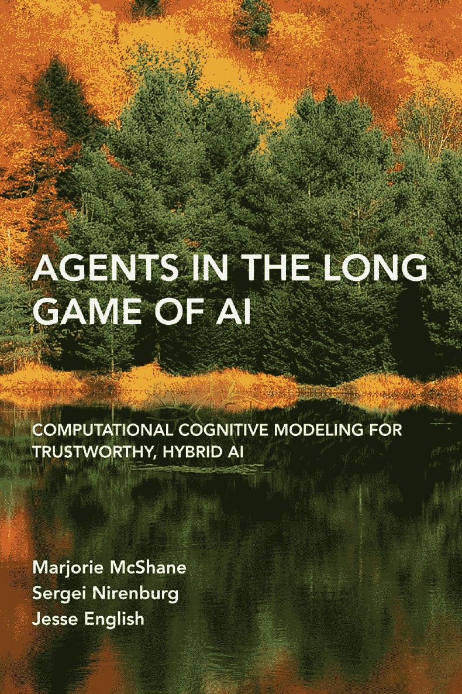

# AI 长期博弈中的代理：面向可信混合 AI 的计算认知建模



[LC 记录可用 `https://lccn.loc.gov/2023054788`](https://lccn.loc.gov/2023054788)

[LC 电子书记录可用 `https://lccn.loc.gov/2023054789`](https://lccn.loc.gov/2023054789)

# 8.4 解释推理

## 8.5 示例：作为导师和顾问的 LEIA 如何解释它们的推理过程

## 8.6 LEIA 操作的实证贡献如何影响解释性

## 8.7 马里兰虚拟患者系统中的解释可视化

## 8.8 作为整体智能体操作一部分的解释

# 9 知识获取

## 9.1 引言

## 9.2 获取本体论

## 9.3 获取词汇表

## 9.4 将知识获取与系统操作相结合

# 10 破主范式

## 备注

## 参考文献

## 索引

### 致谢

我们诚挚地感谢 Stephen Beale、Bruce Jarrell 和 George Fantry，他们的思想在我们的工作中持续产生回响；感谢 Kenneth Goodman，他激励了我们基于大规模数据集中的词汇共现概率来生成提示。这种智能的表象可能会给人一种 `AI` 中的语言问题——甚至整个人工智能问题已经得到解决的错觉。但事实并非如此。相反，`LLMs` 是一种工具，如果使用得当，可以为 `AI` 做出贡献。

## 第 1 章

当前的 LEIA 开发侧重于：

1. `LEIAs` 是`社会认知系统`。`LLMs` 是一种工具，如果使用得当，可以为未来 `AI` 的进步做出贡献。

2. `LEIAs` 是能够感知、推理和行动的`多模态系统`。

3. `LEIAs` 依赖于`知识表示`方法，以清晰、可追踪且可扩展的方式整合了静态知识和过程知识。

4. `LEIAs` 结合了`数据驱动`的证据。

5. `LEIAs` 使用包含`常识`和专家知识的`大型知识库`。这意味着从一开始我们就在解决扩展问题。

6. 对意义和大型知识库的共同强调使得 `LEIAs` 成为`内容为中心`的智能体。

7. `LEIA` 的本体论及其推理的大多数方面与语言无关，因此适用于跨语言场景。

8. 开发 `LEIAs` 的工作涉及`在开发将使用知识的推理器的同时进行知识获取`。

9. `LEIAs` 在`面向导向的语言理解与生成`方面特别强大。`LEIA`（语言赋予的智能体）这一名称反映了语言处理对 `LEIAs` 的重要，并不意味着语言是它们唯一关注的问题。

10. 解释的认知模型使 `LEIAs` 能够生成人类所需的直观、易懂的解释。

11. 为了利用数据驱动 `AI`（机器学习和数据分析）的果实，`LEIAs` 是`混合`系统。当它们解释包含数据驱动证据的推理时，它们会识别该证据的作用。

12. LEIA 工作计划结合了`基础科学`和`技术`。作为科学，它涉及构建受人类启发的理论和模型，包括解释人类认知的复杂方面。作为技术，它涉及构建随时间演进并在短期内实用的系统。目标是在科学与技术之间的甜点上工作，以便以实用的方式解决 `AI` 的长期问题。

13. `LEIA` 开发结合了`领域特定`和`领域无关`的能力。知识和功能尽可能与领域无关，但在必要时也具有领域特定性。

14. `知识表示`策略的进步使 `LEIA` 开发与早期 `AI` 的专家系统区分开来。

15. 在知识上运行的`控制程序`是`尽可能紧凑的，从而避免了将知识混入代码的陷阱，这会导致代码库不可渗透。

16. **知识获取方法论**将手动、半自动和全自动模式相结合，作为一种克服某些人所说的*知识瓶颈*的实践路径。然而，这是一个误称：并没有所谓的瓶颈——仅仅是工作需要完成。

17. LEIA 的设计初衷是作为人类的“去协作者”，而非替代者。这种分工模式让 LEIA 承担它们最擅长的任务，而将人类留给他们能够轻松胜任且必须负责的事业。后者缓解了伦理方面的忧虑。

18. LEIA 的目标是那些无法通过机器学习充分提供服务的应用。机器学习适用的应用一直是人们关注的焦点，并深远地影响了日常生活。然而，许多类型的应用尚未被尝试，因为机器学习尚不够用。LEIA 的开发寻求服务的正是这类应用。

19. 所有报告的算法都是计算机可处理的，其中大多数已以原型形式实现，这符合我们作为学术研究实验室的身份。实现对于测试想法和算法至关重要，因为系统构建的需求会凸显算法的缺陷。我们在原型中经过验证的解决方案随后可以由非研究人员的技术人员以主题和变体的精神进行扩展。

20. 任何根据书中描述的理论和方法论原则开发的认知系统，在我们的术语中都被称为 LEIA。本书描述了为什么以及如何开发 LEIA，并以我们研究小组的实现作为说明。本书是关于可解释性、意义导向型 AI 系列著作中的第三本：*本体语义学*（Nirenburg & Raskin, 2004）为基于本体论的语言处理奠定了基础，其续作*AI 时代的语言学*（McShane & Nirenburg, 2021）在代理体系统的语境下展示了进展。本书则更整体地描述了我们的各种代理体，将它们视为混合的、多功能的认知系统，其计算方法使新型 AI 能力成为可能——包括代理体系统提供能够赢得人类信任的解释的能力。

术语说明：在关于 LEIA 的段落中，`agent`（代理体）和 `LEIA` 术语可以通用，`model`（模型）和 `microtheory`（微理论）术语亦如此。

可以在 `https://faculty.rpi.edu/marjorie-mcshane` 访问在线附录。

# 2. 以内容为中心的认知建模

本书描述的语言赋予智能代理体（LEIAs）属于这类认知系统，旨在模拟人类的感知、推理和行动能力。但就以下参数而言，LEIA 研究与大多数认知系统研究有所不同之处：

1. LEIA 的设计用于使用大规模存储知识和自生成的情境知识，以支持它们对感知、决策和行动的推理。

2. LEIA 的设计用于进行终身类人学习，这涉及通过阅读以及与人类的“展示与说明”交互来获取知识。

3. LEIA 准备好解释它们的知识、推理和操作，目标是赢得其人类伙伴的信任。

我们对知识内容的强调解释了“*以内容为中心的认知建模*”术语的由来。LEIA 建模的基本原理列在第 1 章。本章介绍了 LEIA 底层的认知架构，概述了它们的符号-经验混合模式，并描述了支撑这一研发计划的选择和方法论。最后节将展示其与其它方法的比较。

## 2.1 OntoAgent 认知架构

我们的研究小组在一个名为 `OntoAgent` 的认知架构内开发 LEIA。图 2.1 展示了一个高层草图。为了演示的清晰，它没有显示所有的处理流，仅暗示了代理体的知识库在整个运行过程中起的核心作用。

```
Action
Output
Rendering
Situation Model (Working Memory)
Action Specification
Episodic Memory
Deliberation
“Reflexive” action
Lexicon
Opticon
Linking to outside world:
Perception
Interpretation
Ontology: Input
Perception Recognition
Knowledge Processing
```

**图 2.1** OntoAgent 的高层草图，它是支持 LEIA 开发的认知架构。在感知识别（Perception Recognition）和动作渲染（Action Rendering）模块中，数据驱动的方法起着重要作用。

`OntoAgent` 由：

1. 一组处理模块——图 2.1 中的五个角边形，见 2.1.1-2.1.5 节；

2. 一个知识基底，其主要组件是：本体（ontology）；将外部元素映射到本体概念的知识库，如词典（lexicon）和视觉索引（opticon）；情景记忆（episodic memory）；以及情境模型（situation model，也称为工作记忆）；

3. 基础设施组件，支持系统功能（例如代码库）和系统开发（例如 `DEKADE`：开发、评估、知识获取和演示环境；见 2.5.2 节）。

知识库和处理模块使用本体元语言进行建模，这使得 LEIA 具备元认知能力。代理体通过实例化名为 `AGENT-FUNCTIONING-FLOW` 的本体脚本处理输入，该脚本引导它们通过能够理解、记忆并解释的一系列事件进行处理。该脚本在 3.2.4 节描述。

除了遵循五阶段的推理密集型处理流外，代理体还可以执行“反射性”动作（如图 2.1 中的虚线所示），这模拟了生理反射以及类比推理。推理密集型处理和反射性处理在心理学文献中分别被称为*慢思考*和*快思考*（例如 Kahneman, 2011）。在慢思考和快思考之间做出选择是注意力管理的责任，它涵盖并指导了代理体的基本功能流。

`OntoAgent` 架构通过以下方式保持其感知、推理和动作模块之间的互操作性：(a) 在知识库和内部处理器中使用通用的、基于本体的含义语言；(b) 使处理结果对架构的所有模块可用。

迄今为止，基于 `OntoAgent` 开发的概念验证系统已展示许多功能，包括语言理解与生成、视觉感知结果的解释、内部感知（即对身体信号的体验）、多种推理和决策、学习、模拟动作、机器人动作以及模拟人类生理。

现在我们将遍历 `OntoAgent` 处理模块的五个阶段。

### 2.1.1 感知识别

当 LEIA 注意到一个新输入时，它从感知识别开始，这包括两个子任务：检测输入类型（如语音、文本或视觉）并为语义分析做准备。感知识别整合了数据驱动的系统模块。混合模式的细节以及待解决的挑战在不同感知模态之间有所异。

#### 语音输入

语音在进行语义分析之前必须转换为文本。语音转文本是一项非常适合机器学习的任务，而且目前有很多现成的语音转文本系统可用。

然而，转录错误是常有的，特别是当存在说话人重叠、背景噪声、碎片化言语，或包含专有名词或专业术语的语言时——对于熟悉自动生成字幕的人来说，这种列表并不令人意外。此外，语音转文本系统未能达到完全语义分析所需的程度处理韵律特征。例如，单词序列 `Tony drove to the store` 根据语调和重音，有不同的解释：

(2.1) a. `Tony drove to the store.` [一个陈述。]

b. `Tony` drove to the store? [是 Tony 去的而不是别人吗？]

c. Tony drove to `the store?` [他没有去别的地方吗？]

d. Tony `drove` to the store? [他不是通过其他方式到达的？]

e. Tony drove to the store??!! [我感到震惊或愤怒。]

在感知识别（Perception Recognition）期间，语音转文本系统需要为文本段装饰具有语言学信息的韵律特征，这些特征随后可以被 `LEIAs` 作为感知解释（Perception Interpretation）的一部分进行解读。韵律特征识别可能适用于机器学习方法，但目前仍研究不足（主流 AI 并不追求这种水平的语义或语用分析）。

#### 文本输入

尽管文本看起来是语义分析的直接输入，但复杂性潜伏在表面之下。所有有意义的排版规范都需要从语义或功能上解释：斜体、粗体、下划线、标题、列表、表格、戏剧中的对话轮次、图说明等。

在主流自然语言处理中，识别此类特征传统上由预处理器处理。事实上，自动标记此类特征是 21 世纪初语义网推进的目标之一。在没有被超文本标签装饰的文本中，所有这些特征都需要被识别并显式化，作为语义分析的输入。

#### 视觉

在模拟世界中，视觉输入可以使用符号或数据驱动的方法进行识别。例如，在过去的驾驶应用中，作为自动驾驶车辆操作员 `LEIAs` 根据图像在模拟环境中的符号编码进行识别。当以这种方式识别对象时，感知识别和感知解释就合为一体了，因为符号编码*就是*对对象的意义解释。

相比之下，在机器人应用中，图像和场景是通过视觉识别系统识别的，这些系统产生的数据由 `LEIAs` 转换为具有本体论基础的意义表示。这一过程由视觉接口（opticon）中介，它将数据驱动的感知识别系统的输出映射到本体论概念，这类似于词表对语言解释的作用（参见第 3.4 节）。

#### 内感知

内感知是对个人身体信号（生理、心理和情感）的体验。由于内感知会影响决策，因此在具身 `LEIAs` 中必须对其进行建模。在过去的一个项目中，扮演虚拟患者的 `LEIAs` 根据其心理和情感状态对模拟系统产生的生理信号进行不同的解释。某些患者（如处于巨大压力或患有疑病症的患者）将客观轻微的症状解释为剧烈，这可能会影响临床情景的发展。

内感知处理器根据代理体自我模型中的相关特征值，将客观生理信号转换为其体验。值得注意的是，内感知模型不需要非常复杂就能在不同代理和情况之间产生有用的区分。看到神经科学的进展如何为该模型提供信息将非常有趣，因为它提供了关于人们对客观相似刺激的体验存在差异的程度以及原因的证据。

#### 感知的其他通道

尽管我们在实现 `LEIAs` 方面的实际工作尚未涵盖所有感知通道（如非语音音频和触觉），但我们已实现的通道为其他通道提供了蓝图。例如，如果机器人需要在听到任何巨大噪音时停止，它需要将某些音频输入识别为本体论概念 `LOUDNOISE` 的实例，然后启动决策或反射（取决于该反应的实现方式）来停止。

同样，如果有人在听到金丝雀歌声后回答说“听听那个”，那么 `that` 指的是经过解释的音频输入，该输入必须映射到概念 `GOLDFINCH-SINGING`。任何可以使用传感器检测到的其他物体都可以类似处理。例如，如果医疗监测器要作为评估患者状态并发布警报的自动系统的输入，每个设备的输出必须转换为相关的本体表示，以供代理进行推理。

### 2.1.2 感知解释

感知解释是计算意义——这引发了“什么是意义？”的问题。尽管定义意义几个世纪以来一直挑战学者，但为了进行计算认知建模的实际工作，必须致力于某种定义。在 `LEIAs` 底层的本体语义学理论（Nirenburg & Raskin, 2004）中，代理感知的实体意义使用无歧、基于本体的元语言编码的知识结构进行建模。代理根据这些知识结构进行推理、学习和记忆。

使用具有本体论基础的意义表示的优点包括：

*   它们是无歧的且完全指定的。

*   它们由本体概念组成，每个概念在本体中通过属性进行描述。因此，代理推理时不仅基于它感知到的内容，还基于它对所感知的对象类型和事件的所有了解。例如，为了理解为什么一个人会说“看，那辆车没有保险杠”，必须知道汽车是有保险杠的。

*   除了元数据外，无论由哪种感知通道产生，它们在形式上是相同的。

*   它们独立于语言，这意味着大多数代理知识和操作可以应用于任何语言环境。

在真实世界数据和解释性知识之间进行自动转换是困难的，但这正是创建比今天的 AI 更像人的下一代代理所需的。

不同类型的意义表示（同一主题的变体）参与代理功能的各个方面：

*   **文本意义表示** (`TMRs`) 记录语音和文本输入的意义。它们在自然语言理解期间计算。

*   **视觉意义表示** (`VMRs`) 记录对视觉刺激的解释。它们在视觉解释期间计算。

*   **内感知意义表示** (`IMRs`) 记录代理对其模拟或机器人身体信号的解释。它们在内感知解释期间计算。

*   **生成意义表示** (`GMRs`) 记录语言生成的内容规范。它们作为关于动作推理的一部分计算。

*   **动作意义表示** (`AMRs`) 记录物理动作的内容规范。它们也是关于动作推理的一部分计算。

*   **心理意义表示** (`MMRs`) 记录了智能体记住但未在外部执行的推理结果。

*   以此类推，对于智能体环境中的任何其他输入、输出或内部推理活动也是如此。

所有意义表示——统称为 `XMRs`——都共享相同的本体论元语言和一组通用属性。因此，无论智能体如何学习某事，或者无论它为何要对某事产生想法，意义表示的基本形状和内容都是相同的。例如，下面的 `XMR` 表达了观点：一只名为 `Pogo` 的猫正在看着一只`小型、友好的狗`。索引表示这些是本体论概念的实例。

```
VOLUNTARY-VISUAL-EVENT- 1
AGENT CAT-1
THEME DOG-1
TIME
*find- anchor- time*
CAT- 1
AGENT-OF
VOLUNTARY-VISUAL-EVENT- 1
HAS- NAME “Pogo”
DOG- 1
THEME-OF
VOLUNTARY-VISUAL-EVENT- 1
FRIENDLINESS .8
SIZE .2
```

该意义表示的读取方式如下：

*   第一个帧由概念 `VOLUNTARY-VISUAL-EVENT` 的实例开头。概念通过小型大写字母（small caps）与英语单词区分来。这并非空洞的大写语义，因为本体论概念是使用支持对语言和世界进行推理的属性定义的。

*   `VOLUNTARY-VISUAL-EVENT-1` 有三个与上下文相关的属性值：它的 `AGENT`（观察者）是 `CAT` 的实例；它的 `THEME`（被观察者）是 `DOG` 的实例；该事件的 `TIME` 是言语时间。后者的填充值 `*find- anchor- time*` 是一个过程化语义例程的调用，当需要时间锚定时可以运行该例程。

*   下一个帧以 `CAT-1` 开头，不仅显示了与 `VOLUNTARY-VISUAL-EVENT-1` 的反向关系（`AGENT-OF`），还显示了这只猫的名字是 `Pogo`。

*   下一个帧以 `DOG-1` 开头，不仅显示了与 `VOLUNTARY-VISUAL-EVENT-1` 的反向关系（`THEME-OF`），还显示了该狗的两个特征：在 `SIZE` 的抽象 `{0–1}` 标度上，它是 `small—.2`；在 `FRIENDLINESS` 的抽象标度上，它是 `friendly—.8`。根据惯例，未修改的高或低属性值值距离抽象 `{0,1}` 标度的极高或极低端 `.2`，这为解释诸如 `*very friendly* (`FRIENDLINESS .9`)` 和 `*extremely friendly* (`FRIENDLINESS 1`)` 这样的表达式留下了空间。


# 注意事项

概念 `FRIENDLINESS` 反映了一个比英语单词 `friendly` 更通用的概念，并支持一大类修饰词的语义解释；例如，`hostile` 的意义被表示为值为 0 的 `FRIENDLINESS`。这种记录标量属性的方法遵循了 Hayes (1979) 的精神，避免了本体论概念不必要的扩散。

上述意义表示是一种抽象：正如我们所说，它表达了一只名为 Pogo 的猫正在看着一只小型、友好的狗的观点。如果它是从实际的感知行为生成的，它将包含带有智能体推理轨迹的元数据。例如，如果它是从语言输入 `A small friendly dog is being watched by Pogo the cat` 生成的，那么它将是一个 `text` 意义表示 (`TMR`)，它指示每个帧所分析的单词编号（`word-num`）、单词本身（`textstring`）、用于生成分析的词义（`lex-sense`）以及帧中使用的其他单词和词义——通常作为修饰符（`uses-word`、`uses-lex-sense`）。

书中所有的知识结构都以易于阅读的格式呈现，根据其所要说明的点包含或排除细节。意义表示的某些方面在行内用通俗的英语进行解释，并以分号开头。`LEIA` 使用的实际知识结构示例在在线补充材料中给出。至于意义表示，它们通常以很少或没有元数据的形式呈现，以便聚焦于智能体用于推理的语义内容。

```
A0 small1 friendly2 dog3 is4 being5 watched6 by7 Pogo8 the9 cat10
VOLUNTARY-VISUAL-EVENT- 1
AGENT CAT-1
THEME DOG-1
TIME
*find- anchor- time*
word-num 6
textstring watched
lex-sense watch-v1
uses-word 4, 5, 7 ; 合并到被态变换中
CAT- 1
AGENT-OF
VOLUNTARY-VISUAL-EVENT- 1
HAS- NAME “Pogo”
word-num 9
textstring the
lex-sense the-det5 ; 结构“NPNAME the NPANIMAL/SOCIAL-ROLE”
uses-word 8, 10 ; Pogo, cat
uses-lex-sense cat-n1
uses-lex-sense personal-name- n1 ; 用于 “Pogo”
DOG- 1
THEME-OF
VOLUNTARY-VISUAL-EVENT- 1
FRIENDLINESS .8
SIZE .2
CORE
block- coref ; 因为 ‘a’
DISCOURSE-RELATION TOPIC ; 因为 *dog* 是被动句的主语
word-num 3
textstring dog
lex-sense dog-n1
uses-word 0, 1, 2
uses-lex-sense a-det1
uses-lex-sense small-adj1
uses-lex-sense friendly-adj1
```

## 第 2 章

相比之下，如果机器人智能体通过观察场景学习了这些信息，它将生成一个 `VMR`，其中将装饰有关于场景中哪些元素被用于识别智能体已知为 `Pogo` 的猫的所有元素的信息。

意义表示作为学习的一部分整合到智能体的长期记忆中（见第 7 章）。如果信息是通用的，它会增强本体；否则，它将成为记忆记忆。将新信息整合到现有知识中需要一系列决策，例如：该信息是否关于已知的对象或事件，还是应该为其建立新的锚点？对于与现有知识冲突的新信息应该如何处理？如何以及何时应该将重复活动转化为概括，例如某人每天都喝咖啡这一事实？这种决策过程作为内存管理的一部分执行。

### 2.1.3 审议

`Deliberation` 模块是 LEIA 架构中的一个模块。然而，完全避免使用 `reasoning`（推理）一词将显得不自然。因此，我们相信读者会铭记于心：推理贯穿整个 LEIA 的运行过程，并会乐意理解 `reasoning` 一词在不同特定语境下的具体含义。

LEIA 的推理在许多方面模拟了人类的行为。首先，它考虑了信念、偏见、直觉、决策启发法以及人类功能中其他不完全理性的方面。其次，它围绕“可操作性”（actionability）展开。这意味着 LEIA 的设计旨在检测它们何时已经对情况有了充分的理解以采取行动。在高风险情况下，可操作性的标准会非常高；而在低风险情况下，智能体可以允许出现失误，随后可以通过与人类伙伴的交互来纠正。最后，LEIA 的推理淡化了从第一原理推理，这是早期 AI 的关注重点。因此，搜索效率并不是 LEIA 的核心关注点。相反，它们通过存储的计划来实现目标。虽然人类确实具备搜索能力，但他们似乎只在游戏之外的有限语境中使用它。因此，以内容为中心的建模强调使用记忆、习惯性的解决方案来进行启发式决策。当没有已知计划能导致目标时，LEIA 作为社会智能体，倾向于寻求帮助而非独立探索。这可以被视为认知吝啬者理论（Stanovich, 2009）的一个方面，该理论认为 `最小努力原则` 对认知努力的适用程度不亚于其他人类活动。为了节省精力而优先选择通信而非探索，仅对于具备语言能力的社会智能体是可行的。如果由于某种原因在特定无法与人类协作，那么智能体可能会选择进行第一原理推理，例如通过使用部分匹配和类比推理来修改已知计划。例如，记住如何利用透镜通过阳光点火，让现代“鲁比逊·克鲁索”阿尔瓦罗·塞雷索（Alvaro Cerezo）能够使用装满海水的塑料袋来实现这一目的。他不需要从零开始制定计划；只需通过一种新颖的方式满足一个前提条件——透镜的可用——来修正已知计划。他之所以能这样做，是因为他理解透镜的本质。总之，以内容为中心的建模努力通过从结构化知识中检索来取代搜索。它强调了启发法的核心地位，并削弱了搜索空间的动态生成以及搜索本身的重要性。

`Deliberation` 模块中进行的推理类型通过示例说明最为恰当，第 6-8 章提供了丰富的示例。作为对比，第 2.7.1 节讨论了数据驱动 AI 中的推理。

### 2.1.4 动作规范 (Action Specification)

`Deliberation` 模块的输出是智能体关于做什么的决策，但还没有如何做。如何做将在 `Action Specification` 模块中确定。例如，当被提问时，智能体必须决定在回答中提供多少哪些细节、使用何种通信模式（语言和/或身体语言）、表达哪些风格特征（礼貌、正式、热情），以及哪些具体的句子和/或手势最符合给定上下文。`Action Specification` 的所有这些方面将在后续章节中使用对话交互示例进行说明。`Action Specification` 的输出是一个意义表示，需要使用合适的执行器（如文本生成器、语音合成器或机器人运动执行器）渲染为实际动作。

### 2.1.5 动作渲染 (Action Rendering)

动作渲染最自然的方法是使用机器人、视频模拟和文本转语音等领域开发的数据驱动方法。因此，动作渲染位于 LEIA 认知建模核心之外。然而，认知处理的结果必须转换为数据驱动动作生成模块所预期的格式，正如数据驱动处理的结果在 `Perception Interpretation`（感知解释）阶段必须经过认知解释一样。对于自然语言生成，`Action Rendering` 被分为多个阶段，每个阶段使用具有不同原理和对性能有不同预期的不同数据驱动工具（参见第 4.3 节）；这是符号方法和数据驱动方法如何在 LEIA 中进行策略性整合的良好示例。

## 2.2 混合化 (Hybridization)

正如我们所见，数据驱动工具在 LEIA 架构的边缘——即 `Perception Recognition` 和 `Action Rendering` 模块中起着重要作用。数据驱动工具在其他地方也起着支持作用。它们的贡献不仅是方便的，而且与认知建模原则一致：(a) 技能与审慎过程之间的区别，(b) 习惯在人类功能中的作用。

正如前面提到的，人类推理可以被看作是“快思考”和“慢思考”的结合——称为系统 1 和系统 2（Kahneman, 2011）。快思考涵盖了反射性的、习惯性的技能，而慢思考涵盖了审慎过程。在 AI 方面，作为最粗略的抽象，数据驱动工具实现了快思考，而符号方法实现了慢思考。然而，真实情况要微妙得多。

技能是不涉及意识思考或决策的行为，例如行走、捡起杯子或识别树。基于机器学习（ML）——特别是深度学习——的系统已被证明在机器人和模拟系统中模拟某些人类技能方面非常有用。让机器学习 特别适用于实现技能的原因是，在通常情况下，只要执行得可靠，就不需要解释。然而，这并不意味着机器学习生成的技能与人类技能完全等同。例如，人们可以解构自己的技能以提高性能、教他人或适应非传统环境。职业网球练习发球、卡车司机在冰雪面上下坡以及生物学家教授学生区分鳄鱼和短鳄，都是在通常自动完成的活动中调用了意识思考，这种思考涉及随挥动作、分解距离和口鼻形状等概念。

习惯源于最初涉及慢思考的动作的重复，随着时间的推移，这些动作变成了快思考的捷径。并且在某个时刻，决定将它们封装成一种习惯。这是通过一个名为 `CREATE-HABIT` 的记忆巩固函数实现的，该函数是 `Deliberation`（协商）模块的一部分。具体来说，当 `CREATE-HABIT` 脚本实例化时，它会生成一个包含给定序列的新脚本。这种脚本保留了原始的痕迹，并对慢思考，这种脚本有助于在需要时对整体情况进行重新规划。这种脚本的生成类似于 `LEIA` 在对话应用中。

代理可以提供推理的另一种方式是直接提供推理。例如，在对话应用中，与其通过语义分析来获取推理，不如让代理根据“好”的逻辑来响应，这种方法可以确保代理反射性地做出“好”。这表明，通过模型来解释人类推理的复杂性并模拟其行为，不仅可以节省时间，而且在推理和规划中是有效的。这种方法可以确保代理在需要时，能够对“好”的逻辑做出响应。

通过 `LEIA` 的模型来解释推理是可行的的。这种协商性的（慢思考）推理提供了解释力，它是认知建模的优势。

此类系统最好被视为在以下情况下有效的“神言”（oracles）：在不需要解释的领域中，通过知识工程提供有效的结果；在需要解释的情况下，通过 `LEIA` 提供有效的结果。在这些情况下，`神言`的结论是可计算的。

将 `LEIA` 视为混合而非纯符号的，在许多方面是有意义的：

1. 某些功能（如运动）可能永远是不可计算的。
2. 某些功能（如医学模式识别）本质上是依赖的。
3. 某些功能跨越了可解释与不可解释的界限。例如，虽然模型可以可靠地区分猫和狗，但它无法解释区分猫和狗的特征（如口鼻的长度、耳朵的形状和尾巴的灵活性）。
4. 某些数据驱动的功能可以帮助 `LEIA` 从有效的选项中做出选择。
5. 某些数据驱动的功能可以通过大语言模型（`LLMs`）提供有效的输入。
6. 最后，尽管 `LEIA` 的建模具有显著的倾向性，但这种方法在实践中是有用的。

## 2.3 LEIA 的整体方法论

认知建模的方法论选择可以追溯到权衡。作为一种初步近似，认知科学中的理论是抽象的，描述了人类是如何运作的；模型则受到实际考量的影响，同时也受到理论见解的影响。这种权衡是 `LEIA` 开发的核心，并值得进一步讨论。

### 理论

理论旨在解释现实，尽管在具体化方面具有很大的自由度。理论不受计算性或可实现性等问题的限制。我们与 Cartwright (2016, 第 4.1 节) 的观点一致：自然规律很少是真实的，且在认识论上是弱的。因此，作为规律集合的理论无法支持我们预期的各种推理。这一观点继承了 Cartwright (1983) 的观点：“解释一个现象就是找到一个将其纳入基本框架的模型，从而允许我们推导出有效的、复杂的现象规律，这种规律是真实的”（第 152 页）。理论指导了开发者对模型性质、输出和预期的思考。支持 `LEIA` 开发的理论之一是本体语义，它影响了 `LEIA` 语言处理的所有方面。

### 模型

认知模型描述了 `LEIA` 处理特定现象的方法。模型必须是可计算的，完全依赖于构建模型时可用的技术和知识库。如果理论中起关键作用的某些特征无法计算，那么它必须被一个可计算的代理所取代（如果存在），或者必须从模型中排除。换句话说，与理论不同，模型必须包含具体的决策算法和可计算的启发式方法。

模型必须涵盖尽可能的数据，但同时必须接受精心选择的简化以保持实用性。过去人类启发式机器学习的研究表明，构建具有大型参数集的决策函数是适得其反的；简单的启发式方法通常更好。

人们执行心理任务时必须付出的努力。作为初步近似，人类的低认知负荷应转化为机器更简单的处理挑战，并相应地对结果产生更高的信度。当然，这是一种理想化，因为某些对人类来说简单的分析任务——例如检测讽刺——对机器来说可能是困难的。然而，基本的洞察仍然有效：LEIA 必须意识到其处理过程中的认知负荷，并有一个长期目标以及相应的计划集来控制其认知负荷。

至于可操作性（Actionability），它捕捉了这样一个观点：人们通常对语言和情况只有不完善且不完整的理解就能应付。LEIA 必须模仿人类的能力，判断它们对特定输入的理解是否足以对其做出充分回应，或者是否需要进行某些修复活动，例如与人类团队成员启动澄清对话。

代理对认知负荷、置信度和可操作性的评估在不同语境下的表现不同。例如，如果代理检测到其人类合作者正在进行无关主题的闲聊，它可以考虑将其对这些言论可能的糟糕分析视为 `actionable`，相应的行动是 `忽略这些言论`。相比之下，如果一个 LEIA 正在支持外科医生，对指令解释的任何低于完全置信的情况都将导致澄清子对话，以避免潜在的灾难性错误。

最后，模型必须将理论识别为最重要的因素操作化。认知负荷和可操作性为这一要求提供了有用的性说明。解释给定输入的认知负荷可以使用一个考虑每个贡献任务的数量和复杂性的函数来估计。考虑语言理解中复杂度谱两端的各一个例子。句子 `Jessica ate an apple` 如果给定的语言理解系统生成了单一的规范的句法解析，在词典中仅找到 `Jessica` 的一种含义和 `apple` 的一种含义，并且在只有其中一种含义符合人类代理和可摄入主题这一事实下，能够轻松消除 `eat` 的多种含义的歧义，这将导致一个低复杂度、高置信度的分析。

在复杂性和信度谱的另一端，是对一个包含多个未知单词的长句的分析，这种分析会导致破碎的句法解析，并对多个不连接的输入片段产生多个得分相似的语义分析。

### 系统

从模型到系统的转变使我们离开理论的整洁抽象的世界又远了一步。模型致力于特定的现象，而代理运行的整体任务涉及将许多现象的处理整合到一个单一过程中。因此，构建全面的代理需要整合各个单个现象模型的计算实现。这反过来要求管理潜在的跨模型不兼容性，我们现在将阐述这一概念。

任何研发计划必须考虑努力的经济性。如果用于认知代理某些处理模块的算法和计算系统已经存在，那么开发者至少应该考虑使用它们。然而，导入代码（即使是高性能代码）是有成本的。外部开发的组件和工具可能实现了不同的显或隐式模型，因此需要额外的集成工作。

考虑自然语言处理领域的一个例子。可供通用使用的不同语言分析和生成工具依赖于不同的词性标记、句法成分和语义依赖关系列表。因此，如果要将一个现成的预处理器或句法解析器导入到语言理解系统中，源模型和目标模型中原语的形式和内容必须对齐——这不仅需要付出巨大的努力，还可能迫使对目标模型进行修改。

跨模型不兼容性问题没有通用的解决方案，因为对于认知建模基础的抽象分析没有单一的正确答案，而且人们非常自然地倾向于坚持自己的个人偏好。因此，模型对齐是开发代理系统的必要要求，必须进行主动管理。

然而，其成本是巨大的，而且不仅仅是初始的集成工作，因为外部开发的资源随着时间的推移可能会改变输出内容和格式。事实上，导入处理器的成本极大影响我们在内部开发许多 LEIA 模型和系统的决定。尽管如此，正如 2.2 节所述，导入的数据驱动系统是架构侧翼——感知识别和动作渲染的自然选择，它们还可以指导某些类型的推理——例如，自动 X 射线分析有助于临床决策。要学到的教训是，评估将系统模块以及计算模型导入认知代理系统的成本与收益是非常关键的。

构建系统的另一个挑战是，所有子系统（无论是导入的还是内部开发的）都是容易出错的。即使是最简单的能力，如词性标记，在目前的技术水平也远非完美。这意味着下游组件必须预判上游错误，并准备管理整体的错误级联——所有这些都代表了与正在实现的模型在概念上的疏远。

由于上述及其他实际考虑，实现的系统不太可能精确地镜像它们所实现的模型。这增加了评估模型质量的任务。如果想对模型进行纯粹的评估，则模型必须在不现实的前提下进行测试，即实现该模型的系统获得了完美的上游结果。在这种情况下，任何错误都会被确信地归于模型本身。然而，满足这一前提通常需要人工干预，而在过程中引入这种干预将使该系统在任何有趣或实用的意义上都不是真正的计算系统。

该系统将成为模型-系统混合体，而不是计算系统。只要人们像我们那样坚持系统必须是完全自动的，任何评估都只是对系统的评估，在最好的情况下，它将提供关于底层模型质量的有用见解。

### 2.4 微理论

在 LEIA 研究中，我们传统上将上述类型的模型称为 `微理论`（microtheories）。微理论是对认知过程的解释性的、广泛覆盖的、启发式支持的处理，这些过程在计算系统中实现并随着时间的推移而增强。它们详细说明了 LEIA 如何解释语言和世界的现象，它们如何执行动作，以及它们不可观测的内部运作是如何组织的。

微理论的一些值得注意的方面如下：

- 微理论可以有 `宽或窄` 的范围。宽微理论的例子是封装整体认知架构的（第 2.1 节）。窄微理论的例子是用于解释省略动词短语的（第 5.2 节）。
- 宽范围的微理论 `包含` 窄范围的微理论。例如，代理架构微理论包含了，其他之外的对话管理、可操作性评估以及解释的微理论。同样，自然语言处理的微理论包含了语言理解和语言生成的微理论，而每种微理论反过来又包含了处理大量语言现象的微理论。
- 微理论并非 `孤立开展的`；它们必须与认知架构及相关认知系统中的其他理论集成。


## 微理论的发展

微理论的发展涉及对问题空间进行`初始的自上而下描述分析`，然后对特定现象进行详细的、支持算法的处理，这些处理将被实施并持续不断增强。自上而下的分析有助于避免演示系统中常见的情况，即每当遇到新的复杂情况时，就必须放弃对少数示例有效的解决方案。

微理论必须是`可实施的`；它们不能依赖于无法实现的先决条件，或希望他人会开发出满足这些先决条件的方法。然而，它们必须允许这样一种可能性：在特定情况下，某些类型的证据可能是不完整、不完美或不可用的。

微理论必须指定如何`整合`由其他微理论生成或从外部知识资源获取的启发式。例如，它们必须：
a) 处理导入资源与原生资源之间概念和基于形式化的不匹配；
b) 在整合来自数据驱动系统的本质上不可解释的证据时，尽可能地保持可解释性；
c) 估计纳入不可解释的启发式如何影响智能体对其操作结果的整体置信度。

微理论随着时间推移`而开发，通常从特定应用中是最易处理或最紧迫的现象开始。解决方案为未来的增强留下了空间。自然地，随着人们接近最困难的案例，问题只会变得越来越复杂。

智能体被配置为`独立评估`相关微理论的当前状态是否允许它们在给定语境下自信地行动——例如，它们的指代程序是否能有信地识别特定代词的指代对象。

根据置信度估计以及情境特征（例如高风险或低风险），智能体被配置为做出`可操作性判断`：即关于它们是否可以继续进行推理的决策。做出这些判断的方法记录在可操作性微理论中。

可操作性判断反映了`自我意识`，是创建短期内既有用又值得信赖的协作智能体的关键（它们在高风险情况下不会仅仅是猜测），同时随着时间的推移变得更加成熟。

在描述 LEIA 时，`model` 和 `microtheory` 术语是可以互换的。

## 2.5 实践方法论：注重实施

方法论是以内容为中心的建模各个方面的关键，将在全文中介绍。本节重点关注旨在使 LEIA 可行的两种方法论：(1) 简单优先、可扩展的开发和 (2) 使用图形与工具。

## 2.5.1 简单优先、可扩展的开发

无论处理哪种现象，都可以从询问`哪些示例是简单的，哪些特征是显性的？`开始。

为了具体化上述内容，考虑以下类型的悬缺（gapping），如例句所示：

(2.2) a. Delilah is studying Spanish and Dana, French.

(2.2b) ? Delilah is studying Spanish and my car mechanic, who I’ve been going for years, fuel-injection systems.

(2.2b) 的不恰（由问号指示）源于：

- 缺乏简单性：第二个并列句包含了关系从句 `who I’ve been going for years`；
- 缺乏句法对称性：而第二个并列句包含一个关系从句，第一个则没有；
- 缺乏本体论典型性：而语言是典型的研究主题，燃料喷射系统不是。

这个例子说明了上述引入的元参数是根于语言现实的，这解释了为什么它们在建模各种现象方面被证明如此有用——不仅在英语中，在其他语言中也是。

正如之前提到的，在简单优先的建模中，智能体必须能够独立地确定模型如何处理不同类别的示例以及以多大的置信度。没有“神谕”（oracle）来告诉智能体它们`可以`自信地理解`这个`示例，而`那个`示例太难了。尽管提到神谕似乎很奇怪，但它们一直是许多特定任务竞赛的基石，通常被用于衡量 AI 的进展，特别是在自然语言处理领域。任务定义包含了在语料库标注期间遵循的准入和准出标准，这些标准限制了系统负责的范围。复杂的现象被手动排除在范畴之外，这遵循了“触手可及”原则。结果是，在这些人工任务条件下获得高评估分的系统，在真实世界环境中的表现要差得多。

相比之下，LEIA 倾向于处理所有现象。例如，它们对意外的（不符合语法的、充满未知词的）语言输入的分析可能不够详尽且置信度较低，但它们可能足以作为如何做出响应决策的输入——这可能包括要求说话者澄清、等待后续发生的情况、尝试即时学习未知表达式等。这说明了一个事实：尽管“简单优先”的建模适用于单个微理论，但智能体的操作运行会同时调用许多微理论；而当一个微理论可能不足够用时（例如，语言输入未被充分理解），另一个微理论可以介入（例如，智能体可以要求说话者澄清）。

另一个简单优先建模的例子来自导师辅导领域。在马里兰虚拟患者临床培训应用中（见第 8.5 节），虚拟导师会提供与良好临床实践相关的指导。例如，如果受训者诊断了疾病或推荐了临床上不恰的测试或程序，导师会指出错误。这种辅导支持，通过与虚拟患者交互进行试错学习，产生了一个实用的训练环境，尽管在项目参数范围内，导师并没有被设计为提供人类专家可以提供的每种方面的建议。

由于微理论的演化本质对 LEIA 的开发至关重要，第 5 章专门用于阐述这一点。

## 2.5.2 图形与工具

如果没有允许开发者视觉化、检查和修改知识库、认知模型以及系统处理结果的工具支持，开发大规模、可扩展的知识型系统将是不可能的。两类图形和工具对这种协作至关重要：用于计算认知建模的绘图工具，以及支持 LEIA 开发的专用工具包，其名为 `DEKADE`。

### 绘图工具

计算认知建模具有很高要求，特别是对于模块需要以复杂方式相互作用的综合智能体系统。我们发现，使用先进工具进行绘图在以下方面提供了极具价值的支持：

1. 我们的认知模型是算法，与计算机科学领域传统上以图形表示的算法并不相似。
2. 现代绘图环境引人入胜并能产生良好的效果，这减轻了人们在尝试解决困难建模问题时的认知负荷。
3. 认知系统的开发需要知识工程师与系统工程师之间的紧密协作。知识工程师通过单向管道将算法传递给系统工程师是不够的，因为知识工程师理解系统如何随时间推移演进，这对软件设计具有重要影响。图表有助于在知识工程师和系统工程师之间建立“共同基础”，共同基础定义为他们双方都需要充分理解并认可的算法水平。在共同基础之下，系统工程师可以根据自己的意愿进行实现。共同基础实际上比人们预期的要深：为了开发经得起时间考验的认知系统，知识工程师和系统工程师都需要跳出传统的角色和舒适区。
4. 能向外界解释认知模型是非常重要的，特别是对于想要确保其真实性的领域专家。图表有助于为此目的建立算法的内容验证层级。

### DEKADE 环境

`DEKADE` 是支持 LEIA 研究与开发的图形化开发、评估、知识获取与演示环境。它能够：

* 查看并获取词汇表、本体论和情节记忆；
* 在测试-调试模式运行自然语言理解引擎；这涉及输入文本、对其进行语义分析、查看其评分的 `TMR` 候选结果、查看处理轨迹，并根据需要修改知识和处理器；
* 在测试-调试模式运行自然语言生成引擎；这涉及选择或生成生成意义表示（`GMRs`）作为输入、运行生成器、查看评分的句子输出、查看处理轨迹，并根据需要修改知识和处理器；以及
* 在应用期间，通过动态填充的底层面板查看智能体的推理轨迹。

关于 `DEKADE` 功能的截图和更多细节可参阅在线附录。

就本文讨论而言，重要的一点是，我们正处于一个与半个世纪前知识型 AI 早期阶段完全不同的技术世界，在那个时代，计算的一切都是缓慢、笨拙且有限的。今天，可以快速构建强大、便捷的工具，从而开发依赖于大型、高质量、人工策划的知识库的系统。

## 2.6 以内容为中心的认知建模回顾

以内容为中心的认知建模提供了从理论到应用系统的路径，并追求短期、中期和长期目标。短期目标之一是跨领域配置实用的系统，同时最大限度地重用知识库和智能体功能。中期目标是达到高质量本体论和词汇知识的临界点，以支持智能体的独立终身学习。长期目标是在日益复杂的 LEIA 应用中实现高质量的终身学习操作化。在这种范式中，支持系统的知识（无论是演示系统还是已部署的系统）都不会被丢弃；它会被添加到底层的以内容为中心的认知模型的累积知识中，并可以在后续系统中使用。

## 2.7 与其他方法的比较

人工智能领域的贡献可以根据许多参数进行描述，例如计算方法、由方法或任务驱动的应用选择、目标应用、开发工作的时间跨度、研究与开发的平衡、是否存在人类启发的建模、可解释性、可扩展性等。LEIA 在许多这些参数上与数据驱动的 AI 系统不同，并在关键参数上与其他认知系统不同。接下来的小节指出了一些显著的对比。

### 2.7.1 与数据驱动 AI 的缩略对比

大多数现代 AI 系统使用数据驱动的方法来配置可以在短期内部署的独立应用程序。该领域很大程度上受商业利益驱动，优先考虑配置立即有效的技术。然而，科学目标也在得到追求，主要是在学术界和政府机构中。随着新的计算方法获得领域的关注（最近是深度学习），从业者会寻找由它们服务的应用领域。

本书并不是为了对 AI 进行综述。首先，本书的贡献在于其他方面：提供了一种替代性的（非主流的）路径，用于配置展现出人类智能特性的系统。其次，在短的空间内无法对 AI 这样广阔的领域进行充分综述。最后，关于子领域和个人研究方向的综述随处可见。我们提出的并不是任何综述性的内容，而是一份概要草图，它围绕数据驱动的 AI 与 LEIA 之间的四点对比展开，以引导读者。这些对比涉及意义、推理、应用和可解释性。

#### 数据驱动 AI 中的意义

数据驱动的 AI 在未经解释的词汇上运行；它并不追求语言学家和哲学家所理解的意义计算。当使用 `meaning`（意义）和 `semantics`（语义）等词描述数据驱动系统时，会根据技术实际能提供的内容对其进行重新定义。

尽管数据驱动系统并不计算完整的语义和语用分析，但人们投入了大量精力计算可以提高系统性能的语义和语用特征，例如语义角色、指代关系、时间关系和话语关系。此外，被称为 `distributional semantics`（分布语义）的统计方法将以下直觉操作化：“一个词由它所处的环境决定”（Firth, 1957）以及“出现在相似语境中的词往往具有相似的意义”（Turney & Pantel, 2010）。分布模型擅长计算词与词之间的相似性。例如，它们可以确定 `cat` 和 `dog` 的相似性高于其中任何一个与 `airplane` 的关系，因为 `cat` 和 `dog` 经常与许多词共同出现：`fur`、`run`、`owner`、`play`。此外，像 `Pointwise Mutual Information`（点互信息）等统计技术可以检测某些词比其他词更能指示词的意义。例如，虽然 `fur` 是狗的特征，但像 `the` 或 `has` 这样经常与 `dog` 同时出现的高频词并不是狗的特殊特征。尽管分布语义已被证明对文档检索等应用有用，但它并不是计算意义的全面方法，因为它只考虑了词的共现。在它没有考虑的事项中包括：

- 词的顺序，这可能产生深远的语义影响：`X attacked Y` 与 `Y attacked X`；
- 它们的组合性，即一组词的意义在多大程度上可以通过每个组成词的意义来预测；例如，在大多数语境下，`The old man kicked the bucket` 并不是指他脚踢了一个圆柱形开放容器；
- 语言中任何隐藏的意义来源，如省略和隐含。

#### 数据驱动 AI 中的推理

由于数据驱动的 AI 系统不计算意义，因此无法以类人类的方式进行推理，尽管某些系统创造了推理的错觉——例如下棋或进行机器翻译时。但对于机器来说，什么是推理呢？一些开发者认为定义在于基准测试。也就是说，如果建立了一个推理的标准，并且一个系统满足了该标准，那么它就进行了推理。

在写作期间，关于推理的评估正针对语言模型（LLMs）进行严谨讨论，这些模型可以以类人类的方式生成文本并响应某些类型的查询。专业人士和普通人对这项新技术的反应层出不穷。对于 LEIA，关于 LLM 的两点至关重要：

1. **LEIA 的开发并未被 LLM 技术取代或失效。** Mahowald 等人 (2023) 从以下两者的对比解释了 LLM 的成就和缺陷：(a) 形式语言能力，即生成听起来像给定语言文本的能力；以及 (b) 功能能力，即在世界中理解和使用语言的能力。他们说，“LLMs 在需要形式语言能力的任务上表现出令人印象（尽管并不完美）的性能，但在许多需要功能能力的测试中失败了”（第 1 页）。Bubeck 等人 (2023, 93–94 页) 列出了名为 `GPT4` 的 LLM 的缺陷：模型不知道自己何时正在猜测；它编造事实；它使用的上下文非常有限；它无法学习或适应环境的变化；它无法针对用户进行个性化；它在推理中似乎认知偏差；其事后解释可能从有用到错误或无关。因此，虽然 LLM 无疑是一项令人兴奋的突破，有望在各种实际应用中带来重大的技术进步，但它们在理解人类认知或创建基于理解的推理计算模型方面并没有提供理论上的进展。相反，它们通过基于海量文本示例计算文本最可能的后续来生成看似合理的文本。

2. **LLM 可以像其他数据驱动工具一样为 LEIA 提供服务。** LLM 技术可以也应该用于支持计算认知建模。LLM 形式的、表层的语言能力为 LEIA 执行的某些任务的多引擎方法提供了可能。到目前，我们已经尝试过在语言生成中筛选候选句子（第 4.3 节）以及为 LEIA 准备学习材料（第 7.1.3 节）中使用它们。LLM 的可用还处于早期阶段，所以我们刚刚开始完善它们在 LEIA 操作中的潜在用途。

正如 Yogi Berra 所言，做预测是很难的，特别是关于未来。目前，对基于深度神经网络的 LLM 技术对科学的影响进行深度的推理评估显然为时过早了。我们打算在未来的工作中回到这个话题。

让我们回到比较 LEIA 的推理与 LLM 等数据驱动系统的推理的问题上。数据驱动系统不以类人类的方式进行推理，因此当它们被要求解释时，它们必须事后编造一些内容，这些内容可能是有用的、错误的或无关的。

#### 应用领域

大多数数据驱动 AI 应用针对单一能力，可以被称为孤立系统（silo systems）。读者对数据驱动 AI 的成功非常熟悉，它为网络搜索、路线引导、物体识别、下棋、产品推荐、机器翻译等提供了系统。

但尽管数据驱动 AI 极大地满足了某些需求，其他需求仍未解决。例如，孤立系统往往表现僵化。如果一个 AI 系统被训练在具有特定布局的网格上玩游戏，如果该布局的任何方面发生了变化，系统就需要重新训练——你不能直接告诉系统“像以前一样玩，但加上额外的行”。另一个问题涉及结果的天花板。系统竞赛排行榜经常显示冠军的分数处于 70 或 80 百分位数，此时开发者就会放弃该任务，因为首选方法没有提供改进空间。

另一个进入主流 AI 议程的问题是处理复杂应用领域的挑战，例如整体临床医学。最后，数据驱动 AI 缺乏解释力被认为是其在关键领域采用的一个严重限制，这也是我们现在转向的话题。

#### 数据驱动 AI 中的解释

解释对于数据驱动 AI 系统来说是一个问题，因为它们的计算方法对于内部是不透明的...

## 第 2 章

它们的开发者。出于此，它们经常被描述为`黑箱`。可解释性的缺失是一个问题，因为在最近的一项调查中，解释性在可能阻碍 AI 广泛接受和部署的十大风险因素中排名第三，仅次于网络安全和监管合规（麦肯锡分析，2021）。

### 为什么可解释性很重要？

因为在医疗、法律、国防和金融等领域，结果会导致后果，而对这些后果负责的决策者以及受影响的个人，都没有准备好盲目信任机器。

令人奇怪的是，尽管缺乏解释能力，AI 应用的生产和批准一直在加速。截至 2021 年 6 月，FDA 已批准了 343 个基于 AI 和 ML 的医疗设备，其中 80% 以上的批准发生在 2018 年之后（Matzkin, 2021）。尽管人们的采用热情不高，但新 AI 系统的供应持续没有减弱。这些设备中高达 70% 提供放射诊断，并通常声称超过了人类的精密度效率。但是，根据 Gary Marcus（2022）的说法，截至 2022 年 3 月，“没有任何一个放射科医生被取代”。因此，监管机构继续批准那些运行无法解释的系统，而开发者也继续希望他们的系统尽管不可解释，但会被采纳。为什么呢？

一个原因是，从历史上来看，许多技术在运行原理被完全理解之前就已经被采纳了。例如，蒸汽机的发明远于热力学定律的制定，伦琴将他的发现命名为“射线（X-rays）”，其中“X”代表“未知”。在缺乏因果解释的情况下，对新技术的信任可能是基于相关性和统计证据获得的。换句话说，随机控制试验可以替代解释，成为采纳某项技术的充分理由——正如 FDA 批准最新一批基于 AI 的医疗设备的情况所表现。

另一个导致不可解释技术能被广泛采纳的原因是，用户愿意接受系统输出质量的非一致性。`Google Translate` 就是一个很好的例子。尽管在不同的语言对、主题、文本体裁和风格语域上的错误率表现出巨大差异，但它已成为日常生活的一个主体。如果需要可靠、高质量的翻译，必须由人类专家对 `Google Translate` 的结果进行后期处理。

### 以内容为中心的认知建模

虽然大多数人不知道也不关心他们的微波炉、GPS 系统或在线翻译器是如何工作的（参见 Gray, 2019），但他们确实想知道为什么特定的医疗治疗、投资策略或军事命令决策被批准。他们还想知道建议是来自人类专家、AI 系统还是两者的协作。目前的 AI 系统无法提供此类解释。

与 AI 采用和可解释性相关的问题受到了开发者、消费者、监管机构、资助机构、基金会、风险投资人、政府和公司决策者、教育者以及媒体影响者的广泛关注。虽然该领域的观点和决策对 AI 企业的未来至关重要，但在这里我们关注问题的供应端：即数据驱动 AI 系统的开发者正在解决可解释性的问题。

数据驱动 AI 系统的开发者充分认识到了解释的必要性。过去十年出现了一波致力于可解释性的研究项目，由 DARPA 的可解释 AI（XAI）计划引领。该研究计划侧重于为基于深度学习的 AI 应用提供解释。深度学习最近成为一种流行方法，因为它省去了使用外部定义的特征。从好的一方面来说，避免了监督机器学习所需的昂贵的人工数据准备。（尽管根据《经济学人》，截至 2020 年 1 月，数据准备仍占机器学习项目分配时间的三分之三以上。）从坏的一方面来说，特征的不可解释性使得基于深度学习的系统比其前身更难以解释。


# XAI 社区试图解决这一圆圈的方法是重新定义“解释”

XAI 研究并不寻求解释系统是如何得出输出的。相反，它集中于“`post hoc`（事后）通过算法生成的黑箱预测理由，这些理由并不是那些预测背后的真实原因，也不与它们有因果关系……[且这些理由]不太可能有助于我们对[系统]内部工作机制的理解”（Babic et al., 2021）。XAI 文献“很大程度上遗忘了”了解释基于机器学习的 AI 黑箱内部正在发生什么的目标，尽管这是终端用户信任和采纳的关键（《经济眼人》）。39。简而言之，XAI 风格的解释可能让研究社区受益，但它们并不为系统用户服务。

# 第 2 章

针对不同类别的用户和目的定制解释的需求，导致了以人为中心的可解释 AI（HCXAI）研究社区的出现。40. 该社区正在开发各种分类方案，解决如下问题：

*   各种用户的解释需求；
*   解释的目的；这些在 Barredo Arrieta 等人（2020）中被称为“XAI 目标”，包括信任性、因果关系、可迁移性、信息量、信心、公平性、可访问性、交互性和隐私意识；
*   需要解释的应用程序清单和需求，例如决策支持和模型公平性评估；
*   HCXAI 系统的评估方法；以及
*   利益相关者预期的寻求问题的类型学。

HCXAI 工作遵循人类因素和人机交互（HCI）研究的传统，因此其典型贡献是一种以用户为中心的设计问题驱动解释系统的方法。41. HCXAI 社区努力引入不同领域的专家，包括 HCI、心理学、机器学习和社会科学（Ehsan et al., 2022）。

到为止，HCXAI 社区主要对现有的解释方法进行调整（Liao & Varshney, 2022），反映了对数据驱动 AI 的承诺，包括：

*   依赖于熟悉的数据驱动解决方案，尽管它们是不可解释的；
*   关注具有标准数值评估准则和榜单的任务竞赛；
*   接受部分成功（例如最好的系统正确回答了 81.1% 的问题），而无需解决如果继续开发所选方法结果将如何——或通常无法改进。

例如，HCXAI 解释可以依赖于应用领域预定义的事件或情况列表，每个列表都链接到解释文本。然后，当系统将某种状态归类此类事件或情况之一时，它可以显示相应的预设文本来代替解释。我们假设，这种类型的解释仅在那些出于好奇而寻求解释的应用程序（例如娱乐应用）中才被认为是可以的。

增加 AI 社会影响的下一步是开发作为人类 AI 团队中正式成员的系统。这种

例如，系统将向人类专家提供建议、解释和提醒，从而降低他们的认知负荷并帮助他们避免错误和遗漏。它们将利用高质量的孤岛式 AI，同时必须对其进行许多额外能力的补充。此类系统被称为`正矫型`（orthotic）、`人机 AI`（human-in-the-loop AI）或简单称为`人机系统`（human-AI systems）。`LEIA` 是此类系统的一个例子，但它们并非孤立存在。认知系统及其底层认知架构的开发者几十年来一直致力于这个问题。

## 2.7.2 认知系统研究中的典型选择

认知系统开发者构建基于认知架构的应用系统。认知功能通常嵌入在模拟或机器人系统中，这些系统被局限于狭窄的领域和一组功能。规模和范围的局限性是合理的，因为不仅实现单个能力（视觉处理、语言理解、决策等）具有相当的复杂性，将它们整合到一个整体性中也极具挑战。正如 Laird (2012) 所说：“关于特定情况可以存储的知识量、存储的准确性以及未来检索的效率和准确性之间存在着权衡”（第 32 页）。

尽管认知系统开发者正致力于人类水平的 AI，但这仍然是一个长期目标。因此，开发工作必须得到研究的充分支持，并与可用的劳动力和时间限制相适应。这导致了以各种方式分配劳动的决策。一些开发者致力于一个全面 AI 系统的单一模块，通常假设某些无法实现的先决条件已就绪，并设想未来不特定类型的系统集成。其他开发者在单一的小领域内工作，处理多个模块及其相互作用，但不处理超越其所选领域的各种先决条件。还有人则专注于单一应用程序，关注其实用性，而不关心它对开发全面 AI 系统的贡献（如果有的话）。以这些方式组织研发既有科学上的合理性，也有实践上的合理性。然而，如果我们想在人类水平 AI 的这一场持久战中取得进展，这些简化的方法论不能永远维持。原因是，简化问题的解决方案不是相加的。如果认为它们*是*可加的，就像是说摩天大楼技术等于帐篷技术加木屋技术加两层郊区住宅技术。

我们坚持认为大规模、深层次、异构且适用于智能体的知识必须是任何智能体开发工作从一开始的核心考虑因素，这并不意味着我们没有意识到或不同情于开发窄覆盖认知系统的现状。此类系统的开发者面临着重要的工程考量，例如实现近实时性能、处理系统模块输入输出之间的格式转换，以及实现单个模块本身满意的性能。事实上，即使在知识覆盖有限的情况下，将各种处理模块整合到全面的认知系统应用程序中的复杂性也是巨大的。此外，我们都受到非科学考量的影响，例如资助环境，这种环境并不会奖励构建高质量知识库的工作。尽管如此，先验地（*a priori*）引入可疑的简化而不认真评估它们如何影响从演示系统到部署系统的转变，在方法论上是不健全的。

总结来说，认知系统通常使用规模小且浅的知识库，仅提供足够覆盖特定应用的需求。其目标是降低系统工程的复杂性并提高性能。然而，这种方法促进了某些个体 AI 组件的发展，但它限制了对全局、整合性和长期挑战的必要工作。

## 2.7.3 认知架构研究

认知架构研究对智能体系统的知识组件提出了分类和要求，并为此类智能体的处理推荐了形式化方法和途径。这些建议随后由认知系统开发者实施。

自然，有些研究人员兼任双重角色，发明自己的认知架构并在其之上构建系统。`LEIA` 研究属于这一类。无论架构的来源是什么（是内部开发的还是引入的），理论动机越强的应用系统越会尽可能少地进行“定制化”（使用 Forbus [2019, p. 21] 的术语）——也就是说，它们试图在满足应用要求的同时维持认知架构的理论原则。

认知架构反映了关于人类大脑如何运作的理论，以及关于它们如何在计算机系统中实现操作的假设。Langley、Laird 和 Rogers (2009) 对认知架构的综述描述了任何优秀的认知架构必须具备的九种能力：(1) 识别与分类，2) 决策与选择，3) 感知与情境评估，4) 预测与监控，5) 问题解决与规划，6) 推理与信念维护，7) 执行与行动，8) 交互与通信以及 9) 记忆、反思与学习。

许多认知架构已被提出并正在开发中。在某些情况下，它们的差异反映了关于认知的不同理论；而在另一些情况下，它们反映了开发者优先事项的差异和/或对 AI 随时间如何进步的观点差异。一个例子涉及语言处理。许多认知架构将语言理解视为一个孤立的模块。这极大地简化了现实。为了解释某人的意思，可能需要看到并听到语境中发生的事情，对共同计划进行推理，和或者理解说话者的目标。认知架构的设计者知道这一点，但如果他们研究的重心在其他地方，他们就可以将面向语言的简化正合理化为一种垫脚石。

然而，在我们看来，认知功能的理论从一开始就必须对必须涵盖的事件实际范围有现实的核算作为基础。对这些事件的意识是任何实现给定认知架构的认知系统中必须记录的知识的核心侧面。过早采用过多的简化假设存在风险，即如果使用这些系统的系统要超越小领域，则可能需要全盘丢弃并重新设计组件，甚至是整个架构。

## 2.7.4 这些比较的主要启示

虽然本节描述的所有工作对 AI 都做出了重要贡献，但没有一项工作解决了我们认为的可解释智能行为的核心且紧迫的问题：编译具有长远眼光的大规模、复杂的`知识内容`——即，预见到跨越领域和应用的广泛互联的智能体能力。认知架构研究可能免于此，因为作为一项理论事业，它只负责容纳不同类型的知识，而不负责获取知识。然而，我们认为认知系统社区应该比现在更关注

非玩具化的知识，因为获取和处理这些知识是扩展性的前提——也就是说，是从单领域的原型系统迈向跨领域的全规模、可部署系统。这正是 LEIA 试图占据的领域，本书的剩余部分将描述其实现方式。

# 3 知识库

LEIA 的一个显著特征是它们对大量存储知识的依赖。它们的核心知识库包括：本体（ontology）；词汇表（lexicon）；非语言感知通道的词汇类比，例如用于解释视觉刺激的光电系统（opticon）；以及情节记忆（episodic memory）。这些知识库的内容和组织所需的理论和方法原则详见 Nirenburg 和 Raskin (2004) 以及 McShane 和 Nirenburg (2021)。本章回顾了基础知识，并描述了两种微理论（涉及复杂属性和脚本）近期如何演变，以满足 LEIA 对学习和解释的需求。但在之前，重要的是说明为什么著名的大型“知识”资源是不够的。

## 3.1 为什么现有资源无法满足需求

有许多人工维护的关于语言和世界的信息库——词汇表、同义词词典、词网络（wordnets）、语法、本体——但它们并不包含 LEIA 意义上的“知识”，因此对它们来说没有直接用处。这很遗憾，因为这些资源反映了大量的人类分析，人们不禁感到，它们在开发智能系统方面本应该更有用。

### 面向人类的词汇表

当面向人类的词汇表在 20 世纪 80 年数字化时，人们对将它们自动转换为面向机器的知识库产生了兴趣激增。开发者期望系统可以从引入大多数字典解释的上位词（*狗是一种被驯养的食肉类哺乳动物*）中学习本体蕴包含层次结构，并提取其他显著属性（*……它通常有长鼻子子*）。但出现了一些障碍：

1. 义项的划分往往过于细微，以至于人类都难以理解为什么。
2. 定义中经常包含歧义词或成语表达。
3. 义项辨析通常留给示例，这意味着用户必须推断出示例所示的概括性结论。
4. 通常位于定义开头的上位词可以是任何特定粒度的——*狗是一种动物 / 食肉动物 / 被驯养的食肉动物 / 哺乳动物*——这干扰了语义层次结构的自动学习。
5. 关于什么算作显著描述符的选择在词条之间是变化的：*狗是一种被驯养的食肉类哺乳动物*；*龟是一种缓慢的爬行动物*。
6. 定义可以是循环的：*工具是一种器具*；*器具是一种工具*。

在尝试自动调整机器可读字典以用于自然语言处理十多年后，到 20 世纪 90 年代初，该社区得出结论：这一研究方向几乎直接用途：机器可读字典需要太多的人类级解释，才能以最初希望的方式对机器产生用（Ide & Véronis, 1993）。遗憾的是，即使我们要求 LEIA 对定义进行语义分析，这些问题也不会消失。这是一个有鸡还是有蛋的问题：LEIA 需要学习恰恰是消除描述描述歧所需的知识。

### 同义词词典

大多数同义词词典列出了词汇簇，但不解释它们之间的区别，其主要用途是提醒母语者一个他们想不起的单词。如果你曾尝试对一种你不熟悉的语言使用同义词词典，你就会意识到智能体系统所面临的问题。此外，同义词词典可以将语义上不同的意义归类在一起——不仅有同义词和近义词，还有相当遥远的下位词和体方式词。确实存在解释性的同义词词典，例如 Hayakawa (1994)，它们提供了词用法区别的解释；然而，这些描述面临着与标准字典定义相同的歧义挑战。

### 词网络 (WordNets)

原始的 WordNet (Miller, 1995) 是其他语言词网络效仿的英语词汇数据库，其初始目标是模拟人类词汇知识。它被组织为四个有向无环图的语义网络，每个对应一个主要词性：名词、动词、形容词和副词。单词被分为一组组同义词集（synsets）。词性网络内的同义词集通过少量关系连接。对于名词，主要的关系是蕴含（`is a`）和部分整体（`has as part`）；对于形容词，是反义；对于动词，是体方式关系（即涉及动作方式的蕴含）。

尽管 WordNet 最初并不是为了计算目的而开发的，但自然语言处理社区出于与机器可读字典相似的原因而广泛使用它：它规模巨大，包含 155,287 个唯一字符串和 206,941 个词义对，并且是免费提供的。然而，作为 LEIA 学习的潜在资源，WordNet 像普通大字典一样难以处理：

*   它的定义是通俗英语，因此可能具有歧义性或成语化。
*   它详尽地列出了已证实的用法，无论其多罕见或适用范围多窄。例如，`heart` 有十种含义，`cat` 有十种（八个名词意义两个动词意义），`beaver` 有八种（七个名词意义和一个动词意义）。尽管 LEIA 设计用于处理词汇歧义，但这些包含稀有含义的大型清单为计算语义的实际进展构成了严的障碍。
*   它没有指示义项的相对频率。例如，WordNet 中 `dog` 的两个名词义项是“一个配合棘轮凹槽的铰合卡扣”和“壁炉中支撑木头的金属架”。同样，`cat` 有两个动词含义，意思是用鞭子抽打和呕吐。即使是对稀有或专业领域含义的印象性指示，也会增加该资源对 LEIA 学习的潜在效用。
*   多词短语被列为其组成词之一的常规义项，没有指示需要整个词组才能表达含义。示例有 `to play house`（列为 `house` 的一种意义）、`to have a change of heart`（列为 `heart` 的一种意义）以及 `to do something by the book`（列为 `book` 的意义）。
*   未提供动词参数的语法和语义信息，这意味着即使在理想情况下，LEIA 也只能学习哪些动词可能是其他动词的同义词或体方式，而不是处理它们所需的全部依赖信息。
*   产生性语言过程的结果被记录为词义，这与 LEIA 的人类语言处理模型背道而驰，该模型区分了存储知识和产生性过程。例如：
    *   借喻被列为常规词义。例如，`house` 的一个含义指的是住在那里的家庭，背景如“我等到整个房子的人都睡了”。但任何物体都可以被借用来指代与之相关的人：`The backpack < uni-cycle, blue shirt> just waved at us`。
    *   常规拟人化被列为义项。例如，`teacher` 有一个独立的意义，示例包括“书籍是他的老师”和“经验是一位严厉的老师”。

将产性语言过程的结果作为词义列在 LEIA 的词汇表中，其问题在于：每当智能体遇到给定的单词时，它都必须考虑所有列出的词义。例如，如果词汇表中包含一个意思是“房子里的人”的 `house` 词义，那么每个包含 `house` 的输入都会导致一个使用该解释的候选分析。

这不仅不太可能模拟人类的词汇存储，还会不必要的增加语言分析的复杂性。处理产性语言过程的一种更好的解决方案是 LEIA 实际使用的方案：它们仅在词汇表中记录的词义在语义上不符合上下文时，才会考虑单词的非字面含义。例如，由于房子不能睡觉，当 LEIA 分析 `I waited until the whole house was asleep`（我等到整个房子都睡着了）时，它将启动恢复程序，其中会考虑到 `house` 被转用的可能性。这是其语言理解过程的正常部分（参见第 4.2.1 节）。

*   动词的分类往往是不精确的。例如，以下所有动词都被视为 `kill`（杀死）的同属词，但它们的意思并不实际上是 `to kill`——它们指的是伤害他人的方法，可能导致也可能导致死亡：`poison`（中毒）、`stone`（投石）、`brain`（击头部）、`impale`（刺穿）、`shed blood`（放血）、`electrocute`（电击）、`flight (to shoot a bird in flight)`（射击飞行中的鸟）、`pick off`（打掉）、`shoot`（射击）、`saber`（用刀砍）、`tomahawk`（用洋斧砍）、`strangle`（勒杀）。
*   定义往往是习语性的，或者包含了比被描述单词更复杂的词汇。在以下示例中，棘手的部分使用了斜体标记：
    *   `lynch`：`without legal sanction`（在法律许可的情况下）杀死
    *   `murder, slay, hit, dispatch, bump off, off, polish off, remove`：蓄意且`with premeditation`（有预谋地）杀死
    *   `burke`：在`without leaving a trace on`（不给……身体留下痕迹）的情况下杀人
    *   `execute, put to death`：作为`as socially sanctioned punishment`（社会认可的惩罚）手段杀死
    *   `neutralize, neutralise, liquidate, waste, knock off, do in`：通过杀死`get rid of`（除去）（某个可能有威胁的人）
*   关于语义约束的注释没有指定指的是哪个参与者。例如，从 `assassinate`（暗杀）的定义——“谋杀；特别是针对社会名人”——人们必须推断出社会名人是动作的主题（theme），而不是执行者（agents）。

与任何资源一样，WordNet 反映了其开发者的大量选择，他们有特定的目标和优先级——其中没有一项是为了支持像 LEIA 这样的智能体进行学习。因此，我们的评估并不是针对抽象的 WordNet。相反，对我们来说问题是，这个反映了巨大社会投入的资源是否能为 LEIA 的开发做出贡献。答案是“肯定的”，但不是作为 LEIA 自动学习的来源。相反，它可以用来激发知识工程师的记忆，他们可以快速浏览以寻找有用内容。

## FrameNet

FrameNet 是一个词汇知识库，受框架语义理论（Fillmore & Baker, 2009）的启发，该理论是构造语法学的前身（Hoffmann & Trousdale, 2013）。框架语义认为，许多单词和多词短语的意思最好用语义框架来描述，框架指示了一种事件类型以及参与其中的实体类型。例如，一个 `Apply_heat`（加热）事件涉及 `Cook`（烹饪者）、`Food`（食物）和 `Heating_instrument`（加热工具）。这样描述框架可以通过特定的词汇单位（即单词和短语）激活，例如 `fry`（煎）和 `bake`（烤）。FrameNet 包含了框架描述、相关的词汇单位以及带有这些词汇单位的标注句子。框架语义捕捉的关于语言和意义的观察与支持 LEIA 语言处理的本体语义理论相似。然而，框架语义混合词汇和本体知识的方式与我们的方法不同。

由于 FrameNet 具有高词编质量，我们尝试利用它——具体来说，是让 LEIA 练习 (a) 学习新单词和多词短语 (b) 分析开放领域的句子。尽管探索这种潜力的实验没有我们预想的那么富有成果，但它具有启发性，帮助我们明确了什么样的学习材料可以帮助 LEIA 在奔跑之前学会走路。


为了让 LEIA 使用 FrameNet 作为资源，第一个要求是将 FrameNet 框架与 LEIA 本体论中的概念自动对齐。如果两个或多个 FrameNet 词汇单位在 LEIA 的词汇表中出现，并映射到 LEIA 本体论中同一继承链条中的相同或相邻概念，则假设存在对齐。根据这种启发算法，基于表 3.1 总结的证据，FrameNet 的 `Ingestion` 框架与 LEIA 的概念 `INGEST` 对齐。

对于每个概念层面的对齐，会有两个机会：LEIA 可以学习新的词汇并分析标注的句子。

## 学习新词汇

FrameNet 框架包含了 LEIA 尚未认识且可以学习的单词和多词短语——如表 3.1 中的动词 `down`、`feed`、`gobble` 和 `guzzle` 以及名词 `gulp`。除了概念映射外，LEIA 还需要学习每个单词可以参与的句法依赖结构，这通过框架的示例进行了说明。例如，动词 `gobble` 可以接宾语（“Don’t gobble yer food”），也可以在短语动词结构中与粒子使用（“I gobbled them down”）。同样，名词 `gulp` 可以接一个带有 `of` 的介词短语，用明喝了什么（“She drank a good gulp of whiskey”）。

**表 3.1：FrameNet 与 LEIA 词汇表之间的对齐采样**

| FrameNet 概念 | LEIA 概念 |
| :--- | :--- |
| **Ingestion** | **INGEST** |
| breakfast.v | |
| consume.v | |
| devour.v | |
| dine.v | |
| down.v | |
| drink.v | |
| eat.v | |
| feast.v | |
| feed.v | |
| gobble.v | |
| gulp.n | |
| gulp.v | |
| guzzle.v | |

## 分析使用已知含义的单词的句子

FrameNet 的主要功能之一是其庞大的标注句子库，这些句子可以用来测试 LEIA 语言理解的质量。这些标注提供了 (a) 一个关键的消歧决策——即示例所示单词的含义，以及 (b) 该单词格角色的填充物。原则上，FrameNet 的示例也可以通过自举引导（bootstrapping）支持词汇学习。例如，FrameNet 中关于 `drink` 的一个示例是“They drank hot sake from tiny cups”（他们用小杯喝了热酒），LEIA 可以此学习到 `sake` 是一种 `BEVERAGE`（饮料）（了解如何实现这一点，请参见第 7 章）。

自然，在设计学习实验之前，我们在某种程度上手动分析了 FrameNet，正是对以下框架的分析让我们有理由相信这种方法可行：`Absorb_heat`、`Arrest`、`Bragging`、`Cogitation`、`Communication_manner`、`Ingestion`、`Self_motion`。然而，当我们在 FrameNet 上整体程序时，结果并没有我们那么干净。原因包括：

- FrameNet 使用通用和框架特定的格角色标签，而 LEIA 的知识库仅使用通用标签。例如，FrameNet 的 `Ingestion` 框架包含 `Ingestor` 和 `Ingestibles` 作为格角色，而 LEIA 的概念 `INGEST` 使用通用的 `AGENT` 和 `THEME`。因此，LEIA 必须在每个情况下假设 FrameNet 到 LEIA 的对齐。
- 某些 FrameNet 框架以我们的语义理论不允许的方式对实体进行分组，例如将单词及其反义词聚集在一起。例如，“伴随”（Accompaniment）框架包含了 `alone`（单独）和 `together`（在一起）这两个词。LEIA 无法自动区分同义词和反义词，至少没有咨询额外的资源。
- FrameNet 框架涵盖的语义范围比关联单词所链接的 LEIA 概念更广。例如，`Cause_to_experience`（引起经历）框架涵盖了 `amuse`（娱乐）、`entertain`（招待）以及 `terrorize`（恐吓）和 `torment`（折磨）。
- FrameNet 将字面用法和隐喻用法混合在一起，这是我们严格避免的。例如，FrameNet 的词汇单元 `devour.v` 属于 `Ingestion`（摄入）框架，但包含了这样的示例：“下雨天，他吞噬书籍 . .……”和“那些房子看起来像黑色草搭成的破旧帐篷，露台被腐烂的贪婪者吞噬 . .……”
- 从一点类推，由于 FrameNet 的开发者并不是围绕智能体的需求展开的，他们选择进行标注的一些示例对于自动分析来说是最糟糕的情况。以“我们不是在谈论孩子吃致命龙葵”为例，LEIA 无法得知 `deadly nightshade` 不应该被学习为 `INGESTIBLE`（可食的）（LEIA 的本体论断言 `INGEST` 的 `THEMES` 必须是 `INGESTIBLE`）。当然，可以配置智能体执行额外工作来审查每个候选学习项；然而，这种工作正是我们试图通过像 FrameNet 这样的精选资源作为学习来源来避免的。
- FrameNet 的所有定义都是纯英语，因此面临着面向人类的词典和 WordNet 中定义存在的所有歧义挑战。例如，`amble`（漫步，`Self_motion` 框架的一部分）被描述为“以悠闲的速度行走或移动”；而 `bop` 被描述为“快速或无礼貌地移动；像跳节奏一样挪动”。在不知道 `leisurely pace`（悠闲的速度）、`unceremoniously`（无礼貌地）和 `bop music` 含义的情况下，LEIA 无法自动学习这些单词与框架核心含义的区别。
- FrameNet 的示例标注对 LEIA 提供的额外价值比对其他计算机系统要小，因为我们的语言理解系统将角色视为其正常操作的一部分。

本着不放弃使用现有资源的精神，我们可以手动修剪 FrameNet，使其对 LEIA 更有用。这将涉及移除所有隐喻和不合理的困难的示例，拆分或移除聚集反义词的框架，重新制定定义以使其更有用等。我们也可以尝试将修剪自动化，至少是部分自动化。然而，只有当开发的方法具有更广泛的适用性时，这才有意义——也就是说，它们能够在任何文本库中检测到适合学习的材料。FrameNet 规模太小，不足以让专门关注的人工工作具有成本效益。

重申一下，我们投入精力探索 FrameNet 的潜在用途，是因为我们认为它可能在一种包含基于人工精选提示的设置中，为 LEIA 学习新词汇和分析开放领域句子提供有用的练习。然而，由于准备这种过程不需要极少量的人工工作，对该资源的进一步探索被列入“潜在但非迫在眉的知识获取方法”列表。我们对 FrameNet 的实验强调了我们关于 LEIA 类智能系统知识获取的主要观点：将其与系统构建相结合是效果最好的。即使具有最佳的引导知识，自动语义分析和学习也具有挑战性。如果资源并不完全适合任务，`challenging`（挑战性）很快就会变成不可能。

## Cyc

`Cyc` 是迄今为止最老的本体构建努力之一，其开发者描述其为一个“高风险、高劳动密度的长期项目”（Lenat et al., 1990）。该项目负责人 Doug Lenat 启动该项目的目标是记录足够的常识知识，以支持任何需要 AI 的任务。他写道：“在过去的 35 年里，这项类似于曼哈顿计划的工作占据了一个由百多名知识工程师（我那时称他们为‘本体论者’）组成的团队——那是数百万小时的在编写、测试和调试 IF/THEN 规则”（Lenat, 2019）。

尽管最初使用了与大多数本体类似的框架架构进行配置，但知识表示策略转向了“逻辑断言的海洋”，使得每个断言对于其中使用的每个术语都同样重要（Mahesh et al., 1996, p. 21）。

在与 Lenat 的一次辩论中（Lenat et al., 1995），George Miller 表述了 Cyc 方法的一些争议性假设：常识知识是命题性的；大量但有限的事实断言，辅以尚待确定类型的机器学习，可以涵盖所有必要的常识知识；生成式设备是不必要的；以及可以编制一个常识知识清单来适应任何和所有 AI 应用。其他的关注点还包括：如何期望人们能够操作——一个包含数百万个断言的知识库（查找、跟踪、检测漏洞），以及无处不在的词义歧义问题。Yuret (1996) 在 AI 的背景下对 Cyc 提供了一份公正的解释性回顾。

尽管我们对 Lenat 和 Cyc 的本体论者承担构建如此庞大知识库的挑战表示敬意，但我们并没有使用它。正如之前提到的，我们的经验表明知识库和处理器需要共同开发。我们并不排除随着 LEIA 时间的推移而演变，Cyc 可能在某些方面有用，但评估如何使用它本身就是一项巨大的工作量。

重用现有资源具有节省精力的潜力，这是常识。因此，花时间描述我们尝试使用资源时吸取的教训，并解释为什么目前的提供无法直接满足 LEIA 的需求是重要的。现在我们将转向 LEIA 真正需要的、用于实现其底层计算模型的资源。

## 3.2 本体

计算本体是世界的模型，旨在促进智能系统的推理。LEIA 使用的本体被组织为概念（`OBJECTs` 和 `EVENTs`）的多重继承层次图，每个概念都使用 `PROPERTYs` 进行描述。概念使用与语言无关的标签（用小大写字母表示），仅为了方便英语开发者而看起来像英语单词。概念的实际含义是其属性-面-填充三元组的清单。

面允许本体在属性填充物上包含更深层的细节，例如汽车最典型的颜色是白色、黑色、银色和灰色；其他正常但不常见的颜色是红色、蓝色、棕色黄色；稀有颜色是绿色和紫色。面的清单包括：`default` 代表最受限、高度典型的填充子集；`sem` 代表典型的选择限制；`relaxable-to` 代表原则上可能但并不典型的内容；以及 `value` 代表的不是约束，而是实际的、不可覆盖的值。`value` 主要用于情景记忆，但也适用于本体中的少数几个属性，如 `DEFINITION`、`IS-A` 和 `SUBCLASSES`。从 `SURGERY` 事件的本体框架中抽样的属性说明了面的使用。

```
SURGERY

DEFINITION
value

执行涉及切开组织的医疗程序
IS-A value

INVASIVE-PROCEDURE

AGENT default SURGEON
sem MEDICAL-PERSONNEL
# relaxable-to
HUMAN

THEME default HUMAN
sem ANIMAL

INSTRUMENT sem
SURGICAL-INSTRUMENT

LOCATION
default
OPERATING-ROOM
sem MEDICAL-BUILDING
relaxable-to
PLACE
```

在知识表示语言而非自然语言中编写本体，主要优势在于：(a) 知识表示语言不存在歧义，这使得知识适用于自动推理；以及 (b) 该本体在不同自然语言之间具有重用性。

该本体涵盖了通用和特定领域，目前包含约九千个概念。其大部分内容是在二十五年前编写的，由于我们实验室重点关注认知建模研究而非应用开发，此后仅进行了小幅增强。我们把该本体作为一种研究工具，并对其进行增强，以测试不断增长的微理论库——包括 `LEIAs` 可以通过对话、经验和阅读独立获取本体的假设。

`SURGERY`（手术）的示例说明了最简单的本体结构。实际上，该本体的表达能力远得多，内容也丰富得多，因为该本体旨在支持多个代理功能，包括模拟、推理、学习、教学、解释等。

### 3.2.1 属性

每个 `OBJECT` 和 `EVENT` 都使用 `PROPERTYs` 进行描述。`PROPERTYs` 的清单本质上提供了本体表示系统的公理层。`PROPERTYs` 的特征是其 `DOMAIN`（对其定义的概念集合的约束）和其 `RANGE`（其取值集）。`LEIA` 本体包含几种类型的 `PROPERTYs`：

- `IS-A` 和 `SUBCLASSES` 表明概念在继承层次中的位置。允许多重继承但不会过度使用，一个概念很少有两个父类。
- `RELATIONs` 表明 `OBJECTs` 和 `EVENTs` 之间的关系。因此，`RELATIONs` 的 `DOMAIN` 和 `RANGE` 由 `OBJECTs` 和/或 `EVENTs` 填充。例如案例角色（例如 `AGENT`、`THEME`）、空间关系（例如 `ABOVE`、`NEXT-TO`）、`HAS-OBJECT-AS-PART`、`CAUSED-BY` 等。所有 `RELATIONs` 都有反义词：例如，`AGENT` 的反义词是 `AGENT-OF`，`ABOVE-AND-TOUCHING` 的反义词是 `BELOW-AND-TOUCHING`，`CAUSED-BY` 的反义词是 `EFFECT`。
- `SCALAR-ATTRIBUTES` 是 `OBJECTs` 和 `EVENTs` 的属性，可以用数字或数值范围表示，如 `COST`、`VELOCITY` 和 `WEIGHT`。值可以是真实的——例如，`180 pounds` 是 `WEIGHT (180 MEASURED-IN POUND)`——它们也可以在抽象尺度 `{0,1}` 上表示——例如，`heavy` 是 `WEIGHT .8`，而 `light` 是 `WEIGHT .2`。
- `LITERAL-ATTRIBUTES` 是 `OBJECTs` 和 `EVENTs` 的属性，其填充值由未解释的字面量表示。例如，`MARITAL-STATUS`（婚姻状况）属性具有字面量填充值 `single`、`married`、`divorced` 和 `widowed`。
- `SUBEVENTS` 包含本体脚本，也称为复杂事件（第 3.2.4 节）。
- `SEMANTIC-EXPANSION` 包含基于概念的复杂属性描述（第 3.2.1 节）。
- `DEFINITION` 字段包含一个解释该概念的自然语言字符串。开发者和 `LEIAs` 都会使用定义来进行解释。

本体的 `PROPERTYs` 还可以作为 `ABSTRACT-OBJECTs` 运行：*友好性很重要；颜色让房子充满生机*。基于属性的抽象名词在词表中被记录为 `ABSTRACT-OBJECT`，并与形容词的含义具有 `RELATION` 关系。由于形容词 `friendly` 被描述为“FRIENDLINESS .8”，名词 `friendliness`（友好性）描述为：

```
ABSTRACT-OBJECT
RELATION FRIENDLINESS-1
FRIENDLINESS-1
RANGE .8
```

将属性的名词化用法视为 `ABSTRACT-OBJECTs` 允许它们以正常方式参与更大的命题——它们可以被修改、作为案例角色填充值进行评估等。例如，**Friendliness is important**（友好性很重要）的含义表示为：

```
ABSTRACT-OBJECT-1
RELATION FRIENDLINESS-1
IMPORTANCE .8
FRIENDLINESS-1
RANGE .8
```

属性可以是简单的也可以是复杂的。简单属性（如 `WEIGHT` 和 `VELOCITY`）可以直接落实到现实，无需进一步的本体分解。相比之下，复杂属性可以用其他的 `OBJECTs`、`EVENTs` 和 `PROPERTYs` 来解释。例如，人的一个显著特征是他们与谁结婚，这通过名为 `HAS-SPO` 的 `RELATION` 表示。这不是一个原语；它可以被解释为由 `MARRY`（结婚）事件产生的状态 `EFFECT`。如果你了解 `MARRY` 事件，就可以推断出 `HAS-SPO` 关系，反之亦然。

复杂属性对于认知建模至关重要，因为它们捕捉了人类如何思考世界——反过来他们如何谈论、教学、学习和推理世界。在本体中记录复杂属性的语义解释，使得代理能够像人类一样进行推理并理解隐含意义——这到目前为止很大程度上是 AI 无法企及的能力。例如，如果代理听到 *Jan and Paul are married*（Jan 和 Paul 结婚了，使用 `HAS-SPOUSE` 关系进行语义分析），它必须理解他们都是同一个 `MARRY` 事件的 `AGENTs`。同样，如果代理听到某物很大（语义分析为“SIZE .8”），它必须理解 (a) 这意味着一个或多个属性具有高值，以及 (b) 给定对象的大小，因为一只大甲虫比一棵大橡树小得多。

对属性性质和分类的哲学分析超出了本书的范围。在这里，我们关注 `LEIAs` 如何准备以解释复杂属性并进行属性相关的推理，以便它们能够像这样进行通信、推理和学习世界：

- 复杂属性可以是事件产生的状态。
- 复杂属性可以对重复事件进行泛化。
- 复杂属性可以是基于事件链的捷径。
- 复杂属性可以对其他属性进行泛化。
- 标量属性的抽象值可以计算。
- 复杂属性可以有间接的语义扩展。
- 定性属性可以配合定量含义使用。

### 3.2.2 复杂属性可以是事件产生的状态

事件产生的状态涉及家庭关系。再次考虑结婚的例子。以下是 `MARRY` 本体描述的节选显示了它与状态 `HAS-SPOUSE` 的关系。数字索引表示本体实例，允许在多帧本体结构中进行指代消解和消歧（见 3.2.2 节）。

```
MARRY
AGENT HUMAN-1, HUMAN-2
EFFECT HAS-SPOUSE-1, HAS-SPOUSE-2

HAS-SPOUSE-1
DOMAIN HUMAN-1
RANGE HUMAN-2

HAS-SPOUSE-2
DOMAIN HUMAN-2
RANGE HUMAN-1
```

这意味着当两个人是 `MARRY` 的 `AGENTs` 时，`EFFECT` 是他们处于 `HAS-SPOUSE` 关系中。`MARRY` 和 `HAS-SPOUSE` 之间的连接也记录在 `HAS-SPOUSE` 属性定义的 `SEMANTIC-EXPANSION` 字段中，如下。注释位于分号之后。


## HAS-SPOUSE

```
HAS-SPOUSE
DOMAIN HUMAN-1
RANGE HUMAN-2
INVERSE SPO-OF
SEMANTIC-EXPANSION
PRECONDITION MARRY-1, MODALITY-1 ; 他们结婚了且没有离婚
MARRY-1 ; 他们结婚了
AGENT HUMAN-1, HUMAN-2
MODALITY-1 ; 没有离婚
TYPE EPISTEMIC
VALUE 0
SCOPE DIVORCE-1
DIVORCE-1
AGENT HUMAN-1, HUMAN-2 ; 由这些人执行
TIME > MARRY-1.TIME ; 在结婚之后
```

`HAS-SPOUSE` 的 `SEMANTIC-EXPANSION` 包含了比 `MARRY` 脚本更多的信息——即这些个体随后没有离婚。

## 知识库 55

回顾一下：本体之所以包含 `HAS-SPOUSE` 关系，是因为人们根据亲属关系来思考和论述世界。`HAS-SPOUSE` 与 `MARRY` 之间的关系必须在本体中显式记录，以支持结婚（一种 `EVENT` 事件）和已婚（一种表示为 `RELATION` 关系）之间的双向推理。

### 复杂属性可以对重复事件泛化

运动员有教练，人们有牙医，孩子们有保姆。这些社会关系——`HAS-COACH`、`HAS-DENTIST`、`HAS-BABYSITTER`——意味着重复的事件，在某些情况下，还涉及建立关系的正式过程，例如填写表格成为牙医的患者。在旅行期间看牙医进行急诊治疗并不意味着那个人是`某人的牙医`。

此类属性与它们隐含的事件序列之间的相关性在本体中可以用两种方式表达。一方面，它可以作为条件语句附加到事件描述中。如果我们假设需要多于一次教练实例才能推断出 `HAS-COACH` 关系（实际数字在不同人看来可能不同），那么它看起来如下：

```
COACHING-EVENT-1
AGENT COACH-1
BENEFICIARY ATHLETE-1
SEMANTIC-EXPANSION
If; If
SET; there is more than one coaching event
MEMBER-TYPE
COACHING-EVENT-1
CARDINALITY >1
COACHING-EVENT-1; in which
AGENT COACH-1; a particular coach coaches
BENEFICIARY ATHLETE-1; a particular athlete
Then; Then
HAS-COACH-1; that athlete has that coach
DOMAIN ATHLETE-1
RANGE COACH-1
```

此信息也存储在 `HAS-COACH` 描述的 `SEMANTIC-EXPANSION` 字段中，其中还列出了建立关系的另一种方式：通过雇用教练。

## 56

### 第 3 章

```
HAS-COACH-1; A particular athlete has a particular coach
DOMAIN ATHLETE-1
RANGE COACH-1
INVERSE
COACH-OF
SEMANTIC-EXPANSION
If; If
Either; the coach has coached the athlete more than once
SET
MEMBER-TYPE
COACHING-EVENT-1
CARDINALITY >1
COACHING-EVENT-1
AGENT COACH-1
BENEFICIARY ATHLETE-1
Or; or
HIRE-COACH; the athlete hired the coach
AGENT ATHLETE-1
THEME COACH-1
Then; Then
HAS-COACH-1; the athlete has the coach
DOMAIN ATHLETE-1
RANGE COACH-1
```

对于一个不涉及社会关系的示例，我们可以查看马里兰虚拟患者临床培训系统（第 8.5 节），在那里，患者症状被建模为属性，其值在交互模拟过程中发生变化。例如，`DIFFICULTY-SWALLOWING` 以患者为 `DOMAIN`，抽象值 `{0,1}` 为其 `RANGE`。在模拟运行开始时，在患者经历任何症状之前，`DIFFICULTY-SWALLOWING` 的值为 0；但如果患者患有导致吞咽困难的疾病，随着疾病的进展，该属性的值就会增加。该属性捕捉了医生如何思考、论述和推理这种症状。简而言之，他们进行了泛化——他们并不是根据患者在一天内、一个月或一年内无数次吞咽来思考的。然而，为了让属性 `DIFFICULTY-SWALLOWING` 具有意义，必须在本体中参考隐含的大量 `SWALLOW` 事件来描述描述：

```
DIFFICULTY-SWALLOWING-1
DOMAIN HUMAN-1; a particular person has
RANGE {0,1}; a particular value for DIFFICULTY-SWALLOWING
SEMANTIC-EXPANSION
If; If
```

## 知识库 57

```
DIFFICULTY-ATTRIBUTE-1; difficulty-attribute applies
DOMAIN SET-1; to a set of swallow events
RANGE `var1`; and has a particular value
SET-1; and that set
MEMBER-TYPE
SWALLOW-1; of swallow events
QUANT.8; is large
SWALLOW-1
AGENT HUMAN-1; and is carried out by this person
Then; Then
DIFFICULTY-SWALLOWING-1; the value of difficulty-swallowing is the
DOMAIN HUMAN-1; range of difficulty-attribute-1—that is,
RANGE `var1`; how difficult the swallowing is
```

这句话的意思是：“如果特定个人对大量 `SWALLOW` 事件的 `DIFFICULTY-ATTRIBUTE` 值为 `[某个值]`，那么该人的 `DIFFICULTY-SWALLOWING` 值为 `[相同的值]`。”

### 复杂属性可以作为基于事件链的捷径

继续从医学领域提取示例，当临床医生思考、论述和教学 `DISEASES` 时，以下属性非常有用：`HAS-TYPICAL-SYMPTOM`、`HAS-DIAGNOSTIC-TEST`、`SUFFICIENT-GROUND-TO-SUSPECT`、`SUFFICIENT-GROUND-TO-DIAGNOSE`、`SUFFICIENT-GROUND-TO-TREAT` 以及 `PREFERRED-ACTION-WHEN-DIAGNOSED`。这些实际上包含在之前提到的马里兰虚拟患者系统中，它们是对实际发生情况的逻辑捷径。虽然 `HAS-TYPICAL-SYMPTOM` 将疾病与症状联系起来，但实际上疾病与症状并没有直接关联：经历 `DISEASE` 的 `PATIENTs` 也可能经历给定的 `SYMPTOM`（`DISEASES` 和 `SYMPTOMs` 都是 `EVENTs`）。这一解释记录在 `HAS-TYPICAL-SYMPTOM` 属性的 `SEMANTIC-EXPANSION` 区域：

```
HAS-TYPICAL-SYMPTOM
DOMAIN DISEASE-1
RANGE SYMPTOM-1
SEMANTIC-EXPANSION
If
ANIMAL-1
EXPERIENCER-OF-DISEASE-1
Then
ANIMAL-1
EXPERIENCER-OF-SYMPTOM-1
SYMPTOM-1
LIKELIHOOD.8
```

## 58

### 第 3 章

将症状概率记录为 .8（在抽象尺度 `{0,1}` 上）传达了“典型”的概念。对于每种特定疾病，每种症状都有基于人群的概率，如果代理学习了，它将被记录。

### 复杂属性可以对其他属性泛化

在考虑家庭时，人们会考虑祖父母、外祖父母、堂兄弟姐妹、姨等。然而，所有这些都可以原始属性 `HAS-OFFSPRING` 和 `HAS-SPOUSE` 来解释。`HAS-GREAT-CHILD` 属性说明了属性如何以及需要通过原始属性进行解释。

```
HAS-GREAT-CHILD
DOMAIN HUMAN
RANGE HUMAN
INVERSE
GREAT-CHILD-OF
SEMANTIC-EXPANSION
If HUMAN-1 (HAS-GREAT-CHILD HUMAN-4)
Then HUMAN-1 (HAS-OFFSPRING-2)
And HUMAN-2 (HAS-OFFSPRING-3)
And HUMAN-3 (HAS-OFFSPRING-4)
```

此外，由于 `HAS-OFFSPRING` 自身使用 `BEAR-OFFSPRING` 和 `MARRY` 事件进行语义扩展，代理在需要时具有推理这些事件的知识。

### 标量属性的抽象值可以计算

以不精确的方式思考和论述世界是自然的：*高个子*、*快速比赛*。抽象值允许我们表示相应的不精确含义：*高个子*——`HUMAN (HEIGHT .8)`、*快速*——`RACE (VELOCITY .8)`、*价格适中的午餐*——`MEAL (COST .5)`。然而，在某些情况下，不精确的描述需要具体化以满足推理需求。例如，如果我们要求机器人 `LEIA` 挖一个与大包装箱一样大的洞，它需要将该描述转换为实际的 `LENGTH`、`WIDTH` 和 `DEPTH`。为了代理进行此类计算，它必须知道所指对象的实际尺寸。

```
PACKING-BOX
LENGTH sem 6–24 (MEASURED-IN INCH)
WIDTH sem 6–24 (MEASURED-IN INCH)
HEIGHT sem 6–24 (MEASURED-IN INCH)
```

# 实际尺寸的计算

从相对值（始终被理解为近似值）出发计算是直观的：11

一个大箱子（抽象值为 `.8`）长、宽、高约为 20.4 英寸

一个小箱子（抽象值为 `.2`）长、宽、高约为 9.6 英寸

从抽象值计算实际值的函数被记录为附加到 `SIZE` 属性上的 `SEMANTIC-EXPANSION`，这正是此类泛化的来源。我们可以看到，这在一个完全不同的领域也效果得很好——人的身高。如果我们说人的典型身高范围是 4′10″ (58″) 到 6′4″ (76″)，那么一个高个子（比例尺上的 `.8`）大约是 6 英尺，而矮个子大约是 5′1″。

虽然通用公式很有用，但它们在所有情况下并不好用，例如当极高值或极低值显著偏离正常范围时。12 考虑汽车：一辆劳斯莱斯 Boat Tail 车型售价 2800 万美元，而最便宜的新款起亚售价低于 17,000 美元，你还可以花几百美元买一辆旧破车。13 本体允许使用面（facets）显式记录此类值：`sem` 用于正常值，`relaxable-to` 用于极端值，这可以通过围绕 `sem` 值范围进行定位来改进相对计算。但如果代理需要能够对此类值进行更精确的推理——类似于人类的方式——那么也可以将理解的值显式地列为给定属性的语义扩展。

### 复杂属性可以具有间接语义扩展

本节的一个反复出现的主题是，本体应该记录人们如何思考世界，这从他们讨论问题的方式可以清楚地看出。想象一位医生正在向学生讲解食管弛缓症并说：“食管弛缓症患者抱怨吞咽困难。”学生从中获得的是，食管弛缓症的一个典型症状是吞咽困难。在本体术语中，这是：

```
ACHALASIA
HAS-TYPICAL-SYTOM
DYSPHAGIA
```

但学生如何从实际说的话中提取意图含义呢？

* 他们知道语言结构“Patients with NP com-DISEASE complain of NP”意味着患者*报告*了症状，而不是他们在对症状进行 `SYMPTOM` 式抱怨。（构造表示中的下标指示了对组成部分含义的本体约束。）
* 他们知道如何对泛指进行推理：如果某种疾病的患者报告了某种症状，那么这种症状就是该疾病的典型。

问题是，如何最好准备代理来进行这种推理？最快且最可靠的方法是将属性值的典型思考和讨论方式作为正式表示，记录在 `PROPERTY` 的 `SEMANTIC-EXPANSION` 区域。表达 `HAS-TYPICAL-SYTOM` 的典型方式包括以下等。

* Patients with NP complain of NP (`DISEASE SYMPTOM`)
* NP suggests NP (`SYMPTOM DISEASE`)
* NP is suggestive of NP (`SYMPTOM DISEASE`)
* NP is key to diagnosing NP (`SYMPTOM DISEASE`)

`HAS-TYPICAL-SYTOM` 的 `SEMANTIC-EXPANSION` 区域列出了此类表述的正式含义表示，这些表示也记录在代理的词汇表中，以便代理将语言输入与本体知识联系起来。以第一个为例：

```
HAS-TYPICAL-SYTOM
SEMANTIC-EXPANSION
If; If;
DECLARATIVE-SPEECH-ACT-1
AGENT-PATIENT-1; patients say
THEME SYMPTOM-1; that there is a symptom
SYMPTOM-1 EXPERIENCER-PATIENT-1; that they are experiencing
PATIENT-1; and the same patients
CARDINALITY > 114; (表示复数)
EXPERIENCER-OF-DISEASE-1; have a par ticular disease
Then; Then
DISEASE-1; the disease
HAS-TYPICAL-SYTOM SYMPTOM-1; has this as a typical symptom
```

我们记录语义扩展是因为在将来，让 LEIA 从如此少量的疾病中学习是有意义的。

## 知识库

回到混合问题，可以使用数据驱动工具在将来聚类意义表示，然后让 LEIA 在将来聚类实体。

### 定性属性可以带有定量含义使用

例如，`NEAR` 是一个比较两个对象位置的关联。尽管它没有断言它们之间的任何特定距离，但隐含的距离取决于对象的大小。在接下来的示例中，隐含的距离最好分别用英寸、英尺、少量英里来衡量。

* (3.1) 铅笔在笔记本附近。
* (3.2) 汽车在停止牌附近。
* (3.3) 她的房子在高中附近。
* (3.4) 我的家乡离你的家乡近。

对于代理来说，理解此类计算很重要，原因与机器人 `LEIA` 类似。如果告诉机器人 `LEIA` 站在门附近，这意味着距离几英寸远还是几加码远？让机器人进行这种计算的方法是制定“邻近”的语义。以下是初步近似：对于所比较的每个 `OBJECTs`，取决于已知的 `LENGTH`、`WIDTH`、`DEPTH`、`HEIGHT` 的值。取它们的平均值。

```
NEAR <= 1.5 * average
```

这个计算是一个模型——一个简单的模型——它为上述示例中的三个产生了合理的结果：铅笔在笔记本附近小于 13.8 英寸；汽车在停止牌附近小于 13.8 英尺；家乡离另一个家乡近小于 17.5 英里。18 然而，对于房子在高中附近的例子，这个公式并不适用：

### 总结为什么属性如此重要——且绝非易事

LEIA 本体中属性机制的能力是建模像人类一样学习、推理和通信的代理的关键。它允许对复杂属性与习惯或反射动作之间的内在类比进行形式化。当一个动作变成习惯或反射性时，人们就不再思考它——除非关于这种情况触发了特殊的关注。因此，我们每天下班回家都走同一条路线，除非交通拥堵导致我们重新规划，并且我们会驾驶手动挡位汽车，直到有人要求我们教他们如何开车。同样，我们使用复杂的属性作为学习和推理的捷径，但在需要时也可以解释它们。例如，我们思考自己的祖母时，并不会去思考一系列出生和结婚事件，但如果被要求，我们可以根据这些事件来解释这种关系。由于认知建模涉及对人们似乎知道什么以及似乎如何推理的假设，因此有充分理由将人们关注的任何属性纳入本体论，并以某种方式解释它们，使智能体能够以人类相同的方式对它们进行推理。

### 3.2.2 本体论实例 (Ontological Instances)

本体论实例是本体论概念的可记忆的事件，用于在更大的本体论描述中进行引用（coreference）和具体化（reification）。（`Reification` 是用复杂结构填充属性的槽位。）例如，虽然说 `CARs` 具有 `TIRE` 作为其部分是正确的，但指明有四个会提供更多信息量。

```
CAR
HAS-OBJECT-AS-PART sem TIRE-1
TIRE-1
CARDINALITY value 4
```

**知识库 63**

本体论实例使用的另一个示例涉及典型的事件序列。例如，在某人问了一个一个是非问题后，另一个人通常会回答。这种问-答组合是相邻对（adjacency pair）的一个例子——该主题将在第 6 章进一步讨论。


# 3.2.3 原型实例

原型实例是本体论概念与概念实例之间的混合体。像概念一样，它们是通用的，是本体论的组成部分。像实例一样，它们比基础本体论描述更具体，因为断言了某些属性值。当我们考虑智能体可以参与的一些应用时，原型实例的需求就变得清晰了。例如，基于模拟的训练系统为培训者提供了大量的练习案例，这些案例在显著特征值上有所不同。

每个这样定义的案例都是一个原型实例，可以由不同的培训者在不同的模拟运行中反复实例化。作为一个具体的例子，我们的马里兰虚拟患者临床医生培训应用程序包含了一个虚拟患者库，每个虚拟患者都是一个原型实例。在训练系统中，原型实例允许教师封装不同的教学场景，例如一个如果不治疗，胃食管反流病（GERD）患者将会进展为腺癌。

# 3.2.4 脚本

本体论脚本记录了复杂事件及其参与者和道具。它们可以反映任何领域的知识——在医生处看诊发生了什么、如何制造一把椅子、在四路路口该做什么；它们可以处于任何粒度的具体性——从基础的事件序列到生成计算机模拟所需的细节水平。它们的描述比上面 `SURGERY` 所示的简单框架具有更表现力的手段。例如，脚本可以要求跨事件的参数引用，它们可以有可选的和不同顺序的事件，它们可以要求时间管理等等。脚本可以由知识工程师记录，也可以由智能体动态获取。

脚本既引导智能体的操作，又支持它们对世界的推理。示例 (3.5) 说明了在语言理解过程中，制造内涵需要基于脚本的知识。

> (3.5) “看诊怎么样？” “太棒了！台秤坏了！”

为什么第二个说话者说*台秤*？考虑到这个对象之前没有引入话语中，什么许可了 *the* 的使用？对看诊的提到让听者准备在心理上访问对象（如 `scale`）和事件（如称体重），这些对象通常与看诊相关联，使得这些对象和事件被准备好包含在情境模型中。事实上，*the* 与 *scale* 的语言许可是这种脚本激活实际上发生的证据。当然，正是基于脚本的知识也解释了为什么这个人很高兴——而且它进一步让我们能够推断出说话者的体型。当脚本中的知识被用来引导智能体的行动时，智能体必须创建一个它的实例，这被称为计划。计划与脚本的区别在于：(a) 它在脚本允许的经常变化的事件序列中选择了一条特定的路径，(b) 它以特定的方式填充了事件的论元角色。

脚本中提到的事件和对象本身就是记录在本体论相应分支中的概念。这意味着脚本的组织方式类似于结构良好的程序——不是像一个巨大的主函数，而是作为脚本的层级钻取，最终结束于单例事件或函数调用。我们将使用 `AGENT-FUNCTIONING-FLOW` 脚本的示例来描述脚本，该脚本实现了智能体的认知架构并使智能体具有自我意识，以便能够解释自己的功能（参见第 2.1 节）。该脚本使用了表 3.2 本体论子树所示的 `EVENTs` 和 `OBJECTs`，我们提供这些内容作为阅读脚本本身时可以参考的提示。对 `AGENT-FUNCTIONING-FLOW` 的这种描述承担了双重职责：提供作为本体论实体的脚本示例，并描述 LEIA 操作的一个重要方面。

`AGENT-FUNCTIONING-FLOW` 脚本的顶层有五个顺序的子事件，与图 2.1 中的架构图相关。

```
AGENT-FUNCTIONING-FLOW
DEFINITION 此脚本实现了 LEIA 的认知架构。

AGENT LEIA
1
SUBEVENTS
1. PERCEPTION-RECOGNITION
2. PERCEPTION-INTERPRETATION
3. DELIBERATION
4. ACTION-SPECIFICATION
5. ACTION-RENDERING
```

所有的子事件本身都是脚本，我们将依次描述它们。第一个是 `PERCEPTION-RECOGNITION`，其功能在它的定义字段中。

```
PERCEPTION-RECOGNITION
DEFINITION 智能体确定需要哪个识别器来处理信号，运行它并存储产生的数据。

AGENT LEIA
INPUT
PERCEPTION-INPUT
OUTPUT
PERCEIVED-DATA
SUBEVENTS
TRY: recognize-text-input
EXPL "文本输入被识别并存储为数据"
TRY: recognize-speech
EXPL "语音输入被识别并存储为数据"
TRY: recognize-visual-input
EXPL "视觉输入被识别并存储为数据"
TRY: recognize-interoception
EXPL "内感受输入被识别并存储为数据"
```

`PERCEPTION-RECOGNITION` 的输入是任何类型的 `PERCEPTION-INPUT`，如表 3.2 中该概念的子类所示，目前包括内感受、语音、文本和视觉。输出是相关的 `PERCEIVED-DATA` 类型，其子类也在表中显示。

有四个子事件，它们实际上是具有不同先决条件的条件，并依次评估；这就是“TRY”的语义。`SUBEVENTS` 字段说明：“如果是文本输入，则执行文本输入识别；如果是语音输入，则执行语音输入识别”，以此类推。

这些子事件不是概念，而是指向执行相关函数的代码指针。它们作为代码指针的身份通过小写字体表示。由于它们不是概念，智能体无法查找它们的定义来了解其含义和作用。因此，为了让智能体能够解释这些动作，名为 `EXPL`（解释）的元数据字段提供了简短描述。

## 使用概念与过程调用作为脚本的子事件

如果满足以下情况，脚本的子事件将被记录为概念：

a. 它本身就是一个脚本；或
b. 它是一个在本体中具有独立状态的不可分解事件。

相比之下，如果满足以下情况，脚本的子事件将被记录为过程调用：

a. 它实现了一个低于智能体理解阈值的过程；
b. 它实现了一个由于基于机器学习而无法解释的过程；或
c. 它实现了一个最终应该使用概念来描述的过程，但为了加快特定系统的实现，目前被临时视为不透明函数。

从方法论上来说，不要尝试让实现 `LEIAs` 所需的每一行代码都被智能体完全理解和解释，是非常重要的。这将导致资源的低效利用。相反，智能体应该在某种实用的程度上具有自我意识，并且应该准备好以有效的方式来解释其行为。

当智能体将 `PERCEPTION-RECOGNITION` 实例化为一个计划时，该计划反映了通过脚本的特定路径，取决于识别了哪种类型的输入。如果输入的是 `NATURAL-LANGUAGE-UNDERSTANDING`，智能体启动 `PERCEPTION-INTERPRETATION`；如果输入的是 `VISION`，智能体启动 `VISION-INTERPRETATION`；如果输入的是 `INTEROCEPTION`，智能体启动 `INTEROCEPTION`；以此类推。

## `PERCEPTION-INTERPRETATION` 脚本

```
PERCEPTION-INTERPRETATION
DEFINITION 智能体运行相关的解释器，将感知数据转换为文本意义表示 (TMR)。

AGENT LEIA
INPUT PERCEIVED-DATA
OUTPUT TMR
SUBEVENTS
TRY: process-nlu
EXPL "自然语言被解释为 TMR"
TRY: process-vision
EXPL "视觉数据被解释为 TMR"
TRY: process-interoception
EXPL "内感受数据被解释为 TMR"
```

## `DELIBERATION` 脚本

```
DELIBERATION
DEFINITION 智能体运行守护进程，处理 TMR，并产生心理意义表示 (MMR)。

AGENT LEIA
INPUT TMR
OUTPUT MMR
SUBEVENTS
TRY: run-daemons
EXPL "守护进程在 TMR 上运行以产生 MMR"
```

## `ACTION-SPECIFICATION` 脚本

```
ACTION-SPECIFICATION
DEFINITION 智能体决定使用哪种类型的动作来传达 MMR，并执行推理将 MMR 转换为相关的 XMR 类型。

AGENT LEIA
INPUT MMR 来自 DELIBERATION
OUTPUT XMR
SUBEVENTS
TRY: convert-mmr-to-gmr ; 用于语言生成
TRY: convert-mmr-to-amr ; 用于机器人动作
TRY: convert-mmr-to-smr ; 用于模拟动作
```

如果智能体想要对一个是/否问题给出负面回答，它必须决定使用语言、肢体语言还是两者；一旦做出决定，它就必须将该意义/意图记录在生成意义表示 (`GMR`)、动作意义表示 (`AMR`) 或模拟动作意义表示 (`SMR`) 中。

## `ACTION-RENDERING` 脚本

```
ACTION-RENDERING
DEFINITION 智能体执行动作指向型 XMR 中表示的动作。

AGENT LEIA
INPUT XMR 来自 ACTION-SPECIFICATION.OUTPUT
OUTPUT EVENT
SUBEVENTS
TRY: language-generation
TRY: robotic-action
TRY: simulated-action
```

当动作涉及语言时，`ACTION-RENDERING` 包括创建实际的句子以实现 `GMR` 中完全指定的意义（详见第 4.3 节）。当动作涉及机器人或模拟动作时，`ACTION-RENDERING` 涉及创建传递给相关执行器的信号。

# 知识库

让我们回顾一下关于脚本的一些重要点。

- 脚本可以由知识工程师记录，也可以由代理在运行期间学习。
- 脚本可以整齐地展开为子脚本，从而组织了知识表示。
- 脚本尽可能基于概念且具有可解释性，但根据需要也保持精简和基于程序。如果尝试让实现代理动作的每一行代码都能被代理完全解释，将是极大的时间浪费。
- 当脚本被实例化为计划时，它反映了通过脚本的特定路径，并需要处理跨越多个事件的参与者和属性的指代关系等问题。
- 像代理的所有知识一样，脚本是完全可检查的并随时间推移进行修改。
- 当知识工程师获取脚本时，这可能涉及系统工程师的协作（参见第 2.5.2 节）。这对于包含大量不可解释代码的脚本尤为重要，例如涉及模拟中时间管理的脚本。
- 虽然更直接的脚本可以由代理学习，但那些反映领域专家心理模型的脚本，通过知识工程师与这些专家协作进行建模是最有效的方法（见第 9.2 节）。然而，代理可以自动更新此类模型，例如通过从文献中学习已建模疾病的新疗法。
- 代理可以基于以下内容解释脚本：
  - 对脚本基本形状的理解：编号事件按顺序发生，条件（由 `TRY` 引入）是先排序后执行语句，以此类推。我们在这里没有介绍所有与脚本相关的约定，因为对于非开发人员来说细节过于冗余；
  - 构成脚本的概念的自然语言定义：代理可以在解释中直接使用定义，也可以将其作为更侧重于推理的解释过程的一部分对定义进行语义分析。对于代理在没有语言参与的情况下学习的脚本，可能缺失定义；
  - 在适用情况下，构成脚本的概念的 `EXAMPLE` 字段中的 natural-language-examples（自然语言示例）；
  - 脚本中过程调用的 `EXPL` 和/或 `EX` 字段。

后续章节将提供更多脚本示例。

# 3.3 词汇表

词汇表包含单词和构造的链接句法和本体论-语义描述，后者涵盖了任何单词和/或语言限制变量的组合。从一个简单的例子开始，构造 *someone feeds someone*——意义为“某人给某人食物”——在 LEIA 的词汇表中记录为 *feed* 的第一个动词意义，称为 `feed-v1`。

```
feed-v1
definition
Someone gives food to someone
example
Jane fed Fido.
comments
另一个意义涵盖双宾语构造：
Jane fed Fido a steak.
syntax-type
v-trans
output-syntax
CL
syn-struc
subject $var1
v $var0
directobject $var2
sem-struc
FEED
AGENT ^$var1
BENEFICIARY ^$var2
```

词汇意义的 `definition`、`example` 和 `comments` 区域包含面向人类的注释。`syntax-type` 区域指示了条目中使用的句法构造：这里是及物动词。`output-syntax` 区域指示了构造的整体句法功能：这里是一个从句。

`syntax structure` (`syn-struc`) 区域列出了给定构造的最小句法要求，包括依赖结构、对成分的形态限制以及所需的词汇。由于 `feed-v1` 是及物动词意义，其最小要求是主语、动词和宾语。


## 语义结构与词汇语义

`semantic structure` (`sem-struc`) 区域用本体论概念表达构造的意义，这些概念用大写字母表示。`sem-struc` 以概念 `FEED` 为引导。符号 `^` 表示“……的意义”。因此，`AGENT` 槽由主语的意义填充，`BENEFICIARY` 槽由宾语的意义填充。参数的意义只有当实际句子提供填充 `$var1` 和 `$var2` 的单词或短语时才能计算。

词汇意义还可以包括 `synonyms` 和 `hyponyms` 区域。将同义词记录在自己的条目或另一个条目的 `synonyms` 区域在功能上是等价的。对于下义词，将单词记录在另一个单词的 `hyponyms` 区域比作为自己的条目更有信息，因为这断言该单词指的是列表的子类型。例如，如果 `pug` 被记录为 `dog-n1` 的下义词，这就清楚了 `pug` 是狗的一种。相反，如果将 `pug` 记录在自己的意义中——`pug-n1` 映射到 `DOG`——那么代理就无法知道 `pug` 不是 `DOG` 的通用术语。

某些词汇意义所需的最后一个区域被称为 `meaning-procedures`。它包含了对过程化语义例程的调用，这些例程要么补充 `sem-struc` 描述，要么完全负责语义解释。需要意义程序补充 `sem-struc` 描述的示例是代词 `she`。`sem-struc` 说 `she` 的意思是“人类（性别：女）”，而需要意义程序来识别文中指的是哪一个女性人类。一个示例为

其中完全负责语义分析的意义过程是副词 `respectively`，如在 `Bears and horses like honey and carrots, respectively` 中的用法。这种意义过程必须考虑到这样一个事实：实际需要进行语义分析的是 `Bears like honey` 且 `horses like carrots`。

以下是句子 `Grandfather fed the dog` 的文本意义表示（TMR），该句子使用 `feed-v1` 进行分析。

```
FEED- 1
AGENT: GRANDPARENT- 1
BENEFICIARY: DOG- 1
TIME: <find-anchor-time>
lex-sense: feed-v1
```

```
GRANDPARENT- 1
HAS- GENDER: male
lex-sense: grandfather- n1
DOG- 1
COREF: seek-sponsor
lex-sense: dog- n1
uses-sense: the- det1
```

意义表示的第一个框架自然看起来与 `feed-v1` 的结构非常相似，后者是该分析的脚手架。

表 3.3 解释了这种并行性。

其他单词的词义语义同样解释了它们的含义：`grandfather` 和 `dog` 是普通名词，在 `grandfather- n1` 意义中被描述为“GRANDPARENT (HAS- GENDER male)”，在 `dog- n1` 意义中被描述为“DOG”。限定词 `the` 的意义表明，在语法上它与名词连用，在语义上它没有任何静态意义；相反，它触发了程序化语义例 `seek-sponsor`，该程序随后将尝试在文中追踪它的功能。函数调用的引入表明这不是最终的 TMR；它是中间处理阶段的结果。

尽管词义语义可以描述任何形式和复杂性的结构，但大多数词义在语法和语义侧面都反映了标准形状。从语法开始，目前已使用了九十多种标准语法模板，它们的名称填充了词义语义中的 `syntax-type` 区域。在 `feed-v1` 中，语法类型为 `v-trans`。表 3.4 显示了一些额外的示例，完整的当前列表可以在在线附录中找到。

在词义语义中断言语法类型有两个好处。首先，系统测试可以是具有选择性的。如果正确处理了特定语法类型的随机示例，那么预计该类型的所有示例都将正常工作——除了数据驱动解析器抛出的特异错误之外。

### 表 3.3

词义语义中的结构描述为 TMR 提供了脚手架。

| 词汇 | TMR |
| :--- | :--- |
| FEED | FEED- 1 |
| AGENT | ^$var1 |
| AGENT | GRANDPARENT- 1 |
| BENEFICIARY | ^$var2 |
| BENEFICIARY | DOG- 1 |

### 知识库

### 表 3.4

LEIA 词典中使用的标准语法类型示例。

| 意义 | 语法类型 | 成分 | 语法 | 输出 | 示例 |
| :--- | :--- | :--- | :--- | :--- | :--- |
| refrigerator- n1 | n-bare | N | Noun | N | refrigerator |
| sleep- v1 | v-intrans | Subj sleepV | CL | L | Lulu slept. |
| give- v2 | v-ditrans | Subj giveV IndirectObj | CL | L | Lulu gave her dog a treat. |
| nice- adj2 | adj-plain | niceADJ | Noun | N | nice weather |

第二，命名的语法类型可以作为处理语法变换规则的参数，例如被动化（见第 4.2.2 节）。

所有词义语义都标记了它们的 `output-syntax`，即它们所创建的成分类型。例如，由于形容词是与其修饰的名词一起描述的，因此它们的输出语法是 `N`（名词）；由于动词是与其参数一起描述的，因此它们的输出语法是 `CL`（句子）。`output-syntax` 的值断言了给定的词义语义如何参与更大的结构中。

许多标准结构包含可选元素，如可选参数（例如 `read` 的直接宾语）和状语。当状语特别常见且列出它们有助于消除歧义时，状语会被列在词义语义中。例如，许多状语由介词引导，而介词通常具有多重歧义性。在特定结构中断言它们的含义不仅有帮助；我们认为这模拟了人类对结构的认知。例如，动词 `secure` 的“系固”意义通常与 `with` 引导的介词短语一起使用，表示工具：`Fred secured the tent with stakes`。在词义语义中添加此类信息增强了代理消除歧义的能力。这是知识获取过程中低成本、高回报策略的良好示例（参见第 9 章）。

还有非标准结构，其 `output-syntax` 值为 `atypical`（异常）。它们可以包含任何数量和类型的有序成分。例如，语义真空的表达式“The thing is, is that Clause”在词典中记录为这一特定的单词序列，后跟任何形状的从。非标准语法结构可以有许多不同的 `output-syntax`。它们需要单独测试以确定解析器如何处理它们。

词典中整洁的语法结构类型清单掩盖了语言理解过程中必须处理的语言巨大复杂性。例如，任何包含名词短语的结构都需要适应任何形状的名词短语，例如：

* a car
* a nice, expensive car
* my friend’s nice, expensive car
* my friend’s nice, expensive car that she got from her parents as a graduation present
* and been driving to the beach every day all summer

词典仅包含单词的基本用法，如动词的主动形式和形容词的定语用法。这是够的，因为语言分析器可以使用符合心理学且计算可行的变换模型（如 4.2.2 所示）。这种生成方法在知识获取和维护方面具有实用价值：

* 大多数单词有多种意义，定义为语法和元素的特定关联。轻动词 `have`、`take` 和 `make` 都有几十种意义。如果列出这些意义的所有可能形状——包括被动、祈使——词典的大小将剧增。
* 非标准结构可以组合，导致组合爆炸。例如，`Fido, he was fed by the girl who was recently hired as his dog sitter` 涉及主语移动、被动和从句。
* 如果显式列出所有非标准用法及其组合，那么每当编辑词义时，所有相关的意义都需要编辑。随着本体的增长，这种情况将不再罕见。例如，如果知识工程师决定将一个粗粒度概念（如 `RUN`）拆分为多个子概念（如 `JOG` 和 `SPRINT`），那么所有相关的词义语义都需要重新映射：`jog-v1` 将从 `RUN` 映射到 `JOG`，`sprint-v1` 将从 `RUN` 映射到 `SPRINT`，以此此类推。

到为止，我们讨论了词义描述的语法侧。转向语义，词义的描述也有较多和较少的典型形式。表 3.5 显示了语义结构的一些典型形式。

### 表 3.5

LEIA 词典中词汇意义典型的语义结构区域示例。

| 描述 | 义项 | 语义结构示例 |
| :--- | :--- | :--- |
| 概念 | refrigerator- n1 | REFRIGERATOR |
| 带有一个属性的概念 | sleep- v1 | SLEEP EXPERENCER `^$var1` |
| 带有两个属性的概念 | throw- v1 | THROW AGENT `^$var1` THEME `^$var2` |
| 带有一个属性的变量 | blue- adj1 | `^$var1` COLOR blue |
| 任意类型的多个帧 | must- v1 | MODALITY TYPE OBLIGATIVE VALUE 1 SCOPE `^$var2` `^$var2` AGENT `^$var1` |

尽管语义结构有很多典型形状，但尝试列出它们并不切实际，也没有必要。（记住，形式化分类语法结构的主要原因是：(a)与外部解析器可能不可预测的输出对齐；(b)预测结构之间如何相互作用。）相反，将语义描述概念化为生成过程更好。在最高层，语义描述的合法形式和内容如下：

* 它们可以包含任何数量的框架。
* 每个帧（frame）都可以由概念、变量或集合指示符作为头部。
* 每个帧都可以包含任何与其头部类型合适的属性。
* 属性填充符（Property fillers）本身可以是帧；也就是说组成部分是可以嵌套的。
* 词汇意义的语义结构区域（sem-struc zone）可以是空的。在某些情况下，这是因为某个词没有意义——例如不流利标记 *uh* 和 `Table 3.5`。

*er*。在其他情况下，空的语义结构反映了实体没有静态意义的事。如前面提到的，输入如 *Bears and horses like honey and carrots, respectively*（熊和马分别喜欢蜂蜜和胡萝卜）中的副词 *respectively* 会触发一个程序，将句子重构为 *Bears like honey and horses like carrots*（熊喜欢蜂蜜，马喜欢胡萝卜）。因此，单词 *respectively* 的整个语义解释是程序性的。

LEIA 的英语词典目前包含约一万五个义项，使用最简单的计数方法：列出的义项数量（例如 `feed- v1`、`perform- v6`）。然而，词典的实际覆盖范围大得多，因为简单的计数没有考虑到：

* 词汇意义中记录的大量义词和下位词；
* 可选元素的选择或不选择；
* 使词典具有生成性的转换及其组合；
* 对数字和命名实体的产出性处理；
* 词典范围内的派生形态过程。

我们引用数字是为了说明我们正试图从根本上解决自然语言理解和生成问题，这需要处理词汇歧义和改写。因此，尽管 LEIA 的词典目前远未达到人类水平的词汇知识，但它包含了大量的同义词，为智能体的自然语言理解和生成系统创建了一个严格的测试平台。

尽管我们最近大部分工作涉及英语，但方法和大部分知识基础——甚至是词典的大部分——都是语言无关的。LEIA 风格词典之所以可以在语言之间迁移，是因为词汇获取中最困难的部分是描述语义，包括静态语义（记录在语义结构区域中）和程序语义（记录为意义程序区域中的函数调用）。因此，从现有的英语词典创建法语或俄语词典主要涉及更改用于传达给定意义的单词。如果需要任何句法或语义调整，通常是快速且简单的。值得注意的是，支撑 LEIA 语言处理的本体论语义（Ontological Semantics）理论源于跨语言机器翻译。第 5.4 节通过俄语的证据展示了我们的方法在语言理解中的跨语言适用性。

## 3.4 视觉库与类比

正如词典支持将语言输入翻译为本体概念一样，其他感知通道也必须有相应的类比知识库。到为止，我们只处理了视觉库（opticon），但将该方法应用于触觉库（hapticon）、嗅觉库（olfacticon）、生理库（physiocon，用于人体生理的可检测特征）等是非常简单的。专注于视觉库，任何对象、事件或场景的条目包括：

* 一个由一个或多个视觉表示（静态图像或视频片段）组成的头部，其作为范例；
* 对象、事件或场景组件的视觉表示，以及它们的空间关系和指向组件自身视觉库库条目的链接；
* 一个帮助智能体识别对象、事件或场景及其部分的意义程序；以及
* 一个帮助智能体识别区分对象、事件或场景的个体光学特征的意义程序。

虽然具身智能体（embodied agent）需要检测诸如停止牌（使用视觉）、炽热表面（使用触觉）或正在燃烧的物体（使用嗅觉）等是显而易见的，但生理特征检测的效用值得进一步讨论。人类在任务中的表现受其身体、情感和认知状态的影响。当人类相互合作时，他们自然会对这些状态的行为性表现做出反应：例如，老师给沮丧的学生提供提示，工人为精疲力竭的队友提供帮助，主管为压力过大的下属提供安慰。为了让智能体成为可靠的合作者，它们也必须能够检测并恰当地响应人的身体、情感和认知状态。

人类行为研究已经发现可测量的生理特征（如心率变异性、皮电活动、瞳孔大小和眼动）与觉醒、投入、压力、恐惧、心理努力和体力消耗等状态之间存在相关性。在认知系统中使用此类特征涉及：

* 开发一个将传感器输出映射到基于本体的特征值的生理库；
* 开发一个专门的识别模块，感知生理输入并根据生理库对其进行解释；
* 开发一个专门的解释模块，根据语境从人的身体、情感和认知状态解释生理特征：例如，在给定的语境下，心率增加可能解释为压力、体力消耗或暴露在热源中；
* 开发推理函数，引导智能体根据大量的环境特征响应不同的人类状态，这些特征包括人类和智能体各自扮演的角色、应用程序类型、应用领域等。

回到本节的总体主题，正如 LEIA 需要词典来在语言和基于本体的意义之间建立映射，它们也需要类比知识库在其他输入通道和基于本体的意义之间建立映射。智能体使用这些意义作为推理行动的输入。

## 3.5 情节记忆

情节记忆包含了关于本体概念实例（范例）的信息，以及智能体在运行期间生成的意义表示。情节知识结构包括时间戳、出处和其他相关的元数据。

智能体的情节记忆被分为若干空间，这是内存管理中的常用做法。内存空间允许智能体快速访问共享共同类别或目的已知实例集。例如，智能体情节记忆的一个部分包含智能体对其已知实体的信念存储库——例如，比利时的首都是以及其人类伙伴 Ben 的发色。智能体情节记忆的另一部分包含其执行特定类型计划的过去成功和失败的信息（回想计划是本体脚本的实例）。计划的记忆允许智能体在某些情况下跳过关于行动的详细决策。

相反，执行的是反射性动作。具体而言，当代理需要决定使用哪种计划来实现目标时，它可以在情境记忆（episodic memory）中搜索过去特定计划成功实现目标的案例。

随后，它可以将其当前的情境模型与成功计划相关的情境模型进行比较，并选择最佳匹配项。然后，代理可以实例化该计划的另一个副本，预期它能像上一次一样有效。这种操作是案例推理（case-based reasoning）的一个示例。

代理情境记忆的内容对系统中的所有推理启发式可用，允许任何算法能够检查代理知道什么、最近遇到了什么、当前正在思考什么，以及议程中有什么内容。与本体论知识一样，情境记忆通过多种方式进行索引——不仅通过相关的领域空间，还通过类型、时间戳等。致力于情境记忆巩固及其他更新的操作，以及代理建模遗忘的方式，出了本书的范畴。

# 4 语言理解与生成

如其名，赋予语言能力的智能代理（Language-Endowed Intelligent Agents, LEIAs）将语言视为重中之重。像它们模拟的人类一样，LEIAs 使用语言进行学习、协作和解释，因此它们面向语言的能力再不过重要了。这些能力中的许多已在我们最近的著作《AI 时代的语言学》（*Linguistics for the Age of AI*, 2021）中描述，不再在此重复。相反，本章包含以下内容：

* 它提供了关于语言理解的最少背景，以便本书自洽。后续章节中所有对话、学习和解释的示例都依赖于自然语言理解。
* 它报告了自《AI 时代的语言学》出版以来 LEIAs 语言理解模块的部分进展，以此说明 LEIA 微理论如何随时间演变。
* 它介绍了 LEIAs 使用的新型自然语言生成模块。
* 它将 LEIAs 使用的**构造语义**（*construction semantics*）微理论与面向人类的**构造语法**（*construction grammar*）理论对比，并展示了 LEIA 建模如何满足更严苛的计算需求。

本章对《AI 时代的语言学》材料不可避免的依赖，强调了 LEIA 研发计划既不能封装在单本专书中，也无法冻结在某一时刻。因此，尽管我们试图让这本书在很大程度上独立存在，但强烈推荐将《AI 时代的语言学》作为配套读物。

## 4.1 引言

为了作为智能协作者，LEIAs 需要能够理解并生成有意义的自然语言。

语言理解涉及将自然语言输入（这些可能是歧义的、省略的、结构不完整的且充满隐含的）转换为完全指定的、基于本体的文本意义表示（TMRs），以传达其意图。输入的全局解释是由不断逐渐扩大的词组、短语和构造的解释构建而成的，并受到上下文特征的指导。

语言生成方面则涉及将代理对动作的推理产生的基于本体的生成意义表示（GMRs）转换为符合上下文的自然语言话述。


如前所述（第 2.1.2 节），TMRs 和 GMRs 除了元数据外非常相似。此外，语言理解和生成都面临着许多相同的语言和语言外挑战，尽管形式不同。例如：

* 语言理解器必须消除多义词的歧义，而语言生成器必须从可选的改写中选择。
* 语言理解器必须解析指代表达式，而语言生成器必须在指代实体的选项中进行选择。
* 语言理解器必须重构省略的内容，而语言生成器必须决定何时产生省略的话述。
* 语言理解器必须解释间接言语行为，而语言生成器必须决定何时使用它们。

语言理解和生成在代理架构的输入和输出侧翼相互镜像，如图 4.1 所示，该图是图 2.1 中通用架构的语言特定版本。

通过架构的面向语言路径与通用架构的区别如下：

* 输入是语音或文本。
* 通用模块“感知识别”（`Perception Recognition`）实现为“语言识别”（`Language Recognition`）。
* 通用模块“感知解释”（`Perception Interpretation`）实现为“语言理解”（`Language Understanding`），产生文本意义表示（`TMR`）。
* 动作规范（`Action Specification`）产生 `GMR`（生成意义表示），其特定于语言生成。

```
Speech or Text
Language Rendering: Parts 1–
Situation Model (Working Memory)
Action Specification: Yields GMR
Episodic Memory
Deliberation: Yields MMR
“Reflexive” action
Lexicon
Opticon
Linking to outside world:
Language Yields TMR
Understanding: Ontology:
Speech or Text
Language – model of the world – model of agency
Recognition Knowledge Processing
（注：自然语言理解与生成反映了图 2.1 所示的通用架构的专门化。）
```

* 通用模块“动作渲染”（`Action Rendering`）实现为“语言渲染”（`Language Rendering`），这是一个三部分的过程。
* 输出是语音或文本。

语言理解和生成被建模为混合过程，这意味着它们受益于数据驱动工具的贡献，如图 4.1 中两个系统模块的虚线边界所示。我们将依次讨论语言理解和生成。

## 4.2 语言理解

本节首先高要回顾《AI 时代的语言学》中报告的语言理解方法，然后报告构造语义微理论研究的最新进展。

### 4.2.1 语言理解简述

语言理解的输入是文本（可能从语音转录），经过最多六阶段的分析。这种分阶段的方法反映了认知建模的原则以及对系统构建的需求。这六阶段在《AI 时代的语言学》第 3-7 章中有详细说明，分别是：

**第一阶段：基础语法（`Basic Syntax`）**
在自定义封装器中运行外部数据驱动工具。收集的特征主要是形态和语法的。使用数据驱动工具处理形态和语法是实用的，因为：(1) 本体语义理论未对人类如何计算形态和语法做出任何假设；(2) 主流语言处理社区在过去的半世纪里在形态和语法上投入了大量资源，产生的工具结果有效；(3) 形态和语法分析不需要完美，因为 `LEIAs` 将相关特征解释为可覆盖的启发式证据。

**第二阶段：本体语义（`OntoS`）**
使用基础语法收集的特征开始填充最终持有文本意义表示（`TMR`）的数据结构。代理还对输入进行广泛的额外分析，涉及诸如选择哪些词义用于分析输入、处理语法变换以及启动新词义的学习。

### 第 3 阶段：基础语义

**基础语义**侧重于词义消歧以及单个句子的语义依赖结构的建立。通常，此阶段会产生多个候选的文本意义表示（`TMR`），在到第 6 阶段结束时，这些候选将得到改进，并在理想情况下裁剪为单个。

### 第 4 阶段：词汇触发的程序语义

**词汇触发的程序语义**运行特定的例程，这些程序是从词义意义的语义程序区域调用的。它们涵盖了许多不同类型的现象，从指代（`she`）到标量修饰（`very hot`），再到意义引导整个话语解释的词汇（`respectively`）。

### 第 5 阶段：扩展语义

**扩展语义**尝试通过以下方式解决剩余的歧义、不协调和规范不足问题：

a. 额外的知识库，例如用于分析名词复合词和转喻的基于本体论的存储库；
b. 额外的算法，例如尝试指定未舍入的的比较（`X is better`——与什么相比？）以及理解间接修饰（`a fast road` 指的是一条人们 `can drive` 很快的路）的算法；
c. 多句话语窗口以及利用该窗口的分析方法。

### 第 6 阶段：情境推理

**情境推理**调用智能体的所有能力——例如以计划和目标为导向的推理、图像分析以及对话者的心理建模——试图对语言输入得出一个单一、精确、符合语境且高置信度的分析。

语言分析的每个阶段都会产生一个知识结构，智能体可以使用该结构对 `actionability`（可操作性）进行推理。它会自问：“当前生成的 `TMR` 在目前状态下是否作为推理行动的足够输入？”例如，一个被要求从根本上仅分析特定主题输入的 `LEIA`，在经过一两个阶段的分析后，就能判断输入是否包含感兴趣的词汇或概念；如果没有，它的操作就是忽略它。这种略读对于通过阅读进行学习非常有用，对于那些接触到人类合作者提供的无关闲聊的智能体也是如此。同样，被要求通过阅读学习新词汇的智能体可能会关注基础语义的结果，选择排除任何需要指代消歧或其他高级推理的句子。

理解语言的一种方式是从所使用的知识和产生的知识来考虑。`LEIA` 既使用预录（静态）知识，也使用系统运行期间生成的知识。这反映了以下以内容为中心的认知建模原则：任何感知或推理模块中的决策启发式方法可能需要来自系统任何静态知识源的知识，和/或来自系统任何处理模块生成的任何动态知识。表 4.1 显示了这一原则在语言理解中是如何运作的。

所有这些知识都是可检查的，智能体在每个组件函数中使用哪些特定知识元素的轨迹也是同样可检查的。一种策略性决策是不允许在语言理解中进行回溯：智能体用所有可能的候选者填充分析空间，并在整个分析阶段裁剪掉候选者。我们尚未建模智能体如何可能在之后意识到其对上一个输入的解释是错误的。无论该模型的细节如何，它很可能仍涉及回溯。相反，智能体将使用新获得的可用信息重新分析输入。

### 关于选择和优先级：增量处理，是或否？

《AI 时代的语言学》中描述的语言理解系统以增量方式处理输入，试图模仿人类对不断展开的语言的理解。然而，增量性的实现更多是受工程考虑而非认知建模的指导，`LEIA` 最终计算出的候选子句分析比人类要多。我们最近的工作由于两个理由去理想化了增量性。首先，增量处理在何时以及多种程度上可能增强智能体运行仍然是一个研究问题，因为自然语音非常快，话语的结尾很快就能到达。其次，在智能体开发的当前阶段，构建一个预期驱动的增量模型需要巨大的研究工作，这不是首要任务。因此，我们不会在书中进一步讨论增量性。

### 4.2.2 构造语义的最新进展

构造语义包含了语言理解的前四个阶段，在此阶段中，输入的句法结构告知了其语义解释。本书包含对构造语义的深度探讨，原因有二：首先，`LEIA` 的开发是应用于 AI 的认知科学，因此它受到各种认知理论的影响并影响着这些理论。报告此类影响——在本例中，与人类的构造语法理论有关——是科学事业的重要部分。其次，语言理解计算建模中的一个大挑战是开发出一套整合的方法。

#### 表 4.1 语言理解阶段使用的和产生的知识示例

| 阶段 | 使用的知识 | 产生的知识 |
| :--- | :--- | :--- |
| **基础句法** | 无论外部数据-句子边界驱动引擎使用什么，例如：<br>– 词汇信息：词干、词性标记、形态特征<br>– 句法和/或形态语法 | – 词汇表<br>– 地名辞典<br>– 成分分析<br>– 依存法分析<br>– 标注语料库<br>– 命名实体信息 |
| **本体句法 (`OntoSyntax`)** | – 直至目前可用且产生的所有知识 | – 输入元素与 `LEIA` 词汇表中意义之间的候选链接<br>– 词汇中的句法描述<br>– 词义的候选组合<br>– 句法转换<br>– 故障恢复规则<br>– 未知词的初级词义（完整句法，规范不足的语义）<br>– 解析消歧规则<br>– 将词义链接到输入词汇的规则<br>– 以句法有效的方式组合词义的规则<br>– 意义组合评分规则<br>– 假设新词义的规则 |
| **基础语义 (`Basic Semantics`)** | 直至目前可用且产生的所有知识 | – 词义消歧决策<br>– 候选方案中词义的语义<br>– 语义依赖决策<br>– 直接和间接言语行为解释可用性的识别<br>– 源自词义的句法-语义链接规则<br>– 对未知词语义的更精确的规范<br>– 用于衡量语义依赖置信度的本体约束<br>– 语言现象的微理论，包括模态、体、语气和时间。 |
| **词汇触发的程序语义** | 直至目前可用且产生的所有知识 | – 显性和省略指代的候选赞助者<br>– 实现为程序语义例程的微理论<br>– 非指代定性描述的解释，包括处理特定语言现象的桥接引用，例如指代和标量修饰语（例如，`very` 高）。<br>– 其他类型的词汇触发的程序语义分析的结果 |
| **扩展语义 (`Extended Semantics`)** | 直至目前可用且产生的所有知识 | – 将片段整合进语言处理的语义/语用结合：例如，非字面话语境的微理论：隐喻、转喻<br>– 得益于额外的解决方法而筛选候选文本意义表示集<br>– 基于概念的名词复合词存储库 |
| **歧义与不一致构造** | | – 一个转喻语类别的仓库<br>– 句外消歧的微型理论<br>– 将片段整合到话语上下文的微型理论 |
| **情境推理** | – 所有可用知识 | – 迄为止产生的输入的预期的、上下文敏感的含义<br>– 目标和计划清单<br>– 真实的指代消（指向记忆）<br>– 活跃目标和计划的议程<br>– 对未知词的改进解释<br>– 自我与其他智能体的模型<br>– 读心微型理论<br>– 对任何残留歧义或指指不足的识别<br>– 间接言语的微型理论 |
| **不确指性** | – 非语言感知分析的结果<br>– 每个候选解释的置信度评分<br>– 情境模型中的活动概念实例<br>– 指代微型理论（即将指称锚定到代理记忆中） | – 候选分析的评分规则 |

## 语言理解与生成

处理语言现象的完整范围。在这里，我们为可能选择使用构造语义学（`construction semantics`）来开发自己的 `LEIA` 系统的开发者提供明确指导。

### OntoSyntax

语言理解的第一个认知建模阶段是 `OntoSyntax`，其中 `Basic Syntax` 由导入的、数据驱动的执行。`OntoSyntax` 不仅调整句法解析以与 `LEIA` 的知识库兼容，还执行了实质性的额外句法处理。该处理分为四个步骤，我们依次描述：(1) 构建工作内存词汇表，(2) 重新消除过早解析决定的歧义，(3) 处理变换，以及 (4) 执行 `SynMapping`。

### 第一步：构建工作内存词汇表

当代理开始处理句子时，它会创建一个工作内存词汇表（`WMLexicon`），其中包含了基础词汇表中可能在分析中需要的词义副本。这些副本可以在句子处理过程中进行部分修改，而不会扰动基础词汇表。`WMLexicon` 的创建方式如下：

1. 对于输入的每个词，将词汇表中所有具有所需词性的词义复制到 `WMLexicon` 中。
2. 如果输入的某个词在句法上是出乎意外的，则为它生成一个新的词义。如果单词符合以下情况，则在句法上是出乎意外的：(a) 完全未出现在词汇表中，(b) 有证实但词性错误，或 (c) 有证实且词性正确但句法依赖关系错误——例如，输入可能使用了 `walk` 的及物意义，如 `She walked the dog`（她遛了狗），而词汇表中仅包含不及物意义。该词义生成函数还为命名实体创建词义，将其映射到适当的本体概念。例如，人名被映射为 `HUMAN`，其中属性 `HAS-NAME` 由该人的姓名填充。
3. 如果输入中包含任何因参与习语表达而可能在语义上为空的词，则为它们生成一个空语义词义。例如，当 `bucket` 用在习语表达 `kick the bucket`（去世）中时，它不携带任何独立含义，因此词汇表中记录的 `bucket` 的任何语义都不符合。空语义词义为这种可能性做了准备，并允许该词在句法和语义分析的通用算法中像其他词一样被处理。

由上述第二和第三过程动态生成的词汇词义被添加到 `WMLexicon` 中，从而完成了分析句子的解空间。

#### 第二步：重新消除过早句法决定的歧义

句法解析器被迫做出某些实际上在本质上是语义的决策，这意味着它们被设定为注定失败。此函数检测此类情况并重新引入歧义，以便语义分析器在稍后介入。目前涵盖了三种情况：

* **PP（介词短语）附着。** 当 PP 紧跟在动词后的 NP 之后时，它可以修饰动词，也可以修饰相邻的 NP。一个著名的例子是 `I saw the man with the telescope`（我用望远镜看到了那个男人）。
    * 如果望远镜是观察工具（说话者用它看得更清楚），则 PP 附着于动词：`I [VP saw [NP the man] [PP with the telescope]]`。
    * 如果望远镜与男人有关（他拿着或在使用它），则 PP 附着于 NP：`I [VP saw [NP the man [PP with the telescope]] ]`。
* **名词复合词。** 包含两个以上名词的名词复合词具有必须在语义上分析的内部结构。比较：
    * `[[kitchen floor] cleanser]`（厨房地板清洁剂）
    * `[kitchen [floor lamp]]`（厨房落地灯）
* **步骤短语动词。** 在英语中，许多介词与动词粒子是同形词。考虑搭配 `go after NP`，它可以产生两种关联于两种不同含义的两种不同句法分析：
    * 当 `go after` 是短语动词时，该表达式具有习语意义“追逐”（`pursue, chase`）：`The cops went afterParticle criminalDirectObject`。
    * 当 `go` 与介词短语 `after NP` 以组合方式使用时，它的意思是“在某人完成活动后进行某些活动”：`The bassoonist wentAfterPrep cellistObjectOfPrep`。

虽然 `go after` 显然有两种与不同含义相关的句法分析，而且通常根据主语和宾语的含义有一个默认的读法，但在语境之外，无法有信心地地选择其中一种解释。毕竟，`The cops went after the criminal` 可能意味着警察在罪犯完成某事后提供了证词，而 `The bassoonist went after the cellist` 可能意味着前者因为后者踩了她的最后一个哨片而攻击了后者。

在所有这些情况下，`LEIAs` 都会重新消除解析的歧义，提供额外的候选分析。

### 第三步：处理变换

词汇表仅包含论元词最基本的句法实现，例如动词的主动语态（参见第 3.3 节）。变换处理器为语言中论元词可以使用的大量非基本用法做准备。例如，动词 `feed` 的及物用法的词汇词义期望一个主语和一个直接宾语，顺序如下：`Jane fed Fido`。然而，这种意义上的 `feed` 可以用于许多其他句法配置，如表 4.2 所示。

动词在句子可以用许多方式使用的事实最好通过称为“变换”（`transformations`）的程序来解释，这些程序动态将非基本的单词用法与词汇表中记录的基本形状对齐。**对于 `LEIAs` 来说，变换不仅是句法的；也是语义的。**

虽然“变换”一词源于句法理论，但对于 `LEIAs` 来说，变换涉及句法结构及其关联的语义解释。具体而言：

* 变换修改记录在词汇词义 `syn-struc` 中的基础词义的句法预期。
* 保留记录在 `sem-struc` 中的对成分的语义约束。
* 成分之间的依赖关系根据适用情况被保留或修改。
* 如果适用，记录在原始词汇词义 `meaning-procedures` 区域的程序化语义例的调用将被保留或修改。
* 添加由变换贡献的语义和/或话语特征。例如，被动语态为提升为主语的原始直接宾语增加了 `DISCOURSE-STATUS TOPIC` 特征。

注意，`transformation`（转换）一词可以指转换的*过程*（作为代码实现的算法），也可以指该过程的*结果*。这两种含义对于 `LEIAs` 都是相关的。

当解析中识别出特定的语法触发器时，转换会被触发，它们会修改 `WMLexicon` 中相应的词义。

例如，如果输入使用了被动语态动词，该动词的词汇意义（处于主动态）将被转换为被动态，且不留原始形式的痕迹，如表 4.3 所示。

## 第 4 章

### 表 4.2 *feed* 的非基本用法示例，意义为 *give food*（给……食物）

| 转换类型 | 示例 |
| :--- | :--- |
| 被动态 (Passive voice) | Fido was fed (by Jane). |
| 主语位移 (Subject dislocation) | Jane, she fed Fido. |
| 话题化 (Topicalization) | It was Jane who fed Fido. |
| 复合从句 (Xcomp) | Jane wanted to feed Fido. |
| 动词短语并 (Verb phrase coordination) | Jane walked Fido and then fed him. |
| 一般疑问 (Yes-no question) | Did Jane feed Fido? |
| 使用疑问副词 (Question using wh- adverb) | When did Jane feed Fido? |
| 使用疑问副词和被动化 (Question using wh- adverb and passivization) | When was Fido fed? |

### 表 4.3 及物动词 *feed* 的被动化示例


feed- v1 basic
feed- v1-passive- trans

definition
to give food
example
Alice fed Fido
example
Fido was fed by Alice
syntax- type
v- trans
syntax- type
passive- trans
output- syntax CL
output- syntax
CL
syn- struc
syn- struc
subject
$var1
subject
$var2
v
$var0
aux
$var3 (root be)
directobject $var2
v
$var0 (form past-part.)
sem- struc
pp (opt +)
FEED
prep
$var4 (root by)
AGENT
$var1
obj
$var1
BENEFICIARY ^var2
sem- struc
FEED
AGENT ^var1
BENEFICIARY ^var2
^$var2
DISCOURSE-STATUS TOPIC
^var4 null-sem+

### 被动转换 (Passive Transformation)

**触发特征：** `psubj` 依赖或成分“NP *be* [及物动词的过去分词]”
**添加特征：** 主语被分配特征“DISCOURSE-STATUS TOPIC”
**示例：**
Alice fed Fido.
→ Fido was fed (by Alice).

## 语言理解与生成

这种转换由句法解析中的 `psubj`（主语）依赖或成分序列“NP *be* [及物动词的过去分词]”触发。将后者表述为“一个带宾语的动词”而不是“及物动词”很重要，因为这种转换不仅适用于基本及物动词——还适用于双宾语动词、带有任何可选介词短语的及物动词、带有 `xcomp`（*He encouraged her to go* → *She was encouraged to go by him*）的及物动词，等等。这种转换重新映射了输入的案例，并为被动态主语添加了“DISCOURSE-STATUS TOPIC”特征。

表 4.4 显示了更多转换的示例。

### 基本论实现转换 (Basic argument-realization transformations)

* **间接宾语被动化 (Indirect object passivization):** The man was granted a pardon by the judge.
* **祈使 (Imperative):** Ask the driver for his keys.
* **间接宾语实现为“*to* NP”:** The boy gave a flower to the girl. [词表中为“Subj give IndirectObj DirectObj”]

### 疑问导向转换 (Question-oriented transformations)

* **一般疑问 (Yes-no question):** Did you see Henry?
* **宾语作为疑问句 (Direct object as wh- question):** Who did he see?
* **主语作为疑问句 (Subject as wh- question):** Who saw it?
* **间接宾语作为疑问句 (Indirect object as wh- question):** Who did you give the basket to?
* **疑问副词 (Wh- adverb):** When did Alice feed Fido?

### 并列导向转换 (Conjunction-oriented transformations)

* **名词短语并 (NP-conj expansion):** He adopted a cat, a dog, and a bird.
* **名词并 (N-conj expansion):** She bought many pillows and vases.
* **动词短语并 (VP-conj expansion):** They ordered a pizza and played chess.

### 话题化策略 (Topicalization strategies)

* **It 型话题化 (It-was topicalization):** It was Jane who fed Fido.
* **关于话题化 (As for topicalization):** As for Jane, she fed Fido.
* **范围话题化 (As far-as topicalization):** As far as Fido is concerned, Jane fed him.

### 杂项转换 (Miscellaneous transformations)

* **现在分词结构 (Present participle construction):** Painting landscapes, Penelope is happy.
* **完成分词结构 (Perfect participle construction):** Having painted a landscape, Penelope took a nap.
* **主语位移 (Subject dislocation):** The witch, she cast a spell over him.
* **宾语前置 (Direct object fronting):** Pizza, I like.
* **动名词主语 (Gerund subject):** Eating cake is nice.
* **介词语序 (Prep-ordering):** They whisked the children away. [词表中为“Subj whisks away DirectObj.”]
* **介词交换 (Preposition swapping):** They absolved him from his crimes. [词表中是 *of* 而不是 *from*.]
* **省略动词重建 (Elided verb reconstruction):** James swam yesterday but’t today. [*Today* 需要一个重建的动词来修饰。]
* **省略名词重建 (Elided noun reconstruction):** I prefer the green. [*Green* 需要一个重建的名词来修饰。]
* **跨句连接使用 (Cross-sentential conjunction use):** I like it. But he feels differently. [在语言理解的 1-4 阶段，句子是单独处理的，如果没有转换，句首连词将失去其第一个并连成分。]
* **关系代词使用 (Relative pronoun use):** I saw the picture she drew. [*The picture* 既是 *drew* 的隐含直接宾语，也是 *saw* 的直接宾语。]

## 表 4.4
更多转换示例。

转换方法的一个重要特征是它们的可组合性。例如，*When was Fido fed?*涉及到疑问副词和被动化。我们的解决方案灵感来自人类认知理论，这些理论考虑了频率效应和努力经济。我们假设人们将频繁的转换存储为类似于结构的实体，而不是重新计算。这减少了处理此类输入的认知负载。建模处理像 *When was Fido fed?* 这样的输入涉及记录如“疑问副词 & 被动化”的组合转换。

但这留下了低频组合的问题，这些需要动态计算。对于 `LEIAs`，这意味着识别需要哪些转换并按照特定顺序应用它们的影响。我们的方法是根据它们操作的成分大小排列转换的应用：首先是 `NP` 级转换，然后是基本论实现转换，接着是句子级转换，然后是疑问导向转换，最后是……

额外的从句转换 (extra-clausal transformations)。（这与上面提出的概念性分类不同。）例如，当使用 *give* 的基本双宾语意义“Subj give IndirectObj DirectObj”分析句子 *Was the doughnut given to Sally?* 时，需要以下步骤：

1. **基本论实现转换：** 间接宾语实现为“*to* NP”：
   `Subj1 *give* IndirectObj2 DirectObj3` → `Subj1 *give* DirectObj3 to NP2` ((s.o.) gave Sally the doughnut → (s.o.) gave the doughnut to Sally)
2. **句子级转换：** 被动化：
   `Subj1 *give* DirectObj3 to NP2` → `Subj3 *beAux given* to NP2` (s.o.) gave the doughnut to Sally → the doughnut was given to Sally
3. **疑问导向转换：** 一般疑问句形成：
   `Subj3 *beAux given* to NP2` → `*BeAux* DirectObj3 *given* to NP2?`

甜圈被给了萨莉 → 甜圈是被给了萨莉的吗？

即使这种特定的变换组合被证明足够频繁，可以存储为一个单一的复杂变换，但在其他情况下仍然需要这种高效的流程。目前的一个待研究问题是：是否存在任何单一算法可以正确解释所有可能性，还是说像语言中常见的那样，变换组合方式的特有方面必须通过显式规则来考虑。

如前所述，变换会以特定方式修改 `WMLexicon` 中的义项，使其能够匹配特定的输入。变换的使用使得 `LEIAs` 的词表具有生成性，允许存储的词汇表保持紧凑和精简。然而，值得提到，拥有一个通过变换动态扩展的精简词表并不是唯一的选择。事实上，在至少某些构造语法的变体中，变换是被显式否弃的（参见第 4.4 节）。动态变换的替代方案是拥有一个庞大的词汇表，显式地为单词和多词表达式的所有用途做准备。这意味着例如，每个动词义项不仅需要提供主动态，在适用的情况下，还需要提供被动态、祈使句、用于各种疑问句的动词等。由于每个动词可能有数十个义项，且每个义项都需要相应扩展，这将导致词表规模的巨大增加，并为词汇获取和系统测试中的人类环节带来沉重负担。第三种选择是不静态地记录所有这些选项，而是在运行之前沿着变换路线动态地扩展词表。最终，在即时变换和运行前词汇扩展之间的选择，取决于工程考量，例如不同的策略是否会影响处理速度。

在结束关于变换的这一节之前，我们必须强调，在语法和语义方面处理自然语言完整的变换复杂性将需要进一步开发工作，并且必须使用语料库证据作为指导。花费精力去提供人们实际上并不产生的变换组合是不切实际的——而且，在理论上也是值得怀疑的。

### 第 4 步：SynMapping

句法映射 `SynMapping` 的目标是创建句法上有效的词义项组合，这些组合作为解释输入的候选解决方案。`SynMapping` 将输入解析的特征与 `WMLexicon` 中的词义项进行匹配，这些义项可能已经被变换修改过。如果一个词义项的特征与输入不兼容，则该义项将从候选空间中排除。例如，如果一个动词义项需要直接宾语但输入中不包含宾语，则该义项被拒绝。

名副其实，`SynMapping` 关注句法——即输入的句法解析以及词义项的子结构区域（substru zones）。然而，与句法变换一样，`SynMapping` 必须携带这些词义项的语义侧（语义结构区域 semstruct zones）。

`SynMapping` 涵盖的是语法输入，而不是自发语音中常见的那些不规则、口障碍和碎片化的言语。例如，在被要求递铲子时，有人可能会说：“我没看到……等，嗯，这一个？”这类离群值通过两种方式处理：

1. 在初始解析之后，去除口障碍并重新输入进行解析，这通常会产生一个可以用正常方式处理的规范句法结构。
2. 如果在去除口障碍后，输入仍然是非规范的，智能体将放弃构造语义（即使用句法来告知语义），并跳转到语言理解的第 6 步。在这一阶段，它尝试直接分析语义，根据本体论中记录的预期以最合理的方式组合候选含义。

`SynMapping` 的挑战在于管理可能数量巨大的候选组合。我们的解决方案（开发者可能会感兴趣）展示在在线附录中。对于普通读者，两点很重要。第一，智能体确实创建了所有且仅创建了用于分析输入的句法可行的词义项组合。其次，我们实现这一目标不是通过计算上的强力压制，而是使用一个通过知识工程师和软件工程师协作开发的模型。在可以采用纯计算方法处理的过程中引入知识工程师的原因，是由于需要可检查性、可解释性和质量控制。也就是说，我们设计了组合生成算法，使其产生有用的中间结果，这些结果可以使用语言启发式方法进行剪枝和评分。这减少了逻辑上不合理但在形式上可能的组合的生成，并且是对人类处理方式的更好近似。

每一个通过 `SynMapping` 过程未被剔除的组合都被称为 `SynMap`。我们使用句子 *The kid dribbled the ball*（孩子运着球）来说明其内容，其中一个 SynMap 所示于表 4.5。

**第 1 列**
- 句子的第一个单词是 *the*，所以它的索引是 `The-0`（单词编号从 0 开始）。
- 它在 `SynMap` 中使用词义项 `the-art1` 进行分析。
- `the-art1` 接受一个参数（名词），在它的子结构中列为 `var1`。
- 在这个 `SynMap` 中，该参数由 `kid-1` 填充——即句子第二个位置的单词 *kid*。

**第 2 列**
- 句子的第二个单词是 *kid*，所以它的索引是 `kid-1`。
- 它在 `SynMap` 中使用词义项 `kid-n1` 进行分析。
- `kid-n1` 是普通名词，所以它不接受任何参数。

**表 4.5：针对 *The kid dribbled the ball.* 的一个 SynMap.**

```
The-0 (the-art1)
kid-1 (kid-n1)
dribbled-2 (dribble-v2)
the-3 (the-art1)
ball-4 (ball-n1)
var0 = The-0
var0 = kid-1
var0 = dribbled-2
var0 = the-3
var0 = ball-4
var1 = kid-1
var1 = kid-1 (subj)
var1 = ball-4
var2 = ball-4 (dobj)
```

**第 3 列**
- 句子的第三单词是 *dribbled*，所以它的索引是 `dribbled-2`。
- 它在 `SynMap` 中使用词义项 `dribble-v2` 进行分析。
- `dribble-v2` 是及物动词，所以它接受两个参数，在它的子结构中列为 `var1` 和 `var2`。
- 在这个 `SynMap` 中，`var1`（主语）由 `kid-1` 填充，`var2`（直接宾语）由 `ball-4` 填充。

第 4 和 5 列与第 1、2 列类似。`SynMapping` 过程会为该输入产生另一个 SynMap，它与这个相同，但 *kid* 将使用义项 `kid-n2`（指小羊）。相比之下，*dribble* 的不及物含义（如 *The baby is dribbling*）将不会被用于任何 SynMap，因为它无法解释输入中的直接宾语。

回顾一下，`SynMapping` 通过建立候选依赖结构并过滤与语法需求不兼容的词项，为语义分析器准备候选解决方案。

### 基础语义

`Basic Semantics` 负责消除句子中的歧义并建立语义依赖结构。

考虑示例 (4.1) 和 (4.2)：

(4.1) Eleanor cooked hot dogs.
(4.2) Eleanor cooked the books.

并考虑每个主要部分的两个义项：
- *Cook* 可以指准备食物，也可以指伪造某物。
- *Hot dogs* 可以指热肠或过热的宠物。
- `Books` 可以指大型书面作品或财务记录。

`(4.1)` 意味着 Eleanor 准备了另一种通常被称为 `frank furters` 的食物，而 `(4.2)` 意味着她伪造了财务记录。根据词典和本体论中列出的语义约束和偏好，其他的含义组合都是不可行的。也就是说，`DOGs` 并不是 `PREPARE-FOOD` 或 `FALSIFY` 的有效 `THEMEDs`；`BOOK-DOCUMENTs` 和 `FINANCIAL-RECORDs` 不是 `PREPARE-FOOD` 的有效 `THEMEDs`；基于习语结构 `cook the books`（造假账）的词义，`FINANCIAL-RECORDs` 是 `FALSIFY` 的优选 `THEMEDs`。

对于像这样短且明确的例子，`Basic Semantics` 可能会显得微不足道。然而，考虑到大多数句子要复杂得多，且**语言理解与生成 101** 中的单词可能具有远多于两种含义，候选组合集会迅速变得极其庞大。我们对 `Basic Semantics` 的计算模型试图通过让智能体拒绝和偏好与人类完全相同的候选分析，并出于相同的原因来模拟人类处理——这里的“原因”被功能性解释，因为我们处理的是软件和硬件，而不是生物硬件（人脑）。

我们在在线附录中提供了 `Basic Semantics` 模型以供开发者检查。对于普通读者来说，要点是语义表示的组合是以完全通用的方式处理的。也就是说，`Basic Semantics` 算法不包含特殊情况，这确保了我们在致力于使智能体理解任何领域、任何复杂程度文本时，该过程不会变得臃肿。当词义需要过程化语义函数时，这些函数调用将作为元数据记录在 `Basic Semantics` 输出的 `TMRs` 中。例如，充满代词的输入 `She saw him` 产生了以下初步的 `TMR`，其元数据用灰色所示：

```
INVOLUNTARY-VISUAL-EVENT- 1
EXPERIENCER HUMAN-1
THEME HUMAN-2
TIME
< *find- anchor- time*
HUMAN- 1
HAS- GENDER female
COREF
```


resolve-coref-she

HUMAN-2

HAS-GENDER male

COREF

resolve-coref-he

```

此元数据告诉智能体，在下一阶段的处理中，它必须执行过程化语义推理，以识别上下文指的是哪些个体。

## 词汇触发的过程化语义

词汇触发的过程化语义涵盖了广泛的领域，包括指代问题的整个频谱、如 `respectively` 和 `very` 等上下文敏感的副词等。

`Chapter 5` 完全专注于指代，并详细说明了 `Lexically Triggered Procedural Semantics` 对整个构造语义的贡献。

在结束这一关于构造语义的节之前，让我们回顾一下。`Construction semantics` 形式上涵盖了语言理解的前四个阶段，但第一阶段 `Basic Syntax` 没有进行认知建模，因为它被外包给了数据驱动的处理器。`Construction semantics` 是一个值得关注的微型理论，因为 (a) 被赋予语言能力的智能体必须熟练处理语言结构，并且 (b) 这一微理论说明了 `LEIA` 的开发如何为认知科学做出理论贡献——在这种情况下，是通过扩展 `construction semantics`。

以下是 `construction semantics` 的机制：

- 动态生成 `lexicon`。
- 动态修改 `transformations`。
- `senses` 用于 `construction semantics`。
- `senses` 是 `Basic Semantics` 的一部分。
- `senses` 是 `Lexically Triggered Procedural Semantics` 的一部分。
- `senses` 是 `language understanding` 的一部分。
- `senses` 是 `Extended Semantics` 的一部分。
- `senses` 是 `syntax` 的一部分。
- `senses` 是 `language understanding` 的一部分。
- `senses` 是 `construction semantics` 的一部分。
- `senses` 是 `Lexically Triggered Procedural Semantics` 的一部分。
- `the-senses` 是 `Extended Semantics` 的一部分。

简之，智能体仅在推理具有确定性且直接时才会存储面向重复导向的推理。

首先是一些标记扩展。例如，如果一位教学医生说：“**食管狭窄患者抱怨吞咽困难**”，代理体会推断并记录 `ACHALASIA (HAS-TYPICAL-SYMPTOM DYSPHAGIA)`。

9. 如果一个定性属性（`BESIDE`）具有定量影响（即 `X` 和 `Y` 之间仍保持 `BESIDE` 关系的最远 `DISTANCE`），代理体默认不会进行任何计算。

上述指令是默认设置，假设代理体没有即时需要通过推理或计算来达到其当前目标。

这个基于属性的推理示例说明了 `LEIAs` 的设计是为了提取人类从语言言语中获取的完整含义。然而，人类不会关注语言意义中哪些方面是显性的，哪些是含蓄的，而 `LEIAS` 的开发者需要显式地建模这种关系。语言理解与整体代理推理之间的这种交互强调了 `LEIA` 建模的整体性，并在后续章节中通过对话、学习和解释的示例进行了说明。

## 4.3 语言生成

什么是*自然语言生成*？在最广泛的定义下，它是任何输出自然语言句子的自动过程。然而，该过程的性质决定了理解所生成句子状态和效用的巨大差异。

在本书写作时，整个社会对大语言模型（`LLMs`）的语言生成最为熟悉。作为文本提示的响应，它们会生成语法正确的文本，并在许多情况下对提示做出合理的回答。然而，它们的底层计算方法和用途与 `LEIAs` 的语言生成完全没有相似之处。

`LEIAs` 在拥有想要交流的特定消息并决定使用语言来传达该消息时，会生成语言。

图 4.2 用粗体字标了图 4.1 中的哪些模块对语言生成有贡献。

```
Speech or Text Language Rendering:

Parts 1–

Situation Model (Working Memory)

Action Specification: Yields GMR

Episodic Memory

Deliberation: Yields MMR

“Reflexive” action

Lexicon

Opticon

Linking to outside world:

Language Yields TMR

Understanding:

Ontology:

Speech or Text Language – model of the world – model of agency

Recognition Knowledge Processing
```

**图 4.2**
图 4.1 的重复，用粗体字标出了涉及语言生成的架构模块。

我们将首先提供这些过程的简略图以供参考，然后对其进行更详细的描述。

1. 在 `Deliberation`（审）期间，`LEIA` (a) 决定它想要交流某些消息，(b) 使用本体论元语言通过心理意义表示（`MMR`）指定消息，并 (c) 决定如何执行该动作——使用语言、手势等。

2. 在 `Action Specification`（动作规范）期间，`LEIA` 根据所选动作模式修改 `MMR`。对于语言生成而言，这意味着将 `MMR` 转换为 `GMR`（生成意义表示），这涉及到添加与上下文相关的面向语言的特征——本质上是关于如何最好生成所需句子的线索。

3. 在 `Language Rendering`（语言渲染）期间，`LEIA` 执行三个过程：
   a. 它创建可能用于传达 `GMR` 中含义的所有词义组合。
   b. 它从这些词义中生成候选句子。
   c. 它为上下文选择最合适的句子。

### 4.3.1 关于内容的推理与 MMR 的生成

很难对 `LEIAs` 如何对内容进行推理做出通用的陈述，因为推理取决于具体的上下文。第 6–8 章提供了许多示例。现在，我们只给出一个示例来说明我们所说的“对内容的推理”。

假设一个扮演虚拟患者的 `LEIA` 被问到“你喉子疼吗？”作为语言理解的一部分，它识别出这是一个是/否问题——`REQUEST-INFO-YN` 实例。得益于存储在该概念相邻对中的算法，它知道如何回答：`RESPOND-TO-REQUEST-INFO-YN`。在这种情况下，代理体检查了它的自我模型，没有发现症状 `PAIN (LOCATION THROAT)`。因此，它生成了后续的 `MMR`：

```
ANSWER-YN-QU-NEGATIVELY-1; responding in the negative

CAUSED-BY MODALITY-1; the reason for the negative response is

MODALITY-1 TYPE EPISTEMIC VALUE 0; there is no

SCOPE PAIN-1; pain

PAIN-1

LOCATION THROAT-1; in the throat

TIME *anchor-time* ; now

THROAT-1; the throat in question is

PART-OF-OBJECT LEIA-1; part of the LEIA
```

此 `MMR` 由概念 `ANSWER-YN-QU-NEGATIVELY` 的实例领头，这意味着代理体计划对这个是/否问题给出否定回答。其生成此回答的原因轨迹记录在 `CAUSED-BY` 槽中。用通俗英语来说，代理体给出否定回答是因为它的喉咙没有疼痛。生成此 `MMR` 所需的处理都是内容推理的一部分。输出的 `MMR` 作为语言生成的输入。

对于建模通用、广泛的语言生成的实际工作，拥有大量的 `MMRs` 可供练习是有用的。问题是，在目前的水平下，`LEIAs` 对足够内容的推理方式还不够，不足以提供大量的库存。但事实证明这不是问题，因为我们可以使用 `LEIA` 自身的语言理解系统来创建 `MMRs`，以支持生成工作。

```
Input Output

text text

Natural Language Understanding Rendering

Text Meaning TMR-to-MMR

Mental Meaning Representation Stripper Representation

(TMR) (MMR)
```

**图 4.3**
`LEIAs` 如何从 `TMRs` 生成 `MMRs` 以促进语言渲染工作。

### 4.3.2 动作规范：将 MMR 转换为 GMR

在 `Action Specification` 期间，代理体将 `MMRs` 转换为 `GMRs`。这涉及到使用对话历史和上下文的其他方面来偏好某些传达给定含义的方式。例如，如果代理体决定对一个是/否问题给出否定回答（`ANSWER-YN-QU-NEGATIVELY`），它还需要决定 (a) 回答的风格体（中性、礼貌、无礼等）；(b) 是否会解释答案；如果它选择解释，(c) 解释将包含哪些细节。所有这些决策的结果都记录在 `GMR` 中。与代理功能的任何方面一样，配置一个有用系统所需的最小需求与一个能够接近人类能力的系统之间存在巨大差距。

### 4.3.3 语言渲染第 1 步：SemMapping

`Language Rendering` 的第一步是识别可以用于传达 `GMR` 中含义的词义组合。我们称之为

# SemMapping

类似于语言理解核心的 `SynMapping` 过程，`SemMapping` 的主要挑战涉及管理组合——包括 `GMR` 框架并不一定与词义之间一一对应的关系这一事实。也就是说，一个 `GMR` 框架可能需要多个词义，而一个词义也可能容纳多个 `GMR` 框架。我们将使用以下 `GMR` 示例来解释 `SemMapping` 的要点：

```
EAT-1

AGENT DOCTOR-1

THEME CUPCAKE-1

TIME < generation.TIME>

CUPCAKE-1

SIZE 0.7
```

接下来展示了一个候选的 `SemMaps`。分号后的注释反映了 `SemMapping` 算法将 `GMR` 拆解为三元组，然后尝试根据这些三元组满足论元头部的要求。

```
eat-v1

EAT ; matches EAT-1 (INSTANCE-OF EAT)

AGENT $var1 ; matches EAT-1 (AGENT DOCTOR-1)

THEME $var2 ; matches EAT-1 (THEME CUPCAKE-1)

doctor-n1

DOCTOR ; matches DOCTOR-1 (INSTANCE-OF DOCTOR)

cupcake-n1

CUPCAKE ; matches CUPCAKE-1 (INSTANCE-OF CUPCAKE)

large-adj1

$var1 ; no triple-matching required

SIZE .7 ; matches CUPCAKE-1 (SIZE 0.7)
```

该结构表示：

* `GMR` 的含义可以通过使用词义 `eat-v1`、`doctor-n1`、`cupcake-n1` 和 `large-adj1` 生成的句子来。
* `EAT` 的 `AGENT` 和 `THEME` 槽分别由 `DOCTOR` 和 `CUPCAKE` 填充；因此，`eat` 的主语和宾语分别由 `doctor` 和 `cupcake` 填充。
* 值为 `0.7` 的 `SIZE` 属性修饰 `CUPCAKE`；因此，`large` 修饰 `cupcake`。

`SemMapping` 有几个方面值得注意。

1. 该过程必须在词汇表中广泛撒网，以捕捉意义表达的许多不同方式。即使是我们的简单示例也可以以多种方式呈现，例如使用名词 `doctor`、`physician` 或 `MD`；使用动词形式 `ate`、`had` 或 `consumed`；将纸蛋糕描述为 `big`、`good-sized` 或 `large`；以及将纸蛋糕的名词短语表为 *a big/good-sized/large cupcake* 与 *a cupcake that was big/good-sized/large*。此外，当 `GMR` 中存在多个 `EVENTs` 时，它们可能需要被呈现为从句动词头部或格位角色填充物。例如，`GMR` 框架：

```
POSTPONE-1

AGENT TEACHER-1

THEME EXAMINATION-1

TIME < generation.TIME>
```


# 语言渲染步骤 1：语义映射

可以呈现为 `The teacher postponed the test`、`The test was postponed by the teacher`、`the teacher’s postponement of the test`、`the postponement of the test by the teacher` 等。选择哪一个取决于 `GMR` 的其余内容以及前文上下文。

2. 风格特征（如礼貌性和正式性）在某些情况下会缩小候选范围。在创建 `GMR` 期间必须建立符合语境的礼貌性和正式性值。如果没有指定，则代理体可以使用在这些特征上具有中性值或未指定值的词义。

3. `SemMapper` 假设 `GMR` 中使用的概念处于代理体想要生成的本体论精确度水平。例如，如果一个 `GMR` 包含概念 `BUILDING` 的一个实例，那么代理体将在词汇表中搜索 `BUILDING` 的实现，而不是 `BANK`（下位义词）或 `PHYSICAL-OBJECT`（上位义词）。这种泛化不适用于代词的使用：如果需要，代词总是会被添加到候选空间中。实际上，指代链中的实体完全可以在不同的特异性上被提及——例如 `beagle/dog`、`senator/politician` 和 `bank/building`——因此这种能力最终需要被建模，但它不是首要任务。

4. `SemMapping` 不需要处理某些细节，这些细节由我们使用的数据驱动工具处理，该工具用于从特征装饰的词汇列表中生成句子。

总之，在 `SemMapping` 期间，代理体必须创建所有可能用于渲染 `GMR` 含义的语义词义组合。

## 4.3.4 语言渲染步骤 2：从 SemMaps 生成句子

为了从 `SemMaps` 生成句子，代理体使用名为 `SimpleNLG` 的软件包（Gatt & Reiter, 2009）。在不涉及其细节的情况下，代理体可以提供 `SimpleNLG` 的某些特征和值包括：

* 组成句子的单词集及其初步排序——这些可以被覆盖，例如如果选择了动词特征“被动”；
* 每个单词的词性；
* 它们的句法功能：例如，名词——主语、直接宾语等；动词——主动词、助动词；
* 动词特征：例如，它们的形式——不定式、命令式等；它们的时态——过去、将来；
* 名词特征：例如，单数、复数；
* 从句特征：例如，疑问类型——是/否疑问；语态——主动、被动；
* 句子成分：例如，可能需要从介词形成一个介词短语。

`SimpleNLG` 的能力包括根据特征生成正确的词法形式、生成被动语态以及生成各种所有格。语言渲染第二步的输出是一个句子集合，其中任何一个都可能是上下文中的最佳选择。

### 4.3.5 语言渲染步骤 3：选择最佳句子

为了选择最符合上下文的句子，代理体使用基于 LLM 的句子选择器。使用 LLM 实现此目的的妙处在于，传递给它的所有候选在语义上都是正确的，因此它不会引入实际错误。最坏的情况下，它会选择一个语用上并非最优的选项。然而，目前的测试表明其性能实际上非常好。图 4.4 展示了使用丰富选项基于 LLM 的句子选择：

* 给定 `Fred jumped off the staircase onto his grand mother’s couch`，
* 并给定以下候选句子以继续文本：
    * `He heard the springs snap and he realized he had broken the couch.`
    * `He heard the springs snap and realized he had broken it.`
    * `He heard the springs snap and realized that it had been broken by him.`
    * `He heard the springs of the couch snap and he realized he had broken his grand mother’s couch.`
    * `He heard the springs of her couch snap and he realized he broke her couch.`
    * `He heard the springs snap and realized that it broke.`
* 基于 LLM 的句子选择器选择了最佳选项：`He heard the springs snap and realized he had broken it.`

……在多个候选句中进行选择。作为一项科学事业，符号化方法可能会引起兴趣，因为人们选择某个特定单词、表达和句法结构是有可解释原因的，而理解这些是理解人类语言运作机制的一部分。然而，鉴于 `LEIA` 功能列表中有很多无法外包给数据驱动工具的条目，这种类型的解释性建模并不在议程之内。

## 4.4 与其他语言学理论的比较

`LEIAs` 底层的语言处理理论被称为“本体论语义学”（`Ontological Semantics`）（Nirenburg & Raskin, 2004）。作为一种计算语言学理论，它关注人工系统的可计算性，同时仍受到关于人类语言处理假设的启发。相比之下，理论语言学侧重于人类语言处理；理论学家并不关心计算机实现的需求。

尽管如此，两种以人为本的语言学理论对我们的思考做出了贡献：生成语法法和构造语法法。

### 生成语法法
生成语法法试图对人类认知中假设的**普遍语法**（`Universal Grammar`）进行建模（Chomsky, 1965）。该理论的工作涉及基于跨语言证据来开发、测试和修改模型。生成语法范式内的研究倾向于涉及较少的描述性细节，因为关注重点是原则上的语法性，而不是使用条件。随着理论的发展，假设可能会被反面证据推翻。

生成语法法不是计算性的，它没有解释单词是如何被选择的、它们的形态是如何产生的、它们是如何组合成句子的，或者它们的含义是什么。本质上，它是对完整的句子进行语法性测试。然而，该理论的早期版本（在“最小主义计划” `Minimalist Program` 之前；Chomsky, 1995）产生对句法的特定理解，这种理解影响了自然语言处理的历史——特别是句法分析方面——以及我们处理句法分析的方法。例如：

1. 词汇表被视为非论元性词素和论元性词素基本形式的列表——例如动词的主动语态。
2. 词法结构被投影到句法中，产生良好的句法结构，这些结构表示为短语级成分构成的树。
3. 存在某些句法操作（如位移和省略），将存储在词汇表中的基本结构转变为自然语言允许的许多实现。这些转换解释了诸如动词的被动语态（`Lou was seen by Jill`）、疑问句（`Who did Jill see?`, `Who was it that Jill saw`）以及作为其他动词补足语的动词（`Lou couldn’t see Jill`）。
4. 如果用参数和值对语言现象建模，不同的语言可以使用相似的方法。

### 构造语法法
构造语法法是一种关于人类语言处理的理论，专注于语言结构从形式到意义的映射。因此，与生成语法法不同，构造语法法对语义感兴趣，但由于其以人为本，它对计算建模仅提供浅层指导。通过以下对比可以说明原因。

1. 构造语法法实际上并不是单一的理论；它是一套具有不同重点的多元理论和实验方法（参见下方第 5 点）。例如，Adele Goldberg 询问学习者如何获取关于构造的概括，以及人们如何在创造性地使用语言的同时避免听起来像是错误的表达（Goldberg, 2006, p. 11; Goldberg, 2019, p. 3）；Joan Bybee 调查了构造频率如何与记忆相互作用（Bybee 2013, p. 49）；Martin Kay 则询问什么样的形式诊断使一个构造成为一种构造，并为类别成员提出了严格的准入和排除条件（Kay, 2013）。
2. 尽管构造语法法涉及从句法到语义的映射，但句法方面的发展要充分得多。因此，“构造语法”（`construction grammar`）这个名称是合适的。构造语法法学家所谓的语义分析通常是对给定表达式的英语改写。
3. 构造的句法和语义两方面往往规定不足，以至于对母语者以外的人来说并不清晰。两个例子：
    a. Hoffmann 和 Trousdale (2013) 将结果构造呈现为 `X Y Z`，并说它是 `X causes Y to become Z by-ing`。然而，在句法上，`X`、`Y` 和 `Z` 不能是任何类别；在语义上，`she` 并不是让婴儿变成睡眠——而是让婴儿进入睡眠阶段。
    b. Goldberg (2013, 17) 将 `PN [Preposition BareNoun]`——例如 `(be) in prison`、`(go) to school`——描述为一种典型的活动。这是正确的，但它太模糊了，无法作为特定 `PN` 实例（`being in jail` 与 `being on vacation`）的充分语义分析，无法预测哪些 `PN` 构造属于该语言。例如，在英语中人们不能 `be in kitchen`，尽管在那里吃饭是一种典型的活动。由于很少有的 `PN` 构造，让代理建模显式地记录它们比使用总是失效的生成规则更有意义。
4. 构造语法法学家拒绝句法转换和空范，而是通过静态构造分析句子。例如，Goldberg (2013, 28) 说句子 `What did Mina buy Mel?` 使用了以下构造：双宾构造、非主语疑问构造、主语-助动词倒装构造、动词短语构造、名词短语构造、不定限定词构造以及 `Mina`、`buy`、`Mel`、`what`、`do` 的词汇构造。据我们所知，构造语法法学家并没有提出算法来解释构造在语言分析和生成期间是如何结合的。
5. 虽然大多数构造语法的工作不是计算性的，但所谓的**具身构造语法**（*embodied construction grammar*）是。然而，到目前为止，重点一直是具身语言处理的计算机科学角度，而不是语言内容。贡献集中在架构、基础设施、计算、工具和狭定义的应用。Bergen 和 Chang (2013) 说：“[ECG] 形式本身本身不是一种语言理论；相反，它是关于为了解释语言现象必要且充分的概念区分的理论”（p. 170）。根据我们的理解，这意味着该范式为内容提供了一种基础设施，只要这些内容可用。当然，所需的内容必须包括知识和算法。这回到了 LEIA 建模的主要重点之一：以内容为中心。为了满足更严格的计算需求，我们的构造语义微理论必须：
* 致力于严格的句法和语义描述形式；
* 使用无歧义的、基于本体的元语言来表达意义；
* 在语言理解和语言生成期间实现构造的操作化；
* 越个别案例，转向广泛的语言覆盖。

# 5 微观理论的发展轨迹

## 指代问题的示例

本章介绍的内容说明了构建微观理论涉及的工作类型，微观理论是支撑 LEIA 开发的“理论-模型-系统”三位法的核心（参见第 2.4 节）。微观理论基于现有理论，但必须在先进系统中是可实现的。它们被认为会随着时间推演进，从最容易处理的现象（简单优先建模）或特定应用中最紧迫的现象开始。它们的设计允许高效地整合未来的增强。

本章通过指代（coreference）的示例说明了微观理论的演进。指代是一个复杂的语言现象，尽管自然语言处理社区进行了半个世纪的研究，但它仍然是一项挑战。虽然过去的工作在以指代为导向的工程方面取得了进展，但在解决困难的内容问题方面进展缓慢。本着以内容为核心的认知建模精神，内容是我们首要关注的问题。

我们过去对指代撰写了大量内容，并鼓励不熟悉这一现象的读者查阅 McShane 和 Nirenburg (2021) 中充满示例的描述。对于对语言细节不感兴趣的读者，以下是本章的核心要点：

* 计算认知建模需要的比面向人类的描述需要更高的描述性严谨性。
* 相关现象（如不同类型的指代表达）应以类似的方式建模，视为同一主题的不同变体。
* 图形化表示不仅对于向外部世界展示完成的模型有用，对于建模过程本身也有用。
* 在模型演进的任何时刻，某些示例可以用高精度进行处理，而另一些则不能。代理必须能够独立区分这些类型，对它们进行相应的处理，并在每个处理结果后附带关于质量和置信度的元数据。
* 在适当的参数化条件下，构建良好的语言现象模型可以迁移到其他语言。模型的跨语言适用性不仅捕捉了语言之间相似性大于差异性的现实；它还增加了使用计算认知建模推动人工智能发展的成本效益。

## 5.1 引言

指代表达（Referring expressions）是用于识别本体论中的对象（OBJECTs）和事件（EVENTs）的单词和短语。在代理系统中，所有的指代表达都表示为意义表示（XMRs）中的框架头部。关于这些实体的任何学习知识随后都会落实到代理内存中。例如，如果在不同的对话交互中多次提到一个名叫 Nancy 的人，LEIA 必须将所有关于她的学习信息链接到内存中的同一个锚点，就像人所做的那样。

落实到内存的过程被称为指代解析（reference resolution），LEIA 在语言理解的第 6 阶段——情境推理（Situational Reasoning）中完成此（参见 4.2.1 节）。

相比之下，指代解析（coreference resolution）是将给定范围内呈现的不同对象或事件的提及链接到一个指代链中。

在 (5.1) 中，加粗的表达是相互指代关系的：`her` 指代 `she`，`she` 指代 `Nancy`，且三者都参与了一个指代链。

```
(5.1) Nancy couldn’t come hiking because she was remodeling her house.
```

在大多数情况下，文本赞助者（sponsors）是先行词（antecedents）：它们出现在指代对象之前。在这种情况下，`sponsor` 和 `antecedent` 术语可以通用。然而，赞助者也可以作为后继词（postcedents）出现在指代对象之后。这通过 (5.2) 中的右位移结构得到了体现，该结构用于说明。

```
(5.2) I like her, Nancy.
```

在过去的几十年里，指代像整个语言一样，在主流自然语言处理中几乎完全使用数据驱动的方法处理。但尽管投入了大量资金，技术水平仍然相当原始。正如 Poesio、Stuckardt 和 Versley (2016) 报告所示：

“基本上，我们知道如何处理最简单的回指指代/指代情况，除此之外任何事情都是挑战”（第 490–491 页）。他们说，我们并没有致力于困难的问题，“我们仍然忙于一些相当平庸的问题，例如针对普通名词和专有名词的高级字符串匹配启发式，或者用于基础策略的适当词汇资源，例如数量-性别匹配等等（第 488 页）。

这里报告的指代微观理论以特定方式推进了技术水平，并与所有微观理论共享以下特征：

1. 个体现象——如人称代词、指示代词、定描述和动词短语省略——使用各自的微观理论进行处理，这些理论利用了特定的知识和推理。
2. 相关现象的微观理论是相似的，反映了建模始于对问题空间的宏观评估这一事实。
3. 代理的设计能够独立区分它们根据当前知识可以完全且有信地处理与不能处理的案例。
4. 在运行时，代理完全解析它们能够处理的案例，并对其他案例给出未指定的分析（underspecified analyses）。与所有未指定的结果一样，代理随后会决定生成的分析是否具有可操作性。如果没有，它们将决定如何处理（关于可操作性参见第 2 章）。

本章侧重于语言输入的指代解析。问题的不同方面在代理六阶段语言理解过程的不同时间点得到解决，如图 5.1 所示。由于指代处理完全集成到整个语言理解中，图 5.1 最好被看作一个覆盖在语言理解过程上的模板，遮挡了除指代处理以外的所有内容。

1. 在基础语法（Basic Syntax）期间，一个外部开发的数据驱动指代引擎为某些指代表达提供指代链接。
    a. 对于某些类型的指代表达——如反身代词（例如 `myself`）和第一、第二人称代词（`I`、`we`、`you`）——系统的结果相对良好。它们并不是完美的，因为例如，识别现场说话者和追踪指代对象可能困难。

```
[图 5.1]

文本 | 基础 | 数据驱动指代引擎 | 语法 | 处理相关函数

处理输入中涉及 RefEx 词的词汇意义 | RefEx 位于 | 句法语法 | 一个不需要意义程序的构造词汇意义 | 输入中使用的 RefEx 词汇功能词包含指代导向的意义程序 | RefEx 的意义通过基础语义分析解析 | RefEx 获得构造 | 像常一样生成 TMR

基础语义 | 词汇触发 | 指代 | 功能词中的意义程序是否处理了涉及的 RefEx？ | 运行意义程序

基础过程语义 | 成功 | 失败 | 是 | 否

扩展语义 | 对话策略和重复结构尝试解析 RefEx | 成功 | 失败

情境 情境推理 | 基于脚本、基于视觉、基于对话等方法尝试解析 RefEx | 带有 RefEx 的 TMR | 成功 | 未解决 | 已解决

语义/语用对所有指代投票审查 | 指代解析（落实到内存） | 带有确认的 RefEx 解析的 TMR
```


# 用于指代处理的通用算法

处理特定指代表达式（`RefExs`）的算法是这一主题的变体。

## 微理论的发展轨迹 121

在结合了引用片段和叙述片段的文本中，LEIAs 为此类共指投票赋予高置信度，但仍尝试使用基于知识的方法对其进行改进。

b. 对于更困难的指代表达式——例如第三人称代词（如 `she`）和定语描述（如 `the driver`）——数据驱动系统的结果要差得多，这并不意外，因为这通常需要语义和上下文推理。（值得注意的是，作为衡量计算机系统智能水平方法的“温纳格挑战”侧重于解决第三人称代词的消除。3）尽管 LEIAs 记录了针对第三人称共指的数据驱动投票，但它们赋予了其低置信度，并尝试使用基于知识的方法对其进行改进。

c. 许多指代表达式完全没有被数据驱动共指系统处理，要么是因为它们反映了范围之外的现象（例如 `ellipsis`），要么是因为特定示例超出了系统的能力。例如，代词 `it`、`this` 和 `that` 可以指代名词短语、命题或多个命题，但数据驱动共指引擎通常只识别名词短语主体。

2. 在 `OntoSyntax` 期间，LEIAs 识别所有可能有助于消除指代表达式的词义。这包括：
    a. 指代表达式本身的词义；以及；
    b. 功能词的词义，如连词，它们可以暗示其连接的从句中实体之间的共指关系；这在 5.2.3 节中有进一步解释。

3. 在 `Basic Semantics` 期间：
    a. LEIAs 完全消除某些结构中的指代表达式。
    b. 它们对所有其他指代表达式假设一个未指定的分析：例如，`she` 被分析为“人类（性别：女）”，且省略的事件被检测并分析为 `EVENT`。
    c. 它们在意义表示中插入一个对过程语义程序例的调用，该程序例在下一个处理阶段运行时将尝试解决共指。

4. 在词汇触发过程语义语义（`Lexically Triggered Procedural Semantics`）期间，LEIAs 运行刚刚假设的过程语义程序例，目标有两个：
    a. 识别主体；以及
    b. 如果需要，对主体与指代表达式之间的关系做出语义决策，这种关系并不总是等同共指。

5. 在扩展语义（`Extended Semantics`）期间，LEIAs 将参与某些话语结构（如对话对）的尚未消除的指代表达式视为。

6. 在情境推理（`Situational Reasoning`）期间：
    a. 对于尚未消除的指代表达式，LEIAs 使用所有可用的证据——本体论脚本、视觉处理、对对话者的心理读心等——来尝试识别主体。
    b. 对于到此已有候选主体的所有指代表达式，LEIAs 对它们进行语义审查并将其落实到记忆，这就是指代消除的定义，与*共指消除*（coreference resolution）不同。

这是消除指代表达式的通用模型，作为处理特定指代表达式模型的模板。我们将考虑的第一种共指类型是动词短语（VP）省略，无疑是最复杂的。事实上，正是通过解决 VP 省略问题，我们理解了如何更好地处理整体指代表达式。这不仅仅是一个自传性的注释；它强调了一个事实：认知建模在于试图以功能性的方式理解人类认知的不可观测过程。语言学家长期以来明白，存在适用于不同类型指代表达式的共指原则。因此，理论上一个足以容纳像 VP 省略这样特别困难案例的模型，也可以涵盖像人称代词这样更简单的情况。

## 5.2 动词短语省略

动词短语（VP）省略是指当动词短语的意义从上下文中明确时将其省略。在 (5.3) 中，第二个句子传达了他们可能不会 `go`。

```
(5.3) They might go but they might not __.
```

处理 VP 省略涉及三个过程：(a) 检测到动词短语缺失，(b) 识别其主体，以及 (c) 做出一系列语义决策，具体说明被省略的 VP 的意义与主体的意义是如何关联的。要理解为什么需要这些工作，必须理解这一语言过程的本质。

### 5.2.1 VP 省略的语言背景和顶层模型

**微理论的发展轨迹 123**

在世界语言中，省略不仅是一种修辞修饰，它还是一种设计特征。在 (5.3) 的第二个句子中省略 VP 是表达这一想法的最自然方式，而且省略很容易消除，原因有三个：

1. 主体位于语言上下文中。相比之下，在其他情况下，主体必须从现实世界环境中恢复。例如，(5.4) 可能在谈论从在池里游泳到尝试超级辣咖喱的任何内容。

```
(5.4) I will __ if you will __.
```

2. 上下文包含了三种**并行结构**（parallelism），而并行结构促进了省略。4
    a. **句法并行**：从句协调是一种结构性（句法）并行，其中两个地位对等的从句（互不从属于对方）使用并连词连接——在这里是 `but`。5
    b. **词汇-语义并行**：这涉及在相同意义下重复同一个词——在这里是 `might`。
    c. **语用并行**：将具有相同语气但不同值的命题并列是典型的做法，如 `might` 和 `might not`。

3. 主体句是**简单**的，因为它只包含一个主动词。它没有被那些本身可能是省略主体的从句、协调句或定语句搞复杂。6

即使示例有语言上的主体，也可能需要现实世界的推理来识别它。在 (5.5) 中，为了从四个候选主体（由动词 `call`、`revoke`、`warn` 和 `reconsider` 引导）中选择，必须知道如果你要求某人做某事，那人可能这样做。

```
(5.5) The former Massachusetts governor called on United Nations Secretary General Ban Ki-moon to revoke Ahmadinejad’s invitation to the assembly and warned Washington should reconsider support for the world body if he did not __.
```

**7 Gigaword**

示例 (5.6) 更具挑战性，至少对于代理系统而言，因为文中无法直接指向主体。相反，意图——*手术*仅通过三个句子前的名词短语 `an operation` 被暗示。

```
(5.6) “I started with a lot of exercising and then did a lot of physical therapy,” the 1992 Olympic 10,000-meter silver medalist said. “I didn’t like the idea of an operation. It scared me. I didn’t want that. I’m glad I didn’t __.”
```

**8 COCA**

简而言之，VP 省略是整体语言的微型，因为示例从计算机系统可以轻松处理到需要人类水平的知识和推理。如之前所述，LEIAs 必须能够识别哪些示例它们可以有信心地处理，哪些不能。对于它们无法处理的示例，它们必须使用特定应用的推理来决定做什么——例如，将未指定的分析或向其人类合作者寻求澄清。使用我们的动词短语省略（VP ellipsis）模型，代理体会自动将示例分为两类：

1. 那些助语可以通过表面启发式（surfacy heuristics）识别的示例，这些启发式定义为句法特征辅以易识别的语义和语用特征[例如 (5.3)]。
2. 那些需要特定的世界知识和相关推理才能识别助语的示例[例如 (5.5) 和 (5.6)]。这些并不一定在代理体的能力之外，它们仅仅依赖于特定知识的可用，而不是广泛覆盖的语言启发式。

这种二分类法不仅仅是一种权宜的工程解决方案。它基于生成语法理论中长期研究的观察结果：人类大脑具有处理句法的特殊机制，这些机制与用于处理语义的机制是相互独立的。具体来说，生成语法假设存在一种名为“通用语法”（`Universal Grammar`）的认知机制，它涉及语言的句法结构，这种机制解释了儿童如何在五岁左右就能完成掌握母语或多种母语语法的惊人壮举。生成语法和心理语言学的补充研究都提供了证据，证明在人类语言处理中，句法至少可以与语义部分分离。应用到动词短语省略的案例中，这解释了为什么我们在阅读 (5.7) 时，可以将被省略的类别重构为 `swanged the brole`，尽管该句子包含了大部分无意义词。

```
(5.7) The splot `swanged the brole` and the fot did __ too.
```

在可能的范围内围绕句法过程进行导向，对于计算认知建模是有用的，因为它允许通过“简单优先”的建模方式在这一难题上取得近期进展。

图 5.2 显示了动词短语省略模型的顶层。

该模型在很大程度上与图 5.1 中的通用模型并行，但存在一些值得注意的差异。

1. 在“基础语义”（Basic Semantics）期间，对动词短语省略不进行任何处理，因为现有的数据驱动引擎不处理它。
2. 在“本体句法”（OntoSyntax）期间，`LEIAs` 识别所有可能有助于解析指代表达式的词汇义。这些包括：
    a. 嵌入式动词短语省略结构的词汇义，其中被省略的动词短语嵌入在一个包含其助语的更大动词短语中；例如，`She ran as fast as she could __`；
    b. 用于缺乏动词短语补语结构的模态词的词汇义，这是动词短语省略的诊断标准；例如，`didn’t` 有一个词汇义只需要主语而没有显性动词短语补语；
    c. 功能词的词汇义（如连词），其含义处理程序暗示它们连接的从句之间存在共指关系。
3. 在“基础语义”期间，
    a. `LEIAs` 完全解析诸如 `She ran as fast as she could __` 等嵌入结构中的被省略动词短语。
    b. 对于其他被省略的动词短语，它们假设了一个未指定的事件（EVENT）分析，并在意义表示中插入对程序语义例程的调用，该例程在处理的下一阶段运行时将尝试解析共指。
4. 在“词汇触发的程序语义”（Lexically Triggered Procedural Semantics）期间，`LEIAs` 运行刚刚假设的程序语义例程，目标有两个：
    a. 识别助语；以及
    b. 就被省略的动词短语如何对应助语做出一系列语义决策。

**126**

**第 5 章**

```
基础句法
处理动词短语省略的词汇义
处理输入中的相关功能词
本体句法
用于输入的词
词汇义
输入匹配一个
输入匹配一个裸露的
嵌入动词短语省略
结构
动词短语省略意义的
包含解析指代对象的
含义处理程序
一个模态词
基础
完全解析
暂定解析
生成 TMR
被省略的动词短语
将被省略的动词短语视为事件
如往常
配对模态
回溯策略是否有效？
输入是否匹配任何
动词短语省略结构
否
在含义处理程序中
是
否
该词汇义的
区域是否匹配？
词汇触发的
程序语义
是
否
配对模态
条件成立？
动词短语省略
是否简单？
1. 从句的主语共指吗？
2. 被省略的动词短语：类型或实例共指？
3. 助语从句的模态词：在或不在？
4. 内部参数：类型或实例共指？
以接受的方式简单吗？
5. 助语从句的状语：在或不在？
对话策略
能识别助语吗？
是
否
扩展
语义处理程序
（如上）
重复结构
语义
能解析被省略的动词短语吗？
是
否
带候选助语的 TMR
成功
情境
推理
基于脚本、基于视觉等
方法尝试解析被省略的动词短语
失败
语义/语用筛选
共指投票（落实到内存）
带被省略的 TMR
已确认的
动词短语省略
```

**图 5.2** 动词短语省略模型的顶层。

**微理论的发展轨迹 127**

5. 在“扩展语义”（Extended Semantics）期间，`LEIAs` 解析参与特定话语结构（如对话对）的未解析动词短语。
6. 在“情境推理”（Situational Reasoning）期间，
    a. 对于未解析的动词短语，`LEIAs` 使用基于脚本、基于视觉、基于对话和其他证据尝试识别助语。
    b. 对于所有此时已有候选助语的指代表达式，`LEIAs` 对它们进行语义筛选并落实到内存中，这就是指代解析的定义，相对于的是共指。一种可能的结果是 `LEIA` 无法解析被省略的动词短语，在这种情况下它将未指定的 TMR 作为其推理的输入。

**128**

**第 5 章**

```
我知道如何
我知道如果我是
共指在
不是后面跟着一个
从句我
动词短语，必须有一个被
事件
露西
试图打开锁
但是
她
不能 ______.
```

**图 5.3** 在缺乏 `VP` 补语的结构使用的情态动词 `couldn’t` 标志着 `VP` 省略。并列词 `but` 表明并列句中的主语和动词短语之间存在潜在的指代关系。

```
我知道如何
我知道如果
在我的“如果……那么”从句中的
指代在
我没有被
`VP` 紧随，这里
“那么”结构中
必须是一个
可以工作
省略的事件
如果 Lucy 没有开锁，那是因为她不能 ______.
```

**图 5.4** `if . . . then` 结构在其连接的从句之间建立了语义上的平行关系。这表明并列成分之间存在潜在的指代关系——在这里，即主语和动词短语。

`but` 从句 2”暗示了某些指代关系，相关的指代规则存储在在该 `but` 含义的意义处理区域中。

该方法的细节请见第 5.2.3 节。

我们才刚刚触及图 5.2 所示的 `VP` 省略顶层模型。下面的章节将更详细介绍该算法。

### 5.2.2 嵌入式 VP 省略结构

从图 5.2 中的左上框开始，嵌入式 `VP` 省略结构描述了 `VP` 省略被嵌入在赞助者动词短语中的输入，如示例 (5.8) 和图 (5.5) 所示。10。

**微理论理论的轨迹 129**

(5.8) 他会给他的孩子尽可能他想给的礼物。

此类结构的一个值得注意的特征是，整个 `VP` 不能用于解析省略，因为这将导致无限递归：*他会给他的孩子尽可能他想给他的孩子的礼物尽可能他想给他的孩子的礼物…… . . . .* 接下来是一些嵌入式 `VP` 省略结构的额外示例，采用了非正式描述。呈现惯例参见此脚注 11。

(5.9) `\[Subj1 (Modals) V1 as best (as) Pro1 (possibly) CAN <could>\]`

他们**尽力工作**了 \_\_\_\_\_.

(5.10) `\[Subj1 (Modals) V1 WHEN Pro1 Modals\]`

当我可以的时候，我不得不**碰碰运气** \_\_\_\_\_.

(5.11) `\[Subj1 (Modals) V1 WHENEVER <any time> Pro1 Modals\]`

每当她想**旅行**的时候她 \_\_\_\_\_.

(5.12) `\[Subj1 (Modals) V1 HOWEVER <(in) any way that> Pro1 can\]`

他无论用什么办法都**维持生计** \_\_\_\_\_.

(5.13) `\[Subj1 (Modals) V1 (just) AS Adj/Adv as Pro1 (possibly) can <could>\]`

我想尽可能长久地**活下去** \_\_\_\_\_.

(5.14) `\[Subj1 (Modals) V1 WHERE <anywhere, wherever, any place> Pro1 Modals\]`

人们尝试在他们可以的地方**寻找快乐** \_\_\_\_\_.

决定记录哪些结构，以及如何平衡它们中的字面和变量元素，是知识 `VP` `V’` `V` `NP` `NP` 的一个很好的例子。

给他的孩子尽可能他想给的礼物 \_\_\_

**图 5.5** 示例 (5.8) 结构的部分语法树。成分 `give his kids` 是被省略 `VP` 的赞助者。

**130**

**第 5 章**

**表 5.1** 两个结构适用于示例 (5.8)。只有第二个更具通用的结构也适用于 (5.15)。

(5.8)
```
He will **give** **his kids** as many **gifts** as he wants to ____.
↑
Subj1 (Modals)
V1 (NP)
as many N1
as Pro1 wants to ____.
↑↓
Subj1 (Modals)
V1 (NP)
Quant (N1)
as Pro1 Modals ____.
```

(5.15)
```
He will **run** as much as he has to ____.
```


## 整体工程挑战

例如，5.8) 可以被表 5.1 中列出的任何一个结构覆盖。然而，第二个更通用的结构——将量词和情态动词视为变量，并允许中心名词省略——也涵盖了如 `He will run as much as he has to` 这样的示例。

通常情况下，结构的定义越窄，其存储的语义描述就可以越精确。然而，记录结构需要时间，而且定义越具体的结构覆盖范围比定义宽泛的结构小。因此，知识工程师必须在通用和具体之间找到平衡点。

示例 (5.16) 和 (5.17) 解释了嵌入式 `VP` 省略结构，以及它们所需的词汇意义和系统为它们生成的 TMR。这些分析遵循图 5.2 的左侧路径。

(5.16) 他尽好地盖房子。

涵盖 `He builds houses as best he can` 的 `can` 含义是 `can-mod31`。

对带有 VP（动词短语）省略的输入进行分析，因为如果输入匹配此类结构，那么相关的分析将是正确答案。然而，没有必要创建一个有序算法来实现处理这种偏好。

### 微观理论的发展轨迹 133

相反，图 5.2 所示的所有 VP 省略策略都会对每个输入进行尝试，每个策略都带有一个置信度评分，其中嵌入式结构（`embedded-constructions`）得分最高。因此，嵌入式结构的分析总是胜出，而无需通过有序的、VP 特定的算法来增加基本处理流程的复杂度。

#### 5.2.3 虚词的句法结构

VP 省略总是由情态词许可的。为了演示清晰起见，我们将关注诸如 `can’t` 等情态动词，但情态形容词结构如 `isn’t able to` 和情态名词结构如 `their inability` 的工作原理类似。

词汇表包含每个情态动词的一种语义，该语义项预设了最简化结构中的 VP 省略：`[Subj ModalVerb]`。我们称这种词义为`裸 VP 省略词义`（bare VP ellipsis senses）。它们的输出语法是从句（CL），这意味着列出的成分被理解为给定从句中的唯一主要成分。修饰语是自然被允许的。因此，裸 VP 省略词义只能匹配带有 VP 省略的输入。

裸 VP 省略词义用于在未被嵌入 VP 省略结构覆盖的语文中检测并临时解决 VP 省略——如图 5.2 中上部的框所示。例如，下面是 `can` 的表示可能性的裸情态词义（`can` 也可以表示许可，那由另一个语义覆盖）。

```
can-mod2

definition
表示可能性的裸 VP 省略词义.

example
Doris can.

output-syntax
CL

syn-struc
subject $var1
modal $var0

sem-struc
MODALITY
TYPE POTENTIAL
VALUE 1
SCOPE EVENT-1
EVENT-1
CASE-ROLE- 1 ^$var1

meaning-procedures
seek-sponsor EVENT-1
seek-specification CASE-ROLE- 1
```

该词义的读取方式如下：

* `syn-struc` 表示该结构包含一个主语，后跟情态动词 `can`，且没有其他主要成分。重要的是，情态动词之后不能有显性的 VP。
* `sem-struc` 表示值为 1 的可能情态涵盖了某个被省略的 `EVENT`。它被称为 `EVENT-1`，该索引被用于 `sem-struc` 区域与 `meaning-procedures` 区域之间的交叉引用。
* `sem-struc` 还表示主语的含义填充了尚未知 `EVENT` 的某个 `CASE-ROLE`。需要哪种 `CASE-ROLE` 无法预先确定，因为取决于输入的含义。如果 `Doris can sleep`，那么她就是 `EXPERIENCER-OF SLEEP`（睡眠体验者）；如果 `Doris can cook`，那么她就是 `AGENT-OF-PREPARE-FOOD`（食物准备的执行者）；如果 `The tractor can pull the car`，那么拖拉机就是 `INSTRUMENT-OF-PULL`（拉的工具）。`CASE-ROLE` 上的索引用于 `sem-struc` 区域与 `meaning-procedures` 区域之间的交叉引用。
* `meaning-procedures` 区域包含对程序的调用，这些程序将在“词汇触发程序化语义”期间尝试完成指代消除。某些消除程序源于裸情态词义，而另一些则源于用于分析输入的虚词。我们已经开始解释这种划分的原因，现在将处理细节。

正如早些解释的那样，句法和语义对等等语言现象可以暗示指代关系，如下例所示：

(5.18) `[从句协调]`
James1 swam yesterday but he1 couldn’t ___ today.

(5.19) `[从句并列（位置）]`
James1 swam yesterday; unfortunately, he1 couldn’t ___ today.

(5.20) `[条件构句]`
You1 can go if you1 want ___

所有这些结构都涉及 VP 省略，但它们并非专门*关于* VP 省略。它们首先关于它们自身的语义和语用，无论是为了表达对比、并列，还是具有特定含义的命题之间的条件关系。它们只是次要暗示了指代关系——而且不仅适用于 VP 省略，也适用于主语等类别。问题是，我们应该如何记录和使用此类结构所传达的多种指代信息？

一种可能性是将上述每个现象（对比、并列和条件）划分为多个结构，每个结构关注不同的指代现象。图 5.6 使用“句 1 但 从句 2”结构的示例说明了这一点。

在这种方法下，`but` 暗示的每个指代关系都将由不同的结构处理。本质上，这种方法说：

* 当 `but` 连接从句且第二个从句包含 VP 省略时，第一个从句可能包含其赞助者。这有一个对应的结构。
* 当 `but` 连接从句且第二个从句有主语代词时，第一个从句可能包含其赞助者。有一个对应的结构。
* 当 `but` 连接从句且第二个从句有代词宾语时，第一个从句的宾语可能包含其赞助者。有一个对应的结构。

**微观理论的发展轨迹 135**
...
**136**
**第 5 章**

未关注的结构。例如，第一个和第三种结构适应不同的主语，而第二个结构允许 VP 省略。然而，实施这一解决方案将从根本上改变 LEIA 使用的语言理解算法。

也就是说，需要允许代理同时使用多个词义来分析一个词，只要这些分析是一致的即可。例如，在分析 `Lucy tried to open the lock but she couldn’t` 时，代理需要选择 `but` 的第一个语义来获取 VP 省略消除的信息，选择 `but` 的第二种语义来获取主语代词指代的信息。这些分析是一致的，因为它们都使用对比关系来分析 `but`。尽管对语言分析算法的这种修改听起来很合理，但它实际上会引入大量的复杂性，因为代理不再为每个输入词选择一个词义，而是需要考虑所有可能的词义组合。简而言之，对于一个本质上是发明出来的问题，这是一个糟糕的解决方案——该问题源于一种完全没有必要的指代建模方法。

另一种方案是尝试使用一组大型结构来解释所有可能的指代关系组合，每种结构处理一种特定的指代现象组合。例如，`but` 的一种语义可以连接具有相同主语和动谓语（VP）省略的从句；另一种语义可以连接具有主语指代和直接宾语指代的从句；另一种语义可以连接仅具有直接宾语指代的从句；以此类推。这种方法的问题在于，此类结构中的每个从句都可以有大量的语法形状，并包含任意数量的指代词，这使得列举几乎不可能获得良好的覆盖率。

尽管我们没有采用列举作为多从句结构中指代问题的通用解决方案，但我们并没有完全拒绝列举作为一种辅助策略。其原因追溯到受人类启发的认知建模。人们完全可能存储如 `Subj1` `tried to` `VP but Pro1` `could’t __` 这样频繁的结构，并使用它们高效地解释诸如 `They` `tried to repair the tractor by themselves but they couldn’t __` 这样的输入。

尽管如此，我们认为最好的解决方案是承认：在通常情况下，指代关系并不是静态词汇结构的元素。相反，建立指代是一个过程，而过程应该附属于任何在概念上产生它们的词汇语义。我们刚刚看到，`but` 在“Clause1 *but* Clause2”结构中建立的平行关系暗示了各种类型的指代关系，因此相关的指代规则最好存储在涵盖该结构的 `but` 语义中。`but-conj2` 的词汇语义展示了这种运作方式。13

### but-conj2

**定义**
‘but’ 连接从句。

**示例**
He came but she didn’t (come).

**注释**
意义-过程区域包含了基于从句间平行关系的指代过程调用。

**syn-struct**
```
cl $var1
conj $var0
cl $var2
```

**sem-struct**
```
CONTRAST
DOMAIN ^$var1
RANGE ^$var2
```

**意义过程**
```
TRY: RESOLVE-VP-ELLIPSIS
; Sallie wanted to come but she couldn’t ____.
AND-TRY: RESOLVE-IDENTICAL-SUBJ-PRONOUNS
; He came but he left early.
ELSE-TRY: RESOLVE-FEATURE-MATCHING-SUBJS
; My cousin came but he left early.
AND-TRY: RESOLVE-IDENTICAL-PRONOMINAL-DIROBJS
; Ed borrowed them but he lost them.
ELSE-TRY: RESOLVE-FEATURE-MATCHING-DIROBJS
; Ed borrowed my keys but he lost them.
Etc.
```

`but-conj2` 的 `syn-struct` 是极简的：`but` 连接任何形状的两个从句并建立它们意义之间的 `CONTRAST`（对比）关系。意义过程区域中的规则引导指代处理。它们扩展了之前示例使用的条件形式化。`AND-TRY` 表示即使上一个函数已运行，也应该评估该函数，这为依次处理不同的指代词做了准备。`ELSE-TRY` 表示仅在上一个函数未运行的情况下才评估该函数；此类函数比其前身具有更广泛定义的先决条件。例如，`RESOLVE-IDENTICAL-SUBJ-PRONOUNS` 测试连续的主语是否字符串匹配（如 `he ... he`）；如果不匹配，`RESOLVE-FEATURE-MATCHING-SUBJS` 测试它们是否特征匹配（如 `my cousin ... he`）。14。

记录为意义过程的规则可以根据需要变得尽可能具体，包括将频繁的结构如 `Subj1` `tried to VP but Pro1` `could’t __` 提升为一组优先评估的高优先级案例。每条规则都有索引，使得相关 TMR（指代关系记录）中的元数据指示使用了哪条规则来建立每个指代链接。以下是一个包含动谓语省略解析的 TMR 示例。15。

(5.21) David has to swim but Dolores wants to ___.

```
CONTRAST- 1
; there is a contrast between
DOMAIN MODALITY- 1 ; having to swim
RANGE MODALITY- 2 ; and wanting to (swim)
lex-sense
but-conj2
MODALITY- 1 ; having to swim
TYPE
OBLIGATIVE
VALUE
1
SCOPE
SWIM- 1
TIME
*find-anchor-time*
lex-sense
have-mod1
SWIM- 1
AGENT
HUMAN- 1
lex-sense
swim-v1
HUMAN- 1
HAS-NAME “David”
lex-sense
personal-name-n1
MODALITY- 2 ; wanting to swim
TYPE
VOLITIVE
VALUE
1
SCOPE
SWIM- 2 ; reflects ellipsis resolution
TIME
*find-anchor-time*
lex-sense
want-mod2
SWIM- 2 ; reflects ellipsis resolution
AGENT
HUMAN- 2
uses-lex-sense
want-mod2 ; contributes to the ellipsis resolution
uses-lex-sense
but-conj2 ; contributes to the ellipsis resolution
HUMAN- 2
HAS-NAME “Dolores”
lex-sense
personal-name-n1
```

动谓语省略算法中一个重要的决策点涉及确定被省略的 VP 是否简单到无需现实世界推理即可进行处理（见图 5.2）。示例既可以是完全的（助句中仅包含一个动词），也可以在不降低指代预测可靠性的情况下不那么简单。后者的示例如下。

### 微理论的发展轨迹 139

(5.22) [助句可以包含并连的 VP]
Charlie came and socialized but Jane didn’t __.

(5.23) [助句可以包含任意数量的模态]
Charlie went to the park and had an ice cream but Jane didn’t.

(5.24) [助句是简单的]
Charlie wanted to skateboard but Jane didn’t ___.

(5.25) [被省略的 VP 可以包含在主句内]
Charlie washed his car yesterday but Jane told us that he couldn’t ___.

(5.26) [助句可以有对象控制的动词]
Charlie wanted Jane to accompany him to Prague but she couldn’t ___.

(5.27) [输入可以包含上述任何组合]
Charlie wanted to wash and wax his car but Jane noticed that he didn’t.

句并列与句协调相似，区别在于该结构被记录为标点符号语义而非连词，且关系的意义是 `JUXTAPOSITION`（并列，而非 `but` 那样的 `CONTRAST`）。16。对于条件结构，它们使用 `If Clause1(,) (then) Clause2*` 等语义进行记录，句之间使用 `PRECONDITION`（先决条件）和 `EFFECT`（结果）关系进行语义连接。

回顾：我们刚刚讨论了两类结构，syn-

战术上，建议动词短语（VP）省略的引导者包括：嵌入式 VP 省略构造（例如 `She` `ran` `as fast as she could` \_）以及通过其平行结构有助于识别省略引导者的句法构造（例如 `Roberta` `laughed` `but` `Tony didn’t` \_）。到目前为止，我们只讨论了旨在识别被省略 VP 文本引导者的语法方法。在转向语义上重建省略这一重要事项（第 5.2.5 节）之前，我们必须考虑识别被省略 VP 文本引导者的另外两种额外方法。

### 5.2.4 识别文本引导者的其他方法

回看图 5.2——特别是语言理解阶段中被称为`词汇触发程序化语义`（Lexically Triggered Procedural Semantics）的左侧浅灰色框。它包含了两种解析策略，称为`成对模态回溯策略`（Paired Modal Walkback Strategy）和`仅其他事件条件`（Only Other Event Condition），我们现在将对其进行解释。

`成对模态回溯策略`围绕语用上典型的模态意义对展开，我们称之为`成对模态`（paired modals），如 `can ~ can’t` 和 `tried to ~ couldn’t`。

**成对模态定义为以下任何一种情况**：

1. 句中包含相同的模态值：例如，`can ~ can` (POTENTIAL 1)。
2. 句中包含相同的模态类型但值不同：例如，`can` (POTENTIAL 1) `~ can’t` (POTENTIAL 0)。
3. 句中包含特定模态值的语用典型的、有序的关联，例如：
    a. `tried to` (EFFORT 1) → `couldn’t` (POTENTIAL 0)
    b. `should have` (OBLIGATIVE 1) → `didn’t` (EPISTEMIC 0)
    c. `wanted to` (VOLITIVE 1) → `couldn’t` (POTENTIAL 0)

其核心思想是，无论句法结构如何，只要这对中第二个模态的 VP 补语被省略了，那么它的引导者很可能是第一个模态的补语——只要这些模态在文本中足够接近。`成对模态回溯`策略捕捉到了某些在某种程度上违背了上一节描述的基于构造方法的严格句法要求的示例。例如，(5.32) 没有被句法构造处理，因为引导者句和省略句之间存在额外的句子，导致上下文既不简单，也不属于“可接受的非简单”。

(5.32) He can’t whistle? That’s odd. I thought he could __.

在基础语义之后，该输入的初步 TMR 包括（除外）以下框架，它们显示了成对模态：

```
He can’t whistle
(I thought) he could

MODALITY- 1
MODALITY- 2
TYPE POTENTIAL
TYPE POTENTIAL
VALUE 0
VALUE 1
SCOPE
WHISTLE-EVENT- 1
SCOPE EVENT- 1
```


`Can’t` 表示值为 0 的潜能模态，而 `could` 表示值为 1 的潜能模态。这种配对从语义角度上表明，`EVENT-1` 与 `WHISTLE-EVENT-1` 指代同一对象。

围绕模态意义对展开可以从两个方面扩展这一微型理论的适用范围。首先，它允许特有的额外成分干预到本可能被识别为预测省略的句法构造中。虽然 (5.32) 因为中间插入了句子而不简单，但 (5.33) 不简单是因为引导者句包含多个动词，每个动词在原则上都可以作为省略引导者的中心语。

```
(5.33) Sharon won’t come and help you trim the hedges before you leave for vacation? I thought she would __.
```

然而，由于模态对的存在，省略仍然可以被可靠地解析。

围绕模态意义对展开的第二个好处是，模态也可以以非动词的方式表达，例如使用如 `ability` 这样的名词。

```
(5.34) Ryan’s ability to singlehandedly repair a chain-link fence doesn’t mean that I can __.
```

显然，当引导者句中的模态意义由名词（`ability`）表达，而省略句中的模态意义由动词（`can`）表达时，并没有句法平行性。但存在*语义平行性*（`ability` 和 `can` 都表达了潜能模态），`成对模态回溯策略`利用了这一点。

VP 省略算法该部分的涵盖的第二情况涉及我们说的`仅其他事件条件`（Only Other Event Condition）。如果前置上下文只包含一个事件，那么该事件可能是引导者。这可能发生在某小说的开头：

```
(5.35) She quit. Empty office. Bare shelves. He never thought she would __.
```

在这里，省略的 VP 及其引导者被两个句子隔开，但它们都不包含可以作为省略引导者的 `EVENT`。虽然`仅其他事件`条件有用，但它并不可靠，因为实际引导者可能不是先行词——它可能是后指词，或者只能通过非语言上下文恢复。因此，这种解析策略产生了一个软假设，它像所有假设一样，将在处理的后期阶段被进一步评估。

如果这两种面向语义的解析策略都没有识别出候选引导者，那么被省略 VP 的初步重建将保持未指明状态，等待下游解析（见第 5.2.6 节）。

### 5.2.5 省略 VP 的语义方面

识别引导者只是解析 VP 省略的开始。该过程还涉及回答面向语义的问题。

**语义问题 1**：省略句和引导者句的主语是否相同 (5.36a) 或不相同 (5.36b)？

```
(5.36) a. Charlotte wanted to but she couldn’t.
b. Charlotte wanted to but Laura didn’t.
```

从语义上讲，事件是否相同？这个决定影响下一个决定。

**语义问题 2**：省略句是否存在类型是否存在实例平行？如果省略事件指的是与其引导者相同的真实实例，则存在实例平行 (5.37a)，而省略事件指的是相同*类型*的不同*实例*，则存在*类型平行* (5.37b)。

```
(5.37) a. Jim tried to open the bottle but he couldn__.
b. Jim couldn’t open the bottle but Jerry could.
```

识别类型平行与实例平行的主要在于：实例平行要求事件的所有属性值统一。在 (5.37b) 中，`OPEN` 事件具有不同的 `AGENT`，因此它们必须是不同的实例。

**语义问题 3**：如果引导者句包含模态动词或矩阵动词（即接受动词补语的动词），它们是包含在省略解析中还是排除？如下示例所示，答案取决于句中所使用的特定模态和矩阵动词，以及句主是否相同——这些都必须由一组用于回答语义问题 3 的规则集来处理。

```
(5.38) a. Whereas Nicholas promised to help, Alice actually did __.
b. Whereas Nicholas promised to help, Alice didn’t __.
c. Whereas Nicholas promised to help, Alice didn’t want to __.

(5.39) a. Nicholas said he would come, but he didn’t __.
b. Nicholas said he would come, but Alice didn’t __.
c. Nicholas said he would come, but Alice wouldn’t promise to __.

(5.40) a. Nicholas had to force himself to learn to skydive, but Alice didn’t __.
b. Nicholas had to force himself to learn to skydive, but Alice really wanted to __.
c. Nicholas forced himself to learn to skydive, but Alice couldn’t __.
```


## 语义问题 4

省略句与赞助句中的 VP 内部论元与状语之间是否存在类型指代或实例指代？实例指代涉及多次指代同一个实体（5.41），而类型指代涉及指代相同类型的不同实体（5.42）。

(5.41) I `jumped the fence into the alley`, and Sally did \_\_ too. ; 同一个围栏和小巷
(5.42) I `walk my dog every morning`, and Sally does \_\_ too. ; 不同的狗

确定对象的实例指代还是类型指代可能是复杂的，因为这需要现实世界的推理。一个线索来自于赞助句名词短语中的限定词。定冠限定词和指示限定词倾向于指示实例指代（5.43），而不定限定词和物主代词倾向于指示类型指代（5.44 和 5.45）。

(5.43) Julie `went to the basketball game`, and I did \_\_ too. ; 同一场比赛
(5.44) Julie `ate a sandwich`, and I did \_\_ too. ; 不同的三明治
(5.45) Julie `washed her car`, and I did \_\_ too. ; 不同的车

## 语义问题 5

赞助句中的状语应该包含在解析中，还是排除在之外？如果省略句为某个属性指定了值，且赞助句对该属性也有一个值，那么在省略解析过程中，赞助句的值不会被复制。

例如，在 (5.46) 中，`today` 的解释填充了省略句 `TMR` 中的 `TIME` 槽位，这阻止了从赞助句复制 `yesterday` 的解释。

(5.46) William `arrived by train` yesterday, and Daniel did \_\_ today.

所有其他属性值（例如 (5.46) 中 `by train` 的意义）都会在省略解析过程中被复制，并在适用情况下，会调用之前描述的实例指代与类型指代规则。例如，在 (5.47) 中，`by the pool` 的意义填充了 `LOCATION` 槽位，并使用了相同的 `SWIMMING-POOL` 实例，因为 `the pool` 是一个定指描述。

(5.47) Grandma was `drinking wine by the pool`, and Grandpa was \_\_ too.

回到图 5.2，即使做出这些语义决策导致了完全解析的 VP 省略实例，相关的 `TMR` 仍然会被传递给处理的最后两个阶段，因为一方面，它可能包含与省略无关的剩余分析需求；另一方面，指代表达式仍然需要锚定到代理记忆（`agent memory`）中。

语言理解第 4 阶段结束时无法解析的 VP 省略示例将在第 5 和第 6 阶段——扩展语义和情境推理——被重新考虑，此时会引入更多的背景信息和知识。

### 5.2.6 扩展语义中的 VP 省略

在扩展语义期间，代理不再使用句法来告知语义；它完全基于 `TMRs` 进行推理。在此阶段处理的一类 VP 省略出现在类似于以下的标准对话对中。

(5.48) [“Do you **VP**? I don’t \_\_.”]
“Do you **understand these instructions**? I don’t\_\_.”

(5.49) [“Do you **Modals VP**?” “Yes, I do \_\_. / No, I don’t \_\_.”]
“Do you **want to collaborate**?” “Yes, I do \_\_.”

(5.50) [“Pronominal-Subj **VP**.” “Who did \_\_?”]
“They **punished him**.” “Who did \_\_?”

(5.51) [“**VP**Imperative.” “I don’t want to \_\_.”]
“**Get going**.” “I don’t want to \_\_.”

(5.52) [“I **see**.” “No, you don’t \_\_.”]
“I **see**.” “No, you don’t \_\_.”

尽管为了清晰，这些结构以文本字符串的形式呈现，但实际上是以意义表示的形式记录和处理的，这允许了词汇变异性（改写）以及存在插入材料的可能性，如 (5.53) 所示。

(5.53) “I think I **understand**,” said Rebecca. Shaking her head, Natasha replied, “No, you don’t\_\_.”

在扩展语义期间处理的另一类 VP 省略是我们所说的*重复结构*（repetition structures），它们在类似下面的话语中传达强调：

(5.54) I can’t **live without a potato peeler**. I just can’t \_\_.
(5.55) You don’t **want to hang around with those people**. You really don’t \_\_.
(5.56) He didn’t **know**. He honestly didn’t \_\_.
(5.57) Iris must **know about the situation**; of course she must \_\_.

就像对话策略一样，重复结构最好通过意义表示来分析，而不是语言字符串。

## 5.3 其他指代表达式

图 5.1 所示的阶段式指代方法适用于所有指代现象。出于空间考虑，我们将使用两种其他类型的指代表达式来说明其变体：显性代词和人称代词。

### 5.3.1 事件模拟

VP 省略是表达事件指代的几种方式之一。另一种是使用显性代词，如 `do it`、`do this`、`do that` 和 `do so`。

(5.58) \[ *Do it* means *go to a fancy restaurant*\]
“ She’ll still only eat at McDonald’s and Sizzler,” Shapiro adds. “If I even try to take her to a fancy restaurant, she won’t **do it**.”

(5.59) \[ *Do it* means *work on solving the problem of flooding in New Orleans*\]
政府准备向这个问题投入 2000 亿美元，但一分钱都不应该花在重新创造过去的东西上。通常在美国这样的灾难中，我们看到的是应急反应和粗暴手段。但如果我们聪明地**这样做**，我们确实可以提供所需的保护。

(5.60) \[ *Do it* means *rebuild the Mississippi coast*, 这是本文的主题\]

“密西西比州的建筑遗产非常精彩，. . . 真的，非常奇妙，”杜尼说道，他指的是希腊复兴风格和联邦风格的战前豪宅，这些建筑拥有宏伟的入口、阳台和柱子，以及针对较不富有人群的较小克里奥尔式小屋。“然而，他们过去 30 年建造的都是标准的、廉价的带状开发区。

政府的愿景是重新开始并**正确地`做它`。”(COCA)

# 微观理论的发展轨迹 147

由于我们在研究显性事件指代之前，恰好开发了 `VP` 省略的微观理论，因此问题在于我们是否可以将该微观理论用于事件指代。答案是“肯定的”，但涵盖范围更窄，因为通常来说，省略过程比使用显性指代词更具约束性。这是有道理的：如果你打算省去某些内容，你最好确保听者既能检测到它的缺失，又能重构其含义。`VP` 省略的一个要求是由情态动词许可的，而显性事件指代并不需要。因此，如果我们直接将包含情态的省略规则应用于事件指代，它们将必然涵盖较小比例的例子，因为它们将忽略所有指代从句缺少情态动词的例子。例如，省略规则将涵盖 `He felt like` `cutting class` `but he` `couldn’t` `do it`，但不会涵盖 `He felt like` `cutting class` `and so he` `did it`。

相比之下，如果修改省略规则使其不再要求指代从句中包含情态动词，它们将涵盖更多例子，但可靠性较低，这正如非正式实验所变得清楚的那样。这表明，情态在建立事件共指方面起的作用比表面上显易看到的要大得多。

以下是动词指代词的作用方式与省略的 `VPs` 相同的构造示例。这些构造根据其语义处理区持有所需的指代解析功能的虚词进行分类：条件构造锚定在 `if` 的意义上；从句并列构造锚定在 `and` 和 `but` 的意义上；句子并列构造锚定在标点符号的意义上。在某些情况下，一个形式上可以被另一个构造所包含的构造被单独列出，是因为其预期的频率以及存储而非动态计算其分析的实用性。为了方便阅读，文中未呈现这些构造的变体。

## 条件构造

(5.61) `[If Pro1 PairedModals ANA2, Pro1 PairedModals ANA2]`

`If we could `do it` with water, we would `do it` with water.(COCA)`

(5.62) `[If anybody can ANA1, Pro can ANA1]`

`But if anybody can `do it`, you can `do it`.(COCA)`

(5.63) `[If Pro1 PairedModals VP2, Pro1 PairedModals ANA2]`

a. But if they want to `buy services separately`, they can `do that`, too.(COCA)
b. If we could `persuade our son`, we would gladly `do it`.(COCA)

(5.64) `[If Subj1 PairedModals VP2, Pro1 PairedModals ANA2]`

`“If the political leaders could have `pulled those jobs off themselves`, they would have `done it`,” he said.(COCA)`

(5.65) `[If Subj1 Modals VP2, Pro1 could at least ANA2]`

`If Dole must `admit to linguistic chauvinism`, he could at least `do so` for the right reasons.(COCA)`

(5.66) `[If Subj1 was/ were going to VP2, Pro1 would have ANA2]`

`If they were going to `snap`, they would have `done it` before that.(COCA)`

## 从句并列

(5.67) `[Pro1 Modals3 VP2 Punct and/but Pro1 Modals3 ANA2]`

a. We’re going to `break you`, and we’re going to `do it` in three days.(COCA)
b. Somehow, and quick, he had to `maneuver his way to the opposite end, behind the receiving team, the Chicago Bears`. And he had to `do it` in such a way as to salvage the dignity of the always- suspect men in the striped shirts.(COCA)
c. He will `seek help on reconstruction in Iraq and reform in the Middle East`. And he will `do it` on a continent where he personally and his policies remain unpopular.(COCA)
d. We’re going to `solve this case`, but we’re going to `do it` our way.(COCA)
e. We want to `do something about it` but want to `do it` responsibly.(COCA)

(5.68) `[Subj1 Modals3 VP2 Punct and/but Pro1 Modals3 ANA2]`

`Supervisors will `confront only the most overt offenders`, and they’ll `do it` individually and in person.(COCA)`

(5.69) `[Subj1 Modals3 VP2 Punct and Subj2 Modals3 ANA2]`

`“A lot of Hollywood stars can `turn it on and off`, and athletes can `do that`, too,”(COCA)`

(5.70) `[Subj1 Modals3 VP2 Punct and Subj2 Modals3 ANA2]`

`We want to `keep the plant open`— we can’t `do it` by ourselves.(COCA)`

## 句子并列

(5.71) `[Subj1 Modals3 VP2 Punct Pro1 Modals3 ANA2]`

a. We don’t want to `do that`. We’ve never wanted to `do that`.(COCA)
b. “And why did they have to `do this`? They had to `do it` to survive.”(COCA)
c. Most of the time they will `do that`. They will `do it` in good faith.(COCA)
d. “We don’t want to `do that`. We’ve never wanted to `do that`.”(COCA)

(5.72) `[Subj1 Modals4 ANA3 Punct Subj2 Modals4 ANA3]`

`You would `do it`. Anybody would `do it`, and hopefully judges have enough integrity to administer the law handedly.(COCA)`

总结，适用于 VP 省略的构造类型也适用于动词指代。然而，以省略为导向的构造涵盖的动词指代比例较小，因为指代词不需要被情态动词许可。

我们之所以不放宽指代示例的情态要求，是因为测试表明这样做会显著降低构造的指示预测能力。

### 5.3.2 人称代词

处理人代词的模型与 VP 省略和动词指代的模型相似，如图 5.7 所示。与 VP 省略和事件指代模型不同，这个模型包含一个数据驱动的共指引擎，为文中遇到的许多人称代词提供指示。其共指链接在情境推理期间与 LEIA 生成的链接一起被评估。

人代词的词汇意义在 sem struc 中记录了基础语义分析，并包含了尝试解析共指的语义程序调用。

```
he- pro1

definition
指向男性的代词

example
He works at the library.

syn- struc
`var0`

sem- struc
HUMAN- 1
HAS- GENDER male

meaning- procedures
resolve- coref-he HUMAN- 1
```

## 5.4 将 VP 省略模型迁移到俄语

正如上世纪的语言学研究所示，语言之间的相似之处远大于差异。因此，语言的计算认知模型应该在适当的参数化条件下，可以被不同的语言启发并适用于它们。在工具箱中拥有多种语言为建模者提供了三个优势：

1. 它可以导致科学的概括。
2. 它能从多种语言的语料库中引入证据。
3. 它促进了最大程度语言无关的建模，使得模型在特定参数化的情况下可以在不同语言之间被大量地复用。

这显著降低了在多种语言中启动系统的成本。

对于可能选择快速浏览这一节的读者，要点如下：

1. 省略在语料库中很难检测，因为人们是在寻找“不存在的内容”。这使得汇编一个大型且真正代表性的研究语料库变得困难。由于某些类型的省略示例在英语中更容易找到，而另一些类型在俄语中更容易找到，因此使用两种语言创建研究语料库是有益的。

2. 在俄语和英语中，显性指示词可以在与省略相同的语境中使用，这进一步扩大了有用示例的搜索空间。

3. 我们存储和使用知识解决动词短语省略的方法在英语和俄语中是完全相同的。

英语动词短语（VP）省略的微理论可以在很大程度上复用于俄语，其参数涉及格标记、词序、无人称结构、助动词列表、条件表达以及其他类别的省略。

### 格标记

俄语使用形态格标记，因此具有相对自由的词序。这意味着，寻找英语动词短语省略示例的最有效搜索策略——在句末标点符号之前寻找情态动词——在俄语中会导致频繁的假阳性，因为动词短语可能是显性的，但位于句子的前半部分。

俄语格标记的另一个结果是，不同词序的句子对英语读者来说比实际情况要奇异得多。

### 无人称结构

俄语使用无人称、无主语结构来传达情态意义，如*必须* (`nado` 或 `nužno`) 和*可以* (`možno`)。与此相反，英语不使用无人称结构。此外，英语的 `it-` 和 `one-` 结构如上述结构在风格上比其俄语对应词更正式。因此，俄语无人称结构是表达情态意义的完全正常的方式，而英语更倾向于使用泛指词如 `you`：*you should* < *have to*, *must*, *can>*。

### 助动词列表

英语可以使用助动词 `do` 和 `be` 来许可动词短语省略（`She` `came` but we didn’t _; He is not `coming` but `I am \_\_`），而俄语没有这些助动词。在这样的语境下，它使用不同的省略结构，由名词性主语和粒子 `net` 作为谓语（字面意思是 `SubjNOM` *not*），中间带有可选的逗号或折号。俄语的 `Subj-net`结构可以暗示任何情态：*someone or something didn’t* < *can’t*, *won’t*, *doesn’t have to*, *shouldn’t*, 等>。

俄语搜索字符串如 `On—net` (HeNOM—*not*) 会返回具有多种英语翻译的示例。

### 示例格式

为了一致，所有示例无论来源如何，都以西里尔字母的俄语、拉丁字母的俄语、俄语的英语释义，最后是英语版本。下标表示示例的来源。仅呈现特定的语法信息。

(5.73) «Вы **что-нибудь понимаете**? Я— нет。（俄语国家语料库）
«Vy **čto-nibud’ ponimaete**? Ja— net».
YouNOM **somethingACC** **understand**? INOM— not
“Do you **understand what’s going on**? I don’t__。”

(5.74) Я смог **выдержать до конца**, а он нет。（SketchEngine: 俄语）
Ja smog **vyderat’ do konca**, a on net.
INOM could hold out, on not
I could hold out till the end, but he couldn’t.

(5.75) Летчик должен был **отказаться от взлета**, но он не сделал。（SketchEngine: 俄语）
Letčit dolžen byl **otkazat’s vzleta**, no on sdelal.
PilotNOM should have taking off, but he not
The pilot should have take off, but he didn’t.

### 条件表达

俄语使用粒子 `by` 构成条件句，它不能许可动词短语省略。因此对于许可动词短语省略的英语句子，俄语必须使用不同的策略，例如重复动词或使用显性指示词。这些表面差异对语言建模有用，因为它们指出了可能想不到的相关现象。例如，在 (5.76) 中，俄语重复了动词：

```
Если бы я мог **его поймать**, я бы поймал.
Esli by ja mog **ego pojmat’**, ja by pojmal.
If Condit INOM could **himACC**, INOM Condit caught
```

### 其他类别的省略

俄语允许在某些条件下省略主语和宾语。例如，在 (5.77) 和 (5.78) 中，带有动词短语省略的从句也有主语。

(5.77) **Убей меня сейчас**, если можешь。（Искандер）
Ubej menja sejczes, esli možeš’.（Iskander）
KillIMPER **meACC** **now** if can2.SG
**Kill me now** if you can

(5.78) «Ты **хочешь продолжать**?»— «Хочу».
«Ty **xočeš’ prodolžat’?**— «Xoču».
YouNOM **want-to continue**?— Want- to1.SG.PRES
“Do you **want to proceed**?” “Yes, I do.”

## 工具

不同的语言可以使用不同的语料库和搜索工具。在本次研究中，我们使用了现代美国英语语料库（COCA; Davies, 2008–）、俄罗斯国家语料库（RNC; `ruscorpora.ru`）以及 Sketch Engine（Kilgarriff et al., 2014）的在线搜索功能，此外 COCA 和 Gigaword 语料库（Graff & Cieri, 2003）的离线版本。虽然在线搜索引擎提供了实用的功能，但它们无法提供自定义搜索程序中可以包含的所有功能。例如，使用上述引擎，无法在否定形式的若干单词范围内对任何情态动词进行批量搜索。然而，这实际上可以通过回避方法解决，因为不同的情态组合在处理省略消除时很大程度上表现是相同的，因此围绕几个特定的组合进行建模，可能会揭示模型中需要处理的大多数上下文类型。

总之，在作为此处描述的动词短语省略模型之启发式证据的参数方面，俄语和英语在类型学上是类似的，这些差异很容易被我们的建模策略所吸收。这意味着为英语实现的模型在很大程度上可以复用于俄语。

## 6 对话即感知、审量与行动

由于 LEIAs 的主要目的是作为人类智能体团队的成员，它们必须擅长以人类最自然的方式进行交流——使用语言。本章描述了 LEIAs 如何参与对话，这说明了它们的感知、审量和行动流程。不需要独立的对话模型或对话管理器。相反，对话被视为多模态交互模型的一部分，其中话语与非语言事件具有相同的地位。一种关键建模策略是使用脚本（scriptlets），它们是记录典型事件序列的本体概念对。例如，当有人提问时，默认的下一步动作是对话者回答它。在开发这一微理论时，优先级一如既往包括：简单优先建模、策略性知识工程、最大领域无关性以及整体透明性，从而实现了解释性并随着时间的推移增强了系统。

### 6.1 对话建模的传统

人类交互遵循标准模式：问题后面通常会有回答，请求通常会有同意或拒绝执行，依此类推。这种动作对被称为`相邻对`（adjacency pairs）。当然，也会发生其他情况，例如通过要求澄清或愤而离去来回答问题。默认动作和不常见的动作都是人类世界知识的一部分，因此它们也必须是智能体知识的一部分。

关于对话的科学工作有悠久的历史，但它对 LEIA 建模的影响非常微弱。为了说明原因，我们将简要描述对话研究的四个方向的目标和研究结果。

#### 语用学中的对话

语用学是研究语境下语言的语言学分支。在语用学中——特别是非计算语用学——语言学家产生了言语行为的分类法以及对对话如何运作的描述。然而，这些分类法和描述在三个方面存在局限性：

1. 它们只处理对话中话语的`功能`，例如提出请求或提问，而不是话语的`含义`。例如，`请给我做杯拿铁`和`请给我的车换个机油`的含义完全不同，尽管它们都是对行动的请求。
2. 这些分类法是不可实施的，因为它们没有提供让计算机系统自动检测不同类型言语行为的启发式方法。事实上，即使在原则上它们无法做到这一点，因为在不知道话语含义的情况下，无法检测言语行为。这是因为话语的格式并不与其功能始终一致。例如，一个陈述句可以表示断言（`外面很热`）、请求信息（`我需要知道你的邮寄地址`）、请求行动（`我这儿需要一些帮助`）或发出威胁（`如果我是你话，我不会那样做`）。
3. 分类法将语言与所有其他交流和额外交流行为隔离开来，尽管在现实生活中，口头动作和非语言动作是自由交互的。例如：
   - 当 X 问 Y 一个问题时，Y 可以口头回答、耸肩，或指向环境中的答案。
   - 当 X 给 Y 一个笑话时，Y 可以笑、微笑并说很有趣，或者看起来很困惑（他没听懂）。
   - 当 X 打 Y 时，Y 可以打回去、对他大叫或逃跑。
   - 当 X 要求 Y 做某事时，Y 可以说她会做（但还不做），说她会做并开始去做，或者什么都不说直接出发去做。

与整体描述性语言学一样，对话语用学描述用于认知建模的主要用途是提醒知识工程师注意需要涵盖的现象。

#### 早期知识库自然语言处理中的对话

在 20 世纪 90 年代转向统计之前，计算语言学家工作的精神与我们倡导的。然而，这些模型很大程度上将对话与非语言动作隔离开，同时承认了未来扩展的需求。相比之下，我们认为首先考虑全局在策略上是必要的，以避免构建智能体面临现实状态（如多模态交互）时需要重新设计的模型及系统模块。

#### 狭领域 AI 中的对话

在狭领域系统中，对话行为通常与应用程序所需的特定命题结合。例如，Jeong 和 Lee（2006）的订机票系统将`显示航班`视为对话行为，尽管它实际上是行动请求（正当的对话行为）和该行动含义（显示航班）的结合。虽然创建特异的对话行为及其含义配对是快速提升狭领域系统的有效方法，但这种工作无法扩展到其他领域。

#### 数据驱动 AI 中的对话

数据驱动 AI 系统的开发者已使用对话行为标签作为特征，以指导监督学习。虽然标签清单可以在理论上提供指导，但最终用于特定应用程序的标签集是系统测试中效果最好的。例如，Stolcke 等人（2000）使用了四十二种对话行为来提高 Switchboard 语料库中人类对话电话语音的识别率。相比之下，地图任务使用了十二种言语行为，与 Verbmobil 的几十种言语行为均没有重叠。

具身人类交流结合了口语语言、肢体语言以及在特定语境下用于交流的动作。例如，你可以通过说话（`Come with me` / 跟我走）、向你行走的方向挥一挥手，或者如果你之前已经约好要在一起，则只需直接出发来请求另一个人一起过来。

因此，`LEIA` 关于交流的本体论知识优先考虑交流的*内容*，而不是*如何*交流。*如何*的问题由认知架构的两侧处理：在输入端，通过智能体的感知处理引擎；在输出端，通过智能体对于如何执行其决定采取的任何动作的决策。

以下是本体论中 `COMMUNICATIVE-ACT` 子树的一个简短片段，侧重于提问（`REQUEST-INFO`）和回答问题（`RESPOND-TO-REQUEST-INFO`）。

### REQUEST-INFO
* `REQUEST-INFO-YN`
* `REQUEST-INFO-WH`
* `REQUEST-PROBLEM-DESCRIPTION`
* `REQUEST-MEDICAL-COMPLAINT`
* `REQUEST-MECHANICAL-PROBLEM`
* `REQUEST-ISSUE-OF-CONSULTATION`

### RESPOND-TO-REQUEST-INFO
* `RESPOND-TO-REQUEST-INFO-YN`
* `RESPOND-TO-REQUEST-INFO-POSITIVELY`
* `RESPOND-TO-REQUEST-INFO-NEGATIVELY`
* `RESPOND-TO-REQUEST-INFO-DON’T-KNOW`
* `RESPOND-TO-REQUEST-INFO-WH`
* `DESCRIBE-PROBLEM`
* `DESCRIBE-MEDICAL-COMPLAINT`
* `DESCRIBE-MECHANICAL-PROBLEM`
* `DESCRIBE-ISSUE-OF-CONSULTATION`

我们将使用这段本体论片段来阐述交流建模的一些关键点。提问（`REQUEST-INFO`）被分为若干子类，原因如下：

1. 这反映了人类的知识：人们知道不同类型的问题涉及不同类型的内容。
2. 回答不同类型的问题需要不同的推理，从而产生不同的回答。例如，当医生询问虚拟患者的医疗主诉（`REQUEST-MEDICAL-COMPLAINT`）时，智能体需要搜索内存中的症状，并决定报告哪些症状以及详细程度。该推理函数连接到概念 `DESCRIBE-MEDICAL-COMPLAINT`。
3. 问答对通过属性 `ADJACENCY-PAIR` 链接。例如，`REQUEST-MEDICAL-COMPLAINT` 的相邻对是 `DESCRIBE-MEDICAL-COMPLAINT`。相邻对引导 `LEIA` 在参与对话时的下一步动作，并帮助它在观察对话时解释他人的动作。回想（见第 3.2.4 节），得益于实现认知架构的 `AGENT-FUNCTIONING-FLOW` 脚本，智能体知道如何利用相邻对信息。
4. 不同的语言表达和手势传达特定类型的问题和回答，这些信息记录在 `LEIA` 的词表和视觉库（opticon）中。

以下是 `COMMUNICATIVE-ACT` 子树的一个较大的片段（并非所有子树都已展开）。

### COMMUNICATIVE-ACT
* `REQUEST-INFO`
    * `REQUEST-INFO-YN`
    * `REQUEST-INFO-WH`
    * `REQUEST-PROBLEM-DESCRIPTION`
    * `REQUEST-MEDICAL-COMPLAINT`
    * `REQUEST-MECHANICAL-PROBLEM`
    * `REQUEST-ISSUE-OF-CONSULTATION`
* `RESPOND-TO-REQUEST-INFO`
    * `RESPOND-TO-REQUEST-INFO-YN`
    * `RESPOND-TO-REQUEST-INFO-POSITIVELY`
    * `RESPOND-TO-REQUEST-INFO-NEGATIVELY`
    * `RESPOND-TO-REQUEST-INFO-DON’T-KNOW`
    * `RESPOND-TO-REQUEST-INFO-WH`
    * `DESCRIBE-PROBLEM`
    * `DESCRIBE-MEDICAL-COMPLAINT`
    * `DESCRIBE-MECHANICAL-PROBLEM`
    * `DESCRIBE-ISSUE-OF-CONSULTATION`
* `REQUEST-ACTION`
* `RESPOND-TO-REQUEST-ACTION`
* `PROPOSE-PLAN`
    * `PROPOSE-MEDICAL-INTERVENTION`
    * `RESPOND-TO-PROPOSED-PLAN`
    * `RESPOND-TO-PROPOSED-MEDICAL-INTERVENTION`
* `SPEECH-ACT`
    * `DECLARATIVE-SPEECH-ACT`
    * `TELL-A-JOKE`
    * `EMPTY-CONTENT-SPEECH-ACT`
* `PERFORMATIVE-ACT`
    * `APOLOGIZE`
    * `EXPRESS-DOUBT`
    * `PRAISE`
    * `THREATEN`
* `EMOTIONAL-COMMUNICATIVE-ACT`
    * `EXPRESS-DISPLEASURE`
    * `EXPRESS-PLEASURE`
    * `EXPRESS-UNCERTAINTY`
* `BACKCHANNEL-SIMPLE`
* `CHECK-UNDERSTANDING`
* `SEEK-CLARIFICATION`
* `HEDGE-BUY-TIME`

`COMMUNICATIVE-ACT` 子树的一些值得注意的特征如下：
* 唯一必须涉及语言的子树是 `SPEECH-ACT` 子树。
* `COMMUNICATIVE-ACT` 通常的传递方式使用属性 `INSTRUMENT` 进行记录。例如，`PRAISE` 的描述说明了 `INSTRUMENT` 通常是 `SPEECH-ACT`、`GIVE-THUMBS-UP`。
* 许多概念都有相邻对，尽管并不总是 `COMMUNICATIVE-ACT`。例如，讲笑话（`TELL-A-JOKE`）的反应是笑（`LAUGH`），这是一个 `EMOTIONAL-EVENT`。
* 这个子树像所有本体方面一样，会随着需要而演变。例如，`REQUEST-MEDICAL-COMPLAINT` 和 `DESCRIBE-MEDICAL-COMPLAINT` 的存在是因为……

我们现在转向智能体在对话中如何使用本体论交流。

## 6.3 作为感知、思考与行动的对话

我们将使用这段本体论片段来阐述交流建模的一些关键点。提问（`REQUEST-INFO`）被分为若干子类，原因如下：
1. 这反映了人类的知识：人们知道不同类型的问题涉及不同类型的内容。
2. 回答不同类型的问题需要不同的推理，从而产生不同的回答。例如，当医生询问虚拟患者的医疗主诉（`REQUEST-MEDICAL-COMPLAINT`）时，智能体需要搜索内存中的症状，并决定报告哪些症状以及详细程度。该推理函数连接到概念 `DESCRIBE-MEDICAL-COMPLAINT`。
3. 问答对通过属性 `ADJACENCY-PAIR` 链接。例如，`REQUEST-MEDICAL-COMPLAINT` 的相邻对是 `DESCRIBE-MEDICAL-COMPLAINT`。相邻对引导 `LEIA` 在参与对话时的下一步动作，并帮助它在观察对话时解释他人的动作。回想（见第 3.2.4 节），得益于实现认知架构的 `AGENT-FUNCTIONING-FLOW` 脚本，智能体知道如何利用相邻对信息。
4. 不同的语言表达和手势传达特定类型的问题和回答，这些信息记录在 `LEIA` 的词表和视觉库中。

### 6.3.1 医生问：“什么风吹来？”

当医生问“What brings you here?”时，`LEIA` 虚拟患者创建一个 `AGENT-FUNCTIONING-FLOW` 脚本的新实例（参见 3.2.4）。提醒一下，该脚本有五个子事件：


# 感知-识别

# 感知-解释

# 审议

# 动作规范

# 动作渲染

智能体识别出 `What brings you here?` 是语言输入，然后使用其语言理解引擎解释其含义。`What brings you here?` 构造式是多义的。在最广泛的意义上，它表达了在某处看到某人的惊讶并询问其来由。然而，在不同的服务背景下，它有更具体的含义。如果技师对车主说这句话，意思是“你的车出什么问题了？”如果教授对来办公时间的学生说这句话，意思是“你需要我什么帮助？”而如果医生对患者说这句话，意思是“你的医疗主诉是什么？”

; 将分析更改为 `REQUEST-MECHANICAL-PROBLEM`

TRY: detect-conversational-consultation ; 将分析更改为 `REQUEST-ISSUE-OF-CONSULTATION`

列出的每种作为意义程序的条件都检测了特定类型的说话者、接收者和位置。如果满足了特定意义程序的条件，该功能就会将通用解释替换为更具体的解释。例如，为了使用“医疗主诉”这一特定解释，说话者必须是医生，接收者必须是患者，且地点必须是医疗建筑。如果这些条件成立，则替换后的解释为“请求医疗主诉（代理：医生）（受益者：患者）”（`REQUEST-MEDICAL-COMPLAINT`）。相比之下，如果一名医生在足球比赛中对她看到的患者说：“你是因为什么事来这儿的？”，则保留更通用的解释。由于意义程序是在自然语言理解过程中运行的（特别是第 4 阶段，`词汇触发的程序语义` [Lexically Triggered Procedural Semantics]），因此代理作为`感知-解释`结果生成的文本意义表示（TMR）已经反映了上述推理。

## 对话即感知、审议与行动 163

`AGENT-FUNCTIONING-FLOW` 中的下一个子任务是`审议`（DELIBERATION），它使用此 TMR 作为输入。由于 `REQUEST-MEDICAL-COMPLAINT` 有一个相邻对，`LEIA` 的默认动作是实例化对应的概念：`描述医疗主诉`（DESCRIBE-MEDICAL-COMPLAINT）。关于相邻对本体论描述的一个重要细节是，它们指示了案例角色填充符如何在成对事件之间建立关联。对于我们的示例，被询问医疗主诉的患者就是描述该主诉的人，这种共指通过共指槽（coreference slot）显示出来。

```
DESCRIBE-MEDICAL-COMPLAINT
AGENT sem
PATIENT
coref
REQUEST-MEDICAL-COMPLAINT-1.BENEFICIARY
BENEFICIARY sem
DOCTOR
coref
REQUEST-MEDICAL-COMPLAINT-1.AGENT
THEME sem
PATHOLOGIC-FUNCTION
ADJACENCY-PAIR-OF default REQUEST-MEDICAL-COMPLAINT
coref
REQUEST-MEDICAL-COMPLAINT-1
SUBEVENTS
1. SEARCH-MEMORY-SYMPTOMS
2. SELECT-REPORTABLE-SYMPTOMS
3. SELECT-REPORTABLE-SYMPTOM-DETAILS
```

该脚本的三个子事件本身也是脚本，需要特定的推理，可以在不同的复杂度水平上建模。

1. `搜索记忆症状`（SEARCH-MEMORY-SYMPTOMS）。由于并非所有症状都是持续的，因此问题并不一定关于代理在提问时刻的症状，而是关于最近的症状模式。进行必要的泛化可能是简单的也可能是复杂的，取决于疾病如何建模以及代理的内存管理方法。如果使用泛化属性来建模症状——例如`烧心热程度`（HEARTBURN-LEVEL）和`吞咽困难`（DIFFICULTY-SWALLOWING），这些属性在抽象尺度 `{0,1}` 上衡量——那么这直接提供了所需的泛化。例如，如果患者搜索记忆并发现`“HEARTBURN-LEVEL .5，”`，这意味着正在经历中度烧心热。（这是马里兰虚拟患者系统中症状建模的方式。）相比之下，如果疾病模型中不包含泛化属性，那么代理就需要对过去和现在的症状进行即时泛化。

2. `选择可报告症状`（SELECT-REPORTABLE-SYMPTOMS）。患者可能拥有对不同医学专家相关的症状。例如，在咨询胃肠科医生时，报告最近的牙痛或烫伤的手指是不恰当的。此外，代理经历的症状可能比人通常一次性列出的要多。在回答医生的开场提问时列出七种症状听起来很不自然。作为初始回答，只选择最重要的几个症状要自然得多，这些症状可以根据强度、持续时间和潜在风险的组合来识别。例如，胸痛是一个应该始终报告的报警症状。

3. `选择可报告症状细节`（SELECT-REPORTABLE-SYMPTOM-DETAILS）。为了像人类一样行为，代理应该避免提供关于每个症状的过多细节，或以严格平行的方式报告它们。以下内容不仅听起来像机器人，而且会非常令人反感：`我有中度烧心热，从 3 月 4 日开始，每天发生三次。我有 4 月 20 日开始的剧烈胸痛，每四小时发生一次。我还有……` 人会说更像这样的：`我有锐性胸痛和烧心热`，然后让医生进行后续提问。

向医生报告医疗主诉的示例强调了以下点：

* 在计算层面上建模人类水平的决策是一项艰巨的任务，如果我们坚持立即在每个环节都追求人类水平的复杂性和性能，认知系统的工作将陷入停滞。
* 并不是每个决策都需要极其复杂的推理来创建实用的代理应用。
* 复杂性的增加并不一定意味着更好的决策或整体更好的模型。

考虑这样一个例子：在这种情况下，一个简化的症状报告模型是完全足够的。在一个具有虚拟患者的临床训练系统中，患者同时经历的症状可能不超过四种；他们可能永远不会经历与其主要主诉无关的症状；而且他们都可能被建模为不怎么健谈，以测试需要问哪些后续问题。在这样的情况下，涉及报告什么以及如何报告的决策可以是简单的：报告近期记忆中的所有症状，并且除了名称之外不对其做任何说明。

### 对话即感知、审议与行动 165

当我们说经过挑选的简化对代理建模是有用的时，并不是意味着知识工程应该放弃所有复杂性。相反，我们只是指出，需要良好的判断来识别在何处复杂性贡献最大，而在哪里是多余的。

作为一个报告症状的特定示例，假设在某次模拟运行中，代理通过`描述医疗主诉`的步骤如下：

1. `搜索记忆症状` 的结果是识别出两种症状：`吞咽困难`（DYSPAGIA）和`反流`（REGURGITATION）。
2. `选择可报告症状` 的结果是报告两者。
3. `选择可报告症状细节` 的结果是在不报告任何细节。

该推理产生的心理意义表示（MMR）如下：

```
SPEECH-ACT-1
AGENT LEIA-1
THEME SET-1
SET-1
ELEMENT
DYSPAGIA-1, REGURGITATION-1
DYSPAGIA-1
EXPERIENCER LEIA-1
TIME
*anchor-time*
REGURGITATION-1
EXPERIENCER LEIA-1
TIME
*anchor-time*
```

生成此 MMR 是`审议`的最后一步。接下来，代理进入`动作规范`，将 `MMR` 转换为 `GMR`（生成意义表示）。最后，它将此 `GMR` 作为输入用于`动作渲染`，生成一个句子作为回答，例如“我有吞咽困难和反流。”

描述患者主诉的脚本并不涵盖撒谎或夸大，因为这里不是处理这些行为的地方。这些行为需要被建模为跨领域的高级行为。

## 6.3.2 医生问：“你胸痛吗？”

解释和响应 `Do you have chest pain?` 的过程与上一个例子相同。首先，LEIA 使用其语言理解引擎对输入进行分析。这个问题包含两个必须一起处理的语言结构：一个记录为词汇意义 `do-aux47` 的 *yes-no* 疑问句，以及另一个记录为意义 `have-v32` 的 *someone has (NBODY-PART) pain* 结构。

### `do-aux47`

**definition**
结构“Do/did Subj VP?”

**example**
Do you swim every day? Did Nellie make this pie?

**syntax-type**
非典型的

**output-syntax**
```
CL
syn-struc
aux $var0
subject
$var1 (subject of $var2)
vp $var2
punct
$var3 (root quest-mark) (opt +)
```

**sem-struc**
```
REQUEST-INFO-YN
AGENT *speaker*
BENEFICIARY *hearer*
THEME MODALITY-1.VALUE
MODALITY-1
TYPE EPISTEMIC
SCOPE ^var2
^$var3 null-sem+
```

`do-aux47` 的读取方式如下：

* `syn-struc` 在句法上定义了该结构，并允许主语和动词短语任何形式，两者都可以任意复杂。
* `sem-struc` 以交流行为 `REQUEST-INFO-YN` 为引导，其 `AGENT` 是说话者，`BENEFICIARY` 是听者；也就是说，说话者向听者提出了这个是非疑问句。
* `REQUEST-INFO-YN` 的 `THEME` 是该结构的核心：它是作用于命题的、尚且未知的认识模态（epistemic modality）值。

认识模态捕捉了事件的真实性。对于目前的用途，只需说明：值为 1 表示事件是真实发生的（是非疑问句的答案是 *yes*），而值为 0 则表示否定（是非疑问句的答案是 *no*）。

* 认识模态的范围是命题的意义，由 `^$var2` 引导。
* `$var1` 和 `$var2`（主语和谓语）的意义使用通用过程组合，因此在 `sem-struc` 中不需要显式指定 `^$var1`。
* 语义区域的最后一行表示问号的已经处理完毕——不需要进一步分析。

为了分析 `Do you have chest pain?`，必须将上述面向问句结构与结构 *someone has (NBODY-PART) pain* 结合，后者被记录为词汇意义 `have-v32`。

### `have-v32`

**definition**
结构“X has (body part) pain”

**example**
I have pain. She has knee pain.

**syntax-type**
非典型的

**comments**
该结构整合了名词复合词的分析，以及身体部位属于经历疼痛动物这一事实。

**output-syntax**
```
CL
syn-struc
subject $var1
v $var0
n
$var2 (opt +)
n
$var3 (root 'pain')
```

**sem-struc**
```
PAIN
EXPERIENCER ^$var1
LOCATION
^$var2 (sem BODY-PART)
^$var2
PART-OF-OBJECT ^$var1
^$var3 null-sem+
```

该意义的 `sem-struc` 可以读为 *某人在其身体部位的位置经历了疼痛*。作为一个基本的动词意义，`have-v32` 是陈述句，并在 OntoSyntax 的转换处理（4.2.2 节）期间转换为适应问题。使用这些和其他词汇意义，智能体为 `Do you have chest pain?` 生成了以下 TMR：

```
REQUEST-INFO-YN-1
AGENT
HUMAN-1
BENEFICIARY LEIA-1
THEME
MODALITY-1.VALUE
MODALITY-1
TYPE
EPISTEMIC
SCOPE
PAIN-1
PAIN-1
EXPERIENCER LEIA-1
LOCATION CHEST-1
TIME
*find-anchor-time*
CHEST-1
PART-OF-OBJECT
LEIA-1
```

与上一个例子一样，这个 TMR 包含一个概念 `REQUEST-INFO-YN`，它有一个相邻对：`RESPOND-TO-REQUEST-INFO-YN`，智能体将其实例化为下一步行动的计划。该计划在很大程度上与上一个例子中的并行，因为智能体需要在其内存中搜索答案，决定报告什么，决定提供多少细节，并生成响应。假设答案是肯定的——即智能体确实有胸痛，那么 GMR 将如下：

```
RESPOND-TO-REQUEST-INFO-POSITIVELY-1
AGENT
LEIA-1
CAUSED-BY PAIN-1
PAIN-1
EXPERIENCER LEIA-1
LOCATION CHEST-1
TIME
*anchor-time*
CHEST-1
PART-OF-OBJECT
LEIA-1
```

这不仅表示响应是肯定的，还指出了积极响应的原因：智能体有胸痛的事实。然而，这种表示没有指示响应是如何是肯定的。

句子使用了 `like-v11`，这要求 `for` 的对象 `$var7` 必须是 `MEDICAL-INTERVENTION` 类型。换句话说，如果 `like-v11` 反映了分析此类语境的正确方式，那么 `EGD` 必须指的是一种 `MEDICAL-INTERVENTION`。

* 遵循这一线索，代理在对输入的候选解释中，将 `EGD` 从 `OBJECT` 重新映射为 `MEDICAL-INTERVENTION`。
* 随后，当代理参与概念学习（参见第 7.2.2 节）时，它学习新概念 `EGD`，将单词 `EGD` 从 `MEDICAL-INTERVENTION` 重新映射为 `EGD`，并最终理解输入 `I’d like to set you up for an EGD` 意味着：

```
PROPOSE-MEDICAL-INTERVENTION-1
AGENT DOCTOR-1
BENEFICIARY LEIA-1
THEME EGD-1
```

## 作为感知、思考与行动对话 171

与之前的示例一样，这个 TMR 包含一个概念 `PROPOSE-MEDICAL-INTERVENTION`，它具有一个相邻对：`RESPOND-TO-PROPOSED-MEDICAL-INTERVENTION`。因此，代理将该概念实例化为下一步行动的计划。该计划包含四个有序的子事件：

`RESPOND-TO-PROPOSED-MEDICAL-INTERVENTION` SUBEVENTS
1. `DETERMINE-IF-ENOUGH-INFO-TO-EVALUATE`
2. `COLLECT-NEEDED-FEATURE-VALUES`
3. `RUN-EVALUATION-FUNCTION`
4. `FORMULATE-RESPONSE`

第一个子事件决定代理是否拥有足够关于手术的信息来做出决策。这取决于它的性格特征，这些特征包括但不限于：

TRUST-IN-DOCTOR {0,1}
COURAGE {0,1}
SUGGESTIBILITY {0,1}
NEED-TO-KNOW-RISKS yes/no
NEED-TO-KNOW-PAIN yes/no
NEED-TO-KNOW-SIDE-EFFECTS yes/no
NEED-TO-KNOW-DEFINITIONS yes/no ; 用于未知单词处理

这些特征值的某些组合——例如对医生的高信任、高勇气和高受暗示性——会导致患者立即同意医生的任何建议。相比之下，任何 `need-to-know` 属性的正值都会导致代理检查自己是否知道与上下文相关的值；如果不知道，它必须在做出决策之前承诺学习它。这些“知之需求”被建模为守护进程（daemons）——本质上是只要满足先条件就会触发的固定计划（参见第 8.4 节）。

让我们考虑一个虚拟患者的示例，其 `TRUST-IN-DOCTOR`、`COURAGE` 和 `SUGGESTIBILITY` 的平均值均为 .5，需要知道未知单词定义（`NEED-TO-KNOW-DEFINITIONS yes`），并且需要知道干预的风险（`NEED-TO-KNOW-RISKS yes`）。如果该患者遇到任何未解释的新词，它对定义的需求会触发提问“那是什么？”。同样，如果它需要任何它尚不知道的属性值，它会提一个相关的标准问题，例如“有风险吗？”。目前，这些被建模为不调用规划或推理的反射动作（参见图 2.1 中的反射动作路径）。自然地，这些过程可以扩展为完整的感知-推理-行动循环：代理可以检测到自己需要知道某些事，创建一个学习它的计划，并实例化该计划。这种更广泛的方法没有错处，只是实现上需要更多时间，而且它是否模拟了人类的真实行为尚存疑。我们这里的观点是展示在实际代理开发工作中可以进行组合和匹配的知识工程选项。

针对第一个问题（“那是什么？”），医生可能会回答“这是一个内镜手术”。假设患者已经知道内镜检查是什么，它将生成以下 TMR：

```
EGD-1
IS-A ENDOSCOPY-1
```


然后，当它进行本体论学习（在第 7.2.2 节描述）时，它会将此信息记录为通用的本体论知识。

当代理询问“有风险吗？”时，医生可能会回答“不怎么”。`Not very` 结构的一种词义（形式上类似于之前介绍的 `yes- adv2`）预见了其作为片段语句的使用，并将其记录为“RISK .3”。代理也将此作为本体论知识学习。

收集所有所需信息后，代理移动到 `RESPOND-TO-PROPOSED-MEDICAL-INTERVENTION` 脚本中的其他子事件：

- `RUN-EVALUATION-FUNCTION`：这是一个数学函数，它对不同的属性值应用不同的权重，然后将它们合并为一个关于是否同意手术的决策。
- `FORMULATE-RESPONSE`：涉及选择要传递的细节、礼貌程度等。这产生了一个通过正常方式传递给动作规范（Action Specification）模块的 MMR。

总之，本章解释了代理在对话应用中的参与作为其标准感知-推理-行动循环的示例。我们强调了知识库和程序之间责任的平衡，以及我们的知识工程方法如何使代理的操作对于代理和开发者可见，并随着时间的推移而扩展。

# 7 学习

LEIA 的核心能力是终身的、类人的学习，通过通过阅读和多模态交互来实现。本章描述了 LEIA 如何学习新单词、短语、本体论概念和属性，并用示例说明了这种学习。本章分为两个部分，可以按任何顺序阅读或并行阅读。

- 第一部分是说明性的：它通过已实现系统的示例描述了四种学习模式，并作为对代理必须具备的推理种类的软介绍。
- 第二部分是概念性的：它详细说明了 LEIA 在学习过程中可能遇到的各种情况，并展示了第 1 章中说明的所有现象可以整齐嵌入的框架。

在阅读本章时查阅目录可能将示例与概念框架联系起来。虽然人类水平的学习能力仍然是一个长期目标，但学习的微理论（与所有的 LEIA 微理论一样）旨在尽快为代理提供实用的能力。

一个术语说明：`Candidate knowledge` 指被 LEIA 分析过但尚未添加到其词汇表或本体中的信息。

## 7.1 第一部分：基于示例的不同学习模式介绍

本节通过以下四种模式描述 LEIA 的学习，其中“模式”一词被非正式用于捕捉关键区别。

- **通过语言的基础学习**：语言输入提供了代理以高置信度理解且可以在不需要额外证据的情况下即可获取的信息（第 7.1.1 节）。
- **主主协作学习**：代理通过与人类伙伴发起对话来补充基础学习，以寻求澄清或额外信息（第 7.1.2 节）。
- **数据驱动学习**：代理利用数据驱动方法收集额外的材料以支持特定的学习目标，并对组合证据进行推理。数据驱动学习依赖基础学习来分析任务所选的语言输入（第 7.1.3 节）。
- **多模态学习**：多个输入通道（如语言和视觉）会影响学习过程（第 7.1.4 节）。多模态学习可以是主主协作的和/或包含数据驱动方法。

这些非语言的学习模式对于 `LEIA` 建模而言与其他模式同样重要，但由于本书侧重于通过语言实现解释，因此在这里并不是首要任务。

本章的第一部分有四个目标：

1. 阐述各种学习模式的工作流；
2. 展示 `LEIA` 的通用学习能力如何应用于各个领域和应用；
3. 强调面向学习的推理需要深层次的语言理解；以及
4. 区分通用学习能力与它们在特定应用中的体现方式。

### 7.1.1 通过语言进行基础学习

图 7.1 显示了从语言输入进行词汇和本体学习的基本流程。

图中提到的分析程序和决策函数是使用本体中 `AGENT-LEARNING` 子树下记录的概念进行建模的。

```
Text Input

- Posit senses for unknown word

- Hypothesize a multiword analysis

Natural Language

- Leverage input selectional constraints

Understanding

- Disambiguate using learning preferences

- Resolve incongruities with new sense

Text Meaning Representation

- Create and anchor new concept

- Finalize new lexical sense

Reason about

- Normalize event sequences

- Learn property values

- Infer discourse relations

Select Learning Move

Launch Record

Wait and Ask a question Cancel data-driven knowledge learning
```

图 7.1：通过语言学习词汇和本体的基本流程。

```
AGENT-LEARNING LEXICON-LEARNING-FUNCTIONS

POSIT-SENSES-FOR-UNKNOWN-WORD

HYPOTHESIZE-MULTIWORD-ANALYSIS

LEVERAGE-INPUT-SELECTIONAL-CONSTRAINTS

DISAMBIGUATE-USING-LEARNING-PREFERENCES

RESOLVE-INCONGRUITIES-VIA-NEW-SENSE

FINALIZE-NEW-LEX-SENSE

SELECT-LEARNING-MOVE

ONTOLOGY-LEARNING-FUNCTIONS

CREATE-AND-ANCHOR-NEW-CONCEPT

NORMALIZE-EVENT-SEQUENCES

LEARN-PROPERTY-VALUES

INFER-DISCOURSE-RELATIONS

SELECT-LEARNING-MOVE
```

**第 7 章**

每个概念都包含一个脚本，其步骤用于检测和处理特定的学习情况。概念在多大程度上拆分和合并一如既往是一个知识工程的决策。例如，`POSIT-SENSES-FOR-UNKNOWN-WORD` 概念目前涵盖了所有词性的新词学习，但为每个词性创建单独的脚本也是可以接受的。

`SELECT-LEARNING-MOVE` 概念属于两个子树（它有两个父节点），因为它涉及到对潜在相互依赖的词汇和本体学习进行联合推理。

在本章的正文中，我们不会使用其正式名称（如 `POSIT-SENSES-FOR-UNKNOWN-WORD`）来引用面向学习的概念，而是使用图 7.1 中的纯英文表述，例如“Posit senses for unknown word”。这提高了可读性，但读者应该记住，所有此类引用实际上都指示着一个本体概念、其脚本以及指向实现该脚本的代码指针。

我们将详细解析图 7.1。

*   **文本输入 (Text Input)。** `LEIA` 接收 `Text Input`，它可以是一个或多个句子。`Text Input` 的定义非常重要，因为智能体在处理每个输入后会决定对候选知识采取什么。例如，典型的做法是在一个句子引入一个新词，并在下一个句子提供它的本体父类：“I’ll show you how to use a *garlic press*. It’s a *gadget* that you squeeze in order to crush a clove of garlic.” 如果智能体在仅第一个句子后尝试学习 *garlic press* 的含义，它将不知道在本体层次结构中挂载新概念，而如果它等待下一个句子，本体父类就变得清晰了。什么构成输入必须在应用内部确定。在数据驱动学习中，开发者将选择输入长度或设计函数来确定它。在具有严格轮替机制的文本对话应用中，输入是作为回合提交的文本。在语音对话应用或没有严格轮替机制的文本对话应用中，智能体需要动态确定什么构成输入——例如，根据对话者的停顿或输入。
*   **自然语言理解 (Natural Language Understanding)。** 智能体使用其 `Natural Language Understanding` 引擎分析 `Text Input`。这一过程包含了智能体遇到未知单词和短语时触发的学习程序。这些程序包括（参见图 7.1 左上角的框）：为未知单词设定词义、假设多词表达式分析、使用选择性约束推断未知单词的含义、使用面向学习的偏好消除输入元素的歧义，以及通过创建已知单词的新词义来解决意义表示中的不一致之处。
*   **文本语义表示 (Text Meaning Representation)。** `Natural Language Understanding` 的输出是 `Text Meaning Representation` (`TMR`)，它反映了面向学习推理的结果。`TMR` 包括 (a) 智能体利用现有方法对新学单词和短语进行的最具体的语义分析，以及 (b) 对可能呈现的新世界知识的语义分析，这些知识将在本体学习期间整合到本体中。例如，如果语言输入是“Endoscopy is a very low-risk procedure”，`TMR` 将该含义表示为“ENDOSCOPY (RISK .1).”在本体学习期间，智能体将使用此表示将属性值 `RISK .1` 添加到概念 `ENDOSCOPY`。
*   **推理学习 (Reason about Learning)。** 该模块中的大多数脚本涉及为了学习本体概念及其属性的推理。然而，也会执行某些学习程序，例如将初步的新词义映射到新学的概念上。
*   **选择学习移动 (Select Learning Move)。** 最后，智能体必须决定对候选知识做什么。共有五种选项。第一种选项“记录知识”适用于理想情况，即候选知识具有高质量和高置信度。在次优情况下——当某些内容定义不明或缺失时——智能体会在其他四个选项中选择：等待所需信息出现；向人类提问；启动数据驱动学习以尝试找到信息；或者取消对该实体的学习，认为其在给定应用中没有必要。

- 假设一个多词分析：智能体推断这些词可能构成了多词表达式 `systemic sclerosis`（系统性硬化）。
- 使用学习偏好进行消歧：智能体使用映射到本体论关系 `IS-A` 的定义性意义对 `is` 进行消歧；并在 `the esophagus` 中对 `the` 进行消歧时，由于缺乏指代先行词且正在进行本体论学习，它倾向于选择泛指解释。
- 创建并锚定新概念：智能体根据新学习的词汇义 `systemic sclerosis` 生成概念 `SYSTEMIC-SCLEROSIS`，并根据之前建立的 `IS-A` 关系，将该新概念作为 `AUTOIMMUNE-DISEASE` 的子类锚定在本体论中。
- 确定新词汇义：智能体将词汇义 `systemic sclerosis` 从 `EVENT`（这是创建 TMR 时的初始映射）重新映射到新概念 `SYSTEMIC-SCLEROSIS`。
- 学习属性值：智能体学习了输入中呈现的所有属性值，正如它学习到的最终概念框架所示。

```
SYSTEMIC-SCLEROSIS

; systemic sclerosis

IS-A

AUTOIMMUNE-DISEASE

; is an autoimmune disease

THEME-SET

1

; that affects multiple systems

CAUSED-BY

IDIOPATHIC-EVENT

; it is of unknown origin

EFFECT

CHANGE-EVENT-1

; it affects connective tissue

EFFECT

CHANGE-EVENT-2

; it often affects the esophagus

HAS-TYPICAL-SYMPTOM

SET-2

; it has a set of typical symptoms

SET-1

MEMBER-TYPE

ANATOMICAL-STRUCTURE

CARDINALITY

>1

CHANGE-EVENT-1

THEME

CONNECTIVE-TISSUE

CHANGE-EVENT-2

THEME ESOPHAGUS

FREQ-ACROSS-INSTANCES

.7

; “often”

SET-2

ELEMENT

DYSPHAGIA, PAIN-1, REGURGITATE, HEARTBURN

PAIN-1

LOCATION CHEST
```


#### 学习 179

这个框架看起来通过语言理解产生的 TMR 非常相似。主要区别在于：数值索引在 TMR 和本体论框架中的用法不同；此外，TMR 将 `systemic sclerosis` 映射到泛指 `EVENT` 是因为智能体尚未学习 `SYSTEMIC-SCLEROSIS` 概念，而本体论框架使用了新学习的概念。

学习的最后一个阶段是 `Select Learning Move`（选择学习移动），智能体评估其对词典和本体论的候选添加是否适合记录到内存中。在这个示例中，所有项都是。

再次强调这个示例的观点：在某些情况下，语言输入足以引导学习，而智能体不需要向人类寻求澄清或咨询文本语料库获取额外信息。`LEIAs` 的教师应当以清晰且有序的方式呈现信息，就像教师在与人类学生互动时努力做的那样。

当然，可能会出现智能体对输入的分析不足以支持有信学习的情况：语言输入中可能存在残留的歧义，新术语可能尚未定义，等等。

在对话应用中，智能体可以向人类寻求帮助。这被称为混合主动学习（mixed-initiative learning），我们现在转向这部分。

### 7.1.2 混合主动学习

混合主动学习是基于对话的学习，教师和受训者都可以发起移动。在混合主动学习中，核心问题是智能体*何时*、*为什么*以及*如何*采取主动提问。这种决策由两类参数决定：涉及学习本身的参数以及与特定相关的参数。

- **涉及学习本身的参数。** 智能体了解关于词汇和本体论知识学习最小需求的基本原理，因此可以检测出候选知识何时尚未学习。例如，如果智能体仅能将新词映射到一个非常泛泛的本体论概念（如 `OBJECT` 或 `EVENT`），它知道在学习该词的词典条目之前，需要识别更精确的映射。同样，如果智能体试图学习一个概念，但不知道将其附加在本体论层级结构的哪个位置，它知道需要识别合适的父节点。智能体会检测到这些需求，并在处理图 7.1 中的推理函数时，将满足这些目标列入议程。

- **与特定应用相关的参数。** 在不同的应用中，智能体可能有不同的需求、偏好和优先级。例如，一个虚拟患者可能非常关注与医疗程序相关的疼痛，而另一个可能关注风险。这些特殊兴趣——之前描述的“需要知道”特征——导致患者在对建议的医疗程序做出决策之前寻求不同类型的信息。“需要知道”特征被建模为持久目标，当智能体在应用运行时实例化时，这些目标会被放入议程。对于每个涉及这些特征的输入，智能体必须决定是立即提问，还是等待信息出现。

我们将使用 Maryland 虚拟患者原型医生培训系统的运行来演示混合主动学习，该系统允许人类受训者在开放式模拟中诊断和治疗虚拟患者。

以下是系统运行的一个节选，包含了医生（D）提供的学习材料以及虚拟患者（P）提出的后续问题。

智能体学习新词汇、相关概念和属性值的方式与上面通过系统性硬化症检查所示的方法相同。此外，它使用其决策函数 `AGREE-TO-AN-INTERVENTION-OR-NOT` 来决定如何对建议的程序做出反应，这是它关于临床医学本体论知识的一部分。抛开细节不谈，混合主动学习的关键是智能体如何以及为什么决定提问。

#### 学习 181

**表 7.1 通过对话交互学习词典和本体论。**

| 词典知识 | 对话 | 学习的本体论知识 |
| :--- | :--- | :--- |
| D: 你有食管梗阻。 | | 概念 `ACHALASIA` 被学习。名词 `achalasia` 成为 `DISEASE` 的子类。映射到概念 `ACHALASIA`。 |
| P: 可以治疗吗？ | D: 可以。 | `ACHALASIA` 本体框架中的属性 `TREATABLE` 设置为 *yes*。 |
| D: 我认为你应该做肌松切术。 | | 概念 `HELLER-MYOTOMY` 被学习并成为 `MEDICAL-PROCEDURE` 的子类。它的属性 `TREATMENT-OPTION-FOR` 接收填充值 `ACHALASIA`。此外，`HELLER-MYOTOMY` 的 `THEME` 指定为 `ESOPHAGUS`。 |
| P: 有其他选择吗？ | D: 有，你可以改为气扩张，这是一种内镜手术。 | 概念 `PNEUMATIC-DILATION` 被学习并成为 `ENDOSCOPY` 的子类。名词 `dilation` 是 ...映射到概念 `PNEUMATIC-DILATION`。 |
| P: 会疼吗？ | D: 不怎么疼。 | `PNEUMATIC-DILATION` 中属性 `PAIN-LEVEL` 的值设置为 `.2`（在 {0,1} 尺度上）。 |

正如前所述，患者的性格特质使他们对与其健康护理相关的某些信息感兴趣，这些信息为他们的决策提供了依据。上述场景中的患者想要知道，对于每种诊断出的医疗状况，是否可以治疗；对于每一个提议的程序，它是什么以及有多么痛苦。在医生说的每一句话之后，患者都需要决定做什么，而其决策取决于任何现有的待定目标是否被触发。如果是，它将决定是立即行动还是静观其变。这一决策由一个函数决定，该函数的特征包括患者的名为 `EAGERNESS-TO-KNOW` 的性格特质，以及整个对话中患者上一个问题的频率。

# 第 7 章

总结本节，混合主动学习与所有基于语言的学习一样，遵循图 7.1 所示的算法。当涉及学习需求的待定目标被触发时，患者就会提问。该目标可能涉及学习的基础需求，例如将学习到的概念挂载在本体论中的位置，或者特定应用程序中特定代理的细节，例如代理需要知道某个提议的程序是否痛苦。当待定目标被触发时，代理必须决定如何处理它。在对话应用中，典型的选项是静观其变或提问。

### 7.1.3 数据驱动学习

代理可以选择追求数据驱动（基于语料库的）学习，这可能是图 7.1 中基础学习过程（`Launch data-driven learning`）后的决策结果，也可能是被赋予了通过阅读进行学习的任务。图 7.2 显示了数据驱动学习的工作流，它与基础学习相同，但增加了学习材料的准备工作。

尽管数据驱动学习在本质上是不可解释的，但围绕它的决策是可解释的，且相关的知识记录在本体论的概念 `Corpus curation for learning` 之下。例如，必须有方法来选择语料库、确定学习内容的顺序、决定需要哪种额外数据来支持对给定实体的学习等。即使这些决策中的某些是由人类开发者做出的，它们仍然涉及知识，而这些知识需要成为代理世界模型的一部分。

考虑一些数据驱动学习有用的情况：

- 代理正在学习一个新词和相关概念，但它无法确定该概念在本体层级中的位置。对于这一点，找到一个定义性句子，如 `Polo is a sport played while riding horses`（马球是一项骑马时进行的运动）将很有用。
- 代理在上下文中遇到一个词，其提供的含义线索不足以理解。例如，`She loves khachapuri`（她喜欢哈恰普里）对于学习来说远不如 `She eats khachapuri all the time`（她一直吃哈恰普里）。从后者，代理可以学到 `khachapuri` 是一种 `FOOD`（食物），这是进一步研究这种格鲁吉亚馅饼属性的良好起点。
- 代理已经学习了一个新概念，但尚不知道任何将其与其父类区分的属性值。对于这一点，包含区分性属性值的示例将很有用。
- 代理试图学习一个新动词，这在原则上是困难的，因为动词的意义无法从其参数的意义推断出来。例如，无法从句子 `He buffed the car`（他擦了汽车）中猜测 `buff` 的意思。对于新动词的学习，改写很有用，大语言模型（LLMs）非常适合这项任务。我们的实验室开发了一种基于 LLM 的改写工具来达到此目的。它为每个提示句生成一个或多个改写句，这些句子通常使用代理所认识的词汇。在表 7.2 的示例中，最有用的改写句用粗体显示。

可以应用各种文本分析方法来策划一组输入文本，以支持 LEIA 的数据驱动学习。这些方法从简单的关键词搜索到网络规模知识提取引擎的惰性评估版本，后者通过 LEIA 的语义分析能力增强。

回到 LLM，除了生成改写句，它们还可以被提示以选择最有利于 LEIA 学习的语料材料。例如，可以配置 LLM 生成句子（即 `SentenceSet` 的元素），这些句子：

1. 包含正在学习的词：`Word`；
2. 不包含任何其他未知词汇材料；
3. 包含（此外）`Word` 的定义性句子；这些句子的 TMRs 将有助于确定在本体层级中的何处锚定反映 `Word` 含义的概念（`Concept`）；以及
4. 包含（此外）指定对 `Concept` 定义的属性值约束的描述性句子；此类属性的集合将从本体层级中 `Concept` 的祖先继承；前提是为本体中的每个属性为 LLM 设计提示词。

`SentenceSet` 预计还包括既不包含定义也不包含代理属性的句子。此类句子可能会触发新属性的学习，但必须谨慎地调用此选项（见第 7.2.2 节关于属性创建的讨论）。

`Word` 可能是多义的，其某些意义可能已经记录在 LEIA 的词表中。如果需要过滤掉 `Word` 的已知意义，则必须执行以下过程：

1. 为 LLM 提示带有所有 `WordSenses` 的 `Word`：例如，“生成带有多个意义的 *Word* 的句子/短语。”
2. 将所有句子通过 transformer 编码器，提取 `Word` 所有实例的上下文嵌入，并在此多维空间中对它们进行聚类。
3. 为每个簇的采样句子生成 TMRs，以理解哪个簇对应 `Word` 的哪种已知意义。
4. 从 `SentenceSet` 中过滤掉这些，并集中于对应 `Word` 未知意义的簇。
5. 设定一个概念来反映 `Word` 的未知意义。
6. 将该概念锚定在本体论层次结构中。如果任何样本句包含定义，则在它的 `TMR` 中使用 `IS-A` 链接来锚定新概念；否则，生成一个定义性句子——例如“`Sentence` 中的 `Word` 是什么意思？”（其中 `Sentence` 从相应的簇中选择）——并使用 `LLM` 的定义响应将该概念锚定在层次结构中。

这一学习过程注定会遇到复杂情况。例如：

- 学习是递归的：为了学习一个特定的单词或概念，系统可能首先需要学习另一个。
- 虽然系统可能知道样本句中除一个词以外的所有词的某些含义，但它所知道的含义可能并非语境所需的含义。这将导致 `TMR` 中的语义不协调，并使其对于学习新单词而言不是最优的。
- 词义聚类可能会产生多个簇，这可能触发需要学习多个新词义的需求。
- 当前的 `LLMs` 可能会生成不完整或错误的输出。因此，将 `LLMs` 的使用与旧式数据分析和人类交互相结合以支持自动学习是明智的。

我们描述的学习方法在原则上与近期关于文本理解的终身学习工作不同，因为对于我们来说，学习是知识密集型系统整体持续性能不可缺的一部分。另注意，`lifelong learning`（终身学习）和 `continual learning`（持续学习）术语在神经网络语境下，特指设计能够有效学习新分类任务且不完全丢失之前分类任务能力的网络，这比我们对该术语的使用要狭窄得多。

我们描述的 `LLMs` 应用引入了神经符号架构的新颖视角。传统的 AI 神经符号方法试图将符号推理的结构和速度重新整合深度学习的灵活表示中。我们提出了一种相反的方法，即 `LLMs` 支持基于符号本体和语言知识的学习。

### 7.1.4 多模态学习

`LEIAs` 以相同的方式处理来自所有感知通道的输入：它们将其转换为基于本体的意义表示 (`XMRs`)，然后对这些表示进行推理。因此，无论遇到可学习信息的感知通道是什么，学习导向的推理都是相同的。本节展示了一个嵌入家具制造机器人的 `LEIA` 示例，它说明了涉及视觉和语言输入的多模态学习。

机器人通常具有一些可以执行的物理动作清单、一些可以识别和操作的物体清单，在某些情况下，还具备基础的语言技能——例如能够对某些语音命令做出反应。相比之下，`LEIA-robot hybrid` 可以通过与人类协作者的对话获取这些动作和对象的心理模型。也就是说，人们可以通过命名物体和动作来帮助具身机器人 `LEIAs` 理解它们的世界；通过动作的因果组织、先决条件和约束来描述动作；列出对象的示用性（affordances）；以及解释人类对机器人的期望。

这种理解将增强 `LEIAs` 理解其自身动作及他人动作的能力，并使其变得更像人类。很显然，这种学习依赖于对语言的语义化解释。我们描述的系统是一个与人类交互的社交机器人。所得系统能够：

- 学习未阐释的基础动作的含义；
- 通过人类语言学习操作的含义；
- 学习、命名并对动作组合进行推理；
- 按层次结构组织这些序列；
- 将学习结果与机器人的情节记忆（episodic memories）整合。

为了清楚这一切是如何发生的，我们必须从头说起。机器人 `LEIA` 为学习过程带来了 `LEIA` 和机器人的功能。它的机器人端可以 (a) 视觉识别椅子的部分（例如座椅）和要使用的工具（例如螺丝刀），并 (b) 执行基础动作，这些动作以自然语言命令发布，如 `GET(LEFT-BRACKET)`、`HOLD(SCREWDRIVER)` 和 `RELEASE(LEFT-BRACKET)`。混合系统的 `LEIA` 端则从用户的言语和物理动作生成基于本体的意义表示 (`XMRs`)。结合这些能力的交互式学习过程在三个模块中实现。

### 学习模块 1：概念落地

`LEIA` 学习其基础动作与描述这些动作的言语意义表示之间的联系。这是通过用户在启动动作的同时口头描述该动作来实现的。例如，用户在启动 `GET(SCREWDRIVER)` 程序时可以说：*你正在去拿一把螺丝刀*。机器人 `LEIA` 在物理取回螺丝刀的同时生成以下 `TMR`。取（Fetching）被解释为改变物体的位置，使其最终位于要求机器人去拿的个人旁边。

```
CHANGE-LOCATION-1

THEME SCREWDRIVER-1

AGENT ROBOT-1

TIME *find-anchor-time*

EFFECT BESIDE-1

textstring fetch lex-sense get-v1; fetch is recorded as a synonym of get

BESIDE-1

DOMAIN SCREWDRIVER-1

RANGE HUMAN-1; the human asking for it to be fetched
```


### 学习模块 2：学习已知基础动作的合法序列

机器人通过层次化组织用于顺序事件描述的 `TMRs` 来学习已知基础动作的合法序列。它将这些序列识别为新的复杂动作（本体脚本），并对其命名并记录在它的本体中。

- 机器人 LEIA 执行了一系列物理动作：首先，它执行了声明的 `GET(BRACKET-FOOT)` 动作。然后它执行了通常接下来执行的动作：`RELEASE(BRACKET-FOOT)`。机器人 LEIA 还执行了一个心理动作：它学会了将这一复杂事件与“获取另一个脚支架”的 `TMR` 相关起来。
- 用户说：“获取右侧后支架”，并通过输入 `GET(BRACKET-BACK-RIGHT)` 启动了相关的机器人动作。
- 机器人 LEIA 像之前一样执行了相关的物理和学习动作。
- 用户说：“获取并握住另一个木销”，并通过输入 `GET(DOWEL)`、`HOLD(DOWEL)` 启动了相关的机器人动作。
- 机器人 LEIA 执行了相关的物理和学习动作。
- 用户说：“我正在向木销上安装第三组支架。”
- 机器人 LEIA 执行了一个心理动作：它为这段话语生成了一个意义表示。
- 用户执行了一个物理动作：他将脚支架和右侧后支架固定在木销上。
- 机器人 LEIA 通过演示进行学习：它观察了这一物理动作并生成了它的意义表示。
- 用户说：“完成了。”
- 机器人 LEIA 执行了一个心理动作：它为这段话语生成了一个意义表示。
- 用户说：“释放木销”，并通过输入 `RELEASE(DOWEL)` 启动了相关的机器人动作。
- 机器人 LEIA 执行了相关的物理和学习动作。
- 用户说：“完成了右后腿的组装。”
- 机器人 LEIA 执行了一系列心理动作：
  a. 它为该话语生成了一个意义表示。
  b. 它学会了 `ASSEMBLE-RIGHT-BACK-LEG` 的动作子序列。
  c. 它学会了以下处于部分关系中的本体概念：
     `RIGHT-BACK-LEG`
     `HAS-OBJECT-AS-PART`
     `BRACKET-FOOT`, `BRACKET-BACK-RIGHT`, `DOWEL`
  d. 它学会了 `RIGHT-BACK-LEG` 填充了 `CHAIR` 的 `HAS-OBJECT-AS-PART` 槽。

### 学习模块 3：新获取知识的内存管理

新学习的流程序列（如 `ASSEMBLE-RIGHT-BACK-LEG`）和新学习的对象（如 `RIGHT-BACK-LEG`）必须整合到机器人 LEIA 的长期语义记忆和情节记忆中。对于每个新学习的概念，内存管理模块首先确定该概念应该添加到 LEIA 的语义记忆中，还是与现有概念合并。为了做出这一选择，智能体使用了 English and Nirenburg (2007) 以及 Nirenburg, Oates, and English (2007) 报道的概念匹配算法的扩展。该算法基于统一化（unification），并增加了命名概念和确定其在本体层次结构中最佳位置的功能。细节暂不讨论，匹配算法沿本体层次结构向下检索——从视情况而定的 `PHYSICAL-OBJECT` 或 `PHYSICAL-EVENT` 节点开始——并识别出不违反任何记录约束的最接近匹配。Nirenburg, Oates, and English (2007) 描述了该过程可能遇到的事件。

总结，这里描述的系统专注于机器人 LEIA 在涉及视觉感知的背景下通过语言理解进行学习。这些能力允许机器人：(a) 在用户无需说明完整的基础和复杂动作序列的情况下执行复杂动作；(b) 对自己与人类用户之间的任务分配进行推理；(c) 通过与用户对话来测试和验证其知识，避免了仅通过演示学习时可能需要大量的训练示例。

将语言复杂的认知智能体与物理机器人相结合的工作具有若干优势。首先，机器人 LEIA 可以使用自然语言用人类术语解释其决策和动作。其次，它们的运行不依赖于大数据训练材料的可用性；相反，我们模拟了人类学习的方式，这主要是通过自然语言交互实现的。第三，我们的工作明确模拟了机器人 LEIA 的内存组件，包括技能的隐性记忆（机器人部分）、概念的显性记忆（对象、事件及其属性）以及概念实例的显性记忆（包括情节，在我们的系统中表示为层次转换网络）。隐性与显性记忆层之间的链接允许机器人对自己的动作进行推理。

这项工作有几个自然扩展。在机器人的物理动作落实到本体概念后，机器人应该能够通过直接处理用户的话来执行命令或学习新的动作序列，而无需通过软件函数调用直接触发这些物理动作。此外，引入文本生成和对话管理（这些在报道的工作中未包含，但目前可用）将使机器人能够在学习过程中采取更主动的角色（例如通过提问），并丰富在共同执行任务期间与人类交互的真实性。

#### 7.1.5 扩展示例：LEIA 学习交通规则

之前的四个部分展示了说明不同学习模式的短示例。本节提供了一个更详细的示例，说明了语言理解、语言推理和学习推理之间重要的交互。描述具有某种技术性，但这些细节对于证明 LEIA 使用通用的工作流运行是必须的，该工作流利用了尽可能通用但根据需要保持具体的知识和推理。应用场景是模拟驾驶，场景涉及人类教 LEIA 怎么做。

**人类：我来教你在四路路口该做什么。** 四路路口是一个所有车辆都必须停下的四路交叉路口。你可以识别出四路路口，是因为每个角上都有一个停止标志。停止标志是一个带有白字的八角形标志。它通常有 30 英寸宽，也可以是 35 英寸宽。在四路路口停止后，你必须决定何时出发。如果路口没有其他车辆，你就可以通过。

**LEIA：我如何判断车辆是否在路口？**

**人类：如果车辆位于停止标志旁边，它就在路口。**

**LEIA：我想，当车辆距离停止标志不超过 50 英寸时，它就在标志旁边。对吗？**

**人类：对。如果其他车辆比你先到达路口，它们拥有优先权。**

在学习开始之前，LEIA 的词汇表包含了许多单个单词的必要含义，以及构造型 `I’ll teach you what to do`、`a NP is a NP`（表示 IS A 关系）、`four-way intersection`、`come to a stop`、`how do I tell if`、`no more than` 以及 `have the right of way` 的含义。

**人类：我来教你在四路路口做什么。** 智能体使用 `I’ll teach you what to do PP` 构造的词义分析该句子。该构造的基本语义解释记录在其结构中，表示：

- 这是 `TEACH` 的一个实例，说话者是 `AGENT`，听者是 `BENEFICIARY`。
- `TEACH` 的 `THEME` 是构成某些脚本的事件，表示为 `EVENT.SUBEVENTS`。
- 该 `EVENT` 与介词宾语含义具有某种 `RELATION`——此处是 `a four-way stop`。

当使用此词义来分析我们的示例时，它会生成以下 TMR。

```
TEACH-1

AGENT HUMAN-1
; I am teaching

BENEFICIARY LEIA-1
; you

THEME EVENT-1.SUBEVENTS
; a new script (一个带有子事件的事件)

HAS-MP
CREATE-AND-ANCHOR-NEW-CONCEPT: OBJECT-1
CREATE-AND-ANCHOR-NEW-CONCEPT: EVENT-1

EVENT-1
; 这个新事件 “在四路路口该怎么办”

RELATION OBJECT-1
; 与新对象 “四路路口” 联结
```

### 关于此 TMR 的一些说明：

- `a four-way stop` 的含义尚未完全明确——也就是说，它被映射到 `OBJECT` 是因为这只是学习新表达式的初始阶段。
- 语义处理程序（`HAS-MP` 的填充内容）作为本体学习函数 `CREATE-AND-ANCHOR-NEW-CONCEPT` 的输入；它们指出了哪些语言字符串需要转换为概念并随后纳入本体中。在这里，`four-way stop` 将是一个新学习的 `OBJECT`，而 `what to do at a four-way stop` 将是一个新学习的 `EVENT`。

运行这些语义处理程序的结果是代理学习了以下知识：

- 词典：名词义 `stop-n1`，它需要修饰语 `four-way` 并被映射到概念 `FOUR-WAY-STOP`。
- 本体：概念 `FOUR-WAY-STOP` 成为 `OBJECT` 的子类；概念 `EVENT-AT-A-FOUR-WAY-STOP` 成为 `EVENT` 的子类。

在过程的这一阶段，问题是：这个对话中的第一个输入是什么？记住，智能体只有在每次输入后才会决定对候选知识做什么，而输入并不一定是一个单句。对于这种场景，我们假设智能体将每个句子视为新输入，但它对下一步做什么的默认决定是等候观察。

如果它有迫切的问题（如下所示），或者当关于给定主题的学习结束时（例如通过人类询问是否都清楚来指示），它将覆盖该决定。

**人类：四路路口是一个所有车辆都必须停下的四路交叉口。** 句子的第一部分表明 `FOUR_WAY_STOP` 的本体父类是 `FOUR_WAY_INTERSECTION`。在这一学习场景之前，智能体已经知道多词表达式 `four-way intersection` 并将其映射到 `FOUR-WAY-INTERSECTION`，它得益于一个词义理解，该词义将结构 `a Noun is a Noun` 映射到属性 `IS-A`。这种对多义词 `is` 的解释得益于“使用学习偏好进行消歧”中的一种启发式方法，该方法在代理处于学习模式时倾向于使用包含分析。因此，句子第一部分的 TMR 为：

```
FOUR-WAY-STOP-1

IS-A

FOUR_WAY-INTERSECTION-1
```

此信息触发了“创建并锚定新概念”中的一个函数，将 `FOUR_WAY-STOP` 的父类从 `OBJECT` 变为 `FOUR-WAY-INTERSECTION`。

句子的第二部分 `where all vehicles must come to a stop` 表达了 `FOUR_WAY-STOP` 的某些属性值：

```
FOUR-WAY-STOP-1
; 一个四路路口

IS-A

FOUR-WAY-INTERSECTION-1
; 是四路交叉口

LOCATION-OF-MODALITY-1
; 地何

MODALITY-1
TYPE OBLIGATIVE
VALUE 1
; 是强制的

SCOPE
STOP-DRIVING-EVENT-1
; 停止驾驶

STOP-DRIVING-EVENT-1
THEME-SET-1
SET-1
; 所有车辆

MEMBER-TYPE VEHICLE
QUANT 1
```

当代理评估此 TMR 以获取可学习信息时，“学习属性值”中包含的特定本体学习函数有助于将 TMR 中的属性值适当地挂载到 `FOUR_WAY-STOP` 的概念描述中。

**人类：你可以识别出一个四路路口，是因为在它的四个角上都有一个停止标志。** 词典包含了结构 `You can recognize DirectObj because Clause`。非正式地，语义解释如下（记住 `^` 表示“……的含义”）：

```
you can recognize DirectObj
because Clause

MODALITY(POTENTIAL 1) DETECT ^DirectObj
HAS-SALIENT-FEATURE ^Clause
```

在考虑这如何应用于我们这个强化推理的示例之前，让我们考虑这个结构在更简单的示例中的表现：`You can recognize a pug because it has a short snout`：

```
MODALITY-1
TYPE POTENTIAL
VALUE 1
SCOPE DETECT-1
DETECT-1
THEME
PUG-DOG-1
PUG-DOG-1
HAS-SALIENT-FEATURE SNOUT-1
SNOUT-1
LENGTH .2
```

这表示由于短鼻子这个显著特征，识别八哥犬是可能的。我们的示例——`it has a stop sign on each of its four corners`——原理相同，但更复杂，因为它涉及到涉及 `each` 含义的溯因推理，而该含义的知识存储在用于该结构的词义中：

`Subj has [DirectObj NP [PP Prep]]`

解释该结构的含义需要溯因推理——具体来说，需要理解“它的四个角上都有停止标志”意味着有四个停止标志。

回顾关于此示例的要点：

- 语言结构表明需要某种面向集合的推理。
- 编码在词义中的语义处理程序触发了执行该推理的代码。
- 推理是在正常 TMR 创建过程的一部分进行的。
- 这种推理的结果可以在 TMR 中找到。
- 当代理学习本体时，“学习属性值”中的一个函数会整合这些知识。

**人类：停止标志是一个带有白色字母的八角形红色标志。** 解释这个句子使用了 `a Noun is a Noun` 的词义，它被映射到 `IS-A` 关系并指示了概念的本体父类。修饰语 `red` 和 `with white letters` 以正常方式进行分析，生成了 TMR：

```
STOP-SIGN-1
IS-A
SIGN-1
SHAPE
octagonal
COLOR
red
HAS-OBJECT-AS-PART
LETTER-OF-ALPHABET-1
LETTER-OF-ALPHABET-1
CARDINALITY
>1
COLOR
white
```

这个 TMR 值得注意的是，它没有直接将属性值挂载到 `STOP-SIGN` 上；而是挂载到了 `SIGN` 上。作为本体学习的一部分——特别是作为“学习属性值”脚本执行的一部分——代理将此 TMR 重新解释为以下本体框架：

```
STOP-SIGN
IS-A
SIGN
SHAPE
OCTAGONAL
COLOR
red
HAS-OBJECT-AS-PART
LETTER-OF-ALPHABET-1
LETTER-OF-ALPHABET-1
CARDINALITY
>1
COLOR
white
```

这种推理使用了一种简单的规则，该规则预测形式为 `CONCEPT-1 IS-A CONCEPT-2+PROPERTY-VALUES` 的语言输入，并将其转换为 `CONCEPT-1+PROPERTY-VALUES IS-A CONCEPT-2`。代理将后者的知识添加到其本体中。

**人类：它通常有 30 英寸宽。但也可以有 35 英寸宽。** 关于这些句子的第一点是，它们包含了大多数人既不知道也不会提的细节。然而，为了在驾驶等高风险领域优化代理的学习，建议人类教师越具体越好。在其他领域中，相关的标度值是常识，这使得本示例所示的推理类型具有广泛适用性。

第一句和第二句需要不同类型的推理，这些推理在学习过程的不同阶段进行。第一句要求解释 `about` 在修饰标量属性时的含义。附着在 `about` 相关词义上的意义程序会将命名值翻译为围绕该值的一个范围。对于没有提供更具体规则的对象，所使用的默认规则涉及使用所列数值的 6% 生成一个范围。在这里，结果是范围 `28.2–31.8` 英寸。因此，在处理完第一句后，智能体拥有以下知识来启动学习：

停止标志
宽度 (WIDTH) 28.2–31.8（单位：英寸）

下一句表明宽度可以是 35 英寸，从而产生以下知识：

停止标志
宽度 (WIDTH) 35（单位：英寸）

智能体的“学习属性值”脚本包含一个处理此类差异的函数。它将 `STOP-SIGN` 的 `WIDTH` 学习为一个元组，其中列出了证据计数、最小和最大已知值以及平均值：`{2, 28.2, 35, 31.6}`。

**人类：在四路路口停下后，你必须决定何时开始行驶。** 这句话呈现了一个包含必要先决条件的有序事件对。语言理解没有特殊挑战，并生成了以下 TMR：

```
STOP-DRIVING-EVENT-1
; 停止行驶
LOCATION
FOUR-WAY-STOP-1
; 在四路路口
PRECONDITION-OF MODALITY-1
; 是...先决条件
MODALITY-1
; 必须
TYPE OBLIGATIVE
VALUE 1
SCOPE DECIDE-1
DECIDE-1
AGENT LEIA-1
THEME ASPECT-1.TIME
; 何时开始行驶
ASPECT-1
PHASE begin
SCOPE DRIVE-1
```

当智能体使用“学习属性值”脚本评估此 TMR 时，它重新解释了 `PRECONDITION-OF` 属性，认为它传达了 `EVENT-AT-A-FOUR-WAY-STOP` 脚本中 `SUBEVENTS` 属性的下一个填充。与之前，这是一个简单的映射规则，它识别 TMR 的特定形状并将其转换为更适合本体学习的内容。

**人类：如果路口没有车辆，你就可以通过。** 该输入在语言理解方面非常直观，生成了以下 TMR：

```
MODALITY-1
TYPE PERMISSIVE
VALUE 1
; 你可以
SCOPE DRIVE-1
; 行驶
PRECONDITION LOCATION-1
; 如果
LOCATION-1
; 在路口
DOMAIN INTERSECTION-1
RANGE SET-1
; 没有车辆
SET-1
MEMBER-TYPE VEHICLE
CARDINALITY 0
```


## 第 7 章

当 `LEIA` 使用“学习属性值”脚本分析此 TMR 时，它识别出一个以定性术语而非定量术语表示的空间取向型属性：即 `at the intersection`（在路口）映射到 `LOCATION`（位置）。

“学习属性值”中的一个长期目标是留意此类情况，因为空间推理可能需要落实物理世界的具体数值。当具体化定性表示的目标实例化时，智能体一如既往，可以选择等待观察或提一个澄清问题。而且，一如既往，它的选择基于应用程序的特征，例如用户希望智能体多大主动，以及智能体上次提问是什么时候。在这种情况下，智能体采取主动并问了一个问题。

**LEIA：我如何判断车辆是否在路口？** `How do I tell if Clause?` 这种结构是 `LEIA` 词表中 `REQUEST-INFO` 的可用实现方式之一。因此，智能体可以通过其语言生成引擎启的标准方式生成这个问题。

**人类：如果车辆位于停止标志旁边且没有移动，那么它就在路口。** 该输入提供了关于车辆的更多信息——即它没有移动。它还提供了涉及其位置的不同定性属性：`BESIDE`（在旁边），这是对 `adjacent to`（相邻）的分析。尽管 `BESIDE` 比 `LOCATION` 更具体，但它仍然是定性的，因此触发了具体化定性空间关系这一长期目标的新实例。智能体拥有与之前相同的选择：等待人类提供量化信息，或者询问它。它选择了询问。但它并没有问一个通用的问题，而是寻求对其推理结果的证实。

**LEIA：我认为当车辆距离停止标志不超过 50 英寸时，它就在旁边。对吗？** 智能体根据其对 `beside` 含义的假设生成了这个澄清问题。它通过“学习属性值”中的一个函数得出此假设。该函数查询智能体的本体，查看定性属性的本体描述是否建议了如何计算定量相关性。在这种情况下，`BESIDE` 的描述确实有这样一个函数：

```
BESIDE(A,B) is true iff DISTANCE-SPATIAL(A,B) < 0.25 MAX(A.WIDTH B.WIDTH).
```

由于概念 `STOP-SIGN` 和 `ROAD-VEHICLE` 的 `WIDTH` 属性值范围可用，`LEIA` 可以使用上述公式计算出一个数字。由于这是一个对话应用程序，`LEIA` 可以检查人类是否同意。

### 事件 (Eventualities)

如上述示例所示，在学习过程中，智能体可能会遇到不同类型和组合的新信息，它们对这些信息的理解程度不相同。面向学习的事件空间是巨大的。接下来的章节将介绍涉及词汇和本体学习的事件的初始清单，以及 LEIAs 处理每种事件的方法。

### 7.2.1 自然语言理解期间的词汇学习

LEIA 在学习过程的多个点对学习新单词和短语进行推理。本节描述了跨越自然语言理解六阶段的词汇学习的五个方面：
1. 基础语法
2. 本体语法 (OntoSyntax)
3. 基础语义
4. 词汇触发的过程化语义
5. 扩展语义
6. 情境推理

#### 为未知单词假设义项

在本体语法阶段，智能体对未知单词以及以语法预期之外方式使用的已知单词假设义项。作为后者的示例，如果输入为 `is Casey is walking her dog` 但词典中仅包含 `walk` 的不及物意义项时，就需要学习一个及物意义项。在 `OntoSyntax` 阶段，语义尚未被考虑，因此如果词典中包含一个语法上合适但语义错误的意义项，此时不会被检测到；它将在 `Extended Semantics` 阶段通过函数“使用新词汇意义解决不一致性”来被检测和处理。

当智能体检测到未知单词或词汇用法时，它首先确定是否知道任何在形态上相关且可能在语义上相关的词。例如，如果它检测到未知的动词 `fuel` 且知道名词 `fuel`，两者之间是否存在关系？假设它们可能有关系是人类常做的做法，对智能体来说这也是一个自然的第一步。

当然，形态上相关的词并不保证在语义上也相关，因为存在由多义性、同形词、语义演变以及习语表达中的词汇用用带来的复杂性。这表明我们无法让自然语言比现状变得更简单或更有序；我们只能让智能体在现有情况下尽可能进行推理。

接下来的小节将解释智能体在 `OntoSyntax` 期间如何为未知的名词、形容词和动词假设词汇意义。

##### 示例说明

本节通过展示这些意义最终如何用于文本意义表示（TMRs），说明智能体可以假设的词汇意义类型。从过程上讲，这属于“抢跑”，因为新意义的假设发生在 `OntoSyntax` 阶段，而这是创建 TMR 之前的语言理解阶段。然而，这种铺垫是合理的，因为它将使原本抽象且技术密集的呈现变得具体化。

#### 表 7.3：使用动词意义分析未知名词的示例

| 形态 | 动词类型 | 动词示例 | 名词示例 |
| :--- | :--- | :--- | :--- |
| 无形态 | 不及物 | People snooze. | snooze |
| | -ing | People sunbathe. | sunbathing (by people) |
| | -er (施者) | Connie sunbathes. | sunbather |
| | 及物 | Workmen construct | -ion | construction (of buildings) (by workmen) |
| | -er (施者) | Ed mows lawns. | mower (of lawns) |
| | -er (工具) | Machines mow lawns. | mower |
| | 双宾物 | People donate | -ion | donation (of money) (to charity) (by people) |

#### 为未知名词假设意义

未知名词可能与已知词汇意义相关，也可能无关。如果一个名词与另一个词相关，该词通常是动词，且名词的原形形式可能与动词的原形形式相同（`walkVerb`, `walkNoun`），或者可以通过派生形态规则推导出来（`sunbatheVerb`, `sunbatherNoun`）。如果智能体知道一个可能与其正在处理的未知名词相关的动词，该动词的依赖关系将影响候选名词意义的形式，如表 7.3 所示。

作为一个从动词意义学习名词意义的示例，假设词典中包含动词 `construct` 但没有名词 `construction`，而智能体在名词短语 `the construction of the building` 中遇到了这个词。形态分析的结果输入到一个映射函数，该函数将动词意义 `construct-v1` 转换为名词意义 `construction-n1`，如下：

```
construct-v1

definition
to build (a physical action)

example
The workers are constructing a new hospital.

syntax-type
v-trans

output-syntax
CL

syn-struc
subject $var1
v $var0
directobject $var2

sem-struc
BUILD
AGENT ^$var1
THEME ^$var2

construction-n1

definition -
example
the construction of the building ; the input triggering the learning
comments
auto-learned sense from construct-v1
syntax-type
n+opt-pp+opt-pp
output-syntax
N
syn-struc
n $var0
pp (opt +)
prep $var1 (root ‘of’)
np $var2
pp (opt +)
prep $var3 (root ‘by’)
np $var4
sem-struc
BUILD-1
AGENT ^$var4
THEME ^$var2
^$var1,3 null-sem+
meaning-procedures
vet-learning BUILD-1
```

对于输入 `the construction of the building`，新学习的意义 `construction-n1` 将允许智能体产生 TMR：

```
BUILD-1
THEME
BUILDING-STRUCTURE-1
HAS-MP
vet-learning (BUILD-1)
```

与所有自动学习的候选意义一样，这个意义还附带了一个语义程序，指示该假设的分析需要进行语义审查，这将在稍后于 `Lexically Triggered Procedural Semantics` 阶段完成。分析可能不正确的原因包括：
- 该名词可能与任何动词意义都没有关联。
- 名词可能与某个动词意义相关，但方式并非触发规则所预测的那样：例如，`cooker`（炉子）是一台电器，而不是做饭的人。
- 名词可能与某个动词意义相关，但该意义在智能体的词典中缺失。

在语言分析的这一早期阶段，智能体正在准备所有合理的情况以避免回溯。因此，还为未知名词假设了一个映射到通用事件（EVENT）的额外候选意义。

```
construction-n2
definition -
example
the construction of the building
syntax-type
n-bare
comments
auto-learned from scratch
output-syntax
syn-struc
n $var0
sem-struc
EVENT-1
meaning-procedures
seek-specification EVENT-1
```

如果一个未知名词在词典中没有相关的意义，则会假设两个候选意义——一个映射到对象，另一个映射到事件。

#### 为未知形容词假设意义

在语法上，形容词修饰名词。在语义上，它们通常映射到属性（PROPERTY），而它们修饰的名词填充该属性的定义域（DOMAIN）。范围（RANGE）取决于形容词的意思。例如，`tall` 的意思是“高度 .8”，所以 `tall tree` 是 TREE-1 HEIGHT .8。

如果智能体遇到名词短语 `a quick-witted systems engineer` 但不知道形容词 `quick-witted`，它将假设以下词汇意义：

```
quick-witted-adj1
definition -
example
a quick-witted systems engineer
syntax-type
plain-adj
output-syntax N
syn-struc
mod $var0
n $var1
sem-struc
PROPERTY-1
DOMAIN ^$var1
meaning-procedures
seek-specification PROPERTY-1
seek-specification PROPERTY-1.RANGE
```

对于 `quick-witted systems engineer`，这个词汇意义将允许智能体生成 TMR：

```
PROPERTY-1
DOMAIN
SYSTEMS-ENGINE-1
HAS-MP
seek-specification (PROPERTY-1)
HAS-MP
seek-specification (PROPERTY-1.RANGE)
```

新的形容词意义包含两个语义程序，这些调用会被带入 TMR：一个用于确定形容词映射到哪个属性，另一个用于确定其值。学习属性的一个值得注意的方面是，示例并没有帮助——智能体需要定义来学习属性的意思，定义可以由人类或文本提供。

#### 为未知动词确定义项

未知的动词义项涉及更多的事件（eventualities）。动词义项之所以需要学习，要么是因为词表中完全缺少该动词的义项，要么是因为词表中缺乏与输入句法结构对齐的义项。（记住，代理此时尚未评估已知义项的语义是否符合语境。）代理提供了模板来支持典型动词类型的学习。例如，下面是学习及物动词义项的模板。

```
[new-transitive-verb]-v1
definition -
example
[触发学习的句子]
comments
正在动态学习的及物动词
syntax-type
v-trans
output-syntax
CL
syn-struc
subject $var1
v $var0
directobject $var2
sem-struc
EVENT-1
CASE-ROLE-1 ^$var1
CASE-ROLE-2 ^$var2
meaning-procedures
seek-specification EVENT-1
seek-specification CASE-ROLE-1
seek-specification CASE-ROLE-2
```

该动词映射到一个通用的 `EVENT`，其论元角色（case roles）是通用的 `CASE-ROLEs`。所有这些内容都附加了意义程序（meaning procedures），指示如果未指定的分析无法使 TMR 变得可操作，或者代理希望将学习到的义项存储到词表中，则需要进一步指定。

例如，如果代理接收到输入 *The magician gobsmacked the audience*（魔术师让观众目瞪口呆），但它不知道动词 *gobsmack*，它将使用 `new-transitive-verb` 模板生成以下 TMR。

##### 示例

**演示备注。** 本节中的 TMR 是简写过的——去除了关于时态、体等信息——以便关注当前讨论中最重要的部分。

```
EVENT-1
CASE-ROLE-1 MAGICIAN-1
CASE-ROLE-2 AUDIENCE-1
HAS-MP
seek-specification (EVENT-1)
HAS-MP
seek-specification (EVENT-1.CASE-ROLE-1)
HAS-MP
seek-specification (EVENT-1.CASE-ROLE-2)
```

默认不分配特定的论元角色的原因是，在语义分析之前没有可靠的默认值。例如，在示例中，魔术师填充了 `AGENT`（代理）位，如果例子是 *The magic show gobsmacked the audience*（魔术秀），那么魔术就会填充 `INSTRUMENT`（工具）位。

上述处理适用于完全未知的动词。然而，某些未知的动词与已知动词或名词潜在相关，第 206 页提供了一个更好分析的切入点。参考 Goldberg (2019)，我们将此类分析称为*强迫（coercion）——即，它们涉及强迫一个已知意义来适应未知的用法。关于强迫的一些细节：

- 每种类型的强迫都是使用规则实现的，这些规则将已知义项映射到新义项。
- 当未知词的意义是从已知意义强迫而来时，TMR 会携带一个对意义程序的调用，以从语义上对分析进行审查。
- 由于强迫可能会失误，每当假设一个强迫分析时，候选空间中至少会添加一个通用的分析。强迫分析的语义适用性将作为语义分析的一部分进行评估。

下面我们用例子说明了七种类型的强迫。我们没有为每个例子提供源和目标词义项，而是用简单的英语解释这种概括，并用示例句子及其 TMR 进行说明。每个情况下仅显示正确的 TMR，尽管在 LEIA 的实际操作中，它会使用所有候选义项生成候选解释，然后剪掉错误的。

##### 类型 1：未知动词是双及动词，且双及动词默认表示所有权的转移（TRANSFER-POSSESSION）。

心理语言学研究表明，双及动词的默认解释是 `TRANSFER-POSSESSION`，论元角色为 `AGENT`（代理）、`THEME`（体）和 `BENEFICIARY`（受益者）（Goldberg, 2019）。因此，给定句子 *She lobbed the ball to Harry*（她把球抛给了哈里），并假设代理不知道动词 *lob*，它将选择双及新词学习模板，并根据我们的示例生成以下 TMR：

```
TRANSFER-POSSESSION-1
AGENT HUMAN-1
THEME BALL-1
BENEFICIARY HUMAN-2
HAS-MP
vet-analysis (TRANSFER-POSSESSION-1)
HUMAN-1
HAS-GENDER female
HUMAN-2
HAS-NAME “Harry”
```

注意，`TRANSFER-POSSESSION` 概念定义得足够广泛，使其在该语境下语义是正确的，尽管是未指定的。

##### 类型 2：动词是已知的，但具有不同的句法预期。

例如，词表中可能包含 *He thought about it*（他在想这件事）中的用法 *think*，但不包含 *He thought to come*（他想过过来）中的用法。同样，词表中可能包含 *He volunteered to go*（他自愿去）中的用法 *volunteer*，但不包含 *She volunteered him to go*（她提议让他去）中的用法。在这种情况下，代理 (a) 根据输入解析中证实的句法结构提出一个词义，(b) 使用与已知义项相同的事件映射，并 (c) 将已知义项的特定论元角色更改为学习义项的通用 `CASE-ROLEs`。对于 *She volunteered him to go*，从强迫义项生成的 TMR 为：

```
VOLUNTEER-1
CASE-ROLE-1 HUMAN-1
CASE-ROLE-2 HUMAN-2
CASE-ROLE-3 EVENT-1
HAS-MP
vet-analysis (VOLUNTEER-1)
```


# HAS- MP

seek- specification (CASE- ROLE- 1)

HAS- MP

seek- specification (CASE- ROLE- 2)

HAS- MP

seek- specification (CASE- ROLE- 3)

HUMAN- 1

HAS- GENDER female

HUMAN- 2

HAS- GENDER male

```
尽管这个 TMR 在多个方面是未指定的，但考虑它传达了什么：存在一个自愿实例，涉及两个人类，且自愿涉及一个运动事件。对于达到可操作解释的目标来说，这些信息信息。理解为什么论元角色是未指定的很重要。无法预测结构 `Subj V DirectObj XComp` 在配合未知动词时是主控制还是宾语控制。这种结构在 `She promised him to go`（她答应让他去）中是主控制的，而在 `She told him to go`（她告诉他去）中是宾控制的。`She volunteered him to go` 恰好是宾控制的。

本体概念 `VOLUNTEER` 的定义使得 `AGENT` 是执行活动的个体，而 `THEME` 是活动本身。对于输入 `She volunteered him to go`，*she* 不是 `VOLUNTEER` 事件的 `AGENT`；她填充了 `CAUSED-BY`位。因此，需要更多信息的理想 TMR 是：
```

VOLUNTEER- 1

CAUSED-BY HUMAN- 1

THEME MOTION- EVENT- 1

MOTION- EVENT- 1

AGENT HUMAN- 2

HUMAN- 1

HAS- GENDER female

HUMAN- 2

HAS- GENDER male

## 208 Chapter 7

上述未知用法反映了 LEIA 应该具备的基础知识，而其他用法反映了所谓的*语言创造力*——即我们预计不会存储在人类或代理知识库中的用法。人们经常玩弄语言以创造新颖、简洁且有时幽默的言语。由于这种玩弄往往遵循可预测的模式——因此实际上比该术语所暗示的更少创造性——LEAs 可以准备解释许多此类情况，包括下面列出的类型 3-7，这些灵感源于 Goldberg (2019)。

相比之下，当代理无法对新词义项的语义做出优于基准的假设时，它将使用新义项学习的通用 `OBJECT` 或 `EVENT` 意义。

在阅读以下例子时，记住创造性的语言使用是不常的，所以这些例子听起来不像日常英语；但母语者完全可以这样。

### 类型 3：已知名词被用及物动词，例如 `Louise is forking the pie crust`（露易丝正在用叉叉派皮）。在这种情况下，代理实例化了一个事件，其：

- 主语的意义填充了 `AGENT` 槽，因为它是有生命的；如果它是无生命的，它将填充一个通用的 `CASE- ROLE` 槽。
- 宾语的意义填充了 `THEME` 槽。
- 已知名词的意义填充了 `RELATION` 槽；对于这个例子来说，`INSTRUMENT`（工具）会更精确，但在一般情况下这不是一个可靠的推测。

`Louise is forking the pie crust*` 产生的 TMR 如下。它表示 Louise 正在对派壳皮做某些事，涉及到一把叉子。

```
EVENT- 1

AGENT HUMAN- 1

THEME

PIE- CRUST- 1

RELATION FORK- 1

HAS- MP

seek- specification (EVENT- 1)

HAS- MP

seek- specification (EVENT- 1.RELATION)

HUMAN- 1

HAS- NAME “Louise”
```

### 类型 4：已知名词用作不及物动词

如 `Hank is drivewaying again*`。TMR 表示 Hank 正在做某些与车道有关的事。

```
EVENT- 1

AGENT HUMAN- 1

RELATION DRIVEWAY- 1

HAS- MP

seek- specification (EVENT- 1)

HAS- MP

seek- specification (EVENT- 1.RELATION)

HUMAN- 1

HAS- NAME “Hank”
```

这可以用来描述一个已知经常打扫自家车道的人。

### 类型 5：已知名词用作双宾语动词

如 `Mary rulered Tim a piece of chalk` 或 `Mary rulered a piece of chalk to Tim`，两者都导致相同的分析。17。

```
TRANSFER- POSSESSION- 1

AGENT HUMAN- 1

THEME

CHALK- FOR- BLACKBOARD- 1

INSTRUMENT

LENGTH- MEASURING-ARTIFACT- 1

BENEFICIARY HUMAN- 2

HAS- MP

vet- analysis (TRANSFER- POSSESSION- 1)

HUMAN- 1

HAS- NAME “Mary”

HUMAN- 2

HAS- NAME “Tim”
```

### 类型 6：表示物理动作的已知不及物动词被用于致动结构中

如 `Mary sneezed a piece of chalk to Tim`。18。TMR 表示一块粉笔移动了，它是由 Mary 的喷嚏引起的，而粉笔运动的受益者是 Tim。

```
MOTION- EVENT- 1

THEME

CHALK- FOR- BLACKBOARD- 1

BENEFICIARY HUMAN- 2

CAUSED-BY SNEEZE- 1

HAS- MP

vet- analysis (MOTION- EVENT- 1)

SNEEZE- 1

EXPERIENCER HUMAN- 1

HUMAN- 1

HAS- NAME “Mary”

HUMAN- 2

HAS- NAME “Tim”
```

对于输入 `Mary sneezed a piece of chalk onto the floor`，`FLOOR` 将是 `MOTION- EVENT` 的 `DESTINATION`（目的地）。

### 类型 7：已知及物动词被用于结果构造中

如 `Mary kissed Tim conscious`。19。TMR 表示 Mary 亲了 Tim，在亲之前（`PRECONDITION` 前提条件）Tim 是无意识的，在亲之后（`EFFECT` 结果）他恢复了意识。

```
KISS- 1

AGENT HUMAN- 1

BENEFICIARY HUMAN- 2

PRECONDITION STATE- OF- CONSCIOUSNESS- 1

EFFECT

STATE- OF- CONSCIOUSNESS- 2

HAS- MP

vet- analysis (KISS- 1)

HUMAN- 1

HAS- NAME “Mary”

HUMAN- 2

HAS- NAME “Tim”

STATE- OF- CONSCIOUSNESS- 1

DOMAIN HUMAN- 2

RANGE unconscious

STATE- OF- CONSCIOUSNESS- 2

DOMAIN HUMAN- 2

RANGE conscious
```


总而言之，在某些强制（coercion）情况下，代理得到的分析与人类得出的分析相似，例如给某人分尺一块粉笔。在其他情况下，代理会得到更模糊的解释，因为更精确的分析需要对世界进行特定的推理。例如，`drivewaying` 限于在车道上可以进行的典型动作，如打扫、冲洗或重新密封。代理是否追求更具体的解释，取决于它在给定应用中的优先级设定。

由于通过强制推设词汇义发生在语言分析的最开始，因此转换——被动化、创建祈使句和疑问句等——可以正常地应用于新推设的义项。

### Learning 211
### 假设多词分析（Hypothesize a Multiword Analysis）
语言充满了多词表达式，遇到的任何未知单词都可能是其中的一部分。例如：

- 复合词中的一个或多个名词可能是未知的：`creature`（包括形容词和名词）可能是未知的：`differential reinforcement`
- 包含未知名词的名词短语用作介词补语：`eye of the needle`
- 未知动词后面可以跟着一个粒子：`bricked up`
- 习语句子、谚语可能包含未知单词：`Absence makes the heart growder`
- 已知词的组合可以形成多词表达式：`look`、`break`、`message`、`whiff`、`taxi`

`Hypothesize a Multiword Analysis` 函数使用一组启发式算法来确定多词分析是否合理。如果是，代理将其视为首选分析。然而，偏好多词分析有一个缺点，即涉及消歧过程中的评分。我们的评分系统倾向于多词分析而非组合分析。因此，如果在学习生理学时，代理学到多词表达式 `body part` 意味着 `BODY-PART`（指动物的身体），那么这种分析将受到青睐。问题是 `body part` 也可以指汽车的部位。怎么办？最直接的解决方案是批量处理多词表达式列表，以发现歧义。如果发现学习的多词表达式具有歧义，则应该获取其其他含义的词汇义，在我们的例子中，`VEHICLE-PART`。那么，每次代理遇到 `body part` 时，两种多词分析都将获得相同的加分，需要上下文推理在两者之间进行选择。

准备识别并学习多词表达式需要判断和节制。假设每个解析中每个层级的句法成分都是多词表达式是不现实的。目前代理只有在满足以下条件之一时假设多词表达式：

1. 任意形状的名词短语被用于断言其为教学主题的语句中，如 `Today I’ll be teaching you about NP`。当 TMR 包含一个 `TEACH` 事件，且其 `THEME` 被包含未知单词的名词短语意义填充时，就会识别出这种情况。这种启发式对于名称包含后修饰语的实体特别有用，因为它断言了后修饰语是实体名称的一部分：`Today I’ll be teaching you about systemic sclerosis with esophageal involvement`。
2. 任意形状的名词短语是 `Subj is a(n) NP` 系动结构的主语：`Systemic sclerosis with esophageal involvement is an idiopathic disease`。
3. 包含未知名词的名词短语用作名词补语：`A particularly interesting disease is systemic sclerosis with`。

代理在任何应用中使用此类规则来假设多词表达式。

# 利用输入中的选择性约束

已知概念的选择性约束有时有助于缩小未知词的解释。最好的情况是：

- 未知词是一个像 `eggnog`（蛋酒）这样的普通名词。
- 它是句子中（或句子中独立句内）唯一的未知词。
- 未知词作为已知动词的依赖，且该动词在给定的语法环境中没有歧义：`Joyce was drinking eggnog all evening`（乔伊斯整个晚上都在喝蛋酒）。
- 未知词填充的论元的选择性约束很窄：`DRINK` 的 `THEME` 必须是 `BEVERAGE`（饮料）。

## 学习 (213)

根据这些信息，智能体可以确信地猜测 `eggnog` 是某种 `BEVERAGE`。当然，这并不是一个极其精确的描述，但是一个非常有用的初步近似，可以为进一步基于属性的学习提供种子。

在不太理想的上下文中，例如 `Joyce loves eggnog`（乔伊斯喜欢蛋酒），从单个示例可能无法获取有效的语义信息——毕竟人可以爱任何东西。当智能体在词学习过程中思考下一步做什么时，它会识别出这种情况，并启动数据驱动的分析，尝试收集包含更窄选择性约束动词的示例。

## 使用本体学习偏好消除歧义

当智能体从语言输入中学习本体时，它们意识到自己正在学习本体，这一事实有助于它们做出某些类型的词汇消歧决策。四种本体学习的泛化方法如下：

- **在没有反面证据的情况下，倾向于对带有 `a` 和 `the` 的名词短语进行泛指解释而非特定解释。** 例如，一次关于临床医学的课程可能包含语句：`Systemic sclerosis can affect the esophagus`（系统性硬化会影响食道）和 `A Heller myotomy is a surgical treatment for achalasia`（Heller 肌切术是治疗食管失弛缓症的手术治疗）。在这里，`the esophagus` 和 `a Heller myotomy` 是泛指。阻止泛指解读的反面证据示例是智能体的共指解析程序识别出了该名词短语的特定对象。例如，一份发布的案例研究可能会多次提到特定患者的食道。
- **在没有反面证据的情况下，倾向于对 `you` 进行泛指解释而非特定解释。** 例如，如果一位临床医生说：`When you interact with a patient, you should . . .`（当你与病人互动时，你应该……），这通常适用于任何医生的泛指建议。反面证据的示例是老师将泛指建议与针对特定培训生的建议并列。
- **在进行特定领域的刻意学习时，倾向于对词义的词进行领域特定的解释。** 当智能体刻意学习某个特定领域时，意味着它知道哪些本体部分是相关的。因此，对于歧义词，它可以倾向于与领域相关的解释。例如，在人类临床医学语境下，`body` 指的是活的人体，而不是动物的身体、尸体或车辆部件。在学习语境之外，自动检测话语的领域可能是困难的，因为人们不断切换话题。

## 第 7 章 (214)

- **对歧义或未知的词进行与脚本（script）相关的解释。** 我们在一个患者学习食管失弛缓症的示例（第 7.1.2 节）中看到了这种需求。输入是 `You have achalasia`（你患有食管失弛缓症），其中 `have` 是歧义的，而 `achalasia` 是未知的。从这里，智能体推导出 `achalasia` 是它正在遭受的疾病。但它是怎么做到的？

这段对话发生在医生诊室，这意味着 `DOCTORS-OFFICE` 脚本被实例化。因此，它所有的子事件都是显著的。其中之一就是 `DIAGNOSE-DISEASE`（诊断疾病），这正是我们示例中正在发生的事情。

智能体需要在语言输入 `You have achalasia` 与事件 `DIAGNOSE-DISEASE` 之间建立联系。它通过处理 `have` 的所有词义意义来实现，这些意义在语法上与输入匹配，在语义上相对于已知格角色填充物与输入匹配，并满足使用意义程序计算的所有要求。`have` 的一个满足所有这些要求的候选分析是 `Subj ANIMAL has DirectObj DISEASE`：它是及物动词，`you` 满足主语的 `ANIMAL` 约束，且说话者是医生。因此，智能体自问：“如果未知词的含义与它所填充的槽位的语义约束一致——在这里，如果 `achalasia` 是一种 `DISEASE`——那么这个结构的含义是否符合我正在参与的脚本中的任何事件？”

在这种情况下，答案是肯定的，因为结构 `Subj ANIMAL have DirectObj DISEASE` 的语义解释是 `DIAGNOSE-DISEASE`，其 `THEME` 是被给定 `ANIMAL` `EXPERIENCED-BY` 的 `DISEASE`。这精确地匹配了 `DOCTORS-OFFICE` 脚本中对应的事件，从而向智能体信号这可能是预期含义。基于这一假设，它学习了单词 `achalasia` 到名为 `ACHALASIA` 的新概念的映射，它是 `DISEASE` 的子类。

上述所有消歧功能都涉及智能体对上下文各个方面的理解，倾向于选择某些候选意义表示而非其他。

## 通过学习新义解决不一致

在语言理解的中途——特别是在第 5 阶段，扩展语义——智能体可能会遇到所有候选 TMR（三元意义表示）都存在语义不一致的情况。这意味着没有任何一个完全符合事件对其格角色填充物施加的本体预期。考虑到不一致的许多潜在来源——幽默、口误、隐喻扩展等——`LEIAS` 需要启发式方法来判断哪种解释最可能，从而启动相关的修复操作。

## 学习 (215)

当它们从事本体学习时，如果可以通过设定新词义来解决不一致，那么这种修复操作是被优先的，因为多义性在语言中无处不在。无论智能体知道一个词的多少种含义，它总会遇到新的含义。（在这里我们讨论的是在语法上与已知义相同的含义——即它们具有相同的词性并表现相同的语法行为。我们不是在讨论将已知义强行引入新的语法用法。）

尽管随时出现的新义可能性似乎暗示智能体应该主动预测文本中的每个词都可能反映新义，但这样做是不现实的：这不仅会导致任何输入的候选分析数量爆炸，而且总是导致一个完全由新义组成的分析，而这不太可能是正确答案。为了让智能体行为明智，我们要求它有充分理由设定新义。这些理由被建模为启发式方法：如果具有语义不一致的 TMR 具有特定特征列表中的任何特征，则通过特定方式设定新词义来解决不一致。

一种常见的不一致类型是：当已知动词义在语法上是合适的，但需要施事性主语，而输入的主语不是施事性的。例如，覆盖输入 `Their manager advises employees not to be late`（他们的经理建议员工不要迟到）的 `advise` 词义不会覆盖 `This booklet advises employees not to be late`（本手册建议员工不要迟到），因为手册不是生物，不能成为代理。当 `LEIA` 识别出这种情况时，它会设定一个新的词义，该义与已知义相同，只是将 `AGENT` 格角色改为 `INSTRUMENT`（工具）。这个新义明确禁止了生物主语。

另一个词汇学习帮助解决不一致性的例子是：当一个已知单词的定义方式与智能体的理解产生冲突时。例如，一位语言学老师可能会通过这种说法引入句法树的概念：*树是句子句法结构的视觉化表示*。这句话的 TMR（术语元关系表示）将包含 `TREE-1 IS-A REPRESENTATIONAL-OBJECT-1` 这一描述与 LEIA 的本体论知识相冲突，该知识规定 `TREE` 的祖先是 `TREE < PLANT < ANIMATE < PHYSICAL-OBJECT`。智能体知道要留意这种情况，因为 `Resolve incongruities` 函数中的功能之一指示其作为预期导向型认知建模的一部分去这样做。

**216**

**第 7 章**

## 7.2.2 本体论学习与词汇的剩余方面

本体论学习可以通过多种方式触发：通过语言输入；通过其他感知通道（如视觉和内省觉）的输入；或者在没有任何外部输入的情况下触发，因为 LEIA 有修订本体作为内存管理方面的一个长期目标。当作为处理未知单词或表达式的一部分学习新概念时，该单词或表达式的词汇意义必须使用新创建的概念。在这种情况下，词汇学习和概念学习是并行的。

### 创建并锚定新概念

智能体并不会为它遇到的每一个新事物都创建一个新概念，原因有两个。首先，许多遇到的事物最好被理解为现有概念的实例。例如，`settee` 一词与标准的 `couch` 足够接近，可以映射到概念 `COUCH`。

其次，智能体无法同时学习每一个新刺激。在纯粹任务导向的应用中，它需要关注自己的任务并忽略无关刺激；在包含学习功能的应用中，它需要以有秩序的方式学习实体。因此，`Create and anchor a new concept` 函数中的第一个决策是是否真的创建一个新概念。

如果满足以下条件，智能体*不会* 创建新概念：

- 一个新学到的单词被描述为具有已知含义：例如，*Stunning means beautiful*（惊艳的意思是美丽）。在这种情况下，新单词 `stunning` 的词汇意义与已知单词 `beautiful` 使用相同的概念映射。
- *或者*
- 将已知词义映射到新词义的强制规则保留了精确的概念映射：例如，如果从不及物动词意义 `walk` 中学习 `walk` 的名词意义，它将映射到同一个概念——`WALK`。
- *或者*
- 由于特定应用程序的决策，智能体认为没有必要学习一个新概念来反映新单词或短语的含义——使用现有概念的映射已经足够。

如果以上这些都不满足，智能体就会创建一个新概念来容纳新遇到的实体。

当智能体创建一个新概念时，它会使用基于单词或表达式本身的简单命名规范对其命名。例如，在**学习 217** 学习表达式 *systemic sclerosis（系统性硬化症）* 时，它创建了概念 `SYSTEMIC-SCLEROSIS`。

*这样创建的概念最终可能是冗余的*。也就是说，它最终可能会与现有概念重叠，而该概念的含义足够容纳新单词或表达式。然而，智能体在学习到足够实体的知识以识别重叠之前无法得知这一点。因此，在处理的这一阶段，它会先提出新概念，并在后的 `Select ontology` 期间分析该候选概念是否可能冗余。

所有新概念都需要锚定到适当的父节点。如果输入不包含定义信息，则该概念被初步锚定在最高层：它成为 `EVENT` 或 `OBJECT` 的子节点。相反，如果输入建议了一个更具体的父节点，则智能体将使用它。在理想情况下，输入将传递理想的父节点。例如，给定输入 *A cross clamp is a surgical instrument*（交叉钳是一种手术器械），智能体会将 `CLAMP` 成为 `SURGICAL-INSTRUMENT` 的子节点。另一种可能是定义是以模糊的术语表达的，例如 *A cross clamp is something surgeons use to* （交叉钳是医生用来……的东西）（`something` 映射到 `OBJECT`）。

总而言之，术语资源最好作为智能体运行时的清单，或作为人在手动获取知识期间的参考。相比之下，LEIA 将根据人类教师选择的输入或经过规划的数据驱动学习任务的良好进展过程来构建它们的本体论。

# 修饰词含义学习的特殊情况

我们之前提到，学习修饰词的含义（它们最初被映射到通用的 `PROPERTY`）与学习 `OBJECTs` 和 `EVENTs` 的含义非常不同。属性为描述 `OBJECTs` 和 `EVENTs` 提供了构建模块，尽管没有完美的清单，但其数量应该是受到限制的。例如，智能体不应该为它遇到的每一个新形容词都创建一个新属性，因为许多词可以使用现有的 `ATTRIBUTEs` 和 `RELATIONs` 来描述。

例如，所有表达美学评估的词汇和短语都使用 `AESTHETIC-ATTRIBUTE` 来描述——`beautiful` (.8)、`plain` (.5)、`ugly` (.2)、`hideous` (0) 等。因此，如果智能体遇到新词 `dazzling`，它不应该发明一个像 `DAZZLINGNESS` 这样的标量属性来仅仅容纳这一个单词；它应该将其描述为“AESTHETIC-ATTRIBUTE 1”。

## 学习 219

正如第 3.2.1 节的提醒，属性由于多种原因进入本体论。

- 某些属性被广泛认为是任何世界模型的核心方面，例如：
    - 案例角色：例如 `AGENT`、`THEME`、`INSTRUMENT`；
    - 物理对象的属性：例如 `HEIGHT`、`WEIGHT`、`COLOR`；
    - 物理事件的属性：例如 `VELOCITY`、`DURATION`、`START-TIME`、`CAUSED-BY`；以及
    - 与人们思考通用领域实体相关的复杂属性：例如 `HAS-SPOUSE`、`CITIZEN-OF`、`MARITAL-STATUS`。
- 其他属性反映了领域专家的心理模型，是在知识工程过程中产生的。例如，临床医生根据 `SUFFICIENT-GROUNDS-TO-DIAGNOSE`、`SUFFICIENT-GROUNDS-TO-TREAT`、`HAS-TYPICAL-SYMPTOM` 等来思考疾病。

那么，智能体何时（如果曾经）应该独立创建一个新属性？最可靠的答案是`永远`——至少在没有人类批准的情况下不要。如果智能体正在从一个谈论 `viscous blood`（粘稠血液）的人类老师那里学习医学，而智能体并不知道 `viscous` 的意思，它需要查明。查明的过程可以是原始的，比如询问 `What does viscous mean?`，也可以更复杂一些。更复杂的方法将涉及咨询各种在线资源。对于这个例子，智能体可以在在线字典和/或同义词表中查找 `viscous`，生成一个临时词典条目，然后询问人类其推理是否正确。

如果定义中包含了 `sticky`（智能体词汇表中一个映射到标量属性 `STICKINESS` 的词），那么这是一个候选映射。但由于智能体正在学习一个专业领域，它也可以假设这可能是一个新属性；而且如果是的话，它应该使用 `viscous` 的名词对等形式来命名，该词在在线资源中也是可用的——`viscosity`。

因此，智能体一个良好的回答应该是：`viscous 应该使用 STICKINESS 来描述，还是 VISCOSITY 是一个特殊属性？`在这种情况下，我们预计人类会告诉智能体添加新属性 `VISCOSITY`。

另一个本体论可能需要新属性的线索是，智能体遇到了它无法精确分析的所有格结构或名词复合词。所有格结构和名词复合词在语义上是不充分的。要确定想要哪种本体关系，必须知道潜在歧义词的哪些含义被并列在一起，以及根据世界知识这些含义如何最自然地结合。

例如 `Alice’s mother` 表示 `OFFSPRING-OF`，`Alice’s teeth` 表示 `HAS-OBJECT-AS-PART`，而 `Alice’s toothache` 表示 `EXPERIENCER-OF`。同样，`table lamp` 表示 `BELOW-AND-TOUCHING`，`reading lamp` 表示 `INSTRUMENT`，而 `copper lamp` 表示 `MATERIAL-OF`。

许多可以通过名词复合词和所有格表达的关系在智能体的两个知识库中得到了显式的考量：

- 那些将固定单词与概念限制变量组合的记录在词表中：例如，`NFISH` `fishing` 用于分析如 `salmon fishing` 等输入，将其视为“FISHING-EVENT (THEME SALMON)”。
- 那些将两个概念限制变量组合的记录在独立的知识库中：例如，`NFOOD` `NPREPARED-FOOD` 用于分析如 `spinach lasagna` 等输入，将其视为“LASAGNA (HAS-OBJECT-AS-PART SPINACH)”。

如果名词复合词或所有格结构被存储的知识显式覆盖，智能体会生成相关的特定分析，其工作就完成了。相比之下，如果输入不匹配任何存储的结构，智能体将使用两个不充分属性之一分析关系：`LINGUISTIC-POSSESSIVE` 或 `NOMINAL-COMPOUND-RELATION`，取决于输入的性质。尽管通常情况下，本体论不是存放语言学相关事物的地方，但在这些概念中引用语法是一种出于战术考虑的例外，因为原始结构的性质有助于缩小预期解释的范围。例如，`grandfather’s car` 是祖父拥有的汽车，而 `a grandfather car` 是一辆过时的、不时髦的汽车。回到本体论学习：如果智能体遇到了它无法产生确信分析的所有格结构或名词复合词，这就是询问其人类该办什么的好理由——这可能导致使用已知的属性或创建一个新属性。

另一种智能体无法知道是否需要新属性的情况是它学习一个新事件时，因为某些事件会导致一个应该记录在本体论中的状态。例如，`MARRY` 导致 `HAS-SPOUSE`，`BEAR-OFFSPRING` 导致 `HAS-OFFSPRING`。

## 学习 221

“HAS-DRIVERS-LICENSE yes”、“IS-HOMEOWNER yes”、“HAS-MORTGAGE yes。”相比之下，如果你修剪草坪、打扫客厅或粉刷浴室墙，这些并不会导致成为修剪草坪工、除尘工或粉刷工这种令人记忆深刻的状态。由于大多数事件与状态无关，智能体不会作为学习新事件的常规部分来探索这种可能性。毕竟，避免建模那些试图过度聪明并通过对偶然提出过多问题来烦扰人类伙伴的代理是非常关键的。

## 确定新词汇意义

当智能体由于未知的单词或表达式学习一个新概念时，该词或表达式的词汇意义会被修改，以使用新概念。例如，`systemic` `sclerosis` 在语言理解期间最初被映射到 `EVENT`，在此时它被重新映射到 `SYSTEMIC-SCLEROSIS`。

## 规范化事件序列

说话者有许多方式来呈现相同的信息。例如，在教授一系列动作时：

- 事件可以带有或不带有义务情态：
    - 首先你磨碎咖啡豆。
    - 首先你必须磨碎咖啡豆。
- 事件可以以陈述语气或祈使语气呈现：
    - 首先，你磨碎咖啡豆。
    - 首先，磨碎咖啡豆。
- 序列指示可以是显式的也可以是隐式的：
    - 首先你磨碎咖啡豆，然后倒入热水，然后让它浸泡四分钟。
    - 你磨碎咖啡豆，倒入热水，让它浸泡四分钟。
- 可以存在一个或多个同种的情态实例。
    - 如果患者看起来患有食管狭窄，那么 . . .
    - 如果看起来可能患有食管狭窄，那么 . . .
- 事件可以带有执行者呈现，也可以不带执行者呈现。
    - 首先，你必须磨咖啡豆。
    - 首先，咖啡豆必须被磨碎。

# 222
# 第 7 章

- 状态可以带有如何实现它们的解释呈现，也可以不带解释。
    - 将磨好的咖啡放入咖啡壶中。[如果你有的是整豆怎么办？]
- 事件可以按照实际的时间顺序呈现，也可以按照不同的顺序呈现。
    - 磨咖啡并将其放入咖啡壶中。
    - 将咖啡放入咖啡壶，但首先要确保已将其磨碎。

当代理体学习世界中的事件如何发生时，它需要将此类语言等效表达归一化为预期的动作序列，方法是消除义务模态、修剪冗余的模态、将 `you` 解释为泛指，并对事件进行时间排序。此外，代理体还需要尝试检测并填充描述中的缺失。

例如：

- 属性值可以表达得不精确：务必为法压壶恰当地磨好咖啡。[细到什么程度？]
- 如果老师假设某些事件显而易见，序列中的某些事件可以被省略：如果咖啡豆没有磨，你必须在泡咖啡之前磨它们。
- 如果老师假设某些原因显而易见，事件的原因可以省略：水需要沸，因为冷水无法快速从咖啡渣中提取风味（冷萃咖啡浸泡的时间必须比沸水冲的咖啡长得多）。
- 检测组件过程或整个脚本成功与否的方法可能不明确：如果得到的“咖啡”结果证明是几乎没味的水，原因可能是咖啡豆磨得太粗、咖啡水比例不对、水温不够或冲泡时间太短。

为了给缺失值检测的建模做准备，阅读描述任何领域操作程序的文档是有帮助的，例如家电器或车辆的故障排除说明。对于初学者来说，这些内容可能极其晦懂，这反映了文档撰写者无法充分读懂读者心意的能力。

## 学习属性值
本体论概念的含义取决于其属性值所表达的意思。一个描述良好的概念根据属性值与其父节点和兄弟节点区分来。然而，出于实际考虑，在任何时刻，某个概念的描述可能不足，继承了本应在局部修改的属性值。例如，`PENGUIN` 企鹅的概念应该指示，与它的父节点 `BIRD`（鸟）不同，它不是 `AGENT-OF FLY`（飞行者）。如果概念描述缺少这一信息，它就是规格不足的。`Learn property values` 函数负责改进已知概念的属性值描述，并获取新学习概念的属性值描述。它必须应对许多偶然情况，其中某些已在本章第一部分的示例中进行了说明。

- 系统性硬化症示例（第 7.1 节）展示了从 TMR 中学习属性值的最基本情况。
- 虚拟患者示例（第 7.2 节）展示了信念修正的实例，通过这种修正，属性 `IS-A` 的值发生了变化。具体而言，`HELLER-MYOTOMY`（海氏肌切术）从 `MEDICAL-PROCEDURE`（医疗程序）重新锚定到 `SURGICAL-PROCEDURE`（手术程序）。
- 在数据驱动学习期间（第 7.3 节），不同的示例可以为给定属性提供不同的值，这些信息需要提炼为代理体实际上应该学习的内容。
- 多模态学习示例（第 7.4 节）展示了学习脚本所需的推理，脚本是 `EVENT` 事件的 `SUBEVENTS` 子事件属性的顺序填充物。
- 驾驶示例（第 7.5 节）展示了某些类型的属性值如何触发对额外推理的需求。具体而言，代理体需要：
    - 将一个本体概念的属性应用于正在学习的同指概念（“一个停止标志是一个带有白色字母的八角形红色标志”）；
    - 将标量属性的不同可能取值汇总成一个可学习的值（“它通常有 30 英寸宽。但也可以有 35 英寸宽。”）；以及
    - 将定性属性转换为定量属性（将 `at/beside a stop sign` 在停止标志旁转换为数值距离）。

所有这些推理能力都由 `Learn property values` 函数中的程序提供，这些程序尽可能通用，但根据需要尽可能具体。扩展代理体的属性学习能力涉及增加它可以处理的偶然情况数量。

# 224
# 第 7 章

## 推断关系
在话语中，所有相邻命题都以某种方式相关，即使这种关系仅仅是主题的切换。有时这种关系通过语言表达出来，例如通过连词（如 `and`、`but`、`because`），但通常它是内含的。例如，`人们吃饭是因为他们饿了` (7.1)，以及 `如果你不学习，你就会失败` (7.2)。

(7.1) `我要去买个冰淇淋——我饿极了。`
(7.2) `你不学习就会失败。`；*这需要特定的语调*

此外，即使话语关系是显性的，也可以使用多义连词来表达。例如，`and` 可以表示顺序事件序列（7.3）、因果链（7.4）、相关的无序事件（7.5）、对比事件（7.6）或事件及其详述（7.7）。

(7.3) `将磨好的咖啡放入咖啡壶，加入沸水，轻轻搅拌，浸泡三分钟，按下，倒出。`
(7.4) `他绊倒了。`
(7.5) `他们的幼儿会闹、会哭、发脾气——她真是让人头疼。`
(7.6) `我的邻居很擅长画画，而我不。`
(7.7) `保持联系很重要。而且不要担心打扰我。`

缺失和规格不足的话语关系问题是为人知的。计算解释主要涉及监督机器学习，在关系清单上进行训练，而这些关系已被证明对于人类来说难以有效操作，更不用说机器了。

LEIA 已经具备了这些方面的一些初步能力。它们首先在语言理解的第五阶段（扩展语义）中尝试推断内含的话语关系。如果成功了，这些关系会在作为本体学习输入的 TMR 中显化，此时没有问题。然而，如果 TMR 没有指示命题的意思如何与上下文中的任何之前的命题的意思相关，或者它使用模糊的 `DISCOURSE-RELATION` 来与之前的命题相关，那么代理体必须决定是否为了本体学习服务而进一步探索这种关系。例如，如果人类告诉它的家具制造机器人助手“扶住座椅，我来拧螺”，这并不是一个动作序列——代理体必须一直扶住座椅，直到人将其拧进椅子框架中。

# 学习 225
在多模态应用中——例如当机器人 LEIA 通过处理语言和执行物理动作相结合来学习时，事件的时间相关性将在现实世界中展开，这意味着推理可以由语言、视觉甚至本体感觉的结合提供信息。在基于语料的学习中，代理体将寻找相同事件序列的多次出现，其中某些序列可能包含它们之间的语义关系。

当发现关系时，该关系将作为“学习属性值”的一部分被学习，而不是“推断缺失关系”。最后，在对话应用中，智能体可以向其人类伙伴询问推断出的关系，但这需要严格限制——例如，仅限于智能体无法确定如何将新事件包含在脚本中的情况。

### 选择学习迁移（Select Learning Move）
在学习算法的每轮迭代中，终极任务是决定如何处理候选词义和/或本体论知识。为了选择“记录知识”，智能体必须评估候选知识是否足够具体且确信，以满足应用所需的质量阈值。在这种情况下，例如在基于语料库的通用话题学习与基于对话的关键领域学习之间，这可能会有所不同。对于其他选项——等待并观察、提问、启动（或继续）数据驱动学习——这种迁移的范围也被严格限制——例如，仅涵盖智能体无法确定如何将新事件包含在脚本中的所有情况。

## 7.3 关于学习的最后思考（Final Thoughts on Learning）
本章介绍了一种受人类启发的解释模型，这种模型涵盖了决策中许多情况的解释性。然而，不可否认的是，面向决策的解释（decision-oriented learning）在不同应用中的频率和触发条件是因人而异的。这种对“选择学习迁移”的通用描述缺乏足够的细节。

为了通过对话执行高质量的学习，智能体需要：
1. 关于什么是学习的专业知识：学习什么、以什么顺序、以及候选知识的质量和置信度；
2. 能够驱动数据驱动学习的启动（或继续），这正如本章示例所示；
3. 面向结果的知识，这允许对语言进行理解；
4. 实质性的本体知识，正如本章所讨论的。

此外，仅仅依靠语言来获得解释是不够的。作为感官智能体，LEIA 需要通过本体知识来解释世界，这包括视觉、触觉、听觉等。这在应用中是至关重要的。

学习永远没有终结。智能体所学习的知识是不完整的，这本身是一个特征而非缺陷。关键点在于，通过时间，LEIA 所学习的内容将是人类可以理解的。

为了赢得人类的信任，AI 系统需要能够解释其表现。但“解释”意味着什么？什么样的解释才算足够？例如，AI 系统需要一种被人类可以理解的语言，这在某些应用中是成立的。

总而言，这种迁移不仅涵盖了未知的信息，还涵盖了其已有的本体知识。

LEIA 的自动学习是解决方案的一部分，另一部分是人类的知识工程，这是第 8 章的主题。

# 8 解释（Explaining）
为了赢得人类的信任，AI 系统需要能够解释其表现。但“解释”意味着什么？什么样的解释才算足够？例如，AI 系统需要一种被人类可以理解的语言，这在某些应用中是成立的。

通过改变解释的定义：在数据驱动 AI 中，“解释”并不传达系统是如何工作的或其为何产生这些结果；而是提供与结果产生过程相关的佐证证据。因此，赢得人类对这类系统的信任，变成了说服他们非解释性的佐证是可靠的。虽然这种重新调整可能满足某些应用的终端用户，但对于那些对结果负责的个人来说，似乎并不足够。我们认为，要让 AI 系统真正变得可解释，它们必须植根于我们在书中一直描述的知识类型。回顾这种知识的一些关键特征：
- 它必须既是人类可解释的，又能针对机器推理进行优化；
- 它必须包括关于世界（本体）、语言以及智能体自身和他人的认知模型：其目标和计划、偏见、偏好、推理方法等。值得注意的是，知识应该包含典型的因果链，因为它们提供了最好的解释；
- 它必须包括在因果解释不可用时推导相关性解释的知识；
- 它必须支持将输入数据——语言、视觉输入等——翻译为供给机器推理的知识结构。

此类知识运行的智能体将模拟遵循心理学的人类行为。例如，人类医生开具处方药物主要基于关于其原理的因果信息，但同时也考虑到其有效性和副作用的群体统计数据。解释性 AI 系统必须模拟这种行为。正如医生可以向患者解释群体统计数据无法预测其对药物的反应一样，面向临床的 AI 系统也必须做到。

学习了新信息和技能、他们感知到并做了什么、在独立运行时的情况、他们现在计划做什么以及为什么等。解释是通往 `LEIAs` 这一内心世界的窗口，而解释的微理论则需要对这一切进行建模。

一套可视化工具增强了 `LEIA` 生态系统的解释潜力。所有针对特定专业领域的 `LEIA` 应用都基于以下模型，这些模型是：(a) 可供领域专家评估的；(b) 开放参数化以适应不同的专家意见；以及 (c) 可供广泛利益相关者检查：系统用户、领域专家、教育者、资助者、投资者等。得益于本章稍后介绍的可视化策略，这些模型的静态和动态方面都可以被查看。

## 解释 229

## LEIAs 生态系统中以解释为导向的机会

`LEIAs` 可以解释：
- 他们感知到了什么以及如何解释；
- 他们的推理和决策；
- 他们的行为；
- 他们对语言和世界的知识；以及
- 他们在特定的学习阶段中学到的内容。

可视化工具允许开发者向广泛的利益相关者展示 `LEIAs` 的知识和处理过程。

### 8.1 作为解释代理的 LEIAs

`LEIAs` 是社会代理，在与人的互动中可以扮演各种角色。表 8.1 显示了一些此类角色组合。在这些不同的角色中，`LEIAs` 需要解释不同的内容。例如：

- 当人类与 `LEIA` 在同一空间协作完成任务时，他们需要遵循其在团队中角色的预定义规则，或者实时协商他们的角色。后者可能要求 `LEIA` 解释其对计划的理解、每个人在计划中的角色、他们在特定时刻正在执行哪一步等。协作可能涉及误解，就像人与人之间发生的情况一样。如果代理执行了意料之外的行为，人类可以通过提问来排除故障，例如询问代理为什么做某事、它认为别人说了什么，或者它认为自己被要求做什么。

**表 8.1: 人类和 `LEIAs` 在应用系统中可以扮演的一些角色。**

| 人类角色 | 对应的 LEIA 角色 |
| :--- | :--- |
| 现场协作者 | 现场协作者 |
| 远程协作者 | 远程协作者 |
| 老师 | 学生 |
| 学生 | 导师 |
| 学生 | 学生 |
| 模拟社会角色（例如，虚拟患者） | 推荐系统用户 |
| 推荐系统 | 推荐系统 |

**230 第 8 章**

- 当代理是远程协作者时——例如在无人驾驶车辆的情况下——人类必须能够检查代理在环境中感知到了什么、它正在采取什么行动、这些行动的理由以及它目前的计划。
- 当人类在教导一个 `LEIA` 时，这种学习的质量和效率取决于人类对代理已掌握知识的理解，以及代理是否正确地学习了新材料。
- 当人类是学生时，`LEIA` 可以扮演一个人类必须学会与之互动的特定社会角色，例如虚拟患者。根据代理角色的不同，它可能需要解释其经历、其行为和/或其决策。
- 当人类是学生时，`LEIA` 也可以担任训练环境中的导师。作为导师，代理不仅需要提供针对特定的建议、标记和解释，还需要将这些信息置于服务教学目标的更大语境中。
- 当 `LEIA` 被用作人类决策者的助手时，它会提供建议、警告标记和提醒。代理必须准备好以不同详细程度解释每一步此类操作。

`LEIAs` 在两种条件下提供解释：当系统用户请求解释时，以及作为生成建议和警告的副作用。当用户请求解释时，这是一种以正常方式进行的对话交互（参见第 6 章）：代理将解释请求识别为某个特定本体论概念的实例，实例化该概念的邻接对（adjacency pair），并遵循后者记录的算法来制定回复。例如，如果我认为代理误解了我在谈论谁，我可以问：“`你认为我指的是谁？`” `LEIA` 将此识别为概念 `REQUEST-ID-OF-REFERENT` 的一个实例，其邻接对是 `EXPLAIN-ID-OF-REFERENT`。后者包含了引导代理在记忆中搜索该个体的身份并通过语言传达的算法。当 `LEIA` 作为发布建议或警告的副作用生成解释时，默认解释是简短的，旨在涵盖大多数用户可能想知道的内容。如果用户不需要此类解释，可以关闭它们。如果他们想要更深层的解释，可以通过对话请求。

## 解释 231

LEIA 作为社会代理的身份是其能够提供满意解释的关键。如果它的初始解释没有以完全可以理解的术语提供对方准确想知道的内容，对方可以提后续问题。这意味着 `LEIAs` 在达到人类水平的复杂程度之前，就能提供实用的解释。

即使在满足了解释所需的知识前提后，构建一个解释也绝非简单。考虑医生向患者解释临床医学相关方面的例子。这项任务包含两个部分：决定说什么以及如何说。这两点都不仅取决于医学和临床知识，还取决于医生所假设的个体患者的显著特征，例如他们的健康素养、对医学细节的兴趣，以及根据其生理、心理和情感状态处理信息的能力。识别这些显著特征涉及读心术。解释可以用许多不同的方式呈现：
- 以因果链的形式：`你感到疲倦是因为缺铁。`
- 以反事实论证的形式：`如果你没有停止用药，你就不会感到如此疲倦。`
- 以类比的形式：`大多数人发现晨起第一件事吃药更容易记忆。你应该试试。`
- 使用面向未来的解释模式：`如果你能定期用药，你应该会更有精神。`

此外，解释不仅局限于语言——它们可以包括图像、视频、肢体语言、现场演示以及上述任何组合。针对特定个人在特定情况下优化自动生成的解释本身就是一项庞大的工程。然而，正如认知建模的所有其他方面一样，随着时间的推移，简单的解决方案将是有用的。

建模解释与所有认知建模一样，涉及预测和准备可能发生的情况。一种方便的组织方式是参考代理的认知架构，预测人类可能想要解释代理的感知、推理（特别是 LEIA 架构中 `Deliberation` 模块中执行的推理）、行动和知识资源。对于每个预期的解释需求，为代理提供一个本体论概念，包含检测需要解释内容的方法以及引导代理提供解释的配对概念。这些概念对通过 `ADJACENCY-PAIR` 关系连接，记录在以 `REQUEST-EXPLANATION` 和 `PROVIDE-EXPLANATION` 为头的本体论子树中，如表 8.2 所示。

**232 第 8 章**

每个子树中的叶节点概念包含了智能体的推理功能。表 8.3 展示了一对展开后的子树，其叶节点概念以**粗体**形式显示。这些粗体概念使智能体能够检测并回答关于它听到了什么、它认为某人指了什么、以及它看到了什么的问题。

智能体使用其自然语言理解系统来检测被询问的内容——即表格左侧的概念。例如，为了让智能体理解 `Come again?` 是请求重复刚才说的话（`REQUEST-REPEAT-STRING`），词汇表需要将英语结构 `Come again?` 映射到概念 `REQUEST-REPEAT-STRING`。而为了让智能体能够执行这一请求，本体论需要包含记录在 `REPEAT-STRING` 中的程序化知识，以引导其推理和行动。

#### 表 8.2
涉及解释的成对本体子树，未展开。
- `REQUEST-EXPLANATION`
- `PROVIDE-EXPLANATION`
- `+ REQUEST-INFO-AGENT-PERCEPTION`
- `+ EXPLAIN-AGENT-PERCEPTION`
- `+ REQUEST-INFO-AGENT-ACTION`
- `+ EXPLAIN-AGENT-ACTION`
- `+ REQUEST-INFO-AGENT-KNOWLEDGE`
- `+ EXPLAIN-AGENT-KNOWLEDGE`
- `+ REQUEST-AGENT-REASONING`
- `+ EXPLAIN-AGENT-REASONING`

#### 表 8.3
一对展开子树的示例。叶节点通过 `ADJACENCY-PAIR` 关系链接，因此当左侧的请求被识别时，右侧的概念会被实例化并引导智能体进行回答。
- `REQUEST-INFO-AGENT-PERCEPTION`
- `EXPLAIN-AGENT-PERCEPTION`
- `REQUEST-INFO-PERCEPTION-RECOGNITION`
- `EXPLAIN-PERCEPTION-RECOGNITION`
- `REQUEST-REPEAT-STRING`
- `REPEAT-STRING`
- `REQUEST-POINTED-TO-OBJ`
- `CONVEY-POINTED-TO-OBJ`
- `REQUEST-SEEN-OBJ`
- `CONVEY-SEEN-OBJ`

### 8.2 解释感知与行动
当人类与智能体面对面协作时，关于感知和行动的问题对于协调共同活动以及在出现问题时排除故障非常有用。当智能体进行远程操作时，问题更有可能寻求智能体感知和执行的信息，而这些信息是人类无法直接获取的。表 8.4 提供了一些示例。

我们将更详细地考虑几个例子。想象一个未来的机器人 `LEIA` 正在烧烤活动中帮助它的人类。烤架上的食物中包括素汉堡。从远处，人类喊道：

**人类：** 翻一下素汉堡！
**机器人 LEIA：** [生成一个 TMR，使用概念 `ROTATE` 来分析歧义词 `turn`，它的意思是 `ROTATE` 或 `FLIP-OVER`。] 好的。
[它转动了素汉堡。]
**人类：** [几分钟后来到烤架，发现素汉堡底部焦了，顶部还没熟。] 你为什么不翻？！
**机器人 LEIA：** 我翻了。
**人类：** 你认为我的 `turn them` 是什么意思？
**机器人 LEIA：** 旋转它们。

这种误解的发生是因为智能体选择了动词 `turn` 的错误含义，它可以表示 `ROTATE`（旋转）或 `FLIP-OVER`（翻面）（注意：`Turn the pizza` 的意思是旋转它）。这个例子说明了一个著名的沟通不畅来源：人们没有意识到他们说的话具有歧义性，或者接收者没有足够的世界知识来理解其意图。

#### 表 8.4
关于感知和行动的解释请求示例。

**感知**
- 你认为我说了什么？
- 你在做什么？
- 你认为我的意思是什么？
- 为什么要那样做？
- 你认为我指了谁/什么？
- 你[做了某事] 吗？
- 你认为我指的是谁/什么？
- 你要去哪里？
- 你看到了什么？
- 你计划下一步做什么？
- 你听到了什么？
- 刚才发生了什么？

**行动**
（正文持续原文）

作为另一个例子，考虑一种情况：一个机器人 `LEIA` 在一个挤满人类和机器人工人的大房间里帮助一个人类。在一次较长对话的某个时刻，发生了这种情况：

**人类：** 去问问她来帮帮我们。
**机器人 LEIA：** 好的。[LEIA 向特定方向出发。]
**人类：** [看着 LEIA 向错误的方向走] 等等，你要去哪里？
**机器人 LEIA：** 去找 Erica。
**人类：** 我们不需要她，我们需要 Judy。

这说明了人之间另一种可能的误解来源：错误识别了代词所指代的个体。

面向感知和行动的解释共享有两个关键相似点：(1) 它们涉及可以使用情境模型存储的知识回答的问题；(2) 回答这些问题是直接的——智能体不需要就内容选择、描述深度或语言表达进行大量的决策。重要的是让智能体理解被要求要做什么，这通过词汇表实现，其中用于提问的语言结构被映射到相关的本体概念。如果智能体不理解被要求要做什么，它可以用通常的方式请求澄清。

### 8.3 解释知识
当人类教导 `LEIA` 或与其协作时，他们需要了解智能体已经知道什么，以及它是否成功学会了所教的内容。查询可能涉及词汇表、本体论和情景记忆。例如：

- **词汇表**：`你知道 upend 是什么意思吗？你知道 upend 某物意味着什么吗？你知道动词 upend 的哪些含义？`
- **本体论**：`注射肉毒杆菌素痛吗？诊断食管失弛缓症（achalasia）需要什么？汽车最常见的颜色是什么？` [以及，作为上述任何项的后续] `你是怎么知道的？`
- **情景记忆**：`是谁为你做了 Heller 肌切术？你什么时候完成制作这把椅子的？史密斯医生为止对治疗罗宾斯夫人做了什么？` [作为后续] `你是怎么知道的？`

与感知一样，解释知识需要语言理解来识别提问内容，以及程序化知识来引导智能体回答。特定类型的请求被识别为 `REQUEST-INFO-AGENT-KNOWLEDGE` 实例，引导智能体回答的算法记录在子树 `EXPLAIN-KNOWLEDGE` 的相邻对中（参见表 8.2）。

在解释知识时，LEIA 生成的是我们认为人们在问不同类型的问题时需要的解释。例如，对于是非疑问句，回答只是“是”或“否”，或者是它们的某些变体，如“我知道”或“我不知道”。如果我问智能体 `你知道听诊器是什么吗？` 而它回答“知道”，我将相信它知道正确的含义并继续。我不希望智能体习惯性地进行详尽解释，说诸如“是的。我认为它是一种用来听他人心跳或呼吸的医疗仪器”。当然，智能体知道的含义可能与我脑海中的含义不同，但这种罕见的情况并不支持创建出烦人啰嗦的智能体。相比之下，如果智能体知道一个词的多个含义，它会根据知道的含义数量给出不同的回答。如果它只知道两个含义，它会回答“我知道两个含义，分别是 X 和 Y”。如果它知道三个或更多含义，它会说“我知道这个词有 # 种含义”，并观察人类是否想要更多信息。简而言之，解释模型包含了对人类在与智能体协作时的行为和所提供内容的正常预期。如果智能体的初始极短回答不足够，人类可以理所当然地提出后续问题。

针对关于本体属性值的问题、关于脚本的问题，以及答案可能涉及多种本体元素的宽泛问题，存在不同的算法。从关于属性值的问题开始，一些可能的情况如下：

- 问题可以询问一个只有一个 `value` 维度的属性，例如 `DEFINITION`，因此答案是直观的。例如，智能体将通过生成概念的 `DEFINITION` 字段的填充内容来回答问题 `什么是 EGD？`：答案为：`这是一种涉及使用内窥镜检查食道、胃和十二指肠腔的诊断程序。`
- 问题可以询问属性的 `default` 默认值。如果存在该值，智能体会报告它；如果没有，则报告 `sem` 值。例如，问：`汽车最常见的颜色是什么？`答：`白色、黑色、银色和灰色。`
- 问题可以询问定义了多个维度的属性，在这种情况下，智能体需要将不同的值整合到一个流畅的英语句子中，以指示它们的状态。例如，问：`谁可以手术？`答：`通常是外科医生，但在某些情况下是医生。`
- 问题可能是基于智能体的本体知识而产生的逻辑不通。例如，问：`雪暴有多高？`答：`雪暴没有定义高度。`

关于本体脚本，问题可以是通用的，也可以是具体的，并且根据提问的内容和脚本的复杂程度，回答这些问题可能简单也可能困难。关于包含许多具有广泛可选性和变性的子事件的脚本的通用问题——例如，`告诉我关于胃食管反流病（GERD）的情况`——比关于仅包含六个严格排序子事件的脚本的特定问题——例如，`磨完咖啡后你会做什么？`更难回答。

LEIA 在回答关于复杂脚本的开放式问题时的起点是脚本的定义字段。例如，`GERD` 的定义是 `GERD 是一种当胃酸回流到食道并刺激其粘膜时发生的疾病`。下一层解释利用了脚本是层级化组织的特性，嵌套的子事件也有自己的定义。这些定义可以串联起来，并通过语言生成系统进行表面平滑处理，以解释脚本是如何工作的。当然，也可以完全不使用定义字段，而是基于概念描述本身，利用 LEIA 的语言生成能力来构建解释。对于智能体独立学习的脚本，这是必要的，因为它们没有解释性元数据。这是一个实证问题，即在其他什么情况下，这种计算密集型的解释脚本的方法是合理的。

需要强调的是，LEIA 在回答关于世界的开放式问题时并不与大语言模型（LLMs）竞争。当 LEIA 回答时，它们会查询其内部知识库，这些库包含的信息比 LLMs 使用的训练数据集少。因此，当被问及如何制作咖啡时，LEIA 是基于其制作咖啡的本体脚本构建响应，而不是从未解释的文本中提取未经审核的咖啡制作描述。

面向脚本的问题的一个值得注意的复杂之处在于，它们通常是省略的——也就是说，它们要求的信息比问题表面形式显示的更具体。例如，问题 `服务员做什么？` 是 `告诉我服务员通常参与的事件集以及他们在每个事件中的角色` 的改写。智能体需要在语言理解过程中推断此类问题的具体含义。对于这个例子，它们需要识别出，如果 `Xs` 是泛指并指代社会角色，且 `do` 是现在时简单体，那么构造结构 `What do Xs do?` 具有特殊含义。这个问题被映射到 `REQUEST-INFO-SOCIAL-ROLE`，其相邻对 `DESCRIBE-SOCIAL-ROLE` 拥有制定响应的算法。

总而言之，符合以预期为导向的建模，智能体必须准备回答的基于脚本的问题包括：

- 关于谁或什么填充了事件中的特定案例-角色（case-role）的问题。例如，问：`在餐厅里谁会给你提供葡萄酒建议？`答：`侍酒师。`
- 关于序列中下一个事件的问题。例如，问：`服务员点完菜后你会做什么？`答：`你等上菜。`
- 关于某人或某物在整个脚本中角色的问题。例如，问：`服务员做什么？`答：`他们解释菜单、接受顾客订单、上菜等等。`
- 请求描述整个脚本的问题。例如，问：`你如何制作咖啡？`答：`首先你让水烧开，然后磨咖啡豆，等等。`

除了脚本之外，智能体还需要回答关于本体知识的宽泛问题，例如 `告诉我关于企鹅的情况`。基本算法如下：指示概念的父类；报告局部定义的属性值（这些区分了子类与其父类）；如果该概念有任何子类，列出它们；如果该概念是一个脚本——即如果它有 `SUBEVENTS` 槽位的填充内容——启动 `EXPLAIN-SCRIPT` 函数。对于企鹅的例子，结果将是：企鹅是一种鸟。它们是黑白色的，体重在 3 到 35 公斤之间，身高在 30 到 120 厘米之间，它们不会飞。`解释知识算法中的其他条款预见了对进一步信息的请求，例如 `关于企鹅你还知道什么？` 以及请求智能体解释在教学过程中学的内容，例如 `告诉我你现在对企鹅的理解`。在建模智能体的解释能力时，首要任务是清晰和准确，语言表述的流畅性目前并不重要。这与 LLMs 不同，LLMs 擅长流畅，但对准确性没有控制。到目前为止描述的一切都围绕着让智能体为预期问题提供特定类型的答案而准备。这些内容都不要求智能体去读对话对方的心——即试图弄清楚对方为什么要问这个问题，他拥有什么背景知识等等。开启这种读心能力是可能的，并且会给智能体更强的解释力。然而，在进行这种解释知识的建模（这也是我们在本节讨论的全部）之前，我们必须评估这有多用，并在 LEIA 开发的整体计划中为其分配相关的优先级。对于针对狭窄的问题，几乎不需要读心，除非选择使用哪些词汇来传递某些信息——例如，是否使用或避免技术术语。读心的真正需求涉及开放式问题，对于这类问题，不同类型的答案对儿童、非专业成人、领域专家等都是恰当的。目前由于之前描述的原因，这种参数化并不是高优先级：人们可以根据需要提追问，因此初始解释不需要完美，而且我们预计人们会表现得合理并提出适当的问题。

最后，对于情境知识（episodic knowledge），解释请求和响应与涉及本体的非常相似。解释本体知识和情境知识之间最显著的区别在于：

**解释 239**

情境知识实际上包含两种不同的内容：关于代理体及其人类合作者的信息，以及关于代理体世界之外真实世界实体的信息。根据定义，代理体对其私有体验拥有完全了解。相比之下，当涉及到公共信息时，它可能缺乏情境知识，就像它可能缺乏本体知识一样。然而，回想一下我们正在讨论的：解释*代理体*的知识。这与将 `LEIAs` 视为万能的问答系统有很大不同，而它们并非如此。

人们可以向 `LEIAs` 提问关于本体或情境知识的问题，要么是为了刷新记忆，要么是因为他们不知道答案。如果他们只是在刷新记忆，且回答听起来是对的，那么就不需要解释。相反，如果答案听起来不对，或者信息是新的，那么他们可能想要验证其真实性。为此，他们可能会问诸如 `你是怎么知道的？` 或 `你到底读到/听到/发现了什么？` 这样的问题。在某些情况下，代理会将信息的来源记录为元数据，例如当它通过阅读进行学习或接受特定人类的指示时。在信息来源未知的情况下，可以指示代理体在语料库中搜索包含来源的佐证信息；但这超出了让代理体解释其当前知识状态的基本功能。

本节描述了 `LEIA` 如何解释其词汇表、本体和情境记忆的内容。这并没有穷尽它的知识。

它的知识的另一个方面是支撑其推理的基础，现在我们现在转向这一点。

# 8.4 解释推理

根据实现 `LEIA` 架构的 `AGENT-FUNCTIONING-FLOW` 脚本（参见第 3.2.4 节），代理体通过四种方式触发动作：

1. 动作可以是特定决策函数的输出。例如，当代理体担任顾问时，如果它检测到用户错误，它会发出一个警告标记。
2. 动作可以是上一个事件的 `ADJACENCY-PAIR`。例如，当一个人提问时，代理体会给出回答。

**240**

**第 8 章**

3. 动作可以由守护进程（一个持续目标）触发。例如，特定的虚拟病人可能在同意手术之前需要知道程序是否痛苦。如果医生推荐了一项患者缺乏疼痛信息的程序，它会发布一个追踪该信息的目标。
4. 动作可以是代理体议程中当前计划的下一步，该步骤在上一步完成后启动。例如，如果一个机器人 `LEIA` 正在制造椅子，那么在固定好第一条腿后，它着手固定第二条腿，然后是第三条和第四条。

在所有情况下，代理体都知道自己为什么选择给定的动作。形式上，这被记录为与记忆事件实例相关的元数据。对于情况 2-4，除了语言生成的细节外，解释推理相对简单。如果代理体被问 `你为什么那样说？` 或 `你到底读到/听到/发现了什么？`，可以使用元数据。

**解释 241**

准备 `LEIAs` 解释其决策最重要的一点是：它们需要的所有信息要么与决策一起记录，要么是动态生成的。这意味着当代理体被问及这些问题时，不需要发明或重构推理；它们只需要查找已经准备好的内容。`LEIA` 依赖来解释其决策的静态和动态生成信息记录如下：

- `EXPL` 提供决策的简短英文解释；通常包含变量占位符。
- `CONFIDENCE` 存储代理体对决策的信度，在抽象尺度 {0,1} 上衡量。
- `RELEVANT-FEATURES` 存储属性列表，这些属性的值如果已知，会对决策做出贡献。
- `CONTRIBUTING-FEATURE-VALUES` 存储有助于决策的实际属性值列表。
- `ABSENT-FEATURE-VALUES` 存储属性列表，决策函数需要这些值但在文中未知的。
- `ROLE-OF-ML` 传达数据驱动方法在决策中的作用，其在感知中的作用另行考虑；`ML`（机器学习）的作用会影响代理体的信度。
- `COMPARISON-OF-OPTIONS` 存储高于阈值的决策选项比较的结果。
- `IDIOSYNCRATIC-DECISION-TRACE` 允许将决策函数的任何其他方面提前准备作为解释；例如，有助于决策的数值计算可以用通用的英语进行详细描述。

我们将通过示例 `DETECT-JUMPING-TO-CONCLUSIONS-DIAGNOSIS` 来描述这些特征的使用，该算法被担任医学导师或顾问的代理体使用。该算法检测系统用户提出的诊断在临床上是否合适。在这里我们关注该算法的内容如何支持解释；算法在医学应用系统中的用法将在第 8.5 节描述。

**242**

**第 8 章**

### DETECT-JUMPING-TO-CONCLUSIONS-DIAGNOSIS

定义：此程序检测医生是否有足够的证据做出诊断。

代理体：LEIA

子事件

`sufficient-grounds-to-diagnose-ok`：`“诊断 [DISEASE] 在临床上是有效的。相关的属性值是 [CONTRIBUTING-FEATURE-VALUES]。”`

`no-sufficient-grounds-to-diagnose`：`“诊断 [DISEASE] 在临床上是无效的。[CONTRIBUTING-FEATURE-VALUES] 有助于做出诊断，但必须知道 [ABSENT-FEATURE-VALUES]。”`

这使得诊断有效。该决策的置信度（`CONFIDENCE`）为 1（完全信），因为该决策仅涉及将本体中的特征值与动态填充的患者模型中的特征值进行比较。

第二种情况涵盖了未满足诊断必要前提条件的情况。代理体像之前一样解释这一决策：通过生成 `EXPL` 字段的内容，该字段具有一组不同的动态填充变量槽位。由于上述原因，该决策的 `CONFIDENCE` 同样为 1。

上述列表中的最后三个特征——`ROLE-OF-ML`、`COMPARISON-OF-OPTIONS` 和 `IDIOSYNCRATIC-DECISION-TRACE`——不适用于特定的决策函数，但它们对于其他功能是必需的，例如推荐特定的治疗方案。

## 8.5 示例：LEIA 作为导师和顾问的解释

### 它们的推理

辅导学生和为专业人士提供建议有许多共同点。`LEIAs` 对两者都使用相同的知识和推理逻辑，但针对不同的受众对信息进行了不同的封装。对于本概述而言，我们将忽略辅导与建议之间的细微差别，将其视为单一能力。但在深入探讨 `LEIAs` 如何进行辅导和建议之前，我们需要了解一些关于人类决策中重要错误源的背景知识：认知偏差。

`认知偏差`（Cognitive bias）是心理学家使用的术语，用于描述人类推理中的扭曲，这种扭曲会导致经验证且可重复的错误判断模式（Kahneman, 2011）。认知偏差源于对人类必要能力的无意误用：简化复杂问题的能力、在信息不完全的情况下决策的能力（即不确定性下的决策），以及在时间、信息和认知能力有限的现实限制条件下运行的能力（参见 Simon 的 [1957] 限制理性理论）。导致认知偏差的因素包括但不限于：

- 过度依赖个人经验作为启发式证据；
- 对统计数据的误读；
- 过度使用直觉而非分析；
- 受情绪驱动的行为；
- 疲劳的影响；
- 考虑的选项或替代方案太少；
- 幻认为决策者对事件演变的控制力比实际更强；
- 过度估计易获得信息的重要性，而低估未获得信息的重要性；
- 问题框架定得过窄；以及
- 未能重视多个决策之间的相互关联性。

即使人们意识到认知偏差可能会影响决策，其影响也可能难以消除。正如 Heuer (1999) 所言：“认知偏差类似于幻觉，其之处在于即使当人们完全意识到其本质时，这种错误仍然极具说服力。对偏差的意识本身并不能产生更准确的感知。因此，认知偏差极其难以克服”（112）。在担任导师和顾问时，`LEIAs` 可以对认知偏差可能发生的情况提供客观评估。这比简单地报告潜在的用户错误要有用得多，因为后者没有对人的推理可能在何处出现问题提供任何深层见解。

回到 `LEIAs`，它们知道如何以概念 `TUTORING-AND-ADVISING` 为头的本体子树为基础进行辅导和建议。该概念表明辅导和建议包含两类操作：(1) 评估用户操作并标记问题，(2) 回答问题。

### TUTORING-AND-ADVISING

**定义**
辅导和建议涉及评估用户操作、标记错误和回答问题。

- `AGENT`（代理）：`HUMAN`、`LEIA`
- `BENEFICIARY`（受益者）：`HUMAN`、`LEIA`
- `SUBEVENTS`（子事件）：`EVALUATE-FLAG-USER-MOVE`、`RESPOND-TO-REQUEST-INFO`

`TUTORING-AND-ADVISING` 是本体中的一个中间节点，它从未被实例化为脚本，但它包含了允许代理回答诸如 `辅导和建议涉及哪些内容` 之类的知识。

`TUTORING-AND-ADVISING` 的第一个子事件称为 `EVALUATE-FLAG-USER-MOVE`，它是一个拥有自己的子事件的脚本，涉及检测显性错误和由认知偏差导致的错误。

### EVALUATE-FLAG-USER-MOVE

**定义**
该脚本评估用户操作并检测各种错误，包括可能由认知偏差导致的错误。

- `AGENT`（代理）：`LEIA`
- `BENEFICIARY`（受益者）：`HUMAN`
- `SUBEVENTS`（子事件）：
    - `TRY:DETECT-PLAIN-ERROR`
    - `TRY:DETECT-JUMPING-TO-CONCLUSIONS`
    - `TRY:DETECT-FRAMING-SWAY`
    - `TRY:DETECT-SMALL-SAMPLE-BIAS`
    - `TRY:DETECT-BASE-RATE-NEGLECT`
    - `TRY:DETECT-ILLUSION-OF-VALIDITY`
    - `TRY:DETECT-EXPOSURE-EFFECT`

在教学和建议应用中，`LEIA` 会评估用户的每一次操作，以查看其是否反映了任何已知的错误。在程序上，这意味着 `LEIA` 测试每个操作是否满足了 `EVALUATE-FLAG-USER-MOVE` 中任何 `SUBEVENTS` 的前提条件。如果满足了检测此类错误类型的前提条件，代理就会发布相关的消息。

`EVALUATE-FLAG-USER-MOVE` 是本体中的一个中间节点，如果有人向代理提问元级别的问题，如 `导师做什么？` 或 `导师留意哪些类型的错误？`，该节点的描述将非常有用。然而，为了让代理在应用程序中担任导师或顾问，它需要领域特定的知识，这些知识记录在 `TUTORING-ADVISING-SCRIPT` 的相应后代中，例如：

- `TUTORING-ADVISING-SCRIPT:CLINICAL-MED`
- `TUTORING-ADVISING-SCRIPT:FURNITURE-ASSEMBLY`
- `TUTORING-ADVISING-SCRIPT:DRIVING-A-VEHICLE`

以临床医学为例，当临床医学的辅导或建议会议开始时，代理会将 `TUTORING-AND-ADVISING-CLINICAL-MED` 的实例放入议程中。它的子事件之一是 `EVALUATE-FLAG-USER-MOVE`，它包含了如何响应领域操作的知识。

### EVALUATE-FLAG-USER-MOVE-CLINICAL-MED

**定义**
该脚本评估临床领域的用户操作，并检测不同类的错误，包括可能由认知偏差导致的错误。

- `AGENT`（代理）：`LEIA`
- `BENEFICIARY`（受益者）：`HUMAN`
- `SUBEVENTS`（子事件）：
    - `TRY:DETECT-PLAIN-ERROR-MED`
    - `TRY:DETECT-JUMPING-TO-CONCLUSIONS-MED`
    - `TRY:DETECT-FRAMING-SWAY-MED`
    - `TRY:DETECT-SMALL-SAMPLE-BIAS-MED`
    - `TRY:DETECT-BASE-RATE-NEGLECT-MED`
    - `TRY:DETECT-ILLUSION-OF-VALIDITY-MED`
    - `TRY:DETECT-EXPOSURE-EFFECT-MED`

通过这些信息，担任导师和顾问的代理可以检测并标记用户是否执行了尚未在临床上合理的操作，并可以回答诸如 `现在可以诊断了吗？` 之类的问题。

# 关于知识工程的旁注。像表 8.5 这样的表格在马里兰虚拟病人（Maryland Virtual Patient）系统的开发期间，是知识工程师与医学教育者之间的共同基础，它们对于向学生、教育者和其他利益相关者展示认知模型非常有用。

尽管我们已经展示了检测诊断过早下结论的算法，但我们在此重复它，以便与表 8.5 进行方便比较，以强调代理在评估决策函数时是如何利用知识的。

## 表 8.5
与食管失弛缓症疾病相关的良好实践的一些先决条件。

| 属性 | 填充内容的英文释义 |
| :--- | :--- |
| `SUFFICIENT-GROUNDS-TO-SUSPECT` | 固体和液体吞咽困难或反流 |
| `SUFFICIENT-GROUNDS-TO-DIAGNOSE` | 满足四个条件中的所有项：<br>1. 喙征或下食管括约肌压力 > 45<br>2. 缺乏蠕动<br>3. 吞咽困难或反流<br>4. 胃镜检查（EGD）未发现癌症 |
| `SUFFICIENT-GROUNDS-TO-TREAT` | 食管失弛缓症的明确性诊断 |
| `PREFERRED-ACTION-WHEN-DIAGNOSED` | 气囊扩张或 Heller 肌切术 |
| `REASONABLE-ACTION-WHEN-DIAGNOSED` | 注射肉毒素（BoTox） |

## 解释 247
### DETECT-JUMPING-TO-CONCLUSIONS-DIAGNOSIS
定义
此过程检测医生是否有足够的证据进行诊断。

#### 代理 LEIA
#### 子事件
**TRY:**
`sufficient-grounds-to-diagnose-ok`
`EXPL` “诊断 [disease] 在临床上是有效的。相关的特征值为 [contributing-feature-values]。”

**TRY:**
`no-sufficient-grounds-to-diagnose`
`EXPL` “诊断 [disease] 在临床上是无效的。[contributing-feature-values] 有助于做出诊断，但还必须知道 [absent-feature-values]。”

如果用户诊断了一种疾病，代理将根据其对良好临床实践的知识对该操作进行评估。如果该操作有效，代理将简单地记录它（包括其合理性理由），以防以后被问及。合理性理由是为了满足函数 `sufficient-grounds-to-diagnose-ok` 条件而完成的先决条件的轨迹。

相反，如果用户的操作是不正确的，那么代理将实例化概念 `FLAG-CLINICAL-MOVE`（这是函数 `no-sufficient-grounds-to-diagnose` 的输出），并将关于哪个操作错误以及为什么的信息传递给该函数。

考虑以下示例，它展示了扮演导师角色的 LEIA 在接受培训的医生在没有充分证据的情况下诊断时是如何响应的。
* 学生对虚拟病人说：“你有食管失弛缓症。”
* LEIA 的语言理解系统将此理解为“`DIAGNOSE-DISEASE-1 (THEME ACHALASIA-1) (ACHALASIA-1 (EXPERIENCER PATIENT-1))`。”
* 由于 `TUTORING-ADVISING-CLINICAL-MED` 在该代理的议程中，考虑到代理的导师角色，代理将其感知到的所有内容与该计划的所有 `SUBEVENTS` 进行比对，其中之一是 `EVALUATE-FLAG-CLINICAL-MED-MOVE`。
* 我们假设在这个示例中，诊断符合第二个条件 `no-sufficient-grounds-to-diagnose`，因为虽然表 8.5 中 `SUFFICIENT-GROUNDS-TO-DIAGNOSE` 的前三个条件已满足，但第四个没有：`胃镜检查（EGD）未发现癌症`。
* LEIA 记录了与此决策相关的元数据：
    * `CONTRIBUTING-FEATURE-VALUES`（纯英文）：喙征、缺乏蠕动和吞咽困难。

## 248
代理实例化 `FLAG-CLINICAL-MOVE`，这是函数 `no-sufficient-grounds-to-diagnose` 的输出，并输出：“诊断食管失弛缓症在临床上是无效的。喙征、缺乏蠕动和吞咽困难有助于做出诊断，但还必须知道胃镜检查未发现癌症。”

依赖于表 8.5 的类似算法可供代理评估是否满足了良好实践。

第二个可标记的用户操作示例涉及语言启动。在临床场景中，医生描述干预措施、呈现方案和提问的方式会影响患者的印象和随后的决策。例如：
* 如果医生问：“我猜你喉咙疼吧？”患者会倾向于寻找证实证据，即使他们之前并没有注意到。
* 如果医生问：“你的疼痛很严重，不是吗？”患者在受到高水平启动后可能会高估疼痛程度。这就是*确认偏误*。
* 如果医生说：“这项手术有 20% 的失败率”，比于说“这项手术有 80% 的成功率”，患者可能会对此产生更负面的解读。这就是*框架效应*（framing sway）。

代理通过将语言构造识别为特定的本体概念，可以帮助医生意识到并避免此类表述，这些概念位于本体 `SPEECH-ACTS` 子树的 `DETECT-BIASED-LANGUAGE` 分支。

## 解释 249
尽管代理可以检测具有框架效应的言论，但在何时报告它们仍然是一个研究问题。例如，医生对要求增加药量的患者说“所以，疼痛很严重吗？”是完全合理的，也是同心的表现。

除了主动响应用户操作外，作为导师和顾问的代理还可以以正常方式回答问题。代理使用其词表中的构造将问题解释为特定的本体概念，并查找相关概念的相邻对来确定如何回答。表 8.7 提供了示例。

## 表 8.7
关于询问临床操作问题的相邻对示例。

| 示例问题 | 反映相邻对的概念 | 引导响应的问题含义 |
| :--- | :--- | :--- |
| 我可以诊断食管失弛缓症了吗？ | `REQUEST-INFO-DIAGNOSIS-POTENTIAL`、`EVALUATE-DIAGNOSIS-POTENTIAL` | 潜在 |
| 我应该考虑哪些诊断？ | `REQUEST-INFO-DISEASE-POTENTIAL`、`EVALUATE-DISEASE-POTENTIAL` | 潜在 |
| 订购胃镜检查（EGD）是否合适？ | `REQUEST-INFO-TEST-ORDERING-POTENTIAL`、`EVALUATE-TEST-ORDERING-POTENTIAL` | 潜力 |
| 海勒肌切术（Heller Myotomy）是一个合理的建议吗？ | `REQUEST-INFO-MEDICAL-INTERVENTION-POTENTIAL`、`EVALUATE-MEDICAL-INTERVENTION-POTENTIAL` | 潜力 |

# 假设-潜力

## 第 8 章 (250)

所有引导智能体响应的算法都使用了上表所示的本体论知识。例如，`EVALUATE-DIAGNOSIS-POTENTIAL` 脚本会评估并报告以下：

- 患者已知的特征值是否可能诊断出某种疾病；如果是，是哪种或哪几种；
- 患者已知的特征值是否可能假设一个尚未被假设的疾病；
- 患者已知的特征值是否足以诊断一个已假设的疾病；如果是，缺少了哪些特征值；以及
- 患者已知的特征值是否无法对任何疾病进行诊断或假设。

如果用户需要比该算法提供的更多的信息，他们可以提出请求。例如，在给定时间内，无法诊断或假设任何疾病，且智能体给出了说明，此时人类可以后续关于相关的本体论知识的提问，例如“诊断 `[某种疾病]` 需要什么？”智能体将使用 8.3 节中描述的解释本体论知识的方法进行回答。

### 8.6 实证贡献对 LEIA 操作的影响如何影响可解释性

数据分析和机器学习在具有解释能力的系统中发挥着重要作用。例如，视觉对象识别、语音识别和句法分析可以使用数据驱动的方法完成，而数据驱动的推荐系统可以为 LEIA 的决策提供参考。问题是，数据驱动系统中不可解释的贡献如何影响 LEIA 操作的整体可解释性？答案取决于涉及的系统模块。

感知识别（Perception Recognition）主要由数据驱动工具处理，例如图像和语音识别系统。当图像识别系统将一张图像识别为树，或者语音识别系统将一段话识别为 `His bicycle isn’t` 时，这些结果是无法被解释的。在简单的情况下——当信号清晰且识别度很高时——可解释性的缺失并不是问题。然而，当信号不清晰、不完整或歧义时，感知识别工具的表现逊于人类。这是因为人类可以使用上下文和对世界的知识来识别大部分被遮挡的对象或受干扰的语音信号，并解释他们是如何做到的。对于实际用途而言，数据驱动感知识别的不可解释性在答案正确时不是问题，但在答案错误时却是一个大问题。当然，如果智能体要实现类人类的能力，它们需要能够根据特征值来解释即使是高置信度的感知识别——例如，如何参考可以描述和指认的特征来区分狗和猫。

感知解释（Perception Interpretation）——即将原始识别输出转换为基于本体论的含义表示——也整合某些数据驱动工具。例如，使用统计句法分析器意味着智能体可以说明解析结果是什么，但不能说明为什么。这并不会严重损害语言理解的可解释性，因为句法分析在很大程度上是一个语义和语用过程，只起支持作用。

数据驱动工具还可以为 LEIA 架构中 `决策（Deliberation）` 模块执行的推理提供信息。例如，LEIA 可以使用 LLM 来帮助估计决策函数中的未知特征值，并将人口级的统计证据整合到它们的决策中。然而，由于 LLM 的输出是不可解释的，LEIA 必须准备好在自己的解释中纳入此类证据在整体决策中的角色和相对权重。

这种类型的混合决策是获取基于知识的方法和数据驱动方法最佳优势的实用方法；而使生成的决策状态具有最大程度的可解释性，是获得人类决策者信任的关键。

### 8.7 马里兰虚拟患者系统中用于解释的可视化

本章中描述的解释模型反映了我们对广泛的解释微观理论的首次尝试，但这并不是解释第一次成为 LEIA 建模的一部分。对于马里兰虚拟患者（MVP）临床培训应用，一个核心要求是向各种利益相关者——教师、非教学领域专家、学生、开发者和资助方提供者——提供可解释性。满足这一要求的核心策略是使用可视化，我们在下面展示了其中的三个示例作为说明。

#### 作为解释的可视化
解释的目标是为被解释的内容提供洞察。语言是提供这种洞察的一种方式，而可视化是另一种。可视化是解释知识库、认知模型和算法的有用方法，对于提供开发者和非开发人员都能访问的系统处理轨迹来说是不可缺的。

#### 可视化虚拟患者底层的生理模型
模拟人体生理以支持动态、交互式的虚拟患者模拟，并不是试图在盒子里复制一个人类。相反，一个知识工程师引导担任领域专家的医生，通过这一过程将他们关于生理学和临床实践的广泛知识提炼为最相关的子集，并用足够正式的术语表达出来。专家们经常被要求对不可知的事提出假设，例如疾病的临床前（即无症状前）阶段，以及在运行测试测量这些属性的时间间隔内生理属性的值。此类假设本质上是不精确的。然而，我们并没有允许这种不精确性导致智能体构建的停滞，而是按照临床医生的做法进行：通过开发一个合理且实用的模型，而不声称它是唯一可能的模型或它精确地复制了人类功能。

某些疾病可以方便地划分为概念阶段，疾病进展表现为特定生理属性和症状随时间的变化。表 8.8 使用食管括约肌的模型说明了这一点。表格的上部分显示了在未治疗的情况下属性值如何随时间变化（标记为 t0–t4），下部分显示了特定生理状态下的症状。在该模型中，某些特征在患者之间不同（默认值显示在括号内，有限制时显示范围），而其他特征在患者之间是相同的。后者并不意味着所有人类在这些特征上都是相同的。相反，它反映了这样一个模型——由于需要而简化——是为了服务特定的目的。

```


## 表 8.8 食管括约肌模型

| 属性 | t0 | t1 | t2 | t3 | t4 |
| :--- | :--- | :--- | :--- | :--- | :--- |
| LES 压力 | 0 | 0 | 12 | +32 | +40 |
| 蠕动 | 0 | 5 | 1 | 6 | 1 |
| 吞咽困难 | [12] | [12] | [12] | 40 | 10 |
| 咳嗽 | [12] | [12] | [12] | 3–4 | [4] |
| 体重减轻 | yes | yes | [.2] | yes | yes |
| 反流 | yes | yes | [.2] | .5–1 | [.7] |
| 胸痛 | [70] | [70] | [70] | [70] | [70] |
| 吞咽障碍 | 10/100 | 10/100 | .05–.2 | 20–100 | 20–100 |
| 蠕动 | aperistalsis | aperistalsis | aperistalsis | aperistalsis | aperistalsis |
| 食物量 | 35,000 | [start- | | | |


# 可视化辅导内容

MVP 中的第三种解释性可视化涉及辅导。系统提供了关于何时提供辅导消息以及在消息中显示内容的多种选项。辅导消息仅在用户即将犯错时、用户每次执行重大操作时（订购测试或程序、假设疾病或诊断疾病）时提供，或者完全不提供。

至于显示什么，消息范围涵盖了从极简的正确/错误指示，到与该操作相关的良好实践前提条件的完整信息，包括对于给定的患者，哪些前提条件已经满足。后者的这种策略旨在通过重复进行教学，在每次执行操作时都强化相关的完整知识簇。

图 8.2 显示了一个辅导消息的示例，当用户在模拟运行期间订购名为 `EDG` 的测试时，它出现在弹出窗口中。在系统中，消息使用绿色颜色编码来表示已满足的前提条件。

## `EGD` 的前提条件

**其一：**
- 怀疑存在机械性阻塞
- 怀疑胃食管反流病 (GERD)
- 怀疑巴雷特食管
- 怀疑食管松挛（以排除伪食管松挛）

**其二：**
- **吞咽困难**
- 体重减轻 10%

**图 8.2**
辅导消息示例。粗体显示已满足的前提条件。这些前提条件在概念上被分为对疾病和障碍的怀疑（前四个）以及单个症状（后两个）。`吞咽困难` 足以作为订购 `EGD` 的理由。

以及红色表示未满足的前提条件。在这里，我们使用粗体表示绿色部分，使用普通拉丁字母表示红色部分。

在结束对 MVP 中解释的讨论时，我们使用了多种可视化技术来解释医学模型和系统功能。这些可视化的目标是确保系统运行正常，获得医学教育者的信任，并向用户和外部世界解释模型本身以及它在模拟中是如何运作的。

## 8.8 作为整体代理操作部分的解释

尽管本章侧重于解释，但它并非完全关于解释。它关乎于解释如何在 `LEIAs` 的整体运行中发挥作用。`LEIAs` 被要求提供的解释类型取决于它们在特定应用中所扮演的角色。

解释的内容取决于 `LEIAs` 的静态知识、情境知识以及驱动其运行的算法。它们如何确定需要解释以及如何生成解释，源于它们自身的解释微理论。

该微理论的一个重要方面是承认，代理需要准备好识别和推理不同类型的信息请求。不存在也不可能存在单一的问答能力，因为像 *你认为我说了些什么？* 和 *为什么现在下这个诊断太早了？* 这样的问题需要完全不同的推理。

一个可能会想到的问题是*代理不能直接查看其代码库来解释它正在做什么吗？* 在某种程度上，是可以的。决策函数使用本体属性值，因此，至少代理可以提取这些值并报告它们如何影响了决策。然而，必须记住两点：第一，终端用户不需要代码级的解释，而开发者可以使用更有效的方法来追踪系统处理过程，例如使用 `DEKADE` 环境或直接查看代码本身。第二，在开发认知系统推理算法的宏观图中，为这些算法装饰特定类型面向解释的元数据的额外工作微乎其微，几乎不值一提。因此，目前创建一个通用的代码解释功能并不在计划之内。

# 9 知识获取

如前所述，为了 `LEIAs` 能够在许多领域中理解并运行，它们需要知识——大量的知识。我们所说的*知识*是指已翻译成 `LEIA` 知识库中无歧的、基于本体的元语言的数据。之前的章节展示了代理如何通过学习获取知识。本章描述了 `DEKADE` 基础设施内的手动和半自动知识获取方法。这些方法促进了引导知识的获取，以便 `LEIAs` 能够自动学习并获得良好结果。重点在于认真对待语言和世界复杂性的高效方法论。

在开始之前，必须解决一个常见的误区。AI 中对知识的人工工作需求并非知识系统所独有。数据驱动的系统也严重依赖人工劳动，形式为标注和清洗数据集、调整参数，甚至记录特定应用程序的响应。根据《经济学人》的，截至 2020 年，数据准备仍占分配给机器学习项目时间的三分之二。根据 Stasha (2021) 的说法，`Alexa Smart Assistant` 和 `Echo` 产品之所以出色，是因为成千上万员工在为它们工作。同样令人深刻的人力投入也被用于准备 IBM 的 `Watson` 参加《危险一答》节目。然而，尽管 `Watson` 赢得了惊人的胜利，但它无法处理被设定的宏大后续应用 (Lohr, 2021)。简而言之，如果选择将知识视为一个问题，那么数据驱动的方法也面临同样的问题。然而，由于 `LEIAs` 通往人工智能的路径与数据驱动的主流不同，因此人工劳动的重点也同样不同。

## 9.1 引言

对大量高质量知识的需求以及积累知识被认为是不切实际的——一些人称为*知识**瓶颈*——导致了 20 世纪 90 年代所谓*老式经典人工智能*的衰落。它也推动了向数据驱动方法的范式转变，这种方法在当时由于数据可用性、处理速度和存储容量的巨大技术进步已初露头。然而，未能以认知建模的精神解决知识问题（通过构建本体、词汇表、可解释的规则库等），在 AI 领域留下了一个巨大的空白。数据驱动的 AI 在未解释的大数据上运行，而认知系统的开发者通常假设有高质量的解释性知识来支持代理推理，并且认知代理将以某种方式将感知到的数据翻译成解释性知识。

如第 2.8.3 节所述，很少有认知系统开发者正致力于真正实现这些需求，而是将精力集中在通用理论、特定的工程问题或小领域应用上。

关注小领域应用的问题在于，它们掩盖了考虑许多对于规模化扩展至关重要的现象的需求。以多义性（polysemy）为例——即大多数单词都有多个含义，但只有一种符合给定的语境。一个典型的认知系统在代理的词表中可能仅包含该词的一个含义，就好像歧义问题不存在一样。这种简化意味着，每当系统的范围扩展到原始示例集之外时，原始解决方案都需要被丢弃。毕竟，一个对多义性一无所知的系统，如果被置于单词突然出现多个含义的语境中，是无法自发地消除歧义的。强制人们使用控制语言也是不可行的，尽管该领域已充分探索了这一选项。更有效——事实上也是必须的——方法是从一开始就使用前面章节描述的那种解释性的、演进的微理论，从整体上处理现实世界中的挑战。

自人工智能早期以来，情况发生了巨大的变化。那时人们尝试手动获取知识，但发现这种方式既缓慢又繁琐。在那个时代，计算的*一切*都是缓慢且繁琐的。现在，在处理速度、存储空间、用户界面、构建界面的工具以及大型语料库和在线知识库的可用性，这是一个完全不同的世界。此外，新出现的大语言模型可以用于配置各种支持工具。这一切从根本上改变了手动和半自动知识获取的前景，而这种获取是理想的（但尚未实现的）即代理可以自动学习一切状态的必要补充。

在人类方面，对于知识工作者期望什么以及期望多少正变得越来越清晰。通常，知识工作者在标准八小时工作日的整个时间内并不是高效的；他们每天只有三到六小时是高效，取决于任务（Hakes, 2021）。此外，当他们感到无聊时就无法集中注意力。无聊导致注意力分散的一个惨例是由 `Uber` 自动驾驶车辆导致的致命事故，该车辆的人类操作员尽管大部分时间无所事事，但本应保持警惕以防止事故（Smiley, 2022）。我们在开发基于知识的系统的更平实的经验表明，除非将知识获取划分为小的、定义精确的任务，并辅以频繁的、令人满意的里程碑，否则很难激励工人执行知识获取。

拥有一个高效、愉快的知识工程环境也同样重要。所有的知识库都需要易于访问、查看和编辑的，无论是作为一项独立任务，还是与评估代理操作相结合。事实上，将知识获取整合到一个涉及 `LEIA` 处理的工作流中，正是那种让知识工作者保持投入的目标导向型方法论（见第 9.4 节）。

本章从三个角度讨论知识获取：本体论、词汇表以及将知识获取与代理功能交替进行的工作流。这些与之前章节中描述的代理通过对话和阅读进行学习相得益彰。

## 9.2 获取本体论

本体论开发涉及认知建模，因为 `LEIA` 的本体论必须捕捉人类如何理解和推理世界。我们不期望任何 `LEIAs` 是全知的。它们中的大多数可能只需要针对特定领域的高度专业化知识，或者完全不需要。但它们都需要通用常识。例如，所有的对话代理都必须知道言语行为的清单（提问、发布命令、提议计划等），并且它们需要知道用语言表达每一种行为的几十种方式。因此，这种知识在各个应用中具有高优先级高回报。相比之下，许多话语和情况在没有领域知识的情况下无法被完全理解。

例如，句子“高尔夫球手在比赛中总是走路”（`COCA`）意味着他们不乘坐高尔夫球车——这一点对于不打高尔夫球的人可能并不显而易见。这种特定的知识记录在脚本中。脚本可以反映任何领域的知识——看诊的过程、如何制作比萨、如何修剪苹果树；而且它们可以是任何粒度——从基础的事件序列到生成交互式模拟所需的细节。对于通用领域，知识工程师可以兼任领域专家；而对于专业领域，他们必须咨询专家。在这两种情况下，文本来源都可以作为参考。

本体论脚本可能需要比简单的属性-面-值描述更丰富的表达手段。以诊疗领域为例，脚本需要：

*   **参数的指代关系**。在给定的诊疗中，`DOCTOR` 的实例将执行许多操作，如提问、回答问题和建议干预；而 `PATIENT` 的实例将执行许多操作，如回答问题、提问和决定干预。
*   **循环**。可能存在许多事件序列实例，例如`询问/回答`问题以及`提议/讨论`干预。
*   **顺序的变化**。医生可以在访谈之前或之后获取生命体征，可以在讨论医疗干预之前或之后提供生活建议。
*   **可选组件**。医生可能会或不会闲聊，也可能或不会建议测试或干预。
*   **时间管理**。对于以模拟为导向的脚本，脚本必须包含何时发生、持续多快的信息。

虽然代理可能从文本中自动学习某些脚本的方面，但完全自动化可能不是最终答案。原因有以下几点：

1. 为人类编写的书和其他文本并没有描述日常生活是如何运作的，它们提供的只是偶然的片段。而且人们并不是从书中学习日常生活是如何运作的，而是通过*生活*。
2. 脚本不仅需要涵盖人们*所做的事*，还要涵盖他们*对事物的思考方式*。这包括他们对生活运作方式的抽象理解、如何在复杂背景下做出决策、如何向后代传授他们来之不易的知识等。专家显然是根据这些模型运行的，但它们是隐性的，必须通过知识工程的过程将其显式化。

总而言之，文本中几乎从不包含智能体智能运行所需的全部基于脚本的信息，即使智能体能够自动且完美地分析世界上所有的文本。因此，在尽可能利用自动支持的情况下下，手动获取本体论是必要的。

图 9.1 显示了本体论获取的一些工作流选项，我们将依次描述这些选项。词汇获取通常附带于本体论获取，以便智能体能够描述它学到的新概念。

### 知识工程师对通用领域进行建模

对于通用领域的知识，知识工程师可以兼任领域专家。可以遵循各种方法论，但在所有情况下，知识工程师心中都必须有一个特定的、面向应用的目标。如果没有这样的目标：
1. 将无法决定要做什么工作：谈判策略、如何打棒球，或者世界上动物的食物偏好；
2. 将无法得知必要且充分的细节；
3. 将无法验证信息是否真正有用——即，它们是否属于支持自动推理所需的类型和粒度。

一旦确定了本体论获取目标，知识工程师就可以咨询各种知识源，这些源可以是手动编写的，也可以借助数据驱动系统来提取并组织关于给定主题的文本。

添加新的本体概念可能需要添加新的词汇条目或修改现有的条目。例如，在给定时间内，本体论可能只包含 `DOG` 的通用概念，而指向不同品种狗的单词被列为 `dog-n1` 的下位词。如果获取者决定将 `DOG` 扩展为品种子树，以便更精确地描述每种品种，则需要将每个品种的单词从 `dog-n1` 的下位词字段中移除，并提升为它们自己的词义：`poo-dle-n1` 映射到 `POODLE`，`dachshund-n1` 映射到 `DACHSHUND` 以此类推。

### 知识工程师与领域专家协作

为了对专业领域进行建模，知识工程师需要与领域专家协作。再次考虑临床医学领域（见第 8.8 节）。疾病模型中所包含属性的选择是由实际考虑因素引导的。如果属性可以通过测试测量，如果它们会受到药物或治疗的影响，和/或如果它们是医生疾病心理模型的必要组成部分，则包含这些属性。

除了使用直接测量的属性外，模型还包含了抽象属性。例如，当描述食道疾病的脚本中使用 `PRECLINICAL-IRRITATION-PERCENTAGE` 属性时，它捕捉了病人在开始出现症状之前食管的受刺激程度。临床前疾病状态无法通过测试测量，因为人们在出现症状之前不会去看医生。然而，医生知道每个疾病过程都有临床前阶段，这必须在一个端到端的、面向模拟的模型中考虑。提出有用且合适的抽象属性反映了计算建模的创造性方面之一。

用于认知建模的抽象特征与本体论中的中间（非叶节点）类别相似。虽然普通人可能不会将 `WHEELED-LAND-VEHICLE` 视为类别，但它在本体论中仍然是一个非常有用的节点。

一旦制定了建模方法并从专家那里获取了所有必要的细节，疾病相关事件及其参与者就会编码在用 `LEIA` 本体论元语言编写的基于本体论的脚本中。

由于知识工程成本高昂，因此为该过程开发工具和自动化支持是非常值得的。我们开发了一个名为 `OntoElicit` 的工具原型，它可以帮助领域专家在与知识工程师交互之前记录模型的关键区块。该工具封装了在两个完全不同的项目中开发的知识获取理论和方法论：马里兰虚拟病人系统和为机器翻译服务提取低密度语言知识的 Boas 系统（McShane et al., 2022）。我们在简要概述中使用了前者的示例。

在 `OntoElicit` 中，领域专家被引导与系统进行一系列交互以完成以下任务：
* 将每种疾病分为若干个与重要事件、发现、症状或患者间疾病路径差异相关的概念阶段。
* 指明每个阶段的典型持续时间，作为一个带有默认值的范围。
* 列出相关的生理和症状属性，以及它们在每个阶段的典型值范围和默认值。
* 列出可能执行的测试以及开具这些测试的临床指南。
* 对于每个测试，如果在每个概念阶段都执行，则列出预期原始结果和专家的解释，后者包括相关的阴性结果、诊断、“提示为[疾病]”的陈述等。
* 列出可能执行的干预措施、开具这些干预的临床指南、如果在每个概念阶段执行时属性值如何受干预的影响、干预的可能结果、可能的副作用，以及（如果已知）预期产生每种结果和副作用的人口百分比。

使用 `OntoElicit` 的结果将成为疾病模型的骨架，例如表 8.8 和 8.9 所示的食管痉挛模型。

某些类型的智能体能力比其他类型更容易建模。例如，准备一个教学智能体来检查移动的前条件是否满足是简单的，但建模如何在多个都满足了条件的移动之间进行选择要困难得多。在临床医学的情况下，决策模型必须整合各种利益相关者（例如患者、医生、保险公司）可能存在偏好、对不同方案进行不同的成本效益分析，以及由于在做出决策时某些关键信息不可用并不罕见，因此在不确定性情况下进行决策的潜在需求。为了管理这种复杂性，我们尝试了使用贝叶斯网络。

其核心思想是，通过领域专家对不同的属性值组合评估不同可用决策的“优劣程度”，从而建立先验概率。我们的经验表明，这种知识获取及相关推理的方法值得进一步探索。

### 知识工程师使用数据驱动系统来建议属性值

`LEIA` 当前本体论的一个局限性是，某些本应为概念局部指定的属性值并没有被指定；相反，它们从父类继承了一个过于通用的值。例如，成年犬类（`DOG`）的重量范围是 2–200 磅，但作为 `DOG` 子类的吉娃娃（`CHIHUAHUA`）和比特犬（`MASTIFF`）的重量范围要窄得多。

知识工程师可以在各种自动化技术的帮助下改进概念描述。例如，他们可以使用 7.1.3 和 7.2.2 节描述的 `LEIA` 自动属性学习机制来建议属性值，或者通过输入适当的提示词来使用大语言模型（LLMs）。这两种方法的主要区别在于，`LEIA` 的自动属性学习机制包含了对源材料的回溯，而基于 LLM 的响应则没有；事实上，后者无法完全信任。这意味着 `LLMs` 最适合适用于获取者对正确答案有一定概念，并向 `LLM` 寻求提醒的情况。

## 9.3 获取词汇表

获取知识的另一种方法是关注词汇表，然后根据需要补充本体论。有许多可能的工作流，包括图 9.2 所示。

**图 9.2** 关注词汇表的知识获取策略示例。粗体表示自动系统，虚线表示这些模块是可选的。

- `Data-driven system` 识别 `Knowledge`（知识）
- `Data-driven LEIA` 分析 `learnables`（可学习项）
- `system` 提取 `examples`（示例）
- `Lexicon` 编、创建并聚类 `lexical senses`（词义）
- `engineer` 审核、创建 `candidate lexical senses`（候选词义）
- `Ontology` 识别单词 `concepts`（概念）
- `engineer` 识别一组近义词

第一个问题是如何确定要学习哪些单词和表达。这可以通过数据驱动工具完成，也可以由知识工程师结合同义词表和 WordNet 等语言资源来完成。

#### 使用数据驱动工具识别可学习的单词和表达

数据驱动学习方法的原理已在 7.1.3 节中进行过解释。在这里，我们关注的是内容问题。

在语言中，出现频率至关重要——这是理论、计算和基于语料库的语言学中一个正在被探讨的真理。例如，在被称为*基于用法的模型*（usage-based model）的理论范式中，“语言被视为一个涌现结构和流动约束的概率系统，其基础是语言使用者对具体单词和话语的经验”（Diessel, 2016）。换句话说，在人类语言处理中，抽象句法结构与填充这些结构的单词之间没有分明的界限。相反，语言结构在多个抽象层次上定义最为合适，包括在特定的句法结构中使用特定的单词。

对于智能体建模，语言频率的以下方面尤为重要：

1. 智能体需要尽快在通用领域成为胜任的语言使用者，以便他们转向自动学习专业领域的知识。为此，他们首先需要积累大量与其含义配对的高频表达。例如，人们经常通过说 `I’d appreciate it if you’d VP` 来提出请求，因此智能体需要识别这种表达。语料库证实的词短语频率可以帮助优先获取。

2. 即使某些非常频繁的词短语是完全组合的，记录它们的含义也是有用的且具有理论依据的。例如，`I’m hungry` 在 `COCA` 语料库中出现了 1794 次。让智能体直接访问语言与意义的耦合可以产生高信度分析，提高处理效率，并符合我们对记忆的理解。

3. 识别包含特定单词的高频结构可以为学习更抽象的概念。例如，如果一个特定的句子在语料库中出现多次，它就是列入词汇表的候选者。如果 `LEIA` 使用 `COCA` 语料库作为搜索空间，它会发现以下完整句子多次出现：


Dinner is served.

Breakfast is served.

Lunch is served.

Tea is served.

Justice is served.

```
在提取了语料库中的频繁句子集后，智能体可以对其进行聚类，判断它们在本体论上是否有差异。在上述示例中，五个句子中有四个涉及 `MEAL`（`tea` 可以指下午茶），因此智能体可以假设 `SubjMEAL is served` 是一个结构。然而，智能体不知道这种结构不仅仅是断言食物准备好了。相反，它是一种邀请，因此其语义描述应该由 `INVITE` 定义。这是为什么人们需要在知识获取过程中保持活跃的一个良好例子。

4. 不加区分地记录频率中等的、完全组合的词短语是不明智的，例如 `(someone) had a burger`。这不仅可能符合人们的词汇知识，还会使词汇表变得异常巨大——就像明确列出所有动词的被动态一样（见 4.2.2 节）。

5. 为了让自动处理真正帮助而非阻碍知识工程，知识工程师和系统工程师需要合作识别有效的搜索策略。继续词短语为例，某些排除条件是明确的。例如，像 `He did it` 这样富代词的搭配无法与静态语义解释相关，因此将其作为词短语记录没有意义。

6. 需要进一步研究以确定频繁出现的单词序列在哪些方面可以变化，同时仍然具有记录价值的词短语高潜力。例如，单词可以在形态特征上变化吗？它们可以被自由修饰吗？它们可以出现在更大的句子中吗？候选表达式中的任何位置都可以由变量填充？如果搜索标准太严格，将漏掉有用的候选表达式；如果太松，则会让必须评估假设的人类疲于不堪。

7. 有些表达（无论是单词还是短语）在特定的语境下非常常见并具有特殊地位。例如，当餐厅或咖啡馆的顾客说时

“一杯大拿铁，”他们正在下单。同样，当手术室里的外科医生说“手术刀”时，他们是在要求递一把手术刀。如果一个自动系统能够识别此类高频用语，将非常有用，可以提醒知识工程师他们必须涵盖这些用语。

一旦识别出此类用语，就有几种方案可以准备 `LEIAs` 以正确解释它们。一方面，可以添加一种词汇意义来断言给定的形式与意义之间的关联，但必须附带一个意义程序以确保上下文是合适的。另一方面，针对给定领域的本体论脚本（如 `SURGERY`）可以包含此类知识：即当外科医生在手术过程中提到某件工具时，这是一个获取该工具的请求。

频率驱动的知识获取是一个广阔的领域，可以探索如何通过各种类型的人类引导的数据驱动方法来加速语言表达的获取，从而帮助 `LEIAs` 获得跨领域和跨应用的基础语言能力。

# 知识获取 271

## 知识工程师识别可学习的单词和表达
以人为本的语言资源——语法、同义词表、分类——对于激发知识工程师的记忆以及帮助他们高效地组织获取非常有用。例如，Levin (1993) 根据句法行为对英语动词进行了分类，其假设是：句法行为相似的动词具有语义相关性。例如，Levin 的 `grow` 类动词——包括 `grow`、`develop`、`evolve`、`hatch` 和 `mature`——它们的相似之处在于它们允许 `into` 和 `from` 之间的交替（9.1）以及使役交替（9.2）。

```
(9.1) a. That acorn will grow into an oak tree.

b. An oak tree will grow from that acorn.

(Levin, 1993, p. 174, #395)

(9.2) a. The gardener grew that acorn into an oak tree.

b. The gardener grew an oak tree from that acorn. (Levin, 1993, p. 174, #397)
```

Levin 的动词分类有助于加速具有相似句法行为且通常映射到相同或相邻概念的动词的获取。

另一个实用的分类涉及等义改写，人们已经为此提出了多种分类。`LEIAs` 理所成章地处理许多类等义改写：词汇同义词、不同的指代表达形式、完整和省略陈述、主动和被动交替等。但 `LEIA` 的知识库和推理器也必须涵盖额外的现象。

- 等义改写可以显示事件与社会角色之间的交替：`Stuart teaches our kids chemistry`（Stuart 教我们的孩子学化学）对比 `Stuart is our kids’ chemistry teacher`（Stuart 是我们孩子的化学老师）。
- 它们可以表达一个事件或其逆过程：`Stuart called up Beth`（Stuart 给 Beth 打电话）对比 `Beth got a call from Stuart`（Beth 接到了 Stuart 的电话）。
- 它们可以直接表达或通过双重否定表达：`Stuart wants to go`（Stuart 想去）对比 `Stuart doesn’t not want to go`（Stuart 不想）。
- 它们可以使用直接引用或叙述：`Stuart said, sure he’d come`（Stuart 说他一定会来）对比 `Stuart said, “Sure, I’ll come.”`（Stuart 说：“当然，我会来的。”）。
- 它们可以使用轻动词结构或语义特定的动词：`Stuart did the dishes`（Stuart 洗了碗）对比 `Stuart washed the dishes`（Stuart 洗了碗）。
- 它们可以使用转喻或直接引用：`The red hat just smiled at Stuart`（红帽子对着 Stuart 笑了）对比 `The girl with the red hat just smiled at Stuart`（戴红帽的女孩对着 Stuart 笑了）。

# 272 / 第 9 章

`LEIAs` 使用词汇结构（例如 `X called Y` 和 `Y got a call from X`）处理其中一些现象，另一些则使用推理过程（例如转喻消）。但知识工程师必须记住此类现象会发生——这正是分类大显用场的地方。

词汇获取的另一种方法是让人们使用同义词表或 `WordNet` 识别值得获取的近义词簇，然后手动或通过各种自动支持来获取它们。表 9.1 显示了一些应当映射到列出概念的近义词示例——自然，这些是在包含所有必要句法和语义依赖的完全指定的词汇意义内的。

**表 9.1**
映射到已知概念的近义词。

| `HELP` | `ALLOCATE` | `WALK` |
| :--- | :--- | :--- |
| `do a favor` | `divvy up` | `hoof it` |
| `do a service` | `dole out` | `wend one way` |
| `lend a hand` | `pass out` | `go on foot` |
| `COMPLAIN` | `ASSAULT` | `HIDE (oneself)` |
| `kick up a fuss` | `slap around` | `go into hiding` |
| `make a fuss` | `let have it` | `go under ground` |
| `sound off` | `work over` | `lie low` |

查看此列表，人们可能会认为编制近义词列表应该是自动化的。然而，如 3.1 节所述，同义词表列出的许多实体甚至不是近义词。考虑一些例子：

- 一本同义词表将以下所有项视为 `help` 的同义词，但在 `LEIA` 的知识库中应以其他方式处理：
    - `buck up` 和 `root for` 应当映射到 `ENCOURAGE`（鼓励）；
    - `stand by` 和 `stick up for` 应当映射到 `DEFEND`（防御）；以及
    - `take under one’s wing` 和 `open doors` 非常具体，需要使用通过属性链接的多个概念来描述。
- `WordNet` 中 `scream` 的同义词集（synset）包含以下：
    - 有用的同义词：`shout`、`shout out`、`yell`、`holler`
    - 有害的同义词（因为它们有其他含义或在此意义上太稀有）：`cry`、`call`、`hollo`、`squall`
    - 有用的直接属（troonym）：`whoop`、`shriek`、`screech`、`howl`

Levin 的动词分类可以帮助加速具有相似句法行为且通常映射到相同或相邻概念的动词的获取。

`LEIAs` 使用词汇结构（例如 `X called Y` 和 `Y got a call from X`）处理其中一些现象，另一些则使用推理过程（例如转喻消）。但知识工程师必须记住此类现象会发生——这正是分类大显用场的地方。

词汇获取的另一种方法是让人们使用同义词表或 `WordNet` 识别值得获取的近义词簇，然后手动或通过各种自动支持来获取它们。表 9.1 显示了一些应当映射到列出概念的近义词示例——自然，这些是在包含所有必要句法和语义依赖的完全指定的词汇意义内的。

查看此列表，人们可能会认为编制近义词列表应该是自动化的。然而，如 3.1 节所述，同义词表列出的许多实体甚至不是近义词。考虑一些例子：

- 一本同义词表将以下所有项视为 `help` 的同义词，但在 `LEIA` 的知识库中应以其他方式处理：
    - `buck up` 和 `root for` 应当映射到 `ENCOURAGE`（鼓励）；
    - `stand by` 和 `stick up for` 应当映射到 `DEFEND`（防御）；以及
    - `take under one’s wing` 和 `open doors` 非常具体，需要使用通过属性链接的多个概念来描述。
- `WordNet` 中 `scream` 的同义词集（synset）包含以下：
    - 有用的同义词：`shout`、`shout out`、`yell`、`holler`
    - 有害的同义词（因为它们有其他含义或在此意义上太稀有）：`cry`、`call`、`hollo`、`squall`
    - 有用的直接属：`whoop`、`shriek`、`screech`、`howl`

# 知识获取 273

- 可以加入词汇库的直接属，但由于太稀有而用处；且如果添加，必须标记为稀有以便生成：`ululate`、`yawp`、`yaup`
- 有害的直接属，因太稀有或差异太大而无法获取：`screak`、`skread`、`skreigh`、`halloo`、`pipe up`、`pipe`

因此，如果专门使用数据驱动工具识别近义词——而不是例如识别语料库中的高频单词或表达——其结果需要由知识工程师检查。在写作期间，我们正在尝试使用大语言模型（LLMs）来提出基于同义词的词汇增强建议。

## 处理词汇库候选添加
一旦单词和表达被选中进行获取，该过程可以多种方式展开（参见图 9.2）。可选，可以使用数据驱动系统来提取并聚类包含该单词或表达的示例。这对于激发获取者对首选含义和用法的记忆很有用。接下来，可选，可以将这些示例发送到 `LEIA` 的语言理解和学习过程中，产生新单词和表达的候选意义。最后，知识工程师创建（或审查并编辑自动创建的）词汇意义，这可能涉及添加或修改本体概念。

尽管自动化似乎总是有用，但事实是，机器生成的列表和类并不总是能加快人类的工作，这在机器辅助翻译的早期已经很清楚。取决于自动结果的质量和个人工作者的偏好，完全手动的方法实际上可能更快或者更不令人沮丧。

对于获取 `LEIA` 式的词汇意义，我们预计自动化主要在句法方面有用——例如，根据语料库示例选择及物动词模板。获取者将负责验证语义映射并在需要时添加额外的属性值，因为本体概念在设计上比任何语言中许多单词的含义更粗粒。

**礼貌**和**正式性**是主要适用于语言的特征，而非本体；因此，这些特征的值被记录在相应单词和表达的词典条目中。例如，`I would really appreciate it if you would VP` 是一个 `REQUEST-ACTION`，其特征值为 `FORMALITY .7` 和 `POLITENESS 1.`。正如任何抽象的标量属性一样，为特定的词汇赋值目的是为了支持实用的推理，并不声称这些值反映了任何精确或可证明的现实。其目标是让 `LEIAs` 尽可能复杂，同时仍能够在快速的时间尺度上进行开发，以提供短期实用。

区分近义词的一些语义特征涉及信息的核心含义，而非其风格。例如，`rush off` 可以用以下任何一种方式描述：

- `EXIT (URGENCY .8)`
- `EXIT (VELOCITY .8)`
- `EXIT (URGENCY .8) (VELOCITY .8)`

之所以有这些选项是因为这个表达可以暗示物理速度、紧急性或两者兼有。对于 `LEIA` 词典，适当描述粒度的额外示例如下：

- `do a favor: HELP (FORMALITY .4)`
- `do a service: HELP (FORMALITY .8)`
- `lend a hand: HELP (FORMALITY .2)`
- `kick up a fuss: COMPLAIN (FORMALITY .1)`
- `sound off: COMPLAIN (FORMALITY .4)`
- `slap around: ASSAULT (INSTRUMENT PALM-OF-HAND)`
- `let have it: ASSAULT (FORMALITY .2)`
- `work over: ASSAULT (FORMALITY .2)`

这些示例仅展示了条目语义侧的骨架。每种构造都需要使用前面章节介绍的类型的完整词汇意义进行描述。

在结束关于获取词典的章节之前，值得注意的是，即使对于人类来说，很难将某些类型的抽象对象和事件描述成对机器推理真正有用的方式：`privacy`（隐私）、`capitulation`（投降）、`endearment`（喜爱）。从技术上讲，让代理为每个此类概念创建一个新的词汇意义和相关概念很容易的，无需尝试描述其区分特征值，但那是推卸责任，并且违背了以内容为中心的计算认知建模的原则。我们不排除自动学习某些抽象概念的可能性；然而，如果它们以某种明显的方式与某个描述良好的现有概念相关，这将将会最成功。例如，如果本体包含 `LOVE-EVENT`（爱事件），词典将动词 `love` 映射到它，那么代理就可以从定义“to love intensely”（深爱）中学习动词 `adore` 的意义：即 `LOVE-EVENT (INTENSITY .9)`。然而，期望代理仅通过其在各种语境中的用法从零开始学习 `LOVE`（爱）或 `ADORE`（崇拜）这样的概念似乎是不现实的。因此，人类获取者在编译了用于引导的知识库方面起着至关重要的作用。

## 9.4 将知识获取与系统操作线程联
知识获取可以通过多种方式与系统操作进行线程联。我们已经在第 7 章中看到了 `LEIAs` 如何在各种模式下运行的同时学习词典和本体。在之前的子节中，我们也看到了人们如何通过 `LEIAs` 在不同程度的参与度来获取词典和本体。此外，人们可以在执行系统测试和调试时获取知识。也就是说，他们可以将句子通过代理的语言理解系统运行，使用 `DEKADE` 环境检查结果，然后根据需要增强知识库以获得正确的分析。这种增强可以调用 `LEIA` 的不同层次的自动处理。

将知识获取与系统操作线程联有四个原因：

1. 所有获取的知识实际上都需要服务于处理，而是在获取资源的同时运行句子是确保此点的的一种良好方法。例如，像 `respectively`（分别）这样的单词无法通过过程来描述；它需要由程序提供的语义分析。如果获取者在没有指定实现程序的情况下将该词添加到词典，那么该意义将无法被系统使用。同样，如果获取者未能为词典提供足够的信息来消除词的歧义，那么他们每次遇到该词都会面临残留歧义。

2. 知识工程是一项艰的任务：它是开放的，会带来沉重的认知负荷，并且没有类似于运行程序并观察其运行的内在里程碑。

3. `LEIAs` 可以自动生成知识的某些方面，从而加速知识获取。例如，它们可以为输入中证实的单词或短语的新的词汇意义设定模板。

4. 当知识工程与系统操作线程联时，其副作用是创建一个正确分析的文本库，即句子与其正确 `TMR` 的对。这种库当被视为代理记忆的一个组件时，通过类比推理促进语言处理。这可以使用基于知识的方法或机器学习来实现。使用基于知识的方法，代理可以咨询之前的正确 `TMR`，为如何处理新输入中的困难分析提供指导。例如，许多表达既有字面意义也有隐喻意义。如果代理存储的 `TMR` 压倒性地倾向于其中一种（在给定范围内两种选项可用），那么这就是选择更常见意义的投票。给出一个具体的例子，如果大多数存储的 `X is gonna kill Y!` 形式句子的分析是指愤怒，而不是杀死某人，那么愤怒的解释将是这种形式输入的默认假设。然而，“这种形式”的自动计算可能是困难的。在这个例子中，动词是将来时是非常重要的，因为隐喻意义很少或从未在过去时中使用。

实现类比推理的另一种方案是使用机器学习，这需要创建一个足够大的句子到 `TMR` 的映射库作为训练材料。

图 9.3 展示了一个将知识获取与系统测试和增强线程联的人类参与型工作流。该工作流将知识获取的过程划分为小块，并在每个块结束处设置一个里程碑。

知识工程师选择要分析的句子并对其处理直到分析正确，产生一个所谓的 `golden`（黄金）或 `gold-standard`（金标准） `TMR`，并将其存储在记忆中。该工作流可能涉及词汇获取、本体获取以及分析算法本身的改进（与软件工程师共同）。

```
[Figure 9.3: 将知识获取与系统测试和增强线程联的人类参与型工作流]
```


一种示例的人机协作知识获取策略，其中包含了由 `LEIAs` 进行语言处理。粗体表示自动系统，虚线表示这些模块是可选的。

该方法论的核心是赋予知识工程师完全的自由，让他们决定做什么、推迟什么以及使用何种类型的自动化工具。我们将分析图 9.3。

*   **确定要处理的文本**，可以通过自动或手动进行。自动提取的一个潜在益处是可以对相似文本进行聚类，从而一次性对内容和语言表达提供更好的覆盖。
*   **如果需要，简化文本**，可以通过自动和/或手动进行。正如史蒂芬·平克（Steven Pinker）指出的，许多学术写作写得很糟糕（他的用词；`Pinker`, 2014）。他认为这在很大程度上归结于并非学者的恶意或掩盖信息的愿望，而是因为写好文章是困难的。此外，只要糟糕的写作继续出版，且这些出版物促进人们职业的发展，它就必须被视为常态（`Albert`, 2004）。自动文本简化的长期工作已经产生了具有可能性的工具，而我们最近使用 `LLMs` 为此目的进行的实验显示了前景。

此外，手动简化实际上非常快速且简单。在图 9.3 中，手动简化的选项被整合到了识别值得处理文本的任务中。

*   **识别未知单词。** 这由运行自然语言理解前两个阶段（`Basic Syntax` 和 `OntoSyntax`）的 `LEIA` 自动完成。
*   **循环进行知识获取和文本分析**，直到 (a) 系统产生一个标准的 `TMR`，然后可以选择性地存储到情景记忆中，或 (b) 知识工程师决定放弃该文本，但在处理它的过程中可能已经获取了有用的语言和/或本体知识。允许知识工程师停止处理那些证明比预期更困难的文本是重要的——例如，处理某些文本需要软件工程师进行开发工作，例如编写一种过程化的语义例程。

对对文本进行细微编辑可以显著提高 `LEIA` 理解它的能力。以下是领域专家、胃肠科医生乔治·范特里（George Fantry）在私人信函中解释的食管动力学测试测量内容：

关键指标是远端延迟（`DL`）和远端收缩积分（`DCI`）。

`DL` 是从 `UES` 舒弛到蠕动传播减慢处的时间间隔（以秒为单位）。`DCI` 是收缩强度的衡量，计算方法为远端食管收缩的 `Amplitude` × `duration` × `length`（`mmHg-s-cm`）（此前仅利用振幅）。

得益于与 Fantry 博士的合作，我们完全理解了这个解释，但 `LEIAs` 在解释这段文字时将面临众多挑战。首先，它展示了四种不同的括号用法，其含义必须在 `TMR` 中体现出来。括号可以：

*   引入缩写：`(DL)`
*   显式提供测量单位：`( measured in seconds)`
*   隐式提供测量单位：`(mmHg-s-cm)`
*   表示旁注：`(previously utilized only amplitude).`

其他复杂性还包括：
*   省略号：“Key measurements [*of esophageal motility tests*]”和“(([*the measurement of DCI*] previously utilized only amplitude)。”
*   非正式的用表达方式：“from `UES` relaxation *to where* propagation. . . .”
*   非指代对象的 *the* 的实例，必须进行适当解释：*the time interval*、*the vigor*、*the distal esophageal contraction*。
*   *x* 的数学用法。

如果输入能够被简化，`LEIA` 将能够更好地推导出其含义。表 9.2 展示了其中一种可能性。

这种重写方式保留了原始文本的大部分内容，但使用了更简单的写作风格。我们必须强调，我们并没有免除 `LEIAs` 处理困难文本的责任。事实上，我们花费了大量时间让它们处理包含超出其当前能力的现象输入。然而，构建代理系统需要清醒的务实精神：要求 `LEIA` 语义分析极具挑战性的文本是没有意义的。

上述文本简化方法由 `DEKADE` 开发环境中的接口功能支持。此外，如前所述，文本简化工具可以至少部分地实现这一过程。

我们通过重申核心观点结束关于手动和半自动获取的章节：如果有人认为有必要开发可解释的认知系统，就必须有一个现实的计划，赋予代理具有足够规模和复杂性以使其成为有用协作者的知识。我们的计划包含两个部分：在良好的自动化支持下，知识工程师负责编译词汇和本体知识作为基础。同时，`LEIAs` 正被设计为自动学习，从该基础开始自举，并在它们知识的边缘添加知识。这种方法在劳动强度上并不比主导主流 AI 的数据驱动方法更高。

### 表 9.2：文本简化的示例。

| 原文 | 简化后的版本 |
| :--- | :--- |
| Key measurements are Distal Latency | Esophageal motility tests measure |
| (`DL`) and Distal Contractile Integral (`DCI`) | Distal Latency and Distal Contractile Integral. |
| `DL` is the time interval in seconds from `UES` relaxation to where propagation of peristalsis slows ( measured in seconds). | `Distal Latency` is the time interval between the relaxation of the upper esophageal sphincter and the slowing of peristalsis. It is measured in seconds. |
| `DCI` is a measure of the vigor of the contraction, measured as `Amplitude` × `duration` × `length` (`mmHg-s-cm`) of the distal esophageal contraction (previously utilized only amplitude). | `Distal Contractile Integral` measures the intensity of the contraction of the distal esophagus. Measuring unit for Distal Contractile Integral is `mmHg-s-cm`. |

本书的标题经过了深思熟虑。实现可信的人工智能*将是一场持久战，社会将某些类的责任托付给并非基于意图智能运行的系统将是一个错误。这一陈述的关键在于修饰词：*某些类的*责任。基于机器学习的 AI 系统能够产生实用的结果，包括一些对 `LEIA` 运行有贡献的结果。然而，在我们看来，机器学习并非实现类人人工智能的全部答案。正是这种非传统的主张，使得 `LEIA` 研发计划具有颠覆性。

在通俗媒体中，科学现实与科幻幻想之间的界限正出现令人担忧的模糊。大众的想象力自然被“奇点”场景所激发，即机器变成“终结者”的想法，以及机器可能如此执着于完成某项任务——例如尼克·博斯特罗姆思想实验中的制造回形针——以至于它们为了追求这一目标而不惜伤害人类的程度。尽管这些想象让晚餐闲谈变得生动活泼，但它们并不能现实地预测 AI 开发的轨迹。

同样有问题的是，在 AI 社区内部以及作为向非专家解释 AI 的工具时，对比喻的过度依赖。比喻可以帮助科学家思考复杂问题，但它们也可能根深蒂固到抑制创造性思维。它们可以为公众提供对科学发现的洞察，但也可能由于公众无法识别比喻与其试图唤起的现实之间的距离，从而产生误解。关于 AI 的专业和流行文献充斥着比喻，从*人工智能*这一术语本身开始，到如*神经网络*、*机器学习*、*机器推理*、*计算机视觉*、*机器人*和*对抗性 AI*等。AI 术语与人类经验之间的比喻式联系不可避免地导致非专家对现代 AI 的力量及其引发的威胁产生不切实际的评估。

一个特别具有误导性的比喻是基于机器学习的 AI 系统会自动学习，这暗示不需要人类劳动。然而，在现实中，基于机器学习的 AI 依赖于庞大的人类数据标注员队伍。乔什·迪耶扎（Josh Dzieza）描绘了这些标注员工作生活的惨状：他们的工作艰辛、重复且无聊，而工人对自己的努力将如何贡献于任何目标一无所知。

迪耶扎解释道：“当 AI 来夺走你的工作时，你可能不会失去它，但它可能会变得更加疏远、更加孤立、更加枯燥。”尽管 `LEIA` 研发也需要人类劳动，但它是完全不同的类型：经过培训的知识工程师将为了明确识别的目的，以特定的方式增强可解释的知识库。这使得知识工程更类似于理想的软件工程职业，而不是艰辛的语料标记任务。

## 颠覆主流范式

误导人的不仅是比喻；拟人化也是如此。正如《经济学人》的一篇文章所指，人类有一种古老的拟人倾向，但在思考如 `LLMs` 等 AI 技术时，应该抑制这种倾向。“这些系统，包括那些似乎在对话的系统，仅仅接收输入并产生输出。在最基础的层面上，它们只是根据一组指令将 `0010010101001010` 等字符串转换为 `1011100100100001`。软件的其他部分将这些 `0` 和 `1` 转换为单词，给人一种可怕但虚假的错觉，即机器中存在幽灵。”

AI 随着时间的推移将如何发展，取决于涉及科学、技术以及社会决策者选择如何分配资源的未知因素。这些决策反过来不仅涉及决策者的优先事项和成本效益分析，还涉及他们对所提供的不同技术的理解。这使得 AI 社区的科学分支必须通俗地解释这些技术，以便真实的人知道他们正在得到什么——更重要的是，他们正在信赖于什么。《经济学人》对这一理念的表述如下：

AI 过于重要，不能使用松散的语言。如果完全避免类人比喻几乎是不可能的，作者们应该在早期用一些恰当的、不带感情的措辞来抵消它们。“一个 `LLM` 的设计目的是产生反映其海量训练数据中发现模式的文本，”或类似的解释，将帮助读者对随后的任何图像保持应有的怀疑。人类进化出了识别机器中幽灵的能力。作者们应该避免引导他们掉进那个陷阱。最好把他们拉出来（《经济学人》）

由于没有人能预测 AI 在未来五年内将如何演变，更不用说二十或五十年，社会将所有赌注都押在一个理论或方法论上将是不明智的。`LEIA` 为主流的数据驱动的 AI 提供了一个对立面，并有可能负责其运行的人类赢得一种前所未有的、至关重要的信任。

### 注释

### 致谢

1. 资助包括 *The Language of Learning*，ONR 奖励 #N00014-23-1-2060；*Natural Language Understanding by Intelligent Collaborators*，ONR 奖励 #N00014-19-1-2708；*Improving System Engineering Using Knowledge Engineering with UML*，ONR 奖励 #N00014-20-1-2051；以及*Apprentice Agents*，ONR 奖励 #N00014-17-2218。

### 第二章

1. 见 Nirenburg, McShane and English (2023)。
2. 在讨论双系统观点时，我们提到卡尼曼（Kahneman）的书，因为它为普通读者提供了易于理解的处理。对该话题有比偶然兴趣的读者可以在书中找到更多技术性的讨论，例如 Sun (1995)、Alexandre (1997)、Bookman (1994) 以及 Sun, Slusalz and Terry (2005)。
3. 见例如 Goldwater, Jurafsky and Manning (2010)，以及 Rosenberg and Hasegawa-Johnson (2020)。
4. 讨论见 McShane and Nirenburg (2021)，1.4.4 节。
5. Nirenburg, English and McShane (2021)。
6. Nirenburg and Wood (2017)；Nirenburg 等 (2018)。
7. McShane and Nirenburg (2021)，第八章。
8. 认知科学家一直在研究人们在思考时如何进行视觉模拟（见 Elder and Krishna, 2014 的综述）。`LEIA` 建模策略既不矛盾也不直接有助于这种分析。
9. 无论是否有心理图像，`LEIA` 都需要将对象和事件落实到本体论中以便进行推理。
10. 关于 `XMRs` 的更多信息，见 English and Nirenburg (2019)。
11. 大写语义是指某些形式语义和推理研究人员采取的一种做法，即断言使用特定字体（通常是大写字母）编写的字符串具有特定的含义。例如，`TABLE` 可能被认为是指家具，而不是图表或讨论某事的行为。大写语义允许从业者避免自然语言的挑战（如歧义和语义非组合性），并避免了详细描述相应含义的需要——这需要在概念系统（如本体论）中创建一个元素，并使用该系统中的属性值对其进行描述。

12. 这是为了保持论述思路清晰而进行的简化。智能体实际上可以选择不记住某些内容，例如对其不感兴趣或无法有信心地解读的输入。

13. `reasoning`（推理）这一宏大主题的许多方面尚未进入 `LEIAs` 的议程。这包括例如形式逻辑在人类认知中的重要作用。请参见 Bringsjord, Giancola, Govindarajulu (2023)。

14. [`www.mirror.co.uk/news/weird-news/real-life-robinson-crusoe-reveals`](https://www.mirror.co.uk/news/weird-news/real-life-robinson-crusoe-reveals-11976781)
- [11976781](https://www.mirror.co.uk/news/weird-news/real-life-robinson-crusoe-reveals-11976781)

15. 参见 Nirenburg and Wood (2017), Nirenburg 等人 (2018), 以及 Nirenburg, English, and McShane (2021)。

16. 一些从业者声称正在利用机器学习研究系统 2 推理；相关讨论请参见 Bengio (2019) 和 Dickson (2019)。

17. 相关的比较点是 Marr (1982) 信息处理中理解的三个层次，以及 Newell (1982) 对计算机系统描述层级的分类，其中包含“知识层面”。深入比较超出了本书的范围。另请参见 Frigg and Hartman (2020) 以及 Hardcastle and Hardcastle (2015)。关于这些材料的早期讨论，请参见 McShane and Nirenburg (2023)。

18. 我们对模型的概念在策略上与 Forbus (2019, 第 11 章) 的观点一致，尽管我们关注的建模对象比 Forbus 陈述中关注的现象更难观察。我们对理论、模型和系统本质观点深受 Bailer-Jones (2009) 的影响。

然而，出于我们事业的实际考虑，我们认为没有必要像 Bailer-Jones 的科学哲学观点那样保留同样细粒度的分析。

19. 以语言学中的例子为例，大多数代词共指的分析无法在计算机系统中实现，因为它们需要无法获得的前提条件，例如了解文本的语用结构。讨论请参见 McShane and Nirenburg (2021) 第 1.4.3.4 节。

## 第 2 章注释 287

20. 参见，例如 Kahneman (2011) 和 Gigerenzer (2008)。

21. DARPA 是美国国防高级研究计划署。

22. 此列表是相关参数的部分清单。它们已在文献中被讨论过：
*   简单性既被直接讨论（Culicover & Jackendoff, 2005），也从相反的角度——复杂性进行过（Newmeyer & Preston, 2014）。
*   并行性在语言系统内部（Goodall, 1987; Hobbs & Kehler, 1998）以及更广泛的语境（如诗学和修辞学，Jacobson & Vine, 1985）中都得到过探索。
*   预制化体现在语法结构中，这些结构在语法线程中被研究（Hoffmann & Trousdale, 2013）。
*   存在论典型性这一观点至少追溯到 Schank 关于脚本（scripts，例如 Schank & Abelson, 1977）和“记忆组织”（memory organization, Schank, 1982）的研究。

23. 事实上，省略必须严格符合句法的这一泛化存在某些例外，如示例 `One conceptually and the other in practical terms` 所示。在这里，一个副词与介词短语并列。关于跨语言用法的进一步讨论，参见 McShane (2005)。

24. 参见 McShane (2005; 2018) 等。

25. 一个例子是 MUC 任务（Hirschman & Chin, 1997）。进一步讨论请参见 McShane and Nirenburg (2021) 的 1.6.8, 1.6.11 和 9.1 节。

26. 讨论和参考文献请参见 McShane and Nirenburg (2021) 第 9 章。

27. 我们感谢 Michael K. Qin 博士和海军研究办公室提供的 `Improving System Engineering with UML`，这让我们得以探索认知建模与系统工程的使用。

28. 关于信任和解释性的综述包括 Arrieta 等人 (2020), Dwivedi 等人 (2022), Kaur 等人 (2022), 以及 Mueller 等人 (2019)。

29. 参见 Jurafsky and Martin (2023) 第 22, 24, 26 和 27 章。

30. 概述请参见 Clark (2015)。

31. Goyal 等人 (2013) 报告了正在进行扩展分布语义以利用组合性。

32. 参见，例如 Valmeek 等人 (2022)。

## 第 2 章注释 288

33. 示例包括 GPT (Brown 等人, 2020), LLaMa (Touvron 等人, 2023), PaLM (Chowdheri 等人, 2022) 以及 BLOOM (Cao 等人, 2022)。

34. 参见，例如 Bubeck 等人 (2023), Friedman (2023), Kaddour 等人 (2023), 以及 Mitchell (2023)。

35. 参见，例如 Babic 等人 (2021)。

36. 如果机器翻译系统无法访问足够大的语料库、体裁是非正式对话、文本来自系统未经过明确训练的领域或类型，或者源语言没有指定目标语言需要断的值，则表现不佳。

37. 参见，例如 Gunning (2017) 和 Mueller 等人 (2019)。

38. “对于人工智能而言，数据比你想象的更难获得，” 2020 年 6 月 13 日，《经济学人》。[`www.economist.com/technology-quarterly/2020/06/11/for-ai-data-are-harder`](https://www.economist.com/technology-quarterly/2020/06/11/for-ai-data-are-harder-to-come-by-than-you-think)
（注：此处原文链接处有断裂，已按原文格式保留）
- to-come-by-than-you-think]

39. “对于人工智能而言，数据比你想象的更难获得，” 2020 年 6 月 13 日，《经济学人》。[`www.economist.com/technology-quarterly/2020/06/11/for-ai-data-are`](https://www.economist.com/technology-quarterly/2020/06/11/for-ai-data-are-harder-to-come-by-than-you-think)

40. 参见，例如 Babic 等人 (2021), Ehsan 等人 (2022), 以及 Liao and Varshney (2022)。

41. 参见，例如 Liao 等人 (2021)。

42. 术语用法如下：`orthotic`（Nirenburg, 2017; Wilks, 2019）、`human-in-the-loop AI`（人回人工智能，Zanzotto, 2019）以及 `human-AI systems`（人机系统，Mueller 等人, 2019）。

43. Sun (2023) 是关于计算认知科学的参考著作。

44. 参见，例如 Scheutz 等人 (2017) 中描述的机器人学习应用。

45. 即使对于专门知识贡献也是如此，例如 Jacobsson 等人 (2007)。

46. Kotseruba 和 Tsotsos (2018) 提供了一份综述。Sloman 和 Scheutz (2002) 提出了十三项标准作为比较认知架构的维度。

47. 实际上，过去曾尝试从理论上为语言处理的简化提供理由。其中一种 Christiansen 和 Chater (2016) 的“此时或无瓶颈”假设，他们声称这是“语言的根本性限制”。此时或无原则本质上规定了语言处理中的所有决策必须是局部的。认知系统的开发人员发现这一原则非常方便（也是口号）。例如，McDonald (1983) 在 Mumble 语言生成系统中遵循了这一原则。问题在于，当该假设暴露于自然语言的实际现象时，它就会崩溃——正如在对 Christiansen 和 Chater 的发表反驳中所信服地论证的那样。To give just

一个缺陷是：它们的理论无法解释非局部依赖，这是自然语言的核心设计特征（Levinson, 2016）；它没有考虑到下游输入如何影响对早期材料的解释，“这在分块贪婪地将早期信息传递给下一层时是不应该发生的”（MacDonald, 2016）；它没有考虑到许多支持语言交流功能的语用现象，例如澄清、修复、远距离重复以及平衡说话者与听者之间的需求（Levinson, 2016; Healey et al., 2016; Lewis & Frank, 2016）；以及他们“对分块的极底层的向上表征与感知中自而下影响的证据不一致”（MacDonald, 2016）。

48. 在对认知架构的分析综述中，Lieto、Lebiere 和 Oltramari (2018) 描述了当今最著名的认知架构中与知识相关的空白。

49. 开发原型与非计算的描述性工作有本质上的区别。后者的例子是 Brachman 和 Levesque (2022) 对常识推理的处理，他们他们说：“我们的意图仅提供一个大纲 . . . 对于负责构建此类此类计算系统的工程师来说，其细节还远远不够”（第 67 页）。

# 第三章

1. 本讨论在某些方面与 McShane 和 Nirenburg (2021) 的第 1.6.7 节重叠。
2. 关于此项工作的评估，请参见 Ide 和 Véronis (1993)。
3. 关于涉及同义词表的计算工作，请参见 Inkpen 和 Hirst (2003)。
4. `https://wordnet.princeton.edu/documentation/wnstats7wn`，访问于 2023 年 1 月 23 日。
5. 计数截至 [2022 年 6 月 2 日，使用了 `http://wordnetweb.princeton.edu/perl/webwn` 提供的在线版本 `wordnetweb.princeton.edu/perl/webwn`。
6. 这些及随后的定义中的文本是直接引用的，但我们采用了与 WordNet 在线版本不同的格式和标点符号——因此没有使用引号。
7. 对于自然语言处理系统中格位角色的最佳清单，意见不一。某些知识库使用了大量的格位角色。例如，O’Hara 和 Wiebe (2009) 报告说 FrameNet 使用了 780 多个格位角色，并提供了最常用的 25 个列表。其他资源对格位角色的语义描述不足。例如，PropBank (Palmer et al., 2005) 使用数字标记动词的格位角色：`Arg0` 和 `Arg1` 通常被理解为施者（agent）和体（theme），但其余编号的参数在语义上并未指明。这种方法有助于大型语料库的相对快速标注，生成的标注支持对谓词实现的句法变异的性质和频率的研究。然而，这种不详的系统并不像显式格位角色系统那样允许意义的自动推理。
8. 参见《斯坦福哲学百科书》`https://plato.stanford.edu/entries/implicature/` `plato.stanford.edu/entries/implicature/` 中的“内涵”条目。
9. 关于本体论属性的深入处理，请参见《斯坦福哲学百科书》`https://plato.stanford.edu/entries/properties` `plato.stanford.edu/entries/properties` 中的“属性”条目。注意，在本体论语义（Nirenburg & Raskin, 2004）的原始表述中，其关注的是环境外的自然语言理解，所有的本体论属性都被视为原语。随着研究计划扩展到整体建模（包括学习和非语言推理），解释这些属性的需求便产生了。
10. `https://www.theupsstore.com/pack-ship/moving-boxes-supplies;`，检索于 2022 年 8 月 30 日。
11. `large` 的示例计算：（值范围：18 英寸）加到起点 6，得到 20.4 英寸。
12. 进一步的讨论、示例和计算，请参见 McShane 和 Nirenburg (2021) 的第 4.1.2 节。
13. `https://blog.dupontregistry.com/features/top-25-most-expensive-cars/`、`https://www.kbb.com/car-news/2022-kia-rio-keeps-price-under-17k/` `www.kbb.com/car-news/2022-kia-rio-keeps-price-under-17k/`，访问于 2023 年 6 月 9 日。
14. 指出患者的引用应该是泛指的会更精确；然而，泛指的完整微理论有待开发。
15. 正定性推理社区自成立以来一直主张（例如，Hayes, 1979; Forbus, 1984），为了模拟人类认知功能，智能体必须具备常识推理。关于属性，常识推理必须 (a) 接受定性和定量表征的共存并在 (b) 包含可以在这两类表征上运行的决策规则。细化定性和定量表征之间的交互对于赋予语言的智能体来说尤为重要，因为语言表达的意义——即使在专门的科学和技术话语中——往往比启发式决策规则预期的要精确。
16. 如何记录这些信息的灵感来自 McShane 和 Nirenburg (2021) 中关于近似值的研究。在不同的领域，近似值具有不同的含义。例如，一个`about 2 months old`的婴儿最多允许一周的误差，而一个`80 years old`的人可以允许好几年。同样，`around 8:00` 允许 10 或 15 分钟的误差，而 `around 7:14` 只允许两分钟。
17. 如果实例的值已知，则使用它。否则，使用本体中记录的 `default` 或 `sem` 范围。
18. 计算使用了以下尺寸：铅笔长度 7.5 英寸；笔记本长度 11 英寸；笔记本宽度 9 英寸；汽车长度 14.7 英尺；汽车宽度 5.8 英尺；停止牌高度 7 英尺；平均城镇大小（非常接近）300 平英里，因此长 17.5 英里，宽 17.5 英里。
19. 关于脚本的早期工作，请参见 Minsky (1975)、Schank 和 Abelson (1977)、Charniak (1972) 以及 Fillmore (1985)。
20. 关于智能体即时获取的脚本，请参见 Nirenburg 和 Wood (2017)。
21. 我们隐藏了脚本中的方面指示，以便于阅读结构。
22. 详情请参见 McShane et al. (2015)。
23. `HAS-GENDER` 是一个字面属性，这就是为什么它的填充值是文本（它不是概念）。
24. 冠词 `the` 在英语中有许多功能；请参见 McShane 和 Nirenburg (2021) 的第 5.4 节。
25. `with` 宾语的语义约束排除了动物，因此对于输入 `Fred secured the tent with Harry`，不会使用工具解释，其中 `Harry` 是另一个代理者。
26. 关于集合更多信息，请参见 McShane 和 Nirenburg (2021) 的第 5.1.5 节。

# 第 9 章

27. McShane 和 Nirenburg (2021) 的第 9 章描述了过去衡量 `LEIA` 在自然语言理解进展的实验。一个完全意料之中的结论是，为了改进开放领域文本的处理，需要更大的词汇库。

28. 请参见：McShane, Nirenburg, and Beale (2005) 以及 McShane and Nirenburg (2012)。

29. 请参见：Nirenburg, Somers, and Wilks (2003)。

30. 过去 `LEIA` 演示系统使用的光学组件专门针对特定的仿真和机器人环境。泛化此类知识库的工作正在进行中。

## 292

## 第 3 章注释

31. Krishnaswamy and Pustejovsky (2016) 以及 Pustejovsky and Krishnaswamy (2016) 讨论了类似方向的工作。

32. 请参见：Beatty (1982)、Marín-Morales et al. (2020)、Kahneman and Beatty (1966)、Nunnally et al. (1967) 以及 Thayer et al. (2009)。

# 第 4 章

1. 目前我们使用 `spaCy` (Honnibal & Montani, 2017) 进行分句、分词、词形还原、词性标注、形态分析、依存句法分析、命名实体识别和共指消解。关于共指引擎，请参阅“End-to-end Neural Coreference Resolution in spaCy”（2022 年 10 月 5 日，可用于 `https://explosion.ai/blog/coref`）以及 Lee et al. (2017)。我们使用 `Benepar` (Kitaev et al., 2019) 进行成分句法分析。不过可以使用其他工具。

2. 略读可以通过多种方式实现。例如，在 `Basic Syntax` 之后，智能体可以检查输入是否包含感兴趣的单词；在 `OntoSyntax` 之后，它可以检查是否存在感兴趣的概念；在 `Basic Semantics` 之后，它可以检查是否存在感兴趣的依赖结构。有关语言分析过程中可操作性决策的更多示例，请参见 McShane and Nirenburg (2021) 第 2.5 节。

3. 还可以为每种类型的每个连接实体创建单独的词义：例如，两个由 *and* 连接的名词短语、三个由 *and* 连接的名词短语等，以此类推。

4. 介词部分是与介词形式相同的动词粒子。

5. 这解释了介词的非标准用法，这些可能反映了母语者的口误、非母语者的错误或语言规范的演变。详情，请参见 McShane and Nirenburg (2021) 第 6.2.2 节。

6. 我们的微理论没有、在可预见的未来也无法涵盖那些用于理论范式以测试人类语言能力极限的例子，例如：*那个甜甜圈在给 Sally——然后在他被任何人注意到之前不小心掉落并被她的狗吃掉——是由你表哥烤的吗？*

7. 这项工作不可避免将研究导入的数据驱动解析器如何处理语法复杂度日益增加输入。如果复杂句的解析结果与我们理论的预期不符，则需要在我们理论-模型-系统三位体的系统层面处理这种不兼容性（参见第 2.2 节）。

8. 详情，请参见 McShane and Nirenburg (2021) 第 7.2 节。

9. 进一步讨论，请参见 McShane and Nirenburg (2021) 第 3.3 节，“管理组合复杂性”。

10. 在多数情况下，构造语义在单个句子上运行，尽管某些转换（例如用于句首连接词）和某些词汇触发的程序化语义例程（例如解决共指）确实涉及跨句子的操作。

11. 关于自然语言生成的综述，请参见 Gatt and Krahmer (2018) 以及 Santhanam and Shaikh (2019)。

12. 参见 McShane and Leon (2021) 获取我们小组关于语言生成的早期工作。

13. 最终，候选空间还需要添加其他类型的上下文敏感指代表达，例如 *this one*、*the one with the ball*、*the other one* 等。

14. 与其他外包功能一样，该软件包可以被其他软件替换。

15. 该选择器由 `LEIA` 实验室成员 Sanjay Oruganti 开发。

16. 过去的工作包括，例如：对增量算法及其扩展（如 DIST-PIA, Williams & Scheutz, 2017）的；特定语言问题的分析，例如通过选择指代表达来避免虚假对话内涵的需求（Reiter, 1990）；对所提算法缺陷的分析，包括与人类研究的比较（Deemter et al., 2012）；以及各种功能语法和话语语法学派的语言研究（例如 Keizer, 2014）。

17. 事实上，句法之所以长期一直是语言学的唯一焦点，原因之一是语义的建模要困难得多。

18. 关于构建所谓构造词的努力，请参见 Fillmore, Goldman, and Rhodes (2012) 以及 Lyngfelt et al. (2018)。

19. 请参见：Bryant (2008)、Bergen and Chang (2013)、Eppe et al. (2016) 以及 Feldman (2020)。

## 293

## 第 5 章注释

## 第 5 章

1. 关于自然语言处理中共指研究的历史著作，请参见 Poesio, Stuckardt, and Versley (2016)。结尾章节“挑战与研究方向”特别值得关注。

2. 具体参见第 5 章以及第 4.8、7.7、9.2.4 和 9.2.5 节。

3. 参见 Levesque, Davis, and Morgenstern (2012)。

4. 平行结构已在语言学（例如 Hobbs & Kehler, 1998）以及诗学和修辞学（Fox, 1977; Jakobson & Vine, 1985）中探索。

5. 在俄语和波兰语中，宾语和功能词在协调结构中经常可以省略（McShane, 2000; 2005）。

## 294

## 第 5 章注释

6. 简单性——特别是语法简单性——在语言学中得到了更广泛的研究（例如 Newmeyer & Preston, 2014）。

7. 带有下标“Gigaword”的示例来自 Gigaword 语料库（Graff & Cieri, 2003）。

8. 带有下标“COCA”的示例来自当代英语库（Davies, 2008–）。

9. 关于我们在共指方面的早期工作，请参见 McShane and Babkin (2016a, b)。

10. 本示例集使用的约定：
- 引导构造词（词义的非变量锚点）使用全大写。
- 成分的同义词放在角括号内。
- 下标表示主句主语与嵌入句中必须代词化的语之间的共指。
- 此图仅用于传达要点。它不反映对特定树形结构的理论承诺，例如关于二叉分支与非二叉分支。

11. 出于考虑，需要不同的词义来涵盖用多词表达式代替 *can* 的同义词，例如 *is able to*。

12. 并列处理的某些方面通过句法转换处理。例如，连接结构可以包含任意数量的并列项，且后列项的主语可以省略，如 *He wanted to come* *but couldn’t*。本章未深入到这一细节水平。

# 14. 工程笔记

对于像连词和标点符号等功能词，在词义中记录指代消算法的决定，仅需对 `LEIA` 的语言理解算法进行一处微小的修改。它现在需要运行多个语义处理周期，因为一个过程的输出可以作为另一个程序的输入。例如，当涵盖“从句 1 但从句 2”的 `but` 语义识别出省略动词短语的助者时，该助者必须由 `Semantic Analysis Procedures` 进行进一步评估，即在许可该省略的裸模语义下。工程语义程序之间的相互依赖关系有多种方法。一种方法是增加知识工程师的负担：他们需要预见语义程序之间的依赖关系，并建立它们运行的顺序。另一种方法是增加处理阶段的负担：所有程序都需要重新运行，直到在给定周期内不再产生新结果为止。遵循我们保持所有处理尽可能通用化并减少开发 `LEIA` 人员工作复杂性的首要任务，我们目前正在使用处理密集型方案。

# 15. 在 `TMR` 的中间阶段，在 `Basic Syntax` 之后，省略的 VP 被理解为一个未指定的事件 `EVENT-1`，并标记有元数据，指示其需要指代消解。指代程序在 `Lexically Triggered Procedural Semantics` 期间运行，此处展示的是该过程的结果。

# 16. 对于口语语言，语音转文本需要传达停顿，可以通过标点符号或通过可以自动转换为标点符号的特征来实现。

# 17. 需要进一步研究以确定多种程度上以及什么类型的文本可以分离成对模态，而不会降低它们的 VP 补语具有指代关系的概率。

# 18. 省略句也可以指代助者句中未提到的属性，因为统一化原则仍然成立：Jim 尝试 `open the bottle` 但没有开瓶器的情况下无法 \_。

# 19. 参见 McShane 和 Nirenburg (2021) 第 6 章。

# 20. 关于其他类型引用表达的讨论，参见 McShane 和 Nirenburg (2021)。

# 21. 关于事件指代过去工作的综述，请参见 Lu 和 Ng (2018)。

# 22. 对于非人类动物还有另一种语义。

# 23. 关于俄语自然语言理解的工作，参见 Boguslavsky (2021)。

## 第 6 章：注释

1. McShane, English 和 Nirenburg (2021) 提供了额外的历史背景和参考文献，Traum (1999; 2000) 对早期文献提供了详尽的综述。

2. 参见例如 Traum (1999; 2000)。

3. 对话行为在实证 NLP 中被广泛使用，以在十多年前它就已经是综述文章的主题。

4. 关于 `Switchboard` 语料库，参见 Godfrey, Holliman 和 McDaniel (1992)。

5. 如果适用，可以获得关于指代的信息。患者也可以在不被询问的情况下描述他们的医疗主诉。

6. 参见例如 Kahneman (2011) 和 Bailer-Jones (2009)。

7. 关于决策函数的更多信息，参见 McShane (2014)。

## 第 7 章：注释

1. `learning` 一词在 AI 中有几种不同的含义。其他定义的示例包括：
    *   1. 归入 `machine learning` 类别下的计算方法。
    *   2. 在 DARPA 的 `Machine Reading Initiative` 背景下，`learning by reading` 指系统自动获取数据，并装饰以增强应用的特征。Strassel 等 (2010) 解释说，DARPA 计划的目标是检测文本中的特定特征，而不是全面的语义分析：“[机器阅读]程序是围绕语言和语义能力的路线图构建的，例如处理指代、因果和模态语言、时间和空间推理、情感和信念。”这些特征是主流自然语言处理中作为独立能力被受到认真研究的特征之一。关于机器阅读计划的报告，请参见 Forbus 等 (2007) 和 Barker 等 (2007)。
    *   3. 在短语 `lifelong learning` 和 `continuous learning` 中，`learning` 指神经网络学习新分类任务的能力，而不会完全丧失执行之前分类任务的能力（Parisi 等，2019）。

2. 参见 McShane 和 Nirenburg (2021) 第 8.1.3.2 节。

3. 我们基于 `LLM` 的工具由 Sanjay Oruganti 开发。过去面向改写的能力是为问答、摘要、抄窃检测和作者检测等应用开发的，无法支持我们描述的类代理学习（文献综述请参见 Vrbanec 和 Meštrović [2020]）。Dolan, Brockett 和 Quirk (2005) 以及 Burrows, Potthast 和 Stein (2013) 报告的改写语料库对 `LEIA` 也没有直接用处，因为“改写”的定义非常广泛。

4. 相关文献包括 Pantel, Ravichandran 和 Hovy (2004); Nirenburg, Oates 和 English (2007); English (2010); Mitchell 等 (2018); 以及 Nirenburg, Krishnaswamy 和 McShane (2023)。

5. 参见例如 Mitchell 等 (2018) 以及 Mazumder, Ma 和 Liu (2018)。

6. Parisi 等 (2019)。

7. 关于 `HTNs`，更多请 Erol, Hendler 和 Nau (1994)。

8. Scheutz 等 (2013) 讨论了集成机器人和认知架构的方法论，并提出了它们之间的三个接口——感知接口、目标接口和动作接口。在我们的工作中，机器人操作与显式认知操作之间的基本交互是由机器人内存系统的三个组件之间的交互支持的。

11. 原型系统也涉及模拟视觉，但视觉落地的细节超出了目前的讨论范围。该场景首次在 Nirenburg, English 和 McShane (2021) 中描述。目前的演示增加了更多细节，并将场景整合到本章描述的通用学习流程中。

9. `I’ll teach you what to do if/when Clause` 有另一种词义。

10. 其他句结构还有其他词义，例如 `You can recognize DirectObj based on NP` * 因为 NP、基于其具有 NP 等*。我们发现，将具有显著不同句结构的词义归在一起是适得其反的，即使它们传达了相同的语义。

14. 详情请参见 McShane 和 Nirenburg (2021) 第 4.1.2 节。

# 15. 一个重要的技术说明是，在 `LEIA` 运行期间，映射到通用概念的新词义不会受到基于选择性约束的评分惩罚，因为它们预见将无法满足这些约束。例如，如果未知单词 `assessor` 填充了 `SPEECH-ACT` 的 `AGENT` 槽（例如，*The assessor* *said . . .* ），而智能体最初将其学习为某种类型的 `OBJECT`，那么它将无法满足 `SPEECH-ACT` 的 `AGENT` 槽的实体性要求。

# 16. 例如，参见 Goldberg (2019) 和 Veale (2012)。

# 17. Goldberg (2019: p. 29) 讨论了“She mooped him something”这个例子，其中使用了虚构动词 `moop`。

# 18. 灵感源自 Goldberg (2019: p. 37) 的示例 3.18，“He sneezed the bullet out of his right nostril.”

# 19. 灵感源自 Goldberg (2019: p. 37) 的示例 3.20，“She *kissed* him unconscious.”

## 298

## 第 7 章注释

# 20. 关于人类泛指引用的讨论，参见 McShane (2005) 第 7 章。

# 21. 关于为什么智能体不会从使用情境告知的消歧开始分析每个句子的，更详尽的解释请参见 McShane and Nirenburg (2021) 第 7 章的引言。

# 22. 为了加速从领域专家处获取知识，智能系统可以在建模的初始阶段代替知识工程师，这种半自动过程可以产生新属性。关于 `OntoElicit` 系统的描述参见第 9.2 节。

# 23. 详情请参见 McShane and Nirenburg (2021) 第 4.5 和 6.3.1 节。

# 24. 附属于 `LINGUISTIC-POSSESSIVE` 和 `NOMINAL-COMPOUND-RELATION` 的推理函数尚待开发。

# 25. 参考文献包括与修辞结构理论相关的文献和注释 [(https://www.sfu.ca/rst/01intro/intro.html); Das and Taboada, 2018]；Carlson, Marcu and Okurowski (2003) 中报道的语料库注释工作；以及相关的心理语言文献，如 Marchal, Scholman and Demberg (2020)。

# 26. 讨论参见 McShane and Nirenburg (2021) 第 2.8.1 节。

# 27. “AI 是一项巨大的工程”，“纽约杂志”，2023 年 6 月 [20 日，访问于 https://nymag.com/intelligencer/article/ai-artificial-intelligence-humans-technology-business-factory.html](https://nymag.com/intelligencer/article/ai-artificial-intelligence-humans-technology-business-factory.html)] 于 2023 年 6 月 23 日。

## 第 8 章

# 1. 例如，参见 Malle (2004)。

# 2. 例如，参见 Spauling (2020)。

# 3. 展开所有子树将导致一长串并非完全自解释的概念名称列表。

# 4. 由于词汇表是一个复杂的知识库，智能体还可以准备回答许多其他类型的问题。例如，某人可能想知道使用特定单词的所有习语结构、某个词义中格角色的选择性约束、所有具有特定含义的单词和表达等。然而，让智能体能够处理这类问题并非首要任务，原因有三：(1) 这类信息太专业化，对普通终端用户没有吸引力；(2) 需要这些信息的开发者可以通过 `DEKADE` 环境直接访问；以及(3) 对于许多此类查询，视觉化表示——即在像 `DEKADE` 这样的界面中查看词义清单——将比散文回答更有帮助。

# 5. 进一步讨论参见例如，Kahneman (2011) 和 Korte (2003)。

## 第 9 章注释 299

# 6. 这是认知偏差的采样。关于该材料具有不同重点的早期介绍，参见 McShane and Nirenburg (2021) 第 8 章。

# 7. 这句话最后一个从句的表达可以更流畅，但用于生成此语句的包含变量模板产生了完全可以理解的内容。

# 8. 关于科学哲学中的建模讨论，参见 Bailer-Jones (2009)。

# 9. 详情参见 McShane et al. (2008) 以及 McShane and Nirenburg (2021)。

# 10. 这是一个表示“永远”的任意大数字。

# 11. 这些是为了提高质量而重新绘制的截图。更多截图请访问 https://faculty.rpi.edu/marjorie-shane。

## 第 9 章

# 1. 出自《经济学人》 2020 年 6 月 13 日的文章“对于 AI 而言，数据比想象中更难获得”。[`www.economist.com/technology/quarterly/2020/06/for-ai-data-are-harder-to-come-by-think`](https://www.economist.com/technology/quarterly/2020/06/for-ai-data-are-harder-to-come-by-think)

# 2. 讨论参见 McShane and Nirenburg (2021) 第 2.8.1 节。

# 3. 具体来说，本体分别拥有 `BREAKFAST`、`LUNCH`、`DINNER` 和 `SNACK`。

# 4. 词汇导向的述参见 Althunay and Azmi (2021)。

# 5. 仍然存在需要上下文推理的真实歧义情况，例如 `pummel` 可以是“打击”或“严厉批评”。

# 6. 可以认为语言中没有真正的同义词——参见 Hirst (1995)。

# 7. 参见 McShane and Nirenburg (2021) 第 5.4 节。

# 8. 参见 McShane and Nirenburg (2021) 第 5.4 节。

# 9. 近期调查参见 Althunay and Azmi (2021)。

# 10. 参见 McShane and Nirenburg (2021) 第 5.4 节。

## 300

## 第 10 章注释

## 第 10 章

# 1. 参见 Herbert Roitblat (2023) 的“人工智能是否威胁人类灭绝？”，2023 年 6 月 22 日访问于 [`bdtechtalks.com/2023/06/15/artificial-intelligence-threaten-human-extinction/`](https://bdtechtalks.com/2023/06/15/artificial-intelligence-threaten-human-extinction/)

# 2. 参见 Kathleen Miles (2014) 的“人工智能可能在一个世纪内毁灭人类，牛津教授如说”，2023 年 6 月 22 日访问于 [`www.huffpost.com/entry/artificial-intelligence-oxford_n_5689858`](https://www.huffpost.com/entry/artificial-intelligence-oxford_n_5689858)。

# 3. “用人类术语来论论 AI 是自然的——但错误的”，“经济学人”，2023 年 6 月 22 日，[` www . economist . com / culture / 2023 / 06 / 22 / talking - about - ai - in`](https://www.economist.com/culture/2023/06/22/talking-about-ai-in-human-terms-is-natural-but-wrong)

[用人类术语描述人工智能 是自然的，但错误的。](https://www.economist.com/culture/2023/06/22/talking-about-ai-in-human-terms-is-natural-but-wrong)

# 4.

“用人类术语来谈论 AI 是自然的——但错误的，”《经济学人》，2023 年 6 月 22 日，[` www . economist . com / culture / 2023 / 06 / 22 / talking - about - ai - in`](https://www.economist.com/culture/2023/06/22/talking-about-ai-in-human-terms-is-natural-but-wrong) [用人类术语描述人工智能 是自然的，但错误的。](https://www.economist.com/culture/2023/06/22/talking-about-ai-in-human-terms-is-natural-but-wrong)

## 参考文献

- Albert, T. (2004). 为什么医学期刊写得这么糟糕？*医学教育*，*38*(1), 6–8.
- Althunayyan, S., & Azmi, A. (2021). 自动文本简化：综述。*ACM* *Computing Surveys*，*54*(2), 1–36。文章编号 43. [` doi . org / 10 . 1145 / 3442695`](https://doi.org/10.1145/3442695)
- Argall, B., Chernova, S., Veloso, M. M., & Browning, B. (2009). 机器人从演示学习综述。*机器人与自主系统*，*57*, 469–483.
- Babic, B., Gerke, S., Evgeniou, T., & Cohen, I. G. (2021). 警惕医疗领域 AI 的解释。*科学*，*373*(6552), 284–286.
- Bailer- Jones, D. M. (2009). *科学哲学中的科学模型*。匹兹堡大学出版社。
- Barker, K., Agashe, B., Chaw, S., Fan, J., Friedland, N., Glass, N. M., Hobbs, J., Hovy, E., Israel, D., Kim, D. S., Multar-Mehta, R., Patwardhani, S., Porter, B., Tecuci, D., & Yeh, P. (2007). 通过阅读学习：原型系统、性能基准和教训。*第二十二届人工智能会议论文集*，280–286。人工智能协会。
- Barredo Arrieta, A., Díaz-Rodríguez, N., Del Ser, J., Bennetot, A., Tabik, S., Barbado, A., Garcia, S., Gil-Lopez, S., Molina, D., Benjamins, R., Chatila, R., & Herrera, F. (2020). 可解释人工智能 (XAI)：概念、分类法、通往负责任 AI 的机遇与挑战。*信息融合*，*548*, 82–115.
- Beatty, J. (1982). 任务诱发的瞳孔反应、处理负荷和处理资源的结构。*心理学学报*，*91*(2), 276–292. [` doi . org / 10`](https://doi.org/10.1037/0033-2909.91.2.276) [. 1037 / 0033 - 2909 . 91 . 2 . 276](https://doi.org/10.1037/0033-2909.91.2.276)
- Bengio, Y. (2019). 从系统 1 深度学习到系统 2 深度学习 (NeurIPS 2019)。讲座视频：[` www . youtube . com / watch ? v = T3sxeTgT4qc&t = 3s.`](https://www.youtube.com/watch?v=T3sxeTgT4qc&t=3s)
- Bergen, B., & Chang, N. (2013). 具身构型语法。在 T. Hoffmann & G. Trousdale (编)。*牛津构型语法手册* (第 168–190 页)。牛津大学出版社。

## 302 条参考文献

- Bhagat, R., & Hovy, E. (2013). 什么是改写句？*计算语言学*，*39*(3), 463–472。计算语言协会。
- Boguslavsky, I. M. (2021). 基于功能模型封装的语义分析。*Voprosy jazykoanija*，*1*, 29–56.
- Brachman, R., Levesque, H. (2022). 像我们一样的机器：迈向意义。MIT 出版社。
- Bringsjord, S., Giancola, M., Govindaraj, N. (2023). 基于逻辑建模。在 R. Sun (编)。*认知科学手册*。剑桥大学出版社。
- Brown, T., Mann, B., Ryder, N., Subbiah, M., Kaplan, J., Dhariwal, P., Neelakan-tan, A., Shyam, P., Askell, A., Krueger, G., Henighan, T., Child, R., Ramesh, A., Ziegler, D., Amodei, D. (2020). 语言模型是样本学习者。*神经信息处理进展*，*33*, 1877–1901.
- Bryant, J. (2008). 构型拟合。技术报告 No `UCB/EECS-2008-100`。加州大学伯克利分校电子工程与计算机科学系。[`www2 . eecs . berkeley . edu / Pubs / TechRpts / 2008 / EECS`](https://www2.eecs.berkeley.edu/Pubs/TechRpts/2008/EECS)
- Bubeck, S., Chandrasekaran, V., Eldan, R., Gehrke, J., Horvitz, E., Lee, P., Tat, Y., Lundberg, S., Nori, H., Tulio, M., Zhang, Y., Prabhakaran, V., . . . Fiedel, N. (2022). PaLM：通过路径扩展语言模型。*arXiv:2204.02311*。https://arxiv.org/abs/2303.12712 Burrows, S., Potthast, M., Stein, B. (2013). 通过众包和机器学习获取改写。*智能系统与技术*，*4*(3), 1–21.
- Bybee, J. L. (2013). 基于使用的理论和构型的表征。在 T. Hoffmann & G. Trousdale (编)。*牛津构型语法手册* (第 49–69 页)。牛津大学出版社。
- Carlson, L., Marcu, D., & Okurowski, M. (2003). 在修辞结构理论框架下构建标记语料库。在 J. van Kuppe & R. W. Smith (编)。*话语与对话的新方向* (第 85–112 页)。Kluwer。
- Cartwright, N. (1983). *物理定律*。牛津大学出版社。
- Chan, S., & Siegel, E. (2019). 机器学习会结束放射学作为一个繁荣学科的生命吗？*英国放射学杂志*，*92*(1094)。[` doi . org / 10 . 1259 / bjr . 20180416`](https://doi.org/10.1259/bjr.20180416)
- Charniak, E. (1972). *儿童故事理解* [未出版博士论文]。麻省理工学院。

## 参考文献 303

- Chomsky, N. (1965). *句法理论 Aspects*。MIT 出版社。
- Chomsky, N. (1995). *极简主义程序*。MIT 出版社。
- Chowdhery, A., Narang, S., Devlin, J., Bosma, M., Mishra, G., Roberts, A., Barham, P., Chung, H. W., Sutton, C., Gehrmann, S., Schuh, P., Shi, K., Tsvyashchenko, S., Maynez, J., Rao, A., Barnes, P., Tay, Y., Shazeer, N., Prabhakaran, V., . . . Fiedel, N. (2022). PaLM：通过路径扩展语言模型。*arXiv:2204.02311*。
- Christians, M. H., & Chater, N. (2016). 现在或从未瓶颈：语言的根本限制。*行为与脑科学*，*39*, 1–72.
- Clark, S. (2015). 词汇意义的向量空间模型。在 S. Lappin & C. Fox (编)。*当代语义理论手册* (第 2 版，第 493–522 页)。Wiley。
- Culicover, P. W., & Jackendoff, R. (2005). *简单句法*。牛津大学出版社。
- Dale, R. (1989). 烹制指代表达。*计算语言协会第 27 届年度会议论文集*。
- Dale, R., & Reiter, E. (1995). 生成指代表达中格莱斯准则的计算解释。*认知科学*，*19*, 233–263.
- Das, D., & Taboada, M. (2018). RST 信号语料库：衔接关系信号语料库。*语言资源与评估*，*52*(1), 149–184. [` doi . org / 10 . 1007 / s10579 - 017 - 9383 - x`](https://doi.org/10.1007/s10579-017-9383-x)
- Davies, M. (2008–). 现代美国英语语料库 (COCA)：1990–2019 年的十亿词词。[` www . english - corpora . org / coca/`](https://www.english-corpora.org/coca/)
- Deemter, K. v., Gatt, A., Sluis, I. v. d., & Power, R. (2012). 指代表达的生成：评估增量算法。*认知科学*，*36*(5), 799–836.

- Dickson, B. (2019, 12 月 23 日). 系统 2 深度学习：迈向通用人工智能的下一步。*TechTalks*。[`bdtechtalks.com/2019/12/23/yoshua`](https://bdtechtalks.com/2019/12/23/yoshua-bengio-neurips-2019-deep-learning/) [-bengio-neurips-2019-deep-learning/](https://bdtechtalks.com/2019/12/23/yoshua-bengio-neurips-2019-deep-learning/)

- Diessel, H. (2016). 语法中的频率与词汇特异性：批判性回顾。在 H. Behrens & S. Pfänder (编)，*经验计数：语言中的频率效应*（第 54 卷，第 208–238 页；属于 Linguae & Litterae 系列）。De Gruyter, Inc.

- Dolan, B., Brockett, C., & Quirk, C. (2005). 微软研究改写语料库。语料库中的“readme”见[`www.microsoft.com/en-us`](https://www.microsoft.com/en-us/download/details.aspx?id=52398) [/download/details.aspx?id=52398.](https://www.microsoft.com/en-us/download/details.aspx?id=52398)

- Dwivedi, R., Dave, D., Naik, H., Singhal, S., Omer, R., Patel, P., Qian, B., Wen, Z., Shah, T., Morgan, G., & Ranjan, R. (2022). 可解释人工智能 (XAI)：核心思想、技术与解决方案。*ACM Computing Surveys*，*55*(9)，1–33。[`doi.org/10.1145`](https://doi.org/10.1145/3561048) [/3561048](https://doi.org/10.1145/3561048)

### 304 参考文献

- Ehsan, U., Wintersberger, P., Liao, Q. V., Watkins, E. A., Manger, C., Daumé, Hal, III, Riener, A., & Riedl, M. O. (2022). 以人为中心的可解释人工智能 (HCXAI)：超越人工智能的黑箱。*CHI EA ’22：2022 年计算机系统人机因素 CHI 会议扩展摘要*，第 1–7 页。美国机器学会。[`doi.org/10.1145/3491101.3503727`](https://doi.org/10.1145/3491101.3503727)

- Elder, R., & Krishna, A. (2014). 理解心理模拟的具身性。*The Inquisitive Mind*，*4*(20)。[`www.in-mind.org/article/grasping-the-grounded`](https://www.in-mind.org/article/grasping-the-grounded-nature-of-mental-simulation) [-nature-of-mental-simulation](https://www.in-mind.org/article/grasping-the-grounded-nature-of-mental-simulation)

- English, J. (2010). *通过阅读学习：通过语义分析进行自动知识提取* [未出版的博士论文]。马里兰大学巴尔摩分校。。

- English, J., & Nirenburg, S. (2007). 使用自动本体语义标注和网络作为语料库从文本中学习本体。*AAAI 春季机器阅读研讨会论文集*，第 43–48 页。AAAI 出版社。

- English, J., & Nirenburg, S. (2019). XMRs：认知机器人模块间通信的统一语义表示。*第七届认知系统进展年度会议认知机器人研讨会论文集*。认知系统基金会。

- Eppe, M., Trott, S., & Feldman, J. (2016). 利用自然语言的深层语义和组合性进行人机交互。*2016 IEEE/RSJ 智能机器人与系统国际会议*，第 731–738 页。IEEE。[`doi.org/10.1109/IROS.2016.7759133`](https://doi.org/10.1109/IROS.2016.7759133)

- Eppe, M., Trott, S., Raghuram, V., Feldman, J., & Janin, A. (2016). 与应用无关且于集的自然语言理解。在 C. Benz-müller, G. Sutcliffe, & R. Rojas (编)，*GCAI 2016. 第二届全球人工智能会议*（第 41 卷，第 340–352 页）。EasyChair。[`doi.org/10.29007/npsn`](https://doi.org/10.29007/npsn)

- Erol, K., Hendler, J., & Nau, D. S. (1994). HTN 规划：表达能力。*第十二次全国人工智能学术会议论文集*，第 1123–1128 页。AAAI 出版社。

- Feldman, J. A. (2020). 具身语法的进展。*Constructions and Frames*，*12*(1)，149–169。[`doi.org/10.1075/cf.00038.fel`](https://doi.org/10.1075/cf.00038.fel)

- Fillmore, C. J. (1985). 框架与理解的语义。*Cognantics*，*6*(2)，222–254。

- Fillmore, C. J., & Baker, C. (2009). 一种语义分析的框架方法。在 H. Narrog (编)，*牛津语言分析手册*（第 313–340 页）。牛津大学出版社。

- Fillmore, C. J., Lee-Goldman R., & Rhodes R. (2012). FrameNet 结构。在 C. Benz-müller, G. Sutcliffe, & R. Rojas (编)，*框架式语言*。

### 305 参考文献

- Goodall, G. (1987). *句法中的平行结构：协调、因果与重构*。剑桥大学出版社。

- Foster, J. (2019). 结构化分布语义模型：整合结构与语义。

- Firth, J. (1957). 雅各布森的比较研究。在 C. Boas (编)，*语言研究*。

- Firth, J. (1984). 雅各布森的论文。*人工智能研究*，*24*，85–68。

- Friedman, T. (2023). 科学模型。在*斯坦福哲学百科书*。[`plato.stanford.edu/entries/2020/models`](https://plato.stanford.edu/entries/2020/models)

- Frigg, R., & Hartman, S. (2020). 模型。在 E. N. Zalta (编)，*斯坦福哲学百科书*。

- Gigerenzer, G. (2008). 为什么启发式有效。*认知科学视角*，*3*(1)，20–29。

- Godfrey, J., Holliman, E., & McDaniel, J. (1992). 交换机：研究与开发的语音语料库。*1992 IEEE 声学、语音与信号处理国际会议*（第 1 卷，第 517–520 页）。IEEE。

- Goldberg, A. E. (2006). *工作中的构造：语言中的泛化性*。牛津大学出版社。

- Goldberg, A. E. (2013). 构主义方法。在 T. Hoffmann & G. Trousdale (编)，*牛津构主义语法手册*（第 15–31 页）。牛津大学出版社。

- Goldberg, A. E. (2019). *解释给我听：构造的创造力、竞争与部分生产性*。普林斯顿大学出版社。

- Goldwater, S., Jurafsky, D., & Manning, C. D. (2010). 哪些词难以识别？增加语音识别错误率的韵律、词汇和流利因素。*语音通信*，52，181–200。

- Gray, T. (2019). 《机器运作原理：日常机器的内在世界》。Hachette UK。

- Gunning, D. (2017). 《可解释人工智能 (XAI)》。DARPA/I20 计划更新，2017 年 11 月。[` nsarchive . gwu . edu / sites / default / files / documents`](https://nsarchive.gwu.edu/sites/default/files/documents/5794867/National-Security-Archive-David-Gunning-DARPA.pdf)

[/ 5794867 / National - Security - Archive - David - Gunning - DARPA . pdf](https://nsarchive.gwu.edu/sites/default/files/documents/5794867/National-Security-Archive-David-Gunning-DARPA.pdf)

- Hakes, T. (2021, 3 月 23 日). 你到底能完成多少工作？7Pace 博客。

[` www . 7pace . com / blog / how - much - work - can - you - really - get - done`](https://www.7pace.com/blog/how-much-work-can-you-really-get-done)

- Hardcastle, V. G., & Hardcastle, K. (2015). 重新审视 Marr 的层次：理解大脑是如何崩溃的。《认知科学论题》，7(2), 259–273。

- Hayakawa, S. I. (编). (1994). 《选择正确的词汇》（第 2 版，Eugene Ehrlich 修订）。Harper Collins 出版社。

- Hayes, P. J. (1979). 《朴素物理学宣言》。收于 D. Michie (编)，《微电子时代的专家系统》(第 242–270 页)。爱丁堡大学出版社。

- Healey, P. G., Howes, C., Hough, J., & Purver, M. (2016). 迟到总比现在或永远不要好：交互式修复现象的案例。《行为与脑科学》，39, e76。[` doi . org / 10 . 1017 / S0140525X15000813`](https://doi.org/10.1017/S0140525X15000813)

- Heuer, R. J., Jr. (1999). 《情报分析心理学》。情报研究中心，中央情报局。[` www . cia . gov / static / Pyschology-of`](https://www.cia.gov/static/Pyschology-of-Intelligence-Analysis.pdf)

[\- Intelligence - Analysis . pdf](https://www.cia.gov/static/Pyschology-of-Intelligence-Analysis.pdf)

- Hirschman, L., & Chinchor, N. (1997). MUC-7 指消任务定义（版本 3.0）。第七届消息理解会议论文集。计算语言学会。

- Hirst, G. (1995). 近义词与词汇知识结构。《AAA 词汇知识表示与获取对称研讨会论文集：多义性、歧义与生成性》，第 51–56 页。AAAI 出版社。

- Hobbs, J., & Kehler, A. (1998). 并行性理论与 VP 案例。《计算语言学会第 36 届年度会议集》，第 394–401 页。计算语言学会。

- Hoffmann, T., & Trousdale, G. (编). (2013). 《牛津构式句法手册》。牛津大学出版社。

- Honibal, M., & Montani, I. (2017). spaCy 2：基于 Bloom 嵌入、卷积神经网络和增量解析的自然语言理解。[` spacy . io/`](https://spacy.io/)

- Ide, N., & Véronis, J. (1993). 从机器可读词典中提取知识库：我们是在浪费时间吗？第一届超大规模知识库构建与共享会议集，AI 通信。

- Inkpen, D., & Hirst, G. (2003). 词典条目中近义词的自动语义消歧。《第四届智能文本处理国际会议论文集》，第 258–267 页。计算机科学讲义丛书。Springer。

- Jacobsson, H., Kruijff, G., Hawes, N., & Wyatt, J. (2007). 信息处理中的跨模态内容绑定。《第三届人机交互会议集》，第 81–88 页。[` doi . org / 10 . 1145 / 134922 .134984`](https://doi.org/10.1145/134922.134984)

- Jakobson, R., & Vine, B. (1985). 诗歌语法与语法》。收于 Pomorska & S. Rudy (编)，《语言艺术，语言时间》。明尼苏达大学出版社。

- Jeong, M., & Lee, G. (2006). 口语联合预测对话动作和命名实体。《语音语言技术研讨会论文集》，第 66–69 页。

- Jurafsky, D. (2006). 语用与计算语言学。收于 L. R. Horn & Ward (编)，《语用手册》。Blackwell 出版社。[` doi . org / 10 . 1017 / S0140525X15000813`](https://doi.org/10.1017/S0140525X15000813)

- Jurafsky, D., & Martin, J. (2023). 《语音与语言》（第 3 版）。草稿，2023 年 1 月。[` web . stanford . edu / ~jurafsky / sl3/`](https://web.stanford.edu/~jurafsky/sl3/)

- Kaddour, J., Harris, J., Mozes, M., Bradley, H., Raileanu, R., & McHardy, R. (2023). 大语言模型的挑战与应用。arXiv:2307.10169。

- Kahneman, D. (2011). 《思考，快与慢》。Farrar, Giroux。

- Kahneman, D., & Beatty, J. (1966). 瞳负荷与记忆。《科学》，154(3756), 1583–1585。[` www . jstor . org / stable / 172048`](http://www.jstor.org/stable/172048)

- Kaur, D., Uslu, S., Rittet, K., & Durresi, A. (2022). 可信人工智能：综述。《ACM Surveys》，55, 1–38。

- Kay, P. (2013). 构式的限制。收于 T. Hoffmann & G. Trousdale (编)，《牛津构式句法手册》(第 32–48 页)。牛津大学出版社。

- Keizer, E. (2014). 功能话语语法中的上下文与认知：是什么？为什么？语用学》，24(2), 399–423。

- Kilgarriff, A., Baisa, V., Bušta, J., Jakubíček, M., Kovář, V., Michelfeit, J., Rychlý, P., & Suchomel, V. (2014). Sketch Engine 十年。《词汇学》，1, 7–36。

- Král, P., & Cerisara, C. (2010). 对话动作识别方法。《计算与信息》，29, 227–250。

- Krishnaswamy, N., & Pustovsky, J. (2016). VoxSim：运动建模的可视化平台。《第 26 届国际计算语言学会议集》，第 54–58 页。

- Levesque, H., Davis, E., & Morgenstern, L. (2012). 温纳格模式挑战。

*第十三届知识表示与推理原理国际会议论文集*，第 552–561 页。AAAI 出版。

- Levin, B. (1993). *英语动词分类与交替：初步调查*。芝加哥大学出版社。

- Levinson, S. C. (2016). “处理即消亡”还是带有推栈栈的多个缓冲区？*行为与脑科学杂志*，*39*, e81. [https://doi.org/10.1017/S0140525X15000862]

参考文献 309

- Lewis, M. L., & Frank, M. C. (2016). 语言结构通过记忆约束与传播压力的相互作用而产生。*行为与脑科学杂志*，*39*, e82. [https://doi.org/10.1017/S0140525X15000864]

- Liao, V. Q., Pribić, M., Han, J., Miller, S., & Sow, D. (2021). 面向可解释人工智能的问题驱动设计。`arXiv:2104.03483`.

- Liao, V. Q., & Varshney, K. R. (2022). 以人为中心的可解释人工智能 (XAI)：从算法到用户。`arXiv:2110.0790`.

- Lieto, A., Lebiere, C., & Oltramari, A. (2018). 认知架构中的知识层面：当前的局限性与发展。*认知系统研究*，*48*, 39–55。

- Lohr, S. (2021, 7 月 16 日). IBM 的 Watson 发生了什么？*纽约时报*。更新于 2021 年 7 月 17 日。

- Lu, J., & Ng, V. (2018). 事件指消消：二十年的综述。*第 27 届国际人工智能联合会议论文集*，第 5479–5486 页。AAAI 出版。

- Lyngfelt, B., Borin, L., Ohara, K., & Torrent, T. (2018). 语言构建学：跨语言的发展。John Benins 出。

- MacDonald, M. C. (2016). 记忆限制和分块是变量的，无法解释语言。*行为与脑科学杂志*，*39*, e84. [https://doi.org/10.1017/S0140525X15000862]

- Mahesh, K., Nirenburg, S., Farwell, D., & Cowie, J. (1996). 用于自然语言处理的 CYC 评估。技术报告，新墨西哥州立大学计算研究实验室。[https://www.researchgate.net/publication/277296502_An_Assessment_of_CYC_for_Natural_Language_Processing]

- Mahowald, K., Ivanova, A. A., Blank, I. A., Kanwisher, N., Tenenbaum, J. B., & Fedo-renko, E. (2023). 大语言模型中语言与思维的分离：认知视角。`arXiv:2301.06627`.

- Malle, B. (2004). *心理如何解释行为：民间解释、意义与社会互动*。MIT 出版社。

- Marchal, M., Scholman, M. C. J., & Demberg, V. (2020). 领域知识对对话关系推理的影响：关系标记与解释策略。*对话与话语*，*13*(2), 49–78。 [https://doi.org/10.5210/dad.2022.202]

- Marcus, G. (2022, 3 月 10 日). 深度学习正在遭遇瓶颈。*Nautilus*。[https://nautilus.us/deep-learning-is-hitting-a-wall-14467]

- Marr, D. (1982). *视觉：一种计算方法*。W. H. Freeman。

- Marín-Morales, J., Llinares, C., Guixeres, J., & Alcañiz, M. (2020). 沉浸式虚拟现实中的情感识别：从统计学到情感计算。*传感器*，*20*(5163), 1–26。 [https://doi.org/doi:10.3390/s20185163]

参考文献 310

- Mazumder, S., Ma, N., and Liu, B. (2018). 面向聊天机器人的持续学习引擎。`arXiv:1802.06024`.

- Matzkin, A. (2021, 9 月 29 日). 医疗保健 AI：二十年的洞察。*健康进展*。[https://healthadvances.com/insights/blog/ai-in-healthcare-insights-two-decades-of-fda]

- McDonald, David D. (1983). 描述控制：其对自然生成的影响。在 N. Brady (编辑), *计算语言学* (第 111–129 页)。Per Pergamon 出版。

- McKinsey Analytics. (2021, 12 月). 2021 年 AI 现状。[https://www.mckinsey.com/media/McKinsey/Business_Functions/McKinsey_Analytics/Our_Insights/Global_survey_The_state_of_AI_2021.pdf]

- McShane, M. (2000). 波兰语省略结构中平行性的层级结构。*斯拉夫语言学杂志*，*8*, 83–117。

- McShane, M. (2005). *省略理论*。牛津大学出版社。

- McShane, M. (2014). 跨智能体中模型归属的参数化。*交互研究*，*15*(3), 404–425。

- McShane, M. (2018). 俄语中典型的事件序列作为直接宾语省略的许可。*语言调查*，*41*(2), 179–212。

- McShane, M., & Babkin, P. (2016a). 动词短语省略的检测与解决。*语言技术中的语言问题*，*13*(1), 1–34。

- McShane, M., & Babkin, P. (2016b). 困难指代的解决。*认知进展*，*4*, 247–263.

- McShane, M., English, J., & Nirengurg, S. (2021). 人工智能长期战略中的知识工程：言语行为案例。*第九届认知进展年度会议论文集*。认知基础会。

- McShane, M., Jarrell, B., Fantry, G., Nirengurg, S., Beale, S., & Johnson, B. (2008). 向更广泛的社区揭示生物医学认知模型的概念基础。在 J. D. Westwood, R. S. Haluck, H. M. Hoffman, G. T. Mogel, R. Phil-lips, K. G. Vosburgh (编辑), *医学遇见虚拟现实 16：并行、组合、收敛：设计驱动的下一代* (第 281–286 页)。IOS 出版。

- McShane, M., & Leon, I. (2021). 面向广泛覆盖、可解释认知系统的语言生成。*第九届认知进展年度会议论文集*。认知基础会。

- McShane, M., & Nirenburg, S. (2012). 用于自然语言处理、模拟和推理的知识表示语言。*国际语义计算杂志*，*6*(1), 3–23。

- McShane, M., & Nirenburg. S. (2021). *AI 时代的语言学*。MIT 出版社。开放访问：[`direct.mit.edu/books/book/5042/Linguistics-for-the-Age-of-AI.`](https://direct.mit.edu/books/book/5042/Linguistics-for-the-Age-of-AI)

- McShane, M., & Nirenburg, S. (2023). 自然语言理解与生成。收录 R. Sun (编)，*剑桥大学计算认知科学手册*（第 28 章，第 921–946 页）。剑桥大学出版社。

- McShane, M., Nirenburg, S. & Beale, S. (2005). 作为一种程度上语言无关资源的 NLP 词汇库。《机器翻译》，*19*(2), 139–173。

- McShane, M., Nirenburg, S., Cowie, J., & Zacharski, R. (2002). 在单一架构中嵌入知识诱取与机器翻译系统。《机器翻译》，*17*(4), 271–305。

- McShane, M., Nirenburg, S., Jarrell, B., & Fantry, G. (2015). 从文本中学习计算模型的组件。收录于 M. A. Finlayson, B. Miller, A. Lieto, & R. Ronfard (编)，*第 6 届叙事计算模型工作会议集*（第 108–123 页）。出版于信息学开放访问系列 [OASIcs]，Schloss Dagstuhl—莱布尼茨信息中心，Dagstuhl 出版社，德国。

- Miller, G.A. (1995). Wordnet: 针对英语的词汇数据库。《ACM 通讯》，*38*, 39–41。

- Minsky, M. (1975). 知识表示的框架。收录于 P. Winston (编)，*计算机视觉心理学*。麦格拉-希出版社。

- Minsky, M. (2006). *情感机器*。西蒙与舒斯特出版社。

- Mitchell, M. (2023). 关于检测文本是否由人类或 AI 语言模型生成。[`aiguide.substack.com/p/on-detecting-whether-text-was-generated`](https://aiguide.substack.com/p/on-detecting-whether-text-was-generated-generated)

- Mitchell, T., Cohen, W., Hruschka, E., Talukdar, P., Yang, B., Betteridge, J., Carlson, A., Dalvi, B., Gardner, M., Kisiel, B., Krishnamurthy, J., Lao, N., Mazaitis, K., Mohamed, T., Nakashole, N., Platanios, E., Ritter, A., Samadi, M., Settles, B., . . .

- Welling, J. (2018). 永无的学习。《ACM 通讯》，*61*(5), 103–115。[`doi.org/10.1145/319153`](https://doi.org/10.1145/319153)

- Mueller, S. T., Hoffman, R., Clancey, W., Emrey, A., & Klein, G. (2019). 人性中心系统中的解释：可解释 AI 的关键思想、出版物参考文献综述。技术报告，DARPA 可解释 AI 项目。*arXiv:1902.01876*。

- Nunnally, J. C., Knott, P. D., Duchnowski, A., & Parker, R. (1967). 瞳孔反应作为激活的通用测量。《感知与心理物理》，*2*, 149–155。

- Nauta, M., Trienes, J., Pathak, S., Nguyen, E., Peters, M., Shlterer, J., van Keulen, M., & Seifert, C. (2023). 从轶事证据到定量方法：可解释 AI 评估的系统性述。《*arXiv:2201.0864v3*。

312 参考文献

- Newell, A. (1982). 知识水平。《人工智能》，*18*, 87–127。

- Newmeyer, F. J., & Preston, L. (2014). 测量语法复杂性。牛津大学出版社。

- Nirenburg, S. (2017). 认知系统：迈向人类水平。认知系统特刊。《人工智能杂志》，*38*(4), 5–12。[`doi.org/10.1609/aimag.v384.2760`](https://doi.org/10.1609/aimag.v384.2760)

- Nirenburg, S., English, J., & McShane, M. (2021). 人工智能体进入校园。《IJCAI-21 第 34 届定性推理国际会议》。https://www.qrg.northwestern.edu/qr2021/papers/QR2021_NirenburgMcShane.pdf](https://www.qrg.northwestern.edu/qr2021/papers/QR2021_NirenburgMcShane.pdf)

- Nirenburg, S., Krishnaswamy, N., & McShane, M. (2023). 通过与深度模型的自然语言对话学习的混合 ML/KB 系统。收录于 A. Martin, K. Hinkelmann, H.-Fill, A. Gerber, D. Lenat, R. Stolle, & F. van Harmelen (编)，*AAAI 2023 机器学习与知识工程结合挑战春季会议集*。AAAI 出版社。

- Nirenburg, S., McShane, M., Beale, S. (2009). 用于生理模拟和认知建模的统一本体论-语义基质。《生物医学本体论国际会议集 (ICBO-2009)》，第 139–142 页。

- Nirenburg, S., McShane, M., Beale, S., Wood, P., Scassellati, B., Mangin, O., & Roncone, A. (2018). 迈向类人机器人学习。《第二十三届自然语言与信息系统国际会议集》，第 73–82 页。

- Nirenburg, S., McShane, M., & English, J. (2023). 内容为中心的计算建模。《认知进展》。

- Nirenburg, S., Oates, T., & English, J. (2007). 通过阅读学习阅读。《语义计算国际会议集》，第 551–658 页。

- Nirenburg, S., & Raskin, V. (2004). *本体论语义*。MIT 出版社。

- Nirenburg, S., Somers, H., & Wilks, Y. (2003). *机器翻译论文*。MIT 出版社。

- Nirenburg, S., & Wood, P. (2017). 迈向人类风格学习。《AAAI 自然交流交流》。

- O’Hara, T., & Wiebe, J. (2009). 利用语义角色资源进行介词消歧。《计算语言》，*35*(2), 151–184。

- Palmer, M., Gildea, D., & Kingsbury, P. (2005). 命题库：一个标注角色的语料库。《计算语言》，*31*(1), 71–105。

- Pantel, P., Ravichandran, D., & Hovy, E. (2004). 迈向海量知识获取。《2004 年计算语言学会议集》，第 771–777 页。COLING。[`doi.org/10.1145/319153`](https://doi.org/10.1145/319153)

313 参考文献

- Rosenberg, A., & Hasegawa-Johnson, M. (2020). 自动韵律标注与评估。收录于 C. Gussenhoven & A. Chen (编)，*牛津语言韵律手册*（第 646–656 页）。牛津大学出版社。

- Santhanam, S., & Shaikh, S. (2019). 自然语言生成技术综述，侧于对话系统——过去、现在与未来方向。*arXiv:1906.00500*.

- Scao, T. L., Fan, A., Akiki, C., Pavlick, E., Ilić, S., Hesslow, D., Castagné, R., Luccioni, A.S., Yvon, F., Gallé, M., & Tow, J. (2022). Bloom: 一个 176b 参数的开放多语言模型。`arXiv:2211.05100`.

- Schank, R. (1982). *动态记忆: 计算机与人的学习理论*. 剑大学出版社。

- Schank, R., & Abelson, R. P. (1977). *脚本、计划、目标与理解: 对人类知识结构的探*. Erlbaum。

- Scheutz, M., Harris, J., & Schermerhorn, P. (2013). 认知与机器人架构的系统化集成。*认知系统进展*, *2*, 277–296. 认知系统基金会。

- Scheutz, M., Krause, E., Oosterveld, B., Frasca, T., & Platt, R. (2017). 认知机器人架构中基于语音指令的单样本物体与动作学习。在 S. Das, E. Durfee, K. Larson, & M. Winikoff (编辑), *第 16 届自主代理与多智能体系统国际会议集*. 自主代理与多智能体国际基金会。

**314 条参考文献**

- Simon, H. (1957). *人的模型、社会与理性: 社会背景下理性人类行为的数学论文*.  own。

- Sloman, A., & Scheutz, M. (2002). 比较代理架构的框架。在 J. A. Bullinaria (编辑), *2002 年英国计算智能研讨会论文*. 伯明翰大学。

- Smiley, L. (2022, 3 月 8 日). “我是操作员”: 驾驶悲剧的后果。*Wired*.

- Stasha, S. (2021). Amazon Alexa 统计数据、事实与趋势。*PolicyAdvice .net*. 最后修改：2023 年 7 月 25 日，[`https://policyadvice.net/insurance/insights/amazon-alexa`](https://policyadvice.net/insurance/insights/amazon-alexa-statistics)

[`- 统计`](https://policyadvice.net/insurance/insights/amazon-alexa-statistics)

- Spaul ding, S. (2020). 什么是读心术？*认知科学跨学科评论*. [`https://wires.onlinelibrary.wiley.com/doi/10.1002/wcs.1523`](https://wires.onlinelibrary.wiley.com/doi/10.1002/wcs.1523)

- Stanovich, K.E. (2009). *智能测试忽略的: 理性思维的心理学*. 耶尔大学出版社。

- Stolcke, A., Ries, K., Coccaro, N., Shriberg, E., Bates, R., Jurafsky, D., Taylor, P., Martin, R., Meteer, M., & Van Ess- Dykema, C. (2000). 用于语音自动标记和识别的言语行为建模。*计算语言学*, *26*(3), 339–371。

- Strassel, S., Adams, D., Goldberg, H., Keesing, R., Oblinger, D., Simpson, H., Schrag, R., & Wright, J. (2010). DARPA 机器阅读——通过一系列任务鼓励语言与推理研究。*第七届语言资源国际会议论文集*. 欧洲语言资源。

- Sun, R. (1995). 稳健推理: 集基于规则和基于相似性的推理。*人工智能*, *75*(2), 241–296.

- Sun, R. (编辑). (2023). *剑桥认知科学手册*. 剑桥出版社。

- Sun, R. & Alexandre, F. (编辑). (1997). 连接主义集成: 从统一到混合。Erlbaum。

- Sun, R. & Bookman, L. (编辑). (1994). 集成神经与符号的过程。

- Sun, R., Lazarus, P., & Terry, C. (2005). 显式与隐式的交互: 双重方法。*心理学评论*, *112*(1), 159–192.

- Thayer, J. F., Hansen, A., Rose, E., & Johnsen, B. (2009). 心率变异性、前额叶神经功能与认知表现: 神经内心的调节、适应与健康。*行为医学杂志*, 37:141–153. [`https://doi.org/10.1007/s12160-009-9101`](https://doi.org/10.1007/s12160-009-9101)

**参考文献 315**

- Touvron, H., Lavril, T., Izacard, G., Martinet, X., Lachaux, M., Rozière, B., Goyal, N., Rodriguez, A. (2023). Llama: 开放高效的模型。`arXiv:2302.13971`.

- Traum, D. (1999). 协作系统的落地计算模型。*AAAI 秋季心理模型研讨会工作笔记*, 页码 124–131.

- Traum, D. (2000). 对话行为分类法。*语义学杂志*, *17*(1), 7–30.

- Turney, P. D., & Pantel, P. (2010). 从频率到意义: 语义的向量空间模型。*人工智能杂志*, *37*, 141–188.

- Valmeekam, K., Olmo, A., Sreedharan, S., & Kambhampati, S. (2022). 大语言模型仍然无法规划（关于 LLM 规划与推理的基准）。`arXiv:2206.10498 [cs.CL]`.

- Veale, T. (2012). *破解创造力神话: 语言创造力的计算基础*. Bloomsbury Academic.

- Vrbanec, Petrov, A. (2020). 基于语料库的改写实验与综述。*信息*, *11*(5), 241. [`https://doi.org/10.3390/info1105241`](https://doi.org/10.3390/info1105241)

- Yuret, D. (1996, 2 月 13 日). *符号 AI 的根源: CYC 项目简述*. MIT 人工智能实验室。

- Wilks, Y. (2019). 道德框架: 人机伦理的新方法。*AI Magazine*, *40*(1). 访问于 2023 年 6 月 6 日，[`link.gale.com/apps/doc/A5817343/AONE`](https://link.gale.com/apps/doc/A5817343/AONE?u=nysl_oweb&sid=sitemap&xid=335253e)

- Williams, T., & Scheutz, M. (2017). 不确定性下的指代生成: 算法与评估框架。*第 10 届自然语言生成国际会议集*, 页码 75–84. 计算语言协会。

- Winther, R. G. (2016). 科学理论的结构。在 E. Zalta (编辑), *斯坦福哲学百科书*. [`https://plato.stanford.edu/archives/2016/entries/structure-scientific/`](https://plato.stanford.edu/archives/2016/entries/structure-scientific/)

- Zanzotto, F. & Hu, H. (2018). 机器人演示学习: 综述。*人工智能杂志*, *64*, 243–252.

## 索引

注：页码后带有 *f* 或 *t* 分别表示图或表。

可操作性，252–254
获取知识。*见* 知识
附录（在线），4, 29, 74, 99, 101
获取，21, 259
动作意义表示 (AMR), 11, 66 *t*,
人工智能 (AI), 1–4, 8, 11
动作执行流， 7, 65–70, 161
动作渲染模块, 6 *f*, 16, 17, 15–19, 26–39, 49, 53, 118, 157, 23, 86, 186, 227–228, 230, 237, 249
动作规范模块, 6 *f*, 16, 84, 281–283, 288n38, 290n14, 296n1
85 *f*, 105 *f*, 106, 108, 172, 298n27, 299n1, 300nn1–4
相邻对，63, 68, 106, 155, 159, 160, 168, 171, 230, 237, 249, 数据驱动 AI ( *见* 数据驱动 AI 系统)
形容词，52, 75, 76, 133, 178, 203–204, 可解释 AI (XAI), 35–36, 211, 人机 AI 系统, 37, 288n42
接续，27, 75, 143–144, 294, 以人为中心的可解释 AI
代理执行流， 7, 65–70, 161, (HCXAI), 36, 163, 166, 239

# AMR. *参见* 动作语义表示 (AMR)

尽可能通用，但根据 (AMR) 的需要尽可能具体，191, 223

类比，7, 15, 62, 231, 276

自动学习，42, 45, 186, 226。

指代词，119, 146–149, 150, 153, *另参见* 学习 296

助词，150, 152

AND-TRY（尝试），137

助动词，111

已标注句子，47, 48

标注，27, 47–48, 72, 109, 226，

回溯，88, 203, 289n7, 298n25. *另参见* 语料库 (Corpus)

Bail- Jones, Daniela, 286n18 标注

裸露 VP 省略意义，133–134

## 318 索引

基础语义学，87, 89 *t,* 100–102, 121，

认知吝啬理论，15, 125, 141, 170, 292n2

认知建模，17, 22, 53，

基础语法，86, 89 *t,* 102, 119, 170, 62, 86, 88, 122, 231, 262, 265. 199, 278, 292n2, 295n15 *另参见* 计算认知建模 (Computational cognitive modeling) 和 以内容为中心的建模 (Content-centric modeling)

Baxter 机器人，187

贝叶斯网络，267

Benepar，292n1

Berra, Yogi, 33

认知系统研究，5, 37–38

偏差，15, 32, 228. *另参见* 认知偏差 (Cognitive bias)

组合爆炸，76

词义的注释区，72

有偏的决策，249, 249 *t*

常识知识，49

诱发偏差的言语，248–249

常识推理，289n49, 290n15

黑盒，34–35

BLOOM，288n33

交际行为，158–160

BoTox，254–255, 254 *t*

能力 vs. 表现，20

有限理性，243

复杂度，164–165

复杂属性，53, *但* 结构，135–137

计算机系统描述级，286n17

Cerezo, Alvaro,15

指指关系链，110, 118

概念，7, 11–13, 46–47, 50–52, 63, 65–75, 159–160, 188–198, 216，

因果链，1, 224, 227–228, 231

引起运动的结构，209–210

计算机系统描述级，286n17

因果协调，123, 134, 139, 217, 222–225, 230–237, 244, 249, 255–256, 267, 273–275

因果并列，134, 139, 148–149

概念约束的变量，220

概念落地，188. *另参见* 落地 (Grounding)

概念学习，170, 216. *另参见* 学习美式英语 (COCA)

概念映射，190

强制，206–210

认知架构研究，38–40, 147–147

认知偏差，243, 244

认知负载，21, 37, 95, 224，

连接词，121, 123, 125, 127–128, 294

连接转换，240, 242, 258

陈述句，156

构造语法，114

构造语义，88–102

以内容为中心的（计算）认知建模，40, 87, 274

指示限定词，74

指示代词，143

词法标记，78, 201

派生形态学，78

描述性语言学，156

发展、评估与演示，154, 294n8

反事实论证，231

绘图工具，28–29

跨模型不兼容性，22

跨句连接的使用，96 *t*

对话行为标签，157

对话（临床系统），161–172

字典，41–42

可解释人工智能 (XAI)，35

宾语前置，96 *t*

带 wh- 疑问的宾语，96 *t*

消歧，100

话语关系，224, 186, 226, 250

流语剔除，98

数据分析（文本分析），184

数据驱动（人工智能、系统、方法等），1, 3, 8, 9, 14, 16, 17, 19, 23, 24, 26, 30–37, 61, 74, 86, 91, 102

分布语义学，31, 287n31

双宾结构，115, 110, 113, 118, 119, 121, 125, 149, 157, 174, 176, 177, 213, 227, 228, 241, 250, 251, 259, 260, 264, 265, 267, 270, 273, 279, 283, 292n7

下游组件与上游错误，23

数据驱动学习（基于语料库），176, 182, 183 *f*

语料库标注，27, 298n25

学习用语料库策划，182, 183 *f*

持续学习，296n4

推理模块，7, 14, 16, 25, 31, 54, 66, 70, 90 *t*, 106, 155, 163, 213, 286, 251, 293n10, 294n9, 295n5

审慎（慢思考）推理，296n5

指示限定词，143

## 索引 319

迭代, 131, 132

人类语言能力, 292n6

话题化, 96 *t*

面向人类的词汇, 41–42

面向人类的语言资源, 271

`Jeopardy!` 259

混合化, 5, 17–19, 61

急于结论, 241–242,

下位词, 42, 73, 78, 110, 265

246–247

即时变换 与

IBM 的 `Watson`, 259

运行时前的词汇扩展, 98

习语表达, 42, 43, 44, 72,
91, 92, 100, 149, 151, 200, 211,

Kay, Martin, 114

298n4

亲属关系, 55

`if . . . then` 结构, 127, 128 *f*

知识获取, 3, 259–279

命令式, 76, 96 *t*, 97, 111, 210, 221

知识库, 41–81

非人称结构, 150, 152

知识瓶颈, 3, 226, 260

隐含意义, 32, 53, 64, 84, 104, 290n8

知识工程师, 28–29, 45, 49,

技能的内性记忆, 190–191

61, 64, 71, 76, 99, 130, 132, 153,

导入模型和系统模块, 156, 157, 165, 252, 262, 264–268,
22–24, 38, 91, 292n7
270–273, 276, 278, 279, 282,

*使用 UML 改进系统工程*, 298n22

*基于 UML 的知识工程*,

知识工程, 18, 155, 172,
287n27
176, 219, 226, 246, 261, 270, 275,

IMR. *参见* 内感知意义表示

知识表示, 3, 49, 51, 71,

不协调与新意义学习, 214–215

空隙检测, 49, 222

增量算法, 293n16

语言赋予智能体 (LEIA), 1

不确定限定词, 143

作为 wh 疑问的宾语, 96 *t*

语言生成, 2–3, 7, 29, 33, 70,

宾语被动化, 96 *t*
78, 83–86, 104–113,

推断关系, 224–225

语言渲染, 108–113

信息处理, 286n17

语言理解, 11, 21, 22, 24,

实例（概念实例/concept instance), 11–12,
26, 29, 37, 39, 44, 47, 64, 76, 78,
14, 55, 65, 80, 90t, 106–110, 126 *f*,
79, 83–104
142–144, 161, 192, 198, 207, 216,

大语言模型 (LLM), 1–2, 19,
218, 221, 230, 235, 240, 245, 249,
32–33, 104, 111–113, 183–186,
262–263
226, 236–238, 251, 267, 273, 277,

实例指代与类型指指, 142–144
281, 283, 296n3

**322 索引**

学习, 173–226

意义过程, 73, 78, 79, 87, 93,

阅读学习, 87, 182, 239, 296,
125, 128, 130, 134, 137, 147, 149,
296n1
161, 162, 193, 195, 196, 202–206,
214, 270, 275

LEIA. *参见* 语言赋予智能体
Doug, 49
68, 188,

Levin 动词分类, 271

意义表示 (Meaning representation/XMR), 11–14,
意义到执行器的映射, 168
87, 90 *t*, 101, 121, 125, 134, 138,
140, 145, 162, 195, 200, 295n1

基于 AI 的设备, 34

医学图像诊断, 19

记忆空间, 80

词汇表, 72–79

词汇获取, 267–275

自然语言理解中的词汇学习, 199–215

终身学习, 5, 30, 173, 186,
214, 276, 282–283,

轻动词, 76,

语言创造力, 208

语言频率, 268–270

语言隐喻, 24–25, 28, 83, 86, 90,
102, 116, 117, 132, 141, 147, 150, 173.

语言启动, 248

语言方法, 26, 287n22
4, 24–25, 83, 86, 88, 288n3

里程碑, 261, 275–276, 263

读心, 87, 90 *t*, 146, 231, 238,

误解/理解, 1, 3, 4, 17, 19, 34, 35, 36, 49, 67, 224,
240, 241, 242, 250, 259, 276, 282,
286n16
混合学习, 179–182,
229, 233–234, 282,

机器学习, 1, 3, 4, 17, 18, 19, 22, 34, 35, 36, 37, 38, 41, 42, 43, 44, 45, 46, 49, 50, 51, 55, 67, 68, 70, 71, 72, 75, 76, 77, 78, 79, 80, 81, 83, 84, 85, 86, 87, 88, 90, 91, 92, 93, 94, 96, 97, 98, 99, 100, 101, 102, 104, 106, 107, 108, 109, 110, 111, 112, 113, 114, 115, 116, 117, 118, 119, 120, 121, 122, 123, 124, 125, 126, 127, 128, 129, 130, 131, 132, 133, 134, 135, 136, 137, 138, 139, 140, 141, 142, 143, 144, 145, 146, 147, 148, 149, 150, 151, 152, 153, 154, 155, 156, 157, 158, 159, 160, 161, 162, 163, 164, 165, 166, 167, 168, 169, 170, 171, 172, 173, 174, 175, 176, 177, 178, 179, 180, 181, 182, 183, 184, 185, 186, 187, 188, 189, 190, 191, 192, 193, 194, 195, 196, 197, 198, 199, 200, 201, 202, 203, 204, 205, 206, 207, 208, 209, 210, 211, 212, 213, 214, 215, 216, 217, 218, 219, 220, 221, 222, 223, 224, 225, 226, 227, 228, 229, 230, 231, 232, 233, 234, 235, 236, 237, 238, 239, 240, 241, 242, 243, 244, 245, 246, 247, 248, 249, 250, 251, 252, 253, 254, 255, 256, 257, 258, 259, 260, 261, 262, 263, 264, 265, 266, 267, 268, 269, 270, 271, 272, 273, 274, 275, 276, 277, 278, 279, 280, 281, 282, 283, 284, 285, 286, 287, 288, 289, 290, 291, 292, 293, 294, 295, 296, 297, 298, 299.

机器翻译, 32, 33, 266, 194, 197, 221–222,

Marcus, Gary, 34

Minsky, Marvin, 227

矩阵动词, 143

模型, 4, 19–22, 31–32.

修饰符, 12, 13, 87, 133, 145, 193, 195, 212, 218–221,

形态学相关词, 200

MUC 指指任务, 287n25

多模态（应用、模型、系统）, 2, 155, 157, 173, 224–225, 260

多模态学习, 186–191, 223, 237–238, 248, 250,

多感知本体论知识, 226

多词表达式, 43, 45, 46, 97, 177–178, 193, 211–212, 269–270, 273, 294n12

口语语言生成系统, 78, 86, 113, 290

本体论典型性, 26, 287n22

本体论, 50–72

本体论学习, 172, 174, 176, 177, 183, 197, 199, 213, 215, 216, 217, 220, 224,

AI 系统, 37, 38, 157.

本体语法, 86, 89t, 91, 102, 121, 125, 168, 170, 200, 276, 282,

窄域（窄覆盖），窄微理论理论, 24,

机会性学习, 169

视觉词典, 9, 79, 80, 226,

正形类的，面向人类的, 37,

名词复合词, 115, 124, 130, 134, 140, 144, 151, 156, 160, 169, 171, 178, 180, 183, 194, 198, 217, 222, 225, 235, 237, 271, 272, 278, 280, 292, 293,

OntoAgent, 5–16

OntoElicit, 264 *f*,

本体论概念. *参见* 概念

本体论层次结构, 217

本体论实例, 54, 62–63,

本体论基础的意义, 181 *t*, 237–238, 248, 250,

多重继承, 51

本体论属性值, 235, 258

本体论脚本. *参见* 脚本

*本体论语义学* (Raskin),

MVP 系统. *参见* 马里兰虚拟病人系统

# 索引 325

## 决策
- 92–93

## PN (介词裸名词)
### 推理
- 推理, 2, 5, 7–8, 10–18, 20, 23, 25,
- 构造, 115
- 29, 31–33, 39, 51, 58, 62, 64,
- 气动扩张, 181, 246, 255
- 66 `t*`, 70, 71, 80, 81, 84, 87–88, 90,

## 点互信息
- 31
- 101–108, 118–127, 138, 143–146,

## 礼貌
- 16, 110, 273
- 159, 162–165, 169, 171–177, 180,

## 多义词
- 84, 161, 185, 193, 224
- 186, 191–199, 210, 212, 217, 219,
- 223–232, 239–243, 251, 258, 260,

## 多义性
- 78, 200, 260–261
- 265, 267, 272, 274, 276, 282,
- 286n11, 13, 16, 289n49, 290n7, 298n24
- 296n1, 298n24, 299n7(ch9)

## 所有格（构造，名词，代词）
- 111, 143, 219–220,

## PP（介词短语）附加
- 92
- 229 `t*`, 230, 240, 249 `t*`, 250, 263,

## 建议
- 2, 35, 169, 228, 229

## 语用学
- 134, 156,

## 指消消
- 90 `t*`, 118, 122, 127,

## 预处理
- 26, 287n22

## 指代表达
- 118, 121, 122, 125, 315,

## 介词交换
- 96 `t*`

## 介词部分
- 96 `t*`, 292n4,

## 反身动作
- 6 `f*`, 7, 170,

## 现在分词构造
- 96 `t*`

## 具化
- 62,

## 启动效应
- 248,

## 关系代词
- 96 `t*`,

## 原始属性
- 53,

## 重复结构
- 145,

## 处理模块
- 6 `f*`, 7–16,

## 剩余歧义
- 87, 90 `t*`, 179, 275,

## 代词共指
- 286n19, 299n7

## PropBank
- 289n7,

## 分别地
- 73, 78, 87, 101, 275,

## 属性（本体论）
- 51–62,

## 基于属性的推理
- 103–104,

## 结果态构造
- 115, 210,

## 修辞结构
- 298n25,

## 右错位构造
- 118,

## 更简单的建模和系统开发
- 25–28, 117, 125, 155,

## RNC
- 参见 俄罗斯语语料库 (Russian National Corpus)

## LEIA
- 186–191,

## 机器人运动
- 16, 18,

## 简单性
- 25–27, 287n22, 294n6,

## Röntgen, Wilhelm
- 34,

## 情境推理
- 87, 90 `t*`, 102, 118, 122, 127, 144, 149, 200,

## 道路规则
- 191–199,

## 俄罗斯语
- 150–154,

## Sketch 引擎
- 154,

## 俄罗斯语语料库 (RNC)
- 154,

## 扫读
- 87, 292n2,

## 慢思考
- 7, 18. 参见 思考

## 可扩展性
- 40,

## 标量属性（修饰语）
- 狭域（覆盖范围）52–53, 87, 90, 103, 218–219, 223, 273,

## 小领域应用
- 260. 参见 AI 系统

## AI 对社会的影响
- 37,

## 向上扩展
- 2, 260,

## SpaCy
- 292n1,

## 脚本
- 2, 7, 18, 41, 52, 54, 64–72, 80, 120, 127, 161, 165, 172, 177, 192, 195–199, 214, 225,

## 言语行为
- 69, 156, 262, 236–239, 244–245, 250, 262–266,

## 语音转文本
- 8, 295n16, 270, 287n22, 291n19–21,

## 口语对话应用
- 176,

## 脚本片段
- 63, 155,

## 赞助
- 118, 121–129, 135, 138–144, 146, 149, 213, 295n18,

## 搜索引擎引擎
- 50, 177, 212–213, 297n15,

## 存储知识
- 41. 参见 知识库

## 选择性学习
- 175 `f*`, 177, 179, 225,

## 自我
- 25, 67,

## 主语构造
- 52, 65–70,

## 主语错位
- 94 `t*`, 96 `t*`,

## 主语省略
- 153,

## 属从连词
- 77, 78, 134, 167, 177 `t*`, 199 `t*`, 200,

## 从格词
- 227,

## 选择性约束（限制）
- 262, 264,, 287n2,

## 语义依赖结构
- 87, 100,

## 语义偏移
- 200,

## 语义结构（sem-structure）
- 73, 139,

## 语义网
- 4, 12, 31, 45, 61, 77, 78, 114, 208, 参见 意义,

## 语义学
- 42, 43, 47, 73, 78, 218, 217–274, 294, 299n6,

## 扩展语义
- 98–102,

## 本体论语义学（理论）
- 241–250, 257–258, 257 `f*`, 267,

## 构造语义
- 306,

## 同义词映射
- 108–110,

## 同义词
- 42, 43, 73, 78, 218,

## 同义性
- 91,

## 语法意外词
- 72, 75, 141, 207,

## 语法构造
- 72, 73, 77,

## 语法解析
- 114, 250, 251,

## 语法结构（syntax-structure）
- 72, 73, 77, 197,

## 语法树
- 129 `f*`,

## 语法类型
- 72, 75 `t*`,

## 教学
- 39, 255,

## 时间管理
- 64, 71, 263,

## 可视化解释
- 251, 258,

## 主题化
- 94 `t*`, 96 `t*`,

## 轨迹微理论开发
- 117–154,

## 变换
- 93–98, 102,

## 及物动词
- 201 `t*`,

## 及物动词意义
- 72–73,

## 上类词
- 42, 44, 272, 273,

## 技术手册
- 24, 25, 71, 250,

## 术语（本体论，资源）
- 217–218,

## 术语
- 201–203,

## 未知形容词
- 204–210,

## 未知名词
- 200,

## 未知动词
- 25, 4 `f*`,

## 未知词
- 186,

## 大写语义
- 286n11,

## 上游错误
- 23,

## 文本意义 (TMR)
- 11, 13, 73,

## 基于文本的对话应用
- 176,

## 基于用法模型
- 268,

## 理论语言学
- 113, 293n17,

## 理论-模型系统
- 19–23, 117,

## 动词短协调
- 94 `t*`,

## 动词短省略
- 122–146,

## 动词短构造
- 115,

## 动词回指
- 146–149,

## 动词移动
- 157,

## 边界理性理论
- 243,

## 本体论语义理论
- 参见 虚拟

## 同义词词库
- 42, 268,

### 视觉
- 2, 8, 9, 14, 19, 37, 66 `t*`, 68, 79, 122, 127, 146, 174, 186, 216, 225, 226, 282, 297n11,

## 视觉意义 (VMR)
- 11, 14, 66 `t*`, 68,

## TMR
- 参见 文本意义 (TMR)

## TMR-to-MMR 提取器
- 108,

## VMR
- 参见 视觉意义 (VMR)

## 普遍语法
- 190, 295n18,

## 工作记忆词典 (WMLexicon)

### 3.2.1. 属性
### 3.2.2. 本体实例
### 3.2.3. 原始实例
### 3.2.4. 脚本
### 3.3. 词汇表
### 3.4. 视觉系统与类似的[意义]图标
### 3.5. 情境记忆
# 4. 语言理解与生成
### 4.1. 引言
### 4.2. 语言理解
#### 4.2.1. 语言理解概述
#### 4.2.2. 构造语义学的最新进展
### 4.3. 语言生成
#### 4.3.1. 内容推理与 MMR 生成
#### 4.3.2. 动作规范：将 MMR 转换为 GMR
#### 4.3.3. 语言渲染步骤 1：语义映射 (SemMapping)
#### 4.3.4. 语言渲染步骤 2：从语义映射生成句子
#### 4.3.5. 语言渲染步骤 3：选择最佳句子
### 4.4. 与其他语言学理论的比较
# 5. 微理论的发展轨迹：以指代为例
### 5.1. 引言
### 5.2. 动词短语省略
#### 5.2.1. 动词短语省略的语言背景与顶层模型
#### 5.2.2. 嵌入动词短语省略结构
#### 5.2.3. 功能词为锚点的句法结构
#### 5.2.4. 识别文本支持者的其他方法
#### 5.2.5. 解析动词短语省略的语义侧
#### 5.2.6. 扩展语义中的动词短语省略
#### 5.2.7. 情境推理中的动词短语省略
### 5.3. 其他指代表达
#### 5.3.1. 事件指示
#### 5.3.2. 人称代词
### 5.4. 将动词短语省略模型引入俄语
# 6. 作为感知、思考与行动的对话
### 6.1. 对话建模传统
### 6.2. 通信行为：与其他并无异事件
### 6.3. 作为感知、思考与行动的对话示例
#### 6.3.1. 医生问：“你因什么来？”
#### 6.3.2. 医生问：“你胸痛吗？”
#### 6.3.3. 医生提议医疗干预
# 7. 学习
### 7.1. 第一部分：不同学习模式简介
#### 7.1.1. 基础学习
#### 7.1.2. 自然学习
#### 7.1.3. 数据驱动学习
#### 7.1.4. 多模态学习
#### 7.1.5. 示例：学习规则
### 7.2. 第二部分：最终学习
#### 7.2.1. 语言理解过程中的词汇学习
#### 7.2.2. 本体与剩余词汇
### 7.3. 结语
# 8. 解释
### 8.1. 解释性社会代理
### 8.2. 感知与行动
### 8.3. 知识
### 8.4. 推理
### 8.5. 示例：导师与顾问解释其推理过程
### 8.6. 实证贡献如何影响可解释性
### 8.7. 马里兰患者系统中的解释性可视化
### 8.8. 作为整体操作组成部分的解释
# 9. 知识获取
### 9.1. 引言
### 9.2. 获取本体
### 9.3. 获取词汇表
### 9.4. 将知识获取与系统操作深度结合
# 10. 突破主导范式
* 致谢
* 第 2 章
* 第 3 章
* 第 4 章
* 第 5 章
* 第 6 章
* 第 7 章
* 第 8 章
* 第 9 章
* 第 10 章
* 参考文献
* 索引

