# AI 与区块链：商业的新前沿

## 第一章：AI 驱动的业务概述

### 引言

最近，人工智能（`AI`）与区块链技术的融合已成为一种强大的力量，重塑业务与创新的格局。这两种变革性技术的整合具有释放前所未有协同效应的潜力，使企业能够提高效率、增强决策并提供卓越的客户体验。本书提供了 `AI` 驱动业务的全面概述，重点介绍了其基本概念、收益和现实世界的应用。

为了理解 `AI` 驱动业务的意义，理解人工智能本身的本质至关重要。`AI` 指计算机系统模拟智能行为并执行传统上需要人类智能的能力。它涵盖了多种技术，如 `machine learning`、`natural language processing`、`computer vision` 和机器人技术，这些技术使系统能够分析海量数据、识别模式、做出预测并自动化复杂任务。

在业务运营中采用 `AI` 的优势是多方面的。首先，`AI` 驱动的系统可以自动化重复性和单调的任务，释放人力资源专注于更具战略性和高价值的活动。这种自动化不仅节省时间并降低了成本，还提高了整体运营效率。其次，`AI` 使企业能够从大型数据集中提取有意义的见解并进行高级分析，从而实现数据驱动。这使组织能够识别人类难以发现的模式、趋势和相关性，从而提高决策过程的准确性和有效性。

此外，`AI` 通过分析客户数据和偏好来提供定制化推荐、针对性营销活动以及通过 `AI` 驱动的聊天机器人提供响应式客户支持，促进了个性化的客户体验。这种程度的个性化培养了客户忠诚度、满意度并最终推动业务增长。

`AI` 驱动业务的实施跨越多个行业。例如，在零售领域，`AI` 算法分析客户的购买模式和历史数据以优化库存管理、预测需求并增强供应链效率。在医疗保健行业，`AI` 协助诊断疾病、制定个性化治疗方案和分析医学图像，从而改善患者预后。

当我们深入研究 `AI` 驱动业务领域时，理解区块链技术的变革潜力至关重要。`Blockchain` 是一种去中心化且透明的分布式账本技术，允许对交易和数据进行安全且不可篡改的记录。其关键特性如去中心化、透明性和信任机制为促进创新、增强安全和实现新业务模式提供了坚实基础。

为了探索 `AI` 和 `blockchain` 在业务中的真正力量，揭示结合这两种技术的可能性是必要的。`AI` 与 `blockchain` 的整合具有解决隐私、信任和数据安全等关键挑战的巨大潜力。通过利用区块链去中心化和防篡改的特性，`AI` 模型和算法可以透明可审计的方式运行，确保决策过程中的信任和问责。

`AI` 驱动的业务代表了组织利用技术增强其运营、决策能力和客户体验的范式转变。`AI` 与 `blockchain` 整合通过在业务流程中引入新水平的透明、安全和信任，进一步放大了这些收益。在全书中，我们将深入探讨 `AI` 和 `blockchain` 驱动业务的各种应用、挑战和未来前景，提供见解和实践指导，以释放驱动未来成功的协同效应。

### 区块链技术简述

在数字化进步和突破性技术不断涌现的时代，`blockchain` 技术已作为一种颠覆性力量出现，具有彻底改变全球行业的潜力。凭借其去中心化和透明的本质，`blockchain` 为记录和验证交易提供了一个安全且不可篡改的平台，创造了业务运营方式的范式转变。本章对 `blockchain` 技术提供了简洁而全面的解释，阐明了其关键概念、特性和现实世界的应用。

`blockchain` 的核心是一种分布式账本，以透明和去中心化的方式安全地记录和验证交易。与由单一权威控制和验证交易的传统集中系统不同，`blockchain` 运行在 `peer-to-peer` 网络上，多个参与者共同验证和维护账本。这种去中心化的方法确保了没有任何实体可以完全控制数据，增强了安全性、透明度和信任。

## 区块链技术及其基础

### 区块链的核心特性

#### 不可篡改性

区块链技术的根本特征之一是不可篡改性。一旦交易记录在区块链上，几乎无法更改或删除。这种不可篡改性通过 `cryptographic hashing`（加密哈希）实现，每个交易都被分配一个唯一的标识符（即 `hash`），该标识与前一次交易链接，形成 `chain of blocks`（区块链）。任何篡改交易的尝试都需要修改后续的所有区块，这使得区块链对欺诈和操纵具有高度抵抗力。

#### 透明度与信任

区块链的另一个关键方面是透明度。区块链网络中的所有参与者都可以访问相同的 `ledger`（账本）副本，确保交易及其细节对所有授权方可见。这种透明度促进了参与者之间的信任，因为消除了对中介机构或第三方来验证和确认交易的需求。每个参与者都可以独立地验证区块链的完整性和真实性，减少了对中心化实体信任的依赖。

#### 共识机制

区块链技术依赖共识机制来确保参与者对交易有效性达成共识。共识机制在不同的区块链实现中有所不同，但其根本目标是建立对 `ledger` 状态的共同理解。这种协议通过算法实现，通过为参与者的行为提供奖励或惩罚来激励达成共识。流行的共识机制示例包括 `Proof of Work`（工作量证明，`PoW`）和 `Proof of Stake`（权益证明，`PoS`）。

### 区块链的实际应用

区块链技术的潜在应用巨大且多样。在供应链管理中，区块链通过记录货物从源头到终点的移动实现了追溯性和透明度。这确保了供应链中的每个参与者都能验证产品的真实性和完整性，降低了伪造风险并增强了消费者信任。

#### 智能合约

智能合约是区块链技术的另一个突出用例。智能合约是具有预定义规则和条件的编码到区块链中的自动执行合同。一旦满足指定条件，这些合约会自动触发并执行合同义务，消除了对中介的需求，并提高了合同执行的效率和可靠性。

#### 数字资产与代币化

此外，区块链技术为数字资产和代币化开启了新途径。通过将现实资产或数字创作表示为区块链上的 `tokens`（令牌），个人可以安全地传输和交易这些资产，而无需中介机构。这导致了去中心化金融（`DeFi`）平台的兴起，个人可以在不依赖传统金融机构的情况下参与贷款、借贷和交易。

区块链技术的出现作为一种颠覆性力量，具有彻底变革行业和重新定义业务运营格局的能力。其去中心化和透明的本质，结合不可篡改性和共识机制等特征，为增强安全性、信任和效率提供了坚实的基础。在本书中，我们将探索 `AI` 与区块链技术之间的协同作用，揭示这两种强大力量相结合以实现未来成功的转型潜力。

## 在业务中结合 AI 和区块链的重要性

技术领域不断变化和演进，新进展层出不穷，人工智能（`AI`）与区块链技术的融合已成为驱动创新和在业务领域开启新可能性的有力催化剂。这两种变革性技术的整合蕴含巨大的前景，提供了一系列独特的优势，可以彻底改变行业并推动业务迈向未来的成功。本章将探讨在业务中结合 `AI` 和区块链的深远意义，阐明这种强大联盟产生的协同效应。

人工智能凭借其分析海量数据、提取有意义见解和做出自主决策的能力，已经在各种业务应用中证明了它的价值。从优化运营流程到实现个性化的客户体验，`AI` 已成为驱动效率、提高生产力和交付卓越成果的行业规则改变者。然而，`AI` 的潜力并非没有挑战。

### 挑战与解决方案

`AI` 在业务中面临的主要挑战之一是信任和问责问题。随着 `AI` 系统变得日益复杂和自主，关于其决策过程透明度和公平性的问题也随之产生。企业如何确保 `AI` 算法做出无偏见的决策？他们如何为 `AI` 驱动的结果提供证据和可审计性？这就是区块链技术作为关键推动者介入的地方。

区块链技术提供了一个去中心化、透明且不可篡改的平台用于记录和验证交易。通过将区块链与 `AI` 系统集成，企业可以通过提供 `AI` 驱动决策和行动的防篡记录来解决信任问题。`AI` 算法做出的每一个决策都可以在区块链上进行时间标记、记录和验证，创建一个 `audit trail`（审计追踪），从而建立信任并确保问责。这种程度的透明度不仅造福企业内部，还能与客户、监管机构和合作伙伴等外部利益相关者建立信任。

#### 数据隐私

`AI` 与区块链技术的结合可以应对数据隐私这一关键挑战。`AI` 系统依赖海量数据来训练和提高性能。然而，在当今的数字化环境中，对数据隐私安全的关注变得日益突出。通过利用区块链的加密技术和去中心化架构，企业可以实施保护隐私的 `AI` 模型。通过区块链，敏感数据可以安全地存储，并通过访问控制和加密机制确保只有授权实体才能访问和使用数据。这种方法使企业能够在保持隐私和安全的同时，利用 `AI` 的力量。

#### 去中心化市场

此外，`AI` 与区块链的集成为安全的去中心化 `AI` 市场提供了机会。传统的 `AI` 模型通常以中心化的方式开发和部署，由少数实体控制。这种中心化控制限制了可用性，抑制了创新，并引发了对垄断行为的担忧。通过利用区块链的去中心化本质，企业可以创建 `AI` 市场，开发者可以在其中安全、透明地贡献和交易 `AI` 模型。这种去中心化市场促进了协作，实现了更广泛的 `AI` 应用，并确保了获取 `AI` 能力的公平开放。

业务中结合 `AI` 和区块链的重要性不言而喻。这两种技术的整合提供了一系列独特的优势，解决了快速发展的数字环境中的信任、问责、数据隐私和创新问题。通过 `AI` 和区块链产生的协同作用，企业可以开启效率、透明度和以客户为中心的新领域。在我们开始探索 `AI` 和区块链驱动的业务之际，我们将深入探讨未来的现实世界应用、挑战和机遇。通过拥抱这些技术，企业可以将自己置于创新的前沿，为未来的成功铺平道路。

## 第二章：AI 驱动的业务

### 业务中 AI 的定义与概述

在当今的商业领域，能够成功将 `AI` 集成到运营中的企业正在获得竞争优势，`AI` 正在重塑组织运营、做出决策以及与客户互动的方式。`AI` 具有模拟智能行为并执行传统上人类智能的任务的能力，这为各行业的企业开启了新的可能性。在本章中，我们将深入探讨商业背景下对 `AI` 的全面定义和概述，探索其基本概念、应用以及它带来的变革性影响。

从本质上，`AI` 指在机器中模拟人类智能，使其能够感知、推理、学习并做出决策。`AI` 涵盖了广泛的技术和方法，包括机器学习、自然语言处理、计算机视觉、机器人学等。这些工具使 `AI` 系统能够分析海量数据、识别模式、提取洞察并自动化复杂任务，从而彻底改变了业务运营的各个方面。

在业务中集成 `AI` 的益处和优势不胜枚举。主要优势之一在于自动化和效率领域。`AI` 驱动的系统可以自动化重复性和单调的任务，释放人力资源以专注于更具战略意义和高价值的活动。例如，在制造业中，`AI` 驱动的机器人可以处理重复的组装任务，从而提高生产力并节约成本。

`AI` 能够从大型数据集中提取可操作的洞察，使企业做出数据驱动的决策。`AI` 算法可以分析和处理多种数据源（包括结构化和非结构化数据），发现人类分析师可能忽略的模式、趋势和相关性。这些洞察可以驱动营销、财务、运营和客户服务等各个功能的明智决策。

`AI` 在业务中的应用非常广泛，跨越多个行业。在零售业，`AI` 驱动的推荐系统和个性化营销活动使企业能够向客户提供针对性且相关的优惠，增强他们的购物体验并增加销售。在医疗健康领域，`AI` 算法协助诊断疾病、分析医学图像并制定个性化治疗方案，改善患者疗效并优化医疗交付。

值得注意的是，`AI` 在商业中的成功在很大程度上取决于数据的可用性和质量。`AI` 系统需要大型且多样化的数据集来训练和微调其模型。拥有全面且高质量数据访问的企业可以利用 `AI` 在市场中获得竞争优势。因此，数据的收集、管理和治理在 `AI` 在商业中的有效实施起着至关重要的作用。

在我们探索 `AI` 在商业中的潜力时，考虑这项技术的伦理影响和社会影响是非常重要的。`AI` 系统的设计和实施必须负责任，并考虑公平性、透明性和责任制等因素。伦理考虑在金融、医疗和法律等敏感领域尤为重要，在这些领域中，`AI` 驱动的决策会对个人和整个社会产生重大影响。

`AI` 是一项变革性技术，具有彻底改变业务运营、决策过程和客户体验的力量。`AI` 的集成带来了自动化、效率、数据驱动的洞察和个性化体验。当我们深入探索 `AI` 及其与区块链技术的协同作用时，我们将发现巨大的潜力和未来的挑战。通过负责任且战略的方式采用 `AI`，企业可以开启成功的新边界并在数字时代蓬勃发展。

### AI 在商业中的利益和优势

`AI` 正在改变企业运营的方式。人工智能在业务中的集成已成为一种游戏改变者，彻底改变了组织运营、做出决策和与客户互动的方式。商业领域提供的优势是巨大且多方面的。在本章中，我们将详细探讨这些益处，重点关注三个关键方面：自动化和效率、改进决策和增强客户体验。

#### 自动化和效率

`AI` 在商业中最重要的优势之一是其自动化任务和流程的能力，这提高了效率和生产力。`AI` 驱动的系统可以处理以前需要人工干预的重复单调任务，释放宝贵的人力资源以专注于更具战略和高价值的活动。这种自动化不仅节省了时间并减少了人为错误，还允许企业在不按比例增加员工的情况下扩大运营规模。

例如，在制造业中，`AI` 驱动的机器人和自动化系统可以以速度、精度和一致性执行复杂的组装任务。这种级别的自动化不仅提高了生产效率，还降低了与人工相关的成本，并减少了错误或事故的风险。同样，在客户服务中，`AI` 驱动的机器人和虚拟助手可以处理客户查询、提供支持甚至执行交易，确保全天候可用并提高响应时间。

#### 改进决策

`AI` 对企业内部的决策过程产生了变革性影响。通过分析海量数据并提取可操作的洞察，`AI` 赋予了组织做出更明智的数据驱动决策的能力。传统的决策通常依赖于直觉和经验，这可能会受到认知偏差和主观视角的限制。相比之下，`AI` 算法可以处理大型且多样化的数据集，识别人类可能忽略的模式、相关性和趋势，实现更准确、客观的决策。

例如，在金融领域，`AI` 驱动的算法可以分析复杂的市场数据，识别投资机会并优化交易策略。这些算法可以处理实时市场信息、新闻文章、社交媒体趋势和历史数据以做出预测并生成投资建议。这不仅提高了投资决策的准确性，还使企业能够对市场波动做出迅速反应并保持领先地位。

#### 增强客户体验

在当今以客户为中心的商业格局中，提供卓越的客户体验是成功的关键因素。`AI` 通过实现个性化互动、预测客户需求以及提供及时相关的建议，在增强客户体验方面发挥着关键性作用。通过分析客户数据，`AI` 算法可以识别个人偏好、行为模式和购买历史，允许企业定制其产品并在更个人化的层面与客户互动。

例如，在电子商务中，`AI` 驱动的推荐系统分析客户的浏览和购买历史，提供个性化的产品推荐。这些推荐不仅提高了客户满意度，还推动了销售并增加了客户忠诚度。此外，支持 `AI` 的聊天机器人和虚拟助手可以提供个性化且感知上下文的支持，无论何时都能以及时高效的方式解决客户查询和问题。

`AI` 在业务中的效益和优势是深远且变革性的。自动化和效率使企业能够简化流程、降低成本并提高生产力。决策能力的改进使组织能够做出明智且数据驱动的选择，从而优化结果并保持竞争力。增强客户体验有助于培养客户忠诚度、推动销售并强化品牌声誉。随着我们继续探索 `AI` 及其与区块链技术的协同效应，我们将会发现未来更多的收益和机遇。通过利用 `AI` 的力量，企业可以开启成功的新前沿，塑造一个无限可能的未来。

### AI 驱动的业务应用示例

`AI` 在业务中的未来前景广阔。随着 `AI` 的不断发展，它可能会被用于更多方式来提高企业的效率、生产力和盈利。`AI` 的巨大潜力延伸至各个领域，使企业能够优化流程、做出数据驱动的决策并提供个性化体验。在本章中，我们将探索一系列引人注目的示例，展示 `AI` 在推动业务成功方面的实力和多功能。具体而言，我们将深入探讨三个主要的应用：用于客户服务的 `AI` 聊天机器人、用于需求预测的预测分析，以及个性化营销和推荐。

#### 用于客户服务的 AI 驱动聊天机器人

客户服务是任何业务的关键环节，而 `AI` 驱动的聊天机器人已成为增强客户互动的宝贵工具。这些智能虚拟助手能够理解自然语言、分析查询并提供自动响应，或在必要时将查询路由给人工代理。聊天机器人提供 24 小时服务，确保客户可以随时获得帮助，从而提高客户满意度并缩短响应时间。

例如，在银行业，`AI` 驱动的聊天机器人可以处理广泛的客户查询，如余额查询、交易历史和资金转账。聊天机器人可以理解复杂的查询并提供准确及时的响应，模仿人类客户服务代表的能力。这不仅使企业能够提供即时支持，还让人工代理能够腾出时间专注于更复杂或更专业的任务，最终提高了运营效率。

#### 用于需求预测的预测分析

准确的需求预测对于企业优化库存管理、生产计划和供应链运营至关重要。`AI` 驱动的预测分析技术利用历史数据、市场趋势、外部因素和其他相关变量来准确预测未来需求。通过采用先进的机器学习算法，企业可以预判客户需求的变化，识别新兴模式并据此优化其运营。

例如，在零售行业中，预测分析可以分析大量的客户数据，包括购买历史、浏览行为和人口统计信息。这使企业能够识别客户偏好，预测特定产品或服务的需求，并优化库存水平以确保及时供应。通过准确的需求预测，企业可以减少积货或缺货问题，降低成本，并通过满足客户预期来提高客户满意度。

#### 个性化营销和推荐

个性化已成为客户参与和满意度的关键驱动力。`AI` 使企业能够利用客户数据和行为洞察提供针对性的营销活动和个性化推荐。通过分析个人偏好、浏览模式、购买历史和人口统计信息，`AI` 算法可以定制营销信息、优惠和推荐，以匹配每个客户独特的兴趣和需求。

在电子商务中，`AI` 驱动的推荐系统分析客户数据，以建议可能感兴趣的产品或服务。这些推荐可以基于多种因素，包括之前的购买、相似的客户画像或热门商品。通过个性化购物体验，企业可以增强客户参与，提高销售转化率并培养客户忠诚度。

`AI` 在业务中的整合在客户服务、需求预测和营销个性化方面取得了显著进展。`AI` 驱动的聊天机器人提供了即时支持，预测分析实现了准确的需求预测，而个性化营销和推荐增强了客户参与。这些示例证明了 `AI` 对业务功能的深远影响，使组织能够保持竞争力、交付卓越体验并开启成功的新前沿。

## 区块链技术

### 第 3 章

### 区块链简介

现在，在信任和安全至关重要的数字时代，区块链技术作为一种变革性的力量出现，具有重塑各行业的潜力。`blockchain` 通常被称为去中心化账本，它吸引了企业、政府和技术爱好者的关注。在本章中，我们将开始探索支撑区块链技术的基础概念和原理，揭示其变革能力以及为企业开启新协同效应的潜力。

#### 信任的基础：分布式账本技术

`blockchain` 的核心是一种分布式账本，能够实现安全、透明且不可篡改的记录。与传统的集中式数据库不同（单一实体控制数据），`blockchain` 以去中心化网络的方式运行，多个参与者维护并验证账本。这种去中心化的本质消除了对中介的需求，减少了操纵或欺诈的风险，并在网络参与者之间建立了信任。

`blockchain`的本质在于其能够创建不可更改且可审计的交易历史，使其成为需要透明度和防篡改记录场景的理想解决方案。每个交易被称为一个`block`，包含一个唯一标识符的加密哈希值，并与上一个`block`链接，形成一个相互连接的区块链。这种链结构加上用于验证交易的共识机制，确保了存储在`blockchain`上数据的完整性和不可篡改性。

## 不可篡改与防攻击：区块链的安全性

`blockchain`技术的关键优势之一是其无与伦比的安全性。根据设计，一旦一个`block`被添加到链中，更改或删除记录的信息几乎是不可能的。每个`block`的加密哈希值在数学上与上一个`block`链接，创建一个加密链，使得篡改数据成为了一项艰巨的任务。任何修改`block`的尝试都需要修改随后的区块，这需要网络参与者的多数共识，使得`blockchain`对恶意活动具有很强的抵抗力。

区块链的去中心化本质在其安全性中起着至关重要的作用。它不再依赖于可能被破解的中心化权威单点，而是将维护和验证账本的责任分布在网络中的多个节点上。这种分布式共识机制确保了区块链的任何更改都需要大多数参与者的同意，使得恶意行为者极难操纵数据或破坏系统的完整性。

# 超越加密货币：区块链的多功能性

虽然区块链随着比特币等加密货币的兴起而声名远，但它的潜力远超数字货币领域。区块链技术提供了一个多功能的平台，可以应用于广泛的用例和行业。其固有的特性，如不可篡改性、透明性和安全性，可以彻底改变流程、优化运营并实现新的业务模式。

供应链管理、医疗保健、金融、物流和房地产等行业正在积极探索区块链解决方案，以增强透明度、追踪性和效率。例如，在供应链管理中，区块链可以为产品旅程中的每一步提供不可篡改的记录，从而增强追溯性和问责制。在医疗保健领域，区块链可以安全地存储和共享患者数据，在确保隐私的同时实现无缝的互操作性。这些只是区块链技术如何为各个行业带来变革性利益的少数例子。

区块链技术代表了企业在数字世界运营和交互方式的范式转变。凭借其去中心化的本质、不可篡改性和安全性，区块链为无数应用提供了信任的基础。通过理解区块链的基本原理，企业可以释放其增强透明度、安全性和效率的潜力，为未来的成功铺道路。

# 区块链的关键特性与优势

区块链技术因其独特的特性以及对各行业企业的潜在优势而引起了广泛关注。在本节中，我们将深入探讨使区块链成为数字领域变革力量的关键特征和益处，为未来的成功开启新的协同效应和机遇。

## 去中心化：分布式网络中的信任

区块链的定义特性之一是其去中心化的本质。与依赖于单一权威的传统中心化系统不同，区块链作为分布式网络运行，多个被称为`nodes`的参与者共同维护和验证账本。这种去中心化消除了对中介机构的需求，通过消除单点故障和降低数据操纵的风险，培养了网络参与者之间的信任。区块链的去中心化架构增强了安全性、透明度和韧性，使其成为需要信任和不可篡改性应用的理想解决方案。

## 不可篡改性：防篡且透明的记录

不可篡改性是区块链的基本特性，确保了存储在账本上的数据的完整性和永久性。一旦交易记录在区块链上，它几乎无法被更改或删除。每个区块都包含一个`cryptographic hash`，这是一个在数学上与上一个区块相关的唯一标识符，创建了一个相互连接的区块链。对区块的任何修改都需要更改后续区块并获得大多数网络参与者的共识，使得篡改数据极具挑战性。区块链的不可篡改性为信任、问责和可审计性提供了稳健的基础，有利于供应链管理、金融交易和知识产权等应用。

## 透明性：可见性与可审计性

区块链的透明本质允许所有网络参与者查看账本上记录的交易。每笔交易都按时间顺序存储，并供授权的参与者访问。这种透明性培养了信任和问责制，因为它允许所有方在不依赖中介的情况下验证和确认数据。此外，区块链的透明性可以增强审计流程，因为每笔交易都是记录且可追溯的。这一特性在需要监管合的行业（如金融和医疗保健）中特别有价值，在这些行业中，透明性和可审计性对于建立信任和确保遵守法规至关重要。

## 安全性：对数据的稳健保护

在当今的数字格局中，安全性是首要考虑因素，而区块链提供了保护数据的稳健机制。区块链的加密技术确保了存储在账本上的信息的完整性和机密性。交易使用高级加密算法保护，使得未经授权的访问或修改数据极其困难。此外，区块链的分布式特性增加了额外的安全层，因为它消除了与单点故障相关的漏洞。凭借其固有的安全特性，区块链技术可以增强数据保护，降低欺诈或网络攻击的风险，并为敏感交易和数据存储提供可靠的平台。

## 效率与成本效益：优化流程

区块链具有优化流程、减少浪费以及跨行业实现成本效益的潜力。通过消除中介并实现点对点交易，区块链可以简化复杂的工作流，并减少与手动流程相关的时间和成本。例如，在供应链管理中，区块链可以自动化和验证货物移动，减少纸质工作，提高追溯性并最大限度地减少延迟。此外，区块链的`smart contract`能力允许具有预定义条件的自动执行协议，使业务流程自动化并减少对中介的需求。这种效率和节约成本的潜力使寻求优化运营和推动创新的企业极具吸引力的解决方案。

区块链的关键特性——去中心化、不可篡改性、透明性、安全性和效率——为企业提供了巨大的优势。通过采用区块链技术，组织可以释放新的协同效应，转型其运营，并使自己在日益数字化和互联互通的世界中占据未来成功的地位。无论是优化供应链管理、简化金融交易还是增强数据安全，由区块链驱动的业务都有在未来几年内彻底行业并推动创新。

# 区块链技术在业务中的应用

区块链技术凭借其去中心化和安全的本质，已应用于各个行业，为企业提供了创新的解决方案并开启了新的可能性。在本节中，我们将探索区块链在商业世界中应用的具体示例，重点关注其对供应链管理、通过智能合约实现的自动化以及代币化和数字资产出现的影响。

## 供应链管理与追溯

供应链管理是一个复杂的过程，涉及货物和服务在多个实体之间的移动，这使其容易受到效率低下、延迟和潜在欺诈的影响。区块链技术作为一种变革性的解决方案出现，它在整个供应链中提供了增强的追溯性、透明度和问责制。

通过利用区块链，企业可以为每笔交易和货物移动创建不可篡改且可审计的记录。从原材料采购到制造、运输和交付的每一步都可以记录在区块链上，从而提供整个供应链的透明视图。这种透明度使利益相关者能够验证产品的真实性、质量和来源，确保符合法规和标准。

此外，区块链实现了物联网（`IoT`）设备和传感器的集成，允许对货物进行实时跟踪。这种集成增强了供应链的可见性，使企业能够确定瓶颈、优化物流并降低成本。在产品召回或质量问题的情况下，区块链有助于快速追溯，能够迅速识别受影响的物品，并尽量减少对消费者和品牌声誉的影响。

### 示例 1：区块链食品溯源

一家全球食品公司实施了区块链技术以增强其供应链的可追溯性。从农场到餐桌，食品生产的每一步都记录在区块链上，包括原料来源、质量检查和运输细节。消费者可以扫描产品包装上的`QR code`，访问整个供应链行程的透明记录，确保食品安全和真实性。

### 示例 2：无冲突矿物追踪

在矿业中，区块链技术被用于追踪矿物的来源并确保它们是非冲突的。通过在区块链上记录涉及矿物的每笔交易，公司可以提供伦理采购的证明并遵守法规。这种透明度允许消费者和利益相关者做出明智的选择，支持负责任的供应链。

## 智能合约与自动化

智能合约是构建在区块链上的自动执行协议，它们正在彻底改变业务交易进行的方式。这些合约根据预设条件进行编程，并在满足这些条件时自动执行，消除了对中介的需求并减少了人为错误。

智能合约实现了各种业务流程的自动化，例如支付结算、资产转账和合规程序。例如，在房地产行业，智能合约可以通过自动化验证所有权、权证转移和支付处理来简化房产转让。这种自动化不仅减轻了行政负担，还提高了效率并消除了对昂贵中介的需求。

此外，智能合约允许创建条件性协议，其中一个条件的履行将触发后续操作的执行。这一特性允许复杂的工作流和多方协议得到精简化，提高效率并减少争议风险。

### 示例 1：房地产交易

一家房地产中介机构采用区块链驱动的智能合约来简化房产交易。智能合约会自动验证所有权、进行背景检查，并在所有条件均满足后执行支付转账。这消除了对律师等中介的需求，并减少了传统房地产交易相关的时间成本。

### 示例 2：保险理赔处理

一家保险公司利用智能合约自动处理理赔申请。保险保单的条款和条件被编码到智能合约中，当提交理赔时，合约会自动验证理赔细节、评估资格，并启动赔付流程。这种自动化加快了理赔处理速度，减少了行政开销，并确保了准确高效的结算。

## 代币化与数字资产

区块链技术推动的另一个重大进展是资产的代币化。代币化涉及将房地产、艺术品或商品等现实世界资产表示为区块链上的数字令牌。这些令牌可以通过安全透明的方式进行购买、出售和转账，为资产所有和投资开辟了新的可能性。

代币化使传统低流动性资产的获取民主化，允许碎片所有权并让较小的投资者能够参与此前专属的市场。它还通过允许令牌的点对点交易增强了流动性，降低了准入门槛并增加了市场效率。

此外，代币化为企业创建数字资产提供了机会，例如忠诚积分、奖励令牌或实用型令牌，这些资产可以在其生态系统中使用。这些数字资产激励了客户参与，培养了品牌忠诚，并创造了新的收入来源。

### 示例 1：忠诚计划

一家跨国零售商推出了一种基于区块链的忠诚计划，客户通过购买获得数字令牌。这些忠诚令牌可以兑换折扣、专属优惠，甚至与其他客户交易。通过将忠诚积分代币化，零售商激励了客户参与，加强了客户忠诚，并为个性化营销收集了价值数据。

### 示例 2：艺术品所有与投资

一个艺术平台允许艺术品代币化，允许投资者购买知名作品的碎片所有权。所有权记录和交易历史安全地存储在区块链上，提供了透明度和来源验证。这种代币化使艺术投资民主化，让艺术爱好者和收藏家能够更容易地实现投资组合多元化并参与艺术市场。

区块链技术通过彻底改变供应链管理、通过智能合约实现业务流程自动化以及引入代币化和数字资产的概念，正对各个领域产生巨大影响。这些示例证明了区块链在增强业务运营透明度、效率和安全性方面的变革力量。随着企业继续探索和实施区块链解决方案，解锁协同效应和实现未来成功的潜力变得愈发易见。

# 第 4 章：AI 与区块链的整合

## AI 与区块链的协同效应

人工智能（`AI`）与区块链技术的融合已成为一种强大的组合，具有彻底改变各行业业务的潜力。AI 凭借其分析海量数据并做出智能预测的能力，以及区块链其去中心化和透明的特性，产生了协同效应，释放了新机会并重塑了业务未来。

AI 与区块链之间的协同效应在于它们互补的优势。AI 算法擅长处理和分析大量数据、提取模式并做出准确预测。另一方面，区块链为存储和共享数据提供了安全、不可篡改且透明的平台。通过将 AI 与区块链相结合，企业可以利用 AI 的力量从数据中获取价值见解，同时通过区块链的去中心化和防篡改特性确保数据完整性、安全性和隐私。

# 人工智能与区块链的协同效应

人工智能（AI）与区块链结合的核心优势之一是增强数据质量和可靠性。AI 算法高度依赖于高质量数据以产生准确的结果。然而，在数字信息时代，数据的完整性和信任度仍然是关注关注。区块链技术通过提供一种去中心化且不可篡改的账本解决了这些问题，数据可以在其中被记录和验证。这确保了 AI 算法所使用数据的真实性和完整性，使企业能够根据可靠的信息做出更明智的决策。

AI 与区块链产生协同的另一个领域是创建可靠且透明的 AI 模型。AI 算法通常像黑箱一样运行，使得理解其决策背后的逻辑具有挑战性。这种透明度的缺乏引发了对偏见、公平竞争责任的担忧。通过利用区块链，企业可以通过在区块链上记录训练数据、算法和结果来增强 AI 模型的透明度。这使得相关者能够审计并验证 AI 系统的公平性和完整性，从而增强信任和问责。

此外，AI 可以提高区块链网络的效率和有效性。区块链技术虽然强大，但面临可扩展性和性能方面的挑战。通过应用 AI 算法来分析和优化区块链网络，企业可以克服这些挑战。AI 可以帮助改进共识机制、优化交易处理并识别潜在的瓶颈。AI 与区块链之间的这种协同使得更健壮、更具扩展性的区块链解决方案，能够处理增加的交易量和复杂的用例。

人工智能与区块链的结合为去中心化和自主应用开启了新的可能性。智能合约（构建在区块链上的自动执行协议）可以通过 AI 能力进行增强，创建智能且自主的合同。这些合同可以自动适应变化，从数据中学习并做出明智的决策，同时在区块链的安全透明环境中运行。这种人工智能与区块链的融合为去中心化金融、供应链管理、医疗保健等领域的创新应用铺平了道路。

人工智能与区块链的协同效应正在重塑业务的未来。通过将 AI 的分析能力与区块链的透明性和安全性相结合，企业可以解锁新可能、增强数据完整性、提高透明度和问责制、优化区块链网络并创建智能自主的应用。随着 AI 和区块链采用的加速，拥抱这些协同效应的组织将处于创新的前沿，获得竞争优势，并为快速变化的数字格局中的未来成功占据地位。

## 人工智能与区块链结合的潜在收益与用例

人工智能（AI）与区块链技术的结合具有巨大的潜力，可以改变业务模式并释放以前无法实现的协同效应。这些技术的整合可以带来许多益处，开启新的用例并驱动各行业的创新。在本节中，我们将探索潜在的收益，并重点介绍人工智能与区块链结合的一些令人兴奋的用例。

### 增强数据安全与隐私

结合人工智能和区块链可以加强数据安全和隐私。AI 算法需要访问大量数据进行训练，但这些数据的中心化存储存在风险。通过利用区块链的去中心化架构和加密能力，企业可以安全地存储和管理敏感数据，同时授予 AI 算法受控的访问。这确保了数据隐私和保护，降低了未经授权访问或数据泄露的风险。

### 可信的可审计 AI 模型

将区块链与 AI world 可以创建透明且可审计的 AI 模型。区块链不可篡改的特性允许记录 AI 模型开发、训练数据和决策结果。这种透明增强了信任和问责，使相关者能够验证 AI 模型的公平性、准确性和伦理方面。可审计的 AI 模型在合规性和透明度至关重要的监管行业中特别有价值。

### 欺诈检测与预防

- **Quantexa**：`Quantexa`结合 AI 和区块链，通过分析交易数据和识别可疑模式来检测金融欺诈。
- **IBM TrustChain**：`IBM TrustChain`利用区块链技术增强钻石行业的透明度和可追溯性，降低欺诈和伪造钻石的风险。

### 知识产权保护

AI 算法可以协助检测版权侵权和未经授权的知识产权。通过在区块链上记录版权所有信息和许可协议，企业可以建立去中心化且不可篡改的所有权证明。AI 驱动的算法可以扫描互联网以识别侵权行为，帮助企业保护其知识产权。

**使用领域的项目：**

- **WISeKey**：`WISeKey`利用区块链保护知识产权，通过发行数字证书验证艺术品、音乐和文档等数字资产的真实性和所有权。
- **Verisart**：`Verisart`使用区块链为艺术品创建真实证书，确保其来源并防止艺术伪造。

### 数据市场与变现

人工智能与区块链的结合促进了去中心化数据市场的创建。区块链为安全地共享和交易数据提供了基础设施，而 AI 算法实现了数据分析和价值见解的提取。通过基于区块链的数据市场，个人和组织可以安全地交换数据，并因共享数据获得公平的。这为数据变现提供了机会，使企业能够利用多样化的数据集来增强其 AI 模型并获得竞争优势。

### 改进供应链管理

AI 与区块链的整合可以通过增强透明度、可追溯性和效率来彻底改变供应链管理。通过利用 AI 算法进行数据分析，企业可以获得供应链运营的价值见解、优化库存管理、预测需求并识别瓶颈。区块链去中心化且不可篡改的账本确保了供应链数据的透明且防篡改记录，使相关者能够验证产品的真实性和完整性，增强信任并减少欺诈。

#### 供应链透明度

- **IBM Food Trust**：`IBM Food Trust`利用区块链增强食品供应链的透明度，允许消费者追踪食品的来源和历程，确保食品安全并减少欺诈。
- **Everledger**：`Everledger`利用区块链跟踪并验证钻石、葡萄酒和其他奢侈品的真实性，提高透明度并降低假造产品的风险。

### 去中心化自治组织（DAOs）

AI 与区块链的结合为去中心化自治组织（`DAOs`）的发展铺平了道路。`DAOs`是自治理实体，根据预定义的规则和智能合约执行决策过程。AI 可用于增强`DAOs`的决策能力，使其能够自主地分析数据、做出明智选择并在区块链上执行操作。`DAOs`具有变革治理、协作和资源分配的潜力，为组织结构提供了一种更民主、更高效的方法。

### 医疗保健与个性化医疗

AI 与区块链在医疗领域的整合可以带来个性化医疗的重大进展。AI 算法分析大量的患者数据、遗传信息和医学研究，以提供定制治疗方案、疾病早期检测和预测分析。区块链确保了医疗数据的安全共享和互操作，使患者能够控制自己的健康信息，并允许研究人员访问各种数据集以促进医学进步。

- **Medicalchain**：`Medicalchain`利用区块链创建一个安全且互操作平台用于存储和共享患者数据，允许医疗提供者在维护隐私的同时访问全面的健康记录。
- **Nebula Genomics**：`Nebula Genomics`使用区块链让个人安全地与研究人员共享其基因组数据，促进个性化医疗的进步。

### 去中心化能源网

AI 算法可以优化去中心化能源网中的能源消耗和分配。通过将 AI 与区块链相结合，能源生产者和消费者可以直接互动，以点对点的方式交换能量。区块链确保了能源交易的安全透明，而 AI 算法分析消耗模式并相应调整供应，实现高效且可持续的能源管理。

- **Power Ledger**：`Power Ledger`使用区块链实现去中心化能源网中的点对点能源交易，允许用户直接买卖剩余的可再生能源，促进可持续能源消费。
- **LO3 Energy**：`LO3 Energy`利用区块链创建本地能源市场，能源生产者和消费者以去中心化的方式交易再生能源，优化能源分配。

### 个性化广告与数据隐私

AI 算法可以分析用户偏好和行为以提供个性化广告体验。区块链可以赋予用户控制自己的数据并决定哪些广告商可以访问其信息。通过结合 AI 和区块链，企业可以在尊重用户隐私的同时提供定向广告，因为用户可以选择性地授予数据访问权限，并为其共享获得公平的回报。

- **Brave Browser**：`Brave Browser`结合了区块链和 AI，在尊重用户隐私的同时提供个性化广告。用户可以选择接收相关广告并为自己的注意力赚取加密货币奖励。

- **Datawallet**：`Datawallet` 赋予用户控制个人数据并决定哪些公司可以访问的能力。通过区块链，用户可以安全地共享数据并因使用获得补偿。

## 基于区块链的隐私保护 AI

基于区块链的隐私保护 AI 是一个新兴领域，结合了人工智能（AI）和区块链技术来解决数据驱动应用中的隐私问题。通过整合这些技术，企业和组织可以在利用 AI 力量的同时，确保敏感数据的保护和机密性。

AI 的主要挑战之一是训练模型需要大量数据。然而，共享和访问此类数据可能会引发隐私担忧，特别是在处理个人或敏感信息时。以下是隐私保护 AI 与区块链结合如何帮助克服这些挑战。

基于区块链的隐私保护 AI 包括 `Enigma`、`Oasis Labs` 和 `OpenMined` 等项目。这些项目利用区块链的能力增强 AI 应用中的隐私安全性，实现了去中心化数据存储、安全数据共享和隐私保护机器学习。

- **加密数据存储**：区块链提供了去中心化且不可篡改的账本，可用于存储加密数据。数据并非存储在中心化服务器上，而是被加密、分片并分布在区块链网络中的多个节点上。这确保了数据保持安全和机密，因为只有具有适当解密密钥授权方才能访问。

- **安全数据共享**：区块链能够以去中心化的方式实现控且安全的数据共享。`smart contracts`（具有预定义规则的自动执行合约）可用于促进数据访问和权限管理。AI 算法可以与区块链交互请求数据访问，`smart contracts` 可以验证请求方的真实性并仅授予 AI 任务所需的访问数据访问权限。这确保了数据共享是按需执行的，保护了个人隐私。

- **联邦学习**：`Federated learning` 是一种隐私保护技术，在去中心化的数据上协作训练 AI 模型。区块链可以作为联邦学习的基础设施，在安全聚合不同参与者模型更新的同时，保护其个人数据的隐私。每个参与者的数据均在本地存储并加密，只有模型更新会被共享并整合到区块链上的全局 AI 模型中。这种方法允许在不需要共享原始数据的情况下进行协作模型训练。

- **数据审计性与透明度**：区块链的透明性和不可篡改性使其成为审计 AI 过程的理想技术。AI 算法生成的交易和决策可以记录在区块链上，为 AI 模型的行为提供可审计的轨迹。这种透明度增强了问责，并允许利益相关者验证 AI 系统的公平性、偏性和伦理考量。

- **同意管理**：区块链通过为个人提供对其数据的更大控制来促进同意管理。通过基于区块链的身份管理系统，个人可以保持数据的所有权，并对 AI 算法使用数据授予明确同意。这赋予了个人决定哪些数据可以被访问、用于什么目的以及由谁使用的权力，确保隐私和同意性。

## 可信且可审计的 AI 模型

可信且可审计的 AI 模型对于确保 AI 系统的可靠性、公平性和透明度至关重要。随着 AI 日益整合到我们生活的各个方面，建立能够使我们信任 AI 算法生成的决策和结果的机制变得关重要。通过利用解释性、解释性和审计等技术，组织可以构建负责任、无偏见且符合伦理考量的 AI 模型。

- **可解释性与解释性**：可信的 AI 模型应该是可解释且可理解的，这意味着它们可以提供有关如何以及为何做出特定决策的见解。可解释性使利益相关者能够理解 AI 模型输出的因素和特征。基于规则的解释、特征重要性分析和注意力机制等技术有助于阐明决策过程，使 AI 模型更加透明和负责任。

### 公平性与偏差缓解

解决 AI 模型中的偏差并确保公平性，对于建立用户信任至关重要。AI 系统的设计必须避免歧视，并对所有个体进行公平、平等的对待。公平感知学习、偏差检测和去偏算法等技术可以帮助识别并缓解 AI 模型中的偏差，促进公平和无偏的决策。

### 健壮性与安全性

可信的 AI 模型应该能够对抗攻击和数据扰动。健壮性确保模型在面对意外或操纵的输入时仍能可靠且持续运行。组织应采用伦理框架和指南，例如《通用数据保护条例》（`GDPR`），来规范 AI 模型的开发和部署，确保透明度、问责制和数据的负责任使用。

### 审计与验证

AI 审计涉及对其性能、可靠性以及对预定义标准和法规的遵循情况进行评估。模型验证技术如 `A/B testing`、交叉验证和性能指标评估，可以帮助评估 AI 模型的准确性、一致性和泛化能力。此外，第三方审计和认证可以为 AI 模型的信任度提供外部验证和保证。

### 数据治理与数据质量

可信的 AI 模型依赖于高质量且可靠的数据。组织应建立稳健的数据治理实践，确保数据完整性、隐私性以及对数据保护法规的遵守。数据验证、清洗和预处理技术有助于增强用于训练 AI 模型的数据质量和可靠性，最大限度地减少偏差或错误决策的风险。

促进可信且可审计 AI 模型的计划包括：`AI 透明度学院`（AI Transparency Institute），它倡导 AI 的透明度和责任；以及 `IEEE` 的`可信 AI 开放工作小组”（Trusted AI Open Working Group），该小组为可信 AI 开发标准和指南。这些努力旨在确保 AI 模型的构建和部署能够促进信任、公平和问责。

通过优先考虑解释性、公平性、健壮性、伦理考量和模型审计，组织可以开发出可靠、可审计且符合社会价值观的 AI 模型。可信的 AI 模型不仅增强了用户的信心，还有助于 AI 负责任且符合伦理的发展，最终以透明且负责的方式释放 AI 的全部潜力。

## 安全且去中心化的 AI 市场

安全且去中心化的 AI 市场是新兴平台，能够以信任和去中心化的方式促进 AI 服务、模型和数据的交换。这些市场利用区块链技术和加密技术在确保数据隐私、安全和完整性的同时，促进 AI 生态系统中的协作与创新。通过创建一个安全且去中心化的环境，这些市场解决了数据隐私、知识产权保护以及 AI 利益相关者信任等关键挑战。

### 数据隐私与安全

安全且去中心化的 AI 市场通过允许参与者保持对数据的控制来优先考虑隐私。通过加密和去中心化存储，敏感数据保持安全，参与者可以决定如何以及何时与其他市场参与者共享数据。使用安全多方计算（`MPC`）和同态加密等技术，可以在不暴露原始数据的情况下实现数据的协作分析，确保隐私和机密性。

### 知识产权保护

这些市场采用机制保护知识产权，并确保 AI 模型和算法获得公平补偿。区块链上的智能合约可以促进安全的自动化许可协议，允许 AI 模型开发者在保留知识产权所有权的同时，向买家授予使用权。这促进了创新并激励了高质量 AI 模型的开发。

### 信任与透明度

区块链技术提供了透明且不可篡改的账本，增强了参与者之间的信任。交易历史、许可协议和声誉数据可以记录在区块链上，从而实现透明度和问责制。参与者可以验证 AI 模型和数据提供者的真实性、性能和声誉，培养信任并减少欺诈或劣质产品的风险。

### 协作与创新

去中心化的 AI 市场为参与者提供了协作和知识共享的机会。研究人员、开发者和组织共享 AI 模型、算法和专业知识，共同解决复杂问题。通过分布式计算和联邦学习的力量，参与者可以在不共享敏感数据的情况下协作进行模型训练和改进，在保护隐私的同时实现创新。

### 代币化与激励

基于区块链的 AI 市场通常引入实用型标记或数字货币来促进交易并激励参与。这些标记用于购买 AI 服务、奖励贡献者以及补偿数据提供者。代币化整合了经济激励，刺激了市场活动，并实现了生态系统的高价值交换。

安全且去中心化的 AI 市场示例包括 `SingularityNET`、`Ocean Protocol` 和 `Fetch.ai`。`SingularityNET` 旨在创建一个 AI 服务的去中心化市场，允许开发者贡献并将其 AI 算法变现。`Ocean Protocol` 专注于数据共享，使数据提供者能够安全地共享和变现其数据资产。`Fetch.ai` 将 AI 与区块链结合，为数字服务和数据创建一个去中心化市场。

## 结合 AI 与区块链的挑战与考量

整合 AI 和区块链技术对于释放协同效应和彻底改变业务具有巨大潜力。然而，这些技术的共同实施也带来了若干需要仔细处理的挑战和考量。在本节中，我们将探讨组织在结合 AI 和区块链时可能遇到的一些关键挑战，并讨论成功应对这些复杂性的重要考量。

### 可扩展性与性能

AI 和区块链都是计算密集型过程，将两者结合可能会带来可扩展性和性能挑战。AI 算法通常需要大量的计算资源来处理海量数据，而区块链网络在事务处理速度和扩展性方面存在固有局限性。组织必须仔细设计系统，在计算效率与区块链网络运行 AI 算法的计算需求之间取得平衡。可以探索离链计算、分片（`sharding`）和二层解决方案（`layer-two solutions`）等技术来增强扩展性和性能。

### 数据可用性与质量

AI 模型极度依赖数据的可用性和质量以进行训练并做出准确预测。然而，区块链的去中心化特性可能为获取训练 AI 模型所需的样化且高质量的数据带来挑战。组织必须制定相关机制以确保区块链网络内相关数据的可用性，或与外部数据源建立安全连接。此外，数据溯源、完整性和验证机制成为确保区块链上存储数据可靠性和可信赖的关键考量因素。

### 隐私与合规性

AI 与区块链的融合带来了隐私和合规性方面的挑战，特别是在处理敏感信息或个人身份信息时。虽然区块链提供了不可篡改性和透明度，但在保护数据隐私方面也面临着挑战。组织必须实施隐私保护技术，如加密、零知识证明或安全多方计算，以确保机密数据在受到保护的同时仍能被 AI 算法使用。此外，遵守《通用数据保护条例》（`GDPR`）等数据保护法规变得至关重要，以避免法律纠纷。

### 互操作性与标准化

AI 和区块链技术仍在快速发展中，缺乏既定的互操作性标准。将 AI 模型集成到区块链网络中可能需要开发专门接口和协议，以实现无缝通信和数据交换。整个行业的标准化工作对于促进不同 AI 模型与区块链网络之间的互操作性至关重要，从而实现高效的协作与整合。

### 治理与共识

区块链网络通常依赖共识机制来验证并确认交易以及账本变更。AI 的引入可能会增加共识过程的复杂性，因为 AI 模型可以生成动态且概率性的输出。组织必须仔细设计能够适应 AI 算法概率性的共识机制，确保区块链网络的完整性和一致性。

### 技能与人才缺口

同时实施 AI 和区块链技术需要具备这两个领域的多元化技能和专业知识。精通 AI 和区块链深度知识的人才非常稀缺，这为寻求利用这些技术协同效应的组织构成了挑战。建立跨职团队、投资培训和开发计划，以及促进 AI 与区块链专家之间的合作，对于克服这一人才缺口至关重要。

### 成本与基础设施

同时实施 AI 和区块链技术可能涉及巨大的成本，包括基础设施搭建、计算资源和持续维护。组织必须仔细评估集成这些技术的成本与收益，并确保潜在优势大于所需的投资。此外，探索云解决方案或利用现有的区块链平台可以帮助缓解与实施相关的某些基础设施成本。

### 计算强度

AI 算法（特别是深度学习模型）通常需要大量的计算资源来处理海量数据并执行复杂的计算。同样，区块链网络，尤其是基于工作量证明共识机制（如 `Bitcoin`）的网络，需要巨大的计算能力来验证并将交易添加到区块链中。在区块链网络中集成 AI 算法会增加整体计算强度，可能导致处理时间变慢和系统性能下降。

### 交易吞吐量

区块链网络在交易吞吐量方面存在固有局限。传统的区块链架构（如 `Bitcoin` 和 `Ethereum`）交易处理速度有限，可能无法处理 AI 应用相关的高频交易。因此，将 AI 算法集成到现有的区块链网络可能会导致瓶颈并降低系统效率。组织必须仔细评估所选区块链框架的可扩展性，以确保它可以处理增加的交易负载。

### 存储需求

AI 算法通常需要大量数据进行训练和推理。在区块链内部存储和访问这些庞数据集会在存储容量和检索速度方面带来挑战。区块链的去中心化特性（每个参与者都维护整个账本副本）会显著增加存储需求。此外，随着区块链规模随时间增长，可能会影响系统的整体性能。组织必须考虑高效的存储解决方案和数据管理策略，以确保最佳性能和可扩展性。

### 网络延迟

AI 与区块链的集成可能会由于区块链网络的去中心化特性以及在多个节点间传播和验证交易的需求引入额外的网络延迟。依赖实时数据并需要低延迟以获得最佳性能的 AI 算法在与区块链集成时可能会受到影响。组织必须评估其 AI 应用的延迟需求，并考虑区块链集成对系统整体响应能力的潜在影响。

虽然 AI 与区块链的集成提供了巨大的机会，但组织必须留意这些挑战和考虑。通过积极解决可扩展性、数据可用性、隐私、互操作性、治理、人才和成本相关问题，企业可以应对这些复杂性，释放协同效应并实现 AI 与区块链集成的全部潜力。组织在实施过程中必须全面理解这些挑战和考量，使他们能够制定有效的策略并降低潜在风险。

解决可扩展性和性能问题需要仔细的规划和考虑。以下是一些有助于缓解这些挑战的策略：

### A. 链下计算

链下计算涉及在区块链网络之外执行计算密集型 AI 任务，减轻区块链能力的负担。最终结果或必要数据会被存储在区块链上，从而确保可扩展性并提高整体性能。

### B. 二层解决方案

二层解决方案（如状态通道和侧链）通过在主链之外进行交易来提供可扩展性改进。这些解决方案能够更快速、更高效地处理 AI 相关交易，同时维持底层区块链提供的安全性和完整性。

### C. 分片

分片涉及将区块链网络划分为“分片”的小型子集，允许并行处理交易。这种方法通过将计算负载分布到多个分片，可以增加交易吞吐量和系统的可扩展性。

### D. 优化共识机制

传统的工作量证明共识机制由于其计算强度可能不适用于 AI 和区块链的集成。探索替代共识算法（如权益证明或委托权益证明）可以提供更高效的交易处理并增强可扩展性。

### E. 基础设施优化

优化底层基础设施（包括硬件资源和网络连接）可以帮助提高系统性能。利用高性能计算资源、优化网络配置以及利用云解决方案，可以增强 AI 与区块链集成的扩展性和性能。

解决扩展性和性能问题对于 AI 与区块链结合的成功实施至关重要。通过采用如离链计算、`layer-two solutions`（二层解决方案）、`sharding`（分片）、优化的共识机制以及基础设施优化等策略，组织可以缓解这些挑战。

## 数据隐私与监管合规

AI 与区块链技术在业务中的整合带来了与数据隐私和监管合规相关的重大挑战。由于 AI 和区块链都涉及敏感信息处理以及数据的处理与存储，组织必须在复杂的数据保护法律法规环境中游刃应对，以确保合规并维护用户信任。

### 数据隐私

AI 的使用通常需要访问海量数据，包括个人和敏感信息。另一方面，`Blockchain` 本质上以透明且不可篡改的方式存储数据。平衡数据隐私需求与区块链的透明性及不可篡改性特征具有挑战性。组织必须实施隐私保护技术，例如 `data anonymization`（数据匿名化）或 `encryption`（加密），在保护敏感信息的同时继续利用区块链技术的优势。

### 通用数据保护条例 (GDPR) 合规

欧盟的《通用数据保护条例》（`GDPR`）对个人数据的收集、存储和处理设定了严格要求。在 AI 和区块链应用处理个人数据的组织必须确保符合 `GDPR` 指南，包括获得适当同意、实施 `privacy-by-design`（隐私设计）原则，并赋予个人对其数据的控制权。以符合 `GDPR` 的方式实施 AI 和区块链需要仔细考虑数据保护实践，并建立稳健的数据治理框架。

### 跨境数据传输

AI 与区块链的集成可能涉及跨国数据传输。不同管辖区的数据保护法规有所不同，组织在传输数据时必须遵守适用法律。确保数据传输机制的合规（例如 `EU Standard Contractual Clauses`（欧盟标准合同条款）或约束性企业规则），对于保护个人隐私权和避免法律后果至关重要。

### 记忆权与数据修改权

`Blockchain's` 不可篡改性对删除权和数据修改带来了挑战。一旦数据记录在区块链上，对其进行修改或删除将变得困难。组织必须仔细考虑这些特征对数据主体权利的影响，例如删除权或更正权。实施解决这些权利的机制（如敏感数据的 `off-chain storage` 存储或使用 `zero-knowledge proofs`），可以帮助在区块链的不可篡改性与数据主体权利之间取得平衡。

### 监管合规

除了数据保护法外，组织还必须遵守特定行业或管辖区的其他规定。例如，在金融领域，`Anti-Money Laundering (AML)`（反洗钱）和了解您的客户（KYC）规定要求严格的身份验证和交易监控。在确保符合此类规定的同时集成 AI 和区块链需要仔细的设计和实施，包括开发监管框架以及使用 `smart contracts` 来自动化合规流程。

## 处理数据隐私与监管合规的策略

为了应对数据隐私和监管合规挑战，组织可以采取以下策略：

- **A. 隐私增强技术**：实施隐私增强技术，如 `secure multi-party computation`（安全多方计算）、`differential privacy`（差分隐私）或零知识证明，在维护区块链网络透明性和完整性的同时保护敏感数据。

- **B. 同意管理**：开发稳健的同意管理系统，允许个人对在 AI 和区块链应用中使用其数据提供知情同意。实施处理数据主体权利的机制，包括删除权和数据修改权。

- **C. 设计合规**：将隐私和合规考虑纳入 AI 和区块链系统的设计与开发中。遵循 `privacy-by-design` 原则并进行数据保护影响评估，以识别并降低隐私风险。

- **D. 与监管机构合作**：与监管机构和行业协会积极对话，以了解不断变化的法规和指南。与监管机构合作以确保合规，并就现有法规在 AI 和区块链用例中的应用寻求说明。

- **E. 教育与意识**：投资于对员工和利益相关者关于数据隐私和监管合规性要求的教育。提供培训计划和资源，提高其在 AI 和区块链应用中处理数据时的最佳实践和法律义务的意识。

- **F. 第三方审计与认证**：聘请第三方审计师或认证机构评估并验证 AI 和区块链系统对相关数据保护和监管要求的合规性。获得认证或证明以展示对行业标准和最佳实践的遵循。

- **G. 透明治理机制**：为 AI 和区块链系统建立透明的治理机制，包括数据处理、隐私保护和监管合规的清晰政策、程序和指南。提高数据处理活动的透明度，并向用户和利益相关者传达隐私实践以建立信任。

- **H. 参与监管沙盒**：探索参与监管沙盒或创新计划的机会，这些计划允许组织在受控环境中测试和验证 AI 和区块链用例。这些计划为合规挑战提供了宝贵的见解，并促进与监管机构的合作以找到实际解决方案。

通过解决数据隐私和监管合规挑战，组织可以确保 AI 和区块链的实施是负责任且符合法律要求的。采取主动措施保护数据隐私、遵守法规并建立透明治理机制，不仅能降低法律风险，还能在用户、客户和合作伙伴之间建立信任。

AI 与区块链技术的集成带来了与数据隐私和监管合规相关的挑战。组织必须通过实施隐私增强技术、确保`GDPR`合规、管理跨境数据传输、处理数据主体权利以及遵守特定行业规定，来谨慎应对这些挑战。通过采用隐私增强技术、同意管理、设计合规、与监管机构合作、教育和意识计划、第三方审计与认证、透明治理机制以及参与监管沙盒等策略，组织可以克服这些挑战，并释放 AI 与区块链之间的协同效应，实现未来成功。

## 互操作性与标准化

在集成人工智能与区块链技术时，互操作性和标准化是两个必须考虑的关键方面。当机构在业务流程中采用这些技术时，确保不同人工智能与区块链系统之间实现无缝通信和兼容性变得至关重要。互操作性是指不同系统之间交换信息并有效协同工作，而标准化则通过建立通用的框架、协议和格式来确保一致的实施和集成。解决与互操作性和标准化相关的挑战，对于充分释放业务环境中人工智能与区块链协同效应的巨大潜力至关重要。

### 系统集成

人工智能与区块链的集成通常需要各种系统、平台和技术的协作。这些系统可能具有不同的数据格式、协议或接口，使得互操作性成为了一项重大挑战。机构需要建立互操作性框架和协议，允许人工智能与区块链组件之间进行无缝的数据交换和通信。开发开放标准和`APIs`（应用程序编程接口）可以促进互操作性，并使不同系统能够无缝工作。

### 数据交换与兼容性

人工智能和区块链应用依赖于来自不同源的数据，这些数据可能具有不同的格式、结构或语义。确保数据兼容性并建立通用的数据模型或本体对于有效集成至关重要。机构应通过采用行业标准数据格式、建立数据治理实践以及促进使用通用数据模式来努力实现数据互操作。这使得数据能够在人工智能与区块链系统之间无缝流动，从而支持增强的分析、决策和协作。

### 智能合约互操作性

智能合约在满足特定条件时会在区块链上执行预定义的操作，可以增强业务流程的自动化和效率。然而，要在部署在不同区块链或平台的智能合约之间实现互操作可能是挑战性的。为智能合约的开发和执行建立通用标准和协议，可以实现互操作性，并促进跨区块链网络的价值和信息交换。

### 共识机制

区块链网络依赖共识机制来验证交易并维护分布式账本的完整性。不同的区块链可能采用不同的共识机制，例如`Proof of Work`（`PoW`）、`Proof of Stake`（`PoS`）或`Byzantine Fault Tolerance`（`BFT`）。实现具有不同共识机制的区块链之间的互操作需要创新方法。机构可以探索侧链、跨链桥或互操作协议等技术，以促进互操作性，并实现不同区块链网络之间无缝的数据和资产传输。

### 监管与法律框架

互操作性和标准化工作必须与现有的人工智能和区块链技术监管及法律框架保持一致。随着这些技术的演变，监管机构可能会制定解决互操作性、数据共享和跨平台集成的指南或法规。机构应关注监管动态，并积极与监管机构互动，以塑造互操作性标准并确保符合适用法律。

为了克服互操作性和标准化的挑战，机构可以采取以下策略：

**A. 协作生态系统**：促进行业利益相关者之间的协作，包括技术提供者、标准化机构和监管机构。参与致力于定义互操作性标准和最佳实践的行业联盟和协作倡议。

**B. 开源倡议**：鼓励开发和采用促进人工智能与区块链技术跨互操作性和标准化的开源项目。开源社区可以驱动创新、鼓励参与，并建立促进互操作的通用框架。

**C. 协议与 API**：开发并遵循促进人工智能与区块链系统之间无缝通信和数据交换的互操作协议和`APIs`。建立通用协议可以降低集成复杂性并增强跨平台的互操作性。

**D. 测试与认证**：实施互操作性测试和认证计划，以验证人工智能与区块链系统与既定标准的兼容性和合规性。这些计划可以帮助识别并纠正互操作性问题，确保人工智能和区块链解决方案能够无缝工作。

**E. 监管参与**：积极与监管机构互动，就互操作性和标准化要求提供建议。与政策制定者合作，建立支持互操作性并促进创新的监管框架，同时解决数据隐私、安全和伦理考量问题。

**F. 行业协作**：与行业同行合作，建立通用的互操作性标准和最佳实践。参与关注互操作性和标准化的工作组、会议和论坛，分享知识和经验，驱动整个行业一致实践的采用。

**G. 未来保护策略**：预测人工智能和区块链领域未来的发展和不断演进的技术。在设计系统时考虑灵活性和适应性，考虑潜在的升级、新协议或新兴标准。这种方法有助于机构灵活地应对未来的互操作性需求。

**H. 教育与技能开发**：投资对专业人员互操作性挑战和技术的教育。提供培训计划和研讨会，以增强开发者、架构师和决策者对互操作性和标准化原则的理解。鼓励跨学科协作可以培养互操作性的整体方法并驱动创新。

在本案例研究中，我们探索了 AI 和区块链技术在供应链管理中的应用，证明了这两种变革性技术之间的协同效应如何释放供应链生态系统中效率、透明度和信任的新水平。

供应链管理涉及对各种活动、利益相关者和资源的协调，以确保货物和服务从生产到消费的顺畅流动。然而，由于人工操作流程、数据孤岛以及跨供应链网络的可视性限制，传统的供应链系统往往面临效率低下、缺乏透明度和信任等问题。AI 和区块链提供了创新的解决方案来应对这些挑战，并彻底改变供应链管理。

## AI 驱动的供应链优化

AI 为供应链带来了先进分析、机器学习和预测能力，使组织能够优化运营、改进决策并提高整体效率。通过分析海量数据，AI 算法可以识别模式、预测需求波动、优化库存水平并简化物流路线。这些 AI 驱动的洞察使组织能够做出数据驱动的决策，并迅速响应客户需求或市场状况的变化。

## 用于增强透明度和信任的区块链

区块链技术提供了一个去中心化且不可篡改的账本，以透明且防篡的方式记录供应链中的交易和数据。这种固有的透明度和不可篡改性使得货物在整个供应链流程中的可视性和可追溯性得到增强。从采购到生产、分销和交付的每笔交易都可以记录在区块链上，为每一步创建可审计和验证的记录。

### AI 与区块链的整合

通过结合 AI 和区块链技术，组织可以创建一个强大且高效的供应链管理系统。AI 算法可以分析记录在区块链上的数据，提供有关库存水平、需求模式、质量控制和交付计划的实时洞察。这些 AI 驱动的洞察可以优化供应链流程、减少效率低下并降低风险。此外，区块链技术的透明性和不可篡改性增强了利益相关者之间的信任，因为他们可以验证供应链数据的真实性和完整性。

## 案例研究

让我们考虑一家全球制药公司的案例，该公司利用 AI 和区块链来优化其供应链管理。通过将 AI 算法集成到其基于区块链的系统中，该公司可以分析历史销售数据、市场趋势以及天气模式或地缘政治事件等外部因素。这些 AI 算法提供了准确的需求预测，使组织能够优化生产水平、减少库存持有成本并尽可能减少缺货。此外，通过在区块链上记录从原材料采购到制造、分销和交付的供应链每一步，公司确保了透明度和可追溯性。这种透明度增强了监管机构、医疗提供者和终端消费者之间的信任，因为他们可以验证药物的真实性和质量。

### 收益与结果

AI 和区块链在供应链管理中的整合带来了许多利益。首先，组织可以实现端到端的可视性和可追溯性，实现高效的召回管理、伪品检测并符合监管要求。其次，AI 驱动的洞察优化了库存管理，减少了浪费并提高了交付时间，从而节省成本并提高了客户满意度。第三，区块链的不可篡改性增强了利益相关者之间的信任，减轻了与欺诈、伪造和未经授权修改相关的风险。

该案例研究证明了在供应链管理中结合 AI 和区块链的变革潜力。通过利用 AI 算法进行优化以及利用区块链实现透明度和信任，组织可以彻底改变供应链运营。这些技术之间的协同效应能够增强决策、优化资源配置、降低风险并提高客户满意度。

## 案例研究 2：区块链支持的 AI 市场

在这一案例研究中，我们深入了区块链支持的 AI 市场的精彩世界，展示了 AI 和区块链之间的协同效应如何为 AI 模型、服务和洞察的交换创建一个安全、去中心化且透明的生态系统。

AI 已成为各行业的驱动力，为组织提供先进分析、机器学习和自动化能力。然而，由于中心化的市场、有限的透明度和对知识产权的担忧，访问 AI 模型和服务有时可能具有挑战性。区块链技术通过提供去中心化且无需信任的环境提供了解决方案，能够创建一个解决这些挑战的 AI 市场。

## 区块链支持的 AI 市场

区块链支持的 AI 市场利用区块链分布式账本技术，促进 AI 模型提供者与消费者之间安全且透明的交易。通过利用智能合约（记录在区块链上的自动执行协议），市场可以自动处理模型许可、支付结算和知识产权保护等流程。这消除了对中介的需求，并增强了参与者之间的信任。

## 安全且透明的交易

区块链技术确保了 AI 市场内交易的完整性和安全性。每笔交易（包括 AI 模型交换、许可协议和支付详情）都记录在区块链上，形成不可篡改且可审计的记录。这种透明度为提供者和消费者对 AI 模型的真实性和所有权提供了保障，降低了知识产权盗窃和欺诈的风险。

## 去中心化与点对点交互

基于区块链的 AI 市场以去中心化的方式运行，允许 AI 模型提供者与消费者之间直接交互。这消除了对中介的需求，降低了交易成本，并促进了更高效、更包容的市场。参与者可以进行点对点交易、谈判条款并协作，无需依赖中心机构或平台。

## 代币化与激励机制

区块链技术实现了 AI 模型和服务代币化，代表区块链上的数字资产。这些代币可用于许可、支付和激励对市场的贡献。智能合约管理代币的分配，确保 AI 模型提供者获得公平报酬，并激励共享高质量的模型和洞察。这种代币经济鼓励了市场的创新和参与。

## 案例研究

让我们考虑一个用于图像识别模型的区块链支持的 AI 市场案例。AI 模型提供者可以将其训练好的模型上传到市场，然后在区块链上对其进行验证和存储。寻找图像识别服务的消费者可以浏览市场，查看可用模型的性能指标和定价，并做出明智的决策。一旦选定模型，就会执行智能合约，促进许可协议和支付。AI 模型的使用在区块链上进行跟踪，确保了透明度和对模型提供者的公平报酬。

### 收益与结果

区块链技术在 AI 市场中的整合带来了多益处。首先，它通过提供交易和所有权的审计且不可篡改记录，增强了透明度和信任。其次，去中心化消除了对中间机构的需求，降低了成本并提高了效率。第三，代币化和激励机制促进了协作、创新以及高质量 AI 模型和服务的共享。这产生了一个充满活力的市场，使提供者和消费者都能受益。

该案例研究证明了基于区块链的 AI 市场在为 AI 模型和服务的交换创建一个安全、去中心化且透明的生态系统方面的潜力。通过利用区块链技术的透明性、不可篡改性和`smart contracts`等特性，组织可以建立一个促进信任、消除中间环节并激励参与的市场。随着区块链技术的不断演进，区块链 AI 市场的机会将不断扩大，驱动创新并推动 AI 领域的发展。

# 案例研究 3：用于医疗数据管理的 AI 与区块链

在这一案例研究中，我们探索了在医疗数据管理背景下结合 AI 和区块链技术的变革性潜力。通过利用`AI algorithms`的力量和`blockchain`的安全性，组织可以彻底改变医疗数据的存储、共享和利用方式，从而改善患者预后并增强数据隐私。

医疗行业产生了海量数据，包括患者记录、医学影像、研究报告和临床试验。然而，传统的数据管理系统往往面临互操作性问题、安全漏洞以及确保患者隐私的挑战。`AI`和`blockchain`的整合为解决这些问题提供了一个引人注目的解决方案，并释放了医疗数据的全部潜力。

## AI 驱动的医疗洞察

`AI algorithms`在分析复杂的医疗数据、提取有意义的洞察以及支持临床决策方面显示出巨大的潜力。通过利用`machine learning`和`deep learning`技术，`AI`可以检测模式、预测疾病、辅助诊断并优化治疗方案。这些 AI 驱动的洞察具有增强患者护理、提高效率和驱动医学创新的潜力。

## 用于安全和隐私数据管理的区块链

`Blockchain`技术提供了一个去中心化且防篡改的账本，确保医疗数据的安全和隐私。通过在多个节点上分布式地存储数据，`blockchain`降低了数据泄露和未经授权访问的风险。此外，`blockchain`的加密技术和`consensus mechanisms`能够在共享数据的同时，通过伪匿名化或匿名化技术保护患者隐私。

## 案例研究示例

考虑一个医疗网络采用`AI`和`blockchain`进行数据管理的案例研究。医疗记录、诊断测试结果和基因数据被安全地存储在`blockchain`上，确保了不可篡改性和抗篡改性。`AI algorithms`被用于分析这些数据，识别模式、预测疾病风险并推荐个性化的治疗方案。患者对自己的数据拥有控制权，通过`smart contracts`授权医疗提供者或研究访问特定信息。这种去中心化且由 AI 驱动的系统提高了数据互操作性，实现了协作研究，并使患者能够积极参与他们的医疗决策。

### 收益与结果

在医疗数据管理中整合`AI`和`blockchain`具有许多优势。首先，`AI algorithms`通过基于全面的数据分析提供及时且准确的洞察，增强了临床决策。这可以导致更精确的诊断、优化的治疗方案和更好的患者预后。其次，`blockchain`确保了医疗数据的安全性、完整性和隐私，降低了数据泄露和未经授权访问的风险。第三，患者对自己的数据获得了更大的控制权，使能够在维护隐私的同时积极参与护理并为研究计划做出贡献。

### 伦理考量与监管遵循

虽然在医疗数据管理中整合`AI`和`blockchain`带来了显著收益，但解决伦理考量并遵守监管框架至关重要。数据匿名化、知情同意和数据使用的透明度是必须维护的关键方面，以保持患者信任并确保符合隐私法规，如通用数据保护条例（`GDPR`）和健康保险流通性与责任法案（`HIPAA`）。

该案例研究强调了在医疗数据管理中结合`AI`和`blockchain`的巨大潜力。通过利用 AI 驱动的洞察以及`blockchain`的安全和隐私保护能力，组织可以在确保数据完整性、互操作性和患者隐私的同时，释放医疗数据的价值。随着医疗行业采用这些技术，它为改善患者护理、推进医学研究以及最终转型医疗格局铺平了道路。

# 第 6 章：未来趋势与影响

## AI 驱动的业务与区块链技术的新兴趋势

在本章中，我们探索了 AI 驱动的业务和区块链技术这一令人兴奋且快速演变的领域。随着这些技术的不断成熟，新的趋势正在出现，具有塑造各行业未来的潜力。本节重点介绍了一些驱动创新、创造新机会以及释放`AI`与`blockchain`之间协同效应的关键趋势。

### AI 与区块链的整合

一个重要趋势是`AI`和`blockchain`技术日益增加的整合。组织正在意识到这些技术的互补性，并探索结合它们以增强能力的方法。`AI algorithms`可以被部署用于分析区块链数据，提取有价值的洞察并实现自动化决策。另一方面，`blockchain`可以为 AI 模型、训练数据和洞察的安全、透明存储与共享提供必要的基础设施。这种整合为新的业务模式和应用开启了可能性。

### 联邦学习

联邦学习（Federated learning）作为`AI`领域的一种强大方法正受到关注。它允许跨去中心化设备或实体之间进行协作模型训练，同时保护数据隐私。通过联邦学习，组织可以利用分布式设备或参与者的集体知识和计算能力，而不会损害个人隐私。`Blockchain`技术可用于确保联邦学习过程的完整性和安全性，实现参与者之间的信任并促进去中心化的协作。

### 可解释 AI

可解释 AI（`XAI`）是一种新兴趋势，解决了许多 AI 算法的“黑箱”性质。随着 AI 系统变得越来越复杂，其决策过程对透明度和可解释性的需求日益增长。`XAI`技术旨在为 AI 的预测和建议提供解释，使用户能够理解结果背后的逻辑。`Blockchain`技术可以用于创建 AI 模型训练和决策的不可篡改的审计轨迹，增强 AI 系统的透明度和问责制。

### 代币化与数字资产

资产化（Tokenization）是一项正在彻底改变各行业的趋势。区块链技术能够将现实资产（如房地产、知识产权或艺术品）表示为区块链上的数字令牌。AI 与资产化的结合为自动化资产管理、交易和碎片所有权开辟了新的可能性。AI 算法可用于分析市场趋势、预测资产价值并促进智能资产配置。AI 与资产化的这种融合为投资、流动性以及传统非流动性资产准入民主化创造了新途径。

## 去中心化金融 (DeFi)

去中心化金融，或`DeFi`，近年来引起了极大关注。它是利用区块链技术和智能合约来创建不依赖传统中介的金融服务和应用程序。AI 在`DeFi`中可以发挥关键作用，为贷款、借贷和投资活动提供数据分析、风险评估和智能自动化。通过将 AI 与基于区块链的`DeFi`平台结合，机构可以创建更高效、透明且包容的金融生态系统。

## 跨行业协作

另一个新兴趋势是 AI 和区块链应用中日益增加的协作与行业合作伙伴关系。随着机构意识到这些技术的潜力，它们正汇聚力量，探索超越传统行业边界的创新解决方案。例如，医疗保健与 AI 公司之间的协作正在利用区块链进行安全数据共享，并利用 AI 进行医疗诊断和治疗。同样，供应链管理和物流公司正在探索 AI 和区块链解决方案，以增强可追溯性和效率。这些协作加速了创新，推动了协同效应，并创造了新的价值主张。

AI 驱动的业务和区块链技术的这些趋势正在重塑行业，创造新机会并改变组织的运营方式。AI 与区块链的整合、联邦学习和可解释 AI 的兴起，以及资产化。

## 对行业和商业模式的潜在影响

AI 与区块链技术的结合具有影响全行业的巨大潜力，将颠覆传统的商业模式并为创新创造新机会。在本节中，我们将探讨对各行业的潜在影响以及可以预期的转型性变化。

### 金融服务

随着 AI 和区块链的整合，金融服务行业正面临重大变革。AI 算法可以增强风险评估、欺诈检测和客户服务，而区块链技术可以简化交易、提高透明度并实现安全的数字身份。这种融合具有彻底改变支付、贷款、投资管理和合规的潜力，从而带来更高效、更包容的金融服务。

### 医疗保健

AI 和区块链能够通过改进患者护理、数据管理和研究来变革医疗保健。AI 算法可以辅助诊断、治疗计划和药物研发，而区块链可以保护医疗记录安全、促进数据共享并实现互操作性。这种组合可以增强精准医疗，实现个性化医疗保健解决方案，并确保敏感患者数据的隐私和安全。

## 供应链与物流

AI 和区块链的整合可以通过提供端到端的可见性、可追溯性和自动化来优化供应链和物流运营。AI 算法可以分析来自包括`IoT`设备在内的各种源的数据，以优化库存管理、需求预测和路线优化。区块链技术可以确保供应链交易的透明度和完整性，增强参与者之间的信任并减少欺诈。这种融合可以导致物流精简化、成本降低和可持续性的提高。

## 能源与公用事业

AI 和区块链可以通过实现去中心化能源交易、智能电网管理和可再生能源整合来变革能源和公用部门。AI 算法可以优化能源消耗、预测需求并实现智能能源分配。区块链技术可以促进点对点能源交易、认证可再生能源并创建透明的能源市场。这种组合具有促进能源效率、可持续性以及清洁能源准入民主化的潜力。

## 制造业与物联网

制造业中 AI 和区块链的整合可以实现预测性维护、质量控制和供应链优化。AI 算法可以分析来自`IoT`设备的传感器数据以识别维护需求、检测异常并提高生产效率。区块链技术可以提供产品来源、认证和所有权的不可篡记录，确保透明度和真实性。这种融合可以带来更高效的制造流程、减少停机时间并提高产品可追溯性。

## 数字身份与认证

AI 和区块链可以改变数字身份的管理方式，实现安全去中心化的验证。AI 算法可以分析行为模式、生物识别数据和上下文信息，创建稳健的身份验证系统。区块链技术可以存储和验证数字身份，消除对中心化身份提供商的需求并减少身份盗取的风险。这种组合可以增强网络安全、隐私以及用户对个人数据的控制。

## 娱乐与知识产权

AI 和区块链可以通过实现透明的版税分配、内容认证和个性化推荐来变革娱乐业。AI 算法可以分析用户偏好和行为，提供定制化的内容体验。区块链技术可以创建知识产权的透明且不可篡的记录，确保内容创作者获得公平报酬并减少盗版。这种融合可以赋能内容创作者，改进内容发现并增强整体娱乐体验。

AI 与区块链技术的整合具有颠覆传统商业模式并全方位变革行业的潜力。拥抱对行业和商业模式的潜在影响将使机构能够保持竞争力，适应不断的市场动态，并释放 AI 和区块链驱动业务的全部协同效应，以实现未来的成功。

# 伦理考量与社会影响

AI 与区块链技术的融合为创新和进步带来了巨大的可能性。然而，它也带来了必须解决的重要伦理考量和社会影响。在本章中，我们将探讨与 AI 和区块链驱动的业务相关的关键伦理考量和潜在社会影响。

## 隐私与数据保护

AI 和区块链的整合在隐私和数据保护方面带来了新的挑战。虽然区块链提供了透明度和不可篡性，但也引发了对个人数据存储和访问的担忧。机构必须在透明度和隐私之间寻求平衡，确保个人的隐私信息得到充分保护，并在使用数据时获得其同意。此外，AI 算法的设计必须尊重隐私并遵守数据保护法规。

## 偏见与公平

AI 算法的偏见程度取决于其训练所需的数据。偏见可能会在 AI 系统中出现，导致不公平的对待和歧视。确保 AI 算法在多样化且具有代表性的数据集上进行训练，并识别减轻潜在的偏见至关重要。此外，区块链技术提供的透明度和问责机制可以促进 AI 系统的审计和监控，以确保公平并防止歧视性结果。

## 问责与透明度

随着 AI 和区块链技术日益整合到业务流程中，问责和透明度问题随之产生。AI 算法可能会做出具有重大影响的自主决策，因此建立机制让算法及其开发者对其行为负责是至关重要的。区块链技术可以为决策过程提供审计追踪，实现透明度和问责。组织还必须确保在使用 AI 和区块链技术时的透明度，以与利益相关者建立信任。

## 职位流失与技能培训

AI 和区块链技术的广泛应用可能导致职位流失和劳动力需求的变化。虽然自动化可以提高效率，但也会导致某些行业的失业。组织和政策制定者必须考虑对劳动力进行再培训和技能提升的策略，以适应 AI 和区块链驱动的业务不断变化的需求。确保平稳过渡并创造新类型工作的机会可以减轻对就业的负面影响。

## 数字鸿沟与获取

如果实施得缺乏包容性，AI 和区块链技术的采用可能会扩大数字鸿沟。技术、基础设施和数字技能的获取对于个人和企业从这些进步中受益至关重要。必须努力确保平等地获取 AI 和区块链技术，特别是在服务不足的社区。提高数字素养、提供负担得起的技术接入以及促进包容性对于解决潜在的社会分化至关重要。

## 治理与监管

AI 和区块链技术的快速开发和部署需要有效的治理和监管。必须建立框架以确保这些技术得到负责任且道德的使用。政策制定者、行业专家和其他利益相关者之间的合作是必要的，以制定解决伦理问题、促进问责并防止滥用的指南。监管应该在鼓励创新的同时，保护个人权利和社会价值观。

## 信任与安全

在 AI 和区块链驱动的业务中，维护信任和安全至关重要。区块链技术通过提供防篡改和去中心化的系统增强安全性。然而，确保 AI 算法的完整性和可靠性并防止恶意使用至关重要。开发稳健的网络安全措施、引入隐私保护技术以及培养透明度，对于建立对 AI 和区块链应用的信任至关重要。

然而，在这些技术开发和部署的过程中，还需要考虑许多伦理和社会影响。隐私、公平、问责和包容性是需要密切关注的关键方面。通过拥抱伦理实践、培养透明度并参与负责任的创新，组织可以充分利用 AI 和区块链的潜力，同时确保对社会产生积极影响。平衡技术进步与伦理考量，将是释放 AI 和区块链驱动业务协同效应、实现可持续繁荣未来的关键。

# 第 7 章：结论

## 行动号召：拥抱 AI 和区块链

显而易，AI 和区块链技术具有极大改变业务运营方式并创造新机会的。正如我们在书中所探讨的，AI 和区块链的融合可以为各行业带来变革性的变化。现在是企业听从号召、拥抱这些技术以保持领先地位并驱动未来成功了。在本章中，我们为企业采用 AI 和区块链提供了有说力的论据，并提供了实施的实际步骤。

### 在数字时代保持竞争力

在当今快速发展的数字格局中，企业必须保持竞争力才能生存发展。AI 和区块链技术提供了一种通过提高运营效率、改进决策和提供个性化客户体验来获得竞争优势的手段。通过将 AI 和区块链整合到运营中，企业可以简化流程、优化资源配置，并挖掘隐藏在数据中的宝贵见解。

### 利用数据的力量

数据已成为业务的命脉，而 AI 和区块链技术是有效管理和利用数据的强大工具。AI 算法可以从海量数据中提取有价值的见解，实现数据驱动的决策和预测分析。另一方面，区块链提供了一种安全透明的数据存储和共享方式，促进信赖协作并消除数据孤岛。通过结合 AI 和区块链，企业可以释放数据的全部潜力并驱动创新。

### 增强信任与透明度

信任是成功业务关系的基石。AI 和区块链技术提供了一个独特的机会，可以增强业务运营各个方面的信任和透明度。区块链去中心化和不可篡改的特性确保了交易和数据交换是透明且防篡的。AI 算法可以使用区块链进行审计和验证，为其完整性和公平性提供保障。利用这些技术，企业可以与客户、合作伙伴和利益相关者建立信任，从而提升品牌声誉和忠诚度。

### 拥抱创新并探索新业务模式

AI 和区块链技术为创新和探索新业务模式开辟了道路。例如，企业可以开发客服的 AI 机器人，创建代币生态系统，或实现自动化交易的智能合约。通过拥抱这些技术，企业可以重新构其价值主张，优化流程并创造新的收入来源。可能性是巨大的，早期采用者有机会颠覆行业并获得显著的竞争优势。

### 与行业领导者合作并学习

采用 AI 和区块链技术的历程可能是复杂的，但企业不需要单打独斗。与行业领导者和专家的合作与学习可以提供宝贵的见解和指导。参与行业论坛、参加会议以及参与协作项目可以帮助企业了解最佳实践、交流知识并掌握最新趋势。通过利用他人的智慧和经验，企业可以加速其 AI 和区块链的采用进程。

### 投资人才和技能开发

为了充分利用人工智能和区块链的潜力，企业需要投入人才和技能开发。这些技术需要专门的知识和专长。企业应该识别组织内部的技能缺口，并投资培训计划或招募具备必要人工智能和区块链技能的人才。此外，培养持续学习和创新的文化将使企业能够适应不断变化的格局，并在机遇出现时抓住它们。

## 从试点项目开始并逐步扩展

采用人工智能和区块链技术并不需要对现有系统进行彻底改革。企业可以从识别可以应用这些技术并衡量其成功的试点项目开始。通过从小规模开始并逐步扩大，企业可以管理风险、从经验中学习，并对潜在收益建立信心。这种迭代方法允许企业精调策略，并将人工智能和区块链逐渐整合到更广泛的业务运营中。

人工智能与区块链技术的结合有望深刻地变革各个行业，并重新我们的生活方式和职业实践。然而，实现这一潜力需要一种审慎且负责的方法。通过解决伦理考量、社会影响并积极参与塑造监管格局，企业可以利用人工智能和区块链的变革力量，同时确保为所有人创造一个可持续且繁荣的未来。

# 第二部分

## AI 驱动的业务优化提示词模板

1. 如何利用人工智能来优化零售业的供应链运营？
2. 数据分析领域有哪些正在变革医疗保健领域的新兴趋势？
3. 企业可以采取哪些策略通过聊天机器人技术增强客户体验？
4. 除了加密货币之外，区块链技术在金融服务行业还有哪些潜在应用？
5. 如何使用机器学习算法来检测和防止在线交易中的欺诈活动？
6. 在自动驾驶车辆中使用人工智能涉及哪些伦理考量？
7. 如何利用预测分析来预测市场趋势，并在电子商务行业中获得竞争优势？
8. 在大型企业中实施机器人流程自动化（RPA）面临哪些挑战和机遇？
9. 在客户支持聊天机器人中使用自然语言处理的潜在风险和收益是什么？
10. 计算机视觉技术如何应用于工业质量控制领域？
11. 采用云计算对金融领域的数据安全和隐私有何影响？
12. AI 驱动的推荐系统如何增强电子商务领域的个性化营销策略？
13. 在制造工厂实施用于预测维护的机器学习算法时，需要考虑哪些关键因素？
14. 如何将人工智能整合到人才招聘过程中，以简化招聘并改进候选人筛选？
15. 虚拟现实在医疗行业员工培训和开发计划中有哪些潜在用途？
16. 实施 AI 驱动的安全解决方案以保护敏感数据面临哪些挑战和机遇？
17. 如何使用自然语言生成技术实现业务智能中的报告生成和数据分析？
18. 人工智能在能源领域用于优化电网运行和能源分配的新兴应用有哪些？
19. 如何利用 AI 算法优化酒店和旅游行业的定价策略？
20. 在金融市场中使用算法进行自动交易的潜在风险和收益是什么？
21. 如何设计 AI 驱动的聊天机器人以为个人客户提供个性化的财务建议？
22. 在零售业实施用于需求预测的机器学习算法时，关键考虑因素有哪些？
23. 在精准农业中采用人工智能以优化产量和资源利用面临哪些挑战和机遇？
24. 如何使用基于 AI 的情感分析来分析客户反馈并改进产品开发流程？
25. 强化学习在优化物流和供应链管理方面的潜在应用有哪些？
26. 如何使用人工智能改善食品饮料行业的库存管理并减少浪费？
27. 在医疗行业实施 AI 驱动的虚拟助手时，需要考虑哪些关键因素？
28. 如何使用机器学习算法在实时交易中检测并防止信用卡欺诈？
29. 在个性化医疗中使用人工智能对患者隐私和数据安全有何影响？
30. 如何利用 AI 驱动的推荐系统来增强在线教育中的个性化学习体验？
31. 在电信行业中实施用于客户服务的 AI 驱动聊天机器人面临哪些挑战和机遇？
32. 如何使用 AI 算法分析并预测零售行业的消费者行为，以进行针对性营销活动？
33. 人工智能在智能城市中改善城市规划和资源管理的潜在应用有哪些？
34. 如何使用自然语言处理来实现法律行业合同分析和审查流程的自动化？
35. 在制造业质量控制中实施基于 AI 的图像识别系统的关键考虑因素有哪些？
36. 如何使用 AI 算法优化智能建筑的能源消耗并减少碳足迹？
37. 在银行业中使用人工智能算法进行信用评分和贷款审批的潜在风险和收益是什么？
38. 如何使用机器学习算法检测并防止在线身份盗用和账户欺诈？
39. 实施用于个性化医疗建议的 AI 驱动聊天机器人面临哪些挑战和机遇？
40. 如何利用基于 AI 的异常检测系统来识别和防止金融机构的网络安全漏洞？
41. 人工智能在自动无人机用于监控和监控方面有哪些潜在应用？
42. 如何使用机器学习算法分析并预测股市趋势以制定投资策略？
43. 为智能虚拟助手实施基于 AI 的自然语言理解时，关键考虑因素有哪些？
44. 如何利用 AI 驱动的推荐系统来增强媒体和娱乐领域的个性化内容传递？
45. 在制造业中采用人工智能进行预测维护面临哪些挑战和机遇？
46. 如何使用机器学习算法优化运输物流中的资源分配和调度？
47. 使用 AI 算法进行自动医疗诊断和治疗建议的潜在风险和收益是什么？
48. 如何设计 AI 驱动的聊天机器人以提供个性化的旅行建议和行程规划？
49. 在保险行业实施基于 AI 的欺诈检测系统，关键考虑因素有哪些？
50. 如何使用机器学习算法分析并预测社交媒体上的消费者情绪，以制定针对性的营销策略？

## 用于增长和维持小型企业及初创企业的创新营销提示词

1. 有哪些不非常规的游击营销策略可以在预算有限内为我的业务创造热度？
2. 我该如何利用数据分析来识别尚未开发的市场机会并针对特定的客户细分？
3. 有哪些创新的方法可以与非竞争行业的其他企业合作，以扩大我的客户群？
4. 我该如何通过有说服力的文案和策略性的设计元素来优化我的网站转化率？
5. 针对目标营销活动，有哪些有效的策略可以建立和培养电子邮件订阅列表？
6. 我该如何利用用户生成的内容（UGC）来增强品牌真实性并吸引受众？
7. 影响营销有哪些新兴趋势？我该如何利用这些趋势来扩大品牌影响力？
8. 我该如何创建一个难忘的体验式营销活动，给潜在客户留下深刻印象？
9. 我可以使用哪些策略来提高客户留存率并培养长期忠诚度？
10. 我该如何利用故事的力量来创建一个与目标受众产生共鸣的迷人品牌叙事？
11. 优化社交媒体简介和增加与粉丝互动有哪些有效方法？
12. 我该如何实施一个成功的联盟营销计划来推动销售并提高品牌知名度？
13. 我可以采用哪些策略来改进我的本地搜索引擎优化（SEO），并吸引所在地区的更多客户？
14. 我该如何利用聊天机器人或 AI 驱动的客户服务工具来增强客户支持并简化沟通？
15. 在营销活动中，利用虚拟现实（VR）或增强现实（AR）技术有哪些创新方法？
16. 我该如何通过内容分发和客座博客来扩大品牌影响力并为网站引流？
17. 我应该实施哪些策略来产生正面的在线评价并有效管理我的在线声誉？
18. 我该如何利用视频营销来吸引受众并提高转化率？
19. 针对 Z 世代（Gen Z）并增加互动有哪些有效的策略？
20. 我该如何优化落地页以提高转化率？
21. 利用竞赛活动制造话题有哪些创新方法？
22. 我该如何实施一次成功的营销活动和外联推广？
23. 我可以使用哪些策略来捕捉客户偏好？
24. 我该如何利用机器学习来优化搜索？
25. 利用个性化数据有哪些有效的策略？
26. 我该如何创建一个与受众产生共鸣的品牌身份？
27. 我可以使用哪些策略来利用客户情绪？
28. 我该如何实施成功的合作伙伴关系来推动销售？
29. 优化购物车和减少遗弃率有哪些有效的策略？
30. 我该如何利用证言来建立社交证明？
31. 优化本地搜索结果有哪些有效方法？
32. 我该如何利用社区来增加品牌影响力？
33. 我可以采用哪些策略来在行业中定位自己？
34. 我该如何实施一个成功的聊天机器人来筛选潜在线索？
35. 创建病毒式营销有哪些有效的策略？
36. 我该如何利用社交媒体来触达新受众？
37. 利用互动测验有哪些创新方法？
38. 我该如何优化语音搜索以捕捉移动用户？
39. 利用客户拥护有哪些有效的策略？
40. 我该如何实施重定向（retargeting）来增加潜在客户生成？
41. 利用微时刻（micro-moments）有哪些创新方法？
42. 我该如何使用人工智能来优化营销工作？
43. 我可以实施哪些策略来优化移动营销活动？
44. 我该如何利用内容分发来扩大覆盖范围？
45. 利用非营利组织来增强声誉有哪些有效方法？
46. 我该如何实施基于位置的营销来带动客流？
47. 我可以使用哪些策略来利用实体店？
48. 我该如何为用户体验优化电子商务商店？
49. 利用视频营销有哪些有效的策略？
50. 我该如何利用用户生成的内容来创建真实的营销活动？

# 针对智能合约开发者的高级提示词

1. 我的智能合约遇到了 Gas 优化问题。你能建议一些策略或最佳实践，以降低 Gas 成本并提高效率吗？
2. 我的智能合约中遇到了重入攻击漏洞（reentrancy vulnerability）。我该如何识别并修复它以确保合约的安全？
3. 我正尝试在智能合约中实现复杂的业务逻辑，但在正确组织代码结构方面遇到了困难。你能提供关于如何设计和架构智能合约以获得最佳可读性和维护性的指导吗？
4. 当从我的智能合约与外部合约交互时，得到的结果不一致。在处理外部合约时，有哪些常见的陷阱或注意事项？我该如何排查并解决这些问题？
5. 我怀疑我的智能合约容易受到潜在攻击向量的影响，但很难识别具体问题。是否有任何工具、技术或推荐做法，可以进行彻底的安全审计并识别智能合约代码中的潜在漏洞？
6. 我该如何在我的智能合约系统实现实现去中心化治理机制？
7. 在智能合约中安全存储和管理私钥的最佳实践是什么？
8. 你能提供一些支持可升级（upgradeability）的智能合约架构示例吗？
9. 我该如何在我的智能合约中特定函数实现基于时间的锁定机制？
10. 在 ICO 智能合约中实现高效代币分发机制有哪些注意事项？
11. 在单个智能合约调用中执行多个交易时，我如何确保原子性（atomicity）和一致性？
12. 在以太坊智能合约中优化 Gas 使用的最佳实践是什么？
13. 你能解释一下如何在智能合约中实现公平且透明的随机数生成机制吗？
14. 我该如何在智能合约中实现动态多签名机制，以控制某些函数的访问？
15. 智能合约中常见的安全漏洞有哪些？我该如何缓解这些风险？
16. 我如何在我的智能合约中实现一种灵活的访问控制机制，允许不同角色拥有不同的权限？
17. 你能解释在智能合约中创建和交互 NFT（非同质化代币）的流程吗？

# 18. 实现一个可升级的 `ERC20` 代币合约时需要考虑哪些因素？

# 19. 我如何在智能合约中实现代币归属计划（Vesting Schedule）？

# 20. 你能提供促进不同协议之间可组合性的智能合约模式示例吗？

# 21. 我如何在去中心化交易所（DEX）智能合约中实现多代币交易功能？

# 22. 在智能合约开发中处理错误和异常的最佳实践是什么？

# 23. 你能解释如何使用智能合约实现多级推荐计划吗？

# 24. 我如何在我的智能合约中安全地集成预言机（Oracle）服务以获取外部数据？

# 25. 在智能合约中实现代币销毁机制需要考虑哪些因素？

# 24. 我如何在点对点市场智能合约中实现基于时间的托管机制？

# 25. 你能解释如何使用智能合约实现去中心化身份（DID）系统吗？

# 26. 在保持数据完整性的同时，升级智能合约的最佳实践是什么？

# 27. 我如何在权益证明（PoS）智能合约中实现质押和奖励分发机制？

# 28. 你能提供支持不同区块链之间互操作性的智能合约架构示例吗？

# 29. 我如何实现一个集成了硬件钱包的多重签名钱包合约？

# 30. 使用零知识证明实现隐私保护智能合约需要考虑哪些因素？

# 31. 我如何使用智能合约实现去中心化借贷和借款平台？

# 32. 你能解释如何在智能合约中实现代币锁定期和释放计划吗？

# 33. 在尽量对现有用户干扰最小化的情况下，实现可升级智能合约的最佳实践是什么？

# 34. 我如何在去中心化交易所（DEX）智能合约中实现动态费用结构？

# 35. 在以太坊和其他区块链网络之间实现跨链桥接需要考虑哪些因素？

# 36. 我如何使用智能合约实现去中心化保险平台？

# 37. 你能解释如何在去中心化治理智能合约中实现基于时间的投票机制吗？

# 38. 实现可升级的 `ERC721` (NFT) 合约的最佳实践是什么？

# 39. 我如何使用智能合约实现去中心化预测市场？

# 40. 我如何在去中心化金融（DeFi）智能合约中实现多代币流动性挖矿（Farming）机制？

# 41. 在智能合约中实现多链代币交换机制需要考虑哪些因素？

# 42. 你能解释如何在智能合约中实现批量交易执行机制吗？

# 43. 我如何使用智能合约实现去中心化拍卖平台？

# 44. 实现具有锁定期期（Cliff Periods）和逐步释放特性的代币归属机制的最佳实践是什么？

# 45. 我如何在一个智能合约中实现具有不同奖励等级的多级推荐计划？

# 46. 你能解释如何使用智能合约实现去中心化供应链管理系统吗？

# 47. 我如何使用智能合约为交易平台实现去中心化订单簿？

# 48. 实现具有去中心化特性的去中心化身份（DID）系统需要考虑哪些因素？

# 49. 如何实现去中心化交易所（DEX）智能合约？

# 50. 实现代币销毁机制需要考虑哪些因素？

# 51. 我如何实现去中心化内容管理系统？

# 52. 实现多重签名钱包合约的最佳实践是什么？

- 如何实现一个点对点市场？

## 高级区块链学习提示

## 1. 解释区块链的概念。

## 2. 描述区块链的关键组成部分。

## 3. 区块链是如何实现共识的？

## 4. 比较对比公有链和私有链。

## 5. 解释智能合约在区块链中的作用。

## 6. 讨论使用区块链进行供应链管理的优缺点。

## 7. 描述区块链上的代币化过程。

## 8. 区块链技术如何应用于医疗保健领域？

## 9. 讨论区块链对金融部门的潜在影响。

## 10. 解释区块链网络中去中心化的概念。

## 11. 描述区块链技术中采用的安全措施。

## 12. 区块链网络面临哪些扩展性挑战？该如何解决？

## 13. 讨论区块链挖矿对环境的影响。

## 14. 解释许可链和无许可链之间的区别。

## 15. 区块链技术如何用于身份验证和身份认证？

## 16. 讨论区块链在投票中的潜在用场景。

## 17. 解释区块链网络中互操作性的概念。

## 18. 描述共识算法在区块链技术中的作用。

## 19. 区块链技术如何对抗欺诈和伪造？

## 20. 讨论使用区块链技术的隐私方面的影响。

## 21. 解释区块链网络中分叉（Fork）的概念。

## 22. 描述矿工在区块链网络中的角色。

## 23. 区块链技术如何提高跨境交易的效率？

## 24. 讨论区块链与物联网（IoT）设备集成的挑战与机遇。

## 25. 解释非同质化代币（NFT）的概念及其用场景。

## 26. 描述区块链在增强数据完整性和来源溯源方面的作用。

## 27. 区块链技术如何用于知识产权管理？

## 28. 讨论与区块链采用相关的潜在监管挑战。

## 29. 解释分布式账本技术（DLT）的概念及其与区块链的关系。

## 30. 描述代币经济（Tokenomics）的概念及其与区块链项目的相关性。

## 31. 讨论量子计算对区块链安全的潜在影响。

## 32. 区块链技术如何用于透明且可审计的供应链管理？

## 33. 解释去中心化金融（DeFi）的概念及其影响。

## 34. 描述预言机在连接区块链网络与现实世界数据中的作用。

## 35. 讨论区块链与人工智能（AI）集成的潜在挑战与收益。

## 36. 区块链技术如何用于房地产交易和土地登记？

## 37. 解释区块链网络中分片（Sharding）的概念及其益处。

## 38. 描述私有区块链网络中许可共识的概念。

## 39. 讨论区块链在减少贫困和提高金融包容性的潜在作用。

## 40. 区块链技术如何用于安全透明的众筹？

## 41. 解释资产代币化的概念及其对传统金融体系的影响。

## 42. 描述侧链（Sidechains）的概念及其在扩展区块链网络的作用。

## 43. 讨论与智能合约相关的潜在风险和挑战。

## 44. 区块链技术如何用于奢侈品的可追溯和鉴定？

## 区块链与 DAO 概念

45. 解释去中心化自治组织（DAO）的概念及其治理结构。

46. 描述区块链在实现点对点能源交易和电网管理中的作用。

47. 讨论区块链在游戏行业中的潜在应用。

48. 如何利用区块链技术来构建安全且防篡的数字投票系统？

49. 解释跨链互操作性的概念及其对区块链网络的重要性。

50. 描述区块链技术在环境可持续性方面的潜在效益。

## 50 多个实用的 AI Chrome 扩展程序

- `Jasper`: 这款 AI 写作助手可以帮助你更快地写出更好的内容。它可以生成文本、翻译语言，并以提供信息的方式回答你的问题。

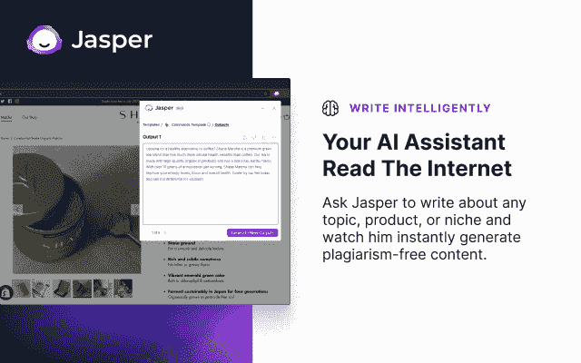

- `Compose AI`: 这款 AI 写作助手可以帮助你改进写作风格和语法。它还可以帮助你为博客文章、文章和其他内容提供灵感。

- `Fireflies.ai`: 这款 AI 会议助手可以帮助你转录会议、记录笔记并完成后续行动。它还可以帮助你与团队协作处理会议记录。

- `Otter.ai`: 这款 AI 转录服务可以转录你的会议、采访和其他音频录制。它还可以识别发言者并提供时间戳。

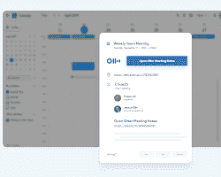

- `Scalenut`: 这款 AI 代码审查工具可以帮助你提高代码质量。它可以识别潜在的错误和 Bug，还可以提供改进建议。

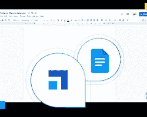

- `Murf`: 这款 AI 文本转语音工具可以从文本生成自然的语音。它可以用于创建有声书、播客音频内容。

- `AI Tree`: 这款 AI 驱动的抄袭检测器可以帮助你识别内容中的抄袭行为。它还可以提供如何改进写作的建议。

- `QuillBot`: 这款 AI 驱动的写作助手可以帮助你改进写作风格和语法。它还可以帮助你为博客文章、文章和其他内容提供灵感。

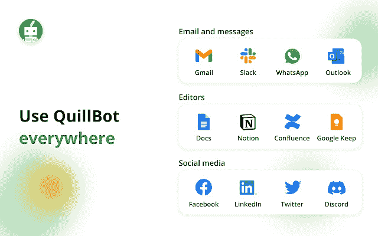

- `Grammarly`: 这款 AI 驱动的语法检查器可以帮助你识别并纠写作中的语法、拼写和标点错误。

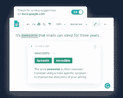

- `WordTune`: 这款 AI 驱动的写作助手可以帮助你改进写作风格和清晰度。它还可以帮助你为博客文章、文章和其他内容提供灵感。

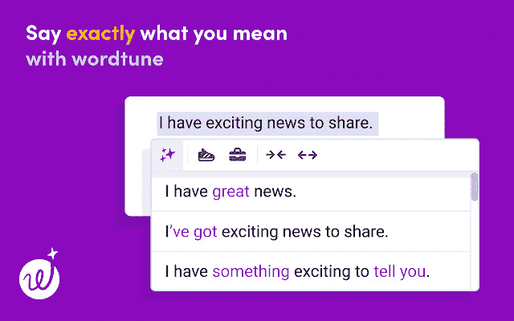

- `Hemingway Editor`: 这款 AI 驱动的写作编辑器可以帮助你的写作更加清晰、简洁。它会高亮你写作中难以阅读或理解的部分。

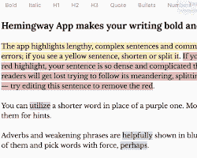

- `Cliche Finder`: 这款 AI 驱动的工具可以帮助你识别并删除写作中的陈词滥调。它还提供了更具原创性和创造性的语言建议。

- `Headliner`: 这款 AI 驱动的生成器可以帮助你创建更有效的标题。

- `SEO Minion`: 这款 AI 驱动的工具可以帮助你优化网站、博客文章和其他内容。

- `Answer the Public`: 这款 AI 驱动的工具可以帮助你发现人们针对你的主题提出的问题。

- `Google Translate`: 这款 AI 驱动的翻译工具可以帮助翻译文档。

- `DeepL`: 这款 AI 驱动的翻译工具以其高质量的翻译闻名。

- `Text-to-Speech`: 这款 AI 驱动的工具可以读取你的文本。

- `Grammarly for Google Docs`: 这款 AI 驱动的语法检查器可以帮助你识别并纠正文档中的语法、拼写和标点错误。

- `Gboard`: 这款 AI 驱动的键盘可以帮助你打字更快、更准。

- `Wordle`: 这款 AI 驱动的游戏挑战你猜单词。

- `AI Dungeon`: 这款 AI 驱动的故事生成器让你创建属于自己的故事。

- `AdBlock`: 这款 AI 驱动的广告拦截器可以帮助你阻止网站上的广告。

- `Privacy Badger`: 这款 AI 驱动的扩展程序可以帮助你阻止网站上的追踪器。

- `HTTPS Everywhere`: 这款 AI 驱动的安全扩展可以帮助你强制网站使用 HTTPS，这更安全的协议。

- `Dark Reader`: 这款 AI 驱动的深色模式扩展可以将网站的外观改为深色主题。

- `Grammarly for Gmail`: 这款 AI 驱动的语法检查器可以帮助你识别并纠正邮件中的语法、拼写和标点错误。

- `Email Hunter`: 这款 AI 驱动的邮箱查找工具可以帮助你查找网络上用户的电子邮件地址。

- `LinkedIn Sales Navigator`: 这款 AI 驱动的销售工具可以帮助你寻找线索、筛选客户并跟踪销售活动。

- `HubSpot Sales Chrome Extension`: 这款 AI 驱动的销售工具可以帮助你管理销售管道、跟踪线索并达成更多交易。

- `Everhour`: 这款 AI 驱动的时间跟踪工具可以帮助你跟踪在任务和项目上花费的时间。这有助于你提高生产力并更准确地向客户计费。

- `Toggl`: 这款 AI 驱动的时间跟踪工具是跟踪任务和项目时间的另一个绝佳选择。它易于使用并具有许多功能，例如自动计时器和报告。

- `IFTTT`: 这款 AI 驱动的自动化工具可以帮助你自动化 Web 端任务。例如，你可以设置一个 IFTTT 规则，当你喜爱的网站发布新文章时自动向你发送通知。

- **Zapier**: 这款 AI 驱动的自动化工具类似于 IFTTT，但它提供了更广泛的功能。例如，你可以使用 Zapier 连接不同的应用程序和服务，如 Gmail、Slack 和 Salesforce。

- **Pocket**: 这款 AI 驱动的阅读读列表工具可以帮助你保存文章、视频和其他内容以备后后阅读。这是保持条理并确保你不会错过任何重要信息的极方法。

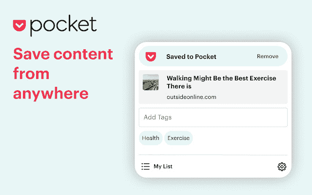

- **Evernote**: 这款 AI 驱动的笔记工具可以帮助你做笔记、整理思路并与他人协作。它是跟踪你所有需要记忆内容的绝佳方式。

- **Notion**: 这款 AI 驱动的生产力工具是一个较新的选择，但正迅速受欢迎。Notion 可用于各种任务，如记笔记、创建文档和管理项目。

- **Wappalyzer**: 这款 AI 驱动的工具可以帮助你识别网站上使用的技术。这对于营销目的或安全研究非常有用。

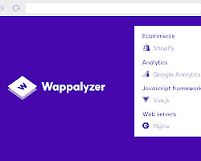

- **Userlytics**: 这款 AI 驱动的工具可以帮助你通过真实用户测试网站或应用。这可以帮助识别可用性问题并改进用户体验。

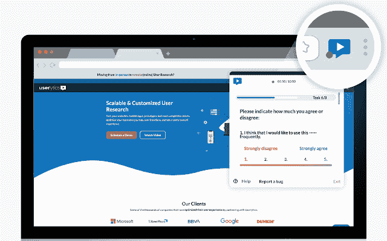

- **Google Analytics**: 这款 AI 驱动的工具可以帮助你跟踪网站流量并分析网站性能。这可以帮助你理解受众并提高网站的 SEO。

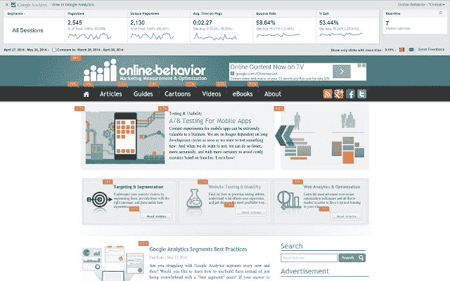

- **Semrush**: 这款 AI 驱动的工具可以帮助你研究关键词、跟踪网站排名并分析竞争对手。这可以帮助你提高网站 SEO 并增加流量。

- **Ahrefs**: 这款 AI 驱动的工具与 Semrush 类似，但它提供了更广泛的功能。例如，你可以使用 Ahrefs 跟踪网站的反向链接并分析竞争对手的内容营销策略。

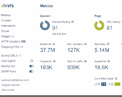

- **Canva**: 这款 AI 驱动的设计工具可以帮助你创建专业的图形、演示文稿和其他内容。它易于使用并具有广泛的功能。

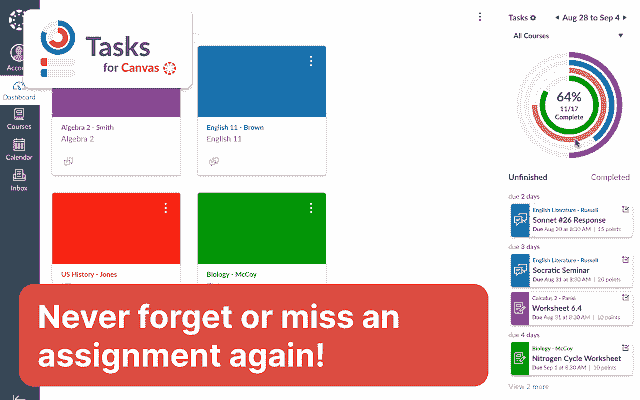

- **Adobe Spark**: 这款 AI 驱动的设计工具与 Canva 类似，但它提供了一组不同的功能。例如，Adobe Spark 更适合创建动画图形和视频。

- **Piktochart**: 这款 AI 驱动的设计工具是创建专业图形的另一个绝佳选择。它易于使用并有许多模板可供。

- **Visme**: 这款 AI 驱动的设计工具与 Piktochart 类似，但它提供了一组不同的功能。例如，Visme 更适合创建交互式信息图和演示文稿。

- **Crowdfire**: 这款 AI 驱动的社交媒体管理工具可以帮助你安排帖子、跟踪分析数据并与受众互动。

- **Hootsuite**: 这款 AI 驱动的社交媒体管理工具与 Crowdfire 类似，但它提供了更广泛的功能。例如，Hootsuite 可以帮助你管理多个社交媒体账户并跟踪竞争对手的活动。

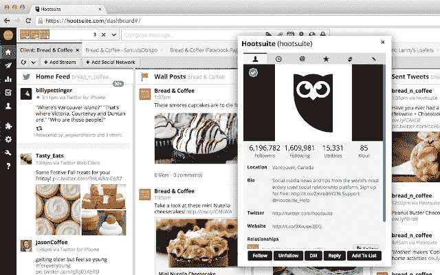

- **Buffer**: 这款 AI 驱动的社交媒体管理工具是安排帖子和跟踪分析数据的另一个绝佳选择。它易于使用并提供免费计划。

- **Sprout Social**: 这款 AI 驱动的社交媒体管理工具与 Buffer 类似，但它提供了更广泛的功能。例如，Sprout Social 可以帮助你衡量社交媒体营销活动的投资回报率（ROI）。

- **Later**: 这款 AI 驱动的社交媒体管理工具是一个较新的选择，但正迅速受欢迎。Later 于使用并具有许多功能，如自动调度和分析。

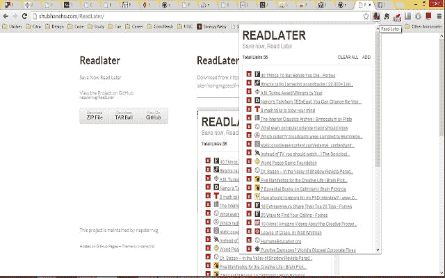

这些只是许多可用 AI Chrome 扩展中的几个。有了如此多的选择，你一定能找到可以帮助你提高生产效率的工具。

### 关于作者

Benncartier Consulting 是提示词工程和 AI 驱动业务增强领域的知名权威。凭借丰富的经验和专业知识，他们已成为该行业备受信任的名字，助力企业充分利用高级 `CHATGPT` 技术。

作为《提示词工程精通：提示词工程教程与高级技巧》的作者，Benncartier Consulting 将知识、实践经验以及对语言模型交互的热情融合在一起。他们对提示词工程复杂的深刻理解以及对卓越的追求体现在本全面的指南中。

通过创作多本有影响力的书籍，包括广受好评的《AI 精通：利用高级 ChatGPT 技术推动业务增长》，Benncartier Consulting 已确立在该领域的思想领袖地位。他们的作品因深刻的见解、可操作的策略以及为各种规模的企业解释复杂概念的概念而赞誉。

致力于帮助专业人士和爱好者释放语言模型的全部潜力，`Benncartier Consulting` 已成功培训并指导了无数提示词工程人才。他们的教学使企业能够更有效地沟通、创建有影响力的内容并开发驱动增长和创新的 AI 解决方案。
