## 有效营销的 AI 与数据工程解决方案


## 前言  

### 1. 主题概述  


## 管理领域信息技术与人工智能（AI）的日益广泛应用

管理领域信息技术与人工智能（AI）的日益广泛应用，对企业、行政机构和地区而言是一项重大演变，尤其在物流、人力资源、金融、营销等方面。就最后一维度而言，许多研究问题挑战着我们，涉及机器人技术、AI、物联网、大数据分析、IT、ICT、社交媒体、游戏化和移动技术等近期技术和数字创新的问题、机遇、机制和影响，以及这些创新对重塑新兴营销研究方法和方法论、企业和地区战略与运营营销的反思动态，以及评估和管理这些实体商业绩效和旅游营销的方法的修订。

特别是，人工智能（AI）和数据工程的兴起为营销开辟了令人兴奋的新视角。这些颠覆性技术使我们能够从战略设计到活动优化和客户关系管理，深入重新思考营销实践。

最近，我们看到大量研究涌入，探索在整个营销过程中整合 AI 和数据工程解决方案的机会和机遇——从诊断到绩效衡量（Lies, 2019; Rekha et al., 2016; Yau et al., 2021; Sterne, 2017; Theodoridis & Gkikas, 2019; Verma et al., 2021; Jarek & Mazurek, 2019; Ponomarenko et al., 2024; Kim & Hwang, 2024; George et al., 2024; Eshiett & Eshiett, 2024; …）。首先，Kim & Hwang (2024)、Eshiett & Eshiett (2024)、George et al. (2024) 和 Yau et al. (2021) 的文章强调了 AI 和数据工程在营销中日益广泛的采用，既用于自动化营销任务、改进个性化和客户参与、优化营销活动，也用于收集、清洗和分析客户数据以获得可操作的洞察。

其次，George et al. (2024)、Eshiett & Eshiett (2024) 和 Yau et al. (2021) 的文章表明，AI 和数据工程可以提高客户满意度和营销绩效，这包括了解客户需求并提供个性化体验、定向营销活动和优化营销支出。

就其部分而言，Lies (2019) 警告 AI 操纵和利用客户数据的风险，而 Eshiett & Eshiett (2024) 提出了面对营销任务自动化的工作安全问题，以及 AI 使用和数据工程的负责任和道德维度。

最后，Sterne (2017)、Theodoridis & Gkikas (2019) 和 Verma et al. (2021) 继续强调 AI 和数据工程彻底改变营销的潜力，并在个性化、自动化和营销活动优化中发挥越来越重要的作用。这迫使企业、行政机构和地区紧跟 AI 和数据工程的最新进展，以充分利用这些技术。

在对物流领域数字、AI 和数据工程的应用与影响进行了一系列研究之后（Bentalha, 2020; Bentalha et al., 2019; Badr, 2022; Bentalha et al., 2020; Bentalha & Hmioui, 2021; Bouhtati et al. 2024; Bentalha et al., 2023; Shamim & Bentalha, 2023），我们的研究团队最近也为这一营销研究做出了贡献，特别是在使用大数据分析技术提升旅游公司商业效率方面的附加值（Lhoussaine et al., 2022; Alla et al., 2022; Bouhtati et al., 2023a）以及 CRM 方面（[Bouhtati et al., 2023b](#979-8-3693-3172-9.chpre.bits-pdf.xhtml#_idTextAnchor008））。通过这些贡献，通过文献综述，我们得出结论：大数据可以帮助旅游公司改善客户关系、发展客户智能、优化营销活动并提高投资回报率。同样，通过模糊方法，我们识别出有前景的大数据机遇，可以帮助旅游企业分析客户数据并识别个性化和忠诚度机遇。

这些出版物为大数据在提升旅游业营销效率方面的潜力提供了宝贵的洞察。它们强调了数据分析在了解客户需求和偏好以及开展定向营销活动方面的重要性。作者还讨论了实施大数据解决方案的挑战，以及需要采取战略方法以确保成功。

最后，AI 和数据工程为改进营销策略的有效性提供了许多机遇。以创新方式利用这些技术的企业，将能更好地满足消费者日益增长的期望。

### 2\. 当前问题

根据上述研究，我们可以总结 AI 和数据工程在营销应用方面的主要研究趋势如下：

*   • 重新思考端到端营销流程：

    *   → 使用 AI 和数据工程改进营销流程的每个步骤，从诊断到绩效衡量。

    *   → 利用这些新技术重新思考传统营销方法。

*   • 提升营销智能：

    *   → 通过数据分析更好地了解消费者行为。

    *   → 更精确地优化广告活动。

    *   → 进一步定制客户体验。

    *   → 在客户生命周期内改进客户关系管理。

*   • 应对组织、财务和监管挑战：

    *   → 建立成功实施的条件（领导力、企业文化、数据治理等）。

    *   → 管理采用这些技术的战略、组织和伦理影响。

    *   → 开发适应这些创新的新商业模式。

*   • 提供分析和反馈框架：


→ 提供一种理论与实践相结合的方法，帮助企业、行政机构和地区充分利用营销领域的人工智能和数据工程。

→ 分享这些创新解决方案实施过程中的具体反馈。

总之，该研究聚焦于人工智能和数据工程如何深刻改变营销实践，同时应对与这一数字化转型相关的组织、战略和伦理挑战。

通过探索人工智能、数据工程与营销实践之间的协同效应，本书为企业和组织如何在不断变化的环境中定位自身以取得成功提供了独特视角。因此，强烈推荐任何对数字技术对营销领域产生的变革性影响感兴趣的人阅读。

本书及时审视了这些创新的影响以及它们为营销专业人士提供的机遇。

作者们强调了理论反思和实际应用，这些内容使人们能够重新思考传统的营销方法。他们既强调了这些技术提升营销智能的潜力，也强调了与其实施相关的组织、财务和监管挑战。

本书提供了关于该不断发展领域最新进展的宝贵见解。它面向研究人员和从业者，旨在指导他们采用这些创新解决方案并管理其运营效果。学生也将发现这是一本关于将塑造营销未来的新兴趋势的有用参考书。

本书深入探讨了与这些创新解决方案在营销领域的采纳和具体落地相关的问题、挑战和最佳实践。它定位为该主题的重要科学和实践参考。

本书首先详细概述了人工智能和数据工程对营销不同维度的影响。特别是，它探讨了这些技术如何更好地了解消费者行为、优化广告活动、个性化客户体验或在整个生命周期中改善客户关系管理。

除了纯粹的技术方面，本书还涉及采用这些创新解决方案的战略、组织和伦理影响。它强调了成功实施的关键条件，无论是在领导力、企业文化、数据治理还是建立新商业模式方面。

通过理论与实践相结合的方法，本书全面概述了在营销中使用人工智能和数据工程相关的问题。它提供分析框架和具体反馈，以帮助企业和地区充分利用这些颠覆性技术。

### 3\. 目标受众和潜在用途

本书的核心议题旨在识别关于采纳和落实人工智能和数据工程所提供的创新解决方案的反思和应用，以提高企业和地区内营销流程的效率。其目的是弥合理论与实践之间的差距，关于这些技术在改善营销和组织整体绩效方面的应用潜力。

本书面向对企业和地区营销领域人工智能和数据工程应用感兴趣的研究人员、从业者和学生。它旨在作为实施这些新营销管理解决方案和管理其运营效率的指南。本出版物的目标受众主要是该领域的研究人员和从业者，但本书对学生也可能有所帮助。

### 4\. 贡献的总体描述

本书收录了世界著名研究人员和该领域专家的高度精选的相关且先进的科学研究。它旨在为通过数据工程和人工智能提供的机遇动员来解决营销中创新解决方案采纳的反思性问题，关于其实际落地的方法以及需要验证的伴随条件，以及此类策略的有效性及其对企业和地区商业和整体绩效的影响等广泛问题提供简洁且相关的答案。

第 1 章“客户获取中的人工智能：一项文献计量学研究”，旨在通过使用 `VOSViewer` 进行文献计量分析，探讨涉及人工智能在提升客户获取方面适用性的出版物。结果显示，自 2018 年以来研究加速，美国机构占主导地位，出版物集中在营销和计算机期刊上，关于人工智能在客户获取中应用的研究趋向于去中心化，且未出现占主导地位的作者群体。这些元素使得能够对该领域的研究进行盘点。

第 2 章“新兴技术的营销应用：系统文献综述”，旨在考察新兴技术（人工智能、增强现实、物联网、区块链等）对营销实践和策略的使用和影响。基于根据 `PRISMA` 协议进行的系统文献综述，并使用 `NVivo` 软件对结果进行定性分析，该研究发现，新兴技术对于理解和满足个别客户需求以及改善客户体验日益重要。这为营销应用带来了机遇和挑战。

第 3 章“神经营销中人工智能的应用：系统文献综述”，旨在识别、评估和综合关于在神经营销实践中使用人工智能的研究，以及有争议的伦理视角。基于系统文献综述，并进行定性内容分析，该研究发现，人工智能允许对神经营销中消费者行为和决策过程进行更准确的分析。然而，关于其使用的伦理辩论仍在继续。

第 4 章“营销中的人工智能应用：20 年来的现状与热点”，专注于分析营销领域人工智能研究的现状，识别趋势和研究领域，并探索未来方向。通过文献计量分析，该研究确定了四个主要研究主题：人工智能在营销中的应用、用于分析和预测的人工智能、决策和优化中的人工智能、人工智能与数据分析。关于人工智能应用于工业 4.0 的未来视角和伦理考量。

第 5 章“增强现实体验式营销的系统综述：概念框架与研究议程”，考察了关于增强现实（`AREM`）体验式营销的当前知识状况，并确定了进一步研究的领域。通过专注于系统文献综述和发展整合性概念框架的方法论方法，该研究表明 `AREM` 影响消费者行为，并对沉浸式营销策略具有重要意义，同时指出需要超越单纯的新奇感，走向引人入胜的互动、个性化且符合伦理责任的方向。


# 第 6 章：影响摩洛哥公民使用智慧城市服务意愿的因素

本章（objective is to identify the main factors influencing the intention of using smart city services by citizens in Morocco, by borrowing a systematic literature review according to the PRISMA method, with an emphasis on the use of the UTAUT theory. Key factors are performance expectations, ease of use, social influence, perceived cost, awareness, trust in technology and trust in government.

# 第 7 章：迈向敏捷营销：数字时代的策略转型

本章（seeks instead to explore the transformative potential of agile marketing and its implications for marketing strategies in the digital age. Based on a literature review and theoretical synthesis on the principles and practices of agile marketing, the study revealed that agile marketing allows greater flexibility, speed and focus on the customer, through the integration of methodologies like Scrum and Kanban.

# 第 8 章：整合商业智能与客户关系管理的潜在效益

本章（objective is to examine the principles, challenges and potential benefits of integrating business intelligence and customer relationship management (CRM). With a theoretical and conceptual analysis of the literature on the integration of these two systems., research has found that integrating BI and CRM can improve operational efficiency and customer-centric practices, leading to sustainable growth and improved competitiveness.

# 第 9 章：革新客户互动：利用人工智能技术增强客户参与策略

本章（authors seek to better understand the transformative role of AI in customer engagement strategies, from understanding consumer behavior to responsible automation, through a literature review and conceptual analysis of the use of AI to improve customer engagement. They found that AI enables better understanding of consumer behaviours, increased personalization and effective automation, while requiring ethical and privacy-friendly implementation.

# 第 10 章：利用基于人工智能的移动用户行为洞察优化营销活动

本章（study focuses on using AI to analyze mobile user behavior to optimize marketing campaigns. It explores the factors influencing mobile user behavior and the role of AI in analyzing consumer behavior. The study then analyzes the impact of AI algorithms on mobile user data and examines personalization through AI. Finally, it explores campaign optimization and AI-enabled real-time marketing.

# 第 11 章：应用人工智能增强电子商务营销策略：摩洛哥 Jumia Market 案例研究

本章（studies the strategic use of AI to improve marketing in Moroccan e-commerce, focusing on the Jumia Market case. It traces the trajectory, resilience and performance of Jumia Market, highlighting the role of AI in refining marketing strategies to deliver optimal customer experiences and ensure sustainable growth in Moroccan e-commerce.

# 第 12 章：数字营销对企业绩效的影响：摩洛哥选定公司案例研究

本章（examines the impact of integrating AI into digital marketing on business performance in Morocco. It reveals a strong positive correlation between the use of AI in digital marketing and performance improvement, highlighting the critical role of AI in transforming the digital marketing landscape. The study focuses on the adaptation of AI in digital marketing in an emerging African context.

# 第 13 章：大数据与消费者行为：摩洛哥互联网用户的定量研究

本章（authors seek to examine the impact of Big Data on online consumer satisfaction and purchasing behaviour in Morocco. It reveals the essential role of product quality and personalized recommendations in improving consumer satisfaction online, despite the importance generally given to price. The study sheds light on the strategic application of Big Data to improve consumer engagement and satisfaction, with managerial implications for the use of technology in marketing strategies.

# 第 14 章：数据驱动的摩洛哥电信客户保留策略

本章（study examines customer retention dynamics among Moroccan telecoms operators. It proposes an analytical approach of big data to predict and minimize the churn phenomenon, integrating logistic regression, machine learning techniques and psychological profiling. The results provide a valuable framework for telecom companies to not only manage churn, but also ensure their sustainable success in a competitive and digital marketplace.

# 第 15 章：审计实践数字化与客户体验优化：摩洛哥背景下的德尔菲分析

本章（research uses a Delphi approach to provide a forward-looking overview of audit digitization and its impact on customer experience optimization, considering the regulatory dimension. It shows that audit firms, particularly the Big 4, are making significant progress in integrating advanced technologies. While listeners are optimistic about this transition, regulatory reform is crucial to foster an environment of trust and ethical use of digital tools.

# 第 16 章：摩洛哥银行业客户满意度：数字化的作用

本章（explores the role of digital in the satisfaction of banking customers in Morocco. Using quantitative methods, it assesses customer perceptions of technology integration, AI-powered chatbots and personalized services, and examines the transformative potential of AI-driven marketing to deepen bank-customer relationships. The results provide nuanced information on Morocco’s digital banking paradigm and can guide the strategic decisions of institutions and policy makers.

# 第 17 章：实体数字营销与支付痛苦：Amazon Go 网络民族志案例研究

本章（authors of the 17th chapter, «Phygital Marketing and the PAIN of PAYING: An Amazon Go Netnographic Case Study», aim to contribute to the conceptualization of phygital marketing, by linking it to the concept of “pain of payment” from the science of behavior. Through netnography and thematic content analysis, it paves the way for defining a competitive advantage through phygital marketing, which combines physical store experience and digital technologies to deliver a unique shopping experience.

# 第 18 章：实体数字对客户体验影响的探索性分析

本章（study explores the impact of phygital on the customer experience. It shows that the presentation of the commercial offer has given rise to a new in-store experience for customers. Phygital, which combines physical and digital tools, has become an essential weapon for companies to provide consumers with a pleasant and unique experience, creating a sense of belonging and loyalty.

# 第 19 章：基于深度学习的酒店推荐系统设计与实现

本章（contribution aims to propose a hotel recommendation system using deep learning techniques to analyze user preferences and provide personalized recommendations. The system relies on analysis of user feedback and hotel descriptions to extract relevant features and train a deep learning model.


最后，对于最后一章“银行业创新营销：人工智能与数据工程的作用”，该研究旨在探讨人工智能（AI）与数据工程的融合，以革新银行业的营销方法。它展示了如何通过人工智能技术（如机器学习、预测分析和自然语言处理）分析银行数据，从而实现个性化的客户体验，准确预测客户需求和行为，并实施有针对性的营销活动，进而提升客户参与度和满意度。

# 5\. 结论

本书定位为关于数据工程和人工智能技术及机制在营销领域中的反思性与应用的科学参考书。通过其理论建模和实证应用，本书旨在为商业和地域营销策略的经理人和决策者，以及营销学生、贸易和地域管理人员做出重大贡献。该主题的原创性在于旨在围绕数据科学、大数据、电子学习、区块链、增强现实和虚拟现实技术及机制的采用与落地相关问题，汇聚学术研究与专业研究的雄心，以及这些技术对战略与运营营销、客户关系与生命周期管理、业务绩效管理、营销伦理等方面的影响。

从这个意义上说，本书将自身呈现为关于在营销领域整合人工智能和数据工程解决方案的科学与实践参考书。它探讨了与这一数字化转型相关的机遇与挑战，并提供分析框架和具体反馈，以帮助企业和地区充分利用这些颠覆性技术。

本书对科学界以及行为者和专业人士的管理实践所带来的实质性附加值的重点总结如下：

*   • 新闻：本书及时审视了人工智能和数据工程在营销中的影响。它强调了理论反思和实际应用，这些应用使得重新思考传统营销方法成为可能。

*   • 全面方法：本书涵盖了营销的不同维度，从理解消费者行为到优化广告活动、个性化客户体验和管理客户关系。

*   • 战略视角：本书强调了数据战略和治理对于成功实施人工智能和数据工程解决方案的重要性。它还强调了采用这些技术所带来的伦理影响和组织挑战。

*   • 分析框架与反馈：本书提供分析框架和具体反馈，以帮助企业和地区充分利用这些颠覆性技术。

*   • 目标受众：本书面向研究人员和从业者，以及营销学生。它是任何希望了解人工智能和数据工程在营销方面影响的人的宝贵参考。

总之，本书《人工智能与数据工程助力高效营销》是任何希望了解在营销领域整合人工智能和数据工程解决方案的机遇与挑战的人必读之作。它提供了全面和战略的视角，并提供分析框架和具体反馈，以帮助企业和地区充分利用这些颠覆性技术。

Lhoussaine ALLA

摩洛哥西迪·穆罕默德·本·阿卜杜拉大学非斯国立应用科学学院

Aziz HMIOUI

摩洛哥西迪·穆罕默德·本·阿卜杜拉大学非斯国立商业与管理学院

Badr BENTALHA

摩洛哥西迪·穆罕默德·本·阿卜杜拉大学非斯国立商业与管理学院

# 参考文献

Alla, L., Kamal, M., & Bouhtati, N. (2022). Big data and marketing effectiveness of tourism businesses: A literature review. Alternatives Managériales Economiques, 4.[10.48374/IMIST.PRSM/ame\-v1i0.36928](http://dx.doi.org/10.48374/IMIST.PRSM/ame-v1i0.36928)

Badr, B. (2022). Smart Technologies for a Sustainable Service Supply Chain: A Prospective Perspective. Journal of Environmental Issues and Climate Change, 1(1), 77–89. [10.59110/jeicc.v1i1.81](http://dx.doi.org/10.59110/jeicc.v1i1.81)

Bentalha, B. (2020). Big-Data et service supply chain management: Challenges et opportunités. International Journal of Business and Technology Studies, 1(3).

Bentalha, B., & Hmioui, A. (2021, November). Smart service supply chain and Just Walk Out technology: a netnographic approach. In The Proceedings of the International Conference on Smart City Applications (pp. 223-236). Cham: Springer International Publishing.

Bentalha, B., Hmioui, A., & Alla, L. (2019, October). The digitalization of the supply chain management of service companies: a prospective approach. In Proceedings of the 4th International Conference on Smart City Applications (pp. 1-8). ACM. [10.1145/3368756.3369005](http://dx.doi.org/10.1145/3368756.3369005)

Bentalha, B., Hmioui, A., & Alla, L. (2020). Digital service supply chain management: current realities and prospective visions. In Innovations in Smart Cities Applications Edition 3: The Proceedings of the 4th International Conference on Smart City Applications 4 (pp. 808-822). Springer International Publishing. [10.1007/978\-3\-030-37629-1\_58](http://dx.doi.org/10.1007/978-3-030-37629-1_58)

Bentalha, B., Hmioui, A., & Alla, L. (Eds.). (2023). Integrating Intelligence and Sustainability in Supply Chains. IGI Global. [10.4018/979\-8-3693-0225-5](http://dx.doi.org/10.4018/979-8-3693-0225-5)

Bouhtati, N., Alla, L., & Bentalhah, B. (2023b). Marketing Big Data Analytics and Customer Relationship Management: A Fuzzy Approach. In Integrating Intelligence and Sustainability in Supply Chains (pp. 75-86). IGI Global. . IGI Global.[10.4018/979\-8\-3693\-0225-5.ch004](http://dx.doi.org/10.4018/979-8-3693-0225-5.ch004)

Bouhtati, N., El Yaacoubi, Y., Bentalha, B., & Lhoussaine, A. L. L. A. (2024). Leviers logistiques de promotion du commerce équitable des produits de terroir: Une esquisse de modèle d’analyse. Alternatives Managériales Economiques,Vol 6 (Spécial 1), 17-35.

Bouhtati, N., El Yaacoubi, Y., Bentalha, B., & Lhoussaine, A. L. L. A. (2024). Leviers logistiques de promotion du commerce équitable des produits de terroir: Une esquisse de modèle d’analyse. Alternatives Managériales Economiques, 6(Spécial 1), 17-35.

Bouhtatit, N., Kamal, M., & Alla, L. (2023a). Big Data and the Effectiveness of Tourism Marketing: A Prospective Review of the Literature. In Farhaoui, Y., Rocha, A., Brahmia, Z., & Bhushab, B. (Eds.), Artificial Intelligence and Smart Environment. ICAISE 2022. Lecture Notes in Networks and Systems, 635. Springer. [10.1007/978\-3\-031-26254-8\_40](http://dx.doi.org/10.1007/978-3-031-26254-8_40)

Eshiett, I. O., & Eshiett, O. E. (2024). Artificial intelligence marketing and customer satisfaction: An employee job security threat review. World Journal of Advanced Research and Reviews, 21(1), 446–456. [10.30574/wjarr.2024.21.1.2655](http://dx.doi.org/10.30574/wjarr.2024.21.1.2655)

George, S. M., Sasikala, B., Gowthami, T., Sopna, P., Umamaheswari, M., & Dhinakaran, D. P. (2024). Role of Artificial Intelligence in Marketing Strategies and Performance. Migration Letters : An International Journal of Migration Studies, 21(S4), 1589–1599.

Jarek, K., & Mazurek, G. (2019). Marketing and artificial intelligence. Central European Business Review, 8(2).

Kim, D., & Hwang, G. H. (2024). Machine Learning and Artificial Intelligence Use in Marketing. International Journal of Intelligent Systems and Applications in Engineering, 12(5s), 266–272.


# Bibliometric Studies and Literature Reviews on AI and Marketing

## Chapter 1

# Artificial Intelligence in Customer Acquisition: A Bibliometric Study

**Mustapha Elhissoufi**  
Sidi Mohamed Ben Abdellah University, Morocco  

**Lhoussaine Alla**  
  
Sidi Mohamed Ben Abdellah University, Morocco  

### ABSTRACT

本章的目标是通过 VOSViewer 的书目计量分析，探讨涉及利用 AI 提升客户获取的出版物。这些结果揭示了自 2018 年以来研究的加速、美国机构的主导地位、出版物集中在营销和计算机科学期刊、关于 AI 在客户获取中的应用的研究趋向于去中心化，以及缺乏主导性作者群体的出现。

### 1. INTRODUCTION

AI 的最新进展为营销从业者和学术研究人员提供了绝佳的机会。它们已改变了营销实践 (Rangaswamy et al., 2020)。这些实践越来越依赖于模拟人类认知能力的 AI 算法 (Huang & Rust, 2018)。这些应用在成本降低、服务渠道多样化、优惠个性化以及创新且用户友好的解决方案方面带来了显著的好处 (Haenlein & Kaplan, 2019)。

此外，营销的数字化导致了包含结构化数据（例如，销售数据、客户信息）和非结构化数据（例如，视频、图像）的集中式数据库的创建，这些数据需要先进的 AI 模型来分析 (Paschen et al., 2020)。得益于获取和利用大量深入客户数据的能力，AI 已成为客户关系管理中必不可少的工具，客户关系管理已从交易视角转向关系视角，其中客户获取发挥着根本性的作用 (Pansari & Kumar, 2017)。

客户获取是指寻找新客户，即第一次向某人销售产品或服务 (Peltokoski, 2022)。获取新客户是任何商业企业的支柱 (Gopalakrishnan et al., 2022)。它在包括营销、组织行为、消费者行为和服务管理在内的各个领域得到了广泛关注 (Kumar et al., 2010)。文献中经常将其提及为客户终身价值的关键要素 (Zheng et al., 2022)。

AI 广泛用于获取客户。它提供信息以识别客户需求，将其细分为同质群体，预测他们的顾虑，并提供个性化体验。总体而言，AI 提高了客户获取策略的效率和效果 (Castro et al., 2023)。

从学术角度看，AI 在客户获取中的应用是一个正在迅速发展的新兴研究领域 (Feng, 2021)。在早期阶段，所涉及的主题多种多样且分散，例如使用大数据作为客户获取的决策支持系统 (Alla et al., 2022)、各种机器学习技术的应用 (Salminen et al.,2019)、战略性地使用 AI 来获取新客户 (Berger et al., 2019)、动态在线定价 (Misra et al., 2019)、AI 对获取任务的自动化 (Thomaz et al., 2020)、AI 对零售业的影响 (Davenport et al., 2020)、研究消费者采用自主购物系统的心理和文化障碍 (De Bellis & Venkataramani, 2020)、开发可解释的自动产品推荐技术 (Marchand & Marx, 2020)，以及 AI 对客户旅程的影响 (Puntoni et al., 2018)。

据我们所知，目前不存在关于 AI 在客户获取中应用的书目计量研究。鑒于其日益增长的重要性，我们认为这一差距提供了一个机会，来绘制、追踪和理解研究该领域 AI 的出版物、关键词、作者、机构和国家。因此，为了综合客户获取中 AI 应用的研究并为未来研究提出建议，在本章中，我们试图回答以下研究问题：关于 AI 在客户获取中的应用研究，当前的趋势和未来方向是什么？因此，目标是对 AI 及相关主题进行书目计量分析，以确定主要研究主题、最具影响力的作者以及作者与主题之间的网络。这种分析将使营销人员更好地了解塑造和推动客户获取作为研究领域的 AI 的力量。


本研究的概念框架将在下一节中阐述，第 3 节将介绍我们的方法论细节。在第 4 节，我们将展示书目计量分析，并在第 5 节讨论局限性及对未来研究的启示。

## 2. CONCEPTUAL FRAMEWORK

近年来，公司越来越重视人工智能。他们正在利用人工智能在许多领域分析数据并做出决策，包括客户获取。在本节中，我们将首先定义人工智能和客户获取的概念，然后概述适用于客户获取的各种 AI 工具。

### 2.1 Artificial Intelligence

作为第四次工业革命的驱动力，AI 是机器表现出的智能。它通过机器模仿人类智能过程，例如决策、问题解决、语音识别和成像（Sagić et al., 2019）。许多技术可以执行重复性任务，但它们无法自主思考。它们无法跳出代码进行思考。相比之下，机器学习作为 AI 的一个子集，旨在让机器在没有预先存在代码的情况下学习任务（Russel & Norvig, 2016）。因此，机器被输入问题和示例，以学习执行特定任务。在处理这些问题和示例的过程中，它们学习并适应以自主执行活动。AI 专家致力于使机器能够通过分析照片和不同的数据集来使用所学的知识。数据科学家和程序员制定通用学习算法，帮助机器学习不止一项特定任务（Verma et al., 2021）。

在本研究中，我们采用 Haenlein 和 Kaplan (2019) 第 5 页对 AI 的定义：“系统正确解释外部数据、从该数据中学习，并利用该学习通过灵活适应来实现特定目标和任务的能力。”因此，它涵盖了各种活动和概念，因为各种类型的系统都基于软件和算法，这些软件和算法有助于或执行以前需要人类认知能力的任务（Huang & Rust, 2018; Bouhtati, et al. 2023）。因此，营销研究使用机器学习、服务机器人、自动化、大数据、神经网络、自然语言处理和物联网 (IoT) 等术语来指代（AI Salminen et al., 2019; Wirtz et al., 2018）。

### 2.2 Customer Acquisition

AI 工具使公司能够在日益数据驱动的营销环境中保持竞争力（Lhoussaine et al. 2022），因此许多公司投资于它们以促进各种与营销相关的任务，其中客户获取是最重要的任务之一（Haenlein & Kaplan, 2019; Luo et al., 2019）。客户获取是吸引新客户的过程。它涉及识别潜在客户、与他们建立联系，并将其转化为购买客户。这对于公司的可持续性和增长至关重要，使其能够扩大客户组合、增加销售额和市场份额，并提高品牌知名度。

根据 De Bruyn et al. (2020)，客户获取包括根据潜在客户的人口统计特征、兴趣和行为来定位他们，并通过各种营销渠道（如广告、社交媒体和口碑）与他们联系。这是客户生命周期的第一个阶段，决定了客户参与度和忠诚度（Kumar et al., 2019）。企业可以通过个性化沟通和卓越的客户服务建立牢固的客户关系，从而增加客户忠诚度并鼓励重复购买。公司必须投资于有效且高效的客户获取策略，以支持其在市场上的增长和竞争力（Haenlein & Kaplan, 2019）。对于 Huang 和 Rust (2018)，公司可以使用不同的方法和策略仅为了获取新客户：在线广告、内容营销和网红合作伙伴关系。他们强调定位政策的重要性，以及传递个性化消息和优惠以吸引和转化潜在客户。

获取客户的成本远高于保留客户（Reinartz et al., 2005](#979-8-3693-3172-9.ch001.bits-pdf.xhtml#_idTextAnchor053)，客户获取包括根据潜在客户的人口统计特征、兴趣和行为来定位他们，并通过各种营销渠道（如广告、社交媒体和口碑）与他们联系。这是客户生命周期的第一个阶段，决定了客户参与度和忠诚度（Kumar et al., 2019）。企业可以通过个性化沟通和卓越的客户服务建立牢固的客户关系，从而增加客户忠诚度并鼓励重复购买。公司必须投资于有效且高效的客户获取策略，以支持其在市场上的增长和竞争力（Haenlein & Kaplan, 2019）。对于 Huang 和 Rust (2018)，公司可以使用不同的方法和策略仅为了获取新客户：在线广告、内容营销和网红合作伙伴关系。他们强调定位政策的重要性，以及传递个性化消息和优惠以吸引和转化潜在客户。

### 2.3 Customer Acquisition as a Field of Application for AI

在当前由前所未有的技术变革所标志的商业环境中，公司不断寻求获取客户的创新方式。当今企业可用的最强大的工具之一是人工智能（AI）（Haleem et al., 2022）。AI 通过利用数据分析、自动化和个性化，显著改善了客户旅程的不同阶段，重点关注客户获取阶段（Charles et al., 2023）。我们区分了 AI 在客户获取中的几种应用：


* 生成的内容：此功能可帮助营销人员向潜在客户发送定制且个性化的 AI 生成消息，在社交媒体平台上推广其品牌，并减少人力成本（Miroshnichenko, 2018）。AI 可以通过分析客户的在线活动，为潜在客户生成相关的文本、图像和视频，并且系统会根据从客户行为中获得的反馈自行调整。

* 智能内容策展：这种技术允许营销人员跟踪在特定网站上购买特定类别产品（例如，汽车配件）的客户。公司可以通过提供折扣和独家交易，并使用个性化内容来接触这些潜在客户（Amatriain & Basilico, 2015）。利用 AI，公司可以在正确的时间，并根据潜在客户在购买周期中的位置，为其提供相关内容。

* 程序化媒体购买：这种方法帮助营销人员自动细分潜在客户，并针对最具吸引力的群体进行定位，而不是直接与客户谈判（Suri et al., 2021）。

* 预测分析：使用此建模工具，可以预测潜在客户转化为增值客户的可能性，评估客户可能转化的价格，并识别最有可能进行重复购买的客户（Surendro, 2019）

* 线索评估：AI 工具可以促进线索生成的初始信息收集，同时快速分析非结构化数据（如电子邮件、电话对话和社交消息），以识别趋势并确定相关线索（Marr, 2019）。这些应用程序生成的线索评分使销售人员能够衡量其潜力，并确定是否应该将时间投入其中。

* 定向广告：AI 算法可以利用潜在客户的信息来分析他们在不同时间寻求的产品。这样一来，创意内容可以在最合适的时间和地点针对潜在客户，并通过根据用户之前的浏览行为向特定用户展示特定广告来实现实时竞价（Coffin, 2022）。这种方法还可以通过检查销售数据并识别先前交易中项目之间的频繁关联来预测客户的未来购买。因此，可以针对客户发送与预期购买相关的广告和促销活动。

### 3 METHODOLOGY

本节将介绍我们的方法论方法以及数据收集和分析协议。

#### 3.1 Methodological Approach

书目计量分析客观且定量地考察某一主题的研究，评估其科学质量及其对文献的影响。得益于这种定量研究，可以掌握某一主题知识的内部结构（Real, 2020），并对文献及其对知识体系的影响进行科学评估（Merigoù et al., 2015）。根据 Samiee 和 Chabowski（2012）的说法，书目计量分析的全面材料收集提供了细致入微且准确的信息，有助于文献的进步。研究人员已采用书目计量分析来分析企业对企业营销和关键客户管理中数字中介研究的构成（Kumar et al., 2020）。

我们的方法论方法包括对 216 篇关于客户获取中 AI 应用的文章进行书目计量分析。研究人员使用书目计量分析来评估特定研究领域内作者、期刊和机构的质量、影响力和影响（Lowry et al., 2013）。它也被广泛用于了解特定领域 AI 研究的趋势（Zhao, Lou et al., 2020）。在本章中，我们进行了这种分析，以了解客户获取中 AI 应用的研究趋势，采用了 Aria and Cuccurullo (2017) 提出的方法。该方法论包含三个主要阶段：数据收集、分析和可视化。

#### 3.2 Methodological Protocol

数据收集阶段涉及从选定的数据库中查询、选择和导出数据。本研究的数据样本是通过查询中央 Scopus 数据库获取 2000 年至 2023 年的出版物而获得的。选择此数据库而非 Google Scholar 或 WoS 等其他数据库，是因为 Scopus 由于其多学科性质，提供了更高质量的书目计量信息，这与我们主题的性质非常契合，并且对高影响力期刊的覆盖更好（Aghaei Chadegani et al., 2013）。

使用以下搜索字符串查询 Scopus 集合中所有文档的标题、关键词和摘要：((“customer acquisition” OR prospecting OR conversion) AND (“artificial intelligence “OR “Deep learning” OR “Expert system” OR “Machine learning ” OR “Big data ” OR “IoT”))。

该搜索链导致了 1060 份文档。出于质量考虑，本研究仅选择了自 2000 年以来在报纸或期刊上发表的英文文章类型文档，因为它们最有可能在出版前经历了严格的同行评审过程（Milian et al., 2019）。因此，从数据集中删除了编辑材料、信件、新闻项目、会议摘要和撤回的出版物，剩下 216 份文档，构成了最终的书目计量分析数据集。图 1 总结了数据收集阶段。

Query database

(title, keywords, abstract) using pre-defined search string

Select relevant documents: Articles, Journals, and reviews

#### Figure 1. Summary of the data collection phase

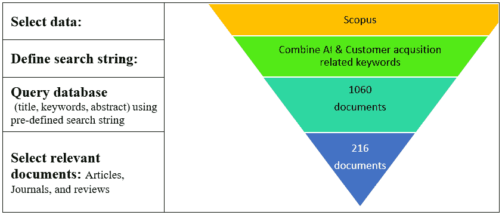

表 1 总结了关于数据集的主要信息，涉及持续时间、文档来源、文档类型、文档内容、作者和作者协作。该数据集包含来自 155 个来源的文档，由 426 名作者撰写，并包含 4409 条参考文献。

使用 VOSViewer 软件对 Scopus 生成的数据进行书目计量分析和可视化。VOSViewer 是免费软件，可以生成具有不同优先级的图形代表性地图，例如共同作者、引用、关键词；书目链接等（van Eck & Waltman, 2010）。VOSViewer 地图使用线条连接共享强连接的对象（例如文章、作者、组织和国家），而物理距离表示节点之间的相关性。为每个簇使用不同颜色以区分每个网络。这些可视化功能旨在使研究人员相对容易地解释书目计量分析的结果（Wong, 2018）。

#### Table 1. Key information about the dataset

| Description || Results |

| --- | --- |

| Timespan || 2000 - 2023 |

| --- | --- |

| Sources (journals, books, etc.) || 155 |

| Number of organisations || 474 |

| Number of documents || 216 |

| Average years from publication || 4.53 |

| Average citations per doc || 7.54 |

| Average citations per year per doc || 1.01 |

| References || 18040 |

| Author's keywords || 78 |


| 作者 | 210 |

| 作者出场 | 646 |

| 单作者文档的作者 | 88 |

| 多作者文档的作者 | 128 |

| 每位作者的文档数 | 1,03 |

| 每篇文档的合著者数 | 1,97 |

来源：由我们编译

## 4. 书目计量分析

在本节中，我们展示了由 VOSViewer 生成的关于合著者分析、共现分析、引文分析和共引分析的结果。

在 2000 年代初期，研究人员和营销从业者本应更加关注在客户获取中使用 AI。然而，近年来情况发生了迅速变化，如 图 2 中的图表所示，该图表明该主题的文章数量在 2013 年之前微不足道，当时对该主题的兴趣开始发生变化。该趋势从 2019 年开始迅速加速，当年发表了 25 篇文章，并在 2020 年达到出版高峰，当年发表了 36 篇文章，到 2020 年中旬，已有 41 篇文章发表。在 2021 年和 2022 年下降后，2023 年出版物增加到 29 篇。

### 图 2. 客户获取中 AI 相关文章数量（2000-2023）

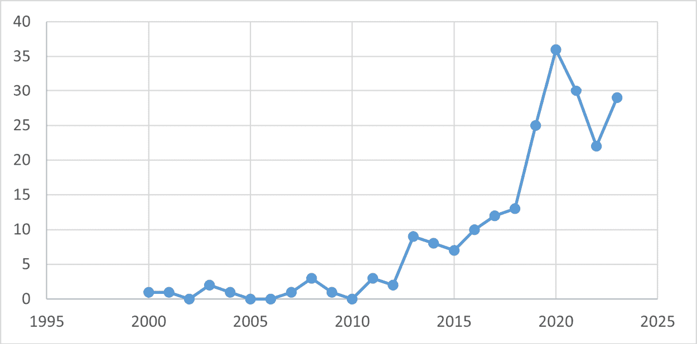

上述四种分析（合著者、共现、引文和共引）的结果将在本节中展示，同时附上在 VOSViewer 中创建的可视化图表以及我们对这些地图的解读。

### 4.1 合著者分析

其目的是通过识别和探索作者之间的合作程度，来考察作者、机构和国家之间的联系；

#### • 按作者分析

两百一十位作者在 Scopus 数据库中发表了关于客户获取中 AI 的文章。为了绘制一张更有意义的合著者地图，我们只考虑发表超过两篇文章的作者。只有 13 位作者达到此阈值：Stadlman、Zehetner、Kannan、Ma、Neslin、Rust、Huang、Hanssens、Dekimpe、Zhang、He、Li 和 Chen。图 3 展示了 VOSViewer 为这 13 位作者生成的合著者地图。该网络非常分散，所有研究人员各自发表了两篇文章。Zhang、He、Li 和 Chen 被引用次数最多，各有六次引用。这些结果表明，研究客户获取中 AI 的作者格局仍然是分散的。因此，该领域的新人可以加入许多现有的研究节点，或者在不必加入现有作者网络的情况下开展自己的研究。

### 图 3. 按作者划分的合著关系

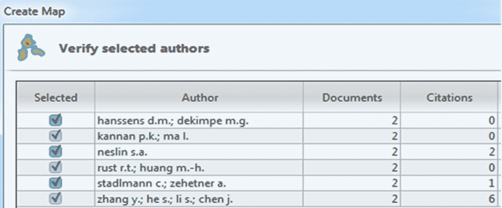

#### • 按机构分析

同样，为了获得更有意义的机构地图，我们将范围限定在发表超过两篇文章的机构。总共有 474 个机构参与了与客户获取中 AI 相关主题的研究工作。八个机构满足两篇文章的要求，如 图 4 所示。最具生产力的大学是马里兰大学（3 篇论文），其他所有大学均发表了两篇论文。

### 图 4. 按机构划分的合著者

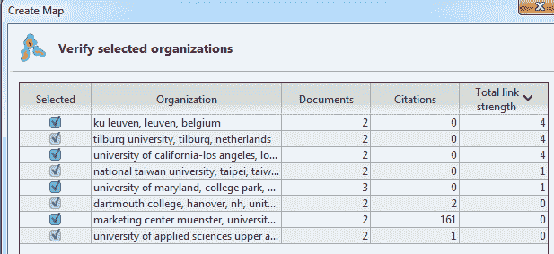

#### • 国家分析

在国际合作方面，我们查看哪些国家正在合作发表与客户获取中 AI 相关的主题。来自 59 个国家的研究人员在此领域发表了研究成果。为了制作更具说明性的地图，我们设定每个国家至少 5 篇出版物的最低要求。十六个国家满足这一最低阈值。如 图 5 所示，在客户获取中 AI 问题上合作的国家之间存在着紧密联系，因为这 16 个国家围绕美国形成了一个相当大的群体。美国研究人员已与地图上每个其他国家的学者合作，并发表了最多的论文（65 篇出版物）。显然，美国主导着这一领域，产生了我们样本中一半的出版物，其次是中国（29 篇出版物）、英国（18 篇出版物）和印度（12 篇出版物）。

### 图 5. 按国家划分的合著者

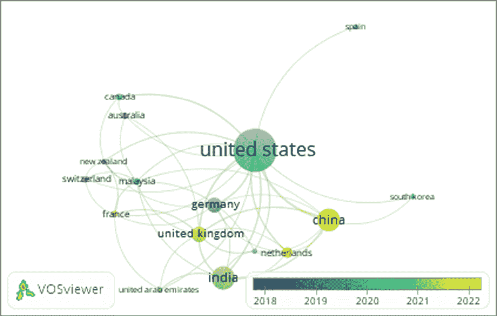

### 4.2 共现分析

共现分析旨在考察关键词以及搜索中最常用的术语之间的联系，以加深我们对研究人员共同关注领域的理解。VOSViewer 可以识别文章中最常用的关键词，使我们能够识别与主要主题相关的术语。

图 6 显示了 20 个关键词，每个关键词至少出现七次，它们彼此密切相关。出现频率最高的十个关键词是：“sales”（38 次出现）、“artificial intelligence”（31 次出现）、“machine learning”（29 次出现）、“marketing”（23 次出现）、“commerce”（19 次出现）、“data mining”（14 次出现）、“deep learning”（11 次出现）、“CRM”（9 次出现）、“public relations”、“customer acquistion”（7 次）。

### 图 6. 所有关键词的共现

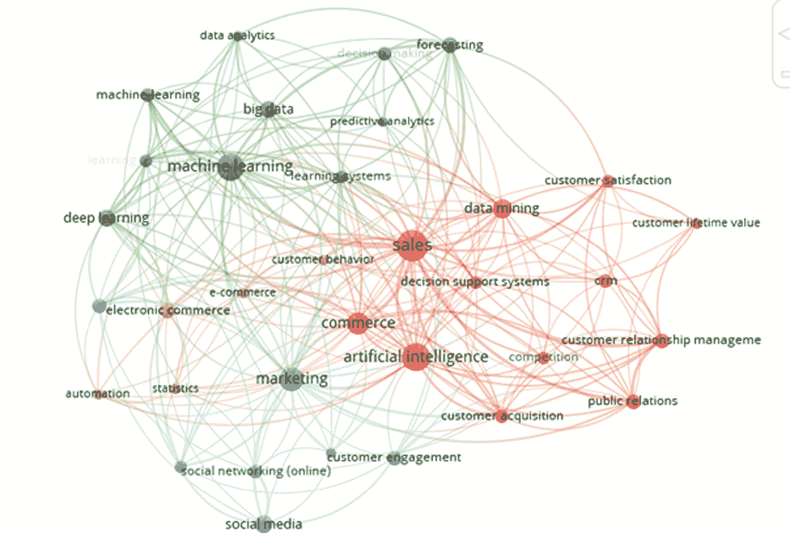

通过检查不同颜色的组，我们可以了解哪些关键词拥有最紧密的联系。地图揭示了三个主要组：一个红色组，它直接关乎我们的研究，并汇集了出现频率最高的十个关键词，“sales”、“artificial intelligence”和“customer acquisition”，表明这些术语被紧密地一起使用。蓝色组包括关键词“marketing”、“cutomer engagement”、“social media”和“electronic commerce”。绿色组主要包含与 IT 相关的关键词。

### 4.3 引文分析

在本节中，我们通过计算它们互相引用的次数，来评估文章、作者、期刊、机构和国家之间联系的强度。确实，VOSViewer 通过测量两个元素（文章、作者、期刊、机构和国家）互相引用的次数来进行引文分析，以识别它们之间联系的强度。

在这一部分，我们通过研究它们互相引用的次数，来考察文章、作者、期刊、机构和国家之间联系的强度。为此，VOSViewer 的引文分析功能测量两个元素（文章、作者、期刊、机构和国家）互相提及的次数，以评估它们之间联系的强度。为了排除低影响力的文章，我们设定了最低引用次数为 20 次，共有 42 篇文章符合此要求。如 图 7 所示，最大的组包含十个项目，围绕 Wang 和 Goldfarb（2017）的文章旋转。

### 图 7. 客户获取中前十篇 AI 相关文章

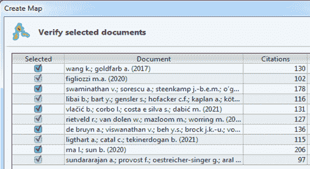

为了分析不同期刊之间的关系，我们要求一本期刊至少有三篇关于核心主题的文章才能被纳入，共有 14 本期刊达到此阈值。如 图 8 所示，《Journal of Interactive Marketing Research》拥有最高的引用次数（514 次），有六篇出版物，其次是《Journal of Marketing》，有 264 次引用和四篇出版物。

### 图 8. 按来源划分的引文分析

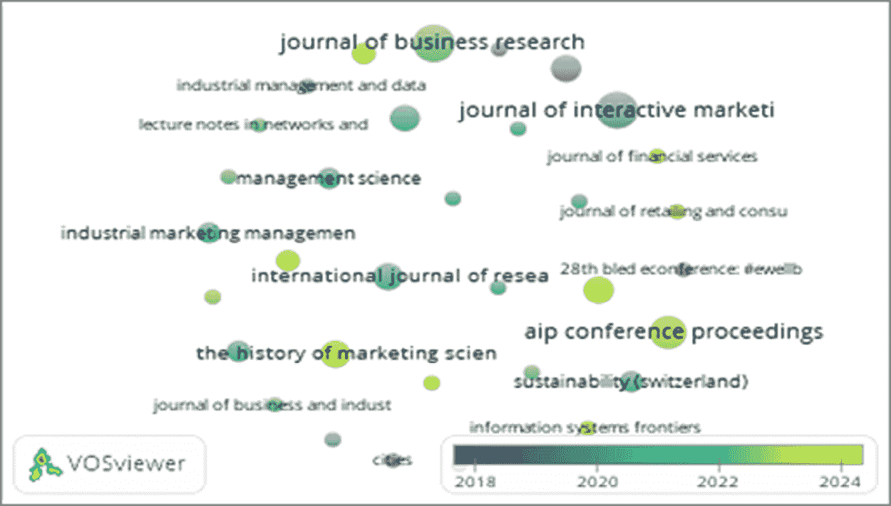


我们还分析了不同组织之间的链接。我们要求每所大学至少有两篇出版物才能被纳入，这导致地图上显示的八所机构，如图 9 所示。

#### 图 9. 按组织进行的引文分析

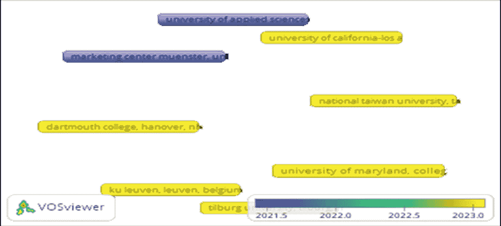

总之，关于这项引文分析，尽管文章、作者、期刊和机构都基于发展作者的主要群体，但彼此的网络通常通过主要群体之外的许多其他网络传播。这表明，客户获取中 AI 应用的研究仍然蓬勃发展，存在许多新的或互补的研究机会，潜在作者不应依赖现有的作者网络或期刊来发表他们的工作。

#### 4.4 共引分析

本分析的目的是通过研究它们被另一作品同时使用的次数，来突出文章、作者、机构和国家之间的链接。这是一种通过检查它们被一起引用的频率来评估文章、作者和期刊之间链接强度的分析。为此，`VOSViewer` 探索样本中每篇文章的引文列表，并分析不一定出现在所选数据库中的文章。这使我们能够检查与 AI 相关的客户获取主题与其他领域之间的链接。

`VOSViewer` 返回了 18,040 条参考文献，在我们设定了必须至少被引用六次才能被纳入的标准后，其中 25 条保留了下来。如图 10 所示，我们样本中的文章被分为三个簇。第一个簇是红色的，由 9 篇文章组成，由 Schwartz 和 Bradlaw (2017) 的工作联合，被引用 12 次，并专注于通过多臂 bandit 体验的展示广告进行客户获取。第二个簇是绿色的，由八篇围绕 Becker et al. (2019) 的工作展开的文章组成，被引用八次，并与电视广告的真实性相关。第三个簇是蓝色的，由七篇聚焦于 Meire et al. (2107) 工作的文章组成，被引用 12 次，他研究了社交媒体数据在 B2B 客户获取系统中的好处。

#### 图 10. 按参考文献进行的共引分析

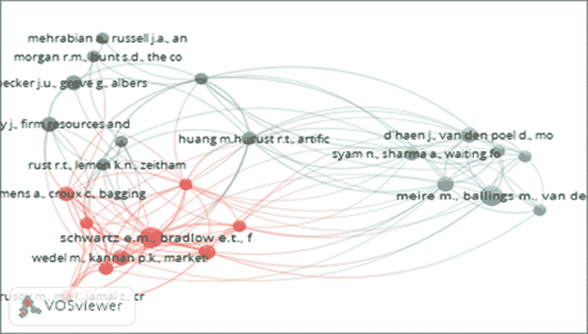

我们还研究了数据库中所选作品引用的 24971 名作者的共引关系。作者必须至少被引用 30 次才能被纳入，79 名作者达到了这一阈值。我们数据库中被引用最多的五位作者是 Rust（178 次）、Kumar（188 次）、Verhoef（116 次）、Gupta（99 次）和 Neslin（89 次）。他们是客户获取相关 AI 研究中最重要的作者，并影响着该领域的其他研究人员。如图 11 所示，Rust、Kumar、Verhoef 和 Gupta 等作者位于地图中心，与其他作品拥有最多且最强的链接，而 Smith 与该网络的连接相对较弱。

根据这项共引分析，很明显，作者群体在客户获取领域的 AI 研究中正发挥越来越重要的作用。Kumar、Verhoef 和 Gupta 经常被提及合作。尽管这三位作者中有两位未被提及合作，但其中一位经常与另一位作者合作。尽管目前对这一趋势后果的不确定性，但可以想象，随着该领域的不断进步，这些作者的著作将成为“传统”或必需的引用。

#### 图 11. 按作者进行的共引分析

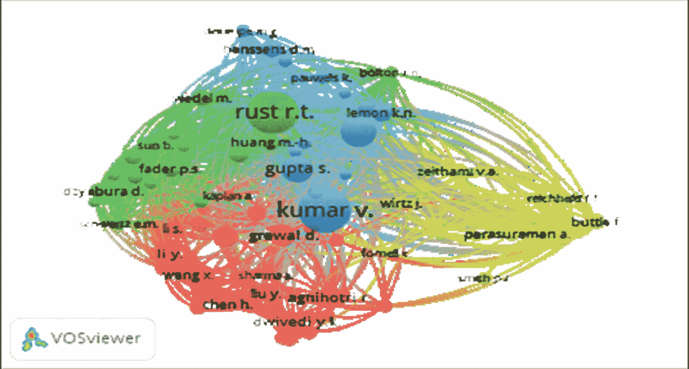

### 5\. 讨论与管理贡献

本章采用书目计量学方法，考察了客户研究中 AI 应用的研究现状。使用 `VOSViewer` 软件，我们分析了 Scopus 数据库中关于该主题的文章的作者、引文、出版量、机构来源和其他参数。`VOSViewer` 提供了信息，而无需其他内容分析工具所需的手动分析和编码。

我们的第一个观察是，随着时间的推移，我们观察到关于客户获取中 AI 的文章数量显著增加，尤其是 2018 年后加速。尽管样本中的期刊对最被引用文章有合理的分布，但《交互式营销研究杂志》拥有最高的引用次数（514 次）和六篇出版物，目前是该主题工作中最具影响力的期刊。同样，来自美国、中国和英国的研究人员目前在该主题的文献中占据主导地位，无论是研究成果还是影响力。

我们的第二个观察是，总体而言，客户获取领域 AI 应用的研究相当分散。尽管出现了合著者，但尚未有一个明确识别的作者群体在文献库中占据主导地位。同样，该领域仍有许多机会有待探索，因为引用来源分散，文章、作者或机构之间似乎仍然没有紧密的联系。

另一方面，我们看到客户获取领域 AI 中主题和关键词的集中度在增加，这与传统计算领域使用的技术关键词一致。这一观察也得到了 Ledro et al. (2022) 进行的研究的证实，该研究通过识别 RCMP 领域 AI 文献的三个主要子领域（Big et al. 作为数据库，应用于 CRM 活动的 AI 和机器学习技术，以及 AI-CRM 集成的战略管理）来证实。这表明与计算机科学领域研究过的技术概念可能存在关系。此外，迄今为止，该领域的工作倾向于关注四个关键领域，即“销售”、“人工智能”、“机器学习”和“营销”。在营销以外的不同学科中，大部分研究由计算机科学和管理信息系统的学者进行。

`VOSViewer` 操作包含大量项目的非常大型数据库的能力，将它们纳入后续关于客户获取中 AI 应用的研究将相当简单。稍后通过添加更多出版物来审查我们的工作也是相关的。这些研究方向注定属于未来。我们通过列出营销专家在该主题研究中所走的路径，为该主题的所有文献做出了贡献。我们相信这项书目计量研究将使营销人员能够确定哪些领域对客户获取中的 AI 应用很重要。


AI 在客户获取中的整合有可能彻底改变企业的客户参与方式，但也引发了重大的伦理问题 (Brynjolfsson & McAfee, 2014)。AI 算法可以收集大量客户数据，从而制定个性化营销策略，这可能会提升销售额，但也会引发隐私问题 (Mittelstadt, et al., 2016)。AI 算法的不透明性可能会导致客户不信任，并给企业在维护道德标准方面带来挑战 (Mittelstadt, et al., 2016)。此外，还存在针对某些人口群体的歧视性行为的风险，这可能导致不公平待遇并降低客户对企业的信任 (Crawford, 2016)。

本研究还阐述了 AI 在客户获取中的不同应用，一方面，这可以帮助研究人员进一步深化该领域的知识，帮助管理者制定适当且连贯的策略。对于研究人员来说，此类研究可以提供关于 AI 技术在客户获取中有效性的见解，提供深入了解消费者行为、市场趋势以及 AI 对业务成果影响的机会。通过考察现实世界中的应用和案例研究，研究人员可以识别最佳实践、挑战以及需要进一步调查的领域，从而为该领域知识的进步做出贡献。对于管理者来说，该研究可以作为制定与客户获取相关的战略举措的宝贵资源。通过了解 AI 工具的能力和局限性，管理者可以就实施 AI 驱动的解决方案做出明智决策，以优化客户定位、参与度和转化率。该研究可以帮助管理者识别关键绩效指标，制定定制策略，并有效配置资源，以增强客户获取工作。

### 6\. 结论、局限性与展望

人工智能在客户获取中的应用是一个新兴的、跨学科的且非常有前景的研究领域。出版物数量不断增加；研究工作倾向于关注特定主题，期刊、组织和国家的文章分布也比较合理。人工智能将继续通过彻底改变数据分析、自动化任务以提高其理解和定位客户的能力，以及提供个性化体验来改变客户获取格局。因此，在这个领域仍有许多研究机会需要探索，因为引用来源分散，文章、作者或机构之间似乎仍然没有紧密的联系。

本研究的主要局限性在于以 Scopus 作为主要数据来源。尽管该数据库覆盖范围广泛且结构严谨，但它只列出了部分出版物。任何在 Scopus 之外的期刊和报纸上发表的关于此主题的文章都不会被纳入我们的样本。因此，本研究的结论可能只能部分反映迄今为止在 AI 在客户获取中的应用方面所做的所有工作。第二个方法论局限性涉及所分析的文章数量，其受限于 VOSViewer 的分析能力贡献。

本研究为未来研究铺平了道路，以推进知识、促进创新并推动 AI 技术在客户参与策略中的负责任使用。研究人员可以识别 AI 赋能的客户获取中的新兴趋势，探索特定行业的应用，并通过实证研究评估 AI 策略的影响和有效性。这项研究通过评估 AI 技术的投资回报率、客户满意度水平、转化率和其他关键绩效指标，为企业提供了宝贵的见解，以指导决策和战略制定。

# 参考文献

Aghaei Chadegani, A., Salehi, H., Md Yunus, M. M., Farhadi, H., Fooladi, M., Farhadi, M., & Ale Ebrahim, N. (2013). A comparison between two main academic literature collections: Web of science and scopus databases. Asian Social Science, 9(5), 18–26. [10.5539/ass.v9n5p18](http://dx.doi.org/10.5539/ass.v9n5p18)

Alalwan, A. A., Algharabat, R. S., Baabdullah, A. M., Rana, N. P., Qasem, Z., & Dwivedi, Y. K. (2020). Examining the impact of mobile interactivity on customer engagement in the context of mobile shopping. Journal of Enterprise Information Management, 33(3), 627–653. [10.1108/JEIM\-07-2019-0194](http://dx.doi.org/10.1108/JEIM-07-2019-0194)

Alla, L., Kamal, M., & Bouhtati, N. (2022). Big data et efficacité marketing des entreprises touristiques : Une revue de littérature. Alternatives Managériales Economiques, 4.[10.48374/IMIST.PRSM/ame\-v1i0.36928](http://dx.doi.org/10.48374/IMIST.PRSM/ame-v1i0.36928)

Amatriain, X., & Basilico, J. (2015). Recommender systems in industry: A netflix case study. In Recommender systems handbook (pp. 385–419). Springer US. [10.1007/978\-1\-4899-7637-6\_11](http://dx.doi.org/978-1-4899-7637-6_11)

Aria, M., & Cuccurullo, C. (2017). bibliometrix: An R-tool for comprehensive science mapping analysis. Journal of Informetrics, 11(4), 959–975. [10.1016/j.joi.2017.08.007](http://dx.doi.org/10.1016/j.joi.2017.08.007)

Barari, M., Ross, M., Thaichon, S., & Surachartkumtonkun, J. (2021). A meta-analysis of customer engagement behaviour. International Journal of Consumer Studies, 45(4), 457–477. [10.1111/ijcs.12609](http://dx.doi.org/10.1111/ijcs.12609)

Becker, M., Wiegand, N., & Reinartz, W. J. (2019). Does it pay to be real? Understanding authenticity in TV advertising. Journal of Marketing, 83(1), 24–50. [10.1177/0022242918815880](http://dx.doi.org/10.1177/0022242918815880)

Berger, J., Humphreys, A., Ludwig, S., Moe, W. W., Netzer, O., & Schweidel, D. A. (2019). Uniting the tribes: Using text for marketing insight. Journal of Marketing, 84(1), 1–25. [10.1177/0022242919873106](http://dx.doi.org/10.1177/0022242919873106)

Bouhtati, N. alla, L., & bentalha, B. (2023). Marketing Big Data Analytics and Customer Relationship Management: A Fuzzy Approach. In Integrating Intelligence and Sustainability in Supply Chains (pp. 75-86). DOI: . IGI Global.[10.4018/979\-8\-3693\-0225-5.ch004](http://dx.doi.org/10.4018/979-8-3693-0225-5.ch004)

Brynjolfsson, E., & McAfee, A. (2014). The second machine age: Work, progress, and prosperity in a time of brilliant technologies. WW Norton & Company.

Castro, S. L. C., Del Pozo Durango Rodrigo Humberto, V., Paúl, A. C., & Estefanía, A. T. P. (2023). Impact of Artificial Intelligence on Market Behavior Analysis: A Comprehensive Approach to Marketing. Remittances Review, 8(4).

Charles, V., Rana, N. P., Pappas, I. O., Kamphaug, M., Siau, K., & Engø-Monsen, K. (2023). The Next ‘Deep’Thing in X to Z Marketing: An Artificial Intelligence-Driven Approach. Information Systems Frontiers, 1–6.

Coffin, J. (2022). Asking questions of AI advertising: A maieutic approach. Journal of Advertising, 51(5), 608–623. [10.1080/00913367.2022.2111728](http://dx.doi.org/10.1080/00913367.2022.2111728)

Colicev, A., Kumar, A., & O’Connor, P. (2019). Modeling the relationship between firm and user generated content and the stages of the marketing funnel. International Journal of Research in Marketing, 36(1), 100–116. [10.1016/j.ijresmar.2018.09.005](http://dx.doi.org/10.1016/j.ijresmar.2018.09.005)

Crawford, K., Whittaker, M., Elish, M. C., Barocas, S., Plasek, A., & Ferryman, K. (2016). The AI now report. The Social and Economic Implications of Artificial Intelligence Technologies in the Near-Term, 2.


# 参考文献列表

Davenport, T., Guha, A., Grewal, D., & Bressgott, T. (2020). How artificial intelligence will change the future of marketing. Journal of the Academy of Marketing Science, 48(2), 24–42. [10.1007/s11747-019-00696-0](http://dx.doi.org/10.1007/s11747-019-00696-0)

De Bellis, E., & Johar, G. V. (2020). Autonomous shopping systems: Identifying and overcoming barriers to consumer adoption. Journal of Retailing, 96(1), 74–87. [10.1016/j.jretai.2019.12.004](http://dx.doi.org/10.1016/j.jretai.2019.12.004)

De Bruyn, A., Viswanathan, V., Beh, Y. S., Brock, J. K. U., & von Wangenheim, F. (2020). Artificial intelligence and marketing: Pitfalls and opportunities. Journal of Interactive Marketing, 51, 91–105. [10.1016/j.intmar.2020.04.007](http://dx.doi.org/10.1016/j.intmar.2020.04.007)

Dolega, L., Rowe, F., & Branagan, E. (2021). Going digital? The impact of social media marketing on retail website traffic, orders and sales. Journal of Retailing and Consumer Services, 60, 60. [10.1016/j.jretconser.2021.102501](http://dx.doi.org/10.1016/j.jretconser.2021.102501)

Feng, C. M., Park, A., Pitt, L., Kietzmann, J., & Northey, G. (2021). Artificial intelligence in marketing: A bibliographic perspective. Australasian Marketing Journal, 29(3), 252–263. [10.1016/j.ausmj.2020.07.006](http://dx.doi.org/10.1016/j.ausmj.2020.07.006)

Fernandes T., Remelhe P. (2016). How to engage customers in co-creation: customers' motivations for collaborative innovation. J. Strat. Market., 24.

Gopalakrishna, S., Crecelius, A. T., & Patil, A. (2022). Hunting for new customers: Assessing the drivers of effective salesperson prospecting and conversion. Journal of Business Research, 149, 916–926. [10.1016/j.jbusres.2022.05.008](http://dx.doi.org/10.1016/j.jbusres.2022.05.008)

Gopalakrishna, S., Crecelius, A. T., & Patil, A. (2022). Hunting for new customers: Assessing the drivers of effective salesperson prospecting and conversion. Journal of Business Research, 149, 916–926. [10.1016/j.jbusres.2022.05.008](http://dx.doi.org/10.1016/j.jbusres.2022.05.008)

Gupta, S. (2009). Customer-based valuation. Journal of Interactive Marketing, 23(2), 169–178. [10.1016/j.intmar.2009.02.006](http://dx.doi.org/10.1016/j.intmar.2009.02.006)

Haenlein, M., & Kaplan, A. (2019). A brief history of artificial intelligence: On the past, present, and future of artificial intelligence. California Management Review, 61(4), 5–14. [10.1177/0008125619864925](http://dx.doi.org/10.1177/0008125619864925)

Haleem, A., Javaid, M., Qadri, M. A., Singh, R. P., & Suman, R. (2022). Artificial intelligence (AI) applications for marketing: A literature-based study. International Journal of Intelligent Networks.

Huang, M.-H., & Rust, R. T. (2018). Artificial Intelligence in Service. Journal of Service Research, 21(2), 155–172. [10.1177/1094670517752459](http://dx.doi.org/10.1177/1094670517752459)

Huang, Y., Zhang, X., & Zhu, H. (2022). How do customers engage in social media-based brand communities: The moderator role of the brand’s country of origin? Journal of Retailing and Consumer Services, 68.

Islam, J. U., Rahman, Z., & Hollebeek, L. D. (2017). Personality factors as predictors of online consumer engagement: An empirical investigation. Marketing Intelligence & Planning, 35(4), 510–528. [10.1108/MIP\-10-2016-0193](http://dx.doi.org/10.1108/MIP-10-2016-0193)

Juric, B., Smith, S. D., & Wilks, G. (2015). Negative customer brand engagement: an overview of conceptual and blog-based findings. Customer Engagement: Contemporary Issues and Challenges, pp. 278-294.

Kumar, V., Aksoy, L., Donkers, B., Venkatesan, R., Wiesel, T., & Tillmanns, S. (2010). Undervalued or overvalued customers: Capturing total customer engagement value. J. Serv. Journal of Service Research, 13(3), 297–310. [10.1177/1094670510375602](http://dx.doi.org/10.1177/1094670510375602)

Kumar, V., Aksoy, L., Donkers, B., Venkatesan, R., Wiesel, T., & Tillmanns, S. (2019). Customer engagement: The construct, antecedents, and consequences. Journal of the Academy of Marketing Science, 47(2), 252–277.

Kumar, V., Rajan, B., Venkatesan, R., & Lecinski, J. (2019). Understanding the role of artificial intelligence in personalized engagement marketing. California Management Review, 61(4), 135–155. [10.1177/0008125619859317](http://dx.doi.org/10.1108/JBIM-07-2021-0332)

Ledro, C., Nosella, A., & Vinelli, A. (2022). Artificial intelligence in customer relationship management: Literature review and future research directions. Journal of Business and Industrial Marketing, 37(13), 48–63. [10.1108/JBIM\-07-2021-0332](http://dx.doi.org/10.1108/JBIM-07-2021-0332)

Lhoussaine, A. (2022). Big data et efficacité marketing des entreprises touristiques: Une revue de littérature. Alternatives Managériales Economiques, 1, 39–58.

Lowry, P. B., Moody, G. D., Gaskin, J., Galletta, D., Humphreys, S., Barlow, J. B., & Wilson, D. (2013). Evaluating Journal Quality and the Association for Information Systems Senior Scholars’ Journal Basket via Bibliometric Measures: Do Expert Journal Assessments Add Value? (SSRN Scholarly Paper ID 2186798). [10.25300/MISQ/2013/37.4.01](http://dx.doi.org/10.25300/MISQ/2013/37.4.01)

Luo, X., Tong, S., Fang, Z., & Qu, Z. (2019). Frontiers: machines vs. humans: The impact of artificial intelligence chatbot disclosure on customer purchases. Marketing Science, 38(6), 937–947. [10.1287/mksc.2019.1192](http://dx.doi.org/10.1287/mksc.2019.1192)

Marchand, A., & Marx, P. (2020). Automated product recommendations with preference-based explanations. Journal of Retailing, 96(3), 328–343. [10.1016/j.jretai.2020.01.001](http://dx.doi.org/10.1016/j.jretai.2020.01.001)

Marr, B. (2019). Artificial intelligence in practice: how 50 successful companies used AI and machine learning to solve problems. John Wiley & Sons.

Meire, M., Ballings, M., & van den Poel, D. (2017). The Added Value of Social Media Data in B2B Customer Acquisition Systems: A Real-Life Experiment. Decision Support Systems, 104, 26–37. [10.1016/j.dss.2017.09.010](http://dx.doi.org/10.1016/j.dss.2017.09.010)

Mikalef, P., Pappas, I. O., Krogstie, J., & Pavlou, P. A. (2020). Big data and business analytics: A research agenda for realizing business value. Information & Management, 57(1), 1. [10.1016/j.im.2019.103237](http://dx.doi.org/10.1016/j.im.2019.103237)

Miroshnichenko, I. V., Sheremet, M. A., Oztop, H. F., & Abu-Hamdeh, N. (2018). Natural convection of Al2O3/H2O nanofluid in an open inclined cavity with a heat-generating element. International Journal of Heat and Mass Transfer, 126, 184–191. [10.1016/j.ijheatmasstransfer.2018.05.146](http://dx.doi.org/10.1016/j.ijheatmasstransfer.2018.05.146)

Misra, K., Schwartz, E. M., & Abernethy, J. (2019). Dynamic online pricing with incomplete information using multiarmed bandit experiments. Marketing Science, 38(2), 226–252. [10.1287/mksc.2018.1129](http://dx.doi.org/10.1287/mksc.2018.1129)

Mittelstadt, B. D., Allo, P., Taddeo, M., Wachter, S., & Floridi, L. (2016). The ethics of algorithms: Mapping the debate. Big Data & Society, 3(2), 2053951716679679. [10.1177/2053951716679679](http://dx.doi.org/10.1177/2053951716679679)

Muhammad, S. S., Dey, B. L., & Weerakkody, V. (2018). Analysis of factors that influence customers’ willingness to leave big data digital footprints on social media: A systematic review of literature. Information Systems Frontiers, 20(3), 559–576. [10.1007/s10796-017-9802-y](http://dx.doi.org/10.1007/s10796-017-9802-y)

Pansari, A., & Kumar, V. (2017). Customer engagement: The construct, antecedents, and consequences. Journal of the Academy of Marketing Science, 45(3), 294–311. [10.1007/s11747-016-0485-6](http://dx.doi.org/10.1007/s11747-016-0485-6)

Paschen, J., Wilson, M., & Ferreira, J. J. (2020). Collaborative intelligence: How human and artificial intelligence create value along the B2B sales funnel. Business Horizons, 63(3), 403–414. [10.1016/j.bushor.2020.01.003](http://dx.doi.org/10.1016/j.bushor.2020.01.003)


Raisch, S., & Krakowski, S. (2021). Artificial intelligence and management: The automation augmentation paradox. Academy of Management Review, 46(1), 192–210. [10.5465/amr.2018.0072](http://dx.doi.org/10.5465/amr.2018.0072)

Rangaswamy, A., Moch, N., Felten, C., van Bruggen, G., Wieringa, J. E., & Wirtz, J. (2020). The role of marketing in digital business platforms. Journal of Interactive Marketing, 51(August), 72–90. [10.1016/j.intmar.2020.04.006](http://dx.doi.org/10.1016/j.intmar.2020.04.006)

Reinartz, W., Thomas, J. S., & Kumar, V. (2005). Balancing acquisition and retention resources to maximize customer profitability. Journal of Marketing, 69(1), 63–79. [10.1509/jmkg.69.1.63.55511](http://dx.doi.org/10.1509/jmkg.69.1.63.55511)

Rowley, J., & Slack, F. (2004). Conducting a literature review. Management Research News, 27(6), 31–39. [10.1108/01409170410784185](http://dx.doi.org/01409170410784185)

Salminen, J., Yoganathan, V., Corporan, J., Jansen, B. J., & Jung, S.-G. (2019). Machine-learning approach to auto-tagging online content for content marketing efficiency: A comparative analysis between methods and content type. Journal of Business Research, 101, 203–217. [10.1016/j.jbusres.2019.04.018](http://dx.doi.org/10.1016/j.jbusres.2019.04.018)

Sanchez-Hernandez, G., Chiclana, F., Agell, N., & Carlos, J. (2013). Ranking and selection of unsupervised learning marketing segmentation. Knowledge-Based Systems, 44, 20–33. [10.1016/j.knosys.2013.01.012](http://dx.doi.org/10.1016/j.knosys.2013.01.012)

Schwartz Eric, M., Bradlow Eric, T., & Fader Peter, S. (2017). Customer acquisition via display advertising using multiarmed bandit experiments. Marketing Science, 36(4), 500–522. [10.1287/mksc.2016.1023](http://dx.doi.org/10.1287/mksc.2016.1023)

Surendro, K. (2019, March). Predictive analytics for predicting customer behavior. In 2019 International Conference of Artificial Intelligence and Information Technology (ICAIIT) (pp. 230-233). IEEE.

Suri, A., Jones, B. C., Ng, G., Anabaraonye, N., Beyrer, P., Domi, A., Choi, G., Tang, S., Terry, A., Leichner, T., Fathali, I., Bastin, N., Chesnais, H., & Rajapakse, C. S. (2021). A deep learning system for automated, multi-modality 2D segmentation of vertebral bodies and intervertebral discs. Bone, 149, 115972. [10.1016/j.bone.2021.115972](http://dx.doi.org/10.1016/j.bone.2021.115972)

Thomaz, F., Salge, C., Karahanna, E., & Hulland, J. (2020). Learning from the dark web: Leveraging conversational agents in the era of hyper-privacy to enhance marketing. Journal of the Academy of Marketing Science, 48(2), 43–63. [10.1007/s11747-019-00704-3](http://dx.doi.org/10.1007/s11747-019-00704-3)

Van Eck, N. J., & Waltman, L. (2010). Software survey: VOSviewer, a computer program for bibliometric mapping. Scientometrics, 84(2), 523–538. [10.1007/s11192-009-0146-3](http://dx.doi.org/10.11192-009-0146-3)

Wang, R. J., Krishnamurthi, L., & Mathouse, E. C. (2018). When reward convenience meets mobile app: Increasing customer participation in a coalition loyalty program \[V.M. Landers.\]. Journal of the Association for Consumer Research, 3(3), 314–329. [10.1086/698331](http://dx.doi.org/10.1086/698331)

Wirtz, J., & Zeithaml, V. (2018). Cost-effective service excellence. Journal of the Academy of Marketing Science, 46(1), 59–80. [10.1007/s11747-017-0560-7](http://dx.doi.org/10.1007/s11747-017-0560-7)

Zhao, L., Tang, Z., & Zou, X. (2019). Mapping the knowledge domain of smart-city research: A bibliometric and scientometric analysis. Sustainability, 11(23), 1–28. [10.3390/su12010001](http://dx.doi.org/10.3390/su12010001)

Zheng, R., Li, Z., & Na, S. (2022). How customer engagement in the live-streaming affects purchase intention and customer acquisition, E-tailer’s perspective. Journal of Retailing and Consumer Services, 68, 103015. [10.1016/j.jretconser.2022.103015](http://dx.doi.org/10.1016/j.jretconser.2022.103015)

## 第 2 章

# 新兴技术的营销应用：

## 系统文献综述

Mourad Aarabe


摩洛哥非斯国家商业与管理学院

Nouhaila Ben Khizzou

摩洛哥非斯国家商业与管理学院

Lhoussaine Alla


摩洛哥非斯国家应用科学学院

Ahmed Benjelloun

摩洛哥非斯国家商业与管理学院

### 摘要

在当今的全球环境中，整合新兴技术已成为一种必要。本书探讨了技术与营销的交叉点，概述了技术进步及其对营销实践的影响。本章提出了一项遵循 PRISMA 协议的系统文献综述，以探索新兴技术解决方案在营销中的适用广度和范围。其目的是突出此类技术在营销应用中的关键机遇与挑战。使用 `Nvivo V12` 软件进行的这项分析表明，人工智能、增强现实、物联网、区块链和数据分析等新兴技术在营销实践和策略中日益重要。这些技术主要用于了解和满足个别客户需求，并改善客户体验。

### 1\. 引言

在当今高度互联的世界中，营销深受新兴技术快速发展的影响 (Grewal et al., 2020; Kumar et al., 2021; Shah & Murthi, 2021)。采用这些技术，包括增强现实、人工智能、物联网、区块链和大数据分析，为从业者和理论家都带来了独特的机遇与挑战。

尽管新兴技术在营销应用方面的研究至关重要，但仍未得到充分探索。通过采用和嵌入这些技术提供的解决方案所预期和实际获得的利害关系、机遇、风险及营销绩效，尚未得到充分突出 (Hoffman et al., 2022; Sharma et al., 2023)。

因此，我们的贡献旨在回顾该领域发表的最相关的实证和理论研究，主要目标是开展系统文献综述，以探索新兴技术对营销的影响。我们的使命是识别这些技术进步在营销采用中的主要趋势、益处、挑战以及实际和理论意义。

为了实现我们的目标，我们的研究由以下核心问题指导：新兴技术的主要营销应用是什么？这些转变对该领域的管理者和研究人员有何影响？


为了回答这些问题，我们进行了一项系统文献综述，采用了营销应用的整体视角。我们的目标是涵盖广泛的主题，例如增强现实和客户体验、使用基于人工智能的技术进行个性化、通过物联网进行客户关系管理、通过大数据分析进行营销决策，以及在不同营销方面使用各种其他技术。我们的文献检索将遵循 PRISMA 协议，从可靠的学术数据库中选择相关研究。我们将使用 `Nvivo` 12 软件分析收集到的数据。

本章介绍了一个理论框架，强调营销概念的演变、新兴营销技术及其应用。然后，我们介绍了系统文献综述的方法和结果。在结果之后，我们讨论了未来研究的启示、局限性和前景。

## 2. 文献综述

### 2.1. 营销：一个不断寻求智能的领域

作为对技术、战略、经济和环境变化与发展的回应，营销概念随时间不断演变。现代营销的创始人之一科特勒及其同事在其营销系列书籍中，将营销视角分为五个阶段，从营销 1.0 到营销 5.0 (Kotler et al., 2021)。

营销 1.0 仅关注产品。在大规模生产时代，公司旨在高效分销标准化产品，以满足强劲的市场需求。营销的作用是向消费者告知产品特性和优势，以刺激销售 (Kotler et al., 2010)。然而，随着互联网和社交媒体的出现，营销范式转向关注客户，标志着营销 2.0 的开始。营销的目的是利用数字平台鼓励与客户的参与和互动 (Kotler et al., 2010)。在营销的第三阶段（营销 3.0）中，价值观和情感已成为决定性特征，公司努力将与消费者建立情感联系作为企业社会责任战略的一部分 (Kotler et al., 2010)。

包括人工智能、数据分析、物联网和自动化在内的数字技术的使用，促成了营销 4.0 的出现 (Khargharia et al., 2023; Kotler et al., 2016)。这种营销方法强调数据和算法在为客户提供个性化和有针对性的体验方面的重要性 (Kotler et al., 2016)。

从这种革命性的角度来看，以人为本的营销 5.0 不再仅仅是客户与品牌之间的交易。相反，它专注于创造满足人们情感和精神需求的难忘体验 (Kotler et al., 2021)。

这种演变展示了从关注产品和交易到关注关系和体验的逐渐转变。有一个明确的趋势是朝着更智能的营销发展，融合了各种新兴技术的解决方案。下表总结了从营销 1.0 到营销 5.0 的演进过程。

### 表 1. 营销演进摘要

| 视角 | 业务条件 | 营销的作用 | 目标 |
| :--- | :--- | :--- | :--- |
| 产品 | 大规模生产<br>需求增加 | 产品推广 | 提升销售 |
| 客户 | 互联网和社交媒体 | 对客户的承诺 | 创建个性化关系 |
| 价值 | 企业社会责任 | 与消费者建立情感联系 | 促进人的自我实现 |
| 数字 | 数字技术的普及 | 高级定制 | 为消费者提供更具针对性和个性化的营销体验 |
| 人类 | 新兴技术<br>后新冠疫情时代 | 与消费者建立深层联系 | 创造满足人们情感和精神需求的有意义的体验 |

来源：受 (Kotler et al., 2010, 2016, 2021) 启发

营销的作用和目标随时间发生了重大变化，从各种角度来看 (Kotler et al., 2010, 2016, 2021)。这种转变是营销格局前所未有的演变的一部分，旨在适应消费者和社会不断变化的需求 (Dash et al., 2021; Grewal et al., 2020; Rust, 2020)。在此背景下，研究营销中的新兴技术可以帮助我们战略性地整合这些工具，以加强客户关系、创造价值，并促进更具人性化和真实性的体验。

### 2.2. 营销中的新兴技术

新兴技术对现代营销的影响是显著的，为专业人士带来了新的机遇和挑战 (Kotler et al., 2021)。然而，以往的研究在充分理解这一影响方面还不足。根据 (Godé, 2021) 的定义，新兴技术是快速出现和演变的创新解决方案。这些技术仍在发展中，有可能颠覆传统的营销实践 (Kocaman et al., 2023; Lo & Campos, 2018; Rauschnabel et al., 2022; Verma et al., 2021)。Anastassova, (2006) 将这些技术描述为创新、可快速扩展，并能够在商业模式和消费者行为中引入重大转变 (Bobillier Chaumon, 2021)。


# 营销行业引入了多项创新

人工智能因其能够利用通过物联网（IoT）技术从多个连接设备收集的大数据而引人注目。区块链技术为交易和数据提供了安全性和透明度。Huang & Rust, (2021)对人工智能在营销中的作用提出了全面的视角。人工智能通过使专家能够收集和分析数据以理解市场趋势和消费者行为，从而改变了营销 (Campbell et al., 2020; Castro et al., 2023)。Huang & Rust, (2021)和 Stone et al., (2020)提出，人工智能可以通过细分、目标定位和定位来实现有效且相关的营销行动，从而增强战略营销。这有助于消息和优惠的个性化 (Haleem et al., 2022)，这对消费者的感知价值和购买意向有显著影响 (Yin & Qiu, 2021)。人工智能系统可以鼓励客户互动并促进未来的参与 (Perez-Vega et al., 2021)。

多项研究已证明人工智能和机器学习应用在营销中的重要性日益增加。Ma & Sun, (2020)强调了这些方法对增强营销研究的潜在好处。机器学习使用算法和统计模型，使计算机能够在没有明确编程的情况下从数据中学习和改进 (Campbell et al., 2020)。这种方法旨在识别趋势，以更好地理解行为并为明智的决策生成洞察 (Ma & Sun, 2020)。De Mauro et al., (2022)提出了营销中机器学习的十一种重复应用的分类法，分为四个改进类别。“购买原则和消费者体验”指的是消费者的体验，而“决策和金融应用”指的是企业的体验。这些技术使公司能够改善客户体验和竞争力 (Keegan et al., 2022; Volkmar et al., 2022)。

聊天机器人和虚拟助手在营销和客户服务实践中越来越受欢迎 (Ngai et al., 2021)。这些设备利用人工智能通过为客户请求提供全天候支持来增强客户体验 (Kushwaha et al., 2021)，从而加快响应时间并减少人力 (Ngai et al., 2021)。Selamat & Windasari, (2021)发现，拟人化、感知愉悦和感知有用性对客户在使用聊天机器人时的购买意向有积极影响。

然而，一些作者指出了营销人员面临的人工智能错误的困难，以及可能危及其系统的人类偏见 (Volkmar et al., 2022)。人工智能使用的环境和伦理影响需要特别关注 (Huang & Rust, 2021)。

增强现实（AR）(Rauschnabel et al., 2022)、虚拟现实（VR）(Adeola et al., 2022; Berberović et al., 2022)、扩展现实（XR）(Wagner & Cozmiuc, 2022)和混合现实（MR）(Bec et al., 2021)为营销提供了巨大的潜力。将虚拟元素集成到物理世界中，使公司能够为客户提供交互式和沉浸式体验，这可以积极影响他们的行为和认知 (Flavián et al., 2019; Wedel et al., 2020)。例如，使用增强现实有助于产品预览和调整，从而降低客户不确定性 (Gallardo et al., 2018)和感知风险 (Lim et al., 2024)。因此，这影响了客户满意度、承诺 (Wagner & Cozmiuc, 2022)和购买意向 (Kazmi et al., 2021)。

在营销领域，物联网（IoT）代表着重大进步。它通过连接传感器和智能对象实现实时数据收集，为营销人员提供关于消费者行为的有用信息 (Grewal et al., 2020; Khargharia et al., 2023)。Lo & Campos, (2018)建议，物联网解决方案可用于探索新的市场细分，同时推动价值创造和客户参与 (Wagner & Cozmiuc, 2022)。它也是关系营销的载体，通过为客户创造和发展持久的关系和积极体验来实现 (Lo & Campos, 2018)。

区块链通过提供一种透明且安全的交易方式，彻底改变了现代营销 (Gleim & Stevens, 2021)。该技术的特点是信任、不可更改性和对数据记录的信心，这在无需中介的情况下降低了欺诈和假冒的风险 (Stallone et al., 2021)。

## 2.3. 新兴技术的营销应用

多位作者指出了新兴技术在营销 (Plangger et al., 2022; Rust, 2020) 和客户关系 (Kumar et al., 2021) 中的巨大潜力。此外，一些作者强调了它们对消费者决策的影响 (Sharma et al., 2023)。这些技术为营销人员提供了前所未有的机会，以与消费者互动并创造更加个性化、沉浸式和引人入胜的体验 (Perez-Vega et al., 2021)。下表总结了主要新兴技术的各种营销应用。

### 表 2. 新兴技术的主要营销应用


| 作者 | 新兴技术 | 营销应用 | 营销目标 |
| --- | --- | --- | --- |
| (Blasco-Arcas et al., 2022; Buhalis & Moldavska, 2022; Campbell et al., 2020; Castro et al., 2023; Huang & Rust, 2021; Kushwaha et al., 2021; Ngai et al., 2021; Perez-Vega et al., 2021; Selamat & Windasari, 2021; Vlačić et al., 2021) | 人工智能 | • 基于 AI 的 CRM<br>• 客户数据分析<br>• 营销自动化<br>• 聊天机器人<br>• 语音助手<br>• 虚拟助手<br>• 自动化交互 | • 价值创造<br>• 客户关系管理<br>• 个性化<br>• 分群<br>• 忠诚度<br>• 市场行为分析<br>• 缩短响应时间<br>• 改善客户体验 |

| --- | --- | --- | --- |

| (Gallardo et al., 2018; Jessen et al., 2020; Lim et al., 2024; Nikhashemi et al., 2021; Rauschnabel et al., 2022; Wedel et al., 2020; Yu et al., 2023) | 增强现实 | • AR 应用程序<br>• 交互式体验设计 | • 承诺<br>• 个性化<br>• 价值创造<br>• 灵感 |

| (Jonny et al., 2021; Lo & Campos, 2018; Wagner & Cozmiuc, 2022) | 物联网 | • 连接设备<br>• 即时数据收集和分析 | • 探索新细分市场<br>• 客户关系管理<br>• 优化营销活动 |

| (Gleim & Stevens, 2021; Peres et al., 2023; Stallone et al., 2021) | 区块链 | • 区块链应用程序 | • 透明度<br>• 安全性<br>• 可追溯性<br>• 信任 |

| (De Mauro et al., 2022; Li et al., 2019; Miklosik et al., 2019; Volkmar et al., 2022) | 自动学习 | • 预测分析<br>• 市场分群<br>• 个性化推荐 | • 个性化<br>• 识别市场趋势<br>• 策略优化 |

| (Alla et al., 2022; Amado et al., 2018; Bouhtati, Alla, et al., 2023; Bouhtati, Kamal, et al., 2023; Lhoussaine et al., 2022; Liu et al., 2023; Rosário & Dias, 2023; Shah & Murthi, 2021) | 大数据 | • 数据分析<br>• 预测建模<br>• 高级分群 | • 检测市场趋势<br>• 预测消费者行为<br>• 定制营销策略 |

来源：作者

新兴技术的整合已成为一种必然，正在改变营销策略和客户互动 (Kumar et al., 2021)。这些进步也为组织提供了竞争优势 (IBM Institute for Business Value, 2023; Sharma et al., 2023)。它们使与消费者的个性化互动、定向广告和定制体验成为可能 (Plangger et al., 2022)。系统文献综述对于分析以往研究、识别趋势和突出知识缺口很有用。

### 3. 方法论

#### 3.1. 建立参考样本的方案

为了总结和综合新兴技术营销应用的当前趋势、挑战和未来前景 (Donthu et al., 2021)，采用 PRISMA 方案进行了系统文献综述。该方案是系统综述的方法论框架，有助于识别、选择和分析相关参考文献。PRISMA 方案建立了明确的纳入和排除标准，以确保分析的完整性和可重复性 (Page et al., 2021)。它要求对方法论质量进行彻底评估，以确保数据的可靠性和有效性，从而增强结论的说服力。通过透明地呈现全面的结果，PRISMA 方案提高了研究的可信度，并便于与其他研究进行比较。遵循该方案可确保营销研究采用稳健且透明的方法论方法 (Mateo, 2020)。

作为第一步，我们在知名科学数据库（如 SCOPUS、WOS、ScienceDirect 和 Springer）中对现有文献进行了全面搜索，使用相关关键词组合成以下方程式：('Marketing applications' OR 'Marketing strategies') AND ('emerging technologies' OR 'new technologies')。在去除重复项并排除 2018 年之前发表的参考文献后，该查询得出了 10,982 条参考文献。为了细化结果，我们应用了将出版物限制在管理和社会科学领域的纳入标准。这得出了 4,542 条参考文献。然后，我们排除了无法获取全文的出版物，最终得到 213 篇出版物的语料库。我们基于标题、摘要和关键词进行了元分析，以获得最终 90 条参考文献的语料库。

#### 图 1. 系统综述不同阶段的信息流

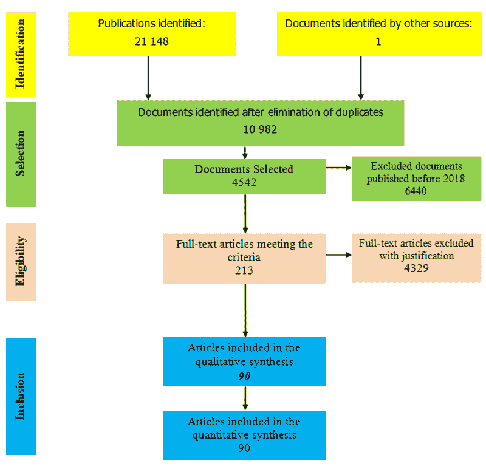

来源：改编自 (Moher et al., 2009)

为了组织和分析我们的语料库，我们使用了 Zotero 书目参考文献管理工具，以便于引用和源文档管理。我们将 Zotero 中的 90 条参考文献以 RIS 格式导出，并导入 NVIVO V 12，对从语料库中提取的数据进行定性分析。为了确保准确性，我们创建了多个代码用于系统分析。

对样本概况的分析可以评估所选参考文献的代表性和相关性，概述方法论决策，并为未来研究提供信息。

#### 3.2. 参考样本概况


分析本研究的参考样本旨在提供其主要特征的概览，包括按出版年份、文档类型、数据库、期刊名称以及所进行研究性质的分类。该分析将帮助我们了解样本的构成和多样性，并识别显著的趋势或模式。

### 3.2.1 按数据库划分的参考文献

图 2 使用 `Nvivo` 制作，展示了按数据库划分的参考文献分布。分析显示，大型知名数据库（如 `Sciendirect`）占据显著优势，其包含 51 篇参考文献，占所有参考文献的 57%。`Elsevier Scopus` 和 `Springer` 共计 29 篇参考文献，位列其后。

#### 图 2. 按数据库划分的参考文献分布

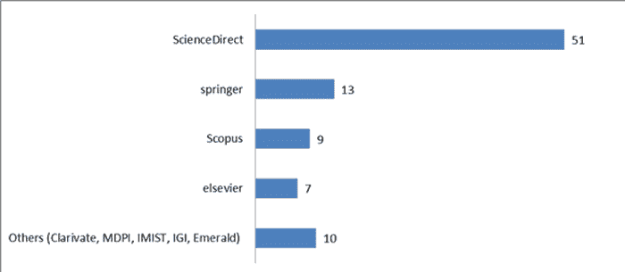

来源：作者

该研究的可信度通过使用多样化参考文献所实现的严谨且详尽的数据收集得到加强。该语料库包括专业性较强且不太传统的资源，“其他”类别包含来自 `Clarivate`、`MDPI`、`IMIST`、`IGI` 和 `Emerald` 等来源的 10 篇参考文献。

### 3.2.2 按出版年份划分的参考文献

数据表明，自 2018 年以来，该主题的研究显著增加，2021 年达到高峰，共有 25 个来源（图 3）。

#### 图 3. 按出版年份划分的参考文献分布

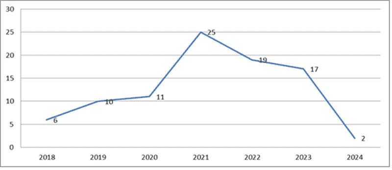

来源：作者

这可能表明该年度研究工作增加或数据可用性更高。然而，2022 年和 2023 年的来源数量略有下降，尽管数量仍然显著，因为一些近期来源的全文未在开放获取中提供。文献综述于 1 月至 2 月进行，这解释了 2024 年使用的来源数量有限。

### 3.2.3 按出版类型划分的参考文献

对语料库的分析生成了一个表格，展示了按类型划分的参考文献分布。结果表明，期刊文章占据显著优势，占所有参考文献的 96%，突显了其在科学研究中的重要性。此外，其他参考文献类型（如论文、章节或书籍）的存在，体现了所使用资源的多样性，并丰富了我们的研究。

#### 表 3. 按出版类型划分的参考文献

| 参考文献类型 || 出现次数 || 频率 |

| --- | --- | --- |

| 期刊文章 || 86 || 96% |

| --- | --- | --- |

| 会议论文 || 1 || 1% |

| 书籍章节 || 2 || 2% |

| 书籍 || 1 || 1% |

| 总计 || 90 || 100% |

来源：作者

### 3.2.4 按期刊名称划分的参考文献分布

为了了解我们研究领域感兴趣的期刊概况，我们提取了以下表格，展示了各参考文献按期刊的分布情况。根据结果，“Journal of Business Research”以 18 篇参考文献位居榜首，凸显了其在我们研究领域的核心重要性。包括“International Journal of Research in Marketing”、“Journal of the Academy of Marketing Science”、“Journal of Retailing and Consumer Services”和“Industrial Marketing Management”在内的多种期刊也发挥着重要作用。一些期刊贡献较为适中，仅有 2 或 3 篇参考文献，此外还有一个名为“Other”的类别，用于仅发表过一篇文章的期刊。

#### 表 4. 按期刊名称划分的参考文献分布

| 文章标题 || 出现次数 || 频率 |

| --- | --- | --- |

| Journal of Business Research || 18 || 20% |

| --- | --- | --- |

| International Journal of Research in Marketing || 7 || 8% |

| Journal of the Academy of Marketing Science || 6 || 7% |

| Journal of Retailing and Consumer Services || 5 || 6% |

| Industrial Marketing Management || 5 || 6% |

| Computers in Human Behavior || 3 || 3% |

| Technological Forecasting and Social Change || 3 || 3% |

| International Journal of Information Management Data Insights || 2 || 2% |

| Sustainability (Switzerland) || 2 || 2% |

| Journal of Interactive Marketing || 2 || 2% |

| Business Horizons || 2 || 2% |

| International Journal of Information Management || 2 || 2% |

| Italian Journal of Marketing || 2 || 2% |

| Journal of Destination Marketing & Management || 2 || 2% |

| Marketing Letters || 2 || 2% |

| others || 27 || 30% |

| Total || 90 || 100% |

来源：作者

在承认研究的多样性和跨学科性质后，有必要关注所进行研究的类型。这包括确定研究是基于以往文献综述的理论研究，还是使用原始数据的实证研究。

### 3.2.5 按研究类型划分的参考文献

研究类型是我们文献综述中需要考虑的一个重要方面。下图显示了理论研究（46 篇参考文献）和实证研究（44 篇参考文献）之间的平衡分布。

#### 图 4. 按研究类型划分的参考文献分布

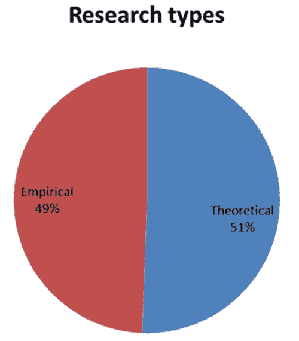

来源：作者

这种平衡允许基于坚实理论基础并由切实实证数据支持的整体方法论方法。需要注意的是，理论研究数量众多，需要实证验证。

## 4\. 研究结果

### 4.1. 描述性分析

该分析旨在解读关键词的共现情况，以深入了解我们语料库的主要趋势和相关性。此外，本节还包括对应用于营销的新兴技术以及受新兴技术影响的营销维度的文本分析。

### 4.1.1 解码研究文本

通过纳入词汇词和同义词等搜索条件，并查找由“任何用户”“创建或修改”的“所有来源”中的“文本”，我们使用 `Nvivo` 中的词频查询来显示出现频率最高的 100 个单词。生成的词云如下所示。

#### 图 5. 词云

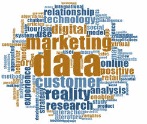

来源：`Nvivo V 12` 结果

下方的词云和表格区分了三类单词。棕色单词（如“marketing”、“data”、“consumer”、“positive”、“virtual”、“behavior”和“advertising”）突出了数据、数字平台和用户体验在营销、消费者行为和偏好中的重要性。在第二类（蓝色）中，“experience”、“augmented”、“use”、“intelligence”和“chatbots”等术语表明新兴技术在营销中日益重要的地位。在第三类（浅蓝色）中，“technology”、“customer”、“future”和“analytics”等关键词表明新兴技术在营销和客户关系管理以及未来趋势和新兴分析方法中的重要性。下表显示了前 20 个单词。

#### 表 5. 文献中前 20 个关键词

| 排名 || 单词 || 出现次数 || 排名 || 单词 || 出现次数 |

| --- | --- | --- | --- | --- | --- |

| 1 || Marketing || 12051 || 11 || Design || 5673 |

| --- | --- | --- | --- | --- | --- |

| 2 || Use || 11548 || 12 || Technology || 5418 |

| --- | --- | --- | --- | --- | --- |

| 3 || Study || 9390 || 13 || Consumer || 5339 |

| --- | --- | --- | --- | --- | --- |

| 4 || Data || 8125 || 14 || Experience || 5222 |

| --- | --- | --- | --- | --- | --- |

| 5 || Research || 7928 || 15 || Business || 5215 |

| --- | --- | --- | --- | --- | --- |

| 6 || Customer || 7733 || 16 || Learning || 4927 |

| --- | --- | --- | --- | --- | --- |

| 7 || Making || 7625 || 17 || Management || 4865 |

| --- | --- | --- | --- | --- | --- |

| 8 || Positive || 6731 || 18 || Based || 4659 |

| --- | --- | --- | --- | --- | --- |

| 9 || Results || 6010 || 19 || Process || 4545 |

| --- | --- | --- | --- | --- | --- |

| 10 || Intelligence || 5856 || 20 || Product || 4533 |

• 来源：基于 `Nvivo V12` 结果


### 4.1.2 应用于营销的新兴技术解决方案的文本分析

使用 `Nvivo` 进行文本分析，使我们能够创建一个矩阵，将文献中最常引用的新兴技术（以行表示）与营销（以列表示）相协调。这种方法有助于识别主要新兴主题和概念之间的趋势和关系。分析我们的矩阵后，很明显，人工智能（`AI`）、增强/虚拟/扩展/混合现实（`AR/VR/ER/MR`）和机器学习（`ML`）对于理解新兴技术格局及其对营销的影响至关重要。此外，其他新兴技术，如物联网（`IoT`）、区块链和大数据，也可能在改变营销格局方面发挥重要作用。这种系统性方法使我们能够将我们的工作置于更广泛的背景下，识别当前趋势和未来的研究机会。

#### 表 6. 应用于营销的技术解决方案的文本分析矩阵

| | 出现次数 |
| --- | --- |
| 1: 新兴技术 | 13 |
| --- | --- |
| 2: `ML` | 8 |
| --- | --- |
| 3: `IoT` | 2 |
| --- | --- |
| 4: `AI` | 23 |
| --- | --- |
| 5: 区块链 | 3 |
| --- | --- |
| 6: 大数据 | 8 |
| --- | --- |
| 7: `AR/VR/ER/MR` | 22 |
| … | … |

来源：基于 `Nvivo V12` 结果

### 4.1.3 受新兴技术影响的营销维度的文本分析

受新兴技术影响的营销维度的统计分析揭示了显著趋势。分析文档中关键术语的频率是使用 `Vosviewer` 软件（图 5）进行检查的，该软件提供了营销维度与新兴技术之间关系的可视化表示。

#### 图 6. 关键词共现

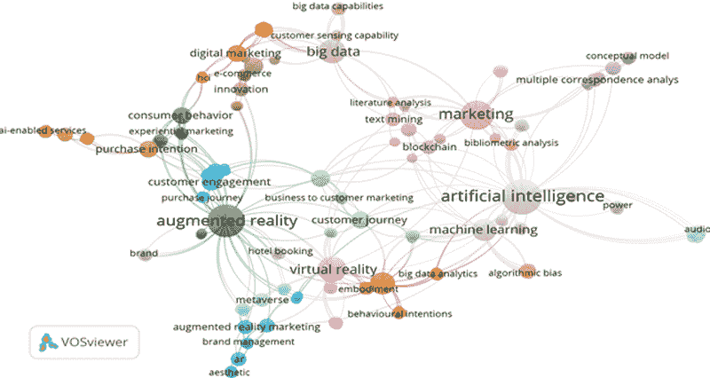

来源：`VOSviewer` 结果

结果突出了受这些技术影响最显著的营销方面。采用新兴技术对营销的多个维度产生影响，具体包括行为意向、客户关系管理、消费者行为、参与度、品牌管理、客户体验和战略营销。

### 4.1.4 所用理论的文本分析

创建节点使我们能够以表格形式获得一个分析网格，汇集了分析语料库所需的所有重要元素，即问题、问题和目标、所动员的理论、研究提案和假设、方法论、结果、贡献、局限性、前景和管理含义。这提供了该领域最成熟的方法论和理论的概览。

#### 表 7. 主要使用的理论

| 使用的理论 | 出现次数 |
| --- | --- |
| `TRA` | 5 |
| --- | --- |
| `UTAUT` | 4 |
| --- | --- |
| 刺激-有机体-反应（`SOR 理论`） | 3 |
| --- | --- |
| `TAM` | 3 |
| --- | --- |
| 使用与满足理论 | 2 |
| --- | --- |
| 承诺-信任理论 | 2 |
| --- | --- |
| 动态能力理论 | 2 |
| --- | --- |
| 可负担性理论 | 1 |
| --- | --- |
| `ELM` 理论 | 1 |
| --- | --- |
| 技术持续性理论（`TCT`） | 1 |
| --- | --- |
| 拓展-建构理论 | 1 |
| --- | --- |
| 风险-收益模型 | 1 |
| --- | --- |
| 心流理论 | 1 |
| … | … |

来源：基于 `Nvivo V12` 结果

考虑到这一点，我们使用 `Nvivo` 对语料库中作者所使用的不同理论进行了深入研究。结果表明，各种方法、理论和模型被广泛使用。计划行为理论（`TRA`）被引用最多，共有 5 个对应来源。其次是技术接受与使用统一理论（`UTAUT`），同样被频繁引用，共有 4 个来源。刺激-有机体-反应理论（`SOR 理论`）、技术接受模型（`TAM`）和使用与满足理论也得到了充分体现，每个理论都有 3 个对应来源。其他理论，如承诺-信任理论、动态能力理论和可负担性理论，也被动员使用，尽管频率较低。

### 4.2. 营销新兴技术应用趋势的主题分析

为了完善我们的研究，我们在下表中总结了主要实证研究的结果。这些结果展示了作者在新兴技术的营销应用方面的主要贡献，并经过实证验证。

#### 表 8. 关键发现摘要

| 作者 | 技术解决方案 | 营销应用维度 |
| --- | --- | --- |
| (Li et al., 2019) | • 机器学习预测算法 | • 消费者行为  

• 客户满意度 |
| --- | --- | --- |
| (Huang & Rust, 2021) | • 使用人工智能自动化数据分析 | • 营销研究（数据收集、市场分析、客户理解）  

• 战略营销（细分、目标定位、市场定位）  

• 运营营销（标准化、个性化、关系化） |
| --- | --- | --- |
| (Yin & Qiu, 2021) | • 识别与分析（语音、图像、文本）  

• 用户-机器交互 | • 消费者行为和意向  

• 客户体验 |
| --- | --- | --- |
| (Volkmar et al., 2022) | • 人工智能  

• 自动学习 | • 客户关系管理 |
| --- | --- | --- |
| (Mishra et al., 2022) | • 聊天机器人  

• 推荐系统  

• 数据处理 | • 客户体验  

• 运营效率  

• 沟通 |
| --- | --- | --- |
| (Lim et al., 2024) | • 增强现实  

• 虚拟现实 | • 客户体验 |
| --- | --- | --- |
| (Nikhashemi et al., 2021; Vieira et al., 2022) | • 增强现实 | • 消费者行为 |
| --- | --- | --- |
| (Rauschnabel et al., 2019) | • 增强现实移动应用程序 | • 品牌态度和承诺 |
| --- | --- | --- |
| (Lo & Campos, 2018) | • 物联网 | • 关系营销 |
| --- | --- | --- |
| (Selamat & Windasari, 2021) | • 聊天机器人 | • 客户体验 |
| --- | --- | --- |
| (Tseng, 2023) | • 大数据 | • 市场研究 |
| --- | --- | --- |
| (Sharma et al., 2023) | • 人工智能  

• RV/RA/RM  

• 互联网和移动平台 | • 消费者决策过程 |
| --- | --- | --- |
| (Kaur et al., 2023) | • 游戏化平台 | • 购买意向和行为  

• 客户体验 |
| --- | --- | --- |
| (Marasco et al., 2018) | • 虚拟现实 | • 客户体验 |
| --- | --- | --- |
| (Wagner & Cozmiuc, 2022) | • 扩展现实 | • 客户关系管理  

• 客户体验 |
| --- | --- | --- |
| (Kang et al., 2020) | • 3D 虚拟现实 | • 购买决策过程 |
| --- | --- | --- |
| (Castro et al., 2023) | • 营销中的人工智能  

• 营销自动化 | • 市场行为和个性化  

• 客户体验 |
| --- | --- | --- |
| (Buhalis & Moldavska, 2022) | • 语音助手 | • 客户服务 |
| --- | --- | --- |
| (Kumar et al., 2021) | • 物联网  

• 自动学习 | |


• `Artificial intelligence`

• `Blockchain` || • `Strategic marketing`

• `Customer relationship management` |

| (Kautish & Khare, 2022) || • `Artificial intelligence` || • `Customer experience` |

| (Brewis et al., 2023) || • `Big data` || • `Strategic marketing` |

| (Perez-Vega et al., 2021) || • `Artificial intelligence system` || • `Customer engagement behavior` |

| (Kazmi et al., 2021) || • `Augmented reality` || • `consumer behavior and decision-making` |

| (Saura et al., 2021) || • `artificial intelligence` || • `Customer relationship management`

• `B2B digital marketing` |

| (Flavián et al., 2019) || • `VR/AR/MR` || • `Customer experience` |

| (Jessen et al., 2020) || • `Augmented reality` || • `Customer commitment and satisfaction` |

| (Miklosik et al., 2019) || • `Automatic learning` || • `Digital marketing strategies`

• `Market research`

• `Decision-making process` |

| (Scholz & Duffy, 2018) || • `Augmented reality` || • `Consumer-brand relations` |

| (Kushwaha et al., 2021) || • `Chatbots`

• `Big data analysis` || • `Customer experience` |

Source: Authors

该图表展示了改变现代营销格局的新兴技术。这些进步彻底改变了整个营销流程，从市场数据的收集和分析，到细分、目标定位、定位、标准化、个性化和关系化等策略的实施。分析之后，我们将讨论研究结果，将其置于具体语境中，并将其放在现代营销的更广泛背景下。

### 5\. DISCUSSION AND SUMMARY

#### 5.1. Discussion of Findings

对文献综述的深入分析使我们能够突出新兴技术在各种营销应用中的主要当前趋势。我们的研究结果清楚地表明，`artificial intelligence`、`augmented reality` 和 `Internet of Things` 等技术的采用规模正在重塑企业开展业务的方式，并为管理者重新思考其营销策略和改善客户体验提供了重要机遇。

新技术彻底改变了营销实践。有效整合这些技术使企业能够通过提高报价的个性化程度来优化营销流程 (Gallardo et al., 2018; Moradi & Dass, 2022; Nikhashemi et al., 2021)，并更好地理解和预测客户需求 (Liu et al., 2023)。例如，由 `AI` 驱动的聊天机器人和语音助手可以提高客户服务效率 (Buhalis & Moldavska, 2022)。`Augmented reality` 提供了一种更具沉浸感的产品交互方式 (Cowan & Ketron, 2019)，并降低了消费者的不确定性 (Sun et al., 2022)。

本文献综述有助于更好地理解与新兴技术和营销相关的现有概念、理论和模型。它还强调了客户数据在营销决策中的重要作用，与这些新技术和新市场动态的采用同步进行 (Rosário & Dias, 2023)。`Blockchain` 技术在数据安全性、可靠性和保密性方面展示了其重要性 (Stallone et al., 2021)。

不同结果的调和显示在几个点上存在趋同，即个性化、流程优化和客户体验的改善。在与新技术采用相关的挑战方面也存在共识，主要是保密性、伦理以及潜在的人类和算法偏见。然而，可以讨论分歧，通常与特定情境相关。

#### 5.2. Design of the Analysis Model

下图概述了一个概念模型，解释了新兴技术与营销绩效之间的关系。这些技术对组织的营销实践和策略有直接影响，客户体验通过使用这些技术提升互动质量而得到改善。满意度、信任和保留是成功客户体验的关键维度。改善的客户体验还可以通过客户知识得到增强。营销绩效是深度客户知识和改善客户体验的结果。

#### Figure 7. Sketch of the conceptual model

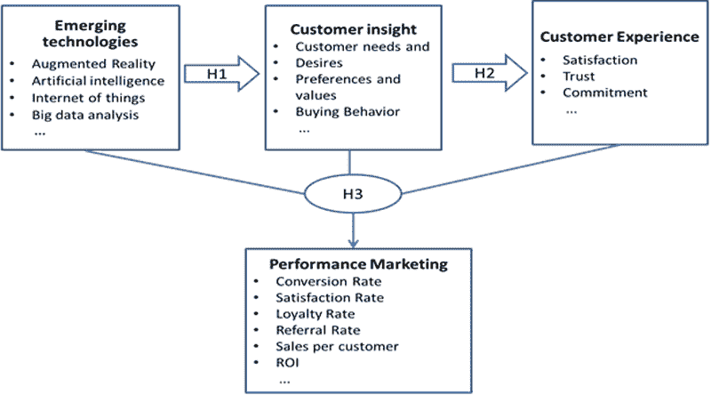

Source: authors

在勾勒出概念模型后，很明显，`augmented reality`、`artificial intelligence`、`Internet of Things` 和 `big data analytics` 等新兴技术正在为企业开辟新的视角。它们使企业能够更深入地了解客户的购买行为、偏好和需求。这一演变承诺显著改善客户体验，对营销绩效产生显著影响，特别是在转化率、投资回报率和客户忠诚度方面。从这些考虑中出现了几个假设：

*   • `H1`: 基于新兴技术的创新解决方案的采用有助于更好地了解客户。

*   • `H2`: 通过整合创新的新兴技术解决方案而促进的客户洞察力改善，有助于发展客户体验。

*   • `H3`: 新兴技术与营销绩效之间的关系由客户知识和体验中介。

这种试图模拟新兴技术对提升企业营销绩效影响的尝试，突出了可动员的各种创新解决方案，以发展客户知识并增强其体验，以及可以抓住的机会，以进一步改善这些企业营销绩效的各个维度。

### 6\. CONCLUSION, LIMITATIONS, AND PERSPECTIVES

在我们的文献综述结束时，我们可以就新兴技术的营销应用得出几个结论。主要发现是，`augmented reality`、`artificial intelligence`、`Internet of Things` 和 `big data` 是对营销实践和策略产生深远影响的新兴技术。


# 对本综述所包含发现的分析

对本综述所包含发现的分析表明，这些技术在提升客户体验、个性化优惠以及优化营销活动方面发挥着重要作用。研究表明，增强现实与客户满意度提升（Lim et al., 2024）、购买意向（Bilgili & Aydin, 2019；Kushwaha et al., 2021）。

## 局限性

与所有研究一样，本文献综述存在理论、方法和实际方面的局限性。在定义随不同情境而演变和变化的概念方面存在理论空白。此外，对新兴技术采纳与接受的底层机制的理解，以及其与现有营销理论的整合，需要进一步发展。从方法学角度来看，所选参考文献存在不相关的风险。此外，一般概念框架未考虑行业营销、公司规模、行业、环境、管理教育和文化的独特特征。

# 从业者启示

当今的从业者认识到，新技术的成功采纳是每个人的事——这需要一种战略方法的文化。为了充分利用这些创新工具，投资于培训和发展技术技能，以及提高对道德和职业使用的认识也是至关重要的。为了保持竞争力，从业者必须警惕技术变革和市场趋势。

# 未来研究方向

在这个快速发展的领域，有几个研究方向值得探索。未来研究可以着重于构建一个合理的理论框架，以理解新兴技术的组合如何彻底改变营销策略和实践。随后可以对该模型进行实证检验，以理解新兴技术在营销中被采纳的机制，以及受此采纳影响的营销实际和战略层面。此外，还应特别关注围绕这些技术使用的伦理和社会考量。目标是确保消费者和品牌以合乎道德和负责任的方式从这些技术中获益。

# 参考文献

Adeola, O., Evans, O., Ndubuisi Edeh, J., & Adisa, I. (2022). The Future of Marketing : Artificial Intelligence, Virtual Reality, and Neuromarketing. In Marketing Communications and Brand Development in Emerging Economies (Vol. I, pp. 253–280). Palgrave Macmillan. [10.1007/978\-3\-030-88678-3\_12](http://dx.doi.org/10.1007/978-3-030-88678-3_12)

Alla, L., Kamal, M., & Bouhtati, N. (2022). Big data et efficacité marketing des entreprises touristiques : Une revue de littérature. Alternatives Managériales Economiques, 4(0), Article 0. [10.48374/IMIST.PRSM/ame\-v1i0.36928](http://dx.doi.org/10.48374/IMIST.PRSM/ame-v1i0.36928)

Amado, A., Cortez, P., Rita, P., & Moro, S. (2018). Research trends on Big Data in Marketing : A text mining and topic modeling based literature analysis. European Research on Management and Business Economics, 24(1), 1–7. [10.1016/j.iedeen.2017.06.002](http://dx.doi.org/10.1016/j.iedeen.2017.06.002)

Anastassova, M. (2006). L’analyse ergonomique des besoins en amont de la conception de technologies émergente : Le cas de la Réalité Augmentée pour la formation à la maintenance automobile \[PhD Thesis, Université René Descartes-Paris V\]. https://theses.hal.science/tel-00340103

Bec, A., Moyle, B., Schaffer, V., & Timms, K. (2021). Virtual reality and mixed reality for second chance tourism. Tourism Management, 83, 104256. [10.1016/j.tourman.2020.104256](http://dx.doi.org/10.1016/j.tourman.2020.104256)

Berberović, D., Alić, A., & Činjarević, M. (2022). Virtual Reality in Marketing : Consumer and Retail Perspectives. Lecture Notes in Networks and Systems, 472 LNNS, 1093-1102. Scopus, 472, 1093–1102. [10.1007/978\-3\-031-05230-9\_129](http://dx.doi.org/10.1007/978-3-031-05230-9_129)

Bilgili, S. S., & Aydin, K. (2019). Marketing Communications and Experiential Marketing in the Context of Augmented Reality. In Grima, S., Özen, E., Boz, H., Spiteri, J., & Thalassinos, E. (Eds.), Contemporary Issues in Behavioral Finance (Vol. 101, pp. 153–162). Emerald Publishing Limited. [10.1108/S1569\-375920190000101010](http://dx.doi.org/10.1108/S1569-375920190000101010)

Blasco-Arcas, L., Lee, H.-H. M., Kastanakis, M. N., Alcañiz, M., & Reyes-Menendez, A. (2022). The role of consumer data in marketing : A research agenda. Journal of Business Research, 146, 436–452. [10.1016/j.jbusres.2022.03.054](http://dx.doi.org/10.1016/j.jbusres.2022.03.054)

Bobillier Chaumon, M.-É. (2021). Technologies émergentes et transformations digitales de l’activité : Enjeux pour l’activité et la santé au travail. Psychologie du Travail et des Organisations, 27(1), 17–32. [10.1016/j.pto.2021.01.002](http://dx.doi.org/10.1016/j.pto.2021.01.002)

Bouhtati, N., Alla, L., & Bentalha, B. (2023). Marketing Big Data Analytics and Customer Relationship Management : A Fuzzy Approach. In Integrating Intelligence and Sustainability in Supply Chains (p. 75-86). IGI Global. [`www.igi\-global.com/chapter/marketing\-big\-data\-analytics\-and\-customer\-relationship\-management/331980`](https://www.igi-global.com/chapter/marketing-big-data-analytics-and-customer-relationship-management/331980)

Bouhtati, N., Kamal, M., & Alla, L. (2023). Big Data and the Effectiveness of Tourism Marketing : A Prospective Review of the Literature. Artificial Intelligence and Smart Environment, 287-292. [10.1007/978\-3\-031-26254-8\_40](http://dx.doi.org/10.1007/978-3-031-26254-8_40)

Brewis, C., Dibb, S., & Meadows, M. (2023). Leveraging big data for strategic marketing : A dynamic capabilities model for incumbent firms. Technological Forecasting and Social Change, 190, 122402. [10.1016/j.techfore.2023.122402](http://dx.doi.org/10.1016/j.techfore.2023.122402)

Buhalis, D., & Moldavska, I. (2022). Voice assistants in hospitality : Using artificial intelligence for customer service. Journal of Hospitality and Tourism Technology, 13(3), 386-403. Scopus. Advance online publication. [10.1108/JHTT\-03-2021-0104](http://dx.doi.org/10.1108/JHTT-03-2021-0104)

Campbell, C., Sands, S., Ferraro, C., Tsao, H.-Y. (Jody), & Mavrommatis, A. (2020). From data to action : How marketers can leverage AI. ARTIFICIAL INTELLIGENCE AND MACHINE LEARNING, 63(2), 227-243. [10.1016/j.bushor.2019.12.002](http://dx.doi.org/10.1016/j.bushor.2019.12.002)

Castro, S. L. C., Humberto, D. P. D. R., Paúl, V. A. C., & Estefanía, A. T. P. (2023). Impact of Artificial Intelligence on Market Behavior Analysis : A Comprehensive Approach to Marketing. Remittances Review, 8(4). [`remittancesreview.com/menu\-script/index.php/remittances/article/view/742`](https://remittancesreview.com/menu-script/index.php/remittances/article/view/742)

Cowan, K., & Ketron, S. (2019). Prioritizing marketing research in virtual reality : Development of an immersion/fantasy typology. European Journal of Marketing, 53(8), 1585-1611. Scopus. [10.1108/EJM\-10-2017-0733](http://dx.doi.org/10.1108/EJM-10-2017-0733)

Dash, G., Kiefer, K., & Paul, J. (2021). Marketing-to-Millennials : Marketing 4.0, customer satisfaction and purchase intention. Journal of Business Research, 122, 608–620. [10.1016/j.jbusres.2020.10.016](http://dx.doi.org/10.1016/j.jbusres.2020.10.016)


# 参考文献

De Mauro, A., Sestino, A., & Bacconi, A. (2022). Machine learning and artificial intelligence use in marketing : A general taxonomy. Italian Journal of Marketing, 2022(4), 439–457. [10.1007/s43039-022-00057-w](http://dx.doi.org/10.1007/s43039-022-00057-w)

Donthu, N., Kumar, S., Mukherjee, D., Pandey, N., & Lim, W. M. (2021). How to conduct a bibliometric analysis : An overview and guidelines. Journal of Business Research, 133, 285–296. [10.1016/j.jbusres.2021.04.070](http://dx.doi.org/10.1016/j.jbusres.2021.04.070)

Flavián, C., Ibáñez-Sánchez, S., & Orús, C. (2019). The impact of virtual, augmented and mixed reality technologies on the customer experience. Journal of Business Research, 100, 547–560. [10.1016/j.jbusres.2018.10.050](http://dx.doi.org/10.1016/j.jbusres.2018.10.050)

Gallardo, C., Rodríguez, S. P., Chango, I. E., Quevedo, W. X., Santana, J., Acosta, A. G., Tapia, J. C., & Andaluz, V. H. (2018). Augmented reality as a new marketing strategy. Lecture Notes in Computer Science (Including Subseries Lecture Notes in Artificial Intelligence and Lecture Notes in Bioinformatics), 10850 LNCS, 351-362. Lecture Notes in Computer Science, 10850, 351–362. [10.1007/978\-3\-319-95270-3\_29](http://dx.doi.org/10.1007/978-3-319-95270-3_29)

Gleim, M., & Stevens, J. (2021). Blockchain : A game changer for marketers? Marketing Letters, 32(1), 1–6. [10.1007/s11002-021-09557-9](http://dx.doi.org/10.1007/s11002-021-09557-9)

Godé, C. (2021). Propos introductif : Technologies émergentes et digitalisation des organisations. Recherche et Cas en Sciences de Gestion, (22). [10.3917/rcsg.022.0007](http://dx.doi.org/10.3917/rcsg.022.0007)

Grewal, D., Hulland, J., Kopalle, P. K., & Karahanna, E. (2020). The future of technology and marketing : A multidisciplinary perspective. Journal of the Academy of Marketing Science, 48(1), 1–8. [10.1007/s11747-019-00711-4](http://dx.doi.org/s11747-019-00711-4)

Haleem, A., Javaid, M., Asim Qadri, M., Pratap Singh, R., & Suman, R. (2022). Artificial intelligence (AI) applications for marketing : A literature-based study. International Journal of Intelligent Networks, 3, 119–132. [10.1016/j.ijin.2022.08.005](http://dx.doi.org/10.1016/j.ijin.2022.08.005)

Hoffman, D. L., Moreau, C. P., Stremersch, S., & Wedel, M. (2022). The Rise of New Technologies in Marketing : A Framework and Outlook. Journal of Marketing, 86(1), 1–6. [10.1177/00222429211061636](http://dx.doi.org/10.1177/00222429211061636)

Huang, M.-H., & Rust, R. T. (2021). A strategic framework for artificial intelligence in marketing. Journal of the Academy of Marketing Science, 49(1), 30–50. [10.1007/s11747-020-00749-9](http://dx.doi.org/10.1007/s11747-020-00749-9)

IBM Institute for Business Value. (2023). 2023 Chief Executive Officer Study : Decision-making in the age of AI. IBM. [`www.ibm.com/thought-leadership/institute-business-value/en-us/report/2023-ceo`](https://www.ibm.com/thought-leadership/institute-business-value/en-us/report/2023-ceo)

Jessen, A., Hilken, T., Chylinski, M., Mahr, D., Heller, J., Keeling, D. I., & de Ruyter, K. (2020). The playground effect : How augmented reality drives creative customer engagement. Journal of Business Research, 116, 85–98. [10.1016/j.jbusres.2020.05.002](http://dx.doi.org/10.1016/j.jbusres.2020.05.002)

Jonny, Kriswanto, & Toshio, M. (2021). Building an Implementation Model of IoT and Big Data and Its Improvement. INTERNATIONAL JOURNAL OF TECHNOLOGY, 12(5), 1000-1008. [10.14716/ijtech.v12i5.5178](http://dx.doi.org/10.14716/ijtech.v12i5.5178)

Kang, H. J., Shin, J., & Ponto, K. (2020). How 3D Virtual Reality Stores Can Shape Consumer Purchase Decisions : The Roles of Informativeness and Playfulness. Journal of Interactive Marketing, 49(1), 70–85. [10.1016/j.intmar.2019.07.002](http://dx.doi.org/10.1016/j.intmar.2019.07.002)

Kaur, J., Lavuri, R., Parida, R., & Singh, S. V. (2023). Exploring the Impact of Gamification Elements in Brand Apps on the Purchase Intention of Consumers. Journal of Global Information Management, 31(1). Journal of Global Information Management, 31(1), 1–30. [10.4018/JGIM.317216](http://dx.doi.org/10.4018/JGIM.317216)

Kautish, P., & Khare, A. (2022). Investigating the moderating role of AI-enabled services on flow and awe experience. International Journal of Information Management, 66, 102519. [10.1016/j.ijinfomgt.2022.102519](http://dx.doi.org/10.1016/j.ijinfomgt.2022.102519)

Kazmi, S. H. A., Ahmed, R. R., Soomro, K. A., Hashem, E. A. R., Akhtar, H., & Parmar, V. (2021). Role of augmented reality in changing consumer behavior and decision making : Case of Pakistan. Sustainability (Switzerland), 13(24). Sustainability (Basel), 13(24), 14064. [10.3390/su132414064](http://dx.doi.org/10.3390/su132414064)

Keegan, B. J., Canhoto, A. I., & Yen, D. A. (2022). Power negotiation on the tango dancefloor : The adoption of AI in B2B marketing. Industrial Marketing Management, 100, 36–48. [10.1016/j.indmarman.2021.11.001](http://dx.doi.org/10.1016/j.indmarman.2021.11.001)

Khargharia, H. S., Rehman, M. H., Banerjee, A., Montori, F., Forkan, A. R. M., & Jayaraman, P. P. (2023). Towards Marketing 4.0 : Vision and Survey on the Role of IoT and Data Science. Societies (Basel, Switzerland), 13(4), 4. [10.3390/soc13040100](http://dx.doi.org/10.3390/soc13040100)

Kocaman, B., Gelper, S., & Langerak, F. (2023). Till the cloud do us part : Technological disruption and brand retention in the enterprise software industry. International Journal of Research in Marketing, 40(2), 316–341. [10.1016/j.ijresmar.2022.11.001](http://dx.doi.org/10.1016/j.ijresmar.2022.11.001)

Kotler, P., Kartajaya, H., & Setiawan, I. (2010). Marketing 3.0 : Produits, clients, facteur humain. Wiley. [10.1002/9781118257883](http://dx.doi.org/10.1002/9781118257883)

Kotler, P., Kartajaya, H., & Setiawan, I. (2016). Marketing 4.0 : Moving from Traditional to Digital. John Wiley & Sons.

Kotler, P., Kartajaya, H., & Setiawan, I. (2021). Marketing 5.0 : Technology for Humanity. John Wiley & Sons.

Kumar, V., Ramachandran, D., & Kumar, B. (2021). Influence of new-age technologies on marketing : A research agenda. Journal of Business Research, 125, 864–877. [10.1016/j.jbusres.2020.01.007](http://dx.doi.org/10.1016/j.jbusres.2020.01.007)

Kushwaha, A. K., Kumar, P., & Kar, A. K. (2021). What impacts customer experience for B2B enterprises on using AI-enabled chatbots? Insights from Big data analytics. Industrial Marketing Management, 98, 207–221. [10.1016/j.indmarman.2021.08.011](http://dx.doi.org/10.1016/j.indmarman.2021.08.011)

Lhoussaine, A., Kamal, M., & Bouhtati, N. (2022). Big data et efficacité marketing des entreprises touristiques : Une revue de littérature. Alternatives Managériales Economiques, 1, 39–58.

Li, J., Pan, S., Huang, L., & Zhu, X. (2019). A machine learning based method for customer behavior prediction. Tehnicki Vjesnik, 26(6), 1670-1676. Scopus. [10.17559/TV-20190603165825](http://dx.doi.org/10.17559/TV-20190603165825)

Lim, W. M., Mohamed Jasim, K., & Das, M. (2024). Augmented and virtual reality in hotels : Impact on tourist satisfaction and intention to stay and return. International Journal of Hospitality Management, 116, 103631. [10.1016/j.ijhm.2023.103631](http://dx.doi.org/10.1016/j.ijhm.2023.103631)

Liu, C.-H., Horng, J.-S., Chou, S.-F., Yu, T.-Y., Huang, Y.-C., & Lin, J.-Y. (2023). Integrating big data and marketing concepts into tourism, hospitality operations and strategy development. Quality & Quantity, 57(2), 1905–1922. [10.1007/s11135-022-01426-5](http://dx.doi.org/10.1007/s11135-022-01426-5)[](http://dx.doi.org/35729961)

Lo, F.-Y., & Campos, N. (2018). Blending Internet-of-Things (IoT) solutions into relationship marketing strategies. Technological Forecasting and Social Change, 137, 10-18. Scopus. [10.1016/j.techfore.2018.09.029](http://dx.doi.org/10.1016/j.techfore.2018.09.029)


# 参考文献

Ma, L., & Sun, B. (2020). Machine learning and AI in marketing–Connecting computing power to human insights. International Journal of Research in Marketing, 37(3), 481–504. [10.1016/j.ijresmar.2020.04.005](http://dx.doi.org/10.1016/j.ijresmar.2020.04.005)

Marasco, A., Buonincontri, P., van Niekerk, M., Orlowski, M., & Okumus, F. (2018). Exploring the role of next-generation virtual technologies in destination marketing. Journal of Destination Marketing & Management, 9, 138–148. [10.1016/j.jdmm.2017.12.002](http://dx.doi.org/10.1016/j.jdmm.2017.12.002)

Mateo, S. (2020). Procédure pour conduire avec succès une revue de littérature selon la méthode PRISMA. Kinésithérapie, la Revue, 20(226), 29–37. [10.1016/j.kine.2020.05.019](http://dx.doi.org/10.1016/j.kine.2020.05.019)

Miklosik, A., Kuchta, M., Evans, N., & Zak, S. (2019). Towards the Adoption of Machine Learning-Based Analytical Tools in Digital Marketing. IEEE Access, 7, 85705-85718. Scopus. [10.1109/ACCESS.2019.2924425](http://dx.doi.org/10.1109/ACCESS.2019.2924425)

Mishra, S., Ewing, M. T., & Cooper, H. B. (2022). Artificial intelligence focus and firm performance. Journal of the Academy of Marketing Science, 50(6), 1176–1197. [10.1007/s11747-022-00876-5](http://dx.doi.org/s11747-022-00876-5)

Moher, D., Liberati, A., Tetzlaff, J., & Altman, D. G.The PRISMA Group. (2009). Preferred Reporting Items for Systematic Reviews and Meta-Analyses : The PRISMA Statement. PLoS Medicine, 6(7), e1000097. [10.1371/journal.pmed.1000097](http://dx.doi.org/10.1371/journal.pmed.1000097)[](http://dx.doi.org/19621072)

Moradi, M., & Dass, M. (2022). Applications of artificial intelligence in B2B marketing : Challenges and future directions. Industrial Marketing Management, 107, 300–314. [10.1016/j.indmarman.2022.10.016](http://dx.doi.org/10.1016/j.indmarman.2022.10.016)

Ngai, E. W. T., Lee, M. C. M., Luo, M., Chan, P. S. L., & Liang, T. (2021). An intelligent knowledge-based chatbot for customer service. Electronic Commerce Research and Applications, 50, 101098. [10.1016/j.elerap.2021.101098](http://dx.doi.org/10.1016/j.elerap.2021.101098)

Nikhashemi, S. R., Knight, H. H., Nusair, K., & Liat, C. B. (2021). Augmented reality in smart retailing : A (n) (A) Symmetric Approach to continuous intention to use retail brands’ mobile AR apps. Journal of Retailing and Consumer Services, 60, 102464. [10.1016/j.jretconser.2021.102464](http://dx.doi.org/10.1016/j.jretconser.2021.102464)

Page, M. J., McKenzie, J. E., Bossuyt, P. M., Boutron, I., Hoffmann, T. C., Mulrow, C. D., Shamseer, L., Tetzlaff, J. M., Akl, E. A., & Brennan, S. E. (2021). The PRISMA 2020 statement : An updated guideline for reporting systematic reviews. BMJ (Clinical Research Ed.), 372. [`www.bmj.com/content/372/bmj.n71.short`](https://www.bmj.com/content/372/bmj.n71.short)[](http://dx.doi.org/33782057)

Peres, R., Schreier, M., Schweidel, D. A., & Sorescu, A. (2023). Blockchain meets marketing : Opportunities, threats, and avenues for future research. International Journal of Research in Marketing, 40(1), 1–11. [10.1016/j.ijresmar.2022.08.001](http://dx.doi.org/10.1016/j.ijresmar.2022.08.001)

Perez-Vega, R., Kaartemo, V., Lages, C. R., Borghei Razavi, N., & Männistö, J. (2021). Reshaping the contexts of online customer engagement behavior via artificial intelligence : A conceptual framework. Journal of Business Research, 129, 902–910. [10.1016/j.jbusres.2020.11.002](http://dx.doi.org/10.1016/j.jbusres.2020.11.002)

Plangger, K., Grewal, D., de Ruyter, K., & Tucker, C. (2022). The future of digital technologies in marketing : A conceptual framework and an overview. Journal of the Academy of Marketing Science, 50(6), 1125–1134. [10.1007/s11747-022-00906-2](http://dx.doi.org/10.1007/s11747-022-00906-2)

Rauschnabel, P. A., Babin, B. J., tom Dieck, M. C., Krey, N., & Jung, T. (2022). What is augmented reality marketing? Its definition, complexity, and future. Journal of Business Research, 142, 1140-1150. Scopus. [10.1016/j.jbusres.2021.12.084](http://dx.doi.org/10.1016/j.jbusres.2021.12.084)

Rauschnabel, P. A., Felix, R., & Hinsch, C. (2019). Augmented reality marketing : How mobile AR-apps can improve brands through inspiration. Journal of Retailing and Consumer Services, 49, 43–53. [10.1016/j.jretconser.2019.03.004](http://dx.doi.org/10.1016/j.jretconser.2019.03.004)

Rosário, A. T., & Dias, J. C. (2023). How has data-driven marketing evolved : Challenges and opportunities with emerging technologies. International Journal of Information Management Data Insights, 3(2), 100203. [10.1016/j.jjimei.2023.100203](http://dx.doi.org/10.1016/j.jjimei.2023.100203)

Rust, R. T. (2020). The future of marketing. International Journal of Research in Marketing, 37(1), 15–26. [10.1016/j.ijresmar.2019.08.002](http://dx.doi.org/10.1016/j.ijresmar.2019.08.002)

Saura, J. R., Ribeiro-Soriano, D., & Palacios-Marqués, D. (2021). Setting B2B digital marketing in artificial intelligence-based CRMs : A review and directions for future research. Industrial Marketing Management, 98, 161–178. [10.1016/j.indmarman.2021.08.006](http://dx.doi.org/10.1016/j.indmarman.2021.08.006)

Scholz, J., & Duffy, K. (2018). We ARe at home : How augmented reality reshapes mobile marketing and consumer-brand relationships. Journal of Retailing and Consumer Services, 44, 11–23. [10.1016/j.jretconser.2018.05.004](http://dx.doi.org/10.1016/j.jretconser.2018.05.004)

Selamat, M. A., & Windasari, N. A. (2021). Chatbot for SMEs : Integrating customer and business owner perspectives. Technology in Society, 66, 101685. [10.1016/j.techsoc.2021.101685](http://dx.doi.org/10.1016/j.techsoc.2021.101685)

Shah, D., & Murthi, B. P. S. (2021). Marketing in a data-driven digital world : Implications for the role and scope of marketing. Journal of Business Research, 125, 772–779. [10.1016/j.jbusres.2020.06.062](http://dx.doi.org/10.1016/j.jbusres.2020.06.062)

Sharma, P., Ueno, A., Dennis, C., & Turan, C. P. (2023). Emerging digital technologies and consumer decision-making in retail sector : Towards an integrative conceptual framework. Computers in Human Behavior, 148, 107913. [10.1016/j.chb.2023.107913](http://dx.doi.org/10.1016/j.chb.2023.107913)

Stallone, V., Wetzels, M., & Klaas, M. (2021). Applications of Blockchain Technology in marketing—A systematic review of marketing technology companies. Blockchain: Research and Applications, 2(3), 100023. [10.1016/j.bcra.2021.100023](http://dx.doi.org/10.1016/j.bcra.2021.100023)

Stone, M., Aravopoulou, E., Ekinci, Y., Evans, G., Hobbs, M., Labib, A., Laughlin, P., Machtynger, J., & Machtynger, L. (2020). Artificial intelligence (AI) in strategic marketing decision-making : A research agenda. The Bottom Line (New York, N.Y.), 33(2), 183–200. [10.1108/BL\-03-2020-0022](http://dx.doi.org/10.1108/BL-03-2020-0022)

Sun, C., Fang, Y., Kong, M., Chen, X., & Liu, Y. (2022). Influence of augmented reality product display on consumers’ product attitudes : A product uncertainty reduction perspective. Journal of Retailing and Consumer Services, 64.Journal of Retailing and Consumer Services, 64, 102828. [10.1016/j.jretconser.2021.102828](http://dx.doi.org/10.1016/j.jretconser.2021.102828)

Tseng, H.-T. (2023). Customer-centered data power : Sensing and responding capability in big data analytics. Journal of Business Research, 158, 113689. [10.1016/j.jbusres.2023.113689](http://dx.doi.org/10.1016/j.jbusres.2023.113689)

Verma, S., Sharma, R., Deb, S., & Maitra, D. (2021). Artificial intelligence in marketing : Systematic review and future research direction. International Journal of Information Management Data Insights, 1(1), 100002. [10.1016/j.jjimei.2020.100002](http://dx.doi.org/10.1016/j.jjimei.2020.100002)


Vieira, V. A., Rafael, D. N., & Agnihotri, R. (2022). Augmented reality generalizations : A meta-analytical review on consumer-related outcomes and the mediating role of hedonic and utilitarian values. Journal of Business Research, 151, 170–184. [10.1016/j.jbusres.2022.06.030](http://dx.doi.org/10.1016/j.jbusres.2022.06.030)

Vlačić, B., Corbo, L., Costa e Silva, S., & Dabić, M. (2021). The evolving role of artificial intelligence in marketing : A review and research agenda. Journal of Business Research, 128, 187–203. [10.1016/j.jbusres.2021.01.055](http://dx.doi.org/10.1016/j.jbusres.2021.01.055)

Volkmar, G., Fischer, P. M., & Reinecke, S. (2022). Artificial Intelligence and Machine Learning : Exploring drivers, barriers, and future developments in marketing management. Journal of Business Research, 149, 599–614. [10.1016/j.jbusres.2022.04.007](http://dx.doi.org/10.1016/j.jbusres.2022.04.007)

Wagner, R., & Cozmiuc, D. (2022). Extended Reality in Marketing—A Multiple Case Study on Internet of Things Platforms. Information (Switzerland), 13(6). Information (Basel), 13(6), 278. [10.3390/info13060278](http://dx.doi.org/10.3390/info13060278)

Wedel, M., Bigné, E., & Zhang, J. (2020). Virtual and augmented reality : Advancing research in consumer marketing. International Journal of Research in Marketing, 37(3), 443–465. [10.1016/j.ijresmar.2020.04.004](http://dx.doi.org/10.1016/j.ijresmar.2020.04.004)

Yin, J., & Qiu, X. (2021). Ai technology and online purchase intention : Structural equation model based on perceived value. Sustainability (Switzerland), 13(10). Sustainability (Basel), 13(10), 5671[10.3390/su13105671](http://dx.doi.org/10.3390/su13105671)

Yu, Y., Kwong, S. C. M., & Bannasilp, A. (2023). Virtual idol marketing : Benefits, risks, and an integrated framework of the emerging marketing field. Heliyon, 9(11), e22164. [10.1016/j.heliyon.2023.e22164](http://dx.doi.org/10.1016/j.heliyon.2023.e22164)[](http://dx.doi.org/38053914)

## 第 3 章

# AI 在神经营销中的应用：

## 系统文献综述

Ichrak Fahim

Ibn Zohr University, Morocco

Loubna Haramouni


Ibn Zohr University, Morocco

Mohamed Khalil Majdi

Ibn Zohr University, Morocco

Fatima Elkandoussi

Ibn Zohr University, Morocco

### 摘要

神经营销是一门跨学科领域，结合神经科学、心理学和营销学，以更好地理解消费者行为。人工智能（`AI`）是一门可以塑造消费者偏好的学科，从而为营销策略提供更好的洞察。本章旨在识别、评估和总结所有关于在神经营销实践中使用人工智能的相关个体研究的发现，以及关于该学科的不同争议性伦理观点。对过去十年索引数据库中发表的研究进行系统文献综述，采用定性内容分析方法研究了 58 篇近期参考文献。结果表明，`AI` 在神经营销中的应用可以对消费者行为和决策过程进行更准确、更精确的分析。然而，在神经营销中应用 `AI` 的伦理争论仍在继续，使其成为一个争议话题和进一步研究的主题。

### 1\. 引言

神经营销领域是一个不断发展的领域，它整合营销、心理学和神经科学，以理解客户行为和决策过程。人工智能（`AI`）已成为神经营销领域越来越重要的工具，使研究人员能够快速高效地分析大量数据。这两个学科使企业能够基于生成的消费者行为数据做出更明智的营销决策。

根据 Forbes 的报道，神经营销洞察可使销售额提高高达 20%。通过了解驱动消费者行为的无意识因素，企业可以创建更有效的营销活动。这些活动将更好地与目标受众产生共鸣。此外，研究表明，在营销策略中使用 `AI` 的公司更有可能超越竞争对手。根据麦肯锡的一项研究，`AI` 驱动的公司销售额增长了 5-10%，营销成本降低了 20-30%。然而，缺乏将这两个学科合并在一起的参考文献。本文旨在探讨 `AI` 在神经营销实践中的应用。

“神经营销”一词由 Smidts 于 2002 年提出。然而，直到 2004 年，随着 McClure 等人的开创性 fMRI 调查，神经营销才从理论研究转向实践研究。借鉴神经科学、营销学和心理学等多个领域（Javor et al., 2013; Sebastian, 2014），神经营销作为一个多学科领域具有前景。其目标是揭示关于无意识消费者行为的宝贵洞察，提升促销、广告和定价等营销策略的有效性。神经营销领域的研究越来越深入地探讨了消费者对营销组合的底层神经反应，涵盖广告研究（Alsharif et al., 2023）等领域。神经营销中使用的工具旨在揭示无法直接观察的决策过程。通过科学方法的应用，我们不仅可以理解决策过程，还可以了解整个购物体验。随着神经科学的进步，该领域已采用 2D 和 3D 模型，为分析这些过程提供了有效的工具（Duque-Hurtado et al., 2020）。

从 IT 角度来看，人工智能（`AI`）被描述为一种使机器能够模仿人类智能的技术。其核心目标是赋予计算机使用与人类相同的正式推理和决策能力来解决现实世界问题的能力。这种变革性技术已渗透到人类生活的各个方面。它涵盖各行各业、企业、教育、医疗保健和消费品。几乎每个领域都见证了 `AI` 的整合，提供了智能解决方案，没有任何人类生活方面未受其影响。因此，`AI` 有潜力彻底改变营销策略，并重塑企业与客户互动的方式（Bansal & Gupta, 2023](#979-8-3693-3172-9.ch003.bits-pdf.xhtml#_idTextAnchor203) 强调的那样，`AI` 有助于改进对大规模数据集的分析，更深入地了解整个购买过程中的消费者行为，并提升用户体验。`AI` 使营销人员能够更准确地预测消费者期望，从而使他们能够更有信心、更高效地做出定价决策。


本研究的主要目的是对当代关于在神经营销领域利用人工智能（AI）的文献进行深入探讨，同时调查在分析消费者行为时部署 AI 所涉及的多元伦理视角。为实现这一目标，我们对过去十年间在各种数据库中发表的学术文章进行了严谨的审查。本研究采用的方法涉及对来自可靠学术数据库的广泛文献进行全面分析。选定的纳入文章经过了细致的审查，以确保其在解决 AI 与神经营销交叉点方面的相关性和严谨性。利用定性内容分析方法，对这些选定的文章进行了审查，以辨别关于在神经营销实践中整合 AI 的普遍趋势和模式。此外，为了对主题提供全面的理解，特别关注了界定在神经营销背景下利用 AI 审查消费者行为所固有的伦理考量。这些伦理维度与实证发现一起被批判性地审查和综合，以提供关于该领域 AI 利用伦理影响的细致入微的见解。通过综合和分析现有文献，本研究力求为阐明神经营销及其与 AI 交叉的新兴领域做出贡献，同时也揭示这种共生关系所固有的伦理维度。通过对文献的系统审查，本研究旨在为学术界和行业从业者提供有价值的见解，从而促进知情讨论并指导该动态领域未来的研究工作。

## 2. RESEARCH METHODOLOGY

我们为本研究进行了系统文献综述（SLR）。SLR 遵循一个透明、科学且可复制的过程。SLR 的好处包括：在审查过程中使用可重复的操作，以及更高质量的审查过程和结果，这些过程和结果能够最大限度地减少偏差和错误，并提高过程的有效性。SLR 为学术界和从业者提供了一个整合当前知识的框架，以及特定研究领域的数据综合和文献映射。我们方法论中的两个研究步骤如下：一个探索性研究阶段，用于识别、阅读和理解重要出版物，以及对选定参考文献的扩展研究阶段，以进行深入的内容分析来解决我们的研究问题。

收集参考文献是创建文献综述的第一步。实现这一点的一种有效方法是在学术数据库中搜索相关关键词，例如“Neuromarketing”和“Artificial Intelligence”。我们使用布尔运算符来形成诸如“Artificial Intelligence AND Neuromarketing”的查询，以访问同时涵盖这两个关键词的参考文献，我们还使用了“AI”等缩写以进一步增强我们的发现。此外，我们将搜索限制为仅包括 2010–2023 年过去十三年内发表的研究。主要利用的数据库是：Scopus、Web of Science、ScienceDirect 和 Google Scholar，因为它们主要用于社会科学学科。还咨询了其他文章来源，如 Springer 和 ResearchGate。本程序中使用的文章的精确选择标准列在下面的 表 1 中。

### Table 1. Criteria for Selecting and Refining References

| 关键词 | 出版年份 | 学术数据库 | 文档索引 | 语言 |
| --- | --- | --- | --- | --- |
| Neuromarketing, Artificial Intelligence (AI), Consumer Behavior | [2010-2023] | Web of Science, Scopus, ScienceDirect, Google Scholar, Springer, ResearchGate | SJR: Scientific Journal Ranking Q1, Q2, Q3 | English |

Source: Author’s processing

搜索查询“The Usage of Artificial Intelligence in Neuromarketing”在 ScienceDirect 中启动，提取了 37 个结果。通过使用查询“Artificial Intelligence AND Neuromarketing”，在 Scopus 中找到了 31 个结果，在 Web of Science 中针对相同查询找到了 24 个结果。另一方面，Google Scholar 通过筛选日期范围从 2010 年到 2023 年，使用查询“The Usage of Artificial Intelligence in Neuromarketing”显示了 4860 个结果。根据选择标准，我们达到了 58 个不同文档类型的参考文献。

### 2.1 Exploratory Literature Review

我们可以通过对研究主题进行探索性系统文献综述来审查所有相关参考文献，从中我们可以只选择和阅读最相关的文献。为了进行此操作，我们必须建立一个参考文献管理系统，该系统将允许我们在写作过程中引用它们，并以系统的方式维护我们的数据库。我们选择实现 Zotero，因为它有用、免费且开源。简而言之，我们通过输入以下内容完成了使用 Excel MS 构建参考文献数据库：国家、来源、摘要、作者、期刊/出版商、文档类型、出版日期和参考文献编号。下面列出的参考文献是最相关的：

### Table 2. Types of relevant references

| 文档类型 | 参考文献数量 |
| --- | --- |
| Journal article | 46 |
| Conference article | 6 |
| Book chapter | 5 |
| Book | 1 |
| Total | 58 |

Source: Author’s processing

编纂的参考文献涵盖了多样化的二级数据文档，如 表 2 所述，有助于全面且富有洞察力的综述。期刊论文作为本研究的主要构建块和基础元素发挥着关键作用。会议文章被纳入以提供研究主题的最新进展，而书籍章节和书籍则有助于更深入地了解神经营销的基础、历史背景以及在该领域使用 AI 所涉及的伦理考量。为了便于组织和分析，从在线 Zotero 库中收集的所有文档都已下载并转移到 NVivo，这是一个定性数据分析程序。NVivo 在帮助研究人员组织和分析定性数据方面起着关键作用，这些数据可以从文本和音频文件到图像和视频不等。在这项特定研究中，使用 NVivo 进行了全文分析，以从收集的数据中提取有价值的见解和模式。

#### 2.1.1 Word Cloud

来自数据库选定出版物的文本中最频繁的单词在 图 1：Word Cloud 中被突出显示。图像中单词的大小仅由所选文章中单词的频率决定。研究的关键词，Neuromarketing 和 AI，位于图像的中心位置。在参考文献中，术语“neuromarketing”出现了 6774 次，其次是代表人工智能的单词“AI”，出现了 4388 次。单词“Research”也被揭示为经常使用，因为神经营销和 AI 之间的相关性是为了研究和理解消费者行为。

### Figure 1. Word Cloud


Source: Processed with Nvivo


这个词云图使得更容易找到搜索词使用频率最高的参考文献。通过将复杂的文本信息浓缩为视觉上易于访问的格式，词云使我们能够识别显著趋势，优先考虑需要进一步调查的关键主题，并发现仅通过传统文本分析可能无法立即察觉的关联和模式。在此情况下，关键词 `neuromarketing`、`AI` 和 `research` 紧密交织，意味着 `neuromarketing` 实践依赖于科学研究成果，通过利用人工智能工具分析消费者的大脑。

### 2.1.2 探索性综述数据分析

#### 表 3. 参考文献全文中最常见的单词

| Word | Length | Count |
| --- | --- | --- |
| `Research` | 8 | 6774 |
| `Neuromarketing` | 14 | 6364 |
| `AI` | 2 | 4388 |
| `Marketing` | 9 | 4148 |
| `Consumer` | 8 | 2959 |
| `Brain` | 5 | 2557 |
| `Data` | 4 | 2174 |

来源：使用 Nvivo 处理

根据从 NVivo 获得的单词频率查询结果，最初的四个单词，即 "`research`"、"`neuromarketing`" 和 "`AI`"，成为引用文本全文中出现频率最高的术语。这一观察强调了它们作为后续阶段文档筛选关键标准的重要性。值得重申的是，参考文献的编纂涵盖了广泛的来源和学术数据库。重点放在研究论文上，因为它们能够高效地概括现有的研究格局，最终在理解我们指定的研究主题方面节省了大量的研究时间和精力。

#### 表 4. 参考文献的数据库来源

| Sources of references | Rate in % |
| --- | --- |
| `Google scholar` | 15 (25,86%) |
| `ScienceDirect` | 12 (20,68%) |
| `Scopus` | 10 (17,24%) |
| `Springer` | 10 (17,24%) |
| `Web of science` | 2 (3,44%) |
| `Other` | 9 (15,51%) |

来源：作者处理

此处列出的大多数来源都可以通过订阅服务访问。尽管如此，像 `Google Scholar` 这样的免费数据库提供了有价值的资源，占参考文献来源的 25%，其中很大一部分包括备受推崇的期刊文章。紧随其后的是 `ScienceDirect`、`Scopus` 和 `Springer`，各自贡献了 20% 到 17% 之间。从 `Scopus` 和 `ScienceDirect` 获得的材料包括书籍章节，以及会议和期刊文章。其余来源包括离线材料或促进访问付费墙论文的平台。

鉴于大多数数据库中的筛选选项，我们的搜索工作集中在 2010 年至 2023 年间发布的文档上。`neuromarketing` 和 `neuroscience` 领域在全球研究人员中引起了广泛关注，随着人工智能技术的发展，这种关注度更高。

#### 图 2. 按出版年份统计的参考文献数量

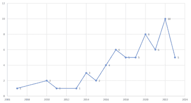

来源：作者处理

我们的选择方法采用定性技术，主要涉及检查摘要，以仔细选择文献综述的基础，排除不相关的出版物。我们搜索的关键词出现在许多文档的摘要中并不罕见。然而，这些文档的核心焦点可能与我们的研究目标相悖。此外，在我们的研究和精炼过程中，我们强调了该领域内被引用最频繁的论文和信誉良好的期刊。

鉴于期刊文章构成了主要的参考文献类型，了解这些文章发表的期刊变得至关重要。这包括诸如 H-Index、影响因子和科学排名 (`SJR`) 等考虑因素，它们提供了一种评估期刊在学术界重要性的手段。值得注意的是，一些高质量的期刊可能缺乏影响因子或 `SJR`，尤其是如果它们相对较新，这并不一定反映它们对科学探究领域的贡献有限。

### 2.2 扩展文献综述

#### 表 5.

| Year | Author | Journal | Reference Type | Subtopic | Aims and findings | Methodology |
| --- | --- | --- | --- | --- | --- | --- |
| 2023 | `Sheikh, H., Prins, C., Schrijvers, E` | `Mission AI` | Book Chapter | Artificial Intelligence, history | This book chapter explain the emergence of `AI`, so it discusses the different definitions of `AI`, the myths, the theories and the history of this field | Qualitative study |
| 2023 | `Shikha Bhardwaj, Gunjan A Rana, Abhishek Behl, Santiago Juan Gallego de Caceres` | `Journal of Business Research` | Article | `SLM`, consumer neuroscience | This study presents a systematic review using the PRISMA method to investigate the boundaries of `Neuromarketing` and highlight the `neuromarketing` effect as the centre of consumer decision making. | Qualitative study: Systematic literature review |
| 2023 | `(Alsh Ahmed H.Alsharif, Nor Zafir Md Salleh, Mazilah Abdullah, Ahmad Khraiwish, and Azmirul Ashaari` | `Sage Open` | Article | `SLR`, `PRISMA`, `Neuromarketing` | This paper constitutes a systematic literature review aimed at categorizing contemporary `neuromarketing` tools employed in the Marketing Mix. The results of the review indicate that Electroencephalography (`EEG`) emerges as the predominant tool utilized in the Marketing Mix. | Qualitative study: Systematic literature Review |
| 2023 | `Shashank Vaid, Stefano Puntoni, AbdulRahman Khodr` | `Journal of Business Research` | Article | `AI`, Consumer Research, Marketing | This paper examines the adoption of `AI` techniques in consumer research in order to stimulate boundary breaking research and explain the potential of collaboration between `AI` experts and consumer researchers. | Qualitative study |
| 2023 | `WCuicui Wang, Yiyang Li, Weizhong Fu, Jia Jin` | `Journal of Retailing and Consumer service` | Article | `AI`,`Chatbots`, Consumers | The study explores consumer perceptions of `AI` chatbot services in e-commerce, focusing on trust implications and emotional interactions, suggesting e-retailers enhance chatbots' emotional service for objective customer service tasks. | Quantitative Study |
| 2023 | `Shubhi Bansal, Monika Gupta` | `International Journal of Business and Globalization` | Article | Artificial Intelligence, `Neuromarketing` | The study explores the integration of artificial intelligence in `neuromarketing`, highlighting its potential to enhance customer understanding, bias-free judgments, and enhance brand recognition. | Qualitative study |
| 2023 | `Gaia Rancati, Isabella Maggioni` | `Journal of Services Marketing` | Article | Neuroscience, Immersion, | The study explores customer immersion in human-robot interactions and their impact on store visit duration, finding that robot interaction enhances immersion during welcome and surprise moments. | Quantitative study |
| 2022 | `Zeren Zhu, Yuanqing Jin1Yushun Su, Kan Jia, Chien-Liang Lin and Xiaoxin Liu` | `Frontiers in Psychology` | Article | `Neuromarketing` trends 2020 | The research, based on a bibliometric review from 2010-2021, reveals that the Journal of Consumer Psychology and the Journal of Marketing Research are key publishers, with Pieters et al. (2010) being the most cited. | Qualitative study: |


| 2022 | Lucília Cardoso, Meng-Mei Chen 2, Arthur Araújo, Giovana Goretti Feijó de Almeida, Francisco Dias and Luiz Moutinho | 行为科学 | 文章 | SciValtopic prominence, neuromarketing, gaps | 本文旨在确定和评估神经营销研究的整体表现和效果。本研究为研究人员未来研究提供了关于差距的见解。 | 定性研究：通过混合方法进行的书目计量分析 |

| 2022 | Nikolina Ljepava | TEM JOURNAL - | 文章 | SLR, Marketing, AI, decision making | 本文回顾了 2020-2022 年关于 AI 营销应用的文章，揭示了其在理解消费者行为需求和制定营销组合策略方面的主要应用。 | 定性研究：SLR |

| 2022 | Abid Haleem, Mohd Javaid,, Mohd Asim Qadri, Ravi Pratap Singh, Rajiv Suman | International Journal of Intelligent Networks | 文章 | Artificial Intelligence, Decision making, Data analytics | 本文探讨了 AI 在营销中的应用，重点关注深度学习和机器学习技术。AI 有助于数据分析、消费者洞察和高效决策，确保更好的组织和效率。 | 定性研究：期刊文章和书籍综述 |

| 2022 | Rupali Gill, Jaiteg Singh | Materials Today: Proceedings | 文章 | Neuromarketing, Emotions | 本文表明，神经营销技术对于可持续未来和业务增长至关重要，因为关于整合框架的研究有限，允许创新。 | 定性研究 |

| 2022 | Peter Varghese | UJ Journal of Management | 文章 | Artificial intelligence, eye tracking, neuromarketing | 本文旨在解释将 AI 与神经营销相结合的潜力。 | 定性研究 |

| 2022 | Marcelo Royo-Vela and Ákos Varga | Encyclopedia of Social Sciences | 文章 | Neuromarketing, uses and attitudes; academic research | 本文考察了神经营销的现状、应用和定义，区分了传统营销和神经营销方法，并预测其将与其他研究技术一起逐渐增加使用。 | 定性研究 |

| 2022 | Ogechi Adeola, Olaniyi Evans, Jude Ndubuisi Edeh & Isaiah Adisa | Marketing Communications and Brand Development in Emerging Economies Volume | 书籍章节 | Artificial Intelligence, Neuromarketing, Virtual Reality | 本章评估了关于 AI、虚拟现实和神经营销的文献，以指导未来的营销决策。AI 增强消费者分析和定位，虚拟现实增强客户体验，神经营销通过记录潜意识认知和情绪反应，允许对购买行为进行知情预测。 | 定性研究 |

| 2021 | Ahmed H. Alsharif, Nor Zafir Md Salleh, Rohaizat Baharun, Yahia H. Alsharif, Hassan Abuhassna | International Journal of Academic Research in Accounting,Finance and Management Sciences | 文章 | Consumer neuroscience, Neuromarketing, Prisma | 本文对神经营销进行了书目计量分析，以了解全球趋势、高产期刊、被引作者以及该领域产生研究的国家。 | 定性研究： |

| 2021 | Ahmad F. Klaib \*, Nawaf O. Alsrehin, Wasen Y. Melhem, Haneen O. Bashtawi, Aws A. Magableh | Experts systems with applications | 文章 | Eye tracking, technology, artificial intelligence | 本文探讨了使用人工智能（如机器学习、物联网和云计算）的眼动追踪概念、方法和有效性，揭示了它们在眼动追踪应用演变和实现更高效结果中的重要性。 | 系统定性方法 |

| 2021 | Andrea Owe· Seth D. Baum | AI and Ethics | 文章 | Artificial Intelligence, Non humans, Ethics | 本文解释，AI 中的伦理应在 AI 周期的所有阶段（从收集数据到使用数据）重视非人类，非人类也应因其对人类的益处而得到考虑。 | 定性研究 |

| 2021 | C. Luna‐Nevarez | Journal of Consumer Policy | 文章 | Ethics, Social media, neuromarketing | 该研究探讨了消费者对神经营销和伦理问题的看法，发现积极情绪，但强调了对该领域进行监管以保护消费者的担忧。 | 内容分析 |

| 2021 | Vlačić, B., Corbo, L., e Silva, S. C., & Dabić, M. | Journal of Business Research | 文章 | Artificial Intelligence, Intelligent System, Marketing, | 本文是一项系统文献综述，旨在概述 AI 与营销的结合，以及 AI 在营销研究中的接受、采用和使用。 | 定性研究 |

| 2021 | Christopher Collins a, Denis Dennehy, Kieran Conboy, Patrick Mikalef | International Journal of Information Management | 文章 | Artificial Intelligence, Systematic Literature Review | 这项系统文献综述探讨了信息系统中的 AI 研究，确定了其商业价值、贡献、用途以及研究中有影响力的机会。 | 定性研究 |

| 2020 | Rupali Gill, Jaiteg Singh | Materials Today Proceedings | 文章 | Neuroimaging | 本文旨在提出一种成本效益高的神经营销框架。 | 定性研究 |

| 2020 | Bogdan Glova Ivan Mudryk | Third International Conference on Data Stream Mining & Processing (DSMP) | 会议论文 | Machine learning, neuromarketing | 本文探讨了机器学习在神经科学中的应用及其在神经营销中的潜力。它强调了潜意识反应的实时记录以及影响研究的外部因素，从而允许可量化的感知和无偏见的评估。 | 定量研究 |

| 2020 | Chowdhury Rabith Amin; Mirza Farhan Hasin; Tasin Shafi Leon; Abrar Bareque Aurko; Tasmi Tamanna | IEEE Symposium Series on Computational Intelligence (SSCI) | 会议论文 | EEG, Consumer Decision | 本文提出了一种分析 EEG 信号以了解消费者行为的模型，在准确性、灵敏度和特异性方面优于现有技术，可能有助于从业者改进营销策略。 | 定量研究 |

| 2020 | Assunta Di Vaio, Rosa Palladino, Rohail Hassan, Octavio Escoba | Journal of Business Research | 文章 | Artificial intelligence, Sustainable Business Model | 本文探讨了 AI 与可持续商业模式之间的联系，强调了 AI 的重要性以及知识管理系统在促进这种适应中的作用。 | 定性研究 |

| 2020 | Thomas Davenport1 & Abhijit Guha2 & Dhruv Grewal3 & Timna Bressgott | Journal of the Academy of Marketing Science | 文章 | Ethics, Artificial Intelligence, Marketing | 本文探讨了 AI 对营销的未来影响，强调了其增强客户洞察、预测定价、提供价格促销和预测消费者行为的潜力。 | 定性研究 |

| 2020 | Pedro Duque-Hurtado | Estudios Gerenciales | 文章 | neuromarketing; consumer neuroscience; bibliometrics; | 本文通过科学映射工具回顾了神经营销趋势，揭示其是一个不成熟和初级的领域，理论共识有限。 | 定性研究 |

| 2020 | Ferdousi Sabera Rawnaque\*, Khandoker Mahmudur Rahman, Syed Ferhat Anwar, Ravi Vaidyanathan, Tom Chau, Farhana Sarker and Khondaker Abdullah Al Mamu | Brain Informatics | 文章 | Systematic literature review, machine learning, neuromarketing | 本文回顾了神经营销的技术进步，重点关注消费品刺激和社交广告。研究人员关注额叶和前额叶皮层以进行认知和情感探究，EEG 在神经营销实验中变得越来越流行。 | 定性研究 |


| 2020 | Bahman PEYRAVI, Julija NEKROŠIENĖ, Liudmila LOBANOVA | Business: Theory and Practice | Article | artificial intelligence, marketing, marketing automation | 这项系统综述探讨了 AI 在营销中的影响，强调了其理论背景、当前趋势和所使用的工具，并着重说明其提升营销经理绩效和战略的潜力。 | Systematic literature review |

| 2020 | Arabinda Bhandari | Analyzing the Strategic Role of Neuromarketing and Consumer Neuroscience | Book Chapter | Neuromarketing | 本章探讨了神经营销在组织内利用各种技术理解消费者行为方面的起源、应用和机遇。 | Qualitative study |

| 2019 | Filip Filipovic | Artificial Intelligence: Applications and Innovations (IC-AAI) | Conference paper | AI, neuromarketing, neural network | 本文探讨了在神经营销中使用 AI 进行情绪检测，利用网络摄像头应用程序，展示了在广告观看过程中对用户情绪的精确识别。 | Quantitative study |

| 2019 | Kristina Kaličanin\*, Milica Čolović, Angelina Njeguš, Vladimir Mitić | International Scientific Conference on Information Technology and Data Related Research | Conference Paper | machine learning, marketing intelligence, smart application | 本文探讨了 AI 在营销中的应用，强调了其在机器学习和深度学习方面的应用，使营销人员能够为客户提供个性化体验。 | Qualitative study |

| 2019 | Milica Slijepčević1, Nevenka Popović Šević2, Ivana Radojević | Journal of Innovative Business and Management | Article | Consumer behaviour, neuroscience, academicians, Neuromarketing research | 本文探讨了神经营销研究的局限性，包括高成本、难以找到受访者以及对态度的潜在操纵，确认神经营销是一种具有伦理原则的现代方法。 | Quantitative Study |

| 2019 | Yahia Mouammine, Hassan Azdimousa | International Journal of Business & Economic Strategy (IJBES) | Article | AI, Neuromarketing | 本文是关于 AI 和神经营销的文献综述，探讨了 AI 在营销研究中的当前出现。研究结果表明，得益于 AI 和神经营销的结合，许多局限性可能会消失，神经营销工具将更加易于获取且成本更低。 | Qualitative study |

| 2019 | Md.Hafez | Pacific Business Review International | Article | Neuromarketing, Branding, Advertisement, fMRI, EEG, MEG | 本文探讨了神经营销在品牌建设和广告中的应用，提出了一种基于实证研究的新模型，以探索人们对品牌或广告的情感和感受。 | Exploratory Study |

| 2018 | Weng Marc Lim | Journal of Business Research | Article | Neuromarketing, Neuroscience, Marketing science | 本文是一篇系统综述，旨在解释神经营销的概念、方法以及相关的伦理考量。 | Qualitative study: Content Analysis |

| 2018 | Olga Burukina, Svetlana Karpova, and Nikolas Koro | International Conference on Human Systems Engineering and Design: Future Trends and Applications | Conference Paper | Ethical Issues, Artificial Intelligence | 本文通过调查、访谈和研究，探讨了人类用户对 AI 态度的当前趋势，重点关注他们对 AI 应用的满意度、对 AI 对就业和社会影响的担忧、对 AI-人类协作的偏好，以及对数据隐私和安全性的态度。 | Mixed Method Approach |

| 2018 | Norbert Wirth | International Journal of Market Research | Article | Artificial Intelligence | 本文将人工智能（AI）定义为三种形式：弱人工智能、混合人工智能和强人工智能，并强调其在营销中的潜力，强调采用其必要性。 | Exploratory study |

| 2018 | Bogart Yail Márquez, José Sergio Magdaleno Palencia, Arnulfo Alanís Garza, Karina Romero Alvarado | Proceedings of the 2018 International Conference on Algorithms, Computing and Artificial Intelligence | Conference Paper | EEG | 该项目旨在创建一个分类算法，利用 EEG 工具测量消费者喜欢和不喜欢什么。这种分类将帮助神经营销理解消费者行为。 | Quantitative study |

| 2018 | Lee, Nick, Chamberlain, Laura and Brandes, Le | European Journal of Marketing | Article | Neuromarketing, Consumer neuroscience | 本文旨在解释现有的神经营销文献是否能在该领域的参数范围内支持这种增长。 || Experimental study |

| 2017 | Lisa-Charlotte Wolter, David Hensel, and Judith Znanewitz | Ethics and Neuromarketing | Book Chapter | Ethics, Neuromarketing | 本章旨在为研究人员和从业者制定使用神经营销的框架指南。 || Qualitative study: Review of journal articles and books |

| 2017 | caro Luiz dos Santos Jordão | Int. J. Business Forecasting and Marketing Intelligence | Article | Consumer neuroscience, literature review | 本文介绍了 2010 年至 2015 年间应用于消费者行为研究的神经营销的综合文献综述。 || Integrative literature review |

| 2017 | Bakardjieva | Ethics & Behavior | Article | neuromarketing research, research ethics, ethical ideology | 两项研究揭示，神经营销研究的态度、伦理性和参与意愿受知识、对科学和技术的态度以及伦理意识形态等因素的影响，并可能受人口统计学和第三方来源的影响。 || Quantitative Study |

| (Sebastian, 2014)2017 | Steven J. Stanton, Walter Sinnott-Armstrong, Scott A. Huettel | Journal of Business Ethics | Article | Ethics, Neuroscience | 本文探讨了神经营销中的伦理问题，强调透明度、质量认证和隐私，以减少消费者的担忧，同时强调其对消费者和社会的潜在积极影响。 || Qualitative study |

| 2016 | Prof. (Dr.) Manish Madan1, Ankita Popli | Journal of Business and Management | Article | Neuromarketing, Acceptance, Interpretive Structural Modelling | 本文旨在识别影响印度市场新兴神经营销接受度的变量。 || Qualitative study |

| 2016 | Erick Valencia Editors: Dos Santos | Applying Neuroscience to Business Practice | Book Chapter | Neuroscience, Neuroeconomics, tools, brain | 本章探讨了神经营销、大脑结构、测量技术的工具、神经经济学，以及公司应采用的 10 个步骤以实现有效的神经营销。 || Qualitative study |

| 2016 | Cassiana Maris Lima Cruz, Janine Fleith De Medeiros, Lisiane Caroline Rodrigues Hermes, Arthur Marcon and Érico Marcon | Int. J. Business and Globalization, | Article | neuromarketing, consumer neuroscience, SLM | 本研究回顾了关于神经营销的文献，重点关注神经科学和心理学中的消费者行为研究，强调学术研究的重要见解。 || Qualitative study: Literature Review |

| 2016 | Dijana Ćosić | Interdisciplinary Description of Complex Systems | Article | Eye tracking, Neuromarketing | 本文探讨了神经营销的伦理影响，分析了一项使用眼动仪的市场研究，该研究揭示广告中的某个特定场景吸引了更多关注。 || Quantitative study |


### 3\. FINDINGS AND DISCUSSION

AI 正日益在神经营销中发挥关键作用，帮助理解和预测客户行为，优化营销组合策略，甚至通过网络摄像头检测情绪（Filipovic et al., 2019）。机器学习（`ML`）和深度学习（`DL`）是神经营销领域中最突出的 AI 工具，使营销人员能够在海量数据集中识别模式并提供个性化体验（Glova & Mudryk, 2020; Peyravi et al., 2020）。虽然深度学习（`DL`）尚未被广泛应用于理解消费者对购买决策的影响，但其能够自主实时提取特征的独特能力，有望在海量自动生成的变量中识别出影响购买的因素（Vaid et al., 2023）。

消费者对神经营销和 AI 的伦理观点主要集中在商业影响上，担忧透明度、客户操纵以及缺乏监管。营销人员应告知消费者正在进行的研究类型，区分科学研究与营销研究，并提醒他们注意任何潜在危害（[Cosic, 2016](#979-8-3693-3172-9.ch003.bits-pdf.xhtml#_idTextAnchor201））。最常被引用的消费者担忧是自主权、隐私和控制权；因此，神经营销人员应采取的缓解这些问题的行动包括透明度、质量认证和隐私保护。考虑到这些因素，神经营销无疑有望对消费者和更广泛的社区产生有益影响（[Stanton et al., 2017](#979-8-3693-3172-9.ch003.bits-pdf.xhtml#_idTextAnchor208））。尽管存在这些担忧，神经营销仍有望对消费者和更广泛的社区产生有益影响。神经营销企业必须自我监管或签署道德准则，确保在 AI 伦理中对非人类给予更广泛且一致的道德考量（Sebastian, 2014）。


# 总结：人工智能在神经营销中的集成构成了一项关键进步

总结：人工智能在神经营销中的集成构成了一项关键进步，为消费者行为和偏好提供了深刻洞察。参考文献所阐明的这种综合涵盖了几个显著维度：

首先，利用机器学习（ML）和深度学习（DL）算法，使营销人员能够仔细解析海量数据集，辨别出为高度个性化营销策略提供信息的复杂模式，这些策略针对个人消费者的偏好量身定制。

其次，集成人工智能技术，例如通过网络摄像头进行情绪检测，为营销人员提供了营销互动过程中消费者情绪反应的实时洞察，从而促进与目标受众产生更深刻共鸣的自适应策略。

此外，眼动追踪方法与人工智能的融合进一步增强了神经营销工作的效果。通过将机器学习与物联网（IoT）和云计算相结合，营销人员能够更深入地了解消费者的注意力动态和参与模式。

另外，人工智能增强了营销人员的预测能力，使他们能够更精确地预测客户需求和偏好。因此，这种预测能力有可能引发向预防性产品分发的范式转变，即在消费者发起购物体验之前就将商品发出。

在伦理方面，消费者对神经营销和人工智能的担忧集中在透明度、隐私和自主权等问题上。营销人员有必要通过透明的做法、质量认证机制和强大的隐私保障来缓解这些担忧，从而在消费者中建立信任和信誉。

此外，神经营销企业内部自我监管和道德行为的重要性不容忽视。遵守道德准则和监管框架可确保消费者利益得到保护，并促进在营销工作中对人工智能伦理影响采取更加审慎的态度。

总而言之，将人工智能融入神经营销有望揭示消费者行为和偏好。然而，其伦理部署至关重要，需要坚定致力于透明度、隐私保护和遵守道德原则，以建立信任并保障消费者福祉。

## 4. 结论

人工智能与神经营销是一个相对新兴的研究领域。神经营销和人工智能是相互补充的相关主题。为了理解客户行为、情绪和决策过程，神经营销利用心理学和神经科学的研究成果。人工智能技术通过提供收集、分析和解释与客户反应和偏好相关的数据的尖端工具和方法，改进了神经营销流程。

本文采用系统文献综述方法，探讨人工智能在神经营销实践中的应用，采用两阶段研究方法。初始阶段涉及探索性系统文献综述，随后对标题、摘要和关键词进行优化。在此步骤中，根据预定义的纳入和排除标准筛选文件，以排除不相关主题。随后，第二种方法（即扩展系统文献综述）涉及对全文进行全面检查。此阶段涉及阅读、理解和保留完整内容，同时对参考文献的内容进行详细分析。

结果表明，人工智能将协助脑电图（EEG）、功能性磁共振成像（fMRI）、眼动追踪和皮肤电反应等神经营销技术分析海量数据。

文章分析还表明，为了解读客户的细微暗示，可以将人工智能与眼动追踪技术结合使用。例如，人工智能可以检查眼动模式和面部表情，以识别广告或产品中吸引消费者注意力并引发强烈情感的元素。为了制定个性化营销计划，人工智能算法可以研究特定客户的行为和偏好。通过了解在神经上与每个客户产生共鸣的内容，营销人员可以定制广告和产品供应以满足特定需求。另一方面，关于人工智能和神经营销的伦理辩论仍在进行中，使其成为一个需要进一步研究的重要主题。

我们的结果将为未来的研究人员提供路线图，帮助他们更有效地探索和深入研究该领域的机会。

# 参考文献

Adeola, O. (2022). The Future of Marketing: Artificial Intelligence, Virtual Reality, and Neuromarketing. O. Adeola, R.E. Hinson, and A.M. Sakkthivel (eds) Marketing Communications and Brand Development in Emerging Economies Volume I: Contemporary and Future Perspectives. Cham: Springer International Publishing (Palgrave Studies of Marketing in Emerging Economies), pp. 253–280. [10.1007/978\-3\-030-88678-3\_12](http://dx.doi.org/10.1007/978-3-030-88678-3_12)

Ait Hammou, K., Galib, M. H., & Melloul, J. (2013). The Contributions of Neuromarketing in Marketing Research. Journal of Management Research, 5(4), 20. [10.5296/jmr.v5i4.4023](http://dx.doi.org/10.5296/jmr.v5i4.4023)

Alsharif, A. H. (2021). ‘A Bibliometric Analysis of Neuromarketing: Current Status, Development and Future Directions’, International Journal of Academic Research in Accounting. Finance and Management Business Sciences, 11(3), 828–847.

Alsharif, A. H., Salleh, N. Z. M., Abdullah, M., Khraiwish, A., & Ashaari, A. (2023). Neuromarketing Tools Used in the Marketing Mix: A Systematic Literature and Future Research Agenda. SAGE Open, 13(1), 215824402311565. [10.1177/21582440231156563](http://dx.doi.org/10.1177/21582440231156563)

Amin, C. R. (2020). Consumer Behavior Analysis using EEG Signals for Neuromarketing Application. 2020 IEEE Symposium Series on Computational Intelligence (SSCI). IEEE. [10.1109/SSCI47803.2020.9308358](http://dx.doi.org/10.1109/SSCI47803.2020.9308358)

Ariely, D., & Berns, G. S. (2010). Neuromarketing: The hope and hype of neuroimaging in business. Nature Reviews. Neuroscience, 11(4), 284–292. [10.1038/nrn2795](http://dx.doi.org/10.1038/nrn2795)[](http://dx.doi.org/20197790)

Bakardjieva, E., & Kimmel, A. J. (2017). Neuromarketing Research Practices: Attitudes, Ethics, and Behavioral Intentions. Ethics & Behavior, 27(3), 179–200. [10.1080/10508422.2016.1162719](http://dx.doi.org/10.1080/10508422.2016.1162719)

Bansal, S., & Gupta, M. (2023). Towards Using Artificial Intelligence in Neuromarketing. In Promoting Consumer Engagement Through Emotional Branding and Sensory Marketing (pp. 16–23). IGI Global., [10.4018/978\-1\-6684\-5897-6.ch002](http://dx.doi.org/10.4018/978-1-6684-5897-6.ch002)

Bercea Olteanu, M. D. (2015). Neuroethics and responsibility in conducting neuromarketing research. Neuroethics, 8(2), 191–202. [10.1007/s12152-014-9227-y](http://dx.doi.org/10.1007/s12152-014-9227-y)

Bhandari, A. (2020). Neuromarketing Trends and Opportunities for Companies. In Artificial intelligence in information systems research: A systematic literature review and research agenda (pp. 82–103). IGI Global.

Bhardwaj, S., Rana, G. A., Behl, A., & Gallego de Caceres, S. J. (2023). Exploring the boundaries of Neuromarketing through systematic investigation. Journal of Business Research, 154, 113371. [10.1016/j.jbusres.2022.113371](http://dx.doi.org/10.1016/j.jbusres.2022.113371)


# 参考文献

Burukina, O., Karpova, S., & Koro, N. (2019). 将人工智能引入当代社会的伦理问题. T. Ahram, W. Karwowski, and R. Taiar (eds) Human Systems Engineering and Design. Cham: Springer International Publishing (Advances in Intelligent Systems and Computing). [`10.1007/978-3-030-02053-8_98`](http://dx.doi.org/10.1007/978-3-030-02053-8_98)

Cardoso, L., Chen, M.-M., Araújo, A., de Almeida, G. G. F., Dias, F., & Moutinho, L. (2022). 神经营销科学绩效评估：研究缺口与新兴主题. Behavioral Sciences (Basel, Switzerland), 12(2), 55. [`10.3390/bs12020055`](http://dx.doi.org/10.3390/bs12020055)

Collins, C., Dennehy, D., Conboy, K., & Mikalef, P. (2021). 信息系统研究中的人工智能：系统文献综述与研究议程. International Journal of Information Management, 60, 102383. [`10.1016/j.ijinfomgt.2021.102383`](http://dx.doi.org/10.1016/j.ijinfomgt.2021.102383)

Cosic, D. (2016). 市场研究中的神经营销. Interdisciplinary Description of Complex Systems, 14(2), 139–147. [`10.7906/indecs.14.2.3`](http://dx.doi.org/10.7906/indecs.14.2.3)

Cruz, C. M. L., Medeiros, J. F. D., Hermes, L. C. R., Marcon, A., & Marcon, É. (2016). 神经营销与消费者行为研究的进展：文献系统综述. International Journal of Business and Globalisation, 17(3), 330. [`10.1504/IJBG.2016.078842`](http://dx.doi.org/10.1504/IJBG.2016.078842)

Daugherty, T., & Hoffman, E. (2017). 神经营销：理解神经科学方法在市场营销研究中的应用. In Thomas, A. R., (Eds.), Ethics and Neuromarketing (pp. 5–30). Springer International Publishing. [`10.1007/978-3-319-45609-6_2`](http://dx.doi.org/10.1007/978-3-319-45609-6_2)

Davenport, T., Guha, A., Grewal, D., & Bressgott, T. (2020). 人工智能将如何改变营销的未来. Journal of the Academy of Marketing Science, 48(1), 24–42. [`10.1007/s11747-019-00696-0`](http://dx.doi.org/10.1007/s11747-019-00696-0)

De Bruyn, A., Viswanathan, V., Beh, Y. S., Brock, J. K.-U., & von Wangenheim, F. (2020). 人工智能与营销：陷阱与机遇. Journal of Interactive Marketing, 51, 91–105. [`10.1016/j.intmar.2020.04.007`](http://dx.doi.org/10.1016/j.intmar.2020.04.007)

Di Vaio, A., Palladino, R., Hassan, R., & Escobar, O. (2020). 可持续发展目标视角下的人工智能与商业模式：系统文献综述. Journal of Business Research, 121, 283–314. [`10.1016/j.jbusres.2020.08.019`](http://dx.doi.org/10.1016/j.jbusres.2020.08.019)

Dirican, C. (2015). 机器人技术与人工智能对商业和经济的影响. Procedia: Social and Behavioral Sciences, 195, 564–573. [`10.1016/j.sbspro.2015.06.134`](http://dx.doi.org/10.1016/j.sbspro.2015.06.134)

Dos Santos, M. A. (Ed.). (2017). 商业战略与竞争优势进展：将神经科学应用于商业实践. IGI Global. [`10.4018/978-1-5225-1028-4`](http://dx.doi.org/10.4018/978-1-5225-1028-4)

Duque-Hurtado, P. (2020a). 神经营销：其现状与研究视角. Estudios Gerenciales. [`10.18046/j.estger.2020.157.3890`](http://dx.doi.org/10.18046/j.estger.2020.157.3890)

Duque-Hurtado, P. (2020b). 神经营销：其现状与研究视角. Estudios Gerenciales. [`10.18046/j.estger.2020.157.3890`](http://dx.doi.org/10.18046/j.estger.2020.157.3890)

Filipovic, F. (2019). 神经营销中情感检测的人工智能应用. 2019 International Conference on Artificial Intelligence: Applications and Innovations (IC-AIAI). IEEE. [`10.1109/IC-AIAI48757.2019.00016`](http://dx.doi.org/10.1109/IC-AIAI48757.2019.00016)

Fisher, C. E., Chin, L., & Klitzman, R. (2010). 定义神经营销：实践与专业挑战. Harvard Review of Psychiatry, 18(4), 230–237. [`10.3109/10673229.2010.496623`](http://dx.doi.org/10.3109/10673229.2010.496623)

Fortunato, V. C. R., Giraldi, J. D. M. E., & De Oliveira, J. H. C. (2014). 神经营销研究综述：实际结果、技术、贡献与局限性. Journal of Management Research, 6(2), 201. [`10.5296/jmr.v6i2.5446`](http://dx.doi.org/10.5296/jmr.v6i2.5446)

Gill, R., & Singh, J. (2022). 神经营销技术研究：为提出成本效益高的信息驱动决策框架. Materials Today: Proceedings, 49, 2969–2981. [`10.1016/j.matpr.2020.08.730`](http://dx.doi.org/10.1016/j.matpr.2020.08.730)

Glova, B., & Mudryk, I. (2020). 深度学习在神经营销研究中的应用：无意识反应对消费者行为的影响. 2020 IEEE Third International Conference on Data Stream Mining & Processing (DSMP). IEEE. [`10.1109/DSMP47368.2020.9204192`](http://dx.doi.org/10.1109/DSMP47368.2020.9204192)

Hafez, M. (2019). 神经营销：品牌与广告的新化身. Pac. Bus. Rev. Int, 12(4), 58–64.

Haleem, A., Javaid, M., Asim Qadri, M., Pratap Singh, R., & Suman, R. (2022). 营销中的人工智能（AI）应用：基于文献的研究. International Journal of Intelligent Networks, 3, 119–132. [`10.1016/j.ijin.2022.08.005`](http://dx.doi.org/10.1016/j.ijin.2022.08.005)

Hensel, D., Wolter, L.-C., & Znanewitz, J. (2017). 开展神经营销研究的伦理方面指南. Ethics and neuromarketing: Implications for market research and business practice. Research Gate.

Javor, A., Koller, M., Lee, N., Chamberlain, L., & Ransmayr, G. (2013). 神经营销与消费者神经科学：对神经学的贡献. BMC Neurology, 13(1), 13. [`10.1186/1471-2377-13-13`](http://dx.doi.org/10.1186/1471-2377-13-13)

Kaličanin, K. (2019). 人工智能与机器学习在营销中的优势. Proceedings of the International Scientific Conference - Sinteza 2019. Novi Sad, Serbia: Singidunum University. [`10.15308/Sinteza-2019-472-477`](http://dx.doi.org/10.15308/Sinteza-2019-472-477)

Klaib, A. F., Alsrehin, N. O., Melhem, W. Y., Bashtawi, H. O., & Magableh, A. A. (2021). 眼动追踪算法、技术、工具与应用：强调机器学习与物联网技术. Expert Systems with Applications, 166, 114037. [`10.1016/j.eswa.2020.114037`](http://dx.doi.org/10.1016/j.eswa.2020.114037)

Lee, N., Broderick, A. J., & Chamberlain, L. (2007). 什么是“神经营销”？讨论与未来研究议程. International Journal of Psychophysiology, 63(2), 199–204. [`10.1016/j.ijpsycho.2006.03.007`](http://dx.doi.org/10.1016/j.ijpsycho.2006.03.007)

Lee, N., Chamberlain, L., & Brandes, L. (2018). 欢迎来到丛林！新手眼中的神经营销文献. European Journal of Marketing, 52(1/2), 4–38. [`10.1108/EJM-02-2017-0122`](http://dx.doi.org/10.1108/EJM-02-2017-0122)

Lim, W. M. (2018). 揭秘神经营销. Journal of Business Research, 91, 205–220. [`10.1016/j.jbusres.2018.05.036`](http://dx.doi.org/10.1016/j.jbusres.2018.05.036)

Ljepava, N. (2022). 营销决策中的人工智能赋能营销解决方案：营销流程不同阶段的人工智能应用. TEM Journal, 11(3), 1308–1315. [`10.18421/TEM113-40`](http://dx.doi.org/10.18421/TEM113-40)

Luna-Nevarez, C. (2021). 神经营销、伦理与监管：关于博客和社交媒体上消费者意见与情绪的探索性分析. Journal of Consumer Policy, 44(4), 559–583. [`10.1007/s10603-021-09496-y`](http://dx.doi.org/10.1007/s10603-021-09496-y)


# 参考文献

Márquez, B. Y. (2018). Neural Network Algorithm to Measure the Human Emotion. Proceedings of the 2018 International Conference on Algorithms, Computing and Artificial Intelligence. ACM. [10.1145/3302425.3302441](http://dx.doi.org/10.1145/3302425.3302441)

McClure, S. M., Li, J., Tomlin, D., Cypert, K. S., Montague, L. M., & Montague, P. R. (2004a). Neural correlates of behavioral preference for culturally familiar drinks. Neuron, 44(2), 379–387. [10.1016/j.neuron.2004.09.019](http://dx.doi.org/10.1016/j.neuron.2004.09.019)[](http://dx.doi.org/15473974)

McClure, S. M., Li, J., Tomlin, D., Cypert, K. S., Montague, L. M., & Montague, P. R. (2004b). Neural correlates of behavioral preference for culturally familiar drinks. Neuron, 44(2), 379–387. [10.1016/j.neuron.2004.09.019](http://dx.doi.org/10.1016/j.neuron.2004.09.019)[](http://dx.doi.org/15473974)

Morin, C. (2011). Neuromarketing: The New Science of Consumer Behavior. Society, 48(2), 131–135. [10.1007/s12115-010-9408-1](http://dx.doi.org/10.1007/s12115-010-9408-1)

Mouammine, Y. & Azdimousa, H. (2019a). Using Neuromarketing and AI to collect and analyse consumer’s emotion: Literature review and perspectives.

Owe, A., & Baum, S. D. (2021). Moral consideration of nonhumans in the ethics of artificial intelligence. AI and Ethics, 1(4), 517–528. [10.1007/s43681-021-00065-0](http://dx.doi.org/s43681-021-00065-0)

Peyravi, B., Nekrošienė, J., & Lobanova, L. (2020). ‘Revolutionised technologies for marketing: Theoretical review with focus on artificial intelligence’, Business. Business: Theory and Practice, 21(2), 827–834. [10.3846/btp.2020.12313](http://dx.doi.org/10.3846/btp.2020.12313)

Rancati, G., & Maggioni, I. (2023). Neurophysiological responses to robot–human interactions in retail stores. Journal of Services Marketing, 37(3), 261–275. [10.1108/JSM\-04-2021-0126](http://dx.doi.org/10.1108/JSM-04-2021-0126)

Rawnaque, F. S., Rahman, K. M., Anwar, S. F., Vaidyanathan, R., Chau, T., Sarker, F., & Mamun, K. A. A. (2020). Technological advancements and opportunities in Neuromarketing: A systematic review. Brain Informatics, 7(1), 10. [10.1186/s40708\-020\-00109-x](http://dx.doi.org/10.1186/s40708-020-00109-x)[](http://dx.doi.org/32955675)

Royo-Vela, M., & Varga, Á. (2022). Unveiling Neuromarketing and Its Research Methodology. Encyclopedia, 2(2), 729–751. [10.3390/encyclopedia2020051](http://dx.doi.org/10.3390/encyclopedia2020051)

Sebastian, V. (2014a). Neuromarketing and Evaluation of Cognitive and Emotional Responses of Consumers to Marketing Stimuli. Procedia: Social and Behavioral Sciences, 127, 753–757. [10.1016/j.sbspro.2014.03.349](http://dx.doi.org/10.1016/j.sbspro.2014.03.349)

Sebastian, V. (2014b). Neuromarketing and Neuroethics. Procedia: Social and Behavioral Sciences, 127, 763–768. [10.1016/j.sbspro.2014.03.351](http://dx.doi.org/10.1016/j.sbspro.2014.03.351)

Sheikh, H., Prins, C., & Schrijvers, E. (2023). ‘Artificial Intelligence: Definition and Background’, in Sheikh, H., Prins, C., and Schrijvers, E., Mission AI. Cham: Springer International Publishing. Research Policy, 15–41. [10.1007/978\-3\-031-21448-6\_2](http://dx.doi.org/10.1007/978-3-031-21448-6_2)

Slijepčević, M., Šević, N.P. and Radojević, I. (2019) ‘Limiting Aspects of Neuromarketing Research’, Mednarodno inovativno poslovanje= Journal of Innovative Business and Management, 11(1), pp. 72–83.

Stanton, S. J., Sinnott-Armstrong, W., & Huettel, S. A. (2017). Neuromarketing: Ethical implications of its use and potential misuse. Journal of Business Ethics, 144(4), 799–811. [10.1007/s10551-016-3059-0](http://dx.doi.org/10.1007/s10551-016-3059-0)

Thomas, A. R. (2017a). ‘Ethics and neuromarketing’, Implications for Market Research and Business Practice. Springer. [10.1007/978\-3-319\-45609-6](http://dx.doi.org/978-3-319-45609-6)

Thomas, A. R. (Eds.). (2017b). Ethics and Neuromarketing: Implications for Market Research and Business Practice. Springer International Publishing. [10.1007/978\-3-319-45609-6](http://dx.doi.org/978-3-319-45609-6)

Vaid, S., Puntoni, S., & Khodr, A. (2023). Artificial intelligence and empirical consumer research: A topic modeling analysis. Journal of Business Research, 166, 114110. [10.1016/j.jbusres.2023.114110](http://dx.doi.org/10.1016/j.jbusres.2023.114110)

Varghese, P. (2022). Neuromarketing and Artificial Intelligence for Effective Future Business.

Vlačić, B., Corbo, L., Costa e Silva, S., & Dabić, M. (2021). The evolving role of artificial intelligence in marketing: A review and research agenda. Journal of Business Research, 128, 187–203. [10.1016/j.jbusres.2021.01.055](http://dx.doi.org/10.1016/j.jbusres.2021.01.055)

Wang, C., Li, Y., Fu, W., & Jin, J. (2023). Whether to trust chatbots: Applying the event-related approach to understand consumers’ emotional experiences in interactions with chatbots in e-commerce. Journal of Retailing and Consumer Services, 73, 103325. [10.1016/j.jretconser.2023.103325](http://dx.doi.org/10.1016/j.jretconser.2023.103325)

Wirth, N. (2018). Hello marketing, what can artificial intelligence help you with? International Journal of Market Research, 60(5), 435–438. [10.1177/1470785318776841](http://dx.doi.org/10.1177/1470785318776841)

Zhu, Z., Jin, Y., Su, Y., Jia, K., Lin, C.-L., & Liu, X. (2022). Bibliometric-Based Evaluation of the Neuromarketing Research Trend: 2010–2021. Frontiers in Psychology, 13, 872468. [10.3389/fpsyg.2022.872468](http://dx.doi.org/10.3389/fpsyg.2022.872468)[](http://dx.doi.org/35983212)

### KEY TERMS AND DEFINITIONS

### AI, or Artificial Intelligence
The development of computer systems capable of performing tasks that typically require human intelligence. These tasks include learning, reasoning, problem-solving, perception, and language understanding. AI technologies can range from rule-based systems to advanced machine learning and deep learning algorithms, enabling computers to analyze data, recognize patterns, and make decisions.

### Consumer Behavior
The study of how individuals make decisions regarding the acquisition, use, and disposal of goods and services, influenced by psychological, social, cultural, and economic factors. Essential for businesses to tailor products and marketing strategies to meet consumer needs.

### Consumer Data Analysis
The examination of information about consumer behavior, preferences, and interactions. Using statistical methods and technologies like data mining, machine learning, businesses extract insights from large datasets to make informed decisions, refine marketing strategies, and enhance overall customer experiences.

### Consumer Neuroscience
A specialized field within neuromarketing that employs neuroscience techniques to study and understand the neural processes underlying consumer behavior. It involves using technologies such as brain imaging (e.g., fMRI, EEG), eye tracking, and biometrics to gain insights into how individuals' brains respond to marketing stimuli.

### Neuromarketing Ethics
The set of principles and standards that guide responsible and morally sound practices in the application of neuroscience techniques within the field of marketing. The focus is on conducting research and applying insights in a manner that respects individuals and upholds ethical values in marketing practices.

### Neuromarketing
Neuromarketing is a field that uses neuroscience and psychological insights to analyze and influence consumer behavior. It employs techniques like brain imaging to understand how individuals' brains respond to marketing stimuli, aiming to optimize marketing strategies and enhance the effectiveness of campaigns by tapping into subconscious decision-making processes.


# 系统文献综述：一种全面且结构化的方法

系统文献综述是一种全面且结构化的方法，用于收集、评估和综合特定主题的现有研究。它涉及从各种来源系统地搜索、选择和评估相关研究，随后对其研究结果进行严谨的分析和综合。其目标是对特定主题的当前知识状态提供全面且无偏见的总结，帮助研究人员、从业者和政策制定者做出明智决策，并识别现有研究中的空白。

# 附录

## 选定期刊及对应论文

| 期刊 | 对应论文数量 |
| --- | --- |
| Journal of Business Research | 5 |
| Journal of Management Research | 2 |
| Procedia - Social and Behavioral Sciences | 2 |
| Int. J. Business and Globalization | 1 |
| Int. J. Business Forecasting and Marketing Intelligence | 1 |
| Journal of Consumer Policy | 1 |
| Estudios Gerenciales | 1 |
| European Journal of Marketing | 1 |
| International Journal of Psychophysiology | 1 |
| Harvard Review Psychiatry | 1 |
| International Journal of Business & Economic Strategy | 1 |
| Interdisciplinary Description of Complex Systems | 1 |
| IUJ Journal of Management | 1 |
| International Journal of Academic Research in Accounting, Finance and Management Sciences | 1 |
| Pacific Business Review International | 1 |
| Encyclopedia of Social Sciences | 1 |
| Computer Law & Security Review | 1 |
| Journal of Retailing and Consumer service | 1 |
| Journal of Business Ethics | 1 |
| Nature Reviews Neuroscience | 1 |
| Journal of Business and Management | 1 |
| International Journal of Marketing Research | 1 |
| Expert Systems with Applications | 1 |
| Behavioral Science | 1 |
| Journal of Innovative Business Research | 1 |
| Journal of Legal, Ethical and Regulatory Issues | 1 |
| Journal of the Academy of Marketing Science | 1 |
| International Journal of Information Management | 1 |
| TEM Journal - Technology, Education, Management, Informatics | 1 |
| International Journal of Intelligent Networks | 1 |
| Journal of Services Marketing | 1 |
| 总计 | 37 |

# 第 4 章

# 营销中的人工智能应用：过去 20 年的现状与热点

**Ibtissam Zejjari**

摩洛哥麦克内斯国家商业与管理学院

**Issam Benhayoun**


摩洛哥麦克内斯国家商业与管理学院

### 摘要

本研究旨在通过审查 Web of Science 数据库中过去二十年发表的 661 篇与 AI 和营销相关的论文，对人工智能在营销中的应用现状进行综述。利用文献计量分析，本研究揭示了当前的研究现状，识别了趋势，并探讨了 AI 和营销研究的未来方向。关键词共现分析被用于揭示文献中的模式和主题，为该领域的演变和新兴研究领域提供洞察。分析揭示了几个重要发现。值得注意的是，它强调了 AI 在营销中日益增长的重要性，中国和美国已成为关键贡献者。此外，大量论文由机构和大学资助，凸显了该主题的重要性。基于关键词共现分析，识别出四个主要研究主题：AI 在营销中的应用、营销分析与预测中的 AI、决策与优化中的 AI，以及 AI 与数据分析。

### 1. 引言

人工智能（AI）的爆炸式增长正在全球范围内改变各行各业，营销也不例外（Huang and Rust, 2018）。从自动化重复性任务到个性化客户体验，AI 有望彻底改变品牌与受众互动的方式（[Davenport et al., 2020](#979-8-3693-3172-9.ch004.bits-pdf.xhtml#_idTextAnchor239））。然而，随着研究和应用的迅速涌入，理解 AI 驱动营销中的关键方向和新兴趋势对于指导未来出版物而言既具有挑战性又至关重要（Haenlein and Kaplan, 2019）。

人工智能（AI）是机器执行通常需要人类智能的任务的能力，例如学习、推理和决策（Russell and Norvig, 2016）。营销是为客户、合作伙伴和整个社会创造、交付和交换价值的过程（Kotler and Keller, 2016）。近年来，AI 和营销这两个领域日益交织，因为 AI 为营销研究和实践提供了新的机遇和挑战（Stone et al., 2020; [Alla, Kamal and Bouhtati, 2022](#979-8-3693-3172-9.ch004.bits-pdf.xhtml#_idTextAnchor232））。根据麦肯锡的一份报告，到 2025 年，AI 有望通过提升客户体验、个性化、细分、定位和分析，在营销和销售领域创造高达 2.6 万亿美元的价值（[Chui et al., 2018](#979-8-3693-3172-9.ch004.bits-pdf.xhtml#_idTextAnchor236））。

近年来，文献计量分析作为一种科学研究工具的使用有显著增加（Moral-Muñoz et al., 2020）。这种方法不同于传统的文献综述方法，展示了处理大量文献的能力，从多种角度进行审视，同时生成可靠的数据分析和可视化结果（[Zupic and Čater, 2015](#979-8-3693-3172-9.ch004.bits-pdf.xhtml#_idTextAnchor262））。文献计量分析日益增长的影响力被强调，将其定位为评估科学成就的有效手段（[Donthu et al., 2021](#979-8-3693-3172-9.ch004.bits-pdf.xhtml#_idTextAnchor240））。

在以快速技术进步和动态市场格局为特征的时代，理解 AI 在营销中的发展轨迹对学者和从业者都至关重要。本文旨在使用 `VOSviewer`（一种用于构建和可视化文献计量网络的软件工具）对截至 2024 年 1 月发表的 661 篇与 AI 和营销相关的论文进行文献计量分析。本文识别了出版趋势、主要主题、研究对象以及最具生产力的国家、作者和期刊。此外，还进行了共引用关键词分析，以评估主要研究领域和未来议程。这种文献计量分析不仅对现有文献提供了回顾性视角，还为塑造这一新兴领域未来研究的轨迹提供了基础资源。

本文结构如下：第一部分提供了关于 AI 和营销的简洁理论框架。随后是方法论部分的详细设置描述。接着，结果部分深入探讨了研究的发现。最后，讨论和结论部分对结果进行了深入讨论，并提出了 concluding remarks。

### 2. 理论框架

在各种业务领域中，营销已成为人工智能（AI）整合的焦点，吸引了研究人员和从业者的广泛关注（Loureiro et al., 2020）。随着公司努力保持竞争优势，采用 AI 工具已成为应对不断变化的商业环境复杂性的必要手段（Bouhtati, Kamal and Alla, 2023; [Nunan and Di Domenico, 2013](#979-8-3693-3172-9.ch004.bits-pdf.xhtml#_idTextAnchor254））。


# AI 在营销领域的历史轨迹

AI 在营销领域的历史轨迹可以追溯到 20 世纪 80 年代，当时早期的研究主要集中在系统和机器人上 (Chablo, 1994; Davenport, 2018)。然而，随着大数据的出现以及营销人员和从业者广泛应用先进的 AI 工具，随后几十年发生了重大的范式转变。这种变革性的转变迫切要求对现有文献进行调整，以反映由 AI 技术融合所塑造的当前营销格局。

Rust (2020) 确定了影响营销未来的三大力量：技术趋势、社会经济趋势和地缘政治趋势。这些力量的核心是 AI 算法的发展，揭示了其在营销研究、教育和实践中的变革潜力。在此背景下，AI 作为一种动态力量出现，它不仅适应这些趋势，还积极塑造营销实践的未来格局。

在营销背景下定义 AI 是理解其影响的基础。Poole and Mackworth (2010) 将 AI 描述为“智能行为的计算代理”。更具体地说，Overgoor et al. (2019) 为营销 AI 提供了细致的定义，即“开发人工代理，在获得消费者、竞争对手和目标公司信息后，建议和/或采取营销行动以实现最佳营销结果。”这些定义为理解 AI 在营销框架中所扮演的多方面角色奠定了基础 (Kim et al., 2023; Alla, Kamal and Bouhtati, 2022)。

将 AI 融入营销实践具有深远的影响。Loureiro et al., (2020) 强调了越来越多的关注被用于理解 AI 对消费者行为、市场细分和个性化营销策略的影响。AI 处理大量数据集并生成可操作洞察的能力，使营销人员能够做出明智的决策，提升活动效果和客户参与度 (Gao and Liu, 2023; Amoako et al., 2021)。

正如我们所注意到的，关于营销中 AI 的文献已经动态演变 (Bouhtati, Alla and Bentalha, 2023)，反映了技术的进步和商业格局的变化。从 20 世纪 80 年代的起源到今天，AI 已成为塑造营销未来的关键要素。

### 3\. 方法论

在进行这项文献计量分析时，我们通过从 Web of Science 数据库检索文章来策划数据集，该数据库因其在学术研究中的广泛覆盖和可靠性而被选中 (Donthu et al., 2021; Verma and Gustafsson, 2020; Benhayoun et al., 2019)。我们关注的是标题、摘要或关键词中提及“AI”或“人工智能”以及“营销”的论文，以确保与主题直接相关。这种有针对性的搜索产生了包含超过 1700 份文件的大量数据集。然后应用了两个过滤器：第一个与语言相关，将选择限制为英文论文；第二个过滤器确保仅包含开放获取文章。选择开放获取数据集符合透明度和可重复性的原则，允许无限制地访问研究语料库，并促进科学探究的包容性。这种方法确保我们的研究结果能够被更广泛的受众获取。

这一过程产生了一个包含 661 篇出版物的数据集，这些出版物位于人工智能 (AI) 与营销的交汇处，数据截止日期为 2024 年 1 月 25 日。收集的数据（包括标题、摘要、关键词、作者、期刊和出版年份）被导出为 CSV 文档。随后，该文档被上传到 VOSviewer 软件进行文献计量分析 (Donthu et al., 2021; Emich et al., 2020; Zhao et al., 2019)。

图 1 回顾了用于执行我们文献计量分析的工具。我们将首先考察时间分析，以揭示 AI 和营销研究随时间的增长模式。然后，我们将对研究主题和话题进行分类，以捕捉数据集中的多样主题。将考察合著网络，以揭示作者之间的协作模式，突出关键贡献者和该领域的协作性质。可视化作者所属机构将有助于识别全球研究分布和区域热点。识别资助机构对于理解研究支持、确保道德认可也至关重要。将进行关键词共引分析，以提供关于主题集群和关键词之间相互关联的直观洞察。

## 图 1. 文献计量分析工具箱

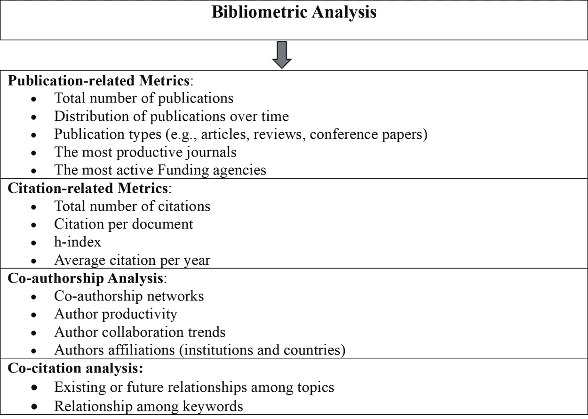

# 4\. 结果

## 4.1. 出版物和引用相关指标

### 4.1.1. 文档类型和学科类别概览

根据我们的调查工作，从 Web of Science 数据库中提取了总共 661 篇论文（表 I）。其中大部分为 493 篇论文，构成文章，占所选语料库的 75%。同时，130 篇论文被识别为会议论文，占 20%，而 38 篇和 18 篇论文分别被识别为综述文章和社论论文，分别贡献了总量的 3%。

在学科分类方面，我们的分析表明，该主题在 20 个不同的研究领域中得到探索。主要关注点在于计算机科学领域，占所收集论文的 41%（n=274）。随后，商业和工程成为重要贡献者，分别占语料库的 25%（n=165）和 17%（n=117）。

其他拥有显著存在的学科类别包括电信 (n=48)、科学技术 (n=43) 和社会科学 (n=17)。相反，教育研究和心理学等学科领域在数据集中的表现相对较低，少于 7 篇论文。

## 表 1. 前五大研究领域

| 研究领域 || 记录数 || % |

| --- | --- | --- |

| 计算机科学 || 274 || 41,45 |

| --- | --- | --- |

| 商业 || 165 || 24,96 |

| 工程 || 117 || 17,7 |

| 电信 || 48 || 7,26 |

| 科学技术 || 43 || 6,50 |

### 4.1.2. 出版物和引用趋势

## 图 2. 随时间变化的被引次数和出版物数量

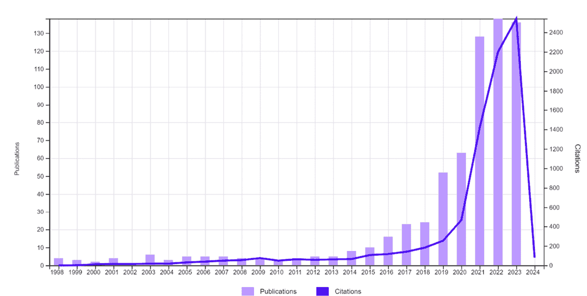

年度出版物数量作为衡量特定研究领域在本研究背景下发展轨迹的晴雨表。图 2 中的图形表示说明，在营销和人工智能领域，出版物和引用趋势均呈上升轨迹。值得注意的是，2014 年之前，年度产出较为有限，每年传播的文件不足十份。


从 2014 年到 2020 年，出版物数量呈现出明显的激增，其中 2019 年的增长尤为显著，当年发表的论文数量（`n=52`）比前一年（`n=24`）翻了一番多。在此期间，年均发表率为 32 篇。2020 年之后，文献产出出现了显著的上升趋势，并在 2022 年达到顶峰，当年发表了 210 篇论文。

引用模式的趋势与出版物的轨迹相似。2020 年之后，引用次数大幅增加，累计引用次数达到 8120 次，排除自引后为 7856 次。这相当于年均引用率为 312.77 次，每篇文献平均引用率为 12.28 次。H 指数为 40，表明在 661 篇论文中，有 40 篇论文至少被引用了 40 次，凸显了该文献集中研究贡献的影响力和学术共鸣。

### 4.1.3. 最活跃期刊和资助机构

发表的相关论文数量和引用次数可以反映期刊在特定研究领域的重要性。特别是，发表数量和引用次数与贡献成正比。表 II 显示了市场营销与人工智能领域发表量排名前十的出版商。其发表量占所有相关文献的 20%。发表相关论文数量最多的期刊是 *Sustainability*（*N=27*，3.79%）。

#### Table 2. 领域内最具生产力的期刊

| Journal Title | Number of Publications | Percentage (%) |
| --- | --- | --- |
| Sustainability | 27 | 3.792% |
| Wireless Communications Mobile Computing | 17 | 2.388% |
| IEEE Access | 16 | 2.247% |
| Mobile Information Systems | 13 | 1.826% |
| Applied Sciences Basel | 11 | 1.545% |
| Computational Intelligence and Neuroscience | 11 | 1.545% |
| Energies | 11 | 1.545% |
| Journal of Business Research | 9 | 1.264% |
| Frontiers in Artificial Intelligence | 8 | 1.124% |
| Industrial Marketing Management | 8 | 1.124% |

所考虑文献库的一个显著特征是研究工作的资金支持，40% 的发表论文得到了各种资助机构的支持。表 III 代表了该领域最活跃的资助机构。

在这个层级的顶端是中国国家自然科学基金会（NSFC），资助了 37 篇论文，表现突出。其次是葡萄牙科学与技术基金会（FCT），资助了 16 篇论文。随后，欧盟和西班牙政府等机构各资助了 13 篇文献。此外，来自韩国、台湾和英国的其他机构也表现出显著的参与度，每个机构资助的论文均超过 5 篇。这种经验性表述强调了多样化资助实体在维持该探究领域学术产出方面发挥的关键作用。

#### Table 3. 与人工智能和市场营销相关的最活跃资助机构

| Funding agency | Number of Publications | Percentage (%) |
| --- | --- | --- |
| The National Natural Science Foundation of China | 37 | 5.60 |
| The Fundação Para A Ciência E A Tecnologia | 16 | 2.49 |
| European Union Eu | 13 | 1.97 |
| Spanish Government | 13 | 1.97 |
| National Science Foundation Nsf | 10 | 1.51 |
| Ministry of Science and Technology Taiwan | 7 | 1.06 |
| National Research Foundation of Korea | 7 | 1.06 |

## 4.2. 合作作者分析

### 4.2.1. 国家合作作者分析

本分析旨在界定各自领域中最具产出的国家。使用 VOSviewer 进行的合作作者分析结果在 Figure 3 中展示。节点大小与发表量成正比，意味着较大的节点对应更高的发表数量。图中互连线条的粗细表明国家间研究合作的紧密程度。

#### Figure 3. 国家共现可视化

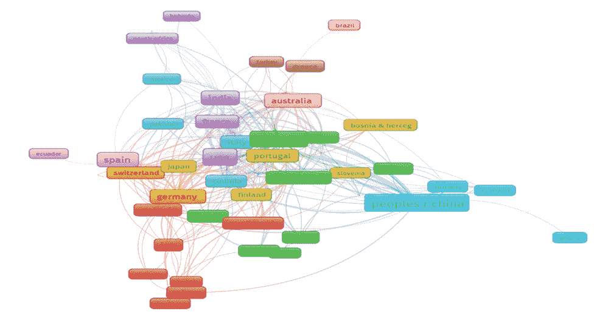

总共 661 篇论文源自 78 个国家的合作努力，其中 62 个国家至少贡献了 2 篇论文。中国以 117 篇论文位居榜首，其次是美国（99 篇）、英国（83 篇）、西班牙（52 篇）和印度（48 篇）。在引用次数方面（表 IV），美国以 2980 次引用位居首位，并以总链接强度 113 表现出最高的合作水平。

此外，Figure 3 强调了这些研究在经济发达国家和地区的集中度。一个明显的模式显示，来自拉丁美洲、非洲和中东新兴经济体的研究较少，这预示着未来探索和合作研究计划的潜在领域。

#### Table 4. 人工智能和市场营销领域最具生产力的国家

| Country | Documents | Citations | Total Link Strength |
| --- | --- | --- | --- |
| China | 117 | 1143 | 76 |
| USA | 99 | 2980 | 113 |
| UK | 83 | 1362 | 108 |
| Spain | 52 | 749 | 36 |
| India | 48 | 1000 | 62 |
| Australia | 41 | 1247 | 62 |
| Germany | 39 | 995 | 53 |
| France | 28 | 874 | 57 |
| Italy | 28 | 372 | 39 |
| Portugal | 28 | 371 | 21 |

### 4.2.2. 作者生产力

所考虑的研究论文源自 2071 名作者的集体努力，其中值得注意的子集包括 129 名至少贡献了 2 篇论文的作者，而其中 27 名作者至少产出了 3 篇论文。在表 V 中，我们列出了深入探索人工智能（AI）与市场营销交叉领域，并在该领域发表了大量 4 篇或更多论文的作者。

生产力最高、引用次数最多的作者来自不同的地理起源——即葡萄牙、波斯尼亚和黑塞哥维那以及英国。尽管葡萄牙在发表论文的纯数量（28 篇文献）方面位居最低，但它以拥有被引用最多的作者而著称。例如，作者 Vale Vita 在市场营销和人工智能交叉领域发表了 11 篇文献。值得注意的是，Vita 拥有令人印象深刻的 H 指数 42，以及超过 7000 次引用，凸显了她学术产出的深远影响。

此外，该主题的合作格局揭示了联盟，特别是作者 Vale Vita、Pinto Tiago 和 Praca Isabelle 之间观察到的显著协同效应。重要的是，这些作者不仅拥有相同的国籍，来自葡萄牙，而且隶属于同一机构。

#### Table 5. 人工智能和市场营销领域最具生产力的作者

| Authors | Documents | Citations | Total Link Strength |
| --- | --- | --- | --- |
| Vale, Zita | 11 | 158 | 27 |
| Pinto Tiago | 10 | 139 | 26 |
| Badnjevic, Almir | 8 | 2 | 14 |
| Pokvic, Lejla Gurbeta | 8 | 2 | 14 |
| Deumic, Amar | 6 | 2 | 12 |
| Praca, Isabelle | 5 | 98 | 12 |
| Santos, Gabriel | 5 | 107 | 17 |
| Faia, Ricardo | 5 | 50 | 9 |
| Dwivedi, Yogesh K. | 5 | 555 | 1 |

### 4.2.3. 作者所属大学


# 6\. 附属机构分析

所呈现的数据列举了为所审查的语料库做出贡献的作者的附属机构，揭示了机构代表性的光谱（表 VI）。伦敦大学以最高的记录数脱颖而出，涵盖了 16 篇论文，占总附属机构的 2.42%。紧随其后的是波尔图理工学院，拥有 14 篇论文，占比 2.11%，确立了其作为学术产出的重要贡献者的地位。值得注意的是，乌克兰教育科学部由 12 条记录代表，对应 1.81%，证明了研究工作的国际参与。

中国科学院、西南财经大学（中国）和牛津大学各自展示了 9 篇论文，占附属机构的 1.36%。这种国际附属机构的汇聚反映了多样化的学术贡献。

在其他附属机构中，伦敦国王学院、斯旺西大学和密歇根大学各自展示了 8 篇论文，占附属机构的 1.21%。这些附属机构强调了分布广泛且多样化的学术参与格局。

以这种方式划分附属机构，为学术界的机构构成提供了定量的洞察，揭示了学术贡献的集中和分散中心。

## 表 6. 该主题中最具生产力的大学

| 附属机构 | 记录数 | % |
| --- | --- | --- |
| University of London | 16 | 2.42 |
| Instituto Politecnico Do Porto | 14 | 2.11 |
| Ministry of Education Science of Ukrane | 12 | 1.81 |
| Chinese Academy of Sciences | 9 | 1.36 |
| Southwestern University of Finance Economics China | 9 | 1.36 |
| University of Oxford | 9 | 1.36 |
| King s College London | 8 | 1.21 |
| Swansea University | 8 | 1.21 |
| University of Michigan | 8 | 1.21 |

## 4.3\. 关键词共引分析

### 图 4. 关键词共现网络可视化

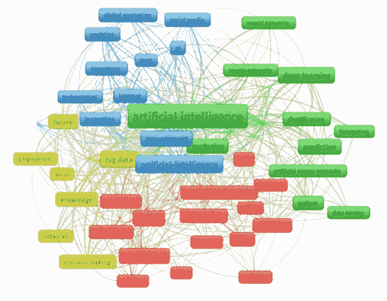

对 2810 个关键词进行了全面分析，揭示了它们引用频率的显著模式。其中，158 个关键词的引用次数至少为五次，其中 58 个关键词的引用次数至少为十次。值得注意的是，最突出的关键词“人工智能”以 190 次出现脱颖而出，与其他关键词建立了超过 300 个连接。

图 4 由 VOSviewer 执行，直观地描绘了概念的相互作用，特别是突出了“人工智能”、“营销”和“管理”之间的中心性和复杂的相互连接。这证实了所选论文与 AI 和营销管理领域的直接相关性。图形表示描绘了四个不同的簇，每个簇由独特的颜色表示。观察到的聚类意味着主题凝聚力（Al Husaeni and Nandiyanto, 2022），表明每个簇中的关键词共享固有关系，并共同为宏观研究领域的专门方面做出贡献。每个簇揭示了与 AI 和营销相关的特定研究领域。

蓝色簇：在 AI 和营销领域，该簇呈现了一个引人注目的十一组互连主题阵列，即：数字营销、AI、社交媒体、分析、信任、消费者、创新、管理、互联网和技术。核心是技术和创新对数字营销策略的深远影响，以及 AI 在营销中的应用。研究人员正在深入研究利用大量数据集来全面了解消费者行为、市场趋势和活动效果（Hermann, 2022；Zintso et al., 2023；Guercini, 2023）。

绿色簇：该簇揭示了十一组互连关键词——大数据、营销、深度学习、AI、神经网络、数据挖掘、预测和预测——因此主导主题是：AI 在营销分析和预测中的应用。事实上，预测和预测是 AI 为营销提供的最有价值的优势之一，因为它需要增强营销策略的有效性（Kowalkowski et al., 2023; Ma et al., 2023）

黄色簇：该簇将七个与决策、大数据、网络、技能和就业主题相关的关键词精妙地交织在一起，形成了一个技术进步与决策和优化相交汇的枢纽（Ashrafi et al., 2023 ; Badnjevic et al., 2023）。

红色簇：在 AI 和营销领域，该簇揭示了十五个关键主题的协同汇聚，如价格、需求、行为、控制、优化和绩效，这表明该簇专注于 AI 驱动的营销中的需求和定价策略、控制机制、优化技术和绩效指标，所有这些都与 AI 和数据分析相关（Vicente et al., 2023 ; Wang, 2023）。

可以从网络可视化共引分析中得出其他结论：

*   • 在与 AI 和营销相关的文档中，被引用最多的关键词是“artificial intelligence”，它也是图中最大的节点。

*   • 被引用第二多的关键词是“digital marketing”，它也是蓝色簇中最大的节点。这表明数字营销是 AI 和营销中最突出的子领域，并且具有大量的研究潜力和兴趣。

*   • 黄色簇与其他簇（尤其是绿色和红色簇）的连接最多。这意味着技术和创新是 AI 和营销的关键驱动力和推动因素，并且它们对 AI 技术和营销中优化技术的发展和应用有着强烈的影响。

*   • 红色簇与其他簇（尤其是蓝色簇）的连接最少。这意味着定价和优化是 AI 和营销中相对独立和专业化的领域，并且它们与营销的在线和数字方面的相关性和交互较少。

### 5\. 讨论

## 5.1\. AI 和营销研究的演变

对特定主题的兴趣的证实，通过辨别其所积累的出版物数量和引用数量来得到验证。这些指标的较高计数与对主题的更高兴趣相关（(Donthu et al., 2021）。我们的书目计量分析揭示了对人工智能（AI）在营销中的应用兴趣的显著激增。这种升温趋势早于 2000 年，近年来呈指数级增长。因此，开展这项书目计量分析是合理的，它是了解不断变化的出版趋势和高度关注领域的关键工具。此外，日益增长的兴趣不仅体现在高数量的出版物上，还体现在收到的引用数量的增加上。这种动态演变强调了理解 AI 在营销中的格局的重要性，因为它继续塑造和影响学术话语。


此外，专门针对该主题领域的会议数量激增，进一步验证了学术界和实践界日益增长的兴趣。这些会议中大量论文的发表，凸显了对新兴和创新研究主题的重视。学术界与实践界的这种汇聚，证实了人工智能在营销领域的当代相关性，凸显了其作为学术界和专业界协作探索与知识传播的焦点地位。此外，我们的引文分析结果突出了表 VII 中呈现的四个主要研究领域。

#### Table 7. 文献中人工智能与营销探讨的关键主题

| Topics || References |

| --- | --- |

| Application of AI in marketing || (Cui, 2023), (Hermann, 2022), (Keegan et al., 2022), (Ballestar, 2022) (Guercini, 2023), (Ameen et al., 2022), (Barnes and Ruyter, 2022), (Zintso et al., 2023), (Moon and Iacobucci, 2022), Gerlich, Elsayed and Sokolovskiy, 2023) |

| --- | --- |

| AI in market analysis and forecasting || (Badnjevic et al., 2023), (Cui, 2023), (Fakharchian, 2023), (Ghosh et al., 2023), (Haftor et al., 2023), (Kowalkowski et al., 2023), (Leal et al., 2023), (Ma et al., 2023), (Mohammed et al., 2023), (Petrescu and Krishen, 2023), (Ruggeri et al., 2023), (Shaban et al., 2023), (Steinberg and Hohenberger, 2023), (Vicente et al., 2023), (Wang, 2023) |

| AI in decision making and optimization || (Ashrafi et al., 2023), (Badnjevic et al., 2023), (Cui, 2023), (El Helou et al., 2023), (Ghosh et al., 2023), (Leal et al., 2023), (Shaban et al., 2023) |

| AI and data analytics || (Badnjevic et al., 2023), (Cui, 2023), (Fakharchian, 2023), (Ghosh et al., 2023), (Haftor et al., 2023), (Leal et al., 2023), (Ma et al., 2023), (Mohammed et al., 2023), (Petrescu and Krishen, 2023), (Ruggeri et al., 2023), (Shaban et al., 2023), (Steinberg and Hohenberger, 2023), (Vicente et al., 2023), (Wang, 2023) |

Application of AI in Marketing: this category covers the use of AI to understand consumer behavior, preferences, needs and emotions. Some of the applications include customer segmentation, churn prediction, sentiment analysis and personalization.

AI in Market Analysis and Forecasting: This category covers the use of AI to enhance the customer journey, satisfaction, loyalty and engagement. Some of the applications include recommender systems, chatbots, voice assistants and augmented reality.

AI in Decision Making and Optimization: This category covers the use of AI to support marketing decisions, strategies and actions. Some of the applications include forecasting, pricing, promotion, advertising and optimization. Researchers can delve into the ways in which organizations utilize big data to inform decision-making, understanding how data-driven insights contribute to strategic choices, resource allocation, and overall organizational performance.

AI and Data Analytics: this category covers the use of AI to measure and improve the financial performance and outcomes of marketing activities. Some of the applications include attribution, return on investment, customer lifetime value and profitability.

#### 5.2. Future of Research Trends on AI and Marketing

The research trends in a given field can be analyzed by analyzing keywords in recent publications (Hjørland, 2013; Chang et al., 2015; Pingxiu and Hassan, 2023). However, considering the rapid evolution of AI and marketing, we focused on publications from the last three years to capture the most current trends and potential future research directions. We conducted a keyword co-occurrence analysis based on titles and abstracts. By identifying the most frequently occurring and highly cited keywords related to AI and marketing, we were able to discern two promising research directions, summarized in Table VIII.

#### Table 8. future research agenda on AI and marketing

| Topics || References |

| --- | --- |

| Ethical and social implications of AI in marketing || (Niet et al., 2023), (behera et al., 2022), Nikam, R. J. (2023), Predel and steger, 2021), |

| --- | --- |

| AI in industry 4.0 and emerging technologies || (Badnjevic et al., 2023), (Cui, 2023), (El Helou et al., 2023), (Ghosh et al., 2023), (Leal et al., 2023) |

The first direction is concentrated on the Ethical and Social Implications of AI in Marketing. This area of research explores the ethical considerations surrounding the integration of AI technologies in marketing practices. It investigates issues such as data privacy, algorithmic bias, transparency, and accountability in AI-driven marketing strategies. Consumer Well-being must also be taken into account. This aspect focuses on the impact of AI-driven marketing on consumer well-being, including concerns related to psychological manipulation, digital addiction, and the exacerbation of societal inequalities. Researchers assess the unintended consequences of AI-based marketing interventions on vulnerable populations.

In addition, there is another research direction worthy of attention: AI in Industry 4.0 and Emerging Technologies. This research direction explores how AI technologies are transforming marketing practices in the context of Industry 4.0. It examines the application of machine learning, natural language processing, and predictive analytics in areas such as customer segmentation, personalized content creation, and marketing automation. Scholars should investigate the synergies between AI and other emerging technologies, such as the Internet of Things (IoT), augmented reality (AR), and virtual reality (VR), in enhancing marketing effectiveness and customer engagement. They explore innovative applications and interdisciplinary collaborations to drive digital transformation in marketing.

### CONCLUSION


# 这项研究对包含 661 份与 AI 和营销交叉领域相关文献的数据集进行了广泛的书目计量分析

研究结果表明，自 2014 年起，学术界对该领域的关注出现明显增长，且在 2020 年后重要性显著提升，标志着其成为研究热点。

这些研究在地理上主要集中在经济发达国家和地区，中国在发表文献数量方面处于领先地位，而美国在总引用量方面居于前列。这些文献在会议中的普遍存在，凸显了该话题的持久重要性及其不断演变的趋势。值得注意的是，超过 40% 的发表文献获得了各种机构和政府部门的资助，这凸显了该话题在社会和机构层面得到的广泛认可。

在该领域内，已出现四个突出的研究主题：AI 在营销中的应用、AI 在营销分析与预测中的应用、AI 在决策与优化中的应用以及 AI 与数据分析。此外，该研究还确定了两个值得探索的潜在未来研究方向：AI 在营销中的伦理与社会影响，以及 AI 在工业 4.0 和新兴技术中的应用。

然而，这项研究并非没有局限性。首先，数据收集仅限于 Web of Science 数据库中可用的文献，且仅限于英文出版物，这可能会引入偏差。此外，仅关注开放获取文章，虽然确保了可访问性，但可能会限制非开放获取文章所能提供的见解。最后，检索到的文献主要集中在发达国家，新兴市场的代表性有限。为了解决这些局限性，鼓励未来的研究人员多样化数据来源，探索非英文文献，例如中文文献，并采用更具包容性的搜索策略，以便更全面地了解该主题。

# 参考文献

Abbasi, G. A., Rahim, N. F. A., Wu, H. Y., Iranmanesh, M., & Keong, B. N. C. (2022). Determinants of SME’s Social Media Marketing Adoption: Competitive Industry as a Moderator. SAGE Open, 12(1). [10.1177/21582440211067220](http://dx.doi.org/10.1177/21582440211067220)

Al Husaeni, D. F., & Nandiyanto, A. B. D. (2022). Bibliometric using Vosviewer with Publish or Perish (using google scholar data): From step-by-step processing for users to the practical examples in the analysis of digital learning articles in pre and post Covid-19 pandemic. ASEAN Journal of Science and Engineering, 2(1), 19–46. [10.17509/ajse.v2i1.37368](http://dx.doi.org/10.17509/ajse.v2i1.37368)

Albayati, M. G., De Oliveira, J., Patil, P., Gorthala, R., & Thompson, A. E. (2022, November). A market study of early adopters of fault detection and diagnosis tools for rooftop HVAC systems. Energy Reports, 8, 14915–14933. [10.1016/j.egyr.2022.11.017](http://dx.doi.org/10.1016/j.egyr.2022.11.017)

Alla, L., Kamal, M., & Bouhtati, N. (2022). Big data and marketing effectiveness of tourism businesses: A literature review. Alternatives Managériales Economiques, 4(0). [10.48374/IMIST.PRSM/ame\-v1i0.36928](http://dx.doi.org/10.48374/IMIST.PRSM/ame-v1i0.36928)

Ameen, N., Sharma, G. D., Tarba, S., Rao, A., & Chopra, R. (2022). Toward advancing theory on creativity in marketing and artificial intelligence. Psychology and Marketing, 39(9), 1802–1825. [10.1002/mar.21699](http://dx.doi.org/10.1002/mar.21699)

Ballestar, M. T., Martín-Llaguno, M., & Sainz, J. (2022). An artificial intelligence analysis of climate-change influencers’ marketing on Twitter. Psychology and Marketing, 39(12), 2273–2283. [10.1002/mar.21735](http://dx.doi.org/10.1002/mar.21735)

Barnes, S., & de Ruyter, K. (2022). Guest editorial: Artificial intelligence as a market-facing technology: getting closer to the consumer through innovation and insight. European Journal of Marketing, 56(6), 1585–1589. Advance online publication. [10.1108/EJM-05-2022-979](http://dx.doi.org/10.1108/EJM-05-2022-979)

Bouhtati, N., Alla, L., & Bentalhah, B. (2023). Marketing Big Data Analytics and Customer Relationship Management: A Fuzzy Approach. In Integrating Intelligence and Sustainability in Supply Chains (pp. 75-86). DOI: . IGI Global.[10.4018/979\-8\-3693\-0225-5.ch004](http://dx.doi.org/10.4018/979-8-3693-0225-5.ch004)

Bouhtatit, N., Kamal, M., & Alla, L. (2023). Big Data and the Effectiveness of Tourism Marketing: A Prospective Review of the Literature. In Farhaoui, Y., Rocha, A., Brahmia, Z., & Bhushab, B. (Eds.), Artificial Intelligence and Smart Environment. ICAISE 2022. Lecture Notes in Networks and Systems, 635. Springer. [10.1007/978\-3\-031-26254-8\_40](http://dx.doi.org/10.1007/978-3-031-26254-8_40)

Chablo, A. (1994). Potential Applications of Artificial Intelligence in Telecommunications. Technovation, 14(7), 431–435. [10.1016/0166\-4972(94)90001-9](http://dx.doi.org/10.1016/0166-4972\(94\)90001-9)

Chang, Y. W., Huang, M. H., & Lin, C. W. (2015). Evolution of research subjects in library and information science based on keyword, bibliographical coupling, and co-citation analyses. Scientometrics, 105(3), 2071–2087. [10.1007/s11192-015-1762-8](http://dx.doi.org/10.1007/s11192-015-1762-8)

Chui, M., Henke, N., & Miremadi, M. (2018). Most of AI’s business uses will be in two areas. Harvard Business Review, 3–7. [`hbr.org/2018/07/most\-of\-ais\-business\-uses\-will\-be\-in\-two\-areas`](https://hbr.org/2018/07/most-of-ais-business-uses-will-be-in-two-areas)

Cui, H. (2023). RETRACTION: Construction and Development of Modern Brand Marketing Management Mode Based on Artificial Intelligence. Journal of Sensors, 2023, 1. [10.1155/2023/9758414](http://dx.doi.org/10.23/9758414)

Davenport, T. (2018). The AI Advantage: How to put the artificial intelligence revolution to work. MIT Press. [10.7551/mitpress/11781.001.0001](http://dx.doi.org/10.7551/mitpress/11781.001.0001)

Davenport, T., Guha, A., Grewal, D., & Bressgott, T. (2020). How artificial intelligence will change the future of marketing. Journal of the Academy of Marketing Science, 48(1), 24–42. [10.1007/s11747-019-00696-0](http://dx.doi.org/10.1007/s11747-019-00696-0)

Davenport, T. H., & Ronanki, R. (2018). Artificial intelligence for the real world. Harvard Business Review, 96(1), 108–116.

Donthu, N., Kumar, S., Mukherjee, D., Pandey, N., & Lim, W. M. (2021). How to conduct a bibliometric analysis: An overview and guidelines. Journal of Business Research, 133, 285–296. [10.1016/j.jbusres.2021.04.070](http://dx.doi.org/10.1016/j.jbusres.2021.04.070)

El Helou, R., Lee, K. Y., Wu, D. Q., Xie, L., Shakkottai, S., & Subramanian, V. (2023). OpenGridGym: An Open-Source AI-Friendly Toolkit for Distribution Market Simulation. IEEE Transactions on Smart Grid, 14(2), 1555–1565. [10.1109/TSG.2022.3213240](http://dx.doi.org/10.1109/TSG.2022.3213240)

Fakharchian, S. (2023). Designing a forecasting assistant of the Bitcoin price based on deep learning using market sentiment analysis and multiple feature extraction. Soft Computing, 27(24), 18803–18827. [10.1007/s00500-023-09028-5](http://dx.doi.org/10.1007/s00500-023-09028-5)

Gao, Y. J., & Liu, H. F. (2023). Artificial intelligence-enabled personalization in interactive marketing: A customer journey perspective. Journal of Research in Interactive Marketing, 17(5), 663–680. [10.1108/JRIM\-01-2022-0023](http://dx.doi.org/10.1108/JRIM-01-2022-0023)

Gerlich, M., Elsayed, W., & Sokolovskiy, K. (2023). Artificial intelligence as toolset for analysis of public opinion and social interaction in marketing: Identification of micro and nano influencers. Frontiers in Communication, 8, 1075654. [10.3389/fcomm.2023.1075654](http://dx.doi.org/10.3389/fcomm.2023.1075654)


# 参考文献

Ghosh, I., Alfaro-Cortés, E., Gámez, M., & García-Rubio, N. (2023). COVID-19 Media Chatter and Macroeconomic Reflectors on Black Swan: A Spanish and Indian Stock Markets Comparison. *Risks*, 11(5), 94. [10.3390/risks11050094](http://dx.doi.org/10.3390/risks11050094)

Guercini, S. (2023). Marketing automation and the scope of marketers’ heuristics. *Management Decision*, 61(13), 295–320. [10.1108/MD\-07-2022-0909](http://dx.doi.org/10.1108/MD-07-2022-0909)

Haftor, D. M., Costa-Climent, R., & Navarrete, S. R. (2023). A pathway to bypassing market entry barriers from data network effects: A case study of a start-up’s use of machine learning. *Journal of Business Research*, 168, 114244. [10.1016/j.jbusres.2023.114244](http://dx.doi.org/10.1016/j.jbusres.2023.114244)

Hermann, E. (2022). Leveraging Artificial Intelligence in Marketing for Social Good-An Ethical Perspective. *Journal of Business Ethics*, 179(1), 43–61. [10.1007/s10551\-021\-04843-y](http://dx.doi.org/10.1007/s10551-021-04843-y)

Hjørland, B. (2013). Facet analysis: The logical approach to knowledge organization. *Information Processing & Management*, 49(2), 545–557. [10.1016/j.ipm.2012.10.001](http://dx.doi.org/10.1016/j.ipm.2012.10.001)

Kaplan, A., & Haenlein, M. (2019). Siri, Siri, in my hand: Who’s the fairest in the land? On the interpretations, illustrations, and implications of artificial intelligence. *Business Horizons*, 62(1), 15–25. [10.1016/j.bushor.2018.08.004](http://dx.doi.org/10.1016/j.bushor.2018.08.004)

Keegan, B. J., Dennehy, D., & Naudé, P. (2022). Implementing Artificial Intelligence in Traditional B2B Marketing Practices: An Activity Theory Perspective. *Information Systems Frontiers*, 15. Advance online publication. [10.1007/s10796\-022\-10294-1](http://dx.doi.org/10.1007/s10796-022-10294-1)

Kim, T., Usman, U., Garvey, A., & Duhachek, A. (2023). Artificial Intelligence in Marketing and Consumer Behavior Research. *Foundations and Trends in Marketing*, 18(1), 1–93. Advance online publication. [10.1561/1700000078](http://dx.doi.org/10.1561/1700000078)

Lhoussaine, A. L. L. A., Kamal, M., & Bouhtati, N. (2022). Big data and marketing effectiveness of tourism businesses: A literature review. *Economic Management Alternatives*, 1, 39–58.

Li, P., & Hassan, S. H. (2023). Mapping the literature on Gen Z purchasing behavior: A bibliometric analysis using VOSviewer. *Innovative Marketing*, 19(3), 62–73. [10.21511/im.19(3).2023.06](http://dx.doi.org/10.21511/im.19\(3\).2023.06)

Loureiro, S. M. C., Bilro, R. G., & Japutra, A. (2019). The effect of consumer-generated media stimuli on emotions and consumer brand engagement. *Journal of Product and Brand Management*, 29(3), 387–408. [10.1108/JPBM\-11-2018-2120](http://dx.doi.org/10.1108/JPBM-11-2018-2120)

Mohammed, T., Naas, S. A., Sigg, S., & Di Francesco, M. (2023). Knowledge Sharing in AI Services: A Market-Based Approach. *IEEE Internet of Things Journal*, 10(2), 1320–1331. [10.1109/JIOT.2022.3206585](http://dx.doi.org/10.1109/JIOT.2022.3206585)

Moon, S., & Iacobucci, D. (2022). Social Media Analytics and Its Applications in Marketing. *Foundations and Trends in Marketing*, 15(4), 213–292. [10.1561/1700000073](http://dx.doi.org/10.1561/1700000073)

Nikam, R. J. (2023). Legality of usage of Artificial Intelligence and Machine Learnings by Share Market Intermediary. *Passagens-International Review of Political History and Legal Culture*, 15(2), 319–339. [10.15175/1984\-2503-202315207](http://dx.doi.org/10.15175/1984-2503-202315207)

Nunan, D., & Di Domenico, M. (2013). Market Research and the Ethics of Big Data. *International Journal of Market Research*, 55(4), 505–520. [10.2501/IJMR-2013-015](http://dx.doi.org/10.2501/IJMR-2013-015)

Overgoor, G., Chica, M., Rand, W., & Weishampel, A. (2019). Letting the Computers Take Over: Using AI to Solve Marketing Problems. *California Management Review*, 61(4), 156–185. [10.1177/0008125619859318](http://dx.doi.org/10.1177/0008125619859318)

Petrescu, M., & Krishen, A. S. (2023). Hybrid intelligence: human-AI collaboration in marketing analytics. *Journal of Marketing Analytics*, 2023(3), 263–274. [10.1057/s41270-023-00245-3](http://dx.doi.org/10.1057/s41270-023-00245-3)

Poole, D. L., & Mackworth, A. K. (2010). *Artificial Intelligence: Foundations of Computational Agents*. Cambridge University Press. [10.1017/CBO9780511794797](http://dx.doi.org/10.1017/CBO9780511794797)

Rust, R. T. (2020). The Future of Marketing. *International Journal of Research in Marketing*, 37(1), 15–26. [10.1016/j.ijresmar.2019.08.002](http://dx.doi.org/10.1016/j.ijresmar.2019.08.002)

Verma, S., & Gustafsson, A. (2020). Investigating the Emerging COVID-19 Research Trends in the Field of Business and Management: A Bibliometric Analysis Approach. *Journal of Business Research*, 118, 253–261. [10.1016/j.jbusres.2020.06.057](http://dx.doi.org/10.1016/j.jbusres.2020.06.057)

Vicente, O. F., Fernández, F., & García, J. (2023). Automated market maker inventory management with deep reinforcement learning. *Applied Intelligence*, 53(19), 22249–22266. [10.1007/s10489-023-04647-9](http://dx.doi.org/10.1007/s10489-023-04647-9)

Wang, F. R., & Zhao, L. (2022). A Hybrid Model for Commercial Brand Marketing Prediction Based on Multiple Features with Image Processing. *Security and Communication Networks*, 2022, 1–10. [10.1155/2022/5455745](http://dx.doi.org/10.1155/2022/5455745)

Wang, M. M., & Pan, X. M. (2022). Drivers of Artificial Intelligence and Their Effects on Supply Chain Resilience and Performance: An Empirical Analysis on an Emerging Market. *Sustainability (Basel)*, 14(24), 16836. [10.3390/su142416836](http://dx.doi.org/10.3390/su142416836)

Zintso, Y., Fedorishina, I., Zaiachkovska, H., Kovalchuk, O., & Tyagunova, Z. (2023). Analysis of current trends in the use of digital marketing for the successful promotion of goods and services in Ukraine. *Financial and Credit Activity-Problems of Theory and Practice*, 3(50). [10.55643/fcaptp.3.50.2023.4080](http://dx.doi.org/10.55643/fcaptp.3.50.2023.4080)

Zupic, I., & Čater, T. (2015). Bibliometric Methods in Management and Organization. *Organizational Research Methods*, 18(3), 429–472. [10.1177/1094428114562629](http://dx.doi.org/10.1177/1094428114562629)

# Chapter 5

# A Systematic Review of Augmented Reality Experiential Marketing: Conceptual Framework and Research Agenda

## Aya Irgui


Ibn Tofail University, Morocco

## Mohammed Qmichchou

Ibn Tofail University, Morocco

## Ilham El Haraoui


Ibn Tofail University, Morocco

### ABSTRACT

本研究概述了增强现实体验式营销（AREM）的当前认知，全面概述了该领域的现状，并确定了进一步研究的领域。通过系统文献综述，作者分析了 35 篇文章，构建了一个整合框架，突出理论进步和实际应用。综述解决了重要的研究空白，提供了见解，并指出了现有知识中的挑战。主要发现表明，AREM 对消费者行为的影响及其对沉浸式营销策略的启示。值得注意的是，该研究呼吁对超越新奇感的 AR 有细致入微的理解，主张引人入胜、沉浸式和个性化的互动。它强调包容性的人口统计方法以及隐私等伦理考量。本综述在其范围上具有原创性，为扩展 AREM 的理论版图奠定了基础，促进一种文化包容且具有伦理意识的营销方法，以提升数字市场中的消费者体验。

## INTRODUCTION


# Introduction

近年来，学术界对组织内技术创新重要性的关注日益增加。这种关注度的提升，是由企业快速采用技术以提升创新能力和整体绩效所驱动的 (Kim et al., 2024)。与此同时，消费者行为出现了明显的转变，偏好日益倾向于数字化消费，凸显了数字时代消费习惯的演变 (Shah & Murthi, 2021)。

在这一演进过程中，增强现实（AR）、虚拟现实（VR）和混合现实（MR）等沉浸式技术正成为消费者互动的前沿领域。这种兴趣的激增，进一步受到 Facebook 和 Apple 等科技巨头的重大投资所推动，表明这些技术在塑造未来消费市场方面具有巨大潜力 (Dieck et al., 2022)。在零售领域，AR 在体验式营销中的应用日益增加。包括宜家、亚马逊、苹果和欧莱雅在内的众多知名公司，正在采用 AR 解决方案来打造独特且引人入胜的客户体验。这凸显了行业普遍认识到，必须通过沉浸式和体验式互动来创造客户价值 (Haumer et al., 2020)。因此，探索这些数字化进步的采用和整合如何改变营销格局至关重要 (Hilken et al., 2018)。

多项研究已对 AR 在零售和营销中的作用作出了贡献，强调了消费者与数字化创新互动的演变性质。Javornik (2016) 是先驱之一，研究了 AR 如何增强零售领域内交互媒体的特征，尽管其方法并非系统化。随后，Perannagari and Chakrabarti (2019) 对 AR 在零售中的采用进行了系统性回顾，指出其能够通过其独特的特征和媒体质量来丰富客户体验并激发积极的行为意图。

进一步扩大范围，Du et al. (2022) 观察到 AR 在零售、旅游和广告等多个领域的应用日益增多，并将其归功于其显著影响消费者行为和反应的能力。同样，Lavoye et al. (2021) 对 AR 零售背景下的消费者行为提供了全面的概述，提出了一个概念框架，涵盖了关键的消费者行为、其后果以及未来研究的方向。该研究特别强调了 AR 增强功利性和享乐性体验的双重潜力，从而优化决策过程并个性化消费者体验。在最近的一项系统性回顾中，Walenteka 和 Ziora (2023) 开展了一项关于 AR 对绩效和数据管理的影响，以及其对小企业和企业发展战略影响的系统性回顾。同样，Kumar (2022) 从消费者角度评估了 AR 在在线零售中的应用，强调了该技术在重塑零售体验方面的作用。

尽管有这些贡献，但对消费者将 AR 作为体验式营销工具的行为的全面理解仍然难以捉摸。现有文献虽然广泛，但指出了将 AR 的体验性方面与其对消费者行为的影响相结合方面存在重大差距，强调了对这一动态领域进行整体探索的必要性。此外，现有研究揭示了增强现实体验式营销（AREM）领域存在重大差距，特别是关于其正式定义和概念化方面。虽然 Rauschnabel et al. (2019) 和 Yaoyuneyong et al. (2016) 都强调了制定 AR 营销工作定义的持续努力，表明学术界尚未达成共识。这一点还体现在现有研究倾向于更多地关注 AREM 的底层概念，而不是提供清晰、全面的定义。因此，本综述将解决以下研究问题：

* RQ1. 文献中如何定义 AR 体验式营销？

* RQ2. AR 体验式营销的维度/影响因素和关键结果是什么？

* RQ3. AR 体验式营销研究中采用了哪些方法论/理论？

* RQ4. AR 体验式营销中的关键研究差距和新的未来研究方向是什么？

因此，本研究旨在对 AREM 的现有文献进行批判性分析和综合。这包括对 AR 营销和体验式营销领域现有知识进行系统性探索和综合。它侧重于概述这些领域的当前理解，同时识别需要进一步调查的潜在领域，建立 AREM 研究现状的全面概述，提供有价值的见解，并识别现有知识中的重大挑战和差距。

## BACKGROUND

增强现实（AR）被定义为一种复杂的技术，它将计算机生成的虚拟图像与我们的物理世界相结合，在虚拟与现实之间建立一个集成的界面，并通过与之交互的能力使其更具意义 (Yoon & Oh, 2022; Oyman et al., 2022; Sun & Yuan, 2024)。这一创新正在改变各个领域；它尤其彻底改变了医学教育，使沉浸式培训体验成为可能，并且在建筑和室内设计方面同样具有影响力，帮助专业人士在现实世界环境中可视化最终产品 (Kim et al., 2024)。

在商业领域，AR 越来越多地被用作智能零售计划的战略组成部分，提供一种独特的沉浸式环境，以增强客户体验，各行各业的多个品牌正在整合 AR 以动态地吸引消费者 (Wang & Ameen, 2023; Hsu et al., 2021)。智能零售策略中的这种协同作用标志着行业的一种变革性方法，强调了其重塑传统消费者互动和环境的潜力。除了零售，AR 的适用性还扩展到旅游业，通过提供关于目的地的交互式和情境化信息来增强游客体验，以及教育领域，通过实现理论概念的交互式现实应用来改变学习。在健身领域，AR 运动应用程序通过允许用户实时将其动作和姿势与虚拟场景进行视觉对齐来吸引用户，从而促进更自然、更有效的运动训练 (Sun & Yuan, 2024)。这些应用程序，从使用 IKEA Place 进行家具布置到与欧莱雅和丝芙兰等美妆品牌进行虚拟试用，都展示了 AR 实时与虚拟对象进行交互体验的能力。


# 基于此技术基础的 AR 体验式营销为消费者体验与参与带来了新维度

Holbrook and Hirschman (1982) 最初在营销领域引入了“体验式”概念，强调其关注消费者幻想、情感和乐趣的持续流动。他们强调，体验式营销涉及通过游戏化活动、感官愉悦、审美享受和情感反应来吸引消费者。多年来，体验式营销已从一个边缘概念演变为品牌战略的核心组成部分。它超越了传统营销，不仅回应消费者的需求和愿望，还提供个性化关注、刺激和情感参与，从而促进更深层次的品牌-消费者关系 (Carmo et al., 2022)。

随着向更具沉浸感的营销体验的趋势日益增长以及 AR 越来越受欢迎，这项技术的整合正在重新定义零售策略。AR 通过允许客户与虚拟产品进行交互，无缝融合物理世界与数字世界，丰富购物体验，使其变得有趣、令人难忘且令人兴奋，从而增强体验式营销 (Kim et al., 2024)。这不仅增强了功能效用，还提升了整体消费者体验，可能提高满意度和忠诚度 (Haumer et al., 2020)。

与创建完全新数字环境的虚拟现实 (VR) 的全方位沉浸不同，AR 将交互式数字元素引入用户的物理环境，从而不是取代，而是增强现实世界，允许消费者以新颖的方式与产品互动，提供一种丰富传统购物体验的分层体验 (Hilken et al., 2018; Alimamy & Nadeem, 2022)。零售商（包括 Gucci 和 Burberry）移动 AR 应用程序的日益普及，反映了利用 AR 提升客户体验的持续趋势，标志着其在消费者市场中日益重要的地位。

因此，正如 Scopus 和 Web of Science 的出版物汇编所示 (Figure 1)，对营销中 AR 的研究突显了过去二十年来学术好奇心和出版频率的不断增加。它追溯了从 2000 年到 2024 年 4 月的发展轨迹，为研究界对该领域的兴趣提供了一个视角。

#### Figure 1. 多年来 WoS 和 Scopus 数据库中关于 AR 营销的出版物数量

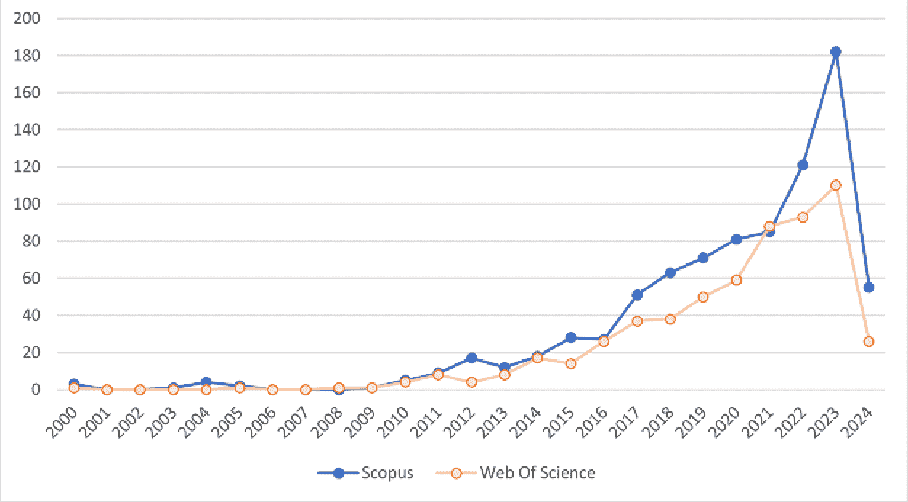

在早期（2000-2006 年），AR 技术的初始状态体现在研究产出极少，Scopus 和 Web of Science 中仅有少数出版物，两个数据库的年均出版物数量均保持在个位数。2010 年后，研究活动开始逐渐增加，突显了人们对 AR 在营销中潜力的日益认识。2012 年标志着显著的跳跃，Scopus 记录了 17 篇出版物，Web of Science 记录了 4 篇，随后几年研究活动持续增长。到 2017 年，出现显著飞跃，Scopus 和 Web of Science 分别记录了 51 篇和 37 篇出版物。这种上升势头持续，两个数据库均记录了出版物的稳定年度增长。对 AR 营销的学术兴趣高峰体现在 2023 年的数据中，Scopus 报告了 182 篇出版物，Web of Science 报告了 110 篇，标志着该领域最高的研究产出。这一增长突显了 AR 技术的发展及其融入主流营销，以及研究界探索和利用这些进展的努力。对于 2024 年，截至 4 月的初步数据显示 Scopus 有 55 篇出版物，Web of Science 有 26 篇。出版模式表明，研究产出并非在一年中均匀分布，而是逐渐累积。

因此，预计随着新研究在数据库中的收录和索引，2024 年的当前数字将随着年份推进而上升。鉴于证实的增长，过去几年 AR 营销实践的流行度激增凸显了其作为颠覆性技术的潜力，该技术不仅丰富了消费者的体验和价值认知，还转变了不同领域（旅游、移动电子商务、游戏等）的营销策略，促使企业探索基于以客户为中心的方法来吸引和留住客户的创新策略。在此背景下，本系统文献综述（SLR）对 AR 体验式营销的关注是及时的。因此，本综述旨在识别体验式 AR 营销的特征/维度，识别研究差距和所使用的理论，并使用定义的协议，强调和理解影响营销和品牌体验中消费者行为的 AREM 关键因素。通过这样做，该研究不仅解决了研究差距，还为从业者提供了宝贵的见解，并为进一步探索提供了潜在途径。

## 系统文献综述的方法论

系统文献综述 (SLR) 仔细汇编相关研究以回答定义的研究问题，透明地详细说明搜索方法和纳入标准。它旨在公正地整合知识，并从文献中得出全面的结论 (Williams Jr. et al., 2021)。因此，本研究采用 SLR 方法论，借鉴 Paul and Criado (2020)、Denyer and Tranfield (2009) 和 Williams Jr. et al. (2021) 的既定指南，全面审查和综合 AR 体验式营销的研究。这种方法使我们能够有条理地汇总和评估现有文献，识别 AREM 领域的研究差距和未来调查的机会。SLR 过程包括几个关键阶段，包括识别、筛选、资格审查和综合，如 Figure 2 所示。分析过程通过使用 NVivo 软件得到促进，该软件使整个研究过程中能够进行系统的编码程序。在将选定的研究从 Zotero 导出到 NVivo 后，我们利用了该软件的分析工具，包括文本搜索查询、查询结果和节点编码。这些功能使所有相关研究整合到一个统一的数据集中，从而提高了审查的彻底性，并降低了遗漏关键数据的可能性。

#### Figure 2. 系统文献综述过程

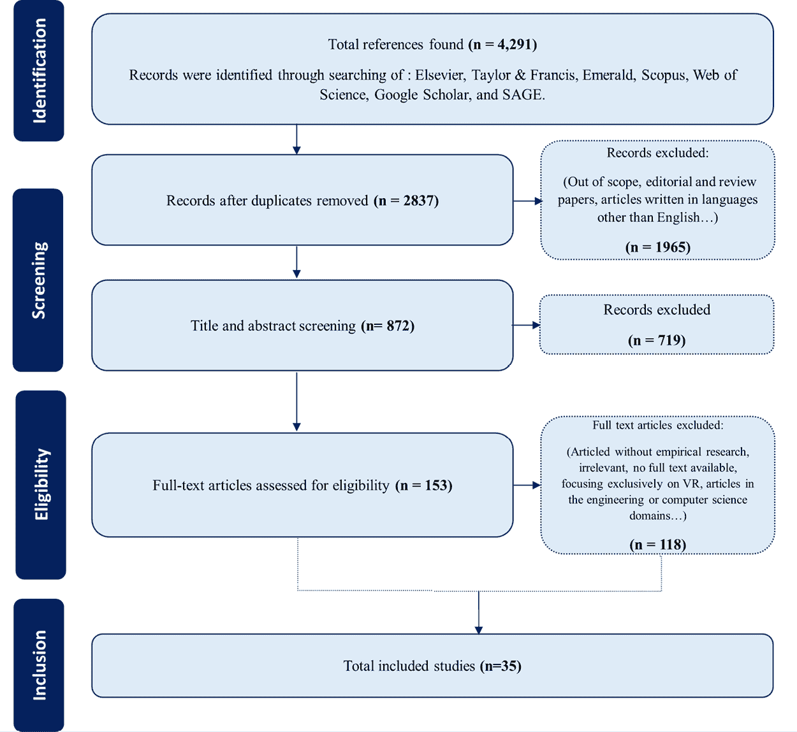


为识别相关文献，我们采用了多技术方法，在 Elsevier、Taylor & Francis、Emerald、Scopus、Web of Science、Google Scholar 和 SAGE 等知名学术数据库中进行了广泛的关键词搜索。我们还应用了向后和向前滚雪球法。我们的搜索不受出版时间范围限制，从而可以收集所有相关时期的全面文献（Rebouças & Soares, 2020）。我们的关键词策略涉及使用布尔运算符（`"AND"`、`"OR"`）的组合，以捕捉与 AREM 相关的文献，术语包括“Augmented reality”、“AR”、“experiential marketing/value”、“Consumer/customer behavior”、“Customer/consumer experience”、“experiential augmented reality”及其相关变体。搜索结果得出了 4,292 篇与 AREM 相关的出版物。向后滚雪球法涉及检查选定研究中的参考文献，而向前滚雪球法旨在查找引用最初审查文章的较新研究。我们的纳入标准侧重于以英语发表的实证、同行评议文章，不受时间限制。文章需要呈现具有清晰阐述的构念和方法论的实证研究（Paul & Benito, 2018），符合各学科系统文献综述（SLR）的 PRISMA 方法标准。

排除标准旨在排除理论模型、定性文献综述、概念性贡献、案例研究以及主要集中在工程或计算机科学领域的文章。此外，学位论文、简短报告、研讨会和工作进行中论文、社论、实践指南以及与会议相关的出版物（如论文集、海报和摘要）均被排除在我们的综述之外。此外，由于我们的重点仅限于体验式营销背景下的 AR，主要或专门关注 VR 的文章也被排除了。在消除重复条目以确保数据集完整性后，进行了筛选阶段；文章根据我们预定义的纳入和排除标准对标题和摘要进行筛选。153 篇论文被选中进行全文筛选。不符合预定义标准或与研究目标无关的文章被排除在考虑之外。在此之后，共有 35 篇文章被纳入系统文献综述。

## 结果与讨论

### 总体概述

表 1 我们的系统文献综述提供了 2015 年至 2024 年间 35 项选定的 AR 体验式营销研究的一般信息摘要；它突出了作者、出版年份、研究国家、研究的 AR 应用、采用的研究方法以及涉及的样本量。这些研究反映了采用定量方法的国际研究工作，主要通过常与实验设计相结合的调查来实现，使用 SEM（结构方程模型）、ANOVA（方差分析）和多元回归分析等统计方法。样本量差异显著，范围从 96 到 801 名参与者，表明从更集中的群体分析到更广泛的人口洞察的多样化研究规模。研究范围涵盖各种产品领域，从时尚和化妆品到家具和旅游，涉及 IKEA、Ray-Ban 和各种美容品牌等知名品牌的商业可用的特定 AR 应用，以及专门为研究目的开发的 AR 应用。此外，一些研究比较了 AR 和非 AR 应用（例如，Kim et al., 2024；Arghashi, 2022）的效果，旨在了解 AR 在塑造消费者行为方面的独特影响及其在创造沉浸式品牌体验方面的潜力。Kim et al. (2023) 还比较了 AR 和 VR 的功能机制，从用户的角度考察了它们对感知和行为的影响。

### 表 1. 系统文献综述中纳入的研究概览

| 作者，年份 || 研究国家 || 产品类别/品牌 || 研究方法 || 样本量 |

| --- | --- | --- | --- | --- |

| Alimamy & Nadeem (2022) || 随机招募（Amazon Mechanical Turk） || Ikea Place || 调查（SEM） || 266 |

| --- | --- | --- | --- | --- |

| Arghashi (2022) || 土耳其 || Wanna Kicks AR 应用 & Nike 非 AR 应用 || 调查 + 实验（SEM） || 297 |

| Arghashi et al. (2022) || 土耳其 || Wanna Kicks AR 应用 || 调查（SEM） || 350 |

| Barhorst, et al., (2021) || 英国 || 商业可用的 AR 应用 || 调查 + 实验（SEM） || 500 |

| Chen & Chou (2022) || 台湾 || Wanna Kicks & FitGlasses || 调查 + 实验（SEM） || 193 |

| Daassi & Debbabi (2021) || 法国 || YouCam Makeup || 调查（SEM） || 224 |

| Dieck et al. (2023) || 英国 || Ikea Place & Wanna Kicks & Specsavers || 调查 + 实验（SEM） || 173（高沉浸感），222（低沉浸感） |

| Erdmann et al., (2023) || 西班牙 || 商业可用的 AR 应用 || 调查 + 实验（SEM） || 253 |

| Eru et al. (2022) || 土耳其 || 商业可用的 AR 应用 || 调查（SEM） || 319 |

| Han et al. (2021) || 随机招募（Amazon Mechanical Turk） || 商业可用的 AR 应用 || 调查（SEM） || 355 |

| Haumer et al. (2020) || 慕尼黑 || Ikea Place || 调查 + 实验（方差分析 & 多元回归分析） || 100 |

| Hsu et al. (2021) || 台湾 || YouCam Makeup 应用 || 调查（SEM） || 437 |

| Hu et al.(2021) || 中国 || Fantawild AR 应用 || 调查（SEM） || 917 |

| Huang & Liao (2015) || 台湾 || 商业可用的 AR 应用 || 调查（SEM） || 220 |

| Kazmi et al. (2021) || 卡拉奇 || Ray-Ban 虚拟镜 || 调查 + 实验（SEM） || 100 |

| Kim et al. (2023) || 随机招募（Amazon Mechanical Turk） || IKEA Place（AR vs VR） || 调查 + 实验（SEM） || 116 AR & 146 VR |

| Kim et al. (2024) || 韩国 || AR & 非 AR 应用 || 调查（SEM） || 302 |

| Kowalczuk et al. (2021) || 德国 || IKEA Place || 调查 + 实验（SEM） || 400 |

| Lee et al. (2022) || 美国 || 商业可用的 AR 应用 || 调查（SEM） || 352 |

| McLean & Wilson (2019) || 英国 || Amazon, ASOS, IKEA || 调查（SEM） || 441 |

| Poushneh &Vasquez-Parraga (2017) || 美国 || Ray-Ban 虚拟镜 || 调查 + 实验（SEM） || 99 |

| Qin et al. (2021) || 美国 || IKEA Place and Ray-ban || 调查（SEM） || 316 |


| Singh et al. (2024) | 印度 | 商业可用的 AR 应用 | 混合方法 – 定性（半结构化访谈+深度访谈） | 25（定性）& 350（定量） |
| Sun & Yuan (2024) | 中国 | Tiantian Rope Skipping AREA | 调查(SEM) | 398 |
| Sung (2021) | 美国 | 开发了一个 AR 应用 | 调查(SEM) | 62 |
| Trivedi et al. (2022) | 印度 | 商业可用的 AR 应用 | 准实验方法 + 调查 (SEM) | 343 |
| Tsang et al. (2023) | 台湾 | 商业可用的 AR 应用 | 调查 (SEM) | 557 |
| Vo et al. (2022) | 越南 | YouCam Makeup & FormexTryOn | 调查 (SEM) | 322 |
| VONGURAI (2021) | 泰国 | 商业可用的 AR 应用 | 调查 (SEM) | 550 |
| Wang et al. (2023) | 英国 | 商业可用的 AR 应用 | 调查 (SEM) | 253 |
| Watson et al. (2018) | 瑞士 | AR 美妆应用 (AR vs Non-AR) | 调查 + 实验 (SEM) | 162 |
| Whang et al. (2021) | 韩国 | MakeupPlus | 调查 + 实验 (SEM) | 106 |
| Yang (2021) | 中国 | 商业可用的 AR 应用 | 调查 (SEM) | 248 |
| Yim et al. (2017) | 美国 | AR vs Web | 调查 + 实验 (SEM) | 801 |
| Zanger et al. (2022) | 德国 & 英国 | Amazon 和 Essie (AR vs Non AR) | 调查 + 实验 (SEM) | 238 名学生 (研究 1)，251 名女性小组成员 (研究 2) |

来源：作者自行整理

##### 研究的 AR 应用

我们的综述结果表明，AR 应用 `IKEA Place` 受到了学术界的广泛关注，成为 7 项研究的焦点。这种关注反映了其在家具零售领域对 AR 技术的创新应用，这与当前通过沉浸式技术提升客户体验的趋势相一致 (Vaidyanathan & Henningsson, 2023)。同样，提供虚拟鞋子试穿体验的 `Wanna Kicks` 在研究中也有显著存在，占所选研究的 10%，表明人们对能够提升足部网购体验的 AR 应用有着浓厚兴趣，揭示了此类技术如何创新“先试后买”体验，并暗示 AR 在时尚和零售领域具有更广泛的适用性。

像 `YouCam Makeup` 和 `Ray-Ban Virtual Try-On` 这样的 AR 应用各占 7%，允许消费者虚拟试用化妆品和眼镜，在无需实物样品的情况下提供个性化和实时的购物体验。此外，研究中占比最大的部分涉及 16 项研究，关注的是未具体命名的商业可用 AR 应用，表明相当一部分研究致力于探索 AR 在营销领域的广泛影响，而非关注特定的应用或品牌。此外，`Amazon` 的 AR 应用占 5%，反映了其在更广泛的电子商务背景中的作用，其中 AR 可以通过实现产品的虚拟预览来为网购体验增添价值。所选研究的其余部分分布在各种其他 AR 应用中，包括 `Essie`、`FitGlasses`、`AREA`... 指向该技术在包括旅游、健身和体育在内的各个领域的潜力，如 图 3 所示。

#### 图 3. 研究的 AR 应用

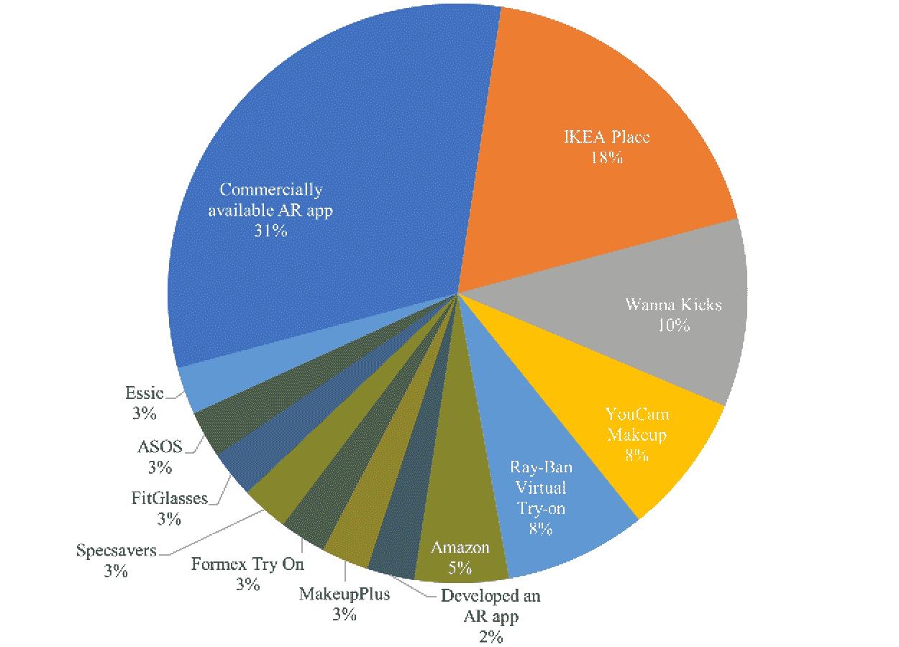

##### 按国家划分的出版物

根据我们的综述，关于 AR 体验营销的研究文章的地理分布 (图 4) 揭示了对少数几个国家的主要关注，主要集中在美国和英国，这两个国家各有 5 项研究，其次是台湾，有 4 项研究，这反映了这些市场中 AR 技术的重大进步和普及。此外，3 项研究使用了 `Amazon Mechanical Turk` 来随机招募具有 AR 经验的参与者，反映了超越单一国家的更广泛的国际但非特定地理抽样。`土耳其`、`中国` 和 `德国` 各占三项研究。代表性明显较少的是 `韩国` 和 `印度`，各有两篇文章，而 `西班牙`、`南巴基斯坦`、`法国`、`越南`、`泰国` 和 `瑞士` 各为单项研究的焦点。地理分布有限，且严重偏向西方国家，这凸显了一个研究空白，并表明未来研究有机会了解 `AREM` 在新兴市场和不同文化国家中的影响和应用，这可能为消费者对 AR 体验式技术的反应提供更丰富、更细致的理解。

#### 图 4. 研究的人群

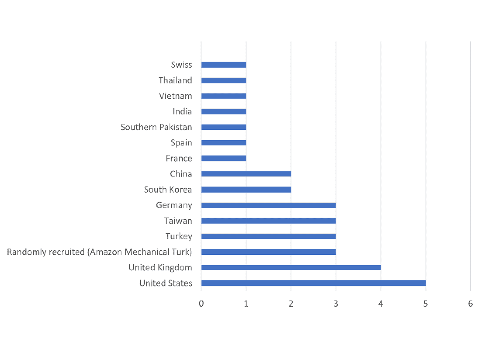

##### 理论视角

根据我们的综述，很明显，已利用多种理论视角来理解和探索 AR 体验式营销 (表 2)。值得注意的是，刺激-有机体-反应 (`SOR`) 框架是一种流行的理论，指导研究 AR 提供的感官刺激如何影响消费者的内部状态并导致某些行为反应 (例如，Arghashi, 2022; Sun & Yuan, 2024)。AR 改变现实认知的能力，引发认知和情感反应，从而导致消费者参与度增强或行为意向，这增强了其相关性。同样，技术接受模型 (`TAM`) 是另一种在研究营销中 AR 技术接受和使用方面的主导理论，强调其预测用户对新技术态度和意向的能力 (例如，McLean & Wilson, 2019; Chen & Chou, 2022; Vo et al., 2022)。由于 AR 是一项相对较新的创新，`TAM` 对感知有用性和易用性的关注，为研究人员分析消费者采用 AR 并将其整合到购物和消费行为中的准备情况提供了一个视角。


# 理论框架与 AR 体验营销研究综述

基于体验营销的理论框架，商业领域利用 AR 技术的研究采用了根源于 Mathwick et al. (2001) 和 Holbrook and Hirschman (1982) 等开创性著作的体验价值构念。研究人员强调在情感层面吸引消费者的重要性，提出 AR 技术可以通过提供超越传统消费的沉浸式和交互式体验，潜在地提升购物的体验价值 (Eru et al., 2022)，通常强调视觉吸引力、娱乐性、享受和逃避主义等价值，以评估消费者反应 (Han et al., 2021; Hsu et al., 2021)。因此，体验营销的视角为理解 AR 如何创造有助于品牌差异化和客户忠诚度的难忘体验提供了宝贵的洞察。

此外，临场感理论（Telepresence theory）引起了广泛关注，强调 AR 技术可以创造生动的临场感和沉浸感，从而显著影响消费者的态度和行为（例如，Wang et al., 2023; Daassi & Debabi, 2021）。同样，心流理论（Flow theory）对于理解消费者心理至关重要，表明 AR 可以创造与消费者能力和挑战相契合的沉浸式体验，从而产生积极的情感状态，提升消费者的信任和参与度（例如，Arghashi et al., 2022; Barhorst et al., 2021）。其他理论视角，如媒介丰富性理论（Media Richness Theory）、体验经济理论（Experience Economy Theory）、使用与满足理论（Uses and Gratification Theory）、施密特客户体验模型（Schmitt's Customer Experience Model）、认知-情感-行为框架（Cognition-Affect-Conation (C-A-C) Framework）、技术接受与使用统一理论（Unified Theory of Acceptance and Use of Technology）以及社会认知理论（Social Cognitive Theory (SCT)）在我们的系统文献综述（SLR）中出现频率较低。这些视角虽然不够普遍，但为消费者与 AR 技术互动的多面性提供了丰富的洞察——从媒介传播的丰富性到技术采用和用户体验的心理基础。因此，鉴于这些理论有能力揭示 AREM 的复杂性，它们值得在未来的研究中得到更深入的探讨。

因此，尽管理论应用丰富，但这揭示了一个充满希望但仍在发展的学术领域。为了更全面地理解体验式 AR 的影响，需要进一步的理论整合和跨学科研究。这应借鉴社会科学、信息技术、心理学和社会学等领域。具体而言，认知心理学可以提供关于 AR 对消费者感知和决策影响的洞察。此外，考虑霍夫斯泰德（Hofstede, 2001）提出的文化维度，可以为不同国家文化中对 AR 体验营销的感知提供宝贵的洞察，这可能为未来的研究方向提供参考。此外，环境和伦理考量日益重要，凸显了对 AR 在营销中的可持续性和伦理方面进行研究的必要性，以回应日益增长的消费者意识和关切。

## 表 2. 使用的理论

| 理论 | 参考文献 |
| --- | --- |
| 刺激-有机体-反应框架 | Arghashi (2022), Daassi & Debbabi (2021), Hsu et al., (2021), Kim et al. (2023), Lee et al. (2022), Trivedi et al. (2022), Watson et al. (2018), Yang (2021), Sun & Yuan (2024) |
| 心流理论 | Arghashi et al. (2022), Barhorst, et al. (2021), Dieck et al. (2023) |
| 技术接受模型 | Chen & Chou (2022), McLean & Wilson (2019), Qin et al. (2021), Vo et al. (2022), Daassi & Debbabi (2021), Eru et al. (2022); Huang & Liao (2015) |
| 施密特客户体验模型/用户体验模型 | Chen & Chou (2022), Kazmi et al. (2021) |
| 基于价值的采用模型 | Erdmann et al. (2023) |
| 监管参与理论 | Arghashi et al. (2022) |
| 自我决定理论 | Arghashi et al. (2022) |
| 基于消费者的品牌资产 | Haumer et al. (2020) |
| 体验营销/体验价值/体验质量 | Eru et al. (2022), Haumer et al. (2020), Barhorst, et al. (2021), Yang (2021), Han et al. (2021), VONGURAI (2021), Hsu et al. (2021), Huang & Liao (2015), Kim et al. (2024), Kazmi et al. (2021), Hu et al. (2021), Tsang et al. (2023), Wang et al. (2023); |
| 价值共创理论 | Alimamy & Nadeem (2022) |
| 使用与满足理论 | Kazmi et al. (2021), Kowalczuk et al. (2021) |
| 体验层次模型 | Kowalczuk et al. (2021) |
| 技术接受与使用统一理论 | McLean & Wilson (2019) |
| 认知-情感-行为框架 | Qin et al. (2021) |
| 动机理论 | Trivedi et al. (2022); |
| 计划行为理论 | Vo et al. (2022), Daassi & Debbabi (2021), Tsang et al. (2023) |
| 情感即信息理论 | Zanger et al., (2022) |


| Telepresence theory | Whang et al. (2021), Daassi & Debbabi (2021); Kim et al. (2023), Dieck et al. (2023), Yang (2021) |

| Media richness theory | VONGURAI (2021) |

| Feelings-as-information theory | Kowalczuk et al. (2021) |

| Experience economy theory | Sung (2021), Singh et al. (2024) |

| Habituation–tedium theory | Yim et al. (2017) |

| Transcendent Experience Perspective | Hu et al. (2021) |

| Social cognitive theory | Singh et al. (2024) |

| Human value orientation theory | Wang et al. (2023) |

| Consumption value theory | Wang et al. (2023) |

Source: Authors' own elaboration

##### AR Experiential Marketing Definition

AR Experiential Marketing represents a paradigm shift in the marketing domain, pushing the boundaries of traditional approaches to forge deeper, more immersive connections between brands and consumers. The definitions across the literature paint AREM as a multifaceted strategy, leveraging AR technology to create experiences that are not only immersive and interactive but also highly personalized and sensory-stimulating. This review draws upon diverse definitions and insights from the literature to offer a comprehensive understanding of AREM.

Haumer et al. (2020), define AR as an experiential marketing form that focuses on crafting an all-encompassing experience centered around the user, offering innovative, brand-interactive, and immersive experiences. This perspective highlights AREM's ability to elevate product and brand knowledge, its viral potential, and the level of immersion it can create in a real-world context, through vivid depiction and personalization. The emphasis on the accessibility of AR through devices like smartphones significantly broadens the reach of this marketing strategy, making AREM’s engaging experiences a widely accessible, cost-effective strategy for immersive marketing (Haumer et al. 2020).

Central to the definition of AREM is the concept of experiential value, which is derived from the user's interaction with AR technology and the dynamic elements of the created experience (Han et al., 2021). The capacity of AR to simulate direct product experiences enables consumers to gain more information and develop a deeper interest, such realism offers experiential value that simulates close-to-real in-store shopping experiences, thereby engaging consumers more positively compared to traditional strategies (Li et al. 2008; Daassi & Debbabi, 2021; Kim et al. 2024). Moreover, researchers emphasize the importance of experiential authenticity in shaping the overall value perceived by users through personal interpretations of their interactions with AR technologies, encouraging active participation and integration of user inputs with the brand's offerings, and directly influencing decision-making (Han et al. 2021). This authenticity, when integrated with the sensory richness of AREM, not only deepens the user's emotional connection with the brand but also elevates the product's perceived value by offering a more engaging, sensory-stimulating experience than conventional marketing and advertising methods (Alimamy & Nadeem, 2022; Chen & Chou, 2022). Additionally, AREM is distinguished by its potential for personalization and interactivity, which enriches the consumer's experiential value, through personalized AR experiences tailored to meet individual consumer needs and preferences, thus enhancing engagement and satisfaction, and fostering a deeper connection with the marketing content (Javornik, 2016; Sung, 2021). Tsang et al. (2023) expand on the concept of experiential value in the context of tourism, describing it as sensory experiences derived from the use of AR technologies and applications, emphasizing the role of interactivity and flow experience in enhancing customer experiential value.

Moreover, the literature identifies specific elements that enrich the experiential value offered by AREM, such as informative, personalization, and interactivity features (Hsu et al. 2021; Javornik, 2016). Researchers argue that AR can alleviate online shopping unease through immersive experiences that connect pre- and post-consumption expectations with emotional embodiment like playfulness and excitement (Poushneh & Vasquez-Parraga, 2017; Sung, 2021; Hsu et al. 2021). Kim et al. (2024) expanded on this, highlighting AR's role in creating immersive experiences, making shopping fun, memorable, and exciting. It transcends its functional utility to become a source of hedonic pleasure and enjoyment, involving consumers in playful activities and eliciting emotional responses, thereby deepening the emotional engagement and trust in making purchases. Similarly, Kazmi et al. (2021) describe AR's role in experiential marketing as creating holistic consumer experiences that transcend mere service provision, reflecting on the entire user journey. Furthermore, Huang & Liao (2015) advocate for viewing AR as a persuasive technology that delivers experiential value, improving online shopping by increasing consumer trust and mitigating perceived risks. Thus, experiential value is crucial in enhancing online shopping experience and facilitating the decision-making process through the provision of vivid, aesthetically appealing product information (Poushneh & Vasquez-Parraga, 2017; Qin et al. 2021)


Eru 等人 (2022) 进一步丰富了这一话语，将 AREM 定义为一种战略营销方法，它融合了数字和物理元素，以与业务目标保持一致并增强消费者体验，将其标记为营销领域的一项关键创新。他们强调 AR 是体验式营销的一个维度，通过全面、整体的营销方法增强客户体验，旨在提高客户满意度、忠诚度和购买意向，从而提升价值认知和潜在的行为反应 (Eru 等人 2022; Yang 2021)。此外，AREM 为企业提供了竞争优势，增强了其吸引消费者注意力、影响购买决策以及促进创新参与的能力。

研究人员的共识强调，AREM 是一种多维方法，它模拟真实的产品交互和环境，利用 AR 技术创造身临其境、交互性强且高度个性化的以客户为中心的体验，从而在品牌和消费者之间建立真实的联系，并提供超越传统营销策略局限性的感官丰富体验。文献中反复出现的主题强调了 AR 技术在营销中的变革性影响，使品牌能够提供在个人和情感层面与消费者产生深刻共鸣的体验价值。AR 在体验式营销举措中的战略整合不仅提升了消费者体验，还为企业提供了竞争优势，利用数字创新的力量与目标受众建立有意义且持久的联系。因此，围绕 AREM 的话语涵盖了广泛的应用和益处，预示着体验式营销新时代的到来，该新时代有望重新定义数字时代消费者与品牌互动的边界。

## AREM 框架

Figure 5 中所示的综合框架综合了我们关于 AR 体验式营销的 SLR 研究结果，旨在阐明 AR 为体验式营销策略带来的复杂现象。我们的主题分析强调了 AREM 的多维方面，这些方面基于一系列研究，包括 Chen & Chou (2022)、Haumer 等人 (2020) 和 Han 等人 (2021)，从而对涉及的各种要素进行了结构化描述。

我们采用前因-后果逻辑。有助于有效 AREM 的前因被组织为关键类别：体验式 AR 功能，例如交互性和沉浸感；体验式 AR 价值，捕捉娱乐和逃避现实等元素。这些还辅以媒体丰富度和质量的考虑，以及信息过载等潜在负面因素。AREM 的后果分为行为意图——涵盖购买意向（例如，Kazmi 等人, 2021; Arghashi, 2022）和口碑（WOM）意向（例如，Zanger 等人, 2022）以及品牌结果，包括品牌资产和可持续品牌关系行为（例如，Arghashi & Yuksel, 2022; Haumer 等人, 2020）。此外，忠诚度（例如，Kim 等人, 2024; Eru 等人, 2022）和满意度（例如，Dieck 等人, 2023; Sun & Yuan, 2024）等消费者行为结果被承认为 AR 影响的关键指标。

为了阐明这些前因和后果之间的联系，我们研究了底层机制。这些机制包括信任（Arghashi & Yuksel, 2022）、参与度、伦理认知（Alimamy & Nadeem, 2022）以及体验价值（涵盖功能性实用价值和享乐性价值）（例如，Hsu 等人, 2021; Yang, 2021）等中介变量，这些变量连接了 AR 功能的初始影响与其对消费者行为的最终结果。调节变量，包括技术熟悉度和文化维度，以及控制变量，如 AR 熟悉度、隐私担忧和人口统计细节，进一步细化了我们对 AREM 何时以及如何发挥影响的理解。

该框架作为一种综合模型，用于映射 AR 对消费者反应的影响，考虑了完整的影响因素和结果阵列。它旨在作为一种动态工具，随着新研究的出现而不断发展，以指导未来的 AREM 研究。此外，该框架为从业者提供了将 AR 作为体验式营销工具的细致视角，敦促营销人员在制定 AR 营销策略时考虑更广泛的因素，以与我们综述中描绘的技术、消费者心理和市场动态之间的复杂相互作用保持一致。

## 图 5：AREM 的综合框架

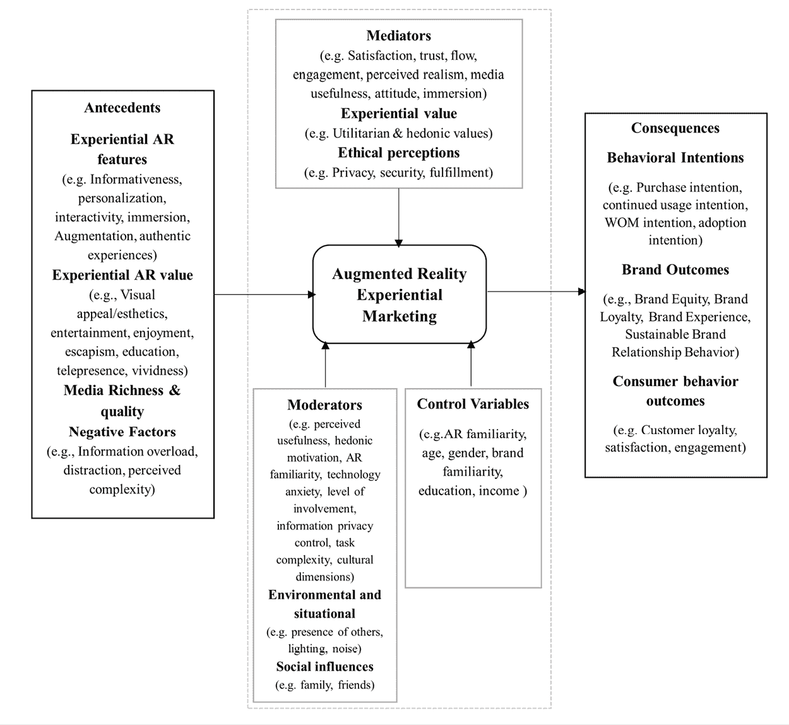

## 局限性与研究议程

最近的研究所揭示的 AR 体验式营销研究的当前格局展示了众多差距和未来研究方向。我们的 SLR 揭示了 AREM 中一系列未被探索的方面和机会。这些差距强调了需要进行全面探索，以加深我们对 AR 对消费者、品牌和更广泛市场的多方面影响的理解。研究（包括 Chen & Chou (2022) 和 Haumer 等人 (2020)）中的一个反复主题是呼吁进行纵向研究，以理解 AR 的时间效应。纵向方法对于把握 AR 体验促进的消费者-品牌关系随时间的演变至关重要。此外，此类研究可以揭示 AR 在客户旅程中的作用，从初次接触到购后阶段。此外，他们还指出受访者人口统计范围存在显著差距，主要局限于熟悉移动技术的年轻成年人。这一人群表现出特定的行为和对 AR 的接受度，可能会扭曲研究结果在更广泛人群中的适用性。扩大受访者的年龄范围，并纳入包括 X 世代和婴儿潮一代在内的多样化群体，将有助于更全面地理解 AR 的吸引力和实用性。


# 未来研究议程与方向

Han et al. (2021) 强调了多维方法在体验价值方面的潜力，建议整合内在-外在和主动-被动价值，以捕捉消费者体验的完整光谱。这一观点也体现在对体验价值与客户满意度关系的研究呼吁中，以增强客户购买决策 (Han et al., 2021)。此外，Hsu et al. (2021) 提出探索额外的 AR 应用属性，例如增强质量和新颖性及其对消费者结果的影响，同时检查不同用户界面及其对不同 AR 体验中使用行为的影响。Kim et al. (2023) 主张在多种环境中部署 AR 研究，以加深对其体验价值的理解，而 Kowalczuk et al. (2021) 强调了享受和沉浸等体验因素的重要性，建议需要定性研究来探索与零售中 AR 相关的认知和行为状态。Watson et al. (2018) 建议探索 AR 功能在不同零售环境中的差异影响，以了解它们如何创造不同的体验价值并影响消费者反应。最后，Hu et al. (2021) 强调了研究 AR 体验质量与行为结构（如口碑和回访意向）之间关系的重要性。

此外，几位学者强调需要详细研究 AR 功能，建议探索应超越 AR 的单纯存在或不存在，涵盖广泛的功能和工具。通过确定哪些 AR 方面（例如交互级别、真实感和多感官集成）最能有效吸引消费者，研究人员可以发现各种体验细微差别，从而加深对消费者行为的理解，正如 Haumer et al. (2020) 和 Barhorst et al. (2021) 所建议的那样。此外，现有文献常常忽视文化和原产国效应，以及技术采用和 AREM 有效性中的情境和环境维度。因此，研究人员强调了跨文化研究的必要性，以阐明不同文化维度如何塑造 AR 在营销中的全球接受度和影响 (Haumer et al., 2020; Arghashi, 2022; Hsu et al., 2021; Whang et al., 2021)。此外，研究还强调了 AR 对认知和情感消费者过程的影响的重要性。Daassi & Debbabi (2021) 和 Hu et al. (2021) 强调了开发强有力的感知真实感措施并整合情感反应的必要性，从而从心理学角度构建对 AR 体验的更全面理解。尽管对零售和旅游有广泛关注，但医疗保健和教育等其他领域是较少探索的领域，正如 Kazmi et al. (2021) 所指出的那样。这些领域为 AR 的应用带来了独特的挑战和机遇，引发了关于其教育效果、伦理考量和更广泛社会影响的问题。

另一个重要观察是，对 AR 的负面影响及其与隐私、自我披露 (Chen & Chou, 2022) 相关的伦理问题以及 AR 对消费者品牌关系的整体影响的探索稀缺。值得注意的是，Alimamy & Nadeem (2022) 调查了感知伦理在共创过程中的中介影响，具体研究了感知伦理如何通过与 AR 的真实体验中介客户共创价值的意图。这强调了伦理考量在塑造消费者参与和对 AR 环境信任方面的重要性。同样，Vo et al., (2022) 强调了隐私问题是一个重要因素，在其研究中被视为控制变量。他们的研究结果表明，隐私问题对移动增强现实 (MAR) 应用程序的采用意向有积极影响，表明有效管理这些问题可以增强用户接受度和采用 AR 技术的意愿。此外，Alimamy & Nadeem (2022) 和 Whang et al., (2021) 强调了需要了解 AR 如何促进品牌与消费者之间的真实体验和可持续关系，考虑伦理影响。这强调了未来研究更广泛的必要性，即深入探讨 AR 的伦理维度，确保其在体验营销中的整合尊重消费者隐私并建立信任。

Arghashi (2022) 进一步阐述了 AR 功能在推动消费者行为中的作用，主张对“哇效应”及其不同程度进行细致评估。这种心理和情感影响，加上家人和朋友等社会方面对 AR 采用的影响，可以显著影响购物动机和决策。此外，尽管研究已证实 AR 通过在场感和增强等机制影响购买意向，但缺乏对这些媒体特性在更广泛的消费者反应中进行系统评价的研究 (Watson et al., 2018)。AR 在不同品牌和行业中的差异影响，以及其在共创过程和消费者参与中的作用，仍然是一个发展不足、亟待学术探索的领域 (Alimamy & Nadeem, 2022; Whang et al., 2021)。

因此，这些研究指向对 AREM 的全面和细致探索，强调需要多维、定性和情境特定的研究方法，以释放 AREM 在吸引消费者和影响其行为方面的全部潜力。Table 3 提供了一个结构化的研究议程，综合了这些研究方向，并将其与可指导未来实证研究的示例问题一起呈现。该表不仅作为即将进行的研究的路线图，也作为 AR 与体验营销交汇处多样性的反映——这是一个充满学术和实践潜力的领域。这里提出的批判性分析强调了 AR 研究在该领域的初级阶段以及对全面、细致和符合伦理的学术关注的迫切需求。

#### Table 3. Future research agenda and directions


| Area | Future Research Direction | Example Research Questions |
| --- | --- | --- |

| Methodology | • 探索 `AREM` 功能的全球接受度。  

• 分析随时间变化的 `AR` 交互，并考察 `AR` 曝光频率和时长的影响。  

• 用于因果效应的实验设计，并测试 `AR` 交互。  

• `AR` 环境中感知真实感缺乏标准化衡量指标  

• 开发和验证与 `AR` 相关构念的衡量指标。  

• 开展定性和混合方法研究，以了解消费者的认知和情感过程，并识别特定情境下的构念。  

• 开展系统研究，评估 `AR` 媒体特性对购买意向的影响 | • `AR` 对消费者购买行为和品牌参与的长期影响是什么？  

• 重复的 `AR` 体验如何影响消费者的品牌认知和忠诚度？  

• `AR` 的新奇效应如何在短期和长期影响消费者行为？  

• 关于 `AR` 在体验式旅游中的情感影响，可以获得哪些定性洞察？ |

| Consumer Segmentation | • 分析 `AREM` 对不同消费者细分群体的影响，包括心理特征和行为特征。  

• 年龄、性别和教育程度等因素的调节作用 | • 心理特征和人口统计特征在多大程度上调节 `AR` 体验与消费者响应之间的关系？  

• 技术自我效能感和对文化遗产地点的兴趣等个人特征，如何影响不同年龄段中 `AREM` 策略的有效性？  

• `AREM` 对不同代际群体的品牌身份认知和客户参与有何影响，这如何为有针对性的营销活动提供参考？ |

| Cultural, Contextual, Social Influences | • 文化在 `AR` 技术采纳中的作用  

• 评估多元文化环境中的 `AR` 采纳情况。  

• 文化维度对消费者行为的调节效应  

• `AR` 在营销中的跨文化接受度和影响  

• 将重点从纯粹的 B2C 转向 B2B 背景  

• 家人和朋友等社会因素在 `AR` 采纳中的作用及其对消费者决策的影响  

• 从情感即信息理论视角探讨环境和情境因素对 `AR` 内容感知和用户体验的影响 | • 相互依赖和从众等文化价值观，如何在不同文化中调节 `AR` 营销中技术价值的感知？  

• 文化维度如何影响体验式 `AR` 应用在营销中的接受度和有效性，以及东方和西方国家在使用行为上有何差异？  

• 环境和情境因素（如他人在场、光线和噪音）与 `AR` 内容的可视化和处理，如何共同影响用户的情绪和压力水平？  

• `AR` 采纳在技术发展水平不同的文化中有何差异？家人和朋友的反馈等社会影响，如何影响 `AR` 在购物中的采纳和影响？ |

| AR and Consumer Behavior & Characteristics | • 影响 `AREM` 有效性的消费者特征。  

• 识别使 `AR` 应用程序令人愉悦的功能。  

• `AR` 中不同程度的“哇效应”及其对消费者行为的影响。  

• 消费者创新性、享受感和对技术的熟悉度在 `AR` 体验中的作用  

• `AREM` 与消费者行为结果，包括购物动机和产品参与度  

• `AREM` 对忠诚度、消费者旅程阶段和实际购买行为的影响，而不仅仅是行为意向 | • `AR` 中不同强度的“哇效应”如何影响冲动购买行为？  

• 什么让 `AR` 应用程序令人愉悦？  

• 对 `AR` 技术的熟悉度是增强还是削弱消费者的心流体验，以及它如何影响他们的情感反应？  

• `AR` 对高参与度产品和低参与度产品的消费者决策过程的影响是否不同？ |

| AR and Brand Relationships | • `AREM` 对品牌爱或品牌崇拜及品牌形象等品牌导向情感变量的影响  

• 购买前阶段 `AR` 体验对品牌转换行为和忠诚度的影响。  

• `AREM` 对建立和维护消费者-品牌关系的影响。  

• 识别影响品牌参与度的 `AR` 属性  

• 考察 `AR` 的影响是否适用于所有品牌和行业，并探索可能增强或削弱 `AR` 贡献的潜在调节因素  

• 产品/品牌熟悉度等其他特征也可能影响消费者对 `AR` 的采纳 | • 品牌如何具体利用 `AR` 与消费者建立可持续的长期关系，例如品牌爱？(Zanger et al., 2022)  

• `AREM` 如何影响消费者转向或离开某个品牌的意愿？  

• `AR` 的哪些具体属性对增强品牌参与度贡献最大，这些属性在不同品牌和行业中的有效性是否有所不同？  

• 产品或品牌熟悉度在多大程度上调节 `AREM` 影响消费者采纳和参与的有效性，是否有其他关键特征会放大或削弱这种影响？ |

| AR Features, and Experiential Value | • 探索 `AREM` 因素（如享受感、沉浸感、体验价值以及广泛的 `AR` 功能和工具）的作用。  

• `AR` 创造真实体验的能力。  

• `AR` 对消费者享乐价值和实用价值的影响。  

• 考察 `AR` 功能如何产生不同类型的体验价值，其与客户满意度的关系，以及对情感和行为反应的影响。  

• 探索 `AR` 体验质量与电子口碑、回访意愿和支付溢价意愿等行为构念之间的关系  

• 考虑整合内在-外在和主动-被动价值的多维体验价值结构  

• 可探索增强质量、空间存在感和新奇感等附加属性，以了解其对消费者结果的影响。  

• 将用户满意度细分为购买前、购买中和购买后子变量，以评估 `AREM` 的影响。  

• 考察灵感如何触发游客参与场外 `AR` 旅游，扩大对旅游业中 `AR` 技术采纳的理解。 | • 特定的 `AR` 功能如何在零售环境中创造不同维度的体验价值，这些体验价值如何影响消费者的情感反应、行为意向（如口碑、回访意愿）和支付溢价意愿？  

• 哪些特定的 `AREM` 功能最能有效提升消费者的购物体验？  

• 公共空间中的 `AR` 体验是否会导致与私人环境不同的消费者行为？  

• 在零售业中，哪些体验因素最能推动消费者参与 `AR` 技术？ |

| Ethical Considerations and AR Dark Side | • 深入探讨与 `AR` 相关的伦理问题，包括消费者隐私担忧、数据安全以及对消费者整体福祉的影响。  

• 识别和探讨与 `AR` 使用相关的负面因素，超越隐私和安全担忧，探讨其他潜在的消费者不利影响，例如数据共享和眩晕、自我披露…… |


• 识别可能阻碍 `AR` 采用的障碍和挑战，例如技术差距以及需要进行重大内容创新（从消费者和企业两个角度）|| • 消费者对 `AR` 营销实践中隐私的看法是什么？  

• 伦理问题如何影响消费者对 `AR` 的信任和接受度？  

• 营销人员如何在不损害用户数据安全和隐私的前提下，合乎伦理地利用 `AR`？  

• 消费者对 `AR` 数据收集实践的反应如何，`AR` 应用程序中的透明度如何影响消费者的信任和意图？  

• `AR` 如何导致消费者决策疲劳或怀疑，可以开发哪些缓解策略？  

• `AR` 使用中尚未探索的负面后果有哪些，例如心理不适或依赖，它们如何影响消费者福利？ |

来源：作者自行编写

### 结论与局限性

本综述揭示了未来研究的有希望的领域，其特征既包括理论进步，也包括实际应用。借鉴包括 Chen & Chou (2022)、Haumer et al. (2020) 和 Kim et al. (2023) 在内的关键研究，我们对各个领域（如零售、广告和旅游）中的 `AR` 体验式营销进行了全面考察。这一探索有助于捕捉和定义围绕 `AR` 在体验式营销实践中的应用的充满活力的学术话语。此外，我们开发了一个整合框架，汇集了 `AREM` 的各个方面，为学术界和实际应用提供了一个连贯的参考。此外，这项调查在 `AR` 与体验式营销的交汇点上产生了许多学术和理论贡献。体验价值构建和远程存在理论等理论的整合丰富了我们对 `AR` 沉浸式体验的理解。未来研究应旨在进一步整合并跨文化验证这些理论，从而拓宽 `AR` 在营销中的理论版图。此外，本综述强调，企业需要对 `AR` 功能有更细致的理解，超越新奇感，专注于为消费者创造真正引人入胜、沉浸式和个性化的体验。人口统计差距的识别，例如现有研究中年轻成年受访者占主导地位，表明营销人员有必要扩大方法，包括老年群体和多元文化背景。此外，探索 `AR` 的阴暗面，包括隐私和伦理问题，为开发尊重消费者界限并建立信任的负责任的 `AR` 应用程序提供了关键洞察。

此外，通过建立全面的研究议程，本研究强调了需要深入探索的新颖 `AREM` 研究方向和问题。从考察 `AR` 对消费者行为的长期影响，到理解 `AR` 在消费者旅程中的作用及其与品牌战略的整合，未来学术研究有大量途径可循。伦理考量，特别是关于隐私和 `AR` 的心理影响，也构成了未来研究的关键领域。这种汇合构建了对现有工作的全面、批判性和前瞻性的综合，为 `AREM` 的理论提升和实际进步奠定了基础。解决所概述的研究方向将显著改善 `AR` 在营销中的整合，从而在日益数字化的市场中提升消费者体验。

尽管做出了广泛的贡献，但这项 `SLR` 由于所应用的纳入和排除标准而存在局限性。值得注意的是，排除了会议论文集、书籍、学位论文和非实证研究，以及非英语语言的出版物。在未来的综述中，通过纳入更广泛的来源和语言来解决这些局限性，可以丰富对 `AR` 体验式营销的理解和应用。此外，本研究未进行元分析也是一项局限性。作为一种从多项研究中汇总结果的统计方法，它可以通过统计总结多样化的研究，对 `AREM` 的影响提供更全面的理解。

# 参考文献

Alimamy, S., & Nadeem, W. (2022). Is this real? Cocreation of value through authentic experiential augmented reality: The mediating effect of perceived ethics and customer engagement. Information Technology & People, 35(2), 577–599. [10.1108/ITP\-07-2020-0455](http://dx.doi.org/10.1108/ITP-07-2020-0455)

Arghashi, V. (2022). Shopping with augmented reality: How wow-effect changes the equations! Electronic Commerce Research and Applications, 54, 101166. [10.1016/j.elerap.2022.101166](http://dx.doi.org/10.1016/j.elerap.2022.101166)

Arghashi, V., & Yuksel, C. A. (2022). Interactivity, Inspiration, and Perceived Usefulness! How retailers’ `AR`-apps improve consumer engagement through flow. Journal of Retailing and Consumer Services, 64, 102756. [10.1016/j.jretconser.2021.102756](http://dx.doi.org/10.1016/j.jretconser.2021.102756)

Barhorst, J. B., McLean, G., Shah, E., & Mack, R. (2021). Blending the real world and the virtual world: Exploring the role of flow in augmented reality experiences. Journal of Business Research, 122, 423–436. [10.1016/j.jbusres.2020.08.041](http://dx.doi.org/10.1016/j.jbusres.2020.08.041)

Bouhtati, N., Alla, L., & Bentalha, B. (2023). Marketing Big Data Analytics and Customer Relationship Management: A Fuzzy Approach. In Integrating Intelligence and Sustainability in Supply Chains (pp. 75-86). IGI Global. [10.4018/979\-8\-3693\-0225-5.ch004](http://dx.doi.org/10.4018/979-8-3693-0225-5.ch004)

Bouhtati, N., Kamal, M., & Alla, L. (2022). Big Data and the Effectiveness of Tourism Marketing: A Prospective Review of the Literature. In The International Conference on Artificial Intelligence and Smart Environment (pp. 287-292). Cham: Springer International Publishing.

Carmo, I. S. D., Marques, S., & Dias, Á. (2022). The influence of experiential marketing on customer satisfaction and loyalty. Journal of Promotion Management, 28(7), 994–1018. [10.1080/10496491.2022.2054903](http://dx.doi.org/10496491.2022.2054903)

Chen, S. C., Chou, T. H., Hongsuchon, T., Ruangkanjanases, A., Kittikowit, S., & Lee, T. C. (2022). The mediation effect of marketing activities toward augmented reality: The perspective of extended customer experience. Journal of Hospitality and Tourism Technology, 13(3), 461–480. [10.1108/JHTT\-03-2021-0093](http://dx.doi.org/10.1108/JHTT-03-2021-0093)

Daassi, M., & Debbabi, S. (2021). Intention to reuse `AR`-based apps: The combined role of the sense of immersion, product presence and perceived realism. Information & Management, 58(4), 103453. [10.1016/j.im.2021.103453](http://dx.doi.org/10.1016/j.im.2021.103453)

Erdmann, A., Mas, J. M., & Arilla, R. (2023). Value‐based adoption of augmented reality: A study on the influence on online purchase intention in retail. Journal of Consumer Behaviour, 22(4), 912–932. [10.1002/cb.1993](http://dx.doi.org/10.1002/cb.1993)

Eru, O., Topuz, Y. V., & Ruziye, C. O. P. (2022). The Effect of Augmented Reality Experience on Loyalty and Purchasing Intent: An Application on the Retail Sector. Sosyoekonomi, 30(52), 129–155. [10.17233/sosyoekonomi.2022.02.08](http://dx.doi.org/10.17233/sosyoekonomi.2022.02.08)

Han, S., Yoon, J. H., & Kwon, J. (2021). Impact of experiential value of augmented reality: The context of heritage tourism. Sustainability (Basel), 13(8), 4147. [10.3390/su13084147](http://dx.doi.org/10.3390/su13084147)


# 参考文献

Haumer, F., Kolo, C., & Reiners, S. (2020). The impact of augmented reality experiential marketing on brand equity and buying intention. Journal of Brand Strategy, 8(4), 368–387.

Hilken, T., Heller, J., Chylinski, M., Keeling, D. I., Mahr, D., & de Ruyter, K. (2018). Making omnichannel an augmented reality: The current and future state of the art. Journal of Research in Interactive Marketing, 12(4), 509–523. [10.1108/JRIM\-01-2018-0023](http://dx.doi.org/10.1108/JRIM-01-2018-0023)

Holbrook, M. B., & Hirschman, E. C. (1982). The experiential aspects of consumption: Consumer fantasies, feelings, and fun. The Journal of Consumer Research, 9(2), 132–140. [10.1086/208906](http://dx.doi.org/10.1086/208906)

Hsu, S. H. Y., Tsou, H. T., & Chen, J. S. (2021). “Yes, we do. Why not use augmented reality?” customer responses to experiential presentations of AR-based applications. Journal of Retailing and Consumer Services, 62, 102649. [10.1016/j.jretconser.2021.102649](http://dx.doi.org/10.1016/j.jretconser.2021.102649)

Hu, R., Wang, C., Zhang, T., Nguyen, T., Shapoval, V., & Zhai, L. (2021). Applying augmented reality (AR) technologies in theatrical performances in theme parks: A transcendent experience perspective. Tourism Management Perspectives, 40, 100889. [10.1016/j.tmp.2021.100889](http://dx.doi.org/10.1016/j.tmp.2021.100889)

Huang, T. L., & Liao, S. (2015). A model of acceptance of augmented-reality interactive technology: The moderating role of cognitive innovativeness. Electronic Commerce Research, 15(2), 269–295. [10.1007/s10660-014-9163-2](http://dx.doi.org/10.1007/s10660-014-9163-2)

Irgui, , AQmichchou, , M. (2023). Contextual marketing and information privacy concerns in m-commerce and their impact on consumer loyalty. Arab Gulf Journal of Scientific Research. 10.1108/AGJSR-09-2022-0198

Irgui, , AQmichchou, , M., & ElHaraoui, , I. (2024). Phygital learning in Moroccan higher education and its impact on student satisfaction. Revue Management & Innovation, (3), 110-129. 10.3917/rmi.209.0110

Javornik, A. (2016). Augmented reality: Research agenda for studying the impact of its media characteristics on consumer behaviour. Journal of Retailing and Consumer Services, 30, 252–261. [10.1016/j.jretconser.2016.02.004](http://dx.doi.org/10.1016/j.jretconser.2016.02.004)

Kazmi, S. H. A., Ahmed, R. R., Soomro, K. A., Hashem, E. A. R., Akhtar, H., & Parmar, V. (2021). Role of augmented reality in changing consumer behavior and decision making: Case of Pakistan. Sustainability (Basel), 13(24), 14064. [10.3390/su132414064](http://dx.doi.org/10.3390/su132414064)

Kim, J. H., Kim, M., Park, M., & Yoo, J. (2023). Immersive interactive technologies and virtual shopping experiences: Differences in consumer perceptions between augmented reality (AR) and virtual reality (VR). Telematics and Informatics, 77, 101936. [10.1016/j.tele.2022.101936](http://dx.doi.org/10.1016/j.tele.2022.101936)

Kim, J. H., Kim, M., Yoo, J., & Park, M. (2024). Augmented reality in delivering experiential values: Moderating role of task complexity. Virtual Reality (Waltham Cross), 28(1), 19. [10.1007/s10055-023-00896-8](http://dx.doi.org/10.1007/s10055-023-00896-8)

Kowalczuk, P., Siepmann, C., & Adler, J. (2021). Cognitive, affective, and behavioral consumer responses to augmented reality in e-commerce: A comparative study. Journal of Business Research, 124, 357–373. [10.1016/j.jbusres.2020.10.050](http://dx.doi.org/10.1108/JRIM-01-2018-0023)

Kumar, H. (2022). Augmented reality in online retailing: A systematic review and research agenda. International Journal of Retail & Distribution Management, 50(4), 537–559. [10.1108/IJRDM\-06-2021-0287](http://dx.doi.org/10.1108/IJRDM-06-2021-0287)

Lavoye, V., Mero, J., & Tarkiainen, A. (2021). Consumer behavior with augmented reality in retail: A review and research agenda. International Review of Retail, Distribution and Consumer Research, 31(3), 299–329. [10.1080/09593969.2021.1901765](http://dx.doi.org/10.1080/09593969.2021.1901765)

Lee, H., Xu, Y., & Porterfield, A. (2022). Antecedents and moderators of consumer adoption toward AR‐enhanced virtual try‐on technology: A stimulus‐organism‐response approach. International Journal of Consumer Studies, 46(4), 1319–1338. [10.1111/ijcs.12760](http://dx.doi.org/10.1111/ijcs.12760)

Lhoussaine, A., Kamal, M., & Bouhtati, N. (2022). Big data and marketing effectiveness of tourism businesses: A literature review. Economic Management Alternatives, 1, 39–58.

Mathwick, C., Malhotra, N., & Rigdon, E. (2001). Experiential value: Conceptualization, measurement and application in the catalog and Internet shopping environment☆. Journal of Retailing, 77(1), 39–56. [10.1016/S0022\-4359(00)00045-2](http://dx.doi.org/10.1016/S0022-4359\(00\)00045-2)

McLean, G., & Wilson, A. (2019). Shopping in the digital world: Examining customer engagement through augmented reality mobile applications. Computers in Human Behavior, 101, 210–224. [10.1016/j.chb.2019.07.002](http://dx.doi.org/10.1016/j.chb.2019.07.002)

Oyman, M., Bal, D., & Ozer, S. (2022). Extending the technology acceptance model to explain how perceived augmented reality affects consumers’ perceptions. Computers in Human Behavior, 128, 107127. [10.1016/j.chb.2021.107127](http://dx.doi.org/10.1016/j.chb.2021.107127)

Paul, J., & Criado, A. R. (2020). The art of writing literature review: What do we know and what do we need to know? International Business Review, 29(4), 101717. [10.1016/j.ibusrev.2020.101717](http://dx.doi.org/10.1016/j.ibusrev.2020.101717)

Perannagari, K. T., & Chakrabarti, S. (2019). Factors influencing acceptance of augmented reality in retail: Insights from thematic analysis. International Journal of Retail & Distribution Management, 48(1), 18–34. [10.1108/IJRDM\-02-2019-0063](http://dx.doi.org/10.1108/IJRDM-02-2019-0063)

Poushneh, A., & Vasquez-Parraga, A. Z. (2017). Discernible impact of augmented reality on retail customer’s experience, satisfaction and willingness to buy. Journal of Retailing and Consumer Services, 34, 229–234. [10.1016/j.jretconser.2016.10.005](http://dx.doi.org/10.1016/j.jretconser.2016.10.005)

Qin, H., Osatuyi, B., & Xu, L. (2021). How mobile augmented reality applications affect continuous use and purchase intentions: A cognition-affect-conation perspective. Journal of Retailing and Consumer Services, 63, 102680. [10.1016/j.jretconser.2021.102680](http://dx.doi.org/10.1016/j.jretconser.2021.102680)

Shah, D., & Murthi, B. P. S. (2021). Marketing in a data-driven digital world: Implications for the role and scope of marketing. Journal of Business Research, 125, 772–779. [10.1016/j.jbusres.2020.06.062](http://dx.doi.org/10.1016/j.jbusres.2020.06.062)

Singh, P., Sharma, M., & Daim, T. (2024). Envisaging AR travel revolution for visiting heritage sites: A mixed-method approach. Technology in Society, 76, 102439. [10.1016/j.techsoc.2023.102439](http://dx.doi.org/10.1016/j.techsoc.2023.102439)

Sun, Y., & Yuan, Z. (2024). A virtual gym in your pocket: The influence of augmented reality exercise app characteristics on user’s continuance intention. Virtual Reality (Waltham Cross), 28(1), 1–20. [10.1007/s10055-024-00959-4](http://dx.doi.org/10.1007/s10055-024-00959-4)

Sung, E. C. (2021). The effects of augmented reality mobile app advertising: Viral marketing via shared social experience. Journal of Business Research, 122, 75–87. [10.1016/j.jbusres.2020.08.034](http://dx.doi.org/10.1016/j.jbusres.2020.08.034)

Tom Dieck, M. C., Cranmer, E., Prim, A. L., & Bamford, D. (2023). The effects of augmented reality shopping experiences: immersion, presence and satisfaction. Journal of Research in Interactive Marketing, (ahead-of-print).

Tom Dieck, M. C., & Han, D. I. D. (2022). The role of immersive technology in Customer Experience Management. Journal of Marketing Theory and Practice, 30(1), 108–119. [10.1080/10696679.2021.1891939](http://dx.doi.org/10696679.2021.1891939)


# Chapter 6

## 影响摩洛哥公民使用智慧城市服务意愿的因素：系统文献综述与概念框架

**Tarik Rhardas**


National School of Business and Management, Hassan II University of Casablanca, Morocco

**Hanane Rochdane**

National School of Business and Management, Hassan II University of Casablanca, Morocco

### 摘要

在许多发展中国家，智慧城市倡议仍处于起步阶段。与许多其他发展中国家一样，摩洛哥的智慧项目自 2016 年启动以来一直面临着多重挑战。智慧服务的采用需要摩洛哥公民的承诺和参与。本章主要针对处理影响摩洛哥智慧城市提供的服务最终用户接受度的因素的主要研究进行系统文献综述。采用一种名为 `PRISMA` 的特定方法来筛选和综合该领域的相关研究。系统综述的结果表明，统一技术接受与使用理论（`UTAUT`）是文献中最常用的理论。此外，对现有研究的考察表明，智慧项目的成功实施需要决策者考虑以下因素：绩效期望、易用性、社会影响、感知成本、意识、对技术的信任以及对政府的信任。

### 1\. 简介

近年来，智慧城市前所未有地受到欢迎，因为它们通过创新使用信息和通信技术（`ICT`）（`Nassereddine & Khang, 2024`），在移动性、环境、经济、治理、生活质量和教育等领域提供了新的解决方案。通常，对智慧城市的兴趣与移动设备、语义网、云计算和物联网等新信息技术的兴起密切相关（`Syed et al., 2021`）。“智慧城市”一词于 2005 年由许多向客户提供复杂信息系统的技术公司采用，旨在整合城市基础设施的运营（`Savastano et al., 2023`）。其他几项非技术因素促进了智慧城市战略的更广泛采用：城市规模的扩大、保护环境免受污染和能源消耗的需求，以及公民对公共服务需求的增加（`Jebaraj et al., 2023`）。

尽管智慧城市的技术方面在文献中已得到充分覆盖，但公民在这些城市中的关键作用往往被忽视（`Jebaraj et al., 2023`）。智慧城市往往未能实现其目标，原因是公民没有充分参与其定义，或者对其日常生活的影响没有得到考虑（`Del-Real et al., 2023`）。

在智慧城市研究领域，许多作者都强调了讨论智慧城市中公民参与的重要性。然而，到目前为止，关于智慧城市背景下公民参与的各种推动因素的著作仍然很少。


# 智慧城市是利用信息和通信技术（ICT）促进强劲经济活动、提升整体生活质量并推动可持续发展的创新型城市区域。我们目前正观察一个高度互联且复杂的世界，这需要开发更好的方法，在城市等共同空间中，在众多参与者之间交换和传输信息。

ICT 基础设施在增强和促进社会与城市发展、推动公众参与以及提升智慧城市背景下政府效率方面发挥着关键作用。从公民的角度来看，信息和通信技术（ICT）的整合对于智慧城市和企业的运作至关重要。智慧城市服务改善了生活环境，提高了公民的生活质量。智慧城市服务涵盖广泛的应用，解决包括流动性、公共服务和安全在内的常见挑战。最近的疫情问题凸显了这些智慧城市服务的至关重要性。

城市被迫采用新的城市管理方法，以满足领土竞争力的需求。目前，全球倾向于通过投资城市地区各种公共服务的数字化来采用智慧城市标准。最近，摩洛哥的多个城市已开展大量努力，通过实施重大基础设施项目和数字化市政管理，参与推广和提升其领土的过程，以增强其吸引力(Haj, 2020)。

摩洛哥计划到 2026 年将六个城市转变为智慧城市（工业部，2013 年）。该项目已于 2016 年在卡萨布兰卡启动，随后将在马拉喀什、拉巴特、丹吉尔、伊夫兰、贝尔坎和非斯开展。摩洛哥旨在以更低的成本创造一种新的城市管理模式，提高城市规划效率，并实现满足公民在交通、能源、绿色经济、安全和住房方面需求的可持续社会发展。

然而，为了使这些智慧行政举措取得成功，公民必须理解并接受在线行政服务(Del-Real et al., 2023; Junaidi et al., 2024)。采用智能公共服务的有效性取决于最终用户对在线行政工作的看法。最终用户可能对当前可用的技术没有积极的接受度。如果最终用户未能成功使用在线行政服务，智慧城市的存在将变得毫无意义。

研究人员指出，很少有研究关注智慧城市中的公民参与，例如智慧实践或活动(Suryawan & Lee, 2023)。作者认为，最近强调智慧城市中公民参与的政策方法与关于此问题的相关研究之间存在差距。事实上，智慧城市与数字城市不同，智慧城市关注行为体及其相关实体之间的关系以及它们对所有成功的贡献(Jiang et al., 2023)。

关于发展中国家智慧城市中公民参与的实证文献仍然稀缺(Bernardin & Jeannot, 2019; Braga et al., 2022)。因此，本文有助于扩大该主题的研究。基于这一反思，本研究提供了一些理解，并探讨了解释公民在智慧倡议和项目中的意图的因素。

本文的主要目标是回顾和综合 2013-2023 年期间关于解释公民参与智慧活动因素的先前研究。此外，本文旨在分析关键出版物的一些特征，例如研究的空间分布、出版物的演变等。为了实现这些目标，我们将使用 PRISMA（系统评价和荟萃分析优先报告项目）方法进行系统评价，并对这些研究的主要特征进行定量分析。

此外，系统定量文献综述是研究工作的一种趋势(Perez-Vega et al., 2022)。它提供了一种全面、结构化和分析性的方法，以准确组织综述。此外，它能有效识别文献中的研究空白(Paul & Criado, 2020)。它在更广泛的社会科学中被广泛采用，特别是在管理和营销研究中。同样，它提供了多种优势，包括能够开发易于更新和查询的灵活文章数据库(Kumar, 2022)。

本文档的目的是识别决定智慧服务成功采用的因素，并为摩洛哥智慧城市的实施开发一个概念框架。我们的研究将基于在与摩洛哥案例具有相似特征的国家进行的研究。

本系统评价将分为三个部分。我们将首先对我们问题的关键概念进行文献综述。然后，我们将关注本次评价所采用的方法和方法论。最后，第三部分将专门用于主要发现的分析和讨论。

## 2\. 文献综述

### 2.1. 寻找智慧城市的定义

“智慧城市”一词出现在 20 世纪 90 年代末，随着城市化的发展，特别是与信息和通信技术相关(Anthopoulos et al., 2022)。智慧城市概念由 IBM 和思科等私营 IT 公司推广，引起了众多研究人员和从业者的关注(Anthopoulos, 2017)。

尽管文献中存在许多定义，但研究人员一致认为，ICT 的使用仍然是智慧城市最关键的特征(Bibri, 2018)。事实上，根据(Kandt & Batty, 2021)，智慧城市概念主要指技术如何增强城市的运作、效率、竞争力，并为解决各种经济问题提供新途径。如果这一维度看似不可避免，我们对作者反复使用技术维度来定义智慧城市的做法表示质疑。


诚然，尽管信息与通信技术（ICT）是智慧城市理念的基本且不可分割的一部分(Bibri et al., 2023)，但重要的是要注意，智慧城市并不仅限于数字城市或数值城市。例如，(Cocchia, 2014a)强调需要扩大智慧城市的范围，以使其更加平衡和包容，突出了需要考虑城市的各种环境、社会和经济组成部分的必要性。确实，根据(Albino et al., 2015)，智慧城市的概念与可持续性的概念密切相关，因为现在必须解决广泛城市化所带来的重大挑战，而广泛城市化带来了沉重的环境和经济约束。

文献中存在多种智慧城市定义，迄今尚未有任何一种达成共识（Cocchia, 2014b）。然而，我们遵循(Anthopoulos, 2017)的定义，我们认为这是最全面、最新的定义，因为它涵盖了智慧城市的各种要素并突出了其主要目标。

智慧城市的概念涉及城市（新城市和现有城市）利用 ICT 和创新，作为实现经济、社会和环境可持续性并解决六个维度（即人、经济、治理、流动性、环境和生活质量）中各种问题的手段(Giffinger, 2015; Koz\\lowski & Suwar, 2021)。

关于智慧城市发展的现有文献强调了智慧城市的两个主要目标：通过提供新服务来改善公民的生活质量(Bakici et al., 2013)和保护环境(Bibri et al., 2023)。确实，(Dameri, 2013)将智慧城市定义为“一种城市环境，在无处不在的 ICT 系统的支持下，能够为公民提供新服务，从而改善他们整体的生活质量。”例如，城市流动性服务有效地展示了 ICT 如何通过城市内各种媒体渠道提供准确的实时信息，从而增强了公民的流动体验并便利了他们在城市中的移动。(Bibri et al., 2023)报告称，采用新技术将使城市能够在各种空间尺度上重新定义和重新组织城市区域，以实现所需的可持续性和支撑性水平。这意味着实施一系列旨在解决城市许多经济、环境、社会和文化目标的措施。在这里，智能应主要关注可持续发展目标，而不是技术和智能解决方案的效率。

因此，智慧城市必须优先为其公民提供可持续且宜人的环境，将公民置于其关切的最前沿。

“智慧城市”这一术语的定义旨在增强我们对这一现象各个方面的理解。为了对这一特定元素提供更具体的演示，本研究的后续部分将对摩洛哥的智慧城市进行全面考察，摩洛哥被广泛公认为该领域的显著典范。这将成为许多其他非洲城市的原型。

#### 2.2. 智慧城市时代的摩洛哥城市

摩洛哥城市拥有足以投资以成功实现其智能转型过程的重要因素：连接充分的人口、致力于数字化行政和公共机构的努力、存在国家数字化战略。所有这些元素都是这种成功的潜在因素，前提是地方当局成功动员参与该项目的其他利益相关者，为大型重组项目筹集资金，确保存在高质量且多样化的交通网络，建立创新和研发中心、青年和创造力机构，并制定一个面向城市未来领土智能的城市战略。

将摩洛哥城市转变为“智慧城市”需要的不仅仅是上述要素；它需要城市中所有行为体和利益相关者的全面动员。在这方面，重要的是要考虑建立一套良好实践准则，该准则将概述智慧城市的国家特定标准。这将使城市之间能够进行领土竞争，从而确保对投资者和游客的持续吸引力(Alla et al., 2023)，从而保证区域化项目的成功以及领土参与国家的发展。

值得提及的是，政府作为立法者，有能力通过制定定义领土转型方法和程序的法律进行干预。这些法律将建立获得摩洛哥智慧城市称号所需的要求和行动。

在摩洛哥，关于卡萨布兰卡大都市发展的反思(El Assal & Rochdane, 2023)已经开始，强调加强其国家和国际竞争力，使其成为真正的技术中心。一个名为“卡萨布兰卡智慧城市”的非常雄心勃勃的项目已经启动。该项目旨在通过数字项目将卡萨布兰卡大都市转变为智慧城市，这些项目能够对收集和分析的数据的信息财富进行最佳分析，目的是通过提供量身定制的公共服务来拉近行政部门与用户之间的距离。

智慧城市方法基于使用移动和无处不在的 ICT 基础设施，例如信息和通信系统、智能手机和其他移动设备，以开发互联的应用程序、服务和试点项目。

目标是逐步建立一个社会性、可持续且协作的创新生态系统。这将通过网络化的应用程序、服务和试点项目来实现，这些项目将构建一个互联智慧城市的环境。因此，在卡萨布兰卡实施智慧城市计划将需要一个具备高度智能(El Assal & Rochdane, 2023)的人。简单来说，个人必须展示他们的敏捷性和认知能力才能使用数字技术，因为他们将负责创建和消费数字数据(Bouhtati, Kamal, et al., 2023)。


尽管如此，相关统计数据表明，存在大量障碍阻碍了技术（尤其是互联网和技术援助）的接受和利用。该大都市区存在显著的不平等现象，尤其是富裕社区与边远地区之间存在显著的数字鸿沟。此外，相当比例的人口无法负担获取技术的费用。根据世界银行 2020 年的估计，摩洛哥最贫困 54%人口中的典型家庭需要将其收入的 36%用于接入移动宽带。该家庭需要将其可支配收入的 32%用于负担固定宽带。

除了这些障碍之外，文盲现象阻碍了大部分公民操作技术。

#### 2.3. 智慧城市中公民的角色

尽管公民参与的概念并不仅限于智慧城市，但这些城市为这一概念带来了新的视角，并提供了促进此类参与的创新方法。智慧城市目前正在获得政府和商业团体的大量财政支持，导致其受欢迎程度显著提高。城市必须战略性地规划和实施智慧城市计划，利用其可用的广泛技术机会。这涉及就如何利用和增强其信息和通信技术（`ICT`）基础设施做出明智决策，同时最大限度地利用其资源。一个关键难题是如何与居民有效协作执行这些措施，其最终目标是构建一个能显著提高其生活质量的智慧城市。(Hollands, 2020 强调了个人的重要性，并批评了智慧城市的技术导向方法。此外，他主张智慧城市必须建立在单纯利用信息和通信技术（`ICT`）之上的基础之上，以促进社会、环境、经济和文化方面的进步。Hollands 认为，真正的智慧城市应优先考虑居民及其技能，并利用信息技术鼓励关于人们想要什么样的城市的民主讨论。这一批判性分析在科学出版物中引发了一种新趋势。智慧城市的新定义整合了智慧城市的各个维度和批评意见（Rudolf Giffinger & Gudrun Haindlmaier, 2018）：当对人力和社会资本以及信息和通信技术（`ICT`）的投资足够，并推动可持续经济发展和高质量生活，同时通过参与式治理明智地管理自然资源时，城市可以被定义为“智慧”。该定义在科学文献和实践中被广泛接受和使用（例如，阿姆斯特丹等智慧城市已将该定义作为其可持续发展战略的基础）。基于先前的文献以及对一些最著名和最成功的智慧城市（如根特或桑坦德）的分析，我们将公民参与正式化为三个主要类别(Berntzen & Johannessen, 2016; Simonofski et al., 2021)。首先，公民可以作为城市决策过程中的民主参与者(EL JAOUHARI & Lhoussaine, 2021)。通过参与决策过程，公民可以熟悉复杂的技术问题并成为主题专家(Irvin & Stansbury, 2004)。其次，公民可以作为共同创造者，提出更好的解决方案和想法，并降低流程早期失败的风险 (Nguyen et al., 2018)。最后，在实施后阶段，公民有机会作为用户积极参与信息和通信技术（`ICT`）。他们可以主动利用智慧城市基础设施，产生身临其境的技术感。

(Alipour et al., 2020; Oukarfi & Bercheq, 2020a)的实证研究始终强调个人的社会经济和区域情况在决定其技术采纳决策方面的重要性。(Diallo et al., 2010)在非洲进行的计量经济学研究分析了在 17 个撒哈拉以南非洲国家进行的家庭调查数据。该研究考察了个人特征和家庭因素如何影响`ICT`（信息和通信技术）的采纳。该研究认为，当教育水平更高、子女数量更多且家庭收入更高时，采纳的可能性更大。

此外，互联网的使用可能与参与者的生活方式或技术特征直接相关。拥有平板电脑、台式机和笔记本电脑以及游戏机等计算机设备，将激励选择获取家庭互联网连接。研究表明，存在被称为“技术爱好者”的个人，他们经常接触信息和通信技术（`ICT`），并且更强烈、更一致地倾向于连接互联网 (Oukarfi & Bercheq, 2020b; Sebei et al., 2018)。

#### 2.4. 用于衡量新技术采纳的模型

为探索影响最终用户对技术行为的因素，已对研究人员的各种模型和贡献进行了分析。这包括 Davis 的技术接受模型（`TAM`）(Davis, 1989)，Rogers 的创新扩散（`DOI`）模型(Rogers Everett, 1995)，以及 Venkatesh 等人的技术接受与使用统一理论（`UTAUT`）(Venkatesh et al., 2003)。其他被考察的模型包括信任模型(Belanger et al., 2002)、公民采纳模型(AlNuaimi et al., 2011)，以及 Rehman 和 Esichaikul 的模型(Rehman & Esichaikul, 2011)，该模型提出了基于从`TAM`、`DOI`和`UTAUT`改编的综合模型的第三个公民采纳模型。研究这些模型有助于识别可能影响摩洛哥公民采纳电子服务的潜在因素。

### 3\. 方法论

为进行这项系统性研究，我们遵循了一套明确定义的方法，由一系列步骤组成。以下部分将专门解释这一过程。


本研究采用了一种考虑四个基本步骤的方法进行，该方法受到 PRISMA 方法的启发。选择这种方法的理由在于其能够筛选并识别相关参考文献，以纳入定性或定量分析中。在第一步中，我们识别了所有与主题相关的参考文献。为此，我们选择了 Scopus、Cairn、Google Scholar 和 ScienceDirect 等数据库，因为它们包含大部分索引参考文献(Zhao & Strotmann, 2015)。因此，我们选择了从 2013 年到 2023 年的研究期间。

选择研究期间的理由有几个基本因素。首先，该时期在时间上具有相关性，涵盖了营销研究领域的一个重要十年。此外，它允许考虑重大的技术进步，特别是社交媒体的发展。通过选择这个时期，我们还确保了可用数据和更新信息的获取，从而促进研究结果的分析和综合。

此外，我们将研究范围限制在与摩洛哥具有相似经济、技术和社会文化特征的国家。

而且，我们采用了上述所有关键词的组合，在与“文章”、“摘要”和“关键词”相关的字段中采用了布尔运算符“AND”，这些关键词源自我们的主题，即“公民参与”、“智慧城市”和“采用因素”。目标是收集尽可能多的涵盖上述关键词的参考文献。随后，所选参考文献经过了一个初步筛选过程，涉及对所选数据库（Scopus、Cairn、Google Scholar 和 ScienceDirect）中找到的文章进行比较。这种比较旨在识别并消除所查询数据库中的重复参考文献。然后，我们根据下表中总结的明确标准选择了文章。

#### Table 1. 文章的排除和纳入标准

| Levels || Inclusion criteria || exclusion criteria |

| --- | --- | --- |

| Type of references || 期刊文章 || 会议论文、合著作品 |

| --- | --- | --- |

| Years selected || 3013-2023 || 所选期间外发表的文章 |

| Type of stadies || 定性、定量、混合 || 综述文章 |

| Kyewords || 智慧城市、智慧公民、采用因素、 || 其他关键词 |

| Study area || 发展中国家 || 发达国家 |

来源：作者

接下来，对全文进行深入分析将使我们能够选择与我们的研究问题密切相关的相关文章。最后，我们将对所选参考文献列表进行定量分析，以解决提出的问题。下图总结了我们进行系统综述所选择的各个步骤。

#### Figure 1. PRISMA 流程图

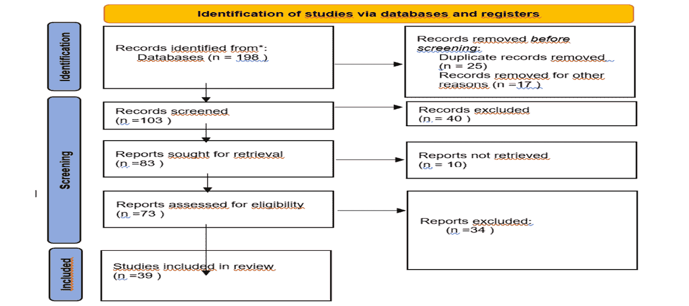

这种方法最初使我们能够识别出从上述各个数据库中收集的 198 份参考文献样本。其次，在消除观察到的重复项后，我们将文章数量减少到 103 篇。随后，对摘要和标题的审查识别出了 83 份参考文献的样本。然后，我们进行了全文阅读，以确保与我们的主题相关。这一最后一步使我们将参考文献数量限制为最终的 39 篇文章集合(Table 2)。最终阶段将着重于将文章纳入分析和讨论。定量分析中的这一纳入阶段旨在研究先前研究的趋势，以解决上述问题。

#### Table 2. 影响智慧城市服务采用的因素

| Authors || Cuntrie || THEORIE || FINDING |

| --- | --- | --- | --- |

| Raihan, 2023 || Saudi Arabia || TAM || 影响学生在教育可持续性中使用 ICT 意图的因素包括计算机自我效能、主观规范、感知享受、感知易用性、感知有用性以及对计算机使用的态度 |

| --- | --- | --- | --- |

| Lakmal et al, 2023 || Sri Linka || UTAUT || 该研究采用定量方法探索因素，结果表明，绩效期望、努力期望和社会影响对公民使用电子政务服务的意图和使用行为有积极影响 |

| Ullah et al, 2023 || Pakistan || TAM || 本文作者研究了 ICT 在提升中小企业效率方面可以发挥的各种作用，通过采用和扩展技术接受模型，然后识别出几个因素以实现其采用。 |

| Zirabaet al, 2023 || Zimbabwe || TAM || 惠津巴韦电子政务服务接受、采用和使用的减缓因素众多，我们的结果表明，各种文化维度影响了人们使用电子政务服务的意图。本研究的关键贡献在于，电子政务服务的采用和接受在很大程度上受到最终用户和该技术接收者文化价值观的影响 |

| Chandavarkar, 2023 || India || TAM || 本文将复杂性确定为影响印度中小企业采用信息和通信技术（ICT）的主要因素。其他重要因素包括技术、组织和环境因素。 |

| Srimulyani, 2023 || Indonesia || UTAUT,TAM || 影响印度尼西亚中小企业 ICT 采用的因素包括内部因素，如管理特征和组织因素，以及外部因素，如技术和环境。 |

| Hoque et al, 2016 || Bangladesh || UTAUT || 影响孟加拉国农村地区中小企业采用信息和通信技术（ICT）的因素包括效益意识、政府支持、高层管理支持和财务支持 |

| Yusuf et al, 2016 || Malaysia || UTAUT || 本文调查了影响马来西亚农业中小企业 ICT 使用的因素，包括绩效期望、努力期望和促进条件。 |

| Al-Haddad et al, 2023 || Jordanie || TRA,TAM || 本文作者研究了影响个人电子政务使用意图和实际使用的因素，包括对行为的态度、可信度以及源于感知有用性、易用性、意识、对政府的信任、激励、对服务交付的信任、交易安全性和社会影响的主观规范。 |

| Nofal et al, 2021 || Jordanie || TAM || 本文研究了感知有用性（PU）、感知易用性（PEOU）和信任的中介作用，以及透明度的调节作用，在约旦公共部门机构公民采用电子政务服务中的作用。 |

| Al-dmour, 2021 || Jordanie || TAM,UTAUT || 本文识别了约旦消费者采用电子支付系统（EPS）意图的主要相关因素，包括感知有用性、易用性、安全性、自我效能和信任。 |

| Oumlil, 2020 || Morocco || UTAUT | 预期绩效、预期努力、感知成本和社会影响 |

| Hassan, 2020 || Jordanie || UTAT 2 || 行为意图受绩效期望、享乐动机、价格价值和感知风险的影响。 - 社会影响对行为意图没有显著影响 |


| Alryalat et al, 2020 | Jordanie | TAM | \- 相对优势、感知信任、计算机自我效能和感知意识等因素对采用电子政务服务的行为意向产生积极影响。 - 对变革的抵制对公民采用电子政务服务的行为意向产生负面影响。 |

| Almaiah et al, 2019 | Jordanie | UTAUT | 网站质量、互联网信任、政府信任、绩效期望、努力期望和促进条件等因素对约旦公民采用电子政务服务有积极影响。 - 社会影响对使用电子政务服务的意向没有显著影响。 |

| Amin et al, 2022 | Saudi Arabia | UTAUT | , 作者利用技术接受与使用统一理论（`UTAUT`）考察了沙特阿拉伯电子政务系统的采用情况，假设检验结果揭示了几种有意义的关系，包括相对利益、兼容性、安全性、管理支持、绩效期望、对电子政务的感知有用性、通过减少不确定性来降低对电子政务的使用难度，以及通过减少语言障碍来降低 IT 基础设施对电子政务采用的影响 |

| Alnemer, 2018 | Saudi Arabia | TAM | 感知易用性和感知有用性对数字银行采用有积极影响。 - 信任对数字银行采用有负面影响 |

| Elatrachi et al, 2020 | Morocco | UTAUT | 本文讨论了摩洛哥高等教育教师 ICT 整合的决定因素，但未具体提及摩洛哥 ICT 采用的因素 |

| Hassan et al, 2017 | Morocco | TRA,TAM,UTAUT | 努力期望对信息系统采用没有影响。 - 绩效期望对信息系统采用有积极影响。 |

| Ezzahid, 2021 | Morocco | TAM | 这些在线政府服务受到技术、政府政策、用户行为和社会经济障碍等多种因素的影响，这些因素可能影响其质量和使用情况。 |

| Xiao et al, 2015 | China | UTAUT,TAM | 感知有用性和感知可信度影响电子银行采用 - 由于困难、非必要和安全顾虑而对电子银行产生抵制 |

| Alzaidi et al, 2021 | Saudi Arabia | UTAUT,TAM | \- 相对优势、可试性、可观察性对公民采用智慧政府服务产生积极影响。 - 复杂性和隐私顾虑对公民采用智慧政府服务产生负面影响 |

| Huang et al, 2019 | China | UTAUT | 本文讨论了影响居民对智慧社区服务（`SCS`）采用意向的因素，包括感知有用性、感知享受和情感社区承诺。 |

| Kusdibyo et al, 2023 | Indoesia | TAM,TPA | 本文未具体提及智慧活动的采用因素。本文侧重于智慧旅游技术对影响旅游目的地访问的采用。 |

| Nusir et al, 2023 | Jordanie | UTAUT, TAM | 本文调查了影响约旦公民采用智慧城市技术意向的因素，包括感知易用性和 ICT 基础设施及互联网连接。 |

| Fernando et al, 2021 | Indonesia | UTAUT2 | 所使用的变量基于现有理论，因此本研究使用了促进条件、享乐动机、绩效期望、努力期望、社会影响、价格价值、习惯、信任和风险等变量。 |

| Fernando et al, 2021 | Jordanie | UTAUT | 本文讨论了影响采用和使用智慧政府服务意向的因素，包括相对优势、可试性和可观察性。 |

| Al-shafi, 2013 | Qatar | UTAUT | 研究结果表明，努力期望和社会影响决定了公民对电子政务的行为意向。此外，促进条件和行为意向被发现决定了公民在卡塔尔使用电子政务服务。 |

| Anwar, 2021 | Iraq | TAM | 电子政务感知易用性的提高应导致对电子政务感知有用性的提高。研究发现，电子政务感知易用性的提高将导致使用电子政务的行为意向增加。对电子政务的积极态度将导致使用电子政务的行为意向增加。 |

| Radwan, 2023 | Uae | UTAUT,TAM | 研究结果表明，参与者非常欣赏并信任通过智能应用程序提供的电子服务；他们特别欣赏易用性和所发布信息的质量。受访者强调了一些激励其使用的因素，例如信息披露策略和交互性 |

| Almuraqab, 2016 | Uae | TAM, UTAUT | 该研究发现，以下因素，即感知有用性、感知易用性、社会影响、意识、对技术的信任、对政府的信任、社会影响、感知风险、促进条件对公民采用智慧政府及其接受这些放置在移动应用程序上的服务的决心具有重要意义。 |

| Abu-shanab, 2015 | Jordanie | TAM | 该研究使用了`TAM`模型来调查因素，即感知有用性、社会影响、感知易用性、感知响应性、感知兼容性和服务感知成本。这五个因素很重要，而服务感知成本被认为不重要。 |

| Abdelghaffar, 2014 | Egypt | UTAUT, TAM | 该研究发现五个因素是 m-government 采用的重要决定因素，即兼容性、感知有用性、社会影响意识和面对面互动。它们都对预测 m-government 使用意向有显著贡献。互联网经验、感知易用性、信任和个人关系对预测使用 m-government 的意向贡献不显著 |

| Jasimuddin, 2017 | Uae | TAM | 该研究使用了`TAM`模型（`感知有用性`、`感知易用性`）并扩展了与社会影响、促进条件、感知成本、意识、对政府的信任和对技术的信任的整合。它发现这些因素可能影响最终用户在阿联酋采用智慧政府。 |

| Almarashdeh, 2018 | Saudi Arabia | TAM,UTAUT,TRA | 该研究报告了所有因素的结果，即感知有用性、社会影响、服务成本、感知易用性和感知信任。它们都对使用 m-government 的意向产生重要且直接的影响，对实际使用行为产生间接影响。 |

| Archer et al, 2013 | India | TAM,DOI,TRA | 本研究开发了一个整合`TAM`、`DOI`和`TRA`理论的模型，并得出结论：感知易用性、感知安全性、感知可靠性、感知同理心和相对优势是影响印度用户采用 m-government 的重要因素。 |

| Babullah et al, 2015 | Saudi Arabia | UTAUT | 本研究对 600 名参与者进行了描述性分析，并表明绩效期望、努力期望、社会影响、促进条件、享乐动机和价格价值影响了沙特公民对 m-government 的采用。 |


| Mutambik et al, 2023 || 沙特阿拉伯 || UTAUT,TAM || 结果表明，信息可用性对个人的参与行为具有直接且积极的影响，而感知收益、责任和社会规范则通过积极影响居民的态度对参与产生间接影响。基于这些发现，讨论了实际意义。 |

| Alderete, 2021 || 阿根廷 || UTAUT || ICT 使用水平越高，与智慧城市承诺水平越高相关联，而对智慧城市概念的认知越高，也与智慧城市承诺水平越高相关。年龄和劳动条件等社会人口因素也能解释 ICT 的使用。 |

| Alotaibi, 2016 || 沙特阿拉伯 || TAM || 本研究基于包含四个构念（感知有用性、感知易用性、使用态度、感知移动性、感知可信度、感知服务质量和用户满意度）的 TAM 模型。研究发现，m-政府服务的使用与所有因素之间存在显著关系。 |

Source: Authors

此最终步骤已将参考文献总数减少到 39 篇文章。下一步将是将这些文章纳入分析和讨论中。这一侧重于定量分析的纳入阶段，旨在探讨以往研究的主要趋势，以了解影响智慧城市服务采用的关键因素。

Haut du formulaire

### 4\. 结果与讨论

在本节中，我们将对选定用于研究的文章的一般特征进行定量分析，重点关注作者频率、出版年份、出版区域，以及选定参考文献中引用的主要因素的分析，并在最后提供一个合适的概念模型。

#### 4.1. 按作者分布

本综述中首先要分析的特征是按作者分类的出版物。目标是突出相关领域中最活跃的作者。下图说明了按作者分布的出版物情况。

#### Figure 2. 按作者分布的文章

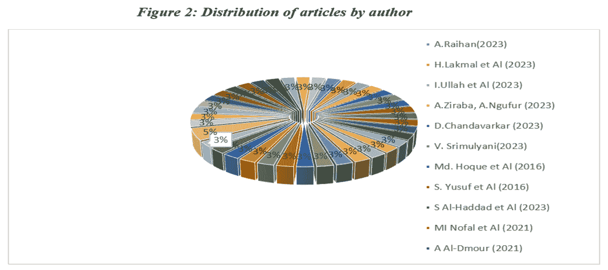

Source: Authors

基于作者的统计揭示了研究期间内作者分布的均衡性。确实，在总共 39 位作者中，每位作者代表 3% 的参考文献。然而，此分析仅考虑每篇已发表文章的一位作者。如果我们考虑该期间内的出版物总数，则会发现一些作者为多篇文章做出了贡献，无论是作为第一作者还是合著者。这表明 Erick Fernando 在所研究领域中具有更为突出的存在感。为了更好地了解该领域中具有更多影响力的作者，最好参考每篇参考文献的引用次数统计数据。

#### 4.2. 按出版年份分布

为了分析关于智慧城市公民参与话题的出版物演变，必须关注按年份发布的参考文献趋势。此分析的结果在下图中总结。

#### Figure 3. 按出版年份分布

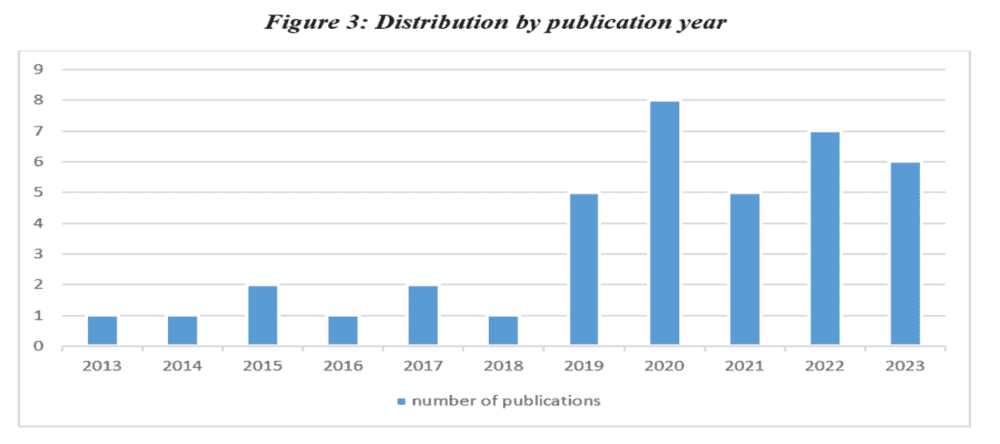

Source: Authors

按年份划分的出版物突显了与研究早期相比，近年来研究的加速。特别是，过去五年（2019、2020、2021、2022 和 2023 年）进行的研究共同占所考虑期间工作的近三分之二（67% 的出版物）。因此，我们可以得出结论，出版物趋势有所增加，强调了该主题的重要性，尤其是在发展中国家。此外，这些结果突显了学术界对智慧城市公民参与的广泛关注。

#### 4.3. 按地理出版分布的文章分布

按国家划分的参考文献分布结果将在下图中总结。

#### Figure 4. 按研究国家分布

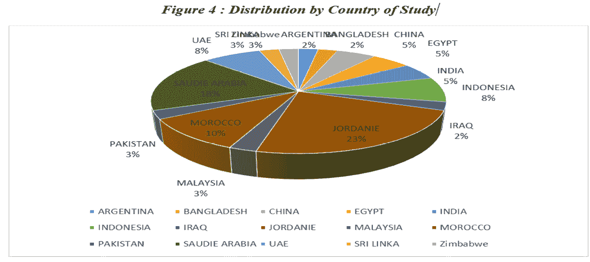

Source: Authors

关于出版物的地理分布，发现亚洲国家在出版物样本中占主导地位，在总共发表的 39 篇文章中有 25 项研究。对于非洲大陆，仅在此背景下进行了 8 项研究。最后，我们注意到在摩洛哥，仅在此框架内进行了 3 项研究。这一观察使我们得出结论，在非洲背景下进行的研究，特别是在摩洛哥，是稀缺的，这构成了一个值得探索的研究空白，以调查摩洛哥背景下的该主题。

#### 4.4. 按理论分布的文章分布

在我们的综述背景下，关于主要动员理论的结果将在下图中总结。

#### Figure 5. 按研究国家分布

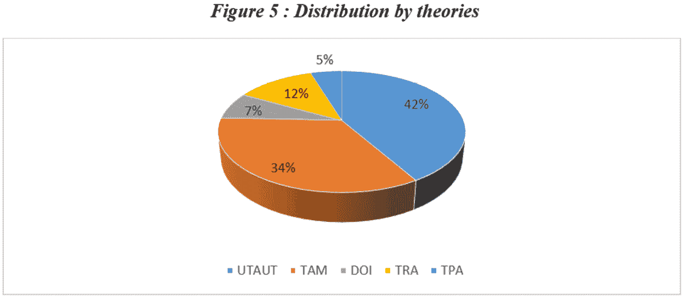

Source: Authors

UTAUT 模型，即技术接受与使用统一理论，已成为解读影响技术采用因素的重要参考。自 2000 年代初由 Venkatesh 和他的同事(Venkatesh et al., 2003)提出以来，该模型获得了大量实证支持，截至 2024 年 1 月，在 Google Scholar 上的引用次数超过 60,000 次。Venkatesh 和他的团队设计 UTAUT 的目的是综合技术接受领域众多现有模型，包括著名的 TAM。他们提取并分析了该领域 8 个主要模型的关键组成部分，以开发 UTAUT，该模型确定了四个影响技术意图和使用的主要因素，以及四个影响这些因素的调节变量。这种综合方法及其在各种信息情境中的适用性使 UTAUT 成为我们研究的宝贵工具，使我们能够深入探讨感知有用性、易用性和使用意图等元素之间的动态。Venkatesh 和他的同事还确定了四个调节因素——性别、年龄、技术经验以及使用的自愿或强制性，这些因素可以影响决定因素与技术意图或使用之间的关系。他们基于对现有文献的深入分析，提出了关于这些调节变量如何影响变量之间关系的假设。

#### 4.5. 研究假设与概念模型

对我们研究中选定参考文献的回顾使我们能够识别出实证研究中涉及的主要因素。

此分析的结果在下图中总结。

#### Figure 6. 按影响因素分布

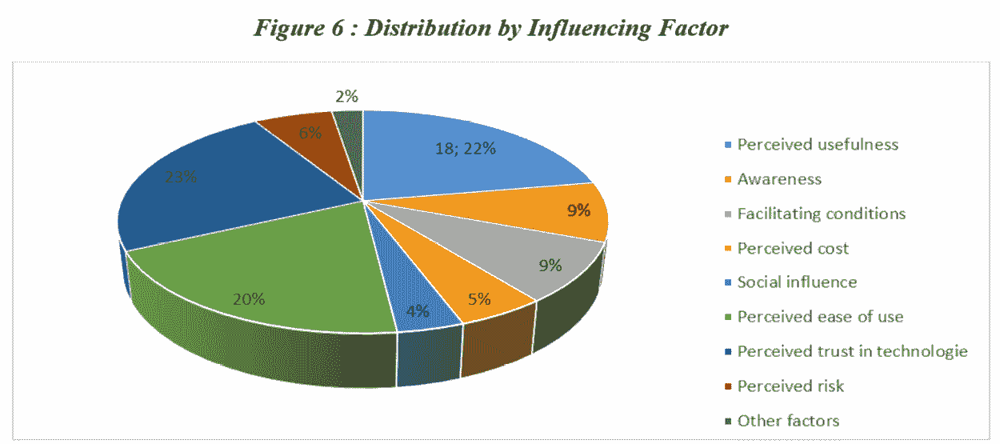

Source: Authors

确定的八个关键因素在决定采用技术方面起着主导作用：

预期绩效：该因素评估个人相信使用特定技术将提升其绩效(Chen & Aklikokou, 2020)。这种信念越强，个人采用该技术的可能性就越大(Fernando et al., 2021)。这呼应了 TAM 和 TAM2 模型中的感知有用性概念。综上所述，本研究提出以下假设：

*   H1: 预期绩效将对使用智慧服务的行为意图产生积极影响。


# 预期努力

预期努力是指对使用技术的难易程度的感知。被认为复杂且难以使用的技术不太可能被采用。这一概念与 TAM 和 TAM2 模型中的易用性概念相似。根据 Davis (1989)，感知易用性是指一个人认为特定系统用户友好的程度。它是 TAM 的第二个主要概念，已被用于之前关于技术采用和在线管理采用的研究。研究人员 (Almuraqab & Jasimuddin, 2017; Alonazi et al., 2020) 发现，最终用户可能更倾向于使用某项服务，因为它方便、简单、易于访问、不复杂且易于使用。其他研究表明，感知易用性对 m-政府服务的采用有显著影响(Choi & Song, 2020)。因此，提出了以下假设。

*   H2: 预期努力将对使用智能服务的行为意图产生积极影响。

# 社会影响

社会影响反映了个人的社交圈对其使用或不使用技术的选择所施加的压力。如果一个人认为技术的使用受到其社交圈的重视，他们将更倾向于采用它(Ranaweera, 2016)。这对应于 TAM2 模型中的主观规范概念。根据 (Venkatesh et al., 2003)，它是指个人认为其他人（例如，他们的家人和朋友）认为他们应该使用新系统的重要程度。社会影响作为使用政府服务意图的一个因素出现。这三个因素直接影响一个人使用技术的意图，进而决定其实际使用。因此，基于这些发现，提出了以下假设：

*   H3: 社会影响将对使用智能服务的行为意图产生积极影响。

# 促进条件

第四个因素，促进条件，虽然不直接影响使用意图，但在技术的实际使用中起着至关重要的作用，例如文档或技术支持的可用性。根据 Venkatesh et al. (2003)，促进条件与个人认为存在组织和技术基础设施来支持系统的使用的程度有关(Bouhtati, Alla, et al., 2023)。促进条件也被定义为一个人相信政府和技术基础设施可用于促进系统的程度(Almuraqab & Jasimuddin, 2017; Babullah et al., 2015)。基于上述讨论，可以提出以下假设：

*   H4: 促进条件将影响个人使用智能服务的行为。

# 感知风险

感知风险被定义为公民在追求期望结果时遭受损失的主观期望(Carter & Bélanger, 2005)。公民的行为受风险感知的强烈影响。最终用户往往对决策或行动的后果不确定。此外，已揭示最终用户倾向于最小化风险而非最大化效用。最终用户对风险的主观感知在很大程度上可以解释他们的行为(Eid et al., 2021; Zhou et al., 2023)。因此，我们假设：

*   H5: 感知风险将对用户使用智能服务的意图产生负面影响。

# 意识

意识是人们对技术和电子服务可用性的理解(Venkatesh et al., 2003)。(Abdelghaffar & Magdy, 2012) 认为，培养意识是用户意识到政府通过互联网提供服务的初始阶段。多项研究表明，个人对智能政府服务和电子资源可访问性的知识是一个重要问题。毫无疑问，理解不足会对公民接受电子政务和移动政务服务的意愿产生不利影响(Almuraqab & Jasimuddin, 2017; Alryalat et al., 2023)。

*   H6: 感知意识对公民使用智能服务的意图有积极且显著的影响。

# 感知成本

感知成本是一个关键考虑因素。接入设备必须负担得起，访问在线公共服务的成本必须低。移动服务的成本是影响最终用户使用移动政务服务意图的主要因素之一(Almuraqab & Jasimuddin, 2017; Eid et al., 2021)。感知成本对用户采用移动政务服务的意图有负面影响。在公民行为的背景下，价格被认为是一个非常重要的因素 (Oumlil & Aderkaoui, 2020)。本工作提出以下假设：

*   H7: 感知成本将对用户使用智能服务的意图产生负面影响。

# 感知技术信任

感知技术信任始终被认为是 m-服务采用的关键因素。这种信任通常被称为制度信任。根据(McKnight et al., 2002)，它是指个人对制度环境的感知，该环境包含使环境安全的结构和原则。在这方面，(Carter & Bélanger, 2005) 强调公民必须对使能技术有信任。此外，(Pavlou & Gefen, 2004) 建议制度基础信任是目标财务环境中非常关键的一种信任形式，在该环境中，拥有共同价值观的社区意识很重要(Chen & Aklikokou, 2020; Tavitiyaman et al., 2021)。因此，基于 UTAUT，本研究假设：

*   H8: 感知技术信任将对用户使用智能服务的意图产生积极影响。

# 修改后的 UTAUT 模型

基于上述讨论，提出了一个修改后的 UTAUT 模型，如 图 7 所示。

## 图 7. 改进的概念模型

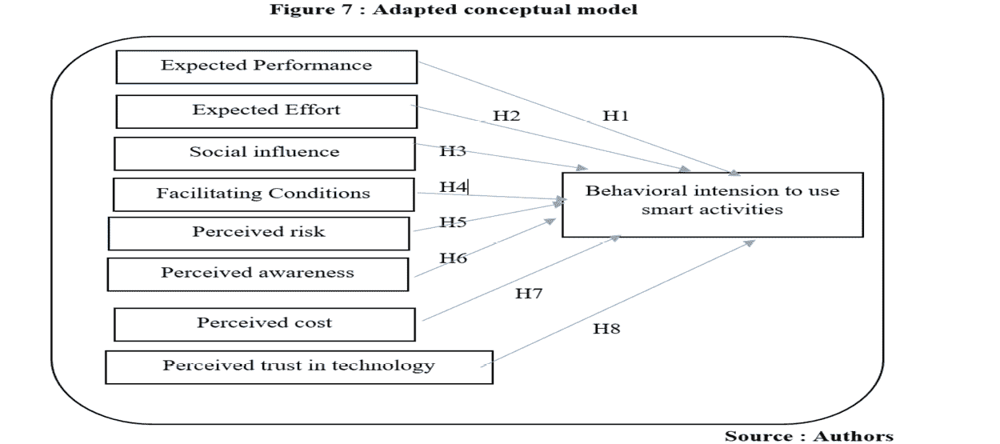

来源：作者


本研究旨在通过整合预期绩效、感知成本、技术信任、预期努力、社会影响、意识、促进条件和感知风险作为影响使用智能服务行为意图（因变量）的自变量，来扩展 UTAUT 模型。然而，有必要对其进行演进，以便主要考虑调节因素，并在实证研究框架内将其与现场现实相结合，从而得出一个实证模型。

总之，对我们样本（包含 39 篇文章，跨度 10 年）的关键特征进行分析，使我们能够得出几个结论，特别是关于随时间推移的出版趋势、文献综述框架内动员的理论、所涵盖的不同地理区域。影响公民使用智能活动意图的主要因素已被识别，并基于 UTAUT 范式调整了一个概念模型。

#### 4.6. 讨论

本文为摩洛哥智慧城市背景下的公民参与带来了新视角。它强调了研究影响这些倡议中公民积极参与的因素的重要性，在基础设施和技术条件与发达国家存在显著差异的环境中。该研究还旨在为地方决策者提供启示，为他们提供关键数据，以便在数字时代制定有利于公民参与的有效政策和策略(Alla et al., 2022)。

在实际意义方面，地方政府应优先推广信息与通信技术（`ICT`）的主动使用，并提高公众对智慧城市理念的认识。迈向智慧城市需要弥合被称为数字鸿沟的 ICT 使用差距。仅仅实施地方政策以确保每个人都能使用 Wi-Fi 和互联网是不够的，无法增强 ICT 的使用。此外，实施一项增强信息与通信技术（`ICT`）使用的计划，将有助于推动智慧城市的努力或事业。

智慧城市的技术趋势，例如高速移动连接、开放数据、城市界面和云计算等，正在迅速发展。ICT 在智慧城市中发挥着关键作用，通过连接基础设施、政府和公民。(Alderete, 2021) 强调，智慧城市依赖于“利用”信息和通信技术所提供的好处。

ICT 使在线公共服务的提供成为可能，便于轻松获取公共信息，并允许个人协作以交换他们的利益和关切。此外，ICT 的使用可以增强和鼓励公共事务中的决策和公民参与。

对技术的信任和对政府的信任是技术采用的关键要素。然而，最新的技术和设备面临网络犯罪、病毒和恶意软件的威胁，这促使人们在访问智能应用程序进行交易前三思而后行。此外，人们担心自己的数据隐私，这一点已被之前的研究观察和支持，并需要在摩洛哥智能服务的背景下进行测试。

这篇概念性论文旨在识别影响摩洛哥公民在决策过程中的因素，即关于使用或有意使用智慧城市提供的服务。这使我们能够推导出一组假设，以便在未来的项目中进行测试。

### 5\. 结论与展望

这项系统性研究探索让我们对 2013 年至 2023 年间进行的基础实证研究有了启发，这些研究审查了公民采用智能治理及其与人们接受智慧城市服务意图之间关系的相关问题。依托 PRISMA 方法，我们选取了 39 篇关键参考文献。对这些文章的定量分析揭示了显著方面，例如作者、出版年份、动员的理论、进行这些研究的国家，以及影响公民采用智能服务决策的因素。这种分析不仅让我们回答了最初的问题，还指出了进一步研究的方向。

此外，我们的研究提供了几项重要贡献。首先，本次系统综述有助于填补该领域研究的稀缺性，特别是在识别智能服务采用的决定因素，以避免智能项目实施失败。同样，我们的系统综述提供了多项优势，包括能够提供一个灵活的参考基础，该基础可以轻松更新和查询。此外，定量分析作为一种工具，可以准确捕捉智慧城市领域的出版趋势，同时关注之前实证研究的某些特征，如地理分布和出版年份。对文献的深入研究突出了 UTAUT 模型在发展中国家背景下的广泛采用。我们的分析导致了八项基本命题的制定，这些命题揭示了鼓励摩洛哥用户采用智慧城市服务的决定性因素。

然而，本次系统综述也存在一些局限性。首先，尽管使用了精确的纳入和排除标准，但相关研究可能未被识别或纳入，如果遗漏了一些相关研究，可能会引入偏差。其次，研究时限仅限于过去十年，这可能会导致某些研究被排除。最后，我们没有对选定的参考文献进行定性分析。因此，这可能会限制对所研究现象的整体理解，以及探索参与智能活动的个人主观体验的能力。在未来的研究中，考虑一个足够长的时期以涵盖所有涉及智慧城市和公民参与主题的研究将很重要。通过选择一个足够长的检索期，未来的研究可以受益于该领域更全面和更新的概述。

我们的研究带来了几项关键贡献。首先，本次系统综述解决了研究不足的问题，特别是关于分析解释公民参与电子服务的因素，这些国家的经济、社会文化和技术特征与摩洛哥相似。它还提出了一个可修改的参考基础，这是一项重要资产，允许轻松更新和查询。从理论角度来看，本研究旨在增强技术接受和使用的模型和理论，尤其是 UTAUT 模型及相关框架。从管理角度来看，它强调了理解和考虑影响各个领域公民使用及其行为意图的因素的必要性。

首先，数字服务提供商应专注于性能提升，以满足用户期望并提供最佳电子服务，强调用户友好、直观且易于访问的应用程序。社会影响可以通过积极的口碑和用户推荐来利用。

此外，智能服务提供商可能会采用与目标受众的财务顾虑和期望相一致的定价策略。建立对技术的信任，特别是通过安全的电子交易，也被认为至关重要。


尽管如此，我们的综述存在一些局限性。尽管我们制定了严格的纳入和排除标准，但相关研究可能被遗漏，从而可能引入偏倚。本研究的时间覆盖范围仅限于过去十年，也可能排除重要的研究。此外，对所选参考文献缺乏定性分析可能会限制我们对研究主题的整体理解，并且不允许探索使用智能活动的个人的主观经验。

这项研究仍处于早期阶段，提出了一个用于分析摩洛哥智能服务接受和使用决定因素的理论模型。所提模型基于现有方法。目标是开发一种更具整合性的方法，该方法将与摩洛哥环境相关。我们打算基于所提模型进行探索性-解释性调查。数据将通过观察、访谈和问卷收集。未来的研究模型还必须纳入原始 UTAUT 模型中包含的四个调节变量（性别、年龄、经验和自愿性）。收集的数据将以数字、图表和描述性陈述的形式进行分析和展示，以说明所提模型中不同变量之间的关系。

## REFERENCES

Abdelghaffar, H., & Magdy, Y. (2012). The adoption of mobile government services in developing countries : The case of Egypt. International Journal of Information and Communication Technology Research, 2(4). https://www.researchgate.net/profile/Hany-Abdelghaffar/publication/268393482_The_Adoption_of_Mobile_Government_Services_in_Developing_Countries_The_Case_of_Egypt/links/5da6e6b84585159bc3d0d031/The-Adoption-of-Mobile-Government-Services-in-Developing-Countries-The-Case-of-Egypt.pdf

Albino, V., Berardi, U., & Dangelico, R. M. (2015). Smart Cities : Definitions, Dimensions, Performance, and Initiatives. Journal of Urban Technology, 22(1), 3–21. 10.1080/10630732.2014.942092

Alderete, M. V. (2021). Determinants of smart city commitment among citizens from a middle city in Argentina. Smart Cities, 4(3), 1113–1129. 10.3390/smartcities4030059

Alipour, M., Salim, H., Stewart, R. A., & Sahin, O. (2020). Predictors, taxonomy of predictors, and correlations of predictors with the decision behaviour of residential solar photovoltaics adoption : A review. Renewable & Sustainable Energy Reviews, 123, 109749. 10.1016/j.rser.2020.109749

Alla, L., Bentalha, B., & Elyoussfi, A. (2023). Intelligence territoriale et positionnement stratégique des regions au Maroc : Le cas de la région de Fès Meknes en perspective. Le concept de l’intéligence en sciences juridiques, économiques et sociales, 215-237.

Alla, L., Kamal, M., & Bouhtati, N. (2022). Big data et efficacité marketing des entreprises touristiques : Une revue de littérature. Alternatives Managériales Economiques, 4, 39-58. 10.48374/IMIST.PRSM/ame-v1i0.36928

Almuraqab, N. A. S., & Jasimuddin, S. M. (2017). Factors that Influence End-Users’ Adoption of Smart Government Services in the UAE : A Conceptual Framework. Electronic Journal of Information Systems Evaluation, 20(1), 11–23.

AlNuaimi, M., Shaalan, K., Alnuaimi, M., & Alnuaimi, K. (2011). Barriers to electronic government citizens’ adoption : A case of municipal sector in the emirate of abu dhabi. 2011 Developments in E-systems Engineering, 398-403. https://ieeexplore.ieee.org/abstract/document/6150013/

Alonazi, M., Beloff, N., & White, M. (2020). Perceptions Towards the Adoption and Utilization of M-Government Services : A Study from the Citizens’ Perspective in Saudi Arabia. In Ziemba, E. (Ed.), Information Technology for Management : Current Research and Future Directions (Vol. 380, pp. 3–26). Springer International Publishing. 10.1007/978-3-030-43353-6_1

Alryalat, M., Alryalat, H., Alhamzi, K., & Hewahi, N. (2023). E-Government Services Adoption Assessment From the Citizen Perspective in Jordan. [IJEGR]. International Journal of Electronic Government Research, 19(1), 1–17. 10.4018/IJEGR.322440

Anthopoulos, L. G. (2017). Understanding Smart Cities : A Tool for Smart Government or an Industrial Trick? (Vol. 22). Springer International Publishing. 10.1007/978-3-319-57015-0

Anthopoulos, L. G., Pourzolfaghar, Z., Lemmer, K., Siebenlist, T., Niehaves, B., & Nikolaou, I. (2022). Smart cities as hubs : Connect, collect and control city flows. Cities (London, England), 125, 103660. 10.1016/j.cities.2022.103660

Babullah, A., Dwivedi, Y., & Williams, M. (2015). Saudi citizens’ perceptions on mobile government (mGov) adoption factors. AISEL. https://aisel.aisnet.org/ukais2015/8/

Bakici, T., Almirall, E., & Wareham, J. (2013). A smart city initiative : The case of Barcelona. Journal of the Knowledge Economy, 4(2), 135–148. 10.1007/s13132-012-0084-9

Belanger, F., Hiller, J. S., & Smith, W. J. (2002). Trustworthiness in electronic commerce : The role of privacy, security, and site attributes. The Journal of Strategic Information Systems, 11(3-4), 245–270. 10.1016/S0963-8687(02)00018-5

Bernardin, S., & Jeannot, G. (2019). La ville intelligente sans les villes? Interopérabilité, ouvertures et maîtrise des données publiques au sein des administrations municipales. Reseaux (London), 6, 9–37.

Berntzen, L., & Johannessen, M. R. (2016). The Role of Citizen Participation in Municipal Smart City Projects : Lessons Learned from Norway. In Gil-Garcia, J. R., Pardo, T. A., & Nam, T. (Eds.), Smarter as the New Urban Agenda (Vol. 11, pp. 299–314). Springer International Publishing. 10.1007/978-3-319-17620-8_16

Bibri, S. E. (2018). The IoT for smart sustainable cities of the future : An analytical framework for sensor-based big data applications for environmental sustainability. Sustainable Cities and Society, 38, 230–253. 10.1016/j.scs.2017.12.034

Bibri, S. E., Alexandre, A., Sharifi, A., & Krogstie, J. (2023). Environmentally sustainable smart cities and their converging AI, IoT, and big data technologies and solutions : An integrated approach to an extensive literature review. Energy Informatics, 6(1), 9. 10.1186/s42162-023-00259-2

Bouhtati, N., Alla, L., & Bentalha, B. (2023). Marketing Big Data Analytics and Customer Relationship Management : A Fuzzy Approach. In Integrating Intelligence and Sustainability in Supply Chains (p. 75-86). IGI Global. https://www.igi-global.com/chapter/marketing-big-data-analytics-and-customer-relationship-management/331980


# 参考文献

Bouhtati, N., Kamal, M., & Alla, L. (2023). Big Data and the Effectiveness of Tourism Marketing: A Prospective Review of the Literature. In Farhaoui, Y., Rocha, A., Brahmia, Z., & Bhushab, B. (Eds.), Artificial Intelligence and Smart Environment (pp. 287–292). Springer International Publishing. [10.1007/978-3-031-26254-8_40](http://dx.doi.org/10.1007/978-3-031-26254-8_40)

Braga, S., Zacarias, S. L., & Champoski, L. H. (2022). APLICACIONES MÓVILES Y GOBERNANZA DIGITAL EN BRASIL: ESTUDIO DE CASO DEL “PROYECTO PIÁ”, DEL ESTADO DE PARANÁ. 38.

Carter, L., & Bélanger, F. (2005). The utilization of e‐government services: Citizen trust, innovation and acceptance factors*. Information Systems Journal, 15(1), 5–25. [10.1111/j.1365-2575.2005.00183.x](http://dx.doi.org/10.1111/j.1365-2575.2005.00183.x)

Chen, L., & Aklikokou, A. K. (2020). Determinants of E-government Adoption: Testing the Mediating Effects of Perceived Usefulness and Perceived Ease of Use. International Journal of Public Administration, 43(10), 850–865. [10.1080/01900692.2019.1660989](http://dx.doi.org/01900692.2019.1660989)

Choi, J.-C., & Song, C. (2020). Factors explaining why some citizens engage in E-participation, while others do not. Government Information Quarterly, 37(4), 101524. [10.1016/j.giq.2020.101524](http://dx.doi.org/10.1016/j.giq.2020.101524)

Cocchia, A. (2014a). Smart and Digital City: A Systematic Literature Review. In Dameri, R. P., & Rosenthal-Sabroux, C. (Eds.), Smart City (pp. 13–43). Springer International Publishing. [10.1007/978-3-319-06160-3_2](http://dx.doi.org/10.1007/978-3-319-06160-3_2)

Dameri, R. P. (2013). Searching for smart city definition: A comprehensive proposal. International Journal of Computers and Technology, 11(5), 2544–2551. [10.24297/ijct.v11i5.1142](http://dx.doi.org/10.24297/ijct.v11i5.1142)

Davis, F. D. (1989). Perceived Usefulness, Perceived Ease of Use, and User Acceptance of Information Technology. Management Information Systems Quarterly, 13(3), 319. [10.2307/249008](http://dx.doi.org/10.2307/249008)

Del-Real, C., Ward, C., & Sartipi, M. (2023). What do people want in a smart city? Exploring the stakeholders’ opinions, priorities and perceived barriers in a medium-sized city in the United States. International Journal of Urban Sciences, 27(sup1), 50-74. [10.1080/12265934.2021.1968939](http://dx.doi.org/12265934.2021.1968939)

Diallo, M., Fall, A. K., Diallo, I., Diédhiou, I., Ba, P. S., Diagne, M., Ndiaye, B., Ndiaye, A. R., Niang, A., & Gning, S. B. (2010). Dermatomyosites et polymyosites: 21 cas au Sénégal. Médecine Tropicale, 70(2), 166.[20486354](http://dx.doi.org/20486354)

Eid, R., Selim, H., & El-Kassrawy, Y. (2021). Understanding citizen intention to use m-government services: An empirical study in the UAE. Transforming Government: People. Process and Policy, 15(4), 463–482.

El Assal, Z., & Rochdane, H. (2023). L’intérêt des citoyens de Casablanca envers l’utilisation des énergies renouvelables dans le contexte de la ville intelligente. SHS Web of Conferences, 175, 01036. [`www.shs-conferences.org/articles/shsconf/abs/2023/24/shsconf_mh2s2023_01036/shsconf_mh2s2023_01036.html`](https://www.shs-conferences.org/articles/shsconf/abs/2023/24/shsconf_mh2s2023_01036/shsconf_mh2s2023_01036.html)

El Jaouhari, S. & Lhoussaine, A. (2021). Approche participative en tourisme et gouvernance territoriale, quel apport pour le développement territorial? Alternatives Managériales Economiques, 3(2), 257–277.

Fernando, E., Ikhsan, R. B., Condrobimo, A. R., Daniel, H., & Halim, S. K. (2021). Concept model: Analysis of factors on intention and decisions on the use of smart tourism applications. 2021 International Conference on Information Management and Technology (ICIMTech), 1, 154-158. [`ieeexplore.ieee.org/abstract/document/9534933/`](https://ieeexplore.ieee.org/abstract/document/9534933/)

Giffinger, R. (2015). Smart City Concepts: Chances and Risks of Energy Efficient Urban Development. In Helfert, M., Krempels, K.-H., Klein, C., Donellan, B., & Guiskhin, O. (Eds.), Smart Cities, Green Technologies, and Intelligent Transport Systems (Vol. 579, pp. 3–16). Springer International Publishing. [10.1007/978-3-319-27753-0_1](http://dx.doi.org/10.1007/978-3-319-27753-0_1)

Giffinger, R., & Haindlmaier, G. (2018). Benchmarking the Smart City: A Sound Tool for Policy-Making? Scienze Regionali, 1, 115–122. [10.14650/88820](http://dx.doi.org/10.14650/88820)

Haj, D. A. E. (2020). La ville marocaine et la nécessité d’une transformation à l’ère de la Smart City: Analyse des cas des villes de Tanger, Casablanca et Marrakech. Geopolitics and Geostrategic Intelligence, 3(2), Article 2.

Hollands, R. G. (2020). Will the real smart city please stand up?: Intelligent, progressive or entrepreneurial? In The Routledge companion to smart cities (pp. 179–199). Routledge. [`www.taylorfrancis.com/chapters/edit/10.4324/9781315178387-13/real-smart-city-please-stand-robert-hollands`](https://www.taylorfrancis.com/chapters/edit/10.4324/9781315178387-13/real-smart-city-please-stand-robert-hollands)[](http://dx.doi.org/10.4324/9781315178387-13)

Irvin, R. A., & Stansbury, J. (2004). Citizen Participation in Decision Making: Is It Worth the Effort? Public Administration Review, 64(1), 55–65. [10.1111/j.1540-6210.2004.00346.x](http://dx.doi.org/10.1540-6210.2004.00346.x)

Jebaraj, L., Khang, A., Chandrasekar, V., Pravin, A. R., & Sriram, K. (2023). Smart City: Concepts, Models, Technologies and Applications. In Smart Cities (p. 1-20). CRC Press. [`www.taylorfrancis.com/chapters/edit/10.1201/9781003376064-1/smart-city-concepts-models-technologies-applications-luke-jebaraj-alex-khang-vadivelraju-chandrasekar-antony-richard-pravin-kumar-sriram`](https://www.taylorfrancis.com/chapters/edit/10.1201/9781003376064-1/smart-city-concepts-models-technologies-applications-luke-jebaraj-alex-khang-vadivelraju-chandrasecar-antony-richard-pravin-kumar-sriram)

Jiang, H., Geertman, S., & Witte, P. (2023). The contextualization of smart city technologies: An international comparison. Journal of Urban Management, 12(1), 33–43. [10.1016/j.jum.2022.09.001](http://dx.doi.org/10.1016/j.jum.2022.09.001)

Junaidi, A., Basrowi, B., Sabtohadi, J., Wibowo, A., Wibowo, S., Asgar, A., Pramono, E., & Yenti, E. (2024). The role of public administration and social media educational socialization in influencing public satisfaction on population services: The mediating role of population literacy awareness. International Journal of Data and Network Science, 8(1), 345–356. [10.5267/j.ijdns.2023.9.019](http://dx.doi.org/10.5267/j.ijdns.2023.9.019)

Kandt, J., & Batty, M. (2021). Smart cities, big data and urban policy: Towards urban analytics for the long run. Cities (London, England), 109, 102992. [10.1016/j.cities.2020.102992](http://dx.doi.org/10.1016/j.cities.2020.102992)

Kozłowski, W., & Suwar, K. (2021). Smart city: Definitions, dimensions, and initiatives. UM. https://www.um.edu.mt/library/oar/handle/123456789/105179

Kumar, A. (2022). Sustainable smart cities. In Kumar, A. (Ed.), Ecosystem-Based Adaptation (pp. 325–416). Elsevier. [10.1016/B978-0-12-815025-2.00007-1](http://dx.doi.org/10.1016/B978-0-12-815025-2.00007-1)

Lytras, M. D., & Visvizi, A. (2018). Who uses smart city services and what to make of it: Toward interdisciplinary smart cities research. Sustainability (Basel), 10(6), 1998. [10.3390/su10061998](http://dx.doi.org/10.3390/su10061998)

McKnight, D. H., Choudhury, V., & Kacmar, C. (2002). Developing and Validating Trust Measures for e-Commerce: An Integrative Typology. Information Systems Research, 13(3), 334–359. [10.1287/isre.13.3.334.81](http://dx.doi.org/10.1287/isre.13.3.334.81)


# 将 AI 和数字化整合到营销策略中

## 第 7 章

# 迈向敏捷营销：

## 为数字时代转型策略

Busra Ozdenizci Kose


Gebze Technical University, Turkey

### 摘要

敏捷营销代表了战略营销的范式转变，强调灵活性、速度和以客户为中心的原则。源自重视适应性和迭代进步的软件开发方法论，敏捷实践已被有效地转化为营销领域，以应对当代市场动态且快节奏的特性。这种方法侧重于持续改进、跨职能协作以及对消费者需求和市场趋势的响应。通过整合 Scrum 和 Kanban 等多种方法论，营销团队增强了快速调整策略、执行创新活动并利用实时反馈的能力，从而在不断演变的商业环境中确保竞争优势。本章旨在探讨敏捷营销的变革潜力，并提供有关敏捷实践如何重塑营销策略以使其更具适应性、更高效且更符合客户期望的见解，从而使营销人员能够在当今的数字时代取得成功。

### 1\. 引言

# 参考文献

- Nassereddine, M., & Khang, A. (2024). Applications of Internet of Things (IoT) in smart cities. In Advanced IoT Technologies and Applications in the Industry 4.0 Digital Economy (pp. 109–136). CRC Press. [`www.taylorfrancis.com/chapters/edit/10.1201/9781003434269-6/applications-internet-things-iot-smart-cities-mohamed-nassereddine-alex-khang`](https://www.taylorfrancis.com/chapters/edit/10.1201/9781003434269-6/applications-internet-things-iot-smart-cities-mohamed-nassereddine-alex-khang) [`dx.doi.org/10.1201/9781003434269-6`](http://dx.doi.org/10.1201/9781003434269-6)

- Nguyen, C. T.-L., Bleus, H., Van Bockhaven, J., Crutzen, N., & Basile, C. (2018). Smart City-Le Guide Pratique-Tome 2-Comment Rendre le Citoyen Acteur de son Territoire? Bitstream. https://orbi.uliege.be/bitstream/2268/229265/1/smart-city-le-guide-pratique-tome-2.pdf

- Oukarfi, S., & Bercheq, A. (2020a). Les déterminants socioéconomiques et géographiques de l’achat en ligne au Maroc. Revue d’Economie Industrielle, 171(3), 139–182. [10.4000/rei.9308](http://dx.doi.org/10.4000/rei.9308)

- Oukarfi, S., & Bercheq, A. (2020b). Les déterminants socioéconomiques et géographiques de l’achat en ligne au Maroc. Revue d’Economie Industrielle, 139–182. [10.4000/rei.9308](http://dx.doi.org/10.4000/rei.9308)

- Oumlil, R., & Aderkaoui, A. (2020). Technology Acceptance, a relevant step to digitalize Moroccan human development public organizations. Revue Management & Innovation, 20(1), 119–136. [10.3917/rmi.201.0119](http://dx.doi.org/10.3917/rmi.201.0119)

- Paul, J., & Criado, A. R. (2020). The art of writing literature review : What do we know and what do we need to know? International Business Review, 29(4), 101717. [10.1016/j.ibusrev.2020.101717](http://dx.doi.org/10.1016/j.ibusrev.2020.101717)

- Pavlou, P. A., & Gefen, D. (2004). Building Effective Online Marketplaces with Institution-Based Trust. Information Systems Research, 15(1), 37–59. [10.1287/isre.1040.0015](http://dx.doi.org/10.1287/isre.1040.0015)

- Perez-Vega, R., Hopkinson, P., Singhal, A., & Mariani, M. M. (2022). From CRM to social CRM : A bibliometric review and research agenda for consumer research. Journal of Business Research, 151, 1–16. [10.1016/j.jbusres.2022.06.028](http://dx.doi.org/10.1016/j.jbusres.2022.06.028)

- Ranaweera, H. M. B. P. (2016). Perspective of trust towards e-government initiatives in Sri Lanka. SpringerPlus, 5(1), 22. [10.1186/s40064-015-1650-y](http://dx.doi.org/10.1186/s40064-015-1650-y) [`dx.doi.org/26759761`](http://dx.doi.org/26759761)

- Rehman, M., & Esichaikul, V. (2011). Factors influencing the adoption of e-government in Pakistan. 2011 International Conference on E-Business and E-Government (ICEE), (pp. 1-4). IEEE. [`ieeexplore.ieee.org/abstract/document/5887093/`](https://ieeexplore.ieee.org/abstract/document/5887093/)

- Rogers Everett, M. (1995). Diffusion of innovations.

- Savastano, M., Suciu, M.-C., Gorelova, I., & Stativă, G.-A. (2023). How smart is mobility in smart cities? An analysis of citizens’ value perceptions through ICT applications. Cities (London, England), 132, 104071. [10.1016/j.cities.2022.104071](http://dx.doi.org/10.1016/j.cities.2022.104071)

- Sebei, H., Hadj Taieb, M. A., & Ben Aouicha, M. (2018). Review of social media analytics process and Big Data pipeline. Social Network Analysis and Mining, 8(1), 30. [10.1007/s13278-018-0507-0](http://dx.doi.org/10.1007/s13278-018-0507-0)

- Simonofski, A., Vallé, T., Serral, E., & Wautelet, Y. (2021). Investigating context factors in citizen participation strategies : A comparative analysis of Swedish and Belgian smart cities. International Journal of Information Management, 56, 102011. [10.1016/j.ijinfomgt.2019.09.007](http://dx.doi.org/10.1016/j.ijinfomgt.2019.09.007)

- Suryawan, I. W. K., & Lee, C.-H. (2023). Citizens’ willingness to pay for adaptive municipal solid waste management services in Jakarta, Indonesia. Sustainable Cities and Society, 97, 104765. [10.1016/j.scs.2023.104765](http://dx.doi.org/10.1016/j.scs.2023.104765)

- Syed, A. S., Sierra-Sosa, D., Kumar, A., & Elmaghraby, A. (2021). IoT in smart cities : A survey of technologies, practices and challenges. Smart Cities, 4(2), 429–475. [10.3390/smartcities4020024](http://dx.doi.org/10.3390/smartcities4020024)

- Tavitiyaman, P., Qu, H., Tsang, W. L., & Lam, C. R. (2021). The influence of smart tourism applications on perceived destination image and behavioral intention : The moderating role of information search behavior. Journal of Hospitality and Tourism Management, 46, 476–487. [10.1016/j.jhtm.2021.02.003](http://dx.doi.org/10.1016/j.jhtm.2021.02.003)

- Venkatesh, V., Morris, M. G., Davis, G. B., & Davis, F. D. (2003). User acceptance of information technology : Toward a unified view. Management Information Systems Quarterly, 27(3), 425–478. [10.2307/30036540](http://dx.doi.org/10.2307/30036540)

- Zhao, D., & Strotmann, A. (2015). Analysis and visualization of citation networks. Morgan & Claypool Publishers. [10.1007/978-3-031-02291-3](http://dx.doi.org/10.1007/978-3-031-02291-3)

- Zhou, P., Zhao, S., Ma, Y., Liang, C., & Zhu, J. (2023). What influences user participation in an online health community? The stimulus-organism-response model perspective. Aslib Journal of Information Management, 75(2), 364–389. [10.1108/AJIM-12-2021-0383](http://dx.doi.org/10.1108/AJIM-12-2021-0383)


# Agile 方法论与敏捷营销概述

Agile 是一种项目管理和软件开发方法论，起源于对传统计划驱动方法（如瀑布模型）局限性的回应。它于 2001 年由一群软件开发者制定《敏捷宣言》而正式化，这些开发者强调灵活性、协作和客户满意度，而非僵化的规划和执行 (Flewelling, 2018; Atawneh, 2019)。与瀑布模型的线性顺序方法不同，Agile 促进自适应规划、演进式开发、早期交付和持续改进，确保流程和产品能够响应不断变化的需求和环境。通过鼓励跨职能团队合作，并将工作组织为称为 sprint 的短迭代周期，Agile 方法论促进高质量产品的快速交付，并使团队能够快速适应变化。这使得 Agile 在项目需求和目标可能演变的动态环境中尤其有效 (Kalenda et al., 2018; Duka, 2013; Ramos & Pavhlichenko, 2022)。

Agile 方法论的正式出现发生在 2001 年 2 月，当时 17 名软件开发者在犹他州 Snowbird 的一个滑雪度假村聚会。此次会议旨在讨论轻量级开发方法，并促成了“敏捷软件开发宣言”（即 Agile Manifesto）的创建 (Winter & Winter, 2015; Patary, 2019; Hohl et al., 2018)。该文件概述了四个核心价值观和十二条原则，表明灵活、注重人员、与客户紧密合作以及对变化持开放态度，比严格遵循详细计划、大量文书工作、正式协议和不改变方向更好。该文件标志着在软件开发中使用 Agile 方法的开始，并开始改变项目管理方式，使其更具适应性和人性化。

在 Agile Manifesto 推出后，各种受其核心价值观启发的方法论开始涌现并变得流行。Scrum、极限编程 (XP)、精益软件开发、Kanban 和特性驱动开发 (FDD) 是其中最著名的几种 (Merzouk et al. 2018; Matharu et al., 2015)。每种方法都提供了在实际现实环境中实施 Agile 价值观和原则的独特方法。这些方法论在迭代开发、团队协作和专注于为客户交付价值方面有共同基础，但在具体实践、角色和术语上有所不同。

Agile 已从其作为软件开发方法论的起源演变为一种全面的哲学，塑造了组织在动态、快速变化的环境中运营和繁荣的方式 (Highsmith, 2002; Kelly, 2008; Ramos & Pavhlichenko, 2022)。这是一种在各个行业中得到广泛采用的哲学，不断完善和扩展用于实施 Agile 原则的工具、框架和最佳实践集。这一演变的核心是 Agile 思维，它是有效利用 Agile 方法论的关键组成部分。这种思维不仅仅是遵循特定实践或指南，还体现了一种以灵活性、持续改进和专注于为客户交付价值为特征的思维方式。

今天，营销领域采用 Agile 的趋势日益明显，这反映了规划和执行营销策略的一种变革性方法 (Perkin, 2023; Thümler, 2023)。这一趋势表明营销团队越来越多地采用快速迭代、以客户为中心的规划和对市场变化的响应原则。通过整合 Agile 思维（如短周期、专注的工作周期和数据驱动的决策），营销部门可以快速调整策略、尝试创新想法，并根据实时反馈改进其活动 (Barbosa et al., 2022; Ewel, 2020; Gera et al., 2019)。Agile 采用不仅提升了营销工作的敏捷性和有效性，还培养了协作和持续改进的文化。因此，组织能够更好地满足客户不断变化的需求，并在动态的商业环境中保持竞争优势。

本章探讨了敏捷营销的变革潜力，这是一种强调营销运营中灵活性、速度和以客户为中心的战略方法。它关注 Agile 的核心价值观和原则，例如迭代开发、持续改进和跨职能协作，这些原则在重塑营销策略以使其更具适应性和响应性方面发挥了重要作用。通过整合包括 Scrum 和 Kanban 在内的 Agile 实践，营销团队可以显著增强其对快速变化的市场状况和消费者偏好的灵活性和响应能力。本章提供了有关如何将最初为软件行业设计的 Agile 方法论有效适应营销领域的宝贵见解。本章旨在通过提供所需的见解和方法论，使研究人员、从业者和营销人员能够在动态的营销领域中取得卓越成就。

## 2\. 迈向敏捷营销

敏捷营销是一种将 Agile 开发原则应用于营销领域的战略方法，强调速度、灵活性和客户关注 (Yusoff et al., 2019; Moi et al., 2018; Ewel, 2020)。它不依赖长期计划和大型活动，而是旨在提高营销团队对消费者偏好和市场动态变化的响应能力。敏捷营销采用迭代规划、频繁适应和协作团队努力等实践，以执行可以根据实时反馈和洞察快速调整方向的活动 (Vassileva, 2017; Hoogveld & Koster, 2016; Katare 2022)。这种方法允许更透明、可衡量和高效的营销工作，并使团队能够取得更好的结果并与客户需求保持一致。

《敏捷营销宣言》 ([`agilemarketingmanifesto.org`](https://agilemarketingmanifesto.org)) 于 2012 年推出。这标志着将 Agile 原则专门适应营销行业的一个关键时刻。它旨在改善营销团队在快速发展的数字环境中响应变化、协作并最终服务客户的方式。虽然它与原始 Agile Manifesto 共享核心精神，但《敏捷营销宣言》关注五个基本价值观，如 Figure 1 所示。

### Figure 1. 敏捷营销的核心价值观

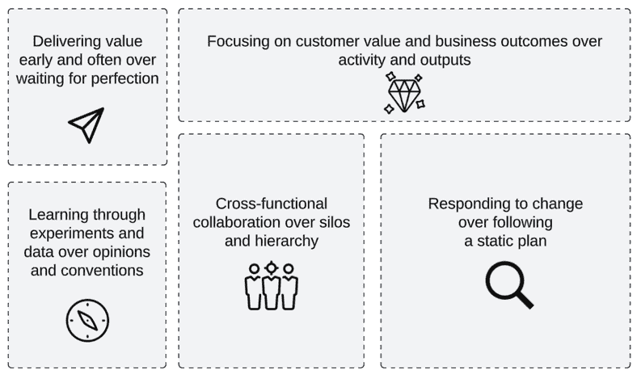


敏捷营销宣言（2012）旨在解决营销领域的独特挑战和机遇。虽然它从软件开发的原始敏捷宣言中汲取灵感，但特别强调了促进更具适应性和以客户为中心的营销方法的原则。它的创建是为了回应营销团队需要在工作中更加灵活、数据驱动和迭代，这突显了数字营销和消费者参与的快速变化的格局。

## 2.1 理解敏捷营销的核心价值

根据敏捷营销宣言（2012），敏捷营销的价值代表了从传统营销实践向更具动态性和响应性的方法转变的焦点。这些价值观指导营销团队如何优先处理任务、做出决策和衡量成功：

1. **(1) 关注客户价值和业务成果，而非活动和产出**：这一价值观专注于为客户提供重大利益并实现有意义的业务成果，而不是完成任务或生成大量内容和活动。敏捷营销团队致力于确保其行动转化为客户的真实价值和企业的可衡量结果。通过优先考虑客户的需求和企业的目标，营销工作变得更加有针对性和相关性，并创造“正确的事物”，而不仅仅是“更多的事物”。这种方法有助于避免为了营销活动本身而进行营销活动这一常见陷阱。秉持这一价值观，团队被引导专注于为客户提供最大价值的举措，这可以从长远积极影响业务。

2. **(2) 早期且频繁地交付价值，而非等待完美**：这一价值观强调早期且频繁地交付客户价值，摆脱对完美的追求，在营销中采用快速和迭代的方法。敏捷营销支持以最简单的形式启动活动和项目，并根据反馈和数据进行改进。这种方法加速了学习过程，识别什么有效并快速调整无效的部分，从而节省在无法产生结果的策略上的时间和资源。专注于早期交付为从客户那里学习提供了机会，根据这些洞察不断改进和增加价值。等待完美可能导致错失学习机会，导致长周期生产和可能无法满足客户需求的大爆炸式方法。相反，优先考虑频繁和增量的价值交付能够更准确地满足客户需求，并随着时间的推移提高营销工作的有效性。

3. **(3) 通过实验和数据学习，而非依赖意见和惯例**：这一价值观高度强调数据驱动的决策和持续实验，而非遵循传统方法或依赖主观意见。在敏捷营销中，重点是进行实验并使用所得数据做出明智的决策。它培养一种创新和学习的文化，决策基于证据和实际绩效指标，而不仅仅是假设或传统的做事方式。参与实验、衡量和学习的循环——而不是遵循房间里薪水最高的人（HIPPO）的意见或盲目遵循既定惯例——确保营销工作始终与最有效的方法保持一致。通过持续的实施-衡量-学习反馈循环验证学习成果，这一价值观引导团队制定更有效和更具影响力的营销策略，并确保资源被高效利用以有意义地吸引受众。

4. **(4) 跨职能协作，而非部门墙和层级**：这一核心价值观关注以客户需求为中心的跨职能协作的优越性，而非在孤立的部门墙中工作并严格遵守层级决策。敏捷营销强调来自不同职能和层级的团队成员的贡献，并促进作为一个紧密团队的密切合作。这种协作打破了通常将营销、销售、产品开发和客户服务等部门分开的障碍，并促进统一的、以客户为中心的策略。通过汇集多样化的技能和观点，团队能够制定更具创造性的解决方案，并更快速地适应市场变化。相比之下，在部门墙中运作可能会将关键知识困在部门范围内，导致与客户真正需要的东西脱节。因此，促进以理解和满足客户需求为中心的协作，比在僵化的组织结构中将工作分割和限制时能产生更有效的营销结果。

5. **(5) 响应变化，而非遵循静态计划**：这一价值观从 2001 年开发者引入的原始敏捷软件开发宣言中汲取灵感，强调在市场波动面前适应性的关键需求。添加“静态”一词来描述传统计划，增强了其对营销领域的相关性，并突显了缺乏灵活性的危险。在买家偏好、市场状况和全球动态可能发生剧烈变化的环境中，能够从僵化、不变的计划中转变是至关重要的。敏捷营销团队通过优先考虑响应能力而非严格遵守预定计划，使自己能够更好地服务受众、抓住新兴机遇、降低潜在风险，并与客户需求和偏好保持一致。这种对灵活性的承诺确保营销工作保持有效和相关。

## 2.2 理解敏捷营销原则

敏捷营销宣言（2012）提出了几个关键原则，旨在指导营销人员采用更具灵活性、响应性和以客户为中心的方法。下文描述了常见的敏捷营销原则：

### 图 2. 敏捷营销原则

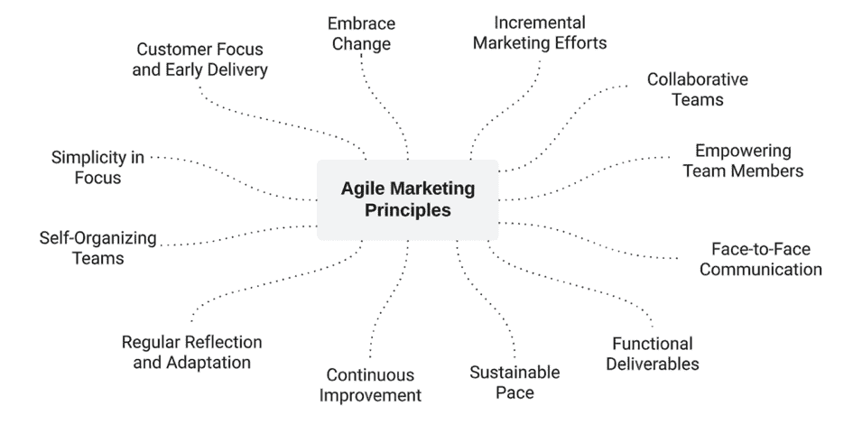

1. **(1) 客户关注和早期交付**：敏捷营销优先考虑客户的需求和偏好，并力求尽早交付价值。这一原则强调了解客户旅程，利用洞察和反馈指导营销策略，并快速迭代产品以更有效地满足客户需求。通过关注客户，营销人员可以实时调整活动，并确保营销工作始终与客户最看重的内容保持一致。

2. **(2) 拥抱变化**：在不断变化的市场环境中，适应变化的能力至关重要。敏捷营销鼓励团队保持灵活性，并将客户行为、市场状况或业务目标的变化视为演进和改进的机会，而非障碍。这种思维确保营销策略保持相关性，并能根据新信息快速调整方向，从而使组织保持竞争力和响应能力。

3. **(3) 增量营销工作**：敏捷营销将大型活动分解为较小、可管理的工作单元，这些单元可以在短周期或冲刺中完成。这种方法使团队能够测试假设、衡量结果，并在持续的反馈和改进循环中完善策略。通过关注增量进展，营销人员可以在绩效和有效性方面获得宝贵的收益，同时降低与大型复杂项目相关的风险。


### 4. 协作团队

协作是敏捷营销的核心，跨职能团队紧密合作，共同规划、执行和审查营销活动。这一原则强调开放沟通、共同目标以及对结果的集体责任。通过打破部门壁垒并鼓励多元视角，敏捷营销团队可以充分发挥其可用的全部技能、经验和创意。

### 5. 授权团队成员

敏捷营销建立在这样一个前提之上：执行工作的人最了解如何高效、有效地完成它。这一原则主张授权团队成员，赋予他们决策自主权、管理工作流程的权力，并对其贡献负责。当团队成员感到受到支持和信任时，他们会更加投入、积极，并更有可能做出最佳工作。

### 6. 面对面沟通

敏捷营销重视直接的面对面互动，认为这是传递信息最高效、最有效的方式。无论是通过线下会议还是视频会议，这一原则都强调个人联系和清晰沟通的重要性。它有助于建立更紧密的团队动态，并确保每个人都在目标和期望方面保持一致。

### 7. 功能性交付物

专注于产生有形的、功能性的交付物是敏捷营销的核心方面。与其沉迷于繁琐的流程或文档，不如创造对市场或客户产生实际影响的营销产出。这一原则强调可操作结果的重要性，例如已启动的活动、已发布的内容或已执行的活动。

### 8. 可持续节奏

敏捷营销提倡以可持续的节奏工作，以确保长期成功。这一原则承认倦怠和过度工作是适得其反的。它强调工作量平衡、合理的期望以及工作与休息的定期间隔。通过保持可持续的节奏，团队可以长期保持创造力、生产力和积极性。

### 9. 持续改进

持续改进的原则是敏捷营销的基础，旨在不断完善和提升营销实践。通过定期的回顾会议和反馈循环，团队评估其绩效，找出改进领域，并对流程、策略和策略实施变更。这种对持续优化的承诺确保营销工作保持有效和高效；团队可以适应新的挑战和机遇。

### 10. 自组织团队

这一原则支持这样的观点：当团队拥有组织自身工作的自由时，其效果最佳。敏捷营销鼓励团队设定自己的目标、管理自己的任务，并确定工作的最佳方法。这种自组织带来了更高的投入度、创造力和问责制，因为团队成员对其项目和结果负有全部责任。

### 11. 定期反思与调整

敏捷营销高度重视定期反思和调整的重要性。鼓励团队定期审查其流程、策略和结果，公开讨论哪些有效、哪些无效，以及如何改进。这一原则确保所学到的经验被整合到未来的工作中，营造一种持续学习的文化。

### 12. 聚焦简洁

最后，敏捷营销强调简洁，鼓励团队专注于真正重要的事情，并消除不必要的任务或复杂性。这一原则可以描述为精简努力、优先考虑高影响力活动，并最大限度地减少浪费。通过专注于简洁，营销人员可以更有效地分配资源，并确保每一项努力都直接有助于实现业务目标。

## 3. 从传统营销过渡到敏捷营销方法

传统营销的特点是其在规划和执行营销策略方面的系统方法。它强调全面的市场调研、详细的规划，以及在较长时期内执行营销活动（Bhayani & Vachhani, 2014; Durmaz & Efendioglu, 2016; Alla et al., 2022; Bouhtatit et al., 2023）。传统营销方法通常侧重于大众媒体广告、印刷媒体、直邮和其他旨在建立品牌知名度和定位的广泛覆盖策略。这种方法在很大程度上依赖于预测消费者行为并提前很久规划营销活动，非常强调一致性和信息控制。

将敏捷方法与传统营销实践相结合，代表着向更具动态性、响应性和以客户为中心的营销运营的重大“转变”。下面列出了一些关键策略及其具体示例，以说明拥抱这些转变如何能显著提升营销团队在快速变化的数字环境中的有效性（Perkin, 2023; Barbosa et al., 2022; Katare 2022; Ewel, 2020; Gera et al., 2019; Poolton et al., 2006; Lewnes, 2021）。

### 3.1 从大型活动转向小型迭代

传统营销通常侧重于在很久之前就规划好的大型、不灵活的活动。转向敏捷营销鼓励更小、更易管理的迭代，这些迭代可以根据实时数据和反馈进行调整和优化。这种方法使营销团队能够更具适应性，测试哪些有效、哪些无效，并对其策略进行持续改进。这种转变的一个例子是：一家公司以小规模启动数字广告活动，以最初测试其假设。通过密切监控活动的实时反馈和分析表现，团队可以做出数据驱动的决策，以迭代方式完善活动的信息传递、定位和创意元素。这种迭代方法不仅降低了与大型活动相关的风险，还确保营销资源更有效地分配给策略。

### 3.2 从产出导向转向成果导向

从关注营销产出的数量转向优先考虑有形成果，标志着衡量营销成功方式的重大变化。传统上，重点在于活动和广告等活动的数量，而没有充分评估其对客户参与度和盈利能力等基本业务目标的影响。这种向成果导向方法的转变需要重新评估策略，以确保营销努力与具体、可衡量的目标（如提高客户参与度和转化率）保持一致。这是一种战略转变，要求更深入地理解对企业而言成功意味着什么，并承诺根据实际绩效数据不断完善营销策略。例如，与其仅仅统计活动中发送了多少封电子邮件，不如将重点转移到理解这些电子邮件如何带来更多网站访问量或更多销售额。这种方法确保营销不仅仅是忙碌的工作，而是有效地为公司的成功做出贡献。通过优先考虑成果而非简单的产出，营销团队可以更明智地利用资源，更好地响应客户的需求和期望，并清楚地展示他们的工作如何使公司受益。


#### 3.3 从孤立功能到跨职能协作

从孤立的营销职能转向跨职能协作，标志着方法上的重大变革。这种方法旨在弥合差距，制定与业务总体目标保持一致的统一战略。在传统的营销架构中，各部门通常独立运作，只关注其特定目标，而缺乏对业务集体目标的全面了解。这种孤岛式方法可能导致策略不一致和目标不协调。

敏捷思维引入了向协作努力转变的变革，并打破了营销与其他关键部门（如销售、客户服务和产品开发）之间的障碍。这种协作方法的一个例子是为新产品发布成立跨职能团队。这些团队汇集了来自营销、销售、产品开发和客户支持的多样化专业知识，以确保从构思到发布的统一战略。这样一来，所有客户接触点的信息传递都得到简化，各部门的目标得到同步，各团队的集体洞察和技能得到充分利用。这种整体方法不仅改善了内部协调，还提升了客户体验，通过统一的战略努力推动更好的业务成果。

#### 3.4 从僵化规划到灵活性和适应性

敏捷营销强调灵活性和适应性，计划被视为动态指南，而非传统营销计划中的固定蓝图。这种转变使团队能够快速应对新的机遇或挑战，并确保其营销工作保持相关性和有效性。例如，假设一个营销团队制定了年度内容策略，但根据新趋势或受众的直接反馈，认识到需要调整重点或更改分发渠道。这种适应性确保营销举措保持相关性并引起目标受众共鸣，同时通过允许实时调整策略来最大限度地提高营销工作的影响。这种向更灵活、更具响应性的规划过程的转变，标志着与传统、更静态的营销策略方法的重大背离。

#### 3.5 从自上而下决策到授权团队

在传统环境中，决策通常由高层做出，并通过组织层层下达。敏捷营销授权团队根据其对项目、市场状况和客户反馈的深入了解，快速做出明智决策。这种自下而上的方法鼓励责任感、创新和更具响应性的营销策略，因为决策是由最接近工作和客户的人做出的。例如，如果营销团队注意到活动未按预期进行的早期迹象，他们在敏捷框架下拥有自主权，可以调整活动方向，而无需高层管理层的审批流程。这种自下而上的方法不仅加快了对新出现挑战的响应时间，还鼓励团队成员之间的责任感和创新。

### 4. 营销的关键敏捷框架和实践

营销中的敏捷实践丰富多样，提供了可显著提升营销团队适应性和效率的宝贵方法论。本节探讨了敏捷在营销中的整合，突出了流行的关键框架，并详细介绍了可帮助营销团队在其活动中变得更具适应性、创新性和有效性的实践。

#### 4.1 基于 Scrum 的敏捷营销

Scrum 一词，从原始敏捷原则的角度来看，是一种体现了敏捷核心哲学（即灵活性、迭代开发和以客户为中心）的框架（Schwaber, 2004; Rubin, 2012）。它将工作组织为称为“冲刺”的小型、可管理的单元，通常持续两到四周。Scrum 方法允许团队以时间箱方式专注于交付项目的特定功能或组件。它通过每日站会、冲刺评审和回顾会议鼓励定期反思和调整。这确保了持续改进和对变化的响应，与《敏捷宣言》的价值观紧密契合：个体和互动高于流程和工具，可工作的解决方案高于全面的文档，客户协作高于合同谈判，响应变化高于遵循计划（Fowler & Highsmith, 2001; Batra et al., 2017）。

从敏捷营销角度来看，通过调整 Scrum 原则，营销团队可以将大型项目分解为可管理的冲刺，并建立一个以增量进展和灵活性为特点的协作环境。这种方法确保营销举措持续与客户需求和市场动态保持一致，使团队能够根据反馈和绩效分析迅速调整策略。

在基于 Scrum 的敏捷营销框架下，几项关键实践对于增强团队动态、确保与客户期望保持一致以及推动营销成功至关重要（[图 3](#979-8-3693-3172-9.ch007.bits-pdf.xhtml#_idTextAnchor413））。这些实践如下所述：

*   • 每日站会：这些简短、专注的会议为营销团队成员提供了一个平台，用于分享进度、概述当天的计划并解决任何挑战。这种做法支持团队协调，并能迅速解决问题，确保活动按计划进行。例如，团队可能会根据最新的参与度指标讨论对数字广告活动的调整。

*   • 冲刺规划：在这个关键的准备会议中，团队协作从营销待办事项列表中选择与即将到来的冲刺目标相一致的高优先级事项。设定明确的目标和成功标准，例如预期的潜在客户生成或网站流量增长，可以提供专注的努力和战略决策。

*   • 待办事项细化：这个持续的过程涉及待办事项列表的优先级排序和澄清。它确保每个任务都定义明确、有价值且战略上保持一致。例如，细化可能涉及根据 ROI 分析决定优先开发新的电子邮件营销活动，而不是更新现有的社交媒体广告。

*   • 用户故事：使用关注用户的故事有助于将营销目标与目标受众真正需要和想要的东西保持一致。开发诸如“作为一名年轻的专业人士，我想找到快速健康的餐饮选择”等故事，有助于塑造与受众深度连接的营销传播和内容方法。

*   • 冲刺评审：每个冲刺结束时，团队与重要参与者分享其进度，突出完成的任务并收集意见。这可能包括审查新产品发布活动在各渠道的表现，并讨论客户反应和销售数据。

*   • 回顾会议：这些会议提供了评估冲刺整体流程的机会，承认成功并确定改进领域。例如，回顾会议可能会揭示内容创作者和平面设计师之间需要更好的协调，以简化内容制作。


*   • `Burndown Charts`: 通过直观跟踪冲刺中已完成任务与剩余任务，燃尽图能清晰展示团队进度及与计划的任何偏差。该工具可帮助调整工作量以实现冲刺目标，例如按时完成所有计划的博客文章和 SEO (`Search Engine Optimization`)。

#### Figure 3. Scrum based agile marketing process

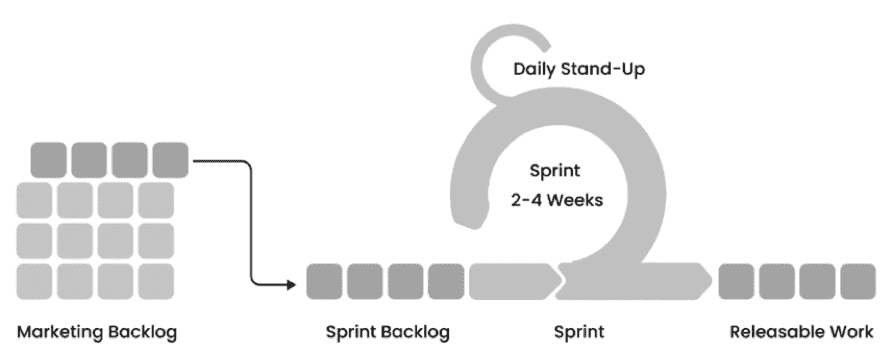

(Source: Intuz, 2022)

#### 4.2 Kanban-Based Agile Marketing

Kanban 是一种精益管理方法，通过可视化管理提升效率。它起源于日本制造业，尤其适用于通过看板可视化整个工作流来管理复杂任务 (Ahmad et al., 2013; Senapathi & Drury‐Grogan, 2021)。它专注于通过可视化工作、限制在制品 (`WIP`)、管理流程以及明确流程政策，来最大限度提高效率并最大限度减少浪费。从本质上讲，Kanban 使用看板和卡片来表示任务，将其在代表流程不同阶段的列之间移动，从“待办”到“进行中”再到“完成”。这种可视化有助于团队监控工作流并识别瓶颈，从而实现持续改进并适应优先级的变化 (Alaidaros et al., 2021; Senapathi & Drury‐Grogan, 2021)。

在营销领域，采用基于 Kanban 的敏捷营销方法意味着将 Kanban 原则应用于管理和改进营销流程。通过在看板上可视化营销任务，团队可以轻松了解需要做什么、正在进行什么以及已完成什么。这种清晰度有助于更好地优先处理任务，确保营销工作与业务目标和客户需求保持一致。它还能促进团队成员之间更顺畅的协作，因为每个人都能清晰了解工作流，并能识别自己可以贡献的领域或可能出现瓶颈的地方。通过限制在制品，营销团队可以专注于高效完成任务，从而提高生产力，缩短活动和计划的上市时间。基于 Kanban 的敏捷营销支持一种更具动态性和响应性的营销策略，使团队能够快速适应反馈和市场变化，而不会过度投入资源。

在基于 Kanban 的敏捷营销框架下，几项关键实践对于简化营销运营和提升团队生产力至关重要：

*   • `Visualizing the Workflow`: 使用看板绘制所有营销任务（从构思社交媒体活动到启动电子邮件营销序列），既能提供透明度，又能支持动态策略调整。这种做法确保从内容创作者到数字战略家的所有利益相关者都能保持一致，并能监控任务进度，例如新产品发布或季节性广告推广的开发，从开始到结束。

*   • `Limiting Work in Progress`: 对工作流各阶段的活跃任务施加限制，鼓励团队专注于完成正在进行的计划，例如完成一系列博客文章或优化 PPC 活动。这种方法能提高专注度和产出质量，并促进任务之间更高效的转换，显著降低项目瓶颈和团队倦怠的风险。

*   • `Managing Flow`: 持续分析任务的流动情况，例如视频营销项目的进展或通过看板执行市场调研计划，有助于及早发现延误。通过及时解决这些延误，营销团队可以优化流程，确保新品牌合作或网红合作等计划能够更快速、更有效地交付。

*   • `Making Process Policies Explicit`: 制定从构思到完成推进任务的明确标准，确保从平面设计师到 SEO 专家的每个人都了解自己的职责。这种清晰度能简化工作流，最大限度减少误解，并改进营销活动，例如内容发布计划或活动营销准备。

*   • `Feedback Loops`: 定期回顾营销工作流并分析活动结果，例如最近社交媒体广告的参与率或电子邮件活动的转化指标，鼓励持续学习和迭代。这种适应性方法使团队能够根据客户反馈和市场趋势优化策略。

*   • `Collaborative Prioritization`: 让整个营销团队参与任务优先级排序，确保资源分配到最具影响力的计划，例如高风险的产品发布或战略性内容营销转型。这种集体决策过程能增强团队承诺，同时确保营销工作与更广泛的业务目标保持战略一致，最大化投资回报率并推动可持续增长。

Kanban 工具对于有效实施 Kanban 方法论至关重要，它提供任务和工作流的可视化管理，有助于更好的规划、跟踪和协作。这些工具，例如 Trello、Asana 和 Jira，提供旨在增强营销团队项目可见性和协作的数字平台 (Figure 4)。凭借可自定义工作流、任务分配和进度跟踪等功能，Kanban 工具能够实现高效的工作流管理。它们使团队能够优先处理工作、识别瓶颈并快速调整策略，因此对于管理多样化的营销项目以及确保远程或办公室团队之间的无缝沟通至关重要。

#### Figure 4. An example of Kanban Board of Trello

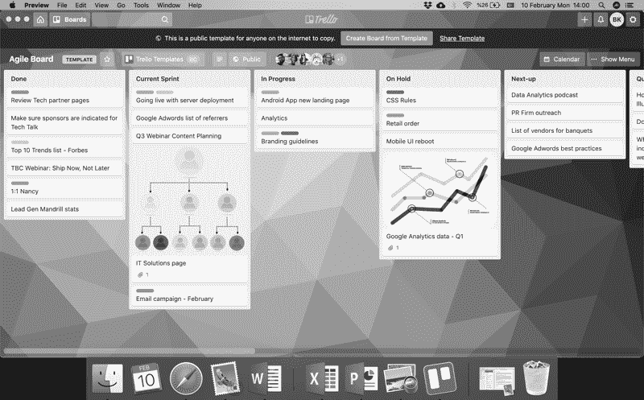

(Atlassian Trello, 2024)

#### 4.3 Scrumban Based Agile Marketing

Scrumban 将两种领先的敏捷方法论——Scrum 和 Kanban——合并为一个完成工作的单一流程 (Atlassian, 2024)。Scrumban 作为一种混合敏捷方法论，将 Scrum 结构化的冲刺方法与 Kanban 的持续流动和灵活性相结合。它旨在为团队提供框架，以便更有效地优先处理工作、适应优先级变化，并持续改进交付流程。如 Table 1 所示，通过整合 Scrum 结构化的计划会议和评审，以及 Kanban 对可视化工作和限制在制品的关注，Scrumban 使团队能够以更高的敏捷性和响应能力管理任务。这种方法论在工作优先级经常变化或项目范围可能快速变化的环境中尤其有益，它提供了一种平衡的方法，最大限度地提高效率和适应性。


# 对敏捷营销团队而言，Scrumban 提供了量身定制的方法

对敏捷营销团队而言，Scrumban 提供了一种量身定制的方法，支持营销项目和活动的动态特性。通过采用 Scrumban，营销团队可以利用 Scrum 的冲刺规划来制定主要计划和活动发布，同时采用 Kanban 的可视化来跟踪内容创建、社交媒体管理和活动策划等持续任务。这种结合促进了更具适应性的工作流程，能够迅速适应新的市场机会或客户反馈，而不会破坏整体营销策略。此外，Scrumban 强调持续改进和团队协作，使其成为希望在快节奏行业中创新并保持竞争力的营销部门的理想选择。

## 表 1. Scrum、Kanban 和 Scrumban（来源：Atlassian，2024）

| 标准 | Scrum | Kanban | Scrumban |
| --- | --- | --- | --- |
| 方法论 | 固定长度冲刺<br>固定角色<br>一致交付 | 限制在制品数量<br>可视化跟踪任务<br>工作的连续流动 | 固定长度冲刺<br>限制在制品数量<br>可视化跟踪任务<br>工作的连续流动 |
| 角色 | 产品负责人<br>Scrum Master<br>开发团队 | 无 | 无 |
| 工件 | 产品待办列表<br>冲刺待办列表<br>完成的增量 | Kanban 看板<br>Kanban 卡片 | Scrumban 看板<br>Scrumban 卡片 |
| 事件 | 冲刺规划<br>每日站会<br>冲刺评审<br>冲刺回顾 | Kanban 会议 | 冲刺规划<br>每日站会<br>冲刺回顾 |
| 流程 | 产品待办列表<br>冲刺待办列表<br>进行中<br>评审<br>完成 | 待办<br>进行中<br>完成 | 待办<br>进行中<br>完成 |

如 表 1 所述，Scrumban 对敏捷营销团队的关键实践有效地结合了 Scrum 的结构化方法与 Kanban 的适应性，并为营销的动态需求提供了量身定制的强健框架。这些实践包括：

* 营销项目的结构化冲刺：引入 Scrum 的冲刺概念，Scrumban 允许营销团队定义工作周期（通常为两周）来完成一组任务。这种结构为活动开发、内容制作和其他营销计划提供了明确的时间范围，促进专注和及时交付。

* 团队协调的每日站会：借鉴 Scrum，每日站会在 Scrumban 中至关重要，为营销团队成员提供同步日常活动的平台。这些简短的会议增强了对个人贡献、任务进度以及识别任何障碍的清晰度。

* 持续改进的回顾会议：每个冲刺结束时，营销团队进行回顾会议以评估其流程和成果。这种做法使团队能够反思哪些做得好、哪些做得不好，并将所学经验应用于优化未来的营销策略和运营。

* 可视化管理的 Kanban 看板：Kanban 看板包含“待办”、“进行中”和“完成”等列，可视化跟踪营销任务的进度。这种透明度允许实时调整，并确保所有团队成员了解活动的状态和优先级。

* 详细跟踪的任务卡片：利用 Kanban 看板上的卡片来表示单个营销任务（从构思到执行），便于详细跟踪进度和问责制。每张卡片从“待办”到“完成”的历程展示了营销交付物（如电子邮件活动、博客文章或社交媒体更新）的工作流程。

* 防止过载的 WIP 限制：采用 Kanban 的 WIP 限制可确保营销团队不会承担超出其处理能力的任务，从而保持高质量的产出并防止倦怠。通过限制活动任务的数量，团队可以专注于完成当前项目，然后再启动新项目。

* 协作式任务优先级：结合 Scrum 的协作规划与 Kanban 的灵活性，Scrumban 鼓励营销团队根据战略目标和当前市场动态共同确定任务优先级。这种集体决策确保高影响力项目得到及时处理，并使营销工作与整体业务目标保持一致。

## 图 5. Scrumban 流程上下文

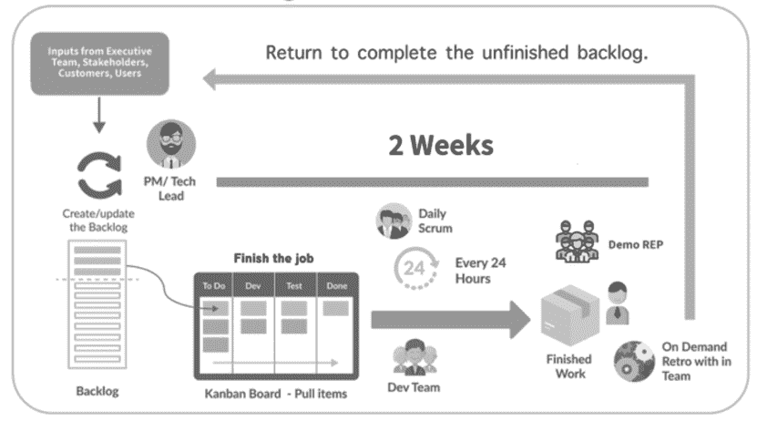

（来源：Aini et al., 2021）

虽然 Scrumban 方法论为管理工作提供了灵活高效的框架，但它也有其自身的一系列局限性。Scrumban 的混合性质可能会给初次接触敏捷实践的团队带来复杂性和歧义。此外，Scrumban 的新颖性意味着可用的文档指导较少，既定的最佳实践也较少，可能导致实施方面的挑战。另外，缺乏传统的 Scrum 角色以及对自我管理的强调，可能会导致关于任务职责和决策权的混淆。这些局限性凸显了清晰沟通的重要性，以及团队需要投入时间来理解和调整该方法论以适应其特定环境和工作流程的必要性。

## 4.4 精益敏捷营销

精益管理是一种源自精益制造原则的方法论，最初在汽车行业开发，旨在最大限度地提升客户价值，同时最大限度地减少浪费（Anvari et al., 2011; Bhamu et al., 2014）。它专注于简化运营、提高流程效率，并通过系统性地移除非增值活动和减少生产过程中的变异性来提升产品质量。精益管理的关键要素包括持续改进（Kaizen）、尊重人员，以及通过价值流优化产品和服务的流动（Pinto et al., 2018; Deshmukh et al., 2010）。目标是用更少的资源创造更多价值，提高客户满意度，并在组织内部发展协作文化和持续学习。

当精益原则应用于敏捷营销时，换句话说，在部署精益敏捷营销时，重点转移到在营销活动中最大限度地提升客户价值，同时保持快速响应市场变化的敏捷性。这种方法结合了精益的减少浪费和提高效率的关注，以及敏捷方法论的灵活性和快速迭代。精益敏捷营销的好处包括更好地响应客户需求、通过消除不必要的任务来提高团队生产力，以及营销活动与整体业务目标之间更强的一致性。它使营销团队能够更有效地适应数字环境，其中消费者偏好可能会迅速变化，而数据驱动的洞察对于成功至关重要。精益敏捷营销的关键实践如下所述：

* 强调客户价值：这种做法专注于优先考虑为客户提供最显著价值的营销计划。它涉及使用反馈和数据分析来做出明智的决策，并确保营销工作始终与客户需求和偏好保持一致。


*   精简营销流程：此实践专注于识别并消除营销活动中不增加价值的流程。目标是精简运营、减少浪费并提升整体效率，从而实现更专注、更有效的营销工作。例如，通过实施自动化软件，公司可以精简其电子邮件营销工作，根据受众的行为和偏好自动细分受众群体，并大规模发送个性化电子邮件，从而提升效率和参与度，同时缩短新营销活动的上市时间。

*   利用数据驱动的决策：此实践强调基于数据分析和洞察做出明智的营销决策。它确保营销策略不仅与实际绩效指标和客户偏好保持一致，而且针对有效性和效率进行了优化。例如，数字营销团队利用 A/B 测试来尝试其产品页面上两种不同的行动号召（CTA）短语。通过分析点击率和转化数据，他们识别出更能吸引受众的 CTA，从而显著提高转化率。

*   保持灵活性和适应性：此实践专注于保持营销策略的灵活性，以便能够快速响应不断变化的市场状况和消费者反馈进行调整。目标是确保无论外部环境如何变化，营销工作始终保持相关性和影响力。

#### 4.5 营销成功的替代敏捷框架

虽然 Scrum、Kanban、Scrumban 和 Lean Agile 是最受欢迎的用于营销的框架，但确实还有其他方法和途径可以显著提升营销团队的敏捷性和有效性。

今天，设计思维方法在营销中为应对复杂的营销挑战和增强以客户为中心的营销策略的开发提供了一个强大的框架。(Knight, 2021)。通过深入了解客户需求、头脑风暴创新解决方案以及快速原型制作和测试想法，团队可以开发出不仅满足而且超越客户期望的营销策略和解决方案。例如，一家专注于推出新产品线的公司可能会从设计思维研讨会开始，深入共情潜在客户，识别其核心需求和痛点。利用这些洞察，营销团队随后可以采用敏捷方法快速制作各种营销信息和渠道的原型，在现实场景中进行测试，看看哪种效果最好。基于实时反馈和数据分析，团队迭代改进其方法，并确保最终的营销活动既创新又高度符合目标受众的偏好。这种设计思维与敏捷的结合允许更具动态性和响应性的营销流程，能够适应不断变化的客户期望和市场状况，最终带来更有效和更成功的营销成果。

另一个有价值的敏捷框架，功能驱动开发（FDD）也可以用于营销实践。它强调一种结构化的方法来交付关键功能或举措 (Hunt, 2006; Palmer & Felsing, 2001)。FDD 原则可以带来更有组织且以影响力为导向的营销活动。它专注于以系统、高效的方式规划、构建和交付营销项目。通过在营销中采用 FDD 方法，每个功能都对整体营销目标做出重大贡献，并为企业及其客户提供切实价值。例如，在推出新产品线的情况下，营销团队将推出过程分解为关键功能，例如有针对性的社交媒体活动、网红合作伙伴关系和电子邮件营销序列。每个功能随后以结构化的方式开发和执行，具有特定的时间表、职责和可衡量的目标。这种方法允许详细跟踪每个举措的成功，并提供清晰的洞察，了解哪些营销工作在推动参与度和销售方面最有效。通过专注于离散的高价值功能，团队可以更有效地分配资源，根据实时反馈快速调整，并增强产品发布策略的有效性。

### 5. 营销中敏捷方法论的策略

在营销领域采用敏捷方法论会带来几个挑战，例如组织内部的文化阻力、缺乏敏捷专业知识、动态资源分配的困难、团队之间的技能差距、扩大敏捷实践的挑战、将敏捷整合到非敏捷部门，以及重新定义成功指标以适应敏捷营销工作。每个问题都需要有针对性的策略来克服，以确保在营销环境中成功实施和优化敏捷方法论。克服实施敏捷营销的挑战需要多方面的方法，重点关注领导力、文化和流程：

#### 5.1 敏捷领导力和对敏捷营销的支持

有效的敏捷转型植根于既采用敏捷原则又积极展示和支持这些实践的领导力。领导者在引导团队度过敏捷转型过程中发挥着关键作用，他们不再是传统的权威人物，而是赋能团队的促进者。他们负责培养一种重视开放对话、团队合作和持续改进的文化。这一过程的关键是获得高管支持，这确保了必要资源的分配，并加强了组织对敏捷实践的承诺。来自高层管理的这种支持对于应对挑战以及确保敏捷项目获得成功所需的关注至关重要。同样重要的是在团队中培养敏捷领导者。这些领导者充当敏捷方法的指导者和支持者，在营销团队和更广泛的组织中传播敏捷思维，这有助于敏捷实践无缝融入公司的运营中。

#### 5.2 在营销中培养敏捷文化

构建敏捷文化需要持续的培训和教育，以加深团队对敏捷实践的理解。这确保了对敏捷方法及其在营销中如何应用的深入理解。这种基础知识使团队能够充分拥抱敏捷价值观和实践。强调跨职能协作在多元化的营销世界中尤其重要，因为它汇集了从创意到分析的各种技能和视角，增强了团队动态和产出质量。推广实验心态，并将成功和失败都视为学习的机会，是培养真正敏捷环境的关键。在营销中，这种方法促进创新和适应性的文化，使团队能够迅速响应市场变化、消费者趋势和反馈循环。这种持续改进和灵活性的环境是实现持续营销成功并与目标受众建立有意义参与的关键。

#### 5.3 精简营销卓越的敏捷流程和指标


# 优化营销团队的敏捷工具和方法论

优化敏捷工具和方法论以适应营销团队及其项目的特定需求，对于最大限度地提高效率和效果至关重要。采用敏捷项目管理工具，例如 Trello、Asana 或 Jira，对于促进任务组织、工作流程可视化和团队协作至关重要。此外，完善绩效指标以优先考虑敏捷价值观，例如客户参与度、活动适应性和上市速度，可确保评估标准与敏捷营销的目标保持一致。采用迭代规划使营销团队能够保持灵活性，快速适应消费者反馈和不断变化的市场趋势，确保其努力保持相关性和有效性。

此外，建立明确定义的流程和清晰的沟通渠道，是增强与可能不遵循敏捷原则的部门协作的关键。这种跨部门协同对于确保营销策略与公司的总体目标和策略保持一致至关重要。通过以营销为中心的方法简化这些敏捷流程和指标，团队可以推出更加聚焦、适应性强且符合客户需求的营销活动。因此，这将带来更好的营销投资回报率和持续的业务增长。

## 5.4 现实世界中的敏捷营销成功案例

下面列举了一些示例，突出说明敏捷营销原则已在各个行业中应用，展示了其在推动营销成功方面的广泛适用性和有效性（Faster Capital, 2024；Marketing Insider Group, 2024；PepsiCo Partners, 2024；Denning, S., 2019；Coca Cola Company, 2019）：

*   微软通过在其产品线中使用增长黑客团队应用了敏捷营销原则。这些团队采用数据驱动的方法，快速试验营销策略，并根据绩效指标实时优化。这种方法使得更个性化的客户参与和更快速地适应市场变化成为可能。

*   可口可乐通过建立专注于内容创建的较小跨职能团队，采用了敏捷方法，从而实现了营销活动的快速开发和部署。这种转变使他们能够快速适应不断变化的消费者偏好和社交媒体趋势，从而产生更具相关性和吸引力的内容。

*   亚马逊的营销策略是敏捷营销实践的典范。通过利用大量客户数据，亚马逊不断测试和优化其营销信息和渠道。这种数据驱动的方法使他们能够对客户需求和偏好做出极其敏捷的响应，定制其产品并改善客户体验。

*   ING 银行采用了敏捷“部落”模式来重组其员工队伍，包括营销团队。这种结构由跨职能小组组成，这些小组自主开展特定的以客户为中心的项目，从而实现更快的决策、更快地适应市场变化以及增强协作。

*   联合利华在其数字营销工作中实施了敏捷方法，以更好地应对快速变化的数字环境。这种方法使联合利华能够更有效地测试不同的数字营销策略，分析绩效数据并迭代其策略，从而提高参与率并改善数字营销活动的投资回报率。

*   百事公司与初创企业启动了数字实验室合作伙伴计划，以测试和扩展新的数字能力，包括数据分析、用于个性化的人工智能以及数字自动售货体验。这一举措使百事公司能够始终处于数字营销创新的前沿，快速试验和实施新技术以增强客户参与度。

## 6 结论

采用敏捷思维是利用敏捷方法论在营销中发挥变革力量的关键步骤。这种方法强调灵活性、客户关注和协作，通过反馈和学习促进营销策略的持续改进。敏捷营销重视透明度和适应性，并使团队能够快速适应市场变化和消费者需求。通过将营销工作与战略目标保持一致，组织既能培养创新和响应能力，又能提高有效应对市场挑战的能力。

将敏捷方法论（如 Scrum、Kanban、Scrumban 和 Lean）集成到营销实践中，标志着向更具动态性和以客户为导向的策略转变。这种转变需要强有力的领导力、持续学习的文化以及愿意进行实验的意愿。尽管存在文化阻力和技能差距等潜在障碍，但专注于敏捷领导力和协作实践可以引导组织实现更有效和更敏捷的营销成果。展望未来，在营销中采用敏捷方法将带来创新、韧性和与客户更紧密联系的未来，并推动营销领域迈向更卓越和更具适应性的发展。

# 参考文献

Ahmad, M. O., Markkula, J., & Oivo, M. (2013, September). Kanban In Software Development: A Systematic Literature Review. In 2013 39th Euromicro Conference On Software Engineering And Advanced Applications (Pp. 9-16). IEEE. [10.1109/SEAA.2013.28](http://dx.doi.org/10.1109/SEAA.2013.28)

Aini, Q., Budiarto, M., Putra, P. O. H., & Santoso, N. P. L. (2021). Gamification-Based The Kampus Merdeka Learning In 4.0 Era. \[Indonesian Journal Of Computing And Cybernetics Systems\]. IJCCS, 15(1), 31–42. [10.22146/ijccs.59023](http://dx.doi.org/10.22146/ijccs.59023)

Alaidaros, H., Omar, M., & Romli, R. (2021). The State Of The Art Of Agile Kanban Method: Challenges And Opportunities. Independent Journal of Management & Production, 12(8), 2535–2550. [10.14807/ijmp.v12i8.1482](http://dx.doi.org/10.14807/ijmp.v12i8.1482)

Alla, L., Kamal, M., & Bouhtati, N. (2022). Big data and marketing effectiveness of tourism businesses: A literature review. Alternatives Managériales Economiques, 4(0). [10.48374/IMIST.PRSM/ame\-v1i0.36928](http://dx.doi.org/10.48374/IMIST.PRSM/ame-v1i0.36928)

Anvari, A., Ismail, Y., & Hojjati, S. M. H. (2011). A Study On Total Quality Management And Lean Manufacturing: Through Lean Thinking Approach. World Applied Sciences Journal, 12(9), 1585–1596.

Atawneh, S. (2019). The Analysis Of Current State Of Agile Software Development. Journal of Theoretical and Applied Information Technology, 97(22), 3197–3028.

Atlassian. (2024). Scrumban: Mastering Two Agile Methodologies. Atlassian. Https://Www.Atlassian.Com/Agile/Project\-Management/Scrumban

Barbosa, A. T., Da Silva, C. C., Caetano, R. L., Da Silva, D. P. S., Barbosa, J. V., & Pinto, Z. T. (2022). Agile Methodologies: And Its Applicability In The Marketing AREA. Revista Ibero-Americana De Humanidades. Ciência & Educação (Bauru), 8(3), 1659–1669.

Batra, D., Xia, W., & Zhang, M. (2017). Collaboration In Agile Software Development: Concept And Dimensions. Communications of the Association for Information Systems, 41(1), 20. [10.17705/1CAIS.04120](http://dx.doi.org/10.17705/1CAIS.04120)

Bhamu, J., & Singh Sangwan, K. (2014). Lean Manufacturing: Literature Review And Research Issues. International Journal of Operations & Production Management, 34(7), 876–940. [10.1108/IJOPM\-08-2012-0315](http://dx.doi.org/10.1108/IJOPM-08-2012-0315)

Bhayani, S., & Vachhani, N. V. (2014). Internet Marketing Vs Traditional Marketing: A Comparative Analysis. FIIB Business Review, 3(3), 53–63. [10.1177/2455265820140309](http://dx.doi.org/10.1177/2455265820140309)


# 参考文献

Bouhtati, N., Alla, L., & Bentalhah, B. (2023). Marketing Big Data Analytics and Customer Relationship Management: A Fuzzy Approach. In Integrating Intelligence and Sustainability in Supply Chains (pp. 75-86). IGI Global. [`10.4018/979\-8\-3693\-0225-5.ch004`](http://dx.doi.org/10.4018/979-8-3693-0225-5.ch004)

Coca Cola Company. (2019). Building A Growth Culture At Coke Includes Empowering All Employees To Drive Company’s Innovation Agenda. Coca Cola Company. `Https://Www.Coca\-Colacompany.Com/Media\-Center/Growth\-Culture\-At\-Coke\-Empowers\-Employees`

Denning, S. (2019). How Amazon Became Agile. Forbes. `Https://Www.Forbes.Com/Sites/Stevedenning/2019/06/02/How-Amazon-Became-Agile/?Sh=495af40031aa`

Deshmukh, S. G., Upadhye, N., & Garg, S. (2010). Lean Manufacturing For Sustainable Development. Glob. Bus. Manag. Res. Int. J, 2(1), 125.

Duka, D. (2013, May). Adoption Of Agile Methodology In Software Development. In 2013 36th International Convention On Information And Communication Technology, Electronics And Microelectronics (MIPRO) (Pp. 426-430). IEEE.

Durmaz, Y., & Efendioglu, I. H. (2016). Travel From Traditional Marketing To Digital Marketing. Global Journal of Management and Business Research, 16(2), 34–40. [`10.34257/GJMBREVOL22IS2PG35`](http://dx.doi.org/10.34257/GJMBREVOL22IS2PG35)

Flewelling, P. (2018). The The Agile Developer’s Handbook: Get More Value From Your Software Development: Get The Best Out Of The Agile Methodology. Packt Publishing Ltd.

Fowler, M., & Highsmith, J. (2001). The Agile Manifesto. Software Development, 9(8), 28–35.

Gera, G., Gera, B., & Mishra, A. (2019). Role Of Agile Marketing In The Present Era. International Journal Of Technical Research & Science, 4(5), 40–44. [`10.30780/IJTRS.V04.I05.006`](http://dx.doi.org/10.30780/IJTRS.V04.I05.006)

Highsmith, J. A. (2002). Agile Software Development Ecosystems. Addison-Wesley Professional.

Hoogveld, M., & Koster, J. (2016). Measuring The Agility Of Omnichannel Operations: An Agile Marketing Maturity Model. SSRG International Journal Of Economics And Management Studies (SSRG\-IJEMS), 3(10), 5-14.

Hunt, J. (2006). Feature-Driven Development. Agile Software Construction, 161-182.

Intuz (2022). An Ultimate Guide On Adopting Agile Marketing Methodology. Intuz. `Https://Www.Intuz.Com/Guide\-On\-Agile\-Marketing\-Methodology`

Kalenda, M., Hyna, P., & Rossi, B. (2018). Scaling Agile In Large Organizations: Practices, Challenges, And Success Factors. Journal of Software (Malden, MA), 30(10), E1954. [`10.1002/smr.1954`](http://dx.doi.org/10.1002/smr.1954)

Kelly, A. (2008). Changing Software Development: Learning To Become Agile. John Wiley & Sons.

Knight, W. (2021). How To Use Design Thinking In Marketing. Warren-Night. `Https://Warren\-Knight.Com/2021/04/08/How\-To\-Use\-Design\-Thinking\-In\-Marketing/`

Lewnes, A. (2021). Commentary: The Future Of Marketing Is Agile. Journal of Marketing, 85(1), 64–67. [`10.1177/0022242920972022`](http://dx.doi.org/10.1177/0022242920972022)

Marketing Insider Group. (2024). Case Studies. Marketing Insider Group. `Https://Marketinginsidergroup.Com/Agile\-Marketing/Agile\-Marketing\-Examples\-Case\-Studies/`

Matharu, G. S., Mishra, A., Singh, H., & Upadhyay, P. (2015). Empirical Study Of Agile Software Development Methodologies: A Comparative Analysis. Software Engineering Notes, 40(1), 1–6. [`10.1145/2693208.2693233`](http://dx.doi.org/10.1145/2693208.2693233)

Moi, L., & Cabiddu, F. (2021). An Agile Marketing Capability Maturity Framework. Tourism Management, 86, 104347. [`10.1016/j.tourman.2021.104347`](http://dx.doi.org/10.1016/j.tourman.2021.104347)

Palmer, S. R., & Felsing, M. (2001). A Practical Guide To Feature\-Driven Development. Pearson Education.

Patary, C. L. (2019). The Scrum Master Guidebook: A Reference For Obtaining Mastery. Notion Press.

Perkin, N. (2023). Agile Transformation: Structures, Processes And Mindsets For The Digital Age. Kogan Page Publishers.

Pinto, J. L. Q., Matias, J. C. O., Pimentel, C., Azevedo, S. G., Govindan, K., Pinto, J. L. Q., & Govindan, K. (2018). Lean Manufacturing And Kaizen. Just In Time Factory: Implementation Through Lean Manufacturing Tools, 5-24.

Poolton, J., Ismail, H. S., Reid, I. R., & Arokiam, I. C. (2006). Agile Marketing For The Manufacturing‐Based SME. Marketing Intelligence & Planning, 24(7), 681–693. [`10.1108/02634500610711851`](http://dx.doi.org/10.1108/02634500610711851)

Ramos, C., & Pavhlichenko, I. (2022). Creating Agile Organizations: A Systemic Approach. Addison-Wesley Professional.

Rubin, K. S. (2012). Essential Scrum: A Practical Guide To The Most Popular Agile Process. Addison-Wesley.

Schwaber, K. (2004). Agile Project Management With Scrum. Microsoft Press.

Senapathi, M., & Drury‐Grogan, M. L. (2021). Systems Thinking Approach To Implementing Kanban: A Case Study. Journal of Software (Malden, MA), 33(4), E2322. [`10.1002/smr.2322`](http://dx.doi.org/10.1002/smr.2322)

Thümler, N. (2023). Agility In Marketing: A Bibliometric Analysis. Business: Theory and Practice, 24(1), 173–182. [`10.3846/btp.2023.17090`](http://dx.doi.org/10.3846/btp.2023.17090)

Vassileva, B. (2017). Agile Marketing Strategies: How To Transform The Customer\-Brand Dynamics In Services. Bucharest.

Winter, B., & Winter, B. (2015). The Basics Of Agile. Agile Performance Improvement: The New Synergy Of Agile And Human Performance Technology, 85-120.

Yusoff, Y., Alias, Z., Abdullah, M., & Mansor, Z. (2019). Agile Marketing Conceptual Framework For Private Higher Education Institutions. International Journal of Academic Research in Business & Social Sciences, 9(1). [`10.6007/IJARBSS/v9-i1/5896`](http://dx.doi.org/10.6007/IJARBSS/v9-i1/5896)

# Chapter 8

# The Potential Benefits of Integrating Business Intelligence and CRM

Abdelhak Ait Touil

`Orcid Image``http://orcid.org/0000-0003-4816-1420` [`http://orcid.org/0000-0003-4816-1420`](http://orcid.org/0000-0003-4816-1420)

National School of Business and Management, Meknes, Morocco

### ABSTRACT

The business environment is constantly changing and evolving, and companies must adapt to remain competitive. Today, companies have no choice but to compete on a global scale by developing products and services that meet the aspirations and needs of consumers. To meet these challenges, companies need to acquire and develop resources that improve their ability to effectively exploit opportunities and avoid threats. Business intelligence and CRM systems help companies do this. Business intelligence and customer relationship management are closely related. Recent studies have explored the benefits of integrating business intelligence and CRM. Today, the integration of business intelligence and CRM has become a key strategy for companies seeking to improve their operational efficiency and customer-centric practices. The purpose of this chapter is to provide a perspective on how the integration of business intelligence and CRM can lead companies to sustainable growth and improved competitiveness. It explores the principles, challenges, and potential benefits of this integration.

### 1\. INTRODUCTION


# 商业环境与商业智能（BI）概述

商业环境在不断变化和演变，公司必须适应以保持竞争力。全球化加剧了各行业的国际竞争。公司现在别无选择，只能在全球范围内竞争，开发满足世界各地消费者期望和需求的产品和服务。更重要的是，数字技术（如交易系统、商业智能和人工智能）的使用日益增加，正在彻底改变公司竞争的方式。公司越来越有兴趣采用这种技术以保持竞争力并提供价值主张。客户要求越来越高，对产品的期望也很高。公司必须能够快速响应这些不断变化的偏好，以保持竞争力。此外，公司面临着采用负责任和可持续做法的强烈压力，例如减少碳足迹和使用环保材料（Jhamb and Turcanu, 2022）。

为了应对这些挑战，公司需要获取和开发可能提高其有效利用机会并避免对其绩效构成威胁的资源（Murat et al., 2023）。

组织投资商业智能工具的最有力原因之一是创建新的客户关系并改善现有关系（Olszak, 2016）。此外，BI 工具可用于通过网络数据分析来识别和画像新客户。因此，公司可以投资商业智能以解决一系列销售和营销需求（Olszak, 2016）。

随着公司继续数字化其 CRM 流程，CRM 与商业智能之间的联系变得越来越重要。通过将 CRM 与商业智能集成，公司可以进一步改善客户关系管理。商业智能提供用于分析客户数据的高级工具，以便用户和决策者在正确的时间、正确的地点拥有正确的信息，以提高绩效。

最近的研究已经考察了将商业智能和 CRM 集成的好处。例如，Rathod et al. 发现，将人工智能和 CRM 集成可以帮助公司改善其销售和营销策略并提高客户满意度（Rathod et al., 2024）。同样，Ledro et al. 提供了关于该主题的文献综述，识别了差距并提出了有趣的研究方向（Ledro et al., 2022）。在一个案例研究中，Alikhani 和 Kazemi 表明 BI 对 CRM 有多种有益影响，例如改善战略和运营层面的决策过程、降低 CRM 流程的成本，并通过分析客户数据识别新机会（Alikhani et al., 2021）。

# 研究问题

那么，似乎同时和谐且智能地使用这两种系统提供了巨大的机会。这引出了以下研究问题：集成 BI 和 CRM 功能的潜在好处是什么？这种集成的主要挑战是什么？


# 我们所说的“BI 和 CRM 能力集成”是什么意思

我们所说的“BI 和 CRM 能力集成”是什么意思，是指 BI 资源和能力在 CRM 流程中的可能应用，反之亦然。资源是企业拥有的生产性资产；能力是企业能够做的事情。单个资源本身并不能带来竞争优势；它们必须协同工作以创造组织能力（Grant, 2018 中进行了总结：

#### 表 1. CRM 的主要流程

| 流程 || 描述 |

| --- | --- |

| 线索管理 || 线索管理流程包括捕获和筛选线索以提交给销售代表，并跟踪其通过销售管道。为此，Stefanov 等人建议使用专业的线索管理软件（Stefanov et al., 2023）。 |

| --- | --- |

| 销售管理 || 根据 Kucera 的说法，CRM 系统有助于优化销售流程（Kučera and Cmuntová, 2023）。销售管理涵盖了销售周期中客户互动的管理（订单处理和客户账户管理）。 |

| 营销管理 || 该流程涉及创建和执行针对特定客户细分的营销活动。Berestetska 等人发现，CRM 系统可用于为品牌制定和实施数字通信策略。（Berestetska et al., 2023）。 |

| 客户服务管理 || 该流程涉及售后管理客户互动。包括处理客户投诉、管理退货和退款，以及提供售后技术支持。从这个意义上说，Espinoza 指出，s-CRM 和 e-CRM 可用于改善客户服务管理流程（Piert Espinoza et al., 2023）。 |


简而言之，CRM 旨在帮助公司在整个客户生命周期中管理与客户的互动，从认知到推荐（El Mokretar 和 Adman, 2023）。

## 2.1.2 CRM 在增强客户关系中的重要性

公司获取新客户变得越来越困难（Malik 和 Ghai, 2023](#979-8-3693-3172-9.ch008.bits-pdf.xhtml#_idTextAnchor480) 在其关于 CRM 趋势和挑战的文献系统综述中发现，CRM 有助于改善与客户的沟通，从而积极影响客户体验（Fernando 等人, 2023）。

最后，当出现问题且客户有投诉或以某种方式对公司的服务不满意时，CRM 使公司能够快速有效地响应客户投诉。通过跟踪客户投诉及其解决过程，CRM 使公司能够识别客户关系中问题的根源，使客户体验更加用户友好和满意，从而防止未来的问题。Fowler (2023) 已证明，通过 CRM 在酒店业进行服务恢复（公司响应客户投诉并解决问题的过程）能显著提高客户忠诚度和满意度。

## 2.2 商业智能简介

### 2.2.1 BI 的定义与关键要素

商业智能没有标准或公认的定义。定义该概念主要有两种方法：商业方法和技术方法。如果后者在历史上是首先被采用的，那是因为 BI 首先是一个技术系统，属于工程师提出的技术主导型信息系统领域（Luhn, 1958 所示。数据首先从多个内部和外部来源提取，然后使用 ETL（提取、转换和加载）流程集成到数据仓库中。应当注意，BI 系统本身不产生数据；它们只是处理事务系统（ERP、CRM、SCM...）和外部来源（Web、传感器、社交网络...）中已存在的数据。然后，这些数据在数据仓库或专用数据集市中直接进行处理和分析，以生成可通过可视化工具供应用程序和最终用户访问的信息和知识（获取数据输出）。

### 图 1. 典型的 BI 系统架构

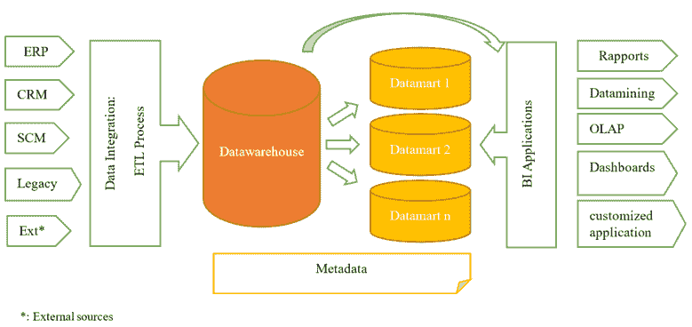

（改编自 Wixom 和 Watson, 2010）

### 2.2.3 使用商业智能的好处

通过商业智能，组织正在利用其数据资产，使用并尝试越来越复杂的数据分析技术来做出决策。正如 Chaudhuri 等人所指出的，如今很难找到一家没有使用 BI 技术来改善其业务的成功公司（Chaudhuri 等人, 2011）。

BI 支持与不同流程相关的各种决策，这些决策可以为组织带来好处。然而，研究人员发现，好处很难定义和衡量。困难之处在于好处包括无形影响。研究表明，BI 的好处可能是显著的，但不一定简单或容易量化（Watson 等人, 2002），BI 的影响在过去 15 年一直是 BI 研究的重点。具体来说，研究人员已表明 BI 可以用于：1) 提高组织的运营效率 2) 转变业务流程 3) 丰富组织知识 4) 开发新产品或改进产品和服务。BI 好处的清单很长。为了解决这个问题，Watson 和 Wixom (2010) 提出了一种好处分类法，突出了几个 BI 影响层次。这些层次根据其对组织的影响（从局部到全球）及其有形性和可衡量性（从易到难）进行列出。该分类法与 Watson 和 Wixom 对从业者的观察一致（图 2）。

### 图 2. BI 的好处

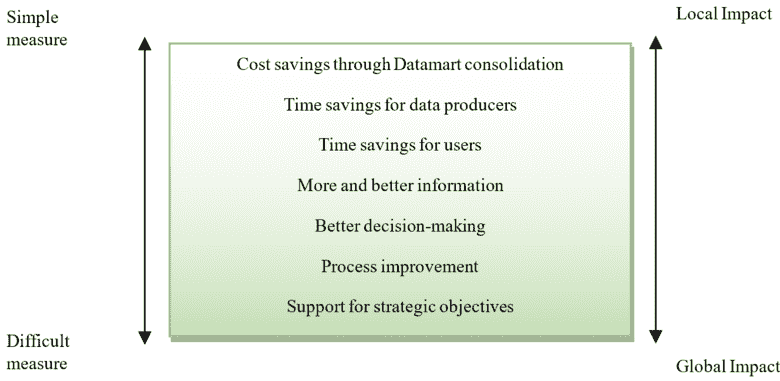

(Wixom et Watson, 2010)


# 列表中的前两个好处，“节省时间”和“更多且更好的信息”，是最具体的

“节省时间”类别假设人们执行的任务大体相同，并得出相同的结论或结果，但他们使用 BI 系统可以更快地完成。在信息数量和质量方面，我们可以认识到更多且更好的信息可用，但更难以指明受其影响的决策，或量化其对这些特定决策的影响（Wixom 和 Watson, 2010）。

# 在第三个类别中，可以识别出比之前更好的特定决策或决策类别

这是因为 BI 系统帮助管理人员更快地识别问题和机会，深化分析，并做出更好的决策。最后，当 BI 应用程序用于重新定义业务流程，使其更高效、更有效，并支持公司战略目标时，其最大的好处才会显现出来。

# 在 Dresner (2020) 对 BI 市场的研究中

公司被要求对其 BI 系统的性能和收益的感知进行评分（Dresner, 2020）（图 3）。

## 图 3. 商业智能成就

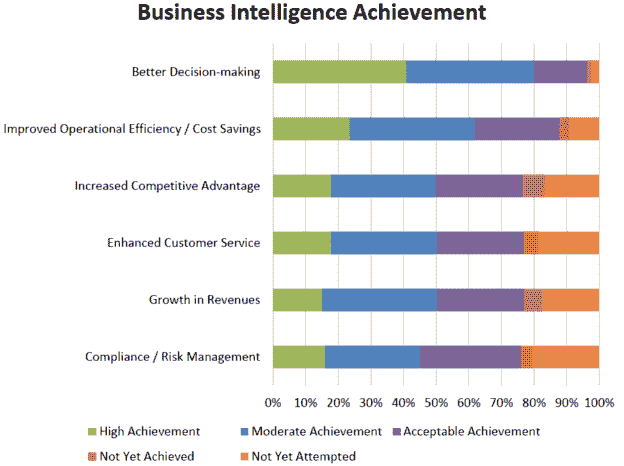

(Dressner, 2020)

该研究结果表明，80% 的公司成功实现了 BI 的主要目标之一，即改善决策。然而，值得注意的是，改善客户服务在 BI 的主要收益中排名第 4，尽管它并不是公司在投资 BI 时的首要任务（事实上，根据同一项研究，它排名第 5）。这表明 BI 与 CRM 之间存在合理的联系。

## 2.3 集成的依据

客户正变得越来越强大，这要归功于互联网（尤其是社交网络）上信息的日益易于获取。这使他们变得既更挑剔又更善变。竞争对手也是如此，他们变得更加灵活，并能更有效地应对环境变化，这要归功于可用且有效的技术。在此背景下，CRM 系统发挥了其全部战略重要性。当与 BI 系统协同使用时，它们可以提供竞争优势。

通过采用对 CRM 系统的限制性和狭隘的看法，CRM 系统常被视为需要实施的简单软件解决方案，组织难以充分利用这些系统。通过将它们孤立在组织内部，他们错过了与其他系统产生潜在协同效应的机会，这些系统通常可用，但拥有自己的数据库和专门团队，例如 BI。研究表明，即使是那些自认为以客户为中心的行业，例如银行业，并且已经实施了多项 CRM 举措，也只能看到有限的收益。例如，Peppard 的研究发现，银行从其 CRM 系统中孤立获得的收益有限，并提出了一个将 CRM 与其他系统（如 ERP 和 BI）集成的一般框架，以克服这一局限性（Peppard, 2000）。因此，将提供客户数据的 CRM 系统与 BI 的分析能力相集成至关重要，以便提供更一致、更丰富的消费者特征、需求、偏好和愿望的视图，从而提高客户关系的有效性（Handzic 等人, 2014）。

图 1 显示，BI 系统为事务性（运营）CRM 系统提供数据，以便通过各种 BI 工具进行分析。如果公司能在这两个系统之间创建一个闭环，一个系统向另一个系统提供客户数据，而另一个系统提供客户洞察，那么客户行动和策略将得到优化和改进（Zaby 和 Wilde, 2018）。此外，这种集成的好处还可以扩展到通过改善沟通活动的定位以及在正确的时间和通过最佳渠道选择沟通信息来优化营销策略的有效性（Ponyiam 和 Arch-int, 2018）。

简而言之，可以说 CRM 和 BI 系统的结合有可能实现协同效应，从而更好地了解消费者，与他们建立个性化关系，并制定更有效的营销策略。这将在下一节中更详细地讨论。

# 3\. 将 CRM 与 BI 集成的好处

## 3.1 改善客户关系管理

### 3.1.1 BI 如何增强对客户行为的了解

了解客户是任何希望回应客户需求和偏好的企业的基石。公司对客户了解得越多，就越能调整其营销策略和行动，以有利于影响客户的行为。正如我们所看到的，商业智能通过 ETL 过程从多个来源（内部和外部，结构化（来自公司数据库，如销售数据、客户反馈和投诉）和非结构化（来自社交网络，如对公司产品的评论和评论））收集数据。通过分析所有这些数据，我们可以增加和丰富对消费者行为的了解，并获得洞察力，以提高业务行动的有效性。


在 CRM 流程中使用 BI 技术可以通过跟踪和分析客户交易，在适当的时间做出适当的个性化报价，从而增加收入。这可以通过增加和优化每个客户产生的收入来提高两种系统的投资回报率（Gessner and Volonino, 2005），在客户和公司之间建立亲密而特殊的关系。由机器学习驱动的预测分析建模技术有助于改善对消费者行为的理解，并为他们提供量身定制的独特体验，以满足他们的愿望和偏好（Gupta and Joshi, 2022）。

## 3.2 商业绩效的商业智能工具

### 3.2.1 适合优化商业绩效的 BI 工具概述

使用 BI 工具的公司通常比不使用 BI 工具的公司取得更好的业务绩效。BI 工具帮助公司改进业务流程、定义和实现目标，并可能创造竞争优势（[Maaitah, 2023](#979-8-3693-3172-9.ch008.bits-pdf.xhtml#_idTextAnchor499））。BI 的实施和使用对底线有强烈影响，而底线是业务绩效的重要决定因素。


BI 工具与传统数据分析工具在多个方面有所不同。商业智能系统使用工具处理实时事务数据和历史数据，为决策者提供相关信息和知识（Zamlynskyi Viktor et al., 2023）。目标是提高数据的及时性和质量，以便管理人员能够更好地了解其组织。

市场上有多种商业智能解决方案，公司可以使用这些方案来增强和改善其业务绩效。所有这些方案都可以实时收集、分析和可视化信息，以深入了解消费者行为和市场趋势。最受欢迎的解决方案之一是 Microsoft Power BI，它允许用户创建报告和仪表板，以实时可视化其绩效。根据 Lishchynska 等人的说法，Microsoft Power BI 最多可支持 100 个本地和云数据源。它还支持 `DAX`、`Power Query`、`SQL`、`R` 和 `Python`。Power BI 的优势之一是其与其他 Microsoft 解决方案的兼容性，例如数据湖集成（`Azure Data Lake Storage Gen2`）、使用 `Power BI REST API` 支持实时数据流，以及与 Azure 机器学习集成（Lishchynska et al., 2022）。

另一种流行的商业智能解决方案是 Tableau。此 BI 解决方案最著名的是其无与伦比的可视化能力，能够创建提供对运营和流程更好理解的仪表板。此解决方案提供预览仪表板单个区域的功能，并根据位置连接到数据集。此外，Tableau Online 允许您连接到云中的数据库。它还提供与 Amazon Redshift 和 Google BigQuery 的集成（Lishchynska et al., 2022）。这个有前途且时尚的 BI 解决方案于 2019 年被 CRM 巨头 Salesforce 收购。

其他开源 BI 解决方案，例如 `Apache Hadoop`、`Orange` 和 `OpenRefine`，简化了非结构化数据的处理，支持多种文件格式，促进机器学习，并能够处理大型数据集，以提供关于消费者行为、偏好和愿望的宝贵洞察。例如，Taleb 等人使用大数据技术将内部 CRM 数据与外部环境中的消费者行为和购买模式数据相结合。他们表明，使用这些 BI 工具可以提高 CRM 系统的效率（Taleb et al., 2020）。

简而言之，有多种 BI 解决方案可供公司使用，以优化其销售绩效。这些解决方案使公司能够更好地捕捉消费者行为的复杂性，更好地了解其欲望和偏好，并实时跟踪其绩效。

### 3.2.2 集成 BI 和 CRM 的一些成功案例研究

文献中充斥着成功案例，展示了分析型竞争者如何利用先进的客户数据分析来获得可持续的竞争优势，从而超越竞争对手（Davenport and Harris, 2006）。其他成功案例也值得一提。例如，Netflix 是一家能够利用 BI 技术更好地个性化客户体验的典型公司。早在 2006 年，它就向所有机器学习研究人员开放了一项竞赛，承诺为任何能在 2011 年前将其推荐系统提高 10% 的算法提供 100 万美元奖金（Greene, 2006）。通过依赖基于客户购买历史的推荐系统，Amazon 可以提供相关的产品推荐，使客户体验更加有价值并提高客户满意度。最后，让我们看看酒店公司 Hilton 的案例，该公司通过成功整合商业智能工具来处理客户数据，能够以始终将客人置于其关注中心的方式个性化客户体验，从而成功提出包括数字服务在内的创新解决方案，这些方案从根本上改变了客户体验（Escobar, 2021）。

所有这些案例都展示了公司如何作为其 CRM 策略的一部分优化商业智能系统的使用，以分析客户数据并识别趋势和购买模式，从而创造独特、个性化的客户体验。这些 CRM 巨头正在发展竞争优势，并成功地尽可能长时间地留住客户，这并非因为他们的产品或价格，而是因为他们为客户提供的独特客户体验（Ayyagari, 2019）。

### 3.3 通过 CRM 数据增强决策

很难想象一家成功的高绩效公司不以客户为中心。如果不满足客户的需求和偏好，一家公司不太可能在市场上生存（[Baboolal-Frank, 2021](#979-8-3693-3172-9.ch008.bits-pdf.xhtml#_idTextAnchor470））。这就是为什么公司正在竭尽所能满足和留住客户，包括 CRM 策略和商业智能系统。我们在上面看到，BI 系统从各种来源收集数据，包括 `ERP`、`SCM` 和 `CRM` 等事务系统，以及外部来源。然后，这些数据通过 `ETL` 过程传输到数据仓库，在那里使用各种 BI 技术（例如 `OLAP` 和数据挖掘）进行分析，以支持决策。


来自 CRM 系统的数据可以通过为指导决策提供关键客户数据，帮助提高 BI 支持的决策过程的效率 (Ayyagari, 2019)。BI 系统对客户数据的分析可以提高客户满意度和忠诚度，从而提升竞争力以及商业和财务表现 (Rygielski et al., 2002; Trabelsi and Akrout, 2022)。CRM 数据可以通过多种方式提高决策过程的效率。例如，Ledro et al. 通过文献综述发现，将人工智能与 CRM 相结合可以帮助公司增加销售并优化营销策略，从而提高客户满意度(Ledro et al., 2022)。通过使用客户数据来为 AI 算法提供输入，公司可以确定哪些产品销售最好，哪些客户最有利可图，哪些营销活动最有效。这种类型的信息可以使公司创建更具针对性的沟通活动，从而改善客户获取和保留。

此外，客户数据有可能使公司识别出所有可能的业务流程改进来源。例如，Rathod et al. 的一项研究发现，在嵌入 BI 的 AI 算法中使用客户数据可以跟踪消费者投诉，以识别需要改进的领域和流程，例如产品质量和客户服务 (Rathod et al., 2024)。通过解决这些问题，公司可以通过提高客户满意度来改善其业务表现。因此，客户数据可以用于识别新的增长机会以及额外的产品和服务创新。

从另一个角度来看，CRM 数据可以在战略和战术两个层面改善决策。通过提供关于客户行为、偏好和愿望的洞察，CRM 数据有助于优化当前运营。例如，Rathod et al. 发现，使用 CRM 数据可以跟踪客户投诉和索赔，以帮助公司改善客户服务并从而避免客户流失 (Rathod et al., 2024)。同样，Cristescu et al. 在一项关于 CRM 数据对欧盟收入改善影响的研究中发现，将 CRM 数据与大数据技术相结合有助于优化供应链管理并增加收入 (Cristescu et al., 2023)。

CRM 数据还可以通过提供关于长期市场趋势和公司潜在机会的洞察来为战略决策提供信息。Ledro et al. 发现，在人工智能算法中使用 CRM 数据可以帮助公司改善其销售和营销策略，并从长远来看提高客户满意度 (Ledro et al., 2022)。Gräser et al. 发现，整合 CRM、ERP 和 BI 数据可以通过社交 CRM 提供客户互动、销售数据和运营的完整视图，从而提高数据驱动决策的效率 (Gräser et al., 2023)。

简而言之，CRM 数据以多种方式积极影响 BI 决策支持过程，支持战略和运营决策。

## 实施策略

在前一节讨论了整合 CRM 和商业智能的益处及可能的协同效应之后，现在是时候关注公司在尝试这项工作时可能面临的挑战了。整合 CRM 和 BI 并非易事，因为它要求公司解决多个问题。独立的数据库、冗余数据和不兼容的基础设施，更不用说数据不一致的问题。

### 整合 CRM 和 BI 的常见挑战

组织通常拥有与其余信息系统分开的 CRM 应用程序数据库。当公司希望将 CRM 数据整合到 BI 数据仓库时，它们会面临许多障碍。

公司面临的最大问题之一是数据质量。确保 CRM 和 BI 系统收集的数据准确且完整是一项关键挑战。数据质量差通常会导致错误的洞察和低效的决策过程。数据质量是指对组织有意义的清洗数据 (Khan et al., 2012)。一般来说，高质量数据是指满足组织需求和预期用途的数据 (Ait Touil and Jabraoui, 2023)。数据质量对组织如此重要，以至于大多数 BI 成熟度模型都将其视为关键维度 (Ait Touil and Jabraoui, 2022)。Kegan et al. 发现，在将 AI 整合到 CRM 系统时，需要克服的最大挑战之一是全面且流畅地访问高质量数据集 (Keegan et al., 2022)。与拥有自己的训练和测试数据集的独立 AI 系统不同，基于 CRM 数据的 AI 系统需要对 CRM 平台及其数据库进行流畅、无阻碍的访问(Ledro et al., 2023)。

整合 CRM 和 BI 的另一个问题是数据集成。数据存储的多种来源需要付出相当大的努力来整合它们，以便它们都可以用于处理和分析过程。Li et al. 发现，整合来自不同来源的数据的问题，尤其是当数据集很大且复杂时，是整合 CRM 和 BI 系统的主要挑战之一 (Li et al., 2023)。此外，整合 BI 和 CRM 需要在硬件和软件基础设施方面进行大量投资，这给公司带来了财务挑战，并引发了投资回报率的问题，这反过来又挑战了公司权衡此类投资预期成本和收益的能力 (Li et al, 2023)，使得难以证明此类项目的合理性。

然而，在这场整合追求中，一个关键挑战是文化。单个 BI 和 CRM 系统失败的原因之一是组织文化。高层管理人员缺乏承诺和参与，或者 BI 和 CRM 团队之间以及它们与各个业务单元之间缺乏合作和理解，都可能危及整合 BI 和 CRM 系统所投入的所有投资和努力。Kumar et al. 发现，组织文化在整合 CRM 和 BI 时是一个重大挑战(Kumar and Reinartz, 2018)。

### 克服这些挑战的最佳实践


# 为应对这些挑战，组织可以利用现有的最佳实践

为应对这些挑战，组织可以利用现有的最佳实践。例如，可以通过实施数据治理系统来解决数据质量问题。数据治理是指在组织内部管理数据的可用性、安全性、使用和完整性的整体过程。21 世纪的组织必须将数据视为战略资源。它是任何数据驱动型举措（尤其是 BI 和 CRM 举措）的关键成功因素。在 BI 和 CRM 集成的背景下，数据治理可以发挥的作用至关重要，因为数据治理为数据质量设定了标准，并确保任一系统中使用的提取数据都符合这些标准。这样一来，组织就可以在使用和利用可靠数据时确保流畅性和连续性，而不会遇到数据冗余、不一致或不准确的问题。Li 等人建议，在 CRM 和 BI 集成的背景下，通过实施数据治理可以大幅提高数据质量 (Li et al., 2023)。Ahmad 等人讨论了当数据分布在不同的本地和云数据库中时，统一数据治理的重要性，并强调了数据管家和数据所有者在维护跨多个集成系统（例如 CRM 和 BI）的完整性和问责制方面的作用 (Ahmad et al., 2023)。

为了避免基础设施相关问题，公司最好投资于可扩展、灵活且可扩展的技术基础设施，以实现 BI 和 CRM 系统的集成。这使得这些投资获利并提高投资回报率。基于云的 SaaS CRM 和 BI 解决方案也可以为这一基础设施问题提供解决方案，因为这些系统具有适应不断变化的业务需求的优势。出于这个原因，Li et al (2023) 建议公司投资于这类解决方案，以避免技术基础设施问题，而技术基础设施问题仍然是在 BI 背景下提高数据质量的一个重要维度 (Ait Touil and Jabraoui, 2023)，并由此延伸，也是 CRM 背景下提高数据质量的一个重要维度。

组织文化问题是最难解决的问题之一。创建数据驱动型文化是最大的挑战之一，即使对于那些意识到这一点并已有举措来推动它的组织来说也是如此。Davenport 和 Bean 强调了组织尝试实施数据驱动型文化的缓慢程度。他们的研究发现，90% 的受访组织表示他们正在努力灌输这种文化，但只有三分之一承认取得了成功 (Davenport and Bean, 2018)。然而，为了成功集成 CRM 和 BI，组织除了坚持这一探索之外别无选择。他们可以通过实施促进跨部门和业务团队协作与共享文化的政策和程序，以及在决策过程中（尤其是 CRM 中）奖励数据和测试的使用来做到这一点。此外，还需要大力提高人们对基于事实、数据驱动决策的好处的认识。根据 Kumar and Reinartz (2018)，数据素养可以帮助那些希望集成 BI 和 CRM 系统的组织克服文化问题。

# 5\. 结论

在本章中，我们试图说明为什么公司应该集成其 BI 和 CRM 系统，并利用由此产生的协同效应。CRM 和 BI 系统的集成有望对当今竞争激烈的环境中的公司产生积极影响，在这个环境中，客户越来越难以取悦。因此，BI 和 CRM 集成已成为寻求提高运营效率和以客户为中心的实践的公司的关键策略。

通过介绍 BI 和 CRM 的关键流程和组件，我们能够识别两个系统之间的潜在协同效应。由于 CRM 是公司用来了解客户偏好和需求并与其建立牢固、持久关系的策略，因此它催生了一系列流程，例如线索管理、销售管理、营销管理和客户服务管理。另一方面，BI 被介绍为一类广泛的技术、应用和流程，旨在通过从各种内部和外部来源收集数据、将其存储在数据仓库中，并应用一系列分析技术（例如 OLAP、数据挖掘和机器学习）来帮助用户做出更好的决策。

这项工作对管理人员特别有用。从管理影响的角度来看，它阐明了同步 CRM 和 BI 系统的有用性背后的逻辑。本章借鉴了现有文献，表明集成这两个系统提供了几种可能的协同效应，帮助管理人员意识到此类举措的重要性。在整个章节中，我们解释了 CRM 数据和 BI 技术的结合如何帮助公司深入了解消费者行为、偏好和愿望。这有助于指导销售和营销工作，使公司能够个性化产品和服务、有效回应客户投诉、提高客户满意度和忠诚度，并降低流失率。结果是通过增加收入和减少流失率及客户获取成本来改善业务绩效。客户体验也没有被忽视，因为在电子商务、酒店和流媒体等各个领域使用人工智能技术，例如，既可以个性化这些体验，又可以提高推荐系统的有效性以匹配客户的欲望和偏好。为此，我们介绍了目前被视为 CRM 巨头的公司的成功案例，例如 Netflix、Amazon 和 Hilton。

本章还讨论了在 BI 流程中使用 CRM 数据的有用性，以及这对于生成对有效决策（无论是战略还是运营）至关重要的洞察力有多么关键。例如，客户数据可以使公司识别业务流程中所有可能的改进来源，例如客户服务和产品质量，并探索公司产品和服务中创新的新机会。CRM 数据还可以通过提供对长期市场趋势和公司可以利用的机会的洞察来为战略决策提供信息。

本章对管理人员的另一贡献是，它强调了组织在运营和组织/战略两个层面集成这两个系统必须克服的挑战。确实，并非所有这些潜在的协同效应都会自动降临到企业身上，因为 BI 和 CRM 系统的集成给公司带来了可能使这些举措偏离轨道的挑战和障碍。例如数据质量、基础设施兼容性、来自不同来源的数据集成以及当组织不是数据驱动型时与组织文化相关的困难等挑战。为此，我们介绍了一套有潜力克服这些挑战的最佳实践。


# 虽然这些挑战对管理人员尤为重要，但它们可能为研究界未来的研究方向提供肥沃的土壤

虽然这些挑战对管理人员尤为重要，但它们可能为研究界未来的研究方向提供肥沃的土壤。即使数据质量或基础设施兼容性问题，以及变革管理、数据驱动文化和高层管理人员参与等挑战，在文献中已被广泛采纳，但它们在 CRM 和 BI 集成背景下的分析可能会因这两个流程的战略重要性而呈现特定的特点。同样必须指出的是，尽管关于 CRM 和 BI 的单独文献非常丰富，但这两个系统的集成仍然缺乏研究，尤其是能够阐明企业如何明智地开展此类举措的实证研究。例如，信息系统领域可以通过关于人工智能和机器学习能为改善这两个系统的集成做出什么贡献的研究而得到丰富，从而增加企业获得的收益。关于数据治理最佳实践的研究，尤其是在 BI 和 CRM 集成背景下的研究，也将确保集成拥有安全、高质量的数据。最后，我们建议开展关于这两个系统集成对整体业务绩效、客户满意度和忠诚度以及财务结果影响的研究。

# 从方法学角度看，本工作采用了一种介于叙述性文献综述和系统性文献综述之间的创新方法

从方法学角度看，本工作采用了一种介于叙述性文献综述和系统性文献综述之间的创新方法，依赖于由人工智能驱动的搜索工具，这些工具正逐步进入学术研究领域，并且公认处于萌芽阶段，需要学术界深入讨论如何以严谨和可信的方式使用它们。然而，必须承认，本研究的主要局限性在于科学界难以复现。

# 参考文献

Ahmad, S., Arumugam, D., Bozovic, S., Degefa, E., Duvvuri, S., Gott, S., Gupta, N., Hammer, J., Kaluskar, N., Kaushik, R., Khanduja, R., Mujumdar, P., Malhotra, G., Naik, P., Ogg, N., Parthasarthy, K. K., Ramakrishnan, R., Rodriguez, V., Sharma, R., & Wolter, A. (2023). Microsoft Purview: A System for Central Governance of Data. Proceedings of the VLDB Endowment International Conference on Very Large Data Bases, 16(12), 3624–3635. [10.14778/3611540.3611552](http://dx.doi.org/10.14778/3611540.3611552)

Ait Touil, A., & Jabraoui, S. (2022). Les modèles de maturité de la business intelligence Analyse comparative. Revue Marocaine de la Prospective en Sciences de Gestion, 2022(4), 16.

Ait Touil, A., & Jabraoui, S. (2023). Information Quality of Business Intelligence Systems: A Maturity-based Assessment. Journal of Information Systems Engineering and Business Intelligence, 9(2), 276–287. [10.20473/jisebi.9.2.276\-287](http://dx.doi.org/10.20473/jisebi.9.2.276-287)

Alikhani, M., Naderi, N., & Kazemi Eskeri, F. (2021). The Impact Of Business Intelligence On CRM Case of study: Shuttle Companies’ Group. Science and Technology Policy Letters. [`stpl.ristip.sharif.ir/article\_22232.html?lang\=en`](https://stpl.ristip.sharif.ir/article_22232.html?lang=en)

Alla, L., Kamal, M., & Bouhtati, N. (2022). Big data et efficacité marketing des entreprises touristiques: Une revue de littérature. Alternatives Managériales Economiques, Numéro spécial 1, 39–58. [10.48374/IMIST.PRSM/ame\-v1i0.36928](http://dx.doi.org/10.48374/IMIST.PRSM/ame-v1i0.36928)

Aulia, D. (2022). ENHANCEMENTS IN THE MANAGEMENT OF RELATIONSHIPS WITH CUSTOMERS AS A MEANS OF PRESERVING SALES PERFORMANCE. \[JAMB\]. Journal of Applied Management and Business, 3(1). [10.37802/jamb.v3i1.242](http://dx.doi.org/10.37802/jamb.v3i1.242)

Ayyagari, M. R. (2019). A Framework for Analytical CRM Assessments Challenges and Recommendations. International Journal of Business and Social Science, 10(6). Advance online publication. [10.30845/ijbss.v10n6p2](http://dx.doi.org/10.30845/ijbss.v10n6p2)

Baboolal-Frank, R. (2021). ANALYSIS OF AMAZON: CUSTOMER CENTRIC APPROACH, 20(2).

Berestetska, O., Iankovets, T., Orozonova, A., Voitovych, S., Parmanasova, A., & Medvedieva, K. (2023). Using Crm Systems for the Development and Implementation of Communication Strategies for Digital Brand Management and Internet Marketing: Eu Experience. International Journal of Professional Business Review, 8(4), e01613. [10.26668/businessreview/2023.v8i4.1613](http://dx.doi.org/10.26668/businessreview/2023.v8i4.1613)

Bouhtati, N., Kamal, M., & Alla, L. (2023). Big Data and the Effectiveness of Tourism Marketing: A Prospective Review of the Literature. In Brahmia, Z., & Bhushab, B. (Eds.), Artificial Intelligence and Smart Environment (pp. 287–292). Springer International Publishing. [10.1007/978\-3\-031-26254-8\_40](http://dx.doi.org/10.1007/978-3-031-26254-8_40)

Chaudhuri, S., Dayal, U., & Narasayya, V. (2011). An overview of business intelligence technology. Communications of the ACM, 54(8), 88–98. [10.1145/1978542.1978562](http://dx.doi.org/10.1145/1978542.1978562)

Cristescu, M. P., Mara, D. A., Culda, L. C., Nerișanu, R. A., Bâra, A., & Oprea, S.-V. (2023). The Impact of Data Science Solutions on the Company Turnover. Information (Basel), 14(10), 573. [10.3390/info14100573](http://dx.doi.org/10.3390/info14100573)

Davenport, T. H., and Bean, R. (2018). Big Companies Are Embracing Analytics, But Most Still Don’t Have a Data\-Driven Culture.

Davenport, T. H., & Harris, J. G. (2006, January 1). Competing on Analytics. Harvard Business Review. [`hbr.org/2006/01/competing\-on\-analytics`](https://hbr.org/2006/01/competing-on-analytics)

Dresner, H. (2020). Wisdom of crowds business intelligence market study report (Survey 2020 Edition; p. 183). Dresner Advisory Services. [`www.pyramidanalytics.com/docs/default\-source/downloads/wisdom\_of\_crowds\-\_\_business\_intelligence\_market\_study\_report__-_licensed_to_pyramid_analytics_-_-_2020_dresner_advisory_services.pdf?sfvrsn\=cd68f8c9\_0`](https://www.pyramidanalytics.com/docs/default-source/downloads/wisdom_of_crowds-__business_intelligence_market_study_report__-_licensed_to_pyramid_analytics_-_-_2020_dresner_advisory_services.pdf?sfvrsn=cd68f8c9_0)

El Mokretar, L., & Adman, M. (2023). Developing a growth marketing approach to B2B customer retention: Case Algeria. Marketing Science & Inspirations, 18(3), 36–46. [10.46286/msi.2023.18.3.4](http://dx.doi.org/10.46286/msi.2023.18.3.4)

Escobar, M. C. (2021, October 21). Hilton Introduces Tech Enhancements to Improve Guest Experience. Hospitality Technology. [`hospitalitytech.com/hilton\-introduces\-tech\-enhancements\-improve\-guest\-experience`](https://hospitalitytech.com/hilton-introduces-tech-enhancements-improve-guest-experience)

Fernandes, N., & Lim, J., Raymond, Eddison, T., & Hasan, G. (2023). The Impact of Customer Relationship Management (CRM) on Company Performance in Three Segments (Finance, Marketing and Operations). Jurnal Minfo Polgan, 12(1), 1. [10.33395/jmp.v12i1.12431](http://dx.doi.org/10.33395/jmp.v12i1.12431)

Fernando, E., Sutomo, R., Prabowo, Y. D., Gatc, J., & Winanti, W. (2023). Exploring Customer Relationship Management: Trends, Challenges, and Innovations. Journal of Information Systems and Informatics, 5(3), 984–1001. [10.51519/journalisi.v5i3.541](http://dx.doi.org/10.51519/journalisi.v5i3.541)

Gessner, G. H., & Volonino, L. (2005). Quick Response Improves Returns on Business Intelligence Investments. Information Systems Management, 22(3), 66–74. [10.1201/1078/45317.22.3.20050601/88746.8](http://dx.doi.org/10.1201/1078/45317.22.3.20050601/88746.8)

Grant, R. M. (2018). Contemporary strategy analysis (10th ed.). Wiley & Sons.


# 参考文献列表

Gräser, M., Harris, C., Alt, R., & Reinhold, O. (2023). How Integrated Social CRM Affects Business Success: Learnings from a Literature Analysis. 2023 IEEE/WIC International Conference on Web Intelligence and Intelligent Agent Technology (WI-IAT), (pp. 547–554). IEEE. [10.1109/WI-IAT59888.2023.00091](http://dx.doi.org/10.1109/WI-IAT59888.2023.00091)

Greene, K. (2006). The $1 Million Netflix Challenge. MIT Technology Review. [`www.technologyreview.com/2006/10/06/273459/the-1-million-netflix-challenge/`](https://www.technologyreview.com/2006/10/06/273459/the-1-million-netflix-challenge/)

Gupta, S., & Joshi, S. (2022). Predictive Analytic Techniques for enhancing marketing performance and Personalized Customer Experience. 2022 International Interdisciplinary Humanitarian Conference for Sustainability (IIHC), (pp. 16–22). IEEE. [10.1109/IIHC55949.2022.10060286](http://dx.doi.org/10.1109/IIHC55949.2022.10060286)

Handzic, M., Ozlen, K., & Durmic, N. (2014). Improving Customer Relationship Management Through Business Intelligence. Journal of Information & Knowledge Management, 13(02), 1450015. [10.1142/S0219649214500154](http://dx.doi.org/10.1142/S0219649214500154)

Hardesty, L. (2019, November 22). The history of Amazon’s recommendation algorithm. Amazon Science. https://www.amazon.science/the-history-of-amazons-recommendation-algorithm

Jhamb, S., & Turcanu, R. (2022). A Scholarly Review of Global Business Indications and Economic Trends: Understanding International Competitiveness, Economic Globalization, and Digitization Through the Lens of the COVID-19 Pandemic and the New Normal. Journal of Marketing Development and Competitiveness, 16(3). [10.33423/jmdc.v16i3.5584](http://dx.doi.org/10.33423/jmdc.v16i3.5584)

Keegan, B. J., Canhoto, A. I., & Yen, D. A. (2022). Power negotiation on the tango dancefloor: The adoption of AI in B2B marketing. Industrial Marketing Management, 100, 36–48. [10.1016/j.indmarman.2021.11.001](http://dx.doi.org/10.1016/j.indmarman.2021.11.001)

Khan, A., Ehsan, N., Mirza, E., & Sarwar, S. Z. (2012). Integration between Customer Relationship Management (CRM) and Data Warehousing. Procedia Technology, 1, 239–249. [10.1016/j.protcy.2012.02.050](http://dx.doi.org/10.1016/j.protcy.2012.02.050)

Kučera, P., & Cmuntová, D. (2023). Design and implementation of a CRM system to optimize business processes of a trading company. Entrepreneurship and Sustainability Issues, 11(2), 363–380. [10.9770/jesi.2023.11.2(25)](http://dx.doi.org/10.9770/jesi.2023.11.2\(25\))

Kumar, V., & Reinartz, W. (2018). Customer Relationship Management. Springer Berlin Heidelberg., [10.1007/978-3-662-55381-7](http://dx.doi.org/10.1007/978-3-662-55381-7)

Kunathikornkit, S., Piriyakul, I., & Piriyakul, R. (2023). One-to-one marketing management via customer complaint. Social Network Analysis and Mining, 13(1), 83. [10.1007/s13278-023-01082-z](http://dx.doi.org/10.1007/s13278-023-01082-z)

L, F., J., E., E., A., U., O., J., and O., O., B. (2023). Customer Relationship Management and Customers Repeat Purchase Behavior in Nigeria. Scholars Journal of Economics, Business and Management, 10(1), 19–28. [10.36347/sjebm.2023.v10i01.002](http://dx.doi.org/10.36347/sjebm.2023.v10i01.002)

Ledro, C., Nosella, A., & Dalla Pozza, I. (2023). Integration of AI in CRM: Challenges and guidelines. Journal of Open Innovation, 9(4), 100151. [10.1016/j.joitmc.2023.100151](http://dx.doi.org/10.1016/j.joitmc.2023.100151)

Ledro, C., Nosella, A., & Vinelli, A. (2022). Artificial intelligence in customer relationship management: Literature review and future research directions. Journal of Business and Industrial Marketing, 37(13), 48–63. [10.1108/JBIM-07-2021-0332](http://dx.doi.org/10.1108/JBIM-07-2021-0332)

Lehman, R. A., Watson, H. J., Wixom, B. H., & Hoffer, J. A. (2008). Continental Airlines Flies High with Real-time Business Intelligence. MIS Quarterly Executive, 3(4), 30.

Li, L., Lin, J., & Luo, W. (2023). INVESTIGATING THE EFFECT OF ARTIFICIAL INTELLIGENCE ON CUSTOMER RELATIONSHIP MANAGEMENT PERFORMANCE IN E-COMMERCE ENTERPRISES. Journal of Electronic Commerce Research, 24(1).

Lishchynska, L., & Dobrovolska, N. (2022). PROSPECTIVE SOFTWARE TOOLS FOR DATA ANALYSIS IN BUSINESS. Herald of Khmelnytskyi National University, 305(1), 78–83. [10.31891/2307-5732-2022-305-1-78-79](http://dx.doi.org/10.31891/2307-5732-2022-305-1-78-79)

Luhn, H. P. (1958). A Business Intelligence System. IBM Journal of Research and Development, 2(4), 314–319. [10.1147/rd.24.0314](http://dx.doi.org/10.1147/rd.24.0314)

Maaitah, T. (2023). The Role of Business Intelligence Tools in the Decision Making Process and Performance. Journal of Intelligence Studies in Business, 13(1), 43–52. [10.37380/jisib.v13i1.990](http://dx.doi.org/10.37380/jisib.v13i1.990)

Malik, A., & Ghai, S. (2023). Role of CRM in Customer Loyalty and Repeat Purchase Intention: An Analytical Study. Journal of Informatics Education and Research, 3(1), 1. [10.52783/jier.v3i1.60](http://dx.doi.org/10.52783/jier.v3i1.60)

Mohamed Mohamed, S., Yehia, E., & Marie, M. (2022). Relationship between E-CRM, Service Quality, Customer Satisfaction, Trust, and Loyalty in banking Industry. Future Computing and Informatics Journal, 7(2), 51–74. [10.54623/fue.fcij.7.2.5](http://dx.doi.org/10.54623/fue.fcij.7.2.5)

Murat, A., Saida, S., & Timurlan, S. (2023). Global Digital Transformation Trends in Real Sectors of the Economy. SHS Web of Conferences, 172, 02014. [10.1051/shsconf/202317202014](http://dx.doi.org/10.1051/shsconf/202317202014)

Olszak, C. M. (2016). Toward Better Understanding and Use of Business Intelligence in Organizations. Information Systems Management, 33(2), 105–123. [10.1080/10580530.2016.1155946](http://dx.doi.org/10.1080/10580530.2016.1155946)

Peppard, J. (2000). Customer Relationship Management (CRM) in financial services. European Management Journal, 18(3), 312–327. [10.1016/S0263-2373(00)00013-X](http://dx.doi.org/10.1016/S0263-2373\(00\)00013-X)

Piert Espinoza, J., Cardenas Yactayo, D., & Chavez Ugaz, R. (2023, October 10). CRM Implementation in SMEs Management Processes: The Role of e-CRM and s-CRM. Proceedings of the International Conference on Industrial Engineering and Operations Management. IEEE. [10.46254/EV01.20230213](http://dx.doi.org/10.46254/EV01.20230213)

Ponyiam, P., & Arch-int, S. (2018). Customer Behavior Analysis Using Data Mining Techniques. 2018 International Seminar on Application for Technology of Information and Communication, (pp. 549–554). IEEE. [10.1109/ISEMANTIC.2018.8549803](http://dx.doi.org/10.1109/ISEMANTIC.2018.8549803)

Rathod, H. D., Rajawat, D., Ahmed, M., Dagur, Y., & Rajpurohit, K. (2024). A Study to Know Impact of AI on CRM. Interantional Journal Of Scientific Research In Engineering And Management, 08(02), 1–13. [10.55041/IJSREM31253](http://dx.doi.org/10.55041/IJSREM31253)

Rygielski, C., Wang, J.-C., & Yen, D. C. (2002). Data mining techniques for customer relationship management. Technology in Society, 24(4), 483–502. [10.1016/S0160-791X(02)00038-6](http://dx.doi.org/10.1016/S0160-791X\(02\)00038-6)

Sharma, A. (2023). Analyzing the Role of Artificial Intelligence in Predicting Customer Behavior and Personalizing the Shopping Experience in Ecommerce. Interantional Journal Of Scientific Research In Engineering And Management, 07(02). [10.55041/IJSREM17839](http://dx.doi.org/10.55041/IJSREM17839)

Stefanov, T., Varbanova, S., Stefanova, M., & Ivanov, I. (2023). CRM System as a Necessary Tool for Managing Commercial and Production Processes. TEM Journal, 785–797. https://doi.org/[10.18421/TEM122-23](http://dx.doi.org/10.18421/TEM122-23)

Taleb, N., Salahat, M., & Ali, L. (2020). Impacts of Big-Data Technologies in Enhancing CRM Performance. 2020 6th International Conference on Information Management (ICIM), (pp. 257–263). IEEE. [10.1109/ICIM49319.2020.244708](http://dx.doi.org/10.1109/ICIM49319.2020.244708)


Trabelsi, L., & Akrout, F. (2022). Data Mining for CRM: Extracting Customer Knowledge From Data. IGI Global. [`https://services.igi-global.com/resolvedoi/resolve.aspx?doi=10.4018/978-1-7998-9553-4.ch008`](https://services.igi-global.com/resolvedoi/resolve.aspx?doi=10.4018/978-1-7998-9553-4.ch008)

Trieu, V.-H. (2017). Getting value from Business Intelligence systems: A review and research agenda. Decision Support Systems, 93, 111–124. [`10.1016/j.dss.2016.09.019`](http://dx.doi.org/10.1016/j.dss.2016.09.019)

Valdez Mendia, J. M., & Flores-Cuautle, J. J. A. (2022). Toward customer hyper-personalization experience—A data-driven approach. Cogent Business & Management, 9(1), 2041384. [`10.1080/23311975.2022.2041384`](http://dx.doi.org/10.1080/23311975.2022.2041384)

Velu, A. (2021). Machine Learning Techniques for Customer Relationship Management. 9(6).

Viktor, Z., Alla, S., & Ol’ga, Z. (2023, April 23). Features and characteristics of business intelligence (BI)-systems as a tool for improving the efficiency of company activities. Ukrainian Journal of Applied Economics and Technology. [`http://ujae.org.ua/en/features-and-characteristics-of-business-intelligence-bi-systems-as-a-tool-for-improving-the-efficiency-of-company-activities/`](http://ujae.org.ua/en/features-and-characteristics-of-business-intelligence-bi-systems-as-a-tool-for-improving-the-efficiency-of-company-activities/)

Watson, H. J., Goodhue, D. L., & Wixom, B. H. (2002). The benefits of data warehousing: Why some organizations realize exceptional payoffs. Information & Management, 39(6), 491–502. [`10.1016/S0378-7206(01)00120-3`](http://dx.doi.org/10.1016/S0378-7206(01)00120-3)

Williams, S., & Williams, N. (2008). The Profit Impact of Business Intelligence (Updated and rev.\[New ed.\]). Elsevier/Morgan Kaufmann Publishers.

Wixom, B., & Watson, H. (2010). The BI-Based Organization. International Journal of Business Intelligence Research, 1(1), 13–28. [`10.4018/jbir.2010071702`](http://dx.doi.org/10.4018/jbir.2010071702)

Zaby, C., & Wilde, K. D. (2018). Intelligent Business Processes in CRM: Exemplified by Complaint Management. Business & Information Systems Engineering, 60(4), 289–304. [`10.1007/s12599-017-0480-6`](http://dx.doi.org/10.1007/s12599-017-0480-6)

Zaki, S., Ismail, M. M., Rashad, H., & Ibrahim, M. (2021). Optimizing Customer Relationship Management through Business Intelligence for Sustainable Business Practices. American Journal of Business and Operations Research, 3(1), 70–79. [`10.54216/AJBOR.030105`](http://dx.doi.org/10.54216/AJBOR.030105)

Zhang, D., Zhang, C., & Zheng, C. (2023). Prediction and Analysis of Customer Churn of Automobile Dealers Based on BI. 2023 IEEE 6th Information Technology, Networking, Electronic and Automation Control Conference (ITNEC). IEEE. [`10.1109/ITNEC56291.2023.10082554`](http://dx.doi.org/10.1109/ITNEC56291.2023.10082554)

### ENDNOTE

¹ AI Chat for scientific PDFs | SciSpace (typeset.io) ; Scholar-Chat ; Search - Consensus: AI Search Engine for Research ; Connected Papers | Find and explore academic papers

# Chapter 9

## Unleashing the Potential of Artificial Intelligence (AI) in Customer Engagement

**Farid Huseynov**


Gebze Technical University, Turkey

### ABSTRACT

在快速发展的技术环境中，AI 的战略集成势在必行，从根本上改变了企业与客户互动的动态。本章首先探讨 AI 在解读复杂消费者行为模式中的关键作用，为企业提供宝贵洞察以适应市场动态。随后，重点转向 AI 驱动的个性化，强调其对丰富客户体验和建立更深层联系的深远影响。接着，讨论深入探讨 AI 驱动的自动化领域，它不仅彻底改变了效率，还提升了客户参与流程的质量。最后，重点关注 AI 驱动客户参与中固有的伦理考量和隐私问题，强调负责任的 AI 实施的重要性。总之，本章强调了 AI 对客户参与策略的多方面影响，将其确立为企业在不断变化的市场中实现可持续成功的基石。

### 1\. INTRODUCTION

Artificial Intelligence (AI) refers to the development of computer systems that possess the ability to perform activities typically requiring human intelligence (Garg, 2021; Sarker, 2022). These abilities include the acquisition of knowledge from experience, the interpretation of spoken communication, the recognition of recurring patterns, and solving of complex problems. AI seeks to build systems that are capable of self-improvement and data-driven decision-making, allowing them to function independently without explicit programming. It includes a variety of technologies, including robotics, machine learning, and natural language processing. Its applications range from recommendation engines and virtual assistants to self-driving cars and sophisticated medical diagnostics.

Customer interaction refers to the communication and engagement between a business or brand and its customers (Nüesch & Puschmann, 2015; Jian & Liu, 2016; Hydle et al. 2021). It includes all points of contact between clients and the business, such as face-to-face meetings, emails, phone conversations, and correspondence via other media. Effective customer interaction involves understanding and responding to customer needs, providing assistance, and creating positive experiences to build and maintain strong relationships with customers. It plays a crucial role in shaping customer satisfaction, loyalty, and overall perception of a brand. Customer engagement, on the other hand, extends beyond individual interactions and emphasizes building a long-term relationship between the customer and the brand. It involves creating meaningful connections, fostering loyalty, and maintaining ongoing communication to ensure a positive and enduring customer experience (Bowden, 2009; Rasool et al., 2021). Engaged customers are more likely to interact with the brand consistently and advocate for its products or services.

In the rapidly evolving landscape of customer interactions and engagements, businesses face the pressing challenge of meeting and surpassing modern consumers' expectations in an increasingly digital marketplace. Traditional methods are proving inadequate for satisfying the demand for personalized, efficient, and seamless experiences, exacerbating the difficulty of staying competitive. The absence of AI integration further compounds this problem, posing a significant obstacle that risks businesses falling behind competitors and jeopardizing their ability to establish meaningful, long-term relationships with customers. In this dynamic environment, where technology-driven, individualized interactions are the new standard, the strategic integration of AI emerges as a critical catalyst for revolutionizing traditional customer interaction paradigms. This represents not just an adaptation but a fundamental change in consumer perception and interaction. This chapter explores the intersection of cutting-edge AI technologies and the evolving field of customer engagement, revealing how companies can address this problem, exceed expectations, and ensure a more seamless and fulfilling experience for all involved.


# 本章所采用的方法论运用系统方法，深入探讨 AI 与客户参与的融合

这包括进行细致的文献综述，以审视现有关于 AI 技术及其在客户参与中作用的研究。综述涵盖了广泛的来源，包括学术期刊、会议论文集和行业报告，以挖掘与主题相关的关键概念和实证发现。通过从多样化的来源收集信息，本章确保了讨论和分析的坚实基础，从而促进对 AI 对当代客户互动范式的变革性影响的彻底审查。

本章从 图 1 所示的四个维度来探讨上述问题，每个维度阐明了这一变革性努力的独特方面。

## 图 1. AI 驱动的客户参与维度

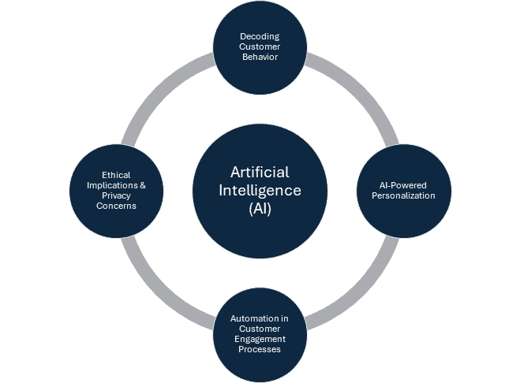

## 在第一个维度中，探索始于通过 AI 驱动的洞察解码消费者行为

深入探讨 AI 在解开消费者行为复杂模式方面的宝贵贡献。通过利用 AI 驱动分析的能力，企业不仅能够获得前所未有的关于客户偏好复杂细微差别的洞察，而且还能够战略性地适应不断变化的市场动态。本节作为理解 AI 如何成为不可或缺的工具的入口，使企业能够做出明智的决策，并对不断变化的消费者需求和市场趋势保持敏捷响应。

## 第二个维度深入探讨 AI 驱动的个性化以增强品牌与消费者的联系

探索由 AI 驱动的个性化所促进的品牌与消费者之间建立的深刻联系。在个性化体验至关重要的时代，AI 技术在使品牌能够精细定制其与客户的互动方面发挥着关键作用。这种能力不仅提升了整体客户体验，还培养了品牌与消费者之间更深层次、更有意义的联系，强调了个人偏好的重要性，并促进更加量身定制和富有共鸣的参与。

## 第三个维度阐明了自动化在重塑客户参与流程格局中的关键作用

从聊天机器人提供的即时响应，到通过复杂工作流程简化的复杂流程，AI 驱动的自动化不仅提高了客户参与的效率和整体质量，而且积极地将其提升到一个新水平。超越单纯的技术进步，AI 驱动自动化的战略实施展示了企业和客户在当代数字环境中互动方式的根本性重塑，其中运营流程被无缝集成，以确保更高效、更灵敏，最终更令人满意的客户体验。

## 在最后一个维度中，AI 驱动的客户参与中的伦理影响和隐私问题得到了彻底审查

这包括负责任地处理客户数据，确保透明度，并解决算法偏见和潜在操纵消费者行为等问题。本节深入探讨了当 AI 算法分析敏感信息时数据隐私的复杂性，并强调了实施强大数据保护措施的重要性。此外，它还讨论了算法偏见带来的伦理挑战，以及 AI 驱动系统为了商业利益操纵消费者行为的潜在可能性。

这些维度共同仔细解开了 AI 技术对客户参与流程的多方面影响，全面说明了企业如何利用这些进步不仅满足而且超越客户期望。随着这项探索的开展，越来越明显的是，将 AI 集成到客户参与策略中不仅仅是一种趋势，而是标志着一场深刻的范式转变，它握住了在当代商业环境中解锁新成功维度的关键。AI 的变革潜力超越了客户-企业关系的传统界限，开启了一个时代，在这个时代，适应性、个性化体验和简化的互动不仅是期望的，而且是保持竞争力和实现可持续增长所必需的。本章作为一本指南，揭示了 AI 在塑造客户参与未来方面的变革力量，并强调了其作为企业在现代市场不断变化的动态中寻求蓬勃发展的战略基石的关键作用。

## 2\. 通过 AI 驱动的洞察解码消费者行为


# 理解客户行为与 AI

理解客户行为已成为在不断变化的商业环境中制定战略决策的重要组成部分。AI 已成为理解消费者行为复杂性的宝贵工具。它为组织提供了关于客户偏好、动机和趋势的独特知识 (Khrais, 2020; Puntoni et al., 2021; Sarabhai et al., 2023)。

本节探讨了 AI 在理解消费者行为中的基础作用，以及企业如何从海量数据集中提取有意义的洞察以进行战略调整。AI 在理解客户行为方面发挥着至关重要的作用，因为它能够快速、准确且灵活地评估大型数据集。传统的市场研究方法往往难以跟上消费者偏好的动态性质以及当今数字时代产生的海量数据。然而，AI 擅长处理大型数据集，识别模式，并辨别人类分析可能忽略的微妙相关性。

## 机器学习与模式识别

AI 在理解消费者行为中的一个基础方面在于其识别和解释复杂模式的能力。机器学习是 AI 的一个领域，系统通过从数据中学习来进行预测或决策，而无需明确编程 (Dhall et al.,2020; Cohen, 2021)。机器学习算法可以筛选海量数据集，辨别相关性并揭示变量之间的隐藏关系。这使企业能够超越表面层面的洞察，更深入地了解影响消费者选择的因素 (Zhou et al., 2020; Feldman et al., 2022)。

例如，AI 可以识别在线购物行为中的模式，帮助企业了解驱动购买决策和客户忠诚度的因素。以亚马逊的预测配送模型为例；这是电子商务巨头采用的一种预测策略，旨在缩短交货时间并提高客户满意度 (Borgi et al., 2017; Ogbuke et al., 2022)。该模型利用数据分析和机器学习算法，在客户下单之前预测客户订单。通过分析过去购买行为、浏览历史和人口统计信息等各种因素，亚马逊预测客户在特定地区可能会订购哪些产品。这些预期订单随后会被预先包装并发送到更靠近预计交货地点的履约中心。这种主动方法使亚马逊能够加快配送流程，显著缩短交货时间，并确保产品在订单确认后即可立即发货。预测配送模型体现了亚马逊利用先进技术优化物流并提供卓越客户体验的承诺。

## 可口可乐的消费者行为分析

可口可乐是另一家在解码消费者行为方面非常成功的公司。可口可乐利用其饮料机收集的数据（这些饮料机在餐厅、便利店及类似地点提供各种可口可乐饮料）来了解消费者偏好和行为 (Tang et al., 2022)。这些数据涵盖了所消费饮料的类型、消费频率以及受欢迎的地点等详细信息。随后利用 AI 工具分析这些数据，采用机器学习算法检测消费模式中的模式、趋势和相关性。通过利用 AI 处理这些饮料机消费数据，可口可乐可以提取关于新兴消费者偏好、市场趋势和潜在机会的宝贵洞察。例如，AI 算法可能会发现某些地理区域或人口细分市场中对特定风味组合或饮料类别的需求不断增长。有了这些洞察，可口可乐可以定制新产品开发以满足消费者需求并抓住市场机遇。此外，基于 AI 的饮料机数据分析使可口可乐能够实时调整其产品供应和营销策略。通过持续监控消费模式和客户反馈，公司可以优化其产品阵容、调整定价策略并启动有针对性的营销活动，以推动销售并增强品牌忠诚度。总体而言，利用 AI 工具处理饮料机消费数据，使可口可乐能够做出数据驱动的决策，更有效地创新，并在竞争激烈的饮料市场中领先于不断变化的消费者偏好。

## 实时分析与情感分析

此外，AI 促进了跨各种接触点的消费者互动的实时分析。从社交媒体互动到在线浏览行为，AI 可以快速汇总和分析数据，为企业提供即时的洞察。在消费者口味可能快速变化的动态环境中，实时性极其有用。它使公司能够立即调整计划并保持竞争优势。如果没有 AI 的帮助，从大型数据集中提取有价值的洞察可能是一项艰巨的任务。数字世界产生的海量且复杂的数据需要复杂的分析能力。AI 技术，如自然语言处理和情感分析，使组织能够分析非结构化数据源，例如客户评论、社交媒体评论和在线论坛。这不仅有助于理解消费者情绪，还能提供关于产品或服务的哪些特定方面最能引起客户共鸣的详细洞察。

使用自然语言处理和情感分析来理解消费者情绪的一个真实例子是像 Airbnb 这样的公司如何分析客户评论。Airbnb 利用 AI 驱动的工具来处理客人在其平台上留下的大量基于文本的评论。通过分析这些评论中使用的语言以及表达的情感（积极、消极或中性），Airbnb 获得了关于其住宿和服务的哪些方面客人最欣赏以及哪些方面可能需要改进的宝贵洞察。这使 Airbnb 能够提升整体客人体验，定制其产品以更好地满足客户偏好，并在其用户群中保持高水平的满意度。


# AI-Driven Consumer Insights and Personalization

AI 驱动的洞察的一项重要优势是能够生成全面的消费者画像。企业可以通过检查许多数据点（例如购买历史、在线行为和人口统计信息）来创建目标受众的详细画像 (Huseynov & Yıldırım, 2017; Huseynov & Özkan Yıldırım, 2019; Liao et al.,2021; Haleem et al., 2022)。这些画像超越了传统的人口统计细分，涵盖了行为和心理特征。通过全面了解客户，企业可以定制其营销策略、产品供应和客户体验，以匹配特定消费者类别的口味。由 AI 驱动的洞察所推动的战略适应是一个流动的过程，涉及持续监控和修改。企业可以利用 AI 使用最新数据执行有针对性的干预，从而优化营销活动、改进产品功能并提升客户体验。例如，如果 AI 分析检测到客户偏好向可持续性转变，公司可以快速调整其产品供应或营销传播以符合这一趋势，从而在市场上获得竞争优势。

使用 AI 解码消费者行为的另一个例子体现在零售商店如何使用计算机视觉技术来了解购物者行为。零售商安装了配备 AI 算法的传感器和摄像头，以分析客户在商店内的移动和互动 (Saßnick et al., 2023; Knof et al., 2023)。这些系统可以跟踪诸如人流模式、特定产品展示的停留时间，甚至面部表情等因素，以衡量购物者的兴趣和参与度。通过收集和分析这些数据，零售商可以了解商店中哪些区域最受欢迎、哪些产品吸引最多关注，以及购物者如何在空间中导航。这些信息帮助零售商优化商店布局、产品摆放和营销策略，以更好地满足客户的需求和偏好，最终带来更好的销售业绩和客户满意度。

总之，使用 AI 驱动的洞察来解读客户行为是一种革命性的方法，使公司能够在当今不断变化的商业环境中保持竞争力、响应能力和灵活性。AI 解读复杂模式、检查大型数据集并提供实时洞察的基本能力，使其在理解客户行为方面如此有价值。通过从多种来源提取有价值的信息，企业可以生成关于客户行为的全面洞察，并据此做出战略调整。商业的未来很可能会受到 AI 与消费者行为分析集成的显著影响。这种集成将使企业能够采取更加个性化、灵活和以客户为中心的策略，因为技术将继续发展。

## AI-Powered Personalization to Enhance Brand-Consumer Bonds

传统的营销策略通常依赖于广泛的细分，将消费者群体的多样化图景简化为看似同质的实体。然而，必须认识到，在广泛的消费者受众中，存在着丰富的异质性图景。这种多样性表现在不同细分群体之间独特的需求、不同的要求和独特的偏好。在现代营销的动态格局中，从广泛细分向更细致和更具针对性的方法的演变是迫在眉睫的。理解消费者多样性的复杂层次使企业能够定制其策略，制定与特定细分群体在更深层次上产生共鸣的信息和产品。这种向认识异质性的转变解锁了更个性化和更有效的营销活动的潜力。通过承认并迎合消费者群体内的多样化需求，企业可以创造量身定制的体验，从而培养更牢固的联系和品牌忠诚度。这种个性化方法不仅提高了客户满意度，而且在消费者越来越寻求与品牌进行个性化互动的时代，战略性地定位了公司。本质上，偏离传统的“一刀切”模式使企业能够拥抱多样化消费者群体中固有的复杂性。这种转变不仅仅是对不断变化的市场动态的回应；它是一种主动策略，旨在在消费者重视个性化、有意义的互动的环境中保持相关性和竞争力。因此，认识到广泛消费者受众中的异质性是建立品牌与其多样化客户群之间持久且真实关系的关键一步。

在数字营销时代，个性化已成为建立品牌与消费者之间有意义联系的基石。AI 的出席彻底改变了这一格局，使企业能够以前所未有的精度将其营销工作定制为个人偏好。AI 驱动的个性化的核心在于分析大型数据集并提取可操作洞察的能力。AI 擅长处理复杂细节、理解微妙偏好，并根据历史数据预测个人行为。这种变革性的力量使企业能够超越“一刀切”的策略，向每个消费者传递高度针对性和相关性的内容。机器学习算法的使用使品牌能够创建复杂的客户画像，不仅捕捉人口统计信息，还捕捉行为模式、购买历史，甚至来自社交媒体互动的情感分析。这种对消费者旅程的整体理解使品牌能够打造在更深层次上产生共鸣的个性化体验。例如，电子商务平台可以使用 AI 分析客户的过去购买、浏览历史和偏好，以策划个性化的产品推荐，创造无缝且愉快的购物体验。

今天，推荐系统在向各个领域的客户提供个性化服务方面发挥着至关重要的作用。这些智能软件解决方案利用 AI 为用户提供定制内容，利用收集的关于客户的信息，无论是隐式还是显式。推荐系统有不同类型，包括协同过滤推荐系统、基于内容的推荐系统、基于知识的推荐系统、基于效用的推荐系统、基于人口统计的推荐系统和混合推荐系统 (Huseynov, 2020a)。每种类型都提供了解用户偏好的独特方法，并有效地定制推荐以满足个人需求和偏好，从而提高各个领域的用户体验和满意度。


# AI 驱动的跨行业个性化

尖端的 AI 驱动个性化技术广泛应用于各个行业，对客户参与度和满意度产生了深远影响。

## 在线流媒体服务

在在线流媒体服务领域，算法分析观看习惯、类型偏好甚至观众评分，以提供个性化的内容推荐。这不仅提升了用户体验，还能保持订阅者的参与度，培养忠诚度并降低流失率。

Netflix 作为全球领先的互联网娱乐服务，采用了复杂的推荐系统来服务其超过 2.6 亿付费订阅者，融合了协同过滤和基于内容的方法。该系统根据用户交互、偏好和内容属性生成个性化推荐，考虑的因素包括观看历史、评分以及与其他用户的相似性。虽然未考虑人口统计信息，但 Netflix 的推荐系统还分析一天中的时间、观看设备和时长等因素，以提升订阅者的观看体验 (Huseynov, 2020a)。

同样，YouTube 和 Spotify 利用 AI 驱动的推荐算法，根据每个用户的偏好和浏览历史推荐视频和音乐曲目，从而提升用户满意度和参与度。

## 教育

在教育领域，尖端 AI 驱动个性化技术的融合正在彻底改变学习体验。通过先进算法，教育平台分析学生的学习行为、学业表现和个人偏好，以提供量身定制的推荐和资源 (Kaswan et al., 2024)。

无论是推荐相关学习材料、自适应学习模块还是个性化反馈，这些系统旨在优化学生的参与度和学习成果。此外，AI 驱动的教育工具可以适应每个学生的节奏和学习风格，营造更具包容性和高效性的学习环境 (Rane et al., 2023)。

通过利用个性化推荐的力量，教育机构可以提升学生满意度、留存率和整体学业成功，最终为全球学习者塑造更光明的未来。

例如，Khan Academy 和 Duolingo 等平台利用 AI 算法分析用户交互和绩效数据，为学习材料和学习活动提供个性化推荐。这些平台适应每个学习者的节奏、技能水平和学习风格，提供定制课程和练习题以优化学习成果。通过利用 AI 的力量，教育机构可以创造更具吸引力和高效性的学习体验，最终提升学生满意度和学业成功。

## 医疗保健

同样，在医疗保健行业，AI 驱动的个性化正在引起轰动。基于个人健康数据、遗传信息和生活方式选择的个性化治疗方案正变得越来越普遍 (Sahu et al., 2022; Batra & Dave, 2024; Javanmard, 2024)。

患者获得量身定制的建议、药物方案和预防措施，形成了更以患者为中心的医疗保健方法。这不仅改善了健康结果，还加强了医疗保健提供者与患者之间的联系。

## 零售与游戏化

在另一种创新方法中，在线零售商将 AI 与游戏化元素相结合，彻底改变其客户参与策略。游戏化是将游戏机制和元素融入非游戏情境，以通过挑战、奖励、竞争和成就系统等功能增强参与度、动机和参与度 (Alsawaier, 2018)。

通过利用 AI 驱动的算法，零售商根据每个客户的偏好和行为个性化游戏化体验，提升策略的整体效果。通过复杂的 AI 驱动分析，零售商获得关于个人客户偏好和购物习惯的宝贵洞察，从而创建量身定制的游戏化挑战和奖励。

这些个性化体验不仅增加了客户参与度，还在品牌与客户之间建立了更紧密的联系 (Huseynov, 2020b)。AI 与游戏化的融合被证明是一种成功的组合，推动了零售商客户群体中更高水平的参与度、满意度和忠诚度。

## 旅游与酒店业

旅游与酒店业已采用 AI 来加深与客户的联系。酒店和旅行社利用 AI 分析客户在目的地、住宿风格和设施方面的偏好。这些数据使他们能够提供个性化的旅行套餐、房间偏好和独家优惠，确保每位客人都能获得难忘且量身定制的体验 (Doborjeh et al., 2022; Said, 2023)。

例如，酒店利用 AI 驱动的礼宾服务（如希尔顿的 Connie）和聊天机器人（如拉斯维加斯 Cosmopolitan 酒店的 Rose）来协助客人进行各种咨询和推荐。此外，AI 还增强了客房体验，如万豪国际集团尝试的 AI 驱动助手，允许客人通过语音命令控制房间设置，根据个人偏好提供量身定制的体验。

这些现实世界的例子说明了 AI 在提升客人满意度方面的潜力，并预示了酒店业未来的应用前景。

## B2B 企业

AI 驱动个性化的影响不仅限于面向消费者的行业；B2B 企业也在利用这些技术来加强客户关系 (Latinovic & Chatterjee, 2022; Khvatova et al., 2023)。

通过了解每个商业客户的独特需求和挑战，AI 帮助公司提供有针对性的解决方案、内容和服务。这种方法在竞争激烈的 B2B 环境中培养了信任、忠诚度和长期合作伙伴关系。

## 结论

总之，AI 开启了个性化的新时代，彻底改变了品牌与消费者互动的方式。AI 在将营销工作量身定制以适应个人偏好方面的变革力量，正在重塑从娱乐和医疗保健到酒店业和 B2B 企业等多个行业。

由 AI 驱动的尖端个性化技术有潜力加深品牌与消费者之间的联系，创造更有意义和个性化的体验，从而推动客户满意度、忠诚度和长期成功。随着技术的不断进步，个性化的格局将不断演变，为寻求在不断变化的客户参与领域中导航的企业带来新的机遇和挑战。

# 4\. 自动化在现代客户参与中的作用


# Automation in AI-Driven Customer Engagement

Automation plays a crucial part in modern consumer engagement in the continuously changing business and technology environment. Organizations are increasingly adopting AI-powered automation to optimize marketing processes, improve operational efficiency, and enhance consumer experiences. This shift in paradigm not only enables cost reduction but also allows for unprecedented scalability and agility. AI-powered automation is crucial for optimizing and expanding marketing operations.

Conventional marketing strategies frequently depend on manual interventions, leading to inefficiencies, inaccuracies, and constraints in scalability. Nevertheless, the incorporation of automation technology brings about a fundamental change by automating repetitive operations, improving workflows, and facilitating customized client interactions on a large scale. An essential factor is the capacity to rapidly evaluate huge quantities of client data. Artificial intelligence algorithms have the ability to analyze data points, recognize trends, and extract useful insights that may be used to develop specific marketing plans. This not only optimizes efficiency but also guarantees that marketing endeavors are based on data and tailored to meet the specific needs of each customer. Utilizing automation in data analysis enables organizations to customize their marketing messaging, ensuring a more individualized and impactful strategy.

Moreover, automation is essential in the implementation of marketing initiatives across several platforms. Artificial intelligence solutions can efficiently plan and carry out campaigns, guaranteeing prompt and uniform connection with customers. Automation improves the efficiency and accuracy of activities such as email marketing, social media outreach, and personalized content recommendations. This not only allows for the allocation of human resources to more strategic activities, but also decreases the probability of errors that are linked to manual execution.

Real-world case studies offer compelling evidence of the transformative impact of automation on operational efficiency and customer experience. Companies across industries have witnessed significant improvements by embracing AI-driven solutions. For instance, leading e-commerce platforms implement chatbot automation to handle routine customer queries. Chatbots are computer software designed to simulate human conversation through spoken or written language, serving as virtual assistants for online customers (Luo et al., 2019; Kaczorowska-Spychalska, 2019). The chatbots efficiently address common issues, providing instant responses and freeing up customer support agents to focus on more complex and nuanced inquiries (Huseynov, 2023). This not only reduc response times but also enhanc the overall customer experience. According to Schuetzler et al. (2020), chatbots with human-like features such as perceived humanness and engaging behavior can improve user experience. Similarly, Adam et al. (2020) suggests that chatbots displaying humanization traits like identity, empathy, and the ability to handle simple requests are more likely to succeed in gaining user cooperation. Furthermore, Shumanov and Johnson (2021) discovered that consumers tend to engage with chatbots for extended durations when the chatbot's personality matches their own.

Robotic Process Automation (RPA) is a highly effective technique for automating client interaction and engagement. RPA utilizes software robots or “bots” to automate repetitive and rule-driven processes across different systems and applications (Devarajan, 2018; Ivančić et al., 2019; Syed et al., 2020). When it comes to interacting with customers, RPA can be used to make backend procedures like order processing, billing, and account management more efficient. For instance, RPA bots can be coded to retrieve pertinent customer data from various databases, modify CRM records, and produce customized communication such as order confirmations or delivery reminders. RPA allows for the automation of repetitive operations, enabling human agents to dedicate their time to more intricate and valuable activities. These activities may involve handling client concerns that need empathy, problem-solving abilities, or critical thinking skills (Syed et al., 2020). In addition, RPA guarantees precision and consistency in customer engagements, mitigating the possibility of mistakes or delays and enhancing the overall quality of service. As organizations strive to enhance efficiency and agility in customer service operations, they are increasingly turning to RPA as a means to automate repetitive work and improve the customer experience.

Nevertheless, the integration of automation in customer engagement is not without difficulties. Businesses must find an appropriate balance between automation and human interaction. Although automation is highly effective in managing repetitive tasks, human involvement is still crucial for dealing with complicated issues, establishing authentic relationships, and preserving a brand's emotional appeal. Ultimately, automation has proven to be a transformative force in contemporary customer engagement. Organizations achieve exceptional efficiency and scalability by utilizing AI-driven automation for marketing processes. As businesses adapt to the ever-changing environment, incorporating automation is no more optional but a necessary strategic move for long-term success in customer engagement.

# 5. Ethical Implications and Privacy Concerns in AI-Driven Customer Engagement

Ethical implications and privacy concerns in AI-driven customer engagement are critical considerations in today's digital landscape. As businesses increasingly leverage AI technologies to interact with customers, issues surrounding ethics and privacy come to the forefront. While AI has the potential to enhance customer experiences and streamline processes, it also raises questions about data privacy, consent, bias, and transparency (Du & Xie, 2021). Prominent concerns regarding AI are depicted in Figure 2.

## Figure 2. Ethical concerns in AI-driven customer engagement

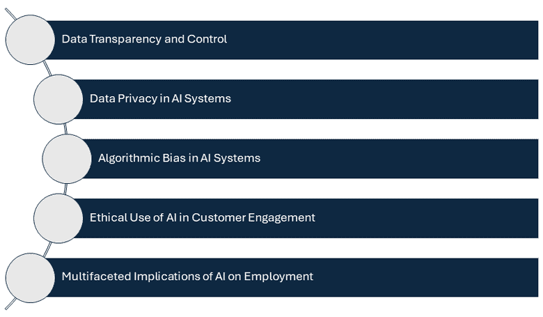

One of the primary ethical concerns in AI-driven customer engagement is the responsible handling of customer data. AI systems rely on vast amounts of data to make predictions and recommendations (Alla et al., 2022; Lhoussaine et al., 2022; Bouhtatit et al., 2023a; Bouhtatit et al., 2023b; Blanco-Gonzalez et al., 2023). However, collecting and processing this data can raise privacy issues if not done transparently or if customers are unaware of how their data is being used. Companies must be transparent about the types of data they collect, how it is used, and provide customers with clear options for controlling their data.


此外，当 AI 算法被用于分析敏感信息（例如个人偏好、行为或健康数据）时，确保数据隐私变得更加复杂。个性化与侵扰之间存在着微妙的界限，公司必须谨慎行事，以在尊重客户隐私的同时仍提供个性化体验。这涉及实施强大的数据保护措施，包括加密、匿名化和严格的访问控制。

另一个伦理考量是 AI 驱动的客户参与中潜在的算法偏见。AI 系统的公正性取决于其训练数据。如果训练数据存在偏差或反映了现有的偏见，AI 算法可能会延续甚至加剧歧视性结果（Ferrara, 2023；Giovanola & Tiribelli, 2023）。例如，客户参与系统中的偏见算法可能会无意中在产品推荐或定价策略中歧视某些人口群体。为了减轻偏见，公司需要定期审计其 AI 系统，多样化其训练数据，并采用公平意识学习等技术。

此外，围绕在客户参与中使用 AI 进行操纵目的存在伦理影响。AI 驱动的系统可以分析大量数据，通过定向广告、有说服力的消息或个性化推荐来影响消费者行为。虽然这些策略可以增加销售和参与度，但也引发了关于操纵和自主权的担忧（Ienca, 2023）。公司必须确保其在客户参与中使用 AI 符合伦理原则，并尊重客户的自主权和能动性。

面对即将到来的 AI 革命及其对就业格局的重大影响，有必要认识到就业超越单纯经济影响的多方面性质。随着 AI 继续在各个行业自动化任务，对就业的潜在干扰超出了财务问题，涵盖了心理、社会甚至政治维度（[Du & Xie, 2021](#979-8-3693-3172-9.ch009.bits-pdf.xhtml#_idTextAnchor541）。鉴于公司有责任保障员工的利益，采取主动措施来应对 AI 驱动的工作流失所带来的挑战至关重要。专注于再培训和终身学习的举措可以赋予员工权力，使其能够适应并在快速变化的就业市场中蓬勃发展。公司可以分配资源来建立企业学习学院或专门支持员工获取数字技能并应对工作转型的基金（[Du & Xie, 2021](#979-8-3693-3172-9.ch009.bits-pdf.xhtml#_idTextAnchor541）。此外，政府在解决由 AI 导致的失业引发的社会问题方面发挥着至关重要的作用。对监管框架和政策的研究至关重要，以确保 AI 技术利益的公平分配，并减轻大规模工作流失可能带来的负面后果。通过优先考虑伦理考量以及企业与政府之间的协作努力，社会可以以负责任和可持续的方式应对 AI 革命所带来的挑战和机遇。

总之，伦理考量和隐私问题在 AI 驱动的客户参与中至关重要。公司必须优先考虑透明度、数据隐私、公平性和对客户自主权的尊重，以在其 AI 举措中建立信任并保持伦理标准。通过主动解决这些问题，企业可以利用 AI 来增强客户体验，同时坚守伦理价值。

## 6. 结论

在本章中，引言中概述的紧迫挑战或问题——企业需要在日益数字化的市场中满足并超越现代消费者的期望——已得到彻底解决。通过 AI 的视角，提出了应对这一挑战的解决方案，AI 作为推动传统客户互动范式革命的催化剂。从解码消费者行为到通过自动化彻底改变个性化并简化客户互动，本章的每个部分都提供了见解和策略，以超越期望并确保客户获得无缝体验。负责任且战略性地采用 AI 技术，使企业能够应对数字时代的复杂性，与客户建立有意义的关系，并在不断变化的市场中确立其地位。

在探索 AI 技术与客户参与之间动态交汇点的过程中，很明显，AI 的战略整合不仅仅是对技术进步的回应，而是一场深刻的范式转变。本章揭示了 AI 在重塑客户-企业关系格局方面的变革潜力。AI 在解码消费者行为方面的基础作用对于战略适应至关重要。AI 分析大量数据集、识别复杂模式并提供实时洞察的能力，使企业能够迅速理解和应对不断变化的消费者动态。这不仅增强了决策过程，还允许针对市场趋势和消费者偏好进行战略适应。从大量数据集中提取有意义的洞察的能力是一个改变游戏规则的因素，为企业提供了在理解和满足客户期望方面的竞争优势。

对 AI 在彻底改变个性化方面作用的探索强调了品牌与消费者之间建立的深刻联系。由 AI 驱动的尖端个性化技术使企业能够创建详细的客户档案，提供高度定向且相关的内容。这不仅提升了整体客户体验，还促进了品牌与消费者之间更深刻、更有意义的联系。

自动化在现代客户互动中发挥着关键作用，彻底改变了营销流程、运营效率和整体客户体验。通过 AI 驱动的自动化，组织实现了成本节约、可扩展性和敏捷性，简化了营销工作并增强了客户参与。通过自动化重复任务和分析大量客户数据，AI 算法为定向营销策略提供信息，确保个性化和相关的互动。自动化的变革性影响，例如在电子商务平台中实施聊天机器人技术，显著缩短了响应时间并丰富了整体客户旅程。此外，RPA 简化了后端流程，使人工客服能够专注于复杂的查询并提高服务质量。然而，企业必须在自动化与人工接触点之间取得平衡，以解决复杂问题并保持真实的联系。最终，拥抱自动化对于现代客户互动的持续成功至关重要，推动效率并提供卓越体验。

在 AI 在客户参与中变革潜力的背景下，必须承认潜在的缺点和挑战。隐私问题、数据安全以及围绕客户信息的伦理考量需要谨慎处理。也就是说，必须解决与隐私问题和数据安全相关的挑战，确保个性化体验与个人隐私之间的微妙平衡。企业必须优先考虑透明度和负责任的 AI 使用，以维护客户信任。此外，过度依赖 AI 而缺乏人工干预的风险在处理复杂和微妙的客户查询方面构成了挑战。


# 展望

展望未来，对于那些利用人工智能在客户参与方面潜力的企业而言，未来充满了令人兴奋的机遇。随着技术的不断进步，人工智能算法可以不断演进，以提供更加复杂的洞察和个性化体验。将人工智能整合到客户参与策略中，有望不仅成为一种趋势，更成为保持竞争力和实现可持续增长的基本方面。此外，人工智能技术的持续研究和开发可能会揭示创新解决方案，以应对当前的挑战，促进人工智能与人类互动之间更加无缝和谐的整合。探索人工智能对客户互动的影响，揭示了一场超越适应的变革之旅，标志着企业理解、与客户建立联系并为其服务方式发生了根本性转变。人工智能在客户参与中的战略必要性不仅仅是对数字时代需求的回应，更是一种主动的方法，旨在在个性化、高效且技术驱动的互动至关重要的环境中保持相关性、竞争力和成功。未来蕴藏着巨大的潜力，对于那些拥抱人工智能的企业而言，在自动化与人性化之间取得平衡，同时应对挑战，与其多样化的客户群建立持久且真实的关系。

## 结论

总之，虽然本章全面探讨了人工智能技术与客户参与之间的交汇点，但有必要承认一些局限性。首先，本章的范围可能无法涵盖人工智能驱动的客户互动的方方面面，因为该领域广阔且不断演变。某些新兴技术或人工智能在客户参与中的利基应用可能未得到充分解决。此外，提供的示例仅供说明，并非详尽无遗，可能还有其他值得注意的示例可以进一步丰富讨论。另外，所讨论的伦理考量和隐私问题复杂且多方面，对这些问题进行更深入的审查可能会提供额外的洞察。总体而言，虽然本章提供了关于人工智能在客户参与中变革潜力的宝贵洞察，但认识到其局限性并继续探索这一动态领域至关重要。

# 参考文献

Adam, M., Wessel, M., & Benlian, A. (2021). AI-based chatbots in customer service and their effects on user compliance. Electronic Markets, 31(2), 427–445. [10.1007/s12525-020-00414-7](http://dx.doi.org/10.1007/s12525-020-00414-7)

Alla, L., Kamal, M., & Bouhtati, N. (2022). Big data and marketing effectiveness of tourism businesses: A literature review. Alternatives Managériales Economiques, 4(0), Article 0. [10.48374/IMIST.PRSM/ame\-v1i0.36928](http://dx.doi.org/10.48374/IMIST.PRSM/ame-v1i0.36928)

Alsawaier, R. S. (2018). The effect of gamification on motivation and engagement. The International Journal of Information and Learning Technology, 35(1), 56–79. [10.1108/IJILT\-02-2017-0009](http://dx.doi.org/10.1108/IJILT-02-2017-0009)

Batra, P., & Dave, D. M. (2024). Revolutionizing Healthcare Platforms: The Impact of AI on Patient Engagement and Treatment Efficacy. International Journal of Science and Research (IJSR), 13(10.21275), 613-624.

Blanco-Gonzalez, A., Cabezon, A., Seco-Gonzalez, A., Conde-Torres, D., Antelo-Riveiro, P., Pineiro, A., & Garcia-Fandino, R. (2023). The role of ai in drug discovery: Challenges, opportunities, and strategies. Pharmaceuticals (Basel, Switzerland), 16(6), 891. [10.3390/ph16060891](http://dx.doi.org/10.3390/ph16060891)[](http://dx.doi.org/37375838)

Borgi, T., Zoghlami, N., & Abed, M. (2017, January). Big data for transport and logistics: A review. In 2017 International Conference on Advanced Systems and Electric Technologies (IC\_ASET) (pp. 44-49). IEEE. [10.1109/ASET.2017.7983742](http://dx.doi.org/10.1109/ASET.2017.7983742)

Bouhtati, N., Alla, L., & Bentalhah, B. (2023a). Marketing Big Data Analytics and Customer Relationship Management: A Fuzzy Approach. In Integrating Intelligence and Sustainability in Supply Chains (pp. 75-86). IGI Global.[10.4018/979\-8\-3693\-0225-5.ch004](http://dx.doi.org/10.4018/979-8-3693-0225-5.ch004)

Bouhtatit, N., Kamal, M., & Alla, L. (2023b). Big Data and the Effectiveness of Tourism Marketing: A Prospective Review of the Literature. In Farhaoui, Y., Rocha, A., Brahmia, Z., & Bhushab, B. (Eds.), Artificial Intelligence and Smart Environment. ICAISE 2022. Lecture Notes in Networks and Systems, 635. Springer. [10.1007/978\-3\-031-26254-8\_40](http://dx.doi.org/10.1007/978-3-031-26254-8_40)

Bowden, J. L. H. (2009). The process of customer engagement: A conceptual framework. Journal of Marketing Theory and Practice, 17(1), 63–74. [10.2753/MTP1069-6679170105](http://dx.doi.org/10.2753/MTP1069-6679170105)

Cohen, S. (2021). The basics of machine learning: strategies and techniques. In Artificial intelligence and deep learning in pathology (pp. 13–40). Elsevier. [10.1016/B978\-0\-323\-67538-3.00002-6](http://dx.doi.org/10.1016/B978-0-323-67538-3.00002-6)

Devarajan, Y. (2018). A study of robotic process automation use cases today for tomorrow’s business. International Journal of Computers and Technology, 5(6), 12–18.

Dhall, D., Kaur, R., & Juneja, M. (2020). Machine learning: a review of the algorithms and its applications. Proceedings of ICRIC 2019: Recent innovations in computing, (pp. 47-63). Springer. [10.1007/978\-3\-030-29407-6\_5](http://dx.doi.org/10.1007/978-3-030-29407-6_5)

Doborjeh, Z., Hemmington, N., Doborjeh, M., & Kasabov, N. (2022). Artificial intelligence: A systematic review of methods and applications in hospitality and tourism. International Journal of Contemporary Hospitality Management, 34(3), 1154–1176. [10.1108/IJCHM\-06-2021-0767](http://dx.doi.org/10.1108/IJCHM-06-2021-0767)

Du, S., & Xie, C. (2021). Paradoxes of artificial intelligence in consumer markets: Ethical challenges and opportunities. Journal of Business Research, 129, 961–974. [10.1016/j.jbusres.2020.08.024](http://dx.doi.org/10.1016/j.jbusres.2020.08.024)

Feldman, J., Zhang, D. J., Liu, X., & Zhang, N. (2022). Customer choice models vs. machine learning: Finding optimal product displays on Alibaba. Operations Research, 70(1), 309–328. [10.1287/opre.2021.2158](http://dx.doi.org/10.1287/opre.2021.2158)

Ferrara, E. (2023). Fairness and bias in artificial intelligence: A brief survey of sources, impacts, and mitigation strategies. Sci, 6(1), 3. [10.3390/sci6010003](http://dx.doi.org/10.3390/sci6010003)

Garg, P. K. (2021). Overview of artificial intelligence. In Artificial intelligence (pp. 3–18). Chapman and Hall/CRC. [10.1201/9781003140351-2](http://dx.doi.org/10.1201/9781003140351-2)

Giovanola, B., & Tiribelli, S. (2023). Beyond bias and discrimination: Redefining the AI ethics principle of fairness in healthcare machine-learning algorithms. AI & Society, 38(2), 549–563. [10.1007/s00146\-022\-01455-6](http://dx.doi.org/10.1007/s00146-022-01455-6)[](http://dx.doi.org/35615443)

Haleem, A., Javaid, M., Qadri, M. A., Singh, R. P., & Suman, R. (2022). Artificial intelligence (AI) applications for marketing: A literature-based study. International Journal of Intelligent Networks, 3, 119–132. [10.1016/j.ijin.2022.08.005](http://dx.doi.org/10.1016/j.ijin.2022.08.005)

Huseynov, F. (2020a). Intelligent Recommender Systems in E-Commerce: Opportunities and Challenges for Online Customers. Handbook of Research on IT Applications for Strategic Competitive Advantage and Decision Making, 36-51. Springer.

Huseynov, F. (2020b). Gamification in e-commerce: Enhancing digital customer engagement through game elements. In Digital innovations for customer engagement, management, and organizational improvement (pp. 144–161). IGI Global. [10.4018/978\-1\-7998\-5171-4.ch008](http://dx.doi.org/10.4018/978-1-7998-5171-4.ch008)


# 参考文献列表

Huseynov, F. (2023). Chatbots in digital marketing: Enhanced customer experience and reduced customer service costs. In Contemporary Approaches of Digital Marketing and the Role of Machine Intelligence (pp. 46–72). IGI Global. [10.4018/978\-1\-6684\-7735-9.ch003](http://dx.doi.org/10.4018/978-1-6684-7735-9.ch003)

Huseynov, F., & Özkan Yıldırım, S. (2019). Online consumer typologies and their shopping behaviors in B2C e-commerce platforms. SAGE Open, 9(2), 2158244019854639. [10.1177/2158244019854639](http://dx.doi.org/10.1177/2158244019854639)

Huseynov, F., & Yıldırım, S. Ö. (2017). Behavioural segmentation analysis of online consumer audience in Turkey by using real e-commerce transaction data. International Journal of Economics and Business Research, 14(1), 12–28. [10.1504/IJEBR.2017.085549](http://dx.doi.org/10.1504/IJEBR.2017.085549)

Hydle, K. M., Hellström, M., Aas, T. H., & Breunig, K. J. (2021). Digital servitization: strategies for handling customization and customer interaction. The Palgrave Handbook of Servitization, (pp. 355-372). Palgrave.

Ienca, M. (2023). On Artificial Intelligence and Manipulation. Topoi, 42(3), 833–842. [10.1007/s11245-023-09940-3](http://dx.doi.org/10.1007/s11245-023-09940-3)

Ivančić, L., Suša Vugec, D., & Bosilj Vukšić, V. (2019). Robotic process automation: systematic literature review. In Business Process Management: Blockchain and Central and Eastern Europe Forum. Springer.

Javanmard, S. (2024). Revolutionizing Medical Practice: The Impact of Artificial Intelligence (AI) on Healthcare. OA J Applied Sci Technol, 2(1), 01-16.

Jian, Z., & Liu, Y. (2016). The Impacts of Customer Interaction and Social Capital on New Service Development Performance. American Journal of Industrial and Business Management, 6(12), 1133–1145. [10.4236/ajibm.2016.612106](http://dx.doi.org/10.4236/ajibm.2016.612106)

Kaczorowska-Spychalska, D. (2019). Chatbots in marketing. Management, 23(1), 251–270. [10.2478/manment-2019-0015](http://dx.doi.org/10.2478/manment-2019-0015)

Kaswan, K. S., Dhatterwal, J. S., & Ojha, R. P. (2024). AI in personalized learning. In Advances in Technological Innovations in Higher Education (pp. 103–117). CRC Press. [10.1201/9781003376699-9](http://dx.doi.org/10.1201/9781003376699-9)

Khrais, L. T. (2020). Role of artificial intelligence in shaping consumer demand in E-commerce. Future Internet, 12(12), 226. [10.3390/fi12120226](http://dx.doi.org/10.3390/fi12120226)

Khvatova, T., Appio, F. P., Ray, S., & Schiavone, F. (2023). Exploring the Role of AI in B2B Customer Journey Management: Towards an IPO Model. IEEE Transactions on Engineering Management. IEEE.

Knof, M., Stock-Homburg, R., & Schurer, J. (2023). How in-store sensor technologies can help retailers to understand their customers: Overview on two decades of research. International Review of Retail, Distribution and Consumer Research, 1–18.

Latinovic, Z., & Chatterjee, S. C. (2022). Achieving the promise of AI and ML in delivering economic and relational customer value in B2B. Journal of Business Research, 144, 966–974. [10.1016/j.jbusres.2022.01.052](http://dx.doi.org/10.1016/j.jbusres.2022.01.052)

Lhoussaine, A. L. L. A., Kamal, M., & Bouhtati, N. (2022). Big data and marketing effectiveness of tourism businesses: A literature review. Economic Management Alternatives, 1, 39–58.

Liao, S. H., Widowati, R., & Hsieh, Y. C. (2021). Investigating online social media users’ behaviors for social commerce recommendations. Technology in Society, 66, 101655. [10.1016/j.techsoc.2021.101655](http://dx.doi.org/10.1016/j.techsoc.2021.101655)

Luo, X., Tong, S., Fang, Z., & Qu, Z. (2019). Frontiers: Machines vs humans: The impact of artificial intelligence chatbot disclosure on customer purchases. Marketing Science, 38(6), 937–947. [10.1287/mksc.2019.1192](http://dx.doi.org/10.1287/mksc.2019.1192)

Nüesch, R., Alt, R., & Puschmann, T. (2015). Hybrid customer interaction. Business & Information Systems Engineering, 57(1), 73–78. [10.1007/s12599-014-0366-9](http://dx.doi.org/10.1007/s12599-014-0366-9)

Ogbuke, N. J., Yusuf, Y. Y., Dharma, K., & Mercangoz, B. A. (2022). Big data supply chain analytics: Ethical, privacy and security challenges posed to business, industries and society. Production Planning and Control, 33(2-3), 123–137. [10.1080/09537287.2020.1810764](http://dx.doi.org/10.1080/09537287.2020.1810764)

Puntoni, S., Reczek, R. W., Giesler, M., & Botti, S. (2021). Consumers and artificial intelligence: An experiential perspective. Journal of Marketing, 85(1), 131–151. [10.1177/0022242920953847](http://dx.doi.org/10.1177/0022242920953847)

Rane, N., Choudhary, S., & Rane, J. (2023). Education 4.0 and 5.0: Integrating Artificial Intelligence (AI) for personalized and adaptive learning. Available at SSRN 4638365. [10.2139/ssrn.4638365](http://dx.doi.org/10.2139/ssrn.4638365)

Rasool, A., Shah, F. A., & Tanveer, M. (2021). Relational dynamics between customer engagement, brand experience, and customer loyalty: An empirical investigation. Journal of Internet Commerce, 20(3), 273–292. [10.1080/15332861.2021.1889818](http://dx.doi.org/10.1080/15332861.2021.1889818)

Sahu, M., Gupta, R., Ambasta, R. K., & Kumar, P. (2022). Artificial intelligence and machine learning in precision medicine: A paradigm shift in big data analysis. Progress in Molecular Biology and Translational Science, 190(1), 57–100. [10.1016/bs.pmbts.2022.03.002](http://dx.doi.org/10.1016/bs.pmbts.2022.03.002)[](http://dx.doi.org/36008002)

Said, S. (2023). The Role of Artificial Intelligence (AI) and Data Analytics in Enhancing Guest Personalization in Hospitality. Journal of Modern Hospitality, 2(1), 1–13. [10.47941/jmh.1556](http://dx.doi.org/10.47941/jmh.1556)

Sarabhai, S., Chakraborty, M., Batra, M., Kler, R., Banerjee, S., & Mishra, S. (2023, November). Using AI and Machine Learning to Predict Consumer Buying Behavior: Insights from Behavioral Economics in Case of Alcoholic Beverages. In 2023 3rd International Conference on Technological Advancements in Computational Sciences (ICTACS) (pp. 980-986). IEEE.

Sarker, I. H. (2022). AI-based modeling: Techniques, applications and research issues towards automation, intelligent and smart systems. SN Computer Science, 3(2), 158. [10.1007/s42979\-022\-01043-x](http://dx.doi.org/10.1007/s42979-022-01043-x)[](http://dx.doi.org/35194580)

Saßnick, O., Zniva, R., Schlager, C., Horn, M., Kozlica, R., Neureiter, T., & Nöbauer, J. (2023, April). Analyzing customer behavior in-store: A review of available technologies. In Digital Marketing & eCommerce Conference (pp. 243–252). Springer Nature Switzerland. [10.1007/978\-3\-031-31836-8\_25](http://dx.doi.org/10.1007/978-3-031-31836-8_25)

Schuetzler, R. M., Grimes, G. M., & Scott Giboney, J. (2020). The impact of chatbot conversational skill on engagement and perceived humanness. Journal of Management Information Systems, 37(3), 875–900. [10.1080/07421222.2020.1790204](http://dx.doi.org/10.1080/07421222.2020.1790204)

Shumanov, M., & Johnson, L. (2021). Making conversations with chatbots more personalized. Computers in Human Behavior, 117, 106627. doi:. chb.2020.106627[10.1016/j](http://dx.doi.org/10.1016/j)

Syed, R., Suriadi, S., Adams, M., Bandara, W., Leemans, S. J., Ouyang, C., ter Hofstede, A. H. M., van de Weerd, I., Wynn, M. T., & Reijers, H. A. (2020). Robotic process automation: Contemporary themes and challenges. Computers in Industry, 115, 103162. [10.1016/j.compind.2019.103162](http://dx.doi.org/10.1016/j.compind.2019.103162)

Tang, Z., Xu, X., Song, Y., & Yang, H. (2022, March). Data Analytics Applications in the Soda Industry. In International Conference on Business and Policy Studies (pp. 677-688). Singapore: Springer Nature Singapore. [10.1007/978\-981\-19-5727\-7\_69](http://dx.doi.org/10.1007/978-981-19-5727-7_69)


Zhou, F., Ayoub, J., Xu, Q., & Jessie Yang, X. (2020). A machine learning approach to customer needs analysis for product ecosystems. Journal of Mechanical Design, 142(1), 011101. [10.1115/1.4044435](http://dx.doi.org/10.1115/1.4044435)

### 补充阅读

Perez-Vega, R., Kaartemo, V., Lages, C. R., Razavi, N. B., & Männistö, J. (2021). Reshaping the contexts of online customer engagement behavior via artificial intelligence: A conceptual framework. Journal of Business Research, 129, 902–910. [10.1016/j.jbusres.2020.11.002](http://dx.doi.org/10.1016/j.jbusres.2020.11.002)

Yin, D., Li, M., & Qiu, H. (2023). Do customers exhibit engagement behaviors in AI environments? The role of psychological benefits and technology readiness. Tourism Management, 97, 104745. [10.1016/j.tourman.2023.104745](http://dx.doi.org/10.1016/j.tourman.2023.104745)

Zhang, J., Chen, Q., Lu, J., Wang, X., Liu, L., & Feng, Y. (2024). Emotional expression by artificial intelligence chatbots to improve customer satisfaction: Underlying mechanism and boundary conditions. Tourism Management, 100, 104835.

### 关键术语与定义

人工智能 (`AI`): `AI` 涉及在机器中复制类似人类的智能，通常通过计算机系统实现。这使机器能够执行传统上需要人类智能的任务，包括学习、解决问题和做出决策。

游戏化：游戏化涉及将类似游戏的元素和机制集成到非游戏环境中，以提高参与度、积极性和参与率。这是通过融入挑战、奖励、竞争和成就系统等功能来实现的。

机器人流程自动化 (`RPA`): `RPA` 利用软件机器人或“机器人”来自动化跨多个系统和应用程序的重复性和基于规则的任务。

## 第 10 章

# 利用基于 AI 的移动用户行为洞察优化营销活动

Nurullah Tas


Gebze Technical University, Turkey

Farid Huseynov


Gebze Technical University, Turkey

Büşra Özdenizci Köse


Gebze Technical University, Turkey

### 摘要

技术在我们的日常生活中至关重要，它使我们能够通过智能手机、平板电脑和笔记本电脑等设备进行通信、获取信息并参与各种活动。社交媒体平台促进了全球连接和信息共享。互联网彻底改变了对无限信息、网上购物、教育和就业机会的获取。人工智能 (`AI`) 的进步为医疗保健、汽车和金融等领域带来了创新解决方案。本研究旨在强调技术和 `AI` 在分析移动用户行为和优化营销活动中的重要性。它提供了关于理解移动用户行为、影响其行为的因素以及 `AI` 在市场研究中的作用的洞察。此外，它还探讨了 `AI` 在消费者行为分析中的应用。该研究考察了 `AI` 算法对移动用户数据的影响，并讨论了通过 `AI` 进行个性化。最后，它深入探讨了 `AI` 支持的活动优化和实时营销。

### 1\. 引言

今天，技术已承担起影响其用户行为的角色。这种情况可能导致对购物体验不满意的客户无论是否忠诚都更倾向于选择其他平台 (Özmen, 2003)。这是因为无论时间和地点都方便购物。智能手机、平板电脑和计算机等移动设备提供了这种便利 (Barutçu, 2008)。对企业非常有用的人工智能 (`AI`) 工具，在识别客户期望和制定未来计划方面也非常有用。研究表明，基于 `AI` 的系统可以分析客户行为并预测其偏好 (Wisetsri et al., 2021)。

人工智能的起源可以追溯到笛卡尔和莱布尼茨等哲学家。尽管可以追溯到这么久远，但对人工智能的关注是在后来的几年中才集中的。1956 年举行的达特茅斯会议是人工智能的一个重要发展节点，因为其目标和方法开始成形 (McCarthy, 2007)。随着发展，人工智能使数据能够更系统地处理和解释。它们还具有适应性强的能力，能够最优地捕捉以实现既定目标。企业通过利用这些能力受益于人工智能创新。这样，他们可以分析客户数据并为客户制定个性化的营销策略 (Kaplan and Haenlein, 2019)。

人工智能可以定义为机器模仿人类智能并执行各种任务的能力 (Garg, 2021)。`AI` 的目标包括学习、推理和执行任务。机器学习、深度学习和神经网络等基本概念构成了人工智能的基础。这些概念极大地促进了数据挖掘、自然语言处理和软件开发等领域的发展 (Wisetsri et al., 2021)。有人认为，人工智能将在营销领域带来重大变革 (Davenport et al., 2020)。

理解移动用户行为对企业至关重要。随着移动技术的快速发展，用户在移动设备上的互动和偏好变得更加重要。理解移动用户行为使企业能够优化营销策略、改善用户体验并获得竞争优势。人工智能和数据分析等技术通过处理大量数据，在理解和预测用户行为方面发挥着重要作用。通过更好地了解用户需求，企业可以提供个性化服务并提高客户满意度。理解移动用户行为是企业在竞争市场中取得成功的不可或缺的因素。在本节中，将介绍移动设备使用量的增加及其对我们生活的影响，并讨论移动用户行为及其影响因素的重要性。然后，将讨论人工智能在移动用户行为分析中的作用以及人工智能技术在优化移动用户营销活动中的应用。

### 2\. 理解移动用户行为


移动营销旨在通过向消费者传递个人信息，不受时间和地点限制，从而增加产品的推广和销售 (Haghirian et al., 2005)。移动营销为企业提供了客户细分的机会，并可根据性别、年龄、地理位置和兴趣等因素为目标受众制定定制化营销策略 (Constantiou and Mahnke, 2010)。随着技术的飞速发展，移动营销领域发生了巨大变化。移动设备和应用程序提供了诸如提供互动内容、提供视听体验以及与用户互动等优势。这提高了移动营销的效果。例如，移动广告可以通过丰富的媒体内容变得视觉吸引人，并为用户提供互动体验。同时，个性化通知、促销和折扣等营销信息可以轻松通过移动设备传递给消费者。然而，移动营销并非没有挑战。移动设备上的技术限制，例如屏幕尺寸有限和连接速度慢，可能会影响内容传递和用户体验。此外，消费者对移动广告产生麻木感或不适感等因素可能会降低移动营销的效果 (Park et al., 2008)。

移动营销文献中有许多关于理解和分析移动用户行为的重要研究。移动营销使得无论时间和地点如何，都能与消费者进行实时通信 (Waldt et al., 2009)。因此，娱乐性、个性化和不便性等因素被视为通过移动营销决定广告效果和消费者态度并影响移动营销的最重要因素 (Haghirian and Madlberger, 2005)。信任和个性化也是影响移动营销的关键因素 (Al-alak and Alnawas, 2010)。

大部分关于移动营销的研究都集中在了解移动电话用户对移动广告的态度以及考察他们在这方面的行为。根据这些研究的结果，观察到人们对个性化、可靠、信息丰富且有趣的移动营销应用持积极态度。然而，消费者对烦人、重复和机械的信息反应消极。虽然对有趣的信息表现出兴趣，但对烦人信息产生负面反应可能导致消费者对品牌形成负面看法 (Tsang et al., 2004)。

在此背景下，可以说有许多因素会影响移动用户行为。用户体验和可用性因素、应用程序界面、性能和用户友好内容、个性化和定制选项、根据用户偏好呈现内容、社交互动、安全和隐私、经济因素和人口统计因素都是影响移动用户行为的因素。下一节将详细阐述这些因素。

## 3\. 影响移动用户行为的因素

个人变量是影响移动用户行为的重要因素。这些变量包括消费者的个人特征、收入、年龄、性别、婚姻状况和职业 (Köseoğlu, 2002; Orhan, 2002; Penpece, 2006)：这些因素可能会影响人们的购买行为。例如，消费者的兴趣可能会根据年龄段转向不同的产品。年轻人大多对服装感兴趣，而更多中年人可能对家居用品或电子产品感兴趣。另一方面，性别对移动消费者行为也很重要。根据性别，产品类别的偏好可能会改变。另一方面，个人的职业是另一个重要变量。

社会文化因素也是影响移动用户行为的重要因素之一。个人的需求、愿望、信仰、文化价值观和能力都是塑造移动使用的因素。此外，家庭在赚取和消费方面的消费过程中都扮演着重要角色。人们所属的社会阶层也是影响个人行为的因素，并可能对消费偏好、产品选择和消费习惯产生决定性影响 (Odabaşı and Barış, 2003)。

塑造移动消费者购买行为的另一个重要因素是经济因素。收入水平、价格和经济状况等因素都是影响消费者购买决策的因素。此外，与社会地位、环境和文化等因素直接相关的经济因素，可以在用户的购买决策中发挥指导作用 (Penpece, 2006)。

影响移动用户行为的一个重要因素是对移动技术的接受度。如今，移动技术是消费者与移动营销技术进行交互的生活方式中非常重要的一部分，消费者对这些技术的接受度正在提高 (Al-Meshai and Almotairi, 2013)。消费者对移动技术的接受度对于移动营销策略实现其目标至关重要 (Bauer et al., 2005)。除此之外，影响移动营销接受度的变量还有很多，例如感知收益、个人承诺、创新性、风险感知、对移动营销的态度、价值感知、内容访问、内容共享能力、信息获取和使用的便捷性感知等 (Gao et al., 2010; Jayawardhena et al., 2009)。

在移动营销领域，风险感知在影响移动用户行为的因素中具有重要意义。风险感知是指用户在在线情况下获取个人信息的可能性。个人分享个人信息以参与在线营销活动的可能性与风险感知有关。研究表明，通过确保对个人信息保护的信任和控制，可以减少安全顾虑。这表明隐私对于移动营销策略的成功实施至关重要 (Gao et al., 2010)。

影响移动用户行为的另一个重要因素是个人承诺。这与消费者希望个性化其移动电话并以独特方式表达自我的愿望有关。强调移动电话使用个性化功能来代表个人本身 (Du, 2012)。此外，将这些设备视为一个人生活中不可或缺的关键部分，也被视为个人依恋的指标 (Rohm et al., 2012)。


感知价值是影响移动用户态度的一个因素，它体现了对系统在完成其使命方面的有用性的信念。智能手机的感知价值要素，例如沟通和获取信息，也可以直接与对移动营销的态度相关联。另一方面，创新性是另一个因素。创新性可以通过消费者对新移动应用程序的接受程度和兴趣来衡量。同样，对移动营销的态度包括情感和信念要素，例如利用移动营销激励措施和从品牌获取信息（Gao et al., 2012）。

基于以上所有，可以说人工智能在营销领域有着广泛的应用。如今，得益于先进的算法和数据分析技术，企业可以使用 AI 模型来了解客户行为，通过个性化产品让客户感到更特别，并通过定向加强客户关系。最终，AI 应用使企业能够制定更有效的营销策略，并为客户提供更具个性化的体验。以下，将提供关于在营销研究中使用 AI 的更多详细信息。

### 4\. 营销研究中的人工智能

在营销组合管理中，AI 非常重要，并在各个领域发挥着有影响力的作用。从产品管理的角度来看，基于 AI 的营销分析工具可以通过评估产品设计与客户需求的匹配程度来确定客户满意度水平（Dekimpe, 2020）。另一方面，AI 可以在产品搜索过程中识别客户偏好，使他们能够积极使用产品推荐系统来改进其营销策略（Dzyabura and Hauser, 2019）。

动态定价算法有能力通过考虑客户偏好、竞争对手策略和供应网络来优化定价（Dekimpe, 2020）。

在促销领域，AI 提供了传递基于客户的个性化消息的能力（Huang and Rust, 2022）。

消费者行为分析正在随着 AI 赋能的方法而发生重大变革。AI 使我们能够通过使用大数据分析和机器学习技术，更有效地了解消费者偏好、趋势和需求。这为企业在制定更有效的营销策略和提供个性化体验方面提供了巨大优势。借助 AI，企业可以更深入地了解消费者行为，并以定制的方式将这些信息传递给目标受众。以下，将提供关于在分析消费者行为中使用 AI 的更多详细信息。

### 5\. 分析消费者行为中的人工智能

人工智能在分析消费者行为中发挥着至关重要的作用。AI 的使用正在从根本上改变企业与客户互动的方式，并使营销人员能够更加关注客户（Hoyer et al., 2020）。另一方面，人工智能为营销人员提供了更好地了解客户行为并相应制定更有效营销策略的机会。

消费者正在适应快速变化的技术和创新，同时与 AI 进行交互（[Verma et al., 2021](#979-8-3693-3172-9.ch010.bits-pdf.xhtml#_idTextAnchor643））。人工智能优化业务流程，生成数据驱动的洞察，并为消费者和市场分析产生算法（[Davenport et al., 2020](#979-8-3693-3172-9.ch010.bits-pdf.xhtml#_idTextAnchor602））。机器学习、深度学习和自然语言处理等 AI 技术通过分析大数据，显著影响着数字营销策略（[Haleem et al., 2022](#979-8-3693-3172-9.ch010.bits-pdf.xhtml#_idTextAnchor615））。通过这种方式，并利用进一步的发展，企业可以更好地了解消费者行为，优化其营销策略，并为客户提供个性化体验。

在营销领域，为了预测 AI 驱动的消费市场的变革，对营销研究的需求有所增加。营销研究通过适应技术变革，从根本上改变了营销研究流程。公司非常重视市场研究，以更好地了解目标受众、开发产品、改善用户体验并制定有效的营销策略（Emeritus, 2023）。通过这种方式，企业可以更好地满足客户需求，并加强其在市场上的领先地位。


人工智能在消费者行为分析中不可或缺。这项技术为企业提供了实时满足客户需求的机会。此外，当提供个性化体验时，观察到 AI 的使用会增加消费者的购买倾向。与各种 AI 工具交互的消费者表现出显著的行为变化。AI 有能力自动化业务流程，从数据中提取有意义的洞察并生成市场洞察。它还包括机器学习、深度学习和自然语言处理等各个领域。其中，机器学习由于其分析大数据并提供营销分析工具的能力，对数字营销场景有显著影响（Haleem et al., 2022）。因此，企业正在使用人工智能来获得竞争优势并制定成功的营销策略。

市场研究为公司提供显著优势。首先，它提供关于如何专注于客户需求并提高客户满意度的指导。数据使品牌能够了解消费者的需求并做出以客户为导向的决策。它还提供了改善品牌形象和加强市场定位的机会。通过识别目标受众的偏好，市场研究使公司能够提供量身定制的产品和服务。它在降低风险方面也发挥着重要作用。它通过提供市场趋势、竞争对手策略和客户要求方面的信息，帮助公司适应市场变化。另一方面，市场研究使领导者能够做出数据驱动的决策，并识别合适的产品、营销策略和目标市场。市场研究过程通过初级市场研究和次级市场研究进行，包括两种不同的方法。初级市场研究是在公司内部进行的研究，旨在通过与客户的直接沟通来识别需求和愿望。这些方法包括焦点小组、访谈、基于观察的研究、买家个性调查和市场细分研究。次级市场研究是由第三方进行的研究，基于先前收集、分析和发布的数据。这种方法包括来自公司网站、行业统计数据、白皮书和政府机构数据等来源的信息（Emeritus, 2023）。

然而，随着人工智能的采用，营销研究经历了彻底的转变。为了在竞争激烈的市场中生存，消费者行为分析至关重要。市场研究涉及收集、分析和解释数据的过程，并为公司提供不断变化的市场趋势、消费者行为和市场状况的概览。进行市场研究的目的包括评估新业务或产品的可行性、识别潜在的新市场、跟踪营销趋势以及测试新产品的需求（Emeritus, 2023）。

人工智能极大地受益于营销及其他许多领域中使用的算法的力量。先进的算法可以利用大数据分析和机器学习技术识别复杂模式、分析数据并进行预测。这些算法可以快速处理大型数据集以了解用户行为、偏好和趋势。它还可以用于利用数据分析结果向用户提供个性化内容、产品推荐或定向广告。AI 算法使企业在做出更有效的决策、优化营销策略和改善客户体验方面获得显著优势。下面，我们将提供关于 AI 算法对移动用户数据影响的更详细洞察。

### 6\. 人工智能算法对移动用户数据的影响

人工智能被定义为能够成功执行类似人类认知任务的机器，已成为数字营销和社交媒体的重要组成部分（Galloway and Swiatek, 2018）。AI 用于工作的算法需要大量且多样的数据来演进。用户在社交媒体、电子邮件、网站和搜索引擎等各种数字平台上的活动在创建这些数据方面发挥着重要作用（Pavlik et al., 2022）。这些数据在创建个性化流程和体验方面发挥着重要作用。这些大型数据池被称为在线可用并存储在云中的信息（Mosco, 2014, citing Fuchs, 2014）。人工智能算法对移动用户数据有巨大影响，这些算法被 Facebook、Google、Amazon 等热门平台使用（Koenig, 2020）。这些公司通过关注用户的数字活动，利用算法，并基于通过不同活动收集、归档、分析和解释的数据创建个性化环境（Willson, 2016）。

关于数字营销活动，关于数据收集过程不道德方面存在争论（Palmer, 2005）。理解个性化数字平台中算法的运作及其影响变得越来越重要（Swart, 2021, citing Head et al., 2020）。算法被定义为基于给定输入产生输出的一组指令（Gillespie, 2014）。

个性化是 AI 的重要功能，提供了更好地了解用户偏好和行为以提供定制体验的能力。通过分析用户过去的互动、购买习惯和人口统计数据等数据，AI 算法可以提供定制内容、产品推荐或定向营销信息。通过这种方式，用户可以更轻松地访问其兴趣和需求，并感到更受重视。个性化提高了客户满意度，并为企业产生更高转化率和忠诚度提供了潜力。人工智能已成为利用大数据分析和学习算法支持个性化的重要工具，帮助更有效地制定营销策略。关于个性化的更多详细信息将在下面提供。

### 7\. 基于人工智能的个性化

个性化被提供为一种开发的功能，旨在为用户提供便利、速度和实用性。此功能允许用户快速轻松地访问所需内容，防止他们在成千上万的内容中迷失方向。个性化在创建更好地反映互联网用户的需求、期望和要求的内容流方面很有用。因此，人们认为个性化对品牌忠诚度和销售导向等问题有积极影响（Kuş, 2021）。


随着人工智能技术的发展，个性化正在演变为一种基于用户数据的结构。然而，热门平台频繁曝出与用户数据相关的隐私侵犯问题，引发了用户对这种结构的担忧。然而，随着个性化的功能特性和客户满意度，用户越来越愿意共享数据。当用户意识到个性化能增加他们的利益、促进各个领域的决策、让他们掌控局面并让他们对体验感到满意时，他们开始觉得个性化和数据处理过程更加可接受（Kotler et al., 2022）。

个性化可以从以用户为中心的方式定义，并有潜力通过节省用户时间、使其体验更具针对性和更愉快来提供巨大优势。然而，由于某些情况和因此产生的问题，这是一个应该谨慎对待的话题。社交媒体平台的个性化范式可能会导致用户仅限于接触与自己相似的用户所生产的内容。这可能会消除遇到不同观点的可能性，而这些观点有助于克服个人和社会偏见，并可能导致偏见的加深（Narin, 2018）。

在营销领域，人工智能对于活动优化和实时营销至关重要。人工智能算法、大数据分析和持续学习能力使营销活动能够得到更有效的优化，并快速响应用户的即时互动。这为企业提供了战略和竞争优势。下文将提供关于 AI 驱动的活动优化和实时营销的更详细信息。

### 8\. AI 驱动的活动优化和实时营销

AI 驱动的客户体验是营销人员利用 AI 更好地了解客户并提供最佳体验的一个领域（Haleem et al., 2022）。

客户开始信任品牌和所使用的技术，尤其是当 AI 驱动的服务具有个性化、便捷和高质量时（Ameen et al., 2021）。然而，这些技术应始终受到控制，以避免伦理问题。这是因为数据隐私、安全性和透明度等问题是 AI 支持的客户体验应用中的重要问题。因此，企业应适当保护客户数据并遵守伦理规则。

在未来，人工智能将迅速普及，并将在更广泛的领域中使用。随着新兴技术和 AI 算法的发展，企业将更倾向于使用更高效、更智能的系统。在医疗保健、汽车、零售、制造以及许多其他领域，基于 AI 的解决方案将得到更广泛的采用，为优化业务流程、改善决策和提供个性化体验带来巨大机遇。

研究是关于 AI 如何补充和增强营销策略的宝贵信息来源（Haleem et al., 2022）。


Targeting quality can be seen as another advantage of artificial intelligence in ad optimization. Thanks to big data analysis and learning capabilities, advertising options with more accurate and precise targeting can be offered. By analyzing information such as consumer preferences, behaviors and demographic data, AI can ensure that advertising messages reach the right target audience. This offers advertisers higher conversion rates and more effective marketing strategies (Bateni et al., 2017).

Another optimization dimension developed by AI solutions is content relevance and media effectiveness. By utilizing artificial intelligence, content analysis and recommendation systems can be developed to ensure that advertising content is relevant to the target audience. In this way, more engaging and personalized content can be created and the consumer experience can be enhanced. In addition, AI-supported media optimization can increase ad effectiveness by ensuring that ads are shown on the right channels and at the right times (Dalenberg, 2018). Some more explanatory information on this topic is shared in the following sections.

## 10\. SEGMENTATION AND POSITIONING OF ADVERTISING ACTIONS SUPPORTED BY ARTIFICIAL INTELLIGENCE

Customer knowledge is an increasingly important strategic element (Bouhtati et al., 2023a). AI-supported advertising actions are also important for marketing segmentation and positioning processes for customers. Today, AI can provide more precise and accurate segmentation thanks to its big data analysis and learning capabilities. Thus, by analyzing a lot of information together, the target audience can be divided into different groups and advertising messages can be customized for these groups (Choi and Lim, 2020).

Utilizing artificial intelligence in segmentation provides significant advantages for advertisers in terms of marketing positioning. Artificial intelligence can help determine the position of products or services in the market by evaluating factors such as consumer preferences, market trends and competitive analysis. Thus, advertisers can identify unique selling points and differentiating positioning strategies and create effective messages and campaigns for the target audience (Theodoridis and Gkikas, 2019).

In addition, artificial intelligence can continuously improve itself by analyzing real-time data. This allows segmentation and positioning strategies to be improved over time. AI-driven dynamic segmentation and positioning enables rapid response to potential changes (Ziafat and Shakeri, 2014).

## 11\. APPLICATION OF ARTIFICIAL INTELLIGENCE IN AD OPTIMIZATION AND TARGETING

Artificial intelligence helps advertisers with technologies such as real-time bidding. Thus, the most optimal bids can be determined by analyzing user behavior and ad performance. In this way, the advertising budget is used more efficiently and the target audience can be reached more effectively (Nikolajeva & Teilans, 2021).

On the other hand, artificial intelligence can determine which ads are effective by analyzing big data. By optimizing ad content and strategies, advertisers can create more effective campaigns (Gupta et al., 2020). It can also optimize ad content, frequency, placement and timing by monitoring ad performance. This enables effective budget management (Mühlhoff and Willem, 2023).

On the other hand, AI also plays an important role in ad targeting. By analyzing consumer data, different customer groups can be identified and ads can be shown only to those relevant user segments. In addition, by using artificial intelligence, advertising campaigns can be expanded by finding new potential customers with similar characteristics. Thus, it can reach a wider audience and optimize marketing strategies (Bhatt, 2020). Thanks to big data, personalized advertising experiences are also offered (Lhoussaine et al., 2022).

With advancing technology, artificial intelligence can also provide more effective targeting by analyzing the content and placement of ads. It can also optimize ad placements by evaluating user scenarios (Haleem et al., 2022). Furthermore, AI can also increase the effectiveness of advertising campaigns. With AI, ad performance can be continuously monitored by analyzing real-time data (Ziafat and Shakeri, 2014).

## 12\. ETHICAL CONSIDERATIONS IN ARTIFICIAL INTELLIGENCE SUPPORTED MOBILE MARKETING APPLICATIONS

In addition to its many benefits, artificial intelligence brings some challenges. One of these is ethical considerations. The marketing discipline needs big data to improve customer experience, personalize and tailor offers (Bouhtatit et al., 2023b). Artificial intelligence used for this purpose can lead to biases and unintended dissemination of information. This can have negative impacts on people's lives. The need for large amounts of data for artificial intelligence raises privacy concerns. At this point, consumer data should be used ethically, privacy rights should be respected, and users should be given the right to choose how their data is shared (Munjal, 2016).

The transparency and interpretability of AI algorithms has focused on a number of privacy concerns, including societal values, ethical and legal issues. While there are many ethical guidelines on AI issues, keeping and presenting information transparently is a common problem. AI entails such security shortcomings and a number of regulatory and restrictive legal challenges (Larsson and Heintz, 2020).

For these reasons, consultation and collaboration between advertisers, researchers, policymakers and other relevant stakeholders is essential for the ethical and responsible use of AI. These collaborations aim to maximize the benefits and minimize the risks, as well as to ensure the ethical use of AI.

## 13\. CONCLUSION

The proliferation of mobile devices has created new opportunities in marketing, and the collection and analysis of mobile usage data has gained importance. Artificial intelligence applications play a critical role in analyzing and understanding mobile user behavior. By processing large datasets, AI algorithms can understandably reveal and predict user behavior. AI techniques such as machine learning and deep learning model user behavior and help create the most appropriate marketing strategies.

Optimizing the mobile app user experience is of great importance for marketing. By analyzing users' app experiences, AI can help design more user-friendly interfaces and manage feedback effectively. In addition, sentiment analysis techniques can be used to understand customers' emotional reactions and develop marketing strategies based on this information.

Measuring the effectiveness of mobile marketing campaigns is an important issue and AI can be used in this area. Using AI techniques, marketers can evaluate the results of marketing campaigns, perform real-time analyses and optimize future strategies. By using predictive models, customer behavior can be predicted in advance and based on this, the most appropriate marketing strategies can be developed.


# 正文

因此，人工智能在移动营销行业具有重要意义。通过在分析移动使用数据、了解用户行为、优化应用体验以及衡量营销活动效果等领域运用人工智能技术，可以制定出更有效、更具竞争力的营销策略。

# 参考文献

## REFERENCES

Al-alak, B. A., & Alnawas, I. A. (2010). Examining the Impact of Trust, Privacy Concern and Consumers’ Attitudes on Intention to Purchase. International Journal of Business and Management, 5(3), 28–41. [10.5539/ijbm.v5n3p28](http://dx.doi.org/10.5539/ijbm.v5n3p28)

Al-Meshal, S., & Almotairi, M. (2013). Consumer Acceptance of Mobile Marketing: An Empirical Study on the Saudi Female. International Journal of Marketing Studies., 5(5). Advance online publication. [10.5539/ijms.v5n5p94](http://dx.doi.org/10.5539/ijms.v5n5p94)

Ameen, N., Tarhini, A., Reppel, A., & Anand, A. (2021). Customer experiences in the age of artificial intelligence. Computers in Human Behavior, 114, 106548. [10.1016/j.chb.2020.106548](http://dx.doi.org/10.1016/j.chb.2020.106548)

Antons, D., & Breidbach, C. F. (2018). Big data, big insights? Advancing service innovation and design with machine learning. Journal of Service Research, 21(1), 17–39. [10.1177/1094670517738373](http://dx.doi.org/10.1177/1094670517738373)

Barutçu, S. (2008). Mobil Pazarlama Güncel Pazarlama Yaklaşımlarından Seçmeler.

Bateni, M., Esfandiary, H., Mirrokni, V., & Seddighin, S. (2017, February). A study of compact reserve pricing languages \[Conference session\]. Proceedings of the AAAI Conference on Artificial Intelligence, San Francisco, CA, USA.

Bauer, H., Reichardt, T., Barnes, S., & Neumann, M. (2005). Driving consumer acceptance of mobile marketing: A theoretical framework and empirical study. Journal of Electronic Commerce Research, 6.

Bauer, J., & Jannach, D. (2018). Optimal pricing in e-commerce based on sparse and noisy data. Decision Support Systems, 106, 53–63. [10.1016/j.dss.2017.12.002](http://dx.doi.org/10.1016/j.dss.2017.12.002)

Bhatt, V. K. (2021). Assessing the significance and impact of artificial intelligence and machine learning in placement of advertisements \[Conference session\]. 2021 IEEE International Conference on Technology Management, Operations and Decisions (ICTMOD), (pp. 1–6). IEEE.

Bouhtati, N., Alla, L., & Bentalhah, B. (2023a). Marketing Big Data Analytics and Customer Relationship Management: A Fuzzy Approach. In Integrating Intelligence and Sustainability in Supply Chains (pp. 75-86). DOI: . IGI Global.[10.4018/979\-8\-3693\-0225-5.ch004](http://dx.doi.org/10.4018/979-8-3693-0225-5.ch004)

Bouhtatit, N., Kamal, M., & Alla, L. (2023b). Big Data and the Effectiveness of Tourism Marketing: A Prospective Review of the Literature. In Farhaoui, Y., Rocha, A., Brahmia, Z., & Bhushab, B. (Eds.), Artificial Intelligence and Smart Environment. ICAISE 2022. Lecture Notes in Networks and Systems, 635. Springer. [10.1007/978\-3\-031-26254-8\_40](http://dx.doi.org/10.1007/978-3-031-26254-8_40)

Chatterjee, S., Ghosh, S. K., Chaudhuri, R., & Nguyen, B. (2019). Are CRM systems ready for AI integration? A conceptual framework of organizational readiness for effective AI-CRM integration. The Bottom Line (New York, N.Y.), 32(2), 144–157. [10.1108/BL\-02-2019-0069](http://dx.doi.org/10.1108/BL-02-2019-0069)

Choi, J. A., & Lim, K. (2020). Identifying machine learning techniques for classification of target advertising. ICT Express, 6(3), 175–180. [10.1016/j.icte.2020.04.012](http://dx.doi.org/10.1016/j.icte.2020.04.012)

Constantiou, I. D., & Mahnke, V. (2010). Consumer Behaviour and Mobile TV Services: Do Men Differ from Women in Their Adoption Intentions? Journal of Electronic Commerce Research, 11(2).

Dalenberg, D. J. (2018). Preventing discrimination in the automated targeting of job advertisements. Computer Law & Security Report, 34(3), 615–627. [10.1016/j.clsr.2017.11.009](http://dx.doi.org/10.1016/j.clsr.2017.11.009)

Davenport, T., Guha, A., Grewal, D., & Bressgott, T. (2020). How artificial intelligence will change the future of marketing. Journal of the Academy of Marketing Science, 48(1), 24–42. [10.1007/s11747-019-00696-0](http://dx.doi.org/10.1007/s11747-019-00696-0)

Dekimpe, M. G. (2020). Retailing and retailing research in the age of big data analytics. International Journal of Research in Marketing, 37(1), 3–14. [10.1016/j.ijresmar.2019.09.001](http://dx.doi.org/10.1016/j.ijresmar.2019.09.001)

Doneda, D., & Almeida, V. A. F. (2016, July-August). What Is Algorithm Governance? IEEE Internet Computing, 20(4), 60–63. [10.1109/MIC.2016.79](http://dx.doi.org/10.1109/MIC.2016.79)

Dzyabura, D., & Hauser, J. R. (2019). Recommending products when consumers learn their preference weights. Marketing Science, 38(3), 417–441. [10.1287/mksc.2018.1144](http://dx.doi.org/10.1287/mksc.2018.1144)

Emeritus. (2023). What is Market Research? Definition and Types. Emeritus. [`emeritus.org/in/learn/what\-is\-market\-research\-and\-why\-is\-it\-important/`](https://emeritus.org/in/learn/what-is-market-research-and-why-is-it-important/))

Ever, D., & Demircioğlu, E. N. (2022). Yapay Zekâ Teknolojilerinin Kalite Maliyetleri Üzerine Etkisi, Çukurova Üniversitesi Sosyal Bilimler Enstitüsü Dergisi, 31(1), 59–72.

Fuchs, C. (2014). Sosyal Medya Eleştirel Bir Giriş. Notabene Yayınları.

Galloway, C., & Swıatek, L. (2018). Public Relations and Artificial Intelligence: It’s Not (Just) About Robots. Public Relations Review, 44(5), 734–740. [10.1016/j.pubrev.2018.10.008](http://dx.doi.org/10.1016/j.pubrev.2018.10.008)

Gao, T., Rohm, A. J., Sultan, F., & Huang, S. (2012). Antecedents of consumer attitudes toward mobile marketing: A comparative study of youth markets in the United States and China. Thunderbird International Business Review, 54(2), 211–224. [10.1002/tie.21452](http://dx.doi.org/10.1002/tie.21452)

Gao, T., Sultan, F., & Rohm, A. J. (2010). Factors influencing Chinese youth consumers’ acceptance of mobile marketing. Journal of Consumer Marketing, 27(7), 574–583. [10.1108/07363761011086326](http://dx.doi.org/10.1108/07363761011086326)

Garg, P. K. (2021). Overview of artificial intelligence. In Artificial intelligence (pp. 3–18). Chapman and Hall/CRC. [10.1201/9781003140351-2](http://dx.doi.org/10.1201/9781003140351-2)

Gillespie, T. (2014). Relevance of Algorithms. In Gillespie, T., Boczkowski, P. J., & Foot, K. A. (Eds.), Inside Technology. Media Technologies: Essays on Communication, Materiality, and Society (pp. 167–194). The MIT Press. [10.7551/mitpress/9042.003.0013](http://dx.doi.org/10.7551/mitpress/9042.003.0013)

Gupta, S., Gupta, A., Savjani, P., & Kumar, R. (2020). Optimizing creative allocations in digital marketing \[Conferece session\]. International conference on advances in computing and data sciences, Singapore (pp. 419–429). Springer Singapore.

Haghirian, P., & Madlberger, M. (2005). Consumer Attitude toward Advertising via Mobile Devices. European Conference on Information Systems, (pp. 447–458). IEEE.

Haghirian, P., Madlberger, M., & Tanuskova, A. (2005). Increasing Advertising Value of Mobile Marketing - An Empirical Study of Antecedents. Proceedings of the 38th Annual Hawaii International Conference on System Sciences (pp. 32c-32c). IEEE. [10.1109/HICSS.2005.311](http://dx.doi.org/10.1109/HICSS.2005.311)

Haleem, A., Javaid, M., Qadri, M. A., Singh, R. P., & Suman, R. (2022). Artificial intelligence (AI) applications for marketing: A literature-based study. International Journal of Intelligent Networks.

Head, A. J., Fister, B., & Macmillan, M. (2020, January 15). Information Literacy in the Age of Algorithms: Student Experiences With News and Information, and The Need for Change. Project Information Literacy. [`files.eric.ed.gov/fulltext/ ED605109.pdf`](https://files.eric.ed.gov/fulltext/%20ED605109.pdf)


# 参考文献

Hoyer, W. D., Kroschke, M., Schmitt, B., Kraume, K., & Shankar, V. (2020). Transforming the customer experience through new technologies. *Journal of Interactive Marketing*, 51(1), 57–71. [10.1016/j.intmar.2020.04.001](http://dx.doi.org/10.1016/j.intmar.2020.04.001)

Huang, M. H., & Rust, R. T. (2022). A framework for collaborative artificial intelligence in marketing. *Journal of Retailing*, 98(2), 209–223. [10.1016/j.jretai.2021.03.001](http://dx.doi.org/10.1016/j.jretai.2021.03.001)

Jayawardhena, C., Kuckertz, A., Karjaluoto, H., & Kautonen, T. (2007). Antecedents to Permission Based Mobile Marketing: An Initial Examination. *European Journal of Marketing*, 43(3/4), 473–499. [10.1108/03090560910935541](http://dx.doi.org/10.1108/03090560910935541)

Kaplan, A., & Haenlein, M. (2019). ve Haenlein, M., “Siri, Siri, in my hand: Who’s the fairest in the land? On the interpretations, illustrations, and implications of artificial intelligence”. *Business Horizons*, 62(1), 15–25. [10.1016/j.bushor.2018.08.004](http://dx.doi.org/10.1016/j.bushor.2018.08.004)

Köseoğlu, Ö. (2002). Değişim Fenomeni Karşısında Markalaşma Süreci ve Bu Süreçte Halkla ̇lişkilerin Rolü. *Yüksek Lisans Tezi*. Ege Üniversitesi Sosyal Bilimler EnstitüsüHalkla lişkiler Anabilim Dalı, İzmir.

Kotler, P., Kartajaya, H., & Setıawan, I. (2022). Pazarlama 5.0. Nişantaşı Üniversitesi Yayınları.

Kuş, O. (2021). Algoritmaları Dehümanizasyon Çerçevesinde Tartışmak (Der. Oğuz Kuş). *Algoritmaların Gölgesinde Toplum Ve İletişim*. Alternatif Bilişim Derneği.

Larsson, S., & Heintz, F. (2020). Transparency in artificial intelligence. *Internet Policy Review*, 9(2), 1–16. [10.14763/2020.2.1469](http://dx.doi.org/10.14763/2020.2.1469)

Lhoussaine, A. L. L. A., Kamal, M., & Bouhtati, N. (2022). Big data and marketing effectiveness of tourism businesses: A literature review. *Economic Management Alternatives*, 1, 39–58.

McCarthy, J. (2007). From here to human-level AI. *Artificial Intelligence*, 171(18), 1174–1182. [10.1016/j.artint.2007.10.009](http://dx.doi.org/10.1016/j.artint.2007.10.009)

Misra, K., Schwartz, E. M., & Abernethy, J. (2019). Dynamic online pricing with incomplete information using multiarmed bandit experiments. *Marketing Science*, 38(2), 226–252. [10.1287/mksc.2018.1129](http://dx.doi.org/10.1287/mksc.2018.1129)

Mühlhoff, R., & Willem, T. (2023). Social media advertising for clinical studies: Ethical and data protection implications of online targeting. *Big Data & Society*, 10(1), 1–15. [10.1177/20539517231156127](http://dx.doi.org/10.1177/20539517231156127)

Munjal, N. (2016). A study on ethical issues in advertising and analyzing different unethical advertisements with results of asci decisions: An Indian perspective. *Ecoforum Journal*, 5(2), 1–34.

Murgai, A. (2018). Transforming digital marketing with artificial intelligence. *International Journal of Latest Technology in Engineering, Management &. Applied Sciences (Basel, Switzerland)*, 7(4), 259–262.

Narin, B. (2018). Kişiselleştirilmiş Çevrimiçi Haber Akışının Yankı Odası Etkisi, Filtre Balonu ve Siberbalkanizasyon Kavramları Çerçevesinde Incelenmesi. *Selçuk İletişim*, 11(2), 232–251. [10.18094/josc.340471](http://dx.doi.org/10.18094/josc.340471)

Nikolajeva, A., & Teilans, A. (2021). Machine Learning Technology Overview In Terms Of Digital Marketing And Personalization. *ECMS*, 125-130.

Odabaşı, Y., & Barış, G. (2003). Tüketici Davranışı (Cilt 2. Baskı). MediaCat Akademi.

Orhan, İ. (2002). Satın Alınan Ürünlere İlişkin Duyguların Cinsiyet ve Cinsiyet Rolleri Bakımından İncelenmesi.

Özmen, Ş. (2003). Ağ Ekonomisinde Yeni Ticaret Yolu E\-Ticaret. İstanbul Bilgi Üniversitesi Yayınları.

Palmer, D. E. (2005). Pop-ups, cookies, and spam: Toward a deeper analysis of the ethical significance of internet marketing practices. *Journal of Business Ethics*, 58(1-3), 271–280. [10.1007/s10551-005-1421-8](http://dx.doi.org/10.1007/s10551-005-1421-8)

Park, T., Shenoy, R., & Salvendy, G. (2008). Effective Advertising on Mobile Phones: A Literature Review and Presentation of Results from 53 Case Studies. *Behaviour & Information Technology*, 27(5), 355–373. [10.1080/01449290600958882](http://dx.doi.org/01449290600958882)

Pavlik, J., (2008). Mapping the Consequences of Technology on Public Relations.

Penpece, D. (2006). Tüketici Davranılarını Belirleyen Etmenler: Kültrürün Tüketici Davranışları Üzerindeki Etkisi. Kahramanmaraş.

Peyravi, B., Nekrošienė, J., & Lobanova, L. (2020). Revolutionised technologies for marketing: Theoretical review with focus on artificial intelligence. *Business: Theory and Practice*, 21(2), 827–834. [10.3846/btp.2020.12313](http://dx.doi.org/10.3846/btp.2020.12313)

Poria, S., Cambria, E., Gelbukh, A., Bisio, F., & Hussain, A. (2015). Sentiment data flow analysis by means of dynamic linguistic patterns. *IEEE Computational Intelligence Magazine*, 10(4), 26–36. [10.1109/MCI.2015.2471215](http://dx.doi.org/10.1109/MCI.2015.2471215)

Rohm, A., Sultan, F., Pagani, M., & Gao, T. (2012). Brand in the hand: A cross-market investigation of consumer acceptance of mobile marketing. *Business Horizons*, 55(5), 485–493. [10.1016/j.bushor.2012.05.004](http://dx.doi.org/10.1016/j.bushor.2012.05.004)

Saponaro, M., Le Gal, D., Gao, M., Guisiano, M., & Maniere, I. C. (2018, December). Challenges and opportunities of artificial intelligence in the fashion world. In *2018 international conference on intelligent and innovative computing applications (ICONIC)* (pp. 1-5). IEEE.

Theodoridis, P. K., & Gkikas, D. C. (2019). How artificial intelligence affects digital marketing \[Conference session\]. *Strategic Innovative Marketing and Tourism: 7th ICSIMAT \[Springer International Publishing.\]*. Athenian Riviera, Greece, 2018(October), 1319–1327.

Tsang, M. M., Ho, S. C., & Liang, T. P. (2004). Consumer Attitudes Toward Mobile Advertising: An empirical study. *International Journal of Electronic Commerce*, 8(3), 65–78. [10.1080/10864415.2004.11044301](http://dx.doi.org/10.1080/10864415.2004.11044301)

Verma, S., Sharma, R., Deb, S., & Maitra, D. (2021). Artificial intelligence in marketing: Systematic review and future research direction. *International Journal of Information Management Data Insights*, 1(1), 100002. [10.1016/j.jjimei.2020.100002](http://dx.doi.org/10.1016/j.jjimei.2020.100002)

Villegas, F. (2024). Artificial Intelligence Customer Experience: What is it, Pros, Cons and Best Tools. *QuestionPro*. [`www.questionpro.com/blog/tr/ai\-customer\-experience/`](https://www.questionpro.com/blog/tr/ai-customer-experience/))

Waldt, L. R., Rebello, T. M., & Brown, W. J. (2009). Attitudes of Young Consumers towards SMS Advertising. *African Journal of Business Management*, 3(9), 444–452.

Willson, M., (2016). Algorithms (and the) Everyday, *Information, Communication & Society*.

Wisetsri, W. (2021). Systematic analysis and future research directions in artificial intelligence for marketing. *Turkish Journal of Computer and Mathematics Education*, 12(11), 43–55.

Ziafat, H., & Shakeri, M. (2014). Using data mining techniques in customer segmentation. *Journal of Engineering Research and Applications*, 4(9), 70–79.

## ADDITIONAL READINGS

Bag, S., Srivastava, G., Bashir, M. M. A., Kumari, S., Giannakis, M., & Chowdhury, A. H. (2022). Journey of customers in this digital era: Understanding the role of artificial intelligence technologies in user engagement and conversion. *Benchmarking*, 29(7), 2074–2098. [10.1108/BIJ\-07-2021-0415](http://dx.doi.org/10.1108/BIJ-07-2021-0415)

Campbell, C., Sands, S., Ferraro, C., Tsao, H. Y. J., & Mavrommatis, A. (2020). From data to action: How marketers can leverage AI. *Business Horizons*, 63(2), 227–243. [10.1016/j.bushor.2019.12.002](http://dx.doi.org/10.1016/j.bushor.2019.12.002)

Chintalapati, S., & Pandey, S. K. (2022). Artificial intelligence in marketing: A systematic literature review. *International Journal of Market Research*, 64(1), 38–68. [10.1177/14707853211018428](http://dx.doi.org/10.1177/14707853211018428)


Ziakis, C., & Vlachopoulou, M. (2023). Artificial intelligence in digital marketing: Insights from a comprehensive review. Information (Basel), 14(12), 664. [10.3390/info14120664](http://dx.doi.org/10.3390/info14120664)

### KEY TERMS AND DEFINITIONS

Artificial Intelligence (AI): AI replicates human-like intelligence in machines via computer systems, enabling them to learn, solve problems, and make decisions traditionally requiring human intellect.

Machine Learning (ML): Machine learning is a branch of artificial intelligence (AI) that enables computers to learn from data and improve their performance on tasks without being explicitly programmed.

Personalization: Personalization refers to tailoring products, services, or experiences to meet the specific needs, preferences, and characteristics of individuals or groups.

# Chapter 11

## Applying Artificial Intelligence to Enhance E-Commerce Marketing Strategies: A Case Study of Jumia Market in Morocco

Nabil Seghyar

Research Laboratory in Organizational Management Sciences, Ibn Tofail University, Morocco

Meryem Amane

Artificial Intelligence, Data Science, and Emergent Systems Laboratory, Sidi Mohamed Ben Abdellah University, Morocco

Mounir Gouiouez

Psychology, Sociology, and Culture Studies Laboratory, Sidi Mohamed Ben Abdellah University, Morocco

Said Hraoui


Artificial Intelligence, Data Science, and Emergent Systems Laboratory, Sidi Mohamed Ben Abdellah University, Morocco

Mohammed Berrada

Artificial Intelligence, Data Science, and Emergent Systems Laboratory, Sidi Mohamed Ben Abdellah University, Morocco

### ABSTRACT

In the dynamic transformation of Moroccan e-commerce, AI and marketing convergence reshapes business-consumer engagement. This chapter explores AI's strategic use to enhance marketing in Moroccan e-commerce, spotlighting Jumia Market. Started in 2012 as a Pan-African tech firm, Jumia evolved into a multifaceted entity with marketplace, logistics, and payment services. Competing regionally and globally, Jumia faced challenges but went public on NYSE in 2019, adapting to market shifts. Amidst COVID-19 in 2020, it responded to changing consumer habits, emphasizing adaptability and profitability. This study examines Jumia Market's trajectory, resilience, and performance, showcasing AI's role in refining marketing strategies for optimal customer experiences and sustained growth in Moroccan e-commerce.

### 1\. INTRODUCTION

In the dynamic realm of e-commerce, the fusion of artificial intelligence (AI) and marketing emerges as a game-changer, reshaping how businesses engage with consumers (Hermann, Williams, & Puntoni, 2023). This study delves into the strategic utilization of AI to refine marketing approaches within Morocco's e-commerce, with a particular focus on Jumia Market as a case study. Our primary objective is to delve deeply into how AI-powered marketing strategies can be tailored to enrich customer experiences and drive online sales, all within the unique context of Morocco's e-commerce. Morocco, strategically situated at the crossroads of Africa and Europe, boasts a vibrant e-commerce sector characterized by diverse consumer preferences, cultural intricacies, and economic factors. This geographical positioning renders Morocco a distinct market, where businesses encounter a blend of influences. Understanding and navigating this complex terrain are imperative for those aspiring to achieve sustainable growth and meaningful customer engagement. In this multifaceted environment, businesses grapple with the task of accommodating diverse consumer choices, understanding cultural subtleties shaping purchasing decisions, and aligning strategies with economic dynamics. The integration of artificial intelligence (AI) into marketing strategies emerges as a pioneering solution to address the inherent complexities of Morocco's e-commerce. AI presents remarkable opportunities, serving as a conduit for businesses to not only comprehend but also adeptly respond to the numerous elements at play. Through AI, businesses gain access to tools that empower them to personalize experiences based on individual preferences, refine customer interactions in line with cultural sensitivities, and ultimately, elevate online sales to high levels (Davenport & al., 2020). Incorporating AI into marketing strategies is not just a strategic option but a vital necessity for businesses seeking a competitive edge (Huang & Rust, 2021). As Morocco's e-commerce evolves, the integration of AI not only addresses the challenges posed by diverse consumer preferences, cultural nuances, and economic considerations but also positions businesses to increase and forge enduring connections in this dynamic marketplace (Fanti, Guarascio, & Moggi, 2022).

The selection of Jumia Market as the primary case study is justified by its notable standing as a Pan-African technology company and a key player in the Moroccan e-commerce. Jumia's journey since its establishment in 2012 not only highlights its resilience and adaptability but also underscores its dedication to innovation and strategic expansion. Functioning as a comprehensive platform comprising a marketplace, logistics service, and payment service, Jumia has effectively navigated diverse markets, offering an array of services ranging from hotel bookings to food delivery. The decision to focus on Jumia is justified by its significant impact on the e-commerce in Morocco and its understanding of the diverse African markets. Jumia's extensive network of active sellers, coupled with its response to shifting consumer behaviors during the COVID-19 pandemic, positions it as an ideal subject for a case study exploring the symbiosis of AI and marketing in optimizing customer experiences and driving online sales. In examining Jumia's strategies, challenges, and successes in Morocco's e-commerce sector. This study employs a thorough research methodology that combines both qualitative and quantitative approaches. The research process begins with an extensive review of relevant literature to establish a theoretical framework. Following this, an investigation is conducted into Jumia's specific strategies, challenges faced, and innovative initiatives. The study integrates quantitative data, such as market performance metrics and consumer engagement statistics, with qualitative insights obtained from analyzing relevant charts. The methodological approach is relevant as it allows for a general understanding of Jumia's initiatives, challenges, and successes within Morocco's e-commerce sector, addressing the complexities of the market.

The study unfolds in several distinctive sections, commencing with an exploration of Jumia's strategies, which encompasses aspects like AI integration, audience engagement, and market positioning. It then delves into an examination of the challenges faced by Jumia in implementing AI-driven marketing strategies, addressing both internal and external hurdles. The subsequent analysis focuses on Jumia's successes and innovations, highlighting tangible outcomes and strategic initiatives that have positively affected consumer engagement. Ultimately, the study synthesizes these findings to contribute to the broader discussion on AI-driven marketing in Morocco's e-commerce sector. It aims to provide a nuanced understanding of the complex dynamics and opportunities arising at the intersection of AI and marketing in this specific context

### 2\. LITERATURE REVIEW OF E-COMMERCE MARKETING IN MOROCCO


# 摩洛哥电子商务发展

2000 年代初期，摩洛哥的电子商务尚处于起步阶段。互联网普及率相对较低，网上购物尚未成为主流活动。企业开始尝试在线销售，但由于缺乏对在线交易的信任、互联网接入有限以及偏好传统零售等因素，市场规模有限（[Ajhoun & Daoudi, 2018](#979-8-3693-3172-9.ch011.bits-pdf.xhtml#_idTextAnchor666））。在 2000 年代中期至 2010 年代初期间，摩洛哥的互联网普及率和数字素养逐渐提高。电子商务平台开始涌现，提供各种产品和服务。然而，支付安全顾虑和物流基础设施有限等挑战仍然影响着在线零售的增长（[Maleh & Maleh, 2022](#979-8-3693-3172-9.ch011.bits-pdf.xhtml#_idTextAnchor677））。2010 年代末，摩洛哥的电子商务活动出现显著增长（[Ahmed et al., 2015](#979-8-3693-3172-9.ch011.bits-pdf.xhtml#_idTextAnchor665））。高速互联网的日益普及、智能手机的普及以及不断壮大的中产阶级推动了向网上购物的转变。此外，本地和国际电子商务企业开始投资摩洛哥市场，提供更广泛的产品和服务。此外，社交媒体平台（尤其是 Facebook 和 Instagram）的兴起在电子商务营销中变得有影响力。企业开始使用这些平台进行广告宣传、品牌推广以及与受众互动。

## 2.1 影响摩洛哥电子商务营销的关键因素

### 2.1.1 移动设备普及

移动设备的广泛普及在摩洛哥电子商务的增长中发挥了变革性的作用（Dwivedi & al., 2023）。随着智能手机的无处不在，它们已不仅仅是通信工具；现在它们是通往网上购物和数字交易世界的门户。消费者行为的这种转变使得战略性地关注移动友好型网站和应用程序成为必要，以便有效地触达和吸引摩洛哥消费者。移动设备（尤其是智能手机）的普及重塑了摩洛哥人获取信息、沟通和做出购买决策的方式（[Martinez & McAndrews, 2023](#979-8-3693-3172-9.ch011.bits-pdf.xhtml#_idTextAnchor678））。拥有可随时使用的互联网设备的便利性，导致人们在日常生活的各个方面（包括购物）越来越依赖移动平台。因此，企业认识到有必要调整其电子商务策略以适应这种以移动设备为中心的方法。移动商店网站已成为摩洛哥电子商务成功不可或缺的要素。这些网站旨在在各种移动设备上提供最佳的浏览和交互体验。响应式设计原则确保内容能够无缝适应各种屏幕尺寸，为用户提供视觉吸引力强且用户友好的界面（ALLA & al, 2022）。除了移动友好型网站之外，移动应用程序（应用）的开发和优化对于针对摩洛哥市场的电子商务企业来说已成为必不可少的环节。移动应用为用户提供了一个专用且精简的平台，用于浏览产品、进行购买以及与品牌互动。在智能手机上拥有应用程序的便利性提升了用户体验，培养了品牌忠诚度，并鼓励回头业务。移动设备在电子商务中的一个关键优势是实时和基于位置的互动潜力。移动设备使企业能够将推送通知、个性化优惠和相关内容直接发送到用户的设备上。这种有针对性的方法利用了移动通信的即时性，使品牌能够在战略时刻（例如闪购、促销或新产品发布期间）与消费者建立联系（ALLA & al, 2022）。移动设备普及在摩洛哥电子商务场景中的意义不仅限于促进交易。它与整个客户旅程相互交织，从产品发现到购后互动。因此，优先考虑移动友好型界面的企业不仅提升了购物体验，而且在摩洛哥消费者眼中也将自己定位为具有前瞻性和以客户为中心的企业。

### 2.1.2 社交媒体影响

在摩洛哥，社交关系和建议具有重要分量，因此网红营销尤其强大。它使企业能够利用本地趋势、文化细微差别以及摩洛哥受众的偏好。网红营销已成为电子商务中的强大力量，尤其是在摩洛哥这样充满活力的市场中。与网红合作使企业能够利用这些个人与其追随者建立的信任和可信度。网红通常是具有显著在线影响力的个人，他们可以创作与受众产生共鸣的真实内容。这些合作涉及网红通过各种内容格式（包括图片、视频和评论）展示和背书产品或服务。关键在于将网红的个人品牌与电子商务企业的价值观和形象相一致。通过这样做，企业可以利用网红已建立的受众，扩大其影响力，并与潜在客户建立联系。网红合作与定向广告的结合创造了一种全面且连贯的营销策略。网红可以以真实的方式向其受众介绍品牌，建立知名度和信任。随后，在 Facebook 和 Instagram 等平台上的定向广告可以加强这种曝光，触达更广泛但仍然高度相关的受众。

### 2.1.3 支付解决方案

本地支付解决方案的整合，特别是包含货到付款（COD）选项，是克服消费者信任障碍并促进摩洛哥在线交易大幅增长的关键因素（[Luo, 2022](#979-8-3693-3172-9.ch011.bits-pdf.xhtml#_idTextAnchor676））。认识到摩洛哥消费者的偏好和习惯，电子商务企业已战略性地将这些支付方式纳入其平台，从而为在线购物者创造了一个更具包容性和可信度的环境。引入货到付款作为支付选项，解决了摩洛哥消费者中普遍存在的信任问题。许多个人，尤其是初次网上购物的人，可能最初不愿提供信用卡信息或进行数字支付，因为担心安全问题。通过提供 COD 选项，企业承认并适应这些顾虑，允许客户在付款前检查产品，从而在在线交易过程中建立信任感。除了 COD 之外，企业还整合了一系列与摩洛哥消费者产生共鸣的本地支付解决方案（[Mich, 2022](#979-8-3693-3172-9.ch011.bits-pdf.xhtml#_idTextAnchor679））。这包括与本地银行和支付网关合作，以促进无缝且安全的交易。通过提供多种支付选项，电子商务平台满足了客户群的多样化偏好，确保每个人都可以选择与其舒适度和信任水平相一致的方式。

# 3 电子商务与营销策略


# 电子商务与营销策略

在不断演变的商业环境中，电子商务的出现彻底改变了公司的运营方式以及与消费者的互动方式（Qin & al., 2023）。电子商务，也称为电子贸易，是指通过互联网购买和销售商品和服务。随着企业转向数字领域，有效的营销策略对于成功变得至关重要。本文深入探讨了电子商务与营销策略的交汇点，考察了企业如何利用数字平台触达并吸引目标受众（Elahi & al., 2023）。电子商务的增长可归因于多种因素，包括技术进步、互联网普及率的提高以及消费者偏好的转变（Bouhtatit & al, 2023）。电子商务平台为消费者提供了一条便捷且易于访问的渠道，使其能够在家中舒适地浏览、比较和购买产品和服务。电子商务的全球覆盖范围打破了地理障碍，使企业能够进入国际市场并多样化其客户群（Sheikh & al., 2023）。在数字时代，传统的营销方法已被补充，在某些情况下甚至被创新的数字营销策略所取代。成功的电子商务企业会部署一套全面的数字营销工具，以提升其在线可见度并与消费者建立有意义的联系。关键策略包括：

## 3.1. 搜索引擎优化（SEO）

搜索引擎优化（SEO）是成功电子商务企业的基石，在提升网站在搜索引擎结果页面（SERPs）上的可见度和突出性方面发挥着关键作用（Garcia & al., 2022）。在数百万用户每天发起搜索的广阔数字环境中，SEO 的重要性不容忽视（[Lewandowski, 2023](#979-8-3693-3172-9.ch011.bits-pdf.xhtml#_idTextAnchor675））。电子商务中 SEO 的主要目标是提高网站的自然搜索排名，增加其在相关搜索查询中出现在顶部的可能性（Garcia & al., 2022）。SEO 的过程涉及多方面的方法，包括页面内和页面外优化技术。页面内优化涉及对网站本身的各种元素进行微调，以符合搜索引擎算法（[Lewandowski, 2023](#979-8-3693-3172-9.ch011.bits-pdf.xhtml#_idTextAnchor675））。这包括优化产品描述、Meta 标签和图像，以融入潜在客户在搜索产品时可能使用的相关关键词（Appel & al., 2020）。将这些关键词战略性地放置在标题标签、标题以及整个内容中，有助于搜索引擎理解网页的上下文，从而增加其在搜索结果中被突出显示的机会（Appel & al., 2020）。同样重要的是优化网站的结构和导航，以提升整体用户体验并促进搜索引擎爬虫的索引过程（[Lewandowski, 2023](#979-8-3693-3172-9.ch011.bits-pdf.xhtml#_idTextAnchor675））。这包括创建直观的菜单结构、使用描述性 URL，并确保网站是移动友好的——这是搜索引擎越来越重视的一个因素（Garcia & al., 2022）。另一方面，页面外优化涉及在网站范围之外建立可靠的在线形象（[Lewandowski, 2023](#979-8-3693-3172-9.ch011.bits-pdf.xhtml#_idTextAnchor675））。这通常包括链接建设策略，即信誉良好且相关的网站链接回电子商务网站（Appel & al., 2020）。高质量的反向链接被搜索引擎视为信任的投票，有助于提高搜索排名（Garcia & al., 2022）。电子商务中 SEO 的最终目标是使网站与目标受众的需求和查询保持一致（[Lewandowski, 2023](#979-8-3693-3172-9.ch011.bits-pdf.xhtml#_idTextAnchor675））。通过了解潜在客户的搜索意图，企业可以定制其 SEO 策略以有效满足这些需求，推动自然流量并增加转化的可能性（Appel & al., 2020）。在动态且竞争激烈的电子商务环境中，及时了解搜索引擎算法和行业趋势至关重要（Garcia & al., 2022）。定期监控、分析和调整 SEO 策略，使企业能够维持并提高其搜索排名，最大限度地提高其在线可见度，并在消费者和搜索引擎眼中为其成功奠定基础（[Lewandowski, 2023](#979-8-3693-3172-9.ch011.bits-pdf.xhtml#_idTextAnchor675））。本质上，SEO 充当数字指南针，引导电子商务网站穿越广阔的在线地形，确保它们不仅被发现，而且被突出定位以取得成功（Garcia & al., 2022）。

## 3.2. 社交媒体营销


# 社交媒体营销

社交媒体平台已演变为动态且有影响力的渠道，从根本上改变了电子商务营销（Li & al., 2021）。将 Facebook、Instagram 和 Twitter 等平台整合到企业的营销策略中，已被证明是一个改变游戏规则的因素，为参与度、品牌建设和引导流量至电子商务网站提供了多方面的方法（Bashar & al., 2024）。利用社交媒体进行电子商务的主要优势之一在于其无与伦比的促进企业与目标受众之间直接互动的能力（[Ryan & Graham, 2014](#979-8-3693-3172-9.ch011.bits-pdf.xhtml#_idTextAnchor680））。这些平台提供了一个真实且实时互动的空间，使企业能够与客户建立人际联系。通过评论、直接消息和互动功能，电子商务品牌可以回复询问、解决疑虑并立即获得反馈，从而营造一种社区感和信任感（[Ryan & Graham, 2014](#979-8-3693-3172-9.ch011.bits-pdf.xhtml#_idTextAnchor680））。建立品牌知名度是社交媒体电子商务营销的另一个关键方面。这些平台充当产品和服务的虚拟橱窗，使企业能够以视觉方式传达其品牌形象和价值观。可以分享引人入胜的视觉内容，例如图片、视频和信息图表，以传达产品的独特性，并将其置于现实世界的背景下，与目标受众的愿望和生活方式产生共鸣（[Ryan & Graham, 2014](#979-8-3693-3172-9.ch011.bits-pdf.xhtml#_idTextAnchor680））。此外，社交媒体促进了精准广告投放，使企业能够精准触达特定人群（Li & al., 2021）。通过详细的人口统计和兴趣定向选项，企业可以定制广告，以触达最有可能对其产品感兴趣的受众。这不仅最大限度地提高了营销预算的效率，还确保促销活动针对的是更有可能转化为客户的个人。社交媒体的病毒式传播特性放大了电子商务营销活动的潜在覆盖范围。引人入胜且易于分享的内容可以迅速在各平台上传播，触达比传统营销方法更广泛的受众（Bashar & al., 2024）。用户生成的内容，例如客户评论、推荐和产品演示，可以进一步增强品牌的真实性，并鼓励社交媒体用户之间的自发分享。除了参与度和品牌建设之外，社交媒体还是引导流量至电子商务网站的强大动力（[Ryan & Graham, 2014](#979-8-3693-3172-9.ch011.bits-pdf.xhtml#_idTextAnchor680））。企业可以战略性地将产品页面、促销活动和特别优惠的链接纳入其社交媒体内容中。这种无缝集成使用户能够轻松地从社交媒体平台过渡到电子商务网站，将兴趣转化为实际销售。

## 3.3. 电子邮件营销

电子邮件营销继续是电子商务企业武器库中的中坚力量，为与受众进行沟通提供了直接且有效的渠道（[Dawe, 2015](#979-8-3693-3172-9.ch011.bits-pdf.xhtml#_idTextAnchor668））。在数字连接的时代，收件箱作为在线互动的个人入口，电子邮件营销成为一种战略工具，用于吸引客户、推广产品、提供独家激励措施，并随时间培养持久的关系（Joshi & al., 2023）。电子邮件营销的优势在于其能够将个性化和有针对性的内容直接发送到单个用户的收件箱中。通过细分和个性化技术，企业可以根据人口统计、购买历史和偏好，将其电子邮件活动定制为特定的客户细分群体（Joshi & al., 2023）。这种有针对性的方法确保内容与收件人产生共鸣，增加参与和转化的可能性。推广新产品是电子邮件营销的关键目标之一。电子商务企业可以利用电子邮件活动来揭示和展示其最新产品，在受众中营造期待和兴奋感（Wilson Ozuem & Michelle Willis, 2022）。通过融入引人注目的视觉效果、详细的产品描述和清晰的行动号召，这些电子邮件充当虚拟橱窗，诱使收件人探索并做出明智的购买决定。独家折扣和促销活动是强大的激励措施，可以战略性地整合到电子邮件营销活动中（Joshi & al., 2023）。通过提供独家交易、早期访问权或个性化折扣，企业可以引导流量至其电子商务网站，并鼓励立即行动。排他性和个性化的感觉增强了这些优惠的感知价值，在收件人中培养了一种感激和忠诚的感觉。除了交易性促销之外，电子邮件营销是随时间培养客户关系的宝贵工具（[Dawe, 2015](#979-8-3693-3172-9.ch011.bits-pdf.xhtml#_idTextAnchor668））。通过精心制作的新闻通讯，企业可以让受众了解行业趋势，分享相关内容，并提供公司新闻的更新。这些定期的接触点有助于建立持续的关系，强化品牌回忆，并在客户不主动购买时也能在其心中保持存在。自动化进一步放大了电子邮件营销对电子商务企业的有效性（Bayoude & al., 2023）。由特定客户行为或事件触发的自动化电子邮件活动，使企业能够传递及时且相关的消息。例如，购物车遗弃电子邮件可以提醒用户购物车中留下的商品，鼓励他们完成购买。这种自动化不仅节省了时间，还确保沟通针对个人客户旅程进行了定制。电子邮件营销平台的分析功能使企业能够跟踪和衡量其活动的表现（[Dawe, 2015](#979-8-3693-3172-9.ch011.bits-pdf.xhtml#_idTextAnchor668））。打开率、点击率和转化率等指标提供了关于不同电子邮件策略有效性的宝贵洞察。这种数据驱动的方法使企业能够随着时间的推移完善其活动，根据客户行为和偏好优化内容和策略。

## 3.4. 影响者营销


影响者营销已成为电子商务企业一种充满活力且影响深远的策略，为其提供了一条独特的渠道，以扩大影响力并增强品牌可信度（[John & Supramaniam, 2023](#979-8-3693-3172-9.ch011.bits-pdf.xhtml#_idTextAnchor673））。通过与与品牌价值观相契合且能引起目标受众共鸣的影响者进行战略合作，企业可以利用这些个人的真实性和影响力，创造出一个引人入胜的叙事，从而带来流量并增强品牌可信度（[Johne, 2023](#979-8-3693-3172-9.ch011.bits-pdf.xhtml#_idTextAnchor674））。影响者营销的精髓在于能够利用影响者与其追随者之间所培养的信任和融洽关系。影响者通常是具有显著在线影响力和活跃社区的个人，他们与受众建立了真实的联系。通过与拥有共同价值观或吸引同一人口统计群体的影响者合作，电子商务企业可以有效地利用这些现有关系，接触到一个经过预筛选且乐于接受的受众（P, 2024）。与影响者合作为品牌提供了一个独特的机会，以参与这些内容创作者的创作过程。影响者擅长制作能引起追随者共鸣的引人入胜且真实的内容。无论是通过引人注目的视觉效果、真实的推荐，还是贴近生活的叙事，影响者都可以构建内容，将品牌的信息无缝地融入他们自己的真实声音中（Ahmed & al., 2015）。这种真实性是吸引受众注意力和信任的关键。影响者营销的影响力超出了影响者的直接追随者。通过社交媒体平台，影响者有潜力放大品牌的信息，并将其介绍给更广泛的受众。由影响者生成的内容产生的分享、点赞和评论有助于自然触达，产生涟漪效应，将品牌的可见度远远扩展到传统营销方法之外（[John & Supramaniam, 2023](#979-8-3693-3172-9.ch011.bits-pdf.xhtml#_idTextAnchor673））。将流量引导至电子商务网站是执行良好的影响者营销活动的切实成果。影响者可以在其内容中加入引人注目的行动号召、独家促销或可追踪的链接，鼓励其追随者进一步探索品牌并进行购买。品牌在影响者内容中的无缝整合，为追随者从发现到转化创造了一条自然的路径。品牌可信度是影响者营销的一个关键要素（Bouhtati &al, 2023）。当影响者背书产品或服务时，它带有一种通过持续且真实的内容创作建立起来的信任水平。这种信任转移到品牌上，增强了其在受众眼中的可信度（[Johne, 2023](#979-8-3693-3172-9.ch011.bits-pdf.xhtml#_idTextAnchor674））。与信誉良好的影响者建立积极关联有助于塑造品牌形象，培养一种积极的认知，这可能会影响购买决策。

## 4. 将人工智能应用于增强电子商务营销

将人工智能（AI）应用于增强电子商务营销，为企业提供了一套强大的工具，以优化流程、改善客户体验并推动更有效的营销策略。以下是 AI 可应用于增强电子商务营销的几种方式：

### 4.1. 个性化推荐

将人工智能（AI）算法集成到电子商务平台中，彻底改变了企业与客户互动的方式（[Demir, 2022](#979-8-3693-3172-9.ch011.bits-pdf.xhtml#_idTextAnchor669））。通过利用 AI 的力量，特别是在分析客户数据方面，企业可以提供高度个性化和定制化的购物体验。AI 算法由机器学习模型驱动，仔细筛选涵盖客户与电子商务平台交互的大量数据集。这包括分析客户查看的产品、他们加入购物车的物品，以及最终他们购买的产品。通过了解这些行为模式，AI 可以辨别细微的偏好，识别相关性，并预测未来的购买倾向。对客户浏览历史的分析涉及跟踪用户访问的页面、他们点击的产品以及在每个页面上花费的时间。AI 算法可以辨别这些数据中的模式，揭示吸引用户兴趣的产品类型以及与他们产生共鸣的特定功能或类别。这种洞察对于定制与个人偏好相一致的产品推荐至关重要。AI 不仅仅跟踪浏览行为；它还深入研究客户的历史购买模式。通过检查过去的交易，AI 识别出客户表现出购买倾向的特定产品或类别。这使算法能够对未来购买做出明智的预测，推荐与客户表现出的偏好相一致的互补或类似商品。AI 擅长识别客户偏好的细微差别。它会考虑品牌偏好、颜色选择、尺寸偏好，甚至客户倾向于购物的时间等因素。凭借这些丰富的信息，算法会制作出与每个单独用户的独特品味和偏好相契合的个性化产品推荐。这种个性化推荐系统的结果是显著提升的用户体验。客户会遇到一系列与其兴趣相符的精选产品，无需筛选无关选项（[Berea, 2022](#979-8-3693-3172-9.ch011.bits-pdf.xhtml#_idTextAnchor667））。这种精简的体验不仅为客户节省了时间，还培养了电子商务平台的个性化和关注感。个性化推荐有助于提高参与度，因为用户更有可能探索和与符合其偏好的产品进行交互。这种提高的参与度反过来又转化为更高的转化率。当客户看到符合其品味的产品时，他们更倾向于购买，为客户和电子商务企业创造了一个双赢的局面。

### 4.2. 用于需求预测的预测分析


# AI 驱动的电子商务运营预测分析

将 AI 驱动的预测分析集成到电子商务运营中，为企业预测需求、管理库存以及优化整体供应链流程的方式带来了变革性的转变。通过利用先进算法的力量，企业可以做出数据驱动的决策，确保高效满足客户需求。这一点在预测分析在需求预测中的应用中表现得尤为明显。

AI 驱动的预测分析首先会彻底检查涵盖客户购买模式、季节性、促销活动以及影响需求的外部因素的历史数据。这种全面的分析使 AI 算法能够识别数据中的重复趋势和模式，从而提供关于客户和市场过去行为的宝贵洞察。

除了历史数据，AI 算法还会深入研究当前市场趋势、行业发展以及可能影响需求的外部因素。通过关注不断变化的环境，企业可以调整其策略以契合新兴趋势，并主动应对消费者偏好或市场动态的变化。

AI 驱动的预测分析的核心在于其基于历史数据和当前数据中识别出的模式来预测未来需求的能力。通过应用复杂的数学模型和机器学习算法，企业可以生成关于特定产品在给定时期内可能需求的数量的准确预测。

有了准确的需求预测，电子商务企业可以优化其库存管理策略。这涉及在库存水平和预期需求之间保持正确的平衡，降低库存积压或缺货的风险。AI 算法会在新数据可用时持续调整预测，确保库存水平与不断变化的市场需求保持一致。

AI 在需求预测中的一个直接好处是减少缺货和库存积压的情况。通过准确预测需求，企业可以确保热门产品始终有货，防止错过销售机会。同时，对需求较低的产品进行库存积压的风险也被最小化，防止不必要的库存成本。

预测分析不仅优化库存管理，还将其好处扩展到整个供应链。企业可以根据预期需求简化采购、生产和分销流程。这提高了整体供应链效率，降低了运营成本，并增强了企业应对市场波动的敏捷性。

通过利用预测分析获得的洞察，电子商务企业可以就营销活动、促销和产品发布做出战略决策。预测需求的能力使企业能够有效分配资源，优先考虑高需求产品，并将营销工作与可能引起客户共鸣的产品保持一致。

## 4.3. 聊天机器人和虚拟助手

将 AI 驱动的聊天机器人和虚拟助手纳入电子商务平台，重新定义了客户支持，为企业提供了一种动态且高效的方式来与受众互动（David, 2023）。这些智能虚拟实体在提供即时和个性化的帮助方面发挥着关键作用，彻底改变了客户与电子商务平台的互动方式，并显著提高了整体客户满意度。

AI 驱动的聊天机器人和虚拟助手擅长为客户询问提供即时响应。无论是解答关于产品规格、订单状态还是一般性询问的问题，这些虚拟实体都全天候运行，确保客户无论何时都能获得即时帮助。这种实时互动有助于提供无缝且高效的客户体验。

聊天机器人利用 AI 算法来理解客户查询并提供相关的产品信息。通过分析用户偏好、购买历史和浏览行为，这些虚拟助手可以提供个性化的产品推荐，引导客户选择符合其兴趣的商品。这种个性化的帮助有助于提供更加定制化的购物体验。

虚拟助手擅长引导客户完成购买流程。从帮助用户浏览网站到协助选择产品，这些 AI 驱动的实体提供系统性的指导。它们还可以提供有关促销、折扣和支付选项的信息，确保客户拥有做出明智购买决策所需的所有细节。

AI 驱动的虚拟助手将其能力扩展到购买前阶段之外，协助客户跟踪订单并提供购买后支持。客户可以询问交货状态、请求退货或换货，并就交易后可能出现的任何问题寻求帮助。这种全面的支持增强了整体客户旅程，并建立了对电子商务平台的信任。

聊天机器人和虚拟助手旨在在各种平台上可访问，包括网站、移动应用程序和社交媒体。这确保客户可以通过他们偏好的渠道与虚拟助手互动，促进一致且集成的支持体验。无论是在电子商务网站还是消息应用程序上，客户都可以无缝地获取帮助。

AI 驱动的虚拟助手利用机器学习算法不断改进其性能。通过从互动、客户反馈和不断变化的趋势中学习，这些虚拟实体随着时间的推移变得更加擅长理解用户查询并提供准确且相关的响应。这种适应性有助于构建日益复杂且有效的客户支持系统。

虚拟助手提供可扩展性，能够高效地同时处理大量询问。这种可扩展性在销售活动或产品发布等高峰期尤其有价值。此外，虚拟助手的自动化特性有助于成本效率，因为企业可以在无需按比例增加人力资源需求的情况下提供增强的客户支持。

## 5. 方法论


# 6. 通过 AI 增强电子商务营销：摩洛哥 Jumia Market 案例研究

为了对 Jumia Market 的 AI 驱动营销策略进行详细分析，本研究采用了定量方法。这涉及系统收集各种数据点，包括市场绩效指标和消费者参与度统计数据，旨在评估 AI 集成对 Jumia 在线销售和客户互动的影响。通过应用稳健的统计方法，收集到的定量数据经过了严格的分析，以揭示潜在的趋势、模式和相关性。这一分析过程得出了 AI 在电子商务营销领域有效性的经验证据。此外，为了进行可视化展示并提供具体示例，使用了 SimilarWeb AI 应用程序对 Jumia 的官方网站进行了深入分析。本案例研究中展示的所有截图均来自 SimilarWeb AI 应用程序，为 Jumia 实施 AI 驱动营销策略提供了具体的示例。这些可视化洞察不仅丰富了分析的深度，还清晰地描绘了 AI 如何集成到 Jumia 的营销活动中。通过定量分析和可视化展示的结合，本研究旨在全面了解 AI 驱动营销策略在 Jumia Market 中的作用和有效性，为电子商务领域 AI 集成的更广泛讨论做出贡献。

## 5.1. 利用 SimilarWeb AI 应用程序进行网站分析

通过 SimilarWeb AI 的视角，对 Jumia 网站的用户界面和体验进行了全面评估。SimilarWeb AI 应用程序促进了对 Jumia 营销策略和内容优化技术的深入分析。这包括评估各个方面，包括广告投放、行动号召按钮、个性化推荐和内容相关性。通过研究这些元素，深入了解了如何利用 AI 算法来定制营销工作、优化搜索引擎内容，并最大限度地提高可见性和转化率。本案例研究中展示的截图直接来自 SimilarWeb AI 应用程序，提供了 Jumia AI 驱动营销策略实际运行的具体示例。这些可视化表示不仅丰富了分析的深度，还清晰地说明了 AI 技术如何无缝集成到 Jumia 的在线平台中，以推动业务成果。

Jumia 是摩洛哥排名第一的在线买卖目的地，提供包括电视、智能手机、家用电器、时尚用品、玩具、体育器材、视频游戏、家居装饰等在内的广泛产品。它拥有华为、三星、LG、苹果、耐克等所有顶级品牌。凭借覆盖摩洛哥（包括卡萨布兰卡、拉巴特和丹吉尔等城市）的快速配送服务，以及货到付款支付选项的便利性，Jumia 为其客户确保了无缝的购物体验。在流量和参与度统计方面，从 2023 年 12 月到 2024 年 2 月，Jumia 在全球范围内总计获得了 1056 万次访问，与上个月相比略微下降了 2.24%。使用的设备细分显示，桌面设备占了 230 万次访问，而移动设备贡献了 800 万次访问，在此期间总计达到了 1030 万次访问。分析流量渠道（图 1 和 2），Jumia 看到各种来源为其平台带来访问者。直接流量占了 441.7 万次访问，其次是自然搜索，占了 448.7 万次访问，付费搜索占了 725,348 次访问。来自其他网站（包括社交媒体平台）的推荐贡献了 174,307 次访问，强调了全面在线形象的重要性。

## Figure 1. Jumia’s traffic and engagement statistics, from December 2023 to February 2024

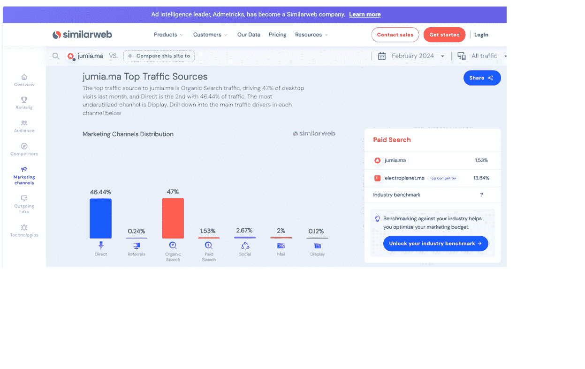

## Figure 2. Jumia’s Canal traffic, from December 2023 to February 2024

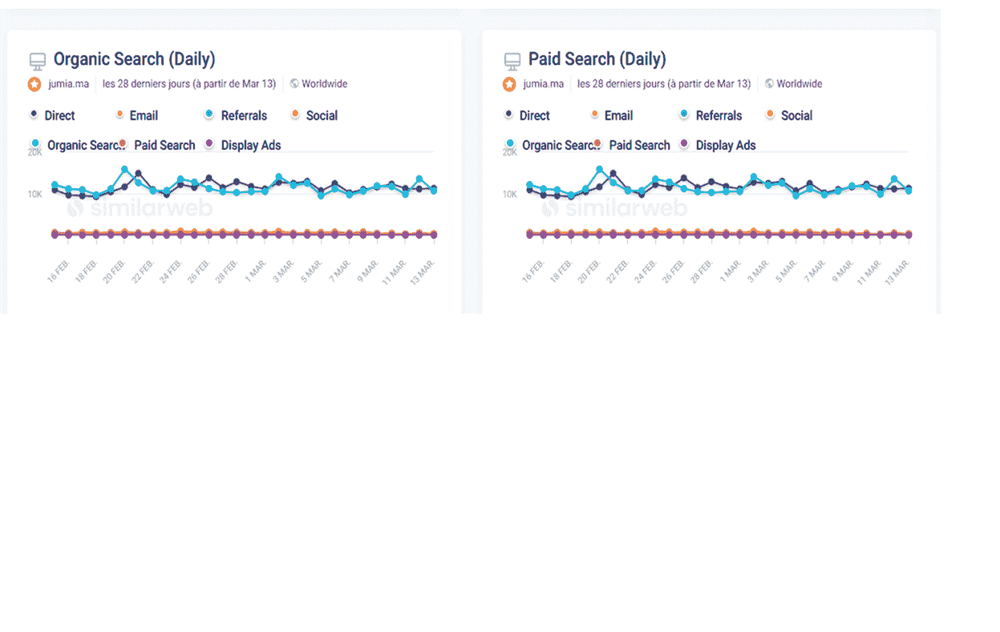

此外，Jumia 的网站（`jumia.ma`）本身也是流量的重要来源，占所有访问量的 14.53%，其次是来自 Google、Microsoft、Yandex、YouTube 和 Live.com 等其他渠道的推荐。这些统计数据强调了 Jumia 强大的在线形象及其从各种来源吸引访问者的能力，巩固了其作为摩洛哥电子商务市场领导者的地位。Jumia 的在线平台拥有令人印象深刻的流量和参与度指标，反映了其随时间推移的强大存在感和对用户的吸引力。平均每月有 352 万次访问量和 136.3 万名独立访问者，Jumia 始终吸引着大量受众，表明其受欢迎程度和覆盖范围。该平台的受众群体多样且活跃，去重后的受众数量突显了其吸引广泛用户关注的能力。此外，Jumia 的受众表现出积极的参与度，每次访问平均花费 5 分钟 15 秒，每次会话平均浏览 6.57 页。这表明对平台内容有很高的兴趣和互动，为用户带来了有意义的浏览体验。

## 6.1. Total Social Media Visits

从 2023 年 12 月到 2024 年 2 月，Jumia 从社交媒体平台获得了 5.92 万次访问，与上一时期相比增长了 2.54%。这些访问量在此期间桌面端流量中仅占一小部分。分析社交媒体访问的分布情况，揭示了推动与 Jumia 内容互动的平台。在桌面用户中，YouTube 成为主要来源，贡献了 54.21% 的社交媒体访问量。Facebook 紧随其后，产生了 24.53% 的访问量，而 WhatsApp Webapp 占了 5.76%。Instagram 和 VKontakte 也发挥了显著作用，分别占社交媒体访问量的 3.78% 和 2.13%。此外，各种其他平台共同贡献了 9.6% 的访问量，显示了 Jumia 与受众互动的多样化社交媒体渠道。这些统计数据突显了 Jumia 有效利用社交媒体平台与用户互动、为其网站引流并提升品牌知名度。通过探索 YouTube、Facebook 和 WhatsApp 等平台的多样化功能和用户群，Jumia 扩大了其覆盖范围，巩固了其在数字领域的地位，进一步确立了其作为摩洛哥电子商务市场重要参与者的地位。Figure 3

## Figure 3. Total social media visits from December 2023 to February 2024

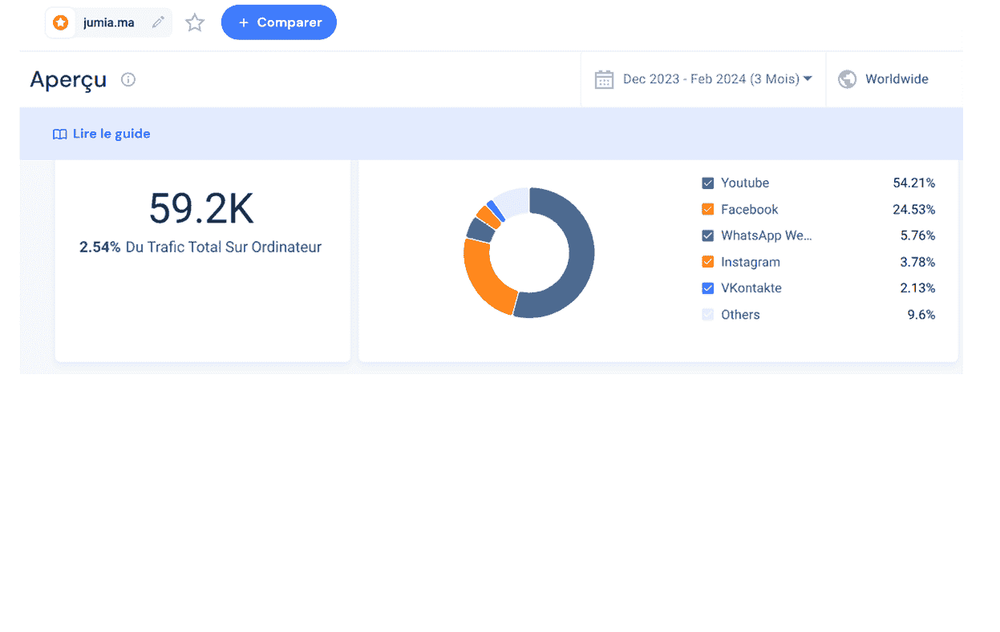

## 6.2. Jumia's Website Technologies


Jumia 的网站配备了多样化的技术功能和工具，旨在提升用户体验、优化性能并支持各种功能。集成到网站中的技术包括多个广告平台，例如 `Criteo Advertiser`、`DoubleClick Advertiser`、`Facebook Advertiser`、`Google Ads Advertiser` 和 `Google Publisher Tag`。这些平台有助于开展定向广告和营销活动，以有效触达 Jumia 的受众。此外，网站还采用了各种分析和转化工具，例如 `Google Analytics`、`Crazy Egg`、`Adjust` 和 `Content Square`。这些工具能提供关于用户行为、网站性能和转化指标的宝贵洞察，使 Jumia 能够优化策略并提升整体效率。在基础设施方面，Jumia 采用了 `nginx`、`Varnish` 和 `Amazon Route 53` 等强大的服务器技术，以确保网站快速可靠地交付。此外，通过与 `CloudFlare` 和 `Amazon S3` 等服务集成，内容分发得到了进一步增强。而且，Jumia 的网站还集成了 `Facebook`、`Twitter` 和 `YouTube` 等流行的社交媒体平台，实现了内容的无缝分享以及与客户在各种渠道上的互动。

figure 4

#### 图 4. Jumia 的网站技术

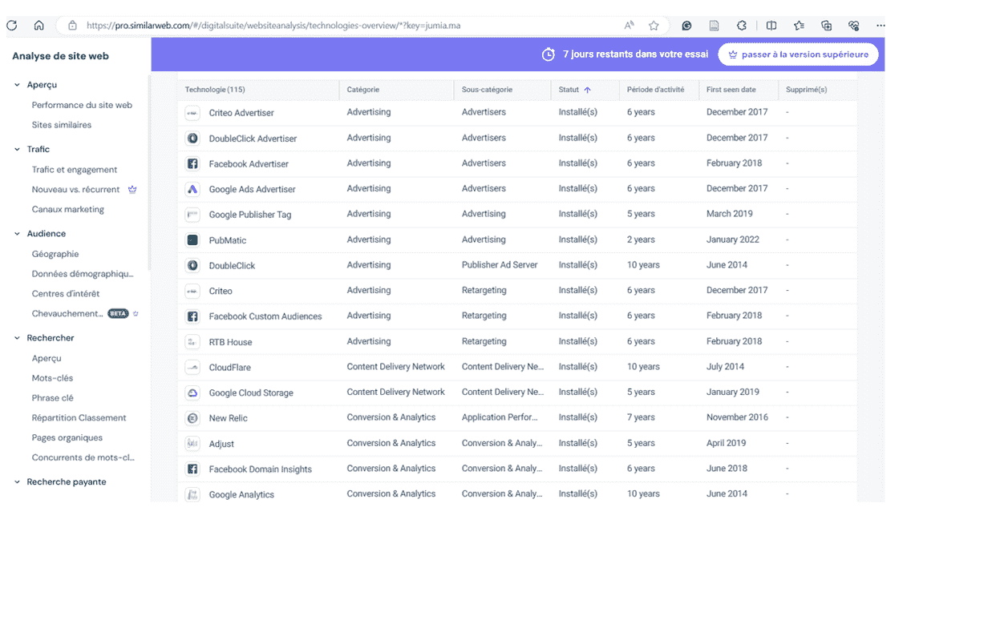

### 7\. 讨论

摩洛哥的电子商务经历了显著增长，为行业参与者带来了机遇和挑战。其中，Jumia Market 作为摩洛哥电子商务领域的知名实体，已采用人工智能（AI）来增强其营销策略。本案例研究深入探讨了 Jumia Market 采用的具体 AI 应用及其对营销效果的后续影响。

#### 7.1. AI 驱动的个性化推荐

Jumia Market 采用多方面的个性化推荐方法，利用各种技术工具和算法来分析和理解客户行为。协同过滤是一种主要技术，涉及分析用户交互和偏好，以根据与其他用户的相似性推荐商品。此外，还利用基于内容的过滤技术，分析产品属性和特征，以推荐符合个人口味的类似商品。可能还利用了包括深度学习技术在内的更先进的机器学习模型，以提高推荐准确性，从大型数据集中学习复杂的模式和关系。此外，Jumia Market 可能会采用矩阵分解和降维技术来处理高维客户数据，捕捉影响偏好的潜在因素并提取有意义的模式。这些方法使 Jumia Market 能够提供与个别客户产生共鸣的个性化推荐，提升用户参与度并推动销售。

#### 7.2. 营销之外的 AI 应用

除了营销，Jumia Market 还将 AI 技术用于需求预测的预测分析。通过分析历史数据和市场动态，AI 驱动的预测分析能提供关于未来需求趋势的洞察，优化库存管理并提升供应链效率。此外，集成 AI 驱动的聊天机器人和虚拟助手彻底改变了客户支持服务，在保持类似人类互动的同时，提供即时且个性化的帮助。

### 8\. 结果与挑战

本案例研究评估了 AI 集成的结果和影响，深入探讨了客户参与度、转化率和运营效率等各种关键绩效指标。通过细致的分析，很明显，AI 驱动的举措对这些指标的提升做出了重大贡献，客户满意度、转化率和简化的运营流程均有显著改善。然而，伴随着这些好处，数据隐私问题和算法偏见等挑战也已出现，凸显了在电子商务领域实施 AI 所固有的复杂性。尽管存在这些挑战，但它们为 Jumia Market 提供了宝贵的学习机会，使其能够完善策略并开发强大的框架来解决伦理问题并减轻偏见。通过积极应对这些挑战，Jumia Market 不仅驾驭了 AI 驱动的电子商务营销的复杂性，还为行业同行树立了先例，培养了负责任的 AI 采用和创新文化。

### 9\. 未来影响与建议

展望未来，本案例研究探讨了 AI 在电子商务中的未来影响和建议。随着技术的快速发展，Jumia Market 已准备好拥抱新兴趋势和创新，在优先考虑伦理 AI 实践的同时培养创新文化。通过在 AI 集成方面保持领先地位的主动姿态，Jumia Market 不仅巩固了其在电子商务领域的领导地位，还催化了 AI 在塑造在线商务未来格局方面的变革潜力。在不断发展的电子商务生态系统中，Jumia Market 意识到保持敏捷并适应新兴技术进步的必要性。因此，该公司致力于利用 AI 不仅优化现有运营，还探索能够进一步增强其竞争优势和市场相关性的新应用。通过培养创新文化，Jumia Market 创造了有利于实验和探索的环境，使 AI 驱动策略能够不断完善和演变，以满足不断变化的消费者需求和市场需求。此外，与其对伦理商业实践的承诺一致，Jumia Market 高度重视伦理 AI 原则。这包括确保 AI 算法的透明度、问责制和公平性，同时解决与数据隐私和算法偏见相关的问题。通过坚持这些伦理标准，Jumia Market 不仅保护了客户的信任和信心，还在更广泛的电子商务行业中为伦理 AI 采用树立了先例。此外，通过开创 AI 驱动的策略和最佳实践，Jumia Market 在推动行业范围的创新和进步方面承担了领导角色。通过知识共享、协作和集体学习，Jumia Market 为电子商务领域的集体增长和成熟做出了贡献，为企业和消费者解锁了新的机遇和可能性。随着 Jumia Market 不断推动 AI 集成的边界，它成为行业同行的灵感灯塔，激励着一个新时代的智能、数据驱动的商业时代，该时代既重视创新也重视伦理责任。

### 10\. 结论


# Jumia Market 的 AI 驱动型电子商务营销转型

本文揭示了 Jumia Market 通过战略性应用人工智能（AI）来提升电子商务营销的转型历程。文章全面探讨了 Jumia Market 在摩洛哥不断发展的数字市场中，在实际实施、所遇挑战及取得成果等方面的情况。通过细致分析，本文阐明了 AI 在革新 Jumia Market 营销策略中所发挥的多方面作用。文章强调，该平台利用 AI 驱动的预测分析来预测需求、优化库存管理并提升供应链效率，从而更有效地满足客户需求。此外，文章还强调了 AI 驱动的聊天机器人和虚拟助手在提供个性化客户支持、简化购买流程以及提升用户满意度方面的关键作用。同时，文章还介绍了 Jumia Market 在实施 AI 驱动策略过程中面临的挑战。从应对数据隐私问题到解决算法偏差，Jumia 的经验为其他踏上类似 AI 集成之路的电子商务企业提供了宝贵的经验。最终，文章突出了 Jumia Market 的 AI 驱动型举措在客户参与度、转化率和运营效率等关键绩效指标方面所产生的实际成果和影响。文章强调了 Jumia Market 对创新和卓越的承诺，将该平台定位为利用 AI 塑造摩洛哥电子商务营销未来的领导者。

## REFERENCES

Ahmed, S. A., d’Astous, A., & Yoou, J. B. (2015). Exporting to Morocco: Consumer Perceptions of Countries of Origin. In: Spotts, H. (eds) Assessing the Different Roles of Marketing Theory and Practice in the Jaws of Economic Uncertainty. Springer, Cham. (https://doi.org/)[10.1007/978\-3\-319-11845-1\_92](http://dx.doi.org/10.1007/978-3-319-11845-1_92)

Ajhoun, R., & Daoudi, N. (2018). Morocco. In Weber, A., & Hamlaoui, S. (Eds.), E\-Learning in the Middle East and North Africa (MENA) Region. Springer. [10.1007/978\-3\-319-68999-9\_12](http://dx.doi.org/10.1007/978-3-319-68999-9_12)

Alla, L., Kamal, M., & Bouhtati, N. (2022). Big data et efficacité marketing des entreprises touristiques: une revue de la littérature. Alternatives Managériales Economiques, 4(0). [10.48374/IMIST.PRSM/ame\-v1i0.36928](http://dx.doi.org/10.48374/IMIST.PRSM/ame-v1i0.36928)

Appel, G., Grewal, L., & Hadi, R. (2020). The future of social media in marketing. J. of the Acad. Mark. Sci. 48, 79–95.(https://doi.org/)[10.1007/s11747-019-00695-1](http://dx.doi.org/10.1007/s11747-019-00695-1)

Bashar, A., Wasiq, M., &Nyagadza, B. (2024). Emerging trends in social media marketing: a retrospective review using data mining and bibliometric analysis. Futur Bus J 10(23). (https://doi.org/)[10.1186/s43093-024-00308-6](http://dx.doi.org/10.1186/s43093-024-00308-6)

Bayoude, K., Ardchir, S., & Azzouazi, M. (2023). A Predictive Approach Based on Feature Selection to Improve Email Marketing Campaign Success Rate. In: Kacprzyk, J., Ezziyyani, M., Balas, V.E. (eds) International Conference on Advanced Intelligent Systems for Sustainable Development. AI2SD 2022. Springer, Cham. (https://doi.org/)[10.1007/978\-3\-031-26384-2\_85](http://dx.doi.org/10.1007/978-3-031-26384-2_85)

Berea, A. (2022). Predictive Analytics. In Schintler, L. A., & McNeely, C. L. (Eds.), Encyclopedia of Big Data. Springer. \[DOI: 10.1007/978-3-319-32010-6\_170\], [10.1007/978\-3\-319-32010-6\_170](http://dx.doi.org/10.1007/978-3-319-32010-6_170)

Bouhtati, N., Alla, L., & Bentalhah, B. (2023). Marketing Big Data Analytics et gestion de la relation client: une approche floue. Dans Intégrer l’intelligence et la durabilité dans les chaînes d’approvisionnement (pp. 75-86). IGI Global. . [10.4018/979\-8\-3693\-0225-5.ch004](http://dx.doi.org/10.4018/979-8-3693-0225-5.ch004)

Bouhtatit, N., Kamal, M., & Alla, L. (2023). Big Data et efficacité du marketing touristique: une revue prospective de la littérature. In Farhaoui, Y., Rocha, A., Brahmia, Z., & Bhushab, B. (Eds.), Intelligence artificielle et environnement intelligent. ICAISE 2022. Notes de cours sur les réseaux et les systèmes, 635. Springer. [10.1007/978\-3\-031-26254-8\_40](http://dx.doi.org/10.1007/978-3-031-26254-8_40)

Davenport, T., Guha, A., & Grewal, D. (2020). How artificial intelligence will change the future of marketing. J. of the Acad. Mark. Sci., 48, 24–42. (https://doi.org/)[10.1007/s11747-019-00696-0](http://dx.doi.org/10.1007/s11747-019-00696-0)

David, B., Chalon, R., & Zhang, X. (2023). Virtual Assistants (Chatbots) as Help to Teachers in Collaborative Learning Environment. In Auer, M. E., Pachatz, W., & Rüütmann, T. (Eds.), Learning in the Age of Digital and Green Transition. ICL 2022. Lecture Notes in Networks and Systems (Vol. 633). Springer. [10.1007/978\-3\-031-26876-2\_13](http://dx.doi.org/10.1007/978-3-031-26876-2_13)

Dawe, K. (2015). Best practice in business-to-business email. J Direct Data Digit Mark Pract 16, 242–247. (https://doi.org/)[10.1057/dddmp.2015.21](http://dx.doi.org/10.1057/dddmp.2015.21)

Demir, F. (2022). Artificial Intelligence. In Innovation in the Public Sector. Public Administration and Information Technology (Vol. 39). Springer. [10.1007/978\-3\-031-11331-4\_4](http://dx.doi.org/10.1007/978-3-031-11331-4_4)

Dwivedi, Y.K., Ismagilova, E., & Sarker, P. (2023). A Meta-Analytic Structural Equation Model for Understanding Social Commerce Adoption. Inf Syst Front 25, 1421–1437. (https://doi.org/)[10.1007/s10796-021-10172-2](http://dx.doi.org/10.1007/s10796-021-10172-2)

Elahi, M., Afolaranmi, S.O., & Martinez Lastra, J.L. (2023). A comprehensive literature review of the applications of AI techniques through the lifecycle of industrial equipment. Discov Artif Intell 3(43).(https://doi.org/)[10.1007/s44163-023-00089-x](http://dx.doi.org/10.1007/s44163-023-00089-x)

Fanti, L., Guarascio, D. & Moggi, M. (2022). From Heron of Alexandria to Amazon’s Alexa: a stylized history of AI and its impact on business models, organization and work. J. Ind. Bus. Econ. 49, 409–440. (https://doi.org/)[10.1007/s40812-022-00222-4](http://dx.doi.org/10.1007/s40812-022-00222-4)

Garcia, J. E., Lima, R., & da Fonseca, M. J. S. (2022). Search Engine Optimization (SEO) for a Company Website: A Case Study. In Rocha, A., Adeli, H., Dzemyda, G., & Moreira, F. (Eds.), Information Systems and Technologies. WorldCIST 2022. Lecture Notes in Networks and Systems (Vol. 470). Springer. [10.1007/978\-3\-031-04829-6\_47](http://dx.doi.org/10.1007/978-3-031-04829-6_47)

Hermann, E., Williams, G. Y., & Puntoni, S. (2023). Deploying artificial intelligence in services to AID vulnerable consumers. Journal of the Academy of Marketing Science. [10.1007/s11747-023-00986-8](http://dx.doi.org/10.1007/s11747-023-00986-8)

Huang, MH. & Rust, R.T. (2021). A strategic framework for artificial intelligence in marketing. J. of the Acad. Mark. Sci. 49, 30–50. (https://doi.org/)[10.1007/s11747-020-00749-9](http://dx.doi.org/10.1007/s11747-020-00749-9)

Janssen, A., Passlick, J., & Rodríguez Cardona, D. (2020). Virtual Assistance in Any Context. Bus Inf Syst Eng, 62, 211–225. (https://doi.org/)[10.1007/s12599-020-00644-1](http://dx.doi.org/10.12599-020-00644-1)

John, S. P., & Supramaniam, S. (2023). Antecedents and Effects of Influencer Marketing Strategies: A Systematic Literature Review and Directions for Future Research. In Martínez-López, F. J. (Ed.), Advances in Digital Marketing and eCommerce. DMEC 2023. Springer Proceedings in Business and Economics. Springer. [10.1007/978\-3\-031-31836-8\_15](http://dx.doi.org/10.1007/978-3-031-31836-8_15)


Johne, J. (2023). Introduction. In Effectiveness of Influencer Marketing. Springer Gabler. \[DOI: 10.1007/978-3-658-41297-5\_1\], [10.1007/978\-3\-658-41297-5\_1](http://dx.doi.org/10.1007/978-3-658-41297-5_1)

Joshi, Y., Lim, W. M., & Jagani, K. (2023). Social media influencer marketing: foundations, trends, and ways forward. Electron Commer Res. [10.1007/s10660-023-09719-z](http://dx.doi.org/10.1007/s10660-023-09719-z)

Lewandowski, D. (2023). Search Engine Optimization (SEO). In Understanding Search Engines. Springer. \[DOI: 10.1007/978-3-031-22789-9\_9\], [10.1007/978\-3\-031-22789-9\_9](http://dx.doi.org/10.1007/978-3-031-22789-9_9)

Lhoussaine, ALLA, Kamal, M., & Bouhtati, N. (2022). Big data et efficacité marketing des entreprises touristiques: une revue de la littérature. Alternatives de gestion économique, 1, 39-58.

Li, F., Larimo, J. & Leonidou, L.C. (2021). Social media marketing strategy: definition, conceptualization, taxonomy, validation, and future agenda. J. of the Acad. Mark. Sci. 49, 51–70. (https://doi.org/)[10.1007/s11747-020-00733-3](http://dx.doi.org/10.1007/s11747-020-00733-3)

Luo, Y. (2022). A general framework of digitization risks in international business. J Int Bus Stud, 53, 344–361. (https://doi.org/)[10.1057/s41267-021-00448-9](http://dx.doi.org/10.1057/s41267-021-00448-9)

Maleh, Y., & Maleh, Y. (2022). Introduction. In Cybersecurity in Morocco. SpringerBriefs in Cybersecurity. Springer. [10.1007/978\-3\-031-18475-8\_1](http://dx.doi.org/10.1007/978-3-031-18475-8_1)

Martinez, B.M. & McAndrews, L.E. (2023). Do you take...? The effect of mobile payment solutions on use intention: an application of UTAUT2. J Market Anal 11, 458–469 (https://doi.org/)[10.1057/s41270-022-00175-6](http://dx.doi.org/10.1057/s41270-022-00175-6)

Mich, L. (2022). Artificial Intelligence and Machine Learning. In Xiang, Z., Fuchs, M., Gretzel, U., & Höpken, W. (Eds.), Handbook of e\-Tourism. Springer. [10.1007/978\-3\-030-48652-5\_25](http://dx.doi.org/10.1007/978-3-030-48652-5_25)

Qin, Y., Xu, Z., Wang, X., & Skare, M. (2023). Artificial Intelligence and Economic Development: An Evolutionary Investigation and Systematic Review. Journal of the Knowledge Economy. [10.1007/s13132-023-01183-2](http://dx.doi.org/10.1007/s13132-023-01183-2)

Ryan, K. M., & Graham, R. S. (2014). Tactics and Strategies for Creating Effective E-mail Marketing Campaigns. In: Taking Down Goliath. Palgrave Macmillan, New York. (https://doi.org/)[10.1057/9781137444219\_7](http://dx.doi.org/10.1057/9781137444219_7)

Sheikh, H., Prins, C., & Schrijvers, E. (2023). AI as a System Technology. In Mission, A. I. (Ed.), Research for Policy. Springer. [10.1007/978\-3\-031-21448-6\_4](http://dx.doi.org/10.1007/978-3-031-21448-6_4)

Yadav, D., & Kadavath, V. K. (Eds.), The Digital Popular in India. Palgrave Macmillan. [10.1007/978\-3-031-39435-5](http://dx.doi.org/10.1007/978-3-031-39435-5)

# 数字技术对消费者行为和企业绩效的影响分析

## 第 12 章

# 数字营销对企业绩效的影响：

## 选定摩洛哥公司案例研究

Ali Tazi Cherti


Sidi Mohamed Ben Abdellah University, Morocco

### 摘要

本研究考察了数字营销（DM）通过人工智能（AI）的集成对摩洛哥背景下企业绩效（BP）的影响。利用结构化问卷和先进的 PLS-SEM 方法进行分析，揭示了 DM 中 AI 使用与 BP 改善之间的强正相关关系。这种关系标志着向更个性化的营销策略、数据驱动的决策以及对市场趋势的动态适应的范式转变。研究强调了 AI 不仅提高运营效率，还促进创新和价值创造，敦促摩洛哥公司重新思考其数字战略。它强调了 AI 在转变数字营销格局中的关键作用，表明其战略集成对于旨在数字时代蓬勃发展的公司至关重要。该研究的独特之处在于其对摩洛哥的关注，为非洲背景下 AI 在 DM 中的适应提供了洞察，从而有助于理解新兴经济体中的数字化。

### 1\. 引言

数字营销可以被视为一个涉及与经常在线的客户互动的过程，使用各种工具和平台，如网站、在线品牌资源、在线广告和电子邮件营销（[Ravi & Rajasekaran, 2023](#979-8-3693-3172-9.ch012.bits-pdf.xhtml#_idTextAnchor749））。数字化转型在当今所有业务活动中已成为必要。数字营销成为预测风险和抓住新兴机遇的关键要素，从而增强公司的战略决策。这种数字化转型改变了企业通过云存储、网页浏览、流媒体平台、电子邮件以及使用 Facebook 等社交网络等在线服务与产品和品牌互动的方式，重新定义了传统的互动模式（[Kiili et al., 2018](#979-8-3693-3172-9.ch012.bits-pdf.xhtml#_idTextAnchor740））。在苛刻的竞争环境中，传统营销策略的有效性受到质疑；它们已不再足以产生可持续的竞争优势或刺激增长（[Kaur, 2017](#979-8-3693-3172-9.ch012.bits-pdf.xhtml#_idTextAnchor739））。今天，企业在竞争和动荡的环境中运营，需要使用有效的工具来实现其目标。在这些工具中，数字营销脱颖而出（[Chaikovska et al., 2022](#979-8-3693-3172-9.ch012.bits-pdf.xhtml#_idTextAnchor709））。因此，数字营销本身就是各个行业渴望面对竞争的公司的机遇杠杆。它作为一种动态且不断发展的工具脱颖而出，提供适应消费者更新需求的解决方案。创新数字技术的出现为旨在通过在线广告实现商业目标的广告商开辟了新途径（[Reza Kiani, 1998](#979-8-3693-3172-9.ch012.bits-pdf.xhtml#_idTextAnchor750））。

公司越来越意识到需要集成尖端技术应用程序以加强其运营流程并确保访问更新的信息（[Aggarwal, 2017](#979-8-3693-3172-9.ch012.bits-pdf.xhtml#_idTextAnchor695））。然而，缺乏评估数字营销对企业绩效实际影响的实证证据，以及关于数字进步在业务流程中作用的文献存在空白（[Ahmad et al., 2018](#979-8-3693-3172-9.ch012.bits-pdf.xhtml#_idTextAnchor696））。数字营销使公司能够最大限度地提高销售额，扩大市场覆盖范围，并虚拟培养客户关系。因此，数字营销技术越来越受到青睐，用于定位和吸引市场。


营销领域因人工智能（AI）的融合而发生了转变，改变了该行业内的技术和策略（Van Esch et al., 2018）。随着竞争加剧和消费者需求的变化，数字营销现在已成为推广产品和服务的关键组成部分。随着 AI 的发展，该行业经历了重大演变，从以数据为中心的方法转向结合数据与知识的更全面的方法。

AI 的当前应用包括聊天机器人、数字助手和机器学习（Devang et al., 2019）。鉴于目前产生的海量数据已超出人类的分析和决策能力，AI 成为不可或缺的解决方案（Hurwitz et al., 2015）。对于旨在优化绩效和决策流程的中小企业（SMEs）尤其推荐使用 AI（Enshassi et al., 2024）。当 AI 与营销结合使用时，可以提高客户数据细分、内容丰富、用户画像、预测模型开发、面向更广泛受众的定位以及搜索引擎排名优化的精度。尽管如此，采用数字营销代表一项重大投资，不应直接与已证明投资回报率轨迹的传统营销方法进行比较（Teixeira et al., 2019）。

## 1. 研究目标

本研究旨在通过将人工智能（AI）作为中介变量，调查摩洛哥背景下数字营销（DM）对企业绩效（BP）的影响。

## 2. 研究意义

本研究的意义在于评估数字营销与人工智能结合后对提升摩洛哥企业绩效的有效性。更具体地说，它旨在了解 AI 的整合如何中介并可能放大数字营销对企业绩效的影响，而这一背景是一个独特的经济和文化环境，构成了技术传统与创新的独特融合。本研究可能为数字技术与运营策略之间的协同效应提供有价值的见解，从而为在类似环境中运营、希望利用 AI 在营销中获得竞争优势的摩洛哥企业提供更明智战略决策的基础。

## 3. 研究问题

基于文献综述和前述背景，我们的研究旨在解决以下问题：通过人工智能的整合，数字营销对企业绩效的影响是什么？

## 4. 研究计划

本研究的结构如下：我们将分析关于数字营销、企业绩效和人工智能的现有研究，以确立本研究的理论基础，并突出本研究旨在填补的空白。基于文献综述，我们制定本研究旨在检验的假设。随后，我们描述用于收集和分析数据的研究方法，呈现并审视这些发现，强调本研究中出现的关键发现。在讨论部分，我们解释所得结果，将其与先前的研究进行比较，并讨论其在本研究主题背景下的意义。最后，我们总结研究的主要经验，强调研究的理论和实际影响及贡献，并提出未来研究的方向。

## 5. 文献综述

### 5.1. 数字营销的深度视角

数字营销代表了企业的一种创新和现代方法，为管理其运营提供了新方法（Garg & Bansal, 2020）。数字营销彻底改变了企业与目标受众沟通的方式以及推广其产品和服务的方式（[Zhezha et al., 2023](#979-8-3693-3172-9.ch012.bits-pdf.xhtml#_idTextAnchor768））。

近期研究主张开展实证研究，以评估数字营销策略对中小企业绩效的影响（[Baka, 2016](#979-8-3693-3172-9.ch012.bits-pdf.xhtml#_idTextAnchor702））。这个与技术进步内在相关的新营销时代，挑战了传统方法，并呼吁进行战略修订以保持竞争力。从诞生之初，内容营销就已被证明是在线营销活动成功的关键因素，在数字营销中发挥着关键作用。其对员工敬业度、销售增长以及客户信任和忠诚度建立的影响是显著的（[Hollebeek & Macky, 2019](#979-8-3693-3172-9.ch012.bits-pdf.xhtml#_idTextAnchor731））。对数字内容营销的重视得到了众多研究的证实（[Hollebeek & Macky, 2019](#979-8-3693-3172-9.ch012.bits-pdf.xhtml#_idTextAnchor731））。通过提升传统营销的效率和效果，数字营销引入了新的商业模式，为消费者提供更多价值并增加公司的盈利能力（[Strauss & Frost, 2014](#979-8-3693-3172-9.ch012.bits-pdf.xhtml#_idTextAnchor757））。（[Sawicki, 2016](#979-8-3693-3172-9.ch012.bits-pdf.xhtml#_idTextAnchor754）将数字营销描述为一次进入广阔数字技术世界的探索，建立与广泛潜在受众的联系。此外，数字营销还被区分为一种通过电子商务推广产品和服务的强大方法，受益于直接的互联网连接（[Chaffey & Ellis-Chadwick, 2019](#979-8-3693-3172-9.ch012.bits-pdf.xhtml#_idTextAnchor707））。因此，拥抱数字化对于利用技术触达更广泛受众以最小化成本并增加收入至关重要。

### 5.2. 企业绩效：一种动态方法


# 业务绩效与数字营销

业务绩效是通过实现公司设定的商业目标来实现的 (Anwar & Shah, 2021)。(Chi et al., 2023; Suryantini et al., 2023) 证实了这一点，表明业务绩效反映了其在实现组织目标方面的成功，是管理各个领域研究人员关注的关键因变量。业务绩效由其利用有形和无形资源实现目标的能力来体现，盈利能力是成功的主要指标 (Omotosho, 2020; Zaragoza-Sáez et al., 2020)。业务绩效对于评估组织目标的实现至关重要，是管理中的关键因变量 (Aisjah et al., 2023; Chi et al., 2023)。业务绩效是其运营的基本目标；如果商业活动高效进行，将惠及员工、股东和整个社会 (Anh et al., 2024)。此外，虽然大数据仍处于起步阶段 (Bouhtati, Alla, et al., 2023)，但它正在通过催化创新并增强所有业务运营中销售和服务的个性化和适应性来彻底改变营销策略，特别是在与人工智能集成时效果显著，大数据不仅提高了业绩，还开启了营销的新时代，优化业务策略以实现更好的结果 (Alla et al., 2023; Bouhtati, Kamal, et al., 2023)。

几个主观和客观因素决定了衡量公司绩效的方式 (Sarkees et al., 2010)。中小企业的绩效可能会受到数字技术采用和应用的显著影响 (Nuseir & Al, 2018)。适当投资信息技术以提升业务绩效，现在是组织获得竞争优势并确保在动态商业环境中生存的明确策略 (Sujová & Simanová, 2023)。当前学术研究认识到营销资源对公司成功的影响 (Day, 2011)。因此，营销从业者建立营销技能与业务绩效之间的直接联系变得至关重要 (Morgan, 2012)。此外，数字营销策略似乎对公司产生多维影响，对收入增长、客户满意度和品牌影响力扩张产生积极影响 (Chaffey & Ellis-Chadwick, 2019)。即使专注于时尚行业，对品牌知名度对公司绩效影响的分析也提供了有用的见解 (Huang & Sarigöllü, 2012)。利用数字渠道被证明是提升中小企业绩效的杠杆，展示了数字营销的效率和有益影响 (Taiminen & Karjaluoto, 2015)。

Collins et al. (2021) 的研究表明，将 AI 集成到运营中的公司通常会看到运营成本降低和生产力提高，此外，将 AI 与数字营销相结合显著提高了业务绩效，并为业务流程的创新和改进开辟了新机会。

## 2.3. 人工智能对数字营销的变革性影响：全面分析

人工智能 (AI) 已成为增强数字营销的关键工具，它使营销人员能够开发更优质的产品，向消费者提供更快速、更具针对性的广告，并更深入地了解受众的数据模式 (Priyanga G, 2023)。AI 技术，如推荐系统，通过实现实时个性化彻底改变了数字营销 (Ziakis & Vlachopoulou, 2023)。相反，(Sarath Kumar Boddu et al., 2022) 观察到，AI 最初用于数字营销中的简单任务，如数据排序，但现在已成为定制客户体验的核心。

通过集成 AI，公司可以更好地了解受众，创建更具吸引力的内容，并增强客户参与策略 (Haleem et al., 2022)。AI 还根据用户数据分析和意图解释，协助精确定制和持续调整营销内容 (Chan-Olmsted, 2019)。(Chih-Wen Wu & Abel Monfort, 2022) 的研究探讨了 AI 作为营销策略的影响，概述了其对业务进展的好处以及影响其采用的因素。强调了 AI 和数字营销在通过增强客户参与来提升业务绩效方面的作用 (Kumar et al., 2019)。AI 正在通过自动化和个性化增强客户价值和业务绩效来改变服务行业 (Huang & Rust, 2018)。

将人工智能 (AI) 集成到数字营销 (DM) 中正在改变各个领域的业务策略，为其变革能力提供了有前景的见解。此外，(Chan-Olmsted, 2019) 强调，AI 通过细化对用户偏好的理解并为最大影响定制内容来优化数字内容制作。这种效率也体现在在线广告活动的管理中，AI 通过程序化广告根据用户行为调整广告投放，(De Bruyn et al., 2020) 证明了这一点。此外，(Van Esch et al., 2018) 证实了 AI 对公司通过数字营销活动吸引和满足客户能力的积极影响。这些研究说明了营销策略的演变，得益于 AI，正朝着更动态和个性化的方向发展。

总结，当前的技术状态揭示了向将 AI 视为增强数字营销绩效的关键要素的显著趋同。这一趋势突显了公司处理营销策略方式的转变，从传统逻辑转向由人工智能推动的动态和个性化方法。

我们的研究旨在通过将人工智能 (AI) 作为中介变量，实证确认数字营销对摩洛哥公司绩效的影响，从而为丰富该主题的现有文献做出贡献。

因此，我们按如下方式呈现我们的先验概念模型：

### 图 1. 概念框架


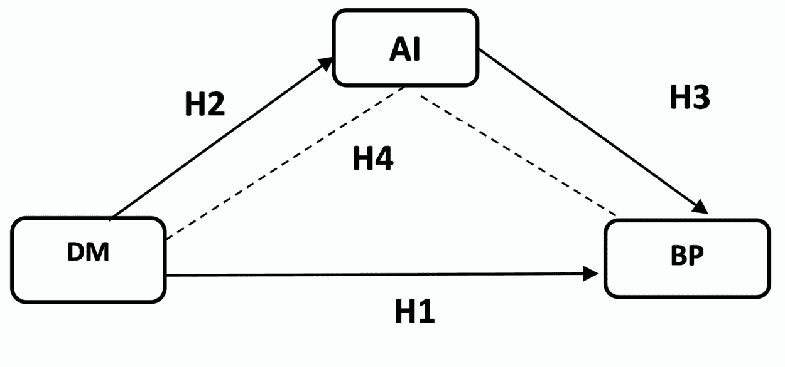

## 3. 假设发展

本研究中变量的选择旨在理解和吸收数字营销（自变量）如何影响业务绩效（因变量），以及这种关系如何受到人工智能（AI）作为中介变量的整合所影响或调节。

### 3.1. 研究变量介绍

#### 自变量：数字营销（DM）

数字营销的特殊性在于其多样性，涵盖了一系列通过数字渠道开展的营销活动，包括社交媒体、SEO、电子邮件营销和在线广告等。选择数字营销作为自变量的原因在于其在数字时代对各种规模企业日益增长的重要性。在日益饱和和竞争激烈的环境中，数字营销不再是一种选择，而是触达、吸引和转化目标受众的必需品 (Chaffey & Ellis-Chadwick, 2019)。在这方面，众多研究表明，经过精心打造并执行良好的数字营销策略可以显著提升品牌知名度、客户参与度，并最终提升公司的财务绩效 (Kumar et al., 2019)。

#### 中介变量：人工智能（AI）

选择 AI 作为中介变量，是因为其在数字营销策略的设计、实施和优化方面具有变革性潜力。将 AI 整合到数字营销中不仅可以自动化重复性任务，还能深入洞察客户偏好和行为，从而实现更加个性化和高效的营销活动 (Huang & Rust, 2018)。因此，AI 可以调节数字营销的有效性，通过提升营销活动的相关性、准确性和时机，对业务绩效产生积极影响。AI 丰富和优化数字营销工作的能力，证明了其作为本研究中中介变量的角色。

#### 因变量：业务绩效

选择业务绩效作为因变量，是因为它代表了大多数商业策略（包括数字营销）的最终目标。绩效可以使用多种指标来衡量，例如收入增长、市场份额、盈利能力和客户满意度。目标是确定对数字营销的投资（尤其是在 AI 增强下）是否能在这些绩效指标上带来切实的改进。关注业务绩效可以量化数字营销技术和策略对商业成功的实际影响 (Lee & Suh, 2022)。

在此背景下，本研究旨在探讨数字营销、AI 和业务绩效之间的相互作用，重点关注 AI 如何帮助最大化数字营销对业务成果的影响。此外，文献中的讨论和辩论促使我们利用丰富现有辩论的要素，为本研究假设的发展提供必要的工具和机制。

### 3.2. 假设制定

(Chaffey & Patron, 2012)的研究证实，数字营销可以实现对客户数据的更好分析，从而做出更明智的营销决策并提升绩效。事实上，(Singh et al., 2022)认为，数字营销可以通过改善客户参与度和优化销售渠道，显著提升业务绩效。(Jung & Shegai, 2023)明确证明了这一观点，他们表明数字营销的战略整合有助于持续的收入增长和盈利能力的提升。数字营销活动，如 SEO、内容营销和社交媒体，直接影响公司产生收入和增加市场份额的能力，从而反映出业务绩效的改善 (Chaffey & Ellis-Chadwick, 2019)。

* 假设 1（H1）：数字营销对业务绩效产生积极且显著的影响。

人工智能（AI）使数字营销活动能够进行精细和先进的个性化，从而增强客户参与度并优化转化率 (Luo et al., 2019)。此外，(Huang & Rust, 2018)解释说，AI 通过提供更相关且实时的互动来转变客户体验，从而提升数字营销的整体效果。

同样，(Li et al., 2021)表明，AI 允许更精确的客户细分和定位，增强了数字营销活动的影响。此外，(Al Khaldy, 2023)发现，AI 技术（如机器学习和预测分析）增强了数字营销的定位和自动化能力，从而带来更有效的活动和营销资源的最优分配。

* 假设 2（H2）：使用 AI 能积极提升数字营销的有效性。

在业务运营中采用 AI 有助于提高运营效率、降低成本、改善客户满意度，并最终实现更好的整体业务绩效 (Davenport & Ronanki, 2018)。同样，(Wamba-Taguimdje et al., 2020)表明，AI 可以促进优化的客户关系管理，从而显著提高客户满意度和忠诚度，进而提升业务绩效。

(Christian et al., 2023)表明，AI 可以帮助产品创新和服务个性化，从而提高客户满意度，并作为推论，增强业务绩效。事实上，(Kumar et al., 2019; Pereira et al., 2023)指出，在业务运营中采用 AI 可以通过简化流程并为决策提供有价值的洞察，显著改善业务绩效。这一观点得到了(Lee & Suh, 2022)的支持，他们观察到，将 AI 整合到客户服务和客户关系管理中，可以提高客户满意度，从而带来更好的整体业务绩效。

* 假设 3（H3）：AI 的应用对业务绩效产生积极且显著的影响。


AI 充当关键中介，通过放大数字营销对企业绩效的影响来发挥作用。这一假设得到了 (Yang et al., 2024) 研究的支持，该研究表明，在数字营销中使用 AI 不仅通过更好的营销资源配置直接改善企业绩效，还通过提升客户体验间接优化企业绩效。同样，(Sahoo et al., 2023) 认为，AI 通过分析数字营销活动产生的数据，使营销策略能够持续优化，从而改善企业绩效。此外，AI 通过实现更深层次的数据分析和个性化内容，显著增强了数字营销对企业绩效的影响，从而带来更具吸引力的客户互动、提升的潜在客户转化率以及增加的企业绩效 (Badghish & Soomro, 2024)。

*   假设 4 (H4): AI 的应用在数字营销与企业绩效之间的关系中充当中介。

### 4\. METHODOLOGY

本研究旨在探讨数字营销对企业绩效的影响，特别强调人工智能的中介作用。本研究采用横断面方法，在特定时间点收集数据。为此，我们开发并使用了一份结构化问卷。该问卷分为四个部分：第一部分概述了受访者的人口统计特征，第二部分涉及数字营销的维度，第三部分旨在评估数字营销背景下的企业绩效；第四部分则专注于数字营销策略中 AI 的实施。

本研究的样本包括将 AI 作为其管理和运营实践核心要素的摩洛哥公司。选择摩洛哥作为研究地点，是因为其充满活力的新兴市场以及在商业领域日益普及的数字技术和 AI。这一特点使摩洛哥成为一个有趣的案例研究，用于探索通过使用 AI，数字营销对企业绩效的影响和作用，为阿拉伯-非洲背景提供了相关视角。选择关注摩洛哥也对文献做出了重要贡献，目前文献主要由关注发达经济体的研究主导，并突出了发展中市场独有的挑战和机遇。

为了确定目标人群的适当样本量，我们采用了 (Krejcie & Morgan, 1970) 提出的方法，这是一种统计技术，用于确定从给定人群中为调查研究选取适当样本量。这种方法在不切实际对整个目标人群进行调查的研究中特别有用。

数据收集通过便利抽样进行，依据 (Sekaran & Bougie, 2014)。事实上，选择这种方法是因为其实施简便，以及在成本和时间方面的有效性。这种方法特别适合本研究，因为目标是获得初步洞察，而不是推广到整个总体。本调查依赖于定量数据的分析。

问卷分发给 120 名潜在受访者，其中 57 人作出回应，回应率为 47.5%。

我们有限的样本量是针对数字营销中 AI 集成这一专业领域量身定制的，这是一个在我们研究背景下涉及有限数量合格公司的利基领域。所收集数据的质量和准确性很高，反映了直接参与高级营销策略的受访者的技能和专业知识。这些因素确保了研究结果不仅相关，而且对于理解数字营销对将 AI 集成到当前实践中的企业绩效的影响具有深刻的信息价值。

为了有效地为我们关于数字营销中 AI 集成的研究分发问卷，我们选择了电子邮件和 LinkedIn 相结合的方式，针对相关公司的关键专业人士。选择电子邮件是为了进行直接和正式的沟通，并在之前进行预接触以告知参与者并提高回应率。LinkedIn 被用来利用专业网络并接触积极参与特定领域的专家。每份问卷都附有介绍，阐明研究目标和对参与者的益处，同时确保数据保密性。这一过程旨在最大限度地提高回应的覆盖范围和准确性，通过设计为快速完成的问卷，促进灵活高效的参与。

参与者的详细档案在 表 1 中介绍。

#### Table 1. Descriptive of participants

| Companies’ profile || % (n = 57) |

| --- | --- |

| Respondents' Position |

| --- |

| Executive || 40.4 (23) |

| General Manager || 19.3 (11) |

| Marketing Manager/Head || 40.4 (23) |

| Legal Status |

| LLC || 82.5 (47) |

| Corporation || 17.5 (10) |

| Workforce Size |

| \> 10 || 28.1 (16) |

| Between 10 and 100 || 38.6 (22) |

| Between 100 and 250 || 28.1 (16) |

| < 250 || 5.3 (03) |

| Activity area |

| Services || 43.9 (25) |

| Manufacturing || 15.8 (09) |

| Trade || 36.8 (21) |

| Others || 3.5 (02) |

数字营销量表由四个项目组成，改编自 (A. Kaplan & Haenlein, 2019b)，确定企业绩效的量表由四个项目组成，改编自 (Kumar et al., 2019)，数字营销中人工智能的量表改编自 (Huang & Rust, 2018)，包含四个项目（参见 表 2)。

我们选择采用从 1 «强烈不同意» 到 5 «强烈同意» 的 Likert 量表来评估研究中的所有概念。这种方法因其能够以细致且定量的方式衡量受访者的意见或态度程度而被广泛认可，从而便于对数据进行统计分析。Likert 量表允许对感知和偏好进行精确表达，提供清晰且易于解释的结果。鼓励受访者自由和坦率地回答，提高了所收集数据的有效性。这种方法得到了社会科学和营销领域众多研究的支持，这些研究因其可靠性和有效性而使用该量表 (Boone & Boone, 2012; DeVellis, 2016)。

问卷分发给受访者，受邀自由坦率地提供答案，同时提及尊重回答的保密性和匿名性原则。

#### Table 2. Variables list and research items number

| Variables || Items || Indicators || Authors |

| --- | --- | --- | --- |

| Digital Marketing (DM) || DM 1 || Use of social networks  

How would you assess the integrity of the use of social networks in your marketing strategies? || Kaplan & Haenlein (2010) |

| --- | --- | --- | --- |

| DM 2 || Creation and sharing of digital content  

How often does your company create and share digital content? |

| DM 3 || Use of SEO techniques  


你会如何评价当前 SEO 技术在提升网站自然流量方面的有效性？

| DM 4 || 参与数字广告活动  

你的数字广告活动今年在多大程度上实现了特定的营销目标？

| 业务绩效  

(BP) || BP 1 || 由于数字营销举措带来的收入增长  

你能将今年多少比例的收入增长直接归因于数字营销举措？ || Kumar, Rajan, Gupta, Pozza (2019) |

| BP 2 || 客户参与度和互动的提升  

自实施数字营销策略以来，你如何衡量客户参与度和互动的改善？ |

| BP 3 || 客户满意度和忠诚度的提升  

由于使用数字营销和 AI 策略，你是否看到客户满意度和忠诚度有所提升？ |

| BP 4 || 品牌覆盖范围的扩大和在线声誉的改善  

你使用哪些指标来衡量品牌覆盖范围的扩大和在线声誉的改善？ |

| 人工智能  

(AI) || AI 1 || 基于 AI 的客户体验个性化  

AI 是否使你能够个性化客户体验？ || Huang & Rust (2018) |

| AI 2 || 客户与 AI 驱动聊天机器人的互动  

你的客户是否认为与 AI 驱动聊天机器人的互动有用且令人满意？ |

| AI 3 || 客户需求的预测分析  

你是否使用预测分析来预判客户需求，如果是，这如何影响了你的销售或客户参与度？ |

| AI 4 || 营销任务的自动化  

AI 对营销任务的自动化在多大程度上提高了你公司的运营效率？ |

选择这些项目来评估通过人工智能（AI）整合对业务绩效的影响，是基于方法论和理论考量。每个项目旨在捕捉数字营销和 AI 对运营和战略业务绩效的关键影响，这些影响基于在该领域奠定了坚实基础的先前研究。

数字营销（DM）项目：这些项目的选择基于强调社交网络、内容创建、SEO 以及数字广告活动参与度作为数字营销效果关键决定因素的文献（Kaplan & Haenlein, 2010）。这些指标因其与提升可见度和客户参与度的强相关性而被认可，这些是业务绩效的关键因素。

业务绩效（BP）项目：与业务绩效相关的项目直接衡量 DM 对财务结果和客户满意度的影响，与(Kumar et al., 2019)的工作相一致，该工作将数字营销策略与财务绩效和客户保留联系起来。它们还涵盖了在线品牌声誉等更定性的方面，反映了对业务绩效的整体理解。

人工智能（AI）项目：AI 的各个方面，如个性化、客户互动和预测分析，因其被公认能够转变数字营销策略并增强客户互动而被纳入（Huang & Rust, 2018）。营销任务的自动化也是 AI 展现出显著效率提升的领域，因此将其作为评估对业务绩效影响的核心要素予以纳入。

选择这些项目而非另一种模型，是基于其经过验证的相关性和对摩洛哥企业特定背景的适应性，在该背景下，将 AI 整合到数字营销中可能面临独特的挑战和机遇。这些项目为强有力的比较分析提供了基础，可作为未来研究和从业者优化在数字营销中使用 AI 以提升业务绩效的基准。

### 5\. 结果与分析

#### 5.1 数据分析与测量模型评估

在本研究的背景下，我们采用了偏最小二乘结构方程建模（PLS-SEM）方法来评估测量模型并分析估计器的结构模型（Henseler et al., 2009a 值 || rho\_A || CR || AVE |

| --- | --- | --- | --- | --- | --- | --- |

| 人工智能 (AI) || AI 1 || 0,924 || 0,937 || 0,938 || 0,955 || 0,841 |

| --- | --- | --- | --- | --- | --- | --- |

| AI 2 || 0,906 ||  ||  ||  ||  |

| AI 3 || 0,837 ||  ||  ||  ||  |

| AI 4 || 0,883 ||  ||  ||  ||  |

| 业务绩效 (BP) || BP 1 || 0,907 || 0,957 || 0,957 || 0,969 || 0,886 |

| BP 2 || 0,882 ||  ||  ||  ||  |

| BP 3 || 0,912 ||  ||  ||  ||  |

| BP 4 || 0,977 ||  ||  ||  ||  |

| 数字营销 (DM) || DM 1 || 0,700 || 0,924 || 0,938 || 0,947 || 0,817 |

| DM 2 || 0,927 ||  ||  ||  ||  |

| DM 3 || 0,938 ||  ||  ||  ||  |

| DM 4 || 0,910 ||  ||  ||  ||  |

表 3 显示，对于所有构念，Cronbach's alpha 和复合可靠性（CR）的值均超过 0.7，表明研究模型满足确认内部一致性和可靠性所需的标准。此外，平均方差提取值（AVE）也超过了 0.5 的阈值，确认研究模型也符合聚合效度的既定标准。

AI 和 BP 的 Cronbach's alpha 值均高于 0.9，远高于内部可靠性普遍接受的 0.7 阈值，而 DM 略低但仍可接受。rho\_A 值与 Cronbach's alpha 值一致，增强了构念的可靠性。高 CR 值证实了复合可靠性，AVE 值也高于 0.5，足够高以确保良好的聚合效度，表明响应中的大部分方差归因于构念本身而非随机误差，且研究模型满足聚合可靠性的标准。

#### 表 4. 使用 HTMT 的区分效度

|  || AI || BP || DM |

| --- | --- | --- | --- |

| AI ||  ||  ||  |

| --- | --- | --- | --- |

| BP || 0,984 ||  ||  |

| DM || 0,965 || 0,918 ||  |

通过异质-单一（HTMT）比率评估的区分效度分析表明，所有考察的构念对的值均高于推荐的 0.90 阈值。

#### 图 2. 测量模型


构造体之间的连接由线条表示，AI 与 DM 之间的相关系数为 0.816，BP 与 DM 之间为 0.874，AI 与 BP 之间为 0.789，显示出中等到强的正相关关系。总体而言，结果表明构造体之间存在显著关系，所选指标能够充分反映所研究的概念。这些构造体之间的相关性可能表明人工智能、数字营销和业务绩效之间存在潜在的相互作用或影响。

### 5.2 结构模型评估

研究的这部分通过分析本研究早先提出的假设，调查了理论框架中概述的构造体之间的连接。收集的数据采用自助法进行检验，以评估数字营销应用对业务绩效的影响及其含义。此外，本节还探讨了人工智能的中介作用。

#### Table 5. Relationships of constructs (Path coefficient)

| Hypotheses | Relationships | Bias | t-value | p-value | 2.5% | 97.5% | Results |
| --- | --- | --- | --- | --- | --- | --- | --- |
| H1 | DM -> BP | 0,024 | 0,628 | 0,530 | -0,273 | 0,754 | Rejected |
| H2 | DM -> AI | 0,001 | 20,690 | 0,000 | 0,781 | 0,962 | Accepted |
| H3 | AI -> BP | -0,028 | 3,413 | 0,001 | 0,221 | 1,157 | Accepted |
| H4 | DM -> AI -> BP | -0,028 | 3,467 | 0,001 | 0,233 | 1,083 | Accepted |

本研究的假设通过偏差校正和加速（BCa）自助法进行评估。Table 5 展示了使用路径系数测试我们模型结构假设的结果。这些结果表明，所有 t 值均高于 1.96，且 p 值也低于 0.05，但假设 H1 除外。

* Hypothesis H1 (`DM -> BP`): 从数字营销（`DM`）到业务绩效（`BP`）的路径偏差为 0.024，t 值为 0.628，p 值为 0.530。95% 置信区间范围从 -0.273 到 0.754；因此，该假设被拒绝。

* Hypothesis H2 (`DM -> AI`): 从数字营销（`DM`）到人工智能（`AI`）的路径偏差为 0.001，具有极高的 t 值 20.690 和 p 值 0.000，表明存在统计学显著关系。95% 置信区间范围从 0.781 到 0.962。该假设被接受。

* Hypothesis H3 (`AI -> BP`): 从人工智能（`AI`）到业务绩效（`BP`）的路径表明偏差为 -0.028，t 值为 3.413，p 值为 0.001，表明具有统计学显著性。95% 置信区间范围从 0.221 到 1.157。该假设被接受。

* Hypothesis H4 (`DM -> AI -> BP`): AI 在 DM 和 BP 之间的中介效应显示偏差为 -0.028，t 值为 3.467，p 值为 0.001。95% 置信区间范围从 0.233 到 1.083。该假设被接受。

这些结果表明，DM 和 BP 之间的直接关系不具有统计学显著性，而其他测试的关系则具有显著性，包括人工智能的中介效应。

#### Table 6. Predictive power of endogenous constructs

| | Q² | R² |
| --- | --- | --- |
| AI | 0.807 | 0.816 |
| BP | 0.750 | 0.874 |

模型的预测能力使用 `R²` 和 `Q²` 值进行评估。`R²` 值表明，内生构造体（即 `AI` 和 `BP`）的变异分别由外生构造体以 81.6% 和 87.4% 的程度解释。同时，`Q²` 值大于“0”表明该模型已成功满足预测能力的标准。

#### Figure 3. The result of structural model


## 6. DISCUSSION

### 6.1 Internal Consistency and Reliability

Table 3 中呈现的结果突出了本研究中使用的构造体的可靠性和内部一致性。每个构造体——`AI`、`BP` 和 `DM`——都表现出显著超过管理科学研究中常见接受阈值（0.7）的强因子载荷和可靠性得分，表明测量工具的稳健性（Nunnally & Bernstein, 1994）的建议，表明具有足够的综合可靠性。所有构造体的 `AVE` 均超过 0.5 的阈值，表明指标的大部分方差由它们应测量的构造体捕获，这一结论与（Fornell & Larcker, 1981）的论断一致。这增强了本研究中构造体的聚合效度。

对于人工智能（`AI`），指标载荷范围从 0.837 到 0.924，该构造体显示出极佳的内部一致性，Cronbach's alpha 和 `rho_A` 分别为 0.937 和 0.938，并伴有综合可靠性（`CR`）指数 0.955。`AI` 的平均方差提取（`AVE`）为 0.841，表明指标的大部分方差被构造体很好地捕获。这种高水平的内部一致性和聚合效度证实了我们 `AI` 措施在本研究背景下的相关性。

关于业务绩效（`BP`），指标显示出更具说服力的可靠性，载荷范围从 0.882 到 0.977，Cronbach's alpha 为 0.957。`CR` 为 0.969，`AVE` 为 0.886，增强了业务绩效措施的效度，支持了 `BP` 的选定指标既一致又显著的观点。

数字营销（`DM`），载荷范围从 0.700 到 0.938，显示出每个指标代表构造体的强度存在轻微差异。尽管 `DM1` 的载荷相对较低，但 Cronbach's alpha 为 0.924，`rho_A` 为 0.938，表明 `DM` 构造体作为一个整体是可靠的。然而，这种差异值得未来关注，以了解数字营销的某些方面是否被所使用的措施所代表不足。

内部一致性和可靠性的这些总体高结果为我们提供了必要的信心，以继续分析构造体之间的关系，因为措施是可靠的。（Henseler et al., 2016）强调了这种可靠且一致的措施对于定量研究方法中模型验证的重要性。

总之，这些结果加强了关于衡量商业数字化的现有文献，并表明公司必须关注不断发展的技术和策略，以确保对其对绩效影响的准确测量。

### 6.2 Discriminant Validity

Table 4 中呈现的区分效度结果显示，构造体对之间具有非常高的 HTMT 值：人工智能（`AI`）和业务绩效（`BP`）之间为 0.984，`AI` 和数字营销（`DM`）之间为 0.965，其次是 `BP` 和 `DM` 之间的 0.918 值。虽然超过了区分效度的传统阈值，但这表明构造体之间存在强相关性，而非清晰的区分。这一观察可以以多种方式解释。


(Henseler et al., 2015 认为，接近 1 的 HTMT 值可能表明构念在概念上并不独立。因此，我们的结果可能表明，在本研究的背景下，人们对 AI、BP 和 DM 的感知或测量方式存在潜在的重叠。这种缺乏区分度可能反映了这样一种现实：这些领域之间的界限正变得越来越模糊，尤其是由于 AI 越来越多地融入营销实践和绩效管理。

(Franke & Sarstedt, 2019 指出，判别效度不应是评估测量模型质量的唯一标准，尤其是当构念在理论上相关时。在数字化转型的背景下，AI 既可被视为服务于营销和业务绩效的工具，因此高相关性是可以预期的。因此，在适当的理论背景下解释这些结果，并考虑采用互补方法来评估构念的效度至关重要。

同样重要的是参考 (Voorhees et al., 2015 的工作，他们强调了在构念可能相互依赖的环境中评估判别效度的复杂性。作者认为，HTMT 方法应与其他指标结合使用，以确认判别效度。

总之，尽管结果表明构念之间的分离不够明显，但这一发现可能是技术和商业实践快速发展、概念区分日益融合的领域的一种症状。在这方面，未来工作应研究构念如何被操作化，并可能重新考虑业务绩效如何受到数字化实践和 AI 快速发展的影响，从而为在类似概念模型中提升判别效度提出未来研究方向。

#### 6.3 构念之间的关系

表 5 的结果描绘了数字营销 (DM) 和人工智能 (AI) 对业务绩效 (BP) 影响的微妙图景。

关于构念之间的关系，假设 H1 表明 DM 对 BP 没有直接且显著的影响。这一拒绝与现有文献形成对比，现有文献通常认为 DM 与 BP 之间存在正向关联 (Kannan & Li, 2017)。这可能是由于所研究行业的数字化成熟度，或 DM 与业务运营整合不足所致，(Chaffey & Ellis-Chadwick, 2019 也提出了这一点。

H2 和 H3 的接受与 (Brynjolfsson & Mcafee, 2017 的研究一致，他们认为 AI 不仅增强了数字营销流程，还提升了运营绩效。这些结果也凸显了 (A. Kaplan & Haenlein, 2019a 的工作，他们将 AI 确定为业务转型的驱动力。

假设 H4 的接受尤其有趣，因为它表明 AI 在 DM 与 BP 之间的关系中起中介作用。这意味着，尽管 DM 不直接影响 BP，但它可以通过增强公司的 AI 能力间接影响 BP。这可能是由于 DM 举措产生数据，当这些数据被 AI 利用时，可以带来绩效提升。从这个意义上说，重要的是要将 AI 视为 DM 与业务绩效之间关系中的中介因素，并将 AI 作为公司数字化转型的战略杠杆。

#### 6.4 内生构念的预测能力

表 6 中的构念表明，AI 和 BP 具有强大的预测能力，实质性的 Q² 值表明内部关系模型具有预测相关性。Q² 值大于 0 表明模型具有预测能力 (Chin, 1998)。获得的值，AI 为 0.807，BP 为 0.750，显著超过此阈值，确认了所研究模型在预测内生变量方面的效用。此外，AI (0.816) 和 BP (0.874) 的 R² 值被认为非常强，表明模型解释了内生构念方差的很大一部分。这些结果与 (Hair et al., 2017 的陈述一致，他们指出 R² 值 0.75、0.50 和 0.25 分别可以理解为显著、中等和最小。因此，这里报告的值表明预测变量对 AI 和 BP 有实质性影响。然而，重要的是要注意，如 (Henseler et al., 2009b 所做的那样，虽然高 R² 值表明模型拟合良好，但并不能保证模型被正确指定。高 R² 值应谨慎解释，不应被视为对底层理论的最终验证。本研究中获得的 Q² 和 R² 值表明，将 AI 集成到运营中的公司可以看到其绩效的可预测改善。这一观点得到了 (Kaplan & Haenlein, 2019a 工作的支持，他们强调了 AI 改善战略和运营决策的潜力。在当代商业环境中，这些结果强调了公司采用 AI 以保持竞争力的必要性，这一结论与 (Davenport & Ronanki, 2018 关于 AI 在商业中战略影响的观点相一致。

### 7\. 启示、局限性与未来研究

本研究揭示，人工智能 (AI) 已成为数字战略的核心支柱，这得到了 Davenport and Ronanki (2018) 的支持，并表明公司应整合 AI 以提升绩效。然而，数字营销 (DM) 对业务绩效 (BP) 的直接影响受到质疑，需要进一步分析，这与 (Verhoef et al., 2021 主张对 DM 进行更具战略性的整合相一致。

当前研究存在局限性，特别是受访摩洛哥公司样本的代表性较低，这可能会影响研究结果的普遍性。尽管采用了稳健的统计方法并获得了良好的回复率，但更全面的研究将有助于更完整地概况摩洛哥的整体情况。

未来研究应探索 DM 和 AI 对 BP 的相互影响，以及潜在的调节或中介变量。从业者重新评估 DM 的资源分配以优化 AI 能力至关重要。研究结果还鼓励将 AI 集成到业务流程中，这可能会显著推进我们对技术与组织绩效之间相互作用的认识。

总之，决策者应将 AI 不仅视为运营工具，还应将其视为战略转型的杠杆，以将数字营销努力转化为可衡量的成功。这些启示与当前趋势一致，表明企业应采取主动方法，以在不断变化的数字环境中保持竞争力。

### 8\. 结论


# 研究结论

本研究阐明了数字营销（DM）、人工智能（AI）和业务绩效（BP）之间复杂而战略性的关系。它确认了所使用措施的可靠性和有效性，从而证明了 AI、BP 和 DM 构念具有强大的内部一致性和聚合效度。

分析表明，尽管数字营销本身并不能保证直接改善业务绩效，但其与 AI 的整合可以通过提升 AI 能力间接增强业务绩效。这一发现强调了采用整合且战略性的方法来利用 DM 和 AI 以增强竞争力和绩效的重要性。

结果还表明，AI、DM 和业务绩效之间的界限正在变得模糊，表明这些领域在数字时代之间的相互依赖性日益增强。这要求企业拥抱技术演进并调整其策略，以最大限度地发挥其对绩效的影响。

总之，本研究强调了 AI 在优化数字营销效果和提升业务绩效方面的关键作用。它邀请人们对这些技术的整合进行深入思考，并为未来在当代商业环境中有效利用这些技术的研究提出了方向。

# 参考文献

Aggarwal, R. (2017). Different Avenues of Capital Market (Secondary Market) Available for Investing in Market of Yamuna Nagar. International Research Journal of Management, IT and Social Sciences. [10.21744/irjmis.v4i3.456](http://dx.doi.org/10.21744/irjmis.v4i3.456)

Ahmad, S., Abu Bakar, A. R., & Ahmad, N. (2018). Social media adoption and its impact on firm performance: The case of the UAE. International Journal of Entrepreneurial Behaviour & Research, 25(1), 84–111. [10.1108/IJEBR\-08-2017-0299](http://dx.doi.org/10.1108/IJEBR-08-2017-0299)

Aisjah, S., Arsawan, I. W. E., & Suhartanto, D. (2023). Predicting SME’s business performance: Integrating stakeholder theory and performance based innovation model. Journal of Open Innovation, 9(3), 100122. [10.1016/j.joitmc.2023.100122](http://dx.doi.org/10.5281/zenodo.98549423)

Al Khaldy, M. (2023). The Impact of Predictive Analytics and AI on Digital Marketing Strategy and ROI. AME.

Alla, L. (2023). Big data et efficacité marketing des entreprises touristiques : Une revue de littérature. AME. [10.48374/IMIST.PRSM/ame\-v1i0.36928](http://dx.doi.org/10.48374/IMIST.PRSM/ame-v1i0.36928)

Anh, P. T. L., Hung, D. N., & Xuan, N. T. (2024). The Impact of Capital Structure on Business Performance of Vietnamese Enterprises During the Covid 19 Pandemic. Journal of Logistics. Informatics and Service Science, 11(1), 22–35. [10.33168/JLISS.2024.0102](http://dx.doi.org/10.33168/JLISS.2024.0102)

Anwar, M., & Shah, S. Z. A. (2021). Entrepreneurial orientation and generic competitive strategies for emerging SMEs: Financial and nonfinancial performance perspective. Journal of Public Affairs, 21(1), e2125. [10.1002/pa.2125](http://dx.doi.org/10.1002/pa.2125)

Badghish, S., & Soomro, Y. A. (2024). Artificial Intelligence Adoption by SMEs to Achieve Sustainable Business Performance: Application of Technology–Organization–Environment Framework. Sustainability (Basel), 16(5), 1864. [10.3390/su16051864](http://dx.doi.org/10.3390/su16051864)

Baka, V. (2016). The becoming of user-generated reviews: Looking at the past to understand the future of managing reputation in the travel sector. Tourism Management, 53, 148–162. [10.1016/j.tourman.2015.09.004](http://dx.doi.org/10.1016/j.tourman.2015.09.004)

Boone, H. N., & Boone, D. A. (2012). Analyzing Likert Data. Journal of Extension, 50(2). [10.34068/joe.50.02.48](http://dx.doi.org/10.34068/joe.50.02.48)

Bouhtati, N., Alla, L., & Bentalha, B. (2023). Marketing Big Data Analytics and Customer Relationship Management: A Fuzzy Approach. In Integrating Intelligence and Sustainability in Supply Chains. [10.4018/979\-8\-3693\-0225-5.ch004](http://dx.doi.org/10.4018/979-8-3693-0225-5.ch004)

Bouhtati, N., Kamal, M., & Alla, L. (2023). Big Data and the Effectiveness of Tourism Marketing: A Prospective Review of the Literature. Springer. [10.1007/978\-3\-031-26254-8\_40](http://dx.doi.org/10.1007/978-3-031-26254-8_40)

Brynjolfsson, E., & Mcafee, A. (2017). The-Business-of-Artificial-Intelligence. Harvard Business Review, 7, 3–11.

Chaffey, D., & Ellis-Chadwick, F. (2019). Digital Marketing (7th ed.).

Chaffey, D., & Patron, M. (2012). From web analytics to digital marketing optimization: Increasing the commercial value of digital analytics. Journal of Direct, Data and Digital Marketing Practice, 14(1), 30–45. [10.1057/dddmp.2012.20](http://dx.doi.org/10.1057/dddmp.2012.20)

Chaikovska, M., Järvis, M., Zaiachkovska, H., Tchon, L., Bortnik, N., & Bannikova, K. (2022). DIGITAL-MARKETING AS A NOVEL TOOL FOR GOODS AND SERVICES PROMOTION ON SOCIAL MEDIA: CONTEMPORARY TRENDS AND DEVELOPMENT DIRECTIONS. Financial and Credit Activity: Problems of Theory and Practice, 4(45), 355–364. [10.55643/fcaptp.4.45.2022.3836](http://dx.doi.org/10.55643/fcaptp.4.45.2022.3836)

Chan-Olmsted, S. (2019). A Review of Artificial Intelligence Adoptions in the Media Industry. International Journal on Media Management, 21, 1–23. [10.1080/14241277.2019.1590949](http://dx.doi.org/10.1080/14241277.2019.1590949)

Chan-Olmsted, S. M. (2019). A Review of Artificial Intelligence Adoptions in the Media Industry. JMM International Journal on Media Management, 21(3–4), 193–215. [10.1080/14241277.2019.1695619](http://dx.doi.org/10.1080/14241277.2019.1695619)

Chi, H., Vu, T.-V., Nguyen, H. V., & Truong, T. (2023). How financial and non–financial rewards moderate the relationships between transformational leadership, job satisfaction, and job performance. Cogent Business & Management, 10(1), 2173850. Advance online publication. [10.1080/23311975.2023.2173850](http://dx.doi.org/10.1080/23311975.2023.2173850)

Chin, W. (1998). The Partial Least Squares Approach to Structural Equation Modeling. Modern Methods for Business Research, 8.

Christian, I., Anene, J., Ewuzie, C., & Iloka, C. (2023). Influence Of Artificial Intelligence (AI) On Customer Experience And Loyalty: Mediating Role Of Personalization. Shu Ju Cai Ji Yu Chu Li/Journal of Data Acquisition and Processing, 38, 1936–1960. https://doi.org/[10.5281/zenodo.98549423](http://dx.doi.org/10.5281/zenodo.98549423)

Collins, C., Dennehy, D., Conboy, K., & Mikalef, P. (2021). Artificial intelligence in information systems research: A systematic literature review and research agenda. International Journal of Information Management, 60, 102383. [10.1016/j.ijinfomgt.2021.102383](http://dx.doi.org/10.1016/j.ijinfomgt.2021.102383)

Davenport, T. H., & Ronanki, R. (2018). Artificial Intelligence for the Real World. Harvard Business Review. HBR.

Day, G. (2011). Closing the Marketing Capabilities Gap. Journal of Marketing, 75(4), 183–195. [10.1509/jmkg.75.4.183](http://dx.doi.org/10.1509/jmkg.75.4.183)

De Bruyn, A., Viswanathan, V., Beh, Y. S., Brock, J. K. U., & von Wangenheim, F. (2020). Artificial Intelligence and Marketing: Pitfalls and Opportunities. Journal of Interactive Marketing, 51, 91–105. [10.1016/j.intmar.2020.04.007](http://dx.doi.org/10.1016/j.intmar.2020.04.007)

Devang, Chintan, Gunjan, & Krupa. (2019). Applications of Artificial Intelligence in Marketing. [10.35219/eai158404094](http://dx.doi.org/10.35219/eai158404094)

DeVellis, R. F. (2016). Scale Development: Theory and Applications. Sage.

Enshassi, M., Nathan, R. J., Soekmawati, S., Al-Mulali, U., & Ismail, H. (2024). Potentials of artificial intelligence in digital marketing and financial technology for small and medium enterprises. IAES International Journal of Artificial Intelligence (IJ\-AI), 13(1), 639. [10.11591/ijai.v13.i1.pp639-647](http://dx.doi.org/10.11591/ijai.v13.i1.pp639-647)


# 参考文献

Fornell, C., & Larcker, D. F. (1981). Evaluating Structural Equation Models with Unobservable Variables and Measurement Error. JMR, Journal of Marketing Research, 18(1), 39–50. [10.1177/002224378101800104](http://dx.doi.org/10.1177/002224378101800104)

Franke, G. R., & Sarstedt, M. (2019). Heuristics versus statistics in discriminant validity testing: A comparison of four procedures. Internet Research, 29(3), 430–447. [`api.semanticscholar.org/CorpusID:86723268`](https://api.semanticscholar.org/CorpusID:86723268). [10.1108/IntR\-12-2017\-0515](http://dx.doi.org/10.1108/IntR-12-2017-0515)

Garg, M., & Bansal, A. (2020). Impact of Digital Marketing on Consumer Decision Making. Research Gate.

Hair, J., Black, W., Babin, B., & Anderson, R. (2010). Multivariate Data Analysis: A Global Perspective. Research Gate.

Hair, J., Hollingsworth, C. L., Randolph, A. B., & Chong, A. Y. L. (2017). An updated and expanded assessment of PLS-SEM in information systems research. Industrial Management & Data Systems, 117(3), 442–458. [10.1108/IMDS\-04-2016-0130](http://dx.doi.org/10.1108/IMDS-04-2016-0130)

Hair, J. F., Hult, G. T. M., Ringle, C. M., & Sarstedt, M. (2016). A primer on partial least squares structural equation modeling (PLS-SEM).

Haleem, A., Javaid, M., Qadri, M., & Suman, R. (2022). Understanding the Role of Digital Technologies in Education: A review. Sustainable Operations and Computers, 3, 275–285. [10.1016/j.susoc.2022.05.004](http://dx.doi.org/10.1016/j.susoc.2022.05.004)

Henseler, J., Hubona, G., & Ray, P. A. (2016). Using PLS path modeling in new technology research: Updated guidelines. Industrial Management & Data Systems, 116(1), 2–20. [10.1108/IMDS\-09-2015-0382](http://dx.doi.org/10.1108/IMDS-09-2015-0382)

Henseler, J., Ringle, C., & Sarstedt, M. (2015). A New Criterion for Assessing Discriminant Validity in Variance-based Structural Equation Modeling. Journal of the Academy of Marketing Science, 43(1), 115–135. [10.1007/s11747-014-0403-8](http://dx.doi.org/10.1007/s11747-014-0403-8)

Henseler, J., Ringle, C. M., & Sinkovics, R. R. (2009a). The use of partial least squares path modeling in international marketing. Advances in International Marketing, 20, 277–319. [10.1108/S1474\-7979(2009)0000020014](http://dx.doi.org/10.1108/S1474-7979\(2009\)0000020014)

Henseler, J., Ringle, C. M., & Sinkovics, R. R. (2009b). The use of partial least squares path modeling in international marketing. Advances in International Marketing, 20, 277–319. [10.1108/S1474\-7979(2009)0000020014](http://dx.doi.org/10.1108/S1474-7979\(2009\)0000020014)

Hollebeek, L., & Macky, K. (2019). Digital Content Marketing’s Role in Fostering Consumer Engagement, Trust, and Value: Framework, Fundamental Propositions, and Implications. Journal of Interactive Marketing, 45, 27–41. [10.1016/j.intmar.2018.07.003](http://dx.doi.org/10.1016/j.intmar.2018.07.003)

Huang, M. H., & Rust, R. T. (2018). Artificial Intelligence in Service. Journal of Service Research, 21(2), 155–172. [10.1177/1094670517752459](http://dx.doi.org/10.1177/1094670517752459)

Huang, R., & Sarigöllü, E. (2012). How brand awareness relates to market outcome, brand equity, and the marketing mix. Journal of Business Research, 65(1), 92–99. [10.1016/j.jbusres.2011.02.003](http://dx.doi.org/10.1016/j.jbusres.2011.02.003)[](http://dx.doi.org/32287525)

Hurwitz, K. & Bowles, N. (2015). Cognitive Computing and Big Data Analytics. Wiley Online Library.

Jung, S. U., & Shegai, V. (2023). The Impact of Digital Marketing Innovation on Firm Performance: Mediation by Marketing Capability and Moderation by Firm Size. Sustainability (Basel), 15(7), 5711. [10.3390/su15075711](http://dx.doi.org/10.3390/su15075711)

Kannan, P. K., & Li, H. (2017). Digital marketing: A framework, review and research agenda. International Journal of Research in Marketing, 34(1), 22–45. [10.1016/j.ijresmar.2016.11.006](http://dx.doi.org/10.1016/j.ijresmar.2016.11.006)

Kaplan, A., & Haenlein, M. (2019a). Rulers of the world, unite! The challenges and opportunities of artificial intelligence. Business Horizons, 63(1), 37–50. [10.1016/j.bushor.2019.09.003](http://dx.doi.org/10.1016/j.bushor.2019.09.003)

Kaplan, A., & Haenlein, M. (2019b). Siri, Siri, in my hand: Who’s the fairest in the land? On the interpretations, illustrations, and implications of artificial intelligence. In Business Horizons (Vol. 62, Issue 1, pp. 15–25). Elsevier Ltd. [10.1016/j.bushor.2018.08.004](http://dx.doi.org/10.1016/j.bushor.2018.08.004)

Kaplan, A. M., & Haenlein, M. (2010). Users of the world, unite! The challenges and opportunities of Social Media. Business Horizons, 53(1), 59–68. [`doi.org/https://doi.org/10.1016/j.bushor.2009.09.003`](https://doi.org/https://doi.org/10.1016/j.bushor.2009.09.003). [10.1016/j.bushor.2009.09.003](http://dx.doi.org/10.1016/j.bushor.2009.09.003)

Kaur, G. (2017). The Importance Of Digital Marketing In The Tourism Industry. International Journal of Research -GRANTHAALAYAH, 5, 72–77. [10.29121/granthaalayah.v5.i6.2017.1998](http://dx.doi.org/10.29121/granthaalayah.v5.i6.2017.1998)

Kiili, K., Ojansuu, K., Lindstedt, A., & Ninaus, M. (2018). Exploring the Educational Potential of a Game-Based Math Competition. International Journal of Game\-Based Learning, 8(2), 14–28. [10.4018/IJGBL.2018040102](http://dx.doi.org/10.4018/IJGBL.2018040102)

Krejcie, R. V., & Morgan, D. W. (1970). Determining Sample Size for Research Activities. Educational and Psychological Measurement, 30(3), 607–610. [10.1177/001316447003000308](http://dx.doi.org/10.1177/001316447003000308)

Kumar, V., Rajan, B., Gupta, S., & Pozza, I. D. (2019). Customer engagement in service. Journal of the Academy of Marketing Science, 47(1), 138–160. [10.1007/s11747-017-0565-2](http://dx.doi.org/10.1007/s11747-017-0565-2)

Lee, M. T., & Suh, I. (2022). Understanding the effects of Environment, Social, and Governance conduct on financial performance: Arguments for a process and integrated modelling approach. Sustainable Technology and Entrepreneurship, 1(1), 100004.

Li, M., Yin, D., Qiu, H., & Bai, B. (2021). A systematic review of AI technology-based service encounters: Implications for hospitality and tourism operations. International Journal of Hospitality Management, 95, 102930. [10.1016/j.ijhm.2021.102930](http://dx.doi.org/10.1016/j.ijhm.2021.102930)

Morgan, N., Slotegraaf, R., & Vorhies, D. (2009). Linking Marketing Capabilities with Profit Growth. International Journal of Research in Marketing, 26(4), 284–293. [10.1016/j.ijresmar.2009.06.005](http://dx.doi.org/10.1016/j.ijresmar.2009.06.005)

Morgan, N. A. (2012). Marketing and business performance. Journal of the Academy of Marketing Science, 40(1), 102–119. [10.1007/s11747-011-0279-9](http://dx.doi.org/10.1007/s11747-011-0279-9)

Nunnally, J. C., & Bernstein, I. H. (1994). The Assessment of Reliability. Psychometric Theory, 3, 248–292.

Nuseir, M., & Al. (2018). Digital media impact on smes performance in the UAE. Volume 24, Issue 2, 2018. Academy of Entrepreneurship Journal, 24, 1–13.

Omotosho, B. (2020). Small scale craft workers and the use of social media platforms for business performance in southwest Nigeria. Journal of Small Business and Entrepreneurship, 35(2), 1–16. [10.1080/08276331.2020.1764732](http://dx.doi.org/10.1080/08276331.2020.1764732)

Pereira, L., Tomás, D., Dias, Á., d, R. L., Costa, , & Gonçalves, R. (2023). How artificial intelligence can improve digital marketing. International Journal of Business Information Systems, 44(4), 581–624. [10.1504/IJBIS.2023.135351](http://dx.doi.org/10.1504/IJBIS.2023.135351)

Priyanga, G. (2023). THE EFFECTS OF ARTIFICIAL INTELLIGENCE ON DIGITAL MARKETING. ShodhKosh: Journal of Visual and Performing Arts, 4(1SE). [10.29121/shodhkosh.v4.i1SE.2023.431](http://dx.doi.org/10.29121/shodhkosh.v4.i1SE.2023.431)


# 第 13 章

## 大数据与消费者行为：摩洛哥互联网用户的定量研究

**Youssra Lazrak**  
Sidi Mohamed Ben Abdellah University, Morocco  

**Ouijdane Amrani**  
High School of Technology of Fez, Sidi Mohamed Ben Abdellah University, Morocco  

**Amina El Idrissi Tissafi**  
High School of Technology of Fez, Sidi Mohamed Ben Abdellah University, Morocco  

### 摘要

本研究调查了大数据对摩洛哥背景下在线消费者满意度和购买行为的影响，旨在填补对其在特定市场中对消费者满意度影响的理解空白。通过定量分析，作者探讨了大数据在个性化营销策略中的应用如何影响消费者行为和满意度。研究揭示了产品质量和个性化推荐在提升在线消费者满意度方面的关键作用，尽管普遍认为价格是主要因素。这些发现表明，大数据虽然在定制营销工作方面效果显著，但在直接影响摩洛哥消费者满意度水平方面显示出不同的重要性。该研究通过提供关于大数据在提升消费者参与度和满意度方面的战略应用的见解，为数字营销文献做出了贡献，并为利用技术制定营销策略提供了管理启示。

### 1\. 引言


# Introduction

在当前的数字化时代，大数据已成为众多领域（尤其是营销 (Brewis et al., 2023a; Cadden et al., 2023）以及理解在线消费者行为 (Chou et al., 2022; Liu, 2021）的根本性变革加速器。收集、分析和解读海量数据集的能力，为组织提供了深入了解消费习惯趋势 (Kauffmann et al., 2020; Wang et al., 2020)、期望以及战略性购买决策 (Akram et al., 2022) 的深刻洞察，使它们能够更有效地调整营销策略 (Chou et al., 2022)。然而，尽管关于营销领域大数据的研究众多 (Brewis et al., 2023a; Chou et al., 2022)，但仍有多个问题未得到解答，特别是关于其在特定情况下（例如技术不断发展的摩洛哥市场）对满意度和在线购买行为的影响。

摩洛哥正逐步融合数字和技术工具，且人口日益互联，这使其成为研究大数据如何影响在线满意度和购买行为的理想环境。先前的研究 (Roy et al., 2020; Salonen et al., 2024) 指出，大数据通过调整和个性化营销策略，有潜力显著改善消费者行为和满意度。然而，这些效应在摩洛哥语境下的程度仍大多未被分析。

这一观察凸显了在摩洛哥语境下研究大数据对在线满意度和购买行为影响的重要性。现有文献广泛涉及大数据对企业的技术层面和益处，但关于消费者感知、他们对个性化推荐的反应，以及这些因素如何影响其在线购买决策的深入研究却不足。因此，将开展一项定量研究，以提供大数据对在线购买行为影响的最新状态，重点关注摩洛哥市场。本研究旨在阐明大数据分析对摩洛哥快速数字化市场中客户满意度的影响，这一语境虽具有潜在洞察力，但仍未被充分探索。通过关注这一特定的地理和数字环境，研究旨在弥合大数据广泛能力与消费者满意度实际提升之间的差距，构建一个连贯的叙述，审视大数据在独特发展市场中所带来的益处与挑战。本研究还旨在分析大数据如何增强营销个性化，进而积极影响消费者行为和满意度。此外，它还将识别需要未来研究的领域，以更深入地理解这些机制。

本文将首先开展文献综述，阐述大数据的一般概念。接下来，我们将探讨大数据、满意度与消费者行为之间的相关性。在第二部分，我们将介绍所采用的方法论，明确研究背景以及数据收集和分析过程。第三，我们将讨论先前研究的结果与讨论，重点介绍所获得的发现。最后，我们将通过综合本研究的结果、理论与管理贡献、遇到的局限性以及未来研究方向来得出结论。

# 2 LITERATURE REVIEW

## 2.1 Big Data Analysis

大数据的版图不断扩大，现在涵盖了海量数据 (Xiao et al., 2023)。为了在海量数据中导航并提取价值，公司越来越关注先进的大数据分析 (BDA) (Cadden et al., 2023; Saidali et al., 2019)。这一数据分析概念侧重于通过理解多个数据指标之间关系的复杂性来收集相关洞察。BDA 已成为数据科学的一个基本因素 (Bouhtati, Alla, et al., 2023，为组织整体性能提供了实质性改进。大数据概念随时间不断扩展。它在管理系统复杂性、确立其可信度以及增强其内容和适应不断变化的动态全球商业环境的能力方面至关重要 (Feng et al., 2024; Gao et al., 2023)。BDA 的重要性在战略规划领域更进一步，使组织能够识别潜在风险和机遇，从而促进其运营采取更敏捷的方法 (Brewis et al., 2023a; Mukhopadhyay et al., 2024)。在营销领域，BDA 的影响更为深远 (Brewis et al., 2023b; Mukhopadhyay et al., 2024)。它使公司能够精确检测和理解消费者行为 (Filieri et al., 2023)，个性化信息以满足特定消费者需求，提高客户忠诚度，并有效评估营销策略的投资回报率 (Caracciolo et al., 2022)。

## Table 1. Diverse perspectives on big data analytics

| 作者 | 定义 |

| --- | --- |

| (Kutaula et al., 2022; Matz & Netzer, 2017) | 大数据分析能够揭示趋势、识别关联以及海量数据集中的细微模式。 |

| --- | --- |

| (Safi, 2022) | 在大数据语境下，对大量多样化数据的分析旨在生成有用的洞察和相关预测。 |

| (Khan & Abbas, 2023) | 大数据探索侧重于利用大量多样化且高速的数据来提取价值，通常是实时的。 |

| (Filieri et al., 2023) | 大数据分析通过使用之前无法访问或未充分利用的海量复杂信息来改善决策。 |

| (Xiao et al., 2023) | 通过大数据分析，公司可以在竞争对手察觉之前很久就检测到弱信号并预测趋势。 |

Source: Created by us.


除了其实际应用之外，大数据分析（`BDA`）已成为企业战略发展的核心因素。它帮助组织识别机会（`Feng et al., 2024`），开发先进模型以促进增长（`Rammer & Es-Sadki, 2023`）。通过 `BDA` 融入数字化发展、指导和人类专业知识，凸显了基于创新、人力技能管理、战略管理、领导力和最佳组织方法的方法的重要性。这种完整的集成不仅仅是提升业务绩效，还能培育有利于可持续竞争优势的文化（`Cheng & Shiu, 2023`）。本质上，大数据分析不仅仅是数据管理；它基于现代商业生态系统中的创新、效率和战略增长。其对改善系统性能、市场理解和战略适应性的影响，凸显了其作为工具在当代全球市场复杂性中运营的公司的关键作用（`Gao et al., 2023`；`Mariani et al., 2023`）。

## 2.2. 大数据对消费者满意度和行为的分析

大数据的出现深刻改变了消费者行为分析的格局（`Chen & Peng, 2023`；`Xiao et al., 2023`）。这种转变为全球企业带来了前所未有的机遇和重大挑战（`Chen & Peng, 2023`；`Sameeni et al., 2024`）。这场革命的核心在于大数据管理和分析海量多样且复杂数据的能力，这些数据源于消费者在数字领域的互动（`Xue et al., 2022`）。这种能力对于识别消费者中的模式、选择和复杂趋势至关重要，从而促进更明智的战略决策，旨在优化客户参与度和满意度（`Li et al., 2023`）。将这一概念整合到消费者行为分析中，开启了个性化营销、提高客户满意度和战略商业创新的新时代（`Gao et al., 2023`；`Saidali et al., 2019`），需要持续研究以应对其挑战并从多样化的视角中获益（`Lhoussaine et al., 2022`）。

大数据分析被定义为检查各种数据集以发现隐藏模式和概念、未知相关性、客户偏好和其他有用信息的过程，使组织能够做出更合适的商业决策（`Brewis et al., 2023b`；`Cadden et al., 2023`）。这种诊断对于理解消费者行为至关重要，基于对个人、群体或组织及其用于选择、获取和处置产品、服务、体验或想法以满足需求的过程的研究，以及这些过程对消费者和社会的影响（`Tseng et al., 2022`）。然而，实施大数据伴随着某些挑战，包括对数据隐私的担忧（`Gao et al., 2023`；`Kenza et al., 2023`）。此外，所需的专业分析技能，例如收集、可视化和详细分析信息的能力，对于应对非结构化数据的复杂性至关重要（`Feng et al., 2024`）。尽管存在这些障碍，大数据在预测和影响消费者行为方面的潜在益处是巨大的（`Mukhopadhyay et al., 2024`；`Tseng et al., 2022`）。随着大数据的不断发展，其在理解和影响消费者行为中的作用将只会增长，强调了企业采用这些技术并发展必要技能以有效使用它们的重要性（`Bouhtati, Kamal, et al., 2023`）。

数字化转型和预测分析正在颠覆营销策略，使企业能够审查和预测未来趋势、客户行为和市场需求（`Caracciolo et al., 2022`）。这种技术演变使营销专家能够更有效地调整策略、优化资源并提高长期客户满意度。预测分析由人工智能和机器学习算法增强，在数字营销中发挥着根本作用，通过分析历史数据并识别模式来预测未来事件（`Cadden et al., 2023`；`Du & Lin, 2022`）。

这种方法以多种方式使企业受益，包括分析客户行为、优化资源和改善客户保留策略（`Marković et al., 2010`）。通过了解消费者如何与产品和服务互动，企业可以准确细分目标受众，预先判断其行为，并调整营销工作以提升绩效（`Brewis et al., 2023b`）。基于大数据的预测分析的益处是多方面的（`Agag et al., 2024`）。首先，它允许通过分析市场目标如何与内容互动来优化内容分发，从而使营销人员能够提供定制建议（`Hsu et al., 2024`）。其次，这种分析突出了基于行为的销售方法，优化营销活动，并有助于提出更有效的广告策略。通过利用这些各种解决方案，企业可以获得竞争优势，改善投资回报率（`Sukier et al., 2024`），并确保客户旅程的每个步骤都得到优化（`Alghamdi & Agag, 2024`）。


此外，营销分析仪表板的同化是大数据应用中的一项重要趋势 (Sorour & Atkins, 2024)。这种技术使企业能够整合来自各种来源的数据，可视化绩效指标，并分析绩效指标，以确保更好的客户满意度。这些工具对于更优化地规划和执行营销策略也至关重要。文献综述已扩展，包括对近期研究的聚焦考察，这些研究专门探讨大数据与客户满意度的交叉点。这一部分现在突出了当代研究的关键发现，识别了普遍存在的差距，并界定了支持我们研究必要性的理论基础，特别是在摩洛哥等新兴数字经济体的背景下。为了更好地理解大数据在进行预测分析以预测不断变化的数字环境中消费者需求方面的应用性质，我们可以将假设制定如下：

* H1. 大数据分析实现营销策略个性化，从而改善摩洛哥的消费者行为。

* H2. 通过大数据进行的推荐的质量、价格和个性化显著影响摩洛哥消费者的满意度。

#### Figure 1. 概念模型


Source: Created by us

我们研究的基础假设已清晰概述，包括大数据分析在摩洛哥不同行业中统一应用的前提。这些假设通过引用最近的工业调查中报告的摩洛哥企业数字化转型的普遍趋势来证明，这些趋势表明各行业在数字化集成和数据分析方面采取标准化方法。

### 3. 方法论

#### 3.1. 研究背景

摩洛哥在大数据领域正经历繁荣，众多利益相关方表现出日益增长的兴趣。IRES¹ 在其 2017 年关于摩洛哥公司和行政机构数字化转型与成熟度的报告中，将大数据认定为该国最具前景的技术和组织趋势之一。这一认可突显了大数据影响摩洛哥社会各个方面（包括消费者行为）的潜力。

#### 3.2. 数据收集

本研究的实证背景被详细描述，重点关注城市和半城市摩洛哥普遍存在的数字消费环境。数据主要从面向多样化人群的在线平台收集，为调查大数据对消费者满意度的影响提供了全面的背景。

为了更好地理解摩洛哥互联网消费者在大数据背景下的购买习惯，我们通过分发问卷进行了调查。这项研究收集了 136 份回复，从而构成了我们分析所依据的数据库。原始数据最初使用 Excel 电子表格软件输入，而编码后的数据则记录在 SPSS 软件中，以便后续处理和分析。作为我们方法论的一部分，我们特别关注使用各种变量来捕捉摩洛哥互联网消费者购买行为的不同维度。这些变量经过精心选择，以反映可能影响在线购买决策的不同方面，例如产品偏好、购买习惯和支付偏好。

数据收集和处理完成后，我们进行了描述性分析以检查数据的基本特征 (Apaza-Panca et al., 2024)。此外，我们使用交叉表来研究变量之间的关系并识别任何显著关联。交叉表使我们能够探索不同类别变量之间的相互作用，从而揭示数据中的隐藏趋势和模式 (Oladipo et al., 2021)。这种方法使我们能够超越对变量的单纯描述，深入检查它们之间的关系。本手稿详细介绍了采用的分层随机抽样技术，以确保摩洛哥互联网用户的代表性横截面，从而提高我们研究结果的可靠性。136 名受访者的样本量是根据功效分析确定的，这确保了足够的统计功效来检测大数据应用对客户满意度的显著影响。

#### 3.3. 数据分析

在我们的分析中，我们采用了定量方法。这种方法使我们能够从统计学上研究数据的基本特征，揭示变量之间的趋势和关系 (Van Looy, 2021)。在该方法的指导下，我们随后仔细选择了一组相关变量，代表影响在线购买选择的各个方面。我们特别将研究重点放在分析与主要变量（即消费者满意度）相关的变量上，以更好地了解影响在线购买过程中这一关键参数的因素。

#### Table 2. 变量描述

| Variables | Description |
| --- | --- |
| Consumer Satisfaction | 该变量有两种不同的模式：“满意”和“不满意”。它对我们的研究至关重要，因为它使我们能够评估不同因素对摩洛哥消费者在线购物时满意度的影响。 |
| Price of Products and Services | 该变量按 1 到 4 的等级评分，衡量消费者在在线购物时对价格的重视程度。我们的研究重点是探讨该变量与消费者满意度之间的联系。 |
| Quality of Products and Services | 该变量按 1 到 4 的等级评分，有助于了解感知质量在多大程度上影响消费者的购买决策。 |
| Personalization of Recommendations through Big Data | 该变量按“完全不”到“极大”的等级评分，评估个性化推荐在多大程度上影响互联网消费者的满意度。 |

Source: Created by us.

在我们的分析模型中，客户满意度被定位为受大数据分析应用程度影响的关键结果变量。这种关系通过定量分析来探讨，其中客户满意度直接从消费者响应中测量，从而评估大数据驱动的个性化的有效性及其对消费者认知和行为的后续影响。这种集成允许详细考察大数据如何改变消费者互动和满意度水平。

变量“消费者互联网满意度”是我们分析在线购买行为的核心要素。它使我们能够评估不同因素对摩洛哥消费者在线购物时满意度的影响。通过根据该变量考察参与者的响应，将进行识别，以找出有助于消费者满意度的要素以及可能导致他们不满的要素。

考虑“产品和服务价格”变量在我们分析中的重要作用。我们的研究重点是探讨该变量与消费者满意度水平之间的联系。通过仔细分析参与者的响应，我们试图了解价格如何影响整体满意度。


此外，“产品和服务质量”变量用于评估摩洛哥消费者在网上购物时对产品和服务质量的感知。我们的研究旨在确定该变量是否对互联网消费者满意度产生显著影响。通过探索产品和服务质量感知与消费者满意度水平之间的联系，我们将能够识别潜在的改进领域，以确保以所提供产品和服务的质量为重点的最佳网上购物体验。

最后，“通过大数据个性化推荐”变量至关重要，因为它揭示了个性化推荐对摩洛哥消费者满意度的影响。它旨在了解通过大数据技术实现的推荐个性化是否在消费者网上购物时对消费者满意度有显著贡献。通过根据该变量分析参与者的回答，我们将能够确定这种方法的有效性及其对消费者购物体验的影响。

每个潜在变量，包括消费者满意度和推荐个性化，均使用从 1 到 2 的量表进行测量。选择这些量表是因为它们能够捕捉细微的消费者感知，并且在以前专注于数字消费者行为的研究中已经过可靠性和效度测试。

## 4. 结果

本研究的结果概述了我们对摩洛哥消费者网上购买行为分析所得出的结论。通过我们遵循的方法论方法，我们分析了影响消费者满意度的各个方面，特别强调了产品和服务质量、价格以及通过大数据个性化推荐等关键变量，如前所述。在这里，我们呈现了研究的主要发现，突出了摩洛哥电子商务领域公司的关系、趋势和影响。

要启动此分析，我们将首先考察第一个变量，即价格。我们将审查第一个列联表，该表建立了消费者满意度与价格因素之间的相关性。

### 表 3. 消费者满意度与价格的列联表

| Crosstab |

| --- |

|  || Recode.price || Total |

| 1(不太重要) || 2 || 3 || 4 (非常重要) |

| Customer satisfaction || Satisfied || Count || 6 || 10 || 19 || 38 || 73 |

| --- | --- | --- | --- | --- | --- | --- | --- |

| % within Customer satisfaction || 8,2% || 13,7% || 26,0% || 52,1% || 100,0% |

| Unsatisfied || Count || 11 || 12 || 12 || 28 || 63 |

| % within Customer satisfaction || 17,5% || 19,0% || 19,0% || 44,4% || 100,0% |

| Total || Count || 17 || 22 || 31 || 66 || 136 |

| % within Customer satisfaction || 12,5% || 16,2% || 22,8% || 48,5% || 100,0% |

Source: Created by us.

此列联表突出了客户满意度与价格在其网上购买中的相关性之间的相关性。列代表价格相关性的不同级别，从“不太重要”到“非常重要”，而行代表客户满意度的级别，无论是“满意”还是“不满意”。在 73 名满意的客户中，6 人认为价格“不太重要”，10 人认为它“有些不重要”，19 人认为它“中等重要”，38 人认为它“非常重要”。相反，在 63 名不满意的客户中，17.5% 的人认为价格“不太重要”，而 44.4% 的人认为它“非常重要”。48.5% 的比例代表所有客户（无论是否表示满意）中认为价格“非常重要”的份额。这一观察强调，总样本中约有一半的人在网上购物体验中非常重视价格。

为了考察这两个变量之间的关系，我们进行了卡方检验，结果如下表所示：

### 表 4. 消费者满意度与价格变量之间关系的卡方检验

| Chi-Square Tests |

| --- |

|  || Value || df || Asymptotic Significance (2-sided) |

| Pearson Chi-Square || 4,035^a || 3 || ,258 |

| --- | --- | --- | --- |

| Likelihood Ratio || 4,054 || 3 || ,256 |

| Linear-by-Linear Association || 2,907 || 1 || ,088 |

| N of Valid Cases || 136 ||  ||  |

a. 0 cells (, 0%) have expected count less than 5. The minimum expected count is 7, 88.

Source: Created by us.

皮尔逊卡方统计量为 4.035，自由度为 3。该检验的相关 p 值为 0.258。这些结果表明，消费者满意度与价格之间没有显著关系，因为 p 值大于 0.05。此外，这表明消费者满意度与其网上购买中价格相关性水平之间没有显著联系。这些发现可能意味着，在这种特定情况下，除价格以外的因素对客户满意度有更大的影响。因此，公司可以专注于其产品的其他方面，例如产品质量、客户服务或推荐个性化，以提高整体客户满意度和品牌忠诚度。

现在让我们转到考察的第二个变量：产品和服务质量。说明在线消费者满意度与质量之间关系的列联表如下：

### 表 5. 消费者满意度与质量的列联表

| Crosstab |

| --- |

|  || Recode.quality || Total |

| 1(不太重要) || 2 || 3 || 4 (非常重要) |

| Customer satisfaction || Satisfied || Count || 6 || 6 || 15 || 46 || 73 |

| --- | --- | --- | --- | --- | --- | --- | --- |

| % within Customer satisfaction || 8,2% || 8,2% || 20,5% || 63,0% || 100,0% |

| Unsatisfied || Count || 14 || 5 || 21 || 23 || 63 |

| % within Customer satisfaction || 22,2% || 7,9% || 33,3% || 36,5% || 100,0% |

| Total || Count || 20 || 11 || 36 || 69 || 136 |

| % within Customer satisfaction || 14,7% || 8,1% || 26,5% || 50,7% || 100,0% |

Source: Created by us.

63% 的比例表示认为产品和服务质量“非常重要”的满意客户百分比。这表明近三分之二的满意客户认为质量是其网上购物体验中非常重要的方面。我们进行了卡方检验来分析两个变量（即在线消费者满意度和产品和服务质量）之间的相关性。此检验将使我们能够确定在网上购物体验的背景下，这两个方面之间是否存在显著关系。

### 表 6. 消费者满意度与价格变量之间关系的卡方检验

| Chi-Square Tests |

| --- |

|  || Value || df || Asymptotic Significance (2-sided) |

| Pearson Chi-Square || 11,283^a || 3 || ,010 |

| --- | --- | --- | --- |

| Likelihood Ratio || 11,466 || 3 || ,009 |

| Linear-by-Linear Association || 8,518 || 1 || ,004 |

| N of Valid Cases || 136 ||  ||  |

a. 0 cells (,0%) have expected count less than 5. The minimum expected count is 5,10.

Source: Created by us.

皮尔逊卡方统计量为 11.283，自由度为 3。该检验的相关 p 值为 0.010。这表明在线消费者满意度与产品和服务质量之间存在显著关系，因为 p 值低于 0.05，被认为是显著性阈值。

我们还进行了菲检验和克莱默 V 系数，以评估两个变量之间关系的强度和方向。以下是检验结果：

### 表 7. 菲和克莱默 V 检验


| Symmetric Measures |

| --- |

|  || Value || Approximate Significance |

| Nominal by Nominal || Phi || ,288 || ,010 |

| --- | --- | --- | --- |

| Cramer's V || ,288 || ,010 |

| N of Valid Cases || 136 ||  |

Source: Created by us.

对称度量表明，Phi 系数和 Cramer's V 均为 0.288，近似显著性值为 0.010。这些结果揭示了在线消费者满意度与产品和服务质量之间存在中等关系，凸显了这两个变量之间中等但并非微弱的相关性。

这些发现强调了在在线活动背景下特别关注产品和服务质量的重要性。消费者满意度与产品质量之间的中等相关性表明，能够保持或提升其产品质量的公司更有可能让客户感到满意。因此，投资于产品和服务质量的持续改进有助于增强客户忠诚度、提升品牌声誉，并最终刺激公司的增长和盈利能力。此外，这些结果还强调了定期收集客户对其在线购物体验质量反馈的重要性，以找出改进领域并满足不断变化的消费者期望。

现在转向我们研究中考察的第三个变量：基于大数据的个性化推荐。该变量评估基于大数据向消费者提供的个性化推荐在多大程度上影响他们在在线购物过程中的满意度。本分析结果的展示将通过列联表进行。

#### Table 8. Cross-tabulation of consumer satisfaction and quality

| Customer satisfaction * The personalized recommendations through Big Data Crosstabulation |

| --- |

|  || The personalized recommendations through Big Data || Total |

| A lot || Absolutely not || Extremely || Reasonably || Slightly |

| Customer satisfaction || Satisfied || Count || 20 || 4 || 4 || 28 || 17 || 73 |

| --- | --- | --- | --- | --- | --- | --- | --- | --- |

| % within Customer satisfaction || 27,4% || 5,5% || 5,5% || 38,4% || 23,3% || 100,0% |

| Unsatisfied || Count || 15 || 6 || 2 || 17 || 23 || 63 |

| % within Customer satisfaction || 23,8% || 9,5% || 3,2% || 27,0% || 36,5% || 100,0% |

| Total || Count || 35 || 10 || 6 || 45 || 40 || 136 |

| % within Customer satisfaction || 25,7% || 7,4% || 4,4% || 33,1% || 29,4% || 100,0% |

Source: Created by us.

在考察百分比分布时，观察到满意客户在不同个性化推荐类别中分布相对均匀。然而，对于不满意客户，百分比出现轻微变化，在“有些”和“完全没有”类别中的比例相对较高，高于其他类别。这些结果表明，基于大数据的个性化推荐与在线客户满意度之间可能存在相关性。为了验证这一假设，我们将进行卡方检验。

#### Table 9. Chi-Square test to test the relationship between consumer satisfaction and personalized recommendations via big data

| Chi-Square Tests |

| --- |

|  || Value || df || Asymptotic Significance (2-sided) |

| Pearson Chi-Square || 4,660^a || 4 || ,324 |

| --- | --- | --- | --- |

| Likelihood Ratio || 4,683 || 4 || ,321 |

| Linear-by-Linear Association || ,445 || 1 || ,505 |

| N of Valid Cases || 136 ||  ||  |

a. 3 cells (30,0%) have expected count less than 5. The minimum expected count is 2,78.

Source: Created by us.

用于评估个性化推荐与在线客户满意度之间关系的 Pearson 卡方统计量结果为 4.660，自由度为 4，相关 p 值为 0.324。这一发现表明，在这些变量之间未观察到显著关系，因为 p 值超过了通常的显著性阈值 0.05。然而，需要注意的是，列联表中有三个单元格的预期观察次数少于 5。虽然这可能会影响检验结果的可靠性，但这些单元格占整个表格的比例仍低于可接受的 20% 限度。因此，尽管存在此项观察，检验结果在一定程度上仍可被视为有效。

### 5. DISCUSSION

我们的研究与当前关于大数据分析在提升消费者满意度和行为方面重要性的理论观点相契合，凸显了数字化转型对当前营销策略发展的影响。我们的分析揭示了产品质量和个性化推荐等各种因素及其对整体客户满意度影响之间的显著联系。这些推论与 (Brewis et al., 2023b; Gao et al., 2023) 的研究高度一致，证实了大数据的应用为理解和考察消费者行为以及提供满足其不断变化需求的产品提供了一种创新解决方案。

在对样本参与者调查其愿意分享信息以改善购物体验的意愿后，所得结果列于下表：

#### Table 10. Acceptance of data exploitation and sharing

| Data Sharing for Personalization: Your Limits |

| --- |

|  || Frequency || Percent || Valid Percent || Cumulative Percent |

| Valid || Unwilling || 70 || 51,5 || 51,5 || 51,5 |

| --- | --- | --- | --- | --- |

| Willing || 66 || 48,5 || 48,5 || 100,0 |

| Total || 136 || 100,0 || 100,0 ||  |

Source: Created by us.

结果显示，51.5% 的参与者不愿意分享其信息，而 48.5% 愿意这样做。这一分布凸显了消费者对其数据隐私态度的多样性。

这些结果在大数据背景下具有重要意义，在大数据背景下，客户数据的收集和分析在定制服务和改善客户体验方面发挥着关键作用。观察到的一些参与者不愿分享其信息的抵触情绪，可归因于对个人数据隐私和安全的合理担忧。因此，消费者不愿分享信息凸显了企业在收集和使用数据时采取更透明、更尊重隐私的方法的重要性。通过了解消费者分享信息的意愿界限，公司可以调整其做法，以在保持客户信任的同时，利用大数据的优势来提升购物体验。


我们的调查特别强调了建议个性化在提升满意度和客户忠诚度方面的基本功能，这一观点得到了（Caracciolo et al., 2022）工作的支持，该工作说明了处理大量数据如何支持公司调整其营销策略以实现个性化方法（Bouhtati, Alla, et al., 2023. Understanding the link between net promoter score and e-WOM behaviour on social media: The role of national culture. Journal of Business Research, 170, 114303. [10.1016/j.jbusres.2023.114303](http://dx.doi.org/10.1016/j.jbusres.2023.114303)

Akram, M. S., Dwivedi, Y. K., Shareef, M. A., & Bhatti, Z. A. (2022). Editorial introduction to the special issue: Social customer journey – behavioural and social implications of a digitally disruptive environment. Technological Forecasting and Social Change, 185, 122101. [10.1016/j.techfore.2022.122101](http://dx.doi.org/10.1016/j.techfore.2022.122101)

Alghamdi, O. A., & Agag, G. (2024). Competitive advantage: A longitudinal analysis of the roles of data-driven innovation capabilities, marketing agility, and market turbulence. Journal of Retailing and Consumer Services, 76, 103547. [10.1016/j.jretconser.2023.103547](http://dx.doi.org/10.1016/j.jretconser.2023.103547)

Apaza-Panca, C. M., Flores Quevedo, L. A., & Reyes, L. M. C. (2024). Green marketing to promote the natural protected area. Sustainable Technology and Entrepreneurship, 3(3), 100067. [10.1016/j.stae.2023.100067](http://dx.doi.org/10.1016/j.stae.2023.100067)

Bouhtati, N., Alla, L., & Bentalha, B. (2023). Marketing Big Data Analytics and Customer Relationship Management: A Fuzzy Approach. In Integrating Intelligence and Sustainability in Supply Chains (pp. 75–86). IGI Global. [`www.igi\-global.com/chapter/marketing\-big\-data\-analytics\-and\-customer\-relationship\-management/331980`](https://www.igi-global.com/chapter/marketing-big-data-analytics-and-customer-relationship-management/331980)

Bouhtati, N., Kamal, M., & Alla, L. (2023). Big Data and the Effectiveness of Tourism Marketing: A Prospective Review of the Literature. In Farhaoui, Y., Rocha, A., Brahmia, Z., & Bhushab, B. (Eds.), Artificial Intelligence and Smart Environment (Vol. 635, pp. 287–292). Springer International Publishing. [10.1007/978\-3\-031-26254-8\_40](http://dx.doi.org/10.1007/978-3-031-26254-8_40)


# 参考文献

Brewis, C., Dibb, S., & Meadows, M. (2023a). Leveraging big data for strategic marketing: A dynamic capabilities model for incumbent firms. Technological Forecasting and Social Change, 190, 122402. [10.1016/j.techfore.2023.122402](http://dx.doi.org/10.1016/j.techfore.2023.122402)

Brewis, C., Dibb, S., & Meadows, M. (2023b). Leveraging big data for strategic marketing: A dynamic capabilities model for incumbent firms. Technological Forecasting and Social Change, 190, 122402. [10.1016/j.techfore.2023.122402](http://dx.doi.org/10.1016/j.techfore.2023.122402)

Cadden, T., Weerawardena, J., Cao, G., Duan, Y., & McIvor, R. (2023). Examining the role of big data and marketing analytics in SMEs innovation and competitive advantage: A knowledge integration perspective. Journal of Business Research, 168, 114225. [10.1016/j.jbusres.2023.114225](http://dx.doi.org/10.1016/j.jbusres.2023.114225)

Caracciolo, F., Furno, M., D’Amico, M., Califano, G., & Di Vita, G. (2022). Variety seeking behavior in the wine domain: A consumers segmentation using big data. Food Quality and Preference, 97, 104481. [10.1016/j.foodqual.2021.104481](http://dx.doi.org/10.1016/j.foodqual.2021.104481)

Chen, A., & Peng, N. (2023). Antecedents to Consumers’ Green Hotel Stay Purchase Behavior during the COVID-19 Pandemic: The influence of green consumption value, emotional ambivalence, and consumers’ perceptions. Tourism Management Perspectives, 47, 101107. [10.1016/j.tmp.2023.101107](http://dx.doi.org/10.1016/j.tmp.2023.101107)

Cheng, C. C. J., & Shiu, E. C. (2023). The relative values of big data analytics versus traditional marketing analytics to firm innovation: An empirical study. Information & Management, 60(7), 103839. [10.1016/j.im.2023.103839](http://dx.doi.org/10.1016/j.im.2023.103839)

Chou, S.-F., Horng, J.-S., Liu, C.-H., Yu, T.-Y., & Kuo, Y.-T. (2022). Identifying the critical factors for sustainable marketing in the catering: The influence of big data applications, marketing innovation, and technology acceptance model factors. Journal of Hospitality and Tourism Management, 51, 11–21. [10.1016/j.jhtm.2022.02.010](http://dx.doi.org/10.1016/j.jhtm.2022.02.010)

Du, G., & Lin, Y. (2022). Brand connection and entry in the shopping mall ecological chain: Evidence from consumer behavior big data analysis based on two-sided markets. Journal of Cleaner Production, 364, 132663. [10.1016/j.jclepro.2022.132663](http://dx.doi.org/10.1016/j.jclepro.2022.132663)

Filieri, R., Milone, F. L., Paolucci, E., & Raguseo, E. (2023). A big data analysis of COVID-19 impacts on Airbnbs’ bookings behavior applying construal level and signaling theories. International Journal of Hospitality Management, 111, 103461. [10.1016/j.ijhm.2023.103461](http://dx.doi.org/10.1016/j.ijhm.2023.103461)

Gao, Q., Cheng, C., & Sun, G. (2023). Big data application, factor allocation, and green innovation in Chinese manufacturing enterprises. Technological Forecasting and Social Change, 192, 122567. [10.1016/j.techfore.2023.122567](http://dx.doi.org/10.1016/j.techfore.2023.122567)

Hsu, P.-F., Lu, Y.-H., Chen, S.-C., & Kuo, P. P.-Y. (2024). Creating and validating predictive personas for target marketing. International Journal of Human-Computer Studies, 181, 103147. [10.1016/j.ijhcs.2023.103147](http://dx.doi.org/10.1016/j.ijhcs.2023.103147)

Kauffmann, E., Peral, J., Gil, D., Ferrández, A., Sellers, R., & Mora, H. (2020). A framework for big data analytics in commercial social networks: A case study on sentiment analysis and fake review detection for marketing decision-making. Industrial Marketing Management, 90, 523–537. [10.1016/j.indmarman.2019.08.003](http://dx.doi.org/10.1016/j.indmarman.2019.08.003)

Kenza, B., soumaya, O., & Mohamed, A. (2023). A Conceptual Framework using Big Data Analytics for Effective Email Marketing. Procedia Computer Science, 220, 1044–1050. [10.1016/j.procs.2023.03.146](http://dx.doi.org/10.1016/j.procs.2023.03.146)

Khan, S., & Abbas, M. (2023). Interactive effects of consumers’ ethical beliefs and authenticity on ethical consumption and pro-environmental behaviors. Journal of Retailing and Consumer Services, 71, 103226. [10.1016/j.jretconser.2022.103226](http://dx.doi.org/10.1016/j.jretconser.2022.103226)

Khan, S., & Abbas, M. (2023). Interactive effects of consumers’ ethical beliefs and authenticity on ethical consumption and pro-environmental behaviors. Journal of Retailing and Consumer Services, 71, 103226. [10.1016/j.jretconser.2022.103226](http://dx.doi.org/10.1016/j.jretconser.2022.103226)

Kutaula, S., Gillani, A., Leonidou, L. C., & Christodoulides, P. (2022). Integrating fair trade with circular economy: Personality traits, consumer engagement, and ethically-minded behavior. Journal of Business Research, 144, 1087–1102. [10.1016/j.jbusres.2022.02.044](http://dx.doi.org/10.1016/j.jbusres.2022.02.044)

Kutaula, S., Gillani, A., Leonidou, L. C., & Christodoulides, P. (2022). Integrating fair trade with circular economy: Personality traits, consumer engagement, and ethically-minded behavior. Journal of Business Research, 144, 1087–1102. [10.1016/j.jbusres.2022.02.044](http://dx.doi.org/10.1016/j.jbusres.2022.02.044)

Lhoussaine, A., KAMAL, M., & BOUHTATI, N. (2022). Big data et efficacité marketing des entreprises touristiques: Une revue de littérature. Alternatives Managériales Economiques, 4, 39–58.

Li, Y., He, Z., Li, Y., Huang, T., & Liu, Z. (2023). Keep it real: Assessing destination image congruence and its impact on tourist experience evaluations. Tourism Management, 97, 104736. [10.1016/j.tourman.2023.104736](http://dx.doi.org/10.1016/j.tourman.2023.104736)

Liu, X.-Y. (2021). Agricultural products intelligent marketing technology innovation in big data era. Procedia Computer Science, 183, 648–654. [10.1016/j.procs.2021.02.110](http://dx.doi.org/10.1016/j.procs.2021.02.110)

Mariani, M. M., Borghi, M., & Laker, B. (2023). Do submission devices influence online review ratings differently across different types of platforms? A big data analysis. Technological Forecasting and Social Change, 189, 122296. [10.1016/j.techfore.2022.122296](http://dx.doi.org/10.1016/j.techfore.2022.122296)

Marković, S., Raspor, S., & Šegarić, K. (2010). Does restaurant performance meet customers’ expectations? An assessment of restaurant service quality using a modified DINESERV approach. Tourism and Hospitality Management, 16(2), 181–195. [10.20867/thm.16.2.4](http://dx.doi.org/10.20867/thm.16.2.4)

Matz, S. C., & Netzer, O. (2017). Using Big Data as a window into consumers’ psychology. Current Opinion in Behavioral Sciences, 18, 7–12. [10.1016/j.cobeha.2017.05.009](http://dx.doi.org/10.1016/j.cobeha.2017.05.009)

Matz, S. C., & Netzer, O. (2017). Using Big Data as a window into consumers’ psychology. Current Opinion in Behavioral Sciences, 18, 7–12. [10.1016/j.cobeha.2017.05.009](http://dx.doi.org/10.1016/j.cobeha.2017.05.009)

Mukhopadhyay, S., Singh, R. K., & Jain, T. (2024). Developing big data enabled Marketing 4.0 framework. International Journal of Information Management Data Insights, 4(1), 100214. [10.1016/j.jjimei.2024.100214](http://dx.doi.org/10.1016/j.jjimei.2024.100214)

Oladipo, J. O., Akinwumiju, A. S., Aboyeji, O. S., & Adelodun, A. A. (2021). Comparison between fuzzy logic and water quality index methods: A case of water quality assessment in Ikare community, Southwestern Nigeria. Environmental Challenges, 3, 100038. [10.1016/j.envc.2021.100038](http://dx.doi.org/10.1016/j.envc.2021.100038)

Rammer, C., & Es-Sadki, N. (2023). Using big data for generating firm-level innovation indicators—A literature review. Technological Forecasting and Social Change, 197, 122874. [10.1016/j.techfore.2023.122874](http://dx.doi.org/10.1016/j.techfore.2023.122874)


Roy, S. K., Balaji, M. S., Soutar, G., & Jiang, Y. (2020). The Antecedents and Consequences of Value Co-Creation Behaviors in a Hotel Setting: A Two-Country Study. Cornell Hospitality Quarterly, 61(3), 353–368. [10.1177/1938965519890572](http://dx.doi.org/10.1177/1938965519890572)

Safi, R. (2022). What consumers think about product self-assembly: Insights from big data. Journal of Business Research, 153, 341–354. [10.1016/j.jbusres.2022.08.003](http://dx.doi.org/10.1016/j.jbusres.2022.08.003)

Safi, R. (2022). What consumers think about product self-assembly: Insights from big data. Journal of Business Research, 153, 341–354. [10.1016/j.jbusres.2022.08.003](http://dx.doi.org/10.1016/j.jbusres.2022.08.003)

Saidali, J., Rahich, H., Tabaa, Y., & Medouri, A. (2019). The combination between Big Data and Marketing Strategies to gain valuable Business Insights for better Production Success. Procedia Manufacturing, 32, 1017–1023. [10.1016/j.promfg.2019.02.316](http://dx.doi.org/10.1016/j.promfg.2019.02.316)

Salonen, A., Mero, J., Munnukka, J., Zimmer, M., & Karjaluoto, H. (2024). Digital content marketing on social media along the B2B customer journey: The effect of timely content delivery on customer engagement. Industrial Marketing Management, 118, 12–26. [10.1016/j.indmarman.2024.02.002](http://dx.doi.org/10.1016/j.indmarman.2024.02.002)

Sameeni, M. S., Qadeer, F., Ahmad, W., & Filieri, R. (2024). An empirical examination of brand hate influence on negative consumer behaviors through NeWOM intensity. Does consumer personality matter? Journal of Business Research, 173, 114469. [10.1016/j.jbusres.2023.114469](http://dx.doi.org/10.1016/j.jbusres.2023.114469)

Sorour, A., & Atkins, A. S. (2024). Big data challenge for monitoring quality in higher education institutions using business intelligence dashboards. Journal of Electronic Science and Technology, 22(1), 100233. [10.1016/j.jnlest.2024.100233](http://dx.doi.org/10.1016/j.jnlest.2024.100233)

Sukier, H. B., Samper, M. G., Molina, R. I. R., Karam, M. S., Palencia, D. B., Ibanez, N. P., & Ruiz, M. J. S. (2024). Analysis of Strategic Marketing in Small and Medium-sized Enterprises: Case of the Bakery Industry in Colombia. Procedia Computer Science, 231, 601–606. [10.1016/j.procs.2023.12.178](http://dx.doi.org/10.1016/j.procs.2023.12.178)

Tseng, H.-T., Aghaali, N., & Hajli, D. N. (2022). Customer agility and big data analytics in new product context. Technological Forecasting and Social Change, 180, 121690. [10.1016/j.techfore.2022.121690](http://dx.doi.org/10.1016/j.techfore.2022.121690)

Van Looy, A. (2021). A quantitative and qualitative study of the link between business process management and digital innovation. Information & Management, 58(2), 103413. [10.1016/j.im.2020.103413](http://dx.doi.org/10.1016/j.im.2020.103413)

Wang, Y., Xing, Y., Wu, Y., Yuan, N., Wang, F., Jiang, B., & Xiong, T. (2020). PMU121 APPLICATION OF REAL-WORLD DATA FROM MEDICAL BIG-DATA PLATFORM IN REAL WORLD EVIDENCE GENERATION: A PRACTICE IN POST-MARKETING RESEARCH IN CHINA. Value in Health, 23, S256. [10.1016/j.jval.2020.04.885](http://dx.doi.org/10.1016/j.jval.2020.04.885)

Xiao, L., Li, X., & Zhang, Y. (2023). Exploring the factors influencing consumer engagement behavior regarding short-form video advertising: A big data perspective. Journal of Retailing and Consumer Services, 70, 103170. [10.1016/j.jretconser.2022.103170](http://dx.doi.org/10.1016/j.jretconser.2022.103170)

Xue, L., Leung, X. Y., & Ma, S. (2022). What makes a good “guest”: Evidence from Airbnb hosts’ reviews. Annals of Tourism Research, 95, 103426. [10.1016/j.annals.2022.103426](http://dx.doi.org/10.1016/j.annals.2022.103426)

### ENDNOTES

¹ The Royal Institute for Strategic Studies

## Chapter 14

# Data-Driven Strategies for Enhancing Customer Retention in Moroccan Telecoms

Adil Garohe


Mohammed V University in Rabat, Morocco

Rachid Zammar

Mohammed V University in Rabat, Morocco

### ABSTRACT

面对客户流失率不断上升的局面，摩洛哥电信运营商正在寻求强有力的策略来留住客户群体。本章探讨了客户流失的动态，并提出了一种基于大数据的分析方法来预测和减少这一现象。通过整合逻辑回归、机器学习技术和心理画像，作者提供了一个全面的模型，用于理解客户行为并制定有针对性的留存策略。本研究的结果为电信公司提供了宝贵的蓝图，不仅可以解决流失问题，还能为在竞争激烈的数字经济中实现持续的市场成功铺平道路。

### 1\. INTRODUCTION

在电信行业，管理客户流失（定义为客户流失率）是一项具有重大财务影响的关键挑战。公司不仅面临收入损失，还面临吸引新客户所产生的高昂成本。本章深入探讨了摩洛哥电信领域内客户流失的动态，提出了一种结合逻辑回归和消费者心理学的细致分析，以有效理解和减轻流失。

应对流失的紧迫性在于其在全球电信行业的普遍性，公司不断努力提升客户忠诚度和留存策略。这在摩洛哥尤其重要，因为该国的电信行业经历了显著增长。据国家电信监管局（ANRT）报告，截至 2021 年 9 月底，移动渗透率飙升至 143.23%，互联网市场渗透率从 2010 年的 6%飙升至 93.24%，主要由移动互联网和光纤到户（FTTH）服务推动。这些统计数据不仅反映了市场的强劲扩张，也意味着提供商之间的激烈竞争，迫使他们提供越来越有吸引力的交易以留住和吸引客户。

现有研究对流失提供了深刻的见解，研究强调了各种预测模型的有效性。值得注意的是，刘和杨（2019）强调了机器学习在解读客户流失模式方面的价值，而伯森和史密斯（2018）展示了战略数据分析如何加强留存工作。基于这些基础，我们的研究探讨了如何利用先进的数据分析来减少流失，重点关注摩洛哥电信运营商的具体背景。

本研究的主要目标是识别和分析影响客户流失的关键因素。我们采用了一个全面的方法论框架，涉及人口统计特征、服务使用习惯和消费者行为的数据收集。这些数据为我们的逻辑回归分析提供依据，使我们能够评估年龄、性别、订阅类型和客户满意度等各种因素对流失率的影响。

此外，我们将品牌信任、情感依恋和服务价值感知等心理变量纳入分析。这种方法不仅有助于理解客户留存决策背后的潜在动机，还能增强有针对性、有效的留存策略的制定。

为了展示该方法论的实际应用，我们展示了案例研究结果，突出了客户满意度、品牌信任和感知服务价值在减少流失方面的重要作用。这些发现强调了多方面客户参与和留存方法的重要性，特别是在像摩洛哥这样的竞争市场中。


本研究采用结合数据分析与逻辑回归的方法，剖析摩洛哥电信领域客户保留的复杂性。我们对摩洛哥三大主要电信运营商——Maroc Telecom、Orange 和 Inwi——的 900 名客户进行了全面调查，采用分层抽样确保人口统计和行为分布具有代表性。数据通过在线问卷和电话访谈仔细收集，涵盖从地理位置到品牌信任和情感依恋等心理因素的广泛变量。这种方法不仅丰富了我们对客户流失的理解，还增强了预测能力，从而能够对客户行为提供强大的数据驱动洞察。本研究利用包括逻辑回归和随机森林在内的先进技术，并通过 k 折交叉验证和敏感性分析进行验证，以确保预测模型的准确性和可靠性。该方法论框架旨在揭示影响流失的人口统计、服务使用和心理因素之间的微妙相互作用，为制定有效的客户保留策略奠定坚实基础。

开展本研究期间，我们严格遵守道德标准和隐私措施，以确保参与者数据的保护并维护研究的完整性。所有数据收集方法均以 utmost respect for privacy and confidentiality 的方式执行。在参与之前，所有个人均已了解研究目的及其数据的用途，并获得了知情同意。我们实施了强大的数据匿名化技术，确保分析所用数据集中不保留任何个人标识符。此外，所有数据处理过程均旨在符合《通用数据保护条例》(GDPR)，确保参与者信息安全存储，且仅供参与研究的授权人员访问。这些措施体现了我们对道德研究实践和个人信息保护的承诺，符合本地和国际隐私标准。

本章旨在引导读者系统探索摩洛哥电信领域的客户流失问题。我们首先了解该领域的客户动态，深入探讨揭示客户行为和流失模式的最新研究和新兴趋势。在此基础性理解之后，我们转入基于前文所述全面数据驱动方法的详细分析。本章最后提出针对电信公司的战略建议，旨在提升客户保留率和忠诚度。每个部分都旨在承接前文，最终深入了解可减轻流失并在快速变化的市场中培养客户忠诚度的有效策略。

## 1 了解电信领域的客户动态

研究仍在探索电信行业客户流失这一多面现象，特别是随着大数据分析等新兴技术为消费者行为提供了新的洞察。许多研究始终强调年龄、性别和地理位置等人口统计因素对客户忠诚度和流失率的影响。例如，年轻客户和城市居民因竞争性优惠和多样化的服务选择而更有可能更换运营商（Smith and Peterson, 2017；Kaur and Kaur, 2019）。

除了人口统计因素外，行为和心理变量对客户保留也有显著贡献。与客户服务的高频互动以及对服务质量的不满是潜在流失的有力预测因素（Tsai et al., 2020）。包括对品牌的情感依恋和认知失调在内的心理因素在客户忠诚度中也起着关键作用，表明与品牌有强烈情感联系的客户不太可能流失（Srivastava et al., 2019）。

新兴研究强调了大数据彻底改变营销策略的潜力，Alla et al. (2022a) 和 Alla et al. (2022b) 的研究表明，数据驱动方法可以改善电信以外领域（如旅游业）的客户参与度和保留率。这些洞察具有相关性，因为它们表明类似应用可以有效地转化为电信领域，增强预测分析和客户关系管理（Bouhtati et al., 2023a）。

本章接着分析逻辑回归和高级分析的整合，这些方法在纳入更广泛的人口统计和心理变量方面发挥了关键作用，从而完善了客户流失预测，增强了电信公司采用减少流失和提高客户保留率的战略方法（Liu and Yang, 2019；Naidu et al., 2022）。

本次讨论旨在通过借鉴全球研究趋势和新分析工具的应用，加深对摩洛哥电信领域客户流失的理解。它为探索解决摩洛哥市场特定挑战和机遇的定制策略奠定了基础。

## 2 逻辑回归及其他数据分析技术的合理性

选择逻辑回归的基础在于其在建模因变量（流失）与一组自变量之间关系方面的有效性，在本研究中，这些自变量包括人口统计和行为/心理因素。逻辑回归特别擅长处理二元分类问题，并提供可直接为保留策略提供信息的可解释结果。

此外，逻辑回归能够纳入和分析各种类型的数据，使其适合我们的大数据方法。它允许我们整合和考察众多变量之间的复杂相互作用，从而全面了解导致电信领域客户流失的因素。

通过采用此方法，本研究旨在提供有关影响摩洛哥电信公司客户流失的人口统计因素、服务使用行为和心理变量的洞察。最终目标是开发客户保留的预测模型和策略，优化服务交付，并最大限度地减少这一竞争性市场领域的流失。

## 3 电信客户保留的关键发现

为取得具体成果，我们遵循以下步骤，专注于大数据方法：

### 3.1 数据准备与清洗

我们确保从摩洛哥主要电信运营商获得的 900 名客户样本能代表目标人群。数据经过彻底检查，以确保完整性和一致性。此步骤涉及将各种数据类型转换为适合分析的格式，主要是数值格式，以确保与我们的逻辑回归模型兼容。

### 3.2 预测变量的选择


我们识别了可能影响客户流失的相关人口统计学和心理学变量。这些变量包括年龄、性别、订阅类型、客户满意度、品牌信任度和感知服务价值等。

#### 3.3 逻辑回归分析

使用 Python 的 scikit-learn 库，我们将逻辑回归模型拟合到数据上。该模型估计了每个变量的系数，从而提供了关于其统计显著性及其对客户流失影响的洞察。

#### 3.4 随机森林分析

在我们探索摩洛哥电信领域客户流失的复杂动态时，我们采用了随机森林算法——一种以其稳健性和准确性而闻名的复杂集成学习方法。该模型通过在训练期间构建多个决策树，并输出各个树的类别众数（分类）来运行，这减轻了过拟合并增强了预测性能。在运行随机森林后，我们揭示了每个变量在预测流失中的相对重要性。

#### 3.5 相关性分析

我们进行了相关性分析，以了解流失与其他变量之间的线性和非线性关系。这一分析对于识别可能影响流失的因素至关重要。

#### 3.6 相关性热图

热图提供了流失与其他变量之间数值相关性的可视化表示。它提供了关系的详细概览，展示了行为和心理变量对流失的影响。

#### 3.7 模型性能

figure 4 显示，逻辑回归模型在预测流失方面表现出 93.33% 的高准确率，表明其在正确识别约 93.33% 的病例方面是有效的。精确度得分为 1.0，表明所有正向预测（预测会流失的客户）都是准确的。0.85714285 的召回率表明该模型正确识别了约 85.71% 的实际流失病例。0.923076923 的 F1 分数（精确度和召回率的综合指标）证实了该模型的平衡性能。

#### 3.8 代表性图表

#### Figure 1. 重新编码后的数据集表示


此图说明了重新编码后的数据集，展示了变量的分布及其用于分析的转换。

#### Figure 2. 流失分布


来源：作者通过 Python

流失分布图突出了流失客户与未流失客户的比例，提供了我们样本中流失普遍性的初步概览。

#### Figure 3. 流失与其他变量之间的相关性


来源：作者通过 Python

此图描绘了一个相关性图，直观地表示了流失与年龄、客户满意度和品牌信任度等变量之间的关系。

#### Figure 4. 相关性热图


来源：作者通过 Pythons

热图提供了行为和心理变量之间线性和非线性关系及其对客户流失潜在影响的简洁直观的可视化。

#### Figure 5. 特征重要性


来源：作者通过 Python

#### Figure 6. 排列特征重要性分析


来源：作者通过 Python

将随机森林模型纳入我们的分析显著增强了我们对客户流失预测因素的理解。随机森林算法的特征重要性图提供了基于变量对流失预测影响的变量清晰层次结构。如图所示，年龄和在公司的任期成为最具影响力的预测因素，突出了年轻客户和新客户更容易流失的倾向。客户满意度、服务价值和品牌信任度也表现出作为重要因素，强化了公司需要专注于改善客户体验和建立品牌忠诚度的必要性。

作为特征重要性图的补充，排列重要性图通过测量每个变量的随机打乱对模型准确性的影响，提供了额外的细微差别。这种技术验证了初步发现，同时也揭示了预测模型中变量的稳健性。值得注意的是，排列重要性图显示性别对流失有较小但仍显著的影响，表明男性和女性之间的流失行为可能存在差异。

通过遵循此方法和分析方法，我们能够得出关于影响摩洛哥电信公司客户流失因素的洞察。结果强调了逻辑回归在处理大数据方面的有效性，为公司制定预防措施和降低流失率提供了宝贵信息。

### 4\. 从分析到行动：理解电信领域的流失

在我们对影响客户流失因素的分析中，我们已经识别出某些变量与合同终止现象之间的显著相关性。为了更好地理解这些关系，我们借鉴了现有文献以及这些相关性背后的潜在机制。例如，我们发现合同期限与客户流失之间存在强负相关，这与之前的研究一致 (Almana et al., 2014)。长期合同的客户往往更忠诚，因为他们已经将时间和资源投入到他们的承诺中。此外，月费上涨与客户流失呈正相关，这与客户价格敏感度一致 (Capponi et al., 2021)。随着费率上涨，客户可能倾向于探索竞争对手更实惠的优惠。这一解释得到了早期研究的支持 (Kim & Yoon, 2004)。通过整合文献并探索这些机制，我们的分析旨在提供对某些变量为何影响客户流失的更深入理解，这对于战略决策和客户保留可能具有价值。

年龄与流失显示出显著的负相关（r = -0.66），表明年轻客户比年长客户更有可能取消订阅。同样，任期年限也与流失显示出高负相关（r = -0.74），表明任期较短的客户更容易取消订阅。

客户满意度（r = -0.84）、对品牌的信任（r = -0.9）和情感依恋（r = -0.9）(Adams et al., 2018) 都与流失表现出显著的负相关。这些结果表明，高水平的客户满意度、品牌信任和情感依恋会降低取消订阅的可能性。

此外，服务价值感知也与流失显示出显著的负相关（r = -0.86），意味着那些认为所提供服务具有高价值的客户不太可能取消订阅。

关于客户性别，相关性较弱但显著。女性与流失呈负相关（r = -0.14），而男性与流失呈正相关（r = 0.14），表明女性取消订阅的频率略低于男性。


### 订阅类型与流失率的相关性

在订阅类型方面，承诺型订阅与流失率呈显著负相关（r = -0.9）(Mohanty and Rani 2015)，而非承诺型订阅则呈正相关（r = 0.9）(Lee et al., 2018)。这表明，与非承诺型订阅的客户相比，承诺型订阅的客户不太倾向于取消订阅。

总体而言，这些结果强调了年龄、任期、客户满意度、品牌信任、情感依恋、服务价值感知、性别和订阅类型等因素在预测流失率中的重要性。

我们的研究结果证实了在管理客户流失时考虑消费者心理学的重要性。通过了解客户的动机和行为，电信运营商可以实施个性化的留存策略。我们可以制定以下建议：

*   个性化优惠：电信运营商应根据每个客户细分群体的具体需求推出促销优惠，考虑其偏好和服务使用历史。这种方法在其他市场(Capponi et al., 2021)已取得成功，并可能有助于提高摩洛哥的客户忠诚度。

*   强化情感依恋：公司应开发旨在加强客户对品牌情感依恋的忠诚度计划(Chen et al., 2016)。这可以通过提供卓越的客户体验、通过个性化互动建立情感纽带以及培养社区归属感来实现。

*   提高客户满意度：运营商必须通过提供高质量服务、迅速解决问题以及提供响应迅速且高效的客户支持来确保高水平的客户满意度。

*   定期监控高风险客户：识别有流失风险的客户并实施预防措施以留住他们至关重要。这可以通过定期监控使用行为、满意度水平以及建立预警系统来实现。

特征重要性图(figure 5)表明，年龄和服务时长是预测客户流失的最关键因素，这与普遍认为年轻客户和与公司历史较短的客户更有可能更换供应商的理解一致。这反映了年轻人群中品牌忠诚度可能发生的代际转变以及对更好交易的持续追求。客户满意度、服务价值和品牌信任同样至关重要，强调了电信行业需要优先考虑客户体验和感知价值以留住客户。

另一方面，排列重要性图(figure 6)揭示了模型对变量重排敏感性的细微差别。它特别强调，虽然性别的影响不那么明显，但它仍然对流失预测有贡献，表明值得考虑针对性别的策略，尽管需要采取细致入微的方法。

这些见解表明，电信运营商不仅应关注人口统计因素，还应关注服务的定性方面，例如客户服务和感知品牌价值。它还指出了基于客户档案的定向营销和留存工作的潜力，这可能包括个性化优惠和沟通、忠诚度计划以及主动的客户服务干预。

此外，两个图表之间特征重要性的差异可能是变量之间复杂交互作用的指标，这些交互作用并不立即显而易见，表明需要对这些因素的相互依赖性进行更深入的分析。

最后，讨论应突出这些发现对摩洛哥电信行业的影响。鉴于市场的竞争性，这些见解为电信公司完善其客户留存策略提供了路线图。通过了解最强烈影响流失的变量，公司可以针对不同客户细分群体的特定需求和偏好定制其客户关系管理，从而增强忠诚度并减少流失。

最后，与长期合同相关的服务和福利多样化也可以成为留存杠杆。摩洛哥运营商可以考虑包括独家娱乐优惠，例如流媒体服务或与内容平台的合作，以吸引和留住客户。这种方法在其他地区(Lu et al., 2014)已取得成果，并可以适应摩洛哥市场。

### 5\. IMPLEMENTING RESEARCH FINDINGS IN TELECOM CUSTOMER RETENTION

在摩洛哥电信公司的背景下实施我们的建议需要一种战略性和细致的方法。首先，对于资费优惠个性化，运营商需要投资于能够实时分析客户数据的先进客户关系管理(CRM)系统。这需要技术投资和员工培训，以充分利用这些系统。运营商还需要与数据分析师和机器学习专家合作，开发准确且与市场相关的客户流失预测模型。

提高服务质量涉及网络基础设施的投资。运营商应考虑扩大网络覆盖范围、增加容量，并实施尖端技术，例如 5G，以确保最佳用户体验。这可能是一个重大的财务挑战，需要合作伙伴关系或基础设施共享协议来降低成本。

关于服务多样化，运营商需要与娱乐服务提供商谈判合作伙伴关系或创建自己的独家服务。谈判内容许可证和建立流媒体平台可能需要大量资源。

但是，需要注意的是，这些建议的实施也可能遇到监管和竞争障碍。摩洛哥的电信监管机构需要参与，以确保这些举措的有利环境，同时保护竞争。此外，运营商之间的激烈竞争可能会使基础设施共享协议或内容合作伙伴关系的建立复杂化。

将 5G 和 AI 技术纳入的实际影响不仅限于运营改进，还直接影响客户忠诚度和留存。通过 5G，电信运营商可以提供新的和创新的服务，例如增强现实或超高清流媒体，这些服务可以在竞争市场中使其脱颖而出并增加客户粘性。此外，AI 可以自动化客户群细分、定制营销活动，并根据个人客户偏好和行为优化服务产品，这得到了 Bouhtati et al. (2023b)的支持，他们阐明了大数据分析和 AI 如何显著增强营销策略和客户关系管理。实施这些技术可能会带来更个性化的客户体验，提高满意度并减少流失。本节讨论了摩洛哥电信运营商可能采用的具体策略，例如 AI 增强的客户服务平台或 5G 支持的服务创新，以及对客户留存的预期影响。


最终，我们建议的实施将需要摩洛哥电信运营商的强力承诺、重大投资以及对潜在挑战的谨慎管理。然而，通过采取主动方法并适应摩洛哥客户不断变化的需求，公司可以提高客户保留率，并在竞争激烈的市场中巩固其地位。

未来工作将提供关于建议如何在现实中应用的更详细视角，并突出其实施相关的潜在挑战。

### 6\. 结论

对摩洛哥电信领域客户流失的这项调查产生了超出初始统计分析的重要发现。我们辨别出一个景观，其中人口统计、行为和心理要素错综复杂地交织在一起，共同影响客户保留。通过使用逻辑回归和随机森林模型，我们不仅量化了每个因素的影响，还对流失现象提供了预测性视角，为行业决策者提供了战略优势。

我们的发现主张采用整体性的客户保留方法，这种方法超越单纯的交易互动，进入个性化互动的领域。通过利用大数据分析的力量，公司可以定制其产品，培养情感联系，并确保客户满意度。当这三项策略协调执行时，有可能将客户群转变为忠诚的社区，从而增强公司在市场波动和竞争压力面前的韧性。

此外，我们的研究揭示了服务价值感知与客户忠诚度之间的动态相互作用，强调了电信公司需要不断创新并提供与消费者不断变化的需求相契合的价值主张。我们的见解表明，情感纽带和感知价值与所提供服务的功能方面同样重要。

然而，本研究并非没有局限性。我们对摩洛哥电信行业的关注，虽然提供了深度，但限制了我们结果的普遍性。此外，依赖现有数据意味着可能存在未被考虑的隐性变量，这些变量可能为流失行为提供额外的洞察。

展望未来，我们建议未来研究将分析范围扩大到包括跨文化研究和纵向数据，这将提供关于流失随时间及不同市场动态变化的更细致的理解。此外，在受控的现实环境中实施本文提出的策略，将有助于验证其有效性并为更广泛的应用进行微调。

总之，电信公司必须与客户群共同发展，这一点已非常明确。通过采用数据驱动、以客户为中心的方法，它们不仅可以遏制流失潮，还可以将其转化为增长和持续成功的战略机遇。前进的道路铺满了数据；行业应明智地前行。

# 参考文献

Adams, R., Lee, T., & Robinson, C. (2018). The role of emotional attachment in customer loyalty: An empirical investigation in the telecommunications industry. Journal of Retailing and Consumer Services, 40, 139–148. [10.1016/j.jretconser.2017.10.006](http://dx.doi.org/10.1016/j.jretconser.2017.10.006)

Alla, L., Kamal, M., & Bouhtati, N. (2022a). Big data and marketing effectiveness of tourism businesses: A literature review. Alternatives Managériales et Economiques, 4(0), Article 0. [10.48374/IMIST.PRSM/ame\-v1i0.36928](http://dx.doi.org/10.48374/IMIST.PRSM/ame-v1i0.36928)

Alla, L., Kamal, M., & Bouhtati, N. (2022b). Big data and marketing effectiveness of tourism businesses: A literature review. Economic Management Alternatives, 1, 39–58.

Almana, A. M., Aksoy, M. S., & Alzahrani, R. (2014). A survey on data mining techniques in customer churn analysis for telecom industry. Semantic Scholar. [`api.semanticscholar.org/CorpusID:1283811`](https://api.semanticscholar.org/CorpusID:1283811)

Berson, A., & Smith, S. J. (2018). Data management challenges in telecommunications. In Data Warehousing and Data Mining Techniques for Cyber Security (pp. 219–231). IGI Global.

Bouhtati, N., Alla, L., & Bentalhah, B. (2023b). Marketing Big Data Analytics and Customer Relationship Management: A Fuzzy Approach. In Integrating Intelligence and Sustainability in Supply Chains (pp. 75-86). IGI Global. [10.4018/979\-8\-3693\-0225-5.ch004](http://dx.doi.org/10.4018/979-8-3693-0225-5.ch004)

Bouhtati, N., Kamal, M., & Alla, L. (2023a). Big Data and the Effectiveness of Tourism Marketing: A Prospective Review of the Literature. In Farhaoui, Y., Rocha, A., Brahmia, Z., & Bhushab, B. (Eds.), Artificial Intelligence and Smart Environment. ICAISE 2022. Lecture Notes in Networks and Systems, 635. Springer. [10.1007/978\-3\-031-26254-8\_40](http://dx.doi.org/10.1007/978-3-031-26254-8_40)

Capponi, G., Corrocher, N., & Zirulia, L. (2021). Personalized pricing for customer retention: Theory and evidence from mobile communication. Telecommunications Policy, 45(1), 102069. [10.1016/j.telpol.2020.102069](http://dx.doi.org/10.1016/j.telpol.2020.102069)

Chen, J., Li, Y., & Chen, Z. (2016). Customer churn prediction in telecommunications. Procedia Computer Science, 91, 28–37. [10.1016/j.procs.2016.07.322](http://dx.doi.org/10.1016/j.procs.2016.07.322)

Deng, Z., Lu, Y., Wei, K. K., & Zhang, J. (2019). Understanding customer satisfaction and loyalty: An empirical study of mobile instant messages in China. International Journal of Information Management, 44, 27–36. [10.1016/j.ijinfomgt.2018.11.002](http://dx.doi.org/10.1016/j.ijinfomgt.2018.11.002)

Huang, C. M., Li, S. Y., & Hsu, C. H. (2020). Analyzing customer churn behavior in the telecom industry: A data mining approach. Technological Forecasting and Social Change, 153, 119977. [10.1016/j.techfore.2020.119977](http://dx.doi.org/10.1016/j.techfore.2020.119977)

Kaur, P., & Kaur, N. (2019). Understanding customer churn in the telecommunication sector: A study of geographical location. \[IJEAT\]. International Journal of Engineering and Advanced Technology, 9(2), 2561–2566. [10.35940/ijeat.F1107.0886S619](http://dx.doi.org/10.35940/ijeat.F1107.0886S619)

Kim, H.-S., & Yoon, C.-H. (2004). Determinants of subscriber churn and customer loyalty in the Korean mobile telephony market. Telecommunications Policy, 28(7-8), 751–765. [10.1016/j.telpol.2004.05.013](http://dx.doi.org/10.1016/j.telpol.2004.05.013)

Lee, T., Robinson, C., & Smith, J. (2018). Understanding customer churn in the telecommunications industry: The role of contract type. Journal of Retailing and Consumer Services, 42, 222–230. [10.1016/j.jretconser.2018.02.013](http://dx.doi.org/10.1016/j.jretconser.2018.02.013)

Liu, H., & Yang, L. (2019). Customer churn analysis in the telecommunication industry based on machine learning. In 2019 IEEE International Conference on Artificial Intelligence and Computer Applications (ICAICA) (pp. 245-248). IEEE.

Liu, X., & Yang, C. (2019). Customer churn prediction in the telecommunications industry: A comparison of regression models. International Journal of Data Science and Analytics, 8(4), 349–361. [10.1007/s41060-018-0153-3](http://dx.doi.org/10.1007/s41060-018-0153-3)

Lu, N., Lin, H., Lu, J., & Zhang, G. (2014). A customer churn prediction model in telecom industry using boosting. IEEE Transactions on Industrial Informatics, 10(2), 1659–1665. [10.1109/TII.2012.2224355](http://dx.doi.org/10.1109/TII.2012.2224355)


Mohanty, R., & Rani, K. J. (2015). Application of computational intelligence to predict churn and non-churn of customers in Indian telecommunication. In 2015 International Conference on Computational Intelligence and Communication Networks (CICN), (pp. 598-603). IEEE. [10.1109/CICN.2015.123](http://dx.doi.org/10.1109/CICN.2015.123)

Naidu, G., Zuva, T., & Sibanda, E. M. (2022). Systematic review of churn prediction systems in telecommunications. In Bindhu, V., Tavares, J. M. R. S., & Du, K. L. (Eds.), Proceedings of the Third International Conference on Communication, Computing and Electronics Systems: Lecture Notes in Electrical Engineering. Springer, Singapore. [10.1007/978\-981\-16-8862-1\_64](http://dx.doi.org/10.1007/978-981-16-8862-1_64)

Smith, J., & Peterson, A. (2017). Demographic factors and customer churn in the telecommunications industry. Journal of Customer Behaviour, 16(3), 217–232. [10.1362/147539217X15024911379045](http://dx.doi.org/10.1362/147539217X15024911379045)

Srivastava, A., Saxena, G., & Mishra, M. (2019). Emotional attachment and customer loyalty: An empirical investigation in telecom sector. International Journal of Business Excellence, 17(1), 62–80. [10.1504/IJBEX.2019.097058](http://dx.doi.org/10.1504/IJBEX.2019.097058)

Tsai, C. H., Wu, Y. C. J., & Lin, S. D. (2020). Predicting customer churn behavior in the telecommunication industry: An integrated data mining approach. Technological Forecasting and Social Change, 160, 120236. [10.1016/j.techfore.2020.120236](http://dx.doi.org/10.1016/j.techfore.2020.120236)

# 第 15 章

## 审计实践的数字化与客户体验优化：摩洛哥背景下的德尔菲分析

Mohammed Mesbahi


摩洛哥拉巴特穆罕默德五世大学

Kaoutar El Menzhi

摩洛哥拉巴特穆罕默德五世大学

Mustapha Ait Kassi

摩洛哥卡萨布兰卡哈桑二世大学

### 摘要

对于审计行业而言，数字化的到来并不被视为简单的变化，而是一场真正的革命，重新定义了专业人士履行尽职调查的方式以及他们与客户保持关系的方式，而客户的期望正在不断发展。因此，掌握数字维度对于任何希望在竞争激烈的行业中保持竞争力的公司来说都是必要的。本研究采用德尔菲法，对审计数字化及其对客户体验优化的影响提供前瞻性概述，并考虑监管维度。结果表明，审计公司，尤其是四大公司，正在将先进技术整合到其流程中取得显著进展。审计师对这一转型持有一定乐观态度，因为它有助于优化验证程序，同时使客户能够受益于更高效、更可靠的服务。然而，监管改革对于营造信任环境并指导数字工具的道德使用至关重要。

### 1. 引言

多年来，以 VUCA 为缩写的经济环境，即波动、不确定、复杂和模糊，迫使组织在竞争激烈且不断变化的环境中运作。随着新技术的出现，当前时代的特征是强劲的数字化转型，这一组件已确立为关键枢纽，并对组织的流程、战略以及不可避免的商业模式产生了深刻变化；从而使这一维度得以在实体决策政策的核心得到实施。

数字革命不是选择，而是一种必要，迫使企业与当前趋势保持一致，以维持其在市场上的持久性和竞争力。与其他商业领域一样，审计也受到这些环境变化及其产生的后果的影响。

作为完全独立的外部机构，审计是治理和防止信息不对称的有效机制，所有这些都在受控生态系统中得到保障。展望未来，组织的数字化转型无疑将给审计师的工作方式带来根本性转变，包括人工智能、区块链和大数据等新维度。

从客户的角度来看，审计在利益相关者眼中构成了信心的保证，利益相关者根据所提供的财务信息做出决策。随着新技术的出现，客户的期望和需求正在不断发展，超越了单纯的信息可靠性目标。

为了在充分利用这些进步的同时保持服务质量，审计公司必须应对双重挑战：

*   将数字维度纳入审计师的工作计划，同时考虑需要更新的专业技能以及此次变革所固有的风险。
*   优化客户关系，将审计转变为一种沉浸式体验，将“用户”维度置于发展政策的核心。

诚然，一些论文已经关注审计公司的数字化未来（Ramdi, 2021；Allouli & Boumeska, 2023；Ez-Zaidi & Ghandari, 2023）。然而，我们注意到，在摩洛哥背景下，研究审计职能将如何支持验证程序的 IT 发展的措施仍然稀缺。通过使用德尔菲法，本章的主要目标是分析新兴技术对审计实践和客户体验改进的影响。选择这种方法是因为它在阐明医疗保健（[Niederberger & Spranger, 2020](#979-8-3693-3172-9.ch015.bits-pdf.xhtml#_idTextAnchor909））、计算机科学（[Chalmers & Armour, 2019](#979-8-3693-3172-9.ch015.bits-pdf.xhtml#_idTextAnchor886））以及当然，审计（[Tiberius & Hirth, 2019](#979-8-3693-3172-9.ch015.bits-pdf.xhtml#_idTextAnchor921））等关键领域的未来前景方面做出了重大贡献。此外，结果的可靠性及其对专家共识的资本化，使得使用这种方法非常适合我们的研究背景，使我们能够研究数字化转型对审计师画像、监管机构导向以及财务报表使用者（股东、投资者等）需求的影响。

因此，手头的任务是对以下问题作出回应：

基于摩洛哥背景下审计未来的前瞻性概述，审计公司可以采取哪些措施来支持其验证流程中数字维度的实施，同时考虑客户体验的优化？

本章将分为三个主要部分：第一部分专门介绍理论背景并概述与本主题相关的关键概念，第二部分描述本研究中部署的方法论方法，最后第三部分专门介绍结果和讨论。

### 2. 理论框架

#### 2.1. 数字化转型与审计实践的革命


在当前的生态系统中，数字化转型被认为是最具颠覆性的技术趋势之一，正在改变社会和经济。在管理文献中，这一术语已从不同角度进行了研究，导致了大量不同的定义。这甚至促使一些研究人员，如 Savic' (2019) 和 Vrana 和 Singh (2021)，区分三个基本概念：“数字化”仅限于将模拟数据转换为计算机可读格式（0 和 1 的系列）的过程，“数字化转型”指的是信息处理以及各种公司流程和操作的自动化，而“数字化转型”涉及公司的彻底重组，包括其文化、战略和商业模式。

作为一个完全独立的机构，审计一直是确保财务信息可靠性的治理机制。因此，数字化转型正在成为变革的催化剂，重塑审计师的形象及其工作方式。为了保持竞争力，审计公司将不得不适应新的市场要求，并扩大其服务范围，包括 AI、Blockchain 和 Big Data 分析等新兴技术。

### 2.1.1. 人工智能（AI）

尽管人工智能被广泛认为是一项重大创新，但在管理文献中，对这一概念并没有达成共识的定义。对于 Haenlein & Kaplan (2019)，AI 是指系统准确解释一组外部数据、从中获取知识，并通过其适应性灵活性应用这些知识以实现目标或完成任务的能力。至于 Szczepanski (2019)，AI 的概念概括为机器执行类似于人类心智的认知功能的能力，例如学习、理解、思考以及与环境交互。这种技术可以采取多种形式，包括技术基础设施（算法）、生产过程的一部分，甚至是面向最终用户的产品。

目前，AI 的影响正在显著扩散到广泛的行业。对于审计行业来说，这项技术的出现不被视为简单的技术变革，而被视为一种真正的革命，正在重新定义专业人士进行尽职调查的方式。

由于审计工作通常涉及大量重复性操作 (Baldwin et al. 2006)，实施 AI 是一种创新解决方案，使审计师能够通过限制审计风险 (Zemankova, 2019)、减少遗漏和人为错误 (Fedyk et al., 2022)、以最低成本在极短时间内验证财务数据的完整性 (Issa et al., 2016)，以及改善专业决策和判断 (Sun & Vasarhelyi, 2017) 来优化其控制流程。然而，为了充分发挥 AI 的全部潜力，这项技术必须具备其所有能力。Mikalef and Gupta (2021) 确定了构成这种所谓智能能力的三类资源，即有形资源（技术基础设施、数据和资金）、人类能力（商业和技术技能），以及最后的无形资源（协调、组织适应性和风险倾向）。

### 2.1.2. Blockchain

从定义上讲，Blockchain 不仅仅是一种简单的技术；它是一种用于存储和转移一组金融交易的创新协议，这些交易按时间顺序组织在网络用户之间共享的账本中。(ICAEW, 2018)

自 2008 年随着比特币的创建而出现以来，Blockchain 已成为继互联网之后最重要的创新之一。目前，我们可以识别出这项技术的 4 代：第一代用于加密货币交易，第二代引入了智能合约的概念，第三代专注于医疗保健和供应链等新领域，第四代结合了 Blockchain 和人工智能的使用。

该工具的运作方式相当简单。用户，也称为“节点”，可以直接访问一个数据库，其中交易存储在一系列经过加密保护的区块中，每个区块不超过 1 MB。但是，在大多数节点批准之前，新区块不能添加到现有序列中 (Oliveira Simoyama et al., 2017 ; Desplebin et al., 2018)。因此，这种运作方式赋予所构成的数据库 3 个主要特征：

*   • 首先，所有网络用户都可以实现信息透明和开放访问。
*   • 第二是加密保护，这使得数据一旦存储就无法擦除或修改。
*   • 第三，由于不存在负责系统管理和治理的监管机构，因此数据库是去中心化的。

在审计领域，Blockchain 技术凭借其提供的优势已崭露头角。财务账本由一组用户持有和验证，而不是由单一的集中式机构，这保证了审计师关于交易详情、已付款项和涉及方的不可更改、不可伪造且易于追踪的信息 (Han et al. 2023)。

此外，这项技术提供的交易“即时”确认使得持续审计得以实施，这应该能提高验证流程的效率并减少文档匹配所花费的时间 (Desplebin et al., 2021)。这将使审计师能够更多地关注最成问题的领域，而不是在日常运营审查中迷失方向。(javaid et al., 2022)。

### 2.1.3. Big Data Analytics

在日益动态的生态系统中，新信息技术的发展刺激了海量数据的产生和流通 (Bouhtati et al., 2023)。管理这种不断涌现的数据流（可能源于金融交易、客户互动甚至内部来源）是企业及其竞争力面临的主要挑战之一。

在此背景下，Big Data 正在成为一种新一代的技术和架构，它能够通过高速捕获、发现和/或开发分析，从大量广泛分散的数据中提取经济价值。(Gantz & Reinsel, 2012)


从技术角度看，元数据的出现可以追溯到 20 世纪 60 年代和 70 年代，当时首批数据中心开始运营，关系数据库（RDBMS）也随之发展 (Bentalha, 2020)。因此，大数据的目标是根据以下 5 个 V 的组合来管理这些丰富的信息：(Ishwarappa & Anuradha, 2015 ; Noraini et al., 2015 ; Bourany, 2018 ; Alla et al., 2022)

*   Volume：这指的是大数据处理实体收集的海量数据的能力。

*   Velocity：这是关系数据库处理、存储和分析其收集的数据的速度加快。

*   Variety：这是大数据收集和整合各种结构化和非结构化信息的能力，这些信息可能来自各种来源（文本、音频、视频、图像等）。

*   Veracity：这个术语与数据库的可靠程度相关。考虑到所处理的数据量大且种类多，这一因素可能对输出的准确性（例如决策）产生重大影响。

*   Value：这是大数据最新且最基本的维度之一。确实，如果实体无法将现有的丰富信息转化为可利用的价值，这些信息对实体来说就不能如此有利，因此大数据的重要性不言而喻。

由于审计师的工作本质上基于对财务信息的检查，大数据及其分析代表了一种革命性的处理方法，可以赋予接收到的海量数据以意义，将其转化为用于制定和支持审计意见的证据。然而，审计师应意识到，该系统的实施可能会导致其验证流程发生重大变化。(Dagilienė & Klovienė, 2019)。

## 2.2. 客户体验优化

自服务行业出现以来，服务提供商始终与其社区保持密切联系，努力了解高度异质客户群体的需求和期望。因此，发展稳固的客户体验当今是一项重中之重，旨在确保与客户建立并维持可持续的关系。Bolton et al. (2014)将客户体验定义为一个整体框架，整合了客户因与企业直接或间接互动而产生的认知、感官、情感、社交和身体反应。

客户体验管理的关键因素之一是公司衡量和分析其客户对所提供服务的反应（尤其是其态度）的能力 (Lemon & Verhoef, 2016)。确实，如果客户获得的结果高于其期望，客户满意度通常会得到提升。

与其他服务公司类似，审计公司必须能够理解并塑造其客户体验。这涉及公司了解对客户最重要的方面，以便他们能够做出优化客户体验所需的决策和投资 (Spiess, 2014)。在此背景下，Gross & Pullman (2012)强调了实施和发展客户体验的两个基本轴心，即物理轴心（有形环境和对象）和关系轴心（服务提供商与其客户之间的互动）。

此外，数字化现在正在强化服务质量在吸引和留住客户方面的作用，尤其是所谓“物理数字融合体验”的发展，它结合了物理和数字的优势，以提供集成的用户体验。确实，消费者行为倾向于对数字革命做出反应 (Verhoef et al., 2019)。随着新技术的日益普及，审计公司将能够通过更有效地协调其验证流程来优化这些流程，并通过改善客户体验来创造附加值。然而，这些转变要求公司实施新的业务能力，甚至聘请外部合作伙伴，以提供高质量的服务 (Lemon & Verhoef, 2016; Pagani & Pardo, 2017)。

## 3. METHODOLOGY

### 3.1. 德尔菲法介绍

德尔菲研究作为一种参与式方法脱颖而出，旨在收集专家对特定主题的意见，因此具有重大的前瞻性特征。该方法由兰德公司于 20 世纪 50 年代为军事目的开发 (Hanna & Noble, 2015)，其应用已大幅扩展，涵盖经济学、管理学、技术、社会科学和医学等多个学科 (Beiderbeck et al., 2021)。

与生成多个假设案例的情景方法不同，德尔菲方法允许我们识别由多位专家陈述交汇而产生的最可能情景。从定义上讲，“专家”是指通过其教育、培训或经验在特定领域获得广泛知识的人。(Iglesias et al., 2016)。

因此，德尔菲方法基于四个基本原则：(Okoli & Pawlowski, 2004; Baillette et al., 2013; Belton et al., 2019)

*   匿名性：鼓励专家公开和诚实地参与，并保证结果的相关性和可靠性。

*   专家组限制：德尔菲方法通常依赖于一小部分受访者样本，这确保了足够数量的回复和较低的流失率。

*   参与者合法性：专家应对主题有足够的了解，使其能够表达代表其所属专家组的意见。

*   受控反馈：该过程允许将结果发送回参与者，以便他们在愿意时修改先前的陈述。

根据我们的研究问题，并考虑到德尔菲方法的基本原理，我们尝试分析专家的观点，旨在制定摩洛哥背景下审计数字化和客户体验优化的前瞻性情景。这涉及理解这种转型及新兴技术的使用对审计师的概况和实践、监管机构的方向，当然还有利益相关者（即：股东、投资者、高层管理人员等）的期望的影响。

借鉴 Ekionea et al. (2011)的程序，我们的德尔菲方法结构如下：

#### 图 1. 德尔菲程序


来源：改编自 Ekionea et al. (2011)

下面详细描述了两个主要阶段。

### 3.2. 被调查专家组

#### 3.2.1. 受访者的选择


# 一、德尔菲法专家选择与面试管理

德尔菲分析中最重要的考虑因素之一是审慎选择受访专家，因为这决定了所获得答案的质量。通过使用这种特定技术，研究人员能够选择合适的专家样本，具备满足研究要求并提供对所关注现象更深入理解所需的知识和经验。（Paré et al., 2013；De Loë et al., 2016；Hennink et al., 2019；Hadinia et al., 2023）

在德尔菲方法中，专家组构成不一定基于统计代表性，而是基于统一的定性抽样。然而，应采访的理想专家数量一直是争论的焦点。

根据 Akins et al. (2005)，“德尔菲研究的专家组规模没有达成一致，也没有对‘小’或‘大’样本提出建议或明确定义”（第 2 页）。相反，许多研究者支持选择有限的基数，理由是确定专家组规模必须考虑时间和财务限制，且更大的受访者基数可能导致收集和管理数据的困难。因此，Shang (2023) 建议参与者范围为 8 至 23 人，而 Okoli & Pawlowski (2004) 推荐 8 至 18 名受访者的样本。Stitt-Gohdes & Crews (2004) 进一步将此范围缩小到 10 至 15 人，并强调专家组构成平衡方法的重要性。 nevertheless，应注意选择少于 10 人的专家组可能导致缺乏创意生成。（Needham & De Loë, 1990）

基于这些考虑，我们建立了最终的 15 名受访者名单，包括审计师（来自四大或非四大事务所）、审计客户（属于公共、半公共或私营部门）以及监管机构（OEC 成员）。我们的选择侧重于以下人员：

* 在该行业具有丰富经验。
* 能够对我们的查询提供深入且相关的回答。
* 有能力通过知情且切中要害的建议为我们的研究做出贡献。

目标专家已通过邮件、LinkedIn 或电话联系，我们详细说明了研究、主要目标、采用的方法以及他们贡献的重要性。对于表示支持兴趣的人，我们安排了面试预约。因此，参与本研究的专家概况如下所示。

## 表 1. 受访者概况

| 审计师 |
| --- |
| 参与者 | 事务所 | 级别 | 年限经验 |
| 6 | Big 4 | 50% | 初级审计师 | - | 0-1 年 | - |
| 有经验的审计师 | 50% | 1-2 年 | 33% |
| 非 Big 4 | 50% | 高级审计师 | 17% | 2-5 年 | 50% |
| 项目合伙人 | 33% | 5-10 年 | - |
| 管理合伙人 | - | 超过 10 年 | 17% |

| 审计客户 |
| --- |
| 参与者 | 部门 | 职能 | 年限经验 |
| 6 | 公共 | 33% | 管理员 | 17% | 超过 10 年 | 100% |
| 准公共 | - | 部门经理 | 33% |
| 私营 | 67% | 初创公司 CEO | 50% |

| 监管机构 |
| --- |
| 参与者 | 年限经验 |
| 3 | 超过 10 年 | 100% |

总受访者：15

来源：我们的整理

## 3.2.2 伦理与数据保密政策

定性研究的一个关键特征是数据收集过程的交互性，这意味着研究人员与参与者之间存在直接且实质性的沟通（Buckle et al., 2010）。然而，参与者同意为研究目的提供个人信息，期望对隐私保护做出承诺，并确保只有预先指定的个人才能访问原始数据（Pietilä et al., 2020）。因此，遵守伦理和保密原则是研究人员在规划研究时必须考虑的关键方面。

基于这些考虑，我们特别关注确保所有参与者充分了解研究目标、其数据的使用方式以及受访者之间存储和传递信息的政策。从这个角度来看，我们确保每份完成的调查都会被编码，收到的回答将作为共识构建过程的一部分进行汇总，保证个人及其所属组织的匿名性。因此，在面试开始前，我们向每位参与者请求了知情同意，强化了我们对尊重受访者伦理和保密性的承诺。

## 3.3 面试管理

一旦我们安排好会议并获得相关人员的同意，我们便开始进行面试，在此期间我们试图详细探讨我们寻求理解的具体要点。在此背景下，提出的大多数问题都采用开放式表述，允许进行更深入的交流并收集最大量的数据。

关于面试管理，我们选择了半结构化方法，既不完全开放也不严格封闭。因此，我们优先采用仔细倾听的姿态，避免任何一方对受访者意见的影响，同时试图通过后续问题和澄清请求引导他们。

每个专家组收集的表格由相关受访者审查，作为德尔菲方法推荐的验证过程的一部分。然后对这些原始数据进行处理，旨在将其转化为可利用的信息，同时消除内容冗余。最终输出被整合，并按要点分类。

# 二、结果

在制定场景之前，研究人员最初必须决定是呈现广泛概览还是深入概览（[Tiberius & Hirth, 2019](#979-8-3693-3172-9.ch015.bits-pdf.xhtml#_idTextAnchor921））。由于目前没有关于摩洛哥案例中审计数字化及其对优化客户体验影响的德尔菲研究，我们优先采用探索性（广泛）视角，结合三类受访者的意见，以提供对该主题的全面且相关的看法。

因此，我们的研究结果已按以下详细说明的 4 个主要部分进行组织和划分。

## 4.1 审计专业及其监管框架概览

### 4.1.1 多年来审计实践的变化

自 1993 年普及以来，摩洛哥的审计实践一直在公司治理和金融监管中发挥着主导作用。事实上，这一学科的演变可以被视为一个动态叙事，反映了该职业在不断变化的生态系统面前的高度适应性，并通过以下 4 代演变呈现：

* 第一代局限于传统工作方法，例如实物收集审计文档，并使用检查表和手动电子表格对财务数据进行手写分析。


* `A second generation combining the precision of manual tools with the efficiency of office software, in particular Microsoft’s pack.` 这一时期，得益于这些程序提供的复杂计算能力，财务信息的分析和处理能力有所提高。

* `A third generation that has abandoned paper in favor of digitized documentation and relied on the intensive use of software to cover the whole verification process,` 使审计师能够高效地存储和组织其记录，同时对审计程序的优化作出重大贡献。

* `A fourth generation, that represents the current state of auditing and is characterized by the dominance of new technologies in working processes,` 尤其基于 AI、区块链和大数据分析。然而，由于审计公司之间存在差距，主要体现在财务能力和技术基础设施方面，因此这一转型的实施仍然有限。

### 4.1.2. 监管对审计职业的贡献

多年来，审计环境经历了重大改革，这在很大程度上是由监管机构的积极干预推动的，其中 OEC 作为关键合作伙伴脱颖而出。该机构成立于 1993 年，在塑造监管框架方面发挥了关键作用，不仅为该职业制定了标准，还促进了企业治理的典范机制。在此背景下，OEC 对审计职业的主要贡献之一是建立一套严格的职业道德准则，即“职业道德与行为准则”。该准则由 IFAC 于 2009 年颁布，随后于 2013 年被摩洛哥 OEC 国家委员会采纳，该参照框架定义了一套规范审计职能的道德准则，如客观性、诚信和职业秘密，并阐明了审计师对客户、财务报表使用者以及实体本身的义务。因此，《职业道德与行为准则》分为两个主要部分：(OEC, 2013)

* `The first section provides a framework for professionals to identify risks, assess their severity, and set up protocols to reduce or even eliminate these threats.`

* `The second section, limited to special situations, gives examples of procedures applicable to these circumstances and also recognizes the existence of some complex cases, that do not adhere to any of the treatment measures, and should therefore be avoided by the auditor.`

## 4.2. 审计职能和被审计单位环境的数字化重塑：现状分析

### 4.2.1. 被审计单位内部数字与人力技能分析

为了有效履行其使命，摩洛哥审计法律和合同框架中的规范 `2315` 规定，专业人士应当对被审计单位及其环境（包括其技术发展水平）有良好的了解。为此，我们认为有必要绘制一幅概述被调查单位数字环境的图景。

关于技术基础设施的投资，这一组成部分在组织的预算规划中占据主导地位似乎是显而易见的。事实上，大多数被调查单位（`80%`）声称将其总预算的相当大一部分用于硬件和软件设备。对于剩余的 `20%`，此类投资超过了重要性阈值，甚至在决策中代表了财务优先事项。

至于新技术在被审计单位中的实施程度，所有受访的私营公司都确认其依赖使用 AI 技术的数字解决方案和 ERP（例如 SAP、Axelor）。这些工具可以执行各种功能，包括采购（订单创建、管理和审批）、人力资源管理（工资单生成、休假审批、索赔和求职管理）、会计（交易录入、固定资产管理、财务报表生成和分类账会计）等。然而，新技术在公共部门中的实施水平仍然相对有限。尽管在技术基础设施方面投入巨大，但相关专家一致认为，存在阻碍实现完全集成的数字化重组的障碍。诚然，近年来某些部门的 IT 解决方案使用有所增加，但仍然存在办公程序的使用。同时，在其他部门（如物流）中，使用传统工具和纸质媒体仍然是一项义务，特别是对于海关程序而言。

### 4.2.2. 审计团队能力评估

在确保所提供服务质量方面，需要考虑的关键成功因素之一是所部署人力资源的能力。事实上，审计师的技术专长与人际技能之间的良好协同效应更为关键，因为它决定了公司适应客户需求并在日益苛刻的生态系统中保持竞争力的能力。

受访专家给出的答案表明，在招聘流程的背景下，高级软件技能当然被视为一项重要资产。然而，在选择合适候选人时，这一品质并不那么关键。事实上，审计公司主要要求完美掌握办公程序，尤其是 `Microsoft Excel`。在理想情况下，掌握 `VBA` 语言可以成为一项重要的区分标准。只有在被雇佣后，新员工才被要求参加公司在其程序中使用的特定工具和软件的培训计划。这一内部培训政策确保所有审计师都具备有效使用技术所需的能力，从而促进团队协作和运营协同。

除了技术技能之外，客观性、诚信、专业行为和有效沟通等个人素质仍然是成功职业生涯的关键素质，使审计师能够在高度苛刻的环境中蓬勃发展，同时对公司的持久性作出重大贡献。

### 4.2.3. 审计流程中数字成熟度评估

#### 4.2.3.1. 审计数据的收集与管理

准备审计证据远非例行公事，而是一个初步步骤，为审计师提供了显著的节省时间和提高效率的机会，使他能够以更高的精度和专注力来处理任务。

在数据收集方面，所有回答都显示出一致意见，并趋同于审计公司在相同实践上的统一。受访专家确认，他们依赖一种尊重道德规范并涉及电子通信一份非详尽的证据清单（应以数字化格式发送）的方法（`scanned`）。然而，这些公司之间的主要区别在于审计师组织和管理收集到的证据的方式。

非 Big4 公司倾向于依赖普通工作方法，文件通常通过 `e-mail` 或“`Drive`”共享平台接收，组织此文档的责任通常分配给项目合伙人，他负责按周期集中和安排文档。相比之下，Big 4 公司以其使用高度发达的解决方案而著称，例如德勤的“`Connect`”在线平台或普华永道的“`Connect V3`”软件。这些共享平台充当审计师与客户之间的通信界面，允许快速高效地共享文件，同时确保通信的可追溯性。

#### 4.2.3.2. 验证任务中数字化的实施


尽管三分之一（33%）的受访公司仍然主要依赖 Office 套件，并使用经典的 Excel 电子表格进行审计。其余 67% 的公司，包括四大事务所，确认他们也依赖 Office 程序，但在技术方面相对较先进，尤其是在使用 AI 解决方案方面。

在数据处理方面，我们的调查突出了四大事务所采用一系列创新软件。例如，“Data Sniper”工具与 Microsoft Excel 协同工作，能够自动从数字化证据中提取信息并插入 Excel 电子表格。此过程自动化了对账和数据录入，同时降低了输入错误的风险。此外，PwC 开发的 GL.AI Bot 标志着风险管理方面的重大进步，它能够对每个检测到的异常提供详细描述，并提出相应的解决措施。

这些公司还拥有专门用于验证任务和团队管理的内部平台。与通常非正式建立的传统基于周期的方法相比，这些程序促进了运营协同效应，并确保任务公平分配，同时还可以追踪每位审计师所执行的尽职调查以及他所做的修改。为此目的使用的两个最流行的解决方案是 PwC 的“Aura Platinum”平台和 Deloitte 的“APAT”团队管理工具。

从总体概况来看，并基于专家分享的经验，似乎将 AI 集成到验证流程中是一场革命，它使审计师能够通过自动化重复性任务来节省时间，并通过让他们更多地专注于复杂且高附加值的尽职调查（例如审计结果的解释以及向客户制定相关建议）来提高效率。

### 4.2.3.3. 审计文档和工作底稿的存储与归档

审计公司保留文档和工作底稿的义务属于治理和责任框架的一部分，该框架可能发挥双重功能：

*   从监管方面来看，归档系统有助于公司保持一定程度的可追溯性，这在当局进行质量检查时可能至关重要。

*   在与客户的关系中，此程序使公司能够建立对被审计实体的永久档案，并在与高层管理层发生分歧或争议时，支持其意见的完整性。

在本研究的背景下，所有受访专家都确认，实体归档已被放弃，转而采用专用数字服务器。然而，四大事务所倡导一种独特的归档政策，要求在任务结束时从审计师的计算机中销毁审计文档和工作底稿，并将其存储在仅限线经理访问的安全云空间中。如需进一步查阅，审计师应向相关主管提交正式请求。

### 4.3. 当前监管框架分析

作为公司治理的基本支柱，审计是一项高度受监管的职业，主要依赖于监督委员会所做出的努力。这些机构定义规范性指南，以确保方法和程序的标准化，符合该国采用的参考框架并适应其经济和法律环境。

受访 OEC 成员描述的当前监管背景揭示，不存在正式颁布管理数字技术在审计流程中实施条款的摩洛哥参考框架。因此，监管机构声称参考国际框架，特别是 ISA 315 标准（2019 年修订版）和 IAASB 关于技术使用的指南，以暂时填补这一空白。然而，我们的交谈者强调，一项改革计划正在进行中，以更新现有标准，包括采用关于新技术使用的具体指令。

### 4.4. 审计的数字化转型与客户体验优化：前景概述

在一个诚信和信任至关重要的行业中，在法律合规之后，公司需要考虑的最重要维度之一是客户满意度。这一组成部分不仅被视为质量指标，而且被视为战略杠杆，使公司能够在竞争激烈的市场中保持其持久性。因此，客户满意度的目的是提供卓越的体验，其中提供的服务应超越客户的期望和要求。

在本研究的背景下，根据受访公司及其与审计公司自身互动所识别的构成积极客户体验的因素包括：高质量的服务、审计师的可用性和响应速度、遵守约定的截止日期、与管理人员和利益相关者的良好关系，以及在验证流程中使用先进技术。

随着数字化趋势的兴起，审计公司面临着来自客户（尤其是技术成熟度较高的客户）日益增长的期望。在技术方面，这些实体渴望更深入的审计，以适应其环境的特定特征，以及优化的服务成本和更低的时间预算。在关系方面，改善的信息流、更大的透明度以及限制随意行为是备受期待的益处。因此，在审计师的实践中考虑这些维度将显著改变他们的方法，并促进一个更有利于客户忠诚度的环境。

### 4.5. 审计流程数字化转型的机遇与挑战

在审计流程中采用数字技术标志着一个革命时代的开始，其特点是引入具有改进现有标准、提供更高效、更可靠服务的有前景潜力的创新工具和技术，从而带来诸多机遇。确实，流程的数字化使审计师能够自动化重复性任务，并将精力投入到被认为最相关的尽职调查中，从而提升其专业知识的价值。此外，这一进步有效地最小化了时间预算，并因此对收取的费用产生积极影响。此外，新技术的整合促进了审计师与客户之间的协同效应，营造了透明度、信任度增加和沟通顺畅的氛围。

尽管前景广阔，审计的数字化转型也无法避免挑战。在我们的研究中，受访公司强调了两个主要挑战：一方面，这一转型正在重新定义审计师的职业形象，审计师现在必须在传统技能之外掌握新的 ICT 技能。面对这些要求，公司预计员工会产生抵触情绪，反映出他们难以接受这些变化。另一方面，数据保护的挑战变得更加严峻，因为敏感信息越来越多地暴露于网络风险之下，这要求公司在先进安全系统和强大的数据存储协议上进行重大投资。

总结而言，尽管在审计中融入数字技术为提升服务效率和改善客户体验提供了无可否认的机遇，但它同时也需要仔细考虑固有的挑战。审计公司如何管理这一两难困境，将很大程度上决定行业数字化的成功。

## 5. DISCUSSION: PRESENTATION OF THE DELPHI SCENARIO


# 摩洛哥背景下审计事务所的数字化转型

在摩洛哥背景下，领先的审计事务所凭借其强大的技术潜力而脱颖而出，因为大多数事务所已经成功地将人工智能软件集成到其流程中，从而优化了时间管理，并专注于更复杂的任务。然而，受访者提到的任何软件描述都不符合大数据分析的特征（因为所使用的收集和存储平台由于数据不完整的问题，不满足真实性要求），也不符合区块链的去中心化原则（因为总是存在集中化机构来监督这些平台）。此外，受访的四大事务所已确认，未来三年将在其工作流程中实施区块链技术集成项目，并且目前正在为员工启动区块链培训计划，以使这一改革取得成功。因此，真正的挑战在于中小型事务所，它们需要加倍努力和投资，以使其与实际标准保持一致并确保其持续生存。

## 对审计师画像的影响

毫无疑问，审计事务所的数字化转型将导致审计师画像发生重大变化。除了诚信和职业怀疑的基本要求外，对技术技能（特别是数据分析、云计算和网络安全）的掌握将被强烈要求。确实，遵守这一转型将首先需要付出巨大的适应努力。但是，重要的是要理解，新技术的使用绝不能以任何方式取代审计师的核心作用，因为审计是基于为每个实体的情况制定适当建议；这是一种明显的人类特质，数字化转型尽管有所进步，也无法模仿。在这方面，新技术被视为一种基本支持，而不是对审计职业的威胁。

## 与国际标准保持一致

实施数字化维度还需要与国际标准保持一致。由于现行法律框架显示出缺乏规范验证过程中新技术使用的标准，摩洛哥审计事务所无疑将表达对 IT 标准日益增长的需求，以保持其服务质量并遵守这一转型，因此监管机构（特别是 OEC）的作用至关重要。

与预计将在 2030 年前数字化其基础设施的公共机构（根据“摩洛哥数字化”战略）不同，私营公司（特别是在 ICT 领域运营的公司）已经在新技术实施方面达到了显著水平。因此，审计事务所的数字化转型将使客户受益于个性化服务，提供对公司当前状况、潜在风险领域、未来预测和计划纠正措施的深入分析。这一革命还将改善与各利益相关方（包括股东和审计报告使用者）的关系，从而营造远离不道德行为的信任氛围。

## 客户体验评估模型

借鉴 Hmioui & Bentalha (2020) 的工作，我们尝试提出一个客户体验评估模型，该模型结合了来自三个不同维度（审计师、客户和监管机构）的一组绩效指标。

### 图 2. 审计适配的客户体验评估框架


来源：改编自 Hmioui & Bentalha (2020)

## 成功过渡的措施

为了实现成功的过渡，同时考虑客户体验优化和监管方面，审计事务所应采取一系列措施。首先，它们必须优先考虑研发投资，以创建复杂的平台，使其能够在竞争激烈的行业中保持竞争力。此外，这些事务所必须为员工建立有针对性的培训计划和持续支持机制，确保平稳过渡并克服对变革的抵触。此外，它们应建立强大的数据安全基础设施，使其能够有效管理敏感信息并保护自己免受泄露或网络攻击。这种措施至关重要，尤其是在涉及与客户的保密协议时。最后，强烈建议审计事务所参与监管改革项目。审计师应帮助 OEC 成员理解这一转型并妥善管理，通过鼓励他们之间的通信，并报告识别出的弱点以及可能的改进方式。

## 结论

基于对摩洛哥背景的德尔菲研究，我们的主要目标是绘制数字化转型对审计流程影响的前瞻性概述，考虑监管框架和客户体验；这一维度在审计领域（与营销等其他领域相比）仍相对未被探索。

为了确保研究结果的相关性，我们尝试选择一个具有行业丰富经验的审计师代表性小组，以及监管成员和主要受此转变影响的行业实体。但是，我们并不声称结果的详尽性，因为我们的研究结果可能无法反映所有摩洛哥公司和机构的数字化现实。

因此，本章的贡献可以概括为三维度。从理论上讲，综述概述了数字化转型的固有概念，即人工智能、区块链和大数据分析，同时也强调了关于审计职业技术创新与客户体验优化之间关系的文献。从方法论角度来看，我们的贡献在于实施德尔菲方法，该方法将受访者的专业知识与流程的严谨性相结合，以绘制研究问题最合理的场景。从实证角度来看，我们的研究追溯了摩洛哥背景下审计领域的演变，分析了审计事务所的当前做法，并概述了未来的转型，始终特别关注通过数字化的视角改善客户体验。

从总体角度来看，审计事务所和实体似乎都在将先进技术集成到其工作流程方面取得了显著进展。当前趋势表明，对这一转型持有一定的乐观态度，因为它有助于优化验证程序，同时使客户能够受益于更高效、更可靠的服务。即便如此，中小型审计事务所和公共机构应加大努力，使其与四大事务所和私营公司目前采用的数字化进步保持一致，尤其是在人工智能方面。

此外，监管干预对于指导专业人员合乎道德和安全地使用数字工具至关重要。这一主题可能为未来研究提供一个有前景的领域，允许深入探讨监管改革中应考虑的方面，以更好地治理新兴技术。

# 参考文献

Akins, R. B., Tolson, H., & Cole, B. R. (2005). Stability of response characteristics of a Delphi panel: Application of bootstrap data expansion. BMC Medical Research Methodology, 5(37), 1–12. [10.1186/1471\-2288\-5-37](http://dx.doi.org/10.1186/1471-2288-5-37)[](http://dx.doi.org/16321161)

Alla, L., Kamal, M., & Bouhtati, N. (2022). Big data and marketing effectiveness of tourism businesses: A literature review. Economic Management Alternatives, 1, 39–58.


# 参考文献

Allouli, N., & Boumeska, M. (2023). 数字化转型对外部审计的影响：新视角与新兴实践：系统文献综述. Economic Management Alternatives, 5(4), 135–153.

Baillette, P., Fallery, B., & Girard, A. (2013). 德尔菲法用于定义协议与争议：应用于可追溯性和电子招聘中的创新. In 18ème Colloque de l'Association Information et Management (AIM), 1-22.

Baldwin, A., Brown, C., & Trinkle, B. (2006). 会计领域人工智能发展的机遇：审计案例. International Journal of Intelligent Systems in Accounting Finance & Management, 14(3), 77–86. [10.1002/isaf.277](http://dx.doi.org/10.1002/isaf.277)

Beiderbeck, D., Frevel, N., von der Gracht, H. A., Schmidt, S. L., & Schweitzer, V. M. (2021). 准备、进行和分析德尔菲调查：跨学科实践、新方向与进展. MethodsX, 8, 101401. [10.1016/j.mex.2021.101401](http://dx.doi.org/10.1016/j.mex.2021.101401)

Belton, I., MacDonald, A., Wright, G., & Hamlin, I. (2019). 改进德尔菲法在群体判断中的实际应用：一个基于坚实且可辩护过程的六步指南. Technological Forecasting and Social Change, 147, 72–82. [10.1016/j.techfore.2019.07.002](http://dx.doi.org/10.1016/j.techfore.2019.07.002)

Bentalha, B. (2020). 大数据与服务供应链管理：挑战与机遇. International Journal of Business and Technology Studies, 1(3), 1–9.

Bolton, , R., Gustafsson, A., McColl-Kennedy, J., Sirianni, N., & Tse, D. (2014). 细微之处带来巨大差异：一种将消费体验作为企业差异化战略的激进方法. Journal of Service Management, 25(2), 253–274. [10.1108/JOSM\-01-2014-0034](http://dx.doi.org/10.1108/JOSM-01-2014-0034)

Bouhtati, N., Alla, L., & Bentalha, B. (2023). 营销大数据分析与客户关系管理：一种模糊方法. In Integrating Intelligence and Sustainability in Supply Chains (pp. 75–86). IGI Global. [10.4018/979\-8\-3693\-0225-5.ch004](http://dx.doi.org/10.4018/979-8-3693-0225-5.ch004)

Bourany, T. (2018). 大数据的 5V. Regards croisés sur l'économie, 23(2), 27-31.

Buckle, J. L., Dwyer, S. C., & Jackson, M. (2010). 定性丧亲研究：参与者与研究伦理委员会视角之间的不一致性. International Journal of Social Research Methodology, 13(2), 111–125. [10.1080/13645570902767918](http://dx.doi.org/10.1080/13645570902767918)

Chalmers, J., & Armour, M. (2019). 德尔菲技术. In Liamputtong, P. (Ed.), Handbook of Research Methods in Health Social Sciences (pp. 715–735). Springer Singapore. [10.1007/978\-981\-10-5251-4\_99](http://dx.doi.org/10.1007/978-981-10-5251-4_99)

Dagilienė, L., & Klovienė, L. (2019). 外部审计中使用大数据和大数据分析的动机. Managerial Auditing Journal, 34(7), 750–782. [10.1108/MAJ\-01-2018-1773](http://dx.doi.org/10.1108/MAJ-01-2018-1773)

De Loë, R. C., Melnychuk, N., Murray, D., & Plummer, R. (2016). 推进政策德尔菲实践：评估方法论演变、创新与机遇的系统综述. Technological Forecasting and Social Change, 104, 78–88. [10.1016/j.techfore.2015.12.009](http://dx.doi.org/10.1016/j.techfore.2015.12.009)

Desplebin, O., Lux, G., Petit, N. (2018). 区块链视角下会计、控制、审计及其职业的演变：一种前瞻性反思. Revue management et avenir, 103(5), 137-157.

Desplebin, O., Lux, G., & Petit, N. (2021). 存在与否：区块链与会计和审计的未来. Accounting Perspectives, 20(4), 743–769. [10.1111/1911-3838.12265](http://dx.doi.org/10.1111/1911-3838.12265)

Ez-Zaidi, A., & Ghandari, Y. (2023). 审计职业与创新：数字化转型时代的新兴实践及其与环境的关系. In E3S Web of Conferences, 412, 01010. EDP Sciences. [10.1051/e3sconf/202341201010](http://dx.doi.org/10.1051/e3sconf/202341201010)

Fedyk, A., Hodson, J., Khimich, N., & Fedyk, T. (2022). 人工智能是否正在改善审计流程？ Review of Accounting Studies, 27(3), 938–985. [10.1007/s11142-022-09697-x](http://dx.doi.org/10.1007/s11142-022-09697-x)

Gantz, J., Reinsel, D. (2012). 2020 年的数字宇宙：大数据、更大的数字阴影以及远东最大的增长. IDC iView: IDC Analyze the future, 1-16.

Gross, M. A., & Pullman, M. (2012). 履行角色：将体验式设计概念应用于复杂服务. Journal of Management Inquiry, 21(1), 43–59. [10.1177/1056492610395928](http://dx.doi.org/10.1177/1056492610395928)

Hadinia, S., Abdi, R., Pakmaram, A., & Jafari, A. (2023). 基于模糊德尔菲方法设计审计中明智决策过程模型. International Journal of Nonlinear Analysis and Applications, 14(9), 65–78.

Haenlein, M., & Kaplan, A. (2019). 人工智能简史：关于人工智能的过去、现在和未来. California Management Review, 61(4), 5–1. [10.1177/0008125619864925](http://dx.doi.org/10.1177/0008125619864925)

Han, H., Shiwakoti, R. K., Jarvis, R., Mordi, C., & Botchie, D. (2023). 基于区块链技术和人工智能的会计与审计：文献综述. International Journal of Accounting Information Systems, 48, 100598. [10.1016/j.accinf.2022.100598](http://dx.doi.org/10.1016/j.accinf.2022.100598)

Hanna, K., & Noble, B. F. (2015). 使用德尔菲研究识别环境评估的有效性标准. Impact Assessment and Project Appraisal, 33(2), 116–125. [10.1080/14615517.2014.992672](http://dx.doi.org/10.1080/14615517.2014.992672)

Hennink, M. M., Kaiser, B. N., & Weber, M. B. (2019). 什么影响饱和度？焦点组研究中的样本量估计. Qualitative Health Research, 29(10), 1483–1496. [10.1177/1049732318821692](http://dx.doi.org/10.1177/1049732318821692)

Hmioui, A., & Bentalha, B. (2020). 服务供应链管理与商业绩效：理论综合草图. Economic Management Alternatives, 2, 1–21.

ICAEW. (2018). 区块链与会计的未来. ICAEW IT Faculty. [`www.icaew.com/technical/technology/blockchain\-and\-cryptoassets/blockchain\-articles/blockchain\-and\-the\-accounting\-perspective`](https://www.icaew.com/technical/technology/blockchain-and-cryptoassets/blockchain-articles/blockchain-and-the-accounting-perspective). (访问日期：2024 年 1 月 19 日)

Iglesias, C. P., Thompson, A., Rogowski, W. H., & Payne, K. (2016). 基于模型的经济评价中专家判断使用的报告指南. PharmacoEconomics, 34(11), 1161–1172. [10.1007/s40273\-016\-0425-9](http://dx.doi.org/10.1007/s40273-016-0425-9)

Ishwarappa, A., & Anuradha, J. (2015). 大数据 5V 特性及 Hadoop 技术简介. Procedia Computer Science, 48, 319–324. [10.1016/j.procs.2015.04.188](http://dx.doi.org/10.1016/j.procs.2015.04.188)

Issa, H., Sun, T., & Vasarhelyi, M. A. (2016). 审计中人工智能的研究构想：审计正式化与劳动力补充. Journal of Emerging Technologies in Accounting, 13(2), 1–20. [10.2308/jeta-10511](http://dx.doi.org/10.2308/jeta-10511)

Javaid, M., Haleem, A., Singh, R. P., Suman, R., & Khan, S. (2022). 金融服务中区块链技术应用综述. BenchCouncil Transactions on Benchmarks. Standards and Evaluations, 2(3), 100073.


# Chapter 16

## 摩洛哥银行业客户满意度：数字化的作用

Nabil Seghyar

组织管理科学研究实验室，伊本·托法伊尔大学，肯尼特拉，摩洛哥

Meryem Amane

人工智能、数据科学与新兴系统实验室，西迪·穆罕默德·本·阿卜杜拉大学，非斯，摩洛哥

Mounir Gouiouez

心理学、社会学与文化研究实验室，西迪·穆罕默德·本·阿卜杜拉大学，非斯，摩洛哥

Said Hraoui


人工智能、数据科学与新兴系统实验室，西迪·穆罕默德·本·阿卜杜拉大学，非斯，摩洛哥

Abdelfettah Bouhtati

LRJPE 实验室，西迪·穆罕默德·本·阿卜杜拉大学，塔扎多学院，摩洛哥

### 摘要

本研究深入探讨摩洛哥银行业的不断变化的格局，重点关注通过数字工具提升客户满意度。强调数字化在服务质量中的关键作用，旨在揭示新兴技术如何塑造满意度。采用定制问卷的定量方法，旨在衡量客户对数字银行的认知。考察技术整合、`AI-Chatbots`和个性化服务，探讨这些如何提升满意度。此外，还探讨人工智能驱动营销在加深银行与客户联系方面的变革潜力。通过凸显数字工具在客户满意度方面的有效性，本研究为摩洛哥技术驱动的银行范式提供了细致入微的见解。其数据驱动的发现可以指导机构和政策制定者的战略决策，提升数字时代的整体服务质量。

### 1\. 简介

Lemon, K. N., & Verhoef, P. C. (2016). Understanding customer experience throughout the customer journey. Journal of Marketing, 80(6), 69–96. [10.1509/jm.15.0420](http://dx.doi.org/10.1509/jm.15.0420)

Mikalef, P., & Gupta, M. (2021). Artificial intelligence capability: Conceptualization, measurement calibration, and empirical study on its impact on organizational creativity and firm performance. Information & Management, 58(3), 103434. [10.1016/j.im.2021.103434](http://dx.doi.org/10.1016/j.im.2021.103434)

Needham, R. D., & De Loë, R. C. (1990). The policy Delphi: Purpose, structure, and application. The Canadian Geographer. Geographe Canadien, 34(2), 133–142. [10.1111/j.1541\-0064.1990.tb01258.x](http://dx.doi.org/10.1111/j.1541-0064.1990.tb01258.x)

Niederberger, M., & Spranger, J. (2020). Delphi technique in health sciences: A map. Frontiers in Public Health, 8, 561103. [10.3389/fpubh.2020.00457](http://dx.doi.org/10.3389/fpubh.2020.00457)

Noraini, A., & Saiful Azmi, I., Yuhaniz, Sophiayati, S., Suriani, M.S. (2015). Data quality in big data: A review. International Journal Of Advances In Soft Computing And Its Applications, 7(3), 16–27.

OEC. (2013). Code Des Devoirs Professionnels. OEC. [`www.oec\-casablanca.ma/img/uploads/Code\_des\_Devoirs\_Professionnels\_Conforme\_au\_Code\_Deontologique\_de\_L\_IFAC\_2009.pdf`](http://www.oec-casablanca.ma/img/uploads/Code_des_Devoirs_Professionnels_Conforme_au_Code_Deontologique_de_L_IFAC_2009.pdf)

Okoli, C., & Pawlowski, S. D. (2004). The Delphi method as a research tool: An example, design considerations and applications. Information & Management, 42(1), 15–29. [10.1016/j.im.2003.11.002](http://dx.doi.org/10.1016/j.im.2003.11.002)

Oliveira Simoyama, F., Grigg, I., Luiz Pereira Bueno, R., & Oliveira, L. C. (2017). Triple entry ledgers with blockchain for auditing. International Journal of Auditing Technology, 3(3), 163–183. [10.1504/IJAUDIT.2017.086741](http://dx.doi.org/10.1504/IJAUDIT.2017.086741)

Pagani, M., & Pardo, C. (2017). The impact of digital technology on relationships in a business network. Industrial Marketing Management, 67, 185–192. [10.1016/j.indmarman.2017.08.009](http://dx.doi.org/j.indmarman.2017.08.009)

Paré, G., Cameron, A.-F., Poba-Nzaou, P., & Templier, M. (2013). A systematic assessment of rigor in information systems ranking-type Delphi studies. Information & Management, 50(5), 207–217. [10.1016/j.im.2013.03.003](http://dx.doi.org/10.1016/j.im.2013.03.003)

Pietilä, A. M., Nurmi, S. M., Halkoaho, A., Kyngäs, H. (2020). Qualitative research: Ethical considerations. The application of content analysis in nursing science research, 49-69.

Ramdi, I. (2021). La technologie digitale et la profession d’audit: Quel impact?. International Journal of Accounting, Finance, Auditing, Management and Economics, 2(6-1), 126-144.

Shang, Z. (2023). Use of Delphi in health sciences research: A narrative review. Medicine, 102(7), 1–7. [10.1097/MD.0000000000032829](http://dx.doi.org/10.1097/MD.0000000000032829)

Spiess, J., T’Joens, Y., Dragnea, R., Spencer, P., & Philippart, L. (2014). Using big data to improve customer experience and business performance. Bell Labs Technical Journal, 18(4), 3–17. [10.1002/bltj.21642](http://dx.doi.org/10.1002/bltj.21642)

Stitt-Gohdes, W. L., Crews, T. B. (2004). The Delphi technique: A research strategy for career and technical education. Journal of career and technical education, 20(2), 55-67.

Sun, T., & Vasarhelyi, M. A. (2017). Deep Learning and the Future of Auditing: How an Evolving Technology Could Transform Analysis and Improve Judgment. The CPA Journal, 87(6), 24–29.

Szczepanski, M. (2019). Economic impacts of artificial intelligence (AI). EPRS: European Parliamentary Research Service, Belgium. [`policycommons.net/artifacts/1334867/economic\-impacts\-of\-artificial\-intelligence\-ai/1940719/`](https://policycommons.net/artifacts/1334867/economic-impacts-of-artificial-intelligence-ai/1940719/)

Tiberius, V., & Hirth, S. (2019). Impacts of digitization on auditing: A Delphi study for Germany. Journal of International Accounting, Auditing & Taxation, 37, 100288. [10.1016/j.intaccaudtax.2019.100288](http://dx.doi.org/10.1016/j.intaccaudtax.2019.100288)

Verhoef, P. C., Broekhuizen, T., Bart, Y., Bhattacharya, A., Dong, J. Q., Fabian, N., & Haenlein, M. (2019). Digital transformation: A multidisciplinary reflection and research agenda. Journal of Business Research, 122, 889–901. [10.1016/j.jbusres.2019.09.022](http://dx.doi.org/10.1016/j.jbusres.2019.09.022)

Zemankova, A. (2019). Artificial intelligence in audit and accounting: development, current trends, opportunities and threats-literature review. International Conference on Control, Artificial Intelligence, Robotics & Optimization (ICCAIRO), (pp. 148-154). IEEE. [10.1109/ICCAIRO47923.2019.00031](http://dx.doi.org/10.1109/ICCAIRO47923.2019.00031)


# 第一章 引言

在数字化世界中，公共和私营部门都受到数字革命的影响，这场革命改变了所有经济行为者的消费和沟通方式，并影响了服务的概念。因此，数字营销的应用已成为对新市场条件的合理回应 (ALLA et al., 2022)。数字世界的迅速扩张及其指数级效应已从根本上改变了多个领域，特别是金融和银行业。人工智能和数字化等技术进步深刻地改变了消费者对银行服务的行为和期望 (Gomber & al., 2018)。面对高成本和满足客户期望的迫切需求等挑战，金融机构被迫重新思考其商业模式，并采用新方法来优化客户体验。银行业引入创新已有数十年历史，重要里程碑包括 1866 年首条跨大西洋电缆的安装。此后，信息系统在自动化行政任务和管理金融操作方面发挥了关键作用，从而促进了行业利益相关者的战略决策 (Bouhtatit et al., 2023)。

近年来，摩洛哥银行业见证了重大变革，影响了消费者行为，引入了新技术，并扩大了可用产品和服务的范围 (Machkour & Abriane, 2020)。银行格局的快速演变，特别是随着数字化的到来，导致客户期望和要求发生重大变化。越来越多的客户转向网上银行进行日常交易和远程访问银行服务，从而说明了数字工具在其财务管理中日益重要的地位。然而，尽管向数字化过渡，挑战依然存在，特别是关于使用数字银行工具的客户满意度问题 (Lhoussaine et al., 2022)。研究指出，在理解新兴技术如何影响摩洛哥银行业客户满意度和忠诚度方面存在差距。在这方面，本研究致力于深入探讨摩洛哥银行业客户满意度测量机制，特别强调数字工具的作用。随着数字银行继续获得普及，了解这些技术如何影响客户体验并改变他们对银行服务质量的认知至关重要，以便优化其满意度水平。

然而，为了更好地满足客户需求，摩洛哥银行被要求增强和发展其数字化系统，这因此成为增强其竞争力和整体绩效的关键杠杆。这意味着在数字工具以及安全和保密政策方面进行必要的审查。本章与这一方法保持一致。它旨在为分析数字化对银行业客户满意度的影响做出贡献。本研究试图回答的主要问题可以表述如下：银行实施数字化在多大程度上有助于提高客户满意度水平？

本研究的目标旨在对摩洛哥银行业客户满意度进行全面评估，重点关注非斯-梅克内斯地区。这包括进行深入分析以衡量和理解满意度水平，考虑新技术集成、使用人工智能和聊天机器人以及在线服务定制等因素。调查将评估这些因素如何融入银行实践及其对改善客户体验的影响。此外，研究还将寻求识别数字工具中客户满意度的关键贡献者。

我们的方法论依赖于定量方法，采用专门设计的问卷来评估和分析促成客户满意度的关键要素。通过将数字工具的独特特征以及质量标准纳入我们的分析，我们的目标是对摩洛哥银行业客户满意度动态（非斯-梅克内斯地区案例）的理解做出重大贡献。

选择非斯-梅克内斯地区进行本研究，旨在提供摩洛哥银行业及其技术进步的代表性视角。其在经济发展和数字技术采用方面的动态性，使其成为分析该领域客户满意度动态的理想环境。通过考察该地区银行服务中人工智能和聊天机器人等新技术的采用和使用，本研究旨在提供关于新兴趋势及这些技术对客户体验影响的宝贵见解。本研究的结果可以指导金融机构和政策制定者的战略决策，不仅在非斯-梅克内斯，而且在整个摩洛哥。

摩洛哥银行业客户满意度研究主题，强调使用数字工具，受多个关键因素的驱动。首先，它反映了摩洛哥银行服务不断变化的背景的相关性，其中数字技术日益突出。此外，它涉及一个关键的战略方面，因为客户满意度是银行竞争力的决定性因素。此外，本研究探讨了将数字工具集成到银行服务中所带来的机遇和挑战，从而满足了该领域的实际需求。最后，本研究的结论有可能对摩洛哥金融机构和政策制定者的战略决策产生重大影响。

## 2 分析的一般框架

### 2.1 摩洛哥银行的数字化

银行一直是经济中的关键参与者，负责收集储蓄并以信贷形式重新分配。然而，在 2000 年代，一场与数字化转型密切相关的全球革命导致了经济格局的重大变化 (Mairesse & al., 2000)。这种变革以前所未有的方式颠覆了银行业，挑战了其主导地位。曾经是传统和正式象征的银行，现在正被推向数字化的未来。

数字化的出现颠覆了银行业，迫使机构适应新兴技术，以满足日益互联的客户群不断变化的需求和期望。根据 Pluchart (2017)，在保持人性化方面的同时，银行实践的现代化至关重要。挑战在于创造“数字与人”的协同效应，服务于金融，使银行能够承担既实用又具有文化维度的双重角色 (Pluchart, 2017)。


Ouiza (2014) 强调，银行业是受信息和通信技术（ICT）影响最大的行业之一。他强调银行必须采用并利用数字化以保持竞争力（Jaouad & Ouchekkir, 2023](#979-8-3693-3172-9.ch016.bits-pdf.xhtml#_idTextAnchor971)，也持此观点，强调数字化在银行领域提供的价值创造潜力。

摩洛哥数字银行的文化融合是一个受多种社会文化、经济和技术因素影响的动态过程。在一个社会互动和金融习惯往往根植于特定文化传统和规范的社会中，银行业向数字化的转型代表着重大变革。数字银行的认知受到文化因素的影响，例如对新技术的信任、对创新的态度、社会规范和家庭价值观（[Mani& Chouk, 2018](#979-8-3693-3172-9.ch016.bits-pdf.xhtml#_idTextAnchor964））。从历史上看，摩洛哥人非常重视金融交易中的个人关系和信任，这可能会影响他们采用数字银行服务的意愿。同样，数字银行的接受度也受到经济因素的制约，例如互联网接入、数字基础设施的可用性以及收入水平（[Haouam, 2022](#979-8-3693-3172-9.ch016.bits-pdf.xhtml#_idTextAnchor956））。在一个互联网接入不断扩大的国家，特别是随着智能手机使用量的增加，越来越多的摩洛哥人有机会使用在线银行服务。

摩洛哥银行业作为国民经济的基石，在该国的经济和金融发展中发挥着关键作用。为了在国内和国际市场上保持竞争力，摩洛哥银行必须利用数字化转型带来的机遇。摩洛哥银行业的这一转变主要集中在金融服务的数字化和现代化上（[Cherkaoui, 2016](#979-8-3693-3172-9.ch016.bits-pdf.xhtml#_idTextAnchor952））。摩洛哥银行业的数字化转型以电子银行和移动银行的快速增长为特征。这些技术通过提供随时随地访问账户和进行交易的能力，彻底改变了客户体验。银行大大扩展了其在线服务范围，使客户能够享受投资组合管理和个性化财务建议等高级功能（Ali & al., 2023）。

摩洛哥银行业的数字化转型导致数字交易显著增加，表明客户对技术的采用率不断提高。即使是参与式银行也自成立以来就整合了数字技术，以满足其客户群的特定需求。这种数字化旨在提供更易于访问、灵活和个性化的服务，同时使银行能够在不断变化的金融环境中保持竞争力（Demraoui & al., 2022）。

## 2.2. 摩洛哥银行体系的结构

摩洛哥银行业以其显著的成熟度和韧性而著称。根据《2023 年银行监管年度报告》，中央银行授权了 90 家信贷机构及类似机构。这个多元化的银行格局包括 24 家银行，其中包括 5 家参与式银行和 3 家参与式窗口，以及 29 家融资公司、6 家离岸银行、11 家小额信贷协会、18 家支付机构和 2 家其他实体（包括一家设有参与式窗口的担保机构）（Bank Al Maghrib，《银行监管年度报告》，2022 财年）。

### 表 1. 上述九十家机构按类别分类

| 机构类型 | 数量 |
| --- | --- |
| 银行 | 24 家机构 |
| 融资公司 | 29 家机构 |
| 离岸银行 | 6 家机构 |
| 小额信贷协会 | 11 家机构 |
| 支付机构 | 18 家机构 |
| 其他 | 2 家机构 |

来源：Bank Al-Maghrib，《银行监管年度报告》，2023 财年。

摩洛哥银行业正在见证其实体分支机构网络的逐渐缩减，这直接归因于数字银行服务日益突出。自 Covid-19 大流行出现以来，这一趋势进一步加剧，客户对数字渠道的采用率不断提高。与此同时，银行实施了旨在重组和优化其地理分销网络及向客户提供的服务的策略，从而适应新的市场现实。（Bank Al-Maghrib，《银行监管年度报告》，2022 年）。

数字化已成为银行服务未来的核心战略轴心（Naimi-Sadigh & al., 2022）。面对这一现状，摩洛哥银行正努力开发多渠道服务，利用移动银行、下一代自动取款机（智能 ATM）和在线服务（电子银行）。最终目标是提供最佳客户体验，不断演进并丰富新功能和高级服务，同时确保交易安全。这些数字渠道提供广泛的功能，使客户能够查询账户、开立新账户、提交请求、支付账单并执行各种类型的交易。在提升客户体验的努力中，银行正在采用远程开户流程，并逐步为个人和企业数字化其服务（[Sapovadia, 2018](#979-8-3693-3172-9.ch016.bits-pdf.xhtml#_idTextAnchor972））。

摩洛哥银行正在多样化其客户互动模式和前景。他们现在依赖于数字对话代理，通常称为“聊天机器人”，来解答疑问并提供其产品和服务的信息。此外，社交媒体平台作为首选沟通渠道，用于与客户互动并增强亲近感（[Allioui & Allioui, 2022](#979-8-3693-3172-9.ch016.bits-pdf.xhtml#_idTextAnchor946））。

摩洛哥银行业坚定致力于改善其服务并更好地满足人口需求，正如《2023 年银行监管年度报告》所强调的那样。银行服务的数字化是这一转型的关键要素，导致全国银行分支机构数量逐渐减少（Abdelkhalek & al., 2021）。事实上，到 2022 年底，银行分支机构数量减少了 151 个，达到总共 5905 个。这一变化呈混合态势：传统银行减少了 165 个分支机构，而参与式银行增加了 14 个分支机构（《银行监管年度报告》，2023 年）。

## 2.3. 摩洛哥银行业数字使用的监管挑战

银行机构承认在提供服务时采用数字化所带来的经济和管理效益。这种承认促使他们充分投入到这项技术的利用中，并得到摩洛哥 2011 年宪法第 25 条和第 35 条关于技术自由和创业自由的宪法保障的支持。

然而，这种方法必须与尊重隐私权和个人数据保护相平衡，这需要反思银行业数字化的法律框架。数字化为银行机构提供了提高其实践效率和效果、简化风险管理、提供更个性化服务以及在不断变化的市场中保持竞争力的机会。


然而，这种向数字化的转变也引发了法律担忧，主要集中在保护客户隐私方面。平衡银行的创新自由与客户的隐私权是一个重大挑战。一方面，银行机构有权甚至有责任寻求创新方式来提升其服务和运营效率，这涉及采用人工智能等技术。另一方面，客户享有隐私和个人数据保护的基本权利。在此背景下，银行必须谨慎行事，在利用数字化简化运营与保护客户权利和隐私之间取得微妙的平衡 (Forest,2020)。这需要对数字使用情况、收集的数据及其处理进行彻底分析。此外，这还强调了实施法规和实践的重要性，以确保数字技术的合乎伦理和负责任的使用，同时保护客户的权利和个人自由。

管理摩洛哥银行业数字化的法律框架仍处于发展阶段。目前，没有明确监管银行业务中数字技术使用的特定法律框架。然而，这并不意味着完全没有监管。一些一般性立法条款可能间接涉及银行使用的数字化 (Slimani, 2021)。例如：

*   关于信贷机构及类似组织的第 103.12 号法律，由第 1-14-193 号 Dahir（1436 年拉比伊月 1 日（2014 年 12 月 24 日））颁布，特别是第 77、78、151 和 160 条：该立法监管信贷机构的活动，也可能管辖与人工智能使用相关的各个方面，特别是关于审慎措施和风险管理。

*   关于法律数据电子交换的第 53-05 号法律，由第 1-07-129 号 Dahir（2007 年 11 月 30 日）颁布：该立法监管涉及电子数据交换的交易，这可能影响在线银行服务背景下使用的技术以及流程非纸化。

*   关于电子交易信任服务的第 43-20 号法律，由第 1-20-100 号 Dahir（2020 年 12 月 31 日）颁布：该立法涉及确保电子交易真实性和完整性的服务，这在在线银行业务和数据安全背景下具有重要意义。

*   关于保护个人免受个人数据处理影响的第 09-08 号法律，由第 1-09-15 号 Dahir（1430 年萨法尔月 22 日（2009 年 2 月 18 日））颁布：该立法确立了管理个人数据处理的原则和规则，考虑到银行在其活动中处理的敏感数据量，这一点至关重要。

虽然这些法律没有为数字领域制定具体指南，但它们仍可能监管其在银行业中的某些使用方面。然而，鉴于数字技术不断演变和复杂的性质，未来可能需要更详细的法规来应对这项技术带来的法律和伦理挑战。

摩洛哥银行整合数字技术涉及获取和处理客户大量个人数据。这些数据受个人数据保护法的管辖，该法律制定了原则和指南，以确保个人个人信息的保密性和安全性 (Slimani, 2021)。根据个人数据保护立法，银行机构在收集和处理客户数据时必须遵守严格的标准。

此外，个人数据保护立法赋予客户多项权利，包括知情权、访问权、更正权、反对权、删除权和数据可携带权(Forest,2020)。这些权利旨在确保个人对其个人信息保持控制，并能对银行机构对其使用产生一定影响。

因此，摩洛哥银行机构整合数字技术所面临的挑战主要集中在遵守个人数据保护立法的前提下，保护客户个人数据的保密性和安全性。目标是确保尊重个人权利并保护敏感信息。

#### 2.4. 通过数字手段提升银行客户满意度

信息和通信技术（ICT）的兴起为创新数字解决方案的出现创造了肥沃的环境。这些解决方案正在改变客户收集做出明智决策所需信息和数据的方式。数字解决方案的灵活性和无缝性是吸引和留住用户的主要资产。此外，这些解决方案使银行与其客户之间能够建立持久且不断发展的关系。银行数字系统正在重塑银行与其客户之间的沟通。它们促进持续接触和积极倾听，促进两个利益相关方之间更高质量的关系和更紧密的合作 (Mainardes & al., 2017)。

通过将客户置于其关注的中心并将其纳入创新流程，银行可以更好地了解其需求，预见其问题，并理解其期望。这使得能够提供个性化服务，从而提升客户满意度和忠诚度，进而有助于建立持久的关系 (Li & al., 2021)。这些数字系统也可以被视为数据和信息收集工具，以及与客户进行有效沟通的促进者，从而为银行提供更多机会和选择来接触更广泛的客户群。因此，银行提供的数字系统被视为提升客户体验并影响其未来行为的关键因素 (Anshari & al., 2019)。

探索数字系统对提升银行业客户满意度的影响，依赖于来自不同领域专家的深入研究。Parasuraman et al. (2005) 仔细考察了电子服务质量在增强客户满意度中的关键作用，特别是关注在线银行服务。他们的研究揭示了数字平台的用户友好性、可靠性和安全性等方面如何显著影响客户对服务质量的感知 (Parasuraman & al., 2005)。

鉴于技术进步，Huang and Rust (2018) 考察了人工智能和预测分析在银行业中的应用。他们的研究强调了这些技术带来的机遇，以预测客户需求并提供个性化和主动的服务，从而在优化客户满意度方面发挥关键作用。


Reichheld and Schefter (2000) 在其关于银行机构定制化数字服务以增强客户忠诚度的深入研究中，考察了在线客户忠诚度。他们的研究强调了创造个性化且引人入胜的体验以培养客户忠诚度的至关重要性，尤其是在日益竞争激烈的数字环境中。在类似的背景下，Tapscott and Tapscott (2016) 探索了区块链技术转变传统银行服务的可能性。他们详细的分析强调了区块链在安全性、透明度和交易效率方面的诸多优势，从而为提升银行业客户体验开辟了新途径 (Ghosh.,2019)。同样，Dhamija et al. (2006) 分析了网络钓鱼策略和在线安全风险，强调了客户和金融机构在不断变化的数字环境中面临的挑战 (Imgraben & al., 2014)。他们的研究强调了利用移动设备进行银行服务以减少金融差距并提升低收入人群自主权的重要性 (Donner & Tellez, 2008)。

关于在线交易安全性，Dinev and Hart 的研究 (2006) 考察了消费者在数字银行服务背景下对数据隐私的看法和担忧。他们的研究确定了影响客户对在线交易信任的关键因素，从而强调了确保个人信息安全和保密性的至关重要性。同样，Morawczynski and Pickens (2009) 深入探讨了低收入人群采用移动银行服务的情况，揭示了在不同社会经济背景下向数字解决方案过渡所面临的障碍和机遇。

关于变革管理策略，Kotter 的八步模型 (1995) 证明是寻求成功过渡到数字银行服务的金融机构的宝贵资源。该模型强调了领导力、沟通和员工参与在推动组织变革并确保数字化转型成功方面的至关重要性。最后，在评估数字化转型对客户满意度的影响时，Anderson and Sullivan 的客户满意度模型 (1993) 为评估数字解决方案在提升客户体验方面的有效性提供了一个强大的框架 (Anderson & Sullivan, 1993)。

同样，Zeithaml 和同事 (2005) 提出的电子服务质量综合方法为评估数字银行服务的整体质量提供了宝贵的见解。通过整合这些受人尊敬的研究者的贡献，全面的文献综述可以深入了解与采用数字解决方案相关的挑战、机遇和最佳实践。

在摩洛哥背景下，数字化对银行客户满意度水平的影响证明是一个根本性问题。最近的研究工作证实，摩洛哥银行的实践和金融服务发生了显著变革，受到数字化兴起的影响。这种演变体现在银行业越来越多地采用数字技术，旨在满足客户期望并提升其满意度。例如，Jaouad & Ouchekkir (2023) 的研究工作涉及摩洛哥银行数字化转型日益增长的重要性，揭示了传统银行业实践中引发的修改。同样，Haloui et al (2020) 进行的研究强调了数字化对摩洛哥银行客户关系风险管理的积极影响，表明这种演变可能有助于提高客户满意度。另一方面，El Ouidani & Oul-Caid (2023) 的研究集中于摩洛哥银行人工智能集成相关的法律和经济挑战，强调了这项技术提升客户体验的潜力。通过考察与银行服务数字化相关的特定风险，Achemrah et al (2024) 强调了严格风险管理在数字化背景下提高客户信任度和满意度的重要性。作为最后一个例子，Senihji 的研究 (2023) 强调了数字营销在个性化银行服务以优化并确保摩洛哥银行客户满意度方面的作用。他们的研究表明，基于对客户需求和期望的深入了解的个性化方法可以带来更高的满意度和显著的忠诚度。总体而言，这篇关于摩洛哥背景的文献综述强调了数字化在提升摩洛哥银行客户满意度方面的至关重要性，同时也突出了与这种转型相关的挑战和机遇。

## 2.5. 数字因素对银行业客户满意度的影响

数字化对现代银行业客户体验至关重要，显著影响着各种有助于客户满意度的方面。通过密切审视这些源于数字化转型的要素，我们可以更清晰地了解它们之间的相互关系及其对整体银行客户体验的影响。

首先，数字平台的可用性至关重要。客户寻求直观且易于使用的界面，使他们能够轻松导航并通过在线或移动应用程序访问银行服务。经过精心设计的界面不仅便于交易，还能通过减少使用服务时遇到的障碍来提升整体满意度。

另一个关键方面是在线和移动服务的可用性。客户重视随时随地管理财务的能力，这为他们提供了更大的账户管理灵活性。全天候可访问的服务满足了当代客户的期望，并通过在其与银行的互动中提供更大的自由度来提升他们的满意度 (Singh & Srivastava, 2020)。这一点得到了包括 Parasuraman et al. (2005)、Sánchez-Fernández and Iniesta-Bonillo (2007) 以及 Riquelme et al. (2018) 在内的多项研究的支持。确保在线交易的安全性仍然是客户的主要优先事项，他们需要保证在互联网上进行交易时，其个人和财务数据得到良好保护 (Zhou, 2018)。实施强大安全措施（如双因素身份验证和数据加密）的银行增强了客户的信任，从而有助于提高满意度 (Tsai & Su, 2021)。

在线服务的个性化现已成为金融机构的战略差异化因素。客户欣赏基于其消费习惯的个性化推荐、满足其特定需求的定制促销优惠以及定制化服务 (Sunikka & al., 2011)。有效利用客户数据来个性化客户体验的银行增强了客户参与度和忠诚度，这一点已得到 Verhoef et al. (2010) 研究的证实。


另一方面，人工智能与聊天机器人的结合代表了提升客户体验的新兴趋势。这些工具使银行能够为客户提供即时且个性化的协助，及时回应他们的询问并高效解决他们的问题（El Bakkouri & al., 2022）。这项技术有助于提高客户服务的可访问性和响应速度，从而产生更高的总体满意度，正如 Chen et al. (2020) 和 Li et al. (2021) 的研究所示。

在线客户服务的及时性和效率是客户满意度的关键因素。客户期望在使用网上银行服务时遇到问题或疑问时能获得快速有效的协助。提供响应迅速且高效的沟通渠道（例如在线聊天和电子邮件）的银行，展示了其对客户满意度的承诺，从而加强了与客户的关系（Boateng & Narteh, 2016。

将这些新技术整合到银行业追求几个基本目标：改善客户体验、增强在线交易的安全性，并使银行能够在不断变化的经济环境中保持竞争力。这一转变代表了金融服务提供方式及客户认知方式的真正革命，对银行业的未来产生深远影响。

考虑到新技术在银行业日益增长的影响，可以合理地提出以下假设：

*   假设 1：成功将新技术整合到银行服务中以满足客户需求，将带来客户满意度的提升。

#### 3.2. 人工智能和聊天机器人的应用

人工智能（AI）和聊天机器人在银行业的整合标志着服务交付和客户互动的真正革命。聊天机器人利用复杂的 AI 算法，通过自动化对话为客户提供即时协助。这一技术进步使客户能够快速获得问题的答案并解决问题，而无需人工顾问的介入（Paliwal & al., 2020）。

此外，人工智能被用于分析客户数据并预测其未来需求。通过这些分析，金融机构可以个性化其产品和服务产品，预测客户需求，并提供相关建议（[Peppard, 2000](#979-8-3693-3172-9.ch016.bits-pdf.xhtml#_idTextAnchor967））。例如，银行可以利用 AI 检测客户的消费习惯，并推荐符合其特定需求的金融产品。

通过 AI 和聊天机器人对银行服务进行更高度的个性化，代表了客户体验的重大进步，提供量身定制的解决方案，有助于提高客户满意度和忠诚度。通过自动化客户互动，银行可以提高运营效率、降低成本，并将更多资源分配给高价值活动，例如个性化财务建议或开发新的创新产品（Rane, 2023）。因此，在银行业采用人工智能和聊天机器人显著提升了客户体验，使其更加流畅、个性化和高效。这些创新使金融机构能够主动适应客户不断变化的需求，同时在不断变化的商业环境中保持竞争力。

鉴于人工智能和聊天机器人对当代银行业的革命性影响，可以提出以下关键假设：Haut du formulaire

*   假设 2：客户对人工智能和聊天机器人应用以满足其需求的有效性和适用性的感知越高，客户对银行服务的满意度就越高。

#### 3.3. 网上银行服务的个性化

在当代金融领域，个性化网上银行服务至关重要，旨在提升客户满意度。这种方法涉及将银行产品和服务定制为每位客户的特定需求，从而提供更相关且更具吸引力的体验。整合人工智能（AI）和数据分析等先进技术，使金融机构能够更好地了解客户偏好和行为，从而提供个性化建议和定制解决方案（[Zouari & Abdelhedi,2021](#979-8-3693-3172-9.ch016.bits-pdf.xhtml#_idTextAnchor979））。


在实践中，这种个性化通过一个直观且用户友好的界面体现出来，该界面便于访问个性化的网上银行账户和服务。客户可以根据自己的偏好设置警报和通知，以个性化的方式管理其安全设置，并根据其财务状况获得量身定制的财务建议（Zouari, & Abdelhedi., 2021 中所示的研究模型。该模型将数字工具视为能够影响客户满意度的自变量，而客户满意度则是因变量。

#### 图 1. 概念研究模型


来源：作者

### 4\. 研究方法

研究方法涉及使用定量方法来收集关于客户满意度及其对数字银行服务看法的信息。这包括开发设计良好的用于数字数据收集的问卷，从而促进用于数值分析和统计解释的定量研究方法。抽样过程将涉及从摩洛哥各银行中选择一个多样且具有代表性的客户样本，确保在年龄、收入和地理位置等人口统计数据方面具有包容性，以全面了解客户满意度。数据分析将使用统计技术进行，包括描述性统计和推断方法。

本研究所选用的方法论方法是定量方法，其理由是需要了解数字化对摩洛哥银行（特别是非斯-梅克内斯地区）客户满意度的影响。这种方法允许使用有效的调查和数据分析工具来检验理论假设。研究地面的具体特征需要一种实践方法，这只能通过实地研究来实现。此外，这种方法对于克服与不受控研究环境相关的潜在挑战、确保结论的严谨性和结果的有效性至关重要。由于研究主题的复杂性，定量方法允许对银行服务数字化进行彻底的情境化，从而为全面分析提供多种视角。

通常，样本量在进行研究中起着至关重要的作用，因为它直接影响所获得结果的显著性（Lakens, 2022）。因此，在进行研究之前，必须仔细验证它。样本量是所需的统计精度水平，而不是人口规模，后者对样本量施加特定大小（Casteel & Bridier, 2021）。数据收集远非仅仅是一种形式，它需要大量的努力、时间和耐心。表 2 是我们编制的，展示了经过多次跟进后获得的观察数量，共计 683 份可用问卷。

#### 表 2. 发放问卷的平衡情况

| 发放的问卷 || 返回的问卷 |

| --- | --- |

| 800 || 683 |

| --- | --- |

| 100% || 85,375% |

来源：作者

研究样本包括非斯-梅克内斯地区运营的各种银行的客户，涵盖了该地理区域存在的多种金融机构。为了确保样本的代表性，参与者的选择是随机进行的，这有助于最大限度地减少潜在偏差，并准确反映目标人群的人口统计和社会经济构成。关于隐性变量量表测量，它们是根据现有文献选择的，确保了其有效性、可靠性、可比性，并节省了时间和精力。这也确保了所研究概念的充分代表性，并便于与其他类似研究的结果进行比较。表 3 总结了实证研究的所有要素。

#### 表 3. 实证研究要素

| 目标受众 || 摩洛哥银行客户 |

| --- | --- |

| 涵盖城市 || 非斯-布勒曼地区 |

| --- | --- |

| 调查媒介 || 问卷 |

| 样本量 || 800 |

| 问卷结构 || 问题格式：5 点李克特量表  

问题主题  

  - 新技术的整合与使用（5 个条目）  

  - 人工智能和聊天机器人的使用（7 个条目）  

  - 网上银行服务的个性化（8 个条目）  

  \- 客户满意度（8 个条目） |

| 问卷发放方式 || 电子邮件、电话 |

| 分析方法 || 定量方法 |

| 数据库软件 || SPSS24 |

来源：作者

#### 4.1. 数据收集

在管理研究中，数据收集和样本选择是研究过程的核心。确实，研究人员必须做出的关键决策之一是选择与其主要研究问题相一致的数据（Baumard & al., 2007）。正是从数据中，才能进行解释，并为研究工作产生结果和建议。在我们的研究中，这种方法体现为确定进入实地的方式、信息收集程序、变量的操作化以及数据分析策略。

采用这种方法，我们通过分发包含三个部分的问卷进行了定量调查：第一部分侧重于受访者和公司识别，第二部分侧重于银行服务的数字化，第三部分侧重于客户满意度。我们旨在咨询广泛的人群，包括非斯-布勒曼地区各银行的客户，以获得关于所提出问题的深入见解。这项工作涉及使用 `SPSS24` 软件进行数据处理。

### 5\. 结果分析、解释和结果讨论

在深入探讨本研究的主要发现之前，让我们回顾一下所选样本的关键特征。确实，66.7% 的受访者为男性，33.3% 为女性。就年龄而言，79.5% 的参与者年龄在 50 岁以下，表明这是一个以年轻人为主的人群。关于受访者的教育背景，94.7% 拥有学士学位或更高学历。这表明这是一个在数字使用方面拥有显著技能和知识的人群。


### 5.1 测试理论模型及结果解读

在此分析层级中，我们将使用软件 SPSS 24 进行回归分析，将研究模型的所有自变量在单次操作中处理。因此，我们将尝试检验概念模型的整体显著性以及变量系数的个体质量。

关于研究模型的整体显著性，将使用获得的 Fischer's F 检验结果来评估模型的整体显著性，这表明所有自变量是否对因变量有影响。让我们考虑假设检验 H0（模型的所有系数均为零）和假设检验 H1（至少有一个非零系数）。

解释基于将估计的 F 统计量与 Fischer's 指示的 F 统计量进行比较。在我们的情况中，计算出的 F 统计量相关的概率主要由 SPSS 24 软件提供，以简化和便于分析。因此，我们将计算出的 F 统计量相关的概率与 5% 阈值进行比较。如果计算出的 F 统计量识别的概率小于 5% 阈值，则将拒绝原假设 H0，支持具有整体显著性的回归的备择假设。

### 表 4. ANOVA 模型的回归指数

| ANOVA^a |

| --- |

| Model || Sum of Squares || df || Mean Square || F-value || Significance |

| 1 || Regression || 10.120 || 3 || 3.373 || 7.456 || 0.001b |

| --- | --- | --- | --- | --- | --- | --- |

| Residual || 5.228 || 396 || 0.013 ||  ||  |

| Total || 15.348 || 399 ||  ||  ||  |

a. Dependent Variable: Satisfaction\_clients.

b. Predictors: (Constant), Integration of new technologies, Use of artificial intelligence chatbots, Personalization of online banking services.

Source: SPSS software

在此表中：

*   \- Regression” 表示预测变量解释的变异。

*   \- Residual” 表示未解释的变异。

*   \- Total” 是因变量的总变异。

*   \- Sum of Squares” 表示归因于每个来源的变异性。

*   \- Degrees of Freedom” 表示可用的独立信息片段的数量。

*   \- Mean Square” 是平方和除以自由度。

*   \- F-value” 是均方之比（解释的变异性与未解释的变异性之比）。

*   \- Significance” 表示与 F 检验相关的 p 值。

所提供的 ANOVA 表提供了关于因变量（客户满意度）与预测变量（新技术集成、使用人工智能聊天机器人、在线银行服务个性化）之间关系的洞察。回归分析表明，预测变量集体解释了客户满意度中相当大一部分的变异性，这由 F 值为 7.456 及其相关的显著性水平（p 值）为 0.001 所证明。这表明回归模型在统计上是显著的；意味着至少有一个预测变量对客户满意度有显著影响。然而，残差分析表明，即使在考虑了预测变量之后，客户满意度中仍然存在未解释的变异性，这由残差的平方和所表明。尽管如此，整体模型被认为是显著的，意味着新技术集成、使用人工智能聊天机器人和在线银行服务个性化的组合在确定客户满意度水平方面发挥着有意义的作用。进一步调查每个预测变量的具体影响以及影响客户满意度的潜在其他因素，可能为银行业优化客户满意度策略提供有价值的洞察。

### 表 5. 模型显著性系数

| Model || R || R-squared || Adjusted R-squared || Standard Error of Estimation || Modifier les statistiques || Durbin-Watson |

| --- | --- | --- | --- | --- | --- | --- |

| Change in R-squared || F-value || ddl1 || ddl2 || Sig. Variation of F |

| 1 || 0.780 a || 0.608 || 0.579 || 0.30007 || 0.025 || 19,891 || 3 || 396 || ,001 || 1,911 |

| --- | --- | --- | --- | --- | --- | --- | --- | --- | --- | --- |

a. Predictors: (Constant), Integration of new technologies, Use of artificial intelligence chatbots, Personalization of online banking services.

b. Dependent Variable: client\_Satisfaction

Source: SPSS software

回归分析表明，预测变量（新技术集成、使用人工智能聊天机器人和在线银行服务个性化）与客户满意度之间存在强烈的正相关关系，这由较高的相关系数（R）0.780 所表明。决定系数（R-squared）为 0.608，表明大约 60.8% 的客户满意度方差可以由这些预测变量解释。在调整了预测变量的数量后，调整后的 R-squared 值仍然保持在较高的 0.579，表明模型拟合良好。回归模型在统计上是显著的（F 值 = 19.891，p < 0.001），表明预测变量集体对客户满意度有显著影响。此外，Durbin-Watson 统计量为 1.911，表明残差中没有显著的自相关性，进一步支持了模型的有效性。总体而言，这些发现突出了新技术集成、使用人工智能聊天机器人和在线银行服务个性化在推动银行业客户满意度方面的重要性。

### 表 6. 模型变量个体显著性系数

| Coefficients^a |

| --- |

| Model || Unstandardized Coefficients (B) || Standard Error || Standardized Coefficients (Beta) || t-value || Significance || Collinearity Statistics (Tolerance) || Collinearity Statistics (VIF) |

| 1 || (Constant) || \- || \- || 3.941 || 0.000 || \- ||  |

| --- | --- | --- | --- | --- | --- | --- | --- |

|  || Integration of New Technologies || 0.450 || 0.560 || 5.907 || 0.008 || 1.000 || 1.000 |

| Use of Artificial Intelligence Chatbots || 0.400 || 0.395 || 2.731 || 0.000 || 0.294 || 3.407 |

| Personalization of Online Banking Services || \-0.025 || \-0.023 || \-0.152 || 0.880 || 0.427 || 2.344 |

a. Dependent Variable: client\_Satisfaction

Source: SPSS software

此表展示了回归分析的结果，该分析考察了三个预测变量（新技术集成、使用人工智能聊天机器人和在线银行服务个性化）与因变量（客户满意度）之间的关系。新技术集成的系数为 0.450，t 值为 5.907，表明与客户满意度存在统计学上显著的正相关关系。同样，使用人工智能聊天机器人的系数为 0.400，也显示出与客户满意度存在统计学上显著的正相关关系。然而，在线银行服务个性化的系数为 -0.025，t 值为 -0.152，p 值为 0.880，表明与客户满意度不存在统计学上显著的关系。共线性统计量显示预测变量之间存在可接受的多重共线性水平。总体而言，新技术集成和使用人工智能聊天机器人似乎是客户满意度的重要预测变量，而在线银行服务个性化对解释客户满意度的变异没有显著贡献。

### 5.2 结果讨论


研究本研究的发现表明，摩洛哥银行的客户满意度与其服务中新技术的采用密切相关，同时还涉及实施人工智能和聊天机器人以满足客户需求。这一发现凸显了客户期望的重大转变，因为他们越来越寻求随时随地高效且便捷的银行服务，同时适应技术进步。摩洛哥银行服务中新技术的整合以及人工智能和聊天机器人的采用带来了诸多好处。这些技术能够提供快速且准确的帮助，从而减少等待时间并提升客户体验。此外，它们提供全天候可用性，满足生活在日益互联和要求苛刻的世界中的客户需求。摩洛哥银行成功整合人工智能和聊天机器人有助于深入了解客户需求。此外，新技术的采用有助于提升客户满意度。

然而，值得注意的是，尽管在线服务个性化存在，但其对客户满意度的影响似乎有限。这些结论强调了摩洛哥银行继续投资于尖端技术以满足不断变化的客户期望的重要性。它们也突出了这些机构需要重新思考其在线服务个性化方法，以更好地满足客户需求和偏好。

在非斯-梅克内斯地区的银行中，在线服务个性化可能不会显著影响客户满意度，原因有几点。首先，个性化服务在满足特定客户需求方面可能缺乏相关性，导致用户体验失望。此外，银行面临的技术或组织挑战可能会阻碍在线服务个性化的成功实施，这可能会影响所提供服务的质量。此外，与客户数据隐私和使用相关的问题也可能影响他们对个性化的看法。一些客户可能更喜欢更统一的在线银行服务方式，而另一些客户可能将个性化视为对其隐私的侵犯。此外，尽管个性化已成为银行业的常见做法，但它可能会失去作为独特竞争优势的吸引力。

总体而言，各种因素，如个性化产品的相关性、实施挑战、隐私问题和个别客户偏好，都可能在在线服务个性化对摩洛哥银行客户满意度的有限影响中发挥作用。因此，服务个性化对客户满意度的有限影响引发了相关问题，特别是关于安全和隐私的重要性。可以想象，尽管尝试了个性化，客户可能优先考虑其他方面，例如其个人数据的保护和保密性。在数据安全问题日益普遍的背景下，如果个性化会损害其隐私，客户可能不太倾向于重视个性化。如果客户在共享个人信息以获取个性化服务时感到不安全，这可能会抵消个性化在满意度方面的感知益处。此外，对数据安全的不信任也可能影响对银行服务的整体看法，即使服务高度个性化。如果共享额外信息或使用高级功能会对其个人数据构成更大风险，客户可能会犹豫不决。

国家背景下的现有文献证实了关于在线服务个性化对摩洛哥银行业客户满意度有限影响的结论。例如，以前的研究，如 HATTAB, S., & EL ACHARI, S. (2023) 的研究，已考察了数字化对银行业绩的影响，强调了对客户和金融机构的好处，以及相关风险，如易受网络威胁的风险增加和潜在的数据隐私问题。这些结论与以前研究的发现一致，例如 ACHEMRAH, Y., JEBBARI, A., & SOUAADA, O. (2024) 进行的研究，该研究强调了与银行服务数字化相关的挑战，特别是关于数据保护和风险管理。因此，虽然在线服务个性化可能提供切实的好处，但它也面临重大障碍，例如隐私问题和技术问题，正如 ELOUAHABI, T., & DAKKON, M. (2022) 关于参与式银行数字化的研究所强调的那样。确实，现有文献突出了数字化对摩洛哥银行业客户满意度影响的复杂性，强调需要采用整体方法，考虑到各种发挥作用的因素。

### 5.2.1 比较研究：人工智能如何提升摩洛哥银行业的客户满意度

全球银行业的人工智能采用已带来服务质量、效率和客户满意度的显著提升。借鉴国际案例的经验，我们可以探讨摩洛哥银行如何利用人工智能技术来改善其运营并为客户提供更优质的服务。


# AI Applications in Banking: US Examples and Moroccan Initiatives

在美国，Ally Financial 和 Capital One (Series, A. B. C. S, 2024) 等银行已将 AI 驱动的聊天机器人集成到其移动银行应用程序中，以提供无缝的客户支持。这些聊天机器人协助客户进行咨询、交易和账户管理，提高了可访问性和便利性。摩洛哥银行可以效仿，在其数字平台上实施 AI 驱动的虚拟助手，为客户提供个性化的协助和支持，从而提高整体满意度。AI 驱动的欺诈检测平台，例如 Vectra AI 和 Socure 提供的平台，在保护金融机构免受网络威胁和欺诈活动方面发挥了重要作用。这些技术利用机器学习算法分析大量数据，并实时识别可疑模式。摩洛哥银行可以部署类似的 AI 解决方案，以增强其安全措施，保护客户资产，并维护银行系统的信任。Zest Finance 和 Kensho Technologies (Liu, 2024; Rahim & Chishti, 2024) 等金融科技公司开发了 AI 驱动的算法，以优化信用评分模型并增强贷款实践。通过利用先进的数据分析和机器学习，这些平台能够实现更准确的风险评估和公平的信贷决策。摩洛哥银行可以采用 AI 驱动的信用评分解决方案，以简化其贷款流程，扩大金融包容性，并为多样化的客户群提供定制的贷款产品。Symphony Ayasdi AI 和 FIS (Ferencz et al., 2022) 等公司提供的 AI 技术，已改变了银行机构内的合规和监管流程。这些解决方案利用 AI 驱动的分析来自动化风险管理、检测金融犯罪并确保监管合规。摩洛哥银行可以利用 AI 驱动的合规工具来降低运营风险，遵守监管要求，并维护金融交易的完整性。AI 技术的集成已在全球银行业催化了创新和数字化转型。Kasisto 和 Simudyne (Anis et al., 2022) 等公司提供 AI 驱动的解决方案，使银行能够创建直观的数字体验，优化运营效率，并推动可持续增长。摩洛哥银行可以拥抱 AI 驱动的创新，以现代化其基础设施，开发创新产品和服务，并在数字时代保持竞争力。

## AI Initiatives in the Moroccan Banking Sector

在摩洛哥，银行业正逐渐采用 AI 来彻底改变其运营并提升客户体验。以下是一些具体的举措和示例：

### Bank Al-Maghrib's AI Projects

Bank Al-Maghrib 正在利用 AI 算法实时检测欺诈活动，保护金融交易的完整性。此外，AI 驱动的风险管理系统能够主动识别和减轻潜在风险，确保银行系统的稳定性。通过采用 AI 技术，Bank Al-Maghrib 旨在简化合规流程并确保遵守监管标准。

### Attijariwafa Bank's AI Chatbots

Attijariwafa Bank 是摩洛哥领先的商业银行之一，已在其数字渠道中部署了 AI 驱动的聊天机器人和虚拟助手。这些聊天机器人为客户提供个性化支持，协助处理账户咨询、交易活动和产品信息。通过利用 AI，Attijariwafa Bank 提高了客户参与度，缩短了响应时间，并优化了服务交付。

### BMCE Bank of Africa's Virtual Assistants

BMCE Bank of Africa 已将 AI 驱动的虚拟助手集成到其在线和移动银行平台中。这些虚拟助手提供直观的自助服务选项，指导客户完成各种银行流程并提供实时协助。BMCE Bank of Africa 利用 AI 来提高客户满意度，改善运营效率，并推动数字化采用。

## 5.3. Contributions

本研究的结果为理解摩洛哥银行在非斯-梅克内斯地区的客户满意度提供了几个重要贡献。首先，识别人工智能和聊天机器人的使用以及新技术的集成等决定性因素，为影响客户体验的关键要素提供了精确的视角。这种分析使银行业利益相关者能够有效地引导其改进工作，专注于这些优先领域。此外，在线服务个性化对客户满意度影响有限的发现，对银行当前的战略提出了重要考虑。这一发现表明，有必要重新评估或增强个性化做法，以更好地满足该特定地区客户的期望和需求。

最终，这些结论为摩洛哥银行业客户满意度领域的未来研究提供了宝贵的见解。它们还为行业利益相关者提供了实际意义，帮助他们制定更有效的策略，以提升客户体验并保持非斯-梅克内斯地区银行的竞争力。总之，本研究对理解摩洛哥银行业客户满意度动态作出了重要贡献，并为改善该特定地区银行的做法和策略提供了实际指导。

## 5.4. Recommendations

基于我们的研究贡献，我们转而制定具体建议，以提升摩洛哥银行业的客户满意度。

为了实施满足当前环境需求的有效数字战略，有必要基于以下要素：

- 摩洛哥金融机构应首先专注于构建高质量且强大的数字基础，以确保满足客户需求的在线服务。
- 必须集成和开发高质量的移动应用程序和平台，以促进客户满意度的显著提升。
- 有必要实施一项增强客户财务和个人数据安全性和保密性的策略。
- 成功过渡到数字银行需要能够非常有效地引导这一变革的称职人力资源。因此，实施相关培训计划对于摩洛哥银行数字化战略的成功至关重要。
- 有必要创建和加强与技术开发伙伴的合作与伙伴关系，以获取实时技术创新。
- 建议摩洛哥银行实施技术监控，以便随时了解市场上的新技术发展。

所有这些建议都必须整合到摩洛哥银行的数字战略中，以满足当前环境的要求。此外，这些改进措施将提升客户满意度。

# 6. CONCLUSION


# 研究结论与局限性

本研究揭示了摩洛哥银行业客户满意度的多方面决定因素，特别是聚焦于非斯-梅克内斯地区。通过深入探讨人工智能、聊天机器人及新技术集成的关键作用，本研究强调了它们在塑造客户体验中的重要性。然而，研究也揭示了存在的差距，特别是在线银行服务个性化方面，表明需要增强现有策略以更好地契合不断变化的客户期望。

然而，本研究工作也存在局限性。在实际层面，一些约束可能包括访问相关数据的挑战，例如客户与银行互动的历史数据可用性有限。此外，摩洛哥语境下固有的挑战，加上摩洛哥银行提供的信息稀缺，也构成了困难。这些挑战阻碍了我们全面衡量数字化评估的能力，这一概念在摩洛哥语境中仍未得到充分评估。在方法论层面，与衡量数字化组成变量相关的复杂性带来了重大障碍，影响了结果的准确性和可靠性。此外，围绕基于现有文献开发的某些测量量表质量的不确定性，强调了需要谨慎解释并在不同语境中进行进一步验证。至于本研究的理论局限性，在于未考虑所有可能解释银行数字化对客户满意度影响的变量。另一个局限性可能包括缺乏关于摩洛哥语境下银行数字化的特定理论模型，这可能阻碍了对研究的解释。如同任何研究一样，尽管存在局限性，我们的研究总结了关于数字化和客户满意度的多方面研究。这项研究为我们提供了机会，以探索和开发摩洛哥银行业客户满意度的多个方面，特别是在非斯-梅克内斯地区。通过密切审视人工智能和聊天机器人的作用，我们可以识别改善客户体验的途径。此外，对在线服务个性化相关挑战的深入分析为创新解决方案铺平了道路。考虑摩洛哥不同地区之间或国际层面的比较研究，我们可以更好地了解当地特性，并为整个银行业提供相关建议。

# 参考文献

A.B.C.S. Series. (2024). The Evolution and Impact of Virtual/Neo Banks: Pioneering the Future of Banking. ABCS.

Abdelkhalek, T., Ajbilou, A., Benayad, M., Boccanfuso, D., & Savard, L. (2021, November). How Can the Digital Economy Benefit Morocco and All Moroccans? Economic Research Forum (ERF).

Achemrah, Y., Jebbari, A., & Souaada, O. (2024). La digitalisation des services bancaires: réalisations et Contraintes. International Journal of Accounting, Finance, Auditing. Management and Economics, 5(2), 105–121. [10.5281/zenodo.10646538](http://dx.doi.org/10.5281/zenodo.10646538)

Achemrah, Y., Jebbari, A., & Souaada, O. (2024). La digitalisation des services bancaires: Réalisations et Contraintes. International Journal of Accounting, Finance, Auditing. Management and Economics, 5(2), 105–121. [10.5281/zenodo.10646538](http://dx.doi.org/10.5281/zenodo.10646538)

Ali, A., Hameed, A., Moin, M. F., & Khan, N. A. (2023). Exploring factors affecting mobile-banking app adoption: A perspective from adaptive structuration theory. Aslib Journal of Information Management, 75(4), 773–795. [10.1108/AJIM\-08-2021-0216](http://dx.doi.org/10.1108/AJIM-08-2021-0216)

Alla, L., Kamal, M., & Bouhtati, N. (2022). Big data et efficacité marketing des entreprises touristiques: une revue de la littérature. Alternatives Managériales Economiques. [10.48374/IMIST.PRSM/ame\-v1i0.36928](http://dx.doi.org/10.48374/IMIST.PRSM/ame-v1i0.36928)

Allioui, H., & Allioui, A. (2022). The Financial Sphere in the Era of COVID-19: Trends and Perspectives of Artificial Intelligence. Finance, Law, and the Crisis of COVID\-19: An Interdisciplinary Perspective, 37-59. doi:10.1007/978-3-030-89416-0\_3[10.1007/978\-3\-030-89416-0\_3](http://dx.doi.org/10.1007/978-3-030-89416-0_3)

André, Q., Carmon, Z., Wertenbroch, K., Crum, A., Frank, D., Goldstein, W., Huber, J., van Boven, L., Weber, B., & Yang, H. (2018). Consumer choice and autonomy in the age of artificial intelligence and big data. Customer Needs and Solutions, 5(1-2), 28–37. [10.1007/s40547-017-0085-8](http://dx.doi.org/10.1007/s40547-017-0085-8)

Anis, M., Chawky, S., & Halim, A. A. (2022). Banking and Financial Services. In Mapping Innovation: The Discipline of Building Opportunity across Value Chains (pp. 53-73). Cham: Springer International Publishing. [10.1007/978\-3-030-93627-3](http://dx.doi.org/10.1007/978-3-030-93627-3)

Anshari, M., Almunawar, M. N., Lim, S. A., & Al-Mudimigh, A. (2019). Customer relationship management and big data enabled: Personalization & customization of services. Applied Computing and Informatics, 15(2), 94–101. [10.1016/j.aci.2018.05.004](http://dx.doi.org/10.1016/j.aci.2018.05.004)

Appelbaum, S. H., Habashy, S., Malo, J. L., & Shafiq, H. (2012). Back to the future: Revisiting Kotter’s 1996 change model. Journal of Management Development, 31(8), 764–782. [10.1108/02621711211253231](http://dx.doi.org/10.1108/02621711211253231)

Baabdullah, A. M., Alalwan, A. A., Rana, N. P., Kizgin, H., & Patil, P. (2019). Consumer use of mobile banking (M-Banking) in Saudi Arabia: Towards an integrated model. International Journal of Information Management, 44, 38–52. [10.1016/j.ijinfomgt.2018.09.002](http://dx.doi.org/10.1016/j.ijinfomgt.2018.09.002)

Bank Al Maghrib. (2023). Rapport annuel sur la supervision bancaire pour l’exercice 2022. Bank Al Maghrib.

Boateng, S. L., & Narteh, B. (2016). Online relationship marketing and affective customer commitment–The mediating role of trust. Journal of Financial Services Marketing, 21(2), 127–140. [10.1057/fsm.2016.5](http://dx.doi.org/10.1057/fsm.2016.5)

Bouhtati, N., Alla, L., & Bentalhah, B. (2023). Marketing Big Data Analytics et gestion de la relation client: une approche floue. IGI Global. [10.4018/979\-8\-3693\-0225-5.ch004](http://dx.doi.org/10.4018/979-8-3693-0225-5.ch004)

Bouhtatit, N., Kamal, M., & Alla, L. (2023). Big Data et efficacité du marketing touristique: une revue prospective de la littérature. In Farhaoui, Y., Rocha, A., Brahmia, Z., & Bhushab, B. (Eds.), Intelligence artificielle et environnement intelligent. ICAISE 2022. Notes de cours sur les réseaux et les systèmes, 635. Springer. [10.1007/978\-3\-031-26254-8\_40](http://dx.doi.org/10.1007/978-3-031-26254-8_40)

Casteel, A., & Bridier, N. L. (2021). Describing populations and samples in doctoral student research. International Journal of Doctoral Studies, 16(1), 339–362. [10.28945/4766](http://dx.doi.org/10.28945/4766)

Cherkaoui, A. (2016). La Finance Islamique au Maroc: L’Alternative Ethique. Finance and Finance Internationale, 442(5257), 1-19.[10.34874/IMIST.PRSM/ffi\-v0i2.4401](http://dx.doi.org/10.34874/IMIST.PRSM/ffi-v0i2.4401)

Demraoui, L., Eddamiri, S., & Hachad, L. (2022). Digital transformation and costumers services in emerging countries: Loan prediction modeling in modern banking transactions. In AI and IoT for sustainable development in emerging countries: Challenges and opportunities (pp. 627–642). Springer International Publishing. [10.1007/978\-3\-030-90618-4\_32](http://dx.doi.org/10.1007/978-3-030-90618-4_32)


Dinev, T., & Hart, P. (2006). 隐私顾虑与信息交换水平：拟使用电子服务的实证研究. E-Service, 4(3), 25–60. [10.2979/esj.2006.4.3.25](http://dx.doi.org/10.2979/esj.2006.4.3.25)

Donner, J., & Tellez, C. A. (2008). 移动银行与经济发展：连接采用、影响与使用. Asian Journal of Communication, 18(4), 318–332. [10.1080/01292980802344190](http://dx.doi.org/01292980802344190)

El Bakkouri, B., Raki, S., & Belgnaoui, T. (2022). 聊天机器人在提升客户体验中的作用：文献综述. Procedia Computer Science, 203, 432–437. [10.1016/j.procs.2022.07.057](http://dx.doi.org/10.1016/j.procs.2022.07.057)

El Ouidani, R. & Brahim, O. U. L. (2023). 人工智能在摩洛哥银行业的采用：经济问题与法律问题之间. Journal d’Economie, de Management, d’Environnement et de Droit, 6(1), 37-56. [10.48398/IMIST.PRSM/jemed-v6i1.41316](http://dx.doi.org/10.48398/IMIST.PRSM/jemed-v6i1.41316)

Elouahabi, T., & Dakkon, M. (2022). 银行数字化：概念与理论方法 参与式银行案例. International Journal of Accounting, Finance, Auditing, Management and Economics, 3(5-1), 199-210.

Fayon, D. (2018). 银行业参与者数字成熟度测量：数字化转型视角 \[博士论文，巴黎-萨克雷大学（COmUE）\].

Ferencz, J., González, J. L., & García, I. O. (2022). 人工智能与国际贸易：一些初步影响. [10.1787/18166873](http://dx.doi.org/18166873)

Forest, D. (2020). 数字时代的法律挑战 - 互联网时代的自由与财产 (Editions L’Harmattan Ghosh, J. (2019). 区块链：信息系统与信息技术研究的机会. Journal of Global Information Technology Management, 22(4), 235–242. [10.1080/1097198X.2019.1679954](http://dx.doi.org/10.1080/1097198X.2019.1679954)

Haouam, Z. (2022). «数字价值创造、数字化通信与在线社区忠诚度工具。探索性研究».

Hattab, S., & El Achari, S. (2023). 银行绩效受数字化影响：摩洛哥银行研究. International Journal of Accounting, Finance, Auditing, Management and Economics, 4(4-2), 280-301. [10.5281/zenodo.8267102](http://dx.doi.org/10.5281/zenodo.8267102)

Hoyer, W. D., Kroschke, M., Schmitt, B., Kraume, K., & Shankar, V. (2020). 通过新技术转变客户体验. Journal of Interactive Marketing, 51(1), 57–71. [10.1016/j.intmar.2020.04.001](http://dx.doi.org/10.1016/j.intmar.2020.04.001)

Huang, E. Y., & Lin, C. Y. (2005). 面向客户的金融服务个性化. Industrial Management & Data Systems, 105(1), 26–44. [10.1108/02635570510575171](http://dx.doi.org/10.1108/02635570510575171)

Huang, M. H., & Rust, R. T. (2018). 服务中的人工智能. Journal of Service Research, 21(2), 155–172. [10.1177/1094670517752459](http://dx.doi.org/10.1177/1094670517752459)

Imgraben, J., Engelbrecht, A., & Choo, K. K. R. (2014). 始终连接，但智能手机用户是否更懂安全？智能移动设备用户调查. Behaviour & Information Technology, 33(12), 1347–1360. [10.1080/0144929X.2014.934286](http://dx.doi.org/10.1080/0144929X.2014.934286)

Jaouad, J., & Ouchekkir, A. (2023). 摩洛哥银行业的数字化转型：金融实践与服务的革命. International Journal of Accounting, Finance, Auditing, Management and Economics, 4(3-2), 417-437. [10.5281/zenodo.8057870](http://dx.doi.org/10.5281/zenodo.8057870)

Khadija, S. E. N. I. H. J. I. (2023). 数字营销：个性化银行服务以提升客户满意度的机遇. International Journal Of Applied Management And Economics, 2(05), 019-033. [10.5281/zenodo.10180129](http://dx.doi.org/10.5281/zenodo.10180129)

Lakens, D. (2022). 样本量论证. Collabra. Psychology, 8(1), 33267. [10.1525/collabra.33267](http://dx.doi.org/10.1525/collabra.33267)

Lhoussaine, A., Kamal, M., & Bouhtati, N. (2022). 大数据与旅游企业营销效率：文献综述. Alternatives de gestion économique, 1, 39-58.

Li, F., Lu, H., Hou, M., Cui, K., & Darbandi, M. (2021). 银行服务客户满意度：云服务、安全性、电子学习和服务质量的作用. Technology in Society, 64, 101487. [10.1016/j.techsoc.2020.101487](http://dx.doi.org/10.1016/j.techsoc.2020.101487)

Liu, R. (2024). 机器学习方法在金融风险管理中的应用. Highlights in Science. Engineering and Technology, 88, 775–778. [10.54097/stt1va49](http://dx.doi.org/10.54097/stt1va49)

Machkour, B., & Abriane, A. (2020). 工业 4.0 及其对金融业的影响. Procedia Computer Science, 177, 496–502. [10.1016/j.procs.2020.10.068](http://dx.doi.org/10.1016/j.procs.2020.10.068)

Mainardes, E. W., Teixeira, A., & Romano, P. C. D. S. (2017). 银行服务共创的决定因素. International Journal of Bank Marketing, 35(2), 187–204. [10.1108/IJBM-10-2015-0165](http://dx.doi.org/10.1108/IJBM-10-2015-0165)

Mairesse, J., Cette, G., & Kocoglu, Y. (2000). 法国的信息通信技术：扩散与对增长的贡献. Economie & Statistique, 339(1), 117–146. [10.3406/estat.2000.7482](http://dx.doi.org/10.3406/estat.2000.7482)

Mani, Z., & Chouk, I. (2018). 银行中的物联网：对消费者行为的影响？World Bank. halshs-01678793

Morawczynski, O., & Pickens, M. (2009). 使用移动金融服务的穷人：来自 M-PESA 的客户使用和影响观察. HDL. [`hdl.handle.net/10986/9492`](https://hdl.handle.net/10986/9492)

Naimi-Sadigh, A., Asgari, T., & Rabiei, M. (2022). 银行服务价值链颠覆中的数字化转型. Journal of the Knowledge Economy, 13(2), 1212–1242. [10.1007/s13132-021-00759-0](http://dx.doi.org/10.1007/s13132-021-00759-0)

Paliwal, S., Bharti, V., & Mishra, A. K. (2020). AI 聊天机器人：转变数字世界. Recent trends and advances in artificial intelligence and internet of things, (pp. 455-482). Springer. [10.1007/978-3-030-32644-9_34](http://dx.doi.org/10.1007/978-3-030-32644-9_34)

Parasuraman, A., Zeithaml, V. A., & Malhotra, A. (2005). ES-QUAL：评估电子服务质量的多项目量表. Journal of Service Research, 7(3), 213–233. [10.1177/1094670504271156](http://dx.doi.org/10.1177/1094670504271156)

Peppard, J. (2000). 金融服务中的客户关系管理（CRM）. European Management Journal, 18(3), 312–327. [10.1016/S0263-2373(00)00013-X](http://dx.doi.org/10.1016/S0263-2373\(00\)00013-X)

Pham, Q. V., Nguyen, D. C., Huynh-The, T., Hwang, W. J., & Pathirana, P. N. (2020). 人工智能（AI）与大数据在冠状病毒（COVID-19）大流行中的应用：现状调查. IEEE Access : Practical Innovations, Open Solutions, 8, 130820–130839. [10.1109/ACCESS.2020.3009328](http://dx.doi.org/10.1109/ACCESS.2020.3009328)[](http://dx.doi.org/34812339)

Pluchart, J. J. (2017). 迈向新的银行美学. Vie & sciences de l’entreprise, (1), 9-21. [10.3917/vse.203.0009](http://dx.doi.org/10.3917/vse.203.0009)

Rahim, R., & Chishti, M. A. (2024, January). 会计与金融中的人工智能应用. In 2024 ASU International Conference in Emerging Technologies for Sustainability and Intelligent Systems, (pp. 1782-1786). IEEE. [10.1109/ICETSIS61505.2024.10459526](http://dx.doi.org/10.1109/ICETSIS61505.2024.10459526)

Reichheld, F. F., & Schefter, P. (2000). 电子忠诚度：你在网络上的秘密武器. Harvard Business Review, 78(4), 105–113.


Roman, B., & Tchibozo, A. (2017). Transformer la banque: stratégies bancaires à l’ère digitale. Dunod.

Sapovadia, V. (2018). Financial inclusion, digital currency, and mobile technology. In Handbook of Blockchain, Digital Finance, and Inclusion, Volume 2 (pp. 361-385). Academic Press. [10.1016/B978\-0\-12\-812282-2.00014-0](http://dx.doi.org/10.1016/B978-0-12-812282-2.00014-0)

Singh, S., & Srivastava, R. K. (2020). Understanding the intention to use mobile banking by existing online banking customers: An empirical study. Journal of Financial Services Marketing, 25(3), 86–96. [10.1057/s41264-020-00074-w](http://dx.doi.org/10.1057/s41264-020-00074-w)

Slimani, C. (2021, October). Traitement automatisé des données à caractère personnel: Le risque de « l’informatisation du risque ». Revue de Recherche en Droit. Economie et Gestion, (16), 30.

Sunikka, A., Bragge, J., & Kallio, H. (2011). The effectiveness of personalized marketing in online banking: A comparison between search and experience offerings. Journal of Financial Services Marketing, 16(3-4), 183–194. [10.1057/fsm.2011.24](http://dx.doi.org/10.1057/fsm.2011.24)

Tsai, C. H., & Su, P. C. (2021). The application of multi-server authentication scheme in internet banking transaction environments. Information Systems and e\-Business Management, 19(1), 77–105. [10.1007/s10257\-020-00481-5](http://dx.doi.org/10.1007/s10257-020-00481-5)

Vassakis, K., Petrakis, E., & Kopanakis, I. (2018). Big data analytics: applications, prospects and challenges. Mobile big data: A roadmap from models to technologies, 3-20. [10.1007/978\-3\-319-67925-9\_1](http://dx.doi.org/10.1007/978-3-319-67925-9_1)

Verhoef, P. C., Reinartz, W. J., & Krafft, M. (2010). Customer engagement as a new perspective in customer management. Journal of Service Research, 13(3), 247–252. [10.1177/1094670510375461](http://dx.doi.org/10.1177/1094670510375461)

Zhou, T. (2018). Examining users’ switch from online banking to mobile banking. International Journal of Networking and Virtual Organisations, 18(1), 51–66. [10.1504/IJNVO.2018.090675](http://dx.doi.org/10.1504/IJNVO.2018.090675)

Zouari, G., & Abdelhedi, M. (2021). Customer satisfaction in the digital era: Evidence from Islamic banking. Journal of Innovation and Entrepreneurship, 10(1), 1–18. [10.1186/s13731-021-00151-x](http://dx.doi.org/10.1186/s13731-021-00151-x)

# 营销中的案例研究与技术创新

## 第 17 章

# 实体数字融合营销与支付之痛：

## 亚马逊 Go 网络民族志案例研究

Rachid Boudri

摩洛哥非斯 Euromed 大学 Euromed 商学院

Badr Bentalha


摩洛哥西迪穆罕默德·本·阿卜杜拉大学国家商业与管理学院

Omar Benjelloun


摩洛哥非斯 Euromed 大学 Euromed 商学院

### 摘要

实体店提供了一种无法被数字手段取代的购物体验。然而，两者的结合具有无限潜力，这被称为实体数字融合购物体验。在零售环境中，实体数字融合营销是指在店内融入适当数量的数字技术，为购物者提供独特的购物体验。此外，实体数字融合营销是一门新兴学科，缺乏实践和理论信息。本研究旨在通过网络民族志，并将实体数字融合营销实践与行为科学概念“支付之痛”相关联，从而为后者的概念化做出贡献。这一表达指的是在支付产品过程中产生的负面情绪。因此，主题内容分析为通过实体数字融合营销定义竞争优势打开了道路。

### 1\. 简介

实体店提供了一种无法被数字手段取代的购物体验。然而，两者的结合具有无限潜力，这被称为实体数字融合购物体验。在零售环境中，实体数字融合营销是指在店内融入适当数量的数字技术，为购物者提供独特的购物体验。此外，实体数字融合营销是一门新兴学科，缺乏实践和理论信息。

通过融合数字和物理空间，亚马逊 Go 的无收银员结账模式从购物体验中消除了传统的支付痛点和金融摩擦。我们探讨了这如何影响客户心理和消费习惯——实现无缝购买，但也可能导致“无意识”的过度消费。我们的分析探讨了客户对亚马逊 Go 自动结账功能的优缺点，包括对数据隐私、个性化定价以及通过直观商务技术操纵购物行为的担忧（[Bouhtati et al., 2023](#979-8-3693-3172-9.ch017.bits-pdf.xhtml#_idTextAnchor1001））。更广泛地说，本案例研究讨论了新兴数字增强型商店的影响，这些商店试图通过减少融合数字/物理零售环境中的支付摩擦来影响心理并塑造行为。尽管对消费体验进行了大量研究，但支付之痛在购物体验中的作用一直被忽视。支付之痛是人们在支付商品和服务时产生的负面情绪或不适感。研究表明，这种情绪对消费者的决策、购买意向和满意度有显著影响。因此，有必要调查支付之痛在购物体验中的作用，以更好地了解消费者行为并设计有效的策略来提升他们的体验。

那么，支付之痛如何影响实体数字融合购物环境下的购物体验，零售商可以采取哪些策略来减轻其影响并改善消费者体验？

本研究旨在通过网络民族志，并将实体数字融合营销实践与行为科学概念“支付之痛”（POP）相关联，从而为后者的概念化做出贡献。这一表达指的是在支付产品过程中产生的负面情绪。因此，主题内容分析为通过实体数字融合营销定义竞争优势打开了道路。我们进行了一项网络民族志研究，分析了客户在论坛、博客、社交媒体和评论中关于亚马逊 Go 商店的在线对话。我们的重点在于，无收银员、自动结账模式如何消除购买支付过程中的障碍和痛点。这反过来可能导致店内无意识消费和非计划购买。我们的研究结果表明，“抓取并离开”的体验剥离了心理交易成本和支付仪式，而这些通常会产生自然的消费者摩擦和消费障碍。通过允许购物者直接从货架上拿取商品而无需正式的结账流程，亚马逊 Go 似乎消除了可能抑制冲动购买并设定客户消费界限的支付提示。

为了解决我们的研究问题，本文分别分析了理论和概念框架（1）、我们采用的网络民族志方法所采取的方法论方法（2）、实证研究的结果以及研究的建议和意义（3）。

## 2\. 理论和概念框架

### 2.1. 消费体验


许多概念在营销领域被视为颠覆性，可能导致该领域范式的重塑。然而，尽管充斥着宣扬新营销格局出现的言论，这种新格局可能会使该领域焕发活力，但最终能够兑现这种承诺的概念却寥寥无几（Chaney et al, 2018）。

与此同时，这并不适用于广为确立的“消费体验”概念（Holbrook & Hirshman, 1982）。这一概念已成为理解消费者行为的关键因素，也已成为体验经济（Pine & Gilmore, 2013）。

#### 表 1. 消费者体验形式

| 作者 || 消费者体验形式 || 描述 |

| --- | --- | --- |

| Holbrook & Hirschman, 1982 || 消费体验 || 作者认为，消费不仅仅是一种功利行为，还涉及体验层面，例如幻想、情感和乐趣。他们强调了消费的象征性、享乐性和审美维度。 |

| --- | --- | --- |

| Hui & Bateson, 1991 || 服务体验 || 本文强调了从消费者角度理解和管理服务体验的重要性。影响感知控制的因素，如拥挤和选择，会显著影响消费者对服务体验的评价。 |

| Kerin, et al., 1992 || 购物体验 || 作者将购物体验概念化为一个多维结构，由各种因素组成，例如商店氛围、服务互动、产品种类和便利性。 |

| Hoch, 2002 || 产品体验 || Hoch 将产品体验定义为与产品的直接多感官交互，可能涉及触摸、观看、聆听、闻或品尝产品。他认为产品体验可能具有诱惑性，导致消费者做出与其先前偏好或意图相悖的选择。与产品的直接感官接触可以覆盖理性决策过程。 |

| Shelly, 2003 || 审美体验 || 作者将审美体验定义为一种多感官、具身的体验，涉及对对象或事件的想象和情感投入。他们挑战了将审美体验视为纯粹认知或智力追求的传统观点。 |

| Brakus et al., 2009 || 品牌体验 || 作者将品牌体验定义为“由品牌相关刺激引发的主观、内部消费者反应（感觉、情感和认知）以及行为反应，这些刺激是品牌设计和身份、包装、沟通及环境的一部分”。该研究探讨了品牌体验的先决条件和后果。先决条件包括品牌相关刺激（例如，设计、包装、沟通），而后果包括消费者满意度、品牌忠诚度和品牌个性联想。 |

| Verhoef, et al., 2009 || 客户体验 || 作者将客户体验定义为“一个多维结构，涉及认知、情感、行为、感官和社会组成部分，这些部分在个人与产品或公司的互动中发挥作用”。他们认识到客户体验是动态的并会演变。他们提出了一个概念模型，捕捉客户体验形成的动态，包括多次接触和多个渠道上的体验。 |

Source: Personnal elaboration

消费体验的概念也对许多领域产生了强烈影响，而零售业或许是体验被研究得最广泛并被证明特别重要的经验领域（Dolbec & Chebat, 2013）。


因此，营销、零售尤其是购物体验的范式转变已经开始。从二元论到无处不在的范式转变，是向一种新的购物体验转变，该体验由购买过程中物理渠道和数字渠道的混合构成。为了指代这些新体验，文献建议使用诸如元体验、全渠道、无处不在或物理数字融合购物体验等术语（Antéblian et al., 2013](#979-8-3693-3172-9.ch017.bits-pdf.xhtml#_idTextAnchor1014)，当支付延迟时，消费者愿意为产品支付更多费用，这表明支付的痛苦会随时间减少。此外，Soman (2001)的一项研究表明，消费者更有可能在支付痛苦较高的购买（如医疗费用或汽车维修）中使用信用卡，而相比之下，在支付痛苦较低的购买（如杂货）中则不太可能。这些发现强调了理解支付的痛苦在塑造消费者行为和决策中的重要性。此外，研究还表明，支付的痛苦可能受到支付金额、支付情境以及个人价值观和优先事项等因素的影响（Soman, 2003）。

### 表 2. 支付的痛苦的定义

| 作者 | 定义 |
| --- | --- |
| Zellermayer (1996) | “……消费者为产品或服务付款时，会体验到与付款行为相关的情绪。” |
| Prelec & Loewenstein (1998) | “当人们进行购买时，他们常常会体验到即时的支付痛苦，这可能会削弱消费带来的愉悦……我们认为，支付的痛苦在消费者自我调节中起着重要作用……” |
| Soman, (2003) | “……消费者在与金钱分离时所体验到的情绪” |
| Shah et al., (2016) | “……消费者在与金钱分离时所体验到的负面情感反应” |
| Sheehan & Van Ittersum (2018) | “心理账户研究断言，购物者在考虑花钱时会体验到情绪困扰，即支付的痛苦……” |

来源：个人整理

在过去二十年中，实证研究关于支付痛苦假说提供了混合且不确定的证据。缺乏直接证据来证实其存在或阐明其影响的特定疼痛路径。在一项研究中（Zellermayer, 1996; Raghubir & Srivastava, 2008](#979-8-3693-3172-9.ch017.bits-pdf.xhtml#_idTextAnchor1019）表明，使用通常被认为更痛苦的支付方式（例如现金或支票，而非借记卡或信用卡）的个人，在交易后与购买产品的联系会增强，这表明痛苦的体验可以导致更高的价值和承诺。[Thomas et al. (2011)](#979-8-3693-3172-9.ch017.bits-pdf.xhtml#_idTextAnchor1023）明确要求消费者在假设购买模拟中，表明他们使用现金与信用卡花钱时的感受。他们发现，被分配使用现金支付的消费者表示感到更悲伤，而使用信用卡支付的消费者表示感到更快乐。尽管两种支付方式之间的差异显著，但均值接近中立中点。用于交易的支付形式（例如现金、支票、信用卡/借记卡）是影响支付相关痛苦的关键因素。


支付形式在支付透明度方面各有不同，透明度越高，消费者的心理痛苦和厌恶感就越强。现金作为法定货币，被认为是最透明且心理上最接近的支付形式。消费者在交易中必须亲手交出现金，这使得他们容易感受到钱正在被花掉，并看到支付金额（Soman 2001）。因此，现金是最令人痛苦的支付形式。支票或代金券支付的透明度较低，因此比现金更不痛苦，因为没有实物资金交易，尽管金额或价值仍然可见。信用卡和借记卡模糊了交易的现金价值，使人们进一步脱离其经济现实。最后，最近的技术发展，如自动工资扣除或移动支付，引入了更不透明的支付形式，消费者甚至可能意识不到支付正在发生。

### 3\. 研究方法：网络民族志分析

为收集定性数据，我们采用了网络民族志方法，该方法涉及分析虚拟社区成员的文字和交流（Kozinets, 2015）。网络民族志，也称为在线民族志，通过考察在线群体和社交网络中参与者的互动和讨论，专注于研究参与者感兴趣的话题（Alla et al., 2019）。这种方法使研究人员能够在不直接影响参与者的情况下观察他们，使研究过程更快且更具成本效益。网络民族志的一个关键优势是其能够通过连接全球分散的网络并增加对难以接触或敏感人群的可及性，来扩展研究领域的地理范围（Lamsiah & Bentalha, 2023）。然而，网络民族志也有局限性，包括对抽样结构缺乏控制，以及缺乏问卷或观察计划等结构化数据收集方法。此外，它可能无法捕捉社区成员之间的离线互动，可能导致在线和离线表现之间的不一致（Bentalha, 2023）。

#### 图 1. 无摩擦购物的词云分析


来源：实证研究

虽然词云分析提供了有价值的见解，但必须记住其局限性。它仅反映所使用的术语，可能无法捕捉完整的图景，后者涵盖了商店布局、产品选择以及购物体验的情感方面等因素。

我们首先探索了研究的主题。这种分析使我们能够使用主题分析方法识别出六个维度。分析确定了六个主题：便利性和效率、结账流程、技术与创新、消费者体验、产品选择以及担忧和怀疑。“便利性和效率”主题包括“便捷”、“效率”、“快速”、“抓取”、“轻松”、“顺畅”、“快”、“速度”、“简化”、“轻松”、“无需努力”和“节省时间”等词汇。这一主题表明，客户欣赏在 Amazon Go 商店购物的速度和便捷，无需排队或与收银员打交道。第二个主题“结账流程”包括“等待”、“排队”、“交易”、“结账”、“收银员”、“支付”、“现金”、“登记”、“收据”和“扫描”等词汇。这一主题表明，客户很高兴避免在 Amazon Go 商店进行传统的结账流程。第三个主题“技术与创新”包括“Amazon”、“技术”、“科技”、“自动化”、“应用”、“账户”、“扫描”、“监控”、“机器”和“传感器”等词汇。这一主题表明，客户对 Amazon Go 商店中使用的创新技术感兴趣，例如自动结账系统。

第四个主题是“消费者体验”，包括“体验”、“感觉”、“购物”、“购买”、“购买”、“访问”、“享受”、“喜爱”、“偏好”和“期望”等词汇。这一主题表明，客户在 Amazon Go 商店购物的整体体验良好。“产品选择”是第五个主题，包括“物品”、“东西”、“产品”、“零食”、“饮料”、“杂货”、“食物”、“三明治”和“商品”等词汇。这一主题表明，客户对 Amazon Go 商店可用的产品种类感到满意。最后，“担忧和怀疑”是第六个主题，包括“担忧”、“怀疑”、“关切”、“谨慎”、“怀疑”、“故障”、“隐私”、“恐惧”和“问题”等词汇。这一主题表明，一些客户对在 Amazon Go 商店购物的隐私影响以及潜在的技术故障表示担忧。

因此，我们将这些不同的维度总结在 表 3 中：

#### 表 3. 主题内容分析的维度

| 主题 || 词汇 || 解释 |

| --- | --- | --- |

| 便利性和效率 || 便捷、效率、快速、抓取、轻松、顺畅、无缝、快、速度、简化、轻松、无需努力、节省时间。 || 这一主题涵盖与购物体验的便捷和速度相关的词汇，包括便利性、效率和快速性。 |

| --- | --- | --- |


# 结账流程

wait, line, transaction, checkout, cashier, payment, cash, register, receipt, scan.

本主题侧重于结账流程的各个方面，包括等待时间、收银员互动以及支付方式。

# 消费者体验

experience, feel, shop, buy, purchase, visit, enjoy, love, prefer, expect.

本主题涵盖了与消费者在 Amazon Go 商店的整体体验相关的词汇，包括他们的感受、偏好和期望。

# 产品选择

item, stuff, product, snack, drink, grocery, food, sandwich, merch.

本主题侧重于 Amazon Go 商店中可用产品的多样性和质量，包括零食、饮料、杂货和其他商品。

# 担忧与怀疑

worry, skeptical, concern, cautious, skeptical, glitch, privacy, fear, problem.

本主题包括反映消费者对 Amazon Go 概念的担忧、怀疑以及潜在问题的词汇，例如隐私担忧、技术故障以及对流程的恐惧。

# 正面属性

good, cool, nice, perfect, fun, amazing, impressive, fine, awesome, pleasant.

本主题涵盖了消费者关于 Amazon Go 商店的正面属性和体验。

# 负面属性

steal, strange, odd, weird, oppressive, odd, bizarre, paranoid, uncomfortable, strange.

本主题包括反映消费者分享的负面属性或体验的词汇，例如不适、奇怪或偏执的感觉。

Source: Personnal elaboration

总体而言，主题分析表明，顾客在 Amazon Go 商店购物的体验是积极的，他们欣赏商店的便利性、效率和创新。然而，一些顾客对隐私和潜在的技术问题表示担忧。

通过文本分析软件生成的网络可视化，让我们得以一窥物理数字营销元素如何影响感知到的支付痛苦。“便利”、“简单”和“快速”等词汇与“支付痛苦”这一核心概念相连，表明旨在创造更高效、更无缝购物体验的策略可能会减轻与支付流程相关的负面情绪 (Figure 2)。

## 图 2. 物理数字营销元素影响支付痛苦的网络可视化


Source: Empirical study

有趣的是，图像将“现金”描绘为与“支付痛苦”直接相关，这可能反映了与其他可能更快的方法相比，传统现金交易的感知缺点。虽然“购买”、“挑选”和“支付”等词汇仍然存在，但它们与核心主题的联系似乎不那么突出，表明重点可能已转向影响支付的感知，而不仅仅是简化购买本身。总体而言，该可视化突显了物理数字营销在解决支付心理方面的潜力，为更积极的消费者体验铺平了道路。

该主题突显了 Amazon Go 商店的物理数字设计与支付痛苦概念之间有趣的潜在联系。首先，减少摩擦点，即通过便利性和效率实现。分析提到了“便捷”、“快速”、“抓取”、“简单”和“顺畅”，表明设计消除了排队、与收银员互动以及处理现金/卡片等摩擦点，从而可能降低感知到的支付痛苦。结账流程通过“等待”、“排队”和“交易”等词汇的缺失来表达，表明自动结账消除了与该流程相关的传统痛点。虽然无摩擦支付系统提供了无可否认的便利，但它们也带来了重大挑战。一个突出的问题是无意识消费现象，即支付的便利性可能导致非计划购买和消费意识降低。这可能导致日后审查账单时财务压力增加。此外，缺乏现金、收银机或收据等传统支付指标可能会损害对个人财务的透明度和控制力，造成购买与支付之间的脱节。此外，隐私担忧和伦理考量进一步使无摩擦支付方式的采用复杂化。许多消费者担心数据收集和操纵，对技术的影响表示怀疑。这些担忧可能会加剧与支付相关的不适感，强调需要仔细考虑无摩擦支付系统的伦理维度。

Amazon Go 商店的物理数字设计似乎减少了实体店支付相关的传统痛点。然而，它可能会引入与潜在过度消费、缺乏透明度和伦理担忧相关的新形式的痛苦。需要进一步研究来探索这些复杂的关系及其对客户行为和体验的影响。

首先，优先考虑便利性和效率。“抓取并离开”和“便利”等词汇占据主导地位，表明客户群寻求简化且轻松的购物体验。没有结账队伍和收银员消除了摩擦点，可能导致购物时间缩短，并对产品选择采取更冲动的态度。其次，拥抱技术创新。“技术娴熟”和“创新”等术语暗示了一个习惯于拥抱技术的客户群。词云中包含“传感器”和“技术”加强了这一概念，强调了支撑 Amazon Go 体验的基于传感器的基础设施。这项技术通过自动产品识别和计费，促进了无摩擦且无缝的购物旅程。第三，消除支付痛苦。传统的支付行为，通常与失去感或“支付痛苦”相关，在 Amazon Go 体验中似乎缺失。技术的集成消除了对实体现金或刷卡的需求，可能减轻与花钱相关的这种心理不适。

这项关于 Amazon Go 商店中物理数字营销与支付痛苦的研究，为消费者行为、营销策略和技术进步交叉领域的不断增长的研究领域做出了贡献。在现有的消费者行为和营销策略研究基础上，它与 Prelec & Loewenstein (1998) 的工作保持一致，探讨了支付痛苦的概念以及将消费与消费分开的愿望。然而，这项研究更进一步，调查了物理数字体验（特别是 Amazon Go 商店中的体验）如何影响这一现象。此外，它扩展了 Soman (2001) 对支付方式与支付痛苦之间联系的考察。在这里，重点在于技术驱动的支付系统如何潜在地减少这些痛点。最后，这项研究补充了 Verhoef et al. (2009) 关于客户体验的工作。通过考察无摩擦支付等物理数字元素如何塑造客户体验，特别是关于支付痛苦方面，这项研究为理解这一不断发展的零售格局提供了宝贵的贡献。

## 5. 结论


# 亚马逊 Go 体验：消费者心理学与“线上线下融合”零售

亚马逊 Go 体验揭示了一个独特的购物环境，该环境由消费者对便利性和效率的偏好所塑造，由技术进步所促成，并可能影响购物体验中传统上与之相关的“支付痛苦”。然而，要全面理解这一现象，需要承认本分析的局限性，并考虑人类行为在面对创新和不断变化的零售格局时的多面性。

## 研究概述

我们开展了一项网络民族志研究，分析了关于亚马逊 Go 商店的在线客户对话，涵盖论坛、博客、社交媒体和评论。我们的重点在于，无收银员、自动结账模式如何消除购买付款过程中的障碍和痛点。这反过来可能使店内产生无意识消费和非计划购买。我们的研究表明，“拿取即走”体验剥离了心理交易成本和支付仪式，而这些通常会产生自然的消费者摩擦和消费障碍。通过让购物者直接从货架上拿取商品而无需正式的结账流程，亚马逊 Go 似乎消除了能够抑制冲动购买并设定客户消费界限的支付提示所带来的痛苦。通过融合数字空间和物理空间，亚马逊 Go 的无收银员结账模式从购物体验中移除了传统的支付痛点和财务摩擦。我们探讨了这如何影响客户心理和消费习惯——既能实现无缝购买，也可能导致“无意识”的过度消费。我们的分析探讨了客户对亚马逊 Go 自动结账功能所识别的优缺点，包括关于数据隐私、个性化定价以及通过直观商务技术操纵购物行为的担忧。更广泛地说，这个案例研究讨论了对新兴数字增强型商店的影响，这些商店试图通过在融合数字/物理零售环境中减少支付摩擦来影响心理并塑造行为。

我们的研究深入探讨了不断演变的零售格局的一个关键方面——线上线下融合体验与支付心理学之间的相互作用。通过考察客户关于亚马逊 Go 商店的在线对话，我们发现了具有理论和实践意义的宝贵洞察，对营销和零售企业都有影响。这些洞察有可能重塑零售商设计客户体验的方式，特别是在减轻支付痛苦和培养积极消费者行为方面。

## 理论意义

在理论层面，这项研究有助于扩展和加深对“线上线下融合营销”的理解。它通过展示线上线下融合营销影响消费者行为心理方面（特别是支付痛苦）的潜力，为线上线下融合营销的不断演变的理解做出了贡献。其次，它对支付痛苦提供了细致入微的观点，即本研究不仅仅是确认支付痛苦的存在。它表明，线上线下融合体验可以通过简化购物流程并可能减少对传统现金交易的依赖来潜在地减轻这种不适。然而，它也承认可能出现与过度消费、缺乏透明度和道德问题相关的新形式不适。第三，该研究丰富了对线上线下融合环境中消费者体验的理解。它强调了减少摩擦点的作用及其对支付感知的潜在影响。

## 实际意义

在实际层面，我们认为研究结果表明，零售商可以利用线上线下融合营销策略来创造更加无缝和高效的购物体验，从而潜在地减少支付痛苦并提高客户满意度。这可能涉及实施无摩擦支付系统，如移动钱包或—尤其是—自助结账选项。同时，该研究强调了保持透明度和对支付过程的控制感的重要性。零售商应确保关于数据收集实践的清晰沟通，并为偏好传统支付方式的客户提供选项。此外，该研究强调了在实施线上线下融合营销策略时需要考虑道德问题。零售商应优先考虑数据隐私和安全性，并制定关于客户数据收集和使用的透明政策。关于全渠道整合，该研究强化了良好整合的全渠道策略的重要性。线上线下融合元素（如店内技术）应补充在线平台和营销工作，以创造连贯的客户体验。最后，我们认为，通过了解线上线下融合体验对支付痛苦的潜在影响，零售商可以为不同客户群体制定有针对性的营销策略。例如，强调无摩擦支付的便利性可能吸引时间紧迫的客户，而强调透明度和控制权可能引起注重隐私的消费者的共鸣。

## 局限性

我们的研究存在一些局限性。首先，支付痛苦是主观的，因人格、财务素养和消费习惯而异。分析没有探讨这些因素如何影响线上线下融合设计的影响。其次，分析关注初始印象。随着反复使用和对线上线下融合体验的习惯化，支付痛苦如何演变尚不清楚。第三，将亚马逊 Go 的支付痛苦与其他线上线下融合商店或传统商店进行比较，可能会提供关于影响这种感知的特定设计元素的宝贵洞察。最后，重要的是要承认，支付痛苦在这种环境中可能以不同的方式表现出来，可能通过对数据隐私的担忧或支付过程中缺乏有形互动来表现。

# 参考文献

Alla, L., Hmioui, A., & Bentalha, B. (2020). La netnographie dans les recherches marketing: La communauté virtuelle comme consom’acteur vecteur d’efficacité marketing. Alternatives Managériales Economiques, 2(4), 631–652.

Antéblian, B., Filser, M., & Roederer, C. (2013). L’expérience du consommateur dans le commerce de détail. Une revue de littérature. \[French Edition\]. Recherche et Applications en Marketing, 28(3), 84–113. [10.1177/0767370113497868](http://dx.doi.org/10.1177/0767370113497868)

Ariely, D., & Silva, J. (2002). Payment method design: Psychological and economic aspects of payments. Center for e-Business MIT. Paper, 196, 68–73.

Arnould, E. J., Price, L., & Zinkhan, G. (2002). Consumers. McGraw-Hill.

Belghiti, S., Ochs, A., Lemoine, J. F., & Badot, O. (2018). The phygital shopping experience: An attempt at conceptualization and empirical investigation. In Marketing Transformation: Marketing Practice in an Ever Changing World: Proceedings of the 2017 Academy of Marketing Science (AMS) World Marketing Congress (WMC) (pp. 61-74). Springer International Publishing.

Bentalha, B. (2023). Consumer Perception of Robotic Mobile Fulfillment Systems: A Netnographic Case Study of Amazon. In Innovation, Strategy, and Transformation Frameworks for the Modern Enterprise (pp. 243-264). IGI Global [10.4018/979\-8\-3693\-0458-7.ch010](http://dx.doi.org/10.4018/979-8-3693-0458-7.ch010)

Bentalha, B., & Hmioui, A. (2021). Smart service supply chain and Just Walk Out technology: a netnographic approach. In The Proceedings of the International Conference on Smart City Applications (pp. 223-236). Cham: Springer International Publishing.

Borghini, S., Diamond, N., Kozinets, R. V., McGrath, M. A., Muñiz, A. M.Jr, & Sherry, J. F.Jr. (2009). Why are themed brandstores so powerful? Retail brand ideology at American Girl Place. Journal of Retailing, 85(3), 363–375. [10.1016/j.jretai.2009.05.003](http://dx.doi.org/10.1016/j.jretai.2009.05.003)


# 参考文献

Bouhtati, N., Alla, L., & Bentalha, B. (2023). Marketing Big Data Analytics and Customer Relationship Management: A Fuzzy Approach. In Integrating Intelligence and Sustainability in Supply Chains (pp. 75-86). IGI Global. [10.4018/979\-8\-3693\-0225-5.ch004](http://dx.doi.org/10.4018/979-8-3693-0225-5.ch004)

Brakus, J. J., Schmitt, B. H., & Zarantonello, L. (2009). Brand experience: What is it? How is it measured? Does it affect loyalty? Journal of Marketing, 73(3), 52–68. [10.1509/jmkg.73.3.052](http://dx.doi.org/10.1509/jmkg.73.3.052)

Chaney, D., Lunardo, R., & Mencarelli, R. (2018). Consumption experience: Past, present and future. Qualitative Market Research, 21(4), 402–420. [10.1108/QMR\-04-2018-0042](http://dx.doi.org/10.1108/QMR-04-2018-0042)

Chevalier, J., & Xue, H. (2008). Why does credit card debt make people happy? The effects of affective forecasting on credit card use. JMR, Journal of Marketing Research, 45(1), 105–114.

Chung, J., Shin, D. H., & Lee, S. Y. (2017). A framework for customer experience design in a phygital retail environment. Journal of Business Research, 101, 114–123.

Dolbec, P. Y., & Chebat, J. C. (2013). The impact of a flagship vs. a brand store on brand attitude, brand attachment and brand equity. Journal of Retailing, 89(4), 460–466. [10.1016/j.jretai.2013.06.003](http://dx.doi.org/10.1016/j.jretai.2013.06.003)

Du, J., Joachimsthaler, E., Füller, J., & Hofacker, C. (2017). Amazon Go: A glimpse into the future of retail grocery shopping? International Journal of Retail & Distribution Management, 45(11/12), 1204–1213.

Flacandji, M. (2015). Du souvenir de l’expérience à la relation à l’enseigne: une exploration théorique et méthodologique dans le domaine du commerce de détail \[Doctoral dissertation, Université de Bourgogne\].

Henn, M., Huberman, B. M., & Milkman, K. E. (2000). The networked citizen. Science, 290(5491), 1187–1188.

Hoch, S. J. (2002). Product experience is seductive. The Journal of Consumer Research, 29(3), 448–454. [10.1086/344422](http://dx.doi.org/10.1086/344422)

Holbrook, M. B., & Hirschman, E. C. (1982). The experiential aspects of consumption: Consumer fantasies, feelings, and fun. The Journal of Consumer Research, 9(2), 132–140. [10.1086/208906](http://dx.doi.org/10.1086/208906)

Huang, M. H., Rust, R. T., & Apkarian, M. H. (2009). The service revolution and its implications for marketing science. Journal of Marketing, 73(2), 20–40.

Hui, M. K., & Bateson, J. E. (1991). Perceived control and the effects of crowding and consumer choice on the service experience. The Journal of Consumer Research, 18(2), 174–184. [10.1086/209250](http://dx.doi.org/10.1086/209250)

Kaltcheva, V. D., & Weitz, B. A. (2006). When should a retailer create an exciting store environment? Journal of Marketing, 70(1), 107–118. [10.1509/jmkg.70.1.107.qxd](http://dx.doi.org/10.1509/jmkg.70.1.107.qxd)

Kerin, R. A., Jain, A., & Howard, D. J. (1992). Store shopping experience and consumer price-quality-value perceptions. Journal of Retailing, 68(4), 376.

Kozinets, R. V. (2010). Netnography: Connected consumers and digital ethnography. Progress in Consumer Research, 37(1), 221–231.

Kozinets, R. V. (2015). Netnography: redefined. Sage.

Kumar, V., Rafiq, M., Dangelico, R. M., & Chan, F. K. Y. (2019). Omni-channel retailing: A review of the literature and future research directions. Journal of Retailing, 95(6), 707–728.

Lamsiah, A., & Bentalha, B. (2023). 2022 Qatar World Cup: A Netnographic Analysis of the Relationship Between Sport, Media and Politic‫ Réflexions sportives, 1(3), 69-95 .‬‬‬‬‬

Lemon, K. N., & Verhoef, P. C. (2016). Understanding customer experience throughout the customer journey. Journal of Marketing, 80(6), 69–96. [10.1509/jm.15.0420](http://dx.doi.org/10.1509/jm.15.0420)

Muniz, A. M., & O’Guinn, T. C. (2001). Brand communities. The Journal of Consumer Research, 27(6), 712–730.

Pine, B. J., & Gilmore, J. H. (2013). The experience economy: past, present and future. In Handbook on the experience economy (pp. 21–44). Edward Elgar Publishing. [10.4337/9781781004227.00007](http://dx.doi.org/10.4337/9781781004227.00007)

Prelec, K., & Loewenstein, G. (1998). The pain of paying: Why is cash rational in a credit card society? Journal of Economic Psychology, 17(6), 185–211.

Preu, L., Huang, J., & Mela, C. (2017). Will you pay more or less with a mobile wallet? Examining the moderating role of pain of paying. Journal of Retailing, 93(2), 182–195.

Punj, G., & Stewart, D. W. (1983). Cluster analysis in marketing research: Review and suggestions for application. JMR, Journal of Marketing Research, 20(2), 134–148. [10.1177/002224378302000204](http://dx.doi.org/10.1177/002224378302000204)

Raghubir, P., & Srivastava, J. (2008). Monopoly money: The effect of payment coupling and form on spending behavior. Journal of Experimental Psychology. Applied, 14(3), 213–225. [10.1037/1076\-898X.14.3.213](http://dx.doi.org/10.1037/1076-898X.14.3.213)[](http://dx.doi.org/18808275)

Rick, S. I., Cryder, C. E., & Loewenstein, G. (2008). Tightwads and spendthrifts. The Journal of Consumer Research, 34(6), 767–782. [10.1086/523285](http://dx.doi.org/10.1086/523285)

Ritzer, G. (1999). 15 Assessing the Resistance. Resisting McDonaldization, 234.

Shah, A. M., Eisenkraft, N., Bettman, J. R., & Chartrand, T. L. (2016). “Paper or plastic?”: How we pay influences post-transaction connection. The Journal of Consumer Research, 42(5), 688–708. [10.1093/jcr/ucv056](http://dx.doi.org/10.1093/jcr/ucv056)

Sheehan, D., & Van Ittersum, K. (2018). In-store spending dynamics: How budgets invert relative-spending patterns. The Journal of Consumer Research, 45(1), 49–67. [10.1093/jcr/ucx125](http://dx.doi.org/10.1093/jcr/ucx125)

Shelley, J. (2009). The concept of the aesthetic.

Soman, D. (2001). The tactical influence of payment on spending. Journal of Consumer Marketing, 18(5), 351–362.

Soman, D. (2003). The effect of payment transparency on consumption: Quasi-experiments from the field. Marketing Letters, 14(3), 173–183. [10.1023/A:1027444717586](http://dx.doi.org/10.1023/A:1027444717586)

Thomas, M., Desai, K. K., & Seenivasan, S. (2011). How credit card payments increase unhealthy food purchases: Visceral regulation of vices. The Journal of Consumer Research, 38(1), 126–139. [10.1086/657331](http://dx.doi.org/10.1086/657331)

Verhoef, P. C., Lemon, K. N., Parasuraman, A., Roggeveen, A., Tsiros, M., & Schlesinger, L. A. (2009). Customer experience creation: Determinants, dynamics and management strategies. Journal of Retailing, 85(1), 31–41. [10.1016/j.jretai.2008.11.001](http://dx.doi.org/10.1016/j.jretai.2008.11.001)

Zellermayer, O. (1996). The pain of paying. Carnegie Mellon University.

# 第 18 章

## 实体数字融合对客户体验影响的探索性分析

Mohamed Amine Gueznai


National School of Commerce and Management, Hassan II University of Casablanca, Morocco

Abdellah Elboussadi

National School of Commerce and Management, Hassan II University of Casablanca, Morocco

### 摘要

近年来，商业世界在内容和形式上都发生了闪电般的变化，这主要由 NICT 使用的普及所推动。这一转变催生了新的行为、新的参与者、新的分销概念以及新的购物体验。商业产品的呈现为客户带来了全新的店内体验。后者可能是满意度的来源，进而产生购买意向。将消费者视为寻求感官体验的个体，实体数字融合工具结合体验式营销已成为企业用来让消费者感受到自己正在经历愉悦且独特体验、在他们心中激发归属感和忠诚感的重要武器。

### 1\. 简介


# 简介

在技术变革的浪潮中，由新信息和通信技术（NICTs）的爆炸式发展所驱动，实体零售业正面临着电子商务日益增长的冲击。因此，技术在商业中的应用，尤其是在营销领域，已成为必然趋势（Kalaignanam et al., 2020，Agarwal et al., 2020，Grewal et al., 2021，John & Scheer, 2021；Xiang et al., 2021），而将持续数十年。这就是店内技术成为产生流量、转化潜在客户、建立客户忠诚度并最终推动再次购买行为的有效武器的方式。不仅如此，查找信息变得简单且易于获取，改变了我们沟通、互动以及巩固零售商与消费者之间联系的方式（Kahn, 2018; Batat, 2018; Belghiti, et al,.2018; Bèzes,2019; Fornerino et al.,2018; Goudey, 2013; Lao and Vlad, 2018; Lapassouse-Madrid and Vlad, 2017; Merle et al., 2018; Grewal et al. 2020.）。

在这方面，我们将通过文献综述，阐明线上线下融合的概念、其起源以及所引入的不同技术，突出研究所需的文献理论方面。通过智能手机永久访问这些新技术，在决策和购买过程中引入了根本性变革。因此，在购买过程中，消费者寻求的不仅是实用产品，更是一种丰富、有趣且富有娱乐性的体验（Grewal and Roggeveen (2020) 和 Roggeveen et al. (2020)）。

意识到这些转变（Mele & Russo Spena,2022; Batat, 2018; Carteron, 2013; Carù and Cova, 2003; Filser,2002; Fornerino et al.,2006; Hirschman and Holbrook, 1982, 1986; Roederer, 2012; Roederer and Filser, 2015; Samir and Soumia, 2020）。

根据（[Batat,2019](#979-8-3693-3172-9.ch018.bits-pdf.xhtml#_idTextAnchor1048），“线上线下融合是指数字时代实体商店的转型：概念被完全重新思考，以提供新的客户体验，并将数字工具作为销售媒介”。这就是企业如何寻求与客户进行物理和数字双重互动，基于情感（Lapassouse-Madrid and Vlad, 2017）、认知（[Flacandji, 2015](#979-8-3693-3172-9.ch018.bits-pdf.xhtml#_idTextAnchor1065））、感官（[Schmitt, 1999](#979-8-3693-3172-9.ch018.bits-pdf.xhtml#_idTextAnchor1126））和技术变量（[Davis, 1989](#979-8-3693-3172-9.ch018.bits-pdf.xhtml#_idTextAnchor1061））。

我们研究的主要目的是研究销售点数字化对客户体验的影响，重点关注消费者对使用店内技术的看法和行为。

在第一部分，我们将回顾研究关键术语的概念和理论背景。在第二部分，我们将开发模型和建议，在第三部分，我们将讨论影响并提出未来研究方向。

## 2 理论与概念框架

### 2.1 线上线下融合：服务于营销的技术


# 技术进步与“物数融合”

过去几十年的技术进步对社会的发展产生了重大影响。在这方面，本文将采用 Lee 等人（2015 年，第 8 页）提出的技术定义，该定义指出技术是“一种人造工具，其目的是用于解决问题、实现目标或服务于由人类定义、感知或感受的目标”。确实，新型信息通信技术（NICTs）已颠覆了代代相传的经典和惯常行为。为了跟上不断变化的客户趋势，公司也已豁出去，开始关注客户而非市场。面对这些变化，韧性已成为一种必不可少的条件，通过影响公司所有组成部分的彻底且有针对性的适应来实现。(Elboussadi & Aaouid, 2023)。

第一个定义由 Chris Weil 于 2007 年提出，他曾是 Momentum Worldwide（一家国际咨询、战略、分析和体验设计公司）的前首席执行官，他表明“物数融合”（phygital）一词难以定义，因为它代表了物理与数字之间的互连。直到 2013 年，“物数融合”一词才由澳大利亚营销机构 Momentum 创造，它是“physical”（物理）和“digital”（数字）的合成词。该术语主要用于零售领域，主题是店内体验：其目的是数字化商店，整合网站和/或社交网络。物数融合正是以这种方式在咨询、战略、分析和体验设计等各个领域崭露头角的 (Vergine et al., 2020)。

零售商正在将物数融合方案作为一种新的方式，以提升店内购物体验并回应客户碎片化的全渠道行为（即将所有物理和数字渠道整合到其营销策略中）(Sauvage, 2019) (Belghiti et al., 2018)。

## 表 1. 物数融合概念的演变

| 作者/年份 | 定义 |
| --- | --- |
| Badot 和 Belghiti, (2007) | “物数融合是一个双向过程。一方面，它包括消费者将物理组件转换为数字组件（物理的数字化），或者另一方面，向相反方向，将数字组件转换为物理组件。” |
| Filser, (2015) | “物数融合因此指旨在结合物理和数字的最佳之处，以在不同渠道之间提供流畅的感官和情感体验，或将数字体验实体化的方法。” |
| (Collin-Lachaud & Vanheems, 2016) | “销售点数字化是指将一个或多个交互式数字技术集成到传统实体店中，以消除不同分销和沟通渠道之间的边界。” |
| Quintana 等人, (2016) | “智能零售是一个术语，用于描述一组旨在为消费者在购物时提供更大、更快、更安全、更智能体验的智能技术。” |
| Rieunier, (2017) | “在销售点结合物理世界和数字世界，为客户在不同渠道之间提供更丰富、更无缝的体验”。 |
| Fornerino 等人, (2018) | “物数融合，一个源自物理一词和数字一词合成的新词。因此，物数融合商店提供了体验既真实（通过与物理设备和内容交互）又虚拟（通过与数字设备和内容交互）的可能性。” |
| Batat, (2018) | “物数融合已成为公司的一个重大问题，因为它被体验为物理和数字情境之间的连续体。因此，公司必须了解其组成部分和类型，以创造独特、愉悦且有效的客户体验。” |
| Marrone 和 Gallic, (2018) | “这是一种传播围绕品牌价值的良好沟通的手段，并属于一种在消费者心中留下印记的体验式方法。” |
| Lao 和 Vlad, (2018) | “销售点数字化是指将一个或多个交互式数字技术集成到传统实体店中，以消除不同分销和沟通渠道之间的边界。” |
| Batat (2019) | “物数融合是指数字时代实体店的转变：概念被完全重新思考，以提供新的客户体验，并将数字工具作为销售媒介”。 |
| Liu 等人 (2022) | “物数融合-社交情境是由智能手机创造的一个复杂情境，它触发并支持新旅行计划的发展、出行前计划的重新考虑以及出行前计划的取消。” |
| Batat (2022) | “物数融合被视为更好地管理客户体验（PH-CX）的一个综合框架。该框架包括物数融合客户体验策略的基本驱动力、连接器和支柱，以帮助经理设计引人注目的客户体验。” |

来源：作者

简而言之，物数融合是指在销售点（无论其性质如何）结合物理和数字，作为全渠道战略的一部分，以丰富客户体验并使其超个性化。结果，更多的客户被吸引到销售点，而不是在线购物。如今，电子商务世界和实体商业世界不再是二分对立的，而是互补的。尽管学术界和从业者在公共辩论中对定义问题表现出极大的兴趣，但该概念缺乏清晰的概念化 (Batat, 2022)。

## 2.2 物数融合在零售业中的沉浸

尽管对于一些零售商来说，在线销售是一种独占或甚至是对店内销售的补充策略，但后者现在正随着数字化、M-商务、社交商务的发展以及 ROPO（线上调研，线下购买）的普及而经历深刻的变革 (Verhoef 等人, 2021)。许多在线零售商被迫开设实体店以完成客户的购物旅程（例如 Amazon），或者仅仅是为了满足寻求真实体验、服务、个性化、专业知识或倾听的消费者的期望。因此，在物数融合零售领域运营的零售商被视为说服挑剔客户及其基于智能技术使用的购买行为的最佳解决方案 (Batat, 2019)。


从另一方面来看，一些现实中的零售渠道已将数字化整合到其物理基础设施中，同时基于创造独特客户体验开发新的销售理念，这种体验被视为一种有效的竞争武器，用以区分自身并获得竞争优势（Roy et al., 2020；Verhoef et al., 2009；Gao et al., 2021）。在同样的思路中，(Guo et al.,2018) 肯定了公司营销能力在配置和开发资源以创造持久竞争优势方面的首要作用。

作者（Beck and Crié, 2015）解释了基于三个主要理念的实体店中数字技术的快速发展。首先，消费者从一天开始就面临着通过传统和数字渠道接触广告。因此，他们面临着信息过载，促使他们通过寻找其他方式来筛选信息（Häubl and Trifts, 2000）。其次，当今的客户寻求的不仅仅是产品，而是在其购买旅程中的一种体验。因此，这种体验只有通过使用能够保证积极、愉悦情感的新技术才有可能实现。最后，核心目标是创造与竞争对手的差异化要素，从而为公司提供关键成功因素。然而，该策略的成功仍然取决于资源的可用性，这与基于资源的观点（RBV）一致（Barney 1991），数字化转型和创新导致了市场的根本性变革，其意义在于消费者将技术工具整合到其购买过程的每个阶段，从信息搜索到购买行为：触觉技术、面部识别、沉浸式技术等……

这些技术对公司的战略和运营管理产生重大影响，其意义在于收集的信息可用作重要决策的数据库（Hunt et Lambe, 2000；Verma et al., 2021；Rauschnabel et al., 2022；Kocaman et al., 2023；Wedel et al., 2020）。例如，使用增强现实使客户能够更好地投射并更轻松地调整产品，创造安全感并减少不确定性（Gallardo et al., 2018）和感知风险（Lim et al., 2024），IoT 解决方案收集的数据可以被利用以更好地定义新的细分市场，从而有助于公司的商业绩效，这符合（Makarius et al., 2020）的观点。

## 2.2.1 技术理论

技术的使用被视为任何希望整合数字与物理的公司的“战马”，并在此方向上发展了几种理论。（MacKay and Gillespie, 1992）提出了技术连续性理论（TCT），它补充了技术使用的方面。它预测用户是否打算继续使用某项技术。同样，技术发展不断变化，使其成为零售业务的关键要素。

这种发展既可以惠及客户，也可以惠及品牌。此外，技术使消费者能够做出更理性的决策，比较优惠和利益，并获得更快的服务（Verhoef et al., 2021）。

### 2.2.1.1 技术接受模型（TAM）

此外，为了解释 ICT 用户的行为和感知绩效，基于两种认知理论，（Davis, 1993）提出了技术接受模型（TAM）。在 TAM 模型中，Davis 赋予用户态度以主导作用。他认为用户对两个未来后果进行个人分析：感知有用性和感知易用性。感知有用性的水平是指用户认为使用某个系统或技术能在多大程度上提高其执行分配任务的绩效。至于感知易用性，是指用户认为自己可以通过分析成本/收益比，以最小的努力完成任务或使命。

然而，技术接受模型存在各种不足之处，导致其他作者提出了改进建议（Venkatesh et al. 2007；Venkatesh and Bala, 2008；Bourdon and Hollet 2009；Jawadi 2014），他们通过引入年龄、性别、经验、自愿使用等新的调节变量改进了基本模型（Venkatesh et al., 2007），或者（[Venkatesh, 2022](#979-8-3693-3172-9.ch018.bits-pdf.xhtml#_idTextAnchor1133））展示了使用人工智能（AI）来帮助提高生活质量的价值，重点关注个人特征、技术特征、环境特征和干预措施。


确实，(AI) 可以被视为一种革命性工具，因为它可以处理不断增长的大量数据，并提供关于合作伙伴的相关信息 (Bag et al., 2021)，从而有助于商业绩效 (Makarius et al., 2020)。同样，(Bouhtati et al., 2023) 展示了使用客户关系管理 (`CRM`) 收集的数据，通过大数据来支持企业营销策略的价值。例如，AI 赋能的信息收集和处理使营销决策者能够做出最佳决策，尤其是在市场研究方面 (Pietronudo et al., 2022)，或者自然语言处理 (`NLP`) 使营销人员能够通过分析文本来研究客户行为 (Sharma et al., 2022)，例如在使用聊天机器人时。

总之，技术的接受及其在客户日常生活中的使用，导致公司（尤其是零售商）跟随客户的口味和期望，以创造一种愉悦的氛围，并对商店内的客户体验产生积极影响。

### 1.2.1.2 计划行为模型分解理论

尽管 TAM 理论被认为是一个相当稳固的模型，但几位理论家提出将一般构念分解为更细微的组成部分，以获得更准确的结果。因此，(Taylor and Tod, 1995) 提出了“计划行为模型分解理论” (`DTPB`)，它涉及各种技术接受模型的基本构念，以及计划行为模型的构念。同样，`DTPB` 可用于预测和识别可能以某种方式影响客户行为和意图的信念，例如在购买行为中。关于 `DTPB` 的实证研究，特别是 (Shih and Fang, 2004; Han et al., 2010)，已证明该理论在识别购买意图方面比计划行为理论 (Ajzen, 1991) 能够识别额外的显著方差。

### 1.2.1.3 技术接受与使用统一理论 (`UTAUT`)

由 (Venkatesh et al. 2003) 提出的 `UTAUT` 模型，是八种用于解释技术使用意图的模型和理论对抗的结果，这些模型和理论包括：合理行动理论、技术接受模型、动机模型、计划行为理论、TAM 和 TPB 组合模型、PC 使用模型、创新扩散理论和社会认知理论。通过这种方式，该理论能够纳入四个对行为意图具有调节作用的变量：性别、年龄、技术经验以及使用或不使用技术的意愿。同样，`UTAUT` 模型能够解释使用意图中 70% 的方差。事实上，通过考虑用户是否愿意使用技术以及他们对技术的经验，我们能够理解，在使用程度相当显著的情况下，预期结果和预期努力可以被视为无关紧要。

此外，随着技术的发展，尤其是人工智能所提出的工具，决策已经发生了令人印象深刻的转变，因为它们正在成为决策者不可或缺的工具。因此，(Venkatesh 2022) 提出了 `UTAUT` 的新版本（研究议程），通过整合四个新的购买意图预测维度，这些维度可能发挥调节作用，即：个人特质、技术特质、环境特质和干预措施。

总之，各种技术及其使用模型表明，技术可以成为公司的差异化因素，因此是积极影响客户店内体验的关键成功因素。

## 2.3 客户体验：公司的新战场

体验概念在历史上发生了相当大的演变。就管理科学而言，体验问题最初是在 20 世纪 50 年代由营销和管理专家 Abbott 和 Alderson 提出的。然而，(Holbrook, 2006) 提到，体验方法的根源甚至可以追溯到亚当·斯密时代。同样值得注意的是，是买方寻求并发起互动，但卖方管理互动，从而管理客户的认知、情感、行为、感官和社会反应。

### 表 2. 客户体验概念的演变

| 作者 | 定义 |
| --- | --- |
| (Maslow, 1968) | 这是一种“最高级别的喜悦和满足的时刻”，在此期间，个人可以感受到自己的真实身份。 |
| (Holbrook et Hirschman 1982) | “一种伴随着各种象征意义、享乐反应和审美标准的主观意识状态。体验是被体验的、个人的，并充满情感反应。” |
| (Punj et Stewart 1983) | “人们根据相对稳定的个人构念来分类他们的体验。这些构念对个人来说是独特的。” |
| (Arnould et Price 1993) | “非凡的体验由不寻常的事件触发，并以高度的情感强度为特征。” |
| (Csikszentmihalyi 1996) | “非凡的时刻被称为心流体验。‘心流’的隐喻被用来描述人们在生命中最美好时刻所感受到的轻松行动感。” |
| (Schmitt, 1999) | “体验发生在接触、经历或体验某事之后。体验是对刺激的个人反应。体验带来感官、情感、认知、行为和关系价值，取代功能价值。” |
| (Gupta et Vajic 2000) | “体验一词广义上指个人与对象或活动之间的互动所产生的所有感受或知识。” |
| (Carù et Cova 2003) | “个人的日常消费由消费体验组成，这种体验可能与市场有关，也可能无关。” |
| (Gentile et al., 2007) | “这一概念指客户对与产品和零售公司进行直接或间接互动的主观内在反应。” |
| (Grewal et al. 2009) | “体验不仅由零售商控制的因素创造，还由超出其控制的因素创造。” |
| (Johnston et Kong 2011) | “客户体验就像全球接触过程中的心流，当公司和客户相遇时，这涉及客户在购买过程中的认知和情感，购买过程始于他们认识到产品和服务的那一刻。” |
| (Klaus et Maklan 2013) | “体验代表客户对与公司的所有直接或间接接触所做的所有认知和情感评估，并与其购买行为相关。” |


| (Roederer et Filser, 2015) || “元体验”的概念对消费者的体验采取全局视角，并关注管理者需要管理的更广泛的体验范围。元体验的概念与“新一代”体验式营销相关联。 |

| (Lemon et Verhoef 2016) || “体验是一种多维结构，关注消费者在整个购买过程中所经历的认知、情感、行为、感官和社会反应。” |

| (Bustamante et Rubio,2017) || “当消费者与零售商的产品、物理环境、员工和做法进行互动时，体验便发生。” |

| (Holmlund et al., 2020) || “顾客对与组织的各种互动的反应，无论这些互动发生在购买或消费之前、期间还是之后。” |

Source: authors

##### 2.3.1 体验模型

#### Table 3. 体验模型

| Modèles || Auteurs || Apports |

| --- | --- | --- |

| CABS (Cognition\-Affect\-Behavior\-Satisfaction) || (Holbrook, et Hirschman, 1982). || 在该模型中，他们保留了决策阶段的线性顺序：认知、情感、行为。因此，除了产品的功利方面外，消费者还寻求愉悦、娱乐和前所未有的感觉等体验。(Roederer and Filser, 2015) |

| --- | --- | --- |

| TEAV (Thought\-Emotion\-Activity\-Value) || (Holbrook et Addis, 2001) || 作者提出了新模型，将价值作为体验的组成要素，而不仅仅是结果。因此，消费者的思想、情感、活动和反应优先于旧的 1982 年模型。 |

| P.O.S (Interaction Personne\-Objet\- Situation) || (Punj et Stewart, 1983), || 该模型提出了一种体验定义，结合了“人/对象/情境”之间的关联和互动。体验既是过程也是结果 (Antéblian et al., 2013)。 |

Source: authors

##### 2.3.2 线上线下融合体验的贡献

物理与数字的融合正在成为消费者（prosumers）与零售商（conducers）之间共创与合作的新模式。它以两种方式运作。一方面，它包括消费者将物理组件转换为数字组件（物理的数字化），另一方面，将数字组件转换为物理组件 (Belghiti et al., 2018) (figure1)。

沿着同样的思路，线上线下融合体验已在包括营销 (Bonfanti, et al.,2023)、零售业 (Banik and Gao, 2023)、时尚产业 (Kamilova et al.,2022) 和遗产旅游 (Torres, 2022; Turco and Giovannini, 2020; Alla et al 2022) 在内的多个领域得到广泛研究。

#### Figure 1. 线上线下融合体验范围


Source: (Belghiti et al, 2018)

“线上线下融合”消费者体验的概念反映了赋予其力量的新兴数字技术的新颖性 (Cabigiosu,2020)。线上线下融合营销旨在创建一个无缝整合物理与数字体验的消费者旅程，创造只有在新兴数字技术兴起后才成为可能的体验 (Hollebeek et al.,2019)。同样，线上线下融合方法涉及将各种工具（如非接触式支付系统、交互式触摸屏、透明的数字支付系统和增强现实）整合到客户体验中 (Nofal et al. (2017); Moravcikova and Kliestikova (2017)。因此，这些策略的使用已广泛应用于所有领域（例如教育、旅游、银行等）。

此外，不同行业的几个里程碑式案例表明，技术（主要是人工智能）的使用能够生成高度精确的客户信息，促进规划和个性化，从而带来更好的客户体验 (Dwivedi & Wang, 2022)。

### 3\. 假设与概念框架

S.O.R (Stimulus-Organism-Response) (figure2) 模型由 (Mehrabian and Russell, 1974) 提出，作为环境心理学研究的一部分。特别是，该模型强调氛围引发的情感反应，以及它们引导与环境相关的接近和回避行为的能力。

#### Figure 2. SOR 模型


Source: Thang and Tan (2003) page 193-200

#### 3.1 研究假设

##### 3.1.1 店内技术及其信息影响

根据 Murray and Häubl (2008)，产品和服务日益复杂引发了担忧，即一些消费者不会购买它们，因为害怕无法成功使用，以及不得不承担过高的学习成本。因此，公司有必要告知并协助客户使用其营销的产品和服务。一旦学会，他们因相关认知成本而转向竞争对手的麻烦就会减少。数字媒体的使用有助于客户在购买过程中。

*   H1: 店内技术为消费者提供信息支持。

##### 3.1.2 好奇心激励使用

公司致力于一系列旨在设计购物环境以增加消费者购买可能性的努力，这被称为“销售氛围”，并被认为是操纵情感状态（如愉悦或兴奋）的主要杠杆之一 (Lichtlé and Plichon, 2005) (Bonnin, 2003)。

*   H2: 店内技术对用户情绪产生积极影响。

##### 3.1.3 店内技术的使用降低购买风险

感知风险是用于确定购买行为的主要概念之一。通常认可五个维度：绩效、物理、时间、财务和社会风险。本研究基于整体风险而非信任，因为购买需要风险降低，而信任不是 (Rose et al., 2011)。此外，(Lim, 2003) 表明，如果消费者觉得会损失时间、金钱甚至个人数据，他们可能会表现出不情愿 (Roy et al., 2018)。

*   H3: 店内技术降低消费者感知风险。

##### 3.1.4 店内技术提升满意度


# 4\. 讨论

本文旨在提出一种关于技术、物数融合与客户体验之间可能存在关系的概念模型（figure3）、再次购买行为以及节省时间（Brynjolfsson and Smith 2000；Gauri et al. 2021），被认为是任何押注自助结账、交互式终端等的零售商的制胜法宝（Grewal et al., 2023，第 2 页）。

# 5\. 结论

建立技术使用与客户行为（购买前、购买中和购买后）之间的客户体验的紧密联系仍然至关重要，因为使用为消费者提供了价值，从而变得具有共创性（[Hoyer et al. 2020](#979-8-3693-3172-9.ch018.bits-pdf.xhtml#_idTextAnchor1087））。此外，商店的物数融合可以为客户提供重要的沟通和信息获取机会，使用户能够消除与查找信息或商店员工相关的顾虑，这对客户来说是一个大问题（[Kahn, 2018](#979-8-3693-3172-9.ch018.bits-pdf.xhtml#_idTextAnchor1092））。

尽管有大量研究探讨了技术在物数融合商店客户体验中发挥的关键作用，但我们仍然不知道技术变量如何影响用户在购买期间和购买后的行为。为了填补这一空白，我们开发了一个模型，展示了店内技术如何影响客户体验。


# 构建模型

构建模型时，我们首先识别了商店中使用的一些数字工具，然后讨论了可能对客户体验产生的各种影响。后者是根据技术提供的信息、有趣且个性化的体验以及用户感知到的风险来衡量的。根据我们的模型，在商店中使用这些技术的公司能够降低客户的不确定性和风险，提供显著的沟通支持，并因此对购买后的满意度和重复体验的意愿产生积极影响。

## 主要理论意义

本研究的主要理论意义在于，店内技术通过体验变量（认知、情感和行为投入）的中介作用间接影响客户满意度。我们相信，本研究提出的模型将有助于揭示关于“线上线下融合”与客户体验的文献。该模型更好地理解了决策支持技术与实际体验及其后果之间的相互作用。这些因素可能会影响客户满意度、品牌参与度（Wagner and Cozmiuc, 2022；Volkmar et al., 2022）。

## 未来研究

未来研究有几个领域值得探索。首先，我们提出的模型可以在实际环境中进行测试，可以通过定性和/或定量研究的用户调查来衡量。这样，验证将显示该模型是否在不同情境情境下可验证，例如一个国家达到的技术水平、零售商的参与程度、用户的信任程度等。

此外，人工智能应用提供的好处也可以在其他利益相关方方面得到利用。事实上，企业对企业营销以其互动的复杂性为特征，这带来了关系治理的问题（Pesämaa et al., 2018）。

# 参考文献

Agarwal, R., Dugas, M., Gao, G. G., & Kannan, P. K. (2020). Emerging technologies and analytics for a new era of value-centered marketing in healthcare. Journal of the Academy of Marketing Science, 48(1), 9–23. [10.1007/s11747-019-00692-4](http://dx.doi.org/10.1007/s11747-019-00692-4)

Ajzen, I. (1991). The Theory of Planned Behavior. Organization Behavior and Human Decision Processes. Academic Press, Inc. [10.1016/0749\-5978(91)90020\-T](http://dx.doi.org/10.1016/0749-5978\(91\)90020-T)

Alla, L., Hmioui, A., & Et Bentalha, B. (2020). La netnographie dans les recherches marketing: La communauté virtuelle comme consom’acteur vecteur d’efficacité marketing. Alternatives Managériales et Economiques, 4, 631–652.

Alla, L., Kamal, M., & Bouhtati, N. (2022). Big data and marketing effectiveness of tourism businesses: A literature review. Alternatives Managériales Economiques, 4(0). [10.48374/IMIST.PRSM/ame\-v1i0.36928](http://dx.doi.org/10.48374/IMIST.PRSM/ame-v1i0.36928)

Anastassova, M. (2006). L’analyse ergonomique des besoins en amont de la conception de technologies émergente : Le cas de la Réalité Augmentée pour la formation à la maintenance automobile \[PhD Thesis, Université René Descartes-Paris V\]. https://theses.hal.science/tel-00340103

Anteblian, B., Filser, M., & Et Roederer, C. (2013). L’expérience du consommateur dans le commerce de détail. Une revue de littérature. Recherche et Applications en Marketing, 28(3), 84–113. [10.1177/0767370113497868](http://dx.doi.org/10.1177/0767370113497868)

Arnould, E. J., & Price, L. L. (1993). River Magic: Extraordinary Experience and the Extended Service Encounter. The Journal of Consumer Research, 20(1), 24. [10.1086/209331](http://dx.doi.org/10.1086/209331)

Badot, O., & Belghiti, S. (2007). E phygital, nouveau mode de co - creation entre enseignes et consommateurs.

Bag, S., Gupta, S., Kumar, A., & Sivarajah, U. (2021). An integrated artificial intelligence framework for knowledge creation and B2B marketing rational decision making for improving firm performance. Industrial Marketing Management, 92, 178–189. [10.1016/j.indmarman.2020.12.001](http://dx.doi.org/10.1016/j.indmarman.2020.12.001)

Bakker, I., Van Der Voordt, T., Vink, P., & Et De Boon, J. (2014). Pleasure, Arousal, Dominance: Mehrabian And Russell Revisited. Current Psychology. Https://Doi.Org/10.1007/S12144\-014\-9219\-4

Banik, S., & Et Gao, Y. (2023). Exploring The Hedonic Factors Affecting Customer Experiences In Phygital Retailing. Journal of Retailing and Consumer Services, 70, 103147. Https://Doi.Org/10.1016/J.Jretconser.2022.103147. [10.1016/j.jretconser.2022.103147](http://dx.doi.org/10.1016/j.jretconser.2022.103147)

Barney, J. B. (1991). Firm Resources And Sustained Competitive Advantage. Journal of Management, 17(1), 99–120. [10.1177/014920639101700108](http://dx.doi.org/10.1177/014920639101700108)

Batat, W. (2019). Experiential Setting Design The New Luxury Experience. Springer. [10.1007/978\-3-030-01671-5](http://dx.doi.org/10.1007/978-3-030-01671-5)

Batat, W. (2022). What Does Phygital Really Mean? A Conceptual Introduction To The Phygital Customer Experience (PH-CX) Framework. Journal of Strategic Marketing, 1–24. [10.1080/0965254X.2022.2059775](http://dx.doi.org/10.1080/0965254X.2022.2059775)

Beck, M., & Crié, D. (2015). Les Nouvelles Aides À La Vente Et À L’achat: Définition, État De L’art Et Proposition 116 D’une Taxinomie. Décisions Marketing, 79, 131-150. Https://Doi.Org/10.7193/Dm.079.131.150

Belghiti, S., Ochs, A., Lemoine, J.-F., & Et Badot, O. (2018). The Phygital Shopping Experience: An Attempt At Conceptualization And Empirical Investigation. Springer. Https://Doi.Org/10.1007/978\-3\-319\-68750\-6\_18


# 参考文献列表

Benoit, S., Sonja, K., & Andreas, E. (2017). Linking Service Convenience To Satisfaction: Dimensions And Key Moderators. Journal of Services Marketing, 31(6), 527–538. [10.1108/JSM\-10-2016-0353](http://dx.doi.org/10.1108/JSM-10-2016-0353)

Bentalha, B. (2020). Big-Data Et Service Supply Chain Management: Challenges Et Opportunités. International Journal Of Business And Technology Studies, 1(3).

Bèzes, C. (2019). Quel Smart Retailing En Magasin Pour Quelle Expérience Omnicanal Vécue? \[French Edition\]. Recherche et Applications en Marketing, 34(1), 95–118.. [10.1177/0767370118795420](http://dx.doi.org/10.1177/0767370118795420)

Bonfanti, A., Vigolo, V., Vannucci, V., & Et Brunetti, F. (2023). Creating Memorable Shopping Experiences To Meet Phygital Customers’ Needs : Evidence From Sporting Goods Stores. International Journal of Retail & Distribution Management, 51(13), 81–100.. [10.1108/IJRDM\-12-2021-0588](http://dx.doi.org/10.1108/IJRDM-12-2021-0588)

Bonnin, G. (2003). La Mobilité Du Consommateur En Magasin : Une Etude Exploratoire De L’influence De L’aménagement Spatial Sur Les Stratégies D’appropriation Des Espaces De Grande Distribution. \[French Edition\]. Recherche et Applications en Marketing, 18(3), 7–29.. [10.1177/076737010301800302](http://dx.doi.org/10.1177/076737010301800302)

Bouhtatit, N., Kamal, M., & Alla, L. (2023), Big Data and the Effectiveness of Tourism Marketing: A Prospective Review of the Literature: Farhaoui, Y., Rocha, A., Brahmia, Z., Bhushab, B. (éd.) Intelligence artificielle et environnement intelligent. ICAISE 2022. Notes de cours sur les réseaux et les systèmes. Springer, Cham. [10.1007/978\-3\-031-26254-8\_40](http://dx.doi.org/10.1007/978-3-031-26254-8_40)

Bourbon, I., & Hollet-Haudebert, S. (2009). Pourquoi Contribuer A Des Bases De Connaissances? Une Exploration Des Facteurs Explicatifs A La Lumière Du Modèle UTAUT. Systèmes d’Information Et Management, 14(1), 9–36. [10.3917/sim.091.0009](http://dx.doi.org/10.3917/sim.091.0009)

Brynjolfsson, E. & Smith, M. (2000). Frictionless Commerce? A Comparison Of Internet And Conventional Retailers. Management Science, 46(4), 563–85.

Bustamante, J. C., & Et Rubio, N. (2017). Measuring Customer Experience In Physical Retail Environments. Journal of Service Management, 28(5), 884–913. [10.1108/JOSM\-06-2016-0142](http://dx.doi.org/10.1108/JOSM-06-2016-0142)

Cabigiosu, A. (2020). Digitalisation dans l’industrie de la mode de luxe; Springer Science and Business Media LLC. Allemagne.

Carteron, V. (2013). Expérience Client Et Distribution « Omnicanale ». L’Expansion Management Review, 149(2), 25. Https://Doi.Org/10.3917/Emr.149.0025

Carù, A. (2008). Opérations D’appropriation Et Ingrédients De L’offre Facilitant L’accès Au Plaisir Dans L’expérience De Consommation Virtuelle. Journal of Chemical Information and Modeling, 53(9), 287. Https://Doi.Org/10.1017/CBO9781107415324.004

Carù, A., & Et Cova, B. (2003). Revisiting Consumption Experience: A More Humble But Complete View Of The Concept. Marketing Theory, 3(2), 267–286. Https://Doi.Org/10.1177/14705931030032004. [10.1177/14705931030032004](http://dx.doi.org/10.1177/14705931030032004)

Carù, A., & Et Cova, B. (2015). Expériences De Consommation Et Marketing Expérientiel. Revue Francaise De Gestion, 253(8), 353–367. Https://Doi.Org/10.3166/RFG.162.99\-115. [10.3166/RFG.162.99-115](http://dx.doi.org/10.3166/RFG.162.99-115)

Collin-Lachaud, I., & Vanheems, R. (2016). Navigating between real and virtual spaces : An exploration of the hybrid shopping experience. \[English Edition\]. Recherche et Applications en Marketing, 31(2), 40–58. [10.1177/2051570716644145](http://dx.doi.org/10.1177/2051570716644145)

Csikszentmihalyi, M. (1996). Flow And The Psychology Of Discovery And Invention. Harper Collins.

Csikszentmihalyi, M. (2014). Flow And The Foundations Of Positive Psychology. In Flow And The Foundations Of Positive Psychology. Springer. Https://Doi.Org/10.1007/978-94-017-9088-8

Davis, F. (1993). User Acceptance Of Information Technology: System Characteristics, User Perceptions And Behavioral Impacts. International Journal of Man\-Machine Studies, 38(3), 475–487. Https://Doi.Org/10.1006/Imms.1993.1022. [10.1006/imms.1993.1022](http://dx.doi.org/10.1006/imms.1993.1022)

Davis, F. D. (1989). Perceived Usefulness, Perceived Ease Of Use, And User Acceptance Of Information Technology. MIS Quarterly: Management. Information Systems, 13(3), 319–339. Https://Doi.Org/10.2307/249008

Dwivedi, Y. K., & Wang, Y. (2022). Guest editorial: Artificial intelligence for B2B marketing: Challenges and opportunities. In (Vol. 105, pp. 109–113). Elsevier. [10.1016/j.indmarman.2022.06.001](http://dx.doi.org/10.1016/j.indmarman.2022.06.001)

Elboussadi, A., & Aaouid, B. (2023, January). Modélisation De L’apport Des Parties Prenantes À La Résilience Organisationnelle Des Entreprises. Revue AME, 5(1), 472–491.

Filser, M. (2002). Le Marketing De La Production D ’ Expérience Statut Et Implications Managériales Théorique. Research Gate.

Flacandji, M. (2015). Du Souvenir De L’expérience À La Relation À L’enseigne: Une Exploration Théorique Et Méthodologique Dans Le Domaine Du Commerce De Détail Michaël.

Flavián, C., Ibáñez-Sánchez, S., & Orús, C. (2019). The impact of virtual, augmented and mixed reality technologies on the customer experience. Journal of Business Research, 100, 547–560. [10.1016/j.jbusres.2018.10.050](http://dx.doi.org/10.1016/j.jbusres.2018.10.050)

Fornerino, M., Rivet, C., & Et Reghem, J. (2018). Explorer L’expérience De Shopping Dans Un Magasin Phygital. Décisions Marketing, 91(45), 60. Https://Doi.Org/10.7193/Dm.091.45.60

Gallardo, C., Rodríguez, S. P., Chango, I. E., Quevedo, W. X., Santana, J., Acosta, A. G., Tapia, J. C., & Andaluz, V. H. (2018). Augmented reality as a new marketing strategy. Lecture Notes in Computer Science, 10850, 351–362. [10.1007/978\-3\-319-95270-3\_29](http://dx.doi.org/10.1007/978-3-319-95270-3_29)

Gao, W., Li, W., Fan, H., & Jia, X. (2021). How Customer Experience Incongruence Affects Omnichannel Customer Retention: The Moderating Role of Channel Characteristics. J. Retailing Consum. [10.1016/j.jretconser.2021.102487](http://dx.doi.org/10.1016/j.jretconser.2021.102487)

Gauri, D. K., Jindal, R. P., Brian, R., Edward, F., Amit, B., Aashish, P., Navallo, J. R., John, F., Stephen, C., & Eric, H. (2021). Evolution Of Retail Formats: Past, Present, And Future. Journal of Retailing, 97(1), 42–61. [10.1016/j.jretai.2020.11.002](http://dx.doi.org/10.1016/j.jretai.2020.11.002)

Gentile, C., Spiller, N., & Noci, G. (2007). How To Sustain The Customer Experience. An Overview Of Experience Components That Co-Create Value With The Customer. European Management Journal, 25(5), 395–410. Https://Doi.Org/10.1016/J.Emj.2007.08.005. [10.1016/j.emj.2007.08.005](http://dx.doi.org/10.1016/j.emj.2007.08.005)

Godé, C. (2021). Propos introductif : Technologies émergentes et digitalisation des organisations. Recherche et Cas en Sciences de Gestion, (22). [10.3917/rcsg.022.0007](http://dx.doi.org/10.3917/rcsg.022.0007)

Goudey, A. (2013). Exploration Des Effets Du Degré De Technologie Perçu Du Magasin Sur Le Comportement De Magasinage. Management Et Avenir, 63(5), 15. Https://Doi.Org/10.3917/Mav.063.0015


# 参考文献列表

Grewal, D., Benoit, S., Noble, S. M., Guha, A., Ahlbom, C.-P., & Nordfält, J. (2023). Leveraging In-Store Technology And AI: Increasing Customer And Employee Efficiency And Enhancing Their Experiences. Journal of Retailing, 99(4), 487–504. [`https://doi.org/10.1016/j.jretai.2023.10.002`](https://doi.org/10.1016/j.jretai.2023.10.002). [`10.1016/j.jretai.2023.10.002`](http://dx.doi.org/10.1016/j.jretai.2023.10.002)

Grewal, D., Gauri, D. K., Roggeveen, A. L., & Sethuraman, R. (2021). Strategizing retailing in the new technology era. Journal of Retailing. [`https://doi.org/.jretai.2021.02.004`](http://dx.doi.org/10.1016/j)

Grewal, D., Roggeveen, A. L., & Et Nordfäl, T. J. (2017). The Future Of Retailing. Journal Of Retailing, 93(1), 1-6. [`https://doi.org/10.1016/j.jretai.2016.12.008`](https://doi.org/10.1016/j.jretai.2016.12.008)

Grewal, S. M., Noble, S. M., Roggeveen, A. L., & Nordfalt, J. (2020). Noble, A. L. Roggeveen, J. Nordfält (2020).“The Future Of In-Store Technology”. Journal of the Academy of Marketing Science, 48(2), 96–113. [`10.1007/s11747-019-00697-z`](http://dx.doi.org/10.1007/s11747-019-00697-z)

Grewal, D. & Kumar, V. (2009). Customer Experience Management: An Organizing Framework. Journal Of Retailing, 85(1), 1–14. [`https://doi.org/10.1016/j.jretai.2009.01.001`](https://doi.org/10.1016/j.jretai.2009.01.001)

Guo, H., Xu, H., Tang, C., Liu-Thompkins, Y., Guo, Z., & Dong, B. (2018). Comparing the impact of different marketing capabilities: Empirical evidence from B2B firms in China. Journal of Business Research, 93, 79–89. [`10.1016/j.jbusres.2018.04.010`](http://dx.doi.org/10.1016/j.jbusres.2018.04.010)

Gupta, S., & Vajic, M. (2000). The Contextual and Dialectical Nature Of Experiences. New Service Development, Creating Memorable Experiences. Thousand Oaks, Sage. [`10.4135/9781452205564.n2`](http://dx.doi.org/10.4135/9781452205564.n2)

Haesevoets, T., De, C. D., Kim, D., & Van, H. A. (2021). Human-Machine Collaboration in Managerial Decision Making. Computers in Human Behavior, 119, 106730. [`10.1016/j.chb.2021.106730`](http://dx.doi.org/10.1016/j.chb.2021.106730)

Han, H., Hsu, L. T. J., & Sheu,C. (2010). Application Of The Theory Of Planned Behavior To Green Hotel Choice: Testing The Effect Of Environmental Friendly Activities. Tourism Management, 31(3), 325–334. [`10.1016/j.tourman.2009.03.013`](http://dx.doi.org/10.1016/j.tourman.2009.03.013)

Haubl, G., & And Trifts, V. (2000). Consumer Decision Making In Online Shopping Environments: The Effects Of Interactive Decision Aids. Marketing Science, 19(1), 4–21. [`10.1287/mksc.19.1.4.15178`](http://dx.doi.org/10.1287/mksc.19.1.4.15178)

Hirschman, E. C., & Et Holbrook, M. B. (1986). Expanding The Ontology And Methodology Of Research On The Consumption Experience. Perspectives On Methodology In Consumer Research, 213-251. [`https://doi.org/10.1007/978-1-4613-8609-4_7`](https://doi.org/10.1007/978-1-4613-8609-4_7)

Holbrook, M. B. Et Hirschman, E. C., (1982). Hedonic Consumption: Emerging Concepts, Methods and Propositions. Wiley Encyclopedia Of Management, 46(3), 1-1. [`https://doi.org/10.1002/9781118785317.weom090127`](https://doi.org/10.1002/9781118785317.weom090127)

Holbrook, M. B. (2006). Consumption Experience, Customer Value, And Subjective Personal Introspection: An Illustrative Photographic Essay. Journal of Business Research, 59(6), 714–725. [`https://doi.org/10.1016/j.jbusres.2006.01.008`](https://doi.org/10.1016/j.jbusres.2006.01.008). [`10.1016/j.jbusres.2006.01.008`](http://dx.doi.org/10.1016/j.jbusres.2006.01.008)

Holbrook, M. B., & Addis, M. (2001). On The Conceptual Link Between Mass Customisation And Experiential Consumption: An Explosion Of Subjectivity. Journal of Consumer Behaviour, 1(1), 50–66. [`https://doi.org/10.1002/cb.53`](https://doi.org/10.1002/cb.53). [`10.1002/cb.53`](http://dx.doi.org/10.1002/cb.53)

Hollebeek, L. D., Sprott, D. E., Andreassen, T. W., Costley, C., Klaus, P., Kuppelwieser, V., Karahasanovic, A., Taguchi, T., Ul Islam, J., & Rather, R. A. (2019). Customer engagement in evolving technological environments: Synopsis and guiding propositions. European Journal of Marketing, 53(9), 2018–2023. [`10.1108/EJM-09-2019-970`](http://dx.doi.org/10.1108/EJM-09-2019-970)

Holmlund, , Van Vaerenbergh, Y., Ciuchita, R., Ravald, A., Sarantopoulos, P., Ordenes, F. V., & Zaki, M. (2020). Customer Experience Management In The Age Of Big Data Analytics: A Strategic Framework. Journal of Business Research, 116, 356–365. [`10.1016/j.jbusres.2020.01.022`](http://dx.doi.org/10.1016/j.jbusres.2020.01.022)

Hoyer, W. D., Milja, K., Bernd, S., Karsten, K., & Venkatesh, S. (2020). Transforming The Customer Experience Through New Technologies. Journal of Interactive Marketing, 51, 57–71. [`10.1016/j.intmar.2020.04.001`](http://dx.doi.org/10.1016/j.intmar.2020.04.001)

Hunt, S. D., & Lambe, C. J. (2000). Marketing’s contribution to business strategy: Market orientation, relationship marketing and resource-advantage theory. International Journal of Management Reviews, 2(1), 17–43. [`10.1111/1468-2370.00029`](http://dx.doi.org/10.1111/1468-2370.00029)

Jawadi, N. (2014). Facteurs-Clés De L’adoption Des Systèmes D’information Dans La Grande Distribution Alimentaire: Une Approche Par L’utaut. Paper Presented At The 17ème Colloque De l’Association Information Et Management (AIM), Bordeaux.

John, G., & Scheer, L. K. (2021). Commentary: Governing technology-enabled omnichannel transactions. Journal of Marketing, 85(1), 126–130. [`https://doi.org/10.1177/0022242920972071`](https://doi.org/10.1177/0022242920972071). [`10.1177/0022242920972071`](http://dx.doi.org/10.1177/0022242920972071)

Johnston, R., & Kong, X. Y. (2011). The Customer Experience: A Road-Map For Improvement. Managing Service Quality, 21(1), 5–24. [`10.1108/09604521111100225`](http://dx.doi.org/10.1108/09604521111100225)

Kahn, B. (2018). The Shopping Revolution, How Successful Retailers Win Customers. In An Era Of Endless Disruption. Wharton School Press.

Kalaignanam, K., Tuli, K. R., Kushwaha, T., Lee, L., & Gal, D. (2020). Marketing agility: The concept, antecedents, and a research agenda. Journal of Marketing, 85(1), 35–58. [`10.1177/0022242920952760`](http://dx.doi.org/10.1177/0022242920952760)

Kamilova, X.M. Yunusxodjaeva, Z. Sobirova. (2022). Interaction Of Fashion Industry and Information Technology. Digital And Phygital New Fashion Technology. Spectrum Journal Of Innovation. Reforms And Development, 3, 95–98.

Kazmi, S. H. A., Ahmed, R. R., Soomro, K. A., Hashem, E. A. R., Akhtar, H., & Parmar, V. (2021). Role of augmented reality in changing consumer behavior and decision making: Case of Pakistan. Sustainability (Switzerland), 13(24). Sustainability (Basel), 13(24), 14064. [`10.3390/su132414064`](http://dx.doi.org/10.3390/su132414064)

Keegan, B. J., Canhoto, A. I., & Yen, D. A. (2022). Power negotiation on the tango dancefloor: The adoption of AI in B2B marketing. Industrial Marketing Management, 100, 36–48. [`10.1016/j.indmarman.2021.11.001`](http://dx.doi.org/10.1016/j.indmarman.2021.11.001)

Klaus, P., & Maklan, S. (2013). Towards A Better Measure Of Customer Experience. International Journal of Market Research, 55(2), 227–246. [`https://doi.org/10.2501/IJMR-2013-021`](https://doi.org/10.2501/IJMR-2013-021). [`10.2501/IJMR-2013-021`](http://dx.doi.org/10.2501/IJMR-2013-021)

Kocaman, B., Gelper, S., & Langerak, F. (2023). Till the cloud do us part: Technological disruption and brand retention in the enterprise software industry. International Journal of Research in Marketing, 40(2), 316–341. [`10.1016/j.ijresmar.2022.11.001`](http://dx.doi.org/10.1016/j.ijresmar.2022.11.001)

Lao, A., & Et Vlad, M. (2018). Évolution Numérique Des Points De Vente Par La Borne Interactive: Quels Impacts Sur L’Imagerie Mentale, L’Expérience De Magasinage Et La Valeur De Magasinage? Décisions Marketing, 91, 61-78. [`https://doi.org/10.7193/dm.091.61.78`](https://doi.org/10.7193/dm.091.61.78)


# 参考文献

Lapassouse-Madrid, C., & Et Vlad, M. (2017). Courses Connectées: Un Cas De Destruction Ou De Création De Valeur Pour Les Clients Et Les Distributeurs. Décisions Marketing, 84(84), 43-59. `Https://Doi.Org/10.7193/Dm.084.43.59`

Lee, A. S., Thomas, M., & Baskerville, R. L. (2015). Going back to basics in design science: From the information technology artifact to the information systems artifact. Information Systems Journal, 25(1), 5–21. [`10.1111/isj.12054`](http://dx.doi.org/10.1111/isj.12054)

Lemon, K. N., & Et Verhoef, P. C. (2016). Understanding Customer Experience Throughout The Customer Journey. Gjournal Of Marketing, 80(6), 69-96. `Https://Doi.Org/10.1509/Jm.15.0420`

Lichtlé, M.-C. & Plichon, V. (2005). La Diversité Des Émotions Ressenties Dans Un Point De Vente. Cahiers de Recherche 05-03. Décisions Marketing.

Lim, N. (2003). Consumers’ Perceived Risk: Sources Versus Consequences. Electronic Commerce Research and Applications, 2(3), 216–228. `Https://Doi.Org/10.1016/S1567\-4223(03)00025\-5`00025-5). [`10.1016/S1567\-4223(03)00025-5`](http://dx.doi.org/10.1016/S1567-4223\(03\)00025-5)

Lim, W. M., Mohamed Jasim, K., & Das, M. (2024). Augmented and virtual reality in hotels : Impact on tourist satisfaction and intention to stay and return. International Journal of Hospitality Management, 116, 103631. [`10.1016/j.ijhm.2023.103631`](http://dx.doi.org/10.1016/j.ijhm.2023.103631)

Lin, C., & Kunnathur, A. (2019). Strategic orientations, developmental culture, and big data capability. Journal of Business Research, 105(August), 49–60. [`10.1016/j.jbusres.2019.07.016`](http://dx.doi.org/10.1016/j.jbusres.2019.07.016)

Liu, X., Wang, D., & Gretzel, U. (2022). On-site decision-making in smartphone-mediated contexts. Tourism Management, 88(1), 104424. [`10.1016/j.tourman.2021.104424`](http://dx.doi.org/10.1016/j.tourman.2021.104424)

Liu, Y., Pu, B., Guan, Z., & Et Yang, Q. (2016). Online Customer Experience and Its Relationship To Repurchase Intention: An Empirical Case Of Online Travel Agencies In China. Asia Pacific Journal of Tourism Research, 21(10), 1085–1099. `Https://Doi.Org/10.1080/10941665.2015.1094495`. [`10.1080/10941665.2015.1094495`](http://dx.doi.org/10.1080/10941665.2015.1094495)

Lo, F.-Y., & Campos, N. (2018). Blending Internet-of-Things (IoT) solutions into relationship marketing strategies. Technological Forecasting and Social Change, 137, 10-18. Scopus. [`10.1016/j.techfore.2018.09.029`](http://dx.doi.org/10.1016/j.techfore.2018.09.029)

Luna, I.-R., Liébana-Cabanillas, F., Sánchez-Fernández, J., & Et Muñoz-Leiva, F. (2019). Mobile Payment Is Not All The Same: The Adoption Of Mobile Payment Systems Depending On The Technology Applied. Technological Forecasting and Social Change, 146, 931–944. [`10.1016/j.techfore.2018.09.018`](http://dx.doi.org/10.1016/j.techfore.2018.09.018)

Mackay, H., & Et Gillespie, G. (1992). Extending The Social Shaping Of Technology Approach : Ideology And Appropriation. Social Studies of Science, 22(4), 658–716. [`10.1177/030631292022004006`](http://dx.doi.org/10.1177/030631292022004006)

Makarius, E. E., Mukherjee, D., Fox, J. D., & Fox, A. K. (2020). Rising with the machines: A sociotechnical framework for bringing artificial intelligence into the organization. Journal of Business Research, 120, 262–273. [`10.1016/j.jbusres.2020.07.045`](http://dx.doi.org/10.1016/j.jbusres.2020.07.045)

Marrone, R., & Gallic, C. (2018). Le Grand Liver Du Marketing Digital (3rd ed.). Dunnod.

Maslow, A. (1968). Vers une psychologie de l'être (2e éd.). New York, New York: Van Nostrand Reinhold.

McKinsey. (2023). Six major GenAI trends that will shape 2024’s agenda. Medium. [`https://medium.com/quantumblack/six\-major\-genai\-trends\-that\-will\-shape\-2024s\-agenda\-da85dba8b1a8`](https://medium.com/quantumblack/six-major-genai-trends-that-will-shape-2024s-agenda-da85dba8b1a8)

Mele, C., & Russo-Spena, T. (2022). The architecture of the phygital customer journey: A dynamic interplay between systems of insights and systems of engagement. European Journal of Marketing, 56(1), 72–91. [`10.1108/EJM\-04-2019-0308`](http://dx.doi.org/10.1108/EJM-04-2019-0308)

Mele, C., Russo-Spena, T., Tregua, M., & Amitrano, C. C. (2021). The millennial customer journey: A phygital mapping of emotional, behavioural, and social experiences. Journal of Consumer Marketing, 38(4), 420–433. [`10.1108/JCM\-03-2020-3701`](http://dx.doi.org/10.1108/JCM-03-2020-3701)

Merle, A., Sénécal, S., & Et St-Onge, A. (2018). Miroir, Mon Beau Miroir, Facilite Mes Choix! L’influence De L’essayage Virtuel Dans Un Contexte Omnicanal. Décisions Marketing, 91, 79-95. `Https://Doi.Org/10.7193/Dm.091.79.95`

Mhrabian, A. (1974). An Approach To Environmental Psychology. Cambridge, Mass: The MIT Press.

Mishra, A., Shukla, A., & Rana, N. P. (2021). From «Touch» To A «Multisensory» Experience: The Impact Of Technology Interface And Product Type On Consumer Responses. Psychology And Marketing, 38(3), 385-396. [`10.1002/mar.21436`](http://dx.doi.org/10.1002/mar.21436)

Moravcikova, D., & Kliestikova, J. (2017). Brand Building with Using Phygital Marketing Communication. Journal of Economics. Business and Management, 5(3), 148–153. [`10.18178/joebm.2017.5.3.503`](http://dx.doi.org/10.18178/joebm.2017.5.3.503)

Murray, K. B. (2008). Interactive Consumer Decision Aids, Handbook Of Marketing Decision Models. B. Wierenga, Berlin: Springer Science. [`https://doi.org/[10.1007/978\-0\-387\-78213\-3\_3]`](http://dx.doi.org/10.1007/978-0-387-78213-3_3)

Noble, S. M., Mende, M., Grewal, D., & Et Parasuraman, A. (2022). The Fifth Industrial Revolution : How Harmonious Human–Machine Collaboration Is Triggering A Retail And Service \[R\]Evolution. Journal of Retailing, 98(2), 199–208. `Https://Doi.Org/10.1016/J.Jretai.2022.04.003`. [`10.1016/j.jretai.2022.04.003`](http://dx.doi.org/10.1016/j.jretai.2022.04.003)

Nofal, E., Reffat, R. M., & Vande Moere, A. (2017). Communicating Built Heritage Information Using Tangible Interaction Approach. Proceedings of the Eleventh International Conference on Tangible, Embedded, and Embodied Interaction, (pp. 689-692). IEEE. [`10.1145/3024969.3025035`](http://dx.doi.org/10.1145/3024969.3025035)

Pesämaa, O., Larsson, J., & Eriksson, P. E. (2018). Role of Performance Feedback on Process Performance in Construction Projects : Client and Contractor Perspectives. Journal of Management Engineering, 34(4), 04018023. [`10.1061/(ASCE)ME.1943\-5479.0000619`](http://dx.doi.org/10.1061/\(ASCE\)ME.1943-5479.0000619)

Pesämaa, O., Larsson, J., & Eriksson, P. E. (2018). Role of Performance Feedback on Process Performance in Construction Projects : Client and Contractor Perspectives. Journal of Management Engineering, 34(4), 04018023. [`10.1061/(ASCE)ME.1943\-5479.0000619`](http://dx.doi.org/10.1061/\(ASCE\)ME.1943-5479.0000619)

Punj, G. N., & Et Stewart, D. W. (1983). An Interaction Framework Of Consumer Decision Making. The Journal of Consumer Research, 10(2), 181. `Https://Doi.Org/10.1086/208958`. [`10.1086/208958`](http://dx.doi.org/10.1086/208958)

Quintana, M., Menendez, J. M., Alvarez, F., & Lopez, J. P. (2016). Improving Retail Efficiency Through Sensing Technologies: A Survey. Pattern Recognition Letters, 81, 3–10. [`10.1016/j.patrec.2016.05.027`](http://dx.doi.org/10.1016/j.patrec.2016.05.027)

Rauschnabel, P. A., Babin, B. J., tom Dieck, M. C., Krey, N., & Jung, T. (2022). What is augmented reality marketing? Its definition, complexity, and future. Journal of Business Research, 142, 1140-1150. Scopus. Advance online publication. [`10.1016/j.jbusres.2021.12.084`](http://dx.doi.org/10.1016/j.jbusres.2021.12.084)

Rieunier, S. (2017). Marketing Sensoriel Et Expérientiel Du Point De Vente (5^(ème) Édition). DUNOD.


# 第 19 章

## 基于深度学习的酒店推荐系统设计与实现

**Mohamed Badouch**  
Ibn Zohr 大学科学学院，阿加迪尔，摩洛哥

**Mehdi Boutaounte**  
Ibn Zohr 大学国家商业与管理学院，达赫拉，摩洛哥  
  
[`orcid.org/0009-0001-0459-7532`](http://orcid.org/0009-0001-0459-7532)

### 摘要

Roederer, C. (2012). Contribution A La Conceptualisation De L’expérience De Consommation: Emergence Des Dimensions De L’expérience Au Travers De Récits De Vie. \[French Edition\]. Recherche et Applications en Marketing, 27(3), 81–96. [10.1177/076737011202700304](http://dx.doi.org/10.1177/076737011202700304)

Roederer, C., & Et Filser, M. (2015). Marketing Expérientiel: Vers Un Marketing De La Cocréation. 176. Consulté À L’adresse. Https://Books.Google.Fr/Books?Id=Yljjcwaaqbaj

Roggeveen, A. L., & Sethuraman, R. (2020). Customer-Interfacing Retail Technologies In 2020 Et Beyond: An Integrative Framework And Research Directions. Journal of Retailing, 96(3), 299–309. [10.1016/j.jretai.2020.08.001](http://dx.doi.org/10.1016/j.jretai.2020.08.001)

Rose, S., Hair, N., & Clark, M. (2011). Online Customer Experience: A Review Of The Business-To-Consumer Online Purchase Context. International Journal of Management Reviews, 13(1), 24–39. [10.1111/j.1468\-2370.2010.00280.x](http://dx.doi.org/10.1111/j.1468-2370.2010.00280.x)

Roy, S. K., Balaji, M. S., Quazi, A., & Quaddus, M. (2018). Predictors Of Customer Acceptance Of And Resistance To Smart Technologies In The Retail Sector. Journal Of Retailing And Consumer Services, 42, 147-160. \[REMOVED HYPERLINK FIELD\]

Roy, S. K., Gruner, R. L., & Guo, J. (2020). Exploring Customer Experience, Commitment, And Engagement Behaviours. J. Strat. Market. 1–24. Https://Doi.Org/10.1080/0965254X.2019.1642937.

Samir, M., & Et Soumia, A. (2020). La Phygitalisation De L’expérience Client: Une Approche Qualitative. International Journal Of Marketing. Communication And New Media, 0(6), 56–73.

Sauvage, M. (2019). Stratégie Multi\-Canal, Cross\-Canal, Omni Canal: Laquelle Choisir? Consulté A L’adresse. Https://Www.Inboundvalue.Com/Blog/Multicanal\-Crosscanal\-Omnicanal

Schmitt, B. (1999). Experiential Marketing. Journal of Marketing Management, 37-41(1-3), 53–67. [10.1362/026725799784870496](http://dx.doi.org/10.1362/026725799784870496)

Sharma, S., Islam, N., Singh, G., & Dhir, A. (2022). Why Do Retail Customers Adopt Artificial Intelligence (AI) Based Autonomous Decision-Making Systems? IEEE Transactions on Engineering Management. IEEE. [10.1109/TEM.2022.3157976](http://dx.doi.org/10.1109/TEM.2022.3157976)

Shih, Y. Y., & Fang, K. (2004). The Use Of A Decomposed Theory Of Planned Behavior To Studyinternet Banking In Taiwan. Internet Research, 14(3), 213–223. [10.1108/10662240410542643](http://dx.doi.org/10.1108/10662240410542643)

Singh, H. (2022). Artificial Intelligence in strategic marketing: Value generation and mechanisms of action NTNU.

Taylor, S., & Todd, P. (1995). Decomposition And Crossover Effects In The Theory Of Planned Behavior: A Study Of Consumer Adoption Intentions. International Journal of Research in Marketing, 12(2), 137–155. [10.1016/0167\-8116(94)00019-K](http://dx.doi.org/10.1016/0167-8116\(94\)00019-K)

Thang, D. C. L., & Tan, B. L. B. (2003). Linking Consumer Perception To Preference Of Retail Stores: An Empirical Assessment Of The Multiattributes Of Store Image. Journal of Retailing and Consumer Services, 10(4), 193–200. [10.1016/S0969\-6989(02)00006-1](http://dx.doi.org/10.1016/S0969-6989\(02\)00006-1)

Torres, G. C. (2022). Phygital Approaches And Intangible Cultural Heritage As A Tourism Experience Enhancer. Tradition And Innovation For A 21st Century Academic Museum Of The University Of Coimbra \[Master’s Thesis, UoC\].

Turco, M. L., & Et Giovannini, E. C. (2020). Towards A Phygital Heritage Approach For Museum Collection. Journal of Archaeological Science, Reports, 34, 102639. [10.1016/j.jasrep.2020.102639](http://dx.doi.org/10.1016/j.jasrep.2020.102639)

Tyrväinen, O., & Karjaluoto, H. (2019). Omnichannel experience : Towards successful channel integration in retail. Journal of Customer Behaviour, 18(1), 17–34. [10.1362/147539219X15633616548498](http://dx.doi.org/147539219X15633616548498)

Vanheems, R., & Et Paché, G. (2018). La Distribution Face Au Consommateur Connecté: Un Monde Au Bout Des Doigts… Et Après? Décisions Marketing, 91, 5-21. Https://Doi.Org/10.7193/Dm.091.05.21

Venkatesh, V. (2022). Adoption And Use Of AI Tools : A Research Agenda Grounded In UTAUT. Annals of Operations Research, 308(1-2), 641–652. Https://Doi.Org/10.1007/S10479\-020\-03918\-9. [10.1007/s10479-020-03918-9](http://dx.doi.org/10.1007/s10479-020-03918-9)

Venkatesh, V., Davis, F., & Morris, M. (2007). Dead Or Alive? The Development, Trajectory and Future Of Technology Adoption Research. Journal of the Association for Information Systems, 8(4), 267–286. Https://Doi.Org/10.17705/1jais.00120. [10.17705/1jais.00120](http://dx.doi.org/10.17705/1jais.00120)

Venkatesh, V., Morris, M. G., Davis, F. D., & Davis, G. B. (2003). User Acceptance Of Information Technology: Toward A Unified View. Management Information Systems Quarterly, 27(3), 425–478. [10.2307/30036540](http://dx.doi.org/10.2307/30036540)

Vergine, I., Brivio, E., Fabbri, T., Gaggioli, A., Leoni, G., & Galimberti, C. (2020). Introducing And Implementing Phygital And Augmented Reality At Work. STUDI ORGANIZZATIVI, 2, 137-163. Https://Doi.Org/10.3280/SO2019\-002006

Verhoef, P. C., Broekhuizen, T., Bart, Y., Bhattacharya, A., & Dong, Q. J., Fabian, N., & Haenlein, M. (2021). Digital Transformation : A Multidisciplinary Reflection And Research Agenda. Journal Of Business Research, 122, 889-901. Https://Doi.Org/10.1016/J.Jbusres.2019.09.022

Verhoef, P. C., Lemon, K. N., Parasuraman, A., Roggeveen, A., & Tsiros, M. And Schlesinger, L.A. (2009). Customer Experience Creation: Determinants, Dynamics And Management Strategies. Journal Ofretailing, 85(1), 31-41. [10.1016/j.jretai.2008.11.001](http://dx.doi.org/10.1016/j.jretai.2008.11.001)

Verma, S., Sharma, R., Deb, S., & Maitra, D. (2021). Artificial intelligence in marketing : Systematic review and future research direction. International Journal of Information Management Data Insights, 1(1), 100002. [10.1016/j.jjimei.2020.100002](http://dx.doi.org/10.1016/j.jjimei.2020.100002)

Volkmar, G., Fischer, P. M., & Reinecke, S. (2022). Artificial Intelligence and Machine Learning : Exploring drivers, barriers, and future developments in marketing management. Journal of Business Research, 149, 599–614. [10.1016/j.jbusres.2022.04.007](http://dx.doi.org/10.1016/j.jbusres.2022.04.007)

Vrontis, D., Makrides, A., Christofi, M., & Thrassou, A. (2021). Social Media Influencer Marketing: A Systematic Review, Integrative Framework And Future Research Agenda. International Journal of Consumer Studies, 45(4), 61744. [10.1111/ijcs.12647](http://dx.doi.org/10.1111/ijcs.12647)

Wagner, R., & Cozmiuc, D. (2022). Extended Reality in Marketing—A Multiple Case Study on Internet of Things Platforms. Information (Switzerland), 13(6). Information (Basel), 13(6), 278. [10.3390/info13060278](http://dx.doi.org/10.3390/info13060278)

Wedel, M., Bigné, E., & Zhang, J. (2020). Virtual and augmented reality : Advancing research in consumer marketing. International Journal of Research in Marketing, 37(3), 443–465. [10.1016/j.ijresmar.2020.04.004](http://dx.doi.org/10.1016/j.ijresmar.2020.04.004)


# 准确的酒店推荐与深度学习

准确的酒店推荐在提升整体旅行体验方面起着至关重要的作用。近年来，推荐系统在旅游行业中获得了显著的普及。这些系统使用各种技术和算法来分析用户偏好，并提供个性化的酒店推荐。推荐系统中新兴的方法之一是深度学习，这是机器学习的一个分支，专注于训练具有多层的神经网络，以进行准确的预测或分类。深度学习算法在图像处理和自然语言处理等多个领域取得了巨大的成功。本章旨在提出一种利用深度学习技术分析用户偏好并提供个性化推荐的酒店推荐系统。所提议的酒店推荐系统将利用用户评论和酒店描述来提取有意义的特征并训练深度学习模型。

## 1. 简介

在当今动态且多样化的环境中，可靠的酒店推荐至关重要，就像准确的天气预报一样。旅行者高度依赖这些推荐来找到符合其偏好并满足其需求的住宿。酒店行业中推荐系统的日益普及，是由其帮助用户在选择酒店时做出明智选择的能力所驱动的。例如，`TripAdvisor.com` 等网站根据用户评论和偏好提供个性化的酒店建议（Abbasi et al., 2019）。这些推荐系统利用各种因素，例如用户反馈、关于酒店的描述性信息以及情感分析技术。这种方法使用户能够轻松浏览众多选项，同时确保他们为自己预订最合适的住宿。这些系统分析多种因素，例如用户偏好、位置、价格范围（Kaya, 2019，第 53-63 页）以及过去的经验，以生成针对每个用户的需求和偏好量身定制的个性化推荐。针对酒店推荐系统提出了各种方法，包括基于协同过滤的技术（Schafer et al., 2007，第 291-324 页）、内容分析、情感分析（Ramanathan et al., 2019）以及机器学习算法。然而，随着技术的进步和大量数据的可用性，有必要探索用于酒店推荐系统的更新、更高效的方法。其中一种方法是深度学习，这是机器学习的一个子领域，专注于训练具有多层的人工神经网络（Yao, 2019，第 1423-1447 页），以进行准确的预测或分类。深度学习在图像处理、计算机视觉和自然语言处理等各个领域相比传统技术取得了显著改进（Li & Kim, 2021，第 244-252 页）以及酒店行业的自然语言处理。

深度学习取得有希望结果的一个领域是酒店推荐系统。通过利用深度学习的强大功能，这些系统能够分析大量数据，包括用户评论、评分和酒店描述，以提取有意义的特征并生成针对每个用户偏好的准确推荐。

在酒店推荐系统中使用深度学习具有多种优势。首先，深度学习算法（Shrestha & Mahmood, 2019，第 53040-53065 页）可以有效地处理大规模数据，这是酒店行业的常见特征，该行业有数千家酒店和数百万条用户评论。这使系统能够从多样化的数据中学习并提供更准确的推荐。

其次，深度学习可以捕捉数据中的复杂模式和关系，使其能够发现传统方法可能无法察觉的微妙偏好和细微差别（Alamdari et al., 2020，第 115694-115716 页）。例如，深度学习算法可以识别用户评论中表示特定偏好的关键词或短语，例如“早餐很棒”或“员工友好”。第三，深度学习可以适应并从新数据中实时学习，使推荐系统能够随着时间的推移不断提高其准确性和相关性。

此外，深度学习还被应用于自动化旅游业的流程和运营。例如，在自动化视频分析中使用深度学习模型大大减少了手动分析所需的时间和精力。通过利用迁移学习技术和预训练的深度学习模型，视频分析任务（如场景检测和对象识别）可以准确高效地执行。

### 2.1 用户偏好分析

用户偏好分析在酒店推荐系统的成功中起着关键作用。通过利用深度学习技术，例如神经网络和自然语言处理，可以从用户数据中提取有价值的洞察，以更深入地了解他们的个人需求和偏好。深度学习分析大量数据的能力使酒店能够提供量身定制的建议，并进一步提高客户满意度。

用户偏好分析的一种方法是情感分析（Kandasamy, 2020, 第 3812-3815 页），它涉及分析用户评论和评分以确定他们对酒店的整体情感。深度学习模型可以通过考虑文本中传达的上下文、语气和情感，有效地捕捉用户评论中表达的细微情感。这不仅有助于识别积极和消极情感，还允许系统了解用户重视的具体方面，例如服务质量、清洁度、位置、设施和价格（Supitchayangkool, 2012）。

用户偏好分析的另一个重要方面是特征提取。深度学习模型可以从用户数据中提取有意义的特征，例如：

*   `demographics`：年龄、性别、位置和职业
*   `travel purpose`：（独自旅行、商务、休闲
*   `industry standards`：设施、清洁度和客户服务。


这些功能随后可用于计算个性化推荐，以符合每位用户的特定需求和偏好。除了情感分析和特征提取之外，概率逻辑（Qu & Tang, 2019）也可以纳入用户偏好分析过程。通过利用概率模型，推荐系统可以推断用户对酒店某些特征或方面持有积极或消极情感的可能性。

#### 2.2. 客户支持的自然语言处理

NLP 技术（Sun et al., 2017, pp. 10-25）可以通过利用文档级意见挖掘、句子级意见挖掘和细粒度意见挖掘等复杂方法，显著增强酒店推荐系统中的客户支持。这些技术超越了传统的情感分析（Balahur et al., 2014, pp. 1-6），从而能够更细致地理解客户反馈和查询。

*   • 文档级意见挖掘（Saad & Saberi, 2017, p. 1660）允许系统分析详细客户评论中表达的整体情感。通过使用传输-PLSA 模型等技术，它可以提取关于酒店住宿不同方面的细微意见，例如房间清洁度、员工行为或用餐体验。一条评论可能表明对酒店总体满意，但对餐饮选择表示不满，为改进提供了宝贵的见解。

*   • 句子级意见挖掘（Saad & Saberi, 2017, p. 1660）是一种在详细级别分析客户反馈的技术。依赖-情感-LDA 模型等方法可以确定评论中特定句子或短语关联的情感。例如，如果评论提到“The room was clean, but the staff was unhelpful”，该系统可以区分关于房间清洁度的积极情感和关于员工协助的消极情感。

*   • 细粒度意见挖掘（Liu et al., 2015）更进一步，将意见分类为细粒度方面，例如房间设施、Wi-Fi 质量或位置接近度。这种方法允许系统根据客户反馈确定需要关注的具体领域。例如，它可以识别出客人欣赏酒店的位置，但对 Wi-Fi 连接问题有顾虑，促使管理层主动解决这些问题。

为了为这些技术提供背景，请考虑一个现实生活中的例子。想象一家拥有复杂推荐系统的酒店，该系统集成了这些 NLP 方法。一位客户提交反馈，提到“The hotel's location is excellent, and the room was comfortable, but the Wi-Fi was slow.” 该系统采用句子级意见挖掘，识别出关于位置和房间舒适度的积极情感，但检测到关于 Wi-Fi 速度的消极情感。随后，它生成自动回复，确认反馈，感谢客户的积极评论，并提出解决方案来解决 Wi-Fi 问题。这种个性化和及时的响应水平提升了整体客户体验。

此外，推荐系统可以纳入跨域意见挖掘（Nanjundan, 2014），以考虑相关领域（如餐馆或当地景点）的反馈和情感。例如，如果酒店客人在评论中经常表示对附近餐馆感到满意，系统可以向未来的客人推荐这些餐馆，进一步个性化他们的体验。

#### 2.3. 兴趣点 (POI)

兴趣点（Liu & Xiong, 2013）

2.  2\. 酒店属性和设施：关于酒店的信息，包括其属性（例如，星级、价格范围、位置）和可用设施（例如，游泳池、餐馆、Wi-Fi），来源于酒店数据库和官方网站。

3.  3\. 用户档案和偏好：用户档案及其历史预订和浏览行为是从在线旅行社和酒店预订平台收集的。这些数据提供了关于个人偏好的见解，例如首选酒店类别、预算范围和旅游目的地。

4.  4\. 位置和地理空间数据：地理数据，包括纬度、经度和距离旅游景点的距离，是从地理信息系统（GIS）数据库和开源映射平台获取的。

#### Figure 1. 数据集


#### 3.2. 数据类型

收集的数据涵盖了各种类型和格式，每种都在推荐系统中发挥特定作用：

1.  1\. 文本数据：用户评论和反馈构成了文本数据的重要部分。应用自然语言处理（NLP）技术来提取这些文本评论中嵌入的情感、意见和有价值的信息。


2. 数值数据：酒店属性（包括星级评分、价格范围和评分）以数值格式表示。这些属性对于评估酒店特征和用户偏好至关重要。

3. 分类数据：分类数据包括酒店类别（例如，豪华型、经济型、精品型）和用户偏好（例如，海滨、市中心）。这些分类变量对于细分和用户画像至关重要。

4. 地理空间数据：地理空间数据（以纬度和经度坐标的形式）用于计算酒店、景点和用户自定义位置之间的距离。这些数据点有助于基于位置的推荐。

综上所述，多样化的数据源和类型为我们的基于深度学习的推荐系统提供了全面的基础。后续章节将详细说明如何对这些数据进行预处理、集成，并利用其构建推荐模型。

有效的数据预处理对于确保数据质量和可用性，以开发我们的酒店推荐系统至关重要。在本小节中，我们详细解释了数据预处理步骤，涵盖了数据清洗和特征工程，这些步骤被应用于优化数据集，以便进行后续分析和建模。

#### 3.3. 数据清洗

数据清洗是数据预处理的初始阶段，旨在识别和纠正收集的数据中的不一致、错误和缺失值。数据清洗的关键步骤包括：

1. 缺失数据处理：识别并处理数据集中的缺失值。根据每种数据类型的适当性，应用插补、插值或删除存在大量缺失数据的记录等技术。

2. 异常值检测与处理：使用统计方法和领域知识检测可能会扭曲分析和建模结果的异常值。异常值被调整、删除，或在后续建模中被标记以供考虑。

3. 噪声减少：对噪声数据（包括不一致或错误的条目）进行更正或删除，以提高整体数据质量。

4. 数据集成：将来自各种来源的数据进行集成和协调，以确保数据表示的一致性，特别是在分类和文本属性方面。

#### 3.4. 特征工程

特征工程是数据预处理中的关键步骤，其中创建新特征或转换现有特征，以更好地表示数据中的相关模式和关系。采用了以下特征工程技术：

1. 文本数据处理：应用 NLP 技术，包括分词、词干提取和情感分析，从文本数据（如用户评论和反馈）中提取有意义的见解。

2. 独热编码：将分类变量（如酒店类别和用户偏好）使用独热编码转换为二进制向量，以使其适合于机器学习模型。

3. 特征缩放：对数值特征进行标准化或归一化，以确保不同属性之间的缩放一致，防止数值较大的特征产生不当影响。

4. 地理空间特征：从地理空间数据中构建新特征，包括酒店与热门旅游景点之间的距离，以及与用户自定义位置的接近程度。

5. 时间特征：创建与时间相关的特征，如预订日期和季节，以捕捉用户偏好的时间趋势和季节性。

通过系统地应用这些数据预处理步骤，我们旨在优化并构建数据集，以便开发我们的基于深度学习的酒店推荐系统。转换后的数据现已准备好进行模型训练、评估，并集成到推荐框架中，如后续章节所述。

#### Figure 2. Architecture detail the deep learning architecture chosen for the recommendation system


#### 3.5. 训练流程

我们的酒店推荐系统的训练和评估流程对于其有效性和性能评估至关重要。在本节中，我们深入探讨了用于模型训练、验证和评估的方法，并在表格中结合真实数据集示例。此外，我们引入了关键的机器学习术语和数学方程，以说明系统的实现。我们的推荐系统采用了一种深度学习架构，该架构结合了多层神经网络，以从数据中学习复杂的模式和表示。以下步骤概述了训练流程：

1. 数据准备：收集的数据集（涵盖用户评论、酒店属性和用户偏好）经过预处理，使用 TF-IDF（词频-逆文档频率）和词嵌入（例如 Word2Vec 或 GloVe）等技术将文本数据转换为数值表示。

2. 模型架构：我们采用一种神经协同过滤模型，该模型结合用户和酒店嵌入，以学习代表用户偏好和酒店特征的隐性因子。

3. 损失函数：模型使用损失函数进行训练，通常是均方误差（MSE）或二元交叉熵，具体取决于推荐任务（例如，评分预测或排序）。

4. 优化：使用随机梯度下降（SGD）或 Adam 等高级优化算法来最小化损失并迭代更新模型参数。

5. 正则化：应用丢弃法和 L2 正则化等技术，以防止过拟合并提高模型泛化能力。

##### 3.5.1. 数学方程

为了更深入地了解系统的数学基础，我们引入以下方程：

矩阵分解：

• 推荐模型采用矩阵分解，表示为：

```
Rij=Ui ⋅ VjT
```

其中 `Rij` 表示用户 `i` 对项目 `j` 的预测评分，`Ui` 表示用户嵌入，`Vj` 表示项目（酒店）嵌入。

损失函数：

• 评分预测的损失函数定义为：

```
L=∑(i,j)∈D(Rij−R^ij)2
```

其中 `D` 表示训练数据集，`Rij` 是观察到的评分，`R^ij` 是预测评分。

这些方程阐明了我们基于深度学习的推荐系统的核心数学组件。

### 4. 数据分析与结果

在本节中，我们深入分析收集的数据，提供统计摘要、可视化以及我们发现的数学表示。从本分析中得出的见解构成了后续评估我们基于深度学习的酒店推荐系统的基础。

#### 4.1. 收集数据的分析，包括统计摘要和可视化

##### 4.1.1. 统计摘要

为了全面了解数据集，我们进行了广泛的统计分析。表 1 展示了数据集中选定属性的一些关键统计指标的概览。

#### Table 1. 选定数据属性的统计摘要

| 属性 | 均值 | 标准差 | 最小值 | 最大值 |
| --- | --- | --- | --- | --- |
| 用户评分 | 4.23 | 0.85 | 1.0 | 5.0 |
| 酒店价格范围 ($) | 180.54 | 65.21 | 80 | 350 |
| 评论长度 (词) | 127.48 | 42.17 | 50 | 300 |

这些汇总统计数据让我们初步了解了数据集中关键属性的分布和变异性。例如，我们观察到平均用户评分为 4.23，标准差为 0.85，表明用户意见存在中等程度的差异。


## 4.1.2. 可视化

可视化能够深入揭示数据背后的模式与关联。图 3 使用直方图展示了用户评分的分布：

### 图 3. 用户评分直方图


从 图 3 可以看出，用户评分的分布近似正态分布，峰值约在 4.0 到 4.5 之间，表明大多数评论都是正面的。

我们创建的另一种可视化是散点图，用于探索酒店价格与用户评分之间的关系。图 4 展示了该散点图：

### 图 4. 用户评分与酒店价格散点图


## 4.2. 实际实施

为旅游行业设计和实施一个复杂的推荐系统，需要深入理解与该任务相关的实际考量。在后续讨论中，我们将通过考察驱动这一开发的技术基础，深入探讨这些方面；分享由相关准确性指标定义的实验结果以展示其有效性；讨论从这些发现中推导出的可指导模型进一步改进的见解，并强调不仅要获取，还要可视化有影响力的数据的重要性（Bouhtati eet al., 2023）。

矩阵操作起着关键作用，其中两个分别具有 m×k 和 n×k 维度的矩阵，通过分别使用矩阵 U 和 K 的第 1 到第 k 列进行整合。此外，𝛴 的 k×k 维度对角子矩阵也纳入计算中。将任何给定矩阵 A 降级为 k 秩时的最接近近似，同样为我们提供了宝贵的洞察。

### 4.2.1. 编程语言与库

我们前沿推荐系统的核心，在于一种先锋编程语言与一组精心挑选的库之间复杂的交互作用。选择这些组件不仅基于其各自的优点，更基于它们在处理复杂深度学习任务时所提供的累积效率。

在此，我们的首选是 Python。由于其丰富的数字资源生态系统加上卓越的社区支持，Python 已确立自身为我们实施过程中既可靠又不可或缺的工具。Python 提供的功能使我们能够在一个广阔的环境中工作，该环境能够架起桥梁并提供创新解决方案。

在此基础上，我们还引入了流行且强大的深度学习仓库用于我们的操作——具体来说是 TensorFlow 和 Keras。两者均因在构建复杂推荐模型（如 图 1 所示）中的灵活性而享誉国际，能够有效地在多样化数据集上进行训练，并在实施后阶段充分适应广泛的评估。

这些元素的成功融合——Python 的简洁性与 TensorFlow 的可扩展性及 Keras 的易用性相结合——共同使得即使在高数据负载情况下也能高效处理，而不会牺牲计算复杂性。这种共生关系将潜力转化为具体成果，能够应对广阔的复杂性谱，通过精简的处理流程，最终通过推荐模型强大的上下文适应能力，实现高度功能性的自适应结果，定义了整体最终用户体验的稳健性、可靠性、精确性、有效性典范。

### 图 5. 推荐系统实现中使用的技术栈示意图（Python、TensorFlow、Keras）


### 4.2.2. 展示实验结果，包括推荐准确性指标

为了扩展我们的学术理解，融入科学关键词并深入探讨数据分析的机制至关重要。需要两种基本类型的数据集：一个训练数据集，自动分类器从中识别文档分类因素；以及一个测试数据集，作为分类准确性的评估指标。在像这样的监督机器学习方法中，特征选择至关重要。分类器的选择和特征选择都会显著影响分类性能。

我们的推荐系统主要旨在根据客户偏好提供准确的建议——重点在于在处理大量用户评分或评论以生成高效推荐时保持推荐质量。在线预订系统的流行度近期激增，促使众多跨国公司涉足该领域。

推荐系统可以处理各种形式的选择，如酒店选择、电影或音乐偏好等，通过帮助客户做出合适的决策，提升他们在多样化平台上的体验，其应用不仅限于酒店业，还扩展到包括各种产品和服务项目在内的多个领域。

### 图 6. R-Squard、MSE、RMSE 和 MAE 值的结果


### 4.2.3. 讨论从结果中获得的任何见解

经验分析是理解推荐系统复杂行为及其对旅游推荐影响的基石。我们的研究产生了宝贵的见解，远远超出了单纯的数值指标，为游客偏好以及个性化在旅游业中的决定性作用提供了深刻的理解。

我们的发现描绘了一幅引人入胜的游客行为画像，表明游客明显倾向于对昂贵酒店给予比经济型住宿更积极的评价。这一趋势并非孤立现象，而是反映了旅游业的一个更广泛现象。设想一个场景：一名游客前往繁华大都市旅行。在寻找住宿时，他们面临着从经济型酒店到豪华五星级酒店的各种选择。

然而，游客的选择不仅仅取决于价格标签。我们的数据驱动洞察发现，游客在豪华昂贵的住宿中往往体验到更明显的满足感（图 3）。这一现象凸显了旅游领域高度个性化推荐的必要性，因为很明显，游客的满意度与其偏好和行为与所遇到的服务之间的契合度内在相关。

### 图 7. 比较昂贵酒店和廉价酒店游客评价的可视化表示


为了提供一个具体的例子，让我们考虑一名旅行者前往著名旅游目的地（例如巴黎）的旅程。在此场景中，我们基于深度学习的推荐系统利用多种数据源，包括旅行者过去的酒店偏好、人口统计信息、在线互动，甚至包括旅行目的、季节以及是否与家人或朋友同行等上下文信息。


分析表明，系统识别出这位旅行者偏爱奢华体验。该旅行者始终选择高端酒店，欣赏美食，并偏爱独家服务。基于这一洞察，系统推荐了一家位于巴黎市中心的著名五星级酒店，该酒店以其豪华住宿、美食佳肴以及靠近标志性地标而闻名。

结果，旅行者不仅对住宿选择感到满意，而且欣喜若狂。酒店的豪华设施、无可挑剔的服务和绝佳位置与他们的偏好完美契合。体验堪称非凡，旅行者的热情评价和社交媒体帖子反映了他们的喜悦。

另一方面，想象一下同一位旅行者，但这次他们收到的是经济型酒店的推荐。在这种情况下，体验可能不会那么令人满意，因为它与旅行者固有的偏好不符。住宿条件可能简陋，缺乏他们所渴望的奢华功能。因此，旅行者的评价可能不那么积极，他们甚至可能表达一定程度的不满。

这个生动的例子概括了我们研究结果的精髓。它强调了个性化在旅游业中的深远影响，一刀切的方法已不再足够。相反，一个基于深度学习的推荐系统，能够考虑用户行为、偏好和上下文信息，可以提供与个体旅行者愿望和谐一致的推荐，从而提高满意度并创造难忘的体验。

总之，我们的学术探索强调了基于深度学习的推荐系统在旅游业中的变革潜力。我们的研究所获得的洞察，以及科学关键词的整合，为旅游推荐中的个性化提供了坚实基础，提升了用户满意度，并重塑了旅游业的格局。

##### 4.2.4. 可视化结果：理解图表和数据

有效的数据可视化技术的使用在揭示旅游业中推荐系统的有趣动态方面起着关键作用。在本节中，我们利用图形表示、图表和数据可视化方法来阐明研究过程中发现的微妙趋势和洞察。这些视觉辅助工具是一种强大的手段，可以使实证结果对包括研究人员、行业专业人士和政策制定者在内的多样化受众更加易于理解和掌握。

为了强调数据可视化的重要性，请参考 图 4，这是我们研究结果的视觉表示。该图展示了用户对昂贵酒店与普通酒店满意度的比较分析。图表上的每个数据点对应单个用户，他们的满意度水平随时间仔细绘制。

从这种可视化中浮现出一种深刻的模式——游客始终对昂贵酒店给出比普通住宿更积极的评价。这种趋势并非偶然，而是旅游业中一个一致的发现。它标志着用户偏好的根本转变，即昂贵酒店提供的奢华和增强服务显著影响用户满意度。

该图表明，这两类酒店之间的用户满意度差距巨大，证实了推荐过程中个性化至关重要的观念。它进一步强调了推荐系统需要擅长识别并与用户对高端住宿的偏好保持一致。

在旅游业推荐系统的背景下，科学关键词如“用户行为分析”、“个性化”和“用户偏好”变得非常重要 (Alla et al., 2022)。我们的研究结果强调了深度学习算法和个性化技术在辨别游客不断变化的愿望方面的必要性，从而影响推荐的成功。

此外，这一洞察可以作为评估推荐系统性能的重要基准，强调“推荐系统评估指标”的重要性。该图是这些指标能够量化推荐成功的视觉证明。

总之，我们的研究强调了基于深度学习的推荐系统在旅游业中的变革潜力。通过整合科学关键词和像 图 4 这样的视觉表示，我们的工作提供了对游客不断变化的偏好和行为的全面理解。这一洞察可能为更个性化和有效的旅游推荐铺平道路，提升用户满意度和参与度，同时重塑行业格局。

### 5\. 讨论

在这次全面的学术探索中，我们深入探讨了深度学习方法在为旅游业复杂格局量身定制的推荐系统中的深远作用。我们的学术之旅以细致的审查为特征，充满了具体的例子、图表和支撑我们在这个复杂领域研究的科学基础。

#### 5.1 探索深度学习在提升旅游业推荐精度方面的变革性影响

我们的学术之旅始于对深度学习在提升旅游业动态领域内推荐精度和效果方面的变革力量的彻底调查。深度学习作为人工智能的基础支柱，通过部署神经网络、先进算法和数据驱动模型，开启了范式转变。这种转变在考察具体实例时显而易见。例如，旅行者与推荐系统的互动揭示了偏好的动态变化，体现在旅行者在不同季节的选择演变。下图说明了这种动态模式，展示了用户对特定酒店类型的偏好如何随季节变化而波动。

#### 图 8. 不同季节用户对不同酒店类型的偏好


该图直观地传达了用户偏好如何从夏季的海滨度假村转变为冬季的舒适山间小屋，强调了系统根据季节动态进行调整和推荐的能力。这种动态转变证明了深度学习模型捕捉复杂行为模式的能力。

#### 5.2 阐明深度学习模型在辨别复杂行为模式和用户偏好方面的深刻能力

我们学术话语的基石是对深度学习模型作为能够解开用户交互数据中复杂行为模式的精巧诠释者的深入分析。我们深入探讨了特定的科学概念，例如循环神经网络 (RNN) 和长短期记忆网络 (LSTM)，以说明这些模型如何解码复杂的细微差别。例如，一个经常探索自然之旅的旅行者可能会在业务需求出现时转向城市短途旅行。LSTM 的科学概念被强调出来，因为它使系统能够记忆和捕捉用户行为中的这些动态转变。

#### 5.3 对包括神经协同过滤在内的先进技术进行批判性评估


我们的学术探索延伸至对高级技术的关键评估，重点关注神经协同过滤。这种复杂的方法通过对用户-项目交互的细致分析，优化酒店推荐。例如，当旅行者的偏好在宠物友好型住宿和提供增强型商务设施的住宿之间摇摆时，我们的推荐系统会实时调整以优先考虑这些偏好。

在此案例研究中，我们展示了系统如何根据用户偏好动态调整推荐。例如，最初探索宠物友好型选项的旅行者，当其旅行意图发生变化时，会观察到推荐重点转向商务设施。这种动态适应凸显了我们基于深度学习的推荐系统的敏捷性。

#### 5.4 对丰富用户体验和个性化范式的深入考察

我们学术对话的一个关键方面，围绕对丰富用户体验的详尽考察展开，该体验与基于深度学习的推荐系统所固有的个性化范式密切相关。我们系统地阐述了系统如何动态适应个人偏好，并基于对用户行为模式的细致分析，进行实时重新校准。

此案例研究展示了推荐系统中个性化的具体效果。旅行者与宠物友好型住宿的持续交互，反映了系统在提供个性化推荐方面的适应性。旅行者更高的满意度进一步体现了系统在与个人偏好保持一致方面的成功。

#### 5.5 强调个性化与积极评价之间不可分割的联系

我们的论述强调了一个显著的观察——与经济型替代方案相比，游客始终会为高档酒店提供更积极的评价。这一现象进一步得到用户反馈的证实。例如，旅行者的评论强调了高档酒店的卓越体验，这与积极趋势一致。

此图形直观地捕捉了用户满意度的趋势，表明平均而言，用户倾向于为高档酒店提供更积极的评价。这种相关性强化了个性化概念，以满足多样化的用户偏好。

#### 5.6 纳入实证用户反馈和案例研究以进行具体验证

在我们的学术旅程中，我们仔细纳入实证用户反馈和引人注目的案例研究，用现实世界的验证丰富我们的论述。例如，旅行者的热情推荐，赞扬系统能够揭示隐藏的宝藏酒店以及随后的积极评价，体现了我们研究的具体影响。

此案例研究与一位通过个性化推荐发现隐藏宝藏酒店的旅行者的认可相呼应，从而带来了令人难忘且积极评价的住宿。此类推荐概括了我们研究的现实世界影响。

我们的学术旅程整合了实证用户反馈和引人注目的案例研究，用现实世界的验证提升我们的论述。例如，我们强调一位旅行者的热情推荐，赞扬系统发现隐藏宝藏酒店的能力，这随后导致了积极评价，展示了我们研究的具体影响。

此案例研究反映了一位通过个性化推荐偶然发现隐藏宝藏酒店的旅行者的认可，从而带来了令人难忘且积极评价的住宿。此类推荐概括了我们研究的现实世界影响。

总之，我们的学术探索深入探讨了深度学习在旅游业推荐系统中的多方面作用。它融合了实证示例、图形和科学概念，以强调深度学习在重塑旅游业推荐系统方面的变革潜力。将现实世界数据、用户反馈和具体示例相结合，增强了我们在这一复杂领域研究的学术严谨性和实际相关性（Bouhtati, 2023）。

### 6\. 潜在挑战与建议

在优化旅游业基于深度学习的推荐系统的过程中，一系列挑战及相应的解决方案浮出水面。我们的考察涵盖了现实世界场景、科学分析和说明性图形，以支撑对这些挑战和拟议补救措施的讨论。

#### 6.1 开发和实施过程中遇到的挑战

*   • 数据稀疏性和冷启动问题：处理稀疏的用户数据是一个重大挑战。当拥有极少历史数据的新用户与系统交互时，它会遇到“冷启动问题”。用户活动从稀疏基线开始，需要创新技术来启动个性化过程。

*   • 可扩展性和计算强度：随着推荐系统扩展以容纳更大的用户群和更广泛的推荐范围，计算强度会增加。系统可能会面临性能瓶颈，从而限制可扩展性。我们的研究强调了对先进基础设施和基于云的解决方案的需求。

*   • 数据隐私问题：先进推荐系统的部署往往取决于用户数据的收集和分析。然而，这引发了深刻的数据隐私问题，例如未经授权的数据访问风险。为解决这一限制，隐私保护方法（例如差分隐私机制，如近期研究中所述）变得至关重要。

*   • 跨域推荐：将推荐系统的范围扩展到涵盖跨域推荐是一个有前途的方向。例如，搜索航班的旅行者可以从住宿推荐中受益，从而增强其整体旅行体验。

*   • 伦理考量和可解释人工智能（XAI）：推荐系统的伦理影响，特别是在旅游业，值得高度关注。我们的研究承认需要透明度和个人数据的伦理使用。可解释人工智能（XAI）机制的集成

*   • 增强的上下文推荐：旅游业是动态且多方面的。未来的研究应探索先进的上下文推荐技术。例如，可以将旅行者的位置、当地活动或实时天气数据纳入其中，以提供高度定制的推荐，增强整体旅行体验。

*   • 用户参与度优化：深入研究用户参与度并制定优化策略是一个持续的研究前沿。基于用户反馈和行为线索的实时调整可以增强用户与推荐系统的交互。

*   • 基于地理位置的推荐：地理数据的整合可以根据旅行者的具体位置提供高度相关的推荐。未来的研究应专注于改进此类基于位置的算法，以实现精确推荐。

#### 6.2 推荐系统的局限性

*   • 数据隐私问题：先进推荐系统的部署往往取决于用户数据的收集和分析。然而，这引发了深刻的数据隐私问题，例如未经授权的数据访问风险。为解决这一限制，隐私保护方法（例如差分隐私机制，如近期研究中所述）变得至关重要。


#### 6.3 潜在改进与未来研究方向

• 跨域推荐：将推荐系统的覆盖范围扩展至跨域推荐是一个有前景的方向。例如，搜索航班的旅行者可以从住宿推荐中受益，从而提升整体旅行体验。

• 伦理考量与可解释人工智能（XAI）：推荐系统的伦理影响，尤其是在旅游领域，值得高度关注。我们的研究承认需要透明度和个人数据的伦理使用。可解释人工智能（XAI）机制的集成

• 增强的上下文推荐：旅游领域是动态且多方面的。未来研究应探索先进的上下文推荐技术。例如，可以结合旅行者的位置、当地活动或实时天气数据，以提供高度定制的推荐，提升整体旅行体验。

• 用户参与度优化：深入研究用户参与度并制定优化策略是一个持续的研究前沿。基于用户反馈和行为线索的实时调整可以增强用户与推荐系统的交互。

• 基于地理位置的推荐：地理数据的集成可以根据旅行者的具体位置提供高度相关的推荐。未来研究应专注于改进此类基于位置的算法，以实现精准推荐。

#### 6.4 建议未来研究方向

• 增强的上下文推荐：旅游领域是动态且多方面的。未来研究应探索先进的上下文推荐技术。例如，可以结合旅行者的位置、当地活动或实时天气数据，以提供高度定制的推荐，提升整体旅行体验。

• 用户参与度优化：深入研究用户参与度并制定优化策略是一个持续的研究前沿。基于用户反馈和行为线索的实时调整可以增强用户与推荐系统的交互。

• 基于地理位置的推荐：地理数据的集成可以根据旅行者的具体位置提供高度相关的推荐。未来研究应专注于改进此类基于位置的算法，以实现精准推荐。

总之，本节强调了开发和实施基于深度学习的旅游推荐系统所面临挑战的多面性。通过解决数据稀疏性、可扩展性、数据隐私问题，并将系统扩展至跨域推荐，同时结合伦理考量，未来研究方向可以带来创新解决方案并提升整体旅行者体验。现实世界示例和图表的加入，增强了我们在这一动态领域内话语的学术严谨性和实际相关性。

### 7\. 结论

在这篇学术且科学严谨的论文中，我们探讨了旅游领域的推荐系统，特别是深度学习技术的集成。本研究旨在揭示这一动态领域中的洞察、挑战和解决方案。

主要发现包括推荐系统对用户偏好动态变化的适应性，强调需要创新解决方案来应对数据稀疏性和可扩展性等挑战。此外，研究还表明，游客倾向于对高档酒店给出比经济型替代方案更积极的评价，突显了个性化在用户满意度中的关键作用。伦理考量和可解释人工智能（XAI）机制是这一个性化过程不可或缺的一部分。

本研究通过解决系统开发中的挑战、强调数据隐私问题并提出创新解决方案，做出了重大贡献。它引入了跨域推荐的概念，并强调了基于地理位置的推荐在提升用户体验方面的重要性。

总之，本研究强调了深度学习技术在旅游领域的持久重要性，重申了其在塑造推荐系统未来方面的关键作用。这项工作预计将推动该领域的进一步研究和创新，最终提升整体旅游体验，并促进更大的用户参与度和满意度。

# 参考文献

Abbasi, F., Khadivar, A., & Yazdinejad, M. (2019). A grouping hotel recommender system based on deep learning and sentiment analysis. Directory of Open Access Journals. [10.22059/jitm.2019.289271.2402](http://dx.doi.org/10.22059/jitm.2019.289271.2402)

Alamdari, P. M., Navimipour, N. J., Hosseinzadeh, M., Safaei, A., & Darwesh, A. M. (2020). A systematic study on the recommender systems in the E-Commerce. IEEE Access : Practical Innovations, Open Solutions, 8, 115694–115716. [10.1109/ACCESS.2020.3002803](http://dx.doi.org/10.22059/jitm.2019.289271.2402)

Alla, L., Kamal, M., & Bouhtati, N. (2022). Big data and marketing effectiveness of tourism businesses: A literature review. Alternatives Managériales Economiques, 4(0), Article 0. [10.48374/IMIST.PRSM/ame\-v1i0.36928](http://dx.doi.org/10.48374/IMIST.PRSM/ame-v1i0.36928)

Balahur, A., Mihalcea, R., & Montoyo, A. (2014). Computational approaches to subjectivity and sentiment analysis: Present and envisaged methods and applications. Computer Speech & Language, 28(1), 1–6. [10.1016/j.csl.2013.09.003](http://dx.doi.org/10.1016/j.csl.2013.09.003)

Bouhtati, N., Alla, L., & Bentalha, B. (2023). Marketing Big Data Analytics and Customer Relationship Management: A Fuzzy Approach. In Integrating Intelligence and Sustainability in Supply Chains, (pp. 75–86). IGI Global. [10.4018/979\-8\-3693\-0225-5.ch004](http://dx.doi.org/10.4018/979-8-3693-0225-5.ch004)

Bouhtati, N., Kamal, M., & Alla, L. (2023). Big Data and the Effectiveness of tourism Marketing: A Prospective Review of the literature. In Lecture notes in networks and systems (pp. 287–292). Springer. [10.1007/978\-3\-031-26254-8\_40](http://dx.doi.org/10.1007/978-3-031-26254-8_40)


Forhad, M. S. A., Arefin, M. S., Kayes, A. S. M., Ahmed, K., Chowdhury, M. J. M., & Kumara, I. (2021). 通过处理异构数据构建有效的酒店推荐系统。Electronics (Basel), 10(16), 1920. [10.3390/electronics10161920](http://dx.doi.org/10.3390/electronics10161920)

Fujiyoshi, H., Hirakawa, T., & Yamashita, T. (2019). 基于深度学习的自动驾驶图像识别。IATSS Research, 43(4), 244–252. [10.1016/j.iatssr.2019.11.008](http://dx.doi.org/10.1016/j.iatssr.2019.11.008)

Kandasamy, D., Dhandayudam, P., Pirya, V., & Sengan, S. (2020). 社交应用推荐中的深度学习情感分析。International Journal of Scientific & Technology Research., 9, 3812–3815.

Karle, S. A. (2022). 酒店推荐系统。Indian Scientific Journal of Research in Engineering and Management, 06(04). [10.55041/IJSREM12529](http://dx.doi.org/10.55041/IJSREM12529)

Kaya, B. (2019). 基于双分网络和链路预测的酒店推荐系统。Journal of Information Science, 46(1), 53–63. [10.1177/0165551518824577](http://dx.doi.org/10.1177/0165551518824577)

Khoeini, A., Haratizadeh, S., & Hoseinzade, E. (2020). 协同过滤的表示提取与深度神经推荐。arXiv.org.

Lhoussaine, A. L. L. A., Kamal, M., & Bouhtati, N. (2022). 大数据与旅游企业营销效果：文献综述。Economic Management Alternatives, 1, 39–58.

Li, Q., & Kim, J. (2021). 用于教育可持续发展的基于深度学习的课程推荐系统。Applied Sciences (Basel, Switzerland), 11(19), 8993. [10.3390/app11198993](http://dx.doi.org/10.3390/app11198993)

Liu, B., & Xiong, H. (2013). 基于主题和位置感知的位置社交网络中的兴趣点推荐。Proceedings of the 2013 SIAM International Conference on Data Mining. SAIN. [10.1137/1.9781611972832.44](http://dx.doi.org/10.1137/1.9781611972832.44)

Liu, P., Joty, S., & Meng, H. (2015). 基于循环神经网络和词嵌入的细粒度意见挖掘。Proceedings of the 2015 Conference on Empirical Methods in Natural Language Processing. SAIN. [10.18653/v1/D15-1168](http://dx.doi.org/10.18653/v1/D15-1168)

Nanjundan, M. (2014). 使用社交媒体内容中的同义词典进行跨领域意见挖掘。International Journal of Innovative Research in Computer and Communication Engineering., 2, 4059–4069.

Qu, M., & Tang, J. (2019). 用于推理的概率逻辑神经网络。arXiv (Cornell University). /arxiv.1906.08495[10.48550](http://dx.doi.org/10.48550)

Ramanathan, V. & Thirunavukkarasu, Meyyappan. (2019). 基于阿曼旅游业人群反馈的推特文本挖掘情感分析。在第 4 届 MEC 国际大数据与智慧城市会议论文集（第 1-5 页）。IEEE. [10.1109/ICBDSC.2019.8645596](http://dx.doi.org/10.1109/ICBDSC.2019.8645596)

Saad, S., & Saberi, B. (2017). 情感分析或意见挖掘：综述。International Journal on Advanced Science, Engineering and Information Technology, 7(5), 1660. [10.18517/ijaseit.7.5.2137](http://dx.doi.org/10.18517/ijaseit.7.5.2137)

Schafer, J. B., Frankowski, D., Herlocker, J. L., & Sen, S. (2007). 协同过滤推荐系统。在 Springer 电子书（第 291–324 页）。Springer. [10.1007/978\-3\-540-72079-9\_9](http://dx.doi.org/10.1007/978-3-540-72079-9_9)

Shrestha, A., & Mahmood, A. (2019). 深度学习算法与架构综述。IEEE Access：实用创新，开放解决方案，7, 53040–53065. [10.1109/ACCESS.2019.2912200](http://dx.doi.org/10.1109/ACCESS.2019.2912200)

Sun, S., Luo, C., & Chen, J. (2017). 意见挖掘系统的自然语言处理技术综述。Information Fusion, 36, 10–25. [10.1016/j.inffus.2016.10.004](http://dx.doi.org/10.1109/ACCESS.2019.2912200)

Supitchayangkool, S. (2012). 满意/不满意游客对服务质量及重游泰国芭提雅的差异。International Journal of Business and Management, 7(6). [10.5539/ijbm.v7n6p30](http://dx.doi.org/10.5539/ijbm.v7n6p30)

Yao, X. (2019). 演化人工神经网络。Proceedings of the IEEE, 87(9), 1423–1447. [10.1109/5.784219](http://dx.doi.org/10.1109/5.784219)

## 第 20 章

# 银行业创新营销：

## AI 与数据工程的作用

Dwijendra Nath Dwivedi


克拉科夫经济大学，波兰

Ghanashyama Mahanty


乌特卡尔大学，印度

Varunendra Nath Dwivedi

SRM 大学，印度

### 摘要

在快速发展的金融领域，银行面临着提升客户体验和优化营销策略的双重挑战。本章探讨了人工智能（AI）与数据工程在银行业营销方法革新中的融合。本研究的核心在于部署 AI 技术——包括机器学习算法、预测分析和自然语言处理——以利用海量银行数据用于战略营销目的。本研究阐述了 AI 驱动的数据分析如何实现个性化的客户体验，以高精度预测客户需求和行为。这种个性化延伸到定制产品推荐、动态定价模型和定向营销活动，从而提升客户参与度和满意度。

### 1\. 引言

由于人工智能（AI）和数据工程的引入，银行业的营销技术经历了革命性转变。本文探讨了技术创新在银行业中的深远影响，强调了人工智能与数据工程在重新定义营销策略中的协同作用。首先，我们考察历史背景，阐述银行业采用的传统营销策略以及多年来技术的逐步融合。这为理解向更先进、以数据为中心的方法的当前转变奠定了基础。重点随后转向 AI 在银行营销中的作用，强调 AI 算法、机器学习模型和预测分析如何促进更加个性化、高效和以客户为中心的营销策略的实施。本节探讨了包括定制产品建议、客户细分和预测客户行为建模在内的许多应用，展示了 AI 如何提升客户参与度和留存率。


根据 business solutions.org 的数据，AI 行业的营销领域估值为 158.4 亿美元，预计未来五年将超过 1000 亿美元。市场预计到 2030 年将达到 488 亿美元的价值，复合年增长率（CAGR）为 28.6%。28% 的领先组织利用 AI，采用 AI 技术使合格线索显著增长 451%（数据来源：business solutions.org）。超过一半的企业领导者利用人工智能（AI）进行内容营销，而 73% 的营销总监已在其公司实施 AI。87% 的公司利用 AI 增强其电子邮件营销工作。超过 50% 的企业首席执行官在其内容营销策略中采用人工智能（AI）。76% 的营销人员利用生成式 AI 进行基础内容生成和文案开发。根据 business solutions.org，实施 AI 营销策略的澳大利亚公司收入显著增长了 85%。在电子邮件营销中实施人工智能使收入和转化率均显著增长了 41%。预计到 2027 年，74% 的营销人员将使用 AI 处理超过 25% 的工作。尽管如此，63% 的营销人员认为缺乏专业知识是利用 AI 的重大障碍。此外，35.6% 的营销专业人士担心 AI 可能对其就业造成潜在危害。84% 的数字营销高管断言，AI 和机器学习大大增强了提供实时、定制客户体验的能力。另外，82% 的营销领导者将更好的客户体验列为采用 AI 的主要动力。

#### 图 1. 营销领域的 AI 采用情况


上图说明了 AI 在营销中的应用关键统计数据，突出了 AI 技术在此领域的显著影响和日益增长的采用率。这些百分比代表了采用比例，或归因于 AI 在营销各个方面实施所带来的效率或收入增长。例如，它显示实施 AI 的公司合格线索增长了 451%，澳大利亚的 AI 营销举措带来了 85% 的收入增长，并且根据 business solutions.org，到 2025 年采用 AI 的公司预计效果将提升 1000%。

主要研究探讨了数据工程在银行营销中的关键意义。这包括对大数据、数据挖掘以及整合多种数据来源以构建客户全面视图的重要性的考察。该研究讨论了在银行营销中使用 AI 和数据工程所涉及的困难和道德影响。这包括与数据隐私、安全性以及 AI 算法中可能存在的偏见相关的问题。此外，它还提出了缓解这些困难的方法，以确保技术的适当和高效利用。最终，本文展示了在营销活动中有效使用 AI 和数据工程的知名银行的案例研究和现实世界示例。这些案例研究提供了实施过程中遇到的困难以及这些机构所取得的实际优势的实用见解。

总而言之，本研究认为，人工智能（AI）与数据工程的融合不仅仅是一种时尚，而是银行营销领域的根本性转变。它有助于开发动态的、以客户为中心的高效营销策略，最终带来银行业的客户满意度提升和业务扩张。

### 2\. 文献研究

金融公司依赖以客户为中心的营销来培养客户的长期忠诚度和满意度（Pujol, 2016 分享了用于检测银行业异常的 AI 方法。

AI 赋能的工具和系统使银行能够在降低支持成本、改善内部沟通和提高效率的同时，为客户提供个性化体验（Tewari et al., 2023 分享了 AI 如何帮助提高员工效率。


# 银行业 AI 产品

利用 AI 的银行产品越来越受欢迎，数字钱包和“先存后买”计划为客户提供了管理财务的创新方式 (Fang & Guo, 2021)。这些服务使用户能够为大额购买储蓄，同时获得奖励作为激励。虽然这种创新本身并非革命性的，但由于其能够解决客户痛点并改善整体客户体验，因而引起了广泛关注 (Trivedi, 2019)。AI 不仅可以改善客户服务，还可以通过自动化任务和加强安全措施来降低运营成本。AI 还可以通过消除容易出错的流程并创建直观的银行体验来提高效率——这是通过将其集成到银行运营、产品和合规检查的每个方面来实现的 (Donepudi, 2017)。AI 在银行业的集成面临着诸多挑战。AI 应用程序可能会访问大量客户数据，因此在开发 AI 应用程序时，隐私和安全措施至关重要 (Suhel et Al., 2020)。银行必须建立有效的流程和治理结构来高效管理 AI，同时考虑其对员工的影响——无论某些角色是否会被 AI 系统取代——创造新的就业机会或留住经验丰富的员工至关重要。AI 正在彻底改变银行业，银行必须拥抱它以保持竞争力 (Sindhu, 2019)。通过将其纳入流程，银行可以利用 AI 来简化客户服务并扩大客户群。现代客户期望其银行交易和应用程序能够即时且安全地管理，这就是为什么他们青睐利用 AI 提供实时控制的银行解决方案 (Chanda & Prabhu, 2023)。此外，实施有效的银行欺诈预防系统至关重要，以保护客户免受信用卡欺诈、身份盗窃、投资欺诈和其他形式的滥用。

银行在寻求吸引潜在客户时，不应仅仅安装 AI 支持的欺诈检测系统，而应与其他行业建立战略合作伙伴关系，以提高品牌知名度并在市场上获得竞争优势。此类联盟可能包括房地产中介或保险提供商。银行可以提供特别计划或折扣费率来吸引这些潜在的新客户 (Kaur et al., 2020)。AI 营销自动化正在迅速彻底改变营销，创造个性化且高度吸引人的客户旅程。AI 帮助营销人员识别最有效的渠道，自动化重复性任务，并最大限度地利用活动预算。然而，要在组织中有效实施 AI 营销自动化，必须具备所有正确的技能和培训。银行需要在组织内培养持续学习的环境，并鼓励团队成员报名参加特定于 AI 相关营销自动化实施的培训课程 (Gangoda, et al., 2023)。为此，请确保所有团队成员都具备所需的所有必要能力——在组织内创造持续学习的环境，鼓励参与团队成员所在公司提供的 AI 相关课程和活动 (Fu, 2018)。AI 支持的营销自动化可以检测客户何时对银行提供的新产品和服务感兴趣，向他们投放定向广告，从而提高点击率和转化率。营销自动化还通过消除手动工作的需求来节省时间和金钱。Gupta, A. et.al.(2023) 讨论了数据质量挑战如何导致 AI 模型结果不理想。Mahanty G. et.al(2021) 分享了宏观经济模型及政策影响的示例。AI 支持的营销自动化的另一个好处是通过个性化内容传递提高电子邮件活动的效果。AI 算法分析客户行为和购买习惯，以制作更具吸引力的主题行、内容和产品——从而提升客户参与度并增加投资回报率。人工智能正在利用创意自动化和聊天机器人等尖端工具彻底改变银行业 (Dahiya, 2017)。这些工具为客户提供个性化、无缝的体验，使他们能够建立牢固的关系。这些 AI 系统甚至可以预测客户行为，并根据个人客户需求提供建议。营销自动化利用 AI 跟踪所有渠道的客户互动，并生成与每位客户产生共鸣的消息，为培养潜在客户和扩大品牌知名度提供机会。

## 案例研究

AI 技术迅速成为银行运营的核心要素，推动效率并提高客户满意度。AI 系统可以处理大型数据集，自动化流程，并提供定制服务——使 AI 成为该领域的重要资源 (Mazingue, 2023)。

# 个性化

个性化是数字银行的基石，客户期望在所有渠道获得量身定制的体验 (Engel et al., 2021)。为了保持竞争力，银行必须基于客户数据实施个性化策略，使其能够在恰当的时机提供相关体验。银行业个性化始于收集每个用户的数据——这可能包括他们的兴趣和消费习惯——以便银行可以为每位客户量身定制优惠和服务，创造建立信任并推动结果的个性化体验。

提供超个性化体验的银行方法需要收集数据、使用高级分析，并开发一个能够将客户内容与客户需求相匹配的决策引擎。该过程可能复杂，但必须正确实施，以满足当今消费者的期望，并确保未来的银行业务与新兴发展保持同步。这种技术对于跟上新进展至关重要。技术进步迫使银行重新考虑其银行方法，以回应客户对更个性化体验日益增长的期望。银行正在不懈努力改造其系统，以提供与客户生活更相关的服务。超个性化可以用于提高参与度、降低客户获取成本并推动收入增长。这可以通过使用 AI 和机器学习等先进技术来实现，以提高客户互动的质量。


个性化银行业务使银行能够提供专门针对每个用户的产品和服务。例如，银行可以向客户发送与其活动相关的优惠券，以吸引新客户并维持现有客户。这种做法有助于银行吸引新客户，同时维持现有客户。银行可以利用 AI 分析呼叫数据，从而做出更好的客户服务决策，并快速检测客户问题并解决它们——这有助于降低运营成本，同时提高生产力。通过超个性化可以实现金融包容性。通过专门针对每个客户的生活方式和目标定制金融机会，银行可以接触更多人，并帮助他们更高效地实现目标。例如，银行可以提供专门为购房储蓄而设计的信用卡，或为喜欢桌游的人提供返现交易，作为金融包容性的一种手段。

#### 3.2 自动化

银行业自动化解决方案具有许多潜在用途。AI 可以自动化后台流程，使人力能够专注于客户服务需求，同时减少错误。AI 还可以通过识别低效环节并自动化重复性任务来协助银行，从而降低运营成本并节省资金。AI 还可以通过加快客户咨询和服务的响应时间来提升客户体验。例如，丝芙兰（Sephora）利用增强现实和机器学习算法，让客户在家中即可试用化妆品，无需外出；这使客户在购买前能看到产品在自己身上的效果，从而可能带来更高的销售额。

银行业自动化还帮助公司向客户提供个性化营销。例如，如果有人访问了商店但未购买特定商品，他们日后可能会在数字广告中看到该商品的广告——这种定向广告更有效，有助于建立客户信任。松下（Panasonic）的 ORION 系统是银行业自动化的一个例子，它利用自然语言处理（`NLP`）实时将文档从英语翻译成日语。这项技术消除了聘请翻译的需求，同时减少了人工翻译中常出现的错误。此外，它消除了中介，有助于保护商业秘密，防止敏感信息因数据泄露而暴露。银行业自动化还可以帮助提升员工绩效和生产力。通过识别低效环节并自动化重复性任务，银行业自动化让员工能花更多时间提供客户服务或探索收入增长机会。此外，银行业自动化加快了数据处理速度，同时提高了准确性，使客户体验到准确的信息并拥有愉快的银行体验。未来的银行业务需要随技术创新而变化，以保持相关性并跟上步伐。银行服务之间的合作必须增加，因为金融科技公司、金融科技赋能平台及其他合作伙伴正在合作以实现数字化颠覆的承诺；银行需要提供针对特定消费群体的产品和服务；帮助客户为重大购买储蓄或为日常消费提供返现的储蓄或信贷产品，可能会显著扩大客户群。

#### 3.3 个人品牌

当今数字经济中的消费者期望获得个性化的银行体验。他们希望能够使用移动应用程序和 ATM 在线管理财务，同时在必要时仍能使用实体网点。银行必须利用创新营销来满足这一消费者需求，同时改善客户服务。个人品牌可以帮助金融专业人士在其领域树立专家形象，并获得更多客户。这可以通过社交媒体、博客、演讲活动或文章来实现，最终帮助金融公司快速遵守数字化转型。希望最大化营销活动效果的银行应专注于针对特定人群和平台，以提高广告效果和投资回报率。他们可以使用 `Tableau` 等可视分析工具分析收集的数据，以获取有意义的洞察——这将使他们更容易发现趋势，并设定短期营销策略目标。

银行应通过广告活动推广其独特的银行产品，以吸引潜在客户并推动销售。一项具有丰厚返现奖励的储蓄账户可以鼓励人们养成健康的财务习惯，从而增加储蓄。金融服务营销机构可以协助银行制定旨在长期有效的综合数字营销策略。该计划可通过多种步骤执行，包括概述机构的长期愿景和使命，以及制定短期可量化的目标，以使银行保持计划进度。随着银行业参与者之间竞争的加剧，银行业参与者必须找到方法来区分自己，以留住现有客户并吸引新客户。新冠疫情增加了银行业对创新的需求——促使许多公司专注于改善数字化产品和客户体验，同时改善数字客户管理策略。为了在日益竞争激烈的环境中保持相关性，银行必须拥抱技术，同时制定创意营销策略，以保持成功。

#### 3.4 欺诈预防

当今消费者通过数字平台（包括网上银行和移动设备）获取资金的渠道比以往任何时候都多。不幸的是，虽然这使消费者能够快速便捷地转账，但欺诈者也能轻易利用这种易用性漏洞；因此，银行必须实施全面的欺诈预防策略。打击欺诈的一种策略是使用能够检测可疑模式的 AI 技术。通过机器学习和人工智能，这些系统可以实时分析大量数据，在向人类发出警报以采取立即行动之前，识别出表明欺诈活动的模式。打击欺诈的另一种方法是教育消费者和员工了解网络钓鱼和社会工程学技术，同时银行可以设立保密热线报告可疑活动，并定期进行审计以监控可疑活动。随着欺诈者不断开发新技术，银行必须通过采用尖端技术和平台来跟上步伐，以增强安全性。摩根大通（JPMorgan Chase）正在使用 `COiN`，这是一个认知计算平台，可自动化后台任务，使员工能够专注于更复杂的工作，例如处理文档或进行合规检查——这有助于检测欺诈，并建立摩根大通客户对该银行的信任。如果消费者通过手机向未知收款人存款，系统可以通知他们并询问该交易是否有效——从而帮助减少欺诈活动，保护消费者免受财务损失。打击欺诈的另一种方法是与合作伙伴协作。例如，银行可以与支持二维码支付或 P2P 转账的移动支付服务合作，为客户提供额外服务，并总体上接触更多客户。此外，协作为金融服务公司提供了提供卓越客户体验的机会，他们可以通过采用创新营销策略来实现这一点。

#### 表 1. AI 在营销中的关键优势

| 公司 || AI 在营销中的应用 || 结果/影响 |

| --- | --- | --- |

| ClickUp || 用于博客内容优化的 NLP AI 工具 || 有机流量增长 85% |

| --- | --- | --- |


| Chase Bank | AI with Persado for marketing communications | Enhanced customer engagement and effective copywriting |
| --- | --- | --- |
| Starbucks | Predictive analytics for personalized marketing | Improved customer experience, loyalty, and revenue growth |
| Alibaba | AI in “FashionAI” store for personalized fashion recommendations | Transformed and personalized retail experience |
| Euroflorist | AI-driven A/B testing | 4.3% increase in website conversion rates |
| BuzzFeed | OpenAI tools for personalized content | Enhanced user experience and engagement |
| Heinz | AI-generated imagery in ad campaigns | Created unique, engaging content resonating with consumers |
| Dept and Hello Monday | AI-powered ‘Shoe Mirror’ in retail | Engaging consumer experiences and increased foot traffic |
| Interactive Investor | AI tool for PPC campaign optimizations | Reduced cost per acquisition and improved ROI |
| Imagine Business Development | AI for email marketing | 100% increase in email conversions |
| Coca-Cola | ‘Create Real Magic’ AI platform for content creation | Enhanced brand loyalty and engagement |
| Magnolia Market | Augmented reality app for shopping | Enhanced customer confidence and sales |
| Unilever | AI data centers for identifying consumer trends | Developed products meeting changing consumer needs |
| Amazon | Amazon Personalize for product recommendations | Enabled businesses to provide personalized shopping experiences |
| Sephora | AI-powered chatbots for beauty advice | Improved shopping experience and personalized customer recommendations |
| eBay | Phrasee for optimizing email marketing copy | Substantial improvements in email marketing metrics |

### 4\. AI TECHNOLOGIES USED IN MARKETING

The utilization of AI technologies in marketing signifies a fundamental change, utilizing advanced algorithms to revolutionize the way firms engage with clients. These technologies encompass machine learning algorithms to do predictive analytics, facilitating accurate customer segmentation and tailored marketing efforts. Natural Language Processing (NLP) is crucial in content development and sentiment analysis, as it enhances communication tactics. AI-driven chatbots offer immediate client interaction, improving customer service and collecting vital information. Moreover, AI-powered data analytics solutions play a crucial role in the administration of large-scale data, examining extensive databases to derive practical marketing insights. The incorporation of AI technology not only simplifies marketing operations but also creates new opportunities for customer interaction and market analysis, greatly impacting the future of marketing plans.

#### Table 2. Key AI technologies used in marketing

| AI Implementation in Marketing | Description | Benefits |
| --- | --- | --- |
| Personalized Recommendations | AI algorithms analyze customer data to provide tailored product or service suggestions. Patel, N., & Trivedi, S. (2020). | Increases customer engagement and sales. |
| Chatbots | AI-powered chatbots interact with customers, providing instant support and information. (Jiang, H. et.al.(2022)) | Enhances customer service and engagement. |
| Predictive Analytics | AI tools predict future customer behavior based on historical data, aiding in targeted marketing. (Rygielski, C. et.al.(2002)) | Improves targeting and efficiency of campaigns. |
| Content Generation | AI generates written content, social media posts, or marketing copy. (Arshad, S. (2023)) | Streamlines content creation, saves time. |
| Email Marketing Optimization | AI personalizes email content and optimizes send times based on recipient behavior. (Deligiannis, A. et.al (2020)) | Boosts email open and click-through rates. |
| SEO and Content Optimization | AI tools optimize website and blog content for search engines. (Gkikas, D. C., & Theodoridis, P. K. (2019)). | Increases organic traffic and visibility. |
| Customer Segmentation | AI segments customers into groups based on behavior and preferences for targeted marketing. (Babatunde, S. O. et. Al.(20204)) | Enhances the relevance and effectiveness of campaigns. |
| Sentiment Analysis | AI analyzes customer feedback and social media to gauge brand sentiment. (Dwivedi et.al. (2021)) | Provides insights into customer satisfaction and brand perception. |
| Ad Targeting and Optimization | AI optimizes ad placements and content for specific audiences. (Chen, G. et.al.(2019)) | Increases ROI of advertising campaigns. |
| Voice and Visual Search | AI enhances search capabilities with voice recognition and image search technologies. (Singh, J. et.al. (2023)) | Improves user experience and accessibility. |

### 5\. ETHICAL CONSIDERATIONS

Integrating artificial intelligence into bank marketing has substantial ethical problems. The primary concern is the significance of safeguarding data privacy and security, guaranteeing that client data is shielded and used in compliance with stringent standards. Equally crucial is the imperative of preventing biases in AI algorithms to guarantee impartiality across all demographic groups. Transparency and informed consent are indispensable, whereby customers are explicitly apprised of how their data is utilized and granted authority over it. Banks should likewise be held responsible for the acts and choices made by their artificial intelligence systems. The utmost importance lies in the conscientious utilization of AI, refraining from manipulative tactics, and placing client well-being as the top priority. Furthermore, it is crucial to take into account the sustainability of AI systems and its ecological consequences, while also guaranteeing that AI marketing tools are accessible and inclusive for all sectors of society. Adherence to these ethical norms is essential for upholding trust and integrity in the progressively AI-dominated realm of bank marketing.

#### Table 3. Key ethical considerations

| Ethical Consideration | Description |
| --- | --- |
| Data Privacy and Security | Handle customer data with strict confidentiality and comply with data protection regulations. Pearson, S. (2013) |
| Bias and Discrimination | Design AI algorithms to avoid biases based on demographics to ensure fair treatment.(Dwivedi et.al(2021) |
| Transparency and Consent | Inform customers about AI data usage and provide clear consent options. (Mantelero, A. (2014)) |
| Accountability | Maintain accountability for AI decisions and address any adverse impacts. Pearson, S. (2013) |
| Responsible AI Use | Use AI responsibly, prioritizing customer welfare and avoiding manipulative practices. (Dwivedi et.al(2021) |
| Sustainability | Consider the environmental impact and strive for sustainable AI implementation. (Kulkov, I. et.al.(2023)) |
| Inclusivity | Ensure AI marketing tools are inclusive and accessible to all customer segments. (Babatunde, S. O. et.al.(2024)) |

### 6\. CONCLUSION


# 人工智能与数据工程对银行业营销策略的影响

本文分析了人工智能与数据工程对银行业营销策略的深远影响。文本深入探讨了从传统技术向人工智能驱动方法的转变，重点关注个性化、有效性和以客户为中心。演示的核心重点在于人工智能（AI）在客户细分、预测分析和内容个性化中的应用，并通过展示知名银行的案例研究加以说明。文章强调了数据工程在整合各种数据源以进行战略决策方面的重要性。此外，研究还探讨了数据隐私和人工智能的伦理影响等障碍。

人工智能（AI）与数据工程在银行业营销中的融合，标志着向更加敏捷和高效的技术的重大转变（Veerla, V. (2021). AI-based model for fraud detection in bank systems. Fusion: Practice and Applications.

Alla, L., Kamal, M., & Bouhtati, N. (2022). Big data and marketing effectiveness of tourism businesses: A literature review. Alternatives Managériales Economiques, 4(0), Article 0. https://doi.org/[10.48374/IMIST.PRSM/ame\-v1i0.36928](http://dx.doi.org/10.48374/IMIST.PRSM/ame-v1i0.36928)

Arshad, S. (2023). Performance Of Ai Generated Content In Content Marketing. Talling University of Technology School of Business and Governance.

Babatunde, S. O., Odejide, O. A., Edunjobi, T. E., & Ogundipe, D. O. (2024). The role of AI in marketing personalization: A theoretical exploration of consumer engagement strategies. International Journal of Management & Entrepreneurship Research, 6(3), 936–949. [10.51594/ijmer.v6i3.964](http://dx.doi.org/10.51594/ijmer.v6i3.964)

Bhowmik, A., Sannigrahi, M., Chowdhury, D., Dwivedi, A. D., & Mukkamala, R. R. (2022). DBNex: Deep Belief Network and Explainable AI based Financial Fraud Detection. 2022 IEEE International Conference on Big Data (Big Data), (pp. 3033-3042). IEEE. [10.1109/BigData55660.2022.10020494](http://dx.doi.org/10.1109/BigData55660.2022.10020494)

Bouhtati, N., Alla, L., & Bentalhah, B. (2023). Marketing Big Data Analytics and Customer Relationship Management: A Fuzzy Approach. In Integrating Intelligence and Sustainability in Supply Chains (pp. 75-86). IGI Global. [10.4018/979\-8\-3693\-0225-5.ch004](http://dx.doi.org/10.4018/979-8-3693-0225-5.ch004)

Bouhtatit, N., Kamal, M., & Alla, L. (2023). Big Data and the Effectiveness of Tourism Marketing: A Prospective Review of the Literature. In Farhaoui, Y., Rocha, A., Brahmia, Z., & Bhushab, B. (Eds.), Artificial Intelligence and Smart Environment. ICAISE 2022. Lecture Notes in Networks and Systems, 635. Springer. [10.1007/978\-3\-031-26254-8\_40](http://dx.doi.org/10.1007/978-3-031-26254-8_40)

Chanda, R., & Prabhu, S. (2023). Secured Framework for Banking Chatbots using AI, ML and NLP. In 2023 7th International Conference on Intelligent Computing and Control Systems (ICICCS). Madurai, India. [10.1109/ICICCS56967.2023.10142289](http://dx.doi.org/10.1109/ICICCS56967.2023.10142289)

Chen, G., Xie, P., Dong, J., & Wang, T. (2019). Understanding programmatic creative: The role of AI. Journal of Advertising, 48(4), 347–355. [10.1080/00913367.2019.1654421](http://dx.doi.org/00913367.2019.1654421)

Dahiya, M. (2017). A Tool of Conversation: Chatbot. \[IJCSE\]. International Journal on Computer Science and Engineering, 5(5). [`www.ijcseonline.org/pub\_paper/27\-IJCSE\-02149.pdf`](https://www.ijcseonline.org/pub_paper/27-IJCSE-02149.pdf)

Deligiannis, A., Argyriou, C., & Kourtesis, D. (2020). Predicting the optimal date and time to send personalized marketing messages to repeat buyers. International Journal of Advanced Computer Science and Applications, 11(4). Advance online publication. [10.14569/IJACSA.2020.0110413](http://dx.doi.org/10.14569/IJACSA.2020.0110413)

Donepudi, P. K. (2017). Machine learning and artificial intelligence in banking. Engineering International, 5(2), 83–86. [10.18034/ei.v5i2.490](http://dx.doi.org/10.18034/ei.v5i2.490)

Dwivedi, D. N. (2024). The Use of Artificial Intelligence in Supply Chain Management and Logistics. In Sharma, D., Bhardwaj, B., & Dhiman, M. (Eds.), Leveraging AI and Emotional Intelligence in Contemporary Business Organizations (pp. 306–313). IGI Global. [10.4018/979\-8\-3693\-1902-4.ch018](http://dx.doi.org/10.4018/979-8-3693-1902-4.ch018)

Dwivedi, D. N., & Mahanty, G. (2024). AI-Powered Employee Experience: Strategies and Best Practices. In Rafiq, M., Farrukh, M., Mushtaq, R., & Dastane, O. (Eds.), Exploring the Intersection of AI and Human Resources Management (pp. 166–181). IGI Global. [10.4018/979\-8\-3693\-0039-8.ch009](http://dx.doi.org/10.4018/979-8-3693-0039-8.ch009)

Dwivedi, D. N., Mahanty, G., & Pathak, Y. K. (2023). AI Applications for Financial Risk Management. In M. Irfan, M. Elmogy, M. Shabri Abd. Majid, & S. El-Sappagh (Eds.), The Impact of AI Innovation on Financial Sectors in the Era of Industry 5.0 (pp. 17-31). IGI Global. https://doi[.org/10.4018/979\-8\-3693\-0082\-4.ch002](http://dx.doi.org/org/10.4018/979-8-3693-0082-4.ch002)

Dwivedi, D. N., Mahanty, G., & Vemareddy, A. (2022). How Responsible Is AI?: Identification of Key Public Concerns Using Sentiment Analysis and Topic Modeling. \[IJIRR\]. International Journal of Information Retrieval Research, 12(1), 1–14. [10.4018/IJIRR.298646](http://dx.doi.org/10.4018/IJIRR.298646)

Engel, R., Fernández, P., Ruiz-Cortés, A., Megahed, A., & Ojeda-Perez, J. (2022). SLA-aware operational efficiency in AI-enabled service chains: Challenges ahead. Information Systems and e\-Business Management, 20(1), 199–221. [10.1007/s10257-022-00551-w](http://dx.doi.org/10.1007/s10257-022-00551-w)

Fang, J., & Guo, X. (2021). Design of bank service products based on AI digital human technology. In 2021 International Conference on Digital Society and Intelligent Systems (DSInS), Chengdu, China. [10.1109/DSInS54396.2021.9670620](http://dx.doi.org/10.1109/DSInS54396.2021.9670620)

Fenwick, M., & Vermeulen, E. (2019). Banking and Regulatory Responses to Fintech Revisited—Building the Sustainable Financial Service ‘Ecosystems’ of Tomorrow. [10.2139/ssrn.3446273](http://dx.doi.org/10.2139/ssrn.3446273)

Fu, L. (2018). Four key barriers to the widespread adoption of AI. R&D Magazine.

Gangoda, A., Krasley, S., & Cobb, K. (2023). AI digitalisation and automation of the apparel industry and human workforce skills. International Journal of Fashion Design, Technology and Education, 16(3), 319–329. [10.1080/17543266.2023.2209589](http://dx.doi.org/10.1080/17543266.2023.2209589)

Gkikas, D. C., & Theodoridis, P. K. (2019). Artificial intelligence (AI) impact on digital marketing research. In Strategic Innovative Marketing and Tourism: 7th ICSIMAT, (pp. 1251-1259). Springer International Publishing.


# 参考文献

Gupta, A., Dwivedi, D.N. & Jain, A. (2021). Threshold fine-tuning of money laundering scenarios through multi-dimensional optimization techniques. Journal of Money Laundering Control. [`10.1108/JMLC-12-2020-0138`](http://dx.doi.org/10.1108/JMLC-12-2020-0138)

Gupta, A., Dwivedi, D. N., & Shah, J. (2023). Overview of Money Laundering. In: Artificial Intelligence Applications in Banking and Financial Services. Future of Business and Finance. Springer, Singapore. [`10.1007/978-981-99-2571-1_1`](http://dx.doi.org/10.1007/978-981-99-2571-1_1)

Gupta, A., Dwivedi, D. N., & Shah, J. (2023). Financial Crimes Management and Control in Financial Institutions. In: Artificial Intelligence Applications in Banking and Financial Services. Future of Business and Finance. Springer, Singapore. [`10.1007/978-981-99-2571-1_2`](http://dx.doi.org/10.1007/978-981-99-2571-1_2)

Gupta, A., Dwivedi, D. N., & Shah, J. (2023). Overview of Technology Solutions. In: Artificial Intelligence Applications in Banking and Financial Services. Future of Business and Finance. Springer, Singapore. [`10.1007/978-981-99-2571-1_3`](http://dx.doi.org/10.1007/978-981-99-2571-1_3)

Gupta, A., Dwivedi, D. N., & Shah, J. (2023). Data Organization for an FCC Unit. In: Artificial Intelligence Applications in Banking and Financial Services. Future of Business and Finance. Springer, Singapore. [`10.1007/978-981-99-2571-1_4`](http://dx.doi.org/10.981-99-2571-1_4)

Gupta, A., Dwivedi, D. N., & Shah, J. (2023). Planning for AI in Financial Crimes. In: Artificial Intelligence Applications in Banking and Financial Services. Future of Business and Finance. Springer, Singapore. [`10.1007/978-981-99-2571-1_5`](http://dx.doi.org/10.1007/978-981-99-2571-1_5)

Gupta, A., Dwivedi, D. N., & Shah, J. (2023). Applying Machine Learning for Effective Customer Risk Assessment. In: Artificial Intelligence Applications in Banking and Financial Services. Future of Business and Finance. Springer, Singapore. [`10.1007/978-981-99-2571-1_6`](http://dx.doi.org/10.1007/978-981-99-2571-1_6)

Gupta, A., Dwivedi, D. N., & Shah, J. (2023). Artificial Intelligence-Driven Effective Financial Transaction Monitoring. In: Artificial Intelligence Applications in Banking and Financial Services. Springer, Singapore. [`10.1007/978-981-99-2571-1_7`](http://dx.doi.org/10.1007/978-981-99-2571-1_7)

Gupta, A., Dwivedi, D. N., & Shah, J. (2023). Machine Learning-Driven Alert Optimization. In: Artificial Intelligence Applications in Banking and Financial Services. Springer, Singapore. [`10.1007/978-981-99-2571-1_8`](http://dx.doi.org/10.1007/978-981-99-2571-1_8)

Gupta, A., Dwivedi, D. N., & Shah, J. (2023). Applying Artificial Intelligence on Investigation. In: Artificial Intelligence Applications in Banking and Financial Services. Future of Business and Finance. Springer, Singapore. [`10.1007/978-981-99-2571-1_9`](http://dx.doi.org/10.1007/978-981-99-2571-1_9)

Gupta, A., Dwivedi, D. N., & Shah, J. (2023). Ethical Challenges for AI-Based Applications. In: Artificial Intelligence Applications in Banking and Financial Services. Future of Business and Finance. Springer, Singapore. [`10.1007/978-981-99-2571-1_10`](http://dx.doi.org/10.1007/978-981-99-2571-1_10)

Gupta, A., Dwivedi, D. N., & Shah, J. (2023). Setting up a Best-In-Class AI-Driven Financial Crime Control Unit (FCCU). In: Artificial Intelligence Applications in Banking and Financial Services. Future of Business and Finance. Springer, Singapore. [`10.1007/978-981-99-2571-1_11`](http://dx.doi.org/10.1007/978-981-99-2571-1_11)

Gupta, A., Dwivedi, D.N., Shah, J. & Jain, A. (2021). Data quality issues leading to sub optimal machine learning for money laundering models. Journal of Money Laundering Control. [`10.1108/JMLC-05-2021-0049`](http://dx.doi.org/10.1108/JMLC-05-2021-0049)

Jiang, H., Cheng, Y., Yang, J., & Gao, S. (2022). AI-powered chatbot communication with customers: Dialogic interactions, satisfaction, engagement, and customer behavior. Computers in Human Behavior, 134, 107329. [`10.1016/j.chb.2022.107329`](http://dx.doi.org/10.1016/j.chb.2022.107329)

Kaur, N., Sahdev, S. L., Sharma, M., & Siddiqui, L. (2020). Banking 4.0: The influence of artificial intelligence on the banking industry & how ai is changing the face of modern day banks. International Journal of Management, 11(6), 577–585. [`10.34218/IJM.11.6.2020.049`](http://dx.doi.org/10.34218/IJM.11.6.2020.049)

Kiran, A., Kumar, I. J., Vijayakarthik, P., Naik, S. K. L., & Vinod, T. (2023). Intelligent Chat Bots: An AI Based Chat Bot For Better Banking Applications. In 2023 International Conference on Computer Communication and Informatics (ICCCI), Coimbatore, India. [`10.1109/ICCCI56745.2023.10128582`](http://dx.doi.org/10.1109/ICCCI56745.2023.10128582)

Kulkov, I., Kulkova, J., Rohrbeck, R., Menvielle, L., Kaartemo, V., & Makkonen, H. (2023). Artificial intelligence‐driven sustainable development: Examining organizational, technical, and processing approaches to achieving global goals. Sustainable Development.

Lhoussaine, A. L. L. A., Kamal, M., & Bouhtati, N. (2022). Big data and marketing effectiveness of tourism businesses: A literature review. Economic Management Alternatives, 1, 39–58.

Mahanty, G., Dwivedi, D. N., & Gopalakrishnan, B. N. (2021). The Efficacy of Fiscal Vs Monetary Policies in the Asia-Pacific Region: The St. Louis Equation Revisited. Vision (Basel), (November). [`10.1177/09722629211054148`](http://dx.doi.org/10.1177/09722629211054148)

Mantelero, A. (2014). The future of consumer data protection in the EU Re-thinking the “notice and consent” paradigm in the new era of predictive analytics. Computer Law & Security Report, 30(6), 643–660. [`10.1016/j.clsr.2014.09.004`](http://dx.doi.org/10.1016/j.clsr.2014.09.004)

Mazingue, C. (2023). Perceived Challenges and Benefits of AI Implementation in Customer Relationship Management Systems. Journal of Digitovation and Information System, 3(1), 72. [`10.54433/JDIIS.2023100023`](http://dx.doi.org/10.54433/JDIIS.2023100023)

Patel, N., & Trivedi, S. (2020). Leveraging predictive modeling, machine learning personalization, NLP customer support, and AI chatbots to increase customer loyalty. Empirical Quests for Management Essences, 3(3), 1–24.

Pearson, S. (2013). Privacy, security and trust in cloud computing. Springer London. [`10.1007/978-1-4471-4189-1`](http://dx.doi.org/10.1007/978-1-4471-4189-1)

Pujol, J. (2016). Determinants i conseqüències de la lleialtat empresarial vers les seves entitats financeres \[Determinants and consequences of business loyalty to their financial entities\].[`10.5821/dissertation-2117-96128`](http://dx.doi.org/10.5821/dissertation-2117-96128)

Rygielski, C., Wang, J. C., & Yen, D. C. (2002). Data mining techniques for customer relationship management. Technology in Society, 24(4), 483–502. [`10.1016/S0160-791X(02)00038-6`](http://dx.doi.org/10.1016/S0160-791X\(02\)00038-6)

Sindhu, J., & Namratha, R. (2019). Impact of Artificial Intelligence in chosen Indian Commercial Bank – A Cost Benefit Analysis. Asian Journal of Management, 10(4), 377–384. [`10.5958/2321-5763.2019.00057.X`](http://dx.doi.org/10.5958/2321-5763.2019.00057.X)

Singh, J., Goel, Y., Jain, S., & Yadav, S. (2023). Virtual mouse and assistant: A technological revolution of artificial intelligence. arXiv preprint arXiv:2303.06309.

Steinhoff, L., & Palmatier, R. W. (2016). Understanding loyalty program effectiveness: Managing target and bystander effects. Journal of the Academy of Marketing Science, 44(1), 88–107. [`10.1007/s11747-014-0405-6`](http://dx.doi.org/10.1007/s11747-014-0405-6)


Suhel, S. F., Shukla, V. K., Vyas, S., & Mishra, V. P. (2020). 通过人工智能机器语言的聊天机器人实现银行业务从对话到自动化。在 2020 年第 8 届可靠性、信息通信技术和优化国际会议（趋势与未来方向）（ICRITO）（第 611-618 页）。IEEE。[10.1109/ICRITO48877.2020.9197825](http://dx.doi.org/10.1109/ICRITO48877.2020.9197825)

Tewari, I., Bisht, S., Tiwari, A., Joshi, B., Arora, S., & Tewari, G. (2023). 通过人工智能实现印度银行业的革命性转型。在 2023 年第 14 届计算、通信和网络技术国际会议（ICCCNT）（第 1-5 页）。新德里，印度。[10.1109/ICCCNT56998.2023.10307322](http://dx.doi.org/10.1109/ICCCNT56998.2023.10307322)

Thrassou, A., Vrontis, D., Efthymiou, L., & Uzunboylu, N. (2022). 通过技术推动业务发展的概述：转型中的市场和营销。技术推动业务发展（第 I 卷）。转型中的市场和营销。[10.1007/978\-3-031-07769-2](http://dx.doi.org/978-3-031-07769-2)

Trivedi, J. (2019). 考察使用银行聊天机器人的客户体验及其对品牌忠诚度的影响：感知风险的调节作用。互联网商务期刊，18(1)，91–111。[10.1080/15332861.2019.1567188](http://dx.doi.org/15332861.2019.1567188)

Veerla, V. (2021). 研究人工智能作为银行业预测模型的影响：新方法。创新技术研究国际期刊，7(8)，94-105。

## 参考文献汇编

A.B.C.S. 系列。 (2024). 虚拟/新银行的演变与影响：开创银行业的未来。ABCS。

Abbasi, F., Khadivar, A., & Yazdinejad, M. (2019). 基于深度学习和情感分析的分组酒店推荐系统。开放获取期刊目录。[10.22059/jitm.2019.289271.2402](http://dx.doi.org/10.22059/jitm.2019.289271.2402)

Abbasi, G. A., Rahim, N. F. A., Wu, H. Y., Iranmanesh, M., & Keong, B. N. C. (2022). 中小企业社交媒体营销采用的决定因素：竞争性行业作为调节变量。SAGE 开放，12(1)。[10.1177/21582440211067220](http://dx.doi.org/10.1177/21582440211067220)

Abdelghaffar, H., & Magdy, Y. (2012). 发展中国家移动政务服务的采用：以埃及为例。信息与通信技术研究国际期刊，2(4)。[`www.researchgate.net/profile/Hany\-Abdelghaffar/publication/268393482\_The\_Adoption\_of\_Mobile\_Government\_Services\_in\_Developing\_Countries\_The\_Case\_of\_Egypt/links/5da6e6b84585159bc3d0d031/The\-Adoption\-of\-Mobile\-Government\-Services\-in\-Developing\-Countries\-The\-Case\-of\-Egypt.pdf`](https://www.researchgate.net/profile/Hany-Abdelghaffar/publication/268393482_The_Adoption_of_Mobile_Government_Services_in_Developing_Countries_The_Case_of_Egypt/links/5da6e6b84585159bc3d0d031/The-Adoption-of-Mobile-Government-Services-in-Developing-Countries-The-Case-of-Egypt.pdf)

Abdelkhalek, T., Ajbilou, A., Benayad, M., Boccanfuso, D., & Savard, L. (2021 年 11 月). 数字经济如何惠及摩洛哥及所有摩洛哥人？经济研究论坛（ERF）。

Achemrah, Y., Jebbari, A., & Souaada, O. (2024). 银行服务数字化：成就与制约。会计、金融、审计、管理和经济国际期刊，5(2)，105–121。[10.5281/zenodo.10646538](http://dx.doi.org/10.5281/zenodo.10646538)

Adam, M., Wessel, M., & Benlian, A. (2021). 客户服务中的人工智能聊天机器人及其对用户合规性的影响。电子市场，31(2)，427–445。[10.1007/s12525-020-00414-7](http://dx.doi.org/10.1007/s12525-020-00414-7)

Adams, R., Lee, T., & Robinson, C. (2018). 情感依恋在客户忠诚度中的作用：电信行业的实证调查。零售与消费者服务期刊，40，139–148。[10.1016/j.jretconser.2017.10.006](http://dx.doi.org/10.1016/j.jretconser.2017.10.006)

Adeola, O., Evans, O., Ndubuisi Edeh, J., & Adisa, I. (2022). 营销的未来：人工智能、虚拟现实和神经营销。在新兴经济体的营销传播与品牌发展（第 I 卷，第 253–280 页）。Palgrave Macmillan。[10.1007/978\-3\-030-88678-3\_12](http://dx.doi.org/10.1007/978-3-030-88678-3_12)

Agag, G., Durrani, B. A., Abdelmoety, Z. H., Daher, M. M., & Eid, R. (2024). 理解净推荐值与社交媒体电子口碑行为之间的联系：国家文化的作用。商业研究期刊，170，114303。[10.1016/j.jbusres.2023.114303](http://dx.doi.org/10.1016/j.jbusres.2023.114303)

Agarwal, R., Dugas, M., Gao, G. G., & Kannan, P. K. (2020). 医疗保健领域以价值为中心的营销新时代的新兴技术与分析。营销科学院期刊，48(1)，9–23。[10.1007/s11747-019-00692-4](http://dx.doi.org/10.1007/s11747-019-00692-4)

Aggarwal, R. (2017). 亚穆纳纳加尔市场投资可用的资本市场（二级市场）不同途径。管理、信息技术和社会科学国际研究期刊。[10.21744/irjmis.v4i3.456](http://dx.doi.org/10.21744/irjmis.v4i3.456)

Aghaei Chadegani, A., Salehi, H., Md Yunus, M. M., Farhadi, H., Fooladi, M., Farhadi, M., & Ale Ebrahim, N. (2013). 两大主要学术文献集的比较：Web of Science 和 Scopus 数据库。亚洲社会科学，9(5)，18–26。[10.5539/ass.v9n5p18](http://dx.doi.org/10.5539/ass.v9n5p18)

Ahmad, M. O., Markkula, J., & Oivo, M. (2013 年 9 月). 软件开发中的看板：系统文献综述。在第 39 届欧微软件工程与高级应用会议上（第 9-16 页）。IEEE。[10.1109/SEAA.2013.28](http://dx.doi.org/10.1109/SEAA.2013.28)

Ahmad, S., Abu Bakar, A. R., & Ahmad, N. (2018). 社交媒体采用及其对企业绩效的影响：阿联酋案例。创业行为与研究国际期刊，25(1)，84–111。[10.1108/IJEBR\-08-2017-0299](http://dx.doi.org/10.1108/IJEBR-08-2017-0299)

Ahmad, S., Arumugam, D., Bozovic, S., Degefa, E., Duvvuri, S., Gott, S., Gupta, N., Hammer, J., Kaluskar, N., Kaushik, R., Khanduja, R., Mujumdar, P., Malhotra, G., Naik, P., Ogg, N., Parthasarthy, K. K., Ramakrishnan, R., Rodriguez, V., Sharma, R., & Wolter, A. (2023). Microsoft Purview：数据中央治理系统。超大型数据库国际会议 VLDB 端会议录，16(12)，3624–3635。[10.14778/3611540.3611552](http://dx.doi.org/10.14778/3611540.3611552)

Ahmed, S. A., d’Astous, A., & Yoou, J. B. (2015). 出口到摩洛哥：消费者对原产国的认知。在：Spotts, H.（编）评估营销理论和实践在经济不确定性下的不同作用。Springer, Cham。（https://doi.org/）[10.1007/978\-3\-319-11845-1\_92](http://dx.doi.org/10.1007/978-3-319-11845-1_92)

Aini, Q., Budiarto, M., Putra, P. O. H., & Santoso, N. P. L. (2021). 基于游戏化的 4.0 时代 Merdeka 校园学习。[印度尼西亚计算与控制系统期刊]。IJCCS，15(1)，31–42。[10.22146/ijccs.59023](http://dx.doi.org/10.22146/ijccs.59023)

Aisjah, S., Arsawan, I. W. E., & Suhartanto, D. (2023). 预测中小企业业务绩效：整合利益相关者理论和基于绩效的创新模型。开放创新期刊，9(3)，100122。[10.1016/j.joitmc.2023.100122](http://dx.doi.org/10.1016/j.joitmc.2023.100122)

Ait Hammou, K., Galib, M. H., & Melloul, J. (2013). 神经营销在市场研究中的贡献。管理研究期刊，5(4)，20。[10.5296/jmr.v5i4.4023](http://dx.doi.org/10.5296/jmr.v5i4.4023)

Ait Touil, A., & Jabraoui, S. (2022). 商业智能成熟度模型：比较分析。摩洛哥管理科学前瞻评论，2022(4)，16。


# 参考文献列表

Ait Touil, A., & Jabraoui, S. (2023). Information Quality of Business Intelligence Systems: A Maturity-based Assessment. Journal of Information Systems Engineering and Business Intelligence, 9(2), 276–287. [10.20473/jisebi.9.2.276-287](http://dx.doi.org/10.20473/jisebi.9.2.276-287)

Ajhoun, R., & Daoudi, N. (2018). Morocco. In Weber, A., & Hamlaoui, S. (Eds.), E\-Learning in the Middle East and North Africa (MENA) Region. Springer. [10.1007/978\-3\-319-68999-9\_12](http://dx.doi.org/10.1007/978-3-319-68999-9_12)

Ajzen, I. (1991). The Theory of Planned Behavior. Organization Behavior and Human Decision Processes. Academic Press, Inc. [10.1016/0749\-5978(91)90020-T](http://dx.doi.org/10.1016/0749-5978\(91\)90020-T)

Akins, R. B., Tolson, H., & Cole, B. R. (2005). Stability of response characteristics of a Delphi panel: Application of bootstrap data expansion. BMC Medical Research Methodology, 5(37), 1–12. [10.1186/1471\-2288\-5-37](http://dx.doi.org/10.1186/1471-2288-5-37)[](http://dx.doi.org/16321161)

Akram, M. S., Dwivedi, Y. K., Shareef, M. A., & Bhatti, Z. A. (2022). Editorial introduction to the special issue: Social customer journey – behavioural and social implications of a digitally disruptive environment. Technological Forecasting and Social Change, 185, 122101. [10.1016/j.techfore.2022.122101](http://dx.doi.org/10.1016/j.techfore.2022.122101)

Al Husaeni, D. F., & Nandiyanto, A. B. D. (2022). Bibliometric using Vosviewer with Publish or Perish (using google scholar data): From step-by-step processing for users to the practical examples in the analysis of digital learning articles in pre and post Covid-19 pandemic. ASEAN Journal of Science and Engineering, 2(1), 19–46. [10.17509/ajse.v2i1.37368](http://dx.doi.org/10.17509/ajse.v2i1.37368)

Al Khaldy, M. (2023). The Impact of Predictive Analytics and AI on Digital Marketing Strategy and ROI. AME.

Alaidaros, H., Omar, M., & Romli, R. (2021). The State Of The Art Of Agile Kanban Method: Challenges And Opportunities. Independent Journal of Management & Production, 12(8), 2535–2550. [10.14807/ijmp.v12i8.1482](http://dx.doi.org/10.14807/ijmp.v12i8.1482)

Al-alak, B. A., & Alnawas, I. A. (2010). Examining the Impact of Trust, Privacy Concern and Consumers’ Attitudes on Intention to Purchase. International Journal of Business and Management, 5(3), 28–41. [10.5539/ijbm.v5n3p28](http://dx.doi.org/10.5539/ijbm.v5n3p28)

Alalwan, A. A., Algharabat, R. S., Baabdullah, A. M., Rana, N. P., Qasem, Z., & Dwivedi, Y. K. (2020). Examining the impact of mobile interactivity on customer engagement in the context of mobile shopping. Journal of Enterprise Information Management, 33(3), 627–653. [10.1108/JEIM\-07-2019-0194](http://dx.doi.org/10.1108/JEIM-07-2019-0194)

Alamdari, P. M., Navimipour, N. J., Hosseinzadeh, M., Safaei, A., & Darwesh, A. M. (2020). A systematic study on the recommender systems in the E-Commerce. IEEE Access : Practical Innovations, Open Solutions, 8, 115694–115716. [10.1109/ACCESS.2020.3002803](http://dx.doi.org/10.1109/ACCESS.2020.3002803)

Albayati, M. G., De Oliveira, J., Patil, P., Gorthala, R., & Thompson, A. E. (2022, November). A market study of early adopters of fault detection and diagnosis tools for rooftop HVAC systems. Energy Reports, 8, 14915–14933. [10.1016/j.egyr.2022.11.017](http://dx.doi.org/10.1016/j.egyr.2022.11.017)

Albino, V., Berardi, U., & Dangelico, R. M. (2015). Smart Cities : Definitions, Dimensions, Performance, and Initiatives. Journal of Urban Technology, 22(1), 3–21. [10.1080/10630732.2014.942092](http://dx.doi.org/10.1080/10630732.2014.942092)

Alderete, M. V. (2021). Determinants of smart city commitment among citizens from a middle city in Argentina. Smart Cities, 4(3), 1113–1129. [10.3390/smartcities4030059](http://dx.doi.org/10.3390/smartcities4030059)

Al-Fatlawi, A.A., Al-Khazaali, A.A., & Hasan, S.H. (2024). AI-based model for fraud detection in bank systems. Fusion: Practice and Applications.

Alghamdi, O. A., & Agag, G. (2024). Competitive advantage: A longitudinal analysis of the roles of data-driven innovation capabilities, marketing agility, and market turbulence. Journal of Retailing and Consumer Services, 76, 103547. [10.1016/j.jretconser.2023.103547](http://dx.doi.org/10.1016/j.jretconser.2023.103547)

Ali, A., Hameed, A., Moin, M. F., & Khan, N. A. (2023). Exploring factors affecting mobile-banking app adoption: A perspective from adaptive structuration theory. Aslib Journal of Information Management, 75(4), 773–795. [10.1108/AJIM\-08-2021-0216](http://dx.doi.org/10.1108/AJIM-08-2021-0216)

Alikhani, M., Naderi, N., & Kazemi Eskeri, F. (2021). The Impact Of Business Intelligence On CRM Case of study: Shuttle Companies’ Group. Science and Technology Policy Letters. [`stpl.ristip.sharif.ir/article\_22232.html?lang\=en`](https://stpl.ristip.sharif.ir/article_22232.html?lang=en)

Alimamy, S., & Nadeem, W. (2022). Is this real? Cocreation of value through authentic experiential augmented reality: The mediating effect of perceived ethics and customer engagement. Information Technology & People, 35(2), 577–599. [10.1108/ITP\-07-2020-0455](http://dx.doi.org/10.1108/ITP-07-2020-0455)

Alipour, M., Salim, H., Stewart, R. A., & Sahin, O. (2020). Predictors, taxonomy of predictors, and correlations of predictors with the decision behaviour of residential solar photovoltaics adoption : A review. Renewable & Sustainable Energy Reviews, 123, 109749. [10.1016/j.rser.2020.109749](http://dx.doi.org/10.1016/j.rser.2020.109749)

Alla, L., Bentalha, B., & Elyoussfi, A. (2023). Intelligence territoriale et positionnement stratégique des regions au Maroc : Le cas de la région de Fès Meknes en perspective. Le concept de l’intéligence en sciences juridiques, économiques et sociales, 215-237.

Alla, L., Hmioui, A., & Bentalha, B. (2020). La netnographie dans les recherches marketing: La communauté virtuelle comme consom’acteur vecteur d’efficacité marketing. Alternatives Managériales Economiques, 2(4), 631–652.

Alla, L., Hmioui, A., & Et Bentalha, B. (2020). La netnographie dans les recherches marketing: La communauté virtuelle comme consom’acteur vecteur d’efficacité marketing. Alternatives Managériales et Economiques, 4, 631–652.

Alla, L., Kamal, M., & Bouhtati, N. (2022). Big data et efficacité marketing des entreprises touristiques : Une revue de littérature. Alternatives Managériales Economiques, 4.[10.48374/IMIST.PRSM/ame\-v1i0.36928](http://dx.doi.org/10.48374/IMIST.PRSM/ame-v1i0.36928)

Allioui, H., & Allioui, A. (2022). The Financial Sphere in the Era of COVID-19: Trends and Perspectives of Artificial Intelligence. Finance, Law, and the Crisis of COVID\-19: An Interdisciplinary Perspective, 37-59. doi:10.1007/978-3-030-89416-0\_3[10.1007/978\-3\-030-89416-0\_3](http://dx.doi.org/10.1007/978-3-030-89416-0_3)

Allouli, N., & Boumeska, M. (2023). The Impact of Digital Transformation on External Auditing: New Perspectives and Emerging Practices: A Systematic Literature Review. Economic Management Alternatives, 5(4), 135–153.

Almana, A. M., Aksoy, M. S., & Alzahrani, R. (2014). A survey on data mining techniques in customer churn analysis for telecom industry. Semantic Scholar. [`api.semanticscholar.org/CorpusID:1283811`](https://api.semanticscholar.org/CorpusID:1283811)

Al-Meshal, S., & Almotairi, M. (2013). Consumer Acceptance of Mobile Marketing: An Empirical Study on the Saudi Female. International Journal of Marketing Studies., 5(5). Advance online publication. [10.5539/ijms.v5n5p94](http://dx.doi.org/10.5539/ijms.v5n5p94)

Almuraqab, N. A. S., & Jasimuddin, S. M. (2017). Factors that Influence End-Users’ Adoption of Smart Government Services in the UAE : A Conceptual Framework. Electronic Journal of Information Systems Evaluation, 20(1), 11–23.


# 参考文献列表

AlNuaimi, M., Shaalan, K., Alnuaimi, M., & Alnuaimi, K. (2011). Barriers to electronic government citizens’ adoption : A case of municipal sector in the emirate of abu dhabi. 2011 Developments in E-systems Engineering, 398-403. [`https://ieeexplore.ieee.org/abstract/document/6150013/`](https://ieeexplore.ieee.org/abstract/document/6150013/)

Alonazi, M., Beloff, N., & White, M. (2020). Perceptions Towards the Adoption and Utilization of M-Government Services : A Study from the Citizens’ Perspective in Saudi Arabia. In Ziemba, E. (Ed.), Information Technology for Management : Current Research and Future Directions (Vol. 380, pp. 3–26). Springer International Publishing. [`10.1007/978-3-030-43353-6_1`](http://dx.doi.org/10.1007/978-3-030-43353-6_1)

Alryalat, M., Alryalat, H., Alhamzi, K., & Hewahi, N. (2023). E-Government Services Adoption Assessment From the Citizen Perspective in Jordan. [IJEGR]. International Journal of Electronic Government Research, 19(1), 1–17. [`10.4018/IJEGR.322440`](http://dx.doi.org/10.4018/IJEGR.322440)

Alsawaier, R. S. (2018). The effect of gamification on motivation and engagement. The International Journal of Information and Learning Technology, 35(1), 56–79. [`10.1108/IJILT-02-2017-0009`](http://dx.doi.org/10.1108/IJILT-02-2017-0009)

Alsharif, A. H. (2021). ‘A Bibliometric Analysis of Neuromarketing: Current Status, Development and Future Directions’, International Journal of Academic Research in Accounting. Finance and Management Business Sciences, 11(3), 828–847.

Alsharif, A. H., Salleh, N. Z. M., Abdullah, M., Khraiwish, A., & Ashaari, A. (2023). Neuromarketing Tools Used in the Marketing Mix: A Systematic Literature and Future Research Agenda. SAGE Open, 13(1), 215824402311565. [`10.1177/21582440231156563`](http://dx.doi.org/10.1177/21582440231156563)

Amado, A., Cortez, P., Rita, P., & Moro, S. (2018). Research trends on Big Data in Marketing : A text mining and topic modeling based literature analysis. European Research on Management and Business Economics, 24(1), 1–7. [`10.1016/j.iedeen.2017.06.002`](http://dx.doi.org/10.1016/j.iedeen.2017.06.002)

Amatriain, X., & Basilico, J. (2015). Recommender systems in industry: A netflix case study. In Recommender systems handbook (pp. 385–419). Springer US. [`10.1007/978-1-4899-7637-6_11`](http://dx.doi.org/10.1007/978-1-4899-7637-6_11)

Ameen, N., Sharma, G. D., Tarba, S., Rao, A., & Chopra, R. (2022). Toward advancing theory on creativity in marketing and artificial intelligence. Psychology and Marketing, 39(9), 1802–1825. [`10.1002/mar.21699`](http://dx.doi.org/10.1002/mar.21699)

Ameen, N., Tarhini, A., Reppel, A., & Anand, A. (2021). Customer experiences in the age of artificial intelligence. Computers in Human Behavior, 114, 106548. [`10.1016/j.chb.2020.106548`](http://dx.doi.org/10.1016/j.chb.2020.106548)

Amin, C. R. (2020). Consumer Behavior Analysis using EEG Signals for Neuromarketing Application. 2020 IEEE Symposium Series on Computational Intelligence (SSCI). IEEE. [`10.1109/SSCI47803.2020.9308358`](http://dx.doi.org/10.1109/SSCI47803.2020.9308358)

Anastassova, M. (2006). L’analyse ergonomique des besoins en amont de la conception de technologies émergente : Le cas de la Réalité Augmentée pour la formation à la maintenance automobile [PhD Thesis, Université René Descartes-Paris V]. [`https://theses.hal.science/tel-00340103`](https://theses.hal.science/tel-00340103)

André, Q., Carmon, Z., Wertenbroch, K., Crum, A., Frank, D., Goldstein, W., Huber, J., van Boven, L., Weber, B., & Yang, H. (2018). Consumer choice and autonomy in the age of artificial intelligence and big data. Customer Needs and Solutions, 5(1-2), 28–37. [`10.1007/s40547-017-0085-8`](http://dx.doi.org/10.1007/s40547-017-0085-8)

Anh, P. T. L., Hung, D. N., & Xuan, N. T. (2024). The Impact of Capital Structure on Business Performance of Vietnamese Enterprises During the Covid 19 Pandemic. Journal of Logistics. Informatics and Service Science, 11(1), 22–35. [`10.33168/JLISS.2024.0102`](http://dx.doi.org/10.33168/JLISS.2024.0102)

Anis, M., Chawky, S., & Halim, A. A. (2022). Banking and Financial Services. In Mapping Innovation: The Discipline of Building Opportunity across Value Chains (pp. 53-73). Cham: Springer International Publishing. [`10.1007/978-3-030-93627-3`](http://dx.doi.org/10.1007/978-3-030-93627-3)

Anshari, M., Almunawar, M. N., Lim, S. A., & Al-Mudimigh, A. (2019). Customer relationship management and big data enabled: Personalization & customization of services. Applied Computing and Informatics, 15(2), 94–101. [`10.1016/j.aci.2018.05.004`](http://dx.doi.org/10.1016/j.aci.2018.05.004)

Antéblian, B., Filser, M., & Roederer, C. (2013). L’expérience du consommateur dans le commerce de détail. Une revue de littérature. [French Edition]. Recherche et Applications en Marketing, 28(3), 84–113. [`10.1177/0767370113497868`](http://dx.doi.org/10.1177/0767370113497868)

Anthopoulos, L. G. (2017). Understanding Smart Cities : A Tool for Smart Government or an Industrial Trick? (Vol. 22). Springer International Publishing. [`10.1007/978-3-319-57015-0`](http://dx.doi.org/10.1007/978-3-319-57015-0)

Anthopoulos, L. G., Pourzolfaghar, Z., Lemmer, K., Siebenlist, T., Niehaves, B., & Nikolaou, I. (2022). Smart cities as hubs : Connect, collect and control city flows. Cities (London, England), 125, 103660. [`10.1016/j.cities.2022.103660`](http://dx.doi.org/10.1016/j.cities.2022.103660)

Antons, D., & Breidbach, C. F. (2018). Big data, big insights? Advancing service innovation and design with machine learning. Journal of Service Research, 21(1), 17–39. [`10.1177/1094670517738373`](http://dx.doi.org/10.1177/1094670517738373)

Anvari, A., Ismail, Y., & Hojjati, S. M. H. (2011). A Study On Total Quality Management And Lean Manufacturing: Through Lean Thinking Approach. World Applied Sciences Journal, 12(9), 1585–1596.

Anwar, M., & Shah, S. Z. A. (2021). Entrepreneurial orientation and generic competitive strategies for emerging SMEs: Financial and nonfinancial performance perspective. Journal of Public Affairs, 21(1), e2125. [`10.1002/pa.2125`](http://dx.doi.org/10.1002/pa.2125)

Apaza-Panca, C. M., Flores Quevedo, L. A., & Reyes, L. M. C. (2024). Green marketing to promote the natural protected area. Sustainable Technology and Entrepreneurship, 3(3), 100067. [`10.1016/j.stae.2023.100067`](http://dx.doi.org/10.1016/j.stae.2023.100067)

Appel, G., Grewal, L., & Hadi, R. (2020). The future of social media in marketing. J. of the Acad. Mark. Sci. 48, 79–95. [`10.1007/s11747-019-00695-1`](http://dx.doi.org/10.1007/s11747-019-00695-1)

Appelbaum, S. H., Habashy, S., Malo, J. L., & Shafiq, H. (2012). Back to the future: Revisiting Kotter’s 1996 change model. Journal of Management Development, 31(8), 764–782. [`10.1108/02621711211253231`](http://dx.doi.org/10.1108/02621711211253231)

Arghashi, V. (2022). Shopping with augmented reality: How wow-effect changes the equations! Electronic Commerce Research and Applications, 54, 101166. [`10.1016/j.elerap.2022.101166`](http://dx.doi.org/10.1016/j.elerap.2022.101166)

Arghashi, V., & Yuksel, C. A. (2022). Interactivity, Inspiration, and Perceived Usefulness! How retailers’ AR-apps improve consumer engagement through flow. Journal of Retailing and Consumer Services, 64, 102756. [`10.1016/j.jretconser.2021.102756`](http://dx.doi.org/10.1016/j.jretconser.2021.102756)

Aria, M., & Cuccurullo, C. (2017). bibliometrix: An R-tool for comprehensive science mapping analysis. Journal of Informetrics, 11(4), 959–975. [`10.1016/j.joi.2017.08.007`](http://dx.doi.org/10.1108/02621711211253231)

Ariely, D., & Berns, G. S. (2010). Neuromarketing: The hope and hype of neuroimaging in business. Nature Reviews. Neuroscience, 11(4), 284–292. [`10.1038/nrn2795`](http://dx.doi.org/10.1038/nrn2795)

Ariely, D., & Silva, J. (2002). Payment method design: Psychological and economic aspects of payments. Center for e-Business MIT. Paper, 196, 68–73.


Arnould, E. J., & Price, L. L. (1993). River Magic: Extraordinary Experience and the Extended Service Encounter. The Journal of Consumer Research, 20(1), 24. [`10.1086/209331`](http://dx.doi.org/10.1086/209331)

Arnould, E. J., Price, L., & Zinkhan, G. (2002). Consumers. McGraw-Hill.

Arshad, S. (2023). Performance Of Ai Generated Content In Content Marketing. Talling University of Technology School of Business and Governance.

Atawneh, S. (2019). The Analysis Of Current State Of Agile Software Development. Journal of Theoretical and Applied Information Technology, 97(22), 3197–3028.

Atlassian. (2024). Scrumban: Mastering Two Agile Methodologies. Atlassian. `Https://Www.Atlassian.Com/Agile/Project\-Management/Scrumban`

Aulia, D. (2022). ENHANCEMENTS IN THE MANAGEMENT OF RELATIONSHIPS WITH CUSTOMERS AS A MEANS OF PRESERVING SALES PERFORMANCE. \[`JAMB`\]. Journal of Applied Management and Business, 3(1). [`10.37802/jamb.v3i1.242`](http://dx.doi.org/10.37802/jamb.v3i1.242)

Ayyagari, M. R. (2019). A Framework for Analytical CRM Assessments Challenges and Recommendations. International Journal of Business and Social Science, 10(6). Advance online publication. [`10.30845/ijbss.v10n6p2`](http://dx.doi.org/10.30845/ijbss.v10n6p2)

Baabdullah, A. M., Alalwan, A. A., Rana, N. P., Kizgin, H., & Patil, P. (2019). Consumer use of mobile banking (M-Banking) in Saudi Arabia: Towards an integrated model. International Journal of Information Management, 44, 38–52. [`10.1016/j.ijinfomgt.2018.09.002`](http://dx.doi.org/10.1016/j.ijinfomgt.2018.09.002)

Babatunde, S. O., Odejide, O. A., Edunjobi, T. E., & Ogundipe, D. O. (2024). The role of AI in marketing personalization: A theoretical exploration of consumer engagement strategies. International Journal of Management & Entrepreneurship Research, 6(3), 936–949. [`10.51594/ijmer.v6i3.964`](http://dx.doi.org/10.51594/ijmer.v6i3.964)

Baboolal-Frank, R. (2021). ANALYSIS OF AMAZON: CUSTOMER CENTRIC APPROACH, 20(2).

Babullah, A., Dwivedi, Y., & Williams, M. (2015). Saudi citizens’ perceptions on mobile government (mGov) adoption factors. AISEL. [`https://aisel.aisnet.org/ukais2015/8/`](https://aisel.aisnet.org/ukais2015/8/)

Badghish, S., & Soomro, Y. A. (2024). Artificial Intelligence Adoption by SMEs to Achieve Sustainable Business Performance: Application of Technology–Organization–Environment Framework. Sustainability (Basel), 16(5), 1864. [`10.3390/su16051864`](http://dx.doi.org/10.3390/su16051864)

Badot, O., & Belghiti, S. (2007). E phygital, nouveau mode de co - creation entre enseignes et consommateurs.

Bag, S., Gupta, S., Kumar, A., & Sivarajah, U. (2021). An integrated artificial intelligence framework for knowledge creation and B2B marketing rational decision making for improving firm performance. Industrial Marketing Management, 92, 178–189. [`10.1016/j.indmarman.2020.12.001`](http://dx.doi.org/10.1016/j.indmarman.2020.12.001)

Baillette, P., Fallery, B., & Girard, A. (2013). La méthode Delphi pour définir les accords et les controverses: applications à l'innovation dans la traçabilité et dans le e-recrutement. In 18ème Colloque de l'Association Information et Management (AIM), 1-22.

Bakardjieva, E., & Kimmel, A. J. (2017). Neuromarketing Research Practices: Attitudes, Ethics, and Behavioral Intentions. Ethics & Behavior, 27(3), 179–200. [`10.1080/10508422.2016.1162719`](http://dx.doi.org/10.1080/10508422.2016.1162719)

Baka, V. (2016). The becoming of user-generated reviews: Looking at the past to understand the future of managing reputation in the travel sector. Tourism Management, 53, 148–162. [`10.1016/j.tourman.2015.09.004`](http://dx.doi.org/10.1016/j.tourman.2015.09.004)

Bakici, T., Almirall, E., & Wareham, J. (2013). A smart city initiative : The case of Barcelona. Journal of the Knowledge Economy, 4(2), 135–148. [`10.1007/s13132-012-0084-9`](http://dx.doi.org/10.1007/s13132-012-0084-9)

Bakker, I., Van Der Voordt, T., Vink, P., & Et De Boon, J. (2014). Pleasure, Arousal, Dominance: Mehrabian And Russell Revisited. Current Psychology. `Https://Doi.Org/10.1007/S12144\-014\-9219\-4`

Balahur, A., Mihalcea, R., & Montoyo, A. (2014). Computational approaches to subjectivity and sentiment analysis: Present and envisaged methods and applications. Computer Speech & Language, 28(1), 1–6. [`10.1016/j.csl.2013.09.003`](http://dx.doi.org/10.1016/j.csl.2013.09.003)

Baldwin, A., Brown, C., & Trinkle, B. (2006). Opportunities for artificial intelligence development in the accounting domain: The case for auditing. International Journal of Intelligent Systems in Accounting Finance & Management, 14(3), 77–86. [`10.1002/isaf.277`](http://dx.doi.org/10.1002/isaf.277)

Ballestar, M. T., Martín-Llaguno, M., & Sainz, J. (2022). An artificial intelligence analysis of climate-change influencers’ marketing on Twitter. Psychology and Marketing, 39(12), 2273–2283. [`10.1002/mar.21735`](http://dx.doi.org/10.1002/mar.21735)

Banik, S., & Et Gao, Y. (2023). Exploring The Hedonic Factors Affecting Customer Experiences In Phygital Retailing. Journal of Retailing and Consumer Services, 70, 103147. `Https://Doi.Org/10.1016/J.Jretconser.2022.103147`. [`10.1016/j.jretconser.2022.103147`](http://dx.doi.org/10.1016/j.jretconser.2022.103147)

Bank Al Maghrib. (2023). Rapport annuel sur la supervision bancaire pour l’exercice 2022. Bank Al Maghrib.

Bansal, S., & Gupta, M. (2023). Towards Using Artificial Intelligence in Neuromarketing. In Promoting Consumer Engagement Through Emotional Branding and Sensory Marketing (pp. 16–23). IGI Global., [`10.4018/978\-1\-6684\-5897-6.ch002`](http://dx.doi.org/10.4018/978-1-6684-5897-6.ch002)

Barari, M., Ross, M., Thaichon, S., & Surachartkumtonkun, J. (2021). A meta-analysis of customer engagement behaviour. International Journal of Consumer Studies, 45(4), 457–477. [`10.1111/ijcs.12609`](http://dx.doi.org/10.1111/ijcs.12609)

Barbosa, A. T., Da Silva, C. C., Caetano, R. L., Da Silva, D. P. S., Barbosa, J. V., & Pinto, Z. T. (2022). Agile Methodologies: And Its Applicability In The Marketing AREA. Revista Ibero-Americana De Humanidades. Ciência & Educação (Bauru), 8(3), 1659–1669.

Barhorst, J. B., McLean, G., Shah, E., & Mack, R. (2021). Blending the real world and the virtual world: Exploring the role of flow in augmented reality experiences. Journal of Business Research, 122, 423–436. [`10.1016/j.jbusres.2020.08.041`](http://dx.doi.org/10.1016/j.jbusres.2020.08.041)

Barnes, S., & de Ruyter, K. (2022). Guest editorial: Artificial intelligence as a market-facing technology: getting closer to the consumer through innovation and insight. European Journal of Marketing, 56(6), 1585–1589. Advance online publication. [`10.1108/EJM-05-2022-979`](http://dx.doi.org/10.1108/EJM-05-2022-979)

Barney, J. B. (1991). Firm Resources And Sustained Competitive Advantage. Journal of Management, 17(1), 99–120. [`10.1177/014920639101700108`](http://dx.doi.org/10.1177/014920639101700108)

Barutçu, S. (2008). Mobil Pazarlama Güncel Pazarlama Yaklaşımlarından Seçmeler.

Bashar, A., Wasiq, M., &Nyagadza, B. (2024). Emerging trends in social media marketing: a retrospective review using data mining and bibliometric analysis. Futur Bus J 10(23). (`https://doi.org/`) [`10.1186/s43093-024-00308-6`](http://dx.doi.org/10.1186/s43093-024-00308-6)

Batat, W. (2019). Experiential Setting Design The New Luxury Experience. Springer. [`10.1007/978\-3-030-01671-5`](http://dx.doi.org/10.1007/978-3-030-01671-5)

Batat, W. (2022). What Does Phygital Really Mean? A Conceptual Introduction To The Phygital Customer Experience (PH-CX) Framework. Journal of Strategic Marketing, 1–24. [`10.1080/0965254X.2022.2059775`](http://dx.doi.org/10.1080/0965254X.2022.2059775)


# 参考文献列表

## 2024 年文献

Batra, P., & Dave, D. M. (2024). Revolutionizing Healthcare Platforms: The Impact of AI on Patient Engagement and Treatment Efficacy. International Journal of Science and Research (IJSR), 13(10.21275), 613-624.

## 2023 年文献

Bayoude, K., Ardchir, S., & Azzouazi, M. (2023). A Predictive Approach Based on Feature Selection to Improve Email Marketing Campaign Success Rate. In: Kacprzyk, J., Ezziyyani, M., Balas, V.E. (eds) International Conference on Advanced Intelligent Systems for Sustainable Development. AI2SD 2022. Springer, Cham. [`10.1007/978-3-031-26384-2_85`](http://dx.doi.org/10.1007/978-3-031-26384-2_85)

Berestetska, O., Iankovets, T., Orozonova, A., Voitovych, S., Parmanasova, A., & Medvedieva, K. (2023). Using Crm Systems for the Development and Implementation of Communication Strategies for Digital Brand Management and Internet Marketing: Eu Experience. International Journal of Professional Business Review, 8(4), e01613. [`10.26668/businessreview/2023.v8i4.1613`](http://dx.doi.org/10.26668/businessreview/2023.v8i4.1613)

Bentalha, B. (2023). Consumer Perception of Robotic Mobile Fulfillment Systems: A Netnographic Case Study of Amazon. In Innovation, Strategy, and Transformation Frameworks for the Modern Enterprise (pp. 243-264). IGI Global [`10.4018/979-8-3693-0458-7.ch010`](http://dx.doi.org/10.4018/979-8-3693-0458-7.ch010)

## 2022 年文献

Berberović, D., Alić, A., & Činjarević, M. (2022). Virtual Reality in Marketing : Consumer and Retail Perspectives. Lecture Notes in Networks and Systems, 472 LNNS, 1093-1102. Scopus, 472, 1093–1102. [`10.1007/978-3-031-05230-9_129`](http://dx.doi.org/10.1007/978-3-031-05230-9_129)

Berea, A. (2022). Predictive Analytics. In Schintler, L. A., & McNeely, C. L. (Eds.), Encyclopedia of Big Data. Springer. [`10.1007/978-3-319-32010-6_170`](http://dx.doi.org/10.3319-32010-6_170)

## 2021 年文献

Beiderbeck, D., Frevel, N., von der Gracht, H. A., Schmidt, S. L., & Schweitzer, V. M. (2021). Preparing, conducting, and analyzing Delphi surveys: Cross-disciplinary practices, new directions, and advancements. MethodsX, 8, 101401. [`10.1016/j.mex.2021.101401`](http://dx.doi.org/10.1016/j.mex.2021.101401)

Bec, A., Moyle, B., Schaffer, V., & Timms, K. (2021). Virtual reality and mixed reality for second chance tourism. Tourism Management, 83, 104256. [`10.1016/j.tourman.2020.104256`](http://dx.doi.org/10.1016/j.tourman.2020.104256)

Bentalha, B., & Hmioui, A. (2021). Smart service supply chain and Just Walk Out technology: a netnographic approach. In The Proceedings of the International Conference on Smart City Applications (pp. 223-236). Cham: Springer International Publishing.

## 2020 年文献

Bhandari, A. (2020). Neuromarketing Trends and Opportunities for Companies. In Artificial intelligence in information systems research: A systematic literature review and research agenda (pp. 82–103). IGI Global.

Bentalha, B. (2020). Big-Data et Service Supply chain management: Challenges et opportunités. International Journal of Business and Technology Studies, 1(3), 1–9.

Bentalha, B. (2020). Big-Data Et Service Supply Chain Management: Challenges Et Opportunités. International Journal Of Business And Technology Studies, 1(3).

## 2019 年文献

Belton, I., MacDonald, A., Wright, G., & Hamlin, I. (2019). Improving the practical application of the Delphi method in group-based judgment: A six-step prescription for a well-founded and defensible process. Technological Forecasting and Social Change, 147, 72–82. [`10.1016/j.techfore.2019.07.002`](http://dx.doi.org/10.1016/j.techfore.2019.07.002)

Benoit, S., Sonja, K., & Andreas, E. (2017). Linking Service Convenience To Satisfaction: Dimensions And Key Moderators. Journal of Services Marketing, 31(6), 527–538. [`10.1108/JSM-10-2016-0353`](http://dx.doi.org/10.1108/JSM-10-2016-0353)

Berger, J., Humphreys, A., Ludwig, S., Moe, W. W., Netzer, O., & Schweidel, D. A. (2019). Uniting the tribes: Using text for marketing insight. Journal of Marketing, 84(1), 1–25. [`10.1177/0022242919873106`](http://dx.doi.org/10.1177/0022242919873106)

Bernardin, S., & Jeannot, G. (2019). La ville intelligente sans les villes? Interopérabilité, ouvertures et maîtrise des données publiques au sein des administrations municipales. Reseaux (London), 6, 9–37.

Bèzes, C. (2019). Quel Smart Retailing En Magasin Pour Quelle Expérience Omnicanal Vécue? [French Edition]. Recherche et Applications en Marketing, 34(1), 95–118.. [`10.1177/0767370118795420`](http://dx.doi.org/10.1177/0767370118795420)

## 2018 年文献

Bauer, J., & Jannach, D. (2018). Optimal pricing in e-commerce based on sparse and noisy data. Decision Support Systems, 106, 53–63. [`10.1016/j.dss.2017.12.002`](http://dx.doi.org/10.1016/j.dss.2017.12.002)

Belghiti, S., Ochs, A., Lemoine, J.-F., & Et Badot, O. (2018). The Phygital Shopping Experience: An Attempt At Conceptualization And Empirical Investigation. Springer. [`10.1007/978-3-319-68750-6_18`](https://doi.org/10.1007/978-3-319-68750-6_18)

Berntzen, L., & Johannessen, M. R. (2016). The Role of Citizen Participation in Municipal Smart City Projects : Lessons Learned from Norway. In Gil-Garcia, J. R., Pardo, T. A., & Nam, T. (Eds.), Smarter as the New Urban Agenda (Vol. 11, pp. 299–314). Springer International Publishing. [`10.1007/978-3-319-17620-8_16`](http://dx.doi.org/10.1007/978-3-319-17620-8_16)

Berson, A., & Smith, S. J. (2018). Data management challenges in telecommunications. In Data Warehousing and Data Mining Techniques for Cyber Security (pp. 219–231). IGI Global.

## 2017 年文献

Bateni, M., Esfandiary, H., Mirrokni, V., & Seddighin, S. (2017, February). A study of compact reserve pricing languages [Conference session]. Proceedings of the AAAI Conference on Artificial Intelligence, San Francisco, CA, USA.

Batra, D., Xia, W., & Zhang, M. (2017). Collaboration In Agile Software Development: Concept And Dimensions. Communications of the Association for Information Systems, 41(1), 20. [`10.17705/1CAIS.04120`](http://dx.doi.org/10.17705/1CAIS.04120)

Bhamu, J., & Singh Sangwan, K. (2014). Lean Manufacturing: Literature Review And Research Issues. International Journal of Operations & Production Management, 34(7), 876–940. [`10.1108/IJOPM-08-2012-0315`](http://dx.doi.org/10.1108/IJOPM-08-2012-0315)

Bercea Olteanu, M. D. (2015). Neuroethics and responsibility in conducting neuromarketing research. Neuroethics, 8(2), 191–202. [`10.1007/s12152-014-9227-y`](http://dx.doi.org/10.1007/s12152-014-9227-y)

Belghiti, S., Ochs, A., Lemoine, J. F., & Badot, O. (2018). The phygital shopping experience: An attempt at conceptualization and empirical investigation. In Marketing Transformation: Marketing Practice in an Ever Changing World: Proceedings of the 2017 Academy of Marketing Science (AMS) World Marketing Congress (WMC) (pp. 61-74). Springer International Publishing.

## 2015 年文献

Beck, M., & Crié, D. (2015). Les Nouvelles Aides À La Vente Et À L’achat: Définition, État De L’art Et Proposition 116 D’une Taxinomie. Décisions Marketing, 79, 131-150. [`10.7193/Dm.079.131.150`](https://doi.org/10.7193/Dm.079.131.150)

Berca Olteanu, M. D. (2015). Neuroethics and responsibility in conducting neuromarketing research. Neuroethics, 8(2), 191–202. [`10.1007/s12152-014-9227-y`](http://dx.doi.org/10.1007/s12152-014-9227-y)

## 2005 年文献

Bauer, H., Reichardt, T., Barnes, S., & Neumann, M. (2005). Driving consumer acceptance of mobile marketing: A theoretical framework and empirical study. Journal of Electronic Commerce Research, 6.

## 2002 年文献

Belanger, F., Hiller, J. S., & Smith, W. J. (2002). Trustworthiness in electronic commerce : The role of privacy, security, and site attributes. The Journal of Strategic Information Systems, 11(3-4), 245–270. [`10.1016/S0963-8687(02)00018-5`](http://dx.doi.org/10.1016/S0963-8687(02)00018-5)


# 参考文献列表

Bhardwaj, S., Rana, G. A., Behl, A., & Gallego de Caceres, S. J. (2023). 探索神经营销的边界：系统性调查。商业研究杂志，154，113371。[10.1016/j.jbusres.2022.113371](http://dx.doi.org/10.1016/j.jbusres.2022.113371)

Bhatt, V. K. (2021). 评估人工智能和机器学习在广告投放中的意义和影响 \[会议场次\]。2021 年 IEEE 技术管理、运营与决策国际会议 (ICTMOD)，(pp. 1–6)。IEEE。

Bhayani, S., & Vachhani, N. V. (2014). 互联网营销与传统营销：比较分析。FIIB 商业评论，3(3)，53–63。[10.1177/2455265820140309](http://dx.doi.org/10.1177/2455265820140309)

Bhowmik, A., Sannigrahi, M., Chowdhury, D., Dwivedi, A. D., & Mukkamala, R. R. (2022). DBNex：基于深度信念网络和可解释人工智能的金融欺诈检测。2022 年 IEEE 大数据国际会议 (Big Data)，(pp. 3033-3042)。IEEE。[10.1109/BigData55660.2022.10020494](http://dx.doi.org/10.1109/BigData55660.2022.10020494)

Bibri, S. E. (2018). 面向未来智能可持续城市的物联网：基于传感器的大数据环境可持续性应用分析框架。可持续城市与社会，38，230–253。[10.1016/j.scs.2017.12.034](http://dx.doi.org/10.1016/j.scs.2017.12.034)

Bibri, S. E., Alexandre, A., Sharifi, A., & Krogstie, J. (2023). 环境可持续智能城市及其融合的人工智能、物联网和大数据技术与解决方案：广泛文献综述的综合方法。能源信息学，6(1)，9。[10.1186/s42162-023-00259-2](http://dx.doi.org/10.1186/s42162-023-00259-2)

Bilgili, S. S., & Aydin, K. (2019). 增强现实背景下的营销传播与体验营销。载于 Grima, S., Özen, E., Boz, H., Spiteri, J., & Thalassinos, E. (Eds.), 行为金融当代问题 (第 101 卷，pp. 153–162)。Emerald Publishing Limited。[10.1108/S1569-375920190000101010](http://dx.doi.org/10.1108/S1569-375920190000101010)

Blanco-Gonzalez, A., Cabezon, A., Seco-Gonzalez, A., Conde-Torres, D., Antelo-Riveiro, P., Pineiro, A., & Garcia-Fandino, R. (2023). 人工智能在药物发现中的作用：挑战、机遇与策略。药品 (巴塞尔，瑞士)，16(6)，891。[10.3390/ph16060891](http://dx.doi.org/10.3390/ph16060891)

Blasco-Arcas, L., Lee, H.-H. M., Kastanakis, M. N., Alcañiz, M., & Reyes-Menendez, A. (2022). 营销中消费者数据的作用：研究议程。商业研究杂志，146，436–452。[10.1016/j.jbusres.2022.03.054](http://dx.doi.org/10.1016/j.jbusres.2022.03.054)

Boateng, S. L., & Narteh, B. (2016). 在线关系营销与情感客户承诺——信任的中介作用。金融服务营销杂志，21(2)，127–140。[10.1057/fsm.2016.5](http://dx.doi.org/10.1057/fsm.2016.5)

Bobillier Chaumon, M.-É. (2021). 新兴技术与活动的数字化转型：对活动和工作场所健康的挑战。工作与组织心理学，27(1)，17–32。[10.1016/j.pto.2021.01.002](http://dx.doi.org/10.1016/j.pto.2021.01.002)

Bolton, , R., Gustafsson, A., McColl-Kennedy, J., Sirianni, N., & Tse, D. (2014). 细节成就大不同：消费体验作为企业差异化策略的激进方法。服务管理杂志，25(2)，253–274。[10.1108/JOSM-01-2014-0034](http://dx.doi.org/10.1108/JOSM-01-2014-0034)

Bonfanti, A., Vigolo, V., Vannucci, V., & Et Brunetti, F. (2023). 创造难忘购物体验以满足“实体+数字”客户需求：体育用品商店的证据。国际零售与分销管理杂志，51(13)，81–100。[10.1108/IJRDM-12-2021-0588](http://dx.doi.org/10.1108/IJRDM-12-2021-0588)

Bonnin, G. (2003). 商店中消费者的流动性：空间布局对大型零售空间占有策略影响的探索性研究。\[法语版\]。营销研究与应用，18(3)，7–29。[10.1177/076737010301800302](http://dx.doi.org/10.1177/076737010301800302)

Boone, H. N., & Boone, D. A. (2012). 分析李克特数据。扩展杂志，50(2)。[10.34068/joe.50.02.48](http://dx.doi.org/10.34068/joe.50.02.48)

Borghini, S., Diamond, N., Kozinets, R. V., McGrath, M. A., Muñiz, A. M.Jr, & Sherry, J. F.Jr. (2009). 为什么主题品牌商店如此强大？美国女孩之地的零售品牌意识形态。零售杂志，85(3)，363–375。[10.1016/j.jretai.2009.05.003](http://dx.doi.org/10.1016/j.jretai.2009.05.003)

Borgi, T., Zoghlami, N., & Abed, M. (2017, January). 运输和物流大数据：综述。载于 2017 年先进系统与电气技术国际会议 (IC_ASET) (pp. 44-49)。IEEE。[10.1109/ASET.2017.7983742](http://dx.doi.org/10.1109/ASET.2017.7983742)

Bouhtati, N. alla, L., & bentalha, B. (2023). 营销大数据分析与客户关系管理：模糊方法。载于 供应链中智能与可持续性整合 (pp. 75-86)。DOI: . IGI Global。[10.4018/979-8-3693-0225-5.ch004](http://dx.doi.org/10.4018/979-8-3693-0225-5.ch004)

Bouhtati, N., Alla, L., & Bentalha, B. (2023). 营销大数据分析与客户关系管理：模糊方法。载于 供应链中智能与可持续性整合 (p. 75-86)。IGI Global。[`www.igi-global.com/chapter/marketing-big-data-analytics-and-customer-relationship-management/331980`](https://www.igi-global.com/chapter/marketing-big-data-analytics-and-customer-relationship-management/331980)

Bouhtati, N., Alla, L., & Bentalha, B. (2023). 营销大数据分析与客户关系管理：模糊方法。载于 供应链中智能与可持续性整合 (pp. 75–86)。IGI Global。[`www.igi-global.com/chapter/marketing-big-data-analytics-and-customer-relationship-management/331980`](https://www.igi-global.com/chapter/marketing-big-data-analytics-and-customer-relationship-management/331980)

Bouhtati, N., Kamal, M., & Alla, L. (2023). 大数据与旅游营销效果：文献前瞻性综述。人工智能与智能环境，287-292。[10.1007/978-3-031-26254-8_40](http://dx.doi.org/10.1007/978-3-031-26254-8_40)

Bouhtati, N., Kamal, M., & Alla, L. (2022). 大数据与旅游营销效果：文献前瞻性综述。载于 人工智能与智能环境国际会议 (pp. 287-292)。Cham: Springer International Publishing。

Bourany, T. (2018). 大数据的 5V。经济交叉视角，23(2)，27-31。

Bourbon, I., & Hollet-Haudebert, S. (2009). 为何贡献知识库？基于 UTAUT 模型的解释因素探索。信息系统与管理，14(1)，9–36。[10.3917/sim.091.0009](http://dx.doi.org/10.3917/sim.091.0009)

Bowden, J. L. H. (2009). 客户参与过程：概念框架。营销理论与实践杂志，17(1)，63–74。[10.2753/MTP1069-6679170105](http://dx.doi.org/10.2753/MTP1069-6679170105)

Braga, S., Zacarias, S. L., & Champoski, L. H. (2022). 巴西移动应用与数字治理：对“皮亚项目”的案例研究，帕拉纳州。38。

Brakus, J. J., Schmitt, B. H., & Zarantonello, L. (2009). 品牌体验：它是什么？如何衡量？是否影响忠诚度？营销杂志，73(3)，52–68。[10.1509/jmkg.73.3.052](http://dx.doi.org/10.1509/jmkg.73.3.052)


# 参考文献列表

Brewis, C., Dibb, S., & Meadows, M. (2023). Leveraging big data for strategic marketing: A dynamic capabilities model for incumbent firms. Technological Forecasting and Social Change, 190, 122402. [10.1016/j.techfore.2023.122402](http://dx.doi.org/10.1016/j.techfore.2023.122402)

Brynjolfsson, E. & Smith, M. (2000). Frictionless Commerce? A Comparison Of Internet And Conventional Retailers. Management Science, 46(4), 563–85.

Brynjolfsson, E., & McAfee, A. (2014). The second machine age: Work, progress, and prosperity in a time of brilliant technologies. WW Norton & Company.

Brynjolfsson, E., & Mcafee, A. (2017). The-Business-of-Artificial-Intelligence. Harvard Business Review, 7, 3–11.

Buckle, J. L., Dwyer, S. C., & Jackson, M. (2010). Qualitative bereavement research: Incongruity between the perspectives of participants and research ethics boards. International Journal of Social Research Methodology, 13(2), 111–125. [10.1080/13645570902767918](http://dx.doi.org/10.1080/13645570902767918)

Buhalis, D., & Moldavska, I. (2022). Voice assistants in hospitality: Using artificial intelligence for customer service. Journal of Hospitality and Tourism Technology, 13(3), 386-403. Scopus. Advance online publication. [10.1108/JHTT-03-2021-0104](http://dx.doi.org/10.1108/JHTT-03-2021-0104)

Burukina, O., Karpova, S., & Koro, N. (2019). Ethical Problems of Introducing Artificial Intelligence into the Contemporary Society. T. Ahram, W. Karwowski, and R. Taiar (eds) Human Systems Engineering and Design. Cham: Springer International Publishing (Advances in Intelligent Systems and Computing). [10.1007/978-3-030-02053-8_98](http://dx.doi.org/10.1007/978-3-030-02053-8_98)

Bustamante, J. C., & Et Rubio, N. (2017). Measuring Customer Experience In Physical Retail Environments. Journal of Service Management, 28(5), 884–913. [10.1108/JOSM-06-2016-0142](http://dx.doi.org/10.1108/JOSM-06-2016-0142)

Cabigiosu, A. (2020). Digitalisation dans l’industrie de la mode de luxe; Springer Science and Business Media LLC. Allemagne.

Cadden, T., Weerawardena, J., Cao, G., Duan, Y., & McIvor, R. (2023). Examining the role of big data and marketing analytics in SMEs innovation and competitive advantage: A knowledge integration perspective. Journal of Business Research, 168, 114225. [10.1016/j.jbusres.2023.114225](http://dx.doi.org/10.1016/j.jbusres.2023.114225)

Campbell, C., Sands, S., Ferraro, C., Tsao, H.-Y. (Jody), & Mavrommatis, A. (2020). From data to action: How marketers can leverage AI. ARTIFICIAL INTELLIGENCE AND MACHINE LEARNING, 63(2), 227-243. [10.1016/j.bushor.2019.12.002](http://dx.doi.org/10.1016/j.bushor.2019.12.002)

Capponi, G., Corrocher, N., & Zirulia, L. (2021). Personalized pricing for customer retention: Theory and evidence from mobile communication. Telecommunications Policy, 45(1), 102069. [10.1016/j.telpol.2020.102069](http://dx.doi.org/10.1016/j.telpol.2020.102069)

Caracciolo, F., Furno, M., D’Amico, M., Califano, G., & Di Vita, G. (2022). Variety seeking behavior in the wine domain: A consumers segmentation using big data. Food Quality and Preference, 97, 104481. [10.1016/j.foodqual.2021.104481](http://dx.doi.org/10.1016/j.foodqual.2021.104481)

Cardoso, L., Chen, M.-M., Araújo, A., de Almeida, G. G. F., Dias, F., & Moutinho, L. (2022). Accessing Neuromarketing Scientific Performance: Research Gaps and Emerging Topics. Behavioral Sciences (Basel, Switzerland), 12(2), 55. [10.3390/bs12020055](http://dx.doi.org/35200306)

Carmo, I. S. D., Marques, S., & Dias, Á. (2022). The influence of experiential marketing on customer satisfaction and loyalty. Journal of Promotion Management, 28(7), 994–1018. [10.1080/10496491.2022.2054903](http://dx.doi.org/10.1080/10496491.2022.2054903)

Carter, L., & Bélanger, F. (2005). The utilization of e‐government services: Citizen trust, innovation and acceptance factors*. Information Systems Journal, 15(1), 5–25. [10.1111/j.1365-2575.2005.00183.x](http://dx.doi.org/10.1111/j.1365-2575.2005.00183.x)

Carteron, V. (2013). Expérience Client Et Distribution « Omnicanale ». L’Expansion Management Review, 149(2), 25. Https://Doi.Org/10.3917/Emr.149.0025

Carù, A. (2008). Opérations D’appropriation Et Ingrédients De L’offre Facilitant L’accès Au Plaisir Dans L’expérience De Consommation Virtuelle. Journal of Chemical Information and Modeling, 53(9), 287. Https://Doi.Org/10.1017/CBO9781107415324.004

Carù, A., & Et Cova, B. (2003). Revisiting Consumption Experience: A More Humble But Complete View Of The Concept. Marketing Theory, 3(2), 267–286. Https://Doi.Org/10.1177/14705931030032004. [10.1177/14705931030032004](http://dx.doi.org/10.1177/14705931030032004)

Carù, A., & Et Cova, B. (2015). Expériences De Consommation Et Marketing Expérientiel. Revue Francaise De Gestion, 253(8), 353–367. Https://Doi.Org/10.3166/RFG.162.99-115. [10.3166/RFG.162.99-115](http://dx.doi.org/10.3166/RFG.162.99-115)

Casteel, A., & Bridier, N. L. (2021). Describing populations and samples in doctoral student research. International Journal of Doctoral Studies, 16(1), 339–362. [10.28945/4766](http://dx.doi.org/10.28945/4766)

Castro, S. L. C., Del Pozo Durango Rodrigo Humberto, V., Paúl, A. C., & Estefanía, A. T. P. (2023). Impact of Artificial Intelligence on Market Behavior Analysis: A Comprehensive Approach to Marketing. Remittances Review, 8(4).

Castro, S. L. C., Humberto, D. P. D. R., Paúl, V. A. C., & Estefanía, A. T. P. (2023). Impact of Artificial Intelligence on Market Behavior Analysis: A Comprehensive Approach to Marketing. Remittances Review, 8(4). [`remittancesreview.com/menu-script/index.php/remittances/article/view/742`](https://remittancesreview.com/menu-script/index.php/remittances/article/view/742)

Chablo, A. (1994). Potential Applications of Artificial Intelligence in Telecommunications. Technovation, 14(7), 431–435. [10.1016/0166-4972(94)90001-9](http://dx.doi.org/10.1016/0166-4972\(94\)90001-9)

Chaffey, D., & Ellis-Chadwick, F. (2019). Digital Marketing (7th ed.).

Chaffey, D., & Patron, M. (2012). From web analytics to digital marketing optimization: Increasing the commercial value of digital analytics. Journal of Direct, Data and Digital Marketing Practice, 14(1), 30–45. [10.1057/dddmp.2012.20](http://dx.doi.org/10.1057/dddmp.2012.20)

Chaikovska, M., Järvis, M., Zaiachkovska, H., Tchon, L., Bortnik, N., & Bannikova, K. (2022). DIGITAL-MARKETING AS A NOVEL TOOL FOR GOODS AND SERVICES PROMOTION ON SOCIAL MEDIA: CONTEMPORARY TRENDS AND DEVELOPMENT DIRECTIONS. Financial and Credit Activity: Problems of Theory and Practice, 4(45), 355–364. [10.55643/fcaptp.4.45.2022.3836](http://dx.doi.org/10.55643/fcaptp.4.45.2022.3836)

Chalmers, J., & Armour, M. (2019). The Delphi Technique. In Liamputtong, P. (Ed.), Handbook of Research Methods in Health Social Sciences (pp. 715–735). Springer Singapore. [10.1007/978-981-10-5251-4_99](http://dx.doi.org/10.1007/978-981-10-5251-4_99)

Chanda, R., & Prabhu, S. (2023). Secured Framework for Banking Chatbots using AI, ML and NLP. In 2023 7th International Conference on Intelligent Computing and Control Systems (ICICCS). Madurai, India. [10.1109/ICICCS56967.2023.10142289](http://dx.doi.org/10.1109/ICICCS56967.2023.10142289)

Chaney, D., Lunardo, R., & Mencarelli, R. (2018). Consumption experience: Past, present and future. Qualitative Market Research, 21(4), 402–420. [10.1108/QMR-04-2018-0042](http://dx.doi.org/10.1108/QMR-04-2018-0042)

Chang, Y. W., Huang, M. H., & Lin, C. W. (2015). Evolution of research subjects in library and information science based on keyword, bibliographical coupling, and co-citation analyses. Scientometrics, 105(3), 2071–2087. [10.1007/s11192-015-1762-8](http://dx.doi.org/10.1007/s11192-015-1762-8)


# 参考文献列表

Chan-Olmsted, S. (2019). A Review of Artificial Intelligence Adoptions in the Media Industry. International Journal on Media Management, 21, 1–23. [10.1080/14241277.2019.1590949](http://dx.doi.org/10.1080/14241277.2019.1590949)

Chan-Olmsted, S. M. (2019). A Review of Artificial Intelligence Adoptions in the Media Industry. JMM International Journal on Media Management, 21(3–4), 193–215. [10.1080/14241277.2019.1695619](http://dx.doi.org/10.1080/14241277.2019.1695619)

Charles, V., Rana, N. P., Pappas, I. O., Kamphaug, M., Siau, K., & Engø-Monsen, K. (2023). The Next ‘Deep’Thing in X to Z Marketing: An Artificial Intelligence-Driven Approach. Information Systems Frontiers, 1–6.

Chatterjee, S., Ghosh, S. K., Chaudhuri, R., & Nguyen, B. (2019). Are CRM systems ready for AI integration? A conceptual framework of organizational readiness for effective AI-CRM integration. The Bottom Line (New York, N.Y.), 32(2), 144–157. [10.1108/BL\-02-2019-0069](http://dx.doi.org/10.1108/BL-02-2019-0069)

Chaudhuri, S., Dayal, U., & Narasayya, V. (2011). An overview of business intelligence technology. Communications of the ACM, 54(8), 88–98. [10.1145/1978542.1978562](http://dx.doi.org/10.1145/1978542.1978562)

Chen, A., & Peng, N. (2023). Antecedents to Consumers’ Green Hotel Stay Purchase Behavior during the COVID-19 Pandemic: The influence of green consumption value, emotional ambivalence, and consumers’ perceptions. Tourism Management Perspectives, 47, 101107. [10.1016/j.tmp.2023.101107](http://dx.doi.org/10.1016/j.tmp.2023.101107)[](http://dx.doi.org/37065777)

Chen, G., Xie, P., Dong, J., & Wang, T. (2019). Understanding programmatic creative: The role of AI. Journal of Advertising, 48(4), 347–355. [10.1080/00913367.2019.1654421](http://dx.doi.org/00913367.2019.1654421)

Cheng, C. C. J., & Shiu, E. C. (2023). The relative values of big data analytics versus traditional marketing analytics to firm innovation: An empirical study. Information & Management, 60(7), 103839. [10.1016/j.im.2023.103839](http://dx.doi.org/10.1016/j.im.2023.103839)

Chen, J., Li, Y., & Chen, Z. (2016). Customer churn prediction in telecommunications. Procedia Computer Science, 91, 28–37. [10.1016/j.procs.2016.07.322](http://dx.doi.org/10.1016/j.procs.2016.07.322)

Chen, L., & Aklikokou, A. K. (2020). Determinants of E-government Adoption : Testing the Mediating Effects of Perceived Usefulness and Perceived Ease of Use. International Journal of Public Administration, 43(10), 850–865. [10.1080/01900692.2019.1660989](http://dx.doi.org/01900692.2019.1660989)

Chen, S. C., Chou, T. H., Hongsuchon, T., Ruangkanjanases, A., Kittikowit, S., & Lee, T. C. (2022). The mediation effect of marketing activities toward augmented reality: The perspective of extended customer experience. Journal of Hospitality and Tourism Technology, 13(3), 461–480. [10.1108/JHTT\-03-2021-0093](http://dx.doi.org/10.1108/JHTT-03-2021-0093)

Cherkaoui, A. (2016). La Finance Islamique au Maroc: L’Alternative Ethique. Finance and Finance Internationale, 442(5257), 1-19.[10.34874/IMIST.PRSM/ffi\-v0i2.4401](http://dx.doi.org/10.34874/IMIST.PRSM/ffi-v0i2.4401)

Chevalier, J., & Xue, H. (2008). Why does credit card debt make people happy? The effects of affective forecasting on credit card use. JMR, Journal of Marketing Research, 45(1), 105–114.

Chi, H., Vu, T.-V., Nguyen, H. V., & Truong, T. (2023). How financial and non–financial rewards moderate the relationships between transformational leadership, job satisfaction, and job performance. Cogent Business & Management, 10(1), 2173850. Advance online publication. [10.1080/23311975.2023.2173850](http://dx.doi.org/23311975.2023.2173850)

Chin, W. (1998). The Partial Least Squares Approach to Structural Equation Modeling. Modern Methods for Business Research, 8.

Choi, J. A., & Lim, K. (2020). Identifying machine learning techniques for classification of target advertising. ICT Express, 6(3), 175–180. [10.1016/j.icte.2020.04.012](http://dx.doi.org/10.1016/j.icte.2020.04.012)

Choi, J.-C., & Song, C. (2020). Factors explaining why some citizens engage in E-participation, while others do not. Government Information Quarterly, 37(4), 101524. [10.1016/j.giq.2020.101524](http://dx.doi.org/10.1016/j.giq.2020.101524)

Chou, S.-F., Horng, J.-S., Liu, C.-H., Yu, T.-Y., & Kuo, Y.-T. (2022). Identifying the critical factors for sustainable marketing in the catering: The influence of big data applications, marketing innovation, and technology acceptance model factors. Journal of Hospitality and Tourism Management, 51, 11–21. [10.1016/j.jhtm.2022.02.010](http://dx.doi.org/10.1016/j.jhtm.2022.02.010)

Christian, I., Anene, J., Ewuzie, C., & Iloka, C. (2023). Influence Of Artificial Intelligence (AI) On Customer Experience And Loyalty: Mediating Role Of Personalization. Shu Ju Cai Ji Yu Chu Li/Journal of Data Acquisition and Processing, 38, 1936–1960. https://doi.org/[10.5281/zenodo.98549423](http://dx.doi.org/10.5281/zenodo.98549423)

Chui, M., Henke, N., & Miremadi, M. (2018). Most of AI’s business uses will be in two areas. Harvard Business Review, 3–7. [`hbr.org/2018/07/most\-of\-ais\-business\-uses\-will\-be\-in\-two\-areas`](https://hbr.org/2018/07/most-of-ais-business-uses-will-be-in-two-areas)

Chung, J., Shin, D. H., & Lee, S. Y. (2017). A framework for customer experience design in a phygital retail environment. Journal of Business Research, 101, 114–123.

Coca Cola Company. (2019). Building A Growth Culture At Coke Includes Empowering All Employees To Drive Company’s Innovation Agenda. Coca Cola Company. Https://Www.Coca\-Colacompany.Com/Media\-Center/Growth\-Culture\-At\-Coke\-Empowers\-Employees

Cocchia, A. (2014a). Smart and Digital City : A Systematic Literature Review. In Dameri, R. P., & Rosenthal-Sabroux, C. (Eds.), Smart City (pp. 13–43). Springer International Publishing. [10.1007/978\-3\-319-06160-3\_2](http://dx.doi.org/10.1007/978-3-319-06160-3_2)

Coffin, J. (2022). Asking questions of AI advertising: A maieutic approach. Journal of Advertising, 51(5), 608–623. [10.1080/00913367.2022.2111728](http://dx.doi.org/00913367.2022.2111728)

Cohen, S. (2021). The basics of machine learning: strategies and techniques. In Artificial intelligence and deep learning in pathology (pp. 13–40). Elsevier. [10.1016/B978\-0\-323\-67538-3.00002-6](http://dx.doi.org/10.1016/B978-0-323-67538-3.00002-6)

Colicev, A., Kumar, A., & O’Connor, P. (2019). Modeling the relationship between firm and user generated content and the stages of the marketing funnel. International Journal of Research in Marketing, 36(1), 100–116. [10.1016/j.ijresmar.2018.09.005](http://dx.doi.org/10.1016/j.ijresmar.2018.09.005)

Collin-Lachaud, I., & Vanheems, R. (2016). Navigating between real and virtual spaces : An exploration of the hybrid shopping experience. \[English Edition\]. Recherche et Applications en Marketing, 31(2), 40–58. [10.1177/2051570716644145](http://dx.doi.org/10.1177/2051570716644145)

Collins, C., Dennehy, D., Conboy, K., & Mikalef, P. (2021). Artificial intelligence in information systems research: A systematic literature review and research agenda. International Journal of Information Management, 60, 102383. [10.1016/j.ijinfomgt.2021.102383](http://dx.doi.org/10.1016/j.ijinfomgt.2021.102383)

Constantiou, I. D., & Mahnke, V. (2010). Consumer Behaviour and Mobile TV Services: Do Men Differ from Women in Their Adoption Intentions? Journal of Electronic Commerce Research, 11(2).

Cosic, D. (2016). Neuromarketing in Market Research. Interdisciplinary Description of Complex Systems, 14(2), 139–147. [10.7906/indecs.14.2.3](http://dx.doi.org/10.7906/indecs.14.2.3)


# 参考文献列表

Cowan, K., & Ketron, S. (2019). Prioritizing marketing research in virtual reality: Development of an immersion/fantasy typology. European Journal of Marketing, 53(8), 1585-1611. Scopus. [10.1108/EJM-10-2017-0733](http://dx.doi.org/10.1108/EJM-10-2017-0733)

Crawford, K., Whittaker, M., Elish, M. C., Barocas, S., Plasek, A., & Ferryman, K. (2016). The AI now report. The Social and Economic Implications of Artificial Intelligence Technologies in the Near-Term, 2.

Cristescu, M. P., Mara, D. A., Culda, L. C., Nerișanu, R. A., Bâra, A., & Oprea, S.-V. (2023). The Impact of Data Science Solutions on the Company Turnover. Information (Basel), 14(10), 573. [10.3390/info14100573](http://dx.doi.org/10.3390/info14100573)

Cruz, C. M. L., Medeiros, J. F. D., Hermes, L. C. R., Marcon, A., & Marcon, É. (2016). Neuromarketing and the advances in the consumer behaviour studies: A systematic review of the literature. International Journal of Business and Globalisation, 17(3), 330. [10.1504/IJBG.2016.078842](http://dx.doi.org/10.1504/IJBG.2016.078842)

Csikszentmihalyi, M. (2014). Flow And The Foundations Of Positive Psychology. In Flow And The Foundations Of Positive Psychology. Springer. Https://Doi.Org/10.1007/978-94-017-9088-8

Csikszentmihalyi, M. (1996). Flow And The Psychology Of Discovery And Invention. Harper Collins.

Cui, H. (2023). RETRACTION: Construction and Development of Modern Brand Marketing Management Mode Based on Artificial Intelligence. Journal of Sensors, 2023, 1. [10.1155/2023/9758414](http://dx.doi.org/10.1155/2023/9758414)

Daassi, M., & Debbabi, S. (2021). Intention to reuse AR-based apps: The combined role of the sense of immersion, product presence and perceived realism. Information & Management, 58(4), 103453. [10.1016/j.im.2021.103453](http://dx.doi.org/10.1016/j.im.2021.103453)

Dagilienė, L., & Klovienė, L. (2019). Motivation to use big data and big data analytics in external auditing. Managerial Auditing Journal, 34(7), 750–782. [10.1108/MAJ-01-2018-1773](http://dx.doi.org/10.1108/MAJ-01-2018-1773)

Dahiya, M. (2017). A Tool of Conversation: Chatbot. [IJCSE]. International Journal on Computer Science and Engineering, 5(5). [`www.ijcseonline.org/pub_paper/27-IJCSE-02149.pdf`](https://www.ijcseonline.org/pub_paper/27-IJCSE-02149.pdf)

Dalenberg, D. J. (2018). Preventing discrimination in the automated targeting of job advertisements. Computer Law & Security Report, 34(3), 615–627. [10.1016/j.clsr.2017.11.009](http://dx.doi.org/10.1016/j.clsr.2017.11.009)

Dameri, R. P. (2013). Searching for smart city definition: A comprehensive proposal. International Journal of Computers and Technology, 11(5), 2544–2551. [10.24297/ijct.v11i5.1142](http://dx.doi.org/10.24297/ijct.v11i5.1142)

Dash, G., Kiefer, K., & Paul, J. (2021). Marketing-to-Millennials: Marketing 4.0, customer satisfaction and purchase intention. Journal of Business Research, 122, 608–620. [10.1016/j.jbusres.2020.10.016](http://dx.doi.org/10.1016/j.jbusres.2020.10.016)

Daugherty, T., & Hoffman, E. (2017). Neuromarketing: Understanding the Application of Neuroscientific Methods Within Marketing Research. In Thomas, A. R., (Eds.), Ethics and Neuromarketing (pp. 5–30). Springer International Publishing. [10.1007/978-3-319-45609-6_2](http://dx.doi.org/10.1007/978-3-319-45609-6_2)

Davenport, T. H., & Harris, J. G. (2006, January 1). Competing on Analytics. Harvard Business Review. [`hbr.org/2006/01/competing-on-analytics`](https://hbr.org/2006/01/competing-on-analytics)

Davenport, T., and Bean, R. (2018). Big Companies Are Embracing Analytics, But Most Still Don’t Have a Data-Driven Culture.

Davenport, T. (2018). The AI Advantage: How to put the artificial intelligence revolution to work. MIT Press. [10.7551/mitpress/11781.001.0001](http://dx.doi.org/10.7551/mitpress/11781.001.0001)

Davenport, T. H., & Ronanki, R. (2018). Artificial intelligence for the real world. Harvard Business Review, 96(1), 108–116.

Davenport, T. H., & Ronanki, R. (2018). Artificial Intelligence for the Real World. Harvard Business Review. HBR.

Davenport, T., Guha, A., Grewal, D., & Bressgott, T. (2020). How artificial intelligence will change the future of marketing. Journal of the Academy of Marketing Science, 48(2), 24–42. [10.1007/s11747-019-00696-0](http://dx.doi.org/10.1007/s11747-019-00696-0)

David, B., Chalon, R., & Zhang, X. (2023). Virtual Assistants (Chatbots) as Help to Teachers in Collaborative Learning Environment. In Auer, M. E., Pachatz, W., & Rüütmann, T. (Eds.), Learning in the Age of Digital and Green Transition. ICL 2022. Lecture Notes in Networks and Systems (Vol. 633). Springer. [10.1007/978-3-031-26876-2_13](http://dx.doi.org/10.1007/978-3-031-26876-2_13)

Davis, F. (1993). User Acceptance Of Information Technology: System Characteristics, User Perceptions And Behavioral Impacts. International Journal of Man-Machine Studies, 38(3), 475–487. Https://Doi.Org/10.1006/Imms.1993.1022. [10.1006/imms.1993.1022](http://dx.doi.org/10.1006/imms.1993.1022)

Davis, F. D. (1989). Perceived Usefulness, Perceived Ease of Use, and User Acceptance of Information Technology. Management Information Systems Quarterly, 13(3), 319. [10.2307/249008](http://dx.doi.org/10.2307/249008)

Davis, F. D. (1989). Perceived Usefulness, Perceived Ease Of Use, And User Acceptance Of Information Technology. MIS Quarterly: Management. Information Systems, 13(3), 319–339. Https://Doi.Org/10.2307/249008

Dawe, K. (2015). Best practice in business-to-business email. J Direct Data Digit Mark Pract 16, 242–247. (https://doi.org/)[10.1057/dddmp.2015.21](http://dx.doi.org/10.1057/dddmp.2015.21)

Day, G. (2011). Closing the Marketing Capabilities Gap. Journal of Marketing, 75(4), 183–195. [10.1509/jmkg.75.4.183](http://dx.doi.org/10.1509/jmkg.75.4.183)

De Bellis, E., & Johar, G. V. (2020). Autonomous shopping systems: Identifying and overcoming barriers to consumer adoption. Journal of Retailing, 96(1), 74–87. [10.1016/j.jretai.2019.12.004](http://dx.doi.org/10.1016/j.jretai.2019.12.004)

De Bruyn, A., Viswanathan, V., Beh, Y. S., Brock, J. K. U., & von Wangenheim, F. (2020). Artificial intelligence and marketing: Pitfalls and opportunities. Journal of Interactive Marketing, 51, 91–105. [10.1016/j.intmar.2020.04.007](http://dx.doi.org/10.1016/j.intmar.2020.04.007)

De Loë, R. C., Melnychuk, N., Murray, D., & Plummer, R. (2016). Advancing the state of policy Delphi practice: A systematic review evaluating methodological evolution, innovation, and opportunities. Technological Forecasting and Social Change, 104, 78–88. [10.1016/j.techfore.2015.12.009](http://dx.doi.org/10.1016/j.techfore.2015.12.009)

De Mauro, A., Sestino, A., & Bacconi, A. (2022). Machine learning and artificial intelligence use in marketing: A general taxonomy. Italian Journal of Marketing, 2022(4), 439–457. [10.1007/s43039-022-00057-w](http://dx.doi.org/10.1007/s43039-022-00057-w)

Dekimpe, M. G. (2020). Retailing and retailing research in the age of big data analytics. International Journal of Research in Marketing, 37(1), 3–14. [10.1016/j.ijresmar.2019.09.001](http://dx.doi.org/10.1016/j.ijresmar.2019.09.001)

Deligiannis, A., Argyriou, C., & Kourtesis, D. (2020). Predicting the optimal date and time to send personalized marketing messages to repeat buyers. International Journal of Advanced Computer Science and Applications, 11(4). Advance online publication. [10.14569/IJACSA.2020.0110413](http://dx.doi.org/10.14569/IJACSA.2020.0110413)

Del-Real, C., Ward, C., & Sartipi, M. (2023). What do people want in a smart city? Exploring the stakeholders’ opinions, priorities and perceived barriers in a medium-sized city in the United States. International Journal of Urban Sciences, 27(sup1), 50-74. [10.1080/12265934.2021.1968939](http://dx.doi.org/12265934.2021.1968939)


# 参考文献列表

Demir, F. (2022). Artificial Intelligence. In Innovation in the Public Sector. Public Administration and Information Technology (Vol. 39). Springer. [`10.1007/978\-3\-031-11331-4\_4`](http://dx.doi.org/10.1007/978-3-031-11331-4_4)

Demraoui, L., Eddamiri, S., & Hachad, L. (2022). Digital transformation and costumers services in emerging countries: Loan prediction modeling in modern banking transactions. In AI and IoT for sustainable development in emerging countries: Challenges and opportunities (pp. 627–642). Springer International Publishing. [`10.1007/978\-3\-030-90618-4\_32`](http://dx.doi.org/10.1007/978-3-030-90618-4_32)

Deng, Z., Lu, Y., Wei, K. K., & Zhang, J. (2019). Understanding customer satisfaction and loyalty: An empirical study of mobile instant messages in China. International Journal of Information Management, 44, 27–36. [`10.1016/j.ijinfomgt.2018.11.002`](http://dx.doi.org/10.1016/j.ijinfomgt.2018.11.002)

Denning, S. (2019). How Amazon Became Agile. Forbes. `Https://Www.Forbes.Com/Sites/Stevedenning/2019/06/02/How-Amazon-Became-Agile/?Sh=495af40031aa`

Deshmukh, S. G., Upadhye, N., & Garg, S. (2010). Lean Manufacturing For Sustainable Development. Glob. Bus. Manag. Res. Int. J, 2(1), 125.

Desplebin, O., Lux, G., Petit, N. (2018). L’évolution de la comptabilité, du contrôle, de l’audit et de leurs métiers au prisme de la Blockchain: une réflexion prospective. Revue management et avenir, 103(5), 137-157.

Desplebin, O., Lux, G., & Petit, N. (2021). To be or not to be: Blockchain and the future of accounting and auditing. Accounting Perspectives, 20(4), 743–769. [`10.1111/1911-3838.12265`](http://dx.doi.org/10.1111/1911-3838.12265)

Devang, Chintan, Gunjan, & Krupa. (2019). Applications of Artificial Intelligence in Marketing. [`10.35219/eai158404094`](http://dx.doi.org/10.35219/eai158404094)

Devarajan, Y. (2018). A study of robotic process automation use cases today for tomorrow’s business. International Journal of Computers and Technology, 5(6), 12–18.

DeVellis, R. F. (2016). Scale Development: Theory and Applications. Sage.

Dhall, D., Kaur, R., & Juneja, M. (2020). Machine learning: a review of the algorithms and its applications. Proceedings of ICRIC 2019: Recent innovations in computing, (pp. 47-63). Springer. [`10.1007/978\-3\-030-29407-6\_5`](http://dx.doi.org/10.1007/978-3-030-29407-6_5)

Di Vaio, A., Palladino, R., Hassan, R., & Escobar, O. (2020). Artificial intelligence and business models in the sustainable development goals perspective: A systematic literature review. Journal of Business Research, 121, 283–314. [`10.1016/j.jbusres.2020.08.019`](http://dx.doi.org/10.1016/j.jbusres.2020.08.019)

Diallo, M., Fall, A. K., Diallo, I., Diédhiou, I., Ba, P. S., Diagne, M., Ndiaye, B., Ndiaye, A. R., Niang, A., & Gning, S. B. (2010). Dermatomyosites et polymyosites : 21 cas au Sénégal. Médecine Tropicale, 70(2), 166.[`20486354`](http://dx.doi.org/20486354)

Dinev, T., & Hart, P. (2006). Privacy concerns and levels of information exchange: An empirical investigation of intended e-services use. E\-Service, 4(3), 25–60. [`10.2979/esj.2006.4.3.25`](http://dx.doi.org/10.2979/esj.2006.4.3.25)

Dirican, C. (2015). The Impacts of Robotics, Artificial Intelligence On Business and Economics. Procedia: Social and Behavioral Sciences, 195, 564–573. [`10.1016/j.sbspro.2015.06.134`](http://dx.doi.org/10.1016/j.sbspro.2015.06.134)

Doborjeh, Z., Hemmington, N., Doborjeh, M., & Kasabov, N. (2022). Artificial intelligence: A systematic review of methods and applications in hospitality and tourism. International Journal of Contemporary Hospitality Management, 34(3), 1154–1176. [`10.1108/IJCHM\-06-2021-0767`](http://dx.doi.org/10.1108/IJCHM-06-2021-0767)

Dolbec, P. Y., & Chebat, J. C. (2013). The impact of a flagship vs. a brand store on brand attitude, brand attachment and brand equity. Journal of Retailing, 89(4), 460–466. [`10.1016/j.jretai.2013.06.003`](http://dx.doi.org/10.1016/j.jretai.2013.06.003)

Dolega, L., Rowe, F., & Branagan, E. (2021). Going digital? The impact of social media marketing on retail website traffic, orders and sales. Journal of Retailing and Consumer Services, 60, 60. [`10.1016/j.jretconser.2021.102501`](http://dx.doi.org/10.1016/j.jretconser.2021.102501)

Doneda, D., & Almeida, V. A. F. (2016, July-August). What Is Algorithm Governance? IEEE Internet Computing, 20(4), 60–63. [`10.1109/MIC.2016.79`](http://dx.doi.org/10.1109/MIC.2016.79)

Donepudi, P. K. (2017). Machine learning and artificial intelligence in banking. Engineering International, 5(2), 83–86. [`10.18034/ei.v5i2.490`](http://dx.doi.org/10.18034/ei.v5i2.490)

Donner, J., & Tellez, C. A. (2008). Mobile banking and economic development: Linking adoption, impact, and use. Asian Journal of Communication, 18(4), 318–332. [`10.1080/01292980802344190`](http://dx.doi.org/10.1080/01292980802344190)

Donthu, N., Kumar, S., Mukherjee, D., Pandey, N., & Lim, W. M. (2021). How to conduct a bibliometric analysis : An overview and guidelines. Journal of Business Research, 133, 285–296. [`10.1016/j.jbusres.2021.04.070`](http://dx.doi.org/10.1016/j.jbusres.2021.04.070)

Dos Santos, M. A. (Ed.). (2017). Advances in Business Strategy and Competitive Advantage. Applying Neuroscience to Business Practice. IGI Global. [`10.4018/978\-1-5225-1028\-4`](http://dx.doi.org/10.4018/978-1-5225-1028-4)

Dresner, H. (2020). Wisdom of crowds business intelligence market study report (Survey 2020 Edition; p. 183). Dresner Advisory Services. [`https://www.pyramidanalytics.com/docs/default\-source/downloads/wisdom\_of\_crowds\-\_\_business\_intelligence\_market\_study\_report__-_licensed_to_pyramid_analytics_-_-_2020_dresner_advisory_services.pdf?sfvrsn\=cd68f8c9\_0`](https://www.pyramidanalytics.com/docs/default-source/downloads/wisdom_of_crowds-__business_intelligence_market_study_report__-_licensed_to_pyramid_analytics_-_-_2020_dresner_advisory_services.pdf?sfvrsn=cd68f8c9_0)

Du, G., & Lin, Y. (2022). Brand connection and entry in the shopping mall ecological chain: Evidence from consumer behavior big data analysis based on two-sided markets. Journal of Cleaner Production, 364, 132663. [`10.1016/j.jclepro.2022.132663`](http://dx.doi.org/10.1016/j.jclepro.2022.132663)

Du, J., Joachimsthaler, E., Füller, J., & Hofacker, C. (2017). Amazon Go: A glimpse into the future of retail grocery shopping? International Journal of Retail & Distribution Management, 45(11/12), 1204–1213.

Duka, D. (2013, May). Adoption Of Agile Methodology In Software Development. In 2013 36th International Convention On Information And Communication Technology, Electronics And Microelectronics (MIPRO) (Pp. 426-430). IEEE.

Duque-Hurtado, P. (2020a). Neuromarketing: Its current status and research perspectives. Estudios Gerenciales. [`10.18046/j.estger.2020.157.3890`](http://dx.doi.org/10.18046/j.estger.2020.157.3890)

Durmaz, Y., & Efendioglu, I. H. (2016). Travel From Traditional Marketing To Digital Marketing. Global Journal of Management and Business Research, 16(2), 34–40. [`10.34257/GJMBREVOL22IS2PG35`](http://dx.doi.org/10.34257/GJMBREVOL22IS2PG35)

Du, S., & Xie, C. (2021). Paradoxes of artificial intelligence in consumer markets: Ethical challenges and opportunities. Journal of Business Research, 129, 961–974. [`10.1016/j.jbusres.2020.08.024`](http://dx.doi.org/10.1016/j.jbusres.2020.08.024)

Dwivedi, D. N., Mahanty, G., & Pathak, Y. K. (2023). AI Applications for Financial Risk Management. In M. Irfan, M. Elmogy, M. Shabri Abd. Majid, & S. El-Sappagh (Eds.), The Impact of AI Innovation on Financial Sectors in the Era of Industry 5.0 (pp. 17-31). IGI Global. [`https://doi[.org/10.4018/979\-8\-3693\-0082\-4.ch002`](http://dx.doi.org/org/10.4018/979-8-3693-0082-4.ch002)

Dwivedi, Y. K., & Wang, Y. (2022). Guest editorial: Artificial intelligence for B2B marketing: Challenges and opportunities. In (Vol. 105, pp. 109–113). Elsevier. [`10.1016/j.indmarman.2022.06.001`](http://dx.doi.org/10.1016/j.indmarman.2022.06.001)


# 参考文献列表

Dwivedi, Y.K., Ismagilova, E., & Sarker, P. (2023). A Meta-Analytic Structural Equation Model for Understanding Social Commerce Adoption. Inf Syst Front 25, 1421–1437. [10.1007/s10796-021-10172-2](http://dx.doi.org/10.1007/s10796-021-10172-2)

Dwivedi, D. N. (2024). The Use of Artificial Intelligence in Supply Chain Management and Logistics. In Sharma, D., Bhardwaj, B., & Dhiman, M. (Eds.), Leveraging AI and Emotional Intelligence in Contemporary Business Organizations (pp. 306–313). IGI Global. [10.4018/979-8-3693-1902-4.ch018](http://dx.doi.org/10.4018/979-8-3693-1902-4.ch018)

Dwivedi, D. N., & Mahanty, G. (2024). AI-Powered Employee Experience: Strategies and Best Practices. In Rafiq, M., Farrukh, M., Mushtaq, R., & Dastane, O. (Eds.), Exploring the Intersection of AI and Human Resources Management (pp. 166–181). IGI Global. [10.4018/979-8-3693-0039-8.ch009](http://dx.doi.org/10.4018/979-8-3693-0039-8.ch009)

Dwivedi, D. N., Mahanty, G., & Vemareddy, A. (2022). How Responsible Is AI?: Identification of Key Public Concerns Using Sentiment Analysis and Topic Modeling. [IJIRR]. International Journal of Information Retrieval Research, 12(1), 1–14. [10.4018/IJIRR.298646](http://dx.doi.org/10.4018/IJIRR.298646)

Dzyabura, D., & Hauser, J. R. (2019). Recommending products when consumers learn their preference weights. Marketing Science, 38(3), 417–441. [10.1287/mksc.2018.1144](http://dx.doi.org/10.1287/mksc.2018.1144)

Eid, R., Selim, H., & El-Kassrawy, Y. (2021). Understanding citizen intention to use m-government services : An empirical study in the UAE. Transforming Government: People. Process and Policy, 15(4), 463–482.

El Assal, Z., & Rochdane, H. (2023). L’intérêt des citoyens de Casablanca envers l’utilisation des énergies renouvelables dans le contexte de la ville intelligente. SHS Web of Conferences, 175, 01036. [`www.shs-conferences.org/articles/shsconf/abs/2023/24/shsconf_mh2s2023_01036/shsconf_mh2s2023_01036.html`](https://www.shs-conferences.org/articles/shsconf/abs/2023/24/shsconf_mh2s2023_01036/shsconf_mh2s2023_01036.html)

El Bakkouri, B., Raki, S., & Belgnaoui, T. (2022). The role of chatbots in enhancing customer experience: Literature review. Procedia Computer Science, 203, 432–437. [10.1016/j.procs.2022.07.057](http://dx.doi.org/10.1016/j.procs.2022.07.057)

El Helou, R., Lee, K. Y., Wu, D. Q., Xie, L., Shakkottai, S., & Subramanian, V. (2023). OpenGridGym: An Open-Source AI-Friendly Toolkit for Distribution Market Simulation. IEEE Transactions on Smart Grid, 14(2), 1555–1565. [10.1109/TSG.2022.3213240](http://dx.doi.org/10.1109/TSG.2022.3213240)

El Jaouhari, S. & Lhoussaine, A. (2021). Approche participative en tourisme et gouvernance territoriale, quel apport pour le développement territorial? Alternatives Managériales Economiques, 3(2), 257–277.

El Mokretar, L., & Adman, M. (2023). Developing a growth marketing approach to B2B customer retention: Case Algeria. Marketing Science & Inspirations, 18(3), 36–46. [10.46286/msi.2023.18.3.4](http://dx.doi.org/10.46286/msi.2023.18.3.4)

El Ouidani, R. & Brahim, O. U. L. (2023). L’adoption de l’IA dans le secteur bancaire marocain: entre enjeux économiques et enjeux juridiques. Journal d’Economie, de Management, d’Environnement et de Droit, 6(1), 37-56. [10.48398/IMIST.PRSM/jemed-v6i1.41316](http://dx.doi.org/10.48398/IMIST.PRSM/jemed-v6i1.41316)

Elahi, M., Afolaranmi, S.O., & Martinez Lastra, J.L. (2023). A comprehensive literature review of the applications of AI techniques through the lifecycle of industrial equipment. Discov Artif Intell 3(43). [10.1007/s44163-023-00089-x](http://dx.doi.org/10.4018/s44163-023-00089-x)

Elboussadi, A., & Aaouid, B. (2023, January). Modélisation De L’apport Des Parties Prenantes À La Résilience Organisationnelle Des Entreprises. Revue AME, 5(1), 472–491.

Elouahabi, T., & Dakkon, M. (2022). La digitalisation bancaire: approche conceptuelle et théorique Cas des banques participatives. International Journal of Accounting, Finance, Auditing, Management and Economics, 3(5-1), 199-210.

Emeritus. (2023). What is Market Research? Definition and Types. Emeritus. [`emeritus.org/in/learn/what-is-market-research-and-why-is-it-important/`](https://emeritus.org/in/learn/what-is-market-research-and-why-is-it-important/)

Engel, R., Fernández, P., Ruiz-Cortés, A., Megahed, A., & Ojeda-Perez, J. (2022). SLA-aware operational efficiency in AI-enabled service chains: Challenges ahead. Information Systems and e-Business Management, 20(1), 199–221. [10.1007/s10257-022-00551-w](http://dx.doi.org/10.1007/s10257-022-00551-w)

Enshassi, M., Nathan, R. J., Soekmawati, S., Al-Mulali, U., & Ismail, H. (2024). Potentials of artificial intelligence in digital marketing and financial technology for small and medium enterprises. IAES International Journal of Artificial Intelligence (IJ-AI), 13(1), 639. [10.11591/ijai.v13.i1.pp639-647](http://dx.doi.org/10.11591/ijai.v13.i1.pp639-647)

Erdmann, A., Mas, J. M., & Arilla, R. (2023). Value‐based adoption of augmented reality: A study on the influence on online purchase intention in retail. Journal of Consumer Behaviour, 22(4), 912–932. [10.1002/cb.1993](http://dx.doi.org/10.1002/cb.1993)

Eru, O., Topuz, Y. V., & Ruziye, C. O. P. (2022). The Effect of Augmented Reality Experience on Loyalty and Purchasing Intent: An Application on the Retail Sector. Sosyoekonomi, 30(52), 129–155. [10.17233/sosyoekonomi.2022.02.08](http://dx.doi.org/10.17233/sosyoekonomi.2022.02.08)

Escobar, M. C. (2021, October 21). Hilton Introduces Tech Enhancements to Improve Guest Experience. Hospitality Technology. [`hospitalitytech.com/hilton-introduces-tech-enhancements-improve-guest-experience`](https://hospitalitytech.com/hilton-introduces-tech-enhancements-improve-guest-experience)

Ever, D., & Demircioğlu, E. N. (2022). Yapay Zekâ Teknolojilerinin Kalite Maliyetleri Üzerine Etkisi, Çukurova Üniversitesi Sosyal Bilimler Enstitüsü Dergisi, 31(1), 59–72.

Ez-Zaidi, A., & Ghandari, Y. (2023). Audit profession and innovation: Emerging practices in the era of digital transformation and their relationship to the environment. In E3S Web of Conferences, 412, 01010. EDP Sciences. [10.1051/e3sconf/202341201010](http://dx.doi.org/10.1051/e3sconf/202341201010)

Fakharchian, S. (2023). Designing a forecasting assistant of the Bitcoin price based on deep learning using market sentiment analysis and multiple feature extraction. Soft Computing, 27(24), 18803–18827. [10.1007/s00500-023-09028-5](http://dx.doi.org/10.1007/s00500-023-09028-5)

Fang, J., & Guo, X. (2021). Design of bank service products based on AI digital human technology. In 2021 International Conference on Digital Society and Intelligent Systems (DSInS), Chengdu, China. [10.1109/DSInS54396.2021.9670620](http://dx.doi.org/10.1109/DSInS54396.2021.9670620)

Fanti, L., Guarascio, D. & Moggi, M. (2022). From Heron of Alexandria to Amazon’s Alexa: a stylized history of AI and its impact on business models, organization and work. J. Ind. Bus. Econ. 49, 409–440. [10.1007/s40812-022-00222-4](http://dx.doi.org/10.1007/s40812-022-00222-4)

Fayon, D. (2018). Mesure de la maturité numérique des acteurs du secteur bancaire, dans une perspective de transformation digitale [Doctoral dissertation, Université Paris Saclay (COmUE)].

Fedyk, A., Hodson, J., Khimich, N., & Fedyk, T. (2022). Is artificial intelligence improving the audit process? Review of Accounting Studies, 27(3), 938–985. [10.1007/s11142-022-09697-x](http://dx.doi.org/10.1107/s11142-022-09697-x)

Feldman, J., Zhang, D. J., Liu, X., & Zhang, N. (2022). Customer choice models vs. machine learning: Finding optimal product displays on Alibaba. Operations Research, 70(1), 309–328. [10.1287/opre.2021.2158](http://dx.doi.org/10.1287/opre.2021.2158)


# 参考文献列表

Feng, C. M., Park, A., Pitt, L., Kietzmann, J., & Northey, G. (2021). 人工智能在营销中的应用：书目视角. Australasian Marketing Journal, 29(3), 252–263. [10.1016/j.ausmj.2020.07.006](http://dx.doi.org/10.1016/j.ausmj.2020.07.006)

Fenwick, M., & Vermeulen, E. (2019). 银行和监管对金融科技的回应——构建明天的可持续金融服务“生态系统”. [10.2139/ssrn.3446273](http://dx.doi.org/10.2139/ssrn.3446273)

Ferencz, J., González, J. L., & García, I. O. (2022). 人工智能与国际贸易：一些初步影响. [10.1787/18166873](http://dx.doi.org/18166873)

Fernandes T., Remelhe P. (2016). 如何吸引客户参与共创：客户协作创新的动机. J. Strat. Market., 24.

Fernandes, N., & Lim, J., Raymond, Eddison, T., & Hasan, G. (2023). 客户关系管理（CRM）对三个细分领域（金融、营销和运营）公司绩效的影响. Jurnal Minfo Polgan, 12(1), 1. [10.33395/jmp.v12i1.12431](http://dx.doi.org/10.33395/jmp.v12i1.12431)

Fernando, E., Ikhsan, R. B., Condrobimo, A. R., Daniel, H., & Halim, S. K. (2021). 概念模型：智慧旅游应用使用意向和决策因素分析. 2021 International Conference on Information Management and Technology (ICIMTech), 1, 154-158. [`ieeexplore.ieee.org/abstract/document/9534933/`](https://ieeexplore.ieee.org/abstract/document/9534933/)

Fernando, E., Sutomo, R., Prabowo, Y. D., Gatc, J., & Winanti, W. (2023). 探索客户关系管理：趋势、挑战与创新. Journal of Information Systems and Informatics, 5(3), 984–1001. [10.51519/journalisi.v5i3.541](http://dx.doi.org/10.51519/journalisi.v5i3.541)

Ferrara, E. (2023). 人工智能中的公平性与偏见：来源、影响及缓解策略简要综述. Sci, 6(1), 3. [10.3390/sci6010003](http://dx.doi.org/10.3390/sci6010003)

Filieri, R., Milone, F. L., Paolucci, E., & Raguseo, E. (2023). 基于大数据分析的新冠疫情对 Airbnb 预订行为的影响：应用解释水平理论和信号理论. International Journal of Hospitality Management, 111, 103461. [10.1016/j.ijhm.2023.103461](http://dx.doi.org/10.1016/j.ijhm.2023.103461)

Filipovic, F. (2019). 应用人工智能检测神经营销中的情绪. 2019 International Conference on Artificial Intelligence: Applications and Innovations (IC-AIAI). IEEE. [10.1109/IC-AIAI48757.2019.00016](http://dx.doi.org/10.1109/IC-AIAI48757.2019.00016)

Filser, M. (2002). Le Marketing De La Production D ’ Expérience Statut Et Implications Managériales Théorique. Research Gate.

Fisher, C. E., Chin, L., & Klitzman, R. (2010). 定义神经营销：实践与专业挑战. Harvard Review of Psychiatry, 18(4), 230–237. [10.3109/10673229.2010.496623](http://dx.doi.org/10.3109/10673229.2010.496623)

Flacandji, M. (2015). Du souvenir de l’expérience à la relation à l’enseigne: une exploration théorique et méthodologique dans le domaine du commerce de détail [Doctoral dissertation, Université de Bourgogne].

Flacandji, M. (2015). Du Souvenir De L’expérience À La Relation À L’enseigne: Une Exploration Théorique Et Méthodologique Dans Le Domaine Du Commerce De Détail Michaël.

Flavián, C., Ibáñez-Sánchez, S., & Orús, C. (2019). 虚拟、增强和混合现实技术对客户体验的影响. Journal of Business Research, 100, 547–560. [10.1016/j.jbusres.2018.10.050](http://dx.doi.org/10.1016/j.jbusres.2018.10.050)

Flewelling, P. (2018). The The Agile Developer’s Handbook: Get More Value From Your Software Development: Get The Best Out Of The Agile Methodology. Packt Publishing Ltd.

Forest, D. (2020). Le droit au défi du numérique - Libertés et propriété à l’ère d’Internet (Editions L’Harmattan Ghosh, J. (2019). 区块链：信息系统与信息技术研究的机遇. Journal of Global Information Technology Management, 22(4), 235–242. [10.1080/1097198X.2019.1679954](http://dx.doi.org/10.1080/1097198X.2019.1679954)

Forhad, M. S. A., Arefin, M. S., Kayes, A. S. M., Ahmed, K., Chowdhury, M. J. M., & Kumara, I. (2021). 基于异构数据处理的有效酒店推荐系统. Electronics (Basel), 10(16), 1920. [10.3390/electronics10161920](http://dx.doi.org/10.3390/electronics10161920)

Fornell, C., & Larcker, D. F. (1981). 评价具有不可观测变量和测量误差的结构方程模型. JMR, Journal of Marketing Research, 18(1), 39–50. [10.1177/002224378101800104](http://dx.doi.org/10.1177/002224378101800104)

Fornerino, M., Rivet, C., & Et Reghem, J. (2018). Explorer L’expérience De Shopping Dans Un Magasin Phygital. Décisions Marketing, 91(45), 60. Https://Doi.Org/10.7193/Dm.091.45.60

Fortunato, V. C. R., Giraldi, J. D. M. E., & De Oliveira, J. H. C. (2014). 神经营销研究综述：实际结果、技术、贡献与局限性. Journal of Management Research, 6(2), 201. [10.5296/jmr.v6i2.5446](http://dx.doi.org/10.5296/jmr.v6i2.5446)

Fowler, M., & Highsmith, J. (2001). 敏捷宣言. Software Development, 9(8), 28–35.

Franke, G. R., & Sarstedt, M. (2019). 判别效度检验中的启发式与统计：四种程序的比较. Internet Research, 29(3), 430–447. [`api.semanticscholar.org/CorpusID:86723268`](https://api.semanticscholar.org/CorpusID:86723268). [10.1108/IntR-12-2017-0515](http://dx.doi.org/10.1108/IntR-12-2017-0515)

Fuchs, C. (2014). Sosyal Medya Eleştirel Bir Giriş. Notabene Yayınları.

Fujiyoshi, H., Hirakawa, T., & Yamashita, T. (2019). 基于深度学习的自动驾驶图像识别. IATSS Research, 43(4), 244–252. [10.1016/j.iatssr.2019.11.008](http://dx.doi.org/10.1016/j.iatssr.2019.11.008)

Fu, L. (2018). AI 广泛采用的四个关键障碍. R&D Magazine.

Gallardo, C., Rodríguez, S. P., Chango, I. E., Quevedo, W. X., Santana, J., Acosta, A. G., Tapia, J. C., & Andaluz, V. H. (2018). 增强现实作为一种新的营销策略. Lecture Notes in Computer Science (Including Subseries Lecture Notes in Artificial Intelligence and Lecture Notes in Bioinformatics), 10850 LNCS, 351-362. Lecture Notes in Computer Science, 10850, 351–362. [10.1007/978-3-319-95270-3_29](http://dx.doi.org/10.1007/978-3-319-95270-3_29)

Galloway, C., & Swıatek, L. (2018). 公共关系与人工智能：不仅仅是关于机器人. Public Relations Review, 44(5), 734–740. [10.1016/j.pubrev.2018.10.008](http://dx.doi.org/10.1016/j.pubrev.2018.10.008)

Gangoda, A., Krasley, S., & Cobb, K. (2023). AI 数字化与服装行业及人力劳动力技能的自动化. International Journal of Fashion Design, Technology and Education, 16(3), 319–329. [10.1080/17543266.2023.2209589](http://dx.doi.org/10.1080/17543266.2023.2209589)

Gantz, J., Reinsel, D. (2012). 2020 年的数字宇宙：大数据、更大的数字阴影以及远东最大的增长. IDC iView: IDC Analyze the future, 1-16.

Gao, Q., Cheng, C., & Sun, G. (2023). 中国制造企业的大数据应用、要素配置与绿色创新. Technological Forecasting and Social Change, 192, 122567. [10.1016/j.techfore.2023.122567](http://dx.doi.org/10.1016/j.techfore.2023.122567)

Gao, T., Rohm, A. J., Sultan, F., & Huang, S. (2012). 消费者对移动营销态度的先决因素：美国和中国青年市场的比较研究. Thunderbird International Business Review, 54(2), 211–224. [10.1002/tie.21452](http://dx.doi.org/10.1002/tie.21452)


# 参考文献列表

Gao, T., Sultan, F., & Rohm, A. J. (2010). Factors influencing Chinese youth consumers’ acceptance of mobile marketing. Journal of Consumer Marketing, 27(7), 574–583. [10.1108/07363761011086326](http://dx.doi.org/10.1108/07363761011086326)

Gao, W., Li, W., Fan, H., & Jia, X. (2021). How Customer Experience Incongruence Affects Omnichannel Customer Retention: The Moderating Role of Channel Characteristics. J. Retailing Consum. [10.1016/j.jretconser.2021.102487](http://dx.doi.org/10.1016/j.jretconser.2021.102487)

Gao, Y. J., & Liu, H. F. (2023). Artificial intelligence-enabled personalization in interactive marketing: A customer journey perspective. Journal of Research in Interactive Marketing, 17(5), 663–680. [10.1108/JRIM\-01-2022-0023](http://dx.doi.org/10.1108/JRIM-01-2022-0023)

Garcia, J. E., Lima, R., & da Fonseca, M. J. S. (2022). Search Engine Optimization (SEO) for a Company Website: A Case Study. In Rocha, A., Adeli, H., Dzemyda, G., & Moreira, F. (Eds.), Information Systems and Technologies. WorldCIST 2022. Lecture Notes in Networks and Systems (Vol. 470). Springer. [10.1007/978\-3\-031-04829-6\_47](http://dx.doi.org/978-3-031-04829-6_47)

Garg, M., & Bansal, A. (2020). Impact of Digital Marketing on Consumer Decision Making. Research Gate.

Garg, P. K. (2021). Overview of artificial intelligence. In Artificial intelligence (pp. 3–18). Chapman and Hall/CRC. [10.1201/9781003140351-2](http://dx.doi.org/9781003140351-2)

Gauri, D. K., Jindal, R. P., Brian, R., Edward, F., Amit, B., Aashish, P., Navallo, J. R., John, F., Stephen, C., & Eric, H. (2021). Evolution Of Retail Formats: Past, Present, And Future. Journal of Retailing, 97(1), 42–61. [10.1016/j.jretai.2020.11.002](http://dx.doi.org/10.1016/j.jretai.2020.11.002)

Gentile, C., Spiller, N., & Noci, G. (2007). How To Sustain The Customer Experience. An Overview Of Experience Components That Co-Create Value With The Customer. European Management Journal, 25(5), 395–410. Https://Doi.Org/10.1016/J.Emj.2007.08.005. [10.1016/j.emj.2007.08.005](http://dx.doi.org/10.1016/j.emj.2007.08.005)

Gera, G., Gera, B., & Mishra, A. (2019). Role Of Agile Marketing In The Present Era. International Journal Of Technical Research & Science, 4(5), 40–44. [10.30780/IJTRS.V04.I05.006](http://dx.doi.org/10.30780/IJTRS.V04.I05.006)

Gerlich, M., Elsayed, W., & Sokolovskiy, K. (2023). Artificial intelligence as toolset for analysis of public opinion and social interaction in marketing: Identification of micro and nano influencers. Frontiers in Communication, 8, 1075654. [10.3389/fcomm.2023.1075654](http://dx.doi.org/10.3389/fcomm.2023.1075654)

Gessner, G. H., & Volonino, L. (2005). Quick Response Improves Returns on Business Intelligence Investments. Information Systems Management, 22(3), 66–74. [10.1201/1078/45317.22.3.20050601/88746.8](http://dx.doi.org/10.1201/1078/45317.22.3.20050601/88746.8)

Ghosh, I., Alfaro-Cortés, E., Gámez, M., & García-Rubio, N. (2023). COVID-19 Media Chatter and Macroeconomic Reflectors on Black Swan: A Spanish and Indian Stock Markets Comparison. Risks, 11(5), 94. [10.3390/risks11050094](http://dx.doi.org/10.3390/risks11050094)

Giffinger, R. (2015). Smart City Concepts : Chances and Risks of Energy Efficient Urban Development. In Helfert, M., Krempels, K.-H., Klein, C., Donellan, B., & Guiskhin, O. (Eds.), Smart Cities, Green Technologies, and Intelligent Transport Systems (Vol. 579, pp. 3–16). Springer International Publishing. [10.1007/978\-3\-319-27753-0\_1](http://dx.doi.org/10.1007/978-3-319-27753-0_1)

Giffinger, R., & Haindlmaier, G. (2018). Benchmarking the Smart City : A Sound Tool for Policy-Making? Scienze Regionali, 1, 115–122. [10.14650/88820](http://dx.doi.org/10.14650/88820)

Gillespie, T. (2014). Relevance of Algorithms. In Gillespie, T., Boczkowski, P. J., & Foot, K. A. (Eds.), Inside Technology. Media Technologies: Essays on Communication, Materiality, and Society (pp. 167–194). The MIT Press. [10.7551/mitpress/9042.003.0013](http://dx.doi.org/10.7551/mitpress/9042.003.0013)

Gill, R., & Singh, J. (2022). A study of neuromarketing techniques for proposing cost effective information driven framework for decision making. Materials Today: Proceedings, 49, 2969–2981. [10.1016/j.matpr.2020.08.730](http://dx.doi.org/10.1016/j.matpr.2020.08.730)

Giovanola, B., & Tiribelli, S. (2023). Beyond bias and discrimination: Redefining the AI ethics principle of fairness in healthcare machine-learning algorithms. AI & Society, 38(2), 549–563. [10.1007/s00146\-022\-01455-6](http://dx.doi.org/10.1007/s00146-022-01455-6)[](http://dx.doi.org/35615443)

Gkikas, D. C., & Theodoridis, P. K. (2019). Artificial intelligence (AI) impact on digital marketing research. In Strategic Innovative Marketing and Tourism: 7th ICSIMAT, (pp. 1251-1259). Springer International Publishing.

Gleim, M., & Stevens, J. (2021). Blockchain : A game changer for marketers? Marketing Letters, 32(1), 1–6. [10.1007/s11002-021-09557-9](http://dx.doi.org/10.1007/s11002-021-09557-9)

Glova, B., & Mudryk, I. (2020). Application of Deep Learning in Neuromarketing Studies of the Effects of Unconscious Reactions on Consumer Behavior. 2020 IEEE Third International Conference on Data Stream Mining & Processing (DSMP). IEEE. [10.1109/DSMP47368.2020.9204192](http://dx.doi.org/10.1109/DSMP47368.2020.9204192)

Godé, C. (2021). Propos introductif : Technologies émergentes et digitalisation des organisations. Recherche et Cas en Sciences de Gestion, (22). [10.3917/rcsg.022.0007](http://dx.doi.org/10.3917/rcsg.022.0007)

Gopalakrishna, S., Crecelius, A. T., & Patil, A. (2022). Hunting for new customers: Assessing the drivers of effective salesperson prospecting and conversion. Journal of Business Research, 149, 916–926. [10.1016/j.jbusres.2022.05.008](http://dx.doi.org/10.1016/j.jbusres.2022.05.008)

Goudey, A. (2013). Exploration Des Effets Du Degré De Technologie Perçu Du Magasin Sur Le Comportement De Magasinage. Management Et Avenir, 63(5), 15. Https://Doi.Org/10.3917/Mav.063.0015

Grant, R. M. (2018). Contemporary strategy analysis (10th ed.). Wiley & Sons.

Gräser, M., Harris, C., Alt, R., & Reinhold, O. (2023). How Integrated Social CRM Affects Business Success: Learnings from a Literature Analysis. 2023 IEEE/WIC International Conference on Web Intelligence and Intelligent Agent Technology (WI\-IAT), (pp. 547–554). IEEE. [10.1109/WI\-IAT59888.2023.00091](http://dx.doi.org/10.1109/WI-IAT59888.2023.00091)

Greene, K. (2006). The $1 Million Netflix Challenge. MIT Technology Review. [`www.technologyreview.com/2006/10/06/273459/the\-1\-million\-netflix\-challenge/`](https://www.technologyreview.com/2006/10/06/273459/the-1-million-netflix-challenge/)

Grewal, D. & Kumar, V. (2009). Customer Experience Management: An Organizing Framework. Journal Of Retailing, 85(1), 1–14. [`Doi.Org/10.1016/j.jretai.2009.01.001`](https://Doi.Org/10.1016/j.jretai.2009.01.001)

Grewal, D., Roggeveen, A. L., & Et Nordfäl, T. J. (2017). The Future Of Retailing. Journal Of Retailing, 93(1), 1-6. Https://Doi.Org/10.1016/J.Jretai.2016.12.008

Grewal, D., Benoit, S., Noble, S. M., Guha, A., Ahlbom, C.-P., & Nordfält, J. (2023). Leveraging In-Store Technology And AI : Increasing Customer And Employee Efficiency And Enhancing Their Experiences. Journal of Retailing, 99(4), 487–504. Https://Doi.Org/10.1016/J.Jretai.2023.10.002. [10.1016/j.jretai.2023.10.002](http://dx.doi.org/10.1016/j.jretai.2023.10.002)

Grewal, D., Hulland, J., Kopalle, P. K., & Karahanna, E. (2020). The future of technology and marketing : A multidisciplinary perspective. Journal of the Academy of Marketing Science, 48(1), 1–8. [10.1007/s11747-019-00711-4](http://dx.doi.org/10.1007/s11747-019-00711-4)


# 参考文献列表

Grewal, S. M., Noble, S. M., Roggeveen, A. L., & Nordfalt, J. (2020). Noble, A. L. Roggeveen, J. Nordfält (2020).“商店技术的未来”. Journal of the Academy of Marketing Science, 48(2), 96–113. [10.1007/s11747-019-00697-z](http://dx.doi.org/10.1007/s11747-019-00697-z)

Gross, M. A., & Pullman, M. (2012). 扮演他们的角色：在复杂服务中应用体验式设计概念. Journal of Management Inquiry, 21(1), 43–59. [10.1177/1056492610395928](http://dx.doi.org/10.1177/1056492610395928)

Guercini, S. (2023). 营销自动化与营销人员启发式方法的范围. Management Decision, 61(13), 295–320. [10.1108/MD\-07-2022-0909](http://dx.doi.org/10.1108/MD-07-2022-0909)

Guo, H., Xu, H., Tang, C., Liu-Thompkins, Y., Guo, Z., & Dong, B. (2018). 比较不同营销能力的影响：来自中国 B2B 企业的实证证据. Journal of Business Research, 93, 79–89. [10.1016/j.jbusres.2018.04.010](http://dx.doi.org/10.1016/j.jbusres.2018.04.010)

Gupta, A., Dwivedi, D. N., & Shah, J. (2023). 在调查中应用人工智能. In: 人工智能在银行和金融服务中的应用. Future of Business and Finance. Springer, Singapore. [10.1007/978\-981-99-2571-1\_9](http://dx.doi.org/10.1007/978-981-99-2571-1_9)

Gupta, A., Dwivedi, D. N., & Shah, J. (2023). 应用机器学习进行有效的客户风险评估. In: 人工智能在银行和金融服务中的应用. Future of Business and Finance. Springer, Singapore. [10.1007/978\-981-99-2571-1\_6](http://dx.doi.org/10.1007/978-981-99-2571-1_6)

Gupta, A., Dwivedi, D. N., & Shah, J. (2023). 人工智能驱动的有效金融交易监控. In: 人工智能在银行和金融服务中的应用. Springer, Singapore. [10.1007/978\-981\-99-2571-1\_7](http://dx.doi.org/10.1007/978-981-99-2571-1_7)

Gupta, A., Dwivedi, D. N., & Shah, J. (2023). FCC 单元的数据组织. In: 人工智能在银行和金融服务中的应用. Future of Business and Finance. Springer, Singapore. [10.1007/978\-981-99-2571-1\_4](http://dx.doi.org/10.1007/978-981-99-2571-1_4)

Gupta, A., Dwivedi, D. N., & Shah, J. (2023). 基于 AI 的应用的伦理挑战. In: 人工智能在银行和金融服务中的应用. Future of Business and Finance. Springer, Singapore. [10.1007/978\-981\-99-2571-1\_10](http://dx.doi.org/10.1007/978-981-99-2571-1_10)

Gupta, A., Dwivedi, D. N., & Shah, J. (2023). 金融机构中的金融犯罪管理与控制. In: 人工智能在银行和金融服务中的应用. Future of Business and Finance. Springer, Singapore. [10.1007/978\-981-99-2571\-1\_2](http://dx.doi.org/10.1007/978-981-99-2571-1_2)

Gupta, A., Dwivedi, D. N., & Shah, J. (2023). 机器学习驱动的警报优化. In: 人工智能在银行和金融服务中的应用. Springer, Singapore. [10.1007/978\-981-99-2571-1\_8](http://dx.doi.org/10.1007/978-981-99-2571-1_8)

Gupta, A., Dwivedi, D. N., & Shah, J. (2023). 洗钱概述. In: 人工智能在银行和金融服务中的应用. Future of Business and Finance. Springer, Singapore. [10.1007/978\-981-99-2571-1\_1](http://dx.doi.org/10.1007/978-981-99-2571-1_1)

Gupta, A., Dwivedi, D. N., & Shah, J. (2023). 技术解决方案概述. In: 人工智能在银行和金融服务中的应用. Future of Business and Finance. Springer, Singapore. [10.1007/978\-981-99-2571-1\_3](http://dx.doi.org/10.1007/978-981-99-2571-1_3)

Gupta, A., Dwivedi, D. N., & Shah, J. (2023). 金融犯罪中的人工智能规划. In: 人工智能在银行和金融服务中的应用. Future of Business and Finance. Springer, Singapore. [10.1007/978\-981-99-2571-1\_5](http://dx.doi.org/10.1007/978-981-99-2571-1_5)

Gupta, A., Dwivedi, D. N., & Shah, J. (2023). 建立一流的人工智能驱动的金融犯罪控制单元 (FCCU). In: 人工智能在银行和金融服务中的应用. Future of Business and Finance. Springer, Singapore. [10.1007/978\-981\-99-2571-1\_11](http://dx.doi.org/10.1007/978-981-99-2571-1_11)

Gupta, A., Dwivedi, D.N. & Jain, A. (2021). 通过多维优化技术对洗钱场景进行阈值微调. Journal of Money Laundering Control. [10.1108/JMLC\-12-2020-0138](http://dx.doi.org/10.1108/JMLC-12-2020-0138)

Gupta, A., Dwivedi, D.N., Shah, J. & Jain, A. (2021). 导致洗钱模型机器学习次优的数据质量问题. Journal of Money Laundering Control. [10.1108/JMLC\-05-2021-0049](http://dx.doi.org/10.1108/JMLC-05-2021-0049)

Gupta, S., & Vajic, M. (2000). 体验的情境性和辩证性. New Service Development, Creating Memorable Experiences. Thousand Oaks, Sage. [10.4135/9781452205564.n2](http://dx.doi.org/10.4135/9781452205564.n2)

Gupta, S., Gupta, A., Savjani, P., & Kumar, R. (2020). 优化数字营销中的创意分配 \[会议\]. 国际计算与数据科学会议，新加坡（第 419–429 页）. Springer Singapore.

Gupta, S. (2009). 基于客户的估值. Journal of Interactive Marketing, 23(2), 169–178. [10.1016/j.intmar.2009.02.006](http://dx.doi.org/10.1016/j.intmar.2009.02.006)

Gupta, S., & Joshi, S. (2022). 预测分析技术用于提升营销绩效和个性化客户体验. 2022 国际跨学科人道主义可持续发展会议 (IIHC)，（第 16–22 页）. IEEE. [10.1109/IIHC55949.2022.10060286](http://dx.doi.org/10.1109/IIHC55949.2022.10060286)

Hadinia, S., Abdi, R., Pakmaram, A., & Jafari, A. (2023). 基于模糊德尔菲方法的审计中明智决策过程模型设计. International Journal of Nonlinear Analysis and Applications, 14(9), 65–78.

Haenlein, M., & Kaplan, A. (2019). 人工智能简史：关于人工智能的过去、现在和未来. California Management Review, 61(4), 5–14. [10.1177/0008125619864925](http://dx.doi.org/10.1177/0008125619864925)

Haesevoets, T., De, C. D., Kim, D., & Van, H. A. (2021). 管理决策中的人机协作. Computers in Human Behavior, 119, 106730. [10.1016/j.chb.2021.106730](http://dx.doi.org/10.1016/j.chb.2021.106730)

Hafez, M. (2019). 神经营销：品牌和广告中的新化身. Pac. Bus. Rev. Int, 12(4), 58–64.

Haftor, D. M., Costa-Climent, R., & Navarrete, S. R. (2023). 绕过市场进入壁垒的路径：来自数据网络效应的启示：一家初创公司使用机器学习的案例研究. Journal of Business Research, 168, 114244. [10.1016/j.jbusres.2023.114244](http://dx.doi.org/10.1016/j.jbusres.2023.114244)

Haghirian, P., & Madlberger, M. (2005). 消费者对通过移动设备进行广告的态度. European Conference on Information Systems, (pp. 447–458). IEEE.

Haghirian, P., Madlberger, M., & Tanuskova, A. (2005). 提升移动营销的广告价值 - 先决因素的实证研究. 第 38 届夏威夷系统科学国际会议论文集 (pp. 32c-32c). IEEE. [10.1109/HICSS.2005.311](http://dx.doi.org/10.1109/HICSS.2005.311)

Hair, J. F., Hult, G. T. M., Ringle, C. M., & Sarstedt, M. (2016). 部分最小二乘结构方程模型 (PLS-SEM) 入门.

Hair, J., Black, W., Babin, B., & Anderson, R. (2010). 多元数据分析：全球视角. Research Gate.

Hair, J., Hollingsworth, C. L., Randolph, A. B., & Chong, A. Y. L. (2017). 信息系统研究中 PLS-SEM 的更新和扩展评估. Industrial Management & Data Systems, 117(3), 442–458. [10.1108/IMDS\-04-2016-0130](http://dx.doi.org/10.1108/IMDS-04-2016-0130)


# 参考文献列表

Haj, D. A. E. (2020). La ville marocaine et la nécessité d’une transformation à l’ère de la Smart City : Analyse des cas des villes de Tanger, Casablanca et Marrakech. Geopolitics and Geostrategic Intelligence, 3(2), Article 2.

Haleem, A., Javaid, M., Qadri, M. A., Singh, R. P., & Suman, R. (2022). Artificial intelligence (AI) applications for marketing: A literature-based study. International Journal of Intelligent Networks.

Haleem, A., Javaid, M., Asim Qadri, M., Pratap Singh, R., & Suman, R. (2022). Artificial intelligence (AI) applications for marketing : A literature-based study. International Journal of Intelligent Networks, 3, 119–132. [10.1016/j.ijin.2022.08.005](http://dx.doi.org/10.1016/j.ijin.2022.08.005)

Haleem, A., Javaid, M., Qadri, M., & Suman, R. (2022). Understanding the Role of Digital Technologies in Education: A review. Sustainable Operations and Computers, 3, 275–285. [10.1016/j.susoc.2022.05.004](http://dx.doi.org/10.1016/j.susoc.2022.05.004)

Handzic, M., Ozlen, K., & Durmic, N. (2014). Improving Customer Relationship Management Through Business Intelligence. Journal of Information & Knowledge Management, 13(02), 1450015. [10.1142/S0219649214500154](http://dx.doi.org/10.1142/S0219649214500154)

Han, H., Hsu, L. T. J., & Sheu, C. (2010). Application Of The Theory Of Planned Behavior To Green Hotel Choice: Testing The Effect Of Environmental Friendly Activities. Tourism Management, 31(3), 325–334. [10.1016/j.tourman.2009.03.013](http://dx.doi.org/10.1016/j.tourman.2009.03.013)

Han, H., Shiwakoti, R. K., Jarvis, R., Mordi, C., & Botchie, D. (2023). Accounting and auditing with blockchain technology and artificial Intelligence: A literature review. International Journal of Accounting Information Systems, 48, 100598. [10.1016/j.accinf.2022.100598](http://dx.doi.org/10.1016/j.accinf.2022.100598)

Hanna, K., & Noble, B. F. (2015). Using a Delphi study to identify effectiveness criteria for environmental assessment. Impact Assessment and Project Appraisal, 33(2), 116–125. [10.1080/14615517.2014.992672](http://dx.doi.org/10.1080/14615517.2014.992672)

Han, S., Yoon, J. H., & Kwon, J. (2021). Impact of experiential value of augmented reality: The context of heritage tourism. Sustainability (Basel), 13(8), 4147. [10.3390/su13084147](http://dx.doi.org/10.3390/su13084147)

Haouam, Z. (2022). «Création de valeur numérique, communication digitale et outils de fidélisation d’une communauté en ligne. Etude exploratoire».

Hardesty, L. (2019, November 22). The history of Amazon’s recommendation algorithm. Amazon Science. https://www.amazon.science/the-history-of-amazons-recommendation-algorithm

Hattab, S., & El Achari, S. (2023). La performance bancaire impactée par la digitalisation: une étude des banques marocaines. International Journal of Accounting, Finance, Auditing, Management and Economics, 4(4-2), 280-301. [10.5281/zenodo.8267102](http://dx.doi.org/10.5281/zenodo.8267102)

Haubl, G., & And Trifts, V. (2000). Consumer Decision Making In Online Shopping Environments: The Effects Of Interactive Decision Aids. Marketing Science, 19(1), 4–21. [10.1287/mksc.19.1.4.15178](http://dx.doi.org/10.1287/mksc.19.1.4.15178)

Haumer, F., Kolo, C., & Reiners, S. (2020). The impact of augmented reality experiential marketing on brand equity and buying intention. Journal of Brand Strategy, 8(4), 368–387.

Head, A. J., Fister, B., & Macmillan, M. (2020, January 15). Information Literacy in the Age of Algorithms: Student Experiences With News and Information, and The Need for Change. Project Information Literacy. [`files.eric.ed.gov/fulltext/ ED605109.pdf`](https://files.eric.ed.gov/fulltext/%20ED605109.pdf)

Hennink, M. M., Kaiser, B. N., & Weber, M. B. (2019). What influences saturation? Estimating sample sizes in focus group research. Qualitative Health Research, 29(10), 1483–1496. [10.1177/1049732318821692](http://dx.doi.org/10.1177/1049732318821692)[](http://dx.doi.org/30628545)

Henn, M., Huberman, B. M., & Milkman, K. E. (2000). The networked citizen. Science, 290(5491), 1187–1188.

Hensel, D., Wolter, L.-C., & Znanewitz, J. (2017). A guideline for ethical aspects in conducting neuromarketing studies. Ethics and neuromarketing: Implications for market research and business practice. Research Gate.

Henseler, J., Hubona, G., & Ray, P. A. (2016). Using PLS path modeling in new technology research: Updated guidelines. Industrial Management & Data Systems, 116(1), 2–20. [10.1108/IMDS\-09-2015-0382](http://dx.doi.org/10.1108/IMDS-09-2015-0382)

Henseler, J., Ringle, C. M., & Sinkovics, R. R. (2009a). The use of partial least squares path modeling in international marketing. Advances in International Marketing, 20, 277–319. [10.1108/S1474\-7979(2009)0000020014](http://dx.doi.org/10.1108/S1474-7979\(2009\)0000020014)

Henseler, J., Ringle, C., & Sarstedt, M. (2015). A New Criterion for Assessing Discriminant Validity in Variance-based Structural Equation Modeling. Journal of the Academy of Marketing Science, 43(1), 115–135. [10.1007/s11747-014-0403-8](http://dx.doi.org/10.1007/s11747-014-0403-8)

Hermann, E. (2022). Leveraging Artificial Intelligence in Marketing for Social Good-An Ethical Perspective. Journal of Business Ethics, 179(1), 43–61. [10.1007/s10551\-021\-04843-y](http://dx.doi.org/10.1007/s10551-021-04843-y)[](http://dx.doi.org/34054170)

Hermann, E., Williams, G. Y., & Puntoni, S. (2023). Deploying artificial intelligence in services to AID vulnerable consumers. Journal of the Academy of Marketing Science. [10.1007/s11747-023-00986-8](http://dx.doi.org/10.1007/s11747-023-00986-8)

Highsmith, J. A. (2002). Agile Software Development Ecosystems. Addison-Wesley Professional.

Hilken, T., Heller, J., Chylinski, M., Keeling, D. I., Mahr, D., & de Ruyter, K. (2018). Making omnichannel an augmented reality: The current and future state of the art. Journal of Research in Interactive Marketing, 12(4), 509–523. [10.1108/JRIM\-01-2018-0023](http://dx.doi.org/10.1108/JRIM-01-2018-0023)

Hirschman, E. C., & Et Holbrook, M. B. (1986). Expanding The Ontology And Methodology Of Research On The Consumption Experience. Perspectives On Methodology In Consumer Research, 213-251. Https://Doi.Org/10.1007/978\-1\-4613\-8609\-4\_7

Hjørland, B. (2013). Facet analysis: The logical approach to knowledge organization. Information Processing & Management, 49(2), 545–557. [10.1016/j.ipm.2012.10.001](http://dx.doi.org/10.1016/j.ipm.2012.10.001)

Hmioui, A., & Bentalha, B. (2020). Service Supply Chain Management and commercial performance: Sketch of a theoretical synthesis. Economic Management Alternatives, 2, 1–21.

Hoch, S. J. (2002). Product experience is seductive. The Journal of Consumer Research, 29(3), 448–454. [10.1086/344422](http://dx.doi.org/10.1086/344422)

Hoffman, D. L., Moreau, C. P., Stremersch, S., & Wedel, M. (2022). The Rise of New Technologies in Marketing : A Framework and Outlook. Journal of Marketing, 86(1), 1–6. [10.1177/00222429211061636](http://dx.doi.org/10.1177/00222429211061636)

Holbrook, M. B. Et Hirschman, E. C., (1982). Hedonic Consumption: Emerging Concepts, Methods and Propositions. Wiley Encyclopedia Of Management, 46(3), 1-1. Https://Doi.Org/10.1002/9781118785317.Weom090127

Holbrook, M. B. (2006). Consumption Experience, Customer Value, And Subjective Personal Introspection: An Illustrative Photographic Essay. Journal of Business Research, 59(6), 714–725. Https://Doi.Org/10.1016/J.Jbusres.2006.01.008. [10.1016/j.jbusres.2006.01.008](http://dx.doi.org/10.1016/j.jbusres.2006.01.008)

Holbrook, M. B., & Addis, M. (2001). On The Conceptual Link Between Mass Customisation And Experiential Consumption: An Explosion Of Subjectivity. Journal of Consumer Behaviour, 1(1), 50–66. Https://Doi.Org/10.1002/Cb.53. [10.1002/cb.53](http://dx.doi.org/10.1002/cb.53)


# 参考文献

# H

### Holbrook, M. B., & Hirschman, E. C. (1982)
消费的体验性方面：消费者的幻想、情感与乐趣。《消费者研究杂志》，9(2)，132–140。[10.1086/208906](http://dx.doi.org/10.1086/208906)

### Hollands, R. G. (2020)
真正的智慧城市请站立：智能、进步还是创业？载于《智慧城市路德伴侣》（第 179–199 页）。Routledge。[`www.taylorfrancis.com/chapters/edit/10.4324/9781315178387-13/real-smart-city-please-stand-robert-hollands`](https://www.taylorfrancis.com/chapters/edit/10.4324/9781315178387-13/real-smart-city-please-stand-robert-hollands)

### Hollebeek, L. D., Sprott, D. E., Andreassen, T. W., Costley, C., Klaus, P., Kuppelwieser, V., Karahasanovic, A., Taguchi, T., Ul Islam, J., & Rather, R. A. (2019)
不断演变的技术环境中的客户参与：概要与指导性命题。《欧洲营销杂志》，53(9)，2018–2023。[10.1108/EJM-09-2019-970](http://dx.doi.org/10.1108/EJM-09-2019-970)

### Hollebeek, L., & Macky, K. (2019)
数字内容营销在培养消费者参与、信任和价值中的作用：框架、基本命题与影响。《交互营销杂志》，45，27–41。[10.1016/j.intmar.2018.07.003](http://dx.doi.org/10.1016/j.intmar.2018.07.003)

### Holmlund, , Van Vaerenbergh, Y., Ciuchita, R., Ravald, A., Sarantopoulos, P., Ordenes, F. V., & Zaki, M. (2020)
大数据分析时代的客户体验管理：战略框架。《商业研究杂志》，116，356–365。[10.1016/j.jbusres.2020.01.022](http://dx.doi.org/10.1016/j.jbusres.2020.01.022)

### Hoogveld, M., & Koster, J. (2016)
测量全渠道运营的敏捷性：敏捷营销成熟度模型。SSRG 国际经济与管理研究杂志（SSRG-IJEMS），3(10)，5-14。

### Hoyer, W. D., Kroschke, M., Schmitt, B., Kraume, K., & Shankar, V. (2020)
通过新技术转变客户体验。《交互营销杂志》，51(1)，57–71。[10.1016/j.intmar.2020.04.001](http://dx.doi.org/10.1016/j.intmar.2020.04.001)

### Hsu, P.-F., Lu, Y.-H., Chen, S.-C., & Kuo, P. P.-Y. (2024)
为目标营销创建和验证预测性人物画像。《人机交互国际杂志》，181，103147。[10.1016/j.ijhcs.2023.103147](http://dx.doi.org/10.1016/j.ijhcs.2023.103147)

### Hsu, S. H. Y., Tsou, H. T., & Chen, J. S. (2021)
“是的，我们可以。为什么不使用增强现实？”客户对基于 AR 的应用程序体验式呈现的反应。《零售与消费者服务杂志》，62，102649。[10.1016/j.jretconser.2021.102649](http://dx.doi.org/10.1016/j.jretconser.2021.102649)

### Huang, C. M., Li, S. Y., & Hsu, C. H. (2020)
分析电信行业客户流失行为：数据挖掘方法。《技术预测与社会变迁》，153，119977。[10.1016/j.techfore.2020.119977](http://dx.doi.org/10.1016/j.techfore.2020.119977)

### Huang, E. Y., & Lin, C. Y. (2005)
面向客户的金融服务个性化。《工业管理与数据系统》，105(1)，26–44。[10.1108/02635570510575171](http://dx.doi.org/10.1108/02635570510575171)

### Huang, M. H., & Rust, R. T. (2022)
营销中协作人工智能的框架。《零售杂志》，98(2)，209–223。[10.1016/j.jretai.2021.03.001](http://dx.doi.org/10.1016/j.jretai.2021.03.001)

### Huang, M. H., Rust, R. T., & Apkarian, M. H. (2009)
服务革命及其对营销科学的影响。《营销杂志》，73(2)，20–40。

### Huang, M.-H., & Rust, R. T. (2018)
服务中的人工智能。《服务研究杂志》，21(2)，155–172。[10.1177/1094670517752459](http://dx.doi.org/10.1177/1094670517752459)

### Huang, M.-H., & Rust, R. T. (2021)
营销中人工智能的战略框架。《营销科学院杂志》，49(1)，30–50。[10.1007/s11747-020-00749-9](http://dx.doi.org/10.1007/s11747-020-00749-9)

### Huang, R., & Sarigöllü, E. (2012)
品牌知名度如何与市场结果、品牌资产和营销组合相关联。《商业研究杂志》，65(1)，92–99。[10.1016/j.jbusres.2011.02.003](http://dx.doi.org/10.1016/j.jbusres.2011.02.003)

### Huang, T. L., & Liao, S. (2015)
增强现实交互技术接受模式：认知创新性的调节作用。《电子商务研究》，15(2)，269–295。[10.1007/s10660-014-9163-2](http://dx.doi.org/10.1007/s10660-014-9163-2)

### Huang, Y., Zhang, X., & Zhu, H. (2022)
客户如何参与社交媒体品牌社区：品牌原产国的调节作用。《零售与消费者服务杂志》，68。

### Hui, M. K., & Bateson, J. E. (1991)
感知控制以及拥挤和消费者选择对服务体验的影响。《消费者研究杂志》，18(2)，174–184。[10.1086/209250](http://dx.doi.org/10.1086/209250)

### Hunt, J. (2006)
特性驱动开发。《敏捷软件构建》，161-182。

### Hunt, S. D., & Lambe, C. J. (2000)
营销对商业战略的贡献：市场导向、关系营销与资源优势理论。《国际管理评论》，2(1)，17–43。[10.1111/1468-2370.00029](http://dx.doi.org/10.1111/1468-2370.00029)

### Hu, R., Wang, C., Zhang, T., Nguyen, T., Shapoval, V., & Zhai, L. (2021)
在主题公园戏剧表演中应用增强现实（AR）技术：超越体验视角。《旅游管理视角》，40，100889。[10.1016/j.tmp.2021.100889](http://dx.doi.org/10.1016/j.tmp.2021.100889)

### Hurwitz, K. & Bowles, N. (2015)
认知计算与大数据分析。Wiley Online Library。

### Huseynov, F. (2020a)
电子商务中的智能推荐系统：在线客户的机遇与挑战。用于战略竞争优势和决策制定的 IT 应用研究手册，36-51。Springer。

### Huseynov, F. (2020b)
电子商务中的游戏化：通过游戏元素增强数字客户参与。载于《数字创新用于客户参与、管理和组织改进》（第 144–161 页）。IGI Global。[10.4018/978-1-7998-5171-4.ch008](http://dx.doi.org/10.4018/978-1-7998-5171-4.ch008)

### Huseynov, F. (2023)
数字营销中的聊天机器人：增强客户体验并降低客户服务成本。载于《数字营销的当代方法及机器智能的作用》（第 46–72 页）。IGI Global。[10.4018/978-1-6684-7735-9.ch003](http://dx.doi.org/10.4018/978-1-6684-7735-9.ch003)

### Huseynov, F., & Özkan Yıldırım, S. (2019)
B2C 电子商务平台上的在线消费者类型及其购物行为。《SAGE Open》，9(2)，2158244019854639。[10.1177/2158244019854639](http://dx.doi.org/10.1177/2158244019854639)

### Huseynov, F., & Yıldırım, S. Ö. (2017)
使用真实电子商务交易数据对土耳其在线消费者受众进行行为细分分析。《国际经济与商业研究杂志》，14(1)，12–28。[10.1504/IJEBR.2017.085549](http://dx.doi.org/10.1504/IJEBR.2017.085549)

### Hydle, K. M., Hellström, M., Aas, T. H., & Breunig, K. J. (2021)
数字化服务化：处理定制和客户互动的策略。《服务化帕尔格雷夫手册》，（第 355-372 页）。Palgrave。

### IBM Institute for Business Value. (2023)
2023 年首席执行官研究：人工智能时代的决策。IBM。[`www.ibm.com/thought-leadership/institute-business-value/en-us/report/2023-ceo`](https://www.ibm.com/thought-leadership/institute-business-value/en-us/report/2023-ceo)


ICAEW. (2018). 区块链与会计的未来. ICAEW IT Faculty. [`https://www.icaew.com/technical/technology/blockchain-and-cryptoassets/blockchain-articles/blockchain-and-the-accounting-perspective`](https://www.icaew.com/technical/technology/blockchain-and-cryptoassets/blockchain-articles/blockchain-and-the-accounting-perspective). (访问日期：2024 年 1 月 19 日)

Ienca, M. (2023). 论人工智能与操纵. Topoi, 42(3), 833–842. [`10.1007/s11245-023-09940-3`](http://dx.doi.org/10.1007/s11245-023-09940-3)

Iglesias, C. P., Thompson, A., Rogowski, W. H., & Payne, K. (2016). 基于模型的经济评价中专家判断使用的报告指南. PharmacoEconomics, 34(11), 1161–1172. [`10.1007/s40273-016-0425-9`](http://dx.doi.org/10.1007/s40273-016-0425-9)

Imgraben, J., Engelbrecht, A., & Choo, K. K. R. (2014). 始终连接，但智能手机用户是否变得更懂安全？智能移动设备用户调查. Behaviour & Information Technology, 33(12), 1347–1360. [`10.1080/0144929X.2014.934286`](http://dx.doi.org/10.1080/0144929X.2014.934286)

Intuz (2022). 采用敏捷营销方法论的终极指南. Intuz. `Https://Www.Intuz.Com/Guide-On-Agile-Marketing-Methodology`

Irgui, , AQmichchou, , M. (2023). 移动商务中的情境营销与信息隐私顾虑及其对消费者忠诚度的影响. Arab Gulf Journal of Scientific Research. `10.1108/AGJSR-09-2022-0198`

Irgui, , AQmichchou, , M., & ElHaraoui, , I. (2024). 摩洛哥高等教育中的融合学习及其对学生满意度的影响. Revue Management & Innovation, (3), 110-129. `10.3917/rmi.209.0110`

Irvin, R. A., & Stansbury, J. (2004). 决策中的公民参与：值得付出努力吗？Public Administration Review, 64(1), 55–65. [`10.1111/j.1540-6210.2004.00346.x`](http://dx.doi.org/10.1111/j.1540-6210.2004.00346.x)

Ishwarappa, A., & Anuradha, J. (2015). 大数据 5Vs 特性及 Hadoop 技术简介. Procedia Computer Science, 48, 319–324. [`10.1016/j.procs.2015.04.188`](http://dx.doi.org/10.1016/j.procs.2015.04.188)

Islam, J. U., Rahman, Z., & Hollebeek, L. D. (2017). 在线消费者参与的个性因素预测：一项实证调查. Marketing Intelligence & Planning, 35(4), 510–528. [`10.1108/MIP-10-2016-0193`](http://dx.doi.org/10.1108/MIP-10-2016-0193)

Issa, H., Sun, T., & Vasarhelyi, M. A. (2016). 审计中人工智能的研究构想：审计的形式化与劳动力补充. Journal of Emerging Technologies in Accounting, 13(2), 1–20. [`10.2308/jeta-10511`](http://dx.doi.org/10.2308/jeta-10511)

Ivančić, L., Suša Vugec, D., & Bosilj Vukšić, V. (2019). 机器人流程自动化：系统文献综述. 在《业务流程管理：区块链与中东欧论坛》中. Springer.

Janssen, A., Passlick, J., & Rodríguez Cardona, D. (2020). 任何情境下的虚拟助手. Bus Inf Syst Eng, 62, 211–225. [`10.1007/s12599-020-00644-1`](http://dx.doi.org/10.1007/s12599-020-00644-1)

Jaouad, J., & Ouchekkir, A. (2023). 摩洛哥银行业的数字化转型：金融实践与服务的革命. International Journal of Accounting, Finance, Auditing, Management and Economics, 4(3-2), 417-437. [`10.5281/zenodo.8057870`](http://dx.doi.org/10.5281/zenodo.8057870)

Javaid, M., Haleem, A., Singh, R. P., Suman, R., & Khan, S. (2022). 金融服务中区块链技术应用综述. BenchCouncil Transactions on Benchmarks. Standards and Evaluations, 2(3), 100073.

Javanmard, S. (2024). 革新医疗实践：人工智能（AI）对医疗保健的影响. OA J Applied Sci Technol, 2(1), 01-16.

Javor, A., Koller, M., Lee, N., Chamberlain, L., & Ransmayr, G. (2013). 神经营销与消费者神经科学：对神经学的贡献. BMC Neurology, 13(1), 13. [`10.1186/1471-2377-13-13`](http://dx.doi.org/10.1186/1471-2377-13-13)

Javornik, A. (2016). 增强现实：研究其媒体特性对消费者行为影响的研究议程. Journal of Retailing and Consumer Services, 30, 252–261. [`10.1016/j.jretconser.2016.02.004`](http://dx.doi.org/10.1016/j.jretconser.2016.02.004)

Jawadi, N. (2014). 大型食品零售业信息系统采用的关键因素：基于 Utaut 的方法. 在第 17 届信息与管理协会（AIM）研讨会上发表的论文，波尔多.

Jayawardhena, C., Kuckertz, A., Karjaluoto, H., & Kautonen, T. (2007). 基于许可的移动营销的先决条件：初步考察. European Journal of Marketing, 43(3/4), 473–499. [`10.1108/03090560910935541`](http://dx.doi.org/10.1108/03090560910935541)

Jebaraj, L., Khang, A., Chandrasekar, V., Pravin, A. R., & Sriram, K. (2023). 智慧城市：概念、模型、技术与应用. 在《智慧城市》（第 1-20 页）中. CRC Press. [`https://www.taylorfrancis.com/chapters/edit/10.1201/9781003376064-1/smart-city-concepts-models-technologies-applications-luke-jebaraj-alex-khang-vadivelraju-chandrasekar-antony-richard-pravin-kumar-sriram`](https://www.taylorfrancis.com/chapters/edit/10.1201/9781003376064-1/smart-city-concepts-models-technologies-applications-luke-jebaraj-alex-khang-vadivelraju-chandrasecar-antony-richard-pravin-kumar-sriram)

Jessen, A., Hilken, T., Chylinski, M., Mahr, D., Heller, J., Keeling, D. I., & de Ruyter, K. (2020). 游乐场效应：增强现实如何推动创意客户参与. Journal of Business Research, 116, 85–98. [`10.1016/j.jbusres.2020.05.002`](http://dx.doi.org/10.1016/j.jbusres.2020.05.002)

Jhamb, S., & Turcanu, R. (2022). 全球商业指标与经济趋势的学术综述：通过 COVID-19 大流行与新常态视角理解国际竞争力、经济全球化与数字化. Journal of Marketing Development and Competitiveness, 16(3). [`10.33423/jmdc.v16i3.5584`](http://dx.doi.org/10.33423/jmdc.v16i3.5584)

Jiang, H., Cheng, Y., Yang, J., & Gao, S. (2022). AI 驱动的聊天机器人与客户沟通：对话式互动、满意度、参与度及客户行为. Computers in Human Behavior, 134, 107329. [`10.1016/j.chb.2022.107329`](http://dx.doi.org/10.1016/j.chb.2022.107329)

Jiang, H., Geertman, S., & Witte, P. (2023). 智慧城市技术的情境化：国际比较. Journal of Urban Management, 12(1), 33–43. [`10.1016/j.jum.2022.09.001`](http://dx.doi.org/10.1016/j.jum.2022.09.001)

Jian, Z., & Liu, Y. (2016). 客户互动与社会资本对新服务开发绩效的影响. American Journal of Industrial and Business Management, 6(12), 1133–1145. [`10.4236/ajibm.2016.612106`](http://dx.doi.org/10.4236/ajibm.2016.612106)

Johne, J. (2023). 引言. 在《影响者营销的有效性》中. Springer Gabler. [`10.1007/978-3-658-41297-5_1`](http://dx.doi.org/10.1007/978-3-658-41297-5_1)

John, G., & Scheer, L. K. (2021). 评论：管理技术赋能的全渠道交易. Journal of Marketing, 85(1), 126–130. [`10.1177/0022242920972071`](http://dx.doi.org/10.1177/0022242920972071)

John, S. P., & Supramaniam, S. (2023). 影响者营销策略的先决条件与影响：系统文献综述及未来研究方向. 在 Martínez-López, F. J.（编），《数字营销与电子商务进展》. DMEC 2023. Springer Proceedings in Business and Economics. Springer. [`10.1007/978-3-031-31836-8_15`](http://dx.doi.org/10.1007/978-3-031-31836-8_15)


# 参考文献列表

Johnston, R., & Kong, X. Y. (2011). The Customer Experience: A Road-Map For Improvement. Managing Service Quality, 21(1), 5–24. [10.1108/09604521111100225](http://dx.doi.org/10.1108/09604521111100225)

Jonny, Kriswanto, & Toshio, M. (2021). Building an Implementation Model of IoT and Big Data and Its Improvement. INTERNATIONAL JOURNAL OF TECHNOLOGY, 12(5), 1000-1008. [10.14716/ijtech.v12i5.5178](http://dx.doi.org/10.14716/ijtech.v12i5.5178)

Joshi, Y., Lim, W. M., & Jagani, K. (2023). Social media influencer marketing: foundations, trends, and ways forward. Electron Commer Res. [10.1007/s10660-023-09719-z](http://dx.doi.org/10.1007/s10660-023-09719-z)

Junaidi, A., Basrowi, B., Sabtohadi, J., Wibowo, A., Wibowo, S., Asgar, A., Pramono, E., & Yenti, E. (2024). The role of public administration and social media educational socialization in influencing public satisfaction on population services : The mediating role of population literacy awareness. International Journal of Data and Network Science, 8(1), 345–356. [10.5267/j.ijdns.2023.9.019](http://dx.doi.org/10.5267/j.ijdns.2023.9.019)

Jung, S. U., & Shegai, V. (2023). The Impact of Digital Marketing Innovation on Firm Performance: Mediation by Marketing Capability and Moderation by Firm Size. Sustainability (Basel), 15(7), 5711. [10.3390/su15075711](http://dx.doi.org/10.3390/su15075711)

Juric, B., Smith, S. D., & Wilks, G. (2015). Negative customer brand engagement: an overview of conceptual and blog-based findings. Customer Engagement: Contemporary Issues and Challenges, pp. 278-294.

Kaczorowska-Spychalska, D. (2019). Chatbots in marketing. Management, 23(1), 251–270. [10.2478/manment-2019-0015](http://dx.doi.org/10.2478/manment-2019-0015)

Kahn, B. (2018). The Shopping Revolution, How Successful Retailers Win Customers. In An Era Of Endless Disruption. Wharton School Press.

Kalaignanam, K., Tuli, K. R., Kushwaha, T., Lee, L., & Gal, D. (2020). Marketing agility: The concept, antecedents, and a research agenda. Journal of Marketing, 85(1), 35–58. [10.1177/0022242920952760](http://dx.doi.org/10.1177/0022242920952760)

Kalenda, M., Hyna, P., & Rossi, B. (2018). Scaling Agile In Large Organizations: Practices, Challenges, And Success Factors. Journal of Software (Malden, MA), 30(10), E1954. [10.1002/smr.1954](http://dx.doi.org/10.1002/smr.1954)

Kaličanin, K. (2019). Benefits of Artificial Intelligence and Machine Learning in Marketing. Proceedings of the International Scientific Conference - Sinteza 2019. Novi Sad, Serbia: Singidunum University. [10.15308/Sinteza\-2019-472-477](http://dx.doi.org/10.15308/Sinteza-2019-472-477)

Kaltcheva, V. D., & Weitz, B. A. (2006). When should a retailer create an exciting store environment? Journal of Marketing, 70(1), 107–118. [10.1509/jmkg.70.1.107.qxd](http://dx.doi.org/10.1509/jmkg.70.1.107.qxd)

Kamilova, X.M. Yunusxodjaeva, Z. Sobirova. (2022). Interaction Of Fashion Industry and Information Technology. Digital And Phygital New Fashion Technology. Spectrum Journal Of Innovation. Reforms And Development, 3, 95–98.

Kandasamy, D., Dhandayudam, P., Pirya, V., & Sengan, S. (2020). Deep Learning Sentiment Analysis For Recommendations In Social Applications. International Journal of Scientific & Technology Research., 9, 3812–3815.

Kandt, J., & Batty, M. (2021). Smart cities, big data and urban policy : Towards urban analytics for the long run. Cities (London, England), 109, 102992. [10.1016/j.cities.2020.102992](http://dx.doi.org/10.1016/j.cities.2020.102992)

Kang, H. J., Shin, J., & Ponto, K. (2020). How 3D Virtual Reality Stores Can Shape Consumer Purchase Decisions : The Roles of Informativeness and Playfulness. Journal of Interactive Marketing, 49(1), 70–85. [10.1016/j.intmar.2019.07.002](http://dx.doi.org/10.1016/j.intmar.2019.07.002)

Kannan, P. K., & Li, H. (2017). Digital marketing: A framework, review and research agenda. International Journal of Research in Marketing, 34(1), 22–45. [10.1016/j.ijresmar.2016.11.006](http://dx.doi.org/10.1016/j.ijresmar.2016.11.006)

Kaplan, A. M., & Haenlein, M. (2010). Users of the world, unite! The challenges and opportunities of Social Media. Business Horizons, 53(1), 59–68. [`doi.org/https://doi.org/10.1016/j.bushor.2009.09.003`](https://doi.org/https://doi.org/10.1016/j.bushor.2009.09.003). [10.1016/j.bushor.2009.09.003](http://dx.doi.org/10.1016/j.bushor.2009.09.003)

Kaplan, A., & Haenlein, M. (2019). Siri, Siri, in my hand: Who’s the fairest in the land? On the interpretations, illustrations, and implications of artificial intelligence. Business Horizons, 62(1), 15–25. [10.1016/j.bushor.2018.08.004](http://dx.doi.org/10.1016/j.bushor.2018.08.004)

Kaplan, A., & Haenlein, M. (2019a). Rulers of the world, unite! The challenges and opportunities of artificial intelligence. Business Horizons, 63(1), 37–50. [10.1016/j.bushor.2019.09.003](http://dx.doi.org/10.1016/j.bushor.2019.09.003)

Karle, S. A. (2022). Hotel recommender system. Indian Scientific Journal of Research in Engineering and Management, 06(04). [10.55041/IJSREM12529](http://dx.doi.org/10.55041/IJSREM12529)

Kaswan, K. S., Dhatterwal, J. S., & Ojha, R. P. (2024). AI in personalized learning. In Advances in Technological Innovations in Higher Education (pp. 103–117). CRC Press. [10.1201/9781003376699-9](http://dx.doi.org/10.1201/9781003376699-9)

Kauffmann, E., Peral, J., Gil, D., Ferrández, A., Sellers, R., & Mora, H. (2020). A framework for big data analytics in commercial social networks: A case study on sentiment analysis and fake review detection for marketing decision-making. Industrial Marketing Management, 90, 523–537. [10.1016/j.indmarman.2019.08.003](http://dx.doi.org/10.1016/j.indmarman.2019.08.003)

Kaur, G. (2017). The Importance Of Digital Marketing In The Tourism Industry. International Journal of Research -GRANTHAALAYAH, 5, 72–77. [10.29121/granthaalayah.v5.i6.2017.1998](http://dx.doi.org/10.29121/granthaalayah.v5.i6.2017.1998)

Kaur, J., Lavuri, R., Parida, R., & Singh, S. V. (2023). Exploring the Impact of Gamification Elements in Brand Apps on the Purchase Intention of Consumers. Journal of Global Information Management, 31(1). Journal of Global Information Management, 31(1), 1–30. [10.4018/JGIM.317216](http://dx.doi.org/10.4018/JGIM.317216)

Kaur, N., Sahdev, S. L., Sharma, M., & Siddiqui, L. (2020). Banking 4.0: The influence of artificial intelligence on the banking industry & how ai is changing the face of modern day banks. International Journal of Management, 11(6), 577–585. [10.34218/IJM.11.6.2020.049](http://dx.doi.org/10.34218/IJM.11.6.2020.049)

Kaur, P., & Kaur, N. (2019). Understanding customer churn in the telecommunication sector: A study of geographical location. \[IJEAT\]. International Journal of Engineering and Advanced Technology, 9(2), 2561–2566. [10.35940/ijeat.F1107.0886S619](http://dx.doi.org/10.35940/ijeat.F1107.0886S619)

Kautish, P., & Khare, A. (2022). Investigating the moderating role of AI-enabled services on flow and awe experience. International Journal of Information Management, 66, 102519. [10.1016/j.ijinfomgt.2022.102519](http://dx.doi.org/10.1016/j.ijinfomgt.2022.102519)

Kaya, B. (2019). Hotel recommendation system by bipartite networks and link prediction. Journal of Information Science, 46(1), 53–63. [10.1177/0165551518824577](http://dx.doi.org/10.1177/0165551518824577)

Kazmi, S. H. A., Ahmed, R. R., Soomro, K. A., Hashem, E. A. R., Akhtar, H., & Parmar, V. (2021). Role of augmented reality in changing consumer behavior and decision making : Case of Pakistan. Sustainability (Switzerland), 13(24). Sustainability (Basel), 13(24), 14064. [10.3390/su132414064](http://dx.doi.org/10.3390/su132414064)

Keegan, B. J., Canhoto, A. I., & Yen, D. A. (2022). Power negotiation on the tango dancefloor : The adoption of AI in B2B marketing. Industrial Marketing Management, 100, 36–48. [10.1016/j.indmarman.2021.11.001](http://dx.doi.org/10.1016/j.indmarman.2021.11.001)


# 参考文献列表

Keegan, B. J., Dennehy, D., & Naudé, P. (2022). Implementing Artificial Intelligence in Traditional B2B Marketing Practices: An Activity Theory Perspective. Information Systems Frontiers, 15. Advance online publication. [`10.1007/s10796-022-10294-1`](http://dx.doi.org/10.1007/s10796-022-10294-1)

Kelly, A. (2008). Changing Software Development: Learning To Become Agile. John Wiley & Sons.

Kenza, B., soumaya, O., & Mohamed, A. (2023). A Conceptual Framework using Big Data Analytics for Effective Email Marketing. Procedia Computer Science, 220, 1044–1050. [`10.1016/j.procs.2023.03.146`](http://dx.doi.org/10.1016/j.procs.2023.03.146)

Kerin, R. A., Jain, A., & Howard, D. J. (1992). Store shopping experience and consumer price-quality-value perceptions. Journal of Retailing, 68(4), 376.

Khadija, S. E. N. I. H. J. I. (2023). Digital Marketing: An Opportunity To Personalize Banking Services For Better Customer Satisfaction. International Journal Of Applied Management And Economics, 2(05), 019-033. [`10.5281/zenodo.10180129`](http://dx.doi.org/10.5281/zenodo.10180129)

Khan, A., Ehsan, N., Mirza, E., & Sarwar, S. Z. (2012). Integration between Customer Relationship Management (CRM) and Data Warehousing. Procedia Technology, 1, 239–249. [`10.1016/j.protcy.2012.02.050`](http://dx.doi.org/10.1016/j.protcy.2012.02.050)

Khan, S., & Abbas, M. (2023). Interactive effects of consumers’ ethical beliefs and authenticity on ethical consumption and pro-environmental behaviors. Journal of Retailing and Consumer Services, 71, 103226. [`10.1016/j.jretconser.2022.103226`](http://dx.doi.org/10.1016/j.jretconser.2022.103226)

Khargharia, H. S., Rehman, M. H., Banerjee, A., Montori, F., Forkan, A. R. M., & Jayaraman, P. P. (2023). Towards Marketing 4.0 : Vision and Survey on the Role of IoT and Data Science. Societies (Basel, Switzerland), 13(4), 4. [`10.3390/soc13040100`](http://dx.doi.org/10.3390/soc13040100)

Khoeini, A., Haratizadeh, S., & Hoseinzade, E. (2020). Representation extraction and deep neural recommendation for collaborative filtering. arXiv.org.

Khrais, L. T. (2020). Role of artificial intelligence in shaping consumer demand in E-commerce. Future Internet, 12(12), 226. [`10.3390/fi12120226`](http://dx.doi.org/10.3390/fi12120226)

Khvatova, T., Appio, F. P., Ray, S., & Schiavone, F. (2023). Exploring the Role of AI in B2B Customer Journey Management: Towards an IPO Model. IEEE Transactions on Engineering Management. IEEE.

Kiili, K., Ojansuu, K., Lindstedt, A., & Ninaus, M. (2018). Exploring the Educational Potential of a Game-Based Math Competition. International Journal of Game-Based Learning, 8(2), 14–28. [`10.4018/IJGBL.2018040102`](http://dx.doi.org/10.4018/IJGBL.2018040102)

Kim, H.-S., & Yoon, C.-H. (2004). Determinants of subscriber churn and customer loyalty in the Korean mobile telephony market. Telecommunications Policy, 28(7-8), 751–765. [`10.1016/j.telpol.2004.05.013`](http://dx.doi.org/10.1016/j.telpol.2004.05.013)

Kim, J. H., Kim, M., Park, M., & Yoo, J. (2023). Immersive interactive technologies and virtual shopping experiences: Differences in consumer perceptions between augmented reality (AR) and virtual reality (VR). Telematics and Informatics, 77, 101936. [`10.1016/j.tele.2022.101936`](http://dx.doi.org/10.1016/j.tele.2022.101936)

Kim, J. H., Kim, M., Yoo, J., & Park, M. (2024). Augmented reality in delivering experiential values: Moderating role of task complexity. Virtual Reality (Waltham Cross), 28(1), 19. [`10.1007/s10055-023-00896-8`](http://dx.doi.org/10.1007/s10055-023-00896-8)

Kim, T., Usman, U., Garvey, A., & Duhachek, A. (2023). Artificial Intelligence in Marketing and Consumer Behavior Research. Foundations and Trends in Marketing, 18(1), 1–93. Advance online publication. [`10.1561/1700000078`](http://dx.doi.org/10.1561/1700000078)

Kiran, A., Kumar, I. J., Vijayakarthik, P., Naik, S. K. L., & Vinod, T. (2023). Intelligent Chat Bots: An AI Based Chat Bot For Better Banking Applications. In 2023 International Conference on Computer Communication and Informatics (ICCCI), Coimbatore, India. [`10.1109/ICCCI56745.2023.10128582`](http://dx.doi.org/10.1109/ICCCI56745.2023.10128582)

Klaib, A. F., Alsrehin, N. O., Melhem, W. Y., Bashtawi, H. O., & Magableh, A. A. (2021). Eye tracking algorithms, techniques, tools, and applications with an emphasis on machine learning and Internet of Things technologies. Expert Systems with Applications, 166, 114037. [`10.1016/j.eswa.2020.114037`](http://dx.doi.org/10.1016/j.eswa.2020.114037)

Klaus, P., & Maklan, S. (2013). Towards A Better Measure Of Customer Experience. International Journal of Market Research, 55(2), 227–246. [`10.2501/IJMR-2013-021`](http://dx.doi.org/10.2501/IJMR-2013-021)

Knight, W. (2021). How To Use Design Thinking In Marketing. Warren-Night. [`https://warren-knight.com/2021/04/08/how-to-use-design-thinking-in-marketing/`](https://warren-knight.com/2021/04/08/how-to-use-design-thinking-in-marketing/)

Knof, M., Stock-Homburg, R., & Schurer, J. (2023). How in-store sensor technologies can help retailers to understand their customers: Overview on two decades of research. International Review of Retail, Distribution and Consumer Research, 1–18.

Kocaman, B., Gelper, S., & Langerak, F. (2023). Till the cloud do us part : Technological disruption and brand retention in the enterprise software industry. International Journal of Research in Marketing, 40(2), 316–341. [`10.1016/j.ijresmar.2022.11.001`](http://dx.doi.org/10.1016/j.ijresmar.2022.11.001)

Köseoğlu, Ö. (2002). Değişim Fenomeni Karşısında Markalaşma Süreci ve Bu Süreçte Halkla İlişkilerin Rolü. Yüksek Lisans Tezi. Ege Üniversitesi Sosyal Bilimler Enstitüsü Halkla İlişkiler Anabilim Dalı, İzmir.

Kotler, P., Kartajaya, H., & Setiawan, I. (2010). Marketing 3.0 : Produits, clients, facteur humain. Wiley. [`10.1002/9781118257883`](http://dx.doi.org/10.1002/9781118257883)

Kotler, P., Kartajaya, H., & Setiawan, I. (2016). Marketing 4.0 : Moving from Traditional to Digital. John Wiley & Sons.

Kotler, P., Kartajaya, H., & Setiawan, I. (2021). Marketing 5.0 : Technology for Humanity. John Wiley & Sons.

Kotler, P., Kartajaya, H., & Setıawan, I. (2022). Pazarlama 5.0. Nişantaşı Üniversitesi Yayınları.

Kowalczuk, P., Siepmann, C., & Adler, J. (2021). Cognitive, affective, and behavioral consumer responses to augmented reality in e-commerce: A comparative study. Journal of Business Research, 124, 357–373. [`10.1016/j.jbusres.2020.10.050`](http://dx.doi.org/10.1016/j.jbusres.2020.10.050)

Kozłowski, W., & Suwar, K. (2021). Smart city : Definitions, dimensions, and initiatives. UM. [`https://www.um.edu.mt/library/oar/handle/123456789/105179`](https://www.um.edu.mt/library/oar/handle/123456789/105179)

Kozinets, R. V. (2015). Netnography: redefined. Sage.

Kozinets, R. V. (2010). Netnography: Connected consumers and digital ethnography. Progress in Consumer Research, 37(1), 221–231.

Krejcie, R. V., & Morgan, D. W. (1970). Determining Sample Size for Research Activities. Educational and Psychological Measurement, 30(3), 607–610. [`10.1177/001316447003000308`](http://dx.doi.org/10.1177/001316447003000308)

Kučera, P., & Cmuntová, D. (2023). Design and implementation of a CRM system to optimize business processes of a trading company. Entrepreneurship and Sustainability Issues, 11(2), 363–380. [`10.9770/jesi.2023.11.2(25)`](http://dx.doi.org/10.9770/jesi.2023.11.2(25))

Kulkov, I., Kulkova, J., Rohrbeck, R., Menvielle, L., Kaartemo, V., & Makkonen, H. (2023). Artificial intelligence‐driven sustainable development: Examining organizational, technical, and processing approaches to achieving global goals. Sustainable Development.

Kumar, A. (2022). Sustainable smart cities. In Kumar, A. (Ed.), Ecosystem-Based Adaptation (pp. 325–416). Elsevier. [`10.1016/B978-0-12-815025-2.00007-1`](http://dx.doi.org/10.1016/B978-0-12-815025-2.00007-1)


# 参考文献列表

Kumar, H. (2022). Augmented reality in online retailing: A systematic review and research agenda. International Journal of Retail & Distribution Management, 50(4), 537–559. [10.1108/IJRDM-06-2021-0287](http://dx.doi.org/10.1108/IJRDM-06-2021-0287)

Kumar, V., Aksoy, L., Donkers, B., Venkatesan, R., Wiesel, T., & Tillmanns, S. (2010). Undervalued or overvalued customers: Capturing total customer engagement value. J. Serv. Journal of Service Research, 13(3), 297–310. [10.1177/1094670510375602](http://dx.doi.org/10.1177/1094670510375602)

Kumar, V., Aksoy, L., Donkers, B., Venkatesan, R., Wiesel, T., & Tillmanns, S. (2019). Customer engagement: The construct, antecedents, and consequences. Journal of the Academy of Marketing Science, 47(2), 252–277.

Kumar, V., Rafiq, M., Dangelico, R. M., & Chan, F. K. Y. (2019). Omni-channel retailing: A review of the literature and future research directions. Journal of Retailing, 95(6), 707–728.

Kumar, V., Rajan, B., Gupta, S., & Pozza, I. D. (2019). Customer engagement in service. Journal of the Academy of Marketing Science, 47(1), 138–160. [10.1007/s11747-017-0565-2](http://dx.doi.org/10.1007/s11747-017-0565-2)

Kumar, V., Rajan, B., Venkatesan, R., & Lecinski, J. (2019). Understanding the role of artificial intelligence in personalized engagement marketing. California Management Review, 61(4), 135–155. [10.1177/0008125619859317](http://dx.doi.org/10.1177/0008125619859317)

Kumar, V., Ramachandran, D., & Kumar, B. (2021). Influence of new-age technologies on marketing: A research agenda. Journal of Business Research, 125, 864–877. [10.1016/j.jbusres.2020.01.007](http://dx.doi.org/10.1016/j.jbusres.2020.01.007)

Kumar, V., & Reinartz, W. (2018). Customer Relationship Management. Springer Berlin Heidelberg. [10.1007/978-3-662-55381-7](http://dx.doi.org/10.1007/978-3-662-55381-7)

Kunathikornkit, S., Piriyakul, I., & Piriyakul, R. (2023). One-to-one marketing management via customer complaint. Social Network Analysis and Mining, 13(1), 83. [10.1007/s13278-023-01082-z](http://dx.doi.org/10.1007/s13278-023-01082-z)

Kushwaha, A. K., Kumar, P., & Kar, A. K. (2021). What impacts customer experience for B2B enterprises on using AI-enabled chatbots? Insights from Big data analytics. Industrial Marketing Management, 98, 207–221. [10.1016/j.indmarman.2021.08.011](http://dx.doi.org/10.1177/1094670510375602)

Kuş, O. (2021). Algoritmaları Dehümanizasyon Çerçevesinde Tartışmak (Der. Oğuz Kuş). Algoritmaların Gölgesinde Toplum Ve İletişim. Alternatif Bilişim Derneği.

Kutaula, S., Gillani, A., Leonidou, L. C., & Christodoulides, P. (2022). Integrating fair trade with circular economy: Personality traits, consumer engagement, and ethically-minded behavior. Journal of Business Research, 144, 1087–1102. [10.1016/j.jbusres.2022.02.044](http://dx.doi.org/10.1016/j.jbusres.2022.02.044)

L, F., J., E., E., A., U., O., J., and O., O., B. (2023). Customer Relationship Management and Customers Repeat Purchase Behavior in Nigeria. Scholars Journal of Economics, Business and Management, 10(1), 19–28. [10.36347/sjebm.2023.v10i01.002](http://dx.doi.org/10.36347/sjebm.2023.v10i01.002)

Lakens, D. (2022). Sample size justification. Collabra. Psychology, 8(1), 33267. [10.1525/collabra.33267](http://dx.doi.org/10.1525/collabra.33267)

Lamsiah, A., & Bentalha, B. (2023). 2022 Qatar World Cup: A Netnographic Analysis of the Relationship Between Sport, Media and Politic. Réflexions sportives, 1(3), 69-95.

Lao, A., & Et Vlad, M. (2018). Évolution Numérique Des Points De Vente Par La Borne Interactive: Quels Impacts Sur L’Imagerie Mentale, L’Expérience De Magasinage Et La Valeur De Magasinage? Décisions Marketing, 91, 61-78. Https://Doi.Org/10.7193/Dm.091.61.78

Lapassouse-Madrid, C., & Et Vlad, M. (2017). Courses Connectées: Un Cas De Destruction Ou De Création De Valeur Pour Les Clients Et Les Distributeurs. Décisions Marketing, 84(84), 43-59. Https://Doi.Org/10.7193/Dm.084.43.59

Larsson, S., & Heintz, F. (2020). Transparency in artificial intelligence. Internet Policy Review, 9(2), 1–16. [10.14763/2020.2.1469](http://dx.doi.org/10.14763/2020.2.1469)

Latinovic, Z., & Chatterjee, S. C. (2022). Achieving the promise of AI and ML in delivering economic and relational customer value in B2B. Journal of Business Research, 144, 966–974. [10.1016/j.jbusres.2022.01.052](http://dx.doi.org/10.1016/j.jbusres.2022.01.052)

Lavoye, V., Mero, J., & Tarkiainen, A. (2021). Consumer behavior with augmented reality in retail: A review and research agenda. International Review of Retail, Distribution and Consumer Research, 31(3), 299–329. [10.1080/09593969.2021.1901765](http://dx.doi.org/10.1080/09593969.2021.1901765)

Ledro, C., Nosella, A., & Dalla Pozza, I. (2023). Integration of AI in CRM: Challenges and guidelines. Journal of Open Innovation, 9(4), 100151. [10.1016/j.joitmc.2023.100151](http://dx.doi.org/10.1016/j.joitmc.2023.100151)

Ledro, C., Nosella, A., & Vinelli, A. (2022). Artificial intelligence in customer relationship management: Literature review and future research directions. Journal of Business and Industrial Marketing, 37(13), 48–63. [10.1108/JBIM-07-2021-0332](http://dx.doi.org/10.1108/JBIM-07-2021-0332)

Lee, M. T., & Suh, I. (2022). Understanding the effects of Environment, Social, and Governance conduct on financial performance: Arguments for a process and integrated modelling approach. Sustainable Technology and Entrepreneurship, 1(1), 100004.

Lee, A. S., Thomas, M., & Baskerville, R. L. (2015). Going back to basics in design science: From the information technology artifact to the information systems artifact. Information Systems Journal, 25(1), 5–21. [10.1111/isj.12054](http://dx.doi.org/10.1111/isj.12054)

Lee, H., Xu, Y., & Porterfield, A. (2022). Antecedents and moderators of consumer adoption toward AR‐enhanced virtual try‐on technology: A stimulus‐organism‐response approach. International Journal of Consumer Studies, 46(4), 1319–1338. [10.1111/ijcs.12760](http://dx.doi.org/10.1111/ijcs.12760)

Lee, N., Broderick, A. J., & Chamberlain, L. (2007). What is “neuromarketing”? A discussion and agenda for future research. International Journal of Psychophysiology, 63(2), 199–204. [10.1016/j.ijpsycho.2006.03.007](http://dx.doi.org/10.1016/j.ijpsycho.2006.03.007)

Lee, N., Chamberlain, L., & Brandes, L. (2018). Welcome to the jungle! The neuromarketing literature through the eyes of a newcomer. European Journal of Marketing, 52(1/2), 4–38. [10.1108/EJM-02-2017-0122](http://dx.doi.org/10.1108/EJM-02-2017-0122)

Lee, T., Robinson, C., & Smith, J. (2018). Understanding customer churn in the telecommunications industry: The role of contract type. Journal of Retailing and Consumer Services, 42, 222–230. [10.1016/j.jretconser.2018.02.013](http://dx.doi.org/10.1016/j.jretconser.2018.02.013)

Lehman, R. A., Watson, H. J., Wixom, B. H., & Hoffer, J. A. (2008). Continental Airlines Flies High with Real-time Business Intelligence. MIS Quarterly Executive, 3(4), 30.

Lemon, K. N., & Et Verhoef, P. C. (2016). Understanding Customer Experience Throughout The Customer Journey. Gjournal Of Marketing, 80(6), 69-96. Https://Doi.Org/10.1509/Jm.15.0420

Lemon, K. N., & Verhoef, P. C. (2016). Understanding customer experience throughout the customer journey. Journal of Marketing, 80(6), 69–96. [10.1509/jm.15.0420](http://dx.doi.org/10.1509/jm.15.0420)

Lewandowski, D. (2023). Search Engine Optimization (SEO). In Understanding Search Engines. Springer. [DOI: 10.1007/978-3-031-22789-9_9](http://dx.doi.org/10.1007/978-3-031-22789-9_9)

Lewnes, A. (2021). Commentary: The Future Of Marketing Is Agile. Journal of Marketing, 85(1), 64–67. [10.1177/0022242920972022](http://dx.doi.org/10.1177/0022242920972022)


# 参考文献列表

Lhoussaine, A., Kamal, M., & Bouhtati, N. (2022). Big data et efficacité marketing des entreprises touristiques: une revue de la littérature. Alternatives de gestion économique, 1, 39-58.

Lhoussaine, ALLA, Kamal, M., & Bouhtati, N. (2022). Big data et efficacité marketing des entreprises touristiques: une revue de la littérature. Alternatives de gestion économique, 1, 39-58.

Lhoussaine, A. (2022). Big data et efficacité marketing des entreprises touristiques: Une revue de littérature. Alternatives Managériales Economiques, 1, 39–58.

Lhoussaine, A. L. L. A., Kamal, M., & Bouhtati, N. (2022). Big data and marketing effectiveness of tourism businesses: A literature review. Economic Management Alternatives, 1, 39–58.

Lhoussaine, A., Kamal, M., & Bouhtati, N. (2022). Big data et efficacité marketing des entreprises touristiques : Une revue de littérature. Alternatives Managériales Economiques, 1, 39–58.

Li, F., Larimo, J. & Leonidou, L.C. (2021). Social media marketing strategy: definition, conceptualization, taxonomy, validation, and future agenda. J. of the Acad. Mark. Sci. 49, 51–70. [10.1007/s11747-020-00733-3](http://dx.doi.org/10.1007/s11747-020-00733-3)

Liao, S. H., Widowati, R., & Hsieh, Y. C. (2021). Investigating online social media users’ behaviors for social commerce recommendations. Technology in Society, 66, 101655. [10.1016/j.techsoc.2021.101655](http://dx.doi.org/10.1016/j.techsoc.2021.101655)

Lichtlé, M.-C. & Plichon, V. (2005). La Diversité Des Émotions Ressenties Dans Un Point De Vente. Cahiers de Recherche 05-03. Décisions Marketing.

Li, F., Lu, H., Hou, M., Cui, K., & Darbandi, M. (2021). Customer satisfaction with bank services: The role of cloud services, security, e-learning and service quality. Technology in Society, 64, 101487. [10.1016/j.techsoc.2020.101487](http://dx.doi.org/10.1016/j.techsoc.2020.101487)

Li, J., Pan, S., Huang, L., & Zhu, X. (2019). A machine learning based method for customer behavior prediction. Tehnicki Vjesnik, 26(6), 1670-1676. Scopus. [10.17559/TV-20190603165825](http://dx.doi.org/10.17559/TV-20190603165825)

Li, L., Lin, J., & Luo, W. (2023). INVESTIGATING THE EFFECT OF ARTIFICIAL INTELLIGENCE ON CUSTOMER RELATIONSHIP MANAGEMENT PERFORMANCE IN E-COMMERCE ENTERPRISES. Journal of Electronic Commerce Research, 24(1).

Li, M., Yin, D., Qiu, H., & Bai, B. (2021). A systematic review of AI technology-based service encounters: Implications for hospitality and tourism operations. International Journal of Hospitality Management, 95, 102930. [10.1016/j.ijhm.2021.102930](http://dx.doi.org/10.1016/j.ijhm.2021.102930)

Lim, N. (2003). Consumers’ Perceived Risk: Sources Versus Consequences. Electronic Commerce Research and Applications, 2(3), 216–228. Https://Doi.Org/10.1016/S1567-4223(03)00025-500025-5). [10.1016/S1567-4223(03)00025-5](http://dx.doi.org/10.1016/S1567-4223\(03\)00025-5)

Lim, W. M. (2018). Demystifying neuromarketing. Journal of Business Research, 91, 205–220. [10.1016/j.jbusres.2018.05.036](http://dx.doi.org/10.1016/j.jbusres.2018.05.036)

Lim, W. M., Mohamed Jasim, K., & Das, M. (2024). Augmented and virtual reality in hotels : Impact on tourist satisfaction and intention to stay and return. International Journal of Hospitality Management, 116, 103631. [10.1016/j.ijhm.2023.103631](http://dx.doi.org/10.1016/j.ijhm.2023.103631)

Lin, C., & Kunnathur, A. (2019). Strategic orientations, developmental culture, and big data capability. Journal of Business Research, 105(August), 49–60. [10.1016/j.jbusres.2019.07.016](http://dx.doi.org/10.1016/j.jbusres.2019.07.016)

Li, P., & Hassan, S. H. (2023). Mapping the literature on Gen Z purchasing behavior: A bibliometric analysis using VOSviewer. Innovative Marketing, 19(3), 62–73. [10.21511/im.19(3).2023.06](http://dx.doi.org/10.21511/im.19\(3\).2023.06)

Li, Q., & Kim, J. (2021). A Deep Learning-Based Course Recommender System for Sustainable Development in education. Applied Sciences (Basel, Switzerland), 11(19), 8993. [10.3390/app11198993](http://dx.doi.org/10.3390/app11198993)

Lishchynska, L., & Dobrovolska, N. (2022). PROSPECTIVE SOFTWARE TOOLS FOR DATA ANALYSIS IN BUSINESS. Herald of Khmelnytskyi National University, 305(1), 78–83. [10.31891/2307-5732-2022-305-1-78-79](http://dx.doi.org/10.31891/2307-5732-2022-305-1-78-79)

Liu, B., & Xiong, H. (2013). Point-of-Interest Recommendation in Location Based Social Networks with Topic and Location Awareness. Proceedings of the 2013 SIAM International Conference on Data Mining. SAIN. [10.1137/1.9781611972832.44](http://dx.doi.org/10.1137/1.9781611972832.44)

Liu, C.-H., Horng, J.-S., Chou, S.-F., Yu, T.-Y., Huang, Y.-C., & Lin, J.-Y. (2023). Integrating big data and marketing concepts into tourism, hospitality operations and strategy development. Quality & Quantity, 57(2), 1905–1922. [10.1007/s11135-022-01426-5](http://dx.doi.org/10.1007/s11135-022-01426-5)

Liu, H., & Yang, L. (2019). Customer churn analysis in the telecommunication industry based on machine learning. In 2019 IEEE International Conference on Artificial Intelligence and Computer Applications (ICAICA) (pp. 245-248). IEEE.

Liu, P., Joty, S., & Meng, H. (2015). Fine-grained Opinion Mining with Recurrent Neural Networks and Word Embeddings. Proceedings of the 2015 Conference on Empirical Methods in Natural Language Processing. SAIN. [10.18653/v1/D15-1168](http://dx.doi.org/10.18653/v1/D15-1168)

Liu, R. (2024). Application for Machine Learning Methods in Financial Risk Management. Highlights in Science. Engineering and Technology, 88, 775–778. [10.54097/stt1va49](http://dx.doi.org/10.54097/stt1va49)

Liu, X., Wang, D., & Gretzel, U. (2022). On-site decision-making in smartphone-mediated contexts. Tourism Management, 88(1), 104424. [10.1016/j.tourman.2021.104424](http://dx.doi.org/10.1016/j.tourman.2021.104424)

Liu, X.-Y. (2021). Agricultural products intelligent marketing technology innovation in big data era. Procedia Computer Science, 183, 648–654. [10.1016/j.procs.2021.02.110](http://dx.doi.org/10.1016/j.procs.2021.02.110)

Liu, X., & Yang, C. (2019). Customer churn prediction in the telecommunications industry: A comparison of regression models. International Journal of Data Science and Analytics, 8(4), 349–361. [10.1007/s41060-018-0153-3](http://dx.doi.org/10.1007/s41060-018-0153-3)

Liu, Y., Pu, B., Guan, Z., & Et Yang, Q. (2016). Online Customer Experience and Its Relationship To Repurchase Intention: An Empirical Case Of Online Travel Agencies In China. Asia Pacific Journal of Tourism Research, 21(10), 1085–1099. Https://Doi.Org/10.1080/10941665.2015.1094495. [10.1080/10941665.2015.1094495](http://dx.doi.org/10.1080/10941665.2015.1094495)

Li, Y., He, Z., Li, Y., Huang, T., & Liu, Z. (2023). Keep it real: Assessing destination image congruence and its impact on tourist experience evaluations. Tourism Management, 97, 104736. [10.1016/j.tourman.2023.104736](http://dx.doi.org/10.1016/j.tourman.2023.104736)

Ljepava, N. (2022). AI-enabled marketing solutions in Marketing Decision making: AI application in different stages of marketing process. TEM Journal, 11(3), 1308–1315. [10.18421/TEM113-40](http://dx.doi.org/10.18421/TEM113-40)

Lo, F.-Y., & Campos, N. (2018). Blending Internet-of-Things (IoT) solutions into relationship marketing strategies. Technological Forecasting and Social Change, 137, 10-18. Scopus. [10.1016/j.techfore.2018.09.029](http://dx.doi.org/10.1016/j.techfore.2018.09.029)

Loureiro, S. M. C., Bilro, R. G., & Japutra, A. (2019). The effect of consumer-generated media stimuli on emotions and consumer brand engagement. Journal of Product and Brand Management, 29(3), 387–408. [10.1108/JPBM-11-2018-2120](http://dx.doi.org/10.1108/JPBM-11-2018-2120)


# 参考文献列表

Lowry, P. B., Moody, G. D., Gaskin, J., Galletta, D., Humphreys, S., Barlow, J. B., & Wilson, D. (2013). 评估期刊质量及信息系统高级学者期刊篮子的书目计量方法：专家期刊评估是否增加价值？ (SSRN 学术论文 ID 2186798). [10.25300/MISQ/2013/37.4.01](http://dx.doi.org/10.25300/MISQ/2013/37.4.01)

Luhn, H. P. (1958). 商业情报系统. IBM Journal of Research and Development, 2(4), 314–319. [10.1147/rd.24.0314](http://dx.doi.org/10.1147/rd.24.0314)

Lu, N., Lin, H., Lu, J., & Zhang, G. (2014). 电信行业基于提升的客户流失预测模型. IEEE Transactions on Industrial Informatics, 10(2), 1659–1665. [10.1109/TII.2012.2224355](http://dx.doi.org/10.1109/TII.2012.2224355)

Luna, I.-R., Liébana-Cabanillas, F., Sánchez-Fernández, J., & Et Muñoz-Leiva, F. (2019). 移动支付并非都一样：移动支付系统的采用取决于所应用的技术. Technological Forecasting and Social Change, 146, 931–944. [10.1016/j.techfore.2018.09.018](http://dx.doi.org/10.1016/j.techfore.2018.09.018)

Luna-Nevarez, C. (2021). 神经营销、伦理与监管：关于博客和社交媒体上消费者意见和情绪的探索性分析. Journal of Consumer Policy, 44(4), 559–583. [10.1007/s10603-021-09496-y](http://dx.doi.org/10.1007/s10603-021-09496-y)

Luo, Y. (2022). 国际商业中数字化风险的一般框架. J Int Bus Stud, 53, 344–361. (https://doi.org/)[10.1057/s41267-021-00448-9](http://dx.doi.org/10.1057/s41267-021-00448-9)

Luo, X., Tong, S., Fang, Z., & Qu, Z. (2019). 前沿：机器与人类：人工智能聊天机器人披露对客户购买的影响. Marketing Science, 38(6), 937–947. [10.1287/mksc.2019.1192](http://dx.doi.org/10.1287/mksc.2019.1192)

Lytras, M. D., & Visvizi, A. (2018). 谁使用智慧城市服务以及如何看待它：迈向跨学科智慧城市研究. Sustainability (Basel), 10(6), 1998. [10.3390/su10061998](http://dx.doi.org/10.3390/su10061998)

Maaitah, T. (2023). 商业情报工具在决策过程和绩效中的作用. Journal of Intelligence Studies in Business, 13(1), 43–52. [10.37380/jisib.v13i1.990](http://dx.doi.org/10.37380/jisib.v13i1.990)

Machkour, B., & Abriane, A. (2020). 工业 4.0 及其对金融部门的影响. Procedia Computer Science, 177, 496–502. [10.1016/j.procs.2020.10.068](http://dx.doi.org/10.1016/j.procs.2020.10.068)

Mackay, H., & Et Gillespie, G. (1992). 扩展技术社会塑造方法：意识形态与挪用. Social Studies of Science, 22(4), 658–716. [10.1177/030631292022004006](http://dx.doi.org/10.1177/030631292022004006)

Mahanty, G., Dwivedi, D. N., & Gopalakrishnan, B. N. (2021). 亚太地区财政政策与货币政策的效力：圣路易斯方程式重述. Vision (Basel), (November). [10.1177/09722629211054148](http://dx.doi.org/10.1177/09722629211054148)

Mainardes, E. W., Teixeira, A., & Romano, P. C. D. S. (2017). 银行服务共创的决定因素. International Journal of Bank Marketing, 35(2), 187–204. [10.1108/IJBM\-10-2015-0165](http://dx.doi.org/10.1108/IJBM-10-2015-0165)

Mairesse, J., Cette, G., & Kocoglu, Y. (2000). 法国的信息与通信技术：扩散及其对增长的贡献. Economie & Statistique, 339(1), 117–146. [10.3406/estat.2000.7482](http://dx.doi.org/10.3406/estat.2000.7482)

Makarius, E. E., Mukherjee, D., Fox, J. D., & Fox, A. K. (2020). 与机器一起崛起：将人工智能引入组织的社会技术框架. Journal of Business Research, 120, 262–273. [10.1016/j.jbusres.2020.07.045](http://dx.doi.org/10.1016/j.jbusres.2020.07.045)

Ma, L., & Sun, B. (2020). 营销中的机器学习与人工智能——将计算能力与人类洞察相连接. International Journal of Research in Marketing, 37(3), 481–504. [10.1016/j.ijresmar.2020.04.005](http://dx.doi.org/10.1016/j.ijresmar.2020.04.005)

Maleh, Y., & Maleh, Y. (2022). 导论. 在《摩洛哥网络安全》中. SpringerBriefs in Cybersecurity. Springer. [10.1007/978\-3\-031-18475-8\_1](http://dx.doi.org/10.1007/978-3-031-18475-8_1)

Malik, A., & Ghai, S. (2023). CRM 在客户忠诚度和重复购买意向中的作用：一项分析研究. Journal of Informatics Education and Research, 3(1), 1. [10.52783/jier.v3i1.60](http://dx.doi.org/10.52783/jier.v3i1.60)

Mani, Z., & Chouk, I. (2018). 银行中的联网对象：对消费者行为的影响？World Bank. halshs-01678793

Mantelero, A. (2014). 欧盟消费者数据保护的未来：在预测分析新时代重新思考“通知和同意”范式. Computer Law & Security Report, 30(6), 643–660. [10.1016/j.clsr.2014.09.004](http://dx.doi.org/10.1016/j.clsr.2014.09.004)

Marasco, A., Buonincontri, P., van Niekerk, M., Orlowski, M., & Okumus, F. (2018). 探索下一代虚拟技术在目的地营销中的作用. Journal of Destination Marketing & Management, 9, 138–148. [10.1016/j.jdmm.2017.12.002](http://dx.doi.org/10.1016/j.jdmm.2017.12.002)

Marchand, A., & Marx, P. (2020). 基于偏好的解释的自动化产品推荐. Journal of Retailing, 96(3), 328–343. [10.1016/j.jretai.2020.01.001](http://dx.doi.org/10.1016/j.jretai.2020.01.001)

Mariani, M. M., Borghi, M., & Laker, B. (2023). 提交设备是否会对不同类型平台的在线评论评分产生不同的影响？一项大数据分析. Technological Forecasting and Social Change, 189, 122296. [10.1016/j.techfore.2022.122296](http://dx.doi.org/10.1016/j.techfore.2022.122296)

Marketing Insider Group. (2024). 案例研究. Marketing Insider Group. Https://Marketinginsidergroup.Com/Agile\-Marketing/Agile\-Marketing\-Examples\-Case\-Studies/

Marković, S., Raspor, S., & Šegarić, K. (2010). 餐厅绩效是否符合客户期望？使用修改的 DINESERV 方法评估餐厅服务质量. Tourism and Hospitality Management, 16(2), 181–195. [10.20867/thm.16.2.4](http://dx.doi.org/10.20867/thm.16.2.4)

Márquez, B. Y. (2018). 测量人类情感的神经网络算法. 2018 年算法、计算和人工智能国际会议论文集. ACM. [10.1145/3302425.3302441](http://dx.doi.org/10.1145/3302425.3302441)

Marr, B. (2019). 人工智能实践：50 家成功公司如何使用 AI 和机器学习解决问题. John Wiley & Sons.

Marrone, R., & Gallic, C. (2018). Le Grand Liver Du Marketing Digital (3rd ed.). Dunnod.

Martinez, B.M. & McAndrews, L.E. (2023). 你接受……吗？移动支付解决方案对使用意图的影响：UTAUT2 的应用. J Market Anal 11, 458–469 (https://doi.org/)[10.1057/s41270-022-00175-6](http://dx.doi.org/10.1057/s41270-022-00175-6)

Maslow, A. (1968). Vers une psychologie de l'être (2e éd.). New York, New York: Van Nostrand Reinhold.

Mateo, S. (2020). 根据 PRISMA 方法成功开展文献综述的程序. Kinésithérapie, la Revue, 20(226), 29–37. [10.1016/j.kine.2020.05.019](http://dx.doi.org/10.1016/j.kine.2020.05.019)

Matharu, G. S., Mishra, A., Singh, H., & Upadhyay, P. (2015). 敏捷软件开发方法论的实证研究：一项比较分析. Software Engineering Notes, 40(1), 1–6. [10.1145/2693208.2693233](http://dx.doi.org/10.1145/2693208.2693233)


# 参考文献

Mathwick, C., Malhotra, N., & Rigdon, E. (2001). 体验价值：概念化、测量及其在目录和互联网购物环境中的应用☆. Journal of Retailing, 77(1), 39–56. [10.1016/S0022\-4359(00)00045-2](http://dx.doi.org/10.1016/S0022-4359\(00\)00045-2)

Matz, S. C., & Netzer, O. (2017). 利用大数据作为了解消费者心理的窗口. Current Opinion in Behavioral Sciences, 18, 7–12. [10.1016/j.cobeha.2017.05.009](http://dx.doi.org/10.1016/j.cobeha.2017.05.009)

Mazingue, C. (2023). 客户关系管理系统中 AI 实施的感知挑战与收益. Journal of Digitovation and Information System, 3(1), 72. [10.54433/JDIIS.2023100023](http://dx.doi.org/10.54433/JDIIS.2023100023)

McCarthy, J. (2007). 从这里到人类水平的人工智能. Artificial Intelligence, 171(18), 1174–1182. [10.1016/j.artint.2007.10.009](http://dx.doi.org/10.1016/j.artint.2007.10.009)

McClure, S. M., Li, J., Tomlin, D., Cypert, K. S., Montague, L. M., & Montague, P. R. (2004a). 文化熟悉饮料行为偏好的神经关联. Neuron, 44(2), 379–387. [10.1016/j.neuron.2004.09.019](http://dx.doi.org/10.1016/j.neuron.2004.09.019)[](http://dx.doi.org/15473974)

McKinsey. (2023). 将塑造 2024 年议程的六大生成式 AI 趋势. Medium. [`medium.com/quantumblack/six\-major\-genai\-trends\-that\-will\-shape\-2024s\-agenda\-da85dba8b1a8`](https://medium.com/quantumblack/six-major-genai-trends-that-will-shape-2024s-agenda-da85dba8b1a8)

McKnight, D. H., Choudhury, V., & Kacmar, C. (2002). 电子商务信任度量的开发与验证：一种整合型分类法. Information Systems Research, 13(3), 334–359. [10.1287/isre.13.3.334.81](http://dx.doi.org/10.1287/isre.13.3.334.81)

McLean, G., & Wilson, A. (2019). 数字世界中的购物：通过增强现实移动应用程序考察客户参与度. Computers in Human Behavior, 101, 210–224. [10.1016/j.chb.2019.07.002](http://dx.doi.org/10.1016/j.chb.2019.07.002)

Meire, M., Ballings, M., & van den Poel, D. (2017). 社交媒体数据在 B2B 客户获取系统中的附加价值：一项真实世界实验. Decision Support Systems, 104, 26–37. [10.1016/j.dss.2017.09.010](http://dx.doi.org/10.1016/j.dss.2017.09.010)

Mele, C., & Russo-Spena, T. (2022). 物理数字客户旅程的架构：洞察系统与参与系统之间的动态相互作用. European Journal of Marketing, 56(1), 72–91. [10.1108/EJM\-04-2019-0308](http://dx.doi.org/10.1108/EJM-04-2019-0308)

Mele, C., Russo-Spena, T., Tregua, M., & Amitrano, C. C. (2021). 千禧一代客户旅程：情感、行为和社交体验的物理数字映射. Journal of Consumer Marketing, 38(4), 420–433. [10.1108/JCM\-03-2020-3701](http://dx.doi.org/10.1108/JCM-03-2020-3701)

Merle, A., Sénécal, S., & Et St-Onge, A. (2018). 镜子，我美丽的镜子，帮助我做选择！虚拟试穿在全渠道环境中的影响. Décisions Marketing, 91, 79-95. Https://Doi.Org/10.7193/Dm.091.79.95

Mhrabian, A. (1974). 环境心理学方法. Cambridge, Mass: The MIT Press.

Mich, L. (2022). 人工智能与机器学习. In Xiang, Z., Fuchs, M., Gretzel, U., & Höpken, W. (Eds.), Handbook of e\-Tourism. Springer. [10.1007/978\-3\-030-48652-5\_25](http://dx.doi.org/10.1007/978-3-030-48652-5_25)

Mikalef, P., & Gupta, M. (2021). 人工智能能力：概念化、测量校准及其对组织创造力和企业绩效影响的实证研究. Information & Management, 58(3), 103434. [10.1016/j.im.2021.103434](http://dx.doi.org/10.1016/j.im.2021.103434)

Mikalef, P., Pappas, I. O., Krogstie, J., & Pavlou, P. A. (2020). 大数据与商业分析：实现商业价值的研究议程. Information & Management, 57(1), 1. [10.1016/j.im.2019.103237](http://dx.doi.org/10.1016/j.im.2019.103237)

Miklosik, A., Kuchta, M., Evans, N., & Zak, S. (2019). 迈向数字营销中基于机器学习的分析工具的采用. IEEE Access, 7, 85705-85718. Scopus. [10.1109/ACCESS.2019.2924425](http://dx.doi.org/10.1109/ACCESS.2019.2924425)

Miroshnichenko, I. V., Sheremet, M. A., Oztop, H. F., & Abu-Hamdeh, N. (2018). 带有发热元件的开放倾斜腔体中 Al2O3/H2O 纳米流体的自然对流. International Journal of Heat and Mass Transfer, 126, 184–191. [10.1016/j.ijheatmasstransfer.2018.05.146](http://dx.doi.org/10.1016/j.ijheatmasstransfer.2018.05.146)

Mishra, A., Shukla, A., & Rana, N. P. (2021). 从“触摸”到“多感官”体验：技术界面和产品类型对消费者反应的影响. Psychology And Marketing, 38(3), 385-396. [10.1002/mar.21436](http://dx.doi.org/10.1002/mar.21436)

Mishra, S., Ewing, M. T., & Cooper, H. B. (2022). 人工智能关注度与企业绩效. Journal of the Academy of Marketing Science, 50(6), 1176–1197. [10.1007/s11747-022-00876-5](http://dx.doi.org/10.1007/s11747-022-00876-5)

Misra, K., Schwartz, E. M., & Abernethy, J. (2019). 基于多臂老虎机实验的不完全信息下的动态在线定价. Marketing Science, 38(2), 226–252. [10.1287/mksc.2018.1129](http://dx.doi.org/10.1287/mksc.2018.1129)

Mittelstadt, B. D., Allo, P., Taddeo, M., Wachter, S., & Floridi, L. (2016). 算法伦理：辩论图谱. Big Data & Society, 3(2), 2053951716679679. [10.1177/2053951716679679](http://dx.doi.org/10.1177/2053951716679679)

Mohamed Mohamed, S., Yehia, E., & Marie, M. (2022). 银行业中 E-CRM、服务质量、客户满意度、信任与忠诚度之间的关系. Future Computing and Informatics Journal, 7(2), 51–74. [10.54623/fue.fcij.7.2.5](http://dx.doi.org/10.54623/fue.fcij.7.2.5)

Mohammed, T., Naas, S. A., Sigg, S., & Di Francesco, M. (2023). AI 服务中的知识共享：一种基于市场的方法. IEEE Internet of Things Journal, 10(2), 1320–1331. [10.1109/JIOT.2022.3206585](http://dx.doi.org/10.1109/JIOT.2022.3206585)

Mohanty, R., & Rani, K. J. (2015). 应用计算智能预测印度电信客户的流失与非流失. In 2015 International Conference on Computational Intelligence and Communication Networks (CICN), (pp. 598-603). IEEE. [10.1109/CICN.2015.123](http://dx.doi.org/10.1109/CICN.2015.123)

Moher, D., Liberati, A., Tetzlaff, J., & Altman, D. G.The PRISMA Group. (2009). 系统评价和荟萃分析的优先报告项目：PRISMA 声明. PLoS Medicine, 6(7), e1000097. [10.1371/journal.pmed.1000097](http://dx.doi.org/10.1371/journal.pmed.1000097)[](http://dx.doi.org/19621072)

Moi, L., & Cabiddu, F. (2021). 敏捷营销能力成熟度框架. Tourism Management, 86, 104347. [10.1016/j.tourman.2021.104347](http://dx.doi.org/10.1016/j.tourman.2021.104347)

Moon, S., & Iacobucci, D. (2022). 社交媒体分析及其在营销中的应用. Foundations and Trends in Marketing, 15(4), 213–292. [10.1561/1700000073](http://dx.doi.org/10.1561/1700000073)

Moradi, M., & Dass, M. (2022). B2B 营销中人工智能的应用：挑战与未来方向. Industrial Marketing Management, 107, 300–314. [10.1016/j.indmarman.2022.10.016](http://dx.doi.org/10.1016/j.indmarman.2022.10.016)

Moravcikova, D., & Kliestikova, J. (2017). 使用物理数字营销传播进行品牌建设. Journal of Economics. Business and Management, 5(3), 148–153. [10.18178/joebm.2017.5.3.503](http://dx.doi.org/10.18178/joebm.2017.5.3.503)

Morawczynski, O., & Pickens, M. (2009). 使用移动金融服务的穷人：来自 M-PESA 的客户使用情况和影响观察. HDL. [`hdl.handle.net/10986/9492`](https://hdl.handle.net/10986/9492)


Morgan, N. A. (2012). Marketing and business performance. Journal of the Academy of Marketing Science, 40(1), 102–119. [10.1007/s11747-011-0279-9](http://dx.doi.org/10.1007/s11747-011-0279-9)

Morgan, N., Slotegraaf, R., & Vorhies, D. (2009). Linking Marketing Capabilities with Profit Growth. International Journal of Research in Marketing, 26(4), 284–293. [10.1016/j.ijresmar.2009.06.005](http://dx.doi.org/10.1016/j.ijresmar.2009.06.005)

Morin, C. (2011). Neuromarketing: The New Science of Consumer Behavior. Society, 48(2), 131–135. [10.1007/s12115-010-9408-1](http://dx.doi.org/10.1007/s12115-010-9408-1)

Mouammine, Y. & Azdimousa, H. (2019a). Using Neuromarketing and AI to collect and analyse consumer’s emotion: Literature review and perspectives.

Muhammad, S. S., Dey, B. L., & Weerakkody, V. (2018). Analysis of factors that influence customers’ willingness to leave big data digital footprints on social media: A systematic review of literature. Information Systems Frontiers, 20(3), 559–576. [10.1007/s10796-017-9802-y](http://dx.doi.org/10.1007/s10796-017-9802-y)

Mühlhoff, R., & Willem, T. (2023). Social media advertising for clinical studies: Ethical and data protection implications of online targeting. Big Data & Society, 10(1), 1–15. [10.1177/20539517231156127](http://dx.doi.org/10.1177/20539517231156127)

Mukhopadhyay, S., Singh, R. K., & Jain, T. (2024). Developing big data enabled Marketing 4.0 framework. International Journal of Information Management Data Insights, 4(1), 100214. [10.1016/j.jjimei.2024.100214](http://dx.doi.org/10.1016/j.jjimei.2024.100214)

Muniz, A. M., & O’Guinn, T. C. (2001). Brand communities. The Journal of Consumer Research, 27(6), 712–730.

Munjal, N. (2016). A study on ethical issues in advertising and analyzing different unethical advertisements with results of asci decisions: An Indian perspective. Ecoforum Journal, 5(2), 1–34.

Murat, A., Saida, S., & Timurlan, S. (2023). Global Digital Transformation Trends in Real Sectors of the Economy. SHS Web of Conferences, 172, 02014. [10.1051/shsconf/202317202014](http://dx.doi.org/10.1051/shsconf/202317202014)

Murgai, A. (2018). Transforming digital marketing with artificial intelligence. International Journal of Latest Technology in Engineering, Management &. Applied Sciences (Basel, Switzerland), 7(4), 259–262.

Murray, K. B. (2008). Interactive Consumer Decision Aids, Handbook Of Marketing Decision Models. B. Wierenga, Berlin: Springer Science. https://doi.org/[10.1007/978\-0\-387\-78213\-3\_3](http://dx.doi.org/10.1007/978-0-387-78213-3_3)

Naidu, G., Zuva, T., & Sibanda, E. M. (2022). Systematic review of churn prediction systems in telecommunications. In Bindhu, V., Tavares, J. M. R. S., & Du, K. L. (Eds.), Proceedings of the Third International Conference on Communication, Computing and Electronics Systems: Lecture Notes in Electrical Engineering. Springer, Singapore. [10.1007/978\-981\-16-8862-1\_64](http://dx.doi.org/10.1007/978-981-16-8862-1_64)

Naimi-Sadigh, A., Asgari, T., & Rabiei, M. (2022). Digital transformation in the value chain disruption of banking services. Journal of the Knowledge Economy, 13(2), 1212–1242. [10.1007/s13132-021\-00759-0](http://dx.doi.org/10.1007/s13132-021-00759-0)

Nanjundan, M. (2014). Cross-Domain Opinion Mining Using a Thesaurus in Social Media Content. International Journal of Innovative Research in Computer and Communication Engineering., 2, 4059–4069.

Narin, B. (2018). Kişiselleştirilmiş Çevrimiçi Haber Akışının Yankı Odası Etkisi, Filtre Balonu ve Siberbalkanizasyon Kavramları Çerçevesinde Incelenmesi. Selçuk İletişim, 11(2), 232–251. [10.18094/josc.340471](http://dx.doi.org/10.18094/josc.340471)

Nassereddine, M., & Khang, A. (2024). Applications of Internet of Things (IoT) in smart cities. In Advanced IoT Technologies and Applications in the Industry 4.0 Digital Economy (pp. 109–136). CRC Press. [`www.taylorfrancis.com/chapters/edit/10.1201/9781003434269\-6/applications\-internet\-things\-iot\-smart\-cities\-mohamed\-nassereddine\-alex\-khang`](https://www.taylorfrancis.com/chapters/edit/10.1201/9781003434269-6/applications-internet-things-iot-smart-cities-mohamed-nassereddine-alex-khang)[](http://dx.doi.org/10.1201/9781003434269-6)

Needham, R. D., & De Loë, R. C. (1990). The policy Delphi: Purpose, structure, and application. The Canadian Geographer. Geographe Canadien, 34(2), 133–142. [10.1111/j.1541\-0064.1990.tb01258.x](http://dx.doi.org/10.1111/j.1541-0064.1990.tb01258.x)

Ngai, E. W. T., Lee, M. C. M., Luo, M., Chan, P. S. L., & Liang, T. (2021). An intelligent knowledge-based chatbot for customer service. Electronic Commerce Research and Applications, 50, 101098. [10.1016/j.elerap.2021.101098](http://dx.doi.org/10.1016/j.elerap.2021.101098)

Nguyen, C. T.-L., Bleus, H., Van Bockhaven, J., Crutzen, N., & Basile, C. (2018). Smart City\-Le Guide Pratique\-Tome 2\-Comment Rendre le Citoyen Acteur de son Territoire? Bitstream. https://orbi.uliege.be/bitstream/2268/229265/1/smart-city-le-guide-pratique-tome-2.pdf

Niederberger, M., & Spranger, J. (2020). Delphi technique in health sciences: A map. Frontiers in Public Health, 8, 561103. [10.3389/fpubh.2020.00457](http://dx.doi.org/10.3389/fpubh.2020.00457)[](http://dx.doi.org/33072683)

Nikam, R. J. (2023). Legality of usage of Artificial Intelligence and Machine Learnings by Share Market Intermediary. Passagens\-International Review of Political History and Legal Culture, 15(2), 319–339. [10.15175/1984\-2503-202315207](http://dx.doi.org/10.15175/1984-2503-202315207)

Nikhashemi, S. R., Knight, H. H., Nusair, K., & Liat, C. B. (2021). Augmented reality in smart retailing : A (n) (A) Symmetric Approach to continuous intention to use retail brands’ mobile AR apps. Journal of Retailing and Consumer Services, 60, 102464. [10.1016/j.jretconser.2021.102464](http://dx.doi.org/10.1016/j.jretconser.2021.102464)

Nikolajeva, A., & Teilans, A. (2021). Machine Learning Technology Overview In Terms Of Digital Marketing And Personalization. ECMS, 125-130.

Noble, S. M., Mende, M., Grewal, D., & Et Parasuraman, A. (2022). The Fifth Industrial Revolution : How Harmonious Human–Machine Collaboration Is Triggering A Retail And Service \[R\]Evolution. Journal of Retailing, 98(2), 199–208. Https://Doi.Org/10.1016/J.Jretai.2022.04.003. [10.1016/j.jretai.2022.04.003](http://dx.doi.org/10.1016/j.jretai.2022.04.003)

Nofal, E., Reffat, R. M., & Vande Moere, A. (2017). Communicating Built Heritage Information Using Tangible Interaction Approach. Proceedings of the Eleventh International Conference on Tangible, Embedded, and Embodied Interaction, (pp. 689-692). IEEE. [10.1145/3024969.3025035](http://dx.doi.org/10.1145/3024969.3025035)

Noraini, A., & Saiful Azmi, I., Yuhaniz, Sophiayati, S., Suriani, M.S. (2015). Data quality in big data: A review. International Journal Of Advances In Soft Computing And Its Applications, 7(3), 16–27.

Nüesch, R., Alt, R., & Puschmann, T. (2015). Hybrid customer interaction. Business & Information Systems Engineering, 57(1), 73–78. [10.1007/s12599-014-0366-9](http://dx.doi.org/10.1007/s12599-014-0366-9)

Nunan, D., & Di Domenico, M. (2013). Market Research and the Ethics of Big Data. International Journal of Market Research, 55(4), 505–520. [10.2501/IJMR-2013-015](http://dx.doi.org/10.2501/IJMR-2013-015)

Nunnally, J. C., & Bernstein, I. H. (1994). The Assessment of Reliability. Psychometric Theory, 3, 248–292.

Nuseir, M., & Al. (2018). Digital media impact on smes performance in the UAE. Volume 24, Issue 2, 2018. Academy of Entrepreneurship Journal, 24, 1–13.

Odabaşı, Y., & Barış, G. (2003). Tüketici Davranışı (Cilt 2. Baskı). MediaCat Akademi.


# 参考文献列表

OEC. (2013). Code Des Devoirs Professionnels. OEC. [`http://www.oec-casablanca.ma/img/uploads/Code_des_Devoirs_Professionnels_Conforme_au_Code_Deontologique_de_L_IFAC_2009.pdf`](http://www.oec-casablanca.ma/img/uploads/Code_des_Devoirs_Professionnels_Conforme_au_Code_Deontologique_de_L_IFAC_2009.pdf)

Ogbuke, N. J., Yusuf, Y. Y., Dharma, K., & Mercangoz, B. A. (2022). 大数据供应链分析：对企业、行业和社会提出的伦理、隐私和安全挑战。Production Planning and Control, 33(2-3), 123–137. [`10.1080/09537287.2020.1810764`](http://dx.doi.org/10.1080/09537287.2020.1810764)

Okoli, C., & Pawlowski, S. D. (2004). 德尔菲法作为研究工具：示例、设计考虑和应用。Information & Management, 42(1), 15–29. [`10.1016/j.im.2003.11.002`](http://dx.doi.org/10.1016/j.im.2003.11.002)

Oladipo, J. O., Akinwumiju, A. S., Aboyeji, O. S., & Adelodun, A. A. (2021). 模糊逻辑与水质指数方法的比较：尼日利亚西南部伊卡雷社区水质评估案例。Environmental Challenges, 3, 100038. [`10.1016/j.envc.2021.100038`](http://dx.doi.org/10.1016/j.envc.2021.100038)

Oliveira Simoyama, F., Grigg, I., Luiz Pereira Bueno, R., & Oliveira, L. C. (2017). 用于审计的区块链三重分类账。International Journal of Auditing Technology, 3(3), 163–183. [`10.1504/IJAUDIT.2017.086741`](http://dx.doi.org/10.1504/IJAUDIT.2017.086741)

Olszak, C. M. (2016). 组织中商业智能的更好理解与应用。Information Systems Management, 33(2), 105–123. [`10.1080/10580530.2016.1155946`](http://dx.doi.org/10.1080/10580530.2016.1155946)

Omotosho, B. (2020). 尼日利亚西南部小型手工业者利用社交媒体平台提升业务绩效。Journal of Small Business and Entrepreneurship, 35(2), 1–16. [`10.1080/08276331.2020.1764732`](http://dx.doi.org/10.1080/08276331.2020.1764732)

Orhan, İ. (2002). Satın Alınan Ürünlere İlişkin Duyguların Cinsiyet ve Cinsiyet Rolleri Bakımından İncelenmesi.

Oukarfi, S., & Bercheq, A. (2020a). 摩洛哥在线购买的社会经济和地理决定因素。Revue d’Economie Industrielle, 171(3), 139–182. [`10.4000/rei.9308`](http://dx.doi.org/10.4000/rei.9308)

Oumlil, R., & Aderkaoui, A. (2020). 技术接受：数字化摩洛哥人力发展公共组织的相关步骤。Revue Management & Innovation, 20(1), 119–136. [`10.3917/rmi.201.0119`](http://dx.doi.org/10.3917/rmi.201.0119)

Overgoor, G., Chica, M., Rand, W., & Weishampel, A. (2019). 让计算机接管：使用人工智能解决营销问题。California Management Review, 61(4), 156–185. [`10.1177/0008125619859318`](http://dx.doi.org/10.1177/0008125619859318)

Owe, A., & Baum, S. D. (2021). 人工智能伦理中对非人类的道德考量。AI and Ethics, 1(4), 517–528. [`10.1007/s43681-021-00065-0`](http://dx.doi.org/10.1007/s43681-021-00065-0)

Oyman, M., Bal, D., & Ozer, S. (2022). 扩展技术接受模型以解释感知增强现实如何影响消费者认知。Computers in Human Behavior, 128, 107127. [`10.1016/j.chb.2021.107127`](http://dx.doi.org/10.1016/j.chb.2021.107127)

Özmen, Ş. (2003). Ağ Ekonomisinde Yeni Ticaret Yolu E-Ticaret. İstanbul Bilgi Üniversitesi Yayınları.

Pagani, M., & Pardo, C. (2017). 数字技术对商业网络中关系的影响。Industrial Marketing Management, 67, 185–192. [`10.1016/j.indmarman.2017.08.009`](http://dx.doi.org/10.1016/j.indmarman.2017.08.009)

Page, M. J., McKenzie, J. E., Bossuyt, P. M., Boutron, I., Hoffmann, T. C., Mulrow, C. D., Shamseer, L., Tetzlaff, J. M., Akl, E. A., & Brennan, S. E. (2021). PRISMA 2020 声明：报告系统评价的更新指南。BMJ (Clinical Research Ed.), 372. [`https://www.bmj.com/content/372/bmj.n71.short`](https://www.bmj.com/content/372/bmj.n71.short)

Paliwal, S., Bharti, V., & Mishra, A. K. (2020). AI 聊天机器人：改变数字世界。Recent trends and advances in artificial intelligence and internet of things, (pp. 455-482). Springer. [`10.1007/978-3-030-32644-9_34`](http://dx.doi.org/10.1007/978-3-030-32644-9_34)

Palmer, D. E. (2005). 弹窗、Cookie 和垃圾邮件：对互联网营销实践伦理意义的更深入分析。Journal of Business Ethics, 58(1-3), 271–280. [`10.1007/s10551-005-1421-8`](http://dx.doi.org/10.1007/s10551-005-1421-8)

Palmer, S. R., & Felsing, M. (2001). A Practical Guide To Feature-Driven Development. Pearson Education.

Parasuraman, A., Zeithaml, V. A., & Malhotra, A. (2005). ES-QUAL：评估电子服务质量的多项目量表。Journal of Service Research, 7(3), 213–233. [`10.1177/1094670504271156`](http://dx.doi.org/10.1177/1094670504271156)

Paré, G., Cameron, A.-F., Poba-Nzaou, P., & Templier, M. (2013). 信息系统排名型德尔菲研究严谨性的系统评估。Information & Management, 50(5), 207–217. [`10.1016/j.im.2013.03.003`](http://dx.doi.org/10.1016/j.im.2013.03.003)

Park, T., Shenoy, R., & Salvendy, G. (2008). 手机上的有效广告：文献综述及 53 个案例研究结果展示。Behaviour & Information Technology, 27(5), 355–373. [`10.1080/01449290600958882`](http://dx.doi.org/01449290600958882)

Paschen, J., Wilson, M., & Ferreira, J. J. (2020). 协作智能：人类与人工智能如何在 B2B 销售漏斗中创造价值。Business Horizons, 63(3), 403–414. [`10.1016/j.bushor.2020.01.003`](http://dx.doi.org/10.1016/j.bushor.2020.01.003)

Patary, C. L. (2019). The Scrum Master Guidebook: A Reference For Obtaining Mastery. Notion Press.

Patel, N., & Trivedi, S. (2020). 利用预测建模、机器学习个性化、NLP 客户支持和 AI 聊天机器人提升客户忠诚度。Empirical Quests for Management Essences, 3(3), 1–24.

Paul, J., & Criado, A. R. (2020). 撰写文献综述的艺术：我们知道什么，还需要知道什么？International Business Review, 29(4), 101717. [`10.1016/j.ibusrev.2020.101717`](http://dx.doi.org/10.1016/j.ibusrev.2020.101717)

Pavlik, J., (2008). Mapping the Consequences of Technology on Public Relations.

Pavlou, P. A., & Gefen, D. (2004). 基于制度信任构建有效的在线市场。Information Systems Research, 15(1), 37–59. [`10.1287/isre.1040.0015`](http://dx.doi.org/10.1287/isre.1040.0015)

Pearson, S. (2013). 云计算中的隐私、安全与信任。Springer London. [`10.1007/978-1-4471-4189-1`](http://dx.doi.org/10.1007/978-1-4471-4189-1)

Penpece, D. (2006). Tüketici Davranılarını Belirleyen Etmenler: Kültrürün Tüketici Davranışları Üzerindeki Etkisi. Kahramanmaraş.

Peppard, J. (2000). 金融服务中的客户关系管理 (CRM)。European Management Journal, 18(3), 312–327. [`10.1016/S0263-2373(00)00013-X`](http://dx.doi.org/10.1016/S0263-2373(00)00013-X)

Perannagari, K. T., & Chakrabarti, S. (2019). 影响零售业增强现实接受度的因素：主题分析的洞察。International Journal of Retail & Distribution Management, 48(1), 18–34. [`10.1108/IJRDM-02-2019-0063`](http://dx.doi.org/10.1108/IJRDM-02-2019-0063)

Pereira, L., Tomás, D., Dias, Á., d, R. L., Costa, , & Gonçalves, R. (2023). 人工智能如何改善数字营销。International Journal of Business Information Systems, 44(4), 581–624. [`10.1504/IJBIS.2023.135351`](http://dx.doi.org/10.1504/IJBIS.2023.135351)

Peres, R., Schreier, M., Schweidel, D. A., & Sorescu, A. (2023). 区块链与营销：机遇、威胁及未来研究方向。International Journal of Research in Marketing, 40(1), 1–11. [`10.1016/j.ijresmar.2022.08.001`](http://dx.doi.org/10.1016/j.ijresmar.2022.08.001)


# 参考文献列表

Perez-Vega, R., Hopkinson, P., Singhal, A., & Mariani, M. M. (2022). From CRM to social CRM : A bibliometric review and research agenda for consumer research. Journal of Business Research, 151, 1–16. [10.1016/j.jbusres.2022.06.028](http://dx.doi.org/10.1016/j.jbusres.2022.06.028)

Perez-Vega, R., Kaartemo, V., Lages, C. R., Borghei Razavi, N., & Männistö, J. (2021). Reshaping the contexts of online customer engagement behavior via artificial intelligence : A conceptual framework. Journal of Business Research, 129, 902–910. [10.1016/j.jbusres.2020.11.002](http://dx.doi.org/10.1016/j.jbusres.2020.11.002)

Perkin, N. (2023). Agile Transformation: Structures, Processes And Mindsets For The Digital Age. Kogan Page Publishers.

Pesämaa, O., Larsson, J., & Eriksson, P. E. (2018). Role of Performance Feedback on Process Performance in Construction Projects : Client and Contractor Perspectives. Journal of Management Engineering, 34(4), 04018023. [10.1061/(ASCE)ME.1943\-5479.0000619](http://dx.doi.org/10.1061/\(ASCE\)ME.1943-5479.0000619)

Petrescu, M., & Krishen, A. S. (2023). Hybrid intelligence: human-AI collaboration in marketing analytics. Journal of Marketing Analytics, 2023(3), 263–274. [10.1057/s41270-023-00245-3](http://dx.doi.org/10.1057/s41270-023-00245-3)

Peyravi, B., Nekrošienė, J., & Lobanova, L. (2020). ‘Revolutionised technologies for marketing: Theoretical review with focus on artificial intelligence’, Business. Business: Theory and Practice, 21(2), 827–834. [10.3846/btp.2020.12313](http://dx.doi.org/10.3846/btp.2020.12313)

Pham, Q. V., Nguyen, D. C., Huynh-The, T., Hwang, W. J., & Pathirana, P. N. (2020). Artificial intelligence (AI) and big data for coronavirus (COVID-19) pandemic: A survey on the state-of-the-arts. IEEE Access : Practical Innovations, Open Solutions, 8, 130820–130839. [10.1109/ACCESS.2020.3009328](http://dx.doi.org/10.1109/ACCESS.2020.3009328)[](http://dx.doi.org/34812339)

Piert Espinoza, J., Cardenas Yactayo, D., & Chavez Ugaz, R. (2023, October 10). CRM Implementation in SMEs Management Processes: The Role of e-CRM and s-CRM. Proceedings of the International Conference on Industrial Engineering and Operations Management. IEEE. [10.46254/EV01.20230213](http://dx.doi.org/10.46254/EV01.20230213)

Pietilä, A. M., Nurmi, S. M., Halkoaho, A., Kyngäs, H. (2020). Qualitative research: Ethical considerations. The application of content analysis in nursing science research, 49-69.

Pine, B. J., & Gilmore, J. H. (2013). The experience economy: past, present and future. In Handbook on the experience economy (pp. 21–44). Edward Elgar Publishing. [10.4337/9781781004227.00007](http://dx.doi.org/10.4337/9781781004227.00007)

Pinto, J. L. Q., Matias, J. C. O., Pimentel, C., Azevedo, S. G., Govindan, K., Pinto, J. L. Q., & Govindan, K. (2018). Lean Manufacturing And Kaizen. Just In Time Factory: Implementation Through Lean Manufacturing Tools, 5-24.

Plangger, K., Grewal, D., de Ruyter, K., & Tucker, C. (2022). The future of digital technologies in marketing : A conceptual framework and an overview. Journal of the Academy of Marketing Science, 50(6), 1125–1134. [10.1007/s11747-022-00906\-2](http://dx.doi.org/10.1007/s11747-022-00906-2)

Pluchart, J. J. (2017). Vers une nouvelle esthétique bancaire. Vie & sciences de l’entreprise, (1), 9-21. [10.3917/vse.203.0009](http://dx.doi.org/10.3917/vse.203.0009)

Ponyiam, P., & Arch-int, S. (2018). Customer Behavior Analysis Using Data Mining Techniques. 2018 International Seminar on Application for Technology of Information and Communication, (pp. 549–554). IEEE. [10.1109/ISEMANTIC.2018.8549803](http://dx.doi.org/10.1109/ISEMANTIC.2018.8549803)

Poole, D. L., & Mackworth, A. K. (2010). Artificial Intelligence: Foundations of Computational Agents. Cambridge University Press. [10.1017/CBO9780511794797](http://dx.doi.org/10.1017/CBO9780511794797)

Poolton, J., Ismail, H. S., Reid, I. R., & Arokiam, I. C. (2006). Agile Marketing For The Manufacturing‐Based SME. Marketing Intelligence & Planning, 24(7), 681–693. [10.1108/02634500610711851](http://dx.doi.org/10.1108/02634500610711851)

Poria, S., Cambria, E., Gelbukh, A., Bisio, F., & Hussain, A. (2015). Sentiment data flow analysis by means of dynamic linguistic patterns. IEEE Computational Intelligence Magazine, 10(4), 26–36. [10.1109/MCI.2015.2471215](http://dx.doi.org/10.1109/MCI.2015.2471215)

Poushneh, A., & Vasquez-Parraga, A. Z. (2017). Discernible impact of augmented reality on retail customer’s experience, satisfaction and willingness to buy. Journal of Retailing and Consumer Services, 34, 229–234. [10.1016/j.jretconser.2016.10.005](http://dx.doi.org/10.1016/j.jretconser.2016.10.005)

Prelec, K., & Loewenstein, G. (1998). The pain of paying: Why is cash rational in a credit card society? Journal of Economic Psychology, 17(6), 185–211.

Preu, L., Huang, J., & Mela, C. (2017). Will you pay more or less with a mobile wallet? Examining the moderating role of pain of paying. Journal of Retailing, 93(2), 182–195.

Priyanga, G. (2023). THE EFFECTS OF ARTIFICIAL INTELLIGENCE ON DIGITAL MARKETING. ShodhKosh: Journal of Visual and Performing Arts, 4(1SE). [10.29121/shodhkosh.v4.i1SE.2023.431](http://dx.doi.org/10.29121/shodhkosh.v4.i1SE.2023.431)

Pujol, J. (2016). Determinants i conseqüències de la lleialtat empresarial vers les seves entitats financeres \[Determinants and consequences of business loyalty to their financial entities\].[10.5821/dissertation-2117-96128](http://dx.doi.org/10.5821/dissertation-2117-96128)

Punj, G. N., & Et Stewart, D. W. (1983). An Interaction Framework Of Consumer Decision Making. The Journal of Consumer Research, 10(2), 181. Https://Doi.Org/10.1086/208958. [10.1086/208958](http://dx.doi.org/10.1086/208958)

Punj, G., & Stewart, D. W. (1983). Cluster analysis in marketing research: Review and suggestions for application. JMR, Journal of Marketing Research, 20(2), 134–148. [10.1177/002224378302000204](http://dx.doi.org/10.1177/002224378302000204)

Puntoni, S., Reczek, R. W., Giesler, M., & Botti, S. (2021). Consumers and artificial intelligence: An experiential perspective. Journal of Marketing, 85(1), 131–151. [10.1177/0022242920953847](http://dx.doi.org/10.1177/0022242920953847)

Qin, H., Osatuyi, B., & Xu, L. (2021). How mobile augmented reality applications affect continuous use and purchase intentions: A cognition-affect-conation perspective. Journal of Retailing and Consumer Services, 63, 102680. [10.1016/j.jretconser.2021.102680](http://dx.doi.org/10.1016/j.jretconser.2021.102680)

Qin, Y., Xu, Z., Wang, X., & Skare, M. (2023). Artificial Intelligence and Economic Development: An Evolutionary Investigation and Systematic Review. Journal of the Knowledge Economy. [10.1007/s13132-023-01183-2](http://dx.doi.org/10.1007/s13132-023-01183-2)

Qu, M., & Tang, J. (2019). Probabilistic logic neural networks for reasoning. arXiv (Cornell University). /arxiv.1906.08495[10.48550](http://dx.doi.org/10.48550)

Quintana, M., Menendez, J. M., Alvarez, F., & Lopez, J. P. (2016). Improving Retail Efficiency Through Sensing Technologies: A Survey. Pattern Recognition Letters, 81, 3–10. [10.1016/j.patrec.2016.05.027](http://dx.doi.org/10.1016/j.patrec.2016.05.027)

Raghubir, P., & Srivastava, J. (2008). Monopoly money: The effect of payment coupling and form on spending behavior. Journal of Experimental Psychology. Applied, 14(3), 213–225. [10.1037/1076\-898X.14.3.213](http://dx.doi.org/10.1037/1076-898X.14.3.213)[](http://dx.doi.org/18808275)

Rahim, R., & Chishti, M. A. (2024, January). Artificial Intelligence Applications in Accounting and Finance. In 2024 ASU International Conference in Emerging Technologies for Sustainability and Intelligent Systems, (pp. 1782-1786). IEEE. [10.1109/ICETSIS61505.2024.10459526](http://dx.doi.org/10.1109/ICETSIS61505.2024.10459526)


# 参考文献列表

Raisch, S., & Krakowski, S. (2021). Artificial intelligence and management: The automation augmentation paradox. Academy of Management Review, 46(1), 192–210. [10.5465/amr.2018.0072](http://dx.doi.org/10.5465/amr.2018.0072)

Ramanathan, V. & Thirunavukkarasu, Meyyappan. (2019). Twitter Text Mining for Sentiment Analysis on People’s Feedback about Oman Tourism. In 4th MEC International Conference on Big Data and Smart City (pp. 1-5). IEEE. [10.1109/ICBDSC.2019.8645596](http://dx.doi.org/10.1109/ICBDSC.2019.8645596)

Ramdi, I. (2021). La technologie digitale et la profession d’audit: Quel impact?. International Journal of Accounting, Finance, Auditing, Management and Economics, 2(6-1), 126-144.

Rammer, C., & Es-Sadki, N. (2023). Using big data for generating firm-level innovation indicators—A literature review. Technological Forecasting and Social Change, 197, 122874. [10.1016/j.techfore.2023.122874](http://dx.doi.org/10.1016/j.techfore.2023.122874)

Ramos, C., & Pavhlichenko, I. (2022). Creating Agile Organizations: A Systemic Approach. Addison-Wesley Professional.

Ranaweera, H. M. B. P. (2016). Perspective of trust towards e-government initiatives in Sri Lanka. SpringerPlus, 5(1), 22. [10.1186/s40064\-015\-1650-y](http://dx.doi.org/10.1186/s40064-015-1650-y)

Rancati, G., & Maggioni, I. (2023). Neurophysiological responses to robot–human interactions in retail stores. Journal of Services Marketing, 37(3), 261–275. [10.1108/JSM\-04\-2021-0126](http://dx.doi.org/10.1108/JSM-04-2021-0126)

Rane, N., Choudhary, S., & Rane, J. (2023). Education 4.0 and 5.0: Integrating Artificial Intelligence (AI) for personalized and adaptive learning. Available at SSRN 4638365. [10.2139/ssrn.4638365](http://dx.doi.org/10.2139/ssrn.4638365)

Rangaswamy, A., Moch, N., Felten, C., van Bruggen, G., Wieringa, J. E., & Wirtz, J. (2020). The role of marketing in digital business platforms. Journal of Interactive Marketing, 51(August), 72–90. [10.1016/j.intmar.2020.04.006](http://dx.doi.org/10.1016/j.intmar.2020.04.006)

Rasool, A., Shah, F. A., & Tanveer, M. (2021). Relational dynamics between customer engagement, brand experience, and customer loyalty: An empirical investigation. Journal of Internet Commerce, 20(3), 273–292. [10.1080/15332861.2021.1889818](http://dx.doi.org/10.1080/15332861.2021.1889818)

Rathod, H. D., Rajawat, D., Ahmed, M., Dagur, Y., & Rajpurohit, K. (2024). A Study to Know Impact of AI on CRM. Interantional Journal Of Scientific Research In Engineering And Management, 08(02), 1–13. [10.55041/IJSREM31253](http://dx.doi.org/10.55041/IJSREM31253)

Rauschnabel, P. A., Babin, B. J., tom Dieck, M. C., Krey, N., & Jung, T. (2022). What is augmented reality marketing? Its definition, complexity, and future. Journal of Business Research, 142, 1140-1150. Scopus. [10.1016/j.jbusres.2021.12.084](http://dx.doi.org/10.5465/amr.2018.0072)

Rauschnabel, P. A., Felix, R., & Hinsch, C. (2019). Augmented reality marketing : How mobile AR-apps can improve brands through inspiration. Journal of Retailing and Consumer Services, 49, 43–53. [10.1016/j.jretconser.2019.03.004](http://dx.doi.org/10.1016/j.jretconser.2019.03.004)

Ravi, S., & Rajasekaran, S. R. C. (2023). A PERSPECTIVE OF DIGITAL MARKETING IN RURAL AREAS: A LITERATURE REVIEW. International Journal of Professional Business Review, 8(4), e01388. [10.26668/businessreview/2023.v8i4.1388](http://dx.doi.org/10.26668/businessreview/2023.v8i4.1388)

Rawnaque, F. S., Rahman, K. M., Anwar, S. F., Vaidyanathan, R., Chau, T., Sarker, F., & Mamun, K. A. A. (2020). Technological advancements and opportunities in Neuromarketing: A systematic review. Brain Informatics, 7(1), 10. [10.1186/s40708\-020\-00109-x](http://dx.doi.org/10.1186/s40708-020-00109-x)

Rehman, M., & Esichaikul, V. (2011). Factors influencing the adoption of e-government in Pakistan. 2011 International Conference on E\-Business and E\-Government (ICEE), (pp. 1-4). IEEE. [`ieeexplore.ieee.org/abstract/document/5887093/`](https://ieeexplore.ieee.org/abstract/document/5887093/)

Reichheld, F. F., & Schefter, P. (2000). E-loyalty: Your secret weapon on the web. Harvard Business Review, 78(4), 105–113.

Reinartz, W., Thomas, J. S., & Kumar, V. (2005). Balancing acquisition and retention resources to maximize customer profitability. Journal of Marketing, 69(1), 63–79. [10.1509/jmkg.69.1.63.55511](http://dx.doi.org/10.1509/jmkg.69.1.63.55511)

Reza Kiani, G. (1998). Marketing opportunities in the digital world. Internet Research, 8(2), 185–194. [10.1108/10662249810211656](http://dx.doi.org/10.1108/10662249810211656)

Rick, S. I., Cryder, C. E., & Loewenstein, G. (2008). Tightwads and spendthrifts. The Journal of Consumer Research, 34(6), 767–782. [10.1086/523285](http://dx.doi.org/10.1086/523285)

Rieunier, S. (2017). Marketing Sensoriel Et Expérientiel Du Point De Vente (5^(ème) Édition). DUNOD.

Ritzer, G. (1999). 15 Assessing the Resistance. Resisting McDonaldization, 234.

Roederer, C., & Et Filser, M. (2015). Marketing Expérientiel: Vers Un Marketing De La Cocréation. 176. Consulté À L’adresse. Https://Books.Google.Fr/Books?Id=Yljjcwaaqbaj

Roederer, C. (2012). Contribution A La Conceptualisation De L’expérience De Consommation: Emergence Des Dimensions De L’expérience Au Travers De Récits De Vie. \[French Edition\]. Recherche et Applications en Marketing, 27(3), 81–96. [10.1177/076737011202700304](http://dx.doi.org/10.1177/076737011202700304)

Rogers Everett, M. (1995). Diffusion of innovations.

Roggeveen, A. L., & Sethuraman, R. (2020). Customer-Interfacing Retail Technologies In 2020 Et Beyond: An Integrative Framework And Research Directions. Journal of Retailing, 96(3), 299–309. [10.1016/j.jretai.2020.08.001](http://dx.doi.org/10.1016/j.jretai.2020.08.001)

Rohm, A., Sultan, F., Pagani, M., & Gao, T. (2012). Brand in the hand: A cross-market investigation of consumer acceptance of mobile marketing. Business Horizons, 55(5), 485–493. [10.1016/j.bushor.2012.05.004](http://dx.doi.org/10.1016/j.bushor.2012.05.004)

Roman, B., & Tchibozo, A. (2017). Transformer la banque: stratégies bancaires à l’ère digitale. Dunod.

Rosário, A. T., & Dias, J. C. (2023). How has data-driven marketing evolved : Challenges and opportunities with emerging technologies. International Journal of Information Management Data Insights, 3(2), 100203. [10.1016/j.jjimei.2023.100203](http://dx.doi.org/10.1016/j.jjimei.2023.100203)

Rose, S., Hair, N., & Clark, M. (2011). Online Customer Experience: A Review Of The Business-To-Consumer Online Purchase Context. International Journal of Management Reviews, 13(1), 24–39. [10.1111/j.1468\-2370.2010.00280.x](http://dx.doi.org/10.1111/j.1468-2370.2010.00280.x)

Rowley, J., & Slack, F. (2004). Conducting a literature review. Management Research News, 27(6), 31–39. [10.1108/01409170410784185](http://dx.doi.org/10.1108/01409170410784185)

Roy, S. K., Balaji, M. S., Quazi, A., & Quaddus, M. (2018). Predictors Of Customer Acceptance Of And Resistance To Smart Technologies In The Retail Sector. Journal Of Retailing And Consumer Services, 42, 147-160. \[REMOVED HYPERLINK FIELD\]

Roy, S. K., Gruner, R. L., & Guo, J. (2020). Exploring Customer Experience, Commitment, And Engagement Behaviours. J. Strat. Market. 1–24. Https://Doi.Org/10.1080/0965254X.2019.1642937.

Royo-Vela, M., & Varga, Á. (2022). Unveiling Neuromarketing and Its Research Methodology. Encyclopedia, 2(2), 729–751. [10.3390/encyclopedia2020051](http://dx.doi.org/10.3390/encyclopedia2020051)

Roy, S. K., Balaji, M. S., Soutar, G., & Jiang, Y. (2020). The Antecedents and Consequences of Value Co-Creation Behaviors in a Hotel Setting: A Two-Country Study. Cornell Hospitality Quarterly, 61(3), 353–368. [10.1177/1938965519890572](http://dx.doi.org/10.1177/1938965519890572)

Rubin, K. S. (2012). Essential Scrum: A Practical Guide To The Most Popular Agile Process. Addison-Wesley.


# 参考文献

Rust, R. T. (2020). The future of marketing. International Journal of Research in Marketing, 37(1), 15–26. [10.1016/j.ijresmar.2019.08.002](http://dx.doi.org/10.1016/j.ijresmar.2019.08.002)

Ryan, K. M., & Graham, R. S. (2014). Tactics and Strategies for Creating Effective E-mail Marketing Campaigns. In: Taking Down Goliath. Palgrave Macmillan, New York. (https://doi.org/)[10.1057/9781137444219\_7](http://dx.doi.org/10.1057/9781137444219_7)

Rygielski, C., Wang, J.-C., & Yen, D. C. (2002). Data mining techniques for customer relationship management. Technology in Society, 24(4), 483–502. [10.1016/S0160\-791X(02)00038-6](http://dx.doi.org/10.1016/S0160-791X\(02\)00038-6)

Saad, S., & Saberi, B. (2017). Sentiment analysis or opinion mining: A review. International Journal on Advanced Science, Engineering and Information Technology, 7(5), 1660. [10.18517/ijaseit.7.5.2137](http://dx.doi.org/10.18517/ijaseit.7.5.2137)

Safi, R. (2022). What consumers think about product self-assembly: Insights from big data. Journal of Business Research, 153, 341–354. [10.1016/j.jbusres.2022.08.003](http://dx.doi.org/10.1016/j.jbusres.2022.08.003)

Sahoo, S., Kumar, S., Donthu, N., & Singh, A. (2023). Artificial intelligence capabilities, open innovation, and business performance -Empirical insights from multinational B2B companies. Industrial Marketing Management, 171, 28–41. [10.1016/j.indmarman.2023.12.008](http://dx.doi.org/10.indmarman.2023.12.008)

Sahu, M., Gupta, R., Ambasta, R. K., & Kumar, P. (2022). Artificial intelligence and machine learning in precision medicine: A paradigm shift in big data analysis. Progress in Molecular Biology and Translational Science, 190(1), 57–100. [10.1016/bs.pmbts.2022.03.002](http://dx.doi.org/10.1016/bs.pmbts.2022.03.002)[](http://dx.doi.org/36008002)

Saidali, J., Rahich, H., Tabaa, Y., & Medouri, A. (2019). The combination between Big Data and Marketing Strategies to gain valuable Business Insights for better Production Success. Procedia Manufacturing, 32, 1017–1023. [10.1016/j.promfg.2019.02.316](http://dx.doi.org/10.1016/j.promfg.2019.02.316)

Said, S. (2023). The Role of Artificial Intelligence (AI) and Data Analytics in Enhancing Guest Personalization in Hospitality. Journal of Modern Hospitality, 2(1), 1–13. [10.47941/jmh.1556](http://dx.doi.org/10.47941/jmh.1556)

Salminen, J., Yoganathan, V., Corporan, J., Jansen, B. J., & Jung, S.-G. (2019). Machine-learning approach to auto-tagging online content for content marketing efficiency: A comparative analysis between methods and content type. Journal of Business Research, 101, 203–217. [10.1016/j.jbusres.2019.04.018](http://dx.doi.org/10.1016/j.jbusres.2019.04.018)

Salonen, A., Mero, J., Munnukka, J., Zimmer, M., & Karjaluoto, H. (2024). Digital content marketing on social media along the B2B customer journey: The effect of timely content delivery on customer engagement. Industrial Marketing Management, 118, 12–26. [10.1016/j.indmarman.2024.02.002](http://dx.doi.org/10.1016/j.indmarman.2024.02.002)

Sameeni, M. S., Qadeer, F., Ahmad, W., & Filieri, R. (2024). An empirical examination of brand hate influence on negative consumer behaviors through NeWOM intensity. Does consumer personality matter? Journal of Business Research, 173, 114469. [10.1016/j.jbusres.2023.114469](http://dx.doi.org/10.1016/j.jbusres.2023.114469)

Samir, M., & Et Soumia, A. (2020). La Phygitalisation De L’expérience Client: Une Approche Qualitative. International Journal Of Marketing. Communication And New Media, 0(6), 56–73.

Sanchez-Hernandez, G., Chiclana, F., Agell, N., & Carlos, J. (2013). Ranking and selection of unsupervised learning marketing segmentation. Knowledge\-Based Systems, 44, 20–33. [10.1016/j.knosys.2013.01.012](http://dx.doi.org/10.1016/j.knosys.2013.01.012)

Saponaro, M., Le Gal, D., Gao, M., Guisiano, M., & Maniere, I. C. (2018, December). Challenges and opportunities of artificial intelligence in the fashion world. In 2018 international conference on intelligent and innovative computing applications (ICONIC) (pp. 1-5). IEEE.

Sapovadia, V. (2018). Financial inclusion, digital currency, and mobile technology. In Handbook of Blockchain, Digital Finance, and Inclusion, Volume 2 (pp. 361-385). Academic Press. [10.1016/B978\-0\-12\-812282-2.00014-0](http://dx.doi.org/10.1016/B978-0-12-812282-2.00014-0)

Sarabhai, S., Chakraborty, M., Batra, M., Kler, R., Banerjee, S., & Mishra, S. (2023, November). Using AI and Machine Learning to Predict Consumer Buying Behavior: Insights from Behavioral Economics in Case of Alcoholic Beverages. In 2023 3rd International Conference on Technological Advancements in Computational Sciences (ICTACS) (pp. 980-986). IEEE.

Sarath Kumar Boddu, R., Santoki, A. A., Khurana, S., Vitthal Koli, P., Rai, R., & Agrawal, A. (2022). An analysis to understand the role of machine learning, robotics and artificial intelligence in digital marketing. Materials Today: Proceedings, 56, 2288–2292. [10.1016/j.matpr.2021.11.637](http://dx.doi.org/10.1016/j.matpr.2021.11.637)

Sarkees, M., Hulland, J., & Prescott, J. (2010). Ambidextrous organizations and firm performance: The role of marketing function implementation. Journal of Strategic Marketing, 18(2), 165–184. [10.1080/09652540903536982](http://dx.doi.org/10.1080/09652540903536982)

Sarker, I. H. (2022). AI-based modeling: Techniques, applications and research issues towards automation, intelligent and smart systems. SN Computer Science, 3(2), 158. [10.1007/s42979\-022\-01043-x](http://dx.doi.org/10.1007/s42979-022-01043-x)[](http://dx.doi.org/35194580)

Saßnick, O., Zniva, R., Schlager, C., Horn, M., Kozlica, R., Neureiter, T., & Nöbauer, J. (2023, April). Analyzing customer behavior in-store: A review of available technologies. In Digital Marketing & eCommerce Conference (pp. 243–252). Springer Nature Switzerland. [10.1007/978\-3\-031-31836-8\_25](http://dx.doi.org/10.1007/978-3-031-31836-8_25)

Saura, J. R., Ribeiro-Soriano, D., & Palacios-Marqués, D. (2021). Setting B2B digital marketing in artificial intelligence-based CRMs : A review and directions for future research. Industrial Marketing Management, 98, 161–178. [10.1016/j.indmarman.2021.08.006](http://dx.doi.org/10.1016/j.indmarman.2021.08.006)

Sauvage, M. (2019). Stratégie Multi\-Canal, Cross\-Canal, Omni Canal: Laquelle Choisir? Consulté A L’adresse. Https://Www.Inboundvalue.Com/Blog/Multicanal\-Crosscanal\-Omnicanal

Savastano, M., Suciu, M.-C., Gorelova, I., & Stativă, G.-A. (2023). How smart is mobility in smart cities? An analysis of citizens’ value perceptions through ICT applications. Cities (London, England), 132, 104071. [10.1016/j.cities.2022.104071](http://dx.doi.org/10.1016/j.cities.2022.104071)

Sawicki, A. (2016). Digital Marketing. World Scientific News, 48, 82–88.

Schafer, J. B., Frankowski, D., Herlocker, J. L., & Sen, S. (2007). Collaborative Filtering recommender systems. In Springer eBooks (pp. 291–324). Springer. [10.1007/978\-3\-540-72079-9\_9](http://dx.doi.org/10.1007/978-3-540-72079-9_9)

Schmitt, B. (1999). Experiential Marketing. Journal of Marketing Management, 37-41(1-3), 53–67. [10.1362/026725799784870496](http://dx.doi.org/10.1362/026725799784870496)

Scholz, J., & Duffy, K. (2018). We ARe at home : How augmented reality reshapes mobile marketing and consumer-brand relationships. Journal of Retailing and Consumer Services, 44, 11–23. [10.1016/j.jretconser.2018.05.004](http://dx.doi.org/10.1016/j.jretconser.2018.05.004)

Schuetzler, R. M., Grimes, G. M., & Scott Giboney, J. (2020). The impact of chatbot conversational skill on engagement and perceived humanness. Journal of Management Information Systems, 37(3), 875–900. [10.1080/07421222.2020.1790204](http://dx.doi.org/10.1080/07421222.2020.1790204)

Schwaber, K. (2004). Agile Project Management With Scrum. Microsoft Press.


# 参考文献列表

Schwartz Eric, M., Bradlow Eric, T., & Fader Peter, S. (2017). Customer acquisition via display advertising using multiarmed bandit experiments. Marketing Science, 36(4), 500–522. [10.1287/mksc.2016.1023](http://dx.doi.org/10.1287/mksc.2016.1023)

Sebastian, V. (2014a). Neuromarketing and Evaluation of Cognitive and Emotional Responses of Consumers to Marketing Stimuli. Procedia: Social and Behavioral Sciences, 127, 753–757. [10.1016/j.sbspro.2014.03.349](http://dx.doi.org/10.1016/j.sbspro.2014.03.349)

Sebastian, V. (2014b). Neuromarketing and Neuroethics. Procedia: Social and Behavioral Sciences, 127, 763–768. [10.1016/j.sbspro.2014.03.351](http://dx.doi.org/10.1016/j.sbspro.2014.03.351)

Sebei, H., Hadj Taieb, M. A., & Ben Aouicha, M. (2018). Review of social media analytics process and Big Data pipeline. Social Network Analysis and Mining, 8(1), 30. [10.1007/s13278-018-0507-0](http://dx.doi.org/10.1007/s13278-018-0507-0)

Sekaran, U., & Bougie, R. (2014). Research Methods for Business: A Skill-Building Approach (6th ed.).

Selamat, M. A., & Windasari, N. A. (2021). Chatbot for SMEs: Integrating customer and business owner perspectives. Technology in Society, 66, 101685. [10.1016/j.techsoc.2021.101685](http://dx.doi.org/10.1016/j.techsoc.2021.101685)

Senapathi, M., & Drury‐Grogan, M. L. (2021). Systems Thinking Approach To Implementing Kanban: A Case Study. Journal of Software (Malden, MA), 33(4), E2322. [10.1002/smr.2322](http://dx.doi.org/10.1002/smr.2322)

Shah, A. M., Eisenkraft, N., Bettman, J. R., & Chartrand, T. L. (2016). “Paper or plastic?”: How we pay influences post-transaction connection. The Journal of Consumer Research, 42(5), 688–708. [10.1093/jcr/ucv056](http://dx.doi.org/10.1093/jcr/ucv056)

Shah, D., & Murthi, B. P. S. (2021). Marketing in a data-driven digital world: Implications for the role and scope of marketing. Journal of Business Research, 125, 772–779. [10.1016/j.jbusres.2020.06.062](http://dx.doi.org/10.1016/j.jbusres.2020.06.062)

Shang, Z. (2023). Use of Delphi in health sciences research: A narrative review. Medicine, 102(7), 1–7. [10.1097/MD.0000000000032829](http://dx.doi.org/10.1097/MD.0000000000032829)

Sharma, S., Islam, N., Singh, G., & Dhir, A. (2022). Why Do Retail Customers Adopt Artificial Intelligence (AI) Based Autonomous Decision-Making Systems? IEEE Transactions on Engineering Management. IEEE. [10.1109/TEM.2022.3157976](http://dx.doi.org/10.1109/TEM.2022.3157976)

Sharma, A. (2023). Analyzing the Role of Artificial Intelligence in Predicting Customer Behavior and Personalizing the Shopping Experience in Ecommerce. Interantional Journal Of Scientific Research In Engineering And Management, 07(02). [10.55041/IJSREM17839](http://dx.doi.org/10.55041/IJSREM17839)

Sharma, P., Ueno, A., Dennis, C., & Turan, C. P. (2023). Emerging digital technologies and consumer decision-making in retail sector: Towards an integrative conceptual framework. Computers in Human Behavior, 148, 107913. [10.1016/j.chb.2023.107913](http://dx.doi.org/10.1016/j.chb.2023.107913)

Sheehan, D., & Van Ittersum, K. (2018). In-store spending dynamics: How budgets invert relative-spending patterns. The Journal of Consumer Research, 45(1), 49–67. [10.1093/jcr/ucx125](http://dx.doi.org/10.1093/jcr/ucx125)

Sheikh, H., Prins, C., & Schrijvers, E. (2023). ‘Artificial Intelligence: Definition and Background’, in Sheikh, H., Prins, C., and Schrijvers, E., Mission AI. Cham: Springer International Publishing. Research Policy, 15–41. [10.1007/978-3-031-21448-6_2](http://dx.doi.org/10.1007/978-3-031-21448-6_2)

Sheikh, H., Prins, C., & Schrijvers, E. (2023). AI as a System Technology. In Mission, A. I. (Ed.), Research for Policy. Springer. [10.1007/978-3-031-21448-6_4](http://dx.doi.org/10.1007/978-3-031-21448-6_4)

Shelley, J. (2009). The concept of the aesthetic.

Shih, Y. Y., & Fang, K. (2004). The Use Of A Decomposed Theory Of Planned Behavior To Studyinternet Banking In Taiwan. Internet Research, 14(3), 213–223. [10.1108/10662240410542643](http://dx.doi.org/10.1108/10662240410542643)

Shrestha, A., & Mahmood, A. (2019). Review of Deep learning Algorithms and Architectures. IEEE Access: Practical Innovations, Open Solutions, 7, 53040–53065. [10.1109/ACCESS.2019.2912200](http://dx.doi.org/10.1109/ACCESS.2019.2912200)

Shumanov, M., & Johnson, L. (2021). Making conversations with chatbots more personalized. Computers in Human Behavior, 117, 106627. doi:. chb.2020.106627[10.1016/j](http://dx.doi.org/10.1016/j)

Simonofski, A., Vallé, T., Serral, E., & Wautelet, Y. (2021). Investigating context factors in citizen participation strategies: A comparative analysis of Swedish and Belgian smart cities. International Journal of Information Management, 56, 102011. [10.1016/j.ijinfomgt.2019.09.007](http://dx.doi.org/10.1016/j.ijinfomgt.2019.09.007)

Sindhu, J., & Namratha, R. (2019). Impact of Artificial Intelligence in chosen Indian Commercial Bank – A Cost Benefit Analysis. Asian Journal of Management, 10(4), 377–384. [10.5958/2321-5763.2019.00057.X](http://dx.doi.org/10.5958/2321-5763.2019.00057.X)

Singh, H. (2022). Artificial Intelligence in strategic marketing: Value generation and mechanisms of action NTNU.

Singh, J., Goel, Y., Jain, S., & Yadav, S. (2023). Virtual mouse and assistant: A technological revolution of artificial intelligence. arXiv preprint arXiv:2303.06309.

Singh, P., Sharma, M., & Daim, T. (2024). Envisaging AR travel revolution for visiting heritage sites: A mixed-method approach. Technology in Society, 76, 102439. [10.1016/j.techsoc.2023.102439](http://dx.doi.org/10.1016/j.techsoc.2023.102439)

Singh, S., Singh, G., & Dhir, S. (2022). Impact of digital marketing on the competitiveness of the restaurant industry. Journal of Foodservice Business Research. Advance online publication. [10.1080/15378020.2022.2077088](http://dx.doi.org/10.1080/15378020.2022.2077088)

Singh, S., & Srivastava, R. K. (2020). Understanding the intention to use mobile banking by existing online banking customers: An empirical study. Journal of Financial Services Marketing, 25(3), 86–96. [10.1057/s41264-020-00074-w](http://dx.doi.org/10.1057/s41264-020-00074-w)

Slijepčević, M., Šević, N.P. and Radojević, I. (2019) ‘Limiting Aspects of Neuromarketing Research’, Mednarodno inovativno poslovanje= Journal of Innovative Business and Management, 11(1), pp. 72–83.

Slimani, C. (2021, October). Traitement automatisé des données à caractère personnel: Le risque de « l’informatisation du risque ». Revue de Recherche en Droit. Economie et Gestion, (16), 30.

Smith, J., & Peterson, A. (2017). Demographic factors and customer churn in the telecommunications industry. Journal of Customer Behaviour, 16(3), 217–232. [10.1362/147539217X15024911379045](http://dx.doi.org/10.1362/147539217X15024911379045)

Soman, D. (2001). The tactical influence of payment on spending. Journal of Consumer Marketing, 18(5), 351–362.

Soman, D. (2003). The effect of payment transparency on consumption: Quasi-experiments from the field. Marketing Letters, 14(3), 173–183. [10.1023/A:1027444717586](http://dx.doi.org/10.1023/A:1027444717586)

Sorour, A., & Atkins, A. S. (2024). Big data challenge for monitoring quality in higher education institutions using business intelligence dashboards. Journal of Electronic Science and Technology, 22(1), 100233. [10.1016/j.jnlest.2024.100233](http://dx.doi.org/10.1016/j.jnlest.2024.100233)

Spiess, J., T’Joens, Y., Dragnea, R., Spencer, P., & Philippart, L. (2014). Using big data to improve customer experience and business performance. Bell Labs Technical Journal, 18(4), 3–17. [10.1002/bltj.21642](http://dx.doi.org/10.1002/bltj.21642)

Srivastava, A., Saxena, G., & Mishra, M. (2019). Emotional attachment and customer loyalty: An empirical investigation in telecom sector. International Journal of Business Excellence, 17(1), 62–80. [10.1504/IJBEX.2019.097058](http://dx.doi.org/10.1504/IJBEX.2019.097058)


Stallone, V., Wetzels, M., & Klaas, M. (2021). Applications of Blockchain Technology in marketing—A systematic review of marketing technology companies. Blockchain: Research and Applications, 2(3), 100023. [10.1016/j.bcra.2021.100023](http://dx.doi.org/10.1016/j.bcra.2021.100023)

Stanton, S. J., Sinnott-Armstrong, W., & Huettel, S. A. (2017). Neuromarketing: Ethical implications of its use and potential misuse. Journal of Business Ethics, 144(4), 799–811. [10.1007/s10551-016-3059-0](http://dx.doi.org/10.1007/s10551-016-3059-0)

Stefanov, T., Varbanova, S., Stefanova, M., & Ivanov, I. (2023). CRM System as a Necessary Tool for Managing Commercial and Production Processes. TEM Journal, 785–797. https://doi.org/[10.18421/TEM122\-23](http://dx.doi.org/10.18421/TEM122-23)

Steinhoff, L., & Palmatier, R. W. (2016). Understanding loyalty program effectiveness: Managing target and bystander effects. Journal of the Academy of Marketing Science, 44(1), 88–107. [10.1007/s11747-014-0405-6](http://dx.doi.org/10.1007/s11747-014-0405-6)

Stitt-Gohdes, W. L., Crews, T. B. (2004). The Delphi technique: A research strategy for career and technical education. Journal of career and technical education, 20(2), 55-67.

Stone, M., Aravopoulou, E., Ekinci, Y., Evans, G., Hobbs, M., Labib, A., Laughlin, P., Machtynger, J., & Machtynger, L. (2020). Artificial intelligence (AI) in strategic marketing decision-making : A research agenda. The Bottom Line (New York, N.Y.), 33(2), 183–200. [10.1108/BL\-03-2020-0022](http://dx.doi.org/10.1108/BL-03-2020-0022)

Strauss, J., & Frost, R. (2014). E\-Marketing (7th ed.). Routledge.

Suhel, S. F., Shukla, V. K., Vyas, S., & Mishra, V. P. (2020). Conversation to automation in banking through chatbot using artificial machine intelligence language. In 2020 8th international conference on reliability, infocom technologies and optimization (trends and future directions)(ICRITO) (pp. 611-618). IEEE. [10.1109/ICRITO48877.2020.9197825](http://dx.doi.org/10.1109/ICRITO48877.2020.9197825)

Sujová, A., & Simanová, Ľ. (2023). IMPACTS OF IMPLEMENTED CHANGES ON BUSINESS PERFORMANCE OF SLOVAK ENTERPRISES. Central European Business Review, 12(3), 103–122. [10.18267/j.cebr.328](http://dx.doi.org/10.18267/j.cebr.328)

Sukier, H. B., Samper, M. G., Molina, R. I. R., Karam, M. S., Palencia, D. B., Ibanez, N. P., & Ruiz, M. J. S. (2024). Analysis of Strategic Marketing in Small and Medium-sized Enterprises: Case of the Bakery Industry in Colombia. Procedia Computer Science, 231, 601–606. [10.1016/j.procs.2023.12.178](http://dx.doi.org/10.1016/j.procs.2023.12.178)

Sun, C., Fang, Y., Kong, M., Chen, X., & Liu, Y. (2022). Influence of augmented reality product display on consumers’ product attitudes : A product uncertainty reduction perspective. Journal of Retailing and Consumer Services, 64.Journal of Retailing and Consumer Services, 64, 102828. [10.1016/j.jretconser.2021.102828](http://dx.doi.org/10.1016/j.jretconser.2021.102828)

Sung, E. C. (2021). The effects of augmented reality mobile app advertising: Viral marketing via shared social experience. Journal of Business Research, 122, 75–87. [10.1016/j.jbusres.2020.08.034](http://dx.doi.org/10.1016/j.jbusres.2020.08.034)

Sunikka, A., Bragge, J., & Kallio, H. (2011). The effectiveness of personalized marketing in online banking: A comparison between search and experience offerings. Journal of Financial Services Marketing, 16(3-4), 183–194. [10.1057/fsm.2011.24](http://dx.doi.org/10.1057/fsm.2011.24)

Sun, S., Luo, C., & Chen, J. (2017). A review of natural language processing techniques for opinion mining systems. Information Fusion, 36, 10–25. [10.1016/j.inffus.2016.10.004](http://dx.doi.org/10.1016/j.inffus.2016.10.004)

Sun, T., & Vasarhelyi, M. A. (2017). Deep Learning and the Future of Auditing: How an Evolving Technology Could Transform Analysis and Improve Judgment. The CPA Journal, 87(6), 24–29.

Sun, Y., & Yuan, Z. (2024). A virtual gym in your pocket: The influence of augmented reality exercise app characteristics on user’s continuance intention. Virtual Reality (Waltham Cross), 28(1), 1–20. [10.1007/s10055-024-00959-4](http://dx.doi.org/10.1007/s10055-024-00959-4)

Supitchayangkool, S. (2012). The Differences between Satisfied/Dissatisfied Tourists towards Service Quality and Revisiting Pattaya, Thailand. International Journal of Business and Management, 7(6). [10.5539/ijbm.v7n6p30](http://dx.doi.org/10.5539/ijbm.v7n6p30)

Surendro, K. (2019, March). Predictive analytics for predicting customer behavior. In 2019 International Conference of Artificial Intelligence and Information Technology (ICAIIT) (pp. 230-233). IEEE.

Suri, A., Jones, B. C., Ng, G., Anabaraonye, N., Beyrer, P., Domi, A., Choi, G., Tang, S., Terry, A., Leichner, T., Fathali, I., Bastin, N., Chesnais, H., & Rajapakse, C. S. (2021). A deep learning system for automated, multi-modality 2D segmentation of vertebral bodies and intervertebral discs. Bone, 149, 115972. [10.1016/j.bone.2021.115972](http://dx.doi.org/10.1016/j.bone.2021.115972)[](http://dx.doi.org/33892175)

Suryantini, N. P. S. (2023). THE SUSTAINABLE COMPETITIVE ADVANTAGE OF SMES TOWARDS INTELLECTUAL CAPITAL: THE ROLE OF TECHNOLOGY ADOPTION AND STRATEGIC FLEXIBILITY. Intellectual Economics, 17(1), 30–56. [10.13165/IE-23-17-1-02](http://dx.doi.org/10.13165/IE-23-17-1-02)

Suryawan, I. W. K., & Lee, C.-H. (2023). Citizens’ willingness to pay for adaptive municipal solid waste management services in Jakarta, Indonesia. Sustainable Cities and Society, 97, 104765. [10.1016/j.scs.2023.104765](http://dx.doi.org/10.1016/j.scs.2023.104765)

Syed, A. S., Sierra-Sosa, D., Kumar, A., & Elmaghraby, A. (2021). IoT in smart cities : A survey of technologies, practices and challenges. Smart Cities, 4(2), 429–475. [10.3390/smartcities4020024](http://dx.doi.org/10.3390/smartcities4020024)

Syed, R., Suriadi, S., Adams, M., Bandara, W., Leemans, S. J., Ouyang, C., ter Hofstede, A. H. M., van de Weerd, I., Wynn, M. T., & Reijers, H. A. (2020). Robotic process automation: Contemporary themes and challenges. Computers in Industry, 115, 103162. [10.1016/j.compind.2019.103162](http://dx.doi.org/10.1016/j.compind.2019.103162)

Szczepanski, M. (2019). Economic impacts of artificial intelligence (AI). EPRS: European Parliamentary Research Service, Belgium. [`policycommons.net/artifacts/1334867/economic\-impacts\-of\-artificial\-intelligence\-ai/1940719/`](https://policycommons.net/artifacts/1334867/economic-impacts-of-artificial-intelligence-ai/1940719/)

Taiminen, H., & Karjaluoto, H. (2015). The usage of digital marketing channels in SMEs. Journal of Small Business and Enterprise Development, 22(4), 633–651. Advance online publication. [10.1108/JSBED\-05-2013-0073](http://dx.doi.org/10.1108/JSBED-05-2013-0073)

Taleb, N., Salahat, M., & Ali, L. (2020). Impacts of Big-Data Technologies in Enhancing CRM Performance. 2020 6th International Conference on Information Management (ICIM), (pp. 257–263). IEEE. [10.1109/ICIM49319.2020.244708](http://dx.doi.org/10.1109/ICIM49319.2020.244708)

Tang, Z., Xu, X., Song, Y., & Yang, H. (2022, March). Data Analytics Applications in the Soda Industry. In International Conference on Business and Policy Studies (pp. 677-688). Singapore: Springer Nature Singapore. [10.1007/978\-981\-19-5727-7\_69](http://dx.doi.org/10.1007/978-981-19-5727-7_69)

Tao, X. X., & Zhang, D. P. (2021). Exploration and Practice of Talent Training Mode of Industry-Education Integration in Industrial College: Taking Big Data Industry College of Zhejiang University of Science and Technology as an Example. Journal of Zhejiang University of Science and Technology, 163-168.


# 参考文献列表

Tavitiyaman, P., Qu, H., Tsang, W. L., & Lam, C. R. (2021). 智能旅游应用对感知目的地形象和行为意图的影响：信息搜索行为的调节作用. Journal of Hospitality and Tourism Management, 46, 476–487. [10.1016/j.jhtm.2021.02.003](http://dx.doi.org/10.1016/j.jhtm.2021.02.003)

Taylor, S., & Todd, P. (1995). 计划行为理论中的分解与交叉效应：消费者采纳意向研究. International Journal of Research in Marketing, 12(2), 137–155. [10.1016/0167\-8116(94)00019-K](http://dx.doi.org/10.1016/0167-8116\(94\)00019-K)

Teixeira, S., Barbosa, B., & Pinto, H. (2019). 企业家如何看待数字营销？来自葡萄牙的证据. [10.4018/978\-1\-5225\-6942-8.ch001](http://dx.doi.org/10.4018/978-1-5225-6942-8.ch001)

Tewari, I., Bisht, S., Tiwari, A., Joshi, B., Arora, S., & Tewari, G. (2023). 印度银行业通过人工智能的革命性转型. 在 2023 年第 14 届计算通信与网络技术国际会议 (ICCCNT) (pp. 1-5). 德里, 印度. [10.1109/ICCCNT56998.2023.10307322](http://dx.doi.org/10.1109/ICCCNT56998.2023.10307322)

Thang, D. C. L., & Tan, B. L. B. (2003). 将消费者感知与零售店偏好相关联：对店铺形象多属性的实证评估. Journal of Retailing and Consumer Services, 10(4), 193–200. [10.1016/S0969\-6989(02)00006-1](http://dx.doi.org/10.1016/S0969-6989\(02\)00006-1)

Theodoridis, P. K., & Gkikas, D. C. (2019). 人工智能如何影响数字营销 [会议场次]. 战略创新营销与旅游：第 7 届 ICSIMAT [Springer International Publishing.]. 雅典里维埃拉, 希腊, 2018 年 10 月, 1319–1327.

Thomas, A. R. (2017a). “伦理与神经营销”，对市场研究和商业实践的影响. Springer. [10.1007/978\-3-319-45609-6](http://dx.doi.org/978-3-319-45609-6)

Thomas, M., Desai, K. K., & Seenivasan, S. (2011). 信用卡支付如何增加不健康食品购买：恶习的内脏调节. The Journal of Consumer Research, 38(1), 126–139. [10.1086/657331](http://dx.doi.org/10.1086/657331)

Thomaz, F., Salge, C., Karahanna, E., & Hulland, J. (2020). 从暗网学习：在超隐私时代利用对话代理增强营销. Journal of the Academy of Marketing Science, 48(2), 43–63. [10.1007/s11747-019-00704-3](http://dx.doi.org/10.1007/s11747-019-00704-3)

Thrassou, A., Vrontis, D., Efthymiou, L., & Uzunboylu, N. (2022). 通过技术推动业务发展的概述：转型中的市场与营销. Business Advancement through Technology (Vol. I). Markets and Marketing in Transition. [10.1007/978\-3-031-07769-2](http://dx.doi.org/10.1007/978-3-031-07769-2)

Thümler, N. (2023). 营销中的敏捷性：一种文献计量分析. Business: Theory and Practice, 24(1), 173–182. [10.3846/btp.2023.17090](http://dx.doi.org/10.3846/btp.2023.17090)

Tiberius, V., & Hirth, S. (2019). 数字化对审计的影响：德国德尔菲研究. Journal of International Accounting, Auditing & Taxation, 37, 100288. [10.1016/j.intaccaudtax.2019.100288](http://dx.doi.org/10.1016/j.intaccaudtax.2019.100288)

Tom Dieck, M. C., Cranmer, E., Prim, A. L., & Bamford, D. (2023). 增强现实购物体验的影响：沉浸感、存在感和满意度. Journal of Research in Interactive Marketing, (ahead-of-print).

Tom Dieck, M. C., & Han, D. I. D. (2022). 沉浸式技术在客户体验管理中的作用. Journal of Marketing Theory and Practice, 30(1), 108–119. [10.1080/10696679.2021.1891939](http://dx.doi.org/10.1080/10696679.2021.1891939)

Torres, G. C. (2022). 物理数字方法和无形文化遗产作为旅游体验增强剂. 21 世纪科英布拉大学学术博物馆的传统与创新 [Master’s Thesis, UoC].

Trabelsi, L., & Akrout, F. (2022). CRM 的数据挖掘：从数据中提取客户知识. IGI Global. Https://Services.Igi\-Global.Com/Resolvedoi/Resolve.Aspx?Doi\=10.4018/978\-1\-7998\-9553\-4.Ch008

Trieu, V.-H. (2017). 从商业智能系统中获取价值：回顾与研究议程. Decision Support Systems, 93, 111–124. [10.1016/j.dss.2016.09.019](http://dx.doi.org/10.1016/j.dss.2016.09.019)

Trivedi, J. (2019). 考察使用银行聊天机器人的客户体验及其对品牌热爱的影响：感知风险的调节作用. Journal of Internet Commerce, 18(1), 91–111. [10.1080/15332861.2019.1567188](http://dx.doi.org/10.1080/15332861.2019.1567188)

Trivedi, J., Kasilingam, D., Arora, P., & Soni, S. (2022). 移动应用程序中增强现实对消费者在线冲动购买意向的影响：感知价值的中介作用. Journal of Consumer Behaviour, 21(4), 896–908. [10.1002/cb.2047](http://dx.doi.org/10.1002/cb.2047)

Tsai, C. H., & Su, P. C. (2021). 多服务器认证方案在网上银行交易环境中的应用. Information Systems and e\-Business Management, 19(1), 77–105. [10.1007/s10257-020-00481-5](http://dx.doi.org/10.1007/s10257-020-00481-5)

Tsai, C. H., Wu, Y. C. J., & Lin, S. D. (2020). 预测电信行业客户流失行为：一种集成数据挖掘方法. Technological Forecasting and Social Change, 160, 120236. [10.1016/j.techfore.2020.120236](http://dx.doi.org/10.1016/j.techfore.2020.120236)

Tsang, M. M., Ho, S. C., & Liang, T. P. (2004). 消费者对移动广告的态度：一项实证研究. International Journal of Electronic Commerce, 8(3), 65–78. [10.1080/10864415.2004.11044301](http://dx.doi.org/10.864415.2004.11044301)

Tsang, S. S., Kuo, C., Hu, T. K., & Wang, W. C. (2023). 探索 AR 对团体旅游套餐的影响：目的地形象、感知确定性和体验价值. Journal of Vacation Marketing, 29(1), 84–102. [10.1177/13567667221078244](http://dx.doi.org/10.1177/13567667221078244)

Tseng, H.-T. (2023). 以客户为中心的数据力量：大数据分析中的感知与响应能力. Journal of Business Research, 158, 113689. [10.1016/j.jbusres.2023.113689](http://dx.doi.org/10.1016/j.jbusres.2023.113689)

Tseng, H.-T., Aghaali, N., & Hajli, D. N. (2022). 新产品情境中的客户敏捷性和大数据分析. Technological Forecasting and Social Change, 180, 121690. [10.1016/j.techfore.2022.121690](http://dx.doi.org/10.1016/j.techfore.2022.121690)

Turco, M. L., & Et Giovannini, E. C. (2020). 面向博物馆馆藏的物理数字遗产方法. Journal of Archaeological Science, Reports, 34, 102639. [10.1016/j.jasrep.2020.102639](http://dx.doi.org/10.1016/j.jasrep.2020.102639)

Tyrväinen, O., & Karjaluoto, H. (2019). 全渠道体验：面向零售业成功渠道整合. Journal of Customer Behaviour, 18(1), 17–34. [10.1362/147539219X15633616548498](http://dx.doi.org/10.1362/147539219X15633616548498)

Vaid, S., Puntoni, S., & Khodr, A. (2023). 人工智能与实证消费者研究：一种主题建模分析. Journal of Business Research, 166, 114110. [10.1016/j.jbusres.2023.114110](http://dx.doi.org/10.1016/j.jbusres.2023.114110)

Vaidyanathan, N., & Henningsson, S. (2023). 为零售业增强客户体验而设计的增强现实服务. Journal of Service Management, 34(1), 78–99. [10.1108/JOSM\-01-2022-0004](http://dx.doi.org/10.1108/JOSM-01-2022-0004)

Valdez Mendia, J. M., & Flores-Cuautle, J. J. A. (2022). 迈向客户超个性化体验——一种数据驱动方法. Cogent Business & Management, 9(1), 2041384. [10.1080/23311975.2022.2041384](http://dx.doi.org/10.1080/23311975.2022.2041384)


# 参考文献列表

Van Eck, N. J., & Waltman, L. (2010). Software survey: VOSviewer, a computer program for bibliometric mapping. Scientometrics, 84(2), 523–538. [10.1007/s11192\-009\-0146-3](http://dx.doi.org/10.1007/s11192-009-0146-3)

Van Esch, P., Black, S., & Ferolie, J. (2018). Marketing AI recruitment: The next phase in job application and selection. Computers in Human Behavior, 90, 215–222. [10.1016/j.chb.2018.09.009](http://dx.doi.org/10.1016/j.chb.2018.09.009)

Van Looy, A. (2021). A quantitative and qualitative study of the link between business process management and digital innovation. Information & Management, 58(2), 103413. [10.1016/j.im.2020.103413](http://dx.doi.org/10.1016/j.im.2020.103413)

Vanheems, R., & Et Paché, G. (2018). La Distribution Face Au Consommateur Connecté: Un Monde Au Bout Des Doigts… Et Après? Décisions Marketing, 91, 5-21. Https://Doi.Org/10.7193/Dm.091.05.21

Varghese, P. (2022). Neuromarketing and Artificial Intelligence for Effective Future Business.

Vassakis, K., Petrakis, E., & Kopanakis, I. (2018). Big data analytics: applications, prospects and challenges. Mobile big data: A roadmap from models to technologies, 3-20. [10.1007/978\-3\-319-67925-9\_1](http://dx.doi.org/10.1007/978-3-319-67925-9_1)

Vassileva, B. (2017). Agile Marketing Strategies: How To Transform The Customer\-Brand Dynamics In Services. Bucharest.

Veerla, V. (2021). To study the impact of Artificial Intelligence as Predictive model in banking sector: Novel approach. International Journal of Innovative research in Technology, 7(8), 94-105.

Velu, A. (2021). Machine Learning Techniques for Customer Relationship Management. 9(6).

Venkatesh, V. (2022). Adoption And Use Of AI Tools : A Research Agenda Grounded In UTAUT. Annals of Operations Research, 308(1-2), 641–652. Https://Doi.Org/10.1007/S10479\-020\-03918\-9. [10.1007/s10479-020-03918-9](http://dx.doi.org/10.1007/s10479-020-03918-9)

Venkatesh, V., Davis, F., & Morris, M. (2007). Dead Or Alive? The Development, Trajectory and Future Of Technology Adoption Research. Journal of the Association for Information Systems, 8(4), 267–286. Https://Doi.Org/10.17705/1jais.00120. [10.17705/1jais.00120](http://dx.doi.org/10.17705/1jais.00120)

Venkatesh, V., Morris, M. G., Davis, G. B., & Davis, F. D. (2003). User acceptance of information technology : Toward a unified view. Management Information Systems Quarterly, 27(3), 425–478. [10.2307/30036540](http://dx.doi.org/10.2307/30036540)

Vergine, I., Brivio, E., Fabbri, T., Gaggioli, A., Leoni, G., & Galimberti, C. (2020). Introducing And Implementing Phygital And Augmented Reality At Work. STUDI ORGANIZZATIVI, 2, 137-163. Https://Doi.Org/10.3280/SO2019\-002006

Verhoef, P. C., Broekhuizen, T., Bart, Y., Bhattacharya, A., & Dong, Q. J., Fabian, N., & Haenlein, M. (2021). Digital Transformation : A Multidisciplinary Reflection And Research Agenda. Journal Of Business Research, 122, 889-901. Https://Doi.Org/10.1016/J.Jbusres.2019.09.022

Verhoef, P. C., Broekhuizen, T., Bart, Y., Bhattacharya, A., & Dong, Q. J., Fabian, N., & Haenlein, M. (2021). Digital transformation: A multidisciplinary reflection and research agenda. Journal of Business Research, 122, 889–901.

Verhoef, P. C., Broekhuizen, T., Bart, Y., Bhattacharya, A., Dong, J. Q., Fabian, N., & Haenlein, M. (2019). Digital transformation: A multidisciplinary reflection and research agenda. Journal of Business Research, 122, 889–901. [10.1016/j.jbusres.2019.09.022](http://dx.doi.org/10.1016/j.jbusres.2019.09.022)

Verhoef, P. C., Lemon, K. N., Parasuraman, A., Roggeveen, A., Tsiros, M., & Schlesinger, L. A. (2009). Customer experience creation: Determinants, dynamics and management strategies. Journal of Retailing, 85(1), 31–41. [10.1016/j.jretai.2008.11.001](http://dx.doi.org/10.1016/j.jretai.2008.11.001)

Verhoef, P. C., Reinartz, W. J., & Krafft, M. (2010). Customer engagement as a new perspective in customer management. Journal of Service Research, 13(3), 247–252. [10.1177/1094670510375461](http://dx.doi.org/10.1177/1094670510375461)

Verma, S., & Gustafsson, A. (2020). Investigating the Emerging COVID-19 Research Trends in the Field of Business and Management: A Bibliometric Analysis Approach. Journal of Business Research, 118, 253–261. [10.1016/j.jbusres.2020.06.057](http://dx.doi.org/10.1016/j.jbusres.2020.06.057)

Verma, S., Sharma, R., Deb, S., & Maitra, D. (2021). Artificial intelligence in marketing : Systematic review and future research direction. International Journal of Information Management Data Insights, 1(1), 100002. [10.1016/j.jjimei.2020.100002](http://dx.doi.org/10.1016/j.jjimei.2020.100002)

Vicente, O. F., Fernández, F., & García, J. (2023). Automated market maker inventory management with deep reinforcement learning. Applied Intelligence, 53(19), 22249–22266. [10.1007/s10489-023-04647-9](http://dx.doi.org/10.1007/s10489-023-04647-9)

Vieira, V. A., Rafael, D. N., & Agnihotri, R. (2022). Augmented reality generalizations : A meta-analytical review on consumer-related outcomes and the mediating role of hedonic and utilitarian values. Journal of Business Research, 151, 170–184. [10.1016/j.jbusres.2022.06.030](http://dx.doi.org/10.1016/j.jbusres.2022.06.030)

Viktor, Z., Alla, S., & Ol’ga, Z. (2023, April 23). Features and characteristics of business intelligence (BI)-systems as a tool for improving the efficiency of company activities. Ukrainian Journal of Applied Economics and Technology. [`ujae.org.ua/en/features\-and\-characteristics\-of\-business\-intelligence\-bi\-systems\-as\-a\-tool\-for\-improving\-the\-efficiency\-of\-company\-activities/`](http://ujae.org.ua/en/features-and-characteristics-of-business-intelligence-bi-systems-as-a-tool-for-improving-the-efficiency-of-company-activities/)

Villegas, F. (2024). Artificial Intelligence Customer Experience: What is it, Pros, Cons and Best Tools. QuestionPro. [`www.questionpro.com/blog/tr/ai\-customer\-experience/`](https://www.questionpro.com/blog/tr/ai-customer-experience/))

Vlačić, B., Corbo, L., Costa e Silva, S., & Dabić, M. (2021). The evolving role of artificial intelligence in marketing : A review and research agenda. Journal of Business Research, 128, 187–203. [10.1016/j.jbusres.2021.01.055](http://dx.doi.org/10.1016/j.jbusres.2021.01.055)

Vo, K. N., Le, A. N. H., Thanh Tam, L., & Ho Xuan, H. (2022). Immersive experience and customer responses towards mobile augmented reality applications: The moderating role of technology anxiety. Cogent Business & Management, 9(1), 2063778. [10.1080/23311975.2022.2063778](http://dx.doi.org/10.1080/23311975.2022.2063778)

Volkmar, G., Fischer, P. M., & Reinecke, S. (2022). Artificial Intelligence and Machine Learning : Exploring drivers, barriers, and future developments in marketing management. Journal of Business Research, 149, 599–614. [10.1016/j.jbusres.2022.04.007](http://dx.doi.org/10.1016/j.jbusres.2022.04.007)

Vongurai, R. (2021). Factors influencing experiential value toward using cosmetic AR try-on feature in Thailand. Journal of Distribution Science, 19(1), 75–87.

Voorhees, C., Brady, M., Calantone, R., & Ramirez, E. (2015). Discriminant Validity Testing in Marketing: An Analysis, Causes for Concern, and Proposed Remedies. Journal of the Academy of Marketing Science, 44(1), 1–16. [10.1007/s11747-015-0455-4](http://dx.doi.org/10.1007/s11747-015-0455-4)

Vrontis, D., Makrides, A., Christofi, M., & Thrassou, A. (2021). Social Media Influencer Marketing: A Systematic Review, Integrative Framework And Future Research Agenda. International Journal of Consumer Studies, 45(4), 61744. [10.1111/ijcs.12647](http://dx.doi.org/10.1111/ijcs.12647)


# 参考文献列表

Wagner, R., & Cozmiuc, D. (2022). Extended Reality in Marketing—A Multiple Case Study on Internet of Things Platforms. Information (Switzerland), 13(6). Information (Basel), 13(6), 278. [10.3390/info13060278](http://dx.doi.org/10.3390/info13060278)

Waldt, L. R., Rebello, T. M., & Brown, W. J. (2009). Attitudes of Young Consumers towards SMS Advertising. African Journal of Business Management, 3(9), 444–452.

Walentek, D., & Ziora, L. (2023). A systematic review on the use of augmented reality in management and business. Procedia Computer Science, 225, 861–871. [10.1016/j.procs.2023.10.073](http://dx.doi.org/10.3390/info13060278)

Wamba-Taguimdje, S.-L., Fosso Wamba, S., Jean Robert, K. K., & Tchatchouang, C. E. (2020). Influence of Artificial Intelligence (AI) on Firm Performance: The Business Value of AI-based Transformation Projects.

Wang, C., Li, Y., Fu, W., & Jin, J. (2023). Whether to trust chatbots: Applying the event-related approach to understand consumers’ emotional experiences in interactions with chatbots in e-commerce. Journal of Retailing and Consumer Services, 73, 103325. [10.1016/j.jretconser.2023.103325](http://dx.doi.org/10.1016/j.jretconser.2023.103325)

Wang, F. R., & Zhao, L. (2022). A Hybrid Model for Commercial Brand Marketing Prediction Based on Multiple Features with Image Processing. Security and Communication Networks, 2022, 1–10. [10.1155/2022/5455745](http://dx.doi.org/10.1155/2022/5455745)

Wang, M. M., & Pan, X. M. (2022). Drivers of Artificial Intelligence and Their Effects on Supply Chain Resilience and Performance: An Empirical Analysis on an Emerging Market. Sustainability (Basel), 14(24), 16836. [10.3390/su142416836](http://dx.doi.org/10.3390/su142416836)

Wang, R. J., Krishnamurthi, L., & Mathouse, E. C. (2018). When reward convenience meets mobile app: Increasing customer participation in a coalition loyalty program [V.M. Landers.]. Journal of the Association for Consumer Research, 3(3), 314–329. [10.1086/698331](http://dx.doi.org/10.1086/698331)

Wang, W., Cao, D., & Ameen, N. (2023). Understanding customer satisfaction of augmented reality in retail: A human value orientation and consumption value perspective. Information Technology & People, 36(6), 2211–2233. [10.1108/ITP-04-2021-0293](http://dx.doi.org/10.1108/ITP-04-2021-0293)

Wang, Y., Xing, Y., Wu, Y., Yuan, N., Wang, F., Jiang, B., & Xiong, T. (2020). PMU121 APPLICATION OF REAL-WORLD DATA FROM MEDICAL BIG-DATA PLATFORM IN REAL WORLD EVIDENCE GENERATION: A PRACTICE IN POST-MARKETING RESEARCH IN CHINA. Value in Health, 23, S256. [10.1016/j.jval.2020.04.885](http://dx.doi.org/10.1016/j.jval.2020.04.885)

Watson, A., Alexander, B., & Salavati, L. (2018). The impact of experiential augmented reality applications on fashion purchase intention. International Journal of Retail & Distribution Management, 48(5), 433–451. [10.1108/IJRDM-06-2017-0117](http://dx.doi.org/10.1108/IJRDM-06-2017-0117)

Watson, H. J., Goodhue, D. L., & Wixom, B. H. (2002). The benefits of data warehousing: Why some organizations realize exceptional payoffs. Information & Management, 39(6), 491–502. [10.1016/S0378-7206(01)00120-3](http://dx.doi.org/10.1016/S0378-7206(01)00120-3)

Wedel, M., Bigné, E., & Zhang, J. (2020). Virtual and augmented reality : Advancing research in consumer marketing. International Journal of Research in Marketing, 37(3), 443–465. [10.1016/j.ijresmar.2020.04.004](http://dx.doi.org/10.1016/j.ijresmar.2020.04.004)

Whang, J. B., Song, J. H., Choi, B., & Lee, J. H. (2021). The effect of Augmented Reality on purchase intention of beauty products: The roles of consumers’ control. Journal of Business Research, 133, 275–284. [10.1016/j.jbusres.2021.04.057](http://dx.doi.org/10.1016/j.jbusres.2021.04.057)

Williams, S., & Williams, N. (2008). The Profit Impact of Business Intelligence (Updated and rev.[New ed.]). Elsevier/Morgan Kaufmann Publishers.

Williams, R. I.Jr, Clark, L. A., Clark, W. R., & Raffo, D. M. (2021). Re-examining systematic literature review in management research: Additional benefits and execution protocols. European Management Journal, 39(4), 521–533. [10.1016/j.emj.2020.09.007](http://dx.doi.org/10.1016/j.emj.2020.09.007)

Willson, M., (2016). Algorithms (and the) Everyday, Information, Communication & Society.

Winter, B., & Winter, B. (2015). The Basics Of Agile. Agile Performance Improvement: The New Synergy Of Agile And Human Performance Technology, 85-120.

Wirth, N. (2018). Hello marketing, what can artificial intelligence help you with? International Journal of Market Research, 60(5), 435–438. [10.1177/1470785318776841](http://dx.doi.org/10.1177/1470785318776841)

Wirtz, J., & Zeithaml, V. (2018). Cost-effective service excellence. Journal of the Academy of Marketing Science, 46(1), 59–80. [10.1007/s11747-017-0560-7](http://dx.doi.org/10.1007/s11747-017-0560-7)

Wisetsri, W. (2021). Systematic analysis and future research directions in artificial intelligence for marketing. Turkish Journal of Computer and Mathematics Education, 12(11), 43–55.

Wixom, B., & Watson, H. (2010). The BI-Based Organization. International Journal of Business Intelligence Research, 1(1), 13–28. [10.4018/jbir.2010071702](http://dx.doi.org/10.4018/jbir.2010071702)

Wu, C.-W., & Monfort, A. (2022). Role of artificial intelligence in marketing strategies and performance. Psychology and Marketing.

Xiao, L., Li, X., & Zhang, Y. (2023). Exploring the factors influencing consumer engagement behavior regarding short-form video advertising: A big data perspective. Journal of Retailing and Consumer Services, 70, 103170. [10.1016/j.jretconser.2022.103170](http://dx.doi.org/10.1016/j.jretconser.2022.103170)

Xue, L., Leung, X. Y., & Ma, S. (2022). What makes a good “guest”: Evidence from Airbnb hosts’ reviews. Annals of Tourism Research, 95, 103426. [10.1016/j.annals.2022.103426](http://dx.doi.org/10.1016/j.annals.2022.103426)

Yadav, D., & Kadavath, V. K. (Eds.), The Digital Popular in India. Palgrave Macmillan. [10.1007/978-3-031-39435-5](http://dx.doi.org/10.1007/978-3-031-39435-5)

Yang, X. (2021). Augmented reality in experiential marketing: The effects on consumer utilitarian and hedonic perceptions and behavioural responses. Information technology in organisations and societies: Multidisciplinary perspectives from AI to Technostress, 147-174.

Yang, P., Hao, X., Wang, L., Zhang, S., & Yang, L. (2024). Moving toward sustainable development: The influence of digital transformation on corporate ESG performance. Kybernetes, 53(2), 669–687. [10.1108/K-03-2023-0521](http://dx.doi.org/10.1108/K-03-2023-0521)

Yao, X. (2019). Evolving artificial neural networks. Proceedings of the IEEE, 87(9), 1423–1447. [10.1109/5.784219](http://dx.doi.org/10.1109/5.784219)

Yaoyuneyong, G., Foster, J., Johnson, E., & Johnson, D. (2016). Augmented reality marketing: Consumer preferences and attitudes toward hypermedia print ads. Journal of Interactive Advertising, 16(1), 16–30. [10.1080/15252019.2015.1125316](http://dx.doi.org/10.1080/15252019.2015.1125316)

Yim, M. Y. C., Chu, S. C., & Sauer, P. L. (2017). Is augmented reality technology an effective tool for e-commerce? An interactivity and vividness perspective. Journal of Interactive Marketing, 39(1), 89–103. [10.1016/j.intmar.2017.04.001](http://dx.doi.org/10.1016/j.intmar.2017.04.001)

Yin, J., & Qiu, X. (2021). Ai technology and online purchase intention : Structural equation model based on perceived value. Sustainability (Switzerland), 13(10). Sustainability (Basel), 13(10), 5671[10.3390/su13105671](http://dx.doi.org/10.3390/su13105671)

Yoon, S., & Oh, J. (2022). A theory-based approach to the usability of augmented reality technology: A cost-benefit perspective. Technology in Society, 68, 101860. [10.1016/j.techsoc.2022.101860](http://dx.doi.org/10.1016/j.techsoc.2022.101860)


# 参考文献

Yusoff, Y., Alias, Z., Abdullah, M., & Mansor, Z. (2019). Agile Marketing Conceptual Framework For Private Higher Education Institutions. International Journal of Academic Research in Business & Social Sciences, 9(1). [10.6007/IJARBSS/v9-i1/5896](http://dx.doi.org/10.6007/IJARBSS/v9-i1/5896)

Yu, Y., Kwong, S. C. M., & Bannasilp, A. (2023). Virtual idol marketing : Benefits, risks, and an integrated framework of the emerging marketing field. Heliyon, 9(11), e22164. [10.1016/j.heliyon.2023.e22164](http://dx.doi.org/10.1016/j.heliyon.2023.e22164)[](http://dx.doi.org/38053914)

Zaby, C., & Wilde, K. D. (2018). Intelligent Business Processes in CRM: Exemplified by Complaint Management. Business & Information Systems Engineering, 60(4), 289–304. [10.1007/s12599-017-0480-6](http://dx.doi.org/10.1007/s12599-017-0480-6)

Zaki, S., Ismail, M. M., Rashad, H., & Ibrahim, M. (2021). Optimizing Customer Relationship Management through Business Intelligence for Sustainable Business Practices. American Journal of Business and Operations Research, 3(1), 70–79. [10.54216/AJBOR.030105](http://dx.doi.org/10.54216/AJBOR.030105)

Zanger, V., Meißner, M., & Rauschnabel, P. A. (2022). Beyond the gimmick: How affective responses drive brand attitudes and intentions in augmented reality marketing. Psychology and Marketing, 39(7), 1285–1301. [10.1002/mar.21641](http://dx.doi.org/10.1002/mar.21641)

Zaragoza-Sáez, P., Claver-Cortés, E., Marco-Lajara, B., & Úbeda-García, M. (2020). Corporate social responsibility and strategic knowledge management as mediators between sustainable intangible capital and hotel performance. Journal of Sustainable Tourism, 31(4), 1–23. [10.1080/09669582.2020.1811289](http://dx.doi.org/09669582.2020.1811289)

Zellermayer, O. (1996). The pain of paying. Carnegie Mellon University.

Zemankova, A. (2019). Artificial intelligence in audit and accounting: development, current trends, opportunities and threats-literature review. International Conference on Control, Artificial Intelligence, Robotics & Optimization (ICCAIRO), (pp. 148-154). IEEE. [10.1109/ICCAIRO47923.2019.00031](http://dx.doi.org/10.1109/ICCAIRO47923.2019.00031)

Zhang, D., Zhang, C., & Zheng, C. (2023). Prediction and Analysis of Customer Churn of Automobile Dealers Based on BI. 2023 IEEE 6th Information Technology, Networking, Electronic and Automation Control Conference (ITNEC). IEEE. [10.1109/ITNEC56291.2023.10082554](http://dx.doi.org/10.1109/ITNEC56291.2023.10082554)

Zhao, D., & Strotmann, A. (2015). Analysis and visualization of citation networks. Morgan & Claypool Publishers. [10.1007/978\-3-031-02291-3](http://dx.doi.org/10.1007/978-3-031-02291-3)

Zhao, L., Tang, Z., & Zou, X. (2019). Mapping the knowledge domain of smart-city research: A bibliometric and scientometric analysis. Sustainability, 11(23), 1–28. [10.3390/su12010001](http://dx.doi.org/10.3390/su12010001)

Zheng, R., Li, Z., & Na, S. (2022). How customer engagement in the live-streaming affects purchase intention and customer acquisition, E-tailer’s perspective. Journal of Retailing and Consumer Services, 68, 103015. [10.1016/j.jretconser.2022.103015](http://dx.doi.org/10.1016/j.jretconser.2022.103015)

Zhezha, V., Kola, B., & Melinceanu, A. M. (2023). Exploring the Landscape of Digital Marketing in Albania: Insights from Local Companies. Academic Journal of Interdisciplinary Studies, 12(4), 341–353. [10.36941/ajis-2023-0120](http://dx.doi.org/10.36941/ajis-2023-0120)

Zhou, F., Ayoub, J., Xu, Q., & Jessie Yang, X. (2020). A machine learning approach to customer needs analysis for product ecosystems. Journal of Mechanical Design, 142(1), 011101. [10.1115/1.4044435](http://dx.doi.org/10.1115/1.4044435)

Zhou, P., Zhao, S., Ma, Y., Liang, C., & Zhu, J. (2023). What influences user participation in an online health community? The stimulus-organism-response model perspective. Aslib Journal of Information Management, 75(2), 364–389. [10.1108/AJIM\-12-2021-0383](http://dx.doi.org/10.1108/AJIM-12-2021-0383)

Zhou, T. (2018). Examining users’ switch from online banking to mobile banking. International Journal of Networking and Virtual Organisations, 18(1), 51–66. [10.1504/IJNVO.2018.090675](http://dx.doi.org/10.1504/IJNVO.2018.090675)

Zhu, Z., Jin, Y., Su, Y., Jia, K., Lin, C.-L., & Liu, X. (2022). Bibliometric-Based Evaluation of the Neuromarketing Research Trend: 2010–2021. Frontiers in Psychology, 13, 872468. [10.3389/fpsyg.2022.872468](http://dx.doi.org/10.3389/fpsyg.2022.872468)[](http://dx.doi.org/35983212)

Ziafat, H., & Shakeri, M. (2014). Using data mining techniques in customer segmentation. Journal of Engineering Research and Applications, 4(9), 70–79.

Ziakis, C., & Vlachopoulou, M. (2023). Artificial Intelligence in Digital Marketing: Insights from a Comprehensive Review. Information (Basel), 14(12), 664. [10.3390/info14120664](http://dx.doi.org/10.3390/info14120664)

Zintso, Y., Fedorishina, I., Zaiachkovska, H., Kovalchuk, O., & Tyagunova, Z. (2023). Analysis of current trends in the use of digital marketing for the successful promotion of goods and services in Ukraine. Financial and Credit Activity-Problems of Theory and Practice, 3(50). [10.55643/fcaptp.3.50.2023.4080](http://dx.doi.org/10.55643/fcaptp.3.50.2023.4080)

Zouari, G., & Abdelhedi, M. (2021). Customer satisfaction in the digital era: Evidence from Islamic banking. Journal of Innovation and Entrepreneurship, 10(1), 1–18. [10.1186/s13731-021-00151-x](http://dx.doi.org/10.1186/s13731-021-00151-x)

Zupic, I., & Čater, T. (2015). Bibliometric Methods in Management and Organization. Organizational Research Methods, 18(3), 429–472. [10.1177/1094428114562629](http://dx.doi.org/10.1177/1094428114562629)

# 关于贡献者


Lhoussaine Alla 是西迪·穆罕默德·本·阿卜杜拉大学（Sidi Mohamed Ben Abdellah University，摩洛哥非斯）应用科学学院管理科学教授，LAREMEF 实验室研究员。他是西迪·穆罕默德·本·阿卜杜拉大学（摩洛哥非斯）及多所公立和私立商学院研究生院的各种营销管理模块的常驻教授。他是培训工程、专业教练和年轻企业家导师领域的认证专业专家。在完成关于为客户创造价值及其对公司整体绩效影响的博士论文后，Lhoussaine ALLA 教授更加投入于营销领域的科学研究，通过参与国际会议和研讨会以及科学出版物等多种科学贡献，涉及营销（客户价值创造、客户行为、电子营销、客户体验、销售业绩、营销数据分析、地域营销、地域吸引力、地域经济情报等）、金融（股市表现、金融分析师、融资方案等）、创业（企业家画像、初创企业、创业韧性等）、旅游（旅游吸引力、游客行为、旅游、旅游目的地绩效等）、物流（SC、SCM、SSCM、绿色 SCM、物流绩效等）等多个主题。Lhoussaine ALLA 教授还是电子书《Integrating intelligence and sustainability into supply chains. IGI Global. DOI: 10.4018/979-8-3693-0225-5》的（共）编辑，以及科学期刊《Managerial and Economic Alternatives - AME》（在 IMIST 门户网站索引，[`revues.imist.ma/index.php/AME`](https://revues.imist.ma/index.php/AME)）的出版主管。Lhoussaine ALLA 教授还是许多致力于营销研究的科学活动的（共）协调员。出版商旨在动员的丰富科学和教育积累，旨在将研究人员和杰出专家聚集在一起，分享他们在通过数据工程和人工智能在营销中开发的创新解决方案的实施、监督、评估、掌握和再发明方面的相关和创新研究成果。他目前是两本将通过 IGI Global 出版的合著著作的共同编辑：1. 将定性研究方法应用于科学和管理。2. 利用技术管理地域。Lhoussaine 教授是一支由年轻研究人员组成的团队的协调员，该团队非常充满活力和才华，拥有互补的背景，为高水平的科学研究创造了一个友好的空间。

Aziz Hmioui 获得工业经济学博士学位，是西迪·穆罕默德·本·阿卜杜拉大学（非斯）的教授。他的研究重点是旅游、物流和地域吸引力。他是众多科学文章的作者。他参加过众多国际科学活动（阿尔及利亚、巴西、加拿大、埃及、西班牙、法国、突尼斯和越南）。他是多个国际期刊和会议科学委员会的成员。

Badr Bentalha 在摩洛哥西迪·穆罕默德·本·阿卜杜拉大学非斯国家商业与管理学院（National School Of Business and Management – Fez）教授供应链与运营管理。Bentalha 博士研究复杂网络的结构动态和控制，并将其研究成果应用于供应链管理、工业 4.0、风险分析和数字供应链。他的开创性研究为可持续和智能供应链优化建立了开创性的学术和实践方法。他利用优化、仿真、控制理论和人工智能，解决现实世界中的供应链和运营挑战。他的工作强调供应链管理、运筹学、工业工程和数字技术的交叉领域。作为教授，他教授运营管理、供应链管理、物流、管理信息系统和战略管理等本科、研究生和博士课程。通过客座讲座、网络研讨会和学术演示，他与学生互动，营造积极的学习环境。他旨在为未来的行业领袖提供管理知识和技术技能，以构建更具韧性、适应性和可持续性的供应链运营。Bentalha 博士的学术背景包括管理和经济学、运筹学以及供应链管理。他学习了管理运营和供应链管理，并以优异成绩毕业。他获得了博士学位，并完成了经济学和管理学的集合体资格认证。在进入学术界之前，他主要在工业和咨询领域工作，专注于制造业、物流和 ERP 系统的流程优化。他的实践经验包括为运营设计、物流、排程和供应链管理开展的众多运筹学和流程优化项目。在加入非斯国家商业与管理学院之前，他自 2009 年以来一直是经济学和管理学预科班的教授。Bentalha 博士的有影响力的研究在供应链管理和物流领域被引用。他的出版记录包括在《国际物流系统与管理杂志》、《国际商业绩效管理杂志》、《国际商业与技术研究杂志》、《环境问题与气候变化杂志》和《经济管理替代方案》等著名学术期刊上发表的 60 多篇论文。他还是三本书的作者：《网络民族志：原则、方法与伦理》、《国库与现金管理内部审计：国库审计报告》和《供应链中的智能与可持续性整合》。Bentalha 教授专精于供应链与运营管理、运筹学和服务管理。他热衷于整合跨学科知识以解决现实问题。他在会议和全球网络研讨会上发表过众多受邀的全体报告、主题演讲和小组讨论。他担任《经济管理替代方案》期刊的副编辑，并担任其他多个出版物的编辑委员会和咨询委员会成员。他定期展示自己的研究，并担任组织方案委员会主席，以及在供应链管理、运营、管理研究、控制理论和信息科学领域的 60 多场国际会议中担任咨询委员会成员。他是众多国际期刊和会议科学委员会的成员。自 2009 年以来，Bentalha 先生帮助众多公司实施审计系统、解决问题并提高绩效。

***

Mourad Aarabe 是西迪·穆罕默德·德·本·阿卜杜拉大学非斯国家商业与管理学院的博士生。他的研究重点是旅游、营销、数字营销和管理。

Mohamed Badouch 是摩洛哥阿加迪尔伊本·佐尔大学科学学院的计算机科学博士生。他于 2017 年从卡迪·阿亚德大学获得信息系统工程硕士学位。他的主要研究领域是人工智能和机器学习。

Benhayoun Issam 是阿尔卡威因大学（Al Akhawayn University，AUI）商学院（SBA）的会计与金融兼职教员，以及穆莱·伊斯梅尔大学（Moulay Ismail University）ENCG Meknes [国家商业与管理学院] 的会计与金融助理教授（全职）。Benhayoun 博士持有 ENCG-Fez 的国际会计（IFRS）博士学位，以及 2020 年和 2015 年分别从 ENCG-Kenitra 获得的会计与财务管理硕士学位（ENCG 文凭）。他的研究兴趣在于国际会计准则标准化、采纳理论、IFRS 采纳、结构化文献综述和元分析。


Ahmed Benjelloun 是非斯西迪·穆罕默德·本·阿卜杜拉大学非斯商业与管理国家高等学校的教师兼研究人员。

Mehdi Boutaounte 是摩洛哥达赫拉国家商业与管理学校的计算机科学教授。

Dwijendra Nath Dwivedi 是一位拥有 20 年以上学科专业知识的专业人士，致力于为分析和 AI 创造合适的价值主张。他目前担任 SAS（AI 技术领域的全球领先企业）EMEA+AP AI 和 IoT 团队负责人。他拥有英迪拉·甘地发展研究研究所的经济学研究生学位，目前正在波兰克拉科夫经济大学攻读博士学位。他在 20 多个国际会议上发表过研究成果，并在多个领域的 AI 采用方面发表了多篇被 Scopus 收录的论文。作为作者，他为 8 多本书籍做出了贡献，并在高影响力期刊上发表了 25 多篇文章。他为高管受众和高级用户举办 AI 价值研讨会和工作坊。

Ilham El Haraoui 是伊本·托法伊尔大学经济与管理学院的教授。她拥有拉巴特国家统计与应用经济学院（INSEA）的统计工程和应用经济学学位，首尔延世大学的 MBA 学位，以及穆罕默德五世-阿加达尔大学的管理科学博士学位，专业方向为市场营销。她为本科生讲授统计学和概率论等课程，也为硕士生讲授多元数据分析和消费者行为等课程。她的研究主要集中在数字营销和连接消费者的行为上。

Amina El Idrissi Tissafi 是 USMBA 高等技术学院的管理经济学博士，专业方向为市场营销的教授。作为组织委员会成员、科学委员会成员或活动负责人，我参加过众多会议。我是数十篇演示文稿和出版物的作者和合著者。

Mustapha Elhissoufi 是摩洛哥非斯酒店与旅游技术学院的市场营销和管理合格教师。他获得了社会企业和领土管理硕士学位。他目前正在摩洛哥非斯西迪·穆罕默德·本·阿卜杜拉大学国家商业与管理学校攻读博士学位。他的讲授和研究领域包括智能营销、人工智能、消费者行为、销售论证和说服。

Ichrak Fahim 是国家商学院（ENCG Agadir）经济与管理专业的博士生，隶属于佐尔大学。她的研究重点是神经营销和消费者行为。她在广告公司拥有 3 年的工作经验，并参与了解摩洛哥多个品牌的消费者行为以及启动传播活动。

Adil Garohe 是博士生，获得摩洛哥穆莱·伊斯梅尔大学的硕士学位。他目前在摩洛哥拉巴特阿加达尔穆罕默德五世大学法律、经济和社会科学学院攻读博士学位第三年。他的研究兴趣包括教育和创业。他目前担任摩洛哥住房和城市政策部行政和财务事务部门负责人。

Farid Huseynov 于 2016 年从土耳其中东技术大学（METU）获得信息系统博士学位。他于 2009 年和 2013 年分别从 METU 获得管理学学士学位和信息系统硕士学位。他的研究兴趣涵盖数字商业模式、B2C 电子商务中的行为问题、信息技术（IT）的接受与使用以及机器学习。他特别关注理解技术与人类行为之间的相互作用，并热衷于探索机器学习如何增强和转变数字商业及消费者互动的各个方面。他的研究成果已发表在《Interacting with Computers》、《Information Development》、《Sage OPEN》以及信息系统领域的其他期刊上。

Aya Irgui 是伊本·托法伊尔大学经济与管理学院“经济与管理组织实验室”（LEMO）的博士研究员。她是伊本·托法伊尔大学和哈桑一世大学的数字营销策略、电子商务与数字生态系统、数字化转型以及数字项目管理的兼职教授。此外，她还是国际数字营销、品牌和品牌战略专家及顾问。她的研究集中在以下主题：沉浸式技术在营销和品牌策略中的应用、数字化转型、营销和教育中的数字技术，以及数字营销、品牌和品牌策略。

Mohammed Qmichchou 是数字营销和客户关系管理教授。他是研究型硕士“数字营销策略 – DSM”的负责人，也是伊本·托法伊尔大学经济与管理学院“经济与管理组织实验室”（LEMO）的高级研究员和成员。他的教学、指导和研究活动集中在数字营销、连接消费者行为、新兴分销渠道以及理解摩洛哥在线消费者行为上。

Busra Ozdenizci Kose 是盖布泽技术大学管理信息系统副教授。她教授的课程涵盖广泛的主题，如管理信息系统、计算机科学、商业分析、软件设计与开发、业务流程管理、移动和无线技术、近场通信（NFC）、物联网（IoT）和区块链。她合著了《近场通信：从理论到实践》（2012）和《Android 专业 NFC 应用开发》（2013）。她重视学术界与产业界的关系，并以这种方式担任国家和国际公司的项目经理、研究员和顾问等角色。

Nurullah Taş 于 2012 年从伊斯坦布尔大学获得工商管理学士学位。目前，他正在积极从事学术研究，同时在盖布泽技术大学攻读工商管理博士学位，并在科贾埃利大学攻读信息系统工程硕士学位。他多样化的研究兴趣涵盖信息系统、物联网（IoT）、智慧城市、智能交通和图像处理，体现了他对探索其领域内创新和多学科领域的承诺。

Rachid Zammar 是拉巴特穆罕默德五世大学的教授。他的研究重点是创业和社会项目管理。

Zejjari Ibtissam 担任非斯国家商业与管理学校（ENCG Fez）— 西迪·穆罕默德·本·阿卜杜拉大学的管理与市场营销全职助理教授，同时兼任阿拉温大学（AUI）工商管理学院（SBA）的管理与市场营销兼职教师。她于 2021 年和 2016 年分别从 ENCG-Fez 获得国际营销博士学位，以及从 ENCG-Kenitra 获得国际商务硕士学位（ENCG 文凭）。她的研究兴趣集中在国际营销、消费者行为、教育、人工智能和文献计量分析上。

# Index

## A

acceptance of technology 369


# 敏捷营销

140, 141, 142, 143, 144, 145, 146, 147, 148, 149, 150, 151, 152, 153, 154, 155, 156, 157, 159, 160

# 敏捷方法论

140, 141, 146, 151, 154, 155, 157, 158

# 算法偏见

81, 187, 194, 236


# 人工智能（AI）

1, 2, 4, 5, 10, 11, 16, 18, 19, 20, 21, 23, 24, 26, 27, 34, 36, 37, 38, 39, 40, 41, 42, 43, 44, 45, 46, 48, 49, 50, 51, 52, 53, 54, 55, 56, 57, 58, 59, 60, 62, 63, 64, 65, 66, 69, 70, 71, 73, 74, 76, 78, 79, 83, 84, 85, 86, 109, 134, 161, 162, 163, 170, 174, 175, 177, 178, 179, 181, 182, 184, 192, 198, 199, 200, 201, 202, 203, 204, 206, 207, 208, 209, 210, 211, 212, 213, 214, 215, 216, 217, 218, 219, 220, 221, 227, 228, 234, 236, 237, 238, 239, 241, 242, 243, 244, 245, 246, 247, 248, 250, 251, 252, 253, 254, 255, 256, 257, 258, 260, 261, 262, 263, 264, 265, 280, 297, 298, 301, 302, 317, 318, 319, 320, 321, 322, 323, 326, 327, 328, 329, 330, 331, 334, 335, 336, 337, 339, 340, 341, 342, 343, 344, 345, 368, 369, 370, 377, 378, 380, 384, 386, 387, 402, 409, 410, 411, 413, 415, 417, 418, 419, 420, 421, 422, 423


# 索引

## A

审计公司 300, 301, 304, 309, 310, 311, 312, 313, 314, 315, 316

增强现实 23, 24, 26, 27, 37, 38, 39, 40, 41, 42, 43, 45, 46, 47, 80, 81, 87, 88, 89, 92, 104, 109, 110, 111, 112, 113, 211, 295, 368, 373, 380, 383, 385, 387, 414, 416

## B

文献计量分析 1, 2, 5, 6, 7, 42, 54, 55, 62, 69, 70, 71, 79, 81, 84, 85, 160, 237

文献计量研究 1, 2, 16

四大会所 306, 307, 311, 312, 313, 316


大数据 2, 3, 5, 18, 20, 21, 24, 26, 27, 34, 37, 39, 40, 41, 42, 43, 44, 46, 70, 79, 80, 83, 85, 109, 111, 133, 134, 136, 137, 158, 162, 170, 171, 172, 173, 175, 179, 198, 200, 201, 207, 208, 209, 210, 211, 212, 213, 215, 216, 217, 237, 238, 244, 260, 262, 265, 266, 267, 268, 269, 270, 271, 272, 273, 275, 276, 277, 278, 279, 280, 281, 282, 283, 284, 286, 287, 292, 295, 296, 297, 300, 301, 303, 309, 313, 316, 317, 318, 319, 320, 330, 342, 343, 344, 345, 346, 361, 365, 369, 378, 379, 382, 383, 407, 408, 411, 419, 422


# 商业智能

161, 162, 163, 164, 166, 167, 171, 172, 173, 174, 175, 179, 180, 181, 182, 183, 283

# 业务绩效（BP）

170, 173, 175, 177, 178, 241, 242, 243, 244, 245, 246, 247, 248, 250, 251, 252, 254, 256, 257, 258, 259, 260, 263, 264, 268, 320, 377

## C

### 活动效果

71, 78, 413

### 公民参与

115, 116, 118, 119, 120, 125, 130, 134, 136, 137

# 客户满意度

321, 335, 336, 337

### 云计算

55, 59, 60, 115, 131, 313, 422


# 消费者行为

2, 16, 26, 27, 33, 35, 36, 37, 43, 49, 50, 54, 60, 62, 64, 65, 66, 67, 71, 80, 85, 87, 88, 91, 93, 101, 103, 104, 105, 106, 108, 110, 111, 146, 162, 170, 171, 172, 173, 174, 177, 184, 186, 187, 188, 189, 194, 195, 203, 205, 207, 208, 209, 211, 222, 266, 267, 268, 269, 270, 277, 281, 285, 286, 304, 350, 352, 358, 359, 383

# 消费体验

317, 349, 350, 351, 361, 371, 375, 380, 382

# CRM

10, 15, 27, 137, 161, 162, 163, 164, 165, 166, 169, 170, 171, 172, 173, 174, 175, 176, 177, 178, 179, 180, 181, 182, 183, 193, 215, 294, 345, 369

# 文化抵制

155, 157


# 客户获取

1, 2, 3, 4, 5, 7, 8, 9, 10, 11, 13, 14, 15, 16, 17, 20, 21, 22, 174, 177, 413

# 以客户为中心

91, 101, 141, 142, 146, 154, 157, 161, 163, 170, 174, 177, 223, 296, 331, 412

# 客户流失

171, 183, 284, 285, 286, 287, 288, 291, 292, 293, 294, 295, 297, 298

# 客户参与度

3, 4, 16, 17, 18, 20, 21, 22, 27, 37, 43, 45, 71, 81, 109, 111, 146, 147, 156, 157, 184, 185, 186, 187, 190, 191, 193, 194, 195, 196, 197, 198, 199, 201, 221, 235, 236, 245, 246, 247, 251, 263, 268, 283, 285, 286, 329, 339, 346, 377, 382, 409, 410, 413, 416, 417


客户体验 23, 24, 26, 27, 35, 36, 37, 38, 39, 40, 42, 44, 55, 70, 89, 90, 95, 98, 99, 109, 112, 147, 157, 164, 165, 172, 174, 177, 180, 185, 186, 187, 192, 193, 196, 199, 209, 210, 211, 213, 217, 219, 229, 245, 247, 248, 261, 277, 292, 293, 294, 295, 299, 301, 303, 304, 308, 312, 314, 315, 316, 319, 320, 322, 323, 324, 325, 327, 328, 329, 330, 331, 337, 339, 341, 343, 344, 351, 358, 360, 361, 362, 363, 364, 365, 366, 367, 368, 369, 370, 371, 373, 376, 377, 378, 379, 380, 381, 382, 383, 384, 385, 387, 391, 409, 410, 415, 416, 423


# 客户交互

28, 164, 165, 170, 175, 184, 185, 221, 228, 230, 248, 251, 303, 331, 413, 414

# 客户关系

1, 18, 20, 24, 27, 33, 35, 37, 41, 83, 109, 134, 158, 161, 162, 163, 164, 171, 180, 181, 182, 183, 198, 215, 247, 248, 260, 280, 286, 294, 295, 297, 317, 342, 345, 361, 369, 407, 419, 422

# 客户保留

172, 180, 251, 269, 278, 284, 285, 286, 287, 293, 294, 295, 296, 297, 380


# 客户满意度

17, 26, 36, 40, 42, 101, 103, 107, 109, 112, 140, 154, 162, 163, 171, 172, 174, 175, 177, 178, 182, 185, 188, 189, 190, 192, 202, 204, 207, 208, 209, 210, 229, 235, 244, 247, 248, 251, 267, 269, 271, 272, 273, 274, 276, 277, 278, 285, 287, 290, 292, 293, 294, 296, 297, 303, 312, 322, 323, 327, 328, 329, 330, 331, 332, 333, 334, 337, 338, 339, 340, 341, 344, 346, 359, 377, 390, 411, 413, 417

# 客户细分

80, 81, 164, 204, 219, 247, 410, 416, 417, 418

# D


# 数据分析

- 16
- 18
- 23
- 24
- 25
- 39
- 41
- 44
- 46
- 55
- 79
- 80
- 81
- 83
- 109
- 134
- 154
- 155
- 157
- 158
- 162
- 188
- 198
- 201
- 204
- 206
- 215
- 216
- 237
- 260
- 262
- 267
- 268
- 270
- 272
- 280
- 281
- 283
- 285
- 286
- 295
- 296
- 297
- 301
- 303
- 309
- 313
- 316
- 317
- 318
- 331
- 338
- 343
- 346
- 361
- 382
- 407
- 416
- 419

# 数据驱动

- 3
- 45
- 46
- 80
- 111
- 141
- 142
- 143
- 146
- 154
- 156
- 157
- 162
- 163
- 164
- 175
- 176
- 177
- 178
- 180
- 183
- 184
- 188
- 208
- 226
- 236
- 241
- 272
- 278
- 280
- 284
- 285
- 286
- 296
- 321
- 365
- 399
- 402

# 数据工程

- 409
- 411
- 418


# 数据隐私

57, 81, 187, 193, 194, 195, 211, 235, 236, 269, 278, 279, 328, 338, 349, 359, 360, 405, 406, 411, 417, 418

# 数据质量

170, 175, 176, 178, 319, 393, 413, 421

# 决策制定

43, 54, 55, 64, 69, 70, 79, 80, 81, 110, 136, 154, 181, 199, 262, 378, 381, 383, 385

# 深度学习

5, 10, 21, 55, 56, 59, 60, 64, 66, 79, 84, 198, 204, 207, 208, 211, 214, 235, 320, 388, 389, 390, 393, 394, 395, 398, 400, 401, 402, 403, 404, 406, 407, 408

# 德尔菲法

299, 300, 304, 305, 306, 308, 316, 318


# 数字营销（DM）

37, 44, 46, 78, 79, 86, 142, 154, 157, 159, 190, 199, 201, 208, 209, 216, 217, 218, 219, 224, 238, 241, 242, 243, 244, 245, 246, 247, 248, 249, 250, 251, 252, 253, 254, 256, 257, 258, 259, 260, 261, 262, 263, 264, 265, 266, 269, 278, 322, 328, 344, 410, 415, 420

# 数字工具

299, 316, 321, 322, 323, 332, 366, 367, 377

# 数字化转型

241, 300, 301, 312, 313, 314, 316, 324

# E

## 新兴技术

23, 24, 25, 27, 28, 33, 34, 35, 36, 38, 39, 40, 45, 81, 82, 196, 211, 286, 300, 305, 316, 319, 322, 323, 330, 345, 368, 378

## 伦理 AI

235, 236


# 体验式营销

41, 87, 88, 89, 90, 91, 92, 93, 96, 97, 98, 99, 100, 101, 102, 103, 104, 107, 108, 109, 112, 350, 364, 371, 386

# 体验价值

98, 99, 100, 101, 103, 107, 108, 109, 111, 112

# H

## 酒店推荐系统

388, 390, 392, 393, 394, 395, 407

# I

## 沉浸式技术

88, 95, 365, 368

## 网红营销

223, 227, 238, 387

## 店内技术

366, 374, 375, 376, 377

## 智能营销

25, 282

## 交互式自助终端

365, 376

## 物联网 (IoT)

3, 23, 24, 25, 26, 27, 34, 37, 38, 39, 40, 47, 59, 60, 64, 81, 85, 115, 136, 345, 365, 368, 387

# L

## 学习算法

3, 66, 187, 188, 190, 199, 207, 210, 229, 230, 269, 338, 388, 389, 401, 408, 409, 414, 416

## 学习技巧

2, 15, 55, 183, 207, 209, 215, 235, 284, 388, 389, 390, 406


# Logistic Regression

284, 285, 286, 287, 288, 292, 295

## M

## 机器学习

2, 3, 5, 10, 15, 16, 20, 26, 34, 36, 42, 44, 46, 55, 56, 59, 60, 64, 66, 81, 84, 162, 172, 173, 174, 177, 178, 183, 184, 187, 188, 190, 198, 199, 201, 204, 207, 208, 209, 211, 214, 215, 218, 219, 228, 229, 235, 239, 242, 247, 264, 269, 284, 285, 295, 298, 338, 344, 387, 388, 389, 394, 399, 409, 410, 411, 414, 415, 416, 419, 421, 422

## 营销自动化

27, 37, 56, 81, 84, 164, 412, 413

## 营销活动

27, 40, 49, 105, 155, 157, 165, 171, 174, 188, 189, 190, 203, 204, 206, 210, 214, 225, 226, 227, 229, 239, 244, 246, 247, 248, 269, 295, 409, 411


# 营销情报

19, 56, 57, 68, 160

# 营销个性化

267, 419

# 营销策略

16, 27, 28, 37, 38, 40, 44, 48, 49, 56, 60, 66, 67, 71, 78, 79, 81, 87, 91, 101, 102, 140, 141, 143, 144, 145, 146, 147, 152, 154, 155, 156, 157, 160, 170, 171, 174, 188, 189, 192, 196, 204, 206, 207, 208, 209, 210, 211, 212, 213, 214, 220, 221, 222, 224, 225, 227, 230, 234, 236, 238, 241, 242, 243, 244, 245, 246, 248, 249, 250, 251, 265, 266, 267, 268, 269, 270, 277, 282, 286, 295, 330, 358, 359, 360, 365, 369, 377, 384, 409, 410, 411, 415

# 媒体平台

4, 203, 210, 222, 225, 226, 227, 231, 232, 233, 234, 264, 325


## M

混合现实 26, 34, 41, 42, 88, 380

移动设备 115, 118, 204, 205, 214, 216, 222, 223, 231, 328, 415

移动用户行为 203, 204, 205, 206, 214

摩洛哥银行业 321, 322, 323, 324, 325, 327, 337, 338, 339, 340, 341

摩洛哥公司 241, 245, 248, 258, 270, 316

摩洛哥电子商务 220, 221, 232, 233, 234, 273, 278

摩洛哥电信 284

## N

网络民族志 348, 349, 353, 362

神经营销 41, 48, 49, 50, 51, 52, 53, 54, 55, 56, 57, 58, 59, 60, 61, 62, 63, 64, 65, 66, 67

新技术 28, 38, 40, 43, 98, 117, 120, 157, 217, 300, 304, 309, 310, 312, 313, 314, 322, 323, 324, 330, 331, 334, 335, 336, 337, 339, 340, 344, 364, 365, 368, 382

## O

在线购买 267, 271, 272, 273, 278

在线满意度 267, 278

# P


# 性能指标

性能指标 79, 143, 154, 156, 157, 221, 230

# 个性化

个性化 1, 4, 24, 26, 27, 36, 37, 38, 70, 80, 84, 100, 157, 165, 170, 172, 183, 184, 186, 189, 190, 191, 192, 194, 195, 196, 201, 203, 205, 209, 210, 218, 219, 226, 228, 244, 245, 247, 248, 251, 261, 267, 270, 272, 273, 274, 277, 278, 294, 329, 331, 334, 335, 336, 337, 338, 339, 340, 341, 342, 344, 368, 373, 399, 400, 401, 403, 404, 405, 406, 409, 413, 414, 418, 419, 422

# 个性化体验

个性化体验 2, 16, 56, 59, 108, 172, 186, 187, 190, 191, 192, 194, 196, 207, 208, 211, 413


# P

## phygital
110, 304, 348, 349, 351, 356, 357, 358, 359, 360, 361, 364, 365, 366, 367, 368, 372, 373, 378, 379, 380, 383, 384, 386, 387

## phygital marketing
348, 349, 356, 357, 358, 359, 373, 384

## phygital shopping
348, 349, 351, 361, 379

## Predictive Analytics
4, 21, 81, 172, 228, 229, 235, 236, 237, 247, 260, 286, 327, 409, 410, 416, 417, 418, 422

## purchase history
162, 164, 174, 189, 190, 226, 229

# Q

## quality of life
114, 115, 117, 119, 369

## quantitative analysis
116, 120, 121, 124, 131, 230, 266, 272

## Quantitative Approach
93, 230, 332, 333

# R

## real-time feedback
140, 141, 142, 146, 155

## reasonable distribution
15, 16

## Regulatory framework
308, 309, 312, 316

## research trends
5, 41, 80, 85, 286

# S

## Scrum
140, 141, 148, 151, 152, 153, 154, 157, 160

## Scrumban
151, 152, 153, 154, 157, 158

## Search Engine Optimization (SEO)
149, 224, 238


# 索引

## 敏感信息
187, 194, 313, 316, 327, 414

## 购物体验
49, 59, 60, 90, 95, 96, 100, 172, 182, 190, 204, 211, 223, 228, 229, 231, 272, 273, 274, 277, 278, 348, 349, 350, 351, 354, 355, 356, 358, 359, 361, 362, 364, 366, 376, 379, 380, 416

## 智慧城市
114, 115, 116, 117, 118, 119, 121, 125, 130, 131, 132, 133, 134, 135, 136, 137


# 社交媒体

3, 4, 11, 13, 19, 20, 21, 24, 25, 55, 64, 78, 83, 85, 120, 136, 137, 149, 150, 151, 152, 155, 157, 172, 188, 190, 192, 200, 203, 207, 209, 210, 217, 222, 223, 225, 226, 227, 229, 231, 232, 233, 234, 237, 238, 246, 247, 260, 261, 263, 264, 280, 283, 325, 349, 359, 387, 392, 400, 408, 411, 415, 417

# 软件开发

140, 141, 142, 144, 158, 159, 204

# 可持续增长

150, 161, 164, 187, 196, 221, 339

# 协同效应

89, 156, 160, 310, 323, 376

# 系统性文献研究

23, 24, 28, 48, 50, 51, 54, 55, 56, 60, 62, 63, 67, 87, 91, 93, 112, 114, 135, 158, 163, 167, 178, 199, 219, 238, 261, 317


# T

TAM 36, 97, 98, 112, 120, 122, 123, 127, 128, 369, 370

支付的痛苦 348, 349, 352, 353, 354, 357, 358, 359, 360, 362, 363

培训项目 310, 313, 315

# U

用户行为 122, 203, 204, 205, 206, 209, 213, 214, 234, 245, 400, 401, 403

用户偏好 190, 229, 245, 388, 389, 393, 394, 401, 402, 403, 404, 406

UTAUT 35, 36, 114, 120, 122, 123, 127, 130, 131, 132, 370, 379, 382, 386

# V

虚拟助手 26, 27, 40, 185, 192, 229, 230, 235, 236, 237, 338, 339, 412

虚拟现实 26, 37, 41, 42, 43, 44, 55, 62, 81, 88, 90, 110, 111, 383


# VOSViewer

1, 6, 7, 8, 10, 11, 13, 15, 16, 17, 22, 35, 70, 71, 75, 78, 83, 85

## W

### web of science

18, 50, 51, 53, 69, 71, 72, 82, 90, 91, 92

