# AI 与机器学习：商业与营销终极指南


## 简介

您可以称本书为“人工智能 = 知识表示 + 解决方案搜索方法”。对 Niklaus Wirth 所著 *Algorithms + Data Structures = Programs* [1] 的借用是有意为之。由于我们的成长背景、积累的经验和与生俱来的偏好，我们真诚地坚持 Wirth 等先驱和奠基人的思想；我们经常引用他们，并大量复述他们的观点。

手册素材的选择相当传统，甚至可以说是经典的，但呈现方式完全是作者风格的。首先，我们将应用方面放在首位，即利用人工智能方法在计算机上解决有意义的问题，并以此回答“机器能思考吗？”这一问题——一笑置之。理论脱离实践在我们看来是枯燥的经院哲学，我们予以避免。其次，我们认为，研究如何在计算机中表示“人类”知识，目前比改进过去半个世纪以来被优先考虑的用于寻找解决方案的“机器”算法要重要得多。这就是为什么我们最关注知识表示。第三，我们更倾向于通过示例和短程序进行解释，而非该领域过于盛行的科学形象化描述。我们认为，展示一段解决问题的程序代码，往往比引入编号定义和证明“数学”定理更具说服力。

本书的材料侧重于回答这样一个问题：如何将一个人的知识和技能以计算机程序的形式表达出来。在回答这个技术问题之前，先回答一个思想上的问题很合适：为什么？为什么要在计算机中表示知识？我们的回答很简单：最近这变得廉价了。此外，这相当困难，所以它只是极其有趣。

计算机使用的当前趋势的特点是人工智能 (AI) 方法在软件中的重要性日益增加。你可以称之为一个持续的过程：“计算机的智能化” [[1]](#part0005.xhtml#_ftn1)。我们心目中有以下无疑的趋势：计算机在发展初期是“大型计算机器”，而现在单词 computer 中的词根“计算器”已经是一个时代错误。现代计算机是一种以数据形式处理呈现知识的信息机器。这一趋势由 `Error! Source not found.` 的直方图表示，其中我们展示了如今与半个世纪前用于技术计算和知识处理的计算资源之间的关系。工程计算是火箭飞行计算、工资单计算等应用的统称，知识处理是互联网信息检索、电信等 [[2]](#part0005.xhtml#_ftn2)。请注意，该图中的百分比数值和比例相当随意。事实上，人类可用的计算能力在半个世纪里增长了超过 `10¹⁰` 倍，而不是图中显示的四倍。计算资源的增长率超出了我们的想象；人类从未经历过这样的事情。这股快速增长的算力中，越来越大的部分被用于知识处理！

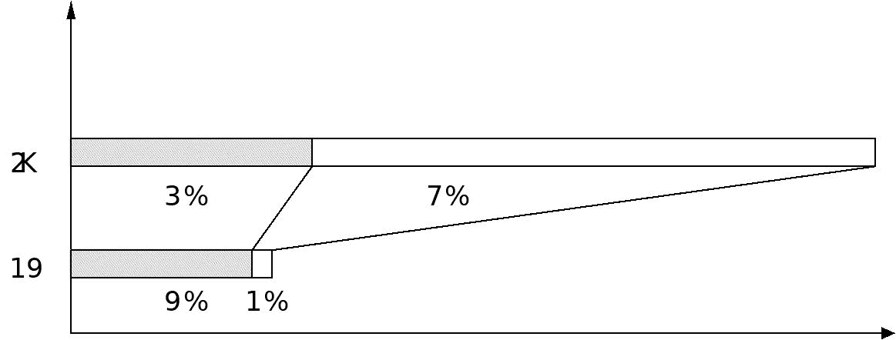

从一开始，计算机科学中的人工智能方向就引起了极大的、甚至是不健康的兴趣。不择手段的记者们渲染夸大新思想的胆怯雏形，并提出了不合理的公众期望，当最初的理论结果无法证明夸大的期望时，这些记者又参与嘲笑人工智能的思想。但在 21 世纪，情况发生了变化。最近，该方向取得的结果已超出学术实验性开发的框架，并开始应用于实际应用中。人工智能系统在现实生活中有着有意义的用途，从医学诊断到航天器控制；对此可以有不同看法，但无法否认。因此，“知识处理方法”、“应用人工智能”等课程已成为计算机科学家培养课程中实际上的必修课。

从事科学密集型应用领域的应用数学工程师和计算机科学家，必须掌握人工智能研究中开发的用于解决枚举问题的基本、成熟方法。

应当强调的是，这些用于计算机知识传递方法的基本形式化手段，对解决枚举问题的方法的实际适用性起着决定性作用。因此，知识表示方法是人工智能方向的核心。这一核心内容是初学者和经验丰富的工程师所不可或缺的，也是本书的主题。

我们期望修读本课程的学生达到以下成果：

1.  **掌握** 解决算法复杂问题的最重要方法；了解这些方法的比较优缺点；了解最著名的知识表示方法的基本原理：产生式规则、谓词演算公式、语义网络。
2.  **具备** 在简单情况下为给定任务选择合适的知识表示方式的能力；具备评估将某种求解方法应用于特定问题的适当性的能力。


### 3. 基本概念的掌握

掌握人工智能和知识表示领域的基本概念；具备通过文献研究人工智能其他方法的能力；具备评估和使用特定应用人工智能系统的能力。

---

## 第 1 章：应用人工智能系统

研究人员长期以来一直关注人类智能问题，尽管试图构建这种心理现象，或者至少对实现人类智能的现象和过程给出或多或少严格的定义，并不总是富有成效的。作者既不是大脑生理学或心理学专家，也不会在古典哲学领域“玩弄概念”。尽管如此（更确切地说是“为了支持这一立场”），我们允许自己做一些离题的论述和引用，以说明上述领域的情况。

如今，心理学界普遍认为存在一种作为通用心智认知能力的一般智力，它可以建立在神经系统以某种实用性、速度和准确性处理信息的遗传决定特性之上。人们认为，人类的许多类型的心智活动，如编程、数学、讲课或阅读此类书籍，都需要智力。

不幸的是，我们对各自头颅中所装事物的理解，总体而言，几乎不能算作足够完整。如果我们谈论作为智力载体的大脑结构，那么已知其形成元素是一种特殊类型的细胞——神经元。已经证明，神经元相互作用的至少一种形式是通过电化学方式实现的，但这种形式是否为唯一形式仍是一个悬而未决的问题。目前的情况让人联想到假设的克罗马农人试图理解个人电脑如何工作及其能做什么。如果我们甚至还不能完全理解用两条腿行走的力学原理，又能对大脑说些什么呢。

我们看到，“智力”一词对人而言是间接定义的，通过专业特长，根据活动的某些结果来界定，并不直接表明这种心理层面是什么以及它是如何实现的。百科全书类出版物中现有的定义通常使用同义词和递归来解释。例如，百科词典给出了如下简短定义：

> **智力**（源自拉丁语 *intellectus* —— 知识、理解、理性）—— 思维的能力，理性的知识。

解释性心理学词典的定义接近，但更为精确：

> **智力**（源自拉丁语 *intellectus* —— 理解、认知）—— 执行认知过程并有效解决问题的能力，特别是在应对新的生活问题时。

换句话说，定义并未定义出任何实质内容，但有时能激发正确的联想，而“智力”这一术语非常模糊且远远不够。特别是，无法理解直觉的本质、信念的机制、爱、厌恶等其他非理性关系的本质等。

“智力”一词本身并非完全名正言顺地进入了“人工智能”这一术语。事实上，最初的原始术语 *artificial intelligence*（见第 0 节）含义要柔和得多。*Intelligence* 一词仍更多地指敏捷的机智，而非深思熟虑的心智，作为一种基本人类素质。但很难为其提供另一个俄语翻译，且为时已晚，因此让我们沿用现有翻译，并赋予其以下含义。

本书的主题是**应用人工智能（AI）**，我们在此讨论实用且有用的项目，避免柏拉图-第欧根尼式的“赤裸尾巴”风格 [\[3\]](#part0005.xhtml#_ftn3)。AI 的概念与自然智能的概念一致，但实际与后者关系不大。重要的是要理解，**AI 不是人类思维的模型** [\[4\]](#part0005.xhtml#_ftn4)，正如橡胶不是天然橡胶的化学模型，尽管二者共享许多相似的物理特性。事实上，人工智能程序使用了一些也存在于人类思维中的算法（毕竟，每个程序都是由人类编写的）。但在现实生活中，人解决同一问题的方式会与程序不同（执行不同的操作，使用不同的算法，利用尚未得到充分研究、因此无法转化为数学公式和程序代码的心理结构）。正面进攻法——用“机器”语言表达“人类”算法——是无效的，稍后我们将看到。换句话说，如果我们将某任务归类为智力任务，那么根据我们的定义，每一种解决方案都表明存在某种智力。如果解决方案是通过程序获得的，那么该程序就包含智力元素。

能够解决传统上被归类为智力范畴学科中问题的程序被称为**人工智能**。带有……元素的应用系统

另一定义：**带有 AI 元素的应用系统是一种其算法（目前还！）找不到的大学教科书中的程序。** 例如，在编程早期，能够创建其他程序的程序（第一批编译器）被认为是“智能”的。现代编译器不被视为智能程序，尽管它们关于编程“懂”得多得多，并使用非常复杂的算法来解决编译和优化问题。还可以举出其他例子。在每个具体案例中，具体的应用 AI 系统都是此类软件创作者的诀窍，但某一特定学科领域的每一个新想法都会显著推动人工智能系统的整体发展。同时，随着发展的推进，将学科领域归属于智力范畴的传统，以及对许多任务“智力程度”评估的传统也在发生变化。例如，19 世纪末计算埃菲尔铁塔的结构需要大量工作、非凡的智慧和独创性，而现在普通设计师使用现成的软件包就能快速、可靠且无需太多脑力劳动地完成此类计算。设计师的经验和智慧、力学、材料强度及其他工程学科的广泛知识，很大程度上积累在现代设计包中。这种包无疑表现出智能行为，但我们不将其视为应用 AI 系统，因为设计包中的所有计算都是按照已知的、预先定义的、唯一的算法执行的。

为了支持上述论点并阐明带有 AI 元素的应用系统的主要定义，我们考虑一些人工智能应用的典型主题领域。

### 1.1. AI 应用概览

一些带有 AI 元素的典型应用包括：


- 自然语言理解与机器翻译；
- 智能数据库与问答系统；
- 专家系统与自动定理证明；
- 机器人动作规划与模式识别；
- 智力游戏。

此列表既不完整也不正交。这只是我们挑选的一些最喜爱的示例。

#### 1.1.1. 自然语言理解与机器翻译

理解自然语言的过程，就是将知识从一位母语使用者传递给另一位母语使用者的过程。

尽管这一过程看似简单且熟悉，实则极其复杂。这意味着双方存在共同的知识领域，并就以数据形式表示知识的机制达成一致，同时也存在从数据中提取知识的逆机制。

自然语言理解过程的计算机实现，需要由非平凡（智能）软件系统控制的强大计算资源。让我们看看这里的问题所在。假设我们有两个智能体，姑且设为人类。第一个是知识源，称之为 A；第二个是知识接收者，称之为 B。理解过程涉及两个机制。首先，A 拥有一个算法，允许将假设性知识转化为数据、信号（文本、语音或其他形式的自然语言表达 [[5]](#part0005.xhtml#_ftn5)）——即知识表示机制。其次，B 拥有一个机制，允许将接收到的信号转化回知识——即提取（知识）机制。如果我们接受这些机制由算法实现 [[6]](#part0005.xhtml#_ftn6)，那么显然，它们各自都有一个定义域和值域、一个输入和一个输出。当知识表示算法的输出与知识提取算法的输入至少在共同解释上重叠时，理解就发生了；而当这两个领域完全重合时，则达成了完全理解。

举几个例子。让我们作者作为智能体 A，亲爱的读者您作为智能体 B。下一句话："ovelan avarps her ilasipaz otsorp ym" 很可能会在最初时刻让您困惑和误解。这里智能体 A 使用了非标准的知识表示方法，导致智能体 B 难以提取知识。另一个例子。如果 A 使用 B 不懂的语言（假设这段文字由一位懂俄语的中国人用中文读给您听，而您不懂中文），那么会发生这种情况：知识表示机制在工作，提取机制也在工作，但真正的理解并未发生。

讲俄语的智能体 B 可以评价语言的音乐性、音素组合的异常性……最终得出结论：他，智能体 B，什么也没懂（！），存在一个空的共同解释。还有一个“正交 [[7]](#part0005.xhtml#_ftn7)”共同解释的例子。一位俄罗斯女孩问她的男朋友（保加利亚人）：你爱我吗？——男朋友摇了摇头（左右晃动）。——女孩悲伤地哭泣，而按理说她应该高兴得跳起来！——事实是，在保加利亚人中，我们的肯定性点头是否定的手势，而左右摇动头部则表示肯定。

对智者而言，说一个字足矣，另一智者便能理解。换句话说，由于拥有更强大的知识表示和提取机制，智者之间传递的数据总量可能显著少于普通人。

共同解释是一组语义规则，双方对其解释一致，且将语言结构与其语义负载联系起来。

现在让我们转向计算机。在计算机中，知识表示机制和知识检索是平凡的，理解简化为数据传输。因此，当计算机通过通信通道连接且数据格式商定一致时，理解易于实现；否则理解根本无法实现。我们关注的关键情况是人与计算机的相互理解。人与计算机交流有两种根本不同的方式。第一种是人能理解计算机。这不是计算机的功劳，而是人的能力，周围所有人都称这样的人为程序员。第二种是计算机能理解人。这样的计算机必须包含 AI 元素。既然智能，即使是人工智能，也难以塞进常规计算机的硬件中，显然理解必须由软件提供。此类程序创建已有一段相对较长的时间，尽管它们无一例外都非常、非常有限地理解自然语言，甚至只是语言中一个或多或少宽泛的片段。

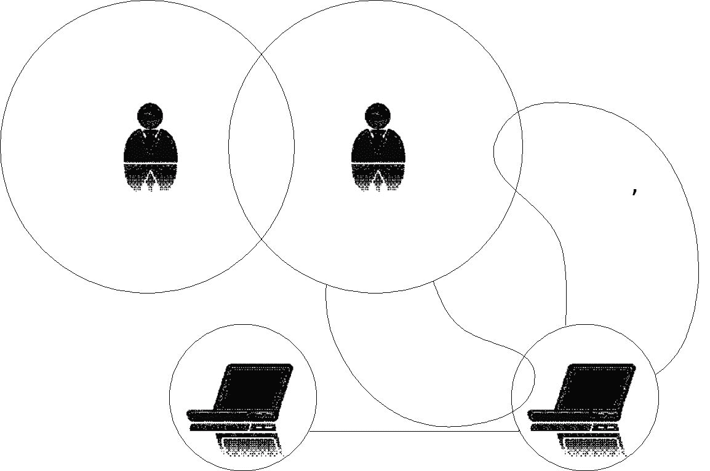

最早理解自然语言的应用 AI 系统之一是 ELIZA 程序，由 J. Weizenbaum 于 1966 年开发。

稍晚些时候，Terry Winograd 撰写了《自然语言理解程序》一书来描述 ELIZA 程序 [2]。ELIZA 程序的结构极其简单，仅包含几十条启发式规则，旨在识别语法结构（通过简单的模式匹配）并将传入的问题转化为“自然”的回答。结果，该程序能够进行完全貌似合理的对话，常常以反问来回答问题。与 ELIZA 程序对话的示例：

— ELIZA，你是一个计算机程序。

你为什么认为我是一个计算机程序？

“因为 Weizenbaum 把你组装起来的。

“告诉我关于 Weizenbaum 的事。

尽管很简单，但该程序在心理治疗中有应用。心理治疗师与患者的交谈可能持续很长时间才会产生治疗效果。ELIZA 成功模拟了与罗杰斯学派心理学家的对话数小时（该方法的精髓在于治疗师倾听患者并提出引导性问题，从而改善后者的心理状态……或者不改善）。许多患者表示这些疗程对他们极其有用，并拒绝相信是计算机程序而非专业人类心理学家在与他们交谈。

Weizenbaum 本人因其“后代”的行为而震惊，很快得出结论：“人工智能发展的主要意识形态——人工智能——是不道德的”。Joseph Weizenbaum (1923-2008) 是人工智能领域的知名人物，麻省理工学院 (MIT) 名誉教授。计算机专业人士社会责任组织的创始人。因其对程序员对人类责任的看法，他在计算机科学家中赢得了异见者和异端者的声誉。“有些任务不应交给计算机，无论是否能为它们制造出计算机。”

机器翻译是自然语言理解问题的一个特定细化。“特定”主要由信息交换的类型决定——独白而非对话。

将文本从一种自然语言自动翻译成另一种自然语言的系统，构成了一类包含人工智能元素的重要软件系统。

从一种自然语言翻译成另一种自然语言无疑是一项智力任务。由于该任务显而易见的实际相关性，自动机器翻译比其他领域更早吸引了研究人员的关注。


##### 机器翻译系统的复杂性与发展历史

重要的是，与 AI 的其他情况一样，在机器翻译系统类别中，可以看出一些复杂度不断增加的类别：

- 电子词典；
- 技术文本的行间翻译；
- 诗歌的文学翻译；
- 语音的同声传译。

很明显，这些问题无法用统一的方法解决，这意味着它们的解决方案出现的时间不同，且依赖于不同的技术。

对于 AI 应用的每个新领域，都可以观察到相同的特征模式（图 2），我们将以机器翻译发展史为例进行说明。新思想出现后，人们对它的兴趣增加，产生过高的期望，用户期待奇迹。但奇迹并未发生——AI 方法繁琐、复杂，其发展需要相当多的自然智能。随之而来的是幻灭感，研究方向离开热门关注领域，有时甚至受到无理阻碍。如果这个思想是富有成果的，那么尽管媒体兴趣下降，学术界的艰苦基础工作仍在继续，过一段时间（不是立刻！）开始产生实际成果。兴趣再次出现，但不再是盲目的，而是基于事实且合理的。

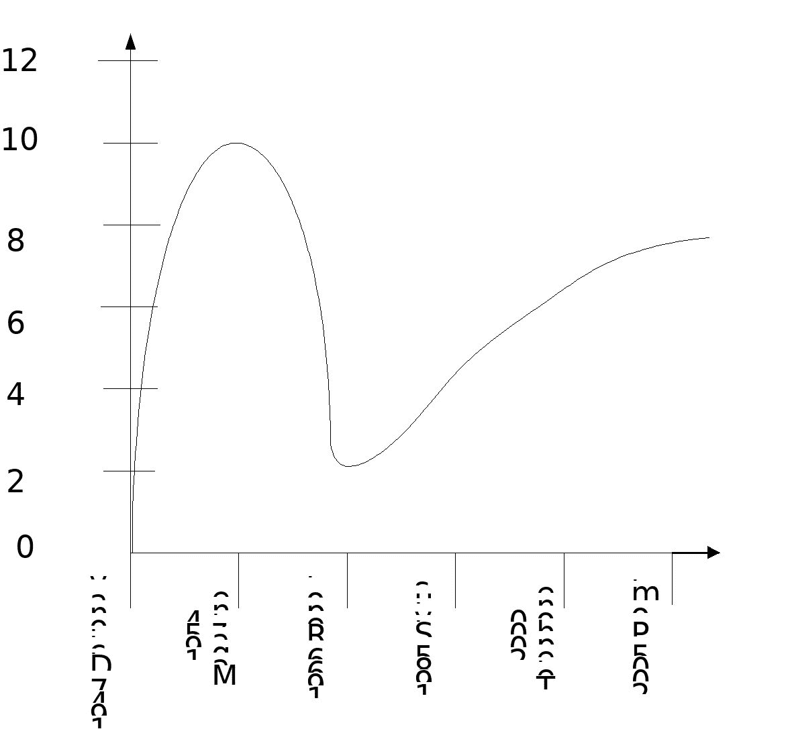

**图 2. 机器翻译流行度的历史**

1947 年 3 月，洛克菲勒基金会科学总监 Warren Weaver（1894-1978）在与 Andrew D. Booth 和 Norbert Wiener 的通信中，首次提出了机器翻译的概念，该概念后来（1949 年）在致基金会的备忘录中得到进一步发展。

1952 年，麻省理工学院举办了第一届机器翻译会议；1954 年，由 IBM 与乔治城大学联合开发的首个机器翻译系统 `IBM Mark II` 在纽约发布（这一事件在历史上被称为“乔治城实验”）。展示了一个非常有限的程序（拥有 250 个词汇单位的词典和 6 条语法规则），可将俄语翻译成英语。此后，此类发展扩展到意大利、法国、英国、日本，并创建了一本国际专业期刊。

1959 年，哲学家 Yohoshua Bar-Hillel 论证了高质量、全自动的机器翻译在原则上是不可能实现的。这一论断对美国机器翻译的发展产生了最不利的影响。1966 年的急剧下降与 ALPAC（自动语言处理咨询委员会）的一份报告有关，该委员会由美国国家科学院专门设立。委员会得出结论：机器翻译无利可图——机器翻译的成本与质量之比明显不利于后者，且人力资源足以翻译技术和科学文本。因此，国防部决定停止为此类项目提供资金。该话题不再时髦，只有合格的爱好者和专业人士继续工作。

随着 20 世纪 70 年代末计算机技术的发展（微型计算机的出现、网络的发展、存储资源的增加），机器翻译进入复兴期。同时，研究重点有所转移：研究人员现在的目标是开发“人类参与”的“现实的”机器翻译系统，即人类参与翻译过程的各个阶段。结果，20 世纪 80 年代首批面向大众使用的工业机器翻译系统上市。

1990 年，当机器翻译系统再次成为计算机工业发展的优先领域之一，在经历了艰难的反思和相互融合时期后达到新的质量水平时，Larry Childs 提出了它们的分类。他将所有“电子翻译器”分为三组：

1. **FAMT**（Fully Automated Machine Translation）——全自动机器翻译工具。

   ```
   Input Text → Text Analysis / Synthesis → Output Text
   ```

2. **HAMT**（Human-Assisted Machine Translation）——在人工参与下进行的自动机器文本翻译应用。

   ```
   Input Text → Editor → Text Analysis / Synthesis → Editor → Output text
   ```

3. **MAHT**（Machine-Assisted Human Translation）——借助计算机进行人工翻译的工具。

   ```
   Input Text → Translator → Interlinear → Editor → Output text
   ```

然而，现实实践表明，目前存在的所有机器翻译系统的运作或多或少都需要人工编辑的介入。

从概念上讲，机器翻译系统的构建如下（图 3，左）：首先分析源语言文本，即解释数据以“理解含义”，然后以目标语言文本的形式呈现理解的含义。理想情况下，分析达到“完全理解”的程度，此时源文本的全部含义用假设的通用中间语言表示。传统上，这种通用中间语言称为 `interlingua`。值得注意的是，这一理想尚未实现。现代机器翻译系统具有三层架构（图 3，右）。首先，分析输入语言直到达到一定的理解水平，并以在源文本上构建各种结构的形式来表达这种理解，这些结构通常特定于特定语言。然后，使用启发式算法，将一种语言的部分理解结构转换为另一种语言的部分理解结构。这组算法传统上称为 `transfer`（转换）。转换规模大，使用海量信息资源和非常复杂的算法。最后，基于目标语言的转换结构在目标语言中合成文本（它们不一定与源语言的结构同构！）。当然，转换阶段是最复杂、最重要且知识密集度最高的。

**图 3 机器翻译系统的结构**

但半个世纪前人类对机器翻译的梦想在很大程度上仍是梦想——对最多样化主题文本的高质量（“艺术性”）翻译仍然无法实现。然而，无可争议的是，使用机器翻译系统加快了翻译工作的速度并提高了质量。

随着越来越多旨在计算机翻译文本信息的新算法、技术和软件解决方案的出现，可靠的事实是：与传统人工翻译相比，此类系统具有许多优势：

- **翻译速度高**（根据现代估计，使用机器翻译可以将翻译大量文本所需的时间减少 50-70%）；
- **降低翻译成本**（借助机器翻译，可以节省专业翻译人员的服务成本，翻译“简单”文本时甚至可以完全不用他们）；
- **待翻译信息的保密性**（计算机参与机密文件处理，比翻译人员参与在更大程度上保证其内容不泄露）。


###### 翻译过程的通用化

即使是最合格的翻译人员，通常也只专精于特定的知识领域和学科范畴，而机器翻译（MT）系统则具有相当的通用性，其工作仅取决于必要的设置——即连接必要的电子词典等。

目前存在许多商业机器翻译项目：Systran、IBM、L&H (Lernout & Hauspie)、Language Engineering Corporation、Atril、Trados、Caterpillar Co.、LingoWare。在俄罗斯，由 RG Piotrovsky 教授领导的一个小组（俄罗斯赫尔岑国立师范大学，圣彼得堡）正在从事相关研究。现在，由 PROMT (PROgrammer's Machine Translation) 开发的自动翻译软件已获得当之无愧的认可，满足了大多数用户的期望。

#### 1.1.2. 智能数据库与问答系统

在计算机使用的早期，数据存储格式及其操作手段是由程序员针对每个具体情况单独发明的。这既不方便又低效，因此很快便提出了统一的数据存储方法（数据模型），并开发了统一的数据访问系统（数据库管理系统——DBMS）。从最一般的角度来看数据库（DB）的概念，可以断言数据库支持三大主要操作组：将数据录入数据库、在数据库中搜索数据以及从数据库中提取数据，即检索先前录入的数据 [[8]](#part0005.xhtml#_ftn8)。已经提出并使用了几种不存在此限制的想法。其中之一就是智能数据库的概念。

智能数据库提供了一种高效的方式来存储、搜索和检索比最初加载到数据库中的更多事实。

让我们来看一个简单的例子。一个关系型数据库（见表 1）：一个其行对应对象、列对应对象某些属性的表。所有对象属于同一类型，仅在属性值上有所不同。这使得回答事实性问题成为可能。例如，可以询问：“Davison 在哪个部门工作？”并得到答案：“应用数学系”。然而，如果在那里添加未以表格形式呈现的信息，它通常可以回答数据库中无法回答的问题。其思路是：除了普通的关系表之外，数据库中还存储了一些规则，例如：

```
if (x.Position = "Head" & (x.Department = y.Department) then x boss y
```

配备此类规则的数据库就是智能数据库。

实际上，如果询问“谁是 Davison 的上司？”，一个简单的内置推理引擎将轻松找到答案：“Claudius”。这个例子可以让你发现上司-下属层面的关系。在这种情况下，显而易见，Claudius 不仅是 Davison 的负责人，还是应用数学系每一位其他员工的负责人。因此，智能数据库可以返回一个并未存储在其中的事实。此外，此类基础使得回答需要演绎推理的问题成为可能，这种推理不止包含一次规则应用，而是多次应用，以至于提取出的事实可能并不那么显而易见，且与最初录入的事实相去甚远。

允许以（受限的）自然语言提问并回答问题的智能数据库被称为问答系统。

第一批问答系统出现在 20 世纪 60 年代。这些系统中的问题和答案自然地用自然语言的一个非常有限的子集来表述，无论是在词汇还是在所用语法形式方面都经过了简化。信息来源——即从中提取答案的数据库——这些系统中的每一个都有自己的本地系统，针对狭窄的主题领域量身定制。此类系统的实用性和范围不大，尽管它们享有一定的声誉。

目前，以互联网智能搜索引擎形式呈现的问答系统理念已得到极大发展。依托全人类的全球信息资源，并利用相当复杂的新算法来分析和综合受限自然语言文本，此类搜索引擎已被证明极其有用。毫不夸张地说，这些系统在今天对每个人都至关重要。

#### 1.1.3. 专家系统与自动定理证明

智能数据库的方法在自动咨询系统的开发中得到了进一步发展。此类专家系统能够针对具体问题给用户提供胜任的回答。最早的专家系统是为医学应用（疾病诊断）和地质学（矿床评估）等领域创建的。

该领域最重要的问题之一是专家知识的表示与利用，这类知识本质上是相当异构且矛盾的数据。

专家系统是包含特定弱结构化且难以形式化的狭窄主题领域知识的人工智能系统，能够为用户提供并解释合理的解决方案。

目前普遍认为，专家系统的结构由五个模块组成（图 4）。三个模块的组合——规则、情景模型和推理——实际上构成了一个智能数据库。允许提取知识和解释结论的模块将智能数据库转变为专家系统。

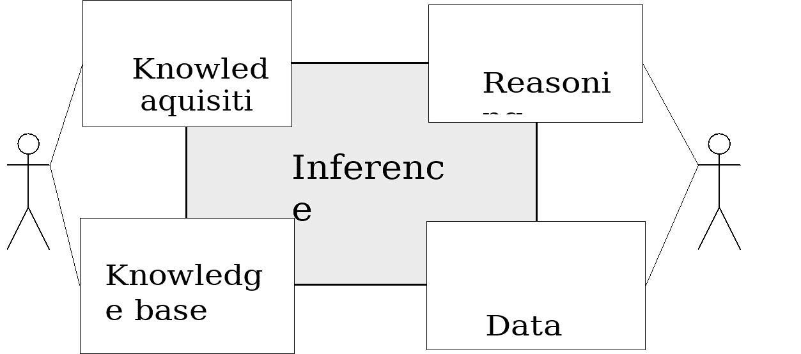

**图 4. 专家系统架构**

如今，专家系统的知识库主要是一组规则。最简单的情况是规则为确定性的 [[9]](#part0005.xhtml#_ftn9)，允许从现有事实推导出新事实，就像在智能数据库中一样。这种方案在第二章中有详细讨论，我们将在那里谈论基于产生式系统的知识表示。

输出解释模块实际上以人类可读的形式呈现机器输出结果，以便用户能够了解专家系统解决问题所使用的推理步骤。因此，用户对答案的信心会增加。

最重要且最复杂的是知识获取模块。该模块的工作结果显而易见——即知识库的补充和修改。但源数据可以各不相同。不要指望领域专家能“从零开始”按系统要求的格式制定出有效的推理规则。那是奇迹。最可靠的方法之一是逐步补充和修改知识库，而修改的原因总是系统无法或错误地解决了问题。在这种情况下，专家利用解释模块分析机器推理的历史，确定哪条规则失效或缺少哪条规则，并使用知识获取模块将它们添加到知识库中。我们可以认为，专家系统像人类一样，从错误中学习。

推理模块位于专家系统结构的中心。在这个模块中，规则被应用于情景模型中的事实，从而获得新事实，规则也被应用于这些新事实，以此类推，直到达到目标，即所需的事实。这个过程本质上是在形式理论中寻找推导的过程。实际上，来自模型的最初事实

概率 p。专家系统根据概率规则得出的大多数结论具有概率性质。用户会收到针对其问题的几个不同答案，每个答案都被分配了自己的可靠性概率。


情境即公理。我们对它们应用规则，获得新事实，而每个新事实都源于先前获得的事实。最终我们达到（或未达到）目标事实，即用逻辑理论的语言来说，我们得到了目标命题的结论。因此，任何专家系统的核心都可以看作是一个在任何形式理论中自动搜索结论的系统，即证明定理。

定理的证明当然涉及智力劳动，这不仅需要演绎技巧，还很大程度上需要直觉性的猜测（例如，哪些引理对于给定的定理是必要的）。换句话说，证明定理意味着（除其他外）搜索已证明的定理和已解决的子问题，它们可能有助于达到最终目标。到目前为止，已经开发出几个带有 AI 元素、能朝这个方向工作的程序，即自动定理证明程序。

当我们初次审视这个主题时，会立即注意到数理逻辑课程中已知的情况。

1.  一阶谓词演算语言，加上等式和非逻辑谓词及函数等内容，是大多数学科公理化公认的工具（即几乎任何陈述都可以表述为应用谓词演算的公式）。
2.  Tarski 列举合式公式的算法允许以穷举方式生成假设（即可以列举所有合式公式）。
3.  求解方法是部分正确的（即对于任何可证公式，都能自动找到推导；对于不可证公式，算法可能无法完成工作）。

由此产生了一个想法，其简洁性令人印象深刻。让我们用一阶演算语言写下领域的公理。运行类似 Tarski 算法的程序，逐个生成新假设。我们将尝试用求解方法自动证明每个假设，如果成功，计算机本身将提取越来越多的新知识。该过程可在代码中全天候运行，每周 7 天，每年 365 天，不仅在一台机器上，而是在所有当前空闲的机器上运行。顺便说一句，PC 平均 90% 的时间处于空闲状态，其总空闲算力相当可观，因此人类拥有足够的空闲资源。

因此，自动定理证明是可能且易于编程的，但这种简单的方法被证明是无望的低效。由于枚举空间太大，即使是最快的计算机也无法在合理的时间内完成任何工作，因此复杂、有趣的定理无法通过正面进攻的方式自动证明。

然而，实话实说，目前在非常狭窄的数学理论类别中，仅有极少数例子表明，利用非常特定的方法，已经能够自动发现并证明以前未知的、非平凡的有意义定理。这样的例子已有很多很多年历史 [3]。俄罗斯科学院通讯院士 VM Matrosov 开发了一种惊人的方法，用于在与微分方程理论相关的狭窄领域中列举和证明数学事实。合作程序员编写了一个程序，该程序生成假设并自动为它们创建证明。通过这种方式，发现并证明了一些真正新的、非平凡的定理。同时，这些结果（定理和证明）作为数学领域的新科学成果发表在著名的数学期刊上。世界学术界尚不知如何面对这一事实，但先例已然存在。

必须强调的是，自动定理证明是所有带有人工智能元素的应用系统的主要工具，这些系统或多或少地使用逻辑演算公式来表示知识。谓词演算公式几乎总是被使用——这是人类已知的所有陈述的主要正式书写形式。因此，我们可以放心地说，自动定理证明是 AI 的一个基本主题。在后续章节中将表明，我们考虑的所有 AI 方法，以及可能所有 AI 方法，直接或间接都归结为自动定理证明。

##### 1.1.4. 自动机器人控制与模式识别

机器人——一种自动或遥控装置，部分或完全替代人从事某些工作。

“Robot”（机器人）一词由捷克作家 Karel Capek 及其兄弟 Josef 创造，首次用于 Capek 的剧作《RUR》（"Rossum's Universal Robots"，1920）。

机器人最常用于在危及生命的条件下执行任务，或当设施相对难以接近时。人人皆知无人月球车和火星车的成功，以及用于侦察和排爆的军用机器人。最近（2009 年）日本举办了另一届国际机器人展览会，展出的大多是家用和医疗机器人（图 .5）。例如，向公众展示了一种用于培训牙医的“痛觉敏感机器人病人”。另一个例子是能记住警方通缉犯面部的“机器人警察”。识别后，机器人立即通过无线电警告安保人员。娱乐机器人越来越受欢迎。同一展会上展示了“机器人舞伴”。这是一个真人大小的“女性”，借助特殊传感器，能敏锐地察觉舞者移动的方向并配合其动作。她还能表演短独舞，动作平滑，并能移动手臂、头部和身体。看来 20 世纪科幻作家描述的机器人未来梦想即将成真。

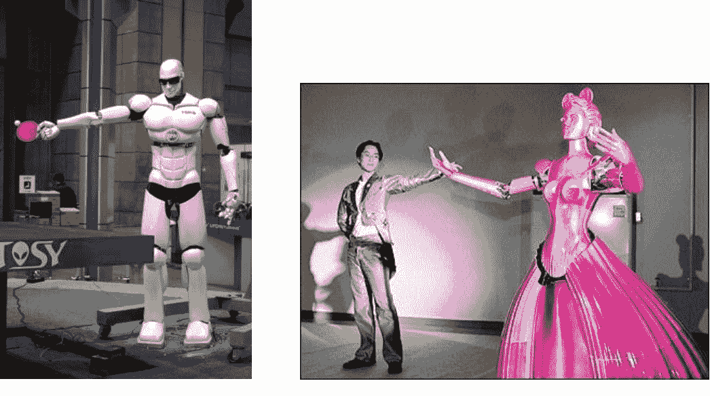 

.5. 机器人示例：乒乓球机器人、舞者机器人、病人机器人

实际上，机器人规划是一项极其困难的任务。似乎没有什么比用两条腿走路更容易的了。每个人的发育都始于看和走的能力。研究时间线（图 .6）会让人觉得这些技能似乎不需要任何显著的智力努力。乍一看，说话、思考和编程似乎难得多。然而，如果你看看机器人和机器人技术的发展，很容易发现情况恰恰相反。机器人先学会了编程和推理，然后学会说话，接着学会走路，至今仍未学会如何正确地“看”。

.6. 机器人与人类技能发展的对比


###### 机器人行走与视觉感知的挑战

成功让双足机器人行走，即便以当前的科技发展水平来看，也是一项极其困难的任务。事实是，行走时人体的重心几乎从未位于支撑区上方。从力学角度看，我们不是在“行走”，而是在持续“跌倒”，只是成功地将脚伸向正确的位置并继续前进。19 世纪的正面方法——构建一个具有所需自由度的机械模型，并在每一步求解相应的微分方程组——行不通。即使是最快的现代计算机，也来不及实时执行必要的计算。显而易见，我们行走时大脑并未在求解方程组。让机器人行走采用的是完全不同的技术。该领域的任何新成就都被视为重大成功，从上文提到的国际展览展品列表便可见一斑。就快速奔跑和跳跃（达到专业运动员水平）而言，双足快速奔跑跳跃机器人至今仍是一个几乎不切实际的任务 [\[10\]](#part0005.xhtml#_ftn10)。幸运的是，能像著名电影中施瓦辛格扮演的“终结者”那样灵活移动和射击的机器人尚不可能实现。

####### 技术视觉的局限

目前尚无合适的装置能让机器人像人类一样“看见”周围世界，并对“视觉”变化做出同等水平的反应。我们看世界的方式，是基于智力活动的长期学习结果。已知婴儿在发育的第三周就已具备立体色觉。通过与物体互动和积累观察经验，儿童在立体色觉基础上形成了一种新能力——物体感知。重要的是要强调，这种能力并非由生理原因解释，而是由智力原因解释 [\[11\]](#part0005.xhtml#_ftn11)。另一方面，研究人员发现，当人被置于完全陌生的人工环境中（光线异常排布、熟悉物体异常巨大、过程节奏异常等），人通过眼睛对三维现实的适当感知能力会丧失。因此，物体感知是心理的能力，而非眼睛的能力。事实上，我们看到的是大脑在极短时间（几分之一秒）内，根据眼睛接收的信息快速构建的模型。有时该模型可能与现实略有出入（参见如图 0.7 及第 0 段所示错误引用）。技术视觉的问题不在于相机的分辨率，也不在于数量，而在于从相机接收的平面图像中充分重建三维模型的算法复杂性。针对特定条件和专门任务存在良好的技术解决方案，例如安防系统中识别人脸的机器人，或识别钟表带上微小零件位置和方向的机器人，但这些系统不可互换、不兼容。与人类能力广度可比的通用技术视觉系统尚未设计出来 [\[12\]](#part0005.xhtml#_ftn12)。

计算机视觉是被称为模式识别的 AI 技术广泛应用的一个例子。

######## 模式识别

模式识别是控制论的一个分支，它开发方法对由有限属性和特征表征的对象、过程和信号进行分类和识别。

该领域包括例如在红绿灯处过马路的问题。识别发光红绿灯的颜色并了解交通规则，将允许你做出是否直行过马路的正确决定。

最早能够进行感知并对感知刺激形成响应的人工神经网络之一是 Frank Rosenblatt 的感知机。其作者并未将感知机视为具体的技术计算设备，而将其视为大脑模型。值得注意的是，经过几十年的研究，现代人工神经网络的研究很少再追求此类目标。

以模式识别为例，我们再次观察到 AI 方向发展的特征曲线（参见图 0.2 及相关解释）。Rosenblatt 开创性工作发表后，该主题的兴趣急剧上升，随后 M. Minsky 和 S. Papert 的一本书浇了一盆冷水，书中揭示了 Rosenblatt 感知机的根本局限性。似乎前景尽失，但如今对该主题的兴趣再次高涨。迄今为止，最初的想法已转化为神经网络和神经计算机，目前进展十分成功。

模式识别领域最伟大的成就之一与 Logica 于 1982 年开发的指纹识别系统有关，该系统不仅在法医学中，还在各种安防系统（如笔记本电脑）中得到广泛应用。人工智能系统的其他应用示例包括：语音识别、扫描文本识别（OCR）、车牌识别或从航空照片进行环境监测。

应该清楚，综合一个信息对象总是比分析同一对象容易得多。一个很好的例子是手写体。书写很容易，但有时阅读却极其困难。我们大概都遇到过这种情况：在互联网注册网站、发送消息等操作时，需要“解密”图形中的验证码。这被认为是一个相当可靠的测试，用于区分真实用户和机器人。现代识别程序无法分析字母数字轮廓不闭合、线条怪诞扭曲且含大量“噪声”的复杂图片，而人类几乎不费吹灰之力就能做到。到目前为止，模式识别是人类相对于机器人无可争议的竞争优势——还能持续多久？

本节以图像示例结束（图 0.7），表明模式识别任务对人类而言绝非易事。

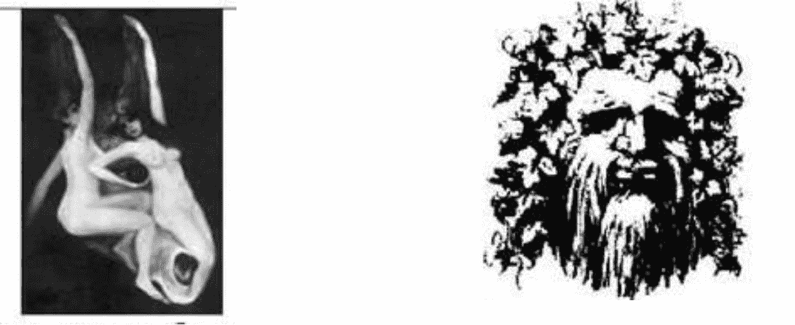

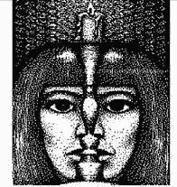 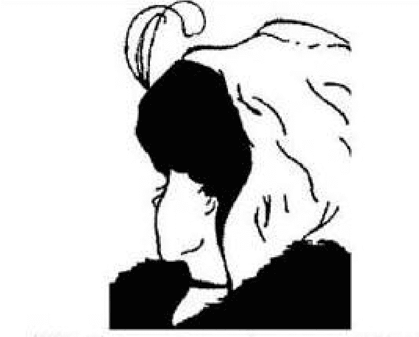


图 0.7. 复杂模式识别图像示例

#### 1.1.5 智力游戏

带有人工智能元素的应用系统最著名、最流行的用途之一是各种智力游戏。几乎每个人都接触过用于此特定领域的人工智能。跳棋、国际象棋、西洋双陆棋既可在手机中找到，也可作为功能更强大的程序运行在性能足够的计算机上。


##### 知识表示在人工智能中的地位

在所有智力游戏中，国际象棋历史上最吸引程序员研究者的关注。即使在今天，最好的计算机国际象棋程序也胜过世界知名的特级大师。我们可以说，在国际象棋领域，计算机已经战胜了人类。同时，必须强调的是，国际象棋程序中没有奇迹。它们使用众所周知且经过精心实现的算法，例如第 3 章讨论的那些。然而，如果我们接受“在特级大师水平下下国际象棋需要智力”这一说法，那么我们就必须承认最好的国际象棋程序是智能的。同时，计算机国际象棋不仅仅是娱乐，也是教授新棋手、创建国际象棋数据库、分析残局和修改规则的一种方式 [\[13\]](#part0005.xhtml#_ftn13)。但对我们来说最重要的是，这绝对是知识表示最有趣的案例之一。

在智力游戏中表示知识的任务，是对程序员自然智力的挑战。事实是，从定量角度来看，某些游戏极其复杂。例如，国际象棋大约有 `10⁴⁰` 个可能的位置和大约 `10¹²⁰` 个可能的对局。这些是巨大的数字，大于宇宙中的原子数量（根据不同估计，从 `10⁶⁷` 到 `10⁸⁰`）以及自宇宙诞生以来经过的秒数 [\[14\]](#part0005.xhtml#_ftn14)。没有任何信息设备能够也永远无法看到或记住所有位置并玩遍所有对局——这在物理上是不可能的。因此，智力游戏软件的开发者有大量工作要做！

米哈伊尔·莫伊谢耶维奇·博特维尼克 (Mikhail Moiseevich Botvinnik, 1911-1995) —— 技术科学博士，第六届世界国际象棋冠军，总共保持此头衔 13 年。他对国际象棋的算法理解做出了重大贡献。他是第一个特别关注棋手训练问题的人，创建了自己的备战比赛方法，其中重要地位给予了体育锻炼和增强心理稳定性。他为多重开局理论做出了宝贵贡献，开发了许多原创的开局体系，并用有价值的分析丰富了残局理论。“在我看来，我把一切可能给予国际象棋的都给了。现在我只是没有时间为大型锦标赛做准备。当我独自从事电气工程时，我设法将工作与国际象棋结合起来。但几年来，我一直在处理计算机下棋的问题，并深深沉浸其中，以至于无法将这三项活动结合起来。”

1970 年完成其体育成就（苏联国家队与世界队之间的“世纪对抗赛”）后，博特维尼克致力于人工智能问题，并着手开发计算机国际象棋程序 `Pioneer`。早在 1958 年，开发“电子棋手”的想法就出现在他脑海中。1968 年，博特维尼克的书出版了，他在书中基于局面评价制定了模拟国际象棋大师选择走法时思维的方法，该评价包含了所有方面，并将不必要的走法和变着排除在外。不幸的是，`Pioneer` 程序从未实现，但博特维尼克宝贵的思想和解决方案保留在国际象棋理论中，并找到了进入国内 AI 专家后续发展的途径。

几十年来，计算机国际象棋程序的世界锦标赛定期举行。目前，锦标赛由国际计算机游戏协会主办，对所有类型的计算机开放，核心数不超过八个（即不包括超级计算机和大型集群）。值得欣慰的是，国家程序 `Kaissa` 是在 GM Adelson-Velsky 和 MV Donskoi 的指导下开发的。过去三年的冠军是 `Rybka` 程序，由捷克裔美国棋手 Vasik Rajlich 开发。

### 1.2. 知识表示在人工智能中的地位

在智力领域，不可能想出一个适合解决任何问题的通用算法。这就是智力任务与其他非智力任务的区别，后者存在“第一步做什么，第二步做什么，第三步做什么……”的算法。智力领域解决问题的方法总是寻找新方法、新途径，归根结底，如果无法发明新方法，就是平庸地枚举所有可能性以寻找解决方案。

#### 1.2.1. 问题求解的迭代性质

在计算机上解决问题的一般方案如图 1.8 所示。自上而下的箭头是确定性的，自下而上的箭头是非确定性的。一般来说，问题的解决总是非确定性的。这是一种试错法，一种搜索方法，通常要求你回到之前的步骤。

如果此类过程中的反馈（自下而上的箭头）由人实现（这种情况经常发生），则该过程不能描述为计算机辅助知识处理。为了能具体谈论计算机辅助知识处理，所有或部分反馈回路必须由计算机闭合。

**图 1.8. 在计算机上解决问题的过程方案**

采用传统的过程式编程（自顶向下）时，解决方案完全取决于问题。每个问题都有其独特的解决方案，一个问题的解决方案不能直接用于解决另一个问题而无需额外工作。在人工智能中（非过程式编程），相同的搜索方法可以应用于一整类问题。

我们的总结如下。如果任务没有直接的解决算法，通过枚举来解决，且回溯不是由程序员的大脑完成，而是由程序本身完成，那么它就是一个带有人工智能元素的应用系统。如果问题有直接的解决算法，由程序员找到（也许经过几次尝试），但不是由程序本身找到，那么就没有人工智能（也许存在程序员的自然智能）。但实际上，在这两种情况之间没有不可逾越的界限。程序的人工智能不是一种只取值 0 或 1、全有或全无的离散属性。相反，人工智能是一个连续值，取区间 (0, 1) 上的任意值。图 1.8 中不经过程序员大脑而经过计算机的反馈回路越多，程序的智力水平就越高。

#### 1.2.2. 知识与无知

不可能在知道与不知道之间划出明确的界限。事实上，计算机中知识表示没有精确的界限——每个程序和数据都反映了某种知识。另一方面，最微妙的哲学思考可以用自然语言写入计算机，在那里它们由无意义的字节串表示。字节会在计算机中，但哲学知识呢？更具体地说，如果没有我们自己的解释，计算机中没有任何东西是知识；如果你足够努力，几乎可以从任何东西中提取知识。严格来说，在本书中（除非另有明确说明），我们指的是对“知识”一词的以下解释：

**知识（计算机）** 是一组严格定义的信息结构，以及用于处理这些结构的定义良好的规则和策略（解释规则）。

让我们通过一个模型示例来看看这一点。


##### 1.2.3. 解搜索算法与知识表示

假设我们希望计算机按升序对一组数字进行排序。我们人类当然知道如何做到这一点。请思考一下，我们能否将此教给计算机，即我们能否在计算机中表示必要的知识？预先告知有三个数字，它们分别等于 3、5 和 7。你只需编写一条语句就能教会计算机解决这个问题：

```
Write(3, 5, 7)
```

因此，我们为计算机提供了足够的知识来解决这一特定问题。知识以单个编程语言算子的形式呈现。

让我们使任务复杂化。再有三个数字，但它们的值是任意的。让我们编写一个过程，能够按升序对这些数字进行排序：

```
proc Sort3 (x, y, z)
    if x > y then x :=: y end if
    if y > z then y :=: z end if
    if x > y then x :=: y end if
    Write (x,y,z)
end perc
```

因此，我们教会了计算机解决大量与按升序对三个数字排序相关的任务，而无需使数据集过长。无论如何，该条目比所有可能的 `Write` 语句及其所有可能的参数组合要小得多 [\[15\]](#part0005.xhtml#_ftn15)。知识以带参数的过程形式呈现。换句话说，编程语言中的过程机制已经是一种知识表示方法。只是这是一种相当古老的方法，我们习惯了它，并不将其视为一种知识表示机制。

另一个问题出现了：`Sort3` 过程从何而来？

我们可以说，像往常一样，它是由程序员发明的。但我们将给出一个不太熟悉的答案，并展示如何在程序中提供足够的知识，使计算机能够想出一个类似于 `Sort3` 的过程。

`Sort3` 过程的代码片段彼此相似且不止两个，应应用特殊的重构（不改变程序执行功能的程序文本转换），称为过程化。过程化是一种重构，其中程序中重复或相似的片段被替换为对新引入过程的调用。通过重写过程 `Sort3`，引入过程 `Sort2`，我们得到过程 `Sort3'`。

```
proc Sort3' (x,y,z)
    sort2(x,y)
    Sort2(y,z)
    sort2(x,y)
    Write (x, y, z)
end perc

proc Sort2(u,v)
    if u > v then u :=: v end if
End perc
```

但 `Sort2` 过程在形式上很容易指定：

```
x, y { Sort2(x, y) } x < y
```

这里在过程标题前写出了前置条件（用花括号括起），在标题后写出了后置条件。`Sort2` 方法非常简单，显然在许多情况下都很有用。可以假设该过程连同其规范（前置和后置条件）包含在编译器可用的现成过程库中。

**前置条件** 是编程语言中关于片段输入参数（如过程）的形式化陈述，必须在片段执行前满足，以便片段能正确运行。

**后置条件** 是编程语言中关于片段输入和输出参数的形式化陈述，如果满足前置条件，则保证在片段执行完成后成立。

然后，使用此规范，翻译器可以推导出 `Sort3'` 过程：

```
x, y, z
{Sort2(x, y)} x < y, z
{Sort2(y, z)} y < z, x < z
{Sort2(x, y)} x < y < z.
```

因此，我们使翻译机制稍微复杂化（允许在翻译过程中进行推理），并得到了一个自动程序综合系统。换句话说，我们不是紧凑地编写了一个 `Sort3` 过程，而是编写了一整类过程。在这种情况下，知识以一组过程和内置于翻译器中的推理算法的形式呈现。

看来，“知识”和“过程”这两个术语是正交的。如果有过程，就不需要知识——按过程所说的做，问题就会解决。上述示例表明，“知识”和“过程”（或更确切地说算法）这两个术语不仅不是对立的，实际上是密不可分的。

任何算法必然包含知识，而所有知识最终都由算法表示。

AI 发展的第一阶段与解决问题的方法开发相关——寻找解决方案和构建逻辑结论的算法。目前，这已经是一个研究充分且透彻的课题。最重要的经典结果在第 3 章中呈现。

然而，对于非平凡情况，寻找解决方案的复杂性非常高。寻找解决方案的复杂性是一个快速增长的函数（在大多数情况下呈指数级或更快增长），其自变量是知识库的总量。考虑到下面的具体算法，我们证明了准确的估计，但在这里我们非正式地说服读者这一观点的有效性。所寻求的解决方案是给定元素的有限组合，元素数量为 `n`。如果我们不重复取元素，则总共有 `2^n - 1` 个非空组合 [\[16\]](#part0005.xhtml#_ftn16)，如果我们允许重复取元素，则组合数甚至更多。我们事先不知道哪个组合是解决方案，这就是算法的搜索性质，这意味着在最坏情况下我们必须遍历所有组合！

降低寻找解决方案复杂性的方法之一是改进搜索算法以提高其内部效率，这种效率不依赖于待解决的问题。然而，对于许多典型的 AI 问题，它们的 NP 完全性已被证明。为它们创建一个高效（比指数级更高效）的算法绝对是不可想象的。如果为一个仍未探索的 AI 问题突然发现了一个高效（例如多项式）算法，该问题通常不再被归类为 AI 问题，而转移到常规编程领域。因此，目前不能指望通过提高搜索算法的内部效率来获得显著改进。

一种降低寻找解决方案复杂性的更有成效的方法是提高知识表示的效率。如果选择复杂的表示法能够减小知识库的规模，那么相同的标准搜索算法在效率上就会高得多，因为其适用性的边界得到了扩展。让我们用一个数学模型示例来解释这一点，该示例比较了两种假设的知识表示方式。设同一问题在第一种表示法中的规模为 `n`，在第二种中为 `n/2`。枚举算法相同，复杂度为 `2^k`，其中 `k` 是问题的规模。同时，更紧凑的表示并非白白得到：枚举的每一步耗时长十倍，且另有 100 个时间单位不可挽回地损失在预处理上。实际上，我们在比较两个函数：`2^n` 和 `100 + 10 * 2^(n/2)`。对于较小的 `n`，第一个函数较小，但 `n = 8` 之后第二个函数变小，且其优势随 `n` 的增加而不断扩大（图 9）。指数函数自变量值的微小增益抵消了所有其他损失！

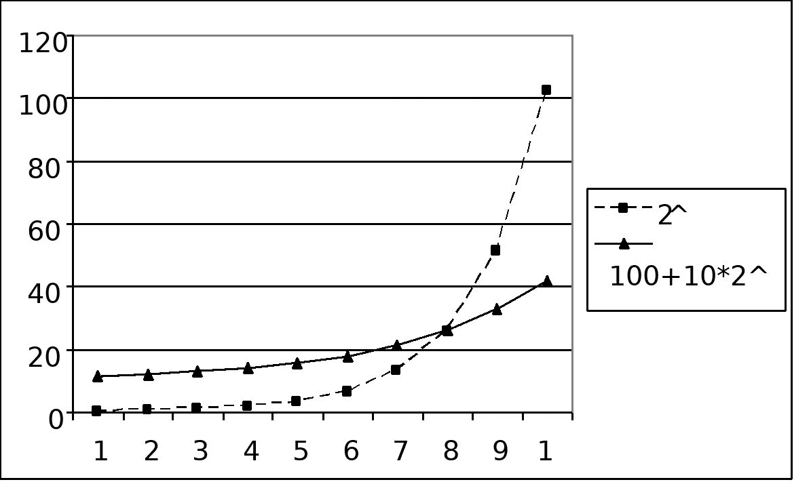

**图 9.** 知识库紧凑度对搜索复杂度影响的比较


The compactness of a knowledge base is a decisive factor in the performance of an AI system, and thus determines the boundaries of its applicability. This situation determines the structure of this book. Chapters are structured by knowledge representation methods, not by solution methods. When solving problems in intellectual domains, one should first select the knowledge representation, then choose a suitable solution algorithm. The fact is: if an unsuccessful knowledge representation is chosen, no algorithmic tricks will help. Conversely, if a particularly successful knowledge representation is invented, even the most common solution algorithms yield quite satisfactory results.

### 1.3 History of Artificial Intelligence

A historical review is often absolutely necessary; otherwise, it is impossible to understand why modern regulations are appropriate. Due to historical and psychological reasons, the definitions and concepts of AI are largely subjective. AI standards differ markedly from the objective laws of physics or chemistry. We divide the history of AI development into several periods (Prehistory, when the term "Artificial Intelligence" had not yet become essential, but some work can be retrospectively attributed to this direction [[17]](#part0005.xhtml#_ftn17);

- **Pioneering Era**, where computers and other technological advances of the 20th century greatly broadened research horizons, and almost every proposed idea amazed with its novelty and opened new perspectives, with ideas emerging like fireworks;
- **Academic Era**, where AI became an independent research field in academia, possessing its own terminology, institutions, research centers, and international community; research primarily served the development direction itself, while practical applications were of interest mainly through the most basic implementations, rather than technical-tactical features;
- **Industrial Era**, continuing to the present, where enhanced technological capabilities have paved the way for the large-scale industrial deployment of AI systems.

Of course, one should not assume these periods strictly follow one another like socialist five-year economic plans. Both the Pioneering and Academic eras had independent industrial designs shaping history, and even in our utilitarian age, scientific breakthroughs still occur (though rarely) and suddenly lead to "paradigm shifts".

#### 1.3.1 Background of Artificial Intelligence

The first reliably recorded attempt by Raymond Lull over 700 years ago aimed to create a machine simulating certain aspects of human thought. Lull believed that a special method or art could be discovered to derive various truths, especially the truths of Christian doctrine, from general concepts with logical necessity. Based on this idea, he built the first logic engine, in the form of several concentric paper circles divided into compartments containing general concepts and categories. By rotating the circles relative to each other, various simple or complex combinations of given concepts could be obtained. Lull believed this would uncover new truths. Naturally, no new truths were discovered, but the idea that "reasoning can be mechanized" was born!

We now know that logical operations can be algebraized and performed arithmetically, but this was far from obvious before the work of G. Boole in the 19th century. Therefore, early designers of intelligent machines focused their attention on constructing calculating machines. Logical thinking seemed more challenging. Several such "calculators" were built in the 17th and 18th centuries, among which the Leibniz Calculator must be mentioned—it was the world's first machine capable of efficiently performing all four arithmetic operations.

G. Leibniz began developing this machine in 1670; two years later he drew a new sketch describing it, based on which a replica was demonstrated at a meeting of the Royal Society in London in February 1673. Leibniz acknowledged the instrument was still imperfect and promised to improve it as soon as he returned to Paris. Although significantly improved over the following years, it was not finalized until 1694. Consequently, Leibniz returned to the invention multiple times, offering new possibilities for improvement.

The pinnacle of the prehistory of computing is the work of Charles Babbage. Babbage started from a mechanical device intended to automate calculation by approximating functions with polynomials and computing finite differences. The possibility of representing logarithmic and trigonometric functions via polynomial approximations made this machine a fairly universal computing device. This Difference Engine needed to compute values of sixth-degree polynomials with 18-digit precision. In the same year 1822, Babbage built a model of the Difference Engine consisting of rollers and gears, rotated manually by a special lever. The following year, the British government granted 1,500 pounds. During development, Babbage did not demonstrate all technical and mechanical difficulties; not only did he fail to meet the promised three-year deadline, but he was forced to stop work nine years later. However, parts of the machine had begun to operate, calculating with precision even exceeding expectations.

In 1834, Babbage invented the **Analytical Engine**. It consisted of a "Store" (memory device) for holding numbers, a "Mill" (arithmetic device) for performing arithmetic operations on numbers, a "Barrel" (controller) for controlling machine operations in a specific sequence, and data input/output devices. The registers of Babbage's machine could store at least 10 decimal numbers of 40 digits, theoretically expandable to 1,000 numbers of 50 digits. The arithmetic unit hardware supported four operations. Addition took 3 seconds; multiplication and division took 2 minutes. The machine accepted two streams of punched cards for input, which Babbage called "Operation Cards" and "Variable Cards": the former controlled the processing of data recorded by the latter. Information was recorded on punched cards via holes. Function libraries could be created from operation diagrams. Thus, all major elements of the architecture of Babbage's first computer were fully anticipated. The **Analytical Engine** was never realized. The main reason for failure was technological. The technology of the time could not manufacture the required complex parts in sufficient quantity and precision. The inventor wrote in 1851: "All developments related to the Analytical Engine have been at my own expense. I have made many experiments and have reached the limit of my skill. In this respect, I feel compelled to decline further work."

#### 1.3.2 Frontier Research

The serious development of Artificial Intelligence as a scientific direction began after the advent of computers in the 1940s. In 1948, Norbert Wiener published "Cybernetics, or Control and Communication in the Animal Kingdom and the Machine," thereby founding the new science—Cybernetics.


##### 1.3.3. 出现与发展

1956 年，达特茅斯学院（美国最古老的大学之一）举办了为期两个月的研讨会，与会者为这一新方向的十位领军研究者：

- 约翰·麦卡锡，达特茅斯学院；
- 马文·明斯基，哈佛大学；
- 克劳德·香农，贝尔实验室；
- 纳撒尼尔·罗切斯特，IBM；
- 阿瑟·塞缪尔，IBM；
- 艾伦·纽厄尔，卡内基梅隆大学；
- 赫伯特·西蒙，卡内基梅隆大学；
- 特伦查德·摩尔，普林斯顿大学；
- 雷·所罗门诺夫，麻省理工学院；
- 奥利弗·塞尔弗里奇，麻省理工学院。

该研讨会被视为人工智能作为独立学科方向的开端，术语 `artificial intelligence` 本身也是在此提出并确立的。达特茅斯研讨会并未产生特定的科学成果。但在那里发生了其他重要事件：人工智能被确认为科学的一个独立分支，展示了首批令人印象深刻的成果（类似于 `Logic Theorist` 程序），并因领军人物的相互认识而形成了科学共同体。

---

尽管维纳的书名未提及思维，但令人厌恶的问题“机器能思考吗？”[[18]](#part0005.xhtml#_ftn18)两年后首次出现在图灵的著名文章中。（特别是在这篇文章中，首次提出了机器拥有 AI 的建设性判据，即所谓的图灵测试。）

关于这一话题，不仅外部观察家、记者和大众众说纷纭，就连亲自投身 AI 领域的科学家们内部也意见不一。当然，一线研究者的总体反应是积极的。微妙之处在于可以提出两个相似的问题：

1. 机器能像人类一样思考吗？
2. 机器能理性地思考吗？

对第一个问题寻求建设性答案，会导向对人类思维的建模，在此认为不仅获得智力问题的答案很重要，分析获得答案的手段也很重要。这一流派称为**神经控制论**。

神经控制论的主要方法是对人脑进行数学建模。早在 1943 年，美国科学家沃伦·麦卡洛克和沃尔特·皮茨就提出了人脑神经元运作的数学模型——**人工神经元**——以及将人工神经元组合成**神经网络**的方法。

随后是罗森布拉特、明斯基及其他研究者的开创性工作。然而，在 70 年代，由于当时计算机量化能力低下，该方向工作一度放缓。事实是，人脑中有 100 亿至 140 亿（$10⁹$）个并行工作的神经元，每个神经元平均约有七千（$10³$）个与其他神经元的连接。早期网络中人工神经元的数量以百计，顶多以千计，但这种数百万倍的量级差异造成了质的鸿沟——无法在小模型上研究大系统。值得注意的是，神经网络中人脑的量化指标尚未达到[[19]](#part0005.xhtml#_ftn19)，但规模正逐渐变得适宜。

回答第二个问题，我们进入了**“黑箱”控制论**的领域，此时仅观察输入与输出、刺激与反应，而“思维主体”的内部结构对观察保持隐藏。与神经控制论不同，**“黑箱”**控制论不关心“思维”装置如何工作。关键在于它对给定的输入动作做出的反应与人脑相同，即理性地反应。

该领域的研究者立即从高度复杂的并行非确定性神经控制论网络转向相对简单的算法模型，这些模型操纵抽象符号而非现实世界的信号。因此我们更倾向于使用术语**符号 AI**（见图 Error! Text of the specified style is missing in the document. .10）。

该方向最著名的开创性工作是 A. 纽厄尔、G. 西蒙和 J. 肖于 1955–1956 年开发的 `Logic Theorist` 程序。该程序在自动定理证明领域工作，能够自动找到罗素和怀特海德奠基之作《数学原理》中给出的 52 个命题演算定理中 38 个的推导。此外，在一种情况下，还找到了比原著更短的证明。

文献中对这一毋庸置疑的成就发表了如此多不同且有时令人惊讶的观点和评价，以至于我们认为有必要以逻辑理论程序为例，给出我们关于自动证明定理的通用程序，进而关于通用心智程序的结论（另见第 0 节）。

1. **自动证明的定理不包含新的数学洞见：** 就 `Logic Theorist` 程序而言，这些是简单的命题演算技术定理。其有效性可通过建立真值表轻松核验。唯一的任务是在给定的公理系统和给定的推理规则中寻找形式推导（公式序列）。寻找推导不需要任何新思想或新方法，而是依赖相当常规的技术。在讨论的推导中，没有推理规则应用少于三步的推导，也没有超过两打应用步数的推导。`Logic Theorist` 程序的结果无实用意义。

2. **作者对学习命题演算的学生的长期观察，** 他们在受教育过程中被迫寻找并找到类似的推导，这使我们能断言：没有受过专门训练的普通“大街上的人”找不到 `Logic Theorist` 程序找到的任何形式证明。一个“大街上的人”根本不懂该做什么，因为显然他们从未做过类似的事。在这门技艺上，未受训练者逊于 `Logic Theorist` 程序。同时，经过三四次教师指导的练习后，勤奋的学生能找到这些推导中的任意一个，以及程序找不到的推导。应注意到，学生找到的推导可能不如罗素和怀特海德的优雅，发现速度可能也不快。尽管如此，可以断言：一个能通过大学入学考试的人，也能学会寻找形式推理，且不亚于 `Logic Theorist` 程序。

3. **从定性角度看，`Logic Theorist` 程序的结果在过去半个多世纪里没有显著改善。** 原因在于，在命题演算中自动搜索推导的问题具有穷举性质（见第 0 节）。现代计算机比肖使用的计算机强大数百万甚至数十亿倍，但现代通用推理搜索程序只能推导出复杂度高出几十倍、顶多几百倍的结论，因此从定性层面看，本列表前两条评论至今仍然有效，不仅适用于 `Logic Theorist` 程序，也适用于任何声称能自动证明足够丰富演算中任意定理的现代程序。


此后，人工智能领域的研究不仅在美国全面展开。首批试图概括收集材料的出版物开始出现。提交此类工作的专家包括 J. McCarthy、M. Minsky、E. Feigenbaum（E. Feigenbaum，美国）、D. Michie（英国）、AA Lyapunov 和 VM Glushkov（苏联）。当然，成果很快显现——提出了许多思想，其中大多数至今仍在使用。

20 世纪 50 年代末，提出了一种图搜索模型。在这种方法中，任务被表示为在图中寻找一条路径，该图的顶点是任务的状态，弧是所有可能的可行变换。问题的解决在于找到从初始状态到目标状态的路径。20 世纪 60 年代初，启发式编程得到广泛应用（见第 3 章）。启发式是一种规则，通常通过经验获得，可减少解空间中的枚举范围。启发式编程是基于已知启发式规则开发寻找解决方案的策略。20 世纪 60 年代末，开发了一阶演算中定理自动证明的通用方法（特别是 J. Robinson 的消解法和 S. Yu. Maslov 的逆向法，见第 4 章），并在 20 世纪 70 年代初，基于这些方法提出了大量用于解决智力问题的编程工具。因此，1973 年创建了 Prolog 语言，它至今仍是逻辑编程的流行工具。目前 AI 中使用的几乎所有思想和概念都是在这一时期提出或确立的。不可能列出所有思想，如果总体发展脉络清晰（见图. Error! The text of the specified style is missing in the document. .10），也没必要列出。

### 1.3.4. 科学深化与工业实施

我们认为，80 年代对 AI 而言最重要的事件是知识工程概念的诞生。这一概念由 E. Feigenbaum 于 1982 年提出。

知识工程是人工智能的一个领域，研究提取、表示、构建和使用知识的方法与手段。

将知识表示方法与解搜索方法分离，在特定学科领域构建越来越有效的专用知识表示方法，使得能够获得足够有效的表示，从而在真实计算机上利用现有方法解决实际意义重大的问题。同时，AI 内部的不同方法和方向找到了共同的方法论基础，开始更紧密地相互咬合，因为不再需要证明“理论的纯粹性”或“方法的独创性”，而是必须以某种方式取得实际结果。

在此期间，出现了远未通过图灵测试的计算机系统，但对以下问题给出了肯定回答：机器能否比人类更廉价地解决某些智力问题？比人类更快？比人类更可靠？

计算能力显著增强，人们清楚地认识到，如果抛开“人工智能”的哲学、伦理和道德问题，在许多具体、狭窄的专业领域，用机器取代人不仅是可能的，而且是有用的。应用人工智能系统开始盈利。对学术研究的投资立即开始增加，这带来了投入工业的新成果，产生的收益又部分投入研究……形成了正反馈，AI 的崛起时期尚未结束！

这一时期的第二个重大事件是在一段平静期后，神经控制论随神经网络和神经计算机概念复兴。重燃的兴趣并非源于上天突然的奇迹般启示，并附带通俗解释人脑究竟如何构造和运作。当然，生理学家、心理学家、语言学家、哲学家和其他研究者并未袖手旁观，而是对人类本性了解了许多新事物，但那不是原因。即使在神经控制论内部，也未取得突破性发现。现代神经网络使用的数学模型非常接近最初的模型，尽管当然更加发达和改进。神经控制论复兴的显而易见的原因在于微电子学的惊人进步。在 Rosenblatt 感知机等开创性工作中，人工与自然神经网络的数量差异以数十亿倍计，根本无从谈起定性比较。现在数量差异以数千倍计，超级神经计算机的设计者拥有了前所未有的新可能性。预计将出现定性变化，而正在进行的量变应导致质变。

作为相对近期过去的第三个显著事件，我们认为是将当之无愧的哲学概念“本体论”引入计算机科学这片新土壤。

本体论是利用概念模式对特定知识领域进行形式化。通常，这种模式包含一个数据结构，含盖所有相关对象类、它们的关系，以及施加于对象和关系上的约束。

本体论在编程过程中被用作关于现实世界或其某部分的知识表示形式，即作为领域模型。虽然最初具有哲学性质，但术语“本体论”[[20]](#part0005.xhtml#_ftn20)在计算机科学中已获得了自己的含义。此处有两个主要区别：

- 计算机科学中的本体论是一种知识表示形式，一种计算机易于处理的形式；
- 信息本体论总是为解决实际问题而以具体目标创建；它们更多地根据适用性而非完备性、完整性和正确性来评判。

作者坚信，领域模型的分析、构建、开发和使用目前是计算机科学中最重要且最有前景的任务，不仅在 AI 领域，在其他信息技术中亦是如此。

例如，信息管理系统领域的业务流程管理系统（BPMS）概念、互联网上的语义网概念，或应用编程中的领域专用语言概念。所有这些极具前景的概念都涉及本体论概念[[21]](#part0005.xhtml#_ftn21)。

.10 反映了我们对 AI 发展历史的愿景，并总结了本节。

.ten.

人工智能发展史

### 1.4. 应用人工智能系统的分类

人工智能应用的领域和范围非常多样——第 0 节仅提供少量案例研究，而非百科全书式的概述。事实上，成千上万的应用 AI 系统用于实际实践，每个系统都有其自身的特征和特性。如此异质的对象和方法集合必须进行分类，甚至需要多重分类，这是必不可少的。

#### 1.4.1. 知识类型

我们将要在计算机中表示的知识非常多样。

根据 SS Lavrov [4] 的观点，知识可分为三种根本不同的类型：

1. 概念性知识。此类包括概念及其相互关系，例如规则、法则、不变关系，以及启发式知识——反映在问题领域解决问题的实践经验的非形式推理规则。


##### 1.4.1. 拉夫罗夫的知识分类

**过程性（算法性）知识。** 这些包括各种技能、技术、程序、算法、其软件实现以及典型的问题求解方法——即那些几乎总是显式用于任何问题的计算求解的知识形式。

**事实性知识。** 这些是某些对象最多样化的定量和定性特征，即数据。例如，数据库中的各种数据、程序中的常量等。

当然，知识类型之间并没有不可逾越的界限（另见第 0 节）。此外，有时知识难以归入特定类型。例如，为了效率，数学函数（`sin`、`cos` 等）的计算算法被表示为特殊多项式中的展开系数集合。这些系数当然是数据，即事实性知识，但被用作算法性知识。尽管如此，当涉及应用人工智能系统时，这种知识分类非常有用且有效，因为你可以专注于对 AI 重要的概念性知识表示问题，将算法性和事实性知识的表示方法作为现成的基础。

**拉夫罗夫·斯维亚托斯拉夫·谢尔盖耶维奇**（1923–2004），俄罗斯科学家，俄罗斯科学院通讯院士。力学、自动控制、计算机数学和编程领域著作的作者。1957 年列宁奖获得者。拉夫罗夫的科学生涯在一定意义上是独特的。他在很年轻时就成为了苏联导弹和空间弹道学的奠基人，以及可控飞行动力学和自动驾驶领域无可争议的权威。数字计算技术的出现导致 S.S. 拉夫罗夫的活动方向发生急剧转变，并在几年内使他成为苏联的编程经典。

本书采用拉夫罗夫的知识分类作为基础。

#### 1.4.2. 根据不同类型知识使用程度的分类

根据使用何种类型的知识以及如何使用，人工智能系统可以用不同方式进行分类。

1.  **数据库（DB）。** 如果软件系统仅使用事实性知识，则此类软件系统称为数据库（DB），在现代条件下通常不被视为人工智能。[²²]
2.  **应用软件包。** 如果软件系统主要使用算法性知识，则此类软件系统通常称为应用软件包。将此类软件包归属为 AI 系统通常会明确声明。如果应用包仅作为过程库使用，则不将其归类为人工智能系统。例如，如果它使用 AI 方法，如果解决特定问题的程序不是由用户创建，而是由自动规划器创建，则此类应用程序包可被视为人工智能系统。
3.  **人工智能系统。** 如果软件系统以某种形式使用了概念性知识，则称该系统为人工智能系统。

请注意，先进的应用软件包通常包含或主动使用外部数据库，而 AI 应用系统几乎总是同时使用软件包和数据库（图 11）。例如，一个成熟的国际象棋程序拥有巨大的开局和残局数据库、一个用于对局中处理局面和走法的专用软件包，以及一组与概念性知识相关的战略选招规则。

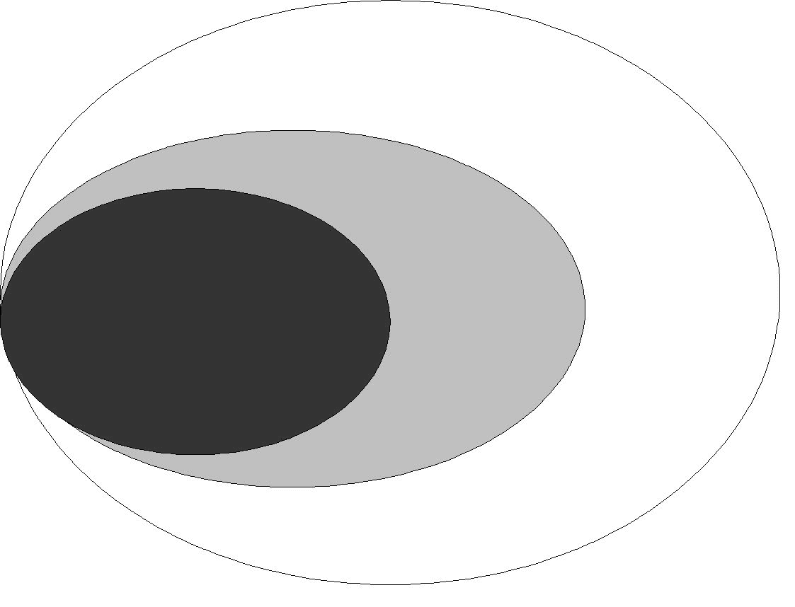

**图 11.** 根据所用知识类型对带有人工智能要素的应用系统进行分类。

本书的主题正是应用人工智能系统。同时，我们认为读者已充分熟悉软件包和数据库的概念，因此所有注意力都集中在概念性知识的表示上。

#### 1.4.3. 根据知识表示形式的分类

当认识到并感到有必要共享关于所有三种类型的知识时，必须选择一种在计算机中表示它们的方式。人用于表示知识的强大机制：自然语言、数学、视觉形象，适合表示所有类型的知识，但不适合在计算机中实现。更准确地说，恰恰相反，现代计算机不适应使用这些机制——计算机太原始、不够智能。

因此，需要发明这样的知识表示类型，一方面能够表示各种知识，另一方面在现代计算机中可行。

在计算机中表示事实性和算法性知识的机制已被充分理解和确立。对于事实性知识，这些是数据库管理系统（DBMS），在现代条件下主要是关系型的。对于算法性知识，这些是过程库，在现代条件下主要是面向对象的，即类型和类的库。

因此，根据知识表示形式的分类首先考虑概念性知识的表示。

提出了许多不同的概念性知识表示机制。目前，最常用的是以下三种（图 12）。

*   **规则或产生式（产生式系统）。** 基于规则的人工智能系统目前应用最广泛。从数学角度来看，此类系统使用近似于正规马尔可夫算法的可计算性模型。产生式系统在本书第 2 章和第 3 章中有详细介绍。
*   **逻辑演算公式。** 基于逻辑公式的人工智能系统目前是第二常见的。从数学角度来看，此类系统使用接近一阶谓词演算的演算，在某些情况下接近丘奇的 `λ`-演算。逻辑演算公式的知识表示在第 4 章中讨论。
*   **框架和语义网络。** 目前此机制使用相对较少，尽管在最近的过去并非如此。从数学角度来看，此类系统使用图论工具。

这三种常见机制在表达能力和其他一般数学特性方面是可比的。

对某种知识表示机制的偏好通常基于熟悉度、编程便利性、应用系统开发者对理论的熟悉程度等考量。特别重要的是，关于特定任务的知识表示有多紧凑（见段落）。

#### 1.4.4. 根据解决问题时响应类型的分类

在解决具体问题时，应用 AI 系统以某种形式在输入端接收知识，并在输出端给出回答，该回答也具有特定形式并代表（新的）知识。根据引入的知识类型分类，人工智能系统可按给出回答的层次进行分类。

0.  **逻辑回答**（是或否）；不太方便使用，现在很少用。
1.  **事实性回答**（事实答案）；如果具体回答问题，此类系统常被称为信息系统。目前最常见的一类系统。

[²²]: 保留自原文的参考脚注标记。


##### 2. 过程式响应
在解决问题时，系统可以创建并执行一个过程（程序综合系统、自动编程）。这是一个非常有趣且极具前景的方向，正吸引着大量研究人员的关注。

##### 3. 概念式响应
答案是一种规律，而非构建出的具体解，而是一类问题的求解方案，甚至可能无法在计算机上实现。目前尚不存在完整的实现。

让我们以第 0 段中的数字排序范式为例，给出不同层级的答案示例（请记住，问题如下：我们希望计算机将一组三个数字按升序排列）。

**(0)** `2 5 7` → `yes`  
`5 2 7` → `no`

**(1)** `5 2 7` → `2 5 7`

**(2)** `{ x, y, z }?{ x < y < z }` → `Sort3`

###### (3) `sort { x i }` → `∀ i, j ( i < j → x i < xj )`

在第 0 层级，我们呈现一个序列，系统仅检查其是否已排序。在第 1 层级，我们呈现一个序列，系统会顺从地对其进行排序。在第 2 层级，系统创建一个类似于第 0 段所示的排序过程。最后，在第 3 层级，假设的系统会告诉我们对数字数组进行排序意味着什么 [[23]](#part0005.xhtml#_ftn23)。

#### 1.4.5. 按普适性程度分类

首先，每一个与特定主题领域相关的知识表示新思想诞生。事实是，在 AI 领域，通常会在发布新思想时至少附带一个具体的实际示例，以展示该创新的优势。如果思想优秀，它会在相关领域找到新的应用，并发展成为面向问题的方法。未来，人们会倾向于使知识表示系统尽可能通用，以解决各种各样的问题。然而，这个愿望在实践中毫无用处，因为随着通用性的增加，此类知识表示的适用性会急剧下降。

让我们更详细地解释一下我们使用的术语 [[24]](#part0005.xhtml#_ftn24)。

**普适性**（给定主题中某知识表示系统的）是指该主题中可表示任务的比例。

因此，我们称在特定主题中允许我们表述所有任务的知识表示方式为**通用**的。

**适用性**（给定领域中某知识表示系统的）是指该领域中可表示问题中能够被求解的比例。

因此，我们称在特定主题中允许我们在考虑实际定量约束的情况下求解所有问题的知识表示方式为**普遍适用**或**完全**的。显然，对于足够广泛的主题领域，既通用又完全的知识表示系统几乎是不可能存在的。此外，观察表明普适性与适用性之间存在反比关系。

用离散状态表示世界并寻找从初始状态到目标状态的变换序列这一概念，具有令人惊讶的广泛适用性。图搜索算法在所有情况下都适用。然而，这种通用性是以极低的搜索效率为代价的。

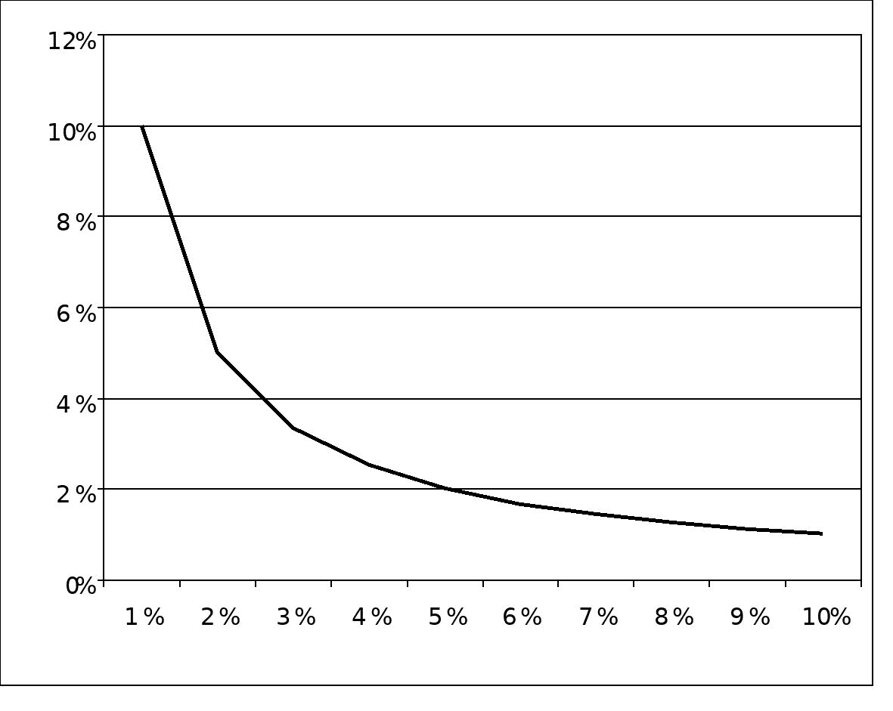

*注：原文包含标题“Rice. Mistake! The text of the specified style in the document absence. .13. Relationship between universality and applicability”，这似乎是一个伪影。该图片作为图 13 引用。*

请注意，在实践中，无论是在数据库、应用包还是应用人工智能系统中，通常都不会设定实现通用性的目标。通常的目标是提高适用性，即使以降低通用性为代价。原因非常简单。首先，操纵知识的可能性取决于主题，只有考虑到主题的特性，才能指望建立一个紧凑的知识表示，从而有效地解决问题并提高适用性。其次，通用系统中的元知识（管理策略）较弱；即关于应用某些规则的顺序、解决问题时什么重要什么可以忽略的知识。

#### 1.4.6. 按架构和工具分类

在分析带有人工智能元素的应用系统架构时，逻辑上可以将以下部分单独列出：

*   **系统操纵的对象**（其他给定词汇）；
*   **动作**，由这些操纵产生（可以对这些数据做什么）；
*   **控制策略**，决定何时执行何种操纵（按什么顺序、对什么对象、应用什么动作）。

这种人工智能系统架构的概念并非教条——它源于对典型现代人工智能系统的分析。高度专业化的系统有时具有不同的架构。这意味着是逻辑分析，而非机器码级别的分析，在机器码级别上架构结构已无法区分。

现在我们谈论这三个组件（特别是如果它们在软件实现中清晰分离）：**数据**（对象属性）、**算法**（面向对象编程意义上的对象方法）和**元知识**。

AI 领域的早期工作就已显示出开发应用系统需要专用工具。这是由人工智能系统软件实现的许多特性决定的，其中一些我们将在第三章讨论。无论如何，开发应用人工智能系统使用过并正在使用各种编程语言和工具，这些工具无法脱离给定系统而存在。AI 系统开发中使用的工具是一个分类特征。

##### 第一章 结论

1.  **人工智能**是一门具有明确主题的科学——利用计算机科学和数学的各种方法，对被理解为理性行为的思维进行建模。
2.  人工智能的发展历史表明，重新定向的时期已经结束，实践应用的时代现已来临。
3.  对人工智能成果的分析表明，对于实际应用最重要的方法是知识表示方法。

## 第二章 通过产生式系统进行知识表示

**产生式系统知识表示**（Production Rules Knowledge Representation）是智能系统中最常用的知识表示机制之一。这种机制在概念上简单，其思想自然易懂且易于在软件中实现。

事实上，人工智能应用与其他软件之间没有明确的界限。产生式系统只是计算机组织信息处理过程的另一种方式。这种方法从根本上区别于常规的过程式和面向对象编程，但并不缺乏特性。

### 2.1. 产生式系统

针对**产生式系统**（或**产生式系统**或**基于规则的系统**），从不同角度提出了几种定义 [[25]](#part0005.xhtml#_ftn25)。归根结底，不同的定义指向同一个对象，尽管它们出发角度不同，在某些细节上也有差异。我们考虑三种定义：

*   **结构上的产生式系统**；
*   **算法视角的产生式系统**；
*   **作为逻辑演算的产生式系统**。


#### 2.1.1. 术语约定与有意义的解释

本段标题包含“合理/有意义”（sensible）一词，表明作者在呈现材料时，有意从“严格性”和“算法”视角暂时退回，但这种离题是暂时的——仅限于本段范围内。这种离题源于作者希望强调讨论领域中存在的术语、思想和论证方面的“混乱”，而这反过来几乎是研究方向“年轻”及其发展强度的必然标志。

从实质上讲（从常识和自然语言角度），术语“产生式”最常与“如果前提，那么结论”这种条件类型的复合句相关联。暂且不深入细节，让我们精确定义这些术语：前提和结论。同样，不作进一步解释，为求简便，我们将产生式写成符号形式：

`p → q` (\*)

其中 `p` 和 `q` 分别代表前提和结论。我们请读者注意，在符号表示法中，与语言示例相反，产生式的第三个极其重要的要素——连接束，用箭头清晰地标记了出来。产生式的三个要素中的每一个都可以也应该承担某种语义负荷（解释、语义、含义等——不同文献来源使用不同版本），以便可以比较所有产生式的含义，并据此在解决具体问题时使用（产生式）。根据个别情况下所选解释的组合，适用的数学基础以及处理产生式的算法和策略可能会发生显著变化。同时，细心谨慎的读者应注意到，无论采用何种解释，每个产生式都在特定主题领域内定义了一种特定的行为或变换规则。

尽管本段宣称“关注意义”，我们不会分析所有可能的语义负荷组合，而将局限于由书名和目的确定的主题领域。

就其本质而言，产生式可分为两个不重叠的类别：同质和非同质。这种划分取决于指定产生式前提和结论解释的方式。在第一种情况下，`p` 和 `q` 被赋予“相似”的含义（通用字母表中的词、数值、逻辑表达式等）。第二类包括前提和结论被不同解释的产生式（条件-动作、环境状态-转移、刺激-反应、其他组合）。

请记住另一个重要点：构成本书内容的所有机制和技术，旨在描述和分析特定主题的变化。我们通常将主题中的固定情况称为当前**条件**（环境或环境）。除非另有明确说明，我们将始终用字母 `D` 表示所有可能状态的集合，用带索引的字母 `d` 表示该集合中的单个状态，并假设该状态由某事物（关于某事物或）的一组确定值（陈述）来描述。存储（组织）当前状态 `d` 的方法并不关键（列表、数组、表集合）。我们还用字母 `D` 表示存储当前状态的机制（根据上下文总是很容易区分它是状态集合还是程序中表示集合的机制），并称之为“事实库”（较少称为“数据库”，有时称为“搜索空间”）。

数据库 `D` 的所有可能状态的集合称为搜索空间。

考虑到被分析领域发展（情况变化）的动态性，我们也可以谈论从一种状态到另一种状态的转移，同时假设存在初始状态（必然存在！）和最终状态（不总是存在）。从初始状态通向最终状态的转移序列称为搜索空间中的推理，而从一种状态到紧随其后的下一种状态的过程称为推理步骤。

在表 1 中，我们列举了同质和异质产生式系统的典型示例，指明了主题领域、作为理论基础的形式理论，解读了公式 (\*)，以及目标和（如有）出现的问题。在某些地方，我们链接了我们认为值得参考的来源（包括本书的段落）。

**表 2. 产生式系统示例**

| 主题领域与链接 | 数学基础与目标 | 产生式类型与格式 |
| --- | --- | --- |
| 分析 [5] | 正规马尔可夫算法，自动识别 | 同质，链 → 链 |
| 计算机代数 | 项替换系统，表达式化简 | 同质，概念 → 概念 |
| 计算机模型 | 直觉主义命题演算，程序 | 同质，参数 → 结果 |
| 系统推理 [6] | 一阶谓词演算，定理证明 | 同质，谓词 → 谓词 |
| 专家系统（第 1.1.3 节） | 无基础，诊断 | 异质，症状 → 诊断 |
| 控制系统 | 无基础，稳态或其他控制目标 | 异质，条件 + 刺激 → |

我们看到，对于非同质系统，不存在公认的数学基础。充其量，戴克斯特拉的受限命令 [7]（尚未成为严格的形式理论）可以作为二类系统的论据。

#### 2.1.2. 异质产生式系统的结构

产生式系统的出现。正如已经提到的，（或几乎所有）带有 AI 元素的应用系统在一定程度上都反映（建模）了人类思维的某些方面。产生式系统也不例外。最初，该方法用于构建所谓的专家系统（见第 1.1.3 节），它们模仿特定专业领域专家在解决各种情况时的行为，无论是为患者做诊断、根据地质勘探数据得出矿床开发可行性的结论，还是其他情况。解决此类问题的人倾向于构建三段论链 [[26]](#part0005.xhtml#_ftn26)。这种日常生活中的思维方式常被称为演绎推理。文学史上最伟大的侦探之一——解决犯罪领域的专家——夏洛克·福尔摩斯就出色地掌握并成功运用了这种思维方式。

“日常”这一限定词并非偶然——我们想强调从个体获得的专家意见中包含的主观性因素。这种主观性源于许多因素：

- 病历 [[27]](#part0005.xhtml#_ftn27) 的完整性和详细程度（使用医学术语）——吸烟者的咳嗽可能引起肿瘤科医生的怀疑，而不吸烟的运动员极有可能只是患了普通的急性呼吸道疾病；
- 专家的经验——有人知道海鸥沿海岸安详漫步预示着暴风雨，也有人甚至不知道海鸥在海中游泳保证了风平浪静；
- 按最合适的顺序应用知识的能力（使用最佳推理策略！），等等。


结论往往是非绝对的（模糊的）——"病人活着的可能性大于死亡"（一个医学轶事，或者可能不是个玩笑）。两位不同的专家经常从相同的前提出发得出不同的（有时甚至是相互矛盾的）结论——参见关于保加利亚男子及其女友的"正交解释"示例（第 1.1.1 节）。

所有这些特征在一定程度上都内在于使用生产机制实现的现代计算机专家系统中。

形式上，异构生产系统是几个独立数学学科装置的折衷联合：一阶逻辑、概率论、图论、可能还有测度论，以及其他……大多数生产系统的公理化（反映特定专业的部分——参见上面关于保加利亚人和海鸥的示例）可能是自相矛盾的，得出的结论可能不可靠，且得出结论的成本可能高得离谱。尽管如此（这有时令人钦佩！），现代专家系统不仅能让医生、地质学家、化学家及其他学科专家的生活更轻松，还能"给出"完全出人意料且极具成效的解决方案。

还应注意到，目前正在进行密集研究，以改进生产系统中知识表示和处理的机制。特别是，提出将所谓的模态逻辑作为逻辑装置（以及与之相关的概率论），它显式地包含可能性、确定性和知识人称化量词，以及对结论非单调性属性和可能世界语义的识别（参见图 [9, 10]）。

生产系统（SP）由四元组确定：事实库、生产集、控制系统、专家意见准备完成的终止条件。

在本书中，数据库系统地用字母 `D` 表示，生产集用 `R`，控制策略（系统）用 `C`，终止条件用 `t`。一旦建立了符号表示，上述定义可以用标准数学形式重写：

`SP = < D , R , C , t >` （**）

终止条件可以不指定，因此下面我们对四元组的最后一个元素给出一些解释性说明。

因此我们看到，基于生产形式化的、带有人工智能元素的应用系统，具有上一章提到的清晰的三部分划分（参见第 1.3.4 节）：

- 事实知识（事实库，通常以数据库形式实现）；
- 算法知识（规则）；
- 概念知识（管理策略）。

这就是生产系统通常能很好地反映 AI 应用的原因。让我们更仔细地看看生产系统的元素。

许多产品 `R`。该集合的元素通常称为生产规则或简称为生成式。

异构生成式（Production）是一个"条件-动作"对，它确立了完成专家意见准备步骤所需的部分知识。生成式规则可以写为：

```
r = def if p ( d ) then d := f ( d ) end if, (***)
```

其中 `p` 是条件，`f` 是动作。

则规则如下所示：

`R = { r | r = ( p , f [, w ] ) }`。

规则的条件部分 `p` 根据环境状态（事实库）决定何时可以应用此规则。`p` 的实现通常由在给定时间点可靠确立的事实集合上的谓词的真假决定。生成式部分 `f` 定义映射 `f : D → D` 并定义对环境的影响 [[28]](#part0005.xhtml#_ftn28)。有时会使用一个实数 `w` 来表征规则应用的价格（或权重，`-weight`）。在这种情况下，可以设定的任务不仅是找到通向目标的生成式应用顺序，而且是找到总价格最小的顺序。

事实库 `D` 包含思维过程中"世界"当前状态的描述。此描述是一个模板，将与生成式的条件部分进行比较，以选择解决问题的适当动作。如果数据库的当前内容满足某规则的条件，则可以采取该规则中指定的动作。在这种情况下，称该规则**适用**。但规则适用并不意味着必须应用它。是否实际应用适用规则由规则策略决定。

如果规则适用且控制策略选择了它，则应用该规则。应用规则后，数据库改变其状态。

管理策略 `C`。生产系统的控制结构很简单：事实库用初始任务描述初始化。问题求解的当前状态也反映在事实库中。将事实库的当前内容与生成式规则的条件进行匹配，生成适用规则的子集，有时称为冲突集 [[29]](#part0005.xhtml#_ftn29)。接下来，从冲突集 `R` 中选择一个生成式 `r`（执行冲突消解），并执行该规则的动作 `f`。应用规则的结果不仅改变事实库的状态，还可能改变冲突集。事实是，数据库状态改变后，某些规则的条件可能不再满足，这些规则必须从冲突集中排除。另一方面，先前不适用规则的条件可能变为真并必须被纳入。同时，冲突消解策略（控制策略）可以非常简单，例如选择第一个适用规则，也可以非常复杂，例如使用复杂启发式。根据规则策略，应用规则，例如直到达到终止条件或不再有适用规则。

终止条件 `t`。通常有一个求解过程的终止条件 `t : D → bool`，即一个其参数为数据库事实的谓词。如果满足条件 `t(d)`，则假定无需再应用生成式，数据库的当前状态 `d` 即为答案。有时终止条件不是作为公式给出，而是直接作为满足终止条件的数据库状态集合给出。在这种情况下，该集合通常用 `T` 表示：

`T = { d ∈ D | t(d) }`。

也可能未指定终止条件，因为系统必须持续运行。例如，技术对象和连续过程的自动控制系统。在这里，有必要兑现上面关于公式（**）中四元组最后一个元素的承诺解释。最后一个元素，备受讨论的终止条件 `t`，不能从数据集中移除（由于现有的数学"约束"），所以我们约定对于本段讨论的生产系统，常量 `Action` 成立，让我们假设 `t` 等于 `false`。

在讨论了生产系统的组成部分后，我们转向生产系统作为一个整体的结构。以生产系统形式组织应用 AI 系统有一个非常重要的优势——知识的模块化或算法性质。生产系统与层次组织的程序的区别如下。

1. 规则之间在控制方面没有直接关系。换句话说，规则不会相互调用。所有对规则的控制都放在控制策略 `C` 中。


##### 2.1.3. 异构产品系统的算法

根据数据，规则之间没有直接联系。规则本身不包含任何信息；所有数据都在数据库 `D` 中。

由此得出一个重要结论：规则是功能性强且信息丰富的模块。

在包含人工智能元素的应用系统中，模块化至关重要，因为在这类程序中，行动算法通常无法预先确定。因此，你需要可修改性来尝试解决问题的不同方法。这正是生产系统所能实现的，因为我们可以在集合 `R` 中添加和删除规则，而完全不影响其他规则！此外，在极限情况下，可以在解决问题的过程中动态修改集合 `R`。

Glenford Myers 建议在软件开发中仅使用强度最高的两类模块。

**功能强模块**是指仅执行（实现）特定功能的模块。此类模块在实现该功能时可以使用其他模块。

**信息持久模块**是指在同一数据结构（信息对象）上执行（实现）多种操作的模块，该数据结构在该模块外部被视为未知。例如，信息安全模块可以实现面向对象编程中的抽象数据类型或类。

模块的**内聚性**是衡量其对其他模块的数据依赖程度的指标。

**模块耦合**由数据传输的类型来表征。模块与其他模块的耦合越弱，其相对于其他模块的独立性就越强。为了评估链接程度，Myers 提出了一组有序的不同类型的模块链接。最差的模块链接类型是**内容链接**。这是指两个模块的连接，其中一个模块直接引用另一个模块的内容（例如引用另一个模块中包含的常量）。不推荐使用这种类型的模块耦合。**共享区链接**是指多个模块共享同一内存区域的模块连接 [[30]](#part0005.xhtml#_ftn30)。现代编程技术推荐使用的最佳模块链接类型是**参数链接**——即将数据作为参数值传递给一个模块，或作为调用另一个模块以计算任意函数的结果而传递。这种类型的模块链接通过在编程语言中调用过程和函数来实现。

###### 异构产品系统的算法

设想一种 AI 应用，它返回最简单的结果，即仅返回是/否答案（第 0 级，见 1.3.5 节），对应终止条件 `t(d)` 是否满足。同时，我们认为规则的应用顺序对我们不感兴趣。肯定答案“是”在下面的程序中称为 `OK`，否定答案“否”称为 `not passed`。在这种情况下，生产系统的运行由算法 **Error! The text of the specified style does not exist in the document. .one. 生产系统解释器** 停止。

```
proc production(d, R, t)
during ¬ t(d) do
    r := selection(d, R)
    when r = zero then Return(Fail) end if
    d := rf(d)
end while
return(OK)
end proc
```

该算法以初始数据库状态 `d`、生成式集合 `R` 和终止条件 `t` 作为输入。此外，直到满足终止条件，都会使用 `Select` 函数选择适用规则，并借助它更改数据库状态，直到满足终止条件。如果未找到适用规则，则中止过程并返回否定响应。

`Select` 函数是该系统的核心；它决定应用规则的选择，即生产系统 `C` 的策略。通常在人工智能系统中，没有足够的信息在每一步都应用最佳规则。因此，选择规则的过程是一个搜索过程。

例如，最粗糙的搜索策略是在 **Error! The text of the specified style does not exist in the document. .2. 更复杂的策略示例见下文** 中介绍的“首次适配”。

####### 首次适配规则选择策略

```
proc Select(d, R)
    for r ∈ R do
        if rp(d) then return(r) end if
    end for
    return(null)
end proc
```

这是一个糟糕策略的典型例子。除非我们将自己的部分智能注入其中，否则很难指望机器表现出智能。

让我们从算法角度更仔细地审视生产系统。事实上，算法 **Error! The text of the specified style does not exist in the document. .1** 我们定义并记录了一种解释以一系列生成式形式呈现的知识的方法。算法 **Error! The text of the specified style does not exist in the document. .1** 纯粹是机械性质的；它没有任何“智能”的迹象，无论是人工的还是自然的。它只是在输入数据 `d` 上执行一组规则 `R`，而不对数据库状态的变化历史进行任何分析，也不评估我们是正在向解决方案靠近还是远离。普通计算机的行为方式相同：它们盲目地运行嵌入的程序，并不尝试理解自己正在做的事情是否有任何意义。换句话说：算法 **Error! The text of the specified style does not exist in the document. .1** 是一个模拟虚拟机，而 `R` 规则集是该机器的程序。`Select` 函数占有特殊地位。智能就蕴藏在这个函数中，即用 1.3.2 节的术语来说是概念知识。该函数旨在将计算过程（基本变换）引导至解决方案，而集中在规则集 `R` 中的算法知识则独立存在，不负责任何控制职责。

##### 2.1.4. 生产系统作为逻辑演算

人工智能中的“生产”一词本身源于逻辑，且并非最直接的方式。生成式规则或推理规则是一种逻辑规则，它表明如果我们拥有特定类型的前提，则会得出特定类型的结论。例如，**肯定前件式** 规则规定，如果两个前提为真：陈述 `A` 以及表明 `B` 由 `A` 推出的蕴涵，则结论为真。

```
A, A → B
──────
B
```

从数理逻辑的角度来看，生产系统因此可以被视为一种形式理论（形式理论的概念在 4.1.1 节中有详细描述）。在该形式理论中：

- 初始事实库是形式理论 `A(c₁, ..., cₖ)` 形式的一组公理（面向问题的 [[31]](#part0005.xhtml#_ftn31)）的一部分，其中 `A` 是谓词符号（通常与研究对象的对象属性相关联）——且所有 `cᵢ` 均为常量项；
- 生成式是若干面向问题公理的补充，以 `d ∧ p(d) → M(f(d))` 的隐式形式存在；此外，事实集 `d` 上的谓词 `p` 是生成式的一种“触发器”，而符号 `M(f(d))` 合理地意味着：在由函数 `f: D → D` 定义的事实基础 `D`（基础修改）上启动动作的执行，这些动作的成功执行将谓词 `M()` 设为真；
- 唯一的推理规则是前面提到的 **肯定前件式** 规则。


##### 2.1.5. 八数码游戏

人工智能系统的有效性主要取决于为所有组件 `D`、`R`、`C` 选择知识表示的优劣。这里我们通过一些简单谜题的例子，重点探讨好的和坏的知识表示选择。

考虑八数码游戏（示例取自书籍 [13]），它类似于广为人知的十五数码游戏，许多人都熟悉。游戏的实质是移动编号为 1 到 8 的棋子，使它们按顺时针方向按升序排列。在这种情况下，3 × 3 方格中的一个格子始终是空的，任何相邻的棋子都可以移动到该空格中。棋子不能“跳跃”过其他棋子——它们只能移动到相邻的空格中。

假设我们有图 14 所示的以下初始位置（左）和目标位置（右）。

| | 2 | | eight | 3 |
|---|---|---|---|---|
| one | | 6 | | four |
| 7 | | | 5 |

| one | 2 | 3 |
|---|---|---|
| eight | | four |
| 7 | 6 | 5 |

**图十四. 八数码游戏的初始和目标位置**

想象一下基于产生式系统的八数码游戏知识。

从物理意义上讲，数据库的表示显而易见。我们称空单元格为 0 号棋子。结果，`D` 如下所示：

```
D : Array [1..3,1..3] from 0..8
```

`R` 规则也按预期编写。例如，“将棋子 1 向下移动”规则为：

```
if D[i,j]=1 & i<3 & D[i+1,j]=0 then D[i+1,j]:=1;
D[i,j]:=0
```

由于八个棋子中的每一个最多可以向四个方向移动，因此总共有 32 条规则。这是一种自然但并非最佳的游戏知识表示。

让我们尝试改进原始版本。基本思想是每一次棋子的移动都可以看作是空单元格的移动。这就是我们利用一点智慧的地方。

在数据库中添加几个数字 `{i,j}`——空单元格的坐标。让我们根据基本方位点——北、西、南、东来确定移动方向。

```
if i > 1 then D[i,j] := D[i-1,j]; i := i-1 ( ↑ N 向北)
if j < 3 then D[i, j] := D[i, j + 1]; j := j + 1 ( → E 向东)
if i < 3 then D[i,j] := D[i+1,j]; i := i + 1 ( ↓ S 向南)
if j > 1 then D[i,j] := D[i,j-1]; j := j-1 ( ← W 向西)
```


因此，为“8 数码”游戏创建了一种知识表示，其中只有 4 条规则，而不是 32 条。这是一个根本性的结果，因为规则数量 `n`（4 或 32）是寻找解决方案的指数搜索函数的参数。对于 `n = 4`，普通计算机的算力很可能足以快速执行穷举搜索并找到解决方案，但对于 `n = 32`，则可能不够。

###### 2.1.6. 农夫、狼、羊和白菜

第二个例子是一个已知问题：一位农夫需要将一只狼、一只羊和一颗白菜运到河对岸，使它们互不相食（图 2.15）。

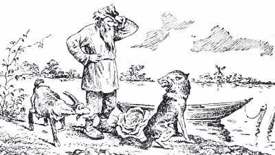

**图 2.15.** 农夫、狼、羊和白菜：问题描述

当然，这个任务可以简化。思路是农夫和船是不可区分的，构成一个整体。你也可以认为任何从岸到岸的移动都是瞬时的。让我们重新给物体编号：0 - 农夫，1 - 狼，2 - 羊，3 - 白菜。物体在右岸（目标岸）的存在用 "1" 表示，在左岸（起始岸）用 "0" 表示。在这种情况下，显然数据库 `D` 应该具有以下形式：

`D : array [0..3] of 0..1`

同时，`D[0]` 是农夫的位置，`D[1]` 是狼，`D[2]` 是羊，`D[3]` 是白菜。我们以四位二制数的形式写出数组 `D`。例如，`0101` 意味着农夫和羊在左岸，狼和白菜在右岸。那么数据库的初始状态是 `d0 = 0000`，目标状态是 `dk = 1111`。

规则应该是什么样子？直接着手解决这个问题，我们可以按如下方式推理。总共有 16 种可能的基状态 [[34]](#part0005.xhtml#_ftn34)。考虑基状态对，使得可以一步从第一个状态转移到第二个状态。例如 `1011 → 0011` - 棋子（注：原文 pawn 此处指农夫/船）从右岸游到了左岸。很容易看出，有 `16*4=64` 个这样的状态对。注意，一些基状态是合法的，例如 `0101`，而其他状态是非法的，例如 `0011` - 羊吃白菜。很容易验证有 10 个合法状态和 6 个非法状态。让我们丢弃那些目标状态非法的状态对。剩下的状态对，共有 40 个，就是我们系统的规则。

很容易看出，这是纯粹机械的、形式化的工作，可以交给计算机。然而，结果不会很好（四十条规则）。这样的知识表示不能称为成功。

让我们尝试发挥创造性。在这种情况下，创造性在于引入原始问题陈述中不包含的通用知识。

1.  如果初始状态是合法的，且所有规则都保持合法性，那么每一个可达状态都是合法的（完全归纳原理）。
2.  为了解决这个问题，只需考虑基的合法状态即可（非法状态甚至不能包含在解决方案的中间阶段中）。

注意初始状态是合法的（最终状态也是）。剩下的就是挑选出能保持合法性的规则。为此，我们注意到问题中本质上只有四种可能的移动：农夫独自移动、农夫带狼移动、农夫带羊移动、农夫带白菜移动。现在只需写出这些移动合法性的简单条件，并获得规则集 `R`：

| 条件 | 动作 |
| --- | --- |
| `if D[1]<>D[2] & D[2]<>D[3]` | `then D[0]:= 1 - D[0]` |
| `if D[2]<>D[3] & D[0]=D[1]` | `then D[0]:= 1 - D[0]; D[1]:= 1 - D[1]` |
| `if D[0]=D[2]` | `then D[0]:= 1 - D[0]; D[2]:= 1 - D[2]` |
| `if D[1]<>D[2] & D[0]=D[3]` | `then D[0]:= 1 - D[0]; D[3]:= 1 - D[3]` |

因此，在这种情况下，对问题的创造性处理使知识表示效率提高了十倍。

###### 2.1.7. 马的走法

在国际象棋中，马可以按“日”字走法移动——水平或垂直走两格，然后垂直于该方向走一格。同时，它不应超出棋盘边界。因此，在最一般的情况下，从给定位置最多有八种可能的马的走法（图 2.16）。当马在棋盘边缘时，可能的走法较少。

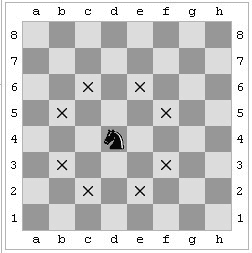

**图 2.16.** 可能的马的走法

该问题的传统表述是：找到这样一个马的走法序列，从任意格子开始，使得马仅进入棋盘上的每个格子一次。

那么数据库 `D` 如下所示：

`D : Array [1..8,1..8] of 1..0`，其中 `D[i,j] = 1` 表示马曾到达过格子 `(i,j)`，`0` 表示未到达。[[35]](#part0005.xhtml#_ftn35)

那么数据库的初始状态 `D0` - 数组 `D` 的所有元素均为零，目标状态 `Dk` - 数组 `D` 的所有元素均为一。

让我们计算一下国际象棋中（在空棋盘上）有多少种不同的马的走法。棋盘中央 16 个格子每个有 8 种走法。相邻层的格子每个有 6 种走法，除了 b2、b7、g2、g7 这四个格子，只有 4 种走法。

此外，棋盘边缘格子每个有 4 种走法，角落格子除外（角落格子只有 2 种走法），以及 a2、b1、a7、b8、g8、h7、h2、g1 这些格子，马可以跳到 3 个其他格子。总共我们有：`16*8 + 16*6 + 4*4 + 16*4 + 8*3 + 4*2 = 336` 种马的走法。

显然，给所有可能的走法编号并将规则与它们进行比较是没有意义的：数量太多了。让我们用一系列八个产生式来替代真实的走法，这些产生式根据图 2.16 产生合法的马的走法。同时，我们可以直接在规则中引入问题的条件检查，即马只能进入给定格子一次。跳棋子（马）的当前坐标存储在变量 `i` 和 `j` 中。

```
if i <= 6 & j <= 7 & D[i+2,j+1] = 0 then D[i+2,j+1] = 1 & i = i+2 & j = j+1
if i <= 7 & j <= 6 & D[i+1,j+2] = 0 then D[i+1,j+2] = 1 & i = i+1 & j = j+2
if i >= 1 & j <= 6 & D[i-1,j+2] = 0 then D[i-1,j+2] = 1 & i = i-1 & j = j+2
if i >= 2 & j <= 7 & D[i-2,j+1] = 0 then D[i-2,j+1] = 1 & i = i-2 & j = j+1
if i >= 2 & j >= 1 & D[i-2,j-1] = 0 then D[i-2,j-1] = 1 & i = i-2 & j = j-1
if i >= 1 & j >= 2 & D[i-1,j-2] = 0 then D[i-1,j-2] = 1 & i = i-1 & j = j-2
if i <= 7 & j >= 2 & D[i+1,j-2] = 0 then D[i+1,j-2] = 1 & i = i+1 & j = j - 2
if i <= 6 & j >= 1 & D[i+2,j-1] = 0 then D[i+2,j-1] = 1 & i = i+2 & j = j-1
```

与“正面”方法相比节省：`336:8 = 42` 倍。

### 2.2. 控制策略

可以为产生式系统提出多种控制策略。最重要的观察是，不存在也不可能存在一种适用于所有场合的最佳控制策略。同一种策略对于一类问题可能效果很好，而对于另一类问题则完全不令人满意。

在预期本节主要内容之前，我们将做一些评论。乍一看，这些评论可能似乎微不足道，但我们始终坚持书中所含所有材料的必要性（必要性、实用性）原则——这同样适用于文本中的注释、补充和玩笑。


#### 术语的自然性、定义的唯一性与解释的唯一性

让我们从图开始谈起，更具体地说，是从一类对于理解本书主题至关重要的类——**有向树类**开始。让我们自问：树是向上生长还是向下生长？当然，脑海中浮现的第一个答案是“向上”，但这真的那么显而易见且正确吗？如果你倒立着（改变坐标系）呢？或者记住根（着眼大局）呢？最后，你可以轻易地重新定义“顶”和“底”的概念，互换它们的含义（例如基于表示先前未知大小对象的便利性）。

此类例子不胜枚举，它们只能证明一点——方向（及其命名）是非常相对的，每当上下文不明确时，就有必要固定参考系。

##### 2.2.1. 策略比较准则

既然策略不同，就需要比较它们的准则。这里有许多我们认为有吸引力的比较准则。

图 2.17 展示了一些控制策略选项。这里使用了两个准则：

- 在寻找解的过程中已获得的信息中，有多大比例被存储以供后续使用；
- 允许回溯的程度如何（数据库不是转移到新状态，而是转移到旧状态之一）。

注意这些准则实际上并不完全独立。事实上，为了将数据库恢复到已通过的状态之一，至少有必要存储关于已通过状态的信息。

**图 2.17. 控制策略选项**

显然，前面给出的“首次适配”策略（见第 0 节，算法 2.2）是最简单的，对应图 2.17 中策略层级的左下角。该策略属于**不可逆搜索策略**组。

除了不可逆搜索，本书还涵盖了另外两个流行的策略组：

1. **图搜索**：存储所有可用信息，允许任意回溯，甚至回到初始状态。
2. **回溯法**：一种折中方案，保留部分而非全部信息，使用回溯但非任意回溯。

任何策略都可以用两个标准来评估——**选择规则的成本**和**应用规则的成本**。在这种情况下，当然存在两种极端情况——愚蠢但快的策略，以及聪明但慢的策略。过快的策略不花太多时间挑选规则，而是立即运行并应用它们。但这可能是朝错误方向的奔跑，导致盲目应用规则的成本增加。过聪明的策略在截断并应用规则前反复衡量。也许这是一条直指要害的好规则，但在挑选它之前花费的时间成本又是多少？一如既往，存在一个使整个过程总复杂度最小的“黄金中间点”（图 2.18）。关键在于，在这两种情况下，成本都不是线性增长，而是更快，即成本函数是向下凸的，如图 2.18 所示，因此这类函数之和必然存在最小值。成功策略的全部艺术就在于在每一种情况下都能找到那个最小值。

**图 2.18. 管理策略应用成本的组成部分**

##### 2.2.2. 不可逆搜索

**不可逆搜索**顾名思义，是指我们不返回数据库之前状态的搜索算法，这意味着我们无法存储关于那些状态的任何信息。

不可逆搜索最简单的情况是上文第 0 节描述的“首次适配”策略。在这种情况下，搜索是盲目的、随机的，结果在很大程度上取决于规则在检查中被遍历（从而应用）的顺序。如果我们对问题和搜索空间一无所知，就不应指望“首次适配”策略能给出好结果。

正如在其他情况下一样，可以在不可逆搜索中引入评价函数 `F : D → ℝ⁺`，其中 `ℝ⁺` 是非负实数集。记录 `F(d)` 是数据库状态 `d` 的**估计值**。函数 `F` 的选择方式使得该函数在终端节点（满足终止条件的那些数据库状态）处取最小值 `t(dk) = def F(dk) = min { d ∈ D | F(d) }`。

选择实现“首次适配-归约-估计”策略的函数，如算法 2.3 所示。显然，这种策略至少不比“首次适配”策略差，如果评价函数选择得当，这种策略会好得多。

**算法 2.3. “首次适配-归约-估计”规则选择策略**

```
proc Choose(d, R)
  for r ∈ R do
    if rp(d) & F(rf(d)) ≤ F(d) then
      return (r)
    end if
  end for
  return (nil)
end proc
```

可以通过选择一条不仅减少估计值，而且减少幅度最大的规则来改进该方法。这种策略通常称为**最速下降法**或**梯度法**，属于**贪心搜索算法**类。算法 2.4 展示了最速下降法的最简单实现。

**算法 2.4. “最速下降”规则选择策略**

```
proc Select(d, R)
  m := F(d)
  r' := nil
  for r ∈ R do
    if rp(d) & F(rf(d)) < m then
      r' := r
      m := F(rf(d))
    end if
  end for
  return (r')
end proc
```


###### 2.2.3 最速下降法

从计算机数学中可知，此类方法有一个显著缺点：在搜索解的过程中，有时会出现局部极小值和平台期，它们通常难以识别且需要非常复杂的计算。一旦陷入局部极小值，最速下降法就会停留在那里而无法找到解。一旦处于平台期，该方法会导致在平台上无目的的随机游走。

当评估函数是单峰时，即只有一个全局极小值且无平台期时，最速下降法效果良好。但要选择一个单峰评分函数，需要完全了解搜索空间的性质，而这通常是未知的。

请看一个例子。在八数码游戏中，我们采用评估函数 `F`——即不在正确位置上的数码个数。结果，该游戏的搜索图如下所示（图 19）。

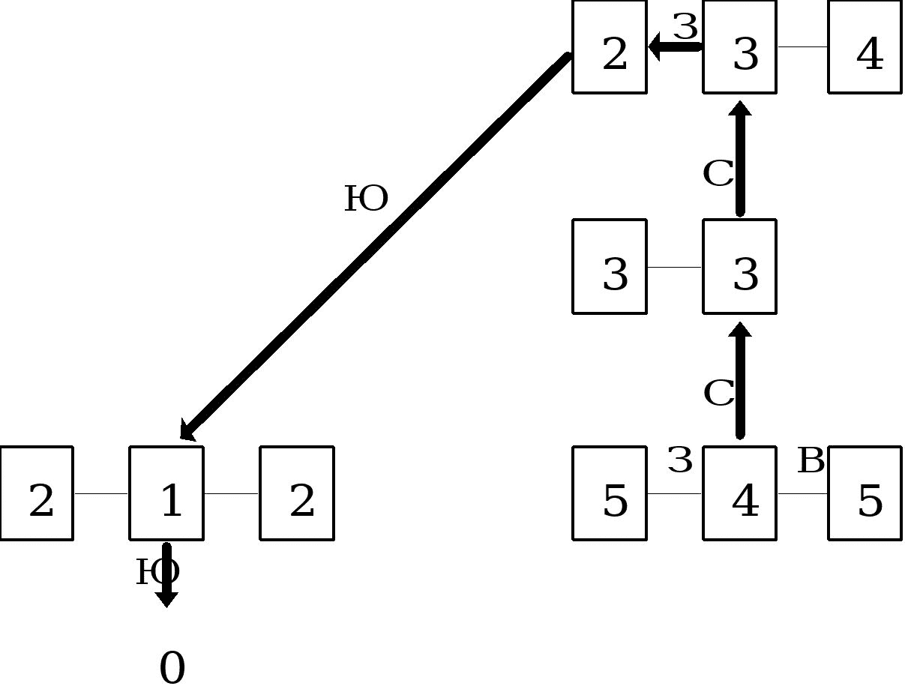

**图 19.** 评分函数 `F`：不在正确位置上的数码个数

这里图的节点代表数据库的状态，节点中的数字是给定状态下评估函数的值。

在这种情况下，评分函数被证明非常成功——最快搜索方法迅速找到了解。但这里包含运气成分：从得分为 3 的节点出发，搜索向北进行而非向西，仅仅因为在我们的规则列表中北向规则排在西向规则之前。

###### 2.2.4 逆向搜索（回溯）

不可逆搜索意味着如果应用了不合适的规则，解要么从根本上变得不可能，要么搜索过程将显著减慢。你可以基于以下思想构建搜索算法：如果从数据库的当前状态可以清楚地看出，继续已开始的解要么找不到解，要么该搜索有望耗费过长时间，那么你可以尝试回退并尝试另一条路。

一种搜索策略，当应用规则不合适时涉及回溯并应用不同的规则，称为回溯搜索 [[41]](#part0005.xhtml#_ftn41)。

请看回溯过程（算法 5）。

**算法 5.** 产生式系统的回溯搜索方法。

```
proc Backtracking(d, R, t)
    if t(d) then return (OK) end if
    if Deadend(d) then return (fail) end if
    R' := SelectAll(d, R)
    für r ∈ R' tun
        if Backtracking(rf(d), R, t) = OK then return (OK) end if
    end for
    return (error)
end process
```

回溯搜索方法的思想非常简单，包含以下内容。如果满足任何终止条件，必须停止工作并返回结果。否则，应使用 `SelectAll` 函数确定该状态下生效的规则集（冲突集，见第 0 节）。接下来，根据适用规则，在循环中递归调用相同的回溯搜索过程，但使用应用所选规则后获得的状态作为数据库状态。

建议在该过程中包含 `Deadend` 函数——切断“死”路径（死胡同），否则程序可能会陷入循环。

`Deadend` 过程可以检查各种条件，例如：

- 当前数据库状态 `D` 与先前创建的状态的对应关系；
- 搜索深度限制等。

图 20 展示了狼、羊、白菜问题的逆向搜索示例。在该图中，返回的节点标记为灰色，因为它们与已构建的节点相同。我们还应单独提及节点 `0001`；这是一个死胡同节点——无法从那里继续搜索。幸运的是，无需继续，因为此时算法找到了目标节点 `1111`。

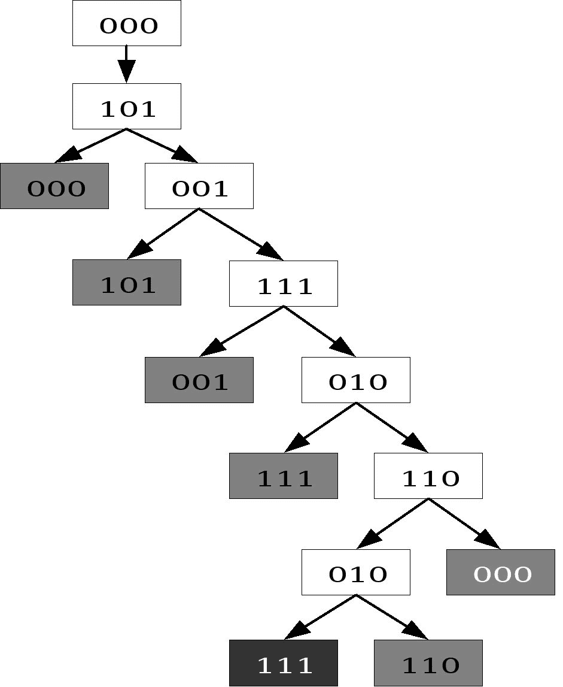

**图 20.** 狼、羊、白菜问题的回溯追踪

这里 `Deadend` 函数用于检查数据库的新状态是否与该路径上先前创建的状态匹配。

已知有各种逆向搜索的修改版本。例如，如果在搜索过程中不保存所有状态，而仅保存最重要的数据库状态，并且回退不是一步，而是回退数步到最后一个保存的状态。

在带回溯的搜索中，遍历的是树，并且不保存整棵树，仅保存该树中当前构建的路径。向下移动对应递归调用。向上移动对应返回。图 21 显示了骑士走位问题的带回溯搜索树的一个片段。

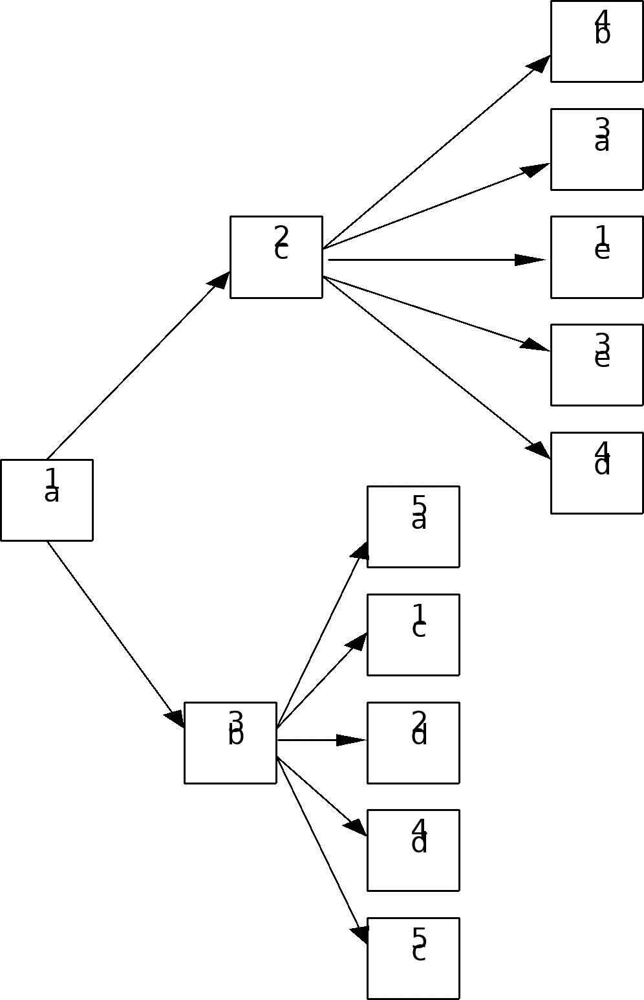

**图 21.** 骑士走位问题回溯搜索树的片段

我们将骑士放在棋盘的任意方格上。在这种情况下，角落格 `a1` 被作为第一个格子。我们轮流将骑士放在不同的格子上，寻找骑士之前未到过的格子。如果完全没有这样的格子，我们就返回到前一个格子，依此类推。

请注意，实际的规则结构涉及存储骑士已访问过的棋盘格子信息（见第 0 节）。因此，这里在 `Deadend` 函数中无需检查数据库的新状态是否与该路径上先前创建的状态匹配。以在数据库中存储一些额外信息为代价，可以减轻回溯过程的计算负载。

###### 2.2.5 图搜索

图搜索属于知情策略组，存储所有可用的先前获得的信息。为此创建了一个所谓的搜索图。

搜索图是一个有向图 `G(V,E)`，其中顶点集 `V` 是数据库状态的集合 [[42]](#part0005.xhtml#_ftn42)，弧集 `E` 是规则应用的集合。

该图有一个初始节点 `d0` 和一个终端节点集合 `T = { d ∈ D | t(d) }`（可能为空）。终端节点集合的元素用 `dt`、 `dt ∈ T` 表示。当且仅当存在一条在状态 `d1` 下适用的规则，且因其应用使基础转移到状态 `d2` 时，从节点 `d1` 到节点 `d2` 的弧才存在。

```
d1 → d2 ∈ E ⇔ ∃ r ∈ R ( rp(d1) & rf(d1) = d2 )
```

在一般情况下，搜索图可以包含环、自环、多重弧。它可能是不连通的等。

为了在图中搜索，使用以下两种主要方法，它们在算法中指定：算法 6 和算法 7。

**算法 6.** 图中的主要搜索方法。

```
proc GraphSearch(d, R, t)
    O := {d} { "open" nodes list }
    C := ∅ { "closed" nodes list }
    while ¬t(d) do
        d := select(O)
        if d = zero then return (fail) end if
        Open(d, R)
    end while
    return (OK)
end proc
```

**算法 7.** 节点展开过程。

```
proc Open(d, R)
    for r ∈ R do
        if rp(d) then
            if rf(d) ∉ O & rf(d) ∉ C then
                O := O + rf(d)
            end if
        end if
    end for
    O := O - {d}
    C := C + {d}
end proc
```

这里 `+` 号表示向列表添加项目，`-` 号表示从列表中移除项目。


####### 搜索策略与生产系统

######## 列表 O 与列表 C

列表 O 传统上称为**开放节点列表**（源自英文 Open），列表 C 传统上称为**封闭节点列表**（源自英文 Close）。然而，这些传统名称可能具有误导性。实际上，列表 O 是**我们尚未打开但将要打开的节点列表**（to open），而列表 C 是**我们已经打开且不会重新打开的节点列表**（already opened）。

######## 图搜索的两种基本方式

在图上搜索有两种基本方式：**广度优先搜索**和**深度优先搜索**。

- 若列表 O 是**栈**（即最后放入的节点被选中扩展），则称为**深度优先搜索**。
- 若列表 O 是**队列**（即最先放入的节点被选中扩展），则称为**广度优先搜索**。

######## 广度优先与深度优先的优劣势

######### 广度优先搜索

**主要优势**：若解存在，它**总能找到解**。广度优先搜索不加例外地扫描所有节点，并逐渐远离起始节点。

**劣势**：若搜索图无限或极大，深度优先搜索可能错过解，陷入深处而不返回。

######### 深度优先搜索

**主要优势**：**有时更快**。例如，目标节点距起始节点距离为 `k`。此时广度优先搜索必然先揭示所有距离小于 `k` 的节点，随后才开始揭示距离为 `k` 的节点（目标在其中）。而深度优先搜索若运气好，可直接走到目标节点，仅揭示通往目标的直接路径上的最少节点（最优情况共揭示 `k - 1` 个节点）。总体可证明，深度优先搜索平均找到解的速度约为广度优先搜索的**两倍**。

图 22 直观展示了这一现象。图中黑色高亮节点为将被扩展的节点，弯曲箭头指示扩展顺序。可见广度优先搜索呈螺旋式推进，虽能接近解却可能陷入“惩罚圈”；而深度优先搜索若幸运，几乎能立即“撞上”解。

```
图 22. 广度优先搜索（左）与深度优先搜索（右）
```

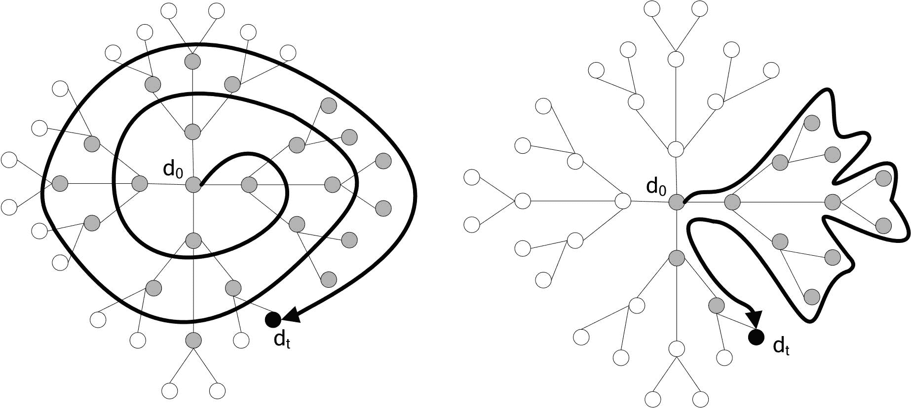

######## 重复节点检查的困境

请注意算法 2.7 中最内层的 `if` 语句。用图搜索法解题时，总面临一个两难选择：**是否检查节点重复？**

- **检查重复**：不同规则应用序列可能导致相同数据库状态。检查需额外时间查找匹配，但可避免重复节点及重复展开的额外工作。
- **不检查重复**：虽节省检查时间，但可能在已遇到的节点上浪费时间重复工作。

######## 案例：农夫、狼、羊、白菜问题

######### 检查匹配节点的广度优先搜索

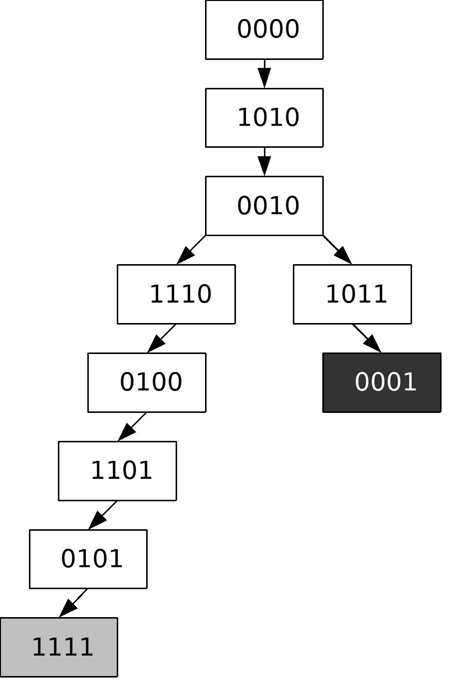

图 23. 狼、羊、白菜问题的搜索图（含匹配节点）

**重要事实**：与普遍看法相反，广度优先搜索在搜索匹配时构建的节点数可能**少于**回溯搜索（图 20 和图 23：前者构建 14 个节点，后者仅 10 个）。换言之，**图上的广度优先搜索（暴力搜索）在某些情况下比回溯更高效！**

######### 不检查匹配节点的情况

若不检查匹配，会创建许多重复现有节点的额外节点。图 24 展示了这一普遍无限问题的搜索图片段。图中省略号表示未展示的图扩展。广度优先搜索虽能找到解，但做了大量无用功；深度优先搜索可能“错过”解。

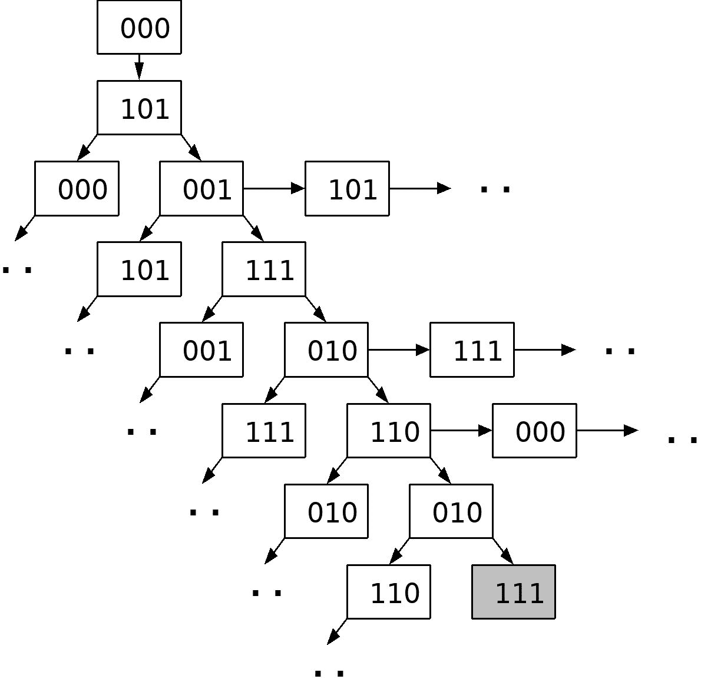

图 24. 狼、羊、白菜问题的搜索图（无匹配节点）

**结论**：无法给出是否搜索匹配的通用数学严格建议。非正式地看：若重合少，最好不检查；若重合多（如本问题），最好检查。

######## 八数码游戏的搜索图性质

八数码游戏中，8 块芯片有 `8! = 40,320` 种排列，故数据库状态数为 `8! × 9 = 9! = 362,880`（排列数 × 空格位置数）。可证明所有数据库状态分为两集：**逆序数为偶数**与**逆序数为奇数**，移动必保持奇偶性。因此八数码搜索图由**两个连通分量**组成，每个分量内部强连通。

- 若初始态与目标态属于**不同**连通分量 → **无解**。
- 若属于**同一**分量 → **解必然存在**。

######## 搜索图的一般性质

一般情况下，有限规则集 `R` 隐式定义了一个**可能无限**的搜索图，它可以是连通或非连通的，可以含环或不含环。**无法仅凭单条规则形式推断搜索图性质**。

形象地说：回溯搜索是我们刺入搜索图、希望撞上目标 `d t` 的探针，结果部分图被揭示、部分仍隐藏。而图搜索是整个图的**系统性、增量式、无遗漏**显现。

### 2.3 特殊生产系统

本节讨论生产系统的各种特殊情形。利用特殊情形的特殊性质，往往能带来意想不到的收益。

#### 2.3.1 逆向生产系统

前文讨论的生产系统总是从**初始状态**出发，搜索至达到**目标状态**。此类系统通常称为**正向**系统（见 2.2 节开头）。反之——应用**逆向规则**，从**目标状态**回溯至**基础状态**——称为**逆向**系统。有时逆向系统更高效，有时正向更高效（图 25）。形象地说，关键在于**目标在哪边更大——目标越大越容易命中！**

```
图 25. 正向与逆向生产系统
```

##### 对比模型：数论分解因数问题

**问题**：判断给定数能否分解为给定因数。

- **目标数**：`60`
- **因数**：`2, 3, 5`

###### 正向系统

```
d0 := {2, 3, 5}
t(d) := 60 ∈ d

R := if x ∈ d & y ∈ d & xy ∉ d & xy < 61 then d := d ∪ {xy}
```

**广度优先搜索结果**（19 次规则应用）：

```
2 3 5                    (原始因数)
4 6 9 10 15 25           (两两乘积)
8 12 18 20 30 50         (第二行 *2)
27 45                    (第二行 *3)
                         (第二行 *5 - 无新增)
16 24 36 40 60           (第三行 *2 - 到达目标)
```

**深度优先搜索结果**（4 次规则应用）：

```
2 3 5
15 45 30 60
```

###### 逆向系统

```
d0 := {60}
t(d) := 1 ∈ d

R := {
  if x ∈ d & x%2==0 then d := d\{x} ∪ {x/2}
  if x ∈ d & x%3==0 then d := d\{x} ∪ {x/3}
  if x ∈ d & x%5==0 then d := d\{x} ∪ {x/5}
}
```

**深度优先搜索结果**（4 次规则应用）：

```
60
30 15 5 1
```


###### 2.3.1. 单向生产系统

广度优先搜索返回以下结果（11 次规则应用）。

```
60

30 20 12

15 10 6 4

5 3 2

one
```

此处只有一个目标和三个日期，因此逆向系统产生的结果比正向系统略好，但两者相当，符合预期。

但如果我们设定一个不同的、模糊的目标：哪些小于或等于 60 的数字可以从因子 2、3、5 得到？那么系统对比将呈现完全不同的图景。事实上，正向系统的特点是缺乏终止条件，必须继续运行，直到因缺乏可应用的规则而终止。数据库的累积状态将是问题答案。

```
d0 := {2,3,5}

R := if x ∈ d & y ∈ d & xy ∉ d & xy<61 then d:= d ∪ {xy}
```

广度优先搜索返回以下结果（22 次规则应用）。

```
2 3 5              (original multipliers)

4 6 9 10 15 25     (products in pairs)

8 12 18 20 30 50   (second line *2)

27 45              (second line *3)

                   (second line *5)

16 24 36 40 60     (third line *2)

54                 (third line *3)

32 48              (sixth line *2)
```

深度优先搜索返回相同的结果，只是数字的发现顺序不同。这源于这样一个事实：在这种情况下，两种搜索类型都遍历同一个图，并且每个节点仅访问一次。请注意，我们问题的扩展表述的定量结果实际上与原始表述的结果一致——在第一种情况下，广度优先搜索算法仅未构建三个节点。也就是说，在广度优先搜索问题的原始表述中，正向系统并非以目标为导向，但生产系统解决了一个更普遍的问题，而非所要求的特定问题。

现在让我们尝试使用逆向生产系统来回答“哪些小于或等于 60 的数字可以从因子 2、3、5 得到”这个问题。显而易见，我们必须询问 60 次下一个数字是否可表示。在这种情况下，例如使用深度优先搜索，每个数字都能找到答案，规则应用次数最小 = 0（如果被检查的数字是质数），最大 = 5。平均每个被检查数字约需两次规则应用。这意味着在这种情况下逆向系统效率低一个数量级，没有必要用枯燥的描述和大量不必要的数字来充斥书籍。另一方面，如果你只是想分解数字 60，逆向系统显然更高效。

此例得出的结论如下：在智能系统中，考虑任务的细节非常重要。有时考虑细节比遵循一般原则更重要。

###### 2.3.2. 双向生产系统

正向和逆向系统被称为单向系统，因为搜索严格朝一个方向移动——朝向目标或远离目标。然而，如果只有一个目标状态和一个源状态，则方向是等价的（例如在八数码游戏中）。在这种情况下，可以同时从数据到目标和从目标到数据进行搜索，并查看是否存在指示已找到解的公共状态。这就是双向生产系统的工作原理。

预期当使用无信息控制策略时，双向生产系统将比单向生产系统更高效，因为总体上将揭示更少的节点，例如在广度优先搜索中（图 2.26）。

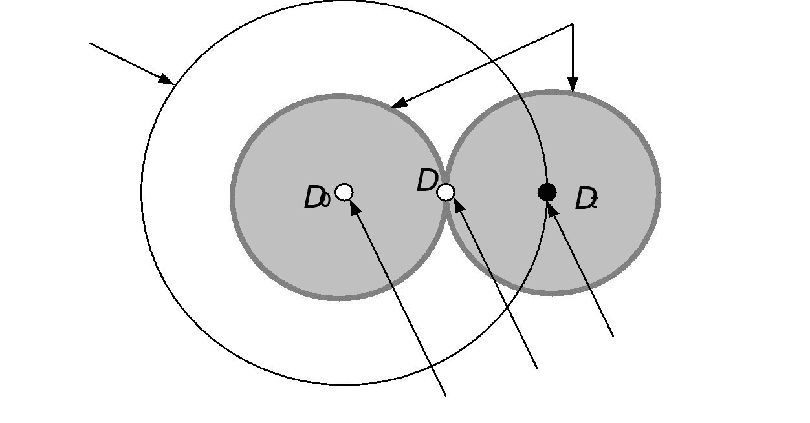

图 2.26. 双向生产系统的优势

然而，这并非总是如此。如果使用非常好的启发式方法，有目的地从数据引导至目标、从目标引导至数据，但方式不同，那么双向系统可能比任何单向系统都要差。

图 2.27. 具有定向启发式的双向系统

###### 2.3.3. 可交换生产系统

如果满足以下三个条件，则称具有规则集 `R` 的生产系统为可交换的：

```
∀d∈D ( r1.p(d) & r2.p(d) → r2.p(r1.f(d)) )
```
- 如果两条规则均适用，则应用其中一条后，另一条仍保持适用；

```
∀d∈D ( r.p(d) & t(d) → t(r.f(d)) )
```
- 如果目标已达成，则永远达成，规则的应用不会否定目标的达成；

```
∀d∈D ( r1.p(d) & r2.p(d) → r2.f(r1.f(d)) = r1.f(r2.f(d)) )
```
- 当两条规则均适用时，它们可以按任意顺序应用。

第 0 节考虑的数字生成系统是可交换的。八数码游戏是另一个可交换生产系统的例子，但农夫、狼、羊、白菜问题是一个非可交换系统。

请注意，第三个条件——可交换性条件——并不意味着规则的顺序（即语句）可以随意重排。

```
∀d ( r2.f(r1.f(d)) = r1.f(r2.f(d)) ) 通常是错误的。
```
然而，当前规则可以按任意顺序应用。

可交换生产系统的一个重要优势是始终可以使用不可撤销模式，因为规则的应用不会破坏任何东西。

**定理：** 每个生产系统都可以转换为可交换系统。

**证明：** 给定初始基础状态 `d0` 的生产系统 `S = < D, R, C >`。考虑其搜索图 `G`。我们构建一个新的生产系统 `S' = < D', R', C' >`。系统 `S'` 的数据库变为系统 `S` 的搜索图。新系统的规则 `R'` 是在旧系统中利用策略 `C` 转换搜索图的不同方式（节点扩展）。新生产系统是可交换的。

实际上：
- 在旧系统中，如果两个节点在列表 `O` 中，一个节点的扩展不会阻止第二个节点的扩展，因此满足第一个可交换条件；
- 在旧系统中，如果终端节点被构建进搜索图，扩展其他节点不会将终端节点从图中排除，因此满足第二个可交换条件；
- 在旧系统中，如果列表 `O` 中有两个节点，它们可以按任意顺序扩展，得到相同的结果，因此满足第三个可交换条件。

所证定理在实践中用处不大。虽然生成的新系统是可交换的，但转换极大地增加了其体积，与原始系统相比。利用不可逆搜索获得的收益小于转换过程中系统膨胀带来的损失。

我们将通过一个简化代数表达式的可交换系统示例来支持上述一般价值判断，该系统由以下部分构成：变量 `x`、自然系数、加法、乘法和幂运算（一元多项式）。存在若干变换规则：

1. 展开括号
2. 合并同类项
3. 按次数排序

这些规则人人在学校都学过，因此我们未正式写出它们。让我们尝试简化表达式 `1 + x(1 + x(3 + x + x))`（图 2.28）。

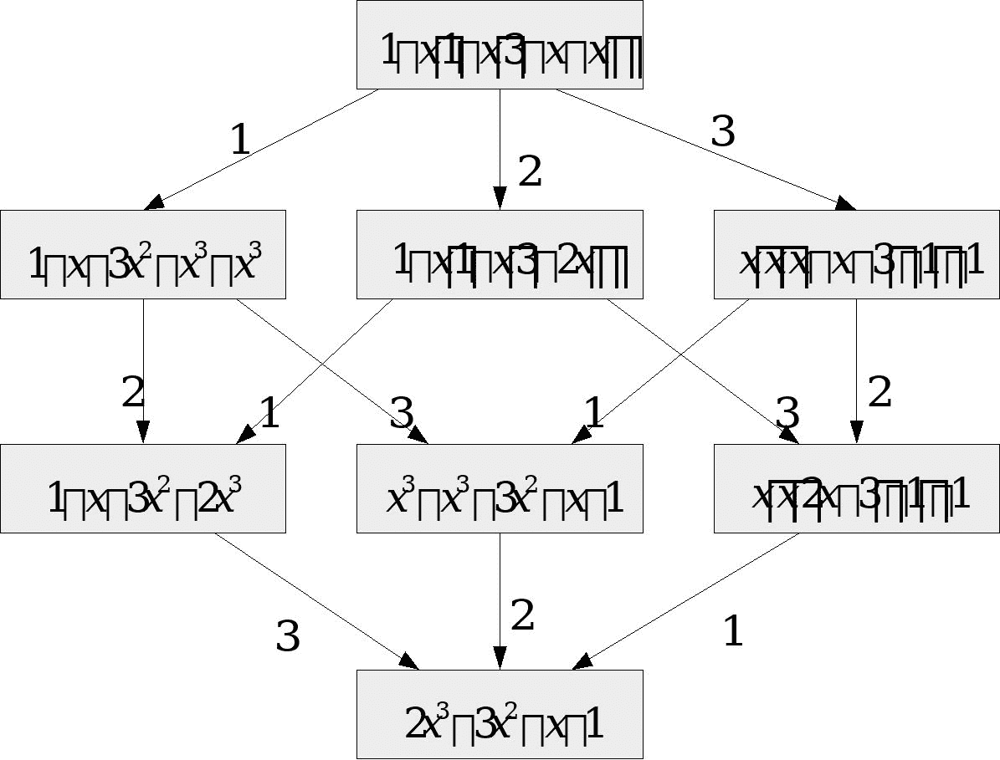

图 2.28. 表达式简化


####### 术语重述系统与可分解生成系统

######## 术语重述系统

如果规则改变了某些内容，我们就应用它。对于多项式，最终结果不依赖于规则应用的顺序。事实上，这里的生成系统不包含条件——这是一个**项替换系统**或**同态生成系统**相关的**释义规则系统**（术语重述规则）的示例。

**术语重述系统**是一个有限的重述规则集合 `R`，它在项集上定义了一个二元关系 `→`（归约关系）。

如果对于任意项 `t1` 和 `t2`，当且仅当存在唯一的项 `t3` 使得 `t1 → t3` 且 `t2 → t3` 时，等价 `t1 = t2` 成立，则重述规则系统 `R` 被称为具有 **Church-Rosser 性质**。在这种情况下，SPT 被称为**完全**或**规范**的，将 `R` 规则应用于原始公式的结果称为**规范形式**。

在本例中，系统具有 Church-Rosser 性质。这是一个非常强大、有用且罕见的性质，它允许自动解决许多问题，例如检查相等性、求解方程等。然而，并非所有代数表达式类都有规范形式。单变量多项式和布尔公式可能有读者熟悉的规范形式。同时，例如，数学分析的初等函数（有理函数、对数、指数及其超位）没有正规形式 [[43]](#part0005.xhtml#_ftn43)。

让我们通过一个乍看之下简单的代数表达式化简示例的复杂化，来展示 Church-Rosser 性质的重要性。让我们尝试化简表达式 `x (1 + 1/x)`，结果应为 `x + 1`，为此我们需要向示例中添加除法运算和两条规则：

4. 通分
5. 约分分子和分母

很容易看出，结果现在取决于规则应用的顺序！因此生成系统不再是可交换的。此外，在搜索过程中某些情况下可能出现死锁。结果，其中一条路径无法通过规则 1-5 归约。

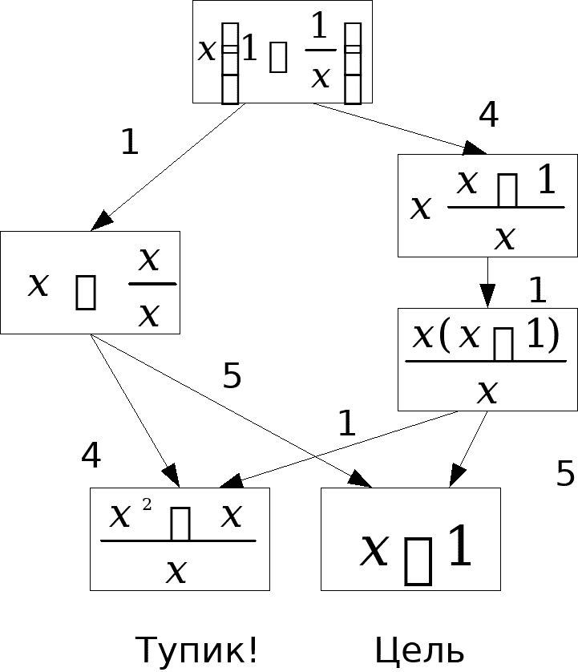

**图 29. 搜索中的死胡同**

为了解决与死胡同形成相关的问题，让我们添加逆运算：

6. 括号展开（提取公因式）

如果仅引入规则 6（括号），则存在两条互为逆的规则：展开括号和提取括号，这意味着可能出现循环，即 Church-Rosser 性质尚未满足。要使图 29 中的死胡同变得可归约，需要添加规则 7：

7. 展开分数

```
(u + v) / w = u / w + v / w
```

但随后可能出现无限循环，这在不可逆搜索期间无法检测到（在图 30 中，其中一个可能的循环用椭圆标出）。

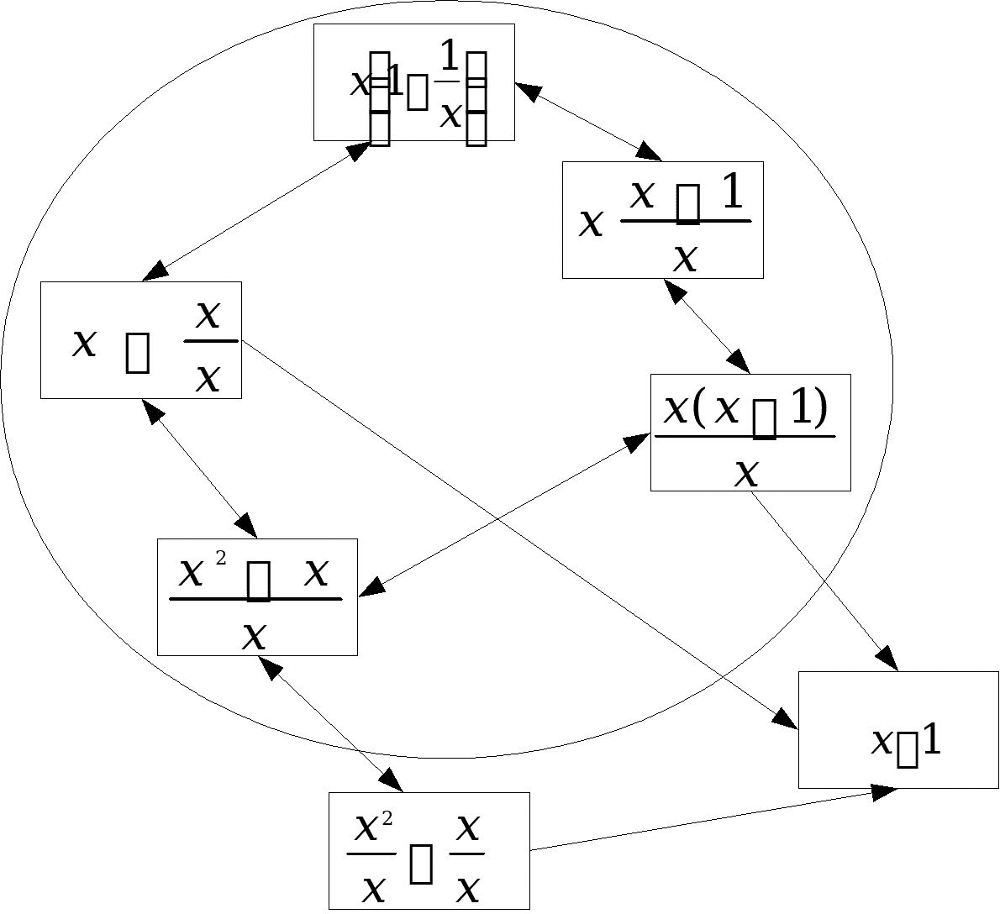

**图 30. 搜索中的循环**

从这个例子得出的结论是，生成系统的可交换性是一个非常强大且有用的性质。应当尝试构建可交换的生成系统，在无法做到的情况下，值得检查是否可以在一定程度上限制问题，但要使其能够构建可交换系统。

###### 2.3.4. 可分解生成系统

生成系统的可交换性提供了选择应用规则的自由。这不是提供这种自由的唯一品质。

如果一个生成系统可以**分解**为多个可以相互独立考虑的生成系统之和，则称其为**可分解生成系统**。

形式生成文法是可分解生成系统的一个好例子。让我们通过一个简单的例子来看看这个主题。假设有规则：

```
A → BC
A → CT
C → TT
```

如何从单词 `AC` 得到仅包含符号 `T` 的字符串？下面给出了常规（图 31）和复合（图 32）生成系统的搜索图。在第一种情况下，我们从初始表达式进行所有可能的转换。在第二种情况下，我们首先将原始数据库（单词 `AC`）分成两部分（单词 `A` 和单词 `C`），然后为每一部分创建搜索图。这里给出了完整的搜索图，从中可以清楚地看到可以获得解。确实，在图 31 中有路径（共有三条，叶节点用颜色高亮）从起始节点通向终止节点，而在图 32 中，对于分解的两个部分，每个都有一对通向终止节点的路径。包含在解中的节点在图 32 中用椭圆圈出。

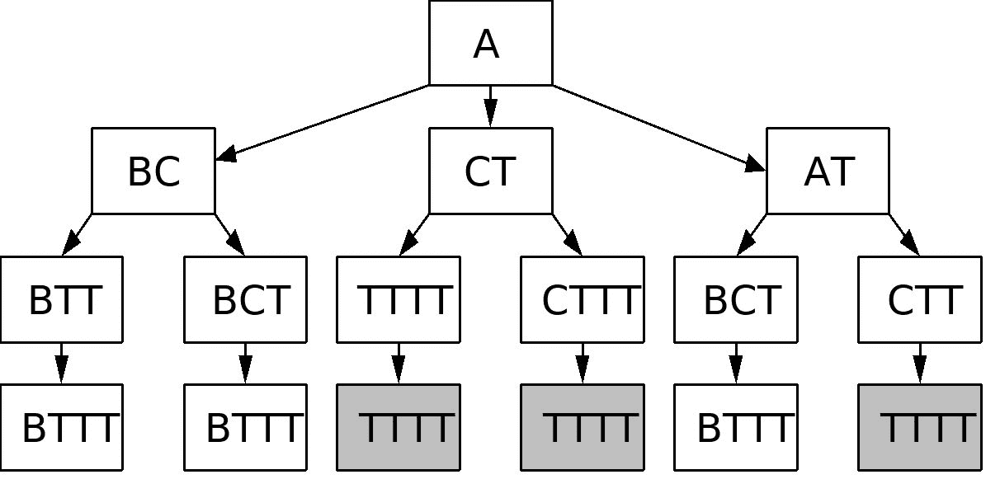

**图 31. 常规生成系统的搜索图**

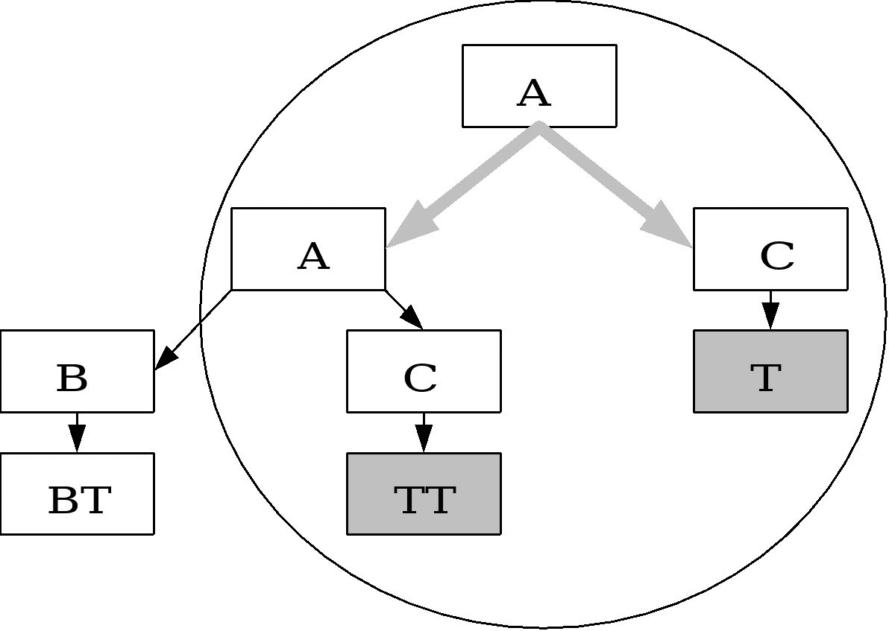

**图 32. 可分解生成系统的搜索图**

让我们比较图 31 和图 32 中的数字，很容易看出，在第一种情况下做了大量不必要的工作：左侧分支应用规则的结果导致了死胡同。在这个例子中，使用分解使搜索图减半！

可分解生成系统的基本过程如算法 8 所示。

**算法 8. 可分解生成系统解释器。**

```
proc split (d, R, t)
    Δ := disassemble(d)
    while Is_correct do
        for d ∈ Δ do
            if t(d) then Δ := Δ \ {d} end if
        end for
        if Δ = ∅ then return (OK) end if
        d := SelectD(Δ)
        Δ := Δ \ {d}
        r := choose(d, R)
        if r = zero then return (fail) end if
        Δ := Δ ∪ Decompose(rf(d))
    end while
end process
```

生成方法，最最初始也最通用的方法（见第 0 节）。`Decompose` 过程将数据库分解为多个部分（如果在当前状态下数据库无法分解，则保持原样）。从某种意义上说，这类似于打开节点的操作，但仍有不同，因此图 32 中对应于分解而非展开的弧用灰色高亮显示。此外，`SelectD` 函数类似于 `Select` 函数，它实际上选择一个节点进行进一步工作。


我们要做一个重要的说明。从图论的角度来看，由于应用分解规则而在搜索图中出现的弧是一条超弧——一条从可分解基础出发并同时通向分解的若干个部分基础的弧。要得到解，你必须为第一部分**且**为第二部分**且**以此类推找到解。因此，这样的超弧被称为**I-弧**（AND-arc）。如果从节点发出的普通弧对应于规则的应用，那么它们具有以下含义：要找到解，你必须应用第一条规则**或**第二条规则**或**等等。因此，这样的弧被称为**OR-弧**（OR-arc）。如果图中仅使用此类弧，则称为**AND/OR 图**。在接下来的两章中，我们将回到这些概念并更详细地讨论它们，请参见第 3.3 节和第 4.5.1 节。

由 A.N.乔姆斯基发展的形式文法理论被成功用于描述编程语言和其他人工语言。简而言之，其本质如下。我们考虑一个有限字母表 A（一组符号）以及基于该字母表的语言。这里，语言仅仅是字母字符序列（字符串）的集合。换句话说，在所有可能的链（显然有无限多条）中，必须能够单独挑出那些且仅那些属于语言的链（也称为“包含于语言”、“属于语言”、“是语言的表达式”）。

为了描述这个（无限的）字符串集合，乔姆斯基提议使用形式生成文法——一组形式为`α → β`的有限规则（其中`α`和`β`是终结符和非终结符的字符串，且`α`被称为非终结符）。规则的左侧（即字符串`α`）必须至少包含一个非终结符。在所有非终结符中，有一个脱颖而出，被称为文法的初始符号（或公理）。

此外，一切都非常简单。以文法的公理为基础，通过将已构造链中任何规则左侧的每一次出现替换为该规则的右侧，来构造新链是合法的。如此继续，直到链中仅剩终结符。根据定义，任何可以通过此过程构造的终结符链都属于该语言，如果无法通过这种方式构造该链，则它不属于该语言。

当然，一切都就这么简单，直到提出各种棘手的问题。任何语言都能这样定义吗？给定一个文法和一个特定的终结字符串，如何知道它是否属于该语言？链生成过程是唯一的吗？前面问题的答案是否取决于规则的类型（形式）？

但如果主要思想清楚了，我们就可以把这些（相当困难的）问题留给数学家，并接受绝大多数编程语言的语法可以用形式文法的一个子类——**上下文无关**文法（所有规则的左侧由单个非终结符组成）来轻松描述。对于这一子类文法，所有与检测字符串是否属于语言相关的问题（这称为语法分析或解析）都得到了可靠的解决。

##### 第 2 章 结论

1.  产生式系统历史上是表示知识的第一种形式，至今仍被频繁使用。
2.  产生式系统能得到有效的程序化实现，是许多实用软件系统的基础。
3.  只有在充分理解相关局限性和缺点的情况下，使用产生式系统才有意义。

## 第 3 章 求解算法

求解算法数量众多、种类繁杂，若不加适当说明地使用这一术语可能会产生误导。在一般情况下，搜索算法在特定的搜索空间中寻找问题的解。搜索空间可以是离散的或连续的；可以是有限的或潜在无限的；空间的度量属性可能是已知的或未知的；所求解的属性可以是固定的，也可以在搜索过程中发生变化。在所有这些以及许多其他情况下，都会使用各种各样的算法，其中一些算法几乎没有共同之处。我们认为，对所有搜索算法进行详尽测试在技术上几乎不可能，且这种假设性测试的价值值得商榷。因此，我们将范围限定在一个特定领域——应用于包含人工智能元素的应用系统中的求解算法。

即使有此限制，对所有使用的算法进行详细分析似乎仍过于庞大。我们允许自己进一步缩小范围，仅分析基于产生式系统中用于推理的最流行和最具代表性的搜索方法，即使用第二章介绍的基本构造形式`p → q`的系统。根据既定约定，将搜索空间表示为一种特定形式的图（或网）是很自然的，其中节点代表事实库的状态，弧对应于产生式的应用[[44]](#part0005.xhtml#_ftn44)。在图上搜索解的结果总是一条从起始节点通向目标节点的路径（链、输出）。当然，研究领域的再次缩小简化了我们的任务，但即便如此，我们也无法挑选出一个寻找解的最佳通用算法！事实是，搜索图的节点和弧的具体性质（由应用目的决定，进而由产生式本身的性质决定）在寻找解的过程中起着非常重要（如果不是决定性）的作用。

因此，产生式系统中的求解问题可以归结为图上的寻路问题。在为解决图上的特定问题选择合适的算法时，我们需要考虑搜索图的许多属性（关于术语解释，请参阅文献[17]），即：图是否为有向图，是否允许环（以及这些环的性质如何），两个节点之间能否由多条弧连接（多重图），图是否为多部图（以及程度如何），我们对图的连通性和顶点度了解多少，节点集和弧集的基数如何（图是否有限），图是否带标签、带权重（以及这些属性的何种组合）等等。重要的是要理解，所有这些属性都是由问题的表述决定的，更具体地说是由问题表示的选择决定的，而非任意的。例如，如果我们有一个很好的无环图算法，但给定问题的搜索图包含环，那么该算法就几乎没用。


### 启发式搜索与最优路径构建

近来，人们将相当多的关注集中在以其最一般形式构建最优路径的问题上。相关应用领域的例子包括物流（最小化仓库间货物运输时间）、管理移动机器人（在有限制和障碍物的环境中）以及策略游戏。

此类任务的搜索图相当“体面”——有向单部有向图，其中：
- 节点通常只是一个名称（或空间中的一个点，通常带有度量且维度较小）
- 密度低（远非所有节点都直接相连）
- 节点 `d` 的度始终由一个有界常数估计（`deg(d) < const << n`，其中 `n` 是图的节点数）
- 弧上的权重仅由从一个节点移动到另一个节点的成本决定
- 源节点和目标节点被唯一确定

假设为解决问题所需的搜索图构建部分可以完全放入计算机的“快速”（运行）内存中。本章解决的主要问题是从源节点到目标节点构建一条最优（资源最小化）路径。

#### 章节覆盖范围

本章涵盖五种算法：

1. 异构生产系统启发式解搜索的通用算法（第 3.1 节）
2. 图上历史上第一个且最著名的搜索算法的形式化性质（第 3.1.1 节）
3. 提高寻找解的通用算法效率和实用性的方法（第 3.1.2 节）
4. AND/OR 图上的搜索算法，即使用可分解生产系统时出现的通用算法的一个特化（第 3.2 节）
5. 游戏树上的搜索算法，即通用算法的进一步特化，因为游戏树是 AND/OR 图的一种特殊情况，涵盖了用于实际程序的最发达的实用算法（第 3.3 节）

这样一组经过深思熟虑的算法，构成了一个足以让读者自信驾驭各种具体搜索算法的体系——我们称之为主要信标。

### 3.1. 启发式搜索

历史上，AI 中用于在搜索空间图中寻找最优（就总权重或长度而言）路径的第一个且最著名的算法之一是 `A*` 算法（读作“A-star”）。该算法最早由 Peter Hart、Nils Nilsson 和 Bertram Raphael 于 1968 年描述 [18]。在他们的著作中，它被称为“算法 A”。在经典版本中，`A*` 算法适用于由带权弧的搜索图表示的离散搜索空间。这种启发式搜索按函数值对图的节点进行排序，该函数评估从起始节点经给定节点到达某个目标节点的最短路径长度。因此，该算法将已探索部分搜索图中的最优路径长度考量（来自 Dijkstra 算法）与针对尚未探索部分图的最速下降启发式 [45] 相结合。

#### 3.1.1. 通用算法

为清晰起见，我们重述搜索图的定义，做一些重要备注，并写出图上搜索算法的通用形式。

搜索图是一个有向图 `G(V, E)`，其中节点集 `V = { d | d ∈ D }` 是事实库可能状态的集合（按前一章的含义），弧集 `E` 定义如下：

```
E = { d1 → d2 | d1, d2 ∈ D & ∃ r ∈ R ( rp(d1) & d2 = rf(d1) ) }
```

在搜索图本质上是有限的情况下，可以使用在计算机中表示图的常规方式显式指定它。在这种情况下，搜索图常被选作知识表示机制——螺旋上的标记是产物，无需单独指示产生式集合。

在无限（或非常大）图的情况下，我们不能使用这些简单表示，因为整个图无法放入计算机内存。取而代之的是，从数据库的初始状态 `d0` 开始，使用有限规则集 `R` 生成搜索图的一部分，直到耗尽分配的资源，或生成的部分包含数据库的目标状态 `dt`。因此，使用了图在计算机中的隐式表示。图可以使用节点扩展操作隐式指定。

每条规则 `r` 都有与其应用相关的成本，用 `r.w` 表示，称为应用规则的成本或权重。在这种情况下，搜索图中的每条弧都有权重。换句话说，弧被加载，且加载值可取为正：`r = (p, f, w), w > 0`。

图中路径的成本定义为其弧成本之和。计算从初始节点出发的路径成本，并在（特定条件下！）确定最小成本路径的通用图搜索算法如下。

**算法 3.9. 图中通用搜索算法。**

```
GS(d0, R, t)
    O := {d0}; g(d0) := 0
    C := ∅; P(d0) := zero
    while true do
        d := select(O)
        if d = zero then return (Fail) end if
        if t(d) then return (OK) end if
        Open(d)
    end while

proc Open(d)
    for r ∈ R do
        if rp(d) then {rule holds}
            d' := rf(d)
            c' := g(d) + r.w
            if d' ∈ O ∨ d' ∈ C then {old node}
                if c' < g(d') then {better way}
                    g(d') := c'
                    P(d') := d
                end if
            else {new node}
                O := O ∪ {d'}
                g(d') := c'
                P(d') := d
            end if
        end if
    end for
    O := O - {d}
    C := C ∪ {d}
end proc
```

其中 `O` 是“开放”节点列表，`C` 是“关闭”节点列表（见图 2.2.4）。

除了已讨论的常用参数和开放/关闭节点列表外，该方法还使用两个其他数据结构。第一个是 `g(d)`——迄今探索到的从 `d0` 到 `d` 的最短路径长度。注意 `g(d0) = 0`；对其他节点，工作开始时 `g(d)` 未知，且随着算法运行，给定节点 `d` 的 `g(d)` 值只能减小。

`P(d)` 值得专门讨论——该结构为节点 `d` 存储从 `d0` 到 `d` 的已找到最短路径上的前驱节点。此技术允许有效存储从节点 `d0` 通向所有已检查节点的路径集合。

该图搜索算法有两个函数：`Select` 和 `Open`。非正式地说，前者是“搜索”，后者是“在图上”。

`Select` 函数以某种方式确定下一个要扩展的节点。如果 `Select(O)` 函数按 FIFO 原则（先进先出）工作——即列表 `O` 是一个队列——则执行广度优先搜索。如果存在到目标节点的路径，此方法保证能找到。如果 `Select(O)` 函数按 LIFO 原则（后进先出）工作——即列表 `O` 是一个栈——则执行深度优先搜索；此方法类似于回溯搜索，但不仅保存当前路径，还保存所有已访问路径。


##### 广度优先搜索和深度优先搜索是无信息搜索方法的示例

如果对任务一无所知，则必须采用无信息过程，但无法依赖太多信息。为了有效地找到解决方案，有必要利用关于问题的额外信息。这种额外信息通常被称为启发式信息。该术语的含义将在下一段中解释。

#### 3.1.2. 启发式算法

古希腊语“heuristics”（ευρίσκω \- 我寻找，我发现）在现代语言中有许多相似但不同的含义和用法。在文献中可以找到对该术语的以下解释。

启发式方法是解决问题的特殊方法，它们大多与基于精确数学模型的形式化解法形成对比。使用启发式方法不能保证得到的解是最优的；不成功的启发式可能导致最坏的结果！同时，存在许多成功的启发式方法（用于解决特定问题），它们能以可接受的代价提供可接受的解。

启发式活动是富有成效的创造性思维过程的组织。从这个意义上说，启发式被理解为人类解决创造性问题的一组内在机制。这些机制具有普遍性，不依赖于待解决的具体问题。

启发式编程是一种编写程序的方式，程序员不编写现成的数学解法，而是试图将他/她认为人们在解决此类问题时所使用的直观易懂的解法形式化。与启发式方法一样，启发式程序不能绝对保证达到既定目标和结果的最优性。

启发式教学是一种特殊的教学方法（苏格拉底式对话）或集体解决问题的方法，历史上可追溯至苏格拉底。该方法在于向学生提出一系列引导性问题和示例，从某种意义上说，这使他们自行寻找解决方案。

在我们的案例中，我们用更狭义的含义来理解“启发式”一词。

启发式是在特定领域搜索解决方案时，简化或限制选项枚举的经验法则。

此外，由于我们在此考虑的是给定领域中一条非常具体的解决路径——面向生产系统的图搜索——我们可以使定义更加具体。

启发式是一组用于选择下一个待扩展节点的规则，根据启发式作者的意图，这应能导向问题的解决方案。

不幸的是，启发式依赖于猜测和直觉，而非确切知识；启发式利用可用但有限的信息（如当前开放节点集合的描述），无法保证选择实际上是最好的。启发式仅仅是基于经验和常识为选择下一步提供的建议。

使用启发式的算法称为启发式算法。

启发式通过减少规则应用的总次数来降低应用规则的计算成本。但即使启发式本身的应用也需要某种计算，并有其自身的成本。此外，操作搜索图（尤其是当图很大时）也是昂贵的（再次参见图 2.5）。

实际上，我们关心的是应用规则的成本、检查和扩展节点的成本以及启发式成本的总和。更具体地说，我们希望最小化在启发式算法应用的所有情况下该总和的平均值。

为了准确表述问题，有必要给出定义并引入符号，我们将在下一节中进行。

#### 3.1.3. 评价函数

启发式信息可以采取任何形式。在人工智能中，通常以评分函数 `F(d)` 的形式表示启发式信息。

评价函数 `F` 定义在允许的环境状态集合（事实库）上，并取实数值 `F : D → ℝ`。此外，评价函数通常的选择方式使其在终止节点处的值最小 `F(d_t) = min { d ∈ D | is F(d) }`。给定这样一个评价函数，就可以编写基于最速下降思想的 `Select` 函数（算法 10）。

##### 算法 10. 选择待扩展节点的函数

```
Process Selection(O)
    m := ∞
    d' := zero
    for d in O do
        if F(d) < m then
            d' := d
            m := F(d)
        End if
    End for
    return (d')
End Process
```

或简写为：

`Choose(O) := min F(d), d ∈ O`

对于评价函数 `F`，已提出许多不同的实现思路。“估计”一词意味着 `F` （很可能）接近于一个重要的搜索特征。以下列出了一些在选择估计器时常尝试利用的特征属性：

- `d` 属于最优路径的概率的倒数；
- 从节点 `d` 到目标节点集合 `T` 的距离；
- 从源节点 `d_0` 经当前节点 `d` 到目标节点 `d_t` 的路径权重。

在本节中，我们考虑后一种情况。

我们考虑如下形式的评价函数：

`F(d) = g(d) + h(d)`，其中 `g(d)` 是从初始节点 `d_0` 到 `d` 的实际路径成本（已由我们在 `Open` 过程中定义）；`h(d)` 是从 `d` 到目标节点 `d_t` 的路径成本的启发式估计。

以 8 数码游戏为例来考察选择评价函数的过程（我们已在 2.1.4 节讨论过）。我们引入评价函数 `F(d)` 为树中深度（对应函数 `g(d)`）与缺失棋子数（对应函数 `h(d)`）之和。我们看到（图 33），使用这样的评价函数，图上的搜索非常高效并能快速找到解。

让我们对这个例子做一些观察：

- `h(d_t) = 0`，因为根据定义，在目标位置所有棋子都已就位；
- `h(d)` 不超过从 `d` 到 `d_t` 所需的最少移动步数；
- 扩展节点的函数 `F(d)` 值不减小；如果我们仅将函数 `F` 取为树中的深度，即令 `h = 0`，我们仅得到广度优先搜索。

在下一节中，我们将总结并解释这些实验观察。

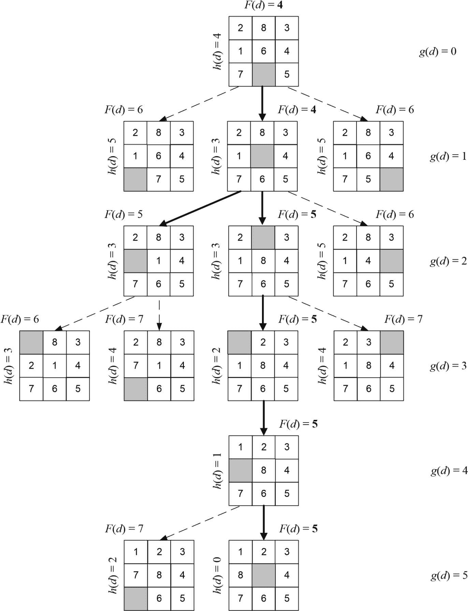

**图 33.** 带有评价函数 `F` 的 8 数码游戏搜索图。

### 3.2. A* 算法的性质

A* 算法具有许多显著且有用的性质，这解释了其广泛的适用性。


最重要的性质在于，尽管该算法具有启发式性质，但已知一个充分条件，在此条件下算法 `A*` 保证能找到最优解（如果存在的话）。这在本节第一段中得到了严格证明。第二段表明，打个比方，算法 `A*` “记性很好”——提供给算法的评价函数越“知情”，算法的表现就越“好”。最后，在本节第三段中证明了，如果评价函数选择得当且与搜索空间的度量性质一致，`A*` 算法不仅最终能找到最优解，而且所有中间状态都位于最优路径上。换句话说，在某些情况下 `A*` 算法的表现简直完美：以最佳可能方式运行。在最后一段中我们指出，理想行为并不总是有保证的：有时 `A*` 算法的表现令人大失所望。

#### 3.2.1. 一致性集

让我们给出必要的定义并引入符号。从节点 `d1` 到节点 `d2` 的最短路径长度记为 `s(d1, d2)`。令 `F*(d) = g*(d) + h*(d)` 为从节点 `d0` 到节点 `dt` 且经过节点 `d` 的最短路径的确切长度。此处 `g*(d)` 是从 `d0` 到 `d` 的最短路径长度，`h*(d)` 是从 `d` 到 `dt` 的最短路径长度，即 `g*(d) = s(d0, d)`，`h*(d) = s(d, dt)`。

利用这些定义可以很容易地证明 `∀ d F*(d) ≥ s(d0, dt)`。

事实上，一条由经过给定节点 `d` 的两段最短路径组成的路径，不可能比最短路径本身更短。记 `M = F*(d0) = h*(d0) = s(d0, dt)` 为最优值，即无限制条件下的最短路径长度。

注意函数 `F*`、`g*`、`h*` 和数值 `M` 通常对我们是未知的。

回顾一下，我们考虑的评价函数形式如下：

`F(d) = g(d) + h(d)`，

其中函数 `g` 已由我们在 `Open` 过程中定义。在 `A*` 算法运行期间，`g(d)` 具有如下估计：`g(d) ≥ g*(d)`，因为并非所有路径都已构建完毕，而在展开节点和构建新路径时，估计值 `g(d)` 可能会减小，但不会小于 `g*(d)`。

问题在于函数 `h(d)`——即从当前位置到解的启发式距离估计。显然，一般情况下我们无法在数学上精确指定此函数，只能在个别情况下或多或少成功地构造它。例如，第 0 节中为玩 8-puzzle 选择的函数被证明非常成功。它使得能够快速找到解。

这有多大的随意性？决定节点展开顺序的评价函数应具有什么性质，才能保证算法找到解？以下定理给出了这些问题的答案。

搜索算法在找到最优路径时应具有一致性（或部分正确性），前提是存在这样的路径。

**定理。** 当 `∀d h(d) ≤ h*(d)` 时，算法 `A*` 是一致的。

定理的证明基于一组引理。所有引理均在 `h ≤ H*` 条件下证明。引理 1 和定理在 `∀ r ∈ R (r.w > 0)` 条件下证明，即规则应用的权重严格为正。据此，根据问题的含义，所有函数 `F*`、`g*`、`h*`、`F`、`g`、`h` 和数值 `M` 均为非负。

**引理 1。** 如果算法 `A*` 不结束工作，则被扩展节点的估计值无限增加。即 `∀ N ∃ k F(dk) > N`。

*注。* 此处 `k` 为 `A*` 算法的步骤编号，`dk` 为该步骤中被扩展的节点。

*证明。* 令 `e = min { r ∈ R | r.w } > 0` 为最小规则权重，`m = |R|` 为规则数量。令 `p` 为节点 `dk` 在树中的深度。注意，当所有先前打开的节点都在树的上一层且各层完全填满时，节点深度最小。极限情况下，`m` 叉树的第 `p-1` 层包含 `1 + m + m² + ... + m^(p-1) = (m^p - 1)/(m - 1)` 个节点。因此 `k < (m^p - 1)/(m - 1) < m^p`（当 `m > 2` 时）。则 `p > log_m k`。现在取 `k > m^N / e`。我们有：`F(dk) > g(dk) > ep > e log_m k > e log_m (m^N / e) = N`。

**引理 2。** 如果存在最优路径，则打开节点列表中始终包含一个属于该路径且估计值不超过 `M` 的节点。

*证明。* 设 `A = <d0, …, dt>` 为最优路径。

此外，对算法步骤进行归纳。

归纳基础：`d0 ∈ A` 且 `F(d0) = h(d0) < h*(d0) = M`。

归纳步骤。展开 `A` 的一个节点会在 `O` 中留下一个后继节点。这意味着列表 `O` 始终包含 `A` 的一个节点，至少有一个，但可以有更多。现在设 `d' ∈ O`，`d' ∈ A`，且 `d'` 是这些节点中最左边的节点（见图 34），即路径上 `d'` 左侧的所有节点均已展开并位于列表 `C` 中。则 `g(d') = g*(d')`，因为最优路径的一段也是最优的。我们有 `F(d) = g(d') + h(d') = g*(d') + h(d') ≤ g*(d') + h*(d') = F*(d') = M`，因为 `∀d ∈ A F*(d) = M`。

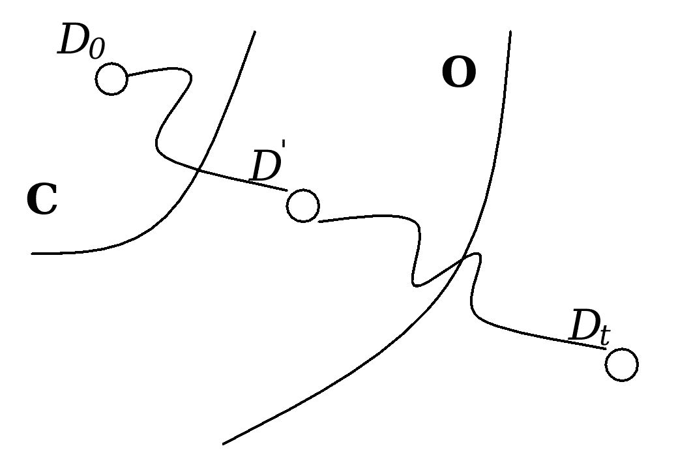

**引理 3。** 如果存在最优路径，则估计值不超过 `M` 的节点总会被展开。

*证明。* 根据引理 2 `∃ d ∈ O F(d) ≤ M`，但 `Select` 函数总是选择最小值。

**定理证明。** 采用三步反证法。

第一步。设 `∃ A` 为最优路径且算法不结束工作。则由引理 1 `∃ k F(dk) > M`，这与引理 3 矛盾。算法随即结束工作。

第二步。算法可能以 `fail` 或 `OK` 结束。只有当列表 `O` 为空时才可能出现 `error` 结果。但根据引理 2，列表 `O` 不为空，因此算法以 `OK` 结果结束。

第三步。设算法 `A*` 以 `OK` 结果结束，但找到的路径 `P` 不是最优路径。考虑算法结束前对 `Select` 函数的最后一次调用。假设选择器选中待扩展节点 `dt`。但 `h*(dt) = 0`，所以 `h(dt) = 0`。因此 `F(dt) = g(dt) + h(dt) = g(dt) > g*(dt) = F*(dt) = M`，即选择了一个评分大于 `M` 的顶点，这与引理 3 矛盾。

这证明了算法 `A*` 以 `OK` 结果终止并找到最优路径。

**推论 1。** 对于每个满足 `F(d) < M` 的节点 `d ∈ O`，该节点都会被展开。

*证明。* 评分为 `F(dt) = M` 的节点 `dt` 最后被选中扩展，而在每一步中，评分最小的节点都会被扩展。

**推论 2。** 广度优先搜索是一致的。

*证明。* 广度优先搜索：`h = 0`，`F = g`，`h` 的一致性条件为：`0 ≤ H*`。

考虑第 0 节中给出的玩 8-puzzle 的例子。可以看出，所提出的启发式函数满足一致性条件。事实上，所提出的函数 `h`——不在正确位置的棋子数量——不可能超过将所有棋子放回正确位置所需的步数。毕竟，我们一步最多只能移动一颗棋子！

#### 3.2.2. 评价函数的比较

给定两个评价函数：

`F1(d) = g1(d) + h1(d)`，`F2(d) = g2(d) + h2(d)`。

此外，满足一致性定理的条件：`h1(d) ≤ h*(d)`，`h2(d) ≤ h*(d)`。


我们将说函数 `h2(d)` 比 `h1(d)` 更有信息量，如果 `∀ d ≠ dt h2(d) > h1(d)`。设 `h2(d)` 是比 `h1(d)` 更有信息量的函数。那么使用 `F2` 时揭示的节点不会比使用 `F1` 时更多，即更有信息量的评价函数能更快地找到解。

作为示例，考虑第 2.1.4 节和第 0 节中提出的八数码游戏。在我们的术语中，`g(d)` 是游戏树中的深度，`h(d)` 是错位棋子数量的估计函数。因此，八数码游戏中选择的函数 `h(d)` 显然比广度优先搜索中的函数 `h(d)`（`h = 0`）更有信息量。

**定理。** 如果存在一条最优路径，且函数 `F2` 比函数 `F1` 更有信息量，则在搜索结束时，`F2` 扩展的每个节点也会被 `F1` 扩展。

**证明。** 对节点 `d` 在 `F2` 搜索树中的深度 `k` 进行数学归纳（图 35）。

**归纳基础。** 深度为零（`d0`）。在这种情况下，要么两个算法都打开节点 `d0`，要么都不打开它（当 `d0 ≠ dt` 时）。

**归纳步骤。** 设 `d` 为第 `k` 步中被选中进行 `F2` 扩展的节点。设 `S1` 和 `S2` 分别为 `F1` 和 `F2` 打开以到达 `d` 的节点集合。根据归纳假设，`S1` 至少包含 `S2` 中的所有节点，这意味着 `S1` 可能比 `S2` 拥有更多可以到达 `d` 的节点（图 35）。所以 `g1(d) ≤ g2(d)`。下面反证法。算法结束且 `d` 未被 `F1` 扩展。根据一致性定理的推论 1，`F1(d) ≥ M`。但在 `F2` 中节点 `d` 是打开的，所以 `F2(d) ≤ M`。我们有 `g1(d) + h1(d) ≥ M ≥ g2(d) + h2(d) ≥ g1(d) + h2(d)`，因此 `h1(d) ≥ h2(d)`，这与条件矛盾。证毕。

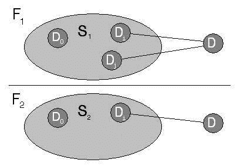

再次考虑第 0 段中的八数码游戏示例。可以看出，提出的启发式函数非常好：它不仅满足上一段所示的一致性条件，而且是“极其有信息量”的。事实上，提出的函数 `h`——错位棋子的数量——无法显著改进，即不可能提供一个启发式 `h'` 使得 `∀ d h'(d) > h(d)`。

实际上从图 33 可以看出，存在节点 `d` 使得 `h(d) = h*(d)`，这意味着假设的上界 `h'` 违反了一致性条件。

#### 3.2.3. 单调约束

如果 `h(d) ≤ h(rf(d)) + rw 且 h(dt) = 0`，则称函数 `h` 满足单调约束（或三角不等式），其中 `r` 是从节点 `d` 到节点 `rf(d)` 的规则。

换句话说，启发式函数与弧（规则）的权重在局部上是一致的。

**定理。** 如果满足一致性条件，评价函数满足单调约束，且存在最优路径，则算法 `A*` 进行扩展时总是选择一条最优路径已被找到的顶点，即 `g(d) = g*(d)`。

**证明.** 对最优路径的长度进行数学归纳。归纳基础：`g(d0) = g*(d0) = 0`。

**归纳步骤。** 设节点 `d ≠ d0`，且 `A = d0, d1, …, di, …, d` 为最优路径。根据单调约束，我们有 `∀i g*(di) + h(di) ≤ g*(di) + w(di, di+1) + h(di+1)`。接着 `di, di+1 ∈ A → g*(di) + w(di, di+1) = g*(di+1)`。

我们得到 `∀i g*(di) + h(di) ≤ g*(di+1) + h(di+1)`，且由传递性 `∀i g*(di) + h(di) ≤ g*(d) + h(d)`。

现在设 `dk` 为路径 `A` 上第一个打开的节点，即 `dk ∈ A, dk ∈ O 且 ∀j < k dj ∈ C`。这样的节点存在，因为 `d0 ∈ C, d ∈ O`。路径 `A` 上 `dk` 左侧的所有节点，即 `dk` 之前路径 `A` 上所有已关闭的节点均已打开，所以 `g(dk) = g*(dk)`。

由于算法 `A*` 在打开下一个节点时在节点 `d` 和 `dk` 中选择节点 `d`，则 `F(d) ≤ F(dk)`。所以我们有：

`g(d) + h(d) = F(d) ≤ F(dk) = g(dk) + h(dk) = g*(dk) + h(dk) ≤ g*(d) + h(d)`。

所以 `g(d) ≤ g*(d)`。但 `∀d g(d) ≥ g*(d)`，因此 `g(d) = g*(d)`。证毕。

**推论。** 当评价函数满足单调约束时，所选节点的评价函数值序列不减。

**证明。** 节点 `d1, d2` 依次打开。如果在打开节点 `d1` 时刻 `d2` 已在 `O` 中，则由 `A*` 的构造可知 `F(d1) ≤ F(d2)`。否则，`d2` 必须在扩展 `d1` 时进入 `O`。我们有：`F(d2) = g(d2) + h(d2) = g*(d2) + h(d2) = g*(d1) + w(d1, d2) + h(d2) = g(d1) + w(d1, d2) + h(d2) ≥ g(d1) + h(d1) = F(d1)`。证毕。

#### 3.2.4. 算法 A* 的适用范围

尽管有诸多优点和长处，`A*` 算法仍有一些固有特性，在特定条件下可能表现为缺点。

1.  **在最坏情况下，`A*` 算法具有指数级的时间和空间复杂度估计。** 假设我们没有满足一致性条件的有信息量评价函数。在这种情况下必须使用广度优先搜索，`h = 0`。假设（在最坏情况下！）每个状态下所有规则都成立并给出 `n` 条这样的规则。再设从 `d0` 到 `dt` 的最优路径上的弧数为 `s`。则很容易看出，搜索图构造的节点总数至少为 `1 + n + n² … + n^(s-1) = (n^s - 1)/(n - 1)`。

2.  **算法的效率关键取决于启发式函数 `F`。** 事实上，我们上面指出，没有启发式信息时，最坏情况下算法执行的步数呈最优路径弧数的指数级增长。如果我们同时拥有一个极其有信息量的估计器，使得 `∀d (h(d) = h*(d))`，且额外满足单调约束，则 `A*` 算法在最坏情况下仅构造 `n*s + 1` 个节点，因为根据上一段的定理，在这种情况下节点沿最优路径依次打开。因此，在理想启发式的情况下，算法 `A*` 的复杂度可以是最优路径弧数的线性函数。

3.  **算法 `A*` 不考虑事实库的结构，且总是完整地使用它。** 这极其消耗内存，并使其对大量实际问题不可接受。例如，在解决带障碍物环境中的机器人运动问题时，事实库非常小——仅是机器人当前位置的坐标，`A*` 算法表现良好。但当 `A*` 应用于专家系统中的大型关系数据库时，形式上图中的每个节点对应数据库的一个完整快照（转储），而相邻节点可能仅相差一条记录。

4.  **算法 `A*` 不考虑规则中条件的结构，并重新评估在前几步中可能已被检查过的条件。** 这非常耗时。在上述示例中，检查机器人位置时，无法复用为前一位置所做的计算，因为坐标已改变。然而，如果在大型关系数据库中检查复杂条件，如果在较早状态下检查过该条件，则 99% 的工作已经完成，因为大部分数据未发生变化。


##### 5. 算法 A* 不适用于动态搜索情况

事实上，如果允许产生式、目标或规则权重在搜索过程中动态变化，[[56]](#part0005.xhtml#_ftn56) 前三段的所有论点都将失效。A* 算法的一致性源于这样一个事实：从给定节点选择另一条路径不取决于我们是如何到达该节点的。而在动态搜索中情况并非如此：从当前节点到目标节点的路径长度也可能不同，这取决于我们是如何到达当前节点的。

本节所述并不意味着 A* 算法毫无价值、不应使用。相反，当没有关于问题性质的额外特定信息时，A* 算法是已知的最佳解决方案。如果存在额外信息，A* 算法可以且应该结合具体任务进行修改。其中最优雅的修改之一将在下一节讨论。

### 3.3. 图中的搜索：AND/OR

在考虑可分解产生式系统时，引入了 AND/OR 图的概念。在这样的图中，节点是数据库的状态或其部分，它们通过两种方式获得：要么应用一条规则，要么将数据库分解为组件。这正是一个图，而不一定只是一棵搜索树。同一顶点 `d` 也可以作为分解 `d1` 的结果和将规则应用于 `d2` 的结果出现。AND/OR 图在 AI 中被广泛使用。像 A* 这样的搜索算法被专门化和改进以用于 AND/OR 图。此外，对于超图的某些特殊情况，已知甚至更高效的算法。

#### 3.3.1. AND/OR 计数

让我们细化定义。

AND/OR 图是一个超图，即由一组顶点 `{ d }` 和一组 k-弧组成的二元组，其中 k-弧是一个二元组 `d → ( d1 ,…,dk )`，`d` 是 k-弧的起始节点，`{ d1 ,…,dk }` 是终止节点的集合。

根据这个定义，普通有向图是每条弧都是 1-弧的超图。正如在普通有向图中一样，可以在超图中定义路径（超路径）的概念。

超图中的超路径是节点集合的序列 `<S1 , …, Sn >`，并且对于每个节点 `d ∈ Si`，`1 ≤ i ≤ n–1`，都恰好存在一条 k-弧 `d → (d1 , …, dk)` 使得 `∀ 1 ≤ j ≤ k ( dj ∈ Si+1 )`。

超路径的定义是路径定义的直接推广，但超图中的超路径看起来更像是一个图表，而不是单一的交替节点和弧序列。从每个顶点恰好选择一条 k-弧。从获得的每个顶点再次恰好选择一条 k-弧，以此类推。

在各种超路径中，我们感兴趣的是那些始于数据库初始状态、终于终止状态的路径。

决策图 `G(d0 , T)` 是从 `d0` 到终止节点集合 `T` 的超路径。

可以给出决策图 `G ( d0 , T )` 的等价递归定义：

1.  若 `d0 ∈ T`，则 `G = d0`。
2.  若 `d0 ∉ T`，且 k-弧 `d0 → ( d1 ,…, dk )` 从 `d0` 出发，且存在顶点 `d1 , d2 , …, dk` 的解图 `G1 , G2 , … , Gk`，则 `G = d0 → ( d1 ,…, dk ) ∪ G1 ∪ G2 ∪ … ∪ Gk`。

决策图的代价（权重）（即超图中路径的长度）使用归纳定义确定：`w ( G (d,T) ) = w ( d → ( d1 ,…,dk )) + Σ w ( G ( di , T ) )`。

因此，计算长度时同一 k-弧可能被多次计算。

让我们看一个例子（图 Error! The text of the specified style is missing from the document. .36 ）。假设节点 5 和 6 是终止节点，节点 0 是初始节点。我们可以断言这里有两个决策图（它们在图中用圆圈标出）。

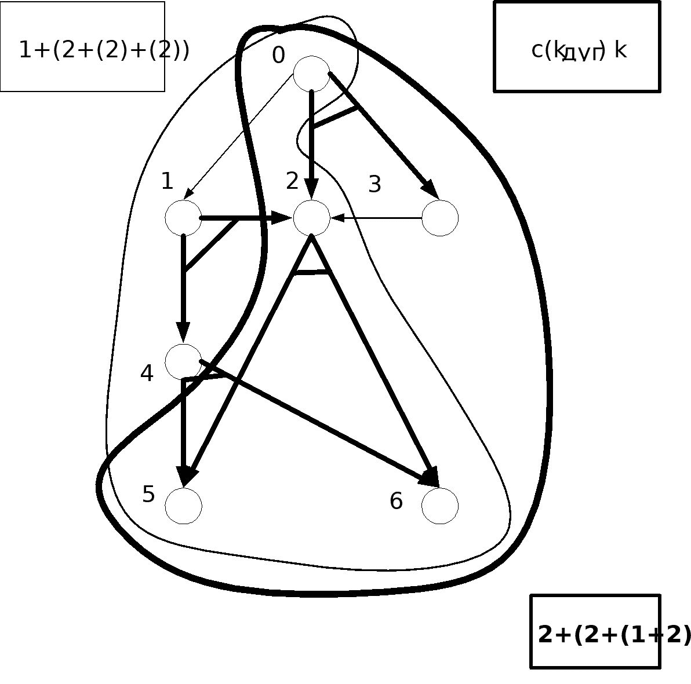

如果假设 k-弧的长度等于 `k`，则

- 第一个解图的长度 = `1+(2+(2)+(2)) = 7`，
- 第二个解图的长度 = `2+(2+(1+2)) = 7`，

因为根据归纳定义，某些 k-弧可能被多次计算。

#### 3.3.2. AND/OR 图上的搜索算法

为了在超图中搜索路径，存在将普通图的深度和广度遍历推广的算法。推广算法的根本区别在于，搜索过程不会在到达单个终止节点时停止。我们不仅需要到达单个终止节点，还需要构建一个决策图，其所有分支都终于终止节点。

一般来说，AND/OR 图搜索算法可以在没有额外信息的情况下工作。然而，在存在评分函数的情况下，可以使用启发式搜索算法。

AND/OR 图的启发式搜索算法如下。

图是无环的，存在评价函数 `F`，且 `h` 满足单调性条件（单调约束）：`h ( d ) ≤ w ( d, ( d1 ,…,dk )) + Σ h ( di )` 以及一致性条件（即为精确解的下界）：`h ( d ) ≤ h* ( d )`。

AND/OR 图上的搜索过程定义如下。

**算法 Error! The text of the specified style does not exist in the document. .eleven. AND/OR 图上的基本搜索过程。**

```
proc GS and/or (d0 , R, T)
  G := d0 {部分解图}
  s(d0) := d0 ∈ T {节点}
  F(d0):= h(d0)
  during ¬ s(d0) do
    d := select(G)
    when D = zero then Return ( Fail ) end if
    Open (d, G)
  end while
End proc
```

此处 `s(d): bool` 是节点的标记，指示是否为此节点找到了通向终止节点的超路径。若 `s(d)= true`，即找到超路径，则该节点称为已解决。

基于构建的搜索图，选择过程考虑部分决策图，并选择该图上代价最小的未扩展节点进行扩展。

**算法 Error! The text of the specified style does not exist in the document. .12. 选择要扩展的节点的过程。**

```
proc Choose (G)
  O := {d0}
  for d ∈ O do
    for q = (d → d1 ,…,dk) ∈ Q(d) do
      if x(d → d1 ,…,dk) then {标记的弧}
        O:=O - {d} {删除起点}
        O:=O + ({d1 ,…,dk} \ T) { 终点 }
      End if
    End for
  End for
  m := ∞
  d' := zero
  do for d ∈ O
    if F(d)<m then
      d' := d
      m := F(d)
    end if
  End for
  return (d')
end proc
```

此处 `O` 是解子图的终止节点，`Q(d)` 是节点 `d` 的弧集合，`x(q)` 是弧 `q` 的标记。

事实上，使用此方法，每次都会沿着标记的 k-弧从 `d0` 重新遍历决策前沿直到终止节点。

Open 过程要复杂得多。它扩展选定的顶点，重新计算顶点值，标记 k-弧，并标记允许的顶点，即那些找到了通向终止顶点的超路径的顶点。这些变化可能影响整个图。

**算法 Error! The text of the specified style does not exist in the document. .13. open 过程。**

```
proc Open (d,G){节点扩展}
  for r ∈ R do
    if rp(d) then
      G := G + (d → d1 ,…,dk)
      do for i from 1 to k
        if di ∉ G then F(di):=h(di) end if
        s(di) := di ∈ T
      End for
    End if
  End for
  {重新计算等级和等级}
  C := {d}
  while C ≠ ∅ do
    {选择要重新计算的顶点}
    for d' ∈ C do
      if P(d') ∩ C = ∅ then d:=d' end if
    End for
    C := C - {d}
    m := ∞
```


##### 算法伪代码

```text
for q = (d → d₁, …, dₖ) ∈ Q(d) do
    w' := w(q) + Σ F(dᵢ)
    if w' < m then
        x(q(d)) := false
        x(q) := true
        s(d) := ∧ s(dᵢ)
        m := w'
    end if
end for

if s(d) ∨ F(d) ≠ m then
    F(d) := m
    C := C + U(d)
end if
end while
End perc
```

##### 符号说明

此处使用以下符号：

- `Q(d)` 是从 `d` 发出的弧的集合（在 `G` 中）
- `P(d)` 是 `d` 在 `G` 中的后代集合
- `q(d)` 是 `d` 的带标签弧
- `x(q)` 是弧的标签
- `U(d)` 是沿标记弧的 `d` 在 `G` 中的祖先集合
- `s(d)` 是节点的标签，意味着它是从到目标的超路径构建的

##### 过程总结

让我们重申一下关于这三个过程的主要结论。`GS` 和/或过程交替调用 `Select` 和 `Open` 过程，直到找不到要扩展的节点（`fail` 的结果）或原始节点 `d₀` 被解析。

- `Select` 过程沿标记弧构建当前部分决策图的前沿，并选择该前沿中评分最低的节点。
- `Open` 过程首先打开选定的顶点，然后重新计算节点估值、标记弧和顶点。在这种情况下，此方法可能会高估整个图。
- 在这些过程中，我们认为规则的概念既概括了规则的应用，也概括了与 `k`\-弧共享数据库。

#### 3.3.3. 将搜索方法应用于 AND/OR 图的示例

图 37 - 图 41 展示了搜索算法在 AND/OR 图上的运行示例，针对图 36 所示的图。

这些图中使用以下符号：

- 基础状态，即 AND/OR 图的节点，用圆圈标记。如果圆圈是实心的，意味着该节点获得了条件 `s(d) = 1`，即找到了从给定节点到终端节点（本例中为节点 5 和 6）的解图。
- 1-弧用普通箭头表示，`k`\-弧（本例中 `k = 2`）用较密的箭头表示，并有一条小短线连接 `k`\-弧的分支。
- 节点旁边的数字是节点的当前评分。
- 假设函数 `h` 对终端节点的值为 0，对所有其他节点为 1。这样的函数显然满足一致性条件。
- `k`\-弧的长度等于 `k`。
- 从给定节点发出的标记弧用粗杠标记。

以下系列图示解释了 AND/OR 图上的搜索过程。

##### 37. 步骤 1. 初始状态

在初始状态下，决策图由单个节点 `d₀` 组成，同一节点形成决策前沿，它被 `Select` 函数选中，因为没有其他可选节点，然后 `Open` 过程打开该节点。

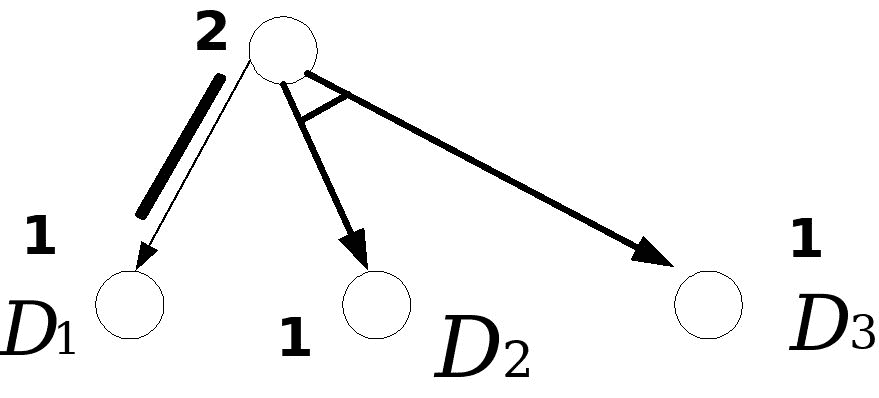

##### 38. 步骤 2: 首次扩展节点

第一步之后，重新计算评分返回 `d₀` 节点如下：

- **左侧** = 1（节点 `d₁` 计数）+ 1（弧 `d₀ → d₁` 成本）= 2
- **右侧** = 1（节点 `d₂` 估值）+ 1（节点 `d₃` 估值）+ 2（弧 `d₀ → (d₂, d₃)` 成本）= 4

左侧估值更优，因此标记弧 `d₀ → d₁`，接下来打开节点 `d₁`。

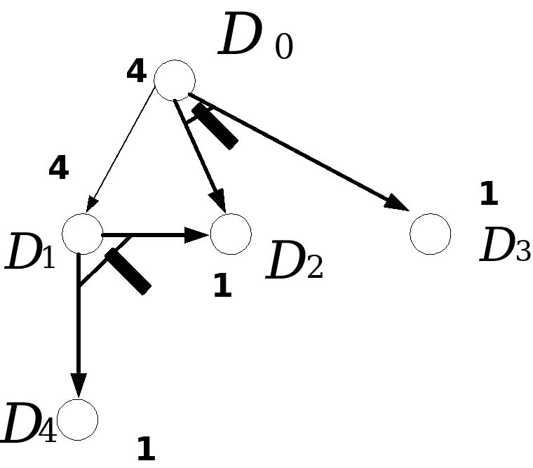

##### 39. 步骤 3. 扩展第二个节点

第二步之后，重新计算评分返回 `d₀` 节点如下：

- **左侧** = 1（节点 `d₄` 估值）+ 1（节点 `d₂` 估值）+ 2（弧 `d₁ → (d₄, d₂)` 成本）+ 1（弧 `d₀ → d₁` 成本）= 5 —— 估值增加
- **右侧** = 1（节点 `d₂` 估值）+ 1（节点 `d₃` 估值）+ 2（弧 `d₀ → (d₂, d₃)` 成本）= 4 —— 估值不变

现在右侧估值更优，因此标记弧 `d₀ → (d₂, d₃)`，接下来打开节点 `d₂`。

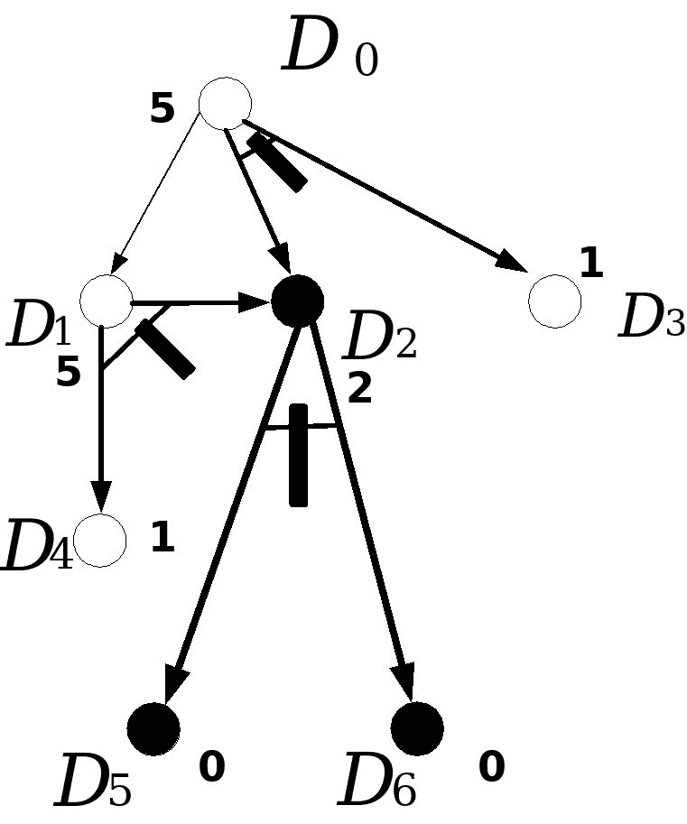

##### 40. 步骤 4. 扩展第三个节点

第三步后到达终端节点 `d₅`, `d₆`。由于两者都是 2-弧 `d₂ → (d₅, d₆)` 指向的节点，节点 `d₂` 也被标记为允许。此外，其估值等于 2（出去的 2-弧成本）。重新计算评分到节点 `d₀` 返回：

- **左侧** = 1（节点 `d₄` 估值）+ 1（节点 `d₂` 估值）+ 2（弧 `d₁ → (d₄, d₂)` 成本）+ 1（弧 `d₀ → d₁` 成本）= 5 —— 估值不变
- **右侧** = 2（节点 `d₂` 估值）+ 1（节点 `d₃` 估值）+ 2（弧 `d₀ → (d₂, d₃)` 成本）= 5 —— 估值不变，因此弧 `d₀ → (d₂, d₃)` 的标记保持不变

接下来打开节点 `d₃`。

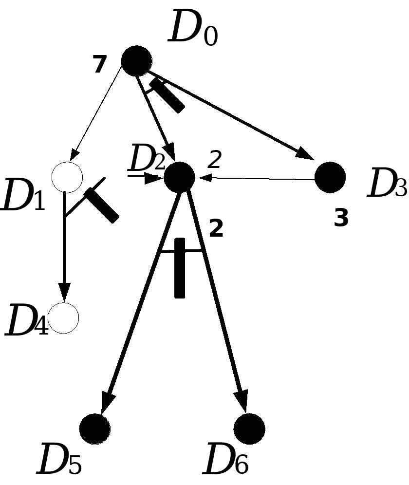

##### 41. 步骤 5. 创建决策图

最后一步，打开节点 `d₃`。由于弧 `d₃ → d₂` 指向已允许的节点，节点 `d₃` 随后节点 `d₀` 获得标签 `s=1`。重新计算估值在节点 `d₀` 返回：2（节点 `d₄` 估值）+ 3（节点 `d₃` 估值）+ 2（弧 `d₀ → (d₂, d₃)` 成本）= 7。算法完成。

### 3.4. 游戏树搜索

在编程智力游戏时，AND/OR 图搜索的思想被特别频繁地使用。此时，通常考虑一种称为游戏树的 AND/OR 图特殊情况。

#### 3.4.1. 游戏树

假设存在一个对抗性（有一个对手）、离散（位置数至多可数）、完全信息（所有规则预先已知且位置公开）的游戏。由两名玩家 `Max` 和 `Min` 轮流移动，`Max` 先移动。

让我们尝试为玩家 `Max` 找出获胜策略。为此，我们构建一个搜索图，其节点为游戏的允许位置。在该图中，如果 `B` 通过对位置 `A` 应用游戏规则获得，则从对应位置 `A` 的节点引出一条弧指向对应位置 `B` 的节点。树的根对应游戏的初始位置，叶子对应游戏结果唯一确定的位置（即确定获胜者或确立平局）。那么，确定玩家 `Max` 获胜策略的问题归结为在游戏树中从根到对应 `Max` 获胜位置的叶子找到一条路径。此外，从 `Max` 移动的位置来看，只需找到至少一个可解节点（因为我们为 `Max` 制定策略，可以选择想要的移动），而对于 `Min` 的移动，所有后代都必须可解（因为我们无法影响 `Min` 的移动选择，必须考虑所有可能的移动）。因此，游戏树是一个 AND/OR 图，其中第一个玩家 `Max` 的节点为 1-弧（AND），第二个玩家 `Min` 的节点为 `k`\-弧（OR）。

游戏规则确定所有最终位置的评分 `F*`：`F* = +∞` 如果 `Max` 获胜，`F* = -∞` 如果 `Min` 获胜，`F* = 0` 如果游戏以平局结束。

通常游戏不仅用 AND/OR 图表示，而是用超树表示，使得除初始位置外的每个位置恰好包含一条弧。在这种情况下，当然可能会有一些内存损失，因为由不同移动顺序产生的匹配位置以多个实例存储。然而，实际观察表明，在最常见的智力游戏中，这种情况相对罕见。另一方面，已经提出了几种用于寻找游戏树解的非常高效的算法（见以下章节），这些算法不适用于一般图。因此，在编程智力游戏时，通常牺牲内存以换取算法速度的提升。


##### 简化版尼姆游戏示例

以简化版尼姆游戏为例。游戏开始时有 5 枚硬币。每回合可取 1、2 或 3 枚硬币。不允许跳过回合。取走最后一枚硬币者输。图 42 展示了完整的游戏树。终局位置下方标注了获胜方。

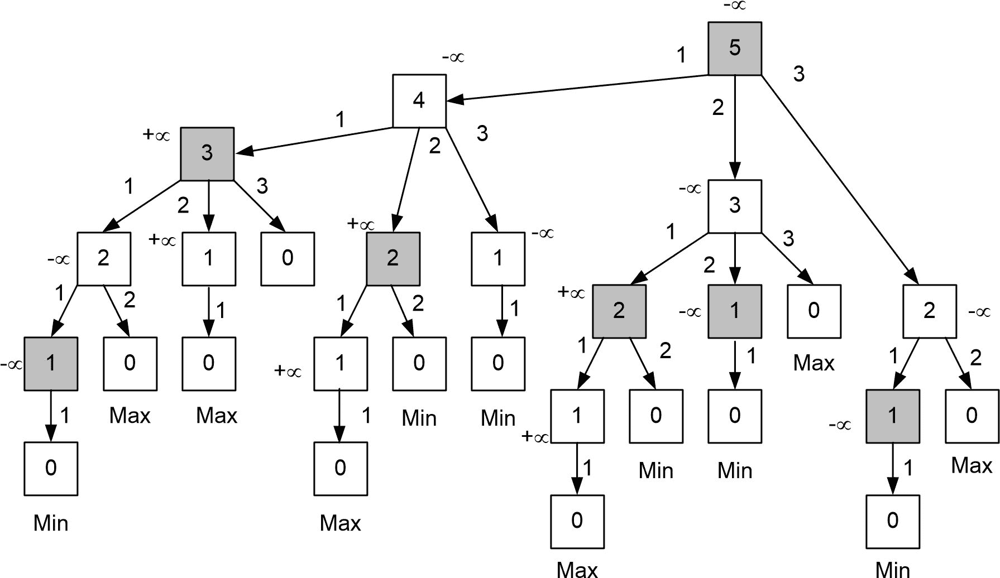

**图 42. 尼姆游戏树**

#### 3.4.2. 极大极小算法

求解游戏树的算法之一称为极大极小算法，由 O. Morgenstern 和 J. von Neumann 于 1945 年提出。J. von Neumann 因现代计算机架构（冯·诺依曼架构）的奠基人、博弈论和细胞自动机概念的创立者而闻名。

如果拥有完整的游戏树，我们将从底部（即由游戏规则给定评分的终端节点，即终局位置的 `F *` 函数）开始，一切将变得非常简单——例如极大方回合，我们选择评估函数值最大的子顶点，并将该估值上传；对于极小方回合，则从最小值上传。若初始顶点经算法得出的估值为 `+ ∞`，则极大方获胜；若为 `-∞`，则极小方获胜。这便决定了游戏的胜负。

例如在图 42 中，节点旁标注了按上述方式获得的静态估值。图示表明，若极小方正确下棋，总能赢下这个简单游戏。

但完整游戏树往往大得惊人。例如，跳棋有 10⁴⁰ 个位置，国际象棋有 10¹²⁰ 个（见 1.1.8 节）。为实际有趣的游戏构建完整游戏树在物理上是不可能的。但可将这一思路（自底向上）应用于子树。为此，需构建子树，用评分函数评估底层节点，再沿树向上回溯。

极大极小算法如下。假设存在位置静态评分函数 `F`，若位置对极大方有利则 `F > 0`，对极小方有利则 `F < 0`。若由极大方在终端节点中选择，他会选估值最高的位置；若由极小方选择，则选最低的。极大极小算法亦同理。在构建的子游戏树中（无法构建完整树时），叶子位置由人为设计的评估函数评估（因游戏规则不提供中间位置评估），随后估值如同完整树的静态评估般向上传播。若评分函数设计得当且树构建得足够深，极大极小算法常能给出真正最优或接近最优的解。

以 3×3 棋盘上的井字棋为例。玩家轮流在空格放置棋子。率先在同一横、竖或对角线连成三子者胜。

图 43 展示了搜索深度为 2 的部分游戏树上应用极大极小算法的过程（“叉”用数字 1 表示，“圈”用 0 表示）。位置后“=”号后的数字为评分。

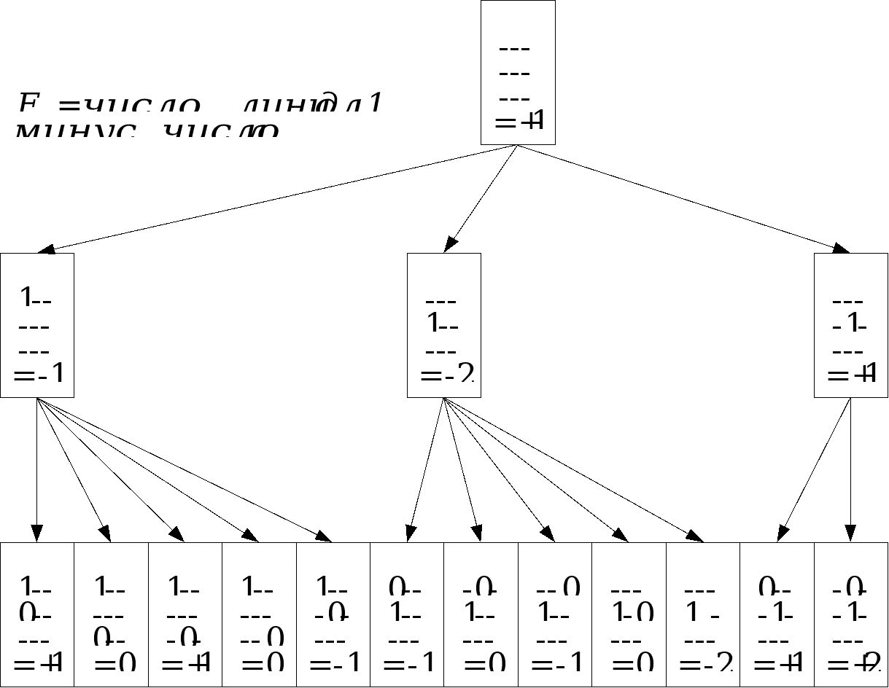

**图 43. 部分井字棋游戏树**

可见，按深度 2 的极大极小算法评估，极大方的最佳走法是走中间格。确实，这是极大方的制胜策略。

然而，极大极小算法并非总能选出真正最佳甚至良好的走法，一切取决于评估函数设计得有多好。以此前段落尼姆游戏的轻微变体为例。允许的走法和结束条件保持不变，初始硬币数不固定，设为 `n`。我们需设计评分函数。这通常基于观察完成。参考图 42 进行观察。可见：`n=1` 时极大方输；`n=2,3,4` 时极大方赢；`n=5` 时极大方又输。即 `n=1` 和 `n=5` 时评分函数须为负，`n=2,3,4` 时为正。人们倾向于选取尽可能简单、符合观测数据的公式，将其宣布为“自然定律”，即评估函数。当中学代数的残留知识从记忆深处浮现时，这种诱惑简直无法抗拒。实际上，该函数至少有两个根，一个在 1 和 2 之间，另一个在 4 和 5 之间。按中学所学，考虑 `(n - 1.5)` 与 `(n - 4.5)` 的乘积，经取整后得到函数 `F(n) = -n² + 6n - 7`，其表现出期望行为，完全符合现有观测：`F(1) = -2`，`F(2) = +1`，`F(3) = +2`，`F(4) = +1`，`F(5) = -2`。我们在 `n=7`、搜索深度为 2 的尼姆游戏极大极小算法中使用此评估函数（图 44）。图中展示了所选函数的初始估值、极大极小算法计算出的估值，及算法选定走法的粗箭头。可见算法建议了正确步骤！

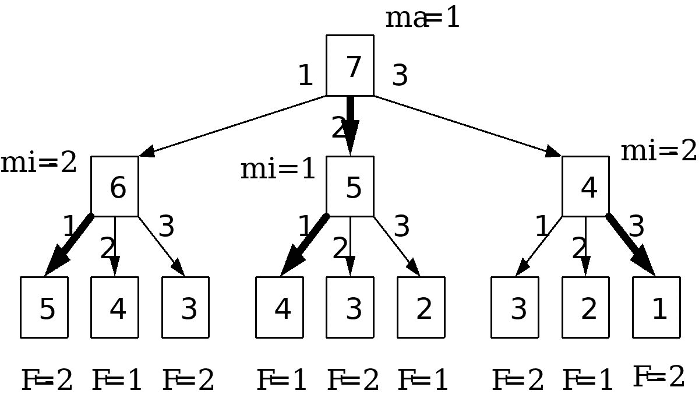

**图 44. 极大极小算法在尼姆游戏中的成功应用**

然而，若试图外推估值器并超出原始观测基础，会得到完全无用的结果。图 45 以图 44 相同标注展示了 `n=10` 时的树。极大极小算法给出错误建议，实际制胜的走法反被其评为最差！

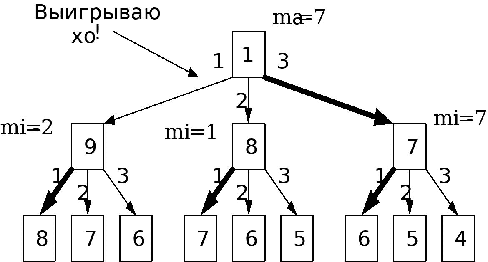

`F=-23 F=-14 F=-7 F=-14 F=-7 F=-2 F=-7 F=-2 F=+1`

**图 45. 极大极小算法在尼姆游戏中的失败应用**

#### 3.4.3. α-β 剪枝

在极大极小算法中，位置生成与评估是分离的。先生成，后评估。可在生成过程中同步评估，以避免生成多余内容。此过程称为 α-β 剪枝。

这一机制在 20 世纪中叶显得如此必要且切题，以至于全球众多科学家投入其发展。如今难以确定该程序作者，显然它被反复发明。Samuel (A. Samuel)、Richards (DJ Richards)、Hart (TP Hart) 等人独立提出了该算法的早期版本。John McCarthy 也在 1956 年达特茅斯研讨会上提出了类似想法。我国同胞 Alexander Lvovich Brudno 独立发现该算法，并于 1963 年发表成果。


##### 让我们考虑一个简单的模型示例，解释 α - β 剪枝的基本思想

假设有一个游戏，其搜索子树如图所示！未找到源。（左侧）。假设我们只展开并评估了相关节点的左子树（它只有一个位置，得分为 7）。由于 Max 玩家总是选择评估函数值最高的节点，因此无论右侧未展开的子树如何，根位置的估值都 ≥ 7。现在考虑 Min 玩家的着法选择（图 错误！文档中缺少指定样式的文本 .46，右侧）。只揭示了两个可能位置中的一个（其得分为 4）。由于 Min 玩家选择函数值最小的节点，因此所选着法的得分 ≤ 4。

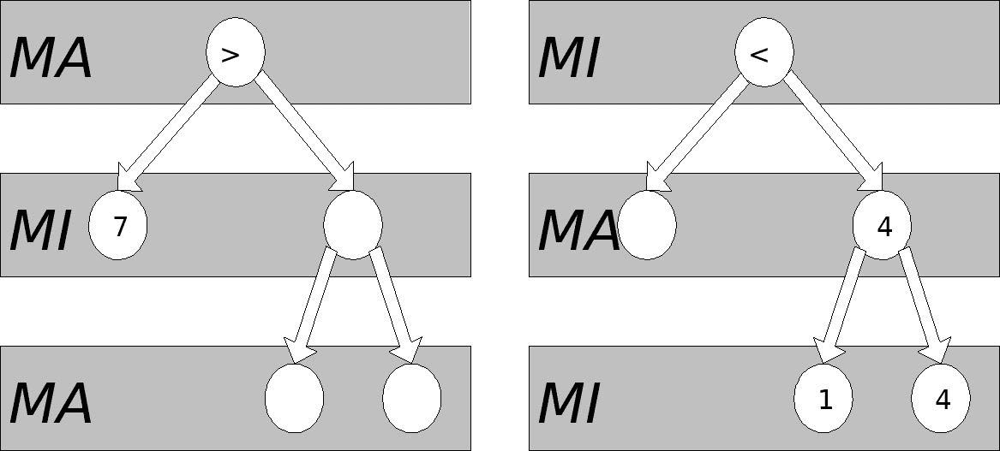

图. 错误！文档中缺少指定样式的文本 .46. 游戏的子树

让我们继续这些思考，看看图 错误！文档中不存在指定样式的文本 .47。

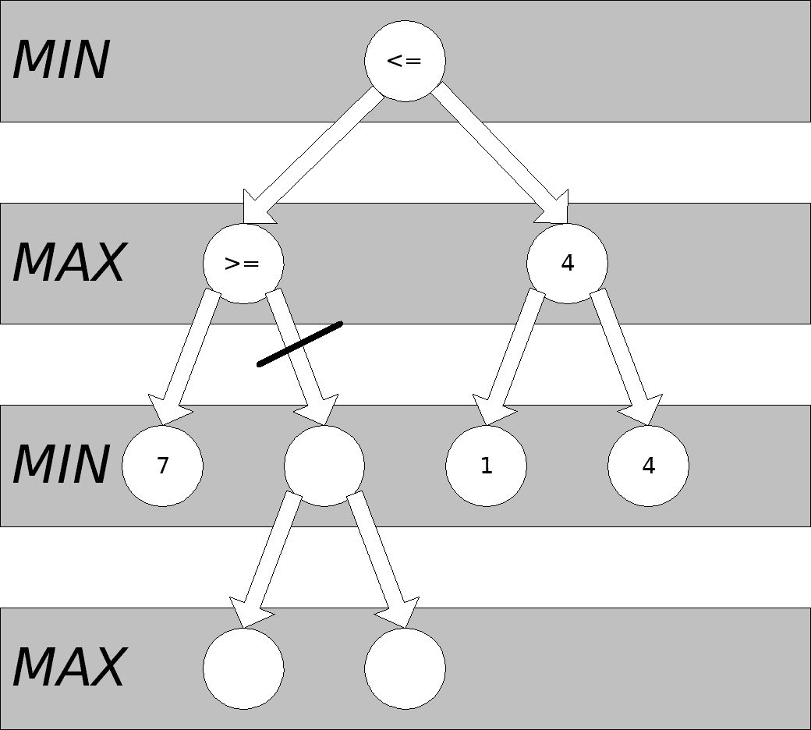

图. 错误！文档中缺少指定样式的文本 .47. 特定游戏子树剪枝示例

在考虑了对应于 Min 着法的节点的右子树后，已知其得分不会超过 4。然而，查看左子树的一部分，发现其根节点的得分将 ≥ 7。这意味着左子树中节点的进一步展开毫无意义，因为 Min 玩家已经有一个已知的最佳选择。因此，左子树的其余部分被截断。

上述示例形式化如下。

设 α 为给定节点分数值的下界，β 为该节点分数值的上界。

请注意，随着节点的展开，Max 节点的 α 值不会减小，Min 节点的 β 值不会增大。因此，适用以下规则。

1.  Min 节点，如果其上界 β 小于或等于其任意 Max 父节点的下界 α。
2.  Max 节点，如果其下界 α 大于或等于其任意 Min 父节点的上界 β。

请注意，用于测试的剪枝不等式公式在形式上是相同的：第一种情况 β ≤ α，第二种情况 α ≥ β，但这些公式含义不同。

在第一种情况下，我们获取刚刚为 Min 节点得到的估值 β，并将其与上方 Max 节点的估值 α 进行比较。在第二种情况下，我们获取刚刚为 Max 节点得到的估值 α，并将其与上方 Min 节点的估值 β 进行比较。但在两种情况下，不等式的满足都是截断的依据。

图 错误！文档中不存在指定样式的文本 .48 显示了一个井字棋游戏示例。

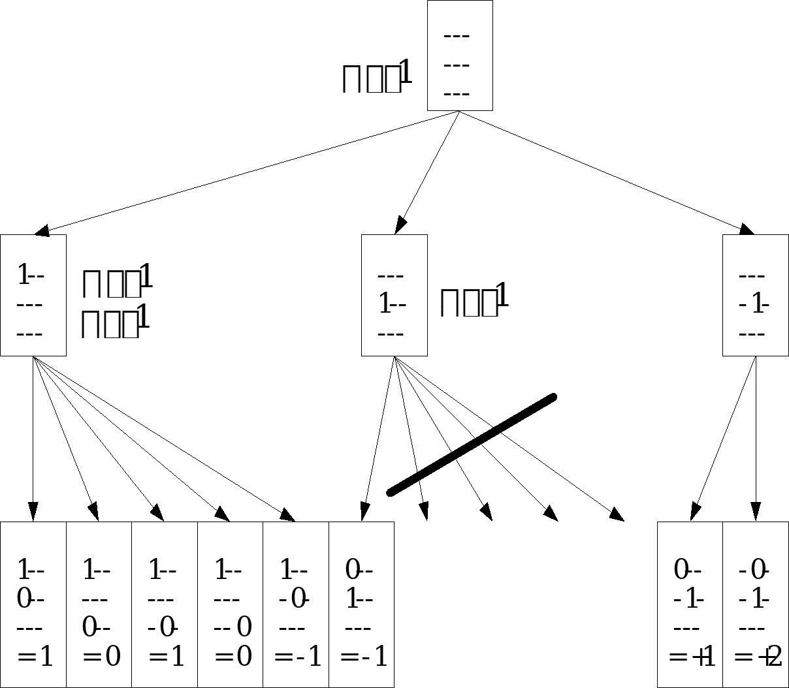

48. α - β 井字棋剪枝

生成和评估过程如下。首先，生成第二层的三个节点。然后在左子树中创建五个第三层节点，并为第二层节点获得 -1 的得分。在这种情况下，第一层根节点的下界估值 α = -1 可以立即确定。接下来，开始生成中间子树中的第三层节点。第一个节点的估值为 -1，给出上界估值 β = -1 并满足剪枝不等式。我们看到第三层有四个节点无需生成——它们的生成不会改变其余节点的估值。右子树中没有发生剪枝——不等式未得到满足。

#### 3.4.4. α - β 剪枝的效率

α - β 剪枝的效率如何？让我们尝试回答这个问题。在分析的示例中，我们节省了 16 个节点中的 4 个，即 25% 的工作量。这个指标有限制吗？它总是能达到吗？

让我们先回答第二个问题，这比较容易。答案：

不，并非总是如此。事实上（在最坏情况下！），Min 节点的子节点按降序生成，Max 节点的子节点按升序生成。例如，如果在图 错误！文档中不存在指定样式的文本 .48 中，中间子树的第三层节点按此顺序生成：0, 0, -1, -1, -2，则仅剪枝两个节点（节省 12.5%）；如果评估函数失效，估值为 0, 0, 0, 0, 0，则完全不会发生剪枝。

现在回答第一个问题：在最佳情况下 α - β 剪枝能产生什么效果？所讨论树的深度（不剪枝）为 h，每个节点恰好有 d 个子节点。那么底部恰好有 N = d^h 个节点。假设（最佳情况！）为 Min 节点按评估函数值升序生成顶点，为 Max 节点按降序生成。

可以证明，使用 α - β 剪枝生成的节点数相同：

N = O ( d^(h/2) ) = { d^((h+1)/2) + d^((h-1)/2) - 1 如果 h 为奇数; 2 * d^(h/2) - 1 如果 h 为偶数 }

因此，我们问题的答案如下：在理想情况下，α - β 方法使搜索深度比极大极小算法增加一倍，且在任何情况下结果都不会更差。

因此我们看到，生成位置的顺序和考虑着法的顺序是编程智力游戏的关键因素之一。不幸的是（或者也许是幸运的是？），没有通用的调度方法。所有游戏程序中的枚举方法大致相同，类似于上述描述的方法（很久以前就已发表并被充分研究），但每个游戏考虑着法顺序的启发式方法各不相同（构成了游戏程序作者的专有技术）。

实践表明，游戏程序的强度与搜索深度成正比。例如，初学者棋手很少向前搜索超过三四步。这意味着初学者的搜索树深度约为 3。国际象棋大师在脑海中构建十几个半回合的树，如果计划着强制变着，则更多。特级大师和冠军看得更远，达二十几个半回合。因为他们处于中局，已经能预测残局。

现代国际象棋程序利用计算机能力的巨大提升，构建并评估包含数百万个位置的巨大游戏树。为什么人类有时仍不输给计算机？[[59]](#part0005.xhtml#_ftn59)事实是，人类棋手在脑海中构建的树要窄得多。在复杂的国际象棋局面中，强手立刻能从二十几个可能的着法中看出 2-3 个最佳着法，并只详细分析计算这些着法。而国际象棋程序即使使用像 α - β 剪枝这样最著名的技巧，平均也只能舍弃一半的可能着法。如果我们有条件地假设人类游戏树中的分支因子恒定等于 2，程序恒定等于 10，那么使用极大极小算法搜索深度 10 时，人类必须查看 2¹¹ = 2048 个位置，而程序需查看 10¹¹ = 100,000,000,000 个项目。

##### 第 3 章 结论

1.  存在多种寻找解决方案的算法，也适用于生成系统。每种算法都有其最有效和有用的应用领域。
2.  在人工智能中，启发式算法用于寻找解决方案，算法的效率关键取决于评估函数的质量，评估函数实际上决定了启发式信息。
3.  有向图和图（树）AND/OR 最常用于表示搜索空间。

## 第 4 章


### 4.1. 决策方法

本章材料主要基于数理逻辑，假设读者熟悉其基本概念。然而，所有必要的定义和一些定理在前几节中简要重述。不过，我们要提醒读者，本章绝非一本简明的数理逻辑教科书。形式数理逻辑中许多重要、有趣且技术复杂的定理和概念，要么被省略，要么未加证明，要么以简化形式给出。原因在于，在本章中，我们将数理逻辑及其主要对象——逻辑演算——根本不视为目的，而仅视为在计算机中表示知识的一种手段。我们在本章中对待数理逻辑这门精深学问的态度极其务实：我们只是直接使用现成的语言和工具，而不考虑人类为此付出的代价。当然，逻辑演算在 AI 中的应用仅通过具体例子加以考虑。正文中的形式构造保持在最低限度。需要形式构造的读者请参考经典教科书 [19]。

#### 4.1.1. 形式理论

历史上，形式理论的概念是在数学基础研究的高峰期发展起来的，目的是将逻辑本身和证明理论形式化。杰出的德国数学家大卫·希尔伯特对形式理论工具的形成和发展做出了巨大的、或许是关键性的贡献。如今，这一工具被广泛用于创建特定演算，以解决 AI 领域的具体应用问题。大卫·希尔伯特曾写道：“证明论……给我们一种崇高的信念，即至少数学思维是无界的，并能追寻其自身思想的规律……”。

我们下面使用的谓词演算是形式理论的一个例子，因此我们从形式理论的一般概念简述入手。

形式理论是一种具有以下四个必要组成部分的结构：

- 符号集 `A`，构成形式理论的字母表；
- 字母表 `A` 上的单词集 `F`，`F ⊆ A*`，称为该理论的公式；
- 公式的子集 `B`，`B ⊆ F`，称为形式理论的公理；
- 公式集上的关系集 `R`，`R ⊆ F^(n+1)`，称为形式理论的推理规则。

符号集 `A` 可以是有限的，也可以是无限的（可数）。通常使用有限的字母集来形成符号，符号可以被赋予自然数作为索引。

公式集 `F` 通常由归纳定义给出，例如使用生成形式文法。该集合通常是无限的。除了“公式”一词外，也可以使用“建议”一词。符合严格定义的句子有时称为合式公式，以区别于来自 `A` 的任意字符组合（简单句子或字符串）。在某些形式理论中，合式句子的地位可能取决于上下文或外部环境。在下文中，除非另有说明，公式是指所考虑形式理论的合式公式。

集合 `A` 和 `F` 共同定义了一种语言或形式理论签名，传统上表示为 `Σ = (A, F)`。

公理集 `B` 可以是有限的，也可以是无限的（但可数）。当公理集是无限时，通常使用有限的公理模式集和从公理模式生成特定公理的规则来指定。从公理模式生成特定公理最常用的规则是代换规则。

举一个解释性的例子。教科书 [19] 指出（我们引用时略有删节，并采用本书使用的符号）：“无论公式 `A`、`B` 和 `C` 为何，以下公式均为公理：

(A1) `(A → (B → A))`

(A2) `((A → (B → C)) → ((A → B) → (A → C)))`

(A3) `((¬B → ¬A) → ((¬B → A) → B))`”

其含义如下。设所考虑形式理论的字母表包含小写拉丁字母、连接词 `¬` 和 `→` 以及括号 `(` 和 `)`，而不包含大写拉丁字母。那么，用名称 (A1)、(A2) 和 (A3) 表示的书写表达式，严格来说，并非形式理论的公式，因此不能成为公理。这些正是公理模式。可以用任意公式代换参数 `A`、`B` 和 `C`，同一参数的所有出现处必须代换同一公式，由此产生的表达式（注：这是命题演算）已是该形式理论的公式，即被宣布为公理。特别地，如果在模式 A1 中用公式 `(b → a)` 代换参数 `A`，用公式 `a` 代换参数 `B`，（简记为：`{(b → a)//A, a//B}`），则得到公式 `((b → a) → (a → (b → a)))`，它是合式公式，也是命题演算的公理。如果对同一模式 A1 应用代换 `{(a → a)//A, a//B}`，则得到公式 `((a → a) → (a → (a → a)))`，它也是命题演算的公理。命题演算的公理集是无限的，尽管它仅能由三个公理模式给出。

对于应用理论，公理常分为两类：

- **逻辑公理**，直接借用自基础形式理论（在我们的情况下是一阶谓词演算）；
- **非逻辑公理**（也称为技术公理或专有公理），反映特定应用领域的应用细节和内容。

再引入两个与公式和公理相关的概念。

如果存在一个算法，根据所呈现的理论公式（理论字母表的字符串），能在有限时间内判断该字符串是否属于合式公式类，则该理论称为**可判定的**。

如果此外，时间还受公式长度的多项式限制，则该理论称为**有效可识别的**。

如果存在一个算法，根据所呈现的公式，能在有限时间内判断该公式是否属于公理集，则该形式理论称为**可公理化的**。

如果此外，时间还受公式长度的多项式限制，则该理论称为**有效可公理化的**。

推理规则集 `R` 通常是有限的。


##### 形式理论基础

形式理论的签名、公理和推理规则通常可以任意选择，但需遵守定义中规定的限制。然而，仅为形式理论而构建形式理论是无益的。在本书语境下，我们关注那些描述真实对象及其相互关系的形式理论。现实世界对象的集合及其相互关系通常被称为**领域**。三个重要术语——**可导性**、**逻辑后果**和**解释**——构成了一个术语循环，通过它可以对非形式化事物进行形式化描述。

###### 可导性

如果推导规则中存在规则 `R` 使得 `(F₁, …, Fₙ, G) ∈ R`，则称公式 `G` 可直接从公式集 `F₁, …, Fₙ` **导出**。

公式 `F₁, ..., Fₙ` 称为**前提**，公式 `G` 称为推理规则 `R` 的**结论**。在本书中，我们通常通过水平线分隔前提和结论，并在适用时指定推理规则名称来表示直接可导性：

```
F₁, …, Fₙ
──────── R
      G
```

如果存在公式序列 `<A₁, A₂, …, Aᵢ, …, Aₙ>`，其中 `Aₙ = G`，且每个公式 `Aᵢ` 要么是公理，要么是公式 `F₁, …, Fₙ` 之一，要么根据某个推理规则 `R` 直接从某些较早的公式导出，则称公式 `G` 在给定形式理论中**可从公式集 `F₁, …, Fₙ` 导出**。

公式 `G` 可从公式 `F₁, ..., Fₙ` 导出记作：

```
F₁, …, Fₙ ⊢ G
```

公式 `F₁, …, Fₙ` 称为**结论假设**，序列本身 `<A₁, A₂, …, Aᵢ, …, Aₙ>` 称为**形式推导**。

如果公式 `G` 仅能从公理导出——不使用假设，则 `G` 称为**形式理论命题**。此事实用符号 `⊢ G` 表示。

###### 可判定性与定理

我们之前定义了（有效）可知性和（有效）公理化性。我们认为有必要对定理概念作类似说明，引用 E. Mendelssohn [19] 的观点：

> 如果存在一个算法，对于理论中的任意公式，都能在有限步骤内判定其在该理论中是否存在导出，则称该理论为**可判定**的；否则称为**不可判定**的。粗略地说，可判定理论是指可以发明一台机器来检验公式是否为该理论定理的理论；而在不可判定理论中，要完成相同任务需要越来越多独立的创造行为。

我们看到，**导出**、**推导**和**定理**这些术语纯粹是句法上的，不涉及真理的语义概念。当形式理论宣称定理可从公理导出时，这绝不意味着该定理在任何实质意义上是"真"或"正确"的。这仅意味着我们找到了一个公式的形式序列，它以特定方式开始（公理），以特定方式结束（定理），且所有中间公式以特定方式相关（推理规则）。为了转向语义，必须引入**解释**概念。

###### 解释

形式理论到领域 `M` 的**解释 `I`** 是一组函数，将形式理论的构造映射到领域 `M` 的对象集合和关于对象的陈述。

需要多个函数而非单一函数，因为公式中使用的每种形式构造类型都需要自己的函数。例如，在解释谓词演算公式时（见下段），每个形式常量必须关联一个实际对象，形式函数符号关联具体映射，形式谓词关联具体关系。此后，公式成为有意义的陈述，我们可以从意义角度尝试检验该陈述是真还是假。

公式 `A` 在解释 `I` 中的真值记为 `A | I`，或若上下文清楚表明是解释 `I`，则简记为带解释特征的公式名自身：`A|`。公式的真值总是由常量 `true` 或 `false` 之一确定。为不受 `A | I = true` 类型数据记录束缚，我们写 `A | I`（`¬A | I`），意为公式为真（假），或简记为 `A|`（`¬A|`）——考虑到上述唯一性说明。

- 若公式在**任意**解释中为真：`∀I (A | I)`，则称其为**有效**或**重言式**。
- 若至少存在**一种**解释 `I` 使其为真：`∃I (A | I)`，则称其为**可满足**的。
- 若在**任意**解释中均为假：`∀I (¬A | I)`，则称其为**不可满足**或**矛盾**。

###### 适当性、模型与完备性

设有形式理论、特定主题及给定解释。设 `T` 为形式理论的定理集，`P` 为主题的真陈述集。若在解释 `I` 下集合 `T` 和 `P` 发现一一对应，则再好不过：所有形式可导出的陈述在意义上为真，所有在意义上为真的陈述形式上可导出。此时称该形式理论**适合**该主题。适当性是强大而罕见的性质。实践中常需满足较弱性质。

若存在解释 `I` 使该解释下所有导出公式均为真：`∀G (⊢ G → (G | I))`，则称该领域为形式理论的**模型**。

若存在解释 `I` 使所有真公式均可导出：`∀G ((G | I) → ⊢G)`，则称形式理论对该主题是**完备**的。

**充分理论**拥有模型且在其模型中完备。

必须清楚理解：形式理论不是神圣启示或人类心智固有的先天法则——形式理论是人类为形式化特定主题领域而发明的，这些发明的成败取决于发明者的独创性。同一主题领域可有不同形式化，这常发生：不同形式化相互竞争和演变。

###### 逻辑后果

语义解释概念引出**逻辑后果**概念。

称公式 `G` 从公式 `F₁, …, Fₙ` **逻辑后随**（记作 `F₁, …, Fₙ ⊨ G`），若在使公式 `F₁, …, Fₙ` 为真的**每一种**解释中，公式 `G` 均为真：

```
F₁ | I & … & Fₙ | I → G | I
```

**逻辑后果**是语义概念。**可导性**是句法概念。二者可能相关，若理论适当则明显相关，也可能不那么直接相关。一切取决于 `R` 的推理规则。

若形式可导性蕴含逻辑后果：`F₁, …, Fₙ ⊢R G → F₁, …, Fₙ ⊨ G`，则称推理规则 `R` 是**一致**的。

若某逻辑后果由形式可导性确证：`F₁, …, Fₙ ⊨ G → F₁, …, Fₙ ⊢R G`，则称推理规则 `R` 是**完备**的。


####### 一种作为两千年典范的理论

尽管从今天的观点来看，它构建得不够严谨和形式化。许多数学家试图改进欧几里得的构造。例如，罗巴切夫斯基导致了非欧几何的发现。一百多年前，大卫·希尔伯特撰写了《几何基础》，这部作品已成为形式理论的新质量标准。早在 20 世纪末，国内数学家 A.V. 波戈列洛夫提出了他的几何公理化体系，该体系非常成功且现代，甚至曾考虑将这一形式理论变体作为中等教育的主要变体引入。所有这些形式理论各不相同，但研究对象——关于几何对象性质的有意义真命题的集合——是同一个！

#### 4.1.2. 一阶谓词演算语言

本章考虑的主要知识表示工具是应用一阶谓词演算的公式。即使是大卫·希尔伯特也指出：“一阶谓词演算在所有合理情况下都已足够”。这里我们将谓词演算视为一种语言，一种书写逻辑陈述的符号系统。此外，我们认为读者熟悉诸如逻辑算子（“AND”、“OR”、“IF ... THEN”）和量词（“for all”、“exists”）等概念的层面上熟悉这种语言。[\[64\]](#part0005.xhtml#_ftn64)。

我们考虑一种包含逻辑运算、量词以及建立在函数符号集、对象变量和常量之上的原子公式的语言。下面是一阶谓词演算语言的形式文法。给定以下可区分的符号集：常量符号集（记作 `const`）、变量符号集（记作 `vari`）、函数符号集（记作 `func`）和谓词符号集（记作 `predicate`）。

| 表达式 | | `const` | 变量 | 单选按钮（项列表） |
| --- | --- | --- | --- | --- |
| 项列表 | | `Therme` | `term`，项列表 |
| 原子 | | `predicate` | `predicate(term list)` |
| 字面量 | | `Atom` | `¬ Atom` |
| 公式 | | `Atom` | `¬ ( formula )` | |
| | | `(Formula-Bundle-Formula)` | |
| | | `Perem quantifier (formula)` | |
| 连接词 | | `∧` | `∨` | `→` |
| 量词 | | `∀` | `∃` |

字面量（原子或原子的否定）的概念在语法上通常是冗余的。我们引入它是为了方便使用该术语。无参数的谓词也是冗余的。我们引入它是为了使命题演算在语法上成为谓词演算的一个特例。

关于该语言的语法，有几点说明必要：

1.  **首先**，在这种语言中，我们认为函数符号和谓词符号具有固定的名称和固定数量的参数，就像在传统编程系统中一样。这是一个相当强的假设，原则上不能那样看待。在这种情况下，我们将不得不处理 `λ` 表达式和混合演算，这超出了本课程的范围。
2.  **其次**，我们使用的语言在逻辑层级中被归类为一阶语言。换句话说，这意味着只有对象变量可以放在量词下，即没有函数符号和谓词。否则，即如果假设量词不仅能约束主体变量，那就不是一阶演算。这类演算用于现代真实的 AI 系统。例如，模型检验趋势基于看起来像一阶逻辑的时序逻辑，但实际归约为标准的非一阶逻辑。
3.  **第三**，上述谓词演算语法假设按特定语法正式书写陈述，包含所有必要的括号等。当然，在考虑示例时，我们将极大地简化形式语法，更方便地书写公式，但方式应使人总能猜出个别情况下使用了哪些语法简化。特别是，使用了连接词和量词的常规优先级，系统地省略额外的括号。
4.  **第四**，众所周知，纯一阶谓词演算表达能力有限。换句话说，许多有意义的理论在纯一阶演算中无法表达或难以表达，需要逻辑外假设。当然，我们允许描述主题领域所需的常量、函数符号和谓词。也就是说，然而，人们认为自然数和其他众所周知的概念可以在任何公式中使用，而无需试图以公理化方式描述它们到底是什么。
5.  **第五**，有足够的封闭公式，开放公式不必考虑，因为如果存在开放公式，当且仅当相应的闭包可满足时，它才是可满足的。因此，公式以开放形式书写，假设所有自由变量都由全称量词封闭。

#### 4.1.3. 子句

1965 年，John Alan Robinson 提出了归结法来证明逻辑公式的有效性。该方法的思想基于赫布兰的工作，但由于他在 1930 年未想到将其方法应用于计算机（这并不奇怪），赫布兰的方法从计算角度来看不太合适。Robinson 使其适用于实际应用，并开发了构成该方法基础的合一算法。

求解过程适用于使用称为定理的特殊形式公式的逻辑演算。

**子句** 是字面量的无量词析取。

一阶谓词演算的任何公式均可通过依次应用以下步骤归约为定理：

1.  **消除蕴含**。蕴含被替换为第一个操作数的否定的析取。`A → B = ¬A ∨ B`
2.  **向内移动否定**。否定仅保留在原子前面。这遵循德摩根定律，利用量词的性质和否定的自反性。
    ```
    ¬(A & B) = (¬A ∨ ¬B)
    ¬(A ∨ B) = (¬A & ¬B)
    ¬∀x(A) = ∃x(¬A)
    ¬∃x(A) = ∀x(¬A)
    ¬¬A = A
    ```
3.  **分离关联变量**。重命名约束变量，使其不意外匹配不同的量词。`∀x(… ∃x(… x …)…) = ∀x(… ∃y(… y …)…)`，以及所有其他量词组合的类似情况。
4.  **归约为前束范式**。将公式转换为以量词前缀开头，后跟非量词矩阵的形式。`A ∨ ∀x(B) = ∀x(A ∨ B)`，以及所有其他量词和连接词组合的类似情况。
5.  **斯科莱姆化**。通过引入新的函数符号和常量来消除存在量词。`∃x(A(… x …)) = A(… a …)`，`∀x(∃y(A(… y …))) = ∀x(A(… f(x)…))`，其中 `a` 是新常量，`f` 是新函数符号。
6.  **消除全称量词**。由于仅考虑封闭公式，剩余的全称量词作为隐含条件被省略。`∀x(A(… x …)) = A(… x …)`。
7.  **归约为合取范式**。合取范式中的主要操作是合取，它连接析取组。`A ∨ (B & C) = (A ∨ B) & (B ∨ C)`。
8.  **分解为子句**。公式被分解为多个子句。`A & B = A, B`


这并不是将谓词演算公式归约为定理的唯一方法；还有其他等价的方法。归约为命题在逻辑上并不等价，但以下断言是正确的，我们不加证明地给出。

**集合。** 通过将原始公式归约为集合而获得的那些公式形成一个不一致的集合，当且仅当原始公式集合不成立。

让我们考虑使用上述动作序列将一阶谓词演算公式归约为命题的例子。

将公式归约为句子：`∀ x (P(x) → ∃ y Q(x, y))`。

1.  `∀ x (¬ P(x) ∨ ∃ y Q(x, y))`
2.  公式不变
3.  公式不变
4.  `x ∃ y (¬ P(x) ∨ Q(x, y))`
5.  `∀ x (¬ P(x) ∨ Q(x, f(x)))`
6.  `¬P(x) ∨ Q(x, f(x))`
7.  公式不变
8.  公式不变

现在让我们将前一个公式的否定归约为定理：`¬∀ x (P(x) → ∃ y Q(x, y))`。

1.  `¬ ∀ x (¬ P(x) ∨ ∃ y Q(x, y))`
2.  `∃ x (P(x) & ∀ y (¬ Q(x, y)))`
3.  公式不变
4.  `x ∀ y (P(x) & ¬ Q(x, y))`
5.  `∀ y (P(a) & ¬ Q(a, y))`
6.  `P(a) & ¬ Q(a, y)`
7.  公式不变
8.  `P(a), ¬ Q(a, y)`

##### 4.1.4. 归结规则

求解方法不仅使用一种特殊的公式，还使用一种特殊的推理规则。

**求解规则**（归结规则）是从两个定理导出新公式（定理）的规则。**归结式** —— 由应用归结规则产生的新子句。

归结规则仅适用于包含互补文字（`P` 和 `¬P`）的子句，其内容如下。给定两个子句（包含可统一的互补文字），可以通过合并原始子句并消除互补文字，从这对子句中导出一个新子句：

```
P ∨ Q₁ ∨ ... ∨ Qₙ, ¬P ∨ R₁ ∨ ... ∨ Rₘ
---------------------------------------
Q₁ ∨ ... ∨ Qₙ ∨ R₁ ∨ ... ∨ Rₘ
```

请记住，我们非常喜欢将推理规则写成“多层”形式，即：规则的前提（前件）置于横线上方，结论（后件）置于横线下方。

**归结式** 是除一对相反文字外所有文字的并集（更准确地说是析取并集）。在这种情况下，下标 `n` 和下标 `m` 都可以取任意值。特别地，如果归结的子句仅包含互补文字，则归结式为**空子句**。注意，根据定义，空子句被视为恒假。

归结规则是一条非常强大的规则！许多规则（如*肯定前件规则* [[65]](#part0005.xhtml#_ftn65)）都是归结规则的特殊表现形式。下表 4.1 展示了一些著名的传统推理规则及其在归结方法约束下的写法，其中前提和结论均为无量词的文字析取式。这些例子表明，归结规则不弱于传统规则，任何可以用传统方式通过*肯定前件规则*导出的内容，也都可以用归结规则导出！

**表 4.1. 推理规则的传统形式与归结形式**

| 规则名称 | 传统形式 | 操作形式（归结） |
| :--- | :--- | :--- |
| **肯定前件规则** | `A, A → B` / `B` | `A, ¬A ∨ B` / `B` |
| **假言三段论** | `A → B, B → C` / `A → C` | `¬A ∨ B, ¬B ∨ C` / `¬A ∨ C` |
| **合并** | `A ∨ B, A → B` / `B` | `A ∨ B, ¬A ∨ B` / `B` |

仅归结规则就构成了一组完备且一致的规则（见第 0 点）。让我们通过给出适当的简化定义，为命题演算的情况证明这一断言。

如果结论是前提的逻辑后果，则推理规则是**一致的**（可靠的）。

**定理。** 归结规则是一致的。

**证明。** 设 `I` 为任一解释，`C₁` 和 `C₂` 为根据归结规则进行归结的子句，`P` 为被归结的文字。为清晰起见，假设谓词 `P` 在子句 `C₁` 中正出现，在 `C₂` 中负出现。设 `C₁'` 和 `C₂'` 为从子句中消除互补文字后得到的结果。

根据定理条件 `I(C₁) & I(C₂)`。若 `I(P)`，则 `C₁' ≠ ∅ & I(C₁')`，意味着 `I(C₁' ∨ C₂')`。若 `I(¬P)`，则 `C₂' ≠ ∅ & I(C₂')`，这无论如何都意味着 `I(C₁' ∨ C₂')`。证毕。

如果有效公式可以从该规则导出，则推理规则是**完备的**。

**定理。** 归结规则是完备的。

**证明.** 众所周知，命题演算的*肯定前件规则*是完备的，且如表 4.1 所示，它是归结规则的一个特例。证毕。

##### 4.1.5. 统一

要应用归结方法，我们需要找到互补文字。在命题演算中，这个问题不存在。每个变量及其否定形式都是一对互补文字。而在一阶谓词演算中，情况就没那么简单了。即使我们找到了同一个谓词的两次出现，一次正一次负，也不意味着找到了互补对。谓词字母后面可能跟着各种参项，每种情况下的参项可能都不同。在某些情况下，可以通过**替换**来**统一**文字，即对变量进行修改，使文字的原子变得相同，但在其他情况下这是不可能的。存在算法（特别是**算法 4.1**），用于检查两个公式（特别是两个原子）是否可以统一，并在统一可能时找到一组统一替换。让我们细化定义。

公式的**特例**（实例）是将原始公式中特定变量的所有出现替换为特定参项后的结果。

**统一** 是为两个公式计算一个最一般公共实例的方法（如果存在的话）。

**统一子** 是某些参项对变量的替换集合，将其应用于给定公式后，使它们变得相同（产生它们的公共实例）。

**最一般统一子（MGU）** 是统一公式的最小替换。

让我们对这些定义做一些一般性说明。

1.  在许多形式理论中，公式的实例是其逻辑后果。这特别适用于命题演算公式和子句（无量词文字析取式）。
2.  在绝大多数情况下，公式没有公共实例。因此，在统一过程中，尽快得到否定回答非常重要。
3.  通常，除了用另一个变量替换变量外，还可以替换一个包含同一变量的参项。然而，这样的替换永远不会导致统一，因此统一子中禁止这种替换（发生检查）。
4.  如果 `σ` 是最一般统一子（标准缩写 **MGU**），`θ` 是任意统一子，则存在替换 `ρ` 使得 `θ = σ ∘ ρ`，其中 `∘` 是替换复合的符号。

例如，两个公式 `P(x, f(a))` 和 `P(g(b), y)` 可以统一，**MGU** `[P(x, f(a)), P(g(b), y)] = {g(b)/x, f(a)/y}`。

同时，公式 `P(x, f(a))` 和 `P(y, g(b))` 不可统一，因为对于变量的任何参项替换，`f(a) ≠ g(b)`。此外，公式 `P(x, f(a))` 和 `P(g(b), x)` 也不可统一，因为统一将要求同时用参项 `f(a)` 和参项 `g(b)` 替换变量 `x`，这显然是不可能的（违反发生检查）。


###### 经典合一算法

我们介绍 Robinson 提出的经典合一算法（算法 4.1），采用了某种简化的表述形式。我们立即指出，该算法远非目前已知最高效的算法。算法的输入是两个以前缀（函数）形式书写的表达式 `A` 和 `B`，输出为 `false`（若表达式不可合一），或值为 `true` 且输出 `NOU σ`。

**算法 4.1 两个公式的合一。**

```
proc Unify ( in A, B; out σ ): boolean

  σ := ∅
  while doing A ≠ B
    [A', B'] := FirstNeqTerms(A, B)
    if ¬ IsSubst(A', B', t, v) then back ( wrong ) End if
    σ := σ° {t//v}
    A := Subst(A, t, v)
    B := Subst(B, t, v)
  end while
  return ( true )
end proc
```

该算法使用以下函数和操作。

1.  **`FirstNeqTerms` 函数**：从左向右比较其参数，找出被比较公式中第一个不同的子公式。例如，比较公式 `P(x, f(a))` 和 `P(g(b), y)` 时，`FirstNeqTerms` 函数返回对 `[x, g(b)]`。
2.  **`IsSubst(A', B', t, v)` 函数**：检查第一个参数对 `A'` 和 `B'` 是否构成有效替换，即这两个参数中是否有一个是变量 `v`，而另一个是不包含该变量 `v` 的公式 `t`。例如，若函数的第一、二个参数分别为 `x` 和 `g(b)`，则函数返回 `true`，第三个参数 `t` 设为 `g(b)`，第四个参数 `v` 设为 `x`。
3.  **`Subst(A, t, v)` 函数**：在公式 `A` 中用公式 `t` 替换变量 `v` 的所有出现。例如，若函数参数为 `P(x, f(a))`、`g(b)`、`x`，则函数结果为公式 `P(g(b), f(a))`。
4.  **运算 `°`**：替换的复合。其执行过程为：将右侧参数的所有替换应用于左侧参数的所有替换公式，随后合并替换集合，并移除匹配项与平凡替换。

让我们通过一个例子来考察——算法 4.1 对公式对 `P(a, x, f(g(y)))` 和 `P(z, f(z), f(u))` 的运行协议。在该例子中，每行写出变量 `A` 和 `B` 的当前值，`FirstNeqTerms` 函数找到的不匹配子公式以下划线标出。构造出的合一子写在右侧。

```
P(a, x, f(g(y)))  P(z, f(z), f(u))        σ = { a // z }
P(a, x, f(g(y)))  P(a, f(a), f(u))        σ = { a // z, f(a) // x }
P(a, f(a), f(g(y))) P(a, f(a), f(u))      σ = { a // z, f(a) // x, g(y) // u }
P(a, f(a), f(g(y))) P(a, f(a), f(g(y)))
```

我们看到，算法仅在四步内就绪，并找到了最一般合一子。然而，不应因此认为合一任务是容易的。事实上，该算法中使用的所有“基本”操作——寻找不匹配子公式、检查替换的可采纳性、执行替换，甚至计算替换的复合——在实现上绝非基本操作，其实际复杂度在很大程度上取决于公式的选定表示方法。同时，算法 4.1 的公式表示是未定义的。

考虑另一种合一算法，其中公式结构被更显式地固定。关于所考虑的归结法，我们需要检查原子公式的合一，其句法在段落 0 中描述。为不遮蔽算法思想，我们在语言中仅保留函数符号和变量 [[66]](#part0005.xhtml#_ftn66)。

算法 4.2 假设 `op` 函数分析公式并返回主运算符号（谓词名、函数符号或变量名），`var` 函数检查其参数是否为变量名，`args` 函数返回主运算的参数列表。替换集（合一子）表示为全局数组 `S`，其索引值为变量名，元素值为替换相应变量的公式。

算法 4.2 基于以下思想。用公式替换变量的任何替换都保持公式的主运算（谓词或函数符号）不变。因此，若公式的主运算不同，则公式必定不可合一。否则，即主运算匹配时，公式可合一当且仅当作为主运算参数的所有子公式都可合一。当匹配达到变量时，该递归结束。变量可与任何不包含该变量的公式（特别地，与另一变量）合一，只需用该公式替换该变量即可。但变量所有出现处的替换必须一致。

**算法 4.2 两个公式的递归合一。**

```
proc Unify ( in A, B): bool

  a := f(A); b := f(B)

  // 两个公式均为变量
  if var(a) & var(b) then
    if a = b then return Is correct End if
    if S[a] = ∅ & S[b] ≠ ∅ then S[a] := S[b]; return Is correct End if
    if S[b] = ∅ & S[a] ≠ ∅ then S[b] := S[a]; return true end if
    if S[a] ≠ ∅ & S[b] ≠ ∅ then Unify(S[a], S[b]) end if
    S[a] := b // 或 S[b] := a
  end if

  // 一个公式是变量，另一个不是
  if var(a) ∨ var(b) then
    if var(a) & a ∈ B then return NOT CORRECT different End if
    if S[a] = ∅ then S[a] := B; return Is correct End if
    different return (S[a] = B)
  End if

  if var(b) & b ∈ A then return NOT CORRECT different End if
  if S[b] = ∅ then S[b] := A; return Is correct End if
  else return (S[b] = A) End if
  End if

  // 两个公式都不是变量
  if a ≠ b then return false end if

  // 主运算不同
  for a ∈ args(A) || b ∈ args(B) do
    if ¬ Unify(a, b) then returns false tail if
  end for
  return Is correct
end process
```

在该算法中，循环头 `for a ∈ args(A) || b ∈ args(B) do` 表示对参数列表的并行循环。

##### 4.1.6 归结法反驳

根据归结法的证明过程实质上是一个反驳过程，即不证明公式的有效性，而是证明其否定在很大程度上是矛盾的，采用这种方法是出于“技术方便”的考虑。这是一个典型的反证法方案。让我们证明一个定理，证明该方案在命题演算情况下的正确性。

**定理**。若 `A, ¬G ⊢ F`，其中 `F` 是矛盾，则 `A ⊢ G`。

**证明**。根据演绎定理 [[67]](#part0005.xhtml#_ftn67)，若 `A, ¬G ⊢ F`，则 `⊢ A ∧ ¬G → F`，即 `A ∧ ¬G → F` 是重言式。但 `A ∧ ¬G → F = ¬(A ∧ ¬G) ∨ F = ¬A ∨ G = A → G`。所以 `A → G` 是重言式且 `⊢ A → G`，再次使用演绎定理，得到 `A ⊢ G`。

Q.E.D.

由于我们考虑的是析取范式，空析取必须视为恒假。因此，使用不包含任何析取项的空析取作为上述定理中提到的不可满足公式 `F` 是方便的。这在归结法中是传统做法，空析取传统上用 `ο` 表示。

**推论**。若 `A, ¬G ⊢ ο`，其中 `ο` 为空公式，则 `A ⊢ G`。

由此我们可以给出归结法的定义。


###### 自动定理证明的解消法

解消法是一种基于前提集合 `A` 的反驳以及目标定理 `G` 的否定，利用解消规则进行自动定理证明的方法。

考虑应用解消法的过程：假设需要寻找 `A ⊢ g` 的推导。

1. 公式集合 `A` 的每个公式和公式 `¬G` 独立地转换为集合的集合（即子句集）。
2. 在生成的子句集合中寻找可解消的子句。
3. 对它们应用解消规则，并将解消式加入集合，直到获得空子句。

在这种情况下，可能出现以下结果：

1. 应用解消法的结果获得了一个空公式。定理得证。我们构造了从公式 `A` 推导出公式 `G` 的过程。
2. 应用解消法的结果未获得空公式，且当前子句集合中没有可解消的子句。因此我们反驳了该定理，这意味着公式 `G` 不能从公式集合 `A` 中推导出来。
3. 过程不终止。解消规则被反复应用，添加了许多子句，其中没有空子句，但仍有可解消的子句。这什么也说明不了。

换句话说，解消法是一个部分正确的过程。第三种结果不能称为循环，因为无法确定为什么解消过程产生新的解消式，却不产生空子句。这是否意味着定理为真，只是我们还没等到它结束？不知道。这是否意味着结果永远不会是空公式？这也不知道。这是一个逻辑上不可解的问题。原则上，无法说清必须等待多久才能得到这个问题的答案。

##### 4.1.7. 解消法的软件实现

所有这些都可以用算法 4.3 的术语来描述。

**算法 4.16. 解消法。**

```
proc R(S)
  C := S during ∅ ∉ Do _
    Choose (C, p1, p2, l1, l2, s) if p1, p2 = nil then return fail End if
    p := Res(p1, p2, l1, l2, s)
    C := C + p
  end while
  return OK
End proc

proc Res(p1, p2, l1, l2, s)
  p1 := p1{s}
  p2 := p2{s}
  p1 := p1 – l1
  p2 := p2 – l2
  return p1 ∨ p2
end proc

proc Select(C, p1, p2, l1, l2, s)
  From the set of sentences C choose two sentences p1, p2,
  which contain the counterliterals l1, l2, united by the most common unifier
end proc
```

编写这些过程时，我们采用了编译算法以解决枚举问题的标准实践——能固定的就固定。特别是定义了 `Res` 方法。浮动的过程是 `Select` 过程。控制策略已移至该函数，由它选择两个待解消的子句。

###### 示例

每个程序员都知道解消法。
学生们不知道解消法。
有些学生是聪明人。
所以有些聪明人不是程序员。

逻辑上，最后一个陈述为真。让我们用解消法机械地验证它。

引入一组描述上述陈述中所用谓词的谓词：

- `P` - "是程序员"
- `K` - "知道解消法"
- `C` - "是学生"
- `U` - "是聪明人"

用一阶谓词演算的公式语言表示，初始陈述（前提）如下：

`∀x (P(x) → K(x))`, `∀x (C(x) → ¬K(x))`, `∃x (C(x) ∧ U(x))`。
目标：`∃x (U(x) ∧ ¬K(x))`。

目标公式的否定：`∀x (¬U(x) ∨ K(x))`。

用解消法反驳它。

1. 将原始公式归约为子句：
   - `∀x (P(x) → K(x))` 转换为 `¬P(x) ∨ K(x)`
   - `∀x (C(x) → ¬K(x))` 转换为 `¬C(x) ∨ ¬K(x)`
   - `∃x (C(x) ∧ U(x))` 转换为 `C(a)` 和 `U(a)`
   - `∀x (¬U(x) ∨ K(x))` 转换为 `¬U(x) ∨ K(x)`

因此我们得到以下子句集合 `S`：

`S = { ¬P(x) ∨ K(x), ¬C(x) ∨ ¬K(x), C(a), U(a), ¬U(x) ∨ K(x) }`

2. 对第 4 句和第 5 句应用解消规则并加入子句集：
   `S = { ¬P(x) ∨ K(x), ¬C(x) ∨ ¬K(x), C(a), U(a), ¬U(x) ∨ K(x), K(a) }`

3. 对第 1 句和第 6 句应用解消规则并加入子句集：
   `S = { ¬P(x) ∨ K(x), ¬C(x) ∨ ¬K(x), C(a), U(a), ¬U(x) ∨ K(x), K(a), P(a) }`

4. 对第 7 句和第 2 句应用解消规则并加入子句集：
   `S = { ¬P(x) ∨ K(x), ¬C(x) ∨ ¬K(x), C(a), U(a), ¬U(x) ∨ K(x), K(a), P(a), ¬C(a) }`

5. 对第 8 句和第 3 句应用解消规则并加入子句集：
   `S = { ¬P(x) ∨ K(x), ¬C(x) ∨ ¬K(x), C(a), U(a), ¬U(x) ∨ K(x), K(a), P(a), ¬C(a), ∅ }`

我们得到了一个空子句，即目标公式否定的反驳，即目标公式得证。

通常，解消过程的输出以简写形式书写：子句编号，子句写成添加的解消式序列，并给出每个解消式所解消的子句编号。例如，上述构造的输出简写形式如下：

1. `¬P(x) ∨ K(x)`
2. `¬C(x) ∨ ¬K(x)`
3. `C(a)`
4. `U(a)`
5. `¬U(x) ∨ K(x)`
6. `K(a)` (4, 5)
7. `P(a)` (1, 6)
8. `¬C(a)` (2, 7)
9. `∅` (3, 8)

在以下示例中，解消法的推导均以简写形式书写。

### 4.2. 通过解消法寻找反驳的策略

关于解消法的主要问题之一是从哪里获得选择可解消子句对的 `Select` 函数。这是关键问题。选择得当的函数能快速达到目标。不成功的函数将生成越来越多的非空解消式而不给出解。

选择子句进行决策的方式称为**决策策略**（或**解消策略**）。

#### 4.2.1. 完全策略

与策略相关的关键概念是完备性的思想。我们不断回到“完备性”这一概念——以其各种表现形式——并且是非常有意识地这么做。我们绝对确信，使用这种或那种工具（在人类活动的任何领域，包括编程）都应始终伴随对该工具固有的所有可能性和局限性的清晰理解。我们衷心希望，在仔细阅读本书后，读者能将知识处理领域的显著成果不仅作为“魔杖”来使用，而是理解工具的所有复杂性，并在必要时能够引入更多美妙的改进。

**完全策略**是这样一种寻找反驳的搜索策略：如果存在任何由解消法得到的反驳，则也存在由该策略得到的反驳。

考虑两个著名的完全策略。

##### 1. 广度搜索策略（暴力搜索）

每一步的所有可能解消（该策略显然是完全的，因为每个推导都将包含在完全枚举中）。

让我们以程序员和学生知道或不知道解消法的问题为例来考察穷尽搜索（见第 0 节）。

| `¬P(x) ∨ K(x)` | `¬C(x) ∨ ¬K(x)` | `C(a)` | `U(a)` | `¬U(x) ∨ K(x)` |
| :--- | :--- | :--- | :--- | :--- |
| `¬P(x) ∨ ¬C(x)` | `K(x) ∨ ¬U(x)` | `¬K(a)` | `P(a)` |  |
| `¬P(a)` | `¬C(x)` | `P(a) ∨ ¬U(x)` | `¬C(a) ∨ ¬K(a)` | `¬U(a)` |
| `¬C(a)` | `∅` |  |  |  |


第一行由最初的五个句子组成。回想一下，这些句子是通过将问题的条件转换为句子形式并否定目标句子而获得的。

第二行包含通过求解第一行（原始集合）获得的所有集合的完整枚举。第三行包含通过消解前两行中包含的句子而获得的任何新句子。当从第一行求解 `Y(a)` 和从第三行求解 `¬Y(a)` 时，第四行会出现一个空方框。

结果，在初始命题句的第三次补集之后，构建了一个空命题并完成了结论，但在那之前构建了相当多不参与输出的命题；它们肯定是冗余的。这就是穷尽搜索策略。它不像大多数完备策略那样高效，但对我们来说总是以积极的结果告终——如果存在答案，我们就能得到它。

##### 2. 线性策略

在线性策略的情况下，除第一步外，每一步中可消解的集合之一是最后收到的集合，即最后的消解式。最开始的集合称为顶层集合。从上一步获得的集合（对于第一步，这是顶层集合；对于后续步骤，这是最后获得的消解式）称为中心集合。第二个可消解集合称为侧翼集合。因此，侧翼集合要么是原始集合，要么是之前收到的中心集合之一。

对于同一个问题，线性消解似乎比暴力搜索更高效。我们从原始句子集合中选择第一个句子作为顶层句子：

```
¬P(x) ∨ P(x) ¬S(x) ∨ ¬P(x) S(a) Y(a) ¬U(x) ∨ P(x)
```

我们为子句选择第一个匹配的子句，并将输出写为子句对的序列：左边是中心子句，右边是侧翼子句。

| 中心 | 侧翼 |
| --- | --- |
| `¬P(x) ∨ P(x)` `¬S(x) ∨ ¬P(x)` | |
| `¬P(x) ∨ ¬S(x)` `S(a)` | |
| `¬P(a)` `¬P(x) ∨ P(x)` `¬P(a)` | `¬U(x) ∨ P(x)` |
| `P(a) → C(x) → P(x)` `Y(a) ¬U(a)` | |
| `¬C(a)` `C(a)` `☐` | |

在求解过程中收到的所有建议都在此处列出。它们的数量（11 个）比穷尽搜索（16 个）略少。然而，在这种情况下，空子句仅出现在第六个消解层级上。不过，这毫无意义。在另一种情况下，穷尽搜索可能更高效。

当然，文献 [6] 中还广泛报道了其他完备策略的例子。

#### 4.2.2. 不完备策略

不完备策略是指不具备完备性质的策略。

如果消解法算法在不完备策略下未能完成工作，这并不意味着证明不存在，而只是意味着无法用所选策略找到它。

然而，此类策略经常被使用，因为不完备策略通常比完备策略更高效。事实上，即使存在证明，不完备策略也可能无法得到证明，但一旦得到，它们的工作速度更快。

此外，在一般情况下不完备的策略，如果我们限制原始定理类，可能会变得完备。

让我们看三个例子。

1.  **单侧消解（从数据搜索）**
    这是一种策略，其中可消解句子之一是正文字（事实）。

2.  **负消解（从目标搜索）**
    这是一种策略，其中可消解集合之一是负文字（目标）。

3.  **输入消解**
    这是一种策略，其中可消解句子从输入的句子中选择，即首先提出建议。

在一般情况下，所有这些策略都是不完备的。特别是输入策略，它是完备线性策略的一个特例，本身并不完备。

演示输入策略不完备性的例子：

1.  `P ∨ Q`
2.  `P ∨ ¬Q`
3.  `¬P ∨ Q`
4.  `¬P ∨ ¬Q`
5.  `P` (1, 2)
6.  `Q` (5, 3)
7.  `¬P` (6, 4)
8.  `☐` (7, 5)

请注意，虽然构建了推导，但它不是根据输入策略进行的推导——子句 `P` 不是输入子句。很容易看出，对于句子集合 1-4，不存在输入策略的反驳。

#### 4.2.3. 豪恩子句

从决策过程实际应用的角度来看，存在一个非常重要的提议子类。让我们尝试从语法上描述以下句子的共同属性：

```
A                  数据
A₁ & … & Aₙ → B    规则
B                  目标
```

当转换为子句形式时，这些公式如下所示：

```
A
¬A₁ ∨ ... ∨ ¬Aₙ ∨ B
¬B
```

豪恩当时指出，这三个公式在子句形式中具有以下语法特征：它们包含不超过一个正文字。上述是所有三种可能的情况：一个正文字（事实）、一个正文字和若干负文字（规则）、无正文字（负文字——目标）。

包含至多一个正文字的子句称为**豪恩子句**。

此外，此类命题集合（豪恩公式）在消解规则下是封闭的。如果我们消解豪恩子句，会得到另一个豪恩子句，因为我们删除了一个正文字和一个负文字，消解式中总共至多包含一个正文字。

将消解法应用于编程的方法不是由豪恩开发的，而是后来由罗伯特·科瓦尔斯基开发的。结果表明，在一般情况下不完备的从目标搜索法和从数据搜索法，在豪恩情况下是完备的。如果存在推导，那么在豪恩情况下就存在目标推导。

基于豪恩情况开发了 Prolog 语言，有时被称为**逻辑编程**。然而，不应将 Prolog 和逻辑编程的概念等同起来。Prolog 语言是逻辑编程的一个特例，即采用“目标搜索”策略实现的豪恩情况求解方法。你可以使用其他方法：要么应用不同的策略，要么采用不同的公式子类，甚至考虑非一阶演算——所有这些都将是逻辑编程，但不是 Prolog。

#### 4.2.4. 实现说明

开发一个简单的逻辑编程系统或自动定理证明系统是相当容易的。然而，所有这些朴素实现都被证明实际上毫无用处。这是因为没有考虑到几个重要因素：

1.  **统一质量**：决定性因素不是消解策略的选择，而是统一过程的质量。统一过程检验两个文字是否可统一，如果可统一，则创建一个统一它们的替换。逻辑编程系统 90% 以上的机器资源都用于统一。第 0 节中规定的统一过程完全无效。

2.  **快速失败**：大多数程序员试图编写一个统一程序，以尽快给出答案——一系列替换。而在这种情况下（对于统一），有必要创建一个程序，使其*尽快得不到*答案，因为大多数文字是不可统一的。你必须**尽快失败**，停止执行过程；不必计算答案。它很可能不需要计算。这需要微妙的编程技巧。


##### 3

现实问题中遇到的大多数运算和关系都具有特殊性质：交换律、传递律等。如果不利用这些性质，实际上本质上统一的东西将变得不统一。而当它们在逻辑层面被使用时，公理的数量会增加许多倍。当然，对传递律和交换律等事物的考虑必须在概念统一的层面上进行，而不是在逻辑公理的层面上。

### 4.3. 获取结果

归结过程构成了定理的证明。借助特殊技术，可以从证明中提取任何类型的答案（知识）。之所以需要特殊技术，原因如下。解法仅适用于句子，但用户设定实际任务的形式不是句子，而是对他方便的形式。在应用解法之前，有必要将问题转化为句子的形式。仅返回证明作为答案并不十分友好；有必要从证明中提取用户期望作为答案的内容。

#### 4.3.1. 获取结果（是/否）

迄今为止考虑的解法策略已经给出了关于是否可导出解的答案，即获得了对该问题的二元回答：是或否。

**示例**

考虑以下陈述。

1. 5057 组的所有学生都知道解法。
2. Vlasenko 是 5057 组的学生。

Vlasenko 知道解法吗？

翻译成句子形式并进行归结后，我们得到以下输出：

```
1) ¬5057(x) ∨ P(x)
2) 5057(Vlasenko)
3) ¬P(Vlasenko)
4) P(Vlasenko) (1, 2)
5) ☐ (3, 4)
```

答案是**是**，因为我们得到了一个空集。

**示例 2**

1. 5057 组的所有学生都知道归结过程。
2. Khalepsky 不知道归结方法。

Khalepsky 是 5057 组的学生吗？

```
1) ¬5057(x) ∨ P(x)
2) ¬P(Khalepsky)
3) ¬5057(Khalepsky)
4) ¬5057(Khalepsky) (1, 2) - 与 3 一致
```

答案是**否**，因为没有可解句子且没有空句子。

这就是结果的提取。借助所选策略，我们得以回答所提问题。

可能看起来“是-否”回答只是一个为教学目的而考虑的边缘情况。实际上，远非如此。以下是一些给出简单“是-否”回答的专家系统示例，它们既非常真实又非常复杂。

1. **环境监测。** 从观测中接收到此类数据。是否存在需要疏散人口的威胁？
2. **导弹防御系统。** 检测到一个移动物体。该物体是敌方导弹吗？
3. **勘探系统。** 收集了关于特定区域的间接数据。该区域有石油储备吗？

#### 4.3.2. 提取结果（事实）

现在让我们尝试以一种方式提出问题，使我们得到的答案不是是或否的形式，而是事实的形式。为此，你需要通过引入一个特殊谓词来修改归结方法，该谓词传统上称为`ANS`谓词。`ANS`谓词是一个累积答案值的谓词。该谓词被视为等价于空子句。如果存在一个仅包含`ANS`谓词的句子，那么它就是一个空句子。

**示例**

5057 组的所有学生都知道归结过程。
Vlasenko 是 5057 组的学生。
Korolev 是 5057 组的学生。

谁知道解法？

目标句子`P(x)`如下所示：如果`P(x)`，则`ANS(x)`，即如果`x`知道解法，则`x`是答案。用句子形式的形式化表示法，问题的形式为`¬P(x) ∨ ANS(x)`。我们提醒您，在输出控制方面，`ANS = ☐`。

我们进行最终推理并得到 6 个句子，最后一个是`ANS(Vlasenko)`，即我们得到答案：

```
1) ¬5057(x) ∨ P(x)
2) 5057(Vlasenko)
3) 5057(Korolev)
4) ¬P(x) ∨ ANS(x)
5) ¬5057(x) ∨ ANS(x) (1, 4)
6) ANS(Vlasenko) (5, 2)
```

他们可以停止这样做，也可以继续构建新的三段论，就像基于`Prolog`语言的逻辑编程系统那样。然后就能从问题条件中获得所有可能的答案。

```
7) ANS(Korolev) (5, 3)
```

#### 4.3.3. 检索结果（项）

利用`ANS`谓词技术，不仅可以获得事实，还可以获得过程层面的结果。在此基础上，可以合成一个计算函数的表达式（项）。

**示例**

存在父子和祖孙的关系。描述这种情况的公理如下：每个人都有一个父亲，父亲的父亲是祖父。

```
O(x, y) = x 是 y 的父亲
D(x, y) = x 是 y 的祖父
∀x, y, z O(x, y) & O(y, z) → D(x, z)
∀y ∃x O(x, y)
```

然后我们提问：谁是`x`的祖父？`D(y, x) → ANS(y)`

应用归结法后，得出以下结论：

```
1) ¬O(x, y) ∨ ¬O(y, z) ∨ D(x, z)
2) O(f(y), y)
3) ¬D(y, x) ∨ ANS(y)
4) ¬O(y, z) ∨ D(f(y), z) (1, 2, f(y)//x)
5) D(f(f(y)), y) (4, 2, f(y)//y, y//z)
6) ANS(f(f(x))) (3, 5)
```

其中`f`是通过斯科莱姆化（消除存在量词）本例第二条公理获得的父亲计算函数。

答案是`x`的祖父是`f(f(x))`。

因此，从知识表示的角度来看，归结法是一种彻底充分的手段。它允许对有意义的问题获得有意义的答案。

### 4.4. 基于规则的演绎系统

将我们在前几章讨论的不同类型的知识表示放在一起考虑，即基于产生式系统的知识表示和基于一阶谓词演算的知识表示。事实上，它们之间没有不可逾越的界限。这些都是同一主题的可归约变体，有理由相信这实际上是一门称为知识表示的学科。如果这些是完全截然不同的东西，那么将它们结合在一门课程中将完全难以理解。我们现在将很容易确定它们并不截然不同。

首先，我们将分析是什么促使我们结合不同的知识表示系统。然后从另一个角度审视 AND/OR 形式，它在本书中已经以不同的名称出现过两次：第一个名称是“可分解产生式系统”，第二个是“博弈树搜索”。我们将重新审视知识表示的这一方面，并试图通过三个例子表明，此处使用的技术之间存在共同内容和深层内在联系。在本章末尾，将演示一种称为“基于规则的演绎系统”的特定技术的三种变体。

#### 4.4.1. 隐含性的丧失

让我们审视归结法固有的缺点。该方法有两个主要特征，在某些情况下可被视为缺点。


##### 第一个特点是消解法适用于应用——适用于无量词的文字析取式

这些析取式没有方向。事实上，字母在句子中出现的顺序非常重要，因为所有算法都按照字母在公式中出现的顺序线性扫描和分析信息。这种顺序可能很重要。

如果将消解法与基于分离规则的常规证明方法进行比较，那么该规则本身就包含显式推理。分离规则如下所示：

```
A , A → B
──────────
B
```

显然，在这种情况下必须从 `A` 开始，然后我们得到 `B`。箭头本身给出了显式推理。但如果在将公式归约为命题时消除了蕴含箭头，这种方向性可能会丢失。

**示例：**

```
(¬A ∧ ¬B) → C    A ∨ B ∨ C
(¬B ∧ ¬C) → A    A ∨ B ∨ C
```

上述是两条完全不同的蕴含规则，反映了不同的语义，但在将它们转换为句子后，这种差异消失了。消解法不知道从哪里开始，也不知道往哪里走。它拥有的所有字母都是一样的；它只是机械地对它们进行排序，试图推导出一个空句子，但朝哪个方向移动才能推导出空句子——这种信息不可用，它丢失了，尽管它可能存在于问题的原始表述中。

为自动证明系统建立问题的任务落在填充知识库的专家身上。他知道如何使用蕴含，并可以提示系统。例如，专家可能知道应该使用逆否形式 `¬B → A` 而不是直接规则 `¬A → B`。但当它们被归约为句子时，线索就被遗忘了。消解法只看到公式 `A ∨ B`。这是消解法的第一个缺点。这一性质称为**隐含性丢失**。

#### 4.4.3. 文字的传播

该方法的第二个缺点如下。在转换为句子时，我们使用了虚言形式，同时公式可能会展开，即公式中谓词出现的总次数可能增加。换句话说，可能会发生所谓的**文字乘法**。使用消解法时可能会出现（在最坏情况下确实会出现）此处观察到的展开系数呈指数性质。

**示例：**

> Vlasenko 是 5057 组的优秀学生。
>
> 凡在该组学习的都是学生，所有学生都知道解题方法。
>
> 优秀学生是聪明的。
>
> 试证明以下事实：存在一个学生，他知道解题方法，并且要么是程序员，要么是聪明人。

我们引入相应的谓词并写出公式。

| # | 公式 | 类型 |
|---|---|---|
| 0 | `∃x (D(x) ∧ (P(x) ∨ U(x)))` | 目标 |
| 1 | `5057(Vlasenko)` | 事实 |
| 2 | `O(Vlasenko)` | 事实 |
| 3 | `∀x 5057(x) → C(x)` | 规则 |
| 4 | `∀x C(x) → P(x)` | 规则 |
| 5 | `∀x O(x) → U(x)` | 规则 |

让我们将公式转换为句子。根据消解法的规则，目标前必须加上否定。在这个任务中，第一个陈述被拆分为两个，原本只出现一次的谓词 `P` 在转换后出现了两次。现在让我们开始消解。

```
1) ¬P(x) ∨ ¬D(x)
2) ¬P(x) ∨ ¬U(x)
3) ¬O(x) ∨ D(x)
4) ¬5057(x) ∨ C(x)
5) 5057(Vlasenko)
6) ¬O(x) ∨ U(x)
7) O(Vlasenko)
8) ¬P(x) ∨ ¬C(x)          (1, 3)
9) ¬P(x) ∨ 5057(x)        (8, 4)
10) ¬P(x)                 (9, 5)
11) ¬U(x) ∨ ¬C(x)         (2, 3)
12) ¬U(x) ∨ ¬5057(x)      (11, 4)
13) ¬U(Vlasenko)          (12, 5)
14) ¬O(Vlasenko)          (13, 6)
15) ⊥                     (14, 7)
```

第 8、9 和 10 步是推导出的消解式，以最简单的方式获得。我们取前两个匹配的集合开始求解；本例中第 8、9 和 10 步是第一个匹配，很容易发现我们根本不需要得到的 `¬P(x)`。该结果随后未在任何地方使用。源数据中根本未提及程序员。这是在运行不需要的输出上浪费机器时间和内存。第 11 步（句子 2 和 3 的消解）本应立即开始；句子 1 本不必考虑。第 1 步中出现的原子公式 `¬P(x)` 由文字乘法产生，当然不利于解决问题。

结论建立了，但在此过程中由于转换为合取范式而导致的文字乘法，出现了一个错误的举动。结果，句子中文字出现的次数增加，推导变长。在最坏情况下，这种增长可能是指数级的。

#### 4.4.3. 自然推导方向

让我们从另一侧看同一个问题。我们不将原始公式归约为命题并应用消解规则，而是应用常规的分离规则。我们省略反证法，而是使用直接演绎。这使一切变得好得多、容易得多、快得多：

| # | 公式 | 依据 |
|---|---|---|
| 1 | `∃x D(x) ∧ (P(x) ∨ U(x))` | 目标 |
| 2 | `5057(Vlasenko)` | 事实 |
| 3 | `O(Vlasenko)` | 事实 |
| 4 | `∀x 5057(x) → C(x)` | 规则 |
| 5 | `∀x C(x) → P(x)` | 规则 |
| 6 | `∀x O(x) → U(x)` | 规则 |
| 7 | `C(Vlasenko)` | 分离规则 2, 4 |
| 8 | `P(Vlasenko)` | 分离规则 7, 5 |
| 9 | `U(Vlasenko)` | 分离规则 3, 6 |
| 10 | `P(Vlasenko) ∨ U(Vlasenko)` | 规则 ∨+, 8 |
| 11 | `D(Vlasenko) ∧ (P(Vlasenko) ∨ U(Vlasenko))` | 规则 &+, 7, 9（注：原文写 7.9，应为 7 和 9） |
| 12 | `∃x D(x) ∧ (P(x) ∨ U(x))` | 规则 ∃+, 11 |

分离规则的第 2 和 4 步给出 `C(Vlasenko)`，第 7 和 5 步给出 `P(Vlasenko)`，第 3 和 6 步给出 `U(Vlasenko)`，并应用了在消解法中没有对应规则、但显然是一致的规则；我们得到了目标。我们看到，直接系统（常规推理而非反证法）是基于分离规则的简单推理，并且引入额外连接词比第一种情况快得多，能得到相同的答案。

这里蕴含着主要思想。我们希望保留句子表示知识给我们带来的优势，并消除这种表示给我们带来的劣势。我们想摆脱文字乘法，保留蕴含的方向性，以便像第二种情况那样进行高效且简短的推导，而不是像第一种情况那样进行低效且冗长的推导。

#### 4.4.4. AND/OR 形式

让我们尝试将记录我们对主题知识的原始公式（一阶算术公式）转换为所谓的**AND/OR 形式**，而非句子形式，只需执行更少的转换步骤。正如在消解法归约为句子时，我们消除蕴含、内移否定、消除存在量词、构造前束范式、消除全称量词、并在主合取中分离变量（见第 0 段）一样。

正如你所注意到的，虚言阶段被跳过了。无论它是什么形式，该形式都保留了下来；我们只是摆脱了量词并分离了变量。很容易看出，消除蕴含、内移否定、消除存在量词、构造前束范式、消除全称性以及重命名变量的结果是文字数量得以保留。


注意，AND/OR 形式可以从任何谓词演算公式中获得。

示例：

给定公式（图 49）：

`∃ u ∀ v (Q(v, u) ∧ ¬((R(v) ∨ P(v)) ∧ S(u, v)))`。

为了使用 AND/OR 形式，建议将公式表示为超图的形式，如下所示。当主运算是 `∧` 时，放置两条独立的 1-弧；当主运算是 `∨` 时，放置一条 2-弧。其理由非常简单。如果已知 `A ∧ B`，你可以利用给 `A` 的条件朝一个方向推理，也可以利用给 `B` 的条件朝另一个方向推理。如果给定 `A ∨ B`，我们不知道具体朝哪个方向移动；我们必须同时朝两个方向移动。

`∃ u ∀ v (Q(v, u) ∧ ¬((R(v) ∨ P(v)) ∧ S(u, v))) Q(w, A) ∧ ((¬R(v) ∧ ¬P(v)) ∨ ¬S(A, v))`

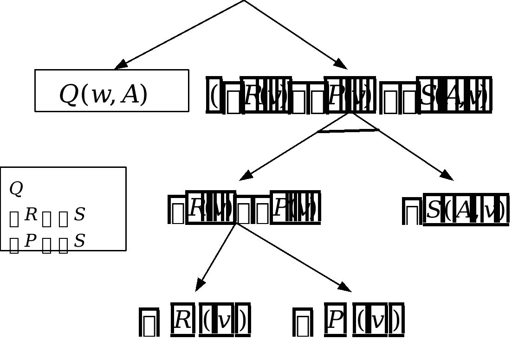

**图 49. AND/OR 形式的超图表示**

显然，根公式转化而成的命题集合，可以读作位于该超图（图 49）上所有解图的终端顶点集合。该超图上有三个解图。一个从根节点通向 `Q`；第二个从根节点通向下一层，然后由于存在一条 2-弧，需要连接到 `S`。我们关注的是终端节点。如果将原始形式归约为句子，共有三个：`Q`、`¬R ∨ ¬S`、`¬P ∨ ¬P`。

请注意这种情况：AND/OR 形式存储了我们在解法中拥有的相同信息，以及其他信息。

考虑以下构建证明引擎的方式——即基于规则的演绎系统形式的智能推理系统的核心。

##### 4.4.5. 直接触发系统

正如逻辑编程中的惯例，我们需要将整个公式集合——即我们在给定主题上拥有的所有信息——划分为三类：事实、规则和目标。

这导致了以下语法限制：

*   我们视为事实的内容实际上不受任何限制，可以用任何 AND/OR 形式呈现；
*   我们视为规则的内容必须是 `L → W` 的形式，其中 `L` 是一个文字，`W` 是任何以 AND/OR 形式表示的公式；
*   目标必须是文字的析取，即必须是一个句子。换句话说，可以制定一个终止条件：目标公式是一个句子，解图终止于目标文字。

使用规则增长 AND/OR 图的方法含义很简单。让我们取一个事实（或一组事实）并将其表示为 AND/OR 形式以获得超图。让我们开始将规则附加到该图的叶节点上。构建图的每个叶节点与规则的左侧进行合一。如果合一成功，我们围绕规则的右侧增长 AND/OR 图（或树)，直到该图中出现一个决策图，其叶子落在目标节点中（即与目标文字合一）。如果规则的左侧与图中的叶节点识别，可能需要进行一些替换以实现合一。显然，当不同规则在不同的决策列中应用时，它们是独立应用的。但在一个解图中，不可能同时用不同的项替换同一个变量。因此应排除这种情况。实际上，现在描述的机制是使用图重建执行的归结法的一个特例。

让我们通过一个例子来看看这一点。

**事实：** 弗拉先科既聪明又知道解法，或者他不是学生：
`¬S(V) ∨ (R(V) ∧ U(V))`。

**规则 1：** 5057 组的所有学生都是学生：`¬C(x) → ¬5057(x)`。

**规则 2：** 知道溶解方法的人是优秀学生：
`P(y) → O(y)`。

**目标：** 存在某人，要么不在 5057 组学习，要么是优秀学生：
`∃z (¬5057(z) ∨ O(z))`。

规则 1 的例子展示了直接基于规则系统的优势。特定部门知识表示系统的设计者可以将这条规则——“5057 组的所有学生都是学生”——写成逆否形式：“如果他不是学生，那么他不在 5057 组学习”。因此，知识表示系统的设计者（人类）给推理程序一个提示：在演绎系统中，从一般推导到特殊比从特殊推导到一般更有利。这正是规则 1 所做的。这就是为什么保持隐式如此重要且有用的原因。

我们构建直接演绎推理，不使用反证法。与归结法不同，不应对目标应用否定。目标应按问题陈述中的原样使用。在这种情况下，显然经过斯科莱姆化后，目标将变成无量词的文字析取，这正是直接演绎系统语法条件所要求的。

基本原理如下（图 50）。

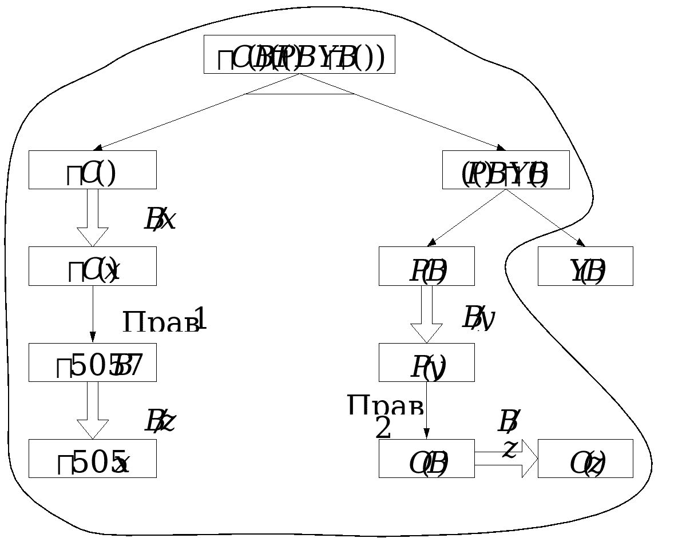

**图 50. 应用规则扩展 AND/OR 形式**

最初，事实图具有以下叶节点列表：`¬C(B)`、`P(B)` 和 `Y(B)`。我们使用规则 1 来增长树。规则的左侧通过 `x` 替换为 `B` 进行合一。树通过与第一个目标文字合并的右侧进行增量。这还不是一个解，因为我们尚未创建一个以目标文字结尾的决策图。所以我们继续应用规则。规则 2 被触发，结果与第二个目标文字识别。

创建了一个以目标文字结尾的决策图（图中圈出）。为了保存关于替换的信息，我们引入合适的弧（在图中用粗空心箭头表示），连接要被替换的文字和规则的左侧。

让我们考虑另一个例子。

给定事实：`P(x) ∨ Q(x)`

**规则 1：** `P(A) → R(A)`

**规则 2：** `Q(B) → R(B)`，其中 `A` 和 `B` 是具体常量。

**目标：** `R(A) ∨ R(B)`

注意，目标不是事实的逻辑后果。这个例子解释了同一决策图中匹配弧上的替换必须一致这一条件的含义（图 51）。

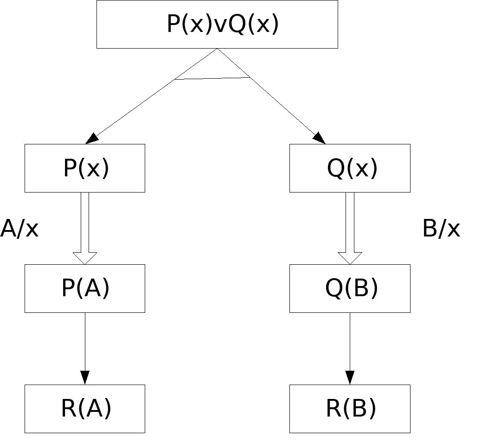

**图 51. 匹配弧上的不一致替换**

可以看出，这些替换是不兼容的：必须同时将 `A` 替换为 `x` 并将 `B` 替换为 `x`。结果，替换不一致；决策图无法按预期构建，因为目标不是事实和规则的逻辑后果。

上一节讨论的例子非常有启发性。我们用图的技术执行了归结推理，但该技术的适用性受到限制，因为我们对事实的形式、规则的形式和目标的形式都有语法限制。

##### 4.4.6. 反向触发系统

让我们回顾一些读者从离散数学学习中熟悉的定义和事实。

如果 `f(x₁, …, xₙ)` 是一个布尔函数，那么布尔函数 `f*(x₁, …, xₙ) = ¬f(¬x₁, …, ¬xₙ)` 称为对偶布尔函数。


###### 4.4.7. 正向与反向系统的结合

我们已经考察了一个受限情况（正向系统）和另一个受限情况（反向系统）。一个自然的想法随之产生：将这两个有界情况结合起来，希望能得到一个无界的系统。

结合基于正向规则和反向规则的推理系统，结果如下：存在以 AND/OR 形式表示的事实，存在以 AND/OR 形式表示的目标，并且存在两类规则：形式为 `L → W` 的正向规则，以及形式为 `W → L` 的反向规则。你将相互构建解图，直到这些图发生碰撞。

换句话说，我们引入了三类消解：

1.  事实与正向规则的消解，这是我们之前讨论过的 Robinson 消解法的一个特例；
2.  目标与反向规则的消解，这是对偶消解法的一个特例；
3.  事实与目标的消解。

后者称为**消亡规则**（extinction rule，亦称抵消规则/删除规则）。

删除规则是：当两个节点合并，或从它们发出的 k-连接被删除时，这两个节点相互删除。

在这种情况下的终止条件如下：事实的根节点删除目标的根节点，且匹配弧上的替换是一致的。

让我们看一个正面例子，以理解结合正向和反向系统的优势（该例子已在第 0 节讨论过）：

事实：存在聪明的学生

反向规则：程序员知道解法

正向规则：学生不知道解法

目的：存在聪明的非程序员

我们自行决定哪条规则是正向的，哪条是反向的。这给将这些信息录入知识库的专家增加了额外的责任，但另一方面，这允许消解法所不允许的事情：保持蕴涵性，展示推理应用的方向。

这使得解的寻找变得非常容易（图 53）。在该图中，消亡用较粗的箭头表示。

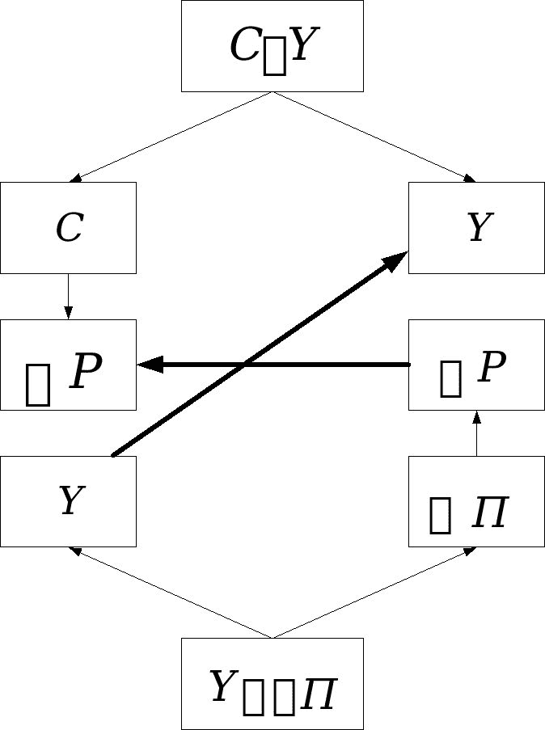

**图 53.** 正向与反向触发系统的结合。

将规则应用于构建事实，将反向规则应用于构建目标——并立即删除。换句话说，与消解法不同，该系统在三步内工作并仅执行三次合一。同时，它不必考虑应用哪些规则，不需要任何策略。所有适用的规则都已应用，结果即为一个决策。

不幸的是，这个相当精彩的例子存在一个复杂性。消解规则是一致且完备的，将正向规则作为消解规则特例应用的规则是一致且完备的，将反向规则作为对偶消解过程特例应用的规则也是一致且完备的。然而，消亡规则的情况就没那么简单和美好了。它不是通用的；它虽丰富但不完备。存在一些无法通过抑制规则（即消亡规则）达到的结论（图 54）。

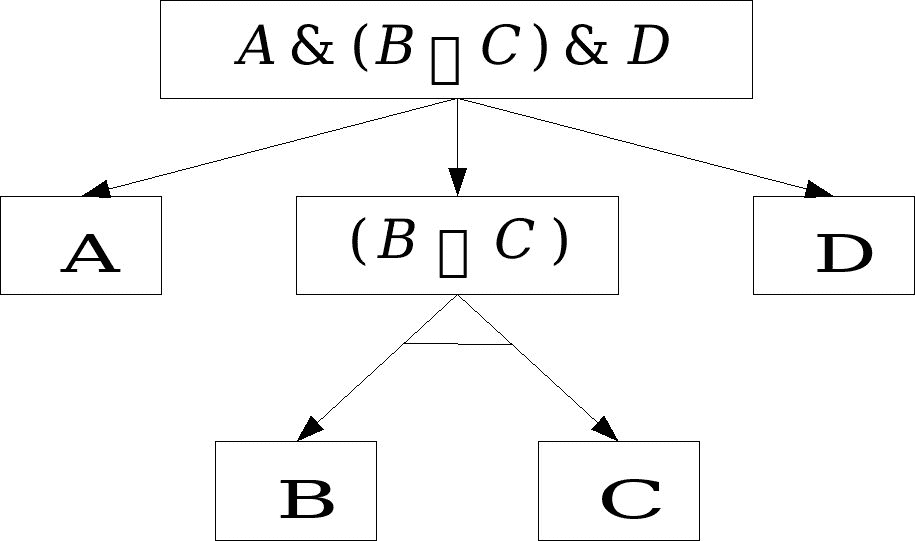

但是

`A & (B ∨ C) & D`

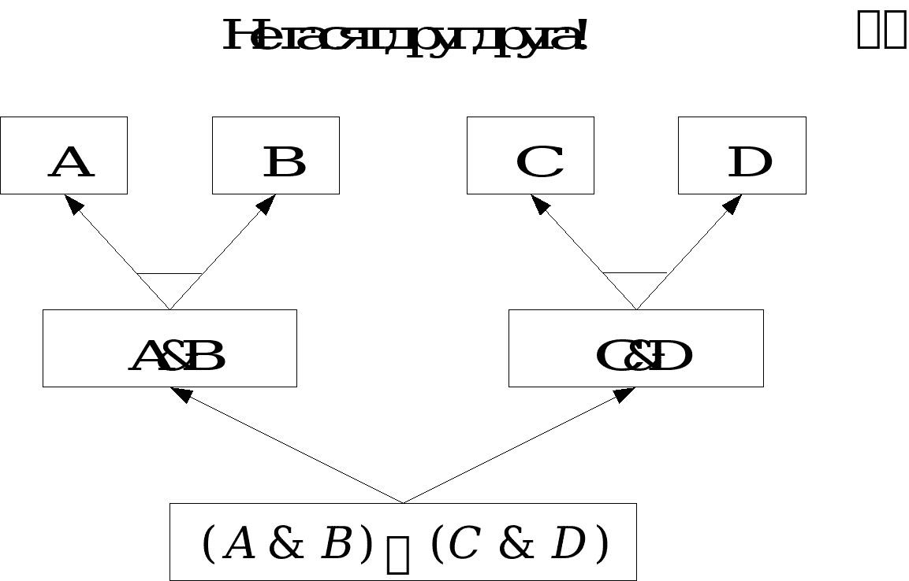

`(A & B) ∨ (C & D)`

**图 54.** 不完备的抑制规则

下面的公式是上面公式的逻辑后果：

`(A & B) ∨ (C & D) ⇒ A & (B ∨ C) & D`


此外，树彼此生长得非常好，我真的想把它们擦除——两种情况下字母都相同。但这是不可能的，因为归纳定义是：要么统一，要么它们的 k 束被抵消。而在本例中，k 键只是没有被湮灭。就弧数而言，这些是不同的结构：顶部有三个决策图，底部有两个。

在这种情况下，组合演绎系统不起作用，原因在于 AND/OR 表示法本身并非通用。尽管如此，如果将谓词演算的一般公式翻译成 y AND/OR 形式，我们还是会失去一些东西。决议法中发生了这样一个显著事实：归约为命题后，初始前提与命题否定的合取恰好在目标命题不幸不从前提中得出时不可行。

目前尚不清楚 AND/OR 形式能否以这样一种方式进行调整：使得事实与目标的决议，就像事实与规则的决议、规则与目标的决议那样，同样一致且完备。

####### 4.4.8. 演绎系统中的元知识

基于规则的推理系统擅长表示事实、规则和目标，并在决定什么视为事实、什么视为规则、什么视为目标方面留有几乎完全的自由度。

然而，存在对 PSII 非常重要的控制知识（元知识），难以整合到基于规则的演绎系统中。我们给出三个典型的元知识示例。其中一些在前面的示例中已隐式应用。

1.  考虑可能的分支宽度。

    假设演绎系统中有一组分类规则。例如 `dog(x) → animal(x)` `cat(x) → animal(x)` 等等，可以有许多此类规则。形式上，此类规则既可正向应用，也可逆向应用。哪个方向更合适？这取决于主题，取决于系统解决的任务类型。构建演绎系统的专家拥有关于规则适当应用方向的知识。例如，考官知道分类规则不应作为逆规则应用。事实是，在目标图增长时，以相反方向应用此类规则会产生非常大的分支宽度。

    此类规则应直接应用。

    如果专家认为该演绎系统中的分类规则仍需逆向应用，他应将其重写为逆否形式：

    `¬ Animal (x) → ¬ Dog (x)`

    `¬ Animal (x) → ¬ Cat (x)` 等等。

2.  规则的应用顺序。

    假设演绎系统具有以下形式的正向规则

    `P → ( Q 1 ∨ … ∨ qk )`

    或以下形式的逆向规则

    `( Q 1 & … & Q k ) → P`

    应用此类规则会用 k 条弧扩展图。节点 `Q 1 & ... & Q k` 被进一步考虑的顺序至关重要。例如，在一个用于求解不等式的基于规则的逆向演绎系统中（见第 0 节，图 Error! Text of specified style is missing from document. .52），应用规则 4 后，应首先考虑表达式 `B > 0`，而不是表达式 `A + C > D`。事实是该表达式已经是事实的形式。专家明白，当我们需要某个事实来证明它时，有两种可能情况：要么该事实在问题条件中给出，要么没有。你不能凭空捏造一个事实。当事实已给出时（如示例 0 中），应考虑其他表达式，希望将它们归约为给定事实。如果没有未经证实的事实，则必须停止考虑其他表达式，因为考虑它们不会产生任何结果——那个 k-连接仍然不会被包含在决策图中。

    此类信息是借助特殊技术引入演绎系统的元知识。例如借助评价函数，如在产生式系统中那样。

3.  规则的条件应用。

    再次考虑求解不等式的例子（参阅

    第 0 节，图 Error! The text of the specified style does not exist in the document. .52）。出于传递性原因，我想说事实 `C > O` 是多余的。有人想插入第八条规则：`x > y & y > z → x > z`。一条非常危险的规则！事实是其右侧总是适用的，并与此系统中的所有东西统一。这里两个简单变量由系统中唯一的谓词连接。无论 AND/OR 列中有什么节点，它总能与传递性规则的右侧统一。这意味着此类规则将一直被使用。可以说传递性规则**太**适用了！此类规则不应直接使用。它们可以隐藏在统一中（通常如此），或者（一个非常好的解决方案）我们可以向算法添加元知识，规定有些规则在适用时随时可用，而有些规则仅在特殊情况下适用。这些是关于支配规则应用或不应用的当前知识库结构的一些条件。传递性的元知识是：当且仅当左侧合取项之一是事实时，才可应用传递性规则。如果不是这种情况，应用传递性规则会导致目标成倍增加。当这种情况发生时（当传递性规则左侧的合取项之一可与事实比较时），结果只是简单地在事实间移动。此时决策树保持线性。树不分支，只是沿着传递链蜿蜒前进，这正是应用传递性规则所必需的。如果就这样使用，它会生成不知如何处理的 y。只有在设法以 x 为代价消除 y 的情况下，才能同意生成该 y。

    从上述元知识示例得出的结论如下：元知识不是关于构建推理系统所针对主题的知识，它是关于知识的知识，即如何应用和使用关于该主题的知识，关于该主题的知识具有什么属性等。

两级基于规则的演绎系统取得了非常好的结果。此类顶层系统包含同样以规则形式表示的元知识。高层系统中的事实是对低层系统当前状态的描述。目标是为下属系统构建（综合）一种控制策略。第二层是常规推理系统，其规则、事实和目标源自主题领域。高层系统为低层系统确定规则的应用方向、节点的考虑顺序、规则的应用条件等。

##### 第 4 章 结论

1.  带有逻辑外函数和谓词的一阶谓词演算足以在所有合理情况下表示知识。

2.  求证过程是半可判定过程，其有效性取决于所用的策略。

3.  AND/OR 图及类似结构可用于搜索推理，方式与产生式系统中相同。

### 结论

在人工智能发展的半个世纪里，一系列不同的知识表示与处理方法被提出并在实践中接受检验。其中，自然脱颖而出三类、三个簇群，它们的区别在于所用的基础——在具体应用实现中显式或隐式使用的形式化工具 [[71]](#part0005.xhtml#_ftn71)。这三类是：

-   基于图论的产生式系统；


- 基于数理逻辑的逻辑演算
- 其他（例如神经系统和进化系统）。

正是这三类方法构成了本书的结构基础。值得注意的是，最近提出的所有新的知识表示方法明显都倾向于这几类之一。生成式系统与推理之间没有不可逾越的界限：在最后一章中，我们给出了一些将一类方法归约为另一类方法的示例。另一方面，其他知识表示方法，如框架、语义网络、神经网络等，本质上是折衷的，并最终依赖于本手册中讨论的基本数学工具。

因此，熟悉上述方法中知识表示与处理的思想，足以跟上人工智能的主要发展趋势。

---

[1] [2] [3] [4] [5] [6] [7] [8] [9] [10] [11] [12] [13] [14] [15] 注意，由于计算机中可表示的不同数字的数量是有限的，因此具有不同参数的 Write 算子的数量当然也是有限的，尽管数量相当大。

[16] [17] [18] [19] [20] [21] [22] [23] [24] [25] [26] [27] [28] [29] [30] [31] [32] [33] [34] [35] [36] [37] [38] [39] [40] [41] [42] [43] [44] [45] [46] [47] [48] [49] [50] [51] [52] [53] [54] [55] [56] [57] [58] 对于仍对我们的示例感兴趣的读者，我们强烈建议您在此停止阅读并自行解决该问题。我们甚至提出一个答案：当且仅当 n Mod 4 = 1 时，Max 会输。

[59] 顺便说一句，只有特级大师和冠军不再会输。普通棋迷与最好的现代国际象棋程序对弈将有 100% 的输棋几率。即使是卡斯帕罗夫也已经在输棋了，情况只会变得更糟！可以认为，人（任何人！）与软硬件复合体在国际象棋中的较量很快将变得毫无希望！

[60] [61] [62] [63] l [64] [65] 拉丁短语 modus ponendo ponens，通常缩写为 modus ponens，现在译为俄语的“分离规则”。根据中世纪传统，逻辑术语以原语言使用，不予翻译。

[66] [67] [68] [69] [70] [71]
