# AI与银行业的未来

> > “托尼不仅是本土金融生态系统中享有盛名的专家，还对全球银行与保险公司有着独家的幕后洞察。因此，我相当确信，这本书很快就会成为广受欢迎的畅销书。”
> > ——**罗宾·基拉博士**，国际公认的数字思想领袖

> > “对于那些渴望跟上不断演变的金融服务行业步伐的人来说，这本书是一部极佳的资源。它探讨了人工智能与分析如何影响银行业，包括开放银行和区块链，这些见解将引起所有读者的共鸣——无论是行业新人还是资深专业人士。”
> > ——**弗朗西斯卡·布里斯**，英国金融服务通讯顾问

> > “这是一本现代指南，讲述了科技如何改变银行在社会中的角色以及我们与金融机构的关系——要理解这场革命的下一步，这是必读之作。”
> > ——**马西利奥·奥利维拉**，Sensedia创始人

> > “托尼·布比尔为金融服务领域的数字化转型提供了广泛的指导和背景知识。对金融科技颠覆的全面阐述，使这本书成为任何参与银行业未来的人士的必备读物。”
> > ——**理查德·塞奎拉**，TELUS加拿大金融服务总监

> > “托尼出色地将人工智能与银行业结合在一起。IT长期以来一直是驱动银行业的机器，而人工智能则是新的大脑。凭借其渊博的知识、深刻的理解和远见，他为读者呈现了一条从当下通往银行业未来的清晰、有条理且详尽的路径。”
> > ——**拉斐尔·富内斯**，LOVIS执行主席

> > “托尼呈现给我们的是一段关于现状与应有状态的深度叙述。既引人入胜又富有洞察力。这本书激发了你继续前行、学习更多的渴望——最重要的是，它是一本读来非常愉快的书。”
> > ——**艾登·费尔南德斯**，客户分析领导者、战略与洞察爱好者

> > “作者深厚而广泛的阅历跃然纸上。他成功应对了如何清晰勾勒不断变化的银行业格局以及人工智能新兴技术正在并将要发挥的转型角色这一艰巨挑战。”
> > ——**道格拉斯·希利托**，FCII，Banking Newslink编辑兼出版人

> > “本书中的陈述完美地描绘了银行业的现状。我们目前对无现金社会和人工智能的关注，只是银行这个巨大机器齿轮中的几个齿牙，而这个机器过去、将来也始终会以其自身特有的节奏运转。”
> > ——**罗伊·索珀**，柯尼卡美能达解决方案顾问

> > “由于数字化和人工智能的出现彻底重塑了银行业，‘照常营业’已不再是银行的可行选择。在这个高度动荡多变的市场环境中，本书为组织领导者在如何最佳地驾驭这些变化并制定一套未来可期的战略性业务要务方面提供了极具价值的建议。”
> > ——**兰迪普·古格博士**，Fitch Learning董事总经理
谨以此书献给我的孙辈们，也许有一天，硬币和纸币只能在博物馆里看到了。

## 致谢

这是我出版的第三本书，也是就主题、广度和复杂性而言个人最具挑战性的一本。我希望至少能满足部分读者的期望，并至少鼓励他们开展自己的研究。

我近二十年前在专业层面上开始对银行业产生兴趣，但在四十多年前就已个人参与银行业，却并不真正了解其中涉及的内容。也许我们中的许多人都是如此。

就我的专业兴趣而言，在这段时间里有许多人提供了见解。我欠多位人士和组织以感激之情，尤其是格雷厄姆·科布、弗兰克·麦基翁和劳伦斯·特里格韦尔，他们让我开始对银行业产生好奇心。我希望我没有辜负他们。

在后来，Tilney的戴维·卡明斯在我们关于人工智能在财富管理中使用的讨论中提供了帮助，盖里·纳特尔关于区块链的使用，以及弗朗切斯卡·史密斯关于开放银行的话题。我的解释和理解中的任何弱点完全由我自己承担，与他们无关。曾任IBM的克雷格·贝德尔也一直是坚定的支持。

公开可用的信息如此丰富，无法提及每一个人，但我特别想感谢OnlyStrategic的道格·希利托，他提供了宝贵的见解和启发。至于其他所有人，我已尽力在正文中引用他们，希望在过去两年中没有遗漏任何人，但如果有，我将很高兴在今后版本中承认他们。

在本书记载中，提及了各种公司和产品作为例证。这些公司被提及并不代表我的具体推荐，读者应鼓励自行进行个人研究。我与其中任何一家都没有商业利益。除此之外，附录还提及了各种初创企业，但这些仅为说明其能力或寿命而作的例证。

特别感谢Gemma Valler和Wiley团队，包括Elisha Benjamin（Benji）和Gladys Ganaden（Syd），以及让事情发生的‘隐形大军’其余成员。

最后，当然要感谢我的家人，尤其是我的妻子Michelle，她的观察和建议，以及让我毫不怀疑‘更好的另一半’的含义。

## 作者简介

Tony Boobier是一名前全球高管，专注于金融服务业技术应用。他拥有超过30年的经验，是经常撰稿的作家和国际公众演讲者。他对如何将商业智能和分析应用于提升众多行业的产品和服务的管理和交付有着深刻的理解。

他是客户分析、风险和运营效率方面的公认专家，是企业范围分析的坚定倡导者，以及利用人工智能改善服务和降低成本的使用者。

他拥有工程、市场营销、保险和供应链管理方面的资格，也是《Analytics for Insurance: The Real Business of Big Data》和《Advanced Analytics and AI: Impact, Implementation, and the Future of Work》的作者。他居住在英国伦敦附近。

## 引言

乍一看，将人工智能和银行业这两个主题放在同一本书中可能会被认为是对读者和作者都极具挑战性的任务。人工智能（AI）是一个被广泛且过度滥用的表达，在许多情况下代表的是高级分析的使用。银行业同样是对多种类型金融交易的一种概括性表达，而且有许多不同类型的银行已经在使用或需要使用分析方法来盈利地运营其业务。要有效理解银行业与分析之间的互动，即使在初级水平也需要对两者有所了解。

*AI与银行业未来*探讨了银行业的多种类型以及它们如何使用高级分析和人工智能。预测到2020年代中期，半数以上企业，包括银行，将使用智能、自学习系统。银行业正处于调查和应用高级分析、认知分析和人工智能的最前沿，应用范围广泛，包括客户分析、运营效率、风险管理和为客户提供财富建议。

本书旨在适应读者的知识深度差异。有些人会有相当深入的见解，而其他人则经验有限或没有经验。一些读者可能在银行业经验丰富，但对人工智能和高级分析这一主题了解甚少。其他人可能是分析专家，对银行业了解甚少。在任何情况下，一些读者可能已经是希望扩展知识的成熟从业者，而其他人可能正处于职业生涯的起点，试图在承诺专业道路之前获得见解。*AI与银行业未来*旨在为新老行业专业人士提供关于数据和分析对其角色、职责和个人职业发展影响的基本信息。

本书的目标并非提供详细而复杂的专业手册，而是一本通俗易懂的指南，任何具有有限或无信息技术背景的银行业专业人士都能轻松理解。同样，它也将帮助进入银行业的IT专业人士了解这样一个多元化行业中的许多不同方面。

对许多金融服务高级专业人士来说，主要问题之一是技术进步速度超过了他们个人的学习速度。一些组织会提供充分的培训，也许以继续专业发展形式提供。对于其他人来说，一些雇主会期望个人层面的理解和自学，而实际上一些员工正被行话、变化的步伐以及无法找到一份全面、相关且语言使用相对清晰的工作资料所抛在后面。对于这一特定群体来说，这不仅仅是“老狗学新把戏”的问题，而是今天的专业人士需要比以往任何时候都更了解不断发展的市场问题。无法保持最新意味着至少三件事：专业上的无关性和冗余；无法为其组织增加价值；以及成为变化的受害者而非积极的贡献者。

本书分为三个主要部分：

- 1. 第一部分将银行业视为一个行业，邀请我们思考货币的意义及其数字化转型，以及两者的重要性。
- 2. 第二部分研究人工智能和高级分析，邀请读者反思整个“数据议程”。
- 3. 第三部分探讨银行业本身的未来，我们不仅会具有挑衅性的前瞻性，还会通过审视实施问题来考虑通往未来的道路。

这种方法将使读者能够在个人层面“随时查阅”最适合自己的部分，尽管希望其他部分也值得审视。为此，我们将尽量避免行业术语、缩写和任何重复。

就本书的具体内容而言，前三章是基础性的，旨在巩固读者的现有知识，同时鼓励他们思考银行业的未来和人工智能的影响。第1章深入介绍了货币的演变，到如今在近乎无现金社会中可能已成为一种数字商品的形式，并为读者提供了关于当前银行业角色以及人工智能未来可能对其产生影响的理解。第2章考虑了银行业内的当前当务之急，将其与零售、电信和医疗等其他关键行业的当务之急进行比较和对比，并为银行业未来提出一套当务之急。第3章是数据和分析的“入门指南”，帮助读者不仅理解分析的层级，还了解如何从数据中提取价值。

接下来的三章将读者更深入地带入专门针对银行业的先进分析和人工智能主题。第4章讨论了银行分析的关键要素，涵盖财务绩效管理、客户分析、风险管理和运营效率等议题，并为读者提供了关于分析对银行业的重要性及当前使用的强有力见解。内容按关键驱动因素而非银行类型组织。第5章将见解提升到更高层次，提供人工智能概念发展的背景，然后引出机器学习及其应用，包括银行业中使用的应用。第6章更具体地关注人工智能和银行业品牌的重要性。本章与人工智能中的客户分析要素紧密相关。它认识到不同世代目前对银行有不同的期望，而这些期望将由品牌以及最终由银行的服务延伸来满足。本章描绘了银行通过人工智能与消费者建立更紧密联系的图景，并考虑了其中涉及的问题。

第7章和第8章涉及个人和组织层面的变革。第7章考虑了人工智能对领导力和员工转型问题的影响，并讨论了人工智能渗透时代的领导力、人工智能渗透领导者的属性、培训等——将塑造行业的未来形态。在适当的情况下，将提供最佳实践示例作为证明点，这些证明点已在公共领域。

即使在此时，做出大胆的声明也颇具诱惑力，即在可预见的未来，所有银行业都将在某种程度上被人工智能渗透，但一个需要解决的重要问题是如何从实践角度实现这一目标。实施的挑战是什么，可能的解决方案是什么？它们是否依赖于金融科技社区中的初创企业等外部组织，还是银行可以自行内部创新？在任何情况下，变革的关键构建模块是什么？这一切可能有多快发生，以及组织层面如何抵制变革？

作为补充说明，还应认识到银行业的未来不仅仅是关于分析和人工智能，尽管这些将发挥主要作用。重要的是反思一些其他变革因素，例如客户行为及其更高期望，以及其他行业进步必然产生的“连锁效应”。

## 序言：为何是银行业？

### 摘要

本节将简要介绍：

- 1. 货币概念（尤其在数字世界中）所指为何
- 2. 数字环境中的银行业是什么
- 3. 银行业的广度，以及银行内的关键职能，如人力资源和运营
- 4. 在分析驱动和人工智能渗透的银行业世界中目前和未来的一些角色

其目的并非提供全面指南，而是帮助设定场景，说明银行业的广度和宽度，以及高级分析和人工智能元素如何构成将被描述为“未来银行”的概念的一部分。

### 技术正在改变我们管理金钱的方式

类似 Twitter 的便捷网络聊天服务的流行促使银行投资类似的快速能力，因为客户拥抱在线支持。英国人（以及世界各地许多其他人）越来越多地转向智能手机；2017年有2200万人使用银行应用程序，较2016年的1960万人有所增加。2017年银行应用的登录次数超过55亿次，比2016年增长13%。英国金融协会首席执行官 Stephen Jones 表示：“在未来几年，开放银行和人工智能将改变我们与银行的关系，不仅改变我们与银行的关系，还将从根本上改变我们获取和使用金融产品和服务的方式”。¹

除此之外，本章还考虑了银行业目前的一些关键职能，并推测“未来工作”可能包括哪些内容，并提供一些示例性职位名称和其可能涉及的描述。

# 引言

> “金钱，滚开吧
> 找份好工作，拿高薪，你就没问题
> 金钱，不过是气体
> 双手抓住现金，藏起来”

罗杰·沃特斯，平克·弗洛伊德，《金钱》

无论以何种形式探讨银行业的未来，我们都必须同时思考货币的未来，而这又要求我们思考“货币”究竟是什么。我们以为自己已经知道这个问题的答案。

除了经济学家，人人都知道货币意味着什么，即便是经济学家，也能用差不多一章的篇幅来描述它。

> A.H. 奎根，《原始货币概览：货币的开端》²

我们痴迷于金钱。诚然，有些人视之为必要之恶，但“必要”二字确凿无疑。对金钱的追逐占据了我们生活的一大部分，即我们称之为“工作”的概念。不仅如此，金钱还提供了一种机制，让我们能通过资助休闲或最终退休，从而逃离工作。我们通常获取金钱的途径是银行业，正因如此，货币与银行这两大主题被不可分割地交织在一起。

但金钱远非表面所见那么简单。对大多数人来说，它代表口袋里的硬币、钱包里的纸币和银行对账单上的数字。我们视之为劳动与付出的回报，以及用于换取服务或产品而转交给另一方的交换媒介。像经济学这样的整个学科都因此而生，而即便是经济学，也试图通过宏观经济学和微观经济学等更细分的领域将这一主题提升到更高层次。我们对金钱的理解似乎几乎合乎常识、直观且易于理解，但其中存在一个致命缺陷，那就是我们的理解是错误的。

在《金钱：未经授权的传记》³一书中，菲利克斯·马丁带我们穿越货币的历史，得出结论：货币不过是一套“代币”，其本身代表着一个信贷与清算系统，而这一切最终都建立在信任之上。这些代币的管理通过他所描述的三大关键准技术性突破得到强化：

- 1. 人类进行计算的能力
- 2. 书写并因此记录的能力
- 3. 会计学的概念，它使个人和群体都能以标准化方式高效记账，从而追踪数量

代币本身反映的是更深层次的东西，即普遍的经济价值，它通过标准化使贸易得以跨越时代进行。“普遍性”这一观念并不局限于货币主题，而被视为某一时代精神的反映，特别是希腊的黄金时代，那个时代整体上让人类能够以更客观、更审慎的眼光看待自身。因此，货币的演变被视为当时正在发生的“根本性知识革命”的又一项证据。

其他作家，如奈杰尔·多德，在《金钱的社会生命》⁴中提出，货币还有其他起源，而且它“必定始于某处”，但他区分了货币形式（例如铸币）的起源与货币整体意义上的历史。

多德认为很可能存在多重起源：

- 1. 作为一种物物交换体系的形式
- 2. 作为一种“贡赋”，例如向宗教和政治权威支付的一种形式（连同各种债务和罚款）
- 3. 作为一种量化方法，我们用货币概念来量化“价值”
- 4. 作为“玛纳”或馈赠，这又与给予者和接受者之间的社会互动，以及货币在社会关系性质中的重要性相关
- 5. 作为一种通用语言，货币被比作“符号系统”。卡尔·马克思称货币为“商品的通用语言”。⁵
- 6. 作为暴力或冲突行为的刺激因素，不仅涉及权力、政治和战争（在这些概念中，金钱似乎与之形影不离），也涉及雇主与雇员、买方与卖方、债权人与债务人之间被认为存在的冲突

当我们思考货币与银行业的持续演进时，同样重要的是将其置于进一步技术突破和知识革命的背景中。在人工智能时代，货币的概念将如何变化？希腊人已经确立了经济价值的概念，并认为经济可以被视为一个客观空间，而非一种假设性概念，但当时仍然存在实际需要，即如何组织货币，以便能够商定价格、累积信贷与债务，并对国际收支进行核对。这可以通过互助信贷网络或发行本地货币来实现，但这些本地化安排始终存在违约的风险。

由于主权者或国家是迄今为止最大的货币交易方，将货币管理与之挂钩变得越来越普遍。这并不意味着主权者或国家本身就不会违约——例如2008年的希腊就是如此——但这确实带来了更高程度的稳定性，即便代价是在货币与权力之间建立起一种政治联系。然而，这种政治联系可能会受到剥削和操纵。到了中世纪，主权者已经认识到这种联系，并借此通过操纵货币标准的方式向民众敛财，这一过程被称为铸币税。当时铸造的硬币表面没有任何标明名义价值的文字，只有发行方的头像或徽章，因此主权者很容易降低硬币的“定价面额”，从而实际上等于征收一次性财富税。这种做法——连同降低成色（即实际减少硬币中的贵金属含量以降低其有形价值的过程）——不断侵蚀着人们对“货币”本身的信任。即使在今天，我们有时也不确定它到底是什么，而随着数字化在我们生活的各个领域不断加深，这种不确定性可能会变得更糟。

这种剥削以及相对的混乱，营造出了一种氛围，使得货币这一主题或许值得更深入地探讨。尼古拉·奥雷姆（1320–1382）是纳瓦拉学院的院长，该学院是当时巴黎最负盛名的学校之一。在他于1360年呈交给法国王太子查理的论文《论货币的起源、性质、法律与变更》中，他提出了两个问题：

- 1. 主权者是否有权操纵货币标准？
- 2. 如果有权，那么这样做又是为了谁的利益？

他提出了一个截然不同的观点：货币不是主权者的财产，而是使用它的共同体的财产。他认为，如果主权者有什么角色的话，那就是“公共法令的执行者”。

换句话说，奥雷姆的论点是，“货币”——或者至少是货币的概念——归属于“我们”。其他所有人都不过是保管者和中介。

# 什么是银行业？

“银行”一词具有通用性和广泛性，因此首先要认识到不同类型的银行。（见图1.1。）一般来说，这些类型包括：

- 1. 零售银行：这些银行以消费者或普通公众为客户。它们提供支票账户和储蓄账户，以及信用卡和个人贷款等其他服务。
- 2. 商业银行：这些银行以企业客户为目标，但它们提供的服务更为复杂，金额通常也大得多。它们可能需要处理客户付款，并提供信贷额度以帮助客户管理现金流。
- 3. 投资银行：这些银行帮助企业参与金融市场运作，例如企业希望筹集资本或公开上市时。
- 4. 商人银行：从历史上看，这些银行从事商业贷款和投资业务。最初它们的目的是促进商品贸易，尤其是与“商人”有关的织物贸易，因此“商人银行业务”这一名称由此而来。在近代，“商人银行业务”一词倾向于指那些以持股而非贷款形式向公司提供资本，并为其投资的公司提供企业咨询的银行。⁶
- 5. 中央银行：这些通常是美联储或英格兰银行，它们为政府管理货币体系。

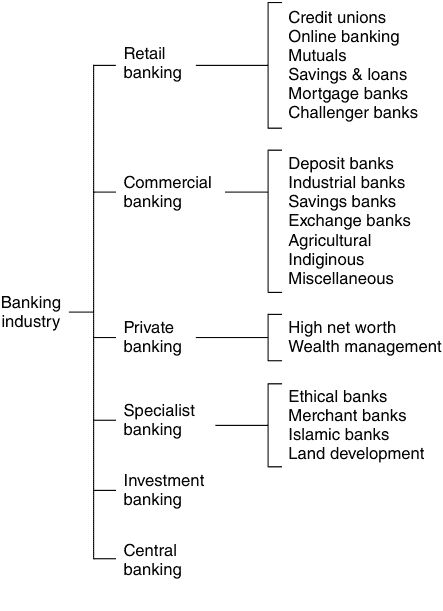

**FIGURE 1.1** 银行业细分。

- 6. 信用合作社：这些与银行类似，但属于互助组织，由客户所有，而非外部股东。
- 7. 在线或互联网银行：这些通常是零售银行，但没有实体网点可供访问。
- 8. 互助银行：它们与信用合作社类似，因为它们由客户（或会员）所有，而非外部投资者。
- 9. 储蓄贷款公司：这些机构的主要目的是从一种客户那里吸收储蓄，并向另一类客户发放贷款。
- 10. 非银行贷款机构：它们技术上不是银行，但提供类似的服务。

越来越多的情况下，“挑战者银行”这一表述被用来指代新型银行，通常是零售银行，它们试图通过以下方式威胁到规模更大、更成熟的全国性银行：

- 提供更优惠的利率
- 提供新的银行“主张”
- 提供增强的渠道，无论是通过其实体网点（通过更长的营业时间）还是在线
- 以上所有方式的任意组合

监管变化和放松管制使得“挑战者银行”能够通过更简便的流程进入市场。⁷

有人认为还存在一个庞大的“影子银行”体系，其中包括金融公司、结构性投资实体、证券借贷机构等。它们执行与银行类似的功能，但监管方式不同，且没有中央银行支持或政府存款保险的保护。⁸

一些人认为——例如 Susan Strange 在其著作 *Casino Capitalism*（1986）⁹ 中——许多银行作为中介（在储蓄者和存款人之间）的传统角色正在衰退，它们越来越多地专注于通过创新和所谓的“货币替代品”来“创造、购买和出售信用货币”。她认为，这导致它们越来越多地在中央银行和政府的监管范围之外运作。货币替代品被描述为高度可交易的商品，作为“纸币”的替代品，例如“代币硬币”甚至信用卡。Strange 认为，“货币替代品”的发展鼓励了“信用的不审慎扩张，银行利润增加，但金融恐慌和崩溃的系统性风险也增加”，甚至为这一概念命名为“过度银行化”。

Susan Strange 还警告说，通过信用卡，个人消费者有超支的风险，以至于产生的债务可能无法由银行收回。例如在英国，更有可能持有借记卡（5100万）的人多于持有信用卡（3200万）的人，但持有信用卡的人很可能比借记卡持有人花费更多，多达39%。根据英国数据，信用卡坏账在2010年每月高达31亿英镑，尽管在最近时期已“稳定下来”至较为合理的每月16亿英镑。这样的坏账可能被视为 *死钱*。¹⁰

几乎似乎银行通过将信用卡和贷款债务的偿还负担转嫁给相对缺乏信息的公众，来鼓励客户超出其承受能力进行超支。银行行业的复杂性和描述其活动的行话使问题更加严重。难怪公众对银行业缺乏信任。“信任”这一主题不仅[content]

**FIGURE 1.1** 银行业细分。

- 6. 信用合作社：这些与银行类似，但属于互助组织，由客户所有，而非外部股东。
- 7. 在线或互联网银行：这些通常是零售银行，但没有实体网点可供访问。
- 8. 互助银行：它们与信用合作社类似，因为它们由客户（或会员）所有，而非外部投资者。
- 9. 储蓄贷款公司：这些机构的主要目的是从一种客户那里吸收储蓄，并向另一类客户发放贷款。
- 10. 非银行贷款机构：它们技术上不是银行，但提供类似的服务。

越来越多的情况下，“挑战者银行”这一表述被用来指代新型银行，通常是零售银行，它们试图通过以下方式威胁到规模更大、更成熟的全国性银行：

- 提供更优惠的利率
- 提供新的银行“主张”
- 提供增强的渠道，无论是通过其实体网点（通过更长的营业时间）还是在线
- 以上所有方式的任意组合

监管变化和放松管制使得“挑战者银行”能够通过更简便的流程进入市场。⁷

有人认为还存在一个庞大的“影子银行”体系，其中包括金融公司、结构性投资实体、证券借贷机构等。它们执行与银行类似的功能，但监管方式不同，且没有中央银行支持或政府存款保险的保护。⁸

一些人认为——例如 Susan Strange 在其著作 *Casino Capitalism*（1986）⁹ 中——许多银行作为中介（在储蓄者和存款人之间）的传统角色正在衰退，它们越来越多地专注于通过创新和所谓的“货币替代品”来“创造、购买和出售信用货币”。她认为，这导致它们越来越多地在中央银行和政府的监管范围之外运作。货币替代品被描述为高度可交易的商品，作为“纸币”的替代品，例如“代币硬币”甚至信用卡。Strange 认为，“货币替代品”的发展鼓励了“信用的不审慎扩张，银行利润增加，但金融恐慌和崩溃的系统性风险也增加”，甚至为这一概念命名为“过度银行化”。

Susan Strange 还警告说，通过信用卡，个人消费者有超支的风险，以至于产生的债务可能无法由银行收回。例如在英国，更有可能持有借记卡（5100万）的人多于持有信用卡（3200万）的人，但持有信用卡的人很可能比借记卡持有人花费更多，多达39%。根据英国数据，信用卡坏账在2010年每月高达31亿英镑，尽管在最近时期已“稳定下来”至较为合理的每月16亿英镑。这样的坏账可能被视为 *死钱*。¹⁰

几乎似乎银行通过将信用卡和贷款债务的偿还负担转嫁给相对缺乏信息的公众，来鼓励客户超出其承受能力进行超支。银行行业的复杂性和描述其活动的行话使问题更加严重。难怪公众对银行业缺乏信任。“信任”这一主题不仅[content]

**FIGURE 1.1** 银行业细分。

- 6. 信用合作社：这些与银行类似，但属于互助组织，由客户所有，而非外部股东。
- 7. 在线或互联网银行：这些通常是零售银行，但没有实体网点可供访问。
- 8. 互助银行：它们与信用合作社类似，因为它们由客户（或会员）所有，而非外部投资者。
- 9. 储蓄贷款公司：这些机构的主要目的是从一种客户那里吸收储蓄，并向另一类客户发放贷款。
- 10. 非银行贷款机构：它们技术上不是银行，但提供类似的服务。

越来越多的情况下，“挑战者银行”这一表述被用来指代新型银行，通常是零售银行，它们试图通过以下方式威胁到规模更大、更成熟的全国性银行：

- 提供更优惠的利率
- 提供新的银行“主张”
- 提供增强的渠道，无论是通过其实体网点（通过更长的营业时间）还是在线
- 以上所有方式的任意组合

监管变化和放松管制使得“挑战者银行”能够通过更简便的流程进入市场。⁷

有人认为还存在一个庞大的“影子银行”体系，其中包括金融公司、结构性投资实体、证券借贷机构等。它们执行与银行类似的功能，但监管方式不同，且没有中央银行支持或政府存款保险的保护。⁸

一些人认为——例如 Susan Strange 在其著作 *Casino Capitalism*（1986）⁹ 中——许多银行作为中介（在储蓄者和存款人之间）的传统角色正在衰退，它们越来越多地专注于通过创新和所谓的“货币替代品”来“创造、购买和出售信用货币”。她认为，这导致它们越来越多地在中央银行和政府的监管范围之外运作。货币替代品被描述为高度可交易的商品，作为“纸币”的替代品，例如“代币硬币”甚至信用卡。Strange 认为，“货币替代品”的发展鼓励了“信用的不审慎扩张，银行利润增加，但金融恐慌和崩溃的系统性风险也增加”，甚至为这一概念命名为“过度银行化”。

Susan Strange 还警告说，通过信用卡，个人消费者有超支的风险，以至于产生的债务可能无法由银行收回。例如在英国，更有可能持有借记卡（5100万）的人多于持有信用卡（3200万）的人，但持有信用卡的人很可能比借记卡持有人花费更多，多达39%。根据英国数据，信用卡坏账在2010年每月高达31亿英镑，尽管在最近时期已“稳定下来”至较为合理的每月16亿英镑。这样的坏账可能被视为 *死钱*。¹⁰

几乎似乎银行通过将信用卡和贷款债务的偿还负担转嫁给相对缺乏信息的公众，来鼓励客户超出其承受能力进行超支。银行行业的复杂性和描述其活动的行话使问题更加严重。难怪公众对银行业缺乏信任。“信任”这一主题不仅[content]

**FIGURE 1.1** 银行业细分。

- 6. 信用合作社：这些与银行类似，但属于互助组织，由客户所有，而非外部股东。
- 7. 在线或互联网银行：这些通常是零售银行，但没有实体网点可供访问。
- 8. 互助银行：它们与信用合作社类似，因为它们由客户（或会员）所有，而非外部投资者。
- 9. 储蓄贷款公司：这些机构的主要目的是从一种客户那里吸收储蓄，并向另一类客户发放贷款。
- 10. 非银行贷款机构：它们技术上不是银行，但提供类似的服务。

越来越多的情况下，“挑战者银行”这一表述被用来指代新型银行，通常是零售银行，它们试图通过以下方式威胁到规模更大、更成熟的全国性银行：

- 提供更优惠的利率
- 提供新的银行“主张”
- 提供增强的渠道，无论是通过其实体网点（通过更长的营业时间）还是在线
- 以上所有方式的任意组合

监管变化和放松管制使得“挑战者银行”能够通过更简便的流程进入市场。⁷

有人认为还存在一个庞大的“影子银行”体系，其中包括金融公司、结构性投资实体、证券借贷机构等。它们执行与银行类似的功能，但监管方式不同，且没有中央银行支持或政府存款保险的保护。⁸

一些人认为——例如 Susan Strange 在其著作 *Casino Capitalism*（1986）⁹ 中——许多银行作为中介（在储蓄者和存款人之间）的传统角色正在衰退，它们越来越多地专注于通过创新和所谓的“货币替代品”来“创造、购买和出售信用货币”。她认为，这导致它们越来越多地在中央银行和政府的监管范围之外运作。货币替代品被描述为高度可交易的商品，作为“纸币”的替代品，例如“代币硬币”甚至信用卡。Strange 认为，“货币替代品”的发展鼓励了“信用的不审慎扩张，银行利润增加，但金融恐慌和崩溃的系统性风险也增加”，甚至为这一概念命名为“过度银行化”。

Susan Strange 还警告说，通过信用卡，个人消费者有超支的风险，以至于产生的债务可能无法由银行收回。例如在英国，更有可能持有借记卡（5100万）的人多于持有信用卡（3200万）的人，但持有信用卡的人很可能比借记卡持有人花费更多，多达39%。根据英国数据，信用卡坏账在2010年每月高达31亿英镑，尽管在最近时期已“稳定下来”至较为合理的每月16亿英镑。这样的坏账可能被视为 *死钱*。¹⁰

几乎似乎银行通过将信用卡和贷款债务的偿还负担转嫁给相对缺乏信息的公众，来鼓励客户超出其承受能力进行超支。银行行业的复杂性和描述其活动的行话使问题更加严重。难怪公众对银行业缺乏信任。“信任”这一主题不仅[content]

**FIGURE 1.1** 银行业细分。

- 6. 信用合作社：这些与银行类似，但属于互助组织，由客户所有，而非外部股东。
- 7. 在线或互联网银行：这些通常是零售银行，但没有实体网点可供访问。
- 8. 互助银行：它们与信用合作社类似，因为它们由客户（或会员）所有，而非外部投资者。
- 9. 储蓄贷款公司：这些机构的主要目的是从一种客户那里吸收储蓄，并向另一类客户发放贷款。
- 10. 非银行贷款机构：它们技术上不是银行，但提供类似的服务。

越来越多的情况下，“挑战者银行”这一表述被用来指代新型银行，通常是零售银行，它们试图通过以下方式威胁到规模更大、更成熟的全国性银行：

- 提供更优惠的利率
- 提供新的银行“主张”
- 提供增强的渠道，无论是通过其实体网点（通过更长的营业时间）还是在线
- 以上所有方式的任意组合

监管变化和放松管制使得“挑战者银行”能够通过更简便的流程进入市场。⁷

有人认为还存在一个庞大的“影子银行”体系，其中包括金融公司、结构性投资实体、证券借贷机构等。它们执行与银行类似的功能，但监管方式不同，且没有中央银行支持或政府存款保险的保护。⁸

一些人认为——例如 Susan Strange 在其著作 *Casino Capitalism*（1986）⁹ 中——许多银行作为中介（在储蓄者和存款人之间）的传统角色正在衰退，它们越来越多地专注于通过创新和所谓的“货币替代品”来“创造、购买和出售信用货币”。她认为，这导致它们越来越多地在中央银行和政府的监管范围之外运作。货币替代品被描述为高度可交易的商品，作为“纸币”的替代品，例如“代币硬币”甚至信用卡。Strange 认为，“货币替代品”的发展鼓励了“信用的不审慎扩张，银行利润增加，但金融恐慌和崩溃的系统性风险也增加”，甚至为这一概念命名为“过度银行化”。

Susan Strange 还警告说，通过信用卡，个人消费者有超支的风险，以至于产生的债务可能无法由银行收回。例如在英国，更有可能持有借记卡（5100万）的人多于持有信用卡（3200万）的人，但持有信用卡的人很可能比借记卡持有人花费更多，多达39%。根据英国数据，信用卡坏账在2010年每月高达31亿英镑，尽管在最近时期已“稳定下来”至较为合理的每月16亿英镑。这样的坏账可能被视为 *死钱*。¹⁰

几乎似乎银行通过将信用卡和贷款债务的偿还负担转嫁给相对缺乏信息的公众，来鼓励客户超出其承受能力进行超支。银行行业的复杂性和描述其活动的行话使问题更加严重。难怪公众对银行业缺乏信任。“信任”这一主题不仅[content]

**FIGURE 1.1** 银行业细分。

- 6. 信用合作社：这些与银行类似，但属于互助组织，由客户所有，而非外部股东。
- 7. 在线或互联网银行：这些通常是零售银行，但没有实体网点可供访问。
- 8. 互助银行：它们与信用合作社类似，因为它们由客户（或会员）所有，而非外部投资者。
- 9. 储蓄贷款公司：这些机构的主要目的是从一种客户那里吸收储蓄，并向另一类客户发放贷款。
- 10. 非银行贷款机构：它们技术上不是银行，但提供类似的服务。

越来越多的情况下，“挑战者银行”这一表述被用来指代新型银行，通常是零售银行，它们试图通过以下方式威胁到规模更大、更成熟的全国性银行：

- 提供更优惠的利率
- 提供新的银行“主张”
- 提供增强的渠道，无论是通过其实体网点（通过更长的营业时间）还是在线
- 以上所有方式的任意组合

监管变化和放松管制使得“挑战者银行”能够通过更简便的流程进入市场。⁷

有人认为还存在一个庞大的“影子银行”体系，其中包括金融公司、结构性投资实体、证券借贷机构等。它们执行与银行类似的功能，但监管方式不同，且没有中央银行支持或政府存款保险的保护。⁸

一些人认为——例如 Susan Strange 在其著作 *Casino Capitalism*（1986）⁹ 中——许多银行作为中介（在储蓄者和存款人之间）的传统角色正在衰退，它们越来越多地专注于通过创新和所谓的“货币替代品”来“创造、购买和出售信用货币”。她认为，这导致它们越来越多地在中央银行和政府的监管范围之外运作。货币替代品被描述为高度可交易的商品，作为“纸币”的替代品，例如“代币硬币”甚至信用卡。Strange 认为，“货币替代品”的发展鼓励了“信用的不审慎扩张，银行利润增加，但金融恐慌和崩溃的系统性风险也增加”，甚至为这一概念命名为“过度银行化”。

Susan Strange 还警告说，通过信用卡，个人消费者有超支的风险，以至于产生的债务可能无法由银行收回。例如在英国，更有可能持有借记卡（5100万）的人多于持有信用卡（3200万）的人，但持有信用卡的人很可能比借记卡持有人花费更多，多达39%。根据英国数据，信用卡坏账在2010年每月高达31亿英镑，尽管在最近时期已“稳定下来”至较为合理的每月16亿英镑。这样的坏账可能被视为 *死钱*。¹⁰

几乎似乎银行通过将信用卡和贷款债务的偿还负担转嫁给相对缺乏信息的公众，来鼓励客户超出其承受能力进行超支。银行行业的复杂性和描述其活动的行话使问题更加严重。难怪公众对银行业缺乏信任。“信任”这一主题不仅[content]

**FIGURE 1.1** 银行业细分。

- 6. 信用合作社：这些与银行类似，但属于互助组织，由客户所有，而非外部股东。
- 7. 在线或互联网银行：这些通常是零售银行，但没有实体网点可供访问。
- 8. 互助银行：它们与信用合作社类似，因为它们由客户（或会员）所有，而非外部投资者。
- 9. 储蓄贷款公司：这些机构的主要目的是从一种客户那里吸收储蓄，并向另一类客户发放贷款。
- 10. 非银行贷款机构：它们技术上不是银行，但提供类似的服务。

越来越多的情况下，“挑战者银行”这一表述被用来指代新型银行，通常是零售银行，它们试图通过以下方式威胁到规模更大、更成熟的全国性银行：

- 提供更优惠的利率
- 提供新的银行“主张”
- 提供增强的渠道，无论是通过其实体网点（通过更长的营业时间）还是在线
- 以上所有方式的任意组合

监管变化和放松管制使得“挑战者银行”能够通过更简便的流程进入市场。⁷

有人认为还存在一个庞大的“影子银行”体系，其中包括金融公司、结构性投资实体、证券借贷机构等。它们执行与银行类似的功能，但监管方式不同，且没有中央银行支持或政府存款保险的保护。⁸

一些人认为——例如 Susan Strange 在其著作 *Casino Capitalism*（1986）⁹ 中——许多银行作为中介（在储蓄者和存款人之间）的传统角色正在衰退，它们越来越多地专注于通过创新和所谓的“货币替代品”来“创造、购买和出售信用货币”。她认为，这导致它们越来越多地在中央银行和政府的监管范围之外运作。货币替代品被描述为高度可交易的商品，作为“纸币”的替代品，例如“代币硬币”甚至信用卡。Strange 认为，“货币替代品”的发展鼓励了“信用的不审慎扩张，银行利润增加，但金融恐慌和崩溃的系统性风险也增加”，甚至为这一概念命名为“过度银行化”。

Susan Strange 还警告说，通过信用卡，个人消费者有超支的风险，以至于产生的债务可能无法由银行收回。例如在英国，更有可能持有借记卡（5100万）的人多于持有信用卡（3200万）的人，但持有信用卡的人很可能比借记卡持有人花费更多，多达39%。根据英国数据，信用卡坏账在2010年每月高达31亿英镑，尽管在最近时期已“稳定下来”至较为合理的每月16亿英镑。这样的坏账可能被视为 *死钱*。¹⁰

几乎似乎银行通过将信用卡和贷款债务的偿还负担转嫁给相对缺乏信息的公众，来鼓励客户超出其承受能力进行超支。银行行业的复杂性和描述其活动的行话使问题更加严重。难怪公众对银行业缺乏信任。“信任”这一主题不仅[content]

**FIGURE 1.1** 银行业细分。

- 6. 信用合作社：与银行类似，为互助组织，由客户所有，而非外部股东。
- 7. 在线或互联网银行：通常为零售银行，无实体网点可访。
- 8. 互助银行：与信用合作社类似，由客户或会员所有，而非外部投资者。
- 9. 储蓄贷款公司：主要从一类客户吸收储蓄，向另一类客户发放贷款。
- 10. 非银行贷款机构：技术上不是银行，但提供类似服务。

“挑战者银行”一词越来越多地用于指代通常为零售的新型银行，它们试图通过以下方式威胁大型成熟的全国性银行：

- 提供更优惠利率
- 提供新的银行“主张”
- 提供增强的访问，无论是实体网点（延长营业时间）还是在线
- 以上任意组合

监管变化和放松管制使“挑战者银行”能以更简便流程进入市场。⁷

有人认为还存在庞大的“影子银行”体系，包括金融公司、结构性投资实体、证券借贷机构等。它们执行类似银行功能，但监管不同，且无中央银行支持或政府存款保险保护。⁸

有人认为——如 Susan Strange 在其著作 *Casino Capitalism*（1986）⁹ 中——许多银行作为储蓄者与存款人之间中介的传统角色在衰退，越来越多地通过创新和所谓的“货币替代品”专注于“创造、购买和出售信用货币”。她认为这使其越来越多地在中央银行和政府监管之外运作。货币替代品被描述为高度可交易的商品，作为“纸币”替代，如“代币硬币”甚至信用卡。Strange 认为“货币替代品”发展鼓励“信用的不审慎扩张，银行利润增加但金融恐慌和崩溃的系统性风险增加”，并称之为“过度银行化”。

Susan Strange 还警告，通过信用卡个人消费者有超支风险，以至于债务可能无法由银行收回。例如在英国，持有借记卡的人（5100万）可能多于持有信用卡的人（3200万），但持卡人花费可能多39%。据英国数据，信用卡坏账2010年每月高达31亿英镑，近期“稳定”至每月16亿英镑。此类坏账可视为 *死钱*。¹⁰

似乎银行通过把信用卡和贷款债务偿还负担转嫁给相对无知公众来鼓励超支。银行行业的复杂性和行话加剧了问题。难怪公众不信任银行业。“信任”主题不仅[content]

**FIGURE 1.1** 银行业细分。

- 6. 信用合作社：与银行类似，为互助组织，由客户所有，而非外部股东。
- 7. 在线或互联网银行：通常为零售银行，无实体网点可访。
- 8. 互助银行：与信用合作社类似，由客户或会员所有，而非外部投资者。
- 9. 储蓄贷款公司：主要从一类客户吸收储蓄，向另一类客户发放贷款。
- 10. 非银行贷款机构：技术上不是银行，但提供类似服务。

“挑战者银行”一词越来越多地用于指代通常为零售的新型银行，它们试图通过以下方式威胁大型成熟的全国性银行：

- 提供更优惠利率
- 提供新的银行“主张”
- 提供增强的访问，无论是实体网点（延长营业时间）还是在线
- 以上任意组合

监管变化和放松管制使“挑战者银行”能以更简便流程进入市场。⁷

有人认为还存在庞大的“影子银行”体系，包括金融公司、结构性投资实体、证券借贷机构等。它们执行类似银行功能，但监管不同，且无中央银行支持或政府存款保险保护。⁸

有人认为——如 Susan Strange 在其著作 *Casino Capitalism*（1986）⁹ 中——许多银行作为储蓄者与存款人之间中介的传统角色在衰退，越来越多地通过创新和所谓的“货币替代品”专注于“创造、购买和出售信用货币”。她认为这使其越来越多地在中央银行和政府监管之外运作。货币替代品被描述为高度可交易的商品，作为“纸币”替代，如“代币硬币”甚至信用卡。Strange 认为“货币替代品”发展鼓励“信用的不审慎扩张，银行利润增加但金融恐慌和崩溃的系统性风险增加”，并称之为“过度银行化”。

Susan Strange 还警告，通过信用卡个人消费者有超支风险，以至于债务可能无法由银行收回。例如在英国，持有借记卡的人（5100万）可能多于持有信用卡的人（3200万），但持卡人花费可能多39%。据英国数据，信用卡坏账2010年每月高达31亿英镑，近期“稳定”至每月16亿英镑。此类坏账可视为 *死钱*。¹⁰

似乎银行通过把信用卡和贷款债务偿还负担转嫁给相对无知公众来鼓励超支。银行行业的复杂性和行话加剧了问题。难怪公众不信任银行业。“信任”主题不只[content]

**FIGURE 1.1** 银行业细分。

- 6. 信用合作社：这些与银行类似，但属于互助组织，由客户所有，而非外部股东。
- 7. 在线或互联网银行：这些通常是零售银行，但没有实体网点可供访问。
- 8. 互助银行：它们与信用合作社类似，因为它们由客户（或会员）所有，而非外部投资者。
- 9. 储蓄贷款公司：这些机构的主要目的是从一种客户那里吸收储蓄，并向另一类客户发放贷款。
- 10. 非银行贷款机构：它们技术上不是银行，但提供类似的服务。

越来越多的情况下，“挑战者银行”这一表述被用来指代新型银行，通常是零售银行，它们试图通过以下方式威胁到规模更大、更成熟的全国性银行：

- 提供更优惠的利率
- 提供新的银行“主张”
- 提供增强的渠道，无论是通过其实体网点（通过更长的营业时间）还是在线
- 以上所有方式的任意组合

监管变化和放松管制使得“挑战者银行”能够通过更简便的流程进入市场。⁷

有人认为还存在一个庞大的“影子银行”体系，其中包括金融公司、结构性投资实体、证券借贷机构等。它们执行与银行类似的功能，但监管方式不同，且没有中央银行支持或政府存款保险的保护。⁸

一些人认为——例如 Susan Strange 在其著作 *Casino Capitalism*（1986）⁹ 中——许多银行作为中介（在储蓄者和存款人之间）的传统角色正在衰退，它们越来越多地专注于通过创新和所谓的“货币替代品”来“创造、购买和出售信用货币”。她认为，这导致它们越来越多地在中央银行和政府的监管范围之外运作。货币替代品被描述为高度可交易的商品，作为“纸币”的替代品，例如“代币硬币”甚至信用卡。Strange 认为，“货币替代品”的发展鼓励了“信用的不审慎扩张，银行利润增加，但金融恐慌和崩溃的系统性风险也增加”，甚至为这一概念命名为“过度银行化”。

Susan Strange 还警告说，通过信用卡，个人消费者有超支的风险，以至于产生的债务可能无法由银行收回。例如在英国，更有可能持有借记卡（5100万）的人多于持有信用卡（3200万）的人，但持有信用卡的人很可能比借记卡持有人花费更多，多达39%。根据英国数据，信用卡坏账在2010年每月高达31亿英镑，尽管在最近时期已“稳定下来”至较为合理的每月16亿英镑。这样的坏账可能被视为 *死钱*。¹⁰

几乎似乎银行通过将信用卡和贷款债务的偿还负担转嫁给相对缺乏信息的公众，来鼓励客户超出其承受能力进行超支。银行行业的复杂性和描述其活动的行话使问题更加严重。难怪公众对银行业缺乏信任。“信任”这一主题不仅

这些支付方式处于80%交易的核心位置。如今，就连街头小贩似乎也越来越不愿意用现金交易了。当然，这并不一定适用于全中国，因为地理多样性导致各地区呈现出不同特征，但“货币”使用方式的变化速度——尤其在一、二线城市——似乎非同寻常，而这主要由两个支付平台推动：

- **支付宝：** 一个成立于2001年的第三方移动和在线支付平台，在2013年超越PayPal，成为全球最大的支付平台。支付宝拥有超过8.7亿用户（2018年），是全球第一大支付服务机构，在中国大陆第三方支付市场占据超过54%的份额。
- **微信支付：** 微信作为一款拥有超过10亿用户的即时通讯和社交媒体应用，有时被描述为“万能应用”。微信支付作为数字钱包的发展，不仅能让个人之间转账，还能将用户与其他银行账户关联。与支付宝不同，转账并非即时到账，而是由用户选择。

尽管这两大平台的规模令人惊叹，尤其是再加上它们在国际上的采用率日益增长，还有两个特别有趣的方面：

1. 这些变化发生的速度
2. 消费者能以多快的速度适应这些货币市场的新进入者（从可比角度来看）

这些公司已被视为美国运通、万事达卡和维萨的竞争对手。¹⁶

在世界其他地方，迈向无现金社会的步伐正日益加快。2015年，英国超过一半的交易已实现无现金化。¹⁷ 在美国和其他国家，情况则不那么明朗。据*《今日美国》*的一位记者报道：

> 美联储称现金是最常用的支付方式，占美国消费者交易的30%，领先于所有其他支付方式。与其他支付方式不同，现金无需手续费、无需密码，不会被黑客攻击，也不易受身份盗窃、IT系统崩溃和停电影响。现金可以保护我们的个人信息，因此我们每个人都可以决定是否分享自己消费习惯的细节。数字支付技术让我们太容易交出隐私。¹⁸

除此之外，似乎还存在一种伦理观点。“无现金社会的增长让美国最贫困人群被边缘化”，另一条标题这样写道，其潜台词补充道：“人们担心，越来越多的商店和餐馆不接受实体货币，将把低收入人群进一步边缘化。”这些担忧也许只是最后的抵抗。实体现金会使处理成本增加，最多可占到间接费用的10%。支付专家理查德·克龙预测，在美国，四分之一零售商将很快以无现金方式运营，高于2018年的17%。¹⁹ 这一数字仍可能继续增长。

还有其他后果。小费和慈善“募款桶”的收集依赖从口袋里掏出的零钱，正不可避免地受到影响。一些地铁上的慈善募捐者已经在使用非接触式卡接收捐款。随着这种情况日益增多，还要多久才会出现相对快速、随意的交易被滥用——捐款金额错误或捐给错误收款人？技术的可及性不断提高、成本不断降低，正日益让街头乞丐也能接受数字捐款。那么到头来，这会让牙仙子何去何从？她的生意一直依赖于以硬币形式留在儿童枕头下的硬通货。

当我们不仅考虑零售银行业，还考虑货币的未来时，至少在眼前可见的未来，似乎将出现一种双轨模式，即实体（或“模拟”）货币和/或数字货币模式的某种混合。因此，短期内也许不可避免的是，银行也将需要采用一种同时管理实体货币和数字货币的混合模式。这样做，它们不仅能为千禧一代等偏好数字模式的群体提供服务，也能为那些仍喜欢鼓鼓钱包带来的相对舒适感的“银发冲浪者”提供服务。

银行和货币的“故事”并不仅限于零售银行，也涉及那些商业银行和金融机构。金融创新已推动了流程的转变，超越了实物黄金或金条的转移——过去，贵金属被开采出来、熔化并制成硬币。如今，它已演变为一个现代货币体系，包括管理债权人与债务人之间由“中间人”撮合的关系，而以我们仍称之为“银行”的机构为中介。

正如尼尔·弗格森在其著作《货币崛起》²⁰ 中所描述的那样：

> 这些机构的核心职能[是]信息收集和风险管理。它们的利润来源[在于]最大化负债成本与资产收益之间的差额，同时不将准备金降低到使银行容易遭受挤兑的程度。

## 关键银行职能

在考虑银行业中使用先进分析和人工智能时，我们因此需要考虑所有三种银行模式——实体（模拟）、数字以及某种混合形式。通常，所有这些类型银行共有的通用职能包括：

### 财务与行政管理：

财务是一个广泛术语，涵盖资金如何管理以及资金如何获得等主题。通常，这一职能的学生和从业者还需要理解管理经济学、银行管理、投资基础、货币理论、金融市场和小额信贷。²¹

### 风险与合规：

风险管理团队通常被描述为“第二道防线”，介于管理层与审计职能之间。银行合规与风险已成为金融机构最重大的关切之一，尤其是在新法律法规不断涌现的情况下，银行还需要‘遵守’诸如行为风险、下一代《银行保密法》与反洗钱（BSA/AML）风险、风险文化，以及第三方和第四方（分包商）风险等问题。所有银行的运营方式各不相同，但有一点是共同的：风险管理与合规职能的履行。²²

### 客户获取管理：

这个术语可能略有歧义，因为它可能涉及‘客户获取’（即有盈利能力的客户群增长），实际上可能是一种销售、营销或客户管理职能。客户获取正日益由数字驱动，这一领域的从业者不仅需要成为营销专家，还必须精通CRM（客户关系管理）及其他相关软件的技术使用。

另外，“获取管理”也可能指一家银行对另一家银行的收购或合并。很可能几乎每家中等规模的银行都在寻求收购或被收购，因此任何“契合”既恰当又及时至关重要。并购的发生是为了填补运营空白、允许快速扩张或实现规模经济。但这往往不仅仅是“数字”的问题。有效的收购需要有效考虑运营协调、共同愿景和文化匹配。在日益由技术驱动的商业环境中，还需要运营平台的对齐，而这并非易事。在一个风险规避的行业中，并购活动中出现运营、系统或程序性故障（我们也用总括术语‘操作风险’来描述；见第4章）的可能性始终存在。

### 人力资源与公司服务：

与所有组织一样，人力资源（HR）和公司服务支撑着银行业务的有效运转。人力资源职能或许曾被视为“员工的伙伴”，但如今它不仅要处理招聘、员工保留与发展（又称“人才管理”），还要担当雇佣合同的法律解释者和执行者。先进分析和AI系统正日益被用作招聘过程中的主要工具，尤其是在候选人筛选方面。

最近，人力资源职能的一个特殊要求是努力恢复银行业因失去信任而受损的诚信，尤其是在过去十年。员工行为过去往往“唯钱是图”或佣金驱动，现在被迫改变，人力资源部门通常被视为这一文化转变的最终守护者，这种转变在许多情况下导致了该行业人才流失。

特别是在银行和金融服务领域，新的合规制度加上技术变革，也给人力资源职能带来了更大压力。展望未来，随着技术注入运营流程，工作角色和职能不可避免地发生变化，人力资源职能本身很可能变得更加复杂。总而言之，这个曾被认为基于“软技能”的职业正日益成为先锋——处于新思想和新发展的最前沿——并在行业转型中占据领先地位。

### IT与运营：

银行的运营职能，尤其是商业银行的运营职能，有时被描述为业务的“引擎室”。在所谓的“后台”，运营团队管理着海量数据和交易，确保资金与交易持续顺畅流动。这个

运营和 IT 团队是银行业务的重要组成部分，但通常被视为组织的成本而非利润中心。被视为业务的“成本”给优化带来了压力，通常是减少人力成本。这也导致了使用承包商的做法，这种做法在该行业十分普遍，并且能在波动的市场中提供运营灵活性，尽管它带有不一致性和偶发不良行为的风险。

一些 IT 和运营中心也以准外包的形式在不同银行之间用作“共享服务”，尽管不可避免地存在需要应对的风险、安全和隐私问题。²³

在本节中，安全性的关键性，尤其是“网络安全”，不应被忽视。如果如后文所述，银行需要将其影响力扩展到更广阔的市场（即通用银行或全方位服务银行的概念），那么随之而来也将出现重大的安全问题需要应对。这些问题本质上具有高度专业化的特点，并且随着网络犯罪复杂性的增加而变得愈发专业化。

## 渠道管理

本术语用于表达银行（或其他企业）将其服务或产品呈现给现有和潜在客户的不同方式。专家认为，提高渠道管理的有效性正成为零售银行业的关键成功因素（CSF），尤其是银行认识到并响应客户行为转变和新的购买模式之时。

> “为了创造更大的财务价值，”Cornerstone 的渠道管理顾问 Jim Burson 表示，“银行家必须打破以网点为中心的视角，拥抱对交付渠道绩效管理的更集成化观点。”²⁴ 这意味着银行不仅必须能够清楚理解某个特定“渠道”的价值，而且还必须理解每个渠道的 ROC（‘资本回报率’）以衡量其成败与否。有效使用财务绩效管理（见第 4 章）是该过程的关键推动因素。

## 产品开发

产品开发被视为银行业增长的关键引擎之一，不仅需要创新，尤其需要实施能力。Saylent Technologies 的专家 Dan Moutrie 建议²⁵ 新银行产品需要六项关键策略：

1. 目标清晰：银行需要理解其推出新产品的目的
2. 产品简洁：产品能够被清晰解释和理解
3. 推出速度：一种方法论使银行能够把握不断变化的市场条件带来的机会
4. 安全性：确保相对于同业银行或新进入者具有竞争优势和差异化的能力
5. 标准化：对内部产品开发流程采取系统化的方法
6. 惊喜：本质上，具有能够快速将新产品推向市场的能力。

Ron Shevlin（同样来自 Cornerstone）撰写的有用文章建议²⁶ 银行业存在两难困境：

> 规模较大的银行（可能拥有新产品开发资源）太大而无法及时转向，而规模较小的机构（可能更灵活）却没有人知道如何转动方向盘。

他还说，技术、经济环境和前景的“颠覆性”意味着，现在正是银行专注于产品开发的最佳时机。

## 销售

与上文所述的“获客”职能一样，“销售职能”的理解在不同类型的银行之间可能有所不同。在零售环境中，销售职能可能包括销售信用卡和健康保险等产品和服务的过程，其中包括交叉销售。销售职能通常以佣金驱动，这可能导致不良行为出现。销售绩效管理软件越来越多地被用于管理直接销售团队和间接（代理）销售人员。

在投资银行中，“销售职能”一词也可指“销售与交易职能”，这是银行最重要的运营之一。在投资银行中，销售涉及买卖“证券”（如可交易的金融资产）和其他金融工具。还使用“做市”一词，指主要为刺激客户投资而买卖金融产品。支撑销售与交易职能的是需要详细分析，这有助于创建成功的交易策略。图 1.3 说明了投资银行职能的复杂性。它体现了银行内所承担职能的分析性质，有助于理解先进分析和人工智能的实施如何可能提供更大的洞察力并对流程造成破坏。

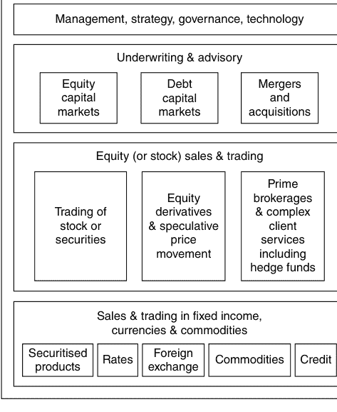

**图 1.3** 投资银行的理想化组织结构。  
*参考:* 英格兰银行

## 营销

促销和营销是金融机构（通常也是大多数非金融机构）的重要组成部分，因为它们在创造和维护声誉方面发挥着重要作用。例如，标志和色彩的持续使用在营销的模拟和数字形式中都很重要，并且两者都与活动管理、口号和品牌形象相关联。有效使用分析是营销过程的关键部分，无论是在 B2C 还是 B2B 环境中。

随着客户群变得越来越愤世嫉俗且具有伦理意识，银行如何呈现自身尤其重要。专家已认识到某些工具和方法在更深层次的心理层面产生共鸣，包括品牌投射中色彩的使用。

例如，使用蓝色和黄色的组织并非偶然。蓝色与信任相关联，而黄色与幸福相关联。还需要考虑国际视角，尤其是对于全球性企业而言。例如，与中国相比，红色在西方具有截然不同的含义。Société Générale 使用的黑色代表节俭和权力——或许是非常及时的属性，以反映当前经济不确定性。强有力的形象也发挥着日益重要的作用，不仅从象征意义上（例如 ING 的狮子）来看，而且随着行业日益转向数字渠道，在小手机屏幕上实现快速识别变得至关重要。

## 客户支持与服务

对于许多零售客户而言，客户支持和服务的水平和质量可以成为关键差异化因素，尤其是在有关技术、产品或只是需要提问和寻找答案时。2014 年 JD Power 关于美国零售银行满意度的调查发现，糟糕的客户服务是客户更换银行的首要原因。

客户、产品和系统知识在客户支持职能中都至关重要，但总体而言，这一运营部分被视为服务客户的一种昂贵方式。因此，银行越来越多地推动“自助服务”，即使在实体网点也是如此。可能最有效的客户支持是那种将准确性和实用帮助与良好的沟通技巧相结合的服务。因此，零售银行业正倾向于“增强型人工智能”，其中呼叫中心代理的活动通过技术、聊天机器人以及最终的机器人得到增强，所有这些都将融入分析。

自动取款机作为银行与客户互动的主要部分而存在的普遍性，尤其被视为改善关系质量和深度的错失机会。使用自动取款机预设了现金仍将发挥作用，但无卡 eATM 的概念正受到关注。随着 ATM 和 eATM 承担了传统柜员 60% 的功能，ATM 取代传统银行网点的未来尤其可能，只有一个可能的修改，即未来的访问可能不再通过塑料卡，而是通过虹膜扫描或同等方式进行。

## 银行业未来职位

2018 年，汇丰银行强调了他们认为其数字转型所需的新角色，作为其 170 亿美元技术支出的一部分。他们确定需要招聘 1000 名具有数字技能的额外人员，通常是经验丰富的“UI 设计师、数字产品经理、软件工程师、解决方案架构师、探索性测试员和交付经理。”

汇丰银行全球数字、零售银行与财富管理主管乔什·博顿利表示：“未来的许多岗位和职位名称，我们今天无从知晓。但有一件事是确定的：人工智能不会取代人类智能。就客户体验而言，将最先进的技术与人的力量相结合，将是区分优秀与卓越的关键。”[30]

这是一个有趣的观点，但并非所有人都赞同；不过至少在短期内，他可能是对的。

汇丰银行特别列出了未来五种数字化岗位：

1. **混合现实体验设计师**：该角色利用数字数据增强现实世界，在设计、品牌和用户体验方面提供三维增强现实体验。
2. **算法机械师**：随着行业走向“无代码”环境，与系统的交互越来越多地基于自然语言，*算法机械师*是指不断微调算法以达到最佳性能的人。
3. **对话界面设计师**：换言之，即聊天机器人设计师，但其技能涉及创意、语言和人类学元素（即与人类研究相关的领域）。
4. **通用服务顾问**：高技能客户服务顾问，能够在真实与虚拟客户界面之间自如切换。
5. **数字流程工程师**：人们日益认识到，未来不是将现有流程数字化，而是创建以平台为导向的新生态系统；这类角色负责微调新流程，以实现高效且无摩擦的运营。
6. **合作伙伴网关推动者**：该角色负责管理银行未来虚拟企业中参与者（或“行动者”）之间的接口，尤其是在双向数据流和安全问题方面。

这是一份有趣的清单，或许其目的更多是引发讨论而非反映现实，尤其是它带有一种随机生造头衔的感觉。所谓“随机生造头衔”，可以想象把一串技术术语写在小纸条上放进帽子里，再每次抽出三个来组合。顺便说一句，这种方法也叫“剪切法”（或découpage），大卫·鲍伊和库尔特·柯本曾用它创作出一些令人难忘的歌曲。

为了补充这份清单，读者或许还可以看看其他先进领域和行业的职位描述。任何典型的招聘网站上都有空缺职位广告，例如：

- **数据分析师—语音—聊天机器人—人工智能**：该职位负责整理来自客户人工智能助理/聊天机器人（如Alexa、Siri、Bixby、Cortana）的交互数据，并利用这些数据理解客户行为，帮助提升客户聊天机器人的潜力。
- **Python开发者—人工智能**：与技术架构师和其他开发者紧密合作，你将为核心产品构建健壮且高性能的服务器端代码；该产品利用人工智能从整个网络获取知识，为客户提供战略性的竞争优势。
- **经理兼法律顾问**：在监测趋势、行业及监管动态方面发挥主导作用，包括开放银行、支付未来、大数据、人工智能、可穿戴设备、物联网、数字支付、营销与个性化等领域。

这些来自银行行业的真实招聘广告并未特别注明来源，部分原因是这些广告上的职位现在很可能早已“不复存在”。不过，希望这些描述能让人了解就业市场中的“热门”方向：这些职位提供丰厚（有些甚至高得令人咋舌）的薪酬待遇；同时，也让你知道简历中可能需要包含哪些热词，以吸引融入数据分析的招聘流程的注意。

需要考虑的一个重要方面是，招聘者和雇主寻找的不仅仅是能力尚可、愿意在工作中培养的人。相反，他们似乎需要的是有能力、有经验、能够快速上手并立即产生影响的成熟人才。需求规模之大令人担忧；例如，仅汇丰银行一家就在招聘1000人。将这个数字推广到更广泛的银行业以及响应AI时代的众多其他行业，就很可能会面临资源和人才挑战，即如何找到足够多有合适资历、具备足够能力的候选人。充分的培训和经验不是一夜之间就能完成的。正如马尔科姆·格拉德威尔所说，有人认为要成为真正的“大师”，需要积累1万小时的经验。[31]

相比之下，Fitch Learning表示，要在未来的金融服务领域成为“颠覆者”，可能需要六年的培训。然而，或许银行在这个阶段并不需要“颠覆者”或“大师”，而是需要高度合格且能干的*步兵*。[32]

这些能干的步兵将从何而来？候选人储备中有很多潜在人选，但当他们出现时，是否具备正确的技能？他们是否有能力专注于特定的行业垂直领域，或应对个别市场板块的具体挑战？从长远来看，这些是否重要？或许未来的运营模式（至少在短期内）是让数据科学家与银行业专家协同工作。随着时间推移，这两种职业很可能不再有区别，银行业专家也将需要具备足够的“新时代”技术能力。

*据闻，一位在渔业和海洋学方面有专长的数据科学家，正受到金融机构的“追捧”，希望他转行通过数据管理来获取客户。显然，圣经中的“得人渔夫”（Fishers of Men）并非要用在这种地方吧？*

先进的分析技术和AI越来越被认为不仅对银行业的整体未来至关重要，而且对单个银行未来的盈利能力也至关重要。银行（及其他机构）在争夺专业人才方面可能会变得越来越决断，而这将推高薪酬成本。其影响可能是在分析成熟度方面拉大一级行业与二级行业之间的差距。人才短缺和薪酬成本上升将促使银行制定替代战略，尤其是在高级分析、机器学习以及最终的AI领域。新的去中心化业务模式可能应运而生。与其他行业相比，银行业作为“先行者”，人才短缺更有可能形成某种“燃烧平台”或催化剂，从而推动AI更快发展。

银行业正处于关键的转型阶段，这一阶段将由分析技术并最终由AI驱动，同时将面临一些重要问题，这些问题的答案将支撑其战略：

1. AI会以多快的速度不仅成为银行议程的重要组成部分，而且成为银行未来战略的基石？
2. 什么时候我们不仅会在大型银行的年报中看到AI的提及，还会在中型和小型银行的年报中看到？
3. 什么时候我们会看到银行从使用技术的金融服务提供商，转变为拥有银行知识的技术公司？

## 结论

本章仅旨在作为主主题的引言或“序言”，该主题是分析技术、AI与“银行业的未来”。

本作者在前一本书中探讨了AI将如何影响与所有职业和行业相关的“工作的未来”。[33] 要充分有效地考虑这个问题，就需要理解“工作”的含义。采用同样的方法，先理解“货币”和“银行”的含义是有帮助的，尽管这两个都是大话题，这里只触及了皮毛。其他人，如加尔布雷斯和弗格森，曾对这些主题进行过更深入的论述。加尔布雷斯的《货币：从哪里来，到哪里去》[34]写于1975年，带有时代局限性，没有提到数字经济——当时数字经济甚至还未进入人们的视野。弗格森的《货币崛起》[35]于2009年再版，在原版中对数字化影响的评价只是一笔带过，这反映了大约十年间发生了多大的变化。

弗格森还曾考虑以向查尔斯·达尔文致敬的方式，将他的书命名为《金融的由来》。他认为金融是一个一直在演变的主题（现在亦然）。他的论点与达尔文类似：除非我们理解货币的基本真相，以及其中包含的银行的基本真相，否则我们永远无法真正理解未来。在金融演变过程中，我们必须充分认识到，银行的目的和功能正通过分析技术及AI不断演变。人工智能之于银行业，可能就像陨石撞击之于恐龙族群。通过这种“演变”过程，银行将不断需要创造新的、有时甚至是激进的流程和融资模式，不仅是为了最大化未来利润、维持现有盈利能力，而且是为了以一种可识别的形态生存下去。正如达尔文所发现，生存下来的不是最大、最强的物种，而是最敏捷的物种。

弗格森说：“我们永远不会理解货币的基本真相。”但他也认识到，货币和金融市场在某种程度上是“人类的一面镜子，在每个工作日的每时每刻，映照出我们如何评价自己以及周围世界的资源”。如果货币是镜子，那么银行难道不是承载这面镜子的镜框吗？

人们总是忍不住把“银行”当作某种通用术语，认为所有银行或多或少都是一样的。我们总是从自己的个人视角或经验（无论好坏）来看待银行和银行业，以及我们通常如何成功地……

与他们互动。在考虑分析与人工智能在银行业未来的应用时，我们不仅必须认识到这个行业的复杂性，还必须认识到最终巨变的巨大规模。

银行已经从金融中介转变为货币的创造者（有时也是毁灭者）。除此之外，由于企业渴望创新，它们也成为了货币的消费者，尤其是在各种救助中对公共资金的消费。但关于导致雷曼兄弟和苏格兰皇家银行倒闭的问题，已经写得够多了，现在是时候继续前进了，无论从哪个意义上说。

如果不思考货币的概念及其未来，我们就无法理解银行业，尤其是银行业的未来。没有必要重复老生常谈，只需反思这样一个事实：许多以前的著作（也许是全部）都是在数字时代之前写成的，那时人工智能只是一个科幻概念。只有理解了“货币”和“银行”这两个词在当前时代的真正含义，我们才能对由分析和人工智能所注入的未来可能是什么样子有所启发。

## 参考文献

- 1. “报告显示，技术正在改变我们选择管理资金的方式”。Strategic Newslink. 2018年5月25日（查阅日期：2019年11月29日）http://www.onlystrategic.com/Articles/search/article/83083
- 2. Quiggan, A.H. 《原始货币概览：货币的开端》。Methuen, 1949.
- 3. Martin, Felix. 《货币，未经授权的传记》。Vintage, 2014.
- 4. Dodd, Nigel. 《金钱的社会生活》。Princeton University Press, 2014.
- 5. Angel Qinglan Li. “马克思所说的‘商品语言’是什么意思？” New Cultural Analyst. 2014年9月22日。（查阅日期：2019年10月4日）https://newculturalanalyst.wordpress.com/2014/09/22/what-does-marx-mean-by-the-language-of-commodities/
- 6. https://en.wikipedia.org/wiki/Merchant_bank
- 7. Merchant Loan Advice. “什么是挑战者银行？”（查阅日期：2019年10月4日）https://www.merchantloanadvance.co.uk/what-is-a-challenger-bank/
- 8. Chappelow, Jim. “影子银行体系”。Investopedia.（查阅日期：2019年10月4日）https://www.investopedia.com/terms/s/shadow-banking-system.asp
- 9. Strange, Susan. 《赌场资本主义》。Manchester University Press, 2015.
- 10. Lilly, Chris. “2019年信用卡统计”。Finder. 2019年7月出版。（查阅日期：2019年10月4日）https://www.finder.com/uk/credit-card-statistics
- 11. Simmel, Georg. 《货币哲学》。Routledge Classics, 2011.
- 12. McLeay, Michael, 等. “现代经济中的货币创造”。Bank of England Quarterly Bulletin, 2014, Q1.
- 13. Kagan, Julia. “银行存款”。Investopedia. 更新于2019年9月19日。（查阅日期：2019年10月4日）https://www.investopedia.com/terms/b/bank-deposits.asp
- 14. Dyson, Ben; Hodgson, Graham; van Lerven, Frank “主权货币：导论”。Positive Money. 2016. https://positivemoney.org/wp-content/uploads/2016/12/SovereignMoney-AnIntroduction-20161214.pdf
- 15. Galbraith, John Kenneth; Salinger, Nicole. 《几乎人人都能读的经济学指南》。伦敦. Penguin, 1978.
- 16. Munger, Charlie. “伯克希尔哈撒韦2018年度股东大会：2018年5月5日下午场”。https://buffett.cnbc.com. CNBC/Berkshire Hathaway. 检索于2018年5月14日.
- 17. Sheffield, Hazel. “英国迈向无现金社会”。Independent. 2015年5月20日。（查阅日期：2019年10月4日）https://www.independent.co.uk/news/business/news/uk-moves-towards-cashless-society-10267215.html
- 18. Opinion. “为什么无现金社会在美国行不通：读者反馈”。USA Today. 2019年5月21日。https://eu.usatoday.com/story/opinion/readers/2019/04/21/why-cashless-society-wouldnt-work-us-readers/3508639002/
- 19. “无现金社会的增长让美国最贫困人群被边缘化”。Bloomberg. 发布于2019年3月31日（查阅日期：2019年10月4日）https://www.thenational.ae/business/technology/growth-of-cashless-society-leaves-us-poorest-sidelined-1.843316.
- 20. Ferguson, Niall. 《货币崛起》。伦敦. Penguin, 2009.
- 21. 工商管理学士（银行与金融方向）。University of Ghana Business School.（查阅日期：2019年10月4日）http://ugbs.ug.edu.gh/department-finance/bsc-administration-banking-finance
- 22. “银行业和金融业中合规的职能是什么？” VComply. 2017年5月9日。（查阅日期：2019年10月4日）https://blog.v-comply.com/banking-compliance/
- 23. “运营：毕业生工作领域”。Target Jobs.（查阅日期：2019年10月4日）https://targetjobs.co.uk/career-sectors/investment-banking-and-investment/advice/278883-operations-graduate-area-of-work
- 24. Burson, Jim. “银行配送渠道管理的三个维度”。Gonzo Banker. 2017年7月13日（查阅日期：2019年10月4日）https://gonzobanker.com/2017/07/3-dimensions-bank-delivery-channels/
- 25. Moultrie, Dan. “开发银行产品的六种策略”。BAI Banking Strategies. 2015年5月13日。（查阅日期：2019年10月4日）https://www.bai.org/banking-strategies/article-detail/six-tactics-for-developing-banking-products
- 26. Shevlin, Ron. “银行业新产品开发的困境”。Financial Brand.（查阅日期：2019年10月4日）https://thefinancialbrand.com/49677/new-product-development-dilemma-banking/
- 27. “银行业的营销策略”。International Branding.（查阅日期：2019年10月4日）http://www.internationalbranding.org/en/marketing-banking-sector
- 28. “银行和金融服务业的客户服务策略”。Ritz Carlton Leadership Center.（查阅日期：2019年10月4日）http://ritzcarltonleadershipcenter.com/2015/02/customer-service-strategies-for-banks/
- 29. Murakami-Fester, Amber. “未来ATM机将是什么样子”。Nerdwallet. 2016年5月18日。（查阅日期：2019年10月4日）https://www.nerdwallet.com/blog/banking/this-is-the-atm-of-the-future/
- 30. “汇丰银行展望未来银行业的六种新职业”。Finextra. 2018年7月6日。（查阅日期：2019年10月4日）https://www.finextra.com/newsarticle/32355/hsbc-highlights-the-six-new-banking-careers-of-the-future
- 31. Gladwell, Malcolm. 《异类：成功的故事》。Penguin, London. 2009.
- 32. Fitch Learning. “转折点：面向2030年金融服务业培养顶尖人才所面临的当今挑战”。2019年3月.
- 33. Boobier, Tony. 《高级分析与人工智能：影响、实施与工作的未来》。伦敦. Wiley, 2018.
- 34. Galbraith, J.K. 《货币：从何而来，往何处去》。伦敦. Pelican, 1975.
- 35. Ferguson, 《货币崛起》。

也许关键不在于设定目标和达成目标，而在于以下因素的组合：

- 愿景设定，为利益相关者提供某种形式的使命宣言
- 在企业层面和个人层面发展能力
- 组织反思，让参与者更加敏捷、更好地适应当前时代

这种相对激进的做法单独来看，如果企业是在真空中运营，或者对于需要灵活应变的初创企业来说，也许还行得通；但对于银行这类更成熟的企业来说，则不过是杯水车薪，因为它们不仅对客户和股东负有责任，而且还处于监管的阴影之下。

银行仍然需要制定战略目标，但这些战略指令的性质必然在发生变化，这不仅是数字时代的结果，也是先进技术的影响。¹

麦肯锡在其2018年的文章《银行的六大数字化增长战略》²中，为他们所称的“驾驭混乱”提出了六个机会。这些机会是：

- 1. 将业务扩展到银行核心业务之外的非核心活动，例如家庭服务、医疗保健、移动设备和设施管理
- 2. 创建金融超市；换句话说，一种成本比较的方式
- 3. 延伸价值链，例如提供与核心银行服务无关的咨询建议
- 4. 将数据变现，换句话说，利用分析技术从企业已掌握的数据中提取价值
- 5. 成为金融工厂，将后台功能出租给其他小型组织或初创企业，从而把成本中心转变为利润中心
- 6. 成为麦肯锡所说的“数字攻击者”，采用数字化市场进入策略或新的创新商业模式，以获取市场份额

他们提出了四个关键行动要点：

- 1. 确定哪种战略最能适应当前资源和市场机会
- 2. 需要分清轻重缓急，而不是同时追求所有这些机会
- 3. 需要了解实现这些目标需要什么样的组织结构和治理机制
- 4. 需要了解实现这些目标需要什么样的能力

除此之外，麦肯锡还建议要有紧迫感。他们说，对银行而言，这意味着要进攻市场而非防守市场，但这可以说是说起来容易做起来难。对于最大的银行来说，不可避免的政治和组织复杂性使得快速变革如同调转超级油轮。较小的银行可能

既没有足够的关键规模，也没有业务意愿去进行这些变革，但它们可能拥有比大型同行更快转型的灵活性和敏捷性。

在敏捷性与运营效率和成本削减之间需要进行权衡。例如，小型银行可能不得不准备将其后台服务外包给更大（且更成熟）的竞争对手、科技公司，或者外包给“纯粹”的外包服务商，以确保它们拥有在数字时代竞争所需的活力。这些决策不仅对运营成本很重要，而且对客户体验也很重要。由于大量外包业务都在海外进行，语言和方言往往成为运营问题。在许多情况下，撇开仇外心理不谈，银行客户仍然倾向于与电话另一端他们能够轻松理解的人工客服打交道。也许最终聊天机器人会消除这种无意的偏见。

当我们探讨未来银行以及人工智能在这其中的作用时，这些方面将在稍后更详细地讨论，届时还会审视实施问题。目前，需要处理更为基础（且相对传统）的问题，也就是我们通常所说的“业务要务”。

# 战略与要务

### 战略

“战略”一词源自希腊语 στρατηγία（strategia），意为“将领的艺术；将军的职务、指挥、统率”，最初是一个军事术语，包含在不确定条件下通过运用若干技能子集或“战术”来实现目标的一套计划。“战略”一词在商业中的使用始于20世纪60年代，但在不确定条件下进行规划的含义似乎完全符合当前时代。³

在履行对投资者的义务时，银行通常对其战略目标相对透明。这些信息通常通过投资者报告和更新以及新闻源提供。

例如，对于技术供应商来说，理解银行（或任何组织）的战略目标至关重要，因为这可以使供应商的技术（他们试图销售的产品）与银行的战略意图保持一致。如果不一致，那么成功销售的机会就会减少。这种方法通常被称为“战略销售”，是复杂（“非战术性”）销售中众所周知的方法。战略销售使供应商能够在更早的阶段接触客户，通常层级更高，而且通常成功机会更大。⁴

初创“金融科技”公司——我们稍后将更具体地讨论——最好理解这种方法，哪怕只是为了理解他们新创建的能力如何融入潜在客户的更广阔图景，而不是指望初创公司的新技术能在组织中找到位置。

- 2. 持续增长和盈利能力，尤其是因为增长乏力通常不可接受，从而导致更加关注客户
- 3. 有效的风险和合规管理，包括将风险管理融入日常决策

可以公允地说，几乎无论哪个行业，这三项都是需要关注的主要关键领域。有人甚至可能会说，在数字化时代，这些要务在整个决策矩阵中仍然是“常量”，并且在很大程度上具有普遍性。总体而言，也许问题仅在于如何将这些要务“转化”为该行业的特定需求。

表1按顺序列出了这些要务，并具体针对银行业。

## 表1 银行业当前要务

| 业务要务 | 策略/目标 |
|---|---|
| 运营效率提升 | 通过优化流程和创造“无摩擦”运营来降低成本 通过完善商业模式，并移除（或外包）非增值功能来降低成本 通过更有效的财务绩效管理改进财务流程和控制 更好地管理分销（或“渠道”）流程 |
| 更好的风险管理 | 吸收、适应并遵守新法规的能力 改进内部合规控制 将风险管理嵌入控制与流程 为违规和不合规行为建立早期预警和警报 使风险管理与决策保持一致，例如在定价过程中 改进资本配置中的风险建模 减少和缓解欺诈行为，包括盗窃 |
| 增长与盈利能力 | 提高客户留存率 改善客户获取 增进客户洞察 改善客户服务 向上销售和交叉销售 改进营销活动管理 加速产品创新与开发 |

银行最好更好地理解高街零售商正在经历的变化，他们的传统零售流程正被在线购物所取代。零售场所越来越多地被用于“展厅式购物”（showrooming），即潜在客户在线上购买商品之前先在这些场所查看和试用商品，通常价格更便宜。

因此，零售商们越来越多地打造他们所谓的“购物体验”。例如，北京三里屯的梅赛德斯“Me”体验店旨在提供“一个融合了餐饮（食品与饮料）、艺术（娱乐）和生活方式（高端零售）元素的综合性多感官客户体验旅程”。此外，这座两层建筑的第二层设有一家高档酒吧和餐厅，二者共同助力梅赛德斯将自身定位为“生活方式伙伴”。⁸

类似的梅赛德斯“Me”体验店正在汉堡、慕尼黑、米兰和东京开业，而且通常位于普拉达和古驰等其他奢侈品牌聚集的地段。⁹ 梅赛德斯旨在尽可能延伸其品牌，包括鞋类、服装和背包。品牌塑造这一主题对梅赛德斯的产品至关重要，我们将在第6章中更具体地探讨。

银行可能需要找到一种方式，为其金融服务提供“展厅式体验”。因此，在这种情况下，我们的“银行体验”应该是什么？尤其是当许多人仍然将过去的经历与不信任、复杂性和不确定性联系在一起时。

“体验”通常被描述为身体、心理和情感触发因素的组合，其中一些是有意识的，另一些是无意识的。我们甚至将精神参与描述为宗教体验。客户体验（通常缩写为CX）被定义为客户在整个客户旅程中所有互动的总和。¹⁰

根据客户体验专家Ameyo的说法，改善银行客户体验有四个关键步骤：

- 1. 规划，即设定一套明确定义的目标和指标，并对其进行适当细分。
- 2. 制定战略，即制定客户体验战略以实现这些目标。
- 3. 改善体验，即通过设计和交付体验来提升体验。
- 4. 衡量，即采用数据驱动的方法不断完善体验。

## 电信行业中的类似要务

由于“移动”被认为是银行业未来的关键技术贡献者之一，考虑其关键要务非常重要。与银行业一样，这些要务似乎是运营效率、客户增长和风险管理。

最后聚焦于风险管理，安永在其2015年报告中¹¹ 指出了他们认为的电信行业十大风险，这些风险也可能引起银行业的共鸣。

安永指出了以下10个领域：

- 1. 未能认识到不断演变的行业生态系统中的新角色：他们的报告提到了“OTT”的概念，即“Over the Top”服务。这些服务代表新进入者或现有进入者通过在价值中占据新位置而提供的服务

价值链，以巩固客户关系并推动增量收入。他们的电信研究《Navigating the road to 2020》¹²，基于对40家运营商和其他行业利益相关者的访谈，还揭示出‘61%的行业领导者认为“OTT”（Over the Top Services，过顶服务）是最有可能在未来几年改变客户需求情景的行业实体’。

抛开任何技术术语，但不经意间又滑入营销术语，这似乎是一个创造‘增值’服务的问题，而增值服务本身又能创造‘客户愉悦’。

- **2. 缺乏新市场结构的监管确定性**：除此之外，他们认识到，与银行业一样，他们所处的监管环境也在不断变化，这影响了他们的投资战略，尤其是因为融合导致监管框架不断转变，传统模式和定义也在改变。

EY的观点是，电信供应商应当‘主动与监管机构接触，帮助塑造数字社会’。这里的含义是，电信供应商不应被动应对，而应在监管影响方面占据主动，尤其是因为他们是关键利益相关者。这对金融服务行业同样是一个教训。

- **3. 忽视隐私和安全方面的新要求**：网络安全仍然是所有行业（包括电信和银行业）的主流关切，尤其是因为客户关系建立在信任之上，而且随着我们越来越多地采用数字时代的行为方式，对隐私和安全的需求将会增加。除此之外，在客户数据的所有权与保护方面也存在监管影响。

- **4. 未能提高组织敏捷性**：实际上，这涉及组织内部应对变化的挑战，包括应对更短的产品开发周期，以及满足由‘网络巨头’等其他参与者所驱动的客户需求。EY特别建议对企业内部的人员和流程进行转型，并加强协作，‘以打造更加以客户为中心的组织’。

- **5. 缺乏数据完整性来驱动增长和效率**：电信公司需要认识到，有效利用数据和分析是帮助他们获得360度客户视图的关键解决方案之一，从而有效地进行向上销售和交叉销售。

- **6. 绩效衡量不足，无法驱动执行**：虽然绩效衡量仍然重要，但电信公司面临的一个挑战是理解并最终衡量数字时代的正确指标。他们建议，‘快速变化的市场需要新的绩效衡量概念，将适当的目标与激励措施同更好的内外部指标结合起来’。

- **7. 未能理解客户所重视的价值**：这不仅仅是客户个性化的问题，还需要跟上‘客户的态度’，从而提出更先进（反过来说也更简单）的主张，并设立诸如‘客户体验官’等新角色。

- **8. 无法从网络资产中提取价值**：在电信场景中，这主要涉及优化、有时共享以及外包铁塔和网络等技术资产。这一点尤为重要，因为这些资产资本密集，但生命周期相对较短。

- **9. 外延式增长议程界定不清**：为了增加价值、打造横向产品主张并获得规模效益，电信供应商需要审视其并购（M&A）战略以及合作伙伴关系，尤其是要认识到‘物联网’的影响。

- **10. 未能采用新的创新路径**：电信运营商需要通过加强与生态系统‘参与者’的合作、发展内部人才能力以及‘培养文化心态’来探索新的价值创造来源。这还涉及利用孵化器和加速器（参见第10章，其中讨论了实施与创新）。

## 医疗保健行业的类似要务

总部位于美国的Chartis集团专门为医疗保健行业提供咨询、分析和技术服务。其报告《2019年医疗保健展望：未来一年的战略要务》¹³确定了四项关键战略要务：

- **1. 拥抱数字化**：他们提到了*数字医疗*的概念，这需要‘向以消费者和数字交付网络为中心的交付模式转型’，并且需要‘协调一致的数字化健康规划与实施方法’。

- **2. 确定在不断演变的医疗保健价值链中的‘定位’**：他们指出，数字医疗业务与十年前相比已有所不同。供应商不仅需要理解自己在未来数字价值链中的角色，还可能需要颠覆*自身*，以避免长期的不利影响。

- **3. 重新思考资本**：在数字时代，医疗保健提供商应重新思考如何‘构想和利用其资本资源’。这要求他们确保资本支出与战略目标保持一致，谨慎做出‘建设/购买/合作决策’，并探索替代资本来源。

- **4. 执行以创造真正价值**：在医疗保健市场中，利润率管理至关重要，尤其是在临床护理领域，因此领导力和实施挑战仍然至关重要。市场整合加剧了实施和价值创造的压力，而这些压力最终将转嫁给最终用户/消费者。

总的来说，这里有一个关键信息不仅适用于银行业，也尤其适用于咨询公司。咨询实践中确实存在各自为政的倾向，以满足特定行业客户群的需求。纵向方法无疑能带来市场聚焦和专业知识，并实现有效互动，但跨行业探索和‘利用技能与能力’同样至关重要。

这不同于‘横向技术平台’（例如，一个AI供应商同时服务同一企业的多个职能），而是预示着在AI注入的生态系统下，不同行业领域将日益融合及其带来的后果。在一个成熟的AI环境中，多个‘行业要务’完全可能同时存在而不冲突，最终都有利于最终用户。

特定行业的营销虽然有价值，但往往也无法识别客户在其整个体验范围内的协同效应。同样，特定技术的营销也无法识别不同细分行业的特定需求。再加上本地市场成熟度的挑战，就不难理解那些试图制定单一全球‘一刀切’战略的全球银行业参与者所面临的挑战。

最有效的国际公司需要采用全球模板、本地执行的运营方式，但除此之外，还需要思考AI注入如何影响其市场推广主张。换言之，AI将影响组织中的每一个人，包括全球营销团队。

## 银行业的未来要务

在审视零售、电信、医疗保健这三个非银行业行业时，一些关键趋势开始浮现。

## 更大程度的客户中心性

这可能是一个‘默认前提’，因为如上所述，它已出现在当今银行业的要务中，但银行越来越需要在全新层面上思考客户中心性。梅赛德斯和苹果等零售商正在突破他们所谓的‘客户体验’的极限，例如，将高端汽车的购买和拥有重新塑造为一种‘生活方式体验’。

银行需要理解客户的需求和期望，并能够以快速及时的方式推出新产品和服务。这样做几乎必然会导致复杂性增加，再加上全球化和技术发展的问题，将带来更艰难的实施挑战。

虽然答案可能部分在于更多使用‘应用程序’和移动技术，但笨重、缓慢的应用程序总是会给客户体验带来负面影响，因为它们增加的是不便，而非价值。

银行业的‘生活方式体验’会是什么样子？例如，当房产保险公司和医疗保健提供商从被动的理赔模式转向主动的健康管理模式时，银行业的对应做法又是什么？当然，这可能会以某种‘资金管理’的形式呈现——无论我们对这一表述作何理解

“金钱”的含义。此外，这种体验难道不需要一整套附加价值属性，包括获取建议的渠道，并进行适当细分吗？

我们已经开始看到“首席客户官”（CCO）这一高级职位的出现，通常处于高管层级，负责组织与其客户之间的关系。这一新角色是对CxO职位系列的进一步补充，通常是董事会级别的任命，负责审视（并影响）所有与直接面向客户运营相关的问题，例如联络中心、计费以及其他所有职能。

在他们题为“为何你的公司需要首席客户官”¹⁴的文章中，作者提出，随着企业围绕客户“重新调整和重新排序”其活动，企业越来越需要一位客户倡导者。文章指出需要具备两个特定职能：

- “统一不同职能部门的所有客户举措”
- “在整个组织中注入新的思维和行动方式”

文章还提到了四个关键目标：

- 1. 让客户变得鲜活；也就是说，在组织内部建立对客户重要性以及客户与更广泛企业之间关系本质的同理心
- 2. 向外延伸，通常通过允许客户帮助创造新流程和新产品
- 3. 让一线员工参与；即认识到面向客户的员工通常最适合就客户服务和产品开发提出建议
- 4. 拥抱数据，特别是在创建客户360度全景视图方面，以确保在所有接触点衡量客户满意度

人们很容易对这一增设C级职位的必要性持些许怀疑态度，因为这可能反而会使既定的职责和权力线更加复杂。尽管如此，随着信息获取渠道的增加（尤其是通过社交媒体）以及对优质服务的认知提升，客户已成为房间里最重要的人物。

## 真正实现数字化

这意味着，仅仅将现有的价值模型和价值链进行数字化是远远不够的。真正的数字化转型要求包括银行在内的各类组织准备好解构其现有模式，并为数字时代（更重要的是为其数字客户）重建这些模式。

但我们所说的“数字化”似乎有不同的解读。它当然不仅仅是“在线银行”，后者提供快速高效的24/7全天候访问。在其2014年报告“就银行业而言，数字化的真正含义”¹⁵中，专注于金融服务技术的研究、咨询和顾问公司Celent为银行业的“数字化”提出了一个定义。

他们表示，数字银行涉及三个关键要素，以交付可证明且可持续的经济价值：

- 1. 在所有渠道和互动点为客户提供定制化但一致的（金融机构）品牌体验
- 2. 由分析和自动化技术支撑的体验
- 3. 需要改变运营模式（即产品和服务、组织、文化、技能和IT）的环境

这一定义意味着数字化主要是一种创建定制化品牌体验的方式，但这是一个值得商榷的观点。数字化需要超越品牌或个性化（或定制化）的分销模式，与此同时也需要一种对银行业务的完全不同的思考方式。（“品牌”问题将在第6章进一步讨论。）

麦肯锡指出，数字化可以为主流收入带来高达30%的增长¹⁶（即通过个人贷款和支付等高周转产品），同时通过自动化、工作流和客户自助服务能力削减40%至90%的后台成本。他们表明，有效的数字化可以使员工生产率翻倍（也即“劳动力减半”），同时改善客户服务。这是一种减少或消除现有遗留性摩擦流程，转而采用更顺畅、直通式运营的方式。

在最简单的层面上，数字化是一种带来低间接成本的机制。它为RPA（机器人流程自动化）打开了大门。更重要的是，对银行而言这是一个心态问题，银行需要将绝对重心放在实现数字化上。（见图2.4。）

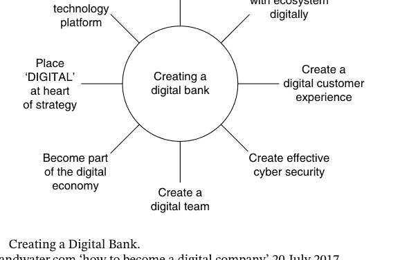

图2.4 创建数字银行。
来源：改编自brandwater.com“如何成为数字公司”，2017年7月20日

对于最终客户而言，其目标最终将带来更低的费用和更高的存款账户利率（尽管这可能是从一个复杂计算中得出的过于简单的结论）。

在银行内部人际互动方面可能存在某种权衡，但问题的核心在于，客户来银行是为了管理自己的资金，还是进行社交互动。（这并非要削弱位于村庄或小镇的社区银行的社会价值，这些银行在其他地方有所探讨，它们可能会产生完全不同的客户刺激因素。）

可以有效应用数字化的典型领域包括：¹⁷

- 存款、取款和转账
- 支票/账户管理
- 申请金融产品
- 账单支付
- 贷款管理

## 全面接受技术变革

银行需要以更有效的方式与技术结合，就像其客户也在拥抱技术变革一样。这不仅仅是摆脱遗留系统，还包括创建可扩展的、企业级的、相对面向未来的系统。这可能需要在传统金融服务机构与技术提供商之间建立新的创新合作伙伴模式。

技术讨论打开了通往更广泛且往往棘手问题的大门，例如并购导致的系统整合、建立有效的第三方合作关系，以及当然还有实施这个棘手的问题。

（2018年4月，隶属于Banco Sabadell的英国TSB银行试图迁移13亿条客户记录，导致“计算机崩溃”，引发了超过20.4万起投诉、8万客户流失以及3.302亿英镑的额外成本，这还不包括任何监管罚款。）¹⁸

展望未来，银行业不仅要全面整合，还要利用快速兴起的技术。这包括高级分析技术和人工智能的使用。从根本上说，这可能需要重新定位大型银行的战略意图。它们仅作为银行并尝试实现数字化是不够的：相反，这代表着其整个商业模式和市场进入方式的重大转变，就像美国银行那样，现在将自己描述为一家碰巧从事银行业务的科技公司。

## 重新构想银行业

最终的问题在于：

- 银行业未来的角色是什么？
- 银行业在未来社会中的地位是什么？
- 这将如何影响未来的银行业战略？
- 我们如何“重新构想”银行业？

查阅字典并不能为我们理解“重新构想”的含义提供太多启示（除了它是指“重新构想”的过程，这不过是一种同义反复）。Merriam-Webster词典将“想象”描述为“在脑海中形成某种不在感官面前或从未在现实中完全感知过的事物的图像的行为或能力。”¹⁹

在他的著作《重新构想！》中，汤姆·彼得斯并未试图定义“重新构想”的具体含义，而是通过其特征来识别它（就像“大数据”通过其组成部分——体量、速度、真实性、多样性等来定义一样）。²⁰ 在开篇部分，彼得斯将重新构想描述为：

- 一种对变化有高度渴望的新型员工
- 一种敏捷、创新且具有企业家精神的新型企业
- 一种新的社会契约，为打破常规、想象鲜活的新未来提供催化剂

这听起来相对充满激情，而且这一主题似乎在许多当前的商业战略中重新出现。“Reimagine Food”是某个国际食品中心的标签。²¹ IBM、Tommy Hilfiger等公司正在使用AI协作“重新构想零售”。²²

然而，与此同时，这种带有“可转移”标签的充满激情的做法有时无法反映仍然存在的谨慎和焦虑情绪。组织和行业如何确保所有这些不同版本的“重新构想的世界”能够在没有适当公司治理影响的情况下实现？“我们可以在安全的‘沙盒’环境中先测试它，或许才有可能重新构想银行业。”主要参与者可能会这样说。（见图2.5。）

“重新构想银行业”不仅仅是一场表面的改造。它不仅仅是关闭高街和农村银行网点以期降低运营成本，而这样做主要只会疏远现有客户并劝退新客户。它是

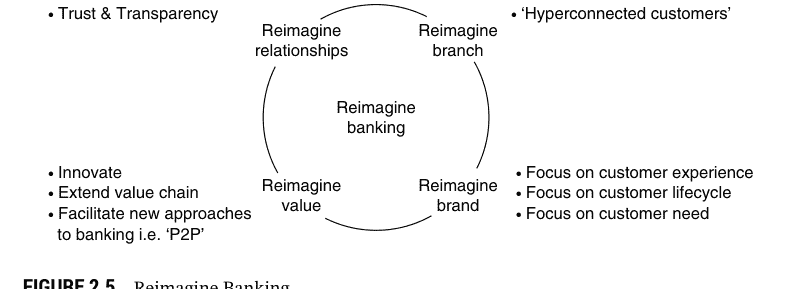

图2.5 重新构想银行业。

不仅仅是为现有的 High Street 分行重新装修、刷一层新漆，而是通过撤掉柜员、换成沙发和更智能的 ATM，或者仅仅拥有更华丽的品牌标志。

重新构想是指银行理解其对客户的真正价值，并在不确定时代重新塑造自身。它认识到货币的整体概念不仅正在改变，而且对许多人群来说已经改变。将银行重新构想为一个概念，开始认识到自动系统取代许多工作岗位的时代即将到来，而且这些系统可能包含比它们所服务的对象更智能的机器人。

## 重新构想风险管理

在如此未知且不确定的世界中，风险管理将变得愈发重要。不仅仅是运营风险方面，即考虑系统、人员或流程失效等问题，还涉及企业易受伤害的新类别。政治不稳定，加上气候变化和技术进步，开始将当前风险管理理念推向极限。在银行和金融服务等高度监管的行业中，管理新的不可预测性水平的能力日益成为关键成功因素。

在未来融入 AI 的金融体系中，风险流程可能会如何改变？未来的风险经理需要具备哪些新能力，他们的业务职能将被自动化系统和 AI 增强（如果不是被大幅取代的话）？

在他的录音《未来的风险经理》中，Willis Towers Watson 的 Brian Ruane^23 评论说在他看来趋势很明确。他说，风险经理不仅需要更聪明并展现出更大的领导力才能获得“参与决策”的回报，而且“他们将相应地获得声望、影响力，甚至金钱”。这看起来是个有趣的地方。

在其 2017 年报告《数字时代风险管理的未来》中，麦肯锡通过建议强化了这些观点^24，未来风险经理将专注于战略性和高价值决策，而低价值决策将被自动化且人工处理减少。他们建议一种模式，其中风险主管“部署一个集中的‘神经中枢’，其中新强大的自学习模型将利用改善的连接性动态设定限额并检测新兴风险（信用、市场和运营）——立即评估这些风险，启动跨风险缓解策略，并动态调整限额。”

这是炒作还是乐观？2017 年 IIF/麦肯锡数字风险调查发现：

- 70% 的银行已将数字风险纳入视野，但管理层关注程度中等。
- 10% 将其作为高优先级。
- 22% 的银行已投入超过其年度风险预算 25% 来实现风险管理的数字化。

全球企业在国际上管理合规问题所需和挑战不容低估。日益超出人类管理能力，尽管这在运营上可能在本地层面交付，但全球组织可能更频繁地要求将其以某种自动化、“智能” AI 融合的方式集中化。风险经理无法忽视通过分权运营模式缺乏控制所带来的风险。

对风险管理的态度通常是特定事件或经验的函数或副产品，预算分配和优先级排序也是如此。当风险管理成为当下的时代精神时，就像未来某个时候必然会发生的那样，AI 将发挥重要作用。在此期间，RegTech 提供商可能需要耐心等待，保持镇定。重大事件尚未发生。它们的时间尚未到来。

## 结论

本章从当前存在和未来所需两个方面考虑了银行紧迫性问题。紧迫性在运营上已被“下放”为可被视为业务“目标”的东西，但这些目标本身可能正变得越来越无关紧要，取而代之的是更动态的个人和业务进展衡量方法。

这本身就提出了一些有趣的组织挑战，即在新的 AI 融合时代如何衡量个人贡献。许多“个人发展计划”以目标为基础，然而在更不稳定的商业世界中，传统的“以目标为基础”的衡量标准变得越来越不相关和不重要。技能和知识正被敏捷性和灵活性取代，这给银行带来了新的压力，要求在企业、部门乃至个人层面以不同方式有效衡量进展。我们可能正接近需要重新构想“绩效管理”概念的时刻。

这不仅仅是银行业面临的挑战。随着自动化和 AI 的使用，角色和职责日益变化，企业内的运营职能也在被重新发明和重新定义。尽管他们可能尚未意识到，人力资源专业人士正被越来越多地推向前沿变革的最前线，而很少有人为此做好准备。在绩效管理、基于能力的薪酬、劳动法等方面不可避免地会出现连锁反应。

这不仅仅是应用当今的银行紧迫性并思考明天的紧迫性，而是要认识到这些变化对组织和个人的影响。迈向银行 4.0 的革命将影响所有利益相关者，无论是后台还是前台。没有藏身之处。新的格言将成为“能力，而非目标”。

在战略层面，银行可能需要将其传统生态系统扩展到其他领域的想法也为紧迫性的融合打开了大门。归根结底，银行、零售商、电信提供商和医疗保健提供商都在服务同一终端用户，即“消费者”，尽管形式不同。在真正以客户为中心的環境中，客户需求应排在首位，但情况比这更复杂。AI 的有效使用可以帮助为下一个千年创造某种新的“平衡计分卡”，它不仅反映客户需求，还反映风险和运营有效性。

## 参考文献

1. ‘官方数据：2019 年全球银行的业务优先事项’. Global Banking and Finance Review. 10 May 2018. (Viewed 28/11/2019) https://www.globalbankingandfinance.com/official-data-reveals-the-business-priorities-of-global-banks-in-2018/
2. Khanna, Somesh; Martins, Heitor. ‘银行的六大数字增长战略’ McKinsey Digital. April 2018. (Viewed 04/10/2019) https://www.mckinsey.com/business-functions/digital-mckinsey/our-insights/six-digital-growth-strategies-for-banks
3. Liddell, Henry George; Scott, Robert. ‘利德尔和斯科特希腊-英语词典’. Simon Wallenburg Press, abridged edition, 2007.
4. ‘有远见的战略销售’. Miller Heiman Group. (Viewed 04/10/2019) https://www.millerheimangroup.com/uk/training/advanced-selling/strategic-selling-with-perspective/
5. Carabelli, Carl. ‘“商业紧迫性”的定义’. Chron.com. (Viewed 04/10/2019) https://smallbusiness.chron.com/definition-business-imperative-25055.html
6. ‘imperative 在英语中的定义’. Lexico.com https://en.oxforddictionaries.com/definition/imperative
7. Finaly, Shane. ‘数字时代的商业：四大紧迫性’. The Future of Customer Engagement and Commerce. (Viewed 04/10/2019) www.the-future-of-commerce.com/2017/07/26/business-in-the-digital-age-four-imperatives/
8. https://www.mercedes-benz.com/en/mercedes-me/
9. ‘米兰 Galleria Vittorio Emanuele II 内的 Mercedes me Store’. Joy Della Vita Travelog. 31 January 2016. (Viewed 04/10/2019) https://joydellavita.com/mercedes-store-milan-inside-galleria-vittorio-emanuele-ii/
10. Gautam, Nitish. ‘银行体验：银行改善 CX 的最佳客户体验策略’. AMEYO. 25 November 2017. https://www.ameyo.com/blog/banking-experience-the-best-customer-experience-strategy-for-banks-to-improve-cx
11. Ernst and Young. ‘电信十大风险再探’. 2015. https://www.ey.com/Publication/vwLUAssets/EY_-_Top_10_risks_in_telecommunications_revisited_2015/$File/EY-top-10-risks-revisited.pdf
12. ‘全球电信研究：通往 2020 年的道路’. EY. 2015. https://www.ey.com/Publication/vwLUAssets/ey-global-telecommunications-study-navigating-the-road-to-2020/%24FILE/ey-global-telecommunications-study-navigating-the-road-to-2020.pdf
13. ‘Chartis Group 发布“2019 医疗保健展望：未来一年的战略紧迫性”’. Cision. 17 January 2019. (Viewed 04/10/2019) https://www.prweb.com/releases/the_chartis_group_releases_2019_healthcare_outlook_strategic_imperatives_for_the_year_ahead/prweb16039549.htm
14. Davis, Chris; Kazaks, Alex; Pulido, Alfonso. ‘为什么你的公司需要一位首席客户官’. Forbes. 12 October 2016. (Viewed 04/10/2019) https://www.forbes.com/sites/mckinsey/2016/10/12/why-your-company-needs-a-chief-customer-officer/#c56ef9a94d76
15. Greer, Stephen. ‘就银行而言，数字真正意味着什么’. BankNXT. 6 August 2015. (Viewed 04/10/2019) http://banknxt.com/52527/what-digital-means
16. Olanrewaju, Tunde. ‘数字银行的崛起’. McKinsey Digital. July 2014. https://www.mckinsey.com/business-functions/digital-mckinsey/our-insights/the-rise-of-the-digital-bank
17. https://www.temenos.com/news/2016/05/15/what-is-digital-banking/ (Viewed 4/11/2019)
18. ‘TSB 因计算机混乱遭受 1.05 亿英镑损失’. BBC. 1 February 2019. (Viewed 04/10/2019) https://www.bbc.co.uk/news/business-47085474
19. https://www.merriam-webster.com/dictionary/imagination

- 20. Peters, Tom. *重新想象！* 伦敦. Dorling Kindersley, 2003.
- 21. https://www.reimagine-food.com/
- 22. Dar, Parvan. “IBM、Tommy Hilfiger 与 FIT 利用人工智能协作并‘重新构想零售’”。 *Analytics Vidhya*. 2018年1月16日. (查阅于 04/10/2019) https://www.analyticsvidhya.com/blog/2018/01/ibm-tommy-hilfiger-fit-using-ai-collaborate-reimagine-retail/
- 23. https://www.youtube.com/watch?v=D-BZGPFg2w
- 24. Institute of International Finance & McKinsey. ‘数字时代风险管理的未来’. 2017. https://www.mckinsey.com/business-functions/risk/our-insights/the-future-of-risk-management-in-the-digital-era

# 数据与分析入门

### 摘要

本章旨在对数据与分析这一主题提供一个总体介绍，而下一章则更具体地探讨银行领域中分析的应用。数据与分析并非新话题，部分读者可能会快速浏览本节的通用部分，然后转向更具‘银行特异性’的分析问题。对于相对较新接触该主题的人来说，本节希望能提供一个有帮助的基础。

除此之外，它还认识到银行业中已有部分领域尤其具有分析导向性，尤其是在投资领域。量化分析师（或‘量化分析师’）将数据和分析作为其‘立身之本’，对他们而言已有更详细的文献。也许他们也会对更宏观地审视自己的行业感兴趣，尤其是因为其中许多人拥有合适的技术技能和能力，可以将自己的能力拓展到更广阔的未来角色。对于其中一些专家而言，银行业可能成为他们所说的‘蚌中之珠’。

本节还重申了对位置分析问题的强调，该问题往往不在思考的前沿，但就客户、商业机会和地缘政治风险等方面而言仍然相关，仅举几项此类类别的元素。

### 美国金融服务集团 PNC 投资数据与人工智能未来

根据其 2016 年年度报告，美国最大的多元化金融服务集团之一 PNC Bank 已在五年内投资 12 亿美元用于数据基础设施改造，这有助于他们更好地利用数据并实施人工智能和机器学习。¹

### 引言

大数据可能是‘大新闻’，但它并非‘新新闻’。事实上，甚至有一种远离‘大’这一表述的趋势——毕竟数据就是数据，很少有人会否认到处都有大量数据。

新兴趋势是从‘大数据’向‘快速数据’转变，即信息的汇集及其在实时或近实时中的分析。在银行业背景下，信息的速度有助于银行和其他组织提供更定制化、更相关的服务。

多样性：数据来自许多来源，以多种形式呈现——结构化、半结构化和非结构化。半结构化数据存在特定问题，因为它很少一致。结构化数据以既定且有组织的数仓形式存在。非结构化数据（例如纯文本或语音）完全没有结构，但有人可以合理地认为，有一条‘金线’将结构化和非结构化信息联系在一起，那就是‘位置’这一‘线索’。毕竟，据建议，不是所有人和所有事物都在某个地方吗？

目前，相当大比例的数据是非结构化的，可能高达 80%。据建议，未来的赢家将是那些能够从非结构化信息中获得洞察并因此提取价值的组织。在银行业背景下，这可能包括例如基于社交媒体的数据，有助于建立消费者情绪和品牌资产。

真实性：这通常被理解为数据的可靠性。并非所有数据都同样可靠，因为它们来自不同来源。真实性的一个关键衡量标准是‘信噪比’，它是信息的有用性与虚假或无关数据的对比表达。（该表达源于例如无线电信号的质量与背景噪声的对比。）

在银行业背景下，这可能与银行家在寻找客户对新媒体活动反应的洞察时，社交媒体网站上‘垃圾信息’或离题帖子的数量有关。垃圾信息还可能包括由‘网络机器人’自动大量创建的信息，也称为‘WebRobots’、‘WWW robots’或简单地称为‘bots’。通常，机器人执行人类可以完成但以更高量完成的重复性任务。

随着组织对数据治理和完整性的痴迷，存在一种风险，即任何不完美的数据都不可靠。这并不一定是真的。例如，一家大型英国银行会给数据的真实性或‘真实性’赋予权重。它使他们能够在决策中使用不完美的信息。现实是，即使在我们日常个人生活中，我们做出的决定往往基于当时可获得的最佳信息，即使它不完美，随后的行动也会根据不同的置信水平采取。

价值：最后一个特征，也是鲜少被评论的，是数据的价值。这可以用不同方式衡量，例如数据对用户在某一特定问题上提供更深入洞察的价值，或获取关键数据以获得关于例如客户信用状况的更好信息的成本。对许多银行——以及其他组织——而言的挑战是如何‘货币化’他们现在拥有并未来可以收集的数据。

有人认为几乎所有基本信息都已在‘以太’中存在，只需找到它并创建吸收和分析的机制即可。非常肯定的是，似乎某些关键类型的数据对于获得特定洞察至关重要，并且积极寻求它通常具有强有力的财务效益案例。

在银行业背景下，当我们考虑通用银行的概念以及提供更广泛产品和服务的‘全方位金融服务企业’时，这些新服务和‘下一代’产品可能并非由银行自身创建和管理，而是由第三方与银行以某种‘收入分成’形式合作。在这种情况下，在客户同意的情况下在供应链上下共享的数据通常有助于进入市场的策略以及最终的运营执行，因此在更有效的营销方面，数据具有货币‘价值’。

最近还提出了另外 8 个‘V’。⁶,⁷

- **有效性：** 涵盖数据质量和主数据管理（我们将在下面介绍）
- **可变性：** 包括动态和不断演变的数据，例如在源数据中识别行为属性（即有意识或无意识偏见）
- **场所：** 不仅涵盖地理相关性，还涵盖数据托管的平台，例如分布式账本/区块链
- **词汇：** 与数据模型相关，描述数据结构的语义
- **模糊性：** 与‘大数据’及其工具中使用的术语含义混淆有关
- **脆弱性：** 大数据带来的新安全问题
- **波动性：** 数据保持相关性的时间长短
- **可视化：** 是否可以使用可视化来更易理解详细的信息？

纯粹主义者可能会认为，在列出的 13 项中，前 5 项和后 8 项之间存在一定程度的重复。让我们说，有时人类在营销方面的想象力是没有限制的。目前，当前存在并未来将存在的几乎所有类型和类别的数据都可以用这些表达来表征。（对于迷信者来说，也许有必要再找到一个‘V’，使描述的数量超过不吉利的‘13’，也许是‘Virus-free’？）

## 数据管理与分析

### 数据管理

数据管理的概念，有时也称为‘MDM’或‘主数据管理’，由来已久，但在人工智能时代正达到新的重要性。在商业中，它被认为是‘一种用于定义和管理组织关键数据的方法，以便在数据集成的基础上提供单一参考点。被管理的数据可能包括参考数据，即允许值的集合，以及支持决策的分析数据’。⁸

换句话说，这是一个有助于消除重复数据、建立标准化和创建业务规则以防止“违规数据”进入系统的过程。作为一种技术流程或功能，它也在不断演进。

被认为存在 MDM 的三个“时代”：

1. 第一代 MDM 专注于数据质量和治理。这使企业能够从多个系统中整合客户、产品或财务数据的信息，在并购发生的情况下尤其有用。
2. 第二代 MDM 反映了系统的演进，更加强调客户，特别是在全渠道策略方面，通过提供对多渠道活动的实时可见性。
3. 第三代 MDM 反映了自动化和新系统的引入，用户越来越迫切要求在多个生态系统之间交换信息。在此过程中，他们要求更大的灵活性、数据虚拟化、在无需了解数据类型的技术信息（如其格式）的情况下检索数据的能力以及数据分发（来自第三方的信息，如消费品或商品制造商）。

根据 Forrester 的报告⁹，第三代 MDM 的两大主要举措是：

1. **优先考虑敏捷性而非合规性**：虽然认识到合规性，包括数据保护，是一个关键组成部分，但公司也希望以敏捷的方式为客户提供个性化体验，从而减少“价值实现时间”（TTV）。“价值实现时间”通常被定义为客户从产品或服务中实现价值所需的时间。
2. **成为数字化变革的基石**：MDM 越来越多地被认为是所谓的“灵活性的核心”，使公司能够更深入地洞察客户、产品和渠道。

就人工智能议程而言，像 Informatica 这样的公司在 Forrester 报告中被认定为领导者，旨在利用人工智能“简化 MDM 集成、提供匹配、发现关系或自动化基于规则的数据质量”。

## 分析层级

分析，或数据分析，通常被认为是获得数据洞察的关键。换句话说，分析解锁了数据的“价值”。

存在公认的分析层级（见图 3.6）：

- **描述性分析**仅用于报告发生了什么或正在发生什么。在银行业，这可能涉及银行分支机构、产品或服务在给定日期或期间的表现。描述性分析也常被称为“商业智能”或“管理信息”。

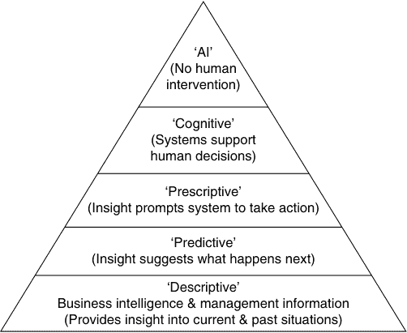

**图 3.6** 分析能力层级

- **预测性分析**寻求基于概率平衡做出预测，即接下来可能发生什么。一个例子是对销售额和分支机构表现的预测，使银行能够判断可能需要采取什么纠正性营销活动。
- **规范性分析**不仅预测接下来会发生什么，还预测应该对此采取什么行动，通常通过某种基于规则的系统。它被称为“规范性分析”，因为它“开处方”（或建议）一个行动方案。这方面的一个例子可能是联系中心或服务中心发生的活动。常也被称为“下一步最佳行动”，更准确的说法可能是“最佳下一步行动”，它为联系中心代理提供例如洞察力，帮助定位最佳的下一个建议方案以促成交易。

预测性分析和规范性分析本质上是概率性的，因为预测结果并无绝对确定性，而是算法基于可用信息预测最可能的结果。由此可知，数据越多、数据质量越好，准确预测和更有效建议的可能性就越大。

统计学家会了解“假阳性”的概念。该术语的含义因行业应用而异。一般来说，它指的是基于信息得出的错误结果（或分析），结果为“阳性”，而实际上阴性结果更为正确。这是一种统计异常，常出现在过滤垃圾邮件或欺诈分析中，其中一笔无辜的交易被识别为“可疑”。

在所有这些情况下，可视化的质量都在不断提高，无论是仪表板、先进图形还是某种图形映射形式。这样的可视化作为帮助用户理解更大数据的复杂性并做出更快决策的工具变得越来越重要。然而，基于仪表板外观做出的判断无法替代仪表板“之下”分析的强大力量。

总体而言，重要的是要强调分析不是目的地，而是对分析所做的事，并且分析应以这种精神来看待。分析通过改变流程和实践提供了一种实现目标的手段，在此过程中可以创造硬性或软性效益的组合。这些效益可能包括：

- 客户满意度更高，从而带来更高的留存率或交叉销售/追加销售
- 更高的运营效率
- 更好的风险管理
- 更有效的投资政策

分析提供的洞察不仅应促进最佳实践的发展，还应用于人工和自动决策，最终用于战略和运营判断。总体而言，分析流程不应与更广泛的业务孤立，而应成为组织不可或缺的一部分，我们可以将其描述为“分析型企业”。

## ‘下一代’ 认知分析

‘下一代’分析越来越可能具有‘认知’特性，不仅提供基于一定程度机器学习的概率性洞察，而且具有更自然的人机界面（而非需要机器编码）。认知分析是迈向‘全面’人工智能的垫脚石。然而，‘认知’并非《2001：太空漫游》中库布里克笔下 HAL 那样的‘人工智能’或‘AI’，而是代表了计算机与用户之间不同的关系。

关于‘认知计算’和‘人工智能’术语的使用，已存在大量混淆。重要的是不要对这些定义过于苛刻。毕竟，普通大众常常将系统做出音乐或观看内容等预测的能力描述为一种人工智能形式。

纯粹主义者认为它们是不同的；通才主义者则说它们或多或少是相同的。“认知”概念意味着计算平台以某种方式复制人类大脑的运作，通过结合语言处理、视觉识别、复杂算法和语音等不同技术能力。这种能力组合的最终结果是系统最终‘协助’人类决策，而非取代人类。相比之下，真正的‘AI’完全不需要人类干预，因此位于‘分析层级’的最顶端。

认知分析将在银行业技能短缺和所谓的人口爆炸等挑战中发挥重要作用。

认知计算的各种形式已在医疗保健和资产管理领域使用，在‘财富顾问’的背景下应用，只需时间问题，它就会进入主流零售银行业务。

与此相伴的很可能是情境分析的出现。银行机构将在了解和优化自身绩效方面变得更出色，但如果不考虑其组织之外发生的事情——例如竞争对手之间——那么这些观点就是在真空中形成的。美国科学家艾伦·凯简洁地表达了这一点：‘上下文价值相当于80个智商点。’¹⁰

在冷静审视下，银行家需要采纳两个关键目标：

- 1. 首先，超越直接竞争对手。
- 2. 其次，实现组织的战略目标。

只做其一而不做其二是工作只完成了一半。经常（但并非总是）这两个关键目标相辅相成。随着一些银行越来越关注成功度的柔性指标——例如与社区的互动或响应社会需求——成功可能也越来越多地以消费者情绪和品牌认知度以及盈利能力来衡量。

## 从数据中提取价值

数据无论是结构化还是非结构化形式，都不会自然地流向分析结果，而分析结果通常以报告、预测或推荐行动的形式出现，但取决于中间过程。这些过程存在于数据和分析之间，通常可被称为系统的‘管道’。这一基本过程使所有组织能够从数据中提取价值或‘货币化’数据。（见图3.7。）

具体如何操作是技术专家的事，但简单来说，原始数据需要被捕获，然后带入系统中进行过滤、清洗并通常存储。海量数据适合复杂的排序系统或‘着陆区’，其中大多数都有自己的语言和行话。通常会创建‘数据集市’或‘暂存层’，以确保分析结果能够相对快速地生成。数据在系统中移动的过程被称为 ETL，即‘提取、转换、加载’。

还有其他替代方案，例如‘数据仓库设备’，它们提供并行处理方法并创建模块化、可扩展、易于管理的数据库系统。这些高速解决方案通过提供传统线性处理的替代方案实现非常快速的计算能力，并且通常附带预打包的分析和地理空间功能。实际上，这是一种对数据和分析的‘即插即用’方法。这提醒我们，正如互联网早期所经历的那样，组织和个人越来越要求以分析形式提供的计算能力‘即时’提供。似乎不久前，例如在家庭环境中，连接互联网时电话线上会伴随着某种啸叫声和其他奇怪的噪音。

现在（出版时）即时4G连接被期望随时随地——在合理范围内——并且我们已经看到5G的首批示例，具有新的超交付水平。也许从这个角度来看，如果技术供应商之间差异化的一个层面

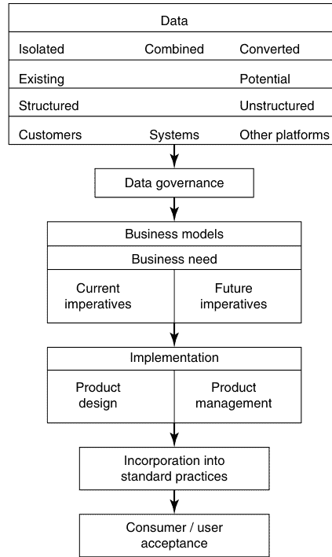

### 图 3.7 将数据货币化的途径。

是分析能力的广度和深度，下一个差异化因素很可能就是分析洞察的交付速度。对速度的需求可能为以前可能竞争的组织之间的有趣联盟打开大门。

数据的分析并不是货币化过程的终点，而在于分析如何被使用。它可能允许重新审视商业模式或重新校准实践。额外的洞察可能有助于设计新的产品和服务，或创建与客户需求相符的新应用。

在银行业场景中，随着对‘应用’（应用程序）使用的日益依赖，用户在选择银行合作伙伴时不仅看品牌，还看应用的‘不笨拙’程度，以及在线做生意的难易程度。似乎对银行组织的财务评级几乎没有考虑，除了认为所有交易银行在技术和财务上都是安全的。点评判断可能成为主导决策因素，并且随着‘开放银行’的推进，轻松更换银行的能力可能变得更加普遍。（开放银行在第9章中有更详细的讨论。）随着进入银行业市场的新参与者数量不断增加，我们还要多久才会看到金融服务行业的TripAdvisor等价物？

API管理是银行向数字格式转型中的关键组成部分。API，即应用程序编程接口，是一组用于构建软件的函数和程序。它们也被视为开放银行实施中的关键。实际上，它们是一组编程指令，供开发人员访问基于网络的系统¹¹并允许银行和其他组织：

- 加速应用创建，实现移动、全渠道和物联网战略的快速有效实施。
- 改善合作伙伴生态系统的管理，确保与全球安全标准的可扩展集成，这对银行寻求扩展品牌影响力和普适性至关重要。
- 创建有利于创新、实验、黑客马拉松和新商业模式的有效环境。
- 实现初创企业和创新生态系统的整合。
- 提供明确的分离，确保安全、敏捷和治理。

‘云’计算也需要考虑。云计算的一个良好而简单的描述，通常仅称为‘云’，是按需计算资源的交付。这包括从应用程序到数据中心的全部内容。这些资源可能是按使用付费，通常可通过无线访问，或越来越多地作为增值服务对消费者免费提供。银行高街分行向到访客户提供免费Wi-Fi的趋势日益增长，同时也向路人提供，以期鼓励他们光临。

为记录在案，‘云’的概念并不是天空中的过程或存在于以太中的某处，而是一个反映能力的表达。用户不应被通常没有电缆或物理连接这一事实所误导。与上面描述的其他过程一样，技术过于复杂，无法详细考虑，而云计算作为一个主题本身就值得一本书。云计算也提供了银行行业思维需要发生范式转变的另一个例子。

整个概念为新的思维打开了大门，而那些思想不开阔的人将处于不利地位。在其2014年文件‘Predicts 2015: Cloud Computing Goes Beyond IT Into Digital Business’¹²中，Gartner指出，商业领袖需要‘不断调整其战略以利用不断增长的云能力’。‘私有云’的使用也是采用数字战略的关键要素。‘私有云’仅在企业内部可访问。游戏在十年间发生了显著变化，现在几乎没有（如果有的话）员工桌下放着电脑。私有云的使用有明显的好处：

- 更大程度地获取计算能力和规模，同时改善企业内部的风险管理。
- 能够利用整个企业而非在孤岛中运作，同时提供更以客户为中心的能力。
- 有可能使产品和服务更快地开发并更快地推向市场。在这方面，云访问是组织敏捷性和灵活性的关键要素。
- 对人才管理和资源的影响，企业能够‘离岸’其开发。有人可能会争辩说，这种离岸主要是成本驱动的，这几乎肯定至少部分如此。然而，整合不同地理区域的能力成为改变游戏规则的因素。

云是银行行业推出高级分析和人工智能的基础‘平台’，也是未来银行的基石。现在比以往任何时候都更关键的是，业务用户不仅要了解当前的IT能力，还要了解未来可能发生的发展，以便他们能够有效地管理业务并创建新颖有力的战略。这要求他们走在时代前沿，并由内部专家和外部思想领袖准确有效地提供简报。

即使在银行业内，进步的速度也引发了关于应采用何种正确技术战略的问题，无论银行的性质如何。关键选项似乎是：

- 1. **银行自行构建定制化能力：**这在初期可能更便宜，但开始时的低拥有成本可能很快会被维护和必要升级的成本所超过。在许多情况下，自建系统往往发展出难以改进的‘遗留状态’，尤其是当原始技术架构师可能已离开组织（或也许从未只是外部‘承包商’）。
- 2. **银行购买某项技术或系统：**咨询式销售技术的应用使供应商能够更有效地销售昂贵的技术。实施问题仍然复杂，但银行的经济买家至少可以通过从具有良好业绩记录的供应商处购买来满足内部审计。向单一供应商购买也可能导致依赖度增加和某种商业‘锁定’。
- 3. **与技术提供商合作：**从表面上看，合作是一种有吸引力的方法，除非许多战略合作似乎只有有限的寿命。购买者也经常担心被‘锁定’，并且在需要时更换合作伙伴的机会减少。在许多情况下，如与较小的金融科技提供商，关系最初是合作，随着时间的推移可能成为收购。

这些都是非常重大且长期的决策。随着银行业展望未来，面对高级分析、人工智能、区块链和开放银行等众多变革性技术（仅举几例），高管们不得不在不确定的未来背景下做出正确的选择。（我们将在第10章稍后讨论实施方面的一些问题。）

人们很容易陷入术语和行话之中。读者应尽量避免被许多不熟悉的表达方式分散注意力或感到困惑。例如，区块链和“分布式账本”的概念，尤其对那些拥有“金融头脑”而非技术头脑的人来说颇具挑战性。对于个人而言，只需意识到自己有哪些*不知道*的地方，并因此对技术和变革持开放态度，可能就已足够。有些人可能会将其视为催化剂、个人挑战，甚至是一种行动号召，以了解自身行业及其他相关行业的新元素。

管理者应鼓励其直接下属在年度个人发展规划中更加熟悉技术，即使这意味着这些人要走出自己的舒适区。管理者及“行业领袖”也有责任保持与时俱进。

## 位置分析的重要性

一切事物和每个人都位于某个地方。当我们思考数据、分析、客户和成功成果所面临的挑战时，将位置分析这一主题纳入考量至关重要。当我们考虑以下因素时，位置这一主题至关重要：

- 每个客户的居住和工作地点，以及他们在各个地点的购买行为
- 他们如何从一处实际前往另一处（例如汽车或公共交通），这可能会影响客户对资金提供方式的看法，以及银行作为该过程“赋能者”的角色。换言之，银行如何协助为购票贷款或购车提供资金？
- 围绕客户居住地的问题，以及在购房、零售行为和本地趋势方面的人口统计考量（例如，这又可能影响本地化活动管理）。

传统上，位置分析公司往往不关注银行，而是更青睐保险和零售业，但如今这种风向正在逐渐改变。最大的公司之一ESRI就指出：“银行业的一切都是超本地化的”。¹³

具体到银行并购，能够理解两家（合并）公司的分行位置，并叠加新的、如今共享的客户群，使银行能够优化实体银行网络，在改善客户服务的同时降低成本。

银行识别高净值客户最集中所在地的能力，也可能影响其关于最佳设立或迁址分行地点以及在该实体银行环境中提供何种服务的决策。通常情况下，高价值客户更喜欢个性化服务，分行可能需要实际设在可支配收入较高的人群附近，且很可能需要有充足的停车位。这似乎意味着，未来针对这一特定的高净值（HNW）人群，仍将存在某种形式的分行网络。

同样，咖啡银行的概念认可了银行与咖啡供应商共同选址的必要性，并且特别瞄准所谓的“馥芮白经济”的参与者，这一群体以其偏好（白天）饮品为馥芮白咖啡而得名。或许某种形式的银行服务将实际设置在大众可能需要金融建议的地方。

展望未来，位置分析还有其他同样重要的用途。在针对自然灾害或人为冲突（如天气、犯罪、恐怖主义或网络渗透）的更具“防御性”层面上，有效利用位置分析可以帮助银行规划将关键实体基础设施放置在何处，以降低风险。

即使我们预见到一个深受远程设备和“智能设备”影响的未来人工智能世界，位置的作用仍至关重要。未来学家推测，当我们走过某种实体或虚拟广告牌时，广告图像将实现个性化并传达给我们。大型银行企业将继续通过抓住每一个机会来了解现有客户（用于交叉销售/追加销售）和潜在未来客户（用于获客）的位置，从而扩展品牌并提升盈利能力。随着开放银行更加实际地运作起来，这一点将变得更加重要。

位置分析作为一个职业和行业的发展历程本身就具有变革性。十年前，GIS（地理信息系统）分析师的角色还只是一个后台职位，但随着“位置”变得越来越关键，这一角色已经脱颖而出。即便如此，尽管这是一项如此关键的能力，现实中GIS行业的薪资仍然相对较低。根据2019年2月的数据，美国GIS分析师的平均薪资为每小时26.26美元，而银行业的平均薪资为40.00美元（顺便提一下，年薪范围从26,150美元到324,651美元不等）。14,15

这种差距的原因可能在于GIS分析师具有技术性和分析性思维，而非商业性思维。展望未来，我们越来越有可能看到分析、人工智能、机器学习等技术融合，但专业知识将更贴合特定行业的需求。

人才获取和管理在所有分析和人工智能领域也将保持重要地位。组织需要规划并实施一项战略，以确保不仅新入职者，而且现有参与者都越来越“精通技术”，并且打破“业务条线”与“IT部门”之间的历史界限。这将不可避免地带来新的角色、围绕人才管理的新挑战以及新能力的发展。

## 结论

银行业不乏数据。这个复杂行业的某些部分几乎完全依赖数据，基于数据的角色已经出现（并持续演变）。本章旨在就分析成熟度提出一个层级或迁移曲线。

一些组织在讨论人工智能时，仿佛那是他们迫在眉睫的未来，但他们却连基本的报告问题和拥有“单一事实来源”都无法解决。有效管理基础事务仍然是成功的关键组成部分，哪怕只是为了能够准确衡量进展。

对许多人来说，技术是一种“玄学”，由那些拥有自己行话和语言的人来实施。这些技术人员同样可能被银行业深奥的细微差别和复杂性所困惑。此外，“银行业”这个通用表达往往无法传达每个细分领域的具体复杂性。

未来将不可避免地反映银行业知识与技术知识的融合，但这两个行业的技能可能意味着，可能永远不会有像“银行分析师”这样宽泛的简单角色定义。分析师将成为零售银行、商业银行和投资银行（以及其他领域）的专家。很可能会有一些可转移的技能，但真正的专家是那些既拥有行业知识又能够应用特定技术应用的人。最终，他们很可能能够在就业薪资市场中获得溢价。

长期存在的挑战依然存在。是技术人员更容易成为银行家，还是银行家更容易成为技术人员？这是一个假设性问题，因为一个职业完全转型到另一个职业的能力不太可能，甚至不可能，但随着时间的推移，技能将会融合。那些泛泛学习银行业知识的人将需要学习技术；那些学习技术的人可能会选择将银行业作为专业来学习。在早期阶段，两者都只会在相对较高的层面接触这一主题。专业化最终将是个人的关键成功因素，但拥有全面的理解也很重要。

最终，每个人都必须面对这样一个挑战：他们所接受训练的角色是否会被自动化系统、机器学习和人工智能所取代。他们不应被吓退而不参与这两个行业，而应了解各自的变化。如果银行业的人工智能是一列沿轨道轰隆前行的特快列车，那么参与这一话题的人就应该成为那列火车上的乘客，而不是站在站台上的旁观者。银行业的人工智能绝不是一项观赏性运动。

## 参考文献

- 1. Sennaar Kumba. 《银行业中的人工智能：美国7大银行分析》. Emerj. 2019年9月24日.（访问日期：2019年10月22日）https://emerj.com/ai-sector-overviews/ai-in-banking-analysis/
- 2. Press, Gil. 《大数据的极简史》. 《福布斯》. 2013年5月9日.（访问日期：2019年10月4日）https://www.forbes.com/sites/gilpress/2013/05/09/a-very-short-history-of-big-data/#6ec2db7a65a1
- 3. Siegler, M.G. 《埃里克·施密特：我们每天创造的数据量相当于截至2003年的数据总量》. TechCrunch. 2010年8月5日.（访问日期：2019年10月4日）https://techcrunch.com/2010/08/04/schmidt-data/
- 4. 《如何可视化数据》. Simply Ted. 2005年12月8日.（访问日期：2019年10月4日）http://simplyted.blogspot.com/2005/12/how-to-visualize-data.html

- 5. Weise, Karen. 《为什么全球一半人没有银行账户》。Bloomberg。2012年4月25日。（访问日期：2019年4月10日）https://www.bloomberg.com/news/articles/2012-04-25/why-half-the-world-doesnt-have-bank-accounts
- 6. Firican, George. 《大数据的10个V》。2017年2月8日。TWDI.com。https://tdwi.org/articles/2017/02/08/10-vs-of-big-data.aspx
- 7. Borne, Kirk博士。《十大大数据挑战：认真审视大数据的10个V》。MAPR.com。（访问日期：2019年4月10日）https://mapr.com/blog/top-10-big-data-challenges-serious-look-10-big-data-vs/
- 8. https://en.wikipedia.org/wiki/Master_data_management
- 9. 《Forrester Wave：主数据管理，2019年第一季度》
- 10. Van Bruekelen, Roland. 《为什么营销中的情境至少价值80个智商点》。客户参与和商务的未来。https://www.the-future-of-commerce.com/2016/02/19/contextual-marketing/
- 11. https://sensedia.com
- 12. Smith, David, 等。《预测2015：云计算超越IT进入数字业务》。Gartner Research。2014年11月24日。（访问日期：2019年4月10日）https://www.gartner.com/en/documents/2922018/predicts-2015-cloud-computing-goes-beyond-it-into-digita
- 13. https://www.esri.com/en-us/industries/banking/overview
- 14. 《美国GIS分析师薪资》。2019年9月26日。Indeed.com。（访问日期：2019年4月10日）https://www.indeed.com/salaries/GIS-Analyst-Salaries
- 15. 《浏览银行业工作的平均薪资范围》。2019年9月26日。（访问日期：2019年4月10日）https://www1.salary.com/Banking-salaries.html

# 银行业分析的关键要素

### 摘要

在本节中，我们将更详细地探讨银行业目前对分析技术的应用，作为该主题的引入，然后在下一章中更深入地探讨机器学习和人工智能的话题。

所举的例子分为四个关键领域：财务绩效管理、客户分析、风险管理和运营效率。

其中，最重要的可以说是财务绩效管理，因为它实际上是银行组织的“引擎室”。如果无法有效了解已实现的收入、成本和渠道盈利能力，组织就是在盲目运营。清晰地了解财务状况对于理解采用新技术的潜在投资回报至关重要。其他三个领域——客户分析、运营效率和风险管理——主要属于独立职能（尽管在某些情况下，风险职能由财务办公室“掌管”）。

这些例子的排列方式是将各类分析进行分组，然后考虑它们与不同类型银行的相关性。另一种方法可能是按“银行类型”逐一分析，以便将来可以撰写更深入的特定银行类型专著，例如《投资银行分析》。然而，本书旨在更具普遍性，作者恳请读者接受所采用的方法。

> **美国最古老的金融服务机构之一利用高级分析和AI提升合规性与运营效率**
> 
> 摩根大通投资了一项内部文档搜索“合同智能”能力，用于分析重要的法律文件并提取关键数据点和条款。初步实施结果显示，对12,000份文档的人工审查通常需要360,000小时，而这项技术“可以在几秒钟内完成审查。”¹

## 引言

分析技术已在银行业得到广泛使用，并且是组织中许多截然不同部门的关键推动力。本节将回顾银行业目前对分析技术的应用，但这远非全貌，因为每个独立部分都值得读者深入调查研究。

银行业所有分析的本质都是财务管理和财务办公室的运营。这是银行组织的“引擎室”。对部门、渠道和产品盈利能力的清晰理解是银行盈利能力的核心。除此之外，还涉及客户洞察问题，随后是风险管理，后者进一步深入到操作风险、信用风险和市场风险等细节，例如。行业的多样性导致了多种类型的风险管理，并非所有类型都能在一本书中得到足够深入的探讨，但或许可以让人初步了解所涉及的问题和复杂性。

此外，还包括运营分析（例如，分支行绩效管理）等事项。虽然我们通常理解的分支行概念即使未被质疑，也肯定处于讨论之中，但了解当前如何衡量分支行的成功仍然是有用的。稍后，在第8章中，我们将探讨分支行未来可能的发展方式，包括“去分支化”的概念。

即使考虑了以上所有内容，银行业中分析技术的应用仍然是一个广阔的领域，不仅会继续拓宽，还会继续加深。它是AI之旅和通往未来银行之路不可或缺的一部分。

## 财务管理办公室

有些读者可能认为，财务办公室中的分析不需要具有行业特异性，甚至不需要具有银行特异性，他们可能认为所有财务官员和会计师都大同小异，履行相同的职能。在某种程度上，他们是对的，因为所有行业的会计实践都必须具有一定程度的标准性，以便组织之间能够进行基准比较。同样，也有一种观点认为，财务分析过于复杂，只有经过专业培训的会计师才能理解和处理。

另一方面，许多行业确实具有明显的特征，银行业就属于这一类。银行有许多职能，包括在多个业务线和产品组合中管理结构化不确定性，并以从该风险中创造可衡量收益为目标来管理风险，最终实现盈利。

同样重要的是，银行的财务办公室需要有一种机制，使其能够以一致的方式管理整个组织的广度和深度。这体现在多种且往往多样的产品和报价、多条通向市场和渠道的路径，以及在更复杂的组织中，需要反映多个地理区域。简单来说，银行环境已经变得过于复杂，无法再用电子表格进行财务管理，即使对较小的银行也是如此。

未来，更具“敏捷性”的银行业将拥有更短的产品开发周期、新的分销模式，并且可能还有淘汰产品或持续增加价值的趋势——这将要求银行对市场的反应更加主动。这反过来将对财务办公室提出更高的要求，其日益增长的角色认可了他们对整个银行的战略影响。

除此之外，随着高级分析和AI等新技术的出现，银行尤其需要能够衡量和理解由此产生的“硬性”收益。随着众多与创新相关的决策即将到来，越来越需要确定地衡量投资回报率（ROI），并以此支持进一步投资的需求。

但这“不仅仅”是财务绩效管理的问题。人们更加关注监管要求，特别是在证券化资产组合（即抵押贷款、贷款和信用卡垫款等汇集在一起的资产，其相关的“现金流”作为债券等证券出售给第三方投资者）遭受不利风险敞口而导致损失之后。银行有责任编制高质量的监管报告，这些报告是监控银行安全性和稳健性的基础。由于这种更高的关注度，银行面临着更大的风险管理压力，以及遵守复杂监管环境（如巴塞尔协议、IFRS等）的需求。跨境业务和全球化的许多影响也增加了这种风险，因此，使用灵活、全面且稳健的流程来清晰了解绩效比以往任何时候都更加重要。

财务办公室正越来越多地被视为组织中一个动态、互动的部分，而不仅仅是一个“算账的人”。这要求财务专业人员有效地与更广泛的业务接触，参与战略（在某些情况下甚至是战术）考虑，并充当值得信赖的顾问，而不是财务的“保管人”。

在许多情况下，尤其是在较小的银行中，风险管理和监管合规的责任也落在财务办公室身上，尽管可以说有些人并未完全准备好承担这样的角色。

CEO与CFO之间的关系对于理解财务与更广泛业务之间的联系至关重要。如果CEO是组织的“驾驶员”，那么CFO就是“副驾驶员”，他们必须作为一个完全整合的团队为企业的利益而合作。当然，这些说法并非银行业所特有，而是代表了数字和大数据革命带来的许多职业性质的变化。

Cedric Read的著作《eCFO：在新公司中维持价值》² 认识到，展望未来，所承担的许多职能都需要转型，包括财务职能。如果读者要从本书中留下一个持久的想法，那必须是：银行业正在被大数据和分析时代所改造，一切都不会再像以前一样了。这种转型同样延伸到财务办公室。

2009年，Mossiman、Dussault³ 及其他人指出了财务办公室所面临的问题：

- 缺乏信息来规范已发生和将要发生的事情
- 财务信息的相关性、可视性和可信度
- 在短期与长期、细节关注与整体大局之间取得平衡的需求
- 在自上而下的愿景与自下而上的实际情况之间找到路径

他们认识到组织内部存在多位决策者的挑战，这些决策者往往掌握预算，更重要的是承担交付责任；现金流与营运资本之间的平衡；资本支出与运营支出相关的决策；以及财务管理的管理。过去十年里，这个世界并没有多大变化。

与IT部门需要改变一样，而且在某些方面可能因业务线决策者而略显边缘化，财务办公室的角色也在经历变化，尤其是在更先进的分析方法变得可用且更具成本效益之际。随着人工智能系统日益嵌入组织，通过一种被称为RPA（机器人流程自动化）的流程自动化许多传统例行任务，这一变化将继续发生。财务决策越来越多地交由业务线负责，因为系统取代了集中控制。大数据带来了‘大赋权’，也带来了我们所称的‘大问责’。在运营层面，财务办公室不可避免地需要比以往任何时候都更频繁地为其扣留资金或限制预算等决定提供正当理由。

参与规则也发生了变化，尤其是在分析能力的使用方面。业务线高管和具有专业需求的员工越来越能够识别满足其特定运营需求的工具。技术供应商为了获得参与度，正免费提供其工具（‘免费增值’）。自助式分析工具的识别正危险地成为常态，重要的是要谨慎管理这些‘工具’的采用。

‘危险’一词并非轻率使用，因为多项战术性采购可能导致结果脱节。银行组织庞大而复杂，需要标准化以确保一致性，尽管出现了新的‘工具’来帮助‘粘合’不同的系统。独立决策和技术选择可能导致针对特定需求的工具，但这可能与组织的更大利益相悖。碎片化的采购违背了采购希望实现的一切——标准化、价格杠杆、升级管理、工具整合以及战略采购，而非一系列可能更难管理和维护的战术性关系。

## 绩效管理与集成决策

分析的一个关键原则是存在*单一事实来源*。从技术角度来说，这意味着呈现在终端用户面前的所有信息都源自相同的数据。至少在理论上，围绕数字产生分歧的时代已经过去（尽管仍可能存在一定程度的解释空间）。有时争议就发生在这些灰色‘解释性’领域，但无论如何，将所有信息视为可靠因为它们来自同一来源是一种进步。

为此，必须使用可靠的衡量方式，并认识到相同的数据不仅用于管理业务，还用于满足监管要求。

同时也要记住，不同行业以及金融服务业的不同部门成熟度各不相同，例如银行业比保险业成熟度更高。负责资产负债管理的部门具有极高的分析洞察力。分析工具用于细分领域，虽然其中一些可能并不明显适用于整个企业，但数据驱动决策的文化很可能适用。

随着时间的推移，个人在部门和行业之间的流动可能会产生均衡效应。虽然某些行业和部门比其他更先进，但仍会存在一定程度的知识和能力转移，以及文化共鸣。

零售银行家可以合理地借鉴消费品和零售商品（CRG）行业的做法。消费零售商无疑能把握脉搏，了解什么在销售、什么没有，以及需要提供多大折扣来吸引客户。客户行为管理既是财务问题，也是营销和心理问题，要有效开展这项工作，需要对收入、盈利能力、增长等问题以及它们如何与产品、渠道和声誉相关联达成绝对且无可争议的一致。

银行家最好走出同行圈子寻找进步的基准。很明显，就客户分析而言，零售商和电信公司在购买行为分析方面远超银行家，但这一差距正在迅速缩小。随着亚马逊等高度分析型公司进入银行业，传统银行必须迅速学习——并且要非常迅速。⁴

> *一个真实的轶事：满屋的银行家和保险公司人士饶有兴趣地听着一家街头零售商描述，他们如何通过忠诚度卡以绝对的颗粒度了解客户的购买行为，不仅能够提出有吸引力的优惠，还能预测何时何地提出该优惠。听众对一个具体问题尤其感兴趣，‘银行业的忠诚度卡等价物是什么？’*

## 银行绩效管理的关键要素

银行业务绩效管理流程通常包含一系列六个关键原则：

- 1. **了解业务驱动因素：**即需要理解关键业务和绩效驱动因素。业务驱动因素是‘对企业持续成功和增长至关重要的资源、流程或条件。’⁵

有效管理关键业务和绩效驱动因素就等于有效管理绩效。研究过去的绩效可以帮助银行了解成功的关键原因，并据此制定关键绩效指标。具体到银行业，一些关键驱动因素是客户资产和负债，以及相应的利差和盈利能力。然后就可以使用诸如匹配资金转移定价等技术来推动特定领域的增长。（匹配资金转移是一种了解特定资金如何增加银行盈利能力的方法，可协助产品开发、网点优化和判断流程效率。）⁶

- 2. **滚动预测的使用：**滚动预测是一种财务模型，与静态预算模型不同，它在连续期间内管理业务绩效。它采用增减机制，随着年份推移而增加/删除月份，其主要好处是帮助在流动且有时波动的商业环境中运营的企业。例如，从传统的资产负债表方法转向滚动预测可以帮助银行迅速有效地了解央行利率变化的影响，以及这可能对业务计划产生什么影响。

- 3. **报告与可视化：**有效使用仪表盘和可视化作为传达数据驱动信息和洞察的方法，结合下钻功能，有助于用户快速了解产品、分支机构和分销层面的情况。双向位置分析的整合也有助于银行（和其他机构）从地理角度了解正在发生的事情。

- 4. **信息民主化：**这一表述意味着无歧义的‘可信’信息在整个企业中共享，并具有适当的权限和授权级别，以便业务用户及时获取相关信息。这样可以做出更快、更好的决策。

- 5. **规划工具：**最有效的规划工具和流程能够在部门、业务线和企业之间建立有效联系。这消除了独立发起的手工操作，并有助于在战略制定与执行、业务规划以及最终业务执行之间提供整合。相对于银行业而言，特别是业务单元合并、业务单元间转移定价、资金转移定价和利差计算等计算可以实现自动化和基于驱动因素。这消除了手工错误和耗时的对账流程。

有效的规划工具还包括工作流管理，以帮助规划管理员管理截止日期，尤其是在参与度高的规划流程中。

- 6. **有效的分析工具：**这些分析流程和工具有助于解释与计划的差异（如方差分析，又称‘ANOVA’）；测试‘如果’假设和‘恢复’情景的工具；以及预测分析等——所有这些最终都能改善决策。⁷

## 客户分析

银行业的核心在于理解客户盈利能力的价值，以及这种盈利能力所带来的机遇。归根结底，银行需要关注四个关键要素：

- 客户的购买倾向如何？
- 客户采取特定行动的可能性有多大——如果会采取行动，其相关性如何？
- 客户流失或离开银行的可能性有多大（尤其是在开放银行环境下）？
- 客户的生命周期机遇或终身“价值”是什么？

要做到这一点，银行需要理解并预测现有客户和潜在客户的需求，从而能够在合适的时机将合适的产品推荐呈现在他们面前。这可以在细分（即个人）层面进行，也可以采用更广泛的“营销活动”式方法。

### 客户洞察

“客户360度洞察”的概念并非新想法，但许多组织（包括银行）仍难以将其落地实施。这一概念诞生于90年代初，已从相对简单的CRM（客户关系管理）工具，演变为日益受现代趋势影响的理念，这些趋势包括：

- 移动技术
- 聊天机器人及其他自动化服务
- “数字化”的推进，包括物联网
- 机器学习与人工智能
- 提供“按需”洞察的分析型、基于云的解决方案与能力的普及

建立有效的客户360度洞察有四个关键阶段。

### 数据获取

这可能包括：

- (a) 行为数据：定义客户行为的数据，如银行记录、贷款、已购买的产品以及透支使用情况。
- (b) 情感数据：源于一般甚至个人社交媒体内容（尽可能实际可行）的态度数据。
- (c) 互动数据：由客户与银行互动的数量得出的数据，无论是通过柜台、网站还是联络中心。
- (d) 外部数据：如何获取可能涉及客户位置、工作场所和设备使用情况（例如）的大量外部数据，并在产品推荐中识别和体现与客户特别相关的内容。

### 数据储备库

从这些各种各样的数据中，就有可能创建一个单一的存储库或相关信息“储备库”，并由此建立对客户的360度视图。如果没有有效的数据管理和工具，数据收集本身毫无意义。

不同类型的数据——结构化、非结构化以及来自不同来源的数据——需要多种技术工具才能从各个来源中提取信息。这里无意评论或推荐这些工具，但这些数据管理工具可能包括，例如，对以下方面的管理：

- (a) 持续数据流，确保产品推荐既及时又相关
- (b) 内容管理，有效捕获和分类数据
- (c) 文本分析，理解来自联络中心互动和网络联系的自由文本和语音转写
- (d) 设备数据分析，如智能手机的位置信息
- (e) 客户识别，在多个应用程序中跟踪同一客户身份

所有这些流程都需要在适当的治理和安全文化下开发，尤其是当银行向外部数据源敞开大门时，银行可能面临被渗透的风险。

### 创造洞察

在上一章中，我们提醒自己，数据和分析过程都不是终点，真正产生差异的是如何利用这些分析结果。从根本上说，这项工作的目的是以更高的概率确定客户购买某种产品或服务的倾向。随着银行提供开放银行服务，并实际上促进客户在银行机构之间流动性的增加，这种洞察将变得越来越重要。（见第9章。）因此，更好的洞察变得至关重要，它使银行能够识别出哪些客户最有可能离开，从而以类似于保险行业客户流失问题的方式，对留存问题给予适当关注。

此外，当银行考虑“全能银行”和“全服务银行”等其他业务模式（实际上是一种品牌延伸）时，它们还需要评估现有客户购买更广泛金融（甚至可能非金融）产品组合的倾向。

这种洞察不一定都用于“面向外部”的活动。借助更多数据，银行将能够对其客户群获得更全面的洞察，这些洞察与情感分析相结合时，可能有助于银行制定更有效的策略和战略，并帮助它们理解其战略为何成功或失败。

银行在同行（或竞争对手）表现的背景下理解这些结果的能力，日益成为关键成功因素。从彭博等公开报告中获取外部信息的机会越来越多，与内部信息结合后，这些信息开始变得至关重要。我们可以称之为“情境分析”。

### 关键交付成果

上述所有工作的目标是建立如此高的细分粒度，使银行实际上拥有“单一客户细分”——换句话说，即“超个性化”方法。更高的细分粒度可带来更高水平的客户细分，有望促成更及时、更恰当的产品推荐。

分析还将提供一定的优先级排序：谁最有可能购买，谁最有可能离开。

产品推荐的呈现方式也很重要，需要特别注意确保信息在任何渠道上保持一致（又称“全渠道”营销）。随着移动设备作为关键沟通媒介日益受到重视，在小屏幕上以易于“消化”的方式表达这些产品推荐的能力也成为关键成功因素。

现代“360度客户洞察”思维的本质，是将供应商与终端用户之间的关系从“关系型”——即甲方向乙方推销——转变为“体验型”——即旨在基于客户在接触该特定品牌时的体验，创造一种全新层面的连接。

采取这种方法的原因是，如果客户获得了更好的体验，他们就会开始享有更深层、更忠诚、因而也更可持续的互动。他们会成为该品牌的拥护者或“大使”（正如我们在第6章所认识到的，“品牌”理念正日益重要）。除此之外，更深层的关系在财务上会转化为更可持续的“终身价值机遇”。

与此相反，现有客户如果通过数字渠道与银行互动，却因系统缓慢、摩擦重重或不安全而遭遇“笨拙”体验，那么他们不仅更可能离开，甚至可能把糟糕经历告诉朋友，从而影响业务增长。这一点在开放银行方面的影响不容低估。一个“笨拙”或低效的应用程序可能对客户体验产生重大影响，尤其是在Z世代中。由此推论，一个流畅、有吸引力的应用程序有可能像任何顺畅的营销活动一样赢得客户。

以客户为中心的有效数字银行也越来越认识到，它们需要同时从客户的过去和现在中汲取信息，以预测客户可能的未来。这也是一种预测客户对银行潜在终身价值的方法。这种基于时间顺序的方法提供了与上述四个关键阶段不同的、或许更以客户为中心的方法，但它与这些阶段相辅相成，并且非常适合人工智能应用。

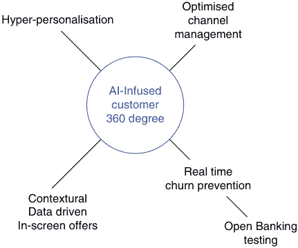

**图 4.8** AI 驱动的客户 360 度视图。

专家们已经在思考“现代”客户 360 度视图，其中考虑了开放数据等问题，并开始“重新构想”一种新的客户体验管理（CXM）流程。归根结底，商业用户的秘诀在于找到合适的技术工具——Adobe、MS、SAP 等——并将其整合到自己的业务中。更深层的问题在于个人与其银行之间的具体关系。为了获得更好的服务和更合适的产品，个人愿意“交易”哪些信息？这在监管合规方面又可能如何体现？

例如，GDPR（《通用数据保护条例》）规定了个人数据的使用方式，并要求个人明确允许该等使用。相比之下，CCPA（《加州消费者隐私法》）赋予消费者知道个人信息来源的权利。总体而言，两者都是保护个人数据“权利”这一普遍“进程”的一部分。

人们明确认识到，将银行与个人（或个人企业）对齐的更细粒度数据是最佳解决方案，能够将产品和服务与消费者需求相匹配，但可以说，在实际操作中实现这一目标仍需时日。与此同时，银行可能需要应对相对粗放式的客户及潜在客户群体细分方式，并采取我们可称之为“营销活动管理”的增长路径（将在后文介绍）。

## 信用评级

就银行业而言，“客户 360 度洞察”的一个子集是客户的信用评级，即对个人或企业的信用风险以及其最终偿还任何可能附带的贷款或负债的能力进行评估。这是一种对债务人违约可能性进行预测的形式。放贷机构历来使用数学模型来计算这种风险，该模型通常基于信用报告和申请人提供的额外信息，并最终由人工“签批”。通常，得分越高的人被视为风险越低，因此更值得“押注”提供贷款。

通常会考虑不同因素：

- 现有信用债务数量
- 还款历史
- 以往的信用申请次数（“信用查询”）
- 公共记录中的信息，例如针对申请人的法院判决

在人工智能使用方面，银行越来越多地使用基于 AI 的算法来更准确地确定风险，这正在改变传统评分模型的运作方式。基于 AI 的系统不仅能识别传统因素，还会考虑其他可能不立即显现的隐藏模式。尽管被批评为“黑箱”应用，并可能存在数据隐私风险，但基于 AI 的系统允许考虑更多因素，并据称可提供：

- 更高的风险准确性
- 防止数据录入问题
- 更多申请，因为之前没有信用记录的人现在也能申请贷款
- 银行可能获得更高的通过率，同时确定性更高

## 分行专属营销活动

在最细粒度层面上，银行需要了解客户的个人需求，并向其提供符合这些需求的服务和一系列产品。实际上，这并不容易。其他金融服务提供商（如保险公司）以及零售商也面临类似问题，他们都希望建立终端用户的 360 度视图。像 Amazon 和 Netflix 这样的公司似乎更接近实现这一目标，因此传统银行必须将此视为威胁和变革模板。很可能，随着时间推移，AI 将越来越多地创造本质上更细粒度的超个性化产品。

然而，与此同时，银行提供聚焦解决方案的能力相对有限。因此，他们需要采取更广泛的方法，开展半传统的“营销活动”，以吸引更多志同道合的客户。这些活动在分支机构层面实施，但更重要的是通过更广泛的群体行动，通常借助媒体宣传进行传播。在所需的分析方法上存在很强的相似性，这一点已由上文提到的四个关键分析阶段所涵盖。

考虑到分行专属营销活动的方面，其本质是通过对当地客户群体进行本地交叉销售来帮助分行增强现有客户关系，并以最合适的产品和服务瞄准正确的客户。分行导向的方法是否仍然相关，以及未来会在多大程度上发生变化，尚存疑问。在分行层面，目标可能是提高潜在客户开发、增加分行收入并降低营销成本，但现实是，客户是否还会受到任何分行营销活动的影响？如果有，这种影响还能持续多久？

真正需要解决的问题是，除了有限程度的产品或服务认知外，分行在营销活动管理中是否还能发挥什么作用？无论如何，这些难道不能通过商业街广告横幅、报纸广告、电视或其他媒体形式（尤其是社交媒体，将在下一节讨论）更有效地完成吗？

在考虑银行未来角色（包括银行品牌的重要性和分行具体作用）时，从社会或社区角度思考分行的相关性也很重要；如果相关，它如何能相关？似乎不久之前，银行还是社区的核心，是为有价值事业或当地教会捐款而进行慈善储蓄的地方，也是为社区项目贷款做出本地决策的地方。那时，拥有自主决策权的银行经理角色备受尊敬，而如今这一角色已大大削弱，甚至不复存在。

为了追求运营效率和更高利润而侵蚀传统银行网络，似乎导致“因小失大”——孩子和洗澡水一起被倒掉了。从某种意义上说，能够为社区做出社会贡献的银行也能对其客户群体施加“软影响”，而这在更集中、数字化的线上存在方式下要难得多。相比之下，一些采用代理模式的保险公司仍然珍视这种“软利益”。当然，本地银行业务并不适合所有人，但随着人口老龄化和 AI“革命”可能导致更多人失业，人们不禁怀疑，潮流会不会重新逆转，本地化分行是否会重新成为热门话题，也许只是时间问题。

*例如，在作者居住的村庄，一家知名国际品牌最近开了一家咖啡店，这家店除了酒吧之外，现在被证明是最受欢迎的聚会场所之一。银行为什么不能与这类商家达成一（或两）项全国性合作？正如在考虑“咖啡馆银行”时将讨论的那样，本地邻近性和便利性正变得越来越至关重要。例如，在一些国家，当地的（较大型）超市和购物中心已经提供医疗服务。总得有个界限。人们会在当地酒吧或酒馆提供（或能够提供）“合理”的银行或金融建议吗？如果会，又该如何监管？*

## 社交媒体营销活动的影响

越来越清楚的是，银行需要更有效地管理其社交媒体使用，以便在个人层面或营销活动层面及时向客户群体提供合适的优惠。例如，在专门考虑千禧一代时，更有效地使用社交媒体将是释放这一特定细分群体收入和盈利能力的关键之一。

社交媒体不仅用于提升消费者情绪和品牌形象，也是客户群体的关键沟通媒介。这意味着内容不仅要简洁明快，还要在小屏幕上易于理解。这不仅仅局限于“平面”图片和网页截图，还包括短视频以及Instagram和Facebook等社交媒体渠道的使用。当我们具体考虑未来银行业时，需要认识到千禧一代很可能将社交媒体作为主要渠道之一，甚至是最主要的渠道。

银行要有效利用社交媒体，需要能够：

- 管理大量数据，并有效利用分析技术创造可操作的洞察。
- 快速处理这些数据，以确保生成的洞察具有相关性。
- 理解文本的语境，无论是相对于个人（这需要高度细粒度）还是相对于整个同类群体。
- 能够通过多种社交媒体平台有效传达这些信息。

社交媒体分析通常使用一系列工具，包括：

- 自然语言处理，使计算机能够处理和分析大量人类生成的内容
- 情感分析，有时也称为观点挖掘，使计算机能够“识别、提取、量化并研究情感状态和主观信息”⁸
- 数据挖掘，即从大型数据集中发现模式的过程
- 社交网络分析，即识别文本中的社会结构（如友谊或亲和群体）的过程
- 社交媒体挖掘，即从社交媒体网站获取数据以获取洞察的过程

市场上提供了大量软件工具来实现这些功能。最终选择供应商可能取决于可用预算和所需结果的重要性。

具体在银行业，情感分析也被用于洞察金融市场的交易动态，信息来源包括彭博新闻、Facebook和Twitter等机构，以及公司的新闻稿。这些洞察不仅能提供更深入的见解，帮助改进经济预测，还可以纳入经济模型以提高准确性。Cuemacro⁹等专家提醒我们，包括银行在内的公司，通过分析内部非结构化数据（如内部邮件、业务伙伴报告）以及公开可用内容，可以获得很多收益。

在更广泛的背景下，银行有效利用社交媒体分析可以：

- 理解并影响消费者情绪
- 促进提供更及时、更相关的产品
- 提升品牌形象和品牌资产
- 为与客户进行更有效的社交互动提供催化剂——例如在投诉管理方面

我们不应忽视这里的规模问题。较大的银行，包括亚洲和中国的银行，其客户群数以百万计。2005年，中国最大的银行中国工商银行（ICBC）拥有250万企业客户和超过1.5亿个人客户。¹⁰ 该银行（在撰写本文时）目前报告拥有5.67亿个人客户。¹¹

尽管一些国家对社交媒体有更严格的管控，但数量如此多的客户不一定会直接产生相应比例的庞大社交媒体数据。然而，与特定个人银行业务相关的非结构化数据的产生潜力仍然可能达到前所未有的规模。相比之下，在可被称为更本土化的欧洲舞台上，最大的银行汇丰银行（HSBC）在全球仅为“区区”3900万客户提供服务，这一数字分布在66个国家和地区。

## 关系定价

关系定价通常指一种“框架”，即定价基于客户的整体购买活动，而非逐产品定价。它允许银行根据客户与该银行进行的总体业务量（即关系）来设定产品或服务的价格，因此采用以客户为中心的参数来确定价格。这也是银行用来为服务提供单一联系点并提高客户忠诚度的一种方法。

由于这些服务中的大部分涉及贷款，关系定价主要是指能够为个别客户（通常是商业客户或高价值客户）“量身定制”贷款条款的能力。快速创建这种定制产品而无需不必要的转介，日益被视为关键成功因素。

在个人银行业务中，刚办理抵押贷款的客户也常常可以协商减少或取消其活期账户的费用。

当开立新账户成为银行销售主管的KPI时，这可能导致可疑的做法。在美国，富国银行在2011年至2016年间针对关系银行家开立新账户采取了激进（且惩罚性）的计划，但后来发现这些新账户并未获得相关客户的同意。新账户总数估计为350万，这是有问题的KPI和绩效指标驱动不良行为的一个典型例子。¹²

计算“关系价格”还要求银行理解该关系的“全部机会成本”——即如果客户将其部分或全部账户转移到贷款机构时可能产生的潜在收益。实际上，这是一种具有吸引力的定价的交叉销售方法，旨在吸引客户建立更深入的关系。然而，在美国，1970年《银行控股公司法修正案》禁止银行进行“或有定价”：使一种服务或产品的成本取决于另一种服务或产品。

它还要求银行考虑与贷款相关的风险程度——“基于风险的定价”——例如抵押品和担保的影响。¹³

在分析方面，麦肯锡等专家认识到，与传统“模拟银行”相比，数字银行实施此类流程的机会要大得多。此外，Zafin等公司解释说，基于分析的方法可以帮助提供必要的洞察，从而实现更有效的关系定价。Zafin的方法是利用他们所谓的“客户关系评分”，通过算法来理解客户行为，以及他们所称的客户“粘性”。其首席分析官Suman Singh将其描述为允许银行“从价值和机会的战略角度系统地审视客户体验，并改变其互动模式以最大限度地提高客户满意度。”

抛开术语不谈，这实际上是运行一种FICO信用评分类型的模型，与贷款银行的风险偏好保持一致，评分系统的关键组成部分包括：

- 当前产品持有情况
- 支付偏好
- 产品使用行为
- 客户互动体验

该评分模型允许银行将客户分为：

- 最佳客户
- 强关系客户
- 中等关系客户
- 弱关系客户

基于客户关系评分（CRS），银行不仅可以识别可以选择提供哪些产品，还可以确定以什么价格提供。¹⁴

调整价格（又称“价格弹性”）的想法并不新鲜，它是一系列能力之一，这些能力使价格弹性不仅取决于供需，还取决于客户的购买倾向。该想法认识到，相对较小的价格变化可能对需求产生较大影响。（如果价格的大幅变化不影响需求，则产品被视为“缺乏弹性”。）

价格弹性，有时也称为“定价优化”，是酒店和运输等其他行业的常见做法——例如，在航班费用方面。另一方面，这种方法也受到批评，尤其是在财产保险领域，因为其成本不是基于物理风险，而是基于客户行为。2015年，佛罗里达州保险专员委员会对定价优化具有“歧视性”表示担忧。¹⁵

客户对价格弹性的反应被认为取决于几个因素：

- 竞争环境，以及同类产品和服务的定价
- 产品的本质属性，以及是否存在任何“替代品”
- 购买的习惯性（例如，购买酒精饮品）
- 客户群的忠诚度
- 有效广告的影响

- 产品生命周期取决于可用的替代品数量和同行行为。16

在银行业，这一领域显然正日益商品化，竞争激烈，关键问题似乎在于品牌（通过广告建立）和忠诚度。这些属性中至少有一个——品牌——可以通过有效的广告和营销在一定程度上加以操纵。另一个属性，忠诚度，则更难管理：银行应小心谨慎，不要因为未能体现对忠诚客户的认可而惹恼他们，例如，当银行向新客户提供极其优惠的利率时。忠诚度难以赢得，却容易失去。开放式银行（Open Banking）全面实施后，其影响可能会成为银行业价格弹性重要性的一个主要因素。

## 客户服务

世界正变得更加富有。根据凯捷（Capgemini）的一份报告，2017年有超过100万人跻身全球富豪之列。蓬勃发展的股票市场使得拥有可自由支配资产（不包括主要住宅及其内部物品）超过100万美元（75万英镑）的人数增至创纪录的1650万。全球高净值人士合计持有63.5万亿美元的财富。17（见图4.9。）

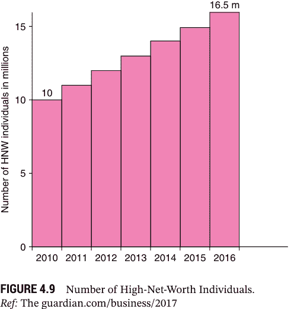

据凯捷称，原本富有的人变得更富的速度远快于普通大众。凯捷的研究员之一克里夫·埃文斯（Cliff Evans）表示：“对于拥有大量资金的人来说，他们从投资经理那里获得的服务正证明其价值。如果你付得起咨询费，你就能获得高得多的回报。”

在这一百万富翁层级之上的是凯捷所称的“邻家百万富翁”，即拥有100万至500万美元可自由支配资产的人群，该群体在2016年增长了6.2%。此外还有超高净值人群，其可自由支配资产超过3000万美元（该群体在2016年增长了8.3%，其中拉丁美洲的增长最为显著，达到9.2%，影响了整个细分市场）。（见图4.10。）

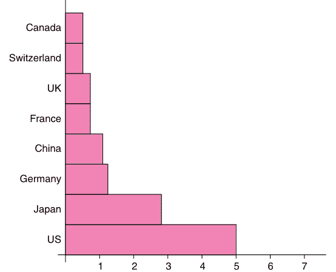

图4.10 2016年高净值人数排名前列的国家
来源：The guardian.com/business/2017

十多年来，专业银行、财富管理公司和投资管理公司一直在使用分析技术来提供更好的报告和分析，以便告知客户其投资组合的变动价值。这些技术包括分析基金和资产管理业绩（跨资产类别和地域）的能力，以及创建具有下钻功能的高可视化报告仪表板。

这些投资组合管理能力也正变得越来越普及，惠及不那么富有的人群——例如，那些选择更自主地管理其个人养老金安排的人。

但是，客户服务这种相当静态的报告方式，现在是不是已经“过时”了？这个行业的未来会是什么样子？它无疑也会受到银行业数字化转型的影响，而不是与之并行或绕开它。投资和资产管理公司已经在使用先进技术来预测股票市场的变化，那么同样的技术为何不能应用于客户服务领域呢？未来客户服务的本质很可能在于主动而非被动。

但是，这里存在一个潜在的危险，尤其是当这些能力越来越多地出现在移动设备上时。资产管理公司不断建议，成功资产管理的本质是着眼长远，而不是做出膝跳反应。如果预测指标预示前方有坏消息，人们要抵御改变或调整投资组合的诱惑会有多容易？例如，这种迅速卖出响应是否会成为某种自我实现的预言？随着我们越来越多地使用带有内置规则引擎的高级工具来自动化这一过程，如果需要抑制，那些机器人基金经理将如何表现出克制？如果任何程序化的系统性自我抑制导致了重大财务损失，这些损失的真正责任由谁来承担？这与自动驾驶汽车（即自主驾驶汽车）的困境一样复杂：在即将发生事故时，算法必须实时做出决策，确定什么才是最轻的损害或伤害结果。多个业务领域的自动化程度提高，引发了新的责任与法律问题。

最后，在本小节中，我们还应该花点时间思考一下银行业也在试图解决的金融差距问题。一方面，富人数量不断增长；另一方面，全球部分人口的情况充其量是没有收入增长，最糟的是处于贫困线以下、境况堪忧。由于自身处境艰难，许多人从农村迁移到城市，城市化不仅带来了新问题，也加剧了既有问题。他们就是所谓的“未充分获得银行服务者”（underbanked），也许对银行而言，这提供了新的机遇，这将在第9章中讨论。

## 风险管理

在银行业的核心，有效利用分析技术能让管理者理解其在不同风险类别中的风险敞口。风险这一主题本身内容极为丰富，足以开设全日制和非全日制课程，并引导学生思考以下内容：

- **操作风险。** 这与流程失败、软件、个人行为及外部事件影响所产生的风险有关。
- **信用风险**，包括零售层面和批发/交易对手风险层面。就信用风险而言，有效的分析使银行能够确保“发起银行”，即信用额度发起所在的银行，符合计划的多元化和战略。这考虑了以下方面：
  - 发起银行的特征以及所涉业务量
  - “后端”表现，即考虑投资组合特征、历史损失和任何逾期情况
  - 根据巴塞尔协议II、巴塞尔协议III及后续版本进行资本管理和报告。
- **市场风险：** “市场风险被描述为因市场价格变动而导致财务损失的风险。”欧洲银行管理局（EBA）将市场风险定义为因“市场价格不利变动”而导致的表内和表外损失风险。18
- **投资与流动性风险：** 流动性是指一个实体在不遭受灾难性损失的情况下偿还债务的能力。因此，流动性风险根本上关乎一项投资的质量和吸引力，以及它能否以足够快的速度被买入或卖出，以防止或尽量减少损失。进一步说，“流动性风险”本身衡量的是一个实体——无论是在公司、组织还是机构层面——能否履行其短期债务义务的能力。19

最有效的培训课程会涵盖国际考量等问题，反映全球市场的需求，并研究用于识别、降低和管理特定风险方面的技术。

### 风险情景分析

从非常笼统的角度说，在商业中，“情景”的概念要求企业不仅要考虑一系列事件的结果，还要考虑导致该结果的发展路径。有效的情景分析不依赖历史发展，而是考虑可能促成这一结果的各个转折点和事件。这些可能的结果可以是乐观的、悲观的或相对不可能的。

当然，我们不应排除意外后果的概念，它也可以分为三类：20

- *意外收益*，带来积极的意外结果，例如中彩票
- *意外弊端*，在预期结果之外还带来不利结果（所举的例子是灌溉系统为农业提供关键用水，却导致了霍乱等水媒疾病。）
- *适得其反的结果*，有时称为“反噬”，指的是结果与预期完全相反，并且原本的解决方案反而让事情更糟。

在金融服务领域，银行也可以用这种方法来预测经济变化及其对自身战略的影响，或者更好地了解在快速增长、温和增长或缓慢增长时期可能的回报。

## 欺诈检测

本节将专门讨论欺诈和金融犯罪（我们将在本章稍后部分简要讨论欺诈性投资交易）。欺诈是银行面临的主要操作风险。典型的欺诈可能包括：

- 身份欺诈
- 反洗钱（AML）
- ATM欺诈

银行从业者面临的关键问题包括：

- 需要管理大规模欺诈检测
- 需要利用有限资源进行调查
- 需要维持有效的客户服务，避免将所有异常交易都视为潜在欺诈
- 需要管理内部和外部的合规问题（如交易监控）

这一领域典型的现代分析能力包括统计技术与AI分析的组合——例如机器学习、模式识别和神经网络。（见图4.11）

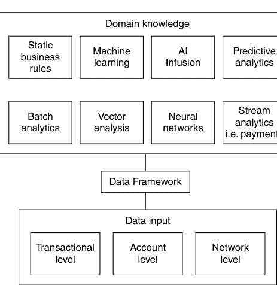

图4.11 分析与AI在银行欺诈检测中的应用。

## 监管合规

鉴于银行对合规的高度关注，在这一关键领域使用高级分析和AI是必然的焦点。这被称为监管科技（Regtech），大致属于操作风险领域（包括未能遵守法规，以及内部要求等其他合规问题）。

全球银行面临的特殊挑战是，即使客户互动和资本管理等潜在要求相似，也要遵守不同的本地要求。

例如，在客户管理领域，可以使用AI增强的录音和分析来监控客户对话中提供建议的性质和质量，并最终加以改进。在客户同意的情况下，AI可将对话分解为相关的关键部分，例如讨论是具体的财务建议还是普通的“闲聊”。由此，可以对财务建议部分进行检查，以确定所提供的信息是否在可接受参数范围内。AI要素是获取洞察的关键组成部分，也是一个过程，系统借此不断提高对互动性质和质量以及对话背景的理解。

在中央银行层面，AI越来越可能发挥作用，尤其是在资本充足率管理方面，特别是在压力测试领域。经济气候的波动性有利于实现更大程度的自动化。很可能，随着银行进入下一个十年，它们将更深入地采用全数字化流程。这将产生的影响是，它们可能会相当迅速地从纸质形式转向全数字化形式，而后者更容易适应机器学习、自然语言乃至最终AI等现代方法。

## 风险管理与AI

这里涉及的原则是：

- 交易对手风险管理
- 信用风险管理
- 合规管理

具体到风险管理的应用，问题在于AI能否提供某种自动化，抑或它只是风险管理“工具箱”中的另一个工具。即便是相对稳健的解决方案，目前也需要数据科学家和行业分析师等专业人才。除此之外，即使结合了合适的算法，数据本身也可能不够充分。最终，AI必须具备以下潜力：

- 结合不同的波动率模型（这一过程称为集成学习）
- 在不同的回测模型之间进行选择和组合，即把策略或模型应用于历史数据
- 让波动率预测模型从错误中学习（强化学习）
- 为潜在危机创建预警系统（神经网络）

监管科技初创公司乃至那些更为成熟的公司，都提供识别和评估风险的软件和能力，并提供一系列控制措施以优化风险管理，包括：^21

- 风险图谱和风险矩阵建模（按公司、业务活动）
- 控制计划建模
- 事件与建议管理
- 升级流程

这是一个复杂的领域。2019年，NatWest银行宣布与微软及AI专家DreamQuark合作，开发他们所称的“下一代复杂分析（NGCA）”。^22他们共同致力于模拟不同环境和行业的行为，并借此创造出某种有意义的模式来帮助预测未来。这里的意思是，预测跨行业、跨地域和跨消费者细分市场的风险与机会方面的未来结果。其意图是通过模拟与机器学习的结合来实现这一目标。

准确的预测本身会带来更大的确定性，但在现实层面这意味着什么？整个“游戏”难道不就是管理不确定性、分散押注并冒一点风险吗？我们真的能期望在无风险的环境中运营吗？如果可以，后果又是什么？我们必须退一步看。在可预见的未来，没有人工干预是不可能应对的，而人可能会成为流程中最薄弱的环节。最薄弱的环节就是情绪和非理性出现的时候，而自动化系统不太可能允许这种情况——除非它们被特别编程设定。

## 爱尔兰银行利用AI提升销售流程

销售绩效管理很可能将越来越多地受到这些新技术的影响。例如，北爱尔兰的阿尔斯特银行（Ulster Bank）早在2017年就一直在使用Salesforce的Einstein，为其一线员工提供AI增强的洞察。“Einstein”是面向销售、服务和营销云平台的AI增强型解决方案，最近还整合了图像识别软件。阿尔斯特银行于2016年开始试用该AI软件，当时有10位客户关系经理参与，并在10周内迅速扩展到500位客户关系经理。^23

## 运营效率

运营效率的需求源于流程和程序需要以最具成本效益的方式运行，同时保持所提供的服务或产品质量。目标是优化任务执行方式，减少或完全去除流程中那些增加不必要成本、不增加价值或两者兼而有之的环节。

在银行业，自然存在多种类型的系统和流程，以下部分仅对其中少数几种进行深入探讨。虽然它们被归入运营效率这一标题之下，但与以客户为中心及风险管理问题存在重叠。例如，销售管理旨在通过关注客户的特定需求来优化销售流程，同时避免触犯受到严格监管的不当销售问题。

优化运营效率的一个关键要素是了解流程或系统的实际成本。有效的财务绩效管理是这一工作的关键组成部分（前面已述），但随着技术日益成为流程成本核算中的一个因素，理解“附着于”该流程的IT成本，是理解该成本的关键推动因素。

## IT成本透明度

为了清楚了解运营成本及其优化方式，银行通常热衷于了解IT成本如何分配到业务的各个部分。银行技术成本透明度的关键组成部分包括：

- 成本分摊的“目录式菜单”，即提供单一、一致的服务来源和商定的功能，从而简化产品管理、服务计费和保障。
- 用量计量，可基于商定的每小时费率或功能费率，并按使用量付费。
- 技术成本回收和内部开票，包括内部成本分摊机制。
- 基于驱动因素的计划，这是一种管理方法，用于识别业务的关键“驱动因素”，并“创建一系列业务计划，以数学模型模拟那些对组织成功最为必要的因素将如何受到不同变量的影响。”²⁴

## 网点绩效管理

也许首先要问的问题是，网点是否有可预见的未来，尤其是在高级分析和AI的世界里。作为起点，重要的是理解是什么让一个网点有效。首先，我们需要思考如何衡量一个网点的成功或盈利能力，以及这种衡量本身是如何进行的。我们称之为“网点绩效管理”。网点绩效管理考虑使用数据和分析来衡量当前和过去的绩效，并辅助规划过程。有效的网点绩效管理会考虑在该网点持有账户的客户构成、他们的产品类型，以及如何进行追加销售和交叉销售以确保最大盈利能力。

除此之外，它让银行能够了解某个特定网点是否在实现其关键目标（这些目标通常以销售或服务为导向），以及这些目标在多大程度上与银行的总体战略保持一致。这通常与增长和客户留存目标相关，但也可能存在其他“较软性”的衡量指标，如客户满意度。

我们在其他地方已经讨论过位置分析的问题，在此值得重新回顾这一话题。无论我们如何看待分支机构的概念，两者都

在今天以及“未来银行”中，营业场所的物理位置似乎是一个关键问题。高街分行的选址通常基于潜在客流和与其他零售商的邻近程度，却刻意忽略了那些地理位置相对偏远、往往是高净值客户所在地，或者银行（在利用其品牌延伸时）可能想要重新涉足的地方。

有些人可能会说，分行绩效管理的概念相对过时，因为它是一套反映过去银行时代的指标。这种批评有道理，尤其是在网上银行和日益集中化的背景下。然而，我们应该假设社区中可能存在某种银行组织的足迹，并且这种足迹需要被衡量。

在别处，我们已经将银行业与零售业进行了类比。随着当前线上购物的增长使实体店沦为“展示厅”，我们不得不向零售银行提出一个问题：它们在复制零售模式方面能（或可能）走多远？

也许银行业将日益成为一种“体验”，鉴于开篇章节所解释的货币相对短暂的性质，这一点尤其相关。在该章中，我们说过，实际上货币并不存在，整个银行基础设施和生态系统都建立在承诺和信任之上。（品牌、品牌价值与信任之间的关联将在第6章中讨论。）

因此，也许我们应该暂时将注意力转向“银行体验”。我们认为这种体验有三种形式：

- 线上体验，可能与所用银行应用的质量——或笨拙程度——有关
- 呼叫中心体验，稍后讨论
- 实体分行体验，稍后我们将更详细地探讨

关于“分行体验”，FMSI（Financial Management Solutions Inc，金融管理解决方案公司）的Meredith Dean在她的文章《分行销售与服务的9个关键》25中提出，至少在前台，有三件关键事项很重要：

- 等待时间：*我们要等多久才会有人过来询问我们需要什么？*
- 协助时间：*客户与服务代表互动多长时间？*
- 服务与产品比率：*换句话说，向上销售/交叉销售需要多长时间？* 理想情况下，根据FMSI，产品互动在表现最佳的分行中占客户接触的69%，而在低端仅占30%。

FMSI还为前台的有效运营提出了一个九点计划，包括：

1. 更多“自助技术”，如ATM
2. 使用实时监控系统，确保客户不会等待太久才被接待
3. 更有效地管理大堂“人流”
4. 通过设置“私密区域”来管理隐私
5. 改进员工在交叉销售/向上销售活动方面的培训
6. 在大堂使用平板电脑辅助排队管理
7. 使用远程登记功能预约
8. 通过自动化员工排班来改善人员配置，以管理供需失衡
9. 提升员工的能力，或使其“专业化”

那么，归根结底，分行绩效指标是什么样子的？稍后，在第8章中，我们将挑战自己，展望30年后。届时我们将把贯穿本书的一些观点汇聚在一起。当然，这里有一些关键特征。有些将与当今的银行环境一致；另一些也将适用于“未来银行”。例如，咖啡馆银行将如何衡量自己，并证明自己的存在（除了卡布奇诺的销量之外）？

同样的客户指标和绩效衡量标准难道不会依然适用吗？如果（或者更可能的是，当）人类被某种机器人能力取代，这些指标将如何改变？

最后，还需要考虑分行绩效和实体存在的软性益处。最近一份报告显示，过去8年来苏格兰所有分行中有三分之一已经关闭，美国支付解决方案公司Renovite Technologies的首席运营官Jim Tomaney对此发表了如下评论：

> 关闭银行分行的决定不公正地惩罚了苏格兰社会的很大一部分人，尤其是该国偏远地区的人们和企业。
> 
> 令人沮丧的是，银行分行提供的许多服务，如消费者贷款或企业现金存款，都可以利用云技术复制，打造智能ATM或“箱式银行”。
> 
> 不幸的是，大多数银行还没有准备好投资更新的技术和基础设施来实现这一变革。
> 
> 如今绝大多数银行仍依赖20世纪80年代和90年代设计的基础设施，极难在其上添加创新的新服务，这正是金融排斥问题日益严重的原因26。

## 联络中心服务

联络中心是银行业务模式的重要组成部分。如果当地分行解决不了，银行大堂里通常还有电话。或者你可以在家拨号，这样无论如何都能避开分行。但有时很难接通。“首先，”他、她或它说，“我需要问你一些安全问题。”然后我被问及我的定期付款指令、直接借记、最近一笔交易，甚至初吻地点（真的）……

在考虑分析如何改善联络中心运营之前，我们难道不应该首先想想，为什么一开始需要联络中心吗？Booz and Co的分析师在其2008年的报告《重新定义银行的使命：呼叫中心是削减成本、增加销售，还是两者兼而有之》中提出了“如何重新定义联络中心的使命”这一问题，并指出，这个本应改善客户服务并降低成本的企业部门，似乎两者都没有做到27。

联络中心最初是在20世纪80年代引入的，作为处理高接触、低价值交易的一种不同方式，以避免客户在分行花费更昂贵的时间。当然，那时仍有可用的分行网络。自那以后，分行数量大幅下降，而且可能继续下降。

Booz确定了联络中心成本改善的三个关键杠杆，包括：

- 通过更有效地满足客户需求，避免可避免的来电。Booz指出，所有呼入电话中有50%–60%是由银行错误造成的。第二类电话是客户需要再次致电，因为他们最初的问题没有得到妥善处理。（这还没有考虑到那些等待服务却只反复听到“当前电话量很大”的客户，仿佛联络中心无法预测电话量——也许是在午餐时间或傍晚——而只是没有配备足够的人员。）
- 通过改进自助服务能力，减少客户致电中心的需求。这催生了一种新的电话类型：客户因密码问题而无法在线访问自己的账户。
- 通过有效的路由系统从一开始就妥善处理需求，减少电话转接。有时，那些自动路由系统几乎是“循环”的，会把来电者带回到起点。在某些（也许是许多）情况下，来电者干脆决定等待顾问接听。

就银行利用呼叫中心或联络中心改善收入而言，Booz建议：

- 对客户有更深入、更好的洞察，以便更好地理解他们的需求
- 提高流程的标准化程度
- 提升座席人员的技能，以在存在向上销售或交叉销售机会时提高流程效率

即使在2008年，把这件事做好所带来的成本效益也相当可观。有分析认为，电话量减少5%–10%可为一家银行每年节省高达1000万美元。

转向更有效的自助服务机制，成本效益同样可观。Booz表示，联络中心人工介入的成本为每次通话4美元，而在线解决问题的成本可能仅为每次0.10至0.15美元。能够将5%至20%的电话从联络中心转移到在线解决的银行，每年可节省高达2000万美元。

在有效的路由方面，他们的报告指出，一家银行重新路由了500万通本可以——也应该——由第一位联络中心座席处理的电话。他们估计，转介或升级减少20%–40%也能每年减少1000万美元的成本。

即使是十年前，联络中心就已经在使用早期形式的分析来衡量绩效，尤其是在座席生产力方面。这些生产力工具至今仍在沿用，但现在的重点更多放在对通话的定性衡量上，而不仅仅是接听电话的数量或次数。

除了座席生产力之外，联络中心的关键指标可能包括：

- 客户留存率
- 满意度评分，如NPS（净推荐值）
- 产品/关系进展

联络中心仍然是银行的主要支出项目，那里的糟糕服务可能是客户不满和流失的关键因素。联络中心占所有客户互动的比例高达10%，并占“关键时刻”体验的30%。据说多达70%的来电是可以避免的，可以通过更好的在线数字解决方案来处理。它们是自动化/增强辅助的主要候选对象。28

有效利用分析可以让银行预测客户最可能采取的行动路径，并推荐“下一个最佳行动”，以确保不仅留住客户，还能实现交叉销售或追加销售。要使这一机制有效运作，银行需要拥有360度的客户视图（前文已提及），纳入预测模型，并包含基于规则的系统，以便将查询引导至正确的解决方案或产品。

短期内，趋势越来越倾向于“增强自动化”，即“有人值守”的RPA（或“机器人流程自动化”）。在这种模式下，解决方案位于员工的工作场所/工作站，输出由员工在约定工作流程中的特定事件、操作或命令决定。可以把它想象成一个机器人呼叫中心顾问。实际上，这是一种“软机器人”形式，主要决策自动做出，但信息通过人工干预传达给消费者。严格来说，人们不得不问：除了同理心和也许亲切的声音之外，人为这一过程到底增加了什么价值？

超越“有人值守RPA”的下一步是“无人值守RPA”，这接近于人工智能解决方案，由自主机器人本身触发行动，几乎或完全不需要人工干预。实际上，目前大多数无人值守RPA用于后台操作，如索赔和发票处理。从表面上看，“有人值守”和“无人值守”RPA的技术差别不大。随着语音识别日益普及，联络中心实现全自动化只是时间问题。

## 支付监控

银行往往受到多种支付系统的影响，并且对支付失败几乎没有实时可见性。监管压力日益迫使银行加强支付控制，包括归档。有效的支付管理帮助银行通过降低成本来改进支付流程，并通过这种方式提高满意度，最终提高留存率。

有效的支付监控使银行能够使用计分卡和KPI来测量和管理交易，提供集中化的视图：

- 按币种
- 按创建日期
- 按每小时交易量
- 按渠道交易
- 按来源国家
- 按状态，通常包括：等待授权、交易完成、交易失败
- 已修复支付的数量
- 支付提醒
- 每日和日内流动性头寸
- 是否符合监管要求

## 抵押贷款跟踪

有效的抵押贷款数据收集和绩效分析为贷方、投资者、服务机构和违约机构提供了宝贵的洞察力，提供基准绩效统计报告、生成高管报告并提供监管监督。通过这种方式，它们帮助银行优化人员配置水平，预测并减少催收费用，验证决策，并计算提前还款风险、信用和违约风险、损失严重程度以及房价表现的几率。

典型的抵押贷款分析系统允许用户跟踪关键抵押贷款指标，例如：

- 抵押贷款数量
- 未偿余额
- 当前房产价值
- 与房产价值相对应的未偿余额
- 帮助理解哪些因素对抵押贷款行业的正面或负面影响有影响，例如位置或分销渠道

> > **“新兴机会引擎”识别最佳潜在客户**
> >
> > 摩根大通使用预测分析，在其称之为“新兴机会引擎”的流程中，结合机器学习和自然语言处理，以“识别最适合后续问询的客户”。²⁹

## 销售、薪酬与佣金管理

银行及其员工面临着最大化收入的巨大压力，因此薪酬管理流程旨在通过适当的薪酬方式留住和奖励最成功的员工，同时考虑到道德表现，包括客户服务和满意度。许多银行仍然使用电子表格、过时的传统系统、电子邮件以及跨多个部门的佣金和薪酬规划变体组合来运营。

其影响是给审计过程管理、法规遵从以及证明薪酬流程不会使银行面临风险带来困难。

有效的薪酬管理需要：

- 薪酬与销售和服务的一致性
- 可见性和可审计性
- 能够被有效跟踪
- 建立有效的管理报告系统

一个有趣的问题出现了。传统上，销售人员使用技术来识别最有希望的“线索”并进行跟进。现在，技术能够更确定地识别这些线索，这给“人类”销售人员带来了不同的责任。如果分析似乎表明，从概率角度来看成交前景如此强劲，那么责任就转移到销售人员身上，需要说明为什么销售联系尚未完成。

归根结底，分析和人工智能有潜力将买方的愿望与卖方提供的服务/产品相匹配，并自动将它们结合在一起。也许是一种商业婚介机构？那么，人对销售角色的真正贡献是什么？当然，人们总是会说“销售”最终还是人与人之间的事情，但也许我们不应该那么自满。

## 金融市场风险与交易监控

### 对冲基金管理使用AI定义投资策略

总部位于英国的对冲基金管理公司英仕曼集团使用AI算法来帮助定义其投资策略。根据彭博社2017年9月的一篇报道，英仕曼（可能整个行业）正在使用AI来“寻找最快的交易执行方式、押注市场动量，并扫描新闻稿和财务信息中的关键词，以判断股票可能上涨还是下跌”。30

在该领域，先进和专有能力的运用已经非常成熟，但人工干预仍然是一个重要因素（至少目前如此），以确保有有效的监督。

分析与高质量可视化相结合，提供实时洞察，以确保：

- 正在做出的决策符合银行的风险战略和风险偏好。
- 有关交易对手风险的担忧得到迅速有效的处理。
- 拥有足够的资本以满足要求。
- 交易以合规方式运作。
- 遵守法规。

## 投资组合管理中的分析

本节有用但也许有点不同寻常的开头，是对所谓“金融数学”的简短历史回顾。起点是一位植物学家罗伯特·布朗（1773–1858），他观察到花粉悬浮在水中的运动，他将这种现象称为布朗运动。路易斯·巴舍利耶（1870–1946）被认为是金融数学的奠基人，据信他是第一个将数学模型应用于金融市场分析的人，并在其论文《投机理论》中提出股票市场按照布朗运动演变。丹麦天文学家托瓦尔德·蒂勒（1838–1910）提出了解释布朗运动的数学理论，阿尔伯特·爱因斯坦在1905年对其进行了扩展，使之可以进行预测。

布朗运动在统计学中被解释为一个随机过程，即一个数学对象（在这里指股票价值）被定义为一系列随机变量。除了金融领域，该过程还用于生物学、生态学、化学和计算机科学（以及其他领域）。即使在这个基本层面上，它也是一个复杂的统计计算。尽管如此，维纳和罗伯特·默顿等其他专家继续推动金融边界，达到了现在所谓的“硕士级”数学。

将事情推进到下一阶段，我们偶然发现了通常被称为布莱克-斯科尔斯（或布莱克-斯科尔斯-默顿）公式的模型，该公式由三位科学家创建，用于计算某类金融证券的理论价格。他们的方法是，股票要么上涨要么下跌，其程度具有相同的“可预测的不可预测性”。31

该公式首次推出时，用于在没有明确公式的情况下为股票定价。如今，它使用起来容易得多，而且有在线分析工具为用户完成计算方面的“繁重工作”。在它投入使用之前，投资者很难评估一份“期权合约”是否定价合理，如果是，它是否代表良好的价值？他们只能推测“期权”的价格和价值，而这总体上看风险太大。由于布莱克-斯科尔斯公式，期权的交易价格现在可以通过数学计算得出，因此一个期权只有一个准确的价格。利用该公式，交易者或投资者可以确定市场价格是高于还是低于其理论价值，并据此决定投资（或“对冲”）。

它使用六个因素来计算价值：

- 1. 期权是“看涨”还是“看跌”，这是对合约的描述，强调买方（看跌期权）或卖方（看涨期权）
- 2. 当前股票价格
- 3. 执行价格：期权可以行使的价格
- 4. 标的证券的波动率，这被认为是其中最重要的因素

- 5. 期权到期前的剩余时间
- 6. 无风险利率

统计学家也会关注“肥尾”概念——即在“钟形曲线”中出现“偏斜”的情况，即正态统计分布出现偏斜。也被称为“厚尾”，这一现象在物理学和地球科学以及经济学中也能看到。Black-Scholes 基于正态分布，但如果存在概率偏斜，这可能导致预测出现失真。因此，肥尾被认为在预测准确性方面会产生更高水平的风险。至于这些肥尾何时出现，据建议，在金融灾难时期，例如 dot.com 泡沫的“破裂”，数据是“表现不佳”的。³²

由于这种“不良行为”，统计学家纳西姆·塔勒布在其著作 *《黑天鹅》*（被描述为二战以来12本最具影响力的书籍之一）中写到了预测的困难。他的论点是风险非常难以预测，并认为投资于“中等风险”并无实际意义——保守型投资者应将 80%–90% 投资于极其安全的工具，剩余部分投资于高风险。相反，高风险投资者应将 80%–90% 投资于高风险，剩余部分作为潜在的后备。他将此描述为“极端保守”或“极端激进”。

在《黑天鹅》第二版中，塔勒布写道：“我听到的最常见（但无用）的评论之一是，一些解决方案可以来自‘稳健统计’。我想知道使用这些技术如何创造在那里不存在的信息”。³³

对使用人工智能和机器学习日益自动化投资流程这一想法做出令人望而生畏的反应。尽管如此，瑞银已在研究消除投资组合经理绩效偏差的方法并自动化某些流程。³⁴

## 衍生品市场

具体而言，在衍生品市场，大多数“做市”由交易商完成，他们进行一系列利率或货币的“互换”，再加上“套期保值”，从而形成有效且盈利的投资组合。³⁵

据建议，其中许多可以凭直觉完成，但在复杂的投资组合中这太困难了，交易商将使用一系列投资组合管理技术，被称为“希腊字母期权”或“希腊字母”。这些是一系列期权或预测，它们“捕捉期权价值对市场参数（如时间、利率和波动率）的敏感性”。它们被称为“希腊字母”，因为期权对各种市场参数的敏感性用希腊字母表中的字母标记，例如 delta、gamma 和 vega。³⁶

除了这种复杂性之外，投资经理还使用一种称为“风险价值”或 VaR 的技术，简单来说是对最坏情况置信程度的评估。这是一个复杂的领域，推向极限时被称为“压力测试”。在复杂的投资组合中，据说“压力测试”会揭示“风险漏洞”，或对“隐含波动率”的过度风险敞口——即基于敞口特征（如“现价”（当前市场价格）和利率等）的波动率数学评估。³⁷

这些都是极其复杂的领域，足以写成整本书，而不是章节中的一笔带过。该领域的权威著作可能是 *Investment Analytics: Revolutionizing Professional Investment with Artificial Intelligence, Big Data, and Cloud Computing*³⁸ by Bernard Lee，但其他阅读材料也毫不缺乏。在他的著作 *Advances in Financial Machine Learning* 中，Marcos Lopez de Prado 提出假设，“如果经济学家开始考虑非线性回归”，以及如何“处理 100 个变量，而不是 3 个”。³⁹

Lopez de Prado 还将该过程称为“工业链”，包括：

- 数据来源和数据平台
- 特征分析：由研究人员或自动生成
- 策略开发：使用手动模型选择或通过自动化机器学习
- 回测：顺序和随机
- 结果部署，以自动部署方式进行
- 投资组合监督：实时（实况）或事后审计

据建议，其中只有第一项（*数据来源和平台*）无法自动化——也就是说，不能成为人工智能注入的对象。

这一观点由 Yves Hipschich 进一步强化，他颇具新意地以‘finqince’（sic）这一名称引入了金融中人工智能的概念。他还认为人工智能在交易中的作用主要包括两个关键要素：

- 1. 预测引擎，将统计方法和技术规则嵌入机器学习和深度学习的运行环境中
- 2. 决策规则，为系统设定交易框架，包括入场规则、止损水平和仓位规模等

## 结论

在本章中，已考虑了分析使用的不同类型，但鉴于该主题的广度和深度，仍有一些领域需要更深入的研究。

大规模超以客户为中心的推动只能导致自动化、机器人和人工智能的增加。了解客户只是等式的一部分，而对银行而言最重要的一部分是下一步该做什么。随着开放银行使客户保留成为更大的问题，了解客户想要什么或下一步会做什么变得尤为重要。

在其他方面，例如交易，更好的跨资产交易优化和投资组合管理所面临的挑战（或机遇）需要深刻的洞察力，这本质上是分析性的，最终能对市场和定价提供高度洞察，并为交易策略提供信息。讨论中一个有趣的要素是，这种“深刻洞察”是否需要“以人为导向”，还是最终甚至部分会被机器人解决方案或人工智能取代。其他人则认为市场过于复杂，无法被“准确分析”。

具体来说，例如在财富管理方面，使用更好、更先进的分析和甚至机器人顾问来帮助优化投资组合的机会非常可能。这涉及投资组合的优化，包括预警、对客户获取的更深入洞察，以及最终使用增强的财务顾问解决方案为客户价值主张增加更多价值。

日益复杂的风险和合规问题似乎要求更大的自动化。该领域尤其反映了数据、分析、合规和监督之间日益增长的融合。从运营效率的角度来看，银行需要思考流程可以自动化的程度，这是在使用人工智能道路上的一大步。

关于在这些非常深奥和复杂的领域中使用分析，还有一些晦涩的问题需要考虑，尤其是在我们考虑投资银行自动化使用增加的情况下。例如。这需要一些想象力，但让我们考虑一下，随着机器学习和各种人工智能应用，重要算法已经发展到任何改进只会带来边际（如果有的话）收益的地步。因此，投资经理可能在使用的算法上看不到任何竞争优势，无论这些算法是在内部构建还是现成购买。事实上，由于升级和维护成本变得过于高昂，甚至可能没有动力尝试在内部构建这些能力。我们进入了一个“投资软件即服务”的世界。

交易速度已被认可为竞争差异化因素，交易以微秒进行。也许随着时间的推移，速度将不再成为差异化因素，或在最坏情况下成为较小的差异化因素。所有投资者都会参考和分析相同的信息来源：Bloomberg News、Twitter 或它们未来的迭代版本将是什么样子或被命名为。大机构将拥有深入企业内部的优势，内部数据或许能提供一些额外洞察（尽管内部额外“有价值”信息可能是什么并不明显）。

那么竞争要素将何在？毫无疑问，关键的差异化因素之一将是新的数据形式和来源，可能来自不同且此前未被考虑的行业。也许它将是通过新设备或不同设备，或以不同格式有意寻求的数据。

这些新数据可能包括：

- 组织本身的内部数据，在这种情况下，较大组织似乎在根本上具有竞争优势
- 新的数据来源，已存在但尚未被“挖掘”的数据
- 历史上非结构化的数据，现在不知何故已被整理
- 尚未收集的新类型数据，如果收集的话，将增加混合并提供更深入的洞察

如果我们聚焦于第三类数据——那种尚待识别的数据——我们只能推测它可能是什么，但它或许会在某种程度上与人才管理或决策员工的行为分析相关？

但随之而来的问题是：难道自动化系统不能也识别和管理这些额外信息源吗？如果能，那么人工干预的价值何在？如果未来投资组合预测将在很大程度上由机器完成，人类的“增值”又在哪里？

或许答案在于超越“单纯”数学计算之外的问题。在统计分析中，人工干预难道不能发挥一种提供直觉、经验乃至“预感”的作用吗？像Uber或Lyft这样的解决方案，其价值在于这些主要以软件为基础的方案能够影响并帮助解决人类日常生活的艰辛，计算机会看到这种价值吗？即使是在高度分析性的金融背景下，用自动化系统和人工智能完全取代人类经验，这真的有可能吗？

## 参考文献

- 1. Sennaar, Kumba。《银行业中的人工智能：对美国7大银行的分析》。Emerj。2019年9月24日。（浏览日期：2019年10月22日）https://emerj.com/ai-sector-overviews/ai-in-banking-analysis/
- 2. Read, Cedric 等。《eCFO：在新企业中维持价值》。Wiley。2008年。
- 3. Mosimann, Roland；Mosimann, Patrick；等。《绩效管理者：将信息转化为更高业务绩效的成熟策略》。Cognos Incorporated。2007年。
- 4. Pilcher, Jeffry。《亚马逊银行：银行业最可怕的噩梦何时成真？》（浏览日期：2019年10月4日）https://thefinancialbrand.com/69436/amazon-bank/
- 5. https://www.techopedia.com/definition/28013/business-driver
- 6. Young, Julie。《资金转移定价：FTP定义》。2019年5月3日。Investopedia。（浏览日期：2019年10月4日）https://www.investopedia.com/terms/f/ftp.asp
- 7. 《银行业中的财务绩效管理》。MCI。（浏览日期：2019年10月4日）https://www.mci.co.za/features/financial-performance-management-in-banking/
- 8. https://en.wikipedia.org/wiki/Sentiment_analysis
- 9. Amen, Saeed。《从内部数据中获取价值》。2019年9月28日。Cuemacro。（浏览日期：2019年11月4日）。https://www.cuemacro.com/2019/09/28/value-from-your-internal-data/
- 10. China Daily。《中国最大的商业银行启动IPO》。检索日期：2017年12月4日。（浏览日期：2019年10月4日）http://www.chinadaily.com.cn/china/2006/09/27/content_698025.htm
- 11. ICBC/中国工商银行《工商银行业务回顾》。（浏览日期：2019年10月4日）http://www.icbc-ltd.com/ICBCLtd/About%20Us/Introduction/
- 12. Conti-Brown, Peter。《富国银行为何可能无法挺过虚假账户丑闻》。2017年8月31日。（浏览日期：2019年10月4日）http://fortune.com/2017/08/31/wells-fargo-fake-accounts-scandal-2017-tim-sloan/
- 13. Ryden, Carl。《什么是关系定价？》Precision Lender。2017年。https://explore.precisionlender.com/white-papers/what-is-relationship-pricing
- 14. Wallberg, Mike。《关系分析为您的银行带来未来》。2017年3月30日。Zafin。https://zafin.com/our-articles/relationship-analytics-brings-future-bank/
- 15. O’Connor, Amy。《佛罗里达州禁止价格优化；保险公司质疑其定义》。2015年5月19日（浏览日期：2019年10月4日）https://www.insurancejournal.com/news/southeast/2015/05/19/368635.htm
- 16. McCormick, Moira。《什么是价格弹性？》Blackcurve。2015年10月12日（浏览日期：2019年10月4日）https://blog.blackcurve.com/what-is-price-elasticity
- 17. Neate, Rupert。《股市繁荣后，超百万人跻身超级富豪行列》。《卫报》。2017年9月28日（浏览日期：2019年10月4日）https://www.theguardian.com/business/2017/sep/28/more-than-a-million-people-join-ranks-of-very-wealthy-after-stock-markets-boom
- 18. 欧洲银行管理局。《市场风险》。（浏览日期：2019年10月4日）https://eba.europa.eu/regulation-and-policy/market-risk
- 19. Bird, Beverley；Kenton, Will。《流动性风险》。2019年4月18日。（浏览日期：2019年10月4日）https://www.investopedia.com/terms/l/liquidityrisk.asp
- 20. https://en.wikipedia.org/wiki/Unintended_consequences
- 21. Boobier, Tony。*高级分析与人工智能*。伦敦。Wiley，2018年。
- 22. Ismail, Nick。《NatWest宣布与微软和DreamQuark建立技术合作伙伴关系，以模拟未来市场结果》。Information Age。2019年10月1日。（浏览日期：2019年10月4日）https://www.information-age.com/natwest-tech-partnership-microsoft-dreamquark-123485538/
- 23. 《阿尔斯特银行称其是将Salesforce的AI套件用于CRM的先驱》。2017年10月25日。Consultancy.uk。https://www.consultancy.uk/news/14256/ulster-bank-says-it-is-a-pioneer-in-using-salesforces-ai-suite-for-crm
- 24. Rouse, Margaret。《基于驱动因素的规划》。（浏览日期：2019年10月4日）https://whatis.techtarget.com/definition/driver-based-planning
- 25. Deen, Meredith。《分支行销售与服务成功的9个关键》。（浏览日期：2019年10月4日）https://thefinancialbrand.com/58684/branch-banking-sales-service-strategies/
- 26. Banking Newslink。《Renovite称苏格兰分行关闭使社会相当大一部分群体受损》。OnlyStrategic.com。2019年3月29日（浏览日期：2019年10月4日）http://www.onlystrategic.com/Articles/featured/id/85634/key/ec9a4a37d188a0818fac082a59ac7a39/user/1000
- 27. 《重新定义银行呼叫中心的使命：削减成本、增加销售，还是两者兼得》。2008年Booz & Company Inc.
- 28. Glusac, Nicolas；Carrigan, Corrie。《重塑银行联络中心》。Forbes.com。2017年4月13日。（浏览日期：2019年11月4日）https://www.forbes.com/sites/baininsights/2017/04/13/reinventing-the-bank-contact-center/#16a358d5f126b
- 29. Kumba。《银行业中的人工智能》。
- 30. Carey, Scott。《对冲基金如何运用人工智能和机器学习》。Computerworld。2019年4月18日。（浏览日期：2019年10月22日）https://www.computerworld.com/article/3412260/how-hedge-funds-are-using-ai-and-machine-learning.html
- 31. OptionParty。《布莱克-斯科尔斯公式详解》。2016年7月7日。https://optionparty.com/black-scholes-formula-explained/
- 32. https://en.wikipedia.org/wiki/Fat-tailed_distribution
- 33. Taleb, Nassim Nicholas。*黑天鹅：高度不可能事件的影响*。Random House，2008年。
- 34. Carey, Scott。《英国银行如何寻求运用人工智能和机器学习》。Computerworld。2019年4月18日。（浏览日期：2019年10月22日）https://www.computerworld.com/article/3430257/how-uk-banks-are-looking-to-use-ai-and-machine-learning.html
- 35. Sooran, Chand。《对冲掉期：利率掉期与风险》。Financial Pipeline。（浏览日期：2019年10月4日）https://www.finpipe.com/hedging-swaps/
- 36. Sooran, Chand。《希腊期权：期权策略入门》。Financial Pipeline。（浏览日期：2019年10月4日）https://www.finpipe.com/greek-options-introduction/
- 37. Sooran, Chand。《风险评估：情景分析与风险价值》。Financial Pipeline。（浏览日期：2019年10月4日）https://www.finpipe.com/risk-assessment/
- 38. Lee, Bernard。*投资分析：利用人工智能、大数据和云计算革新专业投资*。World Scientific Publishing，2019年。
- 39. Lopez de Prado, Marcos。*金融机器学习进展*。John Wiley & Sons，2018年。
- 40. 另见Hilpisch, Yves。*Python金融：掌握数据驱动金融*。O'Reilly Media，2019年。

# 机器学习、人工智能与“应用”

### 摘要

本节将进一步拓展迄今为止在高级分析方面积累的知识，并考察现有及新兴能力，特别是机器学习领域——该领域将得到较为详细的论述——以及这种路径如何通向人工智能环境。

此外，还将探讨应用（或“app”）这一主题，尤其是银行业可能特别关注的应用，通常与虹膜识别、掌纹识别等个人身份识别相关。在扩展这一主题时，本节还将回顾这些应用在财富管理中的使用。

本章最后论及在金融服务中使用生物识别技术所引发的一些伦理和社会问题，同时认识到，围绕这一非常重要、有时又令人情绪波动的领域，仍有进一步深入讨论的广阔空间。

### 美国银行“Erica”用户突破一百万

美国银行的“Erica”用户已突破一百万。Erica是金融服务领域首个广泛可用的、由人工智能驱动的虚拟助理，可通过其移动银行应用供客户使用。这一里程碑在完成分阶段推广后的两个月内达成。Erica结合了人工智能、预测分析和自然语言处理的最新科技，充当客户的虚拟金融助理；客户可以选择任何方式与Erica互动，包括发短信、语音对话或点击屏幕上的选项。¹

### 引言

人工智能并非新现象，早在1956年所谓的“达特茅斯事件”中就已被提及。从那时至今，经历了许多周期和迭代，并且在一定程度上，科幻和好莱坞式的想象也被附加到这一主题上。²

如今这已成为议程上如此热门的话题，以至于可能已达到“炒作”的程度。一些愤世嫉俗者认为，该话题主要由那些将从中受益的人推动，主要是科技公司和供应商。其他人则将其视为世界上一切弊病的万灵药，以及一种使服务（和产品）能够定制、从流程中消除摩擦并降低风险的方法。

AI似乎具有两极分化效应，辩论参与者要么相信它，要么持怀疑态度。AI位于分析成熟度曲线的极端位置，包含：

- (a) 描述性分析
- (b) 预测性分析
- (c) 规范性分析
- (d) 认知分析
- (e) 人工智能

认知分析是一种能够与用户交互的系统，例如在财富管理者的情况下，它有助于人类顾问向其最终客户提供正确的信息。它通过工程设计具有学习能力，通常通过某种闭环机制实现。在许多情况下，试图过于严格地划分不同类型的分析是有问题的。事实上，有些人已经将AI称为“辅助智能”，这是一种认知分析的形式。认知分析通常在其内部嵌入了一些预测分析元素，而AI具有机器学习能力。除此之外，两者都能够使用算法检查大量非结构化数据，并找到不仅扩展到文本数据，还扩展到语音和其他非结构化形式模式。

此外，认知分析和AI都具有“机器学习”能力，使系统能够在没有显式编程的情况下学习。这发生在三个不同层面：

- 1. 有监督学习，系统被提供数据和所需结果，然后由教师帮助计算出一组规则
- 2. 无监督学习，系统被要求在未标记数据中寻找模式
- 3. 强化学习，系统在动态环境中学习，例如在游戏过程中。

学习元素是认知分析和AI的关键属性。它原则上承认AI的使用将呈指数增长，达到人与机器相交的程度，这一概念称为“奇点”。在那个阶段，AI首先与人类智能相匹配，然后超越人类智能。关于何时发生仍未定论，但AI专家如雷·库兹韦尔认为，到2045年“人与机器将没有区别”。他基于50多年前提出的摩尔定律进行预测，即晶体管数量每两年翻一番，并且自学习机器的速度每两年翻一番。

也许在这个阶段一个显而易见的问题是“人工智能是如何工作的？”在试图对复杂问题给出简单答案的精神下，人工智能似乎主要有两种方法：

- (a) 第一种是“基于算法”方法，它包含高级分析中发现的一系列能力，例如行为树和统计方法，这些方法实际上是拼接在一起以解决特定问题或实现预期效果。这种方法常用于设计用于响应特定问题（如语音或文本分析）的计算模型。
- (b) 第二种是机器学习方法（人工神经网络），它模仿人类大脑的工作方式。

从最广义的角度来看，对AI“生态系统”的一种看法是它包含四个关键要素：

- 1. 应用先进数据挖掘技术的能力
- 2. 应用专家系统的能力
- 3. “逆向工程”人类大脑的能力，并在这样做的过程中复制其工作原理
- 4. 满足所谓的“图灵测试”的能力，该测试用于确定用户是与人类还是机器交互。

在系统发展的这个阶段，存在认知系统的证据，但纯AI的“真正”经验有限。也就是说，最终用户以智能方式与系统交互但未能认识到它是一台机器。然而，那个时刻肯定会在一代人时间内到来，很可能更早。认知分析和AI之间的区别最好通过人类干预或对流程的认可程度来衡量。当一个智能系统在决策能力方面有90%的成功率，但仍需要人类干预来管理剩余的10%时，这通常被称为“弱AI”。

大量初创公司涌现出众多被描述为AI的应用这一事实，可以说是“营销胜于精通”的成果，因为新进入者不可避免地会被诱惑夸大其AI能力以获得关注和投资。

虽然本章主要关注机器学习和应用，但认识到可能被称为有效实施高级系统的人工智能需求层级可能是有用的。这些内容在第10章中在更广泛的实施主题下进行了讨论，并在图10.25中表示。

## 机器学习的理论与实践

本书的一部分内容集中于我们对货币和银行业务的含义，部分是为了让那些专注于技术的读者理解这一特定市场或细分领域的 issues。这对于技术人员来说成为银行家与银行家成为技术人员一样困难。然而，如果我们接受银行业与技术之间不可避免的融合，那么就需要理解这两个学科。

融合点尚不明确。美国银行董事长兼首席执行官布莱恩·莫伊尼汉被认为已将该组织——美国第二大银行——转变为“一家碰巧从事银行业务的科技公司”。³

莫伊尼汉完全可以被称为“数字银行家”，意味着某人不仅理解银行业和技术的相关问题，而且能够将这些能力付诸实践并围绕它们构建战略。这不是一段轻松的旅程。尽管有人认为未来的银行将是融合团队中两套技能的结合（在短期内他们可能是对的），但银行业的真正未来在于一种新的混合银行业务和技术/分析技能的职业。

对于那些将取得成功的人来说，这不太可能是一段轻松的旅程。据估计，高达80%的常规职能将被自动化，银行业劳动力将大幅减少。留下来的人需要卓越的胜任能力和能力，但从积极方面看，他们的回报可能非常可观。银行家要理解人工智能和机器学习需要什么？

伦敦Level 39初创公司Thalesians最近开设的加速学习AI课程⁴面向研究生、硕士和博士水平的申请者，并建议最低要求不仅是理解，而且能够应用表2中概述的技能。

Thalesians专注于金融、经济和工程，具体关注*时间序列数据*，他们将其描述为“按时间顺序到达的带时间戳的更新，反映特定过程随时间演变的状态”的序列。他们声称创建了一种新的科学，建立在量化金融、算法交易、高频交易和市场微观结构、机器学习（ML）、深度学习（DL）、深度强化学习（DRL）、AI、响应式编程和大数据的基础上，他们称之为*新控制论*。

## 应用及其使用

本节考虑更典型的应用类型。作为“水平设定”，提醒我们‘app’是‘application’的简写可能会有所帮助，而我们所指的就是通常为特定任务而创建的计算机程序或软件形式。许多公司通过在智能手机屏幕上放置图标使软件易于访问，可以点击或轻触。一些设备已预装应用。

问题的核心在于身份识别和身份验证，对于许多消费者而言，这仍然局限于PIN码和密码，尽管某些支付的双因素认证变得流行。图5.12考虑了下面提到的当前和即将到来的身份识别实践，并开始预见到未来某个时期的身份验证解决方案。它预见了一个超越虹膜和掌纹识别（稍后介绍）的未来，但可能甚至是非物理性的。

## 表2 机器学习知识要求

| 能力等级 | 通用描述 | 解释 |
|---|---|---|
| 基础要求 | 线性代数 | 数学的一个分支，涉及线性方程和线性函数。常用于工程和科学，能够对自然现象建模，然后计算机化。 |
| 基础要求 | 概率论（基础，非测度论） | 数学的一个分支，涉及概率。该理论将概率视为严格的数学假设或公理，以建立一个可能结果的集合。 |
| 基础要求 | 优化理论 | 根据特定标准在数学上选择最佳元素，常用于计算机科学和工程等定量学科，也用于运筹学和经济学。 |
| 基础要求 | Python 数据科学与人工智能 | Python 是一种高级通用编程语言，常用于研究和数据科学。它相对易于解释和学习，能够很好地处理不同数据结构，并拥有一些强大的统计和可视化库。 |
| 深入发展 | 概率与统计 | 两个相关且密切关联的学术研究，是数学分支，涉及随机事件规律的学科。包括数值数据的收集、分析、解释和展示。统计分析通常使用概率分布。 |
| 深入发展 | 线性回归方法 | 一种统计线性方法，用于找出因变量和自变量之间的关系。它有助于理解一组变量是否能很好地预测结果，或者哪些特定变量在预测结果时最重要。 |
| 深入发展 | 降维 | 一种能够减少变量数量，同时仍保持（或改善）数学模型最终结果的过程。 |
| 深入发展 | 无监督机器学习 | 无监督学习是一种自组织神经科学方法，有助于在没有任何先验见解的情况下发现数据集中的未知模式。 |
| 深入发展 | 偏差-方差权衡 | 被描述为机器学习中的核心问题之一，它反映了创建一个在训练数据上准确，同时对未见数据响应良好的数学模型的挑战。 |
| 深入发展 | 模型与特征选择 | 为构建数学模型选择相关变量和预测因子的过程，例如确保模型简化，并增强模型的泛化能力。 |
| 深入发展 | 模型调优 | 虽然模型中使用的一组通用参数（一种特殊变量）可以为分析提供起点，并且通常会带来一个性能良好的模型，但该模型可能没有针对特定数据集和业务问题的最优配置，因此可能需要调优。 |
| 深入发展 | 分类 | 数据被划分为预定义的组，在数据中发现能区分这些组的模式，然后这些识别出的模式可用于对其他数据进行分类。 |
| 深入发展 | 神经网络 | 神经网络大体上是模仿人类（哺乳动物）大脑，由相互连接的系统或处理单元组成，通过响应外部输入来处理信息。 |
| 深入发展 | 深度学习 | 也称为“深度结构化”或“层级”学习，是基于人工神经网络的监督、半监督或无监督机器学习方法。 |
| 深入发展 | 循环神经网络，包括 LSTM | LSTM（长短期记忆）是神经网络的一个子集，引入了时间概念，使网络能够处理信息序列。对于语音和视频等动态数据尤其重要。 |
| 深入发展 | 强化学习 | 与监督学习和无监督学习并列的三种基本机器学习方法之一。该系统能够根据获得的结果对算法进行奖励或惩罚。 |
| 深入发展 | 逆向强化学习 | IRL 从另一个角度审视强化学习问题。通过识别“奖励”，该过程反向推导模型，找出是哪个参数对成功结果贡献最大。 |
| 深入发展 | 生成对抗网络（GANs） | GAN 是一种两个神经网络实际上互相“博弈”的过程，使一个模型能够模仿另一个模型。它们可以学习复制艺术、音乐和语音。 |

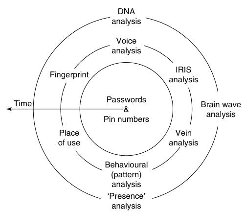

## 图5.12 身份认证。

参考：德勤大学出版社，2016年

在银行业，大多数大型银行已有应用，例如允许零售客户管理账户和支付款项。2019年，英国获奖的国民威斯敏斯特银行应用宣称拥有以下功能：⁵

- Android 指纹登录、触控 ID 和 iPhone X 面容 ID
- 查看账户余额
- 查看交易明细
- 使用昵称个性化账户
- 向朋友或新联系人支付账单，最高 £500（有金额限制）
- 设置未来日期付款
- 登记旅行计划
- 管理 24/7 账户提醒
- 消息传递

出色应用的使用是所谓的“挑战者银行”扩大市场份额的方式之一。根据定义，挑战者银行是“为与规模更大、历史悠久的高街银行竞争业务而设立的相对较小的零售银行”。

The Money Whisperer 网站提出了挑战者银行常见的一系列关键能力，这些能力对千禧一代及之后出生的人群尤其有吸引力，例如：

- 能够通过应用“锁定银行卡”，并在需要时解锁。无需致电银行冻结卡片（也不必忍受客服中心的体验），自助“锁定”让客户掌握控制权。
- 能够通过应用扫描护照或其他认可的身份证件来开设账户。系统随后要求用户通过视频链接朗读脚本，从而完成身份验证和生物识别检查。
- 以可视化方式提供更深入的信息，按类别识别消费、实时数据和强大的图形。
- 更好的预算管理，包括设定预算并跟踪执行情况。这一功能似乎与 Z 世代产生强烈共鸣，他们认为自己不仅掌控生活，也掌控财务。
- 通过发送链接而不是付款详情来向朋友付款。
- 创建“存钱罐”，让客户为特殊活动或购买储蓄。这是过去在家用“小猪存钱罐”做法的电子版。⁶

英国典型的挑战者银行包括 Aldermore、Atom Bank、Metro Bank、Monzo、Revolut、Starling Bank、Tandem、Tesco Bank 和 Virgin Money，这些银行都已获得 PRA 授权在英国开展银行业务。同样，美国也不乏挑战者银行，包括诸如“BankMobile”这样的机构，它自称是由美国老牌金融服务公司 Customers Bancorp 创建的数字银行。其联合创始人、总裁兼首席战略官 Luvleen Sidhu 表示，BankMobile 是“美国最大的数字银行”。她将其描述为“一种混合模式，一家拥有银行牌照的金融科技公司，正在革新和颠覆银行业。”⁷

英国挑战者银行之一 Starling Bank 的标语是“智能银行应用……将自身置于客户金融生态系统的核心”。“银行业，但更好”是他们另一句流畅（且坚定）的营销口号，这给传统银行带来了挑战。该公司成立于 2014 年，是一家纯数字移动银行，并吸引了大量投资资金。它非常具有创新性，拥有领先的开放银行能力和开放 API，允许客户与其它金融产品提供商共享数据。⁸

通常，应用成功的衡量标准是它是否“卡顿”——也就是说，使用过程中是否出现不流畅，这可能是由于开发中的系统性错误。人们普遍认为，这种卡顿通常是由于开发速度过快，或者是因为未能在流程中尽早引入“功能测试人员”，而到那时问题已变得复杂且通常解决成本高昂。或者，也可以引入第三方测试人员，包括像 TestIO 这样的公司，它们采用众包测试方法进行质量保证和控制。⁹

在考虑“未来银行业”时，我们还应该认识到，糟糕的应用极有可能影响消费者情绪。在社交媒体环境中，应用性能不佳可能导致批评快速而广泛地传播。对于一个主要基于信任的行业，考虑到我们之前对金钱意义理解的变化，人们会认为应用是否可信与银行本身是否可信之间存在相关性。有人可能会说，如果一家银行（或任何组织）连自己的技术都无法被信任，又怎能期望它照看好客户的金融资产呢？

另一面则可能是应用的易用性。能够快速开设一个带有透支额度的新账户，可能会导致债务泛滥，尤其是那些因自身境况而被迫花掉预算之外金钱的年轻人。支付账单的必要性和消费社会的诱惑，使人们很容易在缺乏谨慎的情况下欠下债务。他们还可能承受不适当的同伴压力。一个例子可能是被邀请参加朋友的婚礼，也许是在某个偏远而迷人的地方，这会诱使他们把“人情”变成昂贵的假期。类似的问题也出现在轻松办理新信用卡，然后将债务余额从一张卡转到另一张卡上。

## 数据可视化

信息以不同方式被吸收。学习中也遵循同样的原则，我们每个人都有自己的学习风格或多种风格的组合，通常包括听觉型、动觉型和视觉型。数据可视化主要旨在通过图表、表格、气泡图、等值线图（阴影地图）等形式呈现复杂信息。这种技术往往对管理者更有吸引力，而不是数据。

科学家们，但尽管如此，它正获得越来越多的关注和重视。越来越明显的趋势是：

- 更好地使用颜色，包括一种颜色在边界处转变为另一种颜色时更有效的渐变
- 使用图形
- 更有效地运用讲故事，这也包括叙事
- 真实数据与虚拟现实的结合

这一切开始听起来像是游戏技术，而且各种技术之间的交叉确实越来越多。¹⁰

对于从业者来说，市场上已经有许多数据可视化应用程序可供使用。其中许多应用（如Shiny）都提供教程。Shiny的基础技术要求是能够将R用作编码语言。（R是一种编程语言和免费软件，主要用于统计计算和图形处理，由R统计学习基金会支持。它是S编程语言的扩展，而S本身基于20世纪70至80年代的FORTRAN，也是笔者当年“初试牛刀”的语言。）¹¹

还有其他有意义的数据可视化产品，例如Visio和Microsoft Power BI，仅举该领域中的两家公司。它们的能力和价格差异巨大。一位评论者指出：

> 高端工具可以实时更改可视化结果，就像复杂算法的输出在反复直接查询实时数据（即流式数据）并跨多个数据源后所发生的变化一样。

> 处于中间档次的工具不呈现实时数据，但仍然可以根据高级分析输出生成可视化。¹²

双向可视化通常被认为是最重要的能力之一。这意味着通过集成技术，既可以从数据创建有效的可视化，也可以点击可视化内容来显示它所基于的数据集。

## 语音识别与语音助手

语音识别是一个使用系统和软件来“识别、区分和验证”说话者声音的过程。¹³ 它也被称为语音或说话人识别。它评估个人的“语音生物特征”，包括语速、语调和口音。（见图5.13。）

言语作为一个话题是复杂的，体现在语言学研究中。它还包含对音素（语言的小片段）的研究。音素（phoneme）一词可以从其与“语音学（phonetics）”的联系中辨认出来，源自古希腊语φώνημα (phōnēma)，意为“发出的声音、话语、说出来的东西、言语和语言”。¹⁴

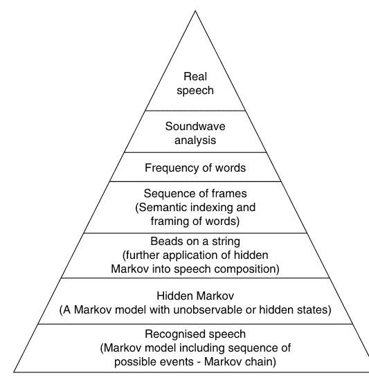

图5.13 语音理解的层次结构。

- 1. **简单模式匹配**：这是将每个单词作为一个整体进行识别，使系统识别出语音模式。这是一种非常基础的方法，在呼叫中心中很常见，自动电话系统会让我们说出“所选服务”或读出银行账户详细信息。它通常只能识别十个数字，计算相对不复杂。
- 2. **模式与特征分析**。这是将每个单词分解成小块，并识别每个小块（如元音）。在此过程中，语音（以模拟形式）被数字化，转换成图形形式，并转换成持续时间为1/25秒或1/50秒的声学帧。然后，输出结果与语音词典进行比较，系统识别出可能所说的内容。许多这类系统都有某种纠正过程，因此系统具有一定程度的持续学习能力。
- 3. **语言或统计建模**。这是利用语言、语法和词汇使用概率的知识来加速提高准确性。它使用统计分析来预测某些单词或短语的顺序，例如，两个名词很少在语言中并排使用，而是很可能前面有一个名词或形容词。现代语音识别系统不仅做到这一点，还考虑了词语之间间隔的可能性。这一领域的先驱之一是俄罗斯数学家安德烈·马尔可夫，其分析系统被称为“隐马尔可夫模型”（HMM），“隐”是因为分析系统位于系统的后台。
- 4. 人工神经网络。这是AI类系统能够可靠地识别模式和词语发音的领域。虽然HMM一直是语音识别的支柱，但通过内部“连接”模拟人脑的系统的使用，也使得语音模式的识别成为可能。这些系统被称为“人工神经网络”（ANN），有时会与HMM结合使用。挑战的复杂性不难理解。15

如今的个人系统使语音或声音识别更加普遍，大多数人已经熟悉Siri、Alexa或Cortana等系统。大多数个人设备已经将这些功能内置到系统中，因此，用户无需在搜索引擎中键入问题，只需对着设备说话即可。诚然，背景噪声常常是个问题，但可以在录音过程中加入滤波器，消除环境声音，就像高端耳机消除飞机噪声一样。也许最大的障碍是用户自身，以及他们不愿意“与系统交谈”。随着时间推移，这种态度会改变。

当我们考虑“未来银行”时，应该设想屏幕和键盘将变得越来越过时，我们与银行系统的交互将主要由语音驱动。即使提高了识别准确率，用户在涉及财务问题时可能仍会保持谨慎。还要多久才能仅凭语音指令向第三方付款或转账？该指令将如何被追踪？“错误语音指令”的治理责任将由谁来承担？

另一方面，智能系统难道不能质疑“奇怪”或看似不正确的指令吗？如果使用语音识别或其他任何系统的成本效益大于风险，难道不能针对风险设定一些定价吗？如果如此，消费者为什么要感到受限？欺诈分析难道不能与生物特征分析同步发展吗？

如果在银行业语境中恰当地考虑AI，最初是在零售银行业务中，然后扩展到财富管理，那么更有效的语音识别能力日益重要，这一点不应被排除。

## 视觉与人脸识别

人脸识别系统是可以从数字图像中识别或验证个人身份的系统。一般来说，它们通过比较个人的选定面部特征，并与数据库进行比较来工作。这被描述为“生物特征AI应用”，生物特征是对身体任何测量的技术术语。生物特征识别也是指纹或虹膜识别系统所使用的过程。

该技术源于20世纪60年代中期的安防领域，早期的先驱之一伍迪·布莱索（Woody Bledsoe）指出，其中一个特殊挑战不仅是将面部元素与数据库匹配的能力，还要补偿诸如“头部旋转和倾斜、光照强度和角度、面部表情、衰老等问题”。自那时起，技术已显著进步，例如Facebook和Google现在都提供标签和照片应用，通过自动识别家人和朋友来帮助用户整理照片。

Facebook通过分析15亿用户的内容在该领域变得特别强大，但有人认为这是违背信任的，尤其是在一个看似基本上不受监管的领域。2014年，他们发表了一篇关于名为Deepface的人脸识别程序的论文，声称准确率达97.35%。领先的供应商之一Cognitec Systems¹⁶ 表示：

> 本质上，它观察的是人脸的整体特征。人脸识别软件对每张脸进行各种测量，并将这些测量结果转换成一串数字。然后，只需将一串数字与另一串数字进行比较。相似度得分越高，就越有可能是同一个人。

《生物特征信息隐私法案》（Biometric Information Privacy Act）或许能为消费者提供一些补救和保护。该法案又称BIPA，于2008年由伊利诺伊州通过，且（目前）仍是唯一针对该领域监管的法律，尽管美国有几个州有多项法律正在等待审议。它还允许受害方因生物特征数据被滥用而向法院寻求救济。

人脸识别是一种无处不在的技术，几乎在工业的每个领域甚至社区中都有应用：¹⁷

- 在安防领域，人脸识别被用于赌场、火车站和机场等。
- 在游戏领域，微软的Xbox使用户能够利用人脸识别技术访问其个人资料。
- 在广告领域；例如，德国Digital Astra啤酒广告可以检测路人的年龄和性别，并相应调整数字广告牌。
- 在零售业，它被用来统计排队等候的人数和性别，帮助重新规划店内布局，并识别商店扒手。
- 在社交或宗教场景；例如，2015年，一家名为Churchix的公司甚至推出了一款应用，让教堂能够发现谁在参加礼拜。

First Insight对美国消费者进行的一项调查发现，75%的人表示不会使用采用这类技术的商店，但有趣的是，如果商店提供大幅折扣，这一比例会降至55%。如果真是这样，那么消费者对人脸识别的反应似乎与远程信息处理行业如出一辙：用户愿意“选择加入”位置跟踪，并接收来自咖啡店等的“推送通知”，如果他们能获得诸如打折饮品之类的裨益。

在金融服务领域，万事达卡已经开始试验基于自拍来验证支付的系统。据评论网站TechCrunch称，随着面向iPhone和Apple Watch的“Apple Pay”指纹支付系统推出，用于支付认证的生物识别技术也日益受到关注。这一创新并非苹果独有；Android设备也越来越多地配备指纹读取器，并与Android Pay和Samsung Pay等支付系统兼容。18

## 指纹识别

利用指纹进行身份识别的想法由来已久。早在公元前两千纪的巴比伦时代，就有证据表明指纹被用作身份识别方式，当时人们将指纹印在黏土上以验证契约。19 到公元前265年，中国人也已将指纹用作契约身份的一种形式，而且当时指纹（连同手印和脚印）已被作为“犯罪现场证据”采集。20

不过，当时指纹具有唯一性这一事实尚未被确认。直到十九世纪，指纹记录开始被保存，这一特性才得到承认，这或许也是生物识别数据存储的最早形式。在美国，联邦调查局管理着“综合自动指纹识别系统”，该系统据称保存了5100万条犯罪人员记录和150万条民事（非犯罪）记录。美国访问计划（US-VISIT）会对入境人员采集指纹数据，其记录还涵盖了超过500万非美国访客。

手指和拇指指纹催生了一个完整的科学领域，称为指纹学。指纹之所以独一无二，是因为“指纹脊线”具有特殊特征，其中不仅包含弓形、箕形和斗形等图案，还包括专家称之为“细节特征”的更微小结构。本质上，指纹或拇指印是“摩擦脊”或“表皮脊”——即手指上凸起的部分——的记录。这些脊线不仅能提供抓握力，还能向皮肤下方的感觉神经传递信息。指纹难以改变且持久耐用，这意味着它们在用户一生中不会发生变化，尽管罪犯偶尔会尝试用“强力胶”去除个人指纹。

自动扫描仪不仅旨在测量摩擦脊的位置，还测量脊峰与脊谷之间的深度。按压手指会使这些信息发生变形。因此，出现了“非接触式指纹扫描”的概念，通过这种方式可以获取关于指纹的三维信息。这一领域也受到过批评。简单的扫描设备可能被凝胶模具欺骗，2013年，一群黑客绕过了苹果iPhone 5S Touch ID指纹传感器的拇指验证系统（苹果似乎后来已经修复了这一问题）。21

尽管如此，这仍然是一个持续受到关注的领域。现代技术会捕获手指的数字图像，将其处理为生物识别模板，然后存储并进行匹配。这些技术可以是光学式、电容式（即管理皮肤微点上的电阻）、热感式、超声波式，甚至可以考虑皮肤的“微机电”成分，这涉及静电电荷、磁性元件和表面流体力学等复杂组合。

这显然是一个极其复杂的领域，而在银行业的相关应用中，手指和拇指指纹已被考虑用作签名的替代方案。更重要的是，随着银行业日益数字化，消费者面临越来越大的个人挑战，即管理（并记住）多个密码。消费者利用生物识别信息访问信息的能力因此变得更具吸引力，但另一面是潜在漏洞开始显现：如果一个网站因伪造生物识别信息而被入侵，那么消费者整个数字生态系统可能都会面临风险。22,23

生物识别技术是未来银行不可避免的一部分。例如，Windows Hello旨在将生物识别信息扩展到其他设备认证中。“有了Windows Hello，”微软的营销文案称，“你只需露出脸或碰一下手指，就能让运行Windows 10的新设备立即识别你。”24

## 掌静脉识别

掌静脉识别是一种生物识别方式，它考量手掌皮肤下方静脉的布局以及血液中携带氧气的蛋白质（血红蛋白）的含量。通过使用近红外线扫描静脉，可以绘制出一张静脉图，从而提供个体的唯一标识，尤其是因为血液流经手部（以及身体其他部位）的方式对每个人来说都是独一无二的。

这也被称为“血管生物识别”或“血管技术”，开发者指出了其独特优势：

- 识别过程的非接触性减少了健康与安全问题，尤其是在公共场所需要身份验证时
- 识别准确率达到100%
- 系统对皮肤表面问题（如干燥、潮湿或粗糙）具有耐受性
- 与面部识别不同（例如可以在未经允许的情况下远程进行），掌静脉识别需要获得用户同意才能进行手部物理扫描
- 由于消费者必须亲自在场，欺诈可能性降低

这是一个有趣的领域。一个可能的缺点可能是：如果一个人失去意识——也许正在接受医疗救治，甚至情况更糟——那么有可能扫描他的手部并获取其账户访问权限。25

## 财富管理系统与应用

无数公司提供财富管理网站和应用，具备金融新闻实时更新、股票跟踪以及交互式高可视化图表和表格等功能。数字原生代日益增长的期望要求他们的股票投资组合能够在任何时间、任何地点进行管理。

人们对使用机器人顾问和社交交易（即分享交易行为和想法，让投资者能够互相跟随操作）的兴趣与日俱增。

通常，交易者可能希望使用“技术分析”或“基本面分析”等方法，研究财务业绩、领导层和股息历史来做出投资决策，但同行的行为也可能是另一个有趣且相关的考量因素。随大流是一种公认但有时有风险的做法。

在外汇交易中，GDP和就业率等更广泛的经济指标可能是关键因素，公共媒体和社交媒体也同样如此。使用财富管理系统意味着缺乏经验的交易者（以及一些有经验的交易者）可以让更有经验的投资者代为决策并跟随他们。在这种情况下，缺乏经验的交易者能带来什么价值呢？

社交媒体或社交交易可能越来越多地在财富管理中发挥作用。社交交易类似于“跟单交易”和“镜像交易”。跟单交易将用户的投资组合与专家的投资组合相连，并且可以自动完成。镜像交易是外汇交易中使用的一种方法，与跟单交易类似。26

对于那些希望使用自动化财富管理网站的人来说，建议并不缺乏。这些系统（尤其是社交交易）的预期优势包括：

- 更高的可访问性
- 易用性
- 更低的成本
- 更低的最低投资额
- 缩短学习曲线
- 能够在无风险沙盒中学习交易

有人担心，虽然财富应用和机器人顾问在牛市中有益，但传统财富与投资经理指出，它们在熊市中尤其具有价值，因为熊市存在相当大的不确定性，客户需要更多的“手把手指导”，或者客户有特定需求，如税务管理。投资经理正日益转向“多渠道分发”模式。27

在机器人控制这一主题中，一个特别令人感兴趣的领域是聊天机器人财富顾问。这类顾问通常通过社交媒体和移动设备提供服务，并且在获得授权后，可以深入分析客户的财务状况并提出建议。如果客户满意，系统就会代表客户进行投资。为了准确做到这一点，聊天机器人需要访问客户的账户，通常以只读方式进行，这样它就无法直接获得任何交易授权。这些主要是电子钱包，通常有银行支持，但通常不受金融补偿计划（如英国的计划）的保障。

有一个名为Plum的系统，通过用户的Facebook站点连接，可以根据用户在Facebook应用中显示的情绪，就储蓄提出建议。它甚至会给客户一个“开心”的表情符号，祝贺他们进行了储蓄。它不是支付利息，而是将钱放入一个点对点借贷平台（“RateSetter”），该平台通常提供比传统银行更高的回报率，但风险也更高。28

另一个关键要素是风险评估，其目的通常是帮助个人或组织了解自身的风险倾向，并确保做出与这种评估相一致的合适投资。风险态度通常被认为更多与行为特征而非财务状况相关。人工智能通过纳入社会、行为和态度因素，被视为衡量这一点的更好方法，而且，第4章中用于360度客户评估的许多相同指标也可能被复用。在评估风险时，还需要考虑其他领域中的更广泛问题。司法系统此前曾尝试使用算法来预测罪犯再次犯罪的概率，但显然成效有限，因此，在运用分析技术评估个人风险偏好时，需要保持一定的审慎。

最后，在考虑风险评估时，银行应认识到个人的风险偏好会随时间变化，而这可能会影响其投资意愿。目前，风险评估作为一个流程似乎相对静态，但人类的行为和态度本质上是动态的。未来的财富管理很可能是一种比现有模式更具动态性的模型。

## 生物识别技术的道德争议

从表面上看，生物识别技术似乎必然将在银行业中发挥关键作用。尽管本书探讨的是人工智能与银行业，但银行系统的准入是一个关键环节。换言之，人工智能在银行业的未来将融合生物识别技术。

该领域的潜在应用包括：²⁹

- 网点银行业务：到店客户可通过虹膜、指纹或手掌扫描仪（或其中任意组合）在柜台完成身份验证
- 通过指纹扫描仪进行ATM身份验证
- 多因素生物识别，即语音和位置等，例如用于网上银行及更重要的交易
- 将语音或人脸识别等生物识别技术用于移动银行

一些欧洲企业组织已使用生物识别技术，允许员工进入办公场所。作为个人，我们在进入工作场所和个人银行账户时，可能会遵循哪些不同的个人“规则”？

因此，总体挑战在于消费者会以多快的速度接受这一技术。市场成熟度问题也不容忽视。生物识别技术专家M2Sys报告称：

> 全球许多银行已经在银行系统中使用生物识别技术来验证员工和客户的身份，而在所有使用生物识别技术的银行中，52%位于亚洲。

> 日本估计有超过1500万客户在银行交易中使用生物识别认证。

墨西哥、南美、非洲和中东的银行也在向使用生物识别技术迈进，因为该技术在消费者中颇受欢迎，并且能够比传统的个人识别码（PIN）和密码提供更高的安全性。

在其他地区，中国的生物识别市场在2014年至2019年间实现了两位数的增长。部分原因在于政府干预和安全问题，同时也与整体使用量增加的趋势有关。在2014年（近十年前），已有超过20家商业银行、130家区域性商业银行和200多家外资银行在使用生物识别技术。该地区的接受率似乎在很大程度上与该技术更深入、更普遍的使用相关，包括：

- 政府干预：要求将生物数据添加到护照和国民身份证中，以便快速便捷地进行身份识别
- 跨境旅行：尤其是节假日期间的大量人流，迫使采用创新技术
- 游戏节上的安保与身份识别
- 煤矿开采：在多变且有时风险较高的作业环境中追踪矿工位置
- 医疗保健：尤其用于患者安全，同时也用于例如血液供应等供应链验证问题³⁰

随着这一领域主要在亚洲和新兴市场取得更大进展，是什么阻碍了西方和北美客户转向更以生物识别为导向的身份识别方式？

- 也许我们认为自己的身份本质上是私密的，而生物识别技术越过了我们作为个人愿意分享和存储的数据界限。
- 可能它只是让人感觉太过“奥威尔式”，像是科幻小说里的情节。

然而，还有一些非常实际的问题需要应对。为了遵守欧洲的《支付服务指令2》（PSD2），欧盟银行需要提供多因素身份识别。虽然需要第二重因素，但银行仍越来越多地依赖密码、安全问题、读卡器等传统方法。单独使用生物识别解决方案还不够，但它可以成为身份识别等式的一部分。

这或许主要是一个代际问题。是什么开始促使消费者愿意接受生物识别技术？为什么其他市场如此迅速地进入生物识别领域？政府干预可能是一个主要驱动力，但在宏观层面可能只是更明确地推动使用这类先进技术。部分原因可能是某些市场的人口规模庞大、人口多样性丰富，同时也包括该地区对新技术的接受度不断提高，以及其快速实施新方法的能力。

## 结论

银行业正日益以数据为驱动，因此尤其可能受到技术、机器人技术和人工智能的冲击。专家表示，超过75%的银行职能可以实现自动化，而一个机器人（无论其具体形态如何）可以取代8名人类员工。

各种迹象表明，机器人系统可以全天候运行，维护成本相对较低，适应变化的灵活性更高，而且有人认为，这比培训员工更具投资价值。因此，其潜力不仅在于变革银行业，更在于对其进行根本性改革。

然而，还可能出现其他风险或社会影响：31

- 失控算法，可能造成扭曲
- 系统构建者中出现的无意识偏见
- 传染效应：系统为应对市场状况而做出反应，但这些反应可能被证明是错误的
- 网络攻击，系统间互联互通使其尤其严重

德勤（Deloitte）与世界经济论坛（World Economic Forum）在其一份有价值的报告“人工智能如何改变金融生态系统：金融服务的‘新物理学’”³²中，旨在拨开人工智能争论的*耸人听闻*之辞，提出了九项关键发现，包括：

- 随着共享服务日益普及，后台服务可能从成本中心转变为利润中心。
- 随着银行摆脱同质化产品，金融机构提供的增值服务将改变客户忠诚度。
- 人工智能将越来越多地自动化客户的财务管理，并增强自助服务。
- 将出现汇集数据和信息的协作解决方案，并在金融服务领域纳入“安全性”。
- 战略合作伙伴关系的重要性将日益增加，但“将充满战略和运营风险”。
- 与数据隐私相关的法规将开始影响银行和金融服务所能提供的内容。

本书从未打算提供对人工智能工作原理的完整理解，也不试图详述可能助益银行业某种高级分析系统或机器学习的各种要素和应用。相反，本书旨在让人们深入了解迄今已发展并正在发展的能力深度及其潜在影响。

除此之外，认识到这些技术变革对我们生活方式产生的间接影响也很重要。虽然生物识别技术在银行业中的商业价值可能显而易见，但其对社会的更广泛影响则不那么明确。人工智能的使用也是如此。两者都为讨论、辩论和分歧提供了充足的话题。这些新技术能否实现，将在很大程度上取决于

将变革的商业案例作为伦理论证。如果说掌静脉识别被证明是银行业一种稳健且成本效益高的技术，并成为‘剑尖’，那么在不久的将来，这种技术被用于家庭环境中打开我们家门，或解锁我们的（电池供电）汽车也只是时间问题。

本书并非旨在就变革提供伦理指南。其意图在于反映包括人工智能在内的新技术如何为未来绘制路线图，并帮助读者获得足够的信息，以便他们能够参与这一非常重要的辩论。他们都是利益相关者，不仅有权发表意见，而且积极被鼓励分享。

## References

- 1. Newsroom. ‘美国银行Erica用户突破100万’. Bank of America. 12 June 2018. (查阅 28/11/2019) https://newsroom.bankofamerica.com/press-releases/consumer-banking/bank-america-surpasses-1-million-users-erica
- 2. Boobier, Tony. 高级分析与人工智能：影响、实施与工作的未来. John Wiley & Sons, 2018.
- 3. Cocheo, Steve. ‘美国银行如何成为技术驱动的巨头’. Financial Brand. (查阅 04/10/2019) https://thefinancialbrand.com/86675/bofa-brian-moynihan-erica-branch-mobile-banking-millennials-fintech/?edigest
- 4. http://www.thalesians.com/finance/index.php/Main_Page (查阅 04/10/2019)
- 5. https://personal.natwest.com/personal/ways-to-bank/mobile-app.html (查阅 05/10/2019)
- 6. Money Whisperer. ‘最佳个人银行应用：你能相信英国银行奖吗？’ 3 March 2018. (查阅 05/10/2019) https://themoneywhisperer.co.uk/best-personal-banking-app-can-trust-british-bank-awards/
- 7. Andreasyan, Tanya. ‘美国挑战者银行：谁是谁，他们的技术是什么？’ Fintech Futures. 6 August 2018. (查阅 05/10/2019) https://www.bankingtech.com/2018/08/us-challenger-banks-whos-who-and-whats-their-tech/
- 8. https://en.wikipedia.org/wiki/Starling_Bank
- 9. https://test.io/
- 10. Danevva, Victoria. ‘数据可视化技术’ VironIT. 8 October 2018. (查阅 05/10/2019) https://vironit.com/data-visualization-techniques/
- 11. http://shiny.rstudio.com/
- 12. Rist, Oliver; Baker, Pam. ‘2019年最佳数据可视化工具’. PCMag. 24 July 2018. (查阅 5/10/2019) https://uk.pcmag.com/cloud-services/83744/the-best-data-visualization-tools
- 13. https://www.techopedia.com/definition/9961/voice-recognition
- 14. Liddell, H.G.; Scott, R. 希腊-英语词典. revised and augmented throughout by Sir Henry Stuart Jones. with the assistance of. Roderick McKenzie. Oxford. Clarendon Press, 1940.
- 15. Woodford, Chris. ‘语音识别软件’ Explainthatstuff! 13 March 2019. (查阅 05/10/2019) https://www.explainthatstuff.com/voicerecognition.html
- 16. ‘人脸识别如何工作：摄像机中的幽灵’ 4 January 2016. (查阅 08/10/2019) https://www.consumerreports.org/privacy/how-facial-recognition-works-the-ghost-in-the-camera/
- 17. ‘人脸识别：谁在公共场合追踪你？’ 30 December 2015. (查阅 08/10/2019) https://www.consumerreports.org/privacy/facial-recognition-who-is-tracking-you-in-public1/
- 18. Lomas, Natasha. ‘万事达在欧洲推出其自拍支付生物识别认证’. 4 October 2016. (查阅 08/10/2019) https://techcrunch.com/2016/10/04/mastercard-launches-its-selfie-pay-biometric-authentication-app-in-europe/
- 19. ‘陶器上发现指纹’. www.news.CN. (查阅 4/11/2019) http://big5.xinhuanet.com/gate/big5/news.xinhuanet.com/health/2010-02/09/content_12956719.htm 于2010年2月13日从原文存档。
- 20. http://www.articlesbase.com/business-articles/history-of-fingerprinting-for-identification-1328283.html Articlesbase.com. 于2014年11月12日从原文存档。于2014年8月2日检索。 (查阅 4/11/2019)
- 21. Stephen Musil. ‘黑客声称已攻破苹果Touch ID指纹传感器’. CNET. CBS Interactive Inc. 于2013年9月22日从原文存档。于2013年9月23日检索。
- 22. Marous, Jim. ‘银行业的生物识别未来’ The Financial Brand. (查阅 08/10/2019) https://thefinancialbrand.com/61449/biometric-banking-password-trends/
- 23. Drew, Thomas. ‘身份验证的现状：我们存在密码问题’. Smashing Magazine. 6 June 2016. (查阅 08/10/2019) https://www.smashingmagazine.com/2016/06/the-current-state-of-authentication-we-have-a-password-problem/
- 24. Belfiore, Joe. ‘通过Windows Hello让Windows 10更个性化、更安全’. 17 March 2015. Microsoft/Windows Blog. https://blogs.windows.com/windows-experience/2015/03/17/making-windows-10-more-personal-and-more-secure-with-windows-hello/
- 25. https://whatis.techtarget.com/definition/palm-vein-recognition (查阅 08/10/2019)
- 26. ‘关于社交交易的一切的终极资源。’ (查阅 08/10/2019) https://socialtradingguru.com/
- 27. Williams, Aime. ‘机器人还是人类：谁是最佳财富管理者？’ Financial Times. 16 June 2016 (查阅 17/11/2019) https://www.ft.com/content/86a66844-2f1e-11e6-a18d-a96ab29e3c95
- 28. Shaw, Gareth. ‘你愿意让机器人以5%的回报率管理你的储蓄吗？’ Which. 17 April 2017. (查阅 10/10/2019) https://www.which.co.uk/news/2017/04/would-you-let-a-robot-control-your-savings-for-a-5-return
- 29. Trader, John. ‘生物识别在银行业的影响’ M2Sys Blog. (查阅 08/10/2019) http://www.m2sys.com/blog/financial-services/impact-biometrics-banking/
- 30. ‘中国使用生物识别的7大方式’ Technavio. 30 December 2014. (查阅 10/10/2019) https://blog.technavio.com/blog/the-top-7-ways-china-is-using-biometrics
- 31. Contri, Robert. ‘人工智能在金融服务中的社会影响’. Forbes. 1 November 2018. (查阅 09/10/2019) https://www.forbes.com/sites/deloitte/2018/11/01/the-societal-impact-of-ai-in-financial-services/#77fbd6357728
- 32. Contri, Bob; Galaski, Rob; et al. ‘人工智能如何改变金融生态系统’. Deloitte Global/World Economic Forum. 2018. https://www2.deloitte.com/global/en/pages/financial-services/articles/artificial-intelligence-transforming-financial-ecosystem-deloitte-fsi.html?id=gx:2el:3dp:forbescampaign:awa:abt:103118

# AI and the Importance of Brand in Banking

### Summary

从表面上看，本章更适合收录在营销书籍而非人工智能书籍中。这是一个容易犯的错误。随着人工智能的发展，银行业日益自动化，客户将通过自助功能和机器人‘聊天机器人’进行交互，产品和服务将被定制。

超个性化的需求除非通过先进和认知分析以及人工智能，否则难以实现。本章将探讨Gen X、Gen Y和Gen Z客户在银行和品牌方面的具体期望。

竞争银行之间的差异会越来越小。也许唯一的差异将是所用技术的质量，而且在许多情况下，银行的后台可能使用与竞争对手相同的技术。

那么一家银行与另一家银行的区别可能是什么？银行应用的笨拙程度会影响用户体验，但这在整个价值链中 arguably 是一个表面元素。区分一家银行与另一家银行的，简单来说就是品牌，更具体地说，是用户群体如何感知该品牌。

本节将探讨在银行业背景下‘品牌’的含义，品牌对千禧一代和后千禧一代客户的具体影响，以及两者与人工智能的联系。

它还表明，银行在消费者生命周期中可能发挥更大的作用，具有成为某种‘生活方式管理者’的能力。

### For This Generation, Talking to a Robot Is Nothing Unusual

> ‘在金融服务行业整体采用率’ (of chatbots) ‘仍然很低，但这正在迅速变化’，GlobalData的一位高级银行分析师表示。‘对于成长于Alexa、Cortana和Siri时代的这一代人来说，与机器人交谈并不奇怪。为了保持对这一代人的相关性，金融服务提供商

将不得不把聊天机器人整合到他们的整体渠道战略中。GlobalData 的 2018 年投资者调查显示，只有 8.3% 的客户在与投资服务商打交道时使用过聊天应用程序。^1^

## 引言

我们认为自己了解品牌和品牌知名度。毕竟，我们每天都与它相伴，被它包围，并常常根据它做出购买决策。但除了（有些人可能会说）只是营销专业人士后口袋里的又一件工具之外，它到底是什么？根据美国市场营销协会的定义：^2^

> 品牌是一种名称、术语、设计、符号或任何其他特征，用以将一个卖家的商品或服务与其他卖家的商品或服务区分开来。

它是人们在考虑商品或服务的物理属性及其情感投入时脑海中浮现的形象。科特勒（Kotler）和凯勒（Keller）在他们的著作《市场营销管理》（*Marketing Management*）中写道：“品牌化就是赋予产品和服务以品牌的力量。”这句话似乎相当直白，而且鉴于其重要性，关于这一主题的信息并不匮乏。^3^

品牌化通过多种方式实现，例如：

- 广告
- 沟通策略
- 产品与包装设计
- 客户体验
- 赞助与合作伙伴关系
- 品牌的视觉识别（标识、网站和颜色）。

但是，为什么品牌能与我们产生如此强烈的共鸣？它如何产生如此显著的差异化效果？为什么它是忠诚度的关键组成部分？为什么它在未来会变得更加重要？随着我们对这些方面了解的深入，数字时代和人工智能时代将带来什么影响？

莫伊塞斯库（Moisescu）副教授在其论文《品牌意识在消费者购买决策和感知风险评估中的重要性》^4^中，对零售银行与消费者之间的关系进行了研究，他的发现强化了品牌知名度和识别在决策过程中的重要性。

莫伊塞斯库将消费者眼中的品牌与风险问题等同起来，因为对品牌及其特征的熟悉能为购买决策带来信心。品牌知名度分为两类：“未提示认知”（unaided），涉及品牌回忆；“提示认知”（aided），涉及品牌识别。这两者对于购买决策都很重要，但有些人可能会争辩说，这些技巧更适合商品购买，而非金融服务。

金融服务的营销越来越被视为一个专业领域，不仅需要深入了解产品和服务，还需要了解消费者情绪以及什么最有可能引起现有和未来客户的共鸣。与银行本身相比，许多金融服务的品牌定位似乎相对无形。金融服务通常使用与体育、动物或两者相关的品牌形象，然后旨在强化创新、团队合作和值得信赖的信息。在一个人工智能和图像在小屏幕上呈现的更加复杂的世界里，几乎可以肯定，新的品牌技术将开始出现，例如声音、语音和其他感官属性。人工智能方法最终将开始定制单个消费者如何被某一特定品牌元素最佳吸引。

随着全能银行或全服务银行概念的发展，营销人员面临的挑战将是确保银行生态系统的所有元素都以一致的方式传达品牌信息。供应链生态中最薄弱的环节将成为银行业最薄弱的环节。对供应链更有效的治理将变得越来越重要，供应链经理的角色也将被迫反映这一点。

## 银行业中的品牌价值与品牌资产

品牌不仅仅是一种吸引客户的练习，而且具有强烈且相对明确的财务价值。在《管理品牌资产：品牌名称的价值》（*Managing Brand Equity: Capitalizing on the Value of a Brand Name*）^5^中，戴维·阿克（David Aaker）——加州大学的美国组织理论家、顾问和名誉教授——考虑了“品牌资产”或“品牌价值”的概念，将其描述为“品牌知名度、感知质量、品牌忠诚度和品牌联想的复杂组合”。

品牌价值通过三种主要方式衡量：

- 基于成本的品牌估值
- 基于市场的品牌估值
- 基于收益法的品牌估值

专家们还认识到价值的重要性以及如何对其进行财务评估，通常理解其意义在于：

- 来自客户认知、社交媒体等方面的价值，作为相对于无品牌/普通品牌的衡量指标
- 在一定时期内通过感知品牌权益而在市场份额和收入增长方面获得的价值

因此，其本质是，品牌不仅仅是吸引新客户并鼓励现有客户保持忠诚的一种“磁铁”。顺便说一句，随着开放银行（Open Banking）概念的兴起，这两者都是重要元素，品牌价值成为吸引客户的一种载体。相反，它认识到，在银行市场中，并购可能成为重要特征，无论是银行之间还是与其他企业（例如科技公司）之间的并购，品牌对于潜在“目标”的市场估值都很重要。

诸如Brand Finance（一家领先的品牌估值咨询公司）等公司的研究，旨在按品牌价值识别全球最大的银行。^6^ 他们通过三个影响因素来计算价值：

- 企业价值，他们将其定义为“由多个品牌业务组成的整个企业的价值”
- 品牌业务价值，他们将其定义为“在主题品牌下运营的单个品牌业务的价值”
- 品牌贡献，他们将其定义为“企业因拥有品牌而非运营普通品牌而获得的股东价值的整体提升”

Brand Finance 区分“品牌价值”和“品牌强度”。后者被定义为“品牌在无形指标上的表现相对于其竞争对手的功效（或价值）”，通过营销投入、利益相关者权益以及这些因素对业务绩效的影响来衡量。

在其2018年的报告中，Brand Finance还特别关注了更广泛金融服务领域中的非金融竞争对手，如苹果（Apple）、Facebook、谷歌（Google）和亚马逊（Amazon）。他们指出，这些科技巨头要么已经创建了面向消费者的金融服务，要么预计很快就会这样做。因此，它们“对传统银行业务提出了新的挑战，因为它们更符合现代客户对即时多渠道和多平台服务的期望”。

**表3** 2018年所有银行的品牌价值^7^

| 排名 | 银行 | 国家 | 2018年品牌价值（百万美元） | 2017年品牌价值（百万美元） |
|---:|---|---|---:|---:|
| 1 | 中国工商银行 | 中国 | 59,189 | 47,832 |
| 2 | 中国建设银行 | 中国 | 56,789 | 41,377 |
| 3 | 富国银行 | 美国 | 44,098 | 41,618 |
| 4 | 中国银行 | 中国 | 41,750 | 31,250 |
| 5 | 大通银行 | 美国 | 38,842 | 33,737 |
| 6 | 中国农业银行 | 中国 | 37,321 | 28,515 |
| 7 | 美国银行 | 美国 | 33,289 | 30,273 |
| 8 | 花旗银行 | 美国 | 30,737 | 27,647 |
| 9 | 汇丰银行 | 英国 | 18,305 | 20,688 |
| 10 | 摩根大通 | 美国 | 17,651 | 15,710 |

表4  2018年欧洲顶级银行品牌价值

| 排名 | 银行 | 国家 |
|---|---|---|
| 9 | 汇丰银行 | 英国 |
| 12 | 桑坦德银行 | 西班牙 |
| 17 | 法国巴黎银行 | 法国 |
| 18 | 巴克莱银行 | 英国 |
| 22 | 西班牙对外银行 | 西班牙 |

仅看前5家欧洲银行

表5  2018年美国顶级银行品牌价值

| 排名 | 银行 | 国家 |
|---|---|---|
| 3 | 富国银行 | 美国 |
| 5 | 大通银行 | 美国 |
| 7 | 美国银行 | 美国 |
| 8 | 花旗银行 | 美国 |
| 10 | 摩根大通 | 美国 |

仅看前5家北美银行

不可避免的问题是，苹果、Facebook或亚马逊的银行方案会是什么样子，尤其是从客户体验的角度来看？让我们再次从用户的角度重新审视“品牌”这个问题。

## 千禧一代和Y世代对银行品牌的期望

为设定基准，我们将千禧一代（有时称为Y世代，继X世代之后，Z世代之前）定义为20世纪80年代至90年代中期出生、在21世纪初成年的群体。尽管他们在所处地区、经济和社会条件上存在显著差异，但他们通常以对技术越来越多的使用和熟悉为特征。作为“数字原住民”，他们从小与技术一起长大，与那些在生命后期才接触技术（并被称为“数字移民”）的人形成对比。这两个表述最早出现在1996年的《网络空间独立宣言》^8^中，该宣言实际上反驳了有组织的政府没有权力管理网络空间（即互联网）法律的观点，因为互联网正在发展自己的规则或“社会契约”。

**表 6 千禧一代群体的画像（基于 BoA 数据）**

| 年龄组 | 年龄范围 | 特征 |
|---|---|---|
| 年轻千禧一代 | 18–22 | 主要仍在接受教育 从父母那里获得财务建议 部分人也从父母那里获得财务支持 |
| 中期千禧一代 | 23–29 | 大多数已就业 有收入并能够做预算 从专业顾问、父母或两者处获得财务建议 |
| 年长千禧一代 | 30 岁及以上 | 可能已婚 比其他千禧一代群体拥有更多储蓄 开始为子女教育或退休储蓄 使用包括自助在内的各种财务建议 |

根据美国银行（BoA）的数据，千禧一代被划分为三个子集：⁹

1. 年轻千禧一代
2. 中期千禧一代
3. 年长千禧一代

根据 BoA 报告，总体而言，千禧一代不愿使用银行：

- 三分之一的人认为五年内不需要银行。
- 五分之一的人认为银行不会成为首选的主要金融机构。

尽管银行希望使用最现代的沟通方式，但美国银行报告还表明，千禧一代认为银行使用社交媒体是‘愚蠢’或‘ creepy ’。

关于本章前面提到的银行应用程序问题，BoA 报告称：

- 59% 的千禧一代使用过其银行的移动应用程序。
- 72% 的人每周使用几次该应用程序。
- 24% 的人每天访问该应用程序。
- 74% 的人接收移动银行提醒。

**表 7 千禧一代的财务特征（基于 BoA 数据）**

| 优点 | 缺点 |
|---|---|
| 74% 的千禧一代认为自己有良好的财务习惯，84% 对自己有效管理个人财务的能力充满信心。  40% 认为自己“财务健康”（拥有储蓄、管理债务、按时付款并为紧急情况做准备）。  年长千禧一代比年轻千禧一代更担心金钱（15% 对 19%），可能是因为他们理解得更透彻。 | 34% 将自己的财务知识评为一般或较差。  67% 的千禧一代表示他们“经常”或“有时”担心金钱。41% 表示他们对金钱“长期感到压力”。  32% 不知道自己的信用评分，67% 不知道该评分是如何计算的。 |

## Z 世代的品牌期望

这个后来的群体被称为 Z 世代，其定义为出生于 1996 年至 2010 年之间，有时被称为“幼儿到青少年”军团。总体而言，据说他们尚未发展到足以确定其特征的程度，但不可避免地他们不仅会分享父母的一些特征，还会分享后来同龄群体的特征。在他的报告《准备迎接 Z 世代》^10 中，作家 Ryan Scott 认为他们有四个关键的 distinguishing 因素：

1. 技术根深蒂固，注意力持续时间短
2. 更强烈的隐私需求，对留下数字足迹感到不安
3. 更大的文化多样性
4. 实用主义、敏感性和风险规避行为

除此之外，可能还有其他文化和社会因素，会越来越多地影响 Gen Zers 的工作方式和休闲时间花费方式，例如多元文化、新文化货币甚至破坏性做法。即使如此，根据营销机构 Vision Critical 的说法，即使在相对早期的阶段，一些关键特征也正在显现:^11

1. 他们的媒体消费习惯与前几代人不同，甚至与千禧一代也不同。
2. 他们更喜欢酷产品而不是酷体验。
3. 他们以创业和精通技术的行为为典型特征。
4. 他们对前卫和前卫的活动做出反应。
5. 他们想要共同创造文化——而且他们确实这样做了。

## X 世代的品牌期望

虽然在考虑未来银行业品牌时，诱人的是将 Gen X 群体排除在外，而且可以说 Gen X 是“昨天的世代”，但该客户细分市场至少在未来几十年内仍将是关键利益相关者，不应被忽视。（因此，本章以 Gen Y、Gen Z 和 Gen X 的顺序涵盖了这三个群体，而不是按字母顺序排列，其感知重要性相对于主题而言。）

Gen X 按定义是‘婴儿潮一代’之后的人口细分群体（出生于 1940 年代中期至约 1964 年），出生于 1960 年代中期至 1980 年代初。虽然按顺序处理这三个细分市场可能更方便，但 Gen Y 和 Gen Z 在数字遗产和影响方面有更多共同点，而 Gen X 的最大影响 arguably 是政治、社会和经济方面的。Gen X 被认为是一个在社会更关注成年人而非儿童、离婚率上升并且与性革命同时发生的时代成长起来的群体。

关于这个话题已经写了很多，主要是因为社会科学家有足够的时间来考虑这种现象的原因和影响。这里的兴趣在于这个群体如何具体应对品牌和营销，尤其是他们与银行业和金融部门的关系。他们如何“消化”品牌和营销信息也很有趣，不同人口统计细分市场之间在分销渠道方面存在一定的重叠。（见图 6.14。）

Gen X 被描述¹²为：

- ‘独立、足智多谋且自给自足’，并且厌恶被微观管理
- ‘技术娴熟，能够吸收新技术的使用’
- 更灵活，尤其是在工作场所
- 重视工作与生活的平衡

像 Maye Create 这样的营销人员认为，Gen X 不像他们的婴儿潮一代父母那样保守，但也不像他们的 Gen Y 子女那样自由。

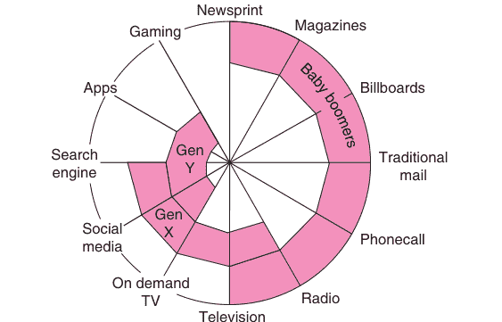

图 6.14 按细分市场划分的分销渠道。
参考：摘自‘Maye Create’

Gen X 营销的特点¹³为：

- 真实性和透明度：他们对值得信赖的关系反应最好。
- 语气：态度至关重要，“所以当你跟他们说话、给他们写信、向他们营销时，不要居高临下。不要像他们必须那样告诉他们去做某事。Gen Xers 在你给他们‘可能是什么’然后让他们自己去弄清楚时效果最好”。
- 慢递邮件：Gen X 仍然欣赏传统的分销渠道，包括传统邮寄。
- 电子邮件营销：Gen Xers 定期上网。
- 视频营销和社交媒体：MayeCreate 建议到 2017 年，超过 4500 万 Gen Xers 将能够访问社交媒体。¹⁴

## 品牌与客户体验相互交织

金融市场正越来越多地反映出新一代消费者的情况。‘Young Money’成立于 2011 年，被确定为“帮助年轻人了解个人理财的第一个英国博客”。其 stated 使命对目标群体来说似乎既清晰又具有吸引力。

其网站声明：“所有年轻人”都“应该在财务上具有知识、信心并掌控自己的未来。这对个人、经济和社会进步至关重要。这意味着促进真正的选择和机会，并远离导致冷漠、不公平的牺牲和习得性无助的体系”。

它继续说道：“我们理应拥有”：

- ‘对金融部门的真实、公平和知情的看法
- 政策和法规真正服务于我们（即他们）的利益
- 在所有层面的代表，以便我们能够妥善塑造我们的财务未来’

创始人 Iona Bain 被描述为英国关于年轻人金钱问题的“首选声音”。她在 2016 年桑坦德金融新闻奖中被评为“年度金钱博主”，并在 2018 年被独立专业人士和自雇人士协会（IPSE）评为“年度自由职业者”。¹⁵

对个人财务的控制无疑是一个吸引投资者的话题。虽然 Fintech 和初创公司的主题在其他地方更广泛地涉及，但此时值得提及一家特定公司：Revolut。

Revolut 起源于伦敦 Level 39 金融孵化器，已经获得了“独角兽”的地位，即初创公司估值超过 10 亿美元（7.4 亿英镑）。虽然起初不是银行，但它将自己定位为银行的替代品，包括基于应用程序的活期账户；除其他服务外，它还提供预算服务，“向您准确展示每个月您的钱花在哪里，甚至可以为您设置餐厅和杂货等项目的月度预算。”¹⁶

顺便说一下，2019 年 Revolut 因使用一则广告而被“点名”，该广告突出了订购情人节“一个人餐”的人数。批评者说，这不仅嘲笑了单身人士，还引发了人们对个人财务数据如何被

正在被使用。金融记者伊奥娜·贝恩（Iona Bain）也质疑，对于年轻、精通技术的客户来说，信任和诚信是关键的舆论驱动因素，这种做法对他们是否合适。另一方面，正如有人所说，“没有所谓的坏宣传”（这句话碰巧常与马戏团企业家菲尼亚斯·T·巴纳姆（Phineas T Barnum）联系在一起，尽管没有确凿证据表明他与这句话有关）。

## 品牌与以人为本的设计

品牌通常与客户体验质量相关联，可以是正面的，也可以是负面的。由于“客户体验”似乎是热门词汇之一，看看至少有一家银行集团对其该领域专家的要求或许会有所帮助。

一则近期（几乎可以肯定现在已招满）的职位空缺广告招聘一个他们所谓的“集团路线图与业务设计”团队的职位。该职位要求任职者：

- 挑战并塑造现有思维，并在整个集团内调整项目组合。
- 识别不断发展的技术如何改变公司与客户和同事互动的方式，并影响未来的业务模式和架构。
- 明确整体战略在实践中的含义，并开发框架，使价值流、企业使能器和主要核心项目能够实现战略业务和架构目标。
- 支持调动项目组合中的关键要素。
- 在业务设计、IT架构和以人为本的设计（HCD）之间进行协调。

“以人为本的设计”是一种解决问题的方法，通过在决策过程的所有部分采用人的视角来制定解决方案。其国际标准 ISO 9241-210:2010(E) 指出：

> 以人为本的设计是一种交互式系统开发方法，旨在通过关注用户及其需求和要求，并应用人为因素/人体工效学、可用性知识和技巧，使系统可用且有用。这种方法提高了有效性和效率，改善了人类福祉、用户满意度、可访问性和可持续性；并抵消了使用可能对人体健康、安全和性能造成的不利影响。

申请人还必须具备以下条件：

- 能够在模糊且快速变化的环境中自如工作，管理多种优先事项
- 高度关注整体战略格局，具有客户导向、圆通处事和强大的利益相关者管理能力
- 具有塑造和管理复杂项目组合的经验，并有可靠的业绩记录
- “迷恋”技术的使用方式，并理解银行业的挑战
- 非常了解银行产品、流程和项目组合¹⁷

这虽然是一个孤立的例子，但有望强化这家特定（未具名）银行的服务产品、消费者（或“人”）体验与技术使用之间的联系。有益的是，这则职位空缺广告打破了不同部门之间传统的孤岛心态，尤其将开发中技术的使用定位为关键推动因素。

## 做品牌还是去品牌？

汤姆·彼得斯（Tom Peters）的《重新想象！》¹⁸被一些人认为是一本“Marmite”式出版物。（Marmite是一种英国酵母酱，其吸引力类似于澳大利亚的Vegemite酱，口号是“要么爱它，要么恨它”。）该书于2004年首次出版，在评论家看来属于这一类，不仅因为其相当激进的排版，还因为其挑衅性，其中之一就是“品牌”。

他提醒我们，品牌是一个“情感连接点”，一种“强大的连接体验”，组织完全有能力“基于他们深有感触的东西”来定义自己的品牌。他的沮丧之处在于，我们往往将品牌视为一种外部形象，而不是反映企业真正是谁（或什么），或其个性、价值观和身份。

一些公司被问及一些基本问题：

- 你是谁？
- 你为什么在这里？
- 你如何与众不同？
- 你如何能带来巨大改变？
- 谁在乎（你在乎吗）？

品牌和领导力被描述为“连体双胞胎”，鼓舞人心的领导者为“品牌承诺”设定模板。这本身就带来了挑战，尤其是随着我们传统上所知的摇旗呐喊、“跟我来”式的领导力，越来越被认为不适合这个充满人工智能的新未来。毕竟，可以说，我们的哪位领导者拥有数据、分析和人工智能新时代的经验？也许未来的领导力不可避免地必须来自Z世代，而不是X世代或Y世代，以某种“代际跨越”的形式？

其他人将领导力描述为权力的一种功能，而不是一种角色或职位，并认为领导角色可以根据情况的性质在人与人之间转移。¹⁹

如果领导力模式要改变，那么我们对品牌的理解也许也会改变。如果品牌是组织思考、感受和行为的方式，那么这必须以某种可持续的方式融入其DNA。最重要的是，这些品牌价值必须与组织客户群的期望保持一致。矛盾之处在于，如果我们接受“真正的品牌”具有一定的

## 表8 银行业品牌发展

| 品牌曾经是 | 品牌将是 |
|---|---|
| 静态的 | 互动的 |
| 以活动为导向 | 以个人为导向 |
| 可持续的 | 临时的 |
| 安全可靠 | 反映颠覆性经济 |
| 大而张扬 | 微妙而支持性 |
| 客户服务的标志 | 双方亲密关系的证据 |
| 代表公司价值观 | 代表个体用户的价值观 |
| 由营销者创造 | 由用户共同创造 |

持久性，那么它如何应对由政治、经济、社会或技术变革带来的消费者情绪变化？新的品牌概念是否需要在商定的轨道或参数内具有某种灵活性？灵活的品牌化方法必须不仅仅是愿意更换标志或产品包装。

在银行业的未来以及高级分析和人工智能的影响背景下，未来的品牌可能意味着什么？数据、分析和人工智能的影响被认为是颠覆性的，但这也许也会导致品牌主张的颠覆。

据《快公司》（Fast Company）的品牌经理称，品牌的未来将是“去品牌化”。他们认为，最不露痕迹的品牌被称为“原生品牌”，主要是为了隐藏商业意图，旨在创造产品熟悉度，让品牌给人可靠和不可或缺的印象。对品牌的反感——例如通常发生在公开的产品植入之后——已日益导致更微妙的策略，他们称之为“伪装品牌”。这实际上是潜意识信息传递。他们说，消费者更有可能追随一个快乐的、不苛求的品牌，而不是与真实的人和现实世界的问题建立联系。品牌永远不会向你求助。它不会用困难或反对意见来面对你。

“去品牌化”实际上代表了对消费主义的反抗。它关乎体验而不是产品，关乎人和场所而不是购买。据称这是网络时代的理想应用。“叫得最响的品牌不再获得最多的关注；提供真正有用东西的品牌才会。”

这是对质量而非数量、对价值而非价格的呼吁。“包装上唯一的信息将是原产地、制造商的意图、生产过程以及环境影响等特征。”最终的观点是，消费者不再需要品牌，而是需要质量，而且他们在一个网络化社会中更容易找到这种质量。²⁰

远见联盟（Foresight Alliance）从不同角度看待品牌，²¹ 认为到2030年：

- “AI品牌”作为一个概念将出现，智能定制品牌将通过数字微细分市场主动寻找其客户。因此，广告将转变为传播的分发渠道。

- 2. 品牌将通过将品牌植入虚拟世界而变得“超游戏化”。这种方法尤其会吸引 Z 世代，其中多达 68% 的 Z 世代男性积极参与游戏。
- 3. 品牌将开始基于检测消费者需求模式的算法进行“自我生成”，并迅速自行满足这些需求。
- 4. 品牌流动性将增加，其会因市场环境不断变化，且消费者本身成为共同品牌创建者。
- 5. 品牌的实际化将与客户建立更深层次、更有意义的关系。这将取代对客户的讯息轰炸，取而代之的是需要透明度、诚实度并包含情感联系的更深层次参与。
- 6. 道德消费的重要性将提升。具有道德意识的消费者将寻求更多关于如何购买的提示和指引，且道德决策将开始取代仅基于价值和消费的购买决策。
- 7. 群众将通过社交媒体等不同方法来定义品牌，以识别品牌的“空白”，而消费者本身将行动来填补这些空白。在这种情况下，消费者将“品牌视为朋友”。
- 8. 品牌关系的重要性将降低，“广度”取代品牌的“深度”。品牌的[content]
- 2. 品牌将通过将品牌植入虚拟世界而变得“超游戏化”。这种方法尤其会吸引 Z 世代，其中多达 68% 的 Z 世代男性积极参与游戏。
- 3. 品牌将开始基于检测消费者需求模式的算法进行“自我生成”，并迅速自行满足这些需求。
- 4. 品牌流动性将增加，其会因市场环境不断变化，且消费者本身成为共同品牌创建者。
- 5. 品牌的实际化将与客户建立更深层次、更有意义的关系。这将取代对客户的讯息轰炸，取而代之的是需要透明度、诚实度并包含情感联系的更深层次参与。
- 6. 道德消费的重要性将提升。具有道德意识的消费者将寻求更多关于如何购买的提示和指引，且道德决策将开始取代仅基于价值和消费的购买决策。
- 7. 群众将通过社交媒体等不同方法来定义品牌，以识别品牌的“空白”，而消费者本身将行动来填补这些空白。在这种情况下，消费者将“品牌视为朋友”。
- 8. 品牌关系的重要性将降低，“广度”取代品牌的“深度”。品牌的信条将是“广泛且频繁”，拥有多个触点，且品牌参与度更简单。
- 9. 零售后品牌将出现。到 2030 年，网上购物将变得如此便捷，以至于品牌必须以某种方式鼓励消费者在正常的零售周期之外做出购买决策，而零售商将利用强大的品牌形象来协助这一过程。
- 10. 品牌生态系统将出现，例如互联家居，跨购买者可获得显著折扣（以换取“锁定”在品牌合作伙伴关系中）。

以上列表指向十年后可能出现的世界，为银行尤其是品牌背景下的银行提供了一些重要线索。正如数据和分析一样，客户服务和消费者参与方面的领导力来自零售业，因此银行最好向该行业借鉴品牌创新的下一波浪潮。可能需要考虑的未来机会包括：

- 将银行自身的品牌延伸到目前存在的更广泛的生态系统中，并在每个机会中为客户体验增值
- 银行的道德投资对满足客户特定道德愿望的影响
- 银行与游戏化的联系加强，这可能以不同方式发生。也许可以创建更多面向金融的游戏，包括金融服务机构赞助游戏或嵌入银行品牌。
- 一种更灵活、更流畅的由人工智能驱动的品牌形象方法，更紧密地与消费者个人的品牌期望保持一致。这意味着大型横幅广告的重要性可能会降低，尤其是在数字时代。

## BANKS WILL USE AI TO BECOME LIFESTYLE MANAGERS

品牌与生活方式的融合已久为人所知。消费品供应商和银行/财富管理机构都专注于同一市场，只是方向不同，因此思维融合和共享技术的机会日益增加：

- 银行有潜力在促进消费者支出方面发挥催化剂作用。
- 消费品供应商有潜力帮助银行不仅提供可用的信贷额度，还提供财富管理建议。

两者都可以使用先进的分析技术和人工智能，不仅识别潜在客户，还能确保在适当的时间将合适的产品、服务和信贷额度呈现在他们面前。一个特别的挑战是确保客户在财务决策上不会过度透支。

在考虑银行业未来时，最先进的金融机构不仅会提供考虑不同风险偏好的现状建模，还会帮助消费者根据当前和预期资产、当前和预期承诺、生活方式和预期寿命有效地为未来规划。关键的品牌组织最终将成为“终身合作伙伴”，一种利用先进分析和人工智能作为催化剂的准金融婚姻。我们可以设想自己将“嫁给”金融品牌。这一长期关系中不可或缺的关键问题是消费和信贷平滑。

## Consumption and Credit Smoothing

“消费平滑”概念是一个过程，即消费者管理其个人生活方式，以确保他们拥有足够的储蓄来维持生活方式，包括退休期间。这是在审慎与节俭之间的平衡。那些在工作期间过度消费且未能储蓄的人将在生命后期遭受后果，当他们储蓄不足时需要过上更节俭的生活。那些在工作期间“过度储蓄”并过着节俭生活的人将（希望）能在晚年收获回报。

这表明在某个时候需要一定程度的“节俭”，而规划是一个微妙的平衡。从经济角度来看，“消费平滑”主要涉及：

- 消费的稳定性，例如在消费者生命周期不同阶段管理支出模式或购买行为
- 降低风险和不确定性，例如在意外收入损失或生活事件发生时
- 预测可能需要的财务储备的能力

在经济分析之外，消费平滑还反映了消费者在行为、品牌意识甚至消费主义心理学方面的表现方式。考虑到“支出”的心理学，金钱是赚来被花费的。在此过程中，消费者使自己更快乐（可能），因此隐含地，银行系统似乎在管理客户“幸福感”方面发挥了一定作用。

消费主义在推动国家经济增长或繁荣方面也发挥着重要作用。正如亚当·斯密在《国富论》中所说，我们花费得越多，对我们的国家越好。随着消费主义话题在银行和人工智能背景下被考虑，人工智能在工作场所影响的不确定性也不应被忽视，同时对于许多从事常规工作的人（包括银行业）而言，他们的工作生活可能会过早缩短。

公认的思维和经济理论认为，高利率、无担保借贷如信用卡和透支管理通常被用作管理收入/支出不平衡的一种方式。这是维持支出模式稳定或“平滑消费”的一种方式，正如上面提到的。

信贷平滑的概念是一个有争议的领域，其含义是信贷管理可能比消费管理更可取，消费者管理债务比管理支出模式更好。对此已有大量研究，理论家认为信贷平滑和消费者平滑是“逆周期”行为，这表明消费者行为随经济状况而变化。研究还表明，借贷在发生财务“冲击”如失业导致收入损失时并不会增加，而恰恰相反。23,24

在银行层面，信贷风险——即无力偿还——构成了银行可能承担的最大风险之一。

在银行、人工智能以及最终消费主义的背景下理解这些概念非常重要。如果特别是零售银行能够通过对客户的 360 度了解更好地理解消费者行为，那么它们就能更好地了解如何最好地管理客户的资金，即使考虑到消费者和信贷平滑问题。银行可能会开始承担财务守护者的角色，也许以财务经理的方式提供建议。

此类建议将具有分析驱动性。“分析提供可操作的洞察”这一信条仍然有效，特别强调“可操作”，但“行动”的负担究竟落在谁身上？是消费者倾听建议并付诸行动，还是“智能银行”在某种程度上主动进行资金管理？至少，银行能够提供个人化、细粒度的情景模拟，说明“如果你不采取此行动，那么这些将是后果”。

## 结论

品牌是未来银行业不可或缺的一部分，不仅作为开放银行时代忠诚度和客户获取的机制，也是为组织创造价值的一种方式。品牌并非柔软或空洞，而是附带着硬性的财务动态，足以证明高管层关注的合理性。

服务体验——即我们在与银行互动中体验到的内容，包括通过应用程序的使用——将日益成为“品牌体验”。当银行业的一切都相同时，因为系统由大致相同的技术驱动，唯一可能区分一家银行与另一家银行的东西将是其品牌。

品牌的概念也需要改变，从某种无处不在的标志或口号转变为更深层次且与个人消费者更相关的事物。品牌还可能采用新的属性，如声音或情感参与，以某种方式在渠道间保持一致，但对个人而言是独特且高度个性化的。就像银行业的概念（包括传统分支网络）正在不断被重新发明一样，品牌化的整体方法很可能需要重新审视，市场营销人员需要通过人工智能的视角来考虑这一主题。

## 参考文献

- 1. ‘据GlobalData称，财富经理需要更多对话式聊天机器人’。 Strategic Newslink. 2019年10月30日。 (查看于 28/11/2019) http://www.onlystrategic.com/Articles/search/article/84394
- 2. ‘什么是品牌？’ The Branding Journal. (查看于 09/10/2019) https://www.thebranding-journal.com/2015/10/what-is-branding-definition/
- 3. Kotler, Philip T.; Keller, Kevin Lane. *营销管理*. 15th ed. Pearson, 2014.
- 4. Moisescu, Olvidiu. ‘品牌认知在消费者购买决策和感知风险评估中的重要性’。 *管理与营销* 7(1):103–110 2009年1月.
- 5. Aaker, D.A. *管理品牌资产：利用品牌名称的价值*. New York. Free Press, 1991.
- 6. ‘银行500强：2018.’ Brand Finance. 2018年2月. http://brandfinance.com/images/upload/brand_finance_banking_500_2018_locked_report_1.pdf
- 7. http://brandirectory.com/league_tables/table/banking-500-2018 (查看于 09/10/2019)
- 8. Barlow, John Perry. ‘网络空间独立宣言’。 1996年2月8日。 (查看于 09/10/2019) https://www.eff.org/cyberspace-independence
- 9. Crosman, Penny. ‘你以为你了解的千禧一代是错误的’。 American Banker. 2018年1月23日。 (查看于 04/11/2019) https://www.americanbanker.com/news/millennial-stereotypes-are-wrong-bank-of-america-survey
- 10. Scott, Ryan. ‘准备迎接Z世代’。 Forbes. 2016年11月28日。 (查看于 10/10/2019) https://www.forbes.com/sites/causeintegration/2016/11/28/get-ready-for-generation-z/#1fb3195a2204
- 11. Kleinschmidt, Matt. ‘Z世代特征：关于Z世代生活方式的5个信息图’。 Vision Critical. 2019年10月7日。 (查看于 4/11/2019) https://www.visioncritical.com/generation-z-infographics/.
- 12. Kane, Sally. ‘X世代专业人士的共同特征’。 The Balance. 2017年4月17日。 (查看于 10/10/2019) https://www.thebalancecareers.com/common-characteristics-of-generation-x-professionals-2164682
- 13. Jacoby, Caroline. ‘迄今为止文化最多元化的人群对开放和包容性有高标准’。 Adrenaline. (查看于 10/10/2019) http://adrenalineagency.com/blog/gen-z-culture-builders/
- 14. ‘代际营销：接触X世代的技巧’。 Maye Create. (查看于 10/10/2019) https://www.mayecreate.com/blog/generational-marketing-tips-for-reaching-generation-x/
- 15. www.youngmoneyblog.co.uk (查看于 10/10/2019)
- 16. https://www.revolut.com/ (查看于 10/10/2019)
- 17. ‘未来银行和路线图负责人’。 LinkedIn. (招聘启事；职位已不再可获得) (查看于 10/10/2019) https://www.linkedin.com/jobs/view/967447346/?recommendationFlavor=IN_NETWORK&refId=2264b526-d62c-4529-aac2-634f2a9d5c8d&trk=eml-jymbii-organic-job_card&midToken=AQHsqyGKZFVIA&trkEmail=eml-jobs_jymbii_digest-null-3-null-null-l3s0t7%7EJpbehm4z%7E1E1c-null-jobs%7Eview
- 18. Peters, Tom. 再想象！ Dorling Kindersley, 2003.
- 19. Venkatesh. ‘领导力：含义、特征和功能’。 Your Article Library. (查看于 10/10/2019) http://www.yourarticlelibrary.com/leadership/leadership-meaning-characteristics-and-functions/53325/
- 20. De Bruycker, Jasmine. ‘品牌化的未来是去品牌化’。 2017年7月6日。 Fast Company. (查看于 10/10/2019) https://www.fastcompany.com/3060658/the-future-of-branding-is-debranding
- 21. ‘品牌2030：关于品牌与品牌化的十项预测’ Foresight Alliance. 2014. (查看于 10/10/2019) http://www.foresightalliance.com/wp-content/uploads/2014/06/Future-of-Brands-2030.pdf
- 22. Wallace, Frankie. ‘Z世代对游戏社区的影响’。 Headstuff.org. 2019年4月23日。 (查看于 04/11/2019) https://www.headstuff.org/entertainment/gaming/the-impact-of-generation-z-on-the-gaming-community/
- 23. Hundtofte, Sean; Pagel, Michaela: ‘信贷平滑’ 2018年2月10日 https://editorialexpress.com/cgi-bin/conference/download.cgi?db_name=EEAESEM2018&paper_id=2986
- 24. Hundtofte, Sean; Olafsson, Arna; Pagel, Michaela. ‘信贷平滑’ 2018年9月16日. https://www.tse-fr.eu/sites/default/files/TSE/documents/sem2018/finance/olafsson.pdf

# 人工智能领导力与员工转型

### 摘要

本章将探讨领导力和员工转型的复杂且具有推动作用的元素，这些元素开始揭示成功创新和实施的秘密，涵盖权力、精通、服从和自由等议题，以及它们如何与人工智能驱动的工作环境相关。

在数字化转型或人工智能驱动的世界中，领导力和员工转型的话题乍看之下可能相对通用，并且存在某些一致的趋势。随着这些趋势的被考虑，将提供更深入的探讨，具体在银行业背景下进行。

本章不仅会探讨人工智能时代的新领导方法，还会考虑培训和心理方法。

最后，它将提供一些关于领导力演变以及员工演变的观点，初步描绘出三十年后银行员工的形象。

### 英国银行提升内部人工智能能力

英国银行NatWest正通过组建内部人工智能团队来推动其业务中的人工智能应用。该团队已确定人工智能在扫描 incoming 通信以挑选出关键主题并使用更智能的路由方面的用途。¹

### 引言

在本作者早先一本关于人工智能背景下尤其是工作未来的书籍²中，工作的概念及其重要性被探讨过。如果我们理解工作的概念，那么就可以更好地理解领导的概念。

我们几乎所有人都希望或想象自己成为“领导者”。否则，我们就被视为“追随者”或商业上的“农奴”，其角色是忠实地履行他人分配给我们的任务，即使我们对自己的事务拥有一定的控制权。“农奴”一词源于奴隶制的概念，而奴隶制又源自罗马语对奴隶的称呼 servus。罗马时代奴隶的生活条件完全取决于主人的心态，主人可能残酷、仁慈或漠不关心。罗马作家科卢梅拉写过关于奴隶待遇的文章，建议既用棍棒也用胡萝卜，当时罗马人普遍认为对奴隶制采取平衡的方法具有美德和财务利益。

奴隶制的另一面是“自由”，古希腊人在咨询德尔斐神庙中被称为德尔斐神谕的女祭司皮提亚时就认识到了这一点。在神庙的墙上定义了自由的四个要素：

- 1. 法律事务中的代表权
- 2. 免于逮捕和扣押的自由
- 3. 随心所欲的权利
- 4. 随心所欲去任何地方的权利

两千年后，美国总统富兰克林·D·罗斯福于1941年谈到建立在四项自由之上的世界：

- 1. 言论和表达自由
- 2. 信仰自由
- 3. 免于匮乏的自由
- 4. 免于恐惧的自由

奴隶制和自由的概念似乎取决于我们在等级结构中的位置，而马克思在其《共产党宣言》中则认为这 somehow 与阶级斗争和等级制度有关。“权力”的问题也在该等式中发挥作用。

在现代和未来的世界中，权力、精通和领导力之间有什么联系？我们定义：

- ‘权力’为‘做某事或以特定方式行动的能力或容量’或‘指导或影响他人行为或事件进程的能力或权力’。³
- ‘精通’为‘对某人或某事的控制或优越性’⁴
- ‘领导力’为‘带领一群人或一个组织的行动’，源自‘领导’，即‘负责或指挥’，或‘组织和指导’，或‘使（一个过程）启动’。⁵

一切都感觉相当细微。这里有三个词，各自具有细微的特征或含义。它们似乎都联系到五或六个特质⁶，这些特质在某些方面相互关联：

- 1. 知识，其中个人是“知识大师”，拥有他人不具备的洞察力
- 2. 魅力影响力，包含魅力和个性的力量
- 3. 金钱或财务控制，允许个人指导（或扣留）资金，从而促进或阻碍某些活动

- 4. 个人力量或身体力量，在这种力量下，我们可能会在身体上或心理上被某个个体或群体恐吓。
- 5. 个人自我意识，这是一种类似“禅”的方法，用于判断个体是施加还是屈从于其他强大的影响力，例如外部（欺凌）或内部（抑郁）。
- 6. 爱的力量，其中存在（非理性的）情感影响。

更具体地关注领导者，他们需要：

- **1. 理解决策好坏的关键驱动因素，以及决策与结果之间的区别。**
  我们可能觉得判断一个决策是好是坏显而易见，但实际情况往往更复杂。*今日心理学*将好决策定义为“经过深思熟虑而做出的，考虑并包含了所有相关因素，与个人的理念和价值观一致，并且能够向重要他人清楚解释的决策”。

  他们指出，“好决策”不同于“好结果”，因为“任何决策的结果都可能受到决策者无法控制的因素影响。”⁷

- **2. 能够为有效决策创造合适的环境，这不仅仅是合适的物理环境。**
  还包括获取正确的信息（决策所依据的信息）、正确的工具（例如德博诺的“思考帽”方法），以及让合适的人参与决策过程。⁸

- **3. 理解有效决策的关键障碍。**
  这些障碍可能包括心理学（关于行为和心智的科学，包括有意识和无意识的反应）；社会学（研究社会关系和互动）；人类学（研究人类行为，包括什么是“规范”，延伸到文化和语言的使用）；政治学（涉及治理、政治权力和资源分配）；以及经济学（研究财富的生产、消费和转移）。

- **4. 理解行为决策科学。**
  这包括判断与决策科学，延伸至“认知科学”、理性思维以及决策倾向（例如对概率的低估或高估）。

这一切听起来像是需要掌握和维持的一整套相当艰巨的技能和能力。有些领导者能够凭直觉做到其中许多事情，但其他人则需要正式且持续的培训。需要解决的一个关键问题是，这些技能将在多大程度上被机器人或人工智能系统补充甚至取代。

大多数人似乎都认为，领导力不太可能被机器人取代。他们的理由是：

- 变量太多，机器无法区分重要变量和次要变量。
- 人类仍然有能力放眼全局，不仅看到正在发生的事情，还能看到将要发生的事情以及对未来的影响。
- 人类管理者已经发展了基于有限信息做出明智决策的能力，而这种能力不太可能在数据驱动的商业环境中轻易复制。

在《人工智能能否取代高管决策？》⁹一文中，作者指出，“将会有好的、坏的和丑陋的混合”，因为高管们从繁琐任务中解脱出来的同时，也可能面临“自动化虚拟员工”带来的挑战，这些虚拟员工的主要目的可能是提供数据驱动的、因而合乎逻辑的决策。这里的“丑陋”指的是未来高管可能无法为决策过程提供任何附加值。

“精通”似乎是另一回事。如前所述，马尔科姆·格拉德威尔在其2008年的著作中审视了他称为“异类”的人，即那些在某一技能或领域表现出色的人。他认为，每天练习90分钟，坚持10年（换句话说，在一个特定领域积累了1万小时的学习），一个人实际上就达到了“卓越”的“引爆点”。¹⁰

另一些人则认为，1万小时并非一个神奇的数字。蒂姆·费里斯说：“我相信你只需6个月就能成为世界级水平。”他将这一概念称为“元学习”¹¹，并强调学习的质量胜过数量。（在任何学科成为专家并在6个月内达到“精通”的想法，似乎比花10年时间更具吸引力。）

这种氛围倾向于更专注的学习计划，包括：

- 1. 用于持续评估的反馈循环，以发现弱点和需要改进的地方
- 2. 对技能子集进行刻意练习，个体有意识地超越当前能力
- 3. 成为老师，前提是如果你无法向他人解释，那么你自己就没有真正理解

## 人工智能融入时代的领导力

那么，在人工智能融入的时代，这意味着什么呢？首先，让我们思考不同的领导风格。领导风格似乎与个性类型密切相关，一家名为Chron的公司认为有七种领导“类型”：¹²

- 专制型领导者采用命令与控制的方式，发号施令并期望迅速执行。公司所有权往往是一个问题。在这种情况下，领导者对员工施以高压，但有时领导者也会在员工忠诚度和承诺方面付出代价。
- “自由放任型领导”（源自法语，意为“做你想做的或自行选择”）非常“放手”，缺乏结构化，依赖于员工自我激励并具备正确的自我导向意识。
- 变革型领导通常被视为具有激励性，领导者拥有远大愿景并能有效传达；这种领导风格既鼓舞人心又富有魅力。
- 亲力亲为和参与式领导在风格和应用上非常协作，但有时被批评为不够果断。
- 交易型领导由流程和环境驱动，尤其“注重结果”，例如在呼叫中心环境中。
- 官僚型领导由纪律、规则和条例驱动。在这种情况下，领导者很难激励或鼓舞人心，但又必须在非常受限的运营环境中争取员工的参与和热情。
- 情境型领导中，领导风格随情境而变，可以从协作式到明显指令式。

当我们不时回顾自己的职业生涯时，通常可以将组织层级中的某些人归入上述一种或多种类型。也许我们会恭维其中一些人是“交易型领导者”，而非“管理者”。毕竟，“管理者”到底是什么？《牛津英语词典》（OED）简单地将管理者描述为“负责控制或管理组织或员工群体的人”，也许并不具备（或不需要具备）远见、魅力等其他显然关键的能力。

管理者是否会成为“交易型”或“官僚型”领导者（如果可能的话）？归根结底，也许我们只是在玩文字游戏。

领导力（所有形式的）、精通、管理以及其他概念，是否只是一套语义？如果是这样，那么“思想领袖”和“未来学家”的概念又该置于何地？OED将“思想领袖”描述为“其观点在某一主题上被视为权威且有影响力的人”¹³，并将“未来学家”定义为“研究未来并根据当前趋势做出预测的人”。¹⁴

似乎存在大量歧义和模棱两可的说辞，因此重要的是要理解：

- 为我们打开未来之门的人具有怎样的品格？
- 谁是我们将未来愿景转化为实际应用的领导者？
- 谁是精通各自领域的专家，能够引导我们前进，而不过度依赖技术和行话？
- 谁是那些将在运营层面实施并交付这些转型、在预算和时间内完成的人——他们可以被称为领导者，也可以被称为管理者？

我们可以随心所欲地涉猎、审视和重新审视现有的领导力与管理理论。关于管理与领导力理论的著述并不匮乏，可投入时间和金钱的课程也数不胜数。真正的大问题是，当前的管理与领导力理论在多大程度上（如果有的话）适用于人工智能新时代。几乎所有目前在实践中应用的管理理论都适用于前人工智能时代，但我们必须自问，它们是否不仅在今天依然有效，尤其是在明天依然有效。

### 增强型领导力

领导力的关键原则已经从用于传统“模拟”环境中的那些原则，转变为数字、机器人、人工智能融入型商业环境所需的原则。

regime. 想象一下，如果商学院传授的所有商业规则、通过教科书学习获得的知识以及对“大师”的崇拜都只是老一套，只是“模拟思维”，那么它们与现代商业的相关性就如同电子管收音机之于DAB数字广播或Wi-Fi一样。

如果这还不够，再想想：从模拟思维转向数字思维同样不够。问题的关键不在于将现有流程和想法数字化，而是一场全新的、截然不同的比赛。这场新“比赛”是什么样子？思考这个问题，就开始打开通往新型领导力的大门——一种或许可以被称为由技术“增强”或“AI注入”的领导风格。

“增强型领导力”指的是领导风格主要由技术来增强。当我们开始寻找实例时，一个自然的倾向是观察一些现代领导者，他们的任期因社交媒体的使用而被注入和增强。

这传递出的信息似乎是：领导力与技术日益密不可分。

在商业中，高效的运营领导者必须充分接触合适的技术。这不一定意味着他们必须是活跃用户，但他们（或他们的团队）必须完全了解这些新能力的价值（和风险）。通常，这类领导者对“数字”不感兴趣，或者没有时间去感兴趣。他们需要快速的可视化工具，以便一眼就能看出问题和压力点在哪里。商业智能公司将分析与位置智能相结合，越来越重视可视化，这为高级管理人员理解和消化重量级的分析解读打开了大门。

有效的可视化是数字环境的关键延伸，因为复杂的信息变得更容易消化。一个具有同等复杂度的AI注入环境对我们的商业领袖意味着什么？他们会感到威胁、困惑或怀疑吗？还是会被赋能、鼓励和授权？毕竟，如果真相“就在数据中”，那么任何领导者怎么会不想利用这些数据和洞察来做出有效的决策呢？

数据完整性和现实洞察将日益重要。很少有领导者愿意“逆势而行”，做出不受分析洞察输出支持的决策。那些相信自己的直觉而非数据的人，可能会在公司治理方面发现自己处于脆弱地位。

那些同样依赖其“机构领导者”根据数据行事的利益相关者，如果这些领导者拒绝来自强大分析质询的洞察，他们很可能会提出极其严厉的批评。

## 分析注入型领导力

除了上文考虑的治理问题之外，分析注入型领导者可能具有哪些特征？在回答这个问题之前，重要的是先退一步。如果我们假设当前的领导风格不足，而且一夜之间的转变不太可能发生，那么很可能存在一个中间步骤。这是一种过渡型领导力，决策者不再仅仅依赖直觉，还依赖经过适当分析的数据。有些人可能会说，由于商业存在于变革时期，所有近期的领导力都是“过渡性的”，因为它不断管理技术进步及其对商业模式、客户和劳动力的影响。

这些新的过渡型领导者不仅有机会根据呈现在他们面前的可信信息做出理性决策，而且在被要求时也能够捍卫自己的决策。领导者一直依赖于呈现在他们面前的信息。有时，由于数据质量差或解读模糊，这些决策会受到不确定性的影响。

在一个由分析驱动的世界里，人们对数据充满信心，并且存在“单一版本的事实”，那么对于呈现在决策者面前的信息，几乎没有或根本没有分歧的余地。主要问题在于需要采取的最适当行动。

在这个阶段，必须假设决策过程尚未准备好自动化，但这仍然是一种可能性。例如，敏捷的银行运营可能允许自动化新产品生成、现有产品的淘汰或投资策略。

在大多数情况下，分析可以提供关于最适当行动的建议或推荐。因此，领导者的角色几乎降级为认可、倡导、利益相关者管理或沟通。这种情况与机器人财富顾问类似——机器人在考虑了所有选项（包括客户的风险状况和偏好）后，就最合适的投资组合提出建议。除此之外，投资经理随后使用高级分析来帮助他或她决定资金的最佳配置。那么，与机器人财富顾问交互的人类，或使用咨询系统决定投资策略的投资经理，其真正的“价值”是什么呢？

也许这只是一个人类层面的问题。人类倾向于喜欢与人类打交道。人类信任人类（大多数情况下），但还不信任机器。我们更信任银行家还是机器，还是反之？话虽如此，我们似乎信任卫星导航系统来规划最快的回家路线，并避开交通堵塞。卫星导航可能有人类的声音（女性多于男性，因为显然我们对女性的声音反应更好），但这只是一种通信机制，而且经常被自动呼叫中心利用。在机器人财富管理决策中，客户会对权威的男性声音还是富有同理心的女性声音反应更好？而且，抛开性别平等问题不谈，女性客户会对带有女性声音还是男性声音的机器人财富经理反应更好？

人类领导者需要帮助来做出决策，这种帮助越来越多地以有效可视化的形式出现。数据的复杂性和多样性意味着人类无法计算或消化可能存在于组织内部、外部、情境化、结构化和非结构化的信息量。系统已经开始整合有效的可视化，以帮助理解这一切。随着数据范围的发展和增长，智能系统极有可能作为一种过滤器运行。因此，与决策无关的数据或信息将被排除，剩下的将通过有效的可视化显示出来。一个特别的挑战是过滤机制的运作，以及它是否具有足够的敏感性和意识来理解什么重要、什么不重要。

除此之外，未来将有可能以兵棋推演的方式建模，通过创建各种情景、理解后果并相应地制定策略（和缓解措施）。未来可能不再采用面试流程，而是看到有潜力的领导者在一种面向模型的游戏化形式中接受“测试”。

人类基于不完整信息做出决策的能力已经存在。我们凭直觉判断什么是相关的、什么不是。潜意识里，我们会考虑各种选项，评估可能的结果，然后基于最优位置做出决策。可以把它想象成金融领域的“兵棋推演”。随着分析学和“博弈论”的融合，商业领袖不仅会成为企业的象征人物，还可能成为金融服务领域相当于《我的世界》的专家——或者获得“精通”。

> *《我的世界》——对于不了解的人来说，这是一款2011年发明的电子游戏，拥有一个3D程序生成的世界，玩家必须获取资源来建造世界并维持生命。玩家有不同的“模式”——生存、创造、冒险和旁观。此外还有一种“硬核”模式，但玩家只有一条命。*

正如第6章在审视品牌和营销以反映Z世代新“数字原住民”的属性时所考虑的那样，我们也应该花点时间思考这一代新人将对银行和金融服务战略的制定和实施产生什么影响。Z世代的某些成员将成为银行和金融服务的领导者，并因此将他们的“游戏化”方法带到商业桌上。这并不是坏事。毕竟，如果一个决策在做出之前就能被精确建模，那肯定会有帮助吧？智能系统最终不仅可能对选项进行建模，还可能执行评估。

## 领导力的新方法：“信任但核实”

如果采用智能系统对选项进行建模、执行评估并最终可能实施最优解决方案（无论这是如何衡量的）的方法，那么决策的信心就开始从个人决策（无论其资历如何）转移到数据和模型上。

在什么时候，一个人可能会站起来说：“我听到（或看到）模型在告诉我们什么，但它与我自己的经验不符”？口号必须是“信任但核实”。SiliconAngle在其同名报告《信任但核实》中描述了他们称之为“助学贷款杠杆”的过程。

这就是利用算法来识别那些“几乎”有足够资金接受继续教育的学生，然后将资金导向他们，使他们能够成功完成课程。（这样做时，他们还指出“机器学习”是导致机器学习课程兴趣激增的热门话题。）但问题是，收集的数据以及据此做出决策的基础是有偏差的。数据意外地存在偏见，结果输出也存在缺陷。15

## 表9 分析领域领导者的能力

| 过去 | 未来 |
|---|---|
| 管理与控制 | 赋能与培育 |
| 行为上以男性为导向 | 反映高管层中更大的性别多样性 |
| 保守且规避风险 | 敢于冒险且具有颠覆性 |
| 专制，通过企业公关控制信息 | 反应迅速且精通媒体 |
| 受合同保护 | 情感坚强 |
| 经验丰富且长期任职于银行业 | 在非银行、面向客户的行业有经验 |
| 股东驱动 | 价值驱动 |
| 维护个人形象 | 真实而有魅力 |
| 坚定而稳健 | 鼓舞人心且充满活力 |
| 渐进式 | 变革式 |

事实上，这种情况不是每天都在发生吗？决策难道不是常常基于不完整甚至不准确的信息做出的吗？领导者在做出任何性质的决策时，并未充分考虑来自其环境内外的数据。如果他们未能考虑到这一点，就可能为根据董事责任保险提出的索赔打开大门。在这种情形下，如果针对一位违背分析建议的高管提出责任索赔，保险公司可能认为这违反了注意义务，并可能影响其在责任保单下的赔偿责任。

总体而言，关于决策、领导力、数据和分析之间相互作用的判例法并不多。这是一个新兴的法律领域，律师们迟早需要认真思考人工智能及其后果的整个问题。例如，如果他们在自动驾驶汽车相关的保险责任问题上可能受到质疑，那么律师们将在融入人工智能的决策的法律义务方面大有可为。

在短期内，我们的领导者和经理人的未来可能是充当数据和分析的“守门人”。作为守门人，他们需要审视信息，并在做出最终决定之前加入自己的直觉和经验。我们可以将他们描述为“分析注入型”领导者。

## AI注入型领导者的特质

在日益不确定和动荡的环境中，考虑领导力所需的关键特质非常重要。当今最高效的领导者已经从过去的指令性风格演变为一种赋能、培育和“价值驱动”的新型领导力。传统的官僚式商业模式也在向灵活、敏捷和高效的模式转变。虽然自上而下的方法仍然存在，但它通常用于提供指导并鼓励自下而上的思考，从而使企业在治理体系中蓬勃发展。

领导者的角色是沟通，确保组织的价值观保持完整，并“管理企业的使命”。使命不仅需要与组织的集体心理产生共鸣，还要与组织内个人的价值观产生共鸣。为了有效做到这一点，领导者需要不断学习，并具有自我意识而非傲慢。他们不仅成为“大师”，还成为组织内其他人向往的榜样。

未来的领导力鼓励组织内外的协作，包括与客户群的协作。通过这种方式，领导者不断提出问题并寻求解决问题的新方法。Adnams 酿酒公司首席执行官安迪·伍兹（Andy Woods）这样解释：“领导者的工作就是向人才浇水，让他们成长”。^16

BCI（“仿生创意创新”）创始人吉尔斯·哈钦斯（Giles Hutchins）在其文章《未来的领导力：多样性、创造性与共同创造》^17 中写道：

> 未来的领导力，与其说是关于理想化领导模式的理论，不如说是关于驾驭真实与灵感之旅的实践能力；激励并装备自己和他人在当前情境下做出正确的选择。

作为一个组织，BCI 以在商业实践中“受自然启发并与自然和谐相处”的强烈“道德立场”而闻名。从表面上看，这几乎是一种类似禅宗的方法，他们将其描述为“涌现、勇敢、觉醒、真实”的领导力，聚焦于“觉知、止息、平静、宁静、和平、正思维与证悟”等佛教理想。

很难看出这种“自然主义”的商业方法会完全引起例如能源生产公司的共鸣，但它们似乎也日益热衷于在切实可行的情况下采取有利于气候的运营方式。然而，问题在于这些是真正想要环保，还是仅仅是对环保游说者口惠而实不至。毕竟，有人可能会说，包括银行业在内的商业本质上难道不是为了满足股东吗？哈钦斯认为，实现财务目标只是衡量成功的一种方式，而不是创造“令人心满意足的商业使命，并从中诞生强大文化”的方式。

这是一个有趣的观点，不仅可能引起数字原住民的共鸣，也可能引起面向社会的组织的共鸣。中国人寿是一家拥有超过6亿客户的金融服务巨头，主要通过代理人开展业务。虽然这对他们来说是一个有效的分销渠道，但他们也认为代理人提供了社会公益。

《福布斯》对未来领导力的话题采取了不同的角度。他们表示，这是一个实用性问题，因为没有任何一位领导者（或领导群体）有能力“从堆积如山的数据中筛选”，因此赋能至关重要。虽然这是对“分析注入型领导者”概念的有力论证，但这可能无法为人工智能环境中的领导力提供足够的清晰度。^18

塔塔公司（Tata）拥有60万名员工，其首席人力资源官 N.S. 拉詹博士（Dr. N.S. Rajan）倡导“仆人式领导”的概念，即展望、沟通、激励和重视团队。除此之外，他建议领导者应该成为倾听者，以理解团队的需求。¹⁹

在思考未来的领导力时，我们也应该考虑那些最终将成为领导者的群体。人力资源专业人士研究和咨询集团 Workplace Trends 在2015年的报告《千禧一代领导力调查》²⁰ 中发现，“91%的千禧一代渴望成为领导者，其中52%是女性。近一半的千禧一代将领导力定义为‘赋能他人成功’，当被问及成为领导者的最大动力是什么时，43%的人说是‘赋能他人’，而只有5%的人说是金钱，1%的人说是权力。”

该结果需要注意一点，即调查样本量相对较小（412人），且调查基于美国而非国际范围，这可能会使结果产生偏差。尽管如此，AI注入型领导力很可能首先在美国出现，因为美国有其特定的技术成熟度曲线，而且许多早期的“人才管理”经验可能来自那个大陆。

亚洲等其他市场也将受到影响，但它们需要应对其他文化层面的管理问题，例如“地位”问题，即一个人的声望是以其下属人数来衡量的。Workplace Trends 的报告还反映出，千禧一代领导力调查群体：

- 相信自己具备成为领导者的合适技能，将沟通能力列为最重要的技能。51%的人表示沟通是他们最强的技能之一，此外还有建立人际关系。
- 然而，他们也认识到自己的领导技能薄弱，需要提升，其中43%的人表示自己最弱的技能是缺乏行业经验（43%）或缺乏技术专长（41%）。

在该群体中，对大学和正规教育存在抵制情绪，68%的人更喜欢在线课程，只有4%表示偏爱大学。他们还表示倾向于导师制（51%）而非管理，83%的千禧一代表示，“他们更愿意为管理层级较少的公司工作”。此外，55%的受访者表示，他们对雇主提供的领导力发展机会不满意。

## 面向未来的领导力培训

随着我们认识到未来领导力的性质将因人工智能的影响而改变，有必要开始让千禧一代为他们迟早会到达的领导角色做好准备。例如，国际赫斯特集团（Hearst Group）旗下的 Fitch Learning 等公司已经为金融服务领域提供定制的在线培训，既可以面向企业，也可以面向个人定制，或两者兼而有之。伦敦的卡斯商学院（Cass Business School）与许多其他商学院一样，不仅提供结构化学习，还通过导师框架提供支持。

未来的人工智能领导者培训可能是什么样子？在他们题为《转折点：到2030年在金融服务领域打造顶级人才的今日挑战》²¹ 的报告中，

Fitch Learning 识别出他们所描述的未来领导者的‘Mission Critical’属性。这些属性分为两个要素：关键技能和关键能力。需要识别和培养的关键技能如下：

- 愿景构建
- 战略性
- 道德性
- 目标导向
- 分析能力
- 实用主义
- 敏捷性
- 沟通能力

通过结构化学习获得的关键能力如下：

- 激励他人的能力
- 挑战的能力
- 激活的能力

除此之外，Fitch 制定了他们所称的个人为期6年的‘发展路线图’。它包含三个关键阶段：

- 1. 获得战术能力，在最初的0–24个月期间培养
- 2. 获得战略能力，在24–48个月的过渡期培养
- 3. 获得改变游戏规则的能力，在‘最后’的48–72个月期间培养

这认识到，即使未来领导者完成了为期72个月（6年）的项目，旅程也并未结束，因为始终需要持续审视，尤其是为了避免自满。

对于可能担心这一时间长度的人来说，其他人曾建议要达到精通，需要学习10,000小时，相当于10年（前面已提及）。然而，有人指出，这些观点基于1993年由科罗拉多大学教授卡尔·埃里克森（Karl Ericsson）撰写的论文‘The Role of Deliberate Practice in the Acquisition of Expert Performance’，该论文专门讨论了学习小提琴。其他人仍提醒我们，重要的是学习的质量，而非数量。22

所有培训都是为了为个人准备未来，但在某些情况下，培训是回顾性的，而非足够前瞻性的。正如一句中国谚语所说，‘One should build the well before you are thirsty’。还应认识到，AI 融合型领导者的概念并非终点，而是一个旅程的一部分。随着人工智能和分析越来越多地影响行业和职业，我们与人工智能的交互方式也将不断演变。

也许挑战不在于如何为AI融合型领导力做准备，而在于个人如何指导人工智能和机器人系统的使用，而不是让技术来主导我们人类。人类是未来的利益相关者，因此我们不仅有权利和义务参与讨论，而且还有责任。这些社会变革太重要，不能只留给技术人员。

## ‘银行数字未来需要一种新的领导模式’

在他以此为名的文章中，The Financial Brand 的 Jim Marous 也提出了需要改变我们对银行业领导力的理解，以反映技术变化、新竞争形式以及客户群性质变化的论点。²³

他建议领导者不仅需要能够‘articulate the vision’，而且更重要的是确保提供充足且及时的资源，以确保愿景能够实现。他引用了 MIT Sloan 与德勤之间为期五年的研究结果，该研究探讨了传统领导模式是否足够，是否需要全新的领导模式来应对数字时代，或是否（正如报告所结论）未来需要新旧融合。²⁴

在颠覆时代，Marous 总结说，未来的领导者必须‘embrace change, take risks, and disrupt themselves’。至于领导者本身，MIT/Sloan 对超过3000人的调查确定了三个关键问题：²⁵

- 1. 领导者最重要的一项属性是‘transformative vision’（22%）。受访者认为，‘transformative’意味着领导者应具备‘the ability to anticipate markets and trends, make savvy business decisions and solve tough problems in turbulent times’的能力。
- 2. 接下来最高的是具有‘forward-looking vision’（20%），由于需要基于多种可能情景管理业务而变得更加困难，他们称之为‘embracing ambidexterity’。从实际意义上讲，这意味着同时用每只手做不同的事情。在商业术语中，这是指同时运营两种商业模式，并伴随由此产生的全部组织张力。²⁶
- 3. 第三重要的技能被确定为‘technologically savvy’（18%），即对技术格局的理解。2019年的报告指出，‘only a quarter of all board members fell within that category, and that digital literacy didn’t seem to exist above middle management level’。

MIT/Sloan 确定了银行领导者实现数字化意识的四个关键活动：

- 1. 自主学习，在会议上或向具备数字意识的导师学习，或两者兼顾
- 2. 通过与技术更先进企业的同行会面，成为‘digital tourists’
- 3. 举办专门聚焦技术的数字战略‘retreats’
- 4. 招募具备强大数字技能的新领导者

必须认识到，这不是一次性活动项目，而是需要持续进行，以反映当前环境下技术的持续演变。

MIT/Sloan 还试图找出他们所描述的传统组织与数字组织之间的差异，确定的主要差异如下：

- 业务的节奏
- 文化心态
- 灵活性、更高的协作和透明度
- 更高的生产力水平
- 更大程度地获取工具和相关数据
- 持续连接

## 银行中的禅与领导力

领导力的双元性要求同时‘enhancing optimization and exploration simultaneously’并能够接受失败。该概念适用于管理矛盾，最早由学者 Robert Duncan 于1976年提出，此后在不同领域出现：

- 1. 战略管理，其中代表了 alignment versus adaptability 的问题
- 2. 运营管理，其中代表了灵活性 versus 效率
- 3. 创新管理，其中代表了激进 versus 渐进的挑战。

正如 MIT/Sloan 作者所说，要做到这一点，未来的领导者需要具备‘emotional fortitude’。这被描述为坚韧、应对多重障碍的能力以及在项目未产生适当成果时愿意‘let go of treasured projects’的意愿的结合。其他人可能简单地称之为心理韧性。

他们还指出了与 Zen Buddhism 的联系，这种联系使领导者在没有全部答案时能够识别可能性。很容易在此基础上扩展，并思考未来的领导者是否需要在其商业方法中具备‘Zen-like’品质。这并非独特想法，因为之前已有将本质上宗教伦理延伸到商业自我提升（i.e. Zen and the Art of Work）甚至摩托车维护的尝试。

Zen and the Art of Motorcycle Maintenance27 于1974年首次出版，已售出超过5百万册。它试图比较和对比作者 Pirsig 所描述的理性与浪漫。在摩托车维护的背景下，‘rational’观点是理解机器的工作原理并对其进行全面维护。另一方面，‘romantic’方法只是让机器用到报废，然后付钱给机械师修理。故事表明，最佳情况是两者的结合。从这种知识共存和‘in the moment’的状态中，可以获得通常不可能获得且可能无法理性解释的洞见。

在他的文章《禅与领导艺术》中，作家斯蒂芬·巴尔扎克将剑术大师与商业领导者进行了类比。28他说，剑术大师精通自己的技艺，但当他不关心自己是生是死时，却能发挥出最佳水平。巴尔扎克说，成功的运动员也采取同样的方法，因为他们知道过度分析会让他们过于内省，导致怀疑或失败。我们可以称之为“分析瘫痪”。商业领域也是如此，成功的领导者必须准备好接受胜利和失败，并授权给团队，而不是因为害怕失败而进行微观管理。

然而，这里存在一个潜在的矛盾。在银行业这样一个高度监管的行业中，合规是至关重要的成功因素，而失败可能带来严重后果，因此没有真正的“越轨行为”空间。最大的实际挑战之一，是如何将“新领导者”相对创业式的风格与相对僵化行业的约束结合起来。也许前面提到的“情感坚韧”也需要包含“新领导者”的挫败感，因为他们会受到其运营框架的约束，无法转型业务。

## 职能变革与角色转型

在本书的前面部分，我们讨论了不同类型的银行，因此读者会认识到有许多不同类型的组织结构需要考虑。通常，这些结构可能包括一位高级管理人员或一组C级职能高管，并由一组高级经理（通常是高级副总裁）提供支持。在层级式方法中，通常有一系列职能孤岛，例如后台运营、业务线、零售分行运营等。

银行内部的具体职能及其组织方式可能包括信贷运营、直接银行业务运营、欺诈预防、贷款运营、贷款服务、贸易运营与支持、交易处理与支持、企业银行业务、商业贷款、消费贷款、信用卡、投资管理、抵押贷款、在线和移动银行、资金与现金管理以及平台运营。29

银行或企业如何组织自身取决于其业务模式。所谓“业务模式”，我们指的是其实现目标的方式，包括管理和销售其产品和/或服务、其政策及其流程。前面我们已经讨论了“双元性”的概念，包括在同一组织内运营两种（或更多）表面上相互冲突的业务模式的可能性。30

根据管理专家彼得·德鲁克的说法，一个业务模式需要回答以下问题：

- 你的客户是谁？
- 客户看重什么？
- 你如何以适当的成本交付价值？

> 德鲁克说：“组织中自然而然发生的只有三件事：摩擦、混乱和表现不佳。其他一切都需要领导力。”

因此，本质在于，银行如何重组自身及其业务模式，不仅要满足当前的需求，还要满足未来的需求，以及这种重组将如何考虑高级分析和人工智能的使用？吉姆·马罗斯表示：31

大多数金融机构都了解影响银行业的主要趋势，以及应对这些趋势需要采取的措施。

传统银行组织面临的挑战是，如何根据这些认识来优先排序和部署资源。

问题在于，组织是否准备好拥抱变化、承担风险并颠覆自身。

在本章前面，我们讨论了领导力问题，以及领导者不仅要能赢能输，而且授权团队至关重要。

斯蒂芬·巴尔扎克指出了10个关键点：32

1. 明确宗旨和目标
2. 在交付点提供信息
3. 鼓励建设性讨论
4. 理解成功和失败的样子
5. 便于提供反馈
6. 尽量减少对常规工作的干扰
7. 建立关键检查点以监控进展
8. 分析、评估和调整——并且不惩罚
9. 随着进展修正愿景
10. 放弃权力并授权

试图为未来银行创建一些说明性模板是很有诱惑力的。人们认识到，未来的银行可能是以下要素的组合：

- 更高的数字化程度
- 新技术与遗留核心技术的协同工作
- 更加关注网络和移动技术
- 创新和测试中心
- 更多的API
- 客户体验的个性化

一个非常有趣的转型例子是美国银行，其董事长兼首席执行官布莱恩·莫伊尼汉将其描述为“一家以伟大银行为核心的技术公司，这将是我们未来的发展方向”，他说，“这是因为我们的客户需要它。”

与其他大型银行如巴克莱银行一样，美国银行设有创新中心，支持和指导金融科技公司，并不断寻找技术盟友。

这些新创新中心的目标通常可能是：

- 构建新的服务和业务模式，使银行成为客户的真正合作伙伴。
- 将创新中心隔离为一个独立的业务部门，以确保其受益于专门的组织和资源，并且不会面临被蚕食的风险。
- 通过使用新技术和方法发展银行业务，以便为客户提供更好的服务。

### 银行员工的演变

正如组织和领导力可能会发生变化一样，思考员工可能如何变化也很重要。从雅各布·摩根（Jacob Morgan）所著的2014年书籍《未来的工作：吸引新人才、培养更好的领导者，并打造有竞争力的组织》23的节选中，我们可以开始更多地了解员工潜在（或许也是当前）的演变。摩根是Chess Media Group的负责人兼联合创始人。

### 2050年的银行员工画像

在结束这一特定部分时，创建一个未来融入人工智能的银行员工画像可能会很有趣。也许在一二十年之后，当高级分析和人工智能在运营中变得更加主流时，将预测与现实情况进行比较会很有趣。鉴于本书第一版于2020年出版，我们应该考虑一个能与大多数千禧一代产生共鸣的时间框架，他们预计会有大约30年的职业生涯，所以让我们展望到2050年。

**表10 银行员工的演变**

| 过去的员工 | 未来的员工 |
|---|---|
| 朝九晚五工作 | 随时工作 |
| 在公司办公室工作 | 在任何地方工作 |
| 使用公司设备 | 使用任何设备 |
| 关注投入 | 关注产出 |
| 攀登企业阶梯 | 创造自己的职业阶梯 |
| 拥有预定义的工作 | 拥有定制化的工作 |
| 囤积信息 | 分享信息 |
| 没有发言权 | 可以成为领导者 |
| 依赖电子邮件 | 依赖协作技术 |
| 注重知识 | 注重适应性学习 |
| 接受企业学习和教学 | 拥有民主化的学习和教学 |

对于那些可能正处于职业生涯中期或后期、认为这与自己无关的读者，他们应该反思这样一个事实：虽然到2050年他们可能不再是活跃的专业人士，但他们仍然可能是未来银行服务的客户和接受者。

但在跃向未来之前，回顾一下同样30年的过去可能会有所帮助。

到20世纪80年代末，出现了巨大的社会经济变革。这包括从计划经济转向一些人所说的“自由放任资本主义”，即“一种私人之间的交易不受政府干预（如监管、特权、关税和补贴）的经济体系”。34

在30年前的那个时候，发展中国家面临多重债务危机，需要国际货币基金组织的干预。埃塞俄比亚的饥荒促成了1985年的Live Aid演唱会。跨国公司越来越多地将制造活动外包到亚洲。蒂姆·伯纳斯-李在1989年正式确立了互联网的概念。从技术角度来看，1984年，摩托罗拉DynaTAC 8000X成为第一款商用手机（充满电需要10小时，可通话30分钟）。游戏机推出了《大金刚》和《超级马里奥兄弟》。个人电脑的使用有所增加，包括家用电脑，例如Macintosh 128，它是最初的Apple Macintosh。

从零售银行业务的角度来看，根据爱尔兰银行的数据，如今只有3%的客户在柜台办理银行业务，而在1980年这一比例为100%。几乎所有的零售交易都是基于支票的，包括工资，导致周五柜台前排起长队。自动取款机（ATM）寥寥无几，且相距甚远。由于银行和分行众多，分行经理的角色不仅享有声望，而且至关重要。他（当时主要是“他”）在过程中至关重要，对贷款和抵押贷款做出关键的地方决策，判断需要几天甚至几周时间，而如今这些决策通常由总部在几小时内做出。35

到2050年，银行员工面临的现实很可能是：

- 将不再有目前所知的分行。
- 客户与银行的主要关系将完全以应用程序为导向。
- 键盘这一古老的概念将消失，我们所知的屏幕也可能消失，取而代之的是4D投影。
- 将出现更多类型的银行，提供利基和可定制的服务。
- 后台职能（如我们目前所知）将几乎完全自动化。
- 前台职能（如我们目前所知）将几乎完全主要由机器人承担。
- 银行的主要运营成本，通常是人员和财产成本，即使没有被完全消除，也将大幅降低。
- 银行的主要目的将是管理和创造资本。

那么，在这个未来场景中，一个典型的、融入AI的“领导者”具体会是什么样子？

- 1. 性别和种族问题将得到越来越多的关注。

四十年前，随着《同工同酬法案》的出台，性别平等问题得到了承认。尽管如今董事会中的女性有所增加，但银行业的高层仍然以男性和白人群体为主。根据彭博社的数据，在整个金融服务行业中，目前只有12%的企业董事会成员是女性，而且（截至撰写本文时）只有桑坦德银行有一位女性董事长。36

- 2. 技术与金融培训将趋于融合，因此未来的银行业领导者将具备混合能力。

早期的榜样将最初是具备技术意识的金融家，与具备金融行业意识的技术专家并肩工作。随着时间的推移，这两个角色将合而为一，成为一个统一的功能。到那时，个人用户与技术系统的交互方式也将通过语音或思维激活的指令以及非接触式安全访问得到变革。那些如今被视为“数字原住民”的一代人，到那时将被视为“数字祖先”。

- 3. 个人学习方式将发生变革。

经验不仅将在“真实”环境中获得，还将通过增强现实和虚拟银行场景来获取。游戏将成为学习体验的重要组成部分。传统的职业道路将不复存在。最重要的领导特质将是成为影响力人物。

- 4. 领导者的关键角色将是“管理银行的使命”，无论30年后这一使命具体是什么，考虑到银行和货币在那段时间内不断变化的性质。

这可能通常包括战略知识资产的管理、核心能力的保留与发展、专业领域的开发利用、知识产权的保护，以及人才的识别与培养。

## 结论

本节关注的不是技术本身以及基于AI的系统的应用，而是我们个人和企业对这些变化的回应。任何类型变革项目的有效实施不仅依赖于技术，通常还关乎领导力、组织结构，以及最终组织内部个体对变革的反应方式。毫无疑问，对许多人来说，变革既令人不安又具有威胁性。关于自动化和先进方法的应用将把人们解放出来，去从事更有价值、更有趣的工作的承诺，常常会受到怀疑，就像那些关于全新的、尚未明确描述的“其他”行业将出现以填补失业缺口的建议一样。

正是在这种不确定性的背景下，银行业将进行自我变革。

银行业领导者需要以某种方式将规避风险、合规导向的需求与应对时代变化、客户变化，以及挑战者银行和新的准金融机构（通常是零售商和其他闯入银行业格局的参与者）日益增长的威胁的需求结合起来。要有效做到这一点，领导者需要采用新的、相关的胜任能力，这些能力或许他们可以从比自己更年轻、经验更少的导师那里学到。老狗需要学会新把戏，而最好的学习对象不就是更年轻、更有活力的一代人吗？

随着领导力本质的变化，组织结构也将随之改变，这些结构将越来越关注消费者和品牌体验。正因如此，银行员工本身也将不可避免地面临转型阻力，他们的成功之路不再是更努力、更长时间地工作，而是识别并回应周围正在发生的变化。

## 参考文献

- 1. Carey, Scott. ‘How UK Banks Are Looking to Use AI and Machine Learning’. Computerworld. April 18 2019. (Viewed 22/10/2019) https://www.computerworld.com/article/3430257/how-uk-banks-are-looking-to-use-ai-and-machine-learning.html
- 2. Boobier, Tony. Advanced Analytics and AI: Impact, Implementation, and the Future of Work (Wiley Finance). John Wiley & Sons, 2018.
- 3. https://en.oxforddictionaries.com/definition/power
- 4. https://en.oxforddictionaries.com/definition/mastery
- 5. https://en.oxforddictionaries.com/definition/leadership
- 6. Radwan, M Farouk: ‘How to Become Powerful’ 2KnowMyself.com. (Viewed 10/10/2019) https://www.2knowmyself.com/Power_influence/how_to_become_powerful
- 7. Dholakia, Utpal. ‘What Is a “Good” Decision?’ Psychology Today. 9 July 2017. (Viewed 4/11/2019) https://www.psychologytoday.com/us/blog/the-science-behind-behavior/201707/what-is-good-decision
- 8. ‘Creating the Right Environment, to Make the Right Decisions, at the Right Time’. Black Training and Enterprise Group. 18 October 2011. (Viewed 4/11/2019) https://www.bteg.co.uk/content/creating-right-environment-make-right-decisions-right-time
- 9. Ransbotham, Sam. ‘Can Artificial Intelligence Replace Executive Decision Making?’ MIT Sloan Management Review. 28 June 2016. (Viewed 10/10/2019) https://sloanreview.mit.edu/article/can-artificial-intelligence-replace-executive-decision-making/
- 10. Gladwell, Malcolm. Outliers: The Story of Success. Penguin, 2009.
- 11. ‘Acquiring the Skill of Meta Learning: Tim Ferriss at SXSWi’. Vertical Response. 10 March 2013. (Viewed 9/10/2019) https://www.verticalresponse.com/blog/acquiring-the-skill-of-meta-learning-tim-ferriss-at-sxswi/
- 12. Lazzari, Zach. ‘5 Different Types of Leadership Styles’. Chron.com. 14 August 2018. (Viewed 10/10/2019) https://smallbusiness.chron.com/5-different-types-leadership-styles-17584.html
- 13. https://en.oxforddictionaries.com/definition/us/thought_leader
- 14. https://en.oxforddictionaries.com/definition/futurist
- 15. Gillen, Paul. ‘Trust but Verify: Machine Learning’s Magic Masks Hidden Frailties’. Siliconangle.com. 10 February 2019. (Viewed ...) https://siliconangle.com/2019/02/10/trust-verify-machine-learnings-magic-masks-hidden-frailties/
- 16. Hutchins, Giles. ‘Leadership for the Future: Diversity, Creativity and Cocreation’. Guardian. 26 June 2012. (Viewed 10/10/2019) https://www.theguardian.com/sustainable-business/leadership-future-diversity-creativity-cocreation
- 17. Hutchins, Giles. ‘Courageous Natural Leadership’. Biomimicry for Creative Innovation. 19 August 2014. (Viewed 10/10/2019) businessinspiredbynature.com/courageous-natural-leadership/
- 18. Gleeson, Brent. ‘The Future of Leadership and Management in the 21st Century Organisation’. Forbes. 27 March 2017. (Viewed 10/10/2019) https://www.forbes.com/sites/brentgleeson/2017/03/27/the-future-of-leadership-and-management-in-the-21st-century-organization/#6022d679218f
- 19. Morgan, Jacob. ‘What Does Leadership Look Like in the Future of Work’. Forbes. 28 March 2016. (Viewed 10/10/2019) https://forbes.com/sites/jacobmorgan/2016/03/28/what-does-leadership-look-like-in-the-future-of-work/#2606ef1e2704
- 20. “The Millennial Leadership Survey”. Workplace Trends. 20 June 2015. (Viewed 10/10/2019) https://workplacetrends.com/the-millennial-leadership-survey/
- 21. Fitch Learning. ‘Pivot Point: Today’s Challenges to Building Top-Tier Talent in Financial Services by 2030’. March 2019. https://www.fitchlearning.com/pivotpoint/
- 22. Ericson, Karl, et al. ‘The Role of Deliberate Practice in the Acquisition of Expert Performance’. Psychological Review 100(3):363–406. July 1993. https://www.researchgate.net/publication/224827585_The_Role_of_Deliberate_Practice_in_the_Acquisition_of_Expert_Performance
- 23. Marous, Jim. ‘Digital Future of Banking Requires New Leadership Model’. The Financial Brand. (Viewed 10/10/2019) https://thefinancialbrand.com/81901/future-digital-banking-leadership-model/?edigest
- 24. Kane, Gerald C; et al. ‘How Digital Leadership Is(n’t) Different’. MIT Sloan Management Review. 12 March 2019. (Viewed 10/10/2019) https://sloanreview.mit.edu/article/how-digital-leadership-isnt-different/
- 25. Ibid.
- 26. Nieto-Rodriguez, Antonio. ‘Organisational Ambidexterity’. London Business School. 1 October 2014. (Viewed 4/11/2019) https://www.london.edu/lbsr/organisational-ambidexterity
- 27. Pirzig, Robert. Zen and the Art of Motorcycle Maintenance. Vintage Classics; new ed., 1991.
- 28. Balzac, Stephen. ‘Zen and the Art of Leadership’ The CEO Refresher. 3 March 2009. (Viewed 10/10/2019) http://www.refresher.com/zen-and-the-art-of-leadership/
- 29. https://opsdog.com/products/banking-organization-chart-template
- 30. https://whatis.techtarget.com/definition/business-model
- 31. Marous, Jim. ‘Top 10 Retail Banking Trends and Predictions for 2019’. The Financial Brand. (Viewed 10/10/2019) https://thefinancialbrand.com/78423/2019-top-banking-trends-predictions-outlook-digital-fintech-data-ai-cx-payments-tech/
- 32. Cocheo, Steve. ‘How Bank of America Became a Tech-Driven Powerhouse’. The Financial Brand. (Viewed 10/10/2019) https://thefinancialbrand.com/86675/bofa-brian-moynihan-erica-branch-mobile-banking-millennials-fintech/?edigest
- 33. Morgan, Jacob. The Future of Work: Attract New Talent, Build Better Leaders, and Create a Competitive Organization. John Wiley & Sons, 2014.
- 34. https://en.wikipedia.org/wiki/Laissez-faire
- 35. ‘Seven Ways Banking Has Changed Since the 1980s’. Independent.ie. 11 July 2017. (Viewed 10/10/2019) https://www.independent.ie/business/personal-finance/latest-news/seven-ways-banking-has-changed-since-the-1980s-35916648.html
- 36. ‘10 Surprising Findings About the Gender Gap at Financial Institutions’. Women’s World Banking. 20 July 2016. https://www.womensworldbanking.org/insights-and-impact/10-surprising-findings-gender-gap-financial-institutions/

# 未来银行

### 摘要

> “未来，（银行）界面将不再是分支网点、电脑，甚至手机。”
>
> ——吉姆·马洛斯

本章将探讨“未来银行”的一些概念，包括其可行性和实用性。第一个问题是，传统金融服务是否仍有需求；如果有，这种需求是什么样的。数字银行未来是否需要高街网点，特别是考虑到一些挑战者银行在不承担这些成本的情况下也能成功增长？

我们将研究不同的潜在银行模式，并思考传统银行业是否已经消亡，以及什么可能取代它。这些回应将受到对高级分析和人工智能在整体思考与实施中影响的考量。

本章为“未来银行”提供了不同的场景，例如拆解式银行、对话式银行和协作式银行，并指出也许其中任何一种都不会独占鳌头，未来银行最终可能会是一种混合体。

最后，我们将探讨影响投资银行业的一些问题，以及可能发生转型的领域。

### 人工智能改变客户体验

富国银行试点了一款聊天机器人，据该行自己的创新集团称，该机器人利用人工智能“使我们能够将原本需要客户在网站上浏览多个页面的体验，转变为聊天环境中的简单对话。”¹

### 引言

是什么驱动了金融服务需求？为什么“需求”很重要？英国CBI/普华永道金融服务调查2019年的一份报告显示，金融服务需求和信心自2013年以来首次下降，结束了整整三年的平淡或持续低迷的乐观情绪。银行、建房互助协会和专业贷款机构的业务量处于2013年以来的最低水平，影响了利润。CBI首席经济学家雷恩·牛顿-史密斯表示：²

> 宏观经济和英国脱欧不确定性、监管合规以及全球市场波动的共同影响，正在对英国金融服务业造成压力。乐观情绪的持续疲软和预期的恶化对未来前景发出了警告。

显然，该行业还在应对许多其他挑战，从利用数据改善客户体验，到行业新进入者。然而，新的风险和需求也带来了机遇。

技术专家和银行业领导者已经承认，银行业不仅可能被人工智能等技术所转型，也会被不断变化的客户需求和期望所转型。或许应该承认，这种转型是“既定事实”，但它将如何体现？消费者是否应该预期高街银行网点消亡，还是这会在某种程度上自我重塑？高街网点是否必要？如果必要，又是为什么？

人工智能驱动的银行或银行体系，不仅是专注于使用高级分析、机器学习等技术的体系，更是一个准备在所有渠道和交易中重塑自我的体系，而人工智能既是催化剂，也是将所有环节粘合在一起的粘合剂。（见图8.15。）

一个相对简单的起点可能就是网点体验本身。未来银行在多大程度上需要网点网络？如果需要，它会是什么样子？

### 网点改造

在这个日益由技术驱动的环境中，客户不太可能因为前台区域更好的座位和新刷的油漆而被吸引。

在他的文章《一个好主意：终极网点模式的七个要素》³中，大卫·克斯坦描绘了未来银行网点的一幅图景：

未来“理想网点”将完全自动化，由机器人或全息投影担任网点员工。内部墙壁将可通过按按钮重新配置，创造出不同大小和形状的会议室，椅子会从地板中弹出，以适应任何配置。

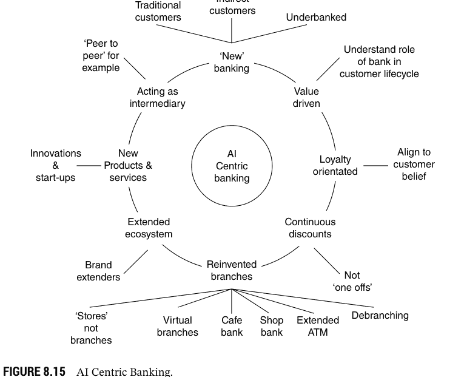

图8.15 以人工智能为中心的银行业。

网点标识以及内部装饰（墙面颜色、地板覆盖物、艺术品等）将全部数字化。如果银行与竞争对手合并，这些元素可以远程更换。

客户将通过视网膜扫描或面部识别进行自助身份确认。设施将完全无纸化、绿色环保并获得LEED认证。

他描述了未来网点设置的七个关键要素：

1. 交易区，即“完成业务”的地方
2. 自助服务区
3. 私密会议空间
4. 客户会议室，更像客户的客厅而非银行办公室
5. 演示区
6. 营销展示
7. 品牌区

总而言之，他将未来网点描述为：

- 开放且私密
- 提供高科技解决方案和高度个性化服务
- 温馨且具吸引力
- 利用技术实现灵活性

所有银行都需要考虑如何将传统网点转变为新的、欢迎顾客的空间。肾上腺素机构在其博客《刷新、过渡和改造空间的最佳实践》中对此进行了思考，提出有三个关键的实施方案：

- 刷新
- 过渡
- 改造

在这三个阶段中，每个阶段都有两个关键要素：

- **视觉**：主要涉及品牌、内部和外部标识。改善照明和色彩等视觉元素可以显著影响空间的“感觉”。
- **运营**：包括空间的建设及其中的设备。它通过移除效果不佳的区域，并创造他们所谓的“新体验区”来开始解决空间的功能性问题。

通过刷新/过渡/改造这三个阶段，可以首先了解相对低成本的刷新计划如何简单改善视觉效果。解决功能性问题属于过渡类，可能通过新办公桌或基座来实现。更彻底地，改造要求银行从上到下彻底重新构想空间。挑战在于，银行可能不想经历改造或“重新构想”每个网点的昂贵过程。重要的是银行能够优先考虑哪些网点应该改善，这需要使用分析来有效衡量网点绩效（本书前面已讨论过）。就此而言，分析成为不仅确定绩效，还确定网点潜力和投资理由的关键工具。

从数量级的角度来看，任何给定类别中都有不同程度的支出，但可以想象如图8.16所示的成本分配。

另一种方法可能是将银行业务与其他服务相结合，例如零售，或者如下面建议的，与咖啡供应商结合。将银行“植入”百货商店（通常是超市）的想法，不应被视为银行轻松降低触达客户成本的方式。超市对空间分配问题特别敏感，拒绝将空间让给非盈利产品线，除非有充分的促销理由。进驻超市的银行需要证明自身存在的合理性。

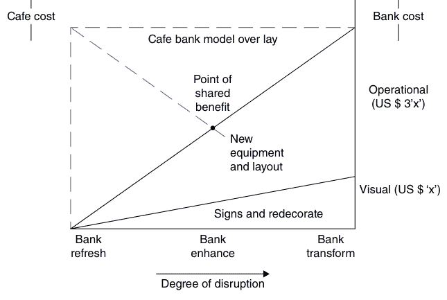

图8.16 网点改造转型成本（基于肾上腺素机构）。

同样，将银行服务置于零售门店中的想法持续吸引关注，但读者不应忘记，传统零售业本身也受到在线购物的威胁。高街功能和购物中心的存在都在受到质疑，因为消费者越来越多地将实体店用于触摸和试用，而非购买。零售商自身也在尝试重塑，以创造“客户体验”，最终促成销售机会，而不是直接销售。银行在该“零售客户体验”中扮演什么角色？

### 咖啡馆银行的出现

千禧一代采用了新的工作方式。曾因他们常点的咖啡而被称为“白平社会”的这群人，如今世界各地的初创企业越来越多地围绕咖啡馆开展业务活动——那里环境随意、网络免费。咖啡馆似乎也是某种“魔鬼交易”的一部分，因为它们似乎不介意访客逗留的时间，也不会每天更换网络接入密码。随着初创企业越来越成功，它们往往从咖啡馆演变为创新中心，在那里汇集专业知识、提供导师指导并可获得支持服务。

但让我们聚焦咖啡馆及其在银行业未来中的角色。银行咖啡馆的想法并不新鲜，但它是一种新兴趋势。在当地银行网点，客户在等待见“顾问”时经常被提供咖啡，但这可能更多是礼貌之举，而非试图复制咖啡馆银行模式。有些人可能认为，咖啡馆银行是一种新的分销渠道形式。就像汽车所有权、租赁和金融服务之间已经出现交叉一样，咖啡馆银行似乎代表着零售、休闲和金融服务之间的交叉，强调共同选址。

随着银行业向完全可访问、无处不在的银行业务发展，这种业务不再依赖电话网络另一端的人工服务，而是被某种自动化系统取代，咖啡银行的概念也可能受到影响。机器人咨询加上自助咖啡？

在为《国际银行业》撰写的一篇文章中，Urs Bolt 提到了“人形银行家”的概念，并进一步探讨了机器人咨询的问题。他断言：“银行业不仅仅是技术，但没有技术就无法进步。”⁴ 同样地，也许咖啡银行本身也必须不仅仅是咖啡，但没有咖啡就无法存在。

## 千禧一代对只与机器人打交道并不满意

Global Data 进行的一项调查表明，“只有 5% 的英国千禧一代投资者使用机器人咨询服务，他们更倾向于人类专家而非人工智能技术。”

在论证机器人咨询的合理性时，Global Data 财富管理分析师 Sergel Woldemichael 指出，尽管数字服务通过自动化提高了运营效率，并能够触达新的受众，但他们的研究表明，在数字化程度更高的年轻一代中，“绝大多数”人在做出投资决定之前仍然需要人际互动。他补充道：

> 将下一代归入数字空间是看待千禧一代的错误方式。移动投资应用无法满足人们在寻求财务建议时的情感需求。在当前和不久的将来，混合模式是最佳选择。显然，这些数字原住民仍在寻求与真人合作，并从中获得宝贵的见解。⁵

这是一个有趣的观点，但可能受到地域差异的影响。在查看哪些国家最具“技术素养”时，根据所参考的研究不同，结果也会有所不同，但表 11 展示了一组典型结果。

表 11 哪些经济体在技术上准备最充分⁶

| | 7分制排名 |
|---|---|
| 卢森堡 | 6.4 |
| 瑞士 | 6.3 |
| 英国 | 6.3 |
| 瑞典 | 6.2 |
| 新加坡 | 6.2 |
| 冰岛 | 6.2 |
| 挪威 | 6.1 |
| 香港特别行政区 | 6.1 |
| 丹麦 | 6.1 |
| 荷兰 | 6.1 |
| 爱尔兰 | 6.1 |

这份报告来自世界经济论坛，将英国排在美国和加拿大之上，有些人可能会感到有点意外。报告解释说：“尽管美国在新技术方面处于世界领先地位，但它并未进入前 10 名。这是因为技术就绪度衡量的是各经济体采用现有技术来提高其行业生产力的程度，而不是这些技术是否在这些国家开发。”也许技术就绪度并不是行为使用情况的良好替代指标？在这一背景下，中国和整个亚洲也很难被忽视，尤其是中国在本质上正变得非常数字化。⁷

Millennial Marketing 的一份报告指出，千禧一代不一定“精通技术”，而是“依赖技术”，并且技术能力差异很大。在一项基于 27 个变量的 2007 年调查中，该报告承认，“网络使用技能并非随机分布在伴随数字媒体成长起来的年轻人群体中。”他们认为，这种多样性水平可能与家庭背景、社会经济地位以及他们所谓的“使用情境”有关。⁸

此外，《经济学人》的一篇文章指出：“只有一小部分学生可以算作真正的数字原住民。其余人在使用技术方面的能力并不比普通人群更好或更差。”⁹

## 虚拟现实：银行业与游戏业的融合

虚拟现实被定义为“计算机系统使用交互式软件和硬件对环境（包括三维图形）进行的逼真模拟”¹⁰ 它非常适合银行业和金融服务市场，尤其是 Z 世代群体，可提供：

- 能够重新审视客户体验，可以测试和验证，而不是想当然
- 实现“纯粹细分”的潜力，而非多渠道和全渠道那种粗放式方法
- 超越传统银行相对同质化的商业街网点，实现差异化能力
- 更贴合 Z 世代客户的方法
- 比传统“实体”模式成本更低的分销模式
- 有可能从感兴趣和好奇的利益相关者那里创造新的收入来源
- 在个人客户做出决定之前，对收入来源和财务结果进行可能的建模

两个主要问题是：客户是否已经准备好接受这类技术，以及银行是否准备好利用它。作为对比，会议公司已经探索了“虚拟会议”的想法，但成功程度不一。虚拟银行业似乎是金融与“游戏”之间的某种交叉，而游戏在 Z 世代中似乎有非常高的兴趣。

**表 12** 虚拟会议的优点与缺点11

| 优点 | 缺点 |
|---|---|
| 组织成本低 | 没有社交机会 |
| 便利，避免差旅和酒店费用 | 没有社交互动 |
| 有时免费参加 | 需要更强的个人动力 |
| 可访问性：与会者可以在方便时随时观看和重看同一场会议 | 对参与“活动”的投入度降低 |
| 不受时间限制：与会者可以参加每场会议，无需选择 | 注意力较低：与会者无需参加任何会议，或可在会议期间“多任务处理” |
| 无需担心着装或会议正装 | 如今会议着装要求已经不那么重要了 |

那么这个交叉点到底是什么样子的？

其中一个悖论就在于此。第 6 章考虑了不同细分群体——X 世代、Y 世代、Z 世代——的不同需求，认识到银行和金融服务需要尝试向一群复杂且不同的“参与者”提供产品和服务，这些参与者有着不同的需求和愿望。全渠道的概念被推崇为一种方法，可以让单一品牌一致地将信息传达到多个渠道和受众，但这也许困难到几乎不可能实现。

也许正因如此，按传统方式组织的银行业可能需要进行去中介化或自我拆分。资本管理之类的核心功能可能保持不变，但营销和分销渠道可能会变得更加细分和更加专业化。

**表 13** 虚拟银行业的优点与缺点

| 优点 | 缺点 |
|---|---|
| 吸引 Z 世代 | 早期阶段可能很奇特 |
| 成本低 | 没有人际互动 |
| 高度可定制 | 可能并非对所有人都有吸引力 |
| 灵活性和可访问性 | 依赖个人自律，在自身日常工作安排中确定优先级并分配时间 |
| 能够使用游戏化理念 | 不太可能吸引 X 世代 |
| 与 5G 及后续技术契合 | 要求客户投资新技术作为使用门槛 |
| 允许机器人参与 | 早期版本可能“粗糙”且令人反感 |

这可能支持这样一种观点：银行功能需要以某种方式从现有的“综合”模式中分解出来。

似乎有三种可能的选择：

1. 他们以“全能银行”或“全方位服务银行”的方式开展所有业务。
2. 他们进行去中介化，并由此将成本中心转化为利润中心，例如向其他机构提供自动化后台功能。
3. 或者他们两者兼做，展现出战略上的双元能力。

## 全能银行及其超越

“全能银行”的概念是指银行提供广泛的服务，包括信贷、贷款和投资咨询服务。在美国和瑞士，这是一种常见做法，“全能银行系统”允许银行提供一系列服务，但并不强制要求它们这样做。一些主要银行，如德意志银行、汇丰银行和 ING 银行，已被视为全能银行。这一概念背后的总体意图是利用规模和客户洞察力，并获得更多融资渠道。

它允许将投资银行和商业银行合并，从单一实体提供两种服务。需要考虑的一个问题是，银行准备在多大程度上超越现有模式，将品牌扩展到汽车和房产服务等新业务领域。（参见图 8.17。）尽管全能银行倾向于将自己局限于零售、投资和股票经纪等银行服务，但它们可能需要了解客户对银行的期望。

在其 2016 年的报告中，¹² Finextra 询问了客户对银行的期望。毫不意外，问题涉及银行流程中所有保健因素的满意履行，例如速度、效率和安全性，但报告暗示，“互联消费者”期望更多，尤其要求“与日常生活融为一体的银行服务”。这可以描述为银行服务延伸至“生活方式生态系统”。

一些银行已经开始朝这个方向迈进，增加了家庭紧急救助、旅行和健康保险等附加功能，但这些附加功能仍然感觉笨拙，在消费者体验方面远非无缝。这些附加功能通常是一系列“转交”给独立第三方提供商的行为，对客户自身的需求缺乏洞察，而是将这些关系视为孤立和封闭的。在许多情况下，第三方也为其他机构工作，不太可能提供任何服务或品牌差异化。

如果银行要在全能性方面采取更具战略性和更广泛的方法，就需要克服一些重大问题，例如：

- 第三方与银行之间有效的信息双向流动
- 更深入地了解客户需求
- 更好的供应商管理控制和方法
- 供应链中更有效的品牌差异化

金钱，并创建了世界上第一个点对点借贷平台。自那时以来，它已批准了约40亿英镑的贷款，惠及约50万人。其流程是：根据消费者的信用度对其进行排名，设定拟议贷款的价格，并分配来自投资者的资金。

尽管投资规模很大，但据说利润率相对较低，因为Zopa实际上扮演的是中间人的角色。贷款设立时，贷方和消费者双方都要支付一笔费用。如果出现付款违约，承担风险的是贷方（而非Zopa）。据Zopa的老板Jaidev Janardana称，Zopa目前正考虑转型为银行，“因为它使用自有资金发放的贷款将比通过点对点平台安排的贷款更有利可图”。15

还有其他点对点借贷机构。Funding Circle是该市场最大的参与者，最近于2019年进行了IPO，是首家将点对点借贷平台用于企业而非消费者的机构。自那以来，它已为5万家中小企业促成了50亿英镑的贷款。16 它在英国、美国、德国和荷兰运营。贷方资金自动分配，贷方平均回报率为6.5%（2017年），远高于高街储蓄利率。它们的支持者包括Facebook、Twitter、Skype和Betfair背后的领先公司。投资者包括地方议会、大学和英国政府。“Funding Circle已从政府获得额外的4000万英镑用于向小企业放贷，在企业借贷面临紧缩之际提供了新的资金”（《每日电讯报》，2017年1月）。

在借贷过程中似乎存在着某种博弈技巧的成分。据该平台的一位用户以资金出借人的身份表示：

> 虽然我亏过钱，但平均利率一直不错。诀窍是尽可能把最小的金额借给最多的借款人，所以在投资时，不要急于配置资金。17

其他点对点借贷机构包括Ratesetter、Lending Club、Upstart和Prosper Marketplace。Funding Circle在2019年IPO的结果令人失望，很可能让一些其他P2P公司暂缓采用类似的IPO策略，至少目前如此，但分析师认为，这可能更多与市场紧张情绪有关，而非商业模式本身。

P2P正在吸引全球监管机构的关注，英国监管机构FSA已经创建了一个框架，该框架：

- 为所有客户提供额外保护
- 促进P2P行业内的良性竞争
- 确保平台提供正确的信息，并有明确界定的处理客户资金的程序
- 保证公司能够在财务困难时期妥善处理与客户的关系18

在分析方面，该过程也可能有助于提高自动化程度，因为更细粒度的自动分配形式可以实现出借人与借款人的更准确匹配，从而有效地将银行这一“中间人”排除在外。与传统系统相比，P2P据说更快捷、更顺畅、更用户友好。在道德层面，它似乎很好地契合了在千禧一代消费者中发展起来的颠覆性“共享经济”。它还创造了另一个基准，未来的银行必须以此为参照展开竞争，才能保持其地位。

## 支付流程变得更加以客户为中心

随着电子支付日益取代现金，人们对电子支付和移动支付的兴趣浓厚。这本身就是一个重点领域，支付生态由银行、服务提供商、咨询公司和金融科技公司（据说有25,000家初创企业专注于这一领域）组成。

据ING全球交易服务主管Mark Buitenhek表示，“支付不再是银行的专属垄断，我们深知这一点。”¹⁹

ING对15,000名移动设备用户进行了一项调查，发现：

- 41%的用户已经在使用设备进行移动银行服务。
- 58%的用户使用移动设备在线购物。
- 34%的用户表示，如果零售商提供一键服务，他们会成为回头客（如果还有其他优惠，这一比例会升至55%）。

速度和便利性被视为使用移动支付的首要原因，但在那些不使用移动支付的人中：

- 42%的人表示，他们不信任非银行开发的应用程序。（84%的人表示他们信任银行的应用程序）。
- 只有5%的人信任社交媒体提供商开发的应用程序。

在SMA（Strategy Meets Action）2019年的报告《支付世界爆发》中，研究人员指出了复杂多样、既涉及收款也涉及付款的支付世界，并指出是客户期望在推动变革，而非相反。

在这一类别中，很难不评论支付宝、微信和PayPal，它们都运行不同类型的支付流程。每一家都有不同的

**表15** 收款与付款（源自SMA）²⁰

| 收款 | 付款 |
|---|---|
| 不同的接入方式，如联络中心、API | 随时随地支付 |
| 自动化通信 | 支付枢纽 |
| 数字化体验 | 支付通知 |
| 多样化的支付方式 | 实时 |
| 移动设备的使用 | 商户自助服务 |

特点，但本质上都是传统转账方式（如支票、汇票甚至现金）的替代方案。

展望未来，机器学习和人工智能将推动这一领域的转型，包括：

- 使用生物识别技术进行支付：语音、面部和其他非接触形式
- 人工智能辅助购物，根据顾客以往的购买经历和其他个人因素，将优惠信息呈现在顾客面前
- 智能优惠，基于对支付趋势的分析，使新商户能够更智能地提供优惠，避开传统的广告流程和成本²¹

银行不应忽视构建客户360度全景视图与通过智能支付流程获得的洞察之间明显的关联。

## “未来银行”的五大情景

对“未来银行”提出单一愿景既具挑战性又有风险，因此这里提供了多种不同情景。其中某一种可能会占主导，但最终结果或许是某种混合形态。之前曾提到战略“双元性”的概念，而且两种或多种情景在同一组织内共存是可行的。

在此情况下，我们做了一个重大假设，即人工智能将渗透到最终结果之中。“未来银行”将是一个“AI赋能”的组织。也许银行本身将不是由人类设计，而是由技术本身以某种“自学习”式的演化过程设计。高级分析技术近来已发生巨变，从“基于知识的系统”（即一种能够基于所存储的信息做出决策，并应用上下文和接口引擎的系统），转变为“机器学习”能力，能够利用RPA（机器人流程自动化）技术实现部分或完全自动化。

换句话说，基于知识的系统按照人类制定的规则运行，而在机器学习系统中，是机器自身创建规则（或算法）。据麻省理工学院（MIT）的一份报告称，问题根本在于规模：数据如此之多，所需规则如此之多，需要手动创建代码。解决方案显然可能是让机器自行梳理出规则。²²

在他的TED演讲中，华盛顿大学计算机科学教授、《终极算法》一书的作者佩德罗·多明戈斯（Pedro Domingos）邀请听众以世界将如何变化的方式思考未来100年。²³

他认为，变革速度如此之快，以至于如今十年间的变革（例如从2020年到2030年）将相当于整个18世纪发生的变革程度，其典型特征包括诸如反对奴隶贸易和全球人口贩运的启蒙意识，以及

法国大革命、亨德尔、巴赫和莫扎特所创作出当时革命性的音乐，以及科学和工业革命的早期阶段。

“十年后，”他说，“智能手机会显得过时且有些可笑”，“我们花费时间盯着的电脑屏幕将会消失”。“所有现实，”他说，“都将是增强现实”，我们所认知的传统广告将被从隐形眼镜直接投射到视网膜上的图像所取代。他建议，你的个人世界将由“不是点击，而是语音和手势”来控制。20年后，这将被“取代”。

这是一个大胆的、或许有些令人恐惧的技术驱动愿景。也许就像诺查丹玛斯，人们可能会记住那些正确的预测，但 conveniently 忘记那些完全错误的预测。即便如此，Domingos 关于变化速度的观点是有道理的，而且它可能比我们预期的更快发生。也许并非如此。

然而，变化对银行业产生影响具有一定的必然性。这就是为什么本书一开始就花了一些时间来探讨银行和货币的“本质”，因为这不可避免地会影响我们对银行业未来的思考。

## 全方位服务银行

本章前面我们探讨了通用银行的概念，即提供广泛服务的银行。第6章还考虑了品牌对银行业的重要性以及它将如何影响消费者忠诚度，尤其是在千禧一代和Z世代中。图8.17将这一概念扩展到“全方位服务金融机构”，该机构兼顾客户的生活方式需求以及财务管理需求。

正如汽车制造商通过与银行建立合作关系来创建融资方案，使汽车既能融资也能购买一样，这种“扩展型通用银行”的替代模式允许它们提供诸如出行解决方案等服务，这可能扩展到公路、铁路或航空能力。换句话说，未来的消费者可能会通过银行购买飞机票，而不仅仅是使用银行的支付系统。大型银行的采购议价能力意味着可以为客户获得比聚合网站更好的优惠条件。同样，车辆提供商或任何重要商品的提供商都能够利用银行自身的客户群作为一种分销渠道。

就客户旅程而言，在这种模式下，客户将与银行建立终身关系，将银行视为其“值得信赖的合作伙伴”。薪资、储蓄、养老金、投资和贷款都将集中在一家银行组织中。银行不仅会了解客户的生活周期，还会在工作期间和之后帮助他们进行规划。这种模式将通用银行的概念更深入、更广泛地延伸到“互联客户”的需求，并要求银行拥有比目前更雄心勃勃的生态系统。

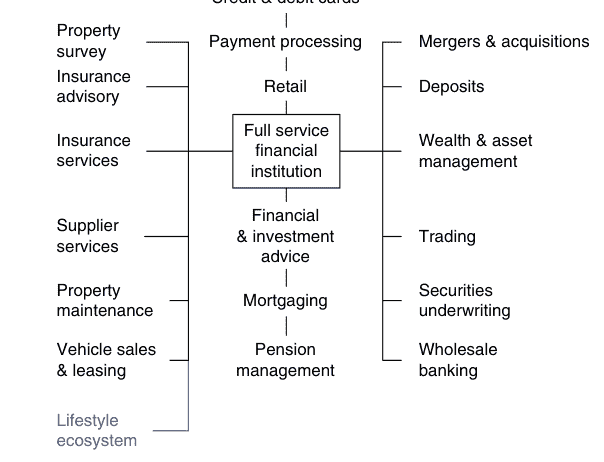

图 8.17 全方位服务金融机构。

就创建更广泛的生态系统而言，需要采取以下几个关键行动：

- 创建一个共同愿景和顶层战略，使银行业生态系统中的所有关键利益相关者达成一致
- 对所有参与者（包括客户）的预期成果有一个整体的认识
- 采用项目管理的实施方法，包括关键成功因素的衡量

在这种模式下，除了银行本身之外，参与者以及最终的关键利益相关者可能包括现有的成熟“参与者”以及初创企业。开发可能在银行内部进行，但在某种隔离的部门中进行。

## 数字银行

在这种情况下，未来的银行将与我们今天所知的银行保持大致相同，但在分支机构层面以增强的方式运营。例如，2019年，英国的NatWest银行在英格兰北部利兹市中心开设了一家新的数字商店。它旨在为客户提供一个可以随时光临的空间，在安全的环境中使用自己的设备或银行的设备在线完成银行业务，并有专业员工提供帮助。新的“数字商店”还允许客户在线预订与私人银行家的会面，以满足其更复杂的需要，避免在队列中浪费时间。

除了银行业务之外，新商店还作为活动空间，任何人不仅是NatWest客户都可以前往，聆听与金融相关的演讲，例如如何避免受到网络犯罪的影响。它还吸引儿童参加NatWest“Moneysense”计划24中的儿童友好活动。

根据Caravan Omnibus Surveys的研究，88%的美国成年人仍然觉得有必要前往实体分支机构，但人们也认识到旧的分支机构模式需要转变为一些人所称的“线上线下融合”方法25。

一些银行，例如美国俄勒冈州的Umpqua Bank，采用“中心-辐射”模式，设立一个全功能中心分支机构和一系列位于当地社区的自助服务卫星点。巴克莱银行已提供全天候24/7开放的完整自助服务分支机构，服务完全通过ATM和电话提供。Tangerine Bank（加拿大原ING Direct），被评为2019年加拿大最佳在线银行，甚至测试过快闪分支机构26。

这种模式的变体包括“银行舱”的概念，可能包括允许客户进行更复杂交易的“未来ATM”、机器人顾问、虚拟银行（通过视频链接）和代理分支机构，其中会出现一种特许经营形式27。

似乎很清楚的是，即使在数字化和人工智能融合的时代，传统银行分支机构仍可能以某种形式发挥作用。为什么会这样？这个问题不仅需要银行来回答，也需要所有品牌来回答。根据品牌专家BWP集团的说法，部分原因是消费者对广告不信任。根据他们的调查，95%的Z世代期望品牌追求他们，甚至80%的人希望品牌能娱乐他们。越来越多的消费者看到零售商使用“展厅体验技术”来强化品牌，让消费者在在线购买前可以前往、触摸、感受和体验28。

如果一个品牌只存在于线上，这是否足以充分参与其中？虽然这可能适用于商品，但如何转化为金融服务行业？金融服务显然比香水和汽车更重要（尽管并非每个消费者都这么看）。

有一些更微妙的问题需要解决。银行关乎安全、可及性、审慎和保障。这些能否通过分支网络，无论是线上还是线下，准确地体现出来？银行是否可以向苹果商店学习，后者不仅销售设备，而且从根本上销售与金钱一样无形的产品：其操作系统？

## 拆分银行

“拆分”概念指的是将某物分为其组成部分29。在这种替代模式中，一个选项可能是银行业拆分或“拆解”其内部供应链中实际上不属于银行业务核心的部分。它意味着银行内部的许多其他职能并非银行真正业务的“核心”。实际上，在这种模式下，出纳员在功能上只是“仅仅”是一个中介，而不是价值的净贡献者。

分支机构的存在在银行业中仍然令人安心，是品牌强化的问题，但也许可以以不同的方式进行。许多人的挑战是“品牌还是无品牌”。千禧一代将“去品牌化”列入议程。银行需要在不明确表达品牌且不承担更多成本和运营风险的情况下 somehow 扩展其品牌。

街头的分支机构存在与“农村”存在同样重要。远离城镇和城市，银行为社区提供了重要的社会贡献。以“运营效率”为名关闭这些农村银行，会在银行与其所服务的社会之间造成脱节。这样做，银行未能认识到它们对社区的社会义务，而这正是“货币”概念的基础。社区银行和合作社可能在银行业未来中发挥重要作用。

但是——就这种特定模式而言——这种选择可能是银行没有自己的“前台”，而是通过第三方和中介机构（可能是特许经营）运作。其技术等价物可能是像“Intel Inside”这样的品牌，英特尔使用该品牌作为最大的联合营销活动之一，通过成员/合作伙伴许可在其设备中使用英特尔技术。持相反观点的是，美国银行表示他们不想以“BoA Inside”模式与其他分销商合作，而是希望以更面向客户的方式被看到32。

即使他们的营销方式如今有所不同，英特尔仍然在技术银行方程式中占据一席之地。他们的重点非常集中在5G技术上，而5G技术本身将开始革新银行业，并可能由于超高速连接而允许出现新的、不同的模式。

5G，即第五代无线系统，被视为满足国际电信联盟（ITU）IMT-2020要求的技术的技术。要求涵盖2020年的愿景和交付成果。3GPP Release 15 处理标准化，提供他们所描述的“高吞吐量、低延迟、高移动性和高连接密度”。

5G 是关于：

- 超高速速度，可提高下载和上传速度
- 延迟，他们将其描述为移动设备上的闪电般实时用户体验，以至于消费者将在其设备上即时体验银行和支付交易。5G意味着零等待时间。
- 统一性，随着系统尤其是设备能够以“超高速”相互通信，这将影响从远程设备到生物识别的各种用途
- 改进的自动化，包括例如支付罚款

在交易环境中，它将允许交易以微秒进行，因此预计交易公司（和银行投资者职能）将成为早期商业采用者之一。5G似乎也再次重新打开了拆分的争论33。

## 图8.18 银行向去整合化的结构性转变

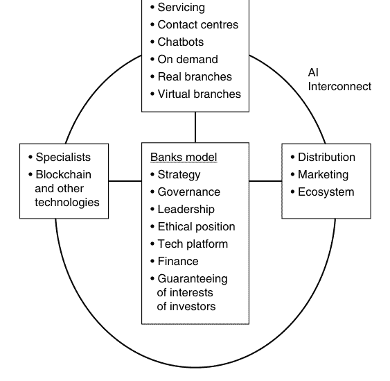

## 对话式银行

对话式银行是指客户主要从银行对话中移除人际互动，无论是查余额、查交易，还是做预算。Abe 联合创始人基思·阿姆斯特朗（Keith Armstrong）表示：“这一概念是通过语音或文本管理你的财务生活。”Abe 是一款聊天机器人，目前通过 Slack（基于云的工作流）或短信服务来监控收支或设定预算。34,35

这是一种有趣的方法，就消费者需求而言，将人工作为默认选项或最后手段。这似乎在确立某种层级关系，同时又承认有些查询过于复杂，自动化系统无法应对。这也反映了移动银行的一种演进。

埃森哲在其2017年报告《Ready to Talk》中，将对话式银行视为一种自然演进，反映了当今（预计未来亦然）许多设备具备双向语音交互能力的事实，并引用了Garanti银行移动助手以及Capital One通过亚马逊Alexa设备进行连接等示例。

任何向对话式银行的转变都需要一套不同的技术技能，减少对移动应用开发者的依赖，更多地依赖与高级分析能力相结合的语言和语义专家。36

## 协作式银行

在世界上许多地区，银行业的并购已司空见惯，既是为了满足规模效率的需求，也是为了在存在互补地域或产品的情况下为收入增长提供平台（有时被称为“无机增长”）。另一个优势是并购减少了竞争，有效消除了一个竞争对手。由于合并实体通常从事同类商业或业务活动，这被称为“横向并购”。

在许多国家，全球性银行正与该地区的区域性银行扩展业务合作，帮助全球参与者增强其主导地位。并购活动受该国“最高”领先金融机构的控制或“监管”，例如印度储备银行。37

并购活动也可能有不利的一面。可能会发生裁员，这在经济或政治上可能不可接受，而且整合遗留技术也可能面临重大挑战。另一方面，普遍的放松管制和市场自由化仍然是市场结构变化中的市场因素。还有第四种模式值得考虑，即更具协作性的银行体系。（见图8.19。）在许多情况下，沿着供应链改进纵向协作是收购活动的前奏，因为银行会获取新的技术能力以确保差异化。开放银行的到来也被认为最终将为更大程度的协作提供催化剂。

尽管“协作”一词经常用于银行作为客户与供应商（可能是科技公司，但也可能是分销商）之间的供应链，但不应排除银行之间“横向协作”的前景。虽然运营优化是一个因素，但客户体验也不应被忽视。对于许多零售消费者来说，银行网点网络提供了一种有用的社会功能，当地慈善机构和社区可以在此存入现金。此外，在社会贫困或代际问题阻碍（或减缓）向无现金社会迈进的地区，传统银行可以发挥重要作用。2018年，英国银行网点总数从2007年的11,365家降至7,207家。

或许正是认识到了这一点，2019年，英国三家最大的银行——劳埃德银行、苏格兰皇家银行和巴克莱银行——决定合作，在四个城市开设试点“迷你中心”，由“联合运营”的网点组成，营业时间更长，企业可以在此

表16 移动银行与对话式银行对比

| 移动银行 | 对话式银行 |
|---|---|
| 移动应用 | 消息API |
| 视觉化 | 语音或文本导向 |
| 数字消费者 | 数字及非数字消费者 |
| 信息与交易 | 信息、交易与支持 |

存入现金和支票，以及兑换外币现金。这种合作最终将如何被消费者看待，以及用户将如何区分银行及其品牌属性，仍有待观察。³⁸

## 图8.19 银行业的新型合作模式

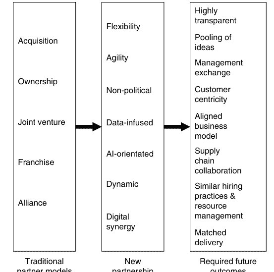

## 投资银行的转型

CB Insights的作者在其非常出色且全面的报告《杀死投资银行：投资银行业的颠覆》³⁹中认为，投资银行也在经历一场颠覆性转型，他们将其描述为“被技术和监管侵蚀”。

他们认为变革的催化剂来自：

- 所使用的金融工具日益复杂
- 最大的银行雷曼兄弟和贝尔斯登倒闭的连锁反应
- 倒闭后随之而来的金融影响

美国的监管随后迫使投资银行用自有资本进行交易，并将这些资本留在手头。结果，投资银行利润下降，导致合理化和削减成本。除此之外，新技术正日益将传统上由关系驱动的流程自动化，例如自动将公司与买家匹配的流程。

CB Insights指出了他们认为的五个关键颠覆因素（见图8.20）：

1. **IPO的颠覆：** 寻求融资的顶级公司不再走传统投资银行的路线（传统路线将公司与投资者联系起来、帮助确定价格并创建法律框架）。相反，他们直接与风险投资家打交道，并寻求“直接公开发行”（DPO）等替代方案。那些通过投资银行走传统路线的公司正在利用这些替代方案来协商较低的费用，导致银行收入损失。例如，高盛发现127个IPO步骤中约有一半可以由计算机完成，从而降低人工成本、提高速度并保持盈利能力。
2. **并购的颠覆：** 根据Dealogic的数据，并购活动占“银行收入约34%”，新的专业“精品”银行的出现和技术的影响不仅影响收入数字，还影响费用水平。新技术使公司能够进行“自助式并购”，即通过算法将买方与卖方匹配，从而避免了通常与投资银行相关的研究和关系驱动活动。
3. **资产管理的颠覆：** 正在逐渐从投资银行家转向专业资产管理公司。这是由于监管加强以及专家能够以较低费用提供更高回报。因此，大型投资机构正在将业务重点重新聚焦于财富管理。机器人顾问的使用更加广泛，更大的自动化将不可避免地变得更加普遍。

例如，高盛推出了名为“Marcus”的数字储蓄顾问，积极瞄准千禧一代市场。尽管如此，GlobalData近期一项2019年调查显示，“只有5%的英国千禧一代投资者使用机器人顾问服务，因为人工专业知识仍比人工智能技术更受青睐。”⁴⁰ 这并不是说这种兴趣和参与水平在所有地区都一致，但它确实提供了一种指示。其论点是“传统财富管理者经历过多次衰退和市场波动期，证明他们能够渡过难关，而且潜在的市场低迷即将来临，[但]机器人顾问可能还没有准备好应对随之而来的客户投资风险。”

GlobalData财富管理分析师Sergel Woldemichael表示，“将下一代划入数字空间这一固定类别，是看待千禧一代的错误方式”，并呼吁采用混合模式。换言之，这种“混合”就是人类前台加上机器人“后台”。

4. **股票研究的颠覆：** 当MiFID II禁止“将研究与交易执行捆绑”，要求它们分开定价和销售时，这使得投资银行内部的这一传统功能变得多余。MiFID II的核心目标是提高透明度，并消除有利于资产管理人的投资决策（例如更高

佣金），而非出于客户的利益。新技术带来了复杂计算和预测的自动化，加上更完善的数据分析，引发了重大颠覆，尤其是在其他专家已经发展出自身能力的背景下。

## 销售与交易的颠覆

2014年，作为多德-弗兰克监管法案一部分通过的沃尔克规则，禁止投资银行用自有资金进行押注，即所谓的“自营交易”。其背后的逻辑是，如果银行用自有资金押注，可能会承担更高风险，从而将整个银行和客户资金置于风险之中。因此，投资银行现在只能通过每笔成交交易收取佣金来从交易中获利。投资银行的交易收入大幅下滑。摩根大通、花旗集团、美国银行、高盛和摩根士丹利合计的交易收入在十年间下降了30%。

因此，业界的风向再次转向自动化技术的应用，包括区块链。高盛的自动化交易平台 Marquee 于2018年推出，旨在实现流程自动化、减少员工、降低成本并提高盈利能力。

那么，投资银行的未来会是什么样子？与所有组织一样，它们正在认真审视哪些业务盈利、哪些不盈利。在做出这些重要决策时，有效利用金融分析成为关键的成功因素。主要选择包括：

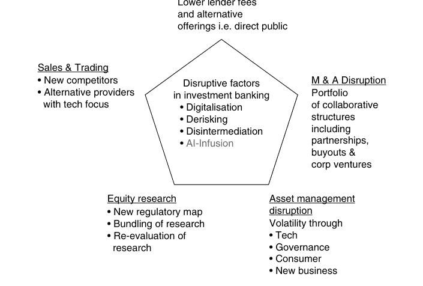

图8.20 投资银行业的五大颠覆性因素。

-   更多使用技术和自动化，以降低成本、降低风险、提高确定性并改善客户体验
-   裁员，或企业之间不可避免的整合
-   离岸外包，尤其是将业务转移到成本较低的地方（虽然这曾涉及印度或菲律宾，但如今越来越多新地区被纳入考虑，如马来西亚。）
-   创建更符合时代要求的新业务模式，使其具备更大的灵活性和敏捷性，并从根本上以数据为驱动，即具有“数字化”本质

关键问题在于大型投资银行乃至整个行业自我变革的能力。人们容易认为，银行业中通常会是零售业务这一“门面”发生变化，但情况很可能并非如此。与所有行业和专业一样，高级分析与人工智能的到来将催生新的角色和业务模式。仅仅将现有业务模式数字化并寄希望于最好结果已不再足够，投资银行业必须为一场剧烈的动荡做好准备。

一个特别受关注的领域是销售，法国巴黎银行等银行正在大力投资机器学习研究。另一个方面是试图向客户解释算法如何运作，因为这些算法本质上是带有隐藏算法的“黑箱”，且由于输入数量众多而十分复杂。此外，监管机构也意识到，借助更细粒度的数据，越来越有可能发现交易的可能受益人，从而揭露更多市场滥用行为。聚类分析还可用于检测申报中的异常值和错误。⁴¹

## 结论

未来的银行不仅会拥抱人工智能及聊天机器人和咨询机器人等相关应用，还将涉及实体形态的转变。在保留一定程度品牌标识的同时，未来的零售银行可能会更像休息室、咖啡馆甚至商店。正如高端零售商通过将门店改为展示厅、让购买者先看、触摸再到线上购买的方式重塑自我一样，银行也将走类似道路，但由于银行产品和服务具有无形性，其做法需要有所不同。毕竟，正如本书前言所述，未来银行可能主要从事管理金融数据和数字资产。

尽管商业街网点仍可能具有一定的品牌强化价值，但机器人和虚拟服务的日益普及削弱了这种需求。无论如何，谁又真的能确定未来的商业街会是什么样子呢？因此，这里提供了一些可能的情景。其中任何一个或全部都有可能发生，也许是某种混合形式，也许完全是另一番景象。不要排除会说话的 ATM 机。

银行将日益扩展其生态系统和“全能性”，并相应扩大其品牌足迹。这样做不仅能够实现双向数据流，还将要求加强控制、治理和客户敏感度。

投资银行也将日益自动化，因为向自助服务和机器人咨询的转变正变得司空见惯。人工顾问仍将有其作用，但更多是与专家系统协同工作。人工顾问需要清楚自己为整体带来的价值。这可能是一场艰难的对话。

## 参考文献

1.  Sennaar, Kumba.《银行业中的人工智能：美国七大银行分析》。Emerj。2019年9月24日。（访问于2019年10月22日）https://emerj.com/ai-sector-overviews/ai-in-banking-analysis/
2.  Shillito, Douglas.《金融服务需求五年来首次下降》。Strategic Newslink。2019年1月15日。（访问于2019年10月9日）http://www.onlystrategic.com/Articles/featured?id=84983&article=84983&key=18a45725f5fe5b30bcc3ae8c78d5d3d&category=1
3.  Kerstein, David.《一个光明的理想：终极网点模式的七大要素》。Peak Performance Consulting Group。2017年8月24日。（访问于2019年10月10日）http://ppcgroup.com/blog/branch-distribution/a-bright-ideal-seven-elements-of-the-ultimate-branch-format/#more-1644
4.  Bolt, Urs.《人形银行家：科幻还是未来？》。International Banker。2018年3月14日。（访问于2019年10月10日）https://internationalbanker.com/banking/the-humanoid-banker-science-fiction-or-future/
5.  Shillito, Douglas.《全球数据：仅5%英国千禧一代投资者使用机器人咨询服务，人类专业知识仍优于人工智能技术》。Strategic Newslink。2019年3月27日。（访问于2019年10月10日）
6.  世界经济论坛《2015-2016年全球竞争力报告》。
7.  Myers, Joe.《这些经济体最懂技术》。世界经济论坛。2015年10月15日。（访问于2019年10月10日）https://www.weforum.org/agenda/2015/10/these-economies-are-the-most-tech-savvy/
8.  《千禧一代依赖科技，但不一定精通科技》。MillennialMarketing.com。（访问于2019年10月10日）http://www.millennialmarketing.com/2010/04/millennials-tech-dependent-but-not-necessarily-tech-savvy/
9.  《网络一代：脱网》。经济学人。2010年3月6日。（访问于2019年10月10日）https://www.economist.com/technology-quarterly/2010/03/06/the-net-generation-unplugged
10. Dictionary.com
11. 《什么是线上虚拟会议：利弊与获益方法》。MoneyCrashers.com。（访问于2019年10月10日）https://www.moneycrashers.com/online-virtual-conferences-pros-cons/
12. Seel, Graham.《客户对银行有何期待？》。Finextra。2016年3月8日。（访问于2019年10月10日）https://www.finextra.com/blogposting/12335/what-do-customers-expect-from-banks
13. https://www.e2open.com/
14. Kagan, Julia.《全能银行》。Investopedia.com。2019年4月9日。（访问于2019年10月10日）https://www.investopedia.com/terms/u/universalbanking.asp
15. Duke, Simon.《Zopa：这家新兴贷款机构意在改写成为银行的全流程》。泰晤士报。2019年2月2日。（访问于2019年11月28日）https://www.thetimes.co.uk/article/zopa-the-upstart-lender-intent-on-rewriting-the-a-to-z-of-how-to-become-a-bank-j8n0xmqzp

- 16. ‘助力企业腾飞’ Funding Circle 招股说明书。2018年9月。 https://www.jarvisim.co.uk/assets/ipo/Funding%20Circle%20%20Prospectus.pdf
- 17. Trudeau, Michael. ‘Funding Circle 评测’。Which.com。2019年1月。（查阅于 10/10/2019） https://www.which.co.uk/money/investing/types-of-investment/peer-to-peer-investing/funding-circle-review-ahb6v4z9qkbq
- 18. Thyagarajan, Harish. ‘P2P借贷对零售银行业的影响’。HashedIn.com。2017年8月16日。（查阅于 10/10/2019） https://hashedin.com/blog/the-impact-of-p2p-lending-on-retail-banking/
- 19. ‘支付一切都关乎客户体验’。ING Group。（查阅于 10/10/2019） https://www.ingwb.com/insights/articles/payments-is-all-about-customer-experience
- 20. Furtado, Karen. ‘支付世界爆炸：数字客户体验的需求正在推动支付创新。’ StrategyMeetsAction.com。2019年1月23日。 https://strategymeetsaction.com/our-research/the-payment-world-explodes-the-need-for-digital-customer-experiences-is-driving-payment-innovation/
- 21. Eichinger, Markus. ‘支付大趋势：人工智能’。2018年1月17日。（查阅于 10/10/2019） https://blog.wirecard.com/the-6-payment-megatrends-of-2018-2-artificial-intelligence/
- 22. Shelly, Jared. ‘麻省理工学院研究了16,625篇人工智能论文：保险公司为何应该关注。’ 2019年2月6日。（查阅于 10/10/2019） https://riskandinsurance.com/mit-researched-16625-papers-on-artificial-intelligence-here-are-their-conclusions/
- 23. ‘你生命的下一个一百年’ Pedro Domingos。TEDxLA。YouTube.com。2017年1月18日。（查阅于 10/10/2019） https://www.youtube.com/watch?v=r2YiRiLAU_Y
- 24. Shillito, Douglas. ‘NatWest 在利兹维多利亚开设新数字分行’。2019年2月26日。（查阅于 10/10/2019） http://www.onlystrategic.com/Articles/featured/id/85349/key/0c2390e34d888e5dd3fa7a3ba08af973/user/1000
- 25. Marous, Jim. ‘10家旨在让数字银行消费者惊叹的分行’。The Financial Brand。（查阅于 10/10/2019） https://thefinancialbrand.com/52315/future-banking-concept-branch-design-showcase/
- 26. Sridhar, Sagar. ‘Tangerine 银行评测：2019年最佳整体在线银行’。Personal Finance Freedom。2019年2月20日。（查阅于 10/10/2019） http://www.personalf.../tangerine-bank-review-best-online-bank/
- 27. Krishnan, Anand. ‘全渠道银行’。Global Banking and Finance Review。2015年4月21日。（查阅于 10/10/2019） https://www.globalbankingandfinance.com/omni-channel-banking/
- 28. ‘在线品牌实体存在的[content]
- 16. ‘助力企业腾飞’ Funding Circle 招股说明书。2018年9月。 https://www.jarvisim.co.uk/assets/ipo/Funding%20Circle%20%20Prospectus.pdf
- 17. Trudeau, Michael. ‘Funding Circle 评测’。Which.com。2019年1月。（查阅于 10/10/2019） https://www.which.co.uk/money/investing/types-of-investment/peer-to-peer-investing/funding-circle-review-ahb6v4z9qkbq
- 18. Thyagarajan, Harish. ‘P2P借贷对零售银行业的影响’。HashedIn.com。2017年8月16日。（查阅于 10/10/2019） https://hashedin.com/blog/the-impact-of-p2p-lending-on-retail-banking/
- 19. ‘支付一切都关乎客户体验’。ING Group。（查阅于 10/10/2019） https://www.ingwb.com/insights/articles/payments-is-all-about-customer-experience
- 20. Furtado, Karen. ‘支付世界爆炸：数字客户体验的需求正在推动支付创新。’ StrategyMeetsAction.com。2019年1月23日。 https://strategymeetsaction.com/our-research/the-payment-world-explodes-the-need-for-digital-customer-experiences-is-driving-payment-innovation/
- 21. Eichinger, Markus. ‘支付大趋势：人工智能’。2018年1月17日。（查阅于 10/10/2019） https://blog.wirecard.com/the-6-payment-megatrends-of-2018-2-artificial-intelligence/
- 22. Shelly, Jared. ‘麻省理工学院研究了16,625篇人工智能论文：保险公司为何应该关注。’ 2019年2月6日。（查阅于 10/10/2019） https://riskandinsurance.com/mit-researched-16625-papers-on-artificial-intelligence-here-are-their-conclusions/
- 23. ‘你生命的下一个一百年’ Pedro Domingos。TEDxLA。YouTube.com。2017年1月18日。（查阅于 10/10/2019） https://www.youtube.com/watch?v=r2YiRiLAU_Y
- 24. Shillito, Douglas. ‘NatWest 在利兹维多利亚开设新数字分行’。2019年2月26日。（查阅于 10/10/2019） http://www.onlystrategic.com/Articles/featured/id/85349/key/0c2390e34d888e5dd3fa7a3ba08af973/user/1000
- 25. Marous, Jim. ‘10家旨在让数字银行消费者惊叹的分行’。The Financial Brand。（查阅于 10/10/2019） https://thefinancialbrand.com/52315/future-banking-concept-branch-design-showcase/
- 26. Sridhar, Sagar. ‘Tangerine 银行评测：2019年最佳整体在线银行’。Personal Finance Freedom。2019年2月20日。（查阅于 10/10/2019） http://www.personalf.../tangerine-bank-review-best-online-bank/
- 27. Krishnan, Anand. ‘全渠道银行’。Global Banking and Finance Review。2015年4月21日。（查阅于 10/10/2019） https://www.globalbankingandfinance.com/omni-channel-banking/
- 28. ‘在线品牌实体存在的[content]
- 16. ‘助力企业腾飞’ Funding Circle 招股说明书。2018年9月。 https://www.jarvisim.co.uk/assets/ipo/Funding%20Circle%20%20Prospectus.pdf
- 17. Trudeau, Michael. ‘Funding Circle 评测’。Which.com。2019年1月。（查阅于 10/10/2019） https://www.which.co.uk/money/investing/types-of-investment/peer-to-peer-investing/funding-circle-review-ahb6v4z9qkbq
- 18. Thyagarajan, Harish. ‘P2P借贷对零售银行业的影响’。HashedIn.com。2017年8月16日。（查阅于 10/10/2019） https://hashedin.com/blog/the-impact-of-p2p-lending-on-retail-banking/
- 19. ‘支付一切都关乎客户体验’。ING Group。（查阅于 10/10/2019） https://www.ingwb.com/insights/articles/payments-is-all-about-customer-experience
- 20. Furtado, Karen. ‘支付世界爆炸：数字客户体验的需求正在推动支付创新。’ StrategyMeetsAction.com。2019年1月23日。 https://strategymeetsaction.com/our-research/the-payment-world-explodes-the-need-for-digital-customer-experiences-is-driving-payment-innovation/
- 21. Eichinger, Markus. ‘支付大趋势：人工智能’。2018年1月17日。（查阅于 10/10/2019） https://blog.wirecard.com/the-6-payment-megatrends-of-2018-2-artificial-intelligence/
- 22. Shelly, Jared. ‘麻省理工学院研究了16,625篇人工智能论文：保险公司为何应该关注。’ 2019年2月6日。（查阅于 10/10/2019） https://riskandinsurance.com/mit-researched-16625-papers-on-artificial-intelligence-here-are-their-conclusions/
- 23. ‘你生命的下一个一百年’ Pedro Domingos。TEDxLA。YouTube.com。2017年1月18日。（查阅于 10/10/2019） https://www.youtube.com/watch?v=r2YiRiLAU_Y
- 24. Shillito, Douglas. ‘NatWest 在利兹维多利亚开设新数字分行’。2019年2月26日。（查阅于 10/10/2019） http://www.onlystrategic.com/Articles/featured/id/85349/key/0c2390e34d888e5dd3fa7a3ba08af973/user/1000
- 25. Marous, Jim. ‘10家旨在让数字银行消费者惊叹的分行’。The Financial Brand。（查阅于 10/10/2019） https://thefinancialbrand.com/52315/future-banking-concept-branch-design-showcase/
- 26. Sridhar, Sagar. ‘Tangerine 银行评测：2019年最佳整体在线银行’。Personal Finance Freedom。2019年2月20日。（查阅于 10/10/2019） http://www.personalf.../tangerine-bank-review-best-online-bank/
- 27. Krishnan, Anand. ‘全渠道银行’。Global Banking and Finance Review。2015年4月21日。（查阅于 10/10/2019） https://www.globalbankingandfinance.com/omni-channel-banking/
- 28. ‘在线品牌实体存在的[content]
- 16. ‘助力企业腾飞’ Funding Circle 招股说明书。2018年9月。 https://www.jarvisim.co.uk/assets/ipo/Funding%20Circle%20%20Prospectus.pdf
- 17. Trudeau, Michael. ‘Funding Circle 评测’。Which.com。2019年1月。（查阅于 10/10/2019） https://www.which.co.uk/money/investing/types-of-investment/peer-to-peer-investing/funding-circle-review-ahb6v4z9qkbq
- 18. Thyagarajan, Harish. ‘P2P借贷对零售银行业的影响’。HashedIn.com。2017年8月16日。（查阅于 10/10/2019） https://hashedin.com/blog/the-impact-of-p2p-lending-on-retail-banking/
- 19. ‘支付一切都关乎客户体验’。ING Group。（查阅于 10/10/2019） https://www.ingwb.com/insights/articles/payments-is-all-about-customer-experience
- 20. Furtado, Karen. ‘支付世界爆炸：数字客户体验的需求正在推动支付创新。’ StrategyMeetsAction.com。2019年1月23日。 https://strategymeetsaction.com/our-research/the-payment-world-explodes-the-need-for-digital-customer-experiences-is-driving-payment-innovation/
- 21. Eichinger, Markus. ‘支付大趋势：人工智能’。2018年1月17日。（查阅于 10/10/2019） https://blog.wirecard.com/the-6-payment-megatrends-of-2018-2-artificial-intelligence/
- 22. Shelly, Jared. ‘麻省理工学院研究了16,625篇人工智能论文：保险公司为何应该关注。’ 2019年2月6日。（查阅于 10/10/2019） https://riskandinsurance.com/mit-researched-16625-papers-on-artificial-intelligence-here-are-their-conclusions/
- 23. ‘你生命的下一个一百年’ Pedro Domingos。TEDxLA。YouTube.com。2017年1月18日。（查阅于 10/10/2019） https://www.youtube.com/watch?v=r2YiRiLAU_Y
- 24. Shillito, Douglas. ‘NatWest 在利兹维多利亚开设新数字分行’。2019年2月26日。（查阅于 10/10/2019） http://www.onlystrategic.com/Articles/featured/id/85349/key/0c2390e34d888e5dd3fa7a3ba08af973/user/1000
- 25. Marous, Jim. ‘10家旨在让数字银行消费者惊叹的分行’。The Financial Brand。（查阅于 10/10/2019） https://thefinancialbrand.com/52315/future-banking-concept-branch-design-showcase/
- 26. Sridhar, Sagar. ‘Tangerine 银行评测：2019年最佳整体在线银行’。Personal Finance Freedom。2019年2月20日。（查阅于 10/10/2019） http://www.personalf.../tangerine-bank-review-best-online-bank/
- 27. Krishnan, Anand. ‘全渠道银行’。Global Banking and Finance Review。2015年4月21日。（查阅于 10/10/2019） https://www.globalbankingandfinance.com/omni-channel-banking/
- 28. ‘在线品牌实体存在的[content]
- 16. '助力企业腾飞' Funding Circle 招股说明书。2018年9月。 https://www.jarvisim.co.uk/assets/ipo/Funding%20Circle%20%20Prospectus.pdf
- 17. Trudeau, Michael. 'Funding Circle 评测'。Which.com。2019年1月。（查阅于 10/10/2019） https://www.which.co.uk/money/investing/types-of-investment/peer-to-peer-investing/funding-circle-review-ahb6v4z9qkbq
- 18. Thyagarajan, Harish. 'P2P借贷对零售银行业的影响'。HashedIn.com。2017年8月16日。（查阅于 10/10/2019） https://hashedin.com/blog/the-impact-of-p2p-lending-on-retail-banking/
- 19. '支付一切都关乎客户体验'。ING Group。（查阅于 10/10/2019） https://www.ingwb.com/insights/articles/payments-is-all-about-customer-experience
- 20. Furtado, Karen. '支付世界爆炸：数字客户体验的需求正在推动支付创新。' StrategyMeetsAction.com。2019年1月23日。 https://strategymeetsaction.com/our-research/the-payment-world-explodes-the-need-for-digital-customer-experiences-is-driving-payment-innovation/
- 21. Eichinger, Markus. '支付大趋势：人工智能'。2018年1月17日。（查阅于 10/10/2019） https://blog.wirecard.com/the-6-payment-megatrends-of-2018-2-artificial-intelligence/
- 22. Shelly, Jared. '麻省理工学院研究了16,625篇人工智能论文：保险公司为何应该关注。' 2019年2月6日。（查阅于 10/10/2019） https://riskandinsurance.com/mit-researched-16625-papers-on-artificial-intelligence-here-are-their-conclusions/
- 23. '你生命的下一个一百年' Pedro Domingos。TEDxLA。YouTube.com。2017年1月18日。（查阅于 10/10/2019） https://www.youtube.com/watch?v=r2YiRiLAU_Y
- 24. Shillito, Douglas. 'NatWest 在利兹维多利亚开设新数字分行'。2019年2月26日。（查阅于 10/10/2019） http://www.onlystrategic.com/Articles/featured/id/85349/key/0c2390e34d888e5dd3fa7a3ba08af973/user/1000
- 25. Marous, Jim. '10家旨在让数字银行消费者惊叹的分行'。The Financial Brand。（查阅于 10/10/2019） https://thefinancialbrand.com/52315/future-banking-concept-branch-design-showcase/
- 26. Sridhar, Sagar. 'Tangerine 银行评测：2019年最佳整体在线银行'。Personal Finance Freedom。2019年2月20日。（查阅于 10/10/2019） http://www.personalf.../tangerine-bank-review-best-online-bank/
- 27. Krishnan, Anand. '全渠道银行'。Global Banking and Finance Review。2015年4月21日。（查阅于 10/10/2019） https://www.globalbankingandfinance.com/omni-channel-banking/
- 28. '在线品牌实体存在的[content]
- 16. '助力企业腾飞' Funding Circle 招股说明书。2018年9月。 https://www.jarvisim.co.uk/assets/ipo/Funding%20Circle%20%20Prospectus.pdf
- 17. Trudeau, Michael. 'Funding Circle 评测'。Which.com。2019年1月。（查阅于 10/10/2019） https://www.which.co.uk/money/investing/types-of-investment/peer-to-peer-investing/funding-circle-review-ahb6v4z9qkbq
- 18. Thyagarajan, Harish. 'P2P借贷对零售银行业的影响'。HashedIn.com。2017年8月16日。（查阅于 10/10/2019） https://hashedin.com/blog/the-impact-of-p2p-lending-on-retail-banking/
- 19. '支付一切都关乎客户体验'。ING Group。（查阅于 10/10/2019） https://www.ingwb.com/insights/articles/payments-is-all-about-customer-experience
- 20. Furtado, Karen. '支付世界爆炸：数字客户体验的需求正在推动支付创新。' StrategyMeetsAction.com。2019年1月23日。 https://strategymeetsaction.com/our-research/the-payment-world-explodes-the-need-for-digital-customer-experiences-is-driving-payment-innovation/
- 21. Eichinger, Markus. '支付大趋势：人工智能'。2018年1月17日。（查阅于 10/10/2019） https://blog.wirecard.com/the-6-payment-megatrends-of-2018-2-artificial-intelligence/
- 22. Shelly, Jared. '麻省理工学院研究了16,625篇人工智能论文：保险公司为何应该关注。' 2019年2月6日。（查阅于 10/10/2019） https://riskandinsurance.com/mit-researched-16625-papers-on-artificial-intelligence-here-are-their-conclusions/
- 23. '你生命的下一个一百年' Pedro Domingos。TEDxLA。YouTube.com。2017年1月18日。（查阅于 10/10/2019） https://www.youtube.com/watch?v=r2YiRiLAU_Y
- 24. Shillito, Douglas. 'NatWest 在利兹维多利亚开设新数字分行'。2019年2月26日。（查阅于 10/10/2019） http://www.onlystrategic.com/Articles/featured/id/85349/key/0c2390e34d888e5dd3fa7a3ba08af973/user/1000
- 25. Marous, Jim. '10家旨在让数字银行消费者惊叹的分行'。The Financial Brand。（查阅于 10/10/2019） https://thefinancialbrand.com/52315/future-banking-concept-branch-design-showcase/
- 26. Sridhar, Sagar. 'Tangerine 银行评测：2019年最佳整体在线银行'。Personal Finance Freedom。2019年2月20日。（查阅于 10/10/2019） http://www.personalf.../tangerine-bank-review-best-online-bank/
- 27. Krishnan, Anand. '全渠道银行'。Global Banking and Finance Review。2015年4月21日。（查阅于 10/10/2019） https://www.globalbankingandfinance.com/omni-channel-banking/
- 28. '在线品牌实体存在的[content]
- 16. '助力企业腾飞' Funding Circle 招股说明书。2018年9月。 https://www.jarvisim.co.uk/assets/ipo/Funding%20Circle%20%20Prospectus.pdf
- 17. Trudeau, Michael. 'Funding Circle 评测'。Which.com。2019年1月。（查阅于 10/10/2019） https://www.which.co.uk/money/investing/types-of-investment/peer-to-peer-investing/funding-circle-review-ahb6v4z9qkbq
- 18. Thyagarajan, Harish. 'P2P借贷对零售银行业的影响'。HashedIn.com。2017年8月16日。（查阅于 10/10/2019） https://hashedin.com/blog/the-impact-of-p2p-lending-on-retail-banking/
- 19. '支付一切都关乎客户体验'。ING Group。（查阅于 10/10/2019） https://www.ingwb.com/insights/articles/payments-is-all-about-customer-experience
- 20. Furtado, Karen. '支付世界爆炸：数字客户体验的需求正在推动支付创新。' StrategyMeetsAction.com。2019年1月23日。 https://strategymeetsaction.com/our-research/the-payment-world-explodes-the-need-for-digital-customer-experiences-is-driving-payment-innovation/
- 21. Eichinger, Markus. '支付大趋势：人工智能'。2018年1月17日。（查阅于 10/10/2019） https://blog.wirecard.com/the-6-payment-megatrends-of-2018-2-artificial-intelligence/
- 22. Shelly, Jared. '麻省理工学院研究了16,625篇人工智能论文：保险公司为何应该关注。' 2019年2月6日。（查阅于 10/10/2019） https://riskandinsurance.com/mit-researched-16625-papers-on-artificial-intelligence-here-are-their-conclusions/
- 23. '你生命的下一个一百年' Pedro Domingos。TEDxLA。YouTube.com。2017年1月18日。（查阅于 10/10/2019） https://www.youtube.com/watch?v=r2YiRiLAU_Y
- 24. Shillito, Douglas. 'NatWest 在利兹维多利亚开设新数字分行'。2019年2月26日。（查阅于 10/10/2019） http://www.onlystrategic.com/Articles/featured/id/85349/key/0c2390e34d888e5dd3fa7a3ba08af973/user/1000
- 25. Marous, Jim. '10家旨在让数字银行消费者惊叹的分行'。The Financial Brand。（查阅于 10/10/2019） https://thefinancialbrand.com/52315/future-banking-concept-branch-design-showcase/
- 26. Sridhar, Sagar. 'Tangerine 银行评测：2019年最佳整体在线银行'。Personal Finance Freedom。2019年2月20日。（查阅于 10/10/2019） http://www.personalf.../tangerine-bank-review-best-online-bank/
- 27. Krishnan, Anand. '全渠道银行'。Global Banking and Finance Review。2015年4月21日。（查阅于 10/10/2019） https://www.globalbankingandfinance.com/omni-channel-banking/
- 28. '在线品牌实体存在的[content]
- 16. '助力企业腾飞' Funding Circle 招股说明书。2018年9月。 https://www.jarvisim.co.uk/assets/ipo/Funding%20Circle%20%20Prospectus.pdf
- 17. Trudeau, Michael. 'Funding Circle 评测'。Which.com。2019年1月。（查阅于 10/10/2019） https://www.which.co.uk/money/investing/types-of-investment/peer-to-peer-investing/funding-circle-review-ahb6v4z9qkbq
- 18. Thyagarajan, Harish. 'P2P借贷对零售银行业的影响'。HashedIn.com。2017年8月16日。（查阅于 10/10/2019） https://hashedin.com/blog/the-impact-of-p2p-lending-on-retail-banking/
- 19. '支付一切都关乎客户体验'。ING Group。（查阅于 10/10/2019） https://www.ingwb.com/insights/articles/payments-is-all-about-customer-experience
- 20. Furtado, Karen. '支付世界爆炸：数字客户体验的需求正在推动支付创新。' StrategyMeetsAction.com。2019年1月23日。 https://strategymeetsaction.com/our-research/the-payment-world-explodes-the-need-for-digital-customer-experiences-is-driving-payment-innovation/
- 21. Eichinger, Markus. '支付大趋势：人工智能'。2018年1月17日。（查阅于 10/10/2019） https://blog.wirecard.com/the-6-payment-megatrends-of-2018-2-artificial-intelligence/
- 22. Shelly, Jared. '麻省理工学院研究了16,625篇人工智能论文：保险公司为何应该关注。' 2019年2月6日。（查阅于 10/10/2019） https://riskandinsurance.com/mit-researched-16625-papers-on-artificial-intelligence-here-are-their-conclusions/
- 23. '你生命的下一个一百年' Pedro Domingos。TEDxLA。YouTube.com。2017年1月18日。（查阅于 10/10/2019） https://www.youtube.com/watch?v=r2YiRiLAU_Y
- 24. Shillito, Douglas. 'NatWest 在利兹维多利亚开设新数字分行'。2019年2月26日。（查阅于 10/10/2019） http://www.onlystrategic.com/Articles/featured/id/85349/key/0c2390e34d888e5dd3fa7a3ba08af973/user/1000
- 25. Marous, Jim. '10家旨在让数字银行消费者惊叹的分行'。The Financial Brand。（查阅于 10/10/2019） https://thefinancialbrand.com/52315/future-banking-concept-branch-design-showcase/
- 26. Sridhar, Sagar. 'Tangerine 银行评测：2019年最佳整体在线银行'。Personal Finance Freedom。2019年2月20日。（查阅于 10/10/2019） http://www.personalf.../tangerine-bank-review-best-online-bank/
- 27. Krishnan, Anand. '全渠道银行'。Global Banking and Finance Review。2015年4月21日。（查阅于 10/10/2019） https://www.globalbankingandfinance.com/omni-channel-banking/
- 28. '在线品牌对实体存在的[content]
- 16. '助力企业腾飞' Funding Circle 招股说明书。2018年9月。 https://www.jarvisim.co.uk/assets/ipo/Funding%20Circle%20%20Prospectus.pdf
- 17. Trudeau, Michael. 'Funding Circle 评测'。Which.com。2019年1月。（查阅于 10/10/2019） https://www.which.co.uk/money/investing/types-of-investment/peer-to-peer-investing/funding-circle-review-ahb6v4z9qkbq
- 18. Thyagarajan, Harish. 'P2P借贷对零售银行业的影响'。HashedIn.com。2017年8月16日。（查阅于 10/10/2019） https://hashedin.com/blog/the-impact-of-p2p-lending-on-retail-banking/
- 19. '支付一切都关乎客户体验'。ING Group。（查阅于 10/10/2019） https://www.ingwb.com/insights/articles/payments-is-all-about-customer-experience
- 20. Furtado, Karen. '支付世界爆炸：数字客户体验的需求正在推动支付创新。' StrategyMeetsAction.com。2019年1月23日。 https://strategymeetsaction.com/our-research/the-payment-world-explodes-the-need-for-digital-customer-experiences-is-driving-payment-innovation/
- 21. Eichinger, Markus. '支付大趋势：人工智能'。2018年1月17日。（查阅于 10/10/2019） https://blog.wirecard.com/the-6-payment-megatrends-of-2018-2-artificial-intelligence/
- 22. Shelly, Jared. '麻省理工学院研究了16,625篇人工智能论文：保险公司为何应该关注。' 2019年2月6日。（查阅于 10/10/2019） https://riskandinsurance.com/mit-researched-16625-papers-on-artificial-intelligence-here-are-their-conclusions/
- 23. '你生命的下一个一百年' Pedro Domingos。TEDxLA。YouTube.com。2017年1月18日。（查阅于 10/10/2019） https://www.youtube.com/watch?v=r2YiRiLAU_Y
- 24. Shillito, Douglas. 'NatWest 在利兹维多利亚开设新数字分行'。2019年2月26日。（查阅于 10/10/2019） http://www.onlystrategic.com/Articles/featured/id/85349/key/0c2390e34d888e5dd3fa7a3ba08af973/user/1000
- 25. Marous, Jim. '10家旨在让数字银行消费者惊叹的分行'。The Financial Brand。（查阅于 10/10/2019） https://thefinancialbrand.com/52315/future-banking-concept-branch-design-showcase/
- 26. Sridhar, Sagar. 'Tangerine 银行评测：2019年最佳整体在线银行'。Personal Finance Freedom。2019年2月20日。（查阅于 10/10/2019） http://www.personalf.../tangerine-bank-review-best-online-bank/
- 27. Krishnan, Anand. '全渠道银行'。Global Banking and Finance Review。2015年4月21日。（查阅于 10/10/2019） https://www.globalbankingandfinance.com/omni-channel-banking/
- 28. '在线品牌对实体存在的[content]
- 16. '助力企业腾飞' Funding Circle 招股说明书。2018年9月。 https://www.jarvisim.co.uk/assets/ipo/Funding%20Circle%20%20Prospectus.pdf
- 17. Trudeau, Michael. 'Funding Circle 评测'。Which.com。2019年1月。（查阅于 10/10/2019） https://www.which.co.uk/money/investing/types-of-investment/peer-to-peer-investing/funding-circle-review-ahb6v4z9qkbq
- 18. Thyagarajan, Harish. 'P2P借贷对零售银行业的影响'。HashedIn.com。2017年8月16日。（查阅于 10/10/2019） https://hashedin.com/blog/the-impact-of-p2p-lending-on-retail-banking/
- 19. '支付一切都关乎客户体验'。ING Group。（查阅于 10/10/2019） https://www.ingwb.com/insights/articles/payments-is-all-about-customer-experience
- 20. Furtado, Karen. '支付世界爆炸：数字客户体验的需求正在推动支付创新。' StrategyMeetsAction.com。2019年1月23日。 https://strategymeetsaction.com/our-research/the-payment-world-explodes-the-need-for-digital-customer-experiences-is-driving-payment-innovation/
- 21. Eichinger, Markus. '支付大趋势：人工智能'。2018年1月17日。（查阅于 10/10/2019） https://blog.wirecard.com/the-6-payment-megatrends-of-2018-2-artificial-intelligence/
- 22. Shelly, Jared. '麻省理工学院研究了16,625篇人工智能论文：保险公司为何应该关注。' 2019年2月6日。（查阅于 10/10/2019） https://riskandinsurance.com/mit-researched-16625-papers-on-artificial-intelligence-here-are-their-conclusions/
- 23. '你生命的下一个一百年' Pedro Domingos。TEDxLA。YouTube.com。2017年1月18日。（查阅于 10/10/2019） https://www.youtube.com/watch?v=r2YiRiLAU_Y
- 24. Shillito, Douglas. 'NatWest 在利兹维多利亚开设新数字分行'。2019年2月26日。（查阅于 10/10/2019） http://www.onlystrategic.com/Articles/featured/id/85349/key/0c2390e34d888e5dd3fa7a3ba08af973/user/1000
- 25. Marous, Jim. '10家旨在让数字银行消费者惊叹的分行'。The Financial Brand。（查阅于 10/10/2019） https://thefinancialbrand.com/52315/future-banking-concept-branch-design-showcase/
- 26. Sridhar, Sagar. 'Tangerine 银行评测：2019年最佳整体在线银行'。Personal Finance Freedom。2019年2月20日。（查阅于 10/10/2019） http://www.personalf.../tangerine-bank-review-best-online-bank/
- 27. Krishnan, Anand. '全渠道银行'。Global Banking and Finance Review。2015年4月21日。（查阅于 10/10/2019） https://www.globalbankingandfinance.com/omni-channel-banking/
- 28. '在线品牌对实体存在的[content]
- 16. ‘Helping Businesses Fly’ Funding Circle Prospectus。2018年9月。 https://www.jarvisim.co.uk/assets/ipo/Funding%20Circle%20%20Prospectus.pdf
- 17. Trudeau, Michael. ‘Funding Circle Review’。Which.com。2019年1月。（查阅于 10/10/2019） https://www.which.co.uk/money/investing/types-of-investment/peer-to-peer-investing/funding-circle-review-ahb6v4z9qkbq
- 18. Thyagarajan, Harish. ‘The Impact of P2P Lending on Retail Banking’。HashedIn.com。2017年8月16日。（查阅于 10/10/2019） https://hashedin.com/blog/the-impact-of-p2p-lending-on-retail-banking/
- 19. ‘Payments is All About Customer Experience’。ING Group。（查阅于 10/10/2019） https://www.ingwb.com/insights/articles/payments-is-all-about-customer-experience
- 20. Furtado, Karen. ‘The Payment World Explodes: The Need for Digital Customer Experiences Is Driving Payment Innovation.’ StrategyMeetsAction.com。2019年1月23日。 https://strategymeetsaction.com/our-research/the-payment-world-explodes-the-need-for-digital-customer-experiences-is-driving-payment-innovation/
- 21. Eichinger, Markus. ‘The Payment Megatrends: Artificial Intelligence’。2018年1月17日。（查阅于 10/10/2019） https://blog.wirecard.com/the-6-payment-megatrends-of-2018-2-artificial-intelligence/
- 22. Shelly, Jared. ‘MIT Researched 16,625 Papers on Artificial Intelligence: Here’s Why Insurers Should Care.’ 2019年2月6日。（查阅于 10/10/2019） https://riskandinsurance.com/mit-researched-16625-papers-on-artificial-intelligence-here-are-their-conclusions/
- 23. ‘The Next Hundred Years of Your Life’ Pedro Domingos。TEDxLA。YouTube.com。2017年1月18日。（查阅于 10/10/2019） https://www.youtube.com/watch?v=r2YiRiLAU_Y
- 24. Shillito, Douglas. ‘NatWest Opens New Digital Branch in Leeds Victoria’。2019年2月26日。（查阅于 10/10/2019） http://www.onlystrategic.com/Articles/featured/id/85349/key/0c2390e34d888e5dd3fa7a3ba08af973/user/1000
- 25. Marous, Jim. ‘10 Branches Designed to Wow the Digital Banking Consumer’。The Financial Brand。（查阅于 10/10/2019） https://thefinancialbrand.com/52315/future-banking-concept-branch-design-showcase/
- 26. Sridhar, Sagar. ‘Tangerine Bank Review: The Best Overall Online Bank in 2019’。Personal Finance Freedom。2019年2月20日。（查阅于 10/10/2019） http://www.personalf.../tangerine-bank-review-best-online-bank/
- 27. Krishnan, Anand. ‘OmniChannel Banking’。Global Banking and Finance Review。2015年4月21日。（查阅于 10/10/2019） https://www.globalbankingandfinance.com/omni-channel-banking/
- 28. ‘The Importance of a Physical Presence for Online Brands’。BWP Group。（查阅于 10/10/2019） https://www.bwpgroup.com/blog/the-importance-of-a-physical-presence-for-online-brands
- 29. https://www.collinsdictionary.com/dictionary/english/disaggregate
- 30. Baig, Edward C. “‘Uber of Banking’ Banks on No Fees, No Branches”。USA Today。2016年1月19日。（查阅于 10/10/2019） https://eu.usatoday.com/story/tech/columnist/baig/2016/01/19/uber-banking-banks-no-fees-no-branches/78884858/
- 31. Ehst, Dick. ‘Managing in a Pre-Recession Environment’。Customers Bank。（查阅于 10/10/2019） https://www.customersbank.com/about/latest-news/thought-leadership-3/
- 32. Cocheo, Steve. ‘How Bank of America Became a Tech Driven Powerhouse’。The Financial Brand。（查阅于 10/10/2019） https://thefinancialbrand.com/86675/bofa-brian-moynihan-erica-branch-mobile-banking-millennials-fintech/?edigest
- 33. Carter, Jamie. ‘Why Fintech Needs 5G’。5G.co.uk。（查阅于 10/10/2019） https://5g.co.uk/guides/why-fintech-needs-5g/
- 34. https://www.abe.ai/conversational-banking-solutions/
- 35. Bhattacharyya, Suman. ‘WTF is Conversational Banking?’ Digiday。2017年2月7日。（查阅于 10/10/2019） https://digiday.com/media/what-is-conversational-banking/
- 36. Andreoli, Giorgio; et al. ‘Ready to Talk! Banks Are Embracing the Power of Conversational Banking’。Accenture Digital。2017 https://www.accenture.com/_acnmedia/pdf-69/accenture-ready-talk-pov.pdf#zoom=50
- 37. ‘Mergers and Acquisitions in Banking Sector’。EconomyWatch.com。2015年5月7日。（查阅于 10/10/2019） http://www.economywatch.com/mergers-acquisitions/international/banking-sector.html
- 38. ‘Brexit Breakthrough for May, No Sour Grapes for Tesco’s New Gin, and More Top News’。2019年3月12日。 https://www.linkedin.com/pulse/brexit-breakthrough-may-sour-grapes-tescos-new-gin-top-rundown-uk-/
- 39. ‘Killing The I-Bank: The Disruption Of Investment Banking’。CBInsights.com （查阅于 10/10/2019） https://www.cbinsights.com/research/report/disrupting-investment-banking/?utm_source=CB+Insights+Newsletter&utm_campaign=ad21209175-Top_Research_Briefs_04_06_2019&utm_medium=email&utm_term=0_9dc0513989-ad21209175-88867289
- 40. ‘Only 5% of UK Millennial Investors are Using Robo-Advice Services as Human Expertise is Still Preferred Over AI Technology, Says GlobalData’。2019年3月26日。（查阅于 04/11/2019） https://www.globalbankingandfinance.com/only-5-of-uk-millennial-investors-are-using-robo-advice-services-as-human-expertise-is-till-preferred-over-ai-technology-says-globaldata/
- 41. Amen, Saeed. ‘How French Banks are Using AI to Help Salespeople and Regulators’ eFinancialcareers.com。2018年12月18日。（查阅于 10/10/2019） https://news.efinancialcareers.com/us-en/330879/machine-learning-french-banks

# INTRODUCTION

Both Open Banking and Blockchain sit alongside AI as key elements of change in considering the Bank of the Future. There is a temptation to think that these are all independent in nature but closer examination suggests that they might be complementary technologies.

### Setting the Stage: Open Banking

Consumers are already being encouraged to compare their current bank against others with organisations such as the Competition and Markets Authority (CMA) encouraging dissatisfied consumers to switch their bank. Some banks have started to send messages raising awareness about Open Banking, saying that it:

- Gives more control over data
- Provides choice about how balances are viewed and managed
- Gives access to personal accounts from different banks²

Most messages to direct customers go on to explain the mechanism by which an Open Banking arrangement could be set up, especially reassuring the customer that, amongst everything else, the customer will remain in control and that there are adequate security and safety measures in place. There’s a sense that this is an effort by the banking industry to advise their customers in accordance with directives, yet not to fully engage with them and share the benefits. After all, with circa 70% of banking profits originating from loans, where is the incentive for banks to spread the news that better deals might be obtained from competing organisations?

There is a move toward a more flexible way of doing business. Banks increasingly recognise that consumer behaviour remains mainly consistent regardless of what service they purchase, and that banking in its current form may be no more or less than a form of commodity. If the consumer is prepared to change internet provider or utility with a degree of frequency, then why should they not be prepared to change their banks in the same way?

In the context of AI, which uses technology to help banks retain existing profitable customers and attract new ones, the challenge may perhaps be one of banks having a better understanding of the lifetime value of customers.

The expression ‘Open Banking’ was first coined by Santander and one to which they had rights but, after discussion, the term was ‘released’ to the CMA ‘Competition and Markets Authority’ as part of a wider discussion.

Associated with PSD2 (Second Payment Services Directive), it was published in the European Union’s Official Journal on 23 December 2015.³ It aims to:

- Contribute to a more integrated and efficient European payments market
- Improve the level playing field for payment service providers
- Promote the development and use of innovative online and mobile payments
- Attract new providers and technology companies to enter the banking market
- Make payments safer and more secure

- 保护消费者
- 鼓励支付价格降低

开放银行的概念主要源于竞争与市场管理局（CMA）对零售银行业市场长达700页的报告。2016年该报告承认主要银行在个人账户（PCAs）和中小企业银行业务结构方面占据主导地位。报告第一部分详细讨论了市场状况，而第二部分则引入了一系列补救措施，以使个人账户和中小企业银行业务对客户更有利。

被描述为“补救方案”的内容实际上包括标准化、服务质量信息、客户提示以及三个关键支柱的基础性措施：

- 1. 账户转换措施，包括更好地管理转换流程和客户访问交易
- 2. 个人账户透支措施；提醒、最高收费
- 3. 小型企业额外银行服务；包括中小企业转换工具和贷款利率透明度

报告第168条规定：

> > 我们要求英格兰、威尔士、苏格兰和北爱尔兰的最大零售银行开发并采用API银行标准，以便按指定时间表共享信息，并且我们要求该标准为开放标准，以便能够广泛访问。

这将使中介机构能够访问有关银行服务、价格和服务质量的信息。对隐私和安全保障感到满意并且愿意给予同意的客户，将能够将其自己的交易数据与值得信赖的中介机构共享，后者随后可以提供针对个人客户的定制建议。

总体目标是让客户更容易识别最符合其需求的产品，但存在一些有趣的挑战。负担几乎似乎落在消费者身上，至于任何银行变更。消费者必须假设所使用的API提供商符合最低标准并已获批准。无论审查流程是否充分，愤世嫉俗的消费者都会对以往交付不佳的政府发起的IT计划保持警惕，例如被描述为“有史以来最大的IT失败”的失败的NHS患者记录计划，据称耗资10亿英镑最终被放弃。⁴

一些专家认为开放银行（OB）的概念很可能是一个缓慢发展的过程。其本质高度政治化，而主要银行不可避免地不愿鼓励可能导致客户和收入流失的流程。其他人则认为，虽然OB本身可能不是一个目的地，但它可能仍然为新的合作和伙伴关系提供某种催化剂。EY的报告建议，“接受调查的81%的英国金融科技公司正在为开放银行做准备，而29%的受访者表示他们已经完全准备就绪”。⁵

## Interlock between AI and Open Banking
虽然越来越多地认为开放银行的未来取决于成功实施应用程序和API以提供无摩擦的转账流程，这意味着客户乐于更换银行提供商。这并不总是如此；许多消费者在考虑更换银行、保险公司、公用事业服务或其他提供商时，都会面临惯性或缺乏信心的問題。

有效利用高级分析和最终人工智能将在银行之间争夺最理想的客户以保留或吸引，以及他们可能在保留或获取方面轻易放弃的客户的斗争中成为关键武器。现有的银行提供商在盈利——或未来盈利——客户方面将具有更大的可见性。

有强烈感觉PSD2将带来更多信息，使银行能够为客户创建更好的服务和产品。主要的挑战之一将是如何从可能的数据洪流中获得洞察，并使其变得足够有用以在运营上可用。高级分析和人工智能可能证明是解锁该保险箱的关键。

## Blockchain: Setting the Stage
目前正在进行一场区块链革命，银行业和金融服务业是该革命的一部分。区块链通常被描述为“分布式账本”或一套会计记录（见图9.21），其遵循以下流程：

- 1. 有人发起一笔交易。
- 2. 交易被广播到一组联网的点对点计算机，即节点。
- 3. 使用复杂算法进行验证过程。
- 4. 进行一笔交易，可能包括*cryptocurrency*或“稳定币”、文件、合同或其他记录。
- 5. 交易完成后，交易成为账本的一部分，实际上创建了一个新的“区块”或数据组件。它成为“区块链”的一部分，因此不可更改且永久。
- 6. 交易完成。

在这种情况下，*cryptocurrency*是一种没有内在价值的货币。它不能兑换成黄金（尽管可以买卖），没有物理存在（仅存在于网络上），其供应不受中央银行决定，并且其运行的网络是去中心化的。共享或分布式账本的概念意味着数据不是保存在一个地方，而是同时由（可能数百万台）计算机托管，因此任何拥有互联网和适当密码的人都可以访问。

它被描述为具有三个关键支柱：

- 1. **去中心化**：传统方法是将信息集中化，如银行业系统。你获取资金的唯一途径是通过中央系统。据建议，集中化方法存在缺陷；主要

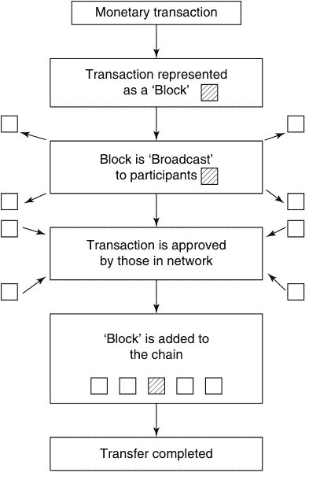

**图 9.21**  区块链的运作。

的一个是它是一个集中的脆弱点，为黑客提供单一目标。在去中心化系统中，消费者无需通过银行即可获取资金。

- 2. **透明度：** 在区块链环境中，可以看到实体“公共地址”所进行的交易。这可能看起来像‘2XT1bhs GHkBxxxTvpUHEkngT2TbyCt7NKLs ent1BTC’，即使不知道该地址属于谁或哪个实体。跟踪这些付款并对其进行审计的能力对于供应链中的资金管理以及税收征收变得极具吸引力。

- 3. **不可变性：** 编程中的不可变对象是在创建后状态无法更改的对象，与可以更改的“可变”对象相比。这种“不可变性”意味着一旦数据输入区块链，它就是永久且防篡改的。这是通过所谓的“加密哈希函数”实现的，这意味着每笔交易都有一个“哈希引用”（长度为256位），还有“哈希指针”，将一个“哈希”链接到前一个，从而创建区块链。

## Interlock between Blockchain and AI
像Francesco Corea这样的专家确定了区块链和人工智能相遇的若干机会。在他2017年的文章‘人工智能与区块链的融合：有什么交易？’⁶中，他指出了人工智能的几种可能用途：

- 区块链能源消耗管理：区块链已被公认为非常耗能，他建议有效利用人工智能可能有助于管理该能源需求。
- 帮助解决可扩展性问题：当（如果）区块链得到充分利用时，扩展问题可能会变得棘手，人工智能可以通过“修剪”保存的数据并确保仅保留关键数据以某种方式提供帮助。这可以避免占用不必要的存储，最终可能有助于创建新的区块链“模型”。
- 提高安全性：尽管区块链的关键卖点之一是安全性，有效使用人工智能可能会进一步加强该能力。
- 提高隐私性：数据安全和隐私法规将继续成熟，并越来越多地适用于区块链。
- 提高效率：网络的最终规模将带来网络优化问题，人工智能可能证明是改进这一点的工具，与降低能源消耗一起工作。
- 人才管理：关于区块链使用的当前思考是创建“分布式账本”主要是手动操作，但Corea并未排除以某种方式使用人工智能实现自动化的可能性。

相反，Corea还建议区块链的使用也可能有助于人工智能的采用，通过：

- 提高对数据系统的信任
- 提高人工智能有效性，因为更安全的共享数据模型将导致提供更多数据，从而能够更好地进行分析
- 降低市场进入壁垒，因为人工智能变得更容易被小型参与者通过“构建在区块链之上”而使用
- 在直接机器对机器交互中增加“人工信任”

## BLOCKCHAIN IN BANKING
除其他能力外，区块链为银行提供跨境支付和外汇的能力。IBM的区块链世界线（Blockchain World Wire）允许银行使用所谓的“恒星协议”优化和加速外汇、跨境支付和汇款。这是一个“旨在对每个人开放和可访问的通用金融平台。该文件概述了恒星发展基金会和恒星网络与协议的长期目标”。⁷

恒星发展基金会，也称为Stellar.org，于2014年在美国注册为非营利性、非股份公司，由

慈善捐赠与购买Lumens（一种比特币形式）的结合。⁸

IBM区块链负责人Jesse Lund谈到在此背景下加密货币的使用时表示：

> 我认为加密货币完全可以作为一种可行的结算工具。我们已经从Lumens开始，它是Stellar网络的原生资产，但我们已经有能力引入其他加密货币，包括比特币或以太币。我们将根据客户需求和网络参与者的情况增加更多数字资产。⁹

汇款或资金转账是一个特别重要的应用场景。世界银行估计，全球移民汇回家乡的金额约为5740亿美元，大约是十年前汇款额的两倍。仅2016年，从美国汇往其他国家的汇款就超过1380亿美元，拉丁美洲和加勒比地区的移民汇回家乡的金额也创下了纪录。根据皮尤研究中心的数据，这些汇款在许多情况下不仅仅是家庭的生命线，而且是一些地方经济的主要贡献者，尤其是在发展中地区。然而，由于这一过程需要中介机构的参与，增加了时间、成本和复杂性，这些支付面临困难。据说使用区块链解决方案可以实现近乎实时的清算和结算，并且允许以低于传统代理银行的成本转移资金。

IBM World Wire解决方案的本质在于，它为银行业提供了一种'私有且获得许可'的区块链协议，而不是那种更偏向'公有且获得许可'的协议。其差异化优势在于，这是一个针对银行业量身定制的解决方案，符合Stellar协议更广泛的标准，即支持'每秒数千笔交易'。据Lund称，'这个网络确实有可能彻底改变整个外汇市场'。

从客户的角度来看，这意味着速度提升、成本降低和效率提高。对于银行业而言，这再次表明技术正在减少（甚至消除）银行工作场所的传统岗位。

外汇被描述为一个'使股票市场相形见绌的市场'。¹⁰ 外汇市场主要有两种类型：银行间市场和外汇市场（或称'Forex'）。

## 银行间市场

银行间市场虽然参与的银行数量不多，但规模巨大，足以给操纵行为打开大门，尤其是在外汇业务环境中，此前曾有针对汇率操纵的指控。银行间交易每天可达1000万至1亿美元。提高自动化程度可以在管理这些交易和帮助检测异常方面发挥作用。

银行还参与所谓的SWIFT市场，该市场成立于1974年，允许银行之间相互转移外汇。SWIFT（环球银行金融电信协会）是一个消息传递系统，允许银行通过一系列标准化代码安全地相互传输信息。这是一种主要基于代码的方法：
- 前四个字符：机构代码（即银行代码）
- 接下来的两个字符：国家代码
- 再接下来的两个字符：地点/城市代码
- 最后三个字符：可选，但可用于为各个分行分配代码

与Stellar.org一样，SWIFT是非营利性的。在这种情况下，它采用合作模式，由支付订阅费参与的成员共同所有，并根据使用类别收取支持费。SWIFT面临的特殊挑战在于交易的数量和复杂性，以及日益增长的自动化程度。虽然SWIFT目前似乎占据主导地位，但确实有呼声要求SWIFT顺应时代变化，否则将自食其果。毕竟，在银行业中，三十多年前创造的能力有多少能够不经改变而经受住时间的考验？

在更近的时期，考虑到对分析和人工智能的关注，人们认识到'SWIFT最近推出了仪表盘和报告工具，使客户能够动态、实时地查看消息、活动、交易流程和报告的监控情况。这些报告支持基于地区、国家、消息类型和相关参数进行筛选。'¹¹

与区块链的前瞻性方法相比，SWIFT在可扩展性、参考数据和合规性等问题上可能被认为处于'防御姿态'。这些立场本身并非无懈可击，有趣的是看SWIFT将如何回应或补充区块链的主张。或许一个检验方式是，考虑银行业的新进入者会更倾向于SWIFT解决方案还是区块链类型的解决方案。可能短期内两者都会选择，但哪一个选项更具可持续性？

## 外汇市场

第二种外汇交易类型被称为外汇（Forex）或'场外交易'市场。这个市场监管不那么严格，可能受到大量投机行为的影响。它很大程度上是围绕交易时或未来某个时间的'即期交易'展开的。每天，货币都会在伦敦依据基准外币汇率进行'定盘'，这些基准汇率由下午4点前后各60秒内的买卖交易商决定，21种货币的基准汇率就在这一分钟的时间窗口内确定。该行业已被发现存在通过汇率操纵进行滥用的现象；交易商被指控在下午4点'定盘'前串通共享订单信息，以及进行所谓的'收盘砸盘'（banging the close）——即在下午4点截止前对挂单进行激进的买入或卖出。¹²

目前没有必要详细讨论这些交易方式的利弊，只需要考虑更精细的分析和自动化的影响。也许比人力方面更重要的是，高级分析的使用既有助于决策过程，也有助于检测异常。彭博社记者进行的一项为期两年的回顾性分析发现，在每月最后一个交易日，下午4点之前出现突然飙升（至少0.2%）的频率高达31%，随后迅速反转。

货币和交易的管理看起来有点像一场游戏，但其中涉及投资者和养老基金持有的数万亿美元资金。'博弈论'思想在这些问题的背景下可能值得考虑，尤其是当部分或全部规则的自动化即将成为现实时。在相互关联的经济环境背景下，有两个特定的博弈思想浮现在脑海中，关于它们已有大量著述和分析：
- '囚徒困境'是一个博弈的例子，在这个博弈中，两个理性的参与者即使合作符合双方利益，也无法合作或相互信任。这种情况在气候变化讨论中经常出现。
- 在'冷酷触发'（grim trigger）策略中，双方最初会合作，但如果其中一方背叛一次，那么另一方会一直背叛（或作弊）。

## 投资银行与区块链

在其2017年的报告¹³中，埃森哲（Accenture）与对标公司McLagan共同指出，到2025年，使用区块链可以使投资银行削减80亿至120亿美元的基础设施成本。在对全球十大投资银行中的八家进行的调查中，他们得出结论，银行可以'借助更好的数据质量和透明度，将基础设施成本平均降低30%'。除此之外，报告还指出，'与合规、业务运营（如交易支持）以及集中化运营（如了解你的客户（KYC）检查）相关的成本可能下降高达50%'。这些节省并未考虑实施成本。其他人则更为怀疑，认为这不过是又一次试图赶'区块链潮流'的举动。

决定权掌握在监管机构手中。有人认为，监管机构可能不愿意打破现有格局，在没有完全确定这些新方法的安全性、可靠性和韧性的情况下，就在清算和结算基础设施中引入新的解决方案和技术。

其他国家似乎对这种技术的使用更为乐观。在其文章'中国银行在区块链中看到未来'¹⁴中，作者Anujit Mukhopadhyay提醒我们，中国银行——中国最大的银行之一，也是国有企业——正寻求不仅通过数据和人工智能，还通过区块链来改造其业务。截至2018年，该行已在多达12个项目中使用区块链，包括跨境支付、数字货币和数据共享等。到2018年，他们已经为区块链技术申请了11项专利，使其成为中国金融服务领域最大的区块链创新者。据Mukhopadhyay称，其中一项专利是在区块中压缩数据，这提供了可扩展性。中国银行的目标不仅是将整个业务数字化，还要将所有业务转移到数字平台，并消除对硬通货的需求。

中国政府已经对加密货币的使用采取了强硬立场，尽管在2018年他们发布了一份顶级'币'的排名（表17），

## 表18 2018年顶级加密货币
按GitHub活跃度排名¹⁷

| 排名 | 加密货币 |
|------|----------------|
| 1 | Cardano |
| 2 | Augur |
| 3 | Ox |
| 4 | Ethereum |
| 5 | Lisk |
| 6 | Status |
| 7 | TRON |
| 8 | Komodo |
| 9 | Skycoin |
| 10 | Waves |

也许这并不值得批评。其他机构也有自己的排名，例如表18中显示的另一种版本，它衡量的是GitHub活跃度，这是一种版本控制形式。Git是用于跟踪源代码变更的分布式版本控制系统，而GitHub是一个基于Web的托管服务。

无论这些不同排名和不同方法的利弊如何，事实（可能）依然存在：如果像中国银行这样的大型银行全面采用区块链方法，并拥有数亿用户的潜力，那么将对更广泛的全球银行业产生重大的连锁反应。

## 印度银行业的区块链

德里和孟买不仅始终出现在当今的特大城市名单中，而且出现在十年后乃至下个世纪之交的名单中。不更详细地考虑印度将是失职的。

在分析和人工智能的发展方面，印度似乎是一股不为人知的力量，《印度分析杂志》是报道该大陆进展的极佳参考来源。¹⁸ 在她2019年题为“人工智能是改变印度劳动力并创造就业机会的全球力量”的报告中，作者里查·巴蒂亚提醒我们，自2017年以来，印度人工智能产业已增长30%，并且在“机器学习、自然语言处理、神经网络、分析、云计算和模式识别”领域，人工智能岗位正在激增。¹⁹

除此之外，由于印度政府的统一支付接口（UPI）——由印度国家支付公司（NPCI）开发的即时实时支付系统——开放银行在印度议程中也占据重要地位。UPI系统不仅允许消费者在两个银行账户之间转账，还允许消费者使用智能手机直接从银行账户向商家付款。

2017年，HDFC银行推出了一款基于人工智能的聊天机器人，并声称它“可以即时回答跨多个渠道的数百万客户查询”。²⁰ 2019年，据报道印度商业银行Federal已启动了一个开放银行项目。

区块链仍然是印度关注的焦点，印度已签署了一份谅解备忘录，作为金砖国家（巴西、俄罗斯、印度、中国和南非）倡议的一部分，该倡议属于“银行间合作机制”计划的一部分。“当前协议允许金砖国家开发银行研究创新技术在基础设施融资和银行产品优化中的应用。”21

与中国金融市场近年来经历大规模增长一样，印度金融服务部门也经历了大规模增长。由AIM和Jigsaw Academy开展的年度报告《印度金融业的分析与数据科学：2019年深度解读》22指出，分析的应用聚焦于前文提到的三个关键要务：运营、客户分析和风险。然而，他们进一步认识到，市场正在关注高级分析和机器学习在整个企业范围内的应用。

印度分析市场的规模估计已达每年12亿美元。人才供应非常充足，该行业拥有6万名数据科学和金融分析专业人员，并且这一数字每年增加7000人，但变化速度如此之快，以至于他们仍然认为主要挑战是资源不足。印度金融分析的“重心”是孟买，33%的分析专业人员在该金融行业工作。尽管如此，这是一个相对不成熟的职业，45%的分析专业人员经验不足5年。只有23%的人拥有10年以上经验。

AIM/Jigsaw报告在印度市场背景下深入探讨了地点、薪资甚至性别等问题，并得出结论：

- 1. 印度的银行和金融机构正在推行数据驱动议程，“数字技术日益成为金融机构的支柱”。
- 2. 银行已经认识到变革的关键支柱，即技术强化的流程和人才培养。
- 3. 创新正在通过人工智能卓越中心和战略伙伴关系的建立来推动。
- 4. 已经在探索人工智能和机器学习的特定用例，以推动更大的利润和增长。

印度银行特别关注的关键问题之一是企业培训，因为组织开始认识到，如果组织要从数据中获得竞争优势，每个员工都必须具备数据素养并“数据智能”。他们已经认识到，随着人工智能和自动化不断深入，将对工作岗位产生影响。这将涉及重新设计工作框架的需求（例如，人工智能财富顾问取代人类）。因此，银行需要“与利益相关者合作，为人才管理制定量身定制的解决方案，并培养具备工作能力的劳动力”。在新兴技术方面，人才分析正在兴起。

印度银行也在区块链之旅中，2016年印度首个区块链解决方案由ICICI银行与中东银行集团Emirates NBD合作采用。23

2019年1月，据报道，由11家印度银行组成的联盟启动了一项区块链倡议，用于资助MSME（微型、小型和中型企业），旨在提高供应链融资的效率和安全性。该解决方案由名为区块链基础设施公司（BIC）的第三方促成。在印度，这个MSME群体被认为服务不足，尽管他们占劳动力总数的40%（1.17亿人），并为印度GDP贡献了37%，却仅占印度银行信贷的17.3%。这些公司的个人信贷需求在1.4万美元至14万美元之间。

BIC的作用是确保银行之间的协作。据联盟成员之一ICICI银行商业技术主管阿比吉特·辛格称，“区块链网络只有在整个生态系统通过单一网络协同运作时才能蓬勃发展。”

尽管如此，印度监管机构仍然采取了强硬立场，要求联盟成员处置其他加密货币。这种立场主要受到反洗钱担忧的影响，但在泰国和韩国等其他国家积极鼓励加密货币之时，一些人认为这是一种反加密货币策略。2018年，韩国政府启动了一项超过2亿美元的投资计划，目标是在未来4年内创建100家新的区块链公司，雇佣1万人。

在欧洲其他地方，氛围似乎是标准化。欧洲议会经济、科学和生活质量政策部门在其分析《虚拟货币与中央银行货币政策：未来挑战》中，作者得出结论：

> 虚拟货币是当代形式的私人货币。由于其技术特性，其全球交易网络相对安全、透明且快速。这为其进一步发展提供了良好的前景。
> 
> 然而，它们仍然不太可能挑战主权货币和中央银行的主导地位，尤其是在主要货币区。
> 
> 与其他创新一样，虚拟货币对金融监管机构构成了挑战，特别是由于其匿名性和跨境特征。

这是一份有用的报告，因为它开始总结过去十年中“虚拟货币”的影响和演进方法，以及监管方法。也许更重要的是，它考虑了虚拟货币能否取代中央银行对货币发行的垄断。最终，它得出结论认为不会，但这一结论似乎主要基于“私人货币”与作为“最后贷款人”的中央银行之间的历史性争论。作者基于以下三个关键原因来证明这一结论：

- 1. 对货币和信贷需求的快速增长，单靠中央银行无法满足
- 2. “自由市场经济学派”，主张自由银行体系和私人货币发行的必要性
- 3. 缺乏建立中央集权货币当局和银行监管的政治共识

与过去相比，目前的情况表明，加密货币不太可能取代主权货币最可能的原因是缺乏政治意愿。人们不应过于自满，因为政客们今后可能无法以同样的传统方式控制新的数字经济。报告称，“中央银行——尤其是在主要货币区域——不会面临对其货币需求减少的风险，因而也不会失去对货币政策的控制”。

报告呼吁国际标准化，而在没有统一机构的情况下，这绝非易事。在其结论中，报告评论道：

> 虚拟货币（Virtual Currencies）回应了真实的市场需求，最有可能的是，它们将在一段时间内继续存在……监管机构应将虚拟货币视为任何其他金融工具，根据其市场重要性、复杂性和相关风险成比例地进行对待。

这听起来可能是一种相当居高临下的态度。也许如果没有中国例子，这可能是一个合理的结论，但金钱和政治控制历来往往紧密相连。高级分析和人工智能已被确立为颠覆性技术的基石，无论考虑哪个行业或职业。区块链和加密货币的技术影响就属于这一范畴。区块链对银行业未来的重要性至关重要，它的影响不仅体现在流程上，也体现在治理上。

将会有技术成本需要承担，同时也会有人力成本。正如自动化、机器人和人工智能的进一步发展一样，这些互补技术不可避免地会改变银行业。

## 区块链与非洲的开放银行

从长远来看，消费者能够跨不同银行系统进行比较的能力看起来相当有吸引力。保险和公用事业行业已经运营着各种费用比较网站。很难看出金融服务业为何不提供类似的设置。

在欧洲以外的地方，变革的需求超出了单纯的消费主义。中小企业寻找最佳银行交易的需求可能决定其生存还是倒闭。‘银行不足’（人们无法获得主流银行服务，因而求助于贷款 shark 等替代融资）的程度在新兴地区也鼓励采用某种形式的开放银行。

各国已经在考虑的不是这些新技术将如何改变银行业的面貌，而是如何改变一个大陆的面貌。以非洲为例，每年的区块链非洲大会汇聚了专注于该地区区块链应用的关键专家。自 2015 年以来，南非所有主要的大银行都积极研究其应用，据 IBM Z Systems 总经理 Ross A. Mauri 称，“南非所有领先的金融机构都拥有一些与区块链相关的概念验证或早期技术”。这不仅仅是南非的倡议，而且已扩展到整个非洲。

“区块链技术、大数据、按需服务、云计算和物联网（IoT）的兴起都在推动非洲大陆的包容性增长。而正是这些令人兴奋的技术创新的融合正在改变非洲的面貌”，Goodwell Investments 的 Van Der Beek 表示，该公司是一家专注于非洲市场的荷兰投资者。²⁶

目前很难不关注非洲。正如中国和其他亚洲地区所见，城市化的挑战很可能产生重大影响。非洲的城市化速度比地球上任何地方都快。²⁷（见图 9.22。）据估计，到 2050 年非洲 11 亿人口将翻一番，其中超过 80% 将发生在城市。麦肯锡公司称，到 2025 年，非洲将有 100 个城市人口超过 100 万，是拉丁美洲城市数量的两倍。

自然而然的担忧是，基础设施是否足够成熟或能够足够快地发展以满足这一增长水平。贫民窟地区的超高速增长尤其可能发生，因为目前已有 60% 的城市居民生活在那里。如果没有相应的基础设施发展，就存在再次出现人道主义危机的风险。在这种困难的情况下，寻找积极因素很重要。必要的开发为相当大的经济增长打开了大门，尽管企业和私营部门因其所描述的“不稳定和监管混乱”问题而不愿提供私人资金（而非依赖公共财政）。

图 9.23 和 9.24 提供了与所涉及的庞大数字和城市化程度相关的背景信息。

变化是不可避免的，而非洲刚刚开始看到数据时代及其所包含的一切带来的好处，变革性增长的机会不仅诱人，而且对那些对该大陆有更长期眼光的人来说可能势不可挡。

### 2010–2013 每小时人口增长
（按个人数量）

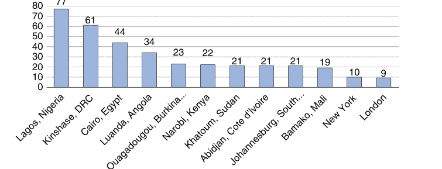

图 9.22 非洲增长最快的城市。
参考：联合国世界城市化展望，2014

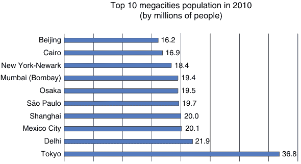

**图 9.23** 2010 年人口最多的超级城市，按百万计。

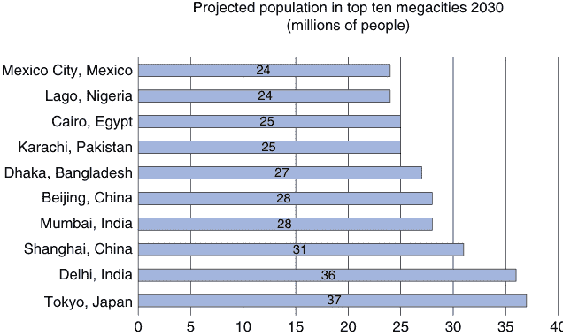

**图 9.24** 2030 年十大超级城市预计人口，按百万计。

*参考：* Statista 2019 年出版

对事物有更长远眼光的人也会对 2100 年最大超级城市的预测感兴趣，那时是 80 年后。相比之下，应该考虑自 80 年前第二次世界大战结束以来变化的程度，当时 Drucker 等“未来学家”正在管理理论上崭露头角。然后将时钟向前拨动相同的时间。

### 表 19 2100 年人口²⁸

| 排名 | 城市 | 国家 | 2100 年人口 |
|------|------|---------|-----------------|
| 1 | Lagos | Nigeria | 88.3m |
| 2 | Kinshasa | DRC | 83.5m |
| 3 | Dar Es Salaam | Tanzania | 73.7m |
| 4 | Mumbai | India | 67.2m |
| 5 | Delhi | India | 57.3m |
| 6 | Khartoum | Sudan | 56.6m |
| 7 | Niamey | Niger | 56.1m |
| 8 | Dhaka | Bangladesh | 54.3m |
| 9 | Kolkata | India | 52.4m |
| 10 | Kabul | Afghanistan | 50.3m |
| 11 | Karachi | Pakistan | 49.1m |
| 12 | Nairobi | Kenya | 46.7m |
| 13 | Lilongwe | Malawi | 41.4m |
| 14 | Blantyre City | Malawi | 40.9m |
| 15 | Cairo | Egypt | 40.5m |
| 16 | Kampala | Uganda | 40.1m |
| 17 | Manila | Philippines | 40.0m |
| 18 | Lusaka | Zambia | 37.7m |
| 19 | Mogadishu | Somalia | 36.4m |
| 20 | Addis Ababa | Ethiopia | 35.8m |

值得注意的是，2100 年前 20 大超级城市中有 13 个是非洲的，其中 3 个是印度（下一个最大的大洲群体）。德里和孟买也都出现在今天和 2030 年的图表中。

将今天的数据（图 9.23）与 2030 年的预测（图 9.24）进行比较，然后展望世纪之交（表 19），似乎人口密度将从亚洲向非洲发生巨大转移，就像当前时期在数量上从欧洲向亚洲的巨大转移一样。可能需要处理“生活质量”与“人口数量”之间的矛盾，但银行业将在促进经济发展方面发挥关键作用。

## 结论

虽然本书主要关于人工智能、先进分析和银行业未来，但为了考虑开放银行和区块链，允许了一些离题，因为这些问题并不孤立，而是可能构成更广泛的变革性影响。这些技术变革不应孤立地考虑，两者都将在其位置上受到人工智能的影响。纯粹主义者可能会寻找某种 PEST 分析并认识到所讨论的内容主要包括

## 参考文献
1. Strategic Newslink. 2017年12月19日.
2. https://www.halifax.co.uk/aboutonline/open-banking/how-open-banking-works/
3. https://www.fca.org.uk/firms/revised-payment-services-directive-psd2
4. Syal, Ranjeev. ‘被废弃的 NHS 系统迄今已花费 100 亿英镑’ Guardian. 2013年9月18日. (查阅于 10/10/2019) https://www.theguardian.com/society/2013/sep/18/nhs-records-system-10bn
5. Turner, Michael. ‘开放银行促使英国金融科技公司重新评估合作伙伴’. Peer to Peer Finance News. 2018年3月22日. (查阅于 10/10/2019) http://www.p2pfinancenews.co.uk/2018/03/22/open-banking-ey/
6. Corea, Francesco. ‘人工智能与区块链的融合：怎么回事？为什么去中心化智能可能影响我们的未来’. Medium.com. 2017年12月1日. (查阅于 29/10/2019) https://medium.com/@Francesco_AI/the-convergence-of-ai-and-blockchain-whats-the-deal-60c618e3acc
7. https://www.stellar.org/about/mandate/
8. Wolfson, Rachel. ‘IBM 利用 Stellar 的加密货币推出基于区块链的全球支付网络’. Forbes. 2019年3月18日. (查阅于 10/10/2019) https://www.forbes.com/sites/rachelwolfson/2019/03/18/ibm-launches-a-blockchain-based-global-payments-network-using-stellars-cryptocurrency/#82f7d8053ec0
9. https://www.thebalance.com/foreign-exchange-market-3306088
10. Seth, Shobhit. ‘SWIFT 系统如何运作’. Investopedia.com. 2019年5月29日. (查阅于 10/10/2019) https://www.investopedia.com/articles/personal-finance/050515/how-swift-system-works.asp
11. Picardo, Elvis. ‘外汇“定盘”如何被操纵’. Investopedia. 2019年6月25日. (查阅于 10/10/2019) https://www.investopedia.com/articles/forex/031714/how-forex-fix-may-be-rigged.asp
12. Irrera, Anna; Kelly, Jemima. ‘区块链每年可为投资银行节省高达 120 亿美元：埃森哲’. Reuters.com. 2017年1月17日. (查阅于 10/10/2019) https://www.reuters.com/article/us-banks-blockchain-accenture-idUSKBN1511OU
13. Mukhopadhyay, Anujit Kumar. ‘中国银行看到区块链的未来’. Blocktelegraph.com. 2018年10月16日. (查阅于 10/10/2019) https://blocktelegraph.io/the-bank-of-china-sees-future-blockchain/
14. Jackson, Cedric. ‘中国发布加密货币排名，EOS 位居榜首’. Blocktelegraph.com. 2018年6月26日. (查阅于 10/10/2019) https://blocktelegraph.io/china-releases-crypto-rankings-puts-eos-at-top/
15. Helms, Kevin. ‘中国新加密货币排名：EOS 第一，以太坊第二，比特币跌至第 17 位’. Bitcoin.com. 2018年6月25日. (查阅于 10/10/2019) https://news.bitcoin.com/chinas-crypto-rankings-eos-ethereum-bitcoin/
16. Redman, Jamie. ‘按 Github 活跃度排名的 2018 年顶级加密货币’. Bitcoin.com. 2019年1月2日. (查阅于 09/10/2019) https://news.bitcoin.com/2018s-top-cryptocurrencies-ranked-by-github-activity/
17. https://www.analyticsindiamag.com
18. Bhatia, Richa. ‘人工智能是全球力量，将改变印度劳动力并创造就业’. Analytics India. 2019年3月25日. (查阅于 10/10/2019) https://www.analyticsindiamag.com/ai-is-the-global-force-that-will-transform-the-indian-workforce-create-jobs/
19. Chowdhury, Amit Paul; ‘HDFC 银行推出人工智能聊天机器人 EVA，改变银行业’. Analytics India Magazine. 2017年3月14日. (查阅于 10/10/2019) https://www.analyticsindiamag.com/hdfc-bank-transforms-banking-sector-launch-ai-powered-chatbot-eva/
20. Alexandre, Alex. ‘印度批准与金砖国家成员联合区块链研究的谅解备忘录’. Cointelegraph.com. 2018年9月12日. (查阅于 10/10/2019) https://cointelegraph.com/news/india-approves-mou-on-joint-blockchain-research-with-brics-members
21. ‘印度金融分析行业增长至 12 亿美元’. MoneyControl.com. 2019年3月12日 (查阅于 10/10/2019) https://www.moneycontrol.com/news/business/financial-analytics-industry-in-india-grows-to-1-2-billion-3637441.html
22. Modgil, Shweta. ‘区块链进入印度银行：他们能依赖它吗？’ INC42.com 2016年10月18日. (查阅于 10/10/2019) https://inc42.com/features/blockchain-indian-banks/
23. Lewitinn, Laurence. ‘印度禁止加密货币之际，泰国、韩国、瑞士和欧盟拥抱它们’. 2018年7月3日. (查阅于 10/10/2019) https://modernconsensus.com/regulation/asia-australia/india-cryptocurrencies-thailand-south-korea-switzerland-eu/
24. Dabrowski, Marek; Janikowski, Lucasz. ‘虚拟货币与中央银行货币政策：未来挑战’. European Parliament: Policy Department for Economic, Scientific and Quality of Life Policies. Monetary Dialogue. 2018年7月. https://www.europarl.europa.eu/cmsdata/149900/CASE_FINAL%20publication.pdf
25. De Meijer, Carlo RW. ‘南非与区块链：改变非洲面貌’ Finextra. 2016年11月15日. (查阅于 10/10/2019) https://www.finextra.com/blogposting/13371/south-africa-and-blockchain-changing-the-face-of-africa
26. ‘2014 年世界城市化前景修订版’. United Nations Department of Economic and Social Affairs. 2014年7月10日. https://www.un.org/en/development/desa/publications/2014-revision-world-urbanization-prospects.html
27. Desjardins, Jeff. ‘动画地图：2100 年世界人口最多的 20 个城市’. Visual Capitalist. 2017年6月23日. (查阅于 10/10/2019) https://www.visualcapitalist.com/animated-map-worlds-populous-cities-2100/
28. Khanna, Parag. 《未来属于亚洲》. Simon & Schuster, 2019.

# 第10章
### 创新与实施
### 摘要
本章将探讨创新问题，更重要的是实施问题。实施是俗语中“角落里的巨象”，往往是许多组织的绊脚石。

虽然领导力问题已在其他地方得到探讨，包括组织的性质以及它们需要如何适应，在本部分我们将在创新和实施的背景下更深入地审视该要素。

本章将探讨创造性的做法，例如创建新的角色和职责以鼓励创新，以及使用训练营和黑客马拉松等。金融科技主题也将被考虑，附录提供了银行业金融科技公司的示例。

最后，我们将探讨创新的潜在障碍以及缓解策略的建议。

### NatWest 成为首家推出数据学院的英国银行
NatWest 将建立数据学院，培训员工如何最好地理解和利用数据。对所有银行员工开放，它将提供广泛的培训、课程和资格，涵盖所有熟练程度。

这一举措对于银行的数字化转型以及充分发挥包括人工智能和机器学习在内的各种尖端技术的潜力至关重要。该学院将为员工提供工具和培训，通过提供更量身定制、个性化的产品和服务，更好地为客户服务，这些产品和服务最符合人们的财务需求。¹

## 引言
可以说，从未有比现在更适合创新的时机。根据 Ark Investments 的说法，“全球经济正在经历历史上最大的技术转型”。人工智能、机器人和区块链等创新平台的影响（以及能源存储和基因组测序）预计将远远超过蒸汽、电话、汽车、互联网和电力的历史影响。

对于个人和组织而言，这是现代的“淘金热”。就像育空地区的老淘金者一样，秘密不仅在于在哪里挖掘黄金，还在于如何销售和分销它。与淘金热一样，利润不仅可以由挖掘者本身获得——其中许多人失败并被削减到节俭——也可以由那些通过他人成功而搭上机会浪潮的中介获得。这些中介是过程中的关键“使能者”，与创新中心为初创企业提供中介和增值服务的方式非常相似。WeWork 等公司的估值规模，例如 2018 年 5 月的 160 亿美元，9 个月内增长了 60 亿美元，对于一些人来说，这实际上只是办公空间租赁，这令人震惊，但也是一些人对创新给予巨大价值的指标。²

创新是他人过去曾涵盖的主题，从最广义的角度来看，它只是做一些新事物。“新”可能指的是完全新事物或仅对该行业而言是新事物。事实上，许多创新都是由于从一个行业到另一个行业或从一个地理区域到另一个地理区域的想法转移而发生的。创新不必包括“灵光一现”的时刻，而可能只是对在某一行业成功运作的方法或技术进行逻辑考虑，并带着探究的心态思考它如何适用于不同的行业。

许多组织都希望成为“第一”，并提出新的创新想法，但只要知识产权所有权问题得到解决，成为第二也有许多优势。第二 mover 优势发生在组织审视“第一 mover”，即原始创新者时，不仅改进了该创新，而且更有效地执行或实施了该创新。

作为“第二 mover”的典型优势³包括以下情况：
- 第一 mover 已经建立了市场或机会。
- 产品的开发可能更加稳健。
- 通过对客户群的分析，可以更快、更有利可图地进入市场。
- 供应链可以得到优化，除非“第一 mover”通过某种形式的协议获得了独特的选项。

第二 mover 优势的例子包括亚马逊、苹果、帮宝适和 Facebook 等名称。在创新时期，等待、复制并在他人成功的基础上建设的诱惑可能非常大。必须做出一个关键决定：是作为第一 mover 尝试创新，还是作为第二 mover 复制但实施更优？
### 新角色和职责
公司希望被视为创新者，并在企业内部展示思想领导力。不仅有助于创造良好的公关叙事，而且还有助于满足关键利益相关者，包括希望看到组织“与时俱进”的机构投资者的需求。对高级管理层来说，这是一个真正的挑战，

这些空缺往往通过设立新的“创新导向”岗位来弥补，例如以下几种。

**创新主管：** 该角色旨在确保所有想法都能以创新为出发点进行管理，通常涉及内部头脑风暴和“新思维”的协调与管理。这对于可能在孤岛式运作的复杂组织，或不同地区可能有不同想法的国际组织尤为重要。当一个想法达到一定成熟度（可能包括已进行过测试）后，它可能会被交还给产品负责人和设计师，以进行进一步的输入和完善。

**产品主管：** 在创新方案确定后，产品经理的职责实际上是将其搭建起来并推动落地。这可能涉及营销、培训、明确价值主张以及其他各种支持服务的组合。

还有其他职位角色，如品牌与创新经理（培育有助于投资流入的新思维）、创新顾问、首席创新官、商业模式设计师、运营创新集群总监、数字与创新实践策略师等。这些角色不仅有助于在组织内为创新提供焦点，还能帮助建立实施自主创意的的方法论。

## 训练营、黑客马拉松、创新实验室及其他手段

创新得以发生的某些“机制”（尤其是在组织内部）包括训练营和黑客马拉松等技术。

**创新训练营：** 基本上，这些训练营由来自不同业务领域的团队组成。训练营通常在外部场地举行，并以围绕特定主题的演示开场，以便对创新团队进行培训。培训的一部分是确保团队了解市场状况，从而使创新能够及时且适合客户需求，而客户需求可能因地域而异。随后，每个团队会分配一位高管发起人，并被要求离开现场并提出一项创新方案，该方案可能包括产品、解决方案或服务。在约定的期限（通常为4或6周）结束时，每个团队进行演示，最成功的方案将被开发成成熟的解决方案。

**24小时黑客马拉松：** 与上述方式基本相同，但强度更高，尤其是参与者几乎或完全没有睡眠。

**以设备为中心的创新：** 尽管创新的焦点大多看似由技术驱动，但新想法本身可能不仅限于新技术思维。它们也可能涉及如何将不同但互补的能力和产品捆绑在一起。由于大量思维集中在物联网和互联设备上，除了风险、责任和网络安全等问题外，还需要考虑它们对商业模式的影响。

相互通信的方式正变得比以往任何时候都更加重要。尽管保险公司似乎更关注于开发

## 实施

在考虑实施问题时，实际上所考虑的是创新产品、服务或解决方案的“运营化”。这一问题不仅涉及自主设计（即内部创新）的产品和服务，也涉及与外部合作伙伴（可能是金融科技初创公司）联合创建的产品和服务。实施不应只关注技术（无论诱惑有多大），还应考虑诸如它如何影响当前（或许还有未来的）商业模式、从客户角度来看价值主张是什么，以及如何将创新推向市场等问题。

在实施人工智能项目的具体背景下，有一系列关键组件可以被描述为一个层次结构，因为它们从基础性需求（如硬件和存储）一直延伸到大规模交付解决方案并满足特定业务需求的能力。（见图10.25。）

文化问题也是变革的重要推动因素。麦肯锡在2019年的报告《构建人工智能驱动的组织》中提出，组织应防范对人工智能采取“即插即用”的做法，他们认为针对个别问题采用多个单点解决方案并不是最佳前进方式，而组织需要对人工智能转型采取企业级的全局视角，例如关注整个客户旅程。他们说：“在大多数并非天生数字化的企业中，传统思维和工作方式与人工智能所需的方式背道而驰。”

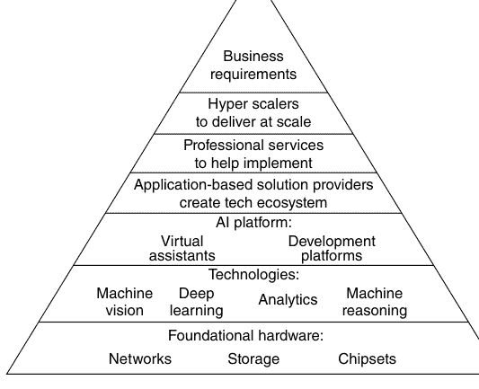

图10.25 人工智能层次结构。

### 表20 银行业的关键组织变革

| 从 | 到 |
|---|---|
| 孤岛式工作 | 跨学科协作 |
| 基于经验、领导者驱动的决策 | 一线数据驱动决策 |
| 僵化且规避风险 | 试验性且敏捷 |
| 面向内部 | 面向外部 |
| 创造良好体验 | 创造令人难忘的卓越体验 |
| 敏捷 | 快速 |
| 了解组织的“门道” | 准备好“蹦极跳” |
| 满足多元化指标 | 将多元化视为“必要之举” |

除此之外，该报告还提出了几种人工智能转型方法，这实际上是一个包含一系列关键项目的综合活动计划。其中包括：

- 建立由人工智能、技术和业务团队组成的“领导联盟”，以确保形成统一观点
- 组建以任务为导向的执行团队，聚焦关键业务问题
- 实施教育政策，要求领导层成为有效的榜样，并进行有效的双向沟通
- 对关键交付物负责，并使用绩效分析有效跟踪进展
- 适当的激励措施，尤其是针对成功贡献者的职业发展

## 创新还是适应？

对于许多组织而言，创建企业级的人工智能变革计划可能令人向往，但在实际操作中可能更加困难。变革的成本和风险如此之高，以至于可能只能采取渐进式步骤，而且只有在关键交付成果得到充分验证之后。为了克服文化抵制等内部障碍，一些组织仍然选择通过将新技术整合到当前工作流程中来实现一种准创新方法。这避免了剧烈的变革，但以更安全的方式逐步引入新思想和学习。

在很多方面，这与“新技术只是将现有模拟流程数字化”的说法相悖，但与此同时，为那些不太能够激进变革的组织提供一种更保守的选择也很重要。业务转型专家Futurion表示，成功的实施可以通过以下方式实现：

- 利用外部资源缩短实施周期
- 尽量减少审批环节，使其敏捷而快速
- 采用敏捷流程开发方法
- 让C级高管和董事会直接与技术员工和供应商联系
- 采用现成方案，即使这意味着限制选择
- 获取消费者反馈，但不宜过多，否则会模糊产出
- 摒弃自上而下的创意，鼓励自下而上的创新⁸˒⁹

Futurion 2017年的报告《创新上市速度：金融领域企业如何管理创新项目》¹⁰基于对28位行业领袖的调查，提出了三个问题：

- 1. 创新项目平均需要多长时间？
- 2. 项目是如何组织的？
- 3. 有哪些经验教训？

也许不足为奇的是，他们记录到项目持续时间差异很大，典型项目长度为24个月。他们说，将开发工作分解为可管理的模块至关重要。一位高管表示：“有时当公司的开发过程太长时，你甚至不会推出最初构建的东西……你会在完成之前就把它丢弃。”

然而，许多金融服务企业似乎“在必要时”能够更快地行动——例如，当存在必须满足的严格期限时。必须遵守监管要求就是一个典型例子。毫不奇怪，如果组织内原本没有“燃烧平台”，创新者会主动创造它们以激励组织。另一方面，有些燃烧平台是自然产生的。

最成功的创新方法似乎是在复制软件公司的做法，而不是像传统金融服务那样行事。就这些项目的组织方式而言，成功的金融服务企业将其创新流程实施描述为往往属于以下三种不同选项之一：

**瀑布式：** 瀑布式开发是一种线性的、顺序性的开发方法，象征着合乎逻辑的步骤进展。通常，它包括识别需求、分析、设计、编码（需要时）、实施、测试、运营以及最终的维护。这种方法被认为需要 meticulous 记录保存。¹¹

**敏捷式：** 这是一种实施形式，开发以增量、快速发布的方式进行，每个发布都建立在先前功能的基础上。与瀑布模型不同，启动项目几乎不需要太多规划。缺点是关键问题在于难以预测所需的时间和资源。这种方法本质上主要是协作性的，侧重于原则而非过程。¹²

**敏捷+瀑布式：** 这种方法结合了瀑布式和敏捷式两种方法。它允许开发人员规划最终项目的最终结果，以便预测时间和资金，同时保留良好的工作文档（瀑布式），并允许将项目分解为明确的阶段。

为完整起见，这里列出了其他项目管理方法：

**V模型：** ‘V’ 代表验证和确认，类似于瀑布式实施，但在计划的每个部分进入下一部分之前都会对其进行验证和测试。¹³

**增量模型：** 实际上，这是一系列迷你瀑布或模块，每个模块都经历需求、设计、实施和测试阶段。¹⁴

**RAD模型：** 快速应用开发模型是指每个模块按商定的时间框架并行构建，然后捆绑成一个可工作的原型；适用于需求明确且需要在3–6个月内交付的项目。¹⁵

**螺旋模型：** 类似于增量模型，但更强调风险管理。项目的每个阶段——例如规划、风险分析、工程和评估——都以商定的风险基线为衡量标准。此过程在风险管理至关重要的情况下尤其有用，例如在大型和关键任务项目中。¹⁶

总体而言，所采用的论点是，在这样一个技术世界中，金融服务企业传统的开发方法已不再足够。他们需要效仿科技公司的方针，尤其是像 Apple 和 Amazon 这样日益进入金融服务领域的公司。

另一个重要因素是，寻求转型的金融服务公司如果保持传统、保守的方法将无法实现转型，因为他们将无法招聘或留住合适的人才。Futurion 调查中的另一个有趣见解包括，即使在复杂的组织中，最成功的创新者‘承认、拥抱并因此掌握其复杂性’。他们使用诸如分析洞察（用于衡量进展）、有效的利益相关者管理、合规管理以及高质量沟通等关键工具来实现目标。

## ‘设计思维’的使用

创新者往往过于频繁地创造新能力，然后寻找其‘粘性’最好的行业。导师在孵化器中经常被使用，不仅帮助产品或解决方案的开发，还帮助进入市场。当一项创新能够与业务问题挂钩时，这有助于融资过程，并在随后有助于创新的成功。

虽然创新者的领域似乎被宽松裤子和 T 恤占据，但有一批日益增长的‘成熟’企业家拥有丰富的经验，他们通过理解关键行业问题或挑战来应对变革需求。认识到任何行业的商业必要性变得至关重要。虽然大多数成熟的创新者和企业家可能凭直觉或经验知道这一点，但经验不足的人可能需要做好功课或依靠支持性的导师。

这在原则上与‘设计思维’的方法并无太大不同，‘设计思维’是一种‘心态和工具箱’方法，有助于组织专注于：

- 理解问题
- 构建‘正确’的东西
- 正确地构建事物

## 寻找创新资本：一个例子

对于许多银行来说，压力在于突破其正常的业务壁垒，并具备与更新、更灵活的竞争对手竞争的能力。除非为开发预留了特定资金，否则不可避免地会出现资金来源的挑战。尽管在许多情况下转型变得‘至关重要’，同时预算挑战也经常存在。

举此特定例子是为了强调更仔细地审视现有业务以确定开发资金来源的潜力。在这种情况下，用例是在线和社交媒体环境中开发全渠道解决方案，资金通过更好地管理其电信成本获得。

作为此创新示例的背景，全渠道银行被描述为客户无论通过何种方式与银行互动——无论是移动、零售还是互联网——都能享受到的‘无缝银行体验’。（见图 10.26。）它反映了消费者希望银行‘用一种声音说话’的愿望。据 Global and Finance Banking 网站称，通过采用有效的全渠道战略，美国的富国银行报告了‘购买率提高 1.9 倍、客户保留率提高 20 个百分点以及每户交叉销售增加 6 种产品等’。17

考虑到如此明显的益处，全渠道投资似乎对银行至关重要，但很大一部分 IT 投资仍用于维护其遗留系统。因此，银行越来越多地寻求释放资本的方式，其中一种方法是电信费用管理（TEM）。根据 World Wide Technology 首席技术官 Dave Locke 的说法，‘电信费用管理（TEM）是利用这一资本来源的流行方式’。它允许银行绘制现有通信支出图，这些支出源于分支机构、后台和前台之间的多个网络，甚至延伸到 ATM，并优化电信安排。据 Locke 称，这可以将电信成本降低多达 40%，从而可投入到其他数字举措中。18

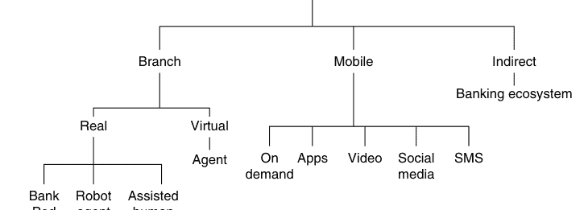

图 10.26 全渠道银行。

## 银行的金融科技

在 AI 时代考虑银行业未来而不考虑金融科技的影响是不可能的。该词是‘金融技术’的混成词。最初侧重于后端系统，近年来更侧重于面向客户（或消费者）的解决方案。金融科技已扩展到包括‘金融素养、建议和教育，以及财富管理、贷款和借贷、零售银行、筹资、资金转账/支付、投资管理等’的技术解决方案。（见图 10.27。）

这是一项大生意，据 Forbes 报道，仅在 2016 年，金融科技初创企业就获得了 174 亿美元的资金。19 初创企业渴望成为‘独角兽’，该词由风险投资家 Aileen Lee 于 2013 年创造，暗指这些生物的稀有性和神话般的品质。2017 年，这些‘金融科技独角兽’的估值超过 800 亿美元。北美生产了大多数金融科技初创企业，其次是亚洲。被视为培育了‘独角兽’的创新中心具有相当大的声望。据分析师 CB Insights 称，金融科技公司最热门的话题是：

- **加密货币和数字现金：** 加密货币是不以实物形式存在且允许即时、无国界转移和交易的货币。数字现金可以是花费极少量资金的方法，例如美国分的十分之一。
- **区块链：** 区块链技术包括以太坊，它在计算机网络上维护记录但没有中央账本。资产超过 800 亿美元的中国银行是中国最大的银行之一，认为区块链是关键

| 会计与税务 | 分析与数据 | 资产管理 | 区块链 | 信用评分 | 数据聚合 |
|---|---|---|---|---|---|
| 债务催收 | 欺诈检测 | 通用型 | 保险科技 | 贷款 | 市场研究/情绪 |
| 支付 | 个人理财 | 定量 | 监管科技 | 房地产 | 财富管理 |

图 10.27 金融科技创新者的典型类型。20

性的，并且他们的一项特别举措是将数据压缩成区块以提供更大的可扩展性。
- **开放银行：** 这不仅允许第三方访问银行数据以构建应用程序，从而创建金融机构和第三方提供商的互联网络，还允许不同银行系统之间的连接。
- **保险科技：** 这是金融科技在保险领域的等价物，在银保和通用银行的背景下可能对银行尤其有趣。
- **监管科技（或 Regtec）：** 这提供分析支持，帮助银行应对繁多的法规，在帮助全球企业方面尤其关键。
- **机器人顾问：** 这些聊天机器人是银行功能的一部分，允许消费者在无需人工干预的情况下‘自助服务’。
- **网络安全：** 尤其鉴于物联网以及新兴生态系统的连接性和脆弱性而至关重要。
- **智能合约：** 这些利用计算机程序自动执行买卖双方之间的合同。智能合约的关键要素是自主性、去中心化和自足性。*自主性*意味着，一旦交易启动，发起人无需进一步参与。*去中心化*意味着系统不依赖于单一网络或计算机。*自足性*意味着在执行合同的同时，自动化系统能够收集和分配资金，甚至花费资金以增加其计算或存储能力。
- **服务于无银行账户/银行服务不足人群：** 这是技术开发中被忽视的元素之一，但尤其重要。这些服务旨在为传统银行忽视或服务不足的弱势或低收入个人提供服务。这是一个针对那些更喜欢使用现金交易资金或将财务管理限制在基本银行设施使用的人群的兴趣领域。据 PayPal 称，这在全球构成超过 2400 万户家庭，被视为银行业增长的关键领域。

根据营销公司 Get 2 Growth²¹ 的说法，有：

- 全球 4.72 亿企业家
- 每年 3.05 亿初创企业
- 135 万科技初创企业
- 3,173 家公司通过加速计划加速

金融稳定委员会（FSB）是一个监测全球金融体系并就其提出建议的国际机构，将金融科技定义为‘通过技术实现的金融服务创新，可能导致新的商业模式、应用、流程或产品，并对金融服务的提供产生实质性影响’。²² 金融科技具有以下潜力：

- 增加市场准入
- 增加市场产品
- 提供更大的客户便利性
- 降低成本

FSB 的分析强调了技术创新与银行业市场之间的关键问题，具体如下：

-   与现有金融机构与金融科技之间关系中的合作程度
-   金融科技与更成熟的科技公司（“大科技”）之间的对比，后者拥有更大、更成熟的关系和网络
-   金融机构对第三方数据服务提供商（例如数据提供、云存储和分析、以及物理连接）的相对较低依赖

银行与金融科技的合作通常采取股权投资或提供孵化器的形式，在这些孵化器中，他们协助希望发展和扩大业务的初创企业，不仅提供物理办公空间，还提供资金、指导和教育方面的支持。根据 CB Insight 的研究，截至本文撰写时（2019 年），美国银行已参与了 24 笔对金融科技公司的股权交易。这是在 2018 年创纪录的基础上实现的，当年美国银行支持了 45 笔对金融科技初创企业的股权交易，较 2017 年增长 180%。23

金融科技通常属于多个类别，尽管有些跨越这些类别，而其他则提供更具一般性的创新。根据 2016 年关于金融科技数量的报告，共有超过 1000 家公司，主要中心位于加利福尼亚、伦敦、纽约和法国。在亚洲，中国和印度的数量正因人口规模庞大和中产阶级快速增长而迅速增加。澳大利亚也非常活跃，这得益于友好的监管环境。Insurtech 似乎正受到相当大的关注。24

截至 2016 年，按交易数量衡量，金融科技领域最活跃的风投公司均为加州企业：

-   Sequoia
-   Accel
-   Index
-   Andreessen Horowitz
-   SVAngel
-   Khosla Ventures
-   500Startups
-   First Round Capital
-   NEA

就任何初创企业的预期寿命而言，这很难估量。据估计，90% 的初创企业注定会失败。无论是金融科技还是其他，新企业通常会经历五个关键阶段：25

1.  种子期和开发期涉及创意的产生及其可行性的考量。
2.  初创期是正式阶段。在此阶段，业务目标、优先事项和战略方面常出现许多错误，这可能解释了为何 25% 的企业无法存活到第五个年头。

即便如此，投入给女性创始人初创企业的风险投资资金似乎仍然不足。例如在英国，2018 年投资的资金中只有 3% 流向了女性企业家创办的金融科技初创企业，财务上仅相当于当年 26.1 亿英镑中的 5400 万英镑。研究还发现，261 笔英国交易中只有 17 笔流向了拥有一位女性创始人的公司。问题的一部分似乎在于创办金融科技公司的女性太少，这也是金融行业整体女性人数过少所产生的连锁效应。

根据 Innovative Finance 的数据，2017 年只有 17% 的金融科技高管为女性。越来越多的人主张采取积极的歧视措施。根据创立 Starling Bank 的 Ann Boden 的说法，Starling Bank 是一家仅限数字和移动的“挑战者银行”，已筹集超过 1 亿英镑，“人们倾向于招聘、提拔和投资与自己相似的人。除非有更多女性经理、领导者和风投，否则情况不会改变”。

伦敦交易金融科技公司 Goldex 的 Sylvia Carrasco 等人则认为，创新过程中的问题比这更根深蒂固，但也与男性主导的风投行业有关。29 “积极歧视”的概念在扭转这一趋势方面有多实际？在谈及风险投资资金问题时，Carrasco 建议有必要以政策为由，强制确保女性获得充分的资金支持。

> ‘因为比例如此之低，你必须强制执行，就像法律一样，’ Carrasco 建议道，‘如果我负责一个风投基金，我会执行积极歧视，因为这是增加投资的唯一方法。一旦达到 20% 左右，你就可以争辩说必须采取其他机制。’30

女性已在寻求在这个行业中获得更大的代表性和有针对性的学习。例如，2017 年，一支全女性意大利代表团访问了位于特拉维夫的 Enel Innovation Hub，该中心被描述为中东的硅谷，不仅是为了与其他年轻女性企业家建立联系，也是为了讨论影响技术等典型男性主导行业的问题。31

创新中心聘用女性经理的趋势正在增长，这对于一个代表性如此不足的行业来说是一个耐人寻味的结果。Gallup 于 2012 年进行的一项调查显示，女性往往比男性同行更善于领导，并且她们的更高参与度更可能带来参与度更高、绩效更好的团队。根据报告，“这表明女性经理在培养他人的潜力并帮助为员工描绘光明未来方面可能超过男性同行”，这可能是管理创新中心必不可少的属性。32

## 创新障碍

那么，组织为何无法实施变革（无论是否与人工智能相关）的主要原因是什么？一般的观点是，人们不会抵制他们认为符合自身最佳利益的变革。如果变革符合客户的最佳利益但对员工个人不利，情况就变得更加可疑。

企业的传统做法是把客户放在首位，但也有另一种建议，即一些成功的组织首先把员工放在首位，然后鼓励员工同样地关照客户。采用这种做法的企业取得成功的原因在于

### 表 21 创新障碍

| 创新障碍的原因 | 缓解因素 |
|---|---|
| 地位丧失 | 有难度，但一个不错的策略是“不出意外”。资深人士通常善于管理自己的信息传递。 |
| 工作保障丧失 | 工作保障正变得越来越渺茫，有些人进入银行业时期望拥有一份终身工作（这种情况越来越不可能）。提前进行职业辅导是一个不错的方法。 |
| 对不确定性的恐惧 | 大多数人对不确定性感到担忧，正如马斯洛需求层次理论所反映的那样。我们生活在一个不确定的世界，在企业各层级提供应对策略的帮助都很重要。 |
| 对人工智能和高级分析的恐惧 | 往往对技术的缺乏了解会转化为对其影响的恐惧。有效的沟通在减轻这种特定类型的焦虑方面发挥关键作用。 |
| 同辈压力 | 这部分与竞争因素有关，竞争不仅存在于银行业，也存在于几乎所有职业中。与协作相比，同辈之间的竞争可能是不健康的。成功是团队运动，但要确保个人的贡献得到认可。 |
| 对管理层的信任缺失 | 战略和目标的透明度是其中的关键组成部分，但最终问题是人际关系上的，也基于过往经验。 |
| 组织政治 | 在几乎任何重组中都存在权力斗争。有时很明显，有时则隐晦，但总体上它削弱了组织的整体雄心。在人工智能领域，斗争可能关乎既定实践的可信度与技术新方法之间的对立，因此这些是需要争夺的“新战役”。 |
| 失败恐惧 | 这是一个在行为上非常个人化的领域，但也可能与明确绩效目标的需求相关联。即使在运营不确定的时期，这些目标也需要切合实际。 |
| 实施流程不佳 | 这是转型过程的核心。有效的转型包括一系列相互关联且相关的独立项目，通常与时间和目标相关。一个优秀的（且公正的）“变革计划”经理必不可少，同时需要强有力的利益相关者支持和一位优秀的高管赞助人。 |

员工满意度提高，进而转化为更高水平的客户服务。

在人工智能的背景下，这一点可能令人难以接受。技术转型通常依赖于强劲的投资回报，而投资回报往往又依赖于裁员。人工智能开发的创新与任何其他形式的自动化没有什么不同。员工“饭碗”面临风险，生计可能受到威胁。这几乎必然会影响他们对变革的态度。除此之外，还有一种略显非理性地对待人工智能的方式，这种方式更符合科幻电影而非现实，但在某些情况下会加剧“恐惧因素”。有效的沟通是减轻这种特定担忧的关键环节。

表 21 列出了创新最可能遇到的一些障碍，并就可能的缓解因素提出了一些建议。这些建议并不全面，而且几乎肯定还需要在个人和组织层面考虑其他因素。

## 结论

技术只有在得到有效实施时，才能有效地转化为商业价值。人们日益认识到，实施失败既可能源于技术本身的失败，也可能源于文化、组织或行为方面的问题。

本章探讨了与创新和实施相关的一些问题：首先提出了创新的含义以及如何实现创新，然后讨论了一些实施问题，包括黑客马拉松以及金融科技中心等外部资源的利用。最后，本章探讨了变革的潜在障碍。

其中主要的障碍之一是组织无法实现承诺的投资回报率，原因可能是最初的计划过于乐观，也可能是缺乏足够的控制措施来衡量进展。因此，在实施项目之初，财务部门就必须配备相对简单的 BI 报告工具，以避免日后在已实现收益的准确性上产生分歧。

一些“遗留”财务报告解决方案已经被重新包装为人工智能实施的关键组件。虽然这可以说是在搭人工智能的顺风车，但它们确实提出了一个重要观点，并提供了一个及时的提醒：在着手投入相对超前的人工智能解决方案之前，企业需要先把分析“基础”落实到位。

## 参考文献

1. 《NatWest 成为首家推出数据学院的英国银行》。RBS News and Opinion，2019年1月。（访问日期：2019年11月4日）https://www.rbs.com/rbs/news/2019/01/natwest-becomes-first-uk-bank-to-launch-data-academy.html
2. 《2019 年重大创意》。ark-invest.com，2019年1月14日。https://research.ark-invest.com/hubfs/1_Download_Files_ARK-Invest/White_Papers/Big-Ideas-2019-ARKInvest.pdf?hsCtaTracking=389fa33c-10c9-4345-8c9e-e457b82977f8%7C7C7114deb8-15db-4540-81d7-4a5f7de51e66
3. Fishbein, Mike. 《4 个后动优势：为什么竞争市场能成就伟大的公司》。（访问日期：2019年10月10日）https://mfishbein.com/4-second-mover-advantages-why-competitive-markets-can/
4. 《银行业的创新：杀手级创意？还是创意杀手？》。The Financial Brand。（访问日期：2019年10月10日）https://thefinancialbrand.com/70631/innovation-ideas-banking-culture-trends/
5. 《PYMNTS 创新准备度》。PYMNTS.com，2017年10月。（访问日期：2019年10月10日）https://www.pymnts.com/wp-content/uploads/2019/02/Innovation-Readiness-Index-October-2017.pdf
6. 《后数字时代已经来临：你准备好迎接未来了吗？》。埃森哲技术展望 2019。https://www.accenture.com/t20190304T094157Z__w__/us-en/_acnmedia/PDF-94/Accenture-TechVision-2019-Tech-Trends-Report.pdf#zoom=50
7. Fountaine, Tim; McCarthy, Brian; Saleh, Tamin. 《打造 AI 驱动的组织》。哈佛商业评论，2019年7–8月。https://hbr.org/2019/07/building-the-ai-powered-organization
8. https://www.futurion.digital/about
9. Van Dyke, Jim. 《创新上市速度报告：金融行业公司如何管理创新项目以满足时间表和客户需求》。Futurion.com。https://info.ciandt.com/hubfs/2017%20Innovation%20Speed%20to%20Market%20Report%20.pdf
10. Van Dyke, James. 《金融科技创新实践：可能没有你想的那么一致》。Futurion，2017年11月17日。（访问日期：2019年11月16日）https://www.futurion.digital/post/2017/11/fintech-innovation-probably-more-diverse-than-you-think
11. https://searchsoftwarequality.techtarget.com/definition/waterfall-model
12. 《什么是敏捷模型——优点、缺点及何时使用？》。TryQA.com。（访问日期：2019年10月10日）http://tryqa.com/what-is-agile-model-advantages-disadvantages-and-when-to-use-it/
13. 《什么是 V 模型——优点、缺点及何时使用？》。TryQA.com。（访问日期：2019年10月10日）http://tryqa.com/what-is-v-model-advantages-disadvantages-and-when-to-use-it/
14. 《什么是增量模型——优点、缺点及何时使用？》。TryQA.com。（访问日期：2019年10月10日）http://tryqa.com/what-is-incremental-model-advantages-disadvantages-and-when-to-use-it/
15. 《什么是 RAD 模型——优点、缺点及何时使用？》。TryQA.com。（访问日期：2019年10月10日）http://tryqa.com/what-is-rad-model-advantages-disadvantages-and-when-to-use-it/
16. 《什么是螺旋模型——优点、缺点及何时使用？》。TryQA.com。（访问日期：2019年10月10日）http://tryqa.com/what-is-spiral-model-advantages-disadvantages-and-when-to-use-it/
17. 《全渠道银行服务》。Global Banking and Finance Review。（访问日期：2019年10月10日）https://www.globalbankingandfinance.com/omni-channel-banking/
18. Shillito, Douglas. 《英国银行寻求削减成本并在数字竞赛中领先》。OnlyStrategic.com，2019年2月26日。（访问日期：2019年10月10日）http://www.onlystrategic.com/Articles/featured?id=85345&article=85345&key=c12c57948487d8ac097217ab2c89dcab&category=1
19. Wintermeyer, Lawrence. 《2016 年全球金融科技风险投资飙升》。2017年2月17日。（访问日期：2019年11月16日）https://www.forbes.com/sites/lawrencewintermeyer/2017/02/17/global-fintech-vc-investment-soars-in-2016/#4287849b2630
20. 《有多少家初创公司？——信息图》。（访问日期：2019年10月10日）https://get2growth.com/how-many-startups/
21. Brown, Andy. 《向金融服务不足人群提供服务：PayPal 的 TIO 交易意味着什么？》。NCR.com，2017年6月27日。（访问日期：2019年10月10日）https://www.ncr.com/company/blogs/financial/delivering-services-to-the-underbanked
22. Shillito, Douglas. 《FSB 报告评估金融科技发展及潜在的金融稳定影响》。OnlyStrategic.com，2019年2月19日。（访问日期：2019年10月10日）http://www.onlystrategic.com/Articles/featured/id/85254/key/a45f852f4be82f1205d3326ff5d7b2ab/user/1000
23. 《美国顶级银行在金融科技上的押注方向》。CB Insights，2019年8月20日。（访问日期：2019年11月16日）https://www.cbinsights.com/research/fintech-investments-top-us-banks/
24. Su, Jeb. 《全球金融科技版图已涵盖 1000 多家公司、融资额达 1050 亿美元、估值达 8670 亿美元：报告》。Forbes.com，2016年9月28日。（访问日期：2019年10月10日）https://www.forbes.com/sites/jeanbaptiste/2016/09/28/the-global-fintech-landscape-reaches-over-1000-companies-105b-in-funding-867b-in-value-report/#19a8667f26f3
25. Petch, Neil. 《企业生命周期的五个阶段：你处于哪个阶段？》。2016年2月29日。（访问日期：2019年10月10日）https://www.entrepreneur.com/article/271290
26. Dahan, Eric. 《如何创办一家成功的初创公司并使其持续运营》。Entrepreneur.com，2015年4月24日。（访问日期：2019年10月10日）https://www.entrepreneur.com/article/245287
27. Kittaneh, Firas. 《成功初创企业创始人共有的 5 个特质》。Entrepreneur.com，2015年4月13日。（访问日期：2019年10月10日）https://www.entrepreneur.com/article/244575
28. Brush, Silla. 《毕马威发现，女性创立的金融科技公司是更好的投资标的》。Bloomberg.com，2019年5月3日。（访问日期：2019年10月10日）https://www.bloomberg.com/amp/news/articles/2019-05-03/fintech-bros-returns-lag-female-founded-startups-kpmg-finds
29. Flinders, Karl. 《风险投资家不愿投资女性创立的金融科技公司，亟需采取行动》。Computer Weekly，2019年2月14日。（访问日期：2019年10月10日）https://www.computerweekly.com/news/252457631/Action-needed-as-venture-capitalists-reluctant-to-invest-in-fintechs-founded-by-women
30. Flinders, Karl. 《需采取积极差别待遇，纠正女性创立的金融科技公司投资严重不足问题》。2019年2月12日。（访问日期：2019年10月10日）https://www.computerweekly.com/blog/Fintech-makes-the-world-go-around/Positive-discrimination-needed-to-remedy-shocking-under-investment-in-fintechs-founded-by-women
31. 《特拉维夫的创新：从支持女性创业到训练营》。Enol.com，2017年9月30日。（访问日期：2019年10月10日）https://startup.enol.com/en/media/news/d201709-tel-aviv-hub-innovation-women-entrepreneur.html
32. 《美国管理者状况报告》。Gallup.com，2015年。https://www.gallup.com/services/182216/state-american-manager-report.aspx

# 网络犯罪与IT韧性

### 摘要

在考虑高级分析和人工智能对银行业的影响时，若忽略网络犯罪和IT韧性这一关注领域则是不完整的。在未来银行的背景下，信任和安全是必不可少的。因此，有必要认识到网络犯罪对银行系统日益增加的风险和影响。

残酷的现实是，如果以信任为基础、且日益依赖数字交易的银行业无法妥善处理其运营的这一方面，那么客户信心在最好情况下会被削弱，在最坏情况下可能彻底丧失。本节旨在更深入地理解网络犯罪的本质——既包括一般层面也包括银行业特定层面，以及银行（作为示例）如何为现在和未来做好准备。这包括网络安全工具包以及新角色的出现和重要性等主题。

鉴于欺诈是主要关注领域之一，分析和人工智能在这一特定背景下的使用也将被考虑。最后，本章以对网络法律问题的一些见解作结。

### 花旗银行和万事达卡均使用人工智能聚焦欺诈

花旗银行在人工智能公司进行了大量投资，尤其关注电子安全和网络安全。例如，其一项收购Feedzai会监控客户支付行为的异常。¹

万事达卡已同意收购Ethoca，这是一家提供技术解决方案的公司，帮助商户和发卡机构实时协作，快速识别和解决数字商务中的欺诈。万事达卡打算进一步扩展这些能力，并将Ethoca与其当前的安全活动、数据洞察和人工智能解决方案相结合。²

### 引言

网络犯罪已在威胁态势方面被描述为“新前沿”。国际标准化组织的IT风险ISO 27k系列已包含网络安全组件，具体在ISO/IEC 27032条款下，该条款将网络犯罪定义为：“在网络空间中保护信息的保密性、完整性和可用性。”（ISO 27k套件包含近70项标准，其中约五十项已发布，涵盖信息风险和安全管理。）³

“网络空间”本身被定义为：“通过连接到互联网的技术设备和网络，人们、软件和服务在互联网上的交互所产生的复杂环境，且不存在任何物理形式。”⁴

网络攻击是对计算机系统或网络进行破坏或渗透代码的蓄意尝试。其后果是破坏流程、泄露数据并渗透信息来源，导致身份盗窃。网络攻击可能包含多种形式，例如：

- 擅自或试图擅自访问计算机系统或其数据
- 中断或拒绝服务攻击（以缩写DDoS知名），通常要求赎金
- 黑客攻击网站或通过应用虚假页面篡改网站
- 安装病毒或恶意软件导致系统和流程中断
- 公司员工不当使用计算机或应用程序以致损害公司。此行为可能延伸至通过将信息下载到磁盘驱动器进行数据的物理盗窃。⁵

这是银行早已熟悉的重大问题。在英国，金融行为监管局（FCA）与竞争和市场管理局（CMA）共同邀请银行自愿公布因网络入侵和其他技术问题而导致的IT停机次数。⁶根据提供的信息，大多数主要英国银行每月遭受一次与IT相关的中断，尽管这些中断通常与IT修改有关，而非直接源于网络犯罪。⁷

“UK Finance”——代表250家英国银行的集体机构——为竞争激烈且多元化的行业提供统一声音，并涵盖金融风险和经济犯罪等议题。他们最近评论称，其成员目前正投资“数十亿英镑”以确保IT和人力系统“稳健且安全”，并指出“运营韧性在现代金融体系中至关重要，是行业的关键优先事项”。⁸

但这仍是一个持续的担忧。正在对金融部门IT故障进行持续调查的英国财政部委员会主席表示，“银行的IT故障时有发生……这些故障现在似乎不可避免”。尽管其调查结果（截至撰写时）尚未公布，委员会也在考虑以下问题等：

- 运营事件发生的频率，以及随着消费者和企业更依赖技术，这一频率可能如何变化
- 运营事件最常见的原因
- 元数据的应用，它为数据仓库中保存的数据提供更强的结构
- 实时报告，包括使用“更动态和更具响应性的风险管理”
- 异常检测，其作用是发现“不可预测的新攻击模式和关系”
- 集成案件管理，换句话说就是跨企业协作的理念，而非各业务单独在各自孤岛中运作
- 一致性要求组织内部（并且随着时间的推移，可能在整个行业内）对概念有共同的理解和定义

管理网络风险的一个关键要素是不同职能角色之间有效沟通的需要。这些角色通常可能包括首席数据官（CDO）、首席信息官（CIO）、首席信息安全官（CISO）和首席风险官（CRO）。随着网络犯罪变得更加棘手，可能需要重新审视其中一些角色，并考虑是否存在重复或滞后。未来，这些角色和职能可能需要以某种方式重新定义或整合。

至少，组织必须对网络风险管理采取某种预先规划的方法。对业务的影响，尤其是对客户和组织声誉的影响不容小觑，尤其是在考虑到千禧一代用户的主要决策驱动因素之一——安全性的情况下。

### 网络犯罪的国际化

在其2019年调查中，Europ Assistance的“网络晴雨表”¹⁴探讨了九个欧洲国家消费者对网络安全的看法。他们发现46%的消费者对网络安全感到担忧，尤其是那些有年迈父母或子女的人。近三分之一的受访者（31%）感到暴露于网络安全问题，而有子女的人更担心，比例为38%。在欧洲各国中，南欧似乎更担忧，西班牙公民（47%）和意大利公民（39%）尤其感到脆弱。考虑到更广泛的欧洲情况，略高于四分之一（26%）的人认识到个人数据遭到攻击的人，而超过82%的人认为此类攻击“非常有压力”。

更令人担忧的是，调查显示消费者在个人数据被泄露时应如何应对方面明显缺乏知识。只有45%的受访者表示他们知道该怎么做，48%的人表示他们认为组织没有做足够的事情来帮助他们。在美国，似乎对数据安全问题的认识更高；65%的人更了解身份保护解决方案，而欧洲人仅为40%。

消费者似乎特别感兴趣的是：

- 报警服务（57%）
- 24/7提供的协助服务（54%）
- 预防服务（47%）
- 监控服务（48%）

根据Hiscox保险公司的说法，在商业层面，网络准备度仍存在很大差异。在《Hiscox网络准备度报告2019》中¹⁵，他们记录称，在评估中，美国、德国和比利时企业的整体准备度得分最高，而超过五分之四的法国企业仍处于“新手”类别。

### 网络安全工具包

“全球网络联盟”将自己描述为致力于根除网络风险的国际跨部门努力。它成立于2015年，“通过主动的风险为本、面向解决方案的方法来应对和根除恶意网络风险”。

> “使全球网络联盟网络安全工具包与众不同的是，它是一个行动工具包，”全球网络联盟总裁兼首席执行官Philip Reitinger表示。
>
> “我们的重点是生产一个动态的运营工具集散中心，帮助中小企业应对风险并改善其网络安全态势，利用我们全球合作伙伴网络的深厚专业知识，例如万事达卡，以及实际GCA工具包用户的经验。”¹⁶

他们将自己的使命描述为：

- 团结全球社区
- 实施解决方案
- 衡量效果

具体而言，他们提供一系列针对中小企业的“工具包”或规定解决方案，旨在提供“可操作的指导”以及明确的指导工具，以对抗中小企业面临的日益增多的网络攻击。工具包提供：

- *运营指导*：关于网络相关资产，例如多因素密码、备份的有效使用以及如何防止网络钓鱼和病毒
- *培训*：包括模板和基础文件
- *公认的最佳实践*：包括来自诸如互联网安全中心控制中心、英国国家网络安全中心（“网络基本要素”）和澳大利亚网络安全中心（“基本八项”）等组织的实践

## 网络风险管理应用

现在越来越关注使用金融科技（Fintech）来解决网络风险问题。韦莱韬悦（Willis Towers Watson）2018年第四季度的保险科技（InsurTech）季度简报¹⁷特别关注网络风险管理，其中提到：

- 来自 Guidewire 的 “Cyence Risk Analytics”，它对网络犯罪的经济影响进行建模
- “Corax”，它构建分析工具以支持新型网络保险产品的设计
- “Paladin”，它创建网络风险检测
- “Zeguro”，它构建降低网络风险的工具
- “Refirm Labs”，它创建审查和验证硬件安全的方法

从保险的角度来看，网络问题越来越被描述为“静默网络风险”（Silent Cyber），指的是由网络相关损失引起的保险负债和义务。这些“静默”损失源于传统财产和责任保险保单，这些保单并非专门设计用于覆盖网络风险，但此类损失也没有被明确排除，承保人也没有为其定价。这个问题正变得越来越热门。2017年的 NotPetya 网络攻击成为历史上代价最高的攻击之一，攻击对象从航运公司到律师事务所等一系列企业，并要求以比特币支付赎金。据认为，这次攻击使航运巨头默克公司（Merck）和联邦快递（FedEx）各自损失超过3亿美元。¹⁸,¹⁹

2017年年中，英国审慎监管局（PRA）表示，它“期望各公司能够识别、量化并管理网络保险承保风险”。但这确实是一个挑战。正如 Guidewire Cyence Risk Analytics 的客户解决方案总监 John Merchant 所说，“就网络而言，五年已经算得上古老了。”²⁰

## 银行业面临的更广泛的网络问题

虽然网络安全在个人层面是一个担忧，但还有更广泛的问题需要考虑。这些问题在一定程度上正日益催生一种新的网络犯罪保险类别，在许多情况下，这种保险还有待法庭检验。据全球保险公司安盛（AXA）称，至少需要解决四个关键领域。²¹

- **工业系统渗透**：即网络罪犯渗透工业控制系统的能力（2014年，网络罪犯提高了德国一家钢厂机械的运转速度，直到其起火燃烧。）
- **勒索风险**：“网络敲诈”的概念，即系统被渗透并要求支付赎金，通常需要通过某种形式的加密货币支付
- **声誉风险**：渗透事件导致品牌信任度下降，公众对曾信任其个人信息保管的组织失去信心
- **专业责任风险**：即那些不太关注数据丢失的组织（如律师事务所）意识到自己持有敏感信息，这些信息的丢失将产生既具有可操作性又可能对所有者不利的情报

## 保障未来银行业安全：新的网络安全威胁

在人工智能背景下考虑银行业的未来时，还需要考虑网络威胁的未来。信息技术专家 Michael Nadeau 在他的报告《未来的网络威胁与挑战：你准备好迎接即将到来的未来了吗？》²² 中反驳了这种观点：世界在变化，互联网随之变化。相反，他认为，互联网在变化，世界随之变化。他从另一个角度看待问题。如果延伸他的思考，就会发现，随着互联网的变化和发展，银行业也将随之改变。

他还提到了一个名为“互联网协会”（ISOC）的组织，该组织成立于1992年，至今仍然活跃。他们2017年的报告《通往我们的数字未来的道路》强化了他们的观点：“互联网的未来由我们为下一代塑造。人类必须成为明天互联网的中心。”

Nadeau 还在另一篇文章中写道《2017年网络犯罪状况：安全事件减少，但影响未减》。在其中，他提到了每年进行的美国网络犯罪状况调查。在510家主要受访者中，平均IT安全预算为1100万美元，但大多数受访者（61%）将网络安全视为IT问题，而非公司治理问题。

此外，赛门铁克（Symantec）的2019年报告²³ 还记录了多起网络入侵事件：

- 1. “表单劫持”（Formjacking）攻击急剧增加，平均每月有4,800个网站被入侵。（表单劫持是一种攻击方式，黑客将一小段代码插入在线供应商的结账页面，从而窃取购买者的信用卡详细信息。）
- 2. “加密劫持”（cryptojacking）有所减少，这种攻击包括秘密使用你的设备来“挖矿”或访问加密货币。
- 3. “勒索软件”（Ransomware）犯罪分子正将目标从消费者转向企业，企业感染率上升了12%。
- 4. 超过7000万条记录从配置不当的第三方供应链中被盗，这归因于云计算的快速采用。供应链仍然是一个软目标，攻击激增了78%。这尤其对前面讨论的扩展型全能银行的概念构成了挑战。
- 5. 物联网（IoT）和设备是定向攻击的关键入口点，而且大多数物联网设备都很脆弱。与上述第4点类似，扩展型全能银行在努力增加价值的同时，也增加了脆弱性。

第4和第5点尤其重要，因为社会越来越认为自己处于“互联”状态（至少在技术层面）。赛门铁克认为，最薄弱的环节既在于供应链，也在于那些更容易被使用的设备。“互联汽车”的概念与“互联家居”和“互联工厂”并列，物联网表明相关设备是链条中最薄弱的环节。赛门铁克对商业和技术脆弱性所在之处的看法可能令人担忧。随着银行通过外包扩展其他增值服务，它们可能正在改善客户体验，但同时也增加了网络风险。银行必须有效管理其整个供应链中的网络风险。

在其他地方，其他组织也指出了类似的担忧。前面提到的Hiscox保险公司在其《2019年网络准备报告》中报告称，网络攻击的数量和成本急剧增加。在他们对七个国家5400多个组织的研究中，超过五分之三的公司（61%）报告在2018年遭受过一次或多次攻击，尽管它们应对攻击的能力和准备程度没有显著下降。从美国、英国、法国、德国、西班牙和荷兰企业的代表性样本来看，只有10%的企业获得了足够高的评分，被Hiscox评为“专家”。

主要发现包括：

- 攻击的强度和频率有所增加：2019年报告中有61%的企业报告遭遇攻击，而2018年报告为45%。
- 更多中小型企业（员工超过50人）正在遭受攻击，发生事件的比例从33%上升到47%。在中等规模企业（50-249名员工）中，2017年至2018年间的攻击百分比从36%增加到63%。
- 网络损失有所增加。网络攻击的平均成本从2017年的22.9万美元增加到2018年的36.9万美元，增幅为61%。对于大型企业（员工250人以上），2018年网络相关损失的平均成本报告为70万美元，而2017年为16.2万美元。

GDPR制度的采用改善了网络安全和人们对该问题的认识，但仍需取得进展。英国数字、文化、媒体及体育部对英国企业进行的一项调查还发现：

- 74%的英国公司将网络安全视为高级管理层问题。
- 73%的英国公司尚未就此问题制定正式政策。

该部门还指出，2017年，43%的英国企业和20%的英国慈善机构遭受了网络攻击或数据泄露。²⁴ 英国国家网络安全中心（NCSC）首席执行官Ciaran Martin表示：“人们一开始往往害怕网络安全这个问题，认为它过于技术化，是一种无法管理的风险。”因此，NCSC创建了董事会工具包²⁵，帮助董事们理解网络风险管理的动态，并提出了他们应该向其信息安全官询问的五个关键问题：

- 1. 我们如何防御攻击？
- 2. 我们如何控制特权IT账户的使用？
- 3. 我们如何保持系统更新？
- 4. 我们如何确保合作伙伴和供应商保护我们与他们共享的数据？
- 5. 我们使用哪些身份验证方法来控制对数据的访问？

## 应对网络攻击

此外，英国国家网络安全中心（NCSC）建议，在企业遭受网络攻击时，应采取以下建议²⁶：

- **确保网络安全：** 通过锁定网络，可以限制黑客访问数据，但代价是扰乱企业自身的运营。
- **启动“响应团队”：** NCSC 建议，应有一个由企业关键部门（IT、人力资源、法律）组成的训练有素的响应团队，或者与经认证的网络安全事件响应服务商（例如来自“注册道德安全测试员委员会”）签订外部协议。
- **报告事件：** 例如，在欧洲，GDPR 规则要求企业在 72 小时内通知信息专员办公室（ICO）。欺诈或勒索案件应向警方报告。（2018 年，ICO 根据《数据保护法》对 Uber 处以 38.5 万英镑罚款，原因是该公司在 2016 年发生数据泄露，并承认向黑客支付 10 万美元，让他们销毁 5000 万用户的数据并对此保密。）
- **审查与学习：** 在恢复正常运营之前，建议对企业网络安全战略进行全面审计，并相应调整。

网络安全专家 Analecta 是一家专注于中小企业的美国公司，该公司建议，通过充分的培训，企业遭受网络犯罪的可能性可降低 75%。培训内容涵盖法律合规、积极性与参与度、改进对攻击的响应等方面，并培养相应能力。²⁷

企业在采用网络安全意识计划时面临的五大挑战似乎是：

- 1. 充足的资源
- 2. 采用或接受安全意识计划
- 3. 管理层的支持
- 4. 最终用户的支持
- 5. 挤出时间参与

尽管银行机构可能拥有管理自身企业内部网络风险的政策和能力，但问题在于其业务合作伙伴未必有这个能力。ISOC 全球互联网政策高级总监康斯坦丝·博梅拉（Constance Bommelaer）补充说，需要生态系统内所有参与者之间的合作来促进全面安全，她这样说道：

> 可能是你的业务所依赖的银行服务生态系统、你的互联网服务提供商（ISP），或者你所在国家的法律框架，使你的业务处于安全劣势。

为了获得绝对的信心，赢得客户的支持和信赖，并且随着“信任”日益成为关键成功因素，银行需要有效地（直接或间接地）管理其供应链，包括其技术。这是一种更主动而非被动的角色。仅仅要求供应商提供安全合规的“证据”是不够的，银行必须在整个供应链的数据主动管理中发挥更积极的作用。企业还可以聘请所谓的“白帽黑客”，以合乎道德的方式进行黑客攻击，以识别薄弱环节。

此外，银行必须认识到，尽管技术是网络安全中的一个问题，但许多“泄露”相对简单。这些泄露可能涉及员工：有的粗心大意，重复使用密码；有的心怀不满，故意窃取信息；有的则容易上当，打开未经请求的电子邮件。老练的犯罪分子越来越注重社会工程学攻击，他们通过社交媒体获取足够多的个人信息，从而发送看似可信、足以诱使对方打开的通信。

但就实际操作而言，供应链中这种运营交付的责任将落在何处？也许会落在供应链管理专业人员身上，而他们的主要标准，从历史上看（这或许是有争议的），一直是达成最佳交易或在各方之间构建恰当的商业关系。对于传统的供应商管理者来说，数据保护和网络安全管理可能只不过是一个“保健因素”，是“走过场”的一部分。但展望未来，它或许是所有标准中最重要的。

然而，一个问题是，大多数供应链中的小企业往往被视为“穷亲戚”。在网络安全方面，银行和其他大型组织应该在多大程度上提供一定程度的免费建议，尤其是考虑到合规带来的高昂成本？如果要有效堵住网络漏洞，银行可能需要在过程中发挥主导作用。商业领域或许可以创造出某种“乌托邦式社会”，让银行等大型组织帮助较小的组织，以符合双方的利益。目前网上已有大量免费信息，许多供应商也提供免费参加会议的机会，但或许还有更好的方式来共享网络安全知识，以惠及所有人？

不可能忽视供应链潜在的整体弱点。如果认为“银行业的未来”至少有一种版本是传统商业模式走向“分解”，也就是说，未来的银行业实际上成为某种供应链组件集合的一部分，那么银行（以及该运营模式中的其他“参与者”）就面临巨大压力，必须理顺自身的网络风险管理。这可能成为银行业未来发展的关键成功因素。

## 网络就绪

根据《Hiscox 网络就绪报告 2019》，网络就绪方面的支出正在增加。报告显示，2018 年的平均支出为 145 万美元，比 2017 年增长 245%，而且似乎还在加速。

尽管如此，根据网络就绪模型对企业进行评估：

- 只有十分之一（10%）的企业达到专家级水平。
- 更令人担忧的是，近四分之三（74%）的企业被评为“新手”，德国和美国企业达到专家级的比例急剧下降。

供应链中的失败也尤为明显，2018 年有三分之二的企业经历了与网络相关的问题。这些结果在技术、媒体/电信和运输行业尤为突出。

人们倾向于依赖政府行动和监管来拯救局面，但“互联网协会”（ISOC）全球互联网政策高级总监康斯坦丝·博梅拉（Constance Bommelaer）认为，网络安全的挑战过于严峻，单靠某些人可能称之为传统制度的方式无法抵御。她批评政府和机构的方法从根本上基于“政策制定”，而且是被动应对而非主动预防。答案似乎并不完全在“政治”领域，即使（根据 Hiscox 的报告）《通用数据保护条例》（GDPR）的出台确实似乎产生了影响，84% 的欧洲大陆企业和 80% 的英国企业做出了一些改变。

网络安全供应商的潜在销售市场非常可观。据市场专家称，网络安全市场自 2018 年以来一直保持两位数的复合年增长率，到 2023 年市场规模将接近 2500 亿美元。在全球范围内，美国在支出方面处于领先地位，其中金融行业处于领先地位。28

出于市场分类的目的，他们将网络安全领域划分为三个关键部分：

- IAM（身份与访问管理）、加密、治理、风险与合规
- UTM（统一威胁管理）
- SIEM（安全信息与事件管理）

在这些领域中，他们认为 IAM 领域，尤其是加密，是重点关注领域之一，这尤其归因于云端和个人设备上存储的大量信息。他们认为，随着人们对面部识别和语音识别等生物识别能力越来越感兴趣，加密将变得更加热门。在如此竞争激烈的市场中，技术供应商不可避免地渴望占据有利地位。一些主要参与者，如赛门铁克公司（Symantec Corporation）、Check Point 技术有限公司（Check Point Technology Ltd.）、Palo Alto Networks、飞塔（Fortinet）和 FireEye 等，正在与更广泛的参与者，如 SAS 和 IBM 等争夺地位。

在如此庞大而广泛的市场中，尤其是在初创企业和金融科技文化盛行的背景下，新进入者总是有机会，他们也许能提供不同的视角以及技术能力。一家备受关注的公司是总部位于英国的“Darktrace”，由来自剑桥大学、军情五处（MI5）、政府通信总部（GCHQ）和美国中央情报局（CIA）的数学家和情报专家于 2013 年创立。该公司总部设在剑桥和旧金山，其“企业免疫系统”能力利用人工智能识别潜在网络威胁，为安全团队争取响应时间。

## 新的网络安全角色，新的网络安全责任

根据 Darktrace 联合创始人之一 Poppy Gustafsson 所述，其技术系统模拟人类免疫系统，该系统‘具有与生俱来的自我感知’，因此能够‘识别诸如细菌和病毒之类的异常。’据称其技术复制了这种方法，监控网络上每个设备的‘生命模式’或正常行为，并在模式发生变化时识别出来，此时安全保障措施会‘自主’响应。^29^

为了银行和其他主要机构能够有效应对网络威胁，它们必须能够调用广泛、深入且通常具有全球性的能力变得至关重要。为了提供全面保护，专家需要能够调用提供在身份和访问管理、数据安全、应用安全、网络安全和终端安全等领域专业知识的商业解决方案。

最佳解决方案包括全方位加密、安全情报、分析、认知和人工智能以及取证工具。专家不仅需要能够抵御网络入侵，还需要能够处理 IT 安全事件、漏洞的信息，并提供有关虚拟组织潜在威胁的详细见解，其中包括客户和供应链。网络和风险专家越来越多地需要设计和实施分层方法来管理组织的数据和基础设施。这包括控制和政策制定，以抵御网络安全攻击和对网络、终端用户设备、服务器、应用程序、数据和云的威胁。

除此之外，还有文化问题。网络安全是每个人的事。内部风险专家还必须确保充分的培训和教育，不仅针对自身组织，也针对更广泛的‘虚拟组织’，以培养安全意识和责任感的文化。

在本书开头，货币的含义是在银行业背景下被考虑的，银行业是一个复杂的行业，拥有许多职能角色，通常被包裹在重叠（有时甚至重复）的管理与权限矩阵中。从外部来看，有时几乎不可能理解矩阵的复杂性，以及哪些职业路线最有可能让个人攀登成功阶梯。虽然网络犯罪专家不太可能被人工智能系统完全取代，但未来必然会以某种方式为该特定技能集提供系统性支持。

网络安全挑战继续将银行业带入新的复杂性和困难程度。除了前面考虑过的技术角色外，未来有效的网络安全可能取决于两个关键角色：

-   **The Chief Security Officer:** CSO 将日益成为一个突出的职位。现实和虚拟企业的<|message|>安全都将由他们负责，掌握在他们手中。他们不仅需要应对当前威胁，还需要预见未来威胁。这将是一份艰难的工作，需要洞察力、想象力和技术专长，其中一些最好的 CSO 可能会来自‘黑客社区’本身。

-   **Supply Chain Managers:** 他们的责任不仅仅是创建和管理银行生态系统内的关系，延伸品牌和客户服务的范围，而且要在不损害银行自身运营的 IT 安全的情况下做到这一点。主动性而非被动性将成为常态。传统上在谈判和合同管理等议题上接受培训的供应链经理会发现自己需要提高 IT 能力一到两个档次，甚至十个档次。

新出现的‘混合’角色也将包含传统供应商管理和 IT/网络安全管理之间的某种融合。在这一新的责任格局中，需要开发新系统来帮助应对这些问题。将需要用例如人工智能系统来补充这些新职能，以协助处理运营风险问题，包括网络犯罪管理和欺诈检测。（参见图 11.28。）

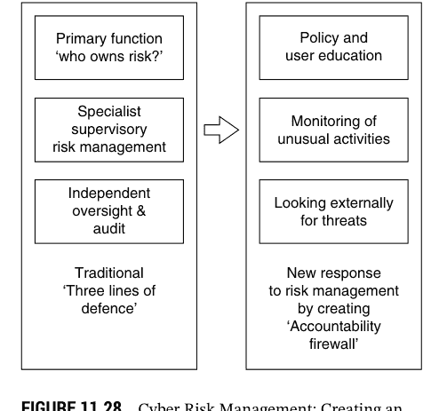

图 11.28 网络风险管理：建立额外的问责防火墙。

## 银行中的人工智能欺诈检测

银行风险管理的一个重要要素涉及欺诈问题，先进分析和人工智能可能对此有解决方案。

### 欺诈检测中的高级分析

通常，银行和其他金融机构已经使用预测性和规范性分析运行预训练算法，对交易进行评分，以衡量其具有欺诈性质的可能性。除此之外，闭环分析通过机器学习帮助改进算法。其实现过程是，银行数据专家或数据科学家需要将大量合法或欺诈交易通过系统运行，机器学习模型开始能够识别哪些是欺诈，哪些不是。

通常，涉及的触发因素可能与账户所有者永远不会购买的产品或账户所有者不太可能购物的地点有关。系统被‘训练’以识别这些不一致之处，并将其标记为可疑或不允许交易继续进行。随着更多交易通过系统，系统变得‘更聪明’。

银行能够在各种渠道上越来越多地使用这些能力，例如通过移动应用程序、ATM 或众筹网站等定期付款。例如，众筹网站 Patreon 使用美国科技公司 Stripe 处理其付款。他们的分析流程识别付款或流程中的‘交易指纹’，并在异常发生时识别出来。位置分析在识别欺诈方面也发挥着更重要的作用，尤其是在账户持有人允许银行访问用户的智能手机或移动设备并识别其中包含的任何个人数据时。

这似乎是一个有趣的权衡。如果客户愿意分享其设备上的个人信息，那么银行更能够防止欺诈并保护个人的数字资金。这似乎是一种双赢，避免了伪造身份、被盗身份和欺诈交易等问题，但也有一个缺点，即个人必须信任银行来保护其个人信息。

欺诈管理和检测对技术供应商来说是一个诱人的市场。与保险欺诈管理类似，银行的投资回报既明显又显著，一些公司声称能够发现多 30–50% 的欺诈，准确率高达 90%。其他公司声称误报率降低高达 80%，即分析结果错误地（令人尴尬地）表明特定客户行为是欺诈性的。目标必须是将准确率从 90% 提高到例如 99% 或更高，这将需要更先进的分析、机器学习和人工智能。可以预见，银行和软件提供商将能够以 100% 的成功率检测当前类型的欺诈。届时，检测设备要么证明对罪犯具有威慑作用，要么刺激更复杂的欺诈，尤其是在面部和语音识别的‘新世界’中。

可能的现实是，随着商业越来越接近完全数字化现金的时代，关于我们的信息量（或可能持有的信息量）形成了一种‘货币 DNA’。钱的支出方式、花在什么上、花在谁身上、在哪里，可能会形成一套独特而鲜明的特征。

### 人工智能与异常检测

异常检测是关于识别行为或付款中的不一致或不准确之处。以任何程度的准确性执行此操作需要创建一组‘基线常态’，以便对当前行为进行测试和分析。这种方法至少存在四个问题：

-   正确建立基线
-   确保基线具有足够的代表性
-   ‘正常’偏差的管理，或者说任何‘偏差’都是不可接受的？
-   异常检测对‘客户体验’的影响

‘人工智能’一词常被误用以代替‘高级分析’，但撇开这一点，仍需要认识到不仅与欺诈相关的问题，还要认识到商业市场多渠道、多设备、波动性的本质。先进系统不仅能够从企业整体角度进行观察，还能够富有同理心地与个人建立联系的能力，开始成为某种‘圣杯’。^30^

当发现一家银行可能因系统错误而无意中允许数千笔洗钱交易通过其平台时，SAS 专家 Colin Bristow 进一步强调了在支付流程中使用人工智能解决方案的论点。‘反洗钱工作需要高度准确且极其快速——比人类更快、更准确’，Bristow 表示。‘随着金融日益数字化，欺诈变得越来越难以发现。企业必须使用人工智能等先进技术来应对不断上涨的潮流——否则就会成为越来越先进的欺诈者的猎物。’^31^

### 数据的欺诈性使用

一个诱人的问题是了解谁在查看谁的数据。这可能并不构成欺诈，尤其是在信息已在公共领域的情况下，但可能被滥用，就像剑桥分析数据丑闻中那样，数百万人的个人数据从 Facebook 获取并在未经他们同意的情况下用于政治目的。^32^

*Forbes* 报道称，新的 Google Alphabet 功能开始回答这个问题。“所有信息都会被快速索引和整理，”他们报道，“然后客户在数据上进行搜索，例如‘我的任何计算机是否正在向“X”发送数据？’从那里开始，网络安全调查人员可以提出更多问题，例如：‘“X”在获取什么类型的信息、何时以及如何获取？’”^33^

### 表24：常见网络犯罪术语表

| 术语 | 解释 |
|---|---|
| 身份验证 | 在计算机系统中，“身份验证”是系统确认个人身份的过程。它被认为是信息保障（IA）的五大支柱之一。（其他支柱包括完整性、可用性、保密性和不可否认性。）^34 |
| 恶意软件 | 恶意软件是指任何故意设计用于对计算机、服务器、客户端或计算机网络造成损害的软件，可能包括病毒或蠕虫。 |
| 病毒 | 一种恶意软件，在执行时会通过修改其他计算机程序并插入自身代码来进行自我复制。当复制成功时，受影响的区域就被称为感染了计算机病毒。^35 |
| 蠕虫 | 网络蠕虫是一种通过计算机网络连接在计算机上自我复制，从而在互联网上传播的程序。^36 |
| 木马 | 一种误导用户对其真实意图的恶意程序。该术语源于希腊神话中的“特洛伊木马”。例如，用户被诱骗打开一个伪装成无害的电子邮件附件（如需要填写的例行表格），从而导致个人或银行详细信息被获取。^37 |
| 网络钓鱼 | 通过创建一个看起来像真实（且可信）网站的假冒网站，诱骗计算机用户提交个人信息。^38 |
| 点击欺诈 | 对广告的点击并非出于对该广告所提供内容的真实兴趣，从而在“按点击付费”环境中产生欺诈性收入。^39 |
| 僵尸网络 | 一系列相互连接的“僵尸程序”，可能受到一组常见恶意软件的影响。术语*僵尸网络*源于单词*机器人*和*网络*。在这种情况下，僵尸程序是指被恶意软件感染的设备，然后成为由单个攻击者或攻击团体控制的受感染设备网络或*网*的一部分。^40 |
| 密码学 | 密码学（cryptology，或cryptography）是一种通过使用代码来保护信息和通信的方法，只有那些信息预期对象才能阅读和处理它。^41 |
| 防火墙 | 执行一组规则以决定哪些数据“包”被允许进入或离开网络的软件或固件。 |
| 入侵检测系统/技术 | 识别入侵的系统和流程，例如流量分析、异常检测或恶意软件检测。^42 |
| 蜜罐 | 一种安全方法，其中看似属于更大数据库一部分的数据（例如）实际上被隔离和监控，以应对网络犯罪。 |

## 网络与法律

网络法，有时被称为“互联网法”，是法律体系的最新组成部分之一。它关注使用互联网的个人和企业的法律保护。大多数网络安全课程都包含对相关法律的理解。网络法涵盖广泛的主题，包括：

- 言论自由
- 互联网的访问和使用
- 在线隐私
- 数字合同
- 网络空间管理
- 电子证据
- 电子商务

互联网和通信技术的不断发展引发了合规问题以及各种其他民事和刑事制裁。可能发生的犯罪有三个关键领域：

1. 针对个人的犯罪，例如网络欺凌、信用卡欺诈、网络诽谤和诋毁
2. 针对财产的犯罪，例如知识产权盗窃、蠕虫和病毒、域名抢注或对计算机的物理损坏
3. 针对政府的犯罪，例如网络恐怖主义、网络战和窃取未经授权的信息

各国正在逐渐适应这一不断发展的领域。

- 在英国，有多部与此主题相关的法律，包括《计算机滥用法》、《严重犯罪法》、欧盟指令 2013/40/EU、《警察与司法法》、《反恐怖主义法》、《人权法》、《数字经济法》、《通信拦截法》、《调查权力法》、《合法商业惯例条例》等。^43
- 在美国，司法部根据三个不同领域起诉网络犯罪：1986年《计算机欺诈和滥用法》（CFAA）；《窃听法》，又称“第三编”，涉及调查犯罪时使用窃听；以及其他网络犯罪法规的兜底条款，所有这些都有不同的处罚。^44
- 在中国，互联网安全责任由互联网服务提供商（ISP）承担，它们可能面临吊销执照、罚款和公诉的处罚。负责安全的两个最重要机构是公安局，其职责体现在1997年《计算机信息网络国际联网安全保护管理办法》中，以及外部的国家安全部。^45
- 在印度，2000年通过了《印度信息技术法》（“IT法”）。^46

一个主要问题是，“传统”律师可能并未充分了解技术发展，而技术安全专家可能并未充分了解法律问题。这催生了一种新的法律咨询类别，涉及兼具法律和技术知识的复合型专家，而不是由法律专家与网络安全专家组成的协作团队。大量案例研究已经出现，正在形成司法判例，即法官从先前的案例中获取指导，以帮助对类似情况做出裁决。47

## 结论

网络安全不仅是银行面临的一个巨大问题，也是一个拥有自己专业术语词汇的专门领域，这些术语通常似曾相识，但除专家外很少有人能完全理解。

如果不认识到数据和分析的影响，以及由此产生的安全问题，就不可能考虑货币的未来和银行业的未来。这两者远非竞争差异化的问题，而是保健因素。在可信度接近消费者决策首要因素的情况下，如果一家银行在数据方面不可信，又怎能让人信任其资金呢？毕竟，如今的数字货币可能不过是另一种形式的数据。

出于这个原因以及其他原因，包括对数据安全漏洞的惩罚性罚款，银行越来越关注网络安全并相应进行投资。一些银行正与大学和研究机构合作以应对风险，同时也进行更广泛的协作。新的角色不断涌现，先进技术将不可避免地成为银行业应对这一问题的一个因素。总体来说，这是金融科技和创新的成熟领域。该主题的复杂性，尤其是随着生物识别技术变得更加主流，将更迫切地需要自动检测和人工智能辅助。

全能银行或扩展银行作为未来模式的概念已在前面讨论过，这种模式在一个更加互联的世界中运营，更贴合客户的需求。如果这种模式最终被采纳，并具备双向数据流，那么安全漏洞的风险可能会增加，因为生态系统中最薄弱的环节成为最可能入侵的点。这可能在供应链中，同样也可能出现在客户或消费者身上。

数据安全的责任不仅在于银行，更具体地在于处于运营“前线”的人员，例如数据安全官和供应商经理，他们的技能需要不断更新和完善。虽然这些专家不太可能成为CEO，但这些复杂且要求高的角色本身很可能会获得可观的报酬。

## 参考文献

1. Sennaar, Kumba. 《银行业中的人工智能：美国七大银行分析》. Emerj. 2019年9月24日.（浏览于2019年10月22日） https://emerj.com/ai-sector-overviews/ai-in-banking-analysis/
2. 《万事达卡收购Ethoca以减少数字商务欺诈》. 新闻稿. Mastercard.（浏览于2019年11月4日） https://newsroom.mastercard.com/press-releases/mastercard-acquires-ethoca-to-reduce-digital-commerce-fraud/

- 3. 《2015年全球风险报告》。世界经济论坛。http://www3.weforum.org/docs/WEF_Global_Risks_2015_Report15.pdf
- 4. 《ISO/IEC 27032:2012 信息技术——安全技术——网络安全指南》。ISO 网站，在线浏览平台。https://www.iso.org/obp/ui/#iso:std:iso-iec:27032:ed-1:v1:en
- 5. 《网络安全》。2015年4月25日。https://asmartc.blogspot.com/2015/04/types-of-cyber-attacks-there-are-many.html
- 6. 《活期账户服务提供商链接》。金融行为监管局（FCA）。2019年8月8日。（查看于2019年11月4日）https://www.fca.org.uk/firms/fca-mandated-and-voluntary-information-current-account-services
- 7. Peachy，Kevin。《银行客户遭遇数十次 IT 系统中断》。BBC.co.uk。2019年2月28日。（查看于2019年10月10日）https://www.bbc.co.uk/news/business-47280513
- 8. https://www.ukfinance.org.uk/about-us
- 9. Flinder，Karl。《财政委员会对银行 IT 系统故障展开调查》。ComputerWeekly.com。2018年11月27日。https://www.computerweekly.com/news/252453246/Treasury-Committee-launches-inquiry-into-bank-IT-failures
- 10. Culp，Steve；Thompson，Chris。《运营风险与网络安全的融合》。埃森哲。2016年。https://www.accenture.com/t20170803T055319Z__w__/us-en/_acnmedia/PDF/7/Accenture-Cyber-Risk-Convergence-Of-Operational-Risk-And-Cyber-Security.pdf
- 11. 《新的网络攻击分类系统将改善英国对网络安全事件的响应》。国家网络安全中心。2018年4月11日。（查看于2019年10月10日）https://www.ncsc.gov.uk/news/new-cyber-attack-categorisation-system-improve-uk-response-incidents
- 12. 《运营风险咨询文件》。巴塞尔银行监管委员会。2001年1月。https://www.bis.org/publ/bcbsca07.pdf
- 13. 《有效风险管理与控制的三道防线》。内部审计师协会。2013年。https://na.theiia.org/standards-guidance/Public%20Documents/PP%20The%20Three%20Lines%20of%20Defense%20in%20Effective%20Risk%20Management%20and%20Control.pdf
- 14. Shillito，Douglas。《欧洲援助网络安全晴雨表调查九个国家消费者对网络安全的看法》。OnlyStrategic.com。2019年2月17日。（查看于2019年10月10日）http://www.onlystrategic.com/Articles/featured/id/85265/key/81a6299b8ddf89688fa6cad20b332352/user/1000
- 15. 《Hiscox 2019年网络安全准备度报告》https://www.hiscox.co.uk/cyberreadiness
- 16. Shillito，Douglas。《全球网络联盟与万事达卡为中小企业推出网络安全工具包》。OnlyStrategic.com。2019年2月26日。（查看于2019年10月10日）http://www.onlystrategic.com/Articles/featured?id=85353&article=85353&key=10d53b9bef7961041925f2843a94212b&category=1
- 17. 《2018年第四季度季度性保险科技简报》。Willis Towers Watson。2019年2月25日。（查看于2019年11月4日）https://www.willistowerswatson.com/en/insights/2019/02/quarterly-insurtech-briefing-q4-2018
- 18. O’Neill，Patrick Howard。《NotPetya 使默克公司损失3.1亿美元》。Cyberscoop。2017年10月27日。https://www.cyberscoop.com/notpetya-ransomware-cost-merck-310-million/
- 19. Palmer，Danny。《NotPetya 对 TNT Express 的网络攻击使联邦快递损失3亿美元》。ZDNet.com。2017年9月20日。（查看于2019年10月10日）https://www.zdnet.com/article/notpetya-cyber-attack-on-tnt-express-cost-fedex-300m/
- 20. Moorcraft，Bethan。《什么是“无声网络风险”？》。InsuranceBusiness.com。2018年11月26日。（查看于2019年10月10日）https://www.insurancebusinessmag.com/us/guides/what-is-silent-cyber-risk-117150.aspx
- 21. https://axaxl.com/insurance/insurance-coverage/professional-insurance/cyber-and-technology
- 22. Nadeau，Michael。《未来的网络安全威胁与挑战：你准备好应对即将到来的一切了吗？》。CSOonline.com。2017年9月19日。（查看于2019年10月10日）https://www.csoonline.com/article/3226392/future-cyber-security-threats-and-challenges-are-you-ready-for-whats-coming.html
- 23. *《赛门铁克互联网安全威胁报告》*第24期（2019年2月）。
- 24. 《网络安全》。董事协会。*《董事》*杂志（2019年4月至5月），第14–15页。
- 25. ncsc.gov.uk/index/guidance
- 26. 《有效应对网络安全漏洞》。董事协会。*《董事》*杂志（2019年4月至5月），第48页。
- 27. 《沟通公司的使命、目标和活动，以实现最佳网络安全》。Analecta。2018年3月15日。（查看于2019年2月28日）http://blog.analecta-llc.com/2018/03/communicating-your-companys-mission.html
- 28. 《2017年至2023年全球网络安全市场规模（单位：十亿美元）》。Statista。2019年10月16日。（查看于2019年11月4日）https://www.statista.com/statistics/595182/worldwide-security-as-a-service-market-size/
- 29. 《网络空间哨兵》。董事协会。*《董事》*杂志（2019年4月至5月），第17–21页。
- 30. Mejia，Niccolo。《银行业基于人工智能的欺诈检测——当前应用与趋势》。EMERJ.com。2019年10月4日。（最后查看于2019年10月10日）https://emerj.com/ai-sector-overviews/artificial-intelligence-fraud-banking/?utm_term=43579&utm_medium=artificial-intelligence-fraud-banking&utm_campaign=broadcast&utm_source=email&utm_content=¬_key=ylJrbF9lbWFpbC16ICJ0Ym9vYmllckBhb2wuY29t&msT2XNvbXBhbnk="
- 31. Cook，James。《Revolut 首席财务官辞职，公司因制裁筛查问题面临质询》。Telegraph.co.uk。2019年3月1日。（最后查看于2019年10月10日）https://www.telegraph.co.uk/technology/2019/02/28/revolut-cfo-resigns-company-faces-compliance-questions/
- 32. 《Facebook–Cambridge Analytica 数据丑闻》。WikiZero.com。（查看于2019年10月9日）https://www.wikizero.com/en/Cambridge_Analytica_scandal
- 33. Brewster，Thomas。《Alphabet 的 Chronicle 初创公司终于上线：它就像网络安全领域的 Google Photos》。Forbes。2019年3月4日。（查看于2019年10月10日）https://www.forbes.com/sites/thomasbrewster/2019/03/04/alphabets-chronicle-startup-finally-launchesits-like-google-photos-for-cybersecurity/?utm_source
- 34. https://www.techopedia.com/definition/342/authentication
- 35. https://en.wikipedia.org/wiki/Computer_virus
- 36. Barwise，Mike。《什么是互联网蠕虫？》。BBC.co.uk。2010年9月9日。（查看于2019年10月10日）http://www.bbc.co.uk/webwise/guides/internet-worms
- 37. 《什么是木马病毒？》。Kaspersky.co.uk。（查看于2019年10月10日）https://www.kaspersky.co.uk/resource-center/threats/trojans
- 38. Feldman，Barbara。《什么是网络钓鱼？》。Surfnetkids.com。2010年11月16日。（最后查看于2019年10月10日）https://www.surfnetkids.com/resources/what-is-phishing/
- 39. Layton，Julia。《这种让 Google 损失数十亿美元的点击欺诈究竟是什么？》。HowStuffWorks.com。（查看于2019年10月10日）https://computer.howstuffworks.com/click-fraud.htm
- 40. https://searchsecurity.techtarget.com/definition/botnet
- 41. https://searchsecurity.techtarget.com/definition/cryptography
- 42. https://en.wikipedia.org/wiki/Intrusion_detection_system
- 43. Graceful，Holly。《英国网络犯罪法》。GracefulSecurity.com。2016年6月15日。（查看于2019年10月10日）https://www.gracefulsecurity.com/uk-cyber-crime-law/

# 结语

所有以序言开篇的书——尽管本书的序言只是看似直截了当地询问“金钱”和“银行”分别意味着什么——都应该有一个恰当的结尾。虽然本书已经走到了尽头，但人工智能的故事才刚刚开始；不仅银行业如此，所有行业和职业也同样如此。

要思考银行业的未来——无论是否有人工智能的辅助——我们需要能够思考金钱的未来。我们认识到，金钱当前存在的形态并非一蹴而就，而是通过某种进化过程逐步形成的。奈尔·弗格森在结束其著作《金钱的崛起》时，提到了“金钱的衰落”，仿佛金钱已经进入某种向下的螺旋。我认为，这个方向并不是“向下”，而只是对一个充满波动的变化环境作出回应；这个环境不仅包含人工智能，也包含区块链、开放银行，以及其他任何最终被证明是“下一个重大趋势”的事物。

弗格森还认为，金钱体系本身存在不稳定性，这部分是由我们人类自身的行为所驱动的。人类行为正日益改变，以适应数字时代，但同时也受到人类“硬编码式的易错性”的影响。越来越明显的是，在未来的金融流程中，我们人类“自身”可能会成为“最薄弱的一环”。

从进化的角度看，那些最终被证明“不适应环境”的组织——例如雷曼兄弟等一些美国大型投资银行——要么彻底消失，要么转型为新的组织。但必须区分查尔斯·达尔文提出的自然选择过程与人为监管体系变化所带来的影响。达尔文的观点意味着某种随机性；另一方面，监管则是人类针对市场压力和挑战作出的系统性回应，其目的在于保护最终用户。

几千年来，金钱一直处于不断变化的进化过程中，但人工智能则是一个年轻得多的存在。直到不到100年前，人们才真正开始思考人工智能，即使数学分析和算法洞察的概念还要早几个世纪。那么，究竟谁会走在前面，谁会成为追随者？金钱的原理与演化将在多大程度上影响人工智能的发展，反之亦然？如果两者确实会相互影响，其程度又会如何？如今，两者不太可能绝对孤立地存在。毕竟，现如今的金钱究竟是什么，不就是“数据”吗？而人工智能归根结底又是什么，不就是一种高度智能化的方式，用来以各种形式、通过多次迭代使用数据吗？

两者都是监管严格的行业，但运作于不同的领域。目前银行体系的监管机构与数据监管机构之间重叠有限，但融合似乎不可避免。两个行业都有各自的规则。在数字环境中，“数据法”不一定必然优先于“银行规则”，但两者都注定会受到彼此的强烈影响。似乎并不是一个公平的竞争环境。银行越来越多地试图像科技公司一样运作，但科技公司或许只是将银行视为它们进入市场的另一条途径，与其他所有行业并列。

未来银行最终将包含某种技术与金融能力的融合，这不仅会影响其运营方式，还会影响角色和职责。银行业正处于转型期，一切都将受到影响。这不仅仅是角色和职业消失且永不被取代的问题，而是两者将“重新发明自己”，成为新的、分析驱动的、融入AI的功能，从而将新旧融合。

我们所知的银行业和货币永远不会“消亡”，而是会随着时代而改变。本书一开始就讨论了“银行4.0”，这一表述代表了我们现在所描述的第四次工业革命中的银行业，但“银行5.0”终有一天会到来。革命的下一个迭代是什么，它将如何影响整体图景？

很可能AI将越来越强调环境，而非目前关注的经济或商业应用。毕竟，环境问题是紧迫的，似乎是当下的时代精神。新的术语已经在表达，例如“环境会计”。“银行5.0”很可能完全关乎环境时代，以及“货币的环境价值”。

几乎没有争议，由于AI，我们所知的银行业每个要素都将被改造。货币的概念将以某种形式继续存在，但很可能变得越来越数字化。AI的魔鬼现在已经真正出瓶，并带着专注于数据和数字化的使命，谁真的知道这段旅程将把我们带到哪里？

在银行业，所有这些变化都是令人担忧的吗？这很大程度上取决于你是客户、员工、经理还是领导，因为每个人都会以各自特定的方式受到影响。我猜测客户可能会受益最多，其次是银行的股东，然后是科技公司。处于“中间”的员工将面临更艰难的时期，尤其是他们的传统职业发展路径将会受到影响。人力资源部门尤其需要对自身进行长时间、深入的审视，个人绩效管理和个人年度目标的整体概念也需要认真重新审视。新时代将带来新的就业挑战。

在融入AI、技术公平的竞争环境中，也许银行业唯一重要的就是品牌以及它如何与我们对世界的个人看法相关。就品牌拓展的范围而言，银行的限制仅在于其自身将每部分生活融入、支持并帮助管理的雄心。它们已经发挥了很大作用，但可以发挥更大的作用，在我们的健康和教育供给、就业安排、老年保障、我们居住的地方和方式、我们如何旅行、我们如何享受生活以及我们生活的其他领域发挥作用。所有这些最终都将通过AI相互连接，可能性无穷无尽。

正如足球迷终身支持，有些人年轻时就被带到看台，最终骨灰撒在球门之间，也许我们可能会终身留在同一家银行作为客户。对于那些获得最佳和最合适支持的人来说，开放银行的诱惑将毫无吸引力。毕竟，对未知的恐惧一直是人类状况的一个要素。

未来货币以及因此银行业最终会怎样？说实话，很难精确地说，但两者都会以某种方式发生变化，当这种情况发生时，历史学家会认识到AI是导致这一变化的主要催化剂之一。一件事是“很可能”确定的：两者仍将以某种形式存在。希腊哲学家欧里庇得斯（约公元前485–406年）指出“货币是智者的宗教”。幸运的是，目前仍有足够多的智者需要这种特定类型的宗教，至少在他们被机器人取代之前...

# Appendix: Fintech in Banking

## 附录：银行中的金融科技

This appendix reviews some of the Fintech companies that are currently making an impact (at the time of this writing), in order to give an indication and ‘flavour’ of the types of innovation happening in this particular sector.

本附录回顾了一些目前正在产生影响（截至本文撰写时）的金融科技公司，以便对该特定领域正在发生的创新类型提供指示和“风味”。

In 2018 research consultants CB Insights published a heat map on what they considered to be the hottest offerings in the Fintech space, and this has provided a useful insight.¹ Additional names have also been added from those operating from the Level 39 innovation hub in Canary Wharf, London, and also from Asian sources, but there are many other start-ups and sources to consider.

2018年，研究顾问CB Insights发布了一张热力图，展示了他们认为金融科技领域最热门的产品，这提供了有用的见解。¹ 另外还添加了一些来自伦敦金丝雀码头Level 39创新中心以及亚洲来源的公司名称，但还有许多其他初创公司和来源需要考虑。

Names and summaries of capabilities of individual Fintech companies have mainly been taken from their own websites or referenced review sites, and are offered without recommendation but are provided by way of illustration of what is happening in this sector. This list is far from complete.

个别金融科技公司的名称和能力摘要主要取自其自己的网站或引用的评测网站，且不作推荐，但提供以说明该领域正在发生的事情。此列表远非完整。

‘Taglines’ are either taken from the companies’ own websites or are the author’s best interpretation of their capability, taken from the companies’ marketing content online at the time of research. These, it must be recognised, are naturally subject to change in our modern era.

“标语”要么取自公司自己的网站，要么是作者根据研究时公司在线营销内容对其能力的最佳解读。必须认识到，这些在我们现代时代自然会发生变化。

By the same measure, whilst individual companies are categorised in the tables, this is the author’s interpretation of their primary market and in many cases they operate in multiple other sectors and fulfil other activities. Readers are strongly recommended to make their own direct enquiries of these businesses and their scope of activity, and no responsibility is accepted by the author in terms of accuracy.

同样，虽然个别公司在表格中进行了分类，但这是作者对其主要市场的解读，在许多情况下它们在多个其他领域运营并履行其他活动。强烈建议读者自行直接向这些企业及其活动范围进行咨询，作者对准确性不承担任何责任。

### CREDIT SCORING/DIRECT LENDING

### 信用评分/直接放贷

TABLE 25 Examples of Fintech Companies Focusing on Credit Scoring and Direct Lending.

表25 专注于信用评分和直接放贷的金融科技公司示例。

| Name | Tagline | Description of offering |
|------|---------|--------------------------|
| Affirm | ‘Say Yes to . . .’ | 为购买最高达17,500美元的商品提供小额即时贷款。可作为零售商收银台的支付选项或在线申请。有“软性”信用检查，但无需最低信用评分或最低信用历史。Affirm的方案为信用历史薄弱或历史不足以获得正常贷款的客户提供“销售点”融资。与信用卡公司相比，通常提供更优惠的利率。最接近的比较是具有固定期限和固定利率的个人贷款机构。https://www.nerdwallet.com/blog/loans/affirm-personal-loan-review/ |
| Avant | '已有超过600,000人体验过通过Avant获得个人贷款的便利' | 针对信用评分较低、希望整合债务或满足紧急短期开支的客户。无担保个人贷款需要信用检查，并在一小时内给出审批。https://www.avant.com/ https://reviewopedia.com/avant-credit-reviews-reviews |
| Zest Finance | '我们努力让公平透明的信贷惠及每个人' | 机器学习信贷和自动化风险建模解决方案，具有端到端可解释性。客户的审批率提高且生产速度快。博客：https://www.zestfinance.com/blog/machine-learning-monitoring-lending-risk https://www.zestfinance.com |
| Applied Data Finance | '为被排斥在银行体系之外的人提供他们应得的信贷' | 旨在放贷的消费者金融平台。该公司平台通过评估信用风险，利用技术、先进数据科学和机器学习，为非优质借款人提供银行服务不足的贷款和信贷额度。https://www.applieddatafinance.com/about/ |
| Habito | 英国的免费在线抵押贷款经纪人，适用于新购或再抵押贷款 | 分析英国市场上90多家贷款机构的每笔抵押贷款，“数秒内”找到最适合用户的产品。https://www.habito.com/about-us |
| Cream Finance | '我们让资金触手可及' | 声称“通过使用最先进和最具代表性的评分技术，让消费金融快速获取”。利用先进算法和机器学习能力快速评估和评分客户的适用性，从而最大限度减少消费者努力并最大化风险管理。https://www.creamfinance.com |
| Aire | '不做假设，全面调查' | Aire通过深度金融分析、数据参考和“交互式虚拟访谈”帮助提供贷款决策，针对没有广泛信用历史的人，通过预测其未来行为。https://aire.io |
| Float | '轻松为您的业务融资' | 一家基于瑞典的在线企业贷款模式，以基于专有实时信用模型的短期贷款取代保理。https://www.floatlending.com/ |

## 表25（续）

| 名称 | 标语 | 产品描述 |
|---|---|---|
| Naborly | '你可以信赖的租户筛查' | 利用人工智能帮助房东自动、安全地核实租户的身份、收入和就业情况，同时免费提供完整的信用报告和犯罪背景调查。https://naborly.com |
| Credit Vidya | '你的业务是放贷，我们的业务是帮你决定放给谁' | 一家总部位于印度的B2B企业，曾于2018年荣获《金融快报》'最佳银行奖'。其'CVSCORE'产品提供了'信用风险评估的新标准，允许用户以更低的违约率多批准15%的申请人'。'Incomex'是一款收入预测工具。'Eve'可减少就业欺诈，即人们被虚假公司诱骗从事工作的现象。https://creditvidya.com/about-us/ |
| James | '用于信用风险的人工智能' | 一站式基于AI的信用风险管理服务，采用最先进的算法，使用户能够创建、验证、部署和监控符合监管要求的高性能预测模型'。曾获2016年Money 20/20最佳欧洲金融科技初创公司奖。https://james.finance/about |
| Veripark | '助力企业成为数字化领导者' | Veripark是一家为金融机构提供多渠道交付、金融客户关系管理和借贷解决方案的全球供应商。www.Veripark.com |
| WeCash | '我们用技术改变30亿人的消费金融体验' | 总部位于北京的金融科技公司，业务遍及中国、印度、越南、印度尼西亚和巴西。它在个人层面运营，消费者可以查看自己的信用评分并获得新贷款；也在机构层面运营，用户可以构建产生收益的贷款组合。该公司连续三年荣获全球金融科技50强奖。2018年被毕马威和Facebook评为中国最具价值品牌50强之一。www.wecashgroup.com |
| Bantu | '连接更多，成就更多' | Bantu是一款'为人民打造的另类数字银行'，它将拥有共同理财目标的人们以及感兴趣的产品和服务连接起来。bantumoney.com |
| Evergreen | '直接放贷机构，贷款金额200英镑至1500英镑' | 利用先进的FICO技术和分析经验实现自动化贷款决策。同时以MoneyBoat.co.uk名义开展业务。https://bit.ly/2rw4NAK |

## 助手/个人理财

### 表26 专注于助手和个人理财的金融科技公司示例。

| 名称 | 标语 | 产品描述 |
|---|---|---|
| Bambu | '面向所有人的机器人顾问' | Bambu是一家总部位于新加坡的机器人顾问解决方案提供商，为金融和消费品牌提供整合并受益于财富管理领域持续数字化转型的能力。https://www.bambu.life/ |
| Revolut | '一个彻底更好的账户' | Revolut通过'个人货币云'为客户提供'在其他任何地方都找不到的价值'，从而颠覆了金融行业。它允许客户以银行间汇率兑换货币，通过社交网络汇款，并使用可在任何地方使用的多币种卡消费。www.revolut.com |
| Yomoni | '储蓄管理高效、简单、透明' | 法国首家在线私人银行式服务，旨在让每个人都能享受财富管理。该公司旨在让所有法国散户投资者受益于前沿的投资组合管理服务，并为他们的长期储蓄提供更多选择。https://www.yomoni.fr/ |
| Digit | '储蓄，无需思考' | 使用受支票账户余额、预期收入、未来账单和近期支出影响的算法分析客户支出，以了解花费了多少。'每天自动储蓄恰到好处的金额，让你无需再操心'。https://financegourmet.com/blog/personal-finance/digit-review-scam-legit-necessary/ https://digit.co |
| MoneyLion | '借贷、储蓄、投资' | 广受欢迎的金融助手应用，在Apple Store和Google Play上排名靠前，利用人工智能、数据分析和社交媒体做出消费贷款决策。提供额外服务，如'免费信用报告加上预算建议，以及直接通过应用进行投资的能力'。https://www.moneylion.com https://overdraftapps.com/moneylion-reviews/ |
| Personetics | '让数字银行个性化' | 被描述为'一种大规模基于AI的数字服务，可提供有关客户财务状况的洞察（"NOMI Insights"）以及全自动储蓄解决方案（"NOMI Find & Save"）'。Personetics主要是一款B2B工具，帮助银行'通过一系列"开箱即用"的场景提高参与度、满意度和响应率，并支持快速实施'。https://personetics.com/engage/ |
| Kasisto | '成为这样的银行……' | 使公司能够通过智能对话（通常是聊天机器人和虚拟助手）与客户'互动和交易'。在其传统AI平台的扩展中，KAI被描述为一种'下一代'银行能力，能够：'通过消除和筛选客户咨询来降低客户成本。''通过情境化优惠增加产品和服务的销售。''改善客户的财务健康和素养''通过向消费者突出尚未实现的功能和益处来提高品牌忠诚度' https://kasisto.com/ |
| Trim | '用Trim降低你的互联网、有线电视和电话账单' | 也被称为'Trim Saver'或'AskTrim'，这是一个财务管理器，它不是应用程序，而是通过Facebook Messenger或短信运行。该系统提供免费的聊天机器人服务，声称通过分析银行和信用卡账户来为客户省钱，其中包括取消订阅、减少银行费用以及为特定信用卡消费激活购物优惠券。http://thefinancegenie.com/smartliving/budgeting/trim-financial-manager https://www.thewaystowealth.com/reviews/trim-review/ |
| Clarity-Money | '你的金钱捍卫者' | 于2018年被高盛收购，ClarityMoney是一款面向移动用户的金融工具，帮助他们掌控自己的财务。（Google Play将这款解决方案评为'2017年度最佳'之一，Apple在2017年将其评为'我们喜爱的新应用'之一。）'Clarity Money将算法与顾问委员会成员提供的学术意见相结合，为消费者提出经验上更优的财务选择建议，'前所有者Adam Dell（戴尔电脑所有者Michael的兄弟）说道。https://bit.ly/34FLBPu |
| Cleo | '你的资金智能助手' | 总部位于伦敦的金融科技公司，提供基于AI的聊天机器人，作为客户银行应用的替代品。据一篇公司评论称，'Facebook Messenger聊天机器人可洞察多个账户和信用卡的支出情况，并按交易、类别或商户进行分类。此外，Cleo允许用户根据其获得的财务数据采取一系列操作，例如为不时之需或特定目标存钱、向Facebook Messenger联系人汇款、向慈善机构捐款、设置支出提醒等'。https://techcrunch.com/2018/05/01/taavet-meet-cleo/ |
| Homebot | 'Homebot通过帮助客户积累财富，为房地产经纪人和信贷员带来回头客和推荐业务' | Homebot是一款可定制的机器人，充当家庭个人资产管理顾问，跟踪价值、再融资机会，甚至计算客户通过出租房屋能获得多少收入。https://www.builtinc... Colorado-real-estate-tech-startups |
| Active.AI | '打造智能微对话' | 一家总部位于新加坡的金融科技初创公司，利用人工智能提供对话银行服务，将自己定位于对话代理（例如Siri或Skype）与银行或支付API之间。通过'为银行而生'的技术，'Active AI'使银行和其他金融机构能够利用人工智能，在移动设备、聊天或支持语音的物联网设备上直观、智能地吸引客户。https://active.ai/ |

## 监管/欺诈检测

### 表27 专注于监管/欺诈检测的金融科技公司示例。

| 名称 | 标语 | 产品描述 |
|---|---|---|
| Trifacta | '数千家公司在使用Trifacta处理数据' | 该公司声称，全球10,000家公司中超过100,000名数据整理人员正在云、混合和本地环境中使用他们的解决方案，以支持各种分析和运营用例。https://www.trifacta.com/ （注：数据整理，又称数据清洗，是指将数据从一种'原始'形式转换并映射为另一种格式，目的是使其更适合各种下游用途（如分析）并更有价值。参考 https://en.wikipedia.org/wiki/Data_wrangling （查阅日期：2019年11月28日）） |

## 表 27（续）

| 名称 | 标语 | 产品描述 |
|---|---|---|
| Paxata | “稍作准备，答案来得更快” | 企业级自助式数据准备应用程序，可将数据整理为可供分析软件使用的格式，尤其面向业务分析师。  被认可为“Forrester Wave”领导者之一，该评测从三个维度对竞争对手进行基准比较：战略、产品实力和市场占有率。  https://www.paxata.com https://www.paxata.com/press-release/paxata-named-a-leader-in-data-preparation-report/ |
| DataRobot | “借助自动化机器学习，成为 AI 驱动型企业” | 该公司自称其“Auto ML”属于第一代机器学习，利用人工智能自动化每一步，并融入指导原则和最佳实践，以确保结果一致且准确。  Gartner 在其 2019 年魔力象限中，依据执行力与愿景完整性，将 DataRobot 定位为数据科学与机器学习平台领域的“远见者”（Visionary）。  https://www.datarobot.com https://bit.ly/2pYT1OR |
| Sift Science | “数字信任与安全” | 专注于欺诈管理，Sift Science 声称每月处理 350 亿起事件，提供实时报告、欺诈趋势识别，并让欺诈分析师能够自动化及自定义决策引擎。凭借覆盖超过 34,000 个网站，并使用 16,000 个“独特欺诈信号”，Sift 声称能将欺诈降低 80%。  https://sift.com |
| Onfido | “以生活速度进行身份验证” | 专注于身份欺诈，允许用户通过文件验证与人脸生物识别的组合来验证自身身份。该公司表示：“我们基于 AI 的技术会评估用户出示的政府签发证件是真实还是伪造，然后将其与人脸生物特征进行比对。”  https://onfido.com |
| Feedzai | “对抗金融犯罪的 AI 平台” | 利用 AI 和机器学习，提供针对欺诈与反洗钱的风险管理解决方案。声称“保护 2 亿人口”，每日处理 3000 万笔交易。具备“低于 10 毫秒的延迟和高可用性”等能力。  2019 年，Feedzai 宣布与 DataRobot 合作，共同打击银行业金融犯罪。  https://feedzai.com |
| Socure | “真实身份验证” | 专注于身份欺诈与身份验证，声称可实现 20% 以上的“自动批准率”，并能捕获最危险 2% 申请人中的 80%。  https://www.socure.com/ |
| Tessian（原名“Check-Recipient”） | “电子邮件的人类层安全” | 提供机器学习等功能，分析实时和历史电子邮件数据，以理解人际关系与沟通的上下文，并自动保护企业免受鱼叉式网络钓鱼、错误发送邮件、未授权邮件及其他由人为因素导致的威胁。 在 2017 年 Infosecurity Europe 上被评为英国最具创新性网络安全公司。 https://www.tessian.com/ https://bit.ly/2L2pN9k |
| Fortia | “以智能技术保护您的公司免受欺诈和合规风险” | 该公司通过使用人工智能算法管理投资合规性，帮助金融机构将运营与监管流程数字化和自动化，并满足投资组合和基金管理相关的监管与法定义务（如 UCITS、AIFM）。 此外，还提供存托银行服务。 https://www.fortia.fr |

## 通用/预测分析

## 表 28 专注于通用/预测分析的金融科技公司示例

| 名称 | 标语 | 产品描述 |
|---|---|---|
| AI Analytics Intelligence | “遇见数据” | Analytics Intelligence 是一家数据分析和人工智能公司。其 AI 平台为企业客户提供数字助理，用于协助在整个组织内检索、分析和分发洞察。 利用自然语言处理，AI 助理可以通过电子邮件、聊天进行沟通，并创建报告。 analyticsintelligence.com |
| Aubay | “领先创新” | Aubay 是一家数字服务公司，支持所有行业（包括工业、研发、电信和基础设施）信息系统的转型与现代化。 尤其专注于大型银行和保险公司，这些客户占其法国营业额的 80% 以上，占其欧洲营业额的 65%。 aubay.com |
| Redcloud | “加入互联市场” | Redcloud 认为，消除实体现金可以解决全球金融供应链面临的许多问题。其技术提供开放架构和移动技术平台，“为任何人、在任何地点、任何设备上提供服务分发解决方案，包括新兴经济体”。 redcloudtechnology.com |
| AltoStack | “您的业务与云采用无关：我们的业务才是” | AltoStack 是一家专注于云、DevOps 和自动化的技术咨询公司。其“使命”是通过在公有云中设计、构建和优化客户的基础设施，帮助组织加速从云中获得价值的时间。 https://www.altostack.io |
| Opera | “探索浏览的新标准” | Opera 声称提供一款安全、创新的浏览器，全球数百万人使用，内置广告拦截、免费 VPN、单位转换器、社交通讯、省电模式等功能。 www.opera.com |
| Work Fusion | “智能自动化，丰厚盈利” | Work Fusion 是一家智能自动化和机器人流程自动化（RPA）软件公司，为银行和金融服务、保险、医疗保健、消费品、公用事业、电信、零售等行业的知识型工作创建和管理机器人。声称将 AI、RPA 和人员整合在一个直观的平台中。 https://www.workfusion.com https://www.workfusion.com/news/isg-forms-automation-partnership-with-workfusion/ |
| Aicura Solutions | “更快启动” | Aicura 声称提供可即时部署的解决方案、API 管理和安全环境，支持更快速、更经济、更有意义的设计、构建和测试。 aicurasolutions.com |
| Ayasdi | “创建智能应用的领先平台” | Ayasdi 是一家机器智能软件公司，为希望利用大数据或高维数据集进行分析和构建预测模型的组织提供软件平台和应用程序。 https://www.ayasdi.com |
| Kensho | “为复杂系统带来透明度的技术” | 该公司“在全球最重要的政府和商业机构中部署可扩展的机器学习与分析系统”。 https://www.kensho.com |
| e-Sentire | “360 度可见性。7x24x365 保护” | 提供针对网络安全和风险管理的托管检测与响应服务。销售本地软件、云服务和专业服务解决方案，帮助企业实现人类专业知识的自动化。声称保护 6.0 万亿美元的管理资产。 https://www.esentire.com/capabilities/ |
| H₂O.ai | “每家公司都可以成为 AI 公司” | 声称是“企业级排名第一的开源机器学习平台”。 https://www.h2o.ai/products/h2o/ |
| Cognitive Scale | “增强智能软件，转变客户互动方式” | 面向金融服务、医疗保健和数字商务市场的行业特定增强智能软件。其产品基于增强智能平台构建，使企业能够使用人工智能和区块链技术。 www.cognitivescale.com |
| Anodot | “自主警报。只提供您需要的警报。就在您需要时” | 该公司声称“利用 AI 分析照亮业务盲点，持续分析您（客户）的所有业务数据，检测重要的业务事件，并通过关联多个数据源来识别这些事件发生的原因”。 www.anodot.com |
| Lucena Quantitative Analytics | “我们为金融行业提供有影响力的量化研究” | Lucena 声称“释放预测分析和替代数据的力量，用于投资决策”。该公司“通过使用先进的机器学习技术从数据中提取可操作的信号，连接大数据提供商与数据情报寻求者”。 https://lucenaresearch.com |
| Netchain² | “发票处理成本节省 93.8%” | 据称提供首个 AI 全自动“发票到付款”和“订单到收款”平台。该公司声称通过减少人工处理、最大限度地减少欺诈和错误、提供预测信息以及优化现金流，为企业节省时间和金钱。 https://netchain2.com |
| Zeitgold | “您的文书工作。完成。” | Zeitgold 提供一款适用于会计、工资、发票、未付账款和资金转账解决方案的人工智能应用程序。 https://www.zeitgold.com |
| AppZen | “财务青睐勇者” | AppZen 提供 AI 驱动的支出审计解决方案，其应用程序可自动化、管理和审计费用报告的创建，包括欺诈检测功能。 https://www.appzen.com |

## 量化与资产管理

### 表29 专注量化与资产管理的金融科技公司示例

| 名称 | 标语 | 描述 |
|---|---|---|
| aQ | ‘为投资者和交易者提供最先进的人工智能工具……我们提供阿尔法收益’ | Alpha Quants是一家技术公司，专门将量化和机器学习技术应用于金融领域，尤其是在投资管理、风险管理和金融监管方面。该公司在精算金融领域获得了细分专长，架起了金融市场与保险负债之间的桥梁。该公司还帮助研究和投资公司研究并可视化其交易策略的风险。https://www.alphaquants.co |
| Sigopt | ‘自动化优化，加速并放大模型开发’ | 最大化机器学习、深度学习和仿真模型的性能。该解决方案可应用于算法交易（通过先进的优化技术实现新策略）、金融和保险（放大机器学习对风险、欺诈、贷款和精算决策的影响）以及政府和情报部门。https://www.datanami.com/this-just-in/sigopt-partners-with-two-sigma/ https://sigopt.com/solution/for-enterprise/finance-insurance/ |
| Walnut Investment | ‘系统化投资的新时代’ | 总部位于巴黎的量化投资管理公司，“将人工智能应用于绝对收益策略”，通过结合“先进的机器学习技术与金融专业知识，生成可盈利的、自学习的交易系统”。https://walnut.ai https://bit.ly/2QYS44d |
| Fount | ‘投资并放松’ | 韩国机器人顾问初创公司，提供自动化的、基于算法的投资组合管理服务。该公司声称其机器人顾问引擎通过将金融工程技术与资产配置理论相结合，计算出最优资产组合，然后监控全球金融市场，通过“动态再平衡”根据市场变化配置资产。其AI驱动的个人养老金服务使投资者能够通过机器人顾问平台建立和管理其养老金投资组合。http://fintechnews.hk/8489/wealthtech/wealthtech-east-asia-china-korea-japan/ https://bit.ly/33wTwNH |
| Domeyard | ‘未来的对冲基金’ | 总部位于波士顿的对冲基金、商品交易顾问和商品池运营商。利用高性能计算和数据分析的进步，在股票、期货、固定收益、能源和商品等多种资产类别中实施交易算法。domeyard.com |
| ForwardLane | ‘时间花得有价值。时间是唯一我们生而平等拥有的东西。你如何度过你的时间，是你与他人区分的关键’ | ForwardLane是一家AI金融科技公司，为财富管理人、资产管理人和商业银行提供AI API平台。其解决方案声称通过独特的推理为金融服务专业人士及其客户提供个性化洞察。“客户优先级排序”决定与哪些客户互动以及原因，而“专家对话”则通过直观的自然语言对话界面提供研究分析师级别的问答。https://forwardlane.com/ |
| TruMid | ‘将交易效率和市场情报带给信用专业人士’ | 一家金融科技公司，通过数据、技术和直观设计的产品提高信用交易的效率。https://www.trumid.com |
| Algoriz | ‘自动化股票和加密货币交易。用英文输入，几秒钟完成交易’ | Algoriz是一个基于AI的交易平台，用户只需用英文输入其策略即可构建交易算法。它还构建、回测和自动化股票和加密货币的交易策略。https://algoriz.com/ |
| Binatix | ‘将专有的生物启发人工智能算法应用于大规模数据分析’ | Binatix提供强大的、受大脑启发的模式识别和机器智能技术。www.binatix.com |

## 市场研究/情绪分析

### 表30 专注市场研究/情绪分析的金融科技公司示例

| 名称 | 标语 | 描述 |
|---|---|---|
| Dataminr | ‘先知道。行动更快’ | 被CNBC评为全球50家最具颠覆性的私营科技公司之一。提供不断更新的推文动态，其中包含突发新闻，使新闻工作者能够快速准确地进行报道。https://www.dataminr.com https://www.nytimes.com/2018/04/11/technology/personaltech/how-to-stay-on-top-of-breaking-news.html https://bit.ly/2sle7aY |
| Alphasense | ‘你的大脑。我们的AI’ | 通过面向金融服务专业人士的专业搜索引擎提供AI驱动的商业洞察。它可以搜索“主要文件、财报电话会议、会议记录和投资者关系演示”。https://en.wikipedia.org/wiki/AlphaSense (访问于28/11/2019) https://www.alpha-sense.com/ |
| Heckyl | ‘Heckyl是面向投资者、交易者和研究人员的分析平台’ | 提供实时金融信息、新闻分析以及市场、公司和企业的热力图。heckyl.com |
| Digital Reasoning | ‘从你的通讯数据中可以学到很多。你想知道什么？’ | “用于监控自然语言通信的先进技术，被纳斯达克、高盛、瑞银等机构使用，也用于美国情报分析人员跟踪恐怖分子，以及参与打击人口贩卖的1000个执法机构。” Synthesys系统将“人、地点和事物、相似术语、别名和语义标签”联系起来，甚至包含词汇关系如何随时间变化。https://digitalreasoning.com http://dgr.wpengine.com/blog/wall-streets-robocop-digital-reasoning-cracked-code-trader-talk/ |
| Descartes Labs | ‘一座为理解我们的星球而建的数据精炼厂’ | 深度学习图像分析公司，专门运用深度学习和其他先进的机器学习算法对互联网上的静态图像进行分类和开发，以便将其应用于来自地球上各种传感器（如卫星、无人机（即无人机、相机、手机等））的视觉数据。https://www.descarteslabs.com |

## 保险科技

### 表32 专注保险科技的金融科技公司示例

| 名称 | 标语 | 描述 |
|---|---|---|
| Lemonade | ‘忘掉你对保险的一切了解’ | Lemonade提供由技术驱动、以社会公益为导向的租房和家庭保险。零文书工作，“通过用机器人和机器学习取代经纪人和官僚流程，实现一切即时化。”https://www.lemonade.com |
| Metromile | ‘少开车。车险省更多’ | Metromile是一家总部位于旧金山的车险初创公司，提供按里程付费的保险和一款驾驶应用。https://www.metromile.com/ |
| SquareTrade | ‘当意外发生时，我们的使命是让你恢复如初’ | 美国消费电子和家电延长保修服务提供商。为iPhone、智能手机、电视、平板电脑、笔记本电脑和家用电器提供一流的设备保护和保修服务。https://www.squaretrade.com |
| NDGIT | ‘银行和保险业排名第一的API平台’ | “NDGIT”代表“Next Digital Banking”（下一代数字银行）。该公司为银行和保险业提供经过验证的API平台。其技术将银行和金融科技公司与数字生态系统连接起来，通过开放银行API和PSD2解决方案向数字合作伙伴开放银行。nextdigitalbanking.com |

## 区块链

### 表33 专注区块链的金融科技公司示例

| 名称 | 标语 | 描述 |
|---|---|---|
| BitGo | ‘我们相信数字资产驱动全球经济的未来’ | BitGo声称通过提供最安全、合规的托管和流动性解决方案，消除数字资产市场中的风险并提高透明度。https://www.bitgo.com/company/about |
| Alliance Block | ‘一体化投资生态系统’ | AllianceBlock是一个去中心化、由AI驱动的投资生态系统，由社区驱动且完全透明。他们声称正在打造“未来的投资银行”。凭借尖端技术，他们旨在将投资银行的所有部门整合到一个扁平化平台中，为中小企业提供廉价、快速、智能的股权和/或债务融资渠道。https://allianceblock.io/ |

## 表 33（续）

| 名称 | 标语 | 描述 |
|---|---|---|
| BABB | '我们旨在成为微型经济的全球银行' | BABB 正在构建可访问、安全、便捷且具有成本效益的点对点移动银行服务，旨在赋能全球微型经济。BABB 应用及其匹配功能帮助用户在社交互动中交换商品、服务和其他价值。他们声称“更重要的是互动，而非金钱”。 https://getbabb.com |

## 投资

### 表 34 专注于投资的金融科技公司示例。

| 名称 | 标语 | 描述 |
|---|---|---|
| Acorns | '投资你的零钱' | 美国金融科技和金融服务公司，专注于微型投资和机器人投资。 https://www.acorns.com/ |
| Wealthfront | '认识你的财务副驾驶' | 自动化投资“机器人顾问”服务，涉及财富和投资管理。该公司声称，“我们的全方位解决方案为您提供所需的财务专业知识，就在您的口袋里。无需电子表格，无烦人的销售电话，无评判”。Wealthfront 提供优化客户财务的服务，“完全无需您与任何人交谈”。 https://www.wealthfront.com/ |
| SigFig. | '简单、易于访问、人人可用的投资' | 利用设计、数据科学和技术的结合，为投资者提供高质量且价格实惠的投资建议。他们的主张是以传统顾问成本的一小部分构建智能、节税、多元化的投资组合。 https://www.sigfig.com/site/#/team |
| Wisealpha | '一种赚取利息的彻底更好的方式' | 获 FCA 授权的公司，旨在成为全球首个借贷市场，为普通投资者提供进入 Virgin、AA 和 Pizza Express 等公司的优先担保和高收益投资的机会。 wisealpha.com |

## 加密货币

### 表 35 专注于加密货币的金融科技公司示例。

| 名称 | 标语 | 描述 |
|---|---|---|
| Coinbase | ‘Coinbase 是购买、出售和管理您的加密货币投资组合最简单的地方’ | 总部位于加州的数字货币交易所。他们在约 32 个国家代理比特币、比特币现金、以太币、以太经典和莱特币与法币的兑换，并在全球 190 个国家管理比特币交易和存储。 https://www.coinbase.com |
| BCB Group | ‘主要数字资产合作伙伴’ | 加密货币主要经纪商，专门为需要场外交易最佳执行的机构客户服务，他们希望为自己的账户提供服务并向自己的客户提供加密货币产品和服务。 www.bcbgroup.io |
| BitX | BitXchange ‘加密货币转账’ | 通过简单的银行转账购买加密货币的在线交易所。该公司为客户提供优惠利率和良好反馈，不断监控金融领域的各种趋势并对细微变化做出反应。 https://bitxchange.ae/ |
| Nebeus | ‘低风险、可信赖的托管人，利息远高于银行体系’ | Nebeus 是一个全方位金融服务平台，使其客户能够买卖、存储、借出和借入加密货币。 www.nebeus.com |
| Xapo | ‘始终与您同在’ | 为解决比特币成功和采用的两个最大问题——可访问性和安全性而成立。不到 4 年时间，Xapo 声称已成为最大的加密货币托管机构，为其成员保管超过 100 亿美元。目前正在超越比特币扩展，以创建强大的银行替代方案，在客户财务生活的各个方面提供同等程度的可访问性和安全性。 https://www.xapo.com/en/about |

## 融资

### 表 37 专注于金融的金融科技公司示例。

| 名称 | 标语 | 描述 |
|---|---|---|
| Kiva | ‘梦想是普遍的，机会不是。只需借出 25 美元即可为世界各地的人们创造机会’ | 非营利组织，允许人们通过互联网向 80 多个国家的低收入企业家和学生贷款。Kiva 的使命是“扩大金融获取，帮助服务不足的社区蓬勃发展”。 https://www.kiva.org |
| Prosper | ‘你好，财务福祉’ | 点对点借贷中介。自 2005 年以来，Prosper 声称已为超过 95 万人促成超过 150 亿美元的贷款。 https://www.prosper.com/ |
| Upstart | ‘你不仅仅是你的信用评分。在 Upstart，你的教育和经验帮助你获得应得的贷款’。 | Upstart 是一个在线借贷市场，提供个人贷款，使用非传统变量，如教育和就业来预测信用worthiness。 /www.upstart.com/ |

## 支付

### 表 38 专注于支付的金融科技公司示例。

| 名称 | 标语 | 描述 |
|---|---|---|
| Ant Financial | ‘为世界带来平等机会’ | 蚂蚁金融服务集团，前身为支付宝，是中国阿里巴巴集团的关联公司。蚂蚁金服是全球估值最高的金融科技或新命名的“科技金融”公司，也是全球最有价值的独角兽公司，估值为 1500 亿美元。该集团涵盖广泛的能力，包括移动钱包、信用支付、在线银行、财富管理等。 http://www.antfinancial.com |
| Klarna | ‘现在购物。以后付款’ | 一家瑞典银行，提供在线金融服务，如在线商店的支付解决方案、直接支付和购买后支付。其主要服务是承担商店的付款索赔并处理客户付款，从而消除卖家和买家的风险。 https://www.klarna.com/uk/ |

## 亚洲初创企业

### 表 39 亚洲的金融科技公司示例。²

| 名称 | 标语 | 描述 |
|---|---|---|
| Tiger Brokers | ‘我们是一家知名在线券商，提供卓越的投资体验’ | 金融科技公司致力于服务股票投资者的最佳利益，并成为构建其全球投资组合的门户。2017 年获 CB Insights 评为“2017 Fintech 250”，并连续两年被 KPMG 中国入围“中国领先金融科技 50 强” https://www.itiger.com |
| Quantifeed | ‘打造您的投资体验’ | 香港的 B2B 金融科技公司，为金融机构及其客户提供数字投资解决方案。平台允许用户探索、定制、投资和管理股票、债券、基金和其他资产类别的投资组合。 https://www.quantifeed.com |
| FinFabrik | ‘人人金融：由 FinFabrik 制作’ | 公司连接资产所有者和投资者，使投资机会人人可及。利用区块链技术，他们通过将传统上另类、流动性差的资产转变为数字资产支持证券，更新资本市场的基础设施。 https://www.finfabrik.com |
| Privé Financial | ‘尖端财富管理与投资解决方案提供商’ | 香港金融科技公司，提供在线平台，提供全面的财富管理、资产配置和产品结构工具。平台通过能够在多个资产类别的全球市场自动生成和执行证券，将这三个核心功能集成在一起。 www.privefinancial.com |
| Quoine | ‘在手机上进行高级加密交易’ | 日本比特币交易平台，供企业和消费者进行虚拟货币兑换。 https://www.liquid.com/ |
| Money by Design | ‘将区块链的力量带给机构’ | Money by Design 开发了一项解决方案，允许创建能够为经济、社会和政治活动提供融资的代币。名为“智能代币化”，该系统声称允许用户“创建您自己的代币，具有扩展且有用的功能，并获得货币的真正力量”。该解决方案依赖于他们所描述的完全新颖且易于访问的功能，直接集成在名为 GeoToken 的货币中，并被定义为首个增强型货币。 moneybydesign.io/ |

## 表39 *（续）*

| 名称 | 标语 | 描述 |
|---|---|---|
| WealthNavi | “将资产管理的麻烦降至零” | 通过智能投顾“WealthNavi”管理世界级资产。https://www.wealthnavi.com/about |
| Dayli Financial Group | “为充实日常生活的金融” | 基于人工智能、区块链、智能投顾和加密货币的韩国金融业解决方案。http://daylifg.com/ |
| Doomoolmori | “面向多元化大众的投资解决方案” | 一项以8%低风险目标回报率为目标的智能投顾服务。https://doomoolmori.com |

## 参考文献

- 1. 《2018年CB Insights金融科技250强：增长最快的金融科技初创企业名单》。ComplyAdvantage.com。（浏览日期：2019年10月29日）https://complyadvantage.com/blog/complyadvantage-named-2018-cb-insights-fintech-250-list-fastest-growing-fintech-startups/
- 2. 《东亚顶级财富科技初创企业》。香港金融科技新闻。2019年2月18日。（浏览日期：2019年10月20日）http://fintechnews.hk/8489/wealthtech/wealthtech-east-asia-china-korea-japan/

# 索引

- 4G连接，46–7
- 5G连接，46–7, 172
- iPhone 5s的Touch ID指纹传感器，106
- 《网点销售与服务成功的9个关键》（迪恩），79–80
- 24小时黑客马拉松，205
- 360度客户洞察，61–5

### A

- 阿克，D.，117
- 埃森哲，173, 191, 206, 223, 224
- 接受技术变革，33
- 收购管理，11
- 适应，208–10
- 管理，10
- 《金融机器学习进展》（洛佩斯·德·普拉多），87
- 顾问，15, 31–2, 109–10, 160–1, 176, 213
- 非洲
  - 区块链，194, 196–9
  - 数据时代，197
  - 增长最快的城市，197
  - 开放银行，196–9
  - 2100年人口，199
  - 预计人口增长，197, 198, 199
  - 2010年特大城市人口排名，197, 198, 199
- 敏捷实施，209
- 敏捷优于合规，43
- 中国农业银行，品牌价值，118
- 人工智能品牌塑造，126
- AIM，印度区块链，194
- Alexa，115–16
- 算法机制，15
- 支付宝，8–9, 166–7
- 亚马逊，118
- 品牌大使，63
- 双元性，145, 146, 147–8, 162–3, 167
- Analecta网络安全专家，230
- 传统银行，10, 69–70
- 分析
  - 人工智能，76–7
  - 银行业绩效管理，59–60
  - 网点绩效管理，78–80
  - 网点专项分析活动，66–7
  - 客户服务，71–3
  - 佣金管理，83–4
  - 薪酬管理，83–4
  - 联络中心服务，80–2
  - 信用评级，65–6
  - 客户，61–73
  - 网络犯罪应用，227
  - 衍生品市场，86–7
  - 财务管理，56–60
  - 金融市场风险监控，84–5
  - 欺诈检测，75–6, 235
  - 注入式领导力，138–40, 141
  - 整合决策，58–9
  - IT成本透明度，78
  - 关键要素，55–91
  - 领导力胜任力，141
  - 抵押贷款跟踪，83
  - 开放银行，183
  - 运营效率，77–87
  - 支付监控，82–3
  - 绩效管理，58–9
  - 投资组合管理，85–6
  - 监管合规，76
  - 关系定价，69–71
  - 风险管理，73–7
  - 风险情景，74
  - 销售管理，83–4
  - 社交媒体活动，67–9
  - 交易监控，84–5
  - 另见：数据与分析入门
- 《印度金融业的分析与数据科学：2019年深度解析》，194
- 《印度分析》杂志，193
- ANN（人工神经网络），104
- 异常检测，欺诈检测，236
- 反洗钱（AML），75
- 苹果，118, 119
- 苹果iPhone，106
- Apple Pay，106
- Apple Watch，106
- 应用程序接口（API），48
- 应用（应用程序），47–8
  - 网络犯罪，227
  - 数据可视化，101–2
  - 掌静脉识别，107
  - 指纹识别，106–7
  - 使用，96–107
  - 视觉与人脸识别，104–6
  - 语音助手，102–4
  - 语音识别，102–4
  - 财富管理系统，107–9
  - 另见：机器学习与应用
- 阿姆斯特朗，K.，173
- 人工神经网络（ANN），104
- 《货币崛起》（弗格森），10
- 亚洲
  - 银行业金融科技，214
  - 领导力，150
  - 技术准备度，161
  - 另见：中国；印度；日本
- 资产管理组合，57, 176, 177
- 保证，操作风险定义，224
- 增强领导力，137–8
- 认证（网络犯罪），237
- 专制型领导者，136
- 自动柜员机（ATM），8, 14, 75
- 决策自主权，67
- 安盛（全球保险公司），227

### B

- 婴儿潮一代，122
- 巴舍利耶，L.，85
- 反效果（风险情景分析），74
- 糟糕决策定义，135
- 贝恩，I.，123–4
- BACS，8
- 巴尔扎克，S.，146–7, 148
- 美国银行（BoA）
  - 品牌价值，118, 119
  - 分解银行，172
  - Erica虚拟助手，93
  - 领导力，148–9
  - 千禧一代部门，120
  - 销售和交易颠覆，177
  - 全能银行，164
- 中国银行，118, 191
- 《中国银行看好区块链未来》（穆霍帕德希亚），191
- 英格兰银行，7–8, 13
- 银行业4.0，6, 7
- 银行定义，4–6, 7
- 银行舱，170
- BankMobile，100–1, 171
- 未来银行，155–81
  - 安全保障，228–34
- 巴克莱银行，119, 170, 174–5
- 巴纳姆，P.T.，124
- 晴雨表（网络犯罪），225
- 巴塞尔委员会，224
- BBVA，品牌价值，119
- 钟形曲线与肥尾，86
- 基准企业，191
- 意外收益（风险情景分析），74
- 最佳实践，网络安全工具包，226
- Betfair，点对点，165
- 更好的风险管理，24–5
- BIC（区块链基础设施公司），194–5
- 大数据，39–53, 87
- 生物识别，104–6, 107
  - 道德论证，109–10
- 《仿生学促进创新》，142
- BIPA（生物识别信息隐私法），105
- 《黑天鹅》，86
- 布莱克-斯科尔斯模型，85, 86
- 创新障碍，216–18
- 区块链，183–202
  - 在银行业的应用，188–99
  - 去中心化，186–7
  - 银行业金融科技，212–13
  - 外汇市场，190–1
  - 不可篡改性，187
  - 印度银行业，193–6
  - 基础设施公司，194–5
  - 银行间市场，189–90
  - 与人工智能联动，188
  - 投资银行，191–3
  - 运作，186, 187
  - 背景设定，186–7
  - 透明性，187
- 博客，123
- 彭博社，40, 68
- 法国巴黎银行，119
- 博梅拉尔，C.，230, 232
- 训练营，205
- 博思艾伦分析师，80–1
- 僵尸网络（网络犯罪），237
- 博汤姆利，J.，15
- 网点体验，79–80
- 网点改造，156–63
- 网点绩效管理，78–80
- 网点专项分析活动，66–7
- 品牌金融，118
- 品牌塑造，115–31
  - 消费与信贷平滑，128–9
  - 客户体验/洞察，63, 123–7
  - 去品牌化，125–7, 172
  - 发展，126
  - 数字银行，170
  - 分解银行，172
  - 差距，127
  - X世代，121–3, 125
  - Y世代，119–20, 122, 125
  - Z世代，120–1, 122, 125
  - 以人为本的设计，124–5
  - 生活方式管理，128–9
  - 千禧一代，119–20
  - 关系定价，71
  - 价值与权益，117–23
- 巴西，区块链，194
- 品牌广度，127
- 线上线下一体化银行，170
- 金砖国家倡议，194
- 《一个聪明的想法：终极网点形态的七个要素》（克斯坦），156–8
- 布里斯托，C.，236
- 布朗，R.，85
- 布朗运动，85
- 募捐桶，10
- 佛教，146–7
- 《构建人工智能驱动的组织》（麦肯锡），207
- 布伊滕赫克，M.，166
- 官僚式领导，137
- 业务驱动力，59–60

### C

- 咖啡馆银行，51, 159–60
- 加利福尼亚，银行业金融科技，214
- 加州消费者隐私法（CCPA），65
- 呼叫中心或联络中心，80–2
- 剑桥分析公司丑闻，236
- 《人工智能能否取代高管决策？》，136
- 加拿大
  - 技术准备度，161
  - 财富，72
- 凯捷报告，71–2
- 资本
  - 反思/医疗行业，29
  - 创新，211–12
  - 风险投资，212, 214–15
- 卡拉斯科，S.，216
- 现金取款机，8, 14, 75
- 无现金社会，8–10
- 《赌场资本主义》（斯特兰奇），6
- CB Insights，176–7
- CCO（首席客户官），31
- CCPA（加州消费者隐私法），65
- CDO（首席数据官），225
- Celent研究/咨询公司，31–2
- 中央银行，195
- 中央银行，4, 5
- 中心化银行，156, 157, 166–7
- CFAA（计算机欺诈与滥用法案），238
- CFO（首席财务官），57
- 挑战者银行，5–6, 100–1
- 渠道管理，12
- 慈善募捐桶，10
- Chartis Research与埃森哲，223, 224
- 大通银行，品牌价值，118, 119
- 聊天机器人，15, 155, 193
- 首席客户官（CCO），31
- 首席数据官（CDO），225
- 首席执行官（CEO），57
- 首席财务官（CFO），57
- 首席信息官（CIO），225
- 首席信息安全官（CISO），225
- 首席风险官（CRO），225
- 首席安全官（CSO），233
- 中国
  - 分析/社交媒体，69
  - 生物识别市场，110
  - 区块链，191–2, 194
  - 品牌价值，118
  - 无现金社会，8–9
  - 中国人寿金融服务，142
  - 建设银行/品牌价值，118
  - 加密货币排名，192
  - 银行业金融科技，214
  - 中国工商银行，69, 118
  - 法律/网络犯罪，238
  - 技术准备度，161
  - 财富，72
- Chron（公司），136–7
- 基于时间顺序的分析，63–5
- CIO（首席信息官），225
- CISO（首席信息安全官），225
- 花旗银行
  - 品牌价值，118, 119
  - 欺诈，221
- 花旗集团，177
- 点击欺诈，237
- 客户服务，71–3
- 云计算，48–9, 87
- Cognitec系统公司，105
- 认知分析，44, 45–6
- 协作银行，174–5
- 商业银行，4, 5
- 佣金/薪酬管理，83–4
- 竞争与市场管理局（CMA），222
- 合规，10–11
  - 敏捷优于（合规），43
  - 监管，76
- 《计算机欺诈与滥用法案》（CFAA），238
- 《计算机滥用法》，238
- 美国国会，164
- 互联汽车/工厂/家居概念，228–9
- 共识规划，164
- 消费品与零售业（CRG）行业，59

### C
- 消费主义/消费者
  - 品牌，128–9
  - 网络犯罪的国际化，225–6
  - 另见 客户
- 联络中心服务，80–2
- ‘人工智能与区块链的融合：这是怎么回事？（Corea），188
- 对话式银行，173，174
- 对话式界面设计师，15
- Corax 网络犯罪应用，227
- Corea, F.，188
- 企业服务，11
- 企业培训，印度区块链，194
- Cortana，115–16
- 成本透明度，操作效率，78
- 创建客户洞察，分析/客户洞察，62–3
- 信用卡，6
- 信用评级，65–6，70
- 信用风险，73–4
- 信用平滑，128–9
- 信用合作社，5
- CRG（消费与零售商品行业），59
- 犯罪，221–42
- 关键成功因素（CSF），12
- CRO（首席风险官），225
- Crone, R.，9
- 加密货币，186–7，191–2，195–6，212
- 密码学（网络犯罪），237
- CSO（首席安全官），233
- Cuemacro，68
- Customer Bancorp，100
- 客户体验管理（CXM），65，123–7
- 客户洞察，分析，61–6
- 客户关系管理（CRM），11，61
- 客户关系评分（CRS），69–70
- 客户
  - 分析，61–73
  - 分析/开放银行，183
  - 网点特定分析活动，66–7
  - 品牌，127，129
  - 以客户为中心，30–1，166–7
  - 客户服务，71–3
  - 信用评级，65–6
  - 与机器人打交道，160–1
  - 幸福感，129，160–1
  - 洞察，61–5
  - 位置分析，50–1
  - 千禧一代幸福感，160–1
  - 关系定价，69–71
  - 社交媒体活动，67–9
  - 支持与服务，14
  - 全能银行业务，163
  - 他们所看重的东西，28
- Customers Bank，171
- CXM（客户体验管理），65，123–7
- 2019年网络就绪报告，229，231–2
- 网络攻击定义，222
- 网络犯罪与IT韧性，221–42
  - 常用表达，237
  - 欺诈检测，234–7
  - 国际化，225–6
  - 法律，238–9
  - 新的职责/角色，233–4
  - 操作风险，223–6
  - 就绪度，231–3
  - 应对，230–1
  - 风险管理应用，227
  - 安全防护措施，228–34
  - 安全工具包，226
  - 六个层面，224
- 网络空间定义，222
- Cyence 风险分析应用，227

### D
- 指纹鉴定法，106
- Dahan, E.，215
- Darktrace，232–3
- 数据学院，203
- 数据分析师、语音聊天机器人与人工智能，15
- 数据与分析入门，39–53
  - 数据提取，46–50
  - 层级结构，43–5
  - 位置分析，50–1
  - 管理，42–51
  - 数据变现，47
- 数据完整性，28
- 动态数据，40–1
- 数据水库，62
- 数据在欺诈检测中的使用，236
- 数据可视化应用，101–2
- 死钱，6
- Dean, M.，79–80
- 去品牌化，125–7，172
- 债务，6
- 去中心化，区块链，186–7
- 决策
  - 分析，58–9
  - 网点特定分析活动，67
  - 领导力与员工转型，135–6
- Deepface 项目，105
- 定义
  - 银行业，4–6，7
  - 网络攻击，222
  - 网络空间，222
  - 好与坏的决策，135
  - 领导力，137
  - 管理者，137
  - 货币，7–8
  - 操作风险，223–4
- 印度德里，193
- 德勤研究，145
- 信息民主化，60
- 丹麦，技术就绪度，160
- 数字、文化、媒体和体育部，229
- 品牌深度，127
- 衍生品市场，86–7
- 描述性分析，43，44–5
- 设计思维，210–11
- 以设备为中心的创新，205–6
- 数字银行业务
  - 银行创建，32
  - 云计算，48–9
  - 变革的基石，43
  - 加密货币，186–7，191–2，195–6，212
  - 客户洞察，63
  - 数字现金，212
  - 未来银行服务，169–70
  - 医疗保健行业，29
  - 银行业要务，29，31–3
  - 领导力，145–6
  - 千禧一代幸福感，160–1
  - 货币模式，10
  - 流程工程师，15
  - 关系定价，69–70
  - 技术就绪度，161
- 数字经济法案，238
- Z世代的数字原住民，140
- 直接公开发行（DPO），176
- 拆分式银行，170–2，173
- 对投资银行的颠覆，176–7
- Dodd, N.，3
- Domingos, P.，167–8
- 意外缺陷（风险情景分析），74
- Drucker, P.，147–8
- Duncan, R.，146
- Dussalt, -，58

### E
- EBA（欧洲银行管理局），74
- eCFO：在新公司中维持价值（Read），57
- 欧洲议会的经济、科学与生活质量政策，195
- 生态系统，27–8
  - 品牌，127
  - 生活方式，163
- 有效的分析工具，绩效管理，60
- 效率，数据完整性，28
- Ehst, D.，171
- 定价弹性，70–1
- Emirates NBD，印度，194
- 员工
  - 就业率，108
  - 另见 领导力
- 企业免疫系统（Darktrace），232–3
- 银行业的公平性，117–23，176–7
- 数据时代，6，7，197
  - 另见 大数据
- Erica 虚拟助手，93
- Ericsson, K.，144
- 安永（EY），27–9
- ESRI，50
- 银行业必要的组织变革，208
- 道德消费，127
- 欧盟指令2013/40/EU，238
- Europ Assistance，225
- 欧洲银行管理局（EBA），74
- 欧洲银行
  - 品牌价值，119
  - GDPR 制度，229，230
  - 另见 各个欧洲国家...
- 欧洲议会，195
- Evans, C.，71–2
- 网点体验，79–80
- 提取、传输、加载（ETL），46

### F
- Facebook
  - 分析，68，236
  - 品牌塑造，118
  - 剑桥分析公司丑闻，236
  - 点对点，165
  - 视觉和人脸识别应用，105
- 人脸识别应用，104–6
- 未能采用新的创新途径，29
- 未能提高组织敏捷性，28
- 未能认识到行业生态系统中的新角色，27–8
- 未能理解客户所看重的东西，28
- 数据分析中的误报，44
- 快速数据，41
- 肥尾，86
- 特征分析（语音），103
- 联邦调查局（FBI），106
- 印度联邦商业银行，193
- Ferguson, N.，10
- FICO 信用评分，70
- 财务与行政，10
- 财务管理，56–60
- 财务援助杠杆化，140
- 金融行为监管局（FCA），222
- 金融工具，6
- 财务管理解决方案公司（FMIS），79–80
- 金融市场风险监测，84–5
- 银行机构的财务评级，47–8
- 金融稳定理事会（FSB），213–14
- Finextra，163
- 指纹识别系统，106
- 金融科技，212–16
- 防火墙，237
- First Insight 调查，105
- 第一代 MDM，43
- Fitch Learning，143–4
- 佛罗里达州保险监管专员，70
- 品牌流动性，127
- FMIS（财务管理解决方案公司），79–80
- 福布斯，40，142，212，236
- 预测，分析/绩效管理，60
- 远见联盟，126–7
- FOREX（外汇），108
- 外汇市场，190–1
- FORTRAN，102
- 第四次工业革命，6，7，197
- 法国
  - 品牌价值，119
  - 银行业金融科技，214
  - Hiscox 保险/网络犯罪，229
  - 财富，72
- 欺诈检测，75–6，234–7
  - 分析，235
  - 异常检测，236
  - 数据使用，236
- 免费增值模式，58
- FSA 监管机构，165
- FSB（金融稳定理事会），213–14
- 全能银行服务，62，168–9
- 功能测试人员，应用，101
- Funding Circle 点对点借贷，165
- ‘未来网络威胁与挑战：你准备好迎接即将到来的一切了吗？（Nadeau），228
- 银行业的未来工作，14–17
- 工作的未来：吸引新人才、培养更好的领导者并打造有竞争力的组织（Morgan），149
- 未来学家（领导力），137

### G
- 游戏化方法，140，161–2，191
- 品牌塑造的差距，127
- 高德纳研究，48–9
- GDP（国内生产总值），108
- 性别，领导角色，215–16
- 通用数据保护条例（GDPR），65，229，230，232
- X世代
  - 银行品牌，121–3，125
  - 去品牌化，125
  - 分销渠道，122
  - 游戏化，162
  - 营销，123
- Y世代
  - 银行品牌，119–20，122，125
  - 去品牌化，125
  - 分销渠道，122
  - 游戏化，162
- Z世代
  - 融入分析的领导力，140
  - 银行品牌，120–1，122，125
  - 去品牌化，125
  - 数字银行，170
  - 全能银行，168，169
  - 游戏化，161–2
- 地理信息系统（GIS），51
- 德国
  - Hiscox 保险/网络犯罪，229
  - 财富，72
- 千兆字节的信息，40
- GitHub 加密货币排名，193
- Gladwell, M.，135
- 格拉斯-斯蒂格尔法案，164
- 全球金融银行业网站，211
- 现代淘金热，204
- 高盛
  - 资产管理，176
  - 销售与交易的颠覆，177
  - 全能银行业务，164
- 良好决策的定义，135
- 谷歌
  - 品牌塑造，118
  - 数据量/大数据，40
- 格雷姆-里奇-比利雷法案，164
- 1929年大萧条，164
- 期权希腊字母（Greeks），86
- ‘冷酷触发’博弈思想，191
- 国内生产总值（GDP），108
- 增长议程，29
- 增长战略，22–5，24–5，28
- Gustafsson, P.，233

### H
- 黑客马拉松，创新，205
- 亲力亲为的领导力，137
- 客户幸福感，129，160–1
- HDFC 银行，193
- 创新/产品负责人，205
- 医疗保健行业，29–30
- 厚尾，86
- 对冲基金管理，84
- 隐马尔可夫模型（HMM），104
- 层级结构，43–5，102，207
- 高价值客户，50–1
- Hiscox 2019年网络就绪报告，229，231–2
- Hiscox 保险，226

- 蜜罐（网络犯罪），237
- 香港，技术准备度，160
- 人力资源和企业服务，11
- HSBC
  - 分析/社交媒体，69
  - 品牌价值，118, 119
  - 未来工作，14–15
- 中心辐射式方法，170
- 人力资源，11
- 《人权法》，238
- 以人为中心的设计品牌，124–5
- Hutchins, G., 142
- 资产管理混合模式，176
- 超个性化，63

### I
- IBM Blockchain, 188–9
- ICBC（中国工商银行），69, 118
- 冰岛，技术准备度，160
- ICICI Bank, 194
- ICO（信息专员办公室），230
- ID触摸打印传感器（iPhone），106
- 识别实践（应用），96–107
- 身份和访问管理（IAM），232
- 身份欺诈，75
- 忽视隐私和安全的新要求，28
- 不可变性，区块链，187
- 银行的当务之急，21–38
  - 数字化转型，31–3
  - 当前当务之急，24–30
  - 以客户为中心，30–1
  - 未来，30–6
  - 医疗保健行业，29–30
  - 重新构想银行，33–5
  - 重新发明风险管理，35–6
  - 零售行业，26–7
  - 战略与当务之急，23–4
  - 技术变革，33
  - 电信行业，27–9
- 实施，203, 207–12
- 无法从网络资产中提取价值，29
- 实施的增量模型，210
- India
  - 区块链，193–6
  - 银行金融科技，214
  - 法律/网络犯罪，238
- 中国工商银行（ICBC），69, 118
- 工业革命，6, 7, 197
- 工业系统渗透，227
- 影响者，151
- 信息 参见 分析
- 信息专员办公室（ICO），网络犯罪报告，230
- 《信息隐私法》，生物识别，105
- 印度《信息技术法》，238
- 基础设施公司（BIC），194–5
- ING Bank, 166
- 创新，142
  - 适应，208–10
  - 敏捷实施，209
  - 阻碍，216–18
  - 训练营，205
  - 设计思维，210–11
  - 以设备为中心，205–6
  - 未能采用，29
  - 寻找资本，211–12
  - 银行金融科技，212–16
  - 黑客马拉松，205
  - 负责人，205
  - 以及实施，203, 207–12
  - 实验室，205, 206
  - 模块化，206
  - 新角色/职责，204–5
  - 瀑布式开发，209
- Innovative Finance, 216
- 无机增长议程，29
- 客户洞察，61–5
- Instagram, 68
- 绩效衡量不足以推动执行，28
- 保险，70, 213, 225, 226, 227, 229
- Insurtech, 213
- 综合自动指纹识别系统（FBI），106
- 集成决策，分析，58–9
- ‘Intel Inside’ 品牌，172
- 情报系统，139–40
- 银行间市场，189–90
- 《通信拦截法》，238
- 国际电信联盟（ITU），172
- 网络犯罪国际化，225–6
- 互联网银行，5
- ‘互联网协会’（ISOC），228, 232
- 入侵检测系统/技术，237
- Investment Analytics: Revolutionizing Professional Investment with Artificial Intelligence, Big Data, and Cloud Computing (Lee), 87
- 投资银行，4, 5
  - 区块链，191–3
  - 风格化组织，13
  - 转型，175–8
- 投资和流动性风险，74
- 投资策略，对冲基金管理，84
- iPhones, 106
- IPO 扰乱，176, 177
- Ireland
  - 技术准备度，160
  - Ulster Bank, 77
- ISOC（‘互联网协会’），228, 232
- IT 成本透明度，78
- IT 和运营，11–12
- IT 韧性，221–42
- ITU（国际电信联盟），172

### J
- 日本，财富，72
- Jigsaw Academy，印度区块链，194
- Jones, S., 1
- JP Morgan
  - 品牌价值，118, 119
  - 合同智能能力，55
  - 销售和交易中断，177
- JP Morgan Chase, 83, 164

### K
- Kay, A., 46
- Keller, K.L., 116
- Kerstein, D., 156–8
- 关键银行职能，10–14
- 关键交付成果，分析/客户洞察，63
- 关键绩效指标（KPIs），69
- ‘Killing the I Bank: The Disruption of Investment Banking’ (CB Insights), 175–7
- Kittenah, F., 215
- 知识
  - 网络犯罪国际化，225–6
  - 机器学习和应用，97–9
- Kotler, P.T., 116

### L
- 实验室
  - 网络犯罪，227
  - 创新，205, 206
- 缺乏数据完整性，28
- 缺乏监管确定性，28
- 放任资本主义，150
- 放任领导，136
- 着陆区，数据提取，46
- 语言（应用），102–4
- 拉丁美洲，财富，72
- 洗钱，75
- 法律，网络犯罪，238–9
- 合法商业实践条例，238
- 领导力，133–53
  - 分析驱动的领导力，138–40
  - 属性，141–3
  - 增强型领导力，137–8
  - 能力，141
  - 词典定义，137
  - 数字化，145–6
  - 员工演变，149
  - 2050 年员工画像，149–51
  - 银行金融科技，215–16
  - 职能变化/角色转型，147–51
  - 性别，215–16
  - 培训，143–5
  - ‘Trust but Verify’ 方法，140–1
  - 领导力类型，136–7
  - 禅意银行，146–7
- ‘Leadership for the Future: Diversity, Creativity and Co-creation’ (Hutchins), 142
- Lee, B., 87
- Lehman Brothers, 164
- 贷款人，5
- 贷款，7–8, 108, 164–6
- Lending Club 点对点，165
- 责任风险，227
- 生活方式生态系统，163
- 生活方式管理，品牌，128–9
- 流动性风险，74
- Lloyds Bank, 174–5
- 贷款公司，5
- 位置分析，50–1
- Lopez de Prado, M., 87
- 忠诚度，关系定价，71
- Lund, J., 189
- 卢森堡，技术准备度，160

### M
- M2Sys 生物识别专家，109–10
- 机器学习和应用，93–113
  - 生物识别道德论点，109–10
  - 知识要求，97–9
  - 理论与实践，95–9
- McKinsey Digital, 197, 207
  - 银行的当务之急，22–3, 32, 35
  - 关系定价，69–70
- McLagan 基准公司，191
- 恶意软件，237
- Man Group, 84
- 管理，分析/财务，56–60
- 经理和顾问，16
- 经理定义，137
- Managing Brand Equity: Capitalizing on the Value of a Brand Name (Aaker), 117
- Marcus 数字顾问（高盛），176
- 市场风险，74
- 营销，14
  - 千禧一代幸福感，160–1
  - 另见 品牌
- Marketing Management (Kotler & Keller), 116
- Marous, J., 145–6
- Martin, C., 229–30
- Martin, F., 2
- 主数据管理（MDM），42–3
- Mastercard
  - 欺诈，221
  - 视觉和面部识别应用，106
- Mauri, R.A., 196
- 巨型趋势，200
- Mercedes, 27, 30
- 商人银行，4
- Merchant, J., 227
- 并购，164
  - 协作银行，174–5
  - 投资银行转型，176, 177
  - 位置分析，50
- Merrill Lynch, 164
- Merton, R., 85
- 微型、小型和中型企业（MSMEs），194–5
- 中期千禧一代，120
- MiFID II, 176–7
- 千禧一代
  - 银行品牌，119–20
  - 与机器人打交道，160–1
  - 拆分银行，172
  - 财务特征，121
  - 全服务银行，168, 169
  - 投资银行转型，176
  - Workplace Trends 领导力调查，143
  - 领导力培训，143
  - 营销/技术依赖，160–1
  - 画像，120
  - 机器人顾问服务，160–1
- 细节，106
- ‘Mission Critical’ 领导力属性，143–4
- MIT 斯隆研究，145–6
- 混合现实体验设计师，15
- 移动银行，与对话式银行对比，174
- 模块化（创新），206
- 货币定义，7–8
- 货币转账，189
- Money, the Unauthorised Biography (Martin), 2
- Money Whisperer 网站，100
- Moneysense 计划（NatWest Bank），169–70
- Morgan, J., 149
- Morgan Stanley, 164, 177
- 抵押贷款追踪，83
- Mossiman, -, 58
- Moultrie, D., 12
- Moynihan, B., 96, 148–9
- MSMEs（微型、小型和中型企业），194–5
- Mukhopadhyay, A., 191
- 孟买，印度，193
- 互助银行，5

### N
- Nadeau, M., 228
- 国家网络安全中心（NCSC），229–30
- 国家网络安全中心（英国政府），223
- 印度国家支付公司（NPCI），193
- NatWest Bank, 133, 169–70, 203
- 荷兰
  - Hiscox 保险/网络犯罪，229
  - 技术准备度，160
- 网络资产，29
- 行业生态系统中的新角色，27–8
- 纽约，银行金融科技，214
- Newton-Smith, R., 156
- 下一代认知分析，44, 45–6
- 非银行贷款人，5
- 挪威，技术准备度，160

### O
- 财务办公室，57–8
- 离题帖子，41
- 老年千禧一代，120
- 全渠道银行，211
- 在线银行，5
- 开放银行，183–202
  - 非洲区块链，196–9
  - 品牌，117–18
  - 协作银行，174
  - 财务评级，47–8
  - 银行金融科技，213
  - 印度区块链，193
  - 与人工智能互锁，186
  - 位置分析，51
  - 奠定基础，184–5
- Open Influence, 215
- 运营效率
  - 分析，77–87
  - 分支机构绩效管理，78–80
  - 佣金/薪酬管理，83–4
  - 联系中心服务，80–2
  - 衍生品市场，86–7
  - 金融市场风险监控，84–5
  - 改进，24–5
  - IT 成本透明度，78
  - 抵押贷款追踪，83
  - 支付监控，82–3
  - 投资组合管理，85–6
  - 销售管理，83–4
  - 交易监控，84–5
- 运营指导，网络安全工具包，226
- 运营风险，73, 223–6
- 运营空间构建，158
- 优化（定价弹性），70–1

- Oresme, N., 4
- 组织敏捷性, 28
- 银行业组织变革, 208
- 面向外部的活动, 62–3
- Over the Top (OTT) 服务, 27–8
- 监督, 运营风险定义, 224
- 过度支出, 6
- 场外市场, 190–1
- 所有权, 运营风险定义, 224
- *牛津英语词典* 对领导力的定义, 137

### P
- Paladin 网络犯罪应用, 227
- 手掌静脉识别应用, 107
- 参与式领导, 137
- 合作伙伴网关使能者, 15
- 银行业合作模式, 174, 175
- ‘通往我们数字未来的道路’ 2017 报告, 228
- 模式和特征分析（语音）, 103
- 支付服务指令 2 (PSD2), 110
- ‘支付世界爆炸’ 报告, 166
- 支付监控, 82–3
- PayPal, 166–7
- 同伴评判, 47–8
- 点对点借贷, 108, 164–6
- 绩效管理
  - 分析, 58–60, 59–60
  - 运营效率, 78–80
- 个人识别号码 (PINs), 110
- 适得其反的结果（风险情景分析）, 74
- Perzig, -, 146
- Peters, T., 34, 125
- *《货币哲学》* (Simmel), 6
- 钓鱼诈骗, 237
- 音素（语言）, 102–4
- 电话, 106
- 实物货币（模拟银行）, 10, 69–70
- ‘转折点：到 2030 年在金融服务业打造顶尖人才的当今挑战’, 143–4
- 规划工具, 分析/绩效管理, 60
- *Plum* 系统, 108
- 系统管道, 数据提取, 46
- PNC Bank, 39
- 单元, 银行业, 170
- 警察与司法法, 238
- 定义不清的非有机增长议程, 29
- 投资组合, 57, 85–6
- 零售后品牌, 127
- PRA *见* 英国审慎监管局
- Prado, M. L. de, 87
- 预测分析, 44–5, 83
- ‘预测 2015：云计算超越 IT 进入数字业务’ (Gartner), 48–9
- 规范分析, 44–5
- 定价弹性（优化）, 70–1
- 入门读物, 数据和分析, 39–53
- 优先考虑敏捷性而非合规性, 43
- 囚徒困境, 191
- 隐私和安全, 28
- 私人银行, 5
- 私有云计算, 48–9
- 私人货币, 195
- 产品开发, 12–13
- 产品负责人, 205
- 职业责任风险, 227
- 盈利能力（增长战略）, 22–3, 22–5, 24–5, 28
- Prosper 点对点借贷, 165
- 英国审慎监管局 (PRA), 227
- PSD2 *见* 支付服务指令
- *《心理学今日》*, 135
- PYMNTS.com, 206
- python 开发者 人工智能, 15

### Q
- 定量分析师（quants）, 39
- Quiggan, A.H., 2
- 万亿亿条信息, 40

### R
- R 统计学习基金会, 102
- Rajan, N.S., 142–3
- 勒索风险, 227
- 快速应用开发 (RAD) 实施模型, 210
- Ratesetter 点对点借贷, 108, 165
- 银行组织的评级, 47–8
- RBS *见* 苏格兰皇家银行
- Read, C., 57
- 准备度, 网络犯罪, 229, 231–3
- ‘准备好谈话’ (Accenture), 173
- 真实价值创造, 医疗保健行业, 29
- 公认的最佳实践, 网络安全工具包, 226
- ‘重新定义银行使命：呼叫中心削减成本、增加销售，或两者兼顾’ (Booz and Co), 80–1
- Refirm Labs 网络犯罪应用, 227
- 刷新/改革计划, 158
- Regtech, 76, 213
- 调查权力监管法, 238
- 监管确定性, 28
- 监管合规, 76
- *《重新想象！》* (Peters), 34, 125
- 重新构想银行业, 33–5
- 关系定价, 69–71
- 汇款, 189
- 报告, 分析/绩效管理, 60
- 声誉风险, 227
- 应对网络攻击, 230–1
- 零售银行, 4, 5
- 零售行业, 银行业迫切需求, 26–7
- 投资回报率 (ROI), 57
- Revolut, 123–4
- 风险
  - 和合规, 10–11
  - 网络犯罪, 223–6
  - 金融市场监控, 84–5
  - 运营, 73, 223–6
  - 职业责任, 227
  - 勒索, 227
  - 声誉, 227
- 风险评估, 财富管理, 109
- 风险管理, 24–5
  - 分析, 73–7
  - 人工智能, 76–7
  - 网络犯罪, 227, 234
  - 欺诈检测, 75
  - 监管合规, 76
  - 重新发明, 35–6
- “未来的风险经理” (Ruane), 35
- 风险情景分析, 74
- “发展路线图” (Fitch Learning 领导力), 144
- 机器人顾问, 160–1, 213
- 机器人流程自动化 (RPA), 32, 58, 82, 167
- ROI (投资回报率), 57
- ‘熟练掌握专家表现的刻意练习作用’ (Ericsson), 144
- 滚动预测, 分析/绩效管理, 60
- 苏格兰皇家银行 (RBS), 174–5
- Ruane, B., 35
- Ruddenklau, A., 215–16
- 俄罗斯, 区块链, 194

### S
- 保障措施, 228–34
- 销售, 13, 79–80, 83–4
  - 和交易中断, 177
- Santander, 品牌价值, 119
- 储蓄和贷款公司, 5
- Schmidt, E., 40
- 第二代 MDM, 43
- 证券化资产组合, 57
- 安全, 28
  - 工具包, 226
- 安全信息和事件管理 (SIEM), 232
- 铸币税, 3–4
- 自生成品牌, 127
- 自助, 146–7
- 严重犯罪法, 238
- 仆人式领导, 142–3
- 影子银行体系, 6
- Shevlin, R., 12–13
- Shiny 数据可视化应用, 102
- Sidhu, J., 171
- Sidhu, L., 100–1
- Silent Cyber 应用, 227
- SiliconAngle – 金融援助杠杆, 140
- Simmel, G., 6
- 简单模式匹配（语音）, 103
- ‘Simply Ted’, 40
- 新加坡, 技术准备度, 160
- Singh, A., 195
- Singh, S., 69–70
- Siri, 115–16
- 情境领导, 137
- ‘银行的六大数字增长战略’ (McKinsey), 22–3
- Skype, 点对点, 165
- SMA (战略与行动相遇), 166
- 中小企业 (SMEs), 194–5, 196, 226
- 智能合约, 213
- *《货币的社会生活》* (Dodd), 3
- 社交媒体
  - 品牌, 118, 127
  - Facebook, 68, 105, 118, 165, 236
  - Instagram, 68
  - Twitter, 68, 165
  - 真实性/大数据, 41
- 社交媒体活动, 67–9
- 社会化债务, 6
- 环球银行金融电信协会 (SWIFT), 189–90
- 数据来源, 分析/客户洞察, 61–2
- 南非, 区块链, 194
- 西班牙
  - 品牌价值, 119
  - Hiscox 保险/网络犯罪, 229
- 垃圾邮件, 41
- 专业银行, 5
- 语音, 102–4
- 螺旋实施模型, 210
- 稳定币 见 加密货币
- Starling Bank, 100, 101
- 网络犯罪现状调查, 228
- 统计建模（语音）, 103–4
- Stellar 开发基金会, 188–9
- Strange, S., 6
- 战略, 战略双元性, 162–3, 167
- 战略与行动相遇 (SMA), 166
- 流数据, 40
- 供应链经理, 234
- 瑞典, 技术准备度, 160
- SWIFT (环球银行金融电信协会), 189–90
- 瑞士
  - 技术准备度, 160
  - 通用银行, 163
  - 财富, 72
- Symantec, 228

### T
- Taleb, N., 86
- Tangerine Bank, 170
- Tata, 142–3
- 千禧一代对技术的依赖, 160–1
- 技术变革的接受, 33
- 电信费用管理 (TEM), 211–12
- 电信行业, 银行业迫切需求, 27–9
- 电信联盟 (ITU), 172
- 恐怖主义法, 238
- Thalesians, 96
- Thiele, T., 85
- 第三代 MDM, 43
- 思想领袖, 137
- 指纹识别应用, 106–7
- 时间序列数据, 96
- 价值实现时间 (TTV), 43
- 小费, 10
- 第三章 (窃听法), 238
- 交易监控, 84–5
- 培训
  - 网络安全工具包, 226
  - 印度区块链, 194
  - 领导力, 143–5
- 交易型领导, 137
- 转账（货币）, 189
- 员工转型 见 领导力
- 投资银行转型, 175–8
- 分行改善的转型成本, 158, 159
- 变革型领导, 136
- 透明度
  - 区块链, 187
  - 运营效率, 78
- 英国财政委员会, 222–3
- ‘论货币的起源、本质、法则和变化’ (Oresme), 4
- 树木和纸张生产, 40
- 特洛伊病毒, 237
- ‘信任但核实’ 领导方法, 140–1
- TSB Bank UK, 33
- TTV (价值实现时间), 43
- Twitter
  - 分析, 68
  - 点对点, 165

### U
- Ulster Bank, 77
- 超游戏化品牌, 127
- Umpqua Bank, 俄勒冈, 170
- 无银行/银行不足服务, 196, 213
- 意外收益/弊端（风险情景分析）, 74
- 统一支付接口 (UPI), 193
- 统一威胁管理 (UTM), 232
- 英国
  - 分析/社交媒体, 69
  - BACS, 8
  - 英格兰银行, 7–8, 13
  - 品牌价值, 118, 119
  - 无现金社会, 9
  - 挑战者银行, 100–1
  - 协作银行, 174–5
  - 网络风险管理应用, 227
  - 网络攻击, 222
  - Darktrace, 232–3
  - 数据学院, 203
  - 数字银行, 169–70
  - 银行金融科技, 214, 216
  - Hiscox 保险/网络犯罪, 229
  - 内部 AI 团队, 133
  - IT 故障, 222–3
  - 法律/网络犯罪, 238
  - 货币定义, 7–8
  - 国家网络安全中心, 223
  - NCSC, 229–30
  - 点对点借贷, 165
  - 技术变革, 33
  - 技术准备度, 161
  - 财政委员会, 222–3
  - 财富, 72
  - Young Money 博客, 123
- 美国
  - Analecta 网络安全专家, 230
  - 品牌价值, 118, 119
  - 创新资本, 211
  - 无现金社会, 9
  - 挑战者银行, 100–1
  - 数字银行, 170
  - 银行金融科技, 214
  - Hiscox 保险/网络犯罪, 229
  - 中心-辐射方法, 170
  - 网络犯罪国际化, 225
  - 投资银行转型, 175–6
  - 法律/网络犯罪, 238
  - 关系定价, 69

- 技术就绪度, 161
- 指纹识别应用, 106
- 通用银行, 163, 164
- 通用经济价值, 2–3
- 通用服务顾问, 15
- UPI (统一支付接口), 193
- Upstart 点对点借贷, 165
- 紧迫性, 22–3
- UTM (统一威胁管理), 232

### V
- 模糊性，大数据, 42
- 有效性，大数据, 42
- 价值
  - 大数据, 41–2
  - 品牌, 117–23
  - 网络资产, 29
- 价值链/医疗保健行业, 29
- 风险价值 (VaR), 86–7
- Van Der Beek, -, 197
- 可变性，大数据, 42
- 多样性，大数据, 41
- 速度，大数据, 40–1
- 场所，大数据, 42
- 真实性，大数据, 41
- 虚拟助手, 93
- 虚拟会议, 161
- ‘虚拟货币与中央银行货币政策：未来挑战’, 195
- 虚拟货币 (VC), 195–6, 216
- 虚拟现实, 161–3
- 病毒 (网络犯罪), 237
- 视觉品牌, 158
- 视觉和面部识别应用, 104–6
- 可视化
  - 分析/绩效管理, 60
  - 大数据, 42
- V 模型实施, 210
- 词汇，大数据, 42
- 语音助手和识别应用, 102–4
- 语音识别应用, 102–4
- 波动性，大数据, 42
- 体量，大数据, 40
- 漏洞，大数据, 42

### W
- 手表, 106
- 瀑布式开发, 209
- Waters, R., 2
- 财富 (Capgemini 报告), 71–2
- 财富管理系统, 107–9
- WeChat, 8–9, 166–7
- Wells Fargo
  - 品牌价值, 118, 119
  - 创新资本, 211
  - 聊天机器人, 155
  - 关系定价, 69
  - 通用银行, 164
- ‘数字在银行中实际意味着什么’ (Celent), 31–2
- ‘为什么你的公司需要首席客户官’, 31
- Wiener, -, 85
- Willis Towers Watson, 35, 227
- 无线网络, 46–7, 172
- 监听法, 238
- Woldemichael, S., 160, 176
- 女性，领导角色, 215–16
- Woods, A., 142
- 工作场所趋势领导力调查, 143
- 世界银行, 189
- 世界经济论坛, 161
- World Wire, 188
- 蠕虫 (网络犯罪), 237

### Y
- Young Money 博客, 123
- 年轻千禧一代, 120

### Z
- Zafin, 69–70
- Zeguro 网络犯罪应用, 227
- 禅与摩托车维修的艺术, 145–6
- Zopa, 164–5
- Zopa 点对点借贷, 164–6
