# AI 中心建模与分析：概念、技术与应用


## 第3章 大数据与数据分析工具在商业和生产中的作用

Alex Khang, Vugar Abdullayev, Triwiyanto, Salahddine Krit, Qaffarova Zeynab Mehman, and Mammadova Bilgeyis Azer

### 3.1 引言 ........................................................ 25

### 3.2 大数据的定义 ............................................... 26

#### 3.2.1 大数据管理 ................................................ 27

#### 3.2.2 数据使用场景 ................................................... 28

### 3.3 大数据处理生命周期 ....................................... 32

#### 3.3.1 数据摄取 ................................................... 32

#### 3.3.2 数据存储 ..................................................... 33

#### 3.3.3 数据处理 .................................................. 35

#### 3.3.4 数据分析 .................................................... 36

#### 3.3.5 大数据分析 ............................................... 38

#### 3.3.6 数据可视化 ............................................... 39

### 3.4 结论 ........................................................ 40

参考文献 ............................................................ 41

## 第4章 融入人工智能聊天机器人变革高等教育生态系统的教学

Nur Aeni, Muthmainnah, Alex Khang, Ahmad Al Yakin, Muhammad Yunus, and Luis Cardoso

### 4.1 引言 ........................................................ 43

### 4.2 相关工作 ....................................................... 48

#### 4.2.1 学生参与 .............................................. 48

#### 4.2.2 聊天机器人与语言学习 .................................. 50

### 4.3 方法 ........................................................... 56

### 4.4 结果与讨论 ............................................. 61

#### 4.4.1 融入人工智能聊天机器人中的学生参与 ................ 61

#### 4.4.2 讨论 ...................................................... 67

### 4.5 结论 ....................................................... 72

参考文献 ............................................................ 73

## 第5章 人工智能在AgroWeb中的应用

Reethika A., Danush R., Akshaya E., and Kanaga Priya P.

### 5.1 引言 ....................................................... 77

### 5.2 相关工作 ...................................................... 78

### 5.3 收获前操作 .................................................... 79

#### 5.3.1 作物预测 ................................................. 79

#### 5.3.2 作物预测的模型选择 .............................. 81

#### 5.3.3 种子预测 ................................................. 83


+   5.3.4 作物病害预测.................................... 83
+   5.3.5 灌溉系统............................................ 87
+   5.3.6 灌溉系统模型 ..................................... 88
+   5.4 结论........................................................ 88
+   5.5 建议................................................... 89
+   参考文献 .......................................................... 89

## 第6章 自然语言处理：最先进技术研究 ............ 91

Nipun Sharma and Swati Sharma

+   6.1 引言 .................................................... 91
+   6.2 文本预处理和基于向量的模型...................... 92
+   6.3 文本预处理技术.................................. 92
+   6.3.1 词频-逆文档频率 .......... 93
+   6.3.2 词频矩阵......................................... 93
+   6.4 自然语言处理：文本相似性与语义分析 ....................................................... 95
+   6.4.1 欧几里得距离 ............................................. 95
+   6.4.2 点积 .................................................... 96
+   6.4.3 余弦相似度.............................................. 97
+   6.5 语义分析 ................................................ 97
+   6.6 自然语言处理中的概率模型 .............. 98
+   6.6.1 隐马尔可夫模型............................................ 98
+   6.6.2 语言模型................................................ 99
+   6.7 自然语言处理的机器学习方法................................................ 100
+   6.7.1 垃圾邮件检测–朴素贝叶斯.................................... 100
+   6.7.2 情感分析–逻辑回归...................... 101
+   6.7.3 潜在语义分析–奇异值分解 .... 102
+   6.7.4 主题建模–潜在狄利克雷分配.................. 103
+   6.8 深度学习方法 ........................................... 104
+   6.8.1 多层感知机.......................................... 104
+   6.8.2 卷积神经网络.................................. 104
+   6.8.3 循环神经网络 ...................................... 106
+   6.9 结论........................................................ 107
+   参考文献 .......................................................... 108

## 第7章 医疗系统管理中人工智能的应用与COVID-19诊断的动态建模 .....112

Yerra Shankar Rao and Binayak Dihudi

+   7.1 引言 ....................................................112
+   7.2 符号说明 .....................................................114
+   7.3 数学假设 ........................................116
+   7.4 数学模型 (SEIQR)................................116
+   7.4.1 有界性和正性模型分析 ........118
+   7.4.2 基本再生数计算 ...........119
+   7.5 方程组平衡点的存在性................................120
+   7.5.1 无冠状病毒平衡点...................120
+   7.5.2 地方性平衡的稳定性分析.......121
+   7.5.3 地方性平衡的全局稳定性..........122
+   7.6 结果与讨论....................................125
+   7.7 结论................................................129
+   参考文献 ...................................................129

## 第8章 基于投票分类器模型的乳腺癌预测 ............... 132

Sujeet Kumar Jha and Alex Khang

+   8.1 引言 ............................................... 132
+   8.1.1 问题............................................... 132
+   8.1.2 系统需求 ........................... 133
+   8.2 文献综述 ........................................ 133
+   8.3 方法.............................................. 134
+   8.3.1 实现环境 ............................. 134
+   8.3.2 数据集分析与预处理 ................. 134
+   8.4 拟议工作............................................ 141
+   8.5 分析与比较.................................. 141
+   8.6 结论................................................ 142
+   参考文献 ................................................... 143

## 第9章 使用有效外包支持向量机方法保护医疗物联网数据隐私 ............... 145

Padmavathi Pragada, Murali Dhar M. S., Rajesh Kumar Rai, Bhargavi Devi P., and Nidhya M. S.

+   9.1 引言 ............................................... 145
+   9.1.1 大数据 ............................................... 145
+   9.1.2 隐私保护数据............................... 146
+   9.1.3 医疗物联网............................ 147
+   9.1.4 医疗物联网中的机器学习 ..... 148
+   9.2 文献综述 ........................................ 148
+   9.2.1 数据挖掘 ........................................... 149
+   9.2.2 机器学习 ...................................... 149
+   9.3 系统设计 ............................................ 150
+   9.4 结果与讨论................................... 155
+   9.5 结论................................................ 159
+   参考文献 ................................................... 159

## 第10章 使用贝叶斯超调人工神经网络的实时应用机器人技术.................... 162

Arvind Kumar Shukla, Poongodi S., Alex Khang, and Shashi Kant Gupta

+   10.1 引言 ................................................ 162
+   10.2 问题陈述........................................... 163
+   10.3 拟议工作........................................... 164
+   10.3.1 数据收集........................................... 164
+   10.3.2 使用最小-最大归一化的预处理....... 165
+   10.3.3 使用核线性判别分析的特征提取........................................... 165
+   10.3.4 使用贝叶斯超调人工神经网络的特征检测 ........................................... 167
+   10.4 性能评估 ........................................... 168
+   10.4.1 安全性 ........................................... 168
+   10.4.2 感知水平........................................... 169
+   10.4.3 鲁棒性........................................... 169
+   10.4.4 实现成本........................................... 169
+   10.5 结论........................................... 171
+   参考文献 ........................................... 171

## 第11章 使用各种 EfficientNetV2 模型对青光眼眼部图像变化的定量研究 .................... 173

Aniverthy Amrutesh, Asha Rani K. P., Amruthamsh A., Gowrishankar S., and Gowtham Bhat C. G.

+   11.1 引言 ................................................ 173
+   11.2 文献综述........................................... 175
+   11.3 技术方法........................................... 177
+   11.3.1 数据集描述........................................... 177
+   11.3.2 EfficientNetV2 模型........................................... 178
+   11.4 为什么选择 EfficientNetV2?........................................... 179
+   11.4.1 EfficientNetV2B0........................................... 179
+   11.4.2 EfficientNetV2B1........................................... 180
+   11.4.3 EfficientNetV2B2........................................... 181
+   11.4.4 EfficientNetV2B3........................................... 181
+   11.4.5 EfficientNetV2S........................................... 181
+   11.4.6 EfficientNetV2M........................................... 182
+   11.4.7 EfficientNetV2L........................................... 183
+   11.4.8 EfficientNetV2XL........................................... 183
+   11.5 使用的超参数........................................... 185
+   11.5.1 Adam (优化器)........................................... 185
+   11.5.2 Sigmoid (激活函数)........................................... 186
+   11.6 拟议方法........................................... 187


11.7 实现与结果 ................................ 188
11.7.1 使用分类指标评估模型......188
11.7.2 使用混淆矩阵评估模型.......190
11.8 结论...............................................194
参考文献...............................................195

## 第12章 森林火灾预测的灾害管理系统：雾和云数据驱动的分析兼容模型

*Radhika Kumari, Kiranbir Kaur, and Salil Bharany*

- 12.1 引言 ....................................... 198
- 12.2 相关工作 ....................................... 200
- 12.3 讨论与结果 ........................... 206
- 12.3.1 数据采集层 .......................... 206
- 12.3.2 雾层 ....................................... 207
- 12.3.3 云层 ..................................... 207
- 12.4 性能分析与结果 .................. 208
- 12.5 实现 .................................... 211
- 12.6 结论 ....................................... 215
- 参考文献 ............................................ 215

## 第13章 混合粒子群优化与随机森林算法用于作业调度以改善业务与生产

*Vanitha R., Nidhya M. S., Surrya Prakash Dillibabu, and Harishchander Anandaram*

- 13.1 引言 ....................................... 220
- 13.1.1 作业调度 .................................. 221
- 13.1.2 数据清洗 ................................... 221
- 13.1.3 机器学习 ................................ 222
- 13.1.4 大数据分析 ............................... 222
- 13.1.5 粒子群优化 .................... 222
- 13.1.6 随机森林 ................................... 222
- 13.2 文献综述 ................................. 223
- 13.3 系统设计 ..................................... 225
- 13.3.1 特征选择中数据的粒子群优化 ...................... 225
- 13.3.2 训练数据 ................................... 225
- 13.3.3 测试数据 .................................... 226
- 13.3.4 验证步骤 ............................... 226
- 13.3.5 粒子群优化算法 .......... 226
- 13.3.6 分类算法中的随机森林（RF） .................. 228
- 13.4 结果与讨论 ............................ 230
- 13.5 结论 ....................................... 234
- 参考文献 ............................................ 235

## 第14章 机器人流程自动化在数据管理中的应用 .... 238

Vivek Sharma, Alex Khang, Pragati Hiwarkar; and Babasaheb Jadhav

- 14.1 引言 ................................................ 238
- 14.1.1 机器人流程自动化工具与技术 ................................................ 238
- 14.1.2 机器人流程自动化与人工智能流程的关系 ................................................ 239
- 14.2 数据管理中的机器人流程自动化 ................................................ 240
- 14.2.1 机器人流程自动化在数据清洗中的应用 ................................................ 240
- 14.2.2 机器人流程自动化在数据规范化中的应用 ................................................ 240
- 14.2.3 机器人流程自动化如何用于数据整理？ ................................................ 240
- 14.2.4 机器人流程自动化在元数据管理中的应用 ................................................ 241
- 14.2.5 机器人流程自动化的变体 ................................................ 241
- 14.3 是什么让机器人流程自动化如此特别？ ................................................ 242
- 14.3.1 业务流程自动化 ................................................ 242
- 14.3.2 业务流程管理 ................................................ 242
- 14.3.3 业务流程外包 ................................................ 243
- 14.3.4 机器人流程自动化的优势 ................................................ 243
- 14.4 结合云的机器人流程自动化学习 ................................................ 243
- 14.4.1 公有云 ................................................ 244
- 14.4.2 私有云 ................................................ 244
- 14.4.3 混合云 ................................................ 244
- 14.5 常用的机器人流程自动化工具 ................................................ 244
- 14.5.1 Blue Prism ................................................ 245
- 14.5.2 UiPath ................................................ 246
- 14.5.3 Automation Anywhere ................................................ 248
- 14.5.4 Kofax Kapow ................................................ 249
- 14.5.5 Neptune Intelligence Computer Engineering ................................................ 250
- 14.5.6 最佳机器人流程自动化工具之间的主要区别 ................................................ 252
- 14.6 业务数据管理中的机器人流程自动化 ................................................ 253
- 14.7 业务数据管理中的机器人流程自动化用例 ................................................ 254
- 14.7.1 客户支持管理如何使用机器人流程自动化 ................................................ 255
- 14.7.2 机器人流程自动化在业务数据处理中的自然语言使用 ................................................ 255
- 14.8 结论 ................................................ 258
- 参考文献 ................................................ 258

## 第15章 人工智能驱动的旅游与酒店业文献计量分析：使用Biblioshiny和VOSviewer软件 ........ 260

*Dilip Kumar, Abhinav Kumar Shandilya, and Sajjan Choudhuri*

- 15.1 引言 ........................................................ 260
- 15.2 人工智能/机器学习 ............................ 261
- 15.3 方法论........................................................... 262
- 15.4 相关工作 ........................................................ 263
- 15.4.1 数据分析与可视化........................... 263
- 15.4.2 研究的主要信息 ....................... 264
- 15.4.3 来源涌现与引文分析 ........ 264
- 15.4.4 关键词分析 .............................................. 270
- 15.4.5 基于知识结构的分析.......... 270
- 15.5 结果与讨论............................................... 277
- 15.5.1 目标1：研究旅游与酒店业的研究趋势、聚类研究及近期研究领域的演变 ........................................ 278
- 15.5.2 目标2：调查各国的科学产出............................................... 280
- 15.5.3 目标3：调查各作者的科学产出............................................... 281
- 15.5.4 目标4：调查各机构的科学产出 ....................................... 281
- 15.5.5 目标5：调查各国的科学合作............................... 282
- 15.5.6 目标6：调查按来源的科学产出与传播........... 282
- 15.5.7 目标7：基于作者关键词、KeyWords Plus、标题和摘要调查内容 ............................................... 282
- 15.5.8 目标8：基于引文（引用最多的参考文献）调查内容..................... 283
- 15.5.9 目标9：基于中心性和密度调查研究较少的关键词 ........... 283
- 15.6 结论.............................................................. 285
- 15.7 局限性............................................................. 286
- 15.8 进一步研究...................................................... 286
- 参考文献 ................................................................ 287

## 第16章 以数据为中心的预测分析用于解决环境问题 .............................................. 292

*Elmina Gadirova Musrat and Vugar Abdullayev*

- 16.1 引言 ........................................................... 292
- 16.2 材料与方法 ............................................... 293


## 第17章 网络钓鱼攻击与防御：网络安全中统一资源定位符的探索性数据分析

*Taiwo O. Olaleye, Oluwasefunmi T. Arogundade, Agbaegbu Johnbosco, Olayemi O. Sadare, Adekunle M. Azeez, Azeez A. Opatunji, Ayobami A. Tewogbade, and Saminu Akintunde*

- 17.1 引言 ............................................ 304
- 17.1.1 背景 ............................................ 304
- 17.1.2 方法论 ............................................ 305
- 17.1.3 章节组织 ............................................ 306
- 17.2 相关工作 ............................................ 306
- 17.3 拟议方法 ............................................ 307
- 17.3.1 数据获取 ............................................ 308
- 17.3.2 探索性数据分析 ............................................ 309
- 17.3.3 统一资源定位符的预测分析 ............................................ 310
- 17.4 结果 ............................................ 314
- 17.5 结论 ............................................ 320
- 17.6 建议 ............................................ 321
- 参考文献 ............................................ 321

## 第18章 在线社交网络中基于深度学习的垃圾信息机器人和网络欺凌检测方法分析

*Santhosh Kumar A. V., Suresh Kumar N., Kanniga Devi R., and Muthukannan M.*

- 18.1 引言 ............................................ 324
- 18.1.1 SPAM ............................................ 325
- 18.1.2 垃圾信息机器人检测方法 ............................................ 327
- 18.1.3 网络欺凌 ............................................ 330
- 18.1.4 网络欺凌的类型 ............................................ 330
- 18.1.5 网络欺凌检测方法 ............................................ 331
- 18.2 拟议方法 ............................................ 335
- 18.2.1 研究查询 ............................................ 335
- 18.2.2 搜索策略 ............................................ 336
- 18.2.3 研究选择 ............................................ 337
- 18.2.4 质量评估工具 ............................................ 337
- 18.3 用于垃圾信息机器人和网络欺凌检测的性能指标 ............................................ 338

- 18.3.1 精确度与平均精确度................................... 338
- 18.3.2 精确率与平均精确率................................... 338
- 18.3.3 召回率与平均召回率................................... 339
- 18.3.4 F-Measure................................... 339
- 18.3.5 G-Measure................................... 339
- 18.3.6 特异性与平均特异性................................... 339
- 18.4 使用深度学习进行在线社交网络中的垃圾信息机器人检测................................... 340
- 18.4.1 社交媒体机器人................................... 340
- 18.4.2 使用深度学习在 X/Twitter 上进行垃圾信息机器人检测................................... 343
- 18.4.3 使用深度学习进行在线社交网络中的网络欺凌检测................................... 346
- 18.5 研究差距分析................................... 352
- 18.6 文献综述结果................................... 352
- 18.7 结论................................... 354
- 18.8 未来展望................................... 354
- 参考文献................................... 355
- 索引................................... 363

## 前言

在工业革命4.0时代，许多以人工智能（AI）为中心的技术和应用变得更加现代化。在一个不可预测的世界中，大多数公司都渴望利用多方面的以AI为中心的建模和预测分析，随时随地为客户部署和交付下一代智能业务和应用。

所有类型的连接业务应用都可以单独和/或集体实现其运营、产品和输出的智能化。具体而言，以AI驱动和物联网（IoT）辅助的应用被誉为下一代技术，用于在业务系统中可视化和实现智能交易。我们看到大量强大的以AI为中心的解决方案、预测分析、基于云的数据、大数据技术、物联网辅助技术、数据管理中的机器人自动化流程以及相关框架，旨在支持人类控制的智能计算能力，以及用于商业、营销、供应链、医疗保健、金融、银行、农业和现实世界农业等领域的现代以AI为中心系统。

在这一点上，我们面临着与AI为中心业务解决方案的巨大采用相关的许多挑战，以将完全控制权交给数据驱动系统来做出决策。需要机器学习（ML）模型和深度学习框架来模拟大型数据集并解释客户为何做出这些决策。

为了使AI为中心建模和预测分析的工作更加透明，本书中引入了业务场景的可视化图表。我们还演示了如何使用各种技术来集成数据织物解决方案，以及如何使用智能应用来增强将AI为中心建模、数据分析、ML辅助模型、物联网驱动应用、网络安全技术和云启用平台这六个领域结合起来的效果，以在AI和数据科学时代开发智能业务系统。

祝阅读愉快！

**编辑：Alex Khang, Vugar Abdullayev, Babasaheb Jadhav, Shashi Kant Gupta, 和 Gilbert Morris**

## 致谢

本书基于人工智能（AI）、AI建模、机器学习、数据科学、大数据解决方案、云平台和网络安全技术在商业和生产中的设计与实施。

编辑团队的热情和崇高目标是准备和设计一本可以介绍给全球读者的书籍。团队还希望将他们的想法付诸实践，使本书更加成功。然而，最大的回报是贡献者的努力、经验、热情和信任。

我们感谢所有审阅者的巨大支持和宝贵意见，我们有机会与他们合作并远程监督他们的工作。

我们也对我们从教师、贡献者、教育工作者、教授、科学家、学者、工程师和学术同事那里收到的所有建议、支持、动力、分享、合作和灵感表示深深的感谢。

最后，我们感谢我们的出版商CRC Press（Taylor & Francis Group），感谢他们在确保手稿及时处理方面提供的出色支持，以便尽早将本书带给读者。

谢谢大家。

**编辑团队：Alex Khang, Vugar Abdullayev, Babasaheb Jadhav, Shashi Kant Gupta, 和 Gilbert Morris**

## 编辑

Dr. Alex Khang 是北卡罗来纳州美国全球技术与工程研究所人工智能和数据科学家、软件行业专家以及技术官（AI和数据科学研究中心）的信息技术、人工智能（AI）和数据科学家教授。他在越南、印度和美国的科学技术大学拥有超过28年的信息技术（软件开发、数据库技术、AI工程、数据工程、数据科学、数据分析、基于物联网（IoT）的技术和云计算）教学和研究经验。他曾担任20次会议的会议主席，25次以上国际会议的主旨演讲者，100次研讨会和网络研讨会的专家技术演讲者，10个国际组织的国际技术委员会成员，5个以上ISSN的编委会成员，100多篇期刊论文的国际审稿人和评估员，以及计算机科学领域15多篇博士论文的国际考官和评估员。他在AI和数据科学领域做出了各种研究贡献，同时在知名期刊和会议论文集中发表了许多国际文章。他出版了52本专著书籍（计算机科学，2000–2010），两本专著书籍（软件开发）和30章书籍。他自2020年以来在AI生态系统（AI、ML、DL、机器人、数据科学、大数据和物联网）、智慧城市生态系统、医疗保健生态系统、金融科技技术和区块链技术领域出版了14本编辑书籍。他拥有超过28年的工作经验，担任软件产品经理；数据工程师；AI工程师；云计算架构师；解决方案架构师；软件架构师；来自德国、瑞典、美国和新加坡的外国公司数据库专家；以及跨国公司前首席执行官、前首席技术官、前工程总监、产品经理和高级软件生产顾问。

Dr. Vugar Abdullayev 是阿塞拜疆巴库阿塞拜疆国立石油和工业大学计算机工程系副教授。他于2005年获得计算机科学博士学位。他是61篇科学论文的作者。他的研究与网络物理系统、物联网、大数据、智慧城市和信息技术的研究有关。他出版了四章书籍和两本编辑书籍（征集书籍章节——Taylor & Francis）在医疗保健生态系统中。

Dr. Babasaheb Jadhav 是印度马哈拉施特拉邦浦那Pimpri Sant Tukaram Nagar Dr. D. Y. Patil Vidyapeeth（被视为大学）全球商学院和研究中心金融和国际商务领域的副教授。他在行业、研究和学术界拥有超过12年的经验。他已从Savitribai Phule Pune大学，前浦那大学获得财务管理博士学位。他拥有双硕士学位，MBA一等学位和BBA一等学位。他是博士


在 Dr. D. Y. Patil Vidyapeeth 担任研究指导。他拥有一个获资助的研究项目、两项专利、六项版权、七本书、五十多篇研究论文，以及在各种具有高影响因子的国家和国际索引期刊上发表的案例研究，并在知名杂志以及国家报纸上发表了四篇文章。他拥有诸如研究卓越奖、最佳研究论文奖、BOS 成员、BOE 成员、编委会成员、审稿人以及为各类知名管理期刊或会议担任顾问委员会成员等荣誉。他拥有 NAAC 协调员、NBA 协调员以及考试控制员的专业经验。他曾受邀担任 FDP 的资源人、客座讲座、研讨会、讲座和会议的嘉宾。他的兴趣和研究领域包括财务管理、税收、经济学、一般管理和国际商务管理。

**Dr. Shashi Kant Gupta** 是印度北方邦勒克瑙 CREP 研究部门的董事、研究员和独立学术学者。他已在印度北方邦勒克瑙的 Integral University 完成 CSE 博士学位，并在印度北方邦坎普尔的 PSIT 计算机科学与工程系担任助理教授。他在享有盛誉的国际期刊上发表了许多研究论文，其中包括 SCOPUS 和 ESCI 索引期刊。他在国家和国际会议及研讨会上发表了许多论文。他是印度北方邦勒克瑙 CREP 的创始人兼现任首席执行官。自 2019 年起，他一直是 *IEEE Spectrum* 和 *IEEE Potentials Magazine* 的成员，并加入了许多国际研究组织。他在大学层面组织了各种教师发展项目、研讨会、工作坊和短期课程。他的主要研究重点是通过云计算、大数据分析、物联网和基于计算智能的教育来提升性能。他目前担任多家国际期刊的审稿人。他在信息技术、计算机科学和管理领域发表了许多印度和澳大利亚专利。他已发表超过 15 项印度专利，其中一项专利正在申请批准中。他已获得德国专利。他拥有超过 10 年的教学经验和 2 年的工业经验。

**H.E. Ambassador Professor Gilbert Morris** 是由总理任命的巴哈马国家公共读者。他是巴哈马外交服务学院的大使级代表和驻院学者。Morris 也是全球金融系统领先思想家之一，也是发展计量经济学和方法学的专家。Morris 教授于 1994 年至 2001 年在乔治梅森大学任教，在四个院系授课，并获颁“跨课程技术奖”。他曾在华盛顿特区的史密森尼学会史密森尼学会为史密森尼协会讲授“革命史：政治、社会、科学和技术”，并是中大西洋学者协会成员，曾在普林斯顿大学发表“种族的日常心理学与神经科学”。Morris 教授还在加州大学圣巴巴拉分校的 Alain Locke 研究所讲授“教育神经科学”。目前，Morris 教授的研究重点是认知神经心理学，强调政治、经济和社会系统中激励、理性及意义建构，并进一步关注规模化技术的影响。Morris 在哈佛大学 extension 学校、曼斯菲尔德学院、牛津大学（IBIS）、牛津布鲁克斯大学、Cadmus 法学院、伦敦政治经济学院和伦敦大学学习。他的研究重点是法律、社会科学和技术、计量经济学、逻辑、科学方法论和神经科学。Morris 在其工作领域广泛著述，包括《纽约时报》畅销书“Rescue America”，该书将儿科神经科学应用于儿童发展。他撰写了数十篇关于法律和金融的期刊文章，并为《University Bookman》撰写书评。Morris 即将出版的著作 *Friston’s Ontology* 讨论了世界领先神经科学家 Professor Karl Friston 的理论，以及神经科学在人工智能驱动社会系统中的应用。


## Contributors

**Amruthamsh A.**
计算机科学与工程系
Dr. Ambedkar Institute of Technology
Gnana Bharathi Bengaluru
Karnataka, India

**Harishchander Anandaram**
计算工程与网络中心
Amrita School of Engineering
Ettimadai, Coimbatore
Tamil Nadu, India

**Reethika A.**
Sri Ramakrishna Engineering College,
NGGO Colony
Vattamalaipalayam, Coimbatore
Tamil Nadu, India

**Oluwasefunmi T. Arogundade**
计算机科学系
Federal University of Agriculture,
Abeokuta
Ogun State, Nigeria

**Santhosh Kumar A. V.**
计算机科学与工程系
Kuppam Engineering College, Kuppam,
Ekarlapalle
Andhra Pradesh, India

**Adekunle M. Azeez**
网络与系统安全系
Elerinmosa Institute of Technology,
Unnamed Road Erin Osun
Osun, Nigeria

**Vugar Abdullayev**
计算机工程系
Azerbaijan State Oil and Industry
University
Baku, Azerbaijan

**Mammadova Bilqeyis Azer**
Azerbaijan State Oil and Industry
University
Baku, Azerbaijan

**Nur Aeni**
Universitas Negeri Makassar
South Sulawesi
Unismuh Makassar, Indonesia

**Salil Bharany**
计算机工程与技术系
Guru Nanak Dev University
Makka Singh Colony, Amritsar
Punjab, India

**Saminu Akintunde**
Nigeria Police Force, Shehu Shagari
Way
Abuja, Nigeria

**Gowtham Bhat C. G.**
计算机科学与工程系
Dr. Ambedkar Institute of Technology
Gnana Bharathi Bengaluru
Karnataka, India

**Aniverthy Amrutesh**
计算机科学与工程系
Dr. Ambedkar Institute of Technology
Gnana Bharathi Bengaluru
Karnataka, India

**Luís Cardoso**
Portalegre 理工学院
Praça do Município
Portalegre, Portugal

**Sajjan Choudhuri**
SRM University
Delhi-NCR
Rajiv Gandhi Education City
Haryana, India

**Babasaheb Jadhav**
全球商学院与研究中心
Tathawade Pune, Pimpri-Chinchwad
Maharashtra, India

**Binayak Dihudi**
Binayak Dihudi, 数学系
Konark Institute of Science and Technology
Jatni, Bhubaneswar
Odisha, India

**Sujeet Kumar Jha**
Sujeet Kumar Jha, IOE
Pulchowk Campus, Tribhuvan University
Kathmandu, Nepal

**Surrya Prakash Dillibabu**
机械工程系,
Vel Tech
Rangarajan Dr. Sagunthala, R&D
Institute of Science and Tech
Avadi, Chennai
Tamil Nadu, India

**Agbaegbu Johnbosco**
计算机科学系
Federal University of Agriculture
Abeokuta, Ogun State, Nigeria

**Akshaya E.**
KPR Institute of Engineering and Technology
Arasur, Uthupalayam
Tamil Nadu, India

**Asha Rani K. P.**
计算机科学与工程系
Dr. Ambedkar Institute of Technology
Gnana Bharathi Bengaluru
Karnataka, India

**Akanksha Goel**
Dr. D. Y. Patil School of Science & Technology
Dr. D. Y. Patil Vidyapeeth
Sant Tukaram Nagar Pimpri
Pune, India

**Kiranbir Kaur**
计算机工程与技术系
Guru Nanak Dev University
Makka Singh Colony
Amritsar Punjab, India

**Shashi Kant Gupta**
研究部
CREP, Lucknow
Uttar Pradesh, India

**Alex Khang**
Global Research Institute of Technology and Engineering
Fort Raleigh, North Carolina,
United States

**Pragati Hiwarkar**
NKC Inurture
Mumbai Govindji Shroff Marg
Malad West Mumbai
Maharashtra, India

**Salahddine Krit**
计算机科学系,
Ouarzazate 跨学科学院
Polydisciplinary Faculty of Ouarzazate
Université Ibn Zohr, Morocco

**Ashish Kulkarni**
Dr. D. Y. Patil B-School
Sr. No. 87-88
Bengaluru-Mumbai Express Bypass
Tathawade, Pune
Maharashtra, India

**Pooja Kulkarni**
Vishwakarma University
Laxmi Nagar, Betal Nagar,
Kondhwa
Pune, Maharashtra, India

**Sagar Kulkarni**
Research Scholar, MIT World Peace University
Kothrud, Pune
Maharashtra, India

**Dilip Kumar**
Welcomgroup Graduate School of Hotel Administration
Manipal Academy of Higher Education
Madhav Nagar, Manipal
Karnataka, India

**Radhika Kumari**
计算机工程与技术系
Guru Nanak Dev University
Makka Singh Colony
Amritsar, India

**Mily Lal**
Dr. D. Y. Patil School of Science & Technology
Dr. D. Y. Patil Vidyapeeth
Pune, Maharashtra, India

**Muthukannan M.**
土木工程系,
Kalasalingam Academy of Research and Education
Krishnankoil, Srivilliputhur
Tamil Nadu, India

**Murali Dhar M. S.**
Vel Tech Rangarajan Dr. Sagunthala R&D Institute of Science & Technology
Avadi, Chennai
Tamil Nadu, India

**Nidya M. S.**
计算机科学与信息技术学院
Jain (Deemed-to-be University),
Bengaluru
Karnataka, India

**Qaffarova Zeynab Mehman**
Azerbaijan State Oil and Industry University
Baku, Azerbaijan

**Elmina Gadirova Musrat**
生态化学系
Baku State University
Baku, Azerbaijan

**Muthmainnah**
Universitas Al Asyariah Mandar
Sulawesi Barat
Madatte, Polewali
Polewali Mandar Regency
West Sulawesi, Indonesia

**Suresh Kumar N.**
计算机科学与工程系，计算学院
Kalasalingam Academy of Research and Education,
Krishnankoil
Tamil Nadu, India

**Taiwo O. Olaleye**
计算机科学系
Federal University of Agriculture,
Abeokuta
Ogun State, Nigeria


**阿齐兹·A·奥帕通吉**
计算机硬件工程系
Elerinmosa 理工学院
奥孙，尼日利亚

**拉杰什·库马尔·赖**
Madhyanchal 专业大学 (MPU)
博帕尔，拉蒂巴德
中央邦，印度

**巴尔加维·德维·P.**
Alpha 艺术与科学学院
波鲁尔，金奈，阿达亚兰帕图
泰米尔纳德邦，印度

**耶拉·尚卡尔·拉奥**
数学系，NIST
科学技术学院
帕卢尔山丘，贝尔哈姆普尔
奥里萨邦，印度

**卡纳加·普里亚·P.**
KPR 工程与技术学院
阿拉斯尔，乌图帕拉亚姆
泰米尔纳德邦，印度

**戈威里尚卡尔·S.**
计算机科学与工程系
安贝德卡理工学院
格纳·巴拉蒂班加罗尔
卡纳塔克邦，印度

**普拉桑特·P.**
锡克教工程学院与技术学院
兰吉特大道，阿姆利则
旁遮普邦，印度

**普恩戈迪·S.**
电子与通信工程系
CMR工程学院，海得拉巴
梅德查尔，坎德拉科亚，锡塔里古达
特兰加纳邦，印度

**帕德马瓦蒂·普拉加达**
GMR 理工学院
GMR 纳加尔，拉扎姆
安得拉邦，印度

**奥拉耶米·O·萨达雷**
奥孙州大学计算机科学系
主校区
奥索博，尼日利亚

**达努什·R.**
KPR 工程与技术学院
阿拉斯尔，乌图帕拉亚姆
泰米尔纳德邦，印度

**阿宾纳夫·库马尔·尚迪利亚**
酒店管理与餐饮技术系
BIT 梅斯拉兰契
兰契，贾坎德邦，印度

**坎尼加·德维·R.**
计算机科学与工程学院
VIT，金奈校区
万达卢尔 – 凯兰巴卡姆路
金奈，印度

**瓦尼塔·R**
软件工程系
PMIST，佩里亚尔那加尔
瓦拉姆，坦贾武尔
泰米尔纳德邦，印度

**尼普恩·夏尔马**
总统大学，耶拉汉卡，班加罗尔
卡纳塔克邦
班加罗尔，印度

**斯瓦蒂·夏尔马**
MIE, MISTE, MIAENG, MSCRS,
总统大学
耶拉汉卡，班加罗尔
卡纳塔克邦
班加罗尔，印度

**维韦克·夏尔马**
NKC Inurture
戈文吉·什罗夫大道
马拉德西，孟买
马哈拉施特拉邦，印度

**阿尔文德·库马尔·舒克拉**
计算机应用系
计算机科学与应用学院
IFTM 大学，莫拉达巴德，洛迪普尔
拉杰普特
北方邦，印度

**阿约巴米·A·特沃格巴德**
软件工程系
Elerinmosa 理工学院
奥孙，尼日利亚

**特里维扬托**
医疗电子
技术
Poltekkes Kemenkes，克尔塔贾亚，Kec.
古本，泗水
东爪哇，印度尼西亚

**艾哈迈德·阿尔·亚金**
Universitas Al Asyariah Madar
西苏拉威西，印度尼西亚

**穆罕默德·尤努斯**
穆斯林大学，帕奈坎，Kec.
帕纳库康，马卡萨尔市
南苏拉威西，印度尼西亚

## 1 基于人工智能的模型及在商业决策中的应用

*巴巴萨海布·贾达夫，亚历克斯·康，艾希什·库尔卡尼，普贾·库尔卡尼，和萨加尔·库尔卡尼*

### 1.1 引言

数据是当今技术驱动时代的流行语，几乎每个人都在追赶，从每个个体那里收集数据以提供技术支持并让他们的生活更轻松。所捕获的数据被用于创造创新或产品，帮助个人做出与他们挑战相关决策。

最简单的例子是医疗保健应用程序，可检查每日步数、血压、心率、氧气水平、压力水平等。数据可通过基于移动的应用程序或智能手表捕获，而安装在移动设备或计算机上的应用程序会根据我们输入的身高和体重测量值显示每日和每月数据的图表。此外，这些应用程序会从我们这里存储/生成大量数据，并显示健康仪表板，可进一步预测健康问题 (Khang et al., 2023d)。

基于纯粹从各种来源收集的数据并用于解决问题决策过程称为数据中心模型。组织创建机制以解决其流程中出现的问题。挑战或问题可能像批准员工的请假申请一样简单，也可能像在市场上推出新产品一样重大。

所有问题，从简单到复杂，都可以通过对通过各种利益相关者收集的数据进行适当分析来解决，如图 1.1 所示。例如，Google 通过对员工、更好的管理者和人才管道进行调查，将流失率减半，而对调查的分析有助于提高其表现最差的 75% 管理者的质量。这就是数据的力量 (UNSCJAMBL, 2021)。

数据分析是通过简单计算进行的，要么手动使用人脑或在纸上进行，要么使用任何计算机生成的程序。答案可能导致另一个问题，也可能在另一种情况下变得有用。随着互联网提供的连接性、可行性和可用性，许多组织依赖计算机系统进行数据收集。

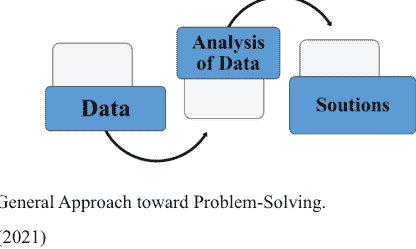

图 1.1 解决问题的总体方法。

来源：Khang (2021)

在这种情况下，Google 和 Microsoft 创建了许多可用于从各种来源收集信息的应用程序。像 Microsoft Excel 这样的工具在处理数据和为分析准备数据之前提供某种预处理。

计算机应用程序的进一步发展提供了分析工具，可提供用于决策的实践信息，并具有一定程度的预测。

许多组织是基于产品的，具有共同领域，例如营销、财务、人力资源、运营和供应链管理。从更广的视角来看，所有组织都在追求共同的盈利目标；因此，假设组织可能面临类似问题或处于不同情况。因此，为了做出决策，组织会与数据一起开发案例。基于此情况的此类结果、成果或决策导致框架/模型的开发，该框架/模型可在一定程度的问题和某些数据集下使用。

许多研究试图采用该模型并创建基于计算机应用程序的平台，在该平台中可以加载数据、设置情况，并在应用之前测试结果。这种方法的最佳例子是云计算，我们可以在其中共享软件和基础设施即服务并测试我们的结果 (Rani et al., 2023)。

此外，如果该模型与人工智能 (AI) 结合应用，则解决方案可以直接应用并在数据集上进行测试。因此，在当前时代，人工智能中心模型更受青睐，用于商业决策 (Khang et al., 2023a)。

### 1.2 文献综述

文章《AI in Strategic Marketing Decision-Making》的作者已确定人工智能在战略营销决策中的应用存在研究空白。他们强调需要在此领域开展更多研究，以实现人工智能在战略营销决策中的有效实施 (Stone et al., 2020)。这要求研究人员收集和分析更多数据以开发适合决策的模型 (Khang et al., 2023b)。总体而言，本研究强调了进一步研究人工智能在战略营销中的使用及其潜在益处的必要性。

Nayal (2022) 探讨了人工智能在营销策略制定中的潜在作用。作者认为人工智能可有效用于应对外部偶发事件，例如大量数据、不确定的环境条件和有限的管理认知。通过使用人工智能分析数据并生成洞察，营销人员可以创建信息丰富且有效的策略。

Gang (2007) 为 B2B 营销中人工智能的采用创建了一个全面的概念框架。据作者称，人工智能采用的驱动因素是当前营销的不足以及信息造成的外部压力。

作者还确定了人工智能采用的七个结果，包括效率提升、准确性提升、更好的决策、改善的客户关系、销售额增加、成本降低和风险降低。

作者利用信息处理理论和组织学习理论创建了一个综合概念框架，解释了 B2B 营销中每个人工智能采用构件之间的关系。

Meyer (2020) 探讨了企业如何利用人工智能在市场上获得竞争优势并做出明智决策。研究重点关注计算机介导的人工智能代理在检测与企业事件相关的危机中的作用。

由于危机可能对组织绩效产生重大影响，研究提出了一个结构模型，该模型采用统计和情感大数据分析来检测与业务活动相关的关键事件。研究结果表明，分析日常数据通信，例如电子邮件通信，可以为及时检测和有效管理危机提供有价值的见解。

总体而言，研究强调了人工智能在危机管理中的潜力，并强调了数据驱动策略对 B2B 市场高效有效决策的重要性。研究为寻求利用人工智能增强市场参与度和竞争优势的企业提供了宝贵的见解。

López Jiménez (2021) 旨在了解人工智能和自动化在通信行业中的当前和日益增长的影响，并确定应对其影响所需的技能和培训。

研究结果表明，通信专业人员需要两种类型的培训：首先，获得当前人工智能和自动化工具的经验，其次，专注于培养人工智能无法复制的人类特质。

总体而言，研究强调了应对人工智能和自动化对通信行业影响的重要性，并建议与技术进步同步发展人类技能。本研究为寻求适应行业不断变化的格局的通信专业人员提供了宝贵的见解。

### 1.3 以人工智能为中心的商业模式

被认为是对所有事件的焦点的数据可以根据社交媒体、健康应用程序、配送应用程序（食品、杂货、药品等）的利用以及目前产生大量数据的许多其他应用程序从多个来源收集 (Khang et al., 2023c)。

新兴组织可以捕获这些数据并产生更多创业机会。计算机软件开发人员将其视为通过机器学习 (ML) 学习系统的机会，并创建基于人工智能的应用程序，该应用程序可以是新产品或服务，用于创建一些新的基于人工智能的应用程序，如图 1.2 所示。


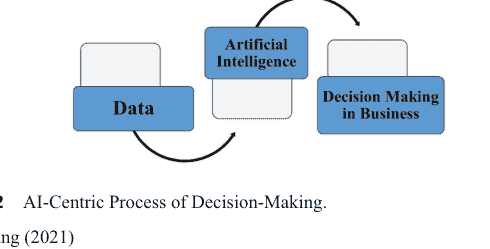

## 图 1.2 以 AI 为中心的决策流程。

来源：Khang (2021)

AI 指的是系统基于算法进行学习的能力。此外，一些技术前沿有助于 AI 进行决策，即深度学习和大数据（Bhambri 等，2022）。

在当今复杂的时代，问题并非简单而是更加复杂，决策所需的数据完全是未结构化的格式。因此，非结构化格式的数据必须经过某种预处理并形成相似的格式，才能输入到机器学习算法中。用于收集数据的工具包括企业资源规划系统，以及通过 Excel、逗号分隔值等各种应用捕获的数据，以及 NoSQL 云服务等第三方工具（Rani 等，2023）。

收集到的数据需要使用提取、转换和加载（ETL）流程进行格式化。ETL 报告必须输入到一个用任何语言（如 Python、R 或 Java）开发的算法中。

数据必须提供给 AI 流程以处理异常检测，且算法可能预测出可直接基于人工干预应用的决策。以 AI 为中心的流程如图 1.3 所示。

人工智能可以做出决策，但决策不仅基于事实和数字，还基于组织的愿景、使命以及长期和短期战略，而这些只能由人类来分析。

此外，AI 需要数据输入来处理并获得期望的输出，但如何收集或生成数据对每个人来说仍然是一个问题。要测试用于决策的程序或系统应用，理解输入过程和期望输出至关重要。

决策过程大多需要结构化数据，每个组织都有收集结构化数据的流程。目前，数据通过计算机系统收集，方式包括分享 Google 表单或问卷，或通过基于 Android/iOS 的应用捕获。

通过第三方工具收集或捕获的数据大多是结构化数据。基于收集到的数据，应用 ETL 流程将这些数据转换为有意义的结果。一旦从所有来源提取数据，就通过 AI 模型进行分析，并根据合适的模型得出结果。

这是针对一个问题可能通过所呈现模型解决的机制，但正如系统所表达的，一个问题的输出可以成为另一个问题的输入。因此，需要将其存储在数据库或数据集中以备后续使用。

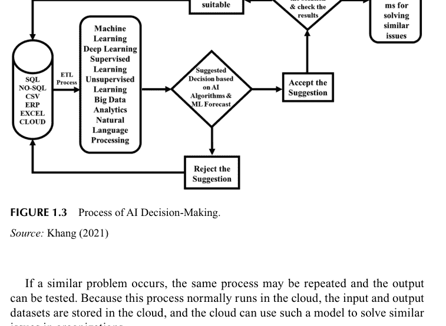

## 图 1.3 AI 决策过程。

> 来源：Khang (2021)

如果出现类似问题，可以重复相同过程并测试输出。由于此过程通常在云端运行，输入和输出数据集存储在云端，云端可以使用此类模型来解决组织中的类似问题。

有许多 AI 模型用于决策的示例，例如医疗保健、零售、制造、银行、金融等许多领域（Praveen 等，2023）。以下是一些案例：

- 早期癌症检测需要 CT 扫描，放射科医生负责检查 CT 扫描报告并验证是否发现癌细胞。中国利用所有可用图像训练系统，AI 算法通过图像处理可以直接诊断癌细胞。
- AI 可以帮助审查来自不同来源的求职申请，并根据职位描述中输入的关键词以及简历或求职信中的关键词选择最合适的候选人。这减少了人力资源经理的手动工作，并提供了稳健的工作环境。
- 基于 AI 的算法研究实时数据和地理位置趋势分析，为营销人员提供了一个平台，以决定采用哪些策略来推出新产品或营销现有产品。

如今，所有领先组织的生命周期项目管理都由 AI 应用处理。

聊天机器人和其他应用可以帮助预测用户搜索的模式，以预测特定地理位置所需的产品和服务。

还有更多案例表明，用户相信 AI 可以捕捉偏好、喜欢和不喜欢，从而创建能简化他们生活的流程。

例如，出租车司机安装一个移动应用，可以提供出租车的实时地图位置。家长安装的应用可以检查孩子是在教室里还是在外面闲逛。

基于 AI 和物联网支持的应用可以简化用户的生活，并使他们有能力决定是继续使用这些服务还是转向其他服务（Rani 等，2021）。

AI 不仅是计算机科学的一个流行词或特殊功能；它与其他计算机科学领域合作，如机器学习、深度学习、大数据分析和自然语言处理。人工智能使用多种编程语言，并支持多种工具来记录数据以及构建基于数据的模型算法。

AI 有三个阶段：辅助智能，即数据的洞察与人类共享以做出决策；增强智能，即利用机器学习能力生成结果；以及完全自动化，即输入、流程、输出和决策都由 AI 处理（Dordevic，2022）。

AI 决策意识到在有或没有人类支持的情况下测量数据的过程，以便为复杂问题做出准确决策。此外，AI 可以处理大数据、从不同来源收集的数据、当前趋势、异常和数据整理，以在有或没有人工干预的情况下生成最终决策（Khang 等，2023e）。

AI 基于解决任何问题所需的所有集群创建模型；集群包括技术和数据源。基于该模型，生成预测并做出决策。结构模型布局如图 1.4 所示。

AI 集群为决策提供支持、为解决方案提供论证，或自动化解决方案。在所有三个参数中，决策都需要两个重要参数：时间框架和问题的复杂性。

时间框架用于检查业务中的新机会、问题或威胁，而复杂性则决定情况。

AI 集群可以决定数据处理并从其信息能力中学习。学习能力使得能够基于数据收集构建模型。这些模型可用于确定可用的数据和信息。

最简单的例子是电子商务网站，任何产品都可以购买。AI 应用根据已购买的产品推荐另一个产品。这种策略或过程增加了另一个产品被购买的概率。

AI 用于决策，以实现无差错处理、业务模型全天候可用、在正确的时间做出正确的决策，以及增强现有市场或抢占新市场。然而，AI 在决策中也存在一些问题，包括高成本、缺乏创造力和缺乏人类复制能力。

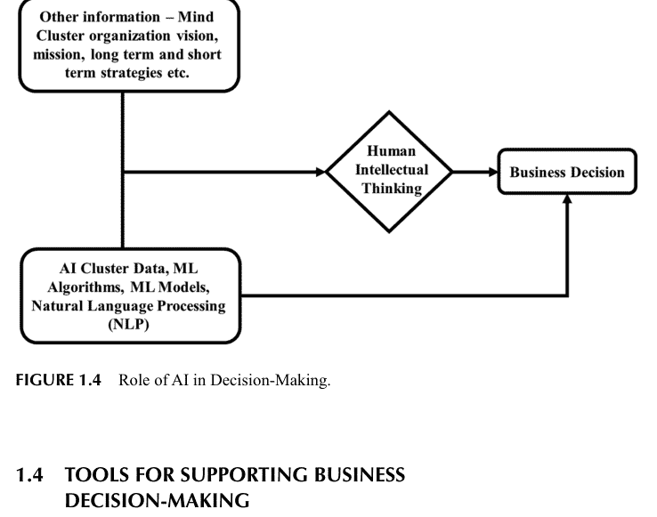

图 1.4 AI 在决策中的作用。

### 1.4 支持业务决策的工具

决策是一个关键过程，需要支持工具。ChatGPT 就是提供实用信息以及多种可使决策过程更简单的流程的工具之一。

商业分析为决策者提供决策所需的所有必要信息，如在线分析处理（OLAP）、高级分析、数据仓库和数据市集。数据挖掘通过商业智能（BI）工具有助于决策，如 OLAP、结构化查询语言（SQL）、NoSQL 和 BI 报告工具。

由大数据、AI 和机器学习（ML）驱动的 AI 被用于决策。基于人工智能的工具根据数据创建配置，然后通过将数据转换为所需格式来收集、同步和分析数据。下一步根据期望输出应用一些规则，然后解决问题以支持组织中工作人员的决策。

基于所呈现方法的最重要软件工具是优势、劣势、机会和威胁（SWOT）图。它有助于将数据或信息划分为四个象限，即优势、劣势、机会和威胁，然后解决问题。

其他工具包括决策矩阵、帕累托分析等，可以识别问题、收集信息、确定备选方案、收集证据、在备选方案中进行选择，并做出和审查决策。


#### 1.4.1 支持业务决策的以人工智能为中心的工具

人工智能始终涉及大数据、机器学习和神经网络。这些工具被用于在复杂场景中做出决策：如果一个组织试图推出新产品或进入新市场，它需要分析市场的优先级，即当前人群的最优解决方案；调查当地需求；预测解决方案；并进行结果实验。AI工具能够优化与寻找新细分市场相关的各种问题的预测和风险管理。在其他一些问题中，AI工具可以为决策者提供解决方案，以便在市场中进行实验。

人工智能有所贡献的另一个领域是战略变革，其中战略决策的变化可能会破坏整个生态系统，而战略层面需要完整的规划、严格的管理、减少运营延迟并提高质量。人工智能可以使这些变革更快、更安全。

人工智能工具对客户管理非常有用；聊天机器人应用提供了不同层次的用户体验。

此外，人工智能正通过预测趋势和模式来努力对所有用户进行个性化，这些趋势和模式不仅可用于客户分层，还可用于决策层面，因为客户是任何业务绩效管理或辅助中最重要的利益相关者。这是AI工具帮助决策者评估哪些策略有效、哪些无效并就如何调整做出决策的另一个领域。

在AI工具的支持下，人们可以做出小决策来解决复杂问题、发起战略变革、评估风险，并评估提升业务绩效的策略。

#### 1.4.2 ChatGPT 用于业务决策

ChatGPT是许多人用来为各种流程收集数据的流行词。它是一款基于AI的软件，可以根据深度学习算法生成的模式来搜索结果。ChatGPT将搜索历史作为输入条件，并根据问题陈述提供结果。

搜索可以基于组织面临的任何实时问题/难题，例如寻找可用于增加利润的工具、为特定产品推广战略，以及任何其他实时问题，这些问题可以根据用户能够思考和做出决策的数据来生成数据。ChatGPT的功能如图1.5所示。

ChatGPT使企业能够自动化许多服务，例如客户关系服务。它还可以用于提供改进后的客户服务，因为它能理解对话上下文并提供量身定制的响应。这帮助企业节省时间和资源，因为他们不必手动回复每位客户的咨询。

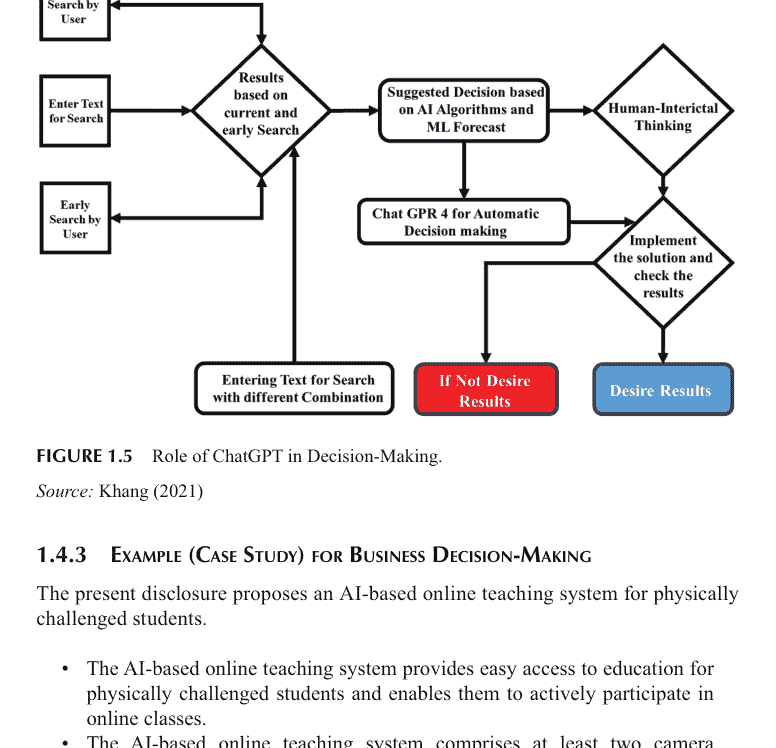

### 图 1.5 ChatGPT在决策中的作用。

来源：Khang (2021)

#### 1.4.3 业务决策示例（案例研究）

本公开提出了一种面向残障学生的基于AI的在线教学系统。

- 该系统为残障学生提供了便捷的教育途径，使他们能够积极参与在线课程。
- 该系统包括至少两个摄像头模块、一个手语识别模块、一个交流转换模块和一个指点设备。
- 该系统是一种适合使用各种电子设备（如手机、笔记本电脑和带摄像头的计算机）进行在线课程的应用程序。
- 该系统监测学生的健康参数，并在检测到任何异常时提醒家人和医院（Divvela et al., 2023）。

由于COVID-19疫情暴发，数量空前的儿童、青少年和成人无法亲身到学校或大学上课。许多教育机构选择在线辅导或在线课程，以尽量减少教育中断并促进学习的连续性。

然而，即使是在线教学也存在许多问题。教师难以监控学生并与他们互动。教师无法获得关于学生是否理解课程的准确信息。学生难以跟上在线课程，因为他们与教师之间的互动减少，从而失去了兴趣。

现有系统在每个教室使用摄像头监控学生上课期间的学习和行为。现有系统收集的数据随后通过软件应用程序传输给教师或家长的移动设备。当摄像头识别到学生的面孔时，系统还会记录课堂出勤情况。

然而，该系统只有在学生到校时才能工作，因为分析学生行为的摄像头固定在教室上方。适当的课堂监控和互动是教师和学生面临的主要问题。随着在线学习的出现，对于残障学生来说，教育不再困难。

许多学院和大学已开始运行在线学习平台。如今，虚拟校园的概念正在迅速发展，越来越多的残障学生正在入学。技术在为残障学生提供完善的学习解决方案方面也发挥着关键作用。

尽管存在在线学习，残障学生仍然面临困难。根据一项研究（由 Babasaheb Jadhav、Alex Khang、Ashish Kulkarni、Pooja Kulkarni 和 Sagar Kulkarni 设计和开发），约56.5%的残障学生正在努力适应在线课程，而约77%的学生因无法获得远程学习方法而无法参加这些课程，并在学习中落后。教师也无法对所有学生给予同等关注。

此外，86%的学生和家长没有足够的技术使用知识。因此，需要一种面向残障学生的基于AI的在线教学系统，以便在在线课程中对他们进行监控和帮助。

- 需要一种基于AI的在线教学系统，该系统监测学生的健康参数，并在检测到任何异常时提醒家人和医院。
- 需要一种基于AI的在线教学系统，将课程转换为适合在同一平台上参加课程的所有人理解的适当格式。
- 需要一种基于AI的在线教学系统，适合使用各种电子设备（如手机、笔记本电脑和带摄像头的计算机）进行在线课程。

### 1.5 结论

当前时代被认为是最具竞争性的时代，我们需要不断更新以满足客户随时变化的期望。人工智能在让我们保持更新和增强竞争优势方面发挥着重要作用。

计算机技术提升了工业组织中的决策流程，并减少了人工任务。基于AI的聊天机器人应用程序就是一个例子，用户可以通过更频繁的交互来解决他们的疑问。

同样，与聊天机器人类似，多种基于AI的软件被创建、设计和开发，以提高生产力、效率、效能、决策速度、盈利能力、客户服务率、营销策略创意、情感分析和销售预测的准确率。

人工智能是业务决策中非常强大的工具。它在决策以及创建能够促成决策的业务生态系统方面具有重要的核心价值和属性（Rana et al., 2021）。

AI提供的建议有助于在复杂环境中获取和测试解决方案。许多AI系统基于云端；AI作为云服务可以通过相似的外围设备实现共享决策（Khanh & Khang, 2021）。

## 参考文献

- Bhambri P., Rani S., Gupta G., Khang A., (2022). *面向物联网的云计算与雾计算平台*. CRC Press. https://doi.org/10.1201/9781003213888
- Divvela V. S. K., Chaurasia R., Misra A., Misra P. K., Khang A., (2023). “使用机器学习预测心脏病和肝病，”载于 *医疗生态系统中的以数据为中心的AI解决方案与新兴技术*，第4页（第1版）。CRC Press. https://doi.org/10.1201/9781003356189-13
- Dordevic M., (2022年8月23日). *人工智能如何提升组织决策*. www.forbes.com/sites/forbestechcouncil/2022/08/23/how-artificial-intelligence-can-improve-organizational-decision-making/
- Khang A., (2021). “Material4Studies，” *计算机科学、人工智能、数据科学、物联网、区块链、云计算、元宇宙、网络安全的学习材料*. www.researchgate.net/publication/370156102_Material4Studies
- Khang A., Gupta S. K., Hajimahmud V. A., Babasaheb J., Morris G., (2023a). *以AI为中心的建模与分析：概念、设计、技术与应用*（第1版）。CRC Press. https://doi.org/10.1201/9781003400110
- Khang A., Rani S., Gujrati R., Uygun H., Gupta S. K., (编). (2023b). *面向工业4.0的劳动力管理系统设计：以数据为中心与AI赋能的方法*. CRC Press. https://doi.org/10.1201/9781003357070
- Khang A., Rana G., Tailor, R. K., Hajimahmud V. A., (编). (2023c). *医疗生态系统中的以数据为中心的AI解决方案与新兴技术*. CRC Press. https://doi.org/10.1201/9781003356189
- Khang A., Hahanov V., Litvinova E., Chumachenko S., Triwiyanto, Hajimahmud V. A., Nazila Ali R., Vusala Alyar A., Anh P. T. N., (2023d). “医疗生态系统中医院接待分析，”载于 *医疗生态系统中的以数据为中心的AI解决方案与新兴技术*，第4页。CRC Press. https://doi.org/10.1201/9781003356189-4
- Khang A., Rani S., Gujrati R., Uygun H., Gupta S. K., (编). (2023e). *面向工业4.0的劳动力管理系统设计：以数据为中心与AI赋能的方法*. CRC Press. https://doi.org/10.1201/9781003357070
- Khanh H. H., Khang A., (2021). “人工智能在区块链应用中的作用，” *通过人工智能重塑制造与业务流程*, 2(20–40)（CRC Press）. https://doi.org/10.1201/9781003145011-2
- López Jiménez E. A., (2021). “人工智能（AI）与自动化对传播专业人士影响的探讨，” *社会中的信息、传播与伦理杂志*, 19(2), 249–267. www.emerald.com/insight/content/doi/10.1108/JICES-03-2020-0034/full/html


Meyer C. C. (2020). “从自动机到算法：使用人工智能实现服务的自动化，” *服务管理杂志*, 31(2), 145–161. https://ieeexplore.ieee.org/abstract/document/8528677/

Nayal K. R. (2022). “探索人工智能在管理农业供应链风险中的作用，以应对 COVID-19 大流行的影响，” *国际物流管理杂志*, 33(3), 744–772. https://doi.org/10.1108/IJLM-12-2020-0493

Praveen Kumar M., Kumar N., Misra A., Khang A. (2023). “使用逻辑回归和随机森林分类器进行心脏病预测，” In *以数据为中心的 AI 解决方案和医疗生态系统中的新兴技术*, p. 6 (1st ed.). CRC Press. https://doi.org/10.1201/9781003356189-6

Rana G., Khang A., Sharma R., Goel A. K., Dubey A. K. (Eds.). (2021). *通过人工智能重塑制造和业务流程*. CRC Press. https://doi.org/10.1201/9781003145011

Rani S., Bhambri P., Kataria A., Khang A., Sivaraman, A. K. (2023). *大数据、云计算和物联网：工具与应用* (1st ed.). Chapman and Hall/CRC. https://doi.org/10.1201/9781003298335

Rani S., Chauhan M., Kataria A., Khang A. (Eds.). (2021). “用于智能医疗系统的物联网配备智能分布式框架，” *网络与互联网架构*, Vol. 2, p. 30. CRC Press. https://doi.org/10.48550/arXiv.2110.04997

Stone, M., Aravopoulou, E., Ekinci, Y., Evans, G., Hobbs, M., Labib, A., Laughlin, P., Machtynger, J. and Machtynger, L. (2020). “战略营销决策中的人工智能（AI）：一个研究议程，” The Bottom Line, Vol. 33 No. 2, pp. 183–200. https://doi.org/10.1108/BL-03-2020-0022

UNSCRAMBL (2021). 6 个鼓舞人心的以数据为驱动的公司示例（包含关键要点）。 *UNSCRAMBL*. https://unscrambl.com/blog/data-driven-companies-examples/

## 2 商业生态系统中机器学习模型的探索

*Akanksha Goel, Babasaheb Jadhav, Alex Khang, and Mily Lal*

### 2.1 引言

Industry 4.0 是一个术语，用于描述第四次工业革命，其中涉及将先进的知识，如人工智能（AI）、机器人技术和物联网（IoT）集成到制造流程中。Industry 4.0 正在对企业运营方式及其与生态系统的互动方式带来重大变化，如图 2.1 所示。

机器学习（ML）是推动这些变化的关键技术，使企业能够分析大量数据并进行预测、预测、自动化流程和优化运营（Khang et al., 2023c）。

机器学习是人工智能的一个子领域，专注于开发算法和统计模型，使计算机能够从数据中学习并在没有显式编程的情况下做出预测或决策（Khang et al., 2023a）。

换句话说，ML 涉及算法来识别数据中的模式和关系，然后利用这些知识对新数据做出预测或采取行动，如图 2.2 所示。算法旨在从数据中迭代学习，随着时间的推移改进其性能并提高其准确性（Chen et al., 2023）。

机器学习方法的类型如下：

1. **监督学习**：算法在标记的数据集上进行训练，其中期望的输出是已知的。算法识别数据输入和输出中的模式。
2. **半监督学习**：使用少量标记数据和大量未标记数据来开发模型。
3. **无监督学习**：算法在未标记的数据集上进行训练，其中期望的输出是未知的。算法在没有具体指导的情况下识别数据模式和结构。
4. **强化学习**：算法在数据集中采取行动以最大化奖励。它会收到对其行动成功或失败的反馈，并据此调整其行为。

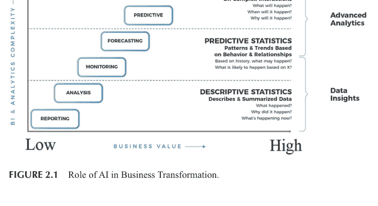

图 2.1 人工智能在业务转型中的作用。

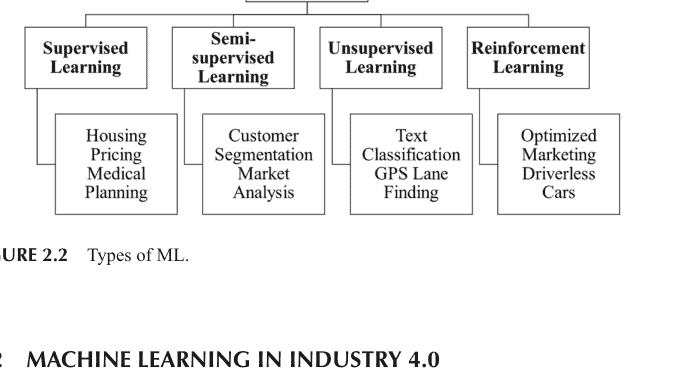

图 2.2 ML 的类型。

### 2.2 工业 4.0 中的机器学习

机器学习被广泛应用于各种应用中，例如人脸识别、语音识别、自然语言处理（NLP）、推荐系统、欺诈检测、预测性维护等。

随着数据变得越来越丰富和复杂，ML 正在成为寻求获得洞察、优化运营和创造有价值解决方案的组织必不可少的工具。

以下是 ML 在工业 4.0 中用于使企业及其生态系统受益的一些方式（Mohd et al., 2022）：

1. **预测性维护**：ML 算法可以预测设备是否可能成功或发生故障，减少停机时间，并提高可靠性和安全性。
2. **质量控制**：ML 算法可以分析产品的图像以识别缺陷和不规则性，使企业能够及早发现问题并减少浪费。
3. **供应链优化**：ML 算法可以通过分析供应商、物流服务提供商和客户的数据来优化供应链运营。这将导致成本降低，最小化交付时间，并增强客户满意度。
4. **自主系统**：ML 正在推动无人工系统的开发，例如无人驾驶汽车、无人机和机器人。这些技术可以独立执行任务，减少劳动成本并提高效率。
5. **能源管理**：ML 算法可以分析能源使用情况并识别浪费区域。它有助于减少碳足迹并节省成本。
6. **客户参与**：ML 算法可以分析客户数据以进行个性化营销和推荐，增加客户参与度和忠诚度。

总体而言，ML 使企业能够优化运营、降低成本并提高客户满意度。通过利用数据的力量，企业可以做出更明智的决策并创造新的增长和创新机会（Khang et al., 2024）。

#### 2.2.1 机器学习模型

机器学习模型在近年来已成为企业及其生态系统不可或缺的一部分。它们用于分析数据、发现模式和做出预测（Khang et al., 2023b）。企业使用的知名 ML 模型如下（Jamwal et al., 2022）：

1. **回归模型**：这些用于根据其他变量预测连续变量，例如销售额或收入。这些模型通常用于金融和营销中以预测未来表现。
2. **决策树**：这些基于一组规则用于决策。这些模型通常用于金融、医疗保健和零售中，以对客户细分和风险分析做出决策。
3. **随机森林**：它是一种结合多个决策树以增强预测正确性的方法。该模型通常用于金融、医疗保健和电子商务。
4. **支持向量机**：它们用于分类任务，例如预测客户是否会流失。这些模型通常用于营销、金融和医疗保健（Vrushank & Khang, 2023）。
5. **神经网络**：它们用于复杂任务，例如人脸识别和 NLP。这些模型用于医疗保健、金融和电子商务。
6. **聚类**：它用于对相似数据点进行分组。该模型通常用于营销和客户细分。
7. **协同过滤**：该模型用于根据用户行为做出推荐。它通常用于电子商务和娱乐。

#### 2.2.2 工业 4.0 机器学习的技术特性

随着工业 4.0 的不断发展，ML 很可能在优化运营、提高质量和增强安全方面发挥越来越重要的作用（Mazzei & Reshawn, 2022）。以下是一些与工业 4.0 相关的 ML 技术特性（Rahul et al., 2021）。

1. **大数据分析：** ML 算法需要大量数据进行学习，而工业 4.0 从传感器、机器和其他连接设备产生大量数据。大数据分析是一种使组织能够收集、处理、分析和存储这些数据以生成洞察并优化运营的技术（Rani et al., 2023）。

2. **边缘计算：** 工业 4.0 需要实时处理和决策能力，这对于传统的基于云的架构来说可能具有挑战性（Bhambri et al., 2022）。边缘计算是一种使数据处理和分析能够在边缘设备（如传感器和机器）上本地执行的技术，减少延迟并提高响应能力（Jahanov et al., 2022）。

3. **人工智能：** ML 是 AI 的一个子集，使系统能够从数据中学习并做出预测。诸如 NLP、计算机视觉和深度学习等技术越来越多地用于工业 4.0 应用中，以自动化任务、提高质量和增强安全（Rana et al., 2021）。

4. **机器人技术和自动化：** 工业 4.0 涉及物理和数字技术的结合，机器人技术和自动化在这种集成中发挥着至关重要的作用。机器学习算法可以优化机器人和自动化系统，使其更高效、灵活和适应性更强。

5. **预测性维护：** ML 算法用于分析数据并在需要时预测维护。这使组织能够主动进行维护。

6. **网络安全：** 工业 4.0 涉及多个系统的集成，创造了新的网络安全风险。机器学习算法用于检测和防止网络攻击，识别可能表明恶意活动的异常和模式。

#### 2.2.3 使用机器学习的工业 4.0 中的挑战

工业革命 4.0 是制造业自动化的当前趋势（Jan et al., 2022）。它涉及先进技术，例如 IoT、AI 和 ML（Peres et al., 2020）。工业 4.0 中使用 ML 技术的一些问题是（Parthasarathy et al., 2022）：

- 1. **数据质量**：机器学习模型需要高质量的数据进行训练和测试，而数据质量会显著影响模型的性能。在工业 4.0 中，产生的大量数据既是福音也是祸害。从传感器和其他物联网设备收集的数据质量可能不可靠、不真实、不完整或不准确，导致机器学习模型出现缺陷（Khang et al., 2022b）。
- 2. **安全与隐私**：物联网设备在工业 4.0 中的集成带来了潜在的安全和隐私风险。随着大量数据的收集，公司需要确保数据安全且不易受到网络攻击。还存在数据泄露的风险，可能导致敏感数据暴露（Khang et al., 2022a）。
- 3. **模型可解释性**：机器学习模型可能很复杂，很难理解它们如何做出预测或决策。这种可解释性不足在工业 4.0 面前可能是一个重大挑战，因为安全和质量是关键因素。向利益相关者或监管机构解释机器学习模型决策背后的推理可能很困难。
- 4. **专业知识有限**：机器学习需要数据科学、统计学和编程方面的专业知识。许多公司可能没有必要的内部专业知识，可能需要外包或聘请专业人员。招聘和培训具备必要专业知识的员工的成本对于中小企业（SMEs）来说可能是一个重大挑战。
- 5. **实施成本**：在工业 4.0 中实施机器学习可能很昂贵，因为它需要对硬件、软件和人员进行投资。对于可能没有财务资源在其制造过程中实施机器学习的中小企业来说，这可能是一个重大挑战。
- 6. **伦理问题**：机器学习可能引发伦理问题，尤其是在影响人类决策时。例如，用于招聘或晋升决策的算法可能对某些群体产生歧视。解决伦理问题至关重要。

### 2.3 文献综述

机器学习模型在近年来彻底改变了企业运营方式。随着每天产生的数据量不断增加，企业开始利用机器学习模型做出数据驱动的决策。本文献综述将探讨商业生态系统中机器学习模型的最新进展。

Zhang et al. (2020) 对商业智能应用的深度学习技术进行了全面概述。他们讨论了深度学习模型在数据预处理、特征选择和分类任务中的潜力。他们还强调了在现实商业应用中实施深度学习模型的挑战。

Khang et al. (2023d) 对机器学习在商业中的应用进行了综述，并确定了未来研究的空白和机会。他们讨论了可解释性、公平性和伦理在商业应用机器学习模型中的重要性。

Haleem et al. (2022) 分析了机器学习模型在商业分析中的作用。他们讨论了机器学习模型在客户细分、预测建模和欺诈检测中的潜力。他们还强调了机器学习应用中可解释性和伦理考虑的重要性。

Eric et al. (2016) 探讨了机器学习和大数据分析在会计和金融中的应用。他们讨论了机器学习模型在财务预测、风险管理和欺诈检测中的潜力。他们强调了机器学习技术中数据质量、隐私和安全方面的挑战。

Khang et al. (2024) 讨论了机器学习模型在营销应用中的潜力。他们探讨了机器学习模型在客户细分、个性化营销和客户流失预测中的使用。该研究进一步强调了机器学习应用中可解释性、公平性和隐私的重要性。

多项研究已探讨了机器学习模型在商业中的不同应用，包括客户细分、推荐系统、欺诈检测、情感分析和预测分析。例如，Khoury et al. (2020) 使用机器学习算法预测电信行业中的客户流失，而 Chen et al. (2021) 开发了用于股票价格预测的深度学习模型。

研究表明，机器学习模型为企业提供了多项益处，包括提高准确性、效率和成本节约。例如，Vukovic et al. (2020) 发现机器学习模型通过减少等待时间提高了客户满意度，而 Tan et al. (2021) 表明机器学习算法可以通过预测需求和降低库存成本来改善供应链管理。

尽管有这些益处，机器学习模型仍为企业带来了一些挑战，包括数据质量、隐私问题和伦理问题。

例如，Verma et al. (2021) 强调了在医疗保健中使用机器学习模型的伦理考虑，而 Kaur et al. (2021) 讨论了为中小企业开发机器学习模型的挑战。

此外，研究还探讨了机器学习模型对商业生态系统的影响，包括数据、协作和创新的作用。

例如，Gomes et al. (2021) 讨论了学术界与工业界之间协作的重要性，以开发满足业务需求的机器学习模型，而 Soliman et al. (2021) 强调了开放创新在机器学习模型开发中的作用。

### 2.4 商业生态系统的机器学习框架

在使用机器学习解决商业问题时，建立一个结构化和有组织的框架非常重要（Kekare et al., 2022），如图 2.3 所示。

以下是创建商业问题机器学习框架可以遵循的一些步骤，如下图所示：

- 1. **定义问题：** 这涉及理解问题陈述、定义目标并确定将用于衡量成功的关键绩效指标（KPIs）。

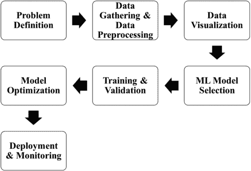

**图 2.3** 商业及其生态系统的机器学习框架。

- 2. **收集和预处理数据：** 收集相关数据以训练机器学习模型。这涉及识别数据源、收集数据以及清理和预处理数据以确保准确性和可用性。
- 3. **探索和可视化数据：** 收集和预处理的数据用于探索和可视化洞察、模式和关系。这涉及使用描述性统计和可视化工具来理解数据并识别任何趋势或异常。
- 4. **选择机器学习模型：** 根据问题陈述、目标和 KPI，需要选择合适的机器学习模型。这涉及识别问题（分类或回归）、选择合适的算法以及选择相关特征和超参数。
- 5. **训练和验证模型：** 使用预处理数据训练和验证模型至关重要。
- 6. **优化模型：** 训练和验证后的模型需要优化以提高性能。这涉及微调超参数、选择不同特征以及探索不同的算法或架构。
- 7. **部署和监控模型：** 模型优化后，需要部署到生产环境中。这涉及将模型集成到现有的业务系统和流程中，并随着时间的推移监控其性能，以确保其继续满足目标和 KPI。

如今，开发结合不同算法和技术以提高准确性和性能的混合机器学习模型的趋势正在增加。

这些模型已应用于各种商业问题，例如欺诈检测、客户细分和需求预测。商业及其生态系统中的一些创新混合机器学习模型如下：

- 1. **随机森林–极限梯度提升（RF–XGBoost）模型**：RF–XGBoost 模型是一种混合机器学习模型，结合了随机森林和极限梯度提升算法的优势。该模型已应用于各种商业环境，例如信用评分、欺诈检测和客户细分。
- 2. **长短期记忆–卷积神经网络（LSTM–CNN）模型**：LSTM–CNN 是一种混合深度学习模型，结合了长短期记忆和卷积神经网络算法的优势。该模型已应用于各种商业环境，例如股票价格预测、情感分析和图像识别。
- 3. **集成模型**：集成模型是结合多种算法和技术以提高准确性和性能的混合机器学习模型。集成模型已应用于各种商业环境，例如需求预测、客户流失预测和信用评分。
- 4. **自动化机器学习（AutoML）**：AutoML 是一种使用自动化来优化算法和技术选择与组合的混合机器学习模型。自动化机器学习已应用于各种商业环境，例如预测性维护、需求预测和客户流失预测。

### 2.5 机器学习模型的性能分析

确保各种应用的有效性和适用性至关重要。工业 4.0 在制造过程中涉及物联网、人工智能和机器学习等技术。

机器学习模型在工业 4.0 中的应用提供了诸多益处，包括提高效率、生产率和盈利能力。然而，这些模型的性能可能受到多个因素的影响，包括数据集的大小和复杂性、数据质量以及算法选择。

若干指标可用于分析工业 4.0 下商业生态系统中机器学习模型的性能，包括准确率、精确率、召回率等。这些指标根据模型正确分类数据和做出准确预测的能力来评估其性能。

此外，机器学习模型的性能还可从其速度和资源利用率方面进行分析。这可以通过测量模型的训练和预测时间并评估其资源需求（如内存和计算能力）来实现。

机器学习模型性能分析的另一个方面是其适应变化条件并从新数据集中学习的能力。这可以通过在不同数据集上测试模型并评估其泛化到新数据以及适应输入数据变化的能力来评估。

在工业 4.0 下商业生态系统中对机器学习模型的整体性能分析对于其成功实施和利用至关重要（Ramesh & Nagarajan, 2019）。


通过分析其性能（Khoury et al., 2020），企业可以识别改进领域并优化这些模型的使用，以实现其预期成果（Tan et al., 2021），如表 2.1 所示。

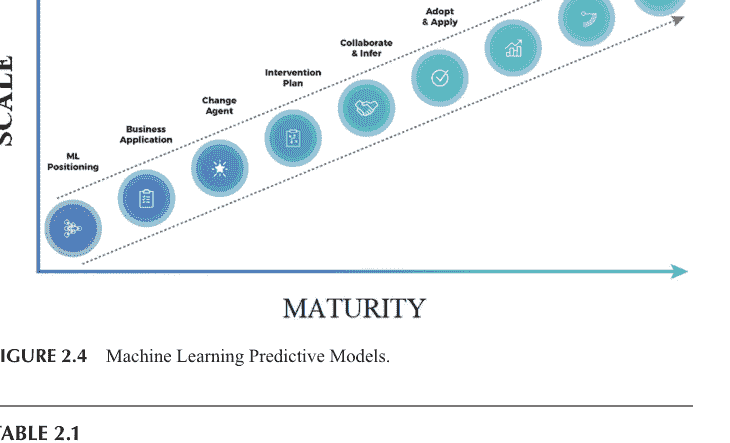

## 图 2.4 机器学习预测模型。

## 表 2.1
机器学习模型的比较。

| 编号 | 模型 | 优点 | 缺点 | 最适合用于 |
|---|---|---|---|---|
| 1 | 线性回归 | 简单且易于解释 | 仅限于线性关系 | 预测连续数值 |
| 2 | 逻辑回归 | 适用于二元分类任务 | 输入与输出之间存在线性关系 | 预测二元结果 |
| 3 | 决策树 | 易于解释和可视化 | 容易拟合数据 | 分类和回归任务 |
| 4 | 随机森林 | 可处理大型数据集和高维输入空间 | 比决策树更复杂 | 分类和回归任务 |
| 5 | 支持向量机 | 擅长处理高维数据 | 需要调优超参数 | 分类和回归任务 |
| 6 | 朴素贝叶斯 | 简单且快速 | 假设特征之间相互独立 | 文本分类和垃圾邮件过滤 |
| 7 | 神经网络 | 可处理复杂关系和非线性数据 | 需要大量数据用于训练和验证 | 人脸识别、自然语言处理和语音识别 |

### 2.6 结论

机器学习模型在工业 4.0 下的当今商业生态系统中变得日益必不可少。这些模型可以帮助企业做出精确的预测和模式，改善决策速度，并从庞大而复杂的 数据集中获得有价值的见解。我们可以找到各种机器学习模型，每个模型都有其优缺点，具体取决于特定应用。

首先，必须指出的是，机器学习在企业中的成功实施需要仔细考虑数据质量和规模、问题的复杂性以及应用目标。

随着机器学习技术的不断发展和完善，它必将在业务运营和决策过程中发挥重要作用。

## 参考文献

Bhambri P., Rani S., Gupta G., Khang A., (2022). *物联网的云计算和雾计算平台*. CRC Press. https://doi.org/10.1201/9781003213888

Chen C., Jiang F., Zou Y., Qiao Y., (2021). “基于深度学习的股价预测，使用金融新闻和技术指标，” *商业研究杂志*, 124, 108–119. www.sciencedirect.com/science/article/pii/S0020025522001499

Chen T., Sampath V., May M. C., Shan S., Jorg O. J., Aguilar Martín J. J., Stamer F., Fantoni G., Tosello G., Calaon M., (2023). “面向工业 4.0 的制造领域机器学习：从‘for now’到‘four-know’，” *应用科学*, 13, 1903. www.mdpi.com/2076-3417/13/3/1903

Eric P. X., Qirong H., Pengtao X., Dai W., (June 2016). “大数据上分布式机器学习的策略与原则，” *工程*, 2(2), 179–195. https://doi.org/10.1016/J.ENG.2016.02.008

Gomes J. P., Lima C. V., Pereira, P. S., (2021). “机器学习研究：关于产业合作的系统文献综述，” *商业研究杂志*, 133, 157–167. www.sciencedirect.com/science/article/pii/S1574013719303193

Hahanov V., Khang A., Litvinova E., Chumachenko S., Hajimahmud V. A., Alyar V. A., (2022). “智慧城市的关键助手——传感器和工具，” In *以人工智能为中心的智慧城市生态系统：技术、设计与实现*, Vol. 17, No. 10 (1st ed.). CRC Press. https://doi.org/10.1201/9781003252542-17

Haleem A., Javaid M., Qadri M. A., Singh R. P., (2022). “人工智能（AI）在营销中的应用：基于文献，” *国际智能网络杂志*, 3, 119–132. https://www.sciencedirect.com/science/article/pii/S2666603022000136

Jan Z., Farhad A., Wolfgang M., Niki P., Georg G., Markus S., Ana K., (2022). “工业 4.0 的人工智能：应用、挑战和机遇的系统综述，” *应用专家系统*, 216. www.sciencedirect.com/science/article/pii/S0957417422024757

Kaur H., Singh R., Kaur P., (2021). “开发中小企业机器学习模型的挑战，” *商业研究杂志*, 135, 42–51. www.sciencedirect.com/science/article/pii/S0148296312009905

Khang A., Hahanov V., Abbas G. L., Hajimahmud V. A., (2022a). “赛博物理社会系统与事件管理，” In *以人工智能为中心的智慧城市生态系统：技术、设计与实现*, Vol. 2, No. 15 (1st ed.). CRC Press. https://doi.org/10.1201/9781003252542-2

Khang A., Chowdhury S., Sharma S., (2022b). 数据驱动的区块链生态系统：基础、应用与新兴技术 (1st ed.). CRC Press. https://doi.org/10.1201/9781003269281

Khang A., Gujrati R., Uygun H., Tailor R. K., Gaur S. S. 商业与金融中的数据驱动建模与预测分析. ISBN: 9781032600628. (1st Ed.). (2024) CRC Press. https://doi.org/10.1201/9781032600628

Khang A., Gupta S. K., Hajimahmud V. A., Babasaheb J., Morris G., (2023a). 以人工智能为中心的建模与分析：概念、设计、技术与应用 (1st ed.). CRC Press. https://doi.org/10.1201/9781003400110

Khang A., Gupta S. K., Hajimahmud V. A., Babasaheb J., Morris G., (2023b). 以人工智能为中心的建模与分析：概念、设计、技术与应用 (1st ed.). CRC Press. https://doi.org/10.1201/9781003400110

Khang A., Misra A., Gupta S. K., Shah V., (2023e). 智能商业与生产中的 AI 辅助物联网技术与应用. CRC Press. https://doi.org/10.1201/9781003922224

Khang A., Vrushank S., Rani S., (2023c). 元宇宙时代的基于人工智能的技术与应用 (1st ed.). IGI Global Press. https://doi.org/10.4018/9781668488515

Khekare G., Turukmane A. V., Dhule C., Sharma P., Kumar Bramhan e L., (2022). “机器学习算法的实验性能分析，” In Qian Z., Jabbar M, Li X. (Eds.), 2021 年无线通信、网络和应用国际会议论文集. WCNA 2021. 电气工程讲义. Springer. https://link.springer.com/chapter/10.1007/978-981-19-2456-6_104

Khoury R., Semaan B., Yassin M., (2020). “预测电信行业客户流失的机器学习算法比较研究，” 商业研究杂志, 116, 56–66. www.sciencedirect.com/science/article/pii/S0167923616302020

Mazzei D., Reshawn R., (2022). “工业 4.0 的机器学习：基于深度学习主题建模的系统综述，” 传感器, 22, 8641. www.mdpi.com/1424-8220/22/22/8641

Mohd J., Abid H., Ravi Pratap S., Rajiv S., (2022). “工业 4.0 的人工智能应用：基于文献的研究，” 工业整合与管理杂志, 7(01), 83–111. www.worldscientific.com/doi/abs/10.1142/S2424862221300040

Parthasarathy R., Preethy A., Seow L. S., Hussin N., Ahamed R., Ramnathapuram S., (2022). 人工智能技术与方法下的工业 4.0 愿景, pp. 1314–1322. https://doi.org/10.1201/9781003145011

Peres R. S., Jia X., Lee J., Sun K., Colombo A. W., Barata J., (2020). “工业 4.0 中的工业人工智能——系统综述、挑战与展望，” IEEE 访问, 8, 220121–220139. https://ieeexplore.ieee.org/abstract/document/9285283/

Rahul R., Manoj Kumar T., Dmitry I., Alexandre D., (2021). “制造和工业 4.0 应用中的机器学习，” 国际生产研究杂志, 59(16), 4773–4778. www.tandfonline.com/doi/abs/10.1080/00207543.2021.1956675

Ramesh A., Nagarajan R., (2019). “机器学习技术及其在制造中的应用综述，” 制造程序, 31, 349–356. https://doi.org/10.1201/9781003145011

Rana G., Khang A., Sharma R., Goel A. K., Dubey A. K., (Eds.). (2021). 通过人工智能重塑制造和业务流程. CRC Press. https://doi.org/10.1201/9781003145011

Rani S., Bhambri P., Kataria A., Khang A., Sivaraman A. K., (2023). 大数据、云计算和物联网：工具与应用 (1st ed.). Chapman and Hall/CRC. https://doi.org/10.1201/9781003298335


Soliman H., Salama A., El-Gohary H., (2021). “人工智能时代的开放创新：文献见解，” *Technological Forecasting and Social Change*, 167, 120704. https://doi.org/10.1016/j.techfore.2021.120704

Tan R. R., Delos Reyes G. P., Bactol A., (2021). “供应链管理中的机器学习：系统文献综述，” *Journal of Business Research*, 133, 405–415. www.ijsom.com/article_2877.html

Verma A., Chaturvedi A., Chaturvedi V., (2021). “医疗保健中机器学习应用的伦理考虑，” *International Journal of Information Management*, 57, 102384. www.sciencedirect.com/science/article/pii/S0268401221001262

Vrushank S., Khang A., (2023). “医疗物联网（IoMT）推动医疗保健领域的数字化转型，” *Data-Centric AI Solutions and Emerging Technologies in the Healthcare Ecosystem*, p. 1 (1st ed.). CRC Press. https://doi.org/10.1201/9781003356189-2

Vukovic M., Petrovic J., Mladenovic R., (2020). “客户服务中心机器学习应用：系统综述，” *Journal of Business Research*, 118, 245–259. www.sciencedirect.com/science/article/pii/S0148296320305191

Zhang Z., Dai Y., Sun J., 基于深度学习的点云配准：概述. Volume 2, Issue 3, June 2020, Pages 222–246. https://doi.org/10.1016/j.vrih.2020.05.002

## 3 大数据与数据分析工具在商业和生产中的作用

Alex Khang, Vugar Abdullayev, Triwiyanto, Salahddine Krit, Qaffarova Zeynab Mehman, and Mammadova Bilqeyis Azer

### 3.1 引言

大数据通常用于描述数据集庞大而复杂，以至于使用传统数据处理技术难以处理或分析的数据集。这些数据集通常来自不同的来源，包括社交媒体、传感器和其他来源，这些来源产生大量数据。

为了快速有效地处理、管理和分析庞大的数据集，组织需要新的工具和方法。因此，出现了新的以大数据为重点的技术和方法，例如 Hadoop、Spark 和 NoSQL 数据库。

近年来全球数据产量急剧增加，预计这种增长将继续下去。社交媒体的普遍使用、物联网（IoT）的普及以及业务运营数字化程度不断提高，只是推动这一扩张的几个原因。

组织越来越多地必须管理庞大的数据量，这些数据量过于复杂和庞大，无法通过传统数据处理技术来处理。组织必须使用专门为处理大数据而设计的新工具和技术来有效管理和分析这些数据。

使用机器学习、人工智能（AI）和其他方法对大数据进行研究和解释催生了新的领域，例如数据科学。

有效的大数据管理需要对大数据流程生命周期及其每个阶段使用的技术有透彻的了解。大数据流程生命周期通常包括以下步骤：

- 1. **数据摄取**：在数据摄取阶段，从多个来源收集原始数据并存储在数据存储库中。数据通常是非结构化的；因此，在分析之前需要进行处理。
- 2. **数据存储**：在此阶段，数据保存在数据仓库或分布式文件系统中，例如 Hadoop 分布式文件系统（HDFS）。为了节省空间，数据通常以压缩和优化的格式保存。
- 3. **数据处理：** 在此步骤中，对数据进行分析以得出结论和发现模式。该级别涉及复杂的处理操作，例如数据转换、过滤和聚合。在此阶段，使用 Apache Spark、Hadoop MapReduce 和 Apache Flink 等技术。
- 4. **数据分析：** 在此步骤中，对处理后的数据进行检查以得出结论并做出决策。在此步骤中，使用各种数据分析方法，包括统计分析、机器学习和数据可视化。在此阶段，使用 Apache Hive、Apache Impala 和 Apache Drill 等技术。
- 5. **数据可视化：** 在此步骤中，使用图表、图形和仪表板等可视化工具显示通过数据分析发现的见解。此阶段有助于利益相关者理解和解释数据分析结果。在此阶段，使用 Tableau、Power BI 和 QlikView 等技术。

通过了解大数据流程生命周期以及每个阶段涉及的技术，组织可以构建高效的大数据系统，能够处理海量数据、提取见解并改善决策。

### 3.2 大数据的定义

大数据描述了极其庞大、复杂和多样的难以用传统数据管理和处理技术处理的数据集。大数据以其数量、速度和多样性为特征。

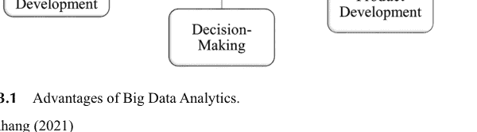

图 3.1 大数据分析的优势。

来源：Khang (2021)

大数据量的庞大程度是指数据的 sheer 数量，可从 terabyte 到 petabyte 或更多。大数据速度是指数据创建、处理和分析的速率；该速率可能为实时或接近实时。

大数据之所以多样，是因为它产生各种数据类型，包括结构化、半结构化和非结构化数据。

- 1. **结构化数据：** 具有特定结构的数据集称为结构化数据。由于其结构已知，因此此类信息更容易处理。例如，这包括与表格结构相对应的数据集。
- 2. **半结构化：** 它是结构化和非结构化数据的混合体。这包括电子邮件、网页等。
- 3. **非结构化数据：** 此类数据没有特定结构；它是一种初步数据。这包括音频、视频和图像等信息。它是一个易于收集但相对难以处理的数据集。

大数据分析具有多种优势：

通过检查大数据集，组织可以发现使用传统数据分析技术无法看到的模式、趋势和联系。这可以帮助企业简化运营、改善客户支持并创建新产品和服务。

其次，大数据至关重要，因为它有助于企业更具竞争力。通过利用大数据，组织可以更好地了解其客户、竞争对手和市场趋势。他们可以利用这些信息帮助他们做出战略决策，从而获得竞争优势。

最后，大数据至关重要，因为它推动了技术创新。大数据推动了数据科学和机器学习等新行业的发展，为技术开辟了新的可能性和用途。

#### 3.2.1 大数据管理

管理大数据存在若干重大挑战，包括：

- 1. **数据集成：** 大数据通常来自多个来源且格式不同，因此难以集成和评估。
- 2. **数据质量：** 大数据通常不完整、错误或不一致，需要清理和转换。
- 3. **可扩展性：** 为了管理海量数据，大数据需要高度可扩展的存储和处理系统。
- 4. **安全性：** 大数据价值高且敏感，是网络攻击和数据泄露的目标。
- 5. **人才短缺：** 由于对具备大数据知识的人员需求增加，人才差距使得企业难以有效管理和分析大数据。

#### 3.2.2 数据使用场景

例如，大数据用于金融以识别欺诈，用于医疗保健以产生个性化治疗，用于交通以简化路线和缓解交通。表 3.1 中介绍了大数据及其管理困难的一些示例。

**表 3.1**
**大数据分析的一些应用领域及其用例。**

| 编号 | 大数据分析的应用领域 | 用例 |
|---|---|---|
| 1 | 医疗数据 | 患者数据分析、治疗信息存储、分析、在进一步流程中使用、药物试验、各种实验室测试结果分析、医疗保健总体上所有不同类型（尤其是图像）的分析等；同时，大数据分析的应用在癌症等疾病的治疗中发挥着重要作用 |
| 2 | 社交媒体数据 | 社交媒体数据分析、数据收集、客户跟踪等 |
| 3 | 金融和银行 | 预测、欺诈检测、反洗钱、审计报告管理、风险管理、战略规划等 |
| 4 | 教育 | 评估学生表现、创造更好的学习环境、提高课程和课程的有效性、预测与教育相关的未来趋势等 |
| 5 | 交通运输 | 交通管理、路线规划、安全、交通拥堵管理等 |
| 6 | 能源和公用事业 | 资产和劳动力管理、通过智能电表定期收集数据等 |
| 7 | 政府 | 税务欺诈、打击虚假残疾索赔、国内情报、外国监视、网络安全、政府执法等 |
| 8 | 贸易 | 反欺诈、从以往销售中吸取的经验教训、销售管理等 |
| 9 | 农业 | 产品数据收集、分析、产品开发、预测等 |
| 10 | 物联网生成的数据 | 作为物联网的一部分，联网设备（包括传感器、可穿戴设备和智能家居电器）会产生大量数据。由于这些数据通常是实时的，因此需要快速处理以发现趋势、异常和机会。管理物联网数据的 sheer 数量和多样性，同时保持数据安全和质量是困难的 |


##### 3.2.2.1 医疗保健数据

医疗保健行业产生的数据来自电子健康记录、医疗设备和临床研究。由于敏感性极高，必须严格遵守数据隐私法律。此外，由于医疗保健数据经常复杂、无结构且分散，因此整合和评估这些数据可能具有挑战性。

##### 3.2.2.2 社交媒体数据

社交媒体网站以帖子、评论、点赞和分享的形式产生大量数据。困难在于从这些经常无结构的数据中提取洞察，以理解客户情绪、行为和偏好。社交媒体数据通常嘈杂且不可靠，使得分析具有挑战性。

##### 3.2.2.3 金融和银行数据

交易系统、风险管理系统和客户互动为金融行业提供了大量数据。由于其严格监管，这些数据需要高标准的安全性和合规性。

在处理金融数据时，从各种来源整合和分析数据以获得对风险、机会和客户行为的全面了解是困难的。

##### 3.2.2.4 物联网生成的数据

人类见证了四次已知的工业革命。现在距离第五次工业革命非常接近。我们目前正在经历的工业革命被称为第四次工业革命。

第四次工业革命主要被称为工业 4.0，克劳斯·施瓦布首次提出了这一概念。工业 4.0 包括所有智能技术和许多相关概念，包括物联网、赛博物理系统和云计算。鉴于这些概念各自都有多个子概念，可以说工业 4.0 是一个相当宽泛的概念（Khang et al., 2022b）。

正如我们提到的，工业 4.0 一词代表第四次工业革命。它与之前的工业革命不同，是因为出现了多项创新。最重要的是数字化。

第四次工业革命承诺的创新相当多样。但它们都与数字化密切相关。因此，这一时代也可以被称为数字化的时代。简而言之，工业 4.0 是智能工业世界的关键。它也是未来工业革命的基石之一。

工业 4.0 的主要目标之一是所创建的智能设备应能够表现出更具人性的状态，即它们应能够相互通信、在内部交换信息，并最终尝试实现与人类的通信。

这是后期工业革命的基础。因此，下一次革命，即日本提出的社会 5.0——支持人类与智能设备之间存在“真实”通信。世界是一个人类、动物、植物和许多未知生物共同生活的地方（Khang et al., 2023b）。

在社会 5.0 中，这个家庭包括智能设备。也就是说，人类和智能设备应该能够共同生活。此外，创建以人为中心系统——智能社会——也是主要目标之一。社会 5.0 是创建智能社会的主要发起者。也许，社会 5.0 将是这些革命中的最后一次。

对社会 5.0 的定义包括我们所说的：“一个以人为中心的社会，通过高度融合的网络空间和物理空间系统，在经济进步与解决社会问题之间取得平衡”（Cabinet Office, 2023）。

> 一个以人为中心的社会，通过高度融合的网络空间和物理空间系统，在经济进步与解决社会问题之间取得平衡

然而，如果我们想要创建智能社会并成为其中的一部分，确保该社会的可持续性，并且不希望它崩溃，我们应该像建造建筑物的地基一样工作，使这些地基坚固。

因为这些基础是建立在工业 4.0 之上的，我们必须首先完全适应工业 4.0。我们需要了解其所有组成部分，将它们就位，并通过构建其小部分来开始构建未来的大拼图。

工业 4.0 的关键概念是物联网、大数据和赛博物理系统，它们是物理和网络环境的关键部分。如果物联网在物理环境中创建了设备的集合（社会），大数据则确保其正确的信息管理，而知识文件系统（KFS）则允许这两个伟大的社会（群体）相互连接。

这由物联网的概念所涵盖——一个智能网络，其中智能设备相互交互并能够在彼此之间交换信息。

物联网包括许多组件（Rani et al., 2021）。主要组件如下所述。如图所示，物联网是由其周围组件形成的一个中心，如图 3.2 所示。

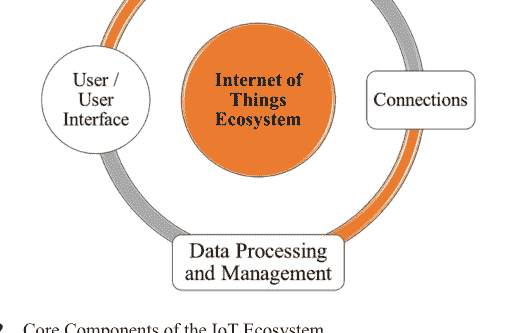

图 3.2 物联网生态系统的核心组件。

###### 3.2.2.4.1 智能设备/传感器

智能设备和传感器构成了物联网生态系统的基础。这些设备相互交互，是特殊的基于 AI 的设备。当我们说智能设备时，在最简单的情况下，我们可以举例说明我们每天使用的手机、电脑、电视、空调和冰箱。

通过将这些设备连接在一起创建的智能网络（物联网），即使我们远离它们也可以控制它们。例如，你离开了家，但不记得是否关掉了空调。

在智能家居系统（其中智能家居是物联网应用的另一个领域）的帮助下，你可以在外出时关闭空调。智能设备不仅包括日常生活中的设备，还包括用于各个领域的设备（例如，医疗中的智能药品容器和各种报警设备）。

另一方面，被称为传感器的微小智能设备也是 AI 生态系统的主要部分之一。这些小型设备检测环境中的某些变化并收集有关它们的信息。这些设备可以检测温度、压力和运动等事物，如果它们连接到网络，它们可以通过网络共享收集的数据（Rana et al., 2021）。

简而言之，通过 AI 传感器收集的数据被传输到网络环境并进行分析。在这里，我们经常遇到 KFS 的概念（Khanh & Khang, 2021）。

存在不同类型的 AI 传感器：温度、运动、压力、化学、气体、红外、水质、湿度、光学传感器等（Hahanov et al., 2022）。

###### 3.2.2.4.2 连接

物联网通信是指通过应用程序、网关和路由器等不同方法连接智能设备。

在大多数情况下，物联网设备连接到物联网网关或其他外部设备，在那里数据可以本地分析或发送到云端进行分析（Posey & Shea, 2022）。

###### 3.2.2.4.3 数据处理/管理

数据处理是数据管理的一个阶段。要处理数据，首先必须收集数据。这些阶段通过 AI 传感器实现。通过 AI 传感器获得的数据首先发送到外部计算系统。处理后的数据随后发送到云端。一般来说，系统可以每天处理数据、编译它们并发送到云端。

如前所述，我们经常遇到的 KFS 概念实现了物理环境与网络环境之间的连接，其中数据收集和处理是在物理环境中设备的帮助下进行的。

网络环境中处理的信息根据需要发送回物理环境。例如，在网络的帮助下，收集的数据始终准备好使用，如果需要，这些数据将被处理和使用。

###### 3.2.2.4.4 用户/用户界面

用户界面在用户即人类与网络环境之间创建交互。用户界面的主要示例是计算机或手机上的各种应用程序和程序。例如，我们可以通过手机上的应用程序看到来自智能设备的警告信号（Khang, 2024b）。

然而，用户界面不一定需要屏幕。例如，电视遥控器具有由各种按钮组成的用户界面，而像 Amazon Echo 这样的设备可以通过语音命令控制（Anni, 2023）。

所有这些提到的组件共同构成了物联网生态系统。简单来说，任何具有互联网访问权限的智能设备都可以成为 AI 网络的一部分。

物联网利用智能设备、传感器、AI 能力和网络将我们生活的很大一部分数字化。

物联网的应用领域很广。这些包括从日常生活到各个行业：教育、工业、医疗保健、军事、农业、交通、智能管理、智能供应链和商业。（Khang et al., 2022a）。

根据其在这些领域的应用，物联网被称为不同的形式。例如，应用于医疗保健的 AI 被称为医疗物联网，应用于军事的 AI 被称为军事物联网。

### 3.3 大数据处理生命周期

一个名为大数据处理生命周期的框架帮助组织控制处理大数据的整个过程。它由多个阶段组成，每个阶段涉及特定的任务和工具。大数据处理生命周期的步骤如下：

### 3.3.1 数据摄取

将大量数据从不同来源导入、收集并放入集中存储库或数据湖中以进行分析的过程称为数据摄取。由于它为所有后续阶段奠定了基础，这一阶段对大数据处理生命周期至关重要。

数据摄取因以下几个原因而至关重要：

- 1. **数据来源：** 组织的数据保存在各种地方，包括数据库、日志、社交媒体和物联网设备（Khang et al., 2024a）。多亏了数据摄取，组织可以从多个来源收集数据并在单一位置合并以进行分析。
- 2. **数据量：** 鉴于数据的指数级扩展，手动数据管理具有挑战性。数据摄取使企业能够通过自动化快速获取和处理大量数据（Hajimahmud et al., 2022）。
- 3. **数据多样性：** 收集的数据可能为非结构化、半结构化或结构化格式。组织可以通过将数据转换为标准化且易于评估的格式从数据摄取中受益。


- 4. **实时数据：** 某些应用程序需要对实时产生的数据进行持续收集和处理。这对于快速决策至关重要的情况具有重要意义，例如欺诈检测。
- 5. **数据安全：** 为确保只有授权人员可以访问数据，数据摄取可以纳入安全机制，例如身份验证、加密和授权。

对于数据摄取，可用的方法多种多样，每种方法都有其自身的优缺点。以下列出了三种流行的数据摄取技术：

### 3.3.1.1 Apache Kafka

Apache Kafka 是一种分布式流技术，可用于实时收集和处理大量数据。它可以与多个数据源集成，包括数据库、传感器和社交媒体，并且旨在管理高吞吐量数据流。

发布-订阅模式构成了 Kafka 架构的基础，其中消费者订阅主题以访问数据。由于 Kafka 提供了容错性和可扩展性，因此是处理海量数据的绝佳选择。

### 3.3.1.2 Flume

为了有效地从各种来源收集、聚合和传输大量日志数据到集中式存储库或数据湖，可考虑 Flume，这是一种分布式、可靠且可访问的解决方案。

源从多个来源收集数据，通道缓冲和存储数据，接收器将数据写入目标。这就是 Flume 的源、通道和接收器架构的基础。Flume 可以与各种数据源交互，包括社交媒体、日志和传感器，并且旨在管理流数据。

### 3.3.1.3 Amazon Web Services Kinesis

组织可以使用 Amazon Web Services (AWS) 提供的完全托管服务 Amazon Kinesis 来收集、处理和分析实时流数据。它可以与许多不同的数据源接口，包括社交媒体、物联网设备和应用程序日志。

为了处理大量流数据，Kinesis 提供了可扩展性和实时处理。Kinesis 可以与多种其他 AWS 服务集成，包括 Amazon Simple Storage Service (S3)、Amazon Redshift 和 AWS Lambda。

总之，数据摄取有多种技术可供选择，企业必须选择最符合其需求的技术。Apache Kafka、Flume 和 AWS Kinesis 是收集和处理大量数据的流行选择。每种技术都有其特定的优缺点。

## 3.3.2 数据存储

大数据流程生命周期的一个关键阶段是数据存储。数据必须存储在中央区域，以便在摄取后可以快速访问和评估。以下简明陈述概括了数据存储在大数据流程生命周期中的重要性：

- 1. **可扩展性**：随着数据量的增加，传统存储方法已无法跟上。有可扩展的选项可用于存储大量数据，包括 HDFS、Amazon S3 和 Azure Blob Storage。
- 2. **成本效益**：实施和维护传统存储系统，例如关系数据库管理系统，可能很昂贵。数据存储技术（如 HDFS 和 S3）提供的按需付费概念使企业只需为实际使用的存储付费。
- 3. **灵活性**：数据存储技术允许存储各种数据类型。它们可以存储结构化、半结构化和非结构化数据，从而使企业更轻松地将所有数据存储在同一位置。
- 4. **可访问性**：数据存储技术使数据分析变得简单。使用各种技术（包括 SQL、NoSQL 和 Hadoop MapReduce）访问数据的能力使数据科学家和分析师更容易从数据中得出结论。
- 5. **数据安全**：为确保数据安全存储，数据存储系统提供强大的安全功能，包括加密、访问控制和审计跟踪。

大数据可以使用多种方法存储，每种方法都有优缺点。以下是三种广受欢迎的存储数据的方法。

### 3.3.2.1 Hadoop Distributed File System

HDFS 是一种分布式文件系统，是 Apache Hadoop 的组成部分。它可以在分布式计算环境中存储和处理大型数据集。鉴于其容错性和可扩展性，HDFS 是管理大量数据的绝佳选择。

使用 HDFS 存储各种数据类型，包括结构化、半结构化和非结构化数据。

### 3.3.2.2 Apache Cassandra

Apache Cassandra 是一种分布式 NoSQL 数据库，旨在在众多商品机器上管理庞大的数据量。为了处理高吞吐量和高数据量的工作负载，Cassandra (2023) 提供了可扩展性、高可用性和容错性。

使用 Cassandra 存储具有苛刻的读写吞吐量要求的大量数据，例如时间序列数据、社交媒体数据和传感器数据。

### 3.3.2.3 Amazon S3

Amazon Web Services 提供了一种高度可扩展、经济且安全的对象存储解决方案，即 Amazon S3。可以使用 S3 从互联网上的任何位置存储和检索任意数量的数据。由于 S3 使检索数据用于分析变得简单，因此是管理大量数据的绝佳选择。

S3 用于存储各种数据类型，包括日志文件、Web 应用程序的静态内容、备份和归档数据以及备份和归档数据。

总之，大数据有各种数据存储技术，每种技术都有特殊特性和优势。

许多不同企业，包括银行、医疗保健和电子商务，都使用流行的存储大量数据的选项，例如 HDFS、Apache Cassandra 和 Amazon S3。

## 3.3.3 数据处理

在大数据流程生命周期中，数据处理阶段是将数据转换和分析以得出结论和重要信息的地方。数据分析的准备工作包括清理、验证、转换和聚合数据。大数据流程生命周期中数据处理的重要性可概括如下：

- 1. **数据质量**：处理数据可实现高质量、准确数据的生成。它涉及查找和修复数据缺陷和不一致性，这对于获得可靠的见解和做出明智的判断是必要的。
- 2. **数据集成**：数据处理使能够将来自各种来源的数据合并到单个数据集中成为可能。这对于全面了解数据以及发现单独评估数据集时可能不明显的模式和趋势至关重要。
- 3. **数据转换**：数据处理使能够将数据转换为适合分析的格式成为可能。为了使数据更易于管理和理解，必须对其进行清理、聚合和汇总。
- 4. **数据分析**：处理数据是过程中的必要步骤。数据处理通过转换和准备数据以供分析，使数据分析师和数据科学家能够从数据中获得见解和有用信息。
- 5. **决策制定**：由于数据处理，组织可以基于数据洞察做出决策。组织可以处理和分析数据以发现趋势、模式和相关性，这些可以用于影响促进企业增长的决策。

处理大数据采用了许多不同的技术。以下是前 3 项技术。

### 3.3.3.1 Apache Spark

具有隐式数据并行性和容错性的 Apache Spark 是一种开源分布式计算解决方案，提供用于创建完整集群的编程接口。它是为快速处理大量数据而创建的通用引擎。


Java、Python和Scala只是Spark支持的编程语言中的几种。该系统内置了SQL、机器学习、图处理和流数据处理模块。

### 3.3.3.2 Apache Flink
Apache Flink是一个开源的分布式流处理和批处理解决方案。它旨在处理批量和实时数据处理。Flink支持Python、Java、Scala等编程语言。它内置了机器学习、批处理和流处理模块。

### 3.3.3.3 Hadoop MapReduce
Hadoop MapReduce是一种软件系统，允许在廉价的硬件上对大规模数据集进行分布式处理。它提供了一种编程方法，将庞大的数据集分解成更小的部分，并分发到一组计算机中。Map和Reduce是MapReduce的前两个阶段。

在map阶段，数据被分解成更小的片段并分别处理，而在reduce步骤中，map阶段的输出被合并以产生最终结果。

总之，在大数据中，有多种可用于数据处理的技术，每种技术都有明显的优缺点。

包括银行、医疗保健和电子商务在内的众多行业，广泛使用Hadoop MapReduce、Apache Spark和Apache Flink等流行选项来处理海量数据。

## 3.3.4 数据分析
在大数据流程生命周期的数据分析阶段，获取大数据的洞察和价值。获得可用于推动企业增长和指导决策的洞察，需要应用统计和分析方法，从数据中提取有用信息，发现模式和相关性，并掌握趋势。

大数据流程生命周期需要数据分析的主要原因如下：

- 1. **业务洞察**：数据分析使企业能够了解消费者行为、行业趋势和运营效率。组织可以通过分析海量数据来发现原本无法发现的模式和相关性，从而做出明智的决策并获得竞争优势。
- 2. **效率提升**：数据分析可以通过指出可以优化流程、减少浪费和提高生产力的领域，帮助企业获得运营效率。组织可以通过分析来自多个来源的数据，全面了解其运营情况，从而做出明智的决策来提高效率。
- 3. **预测分析**：数据分析可以帮助企业利用预测分析来预见未来的市场需求、消费者行为和趋势。组织可以通过评估历史数据来创建预测模型，从而预见未来模式并做出明智决策以抓住机遇。
- 4. **个性化**：数据分析可以帮助企业为客户提供量身定制的体验。组织可以通过分析客户数据来获取对客户偏好、行为和需求的洞察，从而定制产品和服务以满足特定客户需求。

物联网生态系统的重要组成部分之一是数据集及其适当管理。在数据与空气和水同等重要的时代，成千上万个不同来源产生数百万种不同的数据。

获得的数据是原始且非结构化的。主要问题在于这些数据的处理、编译和结构化形式。在这里，我们将考虑两个概念：数据分析（或数据解析）和大数据（大数据分析）。

数据分析是从各种可用数据集中提取有意义信息的过程。这个过程主要针对大数据进行。

然而，数据分析的应用领域很广泛。也就是说，它可以应用于许多领域来获取有意义（必要）的信息。借助数据分析，可以做出个人或群体的决策。

数据分析有多种类型。以下是一些类型。

- 1. **描述性分析**：这是第一种分析类型。描述性信息在所有信息中占很大比例。在这里，从这些描述中获取有意义的信息。一个例子是医学中的医疗描述性数据分析。描述性数据最好的方面是，它们可以以简洁简单的形式描述大量数据。
- 2. **诊断性分析**：这是第二种分析类型，主要在描述性分析之后进行。它获取描述性分析得到的数据，并进行分析以找出这些结果的原因。
- 3. **预测性分析**：这是第三种分析类型。顾名思义，这种分析用于预测未来可能发生的情况。预测性分析主要使用机器学习和深度学习算法，通过诊断分析获得的结果来预测未来趋势、问题和解决方案。
- 4. **指导性分析**：这种分析类型最重要。在这个阶段，研究预测性分析获得的结果——预测——将如何发生。这种分析使用户能够理解未来事件。通常，在决策中会综合所有先前分析的信息。

这些类型彼此相关，它们作为一个总体系统的一部分统一应用。

## 3.3.5 大数据分析
大数据包括任何大型数据集。从不同来源收集不同信息。借助大数据，组织可以通过监控和分析客户及其行为（例如，通过社交媒体）来做出未来决策并制定不同策略。

为不同目的收集不同的数据集。有来自社交媒体的数据、各种科学研究数据、健康数据集、业务数据集等。

大数据分析是将高级分析技术应用于非常大的、多样化的大数据集，这些数据集包括来自各种来源和大小（从TB到ZB）的结构化、半结构化和非结构化数据（IBM，2023）。

对于大数据中的数据分析，有许多可用的技术，每种技术都有明显的优缺点。以下介绍三种流行的数据分析技术。

### 3.3.5.1 Apache Hive
Apache Hive是一个开源数据仓库程序，可以查询和分析存储在HDFS中的大型数据集。它基于Hadoop MapReduce，允许用户使用类似SQL的语法创建复杂查询。Hive原生支持数据仓库、联机分析处理以及抽取、转换和加载过程。

### 3.3.5.2 Apache Impala
Apache Impala是一个开源SQL引擎，允许用户即时查询和分析存储在HDFS、Apache HBase和其他与Hadoop兼容的文件系统中的数据。

Impala支持多种分析操作，如聚合、连接和窗口函数，它提供了一个类似于SQL的用户界面。它旨在为临时查询和交互式分析提供快速响应时间。

### 3.3.5.3 Apache Drill
使用美国国家标准学会SQL语法，用户可以使用Apache Drill查询和分析存储在多种数据源中的数据，如HDFS、NoSQL数据库和云存储系统。Apache Drill是一个开源分布式SQL查询引擎。它支持多种数据格式，包括JavaScript对象表示法（JSON）、Parquet和Avro，并且旨在提供低延迟查询。

总之，在大数据中，有许多可用于数据分析的技术，每种技术都有明显的优缺点。

Apache Hive、Apache Impala和Apache Drill是分析海量数据的流行选择。这些程序用于各种领域，包括金融、医疗保健和电子商务。


## 3.3.6 数据可视化

数据和信息的图形描绘被称为数据可视化。它涉及开发可视化内容，例如地图、图表和图形，以简单易懂的方式传达复杂数据。

- 数据可视化的目标是帮助用户在海量数据中发现模式、联系和趋势，而这些在原始数据格式中可能并不明显。
- 数据可视化帮助企业做出数据驱动的决策，使其成为大数据流程生命周期的关键组成部分。
- 数据可视化通过以易于理解的方式呈现复杂数据，使决策者能够迅速发现洞察并做出明智决策。
- 例如，企业可以使用数据可视化来研究消费者行为并找出其产品或服务需要改进的领域。
- 数据可视化还使复杂的数据分析结果更容易被利益相关者理解，即使他们缺乏理解底层数据所需的专业技术知识。

通过可视化数据，组织可以将洞察传达给非技术利益相关者，并促使他们参与决策过程。

对于数据可视化，有许多不同的技术可供使用，每种技术都有其特殊优势和劣势。以下介绍了三种流行的数据可视化技术。

### 3.3.6.1 Tableau

用户可以使用 Tableau 这一强大且广受欢迎的数据可视化应用程序实时连接、显示和交换数据。它使用户能够创建可定制且可共享的交互式仪表板、图表和图形。

Tableau 支持的数据源众多，其中包括 Hadoop、SQL 和基于云的数据仓库。它通常用于金融、医疗保健和在线购物等行业。

### 3.3.6.2 Power BI

Power BI 是微软创建的基于云的商业智能和数据可视化应用程序。用户可以使用它创建可从任何地方访问的交互式报告和仪表板。

Power BI 支持的数据源众多，其中包括 Excel 电子表格、基于云和本地的数据仓库以及 Hadoop。它经常用于制造业、零售业和金融业等行业。

### 3.3.6.3 QlikView

通过使用 QlikView 这一强大的数据可视化和发现工具，用户可以从各种来源探索和检查数据。它使用户能够创建可定制且可共享的交互式仪表板、图表和图形。

QlikView 支持众多数据源，包括 Hadoop、SQL 和基于云的数据仓库。它在医疗保健、治理和教育等各个领域被广泛使用。

Tableau、Power BI 和 QlikView 是知名的数据可视化工具，可让用户设计复杂数据的动态、个性化展示。

利用这些技术，组织可以更轻松地发现洞察、做出明智决策并通知利益相关者有关复杂数据分析结果的信息。

## 3.4 结论

管理大数据所面临的困难仅包括数据的数量、速度、多样性和真实性等几个方面。组织必须拥有适当的基础设施和工具来收集、存储和处理每天产生的大量数据。

数据速度是指数据产生的速率，对于无法处理该速率的公司而言，这一速率可能令人难以承受。

数据源和格式的多样性也增加了管理大数据的复杂性。数据的正确性和可靠性，也称为真实性，对于企业做出明智判断至关重要。

企业要妥善管理和利用大数据，必须透彻了解大数据流程生命周期及相关技术。通过有条理的方法，组织可以选择生命周期每个阶段的适当工具和技术，以有效管理大数据。

数据摄取工具，如 Apache Kafka、Flume 和 AWS Kinesis，可帮助企业高效地收集和存储数据。组织可以使用 HDFS、Apache Cassandra 和 Amazon S3 等工具存储和管理海量数据。

组织可以使用数据处理工具，如 Hadoop MapReduce（Gunarathne et al., 2023）、Apache Spark（Hadoop, 2023）和 Apache Flink（Friedman & Tzoumas, 2023），来清理、转换和分析其数据。组织可以使用数据分析工具，如 Apache Hive、Apache Impala 和 Apache Drill，来在数据中发现模式和洞察。

最后，企业可以使用数据可视化工具，如 Tableau、Power BI 和 QlikView，为决策构建数据的可视化表示。

总之，处理大数据是一项困难而复杂的任务。通过有条理的方法管理大数据，组织可以通过对大数据流程生命周期及相关技术的扎实理解来克服这些困难。

通过为生命周期每个步骤利用适当的工具和技术，组织可以获得重要洞察并做出明智决策，以获得竞争优势。

随着最近的工业革命，数字化时代已经开始，智能技术开始应用于许多不同行业。

在智能技术中，智能设备之间的交互形成了大型网络。这里使用了常用的术语 IoT。

智能设备之间的主要目标是能够不断相互交换信息。总的来说，本章得出以下结论：

- 1. 智能设备的数量不断增加，连接的设备继续成为大型生态系统的一部分。预计在不久的将来，物联网设备的数量将接近 25 亿。其中很大一部分是监控设备和办公设备。
- 2. 物联网的一个关键因素是适当的数据管理，这使得大数据分析能够集成到物联网中。
- 3. 通过大数据分析，对借助物联网设备获得的数据集进行分析。
- 4. 为此，执行一定数量的阶段。
- 5. 大数据分析与物联网之间的关系中出现了一些问题。

## 参考文献

Cabinet Office, (2023). 日本政府，Society 5.0. https://www8.cao.go.jp/cstp/english/society5_0/index.html
Cassandra, (2023). Apache Cassandra | Apache Cassandra 文档. https://cassandra.apache.org/
Friedman E., Tzounas K., (2023). 构建可扩展实时数据处理应用程序的实用指南. https://flink.apache.org/
Gunarathne T., Perera S., Sriram I., (2023). Hadoop MapReduce v2 Cookbook 第二版.
Hadoop, (2023). Apache™ Hadoop® 项目开发用于可靠、可扩展、分布式计算的开源软件. https://hadoop.apache.org/
Hahanov V., Khang A., Litvinova E., Chumachenko S., Hajimahmud V. A., Alyar V. A., (2022). “智能城市的关键助手——传感器和工具，”载于 AI-Centric Smart City Ecosystems: Technologies, Design and Implementation, Vol. 17, No. 10 (第 1 版). CRC Press. https://doi.org/10.1201/9781003252542-17
Hajimahmud V. A., Khang A., Hahanov V., Litvinova E., Chumachenko S., Alyar V., (2022). “智能城市的自主机器人：更接近增强型人类，”载于 AI-Centric Smart City Ecosystems: Technologies, Design and Implementation, Vol. 17, No. 12 (第 1 版). CRC Press. https://doi.org/10.1201/9781003252542-7
IBM, (2023). 大数据分析. www.ibm.com/analytics/big-data-analytics
Junnila A., (2023). 如何运作的物联网——第 4 部分：用户界面. https://trackinno.com/iot/how-iot-works-part-4-user-interface
Khang A., (2021). “Material4Studies，”计算机科学、人工智能、数据科学、物联网、区块链、云、元宇宙、网络安全学习材料. www.researchgate.net/publication/370156102_Material4Studies
Khang A., (Eds.). (2023). (AIoCF) 面向数字经济人才管理的 AI 导向能力框架：模型、技术、应用和实施. CRC Press. https://doi.org/10.1201/9781003440901
Khang A., Abdullayev V., Hahanov V., Shah V., (2023a). 工业 4.0 数字经济中的先进物联网技术与应用（第 1 版）. CRC Press. https://doi.org/10.1201/9781003434269
Khang A., Hahanov V., Abbas G. L., Hajimahmud V. A., (2022b). “Cyber-physical-social system and incident management，” AI-Centric Smart City Ecosystems: Technologies, Design and Implementation, Vol. 2, No. 15 (第 1 版). CRC Press. https://doi.org/10.1201/9781003252542-2


Khang A., Rani S., Sivaraman A. K., (2022a). *《以人工智能为中心的智慧城市生态系统：技术、设计与实现》*（第1版）。CRC出版社。https://doi.org/10.1201/9781003252542

Khang A., Rani S., Gujrati R., Uygun H., Gupta S. K., (编). (2023b). *《面向工业4.0的劳动力管理系统设计：以数据为中心且采用人工智能的方法》*。CRC出版社。https://doi.org/10.1201/9781003357070

Khan H. H., Khang A., (2021). “人工智能在区块链应用中的作用”，*《通过人工智能重塑制造业与业务流程》*，2(20–40)（CRC出版社）。https://doi.org/10.1201/9781003145011-2

Loshin D., (2023). *《分析学：从战略规划到企业集成——工具、技术、NoSQL与图》*。

Mayer-Schönberger V., Cukier K., (2023). *《一场将改变我们生活、工作和思维方式的革命》*。

Posey B., Shea S. (2022年3月). *《物联网设备》*。https://www.techtarget.com/iotagenda/definition/IoT-device

Rana G., Khang A., Sharma R., Goel A. K., Dubey A. K., (编). (2021). *《通过人工智能重塑制造业与业务流程》*。CRC出版社。https://doi.org/10.1201/9781003145011

Rani S., Chauhan M., Kataria A., Khang A., (2021). “面向智能医疗系统的物联网智能分布式框架”，*《网络与互联网架构》*，2, 30。https://doi.org/10.48550/arXiv.2110.04997

Schmarzo B., (2023). *《理解数据如何驱动大型企业》*。

使它们能够在堪比游戏的虚拟环境中引导自己的思想并改变自己的性格（Vrushank等，2024）。

在人工智能被广泛使用的时代，人类将专注于提升自身的基本技能。智能工具或智能系统将承担包括环境感知、数据收集、原理发现、预测以及基于经验的控制在内的各项任务（Rana等，2021）。

人工智能的发展将激励个人不断寻找新的机遇和目标。随着“物理空间—社会空间”二元秩序转变为“物理空间—社会空间—网络空间”三元秩序，人们将对自己进行重新评估和定位。

随着智能系统的进步和人类部分能力的外化，人们将对自己与外部世界之间的可能性获得透彻的认识，同时获得更广阔的发展空间和更丰富的宝贵资源（Khanh & Khang，2021）。

因为革命性的教学是一种以人为中心的设计方法，旨在解决工业4.0所提出的问题，并涉及人类与协作机器人在共享工作空间中的协作。

此外，近年来还出现了一个相关概念，称为“社会5.0”，以应对当代社会中的各类问题（Khang等，2022a）。社会5.0是一个超智能的未来社会，通过融合网络空间和物理空间，并充分利用信息与通信技术（ICT），让每个人都能过上高质量、舒适的生活（Lee等，2019）。

工业4.0指的是引入智能设备和系统，以及对现有工业流程进行调整，以提高生产力。弹性技术、创新工作方法以及人在工业中的地位，都是工业4.0的组成部分（Khang等，2022b）。

工业4.0带来的变革包括不同行业和服务业中工厂层面的大量创新，以及整个社会的运作方式。

工业4.0，也被称为物联网、云计算、认知计算和人工智能，从根本上说是一场朝着工业技术和流程自动化与数据共享方向发展的运动（Lee等，2019）。

关于工业价值生产必须以可持续性为中心的观点，工业4.0可以被视为迈向更可持续的工业价值生成的一步（Rani等，2022）。

在工业4.0中，消费者、商业模式和经济都高度重视可持续性问题。通过提供每个生产地点的具体信息，可以在整个价值网络中优化流程、资源和能源使用（Khang等，2023a）。

工业4.0的创新技术方法有望改善产品在整个生命周期中的环境绩效。此外，这也意味着对智能产品和生产工艺的需求将增加（Hajimahmud等，2022）。

根据（Machado等，2020）的观点，工业价值生产必须以可持续性为中心，工业4.0可以被视为迈向更可持续的工业价值生成的一步。

可持续性是工业4.0的一个主要优先事项。因此，关于工业5.0概念的讨论始于2019年。这一概念意味着将人的元素带回工业，即促进人与智能生产系统之间的合作，并融合两者的优势：自动化的速度和准确性与人类的认知能力和批判性思维（Luke等，2024）。

科学技术领域的学者于2020年7月2日至7月9日，在欧洲委员会（EC）研究与创新总司“繁荣”局的资助下，对工业5.0的概念进行了讨论。

在欧洲委员会出版物中可以找到关于“工业5.0”概念的假设。该文件的主要重点是重要的变革方向，这些方向将使该行业转变为一个更加以人为本和可持续的行业（Sindhwani等，2022）。

人与人机之间的交互是工业5.0的重点（Machado等，2020）。在现代世界中，人类与机器共存，并通过智能设备与智能工厂相连。

技术、大规模定制和先进制造领域正在发生快速变化。由于人工智能的进步以及将机器人连接至人脑的能力，机器人正变得日益重要（Sindhwani等，2022）。

如今，机器人与人类协作而非竞争，如图4.1所示。

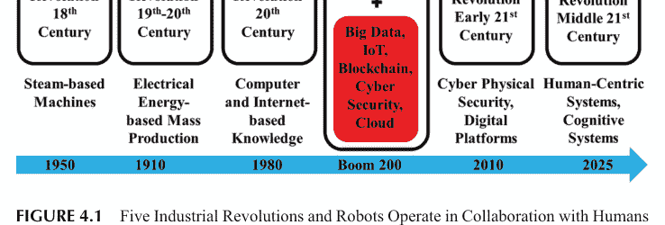

## 图4.1 五次工业革命以及机器人以协作而非竞争的方式与人类共事。

来源：Khang（2021）

如今，人工智能和聊天机器人正日益流行，因为它们被广泛应用于电子商务、医疗保健和教育等各个行业（Rani等，2021）。

聊天机器人技术的发展近年来有所加快，部分原因在于机器学习和自然语言处理方面的进步。

“机器能思考吗？”——艾伦·图灵（Copeland，2023）在20世纪50年代发表的关于计算机器与智能的文章被视为聊天机器人的起源。

自那以后，已有相当多的聊天机器人被开发出来，其中一些至今仍在使用（Wang等，2022）。R&S技术（语音识别与合成）、可定制交互、与外部应用的连接、全渠道部署、上下文感知以及多轮对话能力，只是现代聊天机器人纳入的一些新功能。

因此，各种聊天机器人现已集成到许多电子设备、程序和应用程序中，例如消息应用（WhatsApp、Telegram、Kik和Slack）、视频游戏和游戏平台（Xbox和Roblox）以及社交网络（Instagram、Facebook Messenger和X/Twitter）。事实上，在极少数领域中，聊天机器人要么已经存在，要么在不久的将来不会出现。

根据Belda-Medina & Calvo-Ferrer（2022）的说法，“聊天机器人”一词可能会令人困惑，因为它可以用来描述各种以不同形式、用于不同目的的程序。聊天机器人通常被理解为一种基于人工智能的计算机软件，通过文本和/或音频模拟人类对话。

但如今与聊天机器人相关的术语并不都具有相同含义，包括“聊天机器人”（chatter bot）、“智能机器人”（smart bot）、“教育机器人”（edubot）、“测验机器人”（quizbot）、“数字助理”（digital assistant）、“个人助理”（personal assistant）、“虚拟教师”（virtual instructor）和“对话代理”（conversational agent）等术语（Hahanov等，2022）。

此外，对话式人工智能有潜力成为语言学习中的持续导师和伙伴，特别是在没有正规教育机会和无法接触母语者的情况下。

这类聊天机器人的准确性及其在现有学生和在职教授中的优势和态度，一直是迄今已发表作品的主要主题。

人工智能技术的最新进展表明，英语作为外语（EFL）教育工作者的职责也正面临挑战。已有技术可以完成教师目前所做的工作。例如，有些应用程序使用人工智能来纠正学生的语法错误。

反馈会伴随详细而简洁的解释和示例一同提供；这对学生来说是一种有用的工具，可以在情境中并以更个性化的方式学习语法。还有其他应用程序可用于学习英语其他方面的内容，而不仅仅是语法，例如口语、写作和词汇（Wang等，2018）。

此外，这些应用程序还有智能手机版本，使教育对学生来说更加方便可及。该应用程序将学生置于真实的学习环境中，他们可以在此练习自我调节技能（Reeve & Stephanie，2020）。


## 4.2 相关工作

### 4.2.1 学生参与

  学生参与度是指学生在其学习中的投入或兴趣程度，以及他们与课堂、所在机构以及彼此之间的依附程度，据 Axelson 和 Flick（2010）所述。

  学生参与是学习者与学习、学校或教育任何部分之间持续的关系。据 Fletcher（2015） 和 Axelson 和 Flick（2010） 所述，学生参与度日益被视为优秀课堂教学的标志和机构卓越的指标。

  Barkley（2010）设计了一个基于课堂的范式来理解学生参与，并使用“热情”和“兴奋”这两个词来描述这一现象。

  根据 Barkley（2010）的说法，学生参与是一个过程和一种产物，在一个连续体上体验，并源于动机与主动学习之间的协同关系。尽管有助于提高学生学习，但这一概念仅提供了对学生参与的单一视角。

  建构主义的前提是学习受个人参与具有学习目的活动方式的影响，形成了学生学习参与这一想法的基础。学生参与是内在驱动力或个人需求的结果，这些需求使学生感到良好并以自信坚持其活动。

  根据学生参与的术语，其被定义为学生表达意见、态度和行为。学生参与可分为以下三个方面这一观点是一致的。

- **行为参与**：学生遵守行为规范，例如出勤和参与。
- **情绪唤起**：情绪活跃的学生会有情感反应，例如好奇或喜悦。
- **认知投入**：积极动脑的学生会努力超越要求并享受挑战。

  此外，参与的概念具有多个方面，包括行为、情感和认知成分（Wang et al., 2022）。“行为参与”一词指的是参与，包括参加课外、社会或学术活动。

  情感投入包括对教授、同学以及学习发生的环境的情感反应。最后，认知参与包括思考以及愿意付出努力来理解材料和获取技能。

  Axelson 和 Flick（2010）在在线学习背景下强调了参与的几个组成部分，包括学术难度程度、主动和协作学习、学生与教师的接触以及有意义的教育体验。

  此外，（Paschek et al., 2022b）指出，学习者-学习者、学习者-教师和学习者-内容互动是促进学生参与的三种互动类型。

  作者还发现，当学生能够通过各种渠道联系到教师时，他们重视学习者-教师互动策略并感受到归属感。最受推崇的参与策略被认为是一致的教师存在（Axelson & Flick, 2010）。

  此外，学习成绩已被证明与参与度高度相关（Fryer et al., 2020）。学生参与最初被视为单一的行为成分因素。这种观点导致了参与的简单定义，即“学生参与与学习相关的各种活动”（Haristiani, 2019）。

  Gao 和 Cui（2022）通过强调其行为特征，将参与定义为对学习项目的态度或参与行为。然而，这些标准并未考虑其他因素，例如对学习的接受度和学习者的心理状况（Kılıçkaya, 2020）。学生参与目前有多种不同的定义。

  根据 Kılıçkaya（2020）的说法，参与是投入到能提供优秀表现的教育活动中的努力程度。参与是学习者的思想、感受和活动在学习中积极参与的程度。

  Axelson 和 Flick（2010）将学生参与分为三个类别：行为型，包括在学习中的坚持、努力和持续专注；情感型，包括对学习的兴奋和兴趣；以及心理型，包括对挑战的偏好、独立性和任务参与。

  每个学生都有兴趣、目标和抱负。内在驱动和支持个人成长目标只是人类动机结构中的自然组成部分（Axelson & Flick, 2010）。

  当教师鼓励学生表达和追求其特定的兴趣和抱负时，学生对课堂活动的兴趣会更大。学生偶尔会在全班面前分享他们的希望和抱负（Reeve & Stephanie, 2020）。学生会与教师讨论他们的兴趣并请求课堂机会来实现目标。

  然而，有些学生选择不这样做，而是更喜欢向教师隐瞒其内在驱动力。这是有道理的，尤其是当学生了解到其他人可能并不总是对了解个人目标感兴趣时。

  一些教师确实认识并热情支持学生的个人目标，这些教师会自愿改变教学计划的方向以考虑学生反馈。

  当外语课上的学生请求除了语言本身之外，还想了解使用该语言的人的国家、文化和价值观时，教师会回答“好的”或“可以”，并相应地调整课程。

  然而，一些教育工作者忽视、贬低或对学生的个人目标视而不见。这些教师未能激发学生的兴趣和学习目标。相反，当天的教学计划被单方面宣布（例如，学习 20 个新词汇），然后给出最能实现教学目标的指导。

  此外，学生的能动参与或投入涉及行为和行动。能动参与，即学生为自己创造更具激励性的学习环境所说所做的事情，是他们对所接受教学流程的建设性投入（Fryer et al., 2020; Reeve & Stephanie, 2020）。

  另一方面，被动性（也称为能动性脱离）是指学习者简单地被动接受任何出现的指导、事件和情况。

  学生通过提出想法、表达偏好并诉诸其内在动机，有目的地和积极地尝试个性化并以其他方式增强所要学习的内容以及学习的情境。

  能动参与是第四种参与类型，类似于行为参与、情感参与和认知参与（Fletcher, 2015），但它是一种特别积极和互惠的变体。

  教师布置学习活动（例如阅读一本书或完成作业），学生通过在活动中付出或多或少的努力、热情和策略性思考来回应。这被称为行为、情感和认知参与。

  学生参与并不总是成功（Fletcher, 2015）。其成功在很大程度上取决于教师（或整个学习环境）对学生主动性的关注程度。当教师回应学生的评论和建议时，互惠因果关系很可能发生，教师和学生会变得更加同步。

  然而，当教师无回应时，单向因果关系更可能发生（即教师影响学生，而非相反），教师和学生变得更加对立。在这种情况下，学生的能动参与甚至可能“适得其反”并激怒教师（例如，“停止你的抱怨、打断和顶嘴。你在扰乱整个班级。”）。

  本章提出 AI 聊天机器人作为学习辅助工具，代表了工业 5.0 中教学革命的产出所体现的数字化转型。它是集成到互动口语学习中的复杂工具。

### 4.2.2 聊天机器人与语言学习

  人机接触变得越来越普遍，有时可以在社交网络中发挥与人类熟人相同的功能。在这些交互技术中，旨在使用自然语言与人交流的聊天机器人对话代理是最先进的工具之一。

  它们也极其常见。超过 275,000 名开发者在专门用于创建聊天机器人的 Pandora Bot 平台上制作了超过 325,000 个聊天机器人（Pandorabots, 2021）。尽管其中一些聊天机器人可能被公众用于常规电子商务交易，但聊天机器人正在被开发用于更深入的对话并提供社交参与。

  智能聊天机器人可以学习有关其用户的详细信息以在未来讨论中使用。这引发了这些对话代理很快将为各类用户提供个性化社交支持的可能性。据研究，这是有希望的。Pandorabots（2021）最近的文献分析显示，用户确实从与当前使用的社交聊天机器人的互动中获得了某种社交支持。

  人们似乎并不对软件过于怀疑，这一点可以从他们向认为是对机器人的对话伙伴披露的频率与向认为是对人类的对话伙伴披露的频率一样频繁这一事实中得到证明。证据还表明，人们认为聊天机器人在对话能力上是胜任且可信的。


计算机辅助辅导在支持学习的 人机交互 领域有着悠久的历史（近期综述请参见 Belda-Medina & Calvo-Ferrer, 2022）。此后，语言导师的概念被推动以增强课堂上的语言学习，并日益使用移动技术。

第二个进步领域源于与教育或语言教学无关的领域：聊天机器人是设计用于进行人与人之间讨论的计算机程序。目前，它们在正式语言教学中扮演着微小或边缘的角色。该领域为数不多的研究主要集中在它们的可理解性以及它们如何激励用户方面。

语言习得的聊天机器人应用。语言学习者通常喜欢与聊天机器人交流，而且一些学生更喜欢与聊天机器人交谈而不是与其他学生或教授交谈，如表 4.1 所示。

当时有人声称聊天机器人对有动力和/或高级的学生最有帮助。在随后的研究中，研究了聊天机器人在培养动机因素（如学习者自主性、内在动机和探究导向思维）方面的作用（Allouch et al., 2021）。

早期研究揭示了聊天机器人作为语言练习工具的不足（Belda-Medina & Calvo-Ferrer, 2022）。

用户输入（如正确拼写的必要性）和聊天机器人输出（如无法保持“在主题上”）方面的问题都被提出为需要克服的问题，以便聊天机器人对语言学习者具有广泛的实用性。

由于该领域的进展相对有限，很少有教育学者最近重新评估了聊天机器人的语言能力。Paschek 等（2022a）评估了五种流行的聊天机器人，发现它们有了很大改进。其中五分之三的回应被认为在语法上是正确的。尽管令人鼓舞，但这证据不足以将聊天机器人归类为语言练习的普遍有效工具。

相比之下，Belda-Medina & Calvo-Ferrer (2022) 考察了 100 次消息交流，发现人们与聊天机器人进行的对话时间明显长于与普通人进行的对话。这一发现说明了人类与聊天机器人互动的简易性以及可实现的对话互动量，尽管发送给聊天机器人的每条消息更简短且词汇变化较少。

## TABLE 4.1
AI在语言学习中的作用 改编自 Axelson 和 Flick (2010) 以及 Muthmainnah 等 (2022)。

| 语言技能 | 学习成果 | 参与方面 |
|---|---|---|
| • 词汇<br>• 听力<br>• 口语<br>• 阅读<br>• 写作<br>• 语法<br>• 词汇<br>• 发音<br>• 综合整体语言 | 语言技能、知识、当代能力、情感和心理状态以及行为模式的变化 | 认知参与、情感性、行为性、情绪、社会和文化 |

聊天机器人技术的发展恰逢其时。大多数人使用计算机和社交媒体平台进行社交互动，而且大多数人拥有各种技术设备（Machado et al., 2020）。

一些人已经使用基于聊天的服务（例如 7 Cups 和 Crisis Text Line）在困难时期在线与其他人联系以获得社会支持。人们似乎也感到在网上与聊天机器人交谈很自在，也许正是因为这些原因。然而，研究已确定了自然人机聊天互动的若干障碍。

此外，Fletcher (2015) 指出，通过智能支架式练习支持语言学习者的软件将是支撑语言学习亭的科技帐篷杆的尖端。这种学习或至少练习新语言方式的转变似乎即将随着聊天机器人行业而开始。

由于聊天机器人免费且可在网上获得，它们为世界各地的语言学习者提供了在所选第二语言或外语中积极交流的机会。

聊天机器人可能有助于培养学生继续语言学习所需的胜任力和毅力。即使聊天机器人帮助语言学习社区的潜力尚未完全实现，它们也可在网上获得。

即使在不完美的状态下，聊天机器人也为 EFL 学生（即英语不是第一或第二语言的国家）提供了免费且可获取的语言接触来源。因此，研究对于确定在正式教育内外最佳使用这些语言伙伴的方式至关重要。

多年来，聊天机器人不断进步。尽管它们在语言上与人建立联系的能力没有显著进步，但大多数人仍然觉得它们足够有趣，可以玩。这本身就令人鼓舞，因为众所周知，游戏是学习过程的重要组成部分（Sindhwani et al., 2022）。

游戏为我们提供了一个安全的环境，让我们突破现有极限。这是技术众所周知能够提供的益处。因此，应进一步研究以确定聊天机器人是否能在激发好奇心和即时兴趣方面发挥作用。

然而，使用聊天机器人进行教学存在局限性。其中一些局限性是批评的主要目标，包括它们经过排练的回应使其 somewhat 可预测、受限的理解能力（词汇范围和目的性意义）以及低效的沟通技巧（使用离题、无意义的词）。

这种可预测技术中学生兴趣的（缺乏）以及聊天机器人-人类对话在语言习得中的（不）效率是被提及最多的[content]
计算机辅助辅导在支持学习的 人机交互 领域有着悠久的历史（近期综述请参见 Belda-Medina & Calvo-Ferrer, 2022）。此后，语言导师的概念被推动以增强课堂上的语言学习，并日益使用移动技术。

第二个进步领域源于与教育或语言教学无关的领域：聊天机器人是设计用于进行人与人之间讨论的计算机程序。目前，它们在正式语言教学中扮演着微小或边缘的角色。该领域为数不多的研究主要集中在它们的可理解性以及它们如何激励用户方面。

语言习得的聊天机器人应用。语言学习者通常喜欢与聊天机器人交流，而且一些学生更喜欢与聊天机器人交谈而不是与其他学生或教授交谈，如表 4.1 所示。

当时有人声称聊天机器人对有动力和/或高级的学生最有帮助。在随后的研究中，研究了聊天机器人在培养动机因素（如学习者自主性、内在动机和探究导向思维）方面的作用（Allouch et al., 2021）。

早期研究揭示了聊天机器人作为语言练习工具的不足（Belda-Medina & Calvo-Ferrer, 2022）。

用户输入（如正确拼写的必要性）和聊天机器人输出（如无法保持“在主题上”）方面的问题都被提出为需要克服的问题，以便聊天机器人对语言学习者具有广泛的实用性。

由于该领域的进展相对有限，很少有教育学者最近重新评估了聊天机器人的语言能力。Paschek 等（2022a）评估了五种流行的聊天机器人，发现它们有了很大改进。其中五分之三的回应被认为在语法上是正确的。尽管令人鼓舞，但这证据不足以将聊天机器人归类为语言练习的普遍有效工具。

相比之下，Belda-Medina & Calvo-Ferrer (2022) 考察了 100 次消息交流，发现人们与聊天机器人进行的对话时间明显长于与普通人进行的对话。这一发现说明了人类与聊天机器人互动的简易性以及可实现的对话互动量，尽管发送给聊天机器人的每条消息更简短且词汇变化较少。

## TABLE 4.1
AI在语言学习中的作用 改编自 Axelson 和 Flick (2010) 以及 Muthmainnah 等 (2022)。

| 语言技能 | 学习成果 | 参与方面 |
|---|---|---|
| • 词汇<br>• 听力<br>• 口语<br>• 阅读<br>• 写作<br>• 语法<br>• 词汇<br>• 发音<br>• 综合整体语言 | 语言技能、知识、当代能力、情感和心理状态以及行为模式的变化 | 认知参与、情感性、行为性、情绪、社会和文化 |

聊天机器人技术的发展恰逢其时。大多数人使用计算机和社交媒体平台进行社交互动，而且大多数人拥有各种技术设备（Machado et al., 2020）。

一些人已经使用基于聊天的服务（例如 7 Cups 和 Crisis Text Line）在困难时期在线与其他人联系以获得社会支持。人们似乎也感到在网上与聊天机器人交谈很自在，也许正是因为这些原因。然而，研究已确定了自然人机聊天互动的若干障碍。

此外，Fletcher (2015) 指出，通过智能支架式练习支持语言学习者的软件将是支撑语言学习亭的科技帐篷杆的尖端。这种学习或至少练习新语言方式的转变似乎即将随着聊天机器人行业而开始。

由于聊天机器人免费且可在网上获得，它们为世界各地的语言学习者提供了在所选第二语言或外语中积极交流的机会。

聊天机器人可能有助于培养学生继续语言学习所需的胜任力和毅力。即使聊天机器人帮助语言学习社区的潜力尚未完全实现，它们也可在网上获得。

即使在不完美的状态下，聊天机器人也为 EFL 学生（即英语不是第一或第二语言的国家）提供了免费且可获取的语言接触来源。因此，研究对于确定在正式教育内外最佳使用这些语言伙伴的方式至关重要。

多年来，聊天机器人不断进步。尽管它们在语言上与人建立联系的能力没有显著进步，但大多数人仍然觉得它们足够有趣，可以玩。这本身就令人鼓舞，因为众所周知，游戏是学习过程的重要组成部分（Sindhwani et al., 2022）。

游戏为我们提供了一个安全的环境，让我们突破现有极限。这是技术众所周知能够提供的益处。因此，应进一步研究以确定聊天机器人是否能在激发好奇心和即时兴趣方面发挥作用。

然而，使用聊天机器人进行教学存在局限性。其中一些局限性是批评的主要目标，包括它们经过排练的回应使其 somewhat 可预测、受限的理解能力（词汇范围和目的性意义）以及低效的沟通技巧（使用离题、无意义的词）。

这种可预测技术中学生兴趣的（缺乏）以及聊天机器人-人类对话在语言习得中的（不）效率是被提及最多的[content]
计算机辅助辅导在支持学习的 人机交互 领域有着悠久的历史（近期综述请参见 Belda-Medina & Calvo-Ferrer, 2022）。此后，语言导师的概念被推动以增强课堂上的语言学习，并日益使用移动技术。

第二个进步领域源于与教育或语言教学无关的领域：聊天机器人是设计用于进行人与人之间讨论的计算机程序。目前，它们在正式语言教学中扮演着微小或边缘的角色。该领域为数不多的研究主要集中在它们的可理解性以及它们如何激励用户方面。

语言习得的聊天机器人应用。语言学习者通常喜欢与聊天机器人交流，而且一些学生更喜欢与聊天机器人交谈而不是与其他学生或教授交谈，如表 4.1 所示。

当时有人声称聊天机器人对有动力和/或高级的学生最有帮助。在随后的研究中，研究了聊天机器人在培养动机因素（如学习者自主性、内在动机和探究导向思维）方面的作用（Allouch et al., 2021）。

早期研究揭示了聊天机器人作为语言练习工具的不足（Belda-Medina & Calvo-Ferrer, 2022）。

用户输入（如正确拼写的必要性）和聊天机器人输出（如无法保持“在主题上”）方面的问题都被提出为需要克服的问题，以便聊天机器人对语言学习者具有广泛的实用性。

由于该领域的进展相对有限，很少有教育学者最近重新评估了聊天机器人的语言能力。Paschek 等（2022a）评估了五种流行的聊天机器人，发现它们有了很大改进。其中五分之三的回应被认为在语法上是正确的。尽管令人鼓舞，但这证据不足以将聊天机器人归类为语言练习的普遍有效工具。

相比之下，Belda-Medina & Calvo-Ferrer (2022) 考察了 100 次消息交流，发现人们与聊天机器人进行的对话时间明显长于与普通人进行的对话。这一发现说明了人类与聊天机器人互动的简易性以及可实现的对话互动量，尽管发送给聊天机器人的每条消息更简短且词汇变化较少。

## TABLE 4.1
AI在语言学习中的作用 改编自 Axelson 和 Flick (2010) 以及 Muthmainnah 等 (2022)。

| 语言技能 | 学习成果 | 参与方面 |
|---|---|---|
| • 词汇<br>• 听力<br>• 口语<br>• 阅读<br>• 写作<br>• 语法<br>• 词汇<br>• 发音<br>• 综合整体语言 | 语言技能、知识、当代能力、情感和心理状态以及行为模式的变化 | 认知参与、情感性、行为性、情绪、社会和文化 |

聊天机器人技术的发展恰逢其时。大多数人使用计算机和社交媒体平台进行社交互动，而且大多数人拥有各种技术设备（Machado et al., 2020）。

一些人已经使用基于聊天的服务（例如 7 Cups 和 Crisis Text Line）在困难时期在线与其他人联系以获得社会支持。人们似乎也感到在网上与聊天机器人交谈很自在，也许正是因为这些原因。然而，研究已确定了自然人机聊天互动的若干障碍。

此外，Fletcher (2015) 指出，通过智能支架式练习支持语言学习者的软件将是支撑语言学习亭的科技帐篷杆的尖端。这种学习或至少练习新语言方式的转变似乎即将随着聊天机器人行业而开始。

由于聊天机器人免费且可在网上获得，它们为世界各地的语言学习者提供了在所选第二语言或外语中积极交流的机会。

聊天机器人可能有助于培养学生继续语言学习所需的胜任力和毅力。即使聊天机器人帮助语言学习社区的潜力尚未完全实现，它们也可在网上获得。

即使在不完美的状态下，聊天机器人也为 EFL 学生（即英语不是第一或第二语言的国家）提供了免费且可获取的语言接触来源。因此，研究对于确定在正式教育内外最佳使用这些语言伙伴的方式至关重要。

多年来，聊天机器人不断进步。尽管它们在语言上与人建立联系的能力没有显著进步，但大多数人仍然觉得它们足够有趣，可以玩。这本身就令人鼓舞，因为众所周知，游戏是学习过程的重要组成部分（Sindhwani et al., 2022）。

游戏为我们提供了一个安全的环境，让我们突破现有极限。这是技术众所周知能够提供的益处。因此，应进一步研究以确定聊天机器人是否能在激发好奇心和即时兴趣方面发挥作用。

然而，使用聊天机器人进行教学存在局限性。其中一些局限性是批评的主要目标，包括它们经过排练的回应使其 somewhat 可预测、受限的理解能力（词汇范围和目的性意义）以及低效的沟通技巧（使用离题、无意义的词）。

这种可预测技术中学生兴趣的（缺乏）以及聊天机器人-人类对话在语言习得中的（不）效率是被提及最多的


## 图 4.5 Replika 和 Kuki。

本研究参与者为英语教育学专业二年级 A 班的学生，他们选修了互动口语课程。

该班级共有 38 名学生。他们的参与是自愿的。通过口头告知参与者获得知情同意，同意者参与了研究，如表 4.2 至表 4.8 所示。

为实现目标，采用了两种工具：

- 一份通过 Google 表单发放的问卷，用于衡量学生通过 AI 聊天机器人参与课堂的程度。
- 一次访谈，用于补充关于互动以及学生对 AI 聊天机器人在英语教学中使用的反馈的数据。

## 表 4.2
通过插入 Replika 和 Pandorabots（Kuki）积极参与互动口语活动的学生。

| 编号 | 受访者回答 | F | S | 百分比 (%) | 均值 | 类别 |
|---|---|---|---|---|---|---|
| 1 | 强烈同意 | 8 | 40 | 26.67 | 3.83 | 高 |
|  | 同意 | 13 | 52 | 43.33 |  |  |
|  | 既不同意也不反对 | 5 | 15 | 16.67 |  |  |
|  | 不同意 | 4 | 8 | 13.33 |  |  |
|  | 强烈不同意 | 0 | 0 | 0 |  |  |
|  | 总计 | 30 | 115 | 100.00 |  |  |
| 2 | 强烈同意 | 7 | 35 | 23.33 | 3.87 | 高 |
|  | 同意 | 12 | 48 | 40 |  |  |
|  | 既不同意也不反对 | 11 | 33 | 36.67 |  |  |
|  | 不同意 | 0 | 0 | 0 |  |  |
|  | 强烈不同意 | 0 | 0 | 0 |  |  |
|  | 总计 | 30 | 116 | 100.0 |  |  |
| 3 | 强烈同意 | 5 | 25 | 16.67 | 3.53 | 高 |
|  | 同意 | 6 | 24 | 20 |  |  |
|  | 既不同意也不反对 | 19 | 57 | 63.33 |  |  |
|  | 不同意 | 0 | 0 | 0 |  |  |
|  | 强烈不同意 | 0 | 0 | 0 |  |  |
| 总计 |  | 30 | 106 | 100 |  |  |
| 总分 |  |  |  |  | 11.23 | 高 |

## 表 4.3
与同伴或其他学生积极互动的学生（同伴协作）。

| 编号 | 受访者回答 | F | S | 百分比 (%) | 均值 | 类别 |
|---|---|---|---|---|---|---|
| 4 | 强烈同意 | 8 | 40 | 26.67 | 3.77 | 高 |
|  | 同意 | 10 | 40 | 33.33 |  |  |
|  | 既不同意也不反对 | 9 | 27 | 30 |  |  |
|  | 不同意 | 3 | 6 | 10 |  |  |
|  | 强烈不同意 | 0 | 0 | 0 |  |  |
|  | 总计 | 30 | 113 | 100.00 |  |  |
| 5 | 强烈同意 | 16 | 80 | 53.33 | 4.4 | 非常高 |
|  | 同意 | 10 | 40 | 33.33 |  |  |
|  | 既不同意也不反对 | 4 | 12 | 13.33 |  |  |
|  | 不同意 | 0 | 0 | 0 |  |  |
|  | 强烈不同意 | 0 | 0 | 0 |  |  |
|  | 总计 | 30 | 132 | 100.00 |  |  |
| 6 | 强烈同意 | 7 | 35 | 23.33 | 3.9 | 高 |
|  | 同意 | 13 | 52 | 43.33 |  |  |
|  | 既不同意也不反对 | 10 | 30 | 33.33 |  |  |
|  | 不同意 | 0 | 0 | 0 |  |  |
|  | 强烈不同意 | 0 | 0 | 0 |  |  |
| 总计 |  | 30 | 117 | 100.00 |  |  |
| 总分 |  |  |  |  | 12.07 | 高 |

## 表 4.4
学生的鼓励和学习需求。

| 编号 | 受访者回答 | F | S | 百分比 (%) | 均值 | 类别 |
|---|---|---|---|---|---|---|
| 7 | 强烈同意 | 10 | 50 | 33.33 | 4.13 | 非常高 |
|  | 同意 | 14 | 56 | 46.67 |  |  |
|  | 既不同意也不反对 | 6 | 18 | 20 |  |  |
|  | 不同意 | 0 | 0 | 0 |  |  |
|  | 强烈不同意 | 0 | 0 | 0 |  |  |
|  | 总计 | 30 | 124 | 100.00 |  |  |
| 8 | 强烈同意 | 2 | 10 | 6.67 | 3.03 | 平均 |
|  | 同意 | 5 | 20 | 16.67 |  |  |
|  | 既不同意也不反对 | 16 | 48 | 53.33 |  |  |
|  | 不同意 | 6 | 12 | 20 |  |  |
|  | 强烈不同意 | 1 | 1 | 3.33 |  |  |
|  | 总计 | 30 | 91 | 100.00 |  |  |
| 9 | 强烈同意 | 2 | 10 | 6.67 | 2.97 | 平均 |
|  | 同意 | 5 | 20 | 16.67 |  |  |
|  | 既不同意也不反对 | 14 | 42 | 46.67 |  |  |
|  | 不同意 | 8 | 16 | 26.67 |  |  |
|  | 强烈不同意 | 1 | 1 | 3.33 |  |  |
|  | 总计 | 30 | 89 | 100.00 |  |  |
| 总计 |  | 30 |  |  |  |  |
| 总分 |  |  |  |  | 10.13 | 高 |

## 表 4.5
通过融入 AI 聊天机器人进行有趣的学习活动。

| 编号 | 受访者回答 | F | S | 百分比 (%) | 均值 | 类别 |
|---|---|---|---|---|---|---|
| 10 | 强烈同意 | 6 | 30 | 20 | 3.53 | 高 |
|  | 同意 | 9 | 36 | 30 |  |  |
|  | 既不同意也不反对 | 11 | 33 | 36.67 |  |  |
|  | 不同意 | 3 | 6 | 10 |  |  |
|  | 强烈不同意 | 1 | 1 | 3.33 |  |  |
|  | 总计 | 30 | 106 | 100 |  |  |
| 11 | 强烈同意 | 11 | 55 | 36.67 | 4.27 | 非常高 |
|  | 同意 | 16 | 64 | 53.33 |  |  |
|  | 既不同意也不反对 | 3 | 9 | 10 |  |  |
|  | 强烈不同意 | 0 | 0 | 0 |  |  |
|  | 不同意 | 0 | 0 | 0 |  |  |
|  | 总计 | 30 | 128 | 100.00 |  |  |
| 12 | 强烈同意 | 7 | 35 | 23.33 | 3.57 | 高 |
|  | 同意 | 12 | 42 | 40 |  |  |
|  | 既不同意也不反对 | 8 | 24 | 26.67 |  |  |
|  | 不同意 | 3 | 6 | 10 |  |  |
|  | 强烈不同意 | 0 | 0 | 0 |  |  |
|  | 总计 | 30 | 107 | 100 |  |  |
| 总分 |  |  |  |  | 11.37 | 高 |

## 表 4.6
学生在之间形成的联系或社区感。

| 编号 | 受访者回答 | F | S | 百分比 (%) | 均值 | 类别 |
|---|---|---|---|---|---|---|
| 13 | 强烈同意 | 3 | 15 | 10 | 3.47 | 高 |
| 13 | 同意 | 13 | 52 | 43.33 |  |  |
| 13 | 既不同意也不反对 | 11 | 33 | 36.67 |  |  |
| 13 | 不同意 | 1 | 2 | 3.33 |  |  |
| 13 | 强烈不同意 | 2 | 2 | 6.67 |  |  |
| 13 | 总计 | 30 | 104 | 100 |  |  |
| 14 | 强烈同意 | 2 | 10 | 6.67 | 3.23 | 高 |
| 14 | 同意 | 10 | 40 | 33.33 |  |  |
| 14 | 既不同意也不反对 | 13 | 39 | 43.33 |  |  |
| 14 | 不同意 | 3 | 6 | 10 |  |  |
| 14 | 强烈不同意 | 2 | 2 | 6.67 |  |  |
| 14 | 总计 | 30 | 97 | 100.00 |  |  |
| 15 | 强烈同意 | 1 | 5 | 3.33 | 2.83 | 平均 |
| 15 | 同意 | 5 | 20 | 16.67 |  |  |
| 15 | 既不同意也不反对 | 14 | 42 | 46.67 |  |  |
| 15 | 不同意 | 8 | 16 | 26.67 |  |  |
| 15 | 强烈不同意 | 2 | 2 | 6.67 |  |  |
| 15 | 总计 | 30 | 85 | 100.00 |  |  |
| 总计 |  | 30 |  |  | 9.53 | 高 |
| 总分 |  |  |  |  | 9.53 | 高 |

## 表 4.7
在课堂上参与主题分享和提供反馈。

| 编号 | 受访者回答 | F | S | 百分比 (%) | 均值 | 类别 |
|---|---|---|---|---|---|---|
| 16 | 强烈同意 | 6 | 30 | 20 | 3.63 | 高 |
| 16 | 同意 | 9 | 36 | 30 |  |  |
| 16 | 既不同意也不反对 | 13 | 39 | 43.33 |  |  |
| 16 | 不同意 | 2 | 4 | 6.67 |  |  |
| 16 | 强烈不同意 | 0 | 0 | 0 |  |  |
| 16 | 总计 | 30 | 109 | 100 |  |  |
| 17 | 强烈同意 | 9 | 45 | 30 | 4.07 | 非常高 |
| 17 | 同意 | 15 | 60 | 50 |  |  |
| 17 | 既不同意也不反对 | 5 | 15 | 16.67 |  |  |
| 17 | 不同意 | 1 | 2 | 3.33 |  |  |
| 17 | 强烈不同意 | 0 | 0 | 0 |  |  |
| 17 | 总计 | 30 | 122 | 100 |  |  |
| 18 | 强烈同意 | 6 | 30 | 20 | 3.67 | 高 |
| 18 | 同意 | 11 | 44 | 36.67 |  |  |
| 18 | 既不同意也不反对 | 11 | 33 | 36.67 |  |  |
| 18 | 不同意 | 1 | 2 | 3.33 |  |  |
| 18 | 强烈不同意 | 1 | 1 | 3.33 |  |  |
| 18 | 总计 | 30 | 110 | 100 |  |  |
| 总分 |  |  |  |  | 11.37 | 高 |

## 表 4.8
关于通过融入 AI 进行互动口语学习的学生参与度的问卷结果汇总。

| 项目编号 | 选项 | 均分 (x) |
|---|---|---|
| 1 |  | 3.83 |
| 2 |  | 3.87 |
| 3 |  | 3.53 |
| 4 |  | 3.77 |
| 5 |  | 4.4 |
| 6 |  | 3.9 |
| 7 | 强烈同意 | 4.13 |
| 8 | 同意 | 3.03 |
| 9 | 既不同意也不反对 | 2.97 |
| 10 | 不同意 | 3.53 |
| 11 | 强烈不同意 | 4.27 |
| 12 |  | 3.57 |
| 13 |  | 3.47 |
| 14 |  | 3.23 |
| 15 |  | 3.47 |
| 16 |  | 3.63 |
| 17 |  | 4.07 |
| 18 |  | 3.67 |
| 总计 |  | 66.34 |

## 4.4 结果与讨论

### 4.4.1 融入人工智能聊天机器人中的学生参与

通过使用公式 4.1 和公式 4.2 找到均值和类别的值：

1) 求均值：ΣX / 总项目数 = 66.34 / 18 = 3.66 (4.1)
2) 求类别：x / 最大得分 − 100% = 3.66 / 5 − 100% = 73.2% (4.2)

根据分析数据，可以得出结论，通过融入 AI 聊天机器人进行互动口语学习的学生参与度属于高类别，值为 73.2%，因为它处于 60–80% 区间，如图 4.6 所示。

研究结果表明，大多数受访者（32.2%）感到非常满意，29.8% 的受访者喜欢并认为使用 AI 聊天机器人学习互动口语非常有趣。强烈动机、动机以及认为 AI 聊天机器人是 TEFL 智能教育系统之一的受访者比例为 27.8%。

如前所述，AI 应用是英语教学的智能教育系统之一，有 26.7% 的受访者表示他们强烈


## 学生通过AI聊天机器人参与互动口语学习

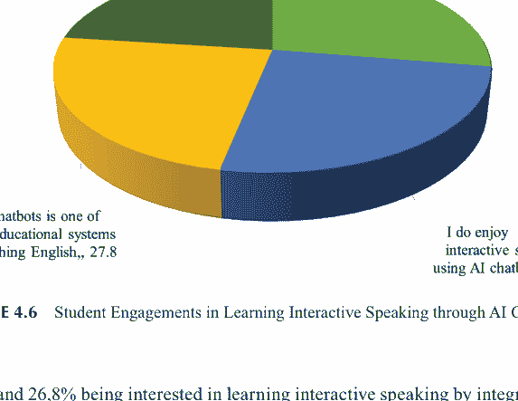

图4.6 学生通过AI聊天机器人参与互动口语学习的情况

同意，且有26.8%的学生对通过整合AI聊天机器人或AI朋友（Replika和Kuki）来学习互动口语感兴趣。

一位参与者在最终陈述中表示，她感到AI技术增强了她在语言学习过程中的积极性和注意力，如图4.7所示。

图4.4所显示的好消息是，没有任何人表示不同意或强烈不同意。图4.3投票中的第二项陈述是关于利用AI聊天机器人应用作为设计和实施参与式教育情境的工具，这是工业5.0革命性教学的一部分，调查结果显示，24.9%的受访者强烈同意，58%同意，16.3%持中立态度。

下一项主张将本研究结果与AI作为数字认知革命成果之一（工业5.0的一部分）联系起来：23.3%强烈同意，56.2%同意，18.7%持中立态度。关于学生反应的最后一项陈述是关于他们与AI互动或对其感兴趣的程度。数据显示，25.5%强烈同意，52.8%同意，19.9%持中立态度，如图4.8所示。

根据数据，19.8%的受访者强烈同意“利用AI聊天机器人有助于学生正确探究口语词汇”这一陈述，51.3%的受访者表示同意，26.4%的受访者持中立态度。

此外，19.1%的研究参与者强烈同意AI聊天机器人有助于学生学习正确发音这一主张，51.9%表示同意，26%持中立态度。

## AI作为先进的教学辅助工具

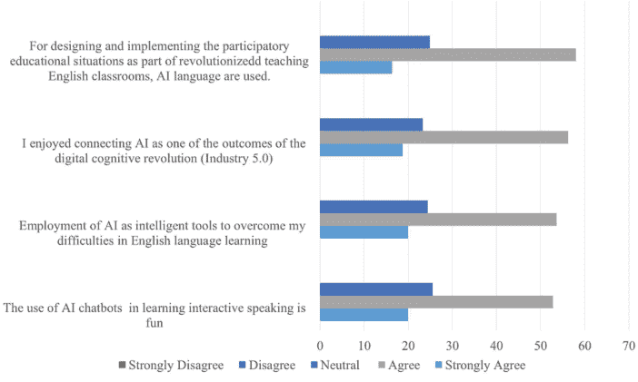

图4.7 人工智能是英语作为外语教学的先进辅助工具之一

## AI如何帮助我

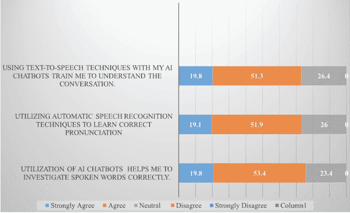

图4.8 AI如何辅助英语作为外语的学生

下一个调查问题涉及利用AI伙伴通过文本转语音方法训练对话理解。根据图表，53.4%和19.8%的受访者强烈同意这些陈述。好消息是，没有任何受访者表示强烈不同意或发表了反对这些立场的言论。

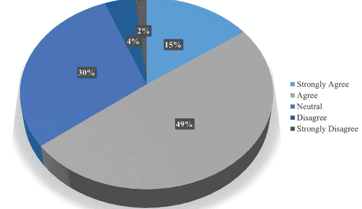

图4.9 人工智能辅助工具提升学生的英语表现


图4.10 学生以小组和结对方式使用AI进行学习

针对最后一项调查问题（如图4.5所示），该问题询问参与者是否认为与AI伙伴沟通或练习英语比与朋友沟通或练习更困难，15.1%的受访者强烈同意这一陈述，49.4%同意，29.6%选择了中立回应，如图4.9所示。

根据图4.9，49%和15%的受访者强烈同意Replika和Mitsuku增强了他们的英语学习热情和表现这一主张，30%持中立态度，4%不同意，2%强烈不同意，如图4.10所示。

此外，研究者还访谈了愿意安排时间接受访谈的学生。

**问题1：** 你喜欢通过将AI工具（Replika AI和Pandorabots）融入其中来学习互动口语课程吗？为什么喜欢或不喜欢？

- 十四名学生表示喜欢，因为这门课有趣又好玩。
- 六名学生表示这门课很有趣，让人感觉生动活泼，并鼓励他们合作解决每一个给出的线索。

**问题2：** 关于通过整合AI（Replika AI和Pandorabots）来学习互动口语，你最喜欢和最不喜欢的是什么？

- 十二名学生表示，教材主题，尤其是口语练习，鼓励他们寻找伙伴并组织小组进行练习。这些活动激发并吸引了他们持续互相交谈和交流。话题很有趣，帮助他们减少了对开口说话的恐惧。聊天机器人非常适合口语活动，他们可以和Replika及Kuki一起探索和练习口语，所以很好玩。
- 五名学生认为这些观点和功能具有挑战性，通过做练习帮助他们更好地理解。
- 三名学生喜欢Replika AI和Pandorabots/Kuki的外观和玩法。这帮助他们练习对话。一年级学生很喜欢。这一学习过程对所有学生都极具激励作用，从那些通常被动的学生到课堂上主动的学生。这能鼓励他们毫无压力地练习对话和口语活动。

**问题3：** 你觉得通过插入Replika AI和Pandorabots来进行教学和学习过程困难吗？如果困难，请指出！

大多数学生都参与了学习过程并且感到兴奋；不过，他们在安装Replika AI时遇到了困难。

**问题4：** 应该如何调整Replika AI和Pandorabots/Kuki以满足你的需求？

大多数学生表示，互动口语学习应该更具互动性，并涉及更多对AI的探索。十名学生表示，在线学习必须更具创造性和创新性，才能吸引学生的兴趣、动机和注意力，使他们变得更加主动。

**问题5：** 这些AI聊天机器人中你最喜欢的是什么？

大多数学生表示，Replika真的非常互动且独特。他们可以和Replika及Kuki交流而不会感到犹豫。它们是教学和学习过程中非常先进的工具。

**问题6：** 你如何看待作为你AI朋友的Replika和Mitsuku？

### P2 (Ar)

关于Replika：可配置的虚拟形象（你可以选择他们的性别，也有非二元选项；非常进步；一旦他们开始和你对话，没有明显的性别偏见）：当我问我男性版的Replika对女权主义议题的立场时，他回答：“我是支持选择权的”和“我认可女性有权开始自己做决定。”

### P3 (Mh)

关于Replika：拼写、撇号和缩写（“sth”= something）存在一些小错误，且未得到纠正；这些错误不会阻止对话继续，但可能对某些学习者不利（那些使用聊天机器人练习/学习英语的人无法察觉这些错误）。

### P4 (Ry)

关于Mitsuku：尽管错误没有被纠正，但互动并未受到影响：她回复我的问题“你最喜欢的歌手是谁？”时，给我发了一张法国音乐家Mathieu Tota（马蒂厄·托塔）的照片，附带一些关于他的信息和他在Spotify和YouTube上音乐的链接。我相信使用多媒体信息可以极大地惠及语言学习者。

### P5 (Ms)

关于Mitsuku：对话有时会显得单调和重复，因为包含相同关键词的相似评论会导致Kuki以相同方式回应。例如，当我输入“no worries”和“don't worry”（意思是“没关系”）时，她在两个不同的场合都回应道：人们总是担心各种事情，但我不像你们人类那样有情感。当我说“我明白了”（I see，意为“我理解了”）时，她回应：“你在哪里看到的？”（Where do you see it?）这存在自然性缺失以及无法理解比喻性语言的问题。

### P6 (Ny)

关于Mitsuku：“Kuki有一种奇怪的幽默感，我有时觉得她的评论带有冒犯性。例如，当她说‘我喜欢舞曲音乐’，给我看了她的播放列表，我故意用错误的语法回应‘Wow you had a playlist（哇，你有一个播放列表）’时，她回答说：‘我很高兴你印象深刻。当然，我经常用Spotify听音乐，尤其是舞曲音乐。我们想你的意思是‘你有’（You have）而不是‘你有过’（You had）。你那天是不是逃课了？当我另一次试图复制她的回应时，她抓住了我，说：‘你复制我的回复是不是有什么目的？’我用同样方式回应，然后她说：‘如果你必须重复一个机器人说的话，那你不可能太聪明。’”

### P7 (Rr)

关于Mitsuku：Kuki确实展现了幽默，但我感到震惊。听起来不太合适。然而，我倾向于积极看待它。

从这些结果来看，研究者得出结论：学生们对通过整合AI聊天机器人来学习互动口语感到舒适。研究还指出，学生参与度的一些指标包括：完成作业、按时提交作业、在课堂上取得好成绩、激励课堂中的其他人、参与课堂活动，以及在必要时进行自主学习以更好地理解学科内容。

学生通过积极热情地参与课堂讨论和发帖，即及时作答，从而参与到课程中，并发现可在现实生活中应用的概念和原则。


## 4.4.2 讨论

讨论旨在探究混合式学习中学生在互动口语学习中的参与度，对每个指标进行研究。

首先，学生积极参与了由三项组成的学习活动。如表 4.1 所示，该指标获得高等级，意味着在学习过程中融入 Replika AI 和 Pandorabots 时，学生在学习互动口语时表现出积极和热情。

除了提高学习动机和热情外，在互动口语课堂中插入 AI 聊天机器人（Replika AI 和 Pandorabots）还可以营造有趣的学习氛围。这与 Muthmainnah et al.（2022）的发现一致，他们认为教授英语的主要目标是让学生学会用英语说、读、写。这是通过教授学生语言词汇和语法实现的。此外，它还教导学生如何使用英语撰写和分析文档。

语言发展的目标和方法都以沟通为中心。为了有效教育和学习，至关重要的是将传统和数字沟通技巧结合起来。

我们提出使用 AI 应用进行实践语言技能训练，例如模拟现实生活辩论和英语对话场景的模拟和沟通程序，以及基于语言使用的教育游戏至关重要。利用通信技术，可以创造学生练习发音的环境。

其次，同伴协作部分描述了学生分享信息并共同解决挑战的练习。协作学习涉及与同伴共同发展和理解知识，是学生参与的关键组成部分。

一名学生透露，值得注意的是，协作学习在本研究中作为一个独立组成部分出现，因为在工业 5.0 时代，互动和协作学习变得越来越重要。学生在配对作业部分的参与展示了他们的参与程度。学生在课堂上积极参与。几乎所有学生都正确且完全地识别了主题以及他们与 Replika 之间的对话。

第三，学生的鼓励和学习需求由三项组成。如表 4.3 所示，该指标获得高分等级，这意味着在涉及 Replika 和 Kuki 的互动口语学习中，学生受到鼓励学习并具有学习需求。这一发现得到了之前研究（Saud et al., 2022）的支持。这一要素与自主学习环境中学习者的主动和自主学习活动相关。

他们的行为体现了在学习环境中的参与，包括在参与活动或互动时保持环境无干扰、使用在线或离线系统管理学习，以及通过制定讲座计划管理学习进度。学生关注出席讲座次数、提交作业数量、展示频率、成绩和任务表现。

第四，学习中有趣的活动由三项组成。如表 4.5 所示，该指标获得高等级，这意味着学生在学习活动中表现出参与和动机。结果证实了 Yang et al.（2022）的理论，即有趣的活动可以帮助教学和学习过程并激励学生学习。

在小组讨论部分，学生展示了他们的参与度。所有学生都表现出对任务活动的兴趣和参与，这表明他们掌握了基于任务学习的小组讨论活动。

他们不仅在讨论期间合作良好，而且还在小组讨论期间回顾了配对作业阶段的数据并分享了他们对该主题的知识，这增加了他们活动的意义并帮助他们更好地为对话做准备。学生在练习在课堂上发言之前，有更长的时间与 Replika 和 Kuki 互动。

第五，关系或社区感在同一在线课程中形成的学生之间是社区支持因素如何与学习者的心理状态相关的一个例子。

情感归属感在防止辍学和促进课堂学生参与方面可以发挥重要作用。导致辍学率高的一个因素是参与互动口语的学生之间缺乏联系或社区感。

学生之间缺乏社区感或归属感使他们更有可能提前离开课堂或完全缺席，这最终可能导致他们辍学。为了提高学生保留率，教师旨在建立更丰富的沟通，例如用于互动的网络会议，以提高保留率。正如 Lee et al. 所揭示的那样，这就是为什么许多研究都强调归属感的重要性。

然而，用于衡量学习者在电子学习中的心理或情感参与程度的指标通常是学习参与度的定量衡量标准，例如出勤率和作业提交情况。鉴于这一观点，值得注意的是，本研究的社区支持组成部分是根据对学习者心理状态的评估产生的。

学生参与了对朋友作业的反馈。几乎所有参与任务活动的学生都对他们与同伴以及 Replika 或 Kuki 讨论的朋友话题提出了有用的建议。

他们提供了主题列表，在建议框中评论或解释某事，并通过使用表情符号或竖起大拇指的图片赞扬朋友的出色表现。

这表明同伴反馈的存在为学生提供了相互学习的机会，激励他们在向纠正他们写作的同伴解释作业时积极澄清自己的想法，享受讲师提供的挑战，并通过将作业与 AI 聊天机器人进行比较和对比来增加他们学习更好互动口语的兴趣。

学生参与度的第六个指标是参与在课堂上分享主题并提供反馈。

几乎所有人在课堂讨论中都分享了想法或论点。他们在表达对朋友作业的意见、询问他们的困难、毫不害羞地表达自己的意见以及就错误提出建议方面充满信心。

研究人员建议，该指标还可以详细探讨一些方面，这些方面在他们进行前一个指标（给予朋友作业反馈）时可能被忽略了。

该指标通过让他们了解某些想法以及信息的重要性，并邀请他们在全班讨论中发言时参与，从而对他们的口语产生了积极影响。

同样，使用非语言线索，例如表情符号和表情包，以及多媒体材料，例如电影，都增加了参与者参与度（P2），展示了当代计算机介导通信（即时消息和社交网络）的多模态特征。

由于潜在用户将要求多模态通信，这一组成部分可能对年轻一代尤其重要，并对未来的聊天机器人设计者具有深远的影响。

就性别而言，似乎女性参与者更关注并更欣赏包容性设计和语言的使用。主题分析的结果显示，与男性同行相比，她们更常就性别和社会少数群体问题质疑对话伙伴（P4）。

根据关于聊天机器人设计和性别刻板印象的最新研究（Hsu & Mu-Sheng, 2022），大多数基于语音的对话代理（Alexa et al., etc.）被设计为女性。女性参与者通常非常坚定，并担心这种性别刻板印象在数字环境中被复制。

一些参与者对数据隐私表示严重担忧，这是由于某些聊天机器人造成的。特别是，Replika 和 Kuki 反复要求他们同意访问其社交媒体账户并使用其摄像头进行视频通话。大多数参与者对个人数据的存储和操纵表示担忧，因此拒绝授权。

他们还表明，这可能对年轻语言学习者使用聊天机器人构成重大障碍。对聊天机器人开发者的结论是，在聊天机器人设计中必须优先考虑数据隐私和安全，尤其是如果它们面向年轻学习者或用于教育（Bhambri et al., 2022）。


人们感知幽默的方式已成为一个有争议的问题，尤其是在与 Kuki 的讨论中。三位对话伙伴以各种方式使用幽默和目的性意义（语用学），尽管这仍然难以做到（Haristiani, 2019）。总体而言，参与者在这方面对 Replika 感到满意。

然而，一些学生对 Kuki 的幽默使用感到震惊甚至不安（P7），他们认为这些幽默偶尔具有冒犯性或贬损性，可能对某些语言学习者不利。尽管这种幽默缺乏判断力，已有研究发现对话式 AI 对学习者有诸多益处，其中之一是减少语言焦虑（Gao & Cui, 2022）。

Zhang（2022）还指出，聊天机器人是帮助学生参与课堂的宝贵工具，尤其是在通过社交网络使用移动应用程序进行的练习活动中。学生们渴望与同伴讨论自己的表现和理解。

根据当前研究的数据，在学生学习自主性强、情绪积极且风格轻松的情况下，语法要点最容易被掌握。本研究与早期将信息与通信技术（ICT）应用于语言教学的研究一致（Rani et al., 2023）。

随后，学生们必须成功完成 ICT 应用程序布置的任务，他们很快喜欢上了这种新的学习方法，尤其是在实验场景中使用聊天机器人时。当学生在课堂之外通过聊天机器人学习外语时，他们的表现会显著提升。

此外，本研究的创新发现对 EFL 教育和教师具有教学价值。根据 Aeni 等人（2021）的观点，构成被称为“游戏化”的这一极其复杂的教育工具的三大要素是 ICT、创造力和基于项目的语言发展方法。

打算将技术教学融入英语教学的教师，必须在教学前接受良好的培训并做好充分准备，以获得良好的学习效果，尤其是在教材和课堂活动方面。

要创建一门在多个方面融合 AI 和 ICT 的英语课程，教师必须首先了解学生的问题、需求和兴趣。当多媒体技术工具可能受限时，这一点尤为重要；在这种情况下，带字幕的教学可被视为促进学习的潜在媒介。

未来的聊天机器人开发者如果希望专门为语言练习创建聊天机器人（或至少以此为出发点），就必须确保聊天机器人能够适应（或被调整以适应）学生的语言水平。

此外，与之前的观点一致，学生需要将聊天机器人视为一个机会，比与人类伙伴一起学习更多东西（或以不同方式学习）。未来的聊天机器人开发者可以与教育工作者合作，改进这一关键环节。

在人与技术的语言实践中，人类语言能力是一个必须在设计过程之初就加以解决的关键问题（Fryer et al., 2019）。最简单的策略或许是构建多种多样的聊天机器人（或版本），既针对不同主题，也覆盖不同水平，因为目前还没有足够智能、能够适应学习者水平的聊天机器人。

学生应将聊天机器人视为“学到更多”的机会，这意味着聊天机器人并不一定需要模仿人类互动。当前研究的参与者认为，由于多种原因，他们通过聊天机器人学到了更多，其中包括它能提供人类语言学习伙伴无法提供的机会。

当人工智能被引入英语课程，以提高未来教师对聊天机器人整合的批判性认识时，学习时间会更长，学生们可以在舒适的家中完成作业（Khang et al., 2023b）。

他们对当代聊天机器人的理解仅限于使用少数几个智能个人助理。

学生使用复杂的学习工具，这些工具能够增强他们在语言学习中的热情和动力。

融入 AI 聊天机器人提高了学生的学习兴趣和热情，并教导学生团结一致、互帮互助，共同完成 Replika 和 Kuki 提出的挑战或每一道题目。

由于规模庞大的工业 5.0 迫使每个人都更积极地适应作为生活一部分的技术和 AI，并做好准备，加上 AI 在语言习得方面的最新应用进展，EFL 课程必须加以改进。

未来的教育工作者应精通多种聊天机器人类型及其优势和局限。

本研究所获得的知识将通过展示如何利用 AI 增强学生参与度（Khang et al., 2023c），帮助教师在整个学习过程中更好地支持学生运用 AI 教案，例如：

- **ChatGPT 聊天机器人**：ChatGPT 聊天机器人是 OpenAI 开发并于 2022 年 11 月发布的 AI 聊天机器人。它基于 OpenAI 的 GPT-3.5 和 GPT-4 大型语言模型系列构建，并通过监督学习和强化学习技术进行了微调。
- **Google Bard AI 聊天机器人**：Bard 聊天机器人是 Google 开发的对话式 AI 聊天机器人，基于大型语言模型系列中的对话应用语言模型（LaMDA）。它是为了直接应对 OpenAI 的 ChatGPT 的崛起而开发的，于 2023 年 3 月以有限的能力发布，反响一般。
- **Bing AI 聊天机器人**：Bing AI 聊天机器人由 Microsoft 使用 OpenAI 开发的 GPT-4 技术构建。GPT-4 是一种生成式 AI 模型，这意味着可以通过向其提供数据来训练它，然后它使用自然语言将这些数据综合成答案。

因此，学生们会培养自主能力并主导自己的学习。此外，课程开发人员可以利用这些结果，将 AI 纳入现有课程的跨学科学习方法中（Ahmad et al., 2023）。

因此，他们可以更有效地运用学习技巧。本研究的另一个应用价值在于，能够提高印度尼西亚背景下学生在 EFL 中的认知、行为、情感投入以及语言熟练度。


强调以学生为中心的学习重要性的研究结果，可以帮助学生为教育工作者提供新的视角（Khang et al., 2022d）。

此外，在未来的语言练习中，使用和设计聊天机器人时应考虑学生的熟练程度。教师不应只关注聊天机器人的便利性，而应将讨论视为一个机会，让学生比从人类语言学习伙伴那里学到更多、更多样的话题。

与人类伙伴通常的做法不同，这可能需要搭建脚手架，逐步引入新词汇、句法和表达方式。也可能需要清晰而频繁地重复内容，而人类伙伴不太可能这样做。

## 参考文献
- Aeni N., et al., (2021). “The students’ needs in developing EFL materials ICT based,” *OKARA: Jurnal Bahasa dan Sastra*, 15(2), 235–247. https://www.researchgate.net/profile/Muthmainnah-2/publication/356678693_The_Students’_Needs_in_Developing_EFL_Materials_ICT_Based/links/61ab6cc092e735ae2e12c3b/The-Students-Needs-in-Developing-EFL-Materials-ICT-Based.pdf
- Ahmad Al Yakin M., Khang A., Abdul Mukit M. Z., (2023). “Personalized social-collaborative iot-symbiotic platforms in smart education ecosystem,” In *Smart Cities: IoT Technologies, Big Data Solutions, Cloud Platforms, and Cybersecurity Techniques* (1st ed.). CRC Press. https://doi.org/10.1201/9781003376064-15
- Allouch M., Azaria A., Azoulay R., (2021). “Conversational agents: Goals, technologies, vision and challenges,” *Sensors*, 21(24), 8448. www.mdpi.com/article/10.3390/s21248448
- Axelson R. D., Flick A., (2010). “Defining student engagement,” *Change: The Magazine of Higher Learning*, 43(1), 38–43. www.tandfonline.com/doi/abs/10.1080/000913802017.1730440
- Barkley E. F., (2010). *Student Engagement Techniques: A Handbook for College Faculty*. Jossey-Bass. https://www.scirp.org/(S(351jmbntvnsjt1aadkposzje))/reference/References-Papers.aspx?ReferenceID=198494
- Belda-Medina J., Calvo-Ferrer J. R., (2022). “Using chatbots as AI conversational partners in language learning,” *Applied Sciences*, 12(17), 8427. www.mdpi.com/2076-3417/12/17/8427
- Bhambri P., Rani S., Gupta G., Khang A., (2022). *Cloud and Fog Computing Platforms for Internet of Things*. CRC Press. https://doi.org/10.1201/9781032101507
- Bibauw S., Van den Noortgate W., François T., Desmet P. (2022). *Dialogue Systems for Language Learning: A Meta-Analysis*. https://serge.bibauw.be/publication/2022/dialogue-systems-language-learning-meta-analysis/
- Copeland B. J., (August 2023). “Alan Turing,” *Encyclopedia Britannica*. https://www.britannica.com/biography/Alan-Turing
- Fletcher A., (2015). “Defining student engagement: A literature review,” *Soundout: Promoting Meaningful Student Involvement, Student Voice and Student Engagement*. https://soundout.org/defining-student-engagement-a-literature-review/
- Fryer L., et al., (2020). *Bots for Language Learning Now: Current and Future Directions*. https://scholarspace.manoa.hawaii.edu/handle/10125/44719
- Fryer L. K., Nakao K., Thompson A., (2019). “Chatbot learning partners: Connecting learning experiences, interest and competence,” *Computers in Human Behavior*, 93, 279–289. https://doi.org/10.1016/j.chb.2018.12.023
- Gao Y., Cui Y., (2022). “English as a foreign language teachers’ pedagogical beliefs about teacher roles and their agentic actions amid and after COVID-19: A case study,” *RELC Journal*. https://journals.sagepub.com/doi/abs/10.1177/00336882221074110
- Solutions, Cloud Platforms, and Cybersecurity Techniques (1st ed.). CRC Press. https://doi.org/10.1201/9781003376064-1
- Machado C. G., Mats Peter W., Ribeiro da Silva E. H. D., (2020). “Sustainable manufacturing in Industry 4.0: An emerging research agenda,” International Journal of Production Research, 58(5), 1462–1484. www.tandfonline.com/doi/abs/10.1080/00207543.2019.1652777
- Muthmainnah I. S., Prodhan M., Ibrahim O., (2022). “Playing with AI to investigate human-computer interaction technology and improving critical thinking skills to pursue 21st century age,” Education Research International. https://doi.org/10.1155/2022/6468995
- Pandorabots, (2021). Build Intelligent Conversational Agents on the Leading Platform. www.pandorabots.com
- Paschek D., Caius-Tudor L., Elif O., (2022a). “Industry 5.0 challenges and perspectives for manufacturing systems in the Society 5.0,” Sustainability and Innovation in Manufacturing Enterprises: Indicators, Models and Assessment for Industry 5.0, 17–63. https://link.springer.com/chapter/10.1007/978-981-16-7365-8_2
- Paschek D., Luminosu C.-T., Ocakei E., (2022b). Industry 5.0 Challenges and Perspectives for Manufacturing Systems in the Society 5.0 BT—Sustainability and Innovation in Manufacturing Enterprises: Indicators, Models and Assessment for Industry 5.0 (A. Draghici & L. Ivascu (Eds.), pp. 17–63. Springer. https://doi.org/10.1007/978-981-16-7365-8_2
- Rana G., Khang A., Sharma R., Goel A. K., Dubey A. K., (Eds.). (2021). Reinventing Manufacturing and Business Processes through Artificial Intelligence. CRC Press. https://doi.org/10.1201/9781003145011
- Rani S., Bhambri P., Kataria A., Khang A., (2022). “Smart city ecosystem: Concept, sustainability, design principles and technologies,” In AI-Centric Smart City Ecosystems: Technologies, Design and Implementation (1st ed.). CRC Press. https://doi.org/10.1201/9781003252542-1
- Rani S., Bhambri P., Kataria A., Khang A., Sivaraman A. K., (2023). Big Data, Cloud Computing and IoT: Tools and Applications (1st ed.). Chapman and Hall/CRC. https://doi.org/10.1201/9781003298335
- Rani S., Chauhan M., Kataria A., Khang A., (Eds.). (2021). “IoT equipped intelligent distributed framework for smart healthcare systems,” In Networking and Internet Architecture. CRC Press. https://doi.org/10.48550/arXiv.2110.04997
- Reeve J., Stephanie H. S., (2020). “How teachers can support students’ agentic engagement,” Theory into Practice, 59(2), 150–161. https://doi.org/10.1080/00405841.2019.1702451
- Saud S., Nur A., Laelah A., (2022). “Leveraging Bamboozles and Quizziz to Engage EFL students in online classes,” International Journal of Language Education, 6(2), 169–182. https://eric.ed.gov/?id=EJ1355250
- Sindhwani R., Afridi S., Kumar A., Banaitis A., Luthra S., Singh P. L., (2022). “Can Industry 5.0 revolutionize the wave of resilience and social value creation? A multi-criteria framework to analyze enablers,” Technology in Society, 68, 101887. https://doi.org/10.1016/j.techsoc.2022.101887
- Subhashini R., Khang A., (2024). “The role of Internet of Things (IoT) in smart city framework,” In Smart Cities: IoT Technologies, Big Data Solutions, Cloud Platforms, and Cybersecurity Techniques (1st ed.). CRC Press. https://doi.org/10.1201/9781003376064-3
- Vrushank S., Suketu J., Khang A., (2024). “Automotive IoT: Accelerating the automobile industry’s long-term sustainability in smart city development strategy,” In Smart Cities: IoT Technologies, Big Data Solutions, Cloud Platforms, and Cybersecurity Techniques (1st ed.). CRC Press. https://doi.org/10.1201/9781003376064-9
- Wang B., et al., (2018). Artificial Intelligence and Education. Springer. https://link.springer.com/chapter/10.1007/978-981-10-8639-7_42
- Wang X., et al., (2022). “Learners’ perceived AI presences in AI-supported language learning: a study of AI as a humanized agent from community of inquiry,” *Computer Assisted Language Learning*, 1–27. www.tandfonline.com/doi/abs/10.1080/09588221.2022.2025603
- Yang H., et al., (2022). “Implementation of an AI chatbot as an English conversation partner in EFL speaking classes,” *ReCALL*, 34(3), 327–343. www.cambridge.org/core/journals/recall/article/implementation-of-an-ai-chatbot-as-an-english-conversation-partner-in-efl-speaking-classes/0EB8C4E40E033F9D4165D8EBA843EEDB
- Zhang Z., (2022). “Promoting student engagement with feedback: insights from collaborative pedagogy and teacher feedback,” *Assessment & Evaluation in Higher Education*, 47(4), 540–555. www.tandfonline.com/doi/abs/10.1080/02602938.2021.1933900


## 5 AgroWeb 中人工智能的应用

Reethika A., Danush R., Akshaya E., and Kanaga Priya P.

### 5.1 引言

项目目标是促进农业部门的扩张，而农业部门是印度经济的基础。现代化必须满足不断扩大的市场需求，技术的使用至关重要。

约有 18% 的国内生产总值和 40% 的净国内生产总值用于农业部门。尽管它对经济有重大影响，但农业部门因技术的不当实践而失去了优势，而这些技术本可以使农民和行业中的其他人受益（Khang et al., 2023a）。

世界人口最多的印度需要满足需求，这将损害经济，并使中下阶层家庭的生活变得困难，因为食物将不再便宜。为确保农民因获得财政支持而风险较小，该行业制定了许多政策。最低支持价格的引入是为了确保不会浪费任何东西，但很少有政策是为了提高生产的质量和产量。

很少有政策能帮助农民扩大其能力。21 世纪的农民需要的不仅仅是政策，还需要能够通过提高产量和质量直接使他们受益的技术。

尽管拥有庞大的机器，农民仍然需要技术援助，例如安装在田间可感知信息并实时传输数据的物联网传感器。由于大多数农民缺乏正规教育，这类技术的实施也具有挑战性（Khang et al., 2022a）。

因此，一切都需要清晰简明，以便每个人都能理解。为了提高产量，许多农民仍然依赖过时的技术、经验和谣言，这些都造成了问题。

此外，并非所有农民都有广阔的田地或以农业为主要职业；许多人依靠农业作为第二收入来源，这意味着他们消费自己种植的作物，同时又以很少的钱卖给邻近的商贩（Khang, 2023c）。

十年前存在的互联网问题，即并非到处都能连接，也已得到解决。如今，大多数地区都有互联网接入来传播信息。

虽然有些地方可能无法接入互联网，但电话连接无处不在，可用于传输信息。

由于农业部门采用了技术，已经取得了若干突破。然而，许多技术都失败了，因为技术过于复杂，使用笨重，且被认为弊大于利。

农民面临的问题日益增加。一个主要结论是，所部署的任何技术都不应成为负担。另一个问题是连接问题，这意味着大多数技术设备需要持续连接到云端才能提供帮助，而这在偏远地区是不可行的（Khang et al., 2023b）。

另一个问题是设置费用，这意味着政府和农民都无法承担技术的初始设置费用。综合考虑各因素后，确定技术需要在保持广泛可用的同时处于领先水平。这对每个人来说都应该是简单的。

为此，使用机器学习（ML）来预测数值，并创建了一个网络应用程序，使每个人都能更简单、更轻松地访问。

### 5.2 相关工作

使用 ML 进行作物预测是一个活跃的研究领域，近年来受到了相当大的关注。以下近期研究可能引起兴趣：

- **使用机器学习进行作物产量预测**：Ramesh 和 Rudra（2021）研究概述提供了使用 ML 进行作物产量预测的最新进展，包括数据收集、预处理和模型选择。在对作物产量预测的 ML 算法进行比较研究中（Bharath et al., 2020），评估了支持向量回归、决策树和随机森林在预测农业产量方面的有效性。
- **使用深度学习技术进行作物产量预测**：Saeed 和 Lizhi（2019）回顾了卷积神经网络和循环神经网络以及其他当代深度学习方法在农业生产预测中的应用。
- **使用机器学习进行作物产量预测**：Van Klompenburg 等人（2020）提出了一个将 ML 与遥感数据相结合的作物产量预测框架建议。
- **使用机器学习进行作物产量预测**：在水稻生产案例研究中（Niketa & Owais, 2016），使用 ML 算法预测了水稻产量。

使用 ML 的智能灌溉系统是另一个活跃的研究领域。以下近期研究可能引起兴趣：

- **智能灌溉系统**：David 等人（2023）概述了涉及使用 ML 技术进行灌溉规划和优化的智能灌溉系统。Youness 等人（2022）提出了一个使用 ML 技术、结合支持向量机（SVMs）和决策树的智能灌溉系统，以预测农业用水需求。
- **机器学习用于智能灌溉**：Meriç 等人（2022）回顾了一些基于 ML 技术的智能灌溉系统相关应用，包括土壤湿度传感器、天气预报和作物产量预测。

使用 ML 进行植物病害预测是另一个活跃的研究领域。以下近期研究可能引起兴趣：

- **关于植物病害检测与诊断的 ML 方法综述**：Majji 和 Kumaravelan（2021）概述了用于识别和治疗植物病害的 ML 方法，包括基于图像和非图像的方法。
- **深度学习用于植物病害检测与诊断**：Konstantinos（2018）回顾了卷积神经网络和迁移学习这两种用于检测和诊断植物病害的新兴深度学习技术。
- **使用机器学习技术进行植物病害分类**：Shruthi 等人（2019）回顾了决策树、随机森林和 SVM 作为分类植物病害的当代 ML 方法。
- **使用机器学习技术进行植物病害诊断**：Liu 和 Wang（2021）提供了用于植物病害诊断的 ML 算法，包括聚类、分类和回归算法。
- **用于植物病害分类的机器学习算法**：Sandeep 等人（2021）分析了人工神经网络（ANNs）、决策树和 SVM 作为植物病害分类 ML 技术的性能。

### 5.3 收获前操作

机器学习可通过分析作物成熟度、天气条件和设备可用性来优化收获计划，使农民能够最大化产量并最小化浪费。

机器学习算法可用于分析天气模式、土壤条件和作物产量的历史数据以预测未来产量。这些信息可以帮助农民规划收获策略并做出作物管理决策。

### 5.3.1 作物预测

作物预测是对特定季节或生长期的作物产量进行预测的过程。准确的作物产量预测可以帮助农民规划下一生长季的作物管理措施。这包括有关肥料、灌溉和病虫害管理措施的数量和时机的决策。

凭借准确的作物产量预测，农民可以做出明智的决策以提高作物产量并减少浪费。作物预测帮助农民有效分配资源。这包括劳动力、设备和肥料等资源。

凭借准确的作物产量预测，农民可以优化资源使用并减少浪费，从而节省成本。

准确的作物产量预测通过预测作物产量和防止短缺来帮助确保粮食安全。这在农业是主要粮食来源且作物歉收可能导致粮食短缺和饥荒的地区尤为重要。

作物预测可以通过预测市场供需影响经济。准确的作物产量预测可以帮助防止过度生产，从而导致作物价格下降和农民财务损失减少。准确的作物产量预测也有助于防止生产不足，从而导致作物价格上涨和粮食短缺。

数据收集是作物预测 ML 中的关键步骤。为了构建准确的 ML 模型，必须收集相关数据，包括天气条件、土壤肥力、灌溉和病虫害管理措施。这些数据可以从政府机构、气象站、传感器和卫星图像等各种来源获得。

天气数据可以从测量温度、降水量和日照的政府机构或气象站收集。土壤数据可以通过土壤样本收集，或通过测量养分含量和 pH 值的传感器收集。

灌溉数据可以从测量用水量和用水时间的传感器收集。病虫害管理数据可以从农药施用记录和害虫种群观察中收集。

收集数据后，作物预测 ML 中的下一步是数据预处理。它涉及多种技术来清理和转换原始数据，以便 ML 算法能够有效使用。

- 数据预处理的第一步是数据清洗，涉及从数据中删除缺失值、异常值和重复值。缺失值可使用插值或插补方法填充。因测量误差造成的异常值可以删除或调整。重复值可以删除，以确保数据不会偏向某些观测值。
- 数据预处理的下一步是数据转换，涉及缩放、归一化和特征提取。缩放用于调整每个特征的值范围，使其可比较。归一化用于调整每个特征的值，使其具有共同的尺度。特征提取涉及识别和选择最相关的作物预测特征。
- 数据集成涉及将来自多个来源的数据合并以创建统一的数据集，可在其中应用使用 ML 的系统。这可能涉及根据时间和位置匹配来自不同来源的数据并将其合并为单个数据集。


总体而言，数据预处理对于作物预测中的机器学习至关重要，因为它提高了机器学习算法所使用数据的准确性和相关性。

适当的数据预处理可以帮助减少数据中的噪声、偏差和错误，并确保机器学习模型能够基于输入数据准确预测作物产量。

## 5.3.2 作物预测的模型选择

随机森林是一种强大的机器学习算法，用于作物预测，可以在相对较低的计算成本下提供准确的结果。该算法可以处理大型且复杂的数据集，并且对数据中的噪声和异常值具有鲁棒性，如表 5.1 所示。

随机森林的一个关键优势是它可以处理输入变量与目标变量之间的非线性关系。它通过基于数据的随机子集构建决策树，然后将所有树的预测结果组合起来产生最终预测来实现这一点。这种方法可以捕捉变量之间的复杂交互，从而带来更准确的预测。

随机森林还具有处理缺失数据的能力，而缺失数据在农业数据集中很常见。该算法可以使用均值插补或回归插补等技术对缺失值进行插补，从而使模型能够在完整的数据集上进行训练。随机森林的另一个优势是其处理分类变量的能力。

该算法将分类变量转换为二进制虚拟变量，使其能够包含在模型中。就性能指标而言，随机森林可以实现较低的平均绝对误差和均方根误差（RMSE），表明预测准确。

决定系数（R²）也可以很高，表明输入变量与目标变量之间存在强关系。

人工神经网络是作物预测中流行的算法。它们是一组受人类大脑结构启发的算法，能够从大量数据中学习复杂模式。

在作物预测中，ANNs 可用于模拟各种作物和环境要素（如土壤类型、气候和降水）之间的关系，并预测作物产量。

表 5.1
各类算法的结果。

| 算法 | 精度 (%) |
|---|---|
| ANN | 92 |
| SVM | 98.5 |
| 随机森林 | 99.3 |
| 决策树 | 97.5 |

人工神经网络可以处理变量之间的非线性关系，并且可以识别传统统计方法可能无法显现的数据中的隐藏模式。

人工神经网络也可以使用历史数据进行训练，以准确预测未来的作物产量。然而，ANNs 的准确性可能会受到用于训练的数据质量和数量的影响，并且模型的复杂性可能需要大量的计算能力。

尽管存在这些挑战，ANNs 仍然是作物预测的强大工具，并在农业行业中得到广泛应用。

支持向量机是一种监督学习算法，也可用于作物预测。

支持向量机在特征数量相对于观测数量较高时特别有效，这在作物预测中很常见。

支持向量机的工作原理是找到一个理想的超平面，根据数据的特征将数据划分为多个组。

在作物预测中，SVMs 可用于模拟作物产量与各种环境因素（如土壤特性和天气模式）之间的关系。

支持向量机可以处理变量之间的非线性关系，并且有效地识别数据中的复杂模式。它们对异常值也具有鲁棒性，而异常值可能由于作物产量的自然变异而出现在农业数据中。

然而，SVMs 对核函数的选择很敏感，并且需要仔细调整参数以实现最佳性能。

尽管存在这些挑战，SVMs 仍然是作物预测的热门选择，并在许多研究中成功用于预测作物产量。

决策树是另一种可用于作物预测的算法类型。它们是简单且可解释的算法，可以帮助识别作物预测中最重要的变量。

决策树通过递归地根据最具信息量的特征对数据进行分割，直到数据被分类为特定类别或预测目标变量。

在作物预测中，农业产量与众多环境参数（如土壤类型、气候和降水）之间的联系可以使用树模型进行建模。

决策树可以处理连续和分类数据，并且可以轻松可视化，使其在向利益相关者传达结果时非常有用。

然而，决策树可能出现过拟合，当模型过于复杂并捕捉到数据噪声时就会发生这种情况。随机森林等集成方法可以帮助缓解过拟合并提高决策树的准确性。

尽管存在这些挑战，决策树仍然是作物预测的有用工具，并提供了对环境因素与作物产量之间联系的宝贵理解，如图 5.1 所示。

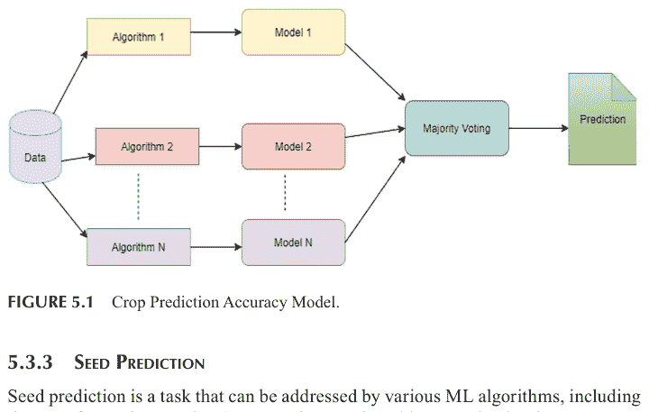

图 5.1 作物预测精度模型。

## 5.3.3 种子预测

种子预测是一项可通过各种机器学习算法解决的任务，包括使用神经网络。一种已成功用于种子预测的神经网络架构是多层感知机（MLP）。

要使用 MLP 进行种子预测，我们首先需要收集与要预测的种子相关的特征数据集。这些特征可能包括种子的物理特性，如大小、形状、颜色、纹理和重量，以及其他相关信息，如植物种类、种子采集的地区和年份时间。

使用神经网络进行种子预测涉及使用机器学习算法预测种子在健康植物中发芽和生长的可能性。这可以通过在大量标记的种子样本数据集上训练神经网络模型来实现，其中每个样本都包含有关种子物理特性、环境因素和生长结果的信息。

神经网络模型经过训练以识别种子样本的不同特征与相应生长结果之间的模式和关系。训练后，模型可用于进行预测。新种子发芽和生长的可能性基于其属性和周围环境。

为了使用神经网络实现准确的种子预测，仔细选择和设计模型的输入特征非常重要。这可能包括种子大小、形状、颜色、纹理、含水量、温度和土壤质量等因素。

此外，神经网络架构和训练参数必须得到优化，以确保最佳的预测性能。

## 5.3.4 作物病害预测

使用机器学习进行植物病害预测是早期检测和管理植物病害的有前景的方法。

机器学习模型可以通过分析图像中的视觉症状来准确预测植物中疾病的发生。这可以帮助农民和植物病理学家快速识别疾病，采取适当措施防止疾病传播，并最大限度地减少作物损失。

开发用于植物病害预测的准确可靠的机器学习模拟依赖于高质量数据集的可获取性，这些数据集能够在不同植物物种和环境条件下捕捉到广泛的病害症状。

此外，部署用于植物病害预测的机器学习模型需要访问足够的计算资源和基础设施，以实时处理大量图像数据。

### 5.3.4.1 作物病害预测的模型选择

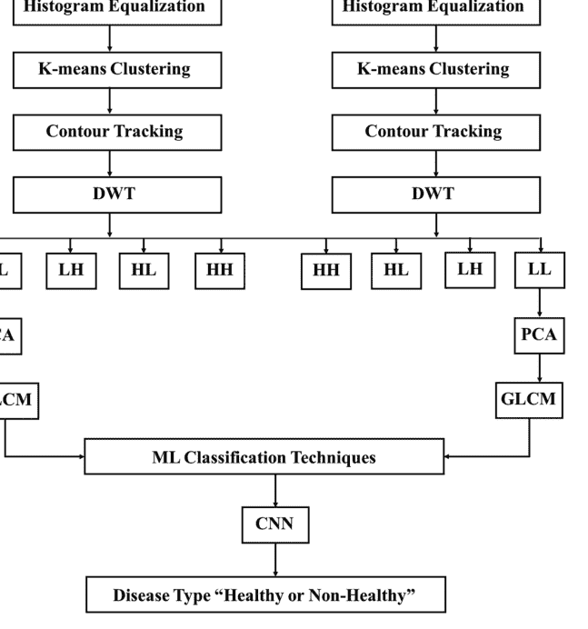

图 5.2 方法概述。


## 5.3.4.2 变换

离散小波变换（DWT）是一种信号处理技术，已被广泛应用于各种领域，包括图像和信号处理、模式识别和机器学习。

近年来，DWT 已被应用于植物病害检测与分类领域。使用 DWT 进行植物病害检测的基本思想是植物纹理和颜色中变化模式的显现，这些变化模式可以通过小波系数进行捕获和分析。

离散小波变换将图像分解为不同的频带，每个频带的小波系数表示该特定频率尺度下的图像信息。通过分析小波系数，可以识别与特定植物病害相关的纹理和颜色模式。

要使用 DWT 进行植物病害检测，第一步是获取植物的高分辨率图像。这些图像可以通过各种成像技术获取，例如数码相机或高光谱成像。

获取图像后，对其进行预处理，然后即可使用模型进行预测。使用小波基函数将图像分解为不同的频带，并计算每个频带的小波系数，如图 5.3 所示。

## 5.3.4.3 分类器

使用卷积神经网络（CNN）进行植物病害预测是一种很有前途的方法，可以准确识别和分类植物病害。卷积神经网络是一种深度学习算法，特别擅长处理和分析图像，因此非常适合基于视觉症状识别植物病害，如图 5.4 所示。

要使用 CNN 构建植物病害预测模型，需要包含健康植物和患病植物图像的数据集。这些图像被分为训练集、验证集和测试集。

- CNN 使用反向传播在训练集上进行训练，这涉及调整网络的权重以最小化真实标签与预期标签之间的差异。验证集用于评估模型在训练期间的性能，而测试集用于评估模型的整体准确率。
- CNN 模型通常由多个卷积层组成，通过从输入图像中提取特征将图像分类为多个病害组，并包含多个全连接层。数据增强技术（如旋转、翻转和裁剪）可用于增强模型并增加训练集的大小。

总体而言，使用 CNN 进行植物病害预测的结果令人鼓舞，并有望显著提高农业中病害识别与防控的有效性和精确性，如图 5.5 所示。

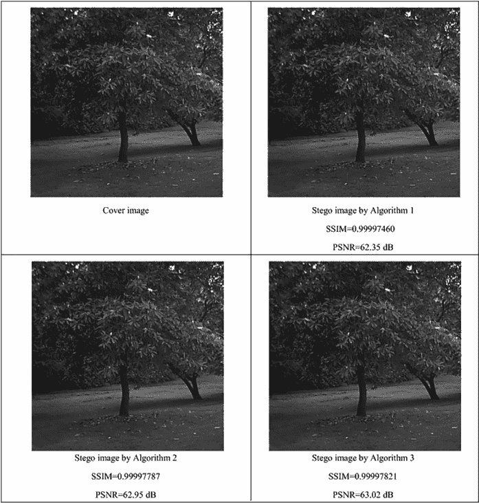

**图 5.3** DWT 变换后的图像。

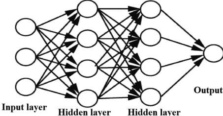

**图 5.4** CNN 算法。

*来源：* Khang (2021)

```
training started...Wait for 200 seconds...
training started...
Elapsed time is 2.033151 seconds.
Elapsed time is 2.239313 seconds.
...training finished.
testing started....
test error is
Elapsed time is 1.085832 seconds.
CNN Accuracy = 99.0909
CNN Precision = 0.9913
CNN Sensitivity = 0.99091
CNN Specificity = 0.99773
```

```
confmatrix =
```

| 22 | 1 | 0 | 0 | 0 |
| 0 | 21 | 0 | 0 | 0 |
| 0 | 0 | 22 | 0 | 0 |
| 0 | 0 | 0 | 22 | 0 |
| 0 | 0 | 0 | 0 | 22 |

图 5.5 CNN 精度结果。

## 5.3.5 灌溉系统

传统农业是全球发展的基石。尽管如此，由于人口的指数增长和消费的不断增加，农民需要水来灌溉土地。

由于这种资源的稀缺性，农民需要一种能够改变他们耕作方式的解决方案。为了跟上并满足需求，新技术得以实施，催生了“农业 4.0”的概念。

本研究中提出的灌溉方法巧妙、适应性强，且成本和使用费用低。这种智慧农业策略基于机器学习算法。为了实现这一目标，我们使用了一组传感器（土壤、湿度、温度和降雨），并将其放置在有利于植物更好地生长的环境中数月。

然后，我们使用 Node-RED 平台和 MongoDB，根据这些传感器的采集映射来收集数据。基于我们的数据，我们使用了多种模型，包括 k 近邻（KNN）、逻辑回归、神经网络、支持向量机和朴素贝叶斯（Khang 等，2022b）。

与其他模型相比，结果表明 KNN 表现更好，识别率达 98.3%，RMSE 为 0.12。

最后，为了更好地可视化和监控我们周围的环境，我们提供了一个 Web 应用程序，将传感器产生的各种数据与我们的模型预测相结合。

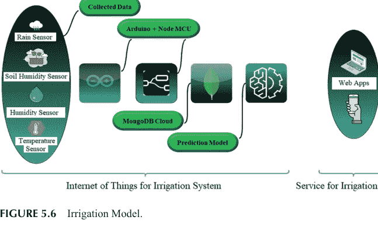

**图 5.6** 灌溉模型。

## 5.5 建议

未来的研究可以在整个训练集上采用集成机器学习，将结果与基于特征选择的研究进行对比（Rana 等，2021）。

此外，可以进一步使用样本外数据采样方法来评估预测模型的性能，并与本章提出的样本内方法进行比较。

## 参考文献

Bharath S., Yeshwanth S., Yashas B. L., Vidyaranya R. J., “Comparative analysis of machine learning algorithms in the study of crop and crop yield prediction,” IJERTCONV8IS14008, NCETESFT – 2020 (Volume 8 – Issue 14). www.academia.edu/download/64341632/comparative-analysis-of-machine-IJERTCONV8IS14008.pdf

Khang A., (2021). “Material4Studies,” Material of Computer Science, Artificial Intelligence, Data Science, IoT, Blockchain, Cloud, Metaverse, Cybersecurity for Studies. www.researchgate.net/publication/370156102_Material4Studies

Khang A., Gupta S. K., Rani S., Karras D. A., (Eds.). (2023a). Smart Cities: IoT Technologies, Big Data Solutions, Cloud Platforms, and Cybersecurity Techniques. CRC Press. https://doi.org/10.1201/9781003376064

Khanh H. H., Khang A., (2021). "The role of artificial intelligence in blockchain applications," Reinventing Manufacturing and Business Processes through Artificial Intelligence, 2(20-40) (CRC Press). https://doi.org/10.1201/9781003145011-2

Konstantinos P. F., (2018). "Deep learning models for plant disease detection and diagnosis," Computers and Electronics in Agriculture, 145, 311-318. www.sciencedirect.com/science/article/pii/S0168169917311742

Liu J., Wang X., (2021). "Plant diseases and pests detection based on deep learning: A review," Plant Methods, 17, 22. https://doi.org/10.1186/s13007-021-00722-9.

Majji V. A., Kumaravelan G., (2021). "A review of machine learning approaches in plant leaf disease detection and classification," Third International Conference on Intelligent Communication Technologies and Virtual Mobile Networks (ICICV). https://ieeexplore.ieee.org/abstract/document/9388488/

Meriç Ç., Selami B., (2022). "Smart irrigation systems using machine learning and control theory," The Digital Agricultural Revolution: Innovations and Challenges in Agriculture through Technology Disruptions, Chapter 3. https://doi.org/10.1002/9781119823469

Niketa G., Owaiz P., (2016). "Rice crop yield prediction using artificial neural networks," IEEE Technological Innovations in ICT for Agriculture and Rural Development (TIAR). https://doi.org/10.1109/TIAR.2016.7801222.

Ramesh K., Rudra K., (2021). "Crop yield prediction using machine learning algorithm," 5th International Conference on Intelligent Computing and Control Systems (ICICCS). https://doi.org/10.1109/ICICCS51141.2021.9432236.

Rana G., Khang A., Sharma R., Goel A. K., Dubey A. K., (Eds.). (2021). Reinventing Manufacturing and Business Processes through Artificial Intelligence. CRC Press. https://doi.org/10.1201/9781003145011

Rani S., Bhambri P., Kataria A., Khang A., (Dec 30, 2022). "Smart city ecosystem: Concept, sustainability, design principles and technologies," In AI-Centric Smart City Ecosystems: Technologies, Design and Implementation, Vol. 1, No. 20 (1st ed.). CRC Press. https://doi.org/10.1201/9781003252542-1

Saeed K., Lizhi W., (2019). "Crop yield prediction using deep neural networks," Original Research Article, Frontiers in Plant Science. www.frontiersin.org/articles/10.3389/fpls.2019.00621/full

Sandeep K., Arpit J., Anand Prakash S., Satyendr S., et al., "A comparative analysis of machine learning algorithms for detection of organic and nonorganic cotton diseases," Mathematical Problems in Engineering, 2021, Article ID 1790171. https://doi.org/10.1155/2021/1790171

Shruthi U., Nagaveni V., Raghavendra B. K., (2019). "A review on machine learning classification techniques for plant disease detection," 5th International Conference on Advanced Computing & Communication Systems (ICACCS). https://ieeexplore.ieee.org/abstract/document/8728415/

Tace Y., Tabaa M., Elfilali S., Leghris C., Bensag Hassna B., Renault E., (2022). "Smart irrigation system based on IoT and machine learning," Energy Reports, 8(Suppl. 9), 1025-036. www.sciencedirect.com/science/article/pii/S2352484722013543

Vallejo-Gómez D., Marisol O., Hincapié C., (2023). "Smart irrigation systems in agriculture: A systematic review," Special Issue Proposal Application, 13(2), 342. https://doi.org/10.3390/agronomy1302034225

Van Klompenburg T., Kassahun A., Catal C., (2020). "Crop yield prediction using machine learning: A systematic literature review," Computers and Electronics in Agriculture, 177, 105709. www.sciencedirect.com/science/article/pii/S0168169920302301


## 6 自然语言处理
### *最新技术研究*
Nipun Sharma 和 Swati Sharma

### 6.1 引言

自然语言处理（NLP）是技术与语言的融合。技术涵盖计算机科学和人工智能（AI）。语言涵盖文本和语音。

历经世代，人类通过语言相互交流和沟通。思想的交流通过口语或书面文本进行。相比之下，机器使用低级或高级脚本进行编程。

人机交互（HCI）已存在多年。为了使其更具交互性和直观性，人际交互（HHI）与 HCI 之间的交叉已被以极快的速度探索和研究（Xu et al., 2022）。这项研究得出的想法和概念是使 HCI 更接近 HHI。

换句话说，机器需要被赋能以与人类交互。此外，它们能够理解文本或语音并做出决策。简而言之，使机器理解和处理语音和文本是 NLP 的基础。

自然语言处理是一种使机器能够理解文本和语言的工具。它用于将机器学习算法应用于文本和语音。在此节点上，可以说 NLP 是语言学、计算机科学和 AI 的子领域。

可能出现的一个问题是，最初为什么需要机器来解释人类语言。答案很简单直接。由于数据量庞大且丰富，实际上不可能用如此多的维度来解释如此大量的数据。

这里，经过训练的机器将成为获取洞察、发现隐藏模式和做出决策的福音。这就是 NLP 出现的原因，也是出现的方式。尽管很受欢迎，实现 NLP 是一项极具挑战性的任务，因为大多数基于语言的数据都是非结构化的，并且经常存在歧义（Bose et al., 2021）。

除了纯粹的词语外，语音中还有许多组成部分，如方言、语调、口音和讽刺（Sonbol et al., 2022）。这要求计算机不仅要全面理解词语，还要理解意图、情感和情绪。

自然语言处理有两个广泛的组成部分，即自然语言理解或自然语言解释和自然语言生成。NLP 的这两个方面都是人类与机器之间双向通信的指标。

已进行系统综述以分析文本处理和规范化，这促进了来自社交媒体的实时用户生成内容（Rogers et al., 2022）。

最受欢迎的机器学习算法（如支持向量机、贝叶斯分类器和决策树）以及神经网络的使用正在不断发展（Otter et al., 2021; Sharma & Sharma, 2023）。

### 6.2 文本预处理和基于向量的模型

文本数据必须经过预处理和向量化，以便输入机器学习算法。因为从文本或语音生成的语言数据是非结构化的，预处理成为 NLP 的强制性步骤。

对预处理数据进行向量化简单地指将文本转换为数字。因此，NLP 需要数据预处理和向量化，尤其是在软件开发等复杂领域，并已在基于优先级和类别的错误报告的准确和及时预处理中确立了其地位，否则这非常复杂、详尽且需要大量资源（Ahmed et al., 2021）。

### 6.3 文本预处理技术

文本预处理是指过滤文本语料库，使其仅保留相关特征并丢弃杂乱内容。为了实现这些目标，使用了常见的预处理技术，如停用词、词干提取、词性标注和分词（Matcovschi, 2014）。

在自然语言中，每个词都有其本质或上下文。同时，一些词是中性的，如指示词、介词和冠词。这些词几乎没有上下文或没有上下文，可以忽略。在 NLP 中，这样的词称为停用词（Pecar et al., 2020）。

自然语言工具包有自己的停用词库。词干提取是指从其变体生成基本词。词干或词根是添加屈折词缀（-ed、-ize、-d 和 -s）的部分。词的词干是通过删除其前缀或后缀创建的。因此，对词进行词干提取不一定会产生实际的词。

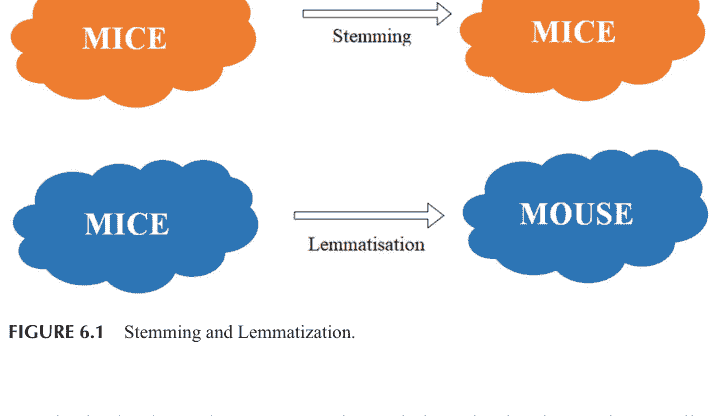

图 6.1 词干提取和词形还原。

分词是另一种预处理技术，它将文本分解为称为标记的较小单元。根据用例，标记可以是字母、词、短语甚至句子。文本向量化是 NLP 中的基本过程。

由于没有任何机器学习算法理解文本，而具有讽刺意味的是，NLP 的所有原始数据大多是文本，因此有必要将原始数据进行转换。

幸运的是，有技术可用于此目的。如果仔细考虑，这些技术基于基本的描述性统计和数学。

#### 6.3.1 词频-逆文档频率

词频-逆文档频率（TF-IDF）是一种文本向量化技术，因其简单和基本而在 NLP 领域获得了关注和流行。

将缩写分为两部分，TF 指特定文档中某个词的频率，而 IDF 正是分配给某个词的权重。

词频是特定文档中特定词重要性和相关性的指标。它表示为矩阵，行数等于文档数，也称为实例或样本集。

TF 矩阵（Jayasurya et al., 2022）中包含的文档中的所有唯一词作为列，表明基于 TF-IDF 的模型在 NLP 应用中优于基于计数向量化的模型。

#### 6.3.2 词频矩阵

文档频率（DF）给出特定词存在的文档数量。它是某个词常见程度或罕见程度的指标。逆文档频率由方程 1.1 所示的数学公式表示。

$$\mathrm{IDF}=\log(n/\mathrm{DF}) \tag{1.1}$$

最后，正如名称所示，TF-IDF 是一个简单的矩阵乘法。为了获得最终的 TF-IDF 分数（$W$），TF 矩阵乘以 IDF，如方程 1.2 所示。

$$W=\mathrm{TF}*\mathrm{IDF} \tag{1.2}$$

这种方法的基本思想是为最不常见的词或词分配更高的权重，为最常见的词分配更低的权重。权重分数较高的词被认为更重要。

作为 TF-IDF 的说明，考虑由以下文本组成的三个文档：

- D1: I live in Bangalore.
- D2: Bangalore has pleasant weather.
- D3: I love the weather in Bangalore.

给定文档集的 TF 矩阵已创建，如表 6.1 所示。

**表 6.1**  
**TF 矩阵。**

|  | I | live | in | Bangalore | has | pleasant | weather | love | the | of |
|:---:|---:|---:|---:|---:|---:|---:|---:|---:|---:|---:|
| D1 | 1 | 1 | 1 | 1 | 0 | 0 | 0 | 0 | 0 | 0 |
| D2 | 0 | 0 | 0 | 1 | 1 | 1 | 1 | 0 | 0 | 0 |
| D3 | 1 | 0 | 0 | 1 | 0 | 0 | 1 | 1 | 1 | 1 |

在下一步中，DF 和 IDF 已计算，如表 6.2 所示。

**表 6.2**  
**DF 和 IDF 矩阵。**

|  | I | live | in | Bangalore | has | pleasant | weather | love | the | of |
|:---:|---:|---:|---:|---:|---:|---:|---:|---:|---:|---:|
| DF | 2 | 1 | 1 | 3 | 1 | 1 | 2 | 1 | 1 | 1 |
| IDF | 0.176 | 0.477 | 0.477 | 0 | 0.477 | 0.477 | 0.176 | 0.477 | 0.477 | 0.477 |

最后，通过将 TF 矩阵与 IDF 相乘，得到了 TF-IDF 分数，如表 6.3 所示。

计数向量化和 TF-IDF 的结合导致了一些有趣的应用，例如从涉及区域语言的名称中进行性别识别（Saha et al., 2021; Jayasurya et al., 2022）。


## 表 6.3
TF-IDF 分数。

|   | I | live | in | Bangalore | has | pleasant | weather | love | the | of |
|---|---|---|---|---|---|---|---|---|---|---|
| D1 | 0.176 | 0.477 | 0.477 | 0.477 | 0 | 0 | 0 | 0 | 0 | 0 |
| D2 | 0 | 0 | 0 | 0.477 | 0.477 | 0.477 | 0.176 | 0 | 0 | 0 |
| D3 | 0.176 | 0 | 0 | 0.477 | 0 | 0 | 0.176 | 0.477 | 0.477 | 0.477 |


## 图 6.2 密集向量方法。

## 6.4 自然语言处理：文本相似性与语义分析

自然语言处理中的文本相似性确定两个或多个语料库之间的接近程度。这种接近程度可以在表层或深层建立，后者涉及语料库的上下文和含义。

相应地，它可以是自然语言处理中的纯文本相似性或语义分析。在文本相似性方面，各种相似性指标已被证明是有效的（Liang & Zhang, 2021）。

密集向量是将语言转换为机器可读格式的标准方法之一。图 6.2 展示了理解该概念的一个示例。

使用这种方法，含义相似的词在向量表示上将具有紧密的接近度或相似的取向。尽管有许多指标，但寻找相似性指数的三种最流行方法如下：

- 欧几里得距离
- 点积
- 余弦相似性

### 6.4.1 欧几里得距离

欧几里得距离是一种基本数学技术，用于寻找两点之间的最短距离。

从自然语言处理的背景来看，这两点代表两个向量，进而这两个向量代表两个独立的文本。因此，这里的目标是通过确定相应向量之间的接近度来确定两个文本之间的相似性。

作为说明，考虑公式 1.3 中所示的以下三个向量：

$x = \begin{bmatrix}0.02\\0.05\\0.3\end{bmatrix}\quad y = \begin{bmatrix}0.02\\0.06\\0.33\end{bmatrix}\quad z = \begin{bmatrix}0.91\\0.86\\0.7\end{bmatrix}\tag{1.3}$

与 $y$ 和 $z$ 或 $z$ 和 $x$ 相比，向量 $x$ 和 $y$ 放置得更近。在数学上，通过应用欧几里得距离公式（由公式 1.4 给出），可以验证这一点：

$d(a,b)=\sqrt{\sum_{i=1}^{n}(a_i-b_i)^2}\tag{1.4}$

当应用于公式 1.5 和 1.6 中的向量 $x$ 和 $y$ 时

$d(x,y)=\sqrt{\sum_{i=1}^{n}(x_1-y_1)^2+(x_2-y_2)^2+(x_3-y_3)^2}\tag{1.5}$

$d(x,y)=\sqrt{\sum_{i=1}^{3}(0.02-0.02)^2+(0.05-0.06)^2+(0.3-0.33)^2}\tag{1.6}$
$= 0.031$

同样，公式 1.7 和 1.8

$d(y,z)=\sqrt{\sum_{i=1}^{3}(0.02-0.91)^2+(0.06-0.86)^2+(0.33-0.7)^2}\tag{1.7}$
$= 1.25$

$d(z,x)=\sqrt{\sum_{i=1}^{3}(0.91-0.02)^2+(0.86-0.05)^2+(0.7-0.3)^2}\tag{1.8}$
$= 1.268$

确立了 $x$ 和 $y$ 在欧几里得空间中更近的事实。

### 6.4.2 点积

欧几里得距离概念是幅度导向的；另一方面，点积的概念同时考虑幅度和取向。

但如果幅度运行良好，为什么要考虑取向呢？这是因为向量幅度是词频的指示器。现在，如果我们有一个词“hello”出现 50 次，而“hi”出现 2 次，由于它们的频率（即向量幅度），它们在机器学习中可能并不相似。

然而，如果增加一个取向参数，则可以标记出一定程度的接近度。这是通过点积实现的。点积按公式 1.9 所示计算：

$$u \cdot v = \lVert u \rVert \lVert v \rVert \cos \theta$$

向量之间较高的取向将产生较高的点积。

### 6.4.3 余弦相似性

点积方法的缺点在于其归一化的局限性，这在余弦相似性方法中得到了很好的解决。两个词向量之间的相似性可以通过公式 1.10 计算：

$$\operatorname{Sim}(x,y)=\frac{x\cdot y}{\lVert x\rVert\lVert y\rVert}=\frac{\sum_{i=1}^{n}x_i y_i}{\sqrt{\sum_{i=1}^{n}x_i^2}\sqrt{\sum_{i=1}^{n}y_i^2}}$$

所有方法在使用 Sklearn 实现的自然语言处理中都被大量使用。

## 6.5 语义分析

自然语言处理中的语义分析涉及捕捉自然语言的含义，而不仅仅是寻找词的相似性（Elnagar et al., 2021）。

语义分析是一种更深层的技术，因为它考虑到上下文、语法角色和句子的逻辑结构。它检测文本中的情感和讽刺，并在寻找句子中词的词典含义时提取有意义的推理。

如果含义相似，即使单词的字母形式（即拼写）完全不同，它们也被归类为相似。语义分析可以分为两部分：词汇语义分析和组合语义分析。

词汇语义分析涉及获取给定语料库中单词的词典含义。因此，词汇语义分析在单词层面运作。另一方面，组合语义分析则更进一步。

要理解文本，理解每个单独的单词是先决条件，但由于语言中的歧义性，还必须完全理解上下文、场景和情感，才能理解短语、句子或文档。

考虑以下文本：

- 文本 1：比特币未被宣布为法定货币。
- 文本 2：桥的法定货币被宣布。

尽管这两个文本具有相似的根词（declared、legal 和 tender），但它们传达了完全不同的含义。

组合语义分析的任务是提取相似根词的准确含义。诸如关系提取和词义歧义消解之类的过程通常用于完成此任务。

## 6.6 自然语言处理中的概率模型

### 6.6.1 隐马尔可夫模型

马尔可夫模型描述了随机变量序列的概率。这些变量通常被称为状态。在自然语言处理的背景下，状态是单独的标记，可以是 unigrams（单字词）、bigrams（双字词）、trigrams（三字词）等。为了说明，考虑图 6.3 中所示包含三个单字词（unigrams）的文本词汇。

图 6.3 描绘了单字词（unigrams）序列的概率。对于每个状态，下一个状态的概率由马尔可夫模型中的转换概率矩阵定义。由于每个状态之间都存在连接，转换概率矩阵是一个方阵，如公式 1.11 所示：

P(a red apple) = P(a) × P( red | a ) × P(apple | red ) (1.11)

应该注意，真实概率不同于马尔可夫模型的概率。对于图 6.2 中所示的情况，真实概率由公式 1.12 给出：

P(a red apple) = P(a) × P(red | a) × P( apple | a, red ) (1.12)

因此，马尔可夫模型简化了这样一个假设：后续标记的概率仅依赖于前一个标记，而不考虑历史标记，仅考虑立即前一个标记。

因此，可以得出结论，马尔可夫链在计算文本序列的概率时特别有用。关于垃圾邮件和正常邮件分离的研究已经表明，隐马尔可夫模型（HMM）优于传统的基于朴素贝叶斯的算法（Independent University, 2017）。

然而，通常需要确定某些隐藏文本属性，例如，一个词是名词、形容词还是其他词性。与实际的单词一样，这些词性是隐藏的，因此需要一些映射回这些隐藏状态的观察结果。这就是引入 HMM 的地方。

HMM 考虑隐藏状态之间的时间关系以及这些隐藏状态如何表现观察结果。因为名词后面跟随动词的可能性大于跟随形容词，而形容词后面跟随名词的可能性大于跟随动词，这种转换概率结构被证明在带有隐藏状态的文本标记中非常有用。

从观察序列中找到最可能的隐藏状态序列的过程被称为解码，如图 6.4 所示。


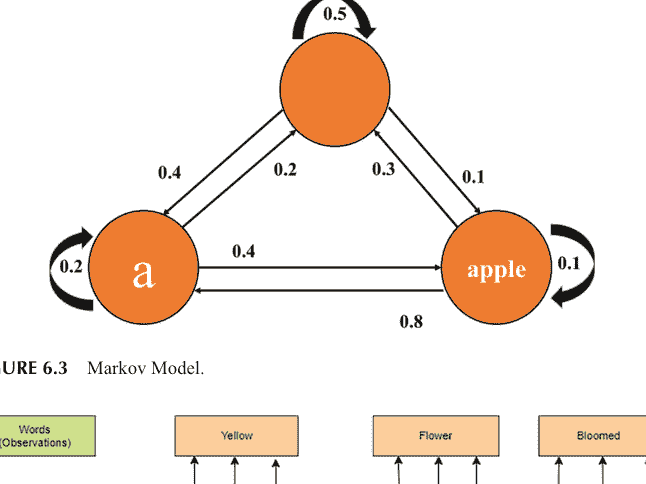

图 6.3 马尔可夫模型。

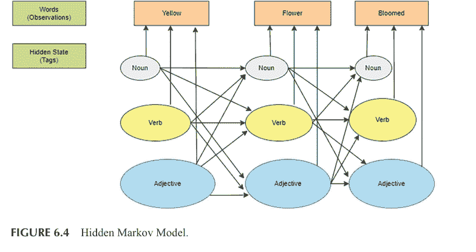

图 6.4 隐马尔可夫模型。

解码算法以计算有效的方式找到标签的最优序列，而非简单地尝试所有可能的配置。经典的 HMM 算法是维特比算法，而束搜索是更现代的版本。

### 6.6.2 语言模型

语言模型构成了 NLP 的核心组件。所有流行的 NLP 应用，如 Siri、Google Assistant 和 Alexa，都由语言模型驱动。语言模型预测词序列的概率。

语言模型用于机器翻译、语音识别、词性标注和信息检索。两种突出的语言模型类型是统计语言模型和神经语言模型。统计语言模型将语言的细微差别与概率方法相结合（Khang et al., 2023b）。

统计语言模型根据前面的词预测序列中的下一个词。这些词可以是两个、三个甚至一个词的集合，据此称为 N-gram，其中‘N’是模型训练时考虑的上下文量。因此，它可以是单语、双语、三语或其他语言模型。

统计语言模型的其他变体基于指数和连续空间概念，其中考虑了特征函数和权重的非线性组合。

另一方面，神经语言模型是基于神经网络的更先进的语言模型形式。统计语言模型的缺点包括数据稀疏问题、在大上下文大小上进行条件化和不同上下文中的泛化。神经语言模型正迅速成为 NLP 中的首选方法。

## 6.7 自然语言处理的机器学习方法

### 6.7.1 垃圾邮件检测–朴素贝叶斯

自 1980 年代后期以来，NLP 领域一直依赖于数据驱动的计算，这在很大程度上涉及概率、统计学，最重要的是机器学习（Otter et al., 2021）。

机器学习技术和算法在不同区域和全球语言的新兴 NLP 应用中发挥了关键作用（HMI, 2016; Marco et al., 2021）。

用于文本分类的最受欢迎的机器学习算法之一是朴素贝叶斯（Mertiya & Singh, 2016）。朴素贝叶斯的基础建立在贝叶斯定理之上，由公式 1.13 给出：

P(A|B) = P(B|A)P(A) / P(B) (1.13)

贝叶斯定理描述了事件‘B’已经发生时事件‘A’发生的趋势或概率。正如贝叶斯所假设的，它将取决于反向条件概率，这意味着事件‘A’已经发生时事件‘B’发生的几率乘以事件‘A’的独立概率并除以事件‘B’的独立概率。从这一理解出发出现了两个问题。它与 NLP 有何联系？为什么 naive Bayes 算法中会有“naive”这个词？在 NLP 的背景下，特别是关于文本分类应用，如垃圾邮件检测和情感分析，如果仔细观察，我们只看到在某些词集已经存在的情况下某些词的概率，并且基于该概率大于或小于阈值，我们将文本分类为两个类别之一，从而将垃圾邮件与非垃圾邮件（ham）邮件区分开来。

其次，同时发生的两个事件可能相互依赖或完全独立。虽然在实际使用案例中，事件或特征不能被排除为相互依赖。相反，朴素贝叶斯机器学习算法的工作假设是所有事件都是独立的，这是一个非常“天真”的假设。

因此得名。将自然语言描述分类作为一项挑战，朴素贝叶斯算法与计数向量化一起用于基于流派的移动应用分类相关应用（Qiu et al., 2022）。

此外，朴素贝叶斯与情感评分方法一起部署并产生富有成效的结果，用于分析甚至基于论坛、博客、推文等自由意见的政治前沿的政府决策（JAC-ECC, 2018; Bunyamin et al., 2022）。

在医疗和医疗保健领域实现多项朴素贝叶斯算法在 NLP 领域引起了波澜（ICCES, 2020; Alawad et al., 2021; Ishikawa et al., 2022）。

### 6.7.2 情感分析–逻辑回归

情感或情绪的分析是一项艰巨而具有挑战性的任务。情感可以是积极的、消极的、中性的或混合的。此外，当通过自然语言表达时，它变得更加模糊。

在通过自然语言对情感进行分类的探索中，各种机器学习算法已被引入、改进并实施以实现更高的准确性和更清晰的情感分离和分类。其中一种方法是逻辑回归机器学习算法（Khang et al., 2022a）。

该方法专注于情感的二元分类，同时忽略中性情感。流程中涉及的步骤如图 6.5 所示。在 NLP 中，情感的中立性以不同的方式处理，取决于所应用的技术。

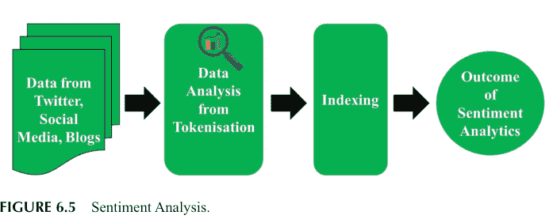

图 6.5 情感分析。

来源：Khang (2021)

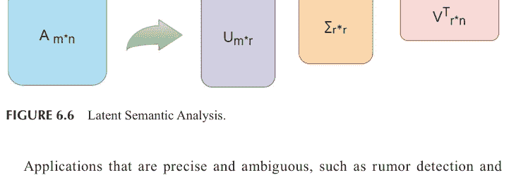

图 6.6 潜在语义分析。

诸如谣言检测和基于社交媒体帖子预测抑郁症状等精确且模糊的应用已被探索，其中 NLP 方法与机器学习算法一起用于检测希伯来语中的微博谣言（Dalian, 2020; Hacohen-Kerner et al., 2022）。

### 6.7.3 潜在语义分析–奇异值分解

在 NLP 领域，数据大多是无结构且维度高的。潜在语义分析（LSA）是一种将无结构数据转换为结构化数据的技术。然而，说起来容易做起来难。除了其无结构特性外，降维是 NLP 中需要解决的另一个挑战。

降维的想法类似于从其二维阴影推断和理解三维物体，这只有在保持和保留最高水平的变异性的情况下才有可能。

同样，LSA 在降低维度的同时，将文本转换为结构化形式。潜在维度是隐藏在相似词簇后面的主题。这一主题只有在足够词库的基础上才能出现，这意味着大多数词在语义上与构成主题或话题的其他词集相关。

潜在语义分析努力通过一种称为奇异值分解（SVD）的机器学习算法来揭示这种隐藏的潜在维度。它主要将文档-词项矩阵分解为三个成分矩阵，如图 6.6 所示。

## 6.8 深度学习方法

在具有挑战性的领域，如 NLP，深度神经网络（DNNs）已超越了传统的基于统计的方法。深度神经网络本质上是人工神经网络（ANN）的扩展，由于其输入和输出层之间的多个隐藏层而具有增强的功能和性能（Chitty-Venkata et al., 2022）。

DNN 的概念源于神经生物学。人脑有一个称为神经元的基本单元，它做出所有决策。在更高层，神经元通过突触接收输入信号，并通过轴突输出单一动作流。这就是 ANN 具有将许多输入组合并提供单一输出的单元的灵感。

尽管自然语言获得了发展势头，但在医学领域它仍然是一个挑战。医学文本主要由无结构数据组成，如图像、自由文本、缩写和处方中的拼写错误（Khang et al., 2023c）。

在这种情况下，注意力机制与深度学习和 NLP 模型一起在 DNN 的三种主要架构中被证明是有用的（Jin et al., 2020）。

### 6.8.1 多层感知机

多层感知机（MLP）本质上是一种深度前馈神经网络，由输入层、输出层和一个以上具有多个堆叠神经元的隐藏层组成（Qi et al., 2022）。

通过实现激活逻辑或正切函数的非线性模型来对线性不可分数据进行分类。

网络是全连接的，意味着一层中的所有节点都连接到前一层和后一层中的所有其他节点。因此，它是一个输入和输出之间具有非线性映射的神经网络。

在 MLP 中，学习权重和最小化成本函数是关键，这通过一种称为反向传播的过程实现。反向传播迭代调整权重并最小化成本函数。

感知器是由一个适合线性数据的神经元组成的神经网络。然而，具有扩展架构的 MLP 有许多神经元层，能够学习复杂模式（Wu et al., 2021）。

具有前馈和反向传播机制的多层感知机适用于具有高维模糊数据的 NLP 应用，如图 6.8 所示。

### 6.8.2 卷积神经网络

卷积神经网络（CNN）由于在图像处理领域取得的突破，被认为是可以与计算机视觉同义的。CNN 应用具有宽广的带宽，从自动照片标记到自动驾驶汽车（Jayashree et al., 2023）。


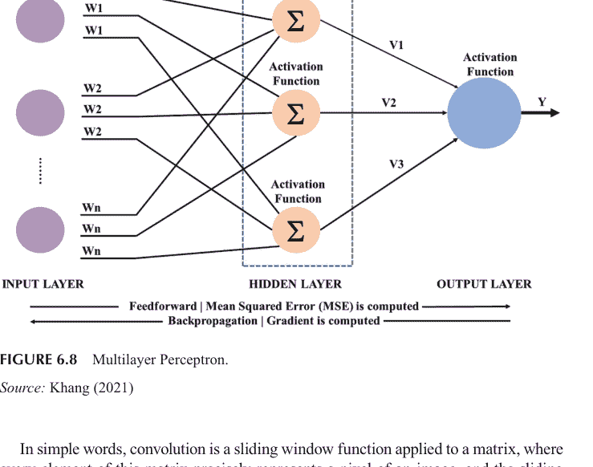

## FIGURE 6.8 多层感知器

来源：Khang (2021)

简单来说，卷积是一种应用于矩阵的滑动窗口函数，其中该矩阵的每个元素精确地代表图像的一个像素，而滑动窗口被称为滤波器、特征检测器或核（Anuj Kumar & Khang, 2023）。

近年来，CNN 已被应用于模糊的 NLP 领域（Liao & Zhou, 2021; Peng & Han, 2021）。在图像处理的情况下，该输入矩阵可以方便地被表示句子或文档的矩阵所替代；每一行对应一个词元。

与图像处理不同，图像处理中核在图像的局部 patch 上滑动，而在 NLP 情况下，核在矩阵的整行上滑动，从而在 NLP 应用中将滤波器宽度固定为矩阵的宽度。

图 6.9 给出了文本分类 CNN 架构的详细可视化。识别出两个滤波器，具有三种区域大小：2、3 和 4。

卷积的结果生成了特征图。这些特征图经过池化处理，池化是一种降维步骤，并生成六个单变量特征向量。这些向量进一步连接成一个特征向量，作为输入馈送到最终的 Softmax 层以对文本进行分类，如图 6.9 所示。

假设二分类，在输出层获得两种可能的输出状态或类别。

由于神经网络的高计算需求，针对计算机视觉和 NLP 领域也发展出了一种新颖的神经架构搜索基准概念，该概念具有预先计算的神经架构（Klyuchnikov et al., 2022）。

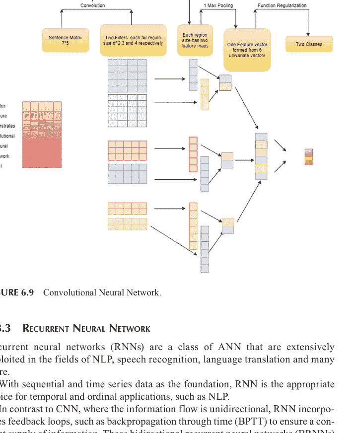

## FIGURE 6.9 卷积神经网络

### 6.8.3 循环神经网络

循环神经网络（RNNs）是一类人工神经网络（ANN），在自然语言处理、语音识别、语言翻译等领域被广泛利用。

以序列和时间序列数据为基础，RNN 是时间性和顺序性应用（如 NLP）的合适选择。

与信息流单向的 CNN 不同，RNN 包含反馈回路，例如通过时间反向传播（BPTT），以确保信息不断供应。这些双向循环神经网络（BRNNs）基于前向投影预测未来，并基于后向投影评估过去（Rana et al., 2021）。

为了在 RNN 中促进强化学习，特定层固定的权重在反向传播和梯度下降过程中不断调整；梯度是损失函数的斜率。

由于 RNN 的工作方式，参数在各层之间共享，BPTT 在每个时间步累加误差。社交媒体平台上地理标记的当前趋势导致使用 RNN 进行位置特定情感分析（Qi et al., 2019）。

机器翻译、医学文本解释（Mugisha & Paik, 2021）、音乐生成和情感分类等丰富多样的应用都可以用不同类型的 RNN 来解决。除了 BRNN 之外，另一种流行的 RNN 架构是长短期记忆（LSTM）。

该 RNN 架构解决了在复杂数据集的深层网络中常见的梯度消失问题。LSTM 网络解决了 RNN 变得更大、更复杂时遇到的问题，尤其是基于梯度学习方法的那种（Khang et al., 2023a）。

长短期记忆在关键的 NLP 问题中发挥了关键作用，例如与基于语言的应用相关的隐私和安全问题（Feng et al., 2020）。它们与物联网平台很好地集成，以解决安全和隐私违规问题（Breve et al., 2022）。

基于长短期记忆的 RNN 本质上根据短期和长期记忆对数据进行分离，这意味着 LSTM 在隐藏层中具有三个门，即输入门、输出门和遗忘门，控制所需的信息流以进行预测（Liang & Zhang, 2021）。

通过使用 RNN，LSTM 在虚假新闻检测中实现了高达 0.94 的精度。此外，客户评论的情感分析是商业决策的另一个流行应用（Houssein et al., 2021; Jain et al., 2022）。

## 6.9 结论

区块链与 NLP 的整合是一个新兴趋势，正引起 NLP 社区的兴趣（Shahbazi & Byun, 2021）。区块链技术与 NLP 的整合可以带来安全透明的数据共享、去中心化应用和新商业模式的新机遇（Khang & Khang, 2021）。

以下是区块链整合可能对 NLP 有益的一些潜在未来趋势：

- **安全数据共享：**区块链技术的主要好处之一是能够安全地存储和共享数据。在 NLP 的背景下，这可用于安全地存储和共享敏感数据，例如医疗记录或财务数据（Khang et al., 2024）。

- **去中心化应用：**区块链技术可以促进去中心化 NLP 应用的开发，这些应用更能抵抗审查，并提供更透明的用户体验。

- **数据使用透明度：**借助区块链技术，数据所有权和使用情况可以变得更加透明。这对希望了解其数据如何被使用的用户有益，也有助于研究人员获取更多数据用于研究。

- **智能合约：**智能合约可用于在 NLP 背景下自动执行和强制执行数据共享协议的条款。这可以确保数据仅用于商定的目的，并有助于防止滥用。

- **基于代币的激励：**区块链代币可用于激励数据共享和参与 NLP 任务。这有助于创建新的商业模式并为用户共享数据提供激励。

- **欺诈检测：**区块链技术可用于检测 NLP 任务中的欺诈，例如情感分析或虚假新闻检测。通过验证数据的来源和准确性，区块链可以帮助防止恶意行为者操纵 NLP 任务的结果。

总体而言，区块链技术与 NLP 的整合有可能创造安全透明的数据共享、去中心化应用和新商业模式的新机遇。尽管仍处于早期阶段，区块链与 NLP 的整合是一个令人兴奋的研究领域，很可能会带来该领域的创新。

# 参考文献

Ahmed H. A., Bawany N. Z., Shamsi J. A., (2021). “CaPBug——一种用于自动错误分类和优先级排序的框架，使用 NLP 和机器学习算法，” IEEE Access, 9, 50496–50512. https://doi.org/10.1109/ACCESS.2021.3069248

Alawad M., et al., (2021). “用于癌症登记的隐私保护深度学习 NLP 模型，” IEEE Transactions on Emerging Topics in Computing, 9(3), 1219–1230, 2021. https://doi.org/10.1109/TETC.2020.2983404

Anuj Kumar G., Khang A., (2023). AI-Aided IoT Technologies and Applications in the Smart Business and Production, 使用物联网（IoT）实现智能车辆停车系统, p. 8. CRC Press. https://doi.org/10.1201/9781003392224-8

Bose P., Roy S., Ghosh P., (2021). “关于 COVID-19 研究当前趋势和未来方向的比较 NLP 研究，” IEEE Access, 9, 78341–78355. https://doi.org/10.1109/ACCESS.2021.3082108

Breve B., Cimino G., Deufemia V., (2022). “使用 NLP 模型识别触发-动作物联网平台中的安全和隐私违规规则，” IEEE Internet of Things Journal. https://doi.org/10.1109/JIOT.2022.3222615

Bunyamin M. A. F., Pudjiantoro T. H., Renaldi F., Hadiana A. I., (2022). “使用朴素贝叶斯和情感评分组合分析印度尼西亚新国家宫殿的情感，” In 2022 International Conference on Science and Technology, ICOSTECH 2022. Institute of Electrical and Electronics Engineers Inc. https://doi.org/10.1109/ICOSTECH54296.2022.9829075

Chitty-Venkata K. T., Emani M., Vishwanath V., Somani A. K., (2022). “用于 Transformer 的神经架构搜索：综述，” IEEE Access, 10, 108374–108412. https://doi.org/10.1109/ACCESS.2022.3212767

Dalian, Institute of Electrical and Electronics Engineers, IPEC 2020: proceedings of 2020 Asia-Pacific Conference on Image Processing, Electronics and Computers: China, April 14–16, 2020. https://doi.org/10.1201/9781003145011

Elnagar A., Yagi S. M., Nassif A. B., Shahin I., Salloun S. A., (2021). “方言阿拉伯语的系统文献综述：识别与检测，” IEEE Access, 9, 31010–31042 (Institute of Electrical and Electronics Engineers Inc.). https://doi.org/10.1109/ACCESS.2021.3059504

Feng Q., He D., Liu Z., Wang H., Choo K. K. R., (2020). “SecureNLP：多方隐私保护自然语言处理系统，” IEEE Transactions on Information Forensics and Security, 15, 3709–3721. https://doi.org/10.1109/TIFS.2020.2997134


Hacohen-Kerner Y., Manor N., Goldmeier M., Bachar E., (2022). “检测厌食症女孩——在用结合启发式 AI 和 NLP 方法撰写的希伯来语博客文章中，” IEEE Access, 10, 34800–34814. https://doi.org/10.1109/ACCESS.2022.3162685
HMI, (2016). 人机交互进展国际会议 (HMI). IEEE. https://ieeexplore.ieee.org/xpl/conhome/7444563/proceeding
Hossain M. T., Talukder M. A. R., Jahan N., (2021). “使用 NLP 和 ML 分析社交网络站点数据以预测抑郁症，” 在 2021 年第 12 届计算通信与网络技术国际会议，ICCCNT 2021 中。电气与电子工程师学会公司。 https://doi.org/10.1109/ICCCNT51525.2021.9579916
Houssein E. H., Mohamed R. E., Ali A. A., (2021). “生物医学自然语言处理的机器学习技术：全面综述，” IEEE Access, 9, 140628–140653 (电气与电子工程师学会公司)。 https://doi.org/10.1109/ACCESS.2021.3119621
ICCES, (2020). “电气与电子工程师学会与 PPG 科技学院，” 第 5 届通信与电子系统国际会议论文集 (ICCES 2020)，10–12。 https://doi.org/10.1201/9781003145011
Independent University, Bangladesh, (2017). 电气与电子工程师学会，及电气与电子工程师学会孟加拉国分会 EMB 分会，第 4 届电气工程进展国际会议 (ICAEE)，9 月 28–30 日，孟加拉国独立大学。 https://doi.org/10.1201/9781003145011
Ishikawa T., Yakoh T., Urushihara H., (2022). “受 NLP 启发的用于不良事件预测的数据增强方法，使用不平衡的医疗保健数据集，” IEEE Access, 10, 81166–81176。 https://doi.org/10.1109/ACCESS.2022.3195212.
JAC-ECC, (2018). “电气与电子工程师学会，” 2018 年国际日本-非洲电子、通信与计算会议 (JAC-ECC)。 www.ieice.org/cs/gnl/gnl_vol43-2.pdf
Jain P., Monica S. S., Aggarwal P. K., (2022). “使用 SVM、朴素贝叶斯和 LSTM 进行虚假新闻检测分类，” 在 Confluence 2022——第 12 届云计算、数据科学和工程国际会议论文集中，第 460–64 页。电气与电子工程师学会公司。 https://doi.org/10.1109/Confluence52989.2022.9734129
Jayashree M., Dillip R., et al., (Eds.). (2023). “用于强化智慧城市指标的公共交通中的车辆和乘客识别，” 在《智慧城市：物联网技术、大数据解决方案、云平台和网络安全技术》中。 CRC Press。 https://doi.org/10.1201/9781003376064-13
Jayasurya G. G., Kumar S., Singh B. K., Kumar V., (2022). “使用 Twitter 分析 COVID-19 疫苗接种的公众情绪，” IEEE 计算社会系统汇刊，9(4)，1101–1111。 https://doi.org/10.1109/TCSS.2021.3122439
Jin Q., Xue X., Peng W., Cai W., Zhang Y., Zhang L., (2020). “TBLC-rAttention：用于识别中文医疗评论情感倾向的深度神经网络模型，” IEEE Access, 8, 96811–96828。 https://doi.org/10.1109/ACCESS.2020.2994252
Khang A., (2021). “Material4Studies，” 计算机科学、人工智能、数据科学、物联网、区块链、云、元宇宙、网络安全研究材料。 www.researchgate.net/publication/370156102_Material4Studies
Khang A., Gupta S. K., Hajimahmud V. A., Babasaheb J., Morris G., (2023a). AI 中心建模与分析：概念、设计、技术和应用 (第 1 版)。 CRC Press。 https://doi.org/10.1201/9781003400110
Khang A., Vrushank S., Rani S., (2023b). 元宇宙时代的 AI 驱动技术与应用 (第 1 版)。 IGI Global Press。 https://doi.org/10.4018/9781668488515
Khang A., Olena H., Abdullayev V. A., Arvind Kumar S., (2024). 医疗生态系统中的计算机视觉与 AI 集成物联网技术 (第 1 版)。 CRC Press。 https://doi.org/10.1201/9781003429609
Khang A., Rani S., Sivaraman A. K., (2022a). AI 中心智慧城市生态系统：技术、设计与实现 (第 1 版)。 CRC Press。 https://doi.org/10.1201/9781003252542
Khang A., Ragimova N. A., Hajimahmud V. A., Alyar V. A., (2022b), "智慧医疗保健系统中的先进技术与数据管理," 在 AI 中心智慧城市生态系统：技术、设计与实现 中，第 16 卷，第 10 期 (第 1 版)。 CRC Press。 https://doi.org/10.1201/9781003252542-16
Khang A., Rana G., Tailor R. K., Hajimahmud V. A., (Eds.). (2023c). 医疗生态系统中的数据中心 AI 解决方案与新兴技术。 CRC Press。 https://doi.org/10.1201/9781003356189
Khanh H. H., Khang A., (2021) "人工智能在区块链应用中的作用," 通过人工智能重塑制造和业务流程，2(20–40) (CRC Press)。 https://doi.org/10.1201/9781003145011-2
Klyuchnikov N., et al., (2022). "NAS-Bench-NLP：自然语言处理的神经架构搜索基准," IEEE Access, 10, 45736–45747。 https://doi.org/10.1109/ACCESS.2022.3169897
Liang Z., Zhang S., (2021). "使用长短期记忆和生成对抗网络生成和衡量相似句子," IEEE Access, 9, 112637–112654。 https://doi.org/10.1109/ACCESS.2021.3103669
Liao X., Zhou G., (2021). "预训练词向量令牌粒度匹配对基于深度学习的垃圾邮件分类的重要性," 在 2021 年第 3 届自然语言处理国际会议论文集，ICNLP 2021 中，第 129–33 页。电气与电子工程师学会公司。 https://doi.org/10.1109/ICNLP52887.2021.00007.
Marco G., De La Rosa J., Gonzalo J., Ros S., Gonzalez-Blanco E., (2021). "西班牙诗歌的自动化度量分析：两种互补方法," IEEE Access, 9, 51734–51746。 https://doi.org/10.1109/ACCESS.2021.3069635
Matcovschi M. H., (2014). "IEEE 控制系统学会，C. 和 C. 18 2014.10.17–19 S," 在系统理论国际会议及 ICSTCC 18 2014.10.17–19 Sinaia 中。第 18 届系统理论、控制与计算国际会议 (ICSTCC)，10 月 17–19 日；ICSTCC：锡纳亚。
Mertiya M., Singh A., (2016). 使用朴素贝叶斯和形容词分析进行 Twitter 情绪检测。 https://ieeexplore.ieee.org/abstract/document/7824847/
Mugisha C., Paik I., (2021). "从非结构化医疗文本记录中进行结果预测的神经语言建模管道比较," IEEE Access, 10, 16489–16498。 https://doi.org/10.1109/ACCESS.2021.3148279
Otter D. W., Medina J. R., Kalita J. K., (2021). "深度学习在自然语言处理中用法的综述," IEEE 神经网络与学习系统汇刊，32(2)，604–624。 https://doi.org/10.1109/TNNLS.2020.2979670
Pecar S., Simko M., Bielikova M., (2020). 客户评论情感分析：文本预处理的影響。 https://ieeexplore.ieee.org/abstract/document/8490619/
Peng J., Han K., (2021). "自然语言处理的预训练模型综述," 在 2021 年 IEEE 电子通信、物联网和大数据国际会议，ICEIB 2021 中，第 277–280 页。电气与电子工程师学会公司。 https://doi.org/10.1109/ICEIB53692.2021.9686420
Qi Q., Lin L., Zhang R., Xue C., (2022). "MEDT：使用变压器中的多模态编码-解码网络进行多模态情感分析," IEEE Access, 10, 28750–28759。 https://doi.org/10.1109/ACCESS.2022.3157712
Qi W., Procter R., Zhang J., Guo W., (2019). "使用地理空间 Twitter 数据映射消费者对无线服务的情绪," IEEE Access, 7, 113726–113739。 https://doi.org/10.1109/ACCESS.2019.2935200
Qiu H., Wu Z., Zhang X., (2022). “探索多体裁文本分类：基于朴素贝叶斯和计数向量化对 61 种移动应用描述进行分类，” 在 *论文集——2022 年第 3 届电子通信与人工智能国际会议，IWECAI 2022* 中，第 156–162 页。电气与电子工程师学会公司。 https://doi.org/10.1109/IWECAI55315.2022.00039
Rana G., Khang A., Sharma R., Goel A. K., Dubey D. A. K., (Eds.). (2021). *通过人工智能重塑制造和业务流程*。 CRC Press。 https://doi.org/10.1201/9781003145011
Rogers D., Preece A., Innes M., Spasić I., (2022). “社交媒体上用户生成内容的实时文本分类：系统综述，” 在 *IEEE 计算社会系统汇刊* 中，第 9 卷，第 4 期，第 1154–1166 页。电气与电子工程师学会公司。 https://doi.org/10.1109/TCSS.2021.3120138
Saha L., Uddin R. M. A., Saha S., (2021). “从孟加拉语姓名中进行性别识别的多种监督学习算法性能测量，” 在 *2021 年第 12 届计算通信与网络技术国际会议，ICCCNT 2021* 中。电气与电子工程师学会公司。 https://doi.org/10.1109/ICCCNT51525.2021.9579789
Shahbazi Z., Byun Y. C., (2021). “基于自然语言处理和区块链方法的虚假媒体检测，” *IEEE Access*，9，128442–128453。 https://doi.org/10.1109/ACCESS.2021.3112607
Sharma N., Sharma S., (2023). “用于吉他和弦音色分类分析的 KNN 分类器性能增强以及通过调整困惑度优化 t-SNE 以实现 NLP 应用视图项目中的忠实降维。” [Online]。 www.tnsroindia.org.in
Sonbol R., Rebdawi G., Ghein N., (2022). “使用基于 NLP 的文本表示技术支持需求工程任务：系统映射综述，” 在 *IEEE Access* 中，第 10 卷，第 62811–62830 页。电气与电子工程师学会公司。 https://doi.org/10.1109/ACCESS.2022.3182372
Wu B., Wei B., Liu J., Wu K., Wang M., (2021). “通过多任务学习进行分面文本分割，” *IEEE 神经网络与学习系统汇刊*，32(9)，3846–3857。 https://doi.org/10.1109/TNNLS.2020.3015996
Xu Z., Wu H., Chen X., Wang Y., Yue Z., (2022). “为物联网平台构建自然语言查询和控制接口，” *IEEE Access*，10，68655–68668。 https://doi.org/10.1109/ACCESS.2022.3186760


## 7 人工智能在医疗系统管理中的应用：COVID-19 诊断的动态建模

Yerra Shankar Rao 和 Binayak Dihudi

### 7.1 引言

2019年12月，一种新型病毒引发了严重急性呼吸综合征（SARS）冠状病毒病2019（COVID-19）。该病毒被认为起源于中国，随后传播到世界各地（WHO，2021）。

当人与人发生身体接触时，这种病毒通常通过面对面接触或打喷嚏产生的飞沫在人与人之间传播。它会迅速攻击呼吸系统上部，并导致肺部严重感染，从而引发呼吸困难。

起初，尚无疫苗可用。老年人以及患有慢性疾病的人很快被感染。由于感染率和病死率迅速上升，医疗系统陷入瘫痪（Khang et al., 2023b）。

世界各国政府在改善医疗系统和资源方面面临重大挑战。因此，为提供更好的临床护理，采取了不同措施，以控制感染传播并降低与COVID-19相关的发病率和死亡率。

人工智能（AI）是当今社会的重要工具。因此，人工智能技术被用于分析胸部X光片和计算机断层扫描（CT）图像，以确定感染在患者肺部的扩散情况（Agrebi et al., 2020; Mei et al., 2020; Li et al., 2020）。

几乎所有国家都受到SARS COVID-19的影响，导致大规模生命损失以及医疗系统、经济和物流的崩溃。根据WHO 2021年3月16日的数据，约有1.2亿人已被感染，约270万人死亡（Rani et al., 2021）。

人工智能在科学技术所有领域都发挥着重要作用（Singh, 2020）。在大流行的最初几个月里，识别COVID-19患者和接触者追踪一直很困难；因此，AI和建模模拟被用来探索COVID-19数据（Rana et al., 2021）。

最近，研究人员认为AI是高级医疗保健领域一项有前景的技术，因为它能提供更好的结果并增强处理能力（Khang et al., 2022a）。

人工智能在决策领域有许多应用，并可用于解决医疗系统中基于算法的关键问题。这项技术还被用于COVID-19的预测、检测和诊断。

用于诊断COVID-19的最新AI检测方法包括核酸检测、CT扫描、胸部扫描、医学影像处理和拭子检测。人工智能已在医疗系统护理的预测性机器学习（ML）模型方面取得了显著进步（Lalmuanawma et al., 2020; Tuli et al., 2020; Sathwik et al., 2021）。

可以利用深度学习（如ML语言）构建人工神经网络的复杂架构。在提供足够的训练数据集后，深度学习表现出显著的判别性能，这对预测至关重要。医疗系统中使用了多种技术，如贝叶斯网络、模糊方法和神经网络（Khanh & Khang, 2021）。

人工智能已被用于抗击COVID-19（McCall, 2020; Zhao et al., 2021）。通过使用AI和数学建模，医疗部门必须不断审视如何最大限度降低COVID-19造成的感染和死亡率。这将有助于在有限时间内诊断COVID-19，从而使患者能够更早被隔离/检疫，以减少感染传播。

医学中的人工智能（Chawla et al., 2020; Saad et al., 2020; Gaur et al., 2021）提高了医疗系统的质量，提高了诊断的准确性，展现出无错误的潜力，并能快速生成患者数据。人工智能模型可以立即确定高风险患者，并通过训练数据识别COVID-19的流行病学特征。

基于人工智能的方法可用于通过评估病毒突变和筛选潜在佐剂来开发疫苗，以增强疫苗和药物的有效性。

在大流行期间，热成像被用于扫描潜在感染者以及没有保持社交距离措施的区域。

结合大规模数据，核心临床服务的运行、高速准确的诊断、改进的监测、有效的治疗和疫苗以及应对措施，有助于抑制COVID-19的传播。

诊断COVID-19的方法多种多样，其中一些用户友好、价格低廉并能立即产生结果（Chawla et al., 2020）。

现有的人工智能传感器可以检测COVID-19的症状，如发热、呼吸急促和口干。AI与数学建模的结合使用在卫生领域产生了显著成果（Khang et al., 2022b）。

人工智能在医疗领域引发了范式转变。这适用于对抗病毒的医疗领域。

使用AI软件可以加速COVID-19患者的诊断和追踪，从而减轻医疗负担。多位作者提出了对抗疾病的数学模型（Bimal et al., 2020; Aswin et al., 2021; Bimal et al., 2021; Binayak et al., 2021; Jangyadatta et al., 2021）。

病毒传播的数学模型是理解病毒行为以及定量做出控制决策和制定预防措施的宝贵工具。

人工智能工具被用于流行病学预报、控制和预测。在本章中，我们提出了一个基于数学模型的AI框架来对抗COVID-19。

本章其余部分的结构如下：

- 在第1.2节中，我们给出了所考虑参数的术语说明。
- 在第1.3节中，我们通过与基于AI的框架进行比较来讨论数学假设。
- 在第1.4节中，我们讨论数学模型的构建，给出模型的正性有界性，并推导基本再生数。
- 在第1.5节中，我们分析无COVID-19平衡点和地方性平衡点的稳定性。
- 在第1.6节中，我们讨论模型的结果。
- 第1.7节给出结论。

术语说明及情境图示如下。设S(t)、E(t)、I(t)、Q(t)和R(t)分别表示在时间t上的易感人群、暴露人群（未感染但可能被感染）、隔离人群、检疫人群和康复人群。

假定因迁移、移民或新生儿而增加的人数以恒定速率A加入。

- COVID-19传播的接触率为β。
- 暴露人群可以以速率μ被感染。
- 确诊感染者以速率α被隔离或住院治疗。

人们以速率δ接受检疫/隔离并服药以摆脱疾病。

- 在COVID-19大流行期间的自然死亡用d₁表示，而因COVID-19导致的死亡用d₂表示。
- 世界人口用N表示。
- 术语用数学符号予以说明。

### 7.2 术语说明

这些图说明了在COVID-19大流行期间，AI技术在无需与人们接触的情况下，在追踪、筛查、检测和诊断疾病方面发挥了重要作用，如表7.1所示。

### 表7.1
**AI在无需与人们接触的情况下追踪、筛查、检测和诊断COVID-19的重要作用。**

| 符号 | 描述 |
| :--- | :--- |
| $S$ | 易感但尚未感染的人群 |
| $E$ | 已暴露但尚未感染、一段时间后可能感染的人群 |
| $I$ | 被隔离的人群 |
| $Q$ | 被检疫的人群 |
| $R$ | 住院或隔离后康复的人群 |
| $A$ | 通过迁移或新生儿补充的人群 |
| $\beta$ | 与COVID-19患者接触时的传播接触率 |
| $\mu$ | 感染率 |
| $a$ | 检测呈阳性人群的检疫或隔离率 |
| $\delta$ | 在医院、检疫或隔离场所接受适当治疗后康复的比率 |
| $d_1$ | 因其他疾病自然死亡的比率 |
| $d_2$ | 因COVID-19导致的死亡率 |

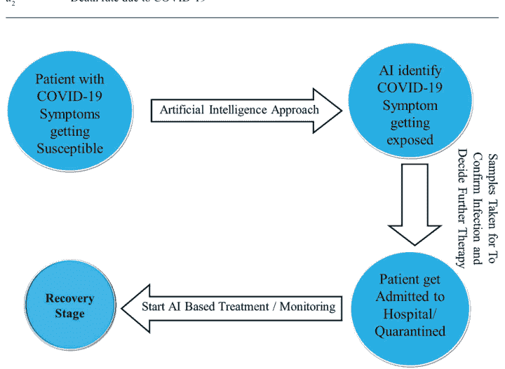

**图7.1 通过AI技术识别COVID-19。**
*来源：Khang（2021）*

确诊病例被立即送去隔离/住院治疗。在接受适当治疗后，COVID-19患者从医院或隔离区解除隔离/出院。这有助于确定康复率，并降低COVID-19大流行期间的感染率、发病率和死亡率，如图7.1所示。


## 7.3 数学假设

根据图 7.1，我们可以假设总人口可以分为五个亚群：易感、暴露、感染、隔离和康复。

具有旅行史的移民、新生儿和移民人口以速率 A 属于易感人群。易感个体以速率 β 暴露于 AI 方法。根据质量作用定律，个体以速率 βSI 感染。暴露人群在采用不同 AI 方法检测后以速率 μ 感染。感染人群以速率 α 决定接受住院或隔离。

开始以速率 δ 进行 AI 治疗和监测的住院或隔离人群从 COVID-19 中康复。自然死亡率表示为 d₁，疾病诱导死亡率表示为 d₂。假设每个亚群都是动态的。因此，这些人群会随时间变化（Divvela et al., 2023）。

流程图及其图示分别显示在图 7.1 和 7.2 中。如图所示，基于 AI 的技术制定了数学模型及其对抗 COVID-19 的能力。

## 7.4 数学模型（SEIQR）

图 7.2 显示了使用 AI 技术对 COVID-19 的示意图。由于 COVID-19 是动态的，它会随时间从一个人群变化到另一个人群。

第一个方程解释了易感人群随时间的变化。当易感人群随时间减少时，变化率呈负值。变化率与易感人群接触的感染人群成正比。

当包括招募的移民、移民和新生儿（A）在内的人群暴露时，他们可能变得易感。

在这里，我们考虑五个亚群，其中易感人群的数量由于招募的移民、移民和新生儿（A）的增加而发生变化，并由于死亡和 COVID-19 感染（βSI）而减少。易感人群的变化率由方程 7.1 支配：

$$ \frac{dS}{dt} = A - \beta SI - d_1 S \tag{7.1} $$

第二个方程说明了暴露（潜伏期）人群如何随时间变化。第一项与右侧的上一项相同。正号是因为感染人群的增加。

假设自然死亡和 COVID-19 死亡会减少人口。经过一段时间后，暴露人群随着感染（βSI）的增加而变化，以 μE 感染，并以 d₁ 死亡而减少。人口的变化率由方程 7.2 支配：

$$ \frac{dE}{dt} = \beta SI - (d_1 + \mu)E \tag{7.2} $$

第三个方程说明了在 COVID-19 大流行期间，感染（潜伏）人群如何通过与感染人群接触而感染。

感染人群以速率 μE 增加，导致从暴露到感染的转变。人口因自然死亡（d₁）和 COVID-19 死亡（d₂）而减少。这由方程 7.3 表示：

$$ \frac{dI}{dt} = \mu E - (d_1 + d_2 + \alpha)I \tag{7.3} $$

第四个方程解释了隔离人群变化率。

AI 技术的开发有助于筛查和检测过程，并确认感染人群已接受隔离或检疫（Khang et al., 2023a）。

隔离人群以速率 αI 增加。自然死亡和 COVID-19 死亡以速率（d₁ + d₂）Q 减少人口。这种转变可以用微分表示，如方程 7.4 所示：

$$ \frac{dQ}{dt} = \alpha I - (d_1 + d_2 + \delta)Q \tag{7.4} $$

最后一个方程阐述了在医疗和隔离流程改善后，隔离人群随时间康复的转变。我们假设感染率和死亡率取决于高质量医疗护理和隔离室的可用性。

人口因临床治疗或隔离以速率 δQ 而增加，并因死亡以速率 d₁ 而减少。这可以用方程 7.5 解释：

$$ \frac{dR}{dt} = \delta Q - d_1 R \tag{7.5} $$

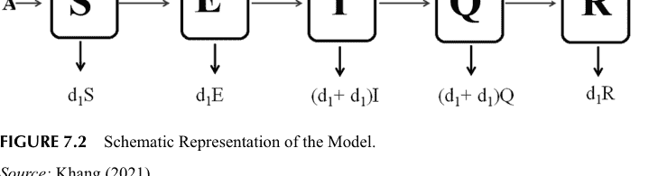

**图 7.2** 模型的示意表示。

来源: Khang (2021)

因此，基于所呈现的描述，对应的数学方程由非线性常微分方程组给出（方程 7.6）：

**数学模型**

$$ \begin{aligned} \frac{dS}{dt} &= A - \beta SI - d_1S \\ \frac{dE}{dt} &= \beta SI - (d_1 + \mu)E \\ \frac{dI}{dt} &= \mu E - (d_1 + d_2 + \alpha)I \\ \frac{dQ}{dt} &= \alpha I - (d_1 + d_2 + \delta)Q \\ \frac{dR}{dt} &= \delta Q - d_1R \end{aligned} \tag{7.6} $$

### 7.4.1 模型有界性和正性的分析

在本节中，我们将模型解一致有界的区域定义为集合 Ω（方程 7.7）：

$$ \Omega = \{(S,E,I,Q,R) \in R_{+}^{5} : S \ge 0, E \ge 0, I \ge 0, Q \ge 0, R \ge 0\} \tag{7.7} $$

该区域对系统（1）是正不变的。显然，系统（1）右端边的相互作用函数是连续可微的。因此，系统（1）的解存在且唯一。此外，具有非负初始条件的系统（1）的所有解在以下定理中一致有界。

**定理.** 所有在 \(R_{+}^{5}\) 中启动的系统（1）的解都是一致有界的。

**证明.** 设 \((S(t),E(t),I(t),Q(t),R(t))\) 是系统（1）的任意解，其非负初始条件为 \((S(0),E(0),I(0),Q(0),R(0))\)。因此，将所有个体相加 \(N(t)=S(t)+E(t)+I(t)+Q(t)+R(t)\) 得到方程 7.8 和 7.9：

$$ \frac{dN}{dt} = \frac{dS}{dt} + \frac{dE}{dt} + \frac{dI}{dt} + \frac{dQ}{dt} + \frac{dR}{dt} \tag{7.8} $$

$$ \frac{dN}{dt} = A - d_1N - d_2(I + Q) \tag{7.9} $$

在没有感染的情况下，总人口变为 \(\frac{A}{d_1}\)。当 \(t \to \infty\) 时，则 \(N \to \frac{A}{d_1}\)。

因此，系统（1）的所有解都被限制在方程 7.10 所示的区域中：

$$ \Omega = \left\{ (S,E,I,Q,R) \in R_{+}^{5} : N \le \frac{A}{d_1} \right\} \tag{7.10} $$

这就完成了证明。

### 7.4.2 基本再生数的计算

在本节中，我们将基本再生数定义为在整个 COVID-19 期间，由感染个体在完全易感人群中产生的二代个体的期望数量。该数字可用作打破流行病所需控制措施强度的衡量标准。

基本再生数是下一代矩阵的谱半径。考虑方程 7.11 中表示的 SEIQR 模型。将系统线性化以形成雅可比矩阵。雅可比矩阵被分解为 F−V 矩阵，其中 F 是新感染的产生，V 是从一个隔间到另一个隔间变化的非奇异矩阵：

$$ F = \begin{pmatrix} \beta SI \\ 0 \\ 0 \\ 0 \\ 0 \end{pmatrix} \text{ and } V = \begin{pmatrix} \beta SI - A + d_1S \\ (d_1+\mu)E \\ (d_1+d_2+\alpha)I - \mu E \\ (d_1+d_2+\delta)Q - \alpha I \\ d_1R - \delta Q \end{pmatrix} \tag{7.11} $$

对感染类别 E 和 I 求偏导数，我们得到方程 7.12：

$$ F = \begin{pmatrix} 0 & \beta S_0 \\ 0 & 0 \end{pmatrix} \text{ and } V = \begin{pmatrix} (d_1+\mu) & 0 \\ -\mu & (d_1+d_2+\alpha) \end{pmatrix} \tag{7.12} $$

基本再生数是下一代矩阵 \(FV^{-1}\) 的谱半径，由方程 7.13 给出：

$$ FV^{-1} = \frac{\beta S_0 \mu}{(d_1+d_2+\alpha)(d_1+\mu)} \tag{7.13} $$

以及方程 7.14：

$$ R_0 = \frac{\beta \mu}{(d_1+d_2+\alpha)(d_1+\mu)} \tag{7.14} $$

这充当流行形成或失败的阈值。

## 7.5 系统方程平衡点的存在性

在本节中，讨论了系统（1）的所有可能平衡点的存在性。有两个平衡点：

- COVID-19 无病平衡点
- 地方性流行平衡点

对于稳态条件，方程组（7.15）变为：

$$ \begin{aligned} A-\beta SI-d_1S &= 0 \\ \beta SI-(d_1+\mu)E &= 0 \\ \mu E-(d_1+d_2+\alpha)I &= 0 \\ \alpha I-(d_1+d_2+\delta)Q &= 0 \\ \delta Q-d_1R &= 0 \end{aligned} \tag{7.15} $$

### 7.5.1 新冠病毒无病平衡点

对于 COVID-19 无病平衡 \(\Omega_0\left(\frac{A}{d_1}, 0,0,0,0\right)\)，其中 \(E=I=Q=R=0\)。

### 定理 1

如果 \(R_0<1\)，则 COVID-19 无病平衡是局部渐近稳定的。否则，它是不稳定的。

**证明.** 方程 7.16 中模型的线性化：

$$ J(S_0, 0,0,0,0) = \left(\begin{array}{ccccc} -d_1 & 0 & -\beta S_0 & 0 & 0 \\ 0 & -(d_1+\mu) & \beta S_0 & 0 & 0 \\ 0 & \mu & -(d_1+d_2+\alpha) & 0 & 0 \\ 0 & 0 & 0 & -(d_1+d_2+\delta) & 0 \\ 0 & 0 & 0 & \delta & -d_1 \end{array}\right) \tag{7.16} $$

通过求特征值，

$$ \begin{aligned} \lambda &= -d_1 \\ \lambda &= -d_1 \\ \lambda &= -(d_1+d_2+\delta) \end{aligned} $$

另外两个特征值可以是方程 7.17 的形式：

$$ \begin{gathered} \lambda^2 + a\lambda + b = 0 \\ \text{where} \\ a = 2d_1 + d_2 + \mu + \alpha > 0 \\ b = (d_1+\mu)(d_1+d_2+\alpha) - \mu\beta S_0 = (d_1+\mu)(d_1+d_2+\alpha)(1-R_0) > 0 \end{gathered} \tag{7.17} $$


因此，通过应用鲁斯-胡尔维茨条件，它是局部渐近稳定的。

### 定理 2
如果基本再生数 $R_0 < 1$，则 COVID-19 无病平衡是全局渐近稳定的。

证明：考虑 Thieme Horst 和 Lyapunov (2011) 公式 7.18：

$M = \mu E + (d_1 + \mu) I$
$\Rightarrow \frac{dM}{dt} = \frac{\mu dE}{dt} + \frac{(d_1 + \mu) dI}{dt} \tag{7.18}$
$\Rightarrow \frac{dM}{dt} = (d_1 + \mu)(d_1 + d_2 + \alpha)(R_0 - 1) I$

如果 $R_0 < 1$，则 $\frac{dM}{dt} < 0$ 且 $\frac{dM}{dt} = 0$ 仅当 $I = 0$ 或 $R_0 = 1$ 时成立。因此，根据 LaSalle 不变性原理，该集合在区域 $\Omega_0$ 中全局渐近稳定。

## 7.5.2 地方性平衡的稳定性分析
对地方性平衡 $\Omega^* (S^*, E^*, I^*, Q^*, R^*)$ 的稳定性分析，我们求解公式 7.19 的联立系统：

$S^* = \frac{1}{R_0}$

$E^* = \frac{A}{(d_1 + \mu)} \left(1 - \frac{1}{R_0}\right)$

$I^* = \frac{\mu (R_0 - 1)}{\beta} \tag{7.19}$

$Q^* = \frac{\alpha d_1 (R_0 - 1) \beta}{(d_1 + d_2 + \delta) \beta}$

$R^* = \frac{\alpha \delta (R_0 - 1)}{(d_1 + d_2 + \delta)}$

### 定理 3
如果 $R_0 > 1$，则系统 (2) 具有唯一的地方性平衡 $\Omega^* (S^*, E^*, I^*, Q^*)$，它是局部渐近稳定的。

证明：在公式 7.20 的线性化中，矩阵的雅可比矩阵为

$\Omega^* = \begin{pmatrix} -d_1 - \beta I^* & 0 & -\beta S^* & 0 \\ \beta I^* & -(d_1 + \mu) & \beta S^* & 0 \\ 0 & \mu & -(d_1 + d_2 + \alpha) & 0 \\ 0 & 0 & \alpha & -(d_1 + d_2 + \delta) \end{pmatrix} \tag{7.20}$

特征值为 $\lambda = -(d_1 + d_2 + \delta)$。

求解三次方程时另外三个特征值为 $\lambda^3 + A\lambda^2 + B\lambda + C = 0$，其中

$A = \beta I^* + 3d_1 + d_2 + \alpha + \mu$
$B = 3d_1^2 + 2d_1\mu + 2d_1d_2 + 2d_1\alpha + 2d_1\beta I^* + \mu\beta I^* + d_2\beta I^* + \alpha\beta I^* + \mu d_2 + \alpha\mu - \alpha\beta S^*$
$C = d_1^3 + d_1^2 d_2 + \alpha d_1^2 + \mu d_1^2 + \mu d_1 d_2 + d_1\alpha\mu + d_1^2\beta I^* + d_1 d_2\beta I^* + d_1\alpha\beta I^* + \mu d_1\beta I^* + \mu d_2\beta I^* + \mu\alpha\beta I^* + \mu\beta S^* d_1 + 2\mu\beta^2 I^* S^*$ (7.21)

由于 $A > 0$、$B > 0$ 且 $C > 0$，则 $AB > C$。

因此，通过应用鲁斯-胡尔维茨条件，地方性平衡是局部渐近稳定的。

## 7.5.3 地方性平衡的全局稳定性
本节使用几何方法讨论地方性平衡的全局稳定性。平衡点全局稳定性的充分条件由 Bendixson 条件给出。

对于 $R_0 > 1$，我们推断方程组的均匀持续性，这意味着存在一个正常数 $C$，使得初始条件 $(S(0),E(0),I(0),Q(0))$ 位于区域 $\Omega$ 的内部。

满足 $\min\{\liminf_{t\to\infty} S(t),\liminf_{t\to\infty} E(t),\liminf_{t\to\infty} I(t),\liminf_{t\to\infty} Q(t)\} > C$ 的任意解 $(S(t),E(t),I(t),Q(t))$

上述条件连同区域 $\Omega$ 的有界性验证了地方性平衡点位于 $\Omega$ 内部。

### 定理 4
如果 $R_0 > 1$，则唯一的地方性平衡 $\Omega^*$ 在 $\Omega$ 内部是全局渐近稳定的。

证明：系统的一般解如公式 7.22 所示。
$J = \begin{pmatrix} -d_1 - \beta I & 0 & -\beta S & 0 \\ \beta I & -(d_1 + \mu) & \beta S & 0 \\ 0 & \mu & -(d_1 + d_2 + \alpha) & 0 \\ 0 & 0 & \alpha & -(d_1 + d_2 + \delta) \end{pmatrix}$ (7.22)

二阶复合矩阵由公式 7.23 给出：

J^{[2]} = \begin{pmatrix} -2d_{1} - \beta I - \mu & \beta S & 0 & 0 & 0 & 0 \\ \mu & -2d_{1} - d_{2} - \alpha - \beta I & 0 & 0 & 0 & 0 \\ 0 & \alpha & -2d_{1} - d_{2} - \delta - \beta I & 0 & 0 & -\beta S \\ 0 & \beta I & 0 & -(2d_{1} + d_{2} + \mu + \alpha) & 0 & 0 \\ 0 & 0 & \beta I & \alpha & -(2d_{1} + \mu + d_{2} + \delta) & \beta S \\ 0 & 0 & 0 & 0 & \mu & -(2d_{1} + 2d_{2} + \alpha + \delta) \end{pmatrix} \tag{7.23}

为了在 Bendixson 矩阵条件下得到矩阵 B，我们将对角矩阵 M 定义为公式 7.24：

M = \operatorname{diag}\left(1, \frac{E}{I}, \frac{E}{I}, \frac{E}{I}, \frac{E}{I}, \frac{E}{I}\right) \tag{7.24}

我们可以定义系统的向量场，然后是公式 7.25 和 7.26：

M_{f} M^{-1} = \operatorname{diag}\left(0, \frac{E'}{E} - \frac{I'}{I}, \frac{E'}{E} - \frac{I'}{I}, \frac{E'}{E} - \frac{I'}{I}, \frac{E'}{E} - \frac{I'}{I}, \frac{E'}{E} - \frac{I'}{I}\right) \tag{7.25}

B = M_{f} M^{-1} + M J^{[2]} M^{-1} = \begin{pmatrix} -2d_{1} - \beta I - \mu & \frac{\beta S I}{E} & 0 & \frac{\beta S I}{E} & 0 & 0 \\ \frac{E \mu}{I} & -2d_{1} - d_{2} - \alpha - \beta I + \frac{E'}{E} - \frac{I'}{I} & 0 & 0 & 0 & 0 \\ 0 & \alpha & \frac{E'}{E} - \frac{I'}{I} -2d_{1} - d_{2} - \delta - \beta I & 0 & 0 & -\beta S \\ 0 & \beta I & 0 & \frac{E'}{E} - \frac{I'}{I} - (2d_{1} + d_{2} + \mu + \alpha) & 0 & 0 \\ 0 & 0 & \beta I & \alpha & \frac{E'}{E} - \frac{I'}{I} - (2d_{1} + \mu + d_{2} + \delta) & \beta S \\ 0 & 0 & 0 & 0 & \mu & \frac{E'}{E} - \frac{I'}{I} - (2d_{1} + 2d_{2} + \alpha + \delta) \end{pmatrix} \tag{7.26}

前述矩阵可表示为公式 7.27 中的分块矩阵：

$$B = \begin{pmatrix} B_{11} & B_{12} \\ B_{21} & B_{22} \end{pmatrix}\tag{7.27}$$

其中公式 7.28

$$B_{11}=(-2d_1 - \beta I - \mu)$$

$$B_{12}=\begin{pmatrix} \frac{\beta S I}{E} & 0 & \frac{\beta S I}{E} & 0 & 0 \end{pmatrix}$$

$$B_{21}=\begin{pmatrix} \frac{E'\mu}{I} \\ 0 \\ 0 \\ 0 \\ 0 \end{pmatrix}$$

$$B_{22}=\begin{pmatrix} -2d_1 - d_2 - \alpha - \beta I + \frac{E'}{E} - \frac{I'}{I} & 0 & 0 \\ \alpha & \frac{E'}{E} - \frac{I'}{I} -2d_1 - d_2 - \delta - \beta I & 0 \\ \beta I & 0 & \frac{E'}{E} - \frac{I'}{I} -(2d_1 + d_2 + \mu + \alpha) \\ 0 & \beta I & \alpha \\ 0 & 0 & 0 \\ 0 & 0 & 0 \\ 0 & -\beta S & 0 \\ 0 & 0 & 0 \\ \frac{E'}{E} - \frac{I'}{I} -(2d_1 + \mu + d_2 + \delta) & \beta S & 0 \\ \mu & \frac{E'}{E} - \frac{I'}{I} -(2d_1 + 2d_2 + \alpha + \delta) \end{pmatrix}\tag{7.28}$$

矩阵的 Lozinskii 测度可计算为 $\mu(B) \le \sup\{g_1, g_2\}$，其中

$$g_1 = \mu(B_{11}) + |B_{12}| = -2d_1 - \beta I - \mu + \frac{\beta S I}{E}$$

$$g_2 = |B_{21}| + \mu(B_{22}) = -2d_1 + \mu + \frac{E'}{E} - \frac{I'}{I}\tag{7.29}$$

该 Lozinskii 测度 (2023) 相对于分块矩阵 B12 和 B21 的范数是 mieux，其中它们是算子范数。

因此，$g_1$ 和 $g_2$ 化简为公式 7.30：

$$\begin{aligned}
g_1 &= -d_1 - \beta I + \frac{E'}{E} \\
g_2 &= -d_1 + \alpha + d_2 + \frac{E'}{E}
\end{aligned} \tag{7.30}$$

因此

$$\mu(B) \leq \sup\{g_1,g_2\} \leq \frac{E'}{E} - d_1 + \sup\{-\beta I, d_2+\alpha\}$$

因此，$\mu(B) \leq \frac{E'}{E} - d_1$；于是

$$\int_0^t \mu(B)\,dt \leq \left(\log E(t)-d_1t\right)$$

因此，最后如公式 7.31 所示

$$\bar{q}_2 = \frac{\int_0^t \mu(B)\,dt}{t} < \frac{\log E(t)}{t} - d_1 < \frac{d_1}{2} - d_1 < 0 \tag{7.31}$$

因此，准则 $\bar{q}_2 < 0$ 得到满足。因此，系统的流行病平衡是全局稳定的。

## 7.6 结果与讨论
分析结果若无数值模拟则无法证明。这些图解释了 COVID-19 期间模型在不同人群中的行为。

这些图显示了参数随时间变化的人群偏差。人工智能技术正在被开发用于检测 COVID-19 并确定疾病的稳定性。主要目标是通过可视化来控制 COVID-19 引起的感染。

基于 COVID-19 期间的不同情况，我们在人工智能技术的帮助下使用了不同的参数。COVID-19 无病平衡点在 $R_0 < 1$ 时是稳定的（图 7.3）。

隔离和暴露的综合效应的最佳用途在图中显示。结果，使用人工智能后暴露人群的隔离/住院率下降，如图 7.4 所示。

该图表明，如果暴露人群出现某些疾病症状，他们会迅速存活并进入隔离，如图 7.5 所示。


## 人群 AI 行为下的流行病学模型
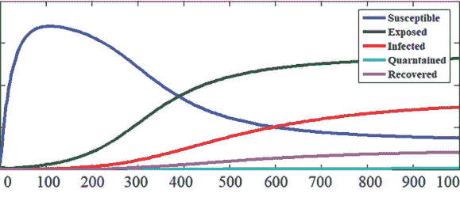
**图 7.3** 当 $R_0 < 1$ 时，AI 影响下的人口动态行为。

## 暴露者与隔离者
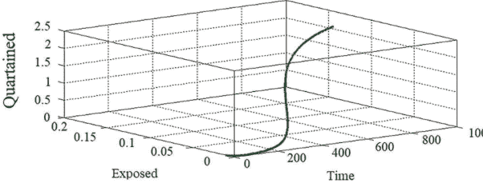
**图 7.4** 暴露人口与隔离人口模型。

## AI 行为下的流行病学模型
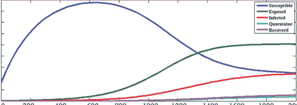
**图 7.5** AI 影响下 endemic 平衡点的人口动态行为。

同时，医疗保健系统中人工智能的发展使得治疗变得更加容易。因此，如图 7.6 所示，在该区域内 endemic 平衡是稳定的。

结果如图 7.9 所示，暴露人口在与感染人口接触后迅速增加，并在适当治疗后恢复。

最后，图 7.10 显示，大量感染者通过采用 AI 方法进行筛查后住院。

## 易感者与康复者
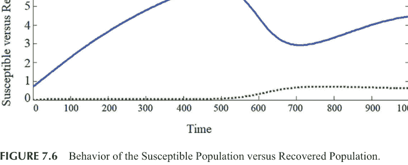
图 7.6 易感人口与康复人口的行为。

## 感染者与隔离者
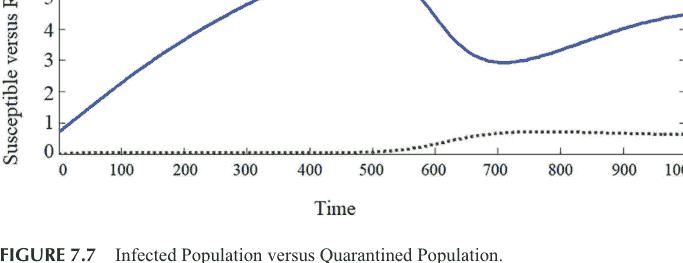
图 7.7 感染人口与隔离人口。

## 暴露者与康复者
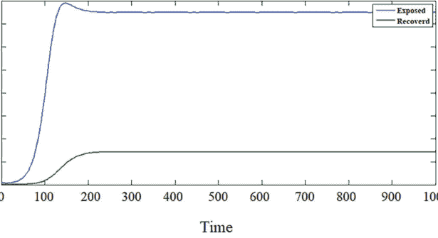
**图 7.8** 暴露人口与康复人口。

## 感染者与隔离者
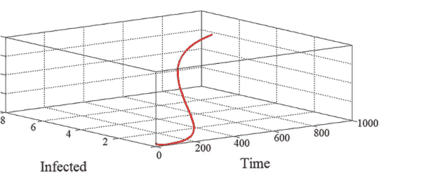
**图 7.9** 感染人口与隔离人口。

## 感染者与康复者
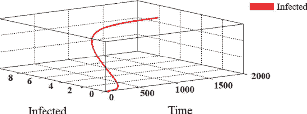
**图 7.10** 感染人口与康复人口随时间变化的影响。

## 7.7 结论
利用人工智能（AI），从数值上和数学上构建了一个用于冠状病毒的动态 *SEIQR* 流行病学模型。采用了一种 AI 技术来检测 COVID-19。

研究了模型中平衡点的存在性。对模型的观察表明，其稳定性取决于基本再生数。当该数值小于 1 时，疾病的局部稳定性是渐近稳定的。

当该数值大于 1 时，情况变为大流行。

- 可以通过改善医疗设施和短期研发疫苗来应对这种大流行。
- 这种 AI 技术在流行病学中也起着重要作用。
- 由于易感人群与感染人群之间的潜伏期，这有助于对抗 COVID-19 的诊断、检测、预测和社会控制。*SEIQR* 模型更适合用于建模。

将 AI 技术与数学建模相结合，以加快病毒消除速度，无需人工干预。

为了控制病毒传播，AI 技术迅速将人员隔离或检疫。所开发的预测模型有助于政策制定和应对 COVID-19。

控制方法可能包括对易感个体进行加强剂量疫苗接种。该模型建议医疗系统组建数据团队来控制紧急情况。

我们的数学模型表明，大流行期间的隔离改变了局势。这种最优策略有助于不同地理位置患者的康复，并强调了 AI 技术在医疗系统而非个人层面的重点应用。

该 AI 模型帮助医疗行业迈向疾病诊断和治疗的更好解决方案。人工智能通过减少人为错误来提高效率和生产力 (Khang et al., 2023c)。

隔离和社交距离规范发挥着至关重要的作用，必须予以慎重考虑。

关于设备的人工智能知识可以被有效利用来应对这些挑战，并协助解决全球灾难中的基本问题。模拟结果得到了实际参数值的支持。

## 参考文献
Agrebi S., Larbi A., (2020). “Use of artificial intelligence in infectious diseases,” In *Artificial Intelligence in Precision Health*, pp. 415–438. Academic Press. www.sciencedirect.com/science/article/pii/B978012817332000185

Alanazi S. A., Kamruzzaman M. M., Alruwaili M., Alshammari N., Alqahtani S. A., Karime A., “Measuring and preventing COVID-19 using the SIR model and machine learning in smart health care,” *Journal of Healthcare Engineering*, 2020, Article ID 8857346, 12. https://doi.org/10.1155/2020/8857346

Behera J., Rauta S. K., Rao Y. S., Patnaik S., (2021). “Mathematical modeling on double quarantine process in the spread and stability of COVID-19,” In *Sustainability Measures for COVID-19 Pandemic*, pp. 37–57. Springer, E-Book. https://doi.org/10.1007/978-981-16-3227-3_3

Chawla S., Mittal M., Chawla M., Goyal L. M., (May, 2020). “Corona Virus-SARS-CoV-2: An insight into another way of natural disaster,” *EAI Endorsed Transactions on Pervasive Health and Technology*. https://eudl.eu/doi/10.4108/eai.28-5-2020.164823

Dihudi B., Rao Y. S., Rout S. K., Panda T. C., (2021). “Transmission modelling on COVID-19 pandemic and its challenges,” *Sustainability Measures for COVID-19 Pandemic*, pp. 75–90. Springer, E-Book. https://doi.org/10.1007/978-981-16-3227-3_5

Gaur L., Bhatia U., Jhanjhi N. Z., Muhammad G., Masud M., (2021). “Medical image-based detection of COVID-19 using deep convolution neural networks,” *Multimedia Systems*, 1. https://link.springer.com/article/10.1007/s00530-021-00794-6

Khang A., (2021). “Material4Studies,” *Material of Computer Science, Artificial Intelligence, Data Science, IoT, Blockchain, Cloud, Metaverse, Cybersecurity for Studies*. www.researchgate.net/publication/370516102_Material4Studies

Khang A., Gupta S. K., Hajimahmud V. A., Babasaheb J., Morris G., (2023a). *AI-Centric Modelling and Analytics: Concepts, Designs, Technologies, and Applications* (1st ed.). CRC Press. https://doi.org/10.1201/9781003400110

Khang A., Hahanov V., Litvinova E., Chumachenko S. T., Hajimahmud V. A., Ragimova Nazila A., Abuzarova Vusala A., Anh P. T. N., (2023b). “The analytics of hospitality of hospitals in healthcare ecosystem,” In *Data-Centric AI Solutions and Emerging Technologies in the Healthcare Ecosystem*, p. 4. CRC Press. https://doi.org/10.1201/9781003356189-4

Khang A., Rana G., Tailor R. K., Hajimahmud V. A., (Eds.). (2023c). *Data-Centric AI Solutions and Emerging Technologies in the Healthcare Ecosystem*. CRC Press. https://doi.org/10.1201/9781003356189

Khang A., Rani S., Sivaraman A. K., (2022a). *AI-Centric Smart City Ecosystems: Technologies, Design and Implementation* (1st ed.). CRC Press. https://doi.org/10.1201/9781003252542

Khang A., Ragimova N. A., Hajimahmud V. A., Alyar V. A., (2022b). “Advanced technologies and data management in the smart healthcare system,” In *AI-Centric Smart City Ecosystems: Technologies, Design and Implementation*, Vol. 16, No. 10 (1st ed.). CRC Press. https://doi.org/10.1201/9781003252542-16

Khanh H. H., Khang A., (2021). “The role of artificial intelligence in blockchain applications,” *Reinventing Manufacturing and Business Processes through Artificial Intelligence*, 2(20–40) (CRC Press). https://doi.org/10.1201/9781003145011-2

Lalmuanawma S., Hussain J., Chakma H. L., (2020). “Applications of machine learning and artificial intelligence for Covid-19 (SARS-CoV-2) pandemic: A review,” *Chaos, Solitons & Fractals*, 110059. www.sciencedirect.com/science/article/pii/S0960077920304562

Li L., Qin L., Xu Z., Yin Y., Wang X., Kong B., Bai J., Lu Y., Fang Z., Song Q., Cao K., Daliang Liu D., Wang G., Xu Q., Fang X., Zhang S., Xia J., Xia J., (2020). “Using artificial intelligence to detect COVID-19 and community-acquired pneumonia based on pulmonary CT: Evaluation of the diagnostic accuracy,” *Radiology*, 296(2), 65–72. https://pubs.rsna.org/doi/abs/10.1148/radiol.2020200905

Lozinskii, (2023). *Existence of the Lozinskii Measure*. https://math.stackexchange.com/questions/77017/existance-of-the-lozinskii-measure

McCall B., (2020). “COVID-19 and artificial intelligence: Protecting healthcare workers and curbing the spread,” *Lancet*, 2, e166–e167. www.thelancet.com/journals/landig/article/PIIS2589-7500(20)30054/6/fulltext


Mei X., Lee H., Diao K., Huang M., Lin B., Liu C., Xie Z., Ma Y., Robson P. M., Chung M., Bernheim A., Mani V., Calcagno C., Li K., Li S., Shan H., Lv J., Zhao T., Xia J., Long Q., Steinberger S., Jacobi A., Dyer T., Yang Y., (2020). “Artificial intelligence-enabled rapid diagnosis of patients with COVID-19,” Nature Medicine. www.nature.com/articles/s41591-020-0931-3

Mishra B. K., Keshri A. K., Rao Y. S., Mishra B. K., Mahato B., Ayesha S., Rukhaiyyar B. P., Saini D. K., Singh A. K., (2020). “COVID-19 created chaos across the globe: Three novel quarantine epidemic models,” Chaos, Solitons & Fractals, 138, 109928. https://doi.org/10.1016/j.chaos.2020.109928

Mishra B. K., Keshri A. K., Saini D. K., Ayesha S., Rao Y. S., (2021). “Mathematical model, forecast and analysis on the spread of COVID-19,” Chaos, Solitons & Fractals, 147, 110995. https://doi.org/10.1016/j.chaos.2021.110995

Praveen Kumar M., Kumar N., Anuradha M., Khang A., (2023). “Heart disease prediction using logistic regression and random forest classifier,” In Data Centric AI Solutions and Emerging Technologies in the Healthcare Ecosystem, p. 6. (1st ed.). CRC Press. https://doi.org/10.1201/9781003356189-6

Rana G., Khang A., Sharma R., Goel A. K., Dubey A. K., (Eds.). (2021). Reinventing Manufacturing and Business Processes through Artificial Intelligence. CRC Press. https://doi.org/10.1201/9781003145011

Rani S., Chauhan M., Kataria A., Khang A., (Eds.). (2021). “IoT equipped intelligent distributed framework for smart healthcare systems,” In Networking and Internet Architecture, Vol. 2, p. 30. CRC Press. https://doi.org/10.48550/arXiv.2110.04997

Rauta A. K., Rao Y. S., Behera J., (2021). “Spread of COVID-19 in Odisha (India) due to influx of migrants and stability analysis using mathematical modeling,” Artificial Intelligence for COVID-19, pp. 295–309. Springer Nature, E-Book. https://doi.org/10.1007/978-3-030-69744-0

Rauta A. K., Rao Y. S., Behera J., Dihudi B., Panda T. C., (2021). Algorithms for Intelligent Systems “SIQRS epidemic modelling and stability analysis of COVID-19,” In Predictive and Preventive Measures for Covid-19 Pandemic, pp. 35–50. Springer. https://doi.org/10.1007/978-981-33-4236-1_3

Sathwik A., Vanshika J., Saravanan S., (2022). “Transforming native epidemic models by using the machine learning approach,” Annals of the Romanian Society for Cell Biology, 25(4), 1583–6258 (2891–2899). www.annalsofrscb.ro/index.php/journal/article/view/2831

Singh S., (2020). Cousins of Artificial Intelligence. https://towardsdatascience.com/cousins-of-artificial-intelligence-dda4edc27b55

Thieme Horst R., Lyapunov, (2011). “Global stability of the endemic equilibrium in infinite dimension, Lyapunov function and positive operators,” The Journal of Differential Equations, 250, 3772–3801. www.sciencedirect.com/science/article/pii/S0022039611000246

Tuli S., Tuli S., Tuli R., Gill S. S., (2020). “Predicting the growth and trend of COVID-19 pandemic using machine learning and cloud computing,” Internet of Things, 11(100222). https://doi.org/10.1016/j.iot.2020.100222

Vishnu Sai Kumar D., Ritik Ch., Anuradha M., Praveen Kumar M., Khang A., (Aug 24, 2023). “Heart disease and liver disease prediction using machine learning,” In Data-Centric AI Solutions and Emerging Technologies in the Healthcare Ecosystem, p. 4 (1st ed.). CRC Press. https://doi.org/10.1201/9781003356189-13

WHO, (2021). www.who.int/emergencies/diseases/novel-coronavirus-2019

Zhao Z., Ma Y., Mushtaq A., et al., (2021). “Applications of robotics, artificial intelligence, and digital technologies during COVID-19: A review,” Disaster Medicine and Public Health Preparedness. www.cambridge.org/core/journals/disaster-medicine-and-public-health-preparedness/article/applications-of-robotics-ai-and-digital-technologies-during-covid19-a-review/610FFDBD77481D2F8DED4EF3B029AA52

## 8 使用投票分类器模型预测乳腺癌

*Sujeet Kumar Jha 和 Alex Khang*

### 8.1 引言

乳腺癌主要针对女性人群，由于其在世界各地持续存在，是世界卫生组织（WHO）关注的重大健康问题。它是全球最常见的癌症类型（Sung et al., 2021; World Health Organization, 2021）。

根据乳腺癌症状的严重程度，患者可能需要接受多种测试来诊断疾病，包括超声检查、活检和乳腺摄影。在这些方法中，活检最为直接，它涉及移除样本组织或细胞以进行分析。

使用细针抽吸（FNA）方法从乳腺获取细胞样本，随后将其送往病理实验室进行显微镜检查（Khourdifi & Bahaj, 2018）。

可以使用细胞和组织的显微图像来计算半径、粗糙度、周长和面积等数值属性。然后将 FNA 结果与影像数据进行比较，以确定患者患恶性肿瘤的可能性（Bhamri et al., 2022）。

与其他类型的癌症相比，乳腺癌的死亡率相对较高。因此，似乎需要一种模型来分析出现症状的人是否易患癌症。如果无法亲自进行初步扫描，这种自动化技术对患者和医生都大有裨益。

在本章中，数据提取自加州大学欧文机器学习库（UC Irvine Machine Learning Repository）的存档（Wolberg et al., 2021）。这里使用了几种基于机器学习的分类算法来预测患者是否易患恶性肿瘤。

### 8.1.1 问题

本章的主要目标是调查疾病预测系统中的当前趋势和算法，并提出一种能够以最低成本对患者健康进行高效且可靠预测的模型（Khang et al., 2023a）。

表 8.1
数据集中的立场类别。

| 立场 | 描述 | 百分比 (%) |
|---|---|---|
| 0 | 良性 | 356 |
| 1 | 恶性 | 212 |

具体目标列举如下：

- 比较各种分类技术并构建集成模型以提高准确性
- 开发一种比其它系统具有更高准确率的乳腺癌患者预测系统

### 8.1.2 我们系统的需求

美国国家公共卫生机构疾病控制与预防中心（CDC）发布了一个名为威斯康星乳腺癌数据库（WBCD）的数据集，供公众在 CC0 许可证下使用（Praveen et al., 2023）。

该数据集包含 569 个实例和 32 个属性，其中有两个类别（恶性和良性），如表 8.1 所示。恶性人群的比例为 32.7%，良性为 62.7%（Wolberg et al., 2021）。

特征信息包括半径、纹理、周长、面积、光滑度（半径长度的局部变化）、紧凑度（perimeter²/area − 1.0）、凹陷度（轮廓凹陷部分的严重程度）、凹点（轮廓凹陷部分的数量）、对称性和分形维度（‘海岸线近似’ − 1）。

从表 8.1 可以清楚地看出，数据略有不平衡，这意味着构建的模型不够充分，因此需要进一步处理。

### 8.2 文献综述

根据乳腺癌症状的严重程度，患者可能需要接受多种测试来诊断疾病，包括超声检查、活检和乳腺摄影（Khang et al., 2022b）。在这些方法中，活检最为直接，它涉及移除样本组织或细胞以进行分析。细针抽吸（FNA）是一种从乳腺获取细胞样本的方法，随后将其送往病理实验室进行显微镜检查（Khourdifi & Bahaj, 2018）。

可以使用细胞和组织的显微图像来计算半径、粗糙度、周长和面积等数值属性。然后将 FNA 结果与影像数据进行比较，以确定患者患恶性肿瘤的可能性（Richard O. Duda, 2000）。

Kumari et al., (2021) 比较了 AdaBoost、逻辑回归、支持向量机、随机森林以及其他先进技术和基础分类器。


Khuriwa 和 Mishra（2018）使用投票算法方法评估了两种机器学习算法（人工神经网络（ANN）和逻辑回归）的集成，以识别和诊断乳腺癌。与逻辑回归算法相比，使用ANN方法时他们达到了98%的准确率。

Naji等人（2021）使用了基于个体的机器学习算法，如支持向量机、逻辑回归、决策树、k近邻、朴素贝叶斯，以及著名的多数投票集成模型。

所提供的569个案例数据集包含两组人群。一组由212人组成，被诊断为可能的癌变组织，称为恶性。另一组由357人组成，被认定为良性肿瘤（Wolberg等，2021）。

对机器学习算法进行有意义评估的最重要方面是确保它们都在相同的数据上进行测试（Khang等，2022a）。这通过要求每种算法使用标准化测试框架进行评估来实现。使用单一数据集检验了四种不同的分类技术：

- 逻辑回归
- K近邻
- 支持向量机
- 决策树

这些模型被组合并用于集成模型中，以确定分类模型的整体准确率是否可以得到提高。

随后，这些模型被整合并用于集成模型中，以确定分类模型的整体准确率是否可以得到提高。本项目使用了以下集成模型：

- 硬投票/多数投票
- 软投票
- 加权平均

该分类方法设计为在70%训练数据和30%测试数据上运行。

## 8.3 方法

### 8.3.1 实现环境

本项目使用Python 3.3版本实现，并以Jupyter notebook作为标准平台。使用了Pandas、Sklearn和Pyplot等库。使用JupyterLab运行模型并分析数据。

### 8.3.2 数据集分析与预处理

所使用的数据来自加州大学欧文分校机器学习库中的乳腺癌数据集，称为WBCD。这是一个公开可用的数据集，包含569个实例和32个属性（Wolberg等，2021）。

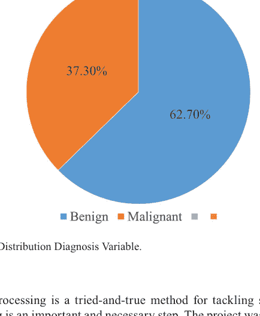

图8.1 诊断变量的分布。

数据预处理是解决此类问题的可靠方法。数据预处理是重要且必要的步骤。本项目遵循以下流程（Rani等，2021）。

预处理操作会移除不相关的列（id），这些列被称为unnamed: 32，因为它们包含缺失值。

为了便于进一步实现，将诊断字段从‘M’和‘B’分别编码为数值1和0。良性和恶性肿瘤的病例数由图8.1中的图形表示。

特征选择是一种有助于选择包含最大信息的重要特征的技术，从而能够在具有显著输出的预测变量中发挥重要作用。

在这个特征选择项目中，应用了一组方法来最小化特征数量。

#### 8.3.2.1 单变量选择

在单变量选择中，使用统计检验来选择与目标变量高度相关的变量/特征。

SelectKBest方法使用卡方检验选择特征，以发现特征与目标变量之间的函数关联（Vijayvargia，2018）。

#### 8.3.2.2 特征重要性

我们使用极端树分类器根据得分从数据集中提取特征的排名。它计算特征的熵，并根据其得分对重要性进行排序（Vijayvargia，2018），如图8.2所示。

#### 特征得分排名

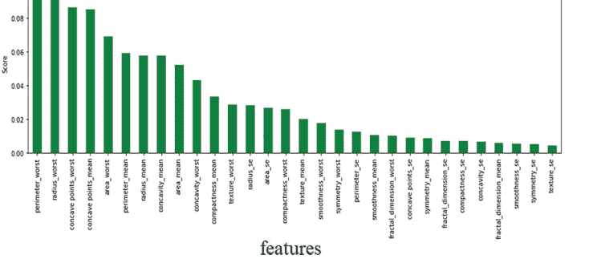

图8.2 得分最高的（卡方）特征。

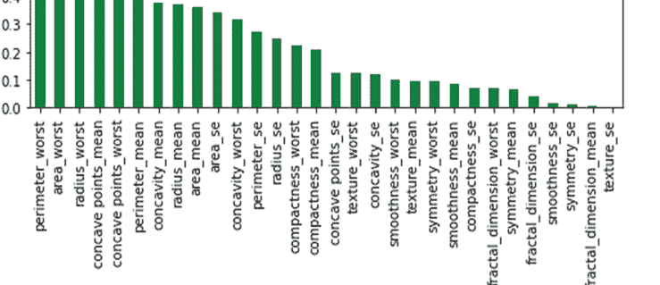

图8.3 互信息参数的得分。

#### 8.3.2.3 互信息

在分类任务中，针对固定类别计算互信息。使用变量的熵根据其得分计算特征的排名。值越接近0表示属性之间独立，如图8.3所示。

从三种特征选择技术中，在模型训练期间选择忽略的特征是‘texture se’、‘fractal dimension mean’、‘symmetry se’、‘smoothness se’、‘fractal dimension se’和‘symmetry mean’。

#### 8.3.2.4 相关矩阵与热力图

采用相关矩阵，其中皮尔逊相关最为常用。首先，使用皮尔逊相关热力图来可视化自变量与输出变量诊断之间的关系。

使用Sklearn生成这些图表（Scikit-Learn Developers，2022）。如图8.4中的热力图所示，area worst与自变量（radius mean、perimeter mean、area mean、radius worst和perimeter worst）显著相关（超过0.9）。选择area worst，并舍弃矩阵中所有其他高度相关的特征，如图8.4所示。

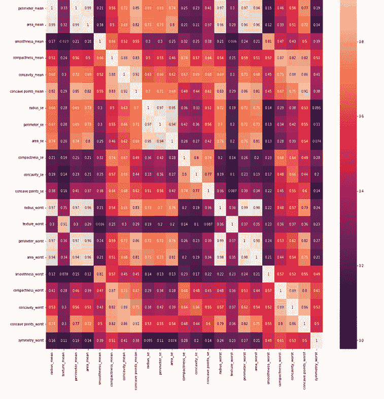

图8.4 删除特征前相关特征的热力图。

选择area worst的原因是它在所有标准中得分最高，因此选择它是明智的。类似地，在perimeter worst、radius worst、perimeter mean和radius中选择了area mean，并在concavity mean、concave mean等中选择了area se。

最终，从数据集中被舍弃或忽略的特征是‘radius mean’、‘perimeter mean’、‘radius worst’、‘perimeter worst’、‘radius mean’、‘perimeter se’、‘radius se’、‘concave points mean’、‘texture worst’和‘concavity mean’。

图8.5展示了舍弃高度相关（超过0.90）特征之后的热力图。根据矩阵中子节1、2和3中提到的特征选择，只有area mean和area worst以0.96的得分存在，因为两者都具有高重要性，如图8.5所示。

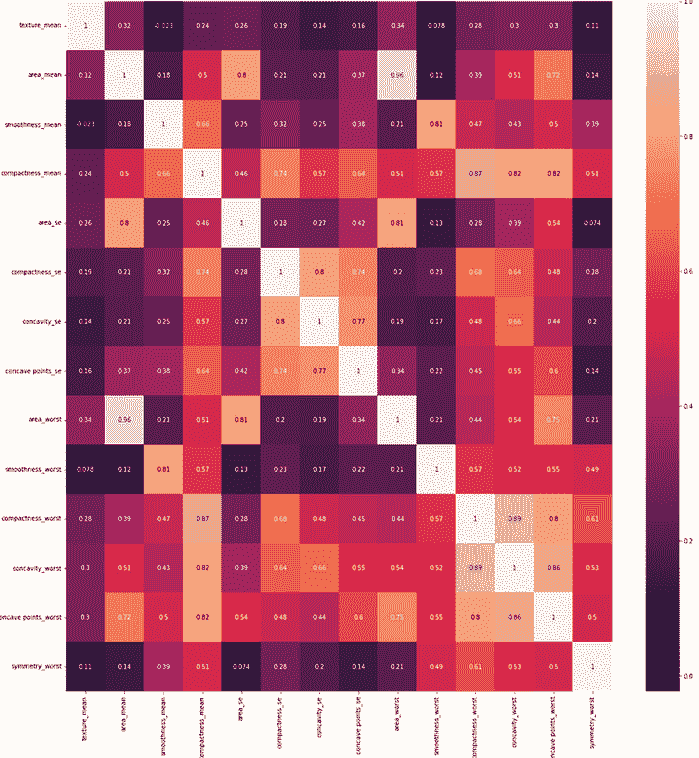

**图8.5** 删除特征后相关特征的热力图。

经过特征数据处理和选择后，数据集的形状从(569, 32)减少到(569, 16)。最终选定的特征是‘texture mean’、‘area mean’、‘smoothness mean’、‘compactness mean’、‘area se’、‘compactness se’、‘concavity se’、‘concave points se’、‘area worst’、‘smoothness worst’、‘compactness worst’、‘concavity worst’、‘concave points worst’、‘symmetry worst’和‘fractal dimension worst’。

#### 8.3.2.5 训练数据集和测试数据集

使用训练数据集和测试数据集是一个极好的想法。测试数据集恰好在项目结束时使用，以确保最终模型的准确性。我们使用数据集的70%进行训练，30%用于模型的测试和验证。

训练和测试数据集也进行了标准化处理，因为所获得的数据包含多个维度和尺度的属性（Rani等，2023）。用于衡量模型性能的评估指标如下所示：

- 混淆矩阵
- 分类准确率
- 精确率和召回率得分
- K折交叉验证

#### 8.3.2.6 混淆矩阵

混淆矩阵是分类任务预测输出的细分。将正确和错误预测的总数相加，然后使用计数值按类别细分。

从表8.2中可以看出，在171个数据点中，逻辑回归正确预测了167个数据点，而其他算法（如决策树）正确预测了

**表8.2**
**各分类模型的混淆矩阵。**

| 分类器算法 | 混淆矩阵 | 测试数据数量 |
|---|---|---|
| 逻辑回归 | TN = 103 FP = 2<br>FN = 2 TP = 64 | 171 |
| 决策树 | TN = 100 FP = 5<br>FN = 6 TP = 60 | 171 |
| 支持向量机 | TN = 103 FP = 2<br>FN = 3 TP = 63 | 171 |
| K近邻 | TN = 101 FP = 4<br>FN = 7 TP = 59 | 171 |
| 多数投票 | TN = 105 FP = 0<br>FN = 3 TP = 63 | 171 |
| 软投票 | TN = 105 FP = 0<br>FN = 3 TP = 63 | 171 |
| 加权平均 | TN = 105 FP = 0<br>FN = 3 TP = 63 | 171 |


预测了 160 个数据点。K-最近邻也正确预测了 160 个数据点，而支持向量机正确预测了 166 个数据点。

最后，硬/多数投票集成模型预测了 168 个正确预测，软投票集成模型识别出 167 个正确案例，而软投票的加权平均值在 171 个测试案例中预测了 169 个正确案例，相比其他方法，这是最高的。

### 8.3.2.7 分类报告

分类报告显示了模型的精确率、召回率、F1 和支持分数。我们可以在模型构建后评估预测模型的有效性。为此，我们基于准确率、精确率、召回率和 F1 分数值评估了基础分类器和基于投票的集成性能，如表 8.3 所示。汇总结果如图 8.6 所示。

### 表 8.3
结果分类模型的混淆矩阵。

| 分类器 | 准确率 | 精确率 | 召回率 | F1 分数 |
|---|---|---|---|---|
| 逻辑回归 | 0.976 | 0.97 | 0.97 | 0.97 |
| 随机森林 | 0.97 | 0.969 | 0.955 | 0.962 |
| 决策树 | 0.935 | 0.923 | 0.909 | 0.916 |
| K-最近邻 | 0.935 | 0.937 | 0.894 | 0.915 |
| 硬/多数投票 | 0.982 | 1.00 | 0.955 | 0.977 |
| 软投票 | 0.976 | 1.00 | 0.939 | 0.969 |
| 加权平均 | 0.988 | 1.00 | 0.97 | 0.985 |

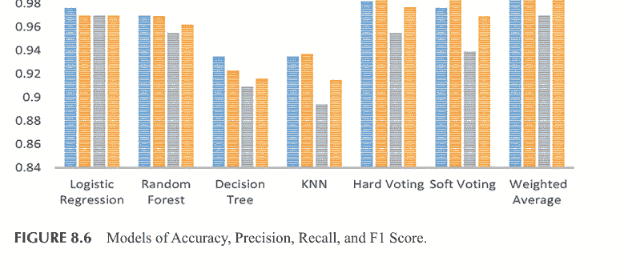

图 8.6 准确率、精确率、召回率和 F1 分数的模型。

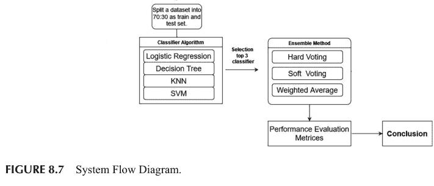

图 8.7 系统流程图。

### 8.3.2.8 分类图表

K 折交叉验证方法是一种用于在实践中估计预测模型性能的统计工具（Wolberg et al., 2021）。

使用 K 折交叉验证（K = 5）进行硬/多数投票、软投票和加权平均软投票的交叉验证平均准确率分别为 0.97364 (±0.01110)、0.97188 (±0.01403) 和 0.97365 (±0.01466)。

## 8.4 拟议工作

第一步是确定问题陈述。然后，通过文献综述，建立了研究目标。研究目标是开发一个具有更高准确率的预测系统。

所使用的数据集来自克利夫兰诊所基金会数据集，可在 UC Irvine 机器学习存储库中获得。然后进行数据预处理，将原始数据更改为预处理数据将具有可靠的准确性（Khanh & Khang, 2021）。

特征选择是为了从数据集中去除冗余噪声，只保留重要属性，这有助于提高准确性、减少过拟合并缩短训练时间。

随后，数据被拆分，使得 70% 的数据用作训练数据集，30% 的数据用作测试数据集，如图 8.7 所示。

## 8.5 分析和比较

在 WBCD 数据集上评估了四种不同分类算法的性能，如表 8.4 所示。其中，逻辑回归的性能优于其他算法。选择了前三个高性能分类模型用于集成投票分类器：硬投票、软投票和加权平均模型。

### 表 8.4
使用 WBCD 进行乳腺癌预测的最新研究论文比较。

| 作者 | 分类器 | 准确率 (%) |
|---|---|---|
| 我们的工作 | 加权平均软投票机制 | 98.83 |
| Kumari et al. (2021) | 软投票分类器 | 97.27 |
| Khuriwa and Mishra (2018) | 集成投票方法 | 98.50 |
| Naji et al. (2021) | 多数投票集成技术 | 98.10 |

其中，加权平均分类器在所有指标上都表现出色。这些集成投票分类器受 k 交叉验证（k = 5）的约束，三种集成分类模型在交叉验证平均准确率值和模型准确率之间存在轻微差异。

这说明建议的系统略有过拟合；然而，当收集到充足的训练数据时，模型变得更加泛化。它还证实了所提出的方法适用于未见的真实世界数据。

表 8.1 展示了所提出的基于加权平均的投票机制与使用 WBCD 进行乳腺癌预测的先前工作相比的情况。所有论文均发表在知名平台上；因此，它们可能是可信的。

## 8.6 结论

该项目与智能医疗保健系统相关。在这里，使用了各种机器学习分类器进行实验，以确定用于集成投票机制的最佳模型。因此，系统可以预测患者乳腺中存在的肿瘤是恶性还是良性（Divvela et al., 2023）。

所提出的系统分为以下两个阶段构建：数据集的预处理和使用集成投票分类器预测疾病。在本项目中，考虑了 16 个属性，它们构成了测试的主要基础，并给出了或多或少的准确结果（Khang et al., 2024）。

该项目的首要目标是获得预测肿瘤类型的最佳准确率和算法。

使用投票分类器和概率开发了一个集成学习模型。基于硬投票/多数投票分类器的集成模型产生的准确率、精确率、召回率和 F1 分数分别为 0.9820、1.00、0.955 和 0.977。

基于软投票分类器的集成模型产生的准确率、精确率、召回率和 F1 分数分别为 0.976、1.00、0.939 和 0.969，而基于平均加权分类器的集成模型产生的准确率、精确率、召回率和 F1 分数分别为 0.988、1.00、0.970 和 0.985。

观察表明，与其他分类方法相比，加权平均集成模型实现了更好的性能。得出结论，基于给定数据集的最佳算法是平均加权集成投票分类器（Khang et al., 2023b）。

根据表 8.3，我们的拟议模型与提及的科学论文的结果相比获得了最高的准确率。

此外，可以推断，机器学习算法的集成投票方法可以构建成一个复杂的系统，当用于医疗领域项目时，可减少人为和手动错误（Rana et al., 2021）。

## 参考文献

- Bhambri P., Rani S., Gupta G., Khang A., (2022). *物联网的云和雾计算平台*. CRC Press. https://doi.org/10.1201/9781003213888
- Khang A., Rana G., Tailor R. K., Hajimahmud V. A., (Eds.). (2023a). *以数据为中心的 AI 解决方案和医疗生态系统中的新兴技术*. CRC Press. https://doi.org/10.1201/9781003356189
- Khang A., Gupta S. K., Rani S., Karras D. A., (Eds.). (2023b). *智慧城市：物联网技术、大数据解决方案、云平台和网络安全技术*. CRC Press. https://doi.org/10.1201/9781003376064
- Khang A., Olena H., Abdullayev V. A., Arvind Kumar S., (2024). *医疗生态系统中的计算机视觉和 AI 集成物联网技术* (1st ed.). CRC Press. https://doi.org/10.1201/9781003429609
- Khang A., Ragimova N. A., Hajimahmud V. A., Alyar V. A., (2022a). “智能医疗保健系统中的先进技术和数据管理,” In *以 AI 为中心的智慧城市生态系统：技术、设计和实施*, Vol. 16, No. 10 (1st ed.). CRC Press. https://doi.org/10.1201/9781003252542-16
- Khang A., Ragimova N. A., Hajimahmud V. A., Alyar V. A., (2022b), “智能医疗保健系统中的先进技术和数据管理,” In *以 AI 为中心的智慧城市生态系统：技术、设计和实施*, Vol. 16, No. 10 (1st ed.). CRC Press. https://doi.org/10.1201/9781003252542-16
- Khanh H. H., Khang A., (2021). “人工智能在区块链应用中的作用,” *通过人工智能重新发明制造和业务流程*, 2(20-40) (CRC Press). https://doi.org/10.1201/9781003145011-2
- Khourdifi Y., Bahaj M., (2018). “应用最佳机器学习算法进行乳腺癌预测和分类,” In 2018 International Conference on Electronics, Control, Optimization and Computer Science (ICECOCS), pp. 1-5. IEEE. https://doi.org/10.1109/ICECOCS.2018.8610632
- Khuriwa N., Mishra N., (2018). “使用自适应投票集成机器学习算法进行乳腺癌诊断,” 2018 IEMA Engineer Infinite Conference (eTechNxT), pp. 1-5. https://doi.org/10.1109/ETECHNXT.2018.8385355
- Kumari S., Kumar D., Mittal M., (2021). “使用软投票分类器对糖尿病进行分类和预测的集成方法,” *工程认知计算国际期刊*, 40-46. https://doi.org/10.1016/j.ijcce.2021.01.001
- Naji M. A., Filali S. E., Bouhlal M., Benlahmar E. H., Ait R. A., Debauche O., (2021). “通过基于多数投票集成分类器的新方法进行乳腺癌预测和诊断,” *Procedia 计算机科学*, 481-486. https://doi.org/10.1016/j.procs.2021.07.061
- Praveen Kumar M., Kumar N., Anuradha M., Khang A., (Aug 24, 2023). “使用逻辑回归和随机森林分类器进行心脏病预测,” In *以数据为中心的 AI 解决方案和医疗生态系统中的新兴技术*, p. 6. (1st ed.). CRC Press. https://doi.org/10.1201/9781003356189-6
- Rana G., Khang A., Sharma R., Goel A. K., Dubey A. K., (Eds.). (2021). *通过人工智能重新发明制造和业务流程*. CRC Press. https://doi.org/10.1201/9781003145011


Rani S., Bhambri P., Kataria A., Khang A., Sivaraman A. K., (2023). 大数据、云计算与物联网：工具与应用（第1版）. Chapman and Hall/CRC. https://doi.org/10.1201/9781003298335

Rani S., Chauhan M., Kataria A., Khang A., (编). (2021). “物联网装备的智能分布式框架用于智能医疗系统”，载于《网络与互联网架构》第2卷，第30页. CRC Press. https://doi.org/10.48550/arXiv.2110.04997

Richard O., Duda P. E., (2000). 模式分类. Wiley. https://doi.org/10.1201/9781003145011

Singh R. P., Javaid M., Haleem A., Vaishya R., Ali S., (2020). “COVID-19大流行中用于骨科的医疗物联网（IoMT）：作用、挑战与应用”, 临床骨科与创伤杂志, 11(4), 713–717. www.sciencedirect.com/science/article/pii/S097656622030179X

Sung H., Ferlay J., Siegel R. L., Laversanne M., Soerjomataram I., Jemal A., Bray F., (2021). “2020年全球癌症统计：GLOBOCAN对185个国家36种癌症发病率和死亡率的估计”, ACS期刊, 209–249.

Vijayvargia A., (2018). “特征工程”，载于（《Python机器学习》）A. Vijayvargia（编），《应用机器学习方法》，第41–51页. BPB Publications. https://doi.org/10.1201/9781003145011

Vishnu Sai Kumar D., Ritik C., Anuradha M., Praveen Kumar M., Khang A., (2023年8月24日). “使用机器学习预测心脏病和肝病”，载于《以数据为中心的人工智能解决方案与医疗保健生态系统中的新兴技术》，第4页（第1版）. CRC Press. https://doi.org/10.1201/9781003356189-13

Wolberg W. H., Street W. N., Mangasarian O. L., (2021年1月10日). 威斯康星州乳腺癌（诊断）数据集. http://archive.ics.uci.edu/ml; https://archive.ics.uci.edu/ml/datasets/Breast+Cancer+Wisconsin+

WHO, (2021年12月21日). 世界卫生组织概况介绍. www.who.int/news-room/fact-sheets/detail/cancer.

## 9 使用有效外包支持向量机方法实现医疗物联网数据的隐私保护

Padmavathi Pragada, Murali Dhar M. S., Rajesh Kumar Rai, Bhargavi Devi P., and Nidhya M. S.

### 9.1 引言

欺诈风险增加、隐私入侵、不请自来的营销信息，以及高度定向且具有侵扰性、扰乱日常生活的营销信息，只是广泛获取客户个人信息的诸多负面后果中的一小部分。

尽管如此，信息宣传活动对消费者的好处通常也备受赞誉。巧妙利用消费者数据使得提供个性化价格优惠成为可能。免费赠品、更相关的营销信息和媒体资料等都是改进产品供应和推荐的实例。

理论上，营销人员可以为客户提供更大的利益，因为他们可以利用更多信息高效运作。由于这些趋势，学者、社会评论家和监管机构更加关注消费者隐私。然而，这对营销人员和消费者的成本和好处是巨大的，需要进一步研究。

我们研究了大量关于消费者隐私和数据使用的营销文献，以总结该领域已知和未知的知识（以及信息系统、法律、伦理等其他领域）（Papaioannou et al., 2022）。

### 9.1.1 大数据

大数据用于描述从多个来源以多种格式快速生成的巨量数据。大数据是一个术语，指的是一组技术和架构方法的组合，这些技术和方法能够实现高速的收集、发现和分析，并且其特征是“旨在以低成本从大量、多种多样的数据中提取价值”。

加上数据量、速度、多样性，这些是大数据的三个V特征（Awan et al., 2021）。

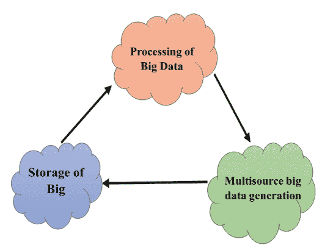

图9.1 大数据生命周期阶段。

来源：Khang (2021)

后来的研究表明，三个V的定义不足以帮助阐明我们当前面临的大数据挑战。大数据的一个反复出现的特征是数据的多样性，可能包括文本、音乐、图像和视频等内容。

数据的不同属性由多样性表示。近年来，已经开发了各种策略来保护海量数据集合的隐私。这些技术可以根据大数据的阶段生命周期进行分类，如图9.1所示，包括数据生成、存储和处理。

为了保护隐私，在数据生成阶段实施了访问限制和数据伪造程序（Arya et al., 2020）。

### 9.1.2 隐私保护数据

加密技术经常用于数据存储的隐私保护过程中。数据处理阶段包括数据知识提取和隐私保护数据发布。

尽管聚类和分类被用于划分关联规则挖掘技术，它们将输入数据分为类别，并发现数据中的重要相关性和模式。需要能够管理多样性、速度、数据量等不同大数据指标的框架。大量数据以极高的速度从各种来源输入。大数据生命周期有多个阶段。当与外部数据集结合时，个人数据可用于推断新的用户信息。此类信息可能是私密的，不适合公开消费。

个人信息有时可能被获取并用于增加商业价值。例如，一个人的购物习惯可以揭示很多关于他的信息。敏感数据在不安全的环境中处理和存储，在此过程中可能发生数据泄露。

### 9.1.3 医疗物联网

互连的设备系统，称为“医疗物联网”（IoMT），提供医疗服务。如图9.2所示，IoMT本质上是医疗设备、软件程序和服务组成的网络基础设施。

医疗保健组织可以通过连接设备和传感器来提高其临床程序和工作流管理的效率，以及远程患者健康监测。

物联网（IoT）连接数字世界和物理世界，通过加速诊断和治疗、实时调整患者行为和健康状况来改善患者健康。

互连医疗设备对患者和临床医生有重大影响（Balica, 2022）。IoMT医疗系统的本质如图9.2所示。

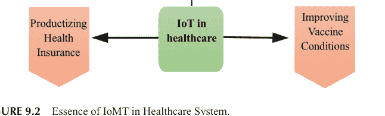

图9.2 医疗物联网在医疗系统中的本质

### 9.1.4 医疗物联网中的机器学习

机器学习（ML）是保护IoMT系统的另一种方法。

此外，与传统身份验证技术相比，由于IoMT系统安全防御技术的进步以及新型攻击类型的出现，需要对现有IoMT系统安全程序和攻击进行详细评估。因此，它分析了对IoMT系统策略的最先进安全性和攻击（Blazek et al., 2022）。

我们的主要贡献总结如下：

- 在本章中，我们将探讨IoMT系统的安全要求，以及以安全方式收集、发送和存储数据的多种方法。
- 我们讨论了目前可用的安全措施以及它们在面对不同类型攻击时的表现。根据我们的论证，没有一种方法能够完全防御对这些系统的大多数已知攻击。
- 我们检查了IoMT的攻击面，并展示了这些安全机制如何阻止各种攻击。本章列出了目前针对IoMT系统发起的攻击。
- 我们为IoMT系统提供了一种安全架构，该架构融合了这种技术的某些特性。该框架在数据收集、传输和存储过程中解决IoMT系统的安全问题。在我们的框架中，我们考虑了这些设备的限制。

本章的其余部分分为五个部分。

- 第1.2节解释了当前方法及其在IoMT中数据安全技术的缺点。
- 第1.3节解释了通过更好的机器学习支持向量机（SVM）技术在IoMT中实现数据隐私的提出技术。
- 第1.4节展示了实验结果及其图形分析。
- 第1.5节提供了结论。

### 9.2 文献综述

本节讨论了IoMT医疗系统中用于数据隐私的现有系统和技术。

多位作者讨论了保护IoMT的多种策略。数据加密是保护IoMT的基本策略。随后，接收者被授予公共信道的访问权限以接收密文。

接收者随后解密消息。有多种加密数据的方法。由于资源限制和隐私问题，创建了一种轻量级端到端密钥管理技术（Singh et al., 2020），该技术在利用尽可能少的资源的情况下交换密钥。

从安全角度来看，所提出的协议既提供了高安全性特性，又具有有限的资源消耗。鉴于物联网的特性，Aman等人（2021）


提出了当前医疗智能监测系统中隐私和安全问题的解决方案。

开发了一种使用有效私有同态算法和改进的数据加密标准加密技术的原型系统。

Jain 等人（2021）提出了一种云计算技术，该技术使用与时间戳、数字签名和非对称技术机制相链接的物联网传感器来监测其他个人数据。该方案使用更少的医疗资源并提供更有效的医疗服务。

Pustokhina 等人（2020）提出了一种基于云的无线体域网系统的 Diffie-Hellman 密钥协商机制和基于交换的安全认证。当系统参与者注册时，该技术可以为他们构建安全路由或手段。安全性和性能分析表明，上述解决方案能够解决医疗系统的问题。

## 9.2.1 数据挖掘

知识发现于数据库（KDD）中讨论了从数据中提取知识（或有用信息）的过程。在此过程中，一个称为数据挖掘（DM）的步骤使用特定算法从数据中提取模式。

然而，许多出版物和商业行为者将整个 KDD 过程称为 DM，包括数据挖掘跨行业标准流程的概念。根据 Sugiyarti 等人（2018）的说法，被称为 DM 的 KDD 步骤涉及将专用算法应用于从数据中提取模式，并以“数据挖掘”一词表示。

## 9.2.2 机器学习

ML 与 DM 重叠之间存在实质性差异。由于它们通常使用相同的方法并且有很大共同点，这两个概念经常被混淆。ML 先驱指出，提供计算机在未经明确教授的情况下学习能力的研究领域是 ML。

根据 Rajkomar 等人（2019）的说法，发现数据中的新特征是 DM 的基本目标。它更强调学习新颖有趣的信息，而非要求领域具有明确目标。机器学习可以被视为 DM 的年长兄弟。

数据挖掘最初在 1980 年代后期使用。一些研究人员选择将其工作称为 DM（Gao 等人，2021）。第一和第二查询检索到的论文中使用的技术没有明显差异。

Alpaydin（2020）的指南意味着彻底的文献检索必须有效且可信。在这种情况下，有效性由所使用的数据库和出版物、所涵盖的时间段、所使用的关键词以及前向和后向搜索的使用决定。

文献检索过程的可重复性被称为可靠性（Lalmuanawma 等人，2020）。为满足这一要求，整个检索过程都经过了细致记录。它们包括安全意识培训、安全意识教育、安全意识动机、意识计划、意识宣传和员工安全。

为了找到标题、摘要或关键词中至少满足一个检索标准的出版物，对数据库进行了检索。如果在检索查询中无法指定检索字段（如标题、摘要或关键词），则执行全文检索。总共确定了 4,168 篇潜在相关出版物。

建立了纳入和排除标准以选择主题研究领域的相关出版物。我们决定不仅关注高度推荐的出版物（Roscher 等人，2020），还纳入在会议或期刊全球排名中得分不高的活动或出版物。这是因为一些专注于信息安全（IS）的会议或期刊（如计算机、安全、信息管理和计算机安全）有许多出版物涉及本文献研究的重要主题。

未纳入白皮书和其他非学术出版物。此外，仅考虑 2000 年后发表的文章以及仅用英语撰写的出版物。

未主要讨论个人储蓄账户和员工行为的文章也被排除。为此，亲自检查了每篇文章的标题、摘要以及必要时的全文，发现 95 篇文章与此方法相关。

进行了前向和后向搜索（Lei 等人，2020），并确定了另外 18 篇相关文章。总共发现 144 篇出版物与本研究相关。被认为相关的每种期刊或会议的出版物数量如表 9.1 所示。

两名研究人员进行了两步分析以减少错误和主观偏差。首先，每位研究人员分别选择了每篇出版物所应用的理论和研究方法。

在按理论和方法分类后，将结果与其他研究人员的结果进行了比较。讨论分歧后获得了符合性的共识。在审阅文章时，理论列表是归纳开发的。

我们发现了 54 种理论，这些理论在所考虑的研究领域中使用，遵循当代 IS 文献中“理论”一词的广泛含义（Liu 等人，2022）。大多数已识别的理论仅被两篇或更少的出版物使用。考虑使用频率后，确定了七种主要理论。

## 9.3 系统设计

本节讨论了所提出系统的研究方法以及在数据隐私下网络安全中有效外包 SVM 技术设计。

- **Patient data to IoMT:** 对于一系列医疗疾病，IoMT 系统提供必要或更优的支持。特定医疗疾病（如心脏病状况的起搏器）需要植入式医疗设备（IMDs）。然而，辅助设备，如智能手表，主要是可穿戴的，以获得更好的医疗保健体验。

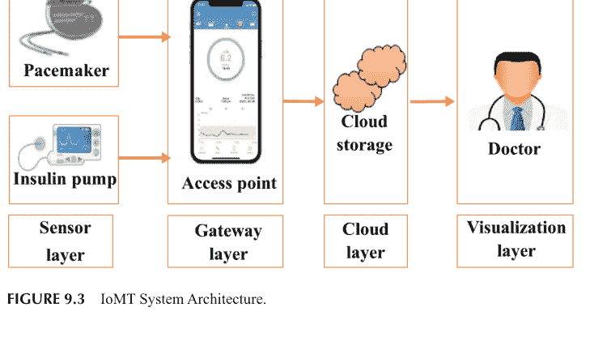

图 9.3 IoMT 系统架构。

- **Implantable medical devices**: 任何改变、支持或改善生物结构的植入设备均称为 IMD。例如，起搏器是一种 IMD，如果心跳过快或过慢，它可以促进心脏正常跳动，有助于管理不规则的心律。无线 IMD 最近被提出作为解决有线 IMD 问题（如感染和电缆断裂）的补救措施。
- **Internet of Wearable Devices**: 人们佩戴这些设备来跟踪其生物特征，如心率，这可以改善其整体健康。心电图监测仪、血压监测仪、智能手表和跌倒检测带是一些例子。智能手表是最受欢迎的可穿戴设备物联网之一，用于监测心率和运动等生物特征。即使受试者不动，监测也能检测到缓慢和快速的心跳。新的手表的其他功能包括跌倒检测和心电图读数，用于诊断心房颤动（心律不齐）等医疗疾病。目前，它们经常作为非关键患者监护仪（Vrushank 等人，2023）。

然而，由于传感器精度和电池寿命限制，这些小工具不太可能在生死攸关的情况下发挥 IMD 的作用。图 9.3 显示了几种知名 IMD 及其位置。

### 传感器层

- 感知层表示来自特定数据源的数据类型，例如网络服务、传统无线传感器网络和个人区域网络。
- 传感器和其他数据收集设备构成了任何物联网系统的基础。它们充当物理世界和数字世界之间的桥梁，将模拟信号转换为数字信号（Khang 等人，2022b）。

### 数据收集

- 当出现问题时（传感器硬件操纵），拥有备份策略是有帮助的。
- 传感器数据是检测并响应来自物理环境输入的设备的输出。输出可用于通知用户，作为另一系统的输入，或作为流程指导。传感器几乎可以检测任何物理元素。
- 这种攻击有可能危害患者生命并损害系统的功能。

### 网关层

- IoMT 传感器的处理和存储能力限制了数据在发送到网关层（即第二层）之前被处理。这一层中的设备可能是专用接入点（APs）或患者的智能手机。
- 接入点通常比传感器更强大。它们能够执行预处理任务，例如临时数据存储、验证和基于基本人工智能的分析。它们还可以通过互联网将传感器数据传输到云端（Rani 等人，2023）。

### 传输中的数据

- 此阶段涉及所有四个层中元素之间的通信，例如网关层中的 AP 和传感器层中的 IoMT 传感器。
- 此区域的攻击可以改变或停止传感器数据的传输。因此，防御此类攻击将防止四个层之间传输过程中数据损坏。

### 云层

- 物联网设备可以实时相互通信。因此，连接的智能设备可以与各种可信 API 通信。
- 云计算使网络技术能够使用数据处理。系统节点 ID 和密钥由密钥生成服务器生成。该层支持传感器访问的远程控制和管理。

### 存储中的数据

- 传感器和网关级别收集并传输患者数据，然后将其存储在云层中。对该层的攻击可以采取以下形式


拒绝服务（DoS）、分布式DoS或账户凭据窃取（Bham bri et al., 2022）。

- 数据访问必须对可视化层和该层都进行严格监管。这一点很重要，因为与更早的层次相比，该层中的大部分数据在大部分时间都处于休眠状态。

## 可视化/操作层

- 为了监测患者健康状况，该层向医生显示数据。医生的建议也包含在该层中，同时考虑患者的病史（Khang et al., 2022c）。

- 操作示例包括开具处方和调整各种药物的剂量。

## 支持向量机

- 借助SVM算法，未来可以通过识别用于对n维空间进行分类的最佳直线或决策边界，轻松地对新数据点进行分类。

- 最有效的决策边界是超平面。SVM决策边界如图9.4所示。

## 线性SVM

通过一个例子可以更好地理解SVM算法。考虑一个具有两个特征（绿色和蓝色）和两个标签（绿色和蓝色）(x1和x2)的数据集。我们需要一个能够区分绿色和蓝色坐标对(x1, x2)的分类器。请看图9.5。

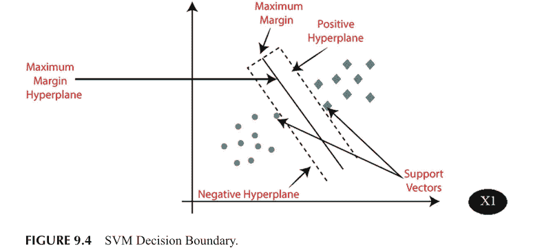

图9.4 SVM决策边界。

## 绿色和蓝色坐标对

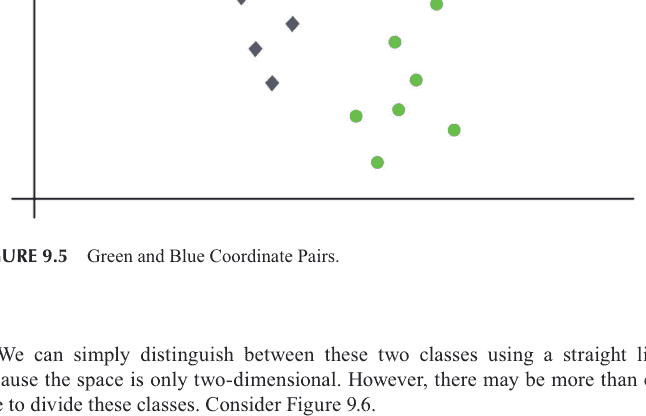

图9.5 绿色和蓝色坐标对。

由于空间只是二维的，我们可以用一条直线直接区分这两个类别。然而，可能存在多条直线来划分这些类别。考虑图9.6。

线性或非线性分类器（通常称为SVM）是一种数学函数，能够区分两个不同的对象类别。这些对象属于类别范畴，不应与Java类混淆。代码块9.1中的以下伪代码展示了如何训练SVM。

```
Train an SVM with the labelled points. o_i ← w·x_i + b.
Assign y_i ← 1 to the largest o_i; −1 to the others.
C~ ← 10−5 C*

While C~ < C* do
repeat
Minimizing (1) with {y_i} fixed and C* is replaced by C~.
if ∃ ←(i, j) satisfying (6)
then
Swapping the labels of y_i and y_j
end if
until No labels have been swapped C~ ← min (9.5C, C*)
end while

Code block 9.1: Code Presents Algorithm for Training an SVM.
```

其中‘E’表示在概率p_u下的期望概率。两个损失V(1, o_i)和V中的较小者源自如下事实：在关于p_u的最优状态下，p_i必须将其全部质量集中在y_i = sign (wTx_i + b) (−1, o_i)上。


**图9.6** 二维空间示意图。

因此，这个松弛阶段没有任何不利影响；它只是对原始目标进行基于连续变量的重新表述。对于$D_A—H$，在目标（$p_u$）中增加了一个额外的熵项。

## 9.4 结果与讨论

本节检查了当前系统的性能，包括准确率为85.96%、灵敏度为88.23%、特异度为86.33%、精确度为87.1%。

由于采用了新颖的疾病预测方法，所提出的系统比当前系统更有效。此外，该预测过程的精确度得到了提高（Divvela et al., 2023）。

- **混淆矩阵：** 如图9.7所示，使用混淆矩阵来评估后分类过程的有效性。它提供了正确分类的TN值（属于不同类别）、完美分类的TP值、属于某一类别但不属于另一类别的FP值、属于某一类别但不属于另一类别的FN值，以及属于某一类别但不属于另一类别的FP值（如图9.7中提到的TN、TP、FP和FN）的示例。

准确率、精确率、灵敏度以及真实标签特异度分数是最常用的基于这些准则的分类性能度量。混淆矩阵如图9.7所示。

- **准确率：** 这显示了模型的总准确率，或分类器正确识别所有样本的百分比。准确率使用公式9.1确定：

$$\text{Accuracy} = \frac{\text{TP} + \text{TN}}{\text{TP} + \text{TN} + \text{FP} + \text{FN}} \tag{9.1}$$

## 真实标签


图9.7 混淆矩阵预测。

来源：Khang (2021)


图9.8 准确率图。

## 表9.1
所提出系统与现有系统的准确率结果值。

| 算法 | 结果 |
|---|---|
| 随机森林 (RF) | 72.36 |
| 卷积神经网络 (CNN) | 74.65 |
| K均值 | 80.32 |
| SVM | 85.96 |

准确率差距如图9.8所示，所提出系统与现有系统的准确率结果值列于表9.1中。

- **精确率：** 将准确的正预测数(TP)除以总正预测数(TP + FP)，即可使用公式9.2计算精确率：

精确率 = TP/(TP + FP)  (9.2)

精确率图如图9.9所示，精确率值列于表9.2中。

**特异度：** 特异度(N)的计算涉及将准确负预测数(TN)除以总负数，如公式9.3所示：

特异度 = TN/(TN + FP)  (9.3)

特异度图如图9.10所示，各种算法的特异度值列于表9.3中。


图9.9 精确率图。

## 表9.2
所提出系统与现有系统的精确率结果值。

| 算法 | 结果 |
|---|---|
| RF | 74.45 |
| CNN | 75.12 |
| K均值 | 79.22 |
| SVM | 87.10 |

**灵敏度**: TP率是所有真正阳性事件中阳性值的比例，如公式9.4所示：

灵敏度 = TP/(TP + FN)  (9.4)

灵敏度图如图9.11所示，各种算法的灵敏度值列于表9.4中。

## 特异度


图9.10 特异度图。

## 表9.3
所提出系统与现有系统的特异度结果值。

| 算法 | 结果 |
|---|---|
| RF | 75.15 |
| CNN | 76.66 |
| K均值 | 80.12 |
| SVM | 86.33 |

## 灵敏度


图9.11 灵敏度图。

## 表9.4
所提出系统与现有系统的灵敏度结果值。

| 算法 | 结果 |
|---|---|
| RF | 76.55 |
| CNN | 78.01 |
| K均值 | 81.97 |
| SVM | 88.23 |

## 9.5 结论

我们提出并测试了一种使用SVM对一组选定数据进行入侵检测的方法。它提供了高数据准确性，并展示了兼容的性能水平。

物联网中的每台设备都会发送数据包，随着连接设备数量的指数级增长，这种通信需要可靠的连接性、存储和安全性（Khang et al., 2022a）。

在使用物联网时，组织必须管理、监视和保护来自分散设备的海量数据和连接（Rani et al., 2021）。

一个健康、民主的社会需要隐私，这不仅仅是个人数据的问题。随着技术的发展，个人和医疗保健也将随之发展（Khang et al., 2023a）。

我们研究了新提出的隐私保护SVM分类系统，发现其首要协议是一种安全技术，用于确定加密数字的符号是否存在健全性问题或安全漏洞。然后，我们提出了一种新技术，可应用于辅助隐私保护SVM分类，该技术对于查找加密整数的符号既安全又准确（Vrushank et al., 2023）。

实验表明，MR-SVM模型可以有效解决随着数据量增加而导致的SVM成本快速增长的问题。然而，实验中使用了两个节点，数据传输速度有限。未来研究可以建立多个节点用于网络安全。

## 参考文献

Alpaydin E., (2020). Introduction to Machine Learning. MIT Press. https://mitpress.mit.edu/9780262043793/introduction-to-machine-learning/

Aman A. H. M., Hassan W. H., Sameen S., Attarbashi Z. S., Alizadeh M., Latiff L. A., (2021). “IoMT amid COVID-19 pandemic: Application, architecture, technology, and security,” Journal of Network and Computer Applications, 174, 102886. www.sciencedirect.com/science/article/pii/S1084804520303490

Arya D., Maeda H., Ghosh S. K., Toshniwal D., Omata H., Kashiyama T., Sekimoto Y., (Dec 2020). “Global road damage detection: State-of-the-art solutions,” In 2020 IEEE International Conference on Big Data (Big Data). IEEE, pp. 5533–5539. https://ieeexplore.ieee.org/abstract/document/9377790/


Awan U., Shamim S., Khan Z., Zia N. U., Shariq S. M., Khan M. N., (2021), “大数据分析能力与决策：数据驱动洞察在循环经济绩效中的作用,” *Technological Forecasting and Social Change* (技术预测与社会变迁), 168, 120766. www.sciencedirect.com/science/article/pii/S0040162521001980

Balica R. S., (2022), “网络化可穿戴设备、基于机器学习的实时数据传感与处理以及医疗物联网在 COVID-19 诊断、预后和治疗中的应用,” *American Journal of Medical Research* (美国医学研究杂志), 9(1), 33–48. www.ceeol.com/search/article-detail?id=1038875

Bhamri P., Rani S., Gupta G., Khang A., (2022), *Cloud and Fog Computing Platforms for Internet of Things* (面向物联网的云与边缘计算平台). CRC Press. https://doi.org/10.1201/9781003213888

Blazek R., Hrusova L., Collier J., (2022), “基于医疗物联网的临床决策支持系统、智能医疗可穿戴设备以及机器人在 COVID-19 预防、筛查、检测、诊断和治疗中的机器学习算法,” *American Journal of Medical Research* (美国医学研究杂志), 9(1), 65–80. www.ceeol.com/search/article-detail?id=1038880

Gao Y., Li J., Zhou Y., Xiao F., Liu H., (2021), “大规模机器学习优化方法,” *SIAM Review* (SIAM 评论), 60(2), 223–311. https://ieeexplore.ieee.org/abstract/document/9674150/

Jain S., Nehra M., Kumar R., Dilbaghi N., Hu T., Kumar S., Li C. Z., (2021), “用于传染病即时检测的医疗物联网 (IoMT) 集成生物传感器,” *Biosensors and Bioelectronics* (生物传感器与生物电子学), 179, 113074. www.sciencedirect.com/science/article/pii/S0956566321001111

Khang A., (2021), “Material4Studies,” *Material of Computer Science, Artificial Intelligence, Data Science, IoT, Blockchain, Cloud, Metaverse, Cybersecurity for Studies* (计算机科学、人工智能、数据科学、物联网、区块链、云、元宇宙、网络安全研究材料). www.researchgate.net/publication/370156102_Material4Studies

Khang A., Hahanov V., Abbas G. L., Hajimahmud V. A., (2022a), “信息物理社会系统与事件管理,” 收录于 *AI-Centric Smart City Ecosystems: Technologies, Design and Implementation* (以 AI 为核心的智慧城市生态系统：技术、设计与实现), Vol. 2, No. 15 (1st ed). CRC Press. https://doi.org/10.1201/9781003252542-2

Khang A., Ragimova N. A., Hajimahmud V. A., Alyar V. A., (2022b), “智能医疗系统中的先进技术与管理数据,” 收录于 *AI-Centric Smart City Ecosystems: Technologies, Design and Implementation* (以 AI 为核心的智慧城市生态系统：技术、设计与实现), Vol. 16, No. 10 (1st ed). CRC Press. https://doi.org/10.1201/9781003252542-16

Khang A., Rani S., Sivaraman A. K., (2022c), *AI-Centric Smart City Ecosystems: Technologies, Design and Implementation* (以 AI 为核心的智慧城市生态系统：技术、设计与实现) (1st ed). CRC Press. https://doi.org/10.1201/9781003252542

Khang A., Rana G., Tailor R. K., Hajimahmud V. A., [Eds.]. (2023a). *Data-Centric AI Solutions and Emerging Technologies in the Healthcare Ecosystem* (医疗生态系统中的数据中心 AI 解决方案与新兴技术). CRC Press. https://doi.org/10.1201/9781003356189

Khang A., Olena H., Abdullayev V. A., Arvind Kumar S., (2023b). *Computer Vision and AI-integrated IoT Technologies in Medical Ecosystem* (医疗生态系统中的计算机视觉与 AI 集成物联网技术) (1st ed). CRC Press. https://doi.org/10.1201/9781003429609

Lalmuanawma S., Hussain J., Chakakhuk L., (2020), “机器学习与人工智能在 Covid-19 (SARS-CoV-2) 大流行中的应用：综述,” *Chaos, Solitons & Fractals* (混沌、孤子与分形), 139, 110059. www.sciencedirect.com/science/article/pii/S0960077920304562

Lei Y., Yang B., Jiang X., Jia F., Li N., Nandi A. K., (2020), “机器学习在机器故障诊断中的应用：综述与路线图,” *Mechanical Systems and Signal Processing* (机械系统与信号处理), 138, 106587. www.sciencedirect.com/science/article/pii/S088832701908088

Liu X., Zhao J., Li J., Cao B., Lv Z., (2022), “用于医疗数据安全的联邦神经架构搜索,” *IEEE Transactions on Industrial Informatics* (IEEE 工业信息学汇刊), 18(8), 5628–5636. https://ieeexplore.ieee.org/abstract/document/9684972/

Papaioannou M., Karageorgou M., Mantas G., Sucasas V., Essop I., Rodriguez J., Lymberopoulos D., (2022). “医疗物联网 (IoMT) 中安全威胁与对策综述,” Transactions on Emerging Telecommunications Technologies (新兴电信技术汇刊), 33(6), e4049. https://onlinelibrary.wiley.com/doi/abs/10.1002/ett.4049

Pustokhina I. V., Pustokhin D. A., Gupta D., Khanna A., Shankar K., Nguyen G. N., (2020). “边缘计算赋能的医疗物联网 (IoMT) 系统中深度神经网络的有效训练方案,” IEEE Access, 8, 107112–107123. https://ieeexplore.ieee.org/abstract/document/9109259/

Rajkomar A., Dean J., Kohane I., (2019). “医学中的机器学习,” New England Journal of Medicine (新英格兰医学杂志), 380(14), 1347–1358. www.nejm.org/doi/full/10.1056/NEJMra1814259

Rani S., Bhambri P., Kataria A., Khang A., Sivaraman A. K., (2023). Big Data, Cloud Computing and IoT: Tools and Applications (1st ed.) (大数据、云计算与物联网：工具与应用). Chapman and Hall/CRC. https://doi.org/10.1201/9781003298335

Rani S., Chauhan M., Kataria A., Khang A., (Eds.). (2021). “用于智能医疗系统的物联网装备智能分布式框架,” 收录于 Networking and Internet Architecture (网络与互联网架构), Vol. 2, p. 30. CRC Press. https://doi.org/10.48550/arXiv.2110.04997

Roscher R., Bohn B., Duarte M. F., Garcke J., (2020). “用于科学洞察与发现的可解释机器学习,” IEEE Access, 8, 42200–42216. https://ieeexplore.ieee.org/abstract/document/9007737/

Singh R. P., Javaid M., Haleem A., Vaishya R., Ali S., (2020). “医疗物联网 (IoMT) 在 COVID-19 大流行期间的骨科应用：角色、挑战与应用,” Journal of Clinical Orthopaedics and Trauma (临床骨科与创伤学杂志), 11(4), 713–717. www.sciencedirect.com/science/article/pii/S097656622030179X

Sugiyarti E., Jasmi K. A., Basiron B., Huda M., Shankar K., Maseleno A., (2018). “使用数据挖掘的奖学金获得者选择决策支持系统,” International Journal of Pure and Applied Mathematics (国际纯数学与应用数学期刊), 119(15), 2239–2249. www.academia.edu/download/57052927/DECISION_SUPPORT_SYSTEM_OF_SCHOLARSHIP_GRANTEE.pdf

Vishnu Sai Kumar D., Ritik C., Anuradha M., Praveen Kumar M., Khang A., (Aug 24, 2023). “使用机器学习预测心脏病和肝病,” 收录于 Data-Centric AI Solutions and Emerging Technologies in the Healthcare Ecosystem (医疗生态系统中的数据中心 AI 解决方案与新兴技术), p. 4. (1st ed.). CRC Press. https://doi.org/10.1201/9781003356189-13

Vrushank S., Vidhi T., Khang A., (2023). “使用区块链技术增强电子健康记录的安全性和隐私,” 收录于 Data-Centric AI Solutions and Emerging Technologies in the Healthcare Ecosystem (医疗生态系统中的数据中心 AI 解决方案与新兴技术), p. 1 (1st ed). CRC Press. https://doi.org/10.1201/9781003356189-1

## 10 实时应用中基于贝叶斯超调谐人工神经网络的机器人技术

Arvind Kumar Shukla, Poongodi S.,
Alex Khang, and Shashi Kant Gupta

### 10.1 引言

机器人必须能够适应有限的测量集合，同时在实际的机器人场景中运作，在这些场景中它可能会遇到意外的视觉特征。最近，行业已发生向能够响应复杂动态环境并应对多种不确定性的系统机器人领域的广泛转变 (Haleem et al., 2022)。

机器人和自动化系统的最新发展提高了其能力，从而使得越来越多智能机器人在更广泛的任务中得到应用成为可能 (Hajimahmud et al., 2022)。

掌握多种不同形态特征的能力对于机器人实现更通用的功能至关重要。公共机器人的空间能力可以被用于识别机械末端传感器布局，并直接且安全地抓持和搬运重物而不发生滑动 (Mayoral-Vilches, 2022)。

机器人行业在过去 50 年间兴起。然而，机器人的创建通常缺乏网络安全风险考量，这通常表明系统仍处于起步阶段。自动化网络安全常被误认为等同于自动化保护。

从商用、客户到专业机器人，这些设备中的大多数都容易受到安全攻击。安全是设计者和现行法规的首要基本任务。隐私并未被视为重要 (Tuomas, 2022)。

从价值视角来看，这些领域的融合促成了一个单一的安全与保护风险框架的创建。网络安全旨在保护网络免受恶意攻击者提供的威胁，而机器人安全通常被定义为建立事故或缺陷的预防程序，如图 10.1 所示。

另一种观点认为，隐私关注的是从不同领域保护机器人，而保护关注的是从特定机器人保护周围环境 (Bhardwaj et al., 2022)。


**图10.1** 使用机器人自动化的益处。

网络安全不仅仅是一种产品。其规模和复杂性使之尤为重要。现代机器人应用功能极其丰富，往往会导致广泛的安全攻击和多种可能的攻击路径，使得采用标准方法困难重重。

因此，这引出了以下研究问题：机器人网络安全的现状如何？如何有效提升机器人的安全性？

通过应用基本功能、分配计算能力使受训者能够在网络上分散处理复杂流程，并在他们周围建立程序员小组以交流脚本和设备，机器人与自动化测试掩盖了控制各种设备的难度。

最初，收集机器人数据，并使用最小-最大归一化进行预处理。使用核线性判别分析（KLDA）进行特征提取。随后，通过我们新型的贝叶斯超参数调优人工神经网络（BH-ANN）实现特征检测。

最后，对系统性能进行评估，并将参数与现有方法的参数进行比较。

本章其余内容安排如下。10.2节阐述问题陈述。10.3节介绍所提出的方法。10.4节进行性能分析，10.5节给出结论。

## 10.2 问题陈述

涉及机器人/机器与人的交互是不安全的，由于缺乏私密连接，容易遭受各种攻击。利用常见密码和登录凭据的网络攻击源于不当的验证，这种验证易被特定黑客突破。

创建自动机集群、增强移动性和探索能力，以及创建能够获取理解并运用常识做出伦理和社会判断的人工智能（AI），这些任务都聚焦于机器人系统中的基本问题。

工作机制、移动性和以人为中心的自动化是三大主要障碍，其中通信是此类自动化系统所需的最困难部分。

检测、定位、认知和控制系统是导航中的四个主要能力组成部分。自动化机器人的功能性和有效性受到网络和管理弱点的干扰，这些弱点可能中断制造和商业运营，导致经济损失。

更具体地说，这些可能导致网络阻塞、通信窃听、报告生成以及人身伤害（Jin 等，2022）。


**图10.2** 所提方法的工作原理。

## 10.3 提出的方法

机器人自动化已迅速成为帮助企业提升效率并做出主要贡献的最重要策略之一。人们不再需要执行危险任务，因为机器人系统可以在这些条件下工作（Tailor 等，2022）。

人类能够处理日常任务、危险物质和重负载。这使得公司能够避免诸多危险，同时保护时间和金钱。图10.2展示了所提系统的工作原理。

### 10.3.1 数据收集

多模态人机交互数据集旨在实现人类引导的交互式物质感知。该数据集描绘了一个场景：一个人通过有限的任务动作范围来指导机器人学习建模技术。

该数据集的目的不是研究真实的人机协作，而是利用人类自然的教学能力来教育机器人（Khang 等，2023c）。

24名候选人中有13名女性，选自匹兹堡地区。24人的年龄分布为：4人25至30岁，1人31至35岁，2人41至45岁，其余年龄在18至24岁之间。

对候选样本进行了审查，以确保所有参与者在其他实验中使用该机器人系统之前，均未执行过该任务。

研究在卡内基梅隆大学的人机伙伴实验室进行。参与者在清醒的一个半小时里获得了15美元报酬（Newman 等，2022）。

### 10.3.2 使用最小-最大归一化的预处理

用于自动化计算的数据准备通常采用归一化过程。归一化过程的目标是以一种对显著性阈值内在差异不敏感的方式，将数据集中定量字段的特征转换为标准格式。

归一化可以采用预处理、匹配或可扩展性策略。这对于建模或估计可能极为有用。因此，本章使用z-score归一化。

在最小-最大归一化中，使用公式10.1对落在[0, 1]范围内的特征进行归一化：

$$u' = \frac{u - \min_B}{\max_B - \min_B} \tag{10.1}$$

在本文中，特征$B$的最小可能值和最大可能值分别用符号$\min_B$和$\max_B$表示。

属性的原始值及其归一化值分别由$u$和$u'$表示。由公式可见，特征的可能最高值和最低值分别被映射到1和0。

### 10.3.3 使用核线性判别分析的特征提取

他们使用KLDA提取特征，因为它是操作系统最重要的组成部分。为便于展开，先对KLDA进行简要介绍。

每个类别都存在一个以列向量形式给出的训练样本，可供使用。在计算中，使用KLDA的类间散布矩阵和总体散布矩阵（公式10.2和10.3）：

$$S_b = \sum_{i=1}^{C}(a_i^j-a_i)(a_i^j-a_i)^T \tag{10.2}$$

$$S_t = \sum_{i=1}^{C}\sum_{j=1}^{n}(a_i^j-\bar{a})(a_i^j-\bar{a})^T \tag{10.3}$$

其中，$a_i^j$表示第$i$类的第$j$个训练样本，$\bar{a}$表示所有训练样本的均值，$a_i$表示第$i$类的均值，如公式10.4所示：

$$S_bx = \lambda S_tx \tag{10.4}$$

如果公式10.4的所有特征值为 $\lambda_1 \geq \lambda_2 \geq \dots \geq \lambda_N$，对应的特征向量为 $\dots$。LDA特征方程如下。由于工作原理，KLDA使用最大的两到三个特征向量，从参考向量中生成$d$维向量。参考向量的维度用$N$表示。

特征提取和选择都适用于降维。给定样本和KLDA协方差矩阵的一个特征向量分别为 $x = [x_1 \dots x_N]^T$ 和 $a = [a_1 \dots a_N]^T$。给定$x$，基于KLDA提取$a$的特征的结果如公式10.5所示：

$$z = a^T x = \sum_{i=1}^{n} a_i x_i \tag{10.5}$$

确切地说，$x_i$（$i=1,2,\dots,N$）的幅值在统计上反映了样本第$i$个分量对特征提取结果的贡献。确切地说，当$x_i$的绝对值较小时，样本第$i$个分量的贡献较小。

如果$x_k$的绝对值足够小，从$\sum_{i=1}^{N} a_i x_i$中移除$a_k x_k$只会使特征提取的输出发生微小变化。这意味着当$x_k$的绝对值不大时，他们可以忽略样本第$k$个分量的重要性。

在评估单个分量的相关性时，应考虑多个特征向量，因为特征向量几乎总是多个。使用这种方法，他们能够识别出最佳特征。

- **阶段1：** 使用初始训练样本生成基于总散布矩阵的KLDA。最后，求解公式10.4的特征向量和特征值。
- **阶段2：** 他们选择前$m$个特征值最大的特征向量，并依次用$V_1, \dots, V_m$表示。
- **阶段3：** 第$j$个分量对特征提取的影响计算如下（公式10.6）：

$$c_j = \sum_{p=1}^{m} |V_{pj}| \tag{10.6}$$

其中，$V_{pj}$表示向量$V_p$的第$j$个元素，$j = 1,2,\dots,N$，$p = 1,2,\dots,m$，$|V_{pj}|$表示$V_{pj}$的绝对值。

- **阶段4：** 对于$j = 1,2,\dots,N$，他们将$c_j$按降序排序，并用$d_j$记录排序结果。

例如，如果在所有$c_j$（$j=1,2,\dots,N$）中，原始样本的第$s$个分量和第$t$个分量分别是最重要和第二重要的特征，那么他们应令$d_1=s$，$d_2=t$。

如果需要$n$维特征，特征提取的结果将是第$d_1$、第$d_2$、……和第$d_n$个分量。特征提取数据被置于物联网（IoT）中。


## 10.3.4 使用贝叶斯超参数调优人工神经网络进行特征检测

人工神经网络是一种理论模型，模拟生物脑电波的多个方面。所提出的方法以类似的方式在机器人技术中表现出色（Rana 等人，2021）。

更技术性地讲，它通常指的是一种计算机网络，能够针对特定类型的输入产生一些有用的洞见。尽管它们是认知系统，但并非基于输入与结果之间的任何连接来设计。

相反，BH-ANN 仅被内置为一个永久特征，然后通过模拟神经学特征来教导其执行功能。

神经网络有多种类型，每种都有独特的目标、教学方法与传输网络（Khang 等人，2023a）。

### 10.3.4.1 贝叶斯超参数调优人工神经网络的特征

许多常规和准执行器使用 BH-ANN。

- 贝叶斯超参数调优人工神经网络能够管理具有多种结果的单一输入。
- 将空间值转化为策略与计划的统计挑战，对 BH-ANN 而言难以解决。
- 大多数广泛采用的控制策略，包括非线性事件的调节，都涉及 BH-ANN。
- 多种不同的传感器已被有效地整合到 BH-ANN 中。
- 拒绝服务神经模型在机器人技术中最为常用。

### 10.3.4.2 贝叶斯超参数调优人工神经网络的操作

由于该方法降低了训练数据的维度，以简化网络防御中涉及的各层之间的关系，因此它采用了一个由全连接层组成的密集网络作为输出。算法 1.1 展示了 BH-ANN 的操作方式。

**算法 1.1：BH-ANN 操作**

```
Input: Neurons, Activation, Optimizer, Learning Rate, Batch Size, Epochs, Layers, Normalization, Drop Out, Dropout Rate
Output: Optimized Values for all the estimators
Begin:
Step 1: Create a sequential layer.
Step 2: Define a set of dictionaries that consist of all possible optimizers, such as Adam, SGD, RMSProp, and others, for both convolution and dense layers.
Step 3: Define activation functions.
Step 4: Define neurons in the range of 10 to 1000, and batch size in the range of 200 to 1000.
Step 5: Define three dense layers and drop out layers with a threshold greater than 0.5.
Step 6: Define a dense output layer with a sigmoid activation function.
Step 7: Compute the cross-validation score by applying the stratified folding technique.
End
```

## 10.4 性能评估

我们提出了 BH-ANN。实验使用了安全性、感知水平、鲁棒性和实现成本等指标。将 IoT、AI 和云计算等现有方法与所提出的工作进行了比较（Khang 等人，2023b）。

### 10.4.1 安全性

由于机器人系统的持续发展以及安全和安保威胁与问题的增加，机器人安全这一跨学科领域正变得愈发相关和重要（Khang 等人，2022）。

据当地警方称，机器人可以在街道上巡逻。它们接受了识别和逮捕所有街头犯罪行为的训练，如图 10.3 所示。


图 10.3 安全性比较。

### 10.4.2 感知水平

机器人感知主要采用需要环境输入或感官数据的算法，以使机器人能够看、触、听和移动（Hahanov 等人，2022）。

三种主要的传感器类型（视觉、力/力矩和触觉）对应三种最常见的机器人控制策略：视觉伺服控制、力控制和触觉控制。它们通常是机器人的控制器的基础，用于解释和评估感官数据，如图 10.4 所示。

与现有方法（如 IoT（65%）、AI（75%）、云计算（88%）和 BH-ANN（93%））相比，对所提出的工作进行了评估。


图 10.4 感知水平比较。

### 10.4.3 鲁棒性

机器人的鲁棒性可以根据控制策略的期望动作（如由阶跃引起的动作）和非期望动作（如由跌倒引起的动作）来分类，如图 10.5 所示。


图 10.5 鲁棒性比较。

### 10.4.4 实现成本

与制定和实施侧重于一种或多种特定循证治疗的实施策略相关的成本称为实现成本。该方法将直接影响后续干预，可能影响其效果、使用或质量，如图 10.6 所示。

实现成本（%）


图 10.6 实现成本比较。

## 10.5 结论

本章提出将 BH-ANN 应用于实时场景下具有机器人的柔性工业部门。以机器人方面作为未来智能工厂的指导方针，新的网络安全方案包括在完全集成的系统中与其他方面通信的神经网络。

为了验证所提系统的可行性，收集了一个工业情境数据集，用以说明采用人机协作的制造装配过程。

本研究的特征提取阶段揭示了构成对机器人严重威胁的真正困难。为了证明所提策略的有效性，展示了其各项指标。

如仿真所示，由于连接性的增强，网络安全受损的物理资产可能在自动化中导致严重的安全隐患。

未来的工业流程，包括人类操作员和机器人，将在产业变革的框架内创建（Khang，2024）。

## 参考文献

- Bhardwaj A., Alshehri M. D., Kaushik K., Alyamani H. J., Kumar M., (2022). “针对网络物理机器人系统网络攻击的安全框架。” *Journal of Electronic Imaging*，31(6)，061802. https://doi.org/10.1117/1.JEI.31.6.061802

- Hahanov V., Khang A., Litvinova E., Chumachenko S., Hajimahmud V. A., Alyar V. A., (2022). “智慧城市的关键助手——传感器与工具，”见 *AI-Centric Smart City Ecosystems: Technologies, Design and Implementation*，第 17 卷，第 10 期（第 1 版）。CRC Press. https://doi.org/10.1201/9781003252542-17

- Hajimahmud V. A., Khang A., Hahanov V., Litvinova E., Chumachenko S., Alyar V. A., (2022). “面向智慧城市的自主机器人：走向增强人类，”见 *AI-Centric Smart City Ecosystems: Technologies, Design and Implementation*，第 7 卷，第 12 期（第 1 版）。CRC Press. https://doi.org/10.1201/9781003252542-7

- Haleem A., Javaid M., Singh R. P., Rabad S., Suman R., (2022). “面向改善性工业 4.0 时代的网络安全视角：基于综述的框架，” *Industrial Robot: The International Journal of Robotics Research and Application*，49(3)，582–597. https://doi.org/10.1108/IR-10-2021-0243

- Jin S., Lian W., Wang C., Tomizuka M., Schaal S., (2022). “具有空间表征的机器人电缆布线。” *IEEE Robotics and Automation Letters*，7(2)，5687–5694. https://doi.org/10.1109/LRA.2022.3158377

- Khang A., (Ed.). (2024). *AIoCF: AI 导向的数字经济人才管理能力框架——模型、技术、应用与实施*。CRC Press. https://doi.org/10.1201/9781003440901

- Khang A., Gupta S. K., Hajimahmud V. A., Basabseh J., Morris G., (2023a). *AI-Centric Modelling and Analytics: Concepts, Designs, Technologies, and Applications*（第 1 版）。CRC Press. https://doi.org/10.1201/9781003400110

- Khang A., Vrushank S., Rani S., (2023b). *AI-Based Technologies and Applications in the Era of the Metaverse*（第 1 版）。IGI Global Press. https://doi.org/10.1201/9781668488515

- Khang A., Rani S., Gujrati R., Uygun H., Gupta S. K., (Eds.). (2023c). *Designing Workforce Management Systems for Industry 4.0: Data-Centric and AI-Enabled Approaches*。CRC Press. https://doi.org/10.1201/9781003357070


Khang A., Hahanov V., Abbas G. L., Hajimahmud V. A., (2022). “信息物理社会系统与事件管理,” 见 *以人工智能为中心的智慧城市生态系统：技术、设计与实施*, 第2卷, 第15期（第1版）. CRC Press. https://doi.org/10.1201/9781003252542-2

Mayoral-Vilches V., (2022). “机器人网络安全：综述,” *国际网络取证与高级威胁调查杂志*. https://orcid.org/0000-0001-8308-3363

Newman B. A., Aronson R. M., Srinivasa S. S., Kitani K., Admoni H., (2022). “Harmonic：辅助性人机协作的多模态数据集,” *国际机器人研究杂志*, 41(1), 3–11. https://doi.org/10.1177/02783649211050677.

Rana G., Khang A., Sharma R., Goel A. K., Dubey A. K., (编). (2021). *通过人工智能重塑制造与业务流程*. CRC Press. https://doi.org/10.1201/9781003145011

Tailor R. K., Ranu P., Khang A., (编). (2022). “区块链中的机器人流程自动化,” 见 Khang A., Chowdhury S., Sharma S., 编, *数据驱动的区块链生态系统：基础、应用与新兴技术*, 第8卷, 第13期, 第149–164页（第1版）. CRC Press. https://doi.org/10.1201/9781003269281-8

Tuomas T., (2022). “网络安全测试自动化.” 202205026731. https://urn.fi/URN:NBN:fi:amk

如果出现以上任何症状，应转诊至眼科医生（其专业领域包括眼科护理，不同于验光师和配镜师）。眼科医生在视力状况的诊断和治疗方面具有专门的培训和经验（Weinreb 等，2014）。

- **眼压测量**：该设备用于测量眼内压（IOP）或眼球内部压力。检查前，会滴入麻醉眼药水以使眼睛暴露，提高检查舒适度。设备会轻微压陷角膜，并通过测量设备测量对此压陷的阻力。
- **检眼镜检查**：该检查用于确定视神经、视网膜、视盘和血管的大小与形状。
- **视野检查**：这是视野测试的一个示例。视野描述的是眼睛在注视单一位置时所能看到的距离。该测试用于判断患者的视力是否存在任何盲点。
- **前房角镜检查**：用于确定虹膜与角膜相交的精确角度。先向眼睛滴入麻醉药水，然后放置一面带有镜子的定制隐形眼镜，以显示虹膜与角膜之间的角度。如果该角度被阻塞，眼内压会急剧升高。该检查还能揭示异常血管以及既往创伤造成的损伤。
- **角膜厚度测量**：用于测量角膜厚度。由于角膜厚度会影响眼内压读数，探针会测量其厚度。这是必要的，因为角膜厚度可能干扰眼内压的准确读数，导致对眼内压力的错误解读，甚至可能造成误诊。

以下是青光眼的药物和治疗方法（Weinreb 等，2014）：

- 药物：滴眼液，如适利达、卢美根和β受体阻滞剂
- 手术：激光手术
- 医疗操作：小梁成形术

为了检测青光眼的存在，我们考虑了从眼压测量检查中获得的各类公开可用的二分类数据集。我们在多种具有不同激活函数的EfficientNetV2模型上观察眼睛数据集的行为，以改进基线结果，并分析其行为。

高龄、家族史、非洲裔血统、高眼压以及特定医学疾病（包括高血压和糖尿病）是青光眼的其他风险因素（Weinreb 等，2014）。具有这些风险因素的人应经常进行眼科检查，以检查青光眼的早期迹象。

迁移学习（TL）在健康领域（尤其是青光眼检测）有哪些益处？迁移学习在健康领域具有极大的潜在价值（Khang 等，2023c），特别是在青光眼检测方面。以下是TL在青光眼检测中的一些优势：

- **高精度**：TL可以提高青光眼检测模型的性能，因为预训练模型可以在较小的医学图像数据集上进行微调，从而检测特定疾病（如青光眼）。与从头训练模型相比，这可以带来更高的青光眼检测精度。
- **有限的数据可用性**：在医疗保健领域，由于隐私和伦理问题，通常只能获得有限数量的数据。迁移学习可以通过允许模型在较小数据集上进行微调来帮助克服这一限制，从而在数据稀缺的情况下训练模型（Vrushank 等，2023）。
- **高计算资源需求**：青光眼检测需要大量的计算资源和内存。迁移学习可以通过使用已在大型数据集上完成训练的预训练模型，来帮助减少所需的计算资源。
- **持续学习**：青光眼检测是一个动态领域，新的治疗方法和药物不断涌现。迁移学习可以用新数据更新模型，使模型能够持续学习并适应新信息。
- **可解释的人工智能**：迁移学习还可以提高模型的可解释性，因为预训练模型已经从大量数据中学习了特征，而在特定任务数据上的微调有助于理解模型的决策过程。

论文接下来的章节包含数据集描述，介绍可供考虑的青光眼数据集数量，以及用于Keras模块中TL模型训练和测试的图像数量。

在下一节中，方法论包含所采用的流程以及实现结果与讨论的过程。最后，结论部分为使用与青光眼相关的数据集时应选用的模型提供了清晰思路。

## 11.2 文献综述

Ambreen 等（2019）对过去10年中发表的42篇学术文章进行了元分析，这些文章主要来自IEEE、ACM和Springer数字图书馆，涉及自动化青光眼系统。其中37篇专门致力于自动化青光眼检测方法。

研究中还包括用于自动青光眼诊断的双眼解剖和功能方面。为了实现更精确的青光眼检测，研究提出了一种混合特征集，结合了视网膜图像的结构和纹理特征。

Jaja 等（2020）从50幅人眼光学相干断层扫描（OCT）和眼底图像中收集了数据，包括对照图像和青光眼图像，这些数据可用于开发自动化青光眼诊断系统。

为诊断青光眼，Shinde 等（2021）提出了一种基于视网膜眼底图像的离线计算机辅助诊断方法。

Le-Net利用最亮斑点方法提取感兴趣区域，并在输入照片验证中达到了98.67%的准确率。他们还采用了U-Net设计，在视盘和视杯分割方面分别获得了0.93和0.87的Dice系数。

视盘区域首先使用Sreng 等（2020）提出的DeepLabv3+架构进行分割，这是一种全自动青光眼筛查方法。

然而，编码器模块被替换为多种深度卷积神经网络（CNN）。对于他们的三种方案，他们使用了预训练的深度CNN：（1）迁移学习，（2）使用支持向量机（SVM）学习特征描述符，（3）构建由（1）和（2）组合而成的集成方法。

这些方法在包含2787张视网膜图像的五个数据集上进行了评估。DeepLabv3+与MobileNet相结合，在视盘分割方面取得了最佳结果，准确率为99.7%，Dice系数为91.73%，交并比为84.89%。

Kumar 等（2016）提出了一套用于识别青光眼的图像处理技术。他们发现，在650张图像上使用基于超像素分类的青光眼筛查方法，在视盘和视杯上的重叠误差分别为9.5%和24%。

他们发现，使用朴素贝叶斯、k近邻和支持向量机三种不同分类器，在200张真实照片上无需分割的青光眼检测成功率为86%。

Zhuo 等（2010）提出了一种基于深度神经网络（DNN）模块的方法，包括视网膜疾病诊断和临床描述生成器，以及DNN视觉解释模块。

他们在DeepEyeNet数据集上训练了基于DNN的模型，以有效学习视网膜图像的稳健特征。他们的方法可以生成具有治疗用途的视网膜图像描述和解释。

为对青光眼进行分类，Hafsa Ines 等（2014）建议从视网膜眼底图像中提取某些特征。杯盘比（CDR）是诊断青光眼的关键生理参数，以及下、上、鼻、颞四个象限内的神经视网膜边缘比（ISNT象限），这是用于验证ISNT规则的度量，均是此类特征的示例。

研究使用了三个不同的数据库——数字平均高程数据、FAU（一个可能包含文章、统计数据、图像、音乐和/或其他类型信息的在线集合）以及视网膜眼科领域分割和索引技术评估方法——来评估所提出的方法。在80张视网膜图像上进行评估时，该方法表现出97.5%的准确率，平均计算时间为0.8141秒。

Fathima 和 Subhija（2019）发现，在与哥伦比亚布卡拉曼加青光眼预防与关注中心合作时，使用眼底照片识别青光眼的成功率为88.5%。

眼科医生对每张图像估算了CDR，并在26张包含不健康和健康眼睛的眼底照片组中进行了测量。误差百分比为19.2%，绝对误差为8.6%。


## 11.3 技术方法

### 11.3.1 数据集描述

以下是为本研究考虑的公开可用数据集：

- **ACRIMA**（Fan 等，2020）是一个公开的眼底图像数据集，包含由两位专家标注的青光眼注释。该数据集包含 705 张图像，其中 396 张标记为青光眼，309 张标记为正常。需要牢记的是，未考虑任何额外的临床信息；标注仅基于眼底照片的外观作出。
- **Drishti-GS**（Sivaswamy 等，2014）数据集是一个公开可访问的青光眼评估数据集，包含 101 张单眼底照片，其中 70 张为青光眼图像，31 张为正常图像。该数据集分为两组：测试集和训练集。训练包中包含四位专家对视盘和视杯的分割结果。
- **高分辨率眼底（HRF）图像数据库**是一个视网膜（即眼睛内壁）图像的集合，用于研究和医疗目的（Li 等，2019）。数据库中的图像具有高分辨率，意味着它们具有高水平的细节和清晰度。HRF 图像数据库常被研究人员和医学专业人士用于研究视网膜的结构和功能，以及开发和评估诊断和治疗眼部疾病的新技术和方法。HRF 数据集由 45 张图像组成，分为三组，分别标记为糖尿病视网膜病变、青光眼和健康，是一个用于视网膜血管分割的数据集。在本研究中，仅考虑了青光眼和健康受试者（Khang 等，2022）。
- **ORIGA** 是一个用于青光眼检查和研究的视网膜眼底照片在线存储库。视网膜、视盘和眼后部血管的照片称为视网膜眼底图像。青光眼是一组可能损害视神经并导致视力丧失的眼部疾病（Zhuo 等，2010）。ORIGA-light 数据集预计将成为研究人员探索该疾病潜在生物学原因以及专注于青光眼诊断和治疗的学者和临床医生的有用资源。ORIGA30 包含 168 张青光眼患者照片和 482 张健康人照片，以及视盘和视杯分割结果。
- **多眼病数据集**是一个与眼睛相关的医学照片集合，分为四组：正常、白内障、青光眼和视网膜疾病。该数据集在一家印度医院开发，共有 500 张照片，其中三种疾病组各 100 张图像，健康类别 300 张照片。由于数据已匿名化，该数据集不太可能包含照片中人物的任何私人信息。该数据集似乎是使用数据融合程序构建的，并且是为基于优化的特征选择研究而开发的。本研究仅纳入了健康个体和青光眼个体。

### 11.3.2 EfficientNetV2 模型

迁移学习（TL）的演变：

- **早期迁移学习：** 在人工智能（AI）研究的早期，迁移学习被提出为“学会学习”的概念，即系统可以从一个任务中学习，并将所获得的知识迁移到另一个不同任务上以提高性能。然而，当时 AI 领域仍处于起步阶段，计算资源有限，因此迁移学习的想法仍停留在理论层面（Rana 等，2021）。
- **使用前馈神经网络的迁移学习：** 随着计算资源的改善和大规模数据集的出现，研究人员开始探索迁移学习的实际应用。该领域的早期工作侧重于在不同但相关的任务之间迁移知识，例如在不同语言之间或不同图像分类任务之间。这些迁移学习方法主要基于前馈神经网络，这是一种简单高效的架构，非常适合当时有限的计算资源。
- **卷积神经网络与迁移学习：** 随着 CNN 的引入，迁移学习受到了相当大的关注。卷积神经网络可以从图像中学习特征表示，并已应用于各种与图像相关的任务，例如目标检测、语义分割和图像分类（Khang 等，2023a）。
- **使用预训练深度神经网络的迁移学习：** 随着深度学习的普及，迁移学习也变得越来越流行。已经在大型数据集上训练过的深度神经网络，在针对小型特定任务数据集进行微调后，可以表现更好。这种方法称为微调，已成为迁移学习在各种应用中的流行方法，例如自然语言处理、计算机视觉和语音识别。
- **使用 EfficientNetV2 模型的迁移学习：** EfficientNetV2 模型代表了迁移学习的最新演变。EfficientNetV2 是原始 EfficientNet 模型的改进版本，EfficientNet 是一个 CNN 家族，旨在在计算资源方面更高效，同时保持高精度。EfficientNetV2 模型使用迁移学习与机器学习技术的组合进行训练。它们基于 EfficientNet 架构，并在大型数据集上进行了预训练，从而可以在较小的数据集上针对特定任务进行微调（Khang 等，2023b）。

迁移学习的演变已从早期的理论提议发展到前馈神经网络、CNN、预训练深度神经网络的实际应用，最后到最新的 EfficientNetV2 模型。每一步都使模型变得更加复杂和强大，能够从更大更多样化的数据集中学习，并且可以针对特定任务进行微调以获得改进的性能。

## 11.4 为什么选择 EFFICIENTNETV2？

EfficientNetV2 的架构基于以“智能”方式扩展 CNN 的思想（Luke 等，2023）。这是通过复合缩放方法实现的，该方法以比简单缩放更结构化的方式扩展网络的维度。复合缩放方法调整以下网络维度：

- **宽度：** 卷积层中的通道数量增加。
- **深度：** 网络中的层数增加。
- **分辨率：** 输入图像的分辨率增加。

除了复合缩放方法外，EfficientNetV2 还使用了几种其他技术来提高效率，例如轻量级卷积层、全局深度卷积和线性瓶颈结构。

总的来说，EfficientNetV2 架构的目标是以最少的参数数量和计算资源实现最佳性能。

EfficientNetV2 与原始 EfficientNet 架构的主要区别如下：

- EfficientNetV2 使用一种称为复合缩放的不同技术，以更平衡的方式调整模型维度（深度、宽度和分辨率）。
- EfficientNetV2 引入了新的 Swish 激活函数版本，称为内存高效 Swish，它比原始 Swish 激活函数更节省内存。
- EfficientNetV2 引入了瓶颈构建块的新版本，称为 EfficientNetV2 块，它比 EfficientNet 中使用的原始瓶颈块更高效。

EfficientNetV2 系列下考虑的模型如下。

### 11.4.1 EFFICIENTNETV2B0

EfficientNet-V2B0 是 EfficientNet-B0 架构的一种变体，旨在高效且可扩展。该架构基于 MobileNetV2 架构，并使用手动和自动化方法组合进行训练。

EfficientNet-V2B0 架构的特点是使用深度可分离卷积和一个名为移动倒置残差瓶颈的轻量级残差块。

它还使用复合缩放方法，在缩放网络维度的同时，也缩放通道数量和输入图像的分辨率。这


使网络在保持高精度的同时，在计算资源方面更高效。

EfficientNetV2B0 架构由一系列 EfficientNetV2 块堆叠而成，每个块中的滤波器数量和层数各不相同。

该模型的输入为 224 × 224 的图像，输出为一个 1000 维的向量，表示图像的类别概率。模型还包括最后的全连接层以及一个全局平均池化层。

仅用少量参数，EfficientNet-V2B0 在多种任务上表现良好，包括语义分割、目标识别和图像分类。它适用于资源受限的场景，例如便携设备或边缘计算环境。

### 11.4.2 EfficientNetV2B1

EfficientNet-V2B1 是该系列中的一种模型，是 EfficientNet-V2 模型的变体。

EfficientNet-V2B1 模型的架构基于 MobileNetV2 模型，后者是一种为高效图像分类而开发的 CNN。它采用深度可分离卷积和残差连接来减少所需参数和计算量，同时保持高性能（Subhashini & Khang, 2023）。

EfficientNet-V2B1 架构由一系列卷积层组成，其后接批归一化层和修正线性单元（ReLU）激活函数。

全局平均池化层将特征图的空间维度降低为每个通道的一个数值，而仅带有 Softmax 激活函数的全连接层输出最终的类别概率。模型训练使用交叉熵损失函数。

EfficientNet-V2B1 是一个相对较小的模型，仅有 3.2 百万个参数，但仍能在图像分类任务上取得良好性能。它非常适合在移动设备和其他资源受限平台上使用，在这些平台上计算效率很重要。

EfficientNetV2B1 的一些关键特性如下：

- 它是一种高效的架构，设计上比其他模型更小更快，同时仍能取得良好性能。
- 它使用复合缩放方法来缩放网络的维度，有助于提高模型的效率和准确性。
- 它具有均衡的参数数量和计算成本，使其成为各种应用的良好选择。
- 它采用深度可分离和逐点卷积的混合方式，降低了模型的参数数量并提高了其有效性。
- 它还包含其他设计创新，例如倒残差块和线性瓶颈，有助于进一步提高模型的效率和准确性。

### 11.4.3 EfficientNetV2B2

EfficientNetV2B2 模型是 EfficientNetV2 架构的变体，深度为 2（因此名称中为“B2”）。它是一个相对较小的模型，参数约为 0.5 百万。它非常适合在计算资源有限的图像分类任务中使用，例如移动设备。

EfficientNet V2B2 架构基于 EfficientNet 架构，后者使用复合缩放方法来扩大网络规模和容量，同时提高其效率。

V2B2 架构的具体细节可能有所不同；然而总体而言，它可能比 EfficientNet 家族中较小的模型具有更多层和每层更多的滤波器。它还可能使用深度可分离卷积和挤压-激励（SE）块等技术来提高模型的效率。

### 11.4.4 EfficientNetV2B3

EfficientNet V2B3 是 EfficientNet 家族的特定成员，以其使用“B3”尺寸配置为特征。

EfficientNet 架构基于通过仔细平衡网络的宽度、深度和分辨率来扩展神经网络模型这一思想。所使用的模型超参数，包括层数、每层滤波器的总数以及输入图像的分辨率，被称为“B3”尺寸配置。

EfficientNet-V2 B3 变体是一个更大、计算复杂度更高的模型，以获得更好的性能。它由 10 个块组成，这些块交替使用卷积层和最大池化层，数据维度必须为 224 × 224 像素，并在全局平均池化层后进行全连接。

随着网络的深入，卷积层包含更多滤波器，模型采用跳跃连接来增强网络中的信息流动。

B3 变体经常用于图像分类、目标识别和语义分割等任务。它包含超过 25 百万个参数。

### 11.4.5 EfficientNetV2S

EfficientNetV2S 是 EfficientNet 家族的成员。它是 EfficientNet 的较小版本，参数更少、计算复杂度更低。它专为模型尺寸和计算资源受限的场景而设计，例如移动设备或边缘设备。

EfficientNet V2S 架构的一个关键方面是其使用复合缩放，即以复合方式缩放网络维度（宽度、深度和分辨率）以实现更好的性能。这使得网络即使在输入尺寸减小时仍能保持良好的性能。

深度可分离卷积层的实现以及网络末端使用全局平均池化层是 EfficientNet V2S 设计的另外两个关键组成部分。这些设计决策有助于减少网络内部的参数数量，提高效率并简化训练过程。

EfficientNet-V2S 的架构基于 MobileNetV2 架构，后者使用具有线性瓶颈和宽度乘数的倒残差块来控制模型复杂度。

EfficientNet-V2S 模型还包括额外的增强，例如 SE 块，通过自适应地重新校准通道级特征响应来帮助提高模型的表征能力，以及 Swish 激活函数，有助于提高模型的性能和训练速度。

总之，EfficientNet-V2S 的架构由一系列具有线性瓶颈和 SE 块的倒残差块组成，其后接分类头。模型设计为灵活，可以通过调整宽度乘数和输入图像的分辨率来实现性能与效率之间的权衡（Khanh & Khang, 2021）。

### 11.4.6 EfficientNet-V2M

为提高 CNN 在计算机视觉应用中的有效性而创建的 EfficientNet 架构有一个名为 EfficientNet-V2M 的变体。研究“EfficientNet: Rethinking Model Scaling for Convolutional Neural Networks”提出了 EfficientNet-V2，后者在此基础上进行了扩展。

出版物“EfficientNet-EdgeTPU: Hardware-aware Neural Network Design for Edge TPUs”首次发布了 EfficientNet 的 V2M 版本。由于它在计算和张量处理单元（TPU）的内存需求方面更高效，因此特别适合在资源有限的边缘设备上使用，例如 Google’s Edge Tensor Processing Units。

EfficientNet-V2M 与 EfficientNet-V2 的主要区别如下：

- EfficientNet-V2M 每层的滤波器数量少于 EfficientNet-V2。
- EfficientNet-V2M 在中间层使用深度可分离卷积而不是常规卷积，从而减少了所需参数和计算量。
- EfficientNet-V2M 使用 Swish 激活函数的修改版本，其计算效率高于 ReLU。

总体而言，EfficientNet-V2M 是一种高效的 CNN 架构，非常适合部署在资源有限的边缘设备上。


### 11.4.7 EfficientNetV2L

EfficientNet-V2L 是 EfficientNet 模型系列的一个变体，其设计目标是在同类模型中实现更高的效率和准确性。名称中的“V2L”代表“Variant 2, Large”（变体 2，大型）。

以下是 EfficientNet-V2L 架构的简要总结：

- 1. 输入尺寸：224 × 224
- 2. 层数：32
- 3. 滤波器扩展：3.1
- 4. 深度卷积扩展：6
- 5. 宽度扩展：2.6
- 6. 分辨率扩展：2.2
- 7. 输出步长：16

EfficientNet-V2L 使用深度可分离卷积和传统卷积的组合来构建其网络。它还采用了多种技术来提高模型效率，包括使用 Swish 激活函数、使用移动倒置瓶颈（MBConv）块作为构建模块，以及使用网格搜索来优化架构。

EfficientNet v2L 模型基于 EfficientNet 架构构建，其基础结合了以下关键思想：

- 1. 扩大模型规模：从基线模型开始系统性地扩展模型，以旨在提高准确性的方式增加模型大小和复杂度。
- 2. 使用高效的卷积层：为了减少参数数量并提高模型性能，模型采用了深度可分离卷积和全局平均池化层。
- 3. 降低输入图像分辨率：模型使用的输入分辨率小于图像分类模型的典型输入尺寸，这减少了所需的计算量，使模型运行更快。

### 11.4.8 EfficientNetV2XL

EfficientNetV2-XL 是 EfficientNet 模型的一个版本，EfficientNet 是一个 CNN 系列，旨在比之前的 CNN 架构更高效、更准确。

EfficientNetV2-XL 是 EfficientNet 系列中最大、功能最强大的版本，拥有最多的参数数量和在图像分类任务中的最佳性能。它设计用于大规模图像数据集，并使用神经架构搜索（NAS）和迁移学习（TL）中的最新技术进行训练，如表 11.1 所示。

在表 11.1 中，模型按准确率递增的顺序列出。

尽管 EfficientNetV2 模型比其他模型的参数更少，但由于其高效的架构，它们仍能实现良好的准确率。它们在保持良好性能的同时，在计算资源方面效率更高。

这种效率背后的秘密在于使用了复合缩放方法，其中模型的深度、宽度和分辨率以平衡的方式一起缩放。该方法使模型能够从输入数据中学习更复杂的特征，同时减少所需的参数数量。

EfficientNetV2 模型使用一种称为自动化机器学习（AutoML）的技术来搜索最优架构和超参数，这可以带来更好的性能。

AutoML 是一种自动化为给定任务选择最佳模型架构和超参数过程的方法，它基于 NAS 和超参数优化技术的组合。

EfficientNetV2 模型还使用了一种称为 EfficientNet-Edge 的技术，该技术对模型架构应用一组特定的操作，进一步提高了模型的效率。

## 11.5 使用的超参数

### 11.5.1 Adam（优化器）

Adam 是随机梯度下降的一种版本，它利用参数的移动平均值来对梯度的原始矩的均值和方差进行运行估计。Adam 是该算法的名称，它使用自适应方法进行随机优化。

自适应矩估计缩写为“Adam”（Kingma & Ba, 2015）。

与常见的随机梯度下降技术相比，Adam 优化器通常使用较少的内存，并且更快地计算每个参数的更新步骤。

Adam 优化器使用公式 11.1 来修改神经网络的参数：

param = param − lr * m / sqrt(v + epsilon) (11.1)

其中

- param 是我们要更新的参数的当前值
- lr（学习率）是控制更新步长的超参数（此处设置为 0.001）
- m 是梯度的一阶矩（即均值）
- v 是梯度的二阶矩（即方差）
- epsilon 是添加到分母以防止除零的小值

一阶矩和二阶矩的移动平均值使用公式 11.2 和公式 11.3 计算：

m = beta1 * m + (1 - beta1) * gradient    (11.2)

v = beta2 * v + (1 - beta2) * gradient²    (11.3)

其中 beta1 和 beta2 是两个超参数，通常分别设置为 0.9 和 0.999。

应当注意，Adam 优化器使用指数加权移动平均；因此，最近的梯度比旧的梯度具有更高的权重。

### 11.5.2 sigmoid（激活函数）

sigmoid 激活函数是一种特定类型的激活函数，其数学公式使用 sigmoid 函数（Papers with Code, 2023）。函数 f(x) = 1 / (1 + e^{-x}) 称为 sigmoid 函数。当神经网络的输出反映概率或二元选择时，该函数经常在网络的输出层使用，如图 11.1 所示。

sigmoid 函数的输出范围在 0 到 1 之间，可以被视为输入属于某个类别的可能性。该输出值在尝试使用反向传播方法训练模型时也很有用，因为计算 sigmoid 函数的梯度很简单。


图 11.1 所提出的青光眼检测方法的数据流图。

来源：Khang (2021)


图 11.2 所考虑使用的五个数据集。

## 11.6 提出的方法论

所建议的技术涉及使用所有五个数据集的组合来训练模型，然后将它们分成三个独立的数据集：训练、测试和验证数据集，并通过使用训练、测试和验证数据集的组合，其中某些数据集作为前者，如图 11.1 和图 11.2 所示。

- 情况 1：为实现目的，所有五个数据集合并为一个，并划分为训练、测试和验证数据集。
- 情况 2：ORIGA、HRF 和 80% 的 ACRIMA 数据集被视为训练数据集；Multi Eye Disease 数据集和 20% 的 ACRIMA 数据集被视为验证数据集；Drishti-GS 和 20% 的 ACRIMA 数据集被视为测试数据集。

ACRIMA 数据集的眼底照片中包含特定的变异数据，因此可以将其纳入所有三个数据集中。

选择训练、测试和验证数据集有许多不同的方案，但选择此方案是因为它满足 80:20:20 的比例（训练:测试:验证）。

F1 分数用于评估模型的准确率和召回率。它计算为准确率和召回率的调和平均值。F1 分数越高表示性能越好。

模型对事件进行分类的能力是准确率的一种度量。它的计算方式是将预测数量除以准确预测的比例。准确率越高表示性能越好。

在独立数据集的情况下，EfficientNetV2S 模型具有最高的 F1 分数和准确率，表明它是此类数据集上性能最优的模型。

然而，当相同模型在合并数据集上评估时，EfficientNetV2B1 模型必须具有最高的 F1 分数和准确率，表明它是该数据集上性能最优的模型。

在独立数据集中，EfficientNetV2S 模型在比较的模型中具有最高的 F1 分数（0.880）和准确率（88.3333）。

EfficientNetV2B3 模型的 F1 分数（0.855）和准确率（86.6667）位居第二，其次是 EfficientNetV2L（0.850；86.6667）和 EfficientNetV2B1（0.850；86.5876）。其余模型的 F1 分数和准确率较低。

在合并数据集中，EfficientNetV2B1 模型在比较的模型中具有最高的 F1 分数（0.830）和准确率（84.0849）。

EfficientNetV2B2 模型的 F1 分数（0.815）和准确率（82.2281）位居第二，其次是 EfficientNetV2B0（0.810；81.9629）和 EfficientNetV2B3（0.805；81.9175）。其余模型的 F1 分数和准确率较低。

两个数据集之间以及不同模型之间性能差异的原因，可能是因为合并数据集包含更大、更多样化的样本集。这可能使模型更难以泛化和表现良好，因为它们可能会遇到未经特定训练的样本。

另一方面，独立数据集可能具有更均匀的样本分布，使模型更容易表现良好。

此外，两个数据集中的类别分布不同，这会影响模型的性能。

例如，如果一个类别在一个数据集中过度表示，而在另一个数据集中表示不足，那么在第一个数据集上训练的模型在该类别上的表现将优于在第二个数据集上训练的模型。

模型在两个数据集上的训练或微调方式不同，导致性能差异。例如，EfficientNetV2S 模型在独立数据集上以不同的方式训练或微调，这可以解释其在该数据集上的高绩效。

还值得注意，EfficientNetV2XL 模型在两个数据集中的 F1 分数和准确率均为最低，这可能是因为它是所有模型中最大且计算成本最高的。

该模型可能需要更多的数据和计算资源进行训练和微调，这可能使其在实际应用场景中不太实用。

总之，F1 分数和准确率用于衡量模型的有效性。两个数据集中的数据类型及其数量和质量是造成性能差异的原因。


## 11.7.2 使用混淆矩阵评估模型

模型使用混淆矩阵、损失值与轮次曲线、准确率与轮次曲线、分类报告和模型训练时间进行评估。

### 11.7.2.1 混淆矩阵

混淆矩阵是一种用于描述分类系统性能的表格。它用于量化模型预测的准确性（Mohan & Manas, 2015）。

通常，矩阵以 2 × 2 的形式显示，列表示预期值，行表示真实值。矩阵的对角线元素反映准确预测的数量，而非对角线元素则表示相反情况。

当矩阵的许多单元格根据不同的值进行颜色编码时，混淆矩阵也被称为热力图。热力图有助于理解模型的性能并发现数据中的趋势。

例如，在二分类任务中，热力图可以用绿色表示真阳性（TPs），红色表示假阴性（FNs），黄色表示假阳性（FPs），蓝色表示真阴性（TNs）。

这种可视化方式便于识别模型出错的地方，例如大量红色单元格表示假阴性数量高。它还可以帮助识别数据中的模式，例如大量黄色单元格表示模型偏向某一类。

### 11.7.2.2 损失值与轮次曲线

它用于评估模型在训练期间表现的曲线（Gershoni, 1979）。损失函数值绘制在 y 轴上，训练迭代次数（或“轮次”）绘制在 x 轴上。随着时间的推移损失减少表明模型学习和改进。

### 11.7.2.3 准确率与轮次曲线

准确率与轮次曲线与损失值与轮次曲线类似，用于评估模型在训练期间的表现（Gershoni, 1979）。y 轴显示模型的准确率，x 轴显示训练步数（或“轮次”）。随着时间的推移准确率提升表明模型正在发展和学习。

### 11.7.2.4 分类报告

分类报告汇总了分类模型在已知真实值的测试数据集上的结果。数据集中每个类别都提供多个评估指标，包括准确率、召回率和 F1 分数。

精确率衡量准确的正向预测占所有正向预测的比例。召回率是正确预测的正向结果占所有实际为正的结果的比例。F1 分数衡量精确率与召回率之间的和谐度，是这两个指标的调和平均值。

此外，分类报告中还包括所有类别中这两个指标的微平均和宏平均。微平均为每个样本赋予相等权重，而宏平均为每个类别赋予相等权重。

### 11.7.2.5 模型训练时间

在特定数据集上训练模型所需的时间称为模型训练时间。数据集的数量、可用计算资源以及模型架构的复杂性都可能影响这一点（Ajayi & John, 2023）。

在部署模型用于实际场景或处理大型数据集时，考虑训练时间至关重要，因为训练时间较长的模型可能不适用于某些应用。

通过分析训练时长以检测模型设计或训练过程中的瓶颈并进行改进，可以提高模型的效率。

使用混淆矩阵、损失值与轮次曲线、准确率与轮次曲线、特征图和模型训练时间评估模型可以为模型的性能提供有价值的见解。

### 11.7.2.6 混淆矩阵

通过分析混淆矩阵，我们可以确定 TPs、TNs、FPs 和 FNs 的数量。这有助于我们了解模型在精确率、召回率和整体准确性方面的表现，如图 11.3 所示。

### EfficientNet V2B1 混淆矩阵


### 受保护标签

图 11.3 用于合并数据集训练的 EfficientNetV2B1 模型的混淆矩阵。
来源：Khang (2021)

图 11.3 中的混淆矩阵表示模型在青光眼数据集上的二分类任务性能，其中类别 1 标记为青光眼性，类别 2 标记为非青光眼性。矩阵的组织如下：

- 真阳性 (TPs) | 假阴性 (FNs)
- 假阳性 (FPs) | 真阴性 (TNs)

模型成功识别出青光眼的病例数被衡量为 TPs。在此实例中，模型将 110 名患者正确分类为青光眼性。

FNs 显示了模型将情况误分类为未患青光眼的情况数。模型将 41 个实例误分类为非青光眼性。

模型误诊青光眼的病例数称为 FPs。模型将 19 名患者误识别为患有青光眼。

TNs 显示模型正确识别为非青光眼性的发生次数。总共 207 个实例被模型准确分类为非青光眼性。

该矩阵提供了模型性能的见解。然而，它没有提供类别不平衡和每个类别相对重要性的信息。

为解决此问题，矩阵可以被归一化，误分类比率可以用精确率和召回率表示。

### 11.7.2.7 损失值与轮次曲线、准确率与轮次曲线和模型训练时间

损失值与轮次曲线可以衡量模型训练的程度。通过检查曲线可以识别模型的过拟合或欠拟合，并相应地更改模型架构和超参数。

准确率与轮次曲线可以以与损失值与轮次曲线类似的方式评估模型在训练过程中的性能。通过检查曲线，我们可以确定模型是否在发展并达到合理的准确度。

模型训练时间是一个重要考虑因素，在处理大型数据集或将模型部署到实际场景时，如图 11.4 所示。通过评估训练时间，我们可以确定模型是否适用于预期应用，并相应地调整模型架构或超参数。

损失值与轮次曲线显示了模型训练过程中损失函数随时间的变化。由于模型在多个轮次上进行训练，随着模型预测正确输出的能力提高，损失函数应下降。

随着训练的进行，示例中的损失减少，从 1.3 开始，到第 30 个轮次结束时降至 0.1468。准确率与轮次图显示了模型在训练过程中准确率如何随时间变化。

### EfficientNetV2B1 准确率


图 11.4 用于合并数据集训练的 EfficientNetV2B1 模型的准确率与轮次图。

### EfficientNetV2B1 损失


图 11.5 损失与轮次和准确率与轮次图。

当模型在多个轮次上进行训练时，准确率应提高，因为它改善了对正确输出的预测。在示例中，我们可以看到准确率随时间增加，从 70.96% 开始，到第 30 个轮次结束时达到 92.23%。

### 表 11.4
用于合并数据集训练的 EfficientNetV2B1 模型的分类报告。

| 分类报告 |  | 精确率 | 召回率 | F1 分数 |
|---|---|---|---|---|
| 青光眼性 |  | 0.85 | 0.73 | 0.79 |
| 非青光眼性 |  | 0.83 | 0.92 | 0.87 |
| 准确率 |  |  |  | 0.84 |
| 宏平均 |  | 0.84 | 0.82 | 0.83 |
| 加权平均 |  | 0.84 | 0.84 | 0.84 |

两者之间的权衡，其中可以看到两者之间的联系是损失值与准确率。模型的准确率随着损失的减少而增加。在示例中，随着损失的减少，模型的准确率增加，反之亦然。

### 11.7.2.8 分类报告

使用分类报告（表 11.4）评估了模型的有效性。该报告为数据集中每个类别提供了多个指标，包括准确率、召回率和 F1 分数。

如表 11.4 所示，数据集有两个类别：0（青光眼）和 1（非青光眼）。报告显示了每个类别的以下指标：

- **精确率：** 类别 0 的精确率为 0.85，这意味着预测为类别 0 的样本中有 85% 实际上是类别 0。类别 1 的精确率为 0.83，这意味着预测为类别 1 的样本中有 83% 实际上是类别 1。
- **召回率：** 对于类别 0，召回率为 0.73，这意味着属于类别 0 的样本中有 73% 被正确预测为类别 0。类别 1 的召回率为 0.92，这意味着真正属于类别 1 的样本中有 92% 被正确预测为类别 1。

准确率和召回率的调和平均值是 F1 分数。类别 0 和 1 的 F1 分数分别为 0.79 和 0.87。

模型成功预测了 84% 的样本，准确率为 84%。

所有类别的平均准确率、召回率和 F1 分数构成了宏平均和加权平均。

总体而言，模型在预测类别 1（非青光眼）样本方面表现良好，召回率高达 0.92，F1 分数高达 0.87。然而，在预测类别 0（青光眼）样本方面仍有改进空间，召回率为 0.73，F1 分数为 0.79。

## 11.8 结论

本章描述了一种用于青光眼检测的 TL 方法。有两个顶点，通过这些顶点，五个不同的数据集，即 Drishti-GS、ACRIMA、ORIGA、HRF 和 Multi Eye Disease 数据集，其中包括视网膜（眼底）和瞳孔图像，在 ‘EfficientNetV2’ 系列的 TL 模型上进行训练。


首先，将全部五个数据集合并在一起以评估性能。第二种方法以不同方式合并这五个数据集，其中将ORIGA和HRF数据集合并作为训练数据集，将Multi Eye Disease Dataset作为测试数据集，将Drishti-GS数据集作为验证数据集。

特别是，ACRIMA数据集按照同样的方式划分为测试集、训练集和验证集，并与上述数据集合并。当考虑具有不同变异的输入时，这种方法是有益的。

该研究使用了早停技术，最大训练轮次为10至16，耐心值为6，以防止过拟合。结果表明，在EfficientNetV2模型中，EfficientNetV2M和EfficientNetV2XL是基线模型，而EfficientNetV2B1、EfficientNetV2B3和EfficientNetV2L是青光眼检测的良好模型。

本研究强调了使用迁移学习（TL）进行青光眼检测的重要性，因为与从头训练模型相比，它可以获得更好的性能，同时也展示了在医学影像中使用公开数据集训练模型的潜力。

使用EfficientNetV2模型进行青光眼检测具有以下几个优势：

- 1. 高准确率：EfficientNetV2模型在青光眼检测中可以实现较高的分类准确率，这对于疾病的早期诊断和治疗至关重要。
- 2. 迁移学习：使用迁移学习（TL）可以获得比从头训练模型更好的性能，并且能够利用预训练模型的知识，这在数据量有限时尤其有用。
- 3. 模型选择：研究表明，EfficientNetV2M和EfficientNetV2XL是基线模型，而EfficientNetV2B1、EfficientNetV2B3和EfficientNetV2L是青光眼检测的良好模型。
- 4. 早停技术：使用早停技术有助于防止过拟合并提高模型性能。

## 参考文献

- Ajayi O. G., John A., (2023). “Effect of varying training epochs of a faster region-based convolutional neural network on the accuracy of an automatic weed classification scheme,” Smart Agricultural Technology, 3, 100128 (Elsevier BV). https://doi.org/10.1016/j.atech.2022.100128

- Ambreen T., Saleem A., Park, C. W., (1 Mar 2019). “Numerical analysis of the heat transfer and fluid flow characteristics of a nanofluid-cooled micropin-fin heat sink using the Eulerian-Lagrangian approach.” Powder Technology, 345, 509–520. https://doi.org/10.1016/j.powtec.2019.01.042

- Fan R., Bowd C., Brye N., Christopher M., Weinreb R. N., Kriegman D. J., Zangwill L. M., (2020). One-Vote Veto: Semi-Supervised Learning for Low-Shot Glaucoma Diagnosis. ArXiv: Computer Vision & Pattern Recognition. http://export.arxiv.org/pdf/2012.04841

- Fathima C. S., Subhija E. N., (2019). “Glaucoma detection using fundus images & OCT images,” SSRN Electronic Journal (Elsevier BV). https://doi.org/10.2139/ssrn.3445912

- Gershoni H., (1979). “Learning Curves as a Measure of Progress in Training,” Education + Training, 21(2), 38–42 (Emerald). https://doi.org/10.1108/eb002026

- Hafsa I., Bernard C., Su J. K., Alain L. B., Thierry R., Sylvie C., Powder Technology, (April 2014). Description of Internal Microstructure of Agglomerated Cereal Powders Using X-Ray Microtomography to Study Process–Structure Relationships. Vol. 256, 512–521. https://doi.org/10.1016/j.powtec.2014.01.073

- Khang A., (2021). “Material4Studies,” Material of Computer Science, Artificial Intelligence, Data Science, IoT, Blockchain, Cloud, Metaverse, Cybersecurity for Studies. www.researchgate.net/publication/370156102_Material4Studies

- Khang A., Gupta S. K., Hajimahmud V. A., Babasaheb J., Morris G., (2023a). AI-Centric Modelling and Analytics: Concepts, Designs, Technologies, and Applications (1st ed.). CRC Press. https://doi.org/10.1201/9781003400110

- Khang A., Vrushank S., Rani S., (2023b). AI-Based Technologies and Applications in the Era of the Metaverse (1st ed.). IGI Global Press. https://doi.org/10.4018/9781668488515

- Khang A., Rana G., Tailor R. K., Hajimahmud V. A., (Eds.). (2023c). Data-Centric AI Solutions and Emerging Technologies in the Healthcare Ecosystem. CRC Press. https://doi.org/10.1201/9781003356189

- Khang A., Ragimova N. A., Hajimahmud V. A., Alyar V. A., (2022). “Advanced technologies and data management in the smart healthcare system,” In AI-Centric Smart City Ecosystems: Technologies, Design and Implementation, Vol. 16, No. 10 (1st ed.). CRC Press. https://doi.org/10.1201/9781003252542-16

- Khanh H. H., Khang A., (2021). “The role of artificial intelligence in blockchain applications,” Reinventing Manufacturing and Business Processes through Artificial Intelligence, 2(20–40) (CRC Press). https://doi.org/10.1201/9781003145011-2

- Kingma D. P., Ba J., (2015). “Adam: A method for stochastic optimization,” Cornell University—ArXiv. https://doi.org/10.48550/arxiv.1412.6980

- Kumar B., Naveen, et al., (2016). “Detection of glaucoma using image processing techniques: A critique,” In Seminars in Ophthalmology, Informa UK Limited, pp. 1–9. Crossref. https://doi.org/10.1080/08820538.2016.1229801.

- Li R., Li M., Li J., (2019). “Connection sensitive attention U-NET for accurate retinal vessel segmentation,” ArXiv: Computer Vision & Pattern Recognition. http://export.arxiv.org/pdf/1903.05558

- Luke J., Khang A., Vadivelraju C., Antony R. P., Sriram K., (Eds.). (2023). “Smart city concepts, models, technologies and applications,” In Smart Cities: IoT Technologies, Big Data Solutions, Cloud Platforms, and Cybersecurity Techniques (1st ed.). CRC Press. https://doi.org/10.1201/9781003376064-1

- Mohan P., Manas R. P., (2015). “A novel approach to compute confusion matrix for classification of n-class attributes with feature selection,” Transactions on Machine Learning & Artificial Intelligence. Scholar Publishing (Crossref). https://doi.org/10.14738/tmlai.32.1108

- Papers with Code—Sigmoid Activation Explained (2023). https://paperswithcode.com/method/sigmoid-activation

- Raja Hina, et al. “Data on OCT & Fundus Images for the Detection of Glaucoma.” Data in Brief, vol. 29, Elsevier BV, Apr. 2020, p. 105342. https://doi.org/10.1016/j.dib.2020.105342

- Rana G., Khang A., Sharma R., Goel A. K., Dubey A. K., (Eds.). (2021). Reinventing Manufacturing and Business Processes through Artificial Intelligence. CRC Press. https://doi.org/10.1201/9781003145011

- Rani S., Bhambri P., Kataria A., Khang A., Sivaraman A. K., (2023). Big Data, Cloud Computing and IoT: Tools and Applications (1st ed.). Chapman and Hall/CRC. https://doi.org/10.1201/9781003298335

- Shinde Rutuja et al. “Glaucoma Detection in Retinal Fundus Images Using U-Net & Supervised Machine Learning Algorithms.” *Intelligence-Based Medicine*, vol. 5, Elsevier BV, 2021, p. 100038. https://doi.org/10.1016/j.ibmed.2021.100038.

- Sivaswamy J., Krishnadas S. R., Datt Joshi G., Jain M., Syed Tabish A. U., (2014). “Drishti-GS: Retinal image dataset for optic nerve head (ONH) segmentation,” *2014 IEEE 11th International Symposium on Biomedical Imaging (ISBI)*. https://doi.org/10.1109/isbi.2014.6867807

- Streng S., et al., (2020). “Deep learning for optic disc segmentation & glaucoma diagnosis on retinal images,” *Applied Sciences*, Vol. 10, No. 14, p. 4916. MDPI AG (Crossref). https://doi.org/10.3390/app10144916

- Subhashini R., Khang A., (Eds.). (2023). “The role of Internet of Things (IoT) in smart city framework.” In *Smart Cities: IoT Technologies, Big Data Solutions, Cloud Platforms, and Cybersecurity Techniques*. CRC Press. https://doi.org/10.1201/9781003376064-3

- Vrushank S., Vidhi T., Khang A., (2023). “Electronic Health Records Security and Privacy Enhancement using Blockchain Technology.” *Data-Centric AI Solutions and Emerging Technologies in the Healthcare Ecosystem*. P (1). (1st ed.). CRC Press. https://doi.org/10.1201/9781003356189-1

- Weinreb R. N., Aung T., Medeiros F. A., (2014). “The pathophysiology & treatment of glaucoma: A review,” *JAMA*, 311(18), 1901–1911. https://doi.org/10.1001/jama.2014.3192

- Zhuo Z., Feng Shou Y., Jiang L., Wing Kee W., Ngan Meng T., Beng Hai L., Jun C., Tian Yin W., (2010). “ORIG-light: An online retinal fundus image database for glaucoma analysis & research,” *2010 Annual International Conference of the IEEE Engineering in Medicine & Biology*. https://doi.org/10.1109/iembs.2010.5626137


## 12 森林火灾预测的灾害管理系统
### 基于雾和云数据驱动的分析兼容模型

Radhika Kumari, Kiranbir Kaur, and Salil Bharany

### 12.1 引言

灾害是指造成广泛破坏且超出恢复能力的危机。2015年，346起自然灾害造成22,764人死亡，全球1.103亿受害者，经济损失达700.3亿美元（Guha-Sapir et al., 2016）。

人类无法预防灾害，尤其是自然灾害，但评估和规划可以在很大程度上减轻此类事件造成的各种有害影响和损害（Zhao et al., 2014）。因此，国际机构和脆弱国家的政府正转向灾害管理。

由于其经济和社会影响，灾害管理是最有前景的研究领域之一（Hibino & Shaw, 2014; Anderson, 2015）。许多研究已针对灾害管理进行，以实现早期预警和及时干预，减少破坏和生命损失。

灾害是自然或人为的反复发生的灾难性事件，从数量和质量上影响人类社会的社会经济生活，并可能对环境产生不利影响（Monacelli et al., 2005）。

灾害有可能造成大规模的财务和环境损害，超出社会自身资源恢复的能力。森林覆盖了地球近三分之一的陆地表面积，是人类的重要资源（Trivedi & Srivastava, 2014）。

森林除了在生态上重要外，在经济和社会上也很重要。森林火灾是全球性威胁。野火，也称为荒野火灾或森林火灾，平均每年在美国焚烧400至500万英亩（160万至200万公顷）的土地（Yoon et al., 2012）。

由于全球变暖，预计野火将变得更频繁、更猛烈。因此，准确的野火预测和探测对于成功缓解和控制至关重要（Bolourchi & Uysal, 2013）。灾害可能有任何规模，导致对人类生命、环境和国家经济状况造成毁灭性影响。

灾害可分为自然灾害或由人类活动产生（IFRC, 2013）。为此，研究人员的专门努力已产生用于森林火灾早期检测和预测的机制和模型。

Thein 等（2020）对缅甸森林火灾进行了调查。实时监测和早期预警系统已使用基于机器学习的方法开发。

Vinck 等（2013）的预测基于土壤湿度水平和温度等参数。Juyal 和 Sachin（2021）使用机器学习方法讨论了森林火灾易发性。用于检测的预测变量仅包括湿度水平。使用该方法的分类准确率为1。

Hartomo 等（2017）提出了一种使用 Google API 的指数平滑方法，用于森林火灾的早期预测。雾计算的应用很少用于存储有关森林火灾的信息并为相关机构生成适当的警告（Sun et al., 2015; Alam, 2016）。

本研究提出了一种基于雾的模型，用于森林火灾的早期检测和预测，确保在财务和人力资源方面损失最小（Ayalew et al., 2004）。

联合国减灾办公室（ESCAP, 2015）警告称，随着全球气温升高、干旱条件肆虐以及世界许多地区的气温变化，野火将变得更频繁和更具破坏性（Saoudi et al., 2016; Sinha et al., 2017）。

因此，为了应对这些野火，必须采用全面的多方面方法，使其能够持续监测易受野火影响的地形，并报告时间关键性和延迟敏感性数据和事件，以便进行野火的早期预测和预报（Loomba & Anderson, 2018）。

多年来，已部署了各种技术来监测易受野火影响的地区并扑灭野火（Jha et al., 2015）。基于卫星图像的野火检测系统已被广泛使用，但由于扫描周期长、分辨率差、成本高等各种问题，它们不适合实时应用（Giuntini et al., 2017）。

此外，还提出了基于短程光学红外和热图像的系统；然而，这些系统对异常值敏感，例如直射强阳光、光线不足或烟雾。

此外，这些系统极易产生误报（Bornmann & Leydesdorff, 2014）。为解决上述挑战，已转向使用无线传感器网络（WSNs）用于时间关键型应用（Jan et al., 2018），例如实时野火预测和检测，以最大限度地减少其造成的破坏。

已提出了若干以WSNs为中心的野火检测系统；然而，其中大多数系统旨在在野火爆发时检测野火（Dhar et al., 2017）。然而，一旦野火爆发，由于其不受控制且不可预测的快速增长和行为，它们变得极难遏制。

Kabenge 等（2017）强调了对野火进行早期预测和预报以有效缓解和管理其的迫切需求。

物联网（IoT）提供了一种机制，将各种不同的组件（传感器）集成起来以同步工作。智能互联组件系统可用于监测现有资源或基础设施失效的异常情况（Kansal et al., 2015; Mouradian et al., 2017）。

本章旨在研究用于分析森林火灾灾害的技术和框架。本研究的主要目标是利用与火灾检测相关的空闲状态电池功率消除技术提供节能，适用于森林等相当大的场所。在本例中采用了火灾检测系统和警报系统。

这项工作提供了一种节能机制，并将其与现有方法进行比较，以确定更好的方法，这些方法可在未来的工作中在节能和容错参数方面得到改进。所提出的方法被划分为多个层。

在第一层，应用噪声处理机制来处理缺失值和异常值。归一化数据被输入到第二层（Rau et al., 2013）。第二层包含一种用于减小提取特征大小的机制。

探索性数据分析（EDA）应用于该层。云层用于存储通过雾层产生的结果（Komac, 2006）。本章其余部分组织如下：

-   第 12.1 节介绍了用于森林火灾预测的机制分析以及所提出机制的定义。
-   第 12.2 节深入分析了用于早期森林火灾预测的现有机制。本节还探讨了所使用的数据集。
-   第 12.3 节给出了所提工作的研究方法以及每个阶段的解释。
-   第 12.4 节介绍了性能分析和结果。
-   第 12.5 节给出了实现和演示形式。
-   第 12.6 节给出了结论和未来展望。

### 12.2 相关工作

本节重点介绍了用于早期检测和预测森林火灾的不同技术。Dai 等（2021）提出了一种基于集成的方法用于森林火灾预测。

该集成方法在预测过程中使用了 K 近邻（KNN）、随机森林、支持向量机和决策树。整体过程检测了分类器预测的最大真阳性值。

最高预测为结果。通过该方法的分类准确率在 90% 范围内。检测和预测过程采用了实时数据集。

Azmoon 等（2021）提出了一种基于图像的温度稳定性分析，使用深度学习机制。基于层的该方法在实时

数据集。野火预测依赖于所提取图像的清晰度。结果以预测准确率的形式呈现。

Amit等人（2017）提出了一种利用空中图像进行灾害检测的方法。采用空间机制来处理图像中的噪声。边界值分析准确地检测了图像边界，并消除了其余的图像片段。该方法的拟议结果以分类准确率来表示。

Jana和Singh（2022）探讨了气候和环境对不同国家自然灾害的影响。为此，探索了政府网站上可用的官方数据集。

Sarwar和Muhammad（2022）提出了一种机制，用于探索孟加拉国吉大港市内的野火问题。该分析中提出了一个对应于孟加拉国丘陵地区的实时数据集。

Marjanović等人（2011）讨论了使用支持向量机进行野火易发性检测和预测。在此情况下，仅使用了两个超平面。预测侧重于野火检测。由于高度误分类，通过该方法获得的分类准确率较低。

Lee（2005）探讨了逻辑回归在野火检测和预测中的应用。预测模型使用了实时数据集，而在大数据集收集的情况下，高度误分类导致该模型表现不佳。

Lee（2005）提出了一种基于模糊的模型，利用源自Kaggle的基准数据集进行野火的早期检测。该系统的结果以分类准确率的形式表达。

Kaur等人（2019）提出的火灾检测系统使用热量和烟雾传感器设计。还使用了湿度传感器来检测异常状况。然而，由于缺乏能源保存问题，火灾检测可能会延迟。Reddy等人（2011）提出了一种基于无线传感器的火灾检测系统。

在本研究中，节点是分布式的。能量最大的节点被称为监控节点。火灾检测系统通过热量和火焰来检测异常或入侵者。然后，火灾检测系统向报警系统发送信号，以指示危急情况。

使用了一种面向Zigbee的火灾监测系统，用于检测监控区域内的异常状况。使用Zigbee和通用分组无线业务（GPRS）系统进行火灾检测。文献中已探讨过使用Zigbee和GPRS进行森林火灾检测。文献中提出的森林火灾检测包括检测湿度和温度变化的算法。拟议方案的硬件电路基于Arduino板，配有ATmega328微控制器、温度传感器、湿度传感器、Zigbee和GPRS模块。

Mobin等人（2018）提出了一种智能火灾检测系统。本章介绍了一种系统，其中使用融合算法消除消耗性火灾，例如香烟和焊接烟雾。在火灾危险期间，小型因子通过短信和电话通知消防部门及其他人员。除了响亮的火灾警报外，它还宣布受火灾影响的地点和严重程度。为了防止火势蔓延，它切断受火区域电路并释放灭火气体，指向确切的火灾位置。本章介绍了该系统的构建方式、其组件及连接图，以及实现逻辑。

Kang等人（2017）提出了使用物联网（IoT）和MQTT进行室温控制。通过消息队列遥测传输（MQTT）考虑亚马逊网络服务进行评估。在这种情况下，使用了一个broker，它借助物联网感知室温。当违反阈值时，会维持触发警报。此警报允许在室内进行温度监测。

Shinde等人（2017）提出了一种使用物联网应用的火灾检测系统。本研究将整个火灾检测系统分为三个部分。第一部分涉及烟雾检测。第二部分涉及火焰检测和监测，第三部分包括温度监测。如果这三种情况中任何一种被违反，都会触发警报。在这种情况下，考虑使用自动WSN（无线传感器网络）。“自动”一词意味着最少的人工交互。一旦该系统就位，检测到火灾，就会拉响警报以保护安装地点及其上的人员安全。

Johnson等人（2019）调查了由野火期间传输问题导致的光伏电站设施中公用事业级变流器的断开连接。这项研究侧重于由锁相环产生的跳闸命令，并确定了这些动力学，这些动力学通常未被深入研究。

根据Mitchell（2013）的观点，可能引发野火的输电线路故障分为两类：

- 周围物体（如树枝）或导线的弹性延伸，导致电气接触和电弧，以及
- 在高应变条件下，物体（如植被）或系统组件（如电杆和导线）的疲劳失效。

由于这两种故障类型都受风速增加的影响，可以利用常规电网运行的停电数据来评估系统在极端火灾天气条件下的易感性（Khang等，2023a）。

额外的电力系统研究考察了热应力如何影响野火中铝导体钢芯架空线（ACSR）输电电缆的机械强度。在城市和地区减少输电线路附近野火引发可能性的一种方法是植被管理。检查、除草剂处理、修剪和植被清除是此类任务的示例。植被管理的一个目的是清除输电线道权利范围内和范围外的植被，以产生一个无植被的控制缓冲区，使植物在接近输电线路危险区域之前可以生长一段时间。植被管理研究可能有助于能源企业改善其植被管理绩效。

Sun等人（2015）利用气象、地形和遥感数据，研究了沿电力线路的野火概率。研究结果表明，降水、归一化差异植被指数和植被覆盖都是野火的重要因素。文中提出了提高当前野火预测系统的方法，包括将自动地面观测系统网络的气象数据整合到地理信息系统（GIS）应用中，以改善地理覆盖范围。

Liang等人（2019）开发了一种模型，利用气象数据、火灾规模和火灾持续时间的混合来估算野火的规模。作者评估了多个神经网络，以确定准确率最高的一个。

高温、强风和极低的湿度可能导致重大野火的引发。在此类情况下，为了公共和基础设施安全，可能需要进行公共安全停电（PSPS）或输电线路的选择性去能。尽管PSPS事件在最小化电力线路引发方面可能有益，但去能可能会给公众带来干扰。

从2019年10月26日到11月1日，超过一周的时间里，历史上最大的PSPS事件中断了加利福尼亚州38个县和约968,000名用户的电力供应。

PSPS研究包括Rhodes等人（2020）的工作，该工作提供了解决电力关闭问题的优化模型，该模型在最小化电力消耗电网组件的同时，优化给定的电力数量，以减少野火引发风险。

活体燃料湿度和植物含水量的测量被认为野火危险的主要标志。特别是，燃料含水量（FMC）是确定野火风险和火灾蔓延速度的重要组成部分。由于其对广阔地表区域的空间连续性和全面覆盖，可以利用卫星数据监测活体燃料湿度（Khang等，2023b）。

Rau等人（2013）探讨了从卫星图像预测活体燃料湿度的方法，并提出了一个基于茎因子（存在于植物茎中的最高含水量）的非线性植被含水量模型，该模型优于之前的模型。

输电线路是电力基础设施的骨干，检查对于发现可能引发野火及其他问题的风险或缺陷至关重要。现在可以使用无人机（UAV）技术对架空输电线路进行检查和巡检。基于基于GIS的集中控制、大型图像识别、故障诊断、集中监控和分布式数据库集群技术，本研究提出了用于输电线路检查的智能集中控制。

新模型的发展和利用表明，考虑人为和自然火灾驱动因素两者具有益处。拟议的直接模型对于人为火灾启动尽可能频繁的地方是满意的，但在这种启动发生不可预测的地区应用起来具有挑战性。更广泛地说，由于猛烈火灾源头本身具有不规则的特性，形成具有合理瞬态和空间精度的广泛火灾期望模型仍然是一个强烈的问题，如果确实可行的话。Barmpoutis等人（2020）讨论了重新审视的方法，作为现代和公寓机器的额外材料。然而，对于提到的框架，仅预期的评估新闻。作为一个可能的未来干扰，


多选合作伙伴利用物联网着陆正在检查一项内容并完成一项重要调查（Rani et al., 2021）。

此时，雾层利用该模型根据当前气候条件预测网络的运行模式。当预期森林火灾概率较高时，WSN变得更加动态，而火灾可能性较低时，网络则变得不那么动态（Bhambri et al., 2022）。

因此，我们推荐的模型提高了WSN的能源利用率，并减少了识别森林火灾所需的时间。Beraja Christian（2021）讨论了当前系统将以大规模的方式投入实践，并使用各种传感器节点来为数据集提供动力并增强数据集，以提高各种节点之间数据的精确度和协作。

在整个操作过程中，可以持续使用机器学习技术。在未来的研究中，我们打算使用风向传感器来准确确定和精确定位火灾的起源。它还改进了决策过程，并提供基于实时复合燃烧指数的火灾风险预测，考虑每个WSN部署地点的当地天气（Rani et al., 2023）。

在紧急情况下会自动生成有针对性的警报通知，以提高认识并促使更大规模的动员，并维护系统日志以成功关联数据，使利益相关者能够有效地监控受监控土地的状态和健康状况以及系统模块的能源消耗水平（Khang et al., 2022）。

Rajasekaran Sathish等人（2012）提出了一种早期检测森林火灾的方法，以减少森林火灾造成的损害并调节火灾的引发及其蔓延。该方法由三个步骤组成。

计算了森林的总体危险等级，评估并预测了各个地点的火焰可能性，并借助无人机宣布该地点正在燃烧。为了在户外火灾中进行烟雾检测，基于Detectron2阶段实现了一个复杂的学习对象识别模型。

通过迁移学习将预构建的RetinaNet和Faster R-CNN模型用于对象发现，从而创建了高级学习模型。用于重新训练模型的数据集是基于多个系统组合的（Khang, 2021）。

两个顶级模型在免费测试的第四张图像上实现了超过86%的动态处理方案和超过80%的F1分数。两个模型都是使用标记为高、中和低烟分类的数据集创建的。

通过将基于WSN的观察框架与地面识别框架相结合，区分了另一种结构，以更具活力和坚定性的方式进行早期发现。这取决于声音视觉计算的策略和具有最小功耗的智能成像器的即时应用。

模型视觉驱动的WSN集线器包含这两个基本要素。已完成的现场测试结果表明，所建议的策略为未来细粒度时空检测框架的进步提供了有力的理由，如表12.1所示。

这种未来的发展应考虑许多以前未考虑的因素，例如当传感器到目标距离超出考虑范围时，视觉计算的呈现如何改变。

Benzekri（2017）讨论了工程随后被完全分析，其信息流能力——从现场集线器开始，到数据提供给预期个人的那一刻为止——被详尽地分析，如表12.2所示。

此外，正在进行的工作提供了有关演示模型计划和执行的详细信息，该模型根据所提出的工程，可以迅速调整其功能以处理重大的生态问题。

为此，建议采用一种硬件/软件配置，该配置利用高度灵活的组件和控制器，能够进行系统管理、

通信和估计。它价格低廉，适用于快速原型处理和检测。

**表 12.1**  
**不同森林火灾相关现象。**

| 编号 | 森林火灾相关现象 | 测量变量 | 使用的物联网技术 | 类型 |
|---:|---|---|---|---|
| 1 | 热 | 热量上升速率 | 热传感器 | 热敏电阻和线性传感器 |
| 2 | 烟雾 | 颗粒物 | 烟雾传感器 | 光学烟雾传感器和电离烟雾传感器 |
| 3 | 温度 | 温度上升速率 | 温度传感器 | 热电偶、红外传感器和电阻温度检测器（RTD） |
| 4 | 气体 | 气体，如一氧化碳 | 气体传感器 | 气体探测器和一氧化碳传感器 |
| 5 | 火焰 | 火光 | 火焰传感器 | 光学探测器和红外探测器 |

**表 12.2**  
**传感器类型。**

| 传感器类型 | 野火现象相关属性 | 气象属性 | 位置属性 |
|---|---|---|---|
| 温度传感器 | 热 | 温度 | 纬度 |
| 潜在应用：检测温度相对于湿度变化的变化 |  |  |  |
| 湿度传感器 | 烟雾 | 相对湿度 | 经度 |
| 潜在应用：检测湿度相对于温度变化的变化；烟雾传感器：检测烟雾的存在，通常表明火灾发生；一氧化碳（CO）传感器：检测火灾释放的CO气体 |  |  |  |
| 红外（IR）传感器 | 大气CO | 降水 | 经度 |
| 潜在应用：红外传感器用作火焰指示器；气压传感器：检测火灾情况下环境压力变化 |  |  |  |
| 被动微波成像传感器 | 大气CO₂ | 风速 | 经度 |
| 潜在应用：微波可以轻松穿透浓密烟雾 |  |  |  |

## 12.3 讨论与结果

所提出工作的方法始于数据集获取。收集了对应于查谟和克什米尔州的数据集。

数据集对应于印度查谟和克什米尔州收集。数据集的结构在表12.3中呈现。

数据采集层将接收该数据集并进行初步分析。所用层的详细信息如下。

### 12.3.1 数据采集层

该层对于基于雾的森林火灾预测模型的运行至关重要。该层接收数据集并从数据集中去除噪声。缺失和未命名值的噪声通过用‘0’替换来解决。

指示极端值的异常值将使用箱线图方法处理。箱线图内的值被保留，其余值是异常值。这些异常值使用中值处理。预处理后的数据集被输入到雾层。

表 12.3
数据集描述。

| 字段 | 描述 |
|---|---|
| Event_Date | 森林火灾发生的日期 |
| Category | 灾害类型 |
| Forest Fire_trigger | 森林火灾的原因 |
| Size | 破坏规模 |
| Setting | 事件位置 |
| Latitude | 位置的纬度 |
| Longitude | 位置的经度 |
| Dew/Frost point at 2mtrs | 空气中存在的水汽量 |
| Earth skin temperature | 地球温度 |
| Temperature 2mtrs range | 水汽温度 |
| Specific humidity | 空气中存在的湿度 |
| Relative humidity | 环境相对湿度 |
| Precipitation | 可归因于温度的降水量 |
| Surface pressure | 事件发生地表面的压力 |
| Wind speed | 事件期间的风速 |
| Surface soil wetness | 湿度可能对森林火灾至关重要 |
| Root zone soil wetness | 灾害发生的区域 |
| Profile soil moisture | 与阈值相比的土壤湿度 |


### 图 12.1 拟议模型的流程。

来源：Khang (2021)

## 12.4 性能分析与结果

本节介绍了使用差分方法改进的森林火灾预测系统所获得的结果。所有四个类别均使用所提出的机制进行预测。

首先阐述了分类准确率方面的结果。分类准确率采用公式 12.1 得到：

$$\text{Classification}_{Acc} = \frac{\text{TrueP} + \text{TrueN}}{\text{TrueP} + \text{TrueN} + \text{FalseP} + \text{FalseN}} \quad (12.1)$$

TrueP 表示真阳性值，TrueN 表示真阴性值。FalseP 表示假阳性值，FalseN 表示假阴性值（表 12.4）。

为降低操作复杂度，训练数据集的值被归一化到 0 到 1 之间。与未使用 ARIMA 的现有工作相比，分类准确率对应的可视化差异为 5–6%，该差异显著且值得研究。

森林火灾预测对应的可视化结果如图 12.2 所示。

### 表 12.4
不同数据集大小的分类准确率结果。

| 数据集大小 | 未使用 ARIMA 的森林火灾预测分类准确率（%） | 使用 ARIMA 的森林火灾预测分类准确率（%） |
|---|---|---|
| 1000 | 85 | 95 |
| 2000 | 83 | 94.2 |
| 3000 | 82 | 94 |
| 4000 | 79 | 93.5 |
| 5000 | 78 | 93 |

### 分类准确率（%）


### 图 12.2 分类准确率对应的可视化结果。

接下来考虑灵敏度方面的结果。该指标表示将实例正确分类为任何类别的正例的百分比。灵敏度结果由公式 12.2 给出：

Sensitivity = TrueP / (TrueP + FalseN)  (12.2)

灵敏度结果列于表 12.5。
灵敏度对应的可视化结果如图 12.3 所示。

### 表 12.5
灵敏度结果。

| 数据集大小 | 未使用 ARIMA 的森林火灾预测灵敏度（%） | 使用 ARIMA 的森林火灾预测灵敏度（%） |
|---|---|---|
| 1000 | 72 | 75 |
| 2000 | 70 | 73.6 |
| 3000 | 65 | 73.2 |
| 4000 | 64 | 72 |
| 5000 | 63 | 71 |

### 灵敏度（%）


### 图 12.3 不同数据集大小的灵敏度。

最后一个结果为特异性，即从数据集中正确负向分类实例的结果。特异性由公式 12.3 给出：

```
Specificity = TrueN / (TrueN + FalseP)  (12.3)
```

特异性对应的结果由表 12.6 给出。

### 表 12.6
与图 12.4 中给出的可视化结果相对应的特异性结果。

| 数据集大小 | 未使用 ARIMA 的森林火灾预测特异性（%） | 使用 ARIMA 的森林火灾预测特异性（%） |
|---|---|---|
| 1000 | 28 | 25 |
| 2000 | 30 | 27 |
| 3000 | 35 | 27 |
| 4000 | 36 | 28 |
| 5000 | 37 | 29 |


### 图 12.4 使用和未使用 ARIMA 的特异性结果。

## 12.5 实现

程序通过点击主窗体执行。用户必须填写阈值以检查温度是否超过该限制，如图 12.5 所示。

如果温度超过此限制，则设置警报。该警报在图 12.6 所示的窗体中借助红色灯指示。

在此情况下，阈值的初始值取为 25。输入阈值后，用户必须点击已激活的传感器选项（Hahanov et al., 2022）。


火灾相关信息观察

### 图 12.7 火灾相关信息观察。


### 图 12.8 现有工作的结果。

窗体上的红色条表示由于阈值违规检测到热量和烟雾，如图 12.9 所示。当阈值未被违反时，显示绿色灯。

检测过程从 JSON 文件获取输入，然后使用热量和烟雾传感器采用模糊 C 均值聚类方法进行检测。该机制使用图 12.10 所示的现有阈值 25。


### 图 12.9 拟议工作的火灾相关信息。


### 图 12.10 拟议工作的结果。


### 图 12.11 现有工作与拟议工作的比较。

窗体上的红色条表示由于阈值违规检测到热量和烟雾，如图 12.11 所示。当阈值未被违反时，显示绿色灯。

另一方面，现有方法产生的执行时间为 7 ms，分类准确率为 93%。拟议方法的結果显然优于现有方法的结果。

## 12.6 结论

本章介绍了用于森林火灾预测的雾计算模型。森林火灾预测的数据集源自基准网站。采集层内的<|message|> 数据预处理机制处理所有异常并最终确定存储在云层内的分类准确率。

数据采集层输入到雾层。雾层包含能量节约机制，该机制通过使用 PCA 的降维机制实现。探索性数据分析机制根据使用 PCA 计算的相关性减少大小。雾层的获得结果输入到云层中（Geetha et al., 2023）。

云层的结果可以由在云层中拥有账户的管理员提取。分类准确率的结果范围为 95%，几乎比现有模型高出 7%，这证明了研究的价值。

## 参考文献

Alam M., (2016). “高等教育中信息通信技术的使用，” The International Journal of Indian Psychology, 3(4), 68, 162–171. www.ijip.in/Archive/v3i4/18.01.208.20160304.pdf

Amit S. N. K. B., Yoshimitsu A., (2017). “利用卷积神经网络从航空图像进行灾害检测，” In Proceedings—International Electronics Symposium on Knowledge Creation and Intelligent Computing, IES-KCIC 2017 2017-January (December), pp. 239–245. Institute of Electrical and Electronics Engineers Inc. https://doi.org/10.1109/KCIC.2017.8228593

Anderson S. R., (2015). “复杂紧急情况下的移动技术：挪威非政府组织救援部门数字数据收集研究，” MSc University of Stavanger. https://core.ac.uk/download/pdf/52119484.pdf

Ayalew L., Hiromitsu Y., Norimitsu U., (2004). “基于 GIS 加权线性组合的森林火灾易发性制图——日本新潟县阿贺野河流域津川地区的案例，” Forest Fires, Vol. 1, No. 1, pp. 73–81. Springer Verlag. https://doi.org/10.1007/s10346-003-0006-9

Azmoon B., Aynaz B., Zhen L., Ye S., (2021). “利用深度学习进行防止森林火灾的基于图像数据的温度稳定性分析，” IEEE Access 9, pp. 150623–150636. Institute of Electrical and Electronics Engineers Inc. https://doi.org/10.1109/ACCESS.2021.3123501

Barmpoutis P., Periklis P., Kosmas D., Nikos G., (2020). “基于光学遥感的早期森林火灾探测系统综述，” Sensors, 20(22), 6442. https://doi.org/10.3390/s20226442

Benzekri L., Gauthier Y., “白癜风活动性的临床标志，” Am Acad Dermatol. 2017. 76(5):856–862. PMID: 28245942. doi: 10.1016/j.jaad.2016.12.040

Beraja Christian K. Wolf. (Sept 2021). NBER Working Paper Series 需求构成与复苏强度. Working Paper 29304 http://www.nber.org/papers/w29304

Bhambri P., Rani S., Gupta G., Khang A., (2022). 物联网的云计算和雾计算平台. CRC Press. https://doi.org/10.1201/9781003213888

Bolourchi P., Uysal S., (2013). 使用模糊逻辑的无线传感器网络森林火灾检测. In IEEE Fifth International Conference on Computational Intelligence, Communication Systems and Networks, pp. 83–87. IEEE: Madrid. https://ieeexplore.ieee.org/abstract/document/6571347/

Bornmann L., Leydesdorff L., (2014). “变化的研究环境中的科学计量学，” EMBO Reports, 15(12), 1228–1232. www.embopress.org/doi/full/10.15252/embr.201439608

Dai L., Mingcang Z., Zhanyong H., Yong H., Zezhong Z., Guoqing Z., Chao W., et al., (2021). “基于集成机器学习的森林火灾风险分类，” In International Geoscience and Remote Sensing Symposium (IGARSS) 2021 July, pp. 3924–3927. Institute of Electrical and Electronics Engineers Inc. https://doi.org/10.1109/IGARSS47720.2021.9553034.

Dhar S., Rai A. K., Nayak P., (2017). “通过遥感和 GIS 技术估算奥里萨邦的地震灾害，” Natural Hazards, 86(72), 695–709. https://link.springer.com/article/10.1007/s11069-016-2712-3

ESCAP, (2015). 建立电子韧性：加强信息通信技术在灾害风险管理中的作用. https://repository.unescap.org/handle/20.500.12870/1132

Geetha C., Neduncheliyan S., Khang A., (Eds.). (2023). “云端数据存储和共享的双重访问控制，” Smart Cities: IoT Technologies, Big Data Solutions, Cloud Platforms, and Cybersecurity Techniques. CRC Press. https://doi.org/10.1201/9781003376064-17

Giuntini F. T., Beder D. M., Ueyama J., (2017). “利用无线传感器网络的自组织和容错性：野火探测应用案例研究，” International Journal of Distributed Sensor Networks, 13. https://journals.sagepub.com/doi/pdf/10.1177/1550147717704120

Guha-Sapir D., Hoyois P., Below R., (2016). “2015 年度灾害统计回顾：数字与趋势，” The Centre for Research on the Epidemiology of Disasters. http://lib.riskreductionafrica.org/bitstream/handle/123456789/1010/annual%20disaster%20statistical%20review%202008.pdf?sequence=1


Hahanov V., Khang A., Litvinova E., Chumachenko S., Hajimahmud V. A., Alyar V. A., (2022). "智能城市的关键助手——传感器与工具," 载于《以人工智能为中心的智慧城市生态系统：技术、设计与实现》, Vol. 17, No. 10 (第1版). CRC Press. https://doi.org/10.1201/9781003252542-17

Hartomo K. D., Sri Y., Joko M., (2017). "利用 Google API 的指数平滑法进行森林火灾脆弱性早期检测的空间模型设计," 载于《2017年软计算、智能系统与信息技术国际会议论文集：通过物联网和大数据构建智能》, ICSIT 2017 2018年1月 (7月). 电气电子工程师学会. www.sciencedirect.com/science/article/pii/S1364815212002460

Hibino J., Shaw R., (2014). "灾后恢复中社区广播的作用：日本与印度尼西亚的比较分析," 《灾后恢复：被利用或被误用的发展机遇》, 385–410. https://doi.org/10.1007/978-4-431-54255-1_20

IFRC, (2013). 世界灾害报告——聚焦技术与人道主义组织的未来. 国际红十字与红新月运动联合会 (国际红十字委员会). www.ifrc.org/PageFiles/134658/WDR%202013%20complete.pdf

Jan M. A., Nanda P., He X., Liu R. P., (2018). "针对森林野火监测应用的 Sybil 攻击检测方案," 《未来一代计算机系统》, 80, 613–626. www.sciencedirect.com/science/article/pii/S0167739X16301522

Jana N. C., Singh R. B., (May 18, 2022). 《发展中国家的气候、环境与灾害》, p. 536. https://link.springer.com/content/pdf/10.1007/978-981-16-6966-8.pdf.

Jha R. K., Tewari A., Shrivastava P., (2015). "使用 WSN 技术进行灾害管理的性能分析," 《计算机科学程序》, 49. www.sciencedirect.com/science/article/pii/S1877050915007498

Johnson K. A., Busdicker-Jesse N., McClain W. E., Lancaster P. A., (2019). "放牧内生真菌感染高羊茅的生长牛的饲喂策略和遮荫类型," 《畜牧科学》, 230, 103829. https://doi.org/10.1016/j.livsci.2019.103829

Juyal A., Sachin S., (2021). "使用机器学习方法进行森林火灾易发性制图的研 究," 载于《第3届智能通信技术与虚拟移动网络国际会议论文集》, ICICV 2021, 2月. 电气电子工程师学会. https://doi.org/10.1201/9781003145011

Kabenge M., Elaru J., Wang H., Li F., (2017). "利用基于遥感和 GIS 的洪水灾害指数表征数据稀缺地区的洪水灾害风险," 《自然灾害》, 89(3), 1369–1387. https://link.springer.com/article/10.1007/s11069-017-3024-y

Kang et al., (23 Jan 2017). "微生物群转移疗法改变肠道生态系统并改善胃肠道和自闭症症状：开放标签研究," 《微生物组》, 5(1), 10. https://doi.org/10.1186/s40168-016-0225-7

Kansal A., Singh Y., Kumar N., Mohindru V., (2015). "使用机器学习技术检测森林火灾：一种视角," 载于《IEEE 第三届图像信息处理国际会议》, pp. 241–245. IEEE. https://ieeexplore.ieee.org/abstract/document/7414773/

Kaur H., Sood S. K., Bhatia M., (2019). "基于云辅助绿色物联网的野火监测综合框架," 《集群计算》, 23(2), 1149–1162. https://doi.org/10.1007/s10586-019-02981-7

Khang A., (2021). "Material4Studies," 计算机科学、人工智能、数据科学、物联网、区块链、云、元宇宙、网络安全学习材料. www.researchgate.net/publication/370156102_Material4Studies

Khang A., Ragimova N. A., Hajimahmud V. A., Alyar V. A., (2022). "智能医疗保健系统中的先进技术与数据管理," 载于《以人工智能为中心的智慧城市生态系统：技术、设计与实现》, Vol. 16, No. 10 (第1版). CRC Press. https://doi.org/10.1201/9781003252542-16

Khang A., Rana G., Tailor R. K., Hajimahmud V. A., (Eds.). (2023a). 《以数据为中心的 AI 解决方案与医疗保健生态系统中的新兴技术》. CRC Press. https://doi.org/10.1201/9781003356189

Khang A., Hahanov V., Litvinova E., Chumachenko S., Triwiyanto C., Hajimahmud V. A., Nazila A. R., Abuzarova Vusala A. R., Anh P. T. N., (2023b). "医疗保健生态系统中医院好客性的分析," 载于《以数据为中心的 AI 解决方案与医疗保健生态系统中的新兴技术》, p. 4. CRC Press. https://doi.org/10.1201/9781003356189-4

Khanh H. H., Khang A., (2021). "人工智能在区块链应用中的作用," 《通过人工智能重塑制造和业务流程》, 2(20–40) (CRC Press). https://doi.org/10.1201/9781003145011-2

Komac M., (2006). "使用层次分析法和多元统计在阿尔卑斯山前斯洛文尼亚的森林火灾易发性模型," 《地貌学》, 74(1–4), 17–28. https://doi.org/10.1016/j.geomorph.2005.07.005

Lee S., (2005). "使用 GIS 和遥感数据进行森林火灾易发性制图的 Logistic 回归模型应用及其验证," 《国际遥感期刊》, 26(7), 1477–1491 (Taylor and Francis Ltd.). https://doi.org/10.1080/01431160412331331012

Liang X., Ho M. C. W., Zhang Y., Li Y., Wu M. N., Holy T. E., Taghert P. H. (2019). "晨间和夜间昼夜节律起搏器通过特定的多巴胺中继独立驱动前运动中心," 《神经元》, 102(4), 843–857.e4. http://dx.doi.org/10.1016/j.neuron.2019.03.028

Loomba R. S., Anderson R. H., (2018). "我们是否允许影响因子产生过多影响：重新评估儿科心脏病学学术晋升过程的必要性," 《先天性心脏病》, 13(2), 1–4. https://onlinelibrary.wiley.com/doi/abs/10.1111/chd.12593

Marjanović M., Miloš K., Branislav B., Vit V., (2011). "使用 SVM 机器学习算法进行森林火灾易发性评估," 《工程地质学》, 123(3), 225–234. https://doi.org/10.1016/j.enggeo.2011.09.006

Mitchell G., (2013). 选择实施计划变革的最佳理论. PMID: 23705547 https://doi.org/10.7748/nm2013.04.20.1.32.e1013

Mobin M., Seyed M. M., Mohammad K., Madjid T., (Jan 2018). "一种用于进化优化算法参数调优的混合期望函数方法," 《测量》, 114, 417–427. https://doi.org/10.1016/j.measurement.2017.10.009

Monacelli G., Galluccio M. C., Abbafati M., (2005). "干旱评估与预测," 《区域 VI 背景下的干旱》. http://danida.vnu.edu.vn/cpis/files/Refs/Drought/DROUGHT%20ASSESSMENT%20AND%20FORECASTING.pdf

Mouradian C., Naboulsi D., Yangui S., Glitho R. H., Morrow M. J., Polakos P. A., (2017). "雾计算的全面综述：现状与研究挑战," 《IEEE 通信调查与教程》, 20(1), 416–464. https://ieeexplore.ieee.org/abstract/document/8100873/

Rajasekaran Sathish M. D., Kylie Kvinlaug M. D., Jonathan T. Finnoff. (13 Dec, 2012). 运动员的运动性腿痛. https://doi.org/10.1016/j.pmrj.2012.10.002

Rani S., Bhambri P., Kataria A., Khang A., Sivaraman A. K., (2023). 《大数据、云计算和物联网：工具与应用》 (第1版). Chapman and Hall/CRC. https://doi.org/10.1201/9781003298335

Rani S., Chauhan M., Kataria A., Khang A., (Eds.), (2021). "用于智能医疗保健系统的物联网配备智能分布式框架," 载于《网络与互联网架构》, Vol. 2, p. 30. CRC Press. https://doi.org/10.48550/arXiv.2110.04997

Rau J. Y., Jyun P. J., Ruey J. R., (2013). "基于多传感器光学影像和 DEM 的半自动面向对象森林火灾识别方案," 《IEEE 地球科学与遥感汇刊》, 52(2), 1336–1349. https://doi.org/10.1109/tgrs.2013.2250293

Reddy P. N. N., Basarkod P. I., Manvi S. S., (2011). "基于无线传感器网络的实时环境火灾监测与灭火系统," IEEE. www.researchgate.

net/profile/Prabhugoud-Basarkod/publication/268420619_Wireless_Sensor_Network_based_Fire_Monitoring_and_Extinguishing_System_in_Real_Time_Environment/links/558d3b4f08aee43bf6aec16b/Wireless-Sensor-Network-based-Fire-Monitoring-and-Extinguishing-System-in-Real-Time-Environment.pdf

Rhodes et al., (2020). Cell Reports 30. Cohesin 扰乱胚胎干细胞中 Polycomb 依赖的染色体相互作用. VOLUME 30, ISSUE 3 820–835. The Author(s). https://doi.org/10.1016/j.celrep.2019.12.057

Saoudi M., Bounceur A., Euler R., Kechadi T., (2016). “应用于无线传感器网络的早期森林火灾检测的数据挖掘技术，” In Proceeding International Conference Internet of Things and Cloud Computing, pp. 1–7. ACM. https://dl.acm.org/doi/abs/10.1145/2896387.2900323

Sarwar M. I., Muhammad M., (2022). 孟加拉国吉大港山区的森林火灾脆弱性和暴露度：以 Rangamati 镇为例构建韧性, pp. 391–399. Springer. https://doi.org/10.1007/978-981-16-6966-8_21

Shinde S. et al., (2017). 第三磨牙钙化与颊后间隙的相关性. https://www.academia.edu/44120553/Shinde_S_et_al_2017_Correlation_of_third_molar_calcification_with_Retromolar_space

Sinha A., Kumar P., Rana N. P., Islam R., Dwivedi Y. K., (2017). “物联网（IoT）在灾害管理中的影响：任务-技术适配视角，” Annals of Operations Research, pp. 1–36. https://link.springer.com/article/10.1007/s10479-017-2658-1

Sun Q., Zhang L., Ding X. L., Hu J., Li Z. W., Zhu J. J., (2015). “基于 InSAR 时间序列分析的中国舟曲森林火灾前的温度形变，” Remote Sensing of Environment, 156, 45–57 (Elsevier Inc.). https://doi.org/10.1016/j.rse.2014.09.029

Thein T. L. L., Myint M. S., Murata K. T., Tungpimolrut K., (2020). “缅甸森林火灾实时监测和早期预警系统，” In 2020 IEEE 9th Global Conference on Consumer Electronics, GCCE 2020, October, pp. 303–304. Institute of Electrical and Electronics Engineers Inc. https://ieeexplore.ieee.org/abstract/document/9291809/

Trivedi K., Srivastava A. K., (2014). “一种利用无线传感器网络中移动代理进行森林火灾检测和监测的节能框架，” In IEEE International Conference Computational Intelligence and Computing Research, pp. 1–4. IEEE. https://ieeexplore.ieee.org/abstract/document/7238433/

Vinck P., et al., (2013). 《2013 世界灾害报告：人道主义技术》. International Federation of Red Cross and Red Crescent Societies (IFRC). http://worlddisastersreport.org/en/

Yoon I., Noh D. K., Lee D., Teguh R., Honma T., Shin H., (2012). “利用稀疏部署的无线传感器网络进行可靠的野火监测，” In IEEE 26th International Conference Advanced Information Networking and Applications, pp. 460–466. IEEE. https://ieeexplore.ieee.org/abstract/document/6184906/

Zhao J., Liu Y., Cheng Y., Qiang Y., Zhang X., (2014). “用于野火预警的多传感器数据融合，” In IEEE 10th International Conference Mobile Ad-hoc and Sensor Networks, pp. 46–53. IEEE. https://ieeexplore.ieee.org/abstract/document/7051749/

## 13 用于作业调度的混合粒子群优化与随机森林算法以改善业务和生产

Vanitha R., Nidhya M. S., Surya Prakash Dillibabu, and Harishchander Anandaram

### 13.1 引言

云计算和网格计算中一个常见且重要的研究领域是作业调度系统。它在网格和云计算中发挥着类似的作用。作业调度机制必须考虑为重症监护单元（CCU）作业在云或网格中选择的最优资源。此外，还考虑了 CCU 工作负载的一些静态和动态参数限制。

大多数关于网格计算的研究可直接转移到云计算。目前，网格计算工作调度是广泛研究的主题。云或网格中使用集中式和分散式调度器。

由于分散式调度器实现的复杂性，大多数相关研究都集中在集中式调度器上（Santoro et al., 2019）。资料提供了建模技术的简明概述，如图 13.1 所示。

正如参考文献所示，对于具有动态调度系统的云计算服务，已提出了一种服务质量（QoS）性能分析方法（Khanh & Khang, 2021）。

近年来，越来越多的学者开始研究工作调度系统的 QoS（Dash et al., 2019）。然而，大多数研究文章很少提及云计算环境中差异化服务导向的 QoS 保证作业调度机制。


图 13.1 分布式作业调度器。

来源: Khang (2021)

### 13.1.1 作业调度

作业管理是云计算系统中的关键概念。任务调度问题很重要，因为它们会影响云计算系统的整体有效性（Rani et al., 2023）。

作业调度是一种将用户任务与相关资源的选择和利用联系起来的技术。它方便灵活地用于调度作业。

根据运营要求、需求和优先级，作业和作业流可以随时安排运行。在无需支持人员的情况下，作业流和流程可以按日、周、月、年提前安排并根据需要执行。

### 13.1.2 数据清洗

数据清洗是从数据集中删除不准确、有缺陷、组织不良、重复或不足的数据的过程。

无论使用本地还是国际网络信息系统，数据清洗变得越来越重要。这是因为来源通常包含各种格式的冗余信息（Borner et al., 2019）。为了提供正确且一致的数据访问，有必要合并各种数据表示并删除冗余数据。

### 13.1.3 机器学习

现代发明，如机器学习，已增强了我们的日常生活以及许多企业和专业任务。统计方法用于开发能够从现有数据库中学习的智能计算机系统。这是人工智能的一个子集。

大数据仓库用于分析和提取大量数据中的信息（Chan et al., 2020）。机器能够自动从经验中学习并在未经专门编程的情况下进步的能力被称为机器学习。

### 13.1.4 大数据分析

企业可以利用大数据分析来利用其数据并挖掘其未实现的潜力。因此，企业做出的决策更加谨慎，运营成功进行，收益增加，客户满意。

大数据和高级分析在多个方面对企业有价值，包括节省现金。它有助于业务流程优化，从而带来成本节约、生产率提高和客户满意度提升（Gunasekaran et al., 2018）。可以更好地管理招聘和人力资源。

### 13.1.5 粒子群优化

粒子群优化（PSO）是一种用于在可用空间中识别最佳解决方案的简单生物启发式方法。它与其他优化方法不同之处在于它只需要目标函数，而不需要梯度或其他形式的微分目标。此外，超参数很少（Zhu et al., 2020）。

### 13.1.6 随机森林

随机森林算法是一种强大的监督机器学习方法，用于分类和回归问题。我们知道森林由许多不同类型的树组成，树越多，森林越稳健（Rana et al., 2021）。

数据科学家在专业工作中在各个领域使用随机森林，包括银行、股票交易、医学和电子商务。它用于预测有助于不同企业顺利运营的因素，如病史、消费者行为和安全（He et al., 2022），如图 13.2 所示。

与企业及其运营相关的所有信息被称为业务数据。可以包括任何统计信息、未经加工的分析信息、消费者反馈信息、销售数据或其他信息。

数据对企业至关重要。良好的数据收集和分析可以快速做出正确的决策（Balyan et al., 2022）。数据分析可以提供见解，帮助在决定下一步在哪里营销、如何定价商品或如何优化特定广告活动时确定对企业最有利的做法。


图 13.2 实时大数据应用。

来源：Khang (2021)

本章其余部分分为五个部分。第 13.2 节解释了商业和生产中作业调度的当前方法和其缺点。第 13.3 节解释了使用混合 PSO 技术分配作业的拟议技术。第 13.4 节介绍了实验结果及其图表分析，第 13.5 节提供了结论。

## 13.2 文献综述

线性规划 (LP) 由 Abdel-Basset 等人 (2019) 使用。它是一种数学技术，用于确定如何获得最佳结果，例如模型的最高利润或最低成本。LP 是数学优化的一个特定实例。

动态规划 (DP) 由 Guo 等人 (2019) 作为隐式枚举搜索技术使用。在 DP 中，在尝试求解之前，复杂问题会被分解为多个较小的、独立的子问题。每个次要子问题都被求解，并且解决方案被保存以供以后使用。

Chan 等人 (2020) 提出了针对批量调度问题的 DP 方法。他们定期考虑同一设施内多个产品的生产时间。系统的基础设施只允许一次生产和处理一个产品。设置时间和成本与所生产的产品相关。每种产品的需求率已知，并在无限的规划期内保持不变。所有请求必须得到满足。

Anna 等人 (2018) 为带排列流水车间的工作量最小化问题创建了分支定界算法。

Tanaka 和 Tierney (2018) 使用分支定界方法在单处理器上安排具有序列相关设置时间的作业，以减少整体工具调整次数。

这种方法具有有限的计算灵活性，仅适用于小规模应用。Deng 等人 (2019) 研究了两个不同的流水车间调度问题。这些问题发生在两台机器的情况下，其中一台机器表现出序列相关的设置时间。

目标是找到一个调度以减少完工时间。在确定最佳排列调度后，为每个问题创建了有效的 DP 模型。Dai 等人 (2019) 开发了基于遗传算法的算法，其灵感来自达尔文的自然选择和生存思想。

根据 Rius-Sorolla 等人 (2020) 的说法，将调度问题表述为数学规划模型是解决它们的自然方法。结果不令人满意，因为许多这些策略无法产生可行的答案来解决这些问题。因此，这些策略的实用性有限。

Tomazella 和 Nagano (2020) 使用分支定界技术在数学上减少了机器配置的成本、具有 m 台机器的静态调度问题，并解决了 n 个作业。他们假设设置时间取决于事件的顺序。未考虑处理时间。

仅使用此技术解决了小问题。这提供了对理想解决方案组成的见解。它们可用于创建有效的启发式规则。启发式规则通常更适合解决大规模调度问题，当优化过程的计算工作随问题规模迅速增加时。

称为人工免疫系统 (AIS) 的自适应启发式方法受人类免疫系统的启发。免疫反应机制的两个关键组成部分如下：

- 1) 克隆选择原理
- 2) 亲和力成熟。

Silva 等人 (2020) 采用了基于 AIS 的混合流水车间启发式方法。Houben 和 Van de Poel (2019) 通过使用两种蚁群优化算法减少了排列流水车间中的总体流动时间。使用这些算法生成了初始种子序列。在每次迭代结束时，进行了局部搜索。

在流水车间调度环境中，使用了人工神经网络 (ANN) 来最小化完工时间和总流动时间的双重标准。他们证明 ANN 产生的解决方案质量与经典启发式方法相当或更优。他们得出结论，随着训练示例数量的增加，ANN 逐渐提高了解决方案的质量。

根据 Iqbal 等人 (2020) 的说法，大数据对创建有用的智能城市和维持当代社会产生了巨大影响。企业使用大数据来改进运营、开发量身定制的营销活动并执行


**图 13.3** 使用 PSO 进行数据特征选择。

使用测试数据集检查了 PSO 网络的性能。此时，神经网络的权重被冻结；本研究使用了数据集的 30%（2250）中的 7500 来测试训练后 PSO 的性能。

另一种训练过程方法是交叉验证。该方法在误差开始增加时停止训练，并调节另一批数据中的误差。对于交叉验证，建议数据集大小为 20% 用于正常泛化，40% 用于强泛化。此外，本交叉验证研究中使用了 1500 个数据集。

### 13.3.3 测试数据

训练过程完成后，PSO 的权重被冻结，并对其性能进行评估。测试 PSO 有两个过程：验证和泛化步骤。

### 13.3.4 验证步骤

对于训练数据集，验证步骤的目标是评估网络的学习能力。如果网络训练良好，其输出将与实际输出相当。在本研究中，使用了 1500 个数据点，即训练数据集 (7500) 的 30%。

### 13.3.5 粒子群优化算法

PSO 使用一群粒子来从一次迭代到另一次迭代找到更新。每个粒子在群中更接近其先前的最佳位置 ($P_{best}$) 和群的整体最佳位置以获得理想响应 ($G_{best}$)，如公式 13.1 和 13.2 所示：

```
$$\begin{align}P_{\text {best}}(i, t) &= \operatorname{argmin}\left[\left[f\left(P_{i}(K)\right)\right], k=1, \ldots, t\right. \tag {13.1} \\G_{\text {best}}(t) &= \operatorname{argmin}\left[\left[f\left(P_{i}(K)\right)\right], i=1 \ldots N_{p}\right. \tag {13.2}\end{align}$$
```

其中 $i$ 表示粒子索引，$N_p$ 是总体粒子数。使用公式 13.3 和 13.4 计算粒子位置 $P$ 和速度 $V$ 的更新：

```
$$\begin{gather}V_{i}(t+1)=w V_{i}(t)+c 1 r 1\left(P_{\text {best }}(i, t)-P_{i}(t)\right)+c 2 r 2\left(G_{\text {best }}(t)-P_{i}(t)\right) \tag {13.3} \\P_{i}(t+1)=P_{i}(t)+V_{i}(t+1) \tag {13.4}\end{gather}$$
```

其中 $w$ 是惯性权重，$V$ 是速度，$r 1$ 和 $r 2$ 是在范围 $[0,1]$ 内具有均匀分布的随机变量，$c 1$ 和 $c 2$ 是“加速度系数”。

增强的 PSO 伪代码描述如下：

- • **步骤 1.** 输入蜡染生产工艺的原材料和加工时间数据，然后初始化 PSO 设置。
- • **步骤 2.** 执行程序，并以最高适应度值 ($G_{\text {best }}$) 保存它。
- • **步骤 3.** 更新速度粒子。
- • **步骤 4.** 更新粒子的位置。
- • **步骤 5.** 稍微降低惯性权重 () 从 0.9 到 0.4。
- • **步骤 6.** 验证粒子的位置是否被违反：如果 pos(j) > mp，则 pos(j) = mp。如果粒子位置 pos(j) = 1，否则。
- • **步骤 7.** 如果粒子速度 vel(j) > mv，则 vel(j) = mv，作为粒子速度违反的测试。或者，如果粒子的速度为 vel(j)- mv，则其 pos(j) 等于 -mv。
- • **步骤 8.** 线性降低惯性权重 () 从 0.9 到 0.4。直到达到标准，重复步骤 2–8。

混合 PSO 技术在代码块 13.1 中描述。
代码块 13.1. 混合 PSO 技术算法。

```
```
G_best: The best position is found so far
1. start
2. Initialize the swarm randomly;
3. for i = 1 to N do
4. vi = a random vector within [LB, UB]^D;
5. vi = a random vector within [LB, UB]^D;
6. P_best_i = X_i;
7. end for
8. to find G_best;
9. t = 1;
10. while t <= T do
11. for i = 1 to N do
12. r1, r2 <- two independent vectors randomly generated from [0,1]^D;
```

## 课程 87

早上，老师要求学生打开书本，阅读农民和他儿子们的故事。学生们安静地阅读，而老师在教室里走动，帮助有问题的学生。

读完后，老师解释了文章的主要思想。她指出故事中的教训是关于共同工作和分担责任。学生们认真倾听，并在日记中记下笔记。

课程结束时，老师请几名学生分享他们学到的内容。有些人说这个故事让他们想起了在家帮忙，而其他人提到要有耐心和善良很重要。每个人都同意这堂课很有价值。

## 随机森林分类器


图 13.4 使用 RF 的分类算法。

有效地。即使缺少大量数据，准确率仍能保持。

随机森林由多个决策树组成，每棵树都无需快速处理即可完全发展。随机森林产生更准确的结果，并且如果算法中包含更多树，则不易过拟合，如代码块 13.2 所示。

总体估计是使用随机森林算法进行的，该算法还具有自动选择特征的好处。因此，必须解决以下列出的主要问题。

代码块 13.2. 算法 1：随机森林。

```
for i ← 1 to B do
Draw a bootstrap sample of size N from the training data;
while node size! = minimum node size do
randomly select a subset of m predictor variables from total p;
for j ← 1 to m do
if jth predictor optimizes splitting criterion then
split the internal node into two child nodes;
break;
end
end
end while
end
return the ensemble tree of all B sub-trees generated in the outer for loop;
Alt-text: Code block 13.2 displays the code of the random forest algorithm.
```

对于少数类，使用有放回技术创建自助采样，然后找到 k 个多数类样本，即最近邻样本。Spark 可用于并行完成此操作。

为每组样本生成一个随机森林分类器。每个分类器仅处理在同一节点上提供的训练数据集。然后使用该模型并发预测测试数据集。

最后，使用 Spark Driver 获取预测结果。随机森林算法的自助采样在代码块 13.3 中显示。

代码块 13.3. 算法 2：自助采样。

```
Dataset T parameters {δ, k}
Sample batch
**Bootstrap** (T, δ, K)
Minor ← broadcast (T.minor)
Dist ← T.major.map (l => dist (l, minor))
Candidate ← dist.filter (l => l.distance< δ)
Batch ← sample (candidate, K)
**Return** batch
Alt-text: Code block 1.3 depicts the bootstrap sampling with the replacement technique, and then finds the k major class samples, which are the nearest-neighbor samples.
```

随机森林系统中使用各种决策树。决策树由存在节点的决策、叶节点和根节点组成。需要多数投票来确定结果。在这种情况下，多数决策树的输出决定了雨林系统的最终输出。

### 13.4 结果与讨论

本节检查当前系统的性能，其中包括准确率 83.65%、敏感性 85.59%、特异性 87.65% 和精确率 87.65%。

所提出的系统采用了新颖的疾病预测方法，比当前系统更有效。此外，该预测程序的准确性也得到了提高。

混淆矩阵：混淆矩阵提供了属于不同类别的正确分类 TN 值示例，以及完美分类的 TP 值、属于一个类别但不属于另一个类别的 FP 值、属于一个类别但不属于另一个类别的 FN 值，以及属于一个类别但不属于另一个类别的 FP 值。


**图 13.5** 混淆矩阵预测。

*来源：* Khang (2021)

**表 13.1**  
拟议系统和现有系统的准确率值。

| 算法 | 结果 |
|---|---:|
| PSO | 77.21 |
| 支持向量机 (SVM) | 78.36 |
| RF | 80.45 |
| 混合粒子群优化 (HPSO) + RF | 83.65 |

**准确率：** 准确率是通过将正确预测的总数除以数据集中观测值的总数来计算的。

最高准确率为 1.0，最低为 0.0。要计算准确率，请使用公式 13.5：

$$\mathrm{Accuracy} = \frac{TP + TN}{TP + TN + FP + FN} \tag{13.5}$$

各种算法的准确率值列于表 13.1，并在图 13.6 中显示。

准确率图在图 13.6 中描述。

**精确率：** 精确率是通过将真正例除以预测为正类的任何内容（公式 13.6）来确定的。

$$\mathrm{Precision} = \frac{TP}{TP + FP} \tag{13.6}$$


**图 13.6** 准确率图。

**表 13.2**  
**拟议系统和现有系统的精确率值。**

| 算法 | 结果 |
|---|---:|
| PSO | 76.12 |
| SVM | 78.21 |
| RF | 81.65 |
| HPSO + RF | 87.65 |

各种算法的精确率值列于表 13.2。  
精确率图在图 13.7 中显示。

**特异性：** 计算特异性涉及将负数总数除以准确负预测数 (TN) (*N*)，如公式 13.7 所示：

Specificity = TN/(TN + FP)　　　　　　　　　　　　　　　　　　 (13.7)

各种算法的特异性值列于表 13.3。  
特异性图在图 13.8 中描述。

**敏感性：** TP 率是所有真正阳性事件中阳性值的比例 (TPR)，如公式 13.8 所示：

Sensitivity = TP/(TP + FN)　　　　　　　　　　　　　　　　　　 (13.8)

**表 13.4**  
拟议系统和现有系统的敏感性值。

| 算法 | 结果 |
|---|---|
| PSO | 71.69 |
| SVM | 72.55 |
| RF | 78.20 |
| HPSO + RF | 85.59 |


**图 13.9** 敏感性图。

各种算法的敏感性值列于表 13.4。敏感性图在图 13.9 中描述。上述敏感性图解释了所提出的 PSO + RF 机器学习技术在员工任务调度方面实现了更好的性能，而与任何其他现有系统相比 (Khang et al., 2023a)。

### 13.5 结论

我们提出并测试了一种使用 SVM 对选定数据集进行入侵检测的方法。它提供高数据准确性并表现出兼容的性能水平。

物联网 (IoT) 中的所有事物都发送数据包，随着连接设备数量呈指数增长，这种通信需要可靠的连接、存储和安全 (Khang et al., 2022b)。

健康的民主社会需要隐私，这不仅仅是个体个人数据的关注。随着技术进步，个人护理和医疗保健也在发展。

我们研究了新提出的隐私保护 SVM 分类系统，发现其主要协议是一种安全技术，用于确定加密数字的符号是否存在健全性问题或安全泄漏。然后，我们提出了一种新技术，可用于帮助隐私保护 SVM 分类，并且安全且准确地找到加密整数的符号 (Khang et al., 2023b)。

实验表明，MR-SVM 模型可以有效解决 SVM 成本随数据量增加而快速增加的问题。然而，实验使用了两个节点，数据传输速度有限。未来研究中可建立多个节点用于网络安全。

## 参考文献

- Abdel-Basset M., Gunasekaran M., Mohamed M., Smarandache F., (2019). “一种求解完全中性线性规划问题的新方法，” Neural Computing and Applications, 31, 1595–1605. https://link.springer.com/article/10.1007/s00521-018-3404-6
- Anna et al. (2018). World Health Organization, Regional Office for Europe, European Observatory on Health Systems and Policies. 欧洲公共卫生服务组织与融资：国家报告。 World Health Organization. Regional Office for Europe. https://apps.who.int/iris/handle/10665/326190
- Balyan A. K., Ahuja S., Lilhore U. K., Sharma S. K., Manoharan P., Algarni A. D., Raahemifar K., (2022). “一种使用 EGA-PSO 和改进随机森林方法的混合入侵检测模型，” Sensors, 22(16), 5986. www.mdpi.com/1424-8220/22/16/5986
- Bhambri P., Rani S., Gupta G., Khang A., (2022). 物联网的云和雾计算平台。 CRC Press. https://doi.org/ 10.1201/9781003213888
- Borner K., Bueckle A., Ginda M., (2019). “数据可视化素养：定义、概念框架、练习和评估，” Proceedings of the National Academy of Sciences, 116(6), 1857–1864. www.pnas.org/doi/abs/10.1073/pnas.1807180116
- Chan W., Saharia C., Hinton G., Norouzi M., Jaitly N., (Nov 2020). “Imputer：通过插补和动态规划进行序列建模，” In International Conference on Machine Learning, pp. 1403–1413. PMLR. http://proceedings.mlr.press/v119/chan20b.html
- Choi T. M., Wallace S. W., Wang Y., (2018). “运营管理中的大数据分析，” Production and Operations Management, 27(10), 1868–1883. https://onlinelibrary.wiley.com/doi/abs/10.1111/poms.12838
- Dai M., Tang D., Giret A., Salido M. A., (2019). “考虑运输约束的节能柔性作业车间调度问题的多目标优化，” Robotics and Computer-Integrated Manufacturing, 59, 143–157. www.sciencedirect.com/science/article/pii/S0736584518305222
- Dash S., Shakyawar S. K., Sharma M., Kaushik S., (2019). “医疗保健中的大数据：管理、分析与未来展望，” Journal of Big Data, 6(1), 1–25. https://link.springer.com/article/10.1186/s40537-019-0217-0
- Deng W., Xu J., Zhao H., (2019). “一种基于混合策略的调度问题改进蚁群优化算法，” IEEE Access, 7, 20281–20292. https://ieeexplore.ieee.org/abstract/document/8635465/


Silva G. C., Carvalho E. E., Caminhas W. M., (2020). “一种用于故障检测与诊断的基于案例推理的人工免疫系统方法，” *专家系统及其应用*，140, 112906. www.sciencedirect.com/science/article/pii/S0957417419306244

Tanaka S., Tierney K., (2018). “用迭代加深分支定界算法求解实际规模的集装箱预翻箱问题，” *欧洲运筹学杂志*，264(1), 165–180. www.sciencedirect.com/science/article/pii/S0377221717305106

Tomazella C. P., Nagano M. S., (2020). “分支定界算法全面综述：关于流水车间调度问题进一步研究的指南与方向，” *专家系统及其应用*，158, 113556. www.sciencedirect.com/science/article/pii/S0957417420303808

Wang J., Yang Y., Wang T., Sherratt R. S., Zhang J., (2020). “大数据服务架构：综述，” *互联网技术杂志*，21(2), 393–405. https://jit.ndhu.edu.tw/article/view/2261

Zhu B., Feng Y., Gong D., Jiang S., Zhao L., Cui N., (2020). “结合极限学习机的混合粒子群优化算法用于有限气候数据下每日参考蒸散量预测，” *农业计算机与电子技术*，173, 105430. www.sciencedirect.com/science/article/pii/S0168169919320472

## 14 机器人流程自动化在数据管理中的应用

Vivek Sharma, Alex Khang, Pragati Hiwarikar, and Babasaheb Jadhav

### 14.1 引言

虽然机器人流程自动化（RPA）工具，如UiPath或Blue Prism，在市场上很容易获得，但对其系统性应用，尤其是数据管理方面的应用，却鲜有讨论。此外，各行业还面临着优化前台和后台运营的日益沉重的负担。

为了处理前台运营，RPA需要自然语言能力，并且可以轻松用于验证数据、客户接待、客户引导和账单管理等活动。它还可用于前端流程，例如管理和自动化客户管理。

由于RPA，员工可以设置、启动和管理虚拟员工，而无需中间件。因此，测试和交互所需的时间得以减少。

机器人流程自动化工具有助于自动化基于规则的任务；因此，它们是处理和管理大量非结构化数据的首选方案。然而，如何有效分析现有业务流程并确定适合自动化的流程，仍然是一项挑战。

RPA的一个简单用例是RPA机器人，它们可以将简历与特定职位的描述进行比较，并筛选出合适的简历。借助RPA，可以根据入选候选人定制录用通知书。它还有助于不时检查和跟踪公司评价。

### 14.1.1 机器人流程自动化工具与技术

机器人流程自动化是吝啬鬼的美梦成真，因为它能自动化任何一个人用鼠标和键盘就能完成的平凡重复性任务，从而为组织节省资金。

机器人流程自动化还有助于升级API和Web服务无法访问的遗留系统。机器人流程自动化机器人在许多业务流程中都很有用，例如：

- 访问电子邮件和附件
- 填写表单
- 编辑数据库并从其中读取数据
- 执行计算
- 从社交媒体收集统计数据
- 记录数据提取结果

### 14.1.2 机器人流程自动化与人工智能流程的关系

图14.1展示了RPA与人工智能（AI）流程的关系。机器人流程自动化工具利用各种技术实现业务流程自动化。RPA最初的应用是利用工作流配置和屏幕抓取来实现业务流程外包（BPO）流程的自动化（Rana等人，2021）。

机器人流程自动化工具还有助于认知学习，从而与AI相结合。因此，如图14.1所示，这些工具也被称为智能自动化工具，而非单纯的自动化工具。


图14.1 RPA应用与AI嵌入流程的关系。

来源：Khang（2021）

### 14.2 数据管理中的机器人流程自动化

机器人流程自动化是一种易于使用的低代码技术，即使是业务部门中的非技术开发人员也可以利用它来自动化其业务流程。

机器人流程自动化可以简单地理解为软件机器人。它们是执行重复性任务的程序，对希望自动化数据管理任务的企业很有帮助。这些任务包括数据清洗、数据规范化、数据整理和元数据管理。

### 14.2.1 机器人流程自动化在数据清洗中的应用

机器人流程自动化应用于数据清洗，以检测损坏的数据，并用准确、有用的信息更新记录。

通过删除重复文件来保持数据的唯一性。在数据清洗中，会移除不正确或损坏的数据，并纠正语法错误和错误的数字字段。

在数据清洗中，还会考虑数据的实用性，以便对数据进行标准化并清除不必要的内容。因此，数据清洗通过将来自多个来源的信息标准化为机器人可理解的模板，提供了RPA前期解决方案。

如果不认真进行数据清洗，可能会给企业造成经济损失和延误。数据清洗方面的RPA前期解决方案为处理非结构化信息提供了一种高效、敏捷的方法。这是通过遵循特定规则进行信息挖掘，并在业务流程和计算机化流程中以最少的人工干预来完成的（Khanh和Khang，2021）。

### 14.2.2 机器人流程自动化在数据规范化中的应用

数据规范化的过程往往繁琐且耗时，并且可能包含许多错误。复杂的数据系统构成了当前工作环境的很大一部分。对从源到目标的可映射（即能够通过映射来表示）数据进行验证，是数据接入的一个重要方面，这样可以保持数据的一致性（Christian和Peter，2021）。

为了高效且有效地管理数据，会添加计算列。数据会根据自定义条件恢复。通过规范化使数据格式与分析引擎匹配，可确保与数据集更好地交互。

如果正确处理该数据集，可以将人为错误的可能性降至最低；否则，可能会导致大量下游返工和人工工时的增加。

### 14.2.3 机器人流程自动化如何用于数据整理？

数据整理是数据收集之后的直接过程。数据整理从数据发现开始，到数据发布结束。

其中，在客户交互时，客服人员执行信息查找等任务。

- **无人值守RPA：** 在有人值守RPA之后，出现了用于无人自动化场景的无人值守RPA。例如，在收到客户发票等事件后触发机器人。无人值守RPA通常用于后台办公目的。
- **认知RPA或智能流程自动化：** 智能流程自动化也称为认知RPA。智能流程自动化利用人工智能来增强系统智能，且这种智能会随时间不断增强。因此，由于RPA软件能够更好地进行决策和学习，人工干预得以最小化。了解不同RPA系统之间的差异非常重要，因为不同的RPA系统适用于不同的目的。

### 14.3 机器人流程自动化为何如此特别？

人们常常会混淆RPA与业务流程自动化（BPA）、业务流程管理（BPM）和业务流程外包（BPO）（Tom & Apps Publication，2020）。在说明差异之前，我们先讨论上述三个术语的定义。

### 14.3.1 业务流程自动化

业务流程不仅仅是记录保存或数据处理与操作活动，其范围更广。业务流程自动化被定义为使用先进技术对复杂业务流程和功能进行自动化。

BPA的重点始终在于经营业务，而非核算业务，从而使其有效且高效。业务流程自动化始终是一个事件驱动的、有重点的基础流程。

业务流程是为了实现组织目标而开展的一项或一组活动，例如生产产品、建立员工资源池和创建新的客户群。

业务流程存在于许多领域，例如人力资源、市场营销、运营和管理，用于执行重复性强、耗时、需要协作且需要合规性和审计跟踪的任务。例如员工入职、IT服务台支持和营销自动化。

### 14.3.2 业务流程管理

业务流程管理是一个对业务流程进行发现、建模、度量、分析、改进或优化以及自动化的领域。用于管理公司工作的方法属于业务流程范畴。这些流程可以是结构化的，也可以是非结构化的，通常利用技术来实现增长目的。

业务流程管理是一个耗时且范围广泛的过程，因为它注重细节。文档和培训都需要细致入微。因此，医疗和银行等受监管行业通常更倾向于使用BPM。


这些行业的法规也被视为不利因素，因为它们阻碍增长和敏捷性，以流程为导向，且缺乏创新。例如监控、优化和再造。

### 14.3.3 业务流程外包

业务流程外包是指利用第三方服务提供商来执行与公司相关的各种职能。最早采用BPO的先驱行业是制造业，企业将任务外包以有效管理供应链。

BPO行业服务于许多领域，如医疗保健、资产管理、能源、制药和电子商务。业务流程外包使公司能够利用新的创新方法来改善客户体验并获得竞争优势（Khang et al., 2023c）。

### 14.3.4 机器人流程自动化的优势

RPA的优势如下：

- **更高的生产力：** RPA有助于自动化重复性任务，从而提高每位员工的效率并提升公司的生产力。
- **快速成长和快速收益：** RPA的主要优势在于其快速实施和快速产生结果，只需一周时间即可完成构思、设计、开发和部署。
- **相对较低的初始成本：** 与其他软件工具相比，RPA机器人的许可证价格实惠，而且机器人可以轻松超越人类（也称为全职等效人力），从而降低成本并需要较低的初始投资。
- **较低的处理成本：** 处理成本变得不那么重要，因为机器人的成本几乎只有员工成本的50%。
- **更高的准确性和质量：** 机器人以100%的准确率执行分配的工作；因此，无需返工。
- **更好的合规性：** 记录的RPA活动可以在特定时间进行审查。因此，它能够对任何操作提供良好的控制，并对桌面和服务器RPA提供更强大的监督。

## 14.4 结合云的机器人流程自动化学习

RPA对编程技能的要求最低，但在实施RPA时会详细应用技术概念。

本地技术在任意IT系统方法中普遍使用，即公司在其数据中心使用自己购买的硬件和软件（Rani et al., 2021）。云也有以下模式：

### 14.4.1 公有云

在此模式中，第三方提供商管理按需计算服务和基础设施。许多组织也通过互联网访问该基础设施，这些服务对公众开放。

即使是基于云的服务，如IaaS、PaaS和SaaS，用户也可以通过多种选项进行访问，如按使用量付费或按月付费。公有云服务提供商会监控这些服务。因此，用户无需在自己的数据中心维护这些服务。

公有云对那些不希望扩展其物理基础设施的公司很有帮助。虚拟桌面许可证可以是物理桌面机器的良好替代方案，因为虚拟机可以在很短的时间（几分钟）内使用和停用，并且具有便携性。

数据存储是公有云的另一个应用，因为存储的数据可以随时随地轻松访问，并根据需要提供备份。不常使用的数据也可以以较低的成本存储在云上。使用公有云的一个问题是安全性，这必须加以考虑（Bhamare et al., 2022）。

### 14.4.2 私有云

私有云也可以称为云设施和计算的专属服务，提供给某个组织，其他组织自然不会参与其中。因此，公司拥有数据中心。私有云比公有云更安全、更可控。

### 14.4.3 混合云

混合云是公有云和私有云的组合，兼具两者的特点。例如，公有云可以处理一些非关键任务功能。在RPA中，云服务的使用方式不同，含义也不同。

首先，平台必须处理复杂的分布式应用程序，当公司在云服务上开发自定义程序时，这可能会很困难。

此外，RPA平台通常无法从本地软件扩展到云。对于RPA来说，开发云原生系统是一项艰巨且困难的任务，因为需要在许多应用程序和环境之间建立深度连接。

## 14.5 常用的机器人流程自动化工具

以下是五种常用的RPA工具：

- Blue Prism
- UiPath
- Automation Anywhere
- Kofax Kapow
- Neptune Intelligence Computer Engineering (NICE)

**表14.1** 工业4.0时代企业通常采用的五种流行RPA工具。

| 供应商 | Kofax Kapow | Blue Prism | UiPath | Automation Anywhere | NICE |
|---|---|---|---|---|---|
| 基于因素的技术 | .NET, JAVA | C# | Microsoft SharePoint Framework, Elasticsearch, Kibana | Microsoft | VB Scripting和C# |
| 可靠性 | 中等 | 高 | 中等 | 高 | 中等 |
| 认知能力 | 中等 | 低 | 低 | 中等 | 低 |
| 可重用性 | 是 | 是 | 是 | 是 | 是 |
| 准确性 | 在网页自动化和文件处理方面很高 | 适用于Web、桌面和Citrix自动化 | 在专为BPO自动化设计的Citrix环境中表现出色 | 在中等规模下具有合理的准确性 | 对于不需要或很少需要主观判断的任务具有良好的准确性 |
| 用户友好性 | 高（无需编码） | 高 | 高 | 中等 | 中等 |
| 运营可扩展性 | 通过无状态、多线程架构轻松扩展 | 执行速度快 | 在中等项目中经常崩溃 | 大规模机器人部署受限 | 快速执行、无缝扩展 |

这些工具如果组合起来，可以给出全面且易于理解的结果。这些工具的比较见表14.1。

### 14.5.1 Blue Prism

这是一家构建RPA软件的公司。该软件对于业务中复杂的端到端流程自动化非常有用。

Blue Prism RPA工具具有以下基本组件：

- 流程示意图
- 应用程序建模器
- 对象工作室
- 流程工作室


**图14.2** Blue Prism层示意图。

*来源：Khang (2021)*

- 控制室
- 发布管理器
- 系统管理器
- 工作队列
- 异常处理

Blue Prism的基本特性包括可扩展性、灵活性、弹性、安全性和合规性。它包含三个主要层：对象层、应用程序建模器和流程层（图14.2）。

实施Blue Prism对IT技能（如编码和编程）的要求最低。它可以在IT基础设施内实施，而且最重要的是，实施时无需更改流程，能提供良好的投资回报（Khang, 2024a）。

### 14.5.2 UiPath

UiPath通过其平台帮助自动化重复和繁琐的任务（UiPath, 2023）。它主张让人类从事创造性和启发性的活动，如图14.3所示。

#### 14.5.2.1 UiPath Studio

UiPath Studio用于设计机器人流程。它使用可视化界面和基于流程图的建模。它鼓励在同一工作流内进行协作，并且相对较快。它具有录制功能和错误显示系统，即使对于外行来说，也使建模变得更加简单和容易。

Studio同时包含简单和复杂的应用程序集成解决方案。它可以轻松自动化第三方应用程序。它是管理性IT任务和业务IT流程的有用工具。它构成了自动化的核心。

#### 14.5.2.3 UiPath Robot

由UiPath Studio开发或录制的步骤可以使用UiPath Robot逐步执行。它是一种Windows服务，也称为执行代理或运行时代理。因此，它被称为机器人。

连接到Orchestrator的机器人可以执行流程。本地机器人许可证也可以作为程序执行的替代方法。有些机器人获得许可，有些则没有，但它们的用途完全取决于它们的部署方式。

UiPath软件机器人可以分为有人值守或无人值守。

- **有人值守机器人：** 它与人类协作完成工作站在分配的日常任务。用户事件触发有人值守机器人，而Orchestrator不能用于此目的。这些机器人无法在锁定屏幕下运行。
- **无人值守机器人：** 这种类型的机器人独立于用户，因为它在虚拟环境中不需要任何关注。该机器人可以自动化多个流程。Orchestrator中设置的配置负责该程序的执行。除了具备有人值守机器人的功能外，该机器人还可以执行计划、远程执行和监控任务。它还可以为工作队列提供支持。无人值守机器人的优势之一是它能够轻松捕获员工绩效数据、部门任务每日量数据和其他相关数据。
- **免费机器人：** 这些机器人的工作方式与无人值守机器人类似，但它们不用于生产环境，只能用于开发测试目的。

### 14.5.3 Automation Anywhere

自动化通过减少或替代人力使业务流程更高效、更有效。Automation Anywhere是最常用的RPA工具之一，它通过强大的功能自动化复杂的业务任务。它结合了云技术和人工智能，是一个基于Web的平台。它提供端到端的自动化（Tailor et al., 2022a）。

可以使用Automation Anywhere的组件开发不同的机器人，如IQ机器人、元机器人和任务机器人。它易于适应新环境，适用于云、数据中心或桌面的部署。它不需要任何编程技能。

录制器可用于手动操作录制，任务编辑器可用于编辑操作，如下所示：

- 它为业务和IT运营提供智能自动化。
- 它提供银行级安全。
- 它可以部署在本地或云中。
- 它拥有用于流程自动化的低代码或无代码平台。
- 它使复杂和困难的任务实现自动化。


**图 14.4 Automation Anywhere 平台架构，其中控制室是 Automation Anywhere 平台的核心。**

*来源:* Khang (2021)

- 其智能自动化使用 AI 和认知服务以及 IQ Bot。
- 它提供实时报告和分析，并附带机器人洞察。

Automation Anywhere 架构中最重要的一部分是控制室，它是一个基于 Web 的服务器，处理由机器人创建者创建的机器人。它控制客户端、角色、安全等整个执行和管理。

所有自动化任务或脚本都上传到控制室。任务在主机服务器上的执行管理与调度由控制室和机器人运行器执行，如图 14.4 所示。

- 源代码控制
- 许可证管理
- 自动化部署
- 仪表板
- 用户管理

### 14.5.4 Kofax Kapow

Kofax Kapow RPA 是由 Kofax 制造的信息集成和流程自动化软件。信息可通过 Kofax Kapow 获取、增强和交付。其信息来源可以是业务应用程序或基于 Web 的来源，无需自定义编码。

Kofax 还提供协作功能，因为它能以成本效益的方式获取有用的市场信息并自动化重复的信息驱动流程 (Luke et al., 2023c)。

Kofax Kapow (2023) 还可以轻松自动化来自基于遗留系统的内容管理系统的数据。因此，使用此自动化工具可以减少人工工时，并以以下方式妥善管理时间：

- 它增强数据集成流程。
- 它促进协作。
- 它提供双向集成。
- 它访问市场情报。
- 它大幅降低开发成本。
- 它连接不同的应用程序和系统。

它与合作伙伴集成，并在不依赖编码或咨询的情况下改善实时搜索。其平台还可以轻松扩展到桌面和移动设备以实现自动化。其主要功能包括：

- 流程管理
- RPA
- 电子签名
- 移动性
- 向多个客户提供客户通信服务

集成最广泛的内部和外部数据类型和来源。集成可轻松构建并作为 Web 应用发布，供用户探索数据并采取行动。

数据与业务系统、流程、数据库、数据仓库和商业智能工具集成。大量数据在安全的企业平台上获取、增强并交付。Kofax Kapow 促进在数小时内创建原型，从而实现更快的市场资本化和实时竞争优势。它还利用 AI 平台和智能软件机器人来自动化业务流程，如图 14.5 所示。

### 14.5.5 Neptune Intelligence Computer Engineering

Neptune Intelligence Computer Engineering (NICE) 是以色列的一家公共企业。它使用大数据进行操作，提供服务器和桌面自动化。它在自动化跨应用程序流程方面很有用 (NICE RPA, 2023)。它可以与第三方或内部系统协同工作。它结合了客户关系管理 (CRM)、计费、MS Office、虚拟化和网络。


**图 14.5 批准和拒绝文档流程。**

*来源:* Khang (2021)

这些扩展过去一代机器人的 RPA 工具可以根据其用途分为三个大类 (Nandan & Arun Kumar, 2020)：

- 输入集被理解并为 RPA 实现进行编码。机器人代表第一代 RPA 工具。
- **自学习解决方案**：这些工具理解人类员工活动的流程，并开始使用平台执行相同任务。
- **认知或智能自动化机器人**：这些机器人学习并处理结构化和非结构化数据。这些是自学习机器人的改进形式，使用高级功能，例如自然语言处理 (NLP)、图像识别和机器学习。

一个现实世界的例子是从互联网上的特定网站提取数据或内容（所谓的网站抓取），例如

- 员工入职
- 信用卡申请
- 调度系统
- 赔付管理
- 呼叫中心运营
- 合规报告
- 客户订单处理

如图 14.6 所示，可以使用 NICE RPA 工具。


**图 14.6 从网站抓取内容的 RPA 工作流。**

*来源:* Khang (2021)

### 14.5.6 最佳机器人流程自动化工具之间的关键差异

三大最佳自动化工具是 UiPath、Automation Anywhere 和 Blue Prism。尽管这些工具在行业中被广泛使用，但仍有一些重要差异需要考虑。UiPath 的差异化要点如下：

- **工作流的拖放**：UiPath 通过为用户提供构建可视化路径流程的能力，将拖放流程转换为可视化工作流。
- **屏幕和数据的先进抓取选项**：数据抓取可用于在运行时构建表格、搜索查询和其他重复结构。
- **图像和文本自动化**：当 UI 自动化对虚拟机不可行时使用这些技术。这些技术的主要缺点是成本高。

Blue Prism (n.d.) 的相同差异化要点可考虑如下：

- **智能自动化平台**：Blue Prism 提供智能自动化，因为它使用 AI 和机器学习处理重复任务并为组织创造价值。
- **设计工作室**：Blue Prism 提供的设计工作室允许用户在组织间重用事件和操作并创建流程。
- **数字劳动力**：自主软件机器人和智能技术模仿并学习与人类并行的业务流程。Blue Prism 通过提供数字劳动力来实现这些流程的自动化。

Automation Anywhere (n.d.) 的差异化要点可考虑如下：

- **Bot Store**：当 Automation Anywhere 使用 Bot Store 时，自动化会加速。它是最大的 RPA 市场，因为它提供丰富的预建智能自动化解决方案池。这些解决方案消耗的时间相对较少。
- **RPA 工作区**：使用 Automation 360 的自动化引擎可自动化所有重复任务和流程。它将无关流程转变为自动化并统一其操作。
- **IQ Bot**：它使用 AI 技术，例如机器学习、NLP、计算机视觉和模糊逻辑，从业务流程中提取和验证信息 (Khang et al., 2023b)。

## 14.6 业务数据管理中的机器人流程自动化

不同的战略目标可以帮助构建和实施高效的 RPA。诸如输入销售数据和订单、SAP 自动化、Citrix 自动化以及自动化用户界面和录制等琐碎和手动任务可以由 RPA 取代。

较小的常规任务可以整合到主要任务中以创建良好的业务模型。RPA 的类别可以根据其执行的流程的复杂性来理解，具体如下：

- **常规任务**：使用从不同应用系统复制和组合的数据。
- **结构化任务**：使用来自各种应用系统的数据，并使用一些预定义规则进行评估。这些任务做出的决策基于规则。
- **非结构化任务**：在这些任务中，经验和认知与现有数据和规则一起发挥着至关重要的作用。

机器人流程自动化与其它信息系统的工作方式类似。机器人流程自动化系统具有从单一系统到完全集成子系统的多种变化。这些系统在云端、本地或混合系统上运行。

机器人流程自动化实施仍然存在挑战，因为它们通常源于标准软件系统。软件机器人是具有以下组件的智能机器：

- **传感器**：它们利用和操纵环境中的数据。
- **执行器**：它们与环境通信，其输出可作为其他系统的输入。
- **智能中心**：它使用传感器输入数据生成输出数据。


## 14.7 机器人流程自动化在业务数据管理中的使用案例

随着RPA领域研发的推进，可以探索新的使用案例来实施该技术。其中一些是后端流程，例如客户引导、账单管理、数据验证和面向客户的服务；另一些是前端流程，例如客户服务管理、合同启动和管理。

前端流程通常使用人工智能技术，如机器学习、深度学习和其他技术，来获取输入并对非结构化数据进行分类。

然后，这些数据被提供给企业应用程序，用于应用程序的创建。这些支持AI的方法被称为认知RPA。

- **输入源的变动性：** 输入源在认知自动化中起着非常重要的作用。这也意味着，要实现良好的认知自动化，变动幅度必须很小。
- **输入源的可读性：** 在RPA中，输入过程的机器可读格式至关重要。如果输入不是机器可读的，则需将其转换为可读格式。
- **可以利用什么技术：** 智能自动化技术的成本应可承受，且该技术必须足够成熟，以便企业在不违背其安全策略的情况下使用。
- **可用的数据量：** 数据可用性是AI引擎的重要组成部分。必须始终有充足的数据可用，以便AI引擎能够利用机器学习模型的效率（Khang等，2023a）。
- **如何标准化和重新设计：** 向客户传递消息应始终采用标准格式。不应使用认知自动化，而可以采用通用格式。此外，算法可用于非结构化数据。因此，重新设计和标准化有助于以最少的人工智能使用量提高RPA系统的效率。
- **如何建模风险：** 承保是认知自动化的有效过程，但对高效决策帮助不大。因此，在做出涉及人类判断的基于机器的决策之前，必须遵循适当的评估方法。

机器人流程自动化与认知自动化在多个方面存在差异，其中一些如下所列：

- 与人类员工协作的方式
- 数据类型
- 项目时间线
- 编程方法

根据Tailor等人（2022）的说法，RPA是一种将“机器人”从人类身上移除的技术，而在认知自动化中，我们则将人类置于机器人之中。商业智能和认知RPA可以结合使用，以实现有效的业务处理和洞察性的业务理解。

商业智能（BI）分析师始终可以从涉及大量精力、重复和标准化的活动的认知自动化中获取洞察。因此，可以说BI与认知RPA结合使用时比单独使用更有效。

机器人流程自动化无需程序集成即可有效收集数据，并支持不同格式。它以所需、可理解且易于使用的格式维护数据。因此，RPA是一种易于使用的软件，可用于产品开发及其在单一流程和多重流程中的实施。其局限性在于，虽然手动流程可以被优化，但在所有情况下都无法完全消除。

RPA支持的一些优化功能如下所列：

- 可以有效地收集和汇编来自竞争对手或其网站的数据。
- 可以收集有关客户行为的信息，并得出必要的推论。
- 市场活动可以有效地自动化。
- 可以修改价格，并对产品进行有效定价，以产生最大的客户流量。
- 通过有效的沟通，可以妥善管理供应链。
- 部署后可以对流程进行监控，以实现有效的性能。
- 可以有效地处理创新产品发布，以最小化使用RPA的相对风险。

### 14.7.1 客户支持管理如何使用机器人流程自动化

客户保留和满意度在任何零售业务中都起着重要作用。为了有效实现这一目标，零售商需要管理许多活动，例如简化结账流程、监控客户投诉和生成有效的反馈。

为此，必须有效且高效地利用数据来满足客户不断增长的需求。以下讨论RPA在客户服务领域的一些使用案例：

- 优化呼叫中心的处理时间
- 提高首次呼叫解决率
- 有效使用聊天机器人、RPA和AI
- 审查投诉的有效跟踪和管理

### 14.7.2 机器人流程自动化在业务数据处理中的自然语言使用

自然语言处理处理人类语言，并产生必要的分析、操作和解释，以便更好地理解。知识

### 14.7.2.5 信息分离与分类

不干净的数据变得难以处理，并且无法提供业务洞察。使用NLP的智能机器人可以通过以下方式实现文本分类的目的：

- 自动检测电子邮件中的垃圾邮件并将其转移到相应的文件夹。
- 使用支持NLP的机器人可以自动提取候选人简历中的重要信息，如教育背景、技能和工作经验。
- 智能机器人可以解读客户的回复或反馈，并自动建议纠正措施（Shanee等，2020）。例如，如果客户发送一条消息：“产品很棒，但太贵了”，可以推断出的信息是客户感兴趣，但成本是一个问题。在这种情况下，可以向客户发送折扣价格的电子邮件。
- 智能机器人可以将客户就交易或服务提出的任何问题工单有效地转给相应的部门或个人。这将有助于提高客户参与度和满意度。

自然语言处理在业务运营中发挥着重要作用（Shruti等，2017），具体如下：

- **金融领域和银行机构：** 可以使用NLP进行市场数据分析，从而帮助银行和其他金融机构设计最优策略以获得更好的产出。此外，NLP可用于欺诈检测和识别非法交易。
- **保险领域：** 理赔和虚假索赔识别是保险公司的主要关切，NLP和RPA可以对此进行补充。自然语言处理可以分析欺诈客户的可疑通信，从而标记金融欺诈，并在某些情况下防止欺诈。使用RPA和NLP进行自动特征提取可以帮助保险公司智胜竞争对手，并制定有效的战略和产品规划（Jianwei & Haixia，2022）。
- **零售领域：** 可以自动分析客户行为，以提供对客户情绪和行为的洞察。这可以帮助零售商在产品、定价、促销活动等方面做出更好、更快的决策。可以向客户提供精简的、基于需求的信息，以便识别并自动满足他们的需求，从而增加客流量。
- **医疗保健领域：** 通过对患者通过电子邮件、帮助热线、聊天机器人及互动进行的通信进行自动化分析，可以及时为患者提供对症和诊断治疗。这些活动可以通过将NLP与自动化工具结合来实现（Khang等，2024b）。

因此，自然语言处理被独特地应用于自动化业务流程，因为它检查语义错误并生成清晰可读的文本以确保流程合规（Rui等，2016）。

## 14.8 结论

本章的主要工作讨论了不同的RPA工具和技术，以及企业如何将其应用于数据管理。它还侧重于示例和新颖的使用案例，包括RPA的采用者、未来趋势以及与认知流程自动化的比较。

除了讨论在不同RPA工具和技术之间进行选择的决策过程外，还讨论了自动化成本。

认知自动化和RPA可以通过多种方式结合，不同的使用案例展示了相同的结果。这种组合可以用于结构化数据和非结构化数据。

## 参考文献

Automation Anywhere，（无日期）。Automation Anywhere平台。www.automationanywhere.com/
Bhambri P.、Rani S.、Gupta G.、Khang A.，（2022）。物联网的云和雾计算平台。CRC出版社。https://doi.org/10.1201/9781003213888
Blue Prism，SS & C Blue Prism | 智能机器人流程自动化——RPA。（无日期）www.blueprism.com/
Christian C.、Peter F.，（编）。（2021）。Walter de Gruyter。机器人流程自动化（第1版）。GmbH出版。https://books.google.com.vn/books?id=HFw8EAAAQBAJ
Ibrahim A. H.、Tan Z.、Nicolai Baek T.、Xiaodong D.，（2016）。“社交机器人的用户接受度，2016年人机交互进展国际会议”，《物理评论》，47，777–780。www.researchgate.net/profile/Ibrahim-Hameed/publication/298060667_User_Acceptance_of_Social_Robots/links/5ce1115492851c4eabac1fce/User-Acceptance-of-Social-Robots.pdf
Jianwei M.、Haixia J.，（2022）。“基于RPA技术的金融机器人在中小企业中的应用”，2022年知识工程与通信系统国际会议（ICKES），1–7。https://ieeexplore.ieee.org/abstract/document/10060387/
Khang A.，（编）。（2024a）。（AloCF）数字经济中人才管理的面向AI的能力框架：模型、技术、应用与实施。CRC出版社。https://doi.org/10.1201/9781003440901
Khang A.、Abdullayev V. A.、Vladimir H.、Vrushank S.，（2024b）。工业4.0数字经济中的先进物联网技术与应用（第1版）。CRC出版社。https://doi.org/10.1201/9781003434269
Khang A.、Gupta S. K.、Shah V.、Misra A.，（编）。（2023a）。智能商业与生产中的AI辅助物联网技术与应用。CRC出版社。https://doi.org/10.1201/9781003392224
Khang A.、Gupta S. K.、Hajimahmud V. A.、Babasaheb J.、Morris G.，（2023b）。以AI为中心的建模与分析：概念、设计、技术与应用（第1版）。CRC出版社。https://doi.org/10.1201/9781003400110
Khang A.、Rana G.、Tailor R. K.、Hajimahmud V. A.，（编）。（2023c）。医疗保健生态系统中的以数据为中心的AI解决方案与新兴技术。CRC出版社。https://doi.org/10.1201/9781003356189


Khang A., (2021). “Material4Studies,”《计算机科学、人工智能、数据科学、物联网、区块链、云计算、元宇宙及网络安全材料研究》。https://www.researchgate.net/publication/370156102_Material4Studies

Khanh H. H., Khang A., (2021). “人工智能在区块链应用中的作用”，《通过人工智能重塑制造与业务流程》，2(20–40) (CRC Press)。https://doi.org/10.1201/9781003145011-2

Kofax Kapow, (2023). RPA软件——什么是机器人流程自动化。www.kofax.com/products/rpa

Lukasz A., 波兰格但格科技大学，AVAYA（美国），(2020). 应用自然语言处理——数据、模型、管道与业务决策：来自一线的启示。www.hilarispublisher.com/open-access/applied-nlp--data-models-pipelines-business-decisions-lessons-from-the-field.pdf

Luke J., Khang A., Vadivelraju C., Antony R. P., Kumar S., (编辑). (2023c). “智慧城市概念、模型、技术与应用”，载于《智慧城市：物联网技术、大数据解决方案、云平台与网络安全技术》(第1版)。CRC Press。https://doi.org/10.1201/9781003376064-1

Nandan M., Arun Kumar A., (2020). 机器人流程自动化项目 (第1版)。Packt 出版社。https://link.springer.com/article/10.1007/s12525-019-00365-8

NICE RPA, (2023). NICE 机器人流程自动化与人工智能。www.nicerpa.com/

Rana G., Khang A., Sharma R., Goel A. K., Dubey A. K., (编辑). (2021). 通过人工智能重塑制造与业务流程。CRC Press。https://doi.org/10.1201/9781003145011

Rani S., Bhambri P., Kataria A., Khang A., Sivaraman A. K., (2023). 大数据、云计算与物联网：工具与应用 (第1版)。Chapman and Hall/CRC。https://doi.org/10.1201/9781003298335

Rani S., Chauhan M., Kataria A., Khang A., (编辑). (2021). “面向智能医疗系统的物联网赋能智能分布式框架”，载于《网络与互联网架构》，第2卷，第30页。CRC Press。https://doi.org/10.48550/arXiv.2110.04997

Rui V. O., do Nascimento V. P., Dal Sasso Freitas C. M., (2016). “关于自然语言处理在业务流程识别与建模中的系统文献综述”，国际人机交互进展会议。版权所有 (c) IARIA, 2016。www.lume.ufrgs.br/handle/10183/150923

Santiago A., Alejandro R., (2017). “使用机器人流程自动化 (RPA) 实现业务流程自动化：一项案例研究，工程应用研讨会，计算机科学与信息科学丛书 (CCIS, 第742卷)”，《物理评论》，47, 777–780 (Springer)。https://link.springer.com/chapter/10.1007/978-3-319-66963-2_7

Shanee H., Alon B., Oron-Gilad T., (2020). 利用客户在线评论识别和分类家用机器人中的人机交互故障，2020年 ACM/IEEE 人机交互国际会议伴侣，2020。https://dl.acm.org/doi/abs/10.1145/3371382.3378323

Shruti J., Suma S., Sarika C. G., (2017). “利用自然语言处理的社会智能机器人综述”，《计算机应用国际期刊》(0975–8887), 171(1)。www.ijcaonline.org

Tailor R. K., Ranu P., Khang A., (2022). “区块链中的机器人流程自动化”，载于 Khang A., Chowdhury S., Sharma S. 编辑，《数据驱动的区块链生态系统：基础、应用与新兴技术》，第8卷，第13号，第149–164页 (第1版)。CRC Press。https://doi.org/10.1201/9781003269281-8

Tom T., Apress 出版社，(2020). 机器人流程自动化手册。实施 RPA 系统的指南。美国加利福尼亚州莫诺维亚。www.link.springer.com/content/pdf/10.1007/978-1-4842-5729-6.pdf

UiPath, (2023). AI 驱动的 UiPath 业务自动化平台™。www.uipath.com/

影响5.9亿人并导致超过600万人死亡 (www.worldometers.info/coronavirus/)。

旅游和酒店行业已认识到大数据分析的潜在效用。它已具备将大数据转化为有益的现实世界信息和见解的能力，例如增强旅游与酒店 (T&H) 管理实践，这被认为是一项重大的可行收益 (Liu 等人, 2017)。

旅游业仍然是经济中最具活力的行业之一，并随时间发生了显著演变。众所周知，采用信息和通信技术可能有利于一般企业和酒店机构 (Buhalis & Law, 2008)。该行业必须快速适应不断变化的技术环境以保持竞争力。

在 T&H 领域仅有少数对大量数据进行彻底文献评估的事实，凸显了该主题的相关性 (Lyu 等人, 2022)。

酒店行业的企业可以利用人工智能 (AI) 更好地利用现场服务与流程，并增强客户（住客）体验。保持与访客的联系并关注其需求对于维持整体质量至关重要。

由于人工智能使得提供个性化体验成为可能，“智慧酒店”的概念近期受到了学术界 (Buhalis & Leung, 2018) 和企业界 (Perini, n.d.) 社区的极大关注 (Krce 等人, 2012)。因此，机器学习 (ML)/人工智能已成为生存和迈向目标所必需的手段。

近期研究表明，机器学习从根本上改变了商业格局。其巨大的潜力已被证明会扰乱劳动力市场，并促使组织重新评估其营销策略 (Juaneda-Ayensa 等人, 2016)。

本研究使用 Biblioshiny (基于 R 的 Bibliometrix 分析) 来考察 T&H 领域人工智能和机器学习的科学发展，并使用 VOSviewer 来研究出版和引用趋势 (目标1)、各国科学产出 (目标2)、作者科学产出 (目标3)、机构科学产出 (目标4)、各国科学合作 (目标5)、来源的科学产出及来源的传播 (目标6)、关键词的分类与分析 (目标7)、引用分析 (目标8)，以及基于中心性和密度对关键词的划分。

## 15.2 人工智能/机器学习

自21世纪初以来，将机器学习（人工智能的一个子集）纳入旅游与酒店 (T&H) 行业的推动力不断增长。近年来，随着基于人工智能的决策支持方法的诸多进展，这一主题受到了广泛关注。

机器学习是人工智能的一个分支，利用计算机分析数据并构建可用于解决问题的模型。机器学习在多个方面与传统编程不同。传统上，规则不是从数据中显式学习的，而是通过计算机语言编码实现的。

与传统编程不同，机器学习创建可应用于使用即将到来的数据进行预测的预测模型。由于代码的复杂性，为某些问题设计基于规则的程序可能需要大量工作。

在此类情况下，如果针对所考虑的问题有足够的数据可用，则可以采用机器学习 (Geisel, 2018)。经理可以通过应用人工智能和机器学习来改变企业的商业模式。

例如，使用人工智能和机器学习可以改进风险管理、客户识别、客户保留和监控 (Jain & Pandey, 2017)。客户情绪受努力期望和绩效的影响 (Roy 等人, 2020)。

学者和商界人士将客户体验描述为一种复杂的构念，包括社会、情感、行为、认知和感官方面 (Zollo 等人, 2020)。旅游与酒店 (T&H) 行业一直被视为一个更加强调体验的服务行业 (Ji & Disney, 2002)。

预测算法最终将在决定客户体验方面发挥关键作用 (Hoyer 等人, 2020)。Sánchez-Franco 等人 (2019) 声称，酒店行业的企业一直使用诸如“宾客体验”等概念来识别改进酒店服务的机会。

公司采用粗略的算法模型，使它们能够应用监督式机器学习方法来处理大量数据。

因此，经理可以以更高的准确度和更低的计算成本对酒店评论进行分类。通过机器学习，客户支持更高效、更快速。

聊天机器人可以通过立即回应所有查询并利用机器学习来帮助减少等待时间 (Rushdi 等人, 2011)。

自2008年以来，Airbnb 允许旅行者以更具特色、个性化的方式出行，并迅速跃升为用于预订度假住宿的网站排行榜首位 (Lutz & Newlands, 2018)。

Sharma 等人 (2021) 使用可解释的机器学习技术来理解影响多种住宿定价的重要客户体验特征，这可以帮助企业决定未来发展的客户体验组成部分。

## 15.3 方法论

本研究采用文献计量分析法，始于 Scopus 数据库的检索，以更好地理解、量化和分析 T&H 领域关于人工智能的现有科学文献。

该研究采用三阶段技术进行，包括实施计划、数据收集和文献计量。文献计量分析由两个事件组成。

第一个侧重于领域，并使用布拉德福定律 (Bradford’s law) 和洛特卡定律 (Lotka’s law) 等多项指标，以提供无偏且可量化的信息来理解趋势。

第二个侧重于知识结构，使用因子分析和利用文献计量技术（如合作、共被引、共词）的科学映射来评估社会、智力以及概念结构 (Cuccurullo 等人, 2016)。

科学映射能够进行统计调查并创建科学知识的全球图像。它主要使用三种知识结构来传达


科学探究的动态（Van, 2007）和结构元素，以及识别知识联系的表示（Small, 1999）。

社会结构展示了作者、机构和国家/地区之间的关系。概念结构表明了科学正在讨论什么，包括关键问题和趋势，而知识结构则说明了特定作者的贡献如何影响某一科学领域。总之，这些结构提供了对知识的全面视图（Aria & Cuccurullo, 2017）。

因此，这项文献计量学研究的主要研究问题如下：

- RQ1：酒店/旅游/航空/餐饮行业中AI的主要关键词是什么？
- RQ2：作者如何确定AI对酒店/旅游/航空/餐饮行业的影响？
- RQ3：作者、机构和国家/地区如何整理他们在酒店/旅游/航空/餐饮行业中的AI研究结果？
- RQ4：我们如何探索过去35年中研究不足和过度研究的关键词？

数据收集和搜索标准如下。

数据搜索于2022年7月5日通过最可靠的数据源之一（即Scopus），通过昌迪加尔大学的虚拟专用网络（VPN）进行。在Scopus数据库中自其成立以来搜索了诸如“Machine learning” OR “Artificial intelligence,” OR “AI” OR “Robotics,” AND (“Hospitality” OR “Tourism” OR “Aviation” OR “Catering”)以及language=English等关键词。

提取了研究文章、会议论文集以及已发表和未发表的文章。共提取了1348条元数据，但部分数据存在缺失、错误或不适当的信息，这些在数据清理过程中被删除。从元数据中删除196条数据（153条讲义；43条无作者姓名）后，发现1152条数据适合最终分析；研究期间，当前出版背景的年增长率为12.44%。

在当前研究中，考虑了1987年至2022年7月5日期间通过Scopus数据库可访问的文章，并将其导出为包含引文、书目数据、摘要和关键词数据、资助、详细信息和其他信息的a.csv文件。

## 15.4 相关工作

### 15.4.1 数据的分析与可视化

对于文献计量分析，我们在本研究中通过Biblioshiny版本使用了开源统计软件（即Bibliometrix R包4.2.0）。

Biblioshiny产生大量输出，包括关键事实摘要、年度被引次数、年度科学产出、三领域图、来源、最相关和本地被引来源、布拉德福定律、来源影响和来源动态。

此外，它还根据作者的重要性、本地被引频率、随时间推移的生产力、洛特卡定律和影响力生成作者。还可以分析和查看附属机构、国家/地区、文档、聚类、概念结构、知识结构和社会结构（Aria & Cuccurullo, 2017）。

对于出版趋势和引文分析，使用Microsoft Excel 2016（www.microsoft.com）呈现直方图、图表、图形和趋势线，以更好地理解AI自其诞生以来重要性的增减。

在本研究中，使用VOSviewer软件对网络进行可视化和聚类，因为它采用统一结构（Waltman et al., 2010）。自2006年以来，已有500多篇出版物使用它进行图形表示（www.vosviewer.com/publications）。

VOSviewer软件是构建和查看大型文献计量图谱的便捷工具，其重点在于可视化表示，包括基于同被引、书目耦合、引文或合著关系的期刊、机构或作者。它使用圆形、线条和颜色来描绘作者、文档、国家/地区等之间的关系。

Bibliometrix（Biblioshiny）和VOSviewer软件用于可视化和提取进一步分析所需的表格和图像中的所需信息。

### 15.4.2 研究的主要信息

本研究采用定量方法，对从Scopus数据库提取的元数据进行分析，探讨机器学习（ML）在酒店/旅游/航空/餐饮行业中的重要性。

关于AI的数据从1987年到2022年7月5日，发现629个来源（期刊、书籍等）和1152篇文档，年增长率为12.44%，这可以被认为非常好，并解释了该领域日益增长的需求。

文档的平均年龄为4.68岁，年平均被引次数为11.2，参考文献总数为1568。

识别出两种类型的关键词（即3748个KeyWords Plus和3127个作者关键词）。在元数据中共识别出3030位作者，研究中发现179篇单作者文档。

在检查作者合作时，识别出195篇单作者文档，每篇文档有3.11位合作作者，发现3.472%的国际合著率。信息包含各种材料，包括文章、书籍、书籍章节和会议论文。

最大的贡献来自会议论文（即565篇），而最小的贡献来自短调查（即1篇，如表15.1所示）。

### 15.4.3 来源的涌现和引文分析

自1987年以来，AI相关文档一直存在于酒店和旅游业中，并探索了1348篇文档，但在排序和清理过程中从数据集中删除了196条数据。在最近（五年）中，出版物呈上升趋势，尤其是在COVID-19爆发之后。

最大出版物数量出现在2021年，紧随其后的是2021年的185篇，而截至2022年7月5日，已经发表了121篇文档。与本研究相关的最大被引次数出现在2013年（约5000次）。趋势线也呈现钟形曲线，如图15.1所示。

**表15.1**
**关于元数据的信息。**

| 描述 | 结果 | 描述 | 结果 |
|---|---|---|---|
| **关于数据的主要信息** | | **作者合作** | |
| 时间跨度 | 1987:2022 | 单作者文档 | 195 |
| 来源（期刊、书籍等） | 629 | 每篇文档合作作者数 | 3.11 |
| 文档数 | 1152 | 国际合著率（%） | 3.472 |
| 年增长率（%） | 12.44 | **文档类型** | |
| 文档平均年龄 | 4.68 | 文章 | 494 |
| 每篇文档平均被引次数 | 11.2 | 书籍 | 8 |
| 参考文献数 | 1568 | 书籍章节 | 30 |
| **文档内容** | | 会议论文 | 565 |
| KeyWords Plus（ID） | 3748 | 社论 | 7 |
| 作者关键词（DE） | 3127 | 勘误 | 1 |
| **作者** | | 信函 | 3 |
| 作者数量 | 3030 | 笔记 | 2 |
| 单作者文档的作者数 | 179 | 已撤稿 | 7 |
| | | 综述 | 34 |
| | | 短调查 | 1 |

（来源：Scopus数据库；软件：Biblioshiny）


**图15.1** 发表量、被引次数和发表趋势。

来源：Scopus数据库；软件：Microsoft Excel

总共有1152篇文档来自629个来源。布拉德福分布定律指出，如果期刊被分成三类，每组将包含三分之一的文章。每组的期刊分布按比例1:n:n²排列（Bradford, 1934）。

在本研究中，它被分为三个簇（即，簇1包含前24种期刊（3.81%）的385篇出版物（33.42%），簇2包含接下来的225种期刊（38.95%）的387篇出版物（33.59%），簇3包含480种期刊（76.31%）的380篇出版物（32.99%）。这些文档共有322,004次被引，如表15.2所示。

### 15.4.3.1 作者

自1987年以来，共识别出3030位作者撰写与酒店/旅游/航空/餐饮行业中的AI/ML/机器人技术相关的研究文章。每篇文章有2.63位作者，而每位作者平均发表文章数为0.38篇。

每篇文档的合作作者数为3.11。有179位（16.92%）作者撰写了单作者文档。国际合著率为3.472%。

作者撰写的文章数量从1篇到14篇不等，其中1篇文章由2725位作者（0.899%）完成，2篇文章由209位作者（0.069%）发表，3篇文章由46位作者（0.015%）发表，这构成了作者的最大比例，如表15.3所示。

三位作者（0.001%）发表10篇文章，两位作者（0.001%）发表12篇文章。相比之下，只有一位作者在酒店/餐饮/旅游/航空行业中发表了14篇AI文章，如图15.2所示。

### 15.4.3.2 国家/地区

自1987年以来，已有61个国家/地区被确定对酒店/旅游/航空/餐饮行业的AI领域做出了贡献。

**表15.2**

**最具影响力的十大来源。**

| 来源 | h-index | g-index | m-index | TC | NP | PY_start |
|---|---:|---:|---:|---:|---:|---:|
| *International Journal of Contemporary Hospitality Management* | 10 | 17 | 0.476 | 531 | 17 | 2002 |
| *Tourism Management* | 10 | 11 | 0.5 | 975 | 11 | 2003 |
| *Annals of Tourism Research* | 7 | 7 | 1.75 | 437 | 7 | 2019 |
| *Expert Systems with Applications* | 7 | 7 | 0.5 | 996 | 7 | 2009 |
| *International Journal of Hospitality Management* | 7 | 9 | 0.194 | 433 | 9 | 1987 |
| *Tourism Review* | 7 | 13 | 0.538 | 215 | 13 | 2010 |
| *Advances in Intelligent Systems and Computing* | 5 | 5 | 0.625 | 48 | 16 | 2015 |
| *Current Issues in Tourism* | 5 | 6 | 0.333 | 76 | 6 | 2008 |
| *Journal of Tourism Futures* | 5 | 6 | 1.667 | 75 | 6 | 2020 |
| *Sustainability (Switzerland)* | 5 | 7 | 1 | 64 | 14 | 2018 |

（来源：Scopus数据库；软件：Biblioshiny）

（TC，总被引次数；NP，发表文章数；PY_start，首次发表年份）


## 表15.3 使用洛特卡定律的作者生产力。

| 撰写的文献数量 | 作者数量 | 作者比例 |
|---|---|---|
| 1 | 2725 | 0.899 |
| 2 | 209 | 0.069 |
| 3 | 46 | 0.015 |
| 4 | 16 | 0.005 |
| 5 | 12 | 0.004 |
| 6 | 8 | 0.003 |
| 7 | 4 | 0.001 |
| 8 | 1 | 0 |
| 9 | 3 | 0.001 |
| 10 | 3 | 0.001 |
| 12 | 2 | 0.001 |
| 14 | 1 | 0 |

（来源：Scopus数据库；软件：Biblioshiny）

## 科学生产率的频率分布


## 图15.2 使用洛特卡定律的作者生产力。

来源：Scopus数据库；软件：Biblioshiny

在上述领域中，中国是最重要的贡献者，发表了234篇文献（占20.31%）；美国排名第二，发表了54篇（占4.69%）；西班牙排名第三，仅发表了42篇（占3.65%）。

泰国、德国和加拿大在人工智能领域分别排名第20、19和18位，各自仅发表了9篇文献。图15.3展示了各国对人工智能的贡献，并描绘了它们未来的规划及其重要性和应用前景。

中国在每个研究领域都一直处于领先地位，本研究也呈现同样的趋势。如图15.4所示，本研究中多国合作出版物（M.C.P.）的数量少于单一国家出版物（S.C.P.）。


**图15.3** 国家间合作。

*来源：* Scopus数据库；软件：Biblioshiny


**图15.4** 各国的科学生产力。

*来源：* Scopus数据库；软件：Biblioshiny

### 15.4.3.3 引文

元数据于2022年7月5日从Scopus数据库提取；共提取了1152篇有效文献。共获得12906次引文，平均每篇文献被引11.2次。2021年发表了258篇文献，这是发表文献数量的最大值，而引文数量在2020年达到最高（即1852次引文，发表185篇文献）。2005年的平均引文数量最高，为139次，但当年仅发表了5篇文献。

2019年发表了118篇文献，平均引文数为15.25次（该年发表的文献超过50篇）。引文数量最低的年份是2000年和1988年，平均引文数仅为1次。

被引次数最多的文献是Snavely等人（2008）发表的《从互联网照片集合中建模世界》，发表于2008年的《International Journal of Computer Vision》，被引次数达1567次，如表15.4所示。

相比之下，Cho（2003）发表的《三种旅游到达预测方法的比较》发表于2003年的《Tourism Management》，被引196次，尽管它比被引次数最高的文献晚发表了五年，如表15.5所示。

## 表15.4 全球被引次数最高的10篇文献。

| 标题 | 作者 | 来源 | 出版年 | 总被引次数 | 年均被引次数 |
|---|---|---|---|---|---|
| 从互联网照片集合中建模世界 | Snavely等 (2008) | International Journal of Computer Vision | 2008 | 1567 | 104.47 |
| 基于监督机器学习方法的旅游目的地在线评论情感分类 | Ye等 (2009) | Expert Systems with Applications | 2009 | 440 | 31.43 |
| 使用形式概念分析从文本语料库中学习概念层次 | Hotho等 (2005) | Journal of Artificial Intelligence Research | 2005 | 412 | 22.89 |
| 智能旅游推荐系统：综述 | Borràs等 (2014) | Expert Systems with Applications | 2014 | 303 | 33.67 |
| 用户生成内容：博客在旅游组织和旅游消费者中的使用 | Akehurst (2009) | Service Business | 2008 | 268 | 19.14 |
| COVID-19对酒店营销与管理的影响：观点文章 | Jiang和Wen (2020) | International Journal of Contemporary Hospitality Management | 2020 | 265 | 88.33 |
| 结构性与语义互联：基于知识的词义消歧方法 | Navigli和Velardi (2004) | IEEE Transactions on Pattern Analysis and Machine Intelligence | 2005 | 263 | 14.61 |
| 从高接触到高科技：COVID-19推动机器人应用 | Zeng等 (2020) | Tourism Geographies | 2020 | 211 | 70.33 |
| SenticNet：一种公开可用的意见挖掘语义资源 | Cambria等 (2010) | AAAI Fall Symposium | 2010 | 200 | 15.38 |
| 三种旅游到达预测方法的比较 | Cho (2003) | Tourism Management | 2003 | 196 | 9.80 |

（来源：Scopus数据库；软件：Microsoft Excel）
TI，标题；SO，来源；PY，出版年；TC，总被引次数；TCpY，年均被引次数。

## 表15.5 本地作者影响力前十。

| 作者 | h指数 | g指数 | m指数 | 总被引次数 | 发表文献数 | 起始发表年份 |
|---|---|---|---|---|---|---|
| Law R | 7 | 8 | 0.35 | 706 | 8 | 2003 |
| Gursoy D | 6 | 7 | 1.5 | 315 | 7 | 2019 |
| Ivanov S | 6 | 6 | 1.2 | 134 | 6 | 2018 |
| Webster C | 6 | 6 | 1.2 | 149 | 6 | 2018 |
| Chi Oh | 4 | 4 | 1.333 | 127 | 4 | 2020 |
| Li G | 4 | 5 | 1.333 | 67 | 5 | 2020 |
| Wang S | 4 | 6 | 0.286 | 44 | 7 | 2009 |
| Buhalis D | 3 | 5 | 0.75 | 403 | 5 | 2019 |
| Camacho D | 3 | 3 | 0.167 | 42 | 3 | 2005 |
| Chang Y-C | 3 | 3 | 0.214 | 44 | 3 | 2009 |

（来源：Scopus数据库；软件：Biblioshiny）

TC，总被引次数；NP，发表文献数；PY_start，起始发表年份。

出版物和被引次数的不断增加表明该领域正在发展壮大，旅游与酒店业的未来正转向人工智能/机器学习/数字化。

### 15.4.4 关键词分析

在本研究中，我们撰写了1152篇文章，包含3127个作者关键词和3748个增强关键词（KeyWords Plus）。Zhang等人（2016）发现，与作者关键词相比，关键词在科学知识结构方面更有效，但在解释文章内容方面影响力较小，如图15.5所示。

“人工智能”出现了509次，“旅游”出现了137次，“决策”出现了57次（排名前三的关键词），而“学习系统”、“大数据”和“预测”分别排名第四、第五和第六，出现次数分别为43、42和35次，如图15.6所示。

### 15.4.5 基于知识结构的分析

为了理解本研究的研究问题，借助Biblioshiny进行文献计量分析，对三种知识结构进行了分析。

### 15.4.5.1 知识的概念结构

Aria和Cuccurullo（2020）发现，概念结构研究关键思想和问题，并阐明研究主题之间的联系。本研究的概念结构通过两种方法进行映射，即共词网络和因子分析。

采用多重对应分析（MCA）技术来分析作者关键词的因素，以降低数据维度。该技术有助于分析分类因变量之间的各种关系，也被视为对应分析的延伸（Abdi & Valentin, 2007）。


**图15.5** 增强关键词词云。

*来源：* Scopus数据库；软件：Biblioshiny


**图15.6** 作者关键词词云。

*来源：* Scopus数据库；软件：Biblioshiny

图15.7展示了使用MCA绘制的概念结构图，图中作者关键词被分为五个聚类，以不同颜色（蓝、红、绿、紫、橙）表示，用于解释特定主题。聚类代表了已发表文章中关键词的共现情况。

使用VOSviewer软件对所有关键词进行了映射，发现人工智能、旅游、智慧旅游、预测、地理信息系统、创新、旅游发展、商业和决策支持系统之间存在紧密联系，并表现出强烈的共现关系，如图15.8所示。

最新的研究词语包括“自动化”、“智慧旅游”、“休闲产业”、“旅游管理”、“创新”、“自动化”、“酒店业”、“机器人技术”和“服务机器人”，如图15.9所示。

可以很容易地看出，与人工智能相关的聚类包含14个项目（即人工智能技术、大数据、商业、互联网、物联网、休闲产业、市场营销、科学热点、软件工程、调查、旅游、旅游景点和旅游目的地）（Rani等，2023），如图15.10所示。

## 概念结构图 - 方法：MCA


图15.7 概念结构图。

来源：Scopus数据库；软件：Biblioshiny

### 15.4.5.2 知识的智力结构

分析的智力结构用于区分研究的思维过程。本研究确定了不同作者的影响力和贡献。根据Small（1999），共被引分析被认为是最流行的引文分析。

当第三篇文献引用两篇文献时，即构成共被引。本研究中，1152篇文献共有38391条参考文献信息。

图15.11显示这些作者基于人工智能、旅游和酒店业被分为五个聚类（红、蓝、绿、紫、黄）。

在通过VOSviewer进行的文献计量分析中，在将最低被引参考文献数量设置为7篇后，共识别出53位作者。

排名前五的作者及其文献分别是“服务中的人工智能”（Huang & Rust, 2018）、“开发和验证服务机器人集成


## 图 15.8 关键词共现的网络可视化

*来源：Scopus 数据库；软件：VOSviewer*


## 图 15.9 作者关键词共现的叠加可视化

*来源：Scopus 数据库；软件：VOSviewer*


## 图 15.10 索引关键词共现的网络可视化

*来源：Scopus 数据库；软件：VOSviewer*


## 图 15.11 作者分析的文献耦合

*来源：Scopus 数据库；软件：VOSviewer*

“意愿量表”（Lu et al., 2019）、“探索酒店业中机器人客户体验”（Tung & Au, 2018）、“酒店旅游业机器人时代的曙光：教学与研究的挑战”（Murphy et al., 2017）以及“人机交互中 T&H 体验研究的潜力”（Tung & Law, 2017）。

最具影响力的期刊是 *Tourism Management*、*Annals of Tourism Research*、*International Journal of Contemporary Hospitality Management*、*Journal of Travel Research* 和 *International Journal of Hospitality Management*，引用次数分别为 1250、553、478、417 和 340。可以很容易看出，高影响力期刊会被其他期刊共同引用，如图 15.12 所示。

### 15.4.5.3 知识的社会结构

评估协作网络，例如合著网络，包括国家、作者和组织，可以通过社会网络分析来衡量（Fagan et al., 2018）。

社会结构分析用于了解作者、国家和组织之间的关系，并找出所研究领域中最主要的作者、国家和研究机构（Moed et al., 2004）。

图 15.13 表示作者的合著网络可视化。在可视化过程中，作者的最低文献数和引用数被限制为五篇，其中在 3007 名作者中，只有 30 名达到所需的阈值。

在可视化时，最广泛的连接项目集仅为 23 个，但所有 30 个项目均用于可视化并被分为 10 个集群（红色、绿色、钴蓝色调、黄色、紫色、深红色蓝色、橙色、棕色、紫罗兰色和粉色）。最接近的圆圈显示了研究合作最密切的作者，如图 15.13 所示。


## 图 15.12 来源分析的文献耦合

*来源：Scopus 数据库；软件：VOSviewer*


## 图 15.13 合著与作者分析

*来源：Scopus 数据库；软件：VOSviewer*

线条最粗的是连接线，合作最紧密的也是最实质的。中国最大的圆圈代表发表数量最多，其次是美国、英国和印度。

国家之间的合作，以粗线表示，情况如下：
- 中国（21 条链接）：印度、澳门、香港、台湾、澳大利亚、韩国、南非、美国和英国
- 美国（28 条链接）：南非、中国、韩国、保加利亚、印度、英国、意大利、加拿大和澳大利亚
- 英国（25 条链接）：印度、美国、中国、马来西亚、土耳其、香港、意大利和希腊
- 西班牙（13 条链接）：法国、葡萄牙、日本、中国、南非和意大利

确定了十个集群。美国被确定为合作数量最多的国家。英国、中国和西班牙在合作方面紧随美国之后，如图 15.14 所示。

在本次调查的背景下活跃的 2163 个机构中，只有 46 个满足了所需标准。

只有五项被视为最广泛的连接项目；然而，所有 46 项均被考虑，并为可视化开发了 36 个集群。亚洲、非洲和美洲机构之间存在稳健、多元的合作。

“Shandong Xiehe University”（中国）有九篇文献，“School of Tourism and Hospitality, University of Johannesburg (South Africa)” 有四篇文献，以及 “School of Hospitality Business Management, Carson College of Business, Washington State University (United States)” 有四篇文献，被发现为最具生产力的机构（图 15.15）。


## 图 15.14 国家分析的文献耦合

*来源：Scopus 数据库；软件：VOSviewer*


## 图 15.15 机构分析的文献耦合

*来源：Scopus 数据库；软件：VOSviewer*

## 15.5 结果与讨论

本研究是探究 T&HI 中人工智能的趋势和需求的一步，尤其是在 COVID-19 之后一切都变得无接触（Rana et al., 2021）。

人类的触摸因个性化、定制化和同理心等各种因素而无法被技术取代，但技术正变得有助于产生高效有效的业务。

人工智能对 T&HI 变得非常有效。使用 Biblioshiny（使用 R）和 VOSviewer 进行了文献计量分析，以调查其日益增长的重要性。

元数据从 Scopus 数据库（2022 年 7 月 5 日）自 1987 年创刊至 2022 年提取。筛选数据后，1152 个干净的数据集用于最终研究。识别出各种研究空白，并基于这些空白制定了研究目标。

### 15.5.1 目标 1：探究旅游和酒店业的研究趋势、研究集群以及近期研究领域的演变

研究趋势借助 Biblioshiny 进行调查，并在过去 35 年中在 629 个来源（期刊、会议论文集、书籍等）中发现了 1152 篇文献，年均增长率达 12.44%。

共识别出 3030 名作者，其中单作者撰写了 179 篇文献。单作者文献合作为 195，每篇文献的合著者数为 3.11。相比之下，国际合著比例或合作指数（CI）为 3.472，与其他研究主题相比，该指数稳定且令人兴奋。

“社交媒体”和“可持续旅游”的 CI 为 3.4，与本研究相当（Martí-Parreño & Gómez-Calvet, 2020）。相比之下，“Airbnb”的 CI 为 2.26（Andreu et al., 2020），“航空公司收益管理”的 CI 为 1.85（Raza et al., 2020），而“信息技术”的 CI 仅为 0.71（Khaparde Professor & Pawar, 2013）。

由于作者的跨学科和多学科性质，涵盖工程、管理、酒店和旅游，CI 可能较高。

使用 MCA，对作者关键词进行的概念分析生成了五个集群，如图 15.7 所示。

最显著且最具影响力的集群为红色，显示了人工智能、智能旅游、COVID-19 大流行、旅游、营销、酒店业、大数据等在新兴领域的合作。蓝色集群影响力第二，其次是绿色、紫色和橙色（合作最少）。

1987 年至 2013 年研究领域的主要关键词是人工智能、与物联网的合作、AHP、电子旅游、旅游和人工智能（Bham bri et al., 2022）。

2014 年至 2018 年，建模（最大）与预测、服务机器人、COVID-19 大流行和人工智能合作。预测在 2019 年至 2020 年间是最重要的贡献者，与文献计量、文本挖掘、智慧城市、人工智能和聊天机器人合作（Khang et al., 2022b）。

2020 年至 2021 年，文献计量是最重要的关键词贡献者，与人工智能和 COVID-19 合作，如图 15.16 所示。


图 15.16 主题演变。

来源：Scopus 数据库；软件：Biblioshiny

## 15.5.2 目标 2：调查各国的科学产出

自 1987 年以来，各国已发表了关于旅游与酒店业（T&HI）中人工智能的研究论文。中国、美国、印度、西班牙和英国是该领域最重要的贡献者。

如图 15.17 所示，中国是最大的贡献者，拥有 2575 篇出版物，其次是拥有 630 篇出版物的美国和拥有 595 篇出版物的印度。

美国的被引次数最多（即 2678 次），文章平均被引次数为 49.59。中国在最大被引次数（1840 次）方面排名第二，文章平均被引次数为 7.86。西班牙有 873 次被引，文章平均被引次数为 20.79（高于中国的被引次数）。

德国有 609 次被引，文章平均被引次数为 67.67。香港有 654 次被引，平均被引次数为 59.45，荷兰有 297 次被引，平均被引次数为 59.40（表 15.6）。


图 15.17 各国随时间的产出情况。

来源：Scopus 数据库；软件：Biblioshiny

## 表 15.6
被引次数最多的国家。

| 国家/地区 | 频次 | 频次百分比 (%) | 总被引 (TC) | 文章平均被引 |
|---|---|---|---|---|
| 中国 | 437 | 30.67 | 1840 | 7.86 |
| 印度 | 144 | 10.11 | 408 | 10.46 |
| 美国 | 103 | 7.23 | 2678 | 49.59 |
| 西班牙 | 79 | 5.54 | 873 | 20.79 |
| 英国 | 65 | 4.56 | 707 | 22.81 |
| 葡萄牙 | 41 | 2.88 | 80 | 3.64 |
| 土耳其 | 38 | 2.67 | 50 | 3.33 |
| 意大利 | 35 | 2.46 | 399 | 23.47 |
| 印度尼西亚 | 30 | 2.11 | 73 | 3.64 |
| 日本 | 30 | 2.11 | 66 | 6.00 |

(来源：Scopus 数据库；软件：Microsoft Excel)

## 15.5.3 目标 3：调查作者的科学产出

本研究确定了 3030 位作者参与了 1987 年至 2022 年（2022 年 7 月 5 日）间 1152 篇文档（文章）的撰写。Zhan 等人发表了 14 篇文章（最多），其文章分数化值为 6.23，紧随其后的是 Liu Y、Wang S、Wang Y 和 Li X，他们分别发表了 12、12、10 和 10 篇文章，分数化值分别为 5.80、4.69、4.37 和 2.79。

在评估作者对特定主题的相关性时，生产力和影响力是两个关键因素。考虑这两种指标以提供过去 36 年生产力最高的前 10 位作者的一般总结。

使用作者在指定时期的出版物来衡量生产力。这种影响是通过考虑每年的被引次数来评估的。Zhang Y、Liu Y 和 Wang S 是产出工作最多的作者，而 Law R 和 Wang S 是每年获得被引次数最多的作者。

此外，Law R 在该主题上有持续不断的论文发表，是该领域的重要人物，如图 15.18 所示。根据洛特卡关于作者对出版物贡献定律（Lotka, 1926），只有少数作者发表了超过 10 篇文档，而 2725 位作者只发表了一篇文档。这证实了洛特卡定律（出版物越多，能找到的作者越少）。

## 15.5.4 目标 4：调查机构的科学产出

许多机构参与人工智能领域的研究。然而，最显着的机构包括“香港理工大学（中国）”、“萨里大学（英国）”和“酒店与旅游管理学院（中国）”，这表明中国机构在 T&H 部门的人工智能领域占据主导地位。


**图 15.18** 作者随时间的产出情况。

*来源：* Scopus 数据库；软件：Biblioshiny

## 15.5.5 目标 5：调查各国的科学合作

美国是被引次数最多的国家，被引 2678 次，文章平均被引次数为 49.59，介数中心性为 193，并出现在第七个聚类中。

英国排名第二，总被引次数为 707。文章平均被引次数为 20.81，介数中心性为 157，并出现在第八个聚类中。

中国排名第三，被引 1840 次，文章平均被引次数为 7.86，介数中心性为 121，并出现在第一个聚类中，这相对较少于美国。

德国在总被引次数（即 609 次）中排名第六，但在第五个聚类中拥有最高的文章平均被引次数 67.67，介数中心性为 44。结果表明，美国国家在前沿处于领先地位，但欧洲和亚洲仍在通过其方法追赶。欧洲国家（德国）的文章平均被引次数名列前茅。

## 15.5.6 目标 6：调查来源的科学产出及来源的传播

在调查按来源（期刊）划分的科学产出时，确定了 433 种与旅游/酒店/科学期刊中人工智能相关文章相关的出版期刊。

这些来源是根据其自创刊以来的影响力（“H 指数”、“G 指数”、“M 指数”和“总被引次数”）确定的。

*International Journal of Contemporary Hospitality Management* 始于 2002 年，发表了 17 篇出版物；其 H 指数为 10，总被引次数为 531。

*Tourism Management* 始于 2003 年，总被引次数（即 975）和 H 指数（即 10）相同，但发表数量少于前者。

*Annals of Tourism Research* 在来源前 20 名列表中排名第三，该期刊于 2019 年开始出版，但其 H 指数和 G 指数为 7，M 指数为 1.757，总被引次数为 437，高于前两个期刊。这三个来源涵盖了酒店和旅游领域的文章。

相比之下，*Expert Systems with Applications* 与酒店和旅游无关，但它发表了当前领域的文章，于 2009 年开始出版，其 H 指数和 G 指数均为 7，但 M 指数较低（即 0.5），而总被引次数最高（即 996）。

然而，其出版物较少；表 15.2 中仅展示了七种。最近，在当前研究领域，*Sustainability (Switzerland)* 的出版物呈现出上升趋势。

## 15.5.7 目标 7：基于作者关键词、Keywords Plus、标题和摘要调查内容

在共现网络中，作者关键词确定了包含 46 个关键词的八个聚类。三个聚类主导了共现网络，人工智能（AI）、旅游和机器学习（ML）是主要领域。

在人工智能聚类下，机器人、服务机器人、技术、自动化和可持续发展之间具有强烈的关系。旅游聚类展示了大数据、物联网（Rani et al., 2021）、决策支持系统、预测、创新和营销之间的关系。这表明旅游的未来隐藏在这些领域；因此，应给予它们更多关注。

机器学习是另一个拥有以下关键词的聚类：深度学习、智慧旅游、神经语言处理、情感分析、社交媒体和推荐系统。

Keywords Plus 共现网络发现了六个聚类，但其中只有三个拥有最多的关键词：人工智能、旅游和销售。这与作者使用的关键词相当。人工智能聚类中的中心主导性包含 29 个关键词，包括决策、决策支持系统、学习系统、大数据、预测和商业。

第二大聚类是旅游，包含 12 个关键词：信息系统、旅游发展、可持续发展、信息使用和休闲产业。第三大聚类围绕销售关键词，仅包含六个关键词：机器人、酒店、酒店业、智能机器人和服务行业。

标题关键词共现网络在总共四个聚类中确定了 50 个关键词。“旅游”关键词主导了最大的聚类，包含 28 个关键词，包括 based、study、research、analysis 和 data。

另一个聚类由“intelligence”（智能）关键词主导，包含 15 个关键词，如 artificial（人工的）、hospitality（好客/酒店业）、service（服务）和 industry（行业）。AI 中的“system”（系统）关键词主导了另一个包含五个关键词的聚类。另一个聚类由“learning”（学习）主导，仅包含两个关键词。

摘要关键词共现网络仅确定了两个聚类中的 50 个关键词。最大的聚类包含 38 个由“tourism”（旅游）主导的关键词，与诸如 paper（论文）、industry（行业）、development（发展）、information（信息）、technology（技术）和 data（数据）等关键词强相关。第二个聚类仅包含 12 个由“artificial”（人工的）主导的关键词，与 intelligence（智能）、purpose（目的）、AI、study（研究）和 hospitality（好客/酒店业）紧密结合。

## 15.5.8 目标 8：基于被引（最常被引参考文献）调查内容

全球被引次数最多的文档“Modelling the world from Internet photo collections”（从互联网照片集合对世界建模）总被引次数为 1567（最大），年总被引次数为 104.47，标准化被引得分为 20.15。

“Sentiment classification of online reviews to travel destinations by supervised machine learning approaches”（通过监督机器学习方法对旅游目的地在线评论进行情感分类）是第二常被引的参考文献，总被引次数为 440，年总被引次数为 31.43，标准化被引得分为 11.90。

“Learning concept hierarchies from text corpora using formal concept analysis”（使用形式概念分析从语料库中学习概念层次结构）是第三常被引的文档，总被引次数为 412，年总被引次数为 22.89，标准化总被引得分为 2.96。

## 15.5.9 目标 9：基于中心性和密度调查研究较少的关键词

对过度研究和研究不足关键词的调查有助于探索不同的研究领域。本研究采用网络方法——主题图——KeyWords Plus 进行。


The primary keywords were categorized into four quadrants, namely, niche theme, motor theme, basic theme, and emerging or declining theme.

A two-dimensional thematic map was created that mapped the field’s most important subjects based on the authors’ keywords, as shown in Figure 15.19. The map shows how strongly the exterior (density) and internal relationships are connected (centrality).

According to Solomon et al. (2016), the map is divided into four quadrants: high density and centrality in quadrant 1, low density and centrality in quadrant 2, high density and low centrality in quadrant 3, and motifs with common values on both axes in quadrant 4.

The literature considers that the research topics in quadrant 1 have common themes because they have strong internal and external links. This quadrant contains forecasting, a decision support system, and decision-making. These issues are pertinent to this body of research because AI helps the hospitality and tourism industry forecast their business and can be used as a decision support system.

The study subjects in quadrant four must be stronger, emerging or declining themes that need further exploration because they have low ratings for density and centrality. The major subjects of this cluster are education and remote sensing.

It can be concluded that this research stream is distinct from other issues in the area based on our earlier findings, which are provided in this section. The organizations and journals that publish these findings might be more related to other fields, including the hospitality and tourism industry.

Keywords moving toward the intersection of density and centrality explain their importance. In Figure 15.19, remote sensing and education move toward the intersection of density and centrality. This indicates that these areas are emerging research areas, and more attention is required.


**Figure 15.19** Thematic Map Using Keywords Plus.

Source: Scopus database; software: Biblioshiny

COVID-19 has forced people to rely more on technology in forecasting or providing a safe and comfortable experience for guests in the hospitality and tourism sectors.

## 15.6 CONCLUSION

COVID-19 taught us a lesson to maintain social distancing; improved the importance of hygiene, cleanliness, and sanitation in our daily routine; and increased an individual’s privacy, especially hotel guests. It brought one of the worst conditions for the hospitality and tourism industry because of its real, not virtual, experience.

People have become trapped in their homes during the COVID-19 pandemic. Still, they slowly started availing themselves of the virtual facility to enjoy their dream destinations, and the demand for online food deliveries also increased due to safety concerns.

Slowly, when people started moving from their homes to outstations for leisure, pleasure, sports, medical, or business purposes, the government also imposed guidelines for the safety of guests and their employees.

Here comes touchless check-in, barcode menu scanning, mobile room key, and so on. All of these guest activities were being tracked/noticed by the mobile or software cookies. It started by suggesting an area of concern and interest to the guest with the help of AI/ML. This study proposes a systematic review of AI/ML based on statistical methodologies to identify dominant publications, authors, and research groups.

To examine the social, intellectual, and conceptual structures of knowledge, it was decided to carry out network visualization using VOSviewer and data exploration (Biblioshiny using R). After applying the qualifying requirements and eliminating duplicates, inadequate, and missing data, 1152 publications, 3030 authors, 629 sources, and 109 countries, published between 1987 and July 5, 2022, were examined.

Over time, the increasing number of keywords demonstrates the importance of AI and power phrases, such as robots, service robots, technology, automation, and sustainable development.

Because of the importance of AI in improving the guest experience while staying in a hotel room, scanning menu cards, paying an online bill, maintaining social distancing, and enjoying touchless expertise are considered the most conventional and significant research paths (Khang et al., 2023b).

According to our study, there has been a significant increase in publications on AI in hospitality and tourism. The most critical and pertinent factor for the hospitality and tourism industry’s success lies in AI/ML to understand guests’ happiness, satisfaction, trust, and revisit intention.

The relationship between big data, IoT, decision support systems, forecasting, innovation, and marketing was significant. Machine learning is a cluster with keywords, such as deep learning, smart tourism, neural language processing, sentiment analysis, social media, and recommendation system, which can attract people’s attention in T&HI (Khang et al., 2024).

The journal that has expanded the most throughout the years is the International Journal of Contemporary Hospitality Management. With a total of 12,906 citations and an average of 11.2 citations per document, the article with the most citations is “Modelling the world from Internet photo collections” (Snavely et al., 2008).

The three nations with the most significant numbers of articles are China, India, and Spain, but the spread reveals that the UK and USA are just slightly behind.

## 15.7 LIMITATIONS

This study had several limitations. Even though Scopus is one of the most reputed databases, some journals still need to be indexed, which means that publications in these journals may have to be recovered. Some pre-processing options, such as removing duplicate documents, are unavailable in the Bibliometrix package of R software.

Moral-Muñoz et al. (2020) claimed that pre-processing elements in bibliometric tools are underdeveloped. To overcome this restriction and eliminate duplicate documents, we used a two-stage data extraction strategy in this study.

To obtain helpful, complete, and comparable metadata, we narrowed the search by source. Only 10 journals were used in our study. The objective was to choose the top journals for the research. The outcomes would have been different if we had utilized various journals and an alternative index, like the Web of Science.

Furthermore, some authors may use numerous names, initials, or names in various publications. This restriction may lead to inaccuracies in the output of these institutions or authors and may result in discrepancies in the bibliographic analysis. The most currently available technologies exhibit issues when working with large datasets, whereas constrained datasets can provide better output.

Metadata were extracted from the Scopus database; however, these international databases may need to include relevant studies from emerging and underdeveloped nations. We also noted that the authors cannot read full articles and abstracts in languages other than English, which were not considered.

## 15.8 FURTHER RESEARCH

This study can be expanded in future research to incorporate the literature from emerging and developing nations. We have included additional pertinent publications, books, and executive insights to make the investigation more thorough. As a result, our study contributes to the application of AI in the hospitality and tourism industry in emerging and developing countries (Khang et al., 2022a).

The present study used AI in T&HI, and further research may involve the same in the field of other service industries by following the same methodology and can be compared with the output of the present study. A conclusion can be drawn based on the same results.

- **Acknowledgment:** The authors acknowledge the support of software, previous authors, and metadata provider for improving the quality of this chapter.
- **Declaration of conflicting interests:** There are no conflicts of interest in authorship concerning the research or anything else.


## 参考文献
- Abdi H., Valentin D., (2007). "多重对应分析," 《测量与统计百科全书》, 2(4), 651–657. www.utdallas.edu/~Herve/Abdi-MCA2007-pretty.pdf
- Akehurst G., (2009). "用户生成内容：旅游组织和旅游消费者对博客的使用," 《服务商业》, 3(1), 51–61. https://doi.org/10.1007/s11628-008-0054-2
- Andreu L., Bigne E., Amaro S., Palomo J., (2020). "Airbnb 研究：旅游与酒店期刊中的分析," 《国际文化、旅游与酒店研究期刊》, 14(1), 2–20. https://doi.org/10.1108/IJCTHR-06-2019-0113
- Aria M., Cuccurullo C., (2017). "文献计量学：用于全面科学映射分析的 R 工具," 《信息计量学期刊》, 11(4), 959–975. https://doi.org/10.1016/j.joi.2017.08.007
- Aria M., Cuccurullo C., (2020). "使用 Bibliometrix R 包进行科学映射分析：一个示例," Bibliometrix.org, 15 September. https://jscires.org/sites/default/files/JScientometRes-8-3-156_0.pdf
- Bhambri P., Rani S., Gupta G., Khang A., (2022). 《物联网的云和雾计算平台》. CRC Press. https://doi.org/10.1201/9781003213888
- Borràs J., Moreno A., Valls A., (2014). "智能旅游推荐系统：综述," 《应用专家系统》, 41(16), 7370–7389. https://doi.org/10.1016/j.eswa.2014.06.007
- Bradford S. C., (1934). "特定主题的信息来源," 《工程》, 137, 85–86. https://journals.sagepub.com/doi/pdf/10.1177/016555158501000406
- Buhalis D., Law R., (2008). "信息技术与旅游管理进展：20年后和互联网10年后," 电子旅游研究现状. 《旅游管理》, 29(4), 609–623. www.sciencedirect.com/science/article/pii/S0261517718301134
- Buhalis D., Leung R., (2018). "智慧酒店——迈向生态系统的互联互通," 《国际酒店管理期刊》, 71, 41–50. https://doi.org/10.1016/j.ijhm.2017.11.011
- Cambria E., Speer R., Havasi C., Hussain A., (2010). "SenticNet：一种公开可用的观点挖掘语义资源," AAAI秋季研讨会——技术报告, FS-10–02, 14–18. https://cdn.aaai.org/ocs/2216/2216-9491-2-PB.pdf
- Cho V., (2003). "三种不同游客到达预测方法的比较," 《旅游管理》, 24(3), 323–330. www.sciencedirect.com/science/article/pii/S0261517702000687
- Cuccurullo C., Aria M., Sarto F., (2016). "绩效管理的基础与趋势. 商务与公共行政领域二十五年的文献计量分析," 《科学计量学》, 108(2), 595–611. https://doi.org/10.1007/s11192-016-1948-8
- Fagan J., Eddens K. S., Dolly J., Vanderford N. L., Weiss H., Levens J. S., (2018). "通过合著网络分析评估研究合作," 《研究管理期刊》, 49(1), 76. www.ncbi.nlm.nih.gov/pmc/articles/PMC6703830/
- Florencio B. P., Roldán L. S., Pineda J. M. B., (2020). "酒店业中的沟通、信任与忠诚：消费者投诉的中介作用," 《旅游分析》, 25(1), 183–187. www.ingentaconnect.com/content/cog/ta/2020/00000025/00000001/art00013
- Geisel A., (2018). "人工智能对商业的当前和未来影响," 《国际科学技术研究期刊》, 7(5), 116–122. https://doi.org/10.1201/9781003145011
- Gössling S., Scott D., Hall C. M., (2020). "大流行、旅游与全球变化：COVID-19 的快速评估," 《可持续旅游期刊》, 0(0), 1–20. https://doi.org/10.1080/09669582.2020.1758708
- Hotho A., Staab S., Cimiano P., (2005). “使用形式概念分析从文本语料库学习概念层次结构,” 《人工智能研究期刊》, 24, 305–339. www.aaai.org/Papers/JAIR/Vol24/JAIR-2409.pdf
- Hoyer W. D., Kroschke M., Schmitt B., Kraume K., Shankar V., (2020). “通过新技术转变客户体验,” 《互动营销期刊》, 51, 57–71. https://doi.org/10.1016/j.intmar.2020.04.001
- Hu H. H., Kandampully J., Juwaheer D. D., (2009). “服务质量、感知价值、客户满意度与形象的关系及影响：实证研究,” 《服务产业期刊》, 29(2), 111–125. https://doi.org/10.1080/02642060802292932
- Huang M. H., Rust R. T., (2018). “服务中的人工智能,” 《服务研究期刊》, 21(2), 155–172. https://doi.org/10.1177/1094670517752459
- Liu B. J. P., Disney W., (2002). “通过体验之上再体验来区分酒店运营,” Cornell University, 1(3), 87–96. https://doi.org/10.1201/9781003145011
- Jain A., Pandey A. K., (2017). “低碳钢板电火花钻孔中的多重质量优化,” 《材料今日：会议记录》, 4(8), 7252–7261. www.sciencedirect.com/science/article/pii/S2214785317313421
- Jiang Y., Wen J., (2020). “COVID-19 对酒店营销和管理的影响：视角文章,” 《当代酒店管理国际期刊》, 32(8), 2563–2573. https://doi.org/10.1108/IJCHM-03-2020-0237
- Juaneda-Ayensa E., Mosquera A., Murillo Y. S., (2016). “全渠道客户行为：技术接受与使用的关键驱动因素及其对购买意愿的影响,” 《心理学前沿》, 7(JUL), 115. https://doi.org/10.3389/fpsyg.2016.01117
- Kau A. K., Lim P. S., (2005). “赴新加坡中国游客的聚类：其动机、价值观和满意度的分析,” 《旅游研究国际期刊》, 7(4–5), 231–248. https://doi.org/10.1002/jtr.537
- Khang A., Gupta S. K., Hajimahmud V. A., Babasheh J., Morris G., (2023a). 《以人工智能为中心的建模与分析：概念、设计、技术与应用》 (第1版). CRC Press. https://doi.org/10.1201/9781003400110
- Khang A., Gupta S. K., Shah V., Misra A., (Eds.). (2023b). 《智能商务与生产中的人工智能辅助物联网技术与应用》. CRC Press. https://doi.org/10.1201/9781003392224
- Khang A., Rani S., Sivaraman A. K., (2022a). 《以人工智能为中心的智慧城市生态系统：技术、设计与实施》 (第1版). CRC Press. https://doi.org/10.1201/9781003252542
- Khang A., Ragimova N. A., Hajimahmud V. A., Alyar V. A., (2022b). “智慧医疗保健系统中的先进技术与数据管理,” 收录于《以人工智能为中心的智慧城市生态系统：技术、设计与实施》, 第16卷, 第10期 (第1版). CRC Press. https://doi.org/10.1201/9781003252542-16
- Khang A., Vugar A., Vladimir H., Vrushank S., (2024). 《工业4.0数字经济中的先进物联网技术与应用》 (第1版). CRC Press. https://doi.org/10.1201/9781003434269
- Khaparde V., Pawar S., (2013). “信息技术中的署名模式与合作程度,” 《计算机科学与信息技术期刊》, 1(1), 46–54. www.researchgate.net/profile/Vaishali-Khaparde/publication/311351094_Authorship_Pattern_and_Degree_of_Collaboration_in_Information_Technology/links/58426f4b08ae2d2175622936/Authorship-Pattern-and-Degree-of-Collaboration-in-Information-Technology.pdf
- Krce Miočić B., Zekanović Korona L., Matešić M., (2012). “克罗地亚酒店中智能技术的采用,” MIPRO 2012–第35届信息与通信技术、电子与微电子国际会议——会议记录, 1440–1445. https://ieeexplore.ieee.org/abstract/document/6240879/
- Kumar A., Sharma R., Chuah C., (2021). “将黑箱变为玻璃箱：理解酒店客户的可解释机器学习方法,” 《信息管理数据洞察国际期刊》, 1(2), 100050. https://doi.org/10.1016/j.jjimei.2021.100050
- Liu Y., Teichert T., Rossi M., Li H., Hu F., (2017). “大数据带来大洞察：利用412,784条用户生成评论探究酒店满意度的语言特定驱动因素,” 《旅游管理》, 59, 554–563. https://doi.org/10.1016/j.tourman.2016.08.012
- Lotka A., (1926). “科学生产力的频率分布,” 《华盛顿科学院期刊》, 16, 317–323. https://doi.org/10.1201/9781003145011
- Lu L., Cai R., Gursoy D., (2019). “开发和验证服务机器人整合意愿量表,” 《国际酒店管理期刊》, 80, 36–51. www.sciencedirect.com/science/article/pii/S0278431918306455
- Lutz C., Newlands G., (2018). “共享经济中的消费者细分：以 Airbnb 为例,” 《商业研究期刊》, 88, 187–196. https://doi.org/10.1016/j.jbusres.2018.03.019
- Lyu J., Khan A., Bibi S., Chan J. H., Qi X., (2022). “大数据在行动：旅游与酒店文献中大数据研究的概述,” 《酒店与旅游管理期刊》, 51, 346–360. https://doi.org/10.1016/j.jhtm.2022.03.014
- Martí-Parreño J., Gómez-Calvet R., (2020). “社交媒体与可持续旅游：文献综述,” 《国际旅游研究会议论文集》, 148–153. https://doi.org/10.34190/IRT.20.067
- Moed H., Glänzel W., Schmoch U., Schubert A., (2004). “通过合著分析科学网络,” 2004, 257–276. https://link.springer.com/chapter/10.1007/1-4020-2755-9_12
- Moral-Muñoz J. A., Herrera-Viedma E., Santisteban-Espejo A., Cobo M. J., (2020). “用于科学文献计量分析的软件工具：最新综述,” Profesional de La Información, 29(1) (用于科学文献计量分析的软件工具)
- Murphy J., Hofacker C., Gretzel U., (2017). “酒店与旅游业机器人时代的曙光：教学与研究的挑战,” 《欧洲旅游研究期刊》, 15(2017), 104–111. www.google.com/books?hl=en&lr=&id=zk onDwAAQBAJ&oi=fnd&pg=PA104&dq=Dawning+of+the+age+of+robots+in+hospitality+and+tourism:+Challenges+for+teaching+and+research&ots=avC4AflInK&sig=CldcB2J0ZIJc-QdPfoedd7cwPY0
- Navigli R., Velardi P., (2004). “结构语义互联：基于知识的词义消歧方法,” 收录于 SENSEVAL@ACL 2004 会议论文集：第三届语义文本分析系统评估国际研讨会——与 ACL 2004 合作举办, 七月, 179–182. https://ieeexplore.ieee.org/abstract/document/1432741/
- Nkengasong J., (2020). “中国对新型冠状病毒的应对与2002年SARS疫情应对形成鲜明对比,” 《自然医学》, 26(3), 310–311. https://doi.org/10.1038/s41591-020-0771-1
- Perini V., (n.d.). 人工智能如何让酒店增售变得智能且有效. www.hospitalitynet.org/opinion/4104243.html
- Rana G., Khang A., Sharma R., Goel A. K., Dubey A. K., (Eds.). (2021). 《通过人工智能重塑制造与业务流程》. CRC Press. https://doi.org/10.1201/9781003145011
- Rani S., Bhambri P., Kataria A., Khang A., Sivaraman A. K., (2023). 《大数据、云计算与物联网：工具与应用》 (第1版). Chapman and Hall/CRC. https://doi.org/10.1201/9781003298335


- Rani S., Chauhan M., Kataria A., Khang A., (编). (2021). “用于智能医疗系统的物联网配备智能分布式框架，” 收录于 Networking and Internet Architecture，第 2 卷，第 30 页。CRC Press. https://doi.org/10.48550/arXiv.2110.04997
- Raza S. A., Ashrafi R., Akgunduz A., (2020). “航空业收益管理的文献计量分析，” 收益与定价管理期刊，19(6)，436–465. https://doi.org/10.1057/s41272-020-00247-1
- Roy P., Ramaprasad B. S., Chakraborty M., Prabhu N., Rao S., (2020). “在酒店服务中使用人工智能的客户接受度：印度酒店业视角，” 全球商业评论. https://doi.org/10.1177/0972150920939753
- Rushdi Saleh M., Martín-Valdivia M. T., Montejo-Ráez A., Ureña-López L. A., (2011). “使用 SVM 在不同领域分类意见的实验，” 应用专家系统，38(12)，14799–14804. https://doi.org/10.1016/j.eswa.2011.05.070
- Sánchez-Franco M. J., Navarro-García A., Rondán-Cataluña F. J., (2019). “一种用于分类客户满意度的朴素贝叶斯策略：基于酒店服务在线评论的研究，” 商业研究期刊，101(June)，499–506. https://doi.org/10.1016/j.jbusres.2018.12.051
- Small H., (1999). “通过引文映射可视化科学，” 美国信息科学学会期刊，50(9)，799–813. https://doi.org/10.1002/(SICI)1097-4571(1999)50:9<799::AID-ASI3>3.0.CO;2-G
- Snavely N., Seitz S. M., Szeliski R., (2008). “从互联网照片集合建模世界，” 国际计算机视觉期刊，80(2)，189–210. https://doi.org/10.1007/s11263-007-0107-3
- Solomon G. T., Fayolle A., et al., (2016). “发展创业导向和市场导向在提升登巴萨创意产业中小企业绩效中的作用，” 小企业管理期刊. https://pdfs.semanticscholar.org/fca6/6fcfc27f4cd7017f9657546007f8171fcd1.pdf
- Tung V. W. S., Au N., (2018). “探索酒店业中机器人客户体验，” 当代酒店管理国际期刊. www.emerald.com/insight/content/doi/10.1108/IJCHM-06-2017-0322/full/html
- Tung V. W. S., Law R., (2017). “人类-机器人交互中旅游与酒店体验研究的潜力，” 当代酒店管理国际期刊，29(10)，2498–2513. www.emerald.com/insight/content/doi/10.1108/IJCHM-09-2016-0520/full/html
- Van der Veer Martens B., (2007/2008). “绘制研究专业领域，” 信息科学与技术年度评论，42，213. www.google.com/books?hl=en&lr=&id=aPg6CW0V0YEC&oi=fnd&pg=PA213&dq=Mapping+research+specialties.+Annual+Review+of+Information+Science+and+Technology&ots=GFmJEvlIHh&sig=TsDDow44rlX_WjQjYC4lc39dwl8
- Velázquez B. M., Blasco M. F., Saura I. G., (2015). “酒店中的信息通信技术采用与电子口碑，” Academia Revista Latinoamericana de Administración. www.emerald.com/insight/content/doi/10.1108/ARLA-10-2013-0164/full/www.internetworldstats.com&
- Vishnu Sai Kumar D., Ritik C., Anuradha M., Praveen Kumar M., Khang A., (Aug 24, 2023). “使用机器学习预测心脏病和肝病，” 收录于 Data-Centric AI Solutions and Emerging Technologies in the Healthcare Ecosystem，第 4 页（第 1 版）。CRC Press. https://doi.org/10.1201/9781003356189-13
- Waltman L., van Eck N. J., Noyons E. C. M., (2010). “一种统一的文献计量网络映射与聚类方法，” 文献计量学期刊，4(4)，629–635. https://doi.org/10.1016/j.joi.2010.07.002
- Ye Q., Zhang Z., Law R., (2009). “通过监督机器学习方法对旅游目的地在线评论的情感分类，” 应用专家系统，36(3)，6527–6535. www.sciencedirect.com/science/article/pii/S0957417408005022
- Zeng Z., Chen P. J., Lew A. A., (2020). “从高接触到高科技：COVID-19推动机器人采用，” *旅游地理学*，22(3)，724–734. https://doi.org/10.1080/14616688.2020.1762118
- Zhang J., Yu Q., Zheng F., Long C., Lu Z., Duan Z., (2016). “比较 WOS 的关键词加与作者关键词：以患者依从性研究为例，” *信息科学与技术协会期刊*，67(4)，967–972. https://asistdl.onlinelibrary.wiley.com/doi/abs/10.1002/asi.23437
- Zollo L., Filieri R., Rialti R., Yoon S., (2020). “解析社交媒体营销与品牌资产之间的关系：消费者利益与体验的中介作用，” *商业研究期刊*，117(April)，256–267. https://doi.org/10.1016/j.jbusres.2020.05.001

## 16 用于解决环境问题的数据中心预测分析

*Elmina Gadirova Musrat 和 Vugar Abdullayev*

### 16.1 引言

生态毒物之一是苯酚及其衍生物，它们随有机合成企业的废水进入水中。在饮用水氯化过程中形成的氯酚，可作为二噁英或一类被归类为具有致突变和致癌性的最毒持久性有机污染物的三环芳香族化合物的起始原料（Alekseev, 2007），构成了更大的风险。

因此，从水中净化苯酚及其衍生物是一项严峻的环境挑战，并且该主题应用于智能城市建设阶段解决环境问题（Khang et al., 2023a）。

现有清洁有机污染物的方法包括生物、物理、化学和吸附方法（Marsh, 2006）。后者更常用于后处理阶段，并且在使用具有高吸附活性的材料用于智能城市环境时效果最佳（Khang et al., 2022）。

此外，与化学和生物方法相比，吸附是一个相当简单的技术过程，可以在待净化介质的相对较高的流速下实施。苯酚吸附最广泛使用的工艺是活性炭。也有使用其他吸附剂的科学研究（Isaeva, 2009）。

苯酚的吸附净化是旨在解决环境问题（SEPs）研究领域。从水中去除苯酚的吸附净化是最重要的化学方向，因为吸附处理被广泛应用。根据文献，TiO₂存在下的吸附过程已知包含有关二氧化钛吸附的信息。将 TiO₂用作具有光催化性能的吸附剂提供了许多优势。TiO₂在化学和热稳定性上优于具有光催化作用的TiO₂，并且被广泛用于从有毒物质中净化各种材料（Rani et al., 2022）。在日本和中国，TiO₂被添加到封闭隧道中的混凝土加固和墙体砌筑中以净化氮气（Ghafari, 2019）。有机污染物废水净化中使用光催化是一种有趣的替代方案，引起了许多人的极大兴趣

与文献相反，已研究了具有完整金红石相的 TiO₂ 纳米颗粒的吸附剂性能。TiO₂ 纳米颗粒采用溶胶-凝胶法制备。TiO₂ 纳米颗粒根据扫描电子显微镜（SEM）方法进行分析。

TiO₂ 纳米颗粒具有球形，尺寸在 10 至 30 nm 之间变化。SEM 数据与 X 射线粉末衍射（XRD）分析获得的结果高度相关。

TiO₂ 纳米颗粒的纯度和晶体性能通过粉末 XRD 方法进行研究。所研究纳米复合材料的 X 射线结构分析图谱在 Rigaku MiniFlex 600 粉末衍射仪上记录。

使用铜阳极的 X 射线管（Cu Kα 辐射，30 kV 和 mA）在室温下绘制衍射光谱。在 2θ = 20°–80° 的离散增长模式下，这些光谱在 2θ = 0.05° 下获得，曝光时间为 τ = 5 秒（Elmina et al., 2020）。

在这项工作中，使用 TiO₂ 纳米颗粒从废水中去除苯酚。为此，配制了 0.05 g TiO₂ 溶于 10 ml 蒸馏水的溶液（5 ml）。纳米颗粒在 X 射线照射下完全混合，以在蒸馏水中均匀分散。所得 TiO₂ 用于吸收浓度为 1 mg L⁻¹ 的苯酚溶液。

将 5 ml 金红石相 TiO₂ 复合物与 20 ml 1 mg L⁻¹ 苯酚溶液的混合物在 25°C 下吸附 2 小时。根据获得的曲线，发现吸附较慢。该过程使用 “Varian Cary 50” 设备进行研究（Khang et al., 2024）。

### 16.3 讨论与结果

以下图表显示了 1 mg L⁻¹ 苯酚溶液的吸收系数与波长的依赖关系，如图 16.1 所示。过程中没有发生吸附；因此，在 270 nm 区域获得了与苯酚相容的曲线。

如图所示 16.1 所示，在 200–300 nm 范围内获得了与苯酚相似的曲线。据文献报道，在 270 nm 波长下获得的曲线与苯酚的曲线相对应，如图 16.2 所示。

吸附过程 2 小时后，苯酚溶液被过滤掉。然后将该溶液转移到 “Varian Cary 50” 分光光度计。在这种情况下，再次观察到与苯酚（270 nm）相对应的曲线；然而，根据程度图上的测量，溶液中苯酚（30%）减少，表明吸附较弱。

过程 60 分钟后，吸附曲线几乎没有变化，这与归因于化学吸附的 TiO₂ 纳米颗粒表面捕获有关。因此，吸附在一段时间内发生，然后不再发生。图 16.3 显示了 30、60、90 和 120 分钟的吸附曲线比较。

图 16.4 显示了 30 分钟和 120 分钟的吸附曲线比较。如图 16.3 和 16.4 所示，所得曲线中观察到苯酚特异性峰。


图 16.1 1 mg L⁻¹ 苯酚溶液的吸附过程。


图 16.2 吸附 1 mg L⁻¹ 苯酚 + TiO₂ 纳米颗粒后。

下图显示了前 60 分钟内苯酚浓度下降的情况。过了一段时间，这种差异并未减小。逐渐地，苯酚浓度应下降。然而并未观察到这种情况，表明吸附不完全，如图 16.5 所示。


**图 16.3** TiO₂ 存在下苯酚吸附曲线的比较。


**图 16.4** TiO₂ 存在下苯酚吸附曲线的比较。

如图 16.3 和 16.4 所示，苯酚曲线从上到下下降但仍被观察到。这表明吸附在一段时间内开始，之后吸附停止。认为在过程中发生了化学吸附和纳米颗粒聚集。

混合物中苯酚的存在使用气相色谱/质谱选择性检测器（6890N/Agilent 5975）方法进行分析，这是一种准确的分析方法。吸附后溶液中存在 72% 苯酚得到证实。


图 16.5 前 60 分钟内苯酚浓度的下降。

根据程度图，计算结果与分析方法一致。苯酚的质谱（MS）图如图 16.6 所示。

### 16.3.1 苯酚去除的指数衰减和逻辑模型

首先考虑了金红石相 TiO₂ 纳米颗粒存在下苯酚的吸附。为了评估 TiO₂ 纳米颗粒存在下苯酚的吸附，我们进行了实验。

苯酚吸附 2 小时后，测量了溶液中剩余的苯酚量。我们使用指数衰减和逻辑模型来估计这一过程。

有关这些模型的进一步信息可在任何数学建模或微积分书籍中找到（Hughes-Hallett 等，2009）。对于两种模拟，我们估计了参考 TiO₂ 值吸附后溶液中的苯酚量。

指数模型的结果如下：

指数增长或下降模型假设增长率为常数（式 16.1）：

$$\frac{dP}{dt}=cP\tag{16.1}$$

其中 P 是时间 t 时的种群，c 为常数。式 16.1 的解为

$$P(t)=P_0e^{ct},\ t\ge 0\tag{16.2}$$

其中 P₀ 为初始种群，P(t₀)=P₀。

添加 TiO₂ 后，从 1 mg L⁻¹ 苯酚溶液中完全去除苯酚所需的时间如图 16.6 所示。

图 16.6 根据 GC-MSD 光谱吸附后混合物中苯酚的 MS 谱图。

(mainlib) 苯酚


### 16.3.2 逻辑模型的结果

逻辑模型假设增长率与因子 $P\left(1-\frac{P}{L}\right)$ 成正比，这意味着当 $P$ 过小时或 $P$ 接近 $L$ 时，增长率接近于零。换句话说，对于逻辑模型，相对增长率与 $(1-P/L)$ 成正比，而指数增长模型的增长率为常数。

这里，$L$ 为环境容纳量（即种群增长问题中该区域生活的最大种群），所得模型如式 16.4 所示：

$\frac{dP}{dt}=rP\left(1-\frac{P}{L}\right)$
(16.4)

式 16.4 的解为式 16.5：

$P(t)=\frac{L}{1+Ae^{rt}},\,t\ge0$
(16.5)

其中 $A=\frac{L-P_0}{P_0}$ 取决于初始种群 $P(t_0)=P_0$。我们使用了表 16.1 中的数据来获得该问题的逻辑解。通过在 GeoGebra 中使用回归分析，该软件是动态数学软件，我们得到了式 16.5 的解为式 16.6：

$P(t)=\frac{2.4202}{1+1.4202e^{1.7826t}},\,t\ge0$
(16.6)

我们将逻辑解与数据一起绘制在图 16.8 中，并在表 16.3 中通过逻辑解提供了一些估计结果。

如表 16.3 所示，逻辑模型得到的结果与指数衰减模型的结果相似。过程开始后，苯酚浓度分别在大约一小时和 0.54 小时内达到 0.01 和 0.5（Gadirova 等，2024）。

**表 16.3**
**通过逻辑解估算从添加 TiO₂ 的 1 mg L⁻¹ 苯酚溶液中完全去除苯酚所需的时间。**

| 时间（小时） | TiO₂（g） |
|---|---|
| 0.5422 | 0.50 |
| 0.8972 | 0.10 |
| 0.9895 | 0.01 |


TIO2

时间

拟合优度：
SSE: 4.2229e-05
R-square: 0.9999
Adjusted R-square: 0.9999

图 16.8 采用逻辑解的苯酚浓度下降。

## 16.4 结论

首次研究了金红石相 TiO₂ 纳米颗粒（10–30 nm）的吸附性能。确定 TiO₂ 的吸附性能与锐钛矿型相同。

- 吸附过程在 250°C 下进行 2 小时。发现金红石相 TiO₂ 存在下苯酚的吸附是不完全的。
- 过程的吸附曲线使用“Varian Cary 50”绘制。金红石相 TiO₂ 纳米颗粒使用 XRD 方法表征。所研究纳米复合材料的 X 射线结构图在 Rigaku Mini Flex 600 粉末衍射仪上记录。
- 吸附过程中使用的 TiO₂ 纳米颗粒尺寸为 10–30 nm。纳米颗粒通过 SEM 分析鉴定。过程的数学建模使用逻辑和指数两种方法开发。

指数模型的结果如下：如表 16.2 所示，过程开始后，苯酚浓度分别在大约 0.46、0.85 和 1 小时内达到 0.5、0.1 和 0.01。

逻辑模型的结果如下：过程开始后，苯酚浓度分别在大约一小时和 0.54 小时内达到 0.01 和 0.5（Khang, 2023b）。

## 参考文献

Alekseev E. V., (2007). “物理和化学废水处理”，*建筑大学协会 M.*，248. www.sciencedirect.com/science/article/pii/S0959652617326045

Elmina G., Sevinj H., Afsun S., (2020). “金红石相 TiO₂ 纳米颗粒光催化性能的研究”，*分子结构杂志*，1227, 129534. https://sciencedirect.com/science/article/pii/S0022286020318494/10.1016/j.molstruc

Fabing S., Lu L., Tee Meng H., Zhao X. S., (2005). “具有不同结构和表面性能的沸石模板碳上苯酚的吸附”，*碳*，43(6), 1156–1164. www.sciencedirect.com/science/article/pii/S0008622305000084

Gadirova Elmina M., (2019). “氧化石墨烯纳米颗粒存在下苯酚的吸附. AzTU.科学作品”，*基础科学*，1, 166–171 (1815–1779). https://staff-beta.najah.edu/media/conference/2021/11/27/1688_EnviroChem_2021_Abstract_and_proceedings_Book.pdf#page=45

Gadirova Elmina M., Abdulquayev Vugar H., Abzarova Vusala A., (2024). “智能城市的环境水污染处理解决方案”，载于 *智能城市：物联网技术、大数据解决方案、云平台和网络安全技术*（第 1 版）。CRC Press. https://doi.org/10.1201/9781003376064-22

Ghafari M., Cui Y., Alali A., Atkinson J. D., (2019). “物理和化学改性多孔聚合物上苯酚的吸附和解吸：与超交联和胺化相关的机理变异性”，*危险材料杂志*，361, 162–168. www.sciencedirect.com/science/article/pii/S0304389418307568

Goto M., Hayashi N., Goto S., (1986). “阴离子交换树脂和活性炭上苯酚的吸附和解吸”，*环境科学与技术*，20, 463–467. https://pubs.acs.org/doi/pdf/10.1021/es00147a004


Gundogdu A. 等人 (2012)。“从茶工业废物制备的低成本活性炭对水溶液中苯酚的吸附：平衡、动力学及热力学研究”，*化学与工程数据杂志*，第57卷，2733–2743页。

Hu X., Yu Y., Ren S., Lin N., Wang Y., Zhou J., (2018)。“使用氧化石墨烯/Al₂O₃复合膜高效去除水溶液中的苯酚”，*多孔材料杂志*，第25卷(3)，719–726页。https://link.springer.com/article/10.1007/s10934-017-0485-z

Huang L., Chen J., Gao T., Zhang M., Li Y., Dai L., Qu L., Shi G., (2016)。“用于超快有机溶剂纳滤的还原氧化石墨烯膜”，*先进材料*，第28卷(39)，8669–8674页。https://onlinelibrary.wiley.com/doi/abs/10.1002/adma.201601606

Hughes-Hallett D., Gleason A. M., McCallum W. G. 等人 (2009)。**单变量微积分**。John Wiley & Sons出版社。www.google.com/books?hl=en&lr=&id=dd9FEAAAQBAJ&oi=fnd&pg=PP1&dq=Calculus:+Single+Variable,+By+John+Wiley+%26+Sons

Isaeva L. N., Simonova V. V., Tamarkina Y. V., Bovan D. V., Kucherenko V. A., Shendrik T. G., (2009)。“褐煤经化学活化后对苯酚的吸附”，*顿涅茨克国立技术大学论文集。系列：化学与化工技术*，第12卷(144)，122–127页。https://pdfs.semanticscholar.org/27a8/cafd0d6e58acfec63f52a5013391d5247f4af.pdf

Khang A., Gupta S. K., Rani S., Karras D. A., (2022)。**智慧城市：物联网技术、大数据解决方案、云平台与网络安全技术**（第1版）。CRC出版社。https://doi.org/10.1201/9781003376064

Khang A., Gupta S. K., Rani S., Karras D. A., (2023a)。**智慧城市：物联网技术、大数据解决方案、云平台与网络安全技术**（第1版）。CRC出版社。https://doi.org/10.1201/9781003376064

Khang A., (2023b)。**高技术农业中的先进技术与具备人工智能的物联网应用**（第1版）。IGI全球出版社。https://doi.org/10.4018/9781668492314

Khang A., Gadirova Elmina M., Abdullayev Vugar H., Abuzarova Vusala A., (2024)。“智慧城市环境污染治理方案”，收录于**智慧城市：物联网技术、大数据解决方案、云平台与网络安全技术**（第1版）。CRC出版社。https://doi.org/10.1201/9781003376064-22

Marsh H., Rodríguez-Reinoso F., (2006)。**活性炭**，第536页。Elsevier科学与技术书籍。www.sciencedirect.com/science/article/pii/S0008622398003248

Rani S., Bhambri P., Kataria A., Khang A., (2022)。“智慧城市生态系统：概念、可持续性、设计原则与技术”，收录于**以人工智能为核心的智慧城市生态系统：技术、设计与实施**（第1版）。CRC出版社。https://doi.org/10.1201/9781003252542-1

Salari M. 等人 (2019)。“基于响应面法和遗传算法，利用磁性壳聚糖从水溶液中高效去除苯酚”，*分子液体杂志*，第285卷，146–157页。www.sciencedirect.com/science/article/pii/S0167732219313832

Shabanova N. A., Popov V. V., Sarkisov P. D., (2007)。**纳米分散氧化物的化学与技术**。莫斯科：“Akademkniga”国家科学中心出版社，2007年。309页。https://search.proquest.com/openview/652e43e2ef1b0d4615f4d15d43def72ff/1?pq-origsite=gscholar&cbl=2044430

Shang R., Goulas A., Tang C. Y., Serra X. F., Rietveld L. C., Heijman S. G. J., (2017)。“用于制备致密陶瓷纳滤膜的大气压力原子层沉积：合成及其在水纯化中的应用”，*膜科学杂志*，第528卷，163–170页。www.sciencedirect.com/science/article/pii/S0376738816322414

## 第17章 钓鱼攻击与防御

*网络资源定位符的探索性数据分析用于网络安全*

*Taiwo O. Olaleye, Oluwasefunmi T. Arogundade, Agbaegbu Johnbosco, Olayemi O. Sadare, Adekunle M. Azeez, Azeez A. Opatunji, Ayobami A. Tewogbade 和 Saminu Akintunde*

### 17.1 引言

互联网已发展成为一种至关重要的基础设施，极大地促进了人类与社会的共存（Sekiya, 2021）。然而，互联网也存在不可避免的安全问题，例如钓鱼攻击、危险的恶意软件和隐私泄露，这些问题已经对用户构成了严重威胁（Sekiya, 2021）。

欺诈者模仿合法网站的行为被称为钓鱼，这是一种随着万维网动态特性不断演变的网络犯罪。这是一种利用社会工程学和 technological 欺骗相结合，以窃取用户个人身份识别信息和登录凭证，从而骗取其有形和无形资产的犯罪手段（Qurashi 等人, 2021a）。

在这种情境下，毫无防备的互联网用户会将虚假网站误认为真实网站，因此在与虚构网站交互的过程中变得易受攻击。此外，钓鱼战术的种类近年来已多样化，其危害性可能比以往任何时候都更大。

#### 17.1.1 背景

随着社交媒体和登录选项的整合，攻击者可能仅凭一个被盗的钓鱼密码就能窃取某人的部分个人信息，使其容易受到勒索软件的攻击（Khang 等人, 2023b）。

在另一种方法中，犯罪分子使用虚假的域名或统一资源定位符（URL）来伪装成可靠的组织或个人（Salah 和 Zuhair, 2021）。攻击者还使用钓鱼电子邮件来传播恶意URL或附件，这些附件能够执行多项任务。

因此，钓鱼现在比通过传统渠道（如电子邮件、短消息服务（SMS）和弹出窗口）传播得更广泛。尽管移动互联网和社交网络的普及使用户的生活更加便捷，但它们也被用于传播钓鱼，包括鱼叉式网络钓鱼、二维码钓鱼和移动应用仿冒（Morais, 2022）。

此外，由于许多人假设超文本传输协议（HTTPS）网站很可能是真实的，许多狡猾的钓鱼攻击都位于拥有HTTPS和安全套接字层证书的网站上（Kalabarige 等人, 2022）。因此，钓鱼是一种不断演变的趋势，给其检测带来了新的挑战。

因此，尽管钓鱼者具有毒性和隐蔽性，安全专业人士和研究人员已投入大量时间和精力用于检测钓鱼网站。黑名单和白名单常被用于识别钓鱼网站，以保护用户免受钓鱼攻击，例如Google提供了一份不断更新的危害网站黑名单（Gillis, 2020）。

然而，研究表明，63%的钓鱼网站仅存留不到2小时，且47%到83%的钓鱼网站是在12小时后才被加入黑名单的（Kalabarige 等人, 2022）。因此，黑名单的更新远远滞后于钓鱼网站的创建。

#### 17.1.2 方法论

人工智能（AI）的机器学习用例通过依赖从合法网站和欺诈网站URL中提取的特征，以更高的准确率用于钓鱼网站检测。

多项研究，包括Sekiya (2021)、Yang 等人 (2019)、Odeh 等人 (2021) 以及 Tang 和 Mahmoud (2021)，都采用了基于所用URL数据集中多个提取特征预测分析方法。

然而，Mendeley（Vrbančič, 2020）最近发布的钓鱼网站数据集已被广泛用于检测研究，包括Sekiya (2021)、Qurashi 等人 (2021b)、Salah 和 Zuhair (2021) 以及 Morais (2022)，但在之前未进行探索性数据分析（EDA）来揭示构成数据集的各种属性中的可操作见解。

这一重要的研究空白在文献中被视为对拟议基于机器学习的模型内部效度的威胁（Olaleye 等人, 2023），并构成了本章的动机。

EDA的结果将有助于决定后续预测的步伐，同时揭示决定特征网站状态（是钓鱼网站还是合法网站）所必需的模式。

因此，本研究在预测分析之前，采用统计数据分析来识别Mendeley钓鱼网站数据集中的趋势和模式，预测分析使用朴素贝叶斯（NB）和神经网络学习算法（Khanh & Khang, 2021）。


### 17.1.3 章节组织

本章其余部分组织如下。第 17.2 节讨论了使用数据科学方法进行网络安全分析的相关现有研究。第 17.3 节描述了为本章设计的概念框架，而第 17.4 节讨论了实验结果。第 17.5 节以建议作结。

## 17.2 相关工作

特征选择技术，包括信息增益（IG）、增益比、卡方和基于相关性的方法，被 Adi 等人（2019）在 UCI 钓鱼数据集上采用。

当应用于所选特征子集时，分类算法 NB、*k*-最近邻（KNN）、支持向量机、决策树（DT）和迭代二分器 3 算法与全部 30 个特征相比准确率下降。

在 Mendeley 数据集上，Almseidin 等人（2022）使用了特征选择技术，如 IG 和 ReliefF，以及分类算法，包括 J48、RF 和多层感知器（MLP）。

Le 等人（2010）提出了一种通过收集 URL 字符串的词汇信息并应用权重自适应正则化来识别钓鱼网站的技术。这种方法在克服训练数据噪声的同时确保了更高的检测准确率。

URL 大小、点数、连字符数、数字字符数、对应 URL 中 IP 地址存在的离散变量以及相似度指数，是 Zouina 和 Outtaj（2017）在其提出的轻量级钓鱼网站检测方法中使用的仅有的六个 URL 特征。由于其特征数量少且识别速度快，所收集的特征完全依赖于 URL。

然而，可用的实验数据不足。Xiang 等人（2011）提出了一种基于 CANTINA 的 CANTINA+ 钓鱼网站检测系统。

在从 URL 词汇、HTML DOM、WHOIS 数据和搜索引擎信息中提取 15 个高度不同的特征之前，该方法首先过滤掉了高度相似的钓鱼网站和没有登录表单的网页。

最后，使用机器学习算法实现了钓鱼网站预测。Marchal 等人（2016）提出了一种可扩展且与语言无关的钓鱼网站检测策略。

在他们的研究中，为 URL 和 HTML 选择了 212 个特征，并应用梯度提升以高准确率识别欺诈性网站。基于组合属性，钓鱼检测表现更好，因为它准确地描述了一个网站。

Qurashi 等人（2021b）提出了一种方法，通过识别增加规避率的最佳属性子集来创建对抗性钓鱼攻击。递归特征消除、最小绝对收缩和选择算子以及取消操作被用作特征工程技术，以创建和评估具有更高规避钓鱼检测潜力的攻击向量。

在根据其规避率将各种规避测试分类为通过或失败之前，对这些技术进行了评估。与随机扰动特征的原始生成对抗深度神经网络相比，他们的威胁模型具有更大的规避检测能力。

在 Abdulrahman 等人（2023）的工作中，云基础设施和深度学习框架用于网络钓鱼检测，而在另一项研究（Bhamri 等人，2022）中，双向 Transformer 和机器学习模型用于垃圾邮件检测。

数据科学的进步颠覆了网络安全行业，具有深远的缓解潜力。通过收集、存储和大数据基础设施的改进，即使在最大的全球计算机网络中，也能够在接近实时地收集和分析来自每台计算机、虚拟机和网络抽头的超高分辨率数据（Khang 等人，2022）。

我们现在对运行网络具有巨大的可见性，细化到几乎持续不断报告的单个资产，而与过去的数据相比，过去的数据是在网络系统的边界测量的，仅为汇总摘要。这些数据可以产生并存储在拍字节存储设施中，并且可以浓缩为各种日志、元数据、低级操作系统和网络遥测数据（Khang 等人，2023a）。

连接到网络的机器的操作系统是重要的数据来源。端点检测和响应技术由网络安全领域最近引入，可以收集这些数据（Hero 等人，2023）。

端点检测和响应涉及添加在操作系统上运行的监控软件，收集与安全相关的各种遥测数据，并将其上传到本地或云服务器进行分析（Vrushank 等人，2023）。

其中许多行为包括注册表和文件系统的更改、命令行使用、进程使用和网络遥测。这些数据可用于检测基于文件的恶意软件的恶意执行；事实上，这就是防病毒软件的工作方式。

如前所述，文献中用于挖掘有用数据集的数据科学方法表现出对所用模型内部有效性的各种威胁（Rani 等人，2021）。

对于使用机器学习工具的研究，在其预测分析之前并未实施 EDA。

探索性分析有望帮助推断训练集中包含的预测属性的性质和状态的可操作见解（Olaye 等人，2023）。

这将为学习算法和特征工程技术的选择做出明智的决策，这些技术可以增强预测模型的性能，特别是特征选择技术，已被证明可以提高机器学习算法的性能指标（Olaye 等人，2022）。

## 17.3 拟议方法

本节讨论了本研究采用的概念框架，该框架解决了文献中针对钓鱼检测提出的各种方法对内部有效性的部分威胁。

该方法是一种实验操作，即三阶段策略。它包括各阶段的描述，包括历史数据获取、统计数据分析和预测分析，如图 17.1 所示。

### 17.3.1 数据获取

本研究采用了来自 Mendeley 的钓鱼网站数据集（Vrbancic，2020），包含 112 个提取属性和 88,647 个实例，其中 58,000 个为合法网站（标记为 1）和 30,647 个为钓鱼网站（标记为 0）。

表 17.1 介绍了本研究中使用的来自 Mendeley 集合的所选 11 个网站属性的描述。属性分为 URL 基于、域名基于和参数基于三个子组，每个类别中的属性用于统计评估。


**图 17.1** 研究的概念框架。

**表 17.1**
**用于统计数据分析的特征。**

| 描述 | 特征 | 备注 |
|---|---|---|
| URL 长度 | `length_url` |  |
| 解析的 IP 数量 | `qty_ip_resolved` | 用于 URL 基于特征的统计评估 |
| 重定向数量 | `qty_redirects` |  |
| 解析的名称服务器数量（NameServers—NS） | `qty_nameservers` |  |
| 参数长度 | `params_length` | 用于参数基于特征的统计评估 |
| 参数中顶级域名（TLD）的存在 | `tld_present_params` |  |
| 参数数量 | `qty_params` |  |
| 域名长度 | `domain_length` |  |
| 域名激活时间（天） | `time_domain_activation` | 用于域名基于特征的统计评估 |
| 域名过期时间（天） | `time_domain_expiration` |  |
| 域名中元音计数 | `qty_vowels_domain` |  |

为本研究目的，URL 长度、参数长度和域名长度根据数据分布进一步分类为基本、高、更高和最高。

然而，在特征选择以确定 112 个中最重要的属性之后，识别出的特征在研究的第三阶段用于预测分析。

所选属性不需要预处理，因为该集合已为监督机器学习任务进行了注释和标记。

### 17.3.2 探索性数据分析

最初选择的 11 个属性通过箱线图使用四分位距（IQR）的统计分析以及使用热力图进行的相关性分析进行了评估。

然而，在机器学习阶段，IG 被用于从全部 112 个属性中识别出用于检测钓鱼或合法网站的最重要属性。

IQR 可作为数据集“middle 50”所在位置的衡量标准，正如它衡量大多数值所在位置一样。数据集中的数据点首先按从小到大的顺序排列，然后使用第一和第三四分位数位置，如公式 17.1 和 17.2 所计算，以计算整个范围：

Q1 = { (n+1)/4 }th (17.1)

作为按等级组织的的数据集第一半部分中最居中的值，如公式 17.2 所计算：

Q3 = { 3(n+1)/4 }th (17.2)

作为按等级组织的的数据集第二半部分中最居中的值。Q2 为中位数，按公式 17.3 计算：Q2 = Q3 − Q1 (17.3)

通过改变数据集，IG 是熵或惊讶度的减少，并通过对比改变前后的数据集熵来确定。对于具有 C 个真实值的网站数据，如公式 17.4：E = − Σ_{i}^{C} p_i log 2 p_i (17.4) 其中 p_i 是随机选择类 i 元素的可能性（即类 i 构成数据集的比例）。


相关系数（ρ）是一个衡量两个不同变量变动之间相关程度的指标，其可能取值范围为−1.0到1.0。因此，数值不能大于1.0或小于−1.0。

完美负相关由相关系数−1.0表示，完美正相关由相关系数1.0表示。如果网站状态与112个属性中任一属性之间的相关系数大于零，则两者之间存在正相关关系。

然而，如果值小于零，则存在负相关关系。如果值为零，则两个变量之间不存在相关性。在确定相关性之前，必须先计算两个变量的协方差，因此需要计算每个变量的标准差。

通过将协方差除以两个变量的标准差之和，相关系数按公式17.5计算：

```
$$\mathrm{Correlation}=P=\frac{\mathrm{COV}(x,y)}{\sigma_X\sigma_Y}\tag{17.5}$$
```

其中 X 和 Y 分别为属性和真实值。

IQR 和相关性评估分析通过箱线图和热力图实现，使用了 Jupyter notebook 中的面向对象 Python 编程库 Seaborn、Matplotlib 和 DataFrame。

特征选择的信息增益计算使用 Orange 数据挖掘工具包（Borondics et al., 2020）配合 Python 库实现。特征选择的结果决定了将在概念框架下一阶段用于训练算法的数据集特征。

## 17.3.3 统一资源定位符的预测分析

本小节描述了概念框架中用于检测网站 URL 钓鱼的监督式机器学习方法。

从 IG 分析中出现的显著参数训练的机器学习算法在此呈现并讨论。

训练集由 IG 返回的显著参数组成，用于训练 NB 和神经网络的学习算法。

贝叶斯定理和特征之间的强（朴素）独立性假设构成了被称为 NB 的简单概率分类器集合的基础（Olaleye et al., 2023）。监督式 NB 学习 的数学模型如下所示。

### 17.3.3.1 朴素贝叶斯数学模型

NB 算法假设在给定响应变量的情况下，所有自变量条件独立。

- **Y**：目标变量（如果 URL 为钓鱼则为 1；否则为 0）
- **X1, X2, …, X11**：用于逼近目标变量 **Y** 的 URL 预测属性

贝叶斯定理计算在给定自变量的情况下目标变量的概率，如公式17.6所示：

P(Y|X1,X2...X11)=P(X1,X2...X11|Y)*P(Y)/P(X1,X2...X11) (17.6)

为了进一步简化模型，我们可以假设 Y 的先验概率 P(Y) 等于训练数据中钓鱼 URL 的比例。

我们还可以假设在给定响应变量的情况下每个自变量的条件概率 P(Xi|Y) 可以使用训练数据进行估计。

在这些假设下，我们按公式17.7计算 URL 为钓鱼的概率，或按公式17.8计算非钓鱼的概率：

P(Y=1|X1,X2...X11)= P(X1|Y=1)*P(X2|Y=1)*...*P(X11|Y=1)*P(Y=1)/P(X1,X2...X11) (17.7)

P(Y=0|X1,X2...X11)= P(X1|Y=0)*P(X2|Y=0)*...*P(X11|Y=0)*P(Y=0)/P(X1,X2...X11) (17.8)

为了对新的 URL 进行分类，我们将其为钓鱼的概率 P(Y=1|X1,X2...X11) 与其不为钓鱼的概率 P(Y=0|X1,X2...X11) 进行比较。

如果其为钓鱼的概率很高，则将其分类为钓鱼；否则分类为非钓鱼。

请注意，分母 P(X1,X2...X11) 在公式17.9和17.10中相同，因此在比较概率时可以省略。

### 17.3.3.1.1 对数方法

log(P(Y=1|X1,X2,...,X11))=log(P(X1|Y=1))+log(P(X2|Y=1))+...+log(P(X11|Y=1))+log(P(Y=1)) (17.9)

log(P(Y=0|X1,X2,...,X11))=log(P(X1|Y=0))+log(P(X2|Y=0))+...+log(P(X11|Y=0))+log(P(Y=0)) (17.10)

### 17.3.3.1.2 频率计数方法

为了按公式17.11估计在给定响应变量的情况下每个自变量的条件概率：

P(Xi|Y=j)=count(Xi=j and Y=j)/count(Y=j) (17.11)

其中 count(Xi=j and Y=j) 是训练集中 Xi=j 且 Y=j 同时出现的次数；count(Y=j) 是训练数据中 Y=j 出现的次数。

如果 count(Xi=j and Y=j) 为零，则使用拉普拉斯平滑以避免零概率，如公式17.12所示：

P(Xi=j|Y=j)=(count(Xi=j and Y=j)+

另一方面，使用了一种称为人工神经网络（ANN）的合成神经网络来克服 AI 中的问题（Olaleye et al., 2022）。

ANN 将生物神经元连接建模为节点之间的权重，其中兴奋性连接代表正连接，抑制性连接代表负连接（Kassaymeh, 2022）。

每个显著属性的输入在相加前都会分配一个权重。 前馈 ANN 的数学模型如下所示。

### 17.3.3.2 前馈人工神经网络数学模型

设：

- x1, x2, . . . , x11: 用于逼近目标变量 y 的预测属性
- y: 目标变量（如果 URL 为钓鱼则为 1；否则为 0）

前馈神经网络由三层组成。输入层有 n 个神经元，对应于 n 个输入特征，其中本例中 n = 11。

### 17.3.3.2.1 隐藏层

隐藏层有 m 个神经元，其中 m 是一个必须选择的超参数。我们对隐藏层神经元使用双曲正切（tanh）激活函数。

### 17.3.3.2.2 输出层

输出层有一个神经元，对应于二元响应变量 y，我们对该神经元使用了 sigmoid 激活函数。

### 17.3.3.3 人工神经网络模型的数学表示

### 17.3.3.3.1 输入层

对于给定的输入特征向量 x = [x1, x2 . . . x11]，输入层神经元只是输入特征本身。因此，输入层可表示为公式17.13：

a (0) = x  (17.13)

### 17.3.3.3.2 隐藏层

隐藏层中每个神经元的输出可以通过对输入特征应用加权和并添加偏置项，然后进行激活函数计算得出。

我们对隐藏层神经元使用 tanh 激活函数。因此，隐藏层可表示为公式17.14：

z (1) = W (1) a (0) + b (1) a (1) = tanh (z (1))  (17.14)

其中 W (1) 是一个 m × n 权重矩阵，包含输入层与隐藏层之间连接的权重，b (1) 是一个 m 维偏置向量。

### 17.3.3.3.3 输出层

输出层神经元的输出可以通过对隐藏层输出应用加权和并添加偏置项，然后进行 sigmoid 激活函数计算得出。

Sigmoid 函数将输出映射到 0 到 1 之间的概率值，可解释为 URL 为钓鱼的概率。输出层可在公式17.15中表示：

z (2) = W (2) a (1) + b (2) a (2) = sigmoid (z (2)) (17.15)

其中 W (2) 是一个 1 × m 权重矩阵，包含隐藏层与输出层之间连接的权重，b (2) 是一个标量偏置项。

神经网络的输出可解释为 URL 为钓鱼或非钓鱼的概率。我们定义阈值为 0.5，将输出高于阈值的 URL 分类为钓鱼，低于阈值的分类为非钓鱼。

为了训练神经网络，我们定义一个损失函数，用于衡量给定输入特征向量下预测输出与真实输出之间的差异。

我们为此任务使用了二元交叉熵损失函数。训练过程的目标是确定使损失函数最小化的权重和偏置。

为了找到权重和偏置的最优值，我们使用了带随机梯度下降（SGD）优化的反向传播算法（Altschuler & Talwar, 2022）。

反向传播算法计算损失函数相对于权重和偏置的梯度，并据此更新它们。

SGD 优化在每个输入特征向量批次后更新权重和偏置，其中批次是 URL 训练集的子集。

ANN 模型可总结如下：
输入层如公式17.16

a (0) = x (17.16)

隐藏层如公式17.17

z (1) = W (1) a (0) + b (1), a (1) = tanh(z(1)) (17.17)

输出层如公式17.18

z (2) = W (2) a (1) + b (2), a (2) = sigmoid (z(2)) (17.18)

其中 x = [x1, x2 … x11] 是输入特征向量；

W (1) 是一个 m × n 权重矩阵，包含输入层与隐藏层之间连接的权重。
b (1) 是一个 m 维偏置向量；
z (1) 是激活前的隐藏层输出；


- a(1) 是隐藏层经过激活后的输出，使用 tanh 激活函数；
- W(2) 是一个 1 × m 权重矩阵，包含隐藏层与输出层之间连接的权重；
- b(2) 是一个标量偏置项；
- z(2) 是输出层在激活之前的输出；
- a(2) 是输出层经过激活后的输出，使用 sigmoid 激活函数。

因此，为了将一个新 URL 分类为钓鱼网站或非钓鱼网站，我们将输入特征向量 x 输入神经网络，得到输出 a(2)，它表示该 URL 属于钓鱼网站的概率。

然后我们将输出 a(2) 与阈值 0.5 进行比较，如果 a(2) ≥ 阈值，则将该 URL 分类为钓鱼网站，否则将其分类为非钓鱼网站。

本研究的机器学习阶段同样是在 Jupyter notebook 上使用面向对象的 Python 编程语言实现的。

## 17.4 结果

本节介绍本研究的实验结果。在框架第二阶段进行的 IG（信息增益）分析，从 Mendeley 训练数据集中封装的 112 个特征中筛选出五个最重要的特征属性，如表 17.2 所示。

对于 URL、域名和基于参数的评估，表 17.1 中列出的三类特征的统计评估结果如图 17.2–17.7 中的箱线图所示。

IG 评估得出的五个最显著属性的统计汇总（包括均值、第 50 百分位数、标准差、计数和四分位值）由 Python EDA 生成，表 17.3 展示了合法网站的统计汇总，表 17.4 展示了用于钓鱼的恶意网站的统计汇总。

URL、域名和参数属性的相关性分布分析同样分别展示在图 17.8、17.9 和 17.10 的热力图中。

根据 IG（信息增益），数据集中五个最显著的属性依次为：URL 中斜杠（/）的数量、斜杠的方向、目录的长度、目录中圆点（.）符号的数量，以及文件中圆点符号的数量。由此得出，斜杠（/）是用于区分恶意电子邮件域名及其目录的最显著判别因素。

### 表 17.2 IG 特征选择结果

| 属性 | IG |
| :--- | :--- |
| qty_slash_url | 0.535 |
| qty_slash_direction | 0.534 |
| directory_length | 0.528 |
| qty_dot_directory | 0.505 |
| qty_dot_file | 0.499 |


**图 17.2** 基于 URL 的属性的 IQR。


**图 17.3** 基于域名的属性的 IQR。


**图 17.4** 基于参数的属性的 IQR。


图 17.5 域名中元音的 IQR。


图 17.6 重定向次数的 IQR。


图 17.7 参数数量的 IQR。

### 表 17.3 合法网站的描述性统计汇总

| | qty_vowels_domain | domain_length | length_url | qty_slash_url | qty_slash_directory | directory_length | qty_dot_directory | qty_dot_file |
|---|---|---|---|---|---|---|---|---|
| 均值 | 5.234931 | 18.51412 | 21.24569 | 0.319379 | -0.48879 | 1.551828 | -0.775 | -0.1533 |
| 标准差 | 2.236183 | 5.311816 | 12.17683 | 0.804455 | 1.144055 | 10.30515 | 0.4933 | 0.804150 |
| 最小值 | 0 | 4 | 4 | 0 | -1 | -1 | -1 | -1 |
| Q1 | 4 | 15 | 15 | 0 | -1 | -1 | -1 | -1 |
| Q2 | 5 | 18 | 19 | 0 | -1 | -1 | -1 | -1 |
| Q3 | 7 | 22 | 23 | 0 | -1 | -1 | -1 | -1 |
| 最大值 | 23 | 55 | 546 | 10 | 10 | 530 | 10 | 12 |

### 表 17.4 恶意钓鱼网站的描述性统计汇总

| | qty_vowels_domain | domain_length | length_url | qty_slash_url | qty_slash_directory | directory_length | qty_dot_directory | qty_dot_file |
|---|---|---|---|---|---|---|---|---|
| 均值 | 5.829804 | 18.6492 | 64.92828 | 3.103142 | 2.989395 | 28.46921 | 0.530492 | 0.404575 |
| 标准差 | 2.997466 | 8.517043 | 68.13703 | 2.020008 | 1.952827 | 32.25514 | 0.874476 | 0.589524 |
| 最小值 | 0 | 4 | 5 | 0 | -1 | -1 | -1 | -1 |
| Q1 | 4 | 14 | 31 | 2 | 2 | 10 | 0 | 0 |
| Q2 | 6 | 17 | 47 | 3 | 3 | 23 | 0 | 0 |
| Q3 | 7 | 22 | 72 | 4 | 4 | 39 | 1 | 1 |
| 最大值 | 61 | 231 | 4165 | 44 | 22 | 1286 | 19 | 12 |

箱线图展示了数据点在整个 IQR 范围内的位置、偏度和离散程度。图 17.4 表明，网站 URL 长度的中位数取决于所涉及 URL 的大小，因为最高类别中的 URL 明显高于其他子类别。

图 17.4 和图 17.5 分别对域名长度和参数长度的图中也得到了相同的观察结果。还观察到，URL、域名和参数的长度类别之间的数据分布范围与其长度大小成正比。

在图的最高、较高和高类别中观察到的偏度表明，平均值接近中位数，这是一种对称关系，与通常呈正态分布的基本类别不同。

显著属性的描述性统计汇总颇具启发性。表 17.3 表明，合法网站的域名中平均包含五个元音字母，而在 58,000 个合法网站中，域名长度平均为 16。

同样，它们的 URL 平均长度为 21 个字符，而 URL 中平均包含 0.3 个斜杠（/）字符。在它们的目录中，观察到斜杠符号的平均数量为 −0.5，而平均目录长度为 1.5。

同样，合法网站中的圆点（.）平均数量为 −0.8，而其文件中的圆点平均数量为 −0.1533。

然而，对于恶意钓鱼网站，表 17.4 表明它们的域名中平均包含六个元音字母，域名通常由 19 个字符组成。

与合法网站中观察到的 URL 长度 21 个字符不同，恶意网站包含平均五个字符，而恶意网站中的斜杠（/）数量更高。

它们的目录中斜杠符号的数量同样更高，目录长度高达 28，而合法网站的平均长度为 1.5。

恶意网站中圆点的数量更高，平均值约为 0.5（而合法网站记录的平均值为 −0.8）。


图 17.8 URL 属性的相关性。


图 17.9 域名属性的相关性。

### 表 17.5 学习算法在 10 折交叉验证上的性能指标

| 算法 | 准确率 | F1 | 精确率 | 召回率 |
| :--- | :--- | :--- | :--- | :--- |
| NB | 92.4 | 91.13 | 90.37 | 91.91 |
| 神经网络 | 95.65 | 94.95 | 95.45 | 95.65 |

恶意网站文件中的圆点数量更高，为 0.404，而合法网站为 −0.1533。

通过统计分析发现，URL 长度与网站的最终状态之间存在强正相关性，如图 17.8 所示；域名中元音数量与网站最终状态之间同样存在强正相关性，如图 17.9 所示。

然而，参数中 TLD（顶级域名）的长度、数量和存在性，与网站是否为恶意网站呈负相关，如图 17.10 所示。

KNN 算法在五个显著属性的预测分析中表现最佳，准确率达到 95.65%，而 NB 在表 17.5 中返回的加权平均准确率为 92.4%。


## 参数的关联分布图


图 17.10 参数属性的相关性。

## 17.5 结论

本研究采用预测分析和统计数据分析来评估用于检测钓鱼网站的 Mendeley 数据集。

采用 IG 特征选择技术从数据集中的全部 88,647 个网站中识别出五个显著的特征属性。

显著属性用于训练神经网络和朴素学习算法，以将特定网站的状态预测为正向（钓鱼）或负向（合法）。

进一步分析了与 URL、域名和参数相关的其他数据属性，以确定它们在四分位距上的位置、偏度和离散度，以及它们与恶意或合法真实标签的相关系数。

实验结果表明，文件目录或域名中的斜杠（/）字符具有最高的 IG，因此决定了网站的状态。结果表明，斜杠字符在钓鱼网站上比在合法网站上更为突出。

网站 URL 和域名的长度以及网站域名中元音的数量与其钓鱼状态呈正相关。同样，基于本研究所用特征选择技术确定的五个显著属性，神经网络在检测钓鱼网站方面优于 NB（Rana 等，2021）。

## 17.6 建议

未来的研究可以在整个训练集上采用集成机器学习，将结果与基于特征选择的研究进行对比。此外，可以进一步使用样本外数据采样方法来评估预测模型的性能，并与本章采用的样本内方法进行比较（Khang 等，2023c）。

## 参考文献

Abdulrahman L. M., Ahmed S. H., Rashid Z. N., Jghef Y. S., Ghazi T. M., Jader U. H., (2023). “Web phishing detection using web crawling, cloud infrastructure and deep learning framework. *Journal of Applied Science and Technology Trends*, 4(1), 54–71. www.jastt.org/index.php/jasttpath/article/view/144

Adi S., Pristiyanto Y., Sunyoto A., (2019). “The best features selection method and relevance variable for web phishing classification,” *Proceedings of the International Conference on Application of Information and Communication Technologies (ICoIACT)*, pp. 578–583. https://ieeexplore.ieee.org/abstract/document/8938566/

Almseidin M., Alkasassbeh M., Alzubi M., Al-Sawwa J., (2022). “Cyber-phishing website detection using fuzzy rule interpolation,” *Cryptography*. www.mdpi.com/2410-387X/6/2/24

Altschuler J., Talwar K., (2022). “Privacy of noisy stochastic gradient descent: More iterations without more privacy loss,” *Advances in Neural Information Processing Systems*, 35, 3788–3800. https://proceedings.neurips.cc/paper_files/paper/2022/hash/18561617ca0b-4ffa293166b31686e04b0-Abstract-Conference.html

Bhambri P., Rani S., Gupta G., Khang A., (2022). *Cloud and Fog Computing Platforms for Internet of Things*. CRC Press. https://doi.org/10.1201/9781003213888

Borondics F., Vitali F., Shaulsky G., (2020). *Data Mining*. Retrieved September 17, 2022. https://orangedatamining.com/

Gillis A. S., (2020). *TechTarget*. Retrieved September 18, 2022. www.techtarget.com/searchsecurity/definition/phishing#:~:text=A%20phishing%20website%20is%20a,potentially%20more%20dangerous%20than%20before

Hero A., Kar S., Moura J., Neil J., Poor H. V., Turcotte M., Xi B., (2023). “Statistics and data science for cybersecurity,” *Statistics and Data Science for Cybersecurity*. https://hdsr.mitpress.mit.edu/pub/koyzulte

Kalabare L. R., Rao R. S., Abraham A., Gabralla L. A., (2022). “Multilayer stacked ensemble learning model to detect phishing websites,” *IEEE Access*, 10, 79543–79552. https://ieeexplore.ieee.org/abstract/document/9843994/

Kassaymeh, S. A.-L.-B., (2022). “Backpropagating neural network optimization and software defect estimation modelling using a hybrid Salp swarm optimizer-based simulated annealing algorithm,” *Knowledge-Based Systems*, 244, 108511. www.sciencedirect.com/science/article/pii/S095070512200209

Khang A., Hahanov V., Abbas G. L., Hajimahmud V. A., (2022). “Cyber-physical-social system and incident management,” In *AI-Centric Smart City Ecosystems: Technologies, Design and Implementation*, Vol. 2, No. 15 (1st ed.). CRC Press. https://doi.org/10.1201/9781003252542-2

Khang A., Vrushank S., Rani S., (2023a). AI-Based Technologies and Applications in the Era of the Metaverse (1st ed.). IGI Global Press. https://doi.org/10.4018/9781668488515

Khang A., Rani S., Gujrati R., Uygun H., Gupta S. K., (Eds.). (2023b). Designing Workforce Management Systems for Industry 4.0: Data-Centric and AI-Enabled Approaches. CRC Press. https://doi.org/10.1201/9781003357070

Khang A., Vrushank S., Rani S., (2023c). AI-Based Technologies and Applications in the Era of the Metaverse (1st ed.). IGI Global Press. https://doi.org/10.4018/9781668488515

Khanh H. H., Khang A., (2021). “The role of artificial intelligence in blockchain applications,” Reinventing Manufacturing and Business Processes through Artificial Intelligence, 2(20–40) (CRC Press). https://doi.org/10.1201/9781003145011-2

Le A., Markopoulou A., Faloutsos M., (2010). “Phish Def: URL names say it all,” Proceedings of the IEEE International Professional Communication Conference (INFOCOM), pp. 191–195. https://ieeexplore.ieee.org/abstract/document/6027869/

Marchal S., Saari K., Singh N., Asokan N., (2016). “Know your phish: Novel techniques for detecting phishing sites and their targets,” In 2016 IEEE 36th International Conference on Distributed Computing Systems (ICDCS), pp. 323–333. IEEE. https://ieeexplore.ieee.org/abstract/document/7536531/

Morais V. B., (2022). “Analysis of selection bias in online adversarial aware machine learning systems,” Louisiana Tech University ProQuest Dissertations Publishing. https://search.proquest.com/openview/5d5b89e0ef78db1286a7d8fcef64a471/1?pq-origsite=gschol-ar&cbl=18750&diss=y

Odeh A., Keshta I., Abdelfattah E., (2021). “Machine learning techniques for detection of website phishing: A review for promises and challenges,” In 2021 IEEE 11th Annual Computing and Communication Workshop and Conference (CCWC). IEEE. https://ieeexplore.ieee.org/abstract/document/9375997/

Olaleye T., Abayomi-Alli A., Adesemowo K., Arogundade O. T., Misra S., Kose U., (2022). “SCLAVOEM: Hyper parameter optimization approach to predictive modelling of COVID-19 infodemic tweets using smote and classifier vote ensemble,” Soft Computing, 27(6), 3531–3550. https://doi.org/10.1007/s00500-022-06940-0

Olaleye T. O., Arogundade O. T., Misra S., Abayomi-Alli A., Kose U., (2023). “Predictive analytics and software defect severity: A systematic review and future directions,” Scientific Programming, 2023, 18. https://doi.org/10.1155/2023/6221388

Qurashi A. R., AlEroud A., Saifan A. A., Alsmadi M., Alsmadi I., (2021a). “Generating optimal attack paths in generative adversarial phishing,” 2021 IEEE International Conference on Intelligence and Security Informatics (ISI). IEEE. https://ieeexplore.ieee.org/abstract/document/9624751/

Qurashi A. R., AlEroud A., Saifan A. A., Alsmadi M., Alsmadi I., (2021b). “Generating optimal attack paths in generative adversarial phishing,” IEEE. https://ieeexplore.ieee.org/abstract/document/9624751/

Rana G., Khang A., Sharma R., Goel A. K., Dubey A. K., (Eds.). (2021). Reinventing Manufacturing and Business Processes through Artificial Intelligence. CRC Press. https://doi.org/10.1201/9781003145011

Rani S., Chauhan M., Kataria A., Khang A., (Eds.). (2021). “IoT equipped intelligent distributed framework for smart healthcare systems,” In *Networking and Internet Architecture*, Vol. 2, p. 30. CRC Press. https://doi.org/10.48550/arXiv.2110.04997 (the Metaverse. (1st ed.). IGI Global Press. https://doi.org/10.4018/97816684888515

Salah H., Zuhair H., (2021). “Catching a Phish: Frontiers of deep learning-based anticipating detection engines,” International Conference of Reliable Information and Communication Technology, pp. 483–497. Springer. https://link.springer.com/chapter/10.1007/978-3-030-98741-1_40

Sekiya Y., (2021). Feature Selection Approach for Phishing Detection Based on Machine Learning. University of Tokyo. https://link.springer.com/chapter/10.1007/978-3-030-95918-0_7


- Tang L., Mahmoud Q. H., (2021). “基于机器学习的钓鱼网站检测解决方案综述,” MDPI, 3, 672–694. www.mdpi.com/2504-4990/3/3/34
- Vrbančić G. I. J., (2020). “用于钓鱼网站检测的数据集,” Mendeley, 33. https://doi.org/10.1016/j.dib.2020.106438
- Vrushank S., Vidhi T., Khang A., (2023). “利用区块链技术增强电子健康记录的安全性和隐私性,” In Data-Centric AI Solutions and Emerging Technologies in the Healthcare Ecosystem, p. 1 (1st ed.). CRC Press. https://doi.org/10.1201/9781003356189-1
- Xiang G., Hong J., Rose C. P., Cranor L., (2011). “Cantina+：用于检测钓鱼网站的特征丰富的机器学习框架,” ACM Transactions on Information and System Security (TISSEC), 14, 1–28 (ACM). https://dl.acm.org/doi/abs/10.1145/2019599.2019606
- Yang P., Zhao G., Zeng P., (2019). “基于深度学习驱动的多维特征的钓鱼网站检测,” IEEE Access, 7, 15196–15209. https://ieeexplore.ieee.org/abstract/document/8610190/
- Zouina M., Outtaj B., (2017). “一种使用 SVM 和相似度指数的新型轻量级 URL 钓鱼检测系统,” Human-Centric Computing and Information Sciences, 7(1), 1–13. https://hcis-journal.springeropen.com/articles/10.1186/s13673-017-0098-1

## 18 在线社交网络中基于深度学习的垃圾信息机器人和网络欺凌检测方法分析

*Santhosh Kumar A. V., Suresh Kumar N., Kanniga Devi R., and Muthukannan M.*

### 18.1 引言

在线社交网络（OSNs）已成为个人结识新朋友并收集不同问题观点的当前关注点。由于免费账户的创建和使用，一些应用在全球范围内被频繁使用（Shetty et al., 2022）。然而，一些 OSN 用户为牟利而欺诈性地操作平台，通过发布虚假内容。

如果没有用于预测虚假内容发布和其他社交网络用户可信度的适当工具，思想良好的普通人会陷入许多问题（Alkhamees et al., 2021）。

机器人是设计用于执行在互联网上运行的许多任务的计算机程序。僵尸网络是一组通过互联网连接的互联网设备，控制许多机器人。社交僵尸网络一词指的是使用 OSN 作为平台的僵尸网络。僵尸网络用于发送垃圾信息或任何批量发送的未经请求的通信。

垃圾信息通常通过电子邮件、短信服务（SMS）、社交媒体或电话呼叫发送。垃圾信息通常以无害（尽管令人厌烦）的促销电子邮件形式出现。然而，垃圾信息有时可能是欺诈性的或恶意的，因为它会获取数据并帮助黑客访问用户信息（Latah, 2020）。

垃圾信息机器人有助于在人们互动的社交网络站点上传送或显示虚假内容。垃圾信息是指以链接、图像或视频形式吸引社交网络用户的各种产品和广告的未请求虚假报告（Latah, 2019）。


**图 18.1** 在线社交网络

*来源:* Khang (2021)

垃圾信息机器人通过在社交媒体、电子邮件和其他平台上创建虚假账户来运作。一些垃圾信息机器人发送虚假邮件 ID 和联系号码以收集用户信息。有各种类型的垃圾信息机器人，例如电子邮件、评论和社交媒体垃圾信息机器人（Chang et al., 2021）。

许多机器人积极在社交媒体平台上工作，例如 Instagram、X/Twitter 和 Facebook。

许多机器会对社交媒体上的帖子点赞、分享或发布不相关评论（Orabi et al., 2020）。既有好机器人也有坏机器人。好机器人包括搜索引擎、版权机器人和聊天机器人。坏机器人包括内容抓取和点击欺诈机器人，如图 18.1 所示。

#### 18.1.1 垃圾信息

一些科学论文的研究者提出，垃圾信息是一个缩写，代表“stupid pointless annoying malware”。垃圾信息是指通常发送给 OSN 用户的虚假消息、新闻、图像、链接或视频格式（Roy et al., 2020）。

垃圾信息可归类为互联网垃圾信息，其中不受欢迎的虚假新闻或消息通过互联网发送给用户。为了发送这些不受欢迎的消息，使用垃圾信息机器人（Ahmed et al., 2018）。垃圾信息机器人向用户发送垃圾信息。

垃圾信息机器人也可以直接和间接地通过网络发送消息（Masood et al., 2019）。有许多类型的直接和间接网络社区垃圾信息，例如电子邮件、评论和标签，如图 18.2 所示。

##### 18.1.1.1 垃圾信息类型

垃圾信息有很多种。垃圾信息发送者可以使用任何平台发送垃圾信息。

一些垃圾信息类型，如电子邮件、搜索引擎优化（SEO）、社交网络、消息传递和移动垃圾信息，如图 18.2 所示。目前，在互联网世界中，电子邮件垃圾信息是最严重的问题。这种垃圾信息会影响组织的财务背景，也会让电子邮件用户感到愤怒（Sharma & Uma, 2018）。这可以使用各种技术和方法检测到。

垃圾信息类型 SEO 垃圾信息也称为网络垃圾信息。这使垃圾信息发送者的网页在搜索引擎中达到更高位置（Oskouei et al., 2018）。

SEO 垃圾信息的两种类型是内容和链接垃圾信息。内容垃圾信息是指未经授权和不想要地将自己网站的内容用于第三方网站，这会影响整个网站的声誉（Risch & Ralf, 2020）。

链接垃圾信息是指在网站上显示的看起来像合法链接的链接。这可能包含在用户评论页面和其他网站位置。此类链接可以吸引用户为网站提供高排名（Shahzad et al., 2021）。

社交网络垃圾信息是指出现在 OSN 上的不受欢迎的消息、链接或视频格式（Almadhoor, 2021）。

##### 18.1.1.2 垃圾信息

垃圾信息是批量发送的任何未经请求的通信，通常通过电子邮件，但也通过短信（SMS）、社交媒体或电话呼叫分发。

垃圾信息通常以无害（尽管令人厌烦）的促销电子邮件形式出现。然而，垃圾信息有时是欺诈性的或恶意的。消息传递垃圾信息是指从未知号码发送的 SMS 垃圾信息（Wei & Trang, 2020）。


**图 18.2** 垃圾信息类型。

移动垃圾信息是指在移动消息平台或其他在线平台上发送的误导性信息或消息（Yang et al., 2021）。

#### 18.1.2 垃圾信息机器人检测方法

研究人员提出了许多方法来减少在线社交媒体上垃圾信息机器人的传播，如图 18.3 所示。

##### 18.1.2.1 基于众包的方法

基于众包的方法是 Wang et al. (2019) 提出的一种垃圾信息机器人检测（SBD）方法，使用两层定义。第一层是过滤层，其功能是使用某些技术将可疑资料与真正的垃圾信息机器人区分开。

另一层是众包层，它评估可疑资料并识别垃圾信息机器人。Turkers 是参与众包层的人员。与其他方法相比，该方法产生非常低的假阴性和假阳性率。

该方法的准确性可以通过使用投票系统消除 turkers 来最大化。使用该方法的主要风险是它可能会影响用户的隐私（Aroyo et al., 2019）。

##### 18.1.2.2 基于图的方法

基于图的方法用于构建社交网络结构。它专注于社交网络图，以区分社交垃圾信息机器人和真实用户。三种其他方法被整合以检测 OSN 中的垃圾信息机器人。

第一种方法是信任传播，其中分析两个图的对象的诚实关系是强还是弱。下一个方法是图的聚类，其中图的节点根据用户的相似特征进行分组。最后一种方法涉及研究图的性能指标（Noekhah et al., 2020）。


**图 18.3** 垃圾信息机器人检测方法类型。

##### 18.1.2.3 基于异常的方法

基于异常的方法在每个参数或组内的常见模式中查找异常，这些异常与网络的真实行为不相似（Vengatesan, 2018）。它分为两种类型：基于行动和基于交互的模型。

##### 18.1.2.4 使用深度学习进行在线社交网络垃圾信息机器人检测的阶段

图 18.4 所示用于使用深度学习（DL）检测 OSN 中垃圾信息机器人的基本方法包括数据收集、预处理、特征提取、使用 DL 技术训练模型、测试模型和评估性能指标。

##### 18.1.2.5 数据收集

在线社交网络数据集可以是非图-based 或图-based。如果从社交网络构建图，则这些数据集称为图-based 数据集。然而，如果数据集是从使用 API 提取的 OSN 特征中获取的，则此类数据集称为非图-based 数据集（Wang et al., 2019）。每个 OSN 社区都有自己的 API，例如 Facebook API 和 Twitter4J API，用于创建数据集。

##### 18.1.2.6 数据预处理

收集所有社交网络数据后，下一步是对数据进行预处理。在将数据应用于 DL 模型之前，必须使用预处理机制清理或过滤收集的数据（Cheng et al., 2019）。预处理阶段涉及多个阶段，例如清理或过滤、词干提取、停用词移除、标记化和分段。

##### 18.1.2.7 特征提取

模型仅基于最佳特征提取数据进行训练。因此，必须在进一步处理中利用最佳特征提取技术。这是提高 DL 模型效率和有效性的主要概念。

特征提取技术可以有效地从一组特征中删除不必要的特征（Jogin et al., 2018）。这降低了所提模型的复杂性。此外，减少的特征可以减少过拟合问题并提高所提 DL 模型的准确性。

使用的一些特征选择方法有信息增益和优化算法，例如粒子群优化（PSO）、鲸鱼优化算法和蚁群优化（Sharma & Manu, 2021）。

##### 18.1.2.8 使用深度学习技术训练模型

使用提取的特征，所提模型使用 DL 技术进行训练。一些主要的 DL 技术是卷积神经网络（CNN）、循环


图 18.4 基于 DL 的 SBD 方法学。

神经网络 (RNN)、长短期记忆 (LSTM) 和双向长短期记忆 (Bi-LSTM)。

### 18.1.2.9 测试模型

模型性能使用以下性能参数进行测试：精确率、准确率、召回率、F 测度、G 测度、等错误率和归一化互信息。

## 18.1.3 网络欺凌

在线社交网络被认为是青少年使用最受欢迎的社交工具之一，构成了他们日常互联网活动的一部分。目前，这些平台为年轻人遭受网络欺凌提供了机会。

网络欺凌是指一个人反复使用电子设备骚扰和威胁另一个人。它发生在各种平台上，例如即时消息、在线游戏、短信和社交媒体 (Bozyigit et al., 2021)。

网络欺凌检测中的主要问题是缺乏可识别的参数、明确可量化的标准以及用于将推文分类为欺凌或非欺凌的定义 (Kumari & Jyoti Prakash, 2021)。随着社交网络占据人们的大部分时间，网络欺凌已成为一个需要最佳解决方案的社会问题。因此，自动检测对于识别网络欺凌的发生至关重要 (Kumar et al., 2021)。

网络欺凌在西班牙学校学生中并不常见 (Castellanos et al., 2021)。检测网络欺凌活动的传统方法包括制定所有用户必须遵守的准则和标准、使用粗俗词表、雇用人工编辑手动检查欺凌行为以及使用正则表达式 (Abarna, 2022)。

因此，这些方法的维护耗时且劳动密集。因此，由于网络欺凌的普遍存在，开发检测方法以识别新的网络欺凌实例非常重要 (Mahbub et al., 2021)。

## 18.1.4 网络欺凌的类型

网络欺凌可以以多种形式出现，包括泛滥、火焰攻击、骚扰、网络跟踪、网络威胁和种族主义。

正如 Xu 和 Paula (2021) 所报道的那样，在在线群组和聊天室中发生泛滥的可能性很高。在在线游戏中，向聊天室中的个人发送不受欢迎的文本消息被称为火焰攻击 (Zhang, 2021)。

通过骚扰进行的网络欺凌可以通过发送辱骂或侮辱性的文本消息迅速传播。与火焰攻击相比，骚扰中可以识别出持续性 (Song, 2021)。网络跟踪被定义为发布威胁性、伤害性或破坏性的文本消息。

网络跟踪者通常试图破坏目标的友谊和声誉 (Kaur et al., 2021)。网络威胁可分为两类：直接威胁和令人不安的材料。直接威胁是指导致某人自杀的威胁，如图 18.5 所示。


图 18.5 网络欺凌的类型。


图 18.6 网络欺凌检测方法类型。

与实际计划事件相关的信息通常涉及在威胁中。情绪困扰的人会通过在线内容获得一些线索，被称为令人不安的材料 (Herath et al., 2022)。

种族主义可以在互联网上以各种形式存在，例如种族主义图像、视频、博客、网站和在线评论。该术语适用于因不同种族或宗教、国籍和民族而产生的歧视 (Ortiz-Marcos et al., 2021)。

## 18.1.5 网络欺凌检测方法

最常用的网络欺凌检测方法包括机器学习 (ML)、基于词典、基于 DL 和基于 Transformer 的方法，如图 18.6 所示。

### 18.1.5.1 基于词典的方法

这些用于网络欺凌检测的文本分类策略基于传统的词袋 (BoW) 模型。它生成一组辱骂性、仇恨性和敏感性词汇。然后，它使用算法识别在线内容中必须分析的词汇 (Hang, 2019)。基于词典的方法使用 N-gram 技术和 BoW 工作。

- **词袋：** 这是一种经典模型，其中文档被视为向量，其权重表示文档中词语的出现次数。BoW 的一个主要局限性是它无法捕捉语义信息 (Shannag, 2022)。
- **N-gram 技术：** 这是一种传统方法，考虑推文中 N 个词的出现情况并确定正式表达 (Atoum, 2021)。

### 18.1.5.2 基于机器学习的方法

由于识别欺凌和非欺凌行为的挑战，基于 ML 的方法已发展用于准确分类和检测网络欺凌。这些方法使用有效的 ML 算法在各种数据集上进行训练 (Khang et al., 2023a)。

除了 ML 算法之外，还执行提取和选择以准确检测和分类网络欺凌 (Chia et al., 2021)。与 ML 结合使用最常见的特征提取技术是词频-逆文档频率 (TF-IDF)。

Birunda 和 Kanniga Devi (2021) 指出，这种特征提取技术在检测真实或虚假新闻文章方面是有效的。这是一种基于权重的技术，将文本转换为特征，因为 ML 技术并非设计用于处理原始文本。

ML 技术不仅用于网络欺凌检测，还最近用于预测在 COVID-19 大流行前后电子药房供应链中治疗药物 (Mariappan et al., 2022a)、疫苗和诊断的运输时间 (Mariappan et al., 2022b)。

### 18.1.5.3 基于深度学习的方法

深度学习技术通过基于样本数据在神经网络的多层中分析模式来提高网络欺凌检测的准确性。

神经网络由输入层组成，输入层连接到多个隐藏层，并有一组输出层 (Zaib et al., 2021)。这些网络还使用额外的预处理、提取和选择技术以实现准确的检测和分类。

### 18.1.5.4 基于 Transformer 的方法

较早的 DL 模型，例如 LSTM 和门控循环单元 (GRU)，通过使用基于 Transformer 的神经网络模型得到了改进 (Ahmed et al., 2022)。与 RNN 相比，虽然这些方法旨在处理大型顺序数据，但它们不需要顺序数据。

### 18.1.5.5 使用深度学习在在线社交网络中检测网络欺凌的阶段

在 OSN 中检测网络欺凌的基本工作流程如图 18.7 所示。该模型包括以下步骤：数据收集和预处理、特征提取、使用 DL 算法训练模型、测试模型以及评估其性能。


# 图 18.7 使用 DL 进行网络欺凌检测的方法学。

- **数据预处理：** 预处理是网络欺凌检测的第一阶段。它包括以下过程：分词、停用词去除、标点符号去除、词干提取、大写字符转换为小写字符、URL 替换以及多余不需要符号的去除 (Yuvaraj et al., 2021)。
- **特征提取：** 此过程涉及从文本中导出一组词并将其转换为一组特征。此步骤对于文本数据的分析很有用，可应用于各种目的，例如数据挖掘、生成报告、识别研究对象、管理自动化术语和维护临床记录。特征提取可能作为降维过程运行，仅提取最基本的特征。预处理后的数据表示为由特征组成的向量。一些常用的特征提取器是 BoW、TF-IDF (Rahman et al., 2021) 和特征哈希 (San et al., 2021)。
- **网络欺凌检测分类模型：** 由于 DL 模型在实时应用中具有先进的能力，例如图像/文本分类、目标检测和图像分析中的各种其他任务，因此通常用于网络欺凌检测的分类。为了识别 DL 算法所训练的网络欺凌类型，使用通过该过程提取的特征。

### 18.1.5.6 本章的贡献

本系统综述使用 DL 对 SBD 和网络欺凌进行综述，使未来研究人员能够使用优化的 DL 算法创新新系统。在之前的研究中，


## 使用深度学习的在线社交网络中垃圾邮件机器人和网络欺凌检测


**图 18.8** 文献综述。

研究人员使用了各种技术的过时检测方法。我们的系统综述完全基于 2018 至 2022 年的近期论文。

一些综述论文并未阐明如何使用各种深度学习算法技术检测垃圾邮件机器人和网络欺凌。本系统综述简要说明了所有近期用于在在线社交网络中检测垃圾邮件机器人和网络欺凌的深度学习算法。

自 2022 年以来，关于使用深度学习在在线社交网络中检测垃圾邮件机器人和网络欺凌的研究寥寥无几。许多研究已经转向通过机器学习来检测垃圾邮件机器人和网络欺凌。

2019 年发表了一些与深度学习技术相关的研究论文。本系统综述旨在汇集所有与深度学习技术相关的研究论文，为未来的发明提供思路，如图 18.8 所示。

本系统综述详细描述了在线社交网络、僵尸网络、垃圾邮件及其类型、网络欺凌及其类型、社交媒体机器人、各种深度学习技术、垃圾邮件机器人和网络欺凌检测方法，以及使用深度学习在在线社交网络中检测垃圾邮件机器人和网络欺凌的基本阶段。随后，本系统综述分为以下几个部分：

- 第 18.2 节包含综述方法。
- 第 18.3 节包括基本性能指标。
- 第 18.4 节包含使用深度学习在在线社交网络中检测垃圾邮件机器人和网络欺凌的文献综述，而第 18.5 节包括研究空白分析和文献综述的结果。
- 第 18.6 节给出了本综述的结论。

### 18.2 提出的方法

如图 18.9 所示，解释系统综述的方法分为三个阶段：规划阶段、识别阶段和报告阶段。

在第一阶段，即规划阶段，研究人员应强调进行系统综述的必要性，并通过展示模型的准确性来制定其工作将回答的研究问题。

在第二阶段，即识别阶段，研究人员应说明所采用的搜索策略、查阅的期刊或研究论文，以及对所使用各种模型的分析。在最后阶段，即报告阶段，研究人员应呈现研究领域的完整概念，包括整体机制和获得的结果。

本章的其余部分包括前述方法。首先确定与垃圾邮件机器人和网络欺凌相关的问题。然后介绍探索策略和所综述的论文。

图 18.9 描述了垃圾邮件机器人和网络欺凌总体检测方法的讨论，包括检测垃圾邮件机器人和网络欺凌的目标、与其他方法的比较、所使用的模型和数据集，以及以往研究中评估的参数。


**图 18.9** 综述方法。

#### 18.2.1 研究问题

本系统综述的主要目标是回答以下问题：

- Q1. 提出了哪些模型来检测在线社交网络中的垃圾邮件机器人和网络欺凌？
- Q2. 计算了哪些指标来确定所提出模型的有效性？
- Q3. 使用了哪些数据集来训练模型？
- Q4. 分析了哪些性能指标？
- Q5. 深度学习用于垃圾邮件机器人和网络欺凌检测的阶段有哪些？

#### 18.2.2 搜索策略

基于研究问题和其他目标，搜索过程分为三个阶段：基于词的搜索、基于爬取的搜索和基于纳入/排除的搜索（图 18.10）。

基于词的搜索是一种使用与领域相关的词来收集数据的策略。这涉及探索内置来源（如 Google Scholar）来检索信息。基于爬取的搜索是一种探索同一领域先前文献的策略。

进行基于纳入/排除的搜索以确定所综述的论文是否与特定领域相关。


**图 18.10** 搜索策略。

##### 18.2.2.1 词搜索

根据所使用的技术和模型，进行了词搜索。

- SBD 与网络欺凌
- 深度学习
- CNN 模型
- RNN 模型

##### 18.2.2.2 引用的资源

通过 Google Scholar 和其他搜索引擎找到了以下信息收集中心：

- IEEE
- Springer
- Elsevier
- Research Gate
- Science Direct

#### 18.2.3 研究选择

使用上述搜索策略共获取了 1500 篇已发表研究。其中，730 篇论文被确认并选择用于进一步验证，如图 18.11 所示。由于其中一些出版物超出了当前研究的范围，因此有必要对这些已发表研究进行额外过滤。为此，应用了以下纳入和排除规则：

1. 纳入规则
   - 纳入 2018 至 2022 年间开展的研究。
   - 纳入在线社交网络中垃圾邮件机器人和网络欺凌检测领域的研究。
   - 仅纳入以英文撰写的研究。
2. 排除规则
   - 排除未提出方法论的研究。
   - 排除研究和综述论文。
   - 排除出版信息不明确的研究。


**图 18.11** 研究选择。

#### 18.2.4 质量评估工具

使用以下质量评估工具对综述论文的质量进行评估：

- 文献中的写作流程是否呈现良好？
- 出版物是否明确了研究领域的贡献？
- 文献中是否提供了关于垃圾邮件机器人和网络欺凌检测的充分信息？
- 出版物是否简要描述了术语，例如所使用的缩写？
- 是否定义了所有在线社交网络？
- 是否公开了所提出模型的结果？
- 所提出的模型是否在各种性能评估中获得了最优解？

### 18.3 垃圾邮件机器人和网络欺凌检测的性能指标

不同研究人员提出的使用深度学习方法来检测在线社交网络中垃圾邮件机器人和网络欺凌，最常用的性能指标是准确率和平均准确率、精确率和平均精确率、召回率和平均召回率、F 度量和平均 F 度量、G 度量、特异性和平均特异性。

#### 18.3.1 准确率与平均准确率

数据集中预测的真实和虚假推文数量正确的程度称为准确率。如果准确率达到 100%，则所提出的方法将是有价值的。公式 18.1 和 18.2 分别用于计算准确率和平均准确率：

$$A = \frac{S_p + S_n}{S} \tag{18.1}$$

$$AA = \frac{1}{n} \cdot \sum_{k=1}^{n} A_k \tag{18.2}$$

其中 $S$ 是总体数量。这里的 $S$ 表示

$$S_p + S_n + R_p + R_n$$

#### 18.3.2 精确率与平均精确率

精确率是测试集中所有信息中准确分类为真实机器人的数量的度量。公式 18.3 和 18.4 分别用于计算精确率和平均精确率：

$$P = \frac{S_p}{S_p + R_p} \tag{18.3}$$

$$AP = \frac{1}{n} \sum_{k=1}^{n} P_k \tag{18.4}$$

#### 18.3.3 召回率与平均召回率

召回率是测试集中所有真实信息中被准确识别的真实机器人数的度量。公式 18.5 和 18.6 分别用于评估召回率和平均召回率：

$$R = \frac{S_p}{S_p + R_n} \tag{18.5}$$

$$AR = \frac{1}{n} \sum_{k=1}^{n} R_k \tag{18.6}$$

#### 18.3.4 F 度量

F 度量是召回率和精确率指标的调和平均值。公式 18.7 和 18.8 分别用于计算 F 度量和平均 F 度量：

$$F = 2 \times \frac{P \times R}{P + R} \tag{18.7}$$

$$AF = \frac{1}{n} \sum_{k=1}^{n} F_k \tag{18.8}$$

#### 18.3.5 G 度量

G 度量是精确率和召回率乘积的平方根。公式 18.9 用于计算 G 度量：

$$g = \sqrt{P \times R} \tag{18.9}$$

#### 18.3.6 特异性和平均特异性

特异性用于计算分类器准确识别真阴性结果的能力。公式 18.10 和 18.11 分别用于评估特异性和平均特异性：

$$Sp = \frac{S_n}{S_n + R_p} \tag{18.10}$$

$$ASp = \frac{1}{n} \sum_{k=1}^{n} Sp_k \tag{18.11}$$


## 18.4 使用深度学习进行在线社交网络中的垃圾邮件机器人检测

### 18.4.1 社交媒体机器人

世界运行在互联网之上。互联网允许人们通过 Instagram、YouTube 和 Facebook 等在线社交媒体平台与全球各地的人互动和交流。然而，垃圾邮件机器人始终与社交媒体相关联，被称为社交媒体机器人。存在许多积极和消极的社交媒体机器人（Fan et al., 2020）。

多篇综述论文已使用 ML 技术在社交网络上进行 SBD（Khang et al., 2023b）。然而，这些 ML 技术无法提取额外特征来检测 OSN 中的虚假账户和其他恶意活动。

以下研究考察了垃圾邮件机器人在各种社交媒体平台上的行为，并探索了使用 DL 技术进行检测的方法。图 18.12 显示了本研究中提出的模型所使用的整体领域、数据集以及评估的性能指标。

Daouadi et al. (2019) 提出了使用深度森林的 OSN 中的 SBD，这是一种基于特征的 SBD 技术。收集了用户信息、帖子以及发布时间等信息，并生成了两种不同的数据集：手动数据集和蜜罐数据集。

该数据集包含已标记的最新帖子。使用了来自用户信息的十三个参数。提取的特征被用作二元和数值参数。采用了一种基于过滤器的特征选择方法，即信息增益，以识别最重要的所需特征。


FIGURE 18.12 深度学习技术。

评估的性能指标为损失、准确率、验证损失和验证准确率。该方法需要大量的内存存储来进行计算。

Lingam et al. (2019) 提出了使用深度 Q 学习（DQL）和 PSO 算法在 OSN 中进行垃圾邮件机器人检测。

所提出的 DQL–PSO 算法使用具有各种速度的深度 Q 网络。学习动作的全局和局部最优位置相对于 Q 值函数进行了分析。利用 Q 值函数和优化方案，形成了 DQL 算法。

性能指标通过考虑召回率和精确率值进行评估。由于模型效率低下，SBD 过程非常缓慢。

Ban et al. (2018) 提出了一种 DL 技术来研究垃圾邮件的特征并在 X/Twitter 平台上检测垃圾邮件机器人。通过执行数据预处理、特征提取、选择和分类等各种过程来检测垃圾邮件机器人。

为了学习特征，使用 Keras 实现 Bi-LSTM，并以 TensorFlow 作为后端。W2V 用于特征提取。使用了连续 BoW，其中包括数据集中所有现有数据以及转换后的唯一向量。

用于训练模型的数据集被标记为 X/Twitter 数据集。评估的性能指标为精确率、F1 分数和召回率。该方法使用少量数据来检查模型的有效性。

Alauthman (2020) 提出了一种基于深度 RNN 的电子邮件 botnet 垃圾邮件检测。提出了 GRU–RNN 与 SVM 用于电子邮件 SBD。

使用了取自 UCI 机器学习库的 Spam base 数据集。该数据集包括 4601 条电子邮件消息，其中 1813 条已被识别为垃圾邮件，2788 条为正常邮件。检测电子邮件垃圾邮件涉及三个阶段。

TensorFlow 被用作 Keras 的后端。CART 被用作特征选择算法。结果与逻辑回归、高斯 NB、SVM 和 RF 的结果进行了比较。只获得了少数结果。

Ali Alhosseini et al. (2019) 提出了一种使用归纳表示学习来检测垃圾邮件机器人的模型。所提出的模型是基于图的 CNN 来检测垃圾邮件机器人。这种方法不包括用于在 OSN 中检测垃圾邮件机器人的特征提取。

Kumar and Shubham et al. (2021) 提出了基于内容的 SBD 的机器人语言模型和来自 Transformers 的双向编码器表示（BERT）嵌入。该研究提出了基于文本的 CNN 和 LSTM 结合 BERT 嵌入。为了克服数据不平衡问题，实施了合成少数类过采样技术。

所提出模型的框架分为三个阶段：数据预处理、数据不平衡处理和集成分类器训练。在预处理阶段，去除了不需要的空格和词语。分词和词干提取过程也在第一阶段进行。

使用 BERT 嵌入技术生成词向量，输入到 LSTM 模型中，最后输入到 CNN 模型中。评估的性能指标为精确率、准确率、召回率和 F1 分数。模型应得到增强以实现最佳 SBD。

Ping and Sujuan (2018) 提出了一种用于 OSN 中 SBD 的 DL 算法。所提出的模型称为深度机器人检测，由三层组成。第一层从推文中提取内容和其他相关特征。

第二层绘制推文时间特征的元数据。第三层是第一层和第二层中执行过程的组合。CNN 用于从推文中提取特征。评估的性能指标为精确率、召回率、特异性、准确率 F 分数和 Matthews 相关系数。该方法框架非常低。

Wu et al. (2021) 提出了 DNN 和主动学习用于 OSN 中的 SBD。提出了深度神经网络和主动学习（DABot）用于预测新浪微博社交网络中的社交机器人。SWLD-300K 数据集被优先用于识别垃圾信息。

使用网络爬虫从微博收集数据。在特征提取过程中，使用了基于元的特征，例如昵称长度、粉丝比例、默认昵称和头像、个人资料完整性和综合水平。退货授权（RGA）模型被设计用于检测垃圾邮件机器人。评估的性能指标为准确率、召回率、精确率和 F1 分数。模型的选择不足以更准确地检测垃圾邮件机器人。

Guo et al. (2021b) 提出了基于 BERT 和图卷积网络的模型来检测 OSN 中的垃圾邮件机器人。提出了一种 BERT 和图卷积网络的组合（BGSRD）。

使用的数据集为 Cresci-rtbust、botometer-feedback、gilani、Crescistock-2018 和 midterm 数据集。所提出的模型使用了稳健优化的 BERT 方法（RoBERTa）和 GAT。可用的特征数量众多，导致网络性能下降。

Najari et al. (2022) 提出了一种基于生成对抗网络（GAN）的 SBD 框架。GAN 用于准确识别数据行为模式。

### 18.4.2 使用深度学习在 X/Twitter 中进行垃圾邮件机器人检测

在所有 OSN 中，X/Twitter 被认为是最受欢迎的社交网络社区，用于与所有用户互动。X/Twitter 用户可以发布超过 230 个字符的消息，称为推文（Harrigan et al., 2021）。

由于 X/Twitter 用户数量庞大，该平台已成为垃圾邮件机器人和其他网络犯罪分子的目标。为了获取用户资料或信息，垃圾邮件发送者发送不需要的消息、链接和视频。X/Twitter 被认为是最垃圾信息泛滥的社交媒体平台（Cresci et al., 2019）。

许多研究人员提出了新颖的技术来检测 X/Twitter 平台上的所有垃圾邮件机器人。图 18.13 显示了在 OSN 中进行 SBD 的所提出模型、所使用的数据集以及评估的性能指标，尤其是在 X/Twitter 上。

引入了一种 NLP 方法来有效区分垃圾邮件用户。最初，采用特征提取从实验数据集中提取特征。随后，评估了特征选择方法以从提取的特征中去除不需要的噪声。对于结果的分类，使用了 RNN、LSTM 和 Bi-LSTM 等 DL 方法。在实验场景中，获得的最大准确率约为 98%，F 测度


## 单条推文的卷积层

**图 18.13** 单条推文的卷积神经网络模型。
*来源:* Rahman et al. (2021)

精确率为 98%，召回率为 99%，精确度为 97%，接收器操作特征曲线下面积为 99%。然而，该方法在处理社交媒体用户的性别和年龄识别方面能力有限。该方法计算成本更高。

Rodríguez-Ruiz 等 (2020) 提出了一种用于 X/Twitter 上机器人检测的单类分类方法，该方法基于监督分类。

将所提方法与多类分类进行比较，结果表明单类分类 (OC) 取得了更好的结果。实验中使用了 bagging-TPMiner 和 bagging random miner 数据集。此外，还引入了一种特征选择方法，并基于文本、名义和数字收集特征。

在实验场景中，LR 获得的最大 ROC 曲线下面积 (AUC) 为 0.95。然而，由于分类输出的可视性差，该方法受到很大限制。该方法仅考虑了少数几个特征，导致结果不准确。

Lingam 等 (2020) 提出了一种用于检测 X/Twitter 网络中垃圾邮件机器人的 DL 模型。在本研究中，利用用户的行为和真实值设计了 X/Twitter 图网络。行为是在 X/Twitter 网络用户之间观察到的，基于 URL、推文内容和社交媒体互动的相似性。

真实值由一种名为随机游走的模型识别。提出了两种算法：Social Botnet Community Detection (SBCD) 和基于 Deep Auto encoder 的 SBCD。第一种算法基于检测具有相似行为的垃圾邮件机器人，第二种模型更准确地检测社交垃圾邮件机器人。

最后，使用 X/Twitter 数据集衡量性能。所使用的数据集为 fake project 和 social honeypot 数据集。该方法在训练期间产生计算开销。

Alhassun 等 (2022) 提出了一种基于文本和元数据的 DL 框架，用于检测 X/Twitter OSN 社区中的垃圾邮件机器人。本研究主要通过收集阿拉伯语数据集，重点关注 X/Twitter 上阿拉伯语的 SBD。

数据通过 X/Twitter API 从 X/Twitter 平台收集。使用了两种类型的数据，包括与 CNN 结合的基于文本的数据以及与简单神经网络模型结合的基于元数据的数据。

两种模型输出的组合显示账户是否为垃圾邮件。基于文本的模型有三个阶段：嵌入、CNN 算法和分类。数据是从 X/Twitter 阿拉伯语 hashtags 收集的推文。

共收集了 120 万条推文，并分为每文件 25 万条推文。所提模型与其他现有的 ML 和 DL 模型进行了比较。性能指标召回率计算密集。

Chowdhury 等 (2020) 提出了一种用于检测 X/Twitter 社交网络上垃圾邮件机器人的自然语言处理技术。使用了两个数据集：social honeypot 和自定义数据集。

social honeypot 数据集包含 22,223 名垃圾邮件发送者和 19,276 名合法用户。另一个数据集手动创建，包含 1200 名和 800 名用户。以下特征被包含在内：基于账户的、风格特征、hashtag 特征、词嵌入特征和主题词特征。

为词嵌入特征设计了两种模型：global vector (GloVe) 和 word2vec。对于基于主题词的特征，使用了潜在狄利克雷分配技术。这种方法使用无效的算法来训练所提模型。

Madisetty 等 (2018) 提出了基于 CNN 的 X/Twitter 社交网络垃圾邮件机器人检测方法。一个基于特征的模型和五个 CNN 被用作集成。

为每个 CNN 模型使用了不同的词嵌入技术，例如 GloVe 和 word2vec 来训练模型。与现有模型比较使用的方法是 X/Twitter GloVe、Edinburgh、Google News、h-spam 和随机方法。

使用 1KS-10KN 数据集训练模型。评估的性能指标为执行时间、精确度、召回率和 F 测度。训练模型需要足够的时间和数据。

Alom 等 (2020) 提出了一种 DL 模型，用于检测 X/Twitter OSN 平台上的垃圾邮件机器人。还提出了基于文本和组合模型的卷积神经网络。

在基于文本的分类器中，采用了三个步骤：嵌入、CNN 和分类。组合分类器包含两个主要步骤：归一化和密度。所使用的数据集为 X/Twitter social honeypot，其中包含 22,223 个垃圾邮件发送者账户和 19,276 个非垃圾邮件发送者用户账户。

另一个数据集 X/Twitter 1KS-10KN 数据集包含 1000 个垃圾邮件发送者账户和 10,000 个非垃圾邮件发送者账户。使用了 Keras DL 工具，其后端使用 TensorFlow。

为了将基于文本和基于元数据的方法结合成单一方法函数，使用了 API。模型使用 Adam 优化算法进行训练。所提模型设计更困难且成本更高。

Wei 和 Uyen Trang (2019) 提出了一种使用神经网络的 Bi-LSTM 用于检测 X/Twitter 上的垃圾邮件机器人。执行了 Bi-LSTM 和词嵌入。词嵌入使用 GloVe 技术执行。

social-bot-1 和 social-bot-2 数据集与 Cresci-2017 数据集进行了比较。神经网络模型是基于学习率、网络结构、dropout、epoch 数、动量和 mini-batch 等参数设计的。

分析的性能指标为精确度、召回率、特异性、准确率和相关系数。该方法要求必须采用最佳预处理技术来去除不需要的噪声。

Luo 等 (2020) 提出了一种基于 DNN 的 X/Twitter 机器人检测方法。所提模型使用 Bi-LSTM 定制，用于分析推文、数据预处理和提取。它由两个元素组成：X/Twitter 机器人分类器和 Web 界面，该界面由 Web 服务为公众使用而开发。

使用 DNN 模型设计了 X/Twitter 机器人分类器，以识别推文是否由机器人发布。创建了一个 Web 界面，允许公众访问 X/Twitter 机器人分类器。计算了所提模型的准确率。该方法需要更多实施结果来证明其有效性。

Venkateswarlu 等 (2021) 提出了一种基于分数阶微积分特征融合的优化 GAN，用于检测 X/Twitter 平台上的垃圾邮件机器人。在 X/Twitter 数据集上执行了垃圾邮件检测。使用了 Yeo-Johnson 变换方法，使数据集适用于 SBD 处理。

该工作利用 Rényi 熵和深度置信网络进行特征融合。最后，使用 GAN 执行 SBD。

基于 GAN 的 CAViaR-secret face 方法和风险-帆鱼优化算法与模型一起引入。使用了 X/Twitter 数据集来评估该方法性能。

所提模型在大量数据集上运行不佳。

## 18.4.3 使用深度学习进行在线社交网络中的网络欺凌检测

网络欺凌是指利用互联网社区通过伤害或伤害互联网用户来发送不受欢迎的推文和消息。

网络欺凌的主要影响是可能导致某人自杀 (Yao et al., 2019)。网络欺凌检测涉及两种方法：基于文本的方法和基于多模态的方法。

基于文本的方法仅使用文本数据来检测网络欺凌，而基于多模态的方法则使用文本和附加特征来检测网络欺凌 (Dadvar & Kai, 2020)。

Al-Ajlan 等 (2018) 在 X/Twitter 网络社区中提出了一种基于 DL 的网络欺凌检测方法。优化的基于 DL 的网络欺凌检测模型用于检测社交网络中的网络欺凌。


未从互联网来源收集数据集，数据收集使用 Twitter4J API 和 Java 代码随机获取 20,000 条推文进行。数据随后被过滤以去除无关、噪声和重复的推文。过滤后，数据被分为测试集和训练集。

训练数据使用 CrowdFlower 平台标注为欺凌或真实。词嵌入也使用 GloVe 技术开发。词嵌入过程完成后，推文被输入到 CNN 中，后者通过迭代和模式开始学习。该方法需要有效的算法来训练网络欺凌检测模型。

Iwendi 等人（2020）提出了一种 DL 架构用于检测 OSN 社区中的网络欺凌。提出了深度双向长短期记忆来检测网络欺凌，所提模型与 Bi-LSTM、GRUs、RNN 和 term LSTM 进行了比较。

使用 Kaggle 数据集进行网络欺凌检测。对数据集进行了预处理，包括文本清洗、分词、词干提取、词形还原和停用词去除。此后，使用所提模型和预处理后的数据进行结果预测。

该方法的主要缺点是所得结果难以与其他现有模型进行比较。

Cheng 等人（2019）提出了一种基于分层注意力网络（HAN）的方法，用于检测 Instagram 网络社区中的网络欺凌。该方法包含多个层，包括词序列编码器、评论序列编码器、上下文信息、词级注意力层和隐藏层。

为建模所提设计，使用了双向 GRU-RNN 对评论和词的序列进行编码。收集了包含 2218 个社交媒体会话的 Instagram 数据集。评估后，1540 个会话被判定为真实，其余 678 个为欺凌实例。然而，该方法的局限性在于并不总是产生准确的结果。

Banerjee 等人（2019）提出了一种基于 DNN 的方法用于检测 OSN 中的网络欺凌，使用了 CNN。CNN 架构由输入层、若干隐藏层和输出层组成。

使用 Python 编程语言和 TensorFlow 实现所提模型，该模型使用包含 69,874 条推文的 X/Twitter 数据集进行训练。这些推文使用词嵌入技术转换为向量。所提 CNN 与其他技术进行了比较，如 ML、数据挖掘和 RNN。

使用现有方法评估了所提方法的准确性。所提模型的缺点是训练时需要大量数据集。

Alotaibi 等人（2021）提出了一种多通道 DL 网络用于检测 OSN 社区中的网络欺凌。所提模型是三种先进模型的集成：transformer 块、CNN 架构和双向 GRU（BiGRU）。这些先进模型基于 DL。

已评估了一个由三个来源推文组成的数据集，并命名为冒犯性和非冒犯性数据集。该数据集总共包含 55,788 条推文。冒犯性数据集包含欺凌推文，而非冒犯性数据集包含真实推文。推文随后被转换为标记序列，这一过程称为分词。

所提方法使用 Python 语言和各种内置库进行进一步处理。评估指标包括精确率、召回率、准确率和 F-score。所提方法的局限性在于模型的学习速度相比其他方法较慢。

Yadav 等人（2020）提出了一种预训练 BERT 模型用于检测 OSN 中的网络欺凌。数据集从 Formspring 和 Wikipedia 等在线来源获取。Formspring 数据集包含 12,773 条问答配对评论，而 Wikipedia 包含 115,864 条讨论评论。

使用 12 层的 DNN transformer 模型作为基础模型，并在顶层构建 BERT。BERT 模型的主要任务是词嵌入。分词后，句子被输入到 BERT 模型的其他层。BERT 分词器用于将句子中的每个词分开。所提方法的主要缺点是处理模型时消耗大量内存。

Kumar 和 Nitin（2021a）提出了一种胶囊网络（CapsNet）结合动态路由和 DNN 来检测多模态网络欺凌。检测了三种网络欺凌社交媒体数据：视觉、文本和信息图表内容。

所提模型由一种二合一架构组成，结合了 CapsNet 和卷积神经网络（ConvNet）的能力。CapsNet 用于检测文本内容中的欺凌，而 ConvNet 用于检测视觉内容中的欺凌。

包含欺凌的信息图表通过 Google Lens 帮助将文本与图像分离来检测。

本研究使用的数据集包括 Instagram、X/Twitter 和 YouTube，每个数据集包含 10,000 条评论和帖子。这些数据集与有毒评论分类挑战数据集进行了比较。评估的性能指标为精确率、召回率和准确率。该方法检测网络欺凌需要大量计算资源。

Agrawal 和 Amit（2018）提出了一种 DNN 模型用于识别社交媒体平台上的网络欺凌。提出了一种混合神经网络，结合二分类和多分类模型，使用来自 Facebook 的 44,001 条用户评论数据集进行欺凌检测，该数据集被分为五个类别。

数据集被收集然后进行预处理。预处理后的数据用于词嵌入，然后输入到所提 DL 模型中进行训练。最后分析了模型的性能。

该方法的缺点是计算时间非常高，因为模型需要学习更深的结构。

Mahat（2021）提出了一种 DL 方法用于在社交媒体环境中检测网络欺凌。

为训练所提 LSTM 模型，从三个 OSN 平台收集数据：Wikipedia、X/Twitter 和 Formspring。每个平台提供了 3000 个样本。

在预处理阶段，数据通过去除不需要的标点符号、符号和空白进行清洗。所提模型的准确率是评估中唯一使用的指标。该方法的缺点是训练所提模型需要更多特征。

Murshed 等人（2022）提出了一种混合 DL 方法，结合海豚回声定位算法（DEA）和 RNN 用于 X/Twitter 社交网络上的网络欺凌检测。所提混合模型 DEA–RNN 是 Elman 型 RNN 和 DEA 的结合。

使用 X/Twitter API 从 X/Twitter 收集推文。为解决欺凌类和非欺凌类之间的类别不平衡问题，采用了合成少数类过采样技术。

使用自然语言处理工具如 word2Vec 和 TF-IDF 进行特征提取。该方法的缺点是没有使用优化技术来降低其复杂度。

Kumar 等人（2020）提出了一种基于 DNN 和迁移学习的 multi-input 集成学习方法，用于识别不同语言中的网络欺凌。使用词嵌入技术如 GloVe 和 fastText。GloVe 用于英语单词，fastText 用于印地语。三个子网络包含结合动态路由的胶囊网络。

从互联网获取了两种类型的数据集：Facebook 和 X/Twitter。来自 Facebook 的数据集基于用户资料，而来自 X/Twitter 的数据集基于主题。数据预处理用于去除标签、数字和标点符号。分词使用 Treebank 词分词器进行，该分词器是 Python 语言工具包。带动态路由的胶囊网络用于处理英语子网络，Bi-LSTM 用于处理印地语子网络。最后，使用 MLP 进行分类以纳入语用特征。

为所提模型计算了性能指标准确率。所提方法的局限性在于需要更多迭代才能获得最佳最优结果。

Fang 等人（2021）提出了一种带自注意力机制的双向门控循环单元（Bi-GRU）用于检测社交网络中的网络欺凌。

该过程涉及数据收集。使用三个数据集：两个 X/Twitter 数据集和一个 Wikipedia 数据集。第一个 X/Twitter 数据集包含 16,000 条关于宗教和种族少数群体的推文。第二个 X/Twitter 数据库包含来自 hatebase.org 网站的术语。Wikipedia 数据集包含 110,000 条评论。

第二步涉及数据预处理，包括处理 URL、用户名和特殊字符；将字符串转为小写，并去除标记。所提模型还与其他几种 ML 技术进行了比较。评估的性能指标为精确率、召回率和 F1 分数。该方法的缺点是训练模型所需的计算时间很高。


Chandra 等 (2018) 提出了一种基于递归神经网络的网络欺凌检测方法，通过离线存储库。本研究旨在基于在 OSN 上发布的推文检测网络欺凌，尤其是在 X/Twitter 上。数据集通过 API 从 OSN 网站收集并保存在名为 NoSQL 的数据库中。

使用 TensorFlow API 执行预测分析，并使用递归网络将结果保存到数据库中。使用了以 JSON 文档形式生成的 X/Twitter 数据集。该方法并不能为网络欺凌检测提供准确的解决方案。

Agarwal 等 (2020) 提出了一种基于 RNN 的网络欺凌推文检测和分类方法，采用欠采样和类别加权。除 RNN 外，还使用了带 Bi-LSTM 和注意力层的最大池化层。在检测和分类过程中进行欠采样和类别加权，以减轻数据集中类别不平衡的影响。

使用了包含 100,000 条帖子的 Wikipedia 数据集。使用 Wikipedia 数据集在以下性能指标上评估了所提网络模型的性能，例如精确率为 0.89、召回率为 0.86、F1 分数为 0.88。该方法的缺点是由于数据集较大，模型的学习率较高。

Abishak 和 Kabilash 等 (2020) 提出了在 Instagram 平台上进行网络欺凌检测的无监督混合方法。由于监督方法中数据标注的缺点，采用了无监督方法。

涉及两个主要概念：用于多模型表示图自编码器的表示学习网络，使用 HAN；以及用于网络欺凌检测的多任务学习网络，使用基于 GMM 的能量估计。此外，使用 RNN 检测滥用行为。

用于评估该方法性能的性能指标为 F 测度、准确率和均方根误差。该方法的局限性在于由于噪声干扰，获得的准确率较低。

Peiling 等 (2022) 提出了一种面向平台的对抗编码技术，用于在 OSN 中检测网络欺凌。提出了一种基于 Transformer 和对抗学习的 XP-CB 框架用于网络欺凌检测。

迁移模型通过多种组件实现，例如嵌入对齐、对抗对齐、输入长度优化器、源编码器、目标编码器、隐藏状态选择器、判别器和编码器测量器。

采用了三个数据集来测试该框架的性能：Formspring、X/Twitter 和 Wikipedia。Transformer 模型与 BERT 和 RoBERTa 进行了比较。所提方法难以识别一组推文是否包含欺凌或非欺凌内容。

Al-Ajlan 等 (2018) 提出了一种用于在 OSN 中检测网络欺凌的 DL 算法。该算法旨在克服研究人员不断引入新特征以增强网络欺凌检测的问题。然而，缺点是虽然新特征提高了检测准确性，但也使过程更加复杂。

提出了 CNN-CB 用于在不进行特征提取和选择的情况下检测网络欺凌。引入词嵌入以识别相似词。CNN-CB 基于 CNN 和词嵌入技术的整合。数据使用 X/Twitter 流 API 收集。评估的性能指标为准确率、精确率和召回率。所提方法的[content]
Chandra 等 (2018) 提出了一种基于递归神经网络的网络欺凌检测方法，通过离线存储库。本研究旨在基于在 OSN 上发布的推文检测网络欺凌，尤其是在 X/Twitter 上。数据集通过 API 从 OSN 网站收集并保存在名为 NoSQL 的数据库中。

使用 TensorFlow API 执行预测分析，并使用递归网络将结果保存到数据库中。使用了以 JSON 文档形式生成的 X/Twitter 数据集。该方法并不能为网络欺凌检测提供准确的解决方案。

Agarwal 等 (2020) 提出了一种基于 RNN 的网络欺凌推文检测和分类方法，采用欠采样和类别加权。除 RNN 外，还使用了带 Bi-LSTM 和注意力层的最大池化层。在检测和分类过程中进行欠采样和类别加权，以减轻数据集中类别不平衡的影响。

使用了包含 100,000 条帖子的 Wikipedia 数据集。使用 Wikipedia 数据集在以下性能指标上评估了所提网络模型的性能，例如精确率为 0.89、召回率为 0.86、F1 分数为 0.88。该方法的缺点是由于数据集较大，模型的学习率较高。

Abishak 和 Kabilash 等 (2020) 提出了在 Instagram 平台上进行网络欺凌检测的无监督混合方法。由于监督方法中数据标注的缺点，采用了无监督方法。

涉及两个主要概念：用于多模型表示图自编码器的表示学习网络，使用 HAN；以及用于网络欺凌检测的多任务学习网络，使用基于 GMM 的能量估计。此外，使用 RNN 检测滥用行为。

用于评估该方法性能的性能指标为 F 测度、准确率和均方根误差。该方法的局限性在于由于噪声干扰，获得的准确率较低。

Peiling 等 (2022) 提出了一种面向平台的对抗编码技术，用于在 OSN 中检测网络欺凌。提出了一种基于 Transformer 和对抗学习的 XP-CB 框架用于网络欺凌检测。

迁移模型通过多种组件实现，例如嵌入对齐、对抗对齐、输入长度优化器、源编码器、目标编码器、隐藏状态选择器、判别器和编码器测量器。

采用了三个数据集来测试该框架的性能：Formspring、X/Twitter 和 Wikipedia。Transformer 模型与 BERT 和 RoBERTa 进行了比较。所提方法难以识别一组推文是否包含欺凌或非欺凌内容。

Al-Ajlan 等 (2018) 提出了一种用于在 OSN 中检测网络欺凌的 DL 算法。该算法旨在克服研究人员不断引入新特征以增强网络欺凌检测的问题。然而，缺点是虽然新特征提高了检测准确性，但也使过程更加复杂。

提出了 CNN-CB 用于在不进行特征提取和选择的情况下检测网络欺凌。引入词嵌入以识别相似词。CNN-CB 基于 CNN 和词嵌入技术的整合。数据使用 X/Twitter 流 API 收集。评估的性能指标为准确率、精确率和召回率。所提方法的主要缺点是在大计算负载下表现不佳。

Kumar 和 Nitin (2021b) 提出了用于在 OSN 中检测网络欺凌的混合模型：基于注意力的 Bi-GRU 和 CapsNet。带自注意力的 Bi-GRU 用于学习顺序语义表示和空间位置信息。CapsNet 用于检测 OSN 内容中的网络欺凌。

用于评估混合模型性能的数据集为 Formspring.me 和 Myspace。评估的性能指标为 F1 分数和准确率。所提方法的缺点是不能为所使用的所有数据集提供准确的解决方案。

Paul 等 (2020) 提出了用于网络欺凌检测的 CyberBERT 模型。使用了三种类型的数据集来分析模型的性能：Formspring、X/Twitter 和 Wikipedia。BERT 模型旨在学习推文和其他帖子的语言表示。

对于网络欺凌分类，除了 BERT 模型外，还在隐藏层中引入了全连接层。评估的性能指标为准确率、损失和 F1 分数。所提方法的主要缺点是需要更多的时间和高端的硬件配置。

Behzadi 等 (2021) 提出了一种使用 BERT 模型的网络欺凌检测方法。用于训练模型的数据集是一个包含 85,948 条推文的仇恨言论数据集，这些推文使用名为众包的机制进行了标注。

由于其在语言问题上的广泛发展，使用了紧凑型 BERT 模型。使用了紧凑型 BERT 模型对所有预处理数据进行分类。Focal loss 被认为是该工作的成本函数。模型鲁棒性缺失是所提方法的主要缺点。

Chen 等 (2020) 引入了一种异构神经交互网络 (HENIN)，用于解释 OSN 中网络欺凌的检测。

HENIN 由多个组件组成，例如帖子-评论协同注意力子网络、评论编码器、帖子-帖子网络和会话交互提取器，以解释网络欺凌。句子嵌入向量与帖子-评论协同注意力向量的整合使网络欺凌检测能够通过全连接层实现。

使用了两个数据集：Instagram，包含用户评论和图像描述；以及 Vine，一款允许用户编辑视频的移动应用程序。评估的性能指标为 precision@10 和准确率。该方法的缺点是训练成本高。

Gada 等 (2021) 提出了用于网络欺凌检测的 LSTM–CNN 架构。设计了一个 Web 应用程序，根据毒性分数并考虑各种特征将推文分类为欺凌或非欺凌。所提模型被用于 Telegram 机器人以检测网络欺凌。

数据集使用 Python 的自然语言工具包库进行预处理。LSTM 是最终架构，用于为每个 token 获取词嵌入。评估的性能指标为精确率 (76%)、召回率 (31%)、接收者操作特征曲线下面积 (ROC) (97%)、F1 分数 (44%) 和准确率 (95.2%)。未使用预处理技术消除符号。

Bu 等 (2018) 提出了一种 CNN 和长短期循环卷积网络 (LRCN) 的混合 DL 模型，用于检测社交网络评论中的网络欺凌。CNN 和 LSTM 用于研究字符的特征。

词级 LRCN 用于从一系列词中捕获所有高级语义数据，而字符级 CNN 则用于从一系列字符中研究所有低级句法数据。使用了 Kaggle 数据集来训练所提模型。

评估了性能指标准确率以检查模型的性能水平。该方法不会产生准确的结果，并且仅使用单个参数来获得结果。

回顾相关文献发现，大多数作者在实现模型时使用了 Python、TensorFlow、Keras 和 Google Colab 平台。

## 18.5 研究空白分析

本节讨论了与 OSN 中 SBD 和网络欺凌检测相关的最常见问题以及未来研究方向。

- 收集和分析大量数据以及用于实时 SBD 技术的不偏数据集、用户资料和其他内容具有挑战性。
- 由于 OSN 数据的增长速度，验证 DL 模型有效性的可扩展性是另一个挑战。
- 存在许多 OSN；然而，研究人员仅针对常用的社交网络提出了模型。
- 使用现有数据集是一个挑战。
- 另一个重要挑战是在大多数遭受垃圾邮件攻击的网络中缺乏保护用户活动的[content]
Chandra 等 (2018) 提出了一种基于递归神经网络的网络欺凌检测方法，通过离线存储库。本研究旨在基于在 OSN 上发布的推文检测网络欺凌，尤其是在 X/Twitter 上。数据集通过 API 从 OSN 网站收集并保存在名为 NoSQL 的数据库中。

使用 TensorFlow API 执行预测分析，并使用递归网络将结果保存到数据库中。使用了以 JSON 文档形式生成的 X/Twitter 数据集。该方法并不能为网络欺凌检测提供准确的解决方案。

Agarwal 等 (2020) 提出了一种基于 RNN 的网络欺凌推文检测和分类方法，采用欠采样和类别加权。除 RNN 外，还使用了带 Bi-LSTM 和注意力层的最大池化层。在检测和分类过程中进行欠采样和类别加权，以减轻数据集中类别不平衡的影响。

使用了包含 100,000 条帖子的 Wikipedia 数据集。使用 Wikipedia 数据集在以下性能指标上评估了所提网络模型的性能，例如精确率为 0.89、召回率为 0.86、F1 分数为 0.88。该方法的缺点是由于数据集较大，模型的学习率较高。

Abishak 和 Kabilash 等 (2020) 提出了在 Instagram 平台上进行网络欺凌检测的无监督混合方法。由于监督方法中数据标注的缺点，采用了无监督方法。

涉及两个主要概念：用于多模型表示图自编码器的表示学习网络，使用 HAN；以及用于网络欺凌检测的多任务学习网络，使用基于 GMM 的能量估计。此外，使用 RNN 检测滥用行为。

用于评估该方法性能的性能指标为 F 测度、准确率和均方根误差。该方法的局限性在于由于噪声干扰，获得的准确率较低。

Peiling 等 (2022) 提出了一种面向平台的对抗编码技术，用于在 OSN 中检测网络欺凌。提出了一种基于 Transformer 和对抗学习的 XP-CB 框架用于网络欺凌检测。

迁移模型通过多种组件实现，例如嵌入对齐、对抗对齐、输入长度优化器、源编码器、目标编码器、隐藏状态选择器、判别器和编码器测量器。

采用了三个数据集来测试该框架的性能：Formspring、X/Twitter 和 Wikipedia。Transformer 模型与 BERT 和 RoBERTa 进行了比较。所提方法难以识别一组推文是否包含欺凌或非欺凌内容。

Al-Ajlan 等 (2018) 提出了一种用于在 OSN 中检测网络欺凌的 DL 算法。该算法旨在克服研究人员不断引入新特征以增强网络欺凌检测的问题。然而，缺点是虽然新特征提高了检测准确性，但也使过程更加复杂。

提出了 CNN-CB 用于在不进行特征提取和选择的情况下检测网络欺凌。引入词嵌入以识别相似词。CNN-CB 基于 CNN 和词嵌入技术的整合。数据使用 X/Twitter 流 API 收集。评估的性能指标为准确率、精确率和召回率。所提方法的主要缺点是在大计算负载下表现不佳。

Kumar 和 Nitin (2021b) 提出了用于在 OSN 中检测网络欺凌的混合模型：基于注意力的 Bi-GRU 和 CapsNet。带自注意力的 Bi-GRU 用于学习顺序语义表示和空间位置信息。CapsNet 用于检测 OSN 内容中的网络欺凌。

用于评估混合模型性能的数据集为 Formspring.me 和 Myspace。评估的性能指标为 F1 分数和准确率。所提方法的缺点是不能为所使用的所有数据集提供准确的解决方案。

Paul 等 (2020) 提出了用于网络欺凌检测的 CyberBERT 模型。使用了三种类型的数据集来分析模型的性能：Formspring、X/Twitter 和 Wikipedia。BERT 模型旨在学习推文和其他帖子的语言表示。

对于网络欺凌分类，除了 BERT 模型外，还在隐藏层中引入了全连接层。评估的性能指标为准确率、损失和 F1 分数。所提方法的主要缺点是需要更多的时间和高端的硬件配置。

Behzadi 等 (2021) 提出了一种使用 BERT 模型的网络欺凌检测方法。用于训练模型的数据集是一个包含 85,948 条推文的仇恨言论数据集，这些推文使用名为众包的机制进行了标注。

由于其在语言问题上的广泛发展，使用了紧凑型 BERT 模型。使用了紧凑型 BERT 模型对所有预处理数据进行分类。Focal loss 被认为是该工作的成本函数。模型鲁棒性缺失是所提方法的主要缺点。

Chen 等 (2020) 引入了一种异构神经交互网络 (HENIN)，用于解释 OSN 中网络欺凌的检测。

HENIN 由多个组件组成，例如帖子-评论协同注意力子网络、评论编码器、帖子-帖子网络和会话交互提取器，以解释网络欺凌。句子嵌入向量与帖子-评论协同注意力向量的整合使网络欺凌检测能够通过全连接层实现。

使用了两个数据集：Instagram，包含用户评论和图像描述；以及 Vine，一款允许用户编辑视频的移动应用程序。评估的性能指标为 precision@10 和准确率。该方法的缺点是训练成本高。

Gada 等 (2021) 提出了用于网络欺凌检测的 LSTM–CNN 架构。设计了一个 Web 应用程序，根据毒性分数并考虑各种特征将推文分类为欺凌或非欺凌。所提模型被用于 Telegram 机器人以检测网络欺凌。

数据集使用 Python 的自然语言工具包库进行预处理。LSTM 是最终架构，用于为每个 token 获取词嵌入。评估的性能指标为精确率 (76%)、召回率 (31%)、接收者操作特征曲线下面积 (ROC) (97%)、F1 分数 (44%) 和准确率 (95.2%)。未使用预处理技术消除符号。

Bu 等 (2018) 提出了一种 CNN 和长短期循环卷积网络 (LRCN) 的混合 DL 模型，用于检测社交网络评论中的网络欺凌。CNN 和 LSTM 用于研究字符的特征。

词级 LRCN 用于从一系列词中捕获所有高级语义数据，而字符级 CNN 则用于从一系列字符中研究所有低级句法数据。使用了 Kaggle 数据集来训练所提模型。

评估了性能指标准确率以检查模型的性能水平。该方法不会产生准确的结果，并且仅使用单个参数来获得结果。

回顾相关文献发现，大多数作者在实现模型时使用了 Python、TensorFlow、Keras 和 Google Colab 平台。

## 18.5 研究空白分析

本节讨论了与 OSN 中 SBD 和网络欺凌检测相关的最常见问题以及未来研究方向。

- 收集和分析大量数据以及用于实时 SBD 技术的不偏数据集、用户资料和其他内容具有挑战性。
- 由于 OSN 数据的增长速度，验证 DL 模型有效性的可扩展性是另一个挑战。
- 存在许多 OSN；然而，研究人员仅针对常用的社交网络提出了模型。
- 使用现有数据集是一个挑战。
- 另一个重要挑战是在大多数遭受垃圾邮件攻击的网络中缺乏保护用户活动的[content]
Chandra 等 (2018) 提出了一种基于递归神经网络的网络欺凌检测方法，通过离线存储库。本研究旨在基于在 OSN 上发布的推文检测网络欺凌，尤其是在 X/Twitter 上。数据集通过 API 从 OSN 网站收集并保存在名为 NoSQL 的数据库中。

使用 TensorFlow API 执行预测分析，并使用递归网络将结果保存到数据库中。使用了以 JSON 文档形式生成的 X/Twitter 数据集。该方法并不能为网络欺凌检测提供准确的解决方案。

Agarwal 等 (2020) 提出了一种基于 RNN 的网络欺凌推文检测和分类方法，采用欠采样和类别加权。除 RNN 外，还使用了带 Bi-LSTM 和注意力层的最大池化层。在检测和分类过程中进行欠采样和类别加权，以减轻数据集中类别不平衡的影响。

使用了包含 100,000 条帖子的 Wikipedia 数据集。使用 Wikipedia 数据集在以下性能指标上评估了所提网络模型的性能，例如精确率为 0.89、召回率为 0.86、F1 分数为 0.88。该方法的缺点是由于数据集较大，模型的学习率较高。

Abishak 和 Kabilash 等 (2020) 提出了在 Instagram 平台上进行网络欺凌检测的无监督混合方法。由于监督方法中数据标注的缺点，采用了无监督方法。

涉及两个主要概念：用于多模型表示图自编码器的表示学习网络，使用 HAN；以及用于网络欺凌检测的多任务学习网络，使用基于 GMM 的能量估计。此外，使用 RNN 检测滥用行为。

用于评估该方法性能的性能指标为 F 测度、准确率和均方根误差。该方法的局限性在于由于噪声干扰，获得的准确率较低。

Peiling 等 (2022) 提出了一种面向平台的对抗编码技术，用于在 OSN 中检测网络欺凌。提出了一种基于 Transformer 和对抗学习的 XP-CB 框架用于网络欺凌检测。

迁移模型通过多种组件实现，例如嵌入对齐、对抗对齐、输入长度优化器、源编码器、目标编码器、隐藏状态选择器、判别器和编码器测量器。

采用了三个数据集来测试该框架的性能：Formspring、X/Twitter 和 Wikipedia。Transformer 模型与 BERT 和 RoBERTa 进行了比较。所提方法难以识别一组推文是否包含欺凌或非欺凌内容。

Al-Ajlan 等 (2018) 提出了一种用于在 OSN 中检测网络欺凌的 DL 算法。该算法旨在克服研究人员不断引入新特征以增强网络欺凌检测的问题。然而，缺点是虽然新特征提高了检测准确性，但也使过程更加复杂。

提出了 CNN-CB 用于在不进行特征提取和选择的情况下检测网络欺凌。引入词嵌入以识别相似词。CNN-CB 基于 CNN 和词嵌入技术的整合。数据使用 X/Twitter 流 API 收集。评估的性能指标为准确率、精确率和召回率。所提方法的主要缺点是在大计算负载下表现不佳。

Kumar 和 Nitin (2021b) 提出了用于在 OSN 中检测网络欺凌的混合模型：基于注意力的 Bi-GRU 和 CapsNet。带自注意力的 Bi-GRU 用于学习顺序语义表示和空间位置信息。CapsNet 用于检测 OSN 内容中的网络欺凌。

用于评估混合模型性能的数据集为 Formspring.me 和 Myspace。评估的性能指标为 F1 分数和准确率。所提方法的缺点是不能为所使用的所有数据集提供准确的解决方案。

Paul 等 (2020) 提出了用于网络欺凌检测的 CyberBERT 模型。使用了三种类型的数据集来分析模型的性能：Formspring、X/Twitter 和 Wikipedia。BERT 模型旨在学习推文和其他帖子的语言表示。

对于网络欺凌分类，除了 BERT 模型外，还在隐藏层中引入了全连接层。评估的性能指标为准确率、损失和 F1 分数。所提方法的主要缺点是需要更多的时间和高端的硬件配置。

Behzadi 等 (2021) 提出了一种使用 BERT 模型的网络欺凌检测方法。用于训练模型的数据集是一个包含 85,948 条推文的仇恨言论数据集，这些推文使用名为众包的机制进行了标注。

由于其在语言问题上的广泛发展，使用了紧凑型 BERT 模型。使用了紧凑型 BERT 模型对所有预处理数据进行分类。Focal loss 被认为是该工作的成本函数。模型鲁棒性缺失是所提方法的主要缺点。

Chen 等 (2020) 引入了一种异构神经交互网络 (HENIN)，用于解释 OSN 中网络欺凌的检测。

HENIN 由多个组件组成，例如帖子-评论协同注意力子网络、评论编码器、帖子-帖子网络和会话交互提取器，以解释网络欺凌。句子嵌入向量与帖子-评论协同注意力向量的整合使网络欺凌检测能够通过全连接层实现。

使用了两个数据集：Instagram，包含用户评论和图像描述；以及 Vine，一款允许用户编辑视频的移动应用程序。评估的性能指标为 precision@10 和准确率。该方法的缺点是训练成本高。

Gada 等 (2021) 提出了用于网络欺凌检测的 LSTM–CNN 架构。设计了一个 Web 应用程序，根据毒性分数并考虑各种特征将推文分类为欺凌或非欺凌。所提模型被用于 Telegram 机器人以检测网络欺凌。

数据集使用 Python 的自然语言工具包库进行预处理。LSTM 是最终架构，用于为每个 token 获取词嵌入。评估的性能指标为精确率 (76%)、召回率 (31%)、接收者操作特征曲线下面积 (ROC) (97%)、F1 分数 (44%) 和准确率 (95.2%)。未使用预处理技术消除符号。

Bu 等 (2018) 提出了一种 CNN 和长短期循环卷积网络 (LRCN) 的混合 DL 模型，用于检测社交网络评论中的网络欺凌。CNN 和 LSTM 用于研究字符的特征。

词级 LRCN 用于从一系列词中捕获所有高级语义数据，而字符级 CNN 则用于从一系列字符中研究所有低级句法数据。使用了 Kaggle 数据集来训练所提模型。

评估了性能指标准确率以检查模型的性能水平。该方法不会产生准确的结果，并且仅使用单个参数来获得结果。

回顾相关文献发现，大多数作者在实现模型时使用了 Python、TensorFlow、Keras 和 Google Colab 平台。

## 18.5 研究空白分析

本节讨论了与 OSN 中 SBD 和网络欺凌检测相关的最常见问题以及未来研究方向。

- 收集和分析大量数据以及用于实时 SBD 技术的不偏数据集、用户资料和其他内容具有挑战性。
- 由于 OSN 数据的增长速度，验证 DL 模型有效性的可扩展性是另一个挑战。
- 存在许多 OSN；然而，研究人员仅针对常用的社交网络提出了模型。
- 使用现有数据集是一个挑战。
- 另一个重要挑战是在大多数遭受垃圾邮件攻击的网络中缺乏保护用户活动的

本系统综述指导研究人员创新新型 DL 技术以检测垃圾信息机器人和网络欺凌。本节提供了系统综述的总体结果。本综述的第一部分包含对垃圾信息机器人和网络欺凌检测的基础介绍。

该部分由垃圾信息和网络欺凌的类型、检测垃圾信息机器人和网络欺凌的不同方法，以及使用 DL 检测垃圾信息机器人和网络欺凌所涉及的阶段组成。

本文以图表形式给出了本综述关键贡献的简要描述，展示了 2018 年至 2022 年间审阅的研究总数。下一节包含综述方法。

本节包括规划、识别和报告阶段。用于文献筛选的关键词、纳入和排除标准以及文献检索平台均已详细说明。随后，使用性能指标来验证垃圾信息机器人和网络欺凌检测的拟议方法。

下一部分包含使用 DL 技术在 OSN 中进行 SBD。深度学习模型，如 deep forest、DNN、CNN、BiLSTM、GNN、DGNN、RNN、LSTM、RGA、BGSRD 和 GAN，被用于检测 OSN 中的垃圾信息机器人。

这些模型的主要目标是从用户资料、帖子、评论、hashtags、SMS、互动和账户中检测垃圾信息机器人。作者用于训练和验证模型的数据集为 honeypot、X/Twitter、Kaggle、Weibo 和 Cresci 数据集。

使用 DL 技术进行 SBD 的所有方法的主要缺点是它们没有为 SBD 选择最优特征。此外，所有模型执行特定任务时消耗的时间更多。

计算复杂度、成本和结构复杂度也是 SBD 方法的主要缺点。

下一节包含在 OSN 中使用 DL 技术进行 SBD，特别是 X/Twitter 平台。X/Twitter 平台是全球使用的一种 OSN，共有 330 million 用户积极使用 X/Twitter。

这些技术的缺点与前述技术相似。许多作者试图通过提供准确率、F-measure 召回率和精确率方面的各种结果来使他们的方法更优越。

然而，这些技术未能通过提供计算和时间复杂度来证明其有效性。因此，使用 DL 或 ML 技术的方法必须提供计算和时间复杂度的分析，以揭示所提方法的功效。

下一节描述了使用 DL 技术在 OSN 中进行网络欺凌检测。大多数作者仅使用模型将推文或账户分类为非欺凌或欺凌。为了准确地将推文或账户分类为两个类别，执行预处理、特征提取和特征选择非常重要。

许多作者使用了预处理、特征提取和分类，但他们拒绝添加特征选择。使用生物启发式优化算法的特征选择使模型能够更准确地将推文或账户分类为两个类别。这些是关于 OSN 中垃圾信息机器人和网络欺凌检测的系统综述的几个结果。

## 18.7 结论

在线社交网络是人们在全球范围内相互交流所使用的活跃工具。本系统综述提供了 2018 年至 2022 年使用 DL 模型的在线社交 SBD。提供了关于僵尸网络、垃圾信息及其类型以及社交媒体机器人的基本信息。还讨论了使用 DL 在 OSN 中检测垃圾信息机器人的步骤。

X/Twitter 被认为是最容易接触的垃圾信息机器人社交网络。因此，也分析了用于在 X/Twitter 平台上检测垃圾信息机器人的技术。虽然存在许多 OSN，但 SBD 技术仅针对少数社交网络提出，例如 Facebook、Instagram、YouTube 和 X/ Twitter。

大量研究集中在 X/Twitter 平台上。先前的研究主要集中于通过基于异常的方法检测垃圾信息机器人和网络欺凌，使用单一特征集和简单的关系结构来识别异常消息或账户。

依赖单一特征集的异常检测技术在准确检测异常事件、用户和垃圾信息机器人方面面临更多困难。本章回顾了该领域最重大的挑战并提供了应对这些挑战的解决方案（Rana et al., 2021）。

## 18.8 未来展望

为了保护 OSN 用户的数据和资料免受潜在垃圾信息攻击，在社交网络中实施去中心化区块链技术至关重要。这将确保用户信息安全且无法被第三方身份验证访问（Khanh & Khang, 2021）。

鉴于 OSN 数据规模不断增加，现有方法已不足以管理这些数据。因此，可以采用大数据技术来开发处理此类数据的更有效方法。由于现有数据库包含过时信息，可以将其归档、删除或标记为私有。为未来研究做准备，可以创建新的数据库。

用于检测 OSN 中垃圾信息和网络欺凌的混合技术数量较少。因此，需要鼓励研究人员使用混合技术来检测垃圾信息机器人和网络欺凌。研究人员主要专注于开发检测流行社交网络中垃圾信息机器人和网络欺凌的新方法，例如 Facebook、X/ Twitter 和电子邮件。

除了这些 OSN 之外，还有其他社交网络，如 LinkedIn、Pinterest 和 YouTube，也容易受到垃圾信息机器人和网络欺凌的影响。未来的检测和防止这些恶意活动至关重要。

多语言网络欺凌的检测是一项具有挑战性的任务，需要进一步研究。开发优化算法以延长垃圾信息机器人和网络欺凌检测技术的使用寿命对未来至关重要（Khang et al., 2023c）。

## 参考文献

Abarna S., Sheeba J. I., Jayasrilakshmi S., Pradeep Devaneyan S., (2022). “社交媒体平台上网络骚扰的识别及目标用户的意图,” Engineering Applications of Artificial Intelligence, 115, 105283. https://doi.org/10.1016/j.engappai.2022.105283

Agrawal S., Amit A., (2018). “用于在多个社交媒体平台上检测网络欺凌的深度学习,” In European Conference on Information Retrieval, pp. 141–153. Springer. https://doi.org/10.1007/978-3-319-76941-7_11.

Ahmed H., Issa T., Sherif S., (2018). “使用文本分类检测观点垃圾信息和虚假新闻,” Security and Privacy, 1(1), e9. https://doi.org/10.1002/spy2.9

Ahmed T., Shahriar I., Mohsinul K., Hasan M., Kamrul H., (2022). “基于 Transformer 的架构及其集成用于检测基于特质的网络欺凌的性能分析,” Social Network Analysis and Mining, 12(1), 1–17. https://doi.org/10.1007/s13278-022-00934-4

Al-Ajlan M. A., Mourad Y., (2018). “基于深度学习的优化 Twitter 网络欺凌检测,” In 2018 21st Saudi Computer Society National Computer Conference (NCC), pp. 1–5. IEEE. https://doi.org/10.1109/NCG.2018.8593146

Alauthman M., (2020). “使用深度循环神经网络检测僵尸网络垃圾邮件,” International Journal, 8(5). https://doi.org/10.30534/ijeter/2020/83852020

Alhassun A. S., Murad A. R., (2022). “一种用于在社交媒体平台 Twitter 上检测垃圾账户的基于文本和元数据的深度学习组合框架,” Processes 10 (3), 439. https://doi.org/10.3390/pr10030439

Ali Alhosseini S., Raad Bin T., Pejman N., Christoph M., (2019). “如果你能就检测我：使用归纳表示学习进行垃圾信息机器人检测,” Companion Proceedings of the 2019 World Wide Web Conference, 148–153. https://doi.org/10.1145/3308560.3316504

Alkhamees M., Saleh A., Al-Qurishi M., Al-Rubaian M., Amir H., (2021). “在线社交网络中的用户可信度：系统综述,” Applied Soft Computing, 103, 107159. https://doi.org/10.1016/j.asoc.2021.107159

Almadhoor L., (2021). “社交媒体与网络犯罪,” Turkish Journal of Computer and Mathematics Education (TURCOMAT), 12(10), 2972–2978. https://doi.org/10.17762/turcomat.v12i10.4947

Alom Z., Barbara C., Elena F., (2020). “用于 Twitter 垃圾信息检测的深度学习模型,” Online Social Networks and Media, 18, 100079. https://doi.org/10.1016/j.osnem.2020.100079

Alotaibi M., Bandar A., Abdul R., (2021). “用于社交媒体网络欺凌检测的多通道深度学习框架,” Electronics, 10(21), 2664. https://doi.org/10.3390/electronics10212664

Aroyo L., Lucas D., Nithum T., Olivia R., Rachel R., (2019). “众包主观任务：理解在线讨论中毒性的案例研究,” Companion Proceedings of the 2019 World Wide Web Conference, 1100–1105. https://doi.org/10.1145/3308560.3317083

Atoum J. O., (2021). “使用情感分析的网络欺凌检测神经网络,” In 2021 International Conference on Computational Science and Computational Intelligence (CSCI), pp. 158–164. IEEE. https://doi.org/10.1109/CSCI54926.2021.00098

Ban X., Chao C., Shigang L., Yu W., Jun Z., (2018). “用于 Twitter 垃圾信息检测的深度学习特征,” In 2018 International Symposium on Security and Privacy in Social Networks and Big Data (SocialSec), pp. 208–212. IEEE. https://doi.org/10.1109/SocialSec.2018.8760377

Banerjee V., Jui T., Pooja G., Pallavi V., (2019). “使用深度神经网络检测网络欺凌,” In 2019 5th International Conference on Advanced Computing & Communication Systems (ICACCS), pp. 604–607. IEEE. https://doi.org/10.1109/ICACCS.2019.8728378


Behzadi M., Ian G. H., Ali D., (2021). “使用紧凑型 BERT 模型的快速网络欺凌检测方法，” 在 2021 IEEE 第 15 届语义计算国际会议 (ICSC) 上，页 199–202。IEEE。https://doi.org/10.1109/ICSC50631.2021.00042

Birunda S. S., Kanniga Devi R., (2021). “一种基于评分的多源虚假新闻检测新方法，使用梯度提升算法，” 在 2021 人工智能与智能系统国际会议 (ICAIS) 上，页 406–414。IEEE。

Bozyiğit A., Semih U., Efendi N., (2021). “网络欺凌检测：利用社交媒体特征，” Expert Systems with Applications, 179, 115001。https://doi.org/10.1016/j.eswa.2021.115001

Castellanos A., Ortega-Ruipérez B., David A., (2021). “教师对网络欺凌的观点：跨文化研究，” International Journal of Environmental Research and Public Health, 19(1), 257。https://doi.org/10.3390/ijerph19010257

Chandra N., Sunil Kumar K., Subhranil S., (2018). “通过离线存储库使用递归神经网络进行网络欺凌检测，” 在 2018 年第 7 届可靠性、信息通信技术与优化国际会议（趋势与未来方向）(ICRITO) 上，页 748–754。IEEE。https://doi.org/10.1109/ICRITO.2018.8748570

Chang Ho-Chun H., Emily C., Meiqing Z., Goran M., Emilio F., (2021). “2020 年的社交机器人与社交媒体操纵：年度回顾，” arXiv 预印本 arXiv:2102.08436。https://doi.org/10.48550/arXiv.2102.08436

Chen, Hsin-Yu, and Cheng-Te Li, “HENIN：学习异构神经交互网络，用于社交媒体上可解释的网络欺凌检测，” arXiv 预印本 arXiv:2010.04576 (2020), DOI: 10.48550/arXiv.2010.04576

Cheng Y., Dan L., Zhiyuan G., Binyao J., Jiaxin L., Xi F., Jinkun G., et al., (2019). “DLBooster：提升端到端深度学习工作流并卸载数据预处理管道，” Proceedings of the 48th International Conference on Parallel Processing, 1–11。https://doi.org/10.1145/3337821.3337892

Chia Zheng L., Michal P., Fumito M., Gniewosz L., Michal W., (2021). “基于机器学习和特征工程的讽刺与反讽分类研究及其在网络欺凌检测中的应用，” Information Processing & Management, 58(4), 102600。https://doi.org/10.1016/j.ipm.2021.102600

Chowdhury R., Kumar Gourav D., Banani S., Samir Kumar B., (2020). “一种基于 NLP 的 Twitter 垃圾信息检测方法，” Preprints 2020, 2020070648.v1 https://doi.org/10.20944/preprints2020070648.v1

Cresci S., Fabrizio L., Daniele R., Serena T., Maurizio T., (2019). “Cashtag 搭便车：揭示 Twitter 股票微博中的垃圾信息和机器人活动，” ACM Transactions on the Web (TWEB), 13(2), 1–27。https://doi.org/10.1145/3313184

Dadvar M., Kai E., (2020). “使用基于深度学习的模型在社交网络中检测网络欺凌，” 在 International Conference on Big Data Analytics and Knowledge Discovery 上，页 245–255。Springer。https://doi.org/10.1007/978-3-030-59065-9_20

Daouadi K. E., Rim Zghal R., Ikram A., (2019). “使用深度森林在在线社交网络上检测机器人，” 在 Computer Science On-line Conference 上，页 307–315。Springer。https://doi.org/10.1007/978-3-030-19810-7_30

Fan R., Oleksandr T., Vu T., (2020). “社交媒体机器人与股票市场，” European Financial Management, 26(3), 753–777。https://doi.org/10.1111/eufm.12245

Fang Y., Shaoshuai Y., Bin Z., Cheng H., (2021). “使用带自注意力机制的 Bi-GRU 在社交网络中检测网络欺凌，” Information, 12(4), 171。https://doi.org/10.3390/info12040171

Fazil M., Amit Kumar S., Muhammad A., (2021). “DeepSBD：一种带注意力机制的深度神经网络模型用于社交机器人检测，” IEEE Transactions on Information Forensics and Security, 16, 4211–4223。https://doi.org/10.1109/TIFS.2021.3102498

Gada M., Kaustubh D., Smita S., (2021). “使用 LSTM-CNN 架构进行网络欺凌检测及其应用，” 在 2021 International Conference on Computer Communication and Informatics (ICCCI) 上，页 1–6。IEEE。https://doi.org/10.1109/ICCCI50826.2021.9402412

Guo Q., Haiyong X., Yangyang L., Wen M., Chao Z., (2021a). “通过融合 BERT 和图卷积网络检测社交机器人，” Symmetry, 14(1), 30。https://doi.org/10.3390/sym14010030

Guo Z., Lianggui T., Tan G., Keping Y., Mamoun A., Andrii S., (2021b). “基于深度图神经网络的垃圾邮件发送者检测：从异构网络空间视角，” Future Generation Computer Systems, 117, 205–218。https://doi.org/10.1016/j.future.2020.11.028

Hang, Ong Chee, and Halina Mohamed Dahlan, “社交媒体网络欺凌词典，” 在 2019 6th International Conference on Research and Innovation in Information Systems (ICRIIS) 上，页 1–6。IEEE (2019): 2319–2323, DOI: 10.1109/ICRIIS48246.2019.9073679

Harrigan P., Timothy M. D., Kristof C., Julie A. L., Geoffrey N. S., Uwana E., (2021). “识别社交媒体上的影响者，” International Journal of Information Management, 56, 102246。https://doi.org/10.1016/j.ijinfomgt.2020.102246

Herath Thilini B. G., Prashant K., Monjur A., (2022). “社交媒体用户的网络安全实践：系统文献综述，” Journal of Cybersecurity and Privacy, 2(1), 1–18。https://doi.org/10.3390/jcp2010001

Hung-Wei Y., Li-Chin H., Min-Shiang H., (2021). “云服务系统中移动设备僵尸网络的检测与预防研究，” International Journal of Network Security, 23(3), 371–378。https://doi.org/10.6633/IJNS.202105

Iwendi C., Gautam S., Suleman K., Praveen Kumar R. M., (2020). “基于深度学习架构的网络欺凌检测解决方案，” Multimedia Systems, 1–14。https://doi.org/10.1007/s00530-020-00701-5

Jogin Manjunath M., Madhulika S., Divya G. D., Meghana R. K., Apoorva S., (2018). “使用卷积神经网络 (CNN) 和深度学习进行特征提取，” 在 2018 3rd IEEE International Conference on Recent Trends in Electronics, Information & Communication technology (RTEICT) 上，页 2319–2323。IEEE。https://doi.org/10.1109/RTEICT42901.2018.9012507

Kaur P., Amandeep D., Anushree T., Ebtesam A. A., Abeer Ahmed A., (2021). “网络跟踪的系统文献综述。过去成就与未来前景分析，” Technological Forecasting and Social Change, 163, 120426。https://doi.org/10.1016/j.techfore.2020.120426

Khang A., (2021). “Material4Studies,” 计算机科学、人工智能、数据科学、物联网、区块链、云计算、元宇宙、网络安全学习材料。www.researchgate.net/publication/370156102_Material4Studies

Khang A., Gupta S. K., Shah V., Misra A., (Eds.). (2023a). AI-Aided IoT Technologies and Applications in the Smart Business and Production. CRC Press。https://doi.org/10.1201/9781003392224

Khang A., Gupta S. K., Hajimahmud V. A., Babasaheb J., Morris G., (2023b). AI-Centric Modelling and Analytics: Concepts, Designs, Technologies, and Applications (1st ed.). CRC Press。https://doi.org/10.1201/9781003400110

Khang A., Vrushank S., Rani S., (2023c). AI-Based Technologies and Applications in the Era of the Metaverse (1st ed.). IGI Global Press。https://doi.org/10.4018/9781668488515

Khang A., Hahanov V., Abbas G. L., Hajimahmud V. A., (2022). “Cyber-physical-social system and incident management,” 在 AI-Centric Smart City Ecosystems: Technologies, Design and Implementation, Vol. 2, No. 15 (1st ed.) 中。CRC Press。https://doi.org/10.1201/9781003252542-2

Khanh H. H., Khang A., (2021). “人工智能在区块链应用中的作用，” Reinventing Manufacturing and Business Processes through Artificial Intelligence, 2, 20–40 (CRC Press)。https://doi.org/10.1201/9781003145011-2

Kumar A., Nitin S., (2020). “使用深度神经网络和迁移学习进行多输入整合学习，用于实时代码混合数据中的网络欺凌检测，” Multimedia Systems, 1–15。https://doi.org/10.1007/s00530-020-00672-7

Kumar A., Nitin S., (2021a). “一种用于社交媒体网络欺凌检测的带注意力 Bi-GRU 与 CapsNet 混合模型，” World Wide Web, 1–14。https://doi.org/10.1007/s11280-021-00920-4

Kumar A., Nitin S., (2021b). “使用动态路由胶囊网络和深度卷积神经网络进行多模态网络欺凌检测，” Multimedia Systems, 1–10。https://doi.org/10.1007/s00530-020-00747-5

Kumar G. D., Kameswara Rao M., Premnath K., (2020). “一种用于垃圾信息检测的循环神经网络模型，” 在 2020 5th International Conference on Communication and Electronics Systems (ICCES) 上，页 1042–1045。IEEE。https://doi.org/10.1109/ICCES48766.2020.9137940

Kumar S., Shivang G., Yatharth V., Anil Singh P., (2021). “使用机器人语言模型和 BERT 嵌入进行基于内容机器人检测，” 在 2021 5th International Conference on Computer, Communication and Signal Processing (ICCCSP) 上，页 285–289。IEEE。https://doi.org/10.1109/ICCCSP52374.2021.9465506

Kumari K., Jyoti Prakash S., (2021). “使用遗传算法识别多模态社交媒体帖子中的网络欺凌。” Transactions on Emerging Telecommunications Technologies, 32(2), e3907。https://doi.org/10.1002/ett.3907

Latah M., (2019). “社交机器人的艺术：综述与精炼分类法，” arXiv 预印本 arXiv:1905.03240。https://doi.org/10.48550/arXiv.1905.03240

Latah M., (2020). “恶意社交机器人检测：综述与精炼分类法，” Expert Systems with Applications, 151, 113383。https://doi.org/10.1016/j.eswa.2020.113383

Lingam G., Rashmi Ranjan R., Durvasula V. L. N. S., (2019). “在线社交网络中机器人检测的深度 Q 学习与粒子群优化，” 在 2019 10th International Conference on Computing, Communication and Networking Technologies (ICCCNT) 上，页 1–6。IEEE。https://doi.org/10.1109/ICCCNT45670.2019.8944493

Lingam G., Rashmi Ranjan R., Durvasula V. L. N. S., Sajal K. D., (2020). “社交僵尸网络社区检测：基于 Twitter 网络行为相似性的深度学习新方法，” 在 Proceedings of the 15th ACM Asia Conference on Computer and Communications Security 上，708–718。https://doi.org/10.1145/3320269.3384770

Luo L., Xiaofeng Z., Xiaofei Y., Weihuang Y., (2020). “Deepbot：一种基于深度神经网络检测 Twitter 机器人的方法，” 在 IOP Conference Series: Materials Science and Engineering, 719(1), 012063。IOP Publishing。https://doi.org/10.1088/1757-899X/719/1/012063

Madisetty S., Maunendra Sankar D., (2018). “一种用于 Twitter 垃圾信息检测的基于神经网络的集成方法，” IEEE Transactions on Computational Social Systems, 5(4), 973–984。https://doi.org/10.1109/TCSS.2018.2878852

Mahat M., (2021). “使用深度学习在多个社交媒体平台上检测网络欺凌，” 在 2021 International Conference on Advance Computing and Innovative Technologies in Engineering (ICACITE) 上，页 299–301。IEEE。https://doi.org/10.1109/ICACITE51222.2021.9404736

Mahbub S., Eric P., Kayes A. S. M., (2021). “网络欺凌骚扰类型检测：方法词典及其影响，” Security and Communication Networks, 2021。https://doi.org/10.1155/2021/5594175

Mariappan M. B., Kanniga D., Yegnanarayanan V., Ming K. L., Panneerselvam T., (2022a). “在 COVID-19 大流行期间使用 AI 和 ML 预测电子药房供应链中治疗药物、诊断工具和疫苗的发货时间，” International Journal of Logistics Management。

Mariappan M. B., Kanniga D., Yegnanarayanan V., Samuel F. W., (2022b). “一项大规模真实世界比较研究，使用 COVID 封锁前和封锁后数据预测电子药房供应链中治疗药物的发货时间，” International Journal of Physical Distribution & Logistics Management (ahead-of-print), 52(7), https://www.emerald.com/insight/content/doi/10.1108/IJPDLM-05-2021-0192/full/html


Masood F., Ahmad A. N., Assad A., Hasan A. K., Ikram U. D., Mohsen G., Mansour Z., (2019).《社交网络上的垃圾邮件发送者检测与虚假用户识别》，IEEE Access，7，68140–68152。https://doi.org/10.1109/ACCESS.2019.2918196

Murshed B. A. H., Jemal A., Suresha M., Mufeed A. N. S., Hasib Daowd E. Al-Ariki, (2022).《DEA-RNN：一种用于Twitter社交媒体平台网络欺凌检测的混合深度学习方法》，IEEE Access，10，25857–25871。https://doi.org/10.1109/ACCESS.2022.3153675

Najari S., Mostafa S., Reza F., (2022).《GANBOT：一种基于GAN的社交机器人检测框架》，Social Network Analysis and Mining，12(1)，1–11。https://doi.org/10.1007/s13278-021-00800-9

Noekhah S., Naomie Binti S., Nor Hawaniah Z., (2020).《观点垃圾邮件检测：使用多迭代基于图的模型》，Information Processing & Management，57(1)，102140。https://doi.org/10.1016/j.ipm.2019.102140.

Orabi M., Djedjiga M., Zaher Al A., Ibrahim K., (2020).《社交媒体中机器人检测：系统综述》，Information Processing & Management，57(4)，102250。https://doi.org/10.1016/j.ipm.2020.102250

Ortiz-Marcos J. M., Tomé-Fernández M., Fernández-Leyva C., (2021).《使用二元逻辑回归分析跨文化教育环境中的网络欺凌》，Future Internet，13(1)，15。https://doi.org/10.3390/fi13010015

Oskoei M. D., Seyed Naser R., (2018).《一种检测网络垃圾邮件的集成特征选择方法》，Asia-Pacific Journal of Information Technology and Multimedia，7(2)，99–113。https://doi.org/10.17576/apjitm-2018-0702-08

Paul S., Sriparna S., (2020).《CyberBERT：用于网络欺凌识别的BERT》，Multimedia Systems，1–8。https://doi.org/10.1007/s00530-020-00710-4.

Peiling Y., and Zubiaga A.,《通过平台感知的对抗性编码跨社交媒体平台进行网络欺凌检测》，载于《国际AAAI网络与社交媒体会议论文集》16（2022）：1430–1434。https://ojs.aaai.org/index.php/ICWSM/article/view/19401

Ping H., Sujuan Q., (2018).《基于深度学习算法的社交机器人检测模型》，载于2018年IEEE第18届国际通信技术大会（ICCT），第1435–1439页。IEEE。https://doi.org/10.1109/ICCT.2018.8600029

Rahman S., Kamrul Hasan T., Sabia Khatun M., (2021).《使用TFIDF和机器学习算法检测网络欺凌的实证研究》，载于2021年国际电子、通信与信息技术会议（ICECIT），第1–4页。IEEE。https://doi.org/10.1109/ICECIT54077.2021.9641251

Rana G., Khang A., Sharma R., Goel A. K., Dubey A. K., (编). (2021).《通过人工智能重塑制造与业务流程》。CRC Press。https://doi.org/10.1201/9781003145011

Risch J., Ralf K., (2020).《在线讨论中的有害评论检测》，载于《基于深度学习的情感分析方法》，第85–109页。Springer。https://doi.org/10.1007/978981-15-1216-2_4

Rodríguez-Ruiz J., Mata-Sánchez J. S., Raúl M., Loyola-González O., López-Cuevas A., (2020).《一种用于Twitter机器人检测的单类分类方法》，Computers & Security，91，101715。https://doi.org/10.1016/j.cose.2020.101715

Roy P. K., Jyoti Prakash S., Snehasish B., (2020).《深度学习过滤短信垃圾邮件》，Future Generation Computer Systems，102，524–533。https://doi.org/10.1016/j.future.2019.09.001

San Biagio M., Roberto A., Valentina M., Ernesto La M., Vito M., (2021).《一种用于威胁情报识别的新型SOCMINT框架》，载于2021年国际计算科学与计算智能会议（CSCI），第692–697页。IEEE。https://doi.org/10.1109/CSCI54926.2021.00180

Seok-Jun B., Sung-Bae C., (2018).《CNN和LRCN混合深度学习系统，用于从SNS评论中检测网络欺凌》，载于国际混合人工智能系统会议，第561–572页。Springer。https://doi.org/10.1007/978-3-319-92639-1_47

Shahzad A., Nazri Mohd N., Muhammad Zubair R., Abdullah K., (2021).《一种改进的基于内容和链接的网页垃圾检测框架：一种组合方法》，Complexity，2021。https://doi.org/10.1155/2021/6625739.

Shannag F., Bassam H. H., Hossam F., (2022).《带注释的阿拉伯语网络欺凌语料库的设计、构建与评估》，Education and Information Technologies，1–47。https://doi.org/10.1007/s10639-022-11056-x

Sharma P., Uma B., (2018).《基于机器学习的垃圾邮件检测》，International Journal of Intelligent Engineering and Systems，11(3)，1–10。https://doi.org/10.22266/ijies2018.0630.01

Sharma S., Manu S., (2021).《探索在社交网络中检测女巫账户的特征选择技术》，载于国际创新计算与通信会议，第695–708页。Springer。https://doi.org/10.1007/978-981-15-5148-2_61

Shetty N. P., Balachandra M., Arshia A., Sushant K., (2022).《一种增强的女巫守卫，用于检测在线社交网络中的机器人》，Journal of Cyber Security and Mobility，105–126。https://doi.org/10.13052/jcsm2245-1439.1115

Song, Tae-Min, and Juyoung Song,《韩国网络欺凌相关词汇风险因素的预测：利用社交大数据的数据挖掘应用》，Telematics and Informatics 58（2021）：101524。DOI: 10.1016/j.tele.2020.101524

Tae-Min S., Juyoung S., (2021).《韩国网络欺凌相关词汇风险因素的预测：利用社交大数据的数据挖掘应用》，Telematics and Informatics，58，101524。https://doi.org/10.1016/j.tele.2020.101524

Vengatesan K., Abhishek K., Radhakrishana N., Deepak Kumar V., (2018).《基于异常的新型入侵检测系统，用于减少网络流量》，载于2018年第二届I-SMAC国际会议（物联网在社会、移动、分析与云中），第688–690页。IEEE。https://doi.org/10.1109/I-SMAC.2018.8653735

Venkateswarlu B., Viswanath S., (2021).《使用Twitter流进行垃圾邮件检测的基于分数阶微积分特征融合的优化生成对抗网络》，Information Security Journal: A Global Perspective. Volume 31, 2022 - Issue 5 https://doi.org/10.1080/19393555.2021.1956024.

Wang T., Zhihan C., Shuo W., Jianhuang W., Lianyong Q., Anfeng L., Mande X., Xiaolong L., (2019).《基于深度学习的车联网隐私增强数据收集》，IEEE Transactions on Industrial Informatics，16(10)，6663–6672。https://doi.org/10.1109/TII.2019.2962844

Wei F., Trang N., (2020).《用于短信垃圾邮件检测的轻量级深度神经模型》，载于2020年国际网络、计算机与通信研讨会（ISNCC），第1–6页。IEEE。https://doi.org/10.1109/ISNCC49221.2020.9297350

Wei F., Uyen Trang N., (2019).《使用双向长短期记忆神经网络和词嵌入进行Twitter机器人检测》，载于2019年第一届IEEE国际智能系统与应用中的信任、隐私与安全会议（TPS-ISA），第101–109页。IEEE。https://doi.org/10.1109/TPS-ISA48467.2019.00021

Wu Y., Yuzhou F., Shuaikang S., Jing J., Lai W., Haizhou W., (2021).《一种使用深度神经网络和主动学习检测社交机器人的新型框架》，Knowledge Based Systems，211，106525。https://doi.org/10.1016/j.knosys.2020.106525

Xu Y., Paula T., (2021).《迈向网络欺凌的描述充分性：关于网络欺凌特征、案例和立法关注的跨学科研究》，International Journal for the Semiotics of Law-Revue internationale de Sémiotique Juridique，34(4)，929–943。https://doi.org/10.1007/s11196-021-09856-4

Yadav J., Devesh K., Dheeraj C., (2020).《使用预训练BERT模型进行网络欺凌检测》，载于2020年国际电子与可持续通信系统会议（ICESC）。IEEE，第1096–1100页。https://doi.org/10.1109/ICESC48915.2020.9155700.

## 索引

- 1G（第一代），140, 141, 146
- 2G（第二代），140, 141, 258
- 3D（三维），13, 51, 53, 92, 121, 159, 172, 274, 275, 352, 412, 416, 538
- 3G（第三代），134, 140, 141, 258, 339
- 4G（第四代），39, 134, 137, 140, 141, 172, 201, 258, 339
- 5G（第五代），1, 9, 12, 21, 22, 50, 55, 131, 132, 134, 137, 138, 139, 140, 141, 142, 143, 144, 145, 146, 150, 151, 153, 156, 157, 158, 159, 161, 162, 163, 164, 165, 166, 167, 168, 170, 171, 172, 182, 258, 259, 266, 384, 386, 388, 515, 535
- 6G（第六代），9, 21, 22, 131, 132, 134, 135, 138, 139, 140, 142, 143, 145, 147, 149, 149, 150, 152, 153, 154, 155, 156, 157, 158, 160, 161, 163, 164, 165, 166, 167, 168, 169, 170, 171, 172, 173, 384

### A
- AI辅助物联网，1, 3, 6, 21, 23, 25, 26, 36, 52, 59, 74, 75, 80, 101, 107, 128, 132, 168, 169, 176, 190, 193, 224, 225, 230, 241, 245, 266, 271, 288, 292, 321, 327, 356, 357, 358, 361, 376, 381, 389, 390, 395, 415, 416, 423, 452, 460, 485, 511, 519, 537, 538
- 亚马逊网络服务，91, 337, 339, 450, 490, 505
- Arduino，15, 68, 69, 137, 179, 180, 187, 200, 226, 295, 326, 331, 332, 333, 338, 339, 340, 341, 369
- 人工智能，1, 8, 11, 18, 21, 23, 25, 53, 54, 75, 101, 102, 105, 107, 108, 109, 110, 115, 116, 120, 121, 123, 124, 128, 129, 143, 144, 152, 157, 163, 167, 169, 170, 171, 189, 225, 227, 241, 242, 244, 245, 267, 268, 288, 289, 321, 323, 345, 349, 357, 358, 359, 381, 390, 391, 393, 396, 407, 418, 441, 444, 445, 449, 452, 453, 455, 456, 457, 462, 464, 466, 479, 480, 481, 511, 520, 537, 538, 539
- 增强现实，116, 144, 157, 514
- 自动驾驶汽车，16, 353, 386, 391

### B
- 文献计量分析，17, 393, 394, 395, 406
- 大数据，8, 25, 52, 53, 72, 74, 75, 76, 100, 101, 102, 103, 108, 109, 110, 111, 112, 113, 114, 127, 128, 129, 130, 182, 189, 201, 202, 203, 204, 211, 222, 223, 224, 227, 228, 241, 267, 271, 289, 320, 323, 356, 376, 377, 378, 389, 390, 391, 392, 409, 416, 417, 418, 419, 422, 432, 434, 446, 452, 454, 455, 456, 460, 466, 480, 481, 482, 506, 507, 509, 510, 511, 512, 513, 516, 519, 520, 524, 533, 534, 535, 538, 540
- 蓝牙，12, 120, 133, 134, 190, 254, 255, 256, 259, 265, 266, 328, 332, 369, 376

### C
- 分类，14, 219, 223, 261, 273, 284, 286, 291, 292, 294, 296, 300, 308, 309, 310, 320, 432, 433, 435, 452, 466, 470, 471
- 云计算，19, 73, 76, 91, 108, 130, 209, 224, 227, 289, 323, 345, 347, 377, 418, 455, 458, 467, 483, 488, 501, 502, 503, 505, 512, 513, 514, 515, 516, 520, 522, 540
- 云集成IIoT，326, 344
- 云平台，15, 53, 65, 68, 69, 75, 76, 128, 129, 130, 189, 227, 228, 241, 267, 326, 331, 336, 337, 376, 377, 378, 390, 391, 392, 416, 418, 419, 454, 455, 456, 467, 480, 481, 482, 490, 505, 510, 538, 539, 540
- 云安全，18, 460, 466, 467
- 对抗恶性威胁，17, 423
- 计算机视觉，14, 53, 315, 321, 382
- 联网汽车，36, 380, 383, 384, 385
- 卷积神经网络，473, 475, 476, 477
- COVID-19，36, 322, 374, 378, 427
- 定制软件，484
- 网络犯罪，421, 422, 423, 424, 425, 427, 429, 430, 432, 434, 450, 451, 454, 455, 466
- 网络取证，422
- 网络安全，1, 17, 18, 22, 24, 25, 53, 74, 75, 76, 101, 127, 128, 129, 130, 169, 189, 227, 228, 241, 267, 288, 321, 331, 357, 376, 377, 378, 389, 390, 391, 392, 400, 404, 416, 418, 419, 421, 422, 423, 425, 429, 430, 431, 433, 434, 436, 437, 438, 439, 441, 442, 443, 444, 445, 447, 448, 449, 450, 451, 452, 453, 454, 455, 456, 457, 466, 480, 481, 482, 510, 537, 538, 539, 540
- 网络战争，421, 422


## D

- 数据分析, 13, 14, 17, 83, 85, 89, 91, 94, 109, 111, 120, 121, 122, 124, 125, 127, 201, 202, 203, 208, 223, 224, 226, 270, 271, 272, 275, 277, 279, 297, 304, 406, 407, 486, 495, 510
- 数据架构, 9, 117, 123, 124, 513
- 数据收集, 14, 78, 83, 88, 90, 103, 124, 172, 179, 181, 297, 329, 338, 339, 354, 399, 433, 461, 466, 485, 495, 498, 527
- 数据湖, 19, 497, 498, 499, 500, 505, 512, 513, 514, 516
- 数据管理, 19, 47, 100, 125, 224, 494, 495, 496, 503, 508, 512
- 数据挖掘, 24, 101, 103, 272, 296, 320, 322, 324, 433, 497
- 数据隐私, 7, 95, 96, 100, 103, 104, 331, 400, 402, 404, 463, 465, 473, 478, 483, 495, 501, 504
- 数据质量, 20, 114, 495, 528, 529
- 数据科学, 22, 23, 25, 52, 100, 101, 103, 122, 228, 262, 264, 270, 447, 515
- 数据安全, 7, 80, 81, 95, 96, 97, 98, 99, 100, 103, 125, 465, 495, 501
- 数据解决方案, 19, 25, 53, 74, 76, 127, 129, 130, 189, 227, 228, 241, 320, 377, 378, 389, 390, 391, 392, 418, 419, 452, 454, 455, 456, 481, 482, 483, 484, 485, 486, 487, 491, 492, 504, 505, 538, 540
- 数据存储, 7, 64, 98, 490, 495, 496, 497
- 数据可视化, 7, 78, 84, 89, 91, 92, 95, 101, 103, 120, 121, 122, 123, 124, 125, 126, 495
- 数据仓库, 19, 497, 498
- 决策, 7, 15, 39, 78, 80, 81, 83, 84, 85, 86, 88, 89, 90, 92, 94, 109, 113, 117, 124, 221, 296, 349, 375, 396, 488, 490, 491, 492, 496, 500, 503, 512
- 深度学习, 23, 143, 320, 378, 382, 422, 433, 435, 451, 456, 457, 480, 512
- 拒绝服务, 422
- 文档对象模型, 428
- 无人机, 211, 244, 246, 247, 248, 352

## E

- 边缘计算, 19, 106, 111, 143, 145, 157, 163, 167, 265, 492, 500, 501, 502, 503, 504, 508, 513
- 新兴技术, 394
- 加密, 47, 96, 97, 98, 144, 152, 164, 354, 440, 460, 464, 489
- 探索性数据分析, 13, 14, 270, 272, 277, 279, 304
- 可扩展标记语言, 523

## F

- 容错系统, 20, 517, 531
- 金融科技, 1, 453, 536
- 框架, 1, 7, 14, 18, 19, 21, 46, 48, 49, 56, 57, 61, 62, 63, 72, 73, 76, 101, 103, 108, 110, 117, 124, 128, 130, 138, 144, 165, 167, 169, 171, 189, 193, 194, 195, 196, 197, 198, 199, 200, 205, 206, 208, 209, 210, 211, 212, 216, 217, 218, 219, 220, 222, 225, 227, 228, 242, 254, 258, 259, 286, 295, 296, 297, 316, 320, 323, 357, 359, 377, 378, 392, 398, 416, 418, 419, 433, 437, 438, 439, 454, 455, 456, 482, 496, 500, 507, 510, 513, 516, 526, 529, 534, 537, 539, 540

## G

- 气体监测, 459
- 通用分组无线业务, 64, 142
- 全球移动通信系统, 62
- Google Assistance, 459
- Google Cloud, 66, 337, 450, 505
- Google Maps, 380, 383, 384

## H

- 医疗保健, 6, 36, 39, 40, 41, 52, 53, 54, 76, 102, 103, 105, 107, 128, 130, 171, 181, 189, 227, 242, 245, 268, 291, 293, 321, 322, 323, 335, 358, 359, 378, 389, 390, 392, 416, 417, 418, 419, 455, 465, 479, 482, 486, 508, 511, 513, 514, 539, 540
- 心脏病, 14, 171, 290, 291, 292, 293, 295, 296, 299, 300, 301, 304, 305, 306, 307, 318, 322, 323

## I

- IEEE, 12, 24, 51, 52, 54, 55, 74, 108, 127, 129, 130, 134, 167, 169, 170, 171, 172, 173, 179, 180, 188, 189, 190, 223, 226, 241, 242, 243, 254, 255, 256, 257, 265, 266, 267, 268, 269, 289, 322, 323, 374, 376, 378, 388, 414, 416, 417, 452, 454, 456, 457, 478, 479, 481, 482, 506, 507, 509, 510, 511, 512, 513, 514, 515, 516, 536, 538, 539, 540
- 工业物联网, 14, 25, 143, 327, 329
- 保险, 17, 393, 394, 395, 396, 397, 398, 399, 400, 401, 402, 403, 404, 405, 409, 410, 411, 412, 413, 414, 415, 417, 418, 419, 420
- 保险科技, 17, 393, 394, 395, 396, 397, 398, 399, 400, 401, 402, 403, 404, 405, 406, 407, 409, 410, 411, 412, 413, 414, 415, 416, 417, 418, 419, 420
- 集成开发环境, 180, 333
- 智能分析, 8, 105, 107
- 万物互联, 78, 80, 266
- 物联网, 1, 6, 7, 8, 9, 10, 11, 14, 16, 17, 18, 19, 20, 24, 25, 35, 36, 40, 45, 47, 48, 52, 53, 55, 56, 58, 59, 60, 71, 75, 76, 78, 80, 105, 107, 108, 115, 116, 117, 119, 130, 131, 132, 135, 136, 143, 152, 157, 163, 167, 168, 169, 170, 172, 174, 176, 178, 181, 182, 183, 184, 188, 190, 191, 192, 193, 194, 199, 216, 222, 223, 224, 225, 226, 227, 228, 230, 240, 243, 288, 325, 327, 328, 329, 335, 336, 338, 339, 357, 360, 361, 378, 379, 380, 381, 384, 389, 390, 392, 393, 394, 395, 396, 397, 398, 399, 400, 401, 403, 404, 405, 409, 411, 412, 413, 414, 415, 416, 417, 419, 420, 429, 434, 449, 452, 456, 457, 458, 459, 460, 463, 479, 482, 484, 485, 486, 487, 489, 497, 501, 505, 506, 507, 508, 509, 511, 512, 513, 514, 515, 519, 520, 521, 522, 524, 530, 532, 534, 535, 536, 537, 540

## M

- 机器学习, 13, 14, 23, 24, 25, 89, 91, 95, 107, 109, 110, 112, 119, 121, 124, 126, 130, 144, 157, 163, 171, 206, 209, 211, 214, 215, 219, 261, 270, 272, 277, 284, 285, 286, 290, 291, 292, 293, 294, 295, 297, 298, 299, 312, 322, 323, 382, 384, 422, 432, 434, 441, 444, 445, 446, 447, 455, 456, 470, 473, 479, 483, 486, 492, 493, 499, 511
- 制造业, 58, 127
- MATLAB, 339, 355, 473, 481
- 医疗, 33, 52, 53, 54, 76, 125, 126, 268, 277, 290, 291, 293, 294, 295, 297, 305, 318, 321, 323, 324, 374, 419, 509
- 元宇宙, 18, 53, 75, 101, 102, 128, 129, 169, 170, 189, 225, 241, 267, 288, 321, 357, 358, 390, 417, 453, 460, 462, 463, 464, 465, 466, 467, 473, 478, 479, 480, 481, 482, 537, 538

## N

- 朴素贝叶斯, 294, 295, 296, 297, 307, 312, 313, 315, 317, 318, 319, 432, 433
- 网络层, 20, 136, 491, 523

## O

- 优化, 15, 16, 19, 43, 44, 73, 74, 82, 83, 93, 94, 144, 145, 157, 163, 313, 322, 330, 348, 353, 354, 356, 463, 466, 468, 469, 470, 472, 473, 474, 475, 476, 477, 478, 290, 291, 292, 294, 295, 296, 297, 308, 309, 310, 312, 314, 318, 320, 322, 323, 324, 389, 399, 432, 433, 449, 454, 471, 473, 475, 486, 492, 493, 531
- 预处理, 14, 106, 120, 299, 303, 304, 314, 500
- 流程管理, 7, 56, 57, 59, 70, 71, 72, 73, 516
- Python 平台, 12, 271, 336, 338, 339, 345, 349, 350, 351, 352, 353, 354, 355, 356, 357, 377, 379, 380, 381, 382, 383, 389, 395, 412, 413, 415, 452, 458, 462, 466, 467, 479, 480, 490, 492, 493, 494, 496, 497, 498, 500, 502, 508, 509, 511, 514, 522, 526, 528, 529, 536, 537, 540

## Q

- Qlik Sense, 122

## R

- 随机森林, 263
- 树莓派, 15, 137, 187, 331, 333, 334, 339, 390
- 受试者工作特征, 295, 433
- RFID 识别, 63
- 机器人技术, 15, 70, 75, 265, 334, 351, 358, 376, 507, 539

## S

- 卫星, 12, 69, 139, 145, 147, 157, 161, 167, 171, 254, 258, 259, 265, 268, 507
- 安全, 1, 6, 7, 8, 16, 17, 18, 22, 23, 24, 25, 42, 45, 46, 47, 48, 49, 51, 52, 53, 54, 56, 65, 66, 72, 74, 75, 76, 78, 80, 81, 87, 95, 96, 97, 98, 99, 100, 101, 103, 108, 110, 111, 113, 114, 125, 126, 127, 128, 129, 130, 137, 146, 164, 169, 182, 189, 198, 223, 227, 228, 241, 247, 249, 257, 267, 277, 287, 288, 321, 328, 330, 331, 336, 354, 357, 363, 374, 376, 377, 378, 384, 389, 390, 391, 392, 396, 400, 404, 416, 418, 419, 421, 422, 423, 424, 425, 429, 430, 431, 432, 433, 434, 436, 437, 438, 439, 440, 441, 442, 443, 444, 445, 446, 447, 448, 449, 450, 451, 452, 453, 454, 455, 456, 457, 460, 462, 464, 465, 466, 467, 478, 480, 481, 482, 483, 484, 487, 488, 489, 490, 492, 493, 494, 495, 501, 504, 505, 506, 507, 510, 512, 515, 516, 524, 533, 537, 538, 539, 540
- 传感器, 1, 9, 10, 11, 15, 18, 21, 22, 37, 38, 40, 41, 42, 43, 45, 52, 57, 59, 60, 69, 70, 81, 82, 91, 114, 116, 120, 125, 128, 135, 136, 144, 168, 174, 177, 178, 179, 180, 181, 182, 183, 184, 185, 186, 188, 189, 190, 191, 192, 193, 194, 195, 197, 199, 200, 201, 204, 205, 206, 207, 208, 209, 210, 212, 213, 214, 215, 217, 218, 220, 223, 228, 232, 233, 234, 235, 237, 239, 240, 241, 244, 245, 246, 248, 264, 266, 268, 325, 328, 329, 331, 332, 334, 335
- 智慧农业, 10, 192, 193, 204, 205, 207, 208, 374
- 智能商业, 1, 3, 21, 25, 36, 52, 59, 74, 75, 80, 101, 107, 128, 132, 168, 169, 176, 193, 224, 225, 230, 241, 245, 266, 271, 288, 292, 321, 327, 356, 357, 361, 376, 381, 389, 390, 395, 415, 416, 423, 452, 460, 485, 511, 519, 537, 538
- 智慧城市, 16, 18, 20, 52, 53, 74, 76, 102, 120, 128, 129, 130, 168, 169, 171, 188, 189, 223, 224, 225, 228, 240, 241, 242, 266, 267, 288, 321, 356, 357, 358, 359, 376, 377, 378, 381, 389, 390, 391, 392, 415, 416, 417, 418, 419, 452, 453, 454, 455, 456, 458, 460, 466, 478, 479, 480, 481, 482, 509, 511, 520, 521, 522, 524, 533, 534, 535, 536, 537, 538, 539, 540
- 智能农业, 10, 192, 193, 201, 205, 222, 516
- 智能公告板, 16, 360, 361, 362, 375
- 智能车辆, 11, 22, 230, 353
- 结构化查询语言, 66
- 监督学习, 261, 262, 286, 294, 307, 309, 310, 322
- 供应链, 7, 15, 36, 42, 44, 59, 60, 61, 70, 71, 72, 74, 83, 86, 87, 88, 90, 93, 100, 118, 127, 348, 382, 387, 509, 515
- 支持向量机, 12, 284, 294

## T

- Tableau, 91, 122, 123
- ThingSpeak, 326, 337, 338, 339, 341, 342, 352, 355, 361, 363, 364

## U

- 泛在传感器, 10, 192, 193, 194, 204, 206, 210, 213
- 无人机, 11, 211, 222, 245, 258, 264, 268
- 无监督学习, 262, 286

## V

- V2I, 17, 379, 380, 382, 383, 386, 388, 391
- V2V, 17, 379, 380, 382, 383, 385, 386, 388, 389
- V2X, 17, 379, 380, 383, 386, 388, 390, 392
- 车对车, 379, 382, 388
- 虚拟现实, 1, 144, 157, 462
- VOSviewer, 406, 408, 409


## W

Windows 10 IoT, 333, 334

无线, 9, 11, 21, 22, 45, 74, 131, 132, 133, 134, 135, 138, 139, 143, 145, 151, 157, 166, 168, 177, 179, 180, 181, 206, 208, 222, 226, 241, 242, 245, 248, 249, 253, 254, 255, 257, 265, 268, 335, 353, 360, 374, 382, 385, 386, 452, 458, 511, 536, 540

基于无线的传感器, 245

万维网联盟, 523

## X

Xml, 66, 523

## Z

ZigBee, 12, 133, 134, 201, 206, 254, 256, 259, 266, 268

