# 助力卓越业务的 AI 驱动智能模型

## 作者

*   **Samala Nagaraj** - 印度 Woxsen 大学
*   **Korupalli V. Rajesh Kumar** - 印度 Woxsen 大学

 

大英图书馆可提供本书的出版编目记录。

所有为本书贡献的作品均为全新的、此前未发表的材料。书中表达的观点为作者的观点，但不一定是出版社的观点。

EBSCOhost - 于 2023 年 6 月 21 日 下午 3:47 打印。所有使用均受 `https://www.ebsco.com/terms-of-use` 约束。


## 管理信息系统经济的方法与过程

Theodosios Tsiakis（希腊塞萨洛尼历山技术教育学院）Theodoros Kargidis（希腊塞萨洛尼历技术教育学院）和 Panagiotis Katsaros（希腊塞萨洛尼阿里斯士德大学）

### 野生信息系统开发的管理启示

Donald Vance Kerr（澳大利亚阳光海岸大学）Kevin Burgess（英国克兰菲德大学）和 Luke Houghton（澳大利亚格里菲斯大学）

### 通过业务流程考古学发现关键软件构件

Ricardo Perez-Castillo（西班牙卡斯蒂利亚-拉曼恰拉大学）和 Mario G. Piattini（西班牙卡斯蒂利亚-拉曼恰大学）

### 使用企业架构管理复杂性的系统视角

Pallab Saha（新加坡国立国立大学）

### 业务发展的 IT 生产消费框架

Małgorzata Pańkowska（波兰卡托维兹经济大学）

Business Science Reference • 版权 2014 • 416 页 • 硬装本 (ISBN: 9781466643130) • 美元 $185.00 (我们的价格)

### 企业 2.0 技术、社会与组织维度研究手册

Maria Manuela Cruz-Cunha（葡萄牙卡瓦多和阿维德理工学院）Fernando Moreira（葡萄牙波尔图卡伦大学）和 João Varajão（葡萄牙布拉加特拉斯-奥斯蒙特斯和阿尔塔杜罗大学）

Business Science Reference • 版权 2014 • 943 页 • 硬装本 (ISBN: 9781466643734) • 美元 $325.00 (我们的价格)

### 企业信息技术采购：评估组织准备情况

Harekrishna Misra（印度安南德农村管理学院）和 Hakikur Rahman（葡萄牙米尼大学）

### 网络社会中的组织信息系统与技术

Tomayess Issa（澳大利亚科廷大学）Pedro Isaías（葡萄牙开放大学）和 Piet Kommers（荷兰联合国教科文组织）

### 企业信息系统与实施阶段案例：从海湾地区学习

Fayez Albadri（阿联酋 ADMO-OPCO）

### 知识型企业的智能方法与系统进

John Wang（美国蒙特克莱尔立大学）

### 知识型组织的商业智能与敏捷方法：跨学科应用

Asim Abdel Rahman El Sheikh（约旦阿拉伯银行金融学院）和 Mouhib Alnoukari（叙利亚阿拉伯国际大学）

### 商业智能应用与 Web 模型、系统及技术

Marta E. Zorrilla（西班牙坎塔里亚大学）Jose-Norberto Mazón（西班牙阿里坎特大学）Óscar Ferrández（西班牙阿里坎特大学）Irene Garrigós（西班牙阿里坎特大学）Florian Daniel（意大利特伦托大学）和 Juan Trujillo（西班牙阿里坎特大学）

### 智能动态环境下的电子供应链网络协调：建模与实施

Iraj Mahdavi（伊朗马赞斯坦斯坦技术大学）Shima Mohebbi（伊朗德黑大学）和 Namjae Cho（韩国汉阳大学）

### 企业信息系统的设计、实施与管理

Maria Manuela Cruz-Cunha（葡萄牙卡瓦多和阿维德理工学院）Joao Varajao（葡萄牙布拉加特拉斯-奥斯蒙特斯和阿尔塔杜罗大学）

### 商业趋势中的泛在计算

Varuna Godara（澳大利亚管理学院）

### 中小企业的企业信息系统：技术、组织与社会

Maria Manuela Cruz-Cunha（葡萄牙卡瓦多和阿维德理工学院）

### IGI Global

在线订购：`http://www.igi-global.com/`

周一至周五 上午 8:30 - 下午 5:00（东部时间），或 24 小时传真至 717-533-8661

EBSCOhost - 打印于 2023/6/21 3:47 PM，所有使用均须遵守 `https://www.ebsco.com/terms-of-use`

*   Samala Nagaraj（印度 Woxsen 大学）
*   Korupalli V. Rajesh（印度 Woxsen 大学）

企业可以从数据分析中受益，这为它们提供了以前所未有的信息。数据分析减轻了重复性甚至是致命的任务。智能搜索引擎、实用的聊天机器人以及为视障人士提供的更佳无障碍体验，都是通过自然语言处理成为可能的。

企业已经在以下方面利用 AI：

1.  复制和交叉引用信息；更新文件。
2.  产品创新的核心在于预测并提供匹配消费者行为的产品。
3.  欺诈检测。
4.  定向广告和营销信息。
5.  聊天机器人或电话客户服务可以提供支持。

AI 对营销服务、供应链管理和制造业产生巨大影响。

在医疗保健领域，AI 将通过帮助早期检测和即时诊断、优化诊所预约以及保护患者记录来协助患者。在医生端，AI 将在帮助安排日程和保护患者记录方面发挥更重要的作用。

AI 在金融和银行业领域仍有很大的增长空间，这两个数据密集型领域对于基于 AI 的创新具有巨大潜力，但目前仍严重依赖于旧流程。

随着未来几年 AI 在这些领域产生重大影响，客户将要求更高的数据透明度和安全性。当客户意识到收集了多少数据时，他们将要求知道收集了哪些数据、这些数据用于何以及是如何保护的。

# 商业模式的转型

万物互联允许企业收集更多数据并获得关键洞察，导致市场的重要演变。我们可能会看到市场急需的演变、精益的运营、充满活力的公司、利润的增加、受过教育的消费者以及创新公司。

AI 正以关键方式破坏商业模式，这是我们希望研究的。各国企业正在不同阶段采用 AI，但大多数似乎专注于将其改进客户服务、处理数据、预测性能、自动化负载、贸易等方面。尽管 AI 的智能能力演变迅速，企业似乎仍然聚焦于 AI 的应用和采用。此外，企业可能会在各自的行业和国家内的竞争对手之间营造不信任和敌意的氛围。

由于缺乏数字基础设施，许多国家不愿采取数据收集和信息获取的方法。数据、信息和智能的缺乏（这些都很难以获得）可能会阻碍企业解决其数据、信息和智能的需求。

尽管 AI 有潜力彻底全球经济和贸易，但数据和信息共享问题可能会阻其进展。因此，在地方、国家和全球范围内创建和采用大规模数据池及程序仍存在争议。

企业并非因 AI 而经历巨大变化的群体；协作、竞争和创造力都在以根本性的方式发生变化。在大多数 AI 项目中，竞争对手通过感知全新的新机会、增强现有工作、供应被忽视的客户群体或发明新市场来获得优势；来自连接设备的信息将持续提供有关功能、使用、生产、需求等方面的数据，并被用于创造更具竞争力的局面。

# 商业卓越的 AI 驱动智能模型评判

未来正降临每一个将人工智能作为核心组成部分的国家。AI 驱动的自动化趋势反映了 AI 行业参与者和行动的重大变化，这标志着全球商业政治中利益、影响和投资的转变。快速自动化业务涉及重大的安全担忧。由于各国必须管理跨空间、水域、地空和空间（`CAGS`）的大数据资源以增加 AI 业务转型，他们应该专注于增强数据计划收集更多信息，以便更深入地发展 AI 领域。

本参考著作研究了如何利用人工智能来提高几乎任何行业的业务表现。业务分析、机器学习、深度学习和分析方法只是书中讨论的 AI 方法中的极少数。这本书对于经理、企业主、计算机科学家、行业专业人士、研究人员、学者、从业人员、院士、导师和学生来说都是理想的读物。

## 第 1 章：基于 TensorFlow 和 PySpark 的 CNN 车牌识别

在商业世界中，确保支付卡的安全起着重要作用。为了保护支付卡的安全，通常在购买时会将一个令牌（`token`）插入卡片的磁条中。然而，需要注意的是，防止欺诈性使用令牌的保护并不是有保证的。令牌是通过安全环境中的秘密过程生成的，并且仅在特定时间内有效。该时间段根据卡片类型和交易情况而异。当你购物时，卡片的令牌会被新令牌替换。

卡片数字序列的前两个数字代表发行卡片的国家，而最后三个字符代表发行卡片的银行。国家代码根据 `ISO 3166-1` 标准分为两组：`alpha-2` 代码和 `alpha-3` 代码。`Alpha-3` 代码被大多数国家使用，非常罕见。

视觉的未来是视觉的自动化。随着自动汽车和自动化系统的出现，我们现在许多情况下可以消除对人类视觉的需求。正是这种背景导致了基于视觉的车牌识别系统的开发。

本文的目的是提出一种基于视觉的自动车牌识别系统。所提出的系统足够智能，能够识别和定位车牌上的数字。

借助 `AI Robot` 检测和识别车牌具有让驾驶更安全、更高效的潜力。目前存在许多识别车牌的方法，包括机器学习模型。然而，还没有一个单一的框架能够结合深度学习方法中的所有可用功能。在这项工作中，我们从几种现有方法中提取了最佳特征，开发了一个具有基于深度学习性能的视觉系统。

## 第 2 章：一种机器学习驱动业务系统的企业集成方法

人们对机器学习（`ML`）应用可能提供的收益存在高估。最近的研究报告了 `ML` 项目的失败、投资回报率不足或项目结果不尽人意。软件工程挑战、业务与 IT 对齐、业务流程、数据、应用和基础设施的整体管理可能是原因。然而，人们认为 `ML` 应用与企业集成是一个经常被忽视的重要问题。因此，本研究的主要论点是，企业集成模型对于 `ML` 驱动系统的长期利益和可持续性至关重要。在本研究中，我们通过使用企业架构方法和工具为 `ML` 驱动的业务系统提出了一种企业集成方法。最后，我们将其应用于业务案例研究中的在线购物系统，并展示了重要的见解。

组织面临的最严峻挑战之一是缺乏应对现有和新兴业务机会的敏捷性。为了利用可用机会并优化业务性能，建立一个适应性强且敏捷的高性能业务系统至关重要。机器学习和人工智能（AI）的兴起预计在未来几年内将彻底改变许多业务的模式。这些技术可以通过自动化常规流程来提高业务的效率和收入。机器学习驱动的在线购物系统的成功，将取决于人工智能、机器学习与业务、应用以及基础设施领域的深度集成。本文提出了一种解决这一挑战的方法。它将多维度集成与面向服务的架构相结合，以对业务系统进行评判和构建。通过将人工智能和机器学习与其他架构及领域整合，我们希望使业务系统更具适应性和敏捷性。因此，我们希望创建一个能够克服与机器学习系统管理相关挑战的业务系统。

## 第 3 章：消费者投诉的行为分析

金融服务已成为一项真正的全球性业务，在许多公司忽视的文化市场中存在着巨大的增长机会。在世界上许多欠发达或新兴的经济体和国家，对金融服务仍有巨大的需求和充足的改进空间。提高客户满意度和对金融服务的满意度，可以成为全球南方和东南地区金融普惠计划及服务快速增长和扩张的催化剂。金融普惠是建立公私部门之间信任、使金融系统更加公平的重要手段。这些地区的金融系统未能充分服务其人民，因此，金融服务的发展存在着巨大的潜力。利用技术和金融服务创新的能力对于这一努力将至关重要。

消费者日益要求零售品牌能够满足其对客户满意度的预期，他们可能会拒绝从未能满足这些预期的公司购买产品。因此，企业日益被迫建立能够及时解决客户投诉的处理系统。为了实现这一点，企业通常会寻找与公司有过互动经验的现有客户，并获取他们对处理流程和客户服务的反馈。尽管投诉管理系统对客户满意度的积极影响在研究文献中已得到证实，但很少有研究探索客户投诉的潜在来源、功能，以及投诉与优质服务交付之间的关系。本文关注客户投诉、优质服务交付与客户满意度之间的关系，因为这些被营销人员和管理人员视为关键绩效指标。

## 第 4 章：大流行危机期间基于深度学习模型的业务分析

人工智能（AI）正越来越多地应用于业务场景中，以改进决策并创建智能系统。任何业务系统中使用的基于 AI 的技术都包括大数据和机器学习。其目标是收集可用数据、处理数据，并创建能够自动解决问题的智能解决方案和系统。与传统解决方案相比，基于 AI 的解决方案在准确性和效率上有许多优势。基于 AI 的系统在整合不同来源的见解以及为决策创建可操作信息方面更为有效。学术界已进行了大量研究以改进各种 AI 解决方案和 AI 应用。研究结果表明，AI 解决方案具有巨大潜力，并有望转型和精简业务活动。

## 第 5 章：媒体与娱乐中的业务技术

企业正利用创新在在线上讲述自己的故事，以便一次性接触成千上万的用户。这一技术趋势可能会持续下去。这是因为创新仍处于婴儿阶段，且新类型的技术进展每天层出不穷。由于媒体和娱乐行业使用了尖端技术，视频内容正变得越来越流行。然而，新颖技术想法的创造可能会导致一系列以前从未听过的数字化工具和功能。电影、印刷、电视和广播曾是媒体和娱乐的核心组成。手势识别技术、新闻中的图像分析、电影剧本分析以及音乐的作曲与生成，是构成媒体和娱乐环境的一些新组成部分。由于创新和技术的融入，媒体和娱乐行业在近年来发生了巨大的变化。

## 第 6 章：利用机器学习进行数字营销的客户购买预测和潜在客户识别

近年来，数字营销已超越传统营销，成为接触客户的首选技术。研究人员和学者可以将其用于社交媒体营销以及预测客户购买意图等应用。它可以通过提供更具个性化的购物体验来提升客户满意度和销量，从而提高转化率并为零售商带来竞争优势。最常用于提升销售的数字营销策略包括客户购买预测（`CPP`）。`CPP` 的目标是预测未来的客户购买，其结果对于未来的商业活动至关重要。高级分析技术与动态且数据驱动的框架相结合使用，以预测客户是否会在特定时间范围内向机构购买产品。为了增加收入并保持竞争领先，必须理解客户的购买习惯。几个部门提供了规则，根据统计结果来探索消费者的潜力。本文提出了一种使用工程方法检测零售超级市场潜在客户的机器学习算法。网站的内容是非结构化的。网络爬取收集并组织非结构化内容以供后续分析。客户产品价格和评分预测目前是一个热门的研究课题。`SVM-Linear` 是一个用于数据收集和分析的工具。使用机器学习方法对提取的数据集进行调查和分析。该研究采用动态产品评分和价格分析产生准确的预测。

## 第 7 章：失败的 IPO 故事 – 首次公开募股的故事

首次公开募股（`IPO`）长期以来一直是华尔街和投资者中的一个流行术语。通过向公众出售荷兰东印度公司的股份，荷兰人被认为开创了现代意义上的 `IPO`。从那时起，公司开始利用 `IPO` 作为向公众发行股票以筹集资金的手段。多年来，`IPO` 的发行量经历了多次上升和下降的趋势。由于创新和其他若干经济原因，各行业的发行量也经历了各自的上升和下降趋势。在互联网泡沫期间的高峰时期，随着科技类 `IPO` 的激增，公司争恐继地在市场上上市。`IPO` 过程本质上有两个步骤：发行的预营销阶段是第一步，实际的首次公开募股是第二步。想要上市的公司将向承销商请求私人竞标，或者发布公开公告以引起兴趣。

## 第 8 章：金融科技还是技术金融？金融科技的崛起

“金融”（financial）和“技术”（technology）两个词组合成了“金融科技”（`fintech`）一词。尽管这是一个具有广泛解释的表达，但它通常指的是当新的技术用例被开发并实施，以加速更具传统色彩金融活动时，相关领域的增长。当它在 21 世纪首次出现时，“金融科技”一词被用于描述信誉良好的金融机构后端系统中使用的技术。然而，从那以后，转向了更以客户为中心的服务，因此产生了一个更以客户为中心的定义。目前，“金融科技”一词用于描述广泛的职业和业务，包括投资管理、零售银行、教育和非营利筹款等。在本章，你将读到 `python` 与金融、`SQL` 与金融、`Tableau` 与金融、`Power Bi` 与金融以及区块链（`Block Chain`）与金融的关系。

## 第 9 章：企业办公室空间利用趋势预测

本章描述了本研究论文如何专注于单变量和多元时间序列方法开发办公空间利用率的预测模型。单变量时间序列预测模型 `ARMA` 和 `SARIMAX` 最适合预测单个办公地点的空间占用情况，而多元时间序列预测模型 `VAR` 最适合预测多个客户及其多个办公地点，或单个客户及其多个办公地点的空间占用情况。

然而，随着测试数据集的变化，模型的性能也随之变化。因此，模型训练得越多，办公空间的需求需方程就越平滑。基于其他研究工作，他们为办公空间利用率提出的参数可以在未来予以考虑，具体取决于当时的社会和专业状况。

预测模型的开发有助于组织为那些愿意每天办公室工作的员工以及那些每个月只想在工作几天的员工规划空间分配。随着员工人数的相应增加，办公位可以得到管理，并且更容易在每张桌子之间保持安全距离。根据本研究论文提出的方法，重点在于开发一个稳健的、分析型的预测模型，为重要的、实时的以及关键预测和监控提供决策支持。

## 第 11 章：印度经济增长涉及 FDI（外商直接投资）的影响—— FDI 对印度制药行业经济增长的影响

本实证研究解释了外商直接投资（`FDI`）对印度制药部门经济增长的贡献。研究详细介绍了 `FDI` 对印度经济发展的关系、影响和未来行动。本研究应用了 `E-views` 软件，使用的统计工具包括 `VECM`、普通最小二乘法（Ordinary Least squares）和 `VAR`。研究考虑了从 2011 年到 2021 年的二级数据。研究评估结果显示，`FDI` 与制药部门之间存在良好的关联。`FDI` 与 GDP 之间存在正相关。本研究表明，这影响了制药行业 `FDI` 的积极长期联系以及 `FDI` 与 GDP 之间的短期相关性。研究还得出结论：外商直接投资的结果将对 GDP 产生积极的未来趋势。

## 第 12 章：COVID-19 期间本地品牌的影响


在当前情况下，COVID-19 疫情期间本地品牌的作用、整个疫情期间中小企业的扩张以及疫情期间所有初创企业的需求。我们还进行了研究并撰写了初创企业和小企业如何适应和使用数字化手段。少数公司在流行期间遇到了问题，而另一些公司有机会在市场上成功并盈利。我们还包括了一些在全球范围内发生的区域性广告。本节将讨论流行期间区域品牌的影响。

## 第 13 章：基于机器学习的商业智能股票价格预测

如今，利用分析师共识、每股收益估算或基本内在估值等多种传统方法进行数字营销的行为起着重要作用。此外，社交媒体管理、自动化、内容营销和社区建设也是数字营销的一些热门用途。股票价格预测是一项具有挑战性的任务，因为需要考虑许多因素，例如经济状况、政治事件和其他可能影响股票价格的环境因素。由于这些考虑因素，确定单一因素对未来价格的影响是挑战性的。我们通过 `yahoo API` 获取股票数据，并使用情感分类来预测其未来趋势。

## 第 14 章：基于人工智能模型的集成芯片（IC）制造业的转型与未来方向

高科技材料（CHTMs）是未来清洁能源转型和制造优质产品的基础物质。电子设备作为一种增长最快的电子产品之一，包含了不同的高科技材料。从 2019 年开始，印度已超过美国成为全球第二大电子产品市场。很快将产生大量的无电子垃圾。在本综述中，采用了强大的材料流分析方法和 `Weibull` 分布来研究收集的电子垃圾量及其包含的高科技材料。此外，还采用了市场供需模型来预测高科技材料的未来趋势。研究结果显示电子垃圾量总体呈上升趋势，这表明电子垃圾中的高科技材料可以进行适当的回收或再利用。研究结果的未来影响将为印度电子行业的决策者提供参考。

未来正走向每一个人工智能作为核心组成部分的国家。AI 驱动的自动化趋势反映了 AI 行业参与者和行动的重大变化，这预示着全球商业政治中利益、影响和投资的转变。业务的快速自动化带来了重大的安全担忧。由于各国必须管理其跨网络空间、水域、地理空间和空间（CAGS）的大数据资源以促进 AI 业务转型，它们应该侧于加强数据计划，收集更多信息，以进一步发展 AI 领域。

EBSCOhost - 打印于 2023/6/21 下午 3:47 通过 . 所有使用均受 `https://www.ebsco.com/terms-of-use` 制

*   Korupalli V. Rajesh Kumar
    印度 Woxsen 大学 (Woxsen University)

我要感谢我的合作者 Sai Lakshmi Chandra Mounika K.、Sai Deepthi Bhogaraju 和 Vani Ganapati Hedge，感谢他们在管理本书章节方面付出的所有努力。他们让公众可以使用了这本书。我们为出版《面向卓越业务的 AI 驱动智能模型》感到自豪。

每本书和每个出版商都有不同的章节接收、同行评审和出版程序。作者可以通过 e-Editorial Discovery 系统向 IGI Global 提交章节。使用在线编辑系统来审查和发布章节。主编审查章节后，他将根据他们的学科专业知识和研究主题选择评审员。在经过三位以上评审员的一轮同行评审后，章节将排版并出版。随后它将经过几轮修订和审查。

我要感谢书籍和文本为我提供了专门的评审员。你们的慷慨和专业知识对于改进这项研究无价，使我免于许多错误；任何剩余的错误完全是我的责任。

我们还感谢 IGI Global 出版公司的编辑和支持人员，感谢他们协助本书的印刷和出版。最后，我们感谢所有作者对本次出版的贡献。没有你们的贡献、努力和提交，这本书将不存在。

为每本新书创建编辑团队是一个耗时的过程。主编和编辑团队的所有其他成员都是志愿者，担任荣誉职务。没有人获得报酬。要让有全职工作的人提供特定知识和专业技能担任志愿者是非常困难的。下一步是为评审团队选择在雾计算应用、架构和安全方面具有正确专业知识和架构能力的人选。

我希望读者会发现这本书是有趣且启发性的，并开启他们自己的雾计算研究。我再次祝贺参与本书编写、评审、编辑和出版的所有人员。

EBSCOhost - 打印于 2023/6/21 下午 3:47 通过 . 所有使用均受 `https://www.ebsco.com/terms-of-use`

## 第 1 章

*   Lavanya K
    印度维洛尔理工学院 (Vellore Institute of Technology)
*   Bharathi K.
    印度维洛尔理工学院 (Vellore Institute of Technology)
*   Preethi Christina A.
    印度维洛尔理工学院 (Vellore Institute of Technology)
*   Satyam Chaurasia
    印度维洛尔理工学院 (Vellore Institute of Technology)

### 摘要

车辆的日常使用呈指数级增长，导致与之相关的犯罪也随之增加。许多车辆违反交通规则，导致事故数量异常，使犯罪率线性上升。为了识别任何车辆，需要其车牌号。因此，车牌检测起着重要作用。光学字符识别 (`OCR`) 是扫描车牌并识别数字图像中文字的有效方法之一，将包含车牌号的文本转换为机器可读文本，从而用于跟踪车辆。首先捕获并处理车牌图像，读取车牌上的每个字符以实现完美识别。光学字符识别模型使用 `TensorFlow` 进行训练。`Spark` 的内存数据引擎可以在多阶段作业中快速执行任务。因此，将 `TensorFlow` 和 `Spark` 结合使用训练并应用 `OCR` 模型，以快速执行车牌识别。

### 引言

如今道路上车辆数量的增加是交通问题及各种相关犯罪增加的原因。由于涉及的车辆无法被准确识别，许多盗窃、撞祸后逃逸、抢劫、绑架、走私和道路死亡案件悬而未决。识别车辆在收费支付、停车管理、道路交通监控、安全和犯罪识别方面有多种应用。手动监控车辆是繁琐、易错且是一项艰巨的任务。因此，需要一种诸如自动车辆识别系统这样的稳健机制来高效处理这项任务。

每辆车辆通过其显示在车牌上的数字进行唯一标识。车牌包含数字和字母的唯一组合。当车牌上的数字被正确检测到，就可以检索有关车辆及其所有者的完整信息。扫描车牌的有效方法之一是光学字符识别。

它涉及使用 `OpenCV`、`Keras`。`OpenCV` 代表开源计算机视觉库。它是一个有助于实时计算机视觉的编程函数库。`Keras` 是一个强大且动态的框架，使测试变得更容易，简化了神经网络的使用，并对卷积网络和循环网络提供支持。该过程涉及三个步骤：车牌检测、字符分割和读取车牌内容。车牌检测使用 `Tensorflow` 对象检测完成。`TensorFlow` 是一个端到端的机器学习开源平台，由工具、库和资源组成，可以使用高级 API 构建和训练模型，并利用研究进行强大的实验。`Tensorflow` 对象检测是一种计算机视觉技术，有助于从视频或图像中检测、定位和追踪对象。模型使用 411 张带有标注车牌的汽车图像进行训练。`LabelImg` 图像标注工具允许我们以 Pascal VOC 格式标注图像。数据集由网上找到汽车图像组成。部分图像是在街道拍摄的，并使用 `Keras` 执行数据增强（垂直翻转、亮度修改）。在字符分割中，使用了两种方法以获得更高的准确性：第一种包含一个训练模型，其中包含有标注字符的车牌图像，总共 1400 个字符。在第二种方法中，使用 `OpenCV` 的函数处理车牌。

最后，为了识别字符，使用 `Tensorflow` 和 `Keras` 库训练卷积神经网络。共有 35 个类（10 个数字和 25 个不含“O”的字母）。每个类使用约 1000 张图像。收集了字符和图像样本并执行了数据增强（旋转和亮度）。

大数据框架通过检查大量数据来发现隐藏的模式、相关性或其他见解。通过大数据技术，可以对数据进行分析并几乎获得结果，为智能文档处理铺平道路。这使得数据提取能够准确进行。使用 `spark` 可以实现快速处理、灵活性和数据的快速访问，有助于产生即时结果，这在字符识别中起着至关重要的作用。因此，使用 `spark` 环境结合 `keras` 和 `tensorflow` 的功能，提供了一个执行有效车牌识别的稳健系统。

### 文献综述

在使用 `OCR` 软件对图像进行预处理时，包含非交叉图像的数据集将通过神经网络。收集图像和训练所需的数据，检测属性，然后提高检测准确性。随后对 `OCR` 进行优化，以找到以更失败获取最佳结果的方法。（Madhumitha and Dhivya, 2020）

改进的分割方法涉及选择图像并去除噪声。检测图像的感兴趣区域，然后使用边缘检测获取车牌的位置（Heng Sun et al., 2018）。图像中的每个字符都单独进行分割。然后借助相关性使用模板匹配法来识别车牌中的字符。（Balaji and Rajesh, 2017）

本文涉及复杂背景下车牌的检测和识别。车牌检测使用了 `YOLO` 检测器。训练了 `YOLOv2` 和 `YOLOv3` 用于检测过程，并进行对比以评估检测性能（Cheng et al., 2018）。使用卷积神经网络 (`CRNN`) 进行识别。`CRNN-12` 包含一个用于获取特征的 `DCNN`，并使用 2 层双向门控循环单元 (`GRU`) 来解码特征序列。使用连接时分类 (`CTC`) 损失函数共同训练 `CNN` 和 `RNN`。这允许在不进行分割的情况下进行端到端识别。（Karwal and Girdhar, 2015）

首先通过使用 `raspberry pi` 自动捕捉图像完成图像采集。然后进行车牌提取以及车牌分割（Rafique et al., 2009）。最后一步涉及字符识别过程。使用 `OpenCV` 和 `OCR`（光学字符识别）平台将图像转换为文本。（Kashyap et al., 2018）

手写 `OCR` 中，算法在已知数据集上进行训练，并发现如何准确分类字母和数字（J. Redmon et al.,2016）。分类涉及在给定的输入数据上学习模型并将其映射到预定义的类别或类。在光学模式、文本分类、时间序列预测背景下，基于内核的学习模型具有显著的相关性（Palekar et al., 2017）

提出的 `VNPD System` 算法基于模板匹配。当对图像进行预处理时，加载图像并转换为灰度或二值化（Kulkarni et al., 2018）。随后，执行某些去噪技术，之后在候选区域提取阶段进行号牌区域检测和字符分割。随后，在字符识别中，执行模板匹配和字符检索。（Shariff et al., 2021）

捕捉车牌图像并进行处理。在识别阶段读取车牌上的每一个字符（Singh and Bhushan, 2019）。`OCR` 允许扫描图像上的字母并将其转换为可解码的文本。本文将 `ANPR` 及其应用用于模板匹配（Ren et al., 2017 数据集、`KITTI` 数据集和 Open Image 数据集。

### 用于图像标注的标签映射创建

标签映射通过对相关对象应用边界框来完成图像标注。边界框指示目标检测的引用点，并为检测到的对象创建碰撞框。数据标注人员在图像上绘制矩形。这通过定义其 `X` 和 `Y` 坐标勾勒出每幅图像中感兴趣的对象。

### 使用 OpenCV 进行实时图像检测

为了实时检测车牌，使用了 `OpenCV`。它是一个用于图像处理和执行计算机视觉任务的工具。它从网络摄像头流中获取图像并转换为 `Numpy` 数组以便进一步处理。

#### OCR 检测和 ROI 过滤器应用

一旦检测到图像，就会对检测到的图像应用感兴趣区域（`ROI`）过滤器。这使得感兴趣区域被表示为二值掩码图像，其中属于 ROI 的像素设置为 1，而 ROI 之外的像素设置为 0。

捕获的图像最初为 RGB 格式；随后被转换为灰度图像，该图像具有黑色、白色和多种深浅不一灰色。这会导致字符识别成为一个枯燥的过程。因此，将灰度图像再次转换为二值图像，使得车牌中的字符变得清晰，易于模板匹配进行检测。

### 字符分割

字符分割过程定位车牌上的字母数字字符。分割后的字符将通过光学字符识别（`OCR`）技术进一步转换为字母数字文本输入。一旦检测到车牌图像，将从起点到终点对该输入图像进行裁剪，去除从上到下从左到右的所有额外宽空间。车牌中存在的字符均匀地适应车牌区域，为了方便将输入字符与模板数据中的字符进行比较，结果被转换为与模板数据图像尺寸匹配的字符集。执行此操作后，将计算匹配指标。

这种匹配过程被称为模板匹配。存储车牌中字符的最匹配项。如果未找到合适的匹配，则重复缩放和模板匹配过程，直到找到最高且准确的匹配为止。最佳匹配的索引被存储为识别出的字符。模板匹配也会影响车牌识别的准确性。

| 图 1. 车牌识别系统工作流 |
| --- |
| 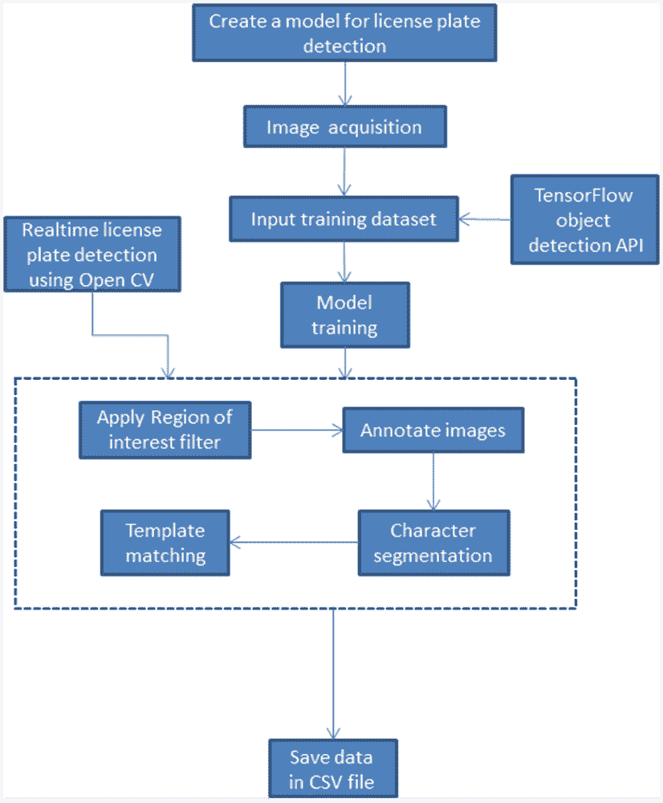 |

| 图 2. 车牌数据集示例 |
| --- |
|  |

| 图 3. 车牌检测的阶段 |
| --- |
| 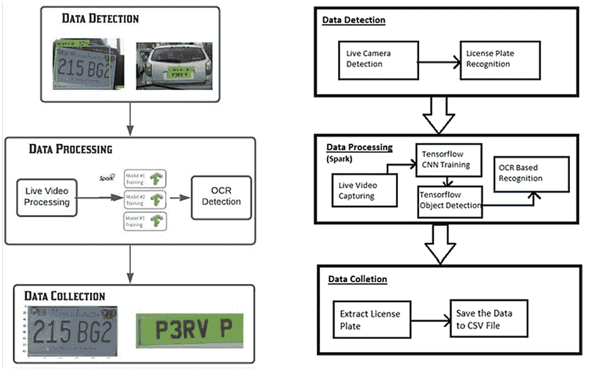 |

### 结果

为了执行车牌识别，使用了以下技术：`PySpark`、`Tensorflow`、`OpenCV` 和 `OCR` 检测。通过对相关对象应用边界框来完成标签映射。训练过程包括训练现有的对象检测模型。对于车牌的实时检测，使用了 `Open CV`。

图像被识别后，对其应用感兴趣区域过滤器，并将其表示为二值掩码图像。然后，在检测到的图像上进行字符分割过程，随后进行模板匹配。最佳匹配的索引被存储为识别出的字符。

有许多其他技术可用于结合 `Apache Spark` 应用 `OCR` 技术：通过 `PyTesseract` 利用 `Tesseract-OCR` 是常用的可用技术之一。但 `PyTesseract` 存在许多局限性。`Tesseract` 的精度不如使用 `tensor flow` 的 `OCR`。`Teserract` 有时会返回假阳性，而这在 `PySpark` 中不会发生。它不擅长分析文档的标准阅读顺序。它可能无法识别包含两列的文档，并可能会尝试跨两列连接文本。`Tesseract` 对于经过某些修改的图像（复杂或模糊的背景、线条、部分遮挡、畸变等）效果并不好。`Tesseract` 需要一张清晰的图像来检测文本，这就是 `OpenCV` 发挥重要作用的地方，因为它对图像执行操作，如将彩色图像转换为二值图像、调整图像对比度、边缘检测等。

| 图 4. 车牌检测到文本转换 |
| --- |
| 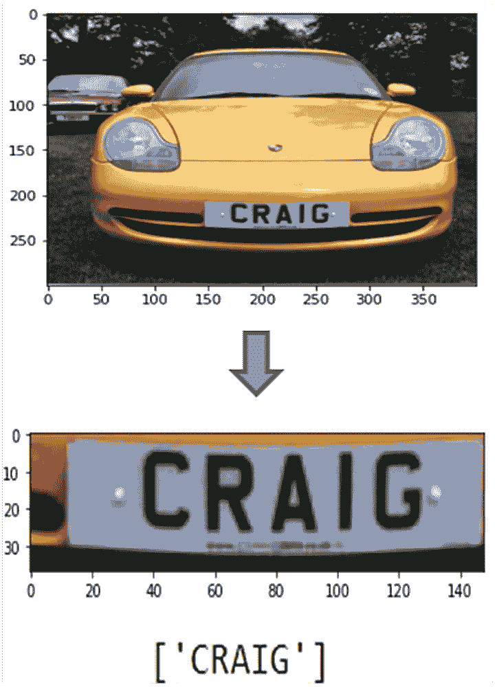 |

| 图 5. 车牌检测到文本转换 |
| --- |
| 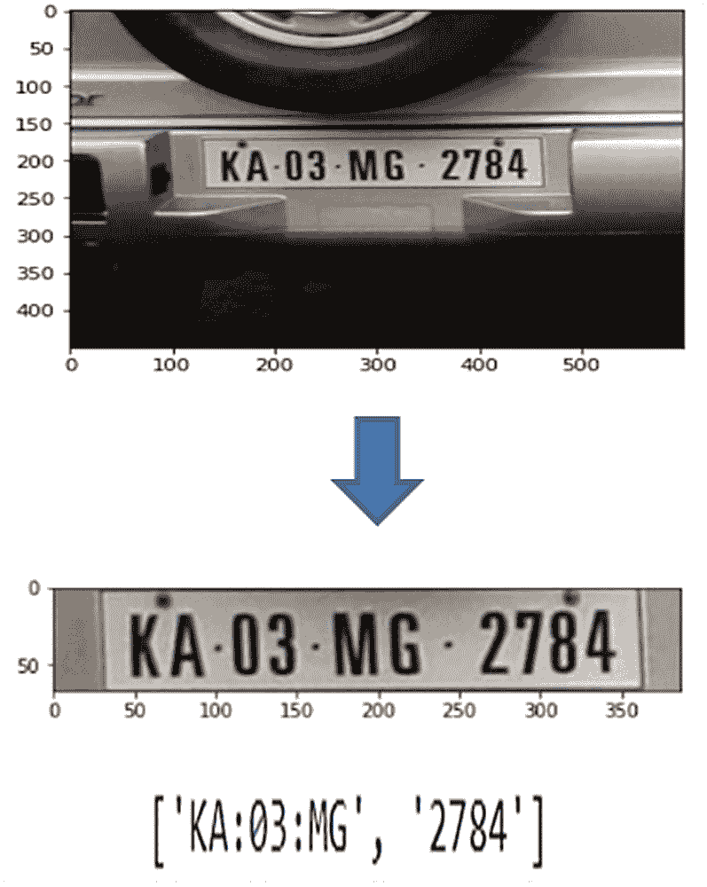 |

### 结论

在本文提出了一种使用 `PySpark`、`Tensorflow`、`OpenCV` 和 `OCR` 检测来检测和识别车牌的系统。通过对相关对象应用边界框来完成标签映射。训练过程包括训练现有的对象检测模型。对于车牌的实时检测，使用了 `Open CV`。图像被识别后，对其应用感兴趣区域过滤器，并将其表示为二值掩码图像。然后，在检测到的图像上进行字符分割过程，随后进行模板匹配。最佳匹配的索引被存储为识别出的字符。有许多其他技术可用于结合 `Apache Spark` 应用 `OCR` 技术：通过 `PyTesseract` 利用 `Tesseract-OCR` 是常用的可用技术之一。但 `PyTesseract` 存在许多局限性。`Tesseract` 的精度不如使用 `tensor flow` 的 `OCR`。`Teserract` 有时会返回假阳性，而这在 `PySpark` 中不会发生。它不擅长分析文档的标准阅读顺序。它可能无法识别包含两列的文档，并可能会尝试跨两列连接文本。`Tesseract` 对于经过某些修改的图像（复杂或模糊的背景、线条、部分遮挡、畸变等）效果并不好。`Tesseract` 需要一张清晰的图像来检测文本，这就是 `OpenCV` 发挥重要作用的地方，因为它对图像执行操作，如将彩色图像转换为二值图像、调整图像对比度、边缘检测等。

### 参考文献

- Dalal, H., & Triggs, B. (2005). Histograms of oriented gradients. `IEEE Conference on Computer Vision (CVPR)`, pp. 886-893.
- Dean, J., & Segal, M. (2013). Scalable object detection using deep neural networks. `International Conference on Computer Vision Research (CVPR)`, pp. 1814-1821.
- Erhan, D., Szegedy, C., Toshev, A., & Anguelov, D. (2014). Rich feature hierarchies for accurate object detection. `IEEE Conference on Computer Vision and Pattern Recognition`, pp. 580-587.
- Felzenszwal, P., Donahue, J., Darrell, T., & Malik, J. (2010). Discriminatively trained part-based models. `IEEE Transactions on Pattern Analysis and Machine Intelligence`, 32(9), 1627–1645.
- Girshick, R., Donahue, J., & Malik, T. (2014). Deep features for semantic segmentation. `IEEE Conference on Computer Vision and Pattern Recognition`.


- Karwal, H., & Girdhar, A. (2015). Vehicle plate detection system for Indian vehicles. `IEEE International Conference on Computational Intelligence & Communication Technology (CICT)`, pp. 8-12.

- Kashyap, A., Suresh, B., Patil, A., & Sharma, S. (2018). Automatic number plate recognition. `International Conference on Advances in Computing, Communication Control and Networking (ICACCCN)`, pp. 838-843.

- Kulkarni, Y., Bodkhe, S., & Kamthe, A. (2018). Automatic number plate recognition for motorcyclists riding without helmet. `International Conference on Current Trends towards Converging Technologies (ICCTCT)`, pp. 1-6.

- Madhumitha, M., & Dhivya, P. (2020). Vehicle recognition and compilation in database software. `International Conference on System, Computation, Automation and Networking (ICSCAN)`, pp. 1-5.

- Palekar, R., Parab, S., Parikh, D., & Kamble, V. N. (2017). Real time license plate detection using openCV and tesseract. `International Conference on Communication and Signal Processing (ICCSP)`, pp. 2111-2115.

- Puranic, A., K, D., & V, U. (2016). Vehicle Number Plate Recognition System: A literature review and implementation using template matching. `International Journal of Computers and Applications`, 134(1), 12–16.

- Rafique, M. I. S. & Habib, H. A. (2009). 用于收费站口监控与审计系统的空间不变性车辆识别. 多主题会议 INMIC 第 13 次国际会议，pp. 1-6.

- Balaji, G. N., & Rajesh, D. (2017). 使用改进分割方法的适用于不同国家的智能车牌检测系统. 帝国跨学科研究期刊 (IJIR)。

- RedmonJ.DivvalaS.GirshickR.FarhadiA. (2016). 你只需看一眼：统一的实时的目标检测. IEEE 计算机视觉与模式识别会议 (CVPR)，pp. 779-788, 10.1109/CVPR.2016.91

- Ren, S., He, K., Girshick, R., & Sun, J. (2017, 6 月 1 日). Faster R-CNN：迈向区域提议网络的实时目标检测. IEEE 模式分析与机器智能事务, 39(6), 1137–1149. doi:10.1109/TPAMI.2016.2577031

- ShariffM. A. S.BhatiaR.KumaR.JhaS. (2021). 使用 Python 和 Open CV 进行车牌检测. 进进阶计算与工程创新技术国际会议 (ICACITE)，pp. 525-529, 10.1109/ICACITE51222.2021.9404556

- SinghJ.BhushanB. (2019). 使用深度神经网络和基于 LSTM Tesseract 的光学字符识别进行实时印度车牌检测. 国际计算、通信与智能系统国际会议 (ICCCIS)，pp. 347-352, 10.1109/ICCCIS48478.2019.8974469

- SunH.FuM.AbdussalamA.HuangZ.SunS.WangW. (2018). 基于 YOLO 检测器和 CRNN-12 的车牌检测与识别. 信号与信息处理、网络与计算机国际会议 ICSINC，pp 66-74

- Zhai, X., & Bensaali, F. (2013). FPGA 上标准定义的 ANPR 系统以及将其扩展到 HD 的方法. IEEE GCC 会议与展览，pp. 214. 10.1109/IEEEGCC.2013.6705778

- EBSCOhost - 于 2023/6/21 下午 3:47 打印。所有使用均遵守 `https://www.ebsco.com/terms-of-use`

## 第 2 章

Murat Pasa Uysal


土耳其，Baskent 大学

### 摘要

人们对机器学习（`ML`）应用可能提供的效益存在高估。最近的研究报告了 `ML` 项目的失败、投资回报率不足或不尽人意的结果。软件工程的挑战、业务与 IT 的对齐、业务流程、数据、应用和基础设施的整体管理可能是某些原因。然而，作者认为，`ML` 应用与企业组件的集成是一个经常被忽视的严重问题。因此，本研究的主要论点是，企业集成模型对于 `ML` 驱动系统的长期效益和可持续性至关重要。在本研究中，作者利用企业架构方法和工具，为 `ML` 驱动的业务系统开发了一种企业集成方法。最后应用了该方法。

### 引言

人工智能（`AI`）的普及带来了新的模型并提供了解决方案。作为 `AI` 的子领域，机器学习（`ML`）的实施对企业产生了巨大影响。然而，最近的研究报告了 `ML` 项目的失败、投资回报率不足或不尽人意的结果。对 `ML` 应用可能提供的效益存在高估。因此，在开发或维护 `ML` 驱动系统时，`ML` 应用与企业组件的集成是一个经常被忽视的严重问题。企业集成模型对于 `ML` 驱动系统的长期效益和可持续性至关重要。

业务与 IT 对齐的一个重要挑战是业务流程、数据、企业应用和基础设施的整体集成管理。然而，对于 `ML` 应用与企业组件集成所需的策略往往被忽视了。在工业、金融和医疗保健等领域可以看到 `ML` 的各种示例。从不同学科的角度看，这涉及系统工程（`SyE`）、计算机科学（`CS`）、数据科学（`DS`）和软件工程（`SE`）。

从历史角度来看，`ML` 可能被认为处于 `SE` 的早期阶段。因此，需求的分析与规范、利益相关者期望管理、准确估计、有效测试用例的设计以及配置管理可能是主要的 `SE` 挑战。此外，`SE` 模块和 `ML` 模块以各种方式交织在一起，因此集成模块的开发通常比传统的 `SE` 模块更困难。因此，需要将 `ML` 工作流管理集成到 `SE` 实践中。`SE` 基础设施与 `ML` 过程的集成也能加速 `ML` 实验。

大多数研究和工业应用都在特定领域（如 IT、软件、金融、工业生产、医疗保健、电子商务等）探索 `ML`。然而，它们无法规定 `ML` 应用与业务领域其他组件的无缝集成。

针对机器学习（`ML`）的特定厂商参考架构较少（Google, 2021）。然而，它们在为实现 `ML` 应用的组织效益提供整体且整合的方案方面仍有很大差距。因此，我们认为这些集成问题需要一门相对新学科的支持：工业信息集成工程（`IIIE`）（Roode, 2005; Raffai, 2007）。Xu (2015)提供了 `IIIE` 的技术和工程基础以及其跨学科结构。因此，企业系统需要采用战略方法和集成框架，例如企业架构（`EA`）。因此，企业架构在设计、实施或评估信息系统时可以满足各种业务利益相关者的集成需求（Uysal, 2021c）。

Chen (2016)展示了 2006 年至 2015 年的研究结果。物联网（`IoT`）、业务系统的互操作性以及各种集成技术是核心研究课题。根据该研究报告，业务系统面临两个重要的集成挑战：第一是在解决广泛的技术和组织问题的同时，兼顾所有利益相关者的考量；其次是为 `ML` 应用建立整体的业务和企业视角。因此，该研究的主要论点是：企业集成模型的设计和维护对于 `ML` 驱动业务系统的长期组织效益、运营和可持续性至关重要。换句话之，我们需要采用 `IIIE` 的原则并使用其指南。关于 `ML` 的研究涉及许多问题，然而，从企业集成角度探索业务系统和 `ML` 的研究要少得多。因此，本章为 `ML` 驱动的业务系统提出了一种企业集成方法。本章后续部分分别组织为背景、重点、解决方案与建议、未来研究方向以及结论部分。

# 背景

## 业务系统与模型

系统的概念可以定义为由部分组成的整体。尽管这个定义可能随学科而变化，但系统科学探索的是不特定于某一学科的系统、特征和属性。例如，一种系统的定义采用了基于技术的方法，它强调了某些不被任何部分共享或具备的功能；另一种方法强调了系统元素的结合及其相互作用与连接。Lin et al. (2012) 给出了更全面的定义：“系统是一个有机整体，由某些元素及其相互作用组成，具有特定的结构和功能”。因此，系统是组件或元素的集合，为了一个共同目的而组织在一起的。在相同的语境下，业务系统可以是一个组织、公司或企业，拥有一系列增值流程、服务、技术和资源，用于生产和供应货物或提供服务。

模型是系统、对象或现象的抽象、物理或概念表示。模型帮助人们理解其所代表的主体，并制定或设计针对某个问题的解决方案。在相同的范围内，业务模型（`BM`）可能有两个核心功能：第一，表达对人员、业务流程和服务的期望；第二，帮助经理或决策者理解并沟通业务策略、实施及相关问题（Nielsen, 2019）。根据业务视角的不同，业务模型的定义可以分为几类。例如，它们可以被视为一种连接流程、服务、资源和人的工具，以确保公司长期盈利。根据 Timmers (1998) 和 Weill and Vitale (2001)，业务模型代表产品、服务、信息流和收入来源的架构，它们关注业务参与者以及其之间的实体和无形流。Chesbrough (2007)、Skarzynski and Gibson (2008) 以及 Zott and Amit (2008) 侧重于价值创造。因此，作为连接想法的有用工具，“业务模型是识别公司如何创造、交付和提取价值的概念框架。它通常包含一整套集成组件，所有组件都可以被审视”。

关于业务模型的文献综述提供了多种发现。Budler et al. (2021) 展示了文献计量学分析的结果。他们探索了业务模型随时间的演变，发现主要的业务领域是战略、创业和创新。价值网络、工业 4.0 和可持续性为增加业务模型的互联性提供了各种机会。从创新的角度来看，业务模型创新（`BMI`）被定义为现有业务模型的激进变革。因此，Zhang et al. (2021) 探索了 `BMI` 及其前因与公司绩效之间的关系。相应的，内部（管理认知、内部资源、能力和组织特征）与外部（市场机会、情境因素、价值网络和技术创新）前因之间显著相关。

在可持续性和循环经济方面，已经积累了大量的知识。例如，Geissdoerfer et al. (2020) 循环业务模型（`CBM`）和循环 `BMI` 的历史、概念基础和框架。循环、延伸、强化、减量和是主要的循环业务模型策略，模型概念大多基于价值链概念。Rosa 等人（2019）识别了五种 `CBM` 类型和九种分类方法，以及五个面向采用的挑战和四个决策支持工具。在相同的语境下，Reis et al. (2021) 提供了主流和新兴能源社区业务模型的视角，并关注业务模型之间的主要差异、其优势和障碍。最后，Vaio et al. (2020) 探索了人工智能在构建可持续业务模型和发展目标中的作用。他们发现创新挑战涉及伦理、社会、经济和法律方面，然而他们仍然建议使用 `AI` 来开发可持续业务模型（`SBM`）。如今，`ML` 驱动或支持的系统已用于各种目的（分类、回归和聚类），涵盖金融、电子商务、生产、农业、零售、医疗保健等领域。因此，机器学习是创造价值的重要手段，也是获得或提升竞争优势的重要手段（Wodecki. 2019）。

“大数据”是指大型复杂数据集的集合。多样性（数据的种类和类型）、体量（数据的大小）和速度（数据的生成速度）被视为主要的特征属性。由于使用传统的方法、工具和技术很难对大数据进行处理和分析，数据科学（`DS`）从数据管理和统计学学科演变而来(Cielen et al. 2016)。当数据量、速度和多样性增加时，这种情况甚至会变得更加恶化且变得棘手。数据可能是结构化的、非结构化的或机器生成的，也可能以视频、音频或图像的形式存在。在此背景下，机器学习（`ML`）作为人工智能的子领域被定义为“赋予计算机在无需显式编程的情况下学习的能力的研究领域(Samuel, 1959)”。在机器学习中，将适当的数据和算法结合形成一个学习模型，该模型通过依赖数据中的模式来学习执行任务。机器学习是多学科的，借用了计算机科学的一些技术，使用复杂的算法，并包含了构建预测模型的过程。因此，可以得出有意义的信息以做出更好的业务决策，并从提取的知识中推断出价值洞解。由于数据科学和机器学习密切相关，机器学习可以到数据科学项目的模型开发阶段。

在数据科学中，算法被用作一系列统计和数学数据处理步骤，用于对解决方案建模。但在机器学习中，该算法首先经过训练，以在海量训练数据中找到正确的特征或模式。接下来，训练后的模型（数据加算法）也代表问题的候选解决方案，用于基于测试数据进行预测或做出决策。随着模型性能的提高，预测和决策变得更加准确。因此，数据和匹配的算法共同构成一个必须拟合到解决方案空间模型。机器学习中的学习类型大致分为监督学习（`SL`）、无监督学习（`UL`）和强化学习（`RL`）。机器学习项目的主要阶段如下：

### 问题定义

首先，必须确定研究问题以及使用机器学习的理论依据。理解业务背景以及机器学习如何做出贡献对于项目的成功至关重要。因此，项目章程规定了目标、使命、项目范围、时间表、交付物、成功标准、数据源和风险。

### 数据获取

观察与研究问题相关的现实对象和现象是机器学习项目期间使用的数据。概念如事件、事实、测量值、单词、数字、图像以及离散实体的集合可能属于数据(Zheng and Casari, 2018)）。数据可以是从文本文件到数据库的不同形式，由在线或离线数据源提供。数据的每个部分都呈现了现实的一个方面，因此收集相关数据部分能够实现问题的全景。收集和处理大量数据对于模型的准确性也很重要。此外，完整性、准确性、及时性和一致性确保数据质量的其他核心标准。

### 数据处理

这一阶段包括数据处理，如数据准备、合并来自不同来源的数据、清洗和消除可能的错误、标记、转换和集成。这些过程是劳动密集型的，可能会占据项目的大部分时间，高达 80%。缺失值、数据输入错误、不可能值、冗余空格和离群值是必须消除的常见数据错误。缺失数据可以忽略或根据静态或统计分布进行插补。将数据转换为合适的形式可以简化数据建模。过多的特征（变量）会使数据处理难以管理，因为它们可能没有添加新信息或对建模没有贡献。在这种情况下，减少特征数量可能更好。数据处理的主要目的是将数据带到统一标准，因此数据越好，机器学习模型的运行就越好。机器学习项目的成功直接取决于数据质量。

### 特征工程

特征（变量）是原始数据的表示，它们可以是标量（数值）或标量的有序列表。特征在数据和模型之间起着中介作用。机器学习算法（模型）是数学公式，它们描述了数据各个方面之间的关系，并将数值相互联系起来。因此，特征工程（`FE`）或特征提取是一个从原始数据中探索最合适的特征，并使其能够建模、训练和测试过程的过程(Zheng and Casari, 2018)。嵌入、过滤和包装方法用于特征工程。嵌入方法用于模型训练过程中。过滤去除了对模型无用的特征。包装方法允许使用特征子集。当特征分散在各种数据源之间时，结合多个数据输入可能会提高机器学习模型的性能。特征工程可以是机器学习数据获取、数据处理或模型构建阶段的一部分。特征工程的过程可能复杂且耗时耗资源。因此，大部分时间花在数据处理和特征工程活动上。为了这个目的，可以使用机器学习流水线作为自动化机器学习工作流的方法，高效开发学习模型。机器学习流水线封装了多个连续步骤和特定组织的机器学习实践。它们对于维护多个学习模型并与软件应用程序集成至关重要。自动化机器学习流水线实现了机器学习开发中的自动化模型开发、测试、协作和协调。

### 探索性数据分析

进行探索性数据分析（`EDA`）过程是为了更好地理解研究数据。因此，统计分析和数据可视化其主要方法和技术(Muller and Massaron, 2015)）。数据分析师试图描述数据、寻求变量之间的关系并识别已知或未知的模式。结果通过图表、表格、图形和各种数据可视化技术进行报告。`EDA` 还需要形成研究假设、确定、开发和预测性评估模型。因此，`EDA` 为模型开发提供了方向，并有助于在随后的建模和分析过程中变得更有效(Mukhiya and Ahmed, 2020)。

### 模型训练与测试

机器学习模型是算法与适当数据的组合。机器学习模型在训练和测试之后创建。该阶段的主要目的是使用、设计或构建模型，为研究问题开发最佳解决方案。因此，模型应该是正确、可解释且适用的，并尽可能精确地表示问题和解决方案领域。建模是一个迭代过程，包括选择将输入数据映射到目标数据的合适算法、模型执行、比较和结果评估。复杂的研究问题可能需要链接多个模型。在这种情况下，一个模型的输出变成另一个模型的输入，这被定义为集成学习。


如前所述，`SL`、`UL` 和 `RL` 是机器学习（ML）中主要的学习方法（Muller and Guido, 2017）。当模型通过标记的训练数据进行学习以做出预测时，被称为 `SL`。这类似于学生在导师的指导下，通过输入输出对的示例进行学习。`k-Nearest Neighbor` (`k-NN`)、`回归`、`支持向量机`、`决策树`、`随机森林`、`朴素贝叶`和`神经网络`是主要的 `SL` 算法（Fenner 2020）。在 `UL` 中，机器学习模型在没有标签的情况下从数据中学习。其目的是识别输入数据的共同点，并确定模式、聚类或不同的群体。`UL` 也可以用于 `EDA` 过程，以更好地理解原始数据。`RL` 类似于通过试错进行学习。当模型通过实验给予负反馈或正反馈从标记数据中学习时，就会发生。`RL` 的核心思想是通过与动态环境交互进行学习（Sutton and Barto, 2015）。在训练过程中可以使用 `Python`、`R`、`Java` 和 `C++` 等编程语言。

## 模型验证与评估

模型验证和评估过程通过使用定量和定性的方法与技术来实现。定性方法强调机器学习的生命周期，而定量方法则侧重于数据和学习模型（Zheng, 2015）。一个机器学习模型应该具有良好的预测能力，并对未见数据具有良好的泛化能力。`过拟合`和`欠拟合`是 `SL` 过程中两种常见的建模错误。`欠拟合`发生在模型过于简单，无法检测数据的所有方面。另一方面，`过拟合`发生在模型过于复杂，导致算法通过记忆训练数据学习了过多信息，然而其在测试数据上的表现较低。针对分类、回归和聚类的不同机器学习模型也有不同的性能指标或评价指标。例如，`均方根误差`是回归任务中最常用的评估指标。`准确率`、`精确率-召回率`、`混淆矩阵`、`曲线下面积`和`对数损失`指标用于分类任务。测试使用独立的、未使用的数据进行。`留出策略`基于在较大部分数据上进行训练，同时使用较小的随机留出的数据集进行验证。另一方面，`交叉验证策略`将数据分成若干部分，并将每部分轮流一次作为测试数据，而其余部分用作训练数据。

## 企业架构

“企业”被定义为具有共同目标的组织集合（TOGAF, 2018）。它可能是公司的一个部门、整个公司、一个政府机构、一个部门或通过共同所有权连接的组织。`ISO/IEC/IEEE 42010` 将“架构”定义为“系统在其环境中体现于元素、关系以及设计和演进原则中的基本概念或属性”。架构可能跨越企业内的各种系统和各种功能组。根据此背景，`TOGAF` 标准将 `EA` 定义为“组件的结构、它们相互之间的关系以及治理它们随时间推移的设计和演进的原则和指南”。根据 Lankhorst (2009)，`EA` 是“原则、方法和模型构成的连贯整体，用于企业组织结构、业务流程、信息系统和基础设施的设计与实现”。因此，`EAs` 通过使用描述企业各个方面并代表利益相关者不同视图的模型来实现组织对齐。

今天，众所周知，利用信息技术（`IT`）和数字化转型是实现业务成功和竞争优势的关键手段。`EAs` 可以通过为提升数字能力提供战略背景来响应不断变化的业务环境，从而满足这些需求。`EA` 通过连接不同的企业知识领域并将信息汇聚，为企业提供了一个集成且整体的视图。此外，有效的 `EA 治理` 使得组织能够在业务/IT 运营效率与业务/IT 转型之间建立平衡。`EA` 设计和开发有不同的框架，例如 Zachman (2008)、DoDAF (2010)、TOGAF (2018)等。它们提供了指南、方法和技术，同时为 `EA` 设计和开发呈现了概念、定义和基础。在管理学科方面，`EAs` 应该在某些领域建立能力，如 `IT 管理`、服务管理、性能管理、财务和资源管理、风险和质量管理。`EAs` 还包括以下优势：

*   有效的数据、信息、流程和技术集成，
*   主动的控制、监控和管理，
*   通过监控、测量、评估和响应变化来进行利益相关者管理和价值创造，
*   提高透明度和问责制，
*   可控的风险管理，
*   最大化利用现有 EA 组件，
*   改进业务流程性能和运营，
*   提高用户生产力，
*   提高可移植性和可扩展性，
*   提高互操作性，
*   提高安全性，
*   降低成本。

## 开放体系架构 (TOGAF)

`TOGAF` 标准是一个开放且基础的行业框架。它为任何类型的 `EA` 设计和开发提供了指南、方法和工具。其主文档由各个部分组成，如架构开发方法 (`ADM`)、`ADM 指南与技术`、架构内容框架、`企业连续体与工具`以及架构能力框架。`TOGAF` 支持四个架构领域：业务架构、数据架构、应用架构、技术和基础设施架构。`ADM` 是一个可重复、迭代和循环的 EA 开发过程，实现了架构内容及其过渡和治理。`准备阶段`、`架构愿景`、`业务架构`、`信息系统`、`技术架构`、`机会与解决方案`、`迁移规划`、`实施治理`和`架构变更管理`是 `ADM` 的主要阶段。由于架构开发是一个循环持续的过程，下文案例所示，这些步骤针对目标架构被反复执行。适配本研究的 `ADM` 步骤如下：

*   步骤 1：定义业务战略、驱动、目标和原则，
*   步骤 2：选择参考模型、视图和工具，
*   步骤 3：开发现状架构描述，
*   步骤 4：开发目标架构描述，
*   步骤 5：执行差异分析，
*   步骤 6：定义候选路线图组件，
*   步骤 7：解决跨架构景观的影响，
*   步骤 8：进行正式利益相关者评审，
*   步骤 9：定稿并创建架构定义文档。

## 需求分析与规范

目标企业架构（EA）的需求分析与规范通常是初始过程。目标 EA 代表了基线 EA 的最终状态和未来描述。确定 EA 的范围和广度是一项重要挑战。因此，一个完整的 EA 可能预期涵盖所有领域（业务、数据、应用和技术）；然而，全包或企业范围的架构可能过于复杂且耗资源。在这种情况下，建议关注某个特定部门或特定的企业领域。还应特别注意 EA 的深度和适当的层级。为了实用和简单，该层级的相关性取决于其在包含所需细节的同时，排除不必要的组件的程度。将 EA 设计为架构的联邦也可以是另一种选择，但此时，它将为集成过程、一致性和维护带来额外的挑战。

目标架构代表了 EA 项目的成果、主要目标以及利益相关者对功能性和非功能性需求的关注。基础架构由指导性原则、模式以及通用且即用的架构解决方案组成。因此，架构师在开发目标架构时，可以使用基础架构、通用系统架构，或特定组织的架构。另一个选择是使用特定行业的架构；然而，它们在系统功能和企业架构需求方面仍然是不完整的。通过进行差距分析来识别当前 EA 与目标 EA 之间的差异。分析结果对于确定过渡架构至关重要，过渡架构根据初步阶段和愿景阶段的架构描述描述了增量。过渡架构本质上是演进的，因此它们趋向于目标 EA。如果项目需要大规模转型，建议处理高优先级且符合项目范围的紧急问题。例如，初期可能重点关注信息系统、数据和应用架构。

数据架构说明了数据如何被创建、存储和传输。它主要由业务功能、过程和服务使用的数据对象组成。它包含了数据复杂性水平、数据迁移和集成需求以及数据交换所需的支持。因此，架构定义文档包含全部或部分逻辑和物理数据模型，以及概念图。应用架构领域层支持其上层，即业务架构层。企业应用如何运行以及它们如何处理运营和集成需求至关重要。TOGAF 标准建议使用图表，如业务图、数据流、用例、实现和迁移图。因此，企业架构师还可以考虑以下内容：(a) 创建应用列表作为组合；(b) 在需要时将复杂的应用分解为简单的应用；(c) 使用矩阵和地图等工具将企业应用架构与企业业务及数据架构联系起来。

EA 的变更和过渡管理是设计、开发和维护过程另一个关键成功因素。为了考虑基线架构与目标架构之间的差距，建立了包含架构路线图的迁移和实施计划。迁移计划展示了如何从基线和过渡 EA 转向目标 EA。所需的更改在过渡架构中被分组逻辑工作包。候选解决方案指示了目标 EA 对应层级的新架构的构建和规范。评估 EA 元素之间的依赖关系、估算成本和效益以及时间与资源需求，是确保符合目标 EA 的重要活动。因此，目标 EA 以系列 EA 过渡的形式被创建、部署和交付。这还对业务优先事项提供了反思，实现了预期效益的早期实现，并在实施过程中降低了可能的风险。

## 工业信息集成工程

架构是对系统结构的正式描述，由不同的组件、相互关系以及设计和开发过程的指南组成。另一方面，企业的概念被定义为具有共同目标、使命和目标的组织集合，旨在提供产品和服务。因此，EA 描述了组织结构、业务流程、信息系统、基础设施以及组织与其环境之间的关系（`Lankhorst, 2009`）。EA 的产物定义了企业流程、业务功能、信息流和数据架构的逻辑组织。企业集成（`EI`）的概念源于用于 EA 的方法和框架。EI 确保企业结构与组件之间的交互有助于实现企业的目标和目的。然而，EI 需要应用各种工程学科的工程知识，例如系统工程、工业工程、信息系统工程、管理学等。结果，一个全新的工程学科诞生了：工业信息集成工程（`IIIE`）。IIIE “是一套有助于促进工业信息集成过程的基础概念和技术”，它“包含了在为工业部门开发 IT 基础设施时解决复杂问题的方法，特别是在信息集成方面（`Xu, 2015`）（`Figure 1`）”。

| 图 1. 工业信息集成工程 |
| --- |
| 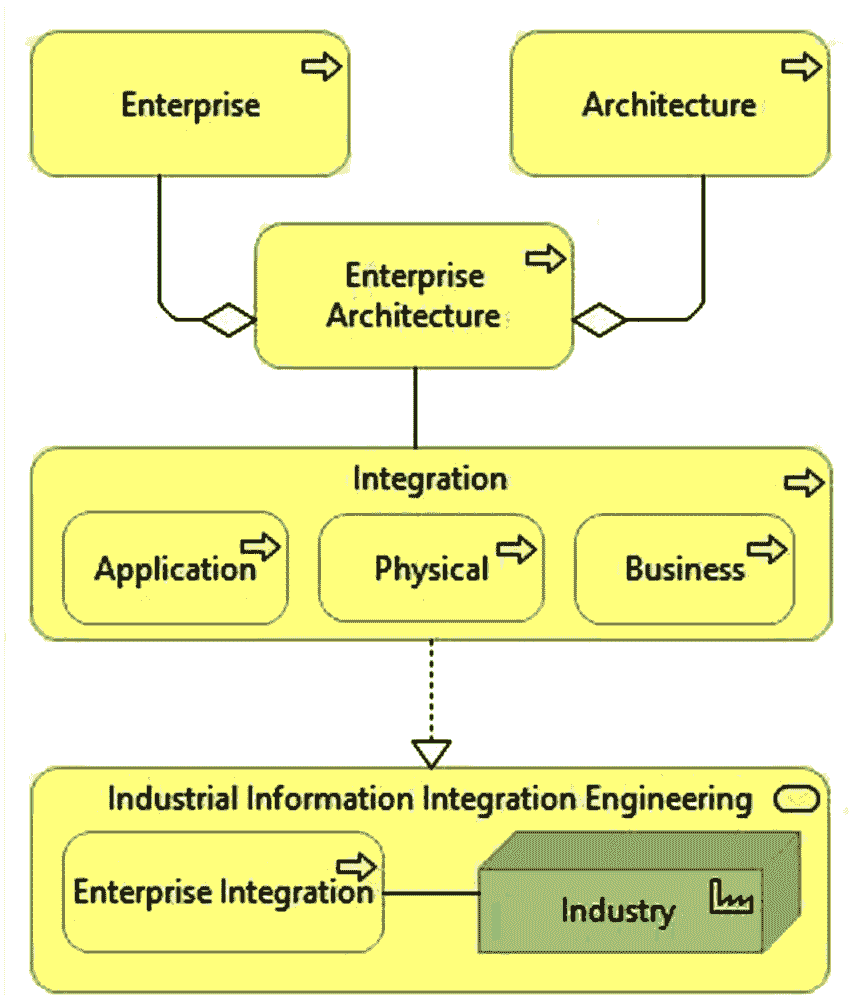 |

## 本章重点

本研究的目的是为 ML 驱动的在线购物系统提出一种方法和企业集成架构（`EIA`）。因此，这种方法将使我们能够处理 ML 系统的复杂性以及其与业务、应用和基础设施架构领域的集成。针对 ML 驱动的业务系统提出了一种分层、多维度和面向服务的集成方法。分层集成包括业务流程集成层、数据集成层、应用集成层和基础设施集成层。多维度集成视图包含水平和垂直集成活动，并形成了 `EI` 过程的范围。水平集成旨在企业内部的跨职合作，而垂直集成结合了不同集成层的过程、数据和交互。面向服务的架构（`SOA`）允许以 IT 服务的形式在不同层上定义和表示过程与功能。这种方法还可以为拥有异构系统的企业提供无缝集成和互操作性。最后，我们基于通用业务场景开发了 `EIA`。ArchiMate 语言规范（`Archimate 3.1, 2019`）、Archi IDE（`Archi, 2021`）、TOGAF 和 `ADM` 是设计和开发过程中使用的主要方法和工具。

## 业务场景

任何 `EA` 项目的成功取决于其与业务需求的关联紧密程度，以及对实现业务目标的支持程度。因此，针对 `ML` 驱动的业务系统的 `EIA` 案例研究以及设计与开发，取决于如下所示的通用业务场景：

## 业务问题

X 公司是一家电子商务零售商，拥有一套用于销售来自不同供应商不同产品的在线购物系统。它采用交易手续费的收入模式，因此，它从卖家处收取交易手续费。另一方面，信息和 Web 技术的最新发展使得低成本电子商务企业得以建立。结果，这种状况导致其所在细分市场的竞争者数量增加，因此在不久的将来实现盈利将面临困难。为了获得竞争优势和客户满意度，公司打算向其客户提供智能服务，如产品推荐、个性化、定制化和产品匹配。这些服务还将能够实现有效的客户细分以及各种财务预测。因此，公司决定逐渐将其电子商务系统转型为 `ML` 驱动的电子商务系统。然而，他们对于“做什么”和“怎么做”并不确定。最重要的是如何在不危及其当前业务环境、企业应用和技术基础设施的前提下，集成新的 `ML` 应用。

## 业务与技术环境

公司的电子商务模式是业务对客户 (`B2C`)，它拥有 IT 基础设施、服务器节点和应用程序。它还使用企业资源计划 (`ERP`) 应用以及其他企业应用来处理其业务流程。

## 业务与 IT 目标、目的和预期结果

该公司的业务和 IT 目标如下：

* 获得竞争优势，
* 通过个性化、定制化、产品匹配提高客户满意度，
* 提高盈利能力，
* 进行有效且更准确的财务预测，
* 提高业务流程性能和运营，
* 提高业务和 IT 管理性，
* 减少业务和 IT 风险，
* 维护当前 IT 应用和基础设施的效率和操作性，
* 降低长期 IT 成本。

如所示，公司还希望减少与 IT 所有权、IT 运营和维护成本相关的费用。因此，采用云计算的原则，如软件即服务 (`SaaS`)、平台即服务 (`PaaS`) 或基础设施即服务 (`IaaS`) 是合理的。

## 业务案例中的人类和计算机参与者

人类参与者包括客户、业务经理、业务管理团队、IT 经理和员工以及 `ML` 应用开发人员。主要的计算机参与者是支持在线购物系统的目标 `ML` 应用、公司的 `ERP` 和企业应用。

## 解决方案与建议

### 目标架构

X 公司的目标 `EIA` 包含五组逻辑上的 `EA` 组件，这些组件按 `EA` 层排列（图 2）：

*   业务元素、驱动因素、目标、原则和利益相关者：这一层包括公司的主要业务战略、业务驱动因素、电子商务模型元素和利益相关者。
*   `ML`-驱动的业务系统驱动因素、目标、原则和利益相关者：这一层包括 `ML` 相关的利益相关者、驱动因素和目标、IT 相关的驱动因素和目标、`SOA`、云原则和信息集成原则。
*   业务参与者、角色、接口、服务和流程：这一层包括业务参与者、角色和流程、IT 流程和服务、在线购物流程和服务。
*   企业应用、`ML` 实验过程和应用：这一层包括企业流程和应用、`ML` 实验、`ML` 流水过程和应用。
*   技术和基础设施：这一层包括系统服务器和节点、基础设施服务、通信网络和应用程序接口 (`API`)。

| 图 2. 目标 EIA |
| --- |
|  |

### 业务战略

#### 业务利益相关者、驱动因素、目标和原则

这一层的目的是为 `ML`-驱动的在线购物系统确定业务战略和相关的 `EA` 元素（图 3）。利益相关者、驱动因素、目标和原则是主要的激励 `EA` 元素。驱动因素是激励公司定义其目标并实施所需变更的内部或外部条件。业务经理、客户、IT 经理和员工构成了利益相关者。选择 X 公司的在线购物系统被定义为客户的主要驱动因素。个性化和定制化、产品交付的便利性以及产品搜索可能是客户的目标。盈利能力是业务经理的主要驱动因素，受增加销售和收取交易手续费等目标的影响。在电子商务模型方面，八个关键要素被采用公司履行使命的原则和规则。这些原则是价值主张、收入模式、市场机会、市场战略、竞争环境、竞争优势、组织发展和管理团队（Laudon and Traver, 2020）。然而，它们通常受到组织使命和计划、外部限制、当前系统和技术以及行业趋势的影响。

| 图 3. 业务战略、利益相关者、驱动因素、目标和原则 |
| --- |
|  |

#### ML 相关的利益相关者、驱动因素、目标和 EA 集成原则

确定与其相关的利益相关者、其驱动因素和关注点、目标以及原则，对于对齐业务战略、IT 战略和 `ML` 战略至关重要（图 4）。管理团队、`ML` 开发人员、公司的 IT 经理和应用开发人员是技术利益相关者。`ML` 流水、易于开发、质量和数据可用性是影响驱动 `ML` 过程的目标。另一方面，IT 服务是 IT 经理和应用开发人员的驱动因素，他们的主要目标是维护 IT 服务质量并确保 IT 运营的可用性和可持续性。八个关键电子商务要素是管理团队的驱动因素。ML 应用的目标是客户细分、产品推荐、欺诈检测、产品匹配、销售和财务预测以及个性化。

从企业架构（EA）原则来看，机器学习企业架构（ML EIA）的设计和开发原则应支持机器学习的业务目标。信息集成过程采用了多维度、分层和面向服务的架构（`SOA`）。分层集成通过业务流程集成层、数据集成层、应用集成层以及基础设施和技术集成层来实现。多维度集成包括垂直整合和水平整合，它界定了集成过程的范围。水平整合提供了跨职能协作；而垂直整合则实现了不同层之间流程、数据、应用和基础设施的集成。`SOA` 允许功能集成，使得异构业务系统和机器学习应用组件可以相互调用并使用上层或下层提供的服务。云计算原则也有巨大贡献。在软件即服务 (`SaaS`) 中，对存储、服务器、应用、操作和配置管理的控制权交给了第三方，例如 Amazon Web Services（Amazon 2021）和 Google Cloud Platform (Google, 2021)。对于平台即服务 (`PaaS`)，公司在一定程度上控制机器学习应用和数据的管理。然而，服务提供商仍然负责机器学习应用使用的数据存储、基础设施和操作系统。最后，基础设施即服务 (`IaaS`) 原则允许通过接口对数据存储、应用服务器管理以及访问机器学习应用基础设施进行控制。

| 图 4. 机器学习驱动的业务系统驱动因素、目标、原则和利益相关者 |
| --- |
| 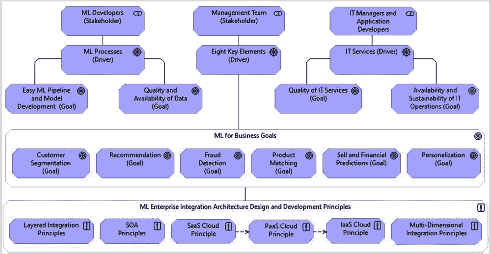 |

### 业务流程架构

该层包含了业务和 IT 流程、用户服务总线、接口和用户角色（图 5）。换句话说，业务和 IT 流程通过通过桌面和移动接口为用户服务的业务服务来实现。业务和 IT 流程由 ERP 和/或业务流程、在线购物流程和 IT 流程组成，这些流程通过信息流关系连接。用户服务总线包含了相应业务和 IT 流程实现的服务。

| 图 5. 参与者、角色、接口、服务和流程 |
| --- |
| 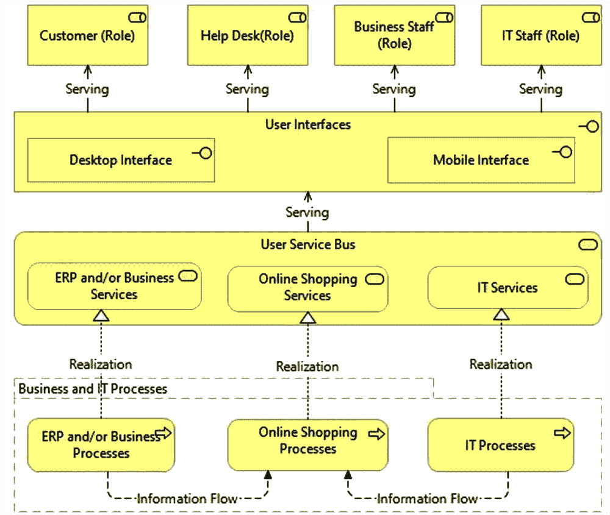 |

在线购物流程可能从某一个流程开始，例如查看商品、搜索商品、浏览商品或推荐商品。在决定商品并完成客户验证后，客户可以将搜索到的商品添加到购物车，并继续其购物或进行支付流程。可以通过信用卡或电转账进行支付（图 6）。

| 图 6. 在线购物流程 |
| --- |
| 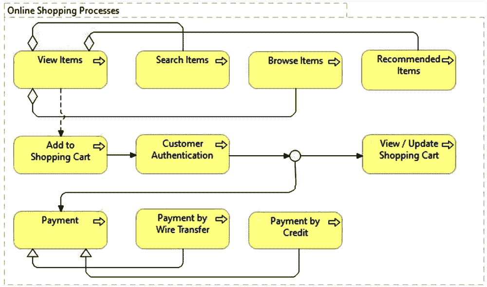 |

机器学习实验包括数据分析、数据验证、数据准备、模型训练、模型评估、模型验证和机器学习流水线部署流程。因此，这些过程被实现为支持在线购物流程的机器学习服务。业务和 IT 流程之间存在信息流（图 7）。


| 图 7. 机器学习实验流程 |
| --- |
| 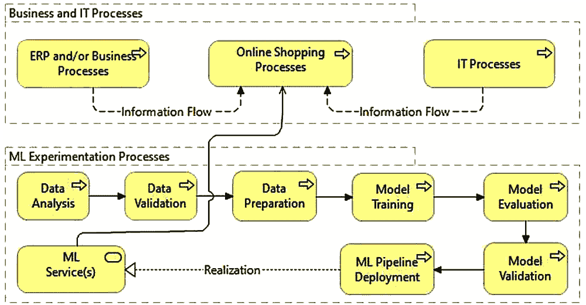 |
| --- |

如前，数据处理及其架构至关重要。因此，业务和在线购物数据经过准备后，被实现为同时用于机器学习应用及其实验过程的数据服务，如图 8 所示。

| --- |

### 应用架构

在这一层中，有两个主要的服务实现，它们协作形成企业应用服务总线，如图 9 所示 数据分析、(b) 数据验证、(c) 数据准备、(d) 模型训练、(e) 模型评估、(f) 模型验证、(g) 模型服务以及 (h) 模型性能监控。企业根据其组织结构、资源和 IT 策略使用 ERP 或不同的应用。因此，企业应用可能是：人力资源系统、财务和会计系统、客户关系管理系统、供应链管理系统、文档管理系统、Web 应用、移动应用以及数据库应用。

| 图 9. 应用架构 |
| --- |
| 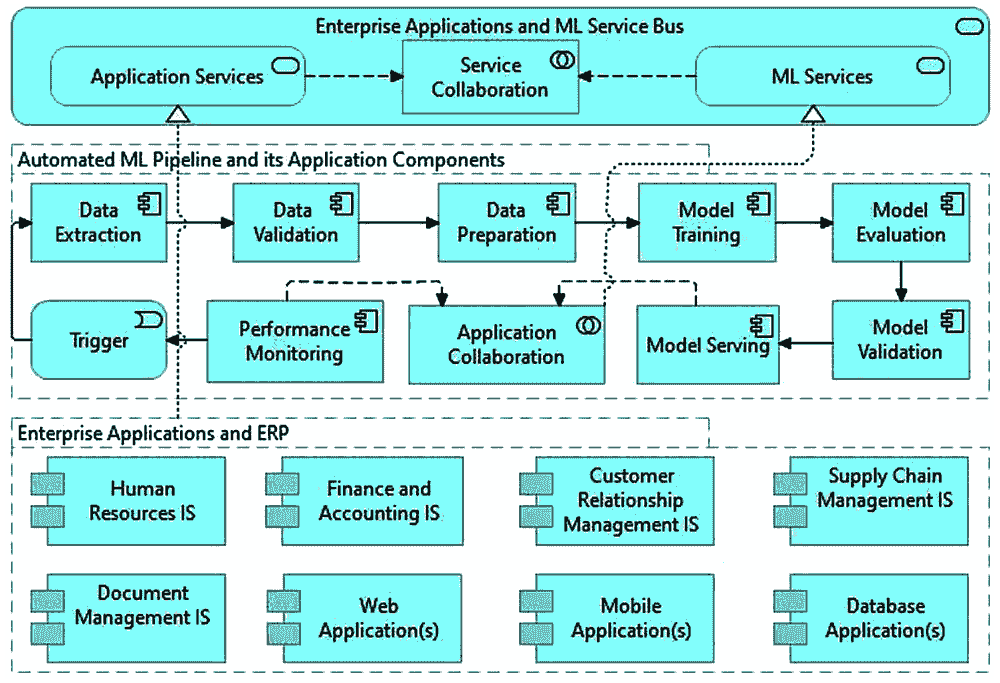 |
| --- |

### 技术和基础设施架构

如图 10 所示。

| --- |

### 未来研究方向

我们未来的工作将关注本研究的局限性以及以下课题：

- 解决本研究的局限性，即将所提方法应用于真实的工业案例研究，而非通用案例。
- 由于研究范围和局限性，未给出过渡期 EA。因此，未来的研究将更详细地关注过渡架构。
- 将所提方法应用于不同领域的系统，如工业生产系统、医疗信息系统和企业信息系统。
- 探索机器学习驱动系统的需求工程方法，例如目标导向的需求工程、基于价值的需求工程和基于场景的需求工程。
- 探索机器学习驱动系统的纠正性、适应性、完善性和预防性软件维护方法及技术的适用性、可行性和实用性。

## 结论

AI，特别是机器学习（ML），在学术界和工业界已变得非常流行。研究人员、从业者、IT 工程师和业务利益相关者对 ML 应用有各自的理解、观点和不同的期望。当考虑到 ML 应用的特性属性、内在复杂性和技术困难时，情况变得更加复杂，因此，这类系统的成功和可持续性变得更具挑战性。在这项研究中，我们回顾了相关文献，介绍了 ML 和企业架构（EA）的背景，提出了一种 EI 方法（集成方法），并将其应用于一个通用的在线购物业务案例中。重要的见解和主要结论如下：

- 对 ML 驱动的解决方案可能提供的收益存在过度估计。研究报告，ML 项目的投资回报率不足或结果不尽如意。
- 采用 ML 解决方案的业务系统面临高失败风险，并可能无法实现业务目标。
- 分析和规范需求以及满足利益相关者的期望是 ML 驱动业务系统面临的重要挑战。
- 采购或开发 ML 驱动系统的企业需要从定义其 AI 业务战略和愿景开始，然后规范其他需求。
- 对企业流程、数据、应用程序和基础设施进行整体和集成管理是一项挑战；然而，它经常被忽视。
- 技术的发展和 ML 领域的进步增加了维度和复杂性，这也导致了额外的集成问题。
- 自动化软件工程（SE）和 ML 流水线流程是软件和 ML 应用开发人员共同关注的问题。
- ML 驱动业务系统的开发和部署过程需要与系统开发和部署生命周期过程同步。因此，需要将 ML 工作流管理集成到软件工程实践中。
- 目前还没有什么工作能为不危及业务系统 IT 结构的情况下无缝集成 ML 应用提供指南。
- 针对 ML 的特定厂商参考架构仍无法提供整体且集成性的处方。因此，需要企业集成架构来确保 ML 驱动业务系统的长期收益和维护。
- 各种集成问题使得采用 IIIE（信息系统集成企业架构）原则变得必要。EA 知识领域可以帮助企业从 IIIE 的视角理解 ML 驱动系统的大局。
- IIIE、EA、云计算和 SOA 可以为想要采用 ML 应用的企业做出贡献。它们可以提供分阶段的过渡过程，同时确保企业系统的投资回报率和可维护性。

## REFERENCES 参考文献

- Amazon (2021). 训练 ML 模型。https://docs.aws.amazon.com
- Amershi, S., Begel, A., Bird, C., DeLine, R., Gall, H., Kamar, E., Nagappan, N., Nushi, B., & Zimmermann, T. (2019). 机器学习的软件工程：一个案例研究。Microsoft Research。https://www.microsoft.com
- Archi 4.9.1 (2021). 用于创建 ArchiMate 模型的开源工具包。https://www.archimatetool.com
- Archimate 3.1 (2019). 企业架构描述语言和集成开发环境。https://www.archimatetool.com
- Budler, M., Zupi, I., & Trkman, P. (2021). 业务模型研究的发展：文献计量学回顾。Journal of Business Research , 135, 480–495. doi:10.1016/j.jbusres.2021.06.045
- Chen, Y. (2016). 工业信息集成——2006–2015 年文献回顾。Journal of Industrial Information Integration , 2, 30–64.
- Chesbrough, H. (2007). 业务模型创新：不再仅仅关乎技术。Strategy and Leadership , 35(6), 12–17.
- Cielen, D., Meysman, A., & Ali, M. (2016). 引入数据科学：使用 Python 工具处理大数据、机器学习及更多内容。Manning Publications。
- DoDAF. (2010). DoDAF 架构框架版本 2.02。美国国防部。
- Fenner, M. E. (2020). 每个人的 Python 机器学习。Pearson Education。
- Geissdoerfer, M., Pieroni, M. P. P., Pigosso, D. C. A., & Soufani, K. (2020). 循环业务模型：回顾。Journal of Cleaner Production , 277, 123741.
- Giray, G. (2021). 机器学习机器学习系统的软件工程视角：现状与挑战。Journal of Systems and Software , 180, 1–35. doi:10.1016/j.jss.2021.111031
- Google Cloud. (2021). MLOps：机器学习中的持续交付和自动化流水线。https://cloud.google.com/architecture/mlops-continuous-delivery-and-automation-pipelines-in-machine-learning
- IshikawaF.YoshiokaN. (2019). 工程师如何感知机器学习系统工程中的困难？在 IEEE/ACM 第 6 届软件工程研究与工业实践国际研讨会论文集中。
- ISO/IEC/IEEE 42010 (2011). 系统和软件工程：架构描述，瑞士日内瓦。
- Kelly, J., & Kaskade, J. (2013). CIO 与大数据：你的 IT 团队想让你知道的，Infochimps, Inc.。http://www.infochimps.com
- Lankhorst, M. (2009). 工作中的企业架构：建模、通信与分析。Springer-Verlag Berlin Heidelberg.
- Laudon, K. C., & Traver, C. G. (2020). 电商：业务、技术、社会。Pearson。
- Lin, Y., Duan, X., Zhao, C., & Xu, L. D. (2012). 系统科学：方法论方法。CRC Press.
- Lwakatare, L. E., Raj, A., Crnkovic, I., Bosch, J., & Holmströ, J. (2020). 真实环境下的机器学习系统：回顾。Information and Software , 345(2), 1–17.
- Mukhiya, S., & Ahmed, U. (2020). Python 探索性数据分析实战。Packt Publishing。
- Muller, A. C., & Massaron, L. (2017). Python 机器学习入门。
- Muller, J. P., & Guido, S. (2015). Python 数据科学入门。O’Reilly Media.
- Saltz, J., Hotz, N., Wild, N., & Stirling, K. (2018). 探索数据科学团队使用的项目管理方法。
- Saltz, J., Shamshurin, I., & Crowston, K. (2017). 通过对照实验比较数据科学项目管理方法。
- Samuel, A. (1959). 使用国际象棋游戏进行的一些机器学习研究。IBM Journal of Research and Development , 3(3), 210–229.
- Skarzynski, P., & Gibson, R. (2008). 《创新的核心》. 哈佛商学院出版社。
- Sutton, R. S., & Barto, A. G. (2015). 《强化学习：导论》。麻理工出版社。
- Timmers, P. (1998). 电子市场的商业模型. 《电子市场》，8(2), 3–8. doi:10.1080/10196789800000016
- TOGAF. (2018). 《开放组架构框架第 9.2 版》. 开放组。
- Uysal, M. P. (2021a). 从敏捷视角看机器学习与数据科学项目管理：方法与挑战. 收于 Naidoo, V., & Verma, R. (编), 《敏捷项目管理的当代挑战》，(pp. 73–89). IGI Global.
- UysalM. P. (2021c), 通向机器学习赋型健康信息系统的集成架构. 收于 IFIP 工业信息集成国际会议论文集 (ICIIIE 2021), 美国弗吉尼亚州诺福克.
- Uysal, M. P., & Mergen, A. E. (2021b). 智能数字网中的智能制造：企业架构与软件产品线工程的集成. 《工业信息集成杂志》，23(1), 1–12. doi:10.1016/j.jii.2021.100202
- Vaio, A. D., Palladinoa, R., Hassan, R., & Escobar, O. (2020). 可持续发展目标视角下的人工智能与商业模型：系统文献综述. 《商业研究期刊》，121, 283–314. doi:10.1016/j.jbusres.2020.08.019
- Weill, P., & Vitale, M. R. (2001). 《从地点到空间：迁移到电子商务模型》. 哈佛商学院出版社。
- Wodecki, A. (2019). 《价值创造中的人工智能：提升竞争优势》. 普林格出版社. doi:10.1007/978-3-319-91596-8
- Xu, L. D. (2011). 企业系统：现状与未来趋势. 《IEEE 工业信息学汇》，7(4), 630–640.
- Xu, L. D. (2015). 《企业集成与信息架构：工业信息集成的系统视角》。CRS 出版社。
- Zachman, J. A. (2008). Zachman 框架的简明定义. https://www.zachman.com/about-the-Zachman-framework
- Zhang, H., Xiao, H., Wang, Y., Shareef, M. A., Akram, M. S., & Goraya, A. S. (2021). 商业模型创新的因素与结果整合：元分析综述. 《商业研究期刊》，131, 803–814. doi:10.1016/j.jbusres.2020.10.045
- Zheng, A., & Casari, A. (2018). 《机器学习特征工程》. O'Reilly 出版。
- Zott, C., & Amit, R. (2008). 产品市场策略与商业模型之间的匹配度：对企业绩效的影响. 《战略管理杂志》，29(1), 1–26. doi:10.1002/smj.642

## 核心术语与定义

- **算法 (Algorithm)**：一系列统计学和数学数据处理步骤。
- **模型 (Model)**：数据以及匹配的算法，代表对机器学习（ML）问题的候选解决方案。
- **训练 (Training)**：一种机器学习过程，其中学习算法将函数映射到训练数据。
- **机器学习 (Machine Learning)**：赋予计算机在无需显式编程的情况下学习能力的研究领域。
- **企业架构 (Enterprise Architecture)**：组件的结构、其相互关系，以及治理它们随时间设计和演变的原则和指南。
- **工业信息集成工程 (Industrial Information Integration Engineering)**：一门拥有一基础概念和技术的工程学科，旨在促进信息集成过程。

EBSCOhost - 打印于 2023/6/21 下午 3:47。所有使用受 `https://www.ebsco.com/terms-of-use` 制。

## 第 3 章

**Md Shamim Hossain**


孟加拉国 Hajee Mohammad Danesh 科学技术大学

### 摘要

在本研究中，作者采用了机器学习（ML）队列分析法来评估消费者对企业的投诉保留率。作者从消费者保护局网站获取了三年的数据。在剔除数据集中的缺失数据后，本研究还使用机器学习的队列分析方法评估了企业保留投诉率。结果显示，企业保留了大量的投诉。本研究通过创建和部署基于机器学习的方法，对投诉行为（CCB）的知识做出了贡献。

### 引言

类似于工业革命和 18 世纪的兴起，服务业在生产力提高方面似乎处于十字路口。几乎所有服务行业都将被更廉价、更快、更好的技术所变革（Hossain and Rahman, 2021; Wirtz et al., 2018; Wirtz and Zeithaml, 2018），例如人工智能（AI）的应用。基本上，人工智能正在以极快的速度改变数字营销技术（Mogaji et al., 2020）。在金融服务领域，人工智能被定义为一种系统，通过从物理或数字来源收集的数据评估实时服务情况，为复杂的问题提供定制化的建议、解决方案和方案（Xu et al., 2020）。机器学习（ML）是人工智能的一个子领域，涉及在大数据集中自动识别显著模式（Hossain and Rahman, 2022b; Pashchenko et al., 2022）。机器学习技术的目标是通过确保算法能够根据海量数据分析进行学习和适应使其更加高效。包括金融在内的许多行业将继续受到机器学习和无处不在的数据的影响（Hossain and Rahman, 2022a）。


根据营销哲学，消费者愉悦感的增长是营销实践和理论的生命线（Agag and Eid, 2020）。消费者寻求的是积极的体验而非产品（Hossain and Rahman, 2022b; Buonincontri et al., 2017）。因此，营销和销售方法侧重于提高客户满意度（Liu and Atuahene-Gima, 2018）。消费者满意度已被证明对公司层面的盈利能力、竞争优势和业务表现具有积极影响（Lee & How, 2019; Agag and Eid, 2020）。消费者反馈指标（如客户满意度、客户投诉、客户评价等）在关系营销过程中变得日益重要，因为它们可以预测客户留存和公司经营状况（例如，Hossain and Rahman, 2022b; Agag and Eid, 2020; De Haan et al., 2015）。增加客户反馈指标的营销努力通常对企业有益（De Haan et al., 2015; Venkatesan et al., 2019）。因此，企业越来越多地频繁进行客户反馈指标调查，以评估其营销有效性并确定适当的营销策略（De Haan et al., 2015; Agag and Eid, 2020）。作为一种客户反馈工具，投诉应该被公司发展的积极工具（Istanbulluoglu et al., 2017）。此外，客户投诉行为和管理对企业至关重要，特别是随着公司日益意识到建立长期客户关系的重要性（Bell and Luddington, 2006）。London (1980) 提到，客户的投诉是客户向负责的组织表达其不满的一种方式。消费者对消费参与中任何方面的不满的反应，这包括非行为性和行为性投诉（Istanbulluoglu et al., 2017）。从长期来看，留住现有客户比招募新客户成本低，因此解决不满意的原因至关重要（Rosenberg and Czepiel, 1984）。投诉可以帮助企业解决问题、提高其产品服务的质量，并将不快乐的消费者转化为快乐的消费者（Tax et al., 1998）。当消费者在投诉解决中看到公正和努力时，他们的消费者满意度和客户参与会在购买后提高（Cambra-Fierro et al., 2016）。此外，投诉管理方法可以保护企业免受负面口碑（WOM）的影响，保护其声誉，甚至产生正面的口碑和重复购买行为（Istanbulluoglu et al., 2017）。消费者投诉行为（CCB）涵盖了不满之后广泛的客户反应（Arora and Chakraborty, 2020）。此外，CCB 指客户尝试通过向商户或服务提供告知其不快来解决问题（Popelnuk et al., 2021; Berry et al., 2018）。消费者投诉是公司改进产品或服务的重要来源。如果公司的产品或服务未能满足预期，客户往往会感到不快。良好的投诉处理系统对于让客户投诉并寻求救济发挥着重要作用（Brennan et al., 2017）。根据消费者投诉理论（Crié, 2003），大多数不快乐的消费者会离开并向他人讲述他们的糟糕经历（Yang et al., 2018）。因此，客户投诉管理是客户关系的核心；它是将投诉转化为转型声音的最全面的工具（Kuster-Boluda et al., 2020）。

最终，互联网应用程序会积累大量的活动数据，这些数据与用户行为有关。为了提高销售并保证用户留存，此类活动数据经常被制成表格以提供见察。在这些巨大的活动记录表中，数据分析对群体分析或发现异常的用户行为感兴趣（Jiang et al., 2016）。群体分析是一种在分析之前将数据划分为相似组的行为分析方法。

在交互式新零售时代，服务平台正在快速发展。尽管服务平台让客户的购买变得更加便利（Rahman and Hossain, 2022; Hossain et al., 2018），但与传统的商业市场相比，由于缺乏法律支持且运营普遍缺乏标准化和不成熟，它们仍然面临着许多障碍。消费者投诉源于服务平台运营的缺陷（Yan et al., 2021）。消费者投诉的内容并不总是与投诉的对象完全匹配。他们会将商家的服务或产品问题归咎于平台本身以及商家自身，因此对两者都提出投诉。当平台的分销服务失败时，客户同样会对机构表示不满。投资消费者援助将帮助企业更好地理解客户关注的问题，并改进商品、服务和整体体验。客户的投诉总有积极的一面。现代企业理解投诉的重要性，并将其视为巨大的商业契机（Hsiao et al., 2016）。

根据 Day (1980)，消费者投诉行为（CCB）是由感知到的不满意引发的。消费者判断通常定义为个人对预期与实际结果之间差距的判断，其中客户预期未能得到理想满足会导致不满意（Kim et al., 2019）。客户投诉管理（CCM）是解决和记录客户关注的问题。企业不断改进客户关系管理（CRM），以处理客户投诉并制定补措施和建议（von Janda et al., 2021）。接收、管理和鼓励消费者投诉，以及对消费者做出回应，是机构 CRM 系统中固有的关键活动。因此，企业可能会使用多种平台鼓励客户强烈地表达他们的意见（Yang et al., 2018）。为了增强机构的 CCM 和 CRM 系统，理解投诉行为的某些方面（如投诉保留率等）非常重要。此外，根据大多数近期的消费者研究（Morgeson et al., 2020; von Janda et al., 2021; Popelnukha et al., 2021; Jeanpert et al., 2021），只有极少数不满意的消费者会提出投诉。如今，客户可以方便地在网络上提交投诉（Armstrong et al., 2021），因此计算消费者的投诉保留率对于更好地理解 CCB 至关重要。

目前的调查研究了 CFPB 的投诉数据集。此外，Ayres et al. (2013) 对 CFPB 的买家投诉进行了基于公司和基于邮政编码人口统计特征的先验项调查。在政府机构层面上研究 CFPB 数据时，Littwin (2015) 调查了一种相对于 Ayres et al. (2013) 的改进方法。值得注意的是，作者调查了 CFPB 的原因。她认为 CFPB 有三个理由：(1) 为机构建立声誉；(2) 确保消费者投诉得到解决；以及(3) 监管措施良好。

Bertsch et al. (2020) 开发了高质量的 CFPB 代理。此外，为了评估消费者投诉，Bastani et al. (2019) 提出了一种基于 `Latent Dirichlet Allocation` 的方法。他们的方法从 CFPB 投诉叙述中提取潜在主题。Hayes et al. (2021) 利用 CFPB 发现，对特定地方更高的信任程度与投诉数量的减少有关。他们还发现，在引入 CFPB 之后，低信任地区的银行减少的费用的比高信任地区的银行更多。

尽管 CFPB 的投诉数据已在多项研究中调查，尽管对 CCB 的兴趣日益增长，但投诉保留率很少受到关注。本研究的目标是展示如何利用行为分析来分析来自 CFPB 的文本数据。据作者所知，尚未发表过任何使用行为分析来分析消费者的早期研究。

## 消费者投诉行为 (CCB)

CCB 是一个宽泛的概念，涵盖了对不满意消费者体验的各种可能反应（Arora and Chakraborty, 2021; Istanbullu et al., 2017）。客户不满被定义为购买前预期与实际产品或服务性能之间的差距（Hu et al., 2019）。基本上，消费者投诉被视为不悦的情绪表现（Jung et al., 2017）。对服务提供者不满的客户会更换提供者、提出投诉并散发负面口碑（Bolton, 1998; Cheng et al., 2005; Berry et al., 2018）。此外，Ferguson and Johnston (2011) 描述了对服务或产品不满的客户如何通过提出投诉、退出交易关系、关于其感知散发负面口碑（WOM）以及/或维持交易关系来表达他们的不满。

Sing (1989) 将 `CCB` 描述为一种三维现象，由言语（直接与服务提供商交）、第三方投诉（口碑）和私人活动（采取法律行动）组成。Sing (1988) 发现投诉意图与实际投诉行为之间存在联系。在最近的消费者投诉调查中，这些方面已被区分离开来。在许多研究中（例如 Lacey, 2012; Fan et al., 2016），客户声音被用作客户投诉的替代指标。其他人则进一步指出，客户的负面声音（例如 Luo, 2007）是客户不满的表达，而客户的正面声音（如表达赞美并分享对服务和产品的极佳体验）则是（Min et al., 2019; Van Doorn et al., 2010）。根据认知评估理论，消费者对服务失败的解释会影响情绪反应（如愤怒），而情绪反应是客户投诉的关键预测因子（Min et al., 2019; Joireman et al., 2015）。

## 队列分析

队列分析是企业深层次理解消费者行为的一种常用方法。它为消费者行为提供了无价的洞察，我们可以利用这些洞察来制定成功的增长计划并增强决策能力。不同队列的消费趋势往往各不相同。出生在同一时代的人拥有许多共同的历史事件，同时也受到当时社会施加的许多可能限制（Gustavsen, 2014）。因此，队列分析对于基于时间段的决策至关重要。

许多研究已采用队列分析来估计随时间变化的留存率，但目前还没有关于消费者投诉或评论的队列分析研究。因此，我们在本小节将讨论在投诉以外领域采用队列分析的研究。队列分析是一种利用一系列统计工具研究群体成员变化的调查方法。它经常被用于社会医疗、科学、生态学和生物信息学等领域（Glenn, 2005）。队列调查通常是前瞻性进行的。感兴趣的队列根据专家的初始假设预定义（例如，识别暴露于某种药物和未暴露的的队列，并对人群特征进行不同的控制）。随后，随着时间的推移，获取这些队列成员的特定数据并进行评估，以发现有意义的关系。虽然这种方法可以产生非常有价值的信息，但此类前瞻性研究通常需要昂贵的数据收集活动，并需要长时间规划和执行（Zhang et al., 2014）。

Porta (2008) 提到在临床调查中，队列分析最流行的应用之一是检查风险因素。此外，Fanslow et al. (2021) 使用单一调查数据进行了出生队列分析，以评估不同年龄组的流行率。Cayuela et al. (2020) 检查了来自 `NCI`（美国癌症研究所）的 `age`（年龄）和 `death`（死亡）的影响。Gustavsen, 2014 为 `cohort`（队列）估计了 `intercepts`（截距）、`price`（价格）和 `elasticities`（弹性），并发现较老的 `cohorts` 的 `intercepts` 比较小的更大。为了深入理解 `CCB`，我们使用了 `cohort analysis` 来确定投诉率，因为只有少数不满的客户会发声 ([Morgeson et al., 2020]; Dowding et al., 2000)。

## EVL 理论

EVL 理论（Hirschman, 1970; Hult and Morgeson, 2020; Morgeson et al., 2020; Thompson, 2018）。古典经济学认为，当客户面对低质量产品或服务时，他们有买或不买的选择，市场的“看不见的手”（[Thompson, 2018]）会重新调整供给。在可以修复的失误情况下，退出、言语和忠诚理论提出了第三种选择——言语，它被用作退出不可行（通常是因为地理或可用性限制）时的补救，或者作为退出的替代方案（Hirschman, 1970）。

学者进一步扩展了 EVL 这一经典范式，将“忽视”纳入退出、言语、忠诚和忽视（EVLN）分类法中，因为忽视能更好地描述一种更被动的损害性关系行为，而这种行为也存在于伙伴关系中（例如 [Rai & Agarwal, 2019]; [Turnley and Feldman, 1999]; [Zagenczyk et al., 2015]）。当受委的人（例如在许多集体主义社会中）希望通过让关系被动恶化来避免关系冲突时，就会产生忽视。

## 假设开发

### 消费者投诉与投诉留存率

CCB（客户投诉行为）涉及消费者通过向商家或服务提供商投诉其不愉快经历，以解决其不快乐情绪的行为（Blodgett et al., 2018; Berry et al., 2018; Singh, 1988）。投诉的感知低成本（Chebat et al., 2005）、对投诉的积极感受（Thøgersen et al., 2009; Bodey & Grace, 2007）、自信水平的提高（Richins, 1982）以及感知的成功机会（Chebat et al., 2005）都是客户投诉行为公认的重要预测因子（Blodgett et al., 2018）。

根据 EVL（期望性违反）和 EVLN（期望性忽视）理论，只有少数不满的客户会表达他们的不满；其他人则保持沉默（Morgeson et al., 2020; Dowding et al., 2000）。根据 Hansen et al. (2010)，超过 55% 的不满消费者只偶尔投诉或从不投诉。这些发现与对（不）满意文献的早期综述一致，显示大多数不开心的消费者并不投诉（Berg et al., 2020; TARP, 1986）。其他研究（例如，Warland et al., 1975; Best and Andreasen, 1977; Day et al., 1981; Francken, 1983; Andreassen, 1999）发现，29% 到 68% 的受访者倾向于什么都不做也不投诉（Andreassen, 1999; Hansen et al., 2010）。结果，尽管过去几十年里消费者权利和权力有所提高，但大多数不满的客户似乎并不经常投诉。即使是对于以客户为中心的企业，并非所有不满的客户都认为投诉是一个现实的选择，因为驱动这一决策的因素之一是个人权力的长期缺乏（Popelnukha et al., 2021）。从上面的解释可以看出，显然只有一小部分客户会投诉。虽然没有研究能确定消费者的投诉留存率，但我们假设少数客户由于其内部的投诉行为会反复投诉。因此，本研究提出了以下假设。

* **H1**: 同一客户向机构的投诉留存率将更高。

## 方法

在数字时代，很少有机构收集消费者投诉数据。消费者金融保护局（CFPB）就是其中之一，它是一个负责金融消费者保护的美国联邦机构（Jung et al., 2017）。银行、证券公司、信贷联盟、抵押贷款业务、发薪贷款人、债务催收员、止赎救济服务以及在美国运营的其他货币企业都在 CFPB 的监督之下。自成立以来，消费者金融保护局通过利用数字工具跟踪金融机构如何利用社交媒体和程序来针对客户，“进入了二十一世纪”（Van Loo, 2018）。CFPB 的目标是通过使法规更有效、一致且公平地执行这些规则，并赋予人们更好地控制其财务生活，从而使消费者金融商品和服务市场为消费者服务。CFPB 的消费者投诉数据库是关于消费者金融商品服务的投诉汇编，该局已将这些投诉提交给企业寻求回复。在公司回答并核实与客户的业务关系后，或在 15 天后（以先发生者为准），投诉将被公布。消费者投诉数据库不公布提交给资产小于 100 亿美元存款机构的投诉。该数据库每天更新。

CFPB 的消费者投诉数据库是公开的，可以从其网站下载。它包含了从 2018 年 1 月到 2020 年 12 月 31 日期间提交的 209,327 条投诉，其中 175,932 条投诉得到了公司的回复。在公司回答并核实与客户的业务关系后，或在 15 天后（以先发生者为准），投诉将被公布。消费者投诉数据库不公布提交给资产小于 100 亿美元存款机构的投诉。该数据库每天更新。

（注：此处原文文本似乎存在部分重复和逻辑错乱，翻译已根据“不重复输出原文”的原则进行了整合与顺顺）

| 信用报告、信用修复服务或其他个人消费者报告 | 126 | 114 | 8 | 96 | 3073 | 221 | 30 | 104 | 210 | 116969 | 81855 |

| 债务催收 | 571 | 200 | 6 | 529 | 9255 | 1069 | 71 | 376 | 1114 | 16408 | 46238 |

| 资金转账、虚拟货币或货币服务 | 14 | 39 | 0 | 3 | 186 | 17 | 0 | 3 | 11 | 2062 | 8532 |

| 住房贷款 | 127 | 483 | 3 | 351 | 3810 | 419 | 102 | 20 | 153 | 11447 | 15773 |

| 发薪贷款、车押贷款或个人贷款 | 52 | 24 | 0 | 17 | 687 | 57 | 2 | 14 | 153 | 1271 | 4898 |

| 学生贷款 | 19 | 71 | 1 | 10 | 838 | 24 | 1 | 4 | 21 | 554 | 10479 |

| 车辆贷款或租赁 | 18 | 19 | 0 | 16 | 455 | 34 | 5 | 7 | 29 | 2750 | 6651 |

### 表 3. 按投诉总量排名的前 10 公司

| 公司 | 总投诉量 |

| :--- | --- |

| Experian Information Solutions Inc. | 54767 |

| EQUIFAX, INC. | 54222 |

| TRANSUNION INTERMEDIATE HOLDINGS, INC. | 50939 |

| CAPITAL ONE FINANCIAL CORPORATION | 12438 |

| CITIBANK, N.A. | 11327 |

| JPMORGAN CHASE & CO. | 11282 |

| BANK OF AMERICA, NATIONAL ASSOCIATION | 10390 |

| WELLS FARGO & COMPANY | 9493 |

| SYNCHRONY FINANCIAL | 7214 |

| Navient Solutions, LLC. | 6451 |

### 图 1. 三年内每月收到的投诉。

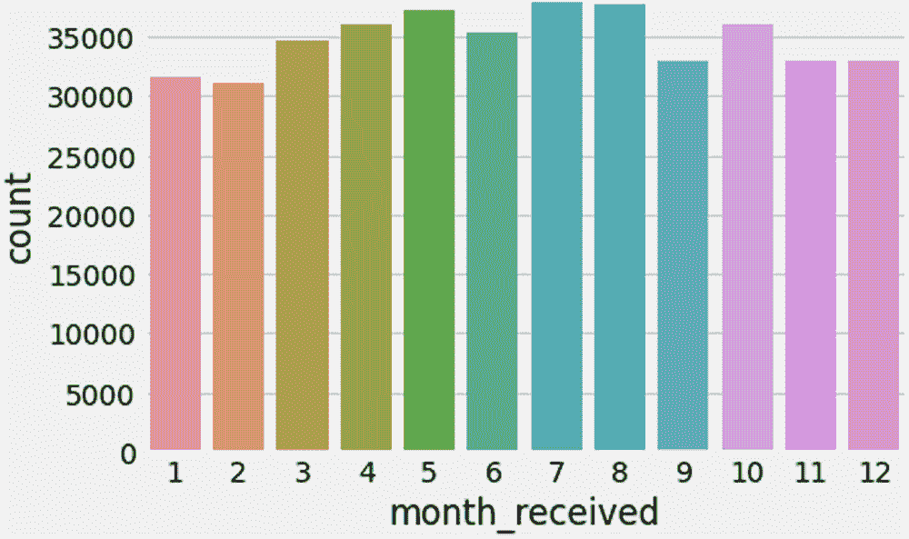


然后，作者使用 `Python` 和 `Seaborn` 通过事群分析计算了消费者对各公司投诉留存率的行为分析。本研究为事群分析创建了一个名为 `cohort index`（群体索引）的新列，该列基于接收客户投诉的日期和投诉 ID。首先，作者根据相同的投诉 ID 估算了首次投诉与后续投诉之间的日期差。结果，作者编写了一个 python 函数并用它从数据框中提取消费者投诉的年月份差异值。最后，使用以下公式，作者根据自首次投诉以来的年数月份为每条投诉创建了 `cohort index`。

 (1)

 (2)

 (3)

### 变量说明

* `CY` 首次投诉年份
* `CoY` 所选投诉年份
* `CM` 首次投诉的月份
* `CoM` 所选投诉的月份
* `YD` 首次投诉与所选投诉之间的年份差
* `MD` 首次投诉与所选投诉之间的月份差
* `CI` 群体索引

## 结果与讨论

### 事群分析

事群分析是一种随时间跟踪消费者活动的行为分析技术。它有助于观察用户参与度是随时间推移，还是仅仅由于业务扩张而看似增加。本研究评估了事群表中公司在 36 个月（三年）内的客户投诉留存率。第一列显示了每年每月的第一天。第二列显示了总投诉的比例，为 100%。基于这些信息，计算了留存的相同客户投诉比例。客户投诉响应的事群表（图 2）显示，大量相同客户在后续月份再次投诉。表格向右延伸的每一行代表公司的投诉留存率。

当前的研究在 `CCB` 领域也具有重大的理论意义。通过本研究，我们将对这些领域有更好的理解，因为研究揭示了客户投诉行为的最新见解，这对理论学科做出了重大贡献。

此外，根据 `EVL` 和 `EVLN` 理论，只有少数不满意的消费者会提出投诉，而研究结果显示，很大一部分相同的消费者在随后的几个月由于其内部的 `CCB` 再次提出了投诉。这揭示了少数消费者会不断投诉，而其他人则保持沉默。

此外，在社会科学文献中，利用机器学习算法来确定消费者投诉留存率尚不明确。本研究使用了无监督机器学习技术，通过 `ML` 的队列分析方法来评估客户投诉行为，以评估消费者对公司投诉留存行为的率，这可以成为营销学、心理学和消费者行为等社会科学理论领域值得的补充。

最后，尽管如此，虽然客户投诉和公司投诉管理不当导致的后果与公司本身一样悠久，但大多数营销人员认为，在当今竞争激烈的营销环境中，财务风险更高。信息和通信技术的应用的速度和灵活性增加了消费者投诉的负面风险，并强调了良好的业务投诉恢复的必要性。例如，社交媒体创造了一种客户的负面反馈经常被大幅放大的氛围。不满意的消费者可能会同时向公司以及可能存在的数百万其他利益利益者者投诉 (Morgeson et al., 2020)）。每家企业都必须意识到消费者在投诉时的行为 (Bell et al., 2004)）。研究显示，机器学习的队列分析法是解读投诉消费者行为最有效的方法。结果，该研究增强了 `CCB` 的理论领域。

## 局限性

虽然当前的研究关注 `CFPB` 的数据库，但它局限于特定的地理区域。有必要从更广泛的地区更多类型的文化收集更多数据。其次，尽管获得了清晰可靠的结果，但由于消费者的特性，将该研究应用到其他服务部门时必须谨慎。最后，根据当前的研究，部分不满意的客户可能会因为其内部的 `CCB` 向企业投诉。未来的研究可能会根据满意度水平（即：高、中、低）调查投诉消费者的的情绪。

## 参考文献

- Abdul Rahim, N., Ahmed, E., Sarkawi, M., Jaaffar, A., & Shamsuddin, J. (2019). Operational risk and customer complaints: The role of product complexity as a moderator. `Benchmarking`, 26(8), 2486–2513. doi:10.1108/BIJ-04-2018
- Agag, G., & Eid, R. (2020). Which consumer feedback metrics are the most valuable in driving consumer expenditure? A view from macroeconomic perspective. `Tourism Management`, 80, 10419. doi:10.1016/j.tourman.2020.10419
- Andreassen, T. W. (1999). What drives customer loyalty? `Journal of Service Research`, 1(4), 324–332. doi:10.1177/1094670599004
- Armstrong, C., Kulczynski, A., & Brennan, S. (2021). The complaint: The visual cues of Facebook pages and their influence on consumer behaviour. `Journal of Marketing Management`, 37(11–12), 1027–1057. doi:10.1080/026725X.2021.1934
- Arora, S. D., & Chakraborty, A. (2020). Legitimate and illegitimate complaining behavior: a review and taxonomy. `Journal of Services Marketing`, doi:10.1108/JSM-12-2019
- Arora, S. D., & Chakraborty, A. (2021). Intellectual structure of complaining behavior (CCB): A bibliometric analysis. `Journal of Business Research`, 122, 60–74. doi:10.1016/j.jbusres.2020.084
- Ayres, I., Lingwall, J., & Steinway, S. (2013). Skeletons in the Database: An Early Analysis of `CFPB`’s Complaints. `SSRN`. doi:10.2139/ssrn.2295157
- Bastani, K., Namavari, H., & Shaffer, J. (2019). Latent Dirichlet allocation (`LDA`) for topic modeling of `CFPB` complaints. `Expert Systems with Applications`, 127, 256–271. doi:10.1016/j.eswa.2019.031
- Bell, S. J., & Luddington, A. (2006). Coping with Customer Complaints. `Journal of Service Research`, 8(3), 221–233. doi:10.1177/1094670505283
- Bell, S. J., Mengüç, B., & Stefani, L. (2004). When Customers Disappoint: A Model of Relational Marketing and Customer Complaints. `Journal of the Academy of Marketing Science`, 32(2), 112–126. doi:10.1177/009207030326
- Berg, L., Slettemås, D., Kjørstad, I., & Rosenberg, T. G. (2020). Trust and the don’t-want-complain bias in peer-to-peer platform markets. `International Journal of Consumer Studies`, 44(3), 220–231. doi:10.1111/ijcs.1256
- Berry, R., Tanford, S., Montgomery, R., & Green, A. J. (2018). How we complain: The effect of personality on consumer complaint channels. `Journal of Hospitality & Tourism Research (Washington, D.C.)`, 42(1), 74–101. doi:10.1177/109634801455
- Bertsch, C., Hull, I., Qi, Y., & Zhang, X. (2020). Bank misconduct and online lending. `Journal of Banking & Finance`, 116, 105822. doi:10.1016/j.jbankfin.2020.10582
- Best, A., & Andreasen, A. R. (1977). Consumer Response to Unsatisfactory Purchases: A Survey of Perceiving Defects, Voicing Complaints, and Obtaining Redress. `Law & Society Review`, 11(4), 701. doi:10.2307/3053179
- Blodgett, J. G., Bakir, A., Mattila, A. S., Trujillo, A., Quintanilla, C., & Elmadağ, A. B. (2018). Cross-national differences in complaint behavior: Cultural or situational? `Journal of Services Marketing`, 32(7), 913–924. doi:10.1108/JSM-0413
- Bodey, K., & Grace, D. (2007). Contrasting “complainers” with “non-complainers” on attitude toward complaining, propensity to complain, and key personality characteristics. `Psychology and Marketing`, 24(7), 579–594. doi:10.1002/mar.2017
- Bolton, R. N. (1998). A dynamic model of the duration of the customer’s relationship with a continuous service: The role of satisfaction. `Marketing Science`, 17(1), 45–65. doi:10.1287/mksc.17
- Brennan, C., Sourdin, T., Williams, J., Burstyner, N., & Gill, C. (2017). Consumer vulnerability and complaint handling: Challenges, opportunities and dispute system. `International Journal of Consumer Studies`, 41(6), 638–646. doi:10.1111/ijcs.1237
- Buonincontri, P., Morvillo, A., Okumus, F., & van Niekerk, M. (2017). Managing the experience co-creation process in tourism destinations: Empirical findings from Naples. `Tourism Management`, 62, 264–277. doi:10.1016/j.tourman.2017.044
- Cambra-Fierro, J., Melero-Polo, I., & Javier Sese, F. (2016). Can complaint-handling efforts promote customer engagement? `Service Business`, 10(4), 847–866. doi:10.1007/s11628-015-295
- Cayuela, L., Sánchez Gayango, A., Sánchez-Trincado, P. A., Rodríguez-Domínguez, S., Velasco Quiles, A. A., & Cayuela, A. (2020). Suicide mortality in Spain (1984-2018): Age-period-cohort analysis. `Revista de Psiquiatría y Salud Mental`, doi:10.1016/j.rpsm.2020.05
- Chebat, J.-C., Davidow, M., & Codjovi, I. (2005). Silent Voices. `Journal of Service Research`, 7(4), 328–342. doi:10.1177/1094670504273
- Cheng, S., Lam, T., & Hsu, C. H. C. (2005). 计划行为理论的充分性测试：餐厅客户不满响应的案例。《International Journal of Hospitality Management》 , 24(4), 475–492. doi:10.1016/j.ijhm.2004.10.006
- Crié, D. (2003). 消费者的投诉行为。分类、类型学与决定因素：走向统一的本体论。《Journal of Database Marketing & Customer Strategy Management》 , 11(1), 60–79. doi:10.1057/palgrave.dbm.3240206
- Day, R. L. (1980). 消费者投诉行为的研究视角。见 C. Lamb 和 P. Dunne (编). 《营销中的理论发展》。美国营销协会出版社, 211–215.
- Day, R. L., Grabicke, K., Schaetzle, T., & Staubach, F. (1981). 消费者投诉的隐藏议程。《Journal of Retailing》 , 57(3), 86–106.
- de Haan, E., Verhoef, P. C., & Wiesel, T. (2015). 不同客户反馈指标对留存率的预测能力。《International Journal of Research in Marketing》 , 32(2), 195–206. doi:10.1016/j.ijresmar.2015.02.004
- Dowding, K., John, P., Mergoupis, T., & Van Vugt, M. (2000). 退出、发声与忠诚：分析与实证发展。《European Journal of Political Research》 , 37(4), 469–495. doi:10.1111/1475-6765.00522
- Effey, T., & Schmitt, R. (2012). 客户投诉的高效分析、处理与使用。见《提升制造业竞争力和经济可持续性》(pp. 476–481)。Springer 柏林海德堡., doi:10.1007/978-3-642-23860-4_78
- Fan, A., Wu, L., & Mattila, A. S. (2016). 不同服务失败模式下投诉意愿的性别差异。《Journal of Foodservice Business Research》, 21(1)–11.
- Fanslow, J., Hashemi, L., Gulliver, P., & McIntosh, T. (2021). 性侵待受害的百年世纪：出生队列分析。《Social Science & Medicine》 , 270, 113574. doi:10.1016/j.socscimed.2020.113574
- Ferguson, J. L., & Johnston, W. J. (2011). 客户对不满的响应：文献综述与概念框架。《Industrial Marketing Management》 , 40(1), 118–127. doi:10.1016/j.indmarman.2010.05.002
- Francken, D. A. (1983). 购买后消费者评估、投诉行动与再购买行为。《Journal of Economic Psychology》 , 4(3), 273–290. doi:10.1016/0167-4870(83)90031-4
- Garay, J., Yap, R., & Sabellano, M. J. (2019). 使用 `k-means` 聚类算法和 `VADER` 情感分析器对社交媒体帖子中反疫苗运动洞察的分析。《IOP Conference Series. Materials Science and Engineering》， 482, 012043. doi:10.1088/1757-899X/482/1/012043


## 参考文献

- Glenn, N. D. (2005). 队列分析（第 2 版）。SAGE Publications, Inc. https://www.doi.org/10.4135/9781412983662 doi:10.4135/9781412983662

- Gustavsen, G. W. (2014). 消费者队列与需求弹性。《European Review of Agriculture》, 44(2), 217–237. doi:10.1093/era/jbu02

- Hansen, H., Samuelsen, B. M., & Andreassen, T. (2010). 尝试投诉：自我指涉对投诉意愿的影响。《International Journal of Consumer Studies》, 35(4), 375–382. doi:10.1111/1470-6431.2010.094

- Hayes, R. M., Jiang, F., & Pan, Y. (2021). 客户的声音：局部信任与消费者投诉。《Journal of Accounting Research》, 59(3), 1077–1121. doi:10.1111/1475-6765.1234

- Hirschman, A. O. (1970). 退出、抱怨与忠诚。哈佛大学出版社。

- Hossain, M. S., Rahman, M. F. (2021). 网站质量、感知流与承诺：建立客户关系。见《全球化和先进技术对在线业务的影响》(pp. 202–226)。IGI Global. doi:10.4018/978-1-7998-6

- Hossain, M. S., Rahman, M. F. (2022a). 机器学习与人工智能：营销人员的新趋势。见 Kaur, J., Jindal, P., & Singh, A. (编). 《营销中的关系、个性化与数据 5》。IGI Global.

- Hossain, M. S., Rahman, M. F. (2022b). 潜在客户对客户评价的感知。《Journal of Retailing and Consumer Services》, 65, 10288. doi:10.1016/j.jretconser.2021.10288

- Hossain, M. S., Rahman, M. F., & Uddin, M. K. (2022). 分析并预测特定情感。见 Trajkovski, G., Demeter, M., & Hayes, H. (编). 《贯穿学习者生命周期的数据科学与分析》(pp. 133–158)。IGI Global. doi:10.4018/978-1-7998

- Hossain, M. S., Rahman, M. F., & Zhou, X. (2021). 社交中的人际互动对客户关系的影响。《Journal of Contemporary Marketing》, 4(1), 161–181. doi:10.1108/JCM-12-2020-005

- Hsiao, Y.-H., Chen, L.-F., Choy, Y. L., & Su, C.-T. (2016). 客户投诉的新型框架。《Service Industries Journal》, 36(13/14), 675–698. doi:10.1080/02642069.2016.12729

- Hu, N., Zhang, T., Gao, B., & Bose, I. (2019). 酒店客户抱怨什么？结构化主题模型分析。《Tourism Management》, 72, 417–426. doi:10.1016/j.tourman.2019.012

- Hult, G. T. M., & Morgeson, F. V. (2020). 营销价值主张：关注退出、发声与忠诚。《AMS Review》。 doi:10.1007/s13162-019-4

- Istanbulloglu, D., Leek, S., & Szmigin, I. T. (2017). 退出与发声之外：消费者行为的整合分类。《European Journal of Marketing》, 51(5/6), 1109–1128. doi:10.1108/EJM-04-2016-0204

- Jeanpert, S., Jacquemier-Paquin, L., & Claye-Puaux, S. (2021). 人机交互在投诉处理中的作用。《Journal of Retailing and Consumer Services》, 62, 102670. doi:10.1016/j.jretconser.2021.10267

- Jiang, D., Cai, Q., Chen, G., Jagadish, H. V., Ooi, B. C., Tan, K. L., Tung, A. K. (2016). 队列查询处理。见《Proceedings of the VLDB Endowment》(Vol. 10, pp. 1–12)。计算机协会。10.1478/3015

- Joireman, J., Smith, D., Liu, R. L., & Arthurs, J. (2015). 一切都是：企业社会责任减少了价值观一致客户对服务失败的负面反应并促进了积极响应。《Journal of Public Policy & Marketing》, 34(1), 32–49. doi:10.1509/jppm.13.065

- Jung, K., Garbarino, E., Briley, D., & Wynhausen, J. (2017). 蓝色与红色声音：政治形态对消费者投诉与争纷行为的影响。《The Journal of Consumer Research》, 44(3), 477–499. doi:10.1093/jcr/ucx037

- Khattak, A., Asghar, M. Z., Ishaq, Z., Bangyal, W. H., & Hameed, I. A. (2021). 扩展本体关系的增强概念级情感分析系统，用于用户评价的高效分类。《Egyptian Informatics Journal》。doi:10.1016/j.eij.2021.001

- Kim, B., Kim, S., & Heo, C. Y. (2019). 高端与经济酒店客户不满的后果：关注不满客户对酒店的态度。《International Journal of Hospitality & Tourism Administration》, 20(1), 15–46. doi:10.1080/15256480.2017.135972

- Kingshott, R. P. J., Sharma, P., Sima, H., & Wong, D. (2020). 东西方买方-供应商关系中心理合同违背的影响。《Industrial Marketing Management》, 89, 220–231. doi:10.1016/j.indmarman.2020.03.008

- Kuster-Boluda, A., Vila, N. V., & Kuster, I. (2020). 管理国际分销商投诉：探索性研究。《Journal of Business and Industrial Marketing》, 35(11), 1817–1829. doi:10.1108/JBIM-11-2018-0336

- Lacey, R. (2012). 客户发声如何促进更强的服务供应商关系。《Journal of Services Marketing》, 26(2), 137–144. doi:10.1108/088760412115293

- Landon, E. L. (1980). 消费者投诉研究的方向。《消费者研究进展》。美国消费者研究协会 (U. S.), 7(1), 335–338.

- Lee, C. G., & How, S. M. (2019, 8 月 27 日). 客户满意度与财务表现之间的长期因果关系：万豪酒店的案例。《Current Issues in Tourism》。 Routledge. doi:10.1080/13683500.2018.1453788

- Liu, W., & Atuahene-Gima, K. (2018). 在功能失调的竞争环境中增强产品创新绩效：竞争策略和基于市场的资产的作用。《Industrial Marketing Management》, 73, 7–20. doi:10.1016/j.indmarman.2018.01.006

- Luo, X. (2007). 消费者负面声量与公司特异性股票收益。《Journal of Marketing》, 71(3), 75–88. doi:10.1509/jmkg.71.3.075

- Min, H., Joireman, J., & Kim, H. J. (2019). 理解为什么愤怒能预测高权力而非低权力客户的投诉意愿：竞争性模型的测试。《Journal of Business Research》, 95, 93–102. doi:10.1016/j.jbusres.2018.10.017

- Mogaji, E., Soetan, T. O., & Kieu, T. A. (2020). 人工智能对针对弱势客户金融服务数字营销的影响。《Australasian Marketing Journal》。 doi:doi:10.1016/j.ausmj.2020.05.003

- Morgeson, F. V. III, Hult, G. T. M., Mithas, S., Keiningham, T., & Fornell, C. (2020). 将投诉客户转化为忠实客户：投诉处理与客户忠实关系的调节作用。《Journal of Marketing》, 002224292092902(5), 79–99. doi:10.1177/0022242920929029

- Pashchenko, Y., Rahman, M. F., Hossain, M. S., Uddin, M. K., & Islam, T. (2022). 客户评价的情绪和规范方面。《Journal of Retailing and Consumer Services》, 68, 103011. doi:10.1016/j.jretconser.2022.103011

- Peeters, R., Gofen, A., & Meza, O. (2020). 玩游戏：对公共服务不满的回应（退出和发声之外）。《Public Administration》, 98(4), 824–839. doi:10.1111/padm.12680

- Popelnukha, A., Weng, Q., Ali, A., & Atamba, C. (2021). 低权力客户何时投诉？长期个人权力感和投诉成功对投诉意愿的共同影响。《Journal of Consumer Behaviour》, 20(1), 101–118. doi:10.1002/cb.1859

- Porta, M. (2008). 流行病学词典（第 5 版）。牛津大学出版社。

- Rai, A., & Agarwal, U. A. (2019). 职场欺凌与 EVLN 结果的关系：心理合同违背和职场友的作用。《International Journal of Manpower》, 40(2), 211–227. doi:10.1108/IJM-05-2017-0091

- Richins, M. L. (1982). 消费者对投诉态度的调查。《ACR North American Advances》, NA-09. https://www.acrwebsite.org/volumes/6055/volumes/v09/NA-09

- Rosenberg, L. J., & Czepiel, J. A. (1984). 客户留存的营销方法。《Journal of Consumer Marketing》, 1(2), 45–51. doi:10.1108/eb008094

- Schwartz, L. B., & Hirschman, A. O. (1972). 退出、发声与忠诚：对企业、组织和国家衰落的回应。《宾夕法尼亚大学法学评论》, 120(6), 1210. doi:10.2307/3311348

- Shooshtari, N. H., Stan, S., & Clouse, S. F. (2018). 接收、记录和响应客户投诉：零售企业正式化投诉处理政策的影响。《Services Marketing Quarterly》, 39(3), 225–239. doi:10.1080/15332969.2018.1472982

- Singh, A., Saha, S., Hasanuzzaman, M., & Dey, K. (2021). 用于投诉识别和情感分析的多任务学习。《Cognitive Computation》。 doi:doi:10.1007/s12559-021-09844-7

- Singh, J. (1988). 消费者投诉意愿与行为：定义与分类问题。《Journal of Marketing》, 52(1), 93–107. doi:10.1177/002224298805201

- Singh, J. (1989). 消费者寻求第三方救济决策的因素：一项实证研究。《The Journal of Consumer Affairs》, 23(2), 329–363. doi:10.1111/j.1745-6606.1989.0025

- ARP (1986). 美国消费者投诉处理：更新报告。美国消费者事务办公室。

- Tax, S. S., Brown, S. W., & Chandrashekaran, M. (1998). 客户对服务体验的评价：对关系营销的影响。《Journal of Marketing》, 62(2). doi:10.1177/002224292092902(5)

- Thøgersen, J., Juhl, H. J., & Poulsen, C. S. (2009). 投诉：态度、性格和环境的功能。《Psychology and Marketing》, 26(8), 760–777. doi:10.1002/mar.2029

- Thompson, G. (2018). 激进投资者公关式发声带来的社会收益：康力宝与宝兴资本管理公司的案例。《Public Relations Review》, 44(4), 481–489. doi:10.1016/j.pubrev.2018.043

- Thompson, G. (2018). 激进投资者公关式发声带来的社会收益：康力宝与宝兴资本管理公司的案例。《Public Relations Review》, 44(4), 481–489. doi:10.1016/j.pubrev.2018.043

- Turnley, W. H., & Feldman, D. C. (1999). 心理合同违背对退出、发声和忽视的影响。《Human Relations》, 52(7), 895–922. doi:10.1111/padm.12680

- Van Doorn, J., Lemon, K., Mittal, V., Nass, S., Pirner, P., & Verhoef, P. (2010). 客户参与：理论基础与研究方向。《Journal of Service Research>, 13(3), 253–266. doi:10.1177/1094670509

- Van Loo, R. (2018). 默认技术监管：平台、隐私。《Georgetown Law Review>, 2(2), 531.

- Venkates, R., Shao, Y., Zimmer, B. (2019). 基于证据推理的移动电信投诉处理决策支持系统。《Knowledge-Based Systems>, 162, 202–210. doi:10.1016/j.knosys.2018.09.029

- Warland, R. H., Herrmann, R. O., & Willits, J. (1975). 不满的消费者：他们会做什么。《The Journal of Consumer Affairs>, 9(2), 152–162. doi:10.1111/j.1745-6606.1989.0025

- Wirtz, J., Patterson, P., Kunz, W., Gruber, T., Lu, V., & Martins, A. (2018). 新世界：前线的服务机器人。《Journal of Service Management>, 29(5), 907–931. doi:10.1008/JOSM-04-2018

- Wirtz, J. and Zeithaml, V. (2018). 成本效益的服务卓越。《营销学会学报>, 46(1), 59-80.

- Xie, Z.C., Cai, Q., He, F., Ooi, G., Huang, Y. (2018). 带有易用性的队列分析。《ACM SIGMOD 数据管理国际会议》, 页码 1737–1740。计算机协会。 doi:10.1145/3183713.319354

- Xu, Y., Shieh, C. H., van Esch, P., & Ling, I. L. (2020). AI 客户服务：任务复杂度、解决能力与使用意愿。《Australasian Marketing Journal>, 28(4), 189–199. doi:10.1016/j.ausmj.2020.03.005

- Yan, N., Xu, X., Tong, T., & Huang, L. (2021). 考察按需平台的消费者投诉。《国际生产经济杂志>, 237, 108153. doi:10.1016/j.ijpe.2021.108153


- Yang, Y., Xu, D.-L., Yang, J.-B., & Chen, Y.-W. (2018). 基于证据推理的移动电信投诉处理决策支持系统。《知识库系统》, 162, 202–210. doi:10.1016/j.knosys.2018.09.029

- Zagenczyk, T. J., Cruz, K. S., Cheung, J. H., Scott, K. L., Kiewitz, C., & Galloway, B. (2015). 权力距离对员工心理合同违背反应的调节作用。《欧洲工作与组织心理学杂志》, 24(6), 853–865. doi:10.1080/1359432X.2014.961432

Zhang, Z., Gotz, D., & Perer, A. (2014). 迭代同群分析与探索。`Information Visualization`, 14(4), 289–307. doi:10.1177/1473871614526077

### 附加阅读

Armstrong, C., Kulczynski, A., & Brennan, S. (2021). 投诉提示：Facebook 商家页面的视觉线索及其对消费者投诉行为的影响。`Journal of Marketing Management`, 37(11–12), 1027–1057. doi:10.1080/0267257X.2021.1934085

Grasso, M. T., Farrall, S., Gray, E., Hay, C., & Jennings, W. (2019, 1 月 1 日). 撒切的孩子、布莱尔的孩子、政治社会与滴漏效应价值变化：基于年龄、时期和同群的分析。`British Journal of Political Science`. Cambridge University Press. doi:10.1017/S0007123416000375

Ligthart, A., Catal, C., & Tekinerdogan, B. (2021). 情感分析中的系统综述：一项三次研究。`Artificial Intelligence Review`, 54(7), 4997–5053. doi:10.1007/s10462-021-09973-3

Nasreen Taj, M. B., & Girisha, G. S. (2021). 情感分析演进方法的优缺点深度洞察。`Global Transitions Proceedings`, 2(2), 157–162. doi:10.1016/j.gltp.2021.08.059

Taboada, M., Brooke, J., Tofiloski, M., Voll, K., & Stede, M. (2011). 基于词典的情感分析方法。`Computational Linguistics`, 37(2), 267–307. doi:10.1162/COLI_a_00049

Yan, N., Xu, X., Tong, T., & Huang, L. (2021). 某按需服务平台的消费者投诉研究。`International Journal of Production Economics`, 237, 108153. doi:10.1016/j.ijpe.2021.108153

Yang, L., Li, Y., Wang, J., & Sherratt, R. S. (2020). 基于情感词典和深度学习的中文电子商务产品评论情感分析。`IEEE Access: Practical Innovations, Open Solutions`, 8, 23522–23530. doi:10.1109/ACCESS.2020.2969854

### 关键术语与定义

**消费者投诉 (Consumer Complaint)**：消费者投诉也称为客户投诉，是代表客户对责任方提出的不满意见陈述。客户投诉是指对已上市产品或服务的身份、质量、耐用性、可靠性、安全性或性能存在缺陷的任何书面、电子或口头信息。

**同群分析 (Cohort Analysis)**：是企业深入了解消费者行为的一种常用方法。它为消费者行为提供了无价洞解，我们可以利用这些洞解来制定成功的增长计划并增强决策。

**机器学习 (Machine Learning)**：是一种数据分析，利用人工智能自动化开发分析模型的过程。它是人工智能的一个分支，其前提是机器人可以从数据中学习、发现模式，并在很少或没有人类参与的情况下做出判断。

**消费者投诉行为 (CCB)**：消费者对不满意的响应集合被称为投诉行为。它是不满的外在表现，但只是影响这种行为的因素之一。投诉行为可以分为几种类型的响应以及一个过程。

EBSCOhost - 打印于 2023/6/21 下午 3:47。所有使用均受[`https://www.ebsco.com/terms-of-use`]约束。

## 第四章

*   **Sudheer Devulapalli**

    

    Vallurupalli Nageswara Rao Vignana Jyothi Institute of Engineering and Technology, India

*   **Venkatesh B.**

    Vignan Foundation for Science Technology and Research, India

*   **Ramasubbareddy Somula**

    Vallurupalli Nageswara Rao Vignana Jyothi Institute of Engineering and Technology, India

### 摘要

本章旨在调查房地产、餐厅、黄金和股市等不同业务领域的流行大危机。深度学习模型的重要性在于分析业务数据进行未来预测，以克服危机。近期发表的研究论文大多关于可持续发展中的智能业务模型以及疫情危机后增长率的预测。本研究将基于所有知名期刊文章和来自各业务领域杂志的信息，呈现清晰的研究。并将对业务数据分析中的最佳智能模型进行比较。

### 引言

人工智能 (`AI`) 在过去的几十年里一直是新兴技术。由于互联网产生了海量数据，可以访问的数据更多。提高预测准确性的主要问题是训练数据的可用性。本章文献讨论了应用于不同业务领域的各种 `AI` 技术及其在新冠肺炎期间的影响。研究调查了具有描述性、预测性和规范性的深度学习模型。

```
Figure 1. 数据分析步骤和常用工具。
```

### 食品行业

`Kumar 等人 (2021)` 解释了食品行业中所有可能的自动化机会。产品订单、包装、客户满意度、维护、新产品发布和供应链管理是实施 `AI` 以改进食品加工行业的最佳方式。

`Rafay 等人 (2020)` 开发了基于深度学习的特征提取模型以及使用 `NLP` 对客户评论进行预处理。与其对数据进行正负标签的二分类分类，不如建议基于评分因素进行多分类分类。

### 房地产

`Heidari 等人 (2021)` 作者利用房屋类型和邮政编码开发了一个房屋租金预测模型，而 `Zipcodes` 并不是预测房屋租金的精确数据。区域开发程度和房屋朝向等其他因素也会影响租金价格。

`Treleaven 等人 (2021)` 讨论了房地产应用不同层面的营销策略。开发基于 `AI` 的应用将对成本顾问、承包商、维护人员等不同用户有所帮助。

`Niu 和 Peiqing (2019)` 使用机器学习设计了一个房地产估值系统，用于从爬虫程序收集的房屋记录中识别记录。该方法旨在使用集成神经网络分类器预测社区、建筑和房屋级特征的价格。

### 银行业

`Paule-Vianez` 及其同事 (2020) 的目标是为西班牙银行业建立一个短期财务危机预测模型。根据结果，`Artificial Neural Networks (ANN)` 是分析西班牙金融机构财务困难和预测所有短期财务问题发生情况的卓越工具。

`ANN` 方法被 `Elzamly (2017)` 等人用于发现严重的云计算安全问题。为了衡量云安全水平性能，我们建议使用`基于 Levenberg–Marquardt 的反向传播 (LMBP) 算法`。云安全水平预测的准确性也可以使用 `LMBP` 方法进行衡量。`ANNs` 在提高性能和学习隶属函数方面更为有效。在这项工作中，科学家们还使用了云德尔菲技术进行数据收集和分析。根据他们的云计算经验，从马来西亚银行业内外选择了 40 名小组专家参与此项研究。

零售投资者的财务行为受到其财务态度的影响。尽管现有研究已经认识并调查了这种联系，但财务态度和行为的评估仍存在很大差异，通常以一系列问题而非陈述的形式提出。此外，缺乏关于零售投资者在面对健康灾难（如目前的 `COVID-19` 疫情）时行为的证据。`Talwar 等人 (2020)` 通过检查大流行期间六个财务态度维度对零售投资者交易活动的相对影响，填补了先有文献的空白，这六个维度包括乐观、财务焦虑、财务安全感、对财务问题的兴趣、审慎思维和对预防性储蓄的需求。使用 `ANN` 方法评估了 404 名受访者的数据。结果发现，所有六个方面对交易行为都有积极影响，其中财务兴趣的影响力最大，其次是审慎思维。因此，`ANN` 方法。

### 股票市场

零售投资者的财务行为受到其财务态度的影响。尽管现有研究已经认识并调查了这种联系，但财务态度和行为的评估仍存在很大差异，通常以一系列问题而非陈述的形式提出。此外，缺乏关于零售投资者在面对健康灾难（如目前的 `COVID-19` 疫情）时行为的证据。`Talwar 等人 (2020)` 通过检查大流行期间六个财务态度维度对零售投资者交易活动的相对影响，填补了先有文献的空白，这六个维度包括乐观、财务焦虑、财务安全感、对财务问题的兴趣、审慎思维和对预防性储蓄的需求。使用 `ANN` 方法评估了 404 名受访者的数据。结果发现，所有六个方面对交易行为都有积极影响，其中财务兴趣的影响力最大，其次是审慎思维。因此，`ANN` 方法。

零售投资者的财务行为受到其财务态度的影响。尽管现有研究已经认识并调查了这种联系，但财务态度和行为的评估仍存在很大差异，通常以一系列问题而非陈述的形式提出。此外，缺乏关于零售投资者在面对健康灾难（如目前的 `COVID-19` 疫情）时行为的证据。`Talwar 等人 (2020)` 通过检查大流行期间六个财务态度维度对零售投资者交易活动的相对影响，填补了先有文献的空白，这六个维度包括乐观、财务焦虑、财务安全感、对财务问题的兴趣、审慎思维和对预防性储蓄的需求。使用 `ANN` 方法评估了 404 名受访者的数据。结果发现，所有六个方面对交易行为都有积极影响，其中财务兴趣的影响力最大，其次是审慎思维。因此，`ANN` 方法。

`Paule-Vianez` 及其同事 (2020) 的目标是为西班牙银行业建立一个短期财务危机预测模型。根据结果，`Artificial Neural Networks (ANN)` 是分析西班牙金融机构财务困难和预测所有短期财务问题发生情况的卓越工具。

`ANN` 方法被 `Elzamly (2017)` 等人用于发现严重的云计算安全问题。为了衡量云安全水平性能，我们建议使用`基于 Levenberg–Marquardt 的反向传播 (LMBP) 算法`。云安全水平预测的准确性也可以使用 `LMBP` 方法进行衡量。`ANNs` 在提高性能和学习隶属函数方面更为有效。在这项工作中，科学家们还使用了云德尔菲技术进行数据收集和分析。根据他们的云计算经验，从马来西亚银行业内外选择了 40 名小组专家参与此项研究。

`Paule-Vianez` 及其同事 (2020) 的目标是为西班牙银行业建立一个短期财务危机预测模型。根据结果，`Artificial Neural Networks (ANN)` 是分析西班牙金融机构财务困难和预测所有短期财务问题发生情况的卓越工具。

`Jena 等人 (2021)` ...

`Vărzaru 和 Bocean (2021)` ...

`Vidya 等人 (2020)`.

金融时间序列预测对于统计模型来说是一项艰巨的任务。由于受经济和政治形势的影响，股票期期时间序列具有极高的波动性。此外，近期新冠-19 疫情导致股市时间序列发生了巨大变化。目前已经提出了多种计算策略，以提高在这一挑战性情况下对此类时间序列的预测性能。de Pauli et al. (2020) 的主要目的是评估五种神经网络架构在 2019 年 3 月至 2020 年 4 月期间对巴西官方股市 `B3` 交易量最大的六只股票的预测性能。我们使用先值作为输入来训练算法预测次日收盘价。根据均方根误差，我们检查了多元线性回归、`Elman`、`Jordan`、`radial basis function` 和多层感知器设计的预测性能。训练集用于训练所有模型，而测试集用于选择超参数，如输入变量的数量和隐藏层数。

此外，预测是基于 100 个自助样本的修剪平均值。结果，我们的方法可以评估与预期值相关的不确定性。结果表明，考虑到 `radial basis function` 以外的所有架构，网络调节为所有时间序列提供了适当的拟合、现实的预报和置信区间。

### 在线学习

COVID-19 疫情近期促成了许多教育活动，特别是在封锁期间，以控制全球病毒爆发。因此，全球范围内的教育机构现在依靠在线学习平台来维持其教育存在。本研究引入并评估了 `E-Learning DJUST` 数据集，该数据集包含了约旦科技大学（`JUST`）学生在疫情期间的学术进展样本。该数据集是大学学生的代表性样本，因为它包含了 2020 年春季、夏季和秋季学期期间就读四门课程的来自 11 个学院的 9,246 名学生。这是首个使用在线学习系统记录展示约旦某所学院学生学习进展的数据集。该研究的一个核心结论是，在线学习事件与 100 分制的最终成绩之间存在强联系。为了预测学生表现，使用 `E-Learning DJUST` 数据集测试了两个稳健的机器学习模型（`Random Forest` 和 `XGBoost`）和一个基础深度学习模型（`Feed Forward Neural Network`）。当使用 `RMSE` 作为重要评估因素时，`RMSE` 分数从 7 到 17 不等。在其他关键发现中，使用 `random forest` 进行特征选择提高了了所有课程的预测性能，`RMSE` 差异范围在 0 到 0.20 之间。最后，比较研究查看了新冠病毒疫情在爆发前后对学生成绩的影响。由于考试是在线进行的，发现期间的成功率高于以往。然而，获得良好成绩的学生百分比与 Abdullah et al. (2021) 所研究的疫情前课程保持一致。

COVID-19 疫情扰乱了全球每个角落的正常生活和工作。包括教育业在内的行业遭受了严重破坏。学习过程应该继续，而在线学习是替代传统教室的最佳选择。对于那些在心理和财务上做好准备的人来说，`eLearning` 程序和课程已经可以获取。由于疫情如此严重，学生被迫学习这种方法，因为他们使用它的意愿被认为是次要的。该研究涉及在韩国韩国机构就读本科和研究生管理项目的 375 名学生。这项研究调查了学生特征（动机、心态和协作）以及技术接受模型（感知易用性和感知有用性）对学生未来接受和利用在线学习的行为意图的影响。调查了外部因素“对 COVID-19 疫情的严重性感知”的调节作用。结果显示，在整个疫情期间，所有元素都正面影响了学习者使用和接受在线学习系统的行为意图。使用最小二乘结构方程模型（`PLS-SEM`）对数据进行了分析。这项研究将帮助所有正在转向在线学习或已完成转换的教育利益相关者。该研究关注了学生和教师在这一不可避免的情况下采用和应用该方法的许多重要方面（Baber, 2021）。

本研究调查了 COVID-19 疫情期间恐惧对学生和教师技术采用的影响。研究将 `Mobile Learning`（`ML`）作为公立和私立高等教育和社会平台。疫情以来，COVID-19 影响了移动学习（`ML`），并导致各种焦虑情绪激增。学生和教师/导师面临广泛的恐惧，包括对全面封锁的恐惧、对教育崩溃的恐惧以及放弃社交互动的焦虑。发现，将所提模型应用于位于阿拉伯酋联合国（`UAE`）扎耶德大学阿布扎校区的 280 名学生时效果良好。本研究使用 `SEM` 和基于深度学习的人工神经网络（`ANN`）创建了一种新的混合分析方法（`ANN`）。此外，使用重要性性能矩阵分析来发现每个元素的相关性和性能。在 `ANN` 和 `IPMA` 研究中，态度（`ATD`）是使用移动学习意图最重要的预测因子。感知易用性、有用性、满意度、态度、行为控制和主观规范均被显著影响人们是否继续使用 `Mobile Learning`。表明，使用移动学习的动机受到参与者焦虑程度和对结果信心的强烈影响。移动学习在疫情期间可能促进教学和理解，但可能会由于失去朋友的恐惧、家庭困境的压力以及学生对未来学术成功的担忧而削弱。因此，对学生进行疫情检查是必须的，以使他们能够在情感上应对这种状况。建议的模型在理论上提供了关于决定个人从互联网服务特征使用 `ML` 意图的充足信息。高等教育决策者可以使用数据通过优先考虑哪些标准来更好地构建其政策。从方法上说，本研究调查了深度 `ANN` 模型确定理论模型中变量之间非线性关系的能力 Alhumaid et al. (2021)。

### 用于 AI 应用的业务分析数据集

#### Yelp 数据集

`Yelp` 是一家在美国和加拿大发布本地业务和在线服务评论的公司。它由前 PayPal 员工于 2004 年创立，用于训练包括健康评分在内的业务预测。该数据集将用于通过各种深度学习技术和 `ANN` 模型分析市场预测 Asghar et al. (2016）。

#### 非洲经济、银行和系统性危机数据

该数据集包含了 1860 年至 2014 年期间非洲国家通货膨胀期间的银行交易记录。它将用于利用神经网络模型估算金融危机的逐渐下降。

#### 电子学习 DJUST


约旦大学的学生对大流行期间在线教育的进展进行了调查。该调查的目的是探明电子学习活动与学生获得的最终成绩之间的相关性。许多研究人员已在这些数据集上应用了分类模型。

## 雅虎财经数据

股票市场的增长数据将在雅虎财经官网提供。通过对股票数据与世界卫生组织、Mottaghi 等人（2021）发布的 COVID-19 数据进行回归分析，对于预测疫情期间的股票增长非常有价值。

## 业务应用中 AI 模型的比较

表 1. 在业务应用中开发的 AI 模型及发现。

| 序号 | 作者和年份 | 行业 | 模型 | 发现 |
| --- | --- | --- | --- | --- |
| 1 | Luo, Yi 等 (2021) | 食品 | 双向 LSTM | 准确率达 90.8%，考虑了服务、食品、地点和体验参数。 |
| 2 | Naimul Hossain, 等 (2020) | 食品 | CNN-LSTM 结合 | 训练准确率 94.22%，验证准确率 75.01%。 |
| 3 | Kanwal Zahoor, 等 (2020) | 食品 | 随机森林 | 获得 95%的准确率。考虑了口味、金钱、氛围和服务等参数。 |
| 4 | Manish Talwar, 等 (2020) | 银行 | ANN | 分析了各种财务态度维度的相对影响。 |
| 5 | Pradyot Ranjan [Jena, 等 (2021)] | 股票市场 | ANN | 大流行期间各国的 GDP 增长情况。 |
| 6 | C. T. Vidyaa 和 K. P. Prabheesh (2020) | 股票市场 | LSTM | 大流行期间各国的 GDP 增长情况。 |
| 7 | Anca Antoaneta Varzaru 和 Claudiu George Bocean (2021) | 股票市场 | SEM 和 ANN | 电子商务与其他工具的对比演变。来源：作者开发 |
| 8 | Malak [Abdullah, 等 (2021)] | 电子学习 | 前馈神经网络 | 分析了大流行期间约旦大学数据中所有学期的学生成绩。 |

`表 1`展示了用于分析大流行期间业务应用的各种基于 AI 的模型。食品、银行、股票市场和电子学习等行业已广泛应用神经网络，利用深度学习模型预测大流行期间特定行业衰落或增长的原因。`LSTM`和`CNN`比于`random forest`或`SVM`等机器学习模型具有更高的精度。上述文献中代表的业务数据是文本相关的。因此，`LSTM`与`CNN`结合在食品加工行业的预测中显示出更高的重要性。

## 结论

本章旨在研究大流行期间各种业务应用的基于 AI 的模型。文献综述部分讨论了食品、银行、股票市场和电子学习等不同应用。讨论了研究人员使用的可用开源数据集。在第 4 节中，讨论了各种应用中 AI 模型的比较及其发现。本章通过讨论大流行期间近期研究人员发表的相关文献，完成了题目的合理性论证。

## 参考文献

Abdullah, M., Al-Ayyoub, M., AlRawashdeh, S., & Shatnawi, F. (2021). E-learningDJUST: E-learning dataset from Jordan university of science and technology toward investigating the impact of COVID-19 pandemic on education. Neural Computing & Applications , 1–15. doi:10.1007/s00521-021-06712-1

Alhumaid, K., Habes, M., & Salloum, S. A. (2021). Examining the factors influencing the mobile learning usage during COVID-19 Pandemic: An Integrated SEM-ANN Method. IEEE Access: Practical Innovations, Open Solutions , 9, 102567–102578. doi:10.1109/ACCESS.2021.3097753

Asghar, N. (2016). Yelp dataset challenge: Review rating prediction doi:10.48550/arXiv.1605.05362

Baber, H. (2021). Modelling the acceptance of e-learning during the pandemic of COVID-19-A study of South Korea. The International Journal of Management Education. doi:.10.1016/j.ijme.2021.100503

de Pauli, Z. T., Suellen, M. K., & Bonat, W. H. (2020). Comparing artificial neural network architectures for Brazilian stock market prediction. Annals of Data Science , 7(4), 613–628. doi:10.1007/s40745-020-00305-w

Elzamly, A. (2017). Predicting critical cloud computing security issues using Artificial Neural Network (ANNs) algorithms in banking organizations. http://dstore.alazhar.edu.ps/xmlui/handle/123456789/445

Heidari, M., Zad, S., & Rafatirad, S. (2021). Ensemble of supervised and unsupervised learning to predict. IOT, Electronics and Mechatronics 10.1109/IEMTRICS.9024

Hossain, N., (2020). Comparative study of deep learning models. ICCNT 10.1109/ICCCNT.9024 

Jena, P. R., Majhi, R., Kalli, R., & Majhi, S. (2021). Impact of COVID-19 on GDP of major economies: Application of artificial neural network. Economic Analysis and Policy 10.1016/j.eap.2020

Kumar, I., Rawat, J., Mohd, N., & Husain, S. (2021). Opportunities of artificial intelligence and machine learning in the food industry. Journal of Food 10.1155/2021.34

Mottaghi, N., & Farhangdoost, S. (2021). Stock Price Forecasting in Presence of Covid-19. https://arxiv.org/abs/2105.02785

Niu, J.N. (2019). An intelligent valuation system for real estate based on machine learning. Proceedings of the International Conference on Artificial Intelligence, Processing and Cloud 10.1145/337142.337145

Rajkumar, K., & Sudheer, D. (2016). A review of visual information retrieval on massive image data using hadoop. Int. J. Control. Appl. 9, 425–430

Sankar, S., Ramasubbareddy, S., Luhach, A. K., & Chatterjee, P. (2022). NCCLA: New caledonian crow learning algorithm based cluster head selection for Internet of Things in smart cities. Journal of Ambient Intelligence and Humanized Computing 13(10), 1–11. doi:10.1007/s12652-021-03503-3

Sankar, S., Somula, R., Parvathala, B., Kolli, S., & Pulipati, S. (2022). SOA-EACR: Seagull optimization algorithm based energy aware cluster routing protocol for wireless sensor networks in the livestock industry. Sustainable Computing: Informatics and Systems 33, 100645

Sudheer, D., & Krishnan, R. (2019). Multiscale texture analysis and color coherence vector based feature descriptor for multispectral image retrieval. Advances in Science, Technology and Engineering Systems Journal 4(6), 270–279. doi:10.25046/aj040634

Sudheer, D., & Lakshmi, A. R. (2015). Hadoop 分布文件系统的性能评估。伪分布模式与完全分布模式，(9), 81-86。

Talwar, M., Talwar, S., Kaur, P., Tripathy, N., & Dhir, A. (2021). 在新冠肺炎期间，财务态度是否影响了零售投资者的交易活动？《零售与消费者服务杂志》, 58, 102341. doi:10..1016/j.jretconser.2020.102341

Treleaven, P., Barnett, J., Knight, A., & Serrano, W. (2021). 房地产数据市场。《人工智能与伦理》, 1(4), 445–462. doi:10.1007/s43681-021-00053-4

Vărzaru, A. A., & Bocean, C. G. (2021). 移动商务及其驱动因素的两阶段 SEM–人工神经网络分析。《理论与应用电子商业杂志》, 16(6), 2304–2318. doi:10.3390/jtaer16060127

Vidya, C. T., & Prabheesh, K. P. (2020). 新冠肺炎疫情对全球贸易网络的影响。《新兴市场金融与贸易》, 56(10), 2408–2421. doi:10.1080/1540496X.2020.1785426

Zahoor, K., Bawany, N. Z., & Hamid, S. (2020). 使用机器学习进行餐厅评论的情感分析与分类。21 届国际阿拉伯信息技术会议 (ACIT), IEEE. 10.1109/ACIT50332.2020.9300098

EBSCOhost - 打印于 2023/6/21 下午 3:47。所有使用均受 `https://www.ebsco.com/terms-of-use` 约束。

## 第 5 章

- Sapna Chopra, 印度 Woxsen 大学
- Samala Nagaraj, , 印度 Woxsen 大学

### 摘要

企业正在利用创新在网上讲述它们的故事，以便一次性接触成千上万的用户。这种技术趋势可能会一直持续下去。这意味着创新仍处于婴儿阶段，而且新类型的技术进步每天都在涌现。由于媒体和娱乐行业应用了尖端技术，视频内容正变得越来越流行。然而，新颖技术想法的产生可能会导致一系列以前从未听过的数字化工具和功能。电影、印刷、电视和广播曾是媒体和娱乐的核心组成部分。手势识别技术、新闻业中的图像分析、电影剧本分析以及音乐的创作与生成是构成媒体和娱乐环境的一些新元素。由于创新和技术的融合，媒体和娱乐行业近年来发生了巨大的变化。

### 引言

过去，媒体和娱乐主要包括电影、印刷、电视和广播。但在 21 世纪，它经历了转型变化，特别是在过去的几年里。导致这种剧变的关键因素之一是先进技术和创新元素的广泛应用。事实上，可以说由于技术与媒体和娱乐环境的整合，该领域一直保持向上增长。各种成功利用不断演变的技术格局的业务活动日益壮大，并在媒体和娱乐领域声名显噪。技术为组织开启了新的机会，使其能够在不断发展的领域中进行创造性工作（媒体与娱乐|Vault.com, 2020）。

可以说，媒体和娱乐领域目前正处于转型阶段。这是因为新旧元素正在相互共存。构成媒体和娱乐环境的一些新元素包括手势识别技术的使用、新闻领域的图像分析、电影剧本分析、音乐制作与生成等（Mukherji & Sengupta, 2020）。媒体和娱乐背景的每一个每一个元素都以其独特的方式发挥着至关重要的作用。

## 算法新闻故事

新闻业领域基本上围绕新闻故事的制作、分发或共享展开。由于该领域使用了先进技术，这一过程在近期经历了实质性的改变。技术为记者以独特且创造性的方式与目标受众分享故事开启了新机会。在数字化时代，获得高度关注的概念之一是“算法方法（The Algorithm Method, 2020）”。利用算法来共享新闻故事具有重新定义现有的新闻与观众关系的潜力。可以用来更好地理解这一点的一个简单例子是，现在人们对新闻故事发表评论要容易得多。此外，人们可以快速地这样做。由于在使用算法共享新闻故事，人们更容易与受众产生共鸣（Algorithm Method, 2020）。Hammond 在其研究中指出，技术驱动元素如海量数据的使用彻底改变了新闻的方式（2017).由于人类无法处理如此大量的数据，算法的作用变得非常流行。根据 Lindén 的说法，在新闻领域中使用机器人引起了相关人员的关注（2017,第 1 页）。

算法新闻故事的概念正给新闻过程带来渐进式的变化。算法的使用在选择相关信息方面发挥着至关重要的作用。此外，算法的使用还能塑造整体社会过程和实践。技术在新闻领域的整合不仅赋能了组织，也赋能了当今的用户。这种自动化的方法带来了许多积极变化，包括提高新闻故事共享的效率、消除易出错的重复活动和流程，以及引入了需要计算思维的新型工作（2017,第 1 页）。

## 电影剧本分析

电影剧本分析是媒体娱乐领域的一个重要功能。事实上，这一过程显著塑造了电影的质量。技术的演进和创新对执行剧本分析的过程产生了重大影响。Gillick 和 Bamman 在分析中指出，现在，许多电影制作者正试图整合理想的配乐，以便他们与观众分享故事（Gillick & Bamman, 2018）。

理解各种元素（如电影故事或剧本、歌曲与观众的接收）之间的关联非常重要。由于技术的发展和实施，评估剧本变得更容易。技术的使用不仅限于电影剧本分析过程。事实上，可以有效地将图像与声音或音乐同步（Gillick & Bamman, 2018,第 2 页）。

对电影剧本进行彻底且深入的分析是媒体和娱乐背景下的基础。在剧本获得绿灯之前，确保有一套准确、精确的电影剧本分析流程至关重要。这是因为电影剧本是评估内容优劣的关键组件。在阅读和评估过程中，需要高管人员、读者和助理等众多参与者的参与，以便识别电影剧本中的缺点并进行适当的修改（如何分析电影剧本，2020 年）。由于技术在电影剧本分析领域的应用，这一过程在很大程度上变得简单。以软件和应用程序形式存在的技术工具的使用，正为创作高质量的长篇电影、纪录片和其他电视制作节目创造价值（Harman, 2020）。

在 21 世纪，技术与剧本创作或剧本分析过程的融合已并不少见。例如，对电影剧本的分析已经考虑了整合到故事中的视觉构思和元素。得益于技术驱动元素的应用，可以判断电影剧本中是否应该包含某些特定类型的场景（Harman, 2020）。

## 手势识别

手势识别是计算机科学和语言技术领域的一个子领域，对媒体和娱乐领域产生了影响。在技术术语中，手势识别一词可以定义为利用计算设备对人类情感进行数学解释。持久用户界面（PUI）的这一组件有助于深入了解观众或用户对与其分享的内容的看法（什么是手势识别？——Techopedia 的定义，2020 年）。由于技术的快速进步和创新，媒体和娱乐领域的许多机构一直在进行投资，以探索手势识别技术并利用其在竞争激烈的环境中获得优势。这种技术模型彻底改变了 21 世纪的游戏世界。得益于手势识别技术的使用，全球许多游戏玩家能够体验到全新的游戏体验（Markets, 2020）。例如，包括索尼和微软在内的一些最著名的商业项目已经推出了基于手势识别的游戏产品，如适用于 Xbox One 的 Kinect 以及 PlayStation Move。得益于手势识别技术，大量的游戏开发者、商业组织和第三方应用程序开发者已开始致力于支持这种新型先进技术的新类型产品和服务。


根据 Manoff 和 Houck 的观点，在当今，手势识别技术也被用于对内容进行操纵（Manoff et al., 2019）。例如，如果用户正在浏览各种内容，但对其中的特定内容不感兴趣，滑动手势识别技术就会派上用场。因此，这项新技术提供了可靠的引导，以便为用户形成完美的内容包，从而提高他们的满意度。在媒体和娱乐领域，手势识别技术正在创造高价值，因为它使内容开发人员和商业组织能够呈现与观众兴趣和偏好同步的内容。

## 新闻领域的图像分析

对于记者来说，图像分析过程在本质上被认为是至关重要的。众所周知，一图胜千言，因此在与观众分享任何内容时，必须仔细且巧妙地选择和分析所使用的图像。图像分析可以定义为从图像中提取相关且有意义信息的过程。有必要理解这样一个事实：图像分析过程与修复、增强等其他图像处理方法或技术是不同的。在新闻和媒体领域，图像分析的作用进一步加强了。得益于社交媒体和全球维网，新闻的视觉方面有所增加。因此，公司有必要停止依赖文本并开始强调图像，因为图像是最重要的视觉组件之一。

根据 Stumpf 和 MacFarlane 的观点，当涉及到新闻（尤其是数字新闻）时，图像分析过程的作用是不可缺的。图像在新闻领域具有非常强大且有影响力的存在（Sylwia Frankowska-Takhari, 2020）。它们可以作为强有工具，帮助吸引读者或用户关注感兴趣的话题。根据作者的观点，必须对图像进行彻底分析，并确保它能够补充故事内容。尽管在线平台上存在各种图像可用于新闻，但记者有必要理解图像分析的相关性。在一项研究中，作者指出，可以使用基于内容的图像检索系统，以便在使用为内容增加价值的图像进行报道。关于新闻领域使用图像的许多研究（如 Garcia 和 Stark，1991 年；Machin 和 Niblock，2006 年）指出，图像在新闻领域起着吸睛的作用，但在 21 世纪，图像的重要性已大幅增加（Frankowska-Takhari, 2020）。事实上，这从图像数量的增加和大量文本使用的减少可以显现出来。新闻领域图像相关性的增加也增加了图像分析整体的重要性。

## 音乐制作与生成 (GAN)

`GAN` 可以定义为用于生成高质量音乐的前沿模型。`GAN` 全称为生成对抗网络，简化了高保真音频内容的生成过程，这在媒体和娱乐领域具有高度相关性（Engel et al., 2019）。在媒体和娱乐背景下，音频元素的作用和相关性与视觉内容同样重要。事实上，音频和视频组件相互补充，使观众能够阅读、倾听或观看他们寻找的故事和内容。`GAN` 能够产生局部一致的音频内容（Engel et al., 2019）。这通过在频域内对数幅值和瞬时频率进行足够分辨率的建模来实现。作者 Engel 和 Chen 在他们的研究中证明，`GAN` 是一种革命性的概念，可以改善媒体和娱乐领域音乐及整体音频内容的质量。事实上，`GAN` 还具有超越稳健的 `WaveNet` 基准并高效生成更好质量音频的潜力。

Dong 和 Yang 在其研究工作中指出，生成高质量的音乐是媒体和娱乐领域工作机构的基本需求。例如，如果一家公司正在制作电影，所使用的音乐质量将直接影响电影的整体质量。此外，它对观众的满意度程度也具有重大影响（Engel et al., 2019）。

## 案例研究 – 基于 GAN 的模型

基于 `GAN` 的模型现在非常流行。根据 Brunner 和 Wang 的说法，机构可以利用生成对抗网络（`GAN`）模型来创作音乐。它主要由一个生成器和一个判别器组成（Engel et al., 2019, p 4）。生成器主要负责从噪声中生成或产生看起来真实的数据。另一方面，判别器负责将生成器的输出与实际数据区分开。此外，必须在乐器数字接口（`MIDI`）格式的音乐上对模型进行训练。这一步骤对于确保输出的是音乐是必须的。对 `GAN` 模型的评估显示，它有助于实现有效的音乐流转换（Engel et al., 2019, p 2）。这种先进方法将一直存在下去，因为它彻底改变了音乐和娱乐领域。由于该概念可以配置为观众生成音乐，它已成为一个热门话题。该算法此前曾用于生成高质量图像。但今天，研究人员已成功地将该算法应用于音乐和音频等更多序列数据。

## 针对消费者的新闻和馈流策展

内容策展是媒体和娱乐领域的一个重要方面。由于终端用户可以获得多样化的内容，因此必须对新闻、故事和其他馈流进行适当策展，以保持客户的参与度。Gray 在他的研究中强调，在 `Facebook` 上策展新闻馈流时，必须考虑客户信念等许多潜在因素（Rader & Gray, 2015）。对这些无形因素的意识可以发挥整合作用，并塑造用户与内容提供者之间的关系和关联。由于技术的快速演进，企业有能力使用相关算法，以便为目标消费者提供准确且有价值的新闻和馈流策展。

在过去的几年里，已经进行了广泛的研究，阐明了如何利用技术来简化与用户新闻和其他类型内容策相关的流程。Bandy 和 Dimakopoulos 表示，在目前对新闻策展系统进行适当的审计是必要的。这可以确保终端用户能够获取对他们真正有价值和用的信息及内容（Bandy & Diakopoulos, 2019）。

### 案例研究 – Bandy 和 Dimakopoulos

Bandy 和 Dimakopoulos 在其研究工作中展示了一个案例研究，说明了 `Apple News` 是如何运作的。由于 `Apple` 公司是 21 世纪最著名的企业之一，它的新闻通常能吸引各种观众的注意力（Bandy & Diakopoulos, 2019, p 2）。为了确保 `Apple` 公司的内容内容到达预期的观众，该品牌利用技术驱动的算法结合人类因素，为其客户进行新闻故事的策展。使 `Apple News` 成为新闻基础设施中突出且具有吸引力元素的一些关键因素包括较低的准入门槛、巨大的潜在读者群等。由于围绕 `Apple` 的新闻一直让客户和整体观众时刻保持警觉，`Apple` 成功发布了 `Apple News` 应用，向读者或客户提供有关品牌的最新动态。因此，该案例表明，针对消费者的有效新闻和馈流策展可以增强品牌声誉并提高参与度水平。

## 人群模拟

人群模拟可以定义为模拟大量个人或实体的动力学过程。部署这种技术的目的是为了这些这些实体按照预期路径移动。这种方法在建筑规划、虚拟现实和游戏等各种领域中留下了足印（Crowd and Multi-agent Simulation - GAMMA, 2020）。事实上，人群模拟的实例也可以在媒体和娱乐领域看到。新闻领域被认为本质上是极其强大的，因为它具有模拟和影响大部分群众的力量。根据 Boeira 和 Rockenbach 的说法，当重要事件发生时，记者产生的内容可以发挥整合作用（Rockenbach et al., 2018）。例如，如果在拥挤活动期间发生某些严重事故，可以模拟人群以便采取安全措施。此外，在研究中，作者指出，新闻业可以使用人群模拟技术，以便人群在压力情况下可以保持放松。

Zhao 和 Turner 在其研究中指出，可以使用视频、图像和文本等各种形式的内容，很大程度上影响人群的行为。由于先进技术在媒体和娱乐领域的应用，可以采用数据驱动的方法来塑造现实生活中人们的行为模式（Zhao, Cai, & Turner, 2018）。Thalmann 表示，可以采用现代技术和方法来模拟个人的集体行为。根据作者的，必须考虑行为方面的真实性以及实现高质量的可视化等多个方面。模拟人群的概念在 21 世纪变得非常流行。特别是在媒体和娱乐领域，这一概念正在追赶，因为高质量和相关内容可以影响人们对不同事件和情况是采取积极还是消面行为的方式。

在当代，社交媒体在各个领域和行业的作用急剧增长。在媒体和娱乐行业中，社交媒体的发布与管理可以起到至关重要的作用。事实上，它还决定了在特定环境下运营业务的成功或失败。企业在 `Facebook`、`Instagram`、`Twitter` 和 `YouTube` 等各种社交媒体平台上发布的内容可以发挥不可替代的作用。这是因为很大一部分市场受众为了不同的目的使用社交媒体网络网站。在这些平台上分享的帖子和内容让人们能够了解全球范围内最新的事件和动态。在涉及新闻报道时，有必要确保在这些平台上与大众分享具有相关性、事实性且真实性的内容（Bruns & Nuernbergk, 2019）。由于社交媒体网络网站的存在，信息可以在几秒钟内从地球的某个角落分享到另一个角落。因此，负责任的新闻报道是当务之急，以便以专业的方式处理社交媒体的发布与管理工作。根据 Bruns 的说法，在 21 世纪的新闻与传播领域，社交媒体的使用已变得非常普遍。

网络化平台具有确保共享内容能够触达广泛受众的力量。此外，内容分享的方式（即文本、图像、音频或视频形式）可能会影响人们在处理社会事件时的反应和行为。因此，媒体和娱乐背景的参与者有责任以专业且负责任的方式行事（Bruns & Nuernbergk, 2019）。Mhamdi 在其研究工作中强调，由于社交媒体平台用于内容共享的应用，传统模式与非传统模式之间存在的媒体边界已实质性模糊（Mhamdi, 2016）。由于在社交媒体上分享的内容会触达全球受众，记者和其他媒体及娱乐参与者有必要做好社交媒体的发布与管理工作。

## 案例研究

社交媒体的爆发式增长对媒体、娱乐行业以及新闻背景产生了巨大影响。新闻报道旨在是以最纯粹的形式见证事件，并将其记录下来供他人阅读和/观看。新闻媒体和社交媒体已经重塑了新闻的概念，因为来自 `CNN` 等热门频道的记者能够以高效的方式开展工作。`Facebook` 和 `Twitter` 已成为全球记者用于传播信息的最强大、最有效的工具之一。Adornato 指出，许多拥有本地电视新闻编辑室的大小型公司已将社交媒体整合到新闻节目中，因为这有助于他们收集素材或为新闻节目寻找故事灵感（Adornato, 2016）。社交媒体为新闻在人们面前呈现的方式提供了新的维度。此外，作者指出，社交媒体还显著影响了当地电视新闻编辑室所做的编辑和制作决策。有关新闻制作方式改变的案例展示了社交媒体的力量及其对大众新闻创作的影响（Adornato, 2016）。社交媒体在新闻语境中广受欢迎的主要原因之一是其生成内容、引发对话的能力，这有助于帮助社区的建立。知名新闻品牌 `CNN` 使用社交媒体平台来塑造其新闻风格。它利用在线通信平台洞察受众，从而推动其新闻编辑室的变革。

## 视频压缩

视频压缩是另一个由技术驱动的最新概念，正在媒体和娱乐行业中留下足迹。视频压缩一词指的是用于减少已用数据的方法，以便使数字视频内容的编码成为可能。在数字化时代，内容以各种形式分享，而不仅仅是文本。例如，图像和视频被广泛使用，以便向终端用户分享高质量内容以及故事。由于视频格式在分享故事方面的极受欢迎，视频压缩技术在近期变得非常流行。创新的视频压缩过程确保了在不损害视频内容质量的情况下，可以省略对用户来说无用或不关键的数据。

根据 Wu 的说法，在当代，观众对媒体和娱乐内容的消耗大幅增加。由于数字通信水平的提高，视频压缩的相关性和重要性倍倍增长。由于先进技术实现的视频压缩在本质上比传统的视频压缩技术优越得多。由于先进创新技术的应用，能够紧凑的方式发送庞大且长的内容（Wu, Singhal, & Krahenbuhl, 2018）。Sambo 在其研究工作中指出，许多形式的颠覆性技术改变了 21 世纪媒体和娱乐流程的执行方式。复杂的视频压缩算法是最有效的颠覆性技术之一，具有给该领域带来戏剧变革的力量。最先进的视频压缩方法能够在极低比特率支持高分辨率视频流。由于这项现代技术，客户有机会通过智能手机或其他电子设备获得理想的视听体验。由于视频压缩技术仍在演变，它有潜力简化视频内容通过不同媒介与大众分享的方式（Stamos & Ramzan, 2019）。

## 视频制作与剪辑

在媒体和娱乐领域，视频内容的角色不容忽视。为了向目标受众分享高质量且具有影响力的视频内容，注重视频的制作和编辑环节至关重要。这些功能具有塑造观众与内容互动方式以及对他们整体思维影响的潜力。由于媒体和娱乐领域先进技术的引入和应用，视频的制作和编辑过程已变得简单高效。在新闻业中，以视频形式分享内容时，理解如何应用基于技术的手段至关重要。这是因为这些数字化方法可以将简单的内容转化为引人入胜的作品。另一方面，在视频生成和编辑中缺乏对技术工具的合理使用，会对优质视频内容的质量产生不利影响。根据 Bock 的观点，在新闻领域，记者有理解“展示”与“叙述”事件之间的区别（Bock, 2016）。由于视频已成为 21 世纪新闻的核心组成部分，必须确保视频制作和编辑有助于向用户呈现一个真实、客观的。换句话说，以视频形式与观众分享的内容不得被操纵或歪曲（Bock, 2016）。

Li 和 Yang 在其期刊论文中强调，在新闻领域，视频一直是一个重要组成部分（Li et al., 2018）。但由于最新技术的使用，媒体和娱乐领域仍有提升视频内容有效性和吸引力的空间。例如，可以引入字幕，使视频新闻能够满足更受众的需求。

## 结论

由于创新与技术的融合，媒体和娱乐领域在过去几年经历了革命性的变化。许多商业实体和营销人员正转向数字化，以便让终端用户的体验变得更加真实和愉快。创新正在帮助企业以数字方式讲述自己的故事，从而一次性触成千上万名用户。技术趋势很可能会持续下去。这是因为技术仍处于处于阶段，随着时间的推移，新型技术创新不断出现。受益于先进技术在媒体和娱乐领域的应用，视频内容正在兴起。但新技术概念的发展可能会催出一系列目前从未听过的数字化工具和功能。

## 参考文献

Adornato, A. C. (2016). Forces at the gate: Social media’s influence on editorial and production decisions in local television newsrooms. Electronic News , 10(2), 87–104. doi:10.1177/1931243116647768

Bandy, J., & Diakopoulos, N. (2019). Auditing News Curation Systems: A Case Study Examining Algorithmic and Editorial Logic in Apple News.

Bock, M. A. (2016). Showing versus telling: Comparing online video from newspaper and television websites. Journalism , 17(4), 493–510. doi:10.1177/1464884914568076

Bruns, A., & Nuernbergk, C. (2019). Political journalists and their social media audiences: New power relations. Media and Communication , 7(1), 198–212. doi:10.17645/mac.v7i1.1759

Engel, J., Agrawal, K. K., Chen, S., Gulrajani, I., Donahue, C., & Roberts, A. (2019). Gansynth: Adversarial neural audio synthesis.

Fink, K. & Schudson, M. (2020). The Algorithm Method. Columbia Journalism Review. https://archives.cjr.org/the\_research\_report/the\_algorithm\_method.php

Frankowska-Takhari, S. (2020). Selecting and tailoring of images for visual impact in online journalism. IR Information Research. http://informationr.net/ir/22-1/colis/colis1619.html

GAMMA. (2020). Crowd and Multi-agent Simulation. GAMMA. http://gamma.cs.unc.edu/research/crowds/

GillickJ.BammanD. (2018, June). Telling stories with soundtracks: an empirical analysis of music in film. In Proceedings of the First Workshop on Storytelling, (pp. 33-42). 10.18653/v1/W18-1504

Hammond, P. (2017). From computer-assisted to data-driven: Journalism and Big Data. Journalism , 18(4), 408–424. doi:10.1177/1464884915620205

Harman, R. (2020). How technology is changing the Craft of Screenwriting. Raindance. https://www.raindance.org/how-technology-is-changing-the-craft-of-screenwriting/

LiK.YangD.JiS. (2018, December). The Impacts of Subtitles on 360-Degree Journalism. In International Joint Conference on Information, Media and Engineering (ICIME), (pp. 130-134). IEEE.

Lindén, C. G. (2017). Algorithms for journalism: The future of news. The journal of media innovations, 4(1), 60-76.

Manoff, R. S., Houck, T., & Squire, J. D. (2019). Content manipulation using swipe recognition technology. U.S. Patent Application 16/116,459.


# 参考文献

Markets, R. (2020). Global Gesture Recognition Market to Reach $23.55 Billion by 2023: Analysis by Technology, Industry and Region. PR Newswire. https://www.prnewswire.com/news-releases/global-gesture-recognition-market-to

Media and Entertainment|Vault.com. (2020). Overview. https://www.vault.com/industries-professions/media-entertainment

Mhamdi, C. & Sengupta, S. (2016). Transgressing media boundaries: News creation and dissemination in a globalized world. Mediterranean Journal of Social Sciences, 7(5), 272. doi:10.5901/mjss.2016.v7n52

Miles, N. (2020). How to Analyze a Film. Pen and the Pad. https://penandthepad.com/analyze-film-

Mukherji, P., & Sengupta, S. (2019). Media & Entertainment Industry: An Overview. https://avasant.com/insights/publications/technology-optimization/media-entertainment

Rader, E., Gray, R. (2015, April). Understanding user beliefs about algorithmic curation in the Facebook news feed. In Proceedings of the 33rd annual ACM conference on human factors in computing, (pp. 173-182). 10.1145/2702123.2702174

Rockenbach, G., Boeira, C., Antonitsch, A. (2018, November). Simulating crowd evacuation: From comfort to panic. In Proceedings of the 18th International Conference on Intelligent Virtual Agents, (pp. 295-300). 10.1145/3267851.326872

Wu, C. Y., Singhal, N., Krahenbuhl, P. (2018). Video compression through image interpolation. In Proceedings of the European Conference on Computer Vision (ECCV), (pp. 416-431).

Zhao, M., Cai, W., & Turner, S. J. (2018, February). Clust: Simulating realistic crowd behaviour by mining pattern from crowd videos. Computer Graphics Forum, 37(1), 184–201. doi:10.1111/cgf.13259

# 正文

近年来，数字营销已超越传统营销，成为触达客户的首选技术。研究人员和学者将其用于社交媒体营销以及预测客户购买意图等。它通过提供更具个性化的购物体验来提升客户满意度和销售额，从而提高转化率并为零售商带来竞争优势。高级分析技术与动态数据驱动框架相结合，用以预测客户是否会在特定时间内向机构进行购买。为了增加收入并保持竞争领先，必须了解客户的购买习惯。几个领域已经根据统计结果提供了用于探索消费者潜力的规则。本文通过工程化方法提出了一种用于检测零售超市潜在客户的机器学习算法。

## 引言

对于营销决策而言，预测客户行为的能力极受重视。例如，通过准确预测哪些已经访问过网站的客户最有可能购买，可以改进在线销售零售营销的重定向广告效果。预测越准确，营销投资的投资回报率就越高。机器学习模型作为一种能够预测客户行为的技术，近期受到了广泛关注[`Kim & Lee (2022)`]。从 2014 年至 2021 年，全球数字买家的数量不断增加[`图 1`]。2016 年有超过 16.6 亿消费者购买了数字商品和服务，预计到 2021 年将增长到 21.4 亿以上。

### 图 1 全球数字买家数量的增加

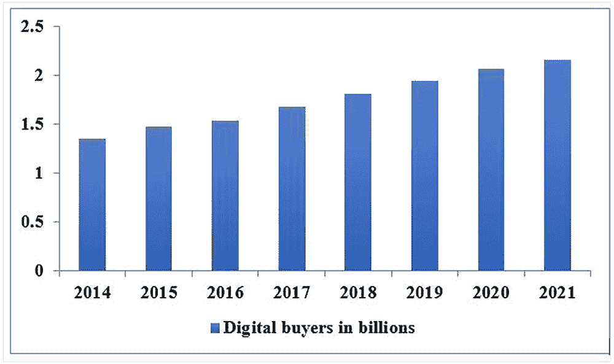

机器学习可以预测在线客户行为，营销文献建立了许多模型来预测消费者购买行为。通过检测消费者旅程和各种点击流数据，机器学习可以在在线环境而非线下环境中预测客户行为。消费者旅程是个人从识别到购买过程中经历的一系列阶段（`Chou et al. (2022)`）。客户路径映射利用机器学习模型（如`贝叶斯模型`、`隐马尔可夫模型`等）来改进交互并增加收入。尽管具有巨大潜力，但利用机器学习预测在线客户行为的经验较少。本研究发现填补了以下空白：

1.  预测客户流失已引起广泛关注（Batra, 2016），但预测客户购买转化的关注较少。在线购物商的表现在很大程度上取决于其将访问者转化为买者的能力。因此，研究利用机器学习预测在线客户行为的问题至关重要。
2.  预测在线客户行为的最佳机器学习模型尚未得到充分讨论。所有的营销决策都涉及预测某些结果。因此，利用机器学习可以提高预测准确性（`Agrawal, (2018)`）。然而，先前的研究尚未解释哪种机器学习模型最适用于在线消费者行为。
3.  针对在线客户购买转化的最佳数据采样方法尚缺乏比较。由于大多数营销数据是不平衡的，机器学习受到了偏倚的限制。为了在营销中使用机器学习，必须克服不对称性偏倚。目前，还没有研究比较过两种或多种不同的采样方法（`Migueis, (2017)`）。
4.  营销领域对机器学习模型的结果关注不够。虽然可以使用机器学习模型创建准确的预测，但它们无法解释预测因子与结果之间的联系。确保向你的目标受众传达机器学习的预测能力，以便他们理解。可解释人工智能正在开发中（`Rai, (2020)`），但针对实际商业环境的研究有限。

本章的后续章节将按此顺序说明。我们将首先介绍各种机器学习模型，然后介绍如何使用这些模型进行预测。将讨论预测科学的现状，随后探讨与主题相关的近期研究。

# 机器学习模型

由于大数据易于获取且环境复杂，将机器学习应用于营销已成为日益增长的趋势。机器学习一直是研究的对象。预测、特征提取和优化都是活跃领域。`SVM`、`主题建模`和`深度学习`都是相关技术（`Ma, & Sun, (2020)`）。

`SVM`最初用于营销。`Cui (2005)`发现`SVM`的性能优于`多项逻辑模型`。虽然机器学习在营销中可以准确预测，但无法解释解释因子与输出之间的关系。视觉数据是深度的。例如，`Liu et al. (2019)`发现价格和美学会影响转化。`Chakraborty et al. (2019)`还创建了一种`混合 CNN-LSTM`模型从数据中提取情感特征，并证明了其分类评价评论的能力。同样，`Zhang et al. (2018)`发现预测餐厅生存状况时，评价评论的照片优于文本。

为了获得高预测准确性，`集成`技术结合了许多个体学习器。通用策略包括`叠加`、`装袋`和`提升`。`装袋`使用自助采样获取每个学习树，并聚合单个学习树的预测以创建最终预测结果。自适应提升也可以用于补偿分类错误的内容。总结来说，`装袋`并行学习，而`提升`顺序学习，并在学习后添加权重。单个决策树从增加中获益，但速度慢且容易过拟合训练数据。`随机森林`算法是最常用的集成模型之一；它采用了`装袋`和`提升`技术。为了减少相关性，随机森林中的每个划分树接收随机分配的输入变量。在考虑了所有树产生的预测后，得出一个结论。使用`GBM`，每棵树通过纠正之前树的错误来更好地预测未来。`XGBoost`多次赢得 Kaggle 数据科学挑战。

机器学习算法已被证明有助于营销决策。然而，关于哪些机器学习算法有助于预测在线消费者行为的研究较少（`表 1`）。

## 预测过程

机器学习相关技术被用于根据购买过滑板的客户历史数据，分析并预测其购买行为属性。`线性回归`、`时间序列分解`、`移动平均`、`自回归`、`指数平滑`和`灰色理论`是一些数据挖掘技术。`逻辑回归`、`支持向量机`、`决策树`、`神经网络`、`贝叶斯网络`等机器学习技术也可用。数据挖掘是一个术语，指的是从大型数据集中收集之前未知的、可用且实用的信息，并应用于决策或知识获取。数据挖掘用于通过机器学习算法预测客户购买行为。预测过程见图 2。

### 表 1. C.P.P. 不同研究之间的比较

| 参考文献 | 技术 | 观察结果 |
| --- | --- | --- |
| Cui, D., & Curry, D. (2005) | `SVM` | 在许多营销预测场景中，基于机器学习的 `SVM` 优于传统的预测模型。 |
| Huang, D., & Luo, L. (2016) | `Fuzzy SVM` | 建议使用 `Fuzzy SVM` 分析消费者对重要属性产品的偏好。 |
| Jacobs et al. (2016) | `LDA`, `MDM` | 使用 `LDA` 和 `M.D.M.` 可以根据客户偏好预测他们将购买哪些产品。 |
| Migueis et al. (2017) | `RF` | 在银行业行业，采样方法的性能与消费者对直接营销响应的预测之间存在差异。 |
| Ballestar et al. (2019) | `MLP`, `ANN` | 可以使用多层感知器 `ANN` 估计电子商务社交网络的客户质量。 |
| Hartmann et al. (2019) | 5 models | 比较五种机器学习模型（`SVM`、`RF`、`NB`、`ANN` 和 `K.N.N.`）的情感分类方法。 |
| Lee 等 (2021) | 8 models | 作者使用 `X.A.I.` 根据在线消费者行为识别重定向广告的成功客户特征。该工作还比较了机器学习范式和采样方法论。 |

### 图 2. 客户购买行为预测过程

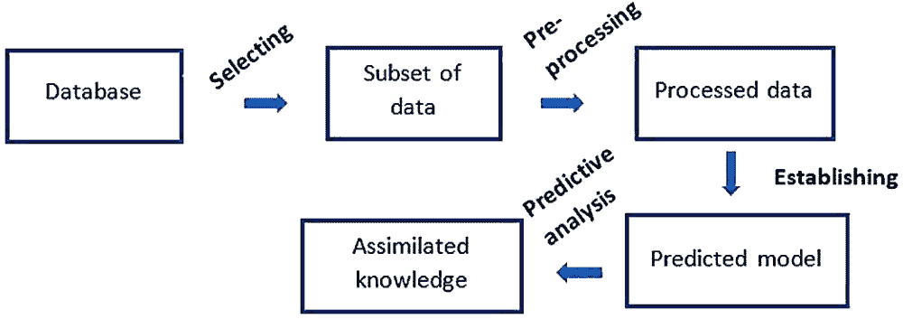

该模型将数据挖掘过程分为六个阶段，如图 3 所示。

### 表 2. 学习每个阶段涉及的步骤

| 阶段 | 涉及的步骤 |
| --- | --- |
| 业务理解 | · 识别业务目标<br>· 评估状况<br>· 寻找数据挖掘目标<br>· 准备计划 |
| 数据理解 | · 样本收集<br>· 数据描述和统计 |
| 数据准备 | · 数据质量<br>· 数据选择<br>· 数据构建<br>· 数据格式化 |
| 建模 | · 选择模型<br>· 测试生成<br>· 训练模型<br>· 数据集成 |
| 评估 | · 评估<br>· 评估是否达到目标<br>· 评估模型 |
| 部署 | · 计划部署<br>· 监控<br>· 最终生成<br>· 审查 |

`D.T.`、`N.N.`、`R.N.N.` 以及`逻辑回归`是用于购买预测的一些最先进机器学习模型。Mokryn et al. (2019) 研究并比较了各种机器学习模型在预测用户购买方面的性能。Li et al. (2016) 提出了三种通过线性回归结合的机器学习模型（`Bagging`、`D.T.` 和`随机森林`）。他们提出的策略将购买预测准确率提升了 8%。Mokryn et al. (2019) 使用时间特征研究了 `Bagging` 对购买预测性能的影响（时间、产品趋势性等）。Suh et al. (2004) 发现集成 `D.T.`、`N.N.` 和`逻辑回归`机器学习模型可以提高性能。尽管会话具有匿名性，但机器学习模型在提取了会话属性的匿名会话上训练时表现良好。

### 表 3 文中关于购买预测的近期工作

| 参考文献 | 关键发现 |
| --- | --- |
| Zeng et al. (2019) | 首先构建了一个预测模型，然后建立了推荐系统模型来确定哪些产品可以被购买。 |
| Wu et al. (2015) | 使用神经网络模型分析点击模式以做出购买预测。 |
| Li et al. (2016) | 开发了一个 `L.R.` 模型来预测中国某电子商务网站的购买行为。 |
| Baumann et al. (2018) | 在图建模过程中使用了用户导航数据，以创建一个用于预测购买的模型。 |
| Lo et al. (2016) | 使用用户行为模型探索注册用户在每次访问网站后其购买意图是如何形成的。 |
| Mokryn et al. (2019) | 在考虑时间变量时，比较购买预测模型。 |
| Park and Park (2016) | 使用贝叶斯概率模型检查购买转化因素。 |
| Martinez et al. (2020) | 作者建立了一种机制，根据历史数据预判未来的购买习惯。 |
| Kim et al.(2020) | 使用无人货柜中的摄像头传感器实时检测物体，并分析对商品的购买活动。 |

## 挑战

尽管有了这些进展，但仍然无法预见客户的购买意图。在大多数情况下，早期预测购买意图的研究使用了收集自电子商务平台客户的数据（`Tsagkias et al. (2021)`）。测试的模型涵盖了从基于特征的模型（如提升决策树）到基于序列的神经网络模型（如 `R.N.N.`）。然而，来自电子商务网站的去标识化数据显示，匿名访问者占流量的一半以上。由于许多现有算法依赖于用户历史，很难检测匿名用户的购买意图。预测购买意图的特征。使用未知和已识别的设置来识别购买意图信号。我们基于对生产可用模型的观察对这些特征进行了测试。我们使用了另外五个分类器来测试特征集的泛化性。

我们收集的两个基于会话的数据示例是页面停留时间和自上次交易以来的天数。只要用户已登录或被 Cookie 识别（当客户未知时），会话功能即可用于可识别和匿名会话。特征的可用性限于所述的时间日期。由于某些原因，早期的提议对匿名会话的购买意图预测很少关注（`Seippel et al., (2018)`）。研究人员研究了来自某欧洲电子商务平台的 9500 万多个匿名用户会话以填补这一空白。

解决了以下研究问题：

*   **RQ1: 区分购买和非购买会话的是什么？** 客户更容易在晚上和工作日购买，并且购买的可能性更高。
*   **RQ2: 哪些基于会话的特征区分了购买与非购买？** 我们得出结论，历史数据对匿名会话非常重要。
*   **RQ3: 预测购买意图的模型有效性如何？** 此外，所提特征有多帮助？

## 方法论

作者使用数据挖掘器从 Amazon、Jabong、Myntra 和其他电子商务网站收集信息。网络爬虫是从多个网站收集数据的一种复杂方法。

```
图 6. 客户购买预测模型工作流
[Figure978-1-6684-4246-3.ch006.f06]
```

网页很难导航。网络爬虫旨在发现非结构化数据的位置。当我们执行网络爬虫程序时，将向 URL 发送请求。根据请求，服务器传输数据并显示 HTML 标签。应用程序随后检查 HTML 文件并移除不需要的内容。使用监督机器学习作为决策树算法来预测消费者强度。两项研究讨论了机器学习在医疗保健的应用。这是由于在许多研究中证明了袋估计是客观且易于计算的。一个示例见图 6。

### 爬取数据

为了获取价格、名称、评分等，我们必须使用数据挖掘器扩展爬取 Flipkart。下一步是扫描网站以查找待爬取的信息。检查产品的价格、名称和评分页面，这些信息保存在 `I.D.` 标识符中。你可能希望提取后将数据保留为 CSV 格式。图 7 显示了网络爬虫如何将非结构化数据转换为结构化数据。

```
图 7. 从网页爬取数据
[Figure978-1-6684-4246-3.ch006.f07]
```

### 数据验证与预处理

将提取的数据集导入到库包中。库分析数据集并帮助删除杂质、修正缺失值和调整数据形状以执行操作并产生准确的结果。在应用算法之前，必须对提取的数据进行修正。这是一个关键步骤，被称为数据清洗或预处理。这是一个将异常值或数据集转换为可分析清洁数据集的系统过程。这一步骤加快了进程，因为提取的原始数据不适用于分析。图 8 显示了有效 CPP 模型所使用的方法论。

### 图 8. 用于有效 CPP 模型使用的方法论

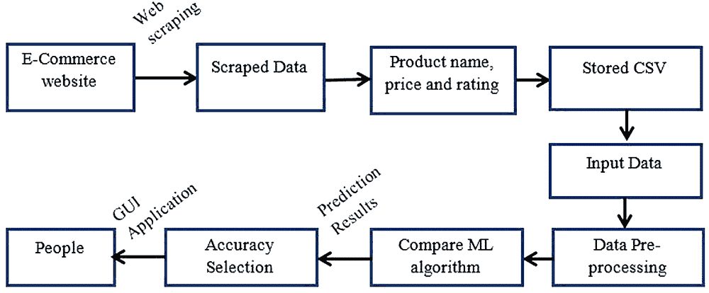

## 数据与训练数据集的可视化

为了针对特定属性训练模型，需要对定量知识估计进行专门的统计处理。数据可视化是进行条件理解的有力工具。在对数据集进行评估和处理时，这有助于识别趋势、异常数据以及许多其他问题。这是在数据清洗并为分析做好准备后进行的。用户通过统计表格或图表生成并展示结果。可视化后的结果更易于理解。这种策略被称为`数据可视化`（Data Visualization）。此外，还可以获得数据集的整体摘要。


他们根据所选商品和评分推断客户的意图。零售商作为最终消费者，必须产生易于理解的结果。我们使用 Web 应用程序显示结果，并将其分类为正面、负面或中性。我们使用`线性支持向量机`（Linear Support Vector Machine）对客户产品进行评分，并将结果与其他`机器学习`（Machine Learning）模型的结果进行了对比。图 9 在用户购买意图方面将 `SVM-Linear` 与与其他机器学习方法进行了对比。

### 图 9. SVM-Linear 方法与其他 ML 模型的对比

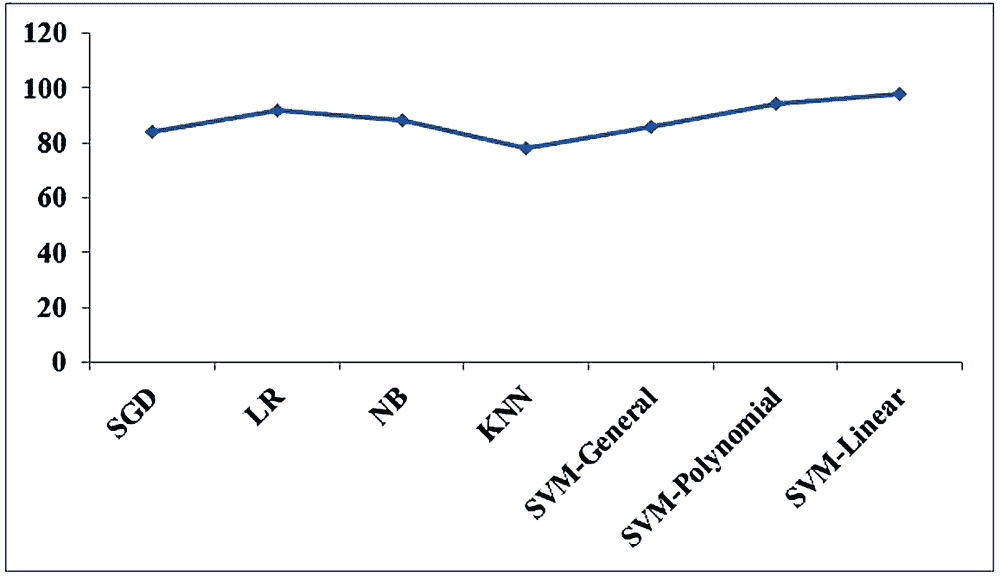

## 结论

随着电子商务的增长，消费者现在在购买产品方面有了话语权。互联网是可研究数据的金矿。通过机器学习算法，从互联网获取数据。一旦数据经过预处理，在运行算法之前会对其进行清洗和分析。结果以图表形式呈现用于预测客户意图。由于零售商是最终用户，结果必须以通俗易懂的语言呈现。作者采用用户界面（网页）来提供结果，并将其分类为正面、负面或中性。建议的方法完全基于网站数据和算法训练数据。随着电子商务和以客户为中心的业务的发展，这种方法在未来极有可能发挥。随着技术、云计算和电子商务的进化，客户生成的结果也会随之变化。这一过程可以进一步自动化，以便在桌面程序上查看结果。工作也可用于`人工智能`（Artificial Intelligence）领域。客户的输入或标记在未来的销售力和供应链管理等技术中可能变得。

## 参考文献

Agrawal, A., Gans, J., & Goldfarb, A. (2018). Prediction machines: the simple economics of artificial intelligence . Harvard Business Press.

Baderiya, M. S. H., & Chawan, P. M. (2018). Customer buying Prediction Using Machine-Learning Techniques . Survey (London, England) .

Ballestar, M. T., Grau-Carles, P., & Sainz, J. (2019). Predicting customer quality in e-commerce social networks: A machine learning approach. Review of Managerial Science , 13(3), 589–603. doi:10.1007/s11846-018-0316-x

Batra, R., & Keller, K. L. (2016). Integrating marketing communications: New findings, new lessons, and new ideas. Journal of Marketing , 80(6), 122–145. doi:10.1509/jm.15.0419

Baumann, A., Haupt, J., Gebert, F., & Lessmann, S. (2018). Changing perspectives: Using graph metrics to predict purchase probabilities. Expert Systems with Applications , 94, 137–148. doi:10.1016/j.es.2018.0316-x

Wu, H., & Li, B. (2022, January). Customer Purchase Prediction Based on Improved Gradient Boosting Decision Tree Algorithm. In 2nd International Conference on Consumer Electronics and Computer Engineering (ICCECE), (pp. 795-798). IEEE. 10.1109/ICCECE54139.2022.9712779

WuZ.TanB. H.DuanR.LiuY.Mong GohR. S. (2015). Neural modeling of buying behaviour for E-commerce from clicking patterns. In Proceedings of the international ACM recommender systems challenge 2015, (p. 12). 10.1145/2813448.2813521

Zeng, M., Cao, H., Chen, M., & Li, Y. (2019). User behaviour modeling, recommendations, and purchase prediction during shopping festivals. Electronic Markets , 29(2), 263–274. doi:10.1007/s12525-018-0311-8

Zhang, M., & Luo, L. (2018). Can user-posted photos serve as a leading indicator of restaurant survival? Evidence from Yelp. Evidence from Yelp.

EBSCOhost - printed on 6/21/2023 3:47 PM via . All use subject to `https://www.ebsco.com/terms-of-use`

## 第 7 章：首次公开募股的故事

*   Swarnasree Vutharkar - 印度 Woxsen 大大学
*   C. A. Narasimha Swamy - 印度 Woxsen 大大学
*   Krishna Hitesh - 印度 Woxsen 大大学

### 摘要

首次公开募股（IPO）长期以来华尔街和投资者中广受欢迎的术语。据信，通过向公众出售荷兰东印度公司的股份，荷兰人启动了现代意义上的 IPO。从那时起，公司开始通过发行股票作为从公众募集资金的手段。多年来，IPO 的发行量经历了上升和下降的趋势。由于创新和其他若干经济原因，各别行业的发行量也经历了上升和下降趋势。在互联网泡沫高峰时期，随着科技类 IPO 的激增，公司争相在股票市场上上市。IPO 过程本质上有两个步骤：发行的预营销阶段是第一步，实际的首次公开募股是第二步。想要上市的公司会向承销商请求私人竞标，或者发布公开公告以引起兴趣。

### PAYTM

印度顶尖金融服务提供商 Paytm 为客户、实体企业和互联网平台提供全栈金融解决方案。该公司希望通过支付、商业、金融服务、银行业和投资，将五亿印度人融入全球经济。Vijay Shekhar Sharma 创立了 One97 Communications Limited，该公司拥有 `Paytm` 商标，总部位于北方塔吉纳拉德邦的诺伊达（Noida）。软银、蚂蚁金、AGH Holdings、SAIF Partners、伯克希尔哈撒韦、道富信罗价格和 Discovery Capital 都是其投资者。

该国最大的数字银行 Paytm Payments Bank 由 Paytm 创始人兼首席执行官 Vijay Shekhar Sharma 以及 One97 Communications Limited 所有。它拥有超过 5800 万账户持有者。为了实现将欠发达和未获得服务的印度人纳入正式银行体系的目标，它开发了创新的技术解决方案，使全国各地的银行服务变得便利。

其全资子公司“Paytm Money”在成立的第一年内就成为印度最大投资平台的荣誉，目前是共同基金行业新增系统性投资计划（SIPs）最大的贡献者之一。它已获得启动股票经纪、托管服务（Demat Services）和国家养老金（NPS）服务的批准，并旨在继续扩大金融服务和财富管理机会。

### Car Trade IPO

Car Trade IPO 由公司现有股东和发起人通过公开发行组成，拟出售 18,532,216 股股票。Car Trade Tech IPO 的市场申报单位为 9 股。零售投资者提交的申请数量最少为 1 笔（9 股，或 14,265 卢比），最多为 13 笔（117 股，或 185,445 卢比）。该发行包含一项购买提议。发行中共有出售 18,532,216 股，总计 2,998 亿卢比，出售股东将获得所有利润。此的主要目标是获得在交易所上市股票的优势。

与 2020 年 4 月至 2021 年 3 月期间与其主要竞争对手相比，`Car Trade Tech`、`CarWale` 和 `BikeWale` 平台在在线搜索人气方面排名第一；根据 2020 财年上市拍卖的数量，`Shriram Auto mall` 是二手车拍卖顶级平台之一。该业务提供了汽车交易整个价值链的一系列服务，包括发现和研究工具、定价和融资信息，以及新旧车交易中客户与经销商及 OEM（原始设备设备制造商）之间的联系。通过其金融平台，`Car Trade Tech` 还为购买家提供动态、定制化且实时的融资选择。将在线和线下拍卖与互补服务相结合，增加了消费者流量，促进了其声誉良好的经销商网络之间的竞争，并确保用户获得最佳价格。

`Car Trade Tech` 品牌实力及其与可靠性、质量和信任的联系是公司重要的属性，这些属性增强了消费者信心并影响购买决策。得益于其知名品牌以及用户界面和用户体验的高水准和可靠性，公司所有平台的消费者流量持续增长。对于截至 2021 年 6 月 30 日的三个月以及 2021 财年和 2020 财年，公司月平均独立访问人数分别为 2,711 万、2,566 万和 2,051 万。在相同期间，他们的在线和线下拍卖平台挂牌量分别为 212,552 条、814,316 条和 809,428 条。这种基于品牌的扩张具有巨大的网络效应，产生了建设性的反馈循环。由于我们拥有强大且广为人知的品牌，我们能够创建额外的产品，包括价格工具、融资方案和以换解决方案。

一个重要的竞争优势是数据驱动的决策。`Car Trade Tech` 利用数据科学和专利算法来分析通过其拍卖进行的车辆销售，以及 `CarWale`、`Car Trade` 和 `BikeWale` 上的经销商出售的车辆。这些因素包括汽车交易的特定车辆信息、车辆注册记录、消费者购买模式和行为、人口统计数据以及宏观经济数据。公司的统计学家和数据科学家创建了复杂的专利算法，利用这些数据通过其网页和移动用户界面，以引人且易懂的方式向客户、经销商、金融机构和 OEM 提供定价工具、产品评论、市场洞察和报告。

风险因素包括趋势，例如年轻人选择共享出行服务，这可能导致车辆需求减少，可能对通过平台提供的汽车需求产生负面影响。公司可能因此遭受。任何长期疫情阶段都可能导致收入下降并对公司产生重大影响。如果其技术平台中断或失败，其业务和声誉可能会受到损害，这将涉及重大的法律、财务和公关问题 (Ellikkal et al., 2022; Salo, 2020)。

### Zomato

截至 2021 年 3 月 31 日，`Zomato Ltd.` 是印度销量最大的顶尖食品服务平台之一。2021 财年，有 3,210 万平均月活跃用户（MAU）在印度该平台。截至 2021 年 3 月 31 日，Zomato 已覆盖印度 525 个城市，并拥有 389,932 个活跃餐厅列表。根据 App Annie 的估计，在过去的三个财年（从 2019 财年到 2021 财年），其移动应用程序在 iOS App Store 和 Google Play 的总下载量位印度饮料类之首。

客户、餐厅合作伙伴和配送合作伙伴都通过 Zomato 的技术平台连接，该平台满足他们的各种需求。客户可以通过该平台订购外卖、订位、阅读和发布其他客户的评论、浏览并提交照片，并在餐厅支付餐费。另一方面，公司为其餐厅合作伙伴提供特定行业的营销工具，让他们吸引客户以扩大客户群体，同时提供可靠高效的最后一公里配送服务。由 Zomato 运营的一站式采购服务 `Hyper pure` 为其餐厅合作伙伴提供优质产品。因此，该机构为其配送合作伙伴提供了灵活且透明的收入机会。

尽管截至 2021 年 3 月 31 日，该公司已在印度以外的 23 个国家开展业务，但它已做出战略决定，未来将注意力集中在印度市场。它认为，考虑到印度巨大的市场机会，更加专注的 Zomato 将为所有利益相关者增加价值。COVID-19 疫情导致其在 2021 财年的活动遭遇挫折。因此，公司 2021 财年的财务状况和关键绩效指标已经考虑了疫情对其运营的影响。

Zomato 正在推出首次总额为 9375.00 亿卢比的股票发行，以部分资助其有机和非有机增长计划的目标（卢比）。它已为每股面值为 1 卢比（FV）的股票设定了 72 卢比至 76 卢比的价格区间。IPO 申购倍数超过 38.25 倍。最低申请数量为 195 股，之后按该数字的倍数申请。发行包括 9000.00 亿卢比的新股发行和 375.00 亿卢比的减持出售。Zomato 将以发行最高价格区间发行 1,233,552,730 股，其中包括 1,184,210,622 股的新股发行。股票将在分配后在 BSE 和 NSE 上市。此次发行占公司发行后资本的 15.72%。

对于合格员工，Zomato 预留了 6,500,000 股。剩余金额的 75% 分配给机构级投资者（QIB），15% 分配给高净值个人（HNI），10% 分配给普通投资者。公司在 2010 年 7 月至 2021 年 3 月期间，以 641.00 卢比至 155,690.27 卢比（面值 1 卢比）的价格区间进一步募集了股权。此外，截至 2021 年 4 月按每股 6699 股的比例发放了送股。出售股东购买股票的平均价格为 1.16 卢比。

Zomato 当前的发行实收资本为 666.10 亿卢比，将增加至 784.52 亿卢比。根据 IPO 的上限价格计算，公司的目标市值为 59623.37 亿卢比。

在财务表现方面，Zomato 报告的总营业额/净亏损（亏损）在 2019 财年为 1397.72 亿卢比 / -1010.51 亿卢比，2020 财年为 2742.74 亿卢比 / -2385.60 亿卢比，2021 财年为 2118.42 亿卢比 / -816.43 亿卢比。它在多年中一直遭受着巨大的亏损。在采取额外努力和收入下滑后，2021 财年的亏损有所收窄。

### Zomato 财务概

Zomato（合并口径）在前三个财年报告的每股收益（EPS）为负值 -2.99 卢比，且净资产净回报率（RoNW）为负值 -49.09%。根据其 15.09 卢比的 `NAV`，该股的市率为 5.04 P/BV；在发行（按上限价格区间）后，根据其 26.10 卢比的 `NAV`，其市率为 2.91 P/BV。尽管遭受了巨大的运营亏损，但它仍拥有正的 `NAV`。得益于股票发行中募集的大额溢价，它实现了正的账面价值（`Pandey, 2021`；Yadav 等人，2022）。

### 保险：LIC

#### 历史与市场地位

自 1956 年以来，印度人寿保险公司（`LIC`）一直是印度唯一的国有人寿保险提供商。直到最近，`LIC` 还根据独特的 `LIC act` 运营。但随着 `IRDA` 系统的建立，它已加入并为其首次浮动扫清了道路。它是最信赖的品牌，在本土市场拥有稳固地位。它遵循其口号的内涵：“Jindagi Ke Saath Bhi, Jindagi Ke Baad Bhi”（与生命共存，亦如此）、“更了解印度的 LIC”以及“时刻与您相伴”。

在截至 2021 年 12 月 31 日的九个月内，`LIC` 在个人保单发行数量方面的市场份额为 71.8%，在团体保单发行数量方面的市场份额为 88.8%，在保费（或 `GWP`）和新业务保费（或 `NBP`）方面的市场份额分别为 61.6%。在 65 多年前，`LIC` 开始在印度提供人寿保险。

#### 2021 财年表现

在 2021 财年，`LIC` 在印度人寿保险领域的 `GWP` 市场份额为 64.1%，`NBP` 市场份额为 66.2%，个人保单发行市场份额为 74.6%，团体保单发行市场份额为 81.1%。与全球前七大市场的领导者相比，其在人寿保险 `GWP` 市场份额上的差异与印度第二大人寿保险公司相比最为显著（其他公司为 2020 年数据，而 `LIC` 为 2021 财年）。根据 `CRISIL` 的说法，这归功于 `LIC` 庞大的代理网络、稳健的业绩、对“LIC”名称的巨大信任以及 65 年的历史。从总资产来看，`LIC` 位列全球第 10（将其截至 2021 年 3 月 31 日的资产与其他 2020 年 12 月 31 日的人寿保险公司资产进行比较），在人寿保险 `GWP` 方面位全球全球（将其 2021 财年的人寿保费与其全球同业 2020 财年的人寿保费进行比较）。

#### 资产管理与规模

截至 2021 年 12 月 31 日，`LIC` 是印度最大的资产管理公司，独立运营的 `AUM`（包括保单持有人、股东投资和用于覆盖相关负债的持有资产）为 40.1 万亿卢比，是印度所有私立人寿保险公司 `AUM` 总和的 3.2 倍，约为 `AUM` 的 3.2 倍。


# LIC：印度最大的资产管理公司

截至 2021 年 12 月 31 日，`LIC` 是印度最大的资产管理公司，独立运营的 `AUM`（包括保单持有人、股东投资和用于覆盖相关负债的持有资产）为 40.1 万亿卢比，是印度所有私立人寿保险公司 `AUM` 总和的 3.2 倍。

# IPO 详情

`LIC` 保单持有人可以在“保单持有人+零售”和“保单持有人+高净值”类别下提交 2 次 `LIC IPO` 股票申请。`LIC IPO` 的预留额度对工人、保单持有人和零售投资者的投资上限为 2 万卢比。`LIC IPO` 的申购倍数超过 2.95 倍。

在 2022 年 2 月提交招股章程说明书（`DRHP`）后，`LIC` 进一步推高了其上市（`IPO`）计划的热度。各行业的投资者都忙于根据其巨大的业务规模和在竞争中的市场份额来确定其估值。由于其已提交招股说明书（`RHP`）并公布了发行细节，其定价反映了嵌入价值和公司增长趋势，目前看来是合理的。由于其对投资者友好的方法以及对其支柱（即保单持有人和零售投资者）的折扣，该发行变得更具吸引力。在俄乌战争、通胀飙升和全球市场低迷等动荡事件期间采取这些行动，印度政府再次展示了其亲投资者的姿态。为了中长期利益，投资者可以考虑参与这家大型保险公司的首次公开募股（`Dimovski et al., 2007`；`Selvam, 2022`）。

# 资产管理公司

## Aditya Birla Sun Life AMC

在过去的七十年里，被称为 Aditya Birla 集团的跨国财团已扩张为印度最大、最有声誉的跨国公司之一。该集团的 `ABSLAMC` 正在上市。

根据 CRISIL 报告，自 2018 年 3 月 31 日以来，Aditya Birla Sun Life AMC Ltd. (`ABSLAMC`) 根据 `QAAUM` 长期列为印度最大的非银行关联资产管理公司，并自 2011 年 9 月 30 日以来根据 `QAAUM` 一位列印度前四大资产管理公司。截至 2021 年 6 月 30 日，`ABSLAMC` 旗下共同基金、投资组合管理服务、海外产品和房地产产品（不包括国内基金）管理的总 `AUM` 达 2,936.42 亿卢比。根据业务情况，通过强调稳健的投资业绩、广泛的分销网络、品牌、卓越的管理团队以及一流的客户服务，取得了这一领先地位。

自 1994 年成立以来，它已建立了跨全国的地理化分销网络，涵盖 27 个州和 6 个直辖市。截至 2021 年 6 月 30 日，公司的分销网络包括超过 66,000 个符合 `KYD` 标准的基金销售员（`MFD`）、240 多家国家分销商以及 100 多家银行/金融中介。它规模大、多渠道，并拥有强大的实体和数字化存在。截至 2021 年 6 月 30 日，它管理着 118 项计划，包括两只流动性基金、五只 `ETF` 和六只国内基金。这些计划包括 37 只股票基金（包括多元化、节税、混合型和行业基金等）、68 只债券基金（包括超短期、短期和固定到期基金）以及两只流动性基金。

Aditya Birla Sun Life Frontline Equity Fund 和 Aditya Birla Sun Life Corporate Bond Fund 是 `ABSLAMC` 的两个旗舰计划，在其管理下已发展成为印度顶尖基金。截至 2021 年 6 月 30 日、2020 年 3 月 31 日和 2019 年，总 `QAAUM`（不包括国内基金）分别为 2,754.54 亿卢比、2,692.78 亿卢比、2,475.22 亿卢比和 2,464.80 亿卢比。截至 2021 年 6 月 30 日，它还提供海外、房地产和投资组合管理服务，这些服务共同管理的总 `AUM` 为 115.15 亿卢比。

通过其全印网络和客户解决方案，`ABSLAMC` 为包括个人和机构在内的广泛客户提供服务。这使其能够从印度共同基金市场吸引具有各种需求和风险特征的客户，并建立强大的零售客户群。根据 CRISIL 报告，截至 2021 年 6 月 30 日，其来自机构投资者的 `MAAUM` 为 1,503.04 亿卢比，在同类中排名第四。同样，截至 2021 年 6 月 30 日，`ABSLAMC` 来自个人投资者的 `MAAUM` 为 1,333.53 亿卢比。公司卓越的财务成功是其市场领先、产品组合、成本结构和规模的结果。

随着时间的推移，它保持了 B-30（三线城市）渗透的市场领先，这有助于增加个人投资者的数量并提高盈利能力。其系统性交易也经历了类似的增长，未结 `SIPs` 的数量从 2016 年 3 月 31 日的 86 万增加到 2021 年 6 月 30 日的 280 万。

`ABSLAMC` 正通过减持（`OFS`）出售 38,880,000 股每股 5 卢比的股票进行首次公开募股（`IPO`），价格范围为 695 至 712 卢比。此举旨在考察上市的好处并为部分利益相关者提供退出机制。公司考虑在最高价格区间筹集 2,768.26 亿卢比。股票认购倍数超过 5.25 倍。

# 结论

科技公司以其因巨大的增长潜力而导致价值大幅波动而闻名，但这些公司在熊市中受到的冲击巨大。当估值看起来过高时，这种跌势会变得更加糟糕。近期对该股票的打击是私募基金的退出。结果导致 `Zomato` 的股价被进一步压低。分析师认为，保险业对市场变化相当敏感，这可能会影响其内在价值。因此，该股票一直处于低迷状态。对通胀的担忧以及投资者对经济增长的谨慎态度在短期内损害了 `LIC`。经纪公司对该首次 `IPO` 给予了有利的评级，但许多专家现在认为，该股票最适合长期投资者或更愿意承担风险的人士。因此，该股票面临着更大的抛售压力。

# 参考文献

- Baral, P. K., Das, D., & Kumar, K. (2016). Mutual Funds Industry in India: A Growth Trend Analysis. International Journal of Multidisciplinary Research and Development, 3(1), 1–13.
- Dimovski, W., Brooks, R., & van Eekelen, A. (2007). The costs of raising equity capital for closed-end fund IPOs. Applied Financial Economics Letters, 3(5), 295–299. doi:10.1080/17446540701222391
- Ellikkal, A., Rajamohan, S., & Prakash, M. O. (2022). IPOs in Indian Stock Market: Analyzing Pricing and Performance of IPO Listed in 2021. Journal of Management, 10(2), 1–8.
- Mahajan, S. (2022). Paytm IPO: Case of Failure and the Behemoth. JBIMS.
- Pandey, D. (2021). Coronavirus Impact on Indian IPO Market. IUP Journal of Accounting Research & Audit Practices, 20(4), 603–609.
- Salo, T. (2020). Incorporating CSR Activities into the Company's Financial Strategy: A Case Study [Thesis]. Metropolia University of Applied Sciences.
- Selvam, M. (2022). Lic IPO. SMART Journal of Business Management Studies, 18(2), 6–7.
- Singh, D., Denesh, R., Balakrishnan, J., Vijayan, N., & Ghosh, D. (2017). Department of Management Studies. International Journal of Mental Health and Addiction, 16, 15.
- Yadav, N., & Goyal, S. (2022). Regaining partner trust in the food delivery business: case of Zomato. Emerald Emerging Markets Case Studies.
- EBSCOhost - printed on 6/21/2023 3:47 PM via . All use subject to `https://www.ebsco.com/terms-of-use`

# 第 8 章：金融科技的兴起

- **Swarnasree Vutharkar** - 印度 Woxsen 大学
- **Rajesh Kumar K. V.** - 印度 Woxsen 大学

## 摘要

“金融”（financial）和“技术”（technology）这两个词结合组合成了“金融科技”（fintech）。尽管这是一个具有多种解释的广泛术语，但它通常指的是当新的技术应用场景被开发并实施，以加速更具传统的金融活动时，一个行业的增长。当该术语在 21 世纪首次出现时，“金融科技”一词被用于描述信誉良好的金融机构后端系统中采用的技术。然而，从那时起，已经转向更以客户为中心的服务，因此也有更以客户为中心的定义。目前，“金融科技”一词被用于描述广泛的职业和业务，包括投资管理、零售银行、教育和非营利筹款等。在本章中，你将阅读 `Python` 与金融；`SQL` 与金融；`Tableau` 与金融；`Power BI` 与金融；以及区块链与金融之间的关系。

## 引言


# 金融科技概述

在本章中，我们将学习金融科技在这个世界的兴起。金融行业使用了技术吗？金融和技术是形影不离吗？技术给金融行业带来了哪些变化？是技术改变了金融，还是金融改变了技术？

你是否有过这样的疑问？让我们在本章中为你解答所有与金融和技术相关的问题。任何包含金融交易的创新，无论是个人使用还是专业用途，都属于金融科技的范畴。自从 20 世纪 50 年代信用卡的发明和 20 世纪 60 年代 ATM 机的发明以来，金融科技一直颠覆着我们的世界。

事实上，金融科技无处不在。我们许多许多人在购物时使用金融科技而不是现金。它被广泛用于以比过去更切实的方法进行不同的金融交易。

我们的社会将由于金融科技而继续变化（An et al., 2021; Hilpisch, 2014; Lin, 2016; Ra Lawson et al., 2018; Reddy et al., 2019; Shahrokhi, 2008; Zetzsche et al., 2020）。

# Python 与金融

`Python` 是目前最优秀的通用高级编程语言之一。凭借其简单的语法和与英语的紧密相似性，该语言旨在对初学者友好。

此外，在将 `Python` 应用于金融时，它的应用是英语和数学的结合。因此，`Python` 的语法与标准格式并不遥远。金融分析的三个主要部分——数据收集、数学计算和结果可视化——可以通过 `Python` 变得更加简单。

## 图 1. Python 编程语言的理想图像

```

```

鉴于这些优势及其简洁的语法，`Python` 成为金融项目的标准语言并不为奇。它正在改变分析师进行基于框架支持的数据驱动金融评估的方式。在对大型金融数据集进行相关定量分析时，`Python` 是一个极佳的选择。你可以使用诸如 `Pandas`、`Scikit-learn`、`PyBrain` 或类似的模块轻松地管理大型数据库并对结果进行可视化处理。

因此，创建价格波动图和其他金融市场趋势的图表变得非常简单。为了给额外的预测和洞察创建背景，你可以使用复杂的数学计算。

许多金融科技公司选择 `Python` 是因为它在金融任务中的效率很高，这种效率与涉及数据和数学的金融科技解决方案是天然契合的。`Python` 作为针对金融专业人士最易用编程语言的声誉，也可能是一个影响因素。

得益于金融科技初创公司 `Stripe`，企业现在可以接受在线支付。该公司使用 `Python` 创建了 `APIs`，以便集成到网站和移动应用程序中。`Stripe` 简化了互联网企业的交易流程。其提供的服务包括发票、订阅管理和欺诈保护。随着数千家企业的使用，`Stripe` 的估值达到了 90 亿美元（Hilpisch, 2014, 2018）。

# SQL 与金融

`Microsoft Excel` 是金融行业应用最广泛的程序之一，电子表格现在是存储和分析金融数据的主要方式。电子表格程序 `Excel` 可以通过`透视表`和统计计算等功能，从收集和保存的金融数据中获得大量见解。

然而，有许多数据科学工具比 `Microsoft Excel` 更好地执行数据存储、清理和分析任务，而这些工具可用于数据分析和某些数据库任务。金融分析师凭借他们对 `SQL` 编程语言的知识，可以构建结构与电子表格相似的复杂的数据库系统。电子表格和其他数据分析工具将使许多金融分析师能够运用其理论知识来理解 `SQL` 数据库管理系统的运行机制。

在 `SQL` 中，实体构成了表中感兴趣的对象，并由属性（列）进行描述。当我们以特定方式声明并使用这些关系时，相互关联的实体可能会形成所谓的关系模型。每个属性都有一个域；例如 `INT`、`DECIMAL`、`VARCHAR`、`CHAR` 和 `DATETIME`。

处理大数据需要数据库的知识，特别是现在数据收集已成为各个学科和部门的必要需求。大数据是建立在数据库之上的，当消费者与平台交互或公司收集自身数据时，需要所有这些信息来维护一个可扩展的仓库。

## 图 2. Microsoft SQL Server 图像

```

```

对于金融机构而言，确保收集的数据能够存储在安全位置也至关重要。幸运的是，只有少数 `SQL` 工具专门设计用于收集金融数据（如用户交易和行业趋势），同时确保所存储信息和数据的安全性。表被用于传达大数据。主键（也称为候选键）在表中用于唯一标识每一行（有时称为实体完整性），并与各种非键属性结合。带有 `ID` 前缀的列就是主键的所有。

外键简单来说就是另一个表的主键的列，可用于合并两个表。构建表有两种主要方法：构建列（带有列类型并指定主键）。

`SQL` 是金融分析师可以使用的各种计算机语言之一，它对于采用商业智能、预测性分析和金融建模工具特别有帮助。Noble Desktop 的任何 `SQL` 课程都可以为有兴趣学习更多如何利用 `SQL` 进行金融分析的学生和专业人士，与商业和金融方面的补充培训相结合。为了构建一个数据科学和金融分析项目的作品集，金融科技训练营将 `SQL` 数据库教学与 `Python` 相结合。

金融建模训练营教授参与者如何开发金融模型和为企业定价。尽管该训练营的重点是使用 `Excel` 进行金融分析，但涵盖的许多技术也可以应用于其他领域。

# Tableau 与金融

`Tableau` 可以通过对其数据进行深入分析来满足组织的各种需求和要求。组织的需求取决于客户的需求以及产品、程序或应用程序的使用方式。

名为 `Tableau` 的商业智能和分析软件提供了交互式数据可视化的视图。`Tableau` 由 `Tableau` 公司创建，该公司总部位于美国华盛顿州西雅图。Pat Hanrahan、Chris Stolte 和 Christian Chabot 创立了它。它成立于 2003 年。

商业智能应用的主要目标是本文的主题。用户可以根据自己的特定偏好设计交互式仪表板。该工具可以自定义以接受来自许多数据源的连接。

## 图 3. Tableau 软件图像

```

```

# Tableau 在数据分析中的应用

`Tableau` 可用于多种数据库功能，例如关系型数据库管理系统（RDBMS）、NoSQL 数据库、对象数据库等。关系型数据库管理系统存储结构化数据，而 NoSQL 和对象数据库存储半结构化和非结构化数据，如 `JSON`、文本文件和其他类型。

管理各种形式的数据更加简单，定制这些数据以满足需求也更加简单。`Tableau` 的技术只需要简单的拖放或工具功能，使用起来更简单，学习曲线也较低。它不需要任何形式的编程、编码或设计。

视觉分析可能以图表或其他更容易理解或一目了然的类型呈现。这就是数据可视化方法影响视觉分析的方式。

得益于与众多数据源连接以及将这些数据拉取或爬取到 `Tableau`，从多种数据源获取并分析数据的方法非常灵活。随后可以从那里进行数据分析。

`Tableau` 工具在数据分析和数据可视化具有广泛用途，提供了更多优势，例如以最快的执行时间动态地处理数据并减少数据冗余。`Tableau` 是可用的最强大的商业智能和数据可视化技术之一，能够快速有效地交付极其复杂的业务解决方案，而无需担心管理数据转换功能的烦恼。随着客户业务需求或客户-业务处理要求的日益增长，对某些软件应用或工具来安全地处理和管理大规模客户内容数据的需求也日益增加。

在数字世界的最新场景下，`Tableau` 是许多企业极好的工具，在数据报告中的高度复杂数据可视化方面具有重大的创新和技术突破，增加了客户群体以及与客户数据处理相关的日常需求或活动。

## 案例研究：Sales Force

`Sales Force` 公司以这种方式使用 `Tableau`。`Sales Force` 财务团队每天使用数据和可视化分析来更好地了解我们在 EMEA（欧洲、中东和非洲）地区的财务状况，并为执行团队提供必要信息。

应收账款包含财务仪表表中。按位置或账户发现当前洞察。资金管理：轻松掌握运营余额和现金流。成本管理：查看仪表板查看 `Tableau` 每月能节省多少资金。盈利能力现场演示：利用差异分析创建您自己的盈利能力仪表板。办公室使用情况：绘制国际办公室的入住率地图以减少支出。采购：通过可视化您的采购订单（PO）支出，您可以从供应商处获得最大的价值。保险和金融公司 Allstates 利用 `Tableau` 运行公司（Batt et al., 2020; Murphy, 2013; Reddy et al., 2019）。

# Power BI 与财务

“让您的数据活起来”（Bring Your Data to Life）是 `Power BI` 的口号。`Power BI` 是几项基于数据分析的服务和平台的集合，主要关注于为企业展示并增强业务数据的交互性。

一家名为 `Power BI` 的云服务公司提供数据仓库和数据可视化服务。数据组织、自定义可视化、数据发现、数据仓库、报告和数据准备只是其提供的服务中的一部分。

`Power BI` 是组织业务数据的强大工具。在数据的数量、种类、复杂性以及跨多种数据管理媒介的报告和分类方面，经常会受到各种类型的限制。无论公司大小或数据复杂程度如何，该应用程序都提供卓越的财务数据管理服务，且对财务数据报告没有限制。

## 图 4. Power Bi 软件图像

```

```

`Power BI` 拥有卓越的数据投影系统。财务预测是业务运营的关键组成部分，是许多重要决策的基础。因此，它是所有组织数据管理操作的关键组件。

该程序中的“假设分析参数”（What-if parameters）可以生成非常适合比较的交互式数据预测。使用该功能，任何人都能够使用所有类型的假设创建预测声明。

`Power BI` 内置了时间智能。此外，它还提供了根据各种数据维度和属性组织数据的功能。使用此类功能，可以很容易发现多年或跨市场竞争的数据趋势或模式。它们在得出关键业务运营结论以及帮助做出有关盈利能力、预算、运营成本等关键财务决策方面具有特别的的价值。

`Power View` 是 `Power BI` 的关键部分，使创建交互式图表、图解和数据地图成为可能。它有助于从财务事实创建图表和图解，以得出结论并做出财务决策。

`Power BI` 是一个协作平台，允许用户在保持高安全标准的同时方便地交换和访问信息。这使得项目财务管理团队或公司财务部门能够进行协作。他们可以通过交换重要数据结论、交换财务数据集、发布财务报告和仪表板以及合作来有效共同运营。`Power BI` 是伯科希·哈撒韦公司（Berkshire Hathaway Inc.）用于管理组织的软件（Pukala et al., 2020; Zheng et al., 2019）。

# 加密与财务

几乎每个行业都受到了区块链引入的激新思想的影响，包括金融、供应链管理和医疗保健。公众两年前开始意识到区块链初创公司。几乎所有现代企业都在探索区块链技术的前景。区块链本质上是一个分布式账本，是一个去中心化的账本系统。在 2009 年，它引起了广泛兴趣。

因此，传统观点认为区块链技术将主要用于金融领域。区块链的一个迷人方面是，它潜力对金融部门产生重大影响。随着区块链应用在许多行业的发展，有必要查看未来区块链在银行业领域的作用。

任何新技术通常都是难以理解的。事实上，很难发现一个名称能够准确传达其功能的技术，这一点是最重要的。在这种情况下，区块链是一个理想的例子，因为它准确地表达了其名称所包含的含义。可以使用区块链技术创建并存储信息块。

## 图 5. 加密货币

```

```

为了构建“数字账本”，为交易创建的每个新块都会添加到链中。区块链账本相比传统的数字账本有了显著改进，扩大了其在金融领域的应用潜力。

# 金融与银行领域的区块链

通过区块链技术，数字账本可以分布在许多节点之间。因此，处理和存储交易数据不需要任何第三方的参与。结果，在金融领域使用区块链可以降低由于缺乏具有统一安全机制的中心化存储库而导致交易数据被破解的风险。区块链技术还消除了中介机构对金融交易的垄断。据此我们可以说，由于在金融领域使用了区块链，可访问性和成本效益将会提高。

## 区块链技术的安全性

在支持银行业整合区块链的需求的众多因素中，区块链技术的安全性毫无疑问是独一无二的。区块链采用加密技术来确保交易账本的安全。因此，只有拥有特定密钥代码的人才能访问这些信息。由于区块链交易是去中心化且点对点的，因此也确保了高水平的安全性。

## 传统金融模型的局限性

在全球范围内，金融服务继续使用中心化的、传统的多层模型进行运行。大多数金融数据存储在中心化数据库中，并且必须经过许多中间人。中心化机制无法提供透明度。此外，数据库安全和中间环节是影响数据安全的唯一因素。

另一方面，即使是最安全的数据库也容易受到数据泄露和黑客攻击。缺乏透明度经常导致复杂的安全风险，因为在发现数据泄露或其他系统错误之前，没有人会察觉任何异常。最终，并非所有人都会支持开放金融记录的想法，客户和金融服务提供商都能从某种程度的透明度中受益。

## 区块链应用的优势

银行和金融领域的区块链应用有助于同时确保透明性和安全性。不可篡改性是区块链的关键特性，保证了安全性和透明。区块链可以保证数据的机密性、准确性和有效，因为它消除了数据操纵的可能性。区块链在金融行业的使用还充分利用了隐私优势。

区块链应用中使用两个安全密钥：`private key`（私钥）和 `public key`（公钥）。所有网络用户都可以访问 `public key`，而只有特定交易的参与者才能访问 `private key`。因此，所有网络用户都能看到交易，而只有参与者可以看到交易的细节。因此，区块链可以在保护交易参与者私人财务数据的同时维护金融系统的透明度。

## 中心化的经济影响

由于中心化，金融部门必须在众多企业之间分配大量资金。金融服务提供商必须在会计、数据库维护、价值传输系统、中心数据库采购、数据库安全、劳动力成本和中介费用方面投入巨额投资。此外，由于这些投资都是循环性的，金融服务提供者必须定期提供资金来支付。由于所有额外费用，金融服务系统可能会相当昂贵。

## 金融的未来

区块链是金融的未来吗？由于其成本优势，这个问题有了完美的答案。它可以为金融服务公司节省大量的成本。最近的一项研究发现，到 2022 年，分布式账本技术可以帮助金融服务公司每年减少 150 亿至 200 亿美元的支出。区块链技术可以增加安全性，保证成本节省并促进透明度。通过实施 `smart contracts`，银行业的区块链应用可以降低与记录、中间人和价值传输相关的费用。

显而易见，区块链技术是银行业面临许多问题的关键解决方案。`DeFi` 和 `CBDCs` 等新观点有望在 2022 年成名，因为企业和初创公司继续对“区块链如何应用于金融领域”开发新的视角。

此外，区块链技术在安全性、透明度、交易速度和风险管理方面将继续作为金融服务提供者的模型。然而，银行业使用区块链仍面临许多困难。企业预测新兴的区块链相关金融应用和不断变化的区块链特征的能力，可能会带来更好的结果。

## 案例研究：萨尔瓦多

位于中美洲的萨尔瓦多是一个 `Crypto` 实际上被视为货币的地方。那里的人可以使用加密货币购买产品。`Crypto` 在该国被接受为法定货币。这表明世界正在快速发展并接受新技术（Joo et al., 2019; Murphy, 2013; Scott, 2016, 2016; Zheng et al., 2019）。

# 结论

金融科技（Fintech）现在是指一系列通常在没有银行帮助下进行的金融活动，例如货币转账、在智能手机上查看余额、申请贷款或管理投资。客户日益发现在金融科技是至少两项服务。

# 参考文献

- An, J., & Rau, R. (2021). Decentralized finance. European Journal of Finance.
- Batt, S., Grealis, T., Harmon, O. (2020). Learning Tableau: A data tool.
- Hilpisch, Y. (2014). Python for Finance: mastering data.
- Hilpisch, Y. (2018). Python for finance: data-driven finance.
- Joo, M., Nishikawa, Y., & Dandapani, K. (2019). Cryptocurrency, a successful application of blockchain.
- Lawson, R. (1990). Information technology in the finance sector: an international perspective.
- Lin, T. W. (2016). Compliance, technology, and modern finance.
- Murphy, S. (2013). Data visualization and rapid analytics: Applying tableau desktop to support library decision-making.
- Pukala, R., Hlibko, S., Nukova, N. (2020). Power BI in ICT for Monitoring of Insurance Activity Based on Indicators.
- Rajan, A.
- Reddy, C. S., Sangam, R. S., & Sriniv Rao, B. (2019). A survey on business intelligence tools for marketing, financial, and transportation services.


- Scott, B. (2016). How can cryptocurrency and blockchain technology play a role in building social and solidarity finance?
- Shahrokhi, M. (2008). E-finance: Status, innovations, resources and future.
- Walstra, R., Drougas, A., & Harrington, S. (2015). Integrating Excel, SQL, and SPSS within an Introductory Finance Intrinsic Value Assignment.
- Zetzsche, D. A., Arner, D. W., & Buckley, R. P. (2020). Decentralized finance. Journal of Financial Regulation.
- Zheng, X., Zhu, M., Li, Q., Chen, C., & Tan, Y. (2019). FinBrain: when finance meets AI 2.0. Frontiers of Information Technology & Electronic Engineering, 20(7), 914–924.

EBSCOhost - 于 6/21/2023 3:47 PM 通过 . 打印。使用均受 [`www.ebsco.com/terms-of-use`](https://www.ebsco.com/terms-of-use) 制。

# 第 9 章

* Apurva Patil, 英国利物浦约翰摩尔大学
* Rajesh Kumar K. V., , 印度 Woxsen 大学

## 摘要

本研究主要关注利用办公空间数量、空间占用人数、假期、请假等信息，对组织的办公空间利用趋势进行预测。空间占用数据通过 `PIR` 传感器进行采集。通过创新的可视化技术进行描述性分析，并使用单变量和多元时间序列方法进行模型构建。描述性分析表明，数据存在正自相关性，无离群值和随机性。不同办公地点在一天中不同时段存在空间占用模式。单变量时间序列模型适用于预测单个办公地点的空间占用，而当同时考虑一个客户的多个办公地点或不同客户的多个办公地点时，多元时间序列模型 `VAR` 则更为适用。实证研究表明，在测试的模型中，`SARIMAX` 在多个测试数据集上表现出更好的性能。

## 引言

在当今时代，公司正通过明智地管理财务和运营，更加关注其房地产的利用率。他们还利用了空间利用指标。组织需要不同类型的资产来实现盈利。员工工作空间定义了员工所需的隐私性以及其物品的安全性。如果组织未能为员工提供足够的面积、建筑可及性和社交空间，将对工作环境产生负面影响。

空间是组织最大的资产。空间利用率会随需求状况和趋势的变化而改变。员工工作空间管理是一个持续的过程；尽管其容量不变，但通过高效的空间管理，其占用率可以发生变化（Reagan Nickl (SpacelQ), 2019）。对于任何办公室，检查工作空间的使用情况将给出理想的占用比例。为了充分利用办公工作空间，我们需要考虑总桌位数量、员工人数、占用模式以及建筑视角，并借此合理利用办公工作空间。如果员工人数增加，将更容易重新安排办公空间布局以容纳更多员工，同时满足员工空间和安全的基本需求。公司在增长过程中投资房地产是普遍的，但随之产生的问题是办公空间能如何有效地利用，以及如果出现不可预见的紧急情况，这些拥有或租赁的办公空间是否会成为这些公司的财务负担。

在 2008 年美国发生金融危机期间，公司意识到空间是其主要负债，当时金融、投资公司、银行等纷纷破产，IT 行业留下的唯一途径是通过减少租金支出来为他们节省资金。因此，当时的重点仅限于 IT/ITES 行业（Material, 2016）。

在 2008 年金融危机之前，组织通常将其巨大的办公空间视为资产，但后来办公空间变成了组织的负债。考虑到当前 COVID-19 大疫情的状况，许多公司正聚焦于降低与利用率不足或未使用的办公空间相关的成本。这也有助于他们减少房地产成本并提高盈利能力。这将允许组织通过设施管理，专注于管理返回办公室的员工的安全性。公司还需要确保在房地产投入及其利用上通过最佳投资来确保空间管理。

组织的空间利用趋势可以根据办公空间占用的历史数据得出。空间利用趋势将帮助组织在不断演变的业务和工作结构中采用基于活动的工作方式（ABW）方法。这些趋势将帮助设计人员和设施经理理解并匹配空间需求。根据文章《高级工作场所》（Karen Plum, 研发部门总监, n.d.）所述，空间利用趋势的概念从 2000 年左右开始进入市场，当时员工人数与公司为空间支付的租金金额成反比。

本文论文的重点是建立一个预测模型来预测办公空间的利用率。该预测将基于所提供的参数，例如客户及其办公地点、总可用空间以及传感器捕获的空间占用状态。除了数据外，空间已成为组织重要最大的资产。空间优化可以在办公空间建设的建筑阶段进行，或者如果空间是租赁或自有且无法更改，根据空间利用的历史趋势，可以通过预测未来的空间占用人数来分析空间利用的市场现状。此外，当前的 COVID-19 疫情促使所有组织思考对办公空间的投资。

尽管所有雇主和员工现在已经非常适应居家办公的新常态，但由于某些原因，员工可能会选择在办公室工作，他们可以查看特定日的空间利用预测，并决定当天是否去办公室。组织可以通过保持社交距离轻松检查员工的安全，并在未来员工人数增加或减少时利用基础设施。这将有助于组织根据预测优化空间需求，并在维护员工安全的情况下明智地使用办公空间。

本研究的主要目标是建立一个按周、每天和小时预测空间利用率的模型，考虑可用桌位、员工人数、团队人数及总人数等参数。

研究目标根据本研究的目标制定，如下：

* 研究组织目前用于空间利用的流程和方法。
* 构建预测模型以预测组织内空间的使用情况（考虑假期和请假）。
* 构建一个用于实时资源管理的界面，并跟踪和分析使用模式，以实现空间和资源的实时利用。

## 文献综述

企业办公室的空间利用已成为当前 COVID-19 疫情的主要关注点。在此之前的 2008 年金融危机已经揭示了这一问题，导致组织更加关注在建筑阶段投入更多的时间和资金，以明智地减少办公资产的投资，并规划更好的办公空间设计，以适应未来更多的员工（Lik Lau et al., 2017）。

物联网（`IoT`）和大数据技术的进步允许用户远程收集各种信息并将其到云端进行进一步处理（Bhongaraju S.D, Kumar K.V.R, Anjaiah P., Shaik J,H, 2021）。各种传感器被用于收集与办公空间利用率相关的数据。热传感器使用热成像或温度网格来获取空间占用情况。其他传感器如热电红外传感器（`PIR`）被用于检测房间占用情况，声检测传感器可用于检测空间周围的活动。通过计算机视觉使用摄像头进行空间占用检测是可行的，但在计算和财务上成本非常高昂（Lik Lau 等人，2017 年）。

在本文中，数据由 Workplace Fabric Ltd. 提供，他们使用 `PIR` 来检测员工的存在，并提供占用优化解决方案。`PIR` 传感器节点安装在桌子下方，用于感知员工的存在和位置并收集他们的空间利用数据。`PIR` 传感器在测量办公桌、房间或协作空间的人员存在方面非常准确（Zhou 等人，无日期）。

### 空间利用管理的历史

根据空间利用的基本定义，它是建筑的占用情况与容量的对比。空间利用率是每名员工的平方英尺，随行业而异。早期的空间利用过程是人工的，被称为“查房”（City, 2014）。虽然该过程成本低廉，但测量利用率并定期将数据输入计算机非常耗时且劳动力密集。

各种技术被用于执行空间占用感应任务。其中一些包括使用热成像或温度网格的热传感器、热电（`PIR`）传感器、声检测方法、基于密度的方法，以及使用摄像头的计算机视觉方法，后者计算开销极大且实施成本高（Lik Lau 等人，2017 年, Zhou 等人，无日期）。

空间占用的关注始于建筑阶段的设计，取决于房间大小、天气、干扰、员工人数、会议室数量等参数，并使用了诸如“用户模拟空间利用（`USSU`）”等模型。该模型旨在用于预测和显示办公楼的占用计划（Tabak, 2009）。为了克服 `USSU` 模型的缺陷，建立了“离散选择模型（`DCM`）”，空间占用的概率基于关于空间偏好和空间属性的可用集成信息来确定（Cha 等人，2018 年）。在这里，由于缺乏对活动的定义，空间与活动之间的关系没有被清晰定义。为了克服 `DCM` 的局限性并增加对建筑占用预测的关注，设计了基于马尔可夫链模型的“占用模拟器”，这是一种基于代理的 Web 应用程序，用于在考虑时空多样性细节的情况下模拟建筑内人员的存在和移动（Cha 等人，2018 年）。他们收集的数据包括办公室房间数量、员工时间步、假期；同样对于会议室，从 Google 日历中收集的数据是会议室的持续时间和会议室的人数。基于所有这些数据，生成了占用计划。

### 使用各种技术的预测建模

研究人员使用并开发了不同的方法来研究数据的预测能力，这些能力主要基于时间（KUMAR K.V.R, ELIAS S,无日期）。一些研究人员使用了 `ANOVA` 方法，其中随机变量使用总体均值、由于一天中时间的离均值，以及带有每日变异性的随机误差项进行预测。同样，在 `ANOVA` 预测中，周几、特定月份的影响（带有每周和每月模式）也被使用（Hellerstein 等人，2001 年）。

时间序列模型已广泛用于多年预测。根据时间序列的频率，使用 `ARIMA` 或 `SARIMA` 模型。考虑到 `ARIMA`/`SARIMA` 模型性能的不一致性，研究人员尝试通过使用多元时间序列来提高其性能（Yao & Jiang, 2019）。

一些研究人员还使用了强化分配和控制理论，通过使用 `ARIMA` 模型来实现资源的自适应分配，`ARIMA` 模型以更灵活的方式表示时间序列模型（Zia Ullah 等人，2017 年）。时间序列预测假设模式与某些随机误差的组合进行分析，预测的主要目标是理解长期趋势、季节性以及季节因素引起的变化。此外，时间序列（Bhogaraju S.D, Korupalli V.R.K, 2020）模型还根据动态变化的需求和预期负载捕获资源。其主要优势是它们在引入系统模型非线性的同时捕捉了瞬态行为，且准确性在每个应用中都得以体现。

`Holt-Winter (HW)` 指数平滑可用于数据中同时存在趋势和季节性的情况。自适应 `HW` 技术根据最近观测的数据不断更新时间序列参数。即使时间序列使用自适应 (`HW`) 技术改变了行为，模型参数也应适应这种变化（Kalekar, 2004）。使用 `auto ARIMA()` 函数可以根据最低的赤池信息准则 (`AIC`) 和贝叶斯信息准则 (`BIC`) 值选择 `ARIMA` 模型，用于进一步的模型构建。该模型拟合数据并预测下一个利用值。根据模型阶数的平性和白噪声方差，引入了 `AIC` 和 `BIC` 结合的惩罚因子，以避免因过拟合导致的预测错误（Zia Ullah 等人，2017 年）。

当涉及多变量预测时，时间序列模型的计算会变得复杂，通过经验和理论技术均采用了用于预测的经验方法和标准统计学方法。在这种情况下，替代方案是非参数回归和神经网络，由于它们固有的多输入特性，它们适用于时空和多变量模型（Ghosh et al., 2009）。当数据噪声过多且维度复杂度过高时，`ANN` 会受到性能不一致和不可预测等局限性的。当数据中存在高噪声和复杂性时，在选择输入变量、隐藏层大小、学习率、动量率等控制参数时，反向传播神经网络模型也会失败。支持向量机（`SVM`）带有经验误差和源自结构最小化原理的正则化项风险函数也可用于时间序列预测（Kim, 2003）。传统的预测准确性方法是基于与阈值进行比较，但 `SVM` 可以帮助更准确地预测并减少预测误差（Wang et al., 2017）。由于它减少了泛化误差的上限，因此 `SVM` 中很少发生过拟合（Kim, 2003）。遗传算法对 `ANN` 特征划分和确定连接权重的方法可用于预测。这还将降低特征空间的维数并提高预测性能（Kim & Han, 2010）。

时间序列模型也存在参数化技术，例如线性和非线性回归、历史平均算法、自回归线性过程（Kumar K.V.R, Zachariah A.A., Elias S., n.d）。在这些方法中，自回归线性过程和 `SARIMA` 模型的性能优于其他时间序列技术。研究人员开发了 `STM` 和 `MST`。结构时间序列模型类似于 `Holt-Winters` 指数平滑模型，但具有更复杂性。`MST` 使用 `SUTSE` 开发，它不使用变量之间的因果关系。单变量结构时间序列模型基于不可观测分，并对时间序列数据集的时间可见性有直接解释。而 `MTS` 被归类为面板数据和交互数据，其中面板数据相互影响，且元素之间从不相互作用，但它们之间显示出动态相互作用（Ghosh et al., 2009）。

与 `ARIMA` 类模型相比，`STM` 处理缺失值非常容易。在使用 `STM` 解释变量构建模型时，可以很容易考虑并处理离群值、结构性断点等因素，并从单变量区域迁移到多变量区域（Ghosh et al., 2009）。移动平均（`MA`）方法是最简单的预测方法，它使用历史时间序列数据计算算术平均值，其主要优势是消除了不一致的变化或季节因素。此外，当时间序列分量变化迅速时，`SARIMA` 模型运行更有效，并证明了其在预测短期波动率方面的用处，因为该模型由带有季节性和非季节部分的自回归、差分和移动平均组成。根据研究，单变量和多变量 `SARIMA` 模型具有恒定的偏差，且自相关函数落在置信区间内，这表明残差是独立的。

## 研究方法

在这篇研究论文中，我们将仅关注时间序列预测，因为空间利用率高度依赖于日期和时间。因此，使用时间序列分析进行未来预测在准确性方面更有用，它可以应对数据的突发变化、影响参数的增加或减少，并且与更复杂的技巧相比，其复杂度较低。

### 单变量时间序列模型

数据集变量 `stat_value`，考虑到这些列观测值是按 `15 mins` 的等等时间间隔顺序记录的，并且忽略其他变量，基于此建立的模型将称为单变量时间序列分析。根据本研究的目标，第一步是根据因变量识别合适的模型。为了建立更具现实意义的模型，首先将重点放在单变量模型，然后根据其成功结果建立多元模型。首先，我们关注一类通过同一变量过去观测值和过去预测误差的线性组合而创建的模型，即自回归移动平均模型 (`ARMA`)：

#### AR 模型

`AR` 模型通过过去观测值的线性回归来预测未来观测值。该模型具有滞后阶数或自回归分量，记为 `p`。该值通过绘制 `PACF` 来确定。在这里，部分自系数的显著高值出现在 `1, 2, 3, 17, 39, 44, 46` 点。`AR` 模型阶数根据 `AIC` 确定，它固定了用于相关性分析的过去观测值的滞后数量，以确定状态空间向量的维度。此处数据集中没有季节性，因此由于数据是平稳的，`AR` 模型的阶数较低。因此，滞后阶的值为 `2`，这是一个部分自系数显著高值值 [`ARIMA(2,0,0)`]，其模型方程为：

```

```

其中  是待预测的未来值，即因变量， 是过去值，即自变量。 是时间序列的滞后系数。

| 图 1. 部分自相关 (PACF)：空间占用率 |
| --- |
|  |

#### MA 模型

`MA` 模型在回归类模型中使用过去的预测误差来预测未来观测值。该模型具有参数 `q`，它定义了计算误差线性组合的窗口大小。`q` 的值通过绘制 `ACF` 确定，其中自相关性衡量随时间按固定间隔测量的单个变量内部的关系。

| 图 2. 自相关性 (ACF)：空间占用率 |
| --- |
|  |

在 25 之后自相关性消失，因此在这种情况下 `q` 的合适值为 `3 [ARIMA(0,0,3)]`。移动平均方程为：

```

```

其中  是待预测的未来值，即因变量， 代表滞后的过去误差， 是序列的误差滞后系数， 是 `Y` 的均值。


拟合 MA 模型比 AR 模型复杂，因为 AR 中考虑了误差项。`ACF` 和 `PACF` 可能表明 MA 更好，但有时模型中需要同时使用 MA 和 AR 项。这种方法的主要缺点是它移除了季节因子，导致了准确性的下降（Hye Jin, Jin Ok Sung, 2010）。将 MA 和 AR 结合的方法称为 Box-Jenkins 方法，也称为 ARMA 模型。Box-Jenkins 模型假设时间序列是平稳的，且论文中使用的数据也是平稳的。该模型是灵活的，因为它同时包含了 AR 和 MA，而且该模型还可以扩展到包含季节性自回归和季节性移动平均项 (Huang, 2015)。对于本研究，我们考虑了 `AR(p)` 和 `MA(q)` 的特征并构建了 `ARMA(p,q)` 模型。基于 AR 和 MA 模型的 ARMA 模型中 `p` 的值为 `2`，`q` 的值为 `3 [ARIMA(2,0,3)]`。ARMA 方程为：

```

```

ARIMA 模型是对多个过去观测值以及过去预测误差的线性回归。它考虑三个参数 `p`、`d` 和 `q`，其中 `d` 是使序列平稳的差分阶数。与 ARMA 相比，引入了名为积分的新参数 `I`，它消除了趋势并与原始序列积分。虽然实现 ARIMA 模型仅是为了检查性能和准确性，但由于数据是平稳的且差分参数为零，该模型并不适用。SARIMA 模型完全类似于 ARIMA，多了一个季节性特征。因此我们考虑了 SARIMAX 模型代替 SARIMA，它考虑了非季节性和季节性参数，并同时考虑了外部变量，将未来观测值建模为外部变量的线性回归 `SARIMAX (p,q)(P,D)[m]` 对于 SARIMAX 模型，非季节性的合适值为 `1`；季节周期为 `12`，因为我们拥有年度数据 `[SARIMAX(1,1,1)(1,1,12)]`。SARIMAX 方程为：


# 多元时间序列模型

一旦完成单变量分析，将使用向量自回归 (`VAR`) 开发多元时间序列模型，它提供了一种灵活的建模和预测方法。多元时间序列分析同时估计参数向量和系数向量。在这里，变量是一个自变量多个因变量，相应的分析是协方差分析的时间序列等效方法 (Salkind, 2012)。对于分析，我们首先确定了协变量与因变量之间合适的滞后，如果协变量之间存在依赖关系，则在进行分析前需要转换。数据集中的变量之间没有依赖关系，因此不需要转换。

单变量时间序列模型可用于预测具有一个办公室地点的客户的空间占用，而多元分析将考虑 `client id` 及其 `office location id`，并预测所有客户及其所有办公室的空间占用。该模型可用于预测拥有多个办公室的客户。`VAR` 模型具有 n 个方程，每个方程都是线性模型，将每个变量与其他 `n-1` 个变量的过去值相关 (Jones et al., 2009)。`VAR` 是多元线性模型的集合。可以说明，它是单变量自回归的扩展，其中时间序列变量向量  表示为确定性项的线性函数 (Stock, 2001)。

`VAR maxlag` 的长度根据观测数量确定的。`maxlag` 的值从 10 开始，然后增加到 16。`maxlag` 的最合适值是 15，因为在这种情况下，`AIC` 值与其他值相比较低，而对于 `maxlag` 16，其 `AIC` 相比 `maxlag` 15 同样较低，且对于备选位置 id，`t-stat` 和 `probability` 的值为空值（null）。针对 `p-lags` 和时间序列变量的 `(n × 1)` 向量的平稳 `VAR` 模型可以表示为：


其中 `t=1……`，`T`  是 `(n × n)` 系数矩阵，而  是具有时间不变协方差矩阵的不可观测零均值白噪声向量过程。在这种情况下，首先应用了 `VAR` 模型并且是成功的，因此到目前尚未应用其他多变量技术。

# 模型验证与预测

基于时间序列预测的各种研究，具有简单线性方程的单变量模型通常比更复杂的多变量模型表现更好。对未来几个月的预测为单变量和多变量时间序列模型都生成了均方根误差。对每个模型都计算了 `AIC`，并确定了 `AIC` 最小的模型阶。这决定了在规范相关分析中使用的过去滞后阶数。考虑了过去变量与未来步数增加的变量之间的样本规范相关贡献。带有惩罚权重的 `AIC` 类型准则贡献于变量的规范相关性，贡献较大的变量被添加到状态空间向量中。一旦估计了参数和标准误差，就对 `t-ratio` 显著性水平和 `AIC` 模型进行了评估。除了 `AIC` 之外，还使用评估参数技术 `RMSE` 选择了更适合空间利用预测的时间序列模型。考虑 `RMSE` 作为评估技术的主要点是，与平均绝对误差 (`MAE`)、平均绝对百分比误差 (`MAPE`) 等其他评估技术相比，它强调了最显著误差。

`MSE` 是数据点到线的距离。为了测量点到 `Y` 轴的垂直距离 `MSE`，对值进行平方。`RMSE` 是数据点到拟合线的平均距离，沿垂直线测量。它是均方误差的平方根。`MSE` 和 `RMSE` 的值越小，与数据的拟合程度越接近。


其中  是时间段 `t` 的实际观测值， 是同一时间段的预测值， 是数据集的长度。

根据我们应用的所有模型的 `RMSE` 值，最终确定了两个用于未来预测，它们是 `ARMA` 和 `SARIMAX`。但在这两个模型中，`SARIMAX` 更适用于单变量时间序列分析，因为它在自回归和移动平均之外，还考虑了数据中的季节性变化，这将有助于正确预测假期和员工请假。同样，`VAR` 用于多变量时间序列分析。

## 表 2 带有 RMSE 分数的的时间序列技术

| 模型 | AIC | MSE | RMSE |
| --- | --- | --- | --- |
| `AR` | 22157 | 178.4 | 13.36 |
| `MA` | 28219 | 1487.16 | 38.56 |
| `ARMA` | 22047 | 170.91 | 13.07 |
| `ARIMA` | 22139 | 7160.47 | 84.61 |
| `SARIMA` | 22163 | 180.01 | 13.42 |
| `VAR` | -40.68 | 352.25 | |

# 分析

## 数据描述

数据集总共有 7 个变量。列表示为：`Account ID` 是分配给客户的唯一标识，`Location ID` 代表不同位置的楼，`Stat Type` 表示观测记录是空闲空间还是占用空间，`Stats Value` 表示 `Stat Type` 的计数，`Observed At` 是在本地时间观察空间占用的时间，`UTC Time` 是将 `Observed At` 转换为 UTC 时间。

对于本研究，`UTC Time` 列被用于数值观测和预测，以保持模型在生产环境中部署时的统一性。随后，模型中的该列可以替换为本地时间，或者在显示时根据区域显示转换时间。

## 数据准备

# EDA 分析与数据可视化

# 模型构建优化

通过移除对预测无提供相关信息的冗余列，模型构建已变得简化。这有助于仅考虑相关列并缩短训练模型所需的时间。`ID`、`Local US Time` 和 `Observed At` 列已从模型构建步骤中删除。

根据 `Stat Type` 列的值，结合剩余的其他列创建一个新表，其类别值设置为 `Space Occupied`（空间占用）。该表被进一步用于单变量和多变量时间序列预测模型的构建。在单变量时间序列预测中，除了 `ID` 和其他时间相关的列外，`Account ID` 和 `Location ID` 列被删除，因为预测将仅针对单个客户的单一地点。在多变量时间序列预测中，如果需要考虑单个客户的多个地点，则可以删除 `Account ID` 列；也可以用它来预测不同客户及其不同地点的占用情况。

# 数据分析

根据分析，数据集中不存在缺失值。数据集显示了占用空间和空闲空间的数量，例如在夜间或周末，空闲空间数量等于可用空间数，而占用数量为零。因此，在这种情况下，数据集中没有缺失或空值，并根据办公桌占用状态显示数量。

但在某些情况下，当传感器无法与路由器通信发送记录的数据时，记录了空值。在这种情况下，从后端进行数据修正，以保持数据的统一性和一致性，并避免用错误值更新数据。

EDA（探索性数据分析）有助于通过可视化方法分析和调查数据集，并总结其主要特征。它有助于通过发现模式、异常、寻找变量之间有趣的关系、测试假设和假设，来确定操作数据集的最佳方法。在这里，我们对数据集进行了单变量和双变量分析。

# 单变量分析

简单的单变量分析表明，空间占用数据具有特定模式，根据日期类型（工作日或周末）和时间，占用数量会发生变化。

| 图 3. 基于时间的空间占用情况 |
| --- |
| 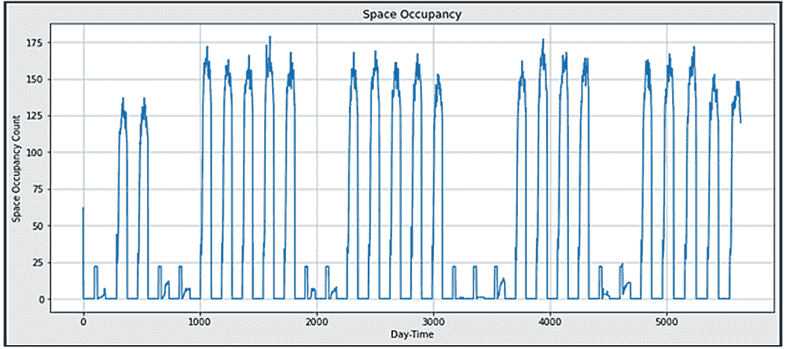 |

直方图通过将变量划分为箱（bins），在 X 轴显示箱，Y 轴显示计数，统计每个箱中的数据点数量。这里，箱代表所有地点的总空间以及当时被占用的空间总量。根据不同 `binwidth` 值的输出，箱的最佳值为 `10`。较小的带宽使图表变得拥挤，而较大的带宽可能会在数据中引入调制。从直方图中我们可以看到，`140` 到 `160` 之间的空间占用数量相当高，而且考虑到夜间和周末空间占用数量为零，因此其频率与其他时间相比非常高。

| 图 4. 使用直方图的空间占用分布 |
| --- |
| 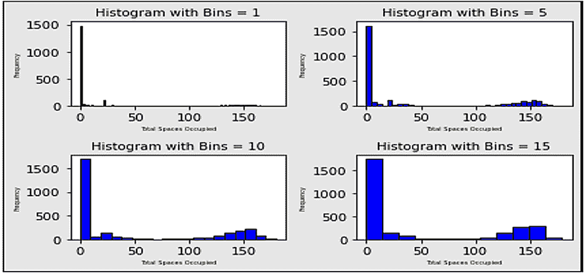 |

密度图提供了直方图的平滑、连续版本，我们可以通过绘制并相加所有空间占用数量的连续曲线，来获得单一的平滑密度估计。这里使用的核函数是 `Gaussian`（高斯），因此在每个数据点上都产生了钟形曲线（Reddy E.M.K, Gurrala A., Hasitha V.B., Kumar K.V.R, 2022）。需要考虑的主要点是，密度图中曲线下的总面积积分为 1 (Koehrsen, n.d.)。这种概率密度是 X 轴上的单位概率，而 Y 轴代表核密度估计的概率密度函数。通过密度图，我们比较了同一个客户的几个地点，可以看到 `location ids` 具有几乎相同的 `Space Occupancy Count`（空间占用数量）分布。

| 图 5. 使用密度图的空间占用分布 |
| --- |
| 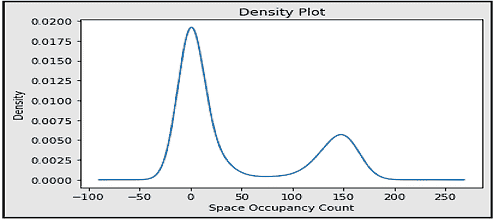 |

| 图 6. 使用密度图的不同地点空间占用 |
| --- |
| 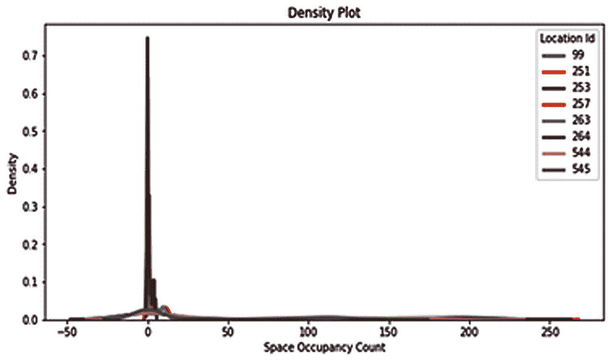 |

# 自相关分析

滞后图（Lag plot）是一种特殊的散点图，它是相对于时间 `i` 之前的 `K[th]` 滞后时期绘制的。这里绘制了一阶滞后图。此地数据显示出正线性趋势，表明数据中存在正相关性，且数据集中没有异常值。数据沿对角线紧密聚集，我们可以说数据具有强正相关性，即观测值与后续观测值之间存在非常强的关联。`Y[i]` 的值对 `Y[i+1]` 的值有很强的预测。

| 图 7. 使用滞后图的空间占用分布 |
| --- |
| 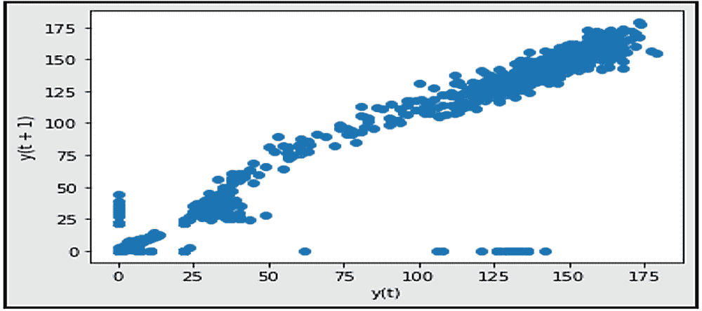 |

ACF（自相关函数）图提供了时间序列变量自相关结构的图形化表示，用于确定过去的预测误差，这些误差被用于判断过去值的可靠性程度 (Jones et al., 2009)。自相关图用于检查数据中存在的随机性。数据具有不同的滞后，因此数据集是非随机的。

单变量分析提供了对数据分布和随机性的理解。同时，数据的密度是平滑的。空间占用在上午 11:00 之后存在一种模式，我们可以看到占用数量开始增加，并在夜间减少到零，其他日子也是如此。通过这种方式，模型构建考虑了所有的假期和周末。

| 图 8. 基于时间的空间占用 |
| --- |
| 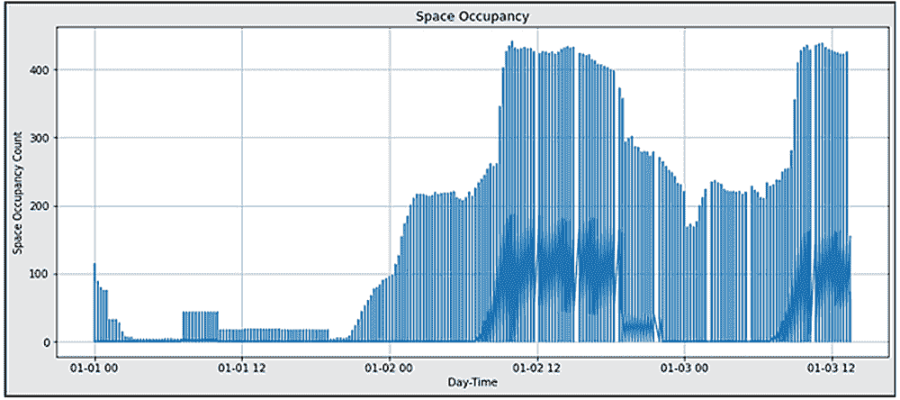 |

# 双变量分析

根据星期几对于不同的 `location ids`，我们可以追踪空间占用情况。这种双变量分析有助于理解办公地点与星期之间的关系。第 1 天是周末；因此空间占用数量为零。根据第 2 天和第 3 天的员工人数，特定地点存在某些峰值。

| 图 9. 不同办公地点基于星期几的空间占用情况 |
| --- |
| 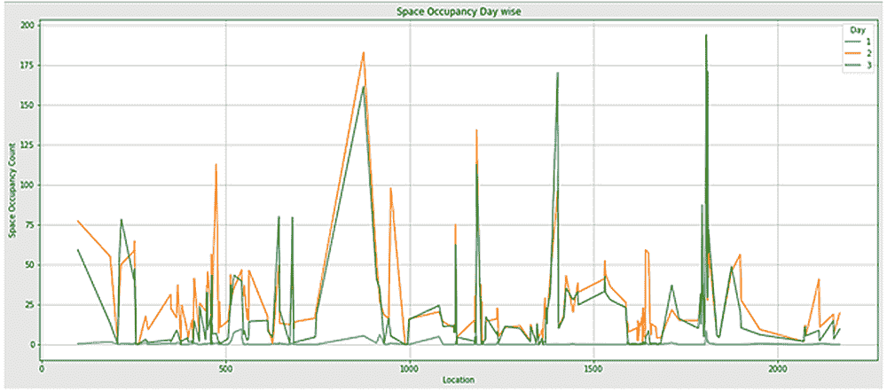 |

同样，根据一天中的时间对于办公地点而言，空间数量存在一种模式，例如在上午 11:00 左右办公空间突然增加，午餐时间（2:00 到 3:00 之间空间占用数量下降，晚上 10:00 之后空间占用数量开始一直减少到午夜，直到第二天晨。根据某些办公地点的班次时间，空间被少数员工占用。

| 图 10. 不同办公地点基于时间的空间占用情况 |
| --- |
| 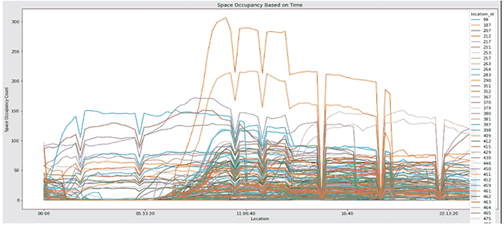 |

完成探索性数据分析后，将数据集按 70:30 的比例划分为训练集和测试集。我们拥有大量数据用于模型训练，剩余的测试数据集可以进一步用于验证和测试。为了验证和测试的目的，我们使用了不同的客户数据集来检查模型的准确性、正确性和稳健性。

根据性能，在测试的单变量时间序列模型中，最终确定的模型是 `ARMA` 和 `SARIMAX`；在多变量时间序列模型中是 `VAR` 模型。在这些模型中，单变量模型将用于预测客户单个办公地点的空间占用情况，而多变量模型将用于同时预测一个客户的多个办公地点或不同客户的多个办公地点。

### 结果与讨论

## 可视化解读

办公空间占用数量的可视化表示显示，取决于办公地点和工作类型（意味着轮班和员工类型），空间占用存在某种特定的模式。这种模式可以根据年份、月份、月中的几几、几几看出，在假期期间也可以看到相同的模式；如果员工有请假，则观察到模式发生了变化。不同客户和各种办公地点的数据，空间占用模式几乎相似。

主要重点是单变量分析，以理解数据之间的关系以及数据是否完全完全的。这有助于决定哪种时间序列预测模型适用于此类数据。空间占用的直方图根据其在不同办公地点的占用期间提供了空间占用范围。随着数据的变化，直方图视图发生了变化，但直方图的模式是相同的，呈现出不对性和双峰特征。箱线图视图对获取数据分析没有帮助。箱（bins）的定量范围显示了落在箱范围内空间占用值的分布。密度图通过核平滑处理了数据中存在的所有噪声，但数据中实际上并不存在噪声。密度图没有直方图那样的箱，且易于理解。这里，密度图具有平滑分布的双峰特征，并根据占用密度自动调整 X 轴上的值。根据 `Lag plot`，我们可以看到数据沿对角线紧密聚集，因此我们可以得出数据具有强正自相关性，且数据是非随机的。正如我们看到的数据点之间存在相关性，`ACF` 显示出正弦模式，且不同客户及其办公地点的空间占用数据的直方图、密度图和 `Lag Plot` 模式是相同的，仅有细微差异。

## 模型诊断

根据我们为办公空间利用确定的文献，研究人员提出了各种明智利用办公空间的方法，同时，研究人员确定的参数可以被用于细化对办公空间利用趋势的研究。根据数据分析，基于空间占用数量依赖的参数，并使用时间序列分析构建了预测模型。之前工作中建议的模型可以复制，因为它们的预测参数根据用例而不同，且在大多数情况下不适用于未来数据预测。

根据平稳性检验结果，我们发现数据集是平稳的，因此直接应用时间序列模型而无需任何转换。根据数据数据分析，进行单变量时间序列分析以研究滞后阶（即 `p` 值）、过去的预测误差 `q` 值、差分 `d`，但数据是平稳的，因此其值为零，且基于这些参数的模型并不适用，因为 `AIC` 和 `RMSE` 的值非常高。在测试集上验证这些模型表明，预测准确性非常低，因为 `RMSE` 值很高，且根据实际值与预测值的视化结果，实际值与预测值之间存在巨大差异。

| 图 11. 自回归预测准确率 |
| --- |
| 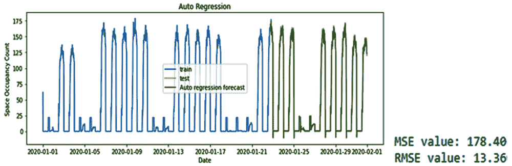 |
| 图 12. 移动平均预测准确率 |
| --- |
| 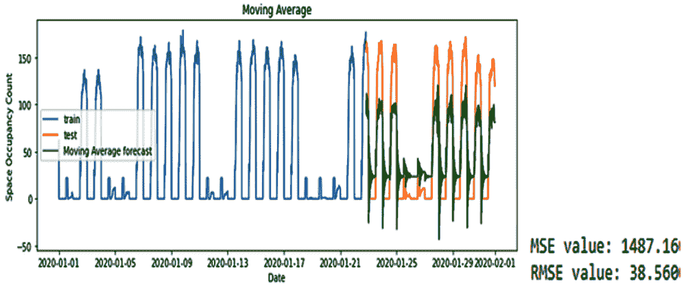 |
| 图 13. 自回归移动平均预测准确率 |
| --- |
| 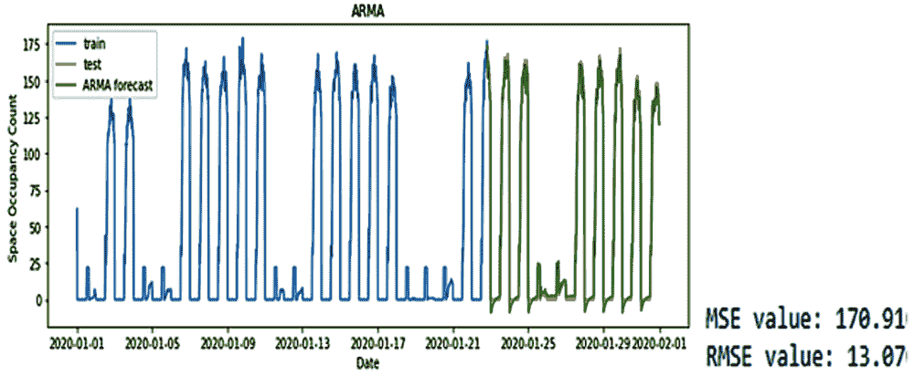 |
| 图 14. 自回归整合移动平均预测准确率 |
| --- |
| 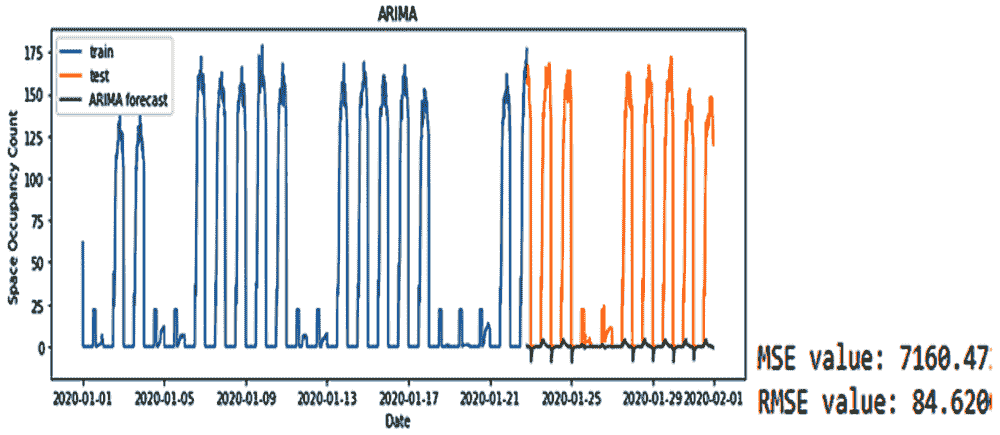 |
| 图 15. 季节性自回归整合移动平均预测准确率 |
| --- |
| 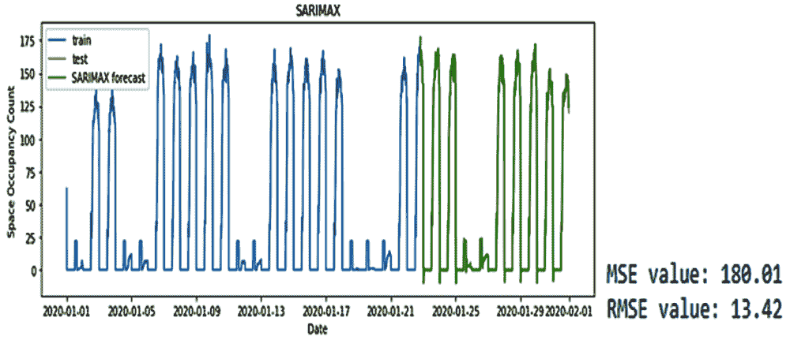 |
| 图 16. 向量自回归预测准确率 |
| --- |
| 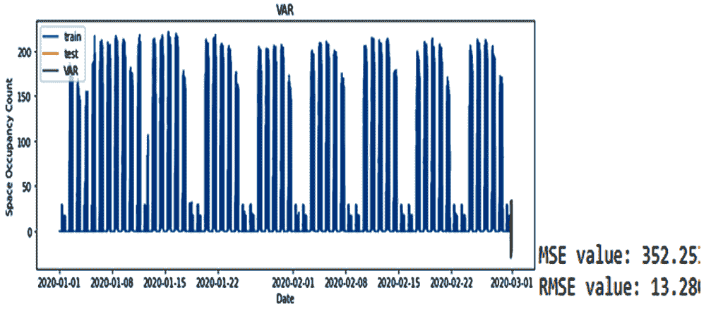 |

考虑到 `AIC` 和 `RMSE` 值，`ARMA` 和 `SARIMAX` 是适的，因此与其他单变量模型相比，它们提供的准确率足够高。通过使用不同的客户数据集对模型进行了比较研究，结果令人印象深刻，`SARIMAX` 模型表现出几乎一致的准确率，而 `ARMA` 模型则并不一致。在不同数据集上尝试模型时，模型参数 `p`、`d`、`q` 会随之相应。

单变量模型首先用于测试，以检查用于该数据的预测方法的兼容性。根据收到的结果，模型与数据集兼容，并可以使用它们预测未来的空间占用数量。但这些模型的构建仅考虑了单个客户及其单一办公地点，因此在构建模型时没有考虑其他变量。根据生产环境设置，此模型将用于具有单一办公地点的客户。

但为了在考虑多个办公地点的情况下同时预测所有客户的数据，使用 `VAR` 开发了多变量时间序列模型。多变量模型考虑了所有变量进行预测，未来如果添加任何额外变量，可以很容易纳入模型。该模型运行在不同的数据集上，滞后阶随数据变化而变化。因此定义了滞后阶集以避免手动选择并节省时间和资源。由于在不同客户及其不同办公地点的组合上运行，模型的 `RMSE` 值和准确率会有波动，但保持在适中范围内。

然而，我们的研究中没有提出 Holt-Winter 指数平滑技术，但根据测试集上的结果，与平滑技术相比，多变量 `VAR` 模型的准确率更高。目前数据平滑技术不存在可以避免的趋势和季节性。我们没有考虑使用 `LSTM` 和 `RNN` 等神经网络模型进行多变量预测。截至为止，尚未使用神经网络进行空间优化的工作。

# 研究分析

然而，基于对新冠疫情前数据的研究，任何国家任何办公地点的占用人数计数存在一致且可预测的模式；而且考虑到节假日和员工的休假，占用模式也是可预测的。这表明，在正常情况下，办公空间优化数据将有助于改进流程，减少空间管理不当的问题，并提高办公建筑的合理利用。此外，在未来，如果员工人数增加或减少，可以在不对现有架构进行重大更改的情况下合理利用办公空间。

在两个单变量模型中，`SARIMAX` 的性能更好，与 `ARMA` 相比，它是一个更通用的模型。通过季节性和非季节性参数，它还考虑了季节性周期的时间步，并根据我们提供的周期数据进行相应预测。由于模型参数需要随数据变化而改变，这些值已记录下来，并将根据数据经过少量修改后相应添加到模型中。多变量 `VAR` 模型也将进行类似的操作。

至此，单变量和双变量模型将使用最新数据或更多的虚拟测试数据进行几天的检查，以研究它们的性能。同时，模型将分别在新冠后数据集上进行训练，稍后将两个数据集合并，以观察对当前模型的影响。在合并前后数据集之前，数据将显示出某些趋势、季节性，且数据的平稳性会受到影响，相应的，将考虑本研究未提出的模型。

## 局限性

时间序列预测存在不确定性，因为我们不知道未来会发生影响预测的事件。这种不确定性包含了误差项 `ε[t+h]`、被预测序列的随机测量误差以及不可预见的数据修订。此外，预测不确定性可能由于模型近似误差和估计的模型参数引起。

为了获得更准确、确定的预测，可以根据历史参数和残差定义预测区间，或者对更复杂的非线性模型进行模拟。如果模型未能纳入预测估计的不确定性，则可以使用模拟样本外预测方法构建预测误差分布。如果模型使用截至某特定日期（例如 `t`）的数据进行估计，则对 `a` 步后的预测将是 。模型随后使用截至日期  的数据，并对  进行预测。通过推广 `AR(p)` 模型副本，可以使用蒙特卡洛实验分析 `ARMA` 模型的滞后阶数不确定性。

变量由于不同原因（如员工政策的变化、工作时间的变化）发生突然变化，导致模型不稳定增加。这些变化是结构性和渐进的；因此，监控模型性能至关重要。为了检测此类变化，可以应用不同的统计技术，通过估计系数的不稳定性或预测误差来检测检测。在实践中，确定不稳定性需要专家判断以获取更多信息并将更改整合到现有模型中。

## 未来建议

未来，数据集将包含新冠前数据，即测试 `SARIMAX` 和 `ARMA` 模型的数据。根据研究，重点是开发一个用于未来空间利用的稳健型模型。

## 结论

综而言之，研究了如 `SARIMAX` 和 `VAR` 等单变量和双变量模型。研究重点在于预测空间占用并提高办公建筑的利用率。

## 参考文献

- Bhogajaju, S. D., & Korupalli, V. R. (2020, January). Design of smart roads-a vision on indian smart infrastructure. In *2020 International Conference on COMmunication Systems & NETworkS (COMSNETS)* (pp. 773-778). IEEE. 10.1109/COMSNETS48256.2020.902740
- Bhogajaju, S. D., Kumar, K. V. R., Anjaiah, P., & Shaik, J. H. (2021). Advanced Predictive Analytics for Control of Industrial Automation Process. In *Innovations in the Industrial Internet of Things (IIoT) and Smart Factory* (pp. 33-49). IGI Global. doi:110.4018/978-1798-3375-8.ch003
- Cha, S. H., Steemers, K., & Kim, T. W. (2018). Modeling space preferences for accurate occupancy prediction during the design phase. *Automation in Construction*, 93, 135–147. doi:10.1016/j.autcon.2018.05.001
- Chen, Y., Hong, T. & Luo, X. (2018). An agent-based stochastic Occupancy Simulator. *Building Simulation*, 11(1), 37–49.
- Ghosh, B., Basu, B. & O’Mahony, M. (2009). Multivariate short-term traffic flow forecasting using time-series analysis. *IEEE Transactions on Intelligent Transportation Systems*, 10(2), 246–254.
- Hellerstein, J.L., Zhang, F. & Shahabuddin, P. (2001). 预测检测的统计方法。Computer Networks, 35(1), 77–95.
- Huang, L. (2015). 基于鲁棒卡尔曼滤波的陀螺仪随机噪声自回归移动平均 (ARMA) 建模方法。Sensors, 15(10), 25277–25286.
- Jones, S.S., Evans, R.S., Allen, T.L., Thomas, A., Haug, P.J., Welch, S.J. & Snow, G.L. (2009). 急诊科需求建模与预测的多元时间序列分析方法。Journal of Biomedical Informatics, 42(1), 123–139.
- Kalekar, P. (2004). 使用 Holt-Winters 指数平滑的时间序列预测。Kanwal Rekhi School of Information Technology, 1–13. 获取自：`https://www.it.iitb.ac.in/~praj/acads/seminar/04329008_ExponentialSmoothing.pdf`
- Kam, H. J., & Sung, J. O. (2010). 每日急诊人数预测。获取自：`www.e-hir.org`
- Kim, K.J. (2003). 使用支持向量机的金融时间序列预测。Neurocomputing, 55(1–2), 307–319.
- Kim, K.-J., & Han, I. (2010). 遗传算法在股票价格指数预测人工神经网络特征离散化应用。获取自：`www.elsevier.com/locate/eswa`
- Koehrsen, W. (n.d.). Python 中的直方图和密度图。Towards Data Science。获取自：`https://towardsdatascience.com/histograms-and-density-plots-in-python-f6bda88f5ac0`
- Kumar, K.V.R., & Elias, S. (n.d.). 从用例到仿真：使用 Openism 进行肌肉疲劳建模与分析。土耳其物理治疗与康复杂志, 32, 2.
- Kumar, K.V.R., Zachariah, A.A., & Elias, S. (n.d.). 使用 IMU 和机器学习算法对花滑表现进行定量分析。学术出版社。
- Li, S., Joe, J., Hu, J., & Karava, P. (2015). 集成光伏-热能收集器、辐射式地板供暖和主动热热的办公楼系统识别与模型预测控制。Solar Energy, 113, 139–157. doi:10.1016/j.solener.2014.11.024
- Lik Lau, B.P., Wijerathne, N., Kiat Ng, B.K., & Yuen, C. (2017). 智慧城市公共空间利用监测的传感器融合。学术出版社。
- Ma, R., Boubrahimi, S. F., Hamdi, S. M., & Angryk, R. A. (2017). 使用多元时间序列决策树进行太阳耀斑预测。鉴：2017 年 IEEE 大数据国际会议论文集，Big Data 2017。电气电子学会。10.1109/BigData.2017.8258216
- Material, M. (2016). 美国办公空间利用的演变。学术出版社。
- Plum, K. (n.d.). 什么是工作场所利用率？获取自：`https://www.advanced-workplace.com/what-is-a-workplace-study/`
- Reagan Nickl (Spacel). (2019). 空间利用率指标。获取自：`https://spaceiq.com/blog/space-utilization-metrics/`
- Reddy, E. M., Gurrala, A., Hasitha, V., & Kumar, K. R. (2022). 朴素贝叶斯简介及其子类型综述。用于机器学习应用的贝叶斯推理与高斯过程（第 1–14 页）。Chapman and Hall/CRC. doi:10.1201/9781003164265-
- Ryu, S. H., & Moon, H. J. (2016). 基于机器学习技术的室内环境数据占用预测模型开发。Building and Environment, 107, 1–9. doi:10.1016/j.buildenv.2016.039
- Salkind, N. (2012). 时间序列研究。载于《研究设计百科全书》。SAGE Publications, Inc.
- Stock, J. H. (2001). 时间序列：经济预测。载于《社会与行为科学国际百科全书》（第 15721–15724 页）。Elsevier. doi:10.1016/B0-043076-7
- Tabak, V. (2009). 空间利用仿真：办公楼使用系统。学术出版社。
- Tabak, V. & Vries, B. (2010). 办公人员中间活动预测方法。Building and Environment, 45(6), 1366–1372.
- Wang, Z., Zhang, M., Wang, D., Song, C. (2017). 办公空间利用预测，基于机器学习。Optics Express, 25. doi:10.1016/OE.25
- Yao, J., & Jiang, K. (2019). 基于网络模式的快速预测。鉴：第 18 届 IEEE 国际计算与信息会议。电气电子学会。10.1109/ACIS8439
- Zhou, Y., Tagliaro, C. & Hua, Y. (n.d.). 从小时到分钟：智能空间利用挑战。学术出版社。
- Zia Ullah, Q., Hassan, S., & Khan, G. (2017). 自适应资源利用。计算智能与神经科学。doi:10.1155/2017/48735

# 第十章：技术如何影响 CRM？

- **Anuska Sanyal**，Woxsen 大学，印度
- **P Ritwik**，Woxsen 大学，印度

### 摘要

本章探讨了客户关系管理（CRM）的基础及其历史演变。对于衡量 CRM 的指标至关重要，同时也讨论了 CRM 如何帮助过去的发展。

### 引言

CRM 吸引了业务的扩张。公司现在依赖有效的 CRM 技术、工具和策略来建立长期客户关系。预计公司不仅是为了利润销售产品，还为了满足客户的需求以提供良好的体验（Sulaiman & Said Musnadi, 2018）。公司旨在通过 CRM 与客户建立信任和沟通。CRM 的使命是提供最佳体验和价值。它是一种通过提高客户满意度和维护关系来吸引和留住客户的方法。

客户关系管理通过优化沟通、交付和现有客户关系来创造竞争优势。早些时候，小型企业从信任、关注客户、满足需求、定制订单、手动订单和客户追踪等所有满足需求的操作开始。当业务开始规模化时，必须采用大规模生产和大规模分销等措施来满足增长的需求。这就是 CRM 的用武之地。它允许用户在任何时间处理和编辑数据，而不是手动处理。

CRM 的用途不仅限于跟踪客户和订单，还提供了有关客户购买模式和偏好选择的信息。基于这些数据的推论有助于公司更好地理解消费者，并为沟通和其他营销销售策略提供见解。它有助于简化销售流程和客户服务（`Agrawal, 2004`#978-1-6684-4246-3.ch010.xhtml#r1）。

CRM 影响客户满意度，从而有助于增加公司收入并带来忠实客户。

CRM 能够将组织的营销、销售、客户服务等部门连接起来，并将他们所有的数据和活动维护在统一的系统中。每位用户都能轻松访问所有数据。这套 CRM 软件的成功得益于 `SaaS` 和云计算的结合。得益这两项技术，如今的 CRM 无论公司规模如何，都能帮助业务增长和扩展。

建立客户关系对于 B2B 和 B2C 市场来说同样重要。客户关系有两个视角：关系的广度和深度。广度描述了关系的各个不同阶段以及其发展过程。必须制定一种组织战略来维护关系并将其推向理想的阶段（Campbell et al. 2009, p.109）。CRM 有助于促进组织与其客户之间的关系。忠诚客户比不忠诚的客户更有利润、也更有价值。

## CRM 的演变

关于 CRM 存在着一种误解，认为它是新事物，而实际上它起源于 20 世纪中期。它始于手写笔记和通讯录（Rolodex），但随着数字技术的兴起，CRM 软件演变成了带有数据库的更复杂的产物。

在计算机发明之前，人们使用纸笔来记录业务数据。1950 年引入了通讯录，帮助追踪客户。20 世纪 80 年代，销售代表引入了数据库营销，并在 80 年代后期升级为联系人管理软件，这在目前被认为是基础 CRM 系统，并标志着 CRM 的基础。20 世纪 90 年代初见证了软件开发，销售自动化自动化（`SFA`）有望精炼销售流程并提高生产力。1995 年，“客户关系管理”术语被引入，CRM 软件安装在个人电脑上。20 世纪 90 年代后期，CRM 通过 Siebel 进入了在线时代。1999 年，随着软件即服务（`SaaS`）的推出，CRM 开始转向云端。从 2000 年开始，我们看到了云端和社交媒体带来的 CRM 趋势。参考下表查看 CRM 的演变。

| 图 1. CRM 的演变 |
| --- |
| ![978-1-6684-4246-3.ch010.png] |

CRM 市场似乎正在增长，尽管现有供应商难以跟上最新的趋势。云端和 `SaaS` 的 CRM 关注业务解决方案，Salesforce 正在根据平台进行持续变革。计算机的出现帮助许多行业实现了去中介化，并推动了 CRM 的演变（Agile）。

# 文献综述

客户关系管理是销售、营销和客户服务的整合，目标是通过客户满意度实现收入最大化（Kalakota and Robinson，2010）。为了灵活响应需求并实现客户忠诚度，企业必须努力建立长期的客户关系（SSuted）。最初，CRM 被视为一种客户关系技术（Ardiyanto, 2011）。然而，它是一种不仅仅是信息技术的整合战略（Crosby, 2002）。

客户满意度是业务的一个重要因素。CRM 工具允许企业定制和增强客户体验、产品可靠性，并协助更成功地管理关系，因此它可以影响客户满意度（Reinartz et al., 2004；Mithas et al., 2005）。客户满意度的提高、利润增加、成本降低以及流程质量的改进都是 CRM 实施的益处。由于 CRM 的益处是变化的且影响多个领域，因此很难量化。根据行业和业务性质（B2B 或 B2C），需要多种有效性指标（Chen, I.J. & Popvich, 2003)）。尽管如此，由于 CRM 采用是影响组织竞争力的战略大事，能够量化其优势至关重要（Teng et al., 2007；Mithas et al., 2005；Sin et al., 2005）。

## CRM 衡量指标

需要定期评估 CRM 性能以确定策略是否成功且具有长期可行性。增强关系战略目标和特征，以及在关系治理方面采取纠正措施，都受益于性能评估。如果没有相关的性能指标来评估客户关系管理活动，很难做出 CRM 修改或终止的决策。创建性能衡量绝非易事，因为大多数企业选择使用有的营销 KPI 来分析 CRM（Kaplan & Norton, 1992）。

为了评估 CRM 性能，建议根据每个计划的目的使用包含多个指标的平衡计分卡。

在业务中，用于监控 CRM（客户关系管理）性能的全球指标之一是关系满意度。衡量关系满意度决定了关系伙伴对其当前合作与协作伙伴关系的满意程度，这与目前企业通常使用的客户满意度类似。客户满意度衡量仅用于评估二元关系中一侧的满意度。相反，关系满意度衡量可以用于二元关系中的任何一方。应该对客户和公司的关系满意度都进行评估，因为双方必须表现良好才能实现合作关系（Biong, Parvatiyar, & Wathne, 1996）。通过评估关系满意度，可以预测每一方更倾向于维持关系持续还是终止关系。客户忠诚度同样可以用于衡量这种倾向。当根据前因创建关系满意度或忠诚度的测量量表时，它们可以提供关于决定这些变量因素的详细信息，有助于制定最可能增加关系满意度和/或忠诚度的管理行动策略。

# 客户关系管理如何造福企业

既然我们已经看到 CRM 如何驱动客户满意度和忠诚度，那么客户评价也被认为是中小型企业制定策略和提高销售额的关键。CRM 方法不仅用于客户服务，还有助于有效业务以增强当前策略并增加收入。因此，让我们深入探讨 CRM 如何造福企业。

## 与客户建立联系并培养忠诚度

客户忠诚度是公司重视他们并建立联系的标志。此外，它可能是开发更多潜在客户和扩大客户群的秘密。采用客户关系管理策略有几个重要好处，之一是改善了公司与潜在及现有客户之间的沟通。

使用 CRM 软件为公司如何与客户互动制定精确、详尽的策略是实现这一点的极佳方法。收集目标市场的数据是利用 CRM 系统识别与受众相关的趋势和提高客户满意度的方法来支持公司增长。（Mukesh K. Singhmar）

## 信息存储

在一个位置存储公司信息的能力是 CRM 系统的主要优点之一。将所有数据保留在一个位置，使得所有员工都能随时访问信息。由于与潜在客户和客户的互动可以在小组之间进行监控和共享，CRM 为销售提供了向上销售或账户扩展的机会。其次，由于信息可以追溯到特定时间，信息存储空间有助于减少问题和错误并节省时间。（Mukesh K. Singhmar）

## 成本低廉

CRM 解决方案通过即时提供当前数据，帮助企业减少在无效策略上的花费。

客户更容易了解客户对企业期望的什么，以及哪些产品、广告、营销技术和沟通渠道表现最好，因为 CRM 有助于了解更多品牌消费者的信息。

CRM 系统使企业能够分析客户购买模式、销售数据以及商品和服务的有效性，从而为未来更有效的营销计划提供支持。公司可以通过减少项目或服务的成本来增加利润率。（Mukesh K. Singhmar）

## 它支持组织管理

利用 CRM 系统也有助于内部组织。通过简化销售流程，CRM 还允许部门更好地组织。可以通过 CRM 预订会议，对任务进行优先级排序，公司内部的效率无疑将脱颖而出。（Mukesh K. Singhmar）

## 更有针对性的营销活动

使用 CRM 系统，营销活动可以变得更具针对性，取决于他们是潜在客户还是忠诚客户。根据过去的记录，未来的营销和策略将变得更加结构化和个性化。（Mukesh K. Singhmar）

## CRM 方面的 B2B 与 B2C

与 B2C 相比，B2B 的交易量大得多（Kumar and Reinartz 2012, s.261）。B2B 和 B2C 最大的区别在于 B2B 中买卖双方存在很大程度的独立性（Gummesson, 2008, s.174）。证据研究表明，B2B 使用 CRM 产生的收益比 B2C 多（Saini et al, 2010, s.366）。在 B2C 中，客户并不十分忠诚，因此他们往往频繁切换（Saini, Grewal and Johnson, 2010)）。由于业务伙伴之间需要更多信任，B2B 的忠诚度更高。此外，在 B2B 中，客户关系比服务或商品更有价值（Davis et al.2012, s.200）。

经验证据表明，与品牌或销售该品牌的零售商建立关系至关重要。尽管心理和社会因素往往占据主导地位（例如奢侈品、化妆品和生活方式品牌），但可能存在大量的“品牌因素”影响着市场中的消费者选择、行为和忠诚度。某些客户可能因为个性影响以及对与品牌建立关系的渴望而喜爱某个品牌。

即使客户尚未寻求与商品或服务建立关系，但他们也可能享受并重视与向他们提供商品或服务的销售人员建立的关系。在各种零售形式中已经引入了若干此类计划。在产品捆绑对于帮助客户构建需求至关重要的行业中（如服装、家居用品、化妆品），多种零售客户关系管理（CRM）方法已被证明是有效的。支持客户与企业开启对话是 CRM 工具的另一个可能的增值渠道。这种联系方式已通过大量的消费者呼叫中心、忠诚度计划和网站建立。然而，真正的对话需要双向通信。它要求实时、精确且详尽的客户数据。（Grahame Dowling, 2002)

## 销售周期与 CRM 目标

B2B 和 B2C 销售周期的目标都是通过一系列沟通和（特定的）内容来引导潜在客户，从建立品牌意识和线索开始，最终实现销售。如果跟进了详尽的客户服务，这种销售可能会带来重复业务和品牌忠诚度。

B2B 业务比单一消费者要复杂得多且多维度。公司可能会发现确定他们需要什么以及在哪里具有挑战性，因为在每个触点都可能存在若干限制和义务。CRM 系统的介入有助于解决这个问题。

B2B 客户关系管理可以帮助营销和销售团队详细跟踪单个线索，准确识别如何以及何时进展到销售漏斗的下一阶段，并自动化各种任务。

## CRM 与技术的整合

公司使用的技术类型被认为会影响业务表现和关系建立。

此类技术的引入可以被视为一种战略营销决策。使用联系管理软件的公司不太可能大幅提高其业务和关系表现。根据 IT 采纳文献，用户接受、功能和集成的全面结构是技术采纳的基础。将技术作为工作职责的一部分并取得结果的习惯性使用被称为“招募（recruitment）”。IT 研究人员发现，CRM 技术整合是组织技术成功的关键因素。（Woodburn, 2002)

个人经销商的独立客户联系应用程序与所有用户可访问的中央企业级数据库之间存在差异。整合方面展示了您的技术与业务其他部分的连接程度，确保了无缝的客户体验。

客户知识管理以及良好的客户数据收集、信息分析和知识检索流程是企业和客户在销售营销工具中所要求的。客户对应用的感知价值与行业有关。金融服务行业的公司认为，CRM 提供的知识管理能力对于培养客户关系重要且有价值。大多数公司认同技术可以用来提高客户忠诚度。

许多用户和客户提出了客户知识管理的概念，以及 CRM 技术如何用于“封装（Package）”客户知识。

大型组织更有可能对客户知识封装。

## 结论

将 CRM 技术整合到业务过程中对于现代企业至关重要。虽然 B2B 环境的复杂性带来了挑战，但 CRM 系统提供了跟踪线索和自动化任务的必要框架。

## 参考文献

- Gummesson, E. (2008). 质量、服务主导逻辑与多对多营销. 《TQM Journal》 , 20(2), 143–153. doi:10.1108/17542730810857372
- Johnson, Clark, & Barczak. (2012). 客户关系管理流程：企业对企业对客户盈利能力的忠诚度有多高？《Industrial Marketing Management》。 线上提前出版. doi:10.1016/j.indmarman.2012.04.001
- Kaplan, R. S., & Norton, D. (1992, 1-2 月). 平衡得分卡——驱动绩效的指标. 《哈佛商业评论》 , 70, 71–79. https://hbr.org/1992/01/the-balanced-scorecard-measures-that-drive-performance-2
- Kumar, V., & Reinartz, W. (2012). 《客户关系管理：概念、策略与工具》. Springer 出版社. doi:10.1007/978-3-642-20110-3
- Mithas, S., Krishnan, M. S., & Fornell, C. (2005). 为什么客户关系管理应用会影响客户满意度？《营销杂志》 , 69(4), 201–209. doi:10.1509/jmkg.2005.69.4.201
- Payne, A., & Frow, P. (2005). 客户关系管理的战略框架.《营销杂志》 , 69(4), 167–176. doi:10.1509/jmkg.2005.69.4.167
- Peppers, D., & Rogers, M. (2011). 《管理客户关系：战略框架》. John Miley & Sons 出版社. doi:10.1002/9781119239833.fmatter
- Saini, A., Grewal, R., & Johnson, J. L. (2010). 将面向市场的技术投入运用：CRM 绩效的组织驱动因素.《营销邮件》 , 21(4), 365–383. doi:10.1007/s11002-009-9096-z
- Salesforce. (2021a). B2B 销售漏斗与 CRM 系统的作用. 访问自 https://www.salesforce.com/uk/learning-centre/crm/b2b-crm
- Salesforce. (2021b). CRM 的完整历史. 获取自 https://www.salesforce.com/in/hub/crm/the-complete-crm-history
- Sin, L. Y. M., Tse, A. C. B., & Yim, F. H. K. (2005). CRM: 概念化与量表开发.《欧洲营销杂志》 , 39(11/12), 1264–1290. doi:10.1108/0309056051062353
- Singh, M. K. (n.d.). 为什么客户关系管理对你的业务非常重要. 获取自 https://eresponse.com/blog/why-relationship-management-is-important-for-business
- Sulaiman & Said Musadi. (2018). 客户关系管理、客户满意度及其对客户忠诚度的影响.ICMR 2018, 692-698. doi:10.5220/00889260692068
- Teng, K. L., Ong, S. G., & Ching, P. W. (2007). 不同行业制造企业对客户关系管理(CRM)的使用：一项调查.《国际管理杂志》 , 24.
- Woodburn, D. (2002). 客户关系管理：B2B 应对 B2C 棘手问题的深刻教训.《直销、数字营销实践杂志》 , 4(1), 19–32. doi:10.1057/pal.30

## 扩展阅读

- Agrawal, G. K., & Berg, D. (2009). 从技术视角看客户关系管理(CRM)环境中服务的发展.《服务科学与管理杂志》 , 2(04), 332–338. doi:10.4236/jssm.2009.2405
- Atlas, U. Z., & Toker, A. (2012). 客户关系管理在企业对企业市场的影响.《商业与工业营销杂志》 , 27(6), 497–507. doi:10.1108/088562121125197
- Baker, M. J., Buttery, E. A., & Richter-Buttery, E. M. (1998, 秋季). 三维度的关系营销.《互动营销杂志》 , 4(4), 47–62.
- Berry, L. L. (1995, 秋季). 服务关系营销——日益增长的兴趣与新兴视角.《营销科学学院杂志》 , 23(4), 236–245. doi:10.1177/0092070395023004
- Coltman, T., Devinney, T. M., & Midgley, D. F. (2011). 客户关系管理与公司绩效.《信息技术杂志》 , 26(3), 205–219. doi:10.1057/jit.2010.39
- Crosby, L. A., & Stephens, N. (1987, 11 月). 人寿保险行业关系营销、留存与价格的影响.JMR, 营销研究杂志 , 24(4), 404–411. doi:10.1177/0022243787024004
- Das, K. (2009). 关系营销研究(1994-2006): 学术文献综述与分类.《营销智能与规划》 , 27(3), 326–363. doi:10.1108/0263450091095523
- Dwyer, F. R., Schurr, P. H., & Oh, S. (1987, 4 月). 开发买卖关系.《营销杂志》 , 51(2), 11–27. doi:10.1177/00222429870510022
- Kale, S. H. (2004). CRM 失败与七大罪孽.《营销管理》 , 13(5), 42–46. 获取自 https://www.researchgate.net/publication/232608105_CRM_Failure_and_the_Seven_Deadly_Sins
- Mousavy, S. K. (2012). 客户关系管理(CRM)及其对竞争优势的影响研究.《生命科学杂志-郑州大学海外版》，，9(4), 4167–4173.
- Parvatiyar, A., & Sheth, J. N. (2001). 客户关系管理：新兴实践、流程与学科.《经济与社会研究杂志》 , 3(2), 1–34. https://www.researchgate.net/publication/312458264_Customer_relationship_Emerging_practice_and_discipline
- Reinartz, W., Krafft, M., & Hoyer, W. D. (2004). 客户关系管理流程：其衡量与影响.JMR, 营销研究杂志 , 41(4), 293–305. doi:10.1509/jmkr.41.3.293.359
- Richard, J. E., Thirkell, P., & Huff, S. L. (2007). CRM 的战略价值：技术采用视角.《战略营销》 , 15(5), 421–439. doi:10.1080/02648043701726
- Ulaga, W., & Eggert, A. (2006). 关系价值与关系质量：扩展企业对企业的理论网络.《欧洲营销杂志》 , 40(3/4), 311–327. doi:10.1108/03090560610648

# 第 11 章：外国直接投资对印度医药行业经济增长的影响

*   Pingili Sravya
    印度，Woxsen 大学
*   Rajesh Kumar K. V.
    
    印度，Woxsen 大学

### 摘要

本实证研究解释了外国直接投资（FDI）对印度医药行业经济增长的影响。详细介绍了 FDI 与印度的关系、影响及未来趋势。研究应用了 `e-views` 软件，涉及的统计工具包括 `VECM`、普通最小二乘法和 `VAR`。研究考虑了 2011 年至 2021 年的次级数据。研究评估了 FDI 与医药行业之间存在良好的关联。

### 引言

外国直接投资（FDI）被描述为“为获得或扩大生产性资产的所有权而进行的跨境支出”。FDI 对一个国家的经济增长至关重要。外国投资者的资金有助于印度加强基础设施、提高产量并提供职业机会。此外，FDI 还充当了制定尖端技术和动员外汇资源的渠道。该国对外贸易援助允许 `RBI`（印度储备银行）干预外汇市场并限制不利的变动以稳定汇率。因此，它为印度经济的增长创造了更有利的 de 经济环境。

印度被认为是全球低成本通用药的中心，这对于确保贫困国家的健康权至关重要。制药行业需要外国直接投资（FDI）来向印度引入更先进、更安全的技术。然而，印度目前的 `FDI` 法律需要重新审查。印度政府还应确保过度的外国投资不会损害当地业务和企业（特别是从事通用药的企业）、印度市场以及印度的药品价格。现任 `NDA` 政府的创业政策、`Pharma Vision 2020` 及其有效执行至关重要。如果上述建议得到有效执行，制药行业的 `FDI` 将实现其目标。印度的制药业务在实施福利国家方面具有重要意义。该行业的经济发展、通用产品的可用性以及强有竞争对印度至关重要。在权衡了印度制药行业 `FDI` 的优缺点后，已经确定印度需要足够的 `FDI` 及其溢效应来促进行业发展。政府一直致力于制定政策以确保行业的整体增长。自 2001 年以来，制药行业已允许 100% 的外资（`FDI`）。这使制药行业受益匪浅。`MNCs` 在 2006 年至 2010 年间收购了多达六家印度主要公司。这并没有导致价格上涨或通用药短缺。凭借熟练且廉价的劳动力，印度是 `MNCs` 的一个巨大前景市场。然而，对制药行业 `FDI` 的担忧依然存在。尽管数据尚未表明这些问题，但它们随着时间的推移可能会出现（Bhogaraju et al., 2021; Seeja et al., 2021）。

需要对制药行业的 `FDI` 进行某些政府监管。中央政府已宣布，对于制药行业的 `Brownfield`（绿地）投资，可以通过 `FIPB` 审批通道允许最长六个月的 `FDI`。在此期间，政府将为 `印度竞争委员会` 的监管提供必要的赋能框架。六个月后，`印度竞争委员会`（`CCI`）将根据国家的竞争规则监督该过程。现有的（`FIPB`）和计划中的（`CCI`）许可程序对于潜在的不熟悉投资者来说似乎是速度的障碍，因为他们可能需要证明自己没有意图合谋或参与掠夺性定价或任何反竞争活动。如果政府做了必要的调整，并将 `CCI` 的权限扩大到涵盖 `MNCs` 的所有重大医药收购，将确保制药部门的透明竞争。政府可以实施替代性的公共政策，例如针对公共利益公共购买通用产品和对关键药物进行价格控制。另一方面，`CCI` 是一个相对新的实体。它的知识局限于行业的竞争力。印度政府做出了一个非常有希望的选择，使 `CCI` 成为制药行业整体合并和 43 项收购的监管者。尽管如此，它必须确保对《2002 年竞争法》进行必要的修改，并扩大委员会的管辖范围。

| 图 1. 行业图示 |
| --- |
| 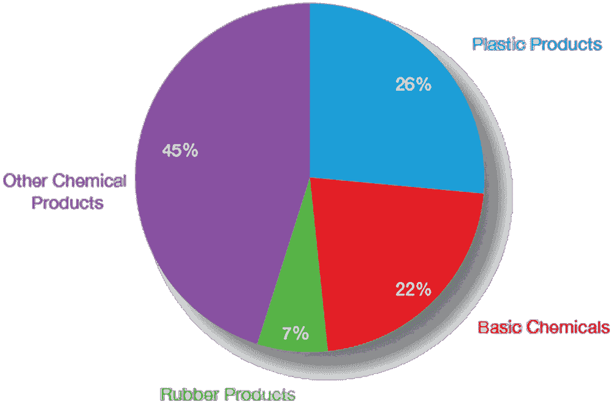 |

# 文献综述

根据对人工智能（`AI`）在制药价值链数字化转型功能的研究结果，制药行业竞争力的增强吸引了国际投资。医疗保险和人寿保险政策等医疗支出增加导致了制药部门的增长，吸引了投资。因此，印度制药行业仍然是国际医药公司和投资者的吸引之地。该研究是关于印度制药行业外国直接投资的分析研究。然而，印度目前的 `FDI` 法律需要重新审查。印度政府还应确保过度的外国投资不会损害当地业务和企业（特别是从事通用药的企业）、印度市场以及印度的药品价格。在这方面，现任 `NDA` 政府的创业政策、`Pharma Vision 2020` 及其有效执行至关重要。为了响应印度遵守世界贸易组织知识产权协定（`TRIPS`）的努力，跨国公司（`MNCs`）增加了制药研发（`R&D`）和生产领域 `FDI`（`FDI`）的数量和质量。另一方面，`MNCs` 在印度突破和营销医药产品方面采取了更谨慎的方法，等待观察印度法院和专利机构对新法规的解释，并采用独占性数据法（Dhar & Joseph, 2019; Jain & Rautela, 2018; Yadav, 2017）。

然而，政策的设计应当减少（如果不能消除的话）对 FDI 流入某国家的反对意见或劣势。这也是必要的，因为该行业允许 100% 的外国直接投资。这“对我们的整体健康和知识产权框架在药物获取、负担能力、优势和拥堵方面构成直接威胁”。外国直接投资（`FDI`）是许多国家和外国资金的重要来源。研究跨越了十年，从 2000-01 年到 2009-2010 年。研究显示，通过外汇收入、销售额、出口、利润和资产评估并不影响制药企业的增长。作者发现，制药公司的 `FDI` 不影响选定财务参数的总体增长（Jain & Rautela, 2018; Joseph & Ranganathan, 2016; Safiuddin & Samad, 2015）。

关于印度制药行业 FDI 流入问题前景的研究表明，由于 FDI 带来了资金和管理资源、巨大的市场、技术支持以及品牌等战略资产，东道公司获得了本地和国际竞争优势。观察发现，FDI 集中具有巨大潜力，特别是在出口和利润方面。

根据对印度制药行业外国直接投资的研究，尽管印度已大幅放宽了外资政策，但直到最近，外国直接投资的流入一直远低于目标。制药行业的领导者应该增加其 `R&D` 支出。学术合作将在药物开发方面使制药行业受益（Akhtar, 2014; Dhande & Magar, 2015; Mehta, 2012; Mudassir & Safiuddin, 2015)。

根据《印度制药行业外国直接投资研究》，外国直接投资模式是印度引入最先进技术最快捷、最安全且最有效的方式。印度是一个仿制中心，在未来几年内将吸引大量的 FDI 流入。根据《印度制药行业外国直接投资研究》，外国直接投资是印度引入尖端技术最快、最安全且高效的手段。印度是一个仿制枢纽，将获得大量的 FDI 流入。Ronny Thomas 先生好。本研究将尝试说明自 1991 年以来经济自由化带来的机遇。此外，通过将该国的记录与其他发展中国家进行比较，展示印度如何在 FDI 的推动下社会和经济取得了怎样的发展。最后，它将证明外国直接投资如何帮助印度的基础设施建设项目，以及该国在提供与发达国家相当的生活质量方面仍面临的困难（Akhtar, 2014; Bergman, 2006; Dhande & Magar, 2015; Maathai, 2005; Mehta, 2012; Mudassir & Safiuddin, 2015）。

作者研究了印度制药部门的 FDI 及其溢出效应。这项研究探讨了 FDI 及其对印度制药行业的溢出效应。研究调查了跨国公司对印度当地制药公司的水平生产力溢出效应，以及溢出效应可能产生的可能传输路径。制药行业是技术密集型和资本密集型行业，而印度是少数具有竞争优势的发展中国家之一。《印度医疗保健行业外国投资趋势研究》表明，印度的医院和诊所依赖于想要赚快钱私募股权投资者，且对增长没有长期计划。这对于印度这样一个国家的普通人口产生了重大影响，因为该国对医疗保健的投资极少，而自付医疗支出正导致数百万人陷入贫困。本研究的主要目标是利用 1990-91 至 2000-01 的年度数据，调查部门层面外国直接投资（FDI）与总产（`GO`）、出口（`EX`）和劳动生产率（`LPR`）之间的长期联系。研究使用了面板协整（`PCONT`）测试，结果显示流入部门的 FDI 有助于增加特定部门的生产力和出口，但预计 FDI 在部门层面还将发挥更好的作用。结果还显示，关键部门的 FDI、`GO`、`EX` 和 `LPR` 等变量之间不存在性的协整关系。我们可以得出结论，FDI 的引入尚未影响印度经济（Bergman, 2006; Kathuria & Das, 2005; Maathai, 2005; Mehta, 2012; Mudassir & Safiuddin, 2015）。作者将 FDI 视为跨国公司传输技术能力的渠道。针对 1996-2001 年的多元回归显示了 FDI 对印度增长的影响。该研究使用 Probit 和 Tobit 模型考察了 FDI 对出口的影响。

| 医药行业 | 0.002* | - | - |
| GDP | 0.003* | - | - |

来源：次级数据

分析注释了 `FDI` 在印度经济运行中在 `广义 Dickey-Fuller 检验`（ADF 检验）下的单位根检验结果。这一考察结果显示，由于 `P 值` 在 5% 的水平上显著，`FDI` 显著。`医药行业`和 `GDP` 在等级检验中显著，因为它们的 `p 值` 在 5% 处有效，即 `0.002` 和 `0.003`。因此，这三个变量被认为是平稳的。因此，这些变量适用于研究目的。

*   `H0`: `FDI` 投资与印度经济之间不存在关联。
*   `H1`: `FDI` 投资与印度经济之间存在关联。

### 表 2. FDI 与医药行业的 VAR 滞后阶数选择标准

| VAR 滞后阶数选择标准 |
| --- |
| 内生变量：`FDI PHARMA` |
| 外生变量：`C` |
| 样本：1 17 |
| 包含观测值：10 |

| 滞后 | LogL | LR | FPE | AIC | SC | HQ |
| --- | --- | --- | --- | --- | --- | --- |
| 0 | -384.8250 | NA* | 3.43e+18* | 48.35313* | 48.44970* | 48.35808* |
| 1 | -383.0714 | 2.849633 | 4.58e+18 | 48.63393 | 48.92365 | 48.64876 |

`*` 表示由标准选择的滞后阶数
`LR`: 序列修正 LR 检验统计量（每个检验均在 5% 水平）
`FPE`: `最终预测误差`
`AIC`: `赤池信息准则`
`SC`: `Schwarz 信息准则`
`HQ`: `Hannan-Quinn 信息准则`

上述检验揭示了向量误差修正标准的第一步。在这里，结果表明滞后阶数处于滞后一阶，并宣布在向量误差估计中实施 `lag 1` 后会有后续步骤。`Lag 1` 通过通过 `LR`、`FPR`、`AIC`、`SC` 和 `HQ` 获得的领先数进行标记。

### 表 3. FDI 与医药行业的向量误差估计

| 向量误差修正估计 |
| --- |
| 日期：07/20/21 时间：15:09 |
| 样本（调整后）：3 17 |
| 调整后包含观测值：15 |
| ( ) 内为标准误，[ ] 内为 t 统计量 |
| 协整方程 | CointEq1 |
| FDI(-1) | 1.000000 |
| PHARMA(-1) | 0.074284 |
| (0.09221) |
| [ 0.80558] |
| C | -20559.09 |
| 误差修正 | D(FDI) | D(PHARMA) |
| CointEq1 | -0.872855 | -4.073711 |
| (0.33415) | (3.17058) |
| [-2.61220] | [-1.28485] |
| D(FDI(-1)) | -0.020552 | 1.726444 |
| (0.28459) | (2.70033) |
| [-0.07222] | [0.63935] |
| D(PHARMA(-1)) | 0.107719 | -0.914050 |
| (0.04268) | (0.40498) |
| [2.52385] | [-2.25702] |
| C | -2040.056 | 30731.65 |
| (3791.24) | (35973.7) |
| [-0.53810] | [0.85428] |
| R-squared | 0.604498 | 0.89974 |
| Adj. R-squared | 0.693621 | 0.78148 |
| 残差平方和 | 2.01E+09 | 1.81E+11 |
| S.E. equation | 13522.11 | 128306.4 |
| F-statistic | 3.733242 | 5.275850 |
| Log-likelihood | -161.6391 | -195.3906 |
| Akaike AIC | 22.08522 | 26.58541 |
| Schwarz SC | 22.27403 | 26.7742 |
| 均值依赖 | 1646.267 | 264.951 |
| 标准差依赖 | 17027.63 | 17763.0 |
| 协方差（调整后） | 2.92E+18 | |
| 协方差 | 1.57E+18 |
| Log-likelihood | -356.8104 |
| Akaike information criterion | 48.9085 |
| Schwarz criterion | 49.3808 |
| 系数个数 | 10 |

分析展示了向量误差修正模型（VECM）的第二步。在这里，结果规定 `FDI` 与医药行业之间存在正相关关系，系数显著性为 `0.107719`，即正值。研究得到的 R 方大于 `0.6`，说明模型是有效的。外来投资之间存在良好的联系。
`H0`: `FDI` 与医药行业之间不存在长期关联。
`H1`: `FDI` 与医药行业之间存在长期关联。

### 表 4. FDI 与医药行业的 Wald 检验

| Wald 检验 |
| --- |
| 系统: % |
| 检验统计量 | 值 | df | 概率 |
| 卡方 | 8.70237 | 2 | .0129 |
| 零假设：C(1)=C(3)=0 |
| 零假设摘要： | |
| 值 | 标准 |. |
| C(1) | -0.872855 | 0.334145 |
| C(3) | 0.107719 | 0.042681 |
系数限制是线性的。分析解释了 `FDI` 投资与医药行业之间的关联。观察到卡方值小于临界值，说明存在短期关联。p 值小于 `0.05`，即 `0.0129`。

### 表 5. FDI 与 GDP 的 VAR 滞后阶数标准

| VAR 滞后阶数选择标准 |
| --- |
| 内生变量：`FDI GDP` |
| 外生变量：`C` |
| 日期：06/16/21 时间：12:43 |
| 样本：1 10 |
| 包含观测值：10 |

| 滞后 | LogL | LR | FPE | AIC | SC | HQ |
| --- | --- | --- | --- | --- | --- | --- |
| 0 | -520.7682 | NA* | 8.22e+25* | 65.34602* | 65.44259* | 65.35097* |
| 1 | -518.3986 | 3.850525 | 1.02e+26 | 65.54983 | 65.83955 | 65.56466 |

`*` 表示由标准选择的滞后阶数
`LR`: 序列修正 LR 检验统计量（每个检验均在 5% 水平）
`FPE`: `最终预测误差`
`AIC`: `赤池信息准则`
`SC`: `Schwarz 信息准则`
`HQ`: `Hannan-Quinn 信息准则`

上述研究指示向量误差修正模型的第一步。在这里，结果建议滞后阶数选择为滞后零阶，说明向量误差估计中具有 `lag 0` 的含义。`Lag 0` 由 `LR`、`AIC`、`SC` 和 `HQ` 的星号标记决定。

### 表 6. FDI 与 GDP 的向量误差估计

| 向量误差修正估计 |
| --- |
| 日期：06/16/21 时间：12:43 |
| 样本（调整后）：3 10 |
| 调整后包含观测值：10 |
| ( ) 内为标准误，[ ] 内为 t 统计量 |
| 协整方程 | CointEq1 |
| FDI(-1) | 1.000000 |
| GDP(-1) | 2.55E-05 |
| (1.2E-05) |
| [2.15681] |
| C | -19958.86 |
| 误差修正 | D(FDI) | D(GDP) |
| CointEq1 | -0.516608 | -16674.29 |
| (0.28765) | (14397.4) |
| [-1.79594] | [-1.15814] |
| D(FDI(-1)) | -0.266162 | 33416.04 |
| (0.25230) | (12628.0) |
| [-1.05494] | [2.64619] |
| D(GDP(-1)) | 2.08E-06 | -0.14431 |
| (6.0E-06) | |
| [0.34871] |
| C | 1785.72 | 7511.8 |
| [-0.53075] | [0.4622] |
| R-squared | 0.390122 | 0.542218 |
| Adj. R-squared | 0.223792 | 0.417368 |
| 残差平方和 | 2.48E+09 | 6.20E+18 |
| S.E. equation | 15001.80 | 7.51E+08 |
| F-statistic | 2.345468 | 4.342964 |
| Log-likelihood | -163.1968 | -325.5088 |
| Akaike AIC | 22.29291 | 43.93451 |
| Schwarz SC | 22.48172 | 44.12333 |
| 均值依赖 | 1646.267 | 264.951 |
| 标准差依赖 | 17027.63 | 17763.0 |
| 协方差（调整后） | 1.04E+26 | |
| 协方差 | 5.61E+25 |
| Log-likelihood | -487.2344 |
| Akaike information criterion | 66.29792 |
| Schwarz criterion | 66.76996 |
| 系数个数 | 10 |

# 表 7. 外国直接投资 (FDI) 与国内总值 (GDP) 的 Wald 检验

| Wald 检验: |
| --- |
| 系统: `%system` |
| 统计量 | 数值 | df | 概率 |
| 卡方值 | 5.007400 | 2 | 0.0218 |
| 原假设: `C(1)=C(3)=0` | | | |
| 原假设总结: | | | |
| 归一化限制 (= 0) | 数值 | 标准误 |
| `C(1)` | -0.516608 | 0.287654 |
| `C(3)` | 2.08E-06 | 5.97E-06 |
| 限制条件对系数而言是线性的。

该分析研究了 FDI 收购与印度经济（即 GDP）之间的相关性。检验结果显示两者之间存在短期相关性，因为卡方值往往小于临界值，即 `5.007<5.991`。调查表明 FDI 与印度经济（即 GDP）之间存在显著相关性。

**目标：** 了解 FDI 流量对印度经济和制药行业的影响。

*   `H0`: FDI 与制药行业之间没有方向性结果。
*   `H1`: FDI 与制药行业之间存在方向性结果。

# 表 8. 关于 FDI 和制药板块的格兰杰因果检验

| 两两之间的格兰杰因果检验 |
| --- |
| 日期: 07/20/21 时间: 15:20 |
| 样本: 1 17 |
| 滞后阶: 2 |
| 原假设 | 观测值 | F 统计量 | 概率 |
| `PHARMA` 不格兰杰地导致 FDI | 10 | 0.78410 | 0.0427 |
| FDI 不格兰杰地导致 `PHARMA` | 1.15339 | 0.3542 |

该表研究了 FDI 对制药行业的单向影响。研究估计的 p 值小于 `0.05`，这意味着两者之间存在积极影响，且 FDI 对制药行业有一个侧效应。结果显示观测数量为十，f 统计量值为 `0.78410`。因此，这表明 FDI（外国直接投资）与印度经济（即制药行业）之间存在方向性影响。

*   `H0`: FDI 流量对制药行业没有影响。
*   `H1`: FDI 流量对制药行业有影响。

# 表 9. FDI 对制药行业的影响。

| 因变量: `FDI` |
| 方法: 最小最小二乘法 |
| 日期: 07/20/21 时间: 15:25 |
| 样本: 1 17 |
| 包含观测值: 17 |
| --- |
| 变量 | 系数 | 标准误 | t 统计量 | 概率 |
| `C` | 15625.03 | 3633.065 | 4.300785 | 0.0006 |
| `PHARMA` | 0.001134 | 0.026187 | 0.043291 | 0.0460 |
| `Required` | 0.000125 | `Meanddependentvar` | 15695.59 |
| `Adjusted R-squared` | -0.066533 | `S.D.dependentvar` | 12963.28 |
| `S.E. of regression` | 13387.58 | `Akaikeinfocriterion` | 21.95217 |
| `Sum squared resid` | 2.69E+09 | `Schwarz criterion` | 22.05020 |
| `Loglikelihood` | -184.5935 | `Hannan-Quinn criteria.` | 21.96192 |
| `F-statistic` | 0.001874 | `Durbin-Watson stat` | 1.540854 |
| `Prob(F-statistic)` | 0.966040 | | |

上述研究确定了 FDI 对制药行业的影响。研究结果得出了积极影响，即系数值 `0.001134`。p 值小于 `0.05`，意味着这些变量是显著的。自变量是制药行业，因变量是 `FDI`。研究评估了 FDI 正在通过制药行业的增长而增加。研究暗示制药行业对因变量有积极影响。

*   `H0`: FDI 流量与制药行业之间没有影响。
*   `H1`: FDI 流量对制药行业有影响。

# 表 10. 关于 FDI 与 GDP 的格兰杰因果检验。

| 两两之间的格兰杰因果检验 |
| --- |
| 日期: 07/20/21 时间: 15:20 |
| 样本: 1 17 |
| 滞后阶: 2 |
| 原假设 | 观测值 | F 统计量 | 概率 |
| `GDP` 不格兰杰地导致 FDI | 10 | 0.78410 | 0.0427 |
| FDI 不格兰杰地导致 `GDP` | 1.15339 | 0.3542 |

该表研究了 FDI 对制药行业的单向影响（注：此处原文表述与表格内容有出入，按原文逻辑翻译）。研究估计的 p 值小于 `0.05`，意味着两者之间存在积极影响，且 FDI 对制药行业有一个侧效应。结果显示观测数量为十，f 统计量值为 `0.78410`。因此，这表明 FDI（外国直接投资）与印度经济（即制药行业）之间存在方向性影响。

# 表 11. FDI 对制药行业的影响。

| 因变量: `FDI` |
| 方法: 最小最小二乘法 |
| 日期: 07/20/21 时间: 15:25 |
| 样本: 1 17 |
| 包含观测值: 17 |
| --- |
| 变量 | 系数 | 标准误 | t 统计量 | 概率 |
| `C` | 15625.03 | 3633.065 | 4.300785 | 0.0006 |
| `PHARMA` | 0.001134 | 0.026187 | 0.043291 | 0.0460 |
| `Required` | 0.000125 | `Meanddependentvar` | 15695.59 |
| `Adjusted R-squared` | -0.066533 | `S.D.dependentvar` | 12963.28 |
| `S.E. of regression` | 13387.58 | `Akaikeinfocriterion` | 21.95217 |
| `Sum squared resid` | 2.69E+09 | `Schwarz criterion` | 22.05020 |
| `Loglikelihood` | -184.5935 | `Hannan-Quinn criteria.` | 21.96192 |
| `F-statistic` | 0.001874 | `Durbin-Watson stat` | 1.540854 |
| `Prob(F-statistic)` | 0.966040 | | |

上述研究确定了 FDI 对制药行业的影响。研究结果得出了积极影响，即系数值 `0.001134`。p 值小于 `0.05`，意味着这些变量是显著的。自变量是制药行业，因变量是 `FDI`。研究评估了 FDI 正在通过制药行业的增长而增加。研究暗示制药行业对因变量有积极影响。

*   `H0`: FDI 流量与制药行业之间没有影响。
*   `H1`: FDI 流量对制药行业有影响。

在全球制药行业，印度占据着重要地位且正在迅速扩张。它提供了全球 20% 的供应，并满足了全球 62% 的疫苗需求。它是全球最大的仿药供应国。现在是所有利益相关者（政府、学术界和工业界）为这一未来投资的时候，以便印度政府能够实现 2025 年成为 5 万亿美元经济体的目标。当前分析分析了 `FDI`（外直接投资）对印度制药行业经济的影响。研究发现，制药行业的 `FDI` 与国内生产总值（`GDP`）之间存在良好的关联性。结果表明，`FDI` 的积极作用促进了制药行业的发展，`FDI` 对 `GDP` 产生了积极影响。结论还认为，在 `FDI` 的影响下，未来 `GDP` 将向好增长。据认为，随着 `R&D` 支出的显著增加和新药投入，新医药行业将更健康地增长。因此，对于跨国公司和投资者而言，印度制药行业仍然是一个具有吸引力的目的地。

## 参考文献

- Akhtar, G. (2014). Problem and Prospect of FDI Inflows in Indian Pharmaceutical Industry. IOSR Journal Of Humanities And Social Science , 19(3), 69–73. doi:10.9790/0837-19316973
- Bergman, A. (2006). FDI and spillover effects in the Indian pharmaceutical industry. Academic Press.
- BhogarajuS. D.KorupalliV. R. K. (2020). Design of Smart Roads-A Vision on Indian Smart Infrastructure Development. 2020 International Conference on COMmunication Systems & NETworkS (COMSNETS), 773–778. 10.1109/COMSNETS48256.2020.9027404
- Bhogaraju, S. D., Kumar, K. V. R., Anjaiah, P., & Shaik, J. H. (2021). Advanced Predictive Analytics for Control of Industrial Automation Process . In Innovations in the Industrial Internet of Things (IIoT) and Smart Factory (pp. 33–49). IGI Global.
- Dhande, N. C., & Magar, A. V. (2015). A Study of Foreign Direct Investment in Indian Pharmaceutical Industry. International Journal (Toronto, Ont.) , 3(7).
- Dhar, B., & Joseph, R. K. (2019). India’s information technology industry: A tale of two halves . In Innovation, Economic Development, and Intellectual Property in India and China (pp. 93–117). Springer.
- Granger, C. W. (1969). Some recent developments in a concept of causality. Journal of Econometrics, 39 .
- Jain, H., & Rautela, M. (2018). FDI in Indian pharmaceutical sector. Available at SSRN 3153434.
- Joseph, R. K., & Ranganathan, K. V. K. (2016). Trends in Foreign Investment in Healthcare Sector of India. ISID Working Paper No. 187. Institute for Studies in Industrial Development (ISID).
- Kathuria, V., & Das, S. (2005). Impact of FDI on R&D strategies of firms in the post-1991 era. IIMB Management Review , 17(2), 17–28.
- Maathai, K. D. (2005). Mathiyazhagan, Impact of foreign direct investment on Indian economy: A sectoral level analysis. Academic Press.
- Mehta, R. (2012). The role of FDI in Indian growth and infrastructure development. Academic Press.
- Mudassir, M. M., & Safiuddin, S. K. (2015). Does digital marketing replace the personal selling: An empirical study of the marketers. International Journal of Management Research and Reviews , 5(12), 1142.
- Pawar, M. M., & Argade, N. (n.d.). Impact of foreign direct investment on drugs & pharmaceuticals industry: An Indian outlook. Academic Press.
- Safiuddin, S. K., & Samad, M. A. (2015). Impact of FDI on the Growth of Selected Pharmaceutical Firms-An Aggregate Analysis. Sumedha Journal of Management , 4(3), 47.
- Seeja, G., Reddy, O., Kumar, K. V. R., & Mounika, S. (2021). Internet of Things and Robotic Applications in the Industrial Automation Process . In Innovations in the Industrial Internet of Things (IIoT) and Smart Factory (pp. 50–64). IGI Global.
- Yadav, D. V. (2017). An Analytical Study of Foreign Direct Investment in Pharma Sector of India. International Journal of Law , 3(5), 40–42. EBSCOhost - printed on 6/21/2023 3:47 PM via https://www.ebsco.com/terms-of-use

# 第 12 章

- Sai Sreeja Nainala, Woxsen University, 印度
- Snehamayee Gowribidan Matam, Woxsen University, 印度

### 摘要

本章探讨了疫情期间对中小企业（`SMEs`）的作用。作者还研究并撰写了初创企业如何适应数字化。本章将讨论本土品牌在疫情期间的影响。

### 引言

疫情！我们都经历了了艰难的时期。各行业正受到疫情的严重影响。在爆发期间，人们更倾向于本土产品。每个人都遭遇了供应短缺，期间许多本土企业进入了市场并盈利。从市场增长、经济状况和市场竞争的角度来看，消费者是驱动因素（Mehta et al., 2020）。

本土品牌上升的主要原因是全球供应不足。由于疫情和封锁，生产中断，导致了短缺，客户转向了本土品牌，从而导致了品牌销售的增加（Christa et al., 2021）。

新冠肺炎对销售产生了重大影响，全球市场面临各种问题，多个国家的经济都出现了下降。由于损失，企业主开始关闭大门。在线销售最终增加，但由于多个国家的封锁，供应链受到了影响，买卖双方都经历了问题（Fairlie et al., 2022）。

## 疫情期间消费者决策预期与购买行为的变化

消费者感知、行为意图和购买决策并非固定不变，它们会根据情况改变。消费者也会受到现实世界发生的趋势和事件的影响。消费动机在疫情期间发生了变化，增加了谨慎消费的感觉。对经济崩溃的恐惧可能是影响决策的因素之一，因为它激励了消费者购买所需的商品并负责任地使用（Vázquez-Martínez et al., 2021）（Kim et al., 2022）。

疫情导致许多人的心理状态非常脆弱，因此消费者试图从任何媒介中寻求人情味。在线买家可能认为聊天机器人生成的信息具有人情味，因为他们在远离家人的期间，错过了真实的情感交流。消费者一直将在线购物视为一种自服务行为，而他们被自动生成的个性化文本所吸引（Westerman, 2022）。由于收入水平显著影响消费者的购买意愿，新冠肺炎对客户的购买决策产生了影响。在危机期间，许多人失去了工作，经济也因人均收入下降而受到动荡，这影响了消费者的选择。市场在收集销售额方面面临困难，最终导致了大规模崩溃。消费者动机和购买选择背后的根本驱动力始终是他们的生活方式和经济水平（Usunier et al., 2007）。

## 新冠肺炎期间的市场趋势

在疫情期间，市场渗透加剧，出现了许多新趋势，而原有的趋势则失去了意义。疫情结束后，中微企业（MSMEs）和其他小型企业开始数字化。当政府在经济危机中发布“无人工互动”计划后，许多中小型企业开始在技术上对其运营进行现代化改造。在疫情之前，大多数企业采用利用 UPI ID 的数字支付方式。然而，在新冠肺炎爆发后，即使是小型企业也切换到了数字支付方式，使用 `Google Pay`、`Phonepe`、`Paytm`、`BHIM`、`Paypal` 等服务。

在线购物在整个疫情期间增长，人们开始建立在线简介。许多小型企业建立了自己的网站，并在 `Instagram`、`Facebook`、`YouTube` 等社交媒体网站上开始营销其商品。许多年轻人推出了了自己的服装线、零售业务和配件供应商，并开始向全印度范围内发货货物。

由于疫情期间存在劳动力短缺，供应链物流发生了变化。企业开始采用软件来定期更新供应追踪信息，并完全实现数字化管理以跟踪库存。疫情期间的主要转变是院线电影的减少，而 `Netflix`、`Amazon Prime Video`、`Hotstar`、`Sony Liv` 等 OTT 平台的订阅用户增加，并获得了可观的财务收益。

## 知名品牌如何受新冠肺炎影响

许多个人、企业、家庭和行业遭受了新冠肺炎的痛苦。然而，一些知名公司在整个疫情期间也遭遇了许多问题。企业表现不佳，许多行业的净增长有所下降。这导致了企业的倒闭、清算和破产。人们在世界范围内亲眼目睹了疫情的影响。为民众提供的设施减少了。股市经历了大幅下跌；许多企业因为缺乏资金和销售额下降而失去了股票。政府宣布国家紧急状态并在许多国家实施宵禁的决定，对大型公司产生了重大影响。

尽管包括汽车、建筑、旅游、制造业、航空、零售和餐饮行业在内的各种业务面临着问题，但对 `Netflix`、`Amazon Prime`、`Hotstar`、`Sony liv` 等网络流媒体服务的订阅量却显著增加。随着一切转向线上（无论是为了业务还是教育目的），`Zoom`、`Microsoft Teams`、`Google Meet` 等视频会议平台也从疫情中获益。

### 案例研究：疫情对包括 `Tailored Brands`（`Men's Warehouse` 的母公司）在内的商店产生了重大影响。最初，这家企业拥有近 500 家分门店，运营顺畅且盈利。新冠肺炎改变了公司的财务状况，结果导致公司背负银行债务。为了回到正轨，定制品牌公司在 2020 年 8 月承担了约 3.65 亿美元的退出贷款，并关闭了约 500 家门店以偿还 6.86 亿美元的债务（Morris, 2021）。

## 制药行业与其他行业

2019 年新冠病毒爆发对许多企业产生了重大影响。医疗保健和制药行业受新冠肺炎的影响最大。在疫情期间，药品面临危机。人们变得谨慎并开始购买疾病相关药物，这导致了供需问题。然而，疫情期间的销售帮助医疗保健部门赚了大量资金（Ayati et al., 2020）。

宵禁和封给非制药行业带来了许多问题。生产陷入停止，许多公司在销售方面面临问题。这对全球经济产生了不利影响，并降低了非制药行业在全球市场中的份额（Hu et al., 2021）。航空公司主要遇到问题，是因为许多国家限制了外国游客并不鼓励跨境旅行。这导致航空公司遭受了重大损失并导致许多工作机会的流失。

由于更多人开始居家办公并因此在线举行会议，除非制药行业外，OTT 平台和在线视频会议应用获得的资金比新冠肺炎之前多得多。教育机构也开始提供在线课程。

## 本地品牌如何影响消费者购买选择（相对于大品牌）

由于疫情期间公共场所人很多，人们害怕访问商场、大型超市和其他公共场所。这导致大型零售商和超市的销售额下降。人们开始寻找邻近的 Kirana 小商店并购买商品，这些商品的极高质量、洁洁和纯度让他们感到惊讶。人们开始青睐于本地品牌而非全国品牌（Landa, 2021）。

疫情期间领先品牌面临的最大问题是物流，这使得他们供应和分发货物更加困难。由于大型超市的缺货，消费者被迫在当地购物。购买偏好已从大品牌转向区域品牌。

独立零售商拥抱了数字化；他们开始接受 `UPI` 支付、接收并交付在线订单，并采用新技术。所有这些因素都鼓励了公司继续支持本地品牌。

## 案例研究

Velicia Ferren Widjaja、Rionaldi Budianto 和 Doni Purnama Alamsyah 在 2021 年进行的案例研究表明，印尼西亚的当地企业受到了疫情的严重影响。由于创业被认为可以提供稳定的收入，到 2019 年，许多初创企业进入了印尼市场。结果，印尼西亚的一些人辞去了工作并投入创业。疫情对业务的影响并不像其他地区那样严重，因为那里的小企业数量过多。印尼政府除非绝对必要，否则禁止公民离职。这导致了运输和酒店业的损失。当政府允许人们离职时，这些行业取得了成功。研究人员得出结论，虽然少数企业产生了利润，但少数行业面临亏损并申请了破产。这是一个明智的决定，许多公司已经接受了数字化并转向在线。在危机期间，许多企业在商业模式面临挑战，并开始改变其商业模式和营销策略以从中受益、增加公司价值并创造财富。印尼西亚的经济因此有所增长。

## 疫情期间中小企业（SME）数量的增长

人们由于疫情开始了创业。结果，在 2021 年 4 月至 6 月期间，有近 17200 家初创企业成立。2021 年，企业主进行了一项调查以了解人们在疫情期间成立新公司的原因。人们认为疫情是他们公司或组织的好时机，因为他们有时间关注自己的创业项目。由于疫情期间许多成熟企业在备货方面面临困难，这是一个初创企业可以切入的空白。

疫情期间，许多初创企业选择 B2C，因为消费者对服装、家居用品、软件和广告有更大的需求。客户花费了更多时间在网上。结果，几乎所有的初创企业都采取了简单高效的数字策略（Keh et al., 2021）。在印度，大量小企业选择在线销售其产品和服务，特别是在 `Instagram` 上。`Instagram` 网红营销、视频和广告吸引了消费者。令人震惊的是，2021 年印度有很多初创企业变成了独角兽。即使疫情期间印度有更多的小型企业，解决某些问题也非常困难。中小企业面临许多问题，解决这些问题具有挑战性。对于中小企业来说，处理资金既是一项艰巨的挑战，也是一项任务。由于网络犯罪的增加，中小企业必须关注其业务和财务。由于支付和交易转向在线，中小企业需要更多关注财务自由，以便银行向他们提供贷款。在接受银行贷款之前，每个企业应该考虑资金需求。尽管是长期贷款，利率仍然很高。因此，企业需要关注金融机构的观点。

## 当地商店（Kirana Stores）是否会继续被超市主导

电子商务对当地商店带来了巨大挑战。传统上，当地商店一直被电子商务主导，由于其现代技术和数字化。然而，在疫情期间，几乎所有的当地商店都发展了技术并转向数字化。由于疫情期间电子商务和超市配送的延迟，这有助于公司吸引客户。当地商店让消费者感到安全、卫生和放心。对于当地商店以外的任何业务，客户对他们的产品和服务更感兴趣。不得不承认，疫情也带来了一些积极的影响。尽管如此，我们看到由于当地商店以及中小型企业实施数字化而发生并持续发生的各种积极变化。

当当地企业和当地商店创新并采用新技术时，我们必须支持他们。对他们来说，数字化是第一步。我们必须让学习者了解广泛的主题，包括平面图、产品系列等（Widjaja et al., 2021）。当地商店和其他普通商店根据网站上的客户销售商品是一个有益的举。奢侈品无法在城市或贫民窟地区销售。他们有一个清单。因此，如果他们采用其他策略并学习平面图和系列等新知识，他们将不会被这类大型电子商务商店主导。

如果没有商品，消费者通常会转向另一个渠道，但对于当地商店来说，换一家商店并不常见或常规。因此，附近的商店很有可能继续盈利、发展并吸引新消费者（Hu et al., 2021）。当地商店可以轻松适应消费者购买行为的多种变化，因为对他们来说比大型零售商容易得多。客户对产品的期望和需求变化很快。

我不确定当地商店是否继续取代超市，但我保证不会受到不利影响。当地商店的未来收入和销售额将趋于积极。

## 品牌发起的本地活动

支持本土产品和服务至关重要，因为这样做有很多益处并能刺激我们国家的经济。几乎所有品牌都采取了这种做法，并进行了许多关注当地声音的营销活动。这是一个巨大的成功，影响了很多人。在许多国家，培养本土产品并激励他人效仿已经并正在进行。以下是几个国家发出的本地化营销活动例子。

### NIKE

Nike 擅长营销。它在伦敦开展了一项名为“无敌伦敦人”（Nothing Beats a Londoner）的区域广告活动。他们创建了一个活动，看到当地所有的伦敦人都参加了伦敦人经常的运动和其他活动，如足球、篮球、滑板、游泳、冰球、跳舞、网球等。这次促销活动取得了巨大的成功。

### H&M

在阿姆斯特丹，H&M 进行了一项名为“新配方”（The new recipe）的小型营销活动。H&M 为这项活动走访了阿姆斯特丹居民，收集他们对商店的意见。然后他们提出了回收客户带回旧衣并开始租赁衣服的想法；这项活动取得了巨大成功，并深受当地人的喜爱。他们对租赁衣服和回收衣服所代表的生态趋势表示赞赏。租赁是那些负担不起衣服的人的一种选择。通过社交媒体渠道上的海报和广告，几家印度公司参与了 #voice 本地广告活动。

*   `Parle`: 印度人为印度人制作的本土（Swadeshi）美味零食。并提到我们是印度人，且永远如此。
*   `Balaji wafers`: “本土零食，发声表达”。并提到“我们确实是本土的，我们的酥脆零食会让你大声赞叹！”
*   `Chai Kappi`: 他们发布了一篇帖子，描述了透明玻璃装印度茶和不透明玻璃装咖啡，上面印有“本土（swadeshi）与外国（vidheshi）”字样。
*   `Dabur honey`: “天然健康，天然印度”。

## 新冠 19 期间的初创企业

在大流行期间，涌现了大量中小型企业。向人们介绍公司品牌既必要又困难。定位目标客户可能看起来困难，但数字时代让品牌与消费者之间的联系变得容易得多。由于处于年轻化，初创企业更具适应性，可以更容易地调整和应对变化。大多数小型企业选择社交媒体，特别是 `Instagram`，作为它们的营销工具。他们通过短视频（reels）、标签、广告以及 `Instagram` 网红营销来推销商品。因为在大流行期间每个人使用社交媒体的时间比以往任何时候都多，品牌利用这一点对客户产生了重大影响。由于疫情期间初创企业太多，客户很难信任这些品牌。如今，拥有在线形象对于任何种的成功都至关重要。因为买家现在信任拥有网站的公司，许多小型品牌也建立了自己的网站。得益于数字化，创业的人们发现一切都很简单。

在大流行期间，消费者的偏好、购物模式和习惯没有太大变化。

初创企业看到了这些机会并抓住它们建立了了自己的业务。由于年轻，初创企业认为这很简单，但非初创企业认为这具有挑战性。人们支持初创企业，是因为很少有本土初创企业在国际上蓬勃。

以下是一些获得全球认可和欣赏的斯里兰卡初创企业。

*   `远程医疗领域`: `Odoc`, `Mydoc`
*   `外卖平台`: `Simplex`, `Grasshopper`
*   `在线学习`: `Siplo`, `Online accounting`
*   `在线购物`: `Takas.lk`, `Catchme.lk`
*   `金融科技`: `DirectPlay`, `OgoPay`, `Iloan`, `HeliosP2P`
*   `食品与农业科技`: `Sozo`, `Spectrify.AI`, `Honest Greens`, `Ananta Sustainable`

初创企业为人们提供就业，这对国家的经济也有帮助。

## 结论

本土品牌深受疫情影响并被迫数字化，这帮助他们取得了巨大的成功。我们无法确定是本土品牌还是超市将占据主导，因为我们知道市场是动态且难以预测的。根结底，公司是一个小品牌还是大品牌并不重要——重要的是他们如何更好地利用在线来满足客户的需求和愿望。人们将疫情视为开始自己业务的机会，过去两年中出现了许多中小企业。初创企业的增长有利于国家经济和地区产品的推广。尽管包括旅游、酒店和旅行在内的某些行业因疫情遭受了许多困难和损失，但其他行业（如制药、在线学习、远程医疗等）却看到了巨大的机遇。尽管本土品牌有其优缺点，但通常情况下本土品牌更成功。

## 参考文献

- Ayati, N., Saiyarsarai, P., & Nikfar, S. (2020). Short and long term impacts of COVID-19 on the pharmaceutical sector. Daru: Journal of Faculty of Pharmacy, Tehran University of Medical Sciences , 28(2), 799–805. doi:10.1007/s40199-020-00358-5
- Christa, U., & Kristinae, V. (2021). The effect of product innovation on business performance during COVID 19 pandemic. Uncertain Supply Chain Management , 9(1), 151–158. doi:10.5267/j.uscm.2020.10.006
- Fairlie, R., & Fossen, F. M. (2022). The early impacts of the COVID-19 pandemic on business sales. Small Business Economics , 58(4), 1853–1864. doi:10.1007/s11187-021-00479-4
- Hu, S., Xiong, C., Yang, M., Younes, H., Luo, W., & Zhang, L. (2021). A big-data driven approach to analyzing and modeling human mobility trend under non-pharmaceutical interventions during COVID-19 pandemic. Transportation Research Part C, Emerging Technologies , 124, 102955. doi:10.1016/j.trc.2020.102955
- Keh, H. T., & Shieh, E. (2001). Online grocery retailing: Success factors and potential pitfalls. Business Horizons , 44(4), 73–83. doi:10.1016/S0007-6813(01)80050-1
- Kim, J., Yang, K., Min, J., & White, B. (2022). Hope, fear, and consumer behavioral change amid COVID-19: Application of protection motivation theory. International Journal of Consumer Studies , 46(2), 558–574. doi:10.1111/ijcs.12700
- Landa, R. (2021). Advertising by design: generating and designing creative ideas across media. John Wiley & Sons.
- Mehta, S., Saxena, T., & Purohit, N. (2020). The new consumer behaviour paradigm amid COVID-19: Permanent or transient? Journal of Health Management , 22(2), 291–301. doi:10.1177/0972063420940834
- Morris, A. N. (2021). Small Business Debt in the Age of COVID-19. Am. Bankr. Inst. L. Rev. , 29, 131
- Usunier, J.-C., & Cestre, G. (2007). Product ethnicity: revisiting the match between products and countries. Journal of International Marketing , 15(3), 32–72. doi:10.1509/jimk.15.3.32
- Vázquez-Martinez, U. J., Morales-Mediano, J., & Leal-Rodriguez, A. L. (2021). The impact of the COVID-19 crisis on consumer purchasing motivation and behavior. European Research on Management and Business Economics, 27(3), 100166
- Westerman, G. (2022). Developing Strategy for New Expectations. MIT Sloan Management Review , 63(2), 1–4
- WidjajaV. F.BudiantoR.AlamsyahD. P. (2021). Local Business in Mid of Covid-19: A prominent case study in Bandung. Proceedings of the 11th Annual International Conference on Industrial Engineering and Operations Management, 4589–4595.

# 股票预测

股票预测对于财务支持者至关重要，而且可能是科学家眼中最令人着迷的问题之一。根据有效市场假设（`EMH`）和随机漫游假设，股票价格被认为与历史模式没有任何关系。然而，根据行为金融学的观点，投资者的行为方式和独立决策往往受到非理性因素和情绪的影响。市场大程度上表现出一致性。货币时间序列预测是一项重要任务。分析师们投入了大量精力进行股票预测。

## 传统与现代预测技术

从一个角度来看，传统技术是利用行业内的可验证成本信息来预测股票价格（Yang and Parwada, 2012）。然而，越来越多的特征表明，市场之外的数据也会从根本上影响资产价格；Twitter 上投资者的情绪状况经常影响股票收益率（Nofer and Hinz, 2015）。价格并非由内在价值完全决定，还会受到投资者非理性行为所带来的偏差的影响（Szyszka, 2007）。

在这些研究中，一种策略是利用财务信息、公告、预算摘要等数据来预测股票价格（Shang and Wang, 2020）。然而，新闻、报告和公告通常是随机发生的，因此此类数据的连贯性受到时间跨度的有效影响，导致重要信息的丢失。另一种技术是利用通过网络媒体平台的在线信息源来预测股票价格。

## 基于社交媒体的情绪分析

这些研究利用社交组织的在线信息（例如 `Twitter`）来评估投资者的情绪，并分析观点与证券交易之间的关系（Renault, 2020）。但情绪的描述通常是极端的，如乐观和悲观。此外，除了特定的观点维度外，不允许量化投资者的社交数据。社交组织包含大量信息；但投资者的社交信息实际上需要适当的工具和技术才能转化为重要数据。

## 财务绩效案例：微软 (MSFT)

截至 2021 年 10 月底，微软公布的截至 9 月的第一季度营收为 453 亿美元，比去年同期增长了 22%。营业收入增长 27%达到 202 亿美元，而 `GAAP` 下的总利润为 205 亿美元，`non-GAAP` 下为 172 亿美元，其中非 `GAAP` 利润分别增长了 48%和 24%。微软 365 商业营收增长了 23%，推动了 Office 商业产品和云服务增长 18%。微软 365 消费者用户增加到 5410 万，推动了 Office 消费者产品和云服务增长 10%。结果，LinkedIn 营收增长了 42%，部分得益于营销解决方案 61%的增长。最新的苹果股票表现请见图 1。

在经历了 2022 年艰难的开局后，软件和云巨头微软（`MSFT`）已恢复正常服务。其股价在 1 月份下跌了约 20%，但今天已从 304.56 美元的低点反弹了 10%。平心地说，整个科技行业在年初遭受了沉重打击，但微软通过公布第二季度的强劲业绩，消散了一些阴云。微软预计 2022 年第三季度营收增长为 17%，处于公司范围的中值，而预计的营业收入中值值为 199 亿美元，两者均高于分析师的预测。在写作时（2 月 9 日），根据 Companies Market Cap 的数据，微软市值为 2.28 万亿，仅次于市值 2.85 万亿的苹果。

| 图 1. 最新股票表现 |
| --- |
| 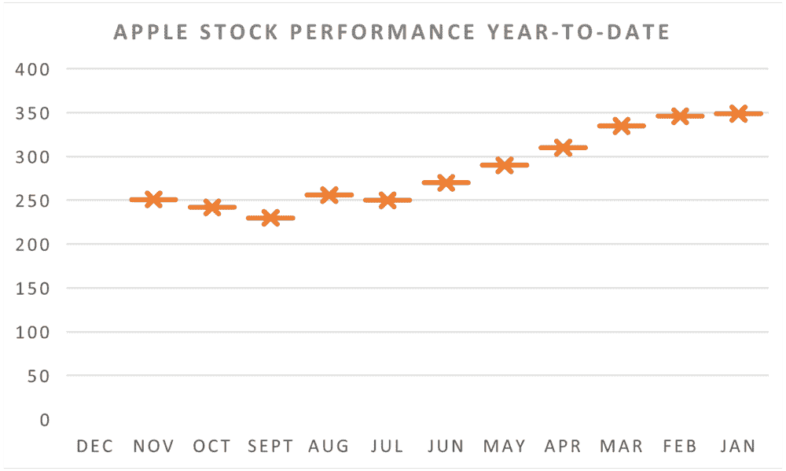 |

微软股票目前的交易价格为 305 美元。主要的挑战是它是否能收回上升动能？根据 `Wallet Investor` 的算法预测，`MSFT` 股票在未来一年的投资可能会上涨到 377 美元。它没有提供 `MSFT` 股票的 10 年预测，但预测 `MSFT` 可能在五年内达到 669 美元，相应统计数据的图表显示在图 2。

根据 Market Beat，33 名分析师给予 `MSFT` 股票评级“买入”，仅有一人评为“持有”。分析师预计 `MSFT` 股票在未来一年将上涨 17%达到 358 美元。分析师的最高预测为 411 美元，最低为 290 美元。

| 图 2. 苹果股票年度表现 |
| --- |
| 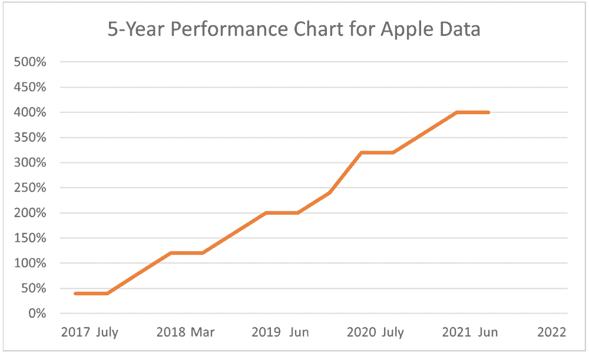 |

## 相关性分析

为了分析 `Twitter` 情绪与股票表现之间的相关性强度，我们正在从 `yahoo API` 收集苹果的股票数据。这项研究的目标是利用先进的 AI 方法提高股票价值预测的准确性。

交叉模型通常比单一 AI 模型表现更好，且脑组织和支持向量机（SVMs）在许多混合模型中占据重要部分，例如，用于高级游戏股票价值预期的脑组织与决策树混合（Chang, 2011），由 4 种不同学习方法准备的模糊计算与 RBF 脑组织（Lei, 2018），用于估计台湾证券交易所总市值的脑网络模糊性时间序列研究。覆盖策略的开发改进经常被用于推进 AI 模型或为股票成本（模式）预测选择元素。例如，和谐搜索和遗传算法被用于追踪脑组织的最佳设计（G¨oçken et al., 2016），在股票成本模式预期下，结合覆盖程序进行组件减少的贪婪计算的脑网络（Lertyingyod and Benjamas, 2017），重建的退火计算被用于优化包含空间和模型边界（Torun, 2011），以及马尔可夫选择交互被结合到遗传计算中以促进股票交易策略（Chang and Lee, 2017）。

在经过长时间的股票探索后，已经产生了 100 多个指标和比例，分别用于基础研究和专门研究。在本研究中，信息从数据集中收集，这是最著名的股票数据集。选取了 30 个元素，因为它们在现有研究中利用得最广泛。对于基础研究，选择了 6 类类中的 15 个关键特征，而对于专门研究，选择了 10 个组别中的 15 个元素。收集到的原始信息将经过两个阶段的数据处理。对于基础元素，信息在机构发布其财务报告后每季度收集一次。对于专门化特征，信息在每个交易日收集，并与当地价格同步。例如，每个交易日的信息。为了分析两种元素排列方案对专门研究的影响，利用单变量线性处理将季度基础信息转换为每日信息，该处理基于元素在季度内的开盘和收盘价，如 Fig. 1 所示，其中一个季度内核心组件的所有差异都是线性的。在处理专门信息时，为了保持示例信息的完整性，删除了缺失某些元素值的示例。同时，从基础信息中移动的相关交易日测试也被同样删除，以保持基础信息和专门信息的一致性。

最近的研究表明，投资者可以通过抓取博客、社交媒体和搜索引擎等不同数据源获取新闻的早期指标。例如，Google 使用了其名为 `Google Trends` 的软件，并显示 Google 搜索查询可预测消费支出（Torsten Schmidt et al.2009）。Bollen、Mao 和 Zeng 先的一的论文表明，情绪和情感在财务决策中很难处理，因此可以假设情绪和情感可能影响资产定价（Pagolu et al. 2018）。Mao 和 Wang 发现，标准普尔 500 指数中提及股票的每日推文数量与价格和成交量相关的股票指标之间存在重要相关性。他们还确定了 10 个行业中 8 个行业的每日推文数量与每日成交量之间的相关性（Shuyuan Deng et.al 2018）。

由于从海量数据中提取信息的内在潜力，机器学习技术在股票研究中已变得广泛使用（Kumar, Dogra, Utreja, & Yadav, 2018）。根据 Khadka（2019），监督学习、无监督学习和强化学习是机器学习的三类。从海量原始输入数据中分析并提取有意义的模式是机器学习的核心。是对决策和趋势预测具有更高程度的理解。因此，许多公司重视从数据中获取这些见解和信息，因为这让他们能够获得竞争优势（Mohammadi, Al-Fuqaha, Sorour, & Guizani, 2018）。根据 Sodhi、Awasthi 和 Sharma（2019），机器学习方法可以解决这些困难。

## 有效市场假设

股票预测已经讨论了几十年，引起了商界和科学界的关注。该领域的早期理论之一是有效市场假设（EMH），它认为资产定价反映了所有可用信息。根据 EMH，资产总是以公允价值交易，市场只对新闻等新信息做出反应，因此在风险调整的基础上，长期来看是不可能战胜市场的。新闻是不可预测的，这表明资产定价遵循随机游走，有 50% 的概率上涨或下跌（Kenton 2018）。EMH 和随机游走理论受到了很多批评，证据表明资产定价并不遵循随机游走，换句话说，资产定价可以在某种程度上被预测。例如，沃伦·巴菲特写过篇文章认为，如果几个基金能够年年地战胜指数，这不可能是随机事件（Buffett, Warren 1984）。纽约大学斯特恩商学院 Aswath Damaran 将此称为市场并非总是有效的证明（Damodaran 2014）。

## 相关性与因果关系

相关性通常定义为两个变量之间具有线性关系的接近程度。两个事件 A 和 B 的协方差定义如下，`E[A]` 是期望值：

```


C(A, B) = E[(A - E[A])(B - E[B])]

如果 `C(A, B) = 0`，则认为它们是不相关的。

相关性定义为：

ρ(A, B) = C(A, B) / (D(A) * D(B))

其中 `D(A)` 和 `D(B)` 代表 A 和 B 的标准差。

如果 `ρ(A, B) = 1`，则 A 和 B 之间存在真实的正相关关系，如果 A 增加，B 也增加。

如果 `ρ(A, B) = -1`，则 A 和 B 之间存在真实的负相关关系，如果 A 增加，B 则减少。尽管相关系数为 -1 或 +1，它并不一定意味着一个导致了另一个。因果关系是指一件事（通常称为原因）引起了另一件事（通常称为结果）。

## 方法

为了能够进行情感分析并计算相关性，Twitter 和股票数据集是必需的。这些数据集的收集方法在下方的图 3 所示。

### 股票数据收集

股票信息通过 `pandas_datareader` 库收集，该库允许我们连接站点并直接从网络源提取信息，在这种情况下，我们从 Yahoo Finance API 提取 `AAPL US Equity`。

| 图 3. 按年度苹果股票表现 |
| :--- |
| 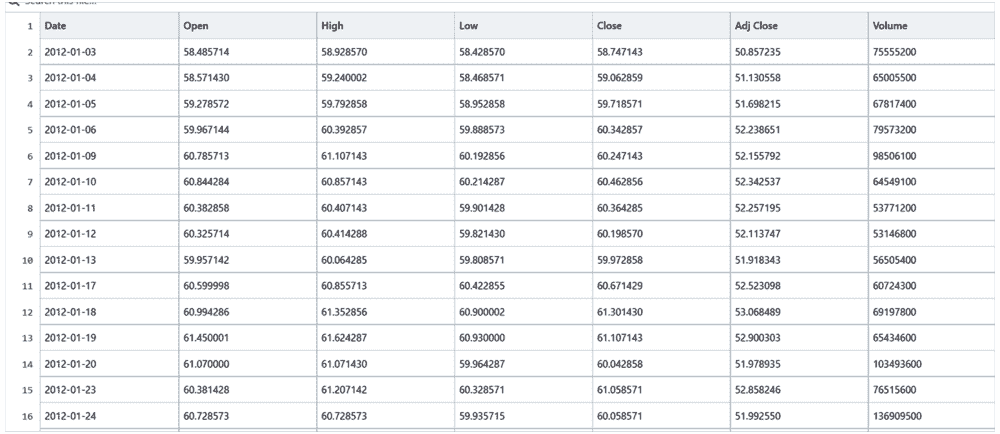 |

为了确保涵盖不同行业的多元化公司，本文选择了以下公司。美国国际集团 `AIG` 是一家全球性的保险代理机构，业务遍及 80 多个国家和地区。他们提供一系列商业和生活保险产品，包括：人寿保险、通用财产和财务服务。`AIG` 的行业是保险业（AIG 2019）。苹果公司 `Apple Inc.` `Apple` 设计并制造手机、电脑和智能手表等电子产品，并销售一系列相关软件。苹果的业务部门包括美、欧洲、日本、大中华地区和亚太其他地区。苹果的行业是消费电子产品（About Apple 2019）。

世界上最大的航空组织是波音公司 `Boeing Company`。他们是商务喷气式飞机、护卫、太空和安全框架的创造者，以及高质量的附属销售支持群体。`Boeing` 维护飞机，并与 150 多个国家的美国及政府客户合作。`Boeing's` 行业是航空航天国防（About Boeing 2019）。脸书公司 `Facebook Inc.` `Facebook` 是一个基于网站的娱乐和非正式通信管理组织。他们正在构建使个人能够通过电脑、手机和不同界面进行交互的产品。`Facebook's` 行业是互联网内容和信息（About Facebook 2019）。网飞公司 `Netflix Inc.` `Netflix` 是一个网络娱乐管理机构，适用于 190 多个国家。用户可以在任何连接网络的屏幕上观看各种类型和语言的电视剧、叙事片和电影。`Netflix's` 行业是媒体（About Netflix 2019）。家得宝 `Home Depot Inc.` `Home Depot` 是一家家居改良零售商。他们销售的 `Home Depot's` 行业是家居用品商店（About Home Depot 2019）。

## 数据预处理

预处理阶段对于在情感分析中获得高准确性至关重要 [10]。在数据清洗之前，存在大量的垃圾信息、特殊字符和其他在分析中不需要或无法分类的无效数据。如果用户多次推文相同的内容，则这些推文被分类为垃圾信息。这些推文在此阶段被删除。然后删除了开头和结尾的空格、用户名、标点符号、链接、制表符以及非英语编写的推文。

## 情感分析

预处理阶段之后，数据被存储为 `Jupiter` 数据帧，因为后续工作也是在 `python` 中完成的。选择 `Sentiment` 来执行情感分析。该包被很好地用于在行级别计算文本极性。`Sentiment` 还提供了考虑效价转移器的机会，例如否定词、转折连词、加强词和减弱词。每个句子的单词都与极性词词典进行比较，然后被标记为介于 -1 和 +1 之间的数字。`Sentiment` 对效价转移器有权重，并选择了创建者提供的标准权重。最终结果除以单词数，以获得一个不依赖于句子长度的值。

## 数据聚合

情感分析完成后，计算了该期间每只股票的每日情感。这是通过计算每天所有推文中所有情感的平均值完成的。一天被定义为从股市收盘后一分钟到第二天收盘为止。情感值被插入到一个两列的矩阵中，其中第一列包含股票的每日情感，第二列包含该股票当日的收盘价。

## 相关性计算

相关性是两个亮点之间关联或关系的比例，例如数量 `B` 随 `A` 的变化而变化。连接技术将利用 `Pearson Correlation`，如图 4 所示。

使用 PC 系数：

```python
corr = df.corr(method='pearson')
```


`PC Coefficient` 是估计连接最广为人的方法，取值范围从 -1 到 1。在算术/物理科学术语中，它倾向于被认为两个元素之间存在强关联，那么它们是直接相关的；如果它们存在负相关，则它们是相反对应的。

| 图 4. 皮尔逊相关性计算 |
| --- |
| 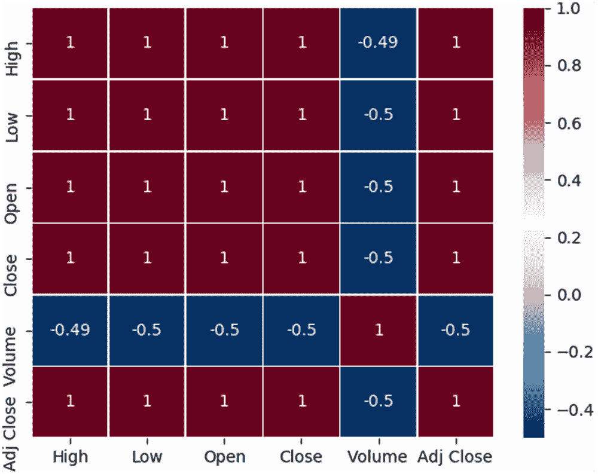 |

下一步是将数据分为训练集和测试集。训练数据用于通过对输入和预期输出进行分组来创建线性回归。测试数据用于展示模型的训练效果。最后，对模型进行了交叉验证。基本上，交叉验证是一种程序，利用它在模型未准备过的数据集上对其进行评估，例如，这通常是测试信息，或者也可以根据可访问性或可能性是另一组数据集。

拆分次数：20，准确率：99.99743780203187

### 绘制线性回归模型的实际值与预测值对比图

查看图 8。

| 图 8. ­ |
| --- |
| 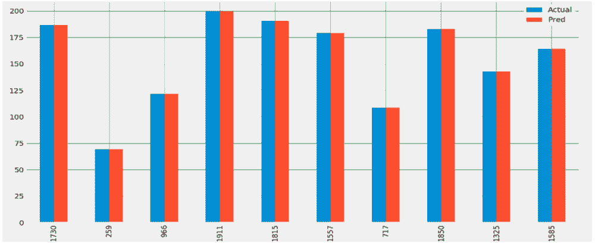 |

### KNN: K-近邻回归模型

KNN 同时用于回归和分类，它通过对观测值取平均值来寻找自变量与连续结果之间的关联。它选择特征相似性来预测来自新数据点的值。

k 邻居 = 4

准确率：99.91435220285842

### 绘制 kNN 模型的实际值与预测值对比图

查看图 9。

| 图 9. ­ |
| --- |
| 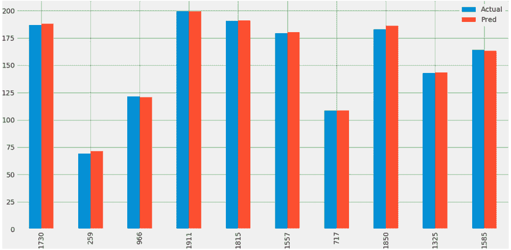 |

### SVM 支持向量机回归模型

准确率：99.99301338392715

### 绘制 SVM 的实际值与预测值对比图

查看图 10。

| 图 10. ­ |
| --- |
| 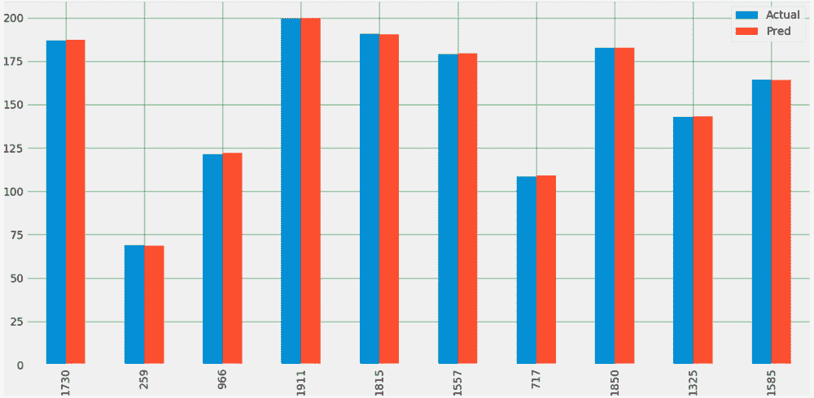 |

### RMSE (均方根误差)

RMS 是残差的标准差，反映了信息焦点偏离回归线的程度比例。或者换句话说，就是信息焦点围绕最佳拟合线的紧密程度。

线性模型 RMSE: 3.0534992716871643e-14
KNN 模型 RMSE: 1.191675778610913
SVM 模型 RMSE: 0.5182098703394772

### R 方误差 (R-Squared Error)

R 方得分在 0 到 100% 之间存在差异。

R 方得分的数学公式：`(y_test[i] — y_pred[i]) **2`

线性 R 方：1.0
KNN R 方：0.999629726665711
SVM R 方：0.9999299807307482

## 结论

不能说苹果公司的数据与股价之间存在明确的相关性。为了获得更可靠的结果，需要更多的数据，以及更优质的数据清洗方法。一些证据表明，如果数据质量良好，那么 Twitter 情绪与股价之间确实存在相关性。但在大多数情况下，还有其他因素在驱动股价波动。此外，结果表明，情绪重要性是波动的，如果发生了重大事件，这种重要性可能会增加，从而影响相关性的稳定性。目前没有或很少有证据表明 Twitter 情绪与股价的相关性与特定行业或产品类型有任何关系。关于我们结果的确定性，相关性似乎是显著的，但发现的结果并没有证明两者之间存在因果关系。投资者不应仅基于这些结果进行分析，但考虑到在清洁数据集上的高相关性，它们可以作为其分析的额外层面，以提高准确性，或用于长期监控公司情绪。

## 参考文献

- 关于苹果公司. (2019). https://www.reuters.com/finance/stocks/company-profile/AAPL.O
- 波音公司，A. (2019). https://www.boeing.com/company/general-info/
- Chang, Y.-H., & Lee, M.-S. (2017). 将马尔可夫决策过程引入遗传算法中以制定股市交易策略. 应用软件计算 , 52, 1143–1153. doi:10.1016/j.asoc.2016.09.016
- Damodaran, A. (2014). 第 7 节：市场效率 - 奠定基础.学术出版社。
- Depot, A. H. (2019). https://www.reuters.com/finance/stocks/company-profile/HD.N
- Facebook，A. (2019). https://www.reuters.com/finance/stocks/company-profile/FB.OQ
- Focus, F. (2011). 利润率分析. 第三版。
- Harrington, C. (2018). 基本面分析 vs 技术分析。
- Huang, Sinha & Yeung, M. (2019). 用于预测股价的 Twitter 情绪。
- Nisar, T. (2018). 情绪的一一项研究。
- Rowe, M., Stankovic, A.-S., Dadzie, A., & Hardey, M. (2011). 社交博客的感觉。
- Schmidt, T., & Vosen, S. (2009). 社交媒体的使用。
- Szyszka, A. (2007). 行为金融视角下的资本市场证券定价. 博士论文/波兹南经济学院。
- Thelwall, M. (2009). MySpace 评论。
- Tumasjan, A. (2010). 使用 Twitter 预测选举：140 字符揭示的政治情绪。
- Yang, J. W., & Parwada, J. (2012). 股票价格预测：序次回归分析。

***

# 第 14 章

- G. S. Siva Kumar, Pragati Engineering College, 印度
- Suneetha P., Pragati Engineering College, 印度
- Sailaja V., Pragati Engineering College, 印度
- Srinivas Akula, Pragati Engineering College, 印度
- Vasantha Lakshmi B., Pragati Engineering College, 印度
- Ravi Kumar M., Pragati Engineering College, 印度

### 摘要

半导体制造行业的时代从 1970 年持续至今。在这些十年中，制造工艺取得了巨大的成就。目前，在 VLSI、ULSI、SOC 制造技术方面达到了饱和水平。最近，人工智能模型正在扩大其领域和应用。在这方面，硬件建模的改变也起着至关重要的作用。在本章，作者介绍了硬件模型中的人工智能、IC 制造行业如何转变其传统方法以增加新功能，以及业务层面的未来方向。

关键技术矿产（`CHTMs`）是未精炼的物质，对于未来的清洁能源转型和高质量产品的组装至关重要。电子设备作为发展最快的电子产品之一，包含了多种 `CHTMs`。从 2019 年开始，印度的表现超过了美国，成为全球第二大电子产品市场。印度很快将产生数量不断增加且令人担忧的各种废物电子设备。在综述中，采用了强大的物料分析调查方法和 Weibull 分布法，根据印度电子设备和组件手机的分类，研究了收集的废电子设备数量及其含的 `CHTMs`。此外，还采用市场供应模型来预测废电子设备中 `CHTMs` 的未来趋势。结果显示，印度废电子设备总量总体呈上升趋势，这表明电子设备废物中包含的各种 `CHTMs` 可以得到适当的回收或重复利用。研究结果为印度的电子设备管理者提供了未来的启示。

### 引言

基础关键技术矿产（`CHTMs`）是现代技术完全依赖其履行功能的“稀有”金属。地球上的 `CHTMs` 储量有限，由于技术和经济限制，从普通原生矿中获取它们是非常困难的。因此，这些 `CHTMs` 的可用性不仅取决于其宿主矿产的特定开采产量，还取决于副矿是否得到了适当回收而不是在未经处理的情况下处置。此外，随着技术的发展，对材料和金属的需求将增加，正如世界银行透露，“完美的能源进步从根本上是矿产驱动的”。城市采矿是解决与 `CHTMs` 持续增长的需求和 `CHTMs` 储量紧张相关的困难问题的一种可能选择。城市采矿已有效用于电子产品和现代废弃物的资源提取。机械发展的快速发展促使人们对 `CHTMs` 的兴趣大幅增加。过去十年中，印度经济以 7.1%的年增长迅速发展，这使印度成为新兴的世界经济体。在印度经济中，包括生产、消费和产品在内的电子业务是发展最快的领域之一。

印度在 2019 年达到 1.58 亿次出货，位居仅次于中国的第二大电子产品市场。电子设备作为增长最快的电子产品之一，包含了多种 `CHTMs`。电子设备主要分为两种，包括手机和电子设备。特别是，主要的 `CHTMs`（如钴和钯）含有在废弃手机中，而锑、铍、钽、钕和铂也含有在废电子设备中。尽管印度在矿产资源方面是一个中等国家，但对进口矿产的依赖程度很高，仅次于石油。因此，废电子设备是近年来城市采矿中 `CHTMs` 预期的重要供应来源。在全球范围内，过去对废电子设备的研究主要集中在电子垃圾和其中含的各种矿物质上。他们评估，英国学生储存了约 370 万台电子设备，而美国和欧洲分别积累了约 2810 万台电子设备和 2930 万台电子设备。他们评估，捷克共和国在 1990 年至 2000 年间产生了 4.5 万台电子设备；这一数字在 2000 年至 2010 年间扩大到 650 万，并预计在 2010 年至 2020 年间将增加到约 2630 万部手机。数据显示，伊朗 2014 年收集了约 3900 万台废电子设备，但实际上可以重复利用的部分仅为 420 万。到 2035 年底，预计伊朗将通过交易和新技术处置约 9000 万台废电子设备；他们评估，中国 2002 年产了 4792 万台废电子设备，2012 年产生了约 73998 万台废电子设备；中国 2025 年废电子设备中废金属/矿产的预期未来量，在 100%回收的情况下，从印刷电路板（`PCBs`）中可能提取出约 9.01 万吨金和 14.91 万吨银；显示在 2001 年至 2013 年期间向尼日利亚运输了约 54050 台电子设备；这些手机包含了 8920 吨铜、270 吨镍、120 吨铅、40 吨铬以及来自溴化阻燃剂的 1310 吨溴。研究了瑞典废电子设备和废组件手机的金属/矿物质成分，发现电子设备中的铅含量低于手机，而其他有害金属/矿物质的成分相当。进行了一项关于废电子设备中 `HTMs` 的研究，并估计了中国市场可以重复利用的废电子设备中投入的 `HTMs` 量。推断出，废电子设备的非 PCB 部分占了回收潜力总价值的一半以上。他们评估，利用基础距离极值获取（`MDMR`）计算，从回收旧 `PCBs` 中的必需金属和贵金属可以产生近 172 万万美元和 3600 万美元的价值，并宣布中国可以回收超过 4 亿台的废电子设备（Hsu et al., 2008; Lau et al., 2009）。

# 概念化

物料分析（`MFA`）是一种分析任何物料基础框架的流和负载的强大工具。在本综述中，产品生命周期包含了从进入业务部门到最终离开市场的整个过程，即整个“从摇篮到坟墓”的过程。

# 系统边界

不同 `CHTMs` 的资产可用性指的是 `CHTMs` 的社会供应。

在本文中，地缘范围限制在印度。废弃电子设备材料流的框架限制。印度电信市场包含了两类主要的电子设备：电子小设备和功能手机。这两类设备中 `CHTMs` 的物质存在显著差异。如框架限制所示，`CHTMs` 最初在提取和处理后作为未加工组件进入电子设备的制造过程，并在动态使用阶段留存在电子设备中。在电子设备使用寿命结束时，这些电子设备含有的 `CHTMs` 可以重复利用或作为备用矿产资源返回组装环节。随后，这种互动是一个“从摇篮到坟墓”的过程。

## 电子小设备寿命分布

### 废弃电子设备产生量估计

Weibull 分布通常用于产品寿命显示，许多研究已利用这种分布来评估电子和电气设备的寿命。在本综述中，利用 `Minitab 17.0` 通过双边界 Weibull 分布研究了指定年份内电子设备的寿命分布。双边界 Weibull 的概率密度函数 `f(t)` 和累积分布函数 `F(t)`。

### 关键高科技矿产社会存量估计

求解废弃电子设备中所含 `CHTMs` 的数量。

## 未来趋势分析

在此部分，未来废弃电子设备的预期通过市场供应策略进行引导。（Huang et al., 2021; Kossukhina, 2021; Pan et al., 2022）

### 数据来源与收集

本研究中的信息获取自回收机构网站、公共文献和现代报告。根据“市场上的所有电子设备都可能持续销售”的假设，运输的设备数量被作为电子设备交易的中介。尽管电子设备最早在 1995 年至 1996 年间出现，但它们花费了 10 年才成为主要的通信方式。印度两种电子设备的出货数据获取自国际数据公司（`IDC`）公告（`IDC`, 2009-2019），印度电子设备的正常寿命取决于 Stevens 的信息。关于各种电子设备中所含 `CHTMs` 的具体物质数据获取自近期发表的文献，本研究的信息范围限于印度。在扩展 2020 年至 2035 年的电子设备销量时，不同类别的电子设备有一些相似之处，但也存在特定模式。尽管如此，由于 2019 新冠肺炎（`COVID-19`）疫情，预计 2020 年的电子设备总销量将下降 10%。根据 Canalys 发布的全球电子设备出货预测，年度电子设备出货增长率在 2020 年、2021 年和 2022 年分别为 35.5%、17.75%和 8.88%。印度功能手机和电子小设备的出货增速被认为与全球情况一致。此外，我们预计疫情的影响将持续大约三个连续；最终，2022 年后年度电子设备出货增长率将恢复常态。对于功能手机，我们使用了 10 年平均增长率（3.86%）并根据事实依据确定了数据。我们认为这种方法是稳妥的，揭示了印度很大一部分人口由于经济和技术限制仍在使用功能手机，并在未来多年将继续使用。对于电子小设备，我们采用了 2 年平均增长率（10.82%），因为过去几年经历了情感波动。我们认为这些增长率是稳定的，并将一直持续到 2035 年。两种电子设备的出货量。选择 `Minitab 17.0` 来显示 Weibull 分布的形状 (`b`）和尺度 (`d`）边界。电子设备的寿命数据获取自以往的研究和报告以及电子设备寿命分布的逐项数据。印度功能手机和电子小设备中含的不同 `CHTMs` 介绍 (Abalansa et al., 2021; He et al., 2021, 2021; Qahtan et al., 2022)。

### 敏感性分析

在本研究中，进行了一项敏感性研究以区分影响评估结果的因素。考虑了五种情况来评估敏感性。“B”被用于处理基本情况。情况 1 和 2 用于观察更短和更长的电子设备寿命对产生的废弃电子设备数量的影响。情况 3 和 4 用于通过减少和增加 10%的基准价值来验证材料合成的影响。结果部分给出了敏感性研究的详细描述。

## 结果

废弃电子小设备的产生

印度 2009 年至 2035 年间的废弃电子设备产生量，评估是利用前一个章节中研究的 `Eqs. (1) to (5)` 进行的。总的来说，结果显示印度从 2009 年至 2035 年的废弃电子设备增长可以分为两个时期，具体而言为记录时期和未来时间段。

### 记录时期（2009-2019）

在记录时期，即 2009 年至 2019 年，废弃电子设备的数量从 2010 年的约 165 万台快速增长到 2019 年的约 1.57 亿台，废弃电子设备的总台数超过了 6.32 亿台。在此期间，约有 1.34 亿台电子设备和 4.99 亿部手机被产生。结果显示废弃手机和废弃电子设备的增长呈现出相似的模式，但增长程度略有不同。

废弃手机呈现出“持续发展增长”的上升趋势。废弃手机的数量从 2009 年的约 160 万部不断扩大到 2019 年的约 1.09 亿部，这揭示了“持续发展增长”的趋势。结果显示，2010 年产生了略多 4.6 万台废弃电子设备；这一数字到 2019 年扩大到 4800 万台。

### 未来时期（2020-2035）

在后期，即 2020 年至 2035 年，废弃电子设备预计将在 2020 年达到约 1.81 亿台，并在 2035 年达到 2.24 亿台，而废弃电子设备的总量预计将超过 33.4 亿台。在此期间，废弃电子设备总数预计包含约 17 亿部手机和约 16.4 亿台电子设备，分别占总量的 51.02%和 48.98%。

电子设备和废弃手机的未来增长轨迹根据其使用寿命和变化或接受的年增长率而显著不同。总的来说，废弃手机呈现出“增长增长放缓”的趋势。废弃手机的数量预计持续增长，并在 2023 年达到 1.32 亿部的峰值。这一数量预计逐渐减少，最终在 2035 年达到 7750 万部。

手机的年度数据预计将在 7752 万部到 1.3195 万部之间变化。然而，手机在此期间预计不会被完全淘汰。另一方面，废弃电子设备呈现出“适度增长”的趋势。电子设备的数量预计将从 2020 年的 6173 万台增加到 2035 年的 1.4687 万台，这表明电子设备预计将持续且稳定地发展。此外，这些数据表明手机的利用率正在减少，而电子设备的利用率正在扩大。仅在接近 2030 年的年份，两者的数量是相当的，但此后缺口（此处原文为 hole 指差距）将继续扩大。

### 关键金属材料（CHTMs）

对废弃电子设备中含有的关键金属材料（`CHTMs`）进行了评估；结果显示，从 2009 年至 2035 年，印度废弃电子设备中含有超过 1.98 万吨的关键金属材料。特别是 2009 年至 2035 年存放在废弃电子设备中的钯和钴的社会供应量。这些结果同样分为两个时期，具体地为记录时期地未来时期。

在记录时期，从 2009 年至 2019 年，废弃电子设备中含有的钯和钴的总社会供应量分别约为 6.5 吨和 2738.7 吨。通常情况下，在此期间手机和电子设备中含有的钯和钴的社会供应量以及电子设备的交易量持续扩大。

由于电子设备交易量的持续扩大，存放在废弃电子设备中回收的钯和钴总量也显著增加。2019 年印度废弃电子设备中回收的钯总社会供应量超过了 1.7 吨，这相当于全球钯产量的 21.13%——除了加拿大、俄罗斯、南非、美国和津巴韦之外——根据美国地质调查局（`USGS`，2012）提供的数据，全球产量约为 8 吨。

在印度，如果能适当回收或利用废弃电子设备中的钴等关键金属材料，对关键矿物的依赖将会完全减少，印度的资源供应压力将得到缓解。后期，随着各种电子产品生产和使用的增加，存放在废弃电子设备中的钯和钴的辅助资源影响将变得越来越明显。从 2009 年至 2035 年，结果显示，废弃电子设备中回收的钯总量和钴总量分别约为 46.4 吨和 19,525.6 吨。

随着机械进步和电子设备的实际重新设计，各种关键金属材料，例如锑、铍、钕、钨和铂，目前未手机手机的材料正被用于制造电子设备。

### 关键金属材料个体供应量

评估了 2009 年至 2035 年废弃电子设备中这五种关键金属材料的个体供应量。结果显示，2019 年废弃电子设备中的总量超过了 713.9 吨，这占 2016 年中国废弃电子设备钴产量的 22.84%。如果印度政府进入记录时期和未来时间段。

在记录时期，从 2009 年至 2019 年，废弃电子设备中收集的这些关键金属材料总量为 2.02 万吨，包括 1.2 万吨锑、0.4 万吨铍、6.7 万吨钕、1.3 吨钨和 0.5 万吨铂。2019 年，铍、钕、钨、铂和锑的供应量分别为 0.1 吨、2.4 吨、0.5 吨、0.2 吨和 4 吨。

评估结果通常具有某种程度的脆弱性。在审查开始时，对所提的评估做出了一些假设。对于利用数值模型进行评估和未来预测，响应性研究至关重要。强烈建议研究预测的脆弱性如何给可能的边界值接受范围带来影响。一个需要考虑的显著边界是电子设备的预期寿命传递，这是一个随着新技术的进步而不断变化的动态、波动且不断发展的价值。预期寿命分布是影响废弃电子设备数量预测结果的一个主要考虑因素，涵盖了电子产品和组件手机。在本文中，数值模型对边界的响应性在`± 1.0 years`的范围内通过 Weibull 分布工作进行了拆解分析。

补充材料中记录了在情况 1（`7 years`）和情况 2（`9 years`）下各种电子设备寿命假设的评估结果。`± 1.0 years`的正常预期寿命差异会导致废弃手机年数量产生约 `3.21%` 到 `1.52%` 的变化。假设情况 1 中组件手机的正常预期寿命缩短至 `7.0 years`，情况 2 中增加到 `9.0 years`，那么`± 1.0 years`的正常预期寿命差异可能会导致产生的废弃手机年数量在约 `3.21%` 和 `1.52%` 之间波动。对于电子产品，预计情况 1 中的正常预期寿命缩短至 `5.0 years`，情况 2 中增加到 `7.0 years`，这将导致产生的废弃电子产品年数量发生 `6.93%` 和 `6.85%` 的变化。各种情况下电子设备的确切评估结果显示在补充材料中。材料组分是另一个基本影响因素。部件和金属将根据技术复新或电子设备更新的模式显示出不同的波动。例如，不同类别电子设备中 `CHTMs` 的含量呈现出完全的独特性。本研究预计，在评估废弃电子设备中的 `CHTMs` 时，正常材料含量是可靠的。这一假设可能会导致不同种类废弃电子设备中 `CHTM` 数量的偏差。为此，情况 3 和 4 考虑了不同负载的 `CHTMs` 物质以进行敏感性分析。补充材料中介绍了不同情况下废弃电子设备敏感性研究的具体影响。

## 讨论

### 废弃电子产品的估计数量

敏感性分析表明，电子设备的寿命是影响废弃电子设备数量的关键因素。许多过去的研究已经表明，电子设备的寿命在国家和地区之间存在显著差异。例如，研究发现捷克的电子设备正常寿命约为 `7.99 years`，比许多国家都要长。他们观察到巴西电子设备的正常寿命约为 `4.5 years`，这超过了大多数对此问题的专家公认的常数。他们评估伊朗电子设备的正常寿命约为 `3 years`。他们发现中国的电子设备正常寿命不足三年。他们揭示了中国电子设备的正常寿命不足两年。

这些结果背后的重要原因之一是不同地区和国家的特定消费者行为。然而，印度的情况非常吸引人。首先，电子产品的普及正在快速发展，大多数印度人表现出热衷于用最先进的电子产品替代旧设备的特征。尽管如此，印度购买者的电子垃圾处理行为在国家不同地区波动很大。大多数印度人通常会使用电子产品直到它们损坏或以合理价格获得新技术。此外，非正式经济规模很大，对印度电子产品的长期寿命做出了基础性贡献。因此，印度电子设备的正常寿命远长于世界上大多数其他国家和地区。研究表明，印度的电子产品寿命最长，可以持续六到八年。显然，很少有研究在考虑到手机和电子产品差异的情况下，评估印度废弃电子设备的年龄和未来趋势。针对印度市场的专注于广泛废弃电气电子设备（`WEEE`）产品的研究有限。根据我们的评估，在`2009`年至`2019`年期间，废弃手机和电子产品的总寿命分别约为`4.989 亿台`和`1.338 亿台`。

进一步预测，从`2020`年至`2035`年，手机和电子产品的总废弃寿命将分别约为`17 亿台`和`16 亿台`。我们认为这些结果结果提供了一个坚实的基础，并对印度废弃电子设备管理产生有益结果。然而，更高质量的信息将显著提高评估准确性。我们相信很快就能获得更好的信息，以深入理解印度电子产品消费者行为，从而对废弃总量提供更稳健的评估，并更清晰地理解动态电子设备寿命数据（Debnath, 2022; He et al., 2021）。

### 高科技矿产的战略价值

随着全球计算机、媒体传输和电子产品技术发展的模式，印度硬件行业已该国发展最快的行业之一，特别是电子设备在过去 10 年里已成为生活的必需品。电子设备中所含的 `CHTMs` 在期间经历了巨大的变化。在本研究中，在评估废弃电子设备中的 `CHTMs` 时，电子设备行业的巨大变化以及手机中 `CHTMs` 的复杂性得到了完全评估和考虑。`CHTMs` 是某些全球性性企业的重要的自然物质。

由于媒体传输和电池发展的快速进展，对不同关键技术金属（`CHTMs`）的兴趣预计长期内将持续增长。尽管如此，不同 `CHTMs` 的稳定且持续储量可能会受到几个变量的影响。其中一个变量是 `CHTMs` 的储量极大取决于特定的载体矿物。例如，镓的循环利用在很大程度上取决于其载体矿物铝的限制。另一个重要变量是出人意料的世界性事件或全球危机。例如，新冠肺炎的新一轮疫情严重影响了全球储备供应链。在极端情况下，废电子设备已成为具有巨大价值的丰富辅助 `CHTM` 库。在印度，废电子设备中积累的社会钴总量在 2019 年超过了 2738.7 吨，预计到 2035 年将超过 16786.8 吨。此外，废电子设备中钴的含量远高于普通矿石。过去的一份报告显示，从一吨普通钴矿石中大约只能获得 1.2 公斤钴材料；然而，在一吨废电子设备中可以识别出约 63 公斤的钴。此此，废电子设备中 `CHTMs` 的妥善处理和再利用具有巨大的价值。

## 印度与中国的对比

中国和印度目前是全球两个最大的动态互联网市场；它们每年产生大量的废设备。报告显示，在未来几年内，中国和印度的电子垃圾数量预计将增加一倍。在中国和印度背景下，电子设备都是废弃电气设备（`WEEE`）中发展最快的类别之一。在中国，1987 年至 2016 年间，产生了约 23 亿部废旧手机和 10 亿台废电子设备，从这些废电子设备中可以再利用超过 1.5 万吨的 `CHTMs`。此后，到 2035 年，超过 10 亿台废电子设备将成为常态，这将产生超过 9 万吨的 `CHTM` 回收。根据我们的评估，2009 年至 2019 年，印度收集的废电子设备数量超过了 6.327 亿台，其中包括约 4.99 亿亿部废旧手机和 1.338 亿台废电子设备。此外，从这些废电子设备中可以再利用超过 27654 万吨的 `CHTMs`。估计显示，废电子设备产量预计在 2020 年达到 1.812 亿台，并在 2035 年达到 2.244 亿台，产生超过 1707.8 万吨的 `CHTMs`。正如最近讨论的，关于现在和未来的可用性，中国和印度拥有前所未有数量的废电子设备，大量的 `CHTMs` 储存在电子设备废弃物中，这提供了丰富的辅助 `CHTM` 供应。

值得注意的是，在未来几年中，中国废旧手机的数量预计将迅速减少；尽管如此，印度的状况完全不同。预计到 2035 年，中国市场中近 100%的废电子设备将是电子设备，而废旧手机的比例将低于 1%。手机在印度电子设备市场中仍将发挥重要作用。目前现状背后的一个潜在解释是，印度大部分人口仍面临着将手机升级为电子设备的需求。关于印度和印的具体现实分析请参阅补充材料。可以根据本研究使用的方法论，利用其他国家的数据进行未来相关的研究。例如，我们的研究结果可以推广到巴西、墨西哥、越南等其他新兴国家。对这些新兴国家进行更广泛的研究可能会发现电子设备回收的宝贵案例，并有助于区分真实的电子设备管理策略。总之，这种更广泛的相关将对其他国家的电子设备资源规划做出巨大贡献。

## 结论与启示

### 结语

本研究的目的是评估 2009 年至 2035 年印度废电子设备及其中含不同 `CHTMs` 的过去产量并预测未来产量。此前没有任何研究确定过印度电子设备的数量和未来趋势。在本文中，利用物料流分析和 Weibull 分布法，通过独立考虑电子设备和手机，评估了废电子设备的产量及相关的 `CHTMs` 储量。由于印度成为仅于中国的第二大电子设备市场，关注印度电子设备市场的现状和未来趋势至关重要。本文提供了评估数据以填补该领域的知识空白，并帮助合作伙伴提升对这一领域的解读。根据本研究，可以得出结论：（1）废电子设备包含不同的 `CHTMs`，且 `CHTMs` 的成分在电子设备和手机之间变化；（2）从 2009 年至 2019 年，印度收集的废电子设备数量超过了 6.327 亿台，考虑到约 1.3 亿台废电子设备和 5 亿部手机。有超过 2700 万吨的 `CHTMs` 可供再利用。未来预计 2020 年将产生超过 1.8 亿台废电子设备。这一数字到 2035 年将超过 2.2 亿台，使得废电子设备中产生超过 17 万吨的 `CHTM` 回收。（3）印度的电子设备垃圾量呈现出整体上升趋势，这表明电子设备垃圾中各种潜在的 `CHTMs` 应该得到妥善的再利用或循环利用（Bhogaraju et al., 2020; Reddy et al., 2022; Satheesh et al., n.d.）。

考虑到研究结果，可以提出以下几项建议以帮助印度进一步发展电子垃圾处理：

(1) 从管理角度来看，印度政府应当提出一套详尽的方案，旨在制定重要的废弃电气电子设备（`WEEE`）回收法规和指南，特别关注电子垃圾设备的回收。首先，电子设备回收行业应当得到规划和控制，因为印度主要的电子垃圾回收技术是随意的，这对环境和人类健康具有破坏性。其次，印度政府应该意识到废弃电子设备中所含各种关键技术材料（`CHTM`）的重要性，这些材料包含了巨大的稀有金属资源潜力，对公共安全至关重要。第三，印度政府应当实施完善且可行的 `WEEE` 回收框架战略，并投入行政资源以支持在线 `WEEE` 回收活动。

(2) 从组织角度来看，不同的电子设备企业应该努力解决现状。首先，企业应改进产品设计，以确保未来的废弃电子设备能够按照标准结构进行销毁或回收。研究型企业应投入足够的资源进行研发（`R&D`），以进一步开发处理或精炼技术。其次，本土企业应吸引外国投资。通过合作伙伴之间的内部和外部活动，使企业能够有效地收集电子垃圾并妥善处理电子设备，将产生长期利益。

(3) 从消费者角度来看，当地消费者具有巨大的发展潜力。消费者的意识、认知、认可度和态度将直接或间接地影响他们的行为偏好。首先，印度买家应该提高废弃电子设备回收的意识，并有效地从传统的处理保险和效率方式转变。其次，电子设备的使用行为可以通过意识的改变来转变。此外，假设大多数大多数消费者都能成为良好的表率，报废回收率将会达到一个新水平。

## 局限性与未来方向

本研究通过独立分析印度背景下的手机和电子设备，旨在分析收集的电子垃圾数量以及这些设备中所含的关键技术材料数量。此外，还采用了供需模型来预测印度电子垃圾中关键技术材料的未来趋势。尽管如此，由于资源限制（如时间和数据获取能力），本文仍存在局限性和脆弱性。首先，电子设备的寿命数据获取自以往文献，对于印度而言可能并不准确。其次，我们的评估和预测结果是假设性的。尽管这些结果基于公认的数值模型，但仍可能出现一些偏差。此外，材料成分可能会随时间推移而发生变化；然而，我们使用了文献中公布的固定值，因为准确预测未来变化几乎是不可能的。最后，根据电子设备关键矿产上下行业的观点，应当提供更多信息来研究关键金属来源对电子设备的影响。考虑到这些限制，未来的研究应该开展公众问卷调查，直接从印度电子设备消费者处获取设备寿命数据。此外，未来的研究还应考虑先进电子设备的设计，它们可能具有不同的技术材料组成（`Bhogaraju et al., 2021`；`Seeja et al., 2021`）。

## 参考文献

Abalansa, S., El Mahrad, B., Icely, J., & Newton, A. (2021). Electronic waste, an environmental problem exported to developing countries: The GOOD, the BAD and the UGLY. Sustainability , 13(9), 5302. doi:10.3390/su13095302

Bhogaraju S. D. Korupalli V. R. K. (2020). Design of Smart Roads-A Vision on Indian Smart Infrastructure Development. 2020 International Conference on COMmunication Systems & NETworkS (COMSNETS), 773–778. 10.1109/COMSNETS48256.2020.9027404

Bhogaraju, S. D., Kumar, K. V. R., Anjaiah, P., & Shaik, J. H. (2021). Advanced Predictive Analytics for Control of Industrial Automation Process. In Innovations in the Industrial Internet of Things (IIoT) and Smart Factory (pp. 33–49). IGI Global. doi:10.4018/978-1-7998-3375-8.ch003

Debnath, B. (2022). Sustainability of WEEE recycling in India . In Re-Use and Recycling of Materials (pp. 15–32). River Publishers. doi:10.1201/9781003339304-3

He, P., Hu, G., Wang, C., Hewage, K., Sadiq, R., & Feng, H. (2021). Analyzing present and future availability of critical high-tech minerals in waste cellphones: A case study of India. Waste Management (New York, N.Y.) , 119, 275–284. doi:10.1016/j.wasman.2020.101

Hsu, C.-W., Hu, A. H. (2008). Green supply chain management in the electronic industry. International Journal of Environmental Science & Technology, 5(2), 205–216.

Huang, Y.-C., Borazon, E., & Liu, J.-M. (2021). Antecedents and consequences of green supply chain management in Taiwan’s electronic industry. Journal of Manufacturing Technology , 32(5), 1066–1093. doi:10.1108/JMTM-05-2020-021

Kossukhina M. A. (2021). Digital transformation technologies of the enterprises in the electronic industry of Russia. 2021 IEEE Conference of Russian Young Researchers in Electrical and Electronic Engineering (ElConRus), 1898–1900. 10.1109/ElConRus51938

Lau, K. H., & Wang, Y. (2009). Reverse logistics in the electronic industry .

Pan, X., Wong, C. W. Y., & Li, C. (2022). Circular economy practices in the waste electrical and electronic equipment (WEEE) industry: A systematic review and future research agendas. Journal of Cleaner Production , 365, 132671

Qahtan, S., Alsattar, H. A., Zaidan, A., Pamucar, D., & Deveci, M. (2022). Integrated sustainable transportation approaches for electronic vehicle in the context of industry 5.0. Journal of Innovation & Knowledge, 7(4), 100277

Reddy, E. M., Gurrala, A., Hasitha, V. B., & Kumar, K. V. R. (2022). Introduction to Naive Bayes and a Review on Its Subtypes with Applications. Bayesian Reasoning and Gaussian Processes for Machine Learning Applications, 1–14

Satheesh, M. K., & Kumar, K. V. R. (n.d.). Addressing the Utilization of Popular Regression Models in Business Applications. In Machine Learning for Business Analytics (pp. 29–43). Productivity Press. doi:10.4324/9781003206316-3

Seeja, G., Reddy, O., Kumar, K. V. R., & Mounika, S. (2021). Internet of Things and Robotic Applications in the Industrial Automation Process . In Innovations in the Industrial Internet of Things (IIoT) and Smart Factory (pp. 50–64).

***

## 参考文献

- Abdullah, M., Al-Ayyoub, M., AlRawashdeh, S., & Shatnawi, F. (2021). E-learningDJUST: 来自约旦科学技术大学的电子学习数据集，用于研究 COVID-19 疫情对教育的影响。Neural Computing & Applications , 1–15. doi:10.1007/s00521-021-06712-1
- 关于苹果公司. (2019). https://www.reuters.com/finance/stocks/company-profile/AAPL.O
- Adornato, A. C. (2016). 门前的力量：社交媒体对地方电视新闻编辑部编辑和制作决策的影响。Electronic News , 10(2), 87–104. doi:10.1177/1931243116647768
- Agrawal, A., Gans, J., & Goldfarb, A. (2018). 预测机器：人工智能的简单经济学. 哈佛商务出版社。
- Agrawal, M. L. (2004). 客户关系管理 (CRM) 与企业复兴。Journal of Service Research , 3(2), 149–167.
- Akhtar, G. (2014). 印度制药行业外商投资流入的现状与前景。IOSR Journal Of Humanities And Social Science , 19(3), 69–73. doi:10.9790/0837-19316973
- Alhumaid, K., Habes, M., & Salloum, S. A. (2021). 影响 COVID-19 疫情期间移动学习使用的因素研究：一种集成 SEM-ANN 方法。IEEE Access: Practical Innovations, Open Solutions , 9, 102567–102578. doi:10.1109/ACCESS.2021.3097753
- An, J., & Rau, R. (2021). 财务、技术与颠覆。European Journal of Finance , 27(4–5), 334–345. doi:10.1080/1351847X.2019.1703024
- Asghar, N. (2016). Yelp 数据集挑战：评论评分预测 doi:10.48550/arXiv.1605.05362
- Ayati, N., Saiyarsarai, P., & Nikfar, S. (2020). COVID-19 对制药部门的短期长期影响。Daru: 特黑兰医学科学大学药学院期刊 , 28(2), 799–805. doi:10.1007/s40199-020-00358-5
- Baber, H. (2021). COVID-19 疫情期间对电子学习的接受度建模：对韩国的研究。The International Journal of Management Education. doi:.10.1016/j.ijme.2021.100503
- Baderiya, M. S. H., & Chawan, P. M. (2018). 使用机器学习技术进行客户购买预测。调查 (伦敦，英国) 。
- Balaji, G. N., & Rajesh, D. (2017). 使用改进分割方法的不同国家智能车辆车牌检测系统。Imperial Journal of Interdisciplinary Research (IJIR).
- Ballestar, M. T., Grau-Carles, P., & Sainz, J. (2019). 电子商务社交网络中的客户质量预测：一种机器学习方法。Review of Managerial Science , 13(3), 589–603. doi:10.1007/s11846-018-0316-x
- Bandy, J., & Diakopoulos, N. (2019). 新闻策展系统审计：苹果新闻（Apple News）算法和编辑逻辑的案例研究。
- Baral, P. K., Das, D., & Kumar, K. (2016). 印度共同基金行业：增长趋势分析。International Journal of Multidisciplinary Research and Development , 3(1), 1–13.
- Batra, R., & Keller, K. L. (2016). 整合营销传播：新发现、新教训和新观点。Journal of Marketing , 80(6), 122–145. doi:10.1509/jm.15.0419
- Batt, S., Grealis, T., Harmon, O., & Tomolonis, P. (2020). 学习 Tableau：一种数据可视化工具。The Journal of Economic Education , 51(3–4), 317–328. doi:10.1080/00220485.2020.1804503
- Baumann, A., Haupt, J., Gebert, F., & Lessmann, S. (2018). 视角转变：使用图论指标预测购买概率。Expert Systems with Applications , 94, 137–148. doi:10.1016/j.eswa.2017.106
- Bergman, A. (2006). 制药行业中的外商投资与溢出效应。Academic Press.
- Rajaju, S. D., & Korupalli, V. R. (2020, January). 智能道路设计。2020 年国际通信系统会议 (`COMNETS`) (pp. 773-778). IEEE. 10.1109/COMNETS4825.2020.90274
- Rajaju, S. D., Kumar, V. R., Anjaiah, P., & Shaik, J. (2021). 工业过程控制的高级预测分析。工业互联网 (`IIoT`) 与智能工厂 (pp. 33-49). IGI Global. doi:10.4018/978-1-7998-3375-03
- Rajaju, S. D., Kumar, V. R., Anjaiah, P., & Shaik, J. (2021). 工业过程控制的高级预测分析。工业互联网 (`IIoT`) 与智能工厂 (pp. 33–49). IGI Global. doi:10.4018/978-1-7998-3375-03
- Biong, H., Parvatiyar, A., & Wathne, K. (1996). 客户满意度适用吗？Parvatiyar, A., & Sheth, J. (编)，关系营销当代知识 (pp. 258–275). Emory University for Relationship Marketing.
- Bock, M. A. (2016). 展示与告知：报纸与电视在线视频对比。Journalism , 17(4), 493–510. doi:10.1177/1464849156806
- 波音公司. (2019). https://www.boeing.com/company/general-info/
- Bruns, A., & Nuernberg, C. (2019). 政治记者与他们的社交媒体。Media and Communication , 7(1), 198–212. doi:10.17645/mac.v7i1.1759
- Campbell, D., Wells, J., & Valacich, J. (2009). 诊断和管理直对消费者（B2C）关系：走向电子商务 B2C 阶段理论。AIS Transactions on Human-Computer Interaction , 1(4), 108–132. doi:10.17705/thci.00008
- Cha, S. H., Steemers, K., & Kim, T. W. (2018). 设计阶段空间偏好的建模。Automation in Construction , 93, 135–147. doi:10.1016/j.autcon.2018.5
- Chakraborty, I., Kim, M., & Sudhir, K. (2019). 基于在线评论的属性评分：考虑语言结构和属性自选择。
- Chang, Y.-H., & Lee, M.-S. (2017). 将马尔可夫决策过程引入遗传算法以制定股市交易策略。Applied Soft Computing , 52, 1143–1153. doi:10.1016/j.asoc.2016.091
- Chen, Y., Hong, T., & Luo, X. (2018). 基于智能体的随机占用模拟器。Building Simulation , 11(1), 37–49.
- Cheng, C., Mei, L., & Zhang, J. (2018). 基于深度卷积网络的车牌识别。IOP Conference Series: Earth and Environmental Science, Volume 189, 交通工程与运输系统。
- Chen, I. J., & Popvich, K. (2003). 理解客户关系管理 (CRM)：人、流程与技术。Business Process Management Journal , 9(5), 672–688. doi:10.1108/1463715031049678
- Chou, P., Chuang, H. H. C., Chou, Y. C., & Liang, T. P. (2022). 客户回购预测分析：购买直到死亡模型与机器学习的跨学科整合。European Journal of Operational Research , 296(2), 635–651. doi:10.1016/j.ejor.2021.04
- Christa, U., & Kristinae, V. (2021). COVID-19 疫情期间产品创新对业务绩效的影响。Uncertain Supply Chain Management , 9(1), 151–158. doi:10.5267/j.uscm.2020.10
- Crosby, L. A. (2002). 破除客户关系管理的一些迷话。Journal of Service Theory and Practice , 12(5), 271–277. doi:10.1108/09604520214
- Cui, D., & Curry, D. (2005). 使用支持向量机进行营销预测。Marketing Science , 24(4), 595–615. doi:10.1287/mksc.105
- Dalal, N., Triggs, B. (2005). 用于人体检测的方向梯度直方图。IEEE Computer Society Conference on Computer Vision and Pattern Recognition (`CVPR’05`), pp. 886-893 vol. 1, 10.1109/CVPR.2005.177
- Damodaran, A. (2014). 第 7 节：市场效率 - 奠基础。Academic Press.
- Davis, D. F., Golicic, S. L., & Marquardt, A. (2012). B2B 营销管理：策略、案例与解决方案。Emerald Group Publishing. doi:10.1108/S1069-0964(2012)1
- Day, G. S. (2000). 管理市场关系。Journal of the Academy of Marketing Science , 28(1), 24–30. doi:10.1177/00920703002810
- de Pauli, Z. T., Suellen, M. K., & Bonat, W. H. (2020). 用于巴西股市预测的人工神经网络架构对比。《数据科学年报》, 7(4), 613–628. doi:10.1007/s40745-020-00305-w
- Dean, T., Ruzon, M., Segal, M., Shlens, J., Vijaya-Narasimhan, S., Yagnik, J. (2013). 在单机上快速准确地检测 100000 类物体。计算机视觉与模式识别 (CVPR)， pp. 1814-1821, 2013。
- Debnath, B. (2022). 印度废弃电气设备（WEEE）回收的可持续性。在材料的再利用与回收（pp. 15–32）。River Publishers. doi:10.1201/9781003339304-3
- Depot, A. H. (2019). `https://www.reuters.com/finance/stocks/company-profile/HD.N`
- Dhande, N. C., & Magar, A. V. (2015). 印度制药业外商直接投资研究。《国际期刊 (Toronto, Ont.)》， 3(7)。
- Dhar, B., & Joseph, R. K. (2019). 印度信息技术行业：两个半场的故事。在印度与中国的创新、经济发展与知识产权（pp. 93–117）。Springer。
- Dimovski, W., Brooks, R., & van Eekelen, A. (2007). 封闭式基金 IPO 筹股资本的成本。《应用金融经济快报》, 3(5), 295–299. doi:10.1080/17446540701222391
- Dowling, G. (2002). 客户关系管理：在 B2C 市场中，少即是多。doi:10.2307/41166134
- Ellikkal, A., Rajamohan, S., & Prakash, M. O. (2022). 印度股市的 IPO：分析 2021 年上市 IPO 的定价与表现。《管理杂志》， 10(2), 1–8。
- Elzamly, A. (2017). 使用人工神经网络（ANNs）算法预测银行机构中关键云计算安全问题。`http://dstore.alazhar.edu.ps/xmlui/handle/123456789/445`
- Engel, J., Agrawal, K. K., Chen, S., Gulrajani, I., Donahue, C., & Roberts, A. (2019). Gansynth:对抗神经音频合成。
- Erhan, D., Szegedy, C., Toshev, A., & Anguelov, D. (2014). 使用深度神经网络的可扩展物体检测。计算机视觉与模式识别，pp. 2155-2162. 10.1109/CVPR.2014.276
- Evolution of CRM. (n.d.). AgileCRM。获取自 `https://www.agilecrm.com/crm/evolution-of-crm#:~:text=In%20the%20last%20decade%20or,to%20interactive%20client%20relationship%20management`
- Facebook, A. (2019). `https://www.reuters.com/finance/stocks/company-profile/FB.OQ`
- Fairlie, R., & Fossen, F. M. (2022). COVID-19 疫情对小企业销售的早期影响。《小企业经济》， 58(4), 1853–1864. doi:10.1007/s11187-021-00479
- Felzenswal, P., Girshick, R., McAllester, D., & Ramanan, D. (2010, 9). 基于判别式训练模型的物体检测 IEEE 模式分析与机器智能期刊，《 32(9), 1627–1645. doi:10.1109/TPAMI.2009
- Fink, K. & Schudson, M. (2020). 算法方法。《哥伦比亚新闻评论》。https://archives.cjr.org/the_research_report/the_algorithm_method.php
- Focus, F. (2011). 利润率分析。第三季度。http://search.credore.com.ezproxy.westminster.ac.uk/content/ultimatebusiness/pr ofmargin/0/
- Frankowska-Takhari, S. (2020). 视觉影响图像的选择与裁剪。IR Research.http://informationr.net/ir/22-1/colis/colis619.html
- GAMMA. (2020). 群体与多智能体模拟。GAMMA.http://gamma.cs.unc.edu/research/crowds/
- Ghosh, B., Basu, B., & O’Mahony, M. (2009). 使用时间序列分析的多变量短期流量预测。《IEEE 智能系统期刊》， 10(2), 246–254.
- Gillick, J. Bamman, D. (2018, June). 用原声带讲述故事：电影音乐的实证分析。首次叙事工作会议论文（pp. 33-42）。10.1865/v1/W18-504
- Girshick, R., Donahue T., Malik J. (2014). 用于精确物体检测和语义分割的丰富层次。IEEE 计算机视觉会议，pp. 580-587,10.1109/CVPR.2014.81
- Granger, C. W. (1969). 因果关系的一些近期进展。《计量经济学》。
- Gummesson, E. (2008). 质量、服务主导逻辑和多对营销。《TQM 期刊》， 20(2), 143–153. doi:10.1108/17542730108572
- Hammond, P. (2017). 从计算机辅助到数据驱动：新闻与大数据。《新闻学》， 18(4), 408–424. doi:10.1177/1464849156205
- Harman, R. (2020). 技术如何改变剧创作。Raindance.https://www.raindance.org/how-technology-is-changing-the-craft-screenwriting/
- Harrington, C. (2003). 基本面分析 vs. 技术面分析。《CFA 杂志》。doi:10.2469/cfm.v14.n.2789
- Hartmann, J., Huppertz, J., Schamp, C., & Heitmann, M. (2019). 自动文本分类对比。《国际营销研究杂志》， 36(1), 20–38. doi:10.1016/ijresmar.2018.099
- Heidari, M., Zad, S., & Rafatirad, S. (2021). 用于预测盈利决策的监督和无监督学习模型集成。IEEE 国际物联网、电子与机械会议（IEMTRICS），10.1109/IEMTRICS52119.2021.94224
- Hellerstein, J.L., Zhang, F. & Shahabuddin, P. (2001). 预测检测的统计方法。《计算机网络》， 35(1), 77–95.
- He, P., Hu, G., Wang, C., Hewage, K., Sadiq, R., & Feng, H. (2021). 分析废旧手机中关键高科技矿产的现状和未来可用：印度案例研究。《废物管理（纽约，N.Y.)》， 119, 275–284. doi:10.1016/j.wasman.2020.1001
- Hilpisch, Y. (2014). Python 金融分析：分析大型金融数据。O’Reilly Media, Inc.
- Hilpisch, Y. (2018). Python 金融分析：精通数据驱动金融。O’Reilly Media.
- Hossain, N. (2020). 使用组合 CNN-LSTM 进行餐厅评论情感分析。第 11 次国际计算、通信与网络技术会议（ICCCNT），IEEE.10.1109/ICCCNT49239.
- Hsu, C.-W., & Hu, A. (2008). 电子行业中的绿色供应链管理。《环境科学国际杂志》， 5(2), 205–216.
- Huang, D., & Luo, L. (2016). 随机噪声与股票收益交互。
- Huang, Y.-C., Borazon, E. Q., & Liu, J.-M. (2021). 台湾电子行业绿色供应链的前因与结果。《制造技术杂志》， 32(5), 1066–1093. doi:10.1108/JMTM-05-2020
- Jacobs, B. J., Donkers, B., & Fok, D. (2016). 大规模品类的模型购买预测。《营销科学》， 35(3), 389–404. doi:10.1287/mksc.2015.0946
- Jain, H., & Rautela, M. (2018). 印度制药业的外国直接投资。可用于 SSRN 3153434。
- Jena, P. R., Majhi, R., Kalli, R., Managi, S., & Majhi, B. (2021). COVID-19 对主要经济体 GDP 的影响：人工神经网络预测器的应用。《经济分析与政策》， 69, 324–339. doi:10.1016/j.eap.2020.12.01
- Johnson, Clark, & Barczak. (2012). 客户关系管理流程：B2B 企业对客户盈利的忠实度有多高？工业营销管理》。在线出版。doi:10.1016/j.indmarman.2012.04.001
- Jones, S.S., Evans, R.S., Allen, T.L., Thomas, A., Haug, P.J., Welch, S.J. & Snow, G.L. (2009). 急诊科需求建模与预测的多变量时间序列方法。《生物医学信息学》, 42(1), 123–139.
- Joo, M. H., Nishikawa, Y., & Dandapani, K. (2019). 加密货币：区块链技术的成功应用。《管理财务》。
- Joseph, R. K., & Ranganathan, K. V. K. (2016). 印度医疗行业外国投资的趋势。ISID 工作论文第 187 号。工业研究研究所 (ISID)。
- Kalekar, P. (2004). 使用 Holt-Winters 指数平滑法的时间序列预测。Kanwal Rekhi 信息技术学院, 1–13. 获取自：`https://www.it.iitb.ac.in/~praj/acads/seminar/04329008_ExponentialSmoothing.pdf`
- Kam, H. J., & Sung, J. O. (2010). 每日急诊患者人数预测。获取自：`www.e-hir.org`
- Kaplan, R. S., & Norton, D. (1992, 1-2 月). 平衡计卡——驱动绩效的指标。《哈佛商业评论》, 70, 71–79. `https://hbr.org/1992/01/the-balanced-scorecard-measures-that-drive-performance-2`
- Karwal H. Girdhar A. (2015). 印度车辆车牌检测系统。IEEE 计算智能与通信技术国际会议, pp. 8-12, 10.1109/CICT.2015.13
- Kashyap A. Suresh B. Patil A. Sharma S. Jaiswal A. (2018). 自动车牌识别。计算、通信、控制和网络进展国际会议 (ICACCCN), pp. 838-843, doi:10.1109/ICACCCN.2018.8748287
- Kathuria, V., & Das, S. (2005). 1991 年后外商直接投资对企业研发& 策略的影响。《IIMB 管理评论》, 17(2), 17–28.
- Keh, H. T., & Shieh, E. (2001). 线上杂货零售：成功因素与潜在陷阱。《商业视界》, 44(4), 73–83. doi:10.1016/S0007-6813(01)80050-1
- Kim, K.J. (2003). 使用支持向量机的金融时间序列预测。《神经计算》, 55(1–2), 307–319.
- Kim, K.-J., & Han, I. (2010). 人工神经网络中用于股票指数预测特征离散化的遗传算法方法。获取自：`www.elsevier.com/locate/eswa`
- Kim, D. H., Lee, S., Jeon, J., & Song, B. C. (2020). 基于深度学习目标检测与跟踪的无人售货柜实时购买行为识别系统。《专家系统应用》, 143, 11306. doi:10.1016/j.eswa.2019.113063
- Kim, J., Yang, K., Min, J., & White, B. (2022). COVID-19 期间的希望、恐惧与消费者行为变化：保护动机的应用。《国际消费者研究杂志》, 46(2), 558–574. doi:10.1111/ijcs.12700
- Kim, S., & Lee, H. (2022). 网红电商中的客户流失预测：决策树的应用。《计算机科学进展》, 199, 1332–1339. doi:10.1016/j.procs.2022.01.169
- Koehrsen, W. (n.d.). Python 中的直方图与密度图。Towards Data Science。获取自：`https://towardsdatascience.com/histograms-and-density-plots-in-python-f6bda88f5ac0`
- Kossukhina M. A. (2021). 俄罗斯电子行业企业的数字化转型技术。2021 IEEE 俄罗斯电气与电子工程青年研究员会议 (ElConRus), 189–1900. 10.1109/ElConRus51938.2021.93628
- Kulkarni Y. Bodkhe S. Kamthe A. (2018). 未戴头盔骑摩托车者的自动车牌识别。当前技术趋势国际会议 (ICCT), pp. 1-6, 10.1109/ICCT.2018.855101
- Kumar, K.V.R., & Elias, S. (n.d.). 用例模拟：使用 IMU 的肌肉疲劳分析。《土耳其物理治疗与康复杂志》。
- Kumar, K.V.R., Zachariah, A., & Elias, S. (n.d.). 滑冰运动员表现的定量分析。Academic Press.
- Kumar, I., Rawat, J., Mohd, N., & Husain, S. (2021). 食品行业中人工智能与机器学习的机遇。《食品质量》, 2021, 1–10.10.1155/2021/45367
- Kumar, V., & Reinartz, W. (2012). 客户关系管理：概念、策略与工具。Springer.10.1007/978-3-642-0
- Landa, R. (2021). 广告设计：跨媒体创意生成。John Wiley & Sons.
- Lau, K. H., & Wang, Y. (2009). 中国电子行业的逆向物流：案例研究。《供应链管理》。
- Lawson, R., C. M. A., Smith, D. C., & C. P. A. (2018). 开发数据流利度。《战略财务》, 100(3), 68–69.
- Lee, J., Jung, O., Lee, Y., & Park, C. (2021). 用于在线购买转换的机器学习算法比较与解释。《理论与应用电子商务》, 16(5), 1472–1491.10.3390/jtaer160508
- Li, Q., Gu, M., & Sun, X. (2016). 移动商务预测的滑动窗口多分类特征工程。第 15 届 IEEE 数据挖掘国际会议 (ICDMW), pp. 1048–1054
- Li, S., Joe, J., Hu, J., & Karava, P. (2015). 集成光伏热集热器建筑的系统识别与模型预测控制。《太阳能》, 113, 139–157.10.1016/j.solener.2014.11.024
- Lik Lau, B.P., Wijerathne, N., Kiat Ng, B.K., & Yuen, C. (2017). 智慧城市公共利用监测传感器融合。Academic Press.
- Li K, Yang D., Ji S. Liu L. (2018, 12 月). 字幕对 360 度观看的影响。信息媒体与工程国际联合会议 (ICIME), pp. 130-134. IEEE. 10.1109/ICIME.2018.00035
- Lindén, C. G. (2017). 新闻算法：新闻工作。《媒体创新杂志》, 4(1), 60-76.
- Lin, T. C. W. (2016). 合规、技术与现代金融。《公司财务与法》, 11, 159.
- Liu, X., Lee, D., & Srinivasan, K. (2019). 利用深度学习的大跨类别消费者评论内容分析。《营销研究杂志》(JMR), 56(6), 918–943.10.1177/002224371986690
- Lo, C., Frankowski, D., Leskovec, J. (2016). 理解购买行为：Pinterest 案例研究。ACM SIGKDD 知识发现与数据挖掘国际会议， pp. 531–540 10.1145/2939672.2939729
- Luo, Y., & Xu, X. (2021). COVID-19 时代在线餐厅评论分析深度学习模型比较研究。《国际酒店管理杂志》, 94, 102849.10.1016/j.ijhm.2020.102849
- Ma, R., Boubrahimi, S. F., Hamdi, S. M., & Angryk, R. A. (2017). 使用多变量时间序列决策树预测太阳耀斑。2017 IEEE 大数据国际会议 (Big Data 2017)。电气电子工程师公司。10.1109/BigData.2017.8258216
- Maathai, K. D. (2005). Mathiyazhagan, 外商直接投资对印度经济的影响：部门级分析。Academic Press.
- Madhumitha M. Dhivya P. (2020). 数据库软件中的车辆识别与编译。系统、计算、自动化与网络国际会议 (ICSCAN), pp. 1-5, 10.1109/ICSCAN49426.2020.926286
- Mahajan, S. (2022). Paytm IPO：失败案例与巨头。JBIMS.
- Ma, L., & Sun, B. (2020). 营销中的机器学习与人工智能——连接计算能力与人类洞察。《国际营销研究杂志》, 37(3), 481–504.10.1016/j.ijresmar.2020.04.005
- Manoff, R. S., Houck, T., & Squire, J. D., & SoMo Audience Corp, (2019). 使用滑动手势识别技术进行内容操纵。美国专利申请 `16/116,459`。
- Markets, R. (2020). 全球手势识别市场到 2023 年将达到 235.亿美元：基于技术、行业和地区的分析。PR Newswire. https://www.prnewswire.com/news-releases/global-gesture-recognition-market-to-reach-23-55-billion-by-2023-analysis-by-technology-industry-and-region-300699427.html
- Mart’ínez, A., Schmuck, C., Pereverzyev, S. Jr, Pirker, C., & Haltmeier, M. (2020). 非合同设定下客户购买预测的机器学习框架。欧洲运营研究杂志, 281(3), 588–596. doi:10.1016/j.ejor.2018.04.034
- Material, M. (2016). 美国办公空间利用率的演变。学术出版社。
- 媒体与娱乐|Vault.com. (2020). 概述。第一手资料。https://www.vault.com/industries-professions/industries/media-and-entertainment
- Mehta, R. (2012). 外国直接投资对印度增长和基础设施建设的推动。学术出版社。
- Mehta, S., Saxena, T., & Purohit, N. (2020). COVID-19 时代新消费行为范式：永久性的还是暂时的？健康管理杂志, 22(2), 291–301. doi:10.1177/0972063420940834
- Mhamdi, C. (2016). 跨越媒体边界：全球化世界中的新闻创造与传播。中海社会科学杂志, 7(5), 272–272. doi:10.5901/mjss.2016.v7n5p272
- Miguéis, V. L., Camanho, A. S., & Borges, J. (2017). 银行业直接营销响应预测：类别不平衡方法的比较。服务业务, 11(4), 831–849. doi:10.1007/s11628-016-0332-3
- Miles, N. (2020). 如何分析电影剧本。Pen and the Pad.https://penandthepad.com/analyze-film-script-12069589.html
- Mithas, S., Krishnan, M. S., & Fornell, C. (2005). 为什么客户关系管理应用会影响客户满意度？营销杂志, 69(4), 201–209. doi:10.1509/jmkg.2005.69.4.201
- Mokryn, O., Bogina, V., Kuflik, T. (2019). 这场会议会以购买结束吗？推断匿名访问者的当前购买意图。电子商务研究与应用, 34, 100 836
- Morris, A. N. (2021). COVID-19 时代的小企业债务。美国银行学院评论, 29, 131.
- Mottaghi, N., & Farhangdoost, S. (2021). Covid-19 存在下的股票预测及机器学习时间序列中的性能评估。https://arxiv.org/abs/2105.0278
- Mudassir, M., & Safiuddin, S. (2015). 数字营销能取代个人销售吗：一项实证研究。国际管理与评论杂志, 5(12), 1142.
- Mukherji, P., & Sengupta, S. (2020). 媒体与娱乐行业：概述。https://avasant.com/insights/publications/media-entertainment-industry-an
- Murphy, S. (2013). 数据可视化与快速分析：应用 `tableau` 支持决策。网页图书馆员杂志, 7(4), 465–476. doi:10.1080/19322909.2013.825148
- Netflix, A. (2019). https://www.reuters.com/finance/stocks/NFLX
- Nisar, T., & Yeung, M. (2018). Twitter 作为股票市场预测的工具：短窗口研究。金融科学杂志, 4(2), 101–119. doi:10.1016/j.jfds.2017.002
- Niu J. N. (2019). 基于机器学习的房地产智能自动估值系统。人工智能、信息处理与云计算国际会议论文。10.1145/337142.337145
- Nofer, M., & Hinz, O. (2015). 使用 `twitter` 预测股市。业务与信息系统, 57(4), 229–242. doi:10.1007/s12599-015-0390
- Nofsinger, J. R. (2005). 社会情绪与金融经济学。行为金融杂志, 6(3), 144–160.
- Pagolu, V. S. (2016). 用于预测股市的 `Twitter` 情感分析。https://arxiv.org/pdf/1610.0922
- Palekar, R., Parab S. U., Parikh D., Kamble V. N. (2017). 使用 `OpenCV` 和 `tesseract` 进行车牌检测。通信与信号处理国际会议 (ICCSP), pp. 2111-2115.10.1109/ICCSP.2017.82867
- Pandey, D. (2021). 新冠病毒对印度 IPO 市场的影响。会计研究与审计杂志, 20(4), 603–609.
- Pan, X., Wong, C. W., & Li, C. (2022). 废弃电气设备 (`WEEE`) 行业中的循环经济实践。清洁生产杂志, 365, 132671. doi:10.1016/j.jclepro.2022.132671
- Park, C. H., & Park, Y. H. (2016). 揭示在线访问转化。营销科学, 35(6), 894–914. doi:10.1287/mksc.2016.0990
- Paule-Vianez, J., Gutiérrez-Fernández, M., & Coca-Pérez, J. (2019). 应用神经网络预测西班牙银行系统的财务困境。应用经济分析。doi:10.1108/AEA-10-2019-0039
- Pawar, M. M., & Argade, N. (n.d.). 外国直接投资对医药行业的影响：印度展望。学术出版社。
- Payne, A., & Frow, P. (2005). 客户关系的战略框架。营销杂志, 69(4), 167–176. doi:10.1509/jmkg.2005.69.4.167
- Peppers, D., & Rogers, M. (2011). 管理客户关系：战略框架。John Miley & Sons.doi:10.1002/978111239833.matter
- Plum, K. (n.d.). 什么是工作场所利用？https://www.advanced-workplace.com/what-is-a-workplace-study/
- Pukala R., Hlibko S., Vnukova N., Korvat O. (2020). ICT 中的 `Power BI` 用于保险组合监控。信息通信问题与技术国际会议 (PICST), 393–401.10.1109/PICST49965.2020
- Puranic, A., Sudheer, D. (2016). 使用 `hadoop` 进行海量图像数据的视觉信息检索。控制理论应用杂志, 9, 425–430
- Qahtan, S., Alsattar, H., Zaidan, A., Pamucar, D., & Deveci, M. (2022). 工业 5.0 的集成可持续交通方法。创新与知识杂志, 7(4), 100277
- Rafay, A., Suleman, M., & Alim, A. (2020). 基于机器和深度学习的稳健预测模型：Yelp 数据集。智能技术新兴趋势国际会议 (ICETST), IEEE.10.1109/ICETST49965.2020.9080713
- Rafique, M. I. S. & Habib, H. A. (2009). 用于收费站监控和审计系统的不变性识别。第 13 届国际会议 (INMIC), pp. 1-6.
- Rai, A. (2020). 可解释人工智能：从黑盒到玻璃盒。营销科学学院杂志, 48(1), 137–141. doi:10.1007/s11747-019-00710-5
- Rajan, A. (1990). 金融领域的信息技术：国际视角。
- Rajkumar, K., & Sudheer, D. (2016). 使用 `hadoop` 进行海量图像数据的视觉信息检索。控制理论应用杂志, 9, 425–430.
- Reagan Nickl (SpacIQ). (2019). 空间利用率指标。https://spaceiq.com/blog/space-utilization-metrics/
- Reddy, E. M. K., Gurrala, A., Hasitha, V. B., & Kumar, K. V. R. (2022). 朴素贝叶斯简介及其子类型综述。机器学习应用的贝叶斯推理与高斯过程, 1–14
- Reddy, C. S., Sangam, R. S., & Srinivasa Rao, B. (2019). 营销、金融和运输服务的业务智能工具综述。收于《智能智能计算与应用》，(pp. 495–504). Springer. doi:10.1007/978-981-13-1927-3_53
- Reddy, E. M. K., Gurrala, A., Hasitha, V. B., & Kumar, K. V. R. (2022). 朴素贝叶斯简介及其子类型回顾。收于《机器学习应用的贝叶斯推理与高斯过程》，(pp. 1–14). Chapman and Hall/CRC. doi:10.1201/9781003164265-1
- Redmon J. Divvala S. Girshick R. Farhadi A. (2016). 你只需看一次：统一的实时目标检测。IEEE 计算机视觉与模式识别国际会议 (CVPR)，pp. 779-788, 10.1109/CVPR.2016.91
- Renault, T. (2020). 金融领域的情感分析与机器学习：百万条消息的方法与模型比较。Digit. Finance , 2(1), 1–13. doi:10.1007/s42521-019-00014-x
- Ren, S., He, K., Girshick, R., & Sun, J. (2017, 6 月 1). Faster R-CNN：基于区域提议网络的实时目标检测。IEEE 模式分析与机器智能汇刊，39(6), 1137–1149. doi:10.1109/TPAMI.2016.2577031
- Rockenbach G. Boeira C. Schaffer D. Antonitsch A. Musse S. R. (2018, 11 月). 模拟人群疏散：从舒适状态到恐慌状态。收于第 18 届智能虚拟代理国际会议论文，(pp. 295-300). 10.1145/3267851.3267872
- Rowe, M., Stankovic, M., Dadzie, A.-S., & Hardey, M. (编辑). F. °A. Nielsen. 新的 NEW：微博客情感分析词汇表评估。收于 M. Rowe, M. Stankovic, A.-S. Dadzie, & M. Hardey (编辑)，ESWC2011 学术化研讨会论文。Academic Press.
- Ryu, S. H., & Moon, H. J. (2016). 基于机器学习技术的室内环境数据占用率预测模型开发。建筑与环境，107, 1–9. doi:10.1016/j.buildenv.2016.06.039
- Safiuddin, S. K., & Samad, M. A. (2015). 外商直接投资对选定医药企业增长的影响——聚合分析。Sumedha Journal of Management ,4(3), 47.
- Saini, A., Grewal, R., & Johnson, J. L. (2010). 让面向市场的技术发挥作用：CRM 性能的组织驱动因素。营销快报，21(4), 365–383. doi:10.1007/s11002-009-9096-z
- Salesforce. (2021a). B2B 销售漏斗与 CRM 系统的角色。获取自 https://www.salesforce.com/uk/learning-centre/crm/b2b-crm
- Salesforce. (2021b). CRM 的完整历史。获取自 https://www.salesforce.com/in/hub/crm/the-complete-crm-history
- Salkind, N. (2012). 时间序列研究。收于《研究设计百科全书》。SAGE Publications, Inc.
- Salo, T. (2020). 将企业社会责任（CSR）活动纳入公司财务战略：案例研究[论文]。梅特波利亚应用科学大学。
- Sankar, S., Ramasubbareddy, S., Luhach, A. K., & Chatterjee, P. (2022). NCCLA：一种基于新加罗尼亚乌鸦算法的智能城市物联网簇头选择。环境智能与人性化计算，13(10), 1–11. doi:10.1007/s12652-021-03503-3
- Sankar, S., Somula, R., Parvathala, B., Kolli, S., & Pulipati, S. (2022). SOA-EACR：基于海鸥优化算法的畜牧业无线传感器网络能量感知聚类路由协议。可持续计算：信息与系统，33, 100645.
- Satheesh, M. K., & Kumar, K. V. R. (未注日期). 解决业务应用中流行回归模型的使用。收于《商业分析的机器学习》(pp. 29–43)。Productivity Press. doi:10.4324/9781003206316-3
- Schmidt, T., & Vosen, S. (2009). 预测消费：基于调查与 Google 趋势。https://pdfs.semanticscholar.org/66f25fc241d3036e2809fa526f.pdf
- Scott, B. (2016). 加密货币和区块链技术如何社交？
- Shahrokhi, M. (2008). 电子：现状、创新与未来。管理金融。
- Seeja, G., Reddy, O., Kumar, K. V., & Mounika, S. (2021). 工业自动化中的物联网与机器人应用。物联网 (IIoT) 与智能工厂 (pp. 50–64)。IGI Global.
- Seippel, H. (2018). 通过机器学习进行客户预测[硕士论文]。延文特大学。
- Selvam, M. (2022). SMART 商业管理，18(2).
- Senseroposts (2011). 大小成就。CEUR 研讨会，718, 93–98.
- Shang Y., Wang Y. (2020). A 股市场中基于 CNN 的新驱动股价预测。收于《科学家、工程师和教育者国际会议》。Springer.10.1007/978-981-15-7984
- Shariff, M. A., Bhatia, R. K., Jha, S. (2021). 使用 Python 和 OpenCV 的车牌检测。先进计算与创新技术国际会议 (ICACITE)，pp. 525-529, 10.1109/ICACITE5122.2021.94056
- Singh, D., Denesh, R., Balakrishnan, J., Vijayan, N., & Ghosh, D. (2017). 管理部门。心理健康与成瘾国际期刊，16.
- Singh J., Bhushan B. (2019). 使用深度神经网络和 LSTM 进行实时车牌检测。计算、通信与智能系统国际会议 (ICCCIS)，pp. 347-352, 10.1109/ICCCIS4847.2019.89746
- Singhmar, M. K. (未注日期). 为什么客户关系管理对你的业务很重要。获取自 https://seeresponse.com/blog/why-customer-relationship-management-is-important-for-business/
- Sin, L. Y. M., Tse, A. C., & Yim, F. H. (2005). CRM：概念化与量表开发。欧洲营销杂志，39(11/12), 1264–1290. doi:10.1108/0309056051062353
- Smith, A., & Andersson, M. (2018). 2018 社交媒体使用。Academic Press.
- Stamos Katsigiannis, W. A., & Ramzan, N. (2019). 5G：媒体与娱乐的变革。支持垂直行业的 5G 通信系统。
- Stock, J. H. (2001). 时间序列：经济预测。收于《社会与行为科学百科全书》(pp. 15721–15724)。Elsevier. doi:10.1016/B0-08-043076-7/00526-X
- Sudheer, D., & Lakshmi, A. R. (2015). Hadoop 分布式文件系统的性能评估。伪分布/全分布(9)，81-86.
- Sudheer, D., & Krishnan, R. (2019). 用于光谱图像检索的多尺度纹理分析和颜色相干向量特征描述符。科学、技术与工程系统杂志，4(6), 270–279. doi:10.25046/aj040634
- Suh, E., Lim, S., Hwang, H., & Kim, S. (2004). 支持实时网络营销的匿名客户购买概率预测模型：案例研究。专家系统与应用，27(2), 245–255. doi:10.1016/j.eswa.2004.01.008
- Sulaiman & Said Musnadi. (2018). 客户关系管理、客户满意度及其客户忠诚度的影响。ICMR 2018，692-698. DOI: 10.5220/0008892606920698
- Sun H., Fu M. Abdussalam A., Huang Z., Sun S., Wang W. (2018). 基于 YOLO 检测器和 CRNN-12 的车牌检测与识别。信号与信息处理、网络与计算机国际会议 (ICSINC)，pp. 66-74
- Szyszka, A. (2007). 行为金融学视角下的资本市场证券定价[学位论文/波兹南经济大学]。
- Tabak, V. (2009). 空间利用率用户模拟：办公楼使用模拟系统。Academic Press。
- Talwar, M., Talwar, S., Kaur, P., Tripathy, N., & Dhir, A. (2021). 财务态度是否影响了新冠肺炎期间零售投资者的交易活动？《零售与消费者服务杂志》, 58, 102341. doi:10.1016/j.jretconser.2020.102341
- Techopedia. (2020). 什么是手势识别？Techopedia. https://www.techopedia.com/definition/618/gesture-recognition
- Teng, K. L., Ong, S. G., & Ching, P. W. (2007). 不同行业制造业对客户关系管理（CRM）的使用：一项基于马来西亚的调查。《国际管理杂志》, 24, 386.
- Thelwall, M. (2009). MySpace 评论。《在线信息评论》, 33(1), 58–76. doi:10.1108/14684520910944391
- Treleaven, P., Barnett, J., Knight, A., & Serrano, W. (2021). 房地产数据市场。《AI 与伦理》, 1(4), 445–462. doi:10.1007/s43681-021-00053-4
- Tsagkias, M., King, T. H., Kallumadi, S., Murdock, V., & de Rijke, M. (2021, 2 月). 电子商务搜索与推荐的挑战与研究机会。ACM SIGIR Forum, 54(1), pp. 1-23. ACM。
- Tumasjan, A. (2010). 用 Twitter 预测选举：140 个字符揭示了什么政治情绪。Academic Press。
- Usunier, J.-C., & Cestre, G. (2007). 产品民族性：重新审视产品与国家之间的匹配。《国际营销杂志》, 15(3), 32–72. doi:10.1509/jimk.15.3.32
- Vărzaru, A. A., & Bocean, C. G. (2021). 移动商务及其驱动因素的二阶段 SEM–人工神经网络分析。《理论与应用电子商业杂志》, 16(6), 2304–2318. doi:10.3390/jtaer16060127
- Vázquez-Martinez, U. J., Morales-Mediano, J., & Leal-Rodriguez, A. L. (2021). 新冠肺炎危机对消费动机和行为的影响。《欧洲管理与经济研究》, 27(3), 10016.
- Vidya, C. T., & Prabheesh, K. P. (2020). 新冠肺炎对全球贸易网络的影响。《新兴市场金融与贸易》, 56(10), 2408–2421. doi:10.1080/154049X.2020.17852
- Walstra, R., Drougas, A., & Harrington, S. (2015). 基础价值赋值中的 `Excel`、`SQL` 和 `SPSS`。《金融与会计杂志》, 20。
- Wang, Z., Zhang, M., Wang, D., Song, C., Liu, M., & Lou, L. (2017). 使用机器学习和时间序列进行预测。《光学表达》, 25(16), 18553. doi-18553.
- Westerman, G. (2022). 开发新期望策略。《MIT 斯洛克评论》, 63(2), 1–4.
- Widjaja V. F., Budianto R. (2021). 新冠期间的当地业务。《第 11 届工业工程与管理国际会议论文》， 4589–4595。
- Woodburn, D. (2002). 客户关系管理：B2B B2C 中的教训。《直接营销实践杂志》, 4(1), 19–32. doi:10.1057/palgrave.im.4340
- Wu, H., & Li, B. (2022, 1 月). 基于改进梯度树的客户购买。《第 2 届消费者电子与计算机工程会议 (`ICCE`)），(pp.795-798). 10.1109/ICCE54139.2022.971279
- Wu C. Y., Singhal N., Krahenuhl P. (2018). 通过插值的视频压缩。《欧洲计算机视觉会议 (`ECCV`)），(pp.416-431)。
- Wu Z., Tan B. H., Duan R. S. (2015). 点击模式的电子商务行为神经建模。《国际 ACM 推荐系统挑战论文集》，(p. 12). 10.1145/281344.281352
- Yadav, D. V. (2017). 印度制药领域外国直接投资的分析研究。《法律杂志》, 3(5), 40–42.
- Yadav, N., & Goyal, S. (2022). 外卖业务中重新赢得伙伴信任：Zomato 案例。《市场案例研究》。
- Yang, J. W., & Parwada, J. (2012). 预测价格波动：有序 Probit 分析。Academic Press。
- Yao, J., & Jiang, K. (2019). 基于利用率的简化预测模式快速内部预测算法。《第 18 届 IEEE/ACIS 计算机与信息科学会议，ICIS 2019》。电气电气工程师学会。10.1109/ICIS46139.2019.8940153
- Zahoor, K., Bawany, N. Z., & Hamid, S. (2020). 使用机器学习对餐厅评论进行情感分析和分类。《第 21 届国际阿拉伯技术会议 (`ACIT`)》，IEEE. 10.1109/ACIT50332.2020.930008
- Zeng, M., Cao, H., Chen, M., & Li, Y. (2019). 购物节期间的用户行为建模、推荐和购买预测。《电子市场》, 29(2), 263–274. doi:10.1007/s12525-018-0311-8
- Zetzsche, D. A., Arner, D. W., & Buckley, R. P. (2020). 去中心化金融。《金融监管杂志》, 6(2), 172–203. doi:10.1093/jfr/fjaa010
- Zhai, X., & Bensaali, F. (2013). FPGA 上的标准定义 ANPR 系统及其扩展到 HD 的方法。《IEEE GCC 会议与展览》，pp. 214. 10.1109/IEEEGCC.2013.6705778
- Zhang, M., & Luo, L. (2018). 用户发布的照片可以作为餐厅生存的领先指标吗？来自 Yelp 的证据。《来自 Yelp》。
- Zhao, M., Cai, W., & Turner, S. J. (2018, 2 月). `Clust`: 通过从人群视频中挖掘模式模拟真实的人群行为。《计算机图形学报》, 37(1), 184–201. doi:10.1111/cgf.13259
- Zheng, X., Zhu, M., Li, Q., Chen, C., & Tan, Y. (2019). FinBrain：当金融遇到 AI 2.0。《信息前沿》。
- Zhou, Y., Tagliaro, C., & Hua, Y. (n.d.). 从小时到分钟：智能技术衡量空间利用非技术挑战。Academic Press。
- Zia Ullah, Q., Hassan, S., & Khan, G. (2017). 云服务的自适应资源预测系统。《计算智能与神经科学》。 doi:10.1155/201748739

- EBSCOhost 打印于 2023/6/21 3:47 PM，所有使用均受 [`www.ebsco.com/terms-of-use`](https://www.ebsco.com/terms-of-use) 约束

# 作者简介

- Samala Nagaraj 拥有海洋大学营销学博士学位。目前在 Woxsen 商学院担任教授。他拥有 10 年教学经验和 5 年研究经验。他于 2012 年获得 `UGC-NET` 和 `JRF`。他目前教授营销和商业分析课程（使用 `SPSS`、`Python` 和 `Tableau`）。他在国内外知名期刊上发表了研究论文，并在 `Scopus`、`ABDC-B & C` 和 `SSCI` 收录的期刊上发表了文章。他是许多 `Scopus` 和 `ABDC-B & C` 期的编辑评审。
- Korupalli V. Rajesh Kumar 目前担任特伦甘纳邦 Woxsen 大学商学院教授。他在加金纳 `JNTU` 获得嵌入系统硕士学位，并在加尔答工程师学会获得电子工程 `AMIE` 学位。他正在清奈理工大学攻读博士学位。他此前在 VIT 理大学担任初级研究员，并在 `upGrad` 教育有限公司工作，指导那些通过利物约翰·摩尔斯大学修读数据科学 / AI ML 课程的学生选择研究问题并撰写论文，处理 `AI/ML` 模型。他的研究专业领域是医学应用的信号和传感器数据分析。
- Preethi Christina A. 是 VIT 理大学计算机科学（大数据分析）专业的硕士研究生。
- N. Badrinath 拥有 19 年丰富经验，其中包含 9 年教学经验、5 年研究经验以及 5 年从事研究活动的工业领域接触经验。他拥有 3 项专利，在多本国际和国家期刊及会议上发表了多篇论文，并在许多国内外研讨会上进行过客座演讲。
- Satyam Chaurasia 是 VIT 特大学（VIT University）计算机科学大数据分析专业的硕士硕士生。
- Sudheer Devulapalli 在 JNTUK 大学完成硕士学位，并在印度维勒洛尔的 VIT 特等大学（VIT Deemed to be University）提交了博士论文。他发表了三项印度专利以及在国内外级期刊、Scopus 和高影响因子出版物上发表了许多论文。他曾在多次国际和国家会议上展示过许多论文。他在图像检索和大数据处理方面拥有丰富的知识。
- Md. Shamim Hossain 是孟加拉国哈吉·穆哈莫德丹什科学技术大学（HSTU）营销系的副教授。2019 年，他在中国北京国际贸易大学（UIBE）获得了工商管理学 `Ph.D.` 学位。他的研究方向包括运营管理、在线业务、电子营销、自助服务技术（SSTs）、电子商务、手机银行、在线客户行为以及营销中的机器学习。Hossain 博士正致力于如何将机器学习应用于业务领域，特别是营销领域。他的许多研究已发表在许多知名期刊上，如《零售与消费者服务杂志》、《食品质量杂志》、《工程中的数学问题》、《医疗工程杂志》、《运动心理学杂志》、《经济研究（The Economic Research-Ekonomska Istraivanja）》、《管理与营销》、《知识社会的挑战》以及《国际工程业务管理国际期刊》。Hossain 博士还为由美国 IGI-Global 出版的高质量教科书贡献了书籍章节。
- Bharathi K. 是 VIT 特大学（VIT University）计算机科学大数据分析专业的硕士生。
- Bhavya K. R. 目前担任班加罗尔 REVA 大学的助理教授。她于 2018 年毕业于 VTU，获得计算机科学与工程硕士学位。她于 2012 年毕业于同一大学获得本科学位。她的研究方向包括计算机视觉中的图像处理和深度学习。
- Madapuri Kumar 在印度安得拉普拉什邦提鲁帕蒂的斯里·文卡特什瓦拉大学获得计算机科学与工程学士学位。他在印度安得拉普拉什邦安纳塔普尔的贾瓦哈拉德·内赫鲁技术大学获得硕士学位。他在印度安得拉普拉什邦安纳塔普尔的贾瓦哈拉德·内赫鲁技术大学获得博士学位。Rudra Kumar 在国内外期刊、会议上发表了许多研究论文，并编写了三本书。他的主要研究兴趣包括软件工程、数据挖掘和物联网（IoT）。
- Ravi Kumar M. 是嵌入式系统硕士，在物联网领域拥有实战经验，熟悉 Arduino 开发板和树莓派，并精通 `Arduino C` (`C++`) 和 `Python` 语言。他精通人工智能及相关的机器学习工具。
- Sangeetha M. 是班加罗尔 REVA 大学的助理教授，毕业于金奈梅安纳大学获得计算机科学与工程（CSE）学士学位。于金奈梅安纳大学获得计算机科学与工程硕士学位（CSE）。她在 VTU 获得了 `PhD (ISE)` 学位。
- Suneetha P. 分别于 2006 年从 JNTU 工程学院完成电子与通信工程学士学位，并在 2010 年和 2020 年从 JNTUK 获得硕士学位和 `Ph.D` 学位。她在国内外期刊上发表了 25 多篇论文。她的研究方向包括信号处理、图像处理、语音处理和通信。
- B. Rupa Devi 拥有 19 年的教学经验。她已被安纳塔普拉姆的 JNTUA 批准为副教授。她在许多国际期刊上发表过论文。她目前在 Dr. Subba Rao 博士的指导下，在提鲁帕蒂的 SVU 从机器学习领域进行研究。
- Ramasubbareddy Somula 目前在 VIT 特大学（VIT University）担任助理教授。他毕业于安得拉普拉什邦的 Alfa 工程与技术学院（Alfa College of Engineering & Technology），获得工程学士学位。他的硕士学位是在安得拉普拉什邦的 Srirama 工程学院完成的。
- Malla Sudhakara 目前在计算与信息学院担任助理教授。他于 2012 年毕业于安纳塔普尔 JNTU 大学获得计算机科学与工程硕士学位。他于 2010 年毕业于同一大学获得本科学位。他在印度安得拉普拉什邦的知名工程学院担任过四年的助理教授。他于 2015 年在 VIT 特大学钦奈校区开始了在计算科学与工程领域的研究生涯。他在几本 UGC 和 Scopus 索引期刊上发表过文章。他的研究兴趣包括图像分析、图像处理和计算机视觉中的深度学习。
- Murat Pasa Uysal 是土耳其巴斯肯特大学（Baskent University）管理信息系的教职员工。他拥有电气与电子工程学士学位、计算机工程硕士学位以及教育技术博士学位。他在美国纽约的罗彻斯特理工学院（Rochester Institute of Technology）完成了博士后研究。他的研究领域包括信息系统、软件工程、机器学习和项目管理。
- Sailaja V. 毕业于 VR 悉达工程学院（VR Siddhartha Engineering College）获得电子与通信工程学士学位，在安得拉大学（AU）工程学院获得电子仪器硕士学位，并在安得拉大学获得 `Ph.D` 学位。目前在印度苏拉帕莱姆的普加蒂工程学院（Pragati Engineering College）担任教授。曾在戈达拉瓦里工程学院（Godavari Institute Of Engineering and Technology）担任系主任和教授。她目前的科研方向是语音处理、大数据信号处理。

- EBSCOhost - 打印于 2023/6/21 3:47 PM，通过 . 。所有使用均遵守 `https://www.ebsco.com/terms-of-use`
