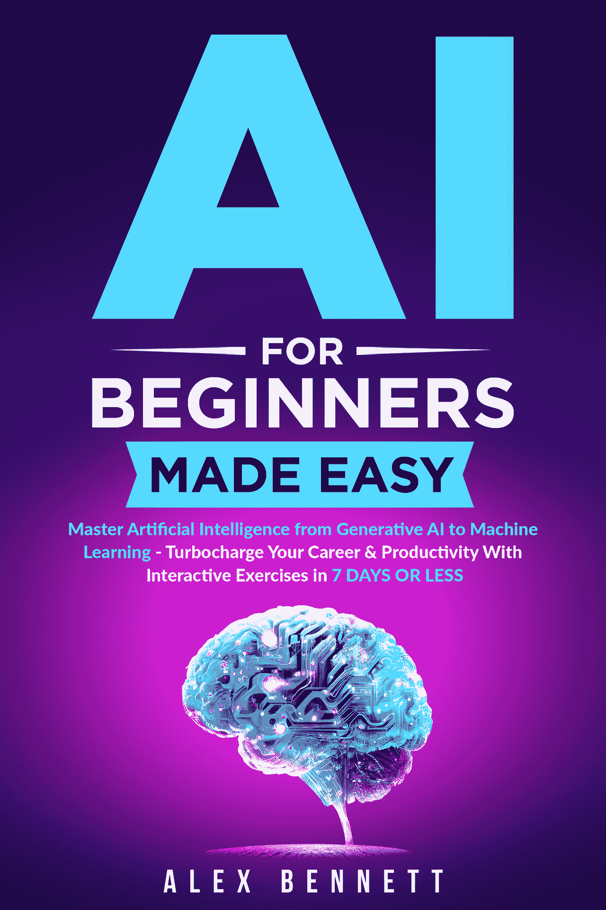
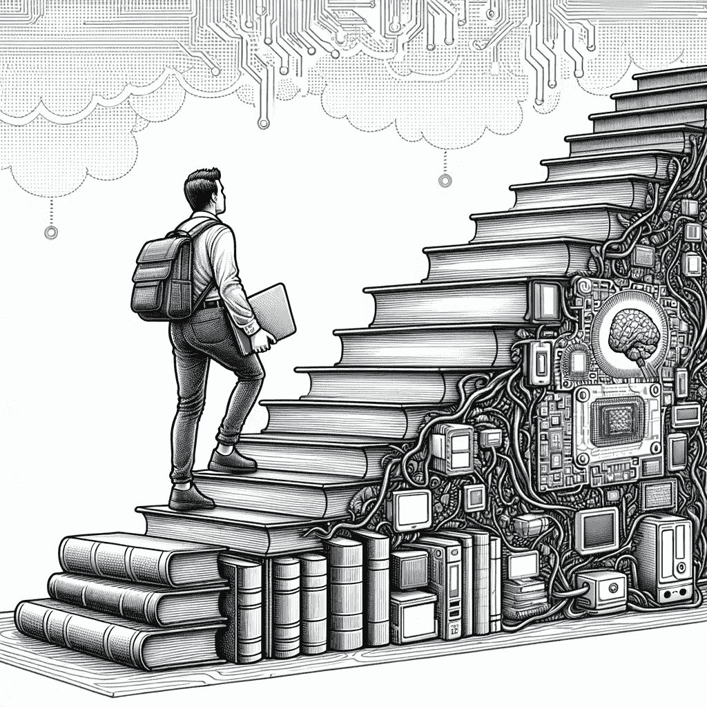
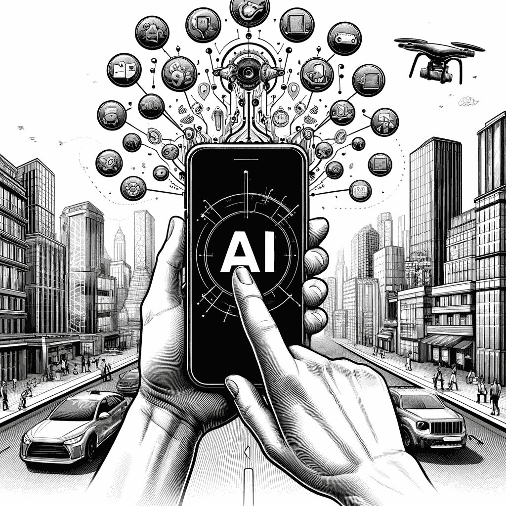
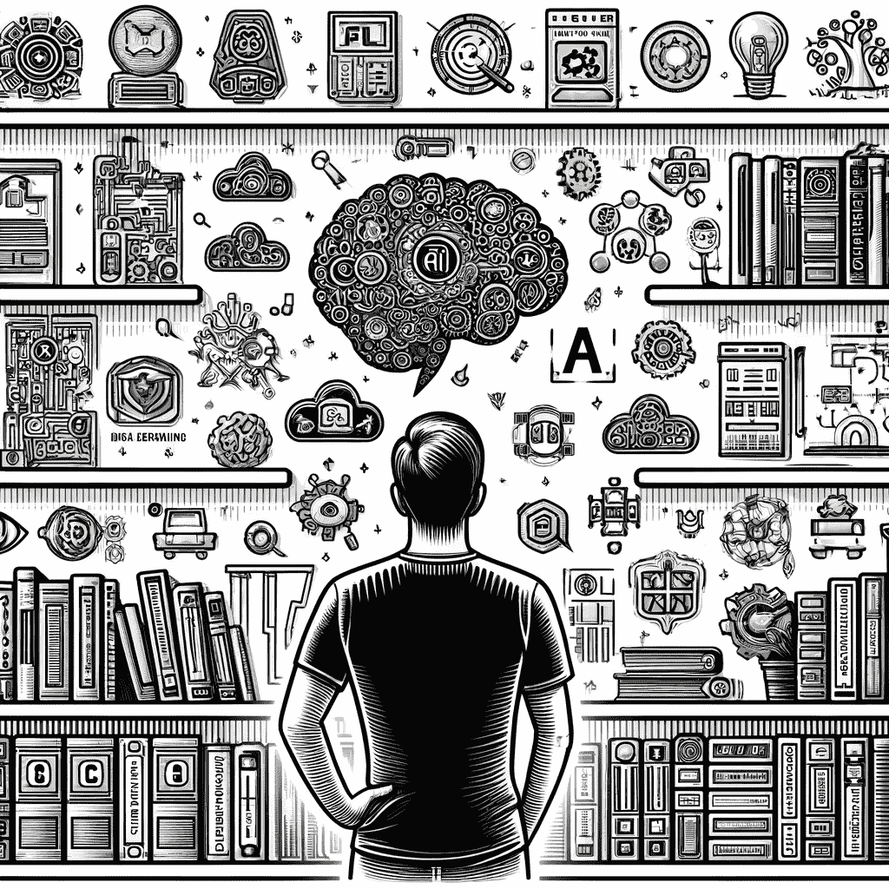
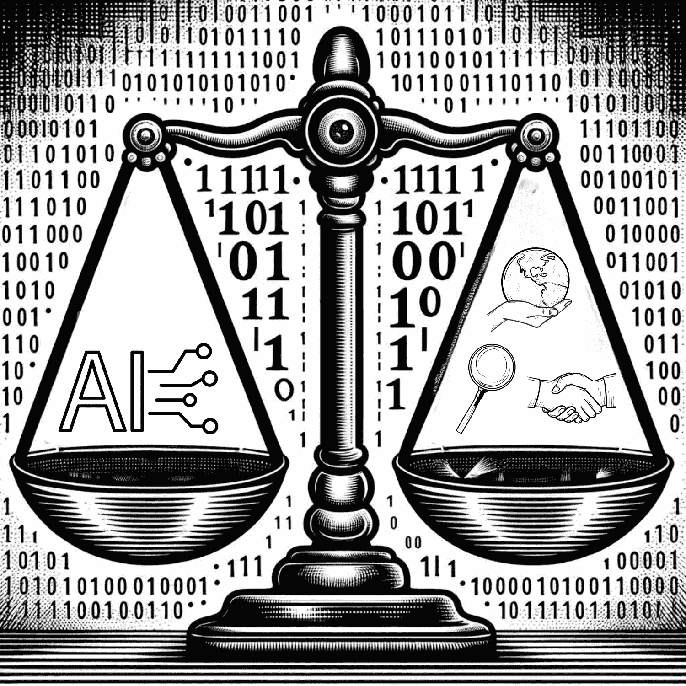
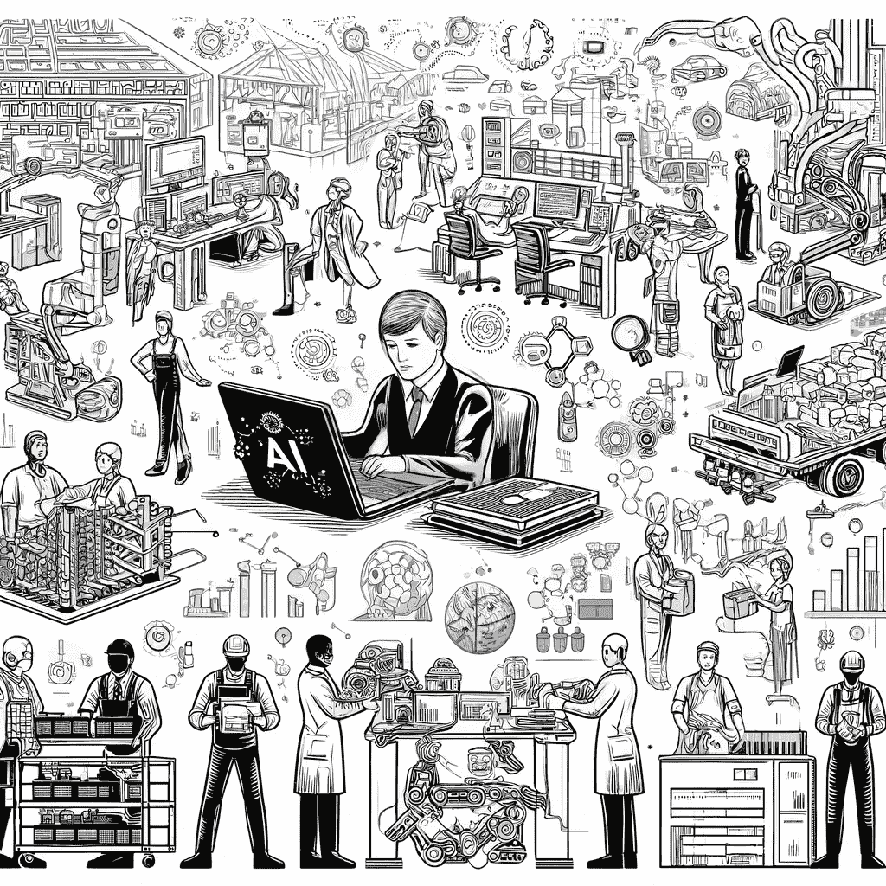
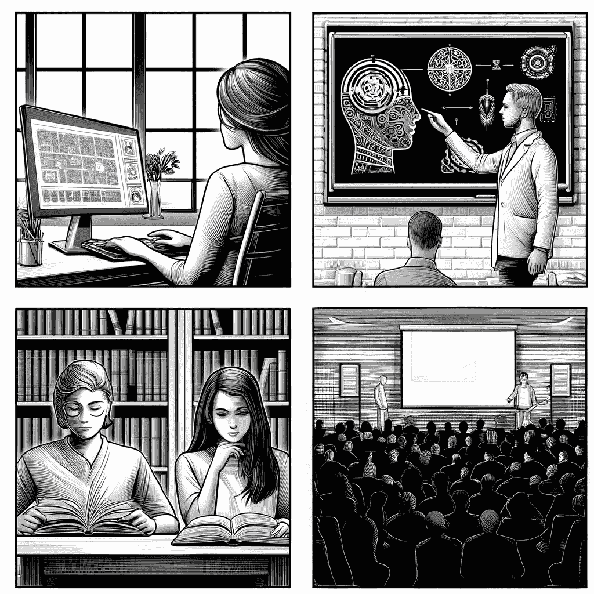
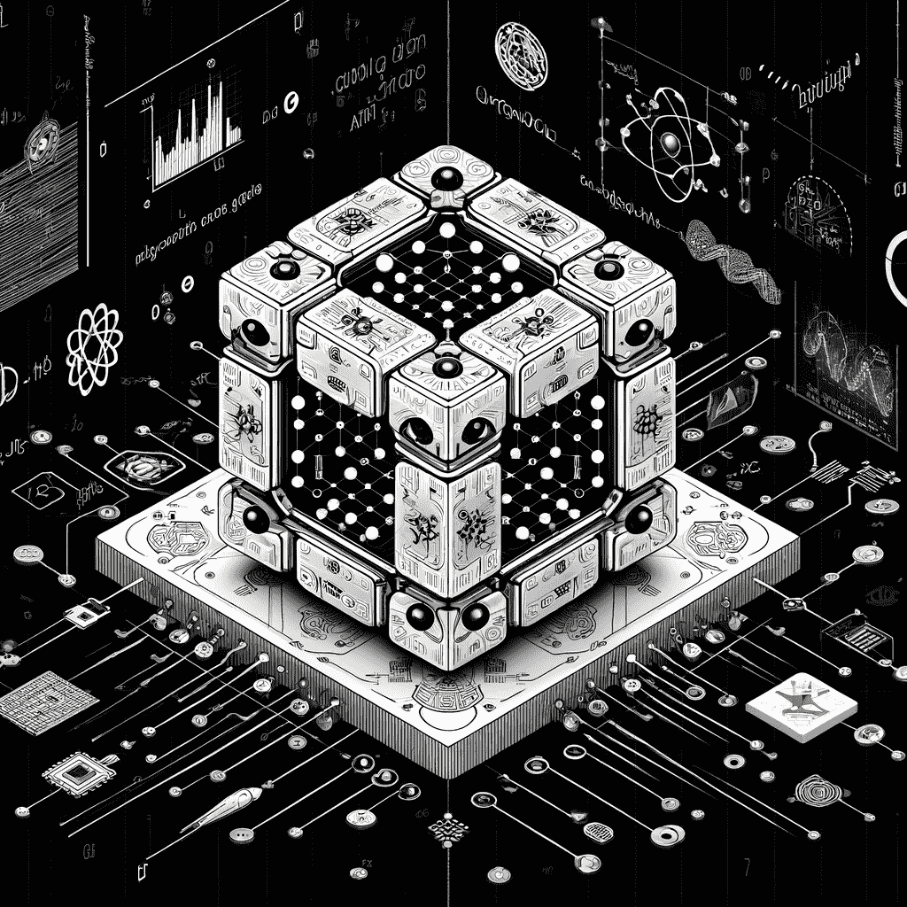

# 初学者 AI 入门：从生成式 AI 到机器学习精通人工智能——在 7 天内通过互动练习快速提升职业发展与生产力

## 引言

你是否曾用 GPS 导航陌生街道？当你开始探索人工智能（AI）的世界时，感觉就像如此。起初，这看起来非常困难，仿佛你进入了一个只有业内人士才能理解的技术术语和复杂理论迷宫。

我自己的 AI 世界之旅就像过山车一样，充满了困惑和启示的时刻。我在业务中使用各种工具，并没有意识到它们是由 AI 驱动的！从 Gmail 中方便的快速回复建议到用于编辑和增强稿件的强大 Grammarly，AI 无处不在。你还记得设置第一个邮箱时的兴奋心情吗？那是我运行第一个 AI 程序时同样的兴奋感。

本书的目的显而易见。它的编写目的是为了消除 AI 的神秘感，使其变得易于理解并适用于日常生活，同时赋予你应对不断变化的职场市场的知识。我们将深入探讨生成式 AI，这是一种可以根据简单提示创建内容的强大工具，并探索它与主要为对话而设计的 `ChatGPT` 有何不同。理解这些区别至关重要，因为它们开启了一个充满多样可能性和应用的世界。

现实情况是，AI 正在重塑就业格局。研究预测，虽然某些工作会被自动化，但会有更多职位被创造。本书旨在让你为这些变化做好准备，并激励你积极拥抱它们。

为了引导你完成这段兴奋的旅程，本书分为八主要章节，每章都关注 AI 的一个方面：

1. **理解 AI 基础**：本章通过解释基础 AI 概念、其演变以及它如何模拟人类智能来奠定。
2. **克服 AI 学习中的挑战**：我们将应对学者面临的常见挑战，提供克服挑战的策略，并讨论 AI 伦理的重要性。
3. **生成式 AI 及其创造潜力**：在这里，我们将探索生成式 AI 的迷人世界、它在创意领域的应用以及围绕它的伦理考量。
4. **日常生活中的 AI**：本章展示了 AI 如何融入到我们的日常生活中，从个性化的在线体验到智能家居和医疗保健。
5. **初学者的 AI 工具和资源**：本章是你获取可用最佳 AI 工具和资源的指南，帮助你在这个量信息中导航。
6. **AI 实战项目**：准备好通过一系列为初学者设计的实战 AI 项目将你的知识付诸实践。
7. **AI 时代的未来工作**：我们将探索 AI 如何改变就业市场、在 AI 驱动的世界中生存所需的技能，以及围绕工作流失的伦理考量。
8. **高级 AI 趋势与创新**：最后一章展望了 AI 令人兴奋的未来，涵盖了量子计算、太空探索中的 AI 以及 AI 本身的演变等主题。

当我们深入这些页面时，请期待一种平易近人的叙述方式，其中穿插着实用的案例和不需要技术经验的练习。你会发现 AI 不仅仅关乎复杂的算法和数据；它还关乎随之而来的伦理考虑。我们将讨论如何负责任且符合道德地使用 AI，确保我们在利用其力量时，也关注它的影响。

所以，让我们开始这段旅程吧。通过通俗易懂的解释和实操指导，我邀请你和我一起揭人工智能的面纱。这条道路有望带来与我们不断变化的世界相关的见解和实用技能。

让我分享一个短故事来给你一个 AI 的的影响。最近，我使用一个 AI 工具为这本书分析数据，如果手动完成将需要几周时间。该工具仅需几分钟就提供了对我目标受众研究至关重要的见解。通常我需要几天才能的工作现在只需要几分钟，节省了时间并让我专注于真正重要的事情：写这本书。这些正是我期待与你一起探索的实际应用。

欢迎来到你的 AI 之旅。让我们一起消除神秘感并进行导航，让 AI 对你的日常生活变得触手可及并获益。

## 建议每日日程

如果你是因为“7 天精通人工智能并加速职业和生产力”的承诺而购买此书，可以遵循下面的建议每日日程。然而，如果你只是为了按照自己的节奏理解 AI 而购买此书，请完全忽略此。

- **第 1 天**：第 1 章、第 2 章和第 3 章
- **第 2 天**：第 4 章和第 5 章
- **第 3 天**：创建你的第一个聊天机器人（第 `6.1` 章）
- **第 4 天**：非程序员 Scratch（第 `6.2` 章）
- **第 5 天**：使用 `Zapier` 的 AI 驱动个人助手以及用于个人财务管理的 AI（第 `6.3` 和 `6.4` 章）
- **第 6 天**：AI 驱动的博客创意生成器和基础图像分类器（第 `6.5` 和 `6.6` 章）——建议选择对你最有用或有趣的
- **第 7 天**：第 7 章和第 8 章 + 结论

## 第 1 章：理解 AI 基础

人工智能往往看起来是一个复杂的、专供专的不可渗透领域。本章旨在消除 AI 的神秘感，将其拆解为易于理解的部分。我们将探索基本概念，揭示 AI 如何模拟人类智能，并深入探索机器学习的迷人世界。在本章结束时，你将牢牢掌握 AI 的基本原理和术语。

### 1.1 解码 AI：从定义到现实世界应用

AI，或人工智能，听起来可能像是一个留给科学家和科幻电影的高级词汇。尽管如此，它比你想象的要熟悉。本质上，AI 涉及机器执行通常需要人类智能的任务。这些任务从像智能手机那样的识别语音，到像你汽车的 `GPS` 选择回家的最佳路线那样做出决策，以及许多更复杂的任务。

现在，这里存在一个光谱——从为执行特定任务设计的“狭义 AI”（想想你的语音助手设置定时器），到更侧重于全面模拟人类智能的“通用 AI”。然而，我们还没有到达那里。前者无处不在，增强了我们的日常生活，而后者在很大程度上（目前）仍留在研究实验室和理论讨论中。

需要注意的是，AI 从根本上与传统的计算机编程有所不同。在传统编程中，开发者为计算机编写要遵循的明确指令。在 AI 中，重点是训练机器根据其给定的数据自主学习并做出决策。这种学习方面是 AI 脱颖而出之处。它使其能够处理传统编程方法难以或无法解决的复杂问题。

你与 AI 的交互比你意识到的要多。它出现在 `Netflix` 根据你看过的节目为你做的推荐中，或者 `Facebook` 如何识别照片中朋友的面部。AI 驱动了 `Gmail` 中的智能回复，帮助你更快地回复邮件。它还是 `Siri` 或 `Alexa` 等语音助手背后的大脑，让你只需语音即可获取信息或控制智能家居设备。

在交通领域，AI 正在改变我们移动的方式。自动驾驶汽车使用 AI 进行实时决策，通过导航道路和避开潜在危险来确保乘客的安全。航空公司使用 AI 优化飞行路线、减少燃料消耗并预测飞机的维护需求。这些应用使我们的生活更加便利，并有助于提高效率和可持续性。

这种 AI 编织在我们日常技术的织锦中，使其更高效、对我们的需求反应更迅速。例如，想想你电子邮件中的垃圾邮件过滤器。它们从你标记为垃圾的邮件中学习。随着时间的推移，它们变得越来越擅长自动将讨厌的邮件移出收件箱，而你无需动手。这就是 AI 的工作——没有戏剧，只是静静地让你的一天不那么杂乱。

AI 系统致力于模拟人类的认知功能。例如，考虑智能家居助手，它们通过听我们的对话来更好地预测我们的需求。虽然这很方便，但也引发了对监控和数据隐私的担忧。谁在听？我们的数据会变成什么样？还有关于自主权的问题。随着决策过程变得越来越自动化，我们在何何时会失去对生活选择的掌控权？

理解 AI 的这些方面有助于我们理解这项技术，并鼓励我们对其在未来中所扮演的角色进行更明智的对话。这不仅仅是惊叹 AI 能做什么，还要质疑并批判性地检查它是如何做到这些点的，代价是什么。随着我们继续开发和部署 AI 技术，记住这些考虑因素将确保我们在塑造一个人类与机器共存的世界时保持深思。

### 1.4 简化机器学习：AI 的学习过程

你是否观察过蹒学儿童如何学习识别并命名动物？首先，你向他们展示一张狗的照片并说“狗”，然后是一只猫并说“猫”。随着时间的推移，他们开始指向书中的狗并学它们叫，你就知道他们学会了。机器学习的工作原理惊人地相似，但它使用的不是动物图片，而是大量的数据。机器学习的核心是计算机从数据中学习并做出决策和预测的过程，而无需为每个任务进行显式编程。

让我们来稍微拆解一下。传统上，为了让计算机执行任务，你需要用计算机语言编写一套详细的指令（程序）。然而，通过机器学习，计算机会根据示例开发自己的程序。这种能力正是机器学习通常被视为 AI 骨干的原因——它使机器能够做出决策并随着时间的推移而改进，就像人类一样，但规模和速度令人难以置信。

机器学习主要有两种类型：监督学习和无监督学习。将监督学习想象为在指导下进行学习。你为机器学习模型提供带有标签的示例。假设你正在教它区分垃圾邮件和非垃圾邮件。在这种情况下，你将为它提供数千封已经标记为“垃圾”或“非垃圾”的邮件。模型使用这些示例来学习如何分类未来的邮件。

在无监督学习中，你让模型自己筛选数据并发现模式。想象在孩子面前倒下一盒彩色球，并让他们在没有指令的情况下整理这些球。他们可能决定按颜色、大小，甚至是弹跳的程度来分类。同样，无监督学习算法可以在数据中发现各种连接，这些连接人类观察者可能无法立即察觉。

这两种方法都有着迷人的应用，涵盖了从你的日常购物到保护个人数据的方方面面。以推荐系统为例。你是否想过 Spotify 似乎是如何知道你的音乐口味的？它它使用无监督学习来发现你听的歌曲类型中的模式，然后对你可能喜欢的其他歌曲进行预测。监督学习的一个例子是信用卡欺诈检测。在这里，监督学习模型查看已知的欺诈交易，并学习在未来标记类似的交易。

当我们我们展望机器学习的未来时，可能性开始变得更加令人兴奋（甚至有一点科幻色彩）。我们正在看到的进展允许机器从被称为“少样本学习”（few-shot learning）的更小数据集中学习，这模仿了人类通常只需通过极少数示例就能学习。想象教一个机器学习模型仅通过几个示例就能识别新类型的诈骗邮件。这种进步可以显著减少训练有效模型所需的数据，使机器学习在不同领域变得更易普及。

在 AI 的宏大画锦中，机器学习不仅是一根线，更是一个贯穿整个设计的关键模式，其复杂性和能力不断扩展。随着这些技术的进步，它们有望释放新的潜力、促进创新并可能实现变革。

### 1.5 揭秘深度学习：神经网络详解

想象你正处于一个热闹的派对中。这些网络的基本构建单元是神经元——连接在一起的小型数据处理器。简而言之，这些神经网络由层层层组成。具体来说，它们将有一个输入层、一个或多个隐藏层和一个输出层。魔法发生在隐藏层，那里处理和模式识别发生的地方。层中的每个神经元都连接到下一层的其他几个神经元。当数据通过这些层时，每个神经元在传递之前会对其输入分配一个权重——即其与其他输入相比的重要性。通过训练，这些网络会调整这些权重。

当神经网络具有多个（深层）隐藏层时，深度学习就开始发挥作用，这允许它们模拟语音和图像识别等复杂现象。要看到这种运作，可以一下当你向社交媒体网站上传照片时，它会自动标记你的朋友。这就是深度学习在发挥作用——算法处理海量数据（它以前见过的所有标记照片）来识别和学习脸部。

然而，训练深度学习模型并不是易事。它们需要大量的计算能力和海量数据集，而这些并不总是可用或易于编译的。模型必须在成千上万个示例上进行训练才能表现良好。这种训练可能是资源密集型的，需要强大的 `GPUs` 和大量的能量。

部署深度学习系统带来了一系列伦理困境，我们必须谨慎地应对。确保这些系统的公平性及其运作的透明度，需要开发者、监管机构和用户不断的努力和警惕。当我们将这些先进技术整合到生活的更多方面时，防范其在无意中延续或放大偏见的责任也随之日益增长。在推向技术边界的同时维护伦理标准，这一双重挑战是深度学习未来的核心。

在拥抱这些技术时，我们承担着平衡创新与责任的使命——这一主题在 AI 的开发和应用中反复出现。随着深度学习的不断演进，它承诺了新的可能性和解决方案，但也提出了新的问题和挑战，提醒我们 AI 的进步与所有其他进步一样，不仅取决于我们所提的问题和设定的限制，更取决于我们所开发的能力。

### 1.6 AI 伦理：平衡创新与责任

在我们掌握了这种超能力后，需要重复一点：能力越大，责任越大。这一指导原则在谈论人工智能的开发和使用时尤为贴切。当我们把 AI 更深地整合到日常生活和全球基础设施中，负责任地引导这项强大的技术至关重要。这种方法不仅是为了防止机器人接管世界，更是为了确保 AI 在改善生活的同时，不侵犯权利或加剧不平等。

伦理 AI 并非可有可无，而是必不可，原因如下：技术反映了创造者的价值观。如果没有仔细的考虑，AI 可能会延续偏见、侵犯隐私，甚至在无意中造成伤害。例如，想一个职位申请筛选工具。假设它主要基于一个不包含女性或少数族族的成功简历进行训练。在这种情况下，它可能会无意中偏符合特定特征的候选人，从而延续现有的偏见。同样，如果没有明确的伦理指南，AI 监控工具可能会侵犯隐私。其影响是巨大且多样的，影响着从职业前景到个人自由的所有方面。

那么，我们应该关注哪些关键伦理问题呢？如提到的，偏见是一个大问题。其次是隐私——确保 AI 系统尊重用户数据，不成为无理监控的工具。工作流失是另一个关键问题。随着 AI 实现任务自动化，那些生计依赖这些任务的人会怎样？这些是触及我们生存每个领域的社会挑战，需要考虑到更广泛的人类背景来提供周全的解决方案。

感谢的是，我们并不是在没有指南针的情况下航行。现有的框架和指南旨在帮助开发者和用户确保以伦理的方式使用 AI。例如，欧盟的《可信 AI 伦理指南》是一个强大的框架，概述了透明度、问责性和公平性等要求。这些指南鼓励开发者创建合法、伦理且稳健的 AI，在尊重人的同时接受审查。同样，IEEE（电气电子工程师学会）的《伦理对齐设计》提供了一系列原则，将人类福祉在 AI 系统置于优先位置。这些框架不仅是为了防止滥用，更是为了积极引导 AI 开发以造福全人类。

但关键在于：没有任何框架或指南可以实现自我执行。这正是人类在 AI 伦理中不可替代的作用发挥作用的地方。这需要我们——开发者、用户、政策制定者——来确保这些原则得到遵循。这意味着从一开始就要考虑到伦理考量来设计 AI，并在 AI 系统的整个生命周期内保持尽职监管。例如，对高风险领域中的 AI 应用进行定期审计

第 2 章

## 克服 AI 学习中的挑战

当你刚进入 AI 世界时，可能会感到无所适从，仿佛其他人都在你忙着按闹钟时收到了一份关于如何使用这种复杂语言的秘密备忘。但别担心！本章将把所有的技术术语翻译成通俗易懂的语言。我们将分解术语，解码缩写，让 AI 像你的食谱一样容易理解。

通常，你会在正在读的书末尾找到术表，所以从第 2 章开始引入术表可能看起来很奇怪。然而，术表出现在这里有充分的理由。学习 AI 在某种程度上也是学习一种新语言。如果不理解如 Deep Learning（深度学习）之类的术语，或如 IoT（物联网）之类的缩写，你几乎无法在该领域建立信心。尽管看起来可能很枯燥，但请花时间阅读术表，并在阅读书中遇到这些词汇时查阅它。

## 2.1 解析 AI 术语：初学者术表

让我们学会一些基础的 AI 语言。以下是 AI 讨论中经常出现的术语：

### 术语表

A

*   `Algorithm`（算法）：AI 中解决问题或执行任务的一系列步骤指令。

    *   示例：`Algorithms`（算法）就像 AI 系统遵循的食谱，根据输入数据做出决策或预测。

#### 应用程序接口 (API)
一组规定软件组件之间如何相互作用的规则、协议和工具。`APIs` 定义了可以发出的请求类型、如何发出这些请求、应该使用的数据格式以及需要遵循的规范。在 AI 的背景下，`APIs` 允许开发者将机器学习或自然语言处理等能力集成到其应用程序中，而无需从头构建底层模型。
**示例**：Google Cloud Vision 允许开发者将图像识别和分析能力整合到应用程序中。

#### 人工智能 (AI)
计算机科学领域，专注于创建通常需要人类智能的机器。
**示例**：Siri 或 Alexa 等虚拟助手使用 `AI` 来理解并响应语音命令。

#### B

#### 反向传播 (Backpropagation)
一种用于训练神经网络的计算损失函数相对于权重梯度的算法。
**示例**：反向传播允许误差通过神经网络反向传播，从而实现权重更新。

#### BERT (双向编码器表示)
由 Google 开发的用于自然语言处理任务的预训练深度学习模型。`BERT` 通过考虑单词前后的词来理解句子的上下文和含义。
**示例**：`BERT` 可以针对各种任务（如情感分析或问答）进行微调，利用少量的训练数据实现高准确性。

#### 大数据
可以通过计算分析以揭示模式、趋势和关联的海量数据集。大数据通常需要专门的工具和技术进行存储、处理和分析。**示例**：社交媒体平台产生海量数据，可以进行分析以理解用户偏好和趋势。

#### C

#### 中央处理器 (CPU)
计算机处理指令并执行计算的主要组件。`CPUs` 是多功能性的，但在某些机器学习任务中可能比 `GPUs` 慢。
**示例**：`CPUs` 用于通用计算任务，并可用于机器学习模型的推理（预测）。

#### 聊天机器人 (Chatbot)
通过听觉或文本方法进行对话的计算机程序或人工智能。`Chatbots` 通常用于客户服务、信息检索和娱乐应用。
**示例**：客服聊天机器人可以处理订单状态或产品信息的常见查询，释放人工代理处理更复杂的问题。

#### 计算机视觉 (CV)
AI 的领域，专注于使计算机解释和理解来自世界的视觉信息。
**示例**：`CV` 用于自动驾驶汽车，以检测和识别物体、行人和路标。

#### 卷积神经网络 (CNN)
一种常用的图像识别和计算机视觉任务的神经网络类型。
**示例**：`CNNs` 用于人脸识别系统，从图像或视频流中检测并识别个体。

#### D

#### 数据预处理 (Data Preprocessing)
清洗、转换和准备原始数据用于机器学习算法的过程。
**示例**：数据预处理任务包括删除重复或无关数据、处理缺失值以及归一化特征。

#### 数据科学
一个跨学科领域，使用科学方法、过程、算法和系统从结构化和非结构化数据中提取知识和洞察。数据科学涵盖了机器学习、数据分析和数据可视化的广泛技术和工具。
**示例**：数据科学技术可以分析电子商务网站上的用户行为，识别可以指导营销策略和产品推荐的模式和趋势。

#### 决策树 (Decision Trees)
一种机器学习算法，创建一个决策及其可能后果的树状模型。
**示例**：根据年龄和收入预测客户是否会购买产品的决策树可能具有如下分支：“如果年龄 < 30 且收入 < $50,000，则预测为‘否’；否则如果年龄 >= 30 且收入 >= $50,000，则预测为‘是’。”

#### 深度学习 (DL)
机器学习的一个子领域，使用多层的人工神经网络从海量数据中学习。
**示例**：深度学习用于图像识别系统，例如识别照片中的物体或人脸。

#### 动态计算图 (Dynamic computational graph)
通常与 `PyTorch` 等深度学习框架相关，动态计算图是灵活且自适应的系统，在执行操作时构建计算图。这与在计算开始之前定义并固定的静态计算图形成对比。
**示例**：教计算机预测句子中的下一个单词。动态计算图允许模型在处理时适应每个句子的长度。这意味着每次输入新句子时，计算机都会创建一个唯一的路径来处理该句子的特定长度和结构。这种灵活性使得处理真实数据变得更容易，因为输入的大小和形状经常变化。

#### E

#### 可解释 AI (XAI)
一组旨在使 AI 系统更透明、更可解释的技术和方法，使用户能够理解决策是如何产生的。
**示例**：`XAI` 技术可以用于突出影响模型预测的特定特征或模式，使决策过程更加透明。

#### F

#### 特征提取 (Feature Extraction)
从原始数据中选择或转换变量（特征）以提高机器学习性能的过程。
**示例**：在文本分类中，特征提取可能涉及将单词转换为数值表示，例如词嵌入或 `TF-IDF` 向量。

#### G

#### 生成对抗网络 (GAN)
一种深度学习模型，由两个神经网络组成：生成器 (generator) 和判别器 (discriminator)，它们通过相互竞争来生成类似于训练数据的新合成数据。
**示例**：`GANs` 可用于生成真实的图像，例如创建类似于真人脸部的人脸，或为时尚品和家具等产品生成新设计。

#### 生成预训练 Transformer (GPT)
由 OpenAI 开发的一系列语言模型，使用无监督学习生成类人类文本。`GPT` 模型（如 `GPT-4`）已用于各种应用程序，包括机器人、内容生成和代码补全。
**示例**：`GPT-4` 可以根据给定的提示或上下文生成真实的文本片段，如新闻文章或创意写作。

#### 梯度下降 (Gradient Descent)
机器学习中常用的优化算法，通过迭代调整模型参数来最小化代价函数。
**示例**：梯度下降用于训练神经网络，通过在最小预测误差的方向上更新权重和偏置。

#### 图形处理器 (GPU)
一种专门设计的电子电路，旨在快速处理和更改内存，以加速帧缓冲区中图像的创建，这些图像将输出到显示设备。由于能够高效地执行并行计算，GPU 常用于训练深度学习模型。

- 示例：GPU 用于加速大型神经网络的训练，缩短了在海量数据上训练模型所需的时间。

#### H

#### 超参数 (Hyperparameters)
在训练机器学习模型之前设置的设置或配置变量。这些参数控制学习算法的行为，并可以通过调整它们来优化模型性能。

- 示例：`learning rate`（学习率）决定了训练过程中模型权重调整的幅度，是神经网络中一种常见的超参数。

#### I

#### 集成开发环境 (IDE)
一种为计算机程序员提供全面软件开发设施的软件应用程序。IDE 通常包括源代码编辑器、构建自动化工具和调试器等功能。用于 AI 开发的流行 IDE 包括 `Jupyter Notebook`、`PyCharm` 和 `Visual Studio Code`。

- 示例：`Jupyter Notebook` 是一种 IDE，允许开发者创建和共享包含实时代码、方程、可视化和叙述性文本的文档，使其在数据科学和机器学习项目中广受欢迎。

#### 物联网 (IoT)
一个由物理设备、车辆、家用与其他嵌入电子设备、软件、传感器和网络连接的物品组成的网络，这些物体能够收集并交换数据。IoT 设备可以被远程控制和监控，实现各种系统的自动化和高效管理。

- 示例：智能恒温器可以学习你的温度偏好，并根据你的日常习惯自动调整家中的加热和冷却，这就是 IoT 设备的一个示例。

#### J

#### K

#### K 类簇 (K Clusters)
在 `K-means` 聚类算法的上下文中，`K` 代表数据点被划分的簇或组的数量。该算法旨在将 `n` 个观测值划分为 `K` 个簇，每个观测值都属于均值最近的簇。

- 示例：如果你有一组客户购买历史数据集，并想根据他们的购买行为将其分为 5 个部分，你应该在 `K-means` 算法中设置 `K = 5`。

#### Keras
一个用 `Python` 编写的开源神经网络库，可以在 `TensorFlow`、`Microsoft Cognitive Toolkit`、`R`、`Theano` 或 `PlaidML` 之上运行。`Keras` 设计旨在实现对深度神经网络的快速实验，并专注于用户友好、模块化和可扩展性。

- 示例：`Keras` 为构建和训练深度学习模型提供了一个高层、用户友好的界面，让初学者更容易接触神经网络。

#### L

#### 长短期记忆网络 (LSTM)
一种能够学习长期依赖项的循环神经网络架构。`LSTMs` 常用于语音识别、语言翻译和文本生成等任务。

- 示例：`LSTMs` 用于语音识别系统以处理和识别口语词汇，同时考虑音频数据中的上下文和长期依赖关系。

#### M

#### 机器学习 (ML)
`AI` 的一个子集，涉及训练算法从数据中学习模式，并在没有显式编程的情况下做出预测或决策。

- 示例：电子邮件垃圾过滤器使用机器学习，根据从之前的示例中学习到的模式来识别并分离不需要的电子邮件。

#### matplotlib
一个用于创建静态、动画和交互式可视化的 `Python` 库。`matplotlib` 提供了创建各种类型绘图、图表和图形的广泛功能。

- 示例：你可以使用 `matplotlib` 创建折线图、散点图、柱状图、直方图等，使其成为机器学习和数据科学项目中数据可视化的多功能工具。

#### N

#### N 个观测值 (N Observations)
在机器学习中，`N` 指数据集中数据点或样本的数量。每个观测值代表数据的一个实例，例如客户交易、传感器读数或医疗记录。

- 示例：如果你有一个包含 1000 个信息的数据集，那么在处理这些数据时 `N = 1000`。

#### 自然语言处理 (NLP)
计算机程序理解、解释和生成人类语言的能力。

- 示例：`NLP` 用于语言翻译应用，将其从一种语言转换为另一种语言。

#### 神经网络 (Neural Network)
一组模仿人类大脑的算法，旨在识别模式并从数据中学习。

- 示例：神经网络处理来自自动驾驶汽车摄像头和传感器的数据。

#### NumPy
一个用于数值计算的 `Python` 库。`NumPy` 支持大型数组和矩阵，以及一组用于操作这些数组的数学函数。

- 示例：`NumPy` 常用于机器学习项目中的对数组进行均值计算、标准差计算或矩阵运算。

#### O

#### 过拟合 (Overfitting)
机器学习中的一种常见问题，模型学习了训练数据中的噪声，以至于影响了其在新数据上的性能。

- 示例：过拟合的模型在训练数据上表现良好，但无法泛化到未见过的数据。

#### P

#### 解析 (Parsing)
分析符合形式语法规则的字符串或标记的过程。在自然语言处理中，解析涉及分析句子的语法结构以确定其含义。

- 示例：解析器可以将“The quick brown fox jumps over the lazy dog”句子拆分为各个词性（名词、动词、形容词），并识别句的主、谓、宾语。

#### PyTorch
一个基于 `Torch` 库的开源机器学习库，主要由 Facebook AI 研究实验室开发。`PyTorch` 以其动态计算图和易用性闻名，在研究人员和开发者中非常。

- 示例：`PyTorch` 常用于研究环境，快速原型化新的神经网络架构和训练技术。

#### Q

#### R

#### 随机森林 (Random Forests)
一种用于分类、回归和其他任务的集成学习方法，通过在训练时构建许多决策树，并输出所有树的类的模式（分类）或平均预测（回归）来运行。

- 示例：随机森林可用于根据客户的人口统计和使用模式预测客户是否会流失。

#### 循环神经网络 (RNN)
一种旨在处理序列数据（如时间序列或自然语言）的神经网络类型。

- 示例：`RNNs` 用于语言建模任务，例如根据之前的单词预测下一个单词。

#### 强化学习 (Reinforcement Learning)
机器学习的一种，智能体通过与环境交互并接收奖励或惩罚来学习做出决策。

- 示例：强化学习用于游戏 AI，算法根据游戏状态和奖励学习最优动作。

#### S

#### SciPy: 一个用于科学和技术计算的 Python 库。`SciPy` 基于 `NumPy` 构建，提供了优化、线性代数、积分、插值、信号和图像处理、统计等额外函数。

* 示例：`SciPy` 可用于机器学习项目，如模型参数优化、信号处理或结果的统计分析等任务。

#### Scikit-learn (sklearn): 一个用于 Python 语言的免费软件机器学习库。`Scikit-learn` 提供了广泛的监督和无监督学习算法，并构建在 `NumPy`、`SciPy` 和 `matplotlib` 之上。

* 示例：`Scikit-learn` 可用于结构化数据上快速训练和评估各种机器学习模型，如决策树、支持向量机和随机森林。

#### 语义推理 (Semantic Reasoning): 在上下理解单词、短语和句子含义的过程。在自然语言处理中，语义推理涉及使用机器学习技术，根据词与其上下文的关系来推断文本的意图。

* 示例：语义推理系统可以推断短语“I'm feeling blue”指的是一个人的情绪状态（悲伤），而不是蓝色这种颜色。

#### 软件开发包 (SDK): 软件开发工具、库、文档和代码示例的集合，允许开发者为特定平台或编程语言创建应用程序。许多 AI 平台提供 SDK 以简化 AI 能力与应用程序的集成。

* 示例：`TensorFlow SDK` 提供了在各种编程语言中开发和部署机器学习模型的工具和库。

#### 词干提取 (Stemming): 将单词还原为基础或根形式的过程。`Stemming` 是自然语言处理中常见的预处理步骤，通过将将同一单词的不同形式视为单个实体，帮助降低文本数据的维数。

* 示例：“running”、“runs”和“ran”这些单词都会被词干算法还原为基础形式“run”。

#### 监督学习 (Supervised Learning): 一种机器学习类型，算法从具有输入-输出对的标记数据中学习。

* 示例：监督学习算法可以在带有标记的图像数据集（例如“猫”或“狗”）上进行训练，以对新的未标记图像进行分类。

#### 支持向量机 (SVM): 一种用于分类、回归和离值检测任务的监督学习算法。`SVMs` 的目标是在特征空间找到最佳分离不同类别的超平面，同时最大化类之间的间距。

* 示例：`SVMs` 可用于此类任务，如根据邮件的内容和元数据将邮件分类为垃圾邮件或非垃圾邮件。

#### TensorFlow: 由 Google 开发的机器学习开源软件库。`TensorFlow` 提供了一个全面的工具、库和资源生态系统，用于构建和部署 ML 模型。

* 示例：`TensorFlow` 可用于构建任务训练各种深度神经网络，如图像分类、自然语言处理和推荐系统。

# 分词 (Tokenization): 将一段文本分解为称为标记（tokens）的单元单元的过程。标记可以是单个单词、短语甚至是整个句子。`Tokenization` 是自然语言处理中的一个基础步骤，有助于为进一步的分析准备文本数据。

* 示例：句子“I love artificial intelligence!”可以被分分为单个单词：“I”、“love”、“artificial”、“intelligence”和“!”。

#### Transformer: 一种对于处理序列数据（如文本）特别有效的神经网络架构。`Transformers` 可以理解句子中单词的上下文和关系，使它们在涉及自然语言的任务中大有用处。

* 示例：基于 `Transformer` 的模型可以用于提高语言翻译的准确性。例如，在将英语句子“I'm excited to visit my grandparents”翻译成西班牙语时，`Transformer` 模型会考虑每个单词的上下文和含义以提供更准确的翻译，如“Estoy emocionado de visitar a mis abuelos”，而不是逐个翻译每个单词。

#### 迁移学习 (Transfer Learning): 机器学习中的一种技术，将解决一个问题获得的知识应用于另一个不同但相关的问题。

* 示例：在大型图像数据集上训练的神经网络可以使用较小的数据集针对特定任务进行微调，如检测 X 光片中的医学异常。

#### 欠拟合 (Underfitting): 机器学习中的一种情况，即模型过于简单，无法捕获数据中的深层模式。

* 示例：欠拟合的模型在训练数据和新数据上的表现可能都很糟糕，未能学习相关的模式。

#### 无监督学习 (Unsupervised Learning): 一种机器学习类型，算法从未标记数据中学习，发现隐藏的模式或结构。

* 示例：无监督学习可以根据购买行为对客户进行聚类

AI 的语言正在不断演变。新术语和技术的出现就像社交媒体趋势的出现一样迅速。跟上潮流似乎令人望畏，但关键在于保持好奇心并不断学习。这可以简单地关注 AI 博客、加入在线社区或听 AI 播客。关键是让学习成为习惯，每天都做一点点。

请确保书签此页面。在你阅读这本书的过程中，你会想回到这里的。

## 2.2 克服 AI 学习中“开始得太晚”的心态

你可能认为自己错过了 AI 的列车，因为你没有在小时候就开始编程，或者从第一天起就处于手机一代。然而，在晚年开始你的 AI 学习之旅不仅是可能的，而且可能是一个巨大的优势。AI 世界是多样化的，你独特的经验和视角是宝贵的资产。让我们消除这些怀疑，向你展示“太晚了”的神话仅仅是如此而已。

首先，让我们解决一个常见的恐惧：“我太老了，学不会 AI 这么复杂的东西。” AI 并不仅仅属于年轻的科技天才。它属于任何有好奇心并愿意学习的人。记住，AI 是为了解决问题，还有谁比更有生活经验的人更适合应对这些问题呢？

另一个顾虑是认为你需要拥有技术或数据科学背景。虽然这些背景有帮助，但它们并不是先决条件。许多成功的 AI 从业者来自不同的领域——艺术、医学、新闻业等。他们带来了独特的视角，丰富了 AI 的格局。

考虑 Linda 的故事，她是一位 58 岁时开始学习 AI 的老师。她利用新技能开发了一个可以帮助识别学生学习差距的 AI 程序。还有 Jim，他从建筑行业退休后开始将 AI 作为一种爱好。他现在正在开发一种优化建筑工地材料使用的 AI 工具。这些故事证明了 AI 学习没有年龄限制。

如果你准备好涉身 AI，请从小处开始。为初学者设计的在线课程是一个很好的切入点。寻找关注 AI 基础知识并逐渐过渡到更高级主题的课程。AI 学习应用程序和交互式网络平台也可以提供实践，而不会让你感到压力。

另一个绝佳选择是加入社区课程或工作坊。这些通常提供一个更轻松的学习环境，以及与同样开始 AI 旅程的人一起学习的机会。

请记住，AI 世界受益于多样化的思想和经验。每一位新学习者都会带来全新的视角，这可能引导创新的解决方案。无论你的背景如何，都能为你提供一个独特的视角，让你以此理解并应用 AI 概念。

仅仅是考虑进入 AI 世界，就值得为你感到自豪。这是一个正在改变世界并不断演变的领域，这意味着它始终在寻找新鲜的想法和新视角。你的 AI 之旅可能正是开启我们才刚刚开始想象的创新的关键。

当你继续探索 AI 时，请记住每位专家都曾是初学者。他们脱颖而出的唯一区别在于他们开始的意愿和坚持下去的毅。无论你是想转换职业、增强目前的工作，还是仅仅满足对 AI 的好奇心，现在都是开始的最佳时机。拥抱你独特的见解，利用你的生活经验，让它们指导你在 AI 学习之路上。

## 2.3 AI 伦理：理解偏见与公平

AI 系统就像海绵一样，吸收它们接受训练的所有数据，吸收好的、坏的和偏见的内容。如果用于训练 AI 模型的数据存在偏见，AI 的决策将反映这些偏见。这可能导致不公平的结果和偏斜的决策，影响从职位申请者筛选到贷款审批的所有方面。

例如，如果一个 AI 招聘系统主要根据特定人口统计数据的成功候选者的简历进行训练，它可能会在无意中偏向符合该特征的申请者，从而延续现有的偏见。这并不是因为 AI 有个人意图；它仅仅是在镜像其训练数据中存在的偏见。当 AI 强化偏见模式而不是提供平等机会时，公平性就会受到损害。

伦理影响是巨大的，跨越了伦理和社会法律领域。这不仅关乎确保技术正确运行，更关乎确保它维护公平和平等价值观。

减轻这些偏见的一种策略是确保用于训练 AI 模型的数据具有多样性。就像均衡饮食能保持健康健康一样，多样化的数据集有助于保持 AI 的公平。这意味着从广泛的来源和视角收集数据，以为 AI 提供一个全面的视图。

持续监控是另一个关键策略。定期审计 AI 系统有助于及早识别偏见，从而进行及时调整。这关乎保持警觉，以确保 AI 保持在正轨上。

透明度也是关键。当 AI 系统像黑盒一样，内部运作被隐藏时，很难识别哪里出了问题。通过提供对决策如何产生的清晰解释来使这些系统透明化，有助于建立信任和问机制。

伦理框架和指南在塑造 AI 的开发和使用方面起着至关重要的作用。像 `AI Now Institute` 这样的组织和像《蒙特利尔负责任人工智能宣言》这样的倡议正在努力建立确保 AI 尊重人权、促进包性和防止危害的指南。遵循这些指南有助于确保 AI 的开发和部署能够在优先考虑伦理因素的同时技术进步。

然而，仅仅有指南是不够的。开发者、用户和政策制定者必须确保这些原则付诸实践。这意味着从一开始就根据伦理考虑来设计 AI，定期审核系统偏见，并保持 AI 决策过程的透明度。

在一个案例中，一个 AI 招聘系统被发现对女性存在偏见，由于其训练数据不平衡（其中成功男性候选人的比例较高）。结果是，优秀的女性被忽视了，延续了职场中的性别偏见。

解决 AI 偏见不仅仅是一个技术挑战；它是对公平的承诺。通过积极识别和减轻潜在偏见，我们可以确保 AI 为全人类服务。

## 2.4 从概念到应用：将知识转化为行动

学习 AI 概念是一回事，但应用它们才是真正魔法发生的地方。这就像读食谱和实际烤蛋糕之间的区别。这看起来可能令人生畏，但从小处做起是关键。你不需要从一开始就建立一个复杂的系统；从符合你兴趣或专业需求的零碎项目开始吧。

基于项目的学习是强化你理解的有效方法。这涉及处理应用 AI 原则的特定项目。这是一种实操方法，你从一个目标开始（例如自动化调度），然后分解实现该目标的步骤，从选择合适的工具到编程。这种方法不仅有助于巩固你的知识，还能让你在解决现实世界问题方面获得实践经验。

寻找应用 AI 的机会可能看起来棘手，特别是当你不处于以技术为中心的职业时。然而，AI 的多功能性意味着它可以应用于从农业到艺术的各个领域。从识别你日常生活或工作环境中 AI 可以优化的流程开始。它可以分析财务趋势以更好地为客户提供建议，或者自动化数据录入任务。你还可以关注你所在的社区——学校、小微企业、非营利组织——考虑 AI 如何可能解决他们面临的共同挑战。即使是志愿贡献你发展的 AI 技能，也能在产生积极影响的同时提供宝贵的实践经验。

记录和分享你的 AI 项目对于你的成长至关重要。把它看作是一本学习日志，你在其中跟踪自己的进度、挑战和成就。维护博客或在线作品集是展示你工作的极佳方式。分享你的成功和挫折。不仅是为了建立个人档案，也是为了向更广泛的 AI 社区做出贡献。同行反馈可以提供新的见解并帮助完善你的方法，而分享你的经验可以指导并激励在 AI 之路上的他人。

通过积极应用你的 AI 知识，你不仅仅是科技世界中的旁观者——你是一个参与者，正在塑造自己的道路，并可能为他人的跟随铺平道路。所以，卷起袖子，投入到一个项目中，见证你所学的概念如何以令人兴奋且富有影响力的方式变为现实。

## 2.5 建立信心：克服对技术复杂性的恐惧

当你初探 AI 世界时，它看起来就像是你仰望着一座由代码、算法和数据模型构成的巨大高山。感到不知所措或怀疑自己攀登这座技术大山的能力是完全正常的。但请记住，每一位经验登山者都是从第一步开始的，每一位 AI 专家都是从基础开始的。

增量学习是管理复杂主题的一种经过考验的策略。从 AI 的基础开始——它是什么以及在基础层面上是如何运作的。在转向更复杂的话题之前，专注于掌握简单的概念。这种方法类似于学习一门新语言；你从常用语和日常词汇开始，然后再处理复杂的文学。

在线平台提供的结构化 AI 课程可以以适合你自己的节奏引导你从基础到高级概念。它们通常包含测验或编程练习等互动元素，可以加强你的理解并带给你进步感。庆祝这些小胜利既是有趣的。。完成一个模块、编写你的第一行代码，或运行你的第一个成功的 AI 模型——这些都是值得认可的里程碑。承认这些成就，无论它们看起来多么微小，都能建立你的信心和动力。

寻求支持对于将 AI 从一个令人生畏的主题变为一个可以管理的科目至关重要。加入学习小组或在线社区，你可以在那里交流想法、提问并分享资源。这些社区既提供技术支持，也提供精神鼓励。AI 不是一场孤独之旅；它是一个建立在协作和共享知识上的领域。与他人互动可以提供你可能没有考虑的新见解和方法。像 `Meetup` 这样的平台经常举办 AI 学习小组，而像 `Stack Overflow` 这样的在线论坛是支持和建议的金矿。导师也可能是无价的。AI 导师可以引导你理解复杂的概念，并根据他们的经验提供定制的建议。

当你继续学习并参与 AI 时，请记住，你遇到的每一个专家、你在这个领域崇拜的每一位专业人士，都曾站在你现在所的位置。他们面对过同样的复杂性和同样陡峭的学习曲线，而他们向前迈进——一步一步，正如你现在所的那样。

继续学习，继续提问，继续攀登那座大山。随着掌握的每一个新概念和克服的每一个挑战，你不仅是在学习 AI；你是在掌握学习这门艺术，这也许是当今不断变化的技术格局中最有价值的技能。

## 2.6 寻找你的 AI 学习路径：资源与路线图

在 AI 学习领域中导航感觉就像在茂密的森林中选择道路。将其想象为绘制一条小地图，这张地图可以随着你发现想要探索的新 AI 领土而不断调整，打造出一条符合你个人兴趣、技能水平和目标的学习路径。

创建个性化的 AI 学习路径始于自我反思。AI 的什么让你感到兴奋？是解决复杂谜题的潜力，还是将 AI 集成到你目前职业中的机会？你可能对 AI 伦理感兴趣，或者渴望探索 AI 如何增强医疗保健。识别这些兴趣有助于锚定你的学习路径。

接下来，评估你目前的技能水平。你是一个完全的初学者，还是已经有一些技术经验？最后，定义你的目标。你的目标是完全转型职业、用 AI 技能增强你目前的工作，还是出于好奇探索 AI？

一旦你对这些元素有了清晰的认识，就可以开始构建你的路径。如果你是初学者，从基础课程开始；如果你有一定的经验，则从更专业的课程开始。将理论学习与实际应用结合——这可能意味着在线课程结合实操项目。不要忘记穿插一些软技能，如解决问题和批判性思维，这些技能在 AI 中与技术能力一样至关重要。

对于刚起步的人，`Coursera` 和 `Udemy` 等平台提供了专为初学者定制的各种 AI 课程。更高级的学习者可能会发现像 `edX` 和 `Fast.ai` 这样的平台有利于更深入研究复杂的 AI 主题。不要忽视 `arXiv.org` 等网站上 AI 研究论文中丰富的知识，这些论文可以让你一窥前沿的进展。

播客如“ 

设定可实现的目标在于理解短期和长期什么是可能的。这关乎如何将你的终极 AI 愿景分解为可管理的、易于处理的部分。从设定小小的每周目标开始——也许每天完成在线课程的一个模块或每天读一篇 AI 文章。庆祝这些小胜利；它们会累积并保持你的动力。逐渐地，这些较小的目标将引导你走向更重大的成就。

像任何令人兴奋的冒险一样，你的 AI 学习路径可能随着你的进展而需要重新规划。新的兴趣可能会出现，或者某些领域的共鸣比你最初认为的少。定期回顾你的进展和兴趣。你可能最初对机器学习感兴趣，但发现对 AI 伦理日益增长的兴趣。调整你的学习资源和项目以包含这些新兴趣。关键是要保持灵活，对 AI 路径可能带你走向何保持开放。

用开放的心态和灵活的方法迎接这段动态的旅程，你会发现学习 AI 可以是最最有回报的冒险之一。当你继续在 AI 领域版图中探索、参与和成长时，请记住，获得的每一份知识都是迈向未来的一步，在那里，AI 与人类智慧相结合创造出无限可能。

到此时，你已经具备了打造一条属于你自己的学习路径的工具，这条路径充满了针对你旅程每个阶段定制的资源，并且足够灵活以适应你不断变化的兴趣和目标。当我们结束本章时，请记住，你的 AI 学习之旅正如此——属于你。它是一条随着你一起成长和变化的道路，充满了等待克服的挑战和值得庆祝的里程碑。

生成式 AI 在 AI 家族中脱颖而出，是因为它具有从无到有创造新事物的能力。与其他分析数据并预测（例如预报天气或推荐下一部剧集）的 AI 形式不同，生成式 AI 的核心在于创新。它就像一个扫地机器人，不仅能扫扫你的客厅，还能重新排列你的家具以优化风水和氛围！生成式 AI 的核心原理是通过从海量的现有数据（文本、图像、音乐、视频）中学习，然后利用这些学到的信息生成既具有原创性又让人想起训练数据的新作品。这意味着它可以写童话、谱写一首小夜曲，甚至能变出一份可能成为你新喜爱的甜点的蛋糕食谱。

生成式 AI 舞台的明星之一是生成对抗网络，简称 `GAN`。想象两个 AI 正在进行一场友好的对决：其中一个是“创造者”（`Creator`），尝试制作新事物；另一个是“评判者”（`Critic`），判断它是否足够好或仅仅是模仿者。`Creator` 生成新内容，而 `Critic` 将其与真实作品进行对比评估。通过这种持续的反馈循环，`Creator` 变得越来越好，力求最终用某种无法区分真伪的作品来说服 `Critic`。除了是一个技术奇迹外，这个过程也是一场创新的舞蹈，推向了机器创作的边界。

现在，让我们来处理一个棘手的问题：机器真的有创造力吗？传统上，创造力被视为一种与意识和情感紧密结合的人类特质。但生成式 AI 通过产生对非专业人士（甚至对专业人士）看来都令人惊叹地富有创意且细腻的作品，挑战了这一观点。从绘制新伦勃画作的算法到编写诗歌的系统，生成式 AI 正在扩大机器的能力范围，向我们证明了创造力可能并非人类大脑的专利。

生成式 AI 的应用既多样又令人着迷。在艺术领域，AI 生成的作品以高价售出，引发了关于艺术和创造力本质的辩论。在录音室里，AI 谱写的歌曲突破了流派、节奏和和性的边界。在文学界，AI 程序编写小说和短故事，尝试各种风格和叙事，为读者带来新鲜的文学体验。

但不仅如此。生成式 AI 还有实用应用，正在改变营销和产品设计等行业的游戏规则，它可以生成创新的产品概念和引起目标受众共鸣的广告文案。这里的影响非常深远，不仅在经济上，而且在伦理和哲学上，因为在一个机器可以模仿——有时甚至超过我们自身创作产出的时代，我们正在重新思考人类创造力的作用。

当我们揭开生成式 AI 的层层面纱，我们发现自己被它的能力所吸引，并对定义人类体验的某些构建产生了疑问。我们将如何导航这片新领域，无疑将是我们技术时代最具定义性的挑战之一。我们将生成式 AI 视为工具、合作者还是竞争对手？只有时间能给出答案，但有一点是肯定的——与 AI 的创作之旅才刚刚开始，它将既惊喜又不可预测。所以，让我们保持开放的心态，激发好奇心。谁知道呢？下一个伟大的杰作可能来自一个我们从未想象过的来源。

## 3.2 文本与图像生成：AI 如何模仿创造力

如果我们想开始使用这个工具来增强自己的创造力，首先需要更好地了解它。毕竟，如果你不能告诉它该做什么，你的助手能提供多大帮助呢？让我们从文本开始。这里的关键角色之一是 `LSTM`，全称为长短期记忆。它是一种神经网络，非常擅长理解序列——比如书中的句子或旋律中的笔记。`LSTMs` 的独特之处在于它们可以长时间记忆信息，这在你尝试生成一篇连贯的文章或一首朗朗上口的歌曲时至关重要。

转向图像。这让事情变得（视觉上）更加兴奋了。记得 `GANs` 中 `Creator` 和 `Critic` 之间的友好对决吗？在 `GANs`（生成对抗网络）领域，它们通过两个部分来工作：一个生成图像，另一个进行评判。`generator` 生成一张图像，而 `discriminator`（判别者）判断它看起来像真实的还是假的。通过这种往复，`generator` 学习生成令人惊叹的景观到真实的肖像。最近，歌手 Katy Perry 分享了一张来自妈妈的截图，上面写道：“不知道你参加了 Met 展。真漂亮的礼服！你看起来像游行花一样，哈哈。”与此同时，Katy 并没有参加 Met 展。这张照片是 AI 生成的，逼真到欺骗了她妈妈！

它还能变得更令人印象深刻吗？绝对可以！进入舞台——创意协作。想象与 AI 一起工作，不是作为工具，而是作为合作伙伴。艺术家、作家和各种创作者开始与 AI 协作。例如，艺术家可能会使用 AI 生成一系列背景风景，并在其绘画。作家可能会使用 AI 开发不同的故事场景，并将其织入叙事中。这种协同可以增强人类的创造力，开启其他可能无法发现的可能性和视角。

还有真实性和原创性的争议。AI 创建的东西真的能被认为是原创的吗？还是它仅仅是模仿人类创造力？这是艺术界及其他领域的热点，引发了对创造力本质的问题。创造力只有在源于有意识实体时才是有效的吗？还是取决于输出本身，无论来源如何？这些问题挑战了我们对艺术和作者的传统观点，邀请我们重新思考创造的意义。

当我们探索生成式 AI 能力并对其作品感到惊叹时，我们不仅是在观察技术的演变，更在见证创作意义的迷人扩张。无论是编写感人的文学作品还是创作视觉杰作，AI 的出现不仅是为了模仿，更是为了启发、挑战并可能重新定义创造的本质。下次当你遇到 AI 生成的内容时，请花点时间欣赏赋予其生命的复杂技术与艺术的相互作用。

## 3.3 生成式 AI 在音乐和艺术中的角色

你已经体验过 AI 增强的音乐会了吗？或者更极端，由 AI 实时作曲并表演？这些不是未来电影中的场景，而是音乐领域的真实尝试。它正展示了生成式 AI 正在如何改变音乐制作。AI 不再仅仅是混音的工具，它已经作为作曲和表演者进入了灯光中心。算法从古典到当代流行音乐的海量数据库中学习，然后生成既新鲜又熟悉的作曲。

生成式 AI 在音乐领域的一个引人入胜的方面是它在现场表演中的角色。想象一下 DJ 台不再由人类操作，而是由 AI 操控，对观众的反应做出实时响应。这个 AI 可以随时调整它的节奏和旋律，适应观众的氛围。除了适应情绪之外，它还为了为每位观众创造一种独特的、前所未过的音乐体验。即使是最才横溢的人类 DJ，也可能发现要持续实现这种程度的个性化具有挑战性。

除了现场表演，生成式 AI 还在改变音乐的创作和制作方式。算法现在可以创建跨越流派和风格的复杂多层次作品。它超越了对现有音乐的模仿，转而探索新的声音景观。AI 可以与音乐家和制作人合作，提供他们原本无法构思的新旋律和和声。这种合作对于独唱艺术家来说可能特别具有赋能作用，让他们能够模拟整个乐队或交响乐团，从而扩展他们的创作可能性。

转向视觉艺术，生成式 AI 的影响同样深远。传统上，艺术家会为一幅风景画构思概念，并选择一种特定的风格来让这个草图变为生命。通过生成式 AI，这个初始草图可以被转化为各种风格的详细艺术品——从水彩到油画。AI 可以建议修改或增强，与艺术家互动工作，共同创作融合了人类想象力与算法精度的艺术品。

在数字艺术领域，AI 算法生成复杂的图案和纹理，被用于虚拟现实环境、视频游戏以及电影的数字背景。这种能力不仅加速了创作过程，还为艺术家提供了一系列新的表达工具。他们可以对 AI 生成的元素进行实验，以新颖的方式对其进行调整和组合，从而创造出仅凭人手无法完成的艺术品。

正如前面提到的，生成式 AI 在艺术领域的兴起引发了一场关于创造力本质以及技术在创作过程中所处角色的激烈辩论。对于许多艺术家来说，AI 是一种解放力量，为表达开启了新途径，并让他们能够实验以前无法触及的技术和风格。对于另一些来说，他们担心 AI 可能会掩盖人类的创造力，使艺术家陷入一场与机器的竞争，而机器产出作品的速度更快，而且可能更精确。

然而，与其将 AI 视为竞争对手，不如将其视为转变创作格局的催化剂，这样更有成效。这种转变完全是为了让艺术创作变得更容易、更易于获取。通过 AI，那些可能有身体限制或缺乏传统训练的艺术家可以以前他们无法实现的方式表达自己。这种艺术的民主化可能会导致一个更具包性和多样性的文化景观，并被那些在艺术领域一直代表不足的声音所丰富。

此外，在艺术中使用 AI 挑战了我们去重新定义我们所认为的艺术和创造力。它鼓励我们更广泛地去欣赏技术如何成为创作过程中不可或缺的一部分，而不仅仅是复制或自动化的工具。随着我们继续探索这一新领域，人类创造力和人工创造力之间的互动可能会以意想不到的方式演变，导致新的艺术表达形式，这些形式可能会模糊创造者与创作品之间的界限。

当我们透过水晶球对 AI 驱动的世界中的创造力未来进行推测时，这一愿景是令人心潮澎的。AI 正在为一个创意职业的新时代铺平道路，在这个时代里，技术增强了人类的创造力，使其更具互动性、个性化且易于获取。然而，挑战在于确保这种融合不会扼杀人类的创造力，而是能够放大它，允许艺术家探索新的维度。

在创意产业的宏伟画锦中，AI 的丝线正在织就新的图案，这些图案最初可能看起来很陌生，但很快就会成为新常。随着这些技术的不断演进，它们承诺将重新定义现有艺术形式并催生新的形式，测试我们目前对创造力认知的极限。在这一不断变化的格局中蓬足的关键在于好奇心、适应能力，以及在人类和人工智能灵感的共同驱动下，对创意卓越境界的不懈追求。

**冷知识**：你知道这书中的所有图像都是由 AI 生成的吗？我想向你展示它的潜力，同时也展示一些目前的局限性。你可能会发现有些人有 6 根手指，或者发现有些单词不符合逻辑。

## 3.4 理解 GPT-4 和其他语言模型：能力与局限性

在过去的几个月里，你可能遇到过由 GPT-3、Claude 或 Gemini 等语言模型开发的 AI，甚至意识到！这些语言模型不是普通的聊天机器人；它们是目前在理解和生成文本方面最先进的 AI，在惊人的数据量上进行了训练。

GPT-4（生成式预训练变换器 4）由 OpenAI 开发，一直是自然语言处理领域的游戏规则改变者。它的能力不仅限于简单的文本生成；还涉及对上下文和细微差别的理解，这并非易事。例如，GPT-4 可以在给定初始提示的情况下继续写故事，保持惊人的风格和人物发展。它可以总结长文章，根据关键词创建内容，并回答几乎无尽的话题。

但 GPT-4 并不是语言模型宇宙中唯一的星。由 Anthropic 开发的 Claude 是另一种强大的模型，它因进行更专注、连贯对话的能力而受到关注。Claude 的特点之一是它在需要深度理解上下文并提供更具体相关回复的任务中表现出色。

由 AI21 开发的 Gemini 是另一个值得注意的语言模型。它以生成难以与人类区分的高质量文本闻名。Gemini 的优势在于它对各种写作风格的适应性，以及产生创意且吸引输出的能力。

尽管这些语言模型拥有令人惊的能力，但它们也有自己的系列挑战和局限性。最令人担忧的问题之一是偏见，因为这些模型从网络大量的数据中学习，而数据可能包含偏见或误导性信息。这引发了对它们生成的信息的公平客观性的质疑。可靠性是另一个问题，因为这些模型有时会生成看似合理但错误的回答，导致潜在的虚假信息传播。还有伦理担忧，例如可能被滥用于生成虚假内容或冒充真实人物，这可能会产生严重的后果。

随着 `GPT-3`、`Claude` 和 `Gemini` 等语言模型的不断进化，它们在各种应用中的集成可能会变得更加无缝和广泛。它们不仅潜力改变，而且将变革我们与技术交互的方式，使其更加自然和直观。想象这样一个世界：你可以像与人类聊天一样与电脑或智能手机对话。然而，以批判性的眼光对待这些模型至关重要，要理解它们的局限性以及在开发和部署过程中人类监督的需求。

`GPT-4` 及其后续版本的发展轨迹重点在于应对这些挑战。AI 模型的增强旨在减少偏见并提高可靠性。这些开发将涉及更复杂的训练技术、经过质量和多样性仔细筛选的更好数据集，以及能够更精确地理解语言上下文和细微差别的先进算法。

随着这些模型的不断进化，它们在日常应用中的集成将变得更加无缝和广泛，使与 AI 的交互更加自然和高效。无论是帮助你起草邮件、辅导你复杂的科学概念，还是用一个富有创意的故事为你娱乐，`GPT-4` 都将重新定义我们与技术的互动。它承诺了一个未来，AI 与人类将进行更紧密的协作，相互学习并增强彼此的能力。所以，下一次当你遇到一个口才流利的聊天机器人时，尽情玩耍吧！试用一下，看看它能做什么。

## 3.5 AI 与内容创作的未来

在考虑创作内容时，无论是写博客、设计图表还是拍摄下一个病毒式视频，你可能都考虑过使用多种工具来帮助实现这一目标。如果你用了多年的老工具能够获得 AI 的动力加速会怎样？在内容创作的世界里，AI 正在迅速成为一种超级力量，提供的工具和可能性正在将粗略的想法转化为精细、完善的输出。最棒的部分是？随着我们与它们的交互，这些工具正变得越来越智能、直直观，并越来越符合个人创者的需求。

用 AI 提升内容创作，起于意识到这些技术并非人类创造力的替代品，而是增强、精炼和加速创作过程的补充。例如，AI 驱动的软件现在可以分析电影剧本的情感影响，为更强大的叙事弧线提供修改建议，甚至推荐能够增强场景氛围的音乐。这些工具就像有一位精通奥斯卡获奖电影制作技巧的私人助手！同样，AI 工具可以通过建议句子完成、根据趋势话题生成内容创意，或确保文章语调与目标受众匹配来帮助克服写作障碍。这种支持就像拥有一只时刻关注时代精神的小鸟，不断在你耳边低语着捕捉观众注意力的秘诀。

除了让事情变得更简单更快速之外，还在于让它们更具个性化和定制化。AI 分析海量数据的能力意味着它可以理解个人层面的偏好和行为。这种能力允许创作者能够以前所未有的精度针对目标受众的细微差别定制内容。想象你是一个时尚零售商；AI 可以帮助你设计一个与客户的购买习惯、风格偏好甚至情绪模式完美契合的营销活动。

然而，当我们穿越这片令人兴奋的领域时，几个挑战正出现在平线上，特别是涉及版权问题和对人情味的保留。随着 AI 越来越擅长创作与人类创作作品相媲美的内容，版权所有权的界限变得模糊了。根据人类提示由 AI 创建的内容片段归谁所有？这些不仅仅是理论问题——当 AI 成为艺术领域更常见的共同创造者时，创作者和法律专家正在应对的现实问题。

当我们站在这些发展的边缘时，显而易见的是 AI 不仅在改变创造力的格局，还在邀请我们重新思考。工具已经在这里了，而且每天都在变得更聪明。我们如何选择使用它们将塑造我们生产的内容、讲述的故事和分享的体验。AI 内容创作的未来不仅关乎跟上技术，更关乎共同前进，带着意图、包容性和互动进行创作。

## 3.6 生成式 AI 的伦理考量

导航生成式 AI 的领域不仅关乎释放创造力的风暴，还关乎小心航行以避免跨越社会和世代的伦理陷阱。将其想象为被交给了一辆闪亮、动力增强的跑车的钥匙。这确实很刺激，但如果没有良好的刹车和一些基本规则，事情可能会失控。所以，让我们谈谈生成式 AI 世界中的刹车和监管，特别关注伦理挑战、促进负责任的使用以及创新与伦理之间的微妙平衡。

生成式 AI 的伦理挑战既复杂又关键。从最大的关注点之一开始：滥用的可能性。正如锤子可以用来盖房子也可以打破窗户一样，如果被恶意使用，生成式 AI 可能会极其有害。从可能破坏公共信任的深伪（deepfakes，使用 AI 将现有图像或视频中的人物替换为他人的面容的合成媒体）到可能影响公众舆论的 AI 生成宣传，这些技术的滥用可能会产生严重的后果。还有知识产权权的问题。如果 AI 创建了一首音乐或一部小说，它归谁所有？是设计 AI 的人？提供输入的用户？还是 AI 本身拥有某种形式的数字作者身份？

因此，促进生成式 AI 的负责任使用对于确保这项技术带来的好大于坏至关重要。这从透明度开始——明确在创作过程中何时以及如何使用了 AI。想象一下一张在 AI 帮助下制作的音乐专辑。粉丝不应该知道哪些部分是人类创作的，哪些部分是机器生成的吗？就像服装标签注明衣服使用的材料一样，关于 AI 参与的信息可以帮助观众精确理解他们正在欣赏什么。负责任使用的另一部分是为 AI 行为设定标准——是的，AI 行为。这些标准的设定是通过将伦理准则编写到 AI 的运行代码中，类似于在孩子身上培养良好的价值观。这是关于将伦理考虑嵌入到 AI 开发过程的每一个层中，从设计阶段到最终输出。

在生成式 AI 中平衡创新与伦理就像在走钢丝。向任何一方倾斜太多，都有掉落的风险。一方面，AI 在转型创意产业方面拥有无限潜力，提供了可以帮助艺术家和创作者实现他们梦寐以求的事物的工具。另一方面，对这些技术的影响存在合理的担忧——涉及伦理、社会和法律。取得平衡需要一种协作的方法，不仅涉及技术人员，还涉及伦理学家、行业利益相关者和政策制定者。这是关于建立一个弹性基础，在支持创新的同时保护社会免受潜在负面影响。

现在，让我们谈谈政策和监管的作用。就像交通法有助于保持道路安全一样，经过深思的政策和法规对于引导生成式 AI 的使用至关重要。实施此类政策并不意味着用官僚主义扼杀创造力。相反，它是为了确保这些强大的工具以有利于社会并促进健康、伦理、创意环境的方式被使用。例如，法规可能要求公司在其产品中披露 AI 的使用，类似于科技公司必须在隐私政策中告知用户其数据收集做法。政策还可以通过税收减免或资助激励开发伦理 AI 系统，鼓励创新者像重视技术进步一样优先考虑伦理因素。

当我们结束对生成式 AI 伦理格局的这段探索时，请记住，这不仅仅关乎避免陷阱。它关乎开辟一条尊重创作完整性、保护个人权利并促进负责任创新文化的道路。通过正应对这些伦理考虑，我们可以确保生成式 AI 作为一种向善的力量，增强人类的创造力并丰富我们的文化遗产，而不是破坏它。在我们翻到下一章时，让我们带着这种对技术进行深思的、伦理参与的心态，准备好带着热情和谨慎去探索新的领域。

## 第 4 章：日常生活中的 AI

你是否曾觉得网络对你的了解有点过头？你只是想着买那些演唱会门票，砰的一声，一个带有折扣的广告弹了出来。这就是 AI 在你日常在线体验中的作用，它根据你过去的行为，定制从你看到的广告到信息流中的帖子的所有内容。让我们揭开它的面纱，看看这种数字魔术是如何发生的。

## 4.1 AI 如何让你的在线体验个性化

魔法始于数据——海量的数据。你进行的每一次点击、浏览的每一个物品和搜索的每一个术语都被 AI 算法捕获。这些数据对 AI 系统来说就像黄金，它们通过分析你在线行为的模式来定制你的数字体验。这类似于一个厨师，他知道你讨厌橄榄并喜欢额外的奶士，所以他们每次在你光时都会为你量身定制菜肴。AI 使用算法预测什么内容会让你继续向下滚动，你可能会购买哪些产品，或者你想将哪些歌曲添加到你的播放列表中。

这些算法通常是被称为推荐引擎的更大系统的一部分。它们在 Netflix、Amazon 和 Spotify 等平台背后静静地工作，打造出几乎是直觉的个性化体验。以 Netflix 为例。你是否注意到它是如何知道你现在想看什么种节目的？那是因为它的 AI 一直从你的观看历史、你对各种节目给出的评分，甚至你中途停止观看的内容中进行学习。

AI 驱动的个性化的益处是巨大的。首先，它增强了你的用户体验。这些平台通过过滤噪音并专注于你感兴趣的内容，让你的在线时间更高效、更愉快。不再需要费力翻看数页无关的内容，或因过多的选择而感到无所措——AI 让你的数字空间感觉就像是为你为你设计的。

在并非你创建的 Spotify 播放列表中找到你喜爱的乐队，或者在某部剧出现在推荐列表之前就并在 Netflix 上刷完了一集，这些都是 AI 如何向你介绍潜在新宠的例子。AI 可以通过分析趋势并将你的品味与其他与你有相同喜好的用户联系起来，从而引导你走向正确的内容。

虽然感觉互联网很懂你很棒，但这种个性化也有陷阱，特别是关于隐私的问题。随着 AI 不断分析你的在线行为并监视你的每一个动作，感到有些不安是可以理解的，可能会想谁还会访问这些数据以及它们将如何被使用。保护你的信息从了解你分享了哪些数据并据此调整设置开始。大多数平台都提供隐私设置，允许你控制自己共享的数据。将其看作是在关系中设定界限。你决定哪些是你愿意分享的，哪些是保持保留的。

AI 个性化的未来可能会变得更加。AI 不仅仅会对你的行为做出反应，还会在你表达之前就预判你的需求。我们说论的是可以帮助管理日历、根据你的工作计划和旅行偏好建议下一次假期的最佳时间的 AI，或者在你杂货用完时知道要订购、甚至在你喜爱的剧新季上线时加入你喜欢的零食的 AI。

随着这些技术的演变，关键将在高度个性化的体验与维护用户隐私及信任之间找到平衡。这是在提供便利和保护我们的数字足迹之间的动态舞蹈。在导航这一领域时，对我们的数字选择保持知情并采取主动将至关重要。

## 4.2 智能家居与 AI：增强日常生活

在酷热的夏日，回到客厅时，发现那里已经为你准备好了凉爽的温度，这种感觉有多好？或者当你推开门时，灯光已经按照你喜欢的方式开启了？这就是智能家居技术的魔力。这些不仅仅是在朋友来访时炫耀的华丽设备；它们让生活更轻松、更舒适的实用日常技术。AI 驱动的智能家居就像有一个永远记着你偏好的室友，只不过这个室友永远不会到处乱丢臭袜子，也不会再次喝光你的牛奶。

## 智能家居技术概述

智能家居技术包含了许多自动化任务和提高能源效率的设备。例如，智能恒温器会学习你的日程和温度偏好，以优化加热和冷却，确保你的家始终处于完美的温度，同时节省能源。此外，还有智能灯可以根据一天中的时间甚至你的心情调整亮度和颜色，无需动手开关就能营造出完美的氛围。不要忘记智能安全系统，它们会监控你的家，在出现任何异常活动时提醒你并提供安全感，无论你是在在睡觉还是在世界的另一端。

这些技术是物联网（`IoT`）的一部分，一个由相互通信并协同工作的设备组成的网络，让你的家变得智能。它们通过传感器或用户输入收集数据，由 AI 算法分析这些数据以做出做出决策。例如，智能恒温器可能会注意到你通常在晚上调低温度，并在睡觉临近时自动降低温度。或者智能安全系统可能会识别你家人的脸，只在发现陌生人时才提醒你。

## 便捷与效率

智能家居技术的便利性是不言而喻的。想象一下，在咖啡冲泡的香味中醒来，或者在忙碌了一天回到家后，热水已经放到了完美的温度。这些小奢侈可以显著提升你的日常生活，让日常任务变得轻而易举，让你有更多时间放松和享受生活。但不关乎舒适，还关乎效率。智能家居可以大幅节省能源，这对你的钱包和地球都是有好处。

## 安全影响

然而，与所有技术一样，智能家居也有其安全影响。家里连接得越多，黑客的潜在切入点就越多。安全系统被破解可能导致隐私泄露，甚至是物理威胁。保护这些智能设备的关键性再怎么强调都不为过。定期更新软件、使用强且唯一的密码以及采用加密可以帮助降低这些风险。考虑使用一套与其他智能家居设备独立运行的安全系统也是明智的，以确保即使一个设备被破解，你家的安全依然完好。

## 采用挑战

尽管有这些好处，但采用智能家居技术可能会面临挑战。高成本和感知上的复杂性可能会令许多潜在用户望而却步。此外，存在巨大的无障碍差距；技术中受益最多的人（例如老年人或残障人士）往往面临最高的采用障碍。开发既用户友好又负担得起的设备对于确保所有人都能使用至关重要。消除智能家居技术神秘感的教育倡措也可以在让这些创新更受广泛受众接受方面发挥关键作用。

## 4.3 AI 医疗保健：从诊断到治疗

在看诊时，可能曾有那么一次你觉得自己只是预约名单上的又一个名字。一个宏大的愿景是，AI 将在不将来改变这种情况，让医疗保健不再关注候诊室，而是关注你本人。想象一下：AI 不仅能帮助医生更快、更准确地诊断疾病，还能为你量身定制治疗方案。你不再需要一遍又一遍地重复自己的情况，将有一个数字助手读过每一份文件，见过每一个病例，并记得你上次就诊的每一个细节，这一切都是为了帮助优化你的健康。

#### AI 中的诊断

深入诊断领域，AI 就像是医疗保健领域的福尔摩·摩斯，特别是在读取医学影像时。无论是在 MRI 上发现微小肿瘤，还是在眼部扫描中检测糖尿病视网膜病变的早期迹，AI 正在引发变革。它通过复杂的算法运行，这些算法可以分析图像、识别模式，甚至捕捉肉眼可能会错过的细节。例如，在数千张 X 光片上训练的 AI 系统可以学习以惊人的准确度检测骨折或肺结节等异常。这里的目标不是取代放射科医生；而是赋予他们“超级能力”，让他们在 AI 的帮助下看到更多、知道更多，并诊断得更快。

AI 在诊断中的妙之处不仅限于影像。它还延伸到预测性诊断，AI 算法在其中筛选海量数据——从遗传信息到生活习惯的一切信息——在健康风险演变成问题之前对其进行预测。例如，仅通过一个追踪你饮食、运动和家族史的应用程序就能知道你的心脏病风险，而这些数据都经过了 AI 的计算和分析。这种主动的方法不仅仅是未来感；它正在发生，将体检从常规转变为革命性。

#### AI 在治疗计划中

从诊断转向治疗，AI 的角色变得更加个性化：一个专为你量身定制的健康医疗保健策略。治疗计划中的 AI 意味着算法可以根据大数据（包括大量的研究和先前的患者的治疗结果）帮助医生确定最有效的方法。再次，不是为了取代医生，而是为他们提供一个工具，提供所有可能的治疗方法的全局视图，预测哪种对你最有效。

在患者护理中，AI 变成了 24/7 监控系统，关注患者的生命体征并在问题出现迹象时提醒医疗保健人员。对于管理糖尿病或高血压等慢性疾病的患者，AI 增强型设备可以追踪从血糖到血压的一切切，提供实时反馈和建议。这就像口袋里有一位护士，提醒你吃药，或在吃完油腻食物后建议你散步。

#### 个性化医疗

个性化医疗是 AI 大显身手的另一个领域。通过分析你的基因组成，AI 可以预测你对某些药物的反应，从而为你提供针对性的有效治疗，最大限度地减少副作用并最大化疗效。这种定制的治疗方法确保了医疗保健不是一刀切的，而是像完美合身的无尾服一样定制的。

#### 伦理考量

在医疗保健中使用 AI 时，伦理考量有很多，特别是关于患者隐私和 AI 诊断的可靠性。使用 AI 处理敏感健康数据涉及确保这些信息安全并被妥善使用。建立强大的数据保护措施至关重要，就像银行使用复杂的安全系统来保护客户的财务信息一样，因为个人健康数据同样价值。

AI 在诊断或治疗建议方面的可靠性也引发了伦理问题。虽然 AI 可以以超人类的速度处理数据，但它仍然容易出错，特别是如果使用缺陷的数据进行训练时。需要确保 AI 的准确性并以批判性的眼光处理其建议，以防止误诊或不当治疗。其核心在于整合 AI 工具来补充而非复杂医疗保健过程。

展望未来，需要克服的一个主要障碍是将 AI 整合到现有的医疗系统中。这不仅关乎技术本身，还关乎工作流的调整、员工的培训以及政策的更新，以适应 AI 在医疗中的角色。此外还有公众信任的。考虑到医疗服务的性质以及潜在的风险，让人们信任 AI 管理自己的健康是艰巨的。

然而，AI 在医疗领域的未来前景令人赞叹。我们正展望着这样一个世界：AI 通过早期检测和个性化预防计划帮助消除疾病；在这个世界上，AI 驱动的机器人协助手术，使手术创入性更小，恢复更快。可能性是广阔的，潜力是巨大的。在探索这些前景时，我们必须专注于负责任地利用 AI 的能力，确保这一强大的工具让医疗变得更好，而不仅仅是更高科技。当我们继续探索 AI 在医疗领域不断扩展的能力时，在创新与伦理责任之间取得平衡必须处于首要位置。毕竟，医疗的核心是关怀本身，在技术进步中保留这种人性元素将真正定义 AI 在这一关键领域的成功。

### 4.4 AI 在金融服务中的角色

也许你像我一样属于老一代，还记得以前走进银行时，柜员能叫出你的名字。现在，想象一下，柜员不是人，而是一个 AI 系统。除了知道你的名字，它还知道你的财务目标、习惯，甚至你对退休计划的担忧。凭借对你财务状况的深度了解，AI 准备好在几秒钟内提供定制化的银行建议。欢迎来到 AI 驱动的新银行时代，从客户服务到欺诈检测，一切都在经历着一场技术驱动的变革。

在银行业领域，AI 就像一把多用的多功能瑞士军刀，不断带来。它正在重塑银行的运营方式，使其更高效、对客户友好且更安全。首先，考虑欺诈检测。AI 系统经过训练可以识别可能指示欺诈活动的模式。这些系统实时分析成千上万笔交易，寻找可能暗示异常的迹象。例如，如果一个账户在短时间内突然发生几笔高额交易，AI 可能会将其标记为审核。这种监控不仅保护了银行的资金，也保护了你的。

客户服务是另一个 AI 取得显著进展的领域。聊天机器人——当你在浏览银行网站时弹出的那些友好小窗口——是 AI 的前线士兵。它们可以处理各种查询，从查询账户余额到协助转账，而且它们一直在不断学习。它们处理的交互越多，解决问题和预判客户需求的能力就越得。。需要在凌晨 2 点冻结一张丢失的信用卡吗？没问题。聊天机器人会帮你搞定；不需要人工。

然后是个性化财务建议，这是一个传统上由人类财务顾问主导的领域。现在，AI 可以通过对你的消费习惯、投资历史和财务目标进行深度分析，并提供定制建议来履行这一角色。它不断分析市场趋势和你的财务数据以提供量身定制的建议。这开启了财务规划的大门，让更多的人能够触及这种服务，且成本只有人类顾问的一小部分。

在交易和投资方面，AI 的影响同样是颠覆性的。算法交易（即由复杂的算法管理买卖订单）已成为华尔街的主流。这些算法可以处理海量的市场数据，在几分之一内做出决策，并以比任何人类都快的速度执行交易。这种能力不仅增强了市场的效率，还可以提高交易策略的盈利能力。

预测性分析是 AI 的另一个专长，它通过预测市场趋势和资产价格波动来改变投资策略。通过分析历史数据并识别模式，AI 可以对未来的市场行为做出明智推测。对于寻求优化投资策略的投资者来说，这个工具是无价的，它提供了一种数据驱动的方法来评估潜在风险和回报。

然而，AI 的使用必须受到严格伦理标准的规范，以防止财务建议或贷款实践中出现偏见。例如，如果 AI 系统拒绝了贷款申请，所使用的标准应该是透明且公平的。还存在系统性错误的风险——例如当算法交易系统失控时可能发生的情况，可能导致市场不稳定。

对该行业就业的潜在影响也是重大的。虽然 AI 可能会简化许多操作，可能减少对常规任务中人类职员的需求，但它也可能创造专注于管理和改进 AI 系统的新角色。

在我们驾驭这一动态变化的格局时，金融服务行业不能让创新的推动对伦理实践和公众信任产生负面影响。随着这些技术更深入地我们的财务往来，保持了解并参与 AI 在该领域的使用情况将使从行业专业人士到普通消费者的每个人受益。

## 4.5 AI 在教育中：个性化学习路径

在中国，教室已经配备了 AI，它能精确了解学生学习的速度快慢、认为哪些主题具有挑战性以及哪种教学风格回报最高。可以预见，这将在不久后推广到更贴近的教室。在这些早期阶段，这项技术的主要目标不是取代老师，而是让他们能够为每位学生量身定制学习体验。AI 在教室中的重点不仅在于教学计划的个性化；它还旨在让教育更具包容性和参与性。

通过 AI 进行的个性化学习会适应学生的学习速度，在顺利通过课程时增加难度，并在他们遇到困难时采取不同的方法。例如，如果你是一个视觉型学习者，AI 可以调整你的课程，包含更多视频和交互式图形，而不是密集的文本内容。或者，如果你掌握代数的速度比同龄人快，它可能会提供高级问题让你解决，以保持你的挑战感和参与度。这种定制是通过复杂的算法完成的，这些算法分析你与教育内容的互动方式。它们会注意到你快速通过测验或反复观看讲座的某部分，并相应调整你的学习路径。这种定制的方法让学习变得更加成功，确保每个学生都感到被包容和被支持。

教育环境中的 AI 还可以根据你的表现预测可能的学习成果。这意味着它可以预见到你未来可能遇到的困难，并预先调整课程以应对这些挑战。把它想象成一个你教育的 GPS 导航系统，不断重新计算通往学习目的地的最佳路线。

提到 AI 导师和助手，它们不是典型的教室助手。它们 24/7 全天待命，随时准备在重大考试前的凌晨 4 点帮助你解决难题数学题或解释复杂的科学概念。这些 AI 系统使用自然语言处理来理解你的问题，并提供清晰、简洁且正确的答案。例如，如果你卡在一道微积分题上，AI 导师可以引导你逐步解决，并根据你对概念的理解程度调整其解释。

然而，尽管 AI 导师非常有帮助，但它们也有其局限性。对于数学或化学等有明确对错之分的学科，它们表现出色；但对于文学或艺术评论等更具主观性的领域则稍逊一筹。在这些领域，人类教师在讨论主题或风格时所展现的细微理解和情感深度仍然是不可替代的。因此，虽然 AI 可以帮助你理解海明威是如何使用对话的，但它可能并不擅长探索叙事中的情感暗流。

AI 在教育领域最令人鼓舞的方面之一是它能够让学习变得更加易行。对于残障学生来说，AI 驱动的工具可以改变生活。例如，视觉障碍可以将教材转换为音频格式。同时，AI 驱动的应用可以为听障人士将口语转换为文本。对于偏远或资源匮乏地区的学生，AI 教育工具可以通过提供本 otherwise 无法获得的高质量教育材料和虚拟辅助来弥补鸿沟。在全球范围内采用这些工具意味着，个人的地理位置或身体状况将不再限制其学习潜力。

AI 在教育中的潜力充满了可能。我们期待看到完全围绕每位学生的需求和能力定制的课程，以及在 AI 帮助下设计的全新教学方法。然而，在全球范围内提供公平的访问可能证明是困难的。我们需要继续努力，确保这些先进的 AI 工具不会成为只有富人或发达国家才能享有的奢侈品。我们的目标不是使用 AI 来扩大教育差距，而是要缩小它。

随着 AI 的不断演进，它在教育中的作用也会随之变化。密切关注这些变化对于确保它们向包容性和有效性发展至关重要。当我们进一步探索这一 AI 增强的教育图景时，我们可能实现的成就给了我们充分的理由去关注——甚至可以对未来的各种可能性抱有美好的幻想。

## 4.6 监控与安全中的 AI 道德使用

你还记得电影《少数报告》吗？在这部由汤姆·克鲁斯主演的 2002 年电影中，一个特殊的警察部门利用预知技术在犯罪发生前阻止它们。电影重点展示了部署在公共场所的 AI 驱动脸部识别系统，使警察能够识别并逮捕潜在罪犯。当这部电影上映时，没有人考虑过这有一天会变成现实。然而，我们现在正处于此处。AI 驱动的监控技术正成为公共安全措施的主流。这些配备了脸部识别和异常检测能力的系统正在重塑我们对安全和隐私的思考。尽管这些进步增强了我们的安全，但也引发了关于大规模监控的伦理影响以及高科技社会中安全与个人隐私之间平衡的激烈辩论。

AI 驱动的监控技术不仅是为了追踪，更是为了提高安全措施的效率和效果。例如，脸部识别技术可以快速识别拥挤场所的个人，帮助执法部门对潜在威胁做出反应。然后是异常检测，它利用 AI 监控实时视频流，准确定偏离常常的行为或事件。这可以是从检测机场无人看管的包到识别处于困境的人。这些技术在预防事件和确保公共安全方面具有无价价值。然而，增强安全与保护个人隐私之间的平衡是微妙的。一方面，我们都希望生活在一个安全环境中，威胁能被迅速识别和处理；另一方面，没有人喜欢被时刻监控的想法。这就是监控 AI 的道德使用大显用场的地方。

### 3. [Scikit-learn](https://scikit-learn.org/stable/)
Scikit-learn 是一个用于 `Python` 语言的免费软件机器学习库。它提供了监督和无监督学习算法，例如决策树、随机森林和支持向量机。Scikit-learn 构建在 `NumPy`、`SciPy` 和 `matplotlib` 之上，使其与其他 Python 库集成。

### 4. [Keras](https://keras.io/)
Keras 是一个用 Python 编写的开源神经网络库，可以运行在 `TensorFlow`、`Microsoft Cognitive Toolkit`、`R`、`Theano` 或 `PlaidML` 之上。它的设计旨在实现深度神经网络的快速实验，专注于用户友好、模块化和可扩展。Keras 提供了一个用于构建和训练深度学习模型的高级 API。

### 5. [OpenCV](https://opencv.org/)
OpenCV（开源计算机视觉库）是一个用于计算机视觉和机器学习的开源库。它为图像视频处理、目标检测和人脸识别等任务提供了工具和算法。OpenCV 在学术界和工业界广泛应用于计算机视觉领域。

### 6. [NLTK](https://www.nltk.org/)
NLTK（自然语言工具包）是一套用于 Python 符号和统计自然语言处理的库和程序。它提供了分词、提取、标记、解析和语义推理工具。NLTK 通常用于自然语言处理的教学和研究。

### 7. [SpaCy](https://spacy.io/)
SpaCy 是一个用于 Python 高级自然语言处理的开源软件库。它提供了快速高效的分词、命名实体识别、词性标记和依存句法分析工具。SpaCy 设计易于使用，并与其他 Python 库良好集成。

### 8. [Hugging Face Transformers](https://huggingface.co/)
Hugging Face Transformers 是一个开源库，为自然语言处理任务提供了先进的预训练模型。它提供了各种基于 Transformer 的模型，例如 `BERT`、`GPT` 和 `RoBERTa`，这些可以针对文本分类、问答和语言翻译等任务进行微调。

这些工具为初探索 AI 的各个方面（从机器学习、深度学习到计算机视觉和自然语言处理）提供了坚实的基础。通过熟悉这些工具及其功能，你可以构建自己的 AI 项目并在该领域获得实践经验。

### 5.2 利用 AI 资源进行自学

除了上一节提到的 AI 工具外，还有许多免费在线资源可以帮助初学者学习 AI 概念、技术和应用。这些资源包括在线课程、教程、书籍以及提供价值知识和自学支持的社区。

以下是一些你可能会发现有用的 AI 资源：

1. **在线课程**：
    - 吴恩达的 [Coursera 机器学习课程](https://www.coursera.org/)。
    - [谷歌机器学习入门课程](https://developers.google.com/machine-learning/crash-course)。
    - 微软提供的 [edX 人工智能简介](https://www.edx.org/)。

2. **教程和博客文章**：
    - [Machine Learning Mastery](https://www.machinelearningmastery.com/)
    - [Towards Data Science](https://towardsdatascience.com/)
    - [Analytics Vidhya](https://www.analyticsvidhya.com/)

3. **书籍**：
    - [Hands-On Machine Learning with Scikit-Learn, Keras, and TensorFlow](https://amzn.to/)
    - [Python Crash Course](https://amzn.to/)

4. **社区和论坛**：
    - [Kaggle](https://www.kaggle.com/)
    - [Stack Overflow](https://stackoverflow.com/)
    - [Reddit 的机器学习子板块](https://www.reddit.com/r/MachineLearning/)
    - [LinkedIn 的 AI 和机器学习小组](https://www.linkedin.com/search/results/keywords=artificial%intelligence)

这些资源有些免费，有些付费，它们可以帮助你根据自己的兴趣创建结构化的学习路径。将理论知识与实践练习相结合可以加强理解。在使用这些资源时，要掌握节奏，避免过载。从基础概念开始，逐渐过渡到高级主题。参与社区和论坛来提问、寻求指导并从他经验中学习。记住，自学需要自律和坚持。设定现实的目标，并持续为你的旅程投入时间。

### 5.3 在不编码的情况下理解 AI 算法

编码对于开发 AI 应用至关重要；幸运的是，可以在不深入研究编程细节的情况下，对 AI 算法获得概念性的理解。理解这些算法背后的原理可以帮助你在将 AI 技术应用于现实问题时做出明智的决策。

在不编码的情况下理解 AI 算法的一种有效方法是通过交互式可视化和模拟。这些工具允许用户通过调整参数、观察输出并获取组件如何相互作用的见解来探索算法的行为。一些流行的交互式算法视觉化资源包括：

- [TensorFlow Playground](https://playground.tensorflow.org/)
- [Distill](https://distill.pub/)
- [GAN Lab](https://poloclub.github.io/ganlab/)

让我们通过高级解释和类比来深入理解 AI 算法。

K-means 聚类（均值聚）是一种无监督学习算法，用于在没有预先标签或输出类别的情况下发现数据中的模式。它的目标是将 `n` 个观测值划分为 `k` 类，其中每个观测值属于均值所在的类。`n observations` 指的是数据集中总的数据点或实例。例如，如果你有一组客户信息的数据，每个客户记录就会被视为一个“观测值”。`k clusters` 指的是算法将观测值划分或聚类的指定组数量。

在 k-means 聚类中：

- 你有一个包含 `n` 行的数据集
- 你选择一个 `k` 值，即你想要将观测值分组的类数
- 算法根据特征值和与类质心的距离，将每个观测值分配给 `k` 类之一。
- 它尝试最小化类内方差，同时最大化类间方差。

一些示例：

- 如果你有 10,000 条客户记录（`n=10,000` 个观测值）并设置 `k=5`，k-means 将根据相似性将这 10,000 名客户分为 5 个类。

- 如果你有 50,000 个图像文件（`n=50,000`）并设置 `k=20`，它将把这 50,000 张图像分为 20 个不同的聚类。

用户在运行 k-means 之前会根据问题背景预先确定 `k` 的值。总而言之，`n` 仅仅是数据实例的数量，而 `k` 是你希望将这些 `n` 个实例分组的类别数量。

决策树是一种监督学习算法，它能创建一个关于决策及其可能后果的树形模型。想象一下你想根据天气状况决定是否去野餐。你首先在树根节点提出最重要的问题：“下雨了吗？”如果答案是“是”，你决定不去野餐。如果答案是“否”，你转向下一个问题：“风大吗？”。如果风很大，你可能会在决定之前考虑温度或湿度等其他因素。如果没有风，你就会决定去野餐。这种通过提问并根据答案做决策的过程就形成了一棵决策树。

强化学习是机器学习的一种类型，智能体通过与环境交互来学习做出决策。想象训练一只宠物狗表演杂耍。你先让狗探索环境并执行随机动作。每当狗执行了所需的动作时（例如当你说“坐”时它坐下了），你就给它奖励零食。如果狗执行了不想要的动作，你就不给奖励。随着时间的推移，狗学会了将特定动作与正奖励相关，并更频繁地执行这些动作。这就是强化学习的工作原理——AI 智能体根据从环境中获得的奖励来学习做出决策。

这些奖励可能包括：

- 正强化 - 口头表扬、鼓励性的反馈信号，或任何表明智能体行为正确或符合要求的指标。
- 访问更多数据/环境 - 允许智能体在表现良好时探索新的训练数据或环境奖励。
- 计算资源 - 增加智能体可用的计算能力、内存或其他资源作为奖励。

案例研究是理解 AI 算法实际运行的另一种有效方法。让我们来看几个例子：

1. Netflix 使用协同过滤算法，根据用户的观看历史和相似用户的偏好来推荐电影和电视节目。通过分析数百万用户的观看模式，Netflix 可以建议特定用户可能喜欢的内容，保持他们对平台的参与度。
2. Google Maps 使用图算法（如 `Dijkstra's algorithm`）寻找地图上两点之间的最短路径。通过考虑距离、交通状况和道路封闭等因素，Google Maps 可以提供优化的路线选项，帮助用户高效导航。
3. Facebook 使用深度学习算法，特别是卷积神经网络（`CNNs`），对照片进行自动面部识别和标签标记。通过在数百万张已标记的人脸图像上进行训练，Facebook 的 AI 可以准确地识别并标记上传到平台的新照片中的个人。

这些案例研究展示了 AI 算法如何在现实场景中应用于解决复杂问题并为用户提供有价值的服务。通过结合高层次解释、类比和现实世界的示例，你可以在不深究代码细节的情况下对 AI 算法建立可靠的理解。这种概念性的理解将帮助你体会 AI 系统的能力和局限性，并在使用 AI 工具时做出明智决策。

## 5.4 负责任地使用 AI：伦理 AI 指南

随着 AI 工具变得越来越强大且易于获取，理解负责任和符合道德地使用它们的重要性至关重要。AI 系统会对个人、社会和环境产生重大影响，考虑潜在的后果是必须的。在探索 AI 工具时，请优先考虑与伦理原则一致的工具。一些关键的伦理考量包括：

数据隐私与安全：AI 工具通常依赖大量数据，包括个人和敏感信息。确保这些数据以安全和保护隐私的方式收集、存储和使用至关重要。在选择 AI 工具时，寻找那些具有稳健数据保护措施的工具。注意工具的数据隐私政策并确保其符合相关法规，如 `GDPR` 或 `CCPA`。

偏差与公平性：AI 工具可能会无意中延续或放大训练数据或算法中的偏差。数据偏差可能导致不公平或歧视性的，特别是对于边缘或代表性不足的群体。例如，使用历史犯罪数据训练的预测执法 AI 系统可能会将某些社区或人口标记为高风险，导致过度执法。在选择 AI 工具时，考虑那些在开发时考虑到公平性和非歧视性的工具。寻找经过严格偏差测试并具有缓解已发现偏差机制的工具。

透明度与问责：AI 工具的决策过程通常是不透明的，难以理解它们是如何得出特定输出或建议的。这种透明度的缺乏在医疗、刑事司法或金融服务等高风险领域可能会产生问题。在选择 AI 工具时，优先考虑那些能够解释其工作原理和决策过程的工具。寻找具有解释性功能或经过第三方透明度审计的工具。对其 AI 工具的结果负责，并确保在出现不利后果时有补偿机制。

人类监督与控制：虽然 AI 工具可以自动化许多任务并提供有价值的见解，但在关键决策过程中保持人类监督和控制至关重要。AI 工具的设计应该是增强和支持人类决策，而不是完全取代。在使用 AI 工具时，确保有适当的人机回（human-in-the-loop）机制，允许人类干预并拥有最终决策权。注意 AI 工具的局限性并将其与人类专业知识和判断相结合。

为了帮助你应对伦理 AI 工具的领域，这里是一些可以考虑的资源和指南：

- [IEEE 伦理对设计](https://standards.ieee.org/wp-content/upload/documents/other/ead_v2.pdf)
- [OECD 人工智能原则](https://www.oecd.org/digital/artificial-intelligence/)
- [IBM AI Fairness360 工具包](https://aif360.res.ibm.com/)

通过熟悉这些资源和指南，你可以在伦理 AI 实践方面建立坚实的基础，并在选择和使用 AI 工具时做出明智决策。

请记住，负责任地使用 AI 工具需要持续的学习、反思和适应。随着 AI 技术的演进，了解最新的伦理考和最佳实践是必要的。通过优先考虑伦理原则并负责任地使用 AI 工具，你可以为构建一个更加公正、公平且有益的 AI 生态系统做出贡献。

### 5.5 更新动态：如何跟上 AI 的进展

AI 领域正在快速演变，突破、工具和应用正以前所未有的速度出现。作为初学者，关注 AI 最新动态是保持相关技能、识别新机会以及为该领域做出贡献的关键。

为了帮助你获取信息并跟上 AI 的进展，这里是一些可以考虑的额外策略和资源：

### 1. 关注 AI 博客和新闻媒体

定期阅读关注 AI 的博客和新闻网站可以帮助你了解最新的研究、创新和行业趋势。热门来源包括：

- [麻省理工科技评论的 AI 板块](https://www.technologyreview.com/topic/artificial-intelligence/)
- [Google AI 博客](https://ai.google/discover/blogs/)
- [OpenAI 博客](https://openai.com/news/)
- [DeepMind 博客](https://deepmind.google/)
- [AI Weekly 周报](https://ai-weekly.ai/newsletters/)

### 2. 参加 AI 会议和研讨会

AI 会议和工作坊提供了向专家学习、发现前沿研究以及与领域专业人士建立的机会。虽然某些活动可能需要旅行，但许多活动现在提供了虚拟参与选项，让初学者更容易参与。一些著名的 AI 会议包括：

- [NeurIPS](https://neurips.cc/)
- [ICML](https://icml.cc/)
- [AAAI](https://aaai.org/conference/aaai/)

### 3. 关注 AI 思想领袖和研究人员

在社交媒体和博客上关注著名的 AI 思想领袖、研究人员和从业者，可以为该领域的最新进展和讨论提供宝贵的见解。一些值得关注的人物包括：

- [Andrew Ng](https://www.andrewng.org/)
- [Yann LeCun](https://x.com/ylecun)
- [Geoffrey Hinton](https://scholar.google.com/citations?hl=en&user=JicYPdAAAAAJ)
- [李飞飞](https://www.linkedin.com/in/fei-fei-li-4541247/)
- [Andrej Karpathy](https://karpathy.ai/)

### 4. 探索 AI 研究论文和预印本

阅读研究论文和预印本可以帮助你了解 AI 领域最新的科学进展。虽然某些论文具有很强的技术性，但许多作者提供了摘要和总结，可以帮助初学者理解其工作的核心思想和意义。访问 AI 研究论文的常用平台包括：

- [arXiv](https://arxiv.org/search/cs?query=Artificial+Intelligence&searchtype=all&abstracts=show&order=-announced_date_first&size=50)
- [IEEE Xplore](https://ieeexplore.ieee.org/Xplore/home.jsp)
- [ACM Digital 图书馆](https://dl.acm.org/)

### 5. 参与 AI 项目和竞赛

参与实践性的 AI 项目和竞赛可以帮助你应用知识、学习新技能并保持动力。像 `Kaggle` 和 `DrivenData` 这样的平台提供了广泛的 AI 竞赛和项目，让你与其他他人协作、标标技能并为真实世界的应用做出贡献。

通过将这些策略和资源融入你的学习旅程，你可以跟上 AI 的最新进展，并为在这个快速发展的领域取得成功做好。

请记住，跟上 AI 的进展是一个持续的过程，需要投入、好奇心和学习的意愿。当你参与 AI 社区并探索新资源时，务必掌握自己的节奏，关注符合你目标和兴趣的主题，并不要向向经验丰富的从业者提问并寻求指导。

除了关注 AI 的最新进展外，在支撑领域的基础概念和技术方面建立坚实的基础同样重要。通过建立对 AI 核心原理的深刻理解，你能够更好地评估新进展、识别有意义的趋势并提供有价值的贡献。

在探索过程中，跟上 AI 的进展不仅是为了获取知识，更是为了积极参与该领域。最终，跟上 AI 的进展不仅是为了获取知识，更是为了积极参与该领域。

如果你觉得帮助一个匿名的 AI 学习者很棒，那么你绝对是我们的一员。欢迎加入俱乐部！

我更兴奋能帮助你理解并以你从未想过的可能的方式应用 AI。你将非常喜欢我们在下一章中深入探讨的项目。

从我内心深处感谢你。现在，让我们回到正例行节目吧！

\- 你最忠实的粉丝，Alex Bennett

P.S. 有一个趣事：当你帮助别人时，你在他们眼里会变得更加了不起。如果你认为这本书能帮助另一位 AI 新手，并且你想传播这份爱，就给他们发一份吧！

P.P.S. 截取你的评论截图并发送到 `globalinkpublishing@gmail.com`，即可获得一个唯一代码，免费获取 Global Ink 未来的任何书籍！这是一个双赢方案！

# 第 6 章

## 使用 AI 进行实战项目

理论通过实际应用变得生动。本章提供了一系列适合初学手的实战 AI 项目，旨在强化你的理解并展示 AI 的实际运作。从开发简单的聊天机器人到创建 AI 驱动的个人助手，这些项目提供了分步指导，即使是对于没有 way 编程经验的人也是如此。这种实践方法将帮助巩固你对 AI 概念及其现实应用的掌握。所以，让我们开启数字之旅，从你的第一个聊天机器人项目开始。

## 6.1 创建你的第一个聊天机器人

聊天机器人是通过文本或语音命令模拟人类对话的计算机程序。它们使用自然语言处理（NLP）和机器学习技术来理解用户输入并提供相关响应。聊天机器人广泛应用于客户服务、电子商务和其他行业，以提供即时帮助、回答常见问题并引导用户完成流程。

例如，电子商务企业可以使用聊天机器人处理有关产品可用性、发货时间和退货政策的常见客户查询。回答这些常见问题（FAQs）可以释放人工支持代理，专注于更复杂的问题，从而提高整体效率和客户满意度。聊天机器人还用于线索生成，引导潜在客户通过销售漏斗，并根据他们的偏好提供个性化建议。

在这个项目中，你将使用 `Dialogflow` 创建一个简单的聊天机器人。`Dialogflow` 是一个易于使用的云端平台，允许你在不需要大量编程知识的情况下，为网站、移动应用程序和消息平台创建对话式界面。

### 分步指南：

1. 在 `Dialogflow` 网站 (`https://dialogflow.cloud.google.com/#/login`) 上注册免费账户。
2. 点击“创建代理”（Create Agent）按钮启动新的聊天机器人项目。
3. 为你的聊天机器人命名并设置默认语言。
4. 为你的聊天机器人创建意图（intents）。`intents` 代表对话的各种目的或目标。例如，“问候”（Greeting）意图会识别“Hello”或“Hi”等短语并提供相应的回复。
5. 为每个 `intent` 添加代表用户可能说的训练短语。`Dialogflow` 使用这些短语来理解用户输入并将其与相应的 `intent` 匹配。
6. 为每个 `intent` 定义响应。这些是当 `intent` 触发时聊天机器人发送给用户的消息。
7. 使用内置控制台测试你的聊天机器人，确保它对不同的用户输入有正确的响应。
8. 使用 `Dialogflow` 的集成选项将你的聊天机器人集成到所需的平台，例如网站或消息服务。
9. 监控聊天机器人的性能和用户交互，以识别改进之处。根据用户反馈，不断完善你的 `intents`、训练短语和响应。

通过完成这个项目，你将获得使用无代码平台设计和实现简单聊天机器人的实践经验。你将学习如何定义 `intents`、训练你的聊天机器人并对用户查询提供适当回复。这个项目将为你提供对话式 AI 及其在各个领域应用的基础。

### 6.2 使用 Scratch 入门 AI

面向非编程人员的 AI Scratch

`Scratch` 是一个由 MIT 开发的视觉编程语言，专为儿童设计，但成年人也觉得有趣且具有启发性。它使用彩色的拖拽区块来代表编程组件，让你无需担心语法错误或复杂的算法。

使用 `Scratch` 进行 AI 项目就像在 AI 的海洋中试水。例如，你可以创建一个让角色根据玩家的输入学习的游戏。想象设计一个让猫在迷宫中寻找食物的游戏。每当你玩一次，猫就会变得更聪明，从你引导它的路径中学习。这是一种基础的机器学习，通过 `Scratch`，你只需点击和拖拽即可实现。

让我们讨论一些你可以使用 `Scratch` 进行的简单 AI 项目。你可以从一个基于 AI 的问答游戏开始。在这里，你创建一个提问的角色，并根据玩家的回答调整后续问题的难度。或者一个更有视觉吸引力的项目，教导 sprite（Scratch 中的角色）根据你设置的简单规则在屏幕上移动。这些项目不仅仅是为了好玩；它们是你理解 AI 如何运作的第一步。

### 分步指南：

1. 访问 `Scratch` 网站 (`https://scratch.mit.edu/`) 并点击“开始创作”按钮进入在线编辑器。
2. 熟悉 `Scratch` 界面，包括区块调面板、角色编辑器和舞台区域。
3. 为你的 AI 问答游戏角色创建一个新角色（sprite）。
4. 使用“事件”（Events）和“控制”（Control）区块创建一个在点击绿色旗帜时启动运行的脚本。
5. 使用“感知”（Sensing）和“运算符”（Operators）区块创建一个询问玩家问题并检查答案是否正确的脚本。
6. 使用变量来跟踪玩家的分数和问题的难度。
7. 使用“数据”（Data）和“运算符”（Operators）区块创建一个根据玩家表现调整难度的脚本。例如，如果玩家连续正确回答三个问题，难度就会增加。
8. 测试你的游戏，并根据用户反馈和观察完善学习算法。
9. 将你的项目分享到 `Scratch` 社区，并探索其他相关的 AI 项目以获取灵感和学习。

完成这个项目将让你获得使用视觉编程语言应用基础 AI 概念的实践经验。你将学习如何创建交互项目、实现学习算法并探索 AI 在游戏开发中的潜力。这个项目是理解 AI 原理的基础。它可以作为未来从事更高级 AI 项目的跳脚石。

### 6.3 使用 Zapier 构建 AI 驱动的个人助手

个人助手可以帮助个人组织任务、管理日程以及自动化重复流程。凭借 AI 的力量以及如 `Zapier` 这样的自动化工具，你可以创建一个满足你特定需求和偏好的个性化助手。`Zapier` 是一个易于使用的自动化平台，允许你连接各种应用程序和服务，创建名为“Zaps”的自动化的工作流。这些 Zaps 可以由特定的事件或操作触发，使你能够在不编写任何代码的情况下实现任务自动化。

例如，一位忙碌的专业人士可以使用 AI 驱动的个人助手自动组织并优先处理他们的电子邮件、安排会议，并为重要的截止日期发送提醒。该助手可以从用户的行为和偏好中学习，提供更准确、更及时的建议，帮助用户处理好任务并专注于高价值的活动。

在这个项目中，你将使用 `Zapier` 构建一个简单的 AI 驱动的个人助手，以自动化某项重复任务或工作流。

### 步骤指南：

1. 在 `Zapier` 平台 (`https://zapier.com/`) 上注册一个免费账户。
2. 识别你想要自动化的重复任务或工作流。例如，将收到的邮件中的附件保存到云存储中的特定文件夹中。
3. 选择你想要连接的应用程序或服务，例如你的电子邮件提供商（如 `Gmail`）和云存储服务（如 `Google Drive`）。
4. 点击 `Zapier` 仪表板中的“Make a Zap”按钮创建一个新的 Zap。
5. 为你的 Zap 设置触发器（Trigger）。在本例中，选择你的电子邮件提供商作为触发器应用，并选择“New Attachment”（新附件）作为触发事件。
6. 为你的 Zap 设置操作（Action）。选择你的云存储服务作为操作应用，并选择“Upload File”（上传文件）作为操作事件。
7. 将来自触发器的信息（邮件附件）映射到操作（上传文件）。指定你想要保存附件的文件夹。
8. 测试你的 Zap 以确保其按预期工作。向连接的电子邮件账户发送带有带有附件的邮件，并验证附件是否已保存到指定的文件夹中。
9. 激活你的 Zap 并让它在后台自动运行。每当你收到带有附件的邮件时，`Zapier` 都会将附件保存到你的云存储中，为你节省时间和精力。

你能相信开始将 AI 集成到日常生活中如此简单吗？你还没有使用过单行代码。然而，你已经深入参与了三个项目，让你的生活和业务/工作产出更加高效，从而更有成效。

使用 `Zapier` 将让你获得使用无代码自动化平台创建 AI 驱动的个人助手的宝贵经验。你将学习如何识别适合自动化的任务、连接不同的应用程序和服务，以及设置自动化的工作流。这个项目将展示 AI 和自动化在简化日常任务和提高生产力方面的力量。

## 6.4 用于你的个人财务管理的 AI

管理个人财务对于实现财务稳定和实现长期目标至关重要。AI 驱动的工具可以帮助个人跟踪支出、创建预算并做出明智的财务决策。在这个项目中，你将使用 `Clarifai` 创建一个简单的 AI 驱动的支出跟踪器，`Clarifai` 是一个无代码 AI 平台，允许你训练和部署计算机视觉模型；而 `Zapier` 是一个连接各种应用服务的无代码自动化平台。

通过利用 `Clarifai` 的图像识别能力，你将构建一个可以根据收据图像自动分类支的模型。然后你将使用 `Zapier` 将你的 AI 模型与 `Google Sheets` 表格连接，创建一个自动化的工作流，在不需要任何编码技能的情况下记录你的支出数据。

这个项目展示了 AI 如何应用于个人财务管理，即使没有广泛的技术知识也可以。它展示了 AI 在帮助个人掌控财务并朝着财务目标努力方面的潜力。

### 步骤指南：

1. 在 `Clarifai` 平台 (`https://www.clarifai.com/`) 上注册一个免费账户。`Clarifai` 提供免费层级，每月包含 5,000 次 API 调用，对于这个项目足够了。
2. 登录后，点击“Create App”按钮创建一个新应用程序。在你的新应用程序中点击“Datasets”标签页然后点击“Create Dataset”创建一个数据集。将你的数据集命名为如“Expense Receipts”（支出收据）的内容。
3. 收集各种支出类别的收据图像，例如杂货、餐饮、娱乐和公用事业。目标是每个类别至少有 10-20 张图像。点击“Upload”按钮并从计算机选择图像，将收据图像上传到数据集中。为每张图像标记相应的支出类别标签。
4. 一旦数据集准备就绪，导航到“Models”标签页并点击“Create Model”。选择“Visual Classifier”作为模型类型并为你的模型命名。使用已上传的数据训练你的模型。`Clarifai` 将使用带有标签的收据图像学习与每个支出类别相关的模式和特征。
5. 训练完成后，通过上传新的收据图像来测试你的模型，看它是否正确预测了支出类别。
6. 如果你还没有为第 6.3 节的项目注册，请在 `Zapier` (`https://zapier.com/`) 上注册一个免费账户。如果你已有账户，只需登录现有账户即可。
7. 创建一个新的 `Google Sheets` 表格来存储你的支出数据。为日期、支出类别和金额设置列。
8. 在 `Zapier` 中创建一个新的 Zap，当 `Clarifai` 中产生新预测时触发。在 `Zapier` 中设置操作步骤，向你的 `Google Sheets` 表格添加新行。将 `Clarifai` 预测的支出类别映射到表格中相应的列。
9. 测试你的 Zap，以确保当你向 `Clarifai` 上传新收据图像时，它能正确地在你的 `Google Sheets` 表格中记录支出数据。
10. 每当你进行购物时，拍摄收据照片并将其上传到你的 `Clarifai` 应用程序。AI 模型将分析图像、预测支出类别，并通过 `Zapier` 集成自动向你的 `Google Sheets` 表格中添加新行。

通过完成这个项目，你将获得使用 `Clarifai` 和 `Zapier` 等无代码平台创建 AI 驱动的支出跟踪器的实践经验。你将学习如何训练计算机视觉模型来根据收据图像分类支出，并自动化在表格中记录支出数据的过程。

你是否曾发现自己呆呆地盯着电脑屏幕，希望能为下一篇博客文章寻求神圣的灵感，结果却只听到一片寂静？但如果你有一个聪明的工具，它能点燃灵感，并像创意旋风一样产出内容建议呢？欢迎来到 AI 驱动的内容点子生成器的世界。这些工具利用人工智能的力量源源不断地产生内容创意，让你能够节省脑力来撰写那些惊艳的文章。

使用 AI 生成内容点子的核心在于其分析现有内容、识别趋势并建议你可能没有考虑过的新角度的能力。这个数字缪斯可以帮助你脑风暴可能引起读者共鸣的主题，让你在自己的领域中保持领先地位。

现在，让我们来探索 Metatext，这是一款易于使用的 AI 写作助手，它可以帮助你生成内容点子，甚至协助写作过程。Metatext 的设计旨在让 AI 初学者也能轻松上手，同时为内容创作提供强大的功能。

### 步骤指南：

1. 在 `[`metatext.ai/login`](https://metatext.ai/login)` 注册 Metatext 账户（尽管他们没说，但他们提供免费试用。只需登录，它就会为你创建一个免费使用的账户）。
2. 登录后，导航到“Create”（创建）部分。
3. 要生成博客文章点子，请使用“Blog Ideas”（博客创意）模板。输入你的博客领域或主话题。
4. Metatext 将根据你的输入生成一系列潜在的博客文章点子。
5. 检查生成的点子，并为你的博客选择最有前景的。
6. 对于每个选定的点子，你可以使用 Metatext 的“Blog Outline”（博客大纲）模板为你的文章创建一个结构。
7. 为了充实内容，使用“Blog Section”（博客章节）模板为大纲中的每个章节生成段落。
8. 检查并编辑 AI 生成的内容，加入你自己的见解、示例和独特的语调。
9. 使用 Metatext 的“Blog Title”（博客标题）模板为你的文章生成引人胜目的标题。
10. 定期重复此过程，让你的内容流水线充满新鲜的点子。

虽然 AI 可以提供基础或想法，但你内容的核心始终应该是你独有的。将 Metatext 视为一个头脑风暴的伙伴。它可以建议主题，甚至协助完成初稿，但最终的文章——那个带有你个人标志风格的文章——应该完全属于你。

此外，关于使用 AI 的透明度至关重要。随着 AI 生成的内容变得越来越普遍，读者非常看重对他们消费的内容背后工具的诚实。这能建立信任和公信力，表明虽然你使用 AI 进行构思和辅助，但见解和观点是真正属于你的。

像 Metatext 这样的 AI 驱动的博客内容点子生成器可以改变你规划和执行博客策略的方式。这是利用技术来增强创意，而不是取代它。Metatext 的美之处在于它不仅能生成点子，还能协助整个内容创作过程，使其成为任何水平博主的宝贵工具。

所以，为什么不尝试一下呢？你可能会发现自己纳闷，过去在没有这个 AI 驱动的写作助手的情况下是如何过过来的。它可能是开启丰富的吸引人的内容点子、简化你的写作流程以及在当今快速节奏的数字格局中保持你的博客新颖和相关性的关键。

记住，目标是将 AI 作为一种工具来增强你的创造力，而不是完全依赖它。你独特的视角和专业知识最终将让你的内容脱颖而出。Metatext 和类似的 AI 工具是为了帮助你克服写作障碍、生成新点子，甚至可能挑战你的思维——但最后的点睛，那种与读者产生联系的人性元素，完全属于你。

## 6.6 使用 Teachable Machine 构建基础图像分类器

图像分类是计算机视觉中的常见任务，目标是根据内容为图像分配标签或类别。它有许多应用，例如组织照片。在这个项目中，你将使用 Teachable Machine 构建一个基础图像分类器。

Teachable Machine 是由 Google 开发的一个易于使用的 Web 工具，无需编写代码即可创建机器学习模型。它适用于整理收藏、审核用户生成的内容或识别物体。

### 步骤指南：

1. 访问 Teachable Machine 网站 `[`teachablemachine.withgoogle.com`](https://teachablemachine.withgoogle.com)` 并点击“Get Started”（开始使用）。
2. 选择“Image Project”（图像项目）创建一个图像分类模型。
3. 为你想要模型识别的每个类别或分类准备数据集。例如，收集猫、狗、鸟的图像集。
4. 点击每个类的“Upload”（上传）将图像数据集上传到 Teachable Machine。你也可以使用“Webcam”（摄像头）直接捕捉图像。
5. 点击“Train Model”（训练模型）训练你的模型。Teachable Machine 将使用提供的图像学习区分类的特征和模式。
6. 训练完成后，使用“Preview”（预览）选项测试你的模型。上传新图像或使用摄像头查看模型对其分类的效果。
7. 如果必要，通过向训练数据集添加更多图像来完善模型。Teachable Machine 允许你控制模型的复杂度。
8. 对模型性能满意后，点击“Export Model”（导出模型）按钮将其下载为所需的格式（例如 `TensorFlow.js`、`TensorFlow Lite` 或 `Keras`）。
9. 将导出的模型用于你自己的项目或应用程序。你可以将其集成到网站、移动应用程序或 IoT 设备，根据训练期间定义的类别进行分类。

如果你想了解神经网络的工作原理，这些是分类器背后的层；你可以在这里查看可视化解释：

完成此项目将让你获得图像数据集、训练模型和评估性能的实践经验。该项目将提供计算机视觉基础并展示 AI 在图像识别任务中的潜力。

当你通过这些实践项目探索令人兴奋的 AI 世界时，请记住成功的关键在于实验、迭代和持续学习。不要害怕尝试不同的设置、新想法并从错误中学习。每个项目都是加深对 AI 及其实际应用理解的机会。

所以，尽管投入其中吧，亲身实践，让你的创造力引导你。AI 的世界广阔且充满可能，而这些项目只是你旅程的开始。随着你不断学习和探索，你将发现无限的机会来以创新的方式应用 AI，并在你的个人和职业生活中产生深远的影响。祝你编码愉快，探索愉快！

下一章将深入探讨 AI 对各业的变革性影响，探索这些技术如何重塑我们工作、沟通和创新的方式。从医疗保健、金融到交通和娱乐，我们将审查 AI 的现实应用，并讨论当这些技术日益融入我们的日常生活时，随之而来的机遇与挑战。因此，让我们继续探索 AI 这一迷人的世界，发现这些强大的工具如何驱动进步并塑造未来。

# 第 7 章

## AI 驱动的工作未来

想象一下你正站在跳板的边缘，俯瞰未来劳动力市场闪烁着光的池塘——一个汇涌着 AI 潮流的池塘。跳下去似乎令人生生畏，但你已经有了浮圈，在这种情况下，浮圈就是你对 AI 及其对工作影响的新认知。让我们直接跳入水中，探索 AI 如何重塑职业格局，改变我们工作的方式、地点以及我们所从事的工作。

### 7.1 AI 与工作的未来：预期如何

随着 AI 技术的进步，由于 AI 成为运营中不可或缺的一部分，各行业正面临转型。制造业、运输和客户服务等部门已经看到了显著变化，因为 AI 正在自动化常规任务，从工厂装配线到网站上的聊天支持。但这不仅仅关乎机器人接管平凡任务；还关乎创造新的角色。想一下 AI 伦理官和机器人训练师的崛起——这些工作在十年前几乎不存在。这些角色是新军团的一部分，确保机器学会承担更多任务时，能够以负责且高效的方式进行。

在你开始担心 AI 会夺走我们所有的工作之前，让我们仔细观察。是的，自动化将取代某些工作，而且已经开始。但历史表明，技术是岗位的净创造者。关键在于适应。AI 准备在技术驱动领域创造就业机会，同时转型现有工作。例如，数据分析师、AI 专家和 AI 集成医疗提供者的需求日益增长。然而，我们也要诚诚地说，并非所有部门都会经历这种繁荣——涉及重复性任务或低决策能力的工作可能会减少。但每当一扇门关闭，就会有一扇窗。秘诀在于找到那扇窗。

随着职业格局在 AI 的影响下发生变化，应对这一新领域所需的技能也随之改变。劳动力必须精通技术——不一定要是编程大师，但至少要对数字技术感到自如。解决问题、批判性思维和适应能力等软技能正变得极其珍贵。随着 AI 处理更多可预测的任务，人类的创造力和战略性思维变得显而易见，使常规工作者成为批判性思考者和创新者。这种转变强调了持续提升技能和适应能力的必要性——学习、遗忘和重新学习的能力。

那么，你如何为一个同事可能是算法的工作场所做准备呢？首先，正如书中反复提到的，拥抱终身学习。学习一次并在同一知识上工作几十年的观点已经像软盘一样过时了。在线课程、研讨会和自学平台必须成为你的新好朋友。关注你所在领域 AI 的发展，并探索它们可能如何影响你的职位。此外，如果某行业可能随着 AI 的增长而扩大，考虑行业内的横向移动。例如，如果你是一名客服代表，考虑转型到涉及培训和监控 AI 聊天机器人的职位，因为这个领域可能会看到显著增长。建立一个包含技术知识和强大人际技巧的多元化技能组合，可以让你在技术驱动的就业市场上变得不可或缺。

### 你准备好面对 AI 驱动的工作场所了吗？

回答以下问题，以确定你适应 AI 转型工作市场的就绪程度。你的答案将帮助你识别需要改进技能或知识的领域。

1. 你对使用数字工具和平台的熟悉程度如何？
2. 你是否定期更新对行业最新技术和趋势的了解？
3. 你多久学习一次与当前工作没有直接相关的新技能？

如果你的答案不是“非常满意”、“是”和“经常”，那么你还有一些工作要做。多读书、上网，或者开始尝试玩像第 6 章提到的那些项目，为未来的 AI 劳动力市场做好准备。记住，保持好奇心和主动性就赢得了一半战斗。

### 7.2 为 AI 世界提升技能：未来的必备技能

面对现实吧：AI 火车不仅已经发站，而且正在加速。在快速快速变化的格局下，固守旧的技能组就像尝试用拨号电话发短信一样徒效。你需要一套尽可能面向未来的稳健技能组合。在 AI 驱动的世界里，这些不仅是锦上添花，而是必需品。那么，这个未来的必备工具包里包含什么？技术技能、批判性思维和创造力位列前茅。

技术并不意味着你需要成为下一个科技富翁，但对 AI 和技术如何运作的基本了解将无不利。这关乎熟悉成为几乎每个行业支柱的技术术语和工具。从理解数据分析到掌握基础编程概念，这些技能可能决定你是引领者还是在追赶。

然后是批判性思维——你在数据泛滥的世界中的秘密武器。随着 AI 以光速产生信息，分析、评估和做出敏锐决策的能力比以往任何时候都更有价值。这就像是犯罪剧中的侦探；你需要从杂音中筛选出重要的线索。这项技能确保你不仅是 AI 输出的被动消费者，更是一个活跃且有判别能力的参与者。

我们不要忘记创造力。在自动化时代，创造力是金票券。它是机器无法复制的（至少目前如此）。无论是为复杂问题提出创新解决方案，还是构思颠覆市场的新产品，创造力都确保了你保持竞争力且不可替代。

你如何获得这些技能？幸运的是，资源像互联网上的猫视频一样丰富。在线课程随处可见——从 `Coursera` 和 `Udacity` 等提供由行业专家和顶尖大学设计课程的平台，到像 `General Assembly` 这样的训练营，让你沉浸在密集的实战学习体验中。无论你想深入研究 AI 编程，还是参加数字营销速成课程，都有适合你日程、学习风格和兴趣的选择。

自学材料也非常有价值。像这本书这样的书籍、播客和教程视频可以补充正式课程，让你能够按自己的节奏学习。例如，如果你对 AI 伦理感兴趣，为什么不读一读 Cathy O'Neil 写的《数学杀视》呢？这是一本非常好的读物，探讨了大数据如何加剧不平等并威胁民主。这些资源将增强你的理解，并激发你以伦理、有影响力的方式应用 AI 的灵感。

在此背景下，传统教育机构的角色也正在发生演。大学和学院正日益将人工智能和侧重技术性的模块整合到其课程中。不仅如此，他们还在与科技公司和初创企业建立合作伙伴关系，为学生提供真实的经验和见解。这些合作有助于弥合学术知识与行业需求之间的差距，确保当你走出象牙塔时，在理论上已经做好了准备，在实践上也准备好应对 AI 驱动的工作场所的挑战。

适应能力是另一项变得至关重要的技能。在一个变化是唯一常数的时代，能够转型和适应是无价的。这意味着要保持好奇，对新想法保持开放，并不断更新你的技能。将其将其比作手机的软件更新；如果没有更新，功能就会出现故障。在 AI 驱动的世界里，你的技能组合也是如此。

所以，请记住，为 AI 世界提升技能不是一劳永逸的事。这是一个持续的过程，需要你保持活跃、投入并随时准备好学习。无论是加强你的技术技能、磨炼批判性思维，还是让你的创造力奔放，目标都是让你的工具箱保持锐利，让你的大脑更加敏锐。拥有了这些技能，你不仅准备好面对未来，你还准备好塑造未来。

### 7.3 AI 创业：开启你的 AI 驱动业务

现在你已经对 AI 的世界和应用有了一些信心，你可能正在考虑涉足 AI 的创业领域。太棒了！AI 创业不仅充满了机遇，它对于创新头脑来说更是一个真正的宝库。从农业（AI 可以优化作物产量和资源管理）到公共基础设施（AI 可以改变我们监测和维护城市的方式），注入 AI 魔力的潜能领域是巨大的。

想象一下：AI 驱动的解决方案可以成为游戏规则的改变者。虽然 AI 创业的道路充满满挑战，但对于那些愿意应对复杂性的人来说，它也充满了机遇。当你向前迈进时，为自己配备正确的工具，让专家环绕身边，并密切关注你事业的变革潜力。

### 7.4 创意产业中的 AI：新角色与机会

从音乐的节奏律动到画家画笔下充满感性笔触，AI 正在推向并扩张边界，这种方式预示着各行业创造力将大爆发。在艺术、音乐和写作中整合 AI 不仅仅是在改变格局；它正在创造一个充满新角色和无限机会的新格局。

例如，AI 正在成为音乐行业游戏规则的改变者。想象一下：可以创作音乐或创建新声音的算法，催生了诸如 AI 音乐制作人这样的角色，他们将传统的作曲技巧与算法创新相结合，创造出以前可能无法想象的旋律。同时，视觉艺术正见着 AI 驱动的设计工具的兴起，这些工具可以协助创作更复杂、更复杂的艺术品。艺术家们现在正与 AI 合作，推向艺术定义的边界，导致了可以为观众进行实时个性化的新形式和表达方式。

但是写作呢？是的，这个人类情感和表达的圣地也感受到了 AI 的涟漪。使用自然语言处理（`NLP`），AI 驱动的写作助手帮助创作从平庸的电子邮件到引人入胜的小说的一切内容。AI 文学助理的角色在编辑、建议情节转折甚至克服写作障碍方面正变得日益主流。这就像拥有了一个不仅能提供灵感还能做出贡献的缪斯，让孤独的写作行为变得更有互动性。

奇迹发生在人类智慧与 AI 能力的交汇处。想象一位艺术家与 AI 合作创作一件艺术品：艺术家输入初始想法和主题，而 AI 利用其庞大的数据库建议修改方案、根据当前趋势添加元素，或引入不同时代的风格。这种协同效应增强了创造力并让艺术创作变得民主化，使那些渴望表达创造力的非艺术家也能参与其中。结果是什么？它是人类情感与机器精度的融合，产了真正独特的艺术品。

同样，在音乐领域，AI 算法与人类音乐家的合作创作了以前所未有的方式融合风格的交响乐。这些项目往往会导致这样的演出：由人类音乐家演奏 AI 生成的音乐，模糊了作曲家与乐器、创造者与作品之间的界限。这种伙伴关系在现场表演中尤为强大，AI 可以根据观众的反应实时调整音乐，创造出曾是人类直觉所独有的互动体验。

对于创意领域的专业人士来说，乘上 AI 的浪潮需要一块由适应能力和学习意愿制成的冲浪板。理解 AI 工具和技术可以将潜在威胁转化为机会。例如，平面设计师可能会受益于学习 AI 如何自动化常规设计环节，从而释放出精力专注于更具创意和更复杂的任务。关于创意领域 AI 应用的工作坊、在线教程和课程可以提供必要的技能和知识。

保持对 AI 进展的关注，确保创意人员利用这些技术，而不是被它们击败。与探索 AI 的其他专业人士建立联系，参加行业会议并参与论坛，可以为有效地将 AI 整合到工作中提供见解和灵感。

当我们透过水晶球预测 AI 驱动世界中的创造力未来时，前景是令人兴奋的。AI 正在为一个创意职业的新时代铺平道路，技术增强了人类的创造力，使其更具互动性、个性化且易接触。然而，挑战在于确保这种融合不会扼杀人类创造力，而是放大它，允许艺术家探索新的维度并进一步推向边界。

在创意产业的巨大锦图中，AI 的线条正在编织出新的图案，这些图案最初可能看起来很陌生，但很快就会成为常态。随着这些技术的不断演进，它们有望重新定义现有艺术形式并催生新的形式，测试我们对“创造力”认知的极限。在这个不断变化的格局中长青的关键在于好奇心、适应能力，以及在人类和人工智能灵感的共同驱动下对创意卓越的不懈追求。

### 7.5 如何在 AI 驱动的世界中保持相关性

面对现实吧：AI 的浪潮不仅仅是正在到来；它已经像巨型科技浪浪一样向我们袭来。想要在这波浪中生存而不落水，意味着要将持续学习视为一种生活方式。将其想象为让你的大脑处于永久的 Beta 模式，你始终在更新、改进并添加新功能。跟上 AI 的发展不仅是为了保住工作或保持竞争力，更是为了成为未来的主动参与——塑造未来，而不仅仅是被未来塑造。

建立一个个人学习生态系统是你在这个 AI 渗透的时代中蓬勃发展的策略。这个生态系统涵盖了正式教育——是的，那些学位和证书仍然重要——以及广大的在线资源海洋，以及提供背景和实操知识的现实经验。例如，`LinkedIn Learning`、`Udacity` 或 `Coursera` 等平台提供了从基础编程到高级 AI 应用的各种课程。但不要仅仅停留在在线课程。通过参加工作坊、研讨会和行业会议，将你的学习扩展到现实世界。这些活动不仅能加深你的理解，还提供了对于保持行业脉搏至关重要的社交机会。

这种方法的基石是成长型心态，即你对自身能力看法的根本转变。拥有成长型心态，挑战就会转化为机会。每一个错误和挫折都是学习和成长的机会，而不是放弃的信号。你可能使用一种技术启动一个项目，当进行到一半时，一个新的工具或技术可能出现。适应不是可选的，而是必要的。所以，当你遇到墙壁时，不要回头。寻找梯子或绳子，或者给自己插上翅膀爬过去。

人脉建立和社区参与不再仅仅是交换名片或在 `LinkedIn` 上添加好友。相反，它们是你的生命线，使你与新思想、新兴趋势和机会保持联系，而这些机会在孤立的工作中可能会与你擦肩。积极参与在线和线下的 AI 社区。加入讨论 AI 进展的论坛，从 `Reddit` 帖子到专业网络上的专业 AI 和机器学习小组。参加当地的聚会，参与黑客松，甚至参加像 `Kaggle` 这样的在线竞赛。这些互动可以带来合作机会、工作机会，甚至是友谊，让 AI 之之旅成为一场共同的冒险，而非单打独斗的追求。

建立这种持续学习生态系统、拥抱成长型心态并与社区互动，不仅仅是为职业发展做准备。它是在一个充满活力且影响巨大的领域进行终身冒险。AI 不仅仅在改变世界；它正在创造一个全新的世界。所以，做好准备，保持好奇，投入到学习的浪潮中。毕竟，在 AI 驱动的世界里，保持相关性的关键在于学得快、适应得更快。

### 7.6 伦理职业流失：应对 AI 转型

“伦理职业流失”这一术语听起来可能像是委婉说法，即：“抱歉，机器人抢了你的工作。”但更准确地说，它围绕着让转型尽可能顺畅公平的想法。面对现实吧：随着 AI 承担从安排会议到诊断疾病的各种任务，特定的工作将演变，或者在某些情况下被淘汰。关键在于确保这种演变不会让任何人被遗弃在过时技能的木筏上。

伦理职业流失真正意味着什么？它是关于承认虽然 AI 带来了效率和创新，但也肩负着以伦理方式重塑劳动力的责任。这意味着公司和政府需要考虑如何帮助个人转型，而不仅仅是给他们发解雇信然后转身走人。这就像装修你的房子；你不会直接丢弃所有旧家具。其中一些可以被重新利用、翻新或捐赠。同样，劳动力的转型应该侧重于技能的重新利用、角色的翻新，有时还要帮助工人转型到完全全新的职业。

对于企业和政策制定者来说，目标是缓冲 AI 转型带来的影响。一种有效的策略是投资再培训计划。将其想象为更新劳动力的软件。就像你不会因为智能手机型号落后就扔掉它一样，你不应该在没有给他们提供更新技能机会的情况下就放弃经验丰富的员工。像 `Amazon` 这样的公司已经通过其技能提升计划树了先例，这些计划旨在为员工配备与公司内部新兴职位相关的技能。

另一种策略是建立安全网。这不仅关乎财务支持（尽管它是不可或缺的一部分），它还涉及提供职业咨询和就业安置服务，以帮助失业工人适应他们的新角色。例如，在某些欧洲国家，职业转型机构与公司合作，确保工人在当前职位过时之前安排好新工作。

如果你正坐在那里思考如何在这些波诡云谲的水域中掌好自己的小船，第一步是识别你的可迁移技能。这些是你的“救生艇”，是可以在任何就业市场上漂浮的技能。像解决问题、沟通和项目管理等技能在任何地方都很有价值。接下来，探索你可能感兴趣的新职业路径。这可能是投身于一直以来热爱但从未有机会追求的领域的绝佳机会。

此外，还要关注由 `AI` 和技术创造的新角色。诸如`虚拟现实架构师`、`AI 辅助网络安全分析师`或`增强现实设计师`等职位可能正在兴起。通过理解就业市场的潮流流向，你可以更好地定位自己，让自己游起来而不是沉没。

最后，反思在确保伦理 `AI` 转型方面发挥更广泛的社会角色至关重要。这是一项集体努力。政府必须制定政策，鼓励公司投资员工再培训并支持失业工人。教育机构必须调整课程，在所有阶段都纳入 `AI` 和技术培训。整个社会需要转变观念，重视持续学习和适应能力。

在一个技术快速重塑格局的世界里，伦理化的职位流失意味着确保每个人都拥有一张地图、一个指南针和正确的装备来应对新地形。这关乎确保 `AI` 革命在技术、经济、社会和道德上都能让所有人受益。

当我们结束关于应对劳动力中 `AI` 驱动变化的这一章时，请记住，未来不是我们进入的领域，而是由我们创造的。伦理化的职位流失可能是一个挑战，但它也是一个惊人的机遇——去建立一个更具韧性、适应性和包容性的劳动力队伍。接下来，我们将探索 `AI` 如何重塑特定行业（从医疗保健到金融），以及这些变化如何为企业和劳动者创造新的机遇和挑战。请保持关注，探索 `AI` 对行业影响的旅程即将变得有趣。

# 第 8 章

## 高级 AI 趋势与创新

`AI` 的前沿在不断扩张，新的发展正在推向可能的边界。本章将探索塑造 `AI` 未来的尖端趋势和创新。从量子计算的整合到 `AI` 在太空探索中的作用，我们将研究那些定义未来世界的科技。此外，我们还将考虑这些进步的伦理影响，为 `AI` 未来对社会的潜在影响提供平衡的视角。

## 8.1 探索前沿：量子计算与 AI

在讨论了我们所有令人惊叹的发展之后，是否还有空间让进一步的创新让我们肃然敬畏？你可能觉得不会。但正在这里，`AI` “受孕”并即将与量子计算产出一个“结晶”。这个“结晶不仅会思考，还会以惊人的速度演化、适应并变革一切。如果量子力学一直以来似乎是物理学家和数学家的专属话题，别担心！我们将把这些烧脑的概念拆解成易于吸收的碎片。所以，系好带！我们正在探索量子计算如何与 `AI` 结合，重新定义技术与创新的边界。

量子计算的核心在于利用量子力学原理（能量和物质在原子和亚原子水平上的行为），以传统计算机无法比拟的速度进行计算。想象一下在眨眼之间完成一个世纪的计算。这就是我们讨论的游乐场！

那么，这对于 `AI` 有什么意义？嗯，`AI` 喜爱数据。它吞食早餐、午餐和晚餐来做出智能决策。尽管传统计算机很聪明，但它们一次只能处理有限的数据。量子计算机登场了，由于能够持有和处理处于量子态（被称为 `qubits`）的信息，它们可以更快、更高效地处理海量数据集。`AI` 系统可以从更大的数据集中更快学习，变得更准确、更强大。

这里的协同效应就像红酒配奶酪；它们完美地相互促进。量子计算提高了了 `AI` 成就的标准，特别是在分子生物学、金融建模或气候预测等需要复杂模拟的领域。例如，在药物发现领域，量子 `AI` 可以以目前标准无法实现的速度分析海量的分子相互作用组合，可能缩短新药开发的数年时间。

但不仅仅是速度问题。量子计算还可以帮助 `AI` 解决被认为对经典计算机过于复杂的问题。涉及实时变化变量的问题或需要同步计算的算法（例如在危机期间实时优化供应链）只是冰山一角。

在你认为量子计算机将像智能音箱一样出现在每个家户之前，让我们聊聊挑战。量子计算仍处于非常初阶段。这些机器极其脆弱，需要特定的运行条件，类似于外太空的超低温。它们还容易受到量子噪声（影响量子比特 `qubits` 状态的意外干扰）而产生错误。这种噪声可能来自各种来源，包括与周围环境的交互和温度波动，以及干扰（当量子状态相互抵消时，减少了某些结果的概率）。

广泛使用的时间表仍然模糊。虽然我们取得了重大进展，像 `Google` 和 `IBM` 这样的科技巨头正在飞速前进，但距离量子计算机成为主流可能还有十年（甚至更多）。与此同时，重点是创建更稳定的 `qubits`，增强错误纠正方法，并开发可以在这些新系统上运行的量子算法。

量子增强 `AI` 的长期影响如宇宙般广阔。我们正在看到的 `AI` 系统可以实时解决交通拥堵问题、更高效地管理电网，或根据每个学生的学习风格和节奏进行个性化教育，这一切只需几秒钟。

当我们站在这一前沿时，量子计算与 `AI` 的结合让我们窥见了一个科幻与现实界限模糊的未来。这种可能性是无限的，也是令人兴奋的，使其成为最令人期待观察和参与的空间之一。

## 8.2 AI 在应对气候变化中的作用

让我们描绘这样一个画面：技术不仅仅是制造更精妙装置的工具，它更是通往更健康星球的手段。在这里，人工智能不仅仅是处理数字计算和分析数据的能手——它还是对抗气候变化战斗中的绿色战士。AI 在气候建模方面正从事着令人印象深刻的工作。除了能告诉你明天是否需要带伞，它还能解释复杂的气候系统以预测变化并为未来的情景做准备。凭借其消化和分析来自卫星图像和传感器的海量数据集的能力，AI 模型帮助科学家更准确地模拟和预测气候趋势。例如，它们可以预测冰盖融化可能如何影响洋流。除了未来预测，AI 也能提供实时帮助。例如，在森林火灾威胁严重的地方，AI 系统分析天气预报、历史数据和卫星图像，在火灾发生前预测其爆发，可能拯救数千人的生命。

接下来，让我们谈谈可再生能源。AI 在此的角色就像一位能布局五步的棋大师。它优化了可再生能源的分配和消耗方式。通过预测用能的高峰时间，AI 系统调整风力涡轮机和太阳能电池板的流量，确保其在不浪费的情况下满足用户需求。这种优化不仅让可再生能源更具可行性，也更具盈利能力。这对企业和环境来说都是双赢。

森林破坏是另一个环境反派，也在 AI 的监测范围内。AI 驱动的无人机和卫星监控系统监控着森林地区，实时向机构通报非法伐木活动。这有助于采取迅速行动并可能防止巨大的生态破坏。AI 并不止于检测；它还协助再造林工作。AI 算法分析土壤数据、气候状况，甚至特定区域最适合生长的树木类型，指导更有生存率的种植工作。

让我们展示几个 AI 在环境保护领域取得显著成的案例。以一家初创公司为例，他们使用 AI 优化农业用水量。通过分析天气数据、土壤状况和作物类型，他们的 AI 系统为农民提供了精确的灌溉计划，在减少高达 30% 用量的同时增加了作物产量。此外还有一个 AI 程序，通过优化交通流帮助某城市减少了碳足迹，减少了车辆在堵车中的闲置时间，有效降低了排放。

但并非一切都是阳光风媚；在环保工作中使用 AI 也面临着不少阴云。一个主要的担忧是 AI 系统本身的能量消耗。训练复杂的 AI 模型需要大量的计算能力，这可能导致重大的碳排放。这有点讽刺，不是吗？使用 AI 来保护环境本身也加剧了问题。解决这个问题涉及使用更节能的硬件，或用可再生能源为数据中心供电。

应对气候变化不是单独的任务。它需要 AI 研究人员、环境科学家和政策制定者的共同努力。科技公司与环保组织及政府合作的协作项目可以带来既有效又可持续的创新解决方案。例如，与环境科学家合作开发的 AI 工具可以帮助城市规划者在做出决策前模拟各种城市发展情景及其对环境的影响。

这些伙伴关系加速了有效解决方案的开发，并确保它们符合现实需求并立足于科学研究。通过通力合作，这些不同的群体还可以更快速地应对伦理和实践挑战，确保解决方案在技术上是可靠的、在社会上是负责任的环保可持续。

随着 AI 的不断演进，它在环境保护中的作用似乎越来越充满前景。它提供了对抗气候变化、优化资源利用和保护我们自然世界的新工具。关键在于负责任地利用这种潜力，确保我们的技术进步对星球做出积极贡献。因此，当我们进一步迈入这个 AI 辅助的绿色未来时，让我们保持警惕、创新，最重要的是，保持协作。

## 8.3 太空探索中的 AI：机遇与挑战

让我们离开地球起飞，缩放进入宇宙，在那里，AI 不仅仅是一个得力的工具——它还是我们太空之旅中的额外船员。想象一下：自动漫游器在火星崎岖的岩石上滚动，AI 算法处理来自遥远星系的海量数据，机械臂在零重力状态下修理航天器。得益于 AI 在太空探索中的整合，这一切正在发生。这不仅仅是在天体上插旗帜，更是为了加深我们对宇宙的理解，并可能为未来人类在太空定居铺平道路。

AI 在太空探索中的作用是变革性的，特别是在处理对宇航员来说太危险、太机械或复杂的任务时。以火星漫游器为例。这些配备了 AI 的机器人探测器能够自主在火星表面导航，并随时决定走哪条路径以及研究哪些岩石。这至关重要，因为火星与地球之间的每分钟通信可能花费达 20 分钟。因此，这些漫游器必须擅长在没有与人类伙伴快速确认的情况下做出独立决策。

除了在火星上漫游，AI 还处理我们从太空探测器和卫星接收的大量数据。这些数据包含了从温度读数到宇宙射线测量的所有内容，如果没有 AI 的力量支持，人类团队无法分析如此大量的数据。通过筛选这些数据，AI 帮助识别可能被忽视的模式和异常，例如发现环绕光年之外恒星的新系外行星，或监测小行星轨道以确保我们的地球安全。

在 AI 能帮助我们在太空实现的成就方面，宇宙是无极限的。AI 在载人太空任务中的作用是最令人兴奋的前景之一。当我们梦想着将人类送往更深层太空——也许去火星或更远的地方时——AI 可能是让这些任务成为可能的副驾驶。它可以管理生命维持系统，监测宇航员的健康和状况，甚至在出舱活动或紧急情况下做出实时决策。想象一个可以现场诊断和治疗医疗问题的 AI 系统，或者一个可以调整航天器轨道以避开迎来的太空碎片的系统。

此外，AI 模拟的能力在任务规划中具有无价的价值。在火箭离开地面之前，AI 可以模拟无数情景以预测可能的结果，帮助科学家选择通往目的地的最安全高效路径。这减少了风险并增加了任务成功的概率，当你谈论太空极其严酷的环境时，这是至关重要的。

当然，在太空中部署 AI 也面临着挑战。太空是一个严酷且不可预测的环境，AI 系统必须极其健壮才能有效运行。例如，宇宙射线对 AI 硬件的完整性构成了重大威胁。与大气层保护我们的地球不同，太空是辐射的自由之地，辐射会损坏或干扰电子设备。开发能够承受这些条件的 AI 系统是一项重大的工程挑战。

数据限制是另一个障碍。虽然我们似乎拥有大量关于太空的数据，但从宏观角度来看，这只是宇宙海洋中的一滴水。AI 系统最擅长从大型、全面的数据集中学习，而在太空探索的许多领域，我们仍在收集基础数据。这种数据的匮乏会限制 AI 在做出预测或决策方面的效能。

展望未来，AI 在太空探索中的潜力如宇宙本身一样无限可能。我们谈论的是能够自主运行空间站、管理行星际采矿作业，甚至协助对行星进行地球化以适应人类居住的 AI 系统。随着 AI 的不断演进，它的学习和适应能力可能使其我们在访问甚至可能居住在太阳系其他部分的探索中的完美伴侣。

在不久的将来，AI 可以让人类生命可能无法维持的长期任务成为可能，例如前往外行星的航行或对小行星进行详细探索。这些任务可以帮助我们更多地了解自己的地球，以及我们面临的来自宇宙事件的风险。AI 可以作为我们在太空中的前哨侦员，提供关键信息，并为人类探索者的到来铺平道路。

当我们不断推向太空探索可能的边界时，AI 是我们宇宙工具箱中的一项基础工具。从增强任务的安全性和效率到更宏远的愿景（例如帮助我们在星空之间寻找新家园），AI 在太空探索中的作用不仅是有益的，更是不可或缺的。因此，当我们仰星空时，请记住，通往那里的道路可能正由算法和 AI 铺就。

## 8.4 下一波浪：增强现实与虚拟现实中的 AI

想象一下，戴上 VR 头显，进入一个你可以在客厅里直接向顶尖外科医生学习手术的世界，或者戴上 AR 眼镜，在穿过历史遗迹时在视野中叠加关于该遗址的数据。这听起来像未来电影里的情节吗？事实上，得益于 AI 与增强现实（AR）和虚拟现实（VR）的融合，这正在迅速变成我们的现实。这种组合不仅仅是为了创造酷的新游戏或噱头应用；它正在彻底改变我们与世界以及彼此互动的方式。AI 是让 AR/VR 不仅具有沉浸感而且精妙的秘诀，它能够实时个性化体验，并以曾经纯属幻想的方式使其互动起来。

从核心上说，AI 帮助这些技术以有意义的方式与现实世界理解并互动。在 AR 中，AI 算法处理来自摄像头和传感器的数据，将数字内容无缝地叠加到现实世界中。它可能简单如显示你穿过拥挤城市的最快路线，也可能复杂如模拟新家具在不同光照条件下于你客厅的视觉效果。另一方面，VR 创造了完全沉浸的体验。AI 通过响应你的动作和决策让这些体验感觉真实，创建出根据你与 VR 世界互动方式而调整的动态叙事。

AI 驱动的 AR/VR 应用遍布各个行业。在教育领域，想象一下 VR 教室带学生进行前往火星的虚拟实地考察，或穿过人类血液，并由 AI 引导体验、回答问题，并根据每个学生的进度和学习风格调整课程。医疗保健是另一个从 AR/VR 的 AI 中获益的领域。医生在手术过程中使用 AR 在患者身上叠加医学影像，在不离开手术部位的情况下提高精确度。AI 驱动的 VR 仿真用于训练医疗人员，并在无风险环境中提高他们的技能。在娱乐领域，AI 驱动的 AR/VR 创建了更具吸引力、个性化的内容，无论是根据你的选择改变虚拟冒险中的剧情，还是根据你之前的喜好推荐新的 VR 游戏。

然而，开发这些 AI 驱动的 AR/VR 体验面临着障碍。技术上，将 AI 与 AR/VR 集成需要巨大的处理能力，通常超过了标准消费设备能提供的。这导致人们不断努力优化 AI 算法以提高效率，同时不牺牲性能。此外，创建能够快速处理和响应海量数据的 AI 模型也是一项挑战，以确保 AR/VR 互动感觉自然且。想象一个为消防员设计的 VR 训练模块，它需要根据受训者的动作模拟动态、变化的状况；实现这种程度的响应需要极其复杂的 AI。

在伦理方面，也有重大的考量，特别是在隐私和安全方面。通过 AR，设备可能会在未获得用户完全同意的情况下收集有关用户环境的个人数据。想想那些扫描和分析你的环境以提供服务的 AR 应用——所有这些数据去了哪里，谁有权访问？VR 也带来了安全隐忧，因为完全沉浸的环境必须精心设计，以防止对可能没有意识到现实世界周围的用户造成物理伤害。

展望未来，AI 在 AR/VR 中的潜力是惊人的。我们谈论的是完全沉浸的虚拟环境，你可以在其中与像真人一样复杂的 AI 驱动角色互动，或者 AR 应用可以在你与人交谈时充当外语的实时翻译员，在你的视野中叠加字幕。实现这一未来的关键在于让 AI 更有胜任、更高效，确保它能够处理高级 AR/VR 应用的巨大处理需求，而不损害用户隐私或安全。当我们应对这些挑战时，AI 与 AR 和 VR 的融合正蓄势待发重新定义我们对现实的感知，提供学习、探索和连接的新方式。

## 8.5 伦理 AI：为了更公平世界的未来考量

当我们继续将 AI 织入日常生活的肌理时，不断进化的伦理标准不仅仅是锦上添花——它们对于保护这波惠及所有人而非仅仅是少数特权者的 AI 浪潮至关重要。伦理 AI 确保这些技术的开发和部署反映了我们的共同价值观和道德，在促进公平和保护权利的同时，避免偏见和歧视。

AI 伦理的特点在于，它们不是一成不变的。随着我们社会的演进，我们对对错误的理解也在发生演变——我们的 AI 伦理框架必须如此。这种持续的重新评估至关重要，因为十年前看起来没问题的事情在今天可能无法通过标准。想想人脸识别技术。不久前，它还被誉为安全和便利的突破。转眼到了今天，我们正在应对它对隐私的影响以及潜在的种族定性风险。确保 AI 伦理跟上这种变化，就像更新手机操作系统一样；它是为了确保在应对新挑战和新语境时保持相关性和有效性。

AI 技术连接并影响全球各地的人，因此应该由多元化的声音共同来塑造其指导性伦理原则。

让我们来谈谈伦理人工智能（AI）领域的创新。开发者现在正在设计用于检测和减轻偏差的算法——可以将它们想象成 AI 开发游戏中的裁判。这些工具会对 AI 系统的公平性进行评估，关注倾斜的数据或偏偏的结果。例如，某些算法经过训练，可以识别出人脸识别系统在特定人口群体中表现不佳的情况，从而促使开发者进行必要的调整。透明度是另一个大关注领域。正在开发的新系统可以追踪并解释 AI 做出的决策，就像一条面包屑路径一样，展示 AI 是如何得出特定结论的。这对于信任和问责至关重要，确保了如果 AI 系统真的出了错，我们也能找出原因并修复它。

反思 AI 如何为更公平的世界做出贡献，显而易见，这项技术解决社会经济差异方面潜力巨大。AI 可以帮助定制教育工具，以满足不同背景学生的需求，打破传统上阻碍获取优质教育的障碍。AI 可以分析医疗保健数据，以识别并解决不同人群之间护理和结果的差距，使医疗保健更加公平。关键在于确保这些系统能够让那些受益最深的人使用，从而缩小而非扩大数字鸿沟。

当我们站在 AI 改变生活每一个角落的边缘时，对伦理 AI 的关注比以往任何时候都关键。通过促进全球合作、推动公平性和透明性的创新，并利用 AI 减少不平等的潜力，我们可以引导 AI 的飞舟走向一个不仅在技术上先进，而且对所有人都公平公正的未来。我们都可以利用这个强大的工具来创建一个技术捍卫公平和包容性的世界。因此，在我们继续探索和扩展 AI 的能力时，让我们致力于将伦理置于创新的核心，确保我们构建的 AI 未来是一个我们都能期待并从中受益的未来。

## 8.6 持续学习机器：AI 如何自我进化

想象一下，如果你能在睡觉时学习新语言，或者在不碰键盘的情况下精通钢琴。听起来很疯狂吧？在 AI 领域，机器正在提升到类似于这种程度——它们正在自主学习，在没有人类监督的情况下持续改进；这是 AI 系统进化和适应方式的一次突破性转变。这些 AI 可以被视为“持续学习机器”，它们设计用于从环境和经验中吸收新信息，随着时间的推移调整自己以表现得更好。

这里的概念简单但具有革命性。传统的 AI 系统需要人类手动更新其算法或向其输入新数据以完善其能力。但持续学习机器呢？它们是 AI 中的奇才，从持续的数据中学习，根据新信息做出决策，甚至在没有人类干预的情况下更新自己的算法。这意味着它们可以实时适应新情况或环境的变化。想象一个安全 AI，在遇到新类型的网络威胁时学会识别它们，或者一个医疗 AI 根据最新的医学研究更新其诊断标准。

AI 方法论的最新进展是推动这种进化的动力。以强化学习为例。这种技术通过试错来训练机器，允许它们从行动中学习。如果 AI 做出的选择导致积极结果，它就会获得“奖励”；否则，它会调整方法。想象一个机器人学习通过迷宫——每次它撞到墙，它就学会那条路行不通。每当它找到通往目标的更快路线，它就会记住那条路供以后使用。

然后是自监督学习，一种机器从没有人类显式标记或分类的数据中学习的方法。这种技术让 AI 能够理解和处理人类来说太复杂或成本太高的海量数据。例如，用于自然语言处理的 AI 可以通过分析大量的文本集，在不需要语言学家提供详细解释的情况下，学习理解新语言或方言的细微差别和语境。

然而，让我们再重复一遍——能力越大，责任越大——在 AI 的情况下，就是巨大的复杂性。持续学习机器面临的最大挑战之一是确保它们不会偏离正轨。如果没有持续的人类监督，这些 AI 可能会基于错误的数据或恶意输入产生意料之外的行为或偏差。想象一个开始时带有轻微偏差的 AI，然后持续学习，这种方式随着时间推移放大了这种偏差，导致日益倾斜的决策。

其伦理影响是巨大的。如果这些系统是独立进化的，我们如何确保它们遵循伦理准则？建立稳健的 AI 行为框架、持续监控系统和故障保护，对于防止和纠正可能导致有害结果的潜在偏差至关重要。

展望未来，持续学习机器的潜力既令人兴奋又令人敬畏。一方面，它们可以极大提高 AI 在各个领域的效率和适用性——从随学生教育需求进化的实时个性化学习模型，到根据实时气候数据调整的动态环境系统。另一方面，这些系统的自主性引发了关于控制、监督和安全的重大问题。

当我们将这些不断学习的 AI 集成到日常生活的更多方面时，我们必须平衡它们的潜在收益与其带来的风险。确保这些技术在开发时考虑到安全、伦理和透明度，将是负责任利用其能力的关键。当我们进一步进入这个 AI 新时代时，显然，我们设计、监控和整合这些系统的方法需要像技术本身一样灵活且智能。

在结束对自我进化 AI 领域的探索时，我们窥见了一个未来，在那里机器不仅学习，而且自我适应，不断改进和进化。对未来的这一瞥，不仅扩展了我们对先进 AI 系统潜力和挑战的理解，还强调了通过审慎考虑和远见引导这些发展的重要性。

## 结论

好了，我们到达了人工智能世界之旅的终点。这是一段精彩的旅程，从破解 AI 的基础到深入研究 AI 注定将取得的飞跃。如果你觉得自己正处于数据、算法和未来预测的旋涡中，你并不孤单。我的目标是带你从好奇（甚至是困惑）的地方来到你对讨论和参与 AI 感到自信的地方，根据我们经历的这段旅程，我希望我们已经那里了！

我们引导了基础知识，理解了 AI 如何融入我们的日常生活中——从智能手机到智能家居，从工作、财务到其之间的一切。我们发现了这些技术不仅属于技术奇才，也属于每一个人，包括你。我们看到了 AI 在艺术和音乐中创意的一面，在金融和安全方面的分析实力，以及它通过使行业更具创新和高效性来变革行业的潜力。

# 核心要点

核心要点是什么？AI 并不是一个遥远的科幻概念；它就在这里，就在当下，而且触手可及。更重要的是，它是一个你可以用来开辟机会和解决方案的工具，无论是在职业生涯、个人项目，还是仅仅为了满足你对未来的好奇心。

记住，理解和利用 AI 并不只是少数人的特权。它属于我们每一个人，并赋予了我们准备和塑造未来的能力。这本书旨在揭开 AI 的神秘感，让它像你最喜欢的电视节目一样亲切，像你早晨的咖啡习惯一样易懂。

# 下一步计划与未来

现在，我想鼓励你迈出下一步。开始一个简单的 AI 项目——也许是一个聊天机器人或基础图像分类器。加入在线 AI 社区。参与我们讨论过的平台，并使用章节中提到的资源。每一个小项目和互动都会积少成多，加深你对 AI 的理解和技能。

AI 的轨迹只会持续飙升。量子计算、伦理 AI 以及可持续发展领域中的 AI 仅仅是一个开始。你的参与和创新可以帮助这项技术向着社会有益的方向发展。我希望这本书能点燃你心中的火花，成为这段激动旅程的一部分，用责任和创造力塑造 AI 的未来。

从个人角度来看，我把希望倾注在这些页文字中，希望这本书不仅仅是一份指南——它是你与 AI 终身冒险的开始。与你分享这些知识进一步加强了我对 AI 教育变革力量的信念。

我很想听听你的旅程进展得如何。分享你的反馈，告诉我你启动的 AI 项目，让我们保持交流。在 Amazon 上发表评论，在社交媒体上与我们建立联系，或者加入与我们书籍相关的在线论坛。你的见解和经验丰富了关于 AI 在我们生活中角色的更广泛对话。

最后，继续向前。AI 的道路在不断演变，充满惊喜。你迈出的每一步都是迈向技术与人类共存并共同繁发展的未来。为了迈出这一步，为了学习、成长，并发现 AI 为我们所有人准备的惊奇冒险吧。

继续探索，继续创新，让我们共同塑造 AI 的未来！

## 让 AI 冒险持续进行

呼呼！你已经和我们一起走到了 AI 旅程的终点。到目前为止，你已经掌握了 AI 的基础知识，以及如何以帮助你和他人的方式使用它。这太棒了！

但冒险不必在此结束。现在是时候传递火炬，将你新发现的 AI 智慧分享给其他好奇的心灵了。

通过在 Amazon 上对这本书留下诚诚的评论，你将引导其他 AI 爱好者走向正确的方向，帮助他们找到正在寻找的信息。这就像传递了一张通往隐藏 AI 宝藏的地图！

你的评论是保持对 AI 热情并蓬勃发展的一种。当我们分享所学知识时，我们让 AI 对所有人都变得更容易接触。而这正是你正在做的。

感谢你成为这段旅程的一部分，并帮助传播 AI 之爱。AI 的世界是由像你这样好奇、慷慨且愿意传授知识的人保持活力的。

\>>> [点击此处在 Amazon 上留下你的评论，让 AI 冒险继续下去！](https://www.amazon.com/review/your-purchases/?asin=B0D8Z1KLM)

或扫描二维码：

`https://www.amazon.com/review/your-purchases/?asin=B0D8Z1KLM`

## 阅读建议

- `Python Machine Learning` (https://amzn.to/3XrGAb)
- `Hands-On Machine Learning with Scikit-Learn, Keras, and TensorFlow` (https://amzn.to/3xpTT) Auréli Géron 著
- `Python Crash Course` (https://amzn.to/45ALW) Eric Matthe 著

## 参考文献

- Batra, N. (2018, June 12). Comprehensive guide to build a recommendation engine. Analytics Vidhya. https://www.analyticsvidhya.com/blog/2018/06/comprehensive-guide-recommendation
- Britton, J. (2023, December 24). The top 10 AI tools of 2023, and how to use them to make money. CNBC. https://www.cnbc.com/2023/12/24/the-top-10-ai-tools-of-2023-and-how-to-use-them-make-money
- Careerfoundry, (n.d.). 17 excellent project ideas for beginners. Retrieved June 5, 2024, from https://careerfoundry.com/en/blog/ai-project-ideas
- Create & Learn, (n.d.). How to make your own Alexa-like chatbot with AI. Retrieved June 5, 2024, from https://www.create-learn.us/blog/chatbot-with-ai
- European Space Agency, (n.d.). Artificial intelligence in space. Retrieved June 5, 2024, from https://www.esa.int/Enabling_Support/for_the_Future/Discovery/Artificial_intelligence_in_space
- Garrison Leykam, (2023, October 24). Unveiling the triumphs of AI-driven startup stories. https://garrisonleykam.com/2023
- Haenlein, M., & Kaplan, A. (2019). A brief history of artificial intelligence: On the past, present, and future. California Management Review, 61(4). https://doi.org/10.1177/00864
- Hamet, P., & Tremblay, J. (2017). Artificial intelligence in medicine. Metabolism, 69, S36-40. https://doi.org/10.1016/j.metabol
- Kukura, J., (2023, February 15). How is AI impacting and shaping the creative industries? World Economic Forum. https://www.weforum.org/agenda/2024/02/creative-industries
- Lardinois, F. (2023, March 24). GPT-4 is a giant step forward, but still has weaknesses. TechCrunch. https://techcrunch.com/2023/03/24/gpt-4-is-a-giant-step-forward-but-still-has-weaknesses
- Mantha, Y., & Hudson, S. (2023). How AI is supercharging money management. https://intive.com/insights/how-ai-is-supercharging-money-management
- McKinsey & Company. (2023, September 13). Is Moore's law still valid? https://www.mckinsey.com/featured-insights/themes/is-moores-law-still-valid
- Nguyen, A., Kharosekar, A., Krishnan, S., Krishnan, S., Tate, E., Wallace, B. C., & Lease, M. (2018). Believe it or not: Designing a human-AI partnership for mixed-initiative fact-checking. Proceedings of the 31st Annual ACM Symposium on User Interface Software and Technology. https://doi.org/10.1145/3242587.3242588
- MUO, (2023, January 11). 9 communities for beginners to learn about AI tools. https://www.makeuseof.com/online-communities-to-learn-about-ai
- Netguru, (n.d.). Using AI in finance? Consider these four ethical challenges. Retrieved June 5, 2024, from https://www.netguru.com/blog/ai-in-finance-ethical-challenges

-   OurCrowd. (2023,1 月 4 日). 利用 AI 缓解气候变化。https://www.ourcrowd.com/learn/harnessing-ai-in-climate-change-mitigation

-   Rapp, N. (2023,4 月 27 日). 2023 年 AI 改变音乐、电影和艺术的 4 种方式。Time。https://time.com/6343945/ai-music-movies-art-2023/

-   Readynez. (2022,4 月 8 日). 理解 AI 伦理：初学者指南。https://www.readynez.com/en/blog/understanding-ai-ethics-a-beginner-s-guide/

-   Reichental, J. (2023,11 月 20 日). 量子人工智能比你想象的更近。Forbes。https://www.forbes.com/sites/jonathanreichental/2023/11/20/quantum-artificial-intelligence-is-closer-than-you-think/

-   Reynolds, M. (2020,10 月 14 日). 随着 AI 在决策中发挥更重要的角色，伦理担忧日益增加。Harvard Gazette。https://news.harvard.edu/gazette/story/2020/10/ethical-concerns-mount-as-ai-takes-bigger-decision-making-role/

-   Rouse, M., Botelho, B., & Tucci, L. (2023,3 月 20 日). 什么是`GPT-4`？你需要的所有信息。TechTarget。https://www.techtarget.com/searchenterpriseai/definition/GPT-4

-   Sutton, M. (2023,5 月 25 日). 跨行业的 AI 个性化 8 个例子。TechTarget。https://www.techtarget.com/searchenterpriseai/feature/8-examples-of-AI-personalization-across-industries

-   The Editors of Encyclopaedia Britannica. (2023,1 月 12 日). 人工智能。收录于《大英百科全书》。https://www.britannica.com/technology/artificial-intelligence

-   Tran, N. (2023). 9 个最佳 AI 聊天机器人平台：综合指南(2024)。Botpress。https://botpress.com/blog/9-best-ai-chatbot-platforms

-   UNESCO. (n.d.). 人工智能伦理。检索于 2024 年 6 月 5 日，https://www.unesco.org/en/artificial-intelligence/recommendation-ethics

-   University of Helsinki, & Reaktor. (n.d.). 为非专家提供的人工智能免费在线介绍。Elements of AI。https://www.elementsofai.com/

-   Upwork. (2023). AI 对就业市场的影响：关键洞察。https://www.upwork.com/resources/ai-job-market-impact

-   W., J. (2023,6 月 22 日). AI 时代你需要的 11 项技能[数据 + 技巧]。HubSpot Blog。https://blog.hubspot.com/marketing/skills-needed-in-ai-era

-   Wagner, J. (2023,4 月 6 日). 用于对话式 AI 应用的生成式 AI 对比`ChatGPT`。Reveation Labs。https://www.reveation.io/blog/generative-ai-vs-chatgpt/

-   Weiner, R. (n.d.). 5 个机器学习成功案例：内部视角。CIO。https://www.cio.com/article/230692/machine-learning-success-stories.html

-   Yoffee, A. (2017,8 月 28 日). 人工智能的历史。Science in the News。https://sitn.hms.harvard.edu/flash/2017/history-artificial-intelligence/

