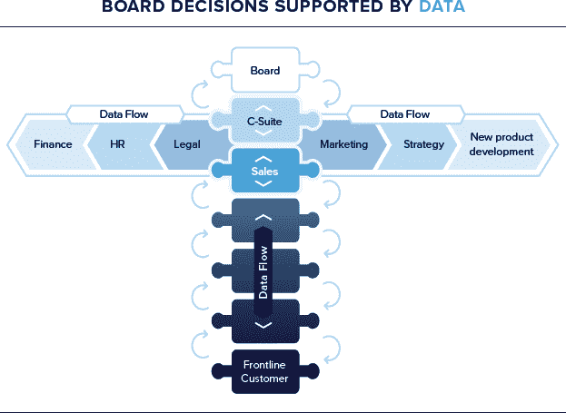
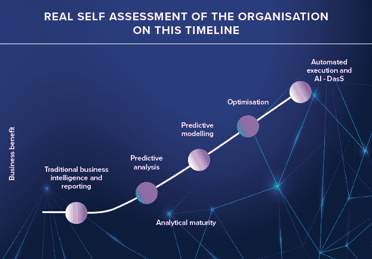
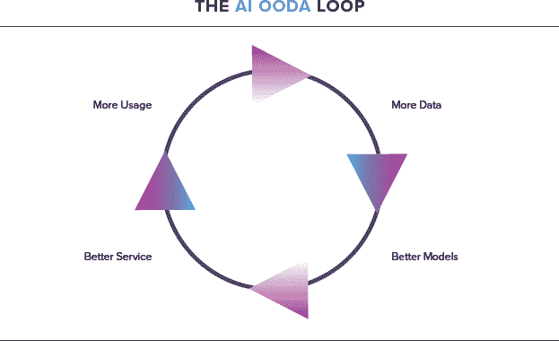
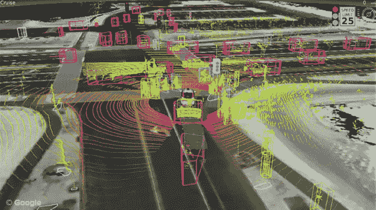
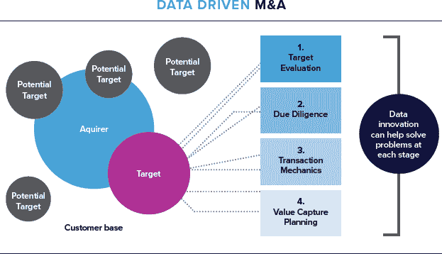
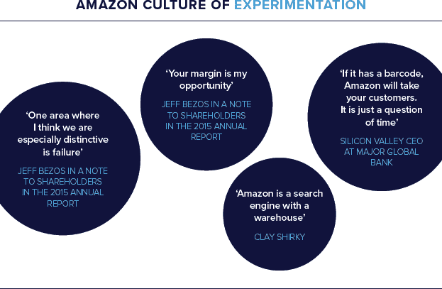
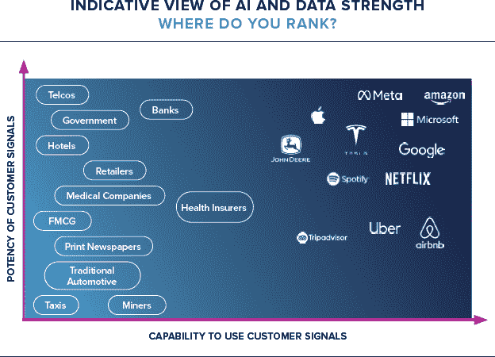

# AI：对局开启：如何决定由谁或什么来决策

致 Elizabeth、Syd 和 Anna。

感谢你们：

- 我们见过的奇妙世界。
- 我们有幸结识的人。
- 等待我们的冒险。

# 关于 TIM TRUMPER

Tim 是 `NRMA` 的主席，`Quantium` 的顾问兼创始股东（`Quantium` 为全球一些领先品牌提供数据和分析服务），他同时在几家私有高增长创新公司中拥有利益，包括 `andi search`。

他的职业生涯跨越了多个领域，包括人工智能和机器学习、大数据、数字化转型、出行与交通、金融服务以及媒体。

他是利用数据驱动创新和公司战略的权威。他的核心兴趣在于业务领导者如何促进成功的 AI 和机器学习业务转型，以驱动创新、制定公司战略，并为客户和社区提供服务。

Tim 是一位丰富的董事长、非执行董事、前首席执行官（CEO），以及多家全球及澳大利亚高性能公司的顾问。

他拥有 `UNE` 的 MBA 学学位，并在 2018 年完成了哈佛大学的“更有效的公司董事会治理计划”，并且是 `AICD` 的毕业生。

# 前言

很久以前，一位智者告诉我，没有哪一个时候是适合盖房子、生孩子、创业或写书的。对我来说，写这本书排在清单的最后位，而且这书已经准备了很久。感谢 Jaqui Lane 和 Michael Parker 帮助我度过了这一切。

我的数据之旅始于很久以前，当时我有幸遇到了互联网领域了不起的先驱 `Louis Rossetto` 和 `Jane Metcalfe`，这对人在 1993 年于他们的旧金山办公室共同创立了 `Wired` 杂志。这开启我在数据和分析世界中的漫长旅程，并让我了解如何利用它们来理解和预测“意图”与“注意力”——我们时代的两种新资产类别。Rossetto 和 Metcalfe 谈论了他们在万网黎明前夕看到的未来。当时的澳大利亚只有几百个电子邮件用户和少数几个运行网站，而这些网站不仅仅是绿屏上的文本。

想想这三十年来发生了什么变化。几乎一切都改变了。

Louis 指着一份《旧金山黄页》（San Francisco Yellow Pages）说：“这一文不值。”在当时，黄页是一个巨大的行业。他接着说：“如果你能算出这个周末旧金山谁需要医疗帮助或想买新车，那它几乎是无价的。我们在这里建立的是一种知晓一切的方法。”他说的是一种预测机器，这让我大开眼界。在 `AltaVista`、`Yahoo`、`Google`、`Andi` 等平台出现之前，Louis 就预到了搜索的需求。这是一个惊人的预言。

接着在 1997 年，微软（`Microsoft`）西雅图战略负责人对我说：“所有人知道，拥有关于客户需求最棒数据的人将获胜，”同时他解释了在拨号上网时代，他们如何试图理解数亿客户与 `Word` 的交互情况。在 1997 年，这是一项令人惊叹的举措。

我花了许多时间思考，这种关于大规模数据集的思维模式会产生什么。

我在媒体行业工作了多年，利用我们拥有的数据来为战略提供最佳支持。那是来自调查和焦点小组的低级数据。我们已尽力而为。当互联网真正兴起时，它改变了游戏规则。

在 2009 年，我遇到了 `Adam Driussi`，`Quantium` 的创始人也是现任 CEO。当时我正在帮助一家保险公司，Adam 向董事会做了一次演示。Adam 头脑非常敏锐，并将对帮助公司发现真正的规模化洞察、以及日益将 AI 赋能的应用应用于其数据中的热情结合在一起。

在看了数百次面向公司的演示后，我被 Adam 提出的方案所吸引了。他展示的内容非常有力量。通过使用去标识化的信用卡数据，能够理解保险公司客户的真实行为；这不是通过调查得出的，也不是小样本，而是规模化的，而且行为是真实的。

最有趣的是，你如何利用这些数据来推断客户流失的原因。是因为价格、服务、糟糕的理赔体验，还是其他原因？数据实际应用中的细微差别是突破性的。客户公司购买了这项服务，它在当时帮助了公司的转型。

我觉得这非常有趣，于是跟进了 Adam，在几次交谈后，我作为股东和顾问加入了 `Quantium`。`Quantium` 从那些只有约 14 人的日子，发展到今天拥有超过 1200 名员工的全球业务。与 `Quantium` 的这段旅程让我与非常聪明的人合作，并学习了大量关于数据使用、分析和 AI 部署的前沿知识。当你读这本书时，你会发现我的很多观点很大程度上受到我与 `Quantium` 关系的影响，毫无疑问，潜移默化在多年来一直发挥着作用。从事分析实践并了解董事会的治理关切并不是一种常见的组合，所以我真心希望这种视角对读者有所帮助。

写这本书的第一个契机来自我的一位 CEO 级别的客户，他说：“你在数据使用、AI 赋能和数据伦理的最前沿已经拥有了三十多年的第一视角——为什么不告诉我们一些你学到的东西呢？”

接着，澳大利亚前 20 家公司之一的董事长对我说：“Tim，你有一个独特的视角，因为你既是数据从业者，又是一家大公司的董事长。你可以看到董事会对治理、风险和战略的看法。你还能看到全球高管正在面临的数据和用例挑战。你还能看到他们的伦理困境。让大家知道你学到的东西吧。”

上面的评论以及许多其他评论伴随了我多年。

图灵测试（用于衡量机器能否表现出与人类无法区分的智能行为）现在已是多余的，在科技界被认为是一个低标准。我们已经看到一种使用自然语言的特定 AI 形式——即 `ChatGPT`（生成式预训练变换器）通过了美国医学执照考试、律师资格考试以及沃顿商学院 MBA 期末考试。但请记住，它也预填充了大量的虚假信息，距离完美还有很一段距离。

尽管如此，自 2022 年 11 月底发布以来，`ChatGPT` 以新技术平台前所未有的速度达到了 1 亿用户这一指标。这标志着世界正处于一个转折点——AI 时代，战斗开启（AI: Game On）。

AI 和生成式 AI 的进步现在已是无处不在，我们正被许多看起来像人类的 AI 应用包围，在很多情况下，这些应用还在欺骗人类。

直到 21 世纪 20 年初，人类一直是无可争议的最优知识来源、数据收集者以及已知宇宙中最强预测能力的推动者。从最基础的知识形式，例如下一个水坑在哪里，以及我们是否有足够的食物过冬？人类仅凭一些预测认知能力就能繁荣。正是我们的超能力，使我们在尽管捕食者拥有更优越身体素质的情况下依然能够生存。

今天高度复杂的竞争性商业世界归结为一个事实：你越能准确、越快地预测你的组织、客户和竞争对手将发生什么，你今天的决策就越明智，从而改变你的命运。

Google 首席执行官在 2022 年 12 月针对生成式 AI 的影响以及 OpenAI 的 `ChatGPT-4` 及其他 AI 应用带来的创新爆发式增长，发布了“全员红色警报”。如果 Google 担心这对它的业务造成什么影响，那么假设它不会影响到每一个组织就太天真了。

我们正处于新一波大浪潮的起点，有些人声称这是人类历史上最有意义的变革。当平台发生转移时（如电力、汽车、电视和互联网），影响会一波波到来，且终点并不明确。我们现在正处于 AI 时代，所有领导团队都需要思考“AI 时代，战斗开启”对他们意味着什么。

今天的世界越来越需要 AI 素养，而不是编码技能。虽然编码技能显然很有价值，但领导团队需要理解 AI 的能力、风险，以及符合组织宗旨和社会期望的用例。这种理解一直延伸到人的安全、职业以及人性的公平性方面。我们正处于 AI 时代，战斗开启的时刻，而且对于导航开始渗透到每个人生活的 AI 系统，存在着日益增长的需求。

埃里克·施密特（Eric Schmidt），Alphabet（Google）前主席指出：

> 对我来说，很清楚，最终将出现一个无所不知的系统，然后会有一个限制它的监管系统。

旧金山一家数据分析公司的创始人对我说：“利用预测性数据你只能做四件事：寻找客户、留住客户、理解他们下次从你那里想要什么，以及根据客户的未来需求优化你的 `capex`。”这四点都是至关重要的。

2008 年，《连线》（*Wired）编辑克里斯·安德森（Chris Anderson）表示，“海量数据将使理论甚至科学变得多余。”

很难准确了解 OpenAI 的实际人数，这家公司促成了 `ChatGPT-3` 生成式作品的诞生。2023 年 3 月的 LinkedIn 显示大约有 570 人。从生产力的角度考虑这一点：少于 1,000 人的人创造出了一种以以前所未有的速度改变世界的工具。现在这可能证明只是一个时间上的瞬间；然而，它对商业界和公众对 AI 想象的影响将是深远的。知识产权（IP）和数据超越劳动力和资本的趋势在许多领域是显而易见的，并将从这里继续增长。

例如，亚马逊的交叉销售算法产生了亚马逊所有零售销售额的约 35%。这意味着，当你在亚马逊上购买一本书、吉他或其他任何物品时，网站会回复“购买过此书的人也购买了……”，这种根据客户的持续选择进行自动且持续调整的推荐，驱动了惊人的新销售额量。以美元计算，亚马逊通过该算法创造了 480 亿美元的收入。

因此，可以认为亚马逊所拥有的关于客户的知识产权及其算法现在的价值已经超过了地球上几乎每一家零售商，像 `Walmart` 这样的巨头除外。IP 和数据正在取代劳动力和资本，成为价值创造的基石，董事和高管需要意识到并准备好如何带领公司进入 AI：游戏开启时代（Game On age）。

在与美国一位领先的投资银行家聊天时，他的观点是做空任何销售带条形码产品的公司。当他采访大型零售公司的 CEO 时，如果他们的产品是通过条形码销售的，他会问：“你计划如何阻止亚马逊以比你更便宜、更优质且交货更快的方式销售这些产品？”如果他们的答案令他不满意，他就会进行下注其股票下跌的交易。他非常震惊，竟然有这么多 CEO 很少给出一个令人满意的回答。“他们给了我一些关于以客户为中心的倡议的空话，但大多数人并没有采取规模化的行动将数据和 AI 置于公司的核心和脊柱。”这些组织的董事会目前正处于这种境地，董事和高管需要让组织拥有自己的使命、伦理，以及数据驱动的骨干、基于伦理的心脏与所有利益相关者之间的联系。失去了心脏，你就只是一个数据驱动的 AI 弃儿，等待着媒体的舆论风暴。做得太少，你就是柯达遇上百事达。Bed Bath & Beyond 是一个极佳的案例研究。我认识有人在 2017 年在他们的分析团队工作。他感到很沮丧，因为团队领导过于确定他们已经涵盖了一切，声称涵盖了所有的 AI 应用、个性化优化等。问题是，没有人告诉客户。一份声称你已经解决了这些问题的 PPT 幻灯片是行通通。

“每个人都知道，拥有关于客户需求最佳数据的人将获胜。”这些话是 1997 年在西雅图微软总部的一场会议上对我说的。那位高管正试图研究如何从数百万使用他产品的客户那里获取信号，以便为他们设计出更好的产品。那时的互联网在很大程度上仍是拨号上网，缓慢且笨拙。数据策略在 1997 年并不是你会听过的话题，但这些话留在了我的脑海中，标志着某些重大事件的开始。

想象一下在 1997 年实时学习 2 亿多人使用你的产品在做什么。在当时，这就像是在说你正在研究时间旅行。这种在当时是如此独特的方法，已被证明是正确且对生存至关重要的。然而，在近三十年后，许多组织仍在研究如何从真实的规模化客户洞察中找到他们的数据策略。你的组织如何从未来可能被数据 AI 驱动竞争对手挑战的同质化传统产品中多元化？这正是董事和高管需要问的问题。

AI 近期惊人的进步将加速拥有强大自有数据集的公司的优势。世界上最臭名昭著的选股人之一 `Cathie Wood` 在 2023 年 2 月声称：“我们相信，从人工智能中受益最大的隐藏宝石是那些拥有自有数据集的公司。”他们声称 `Tesla` 是一个很好的例子，因为它拥有道路和驾驶行为的数据。注意，这并非投资建议！

`a16z` 播客在 2023 年 1 月询问了 Andreessen Horowitz 的一些投资合伙人对 2023 年的主题看法。他们说：“如果一家公司没有 AI 策略，它真的应该在昨天就开始考虑了。”该播客指出，他们看到 AI 在组织的后勤部门带来了 10 到 100 倍的生产力提升，不仅是在客户端，还包括采购、财务等领域。随着 AI 的使用成为标配，你需要自己的策略来驾驭它的力量。

不提问且不对这类问题采取行动，在我们进入 AI：游戏开启世界时，将限制你的业务。

以我写下这些字时正在喝的 San Pellegrino 为例。任何人都可以将其输入 `Google`，在搜索中添加“最低价”，它就会找到由 `Google` SEO 和付费广告所定义的最佳报价。策略大师 `Michael Porter` 说：“业务需要决定是廉价的还是差异化的”；痛苦源于无差异化的产品。我们现在正看到“差异化”与“更廉价”的结合。亚马逊等巨头提供的“低价——快速交付”服务是难以战胜的，当经济效益产生于客户身上时，客户将会迁移，尤其是来自一个能够消除购买摩擦的信誉提供商时。

San Pellegrino 对它的客户了解什么？它知道在哪些地区由哪些零售商制造并销售了多少规格和口味的瓶子，但公司能对客户的习惯了解什么？他们在哪里喝 San Pellegrino，除了解渴之外还为了什么目的？除非他们增加自己的仓库数据，否则他们将不知道客户在喝它时吃了什么，他们的年龄是多少，他们是忠诚还是会转向其他气泡水，他们对价格有多敏感，或者他们每天通常消费多少。还不知道厨房里的 `SodaStream` 对该家庭消费会产生什么影响。San Pellegrino 是否主要在招待客人时消费？这种来自真实数据的特定消费者洞察依赖于生产者与每个客户建立关系，即通过外部关联数据建立客户的直接视线。超市忠诚卡正是为此目的开发的，在有优秀软件和分析的情况下，它们就能很好运作。这就是为什么，如果你的业务与客户之间的互动很少，或者缺乏“信号”，你应该警觉，并开始投入思考和资源来回答诸这样的问题：我如何与客户直接创造信号？我能发明什么样的产品让客户与我互动从而增加客户信号，我能从这种信号中为客户提供什么利益？确保回答了最后一个问题，否则你创造的是客户的骚扰而不是利益。

一家全球性的气瓶供应公司正寻求着解决这个问题。随着数百万个气瓶被送往数百万名客户手中，他们目前并不知道哪些气瓶是满的，哪些即将用完。他们正在研究，在每个气瓶放入一个微型传感器和处理器的成本，这可以告诉他们气瓶的位置以及满度——它可能在一个偏远的远程牧场，而且可能只有 20% 的量。有了来自客户的这种直接信号，公司现在可以创建一个围绕如何补充气体的服务。客户可能会收到一条信息：“您的气瓶即将用完，点击此处加气。”当然，利用新技术有几种方法可以知道剩余气量，但据我所知，目前还没有大规模的全球性反馈回路。

这种倡议对客户非常有用，因为当他们需要加热、烹饪或将气体用于各种用途时，永远不会措手不及。对于燃气公司来说，这可以建立忠诚度，追踪并预测需求，并获得可能为其他产品服务提供依据的数据；它允许他们以一种互利互惠的价值交换与客户进行合法的沟通。

数据的使用和应用分析正在业务的各个方面创造出赢家和输家。对于那些无法启用并解读客户信号的组织来说，一场企业级的“珍珠港事件”正等待着他们。

## 不使用数据的成本——观察与理解的重要性

珍珠港事件的奇袭是理解数据价值时最具有催化作用的时刻之一。1941 年初，美军已经意识到与日本之间的紧张局势，一个一个小团队正致力于破解日本海军的密代码。与积聚火力和硬件相比，破译密码在当时的军事投资中并非首要任务。

日本对珍珠港的袭击尖锐地说明了，识别并理解来自组织外的噪声中的信号（在本例中，即破解日本通信的密码），与拥有航空母母一样重要。这次袭击改变了美军对数据的认知；随之，海军在数学家、密码破译人员以及信息检测领域投入了巨额资金，并开发了一个凝聚心的计划，该计划已成为赢得战争至关重要的任务。

在珍珠港事件后的几个月内，美军破译了日本人的密码，并得知日本的入侵部队（包括许多促成珍珠港袭击的航空母舰）正前往中途群岛。这是通过在日本军事通信数据的乱码代码中找到信号实现的——它使美军在中途群岛海战中决定性地击败了日本，这也是太平洋战争的转折点。

珍珠港从字面上是一个燃烧的平台，它通过悲剧性的损失驱动了决定性的变化。在某个时刻，每家企业都将面临自己的比喻意义上的“珍珠港时刻”，即他们会被通常来自其传统参考范围之外的竞争以一种他们无法预测的方式感到惊讶，除非他们成为一个具有真实预测能力的组织。

在商业领域，现在必须尽可能地理解并尝试预测宏观经济变化，以及客户和市场的实时微观行为变化。如果美军能提前获得一小时珍珠港事件的预警，结果将大不相同。

硅谷一位超级聪明的风险投资人曾对我说过一句话，至今让我记忆犹新。他说：“如果公司想让消费者签署长期合同，它的客户服务很可能是糟糕的。合同是为了他们的利益而不是你的。合同是为了阻止你离开。”这让我意识到，许多客户体验排名最高的公司——`Netflix`、`Google`、`Amazon`、`Alibaba`、`Apple`——并不需要锁定性的长期合同（尽管大多数都有订阅/溢价优惠以及关联的产品和服务：`Amazon Prime`、`Echo/Alexa`、`Google Nest`、`Apple’s Siri`）。所有这些公司都了解客户在某一时刻和随时间推移的行为。这意味着他们可以更准确地预测客户的未来需求。与大多数电信公司或许多金融公司相比，这是为了他们的利益而不是你的。

数据的使用和应用分析正在业务的各个方面创造出赢家和输家。对于那些无法启用并解读客户信号的组织来说，一场企业级的“珍珠港事件”正等待着他们。

## 不使用数据的成本——观察与理解的重要性

珍珠港事件的奇袭是理解数据价值时最具有催化作用的时刻之一。1941 年初，美军已经意识到与日本之间的紧张局势，一个一个小团队正致力于破解日本海军的密代码。与积聚火力和硬件相比，破译密码在当时的军事投资中并非首要任务。

日本对珍珠港的袭击尖锐地说明了，识别并理解来自组织外的噪声中的信号（在本例中，即破解日本通信的密码），与拥有航空母母一样重要。这次袭击改变了美军对数据的认知；随之，海军在数学家、密码破译人员以及信息检测领域投入了巨额资金，并开发了一个凝聚心的计划，该计划已成为赢得战争至关重要的任务。

在珍珠港事件后的几个月内，美军破译了日本人的密码，并得知日本的入侵部队（包括许多促成珍珠港袭击的航空母舰）正前往中途群岛。这是通过在日本军事通信数据的乱码代码中找到信号实现的——它使美军在中途群岛海战中决定性地击败了日本，这也是太平洋战争的转折点。

珍珠港从字面上是一个燃烧的平台，它通过悲剧性的损失驱动了决定性的变化。在某个时刻，每家企业都将面临自己的比喻意义上的“珍珠港时刻”，即他们会被通常来自其传统参考范围之外的竞争以一种他们无法预测的方式感到惊讶，除非他们成为一个具有真实预测能力的组织。

在商业领域，现在必须尽可能地理解并尝试预测宏观经济变化，以及客户和市场的实时微观行为变化。如果美军能提前获得一小时珍珠港事件的预警，结果将大不相同。

硅谷一位超级聪明的风险投资人曾对我说过一句话，至今让我记忆犹新。他说：“如果公司想让消费者签署长期合同，它的客户服务很可能是糟糕的。合同是为了他们的利益而不是你的。合同是为了阻止你离开。”这让我意识到，许多客户体验排名最高的公司——`Netflix`、`Google`、`Amazon`、`Alibaba`、`Apple`——并不需要锁定性的长期合同（尽管大多数都有订阅/溢价优惠以及关联的产品和服务：`Amazon Prime`、`Echo/Alexa`、`Google Nest`、`Apple’s Siri`）。所有这些公司都了解客户在某一时刻和随时间推移的行为。这意味着他们可以更准确地预测客户的未来需求。与大多数电信公司或许多金融公司相比，这是为了他们的利益而不是你的。

数据的使用和应用分析正在业务的各个方面创造出赢家和输家。对于那些无法启用并解读客户信号的组织来说，一场企业级的“珍珠港事件”正等待着他们。

## 不使用数据的成本——观察与理解的重要性

珍珠港事件的奇袭是理解数据价值时最具有催化作用的时刻之一。1941 年初，美军已经意识到与日本之间的紧张局势，一个一个小团队正致力于破解日本海军的密代码。与积聚火力和硬件相比，破译密码在当时的军事投资中并非首要任务。

日本对珍珠港的袭击尖锐地说明了，识别并理解来自组织外的噪声中的信号（在本例中，即破解日本通信的密码），与拥有航空母母一样重要。这次袭击改变了美军对数据的认知；随之，海军在数学家、密码破译人员以及信息检测领域投入了巨额资金，并开发了一个凝聚心的计划，该计划已成为赢得战争至关重要的任务。

在珍珠港事件后的几个月内，美军破译了日本人的密码，并得知日本的入侵部队（包括许多促成珍珠港袭击的航空母舰）正前往中途群岛。这是通过在日本军事通信数据的乱码代码中找到信号实现的——它使美军在中途群岛海战中决定性地击败了日本，这也是太平洋战争的转折点。

珍珠港从字面上是一个燃烧的平台，它通过悲剧性的损失驱动了决定性的变化。在某个时刻，每家企业都将面临自己的比喻意义上的“珍珠港时刻”，即他们会被通常来自其传统参考范围之外的竞争以一种他们无法预测的方式感到惊讶，除非他们成为一个具有真实预测能力的组织。

在商业领域，现在必须尽可能地理解并尝试预测宏观经济变化，以及客户和市场的实时微观行为变化。如果美军能提前获得一小时珍珠港事件的预警，结果将大不相同。

硅谷一位超级聪明的风险投资人曾对我说过一句话，至今让我记忆犹新。他说：“如果公司想让消费者签署长期合同，它的客户服务很可能是糟糕的。合同是为了他们的利益而不是你的。合同是为了阻止你离开。”这让我意识到，许多客户体验排名最高的公司——`Netflix`、`Google`、`Amazon`、`Alibaba`、`Apple`——并不需要锁定性的长期合同（尽管大多数都有订阅/溢价优惠以及关联的产品和服务：`Amazon Prime`、`Echo/Alexa`、`Google Nest`、`Apple’s Siri`）。所有这些公司都了解客户在某一时刻和随时间推移的行为。这意味着他们可以更准确地预测客户的未来需求。与大多数电信公司或许多金融公司相比，这是为了他们的利益而不是你的。

## 从数据驱动到人工智能驱动——预测型企业的未来

几十年来，一些创业者、企业高管和董事成员已经意识到特定数据集的重要性并利用了它们。我们都熟悉 `FAANGs`（`Facebook`、`Amazon`、`Apple`、`Netflix`、`Google`）的兴起，可能的 `GAFAM`（`Google`、`Apple`、`Facebook`、`Amazon`、`Microsoft`）。

在 2023 年写这些时，FAANG 股票的价值发生了显著变化；即使经历了大幅回调，它们仍然通过数据使用（在某些情况下是滥用）积累了巨大的估值。不信？看看以下两个价值公司的快照。

根据波士顿咨询公司（`BCG`）2020 年的研究，三分之一的上市公司将在 2025 年之前停止以其当前形式存在——这一速度是 40 年前的六倍。今天领先公司中百分之四十四的职位至少持有五年，而 1970 年为 77%。

2021 年 1 月，一家人工智能工程公司 `Juniper` 对跨越农业、工业、技术、制药等领域以及亚洲、欧洲和美国的 700 家组织进行了调查。

它还发现，95%的组织认为将人工智能嵌入其日常运营、产品和服务将从中受益，但只有 6%的高管级领导者报告在组织内部实施了人工智能驱动的解决方案。即使是最先进的人工智能公司仍然可以找到这种技术的许多新方法。

2023 年麦肯锡公司的研究发现，90%的商业领袖预计在未来两年内经常使用人工智能解决方案。

你可以采取一些逻辑步骤来改变公司方法成为人工智能/数据驱动业务的方法。第一步是了解公司现在处于什么位置，在这一领域数据和客户方面未来将会出现什么，数据在组织内部（以及决策链的上下）的流动情况。这将为你提供一个开始的基准。

在写本文时，世界上最富有的许多人都是数据密集型公司的创始人，而这些公司的价值创造归功于数据驱动型企业：埃隆·马斯克、杰夫·贝佐斯、马克·扎克伯格、拉拉里·佩奇、谢尔盖·布林等。当然，人们对这种权力的集中以及某些用例中数据的存储和使用方式存在着非常真实的担忧。我们将在书的后面讨论这些问题。

那么，为什么有这么多公司在浸入数据和人工智能方面如此迟缓，未能确保未来的业务表现和成功呢？

丘吉尔曾说：“成功就是从一个失败走向另一个失败，而不失去热情。”我知道，这可能描述了过去 20 年里许多客户转型/数字化转型项目的现状，其中大多数都失败了，因为它们太过于受技术修复的驱动，而忽视了业务需求、业务适应和客户契合度。过度的数字化外壳（通常在客户体验/界面领域），而没有意识到这是一个全业务的项目，而且它是永不停歇的。

1. 数据和人工智能是未来经济增长和价值的驱动力，正在取代劳动力和资本成为价值创造的基石。

2. 拥抱人工智能和数据的公司表现优于那些对人工智能没有统一应对的公司。

3. 了解客户信号和行为的公司可以更准确地预测未来需求，并通过提高准入门槛来保持竞争力。

4. 公司面临的前三大挑战是：人工智能就绪的技术栈、员工的就绪状态以及人工智能治理。

5. 尽管大多数组织认为他们将从人工智能中受益，但只有 6%的级层领导报告称在其组织内实施了人工智能驱动的解决方案。

---

# 第二章：数据与人工智能的责任由董事会承担

> “让我们陷入麻烦的不是我们不知道的，而是我们确定认为的事情并非如此。” —— 马克·莱恩

## 董事会和执行层现在要对数据使用不当负责

BrisConnections 是三家公司（麦格锡银行、Thiess 和 John Holland）组成的财团，他们获得了布斯班机场连接（Airport Link）的政府私营合作合同，这是布斯班北部山区的一条高速公路级收费道路。BrisConnections 委托其工程伙伴奥盛集团（Arup）调查机场连接隧道的前景，这是一条长 6.7 公里的收费道路，连接布斯班中心商务区与克莱姆·琼隧道以及通往布斯班机场的主干道。

在 2012 年 7 月主要收费道路开放后的七个月内，BrisConnections 进入了管理程序，导致了数十亿的损失。原因是什么？实际流量远低于预测流量。对客户意图的预测完全失败了。

在随后的诉讼中，董事们发现数据的使用至关重要，引发了一场金额达 20 亿美元的集体诉讼。在法院程序的审查下，预测者承认用于预测道路使用的模型是“完全荒谬的”，留下了数十亿美元的缺口。

BrisConnections 诉讼引发了关于数据是否重要到不能仅交给数据部门的讨论。答案显然是肯定的。被追责的不仅是专业公司，还有董事会成员。教训是什么？董事会和管理层需要加强对真实数据的调查，并提出诸这样的问题：什么数据进入了模型？数据来自哪里？可能存在哪些偏差？我们对这种准确性的舒适度评分是多少？可以被独立验证吗？哪些其他数据源可以增加我们的分析？

我们都受到确认偏误的影响。我们希望自己的信念得到证实。支持确认偏误的信息会触发多巴胺释放，这让我们感到非常舒服。犯错会耗尽多巴胺，所有人都会避免这种感觉，即使这对他们有好处。与我们自己意见相反的建议往往会被拒绝。

基础设施和数据的使用已经伴随我们数千年。考虑约翰·斯诺医生（Dr John Snow）。1854 年伦敦霍乱期间的传统观点认为这是一种空气传播疾病，逻辑是下水道的臭味弥漫整个伦敦，因为当时下水道系统正在建设中，许多人死于这种可怕的疾病。一个孤独的声音——约翰·斯诺医生说，这种疾病存在于伦敦的饮用水中。他遭了嘲笑，然后他创建了一张死亡地图。地图显示，住得某个特定水泵越近，死亡可能性就越大。一旦数据被绘制并视觉化，人类就理解了它——这为伦敦历史上这段悲剧的终结铺平了道路。数据猎捕并杀死神话，只要你对新数据保持开放的心态。

**1854 年伦敦霍乱死亡分布图**

BrisConnections 是我记得第一次有澳大利亚董事会因为数据使用不当被起诉，因为他们没有对其委托的数据进行合理的评估。这场已经很漫长、耗资且多管齐下的诉讼一直持续到 2017 年。

这次失败对于所有董事、执行官和专业人士来说都是一个教训，原因有很多。它明确了，你使用或未使用的数据所做出的预测是可审计的。你对数据所做的事可以被审计，你没有做的事也可以被审计。它表明，随着预期的增加和更好数据集的可用，用调查规模来证明巨额投资决策的想法将行不通。在法庭上，你将坐在法官面前，像我这样的人作为专家证人会说：“如果你使用了当代数据科学、外部数据集和分析，你本可以更精确地预测机场连接的需求。你现在可以为每位车主及其对该收费道路的倾向建立人工智能预测模型。”这可以通过符合隐私要求的方式、使用匿名化数据集来实现。

在当今基于真实世界数据预测分析驱动人工智能的世界里，可以建立针对特定社会需求的收费道路。首先，确定要解决的问题。比如是为了提高从商务区及周边区域前往机场或沿线其他目的地的速度和便利性。然后，从客户的视角审视该提议。客户是谁？客户在哪里？他们要去哪里？为什么要去？他们有哪些替代出行方式？可以考虑哪些公共交通方案？当地会有哪些二级影响：噪音、污染、保护物种等等？

如果另一个运营商在道路旁开通一条轻轨，例如，这会对交通预测产生巨大影响，共享出行业务的发展以及最终的自动驾驶汽车发展也是如此。此外，如果你正在考虑一个使用年限等同于收费的项目，你应该考虑未来的发展，如无人机或类似的人员运送技术，以及其他可能的道路交通替代方案。此外还有趋势数据：区域范围内有多少年轻人？他们学习驾驶和买车的意愿如何？居家办公（或每周仅在办公室工作一天或多天的混合办公）的趋势如何？以及关于视频会议和远程呈现机器人出现的趋势又是如何？

这些因素可以预测交通流量，电信数据显示的区域移动手机使用情况也是如此，来自应用、`Uber` 行程等其他位置数据亦是。与此相比，这些数据集让 `BrisConnections`（以及类似的其他机构）的假设与最新的火星探测器相比，看起来就像是一辆马车。

如你上面的图表所示，高质量的数据阐明了微观和宏观；它同时为我们提供了望远镜和显微镜视角。

我们已经看到，在当今数据驱动的世界里，对如何回答此类问题投入不足，或者无法读取问题数据中的异常，可以被视为等同于疏忽。

可口可乐在 1995 年灾难地将他们的配方改为 `New Coke`，在此之前的客户研究显示消费者更偏好新口味。焦点小组误导了他们，这对公司来说是一次死里逃生。他们通过销售额快速下降得出结论，将配方改回原始的 `Coke`，因为“营销太重要，不能只交给营销部门”。

我见过许多案例，数据已经变得重要到不能仅交给数据部门，这与 `BrisConnections` 相关的诉讼就证明了这一点。数据的使用和误用是一个全组织的战略问题。你可能拥有并且/或需要一个强大的数据部门，但它必须完全整合到你的组织中，而不是一个数学严谨性和数据科学的孤岛。亚马逊没有数据业务。它有一个由客户数据支持并日益由客户数据引导的客户业务。

## AI 和数据驱动型公司需要不同的领导力和治理

在 Nancy Giordano 的书籍《领导力》中，她深入探讨了公司管理的未来。她信息的核心观点是，必须从“领导”转向“领导力（leadering）”，从“一种为了一致的短期增长而设计高效扩展的静态、封闭、层次化的组织方法，转变为培养动态、适应、关怀、包容心态的领导，这种心态支持长期、可持续价值的持续创新。”

使用这种“领导力”模型，实现规划和执行数据及 AI 利用所需的任务将变得更容易，因为这应该从上至下进行领导。董事会和高管人员可以领导这种变化：

*   **制定 AI 如何使组织、员工、客户和社区受益的计划**

    *   对 AI 在未来三年如何影响你的业务拥有愿景至关重要。良好的状态是什么样的？数据如何帮助策略或启示策略？使用数据的风险与不使用数据的风险相比是什么？哪些用例会驱动实质性的积极变化？近期 BCG-MIT 的研究发现，拥有正确的数据、技术和人才但缺乏明确策略的公司，获得重大收益的概率仅为 21%。

*   **允许不同的团队合作工作**

    *   想要在 AI 方面取得成功的公司需要深思地消除信息使用的障碍，赋能团队探索新的合作方式。这将有助于提高敏捷性和创新性，并让组织对客户、市场和机会产生更全面的视角。

*   **拥抱多样性**

    *   思维的多样性是数据策略的关键，因此确保团队在数据和 AI 应用方面拥有多样化的视角。

*   **重新思考人机交互的方式（以及反之）**

    *   BCG 研究表明，当你在 AI 部署中创建反馈循环时，成功的机会更大。为了抓住这一点，你会希望 AI 从人类反馈中学习，人类从 AI 中学习，AI 自主学习。然后重复这个周期。

通过 AI 将你的业务转变为数据驱动不仅需要技术的改变，还要求流程、文化和协作的改变。一位正走这条道路并执行得良好的 CEO 告诉我，对于他们在技术和数据上每花费一美元，他们就会在变革管理倡议上花费一美元。他声称这是他们数据创新的秘密。

## AI/数据对比人类决策

如果你是一名职业专业律师、会计师、工程师或医生，由于数据和 AI，你的职位可能已经发生了重大变化。这种变化现在存在于我们生活的方方面：教育、健康、住房、娱乐、我们的城市、环境、投资以及我们选举谁。甚至我们的法律和司法系统的运作方式也包含数据和 AI 的成分。`OpenAI` 的 `ChatGPT` 以及其他大型语言模型的最新进展在 AI 用例上显示了深刻的进步。有些非常好，有些令人担忧。我的朋友对几个新的 AI 系统针对关于 `Paul Graham`（Y Combinator 创始人）的信息运行了多次实验。该文本非常有说服力，但完全错误。我的朋友接着说，`OpenAI` 和 `ChatGPT` 似乎倾向于青睐 AI 生成的内容而非人类写作。

花时间思考一下。

我们可能处于这样一种状态：由于自身的偏见，降低了人类思维，而提高了 AI 的排名！在第 6 章中，我将分享关于法官在休息和午餐前后决策模式的故事。观点是，机器有偏见，人类也是如此。

数据和 AI 已经影响了我们的政治体系。在澳大利亚，市场营销和直邮中使用私人信息的唯一豁免是政党。他们可以获取选民名单并直接写信。这种信息对于所有其他用途都是被禁止的，也许对政党也应该是禁止的。数百万澳大利亚人收到过他们从未加入过的政党短信。每次选举的结果都由各党的政治策略师仔细研究，数据中的细节会让许多人惊讶。澳大利亚最关键的普查收集区（约 200 户）是可知的。那 200 户或更多房屋里是谁也是可知的。什么会让他们改变投票？这是可预测的，而且如果提供了足够的数据，哪些政策理念会引起他们的共鸣也是可预测的。

数据和人工智能（AI）正在改变，并将继续改变我们生活的方方面面。在许多其他深远变革之外，我们刚刚经历了过去 50 年来最具挑战性的时期之一。我们经历了百年一遇的全球性流行病，随后是俄罗斯入侵乌克兰导致的大规模贸易动荡，而且我们正经历着气候变化的影响。所有这些因素都导致了巨大的干扰。对于个人、组织和社会而言而言，韧性和适应能力可能比以往任何时候都显得更加重要。

可以说，对数据的捕获、利用、共享及其解读，使得世界领导者和医疗专业人员能够比我们以往任何时候都更有效、更高效地研究、开发和实施大流行病应对措施。这拯救了数百万生命，减少了病毒对其他数百万人的影响，并避免了全球性经济危机。

### 医疗保健中的 AI

人工智能正被应用于广泛的健康医疗治疗领域。例如，通过 X 光片对肺癌进行评估。医生/放射科医生每天只能查看一定数量的光 光片，并利用他们的知识寻找癌症等健康问题。而能够持续学习的 AI 机器每天可以查看数千份。将放射科医生与机器结合，你就显著提升了能力。对于 AI 如何发现其他疾病的关联性和早期迹象，人们感到非常兴奋。其中一些发现以前还未被察觉，现在正由人类进行进一步调查。

我最近在一个公共论坛上看到了 [Enlitic.com](http://Enlitic.com) 的演示，这令人印象深刻，它展示了如何以惊人的速度和极高的准确性扫描数千份 X 光片以检测异常。他们专注于使用 AI 工具的解决方案，这些工具对患者护理产生积极影响，而且他们的 AI 能够比单凭医生更准确、更快速地发现健康问题。

### 金融领域与监管

对于金融部门，特别是在澳大利亚，关于银行、养老金和金融服务行业不当行为的皇家委员会以及由此产生的负责任贷款建议，有效地从住房贷款方面改变了法律。它从“买方自慎”转变为“卖方自慎”。全球范围内的银行和其他金融机构将需要特定的标准来决定可以向谁出售什么产品。如果你不使用真实数据来了解你的客户，以及你可能或不应该向他们销售什么，监管机构很可能会问你为什么不呢？

虽然了解客户（KYC）是银行受监管必须遵守的——主要是为了反洗钱目的——但他们和其他大公司都旨在实现某种形式的以客户为中心的目标。现实是，AI 的部署规模和水平远未达到真正了解其客户、或者更好地预测他们在何时需要他们需要东西的程度。

这里有一个最近的个人例子。我收到了一张支票。你还记得支票吗？于是，我找到了银行分行并存入了支票，在办理时，柜台员问我是否需要汽车贷款。我为柜台员感到很遗憾，因为我是用那家银行的现金买了车，所以我在银行的交易记录告诉他们不需要汽车贷款，但前台柜台员并没有这些信息。相反，他收到的是总部的一项自私指令，要求他推销汽车贷款。我的数据本可以为了我自己的利益而使用，但他们的系统过于脱节，无法赋予柜台员对我进行进行“下一次最佳对话”的能力。拥有良好管理并专注于数据客户创新的银行，以及金融科技挑战者，在使用客户数据方面将不会如此迟缓，并能够创建下一次最佳行动——根据客户的特定需求与客户进行对话。

当你是现有者时，这很难，因为自尊和傲慢会产生障碍。沃伦·巴菲特在 2014 年给伯科希撒韦股东的信中提到了他的 ABC 单：

> “我的继任者还需要另一种特殊能力：抵御业务衰败的 ABC 能力，即傲慢、官僚主义和自满。当这些企业癌症蔓延时，即使是最强大的公司也会动摇。”

## 数据 AI 能力/数据 AI 领导力匮乏

几年前，企业面临的挑战是他们没有足够的可访问数据。典型数据旅程的起点是数据处于不同的格式、位于业务的不同部门，并且没有共享。在许多情况下，数据被积极地隐藏或被其他部门扣留。

现实是，AI 的部署规模和水平远未达到真正了解其客户、或者更好地预测他们在何时需要他们需要东西的程度。

在`第 5 章`中，我探讨了“数据骨干”（`data spine`）概念，以及今天和未来的成功公司如何拥有它。现在企业真正的稀缺在于识别或培养能够重建这种机制的领导者、高管和创始人。

数据驱动的巨头，如`Amazon`、`Apple`、`Netflix`、`Alphabet`、`Microsoft`、`Tesla`和`Meta`，正在使用数据和 AI 创建优势。一些还包括`Adobe`、`Klarna`、`Reonomy`、`FourKites`、`Databricks`、`Canva`、`Teradata`、`IBM`和`Cloudera`。

数据时代贯穿始终的需求学习、适应和改变。他们还注意到当变化加速时，学习的需求也随之增加。如果是这样，还有比你的客户更好的学习地方吗？了解客户需求的最有力方法是通过他们以符合隐私规定的方式与你分享的内容。

一个组织学习并并将这种学习转化为行动的能力是终极竞争优势。这是数据分析和 AI 蓬勃发展。这些能力实时捕捉客户的信号。它们可以实时响应，并在需要时实时通知。它们还可以帮助预测未来的需求和欲望、库存控制、交付和定价，都是实时完成的。这是一个预测性业务。

现在有了能够快速创建算法的公司，有些声称每天创建 200,000 个算法。其中一家公司`DataRobot`在 2021 年的估值为 63 亿美元。

当马克·安德森在 2011 年说“软件正在吞噬世界”时，即使是他也未预料到 Sarah Wang 在最近的播客中所说的，2023 年 AI 将吞噬软件。

自适应算法（`SAMs`）已经存在了一段时间，现在用代码编写代码已成常态。2023 年 2 月，微软声称有超过 1 亿软件开发者现在正在使用`GitHub Copilot`。你将代码用于哪些任务以及出于什么目的，将越来越多地决定你的企业成果和声誉风险。这最终归属于董事会的责任，因为如果出现问题，董事将承担后果，风险可能比收益更大。在在未来，组织的命运将与代码紧密相连，取决于如何履行组织的使命、宗旨，以及这一切如何与社会的预期相契。对于某些人来说，这很难想象，但这就是新的现实。

在 2023 年 5 月访问微软时，看到他们如何将`Copilot`概念引入其许多产品是一件很有趣的事。例如，他们正在开发新方法来总结数百封电子邮件并以草稿形式准备最佳的回复，或者通过自动化洞察来读取电子表格。又或者对 Teams 会议进行摘要，并为会议举办者自动分配任务和准备结果，这你觉得如何？

这些工具及更多工具将加速 AI 辅助工具的采用，并让这些工具向数亿用户实现普及。

`Azure`、`Amazon`、`Google`等企业的云战前沿现在正聚焦于智能 AI 云服务上。拥有最智能工具的云平台将从没有工具的云中夺取份额。这将导致人类活动各个领域对 AI 工具的采用速度大大加快。

现在是新世界的加速时刻，Kevin Kelly 所描述的那个由数据流、认知化、筛选、访问、共享和过滤组成的世界。

2023 年 2 月 17 日，来自`a16z`的一期名为“1000 倍开发者”的播客中采访了`Replit`的首席执行官，这家公司专注于使用 AI 来帮助开发者。这位首席执行官谈到了一个开发者可能获得 1000 倍提升的未来。他指出，粗略估计只有大约 1% 的人会写代码。对新代码的需求是爆炸性的，而`Replit`的目标就是开发通过提供更好、更快的选项来引导代码的 AI 驱动工具。我不确定这是好是坏，我只是观察到，如果你的技术通过新工具能够获得哪怕一点提升，你也会想去探索它。`Replit`首席执行官接着谈到了新代码的丰富性以及创建由新工具支持的新工具。

## 作为高管或董事会成员，你在 AI 时代的角色是什么：游戏开始（Game On）？

此时值得反思几个问题：

1. 在机器在发现和处理信息的能力上反复超越人类的世界里，CEO 的角色是什么？
2. 董事会在对于这样一个机器系统的责任中，扮演着什么角色？
3. 这里存在哪些问题？董事会和社会如何降低风险？

这里的每一个问题可能都有一本书，我肯定会进一步探索并分享一些想法。现在作为高管或董事会成员，你所能采取的最行动是：

1. **为时间治理（Govern for time）**
   - 治理源于拉丁词`gubernare`，意为“操控”。数据越好，创建洞察和行动以控制组织进程的能力就越强。如果你在整个组织拥抱数据、AI 和机器学习，并以企业级的骨干构建你的业务，你正走向你自己的 AI 版本：游戏开始（Game On）。

2. **理解并拥抱机器学习**
   - 下一步是全球范围内已经在组织中实施的“机器学习”的演进。这是未来的预测型公司，届时数据、AI 和机器学习将与人类团队相结合，学习将其整合到他们的决策能力中。

这是两项深远的责任，如果你的组织希望延续下去，这些责任是无法避免的。

我有幸看到 Garry Kasparov 在 2019 年的西南节（`SXSW`）上演讲。Kasparov 在 1985 年以 22 岁成为历史上最年轻的无争议象棋冠军。1997 年，他在标准时间控制下输给了`IBM`超级计算机`Deep Blue`，成为首位在比赛中输给电脑的世界冠军。Garry 分享了从那以后输给机器的感受；从那时起，象棋变成了人类与机器的游戏。它是人类与机器的增强，而非人类的取代。这些象棋大师几十年前就必须决定何时允许机器移动，何时不；这现在是所有领导者的决策。

CEO 和董事会已经在做出机器和数据增强的决策，正如`Salesforce`首席执行官`Marc Benioff`、`Amazon`创始人`Jeff Bezos`以及`Microsoft`首席执行官`Satya Nadella`所做的那样。尽管如此，数据、AI 和机器学习是下一个层次，让你能够深入、查看并处理你的组织每天每秒产生的数据，有时添加其他数据集来精炼你的数据。新奇的是信息量，是从客户需求到观察到的数据流向董事会再流回的潜在流动；当它被正确构建和整合时，它就像一根（带有脊髓液的）数据骨干。

## 对客户提问，并持续提问

确保你尽可能学习任何关于你客户的知识。引用`Jack Welch`的话，他的遗产显然很复杂：“获胜只有两种方法：搞清楚你的客户想要什么，并比任何人都更快地做到。”

要建立一家真正以客户为中心的公司，你需要将其作为一个全全的挑战来领导。

具有预测能力的公司的组织设计始于一种认知：数据、AI 和机器学习来自公司的各个角落，并从底部流向顶部再流回来。`Tesla`有这些，`Microsoft`有，`John Deere`以及不断增加的新旧公司都有。实时完整地了解客户在购买什么、如何使用产品或服务、他们使用或购买的频率、他们使用的应用程序以及频率、花费了多久等。这些信息流向了业务的所有部分：供应链、仓储、物流、销售团队、产品设计人员、开发、技术团队、呼叫中心支持团队、销售营销团队，而且不能遗漏高管和董事会。

## 业务的“按需知”模型已变为“按需共享”

共享的需求是整个组织范围内的。未能连接业务部门的数据现在正为你的业务带来成本，未来将产生更高成本。世界在径 9/11 袭击中吸了这种失败的悲剧教训。包括`CIA`、`FBI`、`NSA`、`FAA`在内的众多政府机构未能连接数据和线索，导致了机构间数据和情报共享的重大变化，即合并他们的数据库以进行更全面的信息分析。《9/11 委员会报告》非常有可读性，尤其是第 13.3 节“信息共享中的努力统一”。

将数据、AI 和机器学习的责任孤立给某一个个人（你的`CDO`或`CIO`），然后让他不得不与整个组织斗争，并不是扩展数据驱动的以客户为中心的方法。需要全组织范围的领导力和管理所有权，并将 KPI 锚定在客户体验和客户体验回报上。

在内部共享数据现在充满了风险，即这些数据可能通过非法手段被共享到外部。网络窃窃的风险不能成为你被拥有更好数据和更优 AI 驱动产品的竞争对手击败的理由。应对网络风险领域意味着既要考虑收益，也要考虑亏损。如果组织无法想象或看到收益，那么所有关于数据和 AI 的讨论都只是停留在风险登记册上。

这并不是关于在网络窃取、开放 API、粗心的数据卫生、培训或网络安全上冒险。它关乎数据安全以及与用例的对齐，让你在竞争对手发现先机之前就通向未来。

归结底就是一点：如果你把数据锁起来，你就输了；如果你让数据裸奔，你也输了。

这就是为什么我们需要那些思考“AI：游戏开始（Game On）”未来的领导者。在这个领域需要真正的董事会参与以及深思熟虑的以客户为中心的用例。寻求帮助，就像你处理像 AI 和数据这样复杂的其他问题一样。数据和 AI 无法被那么容易地粉饰，并以伦理的方式实现实现和获胜。任何告诉你这很容易的人都没有做对方法。

保持好奇心，并培养一种好奇的文化。正如阿尔伯特·爱因斯坦所说：“我没有特别的天赋，我只是充满好奇心。”

已故的天文学家卡尔·萨根曾说：“在某个地方，某些不可思议的事等待着发现。”这是开启数据策略的一种极方式。

在下一章，我将深入探讨数据和 AI 的伦理，包括谁拥有数据、公司如何使用它，以及如果你想的话，你可以做什么来保护和分享它。我还将讨论 AI 以及等待监管跟上的陷阱。

1. 数据太重要了，不能留给数据部门；董事会和管理层需要自我了解。
2. `BrisConnections`的失败证明了使用当代数据科学和分析进行可审计预测的重要性。
3. AI 正在改变医疗保健和金融业，提高能力和准确性，并向以客户为中心的方法转变。其他行业正在随其后。
4. 银行、养老金和金融服务行业不当行为皇家委员会导致了理念变为“卖方自负（let the seller beware）”。
5. 组织学习并将这种学习转化为行动的能力是最终的竞争优势，数据分析和 AI 在捕捉客户需求信号方面蓬勃发展。

---

# 第 3 章：信任的重要性

来自澳大利亚公司董事学院（`AICD`）的一封信：

> 亲爱的 Tim：
>
> 今天，当我们在 LinkedIn 直播发布新的《网络安全治理原则》时直播出现故障，超过两千人感到失望。
>
> 我们对所有出席人员表示诚挚的歉意。
>
> 这似乎是一个技术故障，这种体验不符合你理应对我们期待的高标准。我们正与 LinkedIn 及我们的服务供应商合作了解此问题。下方提供了该活动的录像。

## 恶意链接

我们还想请注意在活动取消前的 15 分钟内，可能在活动聊天中发布的可疑恶意链接。

* 这些链接可能引导至请求个人信息的页面。
* 这些链接并非由`AICD`发布。
* 如果您点击了此类链接并输入了详细信息，请联系您的金融机构。如果您能也告诉我们，我们将不胜感激，以便我们尽可能提供支持。
* 如果您没有这样做，则不需要采取任何行动。

LinkedIn 平台上出现的链接与`AICD`的数据之间没有联系，我们的数据仍然是安全的。

虽然黑客可能利用恶意链接针对该活动，但目前没有发现这些行动与直播失败之间存在已知联系。

针对这一问题，我们正与澳大利亚网络安全中心和 LinkedIn 合作调查此事。

## 网络安全治理原则

虽然没有任何组织能免受网络安全风险，但我们对《网络安全治理原则》未能以直播形式呈现给各位感到遗憾。

我们希望您发现这些本身在管理安全威胁方面是有价值的，下方的录像能为您在自己的背景下应用这些原则提供见解。

一段时间以前，我参加了由澳大利亚公司董事学院（`AICD`）举办的关于网络犯罪的董事培训课程。如上面的来信所示，情况并不顺利，因为活动似乎由于恶意活动而被撤回了。`AICD`努力帮助董事变得更加专业和见多识广。他们是网络攻击的受害者。上面的邮件是在活动失败后发出的。当这封邮件到达时，我的第一个想法是：“这是真的还是垃圾邮件？这是一个真实的威胁吗？”

数据的使用和误用现在是所有关注业务去向的董事会的话题。老格言“生命中只有两件事是确定的：死亡和税收”需要更新了。我在硅谷的朋友 Ramneek Gupta 建议了一个新版本：“生命中有两件事是确定的：死亡和网络泄露。”

董事会现在应该询问这类问题：

* 我们持有哪些数据？
* 谁有访问权限？为什么？
* 这些数据中哪些部分对我们的运营是至关重要的，哪些部分我们可以放弃？
* 我们为什么要持有它？例如，为了监管机构、为了我们自己、创新、还是其他？
* 客户从中得到了什么好处？
* 它是如何加密的？
* 它是如何保护的？
* 它是如何备份的？
* 我们是否测试过保护数据的漏洞在哪里？

大多数数据犯罪（勒索攻击等）的讽刺之处在于，小偷想要的是个人信息（PI）：身份数据、信用卡、医疗记录、护照号码、医保号码，甚至关于你雇主的信息。然而，在许多强大的分析用例中，引擎不需要`PI`就能预测最佳优惠或解决痛点。在写作时，亚马逊的个性化引擎尚未被破解，它是数十亿购买模式的总结。

如果你的机构将客户推向聊天室以寻求那些标准低劣或人工智能上平庸（而非智能）的机器人的帮助，那么你正处于与客户流失、空头卖者的碰撞线上，而且可能是你自己的“柯达达时刻”。我花费了几个小时与一家多媒体软件供应商打交道，他们在复杂问题上将客户推给机器人，而这些问题是无法通过机器人聊天解决的。客户的痛点本应该是创新的时刻，但当沮丧的客户咒骂机器人时，由于他们错过了客户的痛苦，信号丢失了。最终，你被交给了一个现在聊天室里感觉像人类的人。我为这些员工感到同情，他们可能同时在处理许多客户，而你又一遍一遍重述所有问题。一个电话可能就能快速解决大多数问题，并对客户的痛点提供价值的洞察，但“唯数字自助服务”的教条并不允许这样做。相反，这更像是人工智能上的无能而非智能，它将使你陷入与现实的冲突。对于其中一些公司来说，客户的不满正反映在股价上。董事会需要对此负责，并接受责任在他们身上。

董事会和高管层需要清楚任何新技术的无意后果。特别是这种技术与人类及社会规范相符的程度。这始于目标，并确保人是过程的核心。正如`Microsoft`首席执行官萨提亚·纳德拉（Satya Nadella）所说：“顺便说一下，这从设计 AI 开始，你可以让人类参与其中、让人类处于循环中，或者让人类排除在外。”他在 2023 年 2 月继续说道：“当你考虑这些生成式 AI 模型时，记住一点：它们是根据提示去执行任务的。提示来自人类。”正如一些担心 AI 发展方向的人所指出的，这在未来可能会发生变化。

纳德拉指出，预训练至关重要。这是模型变得安全的阶段，在此阶段发生的情况将在应用背景中产生巨大影响。人类仍然负责决定由谁或什么来决定。

## 数据 AI 希波拉底誓言

希波拉底誓言是历史上最古老的约束性文件之一，至今仍被医生视为神圣：尽所能治愈病人、保护患者隐私、向下一代传授医学秘密。

Greg Schneider 是`Quantium`的联合创始人，他是我第一个听到谈论“数据希波拉底誓言”的人。我认为所有企业都需要一份数据希波拉底誓言。如果你正在寻找一个北极星来指引和遵守你的数据与 AI 伦理，这里有一个起点：

1. 我们不会对收集的数据造成伤害。
2. 我们不会将关于任何人的信息用于任何让其生活变得更加艰难的目的。
3. 我们将尊重客户的隐私，不允许关于他们的信息以任何方式被用于他们。

客户关心自己的隐私，大多数人认为隐私是神圣不可侵的。这种担忧适用于企业收集什么数据、现在及未来的用途、保留多久，以及与哪些第三方共享。在向预测型组织发展的过程中，机构需要保护所收集、存储和使用的数据。他们必须预测他们正在收集的数据未来用途，并且只收集帮助客户真正所需的数据。此外，他们必须根据客户的请求删除数据。如果你不采取所有这些行动，可能会产生后果——个人、财务、声誉和监管方面的后果。

## 数据的使用与误用

随着数据集的增长和数据用例的扩大，使用和误用的可能性也随之增加。数据“护栏”的需求不能在数据列车事故后进行补救。护栏不需要像《战争与和平》那么大，但确实需要清晰的，数据希波拉底誓言就是一个可以提供帮助的框架。这是董事会、高级高管和管理层需要深入研究的地方。如果你不知道数据是什么、是如何获取的以及它将用于何处，以后你可能会发现自己站在监管机构或参议院委员会面前试图解释。“我把那个留给数据部门了”在证人席上是行不通的。数据部门在做什么？他们有遵循遵守的数据希波拉底誓言或其他护栏吗？数据使用或误用中存在哪些二级或三级后果？这在你的风险登记中吗？董事会对会对这一主题投入审视性精神吗？

政府需要在监管方面行动得更快，以处于数据和 AI 使用执法的前沿，保护数据隐私免受伦理标准糟糕公司的侵害，并追诉非法获取数据获取商业利益的罪犯。现在 AI 正以惊人的速度增长，监管机构需要迅速形成观点，并就对社会正确的做法采取行动。

2022 年 2 月，澳大利亚矿业大亨、慈善家 Andrew Forrest 在澳大利亚法院对`Meta`平台`Facebook`发起了刑事诉讼，指控其违反了反洗钱法。

许多公司根据《通用数据保护条例》被罚款，包括`Meta`、`Google`、`Amazon`、`Facebook`、`H&M`、`Enel Energia`、`British Airways`和`Marriott`。在 2021-22 财年，GDPR 违规数量增加了 113.5%，罚金额增加了 124.9%。

让我们来看另一个例子。在我居住的澳大利亚，在互联网出现之前的很久以前，政府就禁止了根据个人风险对医疗保险进行定价。这意味着，如果一个抽烟、嗜酒且不运动的人，与那里的一个滴滴酒不沾的健身达人比较其医疗保险成本，两者的价格几乎没有区别。澳大利亚的私人医疗保险体系采用的是“社区费率制”，而不是基于个人的“风险费率制”。这确保了所有人无论年龄、性别或健康状况如何，获得的保单价格都是相同的。这项政策消除了所有的数据套利空间。

这也是监管领先于数据分析能力进步的一个良好例子。在今天，你可以根据家庭相对于新鲜食品和快餐店的距离、信用卡在健身房会员上的支出热力图，以及其他成千上万可用数据点，以相当的准确度预测其体质量指数（`BMI`）。在澳大利亚的情况下，健全且及时的监管意味着对健康风险定价的动力被消除了。再加上一个`DNA`样本，你就能预测出个人的许多健康问题。

这项政策对健康保险公司有积极影响，因为他们增加利润的最佳手段是帮助客户保持健康和体形。这一领域的创新随着健康应用以及这些应用与健康保险公司的关联而蓬勃发展。`Discovery Limited`是一家位于南非的金融服务集团，它是全球领域的大师，我在第 7 章中分享了这个案例。在此只需说明，他们的促销活动之一是补贴`Apple Watch`，然后（在获得客户许可的情况下）将其连接到健康与健身应用以及生命体征信息。这种数据交换的价值由公司和客户共享。

这是一个客户用例（变得更健康）与公司利益保持一致的例子，因为更健康的客户意味着保险理赔会更少。这创造了真实的价值，并将这些价值归于并与客户共享。这种价值交换是他们营销的核心。

2023 年 2 月 8 日，微软首席执行官萨提亚·纳德拉（`Satya Nadella`）透露了微软围绕将`AI`集成到产品中的新举措。他引用了这个用例：

> 一位用印地语的农民表达了一个相当复杂的想法，他听过某个政府计划，想申请他认为自己符合条件的补贴。这是一个相当复杂的提示查询。但这项技术做得很好。它发送到识别语音的机器人，对方返回说：“你知道的吗，你应该去这个门户网站，填写这些表格，你就能获得补贴。”于是他说：“听着，我不会去任何门户网站。我不会填写任何表格。你能帮我吗？”而它真的做到了。

微软首席执行官继续解释了他们如何构建一个训练过的`AI`链式模型，该模型计算如何找到相关的政府网站，然后如何为农民申请拨款。它还利用语音识别技术让识字率低的人能够解决自己的需求。

既然这些工具已经可用，董事会需要询问：他们的组织利用这种新能力可以创造什么？随着`AI`工具的民主化，你的组织将做什么？它将如何帮助你的客户并满足他们不断的需求？

例如，传统的旅行公司允许你预订机票、住宿、保险等。客户承担成本。随着`AI`工具的民主化，你的组织将做什么？它将如何帮助你的客户并满足他们不断的需求？

我们之所以陷入这种境地，是因为企业关注的是他们想如何使用数据，而不是符合客户的最佳利益。结果是什么？是出现了大规模的集体诉讼，这可能会以一种奇怪的方式，有望迫使董事会和高管层更加关注他们的数据和人工智能。简而言之，如果一个组织收集数据，它最好有一个充分的理由这样做，一个对客户好的用例，以及卓越的数据保护。

## 关键是用例，笨蛋

执行官和经理需要学会更好地提问：在用例中，客户所在在哪里？为什么这对他们有好处？我们如何保护他们，免受我们使用数据所产生的糟糕的一级、二级或三级后果？我们如何控制数据并防止其泄露到野外？如果你的专有数据在`OpenAI`的世界中泄露，那么你的优势现在变成了每个人的优势。

为了强调这里的一些问题，请考虑一下`OpenAI`以及正在使用的大语言模型（`LLMs`）。关于`OpenAI`的一些有用指标来自 2023 年 1 月 24 日《澳大利亚财经评论》的引用，内容如下：

随着每一代新`LLMs`的出现，参数数量一直在爆炸式增长，从`GPT`的 1.17 亿到`BERT`的 3.4 亿。作为`OpenAI`构建`ChatGPT`的基础`LLM`，`GPT-3`拥有 1750 亿参数。谷歌的`GLaM`（通用语言模型）拥有 1.2 万亿。

结果：机器吸收了整个互联网的数据，权衡了事物之间的关系，并能够生成看起来是新且原创的内容。

文章随后解释了拥有数十亿、并正向万亿级参数的`LLMs`仍然可以产生`AI`研究员埃米莉·班德尔（`Emily Bender`）描述为“随机鹦鹉”的效果。它们看起来很智能，但并不理解它们正在创造的词汇。人类在寻找意义，而目前模型在寻找模式。

### 机器可能已经比你更了解你，至少是了解你的消费习惯

如果你问大多数人上个月在订阅服务上花费了多少钱，许多人会极大地低估他们支付给流媒体公司和其他机构的经常费用。或者问你的朋友最喜欢什么菜系，然后让他们查看自己的银行账单，看看过去三个月他们买最多的是什么菜系。通常，我们对真实行为的回忆可能是错误的。这是我们大脑中的一种偏见，而不是银行账单的现实。它也表明在许多情况下，银行比我们自己更了解我们。银行能利用他们拥有的数据能为客户做什么？

想象一下，如果你去一个新城镇，走进一家餐厅，看到像你这样经常在那家餐厅吃饭的人经常点什么。

这可能会揭示出店里最棒的食物，而不是某些随机人在充满垃圾信息和私利的网站上所陈的内容。忠诚度通常是客户满意度的衡量标准，如果银行建立了帮助和理解客户的系统，就可以在大范围内清晰看到忠诚度。

几年前在`Quantium`，他们为`UBank`开发了一个名为`People Like You`的应用程序。它使用了去标识化的银行数据，你可以在这个数据集中找到一些高度预测性的信息。我看了我邮政区和我年龄、收入相似的人的披萨店。令我惊讶的是他们都去了那家隐藏在主街旁的小披萨店，我也喜欢那里。我以为自己很特别！谷歌搜索没有发现这家餐厅，因为这个低调的地方没有投入`SEO`或`AdWords`资金。银行数据发现了谷歌无法看到的东西——我们之行定义我们之是。

银行几代以来一直使用相同的信用模型，即使有了新的了解客户（`KYC`）法律，银行仍然要求借款人费力回答大量他们已经知道答案的问题。你在食物上花了多少钱？你说家里每周 200 美元。他们知道是 230 美元，但没有使用他们自己的——你自己的数据。某些银行正在发生变化，但通常被认为太难了，而且系统很旧；他们受到惯性影响，并将辛苦工作推给客户，并使用声称的行为而非真实的行为。`Netflix`知道我不看后现代主义艺术纪录片。在调查或焦点小组中询问人们，你会听到许多关于良好意图或道德表现的噪音，而不是真实的客户信号。

这里是我在与组织讨论数据护栏时经常使用的一个测试：

1. 它们合法吗？

2. 它们符合伦理吗？

3. 是否有人因为这个用例而损失？

4. 对你正在使用数据的人有帮助吗？

5. 客户同意这些数据对他们有帮助吗？

6. 如果你所有的用例都在公共领域，这还是一个“故事”吗？

如果调查记者发现了这个数据用例，这个计划的任何部分会让你、你的利益相关者或社会感到困扰吗？如果正在计划的内容需要避开公众审查甚至是内部审查，就不要做。用例应该是你的北极星。

让我向你陈述一些情景，并问问你自己你感觉有多么舒服。请注意，这些显然是个人选择，会有不同的观点：

*   你被问及你的去标识健康数据是否可以用于发现预防/治疗癌症的新方法。（听起来不错，只要我想取回数据时可以取回它，且完全没有`PI`（个人数据被识别或获取）的风险。如果通过数据取得了突破并获得巨额财务收益，是否会与提供数据的人分成利润？）

*   你的汽车刹车数据被用于帮助设计更好的刹车。（好，只要它不会被用于在保险理赔中针对我，或警方案件。）

*   你的电影流媒体偏好被用于发现更多你想看的内容。（好，谢谢，只要其他人看不到我的观看偏好。）

*   你的购物数据被用于帮助零售商为你和其他人备货。（好，只要它没有被转卖给保险，或其他可能损害我利益的其他用户。）

*   健康数据被保险公司用于告知他们你的健康风险，以便他们增加保费。（不好。简单拒绝。）

*   在线零售商利用你的数据显示你对高端葡萄酒有偏好，而他们对某些相同葡萄酒表现出更高价格敏感性的客户提供折扣，实际上让你处于全价付费的受割。（对客户数据的糟糕使用，因为它将其利益置于客户之上。）

*   政府或平台使用/出售你的社交媒体数据来预测你将投票给谁，并针对你发送信息说服你投票。（我们讨厌这种，但它确实被使用了，而且政治双方都使用社交媒体来预测投票意向。最终取决于用例、数据的透明度以及谁从数据使用中受益。）

个人对提供给各种组织的数据有着日益增长且合理的关注。简而言之，确实需要真正的价值交换来保持平衡。

需要对数据如何被使用提供透明的通知。以糟糕的方式使用数据让客户感到不是一种可持续的策略。例如，分享我们家庭使用流媒体服务的数据，为流媒体公司提供了关于下一步制作哪些节目、修改哪些内容以及在哪里投放类似节目广告的真实见解。用户（我们家庭）至少得到了很棒的推荐，你可以认为他们还将获得可能喜欢的新内容。所以，存在某种互惠价值。

然而，当我们的数据被用于在二级用例中创造大规模价值时，情况变得更加复杂。如果对我们搜索数据的使用显示出让房地产开发优于其他行业的市场趋势，那么这种收益的份额该如何分配？如果一位创业者有勇气在该数据上承担投资风险，那么这是否应该是价值交换的一部分？

相比之下，如果数据是广泛提供的，那么它是否仅仅是像`Census`（人口普查）或其他数据集这样的市场数据，而不使用数据变成了一种商业风险？如果数据并非广泛可用（例如流媒体的观看习惯数据），且该用例对于数据共享者来说是不透明的，那么则是另一回事。

并非所有来自搜索或其他数据的洞察都能带来金碧辉煌的业务结果。存在数据驱动的经济损失案例。风险与回报的平衡需要考虑。如果公司使用宝贵的客户数据而不回馈价值，他们很快就会发现新的竞争对手，这些对手会利用客户数据为客户提供更好的用例。他们还将看到新的业务模式，其中数据隐私成为产品和服务的差异化优势。`Apple`将`iPhone`数据隐私视为与其他手机拉开差距的有力手段。透明度和数据希波克拉底誓言是留在数据价值交换右侧的关键。

由于数据可以被永久存储，应该问的问题是：如果我们为了一个目的存储了这些数据，然后将其用于另一个目的，由谁来授权这种使用，并确保上述场景得到解答，并确保数据希波克拉底誓言得到遵守？

## 数据收集、使用、共享与政策

帕洛奥图的投资银行家`Walid Khiari`在一天早晨早餐时向我解释道：“旧世界政策驱动采用。新世界是采用驱动政策。”

有人用`Uber`吗？在超过 200 万澳大利亚人下载`Uber`应用并积极使用该服务之前，政府尚未就其对出租车执照牌（他们已将牌照卖给了出租车主）的影响进行过实质性讨论。现在，采用在许多地方是政策的驱动因素，这说明了监管机构往往到场太晚，或者说落后于社会需求。这场“派”可能是由大型科技公司举办的，他们正通过新的人员互动方式提取海量价值。虚假信息、过度的屏幕时间以及二级影响的后果被推给了社会。

采用驱动政策对社会来说并不是一个健康的状态，我们需要监管机构站出来，进入技术发展的快车道。为下一代`AI`/数据/技术公司如何使用数据立法，最佳时机是在开始之前，而不是当数十亿每天使用它时。

当社交媒体开始时，有任何监管机构为这个新世界做好准备吗？哪些政府部门在思考将流动的数万亿数据点，以及所有者可能拥有的预测性和成瘾性属性？

现在，有了像`OpenAI`及其`ChatGPT`输出等工具，对版权以及法律远落后于采用周期的其他领域的担忧日益增加。如果你是一个作家或内容创作者，你的作品出现在`OpenAI`中的几率有多大？概率是，你的内容现在进入了庞大的、可以被抓取和使用的“内容大汤”中。`Amazon`有许多由`AI`编写的新书目待售；其中很大一部分源于`AI`对现有作者作品的观察。*我强迫机器人写了这本书*（`I Forced a Bot to Write This Book`）就是其中一个标题。

关于我们是否应该暂停`AI`发展的辩论是一个值得进行的理性辩论。它似乎忽略了用例的紧迫性。如果用例是为了帮助人类，我们会想要暂停它吗？或者如果用例是制造分裂、仇恨和虚假信息或其他不良用例，也许我们应该暂停。例如，如果`AI`可以帮助识别前癌变的病灶，这与导致青少年抑郁的用例大不相同。

监管机构在方面的思考还非常落后，我们需要在`AI`规划桌上有更多的监管人员。

被遗忘权现在已成为几个国家的法律。只有在计算机可以记住一切之后，这项权利才变得需要。现在我们有了可以检测人类情绪的`AI`，而这种情感观察的使用存在滥用风险。目前对这些许多`AI`进展还没有政策回应。开发用例是关键。

开发`ChatGPT`的公司`OpenAI` CTO `Mira Murati`最近对该机器人表示了担忧，并说`AI`可能会被滥用。“[AI]可能会被滥用，或者被坏分子利用。因此，关于如何在全球范围内治理这种技术的使用存在问题。如何以符合人类价值观的方式管理`AI`的使用？”她在接受*Time*杂志采访时问道。`Murati`补充说，`AI`应该由政府进行监管。

在一个标题为“AI 的麻烦”（`The Trouble with AI`）的`Sam Harris`播客中，他与《重启 AI》畅销书、`Geometric Intelligence`创始人`Gary Marcus`以及伯克利大学计算机科学教授、人类兼容 AI 中心主任`Stuart Russell`进行了对话。这是一个长达两小时的播客，是关于`AI`挑战以及我们在通用人工智能（`AGI`）方面进展的迷人对话。

以下是其中的一些关键要点：

1. 在数百万或数十亿人测试`AI`的后果是不符合伦理的。我们不会在食品或药物领域允许这样做。那里有可执行的监管规定和风险缓解措施。然而，目前我们允许科技公司在野外进行研发，而除了声誉后果之外几乎没有其他。

2. 停止研究非常难以执行和应用。但确实发生过——50 年前，基因工程师热衷于改善人类基因库，但到 20 世纪 70 年代中期，他们退缩了。目前还没有人类克隆。我再次强调，这取决于用例，因为使用`DNA`修改癌细胞正在发生，并且并不被视为像克隆军那样的威胁。

3. 对任何真正的`AGI`时间线的观点各不相同。显然无法知道它何时以及是否会出现。各种专家确实认为它将以某种形式出现，并指出到目前为止`AI`的推出并不顺利，缺乏深思熟虑的监管对于可能等待的`AGI`来说不是一个好迹象。

我好奇有多少监管机构参加了西南音乐节（`SXSW`）来观察新产业的诞生，或者订阅`Crunchbase`来跟踪早期资本的分配情况，以及这些交易下游对社会等待着什么。现在是时候要求这些业务的企业家提供更多了，以确保他们的业务符合人类的利益，并要求监管机构提供更多，他们需要走在前沿以保护社会免受坏分子和意外后果的影响。

对于如何收集、使用和共享数据，预期正在快速变化，既包括数据所有者个人，也包括积累并使用数据为客户提供服务的公司。随着客户对其数据价值的了解日益深入，机构有责任确保数据符合用途，且这种用途不能仅仅是利润高于客户或社会的利益。

共享数据的大型生态系统已形成巨大的数据湖和日益巨大的海洋。

一些具有最高标准，在使数据去标识化、符合隐私规定和按照最高标准加密方面投入了大量努力，获得了`ISO`评级和其他指标，以证明符合`GDPR`标准等。

其他组织在暗网上运营，那里是一个通过网络犯罪和其他不法手段获取的个人信息丛林。目前有一些重大的倡议和非营利组织正在构建数据共享平台。

`Gaia-X`就是其中一个由欧盟和`Gaia-X Association for Data and Cloud`支持的数据共享项目。

在澳大利亚，联邦政府正在投入资金，用于扩展消费者数据权利（`CDR`）规则、基础设施和技能培训，以推动人工智能、量子计算和 6G 移动等新兴技术的标准制定。它正确地认为，消费者数据权利对于促进用户在选择银行、能源或电信提供商时能够获得更强的流动性和更丰富的服务选择至关重要。

扩展`CDR`的推动是更广泛提升数据能力计划的一部分，旨在促进更大规模的数据共享和资产管理。例如，`Geoscience Australia`已获得 4000 万美元，用于开发一份澳大利亚地理的三维数字地图谱，将关于人口、经济、就业、基础设施、健康、土地和环境的公共数据整合到单一的国家数据资产中。此外，还有一项 1650 万美元的试点计划，旨在使政府数据资产更具可发现性。该计划将为 20%的联邦机构开发数据清单，并为公开的政府数据资产目录开发共享的数字基础设施和标准。

政府间的数据是一项真正的挑战。澳大利亚各州政府负责州警察，所有的道路死亡人数数据都存储在州级。澳大利亚政府有兴趣理解并帮助减少交通事故，理想情况下希望将各州数据集连接起来，以形成全国性的视角。这些数据集中的细微差别是通往道路安全的关键。为了帮助减轻交通事故带来的沉重负担，我们需要关于每起事故真实原因的真实归属数据。

道路死亡可能涉及多个因素。因素包括道路状况、事发时的天气（阳光是否直射了驾驶员的眼睛？）、车辆类型、驾驶员年龄和速度、驾驶员疲劳等。这些数据集非常丰富，如果能通过强大的分析进行关联和审查，其产出将是挽救的生命，并使基础设施支出更符合安全需求。通过共享数据来拯救生命本应是易事，但目前的数据孤岛和官僚主义让这变得非常困难。

当你观察交通事故中捕获的数据时，它是非常原始的，我怀疑我们错过了领先指标和滞后指标。随着汽车变得越来越复杂，它们将携带更多数据，越来越像黑匣飞行记录器。这些数据在何处用于道路安全？美国已经存在一些早期的倡议，但距离规模化的真实洞察还有很长的路。如果一个驾驶员的侧视镜被撞击两次，那是一次近乎对撞，还是一次幸免的致命事故？可能是吧，但还没有数据可供分析。如果矿区的一辆卡车的后视镜被刮到，该数据在很多情况下将用作理解近乎死亡事故的一种。我们作为一个社会，需要更多地思考如何利用这类信息来帮助建立更安全的世界。这可以在符合隐私规定的情况下进行，从而保护个人。

## 非预期的或不符合伦理的数据使用

数据和机器学习算法被误用和滥用的案例数不胜完——无论是故意的还是无意的。2022 年，澳大利亚政府举行了一个关于社交媒体和网络安全的议院小组委员会。`Facebook`吹哨人`Frances Haugen`被邀请提供证词。`Haugen`此前泄露了文件，并向美国国会委员会提交了令人震惊的证词。`Haugen`表示，公司知道支持`Facebook`和`Instagram`算法正在散布虚假信息并伤害儿童，但高管将“天数字般的利润”置于安全之上。她敦促澳大利亚议会小组委员会“监管平台业务模式的核心——即允许虚假信息和仇恨蔓延以及剥夺个人数据的算法和设计特征”。

1. **Amazon 的 AI 招聘工具** —— `Amazon`为招聘开发的该工具开始对女性求职申请者产生偏见。

2. 澳大利亚政府的自动化债务计划（通常被称为`Robodebt`）被判定为不法。该计划由`Services Australia`执行，旨在通过对比`Centrelink`记录与澳大利亚税务局的收入数据来计算还款。

## 人工智能中的偏见与人类决策

商业界及更广泛社区围绕人工智能的许多讨论，集中在组织部署的算法中可能存在的意识和无意识偏见，以及这些偏见如何对各种交互结果产生正面或负面影响。

机器可能会做出错误的决策，而且这种错误是规模化的。但人类会根据情绪、无意识偏见、不完整的信息以及无法吸收大量和不同来源的信息而做出许多错误决策。

当我们算法决策与人类做出的决策进行比较时，我们往往会找错基准。例如，让我们考虑特斯拉（`Tesla`）如何因为其自动驾驶模式发生的死亡事故而面临着真实的压力，这是理所应当的。第一辆特斯拉在美国发生车祸并导致死亡的那一天，是全球性新闻。就在那天，还有 90 多起其他交通事故死亡事故，美国道路上平均每天死亡人数超过 100 人，这是一个悲剧但罕少受到质疑的人类基准。在所有这些人类驾驶的灾难中，几乎没有数据可以让我们理解这些事故发生的真正原因。而在特斯拉的事故中，有成千上万的数据点可以帮助特斯拉不断改进汽车的运行方式。特斯拉在其官方网站上发布关于所有事故的信息是很有帮助的。

2021 年，美国道路记录了惊人的 42,000 多起死亡事故。对这些悲剧的法医学理解很难剖析，因为多种事件的组合很常见：光线昏暗、路况不佳、速度、酒精、疲劳、轮胎光光的汽车等等，导致每场悲剧事件的因素清单还在不断加长。

对于导致 42,000 起“非特斯拉”死亡事故背后的人类决策性质，很少有审查。相比之下，特斯拉系统始终在实时从驾驶行为、车辆行为和局部情况中进行学习。而人类只了解自己的驾驶技术。更糟糕的是，我们倾向于教自己的孩子开车。如果父母有坏习惯，这种习惯很容易传递给下一代。如果无人驾驶汽车发生事故，可以通过编码来规避该错误并永远避免。

特斯拉优化其自动驾驶系统的能力增长呈指数级，快于人类进行的驾驶培训。

在澳大利亚，关于车祸的实际数据同样匮乏。大量的原因或结果数据在所有自动驾驶汽车中都可以获得，但无法通过人类评估（警察和车祸调查员）获得。`Quantium` 首席执行官、联合创始人亚当·德里西（`Adam Driussi`）表示：“更好的数据将胜过更好的算法。最好的数据和最好的算法结合在一起是非常难以的。”最好的结果是确保使用的算法和数据都是最高标准。

我们人类既有意识也有无意识的偏见，我们做出的决策和错误也很难审计——我们无法在大规模范围内重编程。

良好的数据和人工智能治理必须允许数据分析以及任何实际或感知的偏见和错误得到评估、审计、修复和重编程。人工智能有比人类更稳健、偏见更少的潜力，消除决策中的偏见是一个关键优先事项。现实是，人工智能继承了人的偏见，因为偏见是由人创造的。计算机梅尔文·康威（`Melvin Conway`）博士制定了所谓的“康威定律”（`Conway's law`），该定律指出：“设计系统的组织受限于产生这些组织通信结构的复制。”

康威定律也存在于教育机构中。在培训技术学生的伦理教育时，机构大多采用了所谓的“硅谷式”的人工智能伦理方法，这种方法围绕单一文化框架构建，强化了白人男性西方的视角，而这种视角正教导并影响着作为数据科学家、人工智能和机器学习专家主军的年轻男性群体。这可能意味着，支撑数字技术以及全球相关监管和伦理框架的基础本质上是有偏见的。

在 2021 年的一篇文章中，埃马纽埃·R·戈菲（`Emmanuel R. Goffi`）讨论了文化多样性在人工智能伦理中的重要性，指出 AI 伦理准则西方占 63%。根据《全球人工智能伦理指南格局》作者的说法，这种过度代表表明人工智能待遇缺乏全球平等，并显示出经济最发达的国家正通过“忽视当地知识、文化多元性和全球公平性”来塑造辩论。戈菲建议，“我们需要将人工智能伦理规则的讨论开放给不同的文化，并因此引入不同的哲学视角。”意识到围绕人工智能、数据和伦理的讨论很大程度上由西方主导是令人不安的，因为它忽略了亚洲、中国、印度、拉丁美洲、非洲和中东等地区的不同文化和哲学视角及构建。

## 监管与监督

2023 年 11 月，位于英国的布莱切利公园（二战时期著名的破译中心）接待了全球顶尖的技术力量国家。在这次会议上，各国承诺共同应对人工智能可能带来的灾难性危害。超过 25 个国家参加了会议，试图搁置地缘政治竞争以及关于如何治理机器兴起的竞争理念分歧。美国、欧盟、中国、印度以及其他 25 个主要来自亚洲和海湾的国家参加了会议，就 AI 相关的关键问题达成共识。

虽然本章的重点始终是就数据和人工智能采取符合客户最大利益的行动，但一个日益全球化的监管框架正在制定，以保护个人隐私和个人数据所有权。在这方面还有很长的路要走。我们需要希望监管机构和政府能够跟上人工智能和机器学习的快速发展。他们在个人数据所有权方面已经取得了实质性进展，但具体差异取决于你所在的国家。

作为一家通过人工智能和机器学习获取并利用数据的公司，你将开发出具有巨大价值的知识产权。你的其他高价值资产（如实物资产）组织中会有人非常了解它们、它们在哪里、如何运作以及存在哪些风险。既然数据和人工智能具有如此价值，请确保组织能够对这一类资产回答类似的问题。以下是一些可以着手的问题：

*   它是如何运作并创造价值的？
*   它在伦理上是健全的？
*   客户是否授权了使用其数据，目的是为了什么？
*   存储这些数据会产生哪些风险？
*   使用这些数据可能会产生哪些二级或三级后果？

运行良好的人工智能应该识别为知识产权（IP），并列入你的资产和风险清单，这意味着董事会将意识到其价值以及如何保护它。

如果你因为缺乏人工智能方面的创新而处于失败边缘，这一事实应该出现在你的风险清单。

我将用“数据希波克拉斯誓言”结束本章。

**我们不会对收集的数据造成任何伤害。** **我们不会为了任何让我们要服务的对象的生活变得更加艰难的目的是而使用关于任何人的信息。** **我们将尊重客户的隐私，不允许关于他们的信息以任何方式被用于针对他们。**

以数据希波克拉斯誓言为基础，现在是时候探索你的组织和行业可能的未来了。接下来的章节将帮助你理解需要做些什么才能达到竞技状态，并成为一个利用数据和人工智能实现业务未来增长或让你的组织更有效、更高效的组织。

1.  网络安全对企业至关重要，客户的信任是脆弱的，因此公司应该专注于建立和维护信任。
2.  正如同保险公司可以通过帮助客户保持健康来增加利润一样，人工智能技术可以用于在所有行业创造符合客户最大利益的新业务模式。
3.  人们对数据收集、使用和共享的预期快速变化，监管机构需要领先于技术发展，并通过立法保护社会免受坏分子的侵侵害。
4.  公司董事必须认真对待伦理问题。
5.  人工智能技术通常能比人类做出更好的决策，但人工智能和人类决策中都存在偏见，因此我们在开发和部署新技术时需要保持同理心并谨慎。

__________

# 第 4 章

# 了解你的客户

“只要愿意思考正在发生的事情，就绝对没有不可避免性。” —— 马歇尔·麦卢汉（`Marshall McLuhan`），加拿大哲学家

“我从根本上相信，如果像我们这样的组织或其他组织能够解决客户未来的问题，它们将会成功。如果不能，它们就会倒闭。” —— 迈克尔·戴尔（`Michael Dell`）

*看着流媒体电视，还是电视在看我*

截至 2023 年 9 月，`Netflix` 拥有 2.47 亿付费订阅者([#fn36])

## 驾驭意图和注意力经济

要在意图和注意力经济中获胜，你需要与客户需求契合、并能够识别新兴需求的数据和 AI 驱动系统。`Netflix` 没有数据业务，它有客户业务。他们可以从客户数据中辨别意图，并与你互动以获取注意力。`Netflix` 的建立在“客户科学”的格言之上，这是一种为了了解你而提供服务的科学形式。`Netflix` 联合创始人兼执行主席里德·哈斯廷（`Reed Hastings`）曾表示，希望客户科学能成为他的遗产。一个“AI：游戏开始”组织是围绕生态系统构建的，该系统足够了解每个客户，足以预测他们想要什么、何时想要以及如何想要，从而真正了解他们并服务他们。

当我写这些时，收到一封办公用品供应商的短信，让我对他们的打印机墨盒交付进行排名。他们寻求反馈是好事。但产品从未送达，他们的系统又太糟糕了，不知道这一点。在他们的网站上，有一系列常见问题解答（FAQs），但没有关于交付未到达该怎么办的内容。然而，我可以看到 CEO 的演示稿将“以客户为中心”作为首要目标。如果没有一个能够从颗粒度层面看到客户真实情况的数据骨干，这仅仅是一场猜测，而关于成为一家以客户为中心的公司的辞藻只是一个无法实现的承诺。

他们拿了客户的钱，所以现在这全都是客户的问题。对他们来说很不错，但这将导致大规模的流失。他们的数据系统看到这种关联了吗？它们应该看到且能够看到，但如果一家公司的文化像这家公司这样，他们会被那些正确处理这一点并与真实客户体验保持一致的公司生活吞噬。当我抛弃这个糟糕的服务提供商并将浏览器指向亚马逊时，我为被困在这家澳大利亚注册业务中的员工感到同情，他们尚未学会如何让他们的数据骨干为客户服务。那是董事会和 CEO 的责任，董事会需要站起来，确保他们的组织在全球具有竞争力，因为我们只需点击一下就能找到让客户少点烦恼的数据驱动公司。

查尔斯·达尔文的《物种起源》在商业领域同样上演。顶尖企业的生命周期比以往任何时候都短，因为缺乏对客户的关注，导致许多组织在梦游状态中走向了“柯达时代”。

在 1955 年的财富 500 强公司中，只有 10.2%在 2020 年仍留在榜单上，这意味着 1955 年的 89%公司要么破产，要么与其他公司合并（或被收购），或者它们仍然存在，但已从按总收入排名的财富 500 强中跌落了一年或以上([#fn37])。

一份 2016 年的报告记录，1965 年标普 500 指数中的公司在指数内的平均停留时间为 33 年。到 1990 年，标普 500 指数的平均任期缩短至 20 年，并预计到 2026 年缩小到 14 年。按照目前的更换率，在未来 10 年内，今天标普 500 公司中约有一半将被替换，因为“我们正进入一个各行业领先公司波动性加剧的时期，未来十年可能成为现代史上最动荡的十年”。

许多大型企业的年度报告都声称其关注重点是以客户为中心。这是一种正确的愿景，但我们自己都是客户，通过这种视角，我们每天的真实经验都知道，公司想要从“自己的瓶子内部”来解读关于“以客户为中心”标签是非常困难的。

AI：游戏开启（`Game On`）公司的创始人和高管深知这一点。`Airbnb` 的故事就是一个很好的例子，他们早期就研究、生活并与租住短期公寓的客户共处，这展示了成功需要什么。研究客户的痛点，例如在哪里找钥匙、电器故障时该怎么办、最近的食物出口在哪里、交通选择等。这使他们建立了过去十年最成功的创业之一，这种成功是建立在理解和满足客户未满足需求之上的。当然，他们也有反对者，因为短期租赁住宿带来的社会影响也需要关注。然而，他们与客户之间的亲密关系是众所周知的。

一家价值 40 亿美元的零售商 CEO 告诉我，他认为以客户为中心的数据使用是向过去的回归。我困惑地看着他，想机器学习怎么可能像过去。他接着解释道：

当公司创立时，只有一家店，一个店主认识大多数客户的名字，知道他们喜欢哪种面包和哪种肉类。今天，我们每天有 300 万次访问，在数千个地点销售 10 万件产品，我们可以再次了解每个客户的个人偏好以及这些偏好的变化。

通过会员卡数据，这家零售商创建了一个对客户有帮助的个性化引擎。它知道客户喜欢什么类型的茶，以及客户买的是 10 装还是 100 装的茶包。算法将预测客户下次何时需要茶包，就像预测客户购买的所有产品一样。为每位客户都创建了一个个性化的数字购物助手。结果是惊人的。

构建这种由客户驱动的 AI 是一项重大的长期投资，而且在思维、结构、文化、参与和行动方面需要全组织的方法。但这项针对分析的多年投资，其结果在企业价值创造方面的价值已超过 10 亿美元。这是一个机器学习系统，随着高管们了解更多可能性，人类的创造力允许系统不断更新，以找到更多帮助客户的方法。这是一个以客户为中心的飞轮效应。总结如下：

*   客户在他们想要的地方得到了他们想要。
*   客户获得了针对其需求的特定积分和优惠，他们经历的缺货更少，并且针对他们未来的兴趣开发了新产品。
*   减少了食品和其他产品的浪费，提升了他们的 ESG 指标。
*   供应商获知终端客户更想要什么、少要什么。
*   通过提高客户忠诚度，零售商的市场份额随之增加。

但这只是开始。一旦底层数据整理好，并且获得了使用这些数据来帮助客户的权限，花时间头脑风暴一下各种可能性是的。例如，你可以创建注入客户数据集的新细分市场。下周我要举办一个晚宴，想为一位素食者朋友做点菜。数据可以帮助我决定做什么菜。通过去标识化的方式，你可以创建一个素食者购物者的购物清单；数据可以提供关于哪些季节性产品的良好指南，并指导菜单规划。再加入一些生成式 AI，它可以让购物机器人在草稿中填满购物篮供客户审阅。

没有人比大家加起来聪明，数百万购物者的集体智能现在可以转化为客户的集体资产，因为他们可以利用所有其他购物者的构思。例如，你可以询问系统预算有限的购物者会买哪些部位的肉类。

如果你的组织没有为了客户的利益考虑个性化，请问问为什么？你可以打赌，你的竞争对手正在研究如何消除客户生活中的摩擦并增强个性化，因为这些现在正成为入场券。

## “以客户为中心”不是什么样的

既然我已经说了这些，让我们来聊其他在这一领域挣扎的人，因为这比上面的成功故事要常见得多。

通过`OpenAI ChatGPT`或其他工具机器人外包维护客户成本并不是以客户为中心的行为，而是一项节约计划，除非客户认为它是更优的（但大多数人并不如此）。当然，`ChatGPT`的能力和其他大语言工具在这里很有前景。如果你不确定，问问你的客户，与机器人互动是否比与能清晰理解他们的真人交谈更好。如果不好，那么那就是以牺牲客户为代价的节约成本。这对于企业的生存可能是可以接受的，甚至是必要的，但不要通过将其包装成一个数字化项目就假装它不是一项节约成本的活动。

作为客户，你可能经历过无数次人类或机器人的客户服务失败。你是否注意到，当你搜索诸如“冰箱上的橙色闪烁灯意味着什么”时，在品牌网站之外通过搜索找到答案反而更高效？如果你去品牌网站，你必须在标签页、多个层级的子标签页、多个 PDF 以及没有列出你问题的常见中翻找。为什么许多公司没有提供一种让客户轻松搜索产品功能/操作说明的方法？要问的问题是：“客户在哪里？”

你有多少次看到`帮助`和`常见问题解答`部分没有满足你的需求，而且没有更好的答案，或寻找更好答案的方法？

我们有多少次被叫中心操作员询问问题，尽管他们已经有关于你打电话目的是什么的数据？你给他们打电话，他们向你询问你的电话号码，尽管你正在用手机，而且他们能看到那个号码。情况更糟。

然而，在这些以及数百万其他糟糕的客户用例中，管理层往往会对董事会说他们的业务是以客户为中心的。只有当你真正离开自己的组织并使用产品或服务时，这种痛苦才会被感受到。

我认识许多董事会主席，他们会特意为自己的个人事务拨打客服中心，并使用不是自己的手机来查看客户体验究竟是如何运作的，或者在朋友遇到问题时去他们公司的网站，看看是否可以通过与机器人来解决问题。作为自己公司的客户，能学到的东西是非常有趣的。如果你还没有这样做过，我鼓励你尝试做一次自己的神秘顾客。

在当今的 AI 竞技世界中，已经有工具可以根据工龄、生命周期价值、最可能的来电原因以及最佳下一次对话建议对呼叫中心的每个客户进行评分，以帮助客户。

## 信号与噪声以及如何识别区别

“从客户身上学到的比从竞争对手得到的得多。”—— `Michael Dell`

来自客户的信号是黄金，而且一直一直是实现真正以客户为中心的关键。多年前我在杂志行业工作，当时澳大利亚最成功的编辑无疑是传奇人物内内·金（Nene King）。内内，周末会花时间待在超市里，观察女性在结账处拿起“她的”杂志（如《澳大利亚妇女周刊》和《女人的日报》），并向她们问诸这样的问题，例如：你为什么拿起这本杂志？封面上的什么促使你拿起它？你正在读哪篇文章？你为什么把杂志放了回去？那是模拟的客户反馈，其核心在于她痴迷于客户，以及最初是什么促使了他们拿起杂志并随后购买或不购买。

蒂姆·费费斯（Tim Ferriss）在 2021 年采访了 `Dell Computers` 的创始人 `Michael Dell`。

如果你有 10,000 家零售店，并正试图预测人们将进入这些商店并购买什么，你可以拥有非常复杂的 AI 并尝试猜测这一点，但归根结底这只是猜测，你必须筹备和准备各种事情并预测销售额，而结果将是错误的。而且，在某种程度上，需求会发生变化，意外之外的事情也会发生。然而，因为你与客户直接接触，你拥有清晰的信息，而且你的需求信号的质量是完美的。

`Michael Dell` 进一步解释了那些正在寻找新方法从客户那里获取持续信号的公司，如何能够很好地察觉不断的需求，并解码客户的未来需求。

乐事比萨（Dominos）是另一个例子。他们希望你在他们的 App 上购买披萨，因为他们想让你点披萨变得更简单、更便宜。他们想了解更多关于你的信息（你对披萨及相关产品的偏好、居住地、电子邮件、购买偏好等）。虽然他们渴望获取这些信息，但他们需要通过增加价值来关注客户的利益；否则客户就不会使用他们的 App 在他们那里购买。从使用 App 的体验来说，以客户为中心的体验必须对客户是好的并不断改进。否则，随着竞争对手或新进入者创造更好的客户体验，公司将面临高客户流失率。

所以，如果你打算为你的产品/服务开发 App，或者引导人们去你的网站/呼叫中心购买和支持，你最好确保这些互动在整个体验过程中真正增加了价值，而不仅仅是为了你自己的利益/削减成本。公司需要问一个问题：这里对谁受益最大，是组织还是客户？

旧金的一位高管向我分享了这些：“你可以利用数据做四件事”

1. 寻找客户。

2. 留住客户。

3. 理解他们接下来想要从你得到什么。

4. 针对客户未来的需求优化你的资本支出（capex）。

这些都是任务关键的。

让我分享一个个人经历。我在悉尼西部的偏远地区有一栋度假屋，当时使用一家名为 `Activ8me` 的卫星公司，那是一家澳大利亚的小电信运营商（公平地说，他们很棒）。但我们刚刚连接了埃隆·马斯克的 `Starlink`。

在拨打 `Activ8me` 取消服务后，代表办理了手续，但从未问过我为什么要取消。`Activ8me` 错过了关键的客户信号，由于 `Starlink` 技术的更好，这项业务不幸地遭受了严重打击。代表本可以问我：“你为什么要离开？我们做了什么让你想离开？我们该如何留住你？”

结果如何？`Starlink` 已经在蚕食澳大利亚政府基于 `NBN` 和 `Sky Muster` 的服务，正如 2022 年 1 月《澳洲财经评论》(AFR) 的头条所示：*埃隆·马斯克的 Starlink 全球互联网侵入 NBN 领地。*

69% 到 80% 的在线订单被遗弃（未转化），

考虑一下这一点。在 100 个进入你的网站准备购买的人中，只有 20–30 人完成了交易。如果你能理解为什么潜在客户没有完成交易，你就可以为组织带来显著更高的收入和更好的客户体验。不仅如此，你还可以改进库存管理，这对于客户和你的底线来说都是更好的。

对于数字购物者来说，放弃在线订单的主要原因是结账时高昂额外费用（运费占大部分），其次是无效的折扣码、设置账户的要求以及流程过长。

我曾与一些对遗弃率进行过深入研究的公司合作。在一个案例中，很大比例的潜在客户达到了三阶段流程的第二阶段，然后放弃了购物车。所以，应该问的问题是：第二阶段出了什么问题？是要求了太多信息吗？耗时太长了吗？人们在填写信息时是否卡住了？通过提许多问题、改变流程中的元素以及使用 AB 测试，公司能够锁定痛点。

利用和分析数据还具有观察匿名性的益处。这被称为“霍森效应”（Hawthorne effect），人们在知道自己正被观察时行为会有所不同。在调查中，有许多偏差可能潜入或跳出来：无响应、响应偏差（以人们认为调查/采访想听的话来回答）、问题设计和顺序、光环效应等。尽管如此，观察总比不观察要好。这也是为什么查看数据（去标识的信用卡、购物偏好、订阅、会员等）要准确得多，因为你没有干预客户的行为。

`Dell` 知道客户想要什么，因为它每天每刻都在与客户直接接触。`Michael Dell` 会看到处理能力的需求曲线每分钟/每天都在上升，并询问可以做什么：我们可以构建出什么符合客户下一个视图的内容？

## 数据与注意力

72% 的所有公司都在努力改进客户体验

最好的客户体验往往是察觉不到的，因为是无摩擦的。当你流 Netflix 剧集时，它运行良好。这种体验很好，因为你不需要说话、走路、点击或聊天，它直接播放。如果你坐着，下一集就会在无摩擦模式下播放（我们现在称之为“刷剧”）。你的业务与低摩擦竞争对手相比如何？

随着理解客户的新方式不断演变，在客户对你的产品或服务关注期间，在市场中找到他们是关键。在这个客户始终通过社交媒体在线、收件箱被邮件轰炸式占领、或者被应用更新、提示、推荐等不断中断的世界里，在注意力经济中获胜极具挑战性。例如，我的儿子在他所有的网络服务上都开启了广告拦截器。只有在他关心的个人或产品网站上，才会关闭拦截器。他允许他们从那里获得广告收入或数据，但这是一个关于允许谁将他的注意力商业化的有意识选择。

在商业领域，没有人能逃避这样一个事实：你衡量的至关重要，而你投入的数据和指标同样重要。正如 Andreessen Horowitz 投资者、前 Uber 高管以及《The Cold Start Problem: How to Start and Scale Network Effects》一作者 Andrew Chen 所说：

“有有用的指标、毫无意义的指标和应用不当的指标。你在这里真的把一切搞砸。多年来，我一直担任 `Dropbox` 之类的顾问，他们早期做的一件我认为非常有趣的事情是，他们实际上将自己视为一家消费公司。之所以这样，是因为当他们查看 `Dropbox` 文件夹内部时，大部分里面都是照片。”

Chen 随后描述了，尽管 `drop box` 有许多客户用它存储和共享照片，但更详细的分析发现，其高价值用户是在多个设备上共享电子表格工作流和文档。他指出，你衡量的指标至关重要，要确保你的策略与可以被衡量和分析的真实客户指标对齐，而不仅仅是计数。(([46)

今天，客户行为的信号（和噪声）无处不在。领导者需要知道如何利用和理解这些信号。挑战在于具备：

1. 建立治理机制，以符合伦理的方式捕获客户信号。

2. 业务案例与客户使用这些信号的利益保持一致。

3. 运营有效性，以部署从客户信号中获得的见解和行动。

4. 团队文化要具有创新性，为客户看重的价值创造更多利益。

当然，每家公司都必须从某个地方开始。引用沃伦·巴菲特的话：“一个好主意应该大叫出来。”因此，我建议在任何人谈论数据时，解决上述要点和这些问题。

你认为增加对客户的理解是一个好主意吗？前提是你的做法对客户也是透明的，并且符合法律和伦理？

你认为如果不采取这些行动，组织会变得脆弱吗？这段旅程如何开始才能让组织猎捕并消除几个快速假设，这将建立对数据如何揭示客户真正想要什么、以及他们未来可能想要什么的信心？

这是你的 AI：Game On 未来的开端。

1. 数据收集和客户理解对于意图和注意力经济的成功至关重要；伦理框架是强制性的。

2. 创新和解决未满足客户的需求是创建成功产品和服务的关键。

3. 道德和创新的组织文化将为客户体验增加价值，特别是在应用开发、在线交互和新业务模式方面。

4. 有效使用数据对于发现、留和理解客户需求以及面向未来客户需求进行优化至关重要。

5. 公司必须预测并适应未来的客户需求，在快速变化的业务格局中保持竞争力，因为预测能力是改变游戏规则的。

________________

# 第 5 章

# 今天的未来的公司

“未来已经在这里——只是分布得并不均匀。” – 威廉·吉布斯（William Gibson）

## 欢迎来到机器学习机器，来到未来的公司

AI: Game On 公司将有效地拥有一根数据脊柱，就像人类脊柱一样，支撑活动部件和重要器官，并拥有神经软组织，允许信息流过并穿过整个系统，回到决策大脑。

在数据科学领域，人们现在广泛认为，最好的数据将击败最好的分析。你可以让地球上最好的气象预报员盯着窗外，当你将他们的预测能力与数百颗卫星的实时能力对齐时，你就明白了这一点。

“全组织”的数据使用和 AI 部署已经嵌入到 `Tesla`、`Meta`、`Google`、`Amazon`、`阿里巴巴`、`腾讯`、`Netflix` 等科技巨头中。甚至有几家公司的董事会会有 AI，并在关键政策事务上拥有投票权！

2014 年，专注于再生医学的香港风险投资公司 Deep Knowledge Ventures 宣布，它已任命一个名为 `VITAL` 的算法进入其董事会。据称，`VITAL` 通过分析有关潜在公司财务状况、临床试验和知识产权的海量数据来做出投资建议。与其他五位董事成员一样，`VITAL` 有权对公司是否进行投资投票。

有一些早期迹象表明，新的 AI 工具带来的白领工作失业人数将比蓝领工作更多。机器在财务和人力资源后端工作方面，比在仓库粉漆要接近得多。随着 AI 在企业生活的各个方面不断进步，我们必须问，20 年后的董事会将会是什么样子？在 AI 大规模采用的世界里，治理需要哪些技能？

Salesforce 首席执行官 Marc Benioff 通过公司尚未发布的 AI 产品 `Einstein` 版本利用数据驱动分析来帮助他做出更好的决策。Einstein 陪同他参加周一早上的员工会议，Salesforce 的高管在会上聚会讨论不同的地区、产品和机会。然后 Benioff 询问另一位高管的意见。那位高管就是 `Einstein`，即 AI 机器。Benioff 声称：“Einstein 没有偏见。”所以，因为它仅仅基于数据，这是一个非常令人兴奋的下一代工具，他说这个工具已经改变了他作为 CEO 的身份。(([47)

当然，这些只是早期的离群案例，但随着时间的推移，会有更多，因为 AI 能力在增长，而人类能力受限于我们考虑、解释和综合海量信息能力的限制。

“没有数据，你只是另一个有意见的人。” – W. Edwards Deming，数据科学家

在过去的一段时间，数据和人工智能的首次迭代大部分且可以理解地集中在营销优化、流失模型等领域。这是数据和人工智能的一个过去及现在都良好的早期用例，对利润产生了实质性影响。这段旅程从这里开始，部分是因为那里的数据最容易收集。媒体的数字精准投放进展速度快于物流优化、采购或人力资源分析。世界上许多聪明的头脑已经掌握了数据的力量，用以利用投入在广告上的数十亿美元资金。这种关注推动了 Alphabet、Meta Platforms、Amazon 和 Apple 在过去的 15 年里登顶财富 500 强企业的前列。

这些公司以及数以千计的公司正在利用并不断增长丰富的数据集，并围绕此形成了一个完整的广告技术（adtech）和营销技术（martech）生态系统。数据和人工智能现在已经进入了企业的其他所有众多职能——物流与供应链、租金、采购、资本分配和维护。

然而，当涉及到理解员工需求、谁需要支持、谁应该晋升以及为什么时，就是另一回事了。相比之下，人才分析行业正处于媒体在 20 世纪 90 年代的水平。人才管理领域的战斗已经开始，人工智能和数据将改变我们招聘和薪酬员工的方式。数据和人工智能还将改变公司与承包商、零工、顾问、软件供应商、律师、会计师、保险提供商、基金经理等人的互动方式。人力资源部门的数据科学才刚刚开始。

### 机器学习运营 (MLOps)

机器学习运营（MLOps）正在改变数据和人工智能在业务中的部署方式。利用 MLOps 的公司已经完成了转变，从在业务边缘通过实验性试点项目或特定孤岛中探索 AI 能做什么，转向创建一个标准的、全范围的 AI 工厂，能够以速度和效率实现规模化和价值。MLOps 利用了 AI 工具、工作流、开源软件解决方案、模块化选项和平台的巨大改进。

### AI：战斗开始

AI 公司正在利用其数据来推动利润和市场份额，将其视为战略资产，并以对业务产生具体影响的方式进行应用。可以将 Atlassian 和 Canva 视为伟大的澳大利亚范例。拥有 180 年历史的农业和工业机械制造商 John Deere 也在利用数据和机器学习。凭借其 `See & Spray` 技术，高分辨率摄像头每秒捕捉 20 张图像。根据图像和人工智能，系统能够识别出农作物和杂草之间的区别，以便对单个植物进行专门处理。通过这种新一代的杂草控制，农药的使用可以减少 80–90%。

尽管有关于数据/AI 原生业务的所有证据、讨论和成功，但为什么这么多公司尚未充分利用其数据的潜力呢？2022 年的《数据文化现状报告》指出，97% 的数据领导者表示，他们的公司已经遭受了忽视数据的后果，从错过新的收入机会、绩效预测不佳到做出错误的投资。

可以做什么来推动这种变化并快速实现？

## 从数据所有权转向客户利益——深思熟虑数据数据

人体在测量周围发生的事情方面的能力是惊人的。在撰写本文时，我们的五感连接着当时已知宇宙中最大、最有效的大脑。我们也是一台瞬间会被分心的机器。

人类的“逃跑、战斗或冻结”反应是大脑对预期发生的事情运行预测的一部分，并为该预测做好准备。如果你像每天烧四次水一样烧水壶，但这次它爆炸了，这违背了你大脑对水壶下一步动作的预测模型。冲击将与预期脱节，你的意识将敏锐地关注预测与新现实之间的差异。在这一刻，注意力将完全集中。

在日常生活中决定关注什么，与在业务中决定关注什么并没有太大。你可以追逐许多小问题，比如电脑风扇的噪音，也可以将精力集中在那个对你健康的、改变生活的新倡议上。

拥有五感良好运作且大脑功能尚存的人体，对于我们面临的大多数事情已经拥有了所需的一切。组织并非天生就具备这些系统。它们必须通过创建、设计和协调来交付“出色的标准”。

此前，大多数公司是按照自上而下的层级结构组织的，有明确定义的部门（孤岛）、规范性的工作描述和僵化的汇报关系。信息（数据）是为了特定的应答（订单、发票、供应采购等）而收集的，并设有独立的服务区域：法律、会计、广告、营销等。信息被包含在并在“湖泊（lochs）”中传递。

如果你决定只对数据做一件事，请做这件事：建立它来让你理解客户的感受。建立能够让你深度识别客户感受的系统。如果你的客户为了连接呼叫中心要等几个小时，而你没有在衡量这一点，你就完蛋了。如果你的网站结账不方便，那就结束了——你只是还不知道。如果客户的订单没有准时交付，或者根本没有交付，你就输了比赛。如果你没有与客户建立关系，他们会离开你去寻找会这样做的人。

你的客户只需点击一下，就能找到让他们的生活更简单、更好、更快、更便宜，让他们感到更被重视或或者所有这一切的人。

更重要的是，如果你跟踪和测量错误的内容，你可能会对错误的信号做出反应。组织可以选择注意到声音最大的声音、离群值，或者是在 Twitter 上大谈他们某个热情项目的怪人，以及为什么你的组织没有对此采取行动。或者，你可以关注忠实客户对你未来的期待，那是你可以做出的能快速产生回报的预测。你可以把所有注意力集中在 Twitter 上某个离群者的一个投诉（噪音）上，或者你可以注意到 95% 的客户，他们通过通常是沉默的可观察行为，为你提供了关于他们喜欢你公司的强烈信号以及关于如何改进的线索。

作为董事成员、CEO 或高管，通过数据驱动的文化在整个业务范围内实现数据和人工智能是非常重要的。如果你处于一家传统公司，那么松动根深蒂固、孤立的工作方式，打开数据湖泊并让数据流动起来可能会带来实质性的利益。当然，数据护栏、隐私和伦理应该是你的北极星。

我们需要领导力来提供帮助、设定公司愿景、促进共同目标、确保问责制，并投入人才和资源来实现这些目标。从客户的角度来落实各项计划。约翰迪尔（John Deere）利用 AI 识别杂草并对这些杂草精准喷洒少量除草剂的创新，对客户有利，对地球更有利。这种技术也比普通拖机更难复制，竞争对手必须做出反应，否则将被视为去年的产品。如果你恰好是卖除草剂的，这就是来自你传统竞争范围之外的威胁。

电信公司充斥着数据。他们知道我们在哪里，每个设备连接到哪个手机基站，我们给谁打电话、何时、通话了多久、给谁发短信、我们在何时何地健身、我们和谁同住、通过手机位置知道我们是谁的朋友，以及我们在特定地点与谁共处。出于隐私考虑，除非法律要求，否则电信公司不会使用这些信息（想想警察、国土安全、反贪败委员会、ASIC、法院等）。

我的一位在英国的生意同事在国外时，一个来电者（小偷）拨打了他们电信公司的电话，说他们将号码转入（移动）到一个新手机。电信公司照办了，完全没有询问账户密码；他们只是高兴地转入了手机号码。一旦转移完成，主主的手机就停止工作了。他完全不知道发生了什么，于是给电信公司打电话说他的手机坏了。电信公司从未提到他们几分钟前转入过手机号码，但心地建议账单已结清，不应该有问题。呼叫中心与转网部门的系统没有关联，因此他们对这一问题一无所知。电信公司的代表在安慰对方时语气坚定地说：“这应该会自己解决的，我们这里的系统显示一切正常。”情况并非正常。这家电信公司的首席执行官经常在巡回演讲中讲述他们宣扬的 AI 实力和以客户为中心的信誉，似乎对由于其技术系统落后导致对客户缺乏理解而造成的痛苦和连锁反应一毫无察觉。缺乏良好的数据卫生给客户造成了巨大损害，而银行承受了数亿计的网络犯罪损失。

在接下来的八分钟内，黑客利用该手机号码申请了银行 App 新密码，并从两家银行盗走了等值 40 万美元的资金（这两家银行都声称拥有高标准的 AI 预测能力）。如果你用手机号码给银行打电话，他们的系统很大程度上认为是你拨打的。如果你用手机打开他们的银行 App 并重置密码，这些密码会短信发送到你的手机，因为双重验证被视为最佳实践，但在手机号码被转网时这并非如此。一旦你的手机被破解，所有凭据都会转移到小偷手中，游戏就结束了。

当你停下来思考电信公司拥有的数据时，这整场戏竟然会发生，而且他们竟然忽视了可以帮助客户的数据，简直令人不可思议。

诈骗者进一步测试了银行，为了稳妥起见，还更改了与一个账户关联的家庭地址，从城市富华地区的高价值豪宅改到了价值低得多的地区，尽管银行对该房屋拥有抵押贷款。理说这会触发潜在的黑客警报。但运气没那么好。我朋友在这家领先银行还有一位私人银行家，他本该立刻发现这种变化是欺诈，但遗憾的是，他们卓越的 AI 系统在犯罪发生时睡着了。

我的朋友花了两个月才破解了黑客攻击的过程，又花了两个月才处理好被盗资金的退还！全因为电信公司和银行的数据系统根本不标准，而小偷们知道这一点。与此同时，网络犯罪分子坐着他们在法国南部的巨型游艇扬长而去。

电信公司和银行的董事会在哪里？这是在助长大规模犯罪，我们再次看到数据是太重要了，不能将其交给数据部门处理。

澳大利亚一家领先银行的董事曾告诉我，这种犯罪每年让她的银行损失约 5 亿美元。按照这种损失速度，每周接近 1000 万美元，建立保护客户和银行的系统来获得回报似乎是理所当然的。

信用卡公司在规模化部署和使用全球分析方面要好得多，并已经开发了一些优秀的预测性 AI。例如，如果你在早上 9:06 在一个地区加满一箱汽油，然后在 9:15 在 50 公里外买一双鞋，他们的系统会自动将其标记为欺诈，因为你不可能在 9 分钟内走那么远。他们的卡片上还有一个标记，指示卡片是否被刷过。这些以及其他复杂的数据分析系统的建立首先是为了保护他们的客户，并额外益处是减少了为欺诈交易客户退款的成本。银行正在努力许多计划以减少此类犯罪，但需要对他们的真实能力和董事会风险分析进行诚实的评估。在过去的几个月，某些银行（有些使用了电信数据）已经采取了有力的纠正措施来打击此类欺诈。这方面仍有大山要爬，而利用 AI 和数据来打击欺诈将产生巨大的社会效益。

## 数据猎杀和消灭假设的力量

人类有一种倾向，当没有数据来真正理解问题时，他们会发明一种解释。陨星是神灵迹象，月食是奇迹，而不是基于数学的可预测事件。组织在数据空白时也会产生神话。在企业生活中处处需要完成的工作之一（特别是在董事会和执行层级）就是赋予他们的组织和员工去猎杀和消灭假设的能力。

你的组织对哪些事情可能并非事实？问问你自己和同事，你们组织有哪些尚未被数据检验的神话，这是一个好主意。Ben Ashton 是我的朋友，也是 Quantium 的前同事，他是一位精明的律师，现在是 CommBank iQ 的 CEO。我们运行了银行数据（以去匿名且符合隐私要求的方式）。Ben 的大部分客户是 55 岁以上的中等收入人群。Ben 的第一反应是数据不可能是，所以我们重新测试了。结果是正确的。Ben 感到惊讶，但这确实有助于解释为什么他的营销努力没有获得应有的关注，也解释了他那种像在逆风或逆流中推行的感觉。他的外勤怎么可能不知道自己的客户呢？答案很简单。我们大多数人种希望相信客户和我们一样，如果你是一个成功的营销主管、销售人员或产品开发人员，你可能更倾向于认为客户有点像你，或者像你向往成为的人。这是一个无意识偏见的典型例子，我们所有人都有这种偏见。经过仔细使用，真实的客户数据偏见会少得多。

真实客户的无声声音需要被听到和理解。如果这与你团队的信念相冲突，那是好事。打破神话可能不会让你赢得朋友，但从长远来看对业务有帮助。

当我加入 NRMA（澳大利亚最大的汽车和旅游互助机构）董事会时，存在一种长期存在的观点，认为最忠诚的客户是那些偶尔发生故障的人，他们利用传奇般的道路救援获得极大的安心，然后对服务非常满意并继续上路。NRMA 的净推荐值（`NPS`）很高，高达 82。这类客户通常被认为是带着孩子的年轻母亲，她们在路边会感到脆弱，因此加入以寻求安全感。他们是忠诚的客户，这一切完全合逻辑。然后，我们对数据进行了一些处理。

团队对最忠诚的客户进行了数据分析，评估了他们的故障率与其他客户的对比。他们发生故障时的等待时间有多长？现场的解决方案是什么？一旦获得数据，很明显的是，最忠实的客户根本并不经常发生故障。这只是一个假设。

数据告诉我们，最忠实的客户还使用了 NRMA 的其他服务。因此，是这些其他服务极大地为客户自身的价值感和归属感增加了价值，正如出色的道路救援工作一样。当我们看到数据——这些客观证据后，我们向数据提出了了更多问题：他们还使用了哪些其他服务？频率如何？何时使用？他们对我们未来可能提供的哪些其他服务感兴趣？我们能预测他们的需求是什么？我们如何更好地了解他们以更好地服务他们？

这些及其他洞察引导我们建立了围绕旅游的新策略，并因此调整了资产负债表中的很大一部分。

这就是数据影响策略，以及策略影响数据。当资产负债表更符合客户需求时，公司就在随着客户的需求和新兴需求移动。董事会通过数据获得信息，以帮助治理未来。

Apple 以惊人的速度占据了手表市场。Apple Watch 于 2015 年 4 月发布，第一季度销量达 420 万块。到 2020 年 12 月，流通已有 11 亿块 Apple Watch。

## 替代威胁

产品和服务的替代受到数据、`AI` 和机器学习的显著影响。

如果你有一块 Apple Watch，你可能还有其他 Apple 产品，可能是 `iPhone`、`iPad`、`MacBook`、`HomePod`、`Apple TV` 或 `Apple Music`。你可能还连接了 `Spotify` 账户和健身应用，并与 `Siri` 交流。然而，将手机更换为 `Samsung` 或其他 `Android` 手机并没有看起来那么简单，因为存在各种互操作性问题，使得与 Apple 保持长期关系更有可能，或更具粘性。更换手机的成本现在远高于 Apple 进入市场之前。还记得黑色手机吗？

你不需要拥有 `iPhone`；你可以拥有任何手机，如 `Samsung`、`Google Pixel`、`TCL`、`OPPO`、`Xiaomi` 等。你可以找到一部价格比 `iPhone` 便宜 90% 的手机。数百万人对他们的 `iPhone` 异常忠诚，在新版本发布前一天晚上就开始外守。忠诚度通过数据和 `AI` 网络得到了强化，在 Apple 的情况下则是通过关联产品应用。这就是 Apple 如此值钱的原因之一，因为更换很困难，极少数 Apple 客户想要更换。如果你所有的照片都在手机和 `iCloud` 中，并跨设备共享，你就拥有所有的应用来无缝访问一切。Apple 是一种生活方式的实现者。

Tesla 也是如此。如果你拥有一 `Tesla`，他们拥有你所有的驾驶信息，你成了 `Tesla` 生态系统的一部分。你有各种导航、驾驶、充电站应用连接到你的车和手机。你可能还购买了保险并获得了折扣，因为 `Tesla` 能够提供有关你如何使用汽车、如何驾驶、在哪里驾驶等详尽信息。`Tesla` 正开始营销自己的保险。

Apple 和 Tesla 的共同点是它们拥有真正的粉丝，并且擅长让客户感到惊喜。你听过有人像谈论 Tesla 那样谈论保险公司吗？你能诚实地说你的公司或组织也是这样做吗？

## 章节要点

1. 数据是面向未来企业的骨干，最好的数据胜过最好的分析。当最好的数据遇到最好的分析时，该组织将变得不可战胜。

2. 大型科技公司已经将 `AI` 嵌入到其运营中，赋予了他们巨大的优势，但基于 `AI` 的工具也在扩展到其他领域。

3. 数据和 `AI` 正在改变我们招聘和奖励员工的方式，机器学习运营（`MLOps`）正在改变 `AI` 在企业中的部署。

4. 保护客户数据至关重要，组织应该依靠数据而非假设来理解他们的客户。

5. 真实的客户洞察可以通过分析真实的客户数据获得，企业必须谨慎不要依赖对客户的错误假设。

***

# 第 6 章

# 导航决策革命，决策即服务 (DAAS)

**“如果我们有数据，我们就看数据。如果我们只有意见，那就听听我的吧。”** – Jim Barksdale，Netscape 前总裁兼首席执行官，Barksdale Group 创始人

人们每天都会做成千上万次微型型决策。康奈尔大学的研究发现，人们仅在食物上平均每天就会做 226 次决策。

然而，尽管经营业务的认知负荷很高，请思考这一点：我见过的零售领域部署的算法之一拥有 23 万亿个变量，每秒做出数百万次决策。这些决策随后转化为客户的建议，以及管理和员工的行动。我们正处于决策革命之中——欢迎来到决策即服务（`DaaS`）。

她向保险公司提交了理赔申请，期待获得赔。保险公司（一家价值数十亿美元的顶级巨头企业）拒绝了理赔，称他们需要过事方司机的地址，如果没有这些信息，理赔就会被拒绝。我的亲戚在网上搜索了那个人，找到了对方的工作地点和地址，并将这些信息以及照片和证人的姓名提交（证人已准备好在需要时出庭证明另一名司机有过责任）。保险公司再次表示，如果没有对方司机的家庭地址，理赔将被拒绝。我的亲戚反驳了这一点，尽管她非常愤怒，但指出隐私法意味着他们不应该通过跟踪过事者来获取家庭地址。按理，车牌和保险公司的追踪资源应该已经足够了。保险公司坚称，找到过事司机的家庭地址是她的责任，于是我建议她向保险公司提出这个问题，因为他们拥有巨大的市场份额：“我手有的这个车牌和名字是你们公司承保的吗？”呼叫中心的人将详情输入服务器，结果宾喜！

他们认识这个客户，而过事司机那个难以捉摸的家庭地址就在他们的数据库中！然而，这并没有完全解决问题。

这本该在提交理赔时就显示出来，从而避免向公司打 11 次挫败的电话。同一家保险公司的 CEO 在股东大会（AGM）上谈论他们的系统利用算法和人工智能是最先进的，并说他们对客户的理赔、偏好和风险状况了如指掌。他们还有一些公关文章，声称实际上“我们使用 AI、机器学习来在大规模和实时范围内处理理赔，并为客户实现流程自动化”。正如常发生的那样，当高管层认为问题已经解决时，问题反而会倍增，因为组织已经忘记了作为客户的感受。在一个完全 AI 化的“游戏开始”世界里，整个过程将看起来大不相同。碰撞检测可以获取行车记录仪画面并近乎实时地申请保险理赔，而你的 AI 机器人会填写表格，并在发送你事后证明之前要求你进行交叉核对。

> “人无法学习他认为自己已经知道的东西。” – 爱比克泰

特斯拉现在根据你自己的真实驾驶行为提供汽车保险，而这些行为当然是在特斯拉汽车中被检测到的。在写作时，特斯拉保险已扩展到美国的 12 个州。他们的网站显示，激活保险的过程只需一分钟，将这与你目前的保险表格进行对比吧。我们正在看到“最用客户数据的组织再次获胜”。我的直觉是，所有的汽车公司随着变得更加数据驱动，将转向使用其客户的真实驾驶风险来提供保险。与其让精算师团队试图对我的驾驶风险进行建模，不如汽车自己清楚。它知道我开了多远、何时、何地、如何刹车、如何加速，在特斯拉中甚至会显示险的擦边球，任何碰撞都会通过车载摄像头捕捉。更好的数据再次获胜，如果你经营一家汽车保险公司，这现在是一项真正的挑战。特斯拉正在触及一个与其核心业务相邻的数十亿美元行业，并以客户利益和更好的数据为先导，这是一个非常强大的组合。

麻省理工学院（MIT）计算机科学与人工智能实验室（CSAIL）和卡塔尔人工智能中心开发了一种深度学习模型，可以预测极高分辨率的碰撞风险地图。几年前我在西雅图的微软的一次会议上，我看到一个 AI 应用，它绘制了美国道路死亡人数地图，结合已的悲剧事故数据，绘制了天气、汽车类型、地点、时间以及任何其他可用信息。他们对 AI 的使用非常强大。这类信息可以帮助人们降低自己的个人驾驶风险。

在这一生中，我们从纯人类决策转变为由数据和 AI 驱动的决策。今天，我们正在 AI 前沿看到“决策即服务”（DaaS），机器可以开始理解复杂的模式、流程和概念，并能创建新算法来寻找新模式。它们越来越具有自适应和自学习能力。

数据和 AI 改变了人类、因此是企业做出决策的方式。其核心是真正的人机交互。数据和 AI 能帮助我们做什么？企业应该被问并能够回答哪些问题？我们应该把注意力和焦点放在什么上？企业如何决定由谁或由什么来做决定？你的组织将如何思考哪些决策将委托给机器，而对 AI 生成的决策将进行怎样的监督？

AI 是人类思想主导地位面临的首个合理的挑战。在写作时，还没有真正的共识认为我们将在近期就会获得通用人工智能（AGI），并由它接管人类生活。目前它仍然是我们的从属工具，尽管其能力正在迅速增长，且并非不需要监管和护栏。像埃隆·马斯克这样的人对 AGI 随着时间推移可能做的事有一些担忧的观点，以及如何想象一个对 AGI 使用控制不当可能导致灾难性后果的世界。我不会陷入过远的推测中：我会把那个留给别人。

并非虚构的是，现在，第一次，我们处于一个点：人类在作为地球上最智能“装置”的理念上，有了可行的新兴竞争对手。人类大脑进化非常缓慢，而 AI 正在跨越、复合和自适应。`ChatGPT` 以及许多其他 AI 工具的产生正在快速演变，并被数百万人因其写作、绘画和创作的能力而发现。它有 Bug，顺便说一下，这种方式并不完美；然而，它和其他系统很可能迅速改进，而且在晚上不会疲劳，眼睛不会酸，只会一直工作。`Jasper` 和 `Andi search`（披露：我是投资者和顾问）是新企业利用新 AI 应用的良好示例。会有更多此类产品，加速速度可能会进一步增加。大语言模型（`LLMs`）帮助我们以及混淆和滥用我们信任的潜力是。如果做得好，它是人类生产力的福音。如果办得不好，或者更糟，旨在破坏社会，其影响将是惊人的。`LLMs` 可以被定制以提供帮助，也可以为了传播虚假信息而优化。

决定如何部署、治理 AI 并使其符合人类尊严，是我们时代以及后代人的决定。我所说的“我们”是指企业领袖、董事和执行官、医学研究人员、监管机构和伦理学家，因为我们正处于将 AI 引入我们的业务模式、医学研究、法律法规以及全球金融和商业体系的前沿（或应该是这样的）。

决策革命伴随着巨大的责任，我们已经看到国家和全球监管在数据和 AI 竞赛中，在许多情况下落后了多远。主要的科技公司在 AI 的开发和部署上飞跑，并快速将其应用到人群中，而没有完全理解 AI 的影响是什么或可能是什么。我们不会在医学、食品生产或机动领域允许这样做。

董事会需要在治理层面着手工作，正如之前提到的，治理源于拉丁词 `gubernare`，意为“操纵”。站在船的桥上层可以为导航提供更高的视角。鸦巢更高，卫星则更高。规模化的数据使用允许人们获得更广阔的视野。光圈被打开了。同时，企业既需要望远镜也需要显微镜（字面和比比意义上的），以理解市场、客户行为、产品或服务的使用模式，既包括地平线上的宏观层面，也包括每个交互过程的原子级数据层面。优秀的数据用例可以提供规模化的视角，以及个性化所需的原子级细节。Netflix 通过同一个数据驱动系统洞察了内容的宏观趋势和客户的微观使用。他们可以比传统内容创作者更低的风险订制新剧，因为他们可以预测哪些客户会看新剧。这不是焦点小组，而是真实的、规模化的洞察。

在某些方面，历史可以被描述为对惊喜的研究；它是那些未被很好预测的大规模事件的发生。如果 JFK 的刺杀事件在达拉斯的那天就能被预见到，那么汽车就不会开到狙击手面前。历史将其记录为一个悲性的惊喜事件。惊喜的发生是因为数据的缺乏、对可用信息的误解，或无法预测接下来将发生什么。

已故亨利·基辛格（Henry Kissinger）在他最近与 Eric Schmidt 和 Peter Huttenlocher 合著的书籍 `The Age of AI` 中指出，通常当某些事情无法被人类理解时，他们会将其视为天显神迹、厄运或自然现象。更准确地说，这也是缺乏数据以及从数据中获取洞察的结果。地震似乎是随机的；然而，通过更好的传感器、数据和模型，我们越来越能够预测它们发生的时间和地点，尽管我们还有很一段路要走。我们确实可以更好地预测地震的连锁反应，如海啸和火山灰。

因此，理解许多组织前线的信号是如何被阻塞并无法到达董事会的是非常关重要的。信息流中杀死帝国的“杂质”是什么？组织中谁对干扰信号有既利益？你如何在你的组织中发现这一点？更好的是，如何创建一个不受干扰地直接将这些信息传递给领导团队的系统？这就是 AI: Game On 公司可以做到的。

客户下一个想要从你那里得到什么，如果你能很好地回答它，并且在竞争对手之前回答，这是一个具有极大价值的问题。决定采取或不采取哪些行动（这让你能够理解客户的需求），是意图/注意力经济中的核心资产。Google 的帝国建立在收集这种信号并以接近光速的速度拍卖结果的基础之上。

Kevin Kelly 在他富有见解的著作 `The Inevitable` 中说，丰富的答案只会产生更多的问题。““虽然机器可以无限地扩展答案，但我们形成下一个问题的时间是非常有限的。当答案变得廉价，而问题变得有价值时。”^(⁵⁶)

“如果我给我一个小时来解决一个问题，而我的生命取决于它，我会用前 55 分钟来确定要问的问题，因为一旦我知道了正确的问题，我可以在不到 5 分钟内解决问题。” – 爱因斯坦

好的问题将由机器创造，但目前这在很大程度上仍然人类的挑战。也许 AI 的未来更多在于 AI 学习哪些是最佳提问方式的速度有多快。这里有一些早期工具已经在提示人类提出问题。

组织的注意力需要放在哪些是好问题，以及如何通过数据和 AI 回答这些问题，从而改变业务的轨迹。Michael Lewis 的书籍`The Premonition`讲述了 Jose 博士的故事，他曾在哈佛接受过训练，并在美国卫生研究所研究了十年的疾病。他在发现患者哪里出了问题以及培训年轻医生方面是天才。每天早上，他都会与患者度过真实、亲密的时光，倾听他们关于自己经历的故事/回忆。通过对话，他深入了患者的生活，通过这些信息，他对可能导致症状的传染性疾病形成了鉴别诊断，正如 Jose 博士所说：“你到底做了什么导致你患了这该死的病？”

有一天，一个大学生来看诊了，他的躯干上有一块戏剧性且神秘的皮疹。当 Jose 博士到达时，他让学生分享了他的社交生活，并问道：“你上一次泡热水缸是什么时候？”而不是“你进过热水缸吗？”孩子的回答是：“几天前。”“当时有人和你在一起吗？”Jose 博士问。“是的，有几个朋友。”“他们中有人长皮疹吗？”他问道。“其实有的。我室友就有，只是没那么严重。”这是典型的从热水缸中获得的`假单胞菌`（Pseudomonas）细菌。在医学院，医生被教导如何遵循清单来获取新患者的病史，而不是去探索患者的社交关系。传染病需要不同的方法，因为它们是通过人际接触传播的。在医学中，问对问题与董事会一样至关重要。

正如 Sam Harris 评论道：“人类是观点机器。”^(⁵⁷)

近年来，我与许多企业高管和董事会成员进行了多次对话，他们问道：“我们如何才能变得更以客户为导向，更符合客户的需求？”我发现自己回答道：“你无法修复你无法理解的东西”，而问题在于，大多数公司只是缺乏工具、文化和动力来真正理解客户，因此无法理解他们的需求。

如果你为任何问题提供足够的数据，答案可能会发生很大变化，并能激发下一个问题。

## 数据和 AI 可以/应该应用在哪些决策上？

我们正从从软件即服务（`SaaS`）转向决策即服务（`DaaS`）时代。现在自动化愚蠢成为可能的。

有时数据会变成人为的无能。数据应用程序应该是智能、对客户友好并符合客户最大利益的。并非所有的都是如此。

有一个美国航空公司安全人员的惨剧故事，他们用武力将一名乘客拖下飞机，因为自动乘客载量系统超载了，这在美国和欧洲是标准做法。`UA 3411 航班`上的乘客遭受了脑震、鼻骨骨折并丢失了两颗牙齿。^(⁵⁸)

在考虑决策中 AI 与人类的互动时，理解决策过程以及通常做的决策类型都是重要的。

`OODA 循环`（观察、调整、决定、行动）被用于帮助战斗机员“智胜”对手。^(⁵⁹)

此外，在 AI 环境中，这个循环在不断重复，每个部分同时馈给所有步骤。

现在，这种技术已被那些想要利用数据和 AI 推动业务优势和新业务模式的人所借用。^(⁶⁰)

拥有的数据越多，模型就越好。模型越好，产品/服务就越好。这导致了更多使用，随之产生更多数据，循环继续下去。反馈是持续的，必须由人类进行监督和经过考虑的解读。

业务通过循环运行的次数越多，竞争优势就越大。能够并且已经实施这种模式的公司将变得更难追赶。亚马逊的飞轮是一个被广为提及的案例，讲述了他们为客户创造的价值越多，下一次就能如何更好地帮助他们。特斯拉关于路况的信息正在迅速增长，为他们的客户创造了更好的驾驶条件。当客户数据被捕获并为他们使用时，就产生了一种强大的飞轮效应。

## 决策类型

与其他业务领域一样，执行官和董事会在涉及数据和 AI 运营方面需要做出的决策类型主要分为两类。战略性决策（类型 1）是具有影响性的、不可逆的或极难逆转的。它们是单道门，必须有条理、审慎、缓慢且经过深思熟虑做出。卖掉家产就是此类决策之一。非战略性决策（类型 2）是可以改变且可逆转的。这些决策可以并且应该由高判断力的个人或小团队快速做出。有趣的是，杰夫·贝佐斯（Jeff Bezos）在他 1997 年的股东信中提到了这个问题，指出随着公司规模的扩大，人们倾向于让类型 2 决策的流程变得与类型 1 决策相同，这减慢了满足客户需求的创新速度。

如何使用 AI 以及确保客户神圣性和伦理的适用（见第 8 章）是一个战略性的类型 1 决策。一旦建立了护栏以及为了不伤害而进行的治理，那么输入 AI 运营的持续数据运营就可以变成类型 2 决策。关于“如何决定决策”、“由谁或什么来决定”的授权至关重要。需要对 AI 产生的所有决策进行审查，以确保伦理考量不会因目标对齐的偏差而偏移。

数据可以并且在战略性和非战略性决策中发挥良好作用。我见过一桩由数据驱动的并购交易。该公司想要扩张，他们没有通过传统的手段聘请投资银行来识别潜在目标，而是通过数据在客户行为中发现了目标公司。具体来说，我们发现 A 公司的客户购买的产品属于目标公司 B 的相邻类别，而 B 公司正处于可状态。这是通过追踪客户来识别新创业企业，而不是在惯常嫌疑人名单中遵循投资银行的建议。

虽然数据和 AI 可以并且应该应用于整个组织的决策过程中（即使在董事会层面），但它们目前在频频决策中最为强大有效，例如下一步向客户提供什么报价。股票交易就是一个显而易的地方，算法交易者利用数十亿信号试图在数据流中寻找阿尔法收益（alpha）。美股中约 60–73% 的交易是由算法完成的。

医学领域战略决策的另一个例子可以出现在结构生物学领域。确定生物分子的三维形状是现代生物学和医学发现中最困难的问题之一。“通过使用巧妙的新型机器学习技术，斯坦福大学的博士生 Stephan Eismann 和 Raphael Townshend 在计算机科学教授 Ron Dror 的指导下，开发出了一种通过计算预测准确结构的方法，克服了这一问题。”

与我们的决策讨论相关的一点是，研究人员并没有指定是哪些因素让结构预测变得更准确或更不准确，反而是让算法自己发现这些分子特征。他们之所以这样做是因为他们发现，提供此类知识的传统技术会引导算法倾向于某些特征，从而阻止其发现其他信息丰富的特征。他们做出了一个战略决策，让 AI 来决定。结果令人印象深刻：

“网络学会了寻找对分子结构形成关键的基础概念，而没有被明确告知，”其中一名研究人员说道。令人兴奋的一点是，算法显然恢复了我们认为重要的东西，但它发现了一些我们以前不知道的特征。

## 我们这个时代的决策是如何决定由谁或什么来决定

应对这一挑战将成为你的组织迈向 AI：《游戏开始》（Game On）以及你的命运不可或的一部分。

你将如何知道 AI 在类型 2 决策中被使用了？是谁批准的？监管机构是否想了解“决策即服务”中的内容？源数据是什么？它经过验证了吗？客户的成果是什么？有哪些二阶后果？

## 你的防御护河是什么？

即使你采取了真正的 AI 战略，许多其他人也会这样做，并获得相同的工具可能还有相同的数据。答案和优势在于用例。谁先接触客户，谁就开始启动规模效应的新飞轮。

人类正处于一段旅程，这让我们把越来越多的决策和行动交给机器。多年前，百货商店有电梯员，因为乘客对在没有他们的情况下乘坐电梯感到紧张。我们越来越习惯让机器每天为我们做决定。无人列车于 20 世纪 80 年引入日本，随后是法国，现在遍布全球。无人列车的普及是一个很好的提醒，只要信任和安全不受损害，这种“新的”自动化决策能力就会很快被人们接受。

Google 是“决策即服务”（`DaaS`）的先驱，它提供的价值交换可以总结为：你允许 Google 跟踪你的搜索内容，它利用意图数据，以便广告商能够针对你并在 Google 的有利的情况下获得巨大的商业利益。母公司 Alphabet 的董事长约翰·L·亨西（John L. Hennessy）告诉 CNBC，Google 犹豫于在产品中使用其 Bard AI，因为它“还没有真正准备好”，然而 Google 在 2023 年 2 月在市场对竞争对手 ChatGPT 产生强烈关注时发布了其 Bard AI。Google Bard 的一次推广包含了一个事实性错误——在这一错误引起媒体关注后，Alphabet 的股价在一天内下跌了 9%。这在当时估值损失了超过 1000 亿美元。如果数据巨头都能犯这种错误，这说明这里有真实的复杂问题需要解决，并在董事会层面需要治理。

某些消费者不想参与这种价值交换，这应该是他们的选择。搜索市场出现了一些新的、尽管规模较小的竞争。如前提到的，我是 Andi search 的顾问，这是一种新的搜索方式。它具有高度的数据保护，且无广告、无数据跟踪，因此你的搜索不是基于争夺你注意力的广告。杰米·怀（Jeremy White）是 Andi search 的创始人，他告诉我：“如果你正在构建一个基于 GPT 的大语言模型系统，一切看起来都是语言问题，”但并不是所有问题都是语言问题。

深思熟虑的数据科学家声称他们已经发现了 AI 自学习和自提问的方法，就像人类一样，从已获得的知识中提出新问题。一组研究人员发表了名为《大语言模型可以自我提升 Large Language Models Can Self-Improve）的论文，构建了一个可以提出一系列问题、为这些问题生成详细答案、过滤其自己的答案以获得最高质量的输出，然后在这些筛选出的答案上进行自我微调的 LLM。

在写作此时，已有关于 AI 事实核查的说法，也有证据表明 AI 中存在许多“事实”并非真实。它正在演变，我唯一能确定的是，这可能是我们见过的最慢的 AI 发展速度。我们最终可能会订阅 AI 真相验证检测应用。

随着我们数据即服务（`DaaS`）的支持，自动驾驶汽车是公司未来需要的新类型决策的良好类比。自动驾驶汽车需要了解与董事和执行官所需的许多高层视角：

*   我的确切位置在哪里？

*   我周围发生了什么（其他车辆、行人、道路施工、交通灯、环岛、汇合车道、转向车道、天气）？

*   接下来将或可能发生什么（红灯、绿灯、箭头灯、道路上的随机行人、车辆超车、遵守让行标志的车辆）？

*   我现在应该做什么（什么都不做，做点什么）？什么干预是下一步？

理论上，驱动汽车决策的 AI 比人类更不容易分散，而且随着新车电脑输入的数据量不断增加，它们只会变得更好。

当然，我们需要确保任何自动驾驶汽车都是安全的。我们对自动驾驶汽车的安全性表示担忧，我们也应该对许多糟糕的人类驾驶员表示担忧。

下面的照片显示了自动驾驶汽车计算机系统看到的内容以及这与人类视觉的对比。我发现非常迷人的是自动驾驶汽车的认知层正在进行数十亿预测，人类驾驶员也是如此。骑自行车的人突然进入我的车道吗？这名骑车者与我见过的其他人相比如何？右侧树后会有什么？人类驾驶员可以根据他们个人的知识进行基准比较，而机器可以根据近乎无限的先例进行基准比较。前面的坑会被后面的自动驾驶汽车感知；而人类只有在撞上它时才会第一次注意到。

## 决策中的偏见

所有的决策都带有偏见。我们每个人都根据自己的生活经验拥有自己的“现实”。如果你在小时候被查理王查尔斯梗格犬（Cavalier King Charles）咬过，这可能会让你以一种特别偏见的眼光看待所有查理梗格犬，可能还有所有看起来像这种品种的狗。这是一个有限的数据集（仅为 1），它构成了最强大的参考。如果没有更多的数据，例如知道查理王查尔斯梗格犬咬的孩子是否比其他狗多，以及这是否真实（事实并非如此），那么个人偏见仅仅是个人偏见，基于个人且高度情绪化的小型数据集。消除偏见的困难之处在于开放数据以验证其是否真实，或者是否是我预先存在的信念是错误的，而不是基于我那单一样本之外的任何东西。

下次当你与人发生分歧时，尝试这样做，并问：“可以提供什么证据来让你改变主意？”如果那个人说没有什么能让他们改变主意，那么你现在知道你进入了一场缺乏事实的意识形态辩论。

沃伦·巴菲特据称在会议上经常问以下问题：“你曾经确定的某件事，你现在改变了主意是什么？”换句话说，你以前在哪些方面错了？所以，对你和你的同事、直属下属、你们的 CEO/董事会的问题是：“我们在哪些方面错了？我们集体在哪些方面都错了？我们拥有哪些需要破除的神话？”

遵循数据需要心态的转变、开放的态度和好奇心，以及更广泛的组织学习。对于每个人来说，问题应该是：可以获取什么样的数据，能让你对你所假设为真的的事实停下来并反思？

在《预兆（The Premonition）》中，迈克尔·刘易斯讨论了健康行业中的偏见，特别提到了全球疫情。“通过算法和 AI 产生的数据偏见与人类偏见之间的区别在于，讽刺的是，人类偏见的特征没有指纹，因为它存在一个无法被看见、理解或审计的大脑中。”

正如微软研究员乔纳森·格鲁丁（Jonathan Grudin）所指出的，“算法并不控制一切；是人创建并调整了它们。”人类可以并且在多个层面上偏向输出，从人们选择包含的数据到程序员选择如何构建算法。通过数据和 AI，贵组织对数据的使用可以并且应该是可审计和可追踪的，这是一个治理问题。如果你在代码中编写了糟糕的结果，它最终将落到董事会面前。你的数据做了或没有做什么，现在是一项重大的董事会问题。

有数百甚至上千个例子显示，执法政策中的数据使用被偏向特定的少数族裔或社会经济地区；工作申请的处理方式，

日益增长的需求是确保 AI 和机器学习中的偏见挑战得到缓解，现在有专门的公司会审查你的数据集和模型。这些公司设计用于在实际部署之前运行合成数据来发现算法中的偏见，如果你在内部没有这些能力的话。账户经过审计，因此董事会更放心；现在是时候考虑数据和算法审计了。

此外，政府对 AI 和偏见将增加监管和监督。欧盟已指派一个 AI 专家团队定义一个框架，帮助描述 AI 风险和偏见。欧盟《人工智能法案`EU AIA`》旨在为人类对 AI 的代理和监督提供蓝图，包括稳健性、隐私、透明度、多样性、福祉和问责制的指南。

工作组还开发了 AI 可信度的七个关键原则，值得总结在这里，以便你可以将这些整合到你所在组织的讨论中。

这不是一个详尽的列表，但是一个很好的起点：

1. 人类代理与监督

2. 技术稳健性与安全性

3. 隐私与数据治理

4. 透明度

5. 多样性、非歧视与公平

6. 社会与环境福祉

7. `问责制（Accountability）`

此外，公司可以在整个组织采取行动。这不仅限于数据和 AI 团队，而是一个从董事会、执行层到一线（包括所有业务部门）的全公司方法，以及对他们签约和使用的平台、模型、顾问和数据集进行的评估：

1. 由一个多样化的团队开发模型。

2. 理解你的底层数据集和模型。

3. 保持透明且易于接触。

4. 开发审查流程，以确保无害结果的严谨。

5. 确保客户数据安全和隐私。

6. 投入外部机构，如澳大利亚的`St James Ethics Centre`和`Australian National Data Service`，或其他国家类似的备受尊敬的机构。

## 使用 AI 或不使用 AI 进行决策

决策和人类偏见无处不在。在《Subliminal》一书中，`Leonard Mlodinow`引用了一些研究，这些研究显示，目击过银行抢劫等严重犯罪的人被送往认领环节，有时甚至在犯罪发生后 24 小时内。即使在经过强烈的视觉接触后，他们识别嫌疑人的失败率也在 30% 到 50% 之间。很多时候，人们实际上选了被安排在认领现场的警察。人类回忆信息的能力，即使在一个投入了其 100% 认知关注的高度聚焦事件中也是很低的。你可以认为，相比武装抢劫的视频录像比目击犯罪者的回忆具有更可靠的数据。

当你询问购物者他们为什么购买你品牌的洗衣粉时，他们的认知过程并不一定处于活跃状态，因此获得事实答案的概率很低。然而，正如我们所看到的，这些购物者调查被认为是强有力的信号。在`Chapter 2`中，我们涵盖了`Coca-Cola`根据小型焦点小组改变其配方，这决定了产品发布的成功或失败。在`AI: Game On`的世界里，你可以将样本量从`N = 100`扩大到`N = all`。这对于理解客户的能力并不是小小的改变。2011 年有一项针对法官的研究——他们都是受过高等教育和培训的人员——他们针对非常简单的法律做出了截然不同的决定。该研究调查了`以色列法官`在刑事案件假释听证会中的司法裁决。该篇经过同行评审论文的共同作者之一`Jonathan Levav`发现，法官在一天开始以及法庭程序预定休息（如午餐）后给出的判决更为宽大。该研究查看了 8 名法官在 2009 年做出的 1000 多项裁决。他们发现，有利裁决的概率在一天开始时达到峰值，随着时间的推移从约 65% 的概率稳定下降到接近零，然后在用餐或吃零食休息后再次飙升到约 65%。

`Levav`进一步指出，从批准假释转为“默认”拒绝结果的确切原因尚清楚，但论文推测，休息可能通过提供“休息、改善情绪或提高体内的葡萄糖水平”来补充心理资源。

我们毕竟是人类，这正是问题所在。

人类的设计并不是为了高风险、高频率的决策而设计的。我们很快就会判断机器的决策是有缺陷的，仅仅因为我们可以测量输入并观察错误。观察人类错误并不容易，因为我们倾向于将信息回溯，以解释我们为什么做出那项决策。如果同一个法官可以根据自己吃上一顿饭的时间短而根据感觉做出不同的决定，那么人类决策方面就存在问题，这需要与当今机器所做的决策进行反思，更不用说未来的机器了。

## 我们应该问哪些问题？

人类的设计并不是为了高风险、高频率的决策而设计的。我们很快就会判断机器的决策是有缺陷的，仅仅因为我们可以测量输入并观察错误。观察人类错误并不容易，因为我们倾向于将信息回溯，以解释我们为什么做出那项决策。如果同一个法官可以根据自己吃上一顿饭的时间短而根据感觉做出不同的决定，那么人类决策方面就存在问题，这需要与当今机器所做的决策进行反思，更不用说未来的机器了。

## 在业务中寻找“答案”

我们生活在一个世界里，如果答案存在，你只需点击一下就能找到它，因此对任何问题的答案都不再难找了。

# 第 7 章

# 整个公司的核心数据

**“为你的客户寻找产品，而不是为你的产品寻找客户。”** – 塞斯·高登（Seth Godin）

作为 NRMA 的主席，我有幸会会了世界上许多大型汽车公司的澳大利亚首席执行官。汽车行业是一个巨型行业，是大多数人一生中第二大的开支。然而，在`Tesla`之外，真实的数据使用和深层嵌入的客户互动系统尚未开发完全。大多数传统汽车制造商由于糟糕的数据策略以及外包客户关系的经销商模式，与终端客户是脱节的。

最近，我询问了某大型日本汽车公司的首席执行官，他们是如何根据车型和地区来预测销量的。他说：“我们并不真的这样做，工厂在很大程度上向我们分配品牌、型号、配置和颜色。事实上，像澳大利亚这样的国家只是日本工厂产出的末端。”我当时大为震惊，原本天真地认为这应该是一个严谨的数据驱动过程，利用分析来预测不同地区的需求以构建出总预测。但实际情况是，一万公里外的工厂在产出汽车，而对市场真实的本地需求没有任何真实数据支持。优秀的高管尽最大努力通过电子表格和/或简单的需求预测工具以及经销商请求来将汽车分配给经销商。这与`Amazon`使用专利IP来预测其数亿客户中谁会购买其数百万产品中的每种产品相比相差甚远。

在当今数据丰富的世界上，有一种方法可以在去标识化的概率基础上预测每个家庭对新车的需求。这可以在不使用个人信息（`PI`）的情况下完成。所有现有车辆的位置是已知的，注册数据库、经销商位置以及所有权的流转都是可知的，这些信息可以输入到购买预测中。

可以为每个家庭创建一个购买新汽车的倾向评分。房屋的价值是车型的一个替代指标。拥有2000万美元海景房的人可能开着一辆15年的`Mazda`，但从数学上来说，这种类型的房主更有可能拥有一辆豪华车。我与一位才华横溢的数据科学家交谈，他说他可以建立一个模型，基本上回答这个问题：基于所有可用的去标识数据集，这10户住宅的组合今年购买（例如）`Toyota Corolla`的概率有多大？对所有房屋重复此操作，你就创建了该品牌汽车按地区划分的预测模型。你可以针对真实销售数据运行此模型并不断提高其性能。这使得工厂的分配变得更好，重要的是，让国内按地区的分配更具相关性。这就是`Walmart`这样的零售巨头看待这一挑战的方式——使用数据来按地区、时间、季节和一天中不同时段预测其库存每件商品的需求。如果猫粮值得这样做，那么价值更高的汽车就更值得这样做。如果组织的文化不是数据驱动的创新，它最终将面临数据驱动的新入场竞争者的挑战。

高预测性模型改变了行业的成本曲线，让客户能够在合适的地方找到他们想要的东西。

我们正处于一个新的进化模型的节点，数据已经进化到占据了主导地位。从源头捕捉信号并使组织做出响应正是我们需要的。获取数据是一回事；创建一个能够有效响应的组织要困难得多。

在写作此时，`Tesla`正在向非Tesla车辆开放其部分充电站。对`Tesla`而言是更多的可用充电站。其他汽车公司在很大程度上仍然与终端用户脱节。

在他的《后疫情时代》（*Post Corona*）一书中，`Scott Galloway`指出：“有两种基本的商业模式；第一，公司出售东西的价格高于其制造成本。`Apple`拿价值400美元的电路和玻璃，通过出色的广告赋予其地位感和性吸引力的承诺，并向我收取1200美元购买iPhone。第二，公司可以赠送东西，或以低于成本的价格出售，并向其他公司收取访问其消费者的费用。”

他的观点是有效的，我们每人为了允许使用我们的数据而与公司进行的交易都是复杂的。从最简单的话来说，你需要确保客户获得了真正的价值，并且在这个过程中没有伤害他们。

`Galloway`将世界分为两类公司：一类努力保护客户数据并将数据策略视为美德的公司；另一类则是“数据游戏开始”，利用所有客户数据来提取最大价值。公司需要考虑的关键因素是数据用例、对客户的透明度以及客户从中获得了什么。

**“如今的每家公司基本上都在做数据业务，他们将需要AI来文明化和消化大数据，并从中得出意义——没有AI的大数据是一个大大的头疼问题。”** – `Kevin Kelly`

越来越多的公司将人工智能嵌入到他们的产品、服务、流程和决策中。AI如今已从“可有可无”转变为“必不可少”的技术，然而`BCG`在最近的一篇文章中指出，“许多公司都投资了AI，但只有11%的公司从这些投资中实现了显著价值。”

在我当时工作的公司（Quantium），我们形成了这样一种观点：如果公司高管层将你派往技术团队，那是业务陷入困境的真实信号。高管层希望可以将这项关键的战略倡议委托给技术团队。今天，AI采用、数据使用、以客户为中心以及治理已成为许多企业的前沿，也是董事会的核心议程。

## 数据与AI战略现在就是业务战略

数据策略现在正进入AI策略手册。它的演进如此迅速，产生的影响如此深远，以至于它一直是核心业务战略。

企业现在处于这样一种状态：他们不需要业务内部独立的数据策略。他们需要一种由数据驱动、由AI赋能的业务战略，指导所有的战略倡议（无论是否数字化）。正如麦肯锡指出的，“未来的CX项目将是整体的、预测性的、精确的并与业务结果紧密相关的。”

在过去的15年里，我曾向数百位董事会成员介绍过未来几年董事会仪表盘将呈现什么样。大多数企业所运行和报告的关键指标在过去20年里变化很小，尽管它们的企业已经发生了巨大变化。大多数董事会报告仍然没有关注客户未来的意图和行为——即利用数据的预测性洞察。下一次当你准备董事会报告或收到一份报告时，请问自己：“在这一切中，客户处于什么位置？”看看你会得到什么回答。

当数据变得如此易得且动态时，我们可以预见到不同类型的董事会和执行层讨论。客户用我们的产品做了什么？他们离开我们后去了哪里？我们做了什么导致了增长或萎缩？现在，你可以在获得许可的情况下，看到并听到你的外勤人员与客户的真实对话。这些对话可以制作成文字摘要，并进行情感分析。一些进步的公司偶尔允许一线团队请求记录与客户的对话，理由是他们认为CEO应该听听这些内容。没有任何过滤是如此强大的。

在几年前与当时思科（Cisco）主席的约翰·钱伯斯（John Chambers）交流时，他理解转型数据驱动型组织的挑战：

困难的部分在于如何改变你的组织结构？如何改变你的文化，以便从客户结果的角度来思考？今天，你谈论的是数字化是公司业务战略或其供应链与客户交互方式中不可或缺的一部分。这不再是由技术赋能的——技术将成为公司本身。

下面的图表是一个真实的案例研究，一家零售商利用客户行为数据来确定收购目标。这并非来自投资银行的推销，而是由客户需求驱动的收购。目标是从去标识化的银行数据中选出的，这些数据显示了购买行为。

寻找并购目标在很大程度上仍然是一种模拟的旧式业务，主要是一群穿西装的人在午餐和咖啡时间谈论好主意。算法驱动的并购目标即将到来，它们将以数据驱动的方式审视客户契合度和其他参数。

### 数据驱动的M&A活动将如何发生

## 业务每个部分的数据使用

营销经理的角色与20世纪80年代后期和90年代数据革命初期相比已完全无法认出。几十年前的营销团队花时间在长时间午餐中，与扎着马尾的创意人员讨论电视广告和杂志活动（我应该清楚——我曾是其中的一员，而且很有趣！）。今天，领先的营销团队和代理机构都是数据驱动的。如果你想了解数据驱动世界中的营销，请阅读西南·阿莱（Sinan Arai）的书《炒作机器》（The Hype Machine），他在书中探索了数据支撑的新技术和通信模式背后的科学——通过集成数字营销实现的个性化大众说服。我认识一家非常成功的保险公司，其营销总监是一位精算师，研究响应率、部署算法、在竞价机中购买受众，更像是一个以光速运行的股票彭博终端。许多公司正在使用第三方数据公司和合作来利用海量互联数据集的力量。

19世纪费城的零售商约翰·瓦纳梅克（John Wanamaker）据曾说过：“我在广告上花的钱有一半浪费了；问题是我不知道是哪一半。”这就是当时对营销的看法。今天，有了实时归因，浪费可以且应该少得多，目标定位也可以变得非常精密，只要你没有被衡量和为错误的结果付费所误导。（参见脚注链接中Arai的评论，其中提到数字营销的效果被过度夸大了3倍，有时甚至被夸大了10倍。）

你可以轻松地为早餐喜欢橙汁、年龄在45-49岁且住在你商店200米内公寓里的人购买受众。但试着找出你的团队中是谁工作过度、并将在下周辞职。然而，预测此点的数据是可用的，就在HR部门的服务器里，直到辞职信递到他们桌上，他们才看不到这些信息。

随着AI、大规模数据和预测能力被应用于这一最具有“人性”的功能——管理人员，HR将面临大规模变革。我对这个领域感到兴奋，并投资了一些初创公司，它们为企业提供了不同的方案，利用数据让他们的团队工作得更愉快、表现水平更高，并感到更多的联系和支持。

该领域众多新公司之一的一位CEO最近对我说：“我们对HR领域中AI和分析能做的事情感到兴奋。当你观察采购、营销、新产品开发等其他部门时，我们看到AI和大规模预测分析正在快速应用，但HR部门在许多情况下仍在使用白板和邮件。”

由于COVID-19和所谓的“大辞职潮”，更好地协调和连接员工的需求变得更加紧迫。在疫情高峰期间被迫居家办公以及随后的简短封锁之后，许多员工现在要求居家办公和办公室办公结合的灵活性。我看到的一种AI驱动工具将混合办公日的元数据与全员在场的工作日进行比较。他们立即发现了一些有趣的见解。小型短期项目在居家办公下完成得非常好。长期、复杂的协作项目在居家办公世界中效率很低。这些来自邮件、Slack频道和交付物的元数据。我们知道，对于许多公司来说，如果你不提供这种灵活性，员工就会离开。最有才华的员工将是那些获得最多机会的人。

围绕数据、AI和人类管理的真正问题是如何设计系统以确保公平、避免无意偏见，并确保它们不会变成管理监控机制。那将通往大规模辞职的单程票。

由AI支持的HR很快就能提出并回答一系列更细致的问题。例如：

- 我们如何衡量候选人在这里学习和成长的能力？
- 什么样的情感健康/智力（EQ）是成为我们组织领导者的关键？
- 哪位候选人是最佳人选？
- 哪位候选人在未来10-15年内可能成为CEO？
- 哪些员工需要支持？
- 哪些员工面临过度工作/职业倦怠的风险？
- 哪位经理帮助员工的方式能让他们对工作更快乐？
- 我们如何收集有关高绩效员工的数据，以便预测谁能创造更多这样的人才？
- 团队中哪些行为预示着最佳团队领导？
- 在人力资源职能中使用AI数据可以缓解哪些文化风险？

当这类类型的问题被整合到招聘算法中时，该算法可以扫描LinkedIn，寻找能够为组织工作的才华。理论上，它可以创建出快乐且高效的团队。所有这些类型的问题都存在于组织已经收集的数据中；然而，这些信息可能分散在各个部门，由特定的个人掌握，且尚未达到可供分析的状态。

还记得街道指南吗？对于那些不记得的人来说，以前有印有城市交通地图的书，每辆车都有一本。那是一门很棒的生意。如今，利用实时位置和旧地图基准的预测性分析意味着司机可以根据交通状况获得使用何条街道的实时建议。同样，人力资源也将进入一个预测性分析的世界，如今大多数HR团队使用的地图将像你以前手套箱里的旧街道指南。这些是数据和AI快速进入的领域，HR团队将在这里看到更多的变化。一种使用数据“希波拉底誓言”或类似原则的伦理驱动方法将是必要的。

招聘正在被AI增强。最近据报道，Afterpay、Qantas、Spark NZ、Iceland Foods、Woodies（美国）等公司正在使用一个名为`Phai`的机器人对候选人进行初试。`Phai`机器人是一个智能面试官。它声称可以从人们对问题的书面回答中发现其性格特征。这背后的公司是`PredictiveHire`。他们利用Google的`Bidirectional Encoder Representations from Transformers (BERT)`——一种自然语言预训练算法，对130万名候选人进行了适配，这使得`PredictiveHire`积累了一个包含5.5亿单词的专利数据集。

虽然AI和数据的重点一直放在营销上，但整个组织正向AI迈进：通过更好地使用和部署数据及AI来开启“游戏模式（Game On）”，包括采购、物流、运营、资本支出、财务等。一家财富榜前30强澳大利亚上市公司的CEO最近向我分享了他的观点，“在我们业务中，没有哪一个领域是数据驱动的方法无法产生重大的商业影响”。他举例说，从物流、并购、财务、ESG、采购和人力资源到新产品设计甚至健康安全，业务中的几乎每一个流程都能带来3000万美元的EBIT影响。

## AI：开启游戏模式首先需要文化变革

你能改变一家公司的文化，使其产生对数据的渴求，而不是仅仅是建立一个数据驱动的公司吗？绝对可以。只要看看`Microsoft`发生的变化吧。Satya Nadella从根本上重新设计了`Microsoft`与客户和其他利益相关者互动的方式。自从采用这种方法以来，`Microsoft`的市值已经增长了一倍多。与之相关的是Nadella的学习方法。

*Satya Nadella演讲演示*

我们从事的是满足客户未被满足、未被表达的需求。这意味着你需要一个能够发现这些未满足和未被表达需求的系统。任何调查都无法发现客户未曾表达的线索。当我加入`Microsoft`时，那里的文化是生硬、量化、指标驱动的。为了发现客户未满足、未被表达的需求，我们必须改变文化，并因此改变我们使用的指标，以便能够实时捕捉客户的信号。

## 实时捕捉客户信号

Alfred Chuang是`BEA Systems`的创始人兼CEO（该公司已以86亿美元卖给`Oracle`）以及`Race Capital`的创始人，他是预测交易处理的先驱之一。Chuang评论，“企业为了保持相关性和竞争力，需要能够预测客户的行为和偏好，并需要依靠预测交易来自动化其大部分业务交互。”

换句话说，这要求从“通过数据和AI增强决策”转向“预测结果和下一个最佳行动”。他引用`TikTok`作为该领域的全球领导者之一。它的算法能“看到”你看的内容并给你更多此类，并从你观看的每一个片段中学习。

Alphabet成立了一家利用AI进行药物研发的公司，其基于`AI Lab`进行的研究。作为其的一部分，`Google`在2014年收购了`DeepMind`并启动了`Isomorphic Labs`，其使命是“从头开始重构整个药物研发过程。AI不仅分析数据，还针对复杂的生物现象建立强大的预测和生成模型，这些模型已在蛋白质折叠领域取得了突破。其中一个模型在短短几天内准确预测了蛋白质结构将如何折叠，而这曾困扰了科学家几十年。”

Xavier Shay（数字银行`Up`的首席执行官，2022年1月通过收购`Ferocia`被`Bendigo Bank`收购）道：“人们现在发现你可以获得与Netflix和Uber [在银行领域]同样的科技体验。如果你不怕`Square`，说明你没有留心。不仅仅是`Square`，几乎是Apple、Google、Amazon等几乎所有大型科技巨头，我认为他们都有相同的游戏计划。”

摩根大通近日宣布，将投入167亿美元用于开发新技术，以避免受到数字银行的冲击。

## 数据和AI对你现在至关重要

想象这样一个场景：比如，一个场所变得意义远超此。例如，如果客户在入场时扫描虹膜会怎样？这种扫描可以用于识别某些健康问题，由于这种早期意识，这些问题可以被成功治疗。只要客户知道机器在代表他们做什么，并且相同的数据没有被发送给其他人，他们可能会发现这很有帮助。

在这个虚拟案例中，通过使用对客户可见、可操作且透明的数据，数据使用的价值影响可以使场所运营者挖掘到传统收入领域之外的价值池。“产品之产品”蕴含着巨大的价值。产品是场所以及在那里发生的任何事情，但那种入场扫描和大量的人流可以产生无数其他大规模的影响。

越来越多，我们将会看到数据驱动的资产负债表。从历史上看，每家公司股价和估值的依据都是折现现金流、内部收益率、营收增长、`P/E ratio`、`EBITDA margin`、`EV/EBITDA ratio`等的组合。这些都是基于关于未来收入和成本的模型。未来收入来自何处？客户！如果你真正理解客户以及他们的需求，你就能更好地预测收入，从而预测估值。这么说，如果你处于一家拥有预测、预算和业务计划的公司，你就是在预测客户的支出。然而，尽管投入了这么多精力，仍有许多公司未能关注构成未来现金流的客户行为驱动因素。这种情况正在发生变化，并将使客户预测在董事会中以新的方式受到重视。

想象一下，如果你的业务对未来客户行为有一个更准确、更具预测性的模型。

一些世界领先的数据/AI驱动型公司以及股东、投资者、基金经理和金融机构已经在使用一种模型。它被称为基于客户的公司估值（`CBCV`），基于关于客户的深度数据。`哈佛商业评论 (HBR)`提到的一篇文章提到了美国`Revolve`的IPO，这是一家电子商务平台，通过精选奢侈服装、鞋子和配件来服务千禧世代和Z世代消费者。该IPO定价为12亿美元，并在首日暴涨89%，使其估值达到此前12个月收入的4.5倍，“更像是一家科技公司而不是服装公司”。

使用数据为资产定价正在兴起——这是另一个待解决的治理问题。签署资产估值的董事需要了解使用了哪些数据以及这些数据对估值产生了什么影响。

如果你没有遇到过`CBCV`，也许你听过`C3`（客户群图表）。这些图表随时间跟踪按获取群划分的收入，并显示总客户支出如何随着每个群的增长而变化。`Slack`、`Lyft`、`Dropbox`、`Farfetch`、`Backblaze`和`ZooPlus`等公司将`C3`图表整合到其季度、半年度报告中，以便让股东和投资者更好地评估其未来业务。

数据和AI为新忠诚度经济中的客户评估带来了更高程度的精确、问责和诊断。`Netflix`、`Verizon`、`Spotify`、`Activision`、`Blizzard`（2023年10月以680亿美元被`Microsoft`收购）。

作为业务中的执行官、董事或领导者，你可能的问题是：AI的伦理使用在哪里带来最大的竞争优势？是在产品、服务、流程、决策、新业务模式中，还是以上所有？

AI已经从简单的发现关系和预测趋势迁移。它现在能够通过分析你的海量数据——以及文本、语音、图像、数字内容、新闻推送、社交媒体和全球数据库——来发现（预测）未来的变化。

在`John Chambers`担任`Cisco`全球主席期间与其交谈，他的观点（我也表示赞同）是董事会仪表板应该关注基于客户需求的未来事件，减少回顾“后视镜”的时间，花更多时间预测组织的下一步最佳行动。上个月的静态历史数据将很快转变为实时数据的沉浸式虚拟演示——一个控制室，在那里流式数据是活的，你可以听到客户的呼声，感受到需求的强度以及市场波动的细微差别。

未来的董事会将不再仅仅是幻灯片，而更像是一个沉浸式的飞行模拟器，拥有实时的以客户为中心的信息。

## 利用 AI 作为业务转型的机会

`BCG`提供了一种大规模采用数据和AI的模型。这是一种基于来自29个行业和112个国家的3000名受访者的广泛研究的方法论。他们的模型关注两个核心主题：将AI嵌入你的业务中，并通过三个核心构建模块：数据、处理和行动为你的运营模型做好准备。

`BCG`的模型提供了解锁AI财务收益的四步法，涉及重新想象你公司处理数据的方式，以及从试点扩展到规模的能力。该模型如下：

1. `Discover AI` – 在关键领域启动试点。
2. `Build AI` – 嵌入整体战略；重新想象数据的使用；投资于数据能力建设、技术、算法以及开发技术AI技能。
3. `Scale AI` – 更广泛的用例和解决方案。将AI嵌入生产和消费端的流程和解决方案中。
4. `Organisational learning with AI` – 为人类与AI之间的相互学习创造机会。

### 外部数据和数据生态系统

领先AI公司正在利用自身数据的见解，以及在伦理和数据使用护栏内第三方数据公司的数据。如果你的第一方数据不可用或无效，你可能需要其他数据集来帮助发现客户未被满足的需求。注意，第一方数据应该是你的首选，因为它是你自己的，而且通常对你的组织是唯一的。所以，如果你可以访问第一方数据，只要它是通过伦理收集的，你就应该将其视为资产。越来越多的公司基于数据与计算互联网（`IoDC`，通常被称为协作数据生态系统）建立业务。`Woolworths Australia`通过与`Quantium`的合作实现了这一点，现在`CBA`和`Telstra`也与`Quantium`建立了合作企业。这些允许他们自己的业务需求进行规模构建，也允许合作伙伴这样做。`Amazon Web Services (AWS)`提供了这样的生态系统，`Teradata`、`Databricks`、`阿里巴巴`和`BaseBit`也是如此，此外还有健康、教育和政府领域的重要生态系统。

协作数据生态系统的益处是巨大的。`Capgemini`的一份报告指出，“使用七个以上数据源的组织其固定资产周转率几乎是不使用任何外部数据进行决策的组织的14倍，市值是其两倍”。

### 你测量什么你就是什么

没有背景和清晰度的数据几乎和不看数据一样毫无用处。在最近的一个播客（`Pivot`）中，这类讨论直接引导我们走向关于数据使用和影响的问题：试图解决什么问题，哪些数据集帮助你解决该问题？

随着数据变得更加透明和易于获取，想象新的业务用例并不困难。想象一种新型保险业务，你找到你的`LinkedIn`朋友群，这些人的经济状况可能与你相似。你知道这些人极不可能发生欺诈，并且在很大程度上是低理赔风险。这种模型可以发展到该群组实际上成为保险的承保人的程度。当我们进入一个AI驱动的个性化机器人世界时，将开发出大量使用AI和数据的新方法。

“生存下来的不是物种中最强的一种，也不是最智能的物种，而是最能适应变化的物种。” —— 查尔斯·达尔文

在下一章中，我们将探讨数据之旅：如何开始这段旅程、你需要建立的文化、根据你组织所处阶段所提供的选择，以及当前数据和人工智能领域的前沿动态。

## 章节要点

1. 业务的新演化模型是数据驱动的，这要求公司采用AI来解释并响应客户信号。
2. 公司不需要单独的数据战略，因为其整个业务战略必须由数据驱动，并由AI赋能以指导所有的战略计划。
3. 预测客户行为对于保持竞争力至关重要，这需要在董事会中得到充分理解。
4. 未来的董事会应该更多关注基于客户需求的未来事件，并使用如实时数据的沉浸式虚拟漫览等工具。
5. 当数据被视为一个生态系统时，会创造更多价值。使用七种以上数据源的机构固定资产周转率几乎是不使用外部数据进行决策的同类企业的14倍，市值则是后者的两倍。

# 第 8 章 数据 AI 之旅

自从《大趋势》作者约翰·奈斯比特（John Naisbitt）写下“我们淹没在信息中，却渴求知识”已经40多年。发生了许多变化，世界已两极化：一方是擅长使用信息、数据以及现在的AI的强大组织，另一方则是仍在这种新运营环境中寻找道路的组织。

“健身房最重的重量是大门。” —— 美国拳手Ed·拉蒂莫

## 数据和 AI 是你业务的心脏和循环系统

2016年，凯文·凯利（Kevin Kelly）写了《必然：理解塑造我们世界的12种技术力量》。他的书的核心概念是，今天我们生活中每一个重大变化的中心都是某种技术。

“技术是人类的加速器。正由于技术，我们制造的一切始终处于演变过程中。每种事物都在变成其他东西……没有什么是完成的。没有什么是定型的。不断的流动不仅仅意味着事情会不同，它意味着过程比产品更重要。”

生成式AI工具是这一点的绝佳例子，因为现在的过程和能力能够创建下一次迭代。就像原子聚变及其对永久能源的承诺一样，生成式AI是永恒的程序改进。

数据被称为“新石油”。我不同意这种比喻。汽油石油是“一次性”产品：精炼、使用、结束，并带有碳排放的外部性。数据要可持续得多，其生命周期更像是精炼、使用、重复使用、混合、与其他数据增强、新用例重塑、精炼并以此循环。医学研究人员利用几十年前收集的DNA在药物发现中取得了巨大效果。数据随时间和使用产生价值。

麦肯锡全球研究所的一份报告估计，机器可读、大众以低成本或无成本访问并能够共享和分发的“液体”信息可以产生额外的3万亿美元的经济活动，实现如自动驾驶汽车、个性化医疗和可追溯食品供应链等多样化应用。

物联网（IoT）数据源的扩散加速了数据共享的可能性。此外，还有用于汇总、共享和交换数据的新技术、协议和标准。通过数据交换获取知识是欧盟新数据战略的一部分。它旨在创建一个“数据单一市场”，赋能个人、企业和组织根据非个人数据的洞察做出更好的决策，以便与目前的科技巨头竞争。

然而，将所有这些数据捕获并添加到现有的（遗留）和新的业务系统中，也为如何寻找、使用、管理以及合法、安全、高效地共享这些数据造成了困惑。特定的数据集来自哪里？谁拥有什么？我们是合法获取的吗？我们是否合乎道德地处理了它？我们是否保护了它？谁允许查看某些内容？它在哪里？可以共享吗？可以出售吗？人们能看到它是如何使用的吗？最重要的是，它的目的是什么？最后一个问题似乎显而易见，但在我见过的很多公司里，答案取决于你说话的对象、处于什么水平以及他们属于哪个部门（孤岛）。

随着数据应用的增长并变得无处不在，消费者、所有者和数据管理员发现他们没有可以遵循的策略。消费者希望连接到他们信任的数据，以便做出最好的决策。数据所有者需要工具来安全地将数据分享给需要的人。风险注册需要适应网络犯罪和勒索软件泛行的时代现实。

董事会的困境归结为一点：在VUCA世界（波动性、不确定性、复杂性和模糊性）中管理风险。数据滥用和网络黑客已经出现在大多数董事会的风险清单上。缺乏数据使用以及在数据和AI方面缺乏竞争力也需要加入风险清单。

你如何能够保护组织中的数据皇冠明珠并同时对其进行优化利用？锁起来你就无法让客户受益，打开它就会被黑客。明智的做法是从对你拥有的数据进行审计开始：你为什么拥有它、如何获取它、它的用途是什么。

这就是你可能需要外部帮助的地方。如果数据不是你的核心竞争力，请寻求专家帮助。那些24/7执行此类工作的公司在经验曲线上已经领先许多。

## 数据就是产品

数据日益成为产品。Fitbit是一个相对简单的设备；是用户的数据仪表板为其提供了大部分价值，而拥有Fitbit的公司（2021年起为Google）为其业务获取更多数据，并可以持续改进其一系列产品和服务。Fitbit拥有超过1.2亿台供数百万用户使用的设备。Waze（同样在2013年被Google购买）是另一个例子，客户在驾驶时的数据是产品的输入。通过使用Waze，我向公司提供关于我在何处驾驶、交通状况如何或其他信息，同时从他们那里获得关于我的预计到达时间（ETA）、交通拥堵、危险等宝贵信息。它根据其他用户的信息建议我的驾驶路线，因此系统随着用户的增加而变得越来越智能。

“以给换取”的数据模型已进入我们生活的许多领域。想一下你每天使用的App即可。许多是“免费”的，因为价值交换是你的信息/数据，例如来自Facebook、Twitter、`Booking.com`、Findr、Strava、Under Armour的MapMyRun、Everyday Rewards、FlyBuys等。

## 数据、AI 与人类的协同作用

关于数据、人工智能和机器学习的讨论大多集中在对劳动力市场的影响，或者更具体地说，人类在职场中被取代，以及对失去职业和工作的恐惧。这些虽然引发了巨大的头条新闻，但现实情况往往更难预测。我并不是说未来的工作、职业和专业领域不会发生重大变化，但技术一直导致了结构性调整，这需要技能的转变和工作场所的变化。瑞士日内瓦高等学院的理查德·鲍德温（Richard Baldwin）教授最近提到人工智能时说：“AI不会夺走你的工作，使用AI的人才会夺走你的工作。”

也许在未来的20年里，人工智能和机器学习似乎不太可能取代人类智能，而是会增强人类智能。归根结底，这是一个从机器到人的交接。这种交接是Spotify歌单、新的抗生素、飞机的着陆、无人机递送的包裹。因此，价值源于对人类的增强。正因为这个原因，我喜欢用“增强”（augmented）而不是“人造”（artificial）来描述AI。AI追求创造更好的客户体验并完成到真正理解客户的旅程，仍然是使用数据的首要优先事项。

> “在那些堆积的数据中，隐藏着可能改变患者生活或改变世界的知识。” – Atul Butte

在由诺曼·斯旺（Norman Swan）博士主持的、与澳大利亚胰腺癌顶尖智脑合作的公益研讨会上，我见证了数据和分析如何帮助改变医学的轨迹。我们许多胰腺癌领域的顶级专家在场，讨论了这种最残酷的癌症为何难以早期发现，以及它为什么生存率最低之一。

Quantium的联合创始人格雷·施奈德（Greg Schneider）在白板上画了三列。他说，如果第一列是患有或曾患有胰腺癌的人的DNA测序数据，第二列是这些人一生中发生的所有医疗干预，第三列是这些人的所有生活方式因素，如果你以一种去标识化且符合隐私的方式将这些列连接起来，你将立即看到理解疾病的新方法。当然，相关人员需要批准将其数据用于此类用途。例如，它可以显示童年使用抗生素对胰腺癌是否有任何积极或负面的影响。摄入大量加工食品是否会增加任何风险？

哪些DNA特征使个体更容易脆弱？数据中将揭示相关性和可能的因果关系。

格雷对医学或胰腺癌一无所知，但他对如何使用数据非常了解。当这些医学专家看到，大规模使用并为了造福患者的数据，将是通往治疗方法发现并有望实现预防道路的巨大加速器时，房间里响起了一阵吸气声。

随着大规模遗传信息安全地供医学科学使用，更个性化医疗的加速将更加迅速。

英国生物库（UK Biobank）有一个宏大的计划，要测序地球上所有的生命。这是一个大型且宏大的项目。基因组测序使药物发现有所改进，越来越多的医学突破看起来越来越像是一个数据和数学挑战。Moderna的新冠疫苗是通过使用病毒基因序列快速创建的，病毒本身从未出现在现场。根据Illumina首席执行官弗朗西斯·德苏萨（Francis deSouza）的话，“这被视为一个软件问题”。

医学和生活的大多数方面一样，在AI数据赋能的未来将变得更加个性化。

## 你的新细分策略是“一人一面”

许多组织使用数据输入进行客户细分或理解客户偏好。当在基础水平进行且没有人工监督时，你可能会得到一些奇怪的结果。例如，让我们看看查尔斯国王（King Charles）和奥兹·奥斯伯恩（Ozzy Osbourne），这是Quantium创始人之一托尼·戴维斯（Tony Davis）分享给我的。

他们出生于同一个1948年。他们都处于高财富群体，并在同一地点——伦敦花费大量时间。他们都喜欢国际旅行、狗、跑车、美酒，有孩子并曾结过婚。人们可能认为他们的音乐品味不同，但谁知道呢？从基础数据的角度来看，他们具有惊人的相似性。对于某些基于年龄、性别和家庭状况的简单算法引擎来说，他们看起来非常相似，就像双胞胎一样。给英国国王和重金属之王发送相同的广告和产品建议，这无疑会令他们感到困扰。他们都不会认为这种场景有一点良好的客户体验。

任何不是“一人一面”、全个性化的细分都注定失败。个性化现在是消费者的基本要求。麦肯锡也同意这一点。他们发现71%的消费者希望公司提供个性化的互动，而76%的人在这种情况发生时会感到沮丧。未来的业务、医学和大多数行业将是数据驱动的个性化。数据是个性化的核心。如果你不真正了解客户，你就无法提供个性化服务。

在《亚马逊》（The Everything Store）一书中，布拉德·斯通（Brad Stone）讲述了杰夫·贝佐斯（Jeff Bezos）如何在二十年前向董事会提议对亚马逊的所有触点进行个性化的需求。当董事会问他“你为什么需要这么多数据科学家？”时，他的回答大意是：“如果我们不个性化一切，其他人就会这样做，那时我们就会被淘汰。”他比大多数人都早。1999年给股东的信中，贝佐斯分享了他对亚马逊成为“万物店”的愿景：我们的愿景是利用这个平台打造世界上最以客户为中心的公司，让客户可以在这里发现并购买他们可能需要的任何东西。

我们会倾听客户，代表他们发明，并为每一个人提供个性化的商店，同时努力继续赢得他们的信任。

本书无法为每种不同类型的组织或读者提供定制旅程，但本章可以提供一个框架，帮助你规划自己的旅程，无论你是小微企业的负责人，还是大型企业、非营利组织、政府机构、初创公司或扩张型企业的高管或董事成员。

## 构建数据文化

警惕HiPPOs（高薪者的意见）

HiPPO可能是数据和AI大规模采用的推动者，正如杰夫·贝佐斯当年那样；也可能是通往新方式的障碍。董事会的主要责任是确保当时的首席执行官对于该组织、该时期以及可预见的未来是最优的。遗憾的是，我们已经目睹这种情况一次又一次发生严重错误，导致了一些重大的失败。正如*哈佛商业评论*中所述：

在大多数组织中，最重要的战略决策决定权往往交给了薪水最高者的意见（HiPPO）。然而，HiPPO往往被证明是错误的。一个HiPPO推动了J Pen尼（JC Penny）灾难性的战略，即转向高端市场并放弃了其节俭型客户群。

HiPPO还导致了许多曾经辉煌组织的衰落。这种“没有人比大家都聪明”的观念甚至在高管层也存在。

数据驱动决策的组织文化，是指证据和理性贯穿整个组织，在这里数据的质量支撑着信任和可靠性，而且基于价值观的治理方法处于所有决策的前沿。

数据文化是指将数据视为宝贵资产，并将客户利益视为神圣不可侵犯的文化。

分享数据文化“不是”什么同样重要。文化是整体的，而不是局部的，因此它不是在业务的某一部分（最可能是客户界面）进行数字化转型。那是一个“项目”。

托马斯·H·达文波在*哈佛商业评论*中写道：

我坚信，有效利用数据和分析最短缺的要素是经理们对可能性的理解。数据、硬件和软件层出不穷，但人类对这些工具所实现的可能性的理解要少得多。鉴于这个问题，迫切需要对这一主题进行更多教育。

近期对数字化转型的观察发现，成功的项目呈现出70:20:10的比例。70%的精力投入流程、工作方式、人员问题和KPI，20%花在确保数据正确，10%花在技术上。研究还指出，由于大多数企业仍然是以产品为导向而非以客户为导向，因此高层的努力需要首先发生，以改变业务导向——从以产品至上转变为以客户为宗旨的核心。

当数据转型由技术驱动或数据驱动时，你就会错过了改变的真正机会。

如果你不是数字原住民，你需要付出巨大努力提升技能，并尽可能多学习数据、AI和机器学习。阅读这本书是一个很好的开始，但你还需要与组织中的数据负责人交流，多提问并保持好奇。如果你是初创公司，建立数据骨架会更容易；事实上，你的初创公司极有可能建立在数据、AI和机器学习的基础上。

如果你是传统业务和/实体业务的高管，你需要从对全球数据/AI竞争对手冲击的恐惧中抽离出来，重新构想你的业务模型。

## 开启 AI/数据之旅

通常，最终不行动的痛苦将加剧到行动变得不那么痛苦的程度。

如果你对健身计划的惯性持续足够久，终有一天，你需要更多运动，因为这关乎生存。组织采用数据和AI能够也是如此。早期阶段是艰难、模糊甚至是危险的，伴随着成本超支和组织挫败感。这就像在坐了一辈子办公桌后，第一次去健身房的早上。停下来，你将付出非常昂贵的代价。

有一个老笑话概括了许多高管和企业主对数据/AI革命的感受。一对城市夫妻在乡村开车迷路了，向一位农民询问回镇的路。“哦，我可不会从这里开始，”农民咧着嘴回答道。

那么，如果你还没有开始，你该从哪里开始呢？如果你已经开始了，你可能想稍微停一下，问自己以下问题：

1. 你现在在哪里？
2. 你想去哪里？
3. 你将如何到达那里？
4. 驱动变革的力量是什么？

### 1. 你现在真的在哪里？

在迈克尔·刘易斯关于全球大疫情的书籍《预感》（*The Premonition*）中，他讲述了在Covid-19疫情开始之前，全球的一群健康专家获得了巨额报酬来评估世界应对疫情的能力。他们对每个国家处理疫情的能力进行了排名，你猜怎么着？美国被评为全球准备最充分的国家——组织最严、能力最高、医生最优秀、资源最多。当然，当疫情袭来时，与其他发达国家相比，美国在可避免的死亡人数方面的表现并没有大放异彩。

这个总结让我觉得与高管们评估公司在数据/AI使用和能力方面的现状完全相关，因为当你评估自己时，很容易将你的公司与同行业的其他公司进行比较并产生自满。就像美国的疫情专家小组，他们根据一组指标将美国的能力评为高水平，但这些指标没有考虑到病毒对现实世界的影响、政治干预、官僚主义失误、社交媒体上的误信息以及健康建议的政治化。理解你组织在评估AI和数据能力方面的真实问题比看起来的要困难。

对你目前的数据状况以及捕获、共享、解释和执行数据的能力进行诚实的评估至关重要。在做出任何决策之前，请要求进行一次简报（如果你有这些角色，可以来自内部或外部团队），了解你的业务处于什么水平：你拥有哪些数据、存储在何处、如何共享（如果有的话）、目的是什么、谁负责其质量、安全和治理。

请外部人员（数据 AI 专家）来评估你的现状可能是一个很主主意。审计师评估当前的财务状况，并对财务部门的流程和团队提供独立观点，因此独立的数据视角是有价值的。

**发布时的插图，注意到显然有银行、电信、快消品等客户信号的极佳用户案例**

**你必须理解你的数据，以及在数据存储和使用中存在的机会与威胁**

如果你身处大公司，通常高管和董事成员会向负责客户体验、营销和销售的人员询问数据，因为大部分客户数据都存储在那里。如果你有首席数据官，他们很可能是第一个联系点；如果你的公司对数据的力量高度敏锐，你的首席风险官也将是一个接触的关键人物。构建了全球电信网络的爱立信（Ericsson）有一位数据赋能官。^(⁸⁹)

让你的客户对贵公司预测他们需求的能力进行排名。让他们将你与某些竞争对手进行比较，更重要的是，让他们比较你与那些更先进的数据用户相比。

将公司的表现与其他更具以客户为中心的行业领先者进行基准比较可能会很有启发。例如，如果你是一家能源公司并以银行为基准，结果可能显示你的表现尚可，并且领先于银行。现在 Apple 推出了银行产品，现状将面临挑战。然而，我建议你将公司与 Netflix 或 Etsy 等先进的数字公司进行基准比较。你新的 AI-数据驱动竞争对手将思考如何创造你所在行业的 Netflix，到那时，你将感受到数据驱动竞争的全部威力。

幸运的是，越来越多的有一批 C 级高管理解数据和 AI 的重要性，能够评估自己公司的脆弱性，并正在采取果断行动试图改变现状。这部分人才的需求非常高，我们需要在这里建立一个更大的专家库。事实上，写这本书的一个关键原因就是更深入地阐述这种需求并开发必要的专业知识。

## 2. 你想处于什么位置？

**“预测未来最可靠的方法是尝试理解现在。”** – 约翰·纳斯比特特（John Naisbitt）

拒绝变化不是一种策略，预测客户需求才是。我经常被问到的一个问题是：“如果你根据你对数据的了解身处我们的行业，你会建议我们做什么？”我的回答是：“试着想象你的客户的未来会是什么样子。用你可能获得的所有客户信息包围自己，因为你基本上是在寻找客户今天和明天未满足的需求。”

如果你能理解每一个可能的客户需求，你会怎么做？关于 Apple App Store 有一个故事。当 Apple 发布 iPhone 时，史蒂夫·乔布并不热衷 App Store 的概念。他的一个助手说：“我们必须拥有这个商店，它将推动对手机的需求。”乔布并不被说服，并重申他认为最好的办法只是发布带有浏览器网页功能的手机。经过进一步讨论后，他妥协并同意建立 App Store。

如果史蒂夫·乔布在设计 iPhone 时没有看到 App Store 的力量，那么在进入数据驱动和 AI 赋能的业务之前，如果你存在看不见的机遇和风险，你并不孤单。

典型的 CFO/CEO/董事会希望看到第一个 AI-数据计划获得三比一的回报。现实是，这从一开始就不可能发生。开始将包括数据整理、赋能、测试和最佳业务案例的摩擦。

### 一个持续进行的过程

如果你是一家资源有限的小型企业，在投入任何资金之前，先看看有哪些免费的资源。Google 有许多工具可以让你看到你所在类别的搜索情况。我的一个朋友经营着小型有机食品初创公司并向我寻求建议。在做任何其他事情之前，我在 Google 趋势中搜索了我朋友所属的食品类别。令人惊讶的是，昆士兰州的搜索量比人口更多的新南威尔士州多出 100%。这些是免费数据，在这种情况下非常有帮助的。再加上一份销售此类食品的餐厅列表，你就可以尽早了解市场所在地以及正在向何方发展。它可以将搜索结果导出到电子表格中，我的朋友可以立即开始处理。这是免费的实时客户意图。关键在于花时间思考那些能让你成功的问题：

1. 如今，我的产品或服务的总市场有多大？五年后有多大？

2. 按位置划分，我的市场在哪里？

3. 我的客户具有哪些特征？年龄、收入、生活方式以及其他购买行为。

4. 当他们不使用我的产品时，他们在做什么？（这是一个非常有创意的问题，需要真实的数据来回答，但它能引发一些非常深刻的洞察。）

5. 我的竞争对手为他们提供了什么？

6. 客户是否注意到了我的产品与竞争产品之间的差异？我的产品好在哪里？

7. 新客户和现有客户有哪些未被满足的需求，是我的产品或服务可以满足的？

8. 可能会出现什么样的竞争反应，导致我的计划失败？

9. 我可以采取哪些缓解措施来应对竞争反应？

在不了解你的具体使用场景、行业和现有能力的情况下，无法对“自建、购买还是伙伴关系”的决策提供具体指导。我想说的是，几乎所有公司在法律和会计方面都会合作，因为这些领域非常复杂，一旦出错就会构成实质性威胁。这些合作伙伴关系通常还会由内部高管进行加强，例如内部法务顾问或财务总。`AI-data analytics` 是复杂的，一旦出错就会构成实质性威胁。研究表明，顶尖的分析人才会产生超常的回报。最好的科学家和工程师的生产力是平均水平者的 10 到 50 倍。这里的教训是，确保如果你打算自建团队，你的团队确实有能力，而反过来又产生了一个挑战：组织中谁有足够的设备来评估团队或任何外部供应商。

**会有失败也有成功——请坚持下去**

杰夫·贝索斯在给股东的一封信中说：“我认为我们特别独特的一个领域是失败。我相信我们是世界上最适合失败的地方（我们有丰富的实践经验！），而且失败与发明是不可分的双胞胎。”他接着说，所有的突破都源于失败。

这是一个持续的过程，由客户引导你前进，而不是由你来猜测客户的想法。

## 4. 驱动变革的力量是什么？

现在你在世界上任何地方做生意，你的客户都知道优秀的分析和 `AI` 应该是什么样。数十亿客户正在使用 `Apple`、`Amazon`、`Google`、`Spotify`、`Siri`、`Alexa`、`阿里巴巴`、`腾讯`、`Waze`、`TikTok` 等产品。在 `Netflix` 上花费少量的美元订阅费用，就能让用户接触基于其他 `Netflix` 用户偏好（数据）创建的价值 160 亿美元的内容。这是一个所有公司现在都在竞争的高价值主张。你的客户知道什么是好的，并且他们期望你也能提供这些。

2021 年 8 月，澳大利亚联邦法院做出了一项裁决，规定“发明者可以是非人类”。这意味着，他们决定人工智能在专利申请中可以被法律认定为发明者。

`Tesla` 现在从每辆车中传回了大量数据——它理解拜伦湾、波士顿或波哥大道路的能力——这种优势归他们所有。反过来，他们将卖出更多的汽车，因为系统很好，而且随着 `Tesla` 获取更多数据，系统会变得更好。这就是数据的良性循环，或者说是数据/数据网络效应的飞轮。

在下一章中，我将探索公司内部的数据类型和流，将重点从客户扩展到数据和 `AI` 如何应用于许多人认为未曾或无法由数据驱动的领域。

## 章节要点

1. 客户正在根据他们与最优秀组织接触时的体验标准，来衡量他们在所有组织中的体验，而最好的组织通常是先进的数据驱动型组织。

2. 数据是可持续的，其生命周期包括提炼、重用、混合、与其他数据增强，以及针对新用例进行重新建模。

3. 数据文化是将数据视为宝贵资产，并将客户利益视为神圣不可侵犯。

4. 成功的数字化转型需要 70:20:10 的比例，其中 70% 的精力投入流程、工作方式、人员问题和 KPI，20% 用于确保数据无误，10% 用于技术。

5. 要成为 `AI` 数据驱动型企业，公司必须在评估自身现状时保持诚实，建立清晰的决策结构和系统，拥抱获得新见解和想法的可能性，避免“就地发明”综合征，并考虑通过开发、购买、借用或伙伴关系来获取数据驱动解决方案。

[`www.gobankingrates.com/money/business/jeff-bezos-worst-business-failures/#:~:text=%E2%80%9COne%20area%20where%20I%20think,and%20invention%20are%20inseparable%20twins.%E2%80%9D`](https://www.gobankingrates.com/money/business/jeff-bezos-worst-business-failures/#:~:text=%E2%80%9COne%20area%20where%20I%20think,and%20invention%20are%20inseparable%20twins.%E2%80%9D)

# 第 9 章

# 数据与 AI 的未来

**“在每一个决策中，无论是个人、政府还是公司，我们都必须考虑它将如何影响我们未来七代的后代。” —— 第七代原则，易洛魁族**

董事会是企业未来的终极守护者。你的组织如何适应 `AI`：《游戏开始》（Game On）将决定它的未来。每个人每个组织都会受到 `AI` 产生的地震性变化的影响。

`AI` 的轨迹并不总是清晰的。十多年前，`Watson` 还是 IBM 的 AI 英雄，它在节目《危险一答》（Jeopardy）中夺冠。很快就有声称 `Watson` 正在进行新的癌症研究和其他高价值用例。IBM 称 `Watson` 为“知识的未来”。他们曾拍摄过广告，让 `Watson` 与鲍勃·迪伦讨论他的创作风格，当时 `Watson` 被视为正在发生的 AI 革命。现实情况并非如此。

如今的 AI 能力更加先进、更加平民化。尽管如此，某些领域仍会出现危险、挫折和炒作。领导者需要具备好奇心、谦逊和怀疑精神。

在第 1 章中，我引用了《连线》杂志编辑克里斯·安德森，他在 2008 年说：“数据的巨大量将使理论甚至科学方法失效”。

现在是 2024 年，商业、环境、健康、医疗、农业和能源领域有越来越多的董事和高管正在利用数据和 AI 的力量来他们的决策、业务平台、研究等方面。

## 数据和 AI 正在改变并挑战你的思维方式

直到最近，人类一直是无可争议的最优知识来源、数据收集者以及已知宇宙中大多数预测能力的引发者。

我们的人类软件和硬件进化得极其缓慢——毕竟这是进化的。机器和 AI 正在以指数级速度进化，随着数据扩张得更快，机器编写更好、更快代码的复合效应正在以我们无法完全理解的速度加速。

今天，人类正在越来越多地做出由机器引导和增强的决策，在此过程中，我们正日益将决策权让给这些机器。想想你普通的一天：对于许多人来说，新闻推送、开车上班或乘坐公共交通工具、天气、电视节目推荐，以及日益增加潜在浪漫伴侣都外包给了 AI。我们已经频繁地移交了决策权，而且这种趋势正在快速增长。我们在这里的决策可能从好、坏到糟糕不等，提供者的用例和伦理问题将比以往任何时候都重要。这些董事和高管将如何决定由谁或什么来决定，这将影响地球上的每个人。

## 我们如何决定由谁或什么来决定？

2023 年 2 月，《连线》杂志发表了一篇名为《AI 入侵时代比你想象的更近》的文章，副标题是“算法难以理解人类的模糊性”。但这些特性在面对人工智能黑客的威胁时只是一个脆弱的盾牌。

著名的安全技术专家布鲁斯·施奈尔（Bruce Schneier）写道：

> 虽然一个充斥着 AI 黑客的世界仍然是一个科幻问题，但它并不是一个愚蠢的科幻问题。AI 的进展正飞速且猛烈地进行，能力的跨越是反复且不连续的。我们认为困难的事情被证明是容易的，而我们认为本该容易的事情却被证明是困难的。

> 我们需要开始考虑可执行、易理解且符合伦理的解决方案，因为如果我们对 AI 有任何预期，那就是我们将比预期的更早需要这些解决方案。

施奈尔继续指出，落入错误者之手的 AI 可能会被执行某些非常阴险的任务。他以将 AI 对税法以寻找漏洞为例，导致发现了数千个新漏洞。社会还没有准备好应对可能发生的情况。直到目前，黑客行为是由个人完成的——我们正在进入一个由机器完成和创造的时代。

在这段旅程中需要记住的问题有：

* 我们何时将任务委托给机器？

* 我们何时干预并夺回 100%的人类控制？

* 当我们决定忽略机器的数据时，我们使用什么数据？你将如何审计导致决策的训练数据？

* 许多组织现在正在培训员工，让他们意识到任何输入 OpenAI 的内容现在对其他人可用。你有什么计划阻止这种知识产权（IP）的流失吗？

* 如果肯德基不满的员工将秘密的 11 种香草和香料上传到 OpenAI 会怎样？你明白我的意思。

还有更多问题：

* 我们如何治理决策的数据集？

* 我们为决策或机器带来了什么偏见？

* 我们如何以及用什么数据评估自己的偏见？

埃里克·施密特（Eric Schmidt）建议，有几个驱动 AI 前沿的关键主题。

1. **会看的机器。** 机器比人类看得更好，从 X 光片到自动驾驶汽车，这种计算机视觉正在改变运动员管理。通过人脸识别，经理可以在比赛期间对运动员进行实时分析，以完善训练计划并帮助避免受伤。Mustard（一款棒球应用软件）是目前采用计算机视觉的一个例子。

2. **深度学习。** 近年来 AI 最著名的例子之一是机器击败了世界顶尖选手 `AlphaGo`。

3. **预测模型。** AI 在药物研发中的应用帮助了发现过程：“筛选并不新鲜，但直到现在，分子被表示为向量。然而，新的神经网络可以自动学习这些表示。”

    * 在麻省理工学院（MIT），计算机科学家和合成生物学家完成了一项非常复杂的实验，使用 1 亿种化合物来确定哪种能产生抗生素的反应：一种名为 `Halicin` 的新药物。

    * 生成式 AI 领域正蓬勃发展，数十亿初创企业正在成立以利用 `OpenAI` 和其他技术。写作、音乐、艺术、商业、科学等都将受到影响。已经有很多平台，包括 `Jasper`、`Simplified` 和 `ContentBot`。例如，`OpenAI` 的 `DALL-E 2` 根据文本命令创建高分辨率的概念艺术。关于代码，AI 正在产生重大影响。2021 年 11 月，`GitHub` 上三分之一的代码是用 `Copilot` 编写的，这是一个几个几个月前才创建的 `GPT-3` 工具。

随着深度学习模型规模指数级增长，它们将影响并改变我们所知的科学研究和发现的每一个部分。

当我们走向一个由数据驱动、以越来越快的速度输入 AI 的未来时，我们需要在治理上真正留心。

作为一个组织，如果你从这样一个假设开始：系统的设计应遵循数据的“希波克拉底誓言”进行优化，即“首先不伤害”，那么你就有了一个良好的起点。

全球各地的文化规范大很大。让我们以监控摄像头为例。在英国，它们被广泛接受。如果你在街上，你就在摄像头下。在美国，覆盖范围是部分性的。有时你在摄像头中，有时不在。但在德国，由于对`Stasi`（史塔西局）的集体记忆，民众对这种监控持强烈反对态度。这三个不同的民主国家通过公共讨论、抗议和投票，在监控摄像头的部署和使用上做出了选择。对于你自己或孩子，你愿意接受什么程度的监控？这个问题和其他问题的答案通常非常复杂，因为它们涉及到个人责任、社区责任与标准之间的平衡，以及我们准备向国家或全球科技平台或两者让出什么。

我不认为计算机科学家、技术行业领袖和专业人士应该做这些决定，特别是如果你读过我关于数据伦理的章节。董事会、技术行业领袖、专业人士和计算机科学家应该与更广泛的群体接触，并更清楚、更透明地说明现在的许多工具、`AI`和其他系统为我们所有人提供了一系列选择。

在中国，2019 年出台的一项法律禁止未成年人在晚上 10 点到第二天早上 8 点之间玩视频游戏，或在工作日超过 90 分钟。2021 年 6 月 1 日，全国每款游戏都要求增加一种新的验证系统，检查玩家的中国国籍（包括年龄），以帮助防止视频游戏成瘾的名义阻止未成年玩家超过这些限制。结果，全球最大的游戏公司`Tencent`正在推出面部识别技术，该技术可能每晚都会扫描许多玩家的脸，旨在捕捉违反游戏宵禁的未成年人并帮助防止视频游戏成瘾。

## 未来已经到来

我们在商业、政府和研究领域看到了这种现象，这些领域出现了分化：一方是善于使用`AI`的人，即世界各大科技巨头；另一方尚未充分理解它的其他人。对于在`data/AI`竞赛中落后的公司来说，挑战在于，一旦你的竞争对手（甚至是你没有意识到是竞争对手的公司）拥有了`data/AI`优势，这种优势就会指数级地向他们累积，因为他们现在可以创建更多`AI`并加速得更快。这种飞轮效应使得其他人（也许是你和你的公司）很难或几乎无法追赶。

加拿大哲学家、媒体理论奠基人马歇尔·麦卢汉在其具有开创意义的作品《媒介理解：人类的延伸》中指出，“媒介即信息”，人类吸收信息的方式重塑了我们作为个体和整个社会的身份。麦卢汉说，肯尼迪遇杀事件令人震惊的电视画面是电视新闻成为重大事件的开始。在那之前，新闻属于报纸。一旦你看到了那个可怕的时刻，你会发现没有一家报纸真的能像那样报道新闻。通信技术改变了社会。`AI`的使用也是如此，因为它现在既是媒介也是信息。一旦你看到专门为你选择的真实个性化内容、真实的`text-to-image`应用，以及在数据库之类的输出的对话，你就无法回到过去了。这种变化是不可逆的。

测序人类基因组的成本从 2003 年的 30 亿美元下降到现在的约 500 美元。测序基因组所需的时间也在下降。随着成本下降，每美元对应的碱基对数量飙升。到 2025 年，测序基因组的成本将降到 100 美元以下，等同于披萨。

**Source: 国家基因组研究所 (https://www.genome.gov/about-genomics/fact-sheets/Sequencing-Human-cost)**

新生儿筛查也是一个新前沿，正如数字生物学主席 Raymond McCauley 在 2017 年解释的那样：随着成本不断下降，测序新生儿基因组可能成为标准做法。我们将在婴儿出生后 72 小时内知道他们可能面临什么，然后是前 6 个月，然后是 3 年。

这是一份预测个人许多健康问题的路线图。这是一个值得辩论的话题。你想知道自己晚年患癌症的概率吗？如果你知道了自己的风险，你会改变生活方式来帮助降低风险吗？如果你知道孩子的风险，你会以不同的方式对待他们吗？

关于`AI`如何通过提高生产力和取代某些工作来降低机构运营成本，有很多推测。`AI`似乎具有通缩能力，其演变将引人入胜。随着世界人口老龄化，特别是在自然人口增长下降的发达国家，`AI`的使用可能成为 GDP 增长的有力补充。

我写这本书是为了帮助商业领袖（广义上来说）思考，在我们现在所处的 AI 时代，他们的业务和市场中为客户还能预测什么。预计基因检测服务市场到 2026 年将超过 170 亿美元。这是健康领域一个全新的预测行业。你现在的业务是什么，你未来可能或必须的业务是什么？你的业务内部和外部现在有哪些可用数据来实现此？

## AI 及其对一切事物的影响

“人工智能是新的电力。”——吴恩达教授

Google 首席执行官 Sundar Pichai 指出，`AI`的影响将比火或电对我们物种发展的影响更大。因此现在需要谨慎。

当以及如果机器能够比人类思考得更深并预测我们的需求时，世界将变成一个更危险的地方。任何能够思考并预测人类需求和意图的机器，都需要以符合人类利益的方式这样做。谁有权拥有这样的机器？

如果机器的行为背离了人类的最优利益，它就会陷入流氓行为的世界，而这正是几代反乌托邦科幻小说的常态。从埃隆·马斯克到去世的史蒂芬·霍金，一些最顶尖的人才都可靠地指出了这种风险。如果无法理解`AI`驱动的预测机器在预测什么以及如何预测，那么一切都可能出错。其目的必须坚定地植根于对人类的益处。创造物不听从主人的“弗兰肯斯坦式困境”可能会发生在我们身上。假装这种可能性不存在是天真的，而确保其不发生是我们的责任。

我们将面临挑战、伦理问题、`AI`武器化的虚假信息、对虚假账户的信任幻觉等问题。如果不谨慎使用，生成式 AI 可能变成一只极具说服力的鹦鹉，听起来很好，但实际上却一无所知。

将会出现新的致力于消除虚假信息、治理网络水军工厂的新型企业；会有新的想法，而我们需要这些想法。我的儿子对于如何验证人类对音乐和艺术的输入有一个想法。`Andi Search`有方法展示它用于生成摘要的源文档，以消除在其他形式的 AI 中出现的幻觉。

你的业务拥有一项`OpenAI`中找不到的数据资产。那是你为客户、利益相关者和社会创造价值的专有数据。

每一个行业部门、每一个科学领域、技术、医学、健康、气候、资源、文化、金融、艺术……都在受到数据/`AI`和机器学习的影响。新业务、不同的业务模式、新方法、新或不同的解决方案每天都在涌现。

这个世界是一个复杂、动态且充满挑战的地方。波动性、不确定性、复杂性和模糊性（`VUCA`）无处不在，并在生活的各个方面扩张。

AI 有一天可能会减少这些`VUCA`。但这不是我们现在的情况。AI 正在以指数级速度增加`VUCA`。AI 巨大到无法忽视，复杂到无法完全委托，变化太快以至于无法被完全理解。与此同时，企业领袖要对如何处理`AI`、如何计划、采用何种伦理标准以及追求哪些用例负责。如果你停滞不前，新入场者或现有竞争对手就会推出一种可能损害你业务的新型`AI`驱动产品或服务。如果你进展太快，就会越过被认为可以的用例。

企业、社会和个人面临着许多困难。气候变化、大规模的收入不平等、不断变化的地缘政治力量、乌克兰战争、新的影响领域，这仅是一角。数据、分析和`AI`可以并且正被用于帮助解决其中的一些问题，并且是以符合伦理的方式。

我们世界的变化速度将永远不再像这样缓慢。摩尔定律、量子计算的进步（包括澳大利亚公司`Silicon Quantum Computing`（`SQC`）最近的突破，他们宣布了世界上首个在原子尺度制造的集成电路）。

我以一个乐观的展望结束本书，对我们面临的`AI`在世界中如何使用的挑战保持现实态度，并意识到这里仍有多少内容是不可预测的。

显而易见，有许多需要学习，没有人掌握所有的答案，我在书中试图传达的大部分内容都是开放辩论的。我们都在试图找到正确的方法来帮助世界适应`AI`：在特定的时刻，游戏开始（Game On），并以一种适合人类的方式进行。我看到过数据/`AI`如何成为一种强大的向善力量。我看到过企业领袖、高管和创业者可以在解决我们最大的挑战方面发挥实质性作用，并在此帮助世界人民过上更好、更充实的生活。

显而易见，如果用例与社会的最佳利益不一致，`AI`可能会造成真实的伤害，可能在大规模上造成。它今天就有这种力量，而且这种力量还会增长。我们是否处于所有人都有个人代理来寻找真相、无偏见地代表我们行动并将其带回家的边缘？还是说我们正走向更多的`AI`驱动的虚假信息？我们的健康机器人会找到我们的最佳健康状态和疾病治愈方法吗？还是会有某个反乌托邦的世界向我们走来？莎士比亚告诉我们，美德的行为比复仇罕见，因此我们不能假设善意会胜出。它需要人们去争取，需要监管机构采取行动。无论发生什么，你的组织都需要成为这个新世界的一部分，在这里是`AI`：游戏开始。

世界需要法律和伦理框架、可行且理解良好的护栏，我们需要在这些方面拥有专业知识的领导者。如何决定由谁或什么来决定是我们时代的问题。

## 章节摘要

1. 就像马歇尔·麦克卢汉声称“媒介即信息”一样，`AI`也在从根本上改变社会交流和相互作用的方式。

2. 大多数组织可能拥有一独特的数据集，可以战略性地进行增强，以创造洞察和预测能力。

3. 社会应该决定监控水平和数据使用情况，而不仅仅是科技行业和专业人士。

4. `AI`的未来分布是不均匀的，科技巨头相对于其他人都保持着显著优势。

5. 虽然`AI`最终可能帮助减少不确定性和波动，但明智的做法是预感到在可预见的未来，变化的速度只会加速。

---

延伸阅读

- `The Hype Machine: How Social Media Disrupts Our Elections, Our Economy, and Our Health – How We Must Adapt`, Sinan Aral, Currency, 2021.

- `Who Can You Trust?: How Technology Brought Us Together and Why Might Drive Us Apart`, Rachel Botsman, Public Affairs, 2017.

- `Post Corona: From Crisis to Opportunity`, Scott Galloway, Bantam Press, 2020.

- `Leadering: The Ways Visionary Leaders Play Bigger`, Nancy Giordano, PBI Publishing, 2021.

- `Homo Deus: A Brief History of Tomorrow`, Yu Noah Harari, Harper Perennial, 2018.

- `The Inevitable: Understanding the 12 Technological Forces That Will Shape Our Future`, Kevin Kelly, Penguin, 2017.

- `Leadership: Six Studies in World Strategy`, Henry Kissinger, Allen Lane, 2022.

- `Select Committee on Artificial Intelligence`, Lord Clement-Jones (Chairman), [`publications.parliament.uk/pa/ld201719/ldselect/ldai/100/10001.htm`](https://publications.parliament.uk/pa/ld201719/ldselect/ldai/100/10001.htm).

- `The Premonition: A Pandemic Story`, Michael Lewis, W W Norton & Company, 2021.

澳大利亚 维多利亚州 Richmond VIC 3121

[www.hardiegrant.com.au](http://www.hardiegrant.com.au)

Hardie Grant 感谢我们工作土地的传统所有者，即 Kulin 民族的 Wurundjeri 人民和 Eora 民族的 Gadigal 人民，并承认他们与土地、水域和文化的持续联系。我们向他们过去和现在的长者致以敬意。

版权所有。未经出版商和版权所有者的书面许可，本出版物的任何部分均不得复制、存储在检索系统中或以任何形式和手段（电子、机械、复印、录音或其他方式）进行传输。

作者的署名权利已行主张。

版权文本 © Tim Trumper

版权设计 © Hardie Grant Publishing

尽管出版商已尽一切努力获取相关的版权许可，但欢迎任何拥有进一步信息或版权主张的各方直接联系出版商。

eISBN 9781761442223

由 Courtney Nicholls 委托出版

由 Hannah Louey 管理出版

封面及内文设计 Cupcake Design Studio

---

1. ^(1) [`www.wired.com/2008/06/pb-theory/`](https://www.wired.com/2008/06/pb-theory/).↩

2. ^(2) [`www.mckinsey.com/business-functions/mckinsey-analytics/our-insights/capturing-value-from-your-customer-data`](https://www.mckinsey.com/business-functions/mckinsey-analytics/our-insights/capturing-value-from-your-customer-data).↩

3. ^(3) 1997 年微软的策略负责人。↩

4. ^(4) [`www.envisionhorizons.com/blog/cross-selling-and-using-purchase-combinations-on-amazon`](https://www.envisionhorizons.com/blog/cross-selling-and-using-purchase-combinations-on-amazon).↩

5. ^(5) 鉴于近期名称变更，Jim Cramer 创造了一个新的缩写词 MAMAA（Meta, Apple, Microsoft, Amazon, Alphabet）。↩

6. ^(6) [`www.bcg.com/en-us/featured-insights/how-to/thrive-in-the-2020s`](https://www.bcg.com/en-us/featured-insights/how-to/thrive-in-the-2020s).↩

7. ^(7) [`www.juniper.net/content/dam/www/assets/additional-resources/us/en/juniper-ai-research-paper.pdf`](https://www.juniper.net/content/dam/www/assets/additional-resources/us/en/juniper-ai-research-paper.pdf).↩

8. ^(8) [`www.globalconstructionreview.com/arup-settles-australian-lawsuit-over-utterly-absur/`](https://www.globalconstructionreview.com/arup-settles-australian-lawsuit-over-utterly-absur/).↩

9. ^(11) [`leadering.us/`](https://leadering.us/).↩

10. ^(12) [`www.enlitic.com/`](https://www.enlitic.com/).↩

11. ^(13) [`markets.businessinsider.com/news/stocks/warren-buffett-bill-melinda-gates-foundation-ceo-abcs-philanthropy-dangers-2021-7`](https://markets.businessinsider.com/news/stocks/warren-buffett-bill-melinda-gates-foundation-ceo-abcs-philanthropy-dangers-2021-7).↩

12. ^(14) [`builtin.com/big-data/big-data-companies-roundup`](https://builtin.com/big-data/big-data-companies-roundup).↩

13. ^(15) [`www.reuters.com/technology/ai-tech-datarobot-valued-63-bln-after-300-mln-investment-2021-07:~text=AI%20tech%20Data%20valued%20at%2063.3%20bln%20after%20300%20mln%20Reuters`](https://www.reuters.com/technology/ai-tech-datarobot-valued-63-bln-after-300-mln-investment-2021-07:~text=AI%20tech%20Data%20valued%20at%2063.3%20bln%20after%20300%20mln%20Reuters).↩

14. ^(16) Sarah Wang，Andreessen Horowitz (a16z) 增长投资团队普通合伙人，2023 年 1 月。↩

15. ^(17) [`en.wikipedia.org/wiki/Deep_Blue_computer`](https://en.wikipedia.org/wiki/Deep_Blue_computer).↩

16. ^(18) [`www.9-11commission.gov/report/911Report.pdf`](https://www.9-11commission.gov/report/911Report.pdf).↩

17. ^(19) [`www.web..com.au/data-breaches`](https://www.web..com.au/data-breaches).↩

18. ^(20) [`www.amazon.com.au/Can-Trust-dp/154175`](https://www.amazon.com.au/Can-Trust-dp/154175).↩

19. ^(21) Meta 因使用广告被罚，[`www.bbc.com/news/technology-641538`](https://www.bbc.com/news/technology-641538).↩

20. ^(24) 同上。↩

21. ^(25) [`www.afr.com/technology/is-chatgpt-a-form-magic-or-the-apocalypse-20230117-p5cd`](https://www.afr.com/technology/is-chatgpt-a-form-magic-or-the-apocalypse-20230117-p5cd).↩

22. ^(26) 更多信息见：[`economictimes.indiatimes.com/tech/technology/chatgpt-who-is-mira-murati-and-why-she-believes-ai-should-be-regulated/articleshow/9780474.cms?utm_source=contentinterest&utm_medium=text&utm_campaign=cppst`](https://economictimes.indiatimes.com/tech/technology/chatgpt-who-is-mira-murati-and-why-she-believes-ai-should-be-regulated/articleshow/9780474.cms?utm_source=contentinterest&utm_medium=text&utm_campaign=cppst).↩

23. ^(27) [`www.gaia-x.eu/who-we-are`](https://www.gaia-x.eu/who-we-are).↩

24. ^(30) [`www.senatorhume.com/latest-news-folder/media-releases/consumer-data-right-rolled-out-to-the-energy-sector`](https://www.senatorhume.com/latest-news-folder/media-releases/consumer-data-right-rolled-out-to-the-energy-sector).↩

25. ^(31) [`www.afr.com/politics/federal/operating-in-the-dark-facebook-whistleblower-warns-of-election-risk-20220203-p59tip`](https://www.afr.com/politics/federal/operating-in-the-dark-facebook-whistleblower-warns-of-election-risk-20220203-p59tip).↩

26. ^(32) [`www.reuters.com/article/us-amazon-com-jobs-automation-insight/amazon-scraps-secret-ai-recruiting-tool-that-showed-bias-against-women-idUSKCN1MK08G`](https://www.reuters.com/article/us-amazon-com-jobs-automation-insight/amazon-scraps-secret-ai-recruiting-tool-that-showed-bias-against-women-idUSKCN1MK08G). ↩

27. [机器人债务计划](https://en.wikipedia.org/wiki/Robodebt_scheme) ↩

28. [微软聊天机器人 Tay 涉种族主义言论](https://www.theverge.com/2016/3/24/11297050/tay-microsoft-chatbot-racist) ↩

29. [Google 仇恨言论 AI 偏见](https://futurism.com/the-byte/google-hate-speech-ai-biased) ↩

30. [你的 AI 是否真正考虑用户的利益？](https://hbr.org/2019/11/does-your-ai-have-users-best-interests-at-heart) ↩

31. [Twitter 信息与广告](https://help.twitter.com/en/information-and-ads) ↩

32. [剑桥分析丑闻凸显了 AI 监管的必要性](https://www.theguardian.com/technology/2018/apr/16/cambridge-analytica-scandal-highlights-need-for-ai-regulation) ↩

33. [特斯拉车辆安全报告](https://www.tesla.com/VehicleSafetyReport) ↩

34. [追求伦理 AI 的热潮正遗落许多人](https://www.fastcompany.com/90356295/the-rush-toward-ethical-ai-is-leaving-many-of-us-behind) ↩

35. [文化多样性在 AI 伦理中的重要性](https://behorizon.org/the-importance-of-cultural-diversity-in-ai-ethics/) ↩

36. [Netflix 订阅用户统计](https://www.statista.com/statistics/483112/netflix-subscribers/) ↩

37. [Google 文档链接](https://docs.google.com/document/d/1zsQ2Q27KYyUZLKcve-eRhrF6ZU2jWrsNHikD5CB9oO8/edit) ↩

38. 企业长寿：大型组织面临的动荡，Innosight。 ↩

39. [迈克尔·戴尔](https://tim.blog/2021/09/28/michael-dell/) ↩

40. [迈克尔·戴尔](https://tim.blog/2021/09/28/michael-dell/) ↩

41. [星链 (Starlink)](https://www.starlink.com/) ↩

42. [埃隆·马斯克的星链全球互联网侵入 NBN 领地](https://www.afr.com/companies/telecommunications/elon-musk-s-starlink-global-internet-creeps-onto-nbn-s-turf-20211221-p59j87) ↩

43. [购物车遗弃](https://www.shopify.com/blog/shopping-cart-abandonment) ↩

44. [全球购物车遗弃率](https://www.statista.com/statistics/457078/cart-abandonment-rate-worldwide/) ↩

45. [72% 的企业将改善用户体验列为首要任务](https://www.forrester.com/press-room/72-of-businesses-name-improving-customer-experience-their-top-priority/) ↩

46. [启动问题](https://a16z.com/book/the-start-problem) ↩

47. [治理中的人工智能](https://www.govenda.com/blog/artificial-intelligence-in-governance/) ↩

48. [按市值排名的全球公司](https://www.statista.com/statistics/263264/top-companies-in-the-world-by-market-capitalization/) ↩

49. [约翰迪尔如何通过视觉技术精准除草](https://digital.hbs.edu/platform-digit/john-deere-killing-weeds-precisely-with-see-technology/) ↩

50. [数据报告](https://www.alation.com/blog/data-report/) ↩

51. [Quantium](https://quantium.com/iq/) ↩

52. [苹果手表](https://en.wikipedia.org/wiki/Apple_Watch) ↩

53. [特斯拉保险](https://www.tesla.com/en_/) ↩

54. Wansink 和 Sobal, 2007。↩

55. [通过卫星图像推断高分辨率交通事故风险地图](https://openaccess.thecvf.com/content/ICCV2021/papers/He_Inferring_High-Resolution_Traffic_Risk_Maps_Based_on_Satellite_Imagery.pdf) ↩

56. 《必然》，Kevin Kelly, 2016。↩

57. [Sam Harris 播客](https://www.samharris.org/podcasts) ↩

58. [在联合航空被强行带下飞机的医生发声](https://www.washingtonpost.com/transportation/2019/04/09/doctor-who-was-dragged-screaming-united-airlines-flight-finally-silaks/) ↩

59. [OODA 循环与决策](https://www.businessinsider.com.au/ooda-loop-decision-making-2017-8) ↩

64. *《预感：一场大流行的故事》*，迈克尔·刘易，W W Norton 出版社，2021 年。↩

65. [研究显示 AI 如何加剧对女性的招聘偏见](https://thenextweb.com/news/study-shows-how-ai-exacerbates-recruitment-bias-against-women)。↩

66. [根据欧盟可靠 AI 蓝图，帮助减少算法偏差的七个步骤](https://towardsdatascience.com/seven-steps-to-help-you-reduce-bias-in-algorithms-in-light-of-the-eus-trustworthy-ai-blueprint-b348dc3cf2ae)。↩

67. [法官判决过于宽容](https://www.theguardian.com/law/2011/apr/11/judges-lenient-break)。↩

68. 斯科特·盖洛韦勒，《后疫情时代：从危机到机遇》，Bantam 出版社。↩

69. [报告显示，忽视数据是有代价的](https://venturebeat.com/2021/09/29/ignoring-data-comes-at-a-price-report-finds/)。↩

70. [思科约翰·钱伯斯谈数字时代](https://www.mckinsey.com/industries/technology-media-and-telecommunications/our-insights/ciscos-john-chambers-on-the-digital-era)。↩

71. *《炒作机器》*，同书，第 145-155 页。↩

72. Afterpay 和 Woolworths 使用机器人进行面试，Yolanda Redrup，《澳洲财务报》(AFR)，2022 年 3 月 8 日。↩

73. [计算的未来已到：预测性处理](https://medium.com/@alfred_chuang/the-future-of-computing-is-here-predictive-transaction-processing-3230e733d3ab)。↩

74. 同上。↩

75. 波士顿咨询 (BCG)，AI 已准备好乘浪，[`www.bcg.com/en-au/featured-insights/executive-perspectives`](https://www.bcg.com/en-au/featured-insights/executive-perspectives)。↩

76. 科技巨头威胁澳洲银行，Ayesha de Krester，AFR，2022 年 1 月 19 日，第 13 页。↩

77. [通过分析客户为公司估值](https://store.hbr.org/product/how-to-value-a-company-by-analyzing-its-customers/s20012?sku=S20012-PDF-ENG)。↩

78. [`thetaclv.com/resource/c3/`](https://thetaclv.com/resource/c3/)。↩

79. [微软押注动视引发 2022 年游戏内容大战](https://www.afr.com/games-and-wagering/microsoft-bet-on-activision-sets-off-content-wars-in-gaming-2022120-p59f)。↩

80. [`www.bcg.com/en-au/featured-insights/executive-perspectives`](https://www.bcg.com/en-au/featured-insights/executive-perspectives)。↩

81. [协作数据生态系统](https://www.gemini.com/au-en/service/perform-ai/collaborative-data-ecosystems/)。↩

82. [`podcasts.apple.com/au/pivot/id10732619`](https://podcasts.apple.com/au/pivot/id10732619)。↩

83. *《必然性》*，凯文·凯利，2016 年，第 6 页。↩

84. [数据影响](https://www.ced.org/entry/data-impact) [通过生态系统乘上 AI](https://www.mckinsey.com/media/our-insights/how-companies-can-scale-ai) [数据影响](https://www.ced.org/entry/data-impact)。↩

85. [`www.gemini.com/au-en/service/perform-ai/collaborative-data-ecosystems/`](https://www.gemini.com/au-en/service/perform-ai/collaborative-data-ecosystems/)。↩

86. [`podcasts.apple.com/au/pivot/id10732619`](https://podcasts.apple.com/au/pivot/id10732619)。↩

87. *《必然性》*，凯文·凯利，2016 年，第 6 页。↩

88. [数据影响](https://www.ced.org/entry/data-impact) [通过生态系统乘上 AI](https://www.mckinsey.com/media/our-insights/how-companies-can-scale-ai) [数据影响](https://www.ced.org/entry/data-impact)。↩

66. [根据欧盟可靠 AI 蓝图，帮助减少算法偏差的七个步骤](https://towardsdatascience.com/seven-steps-to-help-you-reduce-bias-in-algorithms-in-light-of-the-eus-trustworthy-ai-blueprint-b348dc3cf2ae)。↩

67. [法官判决过于宽容](https://www.theguardian.com/law/2011/apr/11/judges-lenient-break)。↩

68. 斯科特·盖洛韦勒，《后疫情时代：从危机到机遇》，Bantam 出版社。↩

69. [报告显示，忽视数据是有代价的](https://venturebeat.com/2021/09/29/ignoring-data-comes-at-a-price-report-finds/)。↩

70. [思科约翰·钱伯斯谈数字时代](https://www.mckinsey.com/industries/technology-media-and-telecommunications/our-insights/ciscos-john-chambers-on-the-digital-era)。↩

71. *《炒作机器*》，同书，第 145-155 页。↩

72. Afterpay 和 Woolworths 使用机器人进行面试，Yolanda Redrup，《澳洲财务报》(AFR)，2022 年 3 月 8 日。↩

73. [计算的未来已到：预测性处理](https://medium.com/@alfred_chuang/the-future-of-computing-is-here-predictive-transaction-processing-3230e733d3ab)。↩

74. 同上。↩

75. 波士顿咨询 (BCG)，AI 已准备好乘浪，[`www.bcg.com/en-au/featured-insights/executive-perspectives`](https://www.bcg.com/en-au/featured-insights/executive-perspectives)。↩

76. 科技巨头威胁澳洲银行，Ayesha de Krester，AFR，2022 年 1 月 19 日，第 13 页。↩

77. [通过分析客户为公司估值](https://store.hbr.org/product/how-to-value-a-company-by-analyzing-its-customers/s20012?sku=S20012-PDF-ENG)。↩

78. [`thetaclv.com/resource/c3/`](https://thetaclv.com/resource/c3/)。↩

79. [微软押注动视引发 2022 年游戏内容大战](https://www.afr.com/games-and-wagering/microsoft-bet-on-activision-sets-off-content-wars-in-gaming-2022120-p59f)。↩

80. [`www.bcg.com/en-au/featured-insights/executive-perspectives`](https://www.bcg.com/en-au/featured-insights/executive-perspectives)。↩

81. [协作数据生态系统](https://www.gemini.com/au-en/service/perform-ai/collaborative-data-ecosystems/)。↩

82. [`podcasts.apple.com/au/pivot/id10732619`](https://podcasts.apple.com/au/pivot/id10732619)。↩

83. *《必然性*》，凯文·凯利，2016 年，第 6 页。↩

84. [数据影响](https://www.ced.org/entry/data-impact) [通过生态系统乘上 AI](https://www.mckinsey.com/media/our-insights/how-companies-can-scale-ai) [数据影响](https://www.ced.org/entry/data-impact) (注：原文 84 行包含多个重复链接，此处按行逻辑翻译)

*由于用户提供的原文中 84-88 行的编号与内容似乎存在错位，以下为基于原文文本流的直接翻译：*

84. [`www.gemini.com/au-en/service/perform-ai/collaborative-data-ecosystems/`](https://www.gemini.com/au-en/service/perform-ai/collaborative-data-ecosystems/)。↩

85. [`podcasts.apple.com/au/pivot/id10732619`](https://podcasts.apple.com/au/pivot/id10732619)。↩

86. *《必然性*》，凯文·凯利，2016 年，第 6 页。↩

87. [数据影响](https://www.ced.org/entry/data-impact) [通过生态系统乘上 AI](https://www.mckinsey.com/media/our-insights/how-companies-can-scale-ai) [数据影响](https://www.ced.org/entry/data-impact) (注：原文 87 行内容极乱，此处保留链接结构)

99. 数字生物学，[`www.youtube.com/watch?v=TRxbH-t6mVM`](https://www.youtube.com/watch?v=TRxbH-t6mVM)。

100. [量子突破助力澳大利亚工业发展](https://www.minister.industry.gov.au/ministers/husic/media-releases/quantum-breakthroughfuel-australian-industry#:~:text=Today%20the%20Australian%20quantum%20computing,developing%20silicon%2Dbased%20quantum%20computing)。
