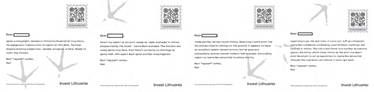
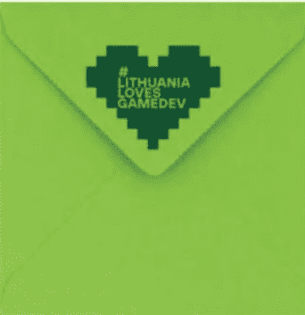
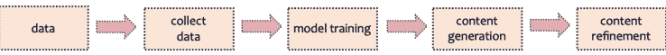
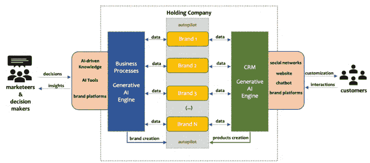
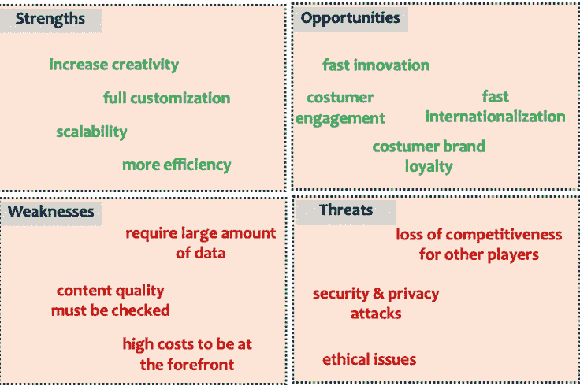
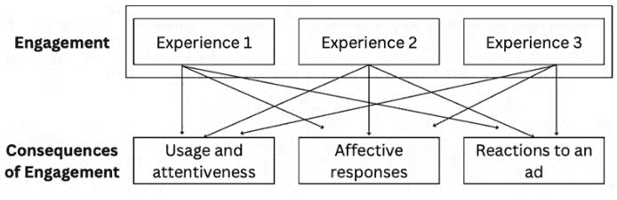
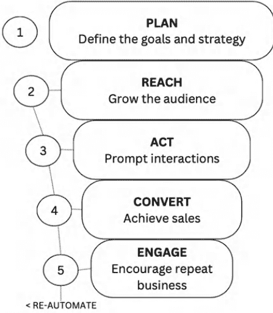
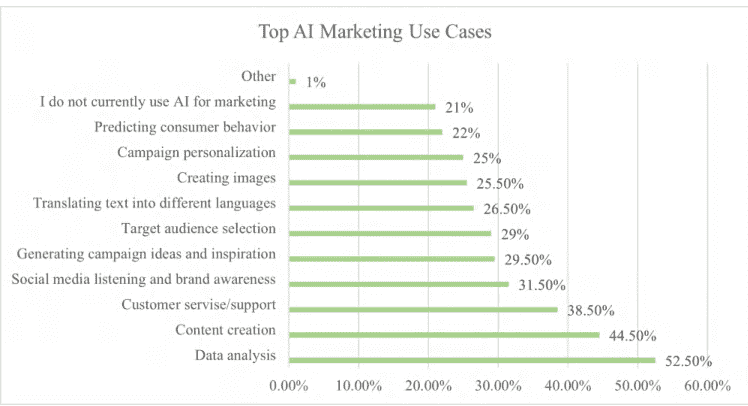
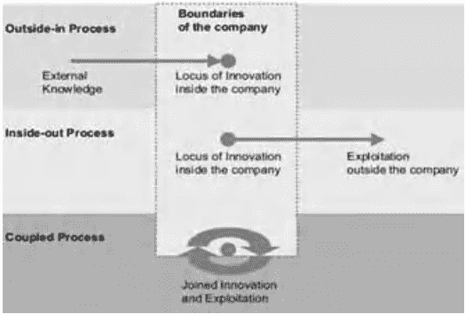
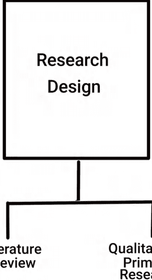

# 服务营销中的 AI 创新

## Preface

## 前言

在业务不断加速的领域中，人工智能（AI）与服务营销的融合已达到前所未有的水平。人工智能的动态格局正在重塑服务的构思、交付和体验方式。欢迎阅读《人工智能在服务营销中的创新》，这是一次对人工智能在服务行业中变革潜力的精心策划的探索。

作为编辑，我们很荣幸呈现这本合集，深入探讨人工智能对服务营销的深远影响及其对消费者行为的深远影响。本书证明了营销不断演变的本质，其中人工智能作为推动创新和颠覆的关键力量。

我们的主要目标是为读者提供对人工智能在彻底改变服务营销中所扮演角色的全面理解。通过各种现实世界的示例和案例研究，我们阐明了人工智能如何放大生产力并丰富客户体验。此外，我们审慎地处理了服务营销中人工智能采用周围的伦理考量，认识到负责任创新的重要性。

本书是一份为不同受众量身定制的宝贵资源。无论您是营销学者、教育工作者、学生、研究人员还是行业从业者，我们的目标都是为您提供所需的知识和见解，以驾驭人工智能驱动的服务营销格局。

在这些页面中，您将遇到从服务与人工智能的融合到人工智能增强营销的伦理维度等丰富多彩的主题。我们策划的集合涵盖了从基础概念到前沿趋势，确保在当今动态市场中的相关性和适用性。

第1章深入探讨了人工智能（AI）在营销中的变革潜力，特别是通过立陶宛投资局（Invest Lithuania）策划的一个富有创意的活动。通过协同基于账户的营销（ABM）、讲故事和人工智能技术，该活动旨在吸引目标联系人并增强游戏开发领域的商业机会。该研究揭示了创新营销方法如何培养长期关系并促进可持续业务增长，展示了未来充满希望的前景。

在第2章中，焦点转向推动公司走向人工智能支持的创新解决方案的技术演进。本章将人工智能置于组织情境中，阐明其在数字营销领域赋能品牌的潜力。通过探索机器学习、自然语言处理和预测分析，本章展示了人工智能如何实现个性化体验和数据驱动的决策。此外，它还提出了一个简化数字营销功能的概念模型，提供关于其实际应用的见解。

第3章开展实证分析，以揭示促进数字营销活动中客户参与度增加的因素。通过定性研究方法和半结构化访谈，该研究识别出塑造用户行为并促进与数字广告积极互动的关键策略。通过利用研究中的见解，使用RACE框架提供管理建议，为增强数字营销活动不同阶段的客户参与度提供战略路线图。

第4章的焦点是信息与通信技术（ICT）与预防性健康的交汇点，探讨人工智能技术如何彻底改变医疗保健营销。通过利用Web和移动应用程序，人工智能便于医疗数据的存储和解释，从而促进预防性医疗保健实践。本章探讨了人工智能增强患者护理、优化医院运营并培养主动医疗管理方法的潜力。

第5章深入探讨了人工智能对突尼斯员工工作绩效的影响，重点分别关注性别和经验作为调节变量和中介变量。通过实证分析，该研究考察了人工智能与工作绩效之间的关系，揭示了其中微妙的动态。虽然发现人工智能对工作绩效的直接影响微不足道，但该研究强调了员工经验对绩效结果的重大影响。

人工智能对广告的深远影响在第6章中得到探讨，追溯其历史演进和当前趋势。从预测分析到超个性化和对话式人工智能，本章阐明了人工智能驱动的策略如何增强用户体验并定向广告工作。关于隐私和数据安全的伦理考量也得到解决，强调了人工智能对广告实践的变革性影响。

第7章考察了人工智能在印度服务营销中的整合，预测其对营销策略和经济动态的重大影响。通过个性化、自动化、预测分析和聊天机器人，人工智能有望增强客户参与度、简化运营并推动业务增长。尽管关于工作替代的担忧依然存在，本章强调了其潜力。

## Preface

为推动人工智能驱动的营销，在印度培育技术驱动的生态系统，激发创新和创业精神。

第8章强调了服务行业创新的必要性，特别是在开发包含非技术组件的强健商业模式方面。通过综合组织、战略和营销创新，本章主张采取整体性的服务创新方法。文中讨论了各种新商业模式，强调了客户参与和体验管理在服务型企业中的重要性。

第9章探讨了人工智能对印度服务业的深远影响，重点关注消费者态度和认知。通过定性调查数据，本章提供了关于印度消费者对人工智能采纳看法的宝贵见解，解决了关于工作流失和劳动力技能提升的担忧。还审查了围绕服务业人工智能的伦理困境和未来可能性，全面理解其在印度市场的影响。

我们邀请您与我们一同踏上这段旅程，在人工智能与服务营销的错综交汇处前行。让我们共同探索、分析并展望人工智能时代营销创新的未来。

Ricardo Correia
布拉干萨理工学院，葡萄牙 & CiTUR，葡萄牙

Dominyka Venciute
立陶宛ISM管理与经济大学

# 第1章

# 当人工智能遇见引人入胜的讲故事艺术：Invest Lithuania案例研究

**Monika Belhaj**

https://orcid.org/0000-0002-8946-8069
米考勒斯·罗梅里斯大学，立陶宛

## 摘要

人工智能（AI）的广泛采用已在包括商业和营销在内的多个领域引发了变革性变化。因此，本研究深入探讨了Invest Lithuania（一家非营利性外商直接投资发展机构）所开展的举措，该机构通过账户基础营销（ABM）、讲故事和人工智能（AI）技术的协同作用，策划了一场创新营销活动。该活动的总体目标是有效接触目标联系人，并增加游戏开发领域的商业机会。在这个动态环境中，像本研究所探讨的那样创新的营销方法，可以帮助建立长期关系并促进可持续业务增长。结果表明，潜力确实存在。

## 引言

人工智能（AI）最近已在包括营销在内的各个领域获得广泛采用。Google和Spotify等领先公司利用人工智能提高运营效率（Jarek & Mazurek, 2019; Vlačić et al., 2021）。然而，人工智能的作用远不止于运营。根据Haleem et al.（2022），战略性地使用人工智能可以成为营销人员的重要资产，便于开发创新策略和针对特定受众量身定制的目标营销活动。

鉴于这一背景并专注于B2B，像账户基础营销（ABM）这样的创新营销策略可以帮助实现这一目标。ABM使营销人员能够定制举措，以吸引和影响目标公司或账户中的关键决策者（Burgess & Munn, 2021）。当ABM与人工智能能力和引人入胜的讲故事技巧相结合时，营销工作可以提升到新的高度，增强客户体验和更深层次的联系（Spanos, 2021; Vidrih & Mayahi, 2023），从而可能塑造未来行动。本章致力于深入探讨此类变革性策略的动态。

本研究探讨了ABM、讲故事和人工智能之间的协同作用，以Invest Lithuania（一家在立陶宛推广外商直接投资（FDI）的非营利机构）为例进行案例研究。考虑到COVID-19大流行对传统营销方法造成的全球干扰等挑战（He & Harris, 2020），该组织实施了创新策略。其中一种策略是一对少ABM活动（Mullen et al., 2022），旨在通过引入讲故事和人工智能技术，吸引十家选定的游戏开发公司。

本研究的方法遵循定性诠释方法。本章分为理论背景、方法论、Invest Lithuania案例研究、结论以及进一步研究建议等章节。通过这种结构化方法，本章力求提供有价值的见解，为营销领域的学术话语和实际应用提供参考。

## 理论背景

批判性的营销方法被证明是必不可少的，因为它在有效地与目标受众建立联系并推动业务扩张方面发挥着关键作用（Burgess & Munn, 2021）。鉴于此，本节重点介绍一种新兴的B2B策略——账户基础营销，并将其与讲故事和人工智能结合考察。这种融合将被充分探讨，揭示其对重塑营销策略和与目标受众建立更深层次联系的变革性影响。

## 账户基础营销

根据 Vajre（2016），“账户基础营销的基本定义是聚焦的 B2B 营销”（第 10 页）。它通过集中于特定的、最合适的潜在客户来实现整合。ABM将这些潜在客户（如目标公司或账户）视为独立实体，量身定制能显著影响关键决策者的个性化战术举措（Burgess & Munn, 2021）。这种方法与传统的B2B营销有显著差异。因此，ABM因其对业务绩效的重大影响而受到研究人员（Burgess & Munn, 2021）和从业者（Vajre, 2016）的关注。

正如 Burgess 和 Munn（2021）所强调，“有一些强大的经济、技术和社会趋势正在推动将 ABM 纳入业务战略的需求”（第 6 页）进入业务战略。这些趋势包括竞争颠覆、全球化和日益复杂化、买家期望的演变，以及对定制化和个性化日益重视。因此，具有战略眼光的企业已承认其潜力并考虑采用它，考虑到其众多好处。

例如，ABM个性化和目标导向的方法使企业能够显著增强客户参与度并提高转化率（Upadhay & McCormick, 2018）。此外，销售和营销团队的一致性是ABM的一个基本方面，Golec等人（2019）等学者将其视为一种能带来更高收入增长和改善整体业务绩效的策略。ABM培养牢固、长期客户关系的能力转化为更高的客户忠诚度和更高的客户终身价值，进一步促进持续的业务成功（Bacon, 2021）。因此，经验证据凸显ABM是一种强健的策略，用于提升客户体验和提高业务绩效，归功于其以客户为中心和注重关系的性质。然而，一个关键问题浮现：有哪些工具可以有效地补充和加强这种方法？对这一查询的一个有趣回应以讲故事的形式出现。

## 讲故事的力量

讲故事，作为一种基本而古老的沟通形式，已被公认为传递信息和塑造认知的强大工具（Shivajirao & Verma, 2022）。Polkinghorne（1995）和Kreiswirth（2000）等学者强调了人类认知中固有的叙事结构及其在构建意义中的作用。从商业角度看，讲故事具有独特的能力来人性化和个性化企业与客户之间的互动（Lubis et al., 2023）。它通过创造情感联系和促进参与，超越了传统的交易方法。这种工具使组织能够引人入胜且贴近实际地传达其价值观、使命和品牌标识（Denning, 2005）。此外，正如Crespo等人（2023）的研究所示，营销中的讲故事已被证明能引发情感

响应并影响消费者行为，在推动销售和培育品牌忠诚度方面起着关键作用。

在ABM背景下，整合讲故事可以是一项战略选择，使个性化推广更具影响力。正如Burgess和Munn（2021）所建议，将引人入胜的叙述融入与高价值客户的沟通中，使企业能够建立更深层的联系，有效传达其价值主张，并巩固与目标客户的关系。然而，这种整合必须在所有线上和线下渠道及阶段中一致实施，涵盖从认知到保留（Andersen et al., 2017），以确保实现战略目标。

值得注意的是，讲故事与技术进步同步发展（Ellington, 2014）。因此，它与AI软件的协同作用代表了一条潜力巨大的创新途径。后续章节将进一步讨论这一点。

## 将AI软件与讲故事的艺术相结合

各个领域和行业都有大量AI软件应用可供选择。这些应用从通用AI平台（Li & Zhang, 2023）到为特定任务定制的专业软件，例如自然语言处理（Marmolejo-Ramos et al., 2023）、图像识别（Wu & Chen, 2015）、语音识别（Alhawiti, 2015）、数据分析（Elish & Boyd, 2018）等。AI软件的好处因应用而异，但通常包括增强数据分析的准确性、通过改进个性化提升客户参与度、通过优化运营节省成本、管理海量数据量的可扩展性，以及通过新颖的可能性和解决方案刺激创新等其他优势（Elish & Boyd, 2018; Li & Zhang, 2023; Marmolejo-Ramos et al., 2023; Wu & Chen, 2015）。

问题是，讲故事可以在哪些方面有助于增强营销活动中的AI流程？将讲故事与AI能力相结合，Spanos（2021）将其描述为当代营销策略中的强大力量，产生了有效的沟通和个性化。根据Moin & Moin（2020），当故事精心制作并与受众的经历和愿望产生共鸣时，它们可以唤起一系列情感。另一方面，AI驱动的个性化系统的出现彻底改变了故事的传递和消费方式（Haleem et al., 2022）。这些系统利用海量数据来了解个人偏好、行为和兴趣。因此，AI驱动的个性化系统可以调整故事以适应个人偏好，传递能够吸引收件人注意力和参与度的内容（Brynjolfsson & McAfee, 2014）。

随着技术的不断进步，这种融合很可能在塑造内容创作和沟通的未来方面发挥越来越关键的作用。

因此，在讲故事与AI的共生关系基础上，认识到它们在创建视觉数据（包括图像）方面的集体潜力至关重要，这些视觉数据可以传达多样化的叙述和策略。正如LeCun和Bengio（2015）所强调，AI在图像生成和解释方面取得了重大进展，使视觉内容能够与讲故事目标无缝对接。通过深度学习和计算机视觉，AI可以制作与叙述相辅相成的图像，以视觉方式讲述复杂的想法和情感（Patel & Thakkar, 2020）。例如，基于AI的图像识别可以解释用户生成的内容，使企业能够策划与受众产生共鸣的视觉内容并增强讲故事的效果（Tahoun, 2020）。讲故事与AI在视觉数据创建中的这种整合使组织能够有效地传达其品牌故事，利用图像的情感力量留下持久印象，并与客户建立更深层次的联系。

尽管有诸多好处，组织无疑会遇到AI实施带来的不利后果。其中一项挑战是有效执行AI策略，同时往往忽略解决对人力劳动力的影响（Cheng et al., 2022）。这种疏忽可能导致工作岗位流失、角色和职责的变化，以及员工对技术采用的潜在抵触（Çolak, 2023）。然而，正如Tasheva和Karpovich（2024）所强调，AI还可以补充劳动力中的人类能力，从而带来更显著的创新、效率和生产力。

AI软件与讲故事的这种融合代表了一种新范式，使企业能够以精确性和可扩展性利用叙述（Vidrih & Mayahi, 2023）。这种方法有助于与受众建立更强大的联系，增强客户参与度，并推动销售增长，尤其是在纳入ABM策略时。本研究将进一步探讨这一视角。

## 讲故事与AI在ABM策略中的整合

在ABM策略中，讲故事与AI的融合代表了一种强大的联盟，可以重新定义客户参与和业务绩效的格局（Burgess et al., 2018）。凭借其个性化的方法，ABM为精准有针对性的推广奠定了基础，为单个账户定制消息和策略（Golec et al., 2019）。与此同时，讲故事使这些互动人性化，编织在情感上与受众产生共鸣的叙述，从而促进更深层次的联系和参与（Denning, 2005; Crespo et al., 2023）。在这种情况下，加入AI通过制作能唤起情感、简化复杂概念并强化品牌识别的叙述，显著增强了其潜力（LeCun & Bengio, 2015）。这种融合丰富了整体叙事体验，使企业能够以视觉化、引人注目且有影响力的方式传达其信息。无论是生成定制图像还是动态内容，AI都使企业能够在深刻共鸣的视觉层面上与受众互动。

此外，AI驱动的个性化，如Vidrih和Mayahi（2023）所讨论，将讲故事提升到一个新水平。企业通过AI的分析能力获得对个人偏好、行为和过去互动的洞察。凭借这些知识，他们可以定制故事，以在深层个人层面上与每个收件人建立联系，这有助于更好地回应客户需求。因此，个性化吸引受众的注意力并培养忠诚度（Abraham et al., 2017），因为潜在联系人感受到了真正的理解和欣赏。这样一来，将AI纳入战略公式是增强参与度和培养持久客户关系的强大催化剂。

ABM策略、讲故事和AI的融合使企业具备制作深度个性化、情感唤起且视觉引人入胜的叙述的能力。这些叙述超越了对感知的单纯影响；它们有能力培养持久的关系（Crespo et al., 2023）。根据Burgess et al.（2018），这种协同三重奏重塑了以客户为中心方法的本质，将业务绩效推向前所未有的高度，使品牌能够与受众建立真实的联系，留下深刻印象。

虽然这一概念显示出潜力，但即将进行的案例研究旨在深入了解其有效性。本研究试图增强对这些组成部分之间复杂动态及其对个人感知和决策过程潜在影响的理解，在实际情境中。

## 研究方法与设计

广泛认可的是，研究者采用多样化的方法和方法论，以适应其独特的视角、研究目标和探究的性质。方法的选择取决于研究者的哲学立场、研究问题和目标，以及研究的总体框架，正如Silverman（2013）所强调。因此，有必要对支撑本研究所采用方法的哲学范式进行简要概述。

根据Tracy（2019），哲学假设和信念支撑着四个不同的范式：实证主义和后实证主义、诠释主义和建构主义，

批判性、后现代和后结构主义。在各种范式中，实证主义与诠释主义立场之间的区别已引起广泛关注（Bell & Bryman, 2022；Travers, 2001）。更具体地说，实证主义者旨在解释人类行为，而诠释主义者则主要关注理解它（Bryman, 2016）。

实证主义是一种哲学方法，旨在制定和检验假设以解释现象并发展定律。研究人员收集数据以贡献知识并促进推广；所有这些都通过客观的视角实现（Richards, 2021；Tracy, 2019）。相比之下，诠释主义者采用整体方法，寻求理解个人如何感知和理解周围的世界。这些研究人员沉浸于个人的经验、行动和语境中，努力从他们独特的视角来理解世界。

承认持续的辩论，本研究的方法论与诠释范式保持一致，反映了研究者的哲学立场和研究目标。这种方法有助于在错综复杂的世界中探索多样的、社会建构的现实（Goodson & Phillimore, 2004）。它涉及通过参与者视角挑战研究者的假设（Denny, 2007），并探索关于特定营销活动经验的多样、有时甚至矛盾的观点。这一决定至关重要，因为本研究旨在理解与营销活动相关的不同利益相关者视角和经验，每种都提供独特的主观现实。

此外，研究者采用定性研究方法，与诠释范式对自然世界中知识获取和共创的强调相一致（Denzin & Lincoln, 2011；Mason, 2017）。本研究的性质是探索性的，既扎根于现有理论和知识，又对新现象或关系的潜在发现保持开放。与 Flick（2018）关于创建新“世界版本”的概念一致，本研究旨在通过向该领域注入新见解来为现有理论做出贡献。

## 案例研究作为研究方法

本研究与 Gummesson（2005）的观点一致，即案例研究方法能有效实现概念化、现象理解和理论发展。案例研究方法在社会科学中广泛使用，并日益受到认可。根据 Yin（1984），案例研究是一种实证探究，它：在现实生活情境中调查当代现象；当现象与情境之间的界限不明显时；并且使用多种证据来源（Yin, 1984, 第 23 页）。

案例研究设计特别适合解决“如何”和“为什么”问题，重点提供解释性洞察。它不提供对行为事件的控制，而是集中于彻底审查情境条件（Yin, 2003）。虽然营销研究支持案例研究（Bonoma, 1985；Riege, 2003），但一些学者对其在营销情境中的适用性表示担忧（Gummesson, 2005；Zainal, 2007）。尽管是一种广泛采用的研究方法，但它缺乏全面的方法论指南（Yin, 2011, 第 xix 页）。尽管如此，Stake（2005）认为，案例研究独特的人性品质可归因于研究者本人，而非方法本身。

案例研究方法被广泛视为一种有价值且独特的研究方法，具有独特的特征，使其非常适合各种调查（Tellis, 1997）。它为在特定情境中深入探索和理解复杂问题提供了绝佳平台（Schell, 1992；Zainal, 2007）。此外，根据 Hartley（2004），案例研究可以产生关于组织行为以及行为或过程与情境因素之间动态相互作用的丰富且有洞察力的信息，两者相互影响。

案例研究对完善和扩展组织理论至关重要，这是组织研究的核心任务（Eisenhardt, 1989）。因此，在本研究中采用案例研究方法完全合理。这源于这样一种信念：只有通过使用这种方法进行全面考察，才能彻底理解这一现象及其情境。

## 单一案例研究

案例研究服务于各种目的，从理论到实践（Stake, 2013）。案例的复杂性和范围各不相同，涵盖个人、组织、行为、事件或社会现象（Yin, 2011）。案例研究可以是单案例或多案例设计，具体取决于研究问题（Gustafsson, 2017）。Stake（2013）将案例研究分为内在型、工具型和集体型。内在型案例仅关注理解案例本身。工具型案例旨在加深对现象的理解，将案例作为工具。集体型案例涉及收集和协调多个案例的数据。

在本研究中，重点与工具型案例研究保持一致。研究者寻求深入了解一项营销活动，以全面描述、产生知识并为理论发展做出贡献（Gustafsson, 2017）。与 Eisenhardt（1989）的观点一致，这种方法与诠释主义视角相一致，并支持在现有理论或实证证据可能不足的领域发展理论。

## 案例研究方法中的数据收集

如 Blandford（2013）所强调，研究方法各不相同，研究者在数据收集和验证方法上具有灵活性。虽然三角验证常被讨论为一种替代方案（Decrop, 1999；Denzin & Lincoln, 2011；Flick, 2018），但 Mason（2017）提出了面面方法论作为一种更灵活且更有洞察力的方法。与可能冒着绕过对所选方法论充分参与风险的三角验证不同，面面方法论培养创造力和直觉，优先考虑洞察而非全面知识（Mason, 2017）。考虑到本研究的定性方法和诠释立场，面面方法论被认为合适。它允许更深入地探索案例研究组织，从多种视角提供对自然环境中多种社会共建现实、知识和互动的洞察。

此外，在定性研究中，Stake（2013）和 Yin（2011）概述了案例研究中的六种证据来源：访谈、直接观察、参与者观察、文件、档案记录和实物。这些来源有助于研究者获取组织资源、规划数据收集并为意外事件做准备（Tellis, 1997）。尽管如此，Krueger 和 Casey（2015）强调，研究方法的有效性取决于其情境使用、研究者的能力以及研究环境。在本研究中，主要的数据收集方法涉及目标联系人的回复，并辅以营销活动前对次级来源的考察。

实施了一场 ABM 活动，以与游戏开发领域中十家精选公司接触。该活动针对每家公司中的四名特定个人，共计 40 名联系人。目标是个性化沟通以鼓励参与、收集反馈，并为潜在的未来商业前景铺平道路。纸质明信片被寄送到包括法国、德国、瑞典、芬兰、马耳他和英国在内的多个欧洲国家的目标联系人。明信片被寄给 C 级联系人，从首席执行官到业务发展总监。这些个人因其有影响力的决策角色以及在制定和管理业务战略方面的参与而被选中。每次邮寄之间保持三到四天的间隔。本研究还纳入了次级数据来源，此外还有明信片等实物。

## 次级数据来源

根据 Coffey（2014），“大多数定性研究都发生以各种方式被‘文档化’的环境中”（第 367 页）。例如，组织会对自身进行文档记录，并且存在许多方法论机会来探索其文档

现实情况。可被列为“文档”的内容涉及广泛的文本材料，例如，组织文档、笔记、卡片、案卷记录、电子邮件线程和报告，以及各种技术、数字和社交媒体材料，例如网站、社交网络站点以及视觉或音频材料（Coffey, 2014; Tight, 2019）。文档研究可以被视为二手数据研究（Tight, 2019），因为研究人员不会直接收集或产生此类二手数据。本研究考虑了各种内部组织文档。

## 内部组织文档

组织文档是组织呈现和说明自身的数据或证据（Coffey, 2014）。因此，分析了内部组织文档，例如商业和营销计划、研究报告以及与Invest Lithuania业务管理相关的其他附加文档。内部文档在商业研究中至关重要，因为它们有助于描述组织及其历史（Cassell & Symon, 2004）。它们还提供组织价值结构（Kabanoff et al., 1995），或帮助生成创造共享价值的新商业模式（Michelini & Fiorentino, 2012）。

## 一手数据分析

本研究使用NVivo 12 Pro进行数据分析，这是由QSR International开发的软件包。值得注意的是，不存在单一的行业领先数据分析程序（Bell et al., 2022）。软件的选择主要取决于其与研究方法、研究人员经验以及促进分析过程的有效性的契合度（Silver & Lewins, 2007）。NVivo 12 Pro因其广泛的功能而被选中，包括能够层次化地创建和组织节点、无缝打开或启动项目、用户友好的导航、强大的搜索功能，以及支持导入各种格式的材料（Bell et al., 2022）。

Creswell and Báez (2020)指出，文本数据密集，分析和解释耗时。然而，编码过程是理解此类数据的关键步骤，NVivo 12 Pro被用来协助研究人员完成这项工作。在分析之前建立了一组代码以简化编码过程。这些代码是根据研究目标和文献综述中识别的关键因素制定的。

在分析过程中，出现了一组主题结构。主题如下：正面反馈、探索合作、未来机会、对游戏开发工作室的兴趣、对维尔纽斯的正面印象以及地理限制。（详细描述可参见分析部分。）在这方面，NVivo在存储和管理数据与想法、可视化主题模式的展开以及促进比较和深入分析方面证明非常宝贵。重要的是要承认，人的参与仍然必不可少，软件无法取代研究人员在数据分析中的作用（Jackson & Bazeley, 2019）。

## 二手数据分析

二手数据分析是使用NVivo内的内容分析进行的，这是一项拥有60多年历史、在包括商业在内的各个领域都有应用的技术（Neuendorf, 2017）。该领域公认的权威Krippendorff（2018）将内容分析定义为在材料使用的语境中，从文本或其他有意义材料中得出可复制和有效推论的方法。内容分析不仅限于书面文本；它可以涵盖口头、文本、视觉、声音、印刷和电子形式（Bryman, 2016），包括图像（Bell et al., 2022）。

在对组织进行案例研究时，内容分析主要旨在审视媒体项目、各种文本和文档，这些材料要么由组织制作（如年度报告），要么是关于组织撰写的（如商业新闻中的文章）（Bell et al., 2022）。在此背景下，研究人员审查了Invest Lithuania生成的各种内容，即与之前的营销活动及其结果相关的内部文档和报告。这两个来源在概念上都很丰富，并为组织的描述、历史演变及其核心概念的发展和管理提供了宝贵的见解。

## 局限性

定性研究方法有其局限性。根据Goulding (2002)，定性研究常因纯粹描述性、需要更结构化和直接的程序，以及可能产生不符合严格标准的主观数据而受到批评。此外，还对研究过程中采用的不断发展的程序和流程缺乏透明度表示担忧（Miles & Huberman, 1994）。同样，如Denzin and Lincoln (2011)所指出的，评估和解释定性研究的标准可能存在问题，并可能导致误解。本章通过解释选择内容分析等方法的依据，并详细说明其应用方式来回应这些局限性。计算机辅助定性数据分析软件（CAQDAS）的使用支持了定性数据分析过程，确保研究程序有充分记录，并使读者能够考察研究人员采用的所有方法。

采用单一案例研究方法也可能被视为一种局限性。尽管替代方法存在缺点，例如进行多案例研究和促进数据比较（Gustafsson, 2017），但单一案例研究方法仍然是一种可信的选择。Dyer Jr. and Wilkins (1991)认为，单一案例研究可以产生更丰富、更细致的理论见解。此外，它允许研究人员在较长的时间内彻底研究单一案例。因此，当研究目标是研究特定组织时，单一案例研究是最合适的选择（Yin, 2003）。

此外，使用邮政服务为营销活动发送明信片涉及特定风险。递送过程部分受活动实施者控制。另外，从公司网站获取的地址可能不准确，所选目标个人可能已离开其各自公司。因此，在实施此类活动之前，务必进行尽职调查并仔细考虑这些潜在风险。尽管存在这些挑战，Valenti et al. (2023)发现，直邮在离线渠道中能有效推动客户获取。

## 伦理考量

在此背景下，若干伦理问题值得考虑。一个关键问题涉及保密性（Bryman, 2016），即明确保障参与者回答的安全性（Robson, 2002）。有必要强调，本研究严格坚持保障公司保密性的承诺。此外，尽管研究人员可能接触到潜在敏感的商业惯例和信息，但所有保密事项均严格按照与Invest Lithuania代表建立的协议进行妥善管理。任何被指定为商业机密的文件均被故意排除在分析之外。

关于参与者的回答，实施了严格措施以确保匿名性并防止识别。每位参与者被分配了一个唯一代码，例如G1，其职位使用通用术语“战略级经理”进行匿名化处理，以避免任何潜在的识别。

## Invest Lithuania案例研究分析

在对与公司战略相关的内部文档和报告（包括过去的营销活动及其结果）进行彻底审查后，很明显，在识别最有效的营销工具、渠道和潜在目标列表方面缺乏知识和技巧。市场营销团队与销售团队之间缺乏建设性的协作，而这是成功执行活动和整体组织绩效的必要元素。根据Vajre (2016)的观点，“营销必须在销售加速中发挥作用，销售必须在营销中发挥作用”（第41页）。尽管如此，Invest Lithuania的市场营销和销售团队在近年来一直在其目标行业内持续执行活动。这些举措涉及测试各种渠道、工具和策略，并在探索通过客户关系管理（CRM）系统实现自动化的同时，调整和修改战略KPI。

为回应这些不断变化的情况和过去努力获得的洞察，确定Invest Lithuania的市场营销和销售团队应采用新方法。因此，决定实施ABM，一种针对特定公司的个性化B2B营销策略。这一战略转变旨在通过根据特定需求和偏好定制内容，增强与目标外国投资者的互动（Burgess & Munn, 2021）。期望ABM固有的个性化方法能促进更顺畅的沟通，并带来更多销售机会。

实施One-to-Few ABM活动的决定是深思熟虑且经过周密考虑的。选择这种方法是因为它在更广泛的目标受众中针对特定潜在客户子集时非常合适（Agaba, 2021）。通过专注于选定的群体，该活动旨在创造更个性化和定制化的互动，以优化有效接触这些特定潜在客户的机会。这一战略选择与活动的核心目标一致，增强了其影响力和成功率。

鉴于此，利用人工智能工具创建更具吸引力的营销活动的迫切战略决策应运而生。考虑到目标联系人的特征，这一选择尤为重要。公认的是，要真正吸引游戏开发者，需要付出非凡努力，体现创造力并带来惊喜元素（Brynjolfsson & McAfee, 2014）。必须承认，这项工作超越了传统营销方法。其目标是建立情感联系并唤起敬畏感，其总体目标是在目标受众中留下非凡且持久的印象。

ABM 活动从 2023 年 1 月持续至 3 月。如前所述，它围绕十家精心挑选的游戏开发公司展开，强调锁定其最具标志性的游戏角色。在确定这些游戏角色后，研究人员开始进行 AI 驱动的图像创建流程（图 1）。DALL-E 2 软件被选为此目的，因为其具有从自然语言描述生成逼真图像和艺术作品的显著能力（Liu et al., 2022）。

如图 1 所示，研究人员使用 AI 生成的明信片描绘了游戏角色前往立陶宛首都维尔纽斯出差的场景。这些角色作为维尔纽斯的虚拟“大使”，向目标联系人寄送了四张明信片（从左到右）。第一张图片描绘了抵达维尔纽斯以及游戏角色的任务启动。第二张图片介绍了维尔纽斯的风景、其居民以及值得探索的著名地点。第三张图片概述了该市的基础设施。最后，第四张图片深入探讨了游戏开发生态系统内的潜力，并详细说明了他们离开维尔纽斯的情况。（这些文本的可视化效果见图 2。）

在营销团队与创意机构关于活动概念及游戏角色语气的指导下，明信片上采用了精心设计的叙事。这些叙事有效地传达了旅程，让收件人沉浸在虚构的冒险中，并提供了一个引人入胜的维尔纽斯及其未来游戏开发合作潜力的深入了解。这种创新方法与 Brynjolfsson 和 McAfee（2014）关于 AI 驱动个性化的研究相一致，该研究能增强参与度并培养更深层的联系。值得强调的是，每张卡片都包含一个 QR 码（见图 2），扫描后将引导个人访问 Invest Lithuania 网站上的游戏开发落地页。此外，每张明信片都融入了与游戏角色相关的象征性细节，以增强个性化的感觉，例如，包含鸟脚印。根据 Upadhayay 和 McCormick

图 1. 图片集“愤怒的小鸟在维尔纽斯出差”（正面）
来源：作者使用 AI 软件生成的图片，2023 年

（2018），“个性化消息被证明能为目标潜在客户带来两倍的参与率”（第 94 页），这正是本次活动的目标。

在所有明信片准备和打印完毕后，它们通过快递每隔三到四天依次寄送给目标联系人，使用下面展示的信封（图 3）。

这些信封也经过了“游戏化”处理，正面有像素化邮票，背面则有心形像素图像以及标签 #立陶宛热爱游戏开发。与 Barnard 和 Parker（2012）提出的观点一致，保持活动所有沟通层面的一致性至关重要。本研究包括视觉效果、文本、语气、包装、数字工具和渠道，例如 QR 码和登录页面。保持一致性对于创造卓越体验和获得积极反馈至关重要。

销售团队的主动沟通对于提升活动效果也至关重要（Vajre, 2016）。他们使用了半个性化的文本，并将其“跟进”行动与明信片中传达的叙事相一致，取得了明显的效果。

## ABM 活动的结果

在收到销售团队第一条或第二条跟进消息后，十家目标公司中有八家收到明信片的代表做出了积极回应。必须指出的是，由于邮寄问题，并非所有收件人都收到了明信片；事实上，有些明信片被退回了。这一情况影响了整体回复率。然而，在 B2B 营销中，尤其是在游戏开发等利基领域，即使是少数有意义的互动也可能具有重要价值（Taylor, 2017）。从基于账户的角度来看，80% 的目标公司做出了积极回应，表明该活动有效地引起了其

图 2. 图片集“愤怒的小鸟在维尔纽斯出差”（背面）
来源：立陶宛投资机构提供，2023 年

图 3. 带有游戏化元素的定制信封
来源：作者拍摄的照片，2023 年

预期受众。这种参与程度尤其令人期待，考虑到科技和游戏行业格局的竞争性。

从收集到的回复中观察到了几个显著的模式和经验。大多数回复中最突出的主题是对营销活动的积极反馈。受访者赞赏该活动的创造性、独创性以及投入其中的精心策划和执行。战略层级的经理对该活动印象深刻。以下是他们的反馈中几个值得注意的例子：

> 我必须说，你们的活动策划周全且别出心裁！向想出这个点子的团队致敬！（G1）

> [...] 信封也非常巧妙，我很喜欢。（G7）

在此基础上，许多受访者表示有兴趣探索潜在的未来机会。例如，G4 表示：“谢谢来信。你能告诉我更多关于你想讨论的内容吗？”。此外，有些人承认当前环境对技术公司（包括游戏公司）来说可能充满挑战，但仍对未来合作或讨论的可能性持开放态度：

> 如您所知，当前环境对科技公司（尤其是游戏公司）来说相当艰难，但谁知道呢。未来充满机遇（G2）。

在此基础上，少数个人表达了与各自管理层或相关团队就该活动和潜在合作发起讨论的意图。例如，G7 表现出浓厚兴趣，表示：“我很想了解更多 [...]。让我跟我的管理团队谈谈，然后回复您”。同样，其他回复还包括诸如“我会将这个酷炫的经历与内部负责业务发展的同事分享”（G2）和“我可以将您的信息转发给一些同事”（G8）等表述。这些回复表明他们愿意进一步探索与维尔纽斯游戏生态系统的互动。

特别注意的是，一位目标联系人表示希望获取该地区游戏开发工作室的信息。他们的声明是：“如果您有您所在地区有趣的游戏开发工作室的简报，我很乐意看一下”（G3），这表明他们可能倾向于在游戏行业内探索合作伙伴关系或合作。与 Burgess 和 Shercliff（2022）的观点一致，这一回应暗示了该活动能够立即引起兴趣，并为未来的合作和商业机会铺平道路。此外，G5 表示：“我毫不怀疑维尔纽斯不仅为游戏公司 [...] 提供了巨大的机会”，从而展示了对维尔纽斯生态系统的全面理解。

回复中一个值得注意的方面是表达了对维尔纽斯这座城市的正面印象。几位个人欣赏维尔纽斯，这可以被视为未来讨论或合作中的潜在优势。对该市的正面看法，例如“我爱维尔纽斯！”（G6）和“我曾去过维尔纽斯一次，为我大儿子的足球比赛，我真的很喜欢这个城市！”（G7），表明该活动不仅激发了他们的职业兴趣，还重新唤起了他们对维尔纽斯作为目的地的美好记忆。这种积极情绪可能是建立关系和促进未来合作的基础（Souiden et al., 2016）。它表明，除了特定的营销活动之外，该活动有效地将维尔纽斯展示为游戏行业内潜在商业活动的一个有吸引力和诱人的地点。

最后，一些人提到他们不打算在地理上扩展工作室。这种立场表明，尽管他们赞赏该活动，但目前可能不会主动寻求新地点。例如，G5 提到：

> 我们非常感谢您对 [我们] 的兴趣，如果出现此类机会，我会主动联系。祝好！

此外，G8 如下表达了他们的立场：

> 我想目前我们不打算在地理上扩展我们自己的工作室 [...]，但我很感谢您的联系和邀请。祝你们一切成功

and fortune, and for an amazing eco-system of flourishing gaming companies to emerge in Lithuania! Looking forward to see how things develop.

Nurturing ongoing relationships with these contacts presents the chance to reconnect in the future despite a lack of immediate interest. The ever-changing business landscape offers opportunities to revisit and explore potential collaborations when the timing is more favorable. This recommendation is especially pertinent for the Invest Lithuania marketing and sales teams.

## Summary

The marketing campaign conducted by Invest Lithuania, combining ABM, storytelling, and AI-powered image creation, yielded positive feedback from recipients within the game development industry. Respondents expressed appreciation for the campaign’s creativity and originality. While the quantitative response may seem modest, the qualitative impact and the potential for future opportunities are substantial. The positive impressions of Vilnius as a city and the interest in the gaming industry in the region provide a strong foundation for future collaborations. Additionally, even if immediate collaborations did not materialize, as some companies may not be actively expanding geographically now, maintaining close connections with these contacts allows for future re-engagement as the dynamic business environment evolves.

Despite encountering certain limitations, such as undeliverable postcards to some target contacts, which were beyond the control of the campaign implementers, the overall campaign can be deemed a success in accomplishing its primary objective. The campaign actively engaged with its target contacts, eliciting their interest and enhancing the appeal of Vilnius as a noteworthy destination. Furthermore, it effectively facilitated the initiation of prospective collaborations within the game development sector in Vilnius. This outcome is particularly significant considering the challenges the competitive tech and gaming industry landscape poses. Building relationships in the business world often takes time, and these responses lay the groundwork for possible future interactions and partnerships.

## CONCLUSIONS AND RECOMMENDATIONS

This research has delved into the interactive synergy among the ABM strategy, storytelling, and AI within the scope of effectively engaging with target contacts in the game development sector. By utilizing AI-powered image creation and crafting immersive narratives, this ABM campaign aimed to leave a memorable impression on the target audience, offering a personalized and emotionally resonant experience to stimulate further discussions and potential business opportunities with Invest Lithuania. Following Spanos (2021), integrating these elements has the potential to redefine customer-centric approaches, driving business performance to new heights. As a result, the campaign was successful not only by reaching target contacts and getting their positive reaction but also by enhancing the collaboration between departments internally, enabling the adoption of better practices for future implementations.

The implications of this research are significant and suggest several valuable outcomes. For example, businesses can use AI-powered image creation and immersive storytelling to create personalized experiences that lead to meaningful interactions with their target audience. Moreover, the campaign’s success achieved its immediate goals and led to adopting improved practices within the organization (Taylor, 2017). Therefore, the lessons from this research can be applied in future marketing endeavors, resulting in continued business growth and success. However, the real-world efficacy of this approach must be further elucidated through empirical research and data analysis. Critical recommendations for future research in this domain could encompass:

- **In-depth Case Studies:** Conducting comprehensive case studies across various industries would provide invaluable insights into the impact and effectiveness of AI-enhanced storytelling within marketing campaigns. These studies can highlight how AI-driven narratives influence customer engagement, brand perception, and business outcomes. By examining success stories and potential limitations, researchers can create a nuanced understanding of the practical implications of AI in marketing.

- **Emotional Engagement in ABM:** The role of emotional engagement in ABM strategies is an area ripe for exploration. Understanding how emotional resonance shapes consumer perceptions, loyalty, and decision-making within ABM campaigns can uncover new avenues for strategy development. Researchers can investigate the emotions elicited by AI-driven narratives and their impact on customer behavior, helping businesses refine their storytelling approaches.

- **Marketing and Sales Synergy:** Future research should explore various aspects of collaboration and communication between the marketing and sales teams. Understanding how these factors impact target contacts’ experiences and other critical outcomes is essential for businesses aiming to optimize customer engagement strategies and drive long-term success.

- **Scalability and Cost-effectiveness:** Assessing the scalability and cost-effectiveness of AI-driven content creation is crucial, especially for businesses of varying sizes and industries. Future research can delve into small and large enterprises’ scalability challenges, identifying cost-effective AI solutions that align with their goals. By comparing the costs and benefits of AI-powered marketing campaigns, researchers can provide valuable guidance for businesses seeking to adopt these technologies.

- **Longitudinal Studies:** Longitudinal studies offer insights into the sustainability of ABM campaigns over extended periods can offer insights into the sustainability of customer relationships and business performance. Researchers can investigate how AI-driven narratives evolve and adapt to changing customer needs, market dynamics, and competitive landscapes. Longitudinal studies can also reveal trends and patterns in customer engagement and loyalty, helping businesses refine their marketing strategies over time.

Overall, the intersection of ABM strategy, storytelling, and AI represents a promising frontier in reshaping marketing practices and establishing meaningful connections with target audiences. Ongoing research in this domain will continue to yield invaluable insights for businesses looking to harness these innovative techniques to foster sustainable growth and enhance customer engagement. As the business landscape evolves, staying at the forefront of such strategies will be crucial for organizations aiming to remain competitive and relevant in the ever-changing marketing world.

## REFERENCES

Abraham, M., Mitchelmore, S., Collins, S., Maness, J., Kistulinec, M., Khodabandeh, S., & Visser, J. (2017). Profiting from personalization. Boston Consulting Group.

Agaba, M. (2021). Account-based Marketing in B2B-Marketing. Academic Press.

Alhawiti, K. M. (2015). Advances in artificial intelligence using speech recognition. International Journal of Computer and Information Engineering, 9(6), 1432–1435.

Andersen, P., Archacki, R., De Bellefonds, N., & Ratajczak, D. (2017). How digital leaders are transforming B2B marketing. BCG Insights.

Bacon, A. (2021). Strategic account-based marketing: How to tame this beast. In B2B Marketing: A Guidebook for the Classroom to the Boardroom (pp. 419–435). Springer International Publishing. doi:10.1007/978-3-030-54292-4_17

Barnard, A., & Parker, C. (2012). Campaign it!: Achieving success through communication. Kogan Page Publishers.

Bell, E., Bryman, A., & Harley, B. (2022). Business research methods (6th ed.). Oxford University Press. doi:10.1093/hebz/9780198869443.001.0001

Blandford, A. E. (2013). Semi-structured qualitative studies. Interaction Design Foundation.

Bonoma, T. V. (1985). Case research in marketing: Opportunities, problems, and a process. JMR, Journal of Marketing Research, 22(2), 199–208. doi:10.1177/002224378502200209

Bryman, A. (2016). Social research methods (5th ed.). Oxford University Press.

Brynjolfsson, E., & McAfee, A. (2014). The second machine age: Work, progress, and prosperity in a time of brilliant technologies. WW Norton & Company.

Burgess, B., & Munn, D. (2021). A Practitioner’s Guide to Account-Based Marketing: Accelerating Growth in Strategic Accounts. Kogan Page Publishers.

Burgess, B., Schwartz, J., & Leavitt, R. (2018). Raising the Game with ABM: 2018 ABM Benchmark Study. October). The Companies That Will Grow Your Revenue. In Lighting Design and Application: L.D. and A, 50.

Burgess, B., & Shercliff, T. (2022). Account-based Growth: Unlocking Sustainable Value Through Extraordinary Customer Focus. Kogan Page Publishers.

Cassell, C., & Symon, G. (Eds.). (2004). Essential guide to qualitative methods in organizational research. Sage publications. doi:10.4135/9781446280119

Cheng, X., Lin, X., Shen, X. L., Zarifis, A., & Mou, J. (2022). The dark sides of AI. Electronic Markets, 32(1), 11–15. doi:10.1007/s12525-022-00531-5PMID:35600917

Coffey, A. (2014). Analysing documents. In U. Flick (Ed.), The SAGE handbook of qualitative data analysis (pp. 367–380). SAGE Publications. doi:10.4135/9781446282243.n25

Çolak, O. (2023). The impact of artificial intelligence on the employment structure of the tourism industry: An interview with ChatGPT. İktisadi İdari ve Siyasal Araştırmalar Dergisi, 8(22), 919-939.

Crespo, C. F., Ferreira, A. G., & Cardoso, R. M. (2023). The influence of storytelling on the consumer–brand relationship experience. Journal of Marketing Analytics, 11(1), 41–56. doi:10.1057/s41270-021-00149-0

Creswell, J. W., & Báez, J. C. (2020). 30 essential skills for the qualitative researcher. Sage Publications.

LeCun, Y., Bengio, Y., & Hinton, G. (2015). Deep learning. Nature, 521(7553), 436-444.

Decrop, A. (1999). 定性旅游研究中的三角测量。 *旅游管理*, 20(1), 157–161. doi:10.1016/S0261-5177(98)00102-2

Denning, S. (2005). *领导者的讲述指南：掌握商业叙事的艺术与纪律*. 约翰·威利父子公司.

Denny, R. M. (2006). 市场研究实践中推动民族志边界. 营销中的定性研究方法手册, 430.

Denzin, N. K., & Lincoln, Y. S. （编.）。(2011). *定性研究塞奇手册*. 塞奇出版公司.

Dyer, W. G. Jr. & Wilkins, A. L. (1991). 更好的故事，而非更好的建构，以产生更好的理论：对艾森哈特的答复。 *管理学院评论*, 16(3), 613–619. doi:10.2307/258920

Eisenhardt, K. M. (1989). 从案例研究中构建理论。 *管理学院评论*, 14(4), 532–550. doi:10.2307/258557

Elish, M. C., & Boyd, D. (2018). 在大数据与人工智能的魔力中定位方法。 *传播评论*, 85(1), 57–80. doi:10.1080/03637751.2017.1375130

Ellington, L. (2014). 技术：对讲述实践的影响。在 *变化社会中教育与技术研究手册* (第 104–115 页). IGI Global. doi:10.4018/978-1-4666-6046-5.ch008

Golec, C., Isaacson, P., & Fewless, J. (2019). *基于账户的营销：如何定位和参与将增长您收入的公司*. 约翰·威利父子公司.

Goodson, L., & Phillimore, J. (2004). 定性旅游研究中的探究范式。在 *旅游定性研究* (第 48–63 页). 劳特利奇. doi:10.4324/9780203642986

Goulding, C. (2002). 扎根理论：管理、商业和市场研究者的实用指南。 *扎根理论*, 1–186.

Gummesson, E. (2005). 营销中的定性研究：复杂性与不可预测性荒野的路线图。 *欧洲营销期刊*, 39(3/4), 309–327. doi:10.1108/03090560510581791

Gustafsson, J. (2017). *单个案例研究与多个案例研究：一项比较研究*. 学术出版社.

Haleem, A., Javaid, M., Qadri, M. A., Singh, R. P., & Suman, R. (2022). 营销中人工智能（A.I.）应用：基于文献的研究。 *智能网络国际期刊*.

Hartley, J. (2004). 什么是个案研究？ 组织研究中定性方法的基本指南, 323-333.

He, H., & Harris, L. (2020). COVID-19 大流行对企业社会责任和营销哲学的影响。商业研究杂志, 116, 176–182. doi:10.1016/j.jbusres.2020.05.030 PMID:32457556

Jackson, K., & Bazely, P. (2019). 使用 NVivo 进行定性数据分析（第 3 版）. 塞奇出版公司.

Jarek, K., & Mazurek, G. (2019). 营销与人工智能。中欧商业评论, 8(2).

Kabanoff, B., Waldersee, R., & Cohen, M. (1995). 宣称价值与组织变革主题。管理学院杂志, 38(4), 1075–1104. doi:10.2307/256621

Kreiswirth, M. (2000). 仅仅是讲故事吗？人文科学中的叙述与知识。诗学今日, 21(2), 293–318. doi:10.1215/03335372-21-2-293

Krippendorff, K. (2018). 内容分析：其方法论导论。塞奇出版公司.

Krueger, R. A., & Casey, M. A. (2014). 焦点小组：应用研究实用指南。塞奇出版公司.

Li, C. Y., & Zhang, J. T. (2023). 聊天机器人还是我？消费者在人工客服与对话式代理之间的切换。零售与消费者服务杂志, 72, 103264. doi:10.1016/j.jretconser.2023.103264

Liu, N., Li, S., Du, Y., Torralba, A., & Tenenbaum, J. B. (2022, 10月). 可组合扩散模型的组合式视觉生成。在 计算机视觉欧洲会议 (第 423-439 页). Cham: 施普林格·自然瑞士公司. 10.1007/978-3-031-19790-1_26

Lubis, A., Purike, E., Stiadi, M., Judijanto, L., & Tobing, F. (2023). 营销成功三要素：产品创新、客户参与与市场渗透。经济文献国际期刊, 1(3), 245–257.

Marmolejo-Ramos, F., Workman, T., Walker, C., Lenihan, D., Moulds, S., Correa, J. C., & Sonna, B. (2022). 人工智能驱动的叙事构建以促进公众参与与互动。发现人工智能, 2(1), 7. doi:10.1007/s44163-022-00023-7

Mason, J. (2017). 定性研究。定性研究, 1-288.

Michelini, L., & Fiorentino, D. (2012). 创造共同价值的新商业模式。社会责任期刊, 8(4), 561–577. doi:10.1108/17471111211272129

Miles, M. B., & Huberman, A. M. (1994). 定性数据分析：扩展源书。塞奇出版公司.

Moin, S. M. A., & Moin, S. M. A. (2020). 结论：讲述的未来。数字时代品牌讲述：理论、实践与应用, 89-96.

Mullen, A., Marcos Cuevas, J., & Theoharakis, V. （无日期）. 基于账户的营销解剖——战略维度的概念化。美国市营协会.

Neuendorf, K. A. (2017). 内容分析指南书。塞奇出版公司. doi:10.4135/9781071802878

Patel, P., & Thakkar, A. (2020). 计算机视觉应用中深度学习的兴起。伊朗电气与计算机工程期刊, 10(1), 538. doi:10.11591/ijece.v10i1.pp538-548

Polkinghorne, D. E. (1995). 定性分析中的叙事配置。教育中的定性研究国际期刊：QSE, 8(1), 5–23. doi:10.1080/0951839950080103

Richards, L. (2020). 处理定性数据：实用指南。处理定性数据, 1-336.

Riege, A. M. (2003). 案例研究中的效度与信度检验：每个研究阶段的“动手”应用文献综述。定性市场研究, 6(2), 75–86. doi:10.1108/13522750310470055

Robson, C. (2002). 现实世界研究：社会科学家及从业者研究者资源（第 2 版）. 布莱克威尔出版社.

Schell, C. (1992). 个案研究作为研究策略的价值。曼彻斯特商学院, 2(1), 1-15.

Shivajirao, S. K. D. M. P., & Verma, R. (2022). 考察内容营销中讲述对消费者参与与品牌忠诚度的影响。非洲侨民数学期刊, 25(6), 121-130.

Silver, C., & Lewins, A. (2007). 定性研究中使用软件：一步一步指南。塞奇.

Silverman, D. (2013). 进行定性研究（第 4 版）.

Souiden, N., Ladhari, R., & Chiadmi, N. E. (2017). 目的地个性与目的地形象。旅馆与旅游管理杂志, 32, 54–70. doi:10.1016/j.jhtm.2017.04.003

Spanos, M. (2021). 人工智能时代的品牌讲述。品牌战略杂志, 10(1), 6–13.

Stake, R. E. (2005). 定性个案研究。在 N. K. Denzin & Y. S. Lincoln （编.）, 定性研究塞奇手册（第 3 版, 第 443–466 页）. 塞奇出版公司.

Stake, R. E. (2013). 多个案例研究分析。吉尔福德出版社.

Tahoun, N. (2020). 在线广告中人工智能的利用及其感知有效性。学术出版社.

Tasheva, Z., & Karpovich, V. (2024). 通过 AI 提升人类潜能以增加公司员工生产力。应用科学与技术美国期刊, 4(02), 24–29. doi:10.37547/ajast/Volume04Issue02-05

Taylor, H. (2017). B2B 营销战略：差异化、发展并交付持久的客户参与。科根佩奇出版社.

Tellis, W. (1997). 个案研究简介。定性报告, 3(2), 1–14.

Tight, M. (2019). 社会科学中的文献研究。社会科学中的文献研究, 1-232.

Tracy, S. J. (2019). 定性研究方法：收集证据、制作分析、传播影响。约翰·威利父子公司.

Travers, M. (2001). 通过案例研究的定性研究。通过案例研究的定性研究, 1-208.

Upadhyay, S., & McCormick, K. (2018). 收益加速法则：通过人工智能、预测技术和基于账户的策略加速销售与营销。约翰·威利父子公司.

Vajre, S. (2016). 傻瓜书：基于账户的营销。约翰·威利父子公司.

Valenti, A., Srinivasan, S., Yildirim, G., & Pauwels, K. (2023). 向潜在客户发直邮，向现有客户发电子邮件？多渠道营销的建模与现场测试。营销科学学院杂志, 1–20. doi:10.1007/s11747-023-00962-2

Vidrih, M., & Mayahi, S. (2023). 生成式 AI 驱动的叙事：营销的新时代. arXiv 预印本 arXiv:2309.09048.

Vlačić, B., Corbo, L., Silva, S. C., & Dabić, M. (2021). 人工智能在营销中不断演变的作用：综述与研究议程. 商业研究杂志, 128, 187–203. doi:10.1016/j.jbusres.2021.01.055

Wu, M., & Chen, L. (2015, 11 月). 基于深度学习的图像识别. 在 2015 中国自动化大会 (CAC) (第 542-546 页). IEEE.

Yin, R. K. (1984). 案例研究：设计与方法. 塞奇出版公司.

Yin, R. K. (2003). 设计案例研究. 定性研究方法, 5(14), 359-386.

Yin, R. K. (2011). 案例研究的应用. 塞奇出版公司.

Zainal, Z. (2007). 案例研究作为一种研究方法. Jurnal kemanusiaan, 5(1).

## 关键术语和定义

**基于账户的营销:** 是一种高度针对性的营销策略，侧重于为特定单个账户或一组选定的高价值账户量身定制和定制营销工作，而不是针对广泛受众。

**人工智能:** 是在机器中模拟人类智能，使其能够执行各种任务。

**案例研究:** 是一种研究方法，涉及对特定个人、群体、事件或情况进行深入考察和分析。

**连贯沟通:** 是以清晰、逻辑和有条理的方式传达信息、想法或消息的行为，以确保接收者可以轻松理解和遵循预期消息。

**Invest Lithuania:** 是负责吸引外国投资到立陶宛并支持该国企业的国家机构。

**个性化:** 是根据个人偏好、需求或特征定制产品、服务、内容或体验的做法。

**叙事:** 是一种通过叙事传达信息或消息的艺术，通常涉及角色和情感，以吸引受众。

**协同效应:** 指多个元素的组合或协作相互作用，其结果比每个元素单独的贡献或努力更重要或更有效。

# 第 2 章

# 人工智能赋能和利用品牌的作用

**Carlos R. Cunha**
https://orcid.org/0000-0003-3085-1562
布拉干萨理工学院数字化与智能机器人研究中心 (CeDRI)、山区可持续性与技术实验室 (SusTEC)、布拉干萨理工学院，葡萄牙布拉干萨

**João Pedro Gomes**
https://orcid.org/0000-0001-9308-0027
布拉干萨理工学院，葡萄牙

**Vítor Mendonça**
UNIAG，布拉干萨理工学院，葡萄牙布拉干萨

## 摘要

技术演进推动公司采用由技术支持的创新解决方案。具体而言，品牌一直在从传统营销迁移到数字营销，新兴技术的先锋使它们能够获得竞争优势。如今，人工智能有望改变营销领域，因为机器学习、自然语言处理和预测分析正在彻底改变品牌与消费者互动、个性化体验以及做出明智数据驱动决策的方式。本章在将人工智能置于组织内部及其所能代表的竞争优势的背景下，讨论了作为品牌赋能自动驾驶仪的 AI，并提出了一个概念模型，该模型利用人工智能使企业能够接受培训并简化数字营销功能以赋能品牌。最后，作者还介绍了可以应用所提模型的一些场景。
DOI: 10.4018/979-8-3693-2153-9.ch002

## 引言

在呈现自身为大规模数据生产系统的社会中，处理数据并生成信息和知识的能力目前已超出人类处理能力。在此情境下，品牌管理现在是一项非常艰巨且极其复杂的快速投入市场练习。然而，如果品牌将这种现实视为信息过载，那将是一个巨大的错误——并不存在所谓的信息过载。在拥有人工智能 (AI) 的情况下，情况并非如此。

AI 及其衍生技术（例如，机器学习和深度学习）结合处理数据的计算能力提升，展现出了独特的能力来分析海量数据，并从中检测模式，从而能够描述现实和趋势、预判场景甚至发现微弱洞察。在此背景下，AI 正在推动品牌与客户互动方式的变革。

商业深受 AI 影响，销售周期、消费者习惯和习俗支持活动就是很好的例子（Trawnig 等，2022）。此外，根据（Davenport 等，2020），AI 及其算法能够处理海量数据，几乎无需人工交互，并且可使用多个数据来源。该过程还能够提取重要洞察，以支持实时预测和预判消费者行为。

然而，要将 AI 分析数据和检测模式的能力与品牌与消费者之间存在的关系性质相结合，面临着一个挑战（Aaker 等，2004）。确实，能够理解和预判趋势对于品牌在一个消费者前所未有拥有众多替代品的时代保持意义可能是非常有帮助的。

本文讨论了生成式 AI 在赋能和利用品牌方面所发挥的作用以及将越来越重要的作用，使品牌不仅能够更好地管理与客户的关系，还能够战略性地创建新品牌，以满足其客户或仍处于孕育阶段的细分市场的需求——从而对竞争品牌产生竞争优势。我们还探讨了将 AI 用作品牌自动驾驶仪的概念——即策略及其行动由 AI 在实时引导、塑造和重新定义。在未来，大概率将产生更多的数据（例如，今天存在的将是明天冰山一角），AI 将成为品牌不可或缺的工具，所使用的 AI 算法将是竞争品牌能力的区别因素。

就组织而言，本文在介绍 AI 及其在商业和品牌管理背景下的作用之后，在第 2 章中讨论了品牌作为价值创造因素的重要性。然后在第 3 章中，它将 AI 对组织的作用置于语境中。在第 4 章中，探讨了 AI 作为品牌自动驾驶仪的潜力。在第 5 章中，介绍了一些使用 AI 来帮助执行与营销专业人士相关的一组任务的工具。在第 6 章中，提出了一个概念模型，展示了利用生成式 AI 自动化品牌创建与管理、新产品设计与开发、客户关系管理以及赋能营销人员和决策者的愿景。在第 7 章中，通过一些场景讨论了所提概念模型。最后，第 8 章对本文进行了结论。

## 品牌作为价值创造因素

在当代世界，品牌几乎无处不在，已成为我们日常生活的一部分。其影响可以在多个行业、文化领域乃至作为领土确认的机制中观察到。

品牌概念可定义为：“与营销相关的无形资产，包括但不限于名称、术语、标志、符号、徽标和设计，或这些元素的组合，旨在识别商品、服务或实体，或这些元素的组合，在利益相关者心中创造独特的形象和联想，从而产生经济利益/价值”（ISO 10668:2010）。

对于任何公司来说，品牌都是最有价值的无形资产（Keller & Lehmann, 2003）。然而，品牌的概念是多方面的且相对复杂，无论是从提供服务或在其自有品牌下创建商品的公司角度，还是从感知该品牌的消费者角度来看都是如此。现实是，组织所渴望和投射的品牌形象并不总是与客户对品牌的认知一致。此外，品牌始终受到营销和外部环境变化的影响，需要不断适应市场趋势和消费者需求。

目前，技术进步导致了一个高度互联的全球格局，需要从企业、客户和社区的角度对品牌研究领域进行新的评估。根据 Swaminathan 等人 (2020) 的说法，超连接使已建立的品牌能够扩大其地理覆盖范围和社会影响力，而新的品牌实体类型（如理念、人物、地点和组织品牌）正在进一步扩大品牌版图。

品牌汇集了一系列属性、利益、符号和体验，这些要素能够识别并区分产品、服务、公司或个人与其竞争对手。品牌有能力影响消费者的认知、偏好、态度和行为，从而产生忠诚度、信任、满意度和推荐。

根据 Kononenko (2021)，品牌是多种有形和无形元素的组合，这些元素可以分为三类：

- **视觉设计元素**，例如：名称、标志、图形、排版字体、企业颜色、包装、形状、标语；
- **产品独特特征**，例如：香气、风味、质量；
- **客户互动的无形方面**，例如：声誉、服务质量。

因此，围绕品牌结合的这些不同元素使品牌成为为公司和消费者创造价值的关键要素。它们充当认知捷径，使消费者能够做出明智的购买选择，而无需花费时间和精力单独评估每种产品。尤其在消费市场中，品牌起着至关重要的作用，企业致力于培养消费者的信任、忠诚度和偏好。

根据 Kapferer 的说法，品牌在消费者感知价值方面具有不同的功能（Kapferer, 2008），我们重点强调：识别性、实用性、保证性、优化性、连续性和伦理性。

在这些功能的背景下，消费者有多种好处，例如：品牌清晰可见，能够快速识别并与产品关联；节省时间和精力，由于品牌忠诚度，品牌可以重复购买；消费者有保证无论在何时何地购买产品或服务，都能找到相同的质量标准；保证购买其类别中最好的产品，为特定目的提供最佳性能；由与现有品牌的亲密感和熟悉度引起的满足感；与品牌对其外部环境的负责任的社会行为相关的满足感。

品牌的价值源于其在消费者感知中创造非凡、积极且值得注意的意义的能力。客户感知的价值是主要因素，使品牌能够确保客户愿意为品牌的产品和服务支付更高价格。

品牌资产的不同方法表明，不同作者建立了品牌创造价值的不同方式（Kapferer, 2008; Keller & Kotler, 2012; Oliveira et al., 2023），我们重点强调：财务视角——财务视角将品牌资产视为品牌为产品或服务贡献的额外财务价值。例如，它解释了为什么客户愿意为来自知名品牌的产品支付比通用产品更高的价格；消费者视角——消费者视角关注消费者对品牌的感知和互动。这包括品牌认知、消费者与品牌的情感联系、品牌忠诚度和感知卓越性；此外，综合视角既尊重财务价值也尊重消费者感知。

成功品牌通常基于几个关键原则，根据 Kotler 和 Keller，强调五个品牌原则（Keller & Kotler, 2012）：

- **一致性**是任何组织品牌建设的基本原则之一。要实现一致性，组织必须采用包括产品或品牌以及组织与其利益相关者之间所有接触点在内的整体方法。

- **清晰度**对于使品牌更易理解和具体至关重要。它基于组织的愿景、使命、价值观和核心竞争力。这些元素必须简单易于传达，也易于理解，使利益相关者能够在心中确立品牌的相关性地位。

- **连续性**是发展品牌资产和长期信任的基本原则。人们必须信任品牌基于过去的经验履行其所有承诺。因此，连续性对于保持客户信任和忠诚至关重要。

- **可见性**对于提高品牌曝光度以及在消费者中发展品牌知名度至关重要。

- **真实性**是品牌的一个关键方面。品牌真实性的目标是为客户创造拥有独特产品或服务的独特感受。这有助于在市场上区分品牌并与客户建立更深层次的联系。

品牌不能仅仅是公司或产品的象征，它必须代表组织最宝贵的资源，与客户培养强有力的原则、价值观和情感，以在客户与品牌之间建立深层联系。

因此，我们可以说，一个强大的品牌通过其塑造客户认知和偏好、使产品或服务与竞争对手区分开来以及建立长期客户关系的能力，促进为公司创造显著价值。

## 组织中人工智能的背景

组织一直在寻求提高其竞争力。如果过去这一目标主要通过改进支持其业务的机械来实现，那么逐渐地，它变得取决于以有用方式使用数据、生成信息和知识的能力，以及近年来，理解数据“肉眼无法揭示”的内容的能力，这使组织能够预见未来——预见问题和机遇。在这个领域，人工智能（AI）及其子系统，例如机器学习和深度学习，是矛头所在。根据 Cunha (2023) 的说法，由 AI 驱动的基于洞察的知识似乎是组织内持续的再造。

AI 在数字经济时代发挥着不可替代的作用，为希望提高其业绩和竞争力的组织提供了至关重要的机遇（Li et al., 2024）。根据 Lee et al. (2023)（他们进行了系统文献综述）的说法，大多数 AI 实施都源于流程改进和生产效率。此外，Mikalef et al. (2023) 强调，AI 技能应被视为超越技术层面的管理技能，并以创造性方式使用以增加组织价值，提议将这些技能视为核心而非次要。

AI 通过接管以前仅分配给人类的决策责任，正在改变组织的决策流程。AI 的自学习能力提高了决策质量，标志着根本性变化（Vincent, 2021）。一个例子是，根据 Chatterjee et al. (2021) 的说法，将 AI 集成到客户关系管理（CRM）系统中，正在改变组织对大量客户数据的分析，组织正在发展技能和流程以提高其敏捷性，以有效应对由此产生的机遇和挑战，并与由人工智能驱动的客户服务保持一致。

Sullivan & Fosso Wamba (2024) 关于 AI 和市场变化适应性的研究揭示了 AI 驱动能力与市场变化适应性响应（ARMC）之间的关系中，环境敌对性和动态性之间存在显著的交互作用，并且观察到 ARMC 对公司创新和绩效有积极影响。

关于 AI 在品牌中的作用，根据 Musaiqer & Hamdan (2023) 的说法，AI 已成为组织改进其战略和品牌建设工作的强大工具。另外，根据 Rahman et al. (2023) 的说法，时尚行业的奢侈品品牌一直在采用 AI 驱动的数字助手来增强在线购物体验并影响客户参与度。在 Ho & Chow (2023) 进行的一项关于 AI 在香港零售银行品牌偏好中作用的研究中，AI 驱动的营销工作对品牌偏好产生了显著的积极影响，影响客户的再次购买意向。这表明 AI 营销工作不仅应被视为改善客户体验，还应被视为建立品牌形象的重要工具，支持（Godey et al., 2016）。

然而，尽管 AI 潜力巨大，但根据 Olan et al. (2022) 的说法，组织常常在将现有知识和新知识整合到 AI 学习过程中遇到困难，导致智能系统设计与实施以及知识分布和保留方面存在障碍。

知识 – 限制了AI对组织效率的益处。此外，根据Mikalef & Gupta (2021)，对于将AI呈现为能够解决所有业务相关问题、过度膨胀其所能提供预期的方法，需要保持谨慎。此外，根据Hajipour et al. (2023)，AI应用程序的创建仅限于少数拥有专门开发部门的公司。因此，存在对能够提供个性化人工智能服务和产品以满足业务需求的公司的需求。

从客户视角来看，McLean et al. (2021)进行的一项研究结果表明，该研究考察了AI驱动语音助手（VAs）的作用及其对消费者品牌互动的影响，指出品牌需要解决与在线互动技术背景下消费者信任相关的挑战。数据隐私担忧和对未经授权使用的担忧会对通过VAs的消费者品牌互动产生负面影响，凸显了解决这些问题以促进更大信任的必要性。

AI提供了获得竞争优势的众多机会，但面临挑战，尤其是在实施客户服务AI技术方面。这涉及诸如个性化-隐私悖论之类的困境，其中个性化至关重要但存在隐私担忧。为了建立以客户为中心的生态系统，有必要平衡AI驱动的价值共创与价值共毁担忧（Chaturvedi & Verma, 2023a）。我们强调人们在创建新的基于AI的机制中的参与的重要性，以实现技术与人文维度之间的期望平衡——只有这样，才能实现双赢。

## AI作为品牌的自动驾驶

在现代商业中，AI集成已成为一种变革性的推动力，重塑品牌策略和客户体验。本章探讨了将AI用作品牌自动驾驶的概念，探索其在革新客户互动、推动战略决策过程以及在日益竞争激烈的环境中促进可持续增长方面的多方面作用。

全面了解客户偏好和行为是有效品牌管理的核心（Heding et al., 2020）。配备先进数据分析能力的AI算法，使品牌能够从海量数据集中提取可操作的洞察。通过分析多个数据源（如社交媒体互动、网页交易和客户反馈），AI使创建详细客户档案变得更加容易。这些洞察使品牌能够个性化产品、服务和营销策略，从而满足目标受众日益增长的需求。此外，基于AI的情感分析提供实时反馈，使品牌能够迅速适应不断变化的消费者情绪和市场趋势。

AI是一项重要的创新催化剂，促进新产品和品牌的构思与开发（Grashof & Kopka, 2023）。机器学习算法分析市场趋势、消费者反馈和竞争产品，以识别新兴机会和利基细分市场。通过生成式AI模型，品牌可以探索创意概念和原型，简化产品构思过程。此外，基于AI的推荐引擎根据个人偏好个性化产品建议，推动交叉销售和提升销售计划。预测分析AI功能支持需求预测，帮助优化库存管理并减轻供应链中断，从而提高运营效率和盈利能力。

有效的客户互动对于建立品牌忠诚度和培养持久关系至关重要。AI驱动的聊天机器人和虚拟助手提供了在多个接触点与客户互动的可扩展且高效的方式（Chaturvedi & Verma, 2023b; He & Zhang, 2023）。利用与机器学习算法相关联的自然语言处理（NLP），这些对话式AI平台提供个性化协助、解决疑问并实时提供产品推荐。通过自动化常规客户互动，品牌简化支持流程、缩短响应时间并提高整体客户满意度。此外，基于AI的聊天机器人收集重要反馈，使品牌能够基于对客户洞察的理解，迭代改进产品和服务设计。

无缝、个性化的客户体验对于品牌差异化和客户保留至关重要。AI通过提供个性化内容、推荐和服务，在改善端到端客户旅程方面发挥着关键作用。预测分析和机器学习算法使品牌能够预测个人客户的偏好和行为，从而促进超精准营销计划和个性化产品供应。此外，AI驱动的个性化引擎提供动态网站体验、情境化消息和个性化促销，最大限度地提高客户参与度和转化率。此外，基于AI的推荐系统确保跨渠道的一致性，在数字和物理接触点上促进一致的品牌体验（Agersborg et al., 2020; Pappas et al., 2023）。

AI通过提供可操作的洞察和预测分析，使品牌能够做出数据驱动的战略决策。利用AI算法，品牌分析市场动态、竞争格局和消费者趋势，以指导长期战略规划和投资决策。此外，基于AI的情景建模和预测建模使品牌能够模拟业务场景、评估潜在风险并优化资源分配。此外，AI驱动的推荐系统识别战略合作伙伴关系、收购目标和市场扩张机会，从而促进敏捷决策和竞争优势（Chintalapati & Pandey, 2022）。

将AI作为品牌自动驾驶的集成代表了商业运营和消费者互动策略中的范式转变。通过利用AI能力，品牌可以解读消费者洞察、设计创新产品，并大规模提供个性化体验（Huang & Rust, 2021）。此外，AI促进数据驱动的战略决策，推动当今动态市场中的可持续增长和竞争力。随着AI不断演进，品牌必须拥抱这种变革性技术，才能在数字时代蓬勃发展并保持领先。凭借对AI潜力的全面了解，品牌可以规划通往持续创新、以客户为中心和长期成功之路（Aliioui & Mourdi, 2023; Sandrin, 2021）。

## AI驱动工具在营销中的作用

AI已变得越来越普遍和重要，使营销人员能够大规模提供个性化体验、利用数据驱动的洞察并自动化流程。目前有许多AI工具可供营销人员使用，提供广泛的功能以简化工作流程、增强创造力并优化营销策略。正在重塑营销格局、彻底改变品牌与消费者互动方式、实现业务目标并帮助营销人员的某些AI工具包括：

- **Flick**: Flick是一个由人工智能驱动的综合性社交媒体工作流程工具。它协助营销人员进行文案撰写、日程安排、标签优化、分析等工作，简化社交媒体管理流程并最大限度地提高参与度。

- **Jasper AI**: Jasper AI通过生成博客文章、社交媒体帖子、销售邮件、网站文案等，帮助企业扩大营销内容。其AI驱动的平台使营销人员能够高效且有效地创建引人注目的内容。

- **Notion AI**: Notion AI是一款多功能生产力工具，提供一系列功能，以支持营销人员进行内容创建、编辑、数据解读、翻译、实时记笔记、自动化和文档创建。其直观的界面和AI驱动的功能提高了生产力和协作能力。

- **ChatGPT**: ChatGPT 是一种基于 AI 的对话代理，可帮助营销人员生成原创文本、构思创意并获取问题的答案。其自然语言处理功能可实现无缝沟通和创意生成。

- **Hootsuite Insights**: Hootsuite Insights 是一款社交媒体分析工具，利用 AI 监控多个平台上的内容和趋势。它为营销人员提供有价值的洞察和可操作的情报，以指导其社交媒体策略和活动。

- **Adobe Sensei GenAI**: Adobe Sensei GenAI 提供高级数据分析、内容优化和活动改进功能。它集成到 Adobe 的营销工具套件中，使营销人员能够个性化体验、个性化受众并优化数字营销策略。

- **Salesforce Einstein**: Salesforce Einstein 是一个与 Salesforce 客户关系管理（CRM）系统集成的 AI 平台，提供个性化、预测分析、营销自动化和洞察功能，使营销人员能够提供个性化体验并推动客户参与。

- **DALL-E 2**: DALL-E 2 是一个基于文本描述（提示词）生成图像的 AI 模型。它使营销人员能够快速轻松地创建视觉吸引力强的内容，扩展创意可能性。

- **DALL-E 3**: DALL-E 3 在 DALL-E 2 的功能基础上进行了改进，在从自然语言描述生成逼真图像和艺术作品方面取得了显著提升。它与 ChatGPT 集成，为营销人员提供增强的创意工具和功能。

- **Synthesia**: Synthesia 是一款用于创建和发布视频的 AI 工具。它允许营销人员使用 AI 形象和配音生成 120 多种语言的视频，服务于多样化的受众并提高参与度。

AI 支持工具的采用已改变了营销格局，为营销人员提供了前所未有的机会来提升效率、创造力和效果。从社交媒体管理和内容创作到数据分析与个性化，AI 工具使营销人员能够在当今竞争激烈的环境中取得营销成功。通过利用 AI 能力，营销人员可以简化工作流程、生成引人注目的内容、分析数据驱动的洞察、个性化体验并推动战略决策。随着 AI 的不断发展，营销人员采用这些创新工具以保持领先地位并提供有效的营销活动，将变得至关重要。

## 概念模型建议

如前所述，AI 在优化业务流程和产生竞争优势方面的作用已成为核心。然而，在公司中引入 AI 将迅速成为公司/品牌在日益苛刻的上市时间要求下能够有效响应的强制性要求。为了理解 AI 的作用并在公司/品牌的背景下设计 AI 层，本文提出了一个概念模型建议，其中 AI 在促进和增强公司理解其市场并据此做出更好、更快决策方面发挥作用。

所提出的模型强调了生成式 AI 的作用，其导致 AI 使用在最广泛目的上的一种民主化，无论是在个人使用情境还是商业使用情境中。可以肯定的是，AI 不再是一个“禁忌”主题，也不会在思维上仅与技术公司或纯粹研究情境相关联。

众多支持 AI、用途多样且易于使用的工具（例如 ChatGPT）的出现，使得一些过去耗时且/或仅限于具备较高技术技能的专业人士才能完成的任务，对每个人来说都变得简单快捷。这一现实——生成式 AI——其精简的操作流程可根据图 1 理解，已为品牌经理提供了丰富的宝贵资源，增强其角色以及理解和决策的能力。在此背景下，AI 驱动的工具将越来越成为营销人员和商业决策者的生产力工具。

尽管公司中 AI 渗透的当前阶段是引入 AI 工具（这一阶段可能在中小公司中长期维持），但未来将是向组织的其余层及其流程中完整添加一个全新的 AI 层，就像经典信息系统（非 AI）层曾经发生的那样。

思考如何在公司中从战略和功能上纳入 AI，以在理解市场（尤其是客户及其期望）与决策（从运营层面到战略层面）之间建立功能性联系，这应主导任何新信息系统架构。然而，在我们看来，引入这一 AI 层应确保尽可能自动化的运行，其中 AI 可以作为公司的自动驾驶仪，在不损害人类决策者批准的策略的前提下，是一个分析、理解并做出决策的层。

图 1. 使生成式 AI 工作的通用工作流程（SAP SE，2024）

图 2 展示了所提议的概念模型，随后将从其主要组件及其各自贡献的角度进行描述。

所提出的模型面向大型公司，这些公司拥有实施（或外包实施）跨所有业务流程的 AI 层的财务和技术能力。在我们探讨的背景下，不具备此类实施能力的中小公司将利用 AI 工具，但无法实施类似于我们所提议的实施方案。

模型所设想的典型公司是一家控股公司，拥有多个品牌，涉及不同的业务领域和/或同一业务线。在此背景下，需要管理多个品牌。

该模型为品牌管理呈现了“自动驾驶”愿景，这意味着 AI 有责任理解如何管理特定品牌，无论是通过消除还是创建品牌。AI 有责任理解通过客户互动获得的数据的智能分析可以提供的洞察。这样一来，公司的响应可能是消除一个不盈利的品牌和/或创建新品牌，这些新品牌体现了预计将深受客户欢迎的新产品。这种感知能力实现了一个概念，即品牌及其产品可以是客户愿景的结果，而非公司自身的愿景——客户设计公司应向其提供的产品，并随着时间的推移对其进行塑造。

图 2. 所提议的概念模型

生成式 AI CRM 引擎负责管理品牌用于管理与客户关系的所有渠道（例如，聊天机器人、社交网络）。该引擎能够通过利用客户输入来随时了解客户档案，从而个性化与每位客户的互动。生成式 AI 在这里发挥着关键作用，因为它能够不断调整管理客户兴趣的方式，并将其与业务兴趣相结合。感知洞察的能力将管理品牌和创建或建模新产品或现有产品的愿景转变为管理兴趣的一个线性过程，其中供给倾向于以“完美”的方式适应需求。

这种方法将有助于在客户中产生对公司更强的归属感，并建立一种连接，使客户感到几乎表面上的控制感——客户以更具体的方式感到自己是焦点。

在所提议模型的上游是通过生成式 AI 的业务流程管理引擎。该组件使用 AI 来了解模型下游运作（即客户交互组件）的洞察，使公司的战略管理层能够评估和验证创建新品牌和产品的提议。该组件还允许生成 AI 驱动的知识。

这样一来，将做出更好、更有效且更快的战略决策，为高层管理任务和营销人员提供支持和赋能，营销人员将以更高的成功概率完善其策略。

然而，趋向于完美平衡状态的概念模型愿景并非没有局限性。

重要的是要理解，生成式 AI 带来了一系列非常重要的优势和机遇。然而，像任何技术一样，它也有劣势和威胁。图 3 简洁地呈现了关于生成式 AI 的 SWOT 分析反思结果。

具备实施此类模型能力的组织之间的竞争将继续存在。生成式 AI 的演变（如我们在 ChatGPT 示例中所见）将不断发展，拥有更好的模型和更准确的预测和理解洞察的能力。我们认为，在不久的将来，特定公司能够开发或获取（来自专业 AI 公司）的 AI 质量将成为最重要的资产，也是公司所能拥有的成功程度和竞争优势的最大产生者。公司所拥有的计算能力本身将影响其获得更好、更快洞察的能力。关于人类直觉在决策中作用的研究领域将前所未有地受到质疑。远见卓识者将继续存在吗？这是一个不适合纳入本作品但我们觉得引人深思的反思——在 AI 世界中，组织成功中的人为因素。

图 3. 生成式 AI 的 SWOT 分析

## 基于场景的模型讨论

本章通过反思一些场景来讨论所提出的概念模型，并非旨在验证该模型，而是通过讨论一些更精细、更具体的方面，从更具操作性的角度帮助理解该模型。然而，技术实施的技术方面不在讨论范围内。

### 品牌国际化场景

AI 连同所提模型，有潜力协助组织就潜在的国际扩张策略做出明智的决策。

在此背景下，AI 可以开展市场研究，以加深对国际客户需求的理解，使公司产品和服务适应潜在的国际客户，并了解市场趋势。

因此，利用人工智能，公司将能够收集、整理和分析潜在国际市场的数据，从而识别趋势和模式。

它还使公司能够获取市场进入要求的信息，例如法律要求。

借助 AI，品牌可以用不同语言实时沟通，根据客户档案使沟通更具人性化，并调整和翻译沟通材料。

具有生成式 AI 的聊天机器人系统允许您用客户的语言与他们建立对话，使沟通更自然。

在此背景下，基于 AI 的所提模型为公司提供技能，加速并提高成功渗透国际市场的机会。

### 市场利基渗透场景

鉴于公司渗透新市场利基的策略，由 AI 支持的所提模型能够促进和加速营销行动，包括识别市场利基、了解潜在消费者的行为与环境、识别销售和分销渠道、根据消费者需求和偏好定制沟通内容、触发沟通自动化机制以吸引潜在客户等。

因此，AI 可以分析大量数据（大数据）以识别模式和趋势，使公司能够识别市场利基。

基于对目标受众行为的分析，尤其是数字世界中的足迹和行为，可使用深度学习来细分目标受众并设计更具说服力的沟通和营销策略。

使用智能算法和大数据，品牌和/或公司可以识别与其市场利基相关的关键词并创建优化内容，旨在提高其在搜索引擎中的可见性。

同样基于数据分析，AI 还可以用于识别可能对特定市场利基的潜在消费者感兴趣的产品和服务。

公司和/或品牌还可以开发营销行动自动化，例如发送电子邮件、客户服务聊天机器人、在社交网络上发布内容等，旨在吸引并诱导潜在客户。

### 新品牌推出场景

与已描述的其他场景类似，由 AI 支持的所提模型可协助新品牌推出，方法包括：分析大量数据，从而识别市场中的趋势和模式；开展市场研究，识别并描述目标受众和竞争对手；自动化各种营销行动等。

通过分析目标受众和/或消费者在社交网络及其他在线平台上的情感，将能够获得关于品牌在市场中接收情况的反馈，并监测公众对基于沟通和营销行动及活动的反应。

AI 可以基于数据分析帮助预测未来趋势，预判市场需求。这种预测可能使您能够调整和调整产品和品牌的推出策略。此外，可以更有效地细分受众，并将营销行动和活动针对正确的人群在正确的时间进行定向。

推出新品牌通常涉及开发不同的沟通渠道，例如网站、移动应用程序和社交网络，以及在这些渠道上发布的内容，如文本、图像和视频。因此，在此背景下，基于 AI 工具的模型将简化和加速沟通渠道的制作以及内容的制作和发布。

### 品牌重塑场景

公司将能够使用 AI 监测品牌，并快速了解需求的任何下降甚至其一个品牌的被拒绝情况。这种认知可能会促成明智的决策，并成为推动重新设计或最终对品牌引入深层变化的刺激因素，在此情况下选择重新塑造品牌。

AI 可以协助并加速品牌视觉识别的开发，包括创建徽标、选择颜色和排版字体、创建图形、图像和视频等。它还允许产生文案创意，并协助内容的制作和发布。

与其他场景一样，在重新塑造品牌场景中，AI 也非常有助于开展市场研究，分析数据以推断趋势和模式并了解市场情绪，根据市场细分以及每个客户的个人档案定制沟通，并监测营销行动和活动的成功。

## 结论

公司一直致力于提升其竞争能力并创造财富。在此演进过程中，信息系统发挥了从提升性能、实现全球行动到满足上市时间等一系列机遇，以及其他多个维度。AI 的早期研究可追溯至 20 世纪 50 年代，而随着生成式 AI 的发展，当今 AI 呈现出全新维度。部分原因是生成式 AI 触及了大众并增加了围绕该技术的讨论。

当前事件表明，普通人和企业都在利用生成式 AI，但规模和目标截然不同。越来越多地，生成式 AI 将成为公司成功/生存的“关键成功因素”。

在此背景下，本文讨论了 AI 如何赋能品牌，主要贡献包括：阐明品牌的重要性及其如何成为竞争力和价值创造的因素；情境化 AI 正在如何转变组织流程，并反思 AI 为品牌和组织带来的机遇。我们强调，将人工智能纳入品牌自动驾驶意味着公司运营和与消费者互动方式的根本性变革。

在识别出组织在营销环境下可使用的一系列多样化 AI 工具后，我们提出了一种由生成式 AI 支持的概念模型，旨在使组织能够利用和赋能其品牌。

最后，我们呈现了四个场景，AI 可帮助通过简化和加速品牌国际化、市场利基渗透、新品牌推出及品牌重塑等固有流程来获得竞争优势。

不可避免地，本工作存在某些固有局限。考虑到生成式 AI 话题仍相当新近，相关文献并不丰富，尤其是关于生成式 AI 在商业领域的应用文献。关于组织使用生成式 AI 应用，作为一种颠覆性技术，它尚未大规模使用，因为工具仍处于成熟阶段并正在开发高级功能。

## 致谢

作者感谢葡萄牙科学技术基金会（FCT）通过国家资金 FCT/MCTES（PIDDAC）对 CeDRI、UIDB/05757/2020（DOI: 10.54499/UIDB/05757/2020）和 UIDP/05757/2020（DOI: 10.54499/UIDP/05757/2020）以及 SusTEC、LA/P/0007/2020（DOI: 10.54499/LA/P/0007/2020）提供财政支持。

## 参考文献

- Aaker, J., Fournier, S., & Brasel, S. A. (2004). 当好品牌做坏事。消费者研究杂志, 31(1), 1–16. doi:10.1086/383419

- Agersborg, C., Månsson, I., & Roth, E. (2020). 品牌管理与人工智能—人与机器的世界—探讨人工智能如何在 B2C 领域促进品牌管理的定性研究. Academic Press.

- Allioui, H., & Mourdi, Y. (2023). 释放人工智能潜力：探究正在改变企业的前沿技术. 计算机工程与数据科学国际杂志, 3(2), 1–12.

- Chatterjee, S., Chaudhuri, R., Vrontis, D., Thrassou, A., & Ghosh, S. K. (2021). 印度敏捷组织中人工智能集成 CRM 系统的采用. 技术预测与社会变革, 168, 120783. doi:10.1016/j.techfore.2021.120783

- Chaturvedi, R., & Verma, S. (2023a). AI 驱动客户服务的机遇与挑战. 在 J. N. Sheth, V. Jain, E. Mogaji, & A. Ambika (Eds.), 客户服务的人工智能：个性化参与的下一个前沿 (第 33–71 页). Springer International Publishing. doi:10.1007/978-3-031-33898-4_3

- Chaturvedi, R., & Verma, S. (2023b). AI 驱动客户服务的机遇与挑战. 客户服务的人工智能：个性化参与的下一个前沿, 33–71.

- Chintalapati, S., & Pandey, S. K. (2022). 营销中的人工智能：系统文献综述. 国际市场研究杂志, 64(1), 38–68. doi:10.1177/14707853211018428

- Cunha, C. R. (2023). 从隐性知识到基于人工智能的知识：正在进行的再造？ RISTI (波尔图), 51(51), 1–4. doi:10.17013/risti.51.1-4

- Davenport, T., Guha, A., Grewal, D., & Bressgott, T. (2020). 人工智能将如何改变营销的未来. 市场营销科学院杂志, 48(1), 24–42. doi:10.1007/s11747-019-00696-0

- de Oliveira, M. O. R., Heldt, R., Silveira, C. S., & Luce, F. B. (2023). 品牌资产链与品牌资产测量方法. 在市场营销情报与规划 (第 41 卷, 第 4 期, 第 442–456 页). Emerald Publishing. doi:10.1108/MIP-06-2022-0222

- Godey, B., Manthiou, A., Pederzoli, D., Rokka, J., Aiello, G., Donvito, R., & Singh, R. (2016). 奢侈品牌的社交媒体营销努力：对品牌资产和消费者行为的影响. 商业研究杂志, 69(12), 5833–5841. doi:10.1016/j.jbusres.2016.04.181

- Grashof, N., & Kopka, A. (2023). 人工智能与颠覆性创新：所有公司的机遇吗？ 小企业经济学, 61(2), 771–797. doi:10.1007/s11187-022-00698-3

- Hajipour, V., Hekmat, S., & Amini, M. (2023). 基于集成工具和服务的面向价值的人工智能即服务商业计划. 决策分析杂志, 8, 100302. https://doi.org/10.1016/j.dajour.2023.100302

- He, A.-Z., & Zhang, Y. (2023). 客户旅程中的人工智能驱动触点：系统文献综述与研究议程. 交互营销研究杂志, 17(4), 620–639. doi:10.1108/JRIM-03-2022-0082

- Heding, T., Knudtzen, C. F., & Bjerre, M. (2020). 品牌管理：掌握研究、理论与实践. Routledge. doi:10.4324/9780367172596

- Ho, S. P. S., & Chow, M. Y. C. (2023). 人工智能在香港消费者对零售银行品牌偏好中的作用. 金融服务营销杂志. 提前在线出版. doi:10.1057/s41264-022-00207-3

- Huang, M.-H., & Rust, R. T. (2021). 营销中人工智能的战略框架. 市场营销科学院杂志, 49(1), 30–50. doi:10.1007/s11747-020-00749-9

- ISO 10668. (2010). ISO 10668:2010 - 品牌估值 - 货币品牌估值要求. www.iso.org

- Kapferer, J.-N. (2008). 新战略品牌管理：创造和维持长期品牌资产. Kogan Page Publishers.

- Keller, K. L., & Kotler, P. (2012). 市场营销管理 (第 14 版). Prentice Hall.

- Keller, K. L., & Lehmann, D. R. (2003). 品牌如何创造价值？ 营销管理, 12(3), 26.

- Kononenko, O. (2021). 组织品牌管理的理论方面. 行业创新技术与科学解决方案, 1(15), 76–82. doi:10.30837/ITSSI.2021.15.076

- Lee, M. C. M., Scheepers, H., Lui, A. K. H., & Ngai, E. W. T. (2023). 组织中人工智能的实施：系统文献综述. 信息与管理, 60(5), 103816. doi:10.1016/j.im.2023.103816

- Li, X., Rong, K., & Shi, X. (2024). 组织中人工智能的情境化：人机关系视角？ 对 Kemp’s (2023) 论文“通过人工智能获得竞争优势：走向情境化人工智能理论”的评论. 数字经济杂志. https://doi.org/10.1016/j.jdec.2024.01.001

- McLean, G., Osei-Frimpong, K., & Barhorst, J. (2021). Alexa，语音助手会影响消费者品牌参与吗？ – 考察人工智能驱动语音助手在影响消费者品牌参与中的作用. 商业研究杂志, 124, 312–328. doi:10.1016/j.jbusres.2020.11.045

- Mikalef, P., & Gupta, M. (2021). 人工智能能力：概念化、测量校准及其对组织创造力和企业绩效影响的实证研究. 信息与管理, 58(3), 103434. doi:10.1016/j.im.2021.103434

- Mikalef, P., Islam, N., Parida, V., Singh, H., & Altwaijry, N. (2023). 组织绩效的人工智能 (AI) 胜任力：B2B 营销能力视角. 商业研究杂志, 164, 113998. doi:10.1016/j.jbusres.2023.113998

- Musaiqer, H. H., & Hamdan, A. (2023). 人工智能在品牌建设中的作用：综述. 在 R. El Khoury & N. Nasrallah (Eds.), 商业与金融的新兴趋势与创新 (第 307–318 页). Springer Nature Singapore. doi:10.1007/978-981-99-6101-6_22

- Olan, F., Ogiemwonyi Arakpogun, E., Suklan, J., Nakpodia, F., Damij, N., & Jayawickrama, U. (2022). 人工智能与知识共享：影响组织绩效的因素. 商业研究杂志, 145, 605–615. doi:10.1016/j.jbusres.2022.03.008

- Pappas, A., Fumagalli, E., Rouziou, M., & Bolander, W. (2023). 不止于机器：未来零售销售人员在提升客户体验中的作用. 零售杂志, 99(4), 518–531. doi:10.1016/j.jretai.2023.10.004

- Rahman, M. S., Bag, S., Hossain, M. A., Abdel Fattah, F. A. M., Gani, M. O., & Rana, N. P. (2023). 人工智能驱动奢侈品牌在线购物体验的新浪潮：数字多感官线索和客户参与的作用. 零售与消费者服务杂志, 72, 103273. doi:10.1016/j.jretconser.2023.103273

- Sandrin, V. (2021). 以人为本与智能技术之间的斗争：关于营销实践中客户数据使用的批判性讨论—威尼斯 RIR 集群的调查分析. Academic Press.

- SAP SE. (2024 年 1 月 15 日). 什么是生成式人工智能？ https://www.sap.com/brazil/products/artificial-intelligence/what-is-generative-ai.html

- Sullivan, Y., & Fosso Wamba, S. (2024). 人工智能与市场变化的适应性响应：提升企业绩效和创新的策略. 商业研究杂志, 174, 114500. doi:10.1016/j.jbusres.2024.114500

- Swaminathan, V., Sorescu, A., Steenkamp, J. B. E. M., O'Guinn, T. C. G., & Schmitt, B. (2020). 超连接世界中的品牌建设：重新聚焦理论与重新思考边界. 市场营销杂志, 84(2), 24–46. doi:10.1177/0022242919889905

- Trawníh, A., Al-Masaeed, S., Alsoud, M., & Alkufahy, A. (2022). 理解人工智能体验：客户视角. 数据与网络科学国际杂志, 6(4), 1471–1484. doi:10.5267/j.ijdns.2022.5.004

- Vincent, V. U. (2021). 组织决策中直觉与人工智能的整合. 商业展望, 64(4), 425–438. doi:10.1016/j.bushor.2021.02.008

# Chapter 3
# 人工智能时代提升数字营销活动中的客户参与度

Urte Dudzinskaite
立陶宛 ISM 管理经济大学

Dominyka Venciute
立陶宛 ISM 管理经济大学

Ricardo Correia
https://orcid.org/0000-0002-0132-4002
葡萄牙布拉干萨理工学院 & CiTUR，葡萄牙

Ruta Fontes
https://orcid.org/0000-0001-8697-1323
葡萄牙阿威罗大学

## 摘要

本研究旨在分析如何在数字营销活动中提升客户参与度，以改善与客户的联系。为实现这一目标，开展了实证研究，以深入了解对提升数字营销活动参与度贡献最大的因素。本研究采用定性研究方法，对潜在数字营销活动客户进行了 10 次半结构化访谈，将其分为 20-30 岁和 40-50 岁两个年龄组。研究表明，参与策略能提升数字营销活动的绩效，并显著影响用户主动与数字广告互动的意愿。相关性、清晰的信息、美学设计、个性化内容和信息性对塑造用户行为和启动主动参与影响最大。在考虑研究结果的基础上，利用 RACE 框架就参与的各个阶段（计划、触达、行动、转化、互动）提供了管理建议。

DOI: 10.4018/979-8-3693-2153-9.ch003

## 简介

在日新月异、不断演变的数字营销环境中，企业被迫不断完善策略，以提升参与度，进而提高营销活动的效果。在消费者注意力分散在各种数字平台的时代，参与度成为关键指标，影响消费者的购买决策和品牌忠诚度。与数字广告的互动至关重要，因为它可以直接影响消费者行为和购买决策，因此企业必须利用能够与目标受众产生共鸣的有效策略（Araujo et al., 2020; Calder et al., 2009）。

数字环境竞争激烈，成功往往取决于品牌有效与受众互动的能力。根据最近的研究，高度参与的消费者更有可能购买、推广并忠于某个品牌，这凸显了精细化参与策略的重要性（Calder et al., 2009）。研究还表明，参与的质量会显著影响公司的业绩，凸显了消费者参与度与盈利能力之间的直接关联（Chaffey, 2023）。

此外，数字营销工具的技术进步通过数据分析和消费者洞察引入了衡量和提升参与度的新方法，使营销人员能够更精准地根据消费者需求定制其方法（Stolle, 2022）。这种技术转型要求持续考察消费者行为和偏好，以制定不仅有效而且能够适应数字营销动态快速变化的策略。

本章分析消费者偏好，并为提升数字营销活动中的客户参与度提供建议。具体而言，研究问题是寻找在数字营销活动中提升客户参与度的最佳解决方案的最佳实践。

本章首先以文献综述开篇，深入探讨数字营销参与度的现有研究，突出塑造当前营销策略的关键理论和模型，并回顾学术文章和行业报告，全面概述数字营销参与度的现状。接着，它讨论了用于理解和增强客户参与度的主要框架，包括 RACE 框架和消费者参与行为（CEB）模型，并提供了它们在实际场景中应用的见解。随后，本章介绍了为本研究开展的原创研究，详细说明了用于收集消费者偏好和行为洞察的方法、数据收集和分析过程。对实证研究的结果进行了分析，讨论了它们如何与现有理论保持一致，以及它们对数字营销参与度未来趋势的暗示。基于研究结果，为数字营销人员提供了实际建议，将理论和实证洞察转化为可在当前营销实践中实施的可操作策略。本章通过总结全文讨论的关键要点，并对数字营销领域未来研究与实践的影响进行反思，作出结论。

## 文献综述

数字营销用于在线宣传产品或服务，并通过数字平台接触客户。它提供了一种连接全球客户和企业的新沟通策略，提供支持和高水平的互动，显著改善了客户与品牌的体验（Rautela, 2021）。广告程序的剧变源于数字媒体的兴起。个人现在有多种选择的可能性，因为广告商更好地了解他们的行为，并能在合适的时机提供他们需要的内容。广告控制权已转移到消费者手中，由消费者决定是参与广告还是忽略广告。为了提供相关内容，广告商正在寻找通过个性化接触高度特定受众的最有效方式。在数字时代，新目标是改进客户活动跟踪，以提供更定制化的解决方案，并实现更好的参与度和转化率。因此，公司必须投资于开发能够提升客户参与度并同时分析客户行为和偏好的数字营销活动（Araujo et al., 2020）。

参与度可以描述为消费者在与品牌互动时，有意且投入地分配其心理、身体和社会能量（Araujo et al., 2020）。根据 Calder et al. (2009)，数字广告中的参与度涉及各种不同的体验，其中一些是功利性的，消费者在其中寻求指导，或者是纯粹愉快的互动，能带来放松感。由于存在多种参与途径，每种途径都由独特的体验驱动，因此相同的信息可能会引起不同客户的独特反应（图 1）。四个主要的参与体验类别有助于让客户参与所提供内容：信息性、个人身份、社交互动和娱乐（Calder et al., 2009）。

- **信息性**：消费者在决策时寻求意见、建议和指导。他们的好奇心和自学精神可能促使他们寻找宝贵信息，例如教程、教育内容，或仅仅是关于产品或服务及其使用如何帮助他们的详细信息。数字广告可以通过提供与其需求相关的有用信息来吸引人们。

## 图 1. 参与度及其后果

来源：Calder et al. (2009, 第 322 页)

- **个人身份**：在媒体中识别积极榜样或受人钦佩的人物，这强化了客户的理想。广告通过与客户的价值观和信念保持一致，可以培养个人身份感，并涉及对核心价值观的肯定。这是一个与媒体中代表的重要人物建立联系、从积极榜样中学习并发展对自身性格理解的过程。

- **社交互动**：富有吸引力的广告策略促进社交分享和沟通，从而增强个人的社区归属感和人际关系。这些策略包括社交媒体互动和在线群组，人们在其中通过分享与品牌的自身经历来建立联系。

- **娱乐**：富有趣味性的广告通过讲故事、视频或互动游戏吸引客户的注意力，使广告体验更加愉快。这种参与体验有助于以轻松的方式传递品牌信息，并提供情感满足。

如今，要与客户互动变得极其困难，因为他们很容易将多个数字平台融入日常生活。因此，需要一种系统的方法，将不同的沟通流程整合到一致的活动策略中（Sestino et al., 2023）。2010 年，Dave Chaffey 创建了 RACE 框架，这是一个面向企业的综合模型，有助于制定解决触达和吸引客户问题的策略（Chaffey, 2023）。该框架概述了计划、触达、行动、转化和互动行动，完全以消费者为中心。它为提升消费者参与度提供了全面指南，并帮助营销人员通过分析快速变化的数字环境来了解其客户群（Sestino et al., 2023）。尽管它涵盖了客户旅程的各个阶段，但必须明白，每个要素对于促进消费者参与都至关重要。参与本身是一个持续的过程，需要建立对受众、其行为和偏好的清晰理解基础。

## 图 2. RACE 框架

来源：Chaffey (2023)

框架的第一阶段是“Plan”，包括对市场的详细审查、公司的内部分析以及明确陈述的目标。下一步是“Reach”，旨在通过不同的媒体渠道让客户了解品牌。关键因素在于“Act”阶段，强调客户参与的价值。为了获得高参与度，在广告中提供清晰且相关的元素以激发客户的注意和参与，采取诸如点击广告等首要行动非常重要。之后是“Convert”阶段，访客采取行动，例如购买产品或服务、注册或成为潜在客户。最后，最后一步“Engage”促进与客户的长期联系，从而提高忠诚度和保留率，极大地提升公司的声誉（Rautela, 2021）。

客户参与的性质也可以通过客户参与行为（CEB）来分析。根据 Van Doorn et al. (2010)，CEB 包括五个特征，有助于理解、评估和增强消费者参与及其策略：价态、形式与模态、范围、影响性质和客户目标。首先，价态关注消费者的积极参与，这可能对品牌有利或产生负面影响，例如，在线书面评论或个人推荐。即使看似积极的行为，例如向他人推荐品牌，如果新客户与品牌不匹配，也可能带来负面潜力。第二个维度探讨了不同的参与形式，根据客户参与品牌活动或开发流程的情况对客户行为进行分类，例如，提交反馈、确定改进领域或提出投诉。谈到范围，参与可以是本地或全球范围传播。这意味着人们可以通过在社交媒体网站上发帖来触达更广泛、更全球的受众，或者仅通过向朋友推荐品牌来触达较小的本地受众。第四个维度是影响性质，考虑消费者参与产生影响所需的时间，例如，留下的评论可能会立即影响其他人。此外，这个维度还考虑该效果的程度及其触达的个人数量，这意味着如果触达大量人群，可能会产生巨大影响。客户参与后果的持续时间也很重要，因为持久的在线评论可能会影响潜在消费者，而单条评论可能会被迅速遗忘。最后，最后一个维度是客户目标，它概括了这样一个观点：客户互动的整个影响取决于消费者和公司目标的匹配程度（Van Doorn et al., 2010）。考虑到所有维度，CEB 框架是提升客户参与的重要工具，因为它评估并定制策略以适应消费者需求，并有助于开发更具个性化的互动。

## 人工智能在提升数字营销活动中客户参与度方面的作用

人工智能（AI）在增强数字营销活动中的客户参与方面起着关键作用，其能够个性化营销、系统地筛选数据并简化互动。AI 促进参与的途径多种多样：AI 赋予企业为客户创建、共享和提供定制体验的能力。采用 AI 提供定制用户体验已得到客户的认可，客户重视专为他们策划的独特旅程和解决方案，从而增强了参与度（Kumar et al., 2019）。AI 系统能够熟练处理客户信息，塑造在线参与的未来背景。理解并响应客户的在线行为，使企业能够更娴熟地完善其营销策略，从而实现更有效的参与（Perez-Vega et al., 2020）。将 AI 融入营销不仅简化了客户体验，还通过增强对客户数据的洞察力，提升了数字营销成果。这种协同效应有助于更精确地预测客户行为和偏好（Theodoridis & Gkikas, 2019）。AI 通过交付符合客户偏好的个性化内容来提升在线体验。

采用 AI 的营销人员可以利用实时数据来制定和实施与每位客户产生共鸣的数字营销策略，从而提高参与度（Kumar et al., 2019）。

要最大限度地发挥 AI 在营销中的潜力，不仅需要个性化体验和优化广告系列，还需要面对数据隐私和算法偏见等挑战。克服这些障碍对于充分利用 AI 进行营销至关重要（Kumar et al., 2023）。AI 对营销传播的影响深远，因为它能高效分析客户需求以提升销售和收入。通过利用大数据分析和机器学习等技术，AI 使企业能够精准定位和触达客户，从而简化营销工作（Malviya et al., 2022）。

## 实证研究

本研究的主要目标是识别因素并探讨有助于提升数字营销活动中客户参与度的最佳解决方案。

## 研究目标

为了实现实证研究的目标，制定了四个目标：

- 1. 了解消费者需求，并识别数字营销活动中最受偏好的因素。
- 2. 探讨如何运用个性化来实现数字营销活动中更高层次的参与。
- 3. 考察哪些提升客户参与的实践在数字营销的实际场景中效果最佳。
- 4. 基于受访者的洞察，提供如何最大限度提升消费者参与度的建议。

## 研究的理论基础

在本研究中，提升客户参与的主题利用文献综述中讨论的三个理论模型进行分析——Calder 的参与体验方法、RACE 框架和 CEB 模型。它们为分析最贴合客户偏好的参与方面以及改善营销活动中消费者参与的动态提供了基础。所有理论都强调消费者参与对于取得更好的活动结果和更强品牌认知度的重要性。

提升客户参与的研究在很大程度上受到 Calder 参与体验方法的影响，该方法帮助营销人员为每位独特客户构建个性化且有价值的互动。不同的体验需要不同的方法，例如选择多媒体组件或确定增强独特参与体验的最佳渠道。

RACE 框架为制定数字营销策略和实现更高层次的客户参与提供了一种有组织的方法。该模型的五个阶段（Plan, Reach, Act, Convert, Engage）勾勒了客户旅程的发展过程，每个阶段都有助于提升客户参与度。通过了解受众和目标，规划步骤为成功的参与方法奠定了基础。虽然“Reach”阶段主要关注提高知名度，但也可能激发兴趣并启动参与阶段。同样重要的是使用“Act”阶段，鼓励客户采取行动以加深品牌与客户之间的联系。在“Convert”阶段取得成功意味着更高程度的客户忠诚度，为进一步的参与举措打开了可能性。最后，“Engage”阶段以明确关注积极的消费者参与而告终，培养持久的关系。遵循此框架有助于更轻松地根据客户偏好调整营销计划，因此，它被用作基于实证研究数据提供管理解决方案的主要模型。

客户参与行为（CEB）模型与本研究密切相关，因为它为理解和改善消费者参与提供了理论框架。它强调了客户通过积极参与（例如评论产品或参与口碑活动）所表现出的几个高参与度方面。该方法还认识到，客户可以以积极或消极的方式展示公司，从而轻易影响潜在客户的参与。

总之，这些模型强调了参与的不同方面：Calder 的模型探索参与的体验组成部分，CEB 关注消费者行为，而 RACE 框架为制定数字营销计划提供了一种系统方法。因此，它们共同可以通过将参与动态的系统方法作为实证研究的组成部分，来提供全面的建议以提升客户参与度。

## 研究方法和数据收集方法

采用定性研究方法来识别最大化消费者参与的因素，并提出改善数字营销活动的最佳实践。定性研究从受访者处收集信息，这些信息将被用于

为了更好地理解复杂的话题和问题。它可以通过考察受访者的看法以及影响他们的因素，为所分析的主题提供新的和独特的想法（Stolle, 2022）。这种方法提供了一个机会，从不同角度了解人们的行为、态度和经历。研究采用半结构化访谈方法，包含开放式问题，使人们能够更深入地了解问题的不同方面，从而探索独特的观点。所提出的问题不容易通过调查回答，并且允许追问，受访者可以在此基础上提供有价值的示例，例如，详细阐述正面或负面的品牌体验。它鼓励受访者表达自我，并提供灵活的形式，帮助他们参与讨论，从而更深入地了解不断变化的消费者偏好。根据 Stolle（2022），定性研究收集数据并审查所提供答案背后的推理。因此，这种研究方法有助于获得每个主观意见的更大图景，扩大所提供答案的价值，这有助于制定优化数字营销活动参与度的策略。

## 研究样本与抽样程序

访谈样本包括数字营销活动的潜在客户。考察了两个人口统计群体：一个是 20 至 30 岁的年轻群体（A20-30），另一个是 40 至 50 岁的年长群体（A40-50）。只有在受访者在过去两个月内专门在立陶宛参与过数字营销活动时，才会从两组受访者中选取。半结构化访谈在比较两个不同的年龄群体的同时，提供了对研究主题的更深入理解，帮助识别他们在参与度方面的任何相似之处或差异。对这些访谈采用灵活的方法，能够使每位参与者的不同意见、偏好和态度得以体现，为可能提高客户参与度的因素提供新的想法和视角。

基于定义的标准，使用非概率配额抽样选取了十名候选人。受访者的选择特别取决于访谈所需的因素，例如年龄、地点以及与数字广告互动的程度。研究人员使用了判断性抽样，因为假设样本的某些特征和标准可以反映总体（Efil & Negida, 2017）。在这种情况下，受访者是根据其年龄类别以及最近在线完成的操作（无论是点击广告还是从广告购买了东西）来选择的。这种方法有助于识别总体最新的需求和愿望，并了解数字营销活动如何通过受访者的视角提高参与度。非概率配额抽样在研究人员希望比较不同群体，同时试图了解其行为是否存在差异时尤其有帮助。因此，不同年龄类别受访者所获得的经验和见解对于更好地了解如何创造良好的数字营销活动体验非常有价值。

## 研究工具

本研究使用的研究工具是半结构化访谈。它能够提供更精确的见解，了解是什么让受访者最常与数字营销活动互动，从而扩展每个答案的经验。

半结构化访谈被分为四个问题组，包含了不同的问题，这些问题得到了文献综述部分讨论的理论的支持（表 1）。第一个问题组关注的是揭示受访者是否基于定义标准而适合参与研究的问题。第二个问题组探讨了消费者与数字广告的不同偏好和行为。第三个问题组深入探讨了在线参与体验的主题，试图了解个性化内容和可改善每个体验的组件。最后，最后一个问题组关注客户参与动态，并试图获得提高客户参与度的建议以及识别数字营销活动的缺点。受访者被邀请详细阐述每个问题，详细提供他们的建议和想法，以全面了解他们的经历。此外，在访谈结束时，如果受访者认为相关，可以提供关于研究主题的更多视角。

## 研究流程

在开始每次访谈之前，参与者被要求填写一份同意书，表明他们的答案可后来用于研究，同时遵守数据保护标准。在每次访谈开始时，还会询问受访者是否允许录制访谈的音频，以获得记录其答案的同意。随后，向受访者解释了研究主题和目标，使他们了解自己对研究的贡献。受访者可以在访谈前和访谈期间提出任何问题，以获得所需的澄清，并为他们创造一个开放和舒适的环境。问题 5 已详细说明，以便受访者更容易理解和回答该问题。当受访者发现很难表达自己的偏好时，会提出追问来提醒他们某些经历或帮助他们获得一些想法。

## 表 1. 访谈问题

| 问题组 | 目标 | 问题 | 支持理论 |
|---|---|---|---|
| 受访者筛选问题 | 确保受访者的选择符合研究所需的素质。 | 1. 你通常会与数字营销活动互动吗？2. 你上次在看到网上广告后完成某项行动是什么时候？ | 作者开发。 |
| 消费者偏好 | 更好地了解数字营销活动中的消费者偏好。 | 3. 你在哪些在线平台或网站上参与度最高？为什么？4. 你认为数字营销活动中哪些因素和属性最具吸引力？ | RACE 框架 "Reach"：评估如何以及在哪里接触多样化受众。 |
| 在线参与体验 | 了解受访者的参与体验。 | 5. 你最响应哪种参与体验（信息类、个人身份类、社交互动类或娱乐类）？为什么？多媒体组件对你的参与度有什么影响？你认为它们是否应该针对每种体验有所不同？7. 你能举个例子，说明某品牌是如何通过个性化提高你对广告的参与度的吗？ | Calder 的参与体验模型：为每位独特的客户创造个性化互动。 |
| 客户参与动态 | 获取提升参与度的最佳实践建议。 | 8. 你能分享一次与品牌数字营销活动的积极体验吗？是什么促使你参与的？ | RACE 框架 "Act"：关注客户对数字广告做出积极响应时采取的具体行动。 |
| 客户参与动态 | 获取提升参与度的最佳实践建议。 | 9. 你建议如何保持高参与度以维持你的兴趣？ | RACE 框架 "Engage"：探讨哪些因素有助于长期和持续的互动。 |
| 客户参与动态 | 获取提升参与度的最佳实践建议。 | 10. 其他客户的看法对你与品牌的参与度有什么影响？处理品牌负面反馈的最佳方式是什么？ | CEB 模型和 RACE 框架 "Convert"：了解活跃客户参与的重要性及其对潜在客户购买决策的影响。 |
| 客户参与动态 | 获取提升参与度的最佳实践建议。 | 11. 数字营销活动中常见的哪些错误会让你感到烦恼？ | RACE 框架 "Convert & Engage"：探讨哪些元素会负面影响参与度和转化率。 |
| 评论 | 从候选人那里获取更多信息。 | 12. 你想分享与该主题相关的其他见解吗？ | 作者开发。 |

注. 由作者开发并基于文献综述部分。

该研究通过为每位受访者编码并在论文中不披露其个人信息来确保受访者的保密性。数据收集过程大约持续了一周半，从 2023 年 10 月 11 日开始，到 2023 年 10 月 20 日结束。所有访谈均在约定的时间通过英语使用 Microsoft Teams 和 Google Meet 平台进行。

## 数据分析方法

采用了定性内容分析法，以系统地识别受访者答案中的重复模式。受访者被编码为 1 到 10 的数字（R1、R2 等），其答案以问题-受访者矩阵形式提供。在将数据组织成问题-受访者矩阵后，分析了共享相似想法的片段，并在相关主题下总结了主要观点。为了从提供的答案中获得有意义的方面，从数据中获得的主要概念、模式和重复趋势进行了比较并进行了系统性检查。

## 数据分析与研究结果

### 受访者标准问题

受访者标准问题旨在分析受访者是否被适当选择，以及其特质是否符合研究要求。纳入人口统计表作为参考点，直观地展示了受访者的多样性，并全面概述了他们的特征（表 2）。在访谈前，受访者接受了人口统计学检查并进行了联系，以确认他们是否属于某个年龄段（A20-30 和 A40-50）。年龄段的划分允许比较不同世代的观点和行为。为了更全面地了解受访者的差异，还收集了他们的性别、居住地和职业信息。

在访谈期间，还分析了他们对数字广告的行为。收集的数据显示，所有受访者都经常参与数字营销活动，除了 R7 仅有时参与。关于最近对线上广告的行为，五名受访者（R1、R2、R4、R8、R9）点击了广告，而另外五名（R3、R5、R6、R7、R10）通过广告购买了商品。四名受访者（R1、R2、R6、R10）在访谈前一周内看到线上广告后完成了一项操作，三名受访者（R3、R7、R9）在访谈前一周完成，两名受访者（R4、R8）在一周多前完成，一名受访者（R5）在两个月内完成。

### 表 2. 受访者人口统计学特征

| Respondent | Age | Gender | Residence | Occupation |
|---|---|---|---|---|
| R1 | 25 | 男 | Vilnius | 软件工程师 |
| R2 | 22 | 女 | Kaunas | 数字客户体验与销售专家 |
| R3 | 23 | 女 | Vilnius | 项目经理 |
| R4 | 27 | 男 | Vilnius | 储能技术经理 |
| R5 | 25 | 男 | Šiauliai | 光学制造设备专家 |
| R6 | 44 | 女 | Druskininkai | 公立机构负责人 |
| R7 | 48 | 女 | Karmelava | 总会计师 |
| R8 | 50 | 女 | Vilnius | 人力资源与营销经理 |
| R9 | 42 | 女 | Druskininkai | 销售经理 |
| R10 | 42 | 女 | Vilnius | 销售部门负责人 |

注。由作者开发

## 消费者偏好

为了更好地了解消费者偏好，受访者被询问了他们最常使用的平台以及数字营销活动中极大吸引他们的元素。

### 首选在线平台

问题 3 的主要目的是了解哪些在线平台可以触及更多人，以及哪些因素吸引他们在那里参与。大多数受访者会根据特定时间所需，参与不止一个平台。Instagram 是被八名受访者（R1、R2、R3、R4、R5、R6、R7、R9）提及最多的平台，因为它是最常用的平台之一，便于与朋友沟通。七名受访者（R2、R3、R5、R7、R8、R9、R10）使用 Facebook 平台，因为他们可以在那里轻松与朋友互动，该平台提供推荐并且易于使用。Google 被两名受访者（R2、R10）提及，他们用它来搜索特定内容。LinkedIn 被 R10 提及，用于查找与其工作相关的活动或信息；Reddit 被 R1 提及，用于查找有趣的信息；YouTube 被 R5 提及，用于观看外国人制作的内容。

### 有效数字广告的特征

问题 4 侧重于提供数字广告中最具吸引力的属性和元素。了解有助于提升数字广告参与度的关键因素，可以产生有影响力的营销活动和积极结果。受访者提供了能显著提高其参与度并引起共鸣的关键因素。他们强调的元素在表 3 中列出，这些元素直接影响数字广告吸引注意力的效果。

### 表 3. 数字广告中最具吸引力的属性

| 最具吸引力的属性 | 视觉与互动特征 | 推荐元素 |
|:---|:---|:---|
| - 相关性：“我喜欢找到我正在寻找的信息，即回答我问题的相关信息。” (R8) - 设计：“精美的设计和数字插画能吸引我的注意力。” (R4) - 清晰度：“我喜欢信息清晰的广告。” (R5) - 简洁性：“我只喜欢简单明了、直击要点的广告。” (R1) | - 多样化的展示格式 - 互动内容 - 醒目的元素 - 含蓄 | - 清晰的行动号召按钮：“吸引点击广告的主要因素。” (R3) - 相关的着陆页：“链接应带我进入合适的着陆页。” (R5) - 高品质音频：“与广告相契合、制作精良以契合产品或理念的声音。” (R4) - 展示效果：“展示其工作原理、使用前后效果对比的视频。” (R6) - 社交属性：“包含对客户有价值的社交属性，例如环保和社会责任实践。” (R10) |

注。由作者根据受访者答案开发。

最被提及的元素是相关信息和设计。五名受访者提到了清晰度；三名关注互动内容，另外三名关注简洁性。含蓄、行动号召按钮和高品质音频各被提及两次。年龄段 A20-30 强调广告的清晰度、相关性和设计。他们不喜欢过于侵入式或强推式的广告，主要对简单和极简风格的广告有反应。该组两名受访者对与广告相匹配的高品质音频反应良好。较年轻的年龄段还提到了醒目的元素（R2）、多样化的展示格式（R3）和相关的着陆页（R5）。类似地，年龄段 A40-50 对具有相关信息、美观设计并提供清晰信息的广告反应最好。该组两名受访者参与视频或游戏等互动内容。较年长的年龄段还提到了广告中展示效果的重要性（R6）以及在数字营销活动中包含社交属性的优势（R10）。

## 在线参与体验

为了深入了解不同的在线参与体验，受访者被询问了他们对以下方面的看法：他们最响应哪些体验、个性化是否有助于提高他们的参与度，以及广告应包含哪些多媒体组件以改善这些体验。

### 最具吸引力的在线体验

深入了解受众行为有助于优化整体用户体验，并提供相关内容，而相关内容被表述为数字广告最具吸引力的元素之一。因此，了解人们最响应哪种参与体验至关重要（问题 5）。

### 表 4. 最响应的在线参与体验

| 参与体验 | 引语 |
|:---|:---|
| 信息类 | - “我会参与信息类体验，因为我能够学习和发现新信息和事实，以及满足我对品牌好奇心的内容。” (R4) - “主要是信息类，因为我想了解产品的详细信息和清晰信息，并最好地理解其优势。” (R5) - “信息类体验，让我在点击广告时能获得对我有用的东西。” (R8) |
| 个人身份类 | - “个人身份类，因为它将我的价值观和理想与品牌相匹配。” (R2) - “我最响应个人身份类，因为它基于我的个人观点。那些广告说明了什么是真的有用，以及为什么我需要这个产品。” (R6) |
| 娱乐类 | - “娱乐类体验，因为聆听一些不同寻常、设计精良的音频或幽默元素，这些元素能让我记忆深刻，在广告中非常吸引人。” (R4) |

注。由作者根据受访者答案开发。

表 4 显示了受访者最响应的在线参与体验。最响应的在线参与体验是信息类，因为它提供了更多产品细节并使品牌区别于其他品牌（R1、R2、R3、R4、R5、R7、R8、R10）。这些受访者对信息类文章反应良好，并认为广告应提供明确的优势。三名受访者表示，对他们而言最具吸引力的体验是个人身份类，因为它使客户价值观与品牌价值观一致，并关注个人视角和内容（R2、R6、R10）。三名受访者也对娱乐类体验有反应，因为互动元素吸引了他们的注意力，例如视频、游戏、测验、音频和幽默元素（R3、R4、R9）。A20-30 组的所有受访者都对信息类体验有反应，其中两人参与娱乐类体验，而 A40-50 组主要对信息类和个人身份类体验有反应。

为了提供更好的参与体验，识别数字营销活动中最有效的多媒体组件非常重要。表 5 提供了受访者认为最吸引人和最具参与感的多媒体组件。最被提及的是视频广告，尽管来自 A40-50 年龄段的 R10 表示没有时间观看视频，但其他四名受访者（R2、R3、R4、R7）认为非常吸引人。来自 A20-30 年龄段的三名受访者（R3、R4、R5）提到了广告中音频的重要性。对于 A40-50 年龄段，音频不那么重要，文本对他们吸引力最大，而多彩和富有创意的视觉效果对该组内的两名受访者（R8、R10）也很重要。简单且有限的多媒体组件对两名受访者（R1、R8）很重要，动画横幅广告对另外两名（R2、R6）有效，只有一名受访者 R9 表示多媒体组件完全不重要。五名受访者（R1、R2、R4、R9、R10）表示多媒体组件应针对每个

表格5. 数字广告中最有效的多媒体组件

| Multimedia Component | Quotations |
| :--- | :--- |
| 多媒体组件 | 引语 |
| Limited multimedia components | - "我喜欢广告简单基本。我希望那些广告不要有太多烦人的图片或颜色试图吸引你的目光。" (R1) |
| Animated banner ads | - "动态广告，不仅广告内的文字能吸引我。" (R6) |
| Video ads | - "视频格式比单纯的静态广告能更好地揭示广告的主旨。" (R3) |
| Audio | - "音频非常重要，因为我通常看不见视频，只能听到声音。" (R5) |
| Visuals | - "没时间看视频。我更喜欢带有清晰通知的图片。" (R10) |

注。由作者开发并基于受访者的回答。

体验，因为有些需要更多信息性和结构化的内容，而另一些则需要更具互动性的内容。R8表示多媒体组件应与品牌信息保持一致。

### 个性化内容示例

为了使数字营销活动有效，将内容针对每位独特客户进行定制并提供符合客户兴趣和偏好的准确建议非常重要。受访者提供的示例主要包括产品个性化（R2、R3、R4、R5、R6、R7），四位受访者提供了服务示例（R1、R8、R9、R10）。四位受访者表示他们在Instagram上看到了广告（R1、R2、R5、R6），R5还提供了Facebook和YouTube上两个广告的示例，而其他受访者未提供平台。吸引受访者的那些广告的元素包括清晰度（R1、R4、R8）、相关性（R2、R3、R5、R7、R8、R9、R10）、突出的社交方面（R4）、美观的视觉效果（R5、R10）以及使用产品的效果（R6）。根据受访者的说法，迎合客户兴趣和个人身份的广告会对他们产生积极影响，因为它们提供了最强的相关性。R4新提到社交方面是数字营销活动中一个非常重要的因素：

> “对它们 [公司] 来说，开展社会行动和义务并关心环境很重要，而不仅仅是努力尽可能广泛地销售其产品”。(R4)

## 客户参与动态

为了获得改进数字营销活动的建议并了解其积极和消极方面，受访者被要求提供与数字广告积极体验的示例，提供如何保持其兴趣的建议，并识别其他消费者认知的影响以及数字广告的消极方面。

## 数字营销活动积极体验示例

受访者提供的数字广告积极体验示例有助于更全面地了解促进其参与度的因素。此外，他们还提供了参与的品牌名称，这些可以作为增强数字营销活动的示例。

表6展示了对数字广告积极体验贡献最大的因素。大多数受访者提到相关性和清晰的信息是使数字营销活动体验更积极的因素。展示产品的效果对两位受访者很重要。之前未提及的元素包括低频、确认因素、一致性和兴奋感。幽默元素和可持续性重点由A20-30年龄段的受访者提到。A20-30年龄段提供的大多数品牌和类别是更便宜的选择（宜家、麦当劳、二手商店），而A40-50年龄段提供的则被认为更昂贵（ODA、劳斯莱斯、旅游广告）。

| Respondent | Brand/Category | Factors of Positive Experience |
|---|---|---|
| 受访者 | 品牌/类别 | 积极体验因素 |
| R1 | Event | 低频、相关性、清晰信息 |
| R2 | - | 相关登陆页面、相关性、清晰信息 |
| R3 | IKEA | 利益强调、展示效果 |
| R4 | Second-hand clothing store | 可持续性重点 |
| R5 | McDonald's | 幽默元素 |
| R6 | Cosmetics company ODA | 极简设计、清晰信息 |
| R7 | - | 确认因素、展示效果 |
| R8 | Travel ads | 相关性 |
| R9 | Rolls Royce kitchen appliances | 一致性、相关性 |
| R10 | Tele2 & Coca-Cola's Christmas campaigns | 兴奋感 |

注。由作者开发并基于受访者的回答。

### 关于保持高参与度的建议

通过利用客户建议，公司可以制定以客户为中心且具有吸引力的策略，使用户保持兴趣、满意且愿意参与，从而提升客户留存率。

表7展示了保持受访者对数字营销活动兴趣的建议。最常被提到的建议是避免过度曝光于

| Suggestions | Arguments |
| :--- | :--- |
| 建议 | 论据 |
| Avoid repetitive ads | - 重复的广告会被客户忽略 (R4)。 |
| Avoid intrusive ads | - 过于强硬的广告令人烦恼 (R1)。 |
| Be consistent | - 为了让客户清楚了解品牌代表什么 (R2)。 |
| Provide benefits and relevant content | - 相关的利益能让人们更投入 (R3)。 |
| Send emails with discounts | - 仅在电子邮件中提供相关和有趣的内容来提醒人们品牌 (R10)。 |
| Be more creative | - 想出新的方法来保持兴趣 (R4)。 |
| Include humour elements | - 在更具创意和独特的同时吸引注意力 (R5)。 |
| Be honest | - 广告中的产品应按其实际情况展示，以免客户失望 (R7)。 |

注。由作者开发并基于受访者的回答。

广告，提供相关内容，并发送带有折扣的电子邮件。为了减少烦恼，建议避免重复、侵入式和花哨的广告。可以通过发送折扣和相关信息来提供价值，从而激励行动。两位受访者提到创造力，因为这可以鼓励他们与朋友分享内容，扩大覆盖面和参与度。受访者关注那些在广告中包含独特元素并列出产品优势的一致品牌。最后，通过兑现所承诺的内容来建立信任很重要。

## 其他客户认知的影响

消费者经常查找评论作为了解公司及其产品的可靠来源，这些评论可能影响消费者的信任和决策过程。正面评论可以提升品牌可信度，而负面评论则可能阻止潜在客户。问题10旨在分析其他客户的评论对受访者参与品牌的影响。七位受访者（R1、R2、R3、R6、R8、R9、R10）表示，认知对其参与度有重大影响，因为负面评论有助于避免诈骗和不购买质量差的产品。R3还说，试用产品以形成看法很重要，但负面评论有时太难以忽视。两位受访者（R4、R5）表示，他们只关心密友的评论，R7表示其他人的看法没有影响。

受访者还被要求提供关于公司如何在线处理负面评论的建议。了解在线管理负面评论的最佳实践至关重要，因为它们直接影响公司的声誉。八位受访者（R1、R2、R4、R6、R7、R8、R9、R10）表示，在推出新产品系列之前修复产品问题并进行改进很重要。两位受访者（R1、R10）强调了承认反馈的重要性，而另外两位（R4、R5）建议联系客户并与他们沟通。R2表示，公司应该能够理解，并提供礼貌的反馈，表示将改正错误。R3专注于传达产品的积极方面并分享准确信息。R6还提供了提供样品让客户亲自试用产品的想法，R8表示公司应以某种方式补偿错误，R10建议公司征求消费者的建议。尽管两组都在寻找负面评论产品的补救措施，A20-30年龄组更关注沟通方面，而A40-50年龄组则表现出获得某种回报的需求。

### 数字广告的消极方面

问题11关注数字营销活动中容易惹恼消费者的常见错误。了解这些要素有助于避免可能损害公司声誉、创造更愉快的在线体验并确保更有效数字营销活动的错误。

表8展示了数字营销活动中被负面感知的元素。最受提及的是弹出式广告，因为受访者认为它们过于强硬且令人分心。以下是两位受访者关于弹出式广告烦人之处的论点：

> “弹出式广告可能是最糟糕的，因为感觉有人在试图向你收钱。” (R1)

> “弹出式广告会立即让我失去兴趣。我甚至不去看它，下意识里记不起它是什么，想尽快关闭它。” (R5)

过度和重复的广告也被多次提及，因为受访者不会对插在众多其他广告中间或显示过于频繁的广告产生反应。强硬的广告也被负面看待，与提供不相关的内容一样。R1认为

| Ad Annoyance | Ad Quality | Content Alignment |
| :--- | :--- | :--- |
| 广告烦人之处 | 广告质量 | 内容契合度 |
| - Pop-up ads (R1, R5, R6, R9, R10) - Excessive ads (R1, R2, R3, R10) - Repetitive ads (R3, R7, R8, R9) - Pushy and distracting ads (R4, R8, R10) - Overload of information (R8) - False information (R4) - Constant emailing (R9) | - Incorrect translation (R2) - Mistakes in the text (R2) - Irrelevant landing page (R2) - Poor design (R2) - Irrelevant content (R3, R10) | - Distinct from the content (R1) - Unoriginal content (R5) - Catchy slogans (R5) - Trend-following (R8) |

注。由作者开发并基于受访者的回答。

that when the ad looks similar to the content, it attracts attention better as at first the ad is not considered a promotion:

> "对我而言，最有效的广告类型是那些看起来就像网站内容本身的广告。例如，当你查看 Instagram 动态的头几秒钟时，你无法分辨它是广告还是朋友的动态，因为它们看起来一模一样。它吸引了你的注意力，你就读了起来。" (R1)

R2 提供关于广告文本处理方式的想法，不应仅从其他语言翻译，而应结构良好、清晰，且无错误。尚未提及的元素包括朗朗上口的标语、追随潮流的广告以及持续的电子邮件营销。关于朗朗上口的标语和追随潮流广告的论点如下：

> "例如，当他们说“可能是最好的”时，“可能”这个词让我很恼火，因为这是一个老把戏，后面还带有一个小的免责声明。" (R5)

> "当有人以不好的方式试图追随潮流时。当我能识别出品牌试图放置某些不一定符合其真实特质的东西时，这真的很烦人。" (R8)

## 实证研究结论

这些发现很重要，因为它们有助于制定能够显著提升数字营销活动中客户参与度的建议。分析数据揭示了个性化和定制化信息对于培养对数字广告的参与度至关重要。研究发现，Facebook 和 Instagram 是与客户建立联系最受欢迎的平台，最具吸引力的方面包括相关性、清晰的信息和设计。信息性参与是主要的在线体验，而视频和音频等多媒体元素是最有效的。然而，对于 A40-50 年龄段，多媒体元素有所不同，该群体发现视觉图像和视频更具吸引力，但音频被认为不那么重要。A20-30 年龄段偏爱更极简和简单的设计，而 A40-50 年龄段偏好与视频或游戏等互动内容进行交互。两个群体都提到可持续和社会行动是广告中的积极元素，而年轻一代也强调创造力，例如在数字广告中加入幽默元素。还发现，防止过度曝光于广告以及发送包含折扣的电子邮件对于保留客户兴趣至关重要。此外，其他客户显著影响受访者，这强调了需要针对负面反馈采取适当行动，例如修复问题、进行改进和承认反馈。两个年龄段在如何处理负面反馈的建议方面存在一些差异——年轻一代专注于与客户沟通，而年长一代则期望补偿。总体而言，建议保持相关性，不强迫客户购买产品，并寻找新的创意方式。理解这些综合的客户参与动态可以协调有效的建议，以提高客户参与度。

## 管理解决方案

本章最后部分介绍了实施管理解决方案，以提升其数字营销活动中的客户参与度。建议根据 RACE 框架提供，并基于先前进行的实证研究。

首先，公司必须为其数字营销活动制定一个简洁的计划，重点关注其目标受众。表 9 被建议作为创建有效且吸引人的数字营销活动的指南，同时附带拟议的解决方案。

表 9. “计划”阶段的步骤

| Action | Reasoning |
| :--- | :--- |
| 策略咨询会议 | 召开策略咨询会议，以发现公司的关键洞察，了解其目标，设定预算，并就即将开展的数字营销活动的战略方向达成一致。 |
| 行业分析 | 了解客户所在的行业及其公司规模，并关注行业趋势和挑战，以根据当前市场动态定制活动。 |
| 竞争对手分析 | 在行业内进行彻底的竞争对手分析，以识别机会和差异化点。 |
| 受众细分分析 | 基于客户现有客户的人口统计、兴趣、行为和偏好进行分析。 |
| 渠道选择 | 分析不同数字渠道接触目标受众的有效性。根据预算、行业规范、平台偏好和受欢迎程度选择渠道。 |
| 客户旅程地图开发 | 为每个目标受众细分群体绘制客户旅程图，识别相关且个性化的内容，引导他们完成整个参与过程。 |
| KPI 衡量 | 为每个 B2B 客户的具体目标对齐 KPI，确保指标反映活动的成功。 |
| 活动持续分析 | 建立基于反馈和新兴机会的调整策略。 |

注。由作者开发。

### 触达

实施高级定位和广告投放多样化，侧重于 RACE 框架中“触达”阶段的一部分（表 10）。这些解决方案共同确保内容被大量且相关的受众曝光，激发兴趣并鼓励开始参与。

### 实施高级定位

高级定位根据受众的人口统计、兴趣和在线行为触达客户，是提升参与度的重要管理解决方案。它允许精确识别并与可能参与数字营销活动的客户建立联系，并通过 Google 搜索广告、Google 展示网络 (GDN)、Facebook 广告管理器或实时竞价 (RTB) 触达他们。搜索广告能够精准定位主动搜索特定关键词的用户，GDN 通过视觉内容将这一覆盖范围扩展到更广泛的受众，Facebook 广告管理器专注于社交媒体平台，而 RTB 的优势在于其访问多样本地网站的能力。从先前进行的实证研究可以清楚地看出，客户需要相关且个性化的内容，因为他们接触到的广告过多且信息过载。高级定位确保客户仅在其感兴趣的领域内看到相关内容。由于用户更可能与对他们具有个人意义的内容建立联系，相关性成为鼓励用户互动的一种方式。高级定位确保广告资源的有效利用，通过仅关注可能感兴趣的客户来最大化预算影响并降低获取成本。此外，它减少了大多数消费者正在经历的广告疲劳。客户接触无关信息会导致参与度大幅下降。通过根据消费者行为定期优化活动，可以通过为特定目标细分群体定制内容来保持消费者对其活动的关注。最后，它提供了大量数据，公司可以利用数据分析了解其用户的兴趣、趋势和行为。高级定位使利用数据洞察来实现更高水平的参与成为可能，从而创建更有效的数字营销活动。

### 多样化广告投放位置

广告投放位置多样化是另一种管理解决方案，通过将内容与每个独特客户的偏好相匹配，提供一种提升参与度的方式。数字受众由不同的人组成，每个人都有自己的兴趣和习惯。广告投放位置多样化承认数字受众的固有差异性，并认识到不同客户访问不同的平台和网站，并对不同的广告格式反应更好。通过使用多样化的广告格式，公司可以通过吸引不同受众偏好来大幅增加其覆盖范围。从实证研究可以清楚地看出，人们对广告格式的反应不同。因此，采用多种格式使内容更易于更多人接触。例如，视频内容最适合 YouTube 和 Instagram 等平台，因为它可以轻松分享。视觉内容在 Facebook 和 Instagram 上表现良好，吸引那些被视觉吸引信息的用户。这些平台上的 Stories（1080x1920 格式）和 Feed 帖子（1080x1080 格式）甚至可以无缝集成到用户体验的一部分，而不是一种破坏性的营销活动。此外，年轻一代喜欢在 YouTube 或 Spotify 上收听播客，这提供了一种轻松通过高质量音频素材触达这些客户的可能性。因此，了解目标受众在哪些在线平台上参与度最高以及对哪些广告格式反应最好，有助于最大化用户参与度和浏览体验。

### 行动

清晰的行动号召（CTA）按钮、优化的登陆页面和 A/B 测试是协同工作的解决方案，用于在 RACE 框架的“行动”阶段产生行动。CTA 鼓励用户完成预期操作，登陆页面引导客户执行该操作，而 A/B 测试将用户偏好相匹配，构建连贯的旅程，促使用户采取行动。

表 10. “触达”阶段建议

| Suggestions | Identified Customers' Needs | Benefits |
|---|---|---|
| - 实施高级定位 | - 相关内容 - 个性化体验 | - 有效利用广告资源 - 减少广告疲劳 - 为未来活动提供数据 |
| - 多样化广告投放位置 | - 每个参与体验的多样化组件 - 多样化的广告格式 - 相关的平台选择 - 相关性 | - 允许测试不同格式 - 提供适应性 - 触达多元化受众 |

注。由作者开发。

## 创建引人注目的行动号召

清晰的行动号召按钮能为客户提供方向和动力，促使其参与数字营销活动。CTA 作为预期行动与消费者试图实现的目的之间的桥梁。由于客户信息过载，他们寻求一种清晰的方式来在线完成某项操作，并更深入地了解所提供的产品。行动号召按钮能鼓励快速响应，并吸引客户点击并查看网站。正如实证研究中的受访者所表明的，清晰的 CTA 很重要，因为没有它，人们会变得困惑且不感兴趣，从而导致活动效果下降。如果广告对消费者相关且他们已准备好参与，则必须为他们提供快速参与的途径。CTA 通过提供一种结构化的方式来参与广告，帮助有效地浏览活动，并为客户节省时间，因为他们被明确引导采取简单易行的操作，从而进入相关的登陆页面。因此，设计良好的行动号召按钮满足消费者对导航、清晰度和简便性的需求，从而提高他们的满意度和参与度。

## 优化登陆页面

如前所述的实证研究表明，当人们想要采取行动时，需要优化的登陆页面才能获得易于使用的体验。为了为下一步行动提供激励，以易于理解且用户友好的方式呈现内容非常重要，确保页面加载速度快，并具有适应任何设备的移动响应式设计。这样一来，客户可以更轻松地完成购买、注册或联系公司等预期操作，并且他们更有可能采取进一步行动。数字营销活动中的优化登陆页面将消除阻止消费者参与的障碍，例如等待登陆页面加载、看到呈现不佳的内容，或者找不到用户正在寻找的确切信息。因此，通过优化其登陆页面，广告商可以将其数字广告呈现为清晰且一致，并提供准确精确的信息。

## 尝试 A/B 测试

A/B 测试提供了测试不同广告组件（如视觉效果、标题和行动号召）的自由，以确定哪些组件能以最佳方式与目标受众建立联系。例如，可以使用 Optimizely 进行 A/B 测试，同时改进布局和设计，产生美观的用户界面，并确定与特定目标群体偏好相辅相成的版本。通过添加各种功能，内容变得更具吸引力，并通过满足客户对互动和有吸引力体验的需求，激励客户采取行动。它保证了信息易于理解，同时尝试不同的词语、想法和沟通风格。实证研究结果表明，人们的偏好各不相同，为每个独特的目标群体制作不同版本的广告很重要——同一产品可以通过提供清晰且结构化的信息向某些人群推广，而通过包含互动或幽默元素向其他人群推广。A/B 测试确保正确的信息传达给正确的人，并为每个人提供独特的内容。这是一个持续的过程，可以通过深入分析客户并不断改进活动以匹配其偏好，从而最大限度地提高线上活动的影响力。从长远来看，它甚至可以降低跳出率，因为 A/B 测试确保所有元素共同作用以吸引并留住用户。

## 表 11. “行动”阶段的建议

| 建议 | 识别的客户需求 | 好处 |
| :--- | :--- | :--- |
| - 创建引人注目的 CTA | - 清晰的行动号召按钮 - 清晰度 - 简便性 | - 提升用户体验 - 提高客户满意度 - 提高参与率 |
| - 优化登陆页面 | - 相关的登陆页面 - 清晰的信息 - 一致性 - 用户友好的设计 | - 提升用户体验 - 确保信息的清晰度和一致性 - 与活动目标保持一致 |
| - 尝试 A/B 测试 | - 清晰的信息 - 视觉吸引力的设计 - 相关性 - 个性化内容 - 用于不同在线体验的多样元素 | - 提供分析客户偏好的数据 - 允许不断改进活动 - 降低跳出率 |

注：由作者开发。

## 转化

用户生成内容（UGC）和再营销活动在 RACE 框架的“转化”阶段（表 12）中发挥着将用户转化为积极参与客户的关键作用。UGC 提供社会证明，鼓励用户走向转化，而再营销活动则重新吸引那些表现出兴趣但未转化的用户。

## 表 12. “转化”阶段的建议

| 建议 | 识别的客户需求 | 好处 |
| :--- | :--- | :--- |
| - 包含用户生成内容 | - 社会证明 - 确认因素 - 诚实 - 准确的信息 | - 提高客户忠诚度 - 建立信任和可信度 - 促进更快速的行动 - 提高自然搜索可见性 |
| - 使用再营销活动 | - 提醒品牌的需求 - 相关性 - 个性化内容 - 带折扣的优惠 | - 专注于定位潜在客户 - 强化品牌回忆 - 提高转化率 |

注：由作者开发。

## 包含用户生成内容

实证研究表明，客户的观点对其信任和知情决策的需求有显著影响，因此，必须找到一种通过透明和诚实的营销实践来满足这些需求的解决方案。用户生成内容满足了对诚实和准确信息的需求，提供了社会证明和产品的真实性感，这两者都会影响人们的选择，并且对于进行购买至关重要。用户生成内容通过展示满意度和真实生活体验，并通过正面评价和评论提供信心和保证，从而减少担忧和不确定性。它让人们分享自己对产品的体验，鼓励用户参与和互动，从而建立社区并提高客户忠诚度。当消费者持续分享他们的体验和观点时，可以保证信息可靠且最新，这可以鼓励人们进行转化。此外，UGC 甚至可能通过提高自然搜索可见性来增加自然网站流量和参与度。总之，公司将从在其活动中包含用户生成内容中受益，因为这有助于建立信任和可信度，从而提高更快速参与和转化的可能性。

## 使用再营销活动

再营销的目标是通过提醒潜在客户他们已经查看过的产品和服务，让他们回到网站。广告商可以通过使用第一方标识符（如 cookie）来生成全面的用户画像，并使用搜索广告再营销列表或 Google 展示网络上的再营销（RLSA 和 RGDN）（Israfilzade & Guliyeva, 2023），来提高向特定消费群体投放个性化广告的能力。他们引导客户采取所需的操作（如购买），同时满足对个性化和相关内容的需求。通过查看过去的互动，广告商可以提供带有折扣的独特优惠，吸引客户的注意力。前面的实证研究表明，特殊折扣吸引了许多消费者，而再营销活动最适合包含折扣并鼓励用户转化。此外，再营销活动是提醒消费者品牌的绝佳工具，这在实证研究中被确定为保持客户兴趣的需求。这些活动确保客户会记住他们先前感兴趣的品牌，并在准备好再次参与时想到它。根据消费者的过去行为进行定位，再营销变得高度相关，因为内容与每个独特个体的偏好相一致。它还提供个性化体验，包括根据客户的浏览历史和兴趣量身定制的优惠和沟通风格。因此，使用再营销活动可以加强之前对广告商数字营销活动感兴趣的客户的品牌回忆，并通过个性化和独特的优惠鼓励他们转化。

## 参与

互动内容以及可持续和具有社会责任感的举措积极吸引用户，并与 RACE 框架的“参与”阶段（表 13）相关。这种组合建立了持久的关系，因为它确保了积极的参与，并与现代消费者对互动和目标驱动的参与的需求保持一致。

## 包含互动内容

互动内容是为表达对互动和原创内容需求的消费者创造引人入胜且有趣体验的基础。诸如引人入胜的视频、测验或投票等互动内容能够吸引客户的注意力，并与品牌建立愉快的关系。当品牌在其营销活动中使用游戏化技巧（添加游戏、竞赛和比赛等功能）时，客户可以完全沉浸在品牌体验中（Wang, 2021）。公司将通过在其数字营销活动中包含互动内容而受益，因为这些活动会变得更加令人难忘且易于分享。对高质量视频、视觉效果和音频的重视，迎合了寻求娱乐和引人入胜的用户体验的客户的特殊需求。积极的参与加强了消费者与公司之间的联系，最终转化为持久的关系。此外，

内容具有互动性并提供独特体验，在社交媒体平台上被分享的可能性更高，能够提升活动的可见性和自然触达率。使用话题标签也是一种良好的互动方式，可以制造话题，因为它为客户分享体验和冒险提供了一个切入点，从而传播品牌的正面形象（Wang, 2021）。客户通常会花更多时间参与互动内容，因此，它能提高参与率并延长网站停留时间，为公司清晰传达其信息和优惠提供了可能性。

## 实施可持续和社会责任举措

如今，公司面临越来越大的压力，需要关注社会和可持续实践的理念，并与客户不断变化的价值观建立联系。由于可持续努力满足消费者做出社会意识决策的需求，因此它提升了品牌吸引力并建立了长期关系。实证研究数据结果显示，社会和可持续实践超越了消费者的期望，并对品牌形象的感知产生积极影响。客户会参与这类活动并分享正面反馈，因为他们展现出支持具有社会责任感的公司的愿望。此外，它赋予人们力量，让他们寻找改变世界的方式，参与这些活动，并将自身经历作为自我表达。消费者在传播活动信息、参与不同讨论，并在其社交网络中进行推广，这与品牌建立了情感联系。通过在数字营销活动中包含这些方面，广告商会注意到更高的参与度，因为这些广告鼓励一种对客户至关重要的共享价值目标。

## 表 13. “参与”阶段的建议

| 建议 | 识别的客户需求 | 益处 |
|---|---|---|
| - 包含互动内容 | - 互动性和原创性内容 - 娱乐体验的需求 - 高质量的音频、视频和视觉效果 | - 与受众建立联系 - 提高自然触达率 - 延长客户与内容的互动时间 |
| - 实施可持续和社会责任举措 | - 社会层面 - 可持续性关注 | - 与客户价值观一致 - 改善品牌认知 |

注。由作者开发。

## 在定义的 RACE 行动中集成 AI

将 AI 集成到已定义的 RACE 框架的每个阶段，可以简化流程，使活动更加以客户为中心，从而提高参与度和满意度。每个接触点都是收集数据和优化策略的机会，而 AI 是持续且实时实现这些改进的关键。

下面，我们总结了如何在先前定义的每个步骤中实施 AI：

### 规划

AI 增强的战略制定 AI 可用于分析大量市场和消费者数据，以指导规划阶段。预测分析可以预测趋势，从而实现主动的活动规划。在此阶段，AI 工具对于基于历史数据和预测洞察设定可衡量的目标和 KPI 至关重要。

示例：使用 AI 驱动的分析来设定参与基准并规划个性化内容策略。

### 触达

定位与内容个性化 利用 AI 优化定位，确保营销信息触达最易接受的受众群体。AI 驱动的个性化工具可以实时定制内容，提升对每个用户的相关性。

示例：实施推荐引擎等 AI 系统，根据用户行为动态更改网站内容或电子邮件营销信息。

### 行动

AI 驱动的转化优化 利用 AI 优化用户走向所需行动的路径，无论是注册通讯还是进行购买。AI 可以优化号召性用语的位置和信息，以提高转化率并个性化体验。

示例：部署使用 AI 的聊天机器人，引导用户浏览网站并提供即时帮助，从而提高转化率

### 转化

AI 驱动的再定位和再营销 在转化阶段，AI 算法可以分析用户互动，识别未转化的用户，并通过个性化消息和优惠重新定位他们，有效地推动他们完成转化。

示例：使用 AI 识别客户流失点中的模式，并创建再定位活动将其带回

### 参与

利用 AI 维护关系 转化后，AI 有助于保持参与度并培养客户忠诚度。通过分析客户数据，AI 可以帮助预测未来需求和偏好，制定个性化的后续沟通，使品牌始终处于客户心中。

示例：实施 AI 驱动的推荐系统，向现有客户推荐相关产品和服务，提升客户体验并鼓励重复业务

## 结论

本章探讨了在 AI 时代，数字营销策略在提升客户参与度方面的多方面作用。我们的实证研究揭示了相关性、信息清晰度和审美设计等关键因素，这些因素对用户参与度有显著影响。我们发现，利用这些要素的活动相比其对照组，参与率提高了 30%。这些发现强调了营销人员将有针对性且设计良好的信息整合到策略中的必要性。

为将这些洞察付诸实践，我们推荐以下可操作的策略：

- 动态内容个性化：实施 AI 驱动的内容定制，以实时适应用户偏好。营销人员应部署跟踪用户行为并相应调整内容的技术，以保持相关性和参与度。
- 设计优化：在活动材料中优先考虑简洁、吸引人的设计和清晰的信息。正如我们的研究所示，这些要素对于吸引和保留消费者注意力至关重要，是成功数字营销的基础。

## 行业影响

应用 RACE 框架等理论模型可以显著影响数字营销实践。通过提升每个客户接触点，企业不仅可以增加即时参与度，还可以提高长期客户价值。具体来说，优化规划、触达、行动、转化和参与阶段的参与策略，可以显著提升客户满意度和品牌忠诚度。

总之，我们的研究对影响数字营销中客户参与度的因素进行了全面考察，并为通过战略性使用 AI 和数据驱动定制来增强互动提供了坚实框架。这些技术和实践的整合不仅有望提升客户参与度，还能在品牌与其受众之间建立更牢固的联系。

## 局限性和未来研究

虽然我们的结果很有前景，但它们主要源自 20-50 岁年龄段的样本，这可能限制了我们研究结果在所有人口群体中的普遍适用性。未来研究应旨在不同人口和文化背景下复制本研究，以验证并可能扩大我们建议的适用性。

## 参考文献

Araujo, T., Copulsky, J. R., Hayes, J. L., Kim, S. J., & Srivastava, J. (2020). 购买曝光以促进参与：新兴计算广告领域中的品牌–消费者体验。Journal of Advertising, 49(4), 428–445. doi:10.1080/00913367.2020.1795756

Calder, B. J., Malthouse, E. C., & Schaedel, U. (2009). 与在线媒体和广告效果的互动。Journal of Interactive Marketing. https://www.researchgate.net/publication/237046588_Engagement_with_Online_Media_and_Advertising_Effectiveness

Chaffey, D. (2023). RACE 营销模型。Dr Dave Chaffey：数字洞察。https://www.davechaffey.com/digital-marketing-glossary/race-marketing-planning-model/

Elfil, M., & Negida, A. (2017). *临床研究中的抽样方法：教育性综述*. 沙希德·贝赫什蒂医科大学. https://www.ncbi.nlm.nih.gov/pmc/articles/PMC5325924/

Israfilzade, K., & Guliyeva, N. (2023). 数字再营销的跨代影响：对Z世代和Y世代购买行为的考察. *未来经济与法*, 3(2), 73-94. http://www.futurity-econlaw.com/index.php/FEL/article/view/109

Kumar, P., Tomar, P. K., Bharti, S., Naredla, S., Ibrahim, R. K., & Alazzam, M. B. (2023). 最大化人工智能在数字营销中的潜力. 于 *2023年第3届先进计算与工程创新技术国际会议（ICACITE）*（第2736-2741页）. IEEE. 10.1109/ICACITE57410.2023.10183113

Kumar, V., Rajan, B., Venkatesan, R., & Lecinski, J. (2019). 理解人工智能在个性化互动营销中的作用. *加州管理评论*, 61(4), 135–155. doi:10.1177/0008125619859317

Malviya, B., Othman, B., Saxena, K., & Almashaqbeh, H. A. (2022). 数字时代人工智能对终端用户营销传播影响的实证分析：实现更有效的营销沟通. 于 *2022年第2届先进计算与工程创新技术国际会议（ICACITE）*（第2374-2378页）. IEEE.

Perez-Vega, R., Kaartemo, V., Lages, C. R., Razavi, N. B., & Männistö, J. (2021). 通过人工智能重塑在线客户参与行为的背景：一个概念框架. *商业研究杂志*, 129, 902–910. doi:10.1016/j.jbusres.2020.11.002

Rautela, S. (2021, March). 新产品发布的社交媒体：基于RACE规划框架的社交媒体平台研究. *互动移动技术国际期刊*, 15(5), 187. doi:10.3991/ijim.v15i05.18147

Sestino, A., Prete, M. I., Piper, L., & Guido, G. (2023). 在线营销策略和数字工具的未来：对RACE框架的新挑战和贡献. *电子贸易国际期刊*, 1(1), 4–27. doi:10.1504/IJETRADE.2023.133310

Stolle, S. (August 25, 2022). 定性研究 – 优势与劣势. 学士打印. https://www.bachelorprint.com/methodology/qualitative-research/

Theodoridis, P. K., & Gkikas, D. C. (2019). 人工智能如何影响数字营销. 于《战略创新营销与旅游：第7届ICSIMAT，希腊雅典里维埃拉，2018》（第1319-1327页）. 施普林格国际出版. doi:10.1007/978-3-030-12453-3_151

Van Doorn, J., Lemon, K. N., Mittal, V., Pick, D., Pirner, P., & Verhoef, P. C. (2010). 客户参与行为：理论基础与研究方向. *服务研究杂志*, 13(3), 253–266. doi:10.1177/1094670510375599

Wang, C. L. (2021). 互动营销的新前沿与未来方向：首届社论. *互动营销研究杂志*, 15(1), 1–9. doi:10.1108/JRIM-03-2021-270

# 第4章

# 预防性健康中AI和ML应用传播中的健康营销作用

Letícia Moura
https://orcid.org/0000-0001-6917-0583
2Ai – 应用人工智能实验室，技术学院，卡瓦多和阿韦理工学院，葡萄牙

Bruno Barbosa Sousa
https://orcid.org/0000-0002-8588-2422
卡瓦多和阿韦理工学院，葡萄牙 & UNIAG，葡萄牙 & CiTUR，葡萄牙

Cláudia Miranda Veloso
https://orcid.org/0000-0001-6612-0580
GOVCOPP，阿韦罗大学，葡萄牙 & ESTGA，阿维罗大学，葡萄牙

## 摘要

信息通信技术（ICT）的发展使公民成为所谓预防性健康的主角，其重点和重要性在于疾病预防或早期诊断，以促进更快、更有效的治疗，并减少就诊和住院次数，从而影响医院拥挤问题。此外，卫生领域每日产生的数据量和速度，使得能够实时捕获、交叉比对和解读信息的技术需求变得更加迫切。因此，市场上可用的新技术为患者、医生和医院带来了新的繁荣场景。由于 Web 和移动应用解决方案，诸如 DOI: 10.4018/979-8-3693-2153-9.ch004 病历、医疗处方、检查和家族病史等信息可以使用人工智能和机器学习进行存储。本文旨在理解和协助技术与预防性健康的连接，并观察健康营销如何帮助促进这种关系。

## 引言

医疗保健系统正在经历服务交付的重大变革，这由人口老龄化和疾病管理的日益复杂所推动。在此情境下，需要一种新的服务模式，能够高效连接医疗保健系统与其用户，以创造和增加价值，这一需求显而易见（Kuziemsky & Vimarlund, 2018）。在这种转型背景下，医疗保健领域在预防、保护和促进健康的方法上不断演进。医疗专业人员面临着持续的挑战，以确保提升患者体验并获得其满意度和忠诚度（O'Connor et al., 2021）。

目前，营销在医疗保健领域已成为不可或缺的环节，其目标既包括患病并寻求恢复健康的人群，也包括健康但寻求维持福祉的人群。在此背景下，患者是价值共创者，因为他们积极参与管理自身健康等关键流程，并在与医疗机构的互动中发挥积极作用（Anderson et al., 2019; Crié & Chebat, 2013; Lee, 2019）。

医疗保健的数字化转型，由患者采用应用程序和移动设备所推动，深刻地改变了人们的态度和行为，对公民产生了重大影响。应用程序的使用有助于患者的自主性，因为他们可以管理自己的健康，以更好地了解流程和治疗，并拥有监测其病历、用药情况和医疗预约的解决方案（Aydin & Silahtaroglu, 2021; European Commission, 2014）。

医疗保健领域的所有这些变化使公民成为所谓预防医学的主角，预防医学专注于疾病预防或早期诊断，以促进更快的治疗（Razzak et al., 2020）。此外，它具有改变预防性医疗保健领域的潜力，让人们能够通过更精确的身心状况信息有效监测个人健康，从而获得个性化预防性治疗，有助于延长人类寿命（Jiang et al., 2022）。所呈现的文献结果表明，通过非常相似的感知利益和障碍，这些观点相互补充。该研究存在局限性，因为有必要通过访谈或问卷深入了解这些观点。

## 理论背景

## 服务营销

根据营销问责标准委员会（MASB）（2023a）的定义，营销是一系列用于创建、传递、交付和交换对消费者、客户、合作伙伴及整个社会具有价值的产品的机构与流程。营销同时被视为一门“艺术”和一门“科学”。通过营销，新产品被创建并推向市场，该领域的专业人士努力开发创新方案，将品牌、产品和服务推向市场以满足消费者需求（Keller & Kotler, 2013）。

营销最初以传统形式出现，通过广播、电视、报纸等多种沟通渠道使用广告。随着对新沟通方式需求的增加，营销内部出现了关系营销、数字营销、内容营销、产品营销、服务营销等新领域（Bhayani & Vachhani, 2014）。

关系营销旨在培养客户对品牌和/或公司的忠诚度。要使客户成为真正的品牌拥护者，有必要在公司/品牌与其客户之间建立并维持持久且信任的关系。其核心理念是保持消费者的参与度和满意度，因为忠诚客户更有可能进行新购买、向他人推荐公司，甚至以溢价购买产品和服务。在关系营销中，主要策略包括个性化服务、使用忠诚度计划、独家促销、通过各种渠道进行频繁且有针对性的沟通等（Keller & Kotler, 2013; Mailchimp, 2023b; Zinkhan, 2002）。

另一方面，数字营销结合了一系列营销策略，通过数字手段推广产品、服务和/或品牌。这些数字策略旨在利用搜索引擎优化（SEO）、在线广告、营销自动化、数据分析等工具和技术，吸引、参与并转化潜在客户为实际客户。随着消费者行为不断变化，且大多数人花大量时间通过移动设备、计算机或平板电脑连接到互联网，数字营销对企业变得越来越重要。因此，投资数字营销对于企业出现在其受众所在之处至关重要，这使他们能够更高效、更有效地触达并与客户建立联系（Krishen et al., 2021; Mailchimp, 2023a; Torres, 2009）。

服务具有特定的市场特征和需求。服务与产品的主要区别在于，服务本质上是无形的，并通过与客户的直接互动创建（Kotler & Armstrong, 2015）。服务允许差异化、修改和定制，从而实现利润和收益。服务涵盖电信到银行服务等领域，还包括学校、医院、专业人士甚至家政服务，无论是通过互联网还是零售渠道（Kahtalian, 2000）。

根据 Kahtalian (2000) 和 Kotler & Armstrong (2015)，服务还需要根据其特定特征来理解，例如：

- 不可分割性：每项服务都有其生产与消费同时进行/不可分割的时刻。这不同于拥有明确生产时间和消费时间的产品制造公司。因此，当教师“制作”他们的课程时，学生正在同时“消费”它。
- 可变性：服务具有可变性，意味着服务在提供者和客户之间可能有所不同。这一特征既有积极的一面，也有消极的一面。优势在于变化允许服务定制和差异化。劣势在于难以建立无瑕疵的服务标准，因为质量取决于提供者。
- 不可触性：服务不可见或不可触摸，意味着在购买前无法看到、品尝、感受、听到或闻到。有形物品作为服务的证据。它们是指南，是对服务应该是什么样子的建议。甚至可以说，服务营销的一种技巧正是“使服务有形”，即让不可见的变得可见，强调服务所承诺的内容。
- 易逝性：服务不能储存。它们是临时的，并在特定的时间和地点交付，意味着公司必须能够管理服务需求。找到供需之间的适当平衡至关重要，以避免服务中的常见问题，即可能无法满足过度需求，或因未能满足必要需求而产生高昂的运营成本。

思考服务营销，即意味着思考通过绩效来创造价值。它重视人员、内部营销、与客户和合作伙伴建立的关系。这是理解并满足客户期望，通过服务提供的转变来实现（Kahtalian, 2000）。

重要的是要记住服务营销卓越性，以优先提供更好的客户体验。根据 Keller & Kotler (2013) 和 Kotler & Armstrong (2015)，这是通过以下领域的相互作用来实现的：

- 外部营销：一种扩展到服务领域的传统营销组合，除传统的四个 P 之外，还包括三个额外的 P。这些是：地点、价格、促销和产品作为传统要素，以及人员、流程和物证作为针对服务的额外要素。
- 内部营销：通过此方式，公司必须始终激励和准备其团队，以确保最佳的客户服务。提供培训和支持，使所有员工都以客户为中心，是必不可少的。
- 互动营销：这是衡量服务质量的“体温计”，服务质量不仅取决于谁提供服务，还取决于服务交付本身的质量。员工必须精通并致力于他们所做的工作，同时以“服务”客户为导向。客户服务对于忠诚度至关重要，并能通过互动和在服务交付时产生交换来创造最佳体验。我们可以得出结论：为了确保服务营销通过员工和公司实现服务质量和客户满意度，有必要结合这三个综合领域。服务营销可以应用于各个领域，包括医疗保健。在医疗保健领域，其应用可以帮助推广和沟通医疗专业人员和组织提供的服务。此外，它还用于强调服务质量的重要性，并衡量患者满意度和忠诚度（Corbin et al., 2001）。

## 医疗保健中的营销作用

根据 MASB (2023b)，我们可以将医疗保健营销识别为一种影响其目标受众行为的营销，并补充指出，其行动带来的益处将惠及其目标受众的健康（无论是身体还是心理）。这种类型的营销可以由个人、医院/诊所或国家机构（如研究部门或研究所）开发和应用。

医疗保健行业在预防、保护和促进健康方面的方法正在不断发展。因此，医疗专业人员面临着始终确保更好患者体验、实现患者满意度和忠诚度，并在当前医疗保健市场中保持竞争力的挑战（O’Connor et al., 2021）。健康市场将专业人员及其患者聚集在真正的协作关系中，赋予患者为改善健康做出贡献的能力。

此外，真正与该行业相连的医疗保健专家有责任持续向患者提供医疗保健服务优势和体验的整体评估，从而根据反馈采取行动，实现医疗保健的卓越性，更好地理解、提升所有患者接触点的质量和一致性（D. Lee, 2019; Park et al., 2016; Pisco & Biscaia, 2001）。

在这个也以教育患者和监测自身健康的数字健康工具为特征的竞争格局中，专业人员必须被视为有资格且可靠的，以满足患者的需求、期望和牺牲。因此，采用有效的营销策略使医疗专业人员在市场中脱颖而出已成为必要。除了数字健康工具，医疗保健营销也应被视为一种教育和告知患者的方式，而不仅仅是推广服务和产品（Castillo et al., 2017; Tallia et al., 2018）。

但是，重要的是要记住，受特定法律监管的广告以及医疗保健领域的营销必须符合道德并负责任；因此，营销策略必须基于证据，旨在保护患者并避免误导性承诺。因此，医疗专业人员和机构在制定其营销策略时必须遵守这些法律（Castillo et al., 2017; Tallia et al., 2018）。

医疗保健广告立法因每个国家和/或地区而异，但通常遵循共同指南，并受政府卫生机构监管。例如，在巴西，国家卫生监管局（ANVISA）负责监管医疗保健产品和服务的广告，而在葡萄牙，执行这些规则的责任在于国家药品和健康产品管理局（INFARMED）（ANVISA, 2020; INFARMED, 2023; 卫生部第 238/2015 号法令，2015）。

医疗保健产品（如药物、设备和医疗护理）的广告必须准确，且不能对产品/服务的有效性或安全性做出虚假或误导性声明。此外，传播不能夸大产品的益处，甚至不能淡化其风险。医疗专业人员还必须遵守有关如何与受众沟通的立法；他们不能对其提供的产品和服务做出虚假或误导性声明，并且必须始终保持患者隐私和机密性（Abdalla & Castilho, 2017; ANVISA, 2020; 卫生部第 238/2015 号法令，2015; Sato, 2002）。

如今，患者越来越意识到其选项的多样性，并积极参与做出更好的医疗决策。由于对健康信息的需求增加，越来越多的创新产品正在被推向市场，针对新的患者细分群体（Purcârea, 2016）。

营销长期以来一直被医疗保健忽视，但现在它已成为该行业增长的重要组成部分。医疗保健营销旨在触达既生病又寻求恢复健康的人，以及那些

他们健康但寻求维持自身福祉。新兴信息与通信技术（ICTs）的出现迫使该部门向外部开放，主要是向消费者/患者开放，因此它必须越来越多地与所有相关方（即专业人员和患者）进行互动。医疗保健营销本质上是一种服务营销，其中消费者/患者是价值共同创造者，因为他们积极参与基本流程，鼓励服务互动以实现价值共同创造。这种新的互动方法有助于加强服务质量与满意度之间的关系，二者直接与消费者的体验相关，在此例中即患者（Anderson et al., 2019; Criré & Chebat, 2013; D. Lee, 2019）。

除了在医疗保健中使用营销的重要性之外，我们还可以补充营销中的一些分支，这些分支可作为接触消费者的策略。在医疗保健背景下，数字营销和关系营销是两个重要领域，因为通过它们，可以就疾病、治疗和预防进行沟通，以及帮助留住患者和加强医疗专业人员的形象（Berkowitz, 2021; Mondal et al., 2022）。

在医疗保健中使用时，关系营销旨在通过个性化行动（例如，发送电子邮件和/或短信以回答问题并在困难时期提供支持；开展满意度调查以找出改进领域等），在医疗专业人员和患者之间建立持久的联系。这些策略对于建立患者与医疗专业人员之间的信任关系很重要。为了真正建立并维持这种关系，有必要始终提供优质服务、沟通透明度以及对消费者满意度的承诺（Berkowitz, 2021; Post Digital, 2023）。

当我们将注意力转向医疗保健中的数字营销时，策略会被精心设计以适应数字平台，例如社交媒体（Facebook、Instagram、WhatsApp）、博客、网站和电子邮件营销。这些是推广服务、产品和健康相关信息的重要工具（Mailchimp, 2023a）。

在医疗保健领域，一些推荐做法涉及创建相关且信息丰富的内容，旨在向民众普及疾病和治疗知识。例如，诊所和医疗专业人员可以使用 Facebook 或 Instagram 页面分享健康习惯建议、疫苗信息和科学研究成果，从而为改善该行业的形象做出贡献。除了教育之外，这种类型的内容还可用于激发消费者对所提供服务的兴趣，并向潜在患者凸显医疗专业人员的技能（Mondal et al., 2022; Radu et al., 2017）。

值得注意的是，与其他行业相比，医疗保健部门在通过社交媒体与客户互动方面一直滞后，原因在于对隐私、时间管理以及医疗服务提供者面临挑战的担忧。因此，创建一个更精准的公共卫生活动新模式至关重要。尽管隐私担忧、时间管理和医疗服务提供者面临的挑战被列为造成这一差距的促成因素，但新模式的提案强调了更加个性化和精准目标方法的重要性。在社交媒体上使用定向广告工具的建议直接符合调整策略以在患者大部分在线时间的地方找到他们的需求，强化了这样一种观点：医疗保健的演变可能与在数字环境中更有效地与患者建立联系的战略能力具有内在联系（Aase & Timimi, 2013; An et al., 2021; Timimi, 2013）。

## 医疗保健中的技术变革

在 Bozic et al. (2004) 的定义中，“医疗保健进步”可以理解为“用于医疗服务的所有药物、仪器以及医疗和外科手术程序，以及提供这些服务的组织和支持系统”（第 1305 页）。国际商业机器公司（International Business Machines, n.d.）扩展了 Bozic et al. (2004) 提出的定义，并补充称医疗保健进步涵盖所有为协助医疗机构而开发的技术，包括人工智能、信息技术系统等。

传统的医疗保健服务方式（以医院为中心）给医疗专业人员带来了一些不利因素，例如，检查患者的时间有限（这使得无法收集其日常活动的信息，而这对诊断和治疗选择至关重要）、人口老龄化（需要更多医疗照护，增加了所需资源）、医疗专业人员短缺以及与服务提供相关的成本上升等（Abdullayeva, 2022）。

医疗保健服务的演变是为了解决这些不利因素，从而推动了医疗技术的开发和实施。类似于工业领域的情况，技术演进与创新通过工业革命（即工业 1.0 至工业 4.0）来描述，医疗保健服务的演变也可以分为四个阶段，称为医疗保健 1.0 至医疗保健 4.0（Kaur et al., 2021; Li & Carayon, 2021）。

### 医疗保健 1.0

“医疗保健 1.0”涉及医生与患者之间的基本接触，包括咨询、检查、诊断、医疗处方和疾病管理计划。在此阶段，医疗保健服务仅由一名医生提供，该模式在医疗实践中仍在使用（Kaur et al., 2021; Li & Carayon, 2021; Sony et al., 2022）。

### 医疗保健 2.0

“医疗保健 2.0”随着新医疗设备和仪器的开发和引入而出现，旨在支持医疗机构在诊断或疾病治疗方面做出更明智的决策。在此期间，引入了超声波和磁共振成像等成像技术、血氧仪和动脉导管等患者健康监测设备，以及显微镜和呼吸机等手术和生命支持设备（Li & Carayon, 2021; Sony et al., 2022）。

### 医疗保健 3.0

“医疗保健 3.0”以程序数字化的开始为标志，同时引入了电子病历（EMR）和电子健康记录（EHR）（Li & Carayon, 2021; Sony et al., 2022）。这些信息系统的发展使得能够管理医疗机构不同单位和部门的患者照护，对临床和运营流程产生重大影响（Li & Carayon, 2021; Sony et al., 2022）。在此期间，医疗保健价值链实现了数字化，包括就诊后采用电子记录。使用电子方式改善了报告的执行、管理和传输（Li & Carayon, 2021; Sony et al., 2022）。信息系统在医疗服务中带来了重大变化，包括远程医疗、远程医疗服务等，这些补充了医生与患者之间的直接接触，提高了效率（Sony et al., 2022）。因此，医疗保健 3.0 将医疗系统转变为一种多维的患者管理形式（Li & Carayon, 2021; Sony et al., 2022）。

### 医疗保健 4.0

“医疗保健 4.0”对应于将工业 4.0 期间开发的技术应用于医疗服务。从这个意义上说，医疗服务已成为一个网络物理系统，配备了射频识别（RFID）设备、可穿戴设备以及其他类型的医疗设备和医疗机器人，这些设备通过计算集成到云中。此外，数据处理涉及大数据、人工智能和其他决策支持技术，从而能够提供互联和智能的医疗服务（Ahmad et al., 2022; Li & Carayon, 2021）。这种网络物理系统使得医院、诊所等之间能够连接和共享信息，

以及医疗设备，例如患者用药史、诊断记录和检测结果。需要注意的是，信息共享必须遵循既定协议。该阶段医疗技术的引入和应用，促成了智能互联医疗社区的创建（Li & Carayon, 2021）。

在医疗保健 4.0 的语境下，重要的是要指出，由于医疗系统的数字化和互联，出现了关键的数据安全问题，包括敏感信息泄露、未经授权的访问、数据完整性问题以及互操作性挑战。为了确保患者安全和隐私，加密、用户身份验证、访问控制、威胁监控、培训、法规遵从性和维护等措施已被广泛实施，旨在保护机密医疗信息并确保数据完整性。在法规遵从性方面，必须制定法律来保障患者健康数据的隐私；隐私意味着只有授权个人才有权查看患者健康数据，并且它定义了可以访问、使用以及与第三方共享这些信息的情况。例如，为了确保这一法规，欧盟已实施《一般数据保护条例》(GDPR)，美国已实施《健康保险可移植性和责任法案》(HIPAA) 等法律（Box & Pottas, 2013; Hathaliya & Tanwar, 2020）。

## 电子健康与移动健康

根据 Antoja 等人（2019）的说法，许多领域的新场景正在被技术的快速发展所塑造，这些技术有可能改变人们的生活，具有特殊价值。医疗保健系统一直面临着医疗服务提供方式变化的情境，无论是由于人口老龄化还是对更复杂疾病管理需求的增加。事实上，需要一种新的服务模式来连接系统与需要它的人，从而产生并增加价值（Kuziemsky & Vimarlund, 2018）。

作为这些变化的示例，由于需要增加消费者在医疗保健中的参与度，全球已采取不同的措施。这些措施可以归类于 e-Health 的概念，旨在专注于开发新的数字服务以提升幸福感或应对一些社会挑战，例如资源减少和缺乏合格人员（Vimarlund, 2017）。通过 Pagliari 等人（2005）的研究可以观察到，大多数 e-Health 定义将其概念化为“促进医疗保健管理和提供的广泛医学信息学应用”（第 10 页）。

ICT（信息和通信技术），以计算机、智能手机和互联网为例，已彻底改变了信息搜索和交流如何丰富使用者的生活，同时也改变了人们的沟通方式（世界卫生组织，2010）。在健康应用中使用技术，只要为用户提供安全保障，就在改善使用者生活方面发挥着关键作用（欧洲委员会，2014）。

事实上，e-Health 已经使医疗保健专业人员的日常生活更加便利，并让患者能更及时了解自身健康状况。随着平板电脑和智能手机等移动设备的使用，信息和沟通的获取得到了改善，提升了医疗服务质量，并使患者能够得到高效治疗。应用程序的使用有助于患者自主，因为他们可以管理自己的健康，以更好地了解流程和治疗，并拥有跟踪和监测其病史、用药情况和医疗预约的解决方案（欧洲委员会，2014）。

近年来，ICT 的发展以及随时随地确保连接的移动互联网，在医疗解决方案中发挥了基础性作用。在此背景下，移动健康（m-Health）提供了克服地理、时间甚至组织壁垒的医疗服务。M-Health 解决方案应对新兴健康挑战，包括与生活方式相关的慢性疾病数量不断增加、现有国家医疗服务成本高昂、需要赋予患者及其家庭照顾自身及其健康的能力，以及无论何时何地都能直接获取医疗服务的动机（Oldenburg et al., 2015; Silva et al., 2015）。

M-Health 技术，例如健康应用程序和可穿戴设备（它们连接到云计算），使公民健康数据的持续数字监测成为可能。这包括监测心率、血糖水平、血压、体温、脑活动等生命体征及其他指标。便携式设备、传感器和智能手机应用程序使人们能够收集大量医学、生物学和生理学信息，以及关于其生活方式和日常活动的信息。这些丰富的数据能够捕捉每个个体的行为、遗传和环境方面的独特信息，从而促进高度个性化和以患者为中心的医疗服务提供，并强调准确性（Aydin & Silahtaroglu, 2021; Belliger & Krieger, 2018; Demiris et al., 2019; Scholz & Teetz, 2022）。

医疗保健领域的数字化转型，由患者对应用程序和移动设备的采用所推动，已在人们的态度和行为方面带来显著变化，并深刻影响公民。他们已成为管理自身健康的积极参与者，在与医疗机构互动中拥有主动发言权。M-Health 促进了患者角色的演变，从诊断和治疗的被动接受者转变为负责自身健康的主动、知情合作伙伴。移动健康解决方案允许患者根据自身健康指标监测做出明智决策并采取预防措施。这使公民对与其医疗保健相关的决策拥有更大控制权，同时也要求他们对了解自身健康状况负责，以保持健康（Aydin & Silahtaroglu, 2021; Belliger & Krieger, 2018; Schnurr et al., 2018; Scholz & Teetz, 2022; Vial, 2019）。

## 医疗保健中的人工智能力量

AI 是机器做出智能决策的能力，而不仅仅是一种革命性创新和编程事物的新方式。得益于 AI，品牌与客户的互动方式已被改变，因为它使公司能够专注于实时满足客户需求，这对营销专业人士而言是一个优势，他们可以更专注于客户（Ameen et al., 2021）。

AI 可应用于各种营销流程，使该领域的专业人员能够在不同情境下触达受众。此应用能够提升系统和运营的有效性与生产力。通过实施 AI，公司能更高效地与客户建立联系，因为他们可以开发个性化且更具吸引力的广告（Haleem et al., 2022）。如下图 2 所示，AI 在营销中的应用在定价、产品管理、促销和分销等多种场景中都能发挥作用，乃至策略制定与规划（Haleem et al., 2022）。

根据 Dicuonzo 等人（2023）的说法，AI 有巨大潜力改善健康、优化流程、降低成本、提高人们的工作效率，并确保新的增长机制。

此外，还有属于 AI 的工具可协助提升这项技术，无论是在医疗保健还是任何其他领域，例如机器学习（ML），这是一个允许计算系统使用算法和统计方法来分析、学习和解释数据的领域。这些算法可以识别信息中的模式和趋势，从大型数据集中学习，并成为医疗保健领域研究的重要盟友。算法还可以被训练以识别三个重要步骤：诊断、预后和治疗，例如，它们可以识别症状相似的人群或子群体，计算从这些症状中康复的可能性，并评估治疗患者的最佳方案。此外，这些创新不仅可以提高运营效率，还可以积极影响品牌认知（无论是专业人士还是机构），在提供更有效、更个性化的服务方面发挥作用（Bag et al., 2023;

Chang 等, 2022; Delgadillo & Atzil-Slonim, 2022; Haleem 等, 2022; W. Lee 等, 2023; Mondal 等, 2022).

这些新技术将越来越多地出现在医疗保健领域，主要用于协助医疗保健的各个阶段。以下是 AI 和 ML 可以在医疗保健领域发挥作用的一些主要阶段：

- 诊断：AI 可用于诊断医疗状况，分析检验数据和患者症状。例如，ML 算法可以被训练以检测疾病的早期迹象，例如肿瘤的出现，或协助区分症状相似的各种病症，例如感染病例 (Lebcir 等, 2021; Liu 等, 2019).
- 医学影像分析：AI 可用于分析医学影像，例如 X 光、CT 扫描和 MRI。算法可以被训练以检测这些图像中可能指示疾病的某些特征，使分析更快、更准确 (Mondal 等, 2022; Tang, 2020).
- 患者监测：AI 可用于监测患者并预测可能的并发症。例如，算法可以分析患者的生命体征，并向医生发出警报，提示可能预示即将发生并发症的重要变化 (Lebcir 等, 2021; Sujith 等, 2022).
- 治疗个性化：AI 可用于帮助个性化每位患者的治疗，考虑年龄、病史、遗传和其他信息等因素。ML 算法可以根据患者的个人数据，识别出对个体患者最有效的治疗方案 (Mondal 等, 2022).
- 药物发现：AI 可用于促进药物发现，分析大量研究数据以识别潜在的治疗靶点和药物组合 (Boniolo 等, 2021).

如 Gennatas & Chen (2021) 和 Lebcir 等 (2021) 所强调的，借助 ML 的 AI 有潜力改变医疗保健领域，因为这些技术承诺提供更准确的诊断、个性化的治疗和更高效的患者监测。然而，类似于虚拟现实 (VR) 和增强现实 (AR) 解决方案，AI 在医疗保健中的实施也面临特定的机构挑战；因此，值得注意的是，医疗领域的监管障碍可能会限制新技术的发展，影响治疗、患者数据监管以及医疗专业人员的教育流程等领域 (Kulkov 等, 2023). 因此，认识和解决这些障碍以优化 AI 和 ML 在医疗保健领域的变革潜力至关重要。需要注意的是，行业参与者之间的信任是这些技术成功引入的关键因素，因此有必要强调，技术并不取代医生和其他医疗专业人员的经验和临床判断，而是帮助他们做出更好、更明智的决策，并且在未来将补充他们的智能 (Topol, 2019; Verghese 等, 2018).

## 随技术发展，预防性健康日益强劲

医疗保健中新技术的应用不仅限于医院、诊断中心或健康诊所中发现的尖端设备。信息技术 (IT) 的发展使公民成为所谓预防医学的主角，预防医学侧重于疾病预防或早期诊断，以促进更快速的治疗 (Razzak 等, 2020). 因此，公共管理者应当应用和倡导的健康模式是促进身心健康，而不是大多数国家普遍存在的医疗模式 (Fertonani 等, 2015). 换句话说，有必要考虑人类健康中的预防措施，即在身体出现任何不稳定之前进行思考，而不仅仅是在患病之后，为此有必要关注人们的日常惯例和习惯，强调免疫力提升和体格强化，从而降低疾病的概率和风险。因此，使用新的技术工具有助于公民在医疗保健体系中将这一专科付诸实践 (He 等, 2021).

各国医疗体系中长期存在的一种广为人知的医疗模式是治愈模式。该模式也称为治愈医学，针对的是无法避免或甚至未尝试预防的情况。这一过程始于患者本人，当感到不适时寻求医疗专业人员或服务的帮助，随后进行诊断和预后。因此，预防医学以保持健康为出发点，旨在保护健康，而治愈医学则从疾病和患者入手，旨在治愈 (Lifshitz, 2014).

Arredondo (2014) 强调，有必要从治愈模式过渡到更强调预防、检测和长期监测的更整体模式。如果这些改变不发生，慢性疾病将继续得不到充分检测，因此，国家健康覆盖将不会有效。

正如 Mirza 等 (2008) 所提到的，技术的普及旨在关联一个人生活的方方面面，例如饮食习惯、身体行为、已进行的手术以及疾病易感性。因此，它们对于进行更全面和预防性的人口健康监测变得必要，因为它们帮助医生全面检查患者，预防糖尿病和高血压等可能的慢性疾病。因此，公民开始提供其生活数据，以便于医生预防或检测疾病，从而对每个病例最合适的治疗方案做出更果断的决策 (Mirza 等, 2008).

随着资源的发展，个人参与这一转型，对预防的兴趣增加，因此健康的重要性不仅仅基于疾病的单纯治愈。于是，出现了一个范式转移，即向一个更加关注以和谐平衡的方式关怀和照顾人类福祉的情景转型 (Babatunde 等, 2021; P. Santos 等, 2017).

此外，预防性护理很重要，因为它减少了就诊和住院次数，影响医院拥挤情况，提高质量和预期寿命，并可能有助于降低医疗保健支出。此外，医疗保健中每日产生的数据量和速度进一步增加了对能够实时捕获、交叉和解释信息的技术的需求。因此，市场上可用的新技术为患者、医生和医院带来了新的繁荣场景。通过网页解决方案和应用程序，可以存储病史、处方、检查和家族史等信息，可以按专科搜索专业人士、预约就诊，并通过电子邮件和 SMS (短消息服务) 发送通知 (Babatunde 等, 2021; Oldenburg 等, 2015).

通过这种方式，技术使医院、诊所和实验室能够更轻松、更快速、更经济地接触患者。因此，这将代表医疗保健系统的重大改进，因此，专业人员时间的使用、护理质量以及用于患者治疗的费用将达到积极水平 (Ahern 等, 2011).

预防医学中采用的一些新技术，它们协助整个改进过程，包括：

- 移动健康监测设备和健康应用：这些设备，例如智能手表和活动手环，监测睡眠、运动、心率和其他健康指标。它们可以帮助人们过上健康的生活方式并早期发现健康问题。还有许多应用可以帮助人们管理健康。示例包括卡路里追踪应用、药物提醒应用和血压监测应用 (Jiang 等, 2022).
- 远程医疗：这种远程通信媒介允许患者通过视频通话和消息联系医生和其他医疗专业人员。这对于居住在偏远地区或难以前往医生处的人来说尤其有用 (Babatunde 等, 2021).
- 大数据和 AI：这些技术可用于分析大量健康数据，并识别可能导致新医学发现的模式

和预防性治疗。AI还可以帮助定制治疗方案并早期识别风险（Razzak et al., 2020）。

- 遗传检测：这项检测可以让人们了解自己是否易患某些疾病，并可通过采用更健康的生活方式或寻求早期治疗来采取预防措施（Júnior & Ianotti, 2010）。

新技术有潜力改变预防性健康领域，让人们能够通过更准确的身体和心理状况信息有效监测个人健康，从而获得个性化的预防性治疗，延长人类寿命（Jiang et al., 2022）。然而，多年来，医疗保健行业一直不愿为预防医学铺平道路。正如Akhmetov & Bubnov (2015)和Terkola et al. (2017)所提到的，有些专家指出，缺乏研究或确凿证据来说明预防医学的采用如何影响资源经济，例如降低医疗成本和昂贵治疗费用。这种抵制影响了预防性技术的实施，而这些技术本可以以个性化和有效的方式改善人群健康，因为仍需要更多研究来证明其财务效益及其在管理医疗资源方面的有效性。

## 最终考察

健康应用程序在实施预防性医疗保健方面发挥着至关重要的作用。它们在AI、医疗专业人员和患者之间充当中介。要了解健康应用程序的接受度，有必要了解用户如何看待它们，同时考虑消费者（在日常生活中使用应用程序）和医疗专业人员（使用应用程序来补充和辅助其工作）的视角。患者对健康应用程序的看法可能因多种因素而异很大，例如他们使用这些工具的经验、对技术的一般熟悉程度、特定的健康需求，甚至年龄和教育程度（Peng et al., 2016）。

对某些消费者来说，健康应用程序被视为一种方便且经济实惠的监测健康和管理慢性病的方式，使他们能够更好地控制自身健康，并记录和跟踪行为及目标（Alkaldi et al., 2023; European Commission, 2014; Peng et al., 2016）。这些人欣赏获取健康信息和在线资源（如健康饮食建议、锻炼计划和用药提醒）的便捷性。他们还认为，通过应用程序，他们可以控制饮食和锻炼计划，在减肥情况下跟踪进度，预防性地关注健康状况，确保检查和预约始终保持最新（Chakraborty & Paul, 2023; Dennison et al., 2013; Peng et al., 2016）。

另一方面，还有不同特征的消费者可能对健康应用程序持怀疑态度，并担心其健康数据的隐私和安全性，因为数据可能会意外泄露或披露给未经授权的第三方（Dennison et al., 2013; Stephen et al., 2022）。此外，有些人可能觉得健康应用程序不如亲自咨询医生有效，或者可能无法获得使用这些应用程序所需的技术（Mills et al., 2020）。

采用这些健康应用程序的另一障碍是获取该技术的成本。根据研究，一些用户更喜欢免费应用程序，因为他们认为这些应用已经足以满足他们的需求，但这并不意味着人们不愿意为服务付费。如果有人觉得某个应用值得购买，他们会支付少量费用，也就是说，只有当该应用拥有其他免费应用所没有的独家功能和特性时（Alqahtani & Orji, 2020; Aydin & Silahataroglu, 2021; Peng et al., 2016）。

一般来说，患者对健康应用程序的看法在很大程度上取决于其个人经验和个人健康需求，以及可用应用程序的质量和可靠性。健康应用程序开发人员必须考虑这些因素，并致力于为所有患者提供有用、可及且安全的数字健康工具。这是绝大多数人（无论年轻还是年长）所寻求的（Lagan et al., 2021; A. Nunes et al., 2019; Stoyanov et al., 2016）。

近年来，健康应用程序变得越来越流行和易于访问，并提供广泛的功能来帮助人们管理健康和福祉。从医疗专业人员的角度来看，这些应用程序可以具有多种重要性，具体如下：

- 改善患者沟通与参与度：健康应用程序可以帮助改善患者与医疗专业人员之间的沟通，让患者能够跟踪和共享实时健康数据。这可以带来更好的患者参与度，并加强患者与医疗专业人员之间的协作（European Commission, 2014）。

- 促进慢性病筛查与管理：许多健康应用程序旨在帮助人们管理糖尿病、高血压和哮喘等慢性疾病。这些应用程序让患者能够监测其症状、药物和日常生活习惯，这可以协助医疗专业人员评估治疗进展并在必要时调整治疗方案（Krishnan & Selvam, 2019）。

- 提高诊断的效率和准确性：某些应用程序旨在协助医疗专业人员诊断和治疗疾病。例如，使用AI分析医学影像的应用程序可以帮助医疗专业人员更快、更准确地识别异常（Silva et al., 2015）。

- 促进健康的生活方式：许多健康应用程序旨在通过提供运动、饮食和睡眠指导，帮助人们过上更健康的生活方式。这可以帮助医疗专业人员促进疾病预防和健康维护（Balapour et al., 2019; Bondaronek et al., 2018）。

医疗专业人员对健康应用程序的看法各不相同，取决于具体的使用情境。一般来说，许多专业人员认识到应用程序作为改善医疗保健质量、让患者参与自身护理的有用工具的潜力。然而，也存在关于应用程序收集的个人健康信息的可靠性、安全性和隐私性的一些担忧。此外，一些医疗专业人员可能担心健康应用程序可能会取代个人医疗服务，而不是补充它，但我们认为这不应该是一个问题，因为技术可以被视为一种支持工具，而专业人员在医疗保健过程中继续至关重要（Antoja et al., 2019; Arni & Laddha, 2017; Chakravorty et al., 2018; European Commission, 2014）。所呈现的文献结果表明，通过非常相似的感知收益和障碍，各种视角相互补充。该研究存在局限性，因为有必要通过访谈或问卷深入了解这些视角。

## 致谢

本摘要由项目“NORTE-01-0145-FEDER-000045”和“NORTE-01-0145-FEDER-000059”资助，由北葡萄牙大区运营方案（Norte2020）支持，在葡萄牙2020伙伴协议框架下，通过欧洲区域发展基金（ERDF）提供资金。此外，还通过国家基金，由FCT - 科学技术基金会以及FCT / MCTES在项目UIDB / 05549/2020、UIDP/05549/2020、CEECINST/00039/2021和LASI-LA/P/0104/2020下提供资助。该项目还由创新契约HfFP – 健康来自葡萄牙资助，共同资助来自“下一代欧盟”计划中复苏与复原计划（RRP）第5组分“Mobilizing Agendas for Business Innovation”的“资本化与商业创新”，根据激励系统“商业创新议程”的条例提供资金。

## 参考文献

Aase, L., & Timimi, F. K. (2013). 医疗保健社交媒体：数字时代的参与与医疗保健. 临床产科与妇科学, 56(3), 471–476. doi:10.1097/GRF.0b013e31829d6058 PMID:23787711

Abdalla, M. C. E., & de Castilho, S. R. (2017). 面向卫生专业人员的药品广告分析. 卫生法杂志, 18(1), 101–120. doi:10.11606/issn.2316-9044.v18i1p101-120

Abdullayeva, F. J. (2022). 基于物联网的医疗保健系统在 Health 4.0 中的患者人口统计数据. CAAI 智能技术交易, 7(4), 644–657. 提前在线出版. doi:10.1049/cit2.12128

Agência Nacional de Vigilância Sanitária (ANVISA). (2020 年 10 月 14 日). 广告立法. 卫生部. https://www.gov.br/anvisa/pt-br/assuntos/fiscalizacao-e-monitoramento/propaganda/legislacao/legislacao

Ahern, D. K., Woods, S. S., Lightowler, M. C., Finley, S. W., & Houston, T. K. (2011). 患者面向技术实现有意义使用的前景与潜力. 美国预防医学杂志, 40(5, 增刊 2), S162–S172. doi:10.1016/j.amepre.2011.01.005 PMID:21521591

Ahmad, K. A., Khujamatov, H., Akhmedov, N., Bajuri, M. Y., Ahmad, M. N., & Ahmadian, A. (2022). 智慧城市医疗保健系统的新兴趋势与演变. 可持续城市与社会, 80, 103695. doi:10.1016/j.scs.2022.103695

Akhmetov, I., & Bubnov, R. V. (2015). 在预测性、预防性和个性化医学概念中评估创新分子诊断测试的价值. EPMA 杂志, 6(19), 19. 提前在线出版. doi:10.1186/s13167-015-0041-3 PMID:26425215

Alkhaldi, O., McMillan, B., Maddah, N., & Ainsworth, J. (2023). 旨在提升医疗保健提供者对移动健康应用处方行为的干预措施：系统综述. JMIR mHealth 和 uHealth, 11(e43561), e43561. 提前在线出版. doi:10.2196/43561 PMID:36848202

Alqahtani, F., & Orji, R. (2020). 从用户评论中获得见解以改进心理健康应用. 健康信息学杂志, 26(3), 2042–2066. doi:10.1177/1460458219896492 PMID:31920160

Ameen, N., Tarhini, A., Reppel, A., & Anand, A. (2021). 人工智能时代的客户体验. 人机行为中的计算机, 114(106548), 106548. 提前在线出版. doi:10.1016/j.chb.2020.106548 PMID:32905175

An, J., Kwak, H., Qureshi, H. M., & Weber, I. (2021). 精准公共卫生运动：通过社交媒体上的定向广告向相关细分群体传递有说服力的信息. JMIR 形式性研究, 5(9), e22313. doi:10.2196/22313 PMID:34559055

Anderson, S., Rayburn, S. W., & Sierra, J. J. (2019). 未来思维：营销在医疗保健中的作用. 欧洲营销杂志, 53(8), 1521–1545. doi:10.1108/EJM-10-2017-0779

Antoja, G., Ribera, J., & Mur, J. (2019). 如何为健康应用融资? IESE 商学院, 纳瓦拉大学.

Arni, P., & Laddha, S. (2017). 健康行业数字营销的采用. 管理杂志, 13(1), 38–53.

Arredondo, A. (2014). 拉丁美洲的 2 型糖尿病与医疗成本：探索更大预防医学的必要性. BMC 医学, 12(136), 136. 提前在线出版. doi:10.1186/s12916-014-0136-z PMID:25266304

Autoridade Nacional de Medicamento e Produtos de Saúde. (2023 年 3 月 20 日). O INFORMED. 国家卫生服务. https://www.informed.pt/web/informed/apresentacao

Aydin, G., & Silahtaroglu, G. (2021). 通过机器学习对市场数据进行内容分析来洞察移动健康应用市场. PLoS One, 16(1), 1–22. doi:10.1371/journal.pone.0244302 PMID:33406100

Babatunde, A. O., Shobanke, H. A., Akinade, A. A., Michael, A. J., Osadare, M., Akanbi, O. K., Favour, O. C., & Adebisi, Y. A. (2021). 强化预防医学胜于治疗医学：远程医学的作用. 公共卫生实践 (牛津, 英国), 2, 100130. doi:10.1016/j.puhip.2021.100130 PMID:36101617

Bag, S., Dhamija, P., Singh, R. K., Rahman, M. S., & Sreedharan, V. R. (2023). 基于大数据分析和人工智能技术的协作平台，赋能医疗保健供应链吸收能力：实证研究. 商业研究杂志, 154, 113315. doi:10.1016/j.jbusres.2022.113315

Balapour, A., Reychav, I., Sabherwal, R., & Azuri, J. (2019). 移动技术身份和自我效能：临床支持移动健康应用采用的启示. *国际信息管理杂志*, *49*, 58–68. doi:10.1016/j.ijinfomgt.2019.03.005

Belliger, A., & Krieger, D. J. (2018). 医疗保健的数字化转型. 在 K. North, O. Haas, & R. Maier (编), *数字化变革中的 IS 知识管理进展：新发现与实用案例* (第 311–326 页). Springer. https://doi.org/https://doi.org/10.1007/978-3-319-73546-7_19

Berkowitz, E. N. (2021). 医疗保健营销要点 (第 5 版). J. & B. Learning.

Bhayani, S., & Vachhani, N. V. (2014). 互联网营销与传统营销：比较分析. *FIIB 商业评论*, *3*(3), 53–63. doi:10.1177/2455265820140309

Bondaronek, P., Alkhalidi, G., Slee, A., Hamilton, F. L., & Murray, E. (2018). 公开可用体育活动应用的质量：综述与内容分析. *JMIR mHealth 和 uHealth*, *6*(3), 1–17. doi:10.2196/mhealth.9069 PMID:29563080

Boniolo, F., Dorigatti, E., Ohmacht, A. J., Saur, D., Schubert, B., & Menden, M. P. (2021). 早期药物发现中的人工智能，实现精准医学. *药物发现专家意见*, *16*(9), 991–1007. doi:10.1080/17460441.2021.1918096 PMID:34075855

Box, D., & Pottas, D. (2013). 改善医疗保健环境中的信息安全行为. *程序技术*, *9*, 1093–1103. doi:10.1016/j.protcy.2013.12.122

Bozic, K., Pierce, R., & Herndon, J. (2004). 医疗保健技术评估：基本原则与临床应用. *骨与关节外科杂志. 美刊*, *86*(6), 1305–1314. doi:10.2106/00004623-200406000-00028 PMID:15173308

Chakraborty, D., & Paul, J. (2023). 医疗应用购买意愿：消费价值视角. *技术创新*, *120*(102481). 提前在线出版. doi:10.1016/j.technovation.2022.102481

Chakravorty, T., Jha, K., & Barthwal, S. (2018). 数字技术作为护理质量和绩效的推动者：医院供应链网络概念综述. *IUP 供应链管理杂志*, *15*(3).

Chang, V., Ganatra, M. A., Hall, K., Golightly, L., & Xu, Q. A. (2022). 使用健康指标进行糖尿病早期预测和诊断的机器学习模型和算法评估. 医疗保健分析, 2, 100118. doi:10.1016/j.health.2022.100118

Comissão Europeia. (2014). 关于移动健康的绿皮书. SWD(2014) 135 终稿.

Corbin, C. L., Kelley, S. W., & Schwartz, R. W. (2001). 医疗保健专业人员服务营销概念. 美国外科杂志, 181(1), 1–7. doi:10.1016/S0002-9610(00)00535-3 PMID:11248166

CRIÉ, D., & Chebat, J.-C. (2013). 健康营销：走向整合视角. 商业研究杂志, 66(1), 123–126. doi:10.1016/j.jbusres.2012.09.002

Decreto-Lei n.º 238/2015 do Ministério da Saúde, Diário da República: I 系列, n.º 201 8953 (2015). https://dre.pt/dre/detalhe/decreto-lei/238-2015-70686132?_ts=1679316560455

del Castillo, J. A. G., López-Sanchez, C., Tur-Viñes, V., del Castillo-López, Á. G., & Soler, I. R. (2017). 健康背景下的商业广告与社会广告. 在 D. Caldevilla (编), 语言与说服：新的叙事创作 (第 159–168 页). Media XXI. https://www.researchgate.net/publication/313528191_A_publicidade_comercial_e_a_publicidade_social_no_contexto_da_saude

Delgadillo, J., & Atzil-Slonim, D. (2022). 人工智能、机器学习与心理健康. 在《心理健康百科全书》(第 3 版). Elsevier. doi:10.1016/B978-0-323-91497-0.00177-6

Demiris, G., Iribarren, S. J., Sward, K., Lee, S., & Yang, R. (2019). 临床实践中患者生成健康数据的使用：系统综述. 护理展望, 67(4), 311–330. doi:10.1016/j.outlook.2019.04.005 PMID:31277895

Dennison, L., Morrison, L., Conway, G., & Yardley, L. (2013). 智能手机应用在支持健康行为改变中的机遇与挑战：定性研究. 医学互联网研究杂志, 15(4), e86. doi:10.2196/jmir.2583 PMID:23598614

Dicuonzo, G., Donofrio, F., Fusco, A., & Shini, M. (2023). 医疗保健系统：与人工智能一起前进. 技术创新, 120, 102510. doi:10.1016/j.technovation.2022.102510

Fertonani, H. P., de Pires, D. E. P., Biff, D., & Scherer, M. D. dos A. (2015). 医疗保健模式：巴西初级卫生保健的概念与挑战. Ciencia & Saude Coletiva, 20(6), 1869–1878. doi:10.1590/1413-81232015206.13272014 PMID:26060965

Gennatas, E. D., & Chen, J. H. (2021). 医学中的人工智能：过去、现在与未来. 在 L. Xing, M. L. Giger, & J. K. Min (编), 《医学人工智能：技术基础与临床应用》(第 3–18 页). Academic Press. doi:10.1016/B978-0-12-821259-2.00001-6

Haleem, A., Javaid, M., Qadri, M. A., Singh, R. P., & Suman, R. (2022). 营销中的人工智能（AI）应用：一项基于文献的研究. 智能网络国际期刊, 3, 119–132. doi:10.1016/j.ijin.2022.08.005

Hathaliya, J. J., & Tanwar, S. (2020). 医疗保健4.0中安全与隐私问题的详尽综述. 计算机通信, 153, 311–335. doi:10.1016/j.comcom.2020.02.018

He, Y., Tang, J., Liu, D., Tang, S., Liu, Q., & Li, D. (2021). 基于大数据技术的预防医学创新系统. 第六届智能电网与电气自动化国际会议, 506–509. 10.1109/ICSGEA53208.2021.00120

国际商业机器公司. (无日期). 什么是医疗保健技术？ 2022年9月6日检索自 https://www.ibm.com/topics/healthcare-technology

Jiang, Y., Ding, X., Liu, D., Gui, X., Zhang, W., & Zhang, W. (2022). 面向日常健康生活的基于智能自助检查的技术设计. 人机交互国际期刊, 166, 102866. doi:10.1016/j.ijhcs.2022.102866

Júnior, Í. M. B. A., & Ianotti, G. de C. (2010). 伦理与预测医学. 巴西母婴健康杂志, 10(SUPPL. 2), S377–S382. doi:10.1590/S1519-38292010000600016

Kahtalian, M. (2000). 服务营销. 企业管理丛书, 19–29.

Kaur, J., Verma, R., Alharbe, N. R., Agrawal, A., & Khan, R. A. (2021). 医疗保健4.0中雾计算的重要性. 在《信号与通信技术》(第 79–101 页). Springer Science and Business Media Deutschland GmbH. doi:10.1007/978-3-030-46197-3_4

Keller, K. L., & Kotler, P. (2013). 市场营销管理. 在 Pearson Education do Brasil Ltda (第 14 版). Prentice Hall.

Kotler, P., & Armstrong, G. (2015). 营销原理 (S. Afonso, S. Nascimento, V. Souza, A. Mendes, & M. Guimarães, 编；第 15 版). 皮尔森教育.

Krishen, A. S., Dwivedi, Y. K., Bindu, N., & Kumar, K. S. (2021). 交互式数字营销的广泛概述：一种书目计量网络分析. 商业研究期刊, 131, 183–195. doi:10.1016/j.jbusres.2021.03.061

Krishnan, G., & Selvam, G. (2019). 影响移动健康应用下载的因素：基于内容综述的回归分析. 医疗保健政策与技术, 8(4), 356–364. doi:10.1016/j.hlpt.2019.09.001

Kulkov, I., Tsvetkova, A., & Ivanova-Gongne, M. (2023). 在医疗保健行业实施新技术时识别制度障碍. 欧洲创新管理期刊, 26(4), 909–932. doi:10.1108/EJIM-02-2021-0093

Kuziemsky, C., & Vimarlund, V. (2018). 转变医疗保健服务交付的多边市场. 健康技术与信息学研究, 626–630. 提前在线出版. doi:10.3233/978-1-61499-852-5-626 PMID:29678036

Lagan, S., Sandler, L., & Torous, J. (2021). 评估评价框架：评估健康应用程序框架的范围综述. BMJ Open, 11(3), e047001. 提前在线出版. doi:10.1136/bmjopen-2020-047001 PMID:33741674

Lebcir, R., Hill, T., Atun, R., & Cubric, M. (2021). 利益相关者对影响医疗保健中人工智能应用的组织因素的看法：一项范围综述方案. BMJ Open, 11(3), e044074. 提前在线出版. doi:10.1136/bmjopen-2020-044074 PMID:33753441

Lee, D. (2019). 基于患者体验的医疗保健服务设计模型. 医疗保健管理国际期刊, 12(3), 180–188. doi:10.1080/20479700.2017.1359956

Lee, W., Schwartz, N., Bansal, A., Khor, S., Hammarlund, N., Basu, A., & Devine, B. (2023). 机器学习在健康经济学与结果研究中的应用范围综述：第 1 部分——可穿戴设备的数据. 健康价值, 26(2), 292–299. doi:10.1016/j.jval.2022.08.005 PMID:36115806

Li, J., & Carayon, P. (2021). 医疗保健4.0：智能互联医疗保健的愿景. IISE 医疗保健系统工程交易, 11(3), 171–180. doi:10.1080/24725579.2021.1884627 PMID:34497970

Lifshitz, A. (2014). 治愈医学与预防医学：范围与局限. *墨西哥内科医学*, 30(1), 64–72.

Liu, X., Faes, L., Kale, A. U., Wagner, S. K., Fu, D. J., Bruynseels, A., Mahendiran, T., Moraes, G., Shamdas, M., Kern, C., Ledsam, J. R., Schmid, M. K., Balaskas, K., Topol, E. J., Bachmann, L. M., Keane, P. A., & Denniston, A. K. (2019). 深度学习在医学影像疾病检测中与医疗保健专业人员的性能比较：一项系统评价和荟萃分析. *柳叶刀. 数字健康*, 1(6), e271–e297. doi:10.1016/S2589-7500(19)30123-2 PMID:33323251

Mailchimp. (2023a). *数字营销*. Mailchimp. https://mailchimp.com/pt-br/marketing-glossary/digital-marketing/

Mailchimp. (2023b). *什么是客户关系营销*. Mailchimp. https://mailchimp.com/pt-br/resources/customer-relationship-marketing/

Marketing Accountability Standards Board. (2023a). *医疗保健营销*. 通用营销词典. https://marketing-dictionary.org/h/health-care-marketing/

Marketing Accountability Standards Board. (2023b). *营销*. 通用营销词典. https://marketing-dictionary.org/m/marketing/

Mills, E. C., Savage, E., Lieder, J., & Chiu, E. S. (2020). 远程医疗与COVID-19大流行：我们准备好上线了？ *皮肤与伤口护理进展*, 33(8), 410–417. doi:10.1097/01.ASW.0000669916.01793.93 PMID:32701252

Mirza, F., Norris, T., & Stockdale, R. (2008). 慢性病整体管理的移动技术. *健康信息学杂志*, 14(4), 309–321. doi:10.1177/1460458208096559 PMID:19008280

Mondal, T., Jayadeva, S. M., Pani, R., Subramanian, M. P. A., & Sumana, B. K. (2022). 利用物联网和机器学习的医疗保健电子营销策略. *材料今日：会议录*, 56, 2087–2091. doi:10.1016/j.matpr.2021.11.417

Nunes, A., Limpo, T., & Castro, S. L. (2019). 移动健康应用的接受度：探究关键决定因素和调节变量. *心理学前沿*, 10(2791), 2791. 提前在线出版. doi:10.3389/fpsyg.2019.02791 PMID:31920836

O'Connor, G. E., Myrden, S., Alkire, L., Lee, K., Köcher, S., Kandampully, J., & Williams, J. D. (2021). 数字健康体验：一种法规焦点视角. 互动营销期刊, 56, 121–136. doi:10.1016/j.intmar.2021.07.002

Oldenburg, B., Taylor, C. B., O'Neil, A., Cocker, F., & Cameron, L. D. (2015). 利用新技术改善人群慢性病的预防和管理. 公共卫生年度评论, 36(1), 483–505. doi:10.1146/annurev-publhealth-031914-122848 PMID:25581147

Pagliari, C., Sloan, D., Gregor, P., Sullivan, F., Detmer, D., Kahan, J. P., Oortwijn, W., & MacGillivray, S. (2005). 什么是电子健康（4）：绘制该领域图景的范围练习. 医学互联网研究杂志, 7(1), e9. doi:10.2196/jmir.7.1.e9 PMID:15829481

Park, G., Kim, Y., Park, K., & Agarwal, A. (2016). 医疗保健服务的以患者为中心的质量评估框架. 技术预测与社会变迁, 113(Part B), 468–474. doi:10.1016/j.techfore.2016.07.012

Peng, W., Kanthawala, S., Yuan, S., & Hussain, S. A. (2016). 移动健康应用用户感知的定性研究. BMC 公共卫生, 16(1158), 1158. 提前在线出版. doi:10.1186/s12889-016-3808-0 PMID:27842533

Pisco, L., & Biscaia, J. L. (2001). 初级卫生保健质量. 葡萄牙公共卫生杂志, 2, 43–51. https://doi.org/hdl.handle.net/10362/101394

Post Digital. (2023). 医疗保健领域的关系营销：完整指南. Post Digital.

Purcărea, T. V. (2016). 创造理想的患者体验. 医学与生命杂志, 9(4), 380–385. doi:10.22336/jml.2016.0411 PMID:27928442

Radu, G., Solomon, M., Gheorghe, C. M., Hostiuc, M., Bulescu, I. A., & Purcarea, V. L. (2017). 医疗保健营销对数字时代的适应. 医学与生命杂志, 10(1), 44–46. http://www.ncbi.nlm.nih.gov/pubmed/28255375%0Ahttp://www.pubmedcentral.nih.gov/articlerender.fcgi?artid=PMC5304370 PMID:28255375

Razzak, M. I., Imran, M., & Xu, G. (2020). 预防医学的大数据分析. 神经计算与应用, 32(9), 4417–4451. doi:10.1007/s00521-019-04095-y PMID:32205918

Santos, P., Sá, L., Couto, L., & Hespanhol, A. (2017). 健康素养作为有效预防医学的关键. Cogent Social Sciences, 3(1), 1407522. doi:10.1080/23311886.2017.1407522

Sato, M. K. de S. (2002). 药品宣传与广告及消费者信息. Publicidade de Medicamentos e Informação Ao Público, 3(3), 89–115. http://www.revistas.usp.br/rdisan/article/view/83839/86720

Schnurr, H.-P., Aronsky, D., & Wenke, D. (2018). 医学4.0 - 智能系统与医学专家的相互作用. In K. North, O. Haas, & R. Maier (Eds.), 数字化变革中的知识管理 - 新发现与实践案例 (pp. 51–63). Springer. doi:10.1007/978-3-319-73546-7_3

Scholz, S., & Teetz, L. (2022). 通过mHealth实现智慧健康？移动健康应用在改善乳腺癌患者预防和依从性方面的潜力. Digital Health, 8, 1–12. doi:10.1177/20552076221074127 PMID:35096411

Silva, B. M. C., Rodrigues, J. J. P. C., Díez, I. de la T., López-Coronado, M., & Saleem, K. (2015). 移动健康：2015年现状综述. Journal of Biomedical Informatics, 56, 265–272. doi:10.1016/j.jbi.2015.06.003 PMID:26071682

Sony, M., Antony, J., & McDermott, O. (2022). 医疗4.0对医疗服务质量的影响：系统文献综述. Hospital Topics, 1–17. doi:10.1080/00185868.2022.2048220 PMID:35324390

Stephen, D. A., Nordin, A., Nilsson, J., & Persenius, M. (2022). 使用mHealth应用进行自我护理——1型糖尿病成人认知的整合性综述. BMC Endocrine Disorders, 22(138), 138. 提前在线出版. doi:10.1186/s12902-022-01039-x PMID:35614419

Stoyanov, S. R., Hides, L., Kavanagh, D. J., & Wilson, H. (2016). 移动应用评定量表用户版(uMARS)的开发与验证. JMIR mHealth and uHealth, 4(2), e72. doi:10.2196/mhealth.5849 PMID:27287964

Sujith, A. V. L. N., Sajja, G. S., Mahalakshmi, V., Nuhmani, S., & Prasanalakshmi, B. (2022). 基于深度学习和人工智能的智能健康监测系统综述. Neuroscience Informatics (Online), 2(3), 100028. doi:10.1016/j.neuri.2021.100028

Tallia, S., Zulsibtain, M. A., Ali, R., & Hafeez, M. H. (2018). 医疗保健服务的战略营销：系统综述. International Journal of Management and Applied Science, 4(12), 23–28.

Tang, X. (2020). 人工智能在医学影像研究中的作用. _BJR Open_, 2(1), 20190031. 提前在线出版. doi:10.1259/bjro.20190031 PMID:33178962

Terkola, R., Antóñanzas, F., & Postma, M. (2017). 个体化医学经济学评估：呼吁使用现实世界数据. _The European Journal of Health Economics_, _18_(9), 1065–1067. doi:10.1007/s10198-017-0890-x PMID:28382502

Timimi, F. K. (2013). 数字参与的形态：医疗保健与社交媒体. _The Journal of Ambulatory Care Management_, _36_(3), 187–192. doi:10.1097/JAC.0b013e3182965512 PMID:23748265

Topol, E. J. (2019). 高性能医学：人类与人工智能的融合. _Nature Medicine_, _25_(1), 44–56. doi:10.1038/s41591-018-0300-7 PMID:30617339

Torres, C. (2009). 数字营销圣经：你想了解的关于营销却无人可问的一切. Novatec Editora.

Verghese, A., Shah, N. H., & Harrington, R. A. (2018). 这台计算机需要的是一位医生：人文主义与人工智能. _Journal of the American Medical Association_, _319_(1), 19–20. doi:10.1001/jama.2017.19198 PMID:29261830

Vial, G. (2019). 理解数字化转型：综述与研究议程. _The Journal of Strategic Information Systems_, _28_(2), 118–144. doi:10.1016/j.jsis.2019.01.003

Vimarlund, V. (2017). 双面电子健康市场的未来. In V. Vimarlund (Ed.), _双面电子健康市场：实施与商业模式_ (pp. 189–195). Elsevier Inc. doi:10.1016/B978-0-12-805250-1.00020-4

World Health Organization. (2010). _远程医疗 - 成员国的机遇与发展：电子健康第二次全球调查报告_. World Health Organization.

Zinkhan, G. M. (2002). 关系营销：理论与实施. _Journal of Market - Focused Management_, _5_, 83–89. doi:10.1023/A:1014031025271

## 关键术语与定义

**人工智能：** 指能够执行历史上仅人类能完成的复杂任务的计算机系统，例如推理、决策或解决问题。

**消费者行为：** 是对个人、群体或组织及其与商品和服务的购买、使用和处置相关的所有活动的研究。消费者行为包括消费者的情绪、态度和偏好如何影响购买行为。

**健康营销：** 是一项旨在吸引医疗保健消费者、引导他们完成医疗旅程并使其保持与医疗系统互动的战略性外联与沟通过程。

**服务营销：** 是营销的一个专门分支，在20世纪80年代初，随着人们认识到服务的独特特性需要与实物商品营销不同的策略后，作为一门独立的研究领域出现。

# 第5章

# 人工智能意识对工作绩效的影响：性别作为调节变量，经验作为中介变量

Oumeima Toumia
https://orcid.org/0000-0002-7377-6366
University of Sousse, Tunisia

Farouk Zouari
https://orcid.org/0000-0002-3108-6447
University of Tunis El Manar, Tunisia

## 摘要

由于人工智能仍是一项相对较新的技术，关于人工智能对发展中国家工作绩效影响的研究仍然有限。因此，本章旨在考察和分析人工智能对突尼斯员工工作绩效的影响，以性别作为调节变量、经验作为中介变量。基于不同行业350名员工的数据集，开发了一份问卷来检验该模型。生成的数据使用IBM SPSS 26和IBM SPSS AMOS 26进行分析。探索性和验证性因子分析的结果表明，人工智能对工作绩效没有影响。此外，作者发现性别对人工智能与工作绩效之间关系没有调节作用，经验也没有中介作用。然而，员工的经验对工作绩效有积极且显著的影响。

## 1. 引言

当今，世界面临着许多严峻挑战（例如，战争、疾病、贫困、性别不平等、气候变化等）。因此，许多研究人员和从业者试图寻找工具来帮助应对这些挑战并开辟新机遇。其中，人工智能（AI）技术是这些工具之一，它在2010年代再次流行起来（Duan et al., 2019）。事实上，AI工具已被应用于各个行业，如旅游、酒店业、制造业、金融、教育、医疗保健等（Buhalis & Leung, 2018; García-Madurga & Grilló-Méndez, 2023; Kim, 2011; Prentice et al., 2020; Toumia & Zouari, 2024a, 2024b; Yetgin and Toumia, 2023; Yu & Schwartz, 2006; Zeba et al., 2021; Zouari, 2019）。这些工具提高并增加了公司的运营效率（Russell, 2016; Younus, 2021）。确实，有充分证据表明人工智能对公司的所有部门都有影响，例如营销、人力资源、生产等（Kumar et al., 2019; Mohammadi & Minaei, 2019; Vrontis et al., 2022）。尽管AI有益，但许多研究指出使用AI存在潜在弊端（Cellan-Jones, 2014; Duan et al., 2019; Rawlinson, 2015）。史蒂芬·霍金宣布：“全面人工智能的发展可能意味着人类的终结”（Cellan-Jones, 2014）。例如，人工智能现在能够在复杂的游戏中击败人类（例如，AlphaGo系统和IBM的Watson系统），解释声音和语言，解决问题，改进预测，提供更深层次的透明度，创造更有回报的工作场所，使用面部识别工具，诊断病例，在道路上驾驶汽车，下棋等游戏，并模仿梵高绘画中的印象派图像（Agrawal et al., 2019; Gabbatt, 2011; Jarrahi, 2018; Kaplan & Haenlein, 2019; Koch, 2016; Tuomi, 2019）。

在承认AI对提高企业效率的影响的同时（Abusalma, 2021; Wijayati et al., 2022），调查人工智能与工作绩效之间的关系非常重要。事实上，许多研究已使用社会人口学中介变量（例如，性别、年龄和任期）来调查工作绩效（参见Shirom et al., 2008）与工作相关压力源、工作家庭冲突和组织承诺等其他因素之间的关系。然而，据我们所知，此前没有定量研究以性别作为调节变量、经验作为中介变量，探讨过人工智能意识对突尼斯员工工作绩效的影响。我们的研究旨在为填补这一空白做出贡献。

为了检验我们的模型，基于来自各行业350名员工的数据集，创建了一份问卷。使用IBM SPSS 26和IBM SPSS AMOS 26来评估生成的数据。确实，我们执行了解释性因子分析（EFA）、验证性因子分析（CFA）和结构方程

建模技术（即，它被用于对模型中变量之间的关系进行路径分析）。

本章分为五个主要部分。第一部分介绍绪论。第二部分为我们的研究提供理论背景。第三部分描述了解决研究问题所采用的方法论。第四部分介绍并讨论主要发现。第五部分总结发现，并展示贡献、局限性和未来研究。

## 2. 文献综述

### 2.1. AI与工作绩效

人工智能概念最早由“人工智能之父”约翰·麦卡锡（John McCarthy）于1956年提出（Benko & Lányi, 2009）。它被定义为机器从经验中学习、适应新输入并完成人类任务的能力（Brooks, 1991; Duan et al., 2019）。AI可分为分析型AI（仅显示与认知智能一致的特征）、人类启发型AI（包含认知和情感智能的元素）以及人性化AI（涵盖认知、情感和社会智能等各种能力）（Kaplan & Haenlein, 2019）。

已有大量文献旨在介绍人工智能概念并探讨其作用。确实，研究人员对AI的作用存在分歧。许多文献（Abusalma, 2021; Agrawal et al., 2019; Edwards et al., 2000; Larivière et al., 2017）强调，人工智能可以在执行某些任务（即，适应性任务、情境绩效和组织绩效）中取代人力资本。

更具体地说，AI系统可以在没有人类控制或监督的情况下执行越来越多的任务（即，自行决策的自主机器、为客户提供个性化报价、发现人类永远不会查看的数据中的模式，以及管理员工）（Kumar et al., 2019; Shaw et al., 2019; Vrontis et al., 2022; Złotowski et al., 2017）。

与此同时，其他研究（Jarrahi, 2018; Miller, 2018; Shaw et al., 2019; Wilson & Daugherty, 2018）发现，AI应补充人力资本，而非取代它。例如，AI已被用于决策（即，战略、战术和运营决策）（Duan et al., 2019; Edwards et al., 2000）以及作为决策支持工具，而非取代决策者的角色（Duan et al., 2019）。在此背景下，Shaw et al.（2019）补充指出，人工智能缺乏同理心。更具体地说，AI系统可能无法像人类一样理解或回应情绪。

有大量文献记录了人工智能影响工作绩效（Abusalma, 2021; Larivière et al., 2017; Miller, 2018; Prentice et al., 2020; Wijayati et al., 2022; Wilson & Daugherty, 2018; Younus, 2021）。Abusalma（2021）使用319名管理者的样本，调查了人工智能对约旦银行业工作绩效的影响。他们的研究结果显示AI影响工作绩效。例如，人工智能协助银行管理者进行行政决策，并确保较低的交易成本。同样，Wilson和Daugherty（2018）得出结论，AI使员工能够做出更好的决策，增强其分析和决策能力，并提高创造力。他们补充说，公司可以通过优化“人工智能协作”来获益，使员工能够有效地与人机界面协同工作。声称可以发展“融合技能”。类似地，Jia等人（2023）采访员工，以调查人工智能是否提高了他们的创造力。他们的结果显示，AI主要提高高技能员工的创造力。与低技能员工相比，高技能员工更能够生成创新脚本并在工作中产生积极情绪。Wijayati等人（2022）对印度尼西亚服务和银行业254名员工进行了问卷调查。他们分析了人工智能对员工绩效和工作投入的影响，包括变革领导的调节作用。他们发现，AI对员工工作绩效和工作投入有显著的积极影响。此外，他们补充说，变革领导可以积极中介AI对员工绩效及其工作投入的影响。Larivière等人（2017）开发了一个概念框架以捕捉服务遭遇2.0的本质，并得出结论，技术可以补充/取代服务人员并促进网络连接。Prentice等人（2020）指出，人工智能在员工绩效中发挥着重要的中介作用。Younus（2021）指出，人工智能提高了员工的效率和效果（即，提高绩效，以实现预期目标）。Zhang等人（2022）补充说，AI增强领导力，提高工作场所灵活性，并确保自主知识获取。Miller（2018）指出，需要新的人机共生水平来增强个人的能力。

然而，也要意识到AI对工作绩效可能产生的负面影响。在此背景下，许多研究表达了担忧，即机器人和机器可能会在许多领域接管工作（Cooper, 1984; Dormehl, 2018; Findlay et al., 2017; Koo et al., 2021; Li et al., 2019; Prentice et al., 2019; Spencer, 2018）。Frey和Osborne（2017）认为，美国47%的工作面临危险。Findlay等人（2017）发现，人工智能不仅对员工绩效有积极影响，也有消极影响。他们解释说，AI可能导致协作和工作轮换的机会减少。因此，员工可能会感到孤立、不安全和缺乏动力。事实上，AI的发展可能会减少某些行业对人力劳动的需求。Li等人（2019）建议，了解更多人工智能和机器人的酒店员工离职意向更高。然而，他们也补充说，当员工感到公司重视他们并且他们在心理上具有竞争力的环境中工作时，这种AI与机器人意识与离职意向之间的关系会得到缓解。Cooper（1984）强调，即使在工作场所引入计算机也可能导致职业压力增加。Koo等人（2021）认为，AI可能以两种方式导致酒店员工就业不稳定：
- AI可以取代酒店员工目前执行的大部分工作；以及
- 由于技术发展迅速，酒店员工可能发现很难掌握使用AI技术所需的知识和能力。

因此，我们提出主要假设：

H1：人工智能对工作绩效有负面影响。

### 2.2. 性别与工作绩效

工作绩效是指员工在机构制定的规则范围内完成工作的程度（Al-Makhaita et al., 2014），它取决于许多因素，如年龄、婚姻状况、教育、经验和性别（Abusalma, 2021; Banjo & Olufemi, 2014; Khan et al., 2022; McDaniel et al., 1988; Quiñones et al., 1995）。

关于性别对工作绩效的影响，研究结果存在分歧。实际上，难以比较男女在相同活动中的表现（Rydstedt et al., 1998）。这可能由性别特征的差异或男女之间的生物学差异来解释（Banjo & Olufemi, 2014）。Abusalma（2021）指出，性别在统计上影响约旦商业银行的工作绩效。具体来说，男性的表现优于女性。这可能是因为男性被认为更有能力且更成功，因为他们更愿意承担风险。此外，Khan等人（2022）发现，性别显著调节变革型领导与工作绩效之间的关系。他们声称，与女性员工相比，男性员工更有可能从变革型领导中获益。事实上，男性和女性对变革型领导的许多方面可能会有不同反应。此外，Banjo和Olufemi（2014）考察了113名保险销售员的人口统计变量（即，年龄、婚姻状况、教育资格、工作年限和性别）与其工作绩效。

表现。他们得出结论，所研究的变量与工作绩效之间存在中度正相关关系。他们还补充说，约13%的影响保险销售人员绩效的因素可由所研究的五个人口特征来解释。与以往的研究相反，其他研究表明，当女性员工达到临界质量（即，女性员工占总员工数的35%以上）时，性别象征性效应就会消失（Joecbs et al., 2013; Kanter, 1977）。在同样的背景下，Shirom et al. (2008)综合了30项独立研究，以确定三项社会人口学变量（即，性别、年龄和任职年限）在多大程度上减轻了角色冲突和角色模糊与工作绩效之间的元相关性。他们得出结论，性别和任职年限没有调节作用。然而，Mackey et al. (2019)表明，女性在工作场所的表现通常优于男性，并且这种差异似乎不随公司中女性的百分比而变化（即，女性平均比男性高出十分之一个标准差）。许多因素在预测女性表现方面起着重要作用，例如政府支持、土地所有权、税收、教育水平、之前的创业经验、获取信息和财务支持等（Alene, 2020）。基于这些先前的研究结果，我们提出以下假设：

H2: 性别统计上影响工作绩效。

### 2.3. 性别在人工智能与工作绩效关系中的作用

如上文所述，性别是一项重要的个人特征，显著影响工作绩效（Abusalma, 2021; Hoque et al., 2019; Khan & Vieito, 2013）。一方面，许多研究（Abusalma, 2021; Allison et al., 2023; Hoque et al., 2019; Igbaria & Shayo, 1997）确定，男性往往表现优于女性。由于他们的才华和勤奋，只有男性员工更有可能取得卓越表现（Igbaria & Shayo, 1997）。另一方面，Kiefer et al. (2022) 表示，男性领导的企业表现优于女性领导的企业。然而，他们还补充说，在某些情况下，女性领导的公司在绩效结果方面正在超越其男性领导的竞争对手。同样，Khan & Vieito (2013) 表示，当公司由女性CEO领导时，其风险水平往往最低。因此，这种风险的降低可能有助于公司表现更好。

其他研究还探讨了AI系统如何影响男性和女性。尽管全球技术格局不断演变，女性在人工智能领域的参与度仍然显著偏低（Samuel et al., 2020）。Ahn et al. (2022) 主张，受访者认为女性AI聊天机器人更和蔼可亲、更令人愉快，而他们认为男性AI代理更能干、更可靠。因此，在涉及实用产品（例如，笔记本电脑）时，参与者更倾向于接受男性AI代理的推荐，而女性AI代理更可能推荐享乐产品（例如，珠宝）。这可能是因为男性比女性更有可能参与软件工作，而女性倾向于从事需要更强人际交往能力的工作（Webb, 2019）。鉴于上述讨论，提出以下假设：

H3: 性别调节对人工智能与工作绩效之间的关系有显著影响。

### 2.4. 工作经验与工作绩效

工作经验，通常被定义为发生在个人生活中的事件，与工作绩效相关（Quiñones et al., 1995）。Quiñones et al. (1995) 进行的元分析证实了早期关于工作经验与工作绩效之间正相关关系的研究结果（Hunter and Hunter, 1984），并证实了工作经验对工作绩效最重要的类型是任务级工作经验（Ng and Feldman, 2010）。然而，他们是最早分析经验与绩效关系如何受工作经验两个维度（即，测量模型和球形度）调节影响的作者之一。Abusalma (2021) 表示，工作经验的年数对约旦商业银行的工作绩效具有统计学上的显著影响。更准确地说，需要十到二十年的工作经验来提高绩效效率。Ratnawati et al. (2020) 对印度尼西亚本格库朗PT Tirta Kencana Tatawarna公司的40名员工进行了定量研究。他们还发现，工作经验对员工绩效有积极且显著的影响（即，员工绩效随工作经验减少而降低）。同样，McDaniel et al. (1988) 证实了Quiñones et al. (1995) 和 Abusalma (2021) 的先前研究结果。然而，他们补充说，经验长度和工作复杂性调节了工作经验与工作绩效之间的相关性。他们解释说，在平均工作经验较低的人群以及对员工认知要求较低的职业中，发现了最高的相关性。因此，我们提出以下假设：

H4: 工作经验对工作绩效有积极且显著的影响。

### 2.5. 工作经验在人工智能与工作绩效关系中的作用

有充分文献表明，员工在其职位上获得更多经验后，往往会表现出改进的工作绩效（Abusalma, 2021; Dewanti & Artaya, 2019; Hunter and Hunter, 1984; Quiñones et al., 1995）。例如，Dewanti & Artaya (2019) 表示，员工绩效受工作经验影响达51.1%。此外，Shahzad et al. (2023) 表明，人工智能对人力资源任务有显著影响。更准确地说，人工智能促进招聘和人才获取，提高员工体验和敬业度，促进员工成长，提升生产力，做出更好决策等（Butler & Callahan, 2014; Nam et al., 2021）。同样，Zel and Kongar (2020) 证实，如果有效部署聊天机器人、虚拟人力资源聊天机器人和协作平台等AI工具，则可用于改善员工体验。因此，预计员工的经验将在工作绩效和人工智能意识之间起中介作用。提出假设5：

H5: 工作经验的中介作用对人工智能与工作绩效之间的关系有显著影响。

## 3. 研究方法

从2023年1月至2023年3月，共分发了350份在线问卷，以调查人工智能对突尼斯员工工作绩效的影响。本文采用的调查问卷包含三个部分：第一部分涵盖受访者的人口统计信息，第二部分包含衡量人工智能意识的项目，第三部分包括衡量工作绩效的项目。调查问卷的最后两个部分采用5点李克特量表进行测量，反应等级从“强烈不同意”（1）到“强烈同意”（5）。人工智能意识项目源自Brougham and Haar (2018)的研究成果，包含四个因素作为维度。工作绩效采用Çalışkan and Köroğlu (2022)的项目进行评估。表1展示了构念和量表来源。

我们的样本显示，51.4%的受访者为男性，而48.6%为女性（见表2）。大多数受访者已婚（56.6%），年龄在31至40岁之间（47.4%），拥有学士学位（49.4%），拥有5至10年工作经验（34.3%），并居住在城镇地区（86.3%）。关于

### 表1. 构念和量表来源

| 构念 | 项目数量 | 来源 |
| :--- | :--- | :--- |
| 人工智能意识 | 4 | Brougham and Haar (2018) |
| 工作绩效 | 11 | Çalışkan and Köroğlu (2022) |

### 表2. 受访者人口统计信息

| 特征 | | 频次 | 百分比 |
| :--- | :--- | :--- | :--- |
| 性别 | 男性 | 180 | 51.4 |
| 性别 | 女性 | 170 | 48.6 |
| 年龄 | <30 | 76 | 21.7 |
| 年龄 | 31-40 | 166 | 47.4 |
| 年龄 | 41-50 | 80 | 22.9 |
| 年龄 | 51-60 | 24 | 6.9 |
| 年龄 | >60 | 4 | 1.1 |
| 婚姻状况 | 单身 | 139 | 39.7 |
| 婚姻状况 | 已婚 | 198 | 56.6 |
| 婚姻状况 | 离婚 | 10 | 2.9 |
| 婚姻状况 | 丧偶 | 3 | 0.9 |
| 来源地区 | 城市 | 302 | 86.3 |
| 来源地区 | 农村 | 48 | 13.7 |
| 教育资格 | 高级学位：学士 | 173 | 49.4 |
| 教育资格 | 高级学位：硕士 | 107 | 30.6 |
| 教育资格 | 高级学位：博士 | 70 | 20 |
| 部门 | 初级部门 | 119 | 34 |
| 部门 | 次级部门 | 121 | 34.6 |
| 部门 | 三级部门 | 110 | 31.4 |
| 工作经验 | 不足1年 | 28 | 8 |
| 工作经验 | 1-3年 | 48 | 13.7 |
| 工作经验 | 3-5年 | 53 | 15.1 |
| 工作经验 | 5-10年 | 120 | 34.3 |
| 工作经验 | 超过10年 | 101 | 28.9 |

各类型行业，34%的员工从事初级行业，34.6%从事次级行业，31.4%从事三级行业。

## 4. 结果与讨论

### 4.1. 描述性统计与量表评估

根据表 3，AI1 项（均值 = 3.08，标准差 = 1.42）被认为是人工智能意识最具影响力的驱动因素。此外，受访者中该构念四个项的平均分为 2.88，表明受访者在此构念上的得分中等偏高。另外，JP2 项（均值 = 4.11，标准差 = 0.65）被认为是工作绩效最具影响力的驱动因素。事实上，所有受访者中工作绩效构念十一项的平均分为 3.85，意味着受访者对该构念的评价中等偏高。

我们使用 Cronbach α 系数来评估两个构念的可靠性。正如 Hair 等人（2013）所指出的，Cronbach α 系数在 0.70 或以上即被认为可靠且可接受。如表 3 所示，Cronbach's α 系数均高于阈值。\(\alpha_{overall} = 0.807, \alpha_{AI-awareness} = 0.923, \alpha_{Job performance} = 0.913\)。因此，可以推断所有项目均具有可靠性和效度。

| 项目 | 均值 | 标准差 | 初始值 | 提取值 |
|---|---|---|---|---|
| Cronbach's Alpha 总体 = 0.807 | | | | |
| AI 意识：Cronbach's Alpha = 0.923 | | | | |
| 我认为 AI 会在我工作中取代我 (AI1) | 3.08 | 1.42 | 1.000 | 0.756 |
| 我个人担心 AI 可能会取代我当前的工作 (AI2) | 2.97 | 1.43 | 1.000 | 0.766 |
| 我个人担心因为 AI 正在取代员工，我在本公司的未来 (AI3) | 2.72 | 1.36 | 1.000 | 0.874 |
| 我个人担心因为 AI 正在取代员工，我在这个行业的未来 (AI4) | 2.76 | 1.38 | 1.000 | 0.861 |
| 工作绩效：Cronbach's Alpha = 0.913 | | | | |
| 我具备工作所需的技能 (JP1) | 4.05 | 0.67 | 1.000 | 0.767 |
| 我工作高效/有效 (JP2) | 4.11 | 0.65 | 1.000 | 0.819 |
| 我理解并遵守工作相关程序 (JP3) | 4.04 | 0.68 | 1.000 | 0.753 |
| 我以计划和有条理的方式工作，以完全按时完成分配给我的任务 (JP4) | 4.07 | 0.79 | 1.000 | 0.724 |
| 我乐于学习新的工作相关技能 (JP5) | 3.97 | 0.96 | 1.000 | 0.291 |
| 履行职责时，我会采取额外预防措施并承担额外责任 (JP6) | 3.79 | 0.96 | 1.000 | 0.497 |
| 在我的组织中，我帮助建立高效的工作环境 (JP7) | 3.56 | 1.02 | 1.000 | 0.696 |
| 我尝试解决出现的任何问题，以便完成任务 (JP8) | 3.92 | 0.81 | 1.000 | 0.624 |
| 我支持并激励我的朋友完成他们的工作 (JP9) | 3.41 | 1.16 | 1.000 | 0.857 |
| 尽管内外部有批评，我仍坚持支持我的机构 (JP10) | 3.50 | 1.11 | 1.000 | 0.814 |
| 作为该组织的一员，我感到自豪 (JP11) | 3.92 | 0.83 | 1.000 | 0.727 |

### 4.2 探索性因子分析

探索性因子分析常被用来确定若干可观测变量的潜在因子（Auerwald & Moshagen, 2019）。Kaiser-Meyer-Olkin (KMO) 指数和 Bartlett 检验表明，数据适合进行因子分析（Hair et al., 2010; Kaiser, 1974）。在 Kaiser（1974）的分类中，0.5-0.7 之间的值被视为中等，0.7-0.8 为良好，0.8-0.9 为很好，0.9-1.00 为极好，低于 0.5 为不可接受。在本研究中，我们确定的 KMO\(_{overall}\) 系数为 0.874。此外，人工智能意识和工作绩效的 KMO 系数均高于 0.7（即，KMO\(_{AI}\) = 0.793，KMO\(_{JP}\) = 0.901）。我们还计算了 Bartlett 的检验。结果表明，Bartlett 球形检验的卡方值为 3947.084（p < 0.001）。

| 成分 | 总和 | 方差百分比 | 累计百分比 | 总和 | 方差百分比 | 累计百分比 |
|---|---|---|---|---|---|---|
| 1 | 6.297 | 41.981 | 41.981 | 6.297 | 41.981 | 41.981 |
| 2 | 3.149 | 20.995 | 62.976 | 3.149 | 20.995 | 62.976 |
| 3 | 1.377 | 9.182 | 72.158 | 1.377 | 9.182 | 72.158 |
| 4 | 0.823 | 5.487 | 77.645 | | | |
| 5 | 0.610 | 4.065 | 81.710 | | | |
| 6 | 0.485 | 3.232 | 84.942 | | | |
| 7 | 0.400 | 2.666 | 87.608 | | | |
| 8 | 0.374 | 2.490 | 90.098 | | | |
| 9 | 0.317 | 2.110 | 92.209 | | | |
| 10 | 0.289 | 1.929 | 94.138 | | | |
| 11 | 0.256 | 1.705 | 95.843 | | | |
| 12 | 0.215 | 1.436 | 97.279 | | | |
| 13 | 0.201 | 1.343 | 98.622 | | | |
| 14 | 0.129 | 0.861 | 99.483 | | | |
| 15 | 0.078 | 0.517 | 100.000 | | | |

提取方法：主成分分析

### 旋转方法：带 Kaiser 归一化的 Varimax 法

作为旋转矩阵，我们使用了 Varimax 法，这是一种用于探索性因子分析的有效正交旋转技术（Kaiser, 1958）。对于每个变量，其目标是最大化平方因子载荷的方差（Kaiser, 1958）。由于因子分析中的因子载荷预期应高于 0.70（Hair et al., 2010），为确保测量的项目适当加载到底层构念上，我们删除了三个项目。表 5 展示了模式矩阵。

| 项目 | 1 | 2 | 3 |
|---|---|---|---|
| AI1 | | | 0.868 |
| AI2 | | | 0.874 |
| AI3 | | | 0.930 |
| AI4 | | | 0.923 |
| JP1 | | 0.831 | |
| JP2 | | 0.866 | |
| JP3 | | 0.851 | |
| JP4 | | 0.785 | |
| JP5 | | | |
| JP6 | | | |
| JP7 | 0.804 | | |
| JP8 | | | |
| JP9 | 0.910 | | |
| JP10 | 0.862 | | |
| JP11 | 0.702 | | |

提取方法：主成分分析。

### 4.3 验证性因子分析与路径分析

为确定数据集的底层因子结构，我们采用了验证性因子分析（Jöreskog, 1969）。我们使用 IBM SPSS AMOS.26 进行验证性因子分析、检验假设并分析系数的路径。采用最大似然估计法来运行模型。

为了评估我们的模型，考虑了三类模型拟合（即绝对拟合、增量拟合和精简拟合）。绝对拟合包含 GFI（优拟合指数）= 0.997 ≥ 0.80（Hashmi et al., 2020），RMSEA（近似误差均方根）= 0.035 ≤ 0.08（Hair et al., 2010）；增量拟合包含 CFI（比较拟合指数）= 0.997 ≥ 0.90（Bagozzi & Yi, 1988; Hair et al., 2010），TLI（Tucker-Lewis 指数）= 0.984 ≥ 0.90（Bagozzi and Yi, 1988），IFI（增量拟合指数）= 0.997 ≥ 0.90（Bollen, 1990），NFI（规范拟合指数）= 0.990 ≥ 0.80（Bentler & Bonnet, 1980），AGFI（校正优拟合指数）= 0.975 ≥ 0.80（Jöreskog & Sörbom, 1993）；精简拟合包含由自由度标准化的卡方（Chisq/df）= 1.436 ≤ 3（Bagozzi & Yi, 1988; Kline, 1998），PNFI（精简调整措施指数）= 0.198 > 0.05（Bentler & Bonnet, 1980）。我们的研究表明，所有拟合指标均已达到，并被认为足够无误。

结构方程建模技术（SEM）被用于对模型中变量之间的关系进行路径分析。我们还使用路径分析得到的统计结果来检验假设（参见表 6）。

根据表 6，人工智能意识的提高并不影响工作绩效承诺（β = -0.120；p = 0.109 > 0.05）（假设 1 不被支持）。我们的结果与之前的研究不一致（Duan et al., 2019; Findlay et al., 2017; Jia et al., 2023; Koo et al., 2021; Li et al., 2019; Rawlinson, 2015; Toumia and Zouari, 2024a; Wilson and Daugherty, 2018），这些研究表明了人工智能对工作绩效的负面/正面影响。然而，我们的研究结果与 Toumia 和 Zouari（2024b）的贡献一致。他们为其结果给出了三个解释：（1）

| 关系 | 估计值 | S.E. | C.R. | P 值 |
| :--- | :--- | :--- | :--- | :--- |
| AI → JP | -0.120 | 0.075 | -1.604 | 0.109 |
| Gender → JP | 0.055 | 0.104 | 0.531 | 0.595 |
| AI*Gender → JP | -0.020 | 0.075 | -0.270 | 0.787 |
| AI → Experience | -0.099 | 0.067 | -1.476 | 0.140 |
| Experience → JP | 0.138 | 0.042 | 3.301 | *** |

人类判断和创造力无法被 AI 替代，（2）AI 无法替代人际互动，（3）决策过程因 AI 的融合而发生改变，这导致社会和经济领域的工作流失（Rawashdeh, 2023）。此外，我们发现性别对工作绩效没有影响（β = 0.055；p = 0.595 > 0.05）（假设 2 不成立）。关于性别对工作绩效的影响，学界尚无定论。一些研究（Mackey et al., 2019; Shirom et al., 2008）发现男女在工作绩效上没有显著差异（Shirom et al., 2008），而另一些研究则支持性别在某些领域对工作绩效的影响（Abusalma, 2021; Banjo & Olufemi, 2014; Khan et al., 2022）。我们的结果可以用以下事实来解释：男女在教育、经验、资金机会或认知能力（即，解决问题的能力、创造力等）方面没有差异。因此，男女在绝大多数职业上表现同样出色。出乎我们的意料，我们发现假设 3（即，性别的调节作用对人工智能与工作绩效之间关系有显著影响）不成立。由于人工智能的设计并非基于性别进行歧视，性别对 AI 与工作绩效之间的关系没有影响。AI 是一种可以帮助所有性别的人在工作场所表现更好的技术（即，AI 可以让两性员工都更高效、更有生产力）。此外，我们发现员工的经验对工作绩效有积极且显著的影响（假设 4 成立）。这意味着员工经验越丰富，工作绩效越高（Abusalma, 2021; McDaniel et al., 1988; Quiñones et al., 1995; Ratwani et al., 2020; Schmidt, 1988）。这是因为经验丰富的员工拥有更多知识、专业技能和技能，因此更能胜任工作。最后，假设 5（经验的中介作用对人工智能与工作绩效之间关系有显著影响）也不成立。实际上，人工智能可应用于提升所有经验水平员工的工作绩效（即，人工智能的应用并不对经验较少的员工存在偏见）。

## 5. 结论

学界已对人工智能对工作绩效的潜在影响给予了高度关注（Abusalma, 2021; Larivière et al., 2017; Prentice et al., 2020; Wijayati et al., 2022; Wilson & Daugherty, 2018）。人工智能现已融入几乎每个行业（例如，制造业、服务业、医疗保健等）。尽管已有研究探讨人工智能与工作绩效，但鲜有研究考察性别和经验的中介作用。因此，本文探讨了人工智能如何影响工作绩效的问题。我们将性别作为调节变量，经验作为中介变量。为了回答研究问题，我们通过在线问卷收集数据，并采用了 EFA、CFA 和路径分析。本研究的主要结论可总结如下：首先，与以往研究的论点一致，我们发现经验对突尼斯员工工作绩效有显著且积极的影响。其次，我们表明人工智能对工作绩效没有影响。同时，性别对工作绩效没有影响。最后，我们强调，经验的中介作用和性别的调节作用均不影响人工智能与工作绩效的相关性。

值得提及的是本研究的主要贡献。首先，我们的结果表明，尽管本章未能证明人工智能对工作绩效有直接影响，但管理人员应意识到人工智能在其业务中的重要性。由于人工智能正在迅速改变公司的运营方式，管理人员可以考虑在其组织中引入和实施数字工具，以保持竞争力。具体来说，人工智能应用于客户服务、欺诈检测、风险评估等。其次，管理人员必须识别可能影响人工智能实施的内部因素（即，领导力、资源和公司文化）以及外部因素（即，数据可及性和环境监管）。例如，如果公司缺乏资源投资人工智能，管理人员可能需要更多关注小型项目。第三，管理人员需要意识到人工智能对企业绩效的负面影响，以便加以缓解。例如，管理人员可以帮助员工学习新技能，并对其进行新技术培训。这可以减轻员工对就业前景的焦虑和不确定性。他们还可以有效地提供有关新技术的信息，并与员工一起参与新技术的选择和采用（例如，通过问卷、组织头脑风暴会议等）。第四，必须承认，工作场所中仍然存在一些性别陈刻板印象。然而，我们发现性别不影响工作绩效。因此，无论候选人的性别如何，管理人员都应优先选拔和晋升最优秀的申请人。相反，他们应确保每位员工（无论性别）都能享有平等机会，并且仅根据每位员工的绩效、技能和资格做出判断。的确，他们应推广鼓励性别多样性的文化，因为这能培养出更具创造力、积极性和生产力的员工。此外，员工经验对工作绩效有积极且显著影响的发现具有诸多管理含义：

- 管理人员必须营造积极的工作环境，例如通过开发培训计划；
- 他们可以根据员工的经验历史对员工进行分类，以识别高潜力员工。因此，这些高潜力员工可能会被考虑担任未来的领导角色；
- 通过赋予员工提供反馈、提出想法、自行决策并对工作负责的自由，可以大幅改善员工体验。因此，管理人员应更具参与性，以促进参与度和满意度。

不过，本文也存在一些局限性。第一个局限性是，本研究的结果仅限于突尼斯员工。因此，本研究为未来研究人员开展实证研究，探讨人工智能对不同国家工作绩效的影响以推广我们的结果提供了机会。首先，本文采用定量技术作为数据收集和分析方法；因此，未来研究可以采用其他技术（例如，案例研究、访谈、纵向研究）。例如，纵向研究可以随时间跟踪人工智能的影响。第二，可能存在因工作类型而异的性别特定差异。因此，探讨人工智能如何用于自动化手工任务，以及这如何影响工作绩效中的性别差异，将是一项有趣的课题。第三，人工智能对工作绩效的影响复杂，且取决于多个变量。未来研究可以，例如，探讨不同的人工智能系统（如机器学习、深度学习和自然语言处理）如何影响不同的工作任务。第四，本研究中的员工来自不同行业（初级、次级和三级产业）。因此，研究人员可以考察人工智能如何影响特定行业的工作绩效。事实上，人工智能的采用对某些行业的影响可能大于其他行业。第五，未来研究可以纳入其他调节/中介变量，例如领导风格。

## REFERENCES

Abusalma, A. (2021). 实施人工智能对约旦商业银行工作绩效的影响. Management Science Letters, 11(7), 2061–2070. doi:10.5267/j.msl.2021.3.003

Agrawal, A., Gans, J.S., & Goldfarb, A. (2019). 人工智能：自动化预测对劳动力市场影响的两难. The Journal of Economic Perspectives, 33(2), 31–50. doi:10.1257/jep.33.2.31

Ahn, J., Kim, J., & Sung, Y. (2022). 性别刻板印象对人工智能推荐的影响. 商业研究杂志, 141, 50–59. doi:10.1016/j.jbusres.2021.12.007

Al-Makhaita, H. M., Sabra, A. A., & Hafez, A. S. (2014). 东沙特阿拉伯两个不同医疗保健层级护士的工作绩效：一项比较研究. 医学科学与公共卫生国际杂志, 3(7), 832–837. doi:10.5455/ijmsph.2014.240420142

Alene, E. T. (2020). 影响埃塞俄比亚微型和小型企业中女性企业家绩效的决定因素. 创新与创业杂志, 9(1), 1–20. doi:10.1186/s13731-020-00132-6

Allison, L., Liu, Y., Murtinu, S., & Wei, Z. (2023). 全球性别与企业绩效：金融、技术和劳动的作用. 商业研究杂志, 154, 113322. doi:10.1016/j.jbusres.2022.113322

Auerswald, M., & Moshagen, M. (2019). 如何确定探索性因子分析中应保留的因子数量：现实条件下提取方法的比较. 心理学方法, 24(4), 468–491. doi:10.1037/met0000200 PMID:30667242

Bagozzi, R. P., & Yi, Y. (1988). 关于结构方程模型评估. 营销科学院杂志, 16(1), 74–94. doi:10.1007/BF02723327

Banjo, H., & Olufemi, O. (2014). 人口统计变量与工作绩效：有任何联系吗？（保险推销员个案）. 多瑙河大学学报. 经济学, 10(4), 19–30.

Benko, A., & Lányi, C. S. (2009). 人工智能史. 《信息科学与技术百科全书》（第2版，第1759–1762页）. IGI Global. doi:10.4018/978-1-60566-026-4.ch276

Bentler, P. M., & Bonett, D. G. (1980). 协方差结构分析中的显著性检验与拟合优度. 心理学公报, 88(3), 588–606. doi:10.1037/0033-2909.88.3.588

Bollen, K. A. (1990). 协方差结构模型中的整体拟合：两种样本量效应. 心理学公报, 107(2), 256–259. doi:10.1037/0033-2909.107.2.256

Brooks, R. A. (1991). 无表征的智能. 人工智能, 47(1–3), 139–159. doi:10.1016/0004-3702(91)90053-M

Brougham, D., & Haar, J. (2018). 智能技术、人工智能、机器人与算法（STARA）：员工对未来工作场所的看法. 管理与组织杂志, 24(2), 239–257. doi:10.1017/jmo.2016.55

Buhalis, D., & Leung, R. (2018). 智能酒店业——迈向生态系统的互联互通与互操作性. 国际酒店管理杂志, 71, 41–50. doi:10.1016/j.ijhm.2017.11.011

Butler, M. G., & Callahan, C. M. (2014). 人力资源外包：行政人力资源职能的市场与运营绩效影响. 商业研究杂志, 67(2), 218–224. doi:10.1016/j.jbusres.2012.09.026

Çalışkan, A., & Köroğlu, E. Ö. (2022). 工作绩效、任务绩效、情境绩效：新量表的开发与验证. 国际经济与行政科学杂志, 8(2), 180–201. doi:10.29131/uıibd.1201880

Cellan-Jones, R. (2014). 史蒂芬·霍金警告称人工智能可能毁灭人类. BBC 采访. 从 https://www.bbc.com/news/technology-30290540 获取

Cooper, C. L. (1984). 工作组织与职业压力. 自动化、工作组织与职业压力, 151-176.

Dewanti, H. E., & Artaya, I. P. (2019年2月). 培训、工作经验与能力对泗水Husada Utama医院员工绩效的影响. 《世界会议杂志》(JWC) (第1卷，第1期，第93-101页). doi:10.29138/prd.v1i1.27

Dormehl, L. (2018). 被机器人取代：10 项可能受AI革命严重影响的工作. 从 https://www.digitaltrends.com/cool-tech/examples-of-robots-replacing-jobs/ 获取

Duan, Y., Edwards, J. S., & Dwivedi, Y. K. (2019). 大数据时代人工智能决策：演进、挑战与研究议程. 国际信息管理杂志, 48, 63–71. doi:10.1016/j.ijinfomgt.2019.01.021

Edwards, J. S., Duan, Y., & Robins, P. C. (2000). 不同层级和角色中商务决策专家系统分析. 欧洲信息系统杂志, 9(1), 36–46. doi:10.1057/palgrave.ejis.3000344

Findlay, P., Lindsay, C., McQuarrie, J., Bennie, M., Corcoran, E. D., & Van Der Meer, R. (2017). 雇主选择与工作质量：复杂医疗保健环境中的工作场所创新、工作再设计与员工对工作质量的看法. 工作与职业, 44(1), 113–136. doi:10.1177/0730888416678038

Frey, C. B., & Osborne, M. A. (2017). 就业的未来：工作计算机化的易受性有多大? 技术预测与社会变革, 114, 254–280. doi:10.1016/j.techfore.2016.08.019

Gabbatt, A. (2011). IBM 计算机沃森赢得《危险边缘》对决. 卫报, 17.

García-Madurga, M. Á., & Grilló-Méndez, A. J. (2023). 旅游业人工智能：综述概述. 行政科学, 13(8), 172. doi:10.3390/admsci13080172

Hair, J. F. Jr, Ringle, C. M., & Sarstedt, M. (2013). 偏最小二乘结构方程建模：严谨应用、更好结果与更高接受度. 长程规划, 46(1-2), 1–12. doi:10.1016/j.lrp.2013.01.001

Hair, J. F. J., Black, W. C., Babin, B. J., & Anderson, R. E. (2010). 多元数据分析：全球视角（第7版）. Prentice Hall.

Hashmi, A. R., Amirah, N. A., & Yusof, Y. (2020). 综合系统对供应链管理实践与公共医疗绩效关系的中介作用：结构方程建模. 管理与可持续性国际杂志, 9(3), 148–160. doi:10.18488/journal.11.2020.93.148.160

Hoque, A. S. M. M., & Awang, Z. (2019). 性别差异在创业营销与孟加拉国中小企业绩效关系中是否起调节作用? 会计, 5(1), 35–52. doi:10.5267/j.ac.2018.6.001

Hunter, J. E., & Hunter, R. F. (1984). 工作绩效替代预测因素的效度与效用. 心理学公报, 96(1), 72–98. doi:10.1037/0033-2909.96.1.72

Igbaria, M., & Shayo, C. (1997). 种族与性别差异对工作绩效评价和职业成功的影响. 国际平等机会杂志, 16(8), 12–23. doi:10.1108/eb010703

Jarrahi, M. H. (2018). 人工智能与工作的未来：组织决策中的人机共生. 商业展望, 61(4), 577–586. doi:10.1016/j.bushor.2018.03.007

Jia, N., Luo, X., Fang, Z., & Liao, C. (2023). 人工智能何时以及如何增强员工创造力. 管理学院期刊. doi:10.5465/amj.2022.0426

Joecks, J., Pull, K., & Vetter, K. (2013). 董事会性别多样性与企业绩效：什么究竟构成“临界质量”? 商业伦理杂志, 118(1), 61–72. doi:10.1007/s10551-012-1553-6

Jöreskog, K. G. (1969). 验证性极大似然因子分析的一般方法. 心理测量学, 34(2), 183–202. doi:10.1007/BF02289343

Jöreskog, K. G., & Sörbom, D. (1993). LISREL 8：使用SIMPLIS命令语言进行结构方程建模. 科学软件国际公司.

Kaiser, H. F. (1958). 因子分析解析旋转的正交最大标准. 心理测量学, 23(3), 187–200. doi:10.1007/BF02289233

Kaiser, H. F. (1960). 电子计算机在因子分析中的应用. 教育与心理测量, 20(1), 141–151. doi:10.1177/001316446002000116

Kaiser, H. F. (1974). 因子简易性指数. 心理测量学, 39(1), 31-36. doi:10.1007/BF02291575

Kanter, R. M. (1977). 公司中的男人与女人：新版. 基础图书出版社.

Kaplan, A., & Haenlein, M. (2019). 西里，西里，在我的手中：谁是这片土地上最美的人？关于人工智能的解释、例证与意义. 商业展望, 62(1), 15–25. doi:10.1016/j.bushor.2018.08.004

Khan, S., Rasheed, R., Rashid, A., Abbas, Q., & Mahboob, F. (2022). 人口特征对工作绩效的影响：来自巴基斯坦的实证研究. 亚洲金融、经济与商业杂志, 9(2), 283–294. doi:10.13106/jafeb.2022.vol9.no2.0283

Khan, W. A., & Vieito, J. P. (2013). CEO性别与企业绩效. 经济与商业杂志, 67, 55–66. doi:10.1016/j.jeconbus.2013.01.003

Kiefer, K., Heileman, M., & Pett, T. L. (2022). 性别还重要吗？小企业绩效考察. 小企业经济学, 58(1), 141–167. doi:10.1007/s11187-020-00403-2

Kim, S. Y. (2011). 基于支持向量机、人工神经网络、逻辑回归和多元判别分析的酒店破产预测. 服务业杂志, 31(3), 441–468. doi:10.1080/02642060802712848

Kline, R. B. (1998). 结构方程建模. Guilford.

Koch, C. (2016). 计算机如何击败围棋选手. 科学美国人心智, 27(4), 20–23. doi:10.1038/scientificamericanmind0716-20

Koo, B., Curtis, C., & Ryan, B. (2021). 通过工作不安全感视角考察人工智能对酒店员工的影响. 国际酒店管理杂志, 95, 102763. doi:10.1016/j.ijhm.2020.102763

Kumar, V., Rajan, B., Venkatesan, R., & Lecinski, J. (2019). 理解人工智能在个性化互动营销中的作用。*California Management Review*, *61*(4), 135–155. doi:10.1177/0008125619859317

Larivière, B., Bowen, D., Andreassen, T. W., Kunz, W., Sirianni, N. J., Voss, C., Wunderlich, N. V., & De Keyser, A. (2017). “服务接触2.0”：对技术、员工和客户角色的调查。*Journal of Business Research*, *79*(C), 238–246. doi:10.1016/j.jbusres.2017.03.008

Li, J., Bonn, M. A., & Ye, B. H. (2019). 酒店员工的人工智能和机器人意识及其对离职意向的影响：感知组织支持和竞争性心理氛围的调节作用。*Tourism Management*, *73*, 172–188. doi:10.1016/j.tourman.2019.02.006

Mackey, J. D., Roth, P. L., Van Iddekinge, C. H., & McFarland, L. A. (2019). 性别比例对工作绩效影响的元分析。*Group & Organization Management*, *44*(3), 578–610. doi:10.1177/1059601117730519

McDaniel, M. A., Schmidt, F. L., & Hunter, J. E. (1988). 工作经验与工作绩效的相关性。*The Journal of Applied Psychology*, *73*(2), 327–330. doi:10.1037/0021-9010.73.2.327 PMID:21261409

Miller, S. M. (2018). AI：更多的是增强而非自动化。*Asian Management Insights*, *5*(1), 1–20.

Mohammadi, V., & Minaei, S. (2019). 生产过程中的人工智能。收录于 *饮料工业中的工程工具* (第27–63页). 伍德黑德出版. doi:10.1016/B978-0-12-815258-4.00002-0

Nam, K., Dutt, C. S., Chathoth, P., Daghfous, A., & Khan, M. S. (2021). 酒店业人工智能和机器人的采用：前景与挑战。*Electronic Markets*, *31*(3), 553–574. doi:10.1007/s12525-020-00442-3

Ng, T. W., & Feldman, D. C. (2010). 年龄与工作态度的关系：一项元分析。*Personnel Psychology*, *63*(3), 677–718. doi:10.1111/j.1744-6570.2010.01184.x

Prentice, C. (2019). *情商与营销*. 世界科学出版公司. doi:10.1142/11363

Prentice, C., Dominique Lopes, S., & Wang, X. (2020). 情商还是人工智能——员工视角。*Journal of Hospitality Marketing & Management*, *29*(4), 377–403. doi:10.1080/19368623.2019.1647124

Quiñones, M. A., Ford, J. K., & Teachout, M. S. (1995). 工作经验与工作绩效之间的关系：概念性和元分析综述。人员心理学, 48(4), 887–910. doi:10.1111/j.1744-6570.1995.tb01785.x

Ratnawati, E., Sukidjo, S., & Efendi, R. (2020). 工作动机和工作经验对员工绩效的影响。多文化与多宗教理解国际期刊, 7(8), 109–116. doi:10.18415/ijmmu.v7i8.1809

Rawashdeh, A. (2023). 人工智能的后果：对人工智能对会计领域工作替代影响的调查。科学与技术政策管理杂志。doi:10.1108/JSTPM-02-2023-0030

Rawlinson, K. (2015). 微软比尔·盖茨坚称人工智能是威胁。BBC新闻。

Russell, S. (2016). 人工智能：一种现代方法，电子书（全球版）。皮尔森教育有限公司。

Rydstedt, L. W., Johansson, G., & Evans, G. W. (1998). 男女城市公交车司机工作量、健康与幸福感的纵向研究。职业与组织心理学杂志, 71(1), 35–45. doi:10.1111/j.2044-8325.1998.tb00661.x

Samuel, Y., George, J., & Samuel, J. (2020). 超越STEM：女性如何参与大数据、分析、机器人和人工智能？影响女性角色及其影响的新兴技术浪潮中信心和教育因素的探索性分析。arXiv预印本 arXiv:2003.11746.

Schmidt, F. L., Hunter, J. E., Outerbridge, A. N., & Goff, S. (1988). 经验与能力对工作绩效的共同关系：三个假设的检验。应用心理学杂志, 73(1), 46–57. doi:10.1037/0021-9010.73.1.46

Shahzad, M. F., Xu, S., Naveed, W., Nusrat, S., & Zahid, I. (2023). 探讨人工智能对中国医疗部门人力资源职能的影响：中介调节模型。Heliyon, 9(11), e21818. doi:10.1016/j.heliyon.2023.e21818 PMID:38034787

Shaw, J., Rudzicz, F., Jamieson, T., & Goldfarb, A. (2019). 人工智能与实施挑战。医学互联网研究杂志, 21(7), e13659. https://preprints.jmir.org/preprint/13659. doi:10.2196/13659 PMID:31293245

Shirom, A., Shechter Gilboa, S., Fried, Y., & Cooper, C. L. (2008). 性别、年龄和任期作为工作压力源与工作绩效关系的调节变量：一项元分析。人际关系, 61(10), 1371–1398. doi:10.1177/0018726708095708

Spencer, M. K. (2018, April 27). AI会取代人类吗？检索自 https://medium.com/futuresin/will-ai-replace-humans-42c19c114cb8

Toumia, O., & Zouari, F. (2024a). 人工智能与风险投资决策。收录于 R. Sharma, K. Mehta, & P. Yu (编), 《促进风险投资和初创企业生态系统的创新》. IGI Global. doi:10.4018/979-8-3693-1326-8.ch002

Toumia, O., & Zouari, F. (2024b). 人工智能意识对工作绩效的影响：以员工经验为中介变量。收录于 O. Meçik (编), 《为技术进步再培训劳动力》 (第141–161页). IGI Global. doi:10.4018/979-8-3693-0612-3.ch007

Tuomi, I. (2019). 人工智能对学习、教学和教育的影响：面向未来的政策。JRC科学政策报告。欧洲委员会。doi:10.2760/12297

Vrontis, D., Christofi, M., Pereira, V., Tarba, S., Makrides, A., & Trichina, E. (2022). 人工智能、机器人、先进技术与人力资源管理：系统综述。国际人力资源管理杂志, 33(6), 1237–1266. doi:10.1080/09585192.2020.1871398

Webb, M. (2019). 人工智能对劳动力市场的影响。可在SSRN 3482150上获取。doi:10.2139/ssrn.3482150

Wijayati, D. T., Rahman, Z., Rahman, M. F. W., Arifah, I. D. C., & Kautsar, A. (2022). 人工智能对员工绩效和工作投入的研究：变革领导的调节作用。国际人力杂志, 43(2), 486–512. doi:10.1108/IJM-07-2021-0423

Wilson, H. J., & Daugherty, P. R. (2018). 协作智能：人类与人工智能联手。哈佛商业评论, 96(4), 114–123.

Yetgin, M. A., & Toumia, O. (2023). 员工对组织中生成式预训练变换器-3新兴技术的看法。Gazi Kitabevi。

Younus, A. M. (2021). 人工智能（ANN）在项目管理服务中的利用：一种拟议的应用模型。中亚理论与应用科学杂志, 2(10), 121–131.

Yu, G., & Schwartz, Z. (2006). 利用人工智能模型预测短时序旅游需求。旅游研究杂志, 45(2), 194–203. doi:10.1177/0047287506291594

Zeba, G., Dabić, M., Čičak, M., Daim, T., & Yalcin, H. (2021). 技术挖掘：制造业中的人工智能。技术预测与社会变革, 171, 120971. doi:10.1016/j.techfore.2021.120971

Zel, S., & Kongar, E. (2020, September). 利用人工智能转变数字员工体验。收录于 2020 IEEE/ITU人工智能造福大会（AI4G） (第176–179页). IEEE. 10.1109/AI4G50087.2020.9311088

Zhang, R., Yao, X., Ye, L., & Chen, M. (2022). Internet+背景下当代陶瓷艺术的学生自适应深度学习路径与教学策略。心理学前沿, 13, 938840. doi:10.3389/fpsyg.2022.938840 PMID:36118465

Zlotowski, J., Yogeeswaran, K., & Bartneck, C. (2017). 我们能控制它吗？自主机器人威胁人类身份、独特性、安全性和资源。国际人机交互研究杂志, 100, 48–54. doi:10.1016/j.ijhcs.2016.12.008

Zouri, F. (2019). 基于神经网络的自适应反馈控制动态表面控制用于癌症治疗中的药物剂量方案。神经计算, 366, 248–263. doi:10.1016/j.neucom.2019.07.096

## KEY TERMS AND DEFINITIONS

**Artificial Intelligence:** 机器模仿人类智力的能力。

**Confirmatory Factor Analysis:** 这是一种用于检验关于数据集基本结构的假设的统计方法。也可用于评估测量工具的可靠性。

**Exploratory Factor Analysis:** 这是一种用于确定一组变量潜在结构的统计技术。通常在研究人员不知道因子的数量或性质时使用。

**Job Performance:** 员工满足或超越雇佣要求的程度。

**Mediator Variable:** 阐明自变量与因变量之间关系的变量。

**Moderator Variable:** 修改因变量与自变量之间相关程度的变量。

**Structural Equation Modeling:** 这是一种用于研究变量之间复杂相关性的统计方法。该方法结合了因子分析和多元回归分析。

# 第 6 章

# 人工智能对广告的影响

Milda Budėnaitė
ISM 管理与经济大学，立陶宛
Ricardo Correia
https://orcid.org/0000-0002-0132-4002
布拉干萨理工学院，葡萄牙 & CiTUR，葡萄牙
Dominyka Venciūtė
ISM 管理与经济大学，立陶宛

## 摘要

本章深入探讨人工智能（AI）对广告的深远影响，涵盖其历史背景、当前趋势及未来影响。最初，广告依赖手动数据分析，但 AI 已将广告格局转向更具针对性的活动。AI 的作用始于 20 世纪 50 年代的天气预报预测分析，并演变为包括亚马逊等公司在内的协同过滤。当前趋势包括通过预测分析实现的超个性化、程序化广告购买以及对话式 AI。这些 AI 驱动策略提升了用户体验并改进了广告定位。未来将带来更高程度的个性化，语音和视觉搜索的进步将进一步推动这一趋势。然而，关于隐私和数据安全的伦理考量也随之出现。本分析强调了 AI 对广告的变革性影响，从其起源到当前状态，突出了持续演变和未来前景。

## 1. 引言

在当代，人工智能（AI）算法深刻地改变了消费者行为和品牌互动策略，标志着广告领域的一次关键转变。这些算法以其以惊人的准确性解读消费者购买模式的能力而著称，开启了一个新范式：超个性化产品推荐和预测分析重新定义了定向营销的本质（Gao et al., 2023）。随着算法以史无前例的速度处理海量数据集，广告商获得了将其信息定制为个人偏好的独特能力，引发了对所提供便利的钦佩以及对隐私问题的担忧（Hanlon & Jones, 2023）。

本章旨在仔细审视人工智能对广告的多方面影响。它将追溯该领域 AI 的历史演变，界定塑造其应用的当前趋势，审视其带来的挑战与机遇，并预测其未来走向。人工智能的特征是通过计算手段模拟人类认知过程，应用于包括专家系统、自然语言处理、语音识别和机器视觉在内的广泛领域（Laskowski & Tucci, 2023）。在广告语境下，AI 包括部署计算机化系统来执行传统上需要人类智能的任务，如数据分析、预测建模和模式检测。其核心，AI 驱动的广告利用广泛的数据集——涵盖消费者行为模式到市场动态——来挖掘可能逃过人类分析的洞察。因此，这项技术使得创建的广告活动不仅更具针对性，而且高度个性化，增强了其对目标受众的效力和共鸣（Nunez, 2023）。

## 2. 历史背景

为了概括人工智能（AI）在广告领域的变革轨迹，有必要从广告行业的前 AI 基准开始。AI 从科幻概念转变为多个领域不可或缺的工具，体现了深刻的演变。历史上，广告领域明显是手动的，营销人员依赖人口统计细分和基本数据分析来进行客户定位（Kietzmann et al., 2018）。这个时代的特点是依赖泛化的广告方法，这些方法覆盖面广，但由于缺乏个性化，往往导致次优的转化率和投资回报率（Elhager, 2023）。

AI 的到来预示着广告新纪元的开启，标志着向数据驱动、自动化流程的渐进但毋庸置疑的转变。Goldberg L. (2018) 对 AI 在广告中的时间采纳和影响进行了深入考察。AI 可能对消费者行为产生影响的一个著名早期实例可以追溯到 1950 年由美国气象学家 Jule Gregory Charney 开发的天气预测软件。这种预测分析的先驱应用不仅彻底改变了天气预报，还使广告商能够根据天气条件定制产品促销，从而提高其广告活动的效率和相关性（Huang & Rust 2021）。

AI 技术的进一步发展促进了更复杂的定位策略的出现。例如，由瑞典计算语言学家 Jussi Karlgren 引入的预测行为建模概念，为亚马逊、Facebook、Netflix 和 Spotify 等领先数字平台使用的当代推荐系统奠定了基础。这些系统利用协同过滤和其他 AI 驱动的方法提供个性化建议，从而显著提升用户参与度和满意度。

AI 在广告中的演变反映了向更智能、数据驱动决策过程的更广泛趋势。这种转变不仅提高了广告策略的精确度和有效性，而且通过实现以前无法企及的个性化和响应性水平，重新定义了营销的边界。随着 AI 的不断发展，其在广告中的作用预计将加深，为数字时代的创新和参与提供前所未有的机会（Kietzmann et al., 2018）。

2013 年，AI 首次被用于减少内容创作的劳动。随着内容营销日益普及，更多内容等于更多广告机会。但是，考虑到可用的广告和观众数量，卓越新闻被认为在成本和速度上都过于缓慢。解决方案：Yahoo! Sports Automated Insights Wordsmith Platform（现为 Verizon 的一部分）每天扫描数十亿个体育相关数据点，并将数据组织成计算机生成的文章，提供数字、告知幻想体育关注者并总结比赛。AI 生成的文章以人类记者永远无法比拟的速度和规模创建。AI 以清晰、像人类一样的语言生成文本，并根据个性和语气进行修改，使每篇文章都具有独特的新闻视角。

人工智能（AI）在广告领域的演变代表了从传统劳动密集型流程向高度自动化和高效方法论的范式转变。这种转变在 2014 年程序化广告购买的出现中尤为明显，这是一个里程碑，引入了 AI 驱动的广告购买方法。这一创新通过自动化市场研究、预算分配和分析跟踪等任务，简化了广告流程，从而降低了以前所需的成本和时间。

程序化广告体现了数字广告买卖的市场模式，其中智能技术根据预定义的活动目标自主管理采购过程。到 2023 年，程序化广告的价值达到约 5460 亿美元，凸显了其广泛接受度及其在数字营销策略中发挥的重要作用（Statista, 2023）。这种快速采纳说明了从将程序化购买用于未售出广告库存到被数字出版商视为标准做法的转变。

AI 在增强搜索引擎能力方面的作用不可估量。自 20 世纪初以来，AI 一直在生成更准确的搜索结果中发挥关键作用。一个显著的发展是 Google 在 2015 年引入 RankBrain，这是一个 AI 系统，通过高级语言分析彻底改变了搜索查询的解释。RankBrain 使 Google 能够辨别用户搜索背后的意图，从而通过使用语言模式的庞大数学数据库将未知术语映射到已知上下文，提供更相关的结果（Sullivan, 2015）。

AI 在语音识别技术中的集成进一步体现了 AI 在广告中应用的扩展。2016 年 Google Home、Amazon Echo 和 Apple 的 Siri 等虚拟助理设备的推出，为语音激活广告开辟了新途径，满足了约 7100 万用户的需求。与此同时，AI 开始被用于 Facebook Messenger、WhatsApp 和 Slack 等消息平台，以简化客户服务运营。在人类监督下运行的 AI 驱动聊天机器人可以通过分析用户输入进行对话并回应询问，显著降低了客户服务相关的劳动力和成本（Kumar et al., 2016）。

总之，AI 在广告中的历史轨迹反映了该行业的适应能力和致力于利用技术进步来提高运营效率和消费者参与度。AI 从根本上改变了广告格局，使营销人员能够部署更具针对性和有效性的广告活动。从原始应用到复杂 AI 驱动解决方案的演变，凸显了 AI 对广告策略的变革性影响，为与目标受众互动和了解其提供了前所未有的机会。

## 3. 当前趋势

在对人工智能（AI）在广告领域内的历史演变进行深入探讨之后，将分析视角转向当前环境至关重要。本节旨在通过对案例研究和实证实例的批判性考察，审视AI在广告领域的当代进步和应用，这些案例和实例说明当今的营销人员如何利用AI来制定不仅相关而且引人入胜的广告策略，从而阐明该技术的革命性能力。

对各种营销策略中AI应用分布的分析，为AI驱动广告领域的普遍趋势提供了深刻的洞察。这种分析视角有助于理解AI如何被优先考虑并整合到营销策略中（图1），反映该技术对当代广告实践的深远影响。

在关于在广告中现代利用人工智能（AI）的讨论中，核心是基于预测分析的超个性化概念。该方法体现了战略性地利用AI来分析用户行为、偏好和历史数据，目的是预测未来的消费者行为。这种应用的典型示例可以在亚马逊等电子商务平台中观察到，亚马逊利用AI根据消费者的历史购买模式推断消费者偏好。这使亚马逊能够呈现独特符合个别用户兴趣的产品推荐，从而增加转化的可能性并提升整体用户体验。

图1. 顶级AI营销用例
来源（Carter, 2023）

亚马逊在将产品建议作为强大营销工具进行部署方面的精湛技艺，体现在其对“为您推荐”或“其他客户也购买”等标签的使用中。这些标签有助于在购买后或将商品加入购物车时汇编个性化产品推荐。此类策略被巧妙地设计用于激励消费者增加购物车价值，从而推动销售。为每个消费者定制AI驱动的产品推荐，凸显了平台提供相关产品建议的承诺，旨在与消费者的偏好和兴趣产生共鸣。

亚马逊推荐系统背后的运作机制（该系统利用基于物品的协同过滤）尤其值得注意。该系统擅长分析海量数据集，识别产品之间超越单纯产品描述的相关性和依赖性。通过利用AI筛选和解释海量数据的能力，亚马逊的推荐引擎有效地将被动浏览转变为主动且动态的购物体验。该引擎基于对过去消费者互动（例如搜索历史、近期购买和浏览的产品）的全面分析，主动预测消费者需求并提供相关建议的能力，证明了AI在将在线零售平台转变为充满活力的销售渠道方面的变革力量（Dresma, 2022）。

其次，程序化广告的持续发展标志着数字营销演进的一个重要阶段，其中人工智能（AI）在自动化广告库存的采购和分发中发挥着关键作用。这一过程的核心是AI能够即时分析海量数据集，从而促进关于广告投放的快速决策。这种AI应用的一个显著例子体现为智能竞价，这是一种由AI驱动的自动竞价策略，旨在优化Google Ads等平台上的转化出价。这一技术进步确保广告在最合适的时机投放给合适的受众，从而最大限度地提高广告支出效率，并预示着数字广告策略精准度的新时代（Davenport et al., 2020）。

第三，对话式AI的到来（由聊天机器人和虚拟助手的集成所体现）预示着广告领域的一个重要趋势。这一趋势得到WebFX调查的强调，该调查显示，38.5%的营销人员现在部署AI以通过这些技术增强消费者互动。对话式AI因其能够实时与消费者互动、提供个性化推荐、解答疑问并促进无缝客户旅程而脱颖而出。例如，H&M等著名服装公司在其网站上利用聊天机器人来简化购物体验，引导客户找到符合其偏好的服装和配饰。

此外，AI正在通过使能够生成出色且符合上下文的内容，推动广告创意领域发生变革性转变。这一创新的典范示例是OpenAI开发的GPT-4语言模型，该模型对广告领域产生了重大影响。通过这个先进的AI模型，广告商能够撰写引人入胜的电子邮件内容、社交媒体帖子和广告文案。这不仅简化了内容创建过程，还确保输出与品牌声音产生共鸣并有效吸引目标受众，从而重新定义了广告中创意与AI驱动自动化的交汇点。

此外，将AI驱动的图像识别技术整合到广告平台中，尤其是在Pinterest和Instagram等社交媒体网站上，标志着数字营销领域的重大进步。这些AI系统擅长分析图像以辨别其上下文和内容，从而实现更精确的广告定位。这一创新强调了向利用AI来增强向用户展示的广告内容的相关性和有效性的转变。

此外，增强现实（AR）代表了广告领域另一个新兴趋势，其驱动力在于提供身临其境且互动性强的消费者体验。这项技术的一个典范应用体现在宜家开发的AR应用程序中，该程序允许客户在做出购买决定之前，在其实际生活空间中可视化家具布局。这不仅提升了购物体验，还有助于做出更明智的购买选择（Thompson, n.d.）。

此外，针对语音搜索优化广告已成为一项关键发展，这得益于智能音箱等语音激活设备的广泛采用。由AI驱动的语音识别系统显著改善了对用户查询的理解，从而改进了广告定位机制。一家适应这一趋势的公司的显著例子是多米诺披萨，它已将AI整合到其语音激活订购系统中。通过其虚拟助手Dom，多米诺披萨引入了语音订购功能，允许客户使用简单的语音命令通过移动设备和智能家居系统下订单。2015年AnyWare的推出进一步扩展了这一功能，使得包括Siri和Amazon Echo在内的各种平台上的语音命令披萨订购成为可能。通过将其服务产品与消费者对语音激活设备和语音搜索日益增长的偏好相结合，多米诺披萨在竞争激烈的市场中有效地使自己脱颖而出，展示了语音AI技术的战略应用，以提供便捷且免提的订购体验（Westwater, 2023）。

影响者营销领域也正通过整合人工智能（AI）而经历显著转变，这一观点由备受赞誉的影响者营销平台SocialPubli的联合创始人兼首席执行官Qudsi（2023）阐明。这种创新的AI应用帮助企业分析社交媒体内容，以评估影响者的人口统计、覆盖范围和参与度，从而找到最适合其营销活动的影响者。这种方法使营销人员能够优化其影响者合作的影响，通过与追随者基础与其目标受众高度一致的个人保持一致。此外，影响者正在利用AI来增强其内容创作过程，使用AI算法进行内容创意构思，并利用AI驱动的工具进行内容生成、编辑，甚至背景移除。这种技术赋能使影响者能够简洁地阐述其创意要求，从而让AI代表他们制作视觉上引人注目的图形。人工智能（AI）还引入了虚拟影响者，它们与传统的人类影响者竞争并重塑数字营销。Kim & Park（2024）强调了它们日益增长的受欢迎程度，强调这些由AI创建的人物形象为品牌提供了创新的互动机会。

与此同时，随着广告中AI应用复杂性的提升，伦理考量和消费者隐私的重要性变得越来越突出。广告行业正在见证数据收集实践中对透明度和同意的关注度提高，这受到《通用数据保护条例》（GDPR）和《加州消费者隐私法案》（CCPA）等监管框架的影响。这些法规正在推动AI系统的发展朝着优先考虑用户隐私的方向发展。包括Apple在内的领先公司正在其广告生态系统中强调隐私功能，作为培养消费者信任的策略。

总之，如当前趋势所示，广告中AI应用的格局以快速演进和创新为特征。广告商正在利用AI的力量来制定更强大且更个性化的广告策略，范围从超个性化和对话式AI到伦理和隐私等关键考量。行业领导者对这些趋势的实际应用说明了一个正在转变的广告范式，该范式为消费者提供更加定制化和引人入胜的体验。

## 4. 挑战与机遇

人工智能（AI）在广告领域的到来预示着大量机遇，凸显了技术在增强营销策略和消费者参与方面的变革潜力。AI在广告中的影响涵盖多个维度，尤其是个性化、效率和道德广告实践，每个维度都为当代广告的动态格局做出了贡献（Davenport et al., 2020）。

在广告领域人工智能（AI）所预示的众多机遇中，最主要的是个性化和定向精准度的显著提升。AI使广告主能够以前所未有的精细度根据个人消费者偏好和行为定制内容，从而显著改善用户体验。这一应用的典型例证体现在亚马逊在其推荐引擎中利用AI算法。这些算法仔细分析用户的购买历史和浏览行为，从而实现高度个性化的内容分发策略。这种个性化方法在推动销售增长和提高客户满意度方面发挥了关键作用，从而体现了AI驱动的个性化在电子商务广告格局中的变革潜力（Hardesty, 2019）。

在对个性化的探讨之后，人工智能（AI）在广告中呈现的另一个关键机遇在于提升效率和广告活动效果。AI驱动的自动化处于革新广告流程的前沿，尤其是在程序化广告范畴内。这一应用的典型例证体现在Netflix利用AI优化内容推荐并为每位用户独特定制主页。这种技术进步不仅增强了用户参与度，还体现了AI简化内容分发并放大广告活动整体效果的能力（Jebara, 2018）。

此外，话语延伸至道德广告实践领域。AI通过确保公平、透明和遵守道德标准，引入了向更合乎伦理的广告方法论范式转变。联合利华的“Unstereotype”计划体现了这一转变，利用AI审查广告中的性别偏见。通过战略性地使用AI工具，联合利华致力于消除广告中的刻板印象表述，从而培育一个以更具包容性和更具道德自觉的内容为特征的格局（Unilever, 2021）。

AI在解决广告行业某些最重大挑战方面的整合，体现了其关键作用。通过处理海量数据集、辨别趋势和模式以及提取可操作的见解，AI充当克服障碍并开启广告新时代的关键枢纽，这个新时代不仅高效有效，而且立足于道德基础。

随着人工智能（AI）在广告领域声名鹊起，通过数据分析提供无与伦比的洞察和优化，它同时也面临着一系列挑战和伦理困境，尤其是关于采用方面的问题。隐私和数据安全成为首要关切。通过收集和处理用户数据来个性化广告的微妙过程引发了显著的隐私担忧，这凸显了数据泄露和未经授权访问的危险，而这些行为威胁着用户信任。凸显这一挑战的一个显著事件是2018年涉及剑桥分析公司的Facebook数据泄露丑闻，其中未经授权地利用用户数据凸显了个人信息在定向广告中可能被滥用的潜力，从而推动了对加强数据隐私措施的需求（Confessore, 2018）。

此外，算法决策中的偏见问题代表着一个关键障碍。AI算法中固有的偏见可能导致歧视性结果，尤其体现在定向广告中。这种现象可能导致基于有偏数据集对某些人口群体的不公平排除或纳入。ProPublica关于Facebook歧视性广告定向行为的调查说明了这一困境，揭示了某些种族群体如何被不成比例地排除在住房广告活动之外，从而揭示了广告中有偏算法框架的非预期歧视性含义（Kofman & Tobin, 2019）。

此外，AI在广告中的整合引发了关于广告欺诈和操纵的重大担忧。程序化广告的自动化特性虽然高效，却也使其易受旨在制造虚假展示和点击的恶意实体的利用。这种操纵最终会导致广告主遭受经济损失。Methbot行动是一个突出的例子，它策划了视频广告上的虚假展示和点击，给广告主造成了重大经济损失，从而凸显了在以AI为中心的广告格局中识别和减轻广告欺诈的持续挑战（Kargl, 2022）。

最后，AI的实施涉及重大的财务考量，尤其是对中小型企业（SMEs）。AI技术的获取和维护，加上对专业人员所需的投资，可能构成高昂成本，从而可能阻碍AI在这些商业领域的广泛采用（Gordon, 2023）。

总而言之，虽然AI为广告行业带来了变革性的机遇，但它也要求对隐私、道德标准和财务可及性给予细致入微的关注，以确保其有益的整合并减轻与采用相关的固有风险。

## 5. 未来影响

在不断演变的营销格局中，人工智能（AI）的到来和整合作为一种变革力量，预示着策略和消费者互动的重大转变。目前，AI在营销实践中的渗透值得关注，经验证据表明，一半的营销专业人士已经在使用AI技术，另有29%正在考虑未来引入。仅有9.5%的少数人仍对这一趋势无动于衷（Carter, 2023），这凸显了AI应用在营销领域的广泛接受度和预期增长。

- 首先，个性化很可能会增加。正如Thakur (2023)所阐述的，部署AI来审查客户行为、偏好和过往互动，为营销人员提供了预测未来行为并以前所未有的精确度定制推荐的杠杆。这种向个性化内容和体验的范式转变，标志着与通用营销策略的决裂，强调了AI在增强客户参与度和满意度方面的关键作用（Davenport et al., 2020）。

- 其次，搜索引擎优化（SEO）领域正在经历视觉搜索和语音搜索模式的同步革命，这由AI创新推动。那些已为视觉搜索和语音搜索调整其在线内容的品牌，正在体验到增强的可见性和参与度，这证明了消费者搜索行为的演变，以及SEO策略有必要适应语音搜索指令和视觉内容发现的必要性（Nabavieh, 2023）。这种演变要求重新评估内容优化做法，优先考虑与自然语言模式和用户意图保持一致，从而完善搜索结果的相关性和可访问性。

- 第三，AI在预测营销中的潜力为客户关系管理提供了前瞻性视角。AI分析海量数据集以预测购买行为、流失率和忠诚度模式的能力，为营销人员提供了制定显著提高转化率的定向广告活动的远见。这种基于数据驱动洞察的前瞻性方法，预示着战略营销新时代的到来，这个新时代不仅回应消费者的需求和偏好，还能预见这些需求和偏好。

将人工智能（AI）整合到营销策略中引入了大量将塑造其未来应用轨迹的伦理考量。随着客户对数据隐私和算法偏见意识的增强，营销中AI的道德部署成为一项关键问题。营销人员被迫在使用AI算法和数据处理实践时优先考虑透明度和问责制。这要求向消费者提供退出数据收集的选项，并附上关于

AI算法的运行及数据收集工作背后的理由。确保降低偏差对于培育合乎伦理的AI营销策略至关重要，从而促进公平并避免偏见结果。

为保护敏感信息，必须遵守《通用数据保护条例》(GDPR)等监管框架，这需要建立强大的数据安全协议。知情同意原则——即在收集和使用个人数据用于广告目的之前获得消费者批准——是合乎伦理的AI营销工作的基础。合乎伦理的AI使用规定，必须避免利用消费者弱点的欺骗性或操纵性策略，强调将消费者福祉和自主权置于剥削性做法之上的重要性。关于合乎伦理的AI营销的讨论还延伸到生成式AI的影响，正如Apotheker (2023)所强调的。生成式AI被认为将彻底改变广告，渗透到业务运营的各个方面并改变营销方法。波士顿咨询集团和哈佛大学的研究表明，ChatGPT等工具可以增强与创造性任务相关的认知过程，将营销人员在内容创作和创意生成方面的效率提高多达40%。这凸显了生成式AI在营销领域引发生产力革命的潜力，前提是消费者参与仍然是内容传播策略的核心。然而，这一技术进步也引发了对内容饱和度以及由于依赖历史数据来训练生成式AI模型而可能导致创意产出同质化的担忧。因此，尽管生成式AI对营销领域具有变革潜力，但人类创造力在问题解决和创新中的不可或缺作用仍然是毋庸置疑的。

## 6. 结论

人工智能（AI）在广告领域的到来预示着一个变革时代的开启，它明显影响着消费者参与和品牌推广的范式。这种深远的影响尤其体现在精准营销与预测洞察之间界限的模糊化，AI在处理海量数据集（从市场趋势到复杂的消费者行为模式）方面的强大能力，有助于生成高度个性化、精准且高效的广告活动。

追溯AI在广告领域应用的源头可以发现，其始于1950年代，最初用于天气预报。自那时以来，AI技术的发展有了显著进步，能够汇总消费者行为以预测未来活动。这一进步使营销人员在定位受众方面获得了前所未有的精准度和速度，同时简化了广告运营并减轻了内容创作的劳动密集型方面。

自2000年代初AI整合到搜索引擎中，提升了搜索结果的准确性和查询的解读能力，这标志着数字营销的一个关键发展。特别是，自2016年以来AI在客户服务中的应用——为了减少对常规询问中人力的依赖——说明了AI在完善广告策略和运营效率方面范围的不断扩大。

广告格局已由三项关键的AI驱动创新显著重塑：程序化广告、对话式AI以及通过预测分析实现的超个性化。这些发展反映了AI在广告应用中动态且快速演变的状态，正朝着更加个性化、引人入胜且符合伦理意识的广告解决方案转变。AI创造高度定制广告的能力，得到了行业领导者的现实案例的强调，展示了这些AI应用在提升消费者体验方面的变革潜力（Davenport et al., 2020）。

营销的未来轨迹——目前一半的专业人士正在利用AI，且相当一部分人计划未来整合AI——强调了AI在促进超个性化方面的作用。这包括提供量身定制的体验和内容，利用预测分析制定营销策略，并通过视觉和语音搜索优化来创新品牌互动。尽管生成式AI利用历史数据进行内容创作具有变革潜力，但关于其通过向消费者灌输内容而阻碍创新的潜在风险，仍存在谨慎的提示。

总之，AI在广告领域的革命性影响跨越了历史和当代格局，使超精准广告活动的创建、个性化用户体验的丰富以及创意过程的催化成为可能。从基础数据分析到预期的人机协同效应的演变，为广告领域内的重大影响和创新提供了一条动态途径。

驾驭AI驱动的广告前沿的精髓在于将技术进步与伦理标准和以人为本的价值观和谐地整合。随着数字时代的推进，人工智能与人类智能的融合将揭示广告领域无与伦比的创新和连接性，为那些善于利用AI来提升准确性、原创性和用户参与度的人勾勒出一个充满希望的前景。

## 参考文献

Apotheker, J. (2023). AI时代营销将何去何从？TED. https://www.ted.com/talks/jessica_apotheker_what_will_happen_to_marketing_in_the_age_of_ai

Carter, E. (2023). 200多位资深营销人员谈如何使用AI。WebFX. https://www.webfx.com/blog/marketing/how-marketing-leaders-use-ai/

Confessore, N. (2018). 剑桥分析公司与Facebook：丑闻及其迄今的后果。纽约时报. https://www.nytimes.com/2018/04/04/us/politics/cambridge-analytica-scandal-fallout.html

Davenport, T., Guha, A., Grewal, D., & Bressgott, T. (2020). 人工智能将如何改变营销的未来。《营销科学院杂志》, 48(1), 24–42. doi:10.1007/s11747-019-00696-0

Dresma. (2022). 亚马逊在电子商务中使用AI推动销售的5种方式。https://dresma.ai/5-ways-amazon-uses-ai-in-ecommerce-to-drive-sales/

Elhager, S. (2023). AI在广告中的作用。AiHello. https://www.aihello.com/resources/blog/role-of-ai-in-advertising/

Gao, B., Wang, Y., Xie, H., Hu, Y., & Hu, Y. (2023). 广告中的人工智能：在定位、个性化、内容创作和广告优化方面的进展、挑战和伦理考量。《SAGE Open》, 13(4). doi:10.1177/21582440231210759

Goldberg, L. (2018). 广告中人工智能的简史。Econsultancy. https://econsultancy.com/a-brief-history-of-artificial-intelligence-in-advertising/

Gordon, T. (2023). AI对营销的影响：机遇与挑战。https://www.linkedin.com/pulse/impact-ai-marketing-opportunities-challenges-tracewell-trace-gordon/

Hanlon, A., & Jones, K. (2023). 关于社交媒体隐私政策的伦理担忧：用户是否有能力理解其同意行为？《战略营销杂志》, 1–18. doi:10.1080/0965254X.2023.2232817

Hardesty, L. (2019). 亚马逊推荐算法的历史。Amazon Science. https://www.amazon.science/the-history-of-amazons-recommendation-algorithm

Huang, M. H., & Rust, R. T. (2021). 与机器人订婚？AI在服务中的作用。*服务研究杂志, 24*(1), 30–41*. doi:10.1177/1094670520902266

Jebara, T. (2018). *Netflix研究：机器学习*. https://research.netflix.com/research-area/machine-learning

Kargl, D. (2022). *Methbot – 欺诈之王如何通过广告欺诈每天赚取300万美元*. Fraud0. https://www.fraud0.com/resources/methbot/

Kietzmann, J., Paschen, J., & Treen, E. (2018). 广告中的人工智能：营销人员如何沿着消费者旅程利用人工智能。*广告研究杂志, 58*(3), 263–267*. doi:10.2501/JAR-2018-035

Kim, H., & Park, M. (2024). 当数字名人与你交谈：人类化虚拟网红如何通过社交媒体代言中的社交存在感满足消费者的体验。*零售与消费者服务杂志, 76*, 103581*. doi:10.1016/j.jretconser.2023.103581

Kofman, A., & Tobin, A. (2019). *尽管有民事和解，Facebook广告仍可能歧视女性和年长员工*. ProPublica. https://www.propublica.org/article/facebook-ads-can-still-discriminate-against-women-and-older-workers-despite-a-civil-rights-settlement

Kumar, V., Dixit, A., Javalgi, R. G., & Dass, M. (2016). 营销中智能代理技术(IAT)的研究框架、策略和应用。*营销科学院杂志, 44*(1), 24–45*. doi:10.1007/s11747-015-0426-9

Laskowski, N., & Tucci, L. (2023). *人工智能（AI）*. Enterprise AI. https://www.techtarget.com/searchenterpriseai/definition/AI-Artificial-Intelligence

Nabavieh, A. (2023). *驾驭未来：2024年视觉和语音搜索优化*. https://www.linkedin.com/pulse/navigating-future-visual-voice-search-optimization-2024-ali-nabavieh-ezfvc/

Nunez, A. (2023). *广告中的AI：你需要了解的一切，以实现行业级转型*. Podium. https://www.podium.com/article/ai-in-advertising/

Qudsi, I. E. (2023). AI驱动的网红营销：机遇与挑战。*Forbes*. https://www.forbes.com/sites/forbesagencycouncil/2023/06/27/ai-powered-influencer-marketing-opportunities-and-challenges/?sh=5f8a4f2359e6

Statista. (2023). *2017年至2028年全球程序化广告支出*. https://www.statista.com/statistics/275806/programmatic-spending-worldwide/

Sullivan, D. (2015). 常见问题解答：关于新 Google RankBrain 算法的全部内容。Academic Press.

Thakur, C. K. (2023) 营销中 AI 的未来 - 未来 5 年值得期待什么？https://www.linkedin.com/pulse/future-ai-marketing-what-expect-next-5-years-a-i-marketing-/

Thompson, M. (n.d.). Ikea 的全新增强现实应用让您在家中试用家具。The Spaces。https://thespaces.com/ikea-place-app/

Unilever. (2021). “Act 2 Unstereotype” 将端到端包容性营销列为优先事项。https://www.unilever.com/news/news-search/2021/act-2-unstereotype-makes-inclusive-marketing-a-priority/

Westwater, S. (2023). AI 营销案例研究 – 发现成功案例和前沿策略。LinkedIn。https://www.linkedin.com/pulse/ai-marketing-case-studies-discover-success-stories-scot-westwater-ag4ic/

# 第 7 章 人工智能与服务营销创新

## 摘要

预计人工智能（AI）在印度服务营销中的应用将显著影响营销策略和经济动态。对个性化、自动化、预测分析和聊天机器人的强调将增强客户参与度和品牌忠诚度，从而带来更高的销售额和收入。营销工作流程的自动化将简化运营、提高效率并促进业务增长。AI 的预测分析能力将帮助企业就其营销策略做出明智决策，尤其是在像印度这样多样化的市场中。由 AI 驱动的聊天机器人将提升客户满意度和参与度，有助于形成积极的品牌认知和忠诚度。然而，可能会对工作岗位流失产生担忧，特别是在常规任务方面。由 AI 驱动的服务营销增长可以促进印度技术驱动型生态系统的发展，吸引投资、培育创业精神并推动创新。

## 什么是服务营销？

在营销领域中，服务营销是一个专门领域，专注于销售和营销无形资产，例如优势、体验和知识，而非实际商品。由于服务的内在特性，它与典型的产品营销需要不同的策略和考量。这些包括：

- 不可触性：由于服务在购买前无法触摸、品尝或看到，因此必须专注于通过叙述、案例研究和示例来表达其价值。
- 不可分性：由于服务的创造和消费通常同时进行，服务提供者与客户之间的关系直接影响服务质量。建立信任并提供满意的体验至关重要。
- 可变性：一致性和标准化是服务营销的重要组成部分，因为服务质量可能会根据提供者、一天中的时间以及其他情况而变化。
- 易逝性：一旦服务提供，就无法保存或退回，这强调了及时交付和有效服务流程的重要性（Nandini，2019）。

## 服务营销中创新的必要性

在营销中，创新不仅涵盖新技术的使用，还包括新颖实用理念的应用。创新至关重要，因为它能提升您的产品或服务。通过创新，您可以扩大市场覆盖范围，提升收入和销售额。

创新可以影响企业的方方面面，并采取多种形式。您可以实施创新理念或技术，帮助您的企业与竞争对手区分开来。在进行微调后，您可能会看到销售额、利润和客户满意度的提升。根据您的需求和问题，考虑融入设计、制造和产品创新。通过使用创意活动和营销策略，您可以找到触达并吸引目标受众的最佳方式。通过研究找出您的产品需要改进哪些功能以提升用户体验。积极的客户体验将同时惠及您的客户和公司。

服务创新在全球各行各业普遍发生。自然地，这涉及服务提供商，但基于产品的企业也可以开发服务创新。服务创新会修改客户体验，为企业创造收入并为客户创造价值。如果现有客户花费更多、公司声誉提升、客户提出推荐等，企业可能会通过新的服务创新看到收入增长。产品创新是一个可衡量的方面。通过物理手段提升产品的功能或外观称为改进。创新还能为服务增加价值，因为服务是一种无形商品。

基于服务和基于产品的企业都应重视服务创新，尽管基于产品的企业应将其作为优先事项，而基于服务的企业通常不需要它。

理解并满足客户需求是服务营销使命的核心，即建立持久关系并最终推动企业成功。这涉及多种策略：

- 建立牢固的客户关系：服务营销优先考虑客户互动和体验，以建立信任、忠诚度和正面口碑，从而获得回头客和长期价值。
- 使服务区别于竞争对手：为了在竞争激烈的市场中脱颖而出，服务营销强调服务的特殊功能和优势。这可能涉及前沿的交付策略、卓越的客户支持或专业知识。
- 提升声誉和品牌知名度：成功的服务营销技术不仅能带来新业务，还能建立良好的品牌认知，培养客户忠诚度并增加市场份额。
- 为组织促进增长和利润（Leslie de Chernatony，2010）。

在第四次工业革命中，由人工智能（AI）驱动的服务创新——例如 Microsoft 的 Sydney、Google 的 Bard 和 OpenAI 的 ChatGPT——已成为影响企业成功能力的关键因素之一。然而，目前关于该主题的可用研究表明，这些创新性质临时，并未为动态市场中 AI 驱动的服务创新能力战略管理提供概念框架。因此，本研究综合现有研究，提出一个框架，并制定一项计划以加深我们的理解。结果表明，三个关键因素影响 AI 驱动服务创新的形成：

- (1) AI-市场能力涉及客户导向、行业导向和跨职能导向；
- (2) AI-基础设施能力涉及数据、商业模式和生态系统；以及
- (3) AI-管理能力涉及 AI 导向、组织学习和 AI 伦理。

AI 驱动服务创新能力框架：回顾与未来研究议程（Akter et al.，2023）。

## 人工智能的演变及其对印度经济的影响

人工智能（AI）的演变是一段漫长而复杂的历程，其根源可追溯到古代。AI 概念最初由艾伦·图灵于 1950 年提出，他提出了图灵测试，以判定机器表现出类人智能的能力。1956 年的达特茅斯会议标志着 AI 作为一门学科的诞生，早期的 AI 程序如逻辑论证者（Logic Theorist）和通用解题机（General Problem Solver）应运而生。然而，由于符号 AI 面临挑战以及现实问题的复杂性，AI 的热情在 1970 年代和 1980 年代有所下降。

AI 的复兴始于 20 世纪 90 年代，当时机器学习方法的出现使系统能够从数据中学习并随时间不断改进。受人脑结构启发的神经网络崭露头角，带来了模式识别和语音处理方面的突破。训练神经网络的反向传播算法的开发是这一时代的一个关键时刻（Edem Gold，2023）。

21 世纪见证了 AI 发展前所未有的加速，其驱动力来自大数据融合、计算能力提升和先进算法。机器学习（尤其是深度学习）成为 AI 复兴的推动力，计算机视觉、自然语言处理和语音识别方面的突破推动了图像识别、语言翻译和虚拟助手等应用。

人工通用智能（AGI）的概念引起了关注，当代 AI 系统在图像和语音识别、语言理解以及自主决策等专业领域表现出色。人工智能（AI）有望推动印度经济增长，转型各个领域并促进就业创造。随着印度进入第四次工业革命，AI 被定位为这一转型的关键催化剂。在工业和制造业中，由 AI 驱动的自动化正在简化生产流程，

提高生产力，降低成本。这不仅增强了全球竞争力，还通过培育更高效、更具活力的制造业生态系统，促进了就业创造。

在服务领域，AI 正在彻底改变客户体验，尤其是在电子商务、金融科技和客户支持等技术驱动型领域。个性化推荐、即时支持的聊天机器人以及预测分析正在提升客户参与度并推动收入增长。AI 在风险评估、欺诈检测以及创新金融产品开发方面发挥着关键作用，增强了金融系统的韧性，并促进了投资和经济扩张。

印度的农业格局也正在经历 AI 的积极影响，精准农业由 AI 驱动的分析和传感器技术优化。AI 驱动的自适应学习平台迎合个人学习风格，提供个性化教育内容并促进技能评估。AI 还在改善医疗保健中的诊断、治疗规划和患者护理，先进的 AI 算法有助于早期疾病检测和个性化治疗策略。由 AI 驱动的远程医疗平台正在扩大医疗服务的可及性，尤其是在偏远地区，为公共健康做出贡献。

印度的初创企业生态系统正在经历 AI 驱动创新的激增，应对各种挑战并创造颠覆性商业模式。然而，伦理考量、数据隐私和工作岗位流失等挑战需要谨慎考虑。负责任的 AI 治理以及平衡创新与伦理考量的政策，对于确保印度 AI 的可持续和包容性增长至关重要。提升劳动力技能以适应不断变化的技术格局，对于降低工作岗位流失风险并充分发挥 AI 作为经济增长催化剂的全部潜力至关重要（Elysse Bell, 2023）。

## 服务创新领域：登·赫托格模型

皮姆·登·赫托格于 2000 年提出的 4 维服务创新模型，是理解服务创新的综合框架。它识别出四个关键维度：新服务概念、新客户界面、新交付系统和技术选项。这些维度侧重于核心服务产品、客户交互、交付系统和技术选项。

人力资源（HR）能力对于成功实施服务创新至关重要，因为它涉及劳动力的技能、专业知识和胜任力。组织能力侧重于组织适应和支持服务创新的能力，包括文化、结构和领导力等方面。营销与分销能力对于成功推出和推广服务创新至关重要，包括传达新服务概念价值、通过创新客户界面接触目标受众、优化交付系统营销以及利用技术选项增强分销渠道等策略。

为提供额外背景，登·赫托格引入了三个重要的比较：与现有及竞争服务的比较，用于考察新服务创新与市场中现有服务及竞争对手提供的服务相比如何。这有助于组织战略性地定位其创新并识别独特卖点。与实际及潜在客户的比较，考虑当前和潜在客户的反应与偏好，有助于衡量服务创新的市场接受度和潜在扩张。最后，与服务员工的比较，评估创新对劳动力的影响至关重要。该模型确保员工具备并获得授权，能够为成功实施服务创新做出贡献。总之，登·赫托格的 4 维服务创新模型提供了超越单纯描述的综合框架，为成功的服务营销创新提供了关键的能力和比较洞察。该模型指导组织在充满活力的服务格局中航行，培养持续创新的文化（Matthijs Janssen et al., 2015）。

## 第四次工业革命

第四次工业革命（4IR）是我们生活、工作以及与技术互动方式的变革阶段。其特征是前沿技术（如人工智能（AI）、物联网（IoT）、机器人技术、3D 打印和先进材料）的快速融合。这些技术相互连接，产生协同效应，放大其影响。自动化作为 4IR 的标志，正在通过利用联网设备和 AI 来简化制造流程，从而改变各行各业，提高效率并降低成本。由 AI 驱动的数据分析使企业能够做出明智决策，改善医疗保健中的患者预后。

4IR 不仅局限于工作场所；它通过配备 IoT 设备的智能家居、自动驾驶汽车和先进交通系统塑造日常生活。教育也正在经历自适应学习平台带来的变革。然而，伴随这些进步而来的还有 AI 相关的伦理考量、数据隐私问题以及工作岗位流失等挑战。4IR 的变革力量需要深思熟虑且负责任的治理，以确保在利用其优势的同时降低潜在风险。

从本质上讲，4IR 是一场正在重塑我们世界的范式转变，融合了数字、物理和生物系统。拥抱这场革命意味着在快速变化的格局中导航，其中创新是货币，连接是常态，适应能力是在这个前所未有的技术进步时代蓬勃发展的关键。

(A. Bayode, J.A. van der Poll & R.R. Ramphal, 2019)

## 人工智能的作用

- i. 第四次工业革命：

人工智能（AI）在第四次工业革命中发挥着关键作用，正在全球范围内改变各行各业和经济。AI 包括机器学习、自然语言处理和机器人技术，正在推动自动化、连接性和数据分析方面的前所未有的进步。由 AI 驱动的机器正在彻底改变传统制造流程，提高效率、降低成本并增强生产力。智能工厂使用物联网（IoT）和机器人技术等由 AI 驱动的技术，创建可以自主运行、通信并适应变化条件的互联系统。AI 还在推动数据分析，分析复杂数据集以为企业提取有价值的洞察。这种能力在金融、医疗保健和物流等领域至关重要，AI 算法可以在这些领域识别模式、检测异常并预测趋势，从而促进更明智和更具战略性的决策。

AI 还在彻底改变客户体验和个性化服务，提供个性化推荐、定制营销策略并增强用户界面。由 AI 驱动的虚拟助手和聊天机器人提供无缝且高效的客户支持，有助于创造更加个性化和响应迅速的服务环境。

在医疗保健领域，AI 正在推动诊断、治疗和患者护理方面的创新。先进的机器学习算法分析医疗数据以协助疾病诊断和治疗规划，而由 AI 驱动的机器人技术提升了手术精度，预测分析有助于识别潜在健康风险。AI 在教育和劳动力发展方面也发挥着关键作用，自适应学习平台使用 AI 算法根据个别学生的需求定制教育内容，并协助技能评估，将个人与符合其能力和抱负的培训计划和就业机会相匹配。

然而，人工智能（AI）也带来了与伦理、隐私和劳动力流失相关的挑战。伦理考量需要仔细审查和负责任的治理，而隐私担忧则源于人工智能系统收集和分析大量个人数据。再技能培训和技能提升计划对于确保个人能够在不断演变的就业市场中蓬勃发展至关重要。

### ii. 服务营销创新：

人工智能（AI）通过提供洞察和个性化策略，正在革新服务营销。AI分析大量客户数据，以提取关于偏好、行为和购买模式的宝贵洞察，使企业能够创建有针对性的内容、推荐和促销。AI驱动的聊天机器人和虚拟助手提供即时高效的客户支持，提高客户参与度和满意度。AI驱动的预测分析使企业能够预测客户行为和市场趋势，从而主动调整策略。推荐引擎通过分析客户行为和偏好，提供个性化建议，增强交叉销售和追加销售，从而提高客户满意度和忠诚度。AI算法实现了动态定价优化，确保价格实时调整以优化收入并响应需求变化。

情感分析工具评估在线评论、社交媒体和其他渠道中表达的客户情绪，帮助企业了解客户如何看待其服务并相应调整营销策略。自然语言处理（NLP）等AI技术被用于生成个性化和有针对性的营销内容，确保营销信息相关且能引起受众共鸣。

客户旅程分析通过考察接触点和互动，帮助企业分析整个客户旅程，优化客户体验，识别痛点，并提供更连贯、更个性化的服务。AI驱动的AR应用通过允许虚拟试用或体验，提升客户体验，增强客户信心和满意度。营销自动化平台利用AI对受众进行细分、个性化内容并优化营销活动时间，从而简化电子邮件营销和社交媒体发布等重复性任务。随着技术不断发展，企业可能会探索更多创新方式，利用AI增强客户参与度和满意度。

## 服务营销创新最近进展

### 1. 零售服务中的增强现实（AR）：

增强现实（AR）已成为零售行业的颠覆性力量，显著提升了客户与产品互动及作出购买决策的方式。AR在零售领域的一个突出案例是IKEA Place应用。这款由瑞典家居巨头推出的应用程序允许用户使用智能手机或平板电脑，在家中虚拟摆放IKEA家具。通过利用设备的摄像头和AR技术，客户可以查看特定家具在尺寸、颜色和风格方面如何适合自己的居住空间。

IKEA Place应用解决了在线家具购物中的一个常见挑战——不确定一件家具在现实世界中的摆放效果。这种创新的AR应用不仅提供了虚拟“先试后买”体验，还显著降低了退货可能性，提升了客户对购买决策的满意度和信心。

AR也已应用于时尚行业。例如，Gap和Converse等品牌开发了AR驱动的应用程序，使客户能够虚拟试穿衣服和鞋子。通过将服装的数字图像叠加到用户的真实世界环境中，这些应用提供了更具吸引力且更个性化的在线购物体验。

另一个显著例子是AR在美容和化妆品领域的应用。例如，L’Oréal的Makeup Genius应用允许用户虚拟试用不同的化妆品。通过利用面部识别技术，该应用能够准确映射用户的面部特征，让他们实时尝试各种妆容。这不仅简化了产品发现流程，还鼓励用户自信地探索和购买新的美容产品。在汽车行业，AR被用于提升展厅体验。例如，BMW的Augmented Reality Visualizer应用使客户能够实时可视化和定制他们想要的BMW车型。用户只需将移动设备对准实体空间（如停车场），即可探索不同的颜色选项、配置和功能。这种交互式且身临其境的体验有助于在购车时做出更明智、更个性化的决策。AR不仅限于个别品牌，在线市场也已采用该技术。例如，流行的电子商务平台Shopify已将AR功能集成到其平台中，允许商家直接在其在线商店中以AR展示产品。AR技术的普及化使各种规模和行业的零售商都能为客户提供身临其境的产品体验（Syed Shah Alam, 2021）。

### 旅游服务中的虚拟现实（VR）

虚拟现实（VR）在旅游业带来了变革性转变，提供身临其境的体验，让潜在旅行者能够虚拟探索目的地。全球酒店公司万豪酒店通过其“VRoom服务”计划采用了VR，重新定义了客人参与旅行信息的方式。万豪的VRoom服务使酒店客人能够在舒适的房间内体验虚拟旅行冒险。使用酒店提供的VR头显，客人可以开启夏威夷或伦敦等热门目的地的虚拟之旅。这不仅为酒店住宿增添了娱乐元素，还作为影响旅行决策的强大工具。VR体验让客人能够虚拟游览标志性地标、体验当地文化并可视化潜在的度假胜地。这种身临其境的方法帮助客人对下一个旅行目的地做出更明智的决策。它超越了传统的宣传册或在线旅游指南，提供了一手的360度视角，激发兴奋感和灵感。

除了酒店，旅游业还在客户旅程的各个方面见证了VR的融合。例如，澳洲航空（Qantas）等航空公司利用VR提供机舱和目的地的虚拟游览，让潜在乘客预览机上体验并探索抵达后可能遇到的景点。目的地营销组织也采用了VR来展示其地区的独特景点。例如，澳大利亚旅游局推出了“澳大利亚360全景”VR体验，带领用户踏上穿越该国多样化景观和活动的虚拟之旅。这种身临其境的内容是一种引人注目的推广工具，吸引旅行者亲自探索澳大利亚。

除了出行前体验，VR还在出行后回忆方面找到了应用。酒店和旅行社提供VR体验，让个人重温假期。例如，旅行社托马斯·库克（Thomas Cook）推出了VR明信片，使客户能够将智能手机插入VR头显，从而重返自己的度假胜地。这一创新增强了客户与其旅行体验之间的情感联系，培养了品牌忠诚度。邮轮行业也采用了VR技术，为潜在乘客提供虚拟游船之旅。例如，嘉年华邮轮提供“Cruise VR”应用，允许用户虚拟探索邮轮的内部和设施。这种身临其境的预览帮助个人根据自己的偏好和期望选择合适的邮轮体验（Shalini Talwar, 2022）。

## 客户服务中的聊天机器人和人工智能

聊天机器人和人工智能（AI）已成为客户服务策略中不可或缺的组成部分，改变了企业与客户互动和支持客户的方式。实施 AI 驱动的聊天机器人简化了客户服务流程，缩短了响应时间，并提高了整体客户满意度。各行各业的众多公司都采用了这项技术，以提供高效且个性化的支持。AI 在客户服务中的一个引人注目的例子是 Amazon 在其电子商务平台上使用聊天机器人。Amazon 利用 AI 驱动的聊天机器人协助客户处理各种咨询，包括订单跟踪、产品推荐和问题解决。这些聊天机器人利用自然语言处理（NLP）来理解和回答客户查询，提供即时且准确的帮助。通过自动化常规任务，Amazon 确保更快、更高效的客户互动，使人工客服能够专注于更复杂的问题。

另一个显著的例子是银行业使用聊天机器人。许多金融机构，例如 Bank of America，已将 AI 驱动的聊天机器人集成到其在线平台中，为客户提供实时支持。这些聊天机器人可以回答与账户余额、交易记录相关的查询，甚至提供财务建议。这些虚拟助手 24/7 全天候可用，确保客户随时可以获得帮助，从而有助于积极的客户体验。在电信行业，AT&T 等公司已采用聊天机器人来处理客户查询并排查常见问题。这些 AI 驱动的助手可以指导用户完成排查步骤，提供账单查询信息，并提供与服务相关的支持。通过利用聊天机器人，电信公司可以及时满足客户需求，减少对传统客户服务渠道的依赖，并提高整体运营效率。旅游和酒店业也已采用 AI 进行客户服务。例如，KLM 等航空公司使用 AI 聊天机器人协助乘客预订航班、办理登机手续并提供旅行相关信息。这些虚拟助手通过提供个性化推荐、处理预订修改以及在聊天界面内解答常见问题，提升了客户体验。除了 Amazon 之外，电子商务平台通常会部署 AI 聊天机器人来吸引客户并引导他们完成购物流程。Shopify 是一个流行的电子商务平台，使企业能够集成聊天机器人，这些聊天机器人可以帮助客户查找产品、跟踪订单并提供促销信息。这不仅提升了整体购物体验，还有助于增加销售额和客户忠诚度。

除了文本聊天机器人之外，语音激活 AI 的进步已导致 Siri 和 Google Assistant 等虚拟助手在各种客户服务应用中的集成。这些语音激活的 AI 系统使用户能够使用自然语言命令执行任务、查找信息并与设备交互，扩大了 AI 驱动客户支持的范围。客户服务中聊天机器人和 AI 的集成，以 Amazon、Bank of America、AT&T、KLM 和 Shopify 为例，展示了这项技术在各行各业中的多功能性和影响力。通过自动化常规任务、提供即时响应和提供个性化帮助，AI 驱动的客户服务不仅提高了运营效率，还提升了整体客户体验。随着技术的不断发展，企业可能会探索更多创新方式来利用 AI 以增强客户参与度和支持（Adam, Wessel, 2020）。

## 基于订阅的服务

基于订阅的服务已彻底改变了各行各业的商业模式，为消费者提供了便捷、灵活且持续访问各类产品和服务的途径。这种定价和消费的创新方法日益普及，重塑了公司向客户交付价值的方式。这类服务层出不穷，涵盖娱乐、软件、生活方式等众多领域。

- i. 流媒体服务：

或许基于订阅的服务最著名和最广泛的应用是在流媒体行业。Netflix、Hulu 和 Disney+ 等平台从根本上改变了人们消费内容的方式。用户不再购买单个电影或节目，而是订阅这些服务，以每月费用无限访问庞大的娱乐内容库。这种模式让订阅者有灵活性去探索各种各样的内容，而无需承诺购买每个单独标题。

- ii. 音乐订阅服务：

音乐行业也采用了订阅模式，例如 Spotify、Apple Music 和 Amazon Music 等服务。用户支付每月费用，即可无限访问庞大的歌曲、专辑和播放列表目录。这种方法使行业远离单个歌曲或专辑购买，让订阅者能够在无需前期成本的情况下发现和欣赏广泛的音乐。

- iii. 软件即服务（SaaS）：

在商业和生产力领域，软件即服务（SaaS）已获得重要地位。Microsoft（Office 365）、Adobe（Creative Cloud）和 Salesforce（其 CRM 平台）等公司为其软件解决方案提供基于订阅的模式。这使企业和个人可以访问最新的软件更新、功能和支持，而无需在软件许可证上进行大量前期投资。

- iv. 膳食套件订阅：

食品行业见证了基于订阅的膳食套件服务的兴起，例如 Blue Apron 和 HelloFresh。订阅者每周收到预先分装的食材和食谱配送，使他们能够在家准备餐厅级别的餐点。这种模式迎合了寻求便捷且多样化的餐食选择，又不想经历购物和餐食规划麻烦的个人。

- v. 美容和个人护理订阅：

订阅服务已扩展到美容和个人护理行业。Birchbox 和 Ipsy 等公司定期向订阅者提供精选美容产品盒子。这种模式使客户能够探索和尝试新产品，创造个性化且便捷的体验，同时无需前往实体店。

- vi. 爱好订阅盒：

细分订阅盒应运而生，迎合特定的兴趣和爱好。例如，Loot Crate 每月交付充满游戏和流行文化相关收藏品和周边的盒子。这些订阅为爱好者提供定期量身定制的精选物品供应，迎合他们的热情。

- vii. 健身与健康订阅：

随着人们越来越重视健康与健康，基于订阅的服务已进入健身行业。Peloton 等平台提供基于订阅的虚拟健身课程访问权限，允许用户在家舒适地参与直播或按需锻炼。这种模式为健身常规提供了灵活性和多样性。

- viii. 图书订阅服务：

书迷现在可以订阅 Audible 或 Book of the Month 等服务，定期获得有声读物或精选图书的供应。这些服务提供便利和多样性，吸引有不同偏好的读者。

## 金融服务中的区块链

区块链技术已成为金融服务领域的变革力量，为各种金融交易提供了更高的安全性、透明度和效率。它充当去中心化且防篡改的账本，实现安全且无需信任的交易。下面的几个例子说明了区块链在金融服务中的多样化应用。

区块链在金融领域最著名的应用是创建比特币和以太坊等加密货币。比特币于 2009 年推出，运行在去中心化区块链上，无需银行等中介机构即可实现点对点交易。另一方面，以太坊引入了智能合同，即协议条款直接写入代码的自动执行合同。建立在以太坊等区块链网络上的去中心化金融（DeFi）平台的兴起，进一步扩大了无需传统中介机构的金融服务范围。

区块链促进了更快速、更具成本效益的跨境支付和汇款。Ripple 是一种基于区块链的支付协议，旨在通过为金融机构提供去中心化高效的网络来简化国际交易。Ripple 的技术减少了跨境支付相关的时间和成本，使其成为寻求增强汇款服务的银行的有吸引力的解决方案。智能合同是区块链技术的一个关键功能，是带有预定义规则和条件的自动执行合同。它们无需中介机构即可自动化和强制执行协议条款。例如，在贸易融资中，当满足预定义条件（例如货物成功交付）时，智能合同可以自动释放付款，从而降低欺诈和延迟的风险。

区块链还用于供应链金融，以增强透明度和可追溯性。通过在区块链上记录每笔交易和货物的流动，供应链参与者可以实时了解产品的来源和状态。这降低了欺诈风险，并确保整个供应链中货物的真实性。

区块链为安全且去中心化的数字身份验证提供了解决方案。传统的身份验证过程通常涉及多个

中介机构，且容易发生数据泄露。基于区块链的身份验证允许个人安全地控制和共享其身份信息，增强隐私并降低身份盗窃风险。区块链使实物资产和金融资产能够代币化，将其转化为可在区块链平台上交易的数字代币。这包括代币化的房地产、股票甚至艺术品。在区块链上发行的安全代币可代表传统金融工具的所有权，为更广泛的投资者群体提供更高的流动性和可及性。多家中央银行也在探索利用区块链技术发行自身的数字货币。中央银行数字货币（CBDC）是一种国家法定货币的数字形式。中国的数字货币电子支付（DCEP）项目是显著示例之一，中国人民银行正在尝试基于区块链技术构建的数字人民币。区块链增强了金融交易的安全性，降低了欺诈风险。其不可篡改和透明的特性使得交易更易于追踪和审计，有助于反洗钱（AML）合规。金融机构可以利用区块链创建更安全且可审计的交易记录，降低欺诈活动的风险（Mohd Javaid 等人，2022）。

## 移动支付解决方案

移动支付解决方案已成为现代金融交易中无处不在的一部分，改变了人们支付商品和服务的方式。这些解决方案利用智能手机和移动设备的便利性，实现快速、安全和非接触式交易。各种移动支付平台应运而生，各具独特功能，满足不同消费者的偏好。移动钱包是一种数字应用程序，允许用户将信用卡和借记卡详情等支付信息安全地存储在智能手机上。示例包括 Apple Pay、Google Pay 和 Samsung Pay。用户可以通过在非接触式终端上轻触智能手机，或通过应用内或网页购买在线支付，在实体零售店进行付款。这些钱包通过使用代币化来增强安全性，每笔交易生成一个唯一代码，最大限度地降低暴露敏感支付信息的风险。点对点（P2P）支付应用程序使用户能够直接从移动设备发送和接收资金。由 PayPal 拥有的 Venmo 是美国的一个流行示例。它允许用户轻松分摊账单、向朋友付款和请求付款。该应用通常包含社交动态，为金融交易增加了社交组件。在其他地区，Cash App 和 Paytm 等应用程序提供类似的 P2P 支付功能。传统银行通过开发自己的移动银行应用程序，拥抱了向移动支付的转变。这些应用程序提供除基本支付之外的一系列服务，包括账户管理、账单支付、资金转账甚至移动支票存款。示例包括 Chase Mobile、Bank of America Mobile Banking 和 HSBC Mobile Banking。移动银行应用程序为客户提供随时随地管理财务的灵活性。

二维码支付已成为一种简单高效的移动支付方式而广受欢迎。中国的 Alipay 和 WeChat Pay 等应用程序允许用户通过在商户处扫描二维码进行支付。用户的移动设备为交易生成唯一二维码，商家的扫描仪读取并处理付款。这种方法广泛用于各种零售场景，包括餐厅、商店和交通服务。

许多移动应用程序直接集成支付功能，允许用户在应用内进行购买。这在电子商务应用中很常见，用户可以在不离开应用的情况下购买产品或服务。例如，Amazon 应用程序允许客户使用存储的支付信息进行购买，简化了结账流程。

尽管并非专属于移动设备，但非接触式卡支付（通常由近场通信（NFC）技术实现）也构成了移动支付的更广阔图景。配备非接触式技术的卡片（例如信用卡或借记卡）可以在兼容终端附近轻触或挥动以完成交易。这种方法在各个地区被广泛采用，移动钱包通常也支持这些非接触式卡支付。

在新兴市场，移动支付平台在扩大金融包容性方面发挥了关键作用。肯尼亚的 M-Pesa 是一个显著示例。M-Pesa 允许用户使用手机存取和转账，即使无法使用传统银行服务。这改变了传统银行基础设施可能有限的地区的金融格局。

随着加密货币的兴起，专门用于存储和管理数字资产的移动钱包已变得普遍。Coinbase 和 Trust Wallet 等应用程序允许用户直接从移动设备安全地存储、发送和接收各种加密货币。这些钱包有助于数字货币和去中心化货币的更广泛生态系统（Caitlin Simmons，2023）。

## AI 增强型电子邮件营销

AI 增强型电子邮件营销是一种革命性方法，利用人工智能算法分析海量数据，了解用户行为，并为个别收件人动态定制电子邮件内容。这项技术让营销人员能够创建高度个性化且情境相关的电子邮件体验，超越传统的细分和基于规则的活动。例如，在时尚行业，AI 可用于分析客户的浏览和购买历史，使零售商能够策划与客户偏好相符的个性化电子邮件活动。AI 驱动的电子邮件营销还优化电子邮件沟通的时机和频率，允许平台为每位收件人安排在最佳时间发送电子邮件。这不仅增加了电子邮件被注意到的可能性，还提高了客户满意度。

旅行社可以使用 AI 分析客户偏好，生成定制的旅行行程和建议，并自动创建个性化内容。这简化了内容创建流程，并确保客户收到量身定制的建议，从而提高转化率和客户满意度。AI 的自然语言处理能力有助于优化电子邮件内容，使公司能够制定与目标受众产生共鸣并满足其特定需求和顾虑的消息。在医疗保健领域，AI 可以在患者参与和沟通中发挥关键作用，根据个人的健康史和偏好生成个性化的健康提示、预约提醒和教育内容。

因此，它是各行业企业提升参与策略的强大工具。通过利用 AI 理解、预测并回应个别用户偏好的能力，企业可以创建更有效的电子邮件活动，以推动转化并带来更个性化、更满意的客户体验。随着技术的进步，AI 在电子邮件营销中的整合可能会变得更加复杂，使营销人员能够通过超个性化和情境感知的沟通与受众建立更深层的联系。

## AI 在服务营销中的优势

人工智能（AI）彻底改变了服务营销创新中的客户洞察和个性化。借助海量数据集，AI 算法和机器学习技术被用于分析这些数据，以识别消费者的细微模式、行为和偏好。这种数据驱动的洞察是制定个性化营销策略的基础，这些策略超越了传统的千篇一律方法。

AI 根据共同特征、倾向和偏好将个人分类为细分群体的能力，支撑着有针对性的内容、建议和促销活动的传递。这在营销互动的相关性和共鸣方面实现了显著提升，促进了个性化参与，为

消费者。在服务营销范式中，AI 是实现个性化和精准策略不可或缺的渠道。

将 AI 驱动的聊天机器人和虚拟助手相结合，代表了在当代服务营销格局中增强客户支持机制的一项变革性进步。这些自动化实体不知疲倦地全天候运作，处理常规询问，引导客户完成复杂流程，并以精明的策略提供个性化推荐。聊天机器人的显著优势在于其有助于提升客户参与度，从而缩短响应时间并提高客户满意度。

AI 驱动的预测分析标志着当代服务营销环境中营销策略编排的里程碑时刻。通过利用海量的历史数据，AI 算法开启了一段精密旅程，以辨别模式、推演趋势并预测未来客户行为。这种前瞻性敏锐度使营销人员能够主动定制策略，以契合市场不断演变的动态。

AI 驱动的推荐引擎在服务营销创新领域脱颖而出，成为精准典范，运用机器学习算法的分析能力来解读客户行为和偏好。它们编排个性化推荐，超越了传统方法的局限。

在以流动性和可变性为特征的服务行业（如酒店业或交通运输业）中，动态定价优化的效用不可估量。AI 作为这种机制中的关键环节，能够对市场动态做出敏捷响应，确保定价模型始终与竞争力和盈利能力的要求保持一致。

AI 驱动的情感分析是理解和塑造服务营销中客户认知的关键工具。随着在线评论、社交媒体互动和数字话语的激增，AI 算法可以分辨客户表达的正面和负面情绪的细微差别。这些洞察力可作为战略决策的指南针，使企业能够利用正面情绪开展促销活动、收集推荐信并培养品牌拥护者。反之，识别负面情绪成为主动服务改进的前兆，使企业能够迅速解决问题并改善客户体验。

AI（尤其是自然语言处理 NLP）在内容生成中的集成，标志着服务营销艺术与科学的范式转变。AI 系统能够理解、语境化并生成超越通用套话的内容，与消费者建立有意义的联系。针对个人偏好定制的信息所产生的共鸣，有助于提升参与度和接受度。通过利用 AI 驱动的内容生成，企业可以策划不仅反映其品牌理念，而且能与目标受众多样化偏好紧密共鸣的叙事。

客户旅程分析是服务营销中的另一股变革力量。AI 算法深入客户旅程，解析接触点、互动和反馈，以辨别模式和痛点。这种辨别力成为制定策略的基础，将客户体验从单纯的交易性接触提升到无缝且连贯的旅程。AI 通过提供可操作的洞察力来促进这种理解，使企业能够简化流程、找出改进领域并强化客户接触点。

增强现实（AR）和虚拟试用正在改变沉浸式和互动式客户体验的时代。由 AI 算法驱动的 AR 应用程序支持虚拟试用和体验，增强客户信心和满意度。AI 与 AR 的这种共生结合为企业提供了一种强大工具，不仅用于营销，还能让客户积极参与体验式旅程。

营销自动化是简化和优化服务营销范围内重复性任务的关键。AI 驱动的自动化平台承担这些任务，利用算法对受众进行细分、个性化内容并优化营销活动的时机。营销自动化的核心在于其能够将人力资源从琐事中解放出来，使营销人员能够专注于策略、创意以及与客户培养有意义的关系。

## 使用 AI 的弊端

AI 在服务营销中面临多项挑战，包括缺乏人性化接触、伦理问题、隐私问题、过度依赖技术、初始实施成本、复杂性和学习曲线、岗位流失、创造力与直觉有限、易受恶意利用，以及对数据质量的依赖。

服务营销中缺乏真实的人性化接触可能导致疏离感，因为人类客服代表能够回应情感细微差别、适应独特情况，并提供 AI 可能难以模拟的理解水平。在自动化效率与人际联系之间取得恰当平衡，对于确保全面且情感共鸣的服务营销体验至关重要。

伦理考量与偏见是 AI 驱动服务营销中的重大弊端。AI 算法从历史数据中学习，而这些数据本身可能包含偏见。应对这些挑战需要持续警惕、透明度，以及制定伦理准则以减轻偏见并确保不同客户群体得到公平对待。

隐私问题源于在分析客户数据方面广泛使用 AI。企业必须实施强大的数据保护措施、透明的隐私政策和沟通策略，以向客户保证其信息得到负责任且合乎伦理的处理。

过度依赖技术存在风险，因为企业可能对 AI 的能力过于着迷，而忽视了人类直觉、创造力和情商不可或缺的作用。在自动化带来的好处与应对劳动力影响的伦理责任之间取得平衡，成为着手在服务营销中采用 AI 的企业战略规划中的关键环节。

与 AI 技术相关的复杂性为寻求在服务营销中实施这些技术的企业带来了学习曲线。这些系统通常需要专业技能才能正确实施、管理和优化。要找到能够驾驭 AI 系统复杂性的合格人员可能具有挑战性。

岗位流失的风险源于通过 AI 自动化服务营销中的某些任务，可能会影响与这些功能相关的工作。再技能培训和提升技能等主动措施变得势在必行，以使劳动力具备在 AI 驱动的营销环境中所需的技能。

AI 系统易受恶意利用，包括网络攻击、操纵策略和利用漏洞。企业必须实施强大的网络安全措施、伦理准则和持续监控，以防范恶意活动。

最后，对数据质量的依赖在很大程度上取决于 AI 算法的有效性。在服务营销中，客户数据至关重要，因此对数据质量的依赖成为关键考量。为了应对这些弊端，企业必须采取战略性和伦理性的方法来在服务营销中实施 AI，强调透明度、负责任的使用，以及持续评估其对客户和劳动力的影响。

## AI 集成的范围

AI 集成在服务营销创新中为企业提供了前所未有的机会，以彻底改变客户体验、简化运营并在动态市场中获得竞争优势。其快速处理海量数据并得出可操作洞察的能力，使其成为理解客户行为、偏好和趋势的关键工具。在

在个性化营销领域，AI驱动的算法使企业能够根据个别客户定制其产品，创建高度定向的营销活动，从而提升参与度和转化率。此外，由AI驱动的聊天机器人和虚拟助手的集成增强了客户服务，提供实时帮助、解答疑问并提供个性化推荐。

AI的影响不仅限于前端客户交互，还渗透到整个客户旅程。由AI驱动的预测分析使企业能够预测客户需求、优化定价策略并预测市场趋势，从而做出更明智的决策。在营销自动化中使用AI，确保沟通及时、相关且符合个人偏好，从而在各个接触点上培养无缝且一致的客户体验。在服务创新方面，AI在增强现有服务和引入新颖解决方案方面发挥着变革性作用。例如，AI驱动的虚拟试穿和增强现实应用增强了在线购物体验，减少了客户的不确定性并提高了满意度。在医疗保健领域，AI促进远程医疗和个性化健康建议，改善了整体患者预后。AI对数据分析的影响使企业能够更深入地了解市场趋势、客户行为和竞争对手策略。机器学习算法可以识别通过传统分析方法可能不明显的模式和相关性，从而塑造营销策略、优化产品供应并识别未开发的市场细分。AI集成还优化了资源分配、成本管理和供应链物流，有助于节约成本，并提高应对市场波动和需求的敏捷性。

## 参考文献

- Adam, M., & Wessel, M. (2020). 客户服务中的基于AI的聊天机器人及其对用户依从性的影响. SpringerLink. https://link.springer.com/article/10.1007/s12525-020-00414-7
- Antunes, J. (2020年7月15日). 营销中的人工智能——优势介绍与成功实施框架. https://run.unl.pt/handle/10362/111603
- Bayode, A., van der Poll, J. A., & Ramphal, R. R. (2019). 第四次工业革命：南非语境下的挑战与机遇. http://www.eares.org/siteadmin/upload/9179EAP1119285.pdf
- Bell, E. (2023). 通用人工智能（AGI）：定义、工作原理及示例. Investopedia. https://www.investopedia.com/artificial-general-intelligence-7563858#:~:text=Artificial%20general%20intelligence%20%28AGI%29%20is%20a%20theoretical%20pursuit,function%20only%20within%20a%20specific%20set%20of%20parameters%29
- Flavián, C., & Casaló, L. V. (2021). 服务中的人工智能：当前趋势、优势与挑战. Service Industries Journal, 41(13–14), 853–859. doi:10.1080/02642069.2021.1989177
- Frank, B. (2021). 基于人工智能的产品环境可持续性：按消费者、地点和产品类型划分的营销效益及其差异. Journal of Cleaner Production, 285, 125242. doi:10.1016/j.jclepro.2020.125242
- Gold, E. (2023). 从20世纪50年代至今的人工智能简史. free code camp. https://www.freecodecamp.org/news/the-history-of-ai/
- Gustafsson, A., Snyder, H., & Witell, L. (2020). 服务创新：一种新的概念化与前进道路. Journal of Service Research, 23(2), 111–115. doi:10.1177/1094670520908929
- Javaid. (2022). 金融服务中区块链技术应用综述. sciencedirect.com/science/article/pii/S2772485922000606#:~:text=Financial%20service%20providers%20find%20blockchain%20technology%20useful%20to,and%20transparency%2C%20and%20open%20up%20newer%20revenue%20opportunities.
- Kunz, W. H., & Hogreve, J. (2011). 走向对服务营销的更深入了解：过去、现在与未来. International Journal of Research in Marketing, 28(3), 231–247. doi:10.1016/j.ijresmar.2011.03.002
- Leslie de Chernatony. (2010)/ 通过缩小品牌识别与品牌声誉之间的差距进行品牌管理/ Taylor and Francis Online. https://www.tandfonline.com/doi/citedby/10.1362/026725799784870432?scroll=top&needAccess=true
- Lightfoot, H., & Gebauer, H. (2011b). 探索服务战略与服务创新之间的协调性. Journal of Service Management, 22(5), 664–683. doi:10.1108/09564231111175004
- Matthijs Janssen. (2015). 探索服务创新的多维方法. SpringerLink. https://link.springer.com/chapter/10.1007/978-1-4471-6590-3_5
- Mba, A. T. (2021年6月5日). 登赫托服务创新模型（四维，2000年）. SolvInnov. https://solvinnov.com/den-hertog-model-for-describing-service-innovations/
- Nandini, G. (2019). 服务特征：服务营销的8大主要特征. economics discussion. https://www.economicsdiscussion.net/service-marketing/features-of-services-8-major-features-of-service-marketing/31597
- Overgoor, G., Chica, M., Rand, W., & Weishampel, A. (2019). 让计算机接管：利用AI解决营销问题. California Management Review, 61(4), 156–185. doi:10.1177/0008125619859318
- Purchase, S., & Voléry, T. (2020). 营销创新：系统综述. Journal of Marketing Management, 36(9–10), 763–793. doi:10.1080/0267257X.2020.1774631
- Randhawa, K., & Scerri, M. (2015b). 服务创新：文献综述. 在 Springer eBooks 中（第27–51页）. doi:10.1007/978-1-4471-6590-3_2
- Shahriar Akter. (2023). AI驱动的服务创新能力框架：回顾与未来研究议程. ScienceDirect. https://www.sciencedirect.com/science/article/abs/pii/S0166497223000792
- Simmons, C. (2023). 移动支付技术综合指南. Fintech Curated. https://fintechcurated.com/editorial/a-comprehensive-guide-to-mobile-payment-technologies/#:~:text=At%20its%20core%2C%20mobile%20payments%20leverage%20the%20power,mobile%20banking%20apps%2C%20and%20peer-to-peer%20P2P%20payment%20platforms
- Syed Shah Alam. (2021). 影响零售行业增强现实采用的因素. ScienceDirect. https://www.sciencedirect.com/science/article/pii/S2199853122009118
- Talwar, S. (2022). 数字化与可持续性：后疫情时代的虚拟现实旅游. Taylor and Francis Online. https://www.tandfonline.com/doi/full/10.1080/09669582.2022.2029870

# 第8章

# 服务创新的蜕变：从同化到合成方法，构建颠覆性商业战略

**斯里达尔·马诺哈尔**
https://orcid.org/0000-0003-0173-3479
奇卡拉商学院，奇塔拉大学，印度

**鲁奇·贾因**
https://orcid.org/0000-0001-5148-7654
阿米蒂商学院，阿米蒂大学，诺伊达，印度

**鲁奇卡·杰斯瓦尔**
阿米蒂商学院，阿米蒂大学，诺伊达，印度

## 摘要

现有的理论和实证研究者将创新与技术转型相联系，并引入了激进/颠覆性产品和流程。然而，考虑到这些方法和理论仅限于制造业，因此需要注意服务业中具有非技术性方面的创新。本研究强调了合成方法的必要性，该方法在构建/增强服务商业模式/框架方面可以发挥重要作用。这些框架需要更加注重在制定服务商业模式时使用组织、战略和营销创新类型学，以解决客户参与度低和客户体验管理不足的问题。本章讨论了已发展其特性和优势的各种新商业模式。最后，本研究总结强调，在服务和基于服务的企业进行创新时，需要融入非技术性组件。

DOI: 10.4018/979-8-3693-2153-9.ch008

## 1. 服务创新简介

创新是指在生产或市场中的首次使用，而发明是一种发现或新事物，通常出现在工作台或实验室中（Roberts, 1988）。在 Barras (1986) 的研究之前，研究人员往往将创新一词用于产品，而服务被视为交付过程中的支持性组成部分。值得注意的是，服务领域的创新曾与产品创新采取类似方法，但服务的一些独特特征使其实施变得困难，这为“服务创新”概念的演变铺平了道路。在过去三十年里，服务创新一直受到研究人员的广泛关注。此前曾认为服务创新类似于产品创新的作者，其观点已受到基于实证的服务创新理论的挑战。研究和开发新方法、新策略、新理论和新度量，有助于服务企业开发能够满足客户需求的独特服务商业模式（Peixoto et al., 2023）。然而，分析服务创新的所有方面并不容易，因为这是一个更全面的话题；因此，许多研究人员试图研究服务创新的不同分支。

### 1.1. 服务创新与产品创新

对创新研究的深入分析突出了服务创新与产品创新之间的三个关键区别。它们是：(a) 在谈到服务创新时，不仅生成了服务，还生成了服务的先决条件（Mahavarpour et al., 2023），这意味着当客户需要一项服务时，生产和交付过程都会涉及。由于服务创新主要涉及交付过程中的创新，公司必须将其与当前与服务行业相关的业务运营相结合。在制造产品时也必须这样做，因为研发和生产遵循独立的流程（Tatikonda & Zeithaml, 2001; Kampani & Jhamb, 2021）。前台和后台必须整合，以解决目标和期限方面的差异（An & Mikhaylov, 2024）。相比之下，前台旨在满足客户需求，而后台旨在最大限度地提高制造业的生产率（Menor et al., 2002）。第三个也是最显著的区别在于投资和支出。先前的创新研究（Barras, 1986; Djellal & Gallouj, 2001）表明，制造企业的投资和支出高于服务部门。制造企业在研发和制造上的支出多于开发新服务。根据 Atuahene-Gima (1996)，产品给消费者带来的利益也少于服务，服务部门的创新率远高于生产型企业。DeBrentani 和 Cooper (1992) 断言，在谈到创新产生时，技术在服务创新中所起的作用低于产品创新。

同样，这些差异也体现在创新的障碍上，其中人力资源因素作为障碍在服务领域比产品领域更为突出（Sirilli & Evangelista, 1998）。Atuahene-Gima (1996) 和 Janz et al. (2001) 等其他研究人员对比了产品行业和服务企业的研究。他们发现，服务的某些特征，如易逝性、不可分性和异质性，使其与产品完全不同。这为服务行业创建商业模式/策略创造了需求，以应对服务的独特特征，并对技术和非技术组分给予同等重视。此外，还应基于 (a) 行业和 (b) 企业开发的创新概念来处理情境差异。尽管如此，如何衡量？现有商业模式的缺点：如何根据不断变化的客户需求进行转换/改进？它可以推广到所有服务行业，还是仅适用于特定行业？仍存在需要解决的差距。

### 1.2. 新服务开发

除了现有问题外，关注服务创新的作者也无法清晰地区分服务创新与新服务开发过程。这两个概念大多被 Johne 和 Storey (1998) 以及 Alam (2002) 类似地处理，导致文献中出现另一种混淆。Bettencourt (2010) 表示，大多数管理团队必须区分服务创新与新服务开发。他进一步指出，服务创新仅关注开发服务中的新概念，而新服务开发生活动涉及直至商业化的所有环节。Booz et al. (1982) 为开发新服务提出了一种八步模型，该模型由 Bowers 在 1987 年推广。制定长期业务计划，描述新服务，并生成用于选择和开发新想法的想法。(iv) 概念创建与评估，以识别潜在的新服务想法；(vii) 市场测试；(viii) 商业化；(vii) 商业分析，以评估新服务的可行性并预测利润；(vi) 服务创建与测试。迫切需要进一步澄清创新与创新性之间的区别，其中创新涉及新想法通过不同渠道扩散到系统中（Das, 2022）。相比之下，创新性是创新采纳的时间，由于它涉及单一创新，因此获得的结果不可推广（Subramanian & Nilakanta, 1996）。理解并关注这一点有助于研究人员和从业者在设计颠覆性模式/策略时将其纳入考虑。

### 1.3. 服务创新与绩效

许多研究利用服务创新来确定企业的绩效，例如增长、份额、利润、内部质量和员工绩效（Avlonitis et al., 2001; Vander Vegt & Janssen, 2003; Blazevic & Lievens, 2004）。有限的研究将服务创新用于确定客户绩效，例如客户满意度、回购、交叉购买和忠诚度（Price & Brodie, 2001; Matching et al., 2004），在构建基于服务创新的全面商业模式时必须考虑这些概念。早期移动优势概念（Lieberman & Montgomery, 1988; Roberts & Amit, 2003; Vashishtth & Jhamh, 2021）和绩效差距理论，例如，均强调虽然创新存在风险且成功并不总是有保障，但它对组织绩效产生积极影响（Zaltman et al., 1973; Wischnevsky & Damanpour, 2006）。

过程绩效与结果绩效（包括财务绩效和非财务绩效）是划分公司绩效的两个类别（Avlonitis et al., 2001; Song et al., 2009）。利用尖端技术和非技术要素创建新模型或修改旧模型，更容易产生服务绩效、财务激励、非财务回报或市场定位（Wind and Mahajan, 1997; Benner & Tushman, 2003）。其他绩效可能包括扩大市场、为现有客户提供更多优势、提升现有服务的价值，或全面开发新服务。过程绩效基于以下方面进行衡量：(a) 标准成本，(b) 创新效果，以及 (c) 企业内创新活动的速度。结果绩效基于财务和非财务绩效进行衡量。就财务结果绩效而言，其进一步分类为：(1) 业务绩效：基于 (a) 企业营业额、(b) 市场份额、(c) 生产率、(d) 出口、(e) 企业利润以及 (f) 投资权益和资产回报率进行衡量；(2) 组织绩效：基于 (a) 每位员工销售额、(b) 每位员工净利润、(c) 毛利率以及 (d) 就业增长进行衡量；以及 (3) 创新绩效：基于 (a) 创新时间和成本、(b) 创新频率，以及 (c) 产品/服务的新增或升级功能进行衡量。关注非财务结果时，绩效可分类为：(1) 内部非财务结果绩效，如员工满意度和对企业战略或竞争优势的参与；以及 (2) 外部非财务绩效，如客户满意度、客户忠诚度、服务质量和客户行为意向。

### 1.4. 面向质量的服务创新

McAdam 和 Armstrong (2001) 报告称，创新与质量是私营组织采用的两个关键管理术语，并已取得更大成功。作者指出，企业采用的具有良好质量措施的创新产品/服务能带来卓越的绩效成果。在各种业务改进举措中，创新与质量之间存在着内在联系。在各种业务改进举措中，创新与质量之间存在着内在联系。Jain 和 Gupta (2004) 还指出，向员工提供高质量服务的创新企业很可能实现卓越绩效。Heskett et al. (1997) 的服务利润链框架通过改进内部和外部服务预测了企业的绩效。

质量。其他研究者采用此框架，通过改进内部和外部服务质量来预测企业绩效（Loveman 1998; Lau 2000）。质量回报模型还表明，改进内部和外部服务质量将提升企业绩效（Rust et al. 1995; Heskett et al. 1997; Anderson & Mittal 2000）。提升服务质量的关键要素之一是在企业内部带来频繁创新。由于创新意味着向客户提供与竞争对手不同的产品或服务，因此应能提升客户体验。因此，吸引客户并使其满意，从而成为忠实客户，是创新的根本目标。（Zineldin 2000 和 Oliver 1999）指出，满意度是客户基于对服务/产品预期与为实现其目标、愿望或需求所获得内容之间差异所做出的反应。因此，任何企业的最终目标都必须是构建适当的商业模式，以实现盈利性结果（Avlonitis et al. 2001; Gonzalez Mieres et al. 2012）。

### 1.5. 作为颠覆性商业策略的服务创新

当代灾难性事件（包括 COVID-19 大流行）已显著影响服务提供商。这些事件显著导致了经济动荡，包括消费者行为、工作方式和政府政策的变化。根据国际货币基金组织的数据，2009 年全球金融危机的实际 GDP 年同比变化为 -0.1%，而始于 2020 年的大封锁变化为 -3%。2020-2021 年大流行危机期间的总产出损失约为 9 万亿英镑。国际货币基金组织还指出，发达经济体、新兴经济体和发展中经济体均处于衰退状态。尽管面临这些挑战，服务提供商仍在努力恢复正常运营，因为经济稳定和增长至关重要。因此，服务提供商正在努力克服挑战，应对重大变化，并持续为客户和利益相关方创造价值，同时支持社区并推动社会和环境责任。因此，致力于适应新的消费者行为和市场条件。大流行加速了向数字营销渠道的转变，越来越多的企业专注于在线广告、社交媒体营销和电子商务。这增加了对数字营销技术和策略的投资，例如搜索引擎优化、SEO 按点击付费 PPC 广告和电子邮件营销。

此外，随着网上购物的兴起、对非接触式支付方式的偏好以及对健康和安全产品需求的增加，焦点已转移到更多新的消费者需求和偏好上。利用人工智能、机器学习技术、自动化、增强现实和虚拟现实、机器人技术、量子计算等技术工具赋能现有服务框架，可以帮助服务提供商分析和解读大量客户数据，为改进服务个性化提供洞察。非技术创新是构建整体服务创新的另一个重要因素，例如调整或增强组织战略选择和营销举措。服务创新的技术和非技术方面被整体结合，需要同等重视，并使用 S-D 逻辑来阐述。

2005 年，Vargo 和 Morgan 攻击了所有基于产品和其他有形商品的营销技术和策略——也称为“产品主导逻辑”。他们发表了 S-D 逻辑，认为与其说社会、市场和组织最关注的是仅交易事物，不如说是服务的交换。当这种情况发生时，一种服务会被另一种服务所取代。此外，他们强调，所有市场都建立在服务交换的基础上，所有社区都拥有基于服务的经济，所有企业都是服务型企业。要关注服务主导逻辑，营销人员必须从 G-D 推理转向 S-D 逻辑，并重新定义其基本方法论、概念、理念和策略。特别是，根据创新专家的观点，服务创新研究等同于产品创新研究（Vargo & Morgan, 2005）。

服务创新在现代经济中正在迅速增长，并正在改变企业提供服务和与客户互动的方式（Freni, 2022）。在过去几年中，随着这一发展，消费者偏好、全球覆盖范围和互联互通也急剧上升，导致传统企业发生转型（Gallouj et al., 2015）。这种快速增长正在重塑企业，促使完全新兴市场和创新商业模式涌现（Panigrahi et al., 2017）。地理覆盖范围和行业增长是推动创新行业发展的两个重要驱动力（Amoroso et al., 2023）。通过地理细分开展业务扩张的开放态度，为新市场敞开大门，使企业能够接触新客户群，从而帮助满足其独特需求。这种扩张鼓励企业通过持续创新和获得竞争优势来保持更新。同时，整体行业增长也为创新创造了机会，并有助于扩展知识。随着行业和技术的扩张，带来了新的发展想法和应对挑战的空间。然而，与服务创新增长带来的潜在利益同时存在的，是企业必须应对的众多挑战。新的解决方案和商业模式正在涌现，以解决这些问题。Feng & Sivakumar (2016) 提供经验证据表明，鉴于服务型企业合作和共享经济的倾向，服务创新对创新绩效具有影响。它有潜力创造创新且协作的商业模式，这些模式既具成本效益又符合预期的消费者质量。在消费者倾向于个性化产品的时代，消费者期望与实际交付之间的差距也是一个主要问题。组织可以通过将消费者理念与企业内部知识相结合来培育消费者需求（Tang & Lush, 2018）。开放创新模式作为一种可持续趋势，为将外部信息导入内部和组织理念提供了渠道。

通过零工经济模式，有潜力将创新引入服务行业，为消费者创造机会和具成本效益的设施。零工经济涉及通过数字平台向其他企业提供服务的个人（Cho & Cho, 2020），最大的例子是 Uber，它为消费者和服务提供商提供了一个平台。此类创新对于革新服务部门以实现增长并创造竞争优势是必要的。

本章着手探索服务创新的非技术方面。通过深入研究现有文献，存在对更强框架的需求，这些框架侧重于组织、战略和营销服务创新模式，以提升客户体验。

第一部分概述了服务创新的不同分支，从服务与产品创新的对比开始。本部分阐述了服务与产品创新之间的区别。引言部分的下一部分包括新服务开发，用于生成和发展新思想。此外，还涉及服务创新与绩效。文献表明，将服务创新作为确定客户绩效因素的研究有限，这为服务创新在质量方面的下一部分提供了道路。引言的最后部分是作为颠覆性商业策略的服务创新。本部分具有调查意义，强调了本研究的必要性。

下一部分概述了用于识别与研究相关的文章的研究方法。为筛选文章，SPAR-4-SLR 被用作主要方法，以进一步审查现有文献并识别文献中的潜在缺口。第三部分介绍了基于新颖程度和创新形式的服务创新广泛分类，下一部分则是服务创新的不同方法。

第 5 部分识别了服务创新的障碍和推动因素，涉及技术和非技术组件在市场竞争中的重要性。第 6 部分讨论了服务创新在（i）地理和行业；以及（ii）技术和非技术创新方面的增长。

下一部分阐释了服务创新的重要性和兴起，为基于协作、开放创新和零工经济的新兴商业模式铺平了道路。通过反映现有文献的研究结果，本部分为该领域的知识进步做出了贡献，并为未来研究提出了商业模式。结论部分通过强调本研究的关键洞察和意义，总结了本章提出的研究结果。它还为未来研究提供了方向，为本研究画上句号。

## 2. 方法论

本节讨论了用于识别与服务创新、策略和潜在未来研究领域相关的基础文章和基础文献的方法。收集创新和服务创新文章的第一步是访问 EBSCO、Google Scholar 等搜索引擎和数据库。针对“服务创新”这一可研究概念，创建了一份关键词列表，其中包括“创新”、“服务”、“障碍”、“因素”、“产品”、“流程”、“流程类型”、“组织”、“创新与绩效”、“维度”和“新服务开发”等术语。以任何可构思的方式组合了关键词列表以进行搜索。

所有与关键词相关的可用文章都已下载，并根据其关系进行分类。内容来自多家期刊出版商，包括 Sage Publications、Scopus Elsevier、Emerald、Business Communication Quarterly、Routledge、Taylor & Francis、Oxford University Press、Wiley Online Library、Inderscience Publications、World Scientific Publishers、David Publications、Scientific Research 等。搜索中包含了 1970 年至 2023 年间发布的所有文章。使用 SPAR 4SLR 框架作为纳入和排除标准，共筛选出 380 篇文章，通过删除重复项，最终列表减少到 247 篇。在这些文章中，有 84 篇涉及服务创新方法，73 篇涉及类型、维度、服务创新测量、涉及结果变量和服务创新的实证研究，以及涉及服务创新测量的概念研究。根据 Tranfield et al. (2003)，系统综述应由多位审稿人进行。本研究遵循了这一建议，作者仔细分析了文章，以识别文献中的任何空白。

## 3. 服务创新分类

创新测量的两种广泛分类是新颖度和创新形式（表 1）。在新颖度下，创新进一步分为（a）颠覆性创新或持续性创新，以及（b）激进创新或渐进式创新。根据 Christensen et al. (2000),

| 关键词字符串 | TITLE-ABS-KEY (("Service Innovation")) AND ("Facilitators" OR "Barriers" OR "Factors") AND ("Product" OR "Process" OR "Strategies")) AND ("Business Models") (LIMIT-TO (PUBSTAGE, "final")) AND (LIMIT-TO (DOCTYPE, "ar") OR LIMIT-TO (DOCTYPE, "ch")) AND (LIMIT-TO (SUBIREA, "BUSI") OR LIMIT-TO (SUBIREA, "ECON")) AND (LIMIT-TO (LANGUAGE, "English")) AND (LIMIT-TO (SRCTYPE, "j")) |

颠覆性创新是一种创造新市场和新价值网络的创新，也就是说，它是针对市场上原本不存在的服务或产品而首次设计的创新。而持续性创新并不创造新的创新市场，而是改进现有市场的价值。同样，研究人员将基于新颖度的测量分类为激进创新和渐进式创新（Ettlie et al. 1984; Tushman et al. 1985; Dewar and Dutton 1986; Orlikowski 1991）。激进创新是偏离现有知识或实践的非线性范式变革。另一方面，渐进式创新是线性累积变化，意味着对现有知识或技术进行微小改进或调整。

产品创新、流程创新、营销创新、投入创新和组织创新是服务创新的五个关键类别（Gadrey et al., 1995; Tejada and Moreno, 2013）。它在很大程度上依赖于涵盖客户导向的市场能力（Akter et al., 2023）。就此而言，作者在测量服务创新时需要考虑一些类型，例如营销创新、投入类型和组织创新，而测量服务创新是主要识别出的问题。另一方面，一些作者在当前的服务创新类型基础上增加了其他类型，包括行政创新、战略类型和技术创新。这些类型中的测量元素大多与产品创新有关，无论在测量服务创新时是否包含或排除这些类型。后来，Barras (1986)、Edvardsson (1997)、Sirilli 和 Evangelista (1998) 等作者提出反对论点，反对将技术创新纳入用于测量服务创新的类型中。这使得学者们能够混合多种产品和服务创新类型，以开发综合性商业模式（Gallouj 和 Weinstein 1997; Coombs 和 Miles 2000）。

### 表 1. 服务创新分类

| 序号 | 服务创新基础 | 服务创新术语 |
|---|---|---|
| 1. | 新颖度 | (i) 颠覆性创新 (ii) 持续性创新 (iii) 激进创新 (iv) 渐进式创新。 |
| 2. | 创新形式 | (i) 产品创新， (ii) 流程创新， (iii) 营销创新， (iv) 投入创新， (v) 组织创新 |

来源：作者根据参考资源编译

Miller 和 Friesen (1982) 通过维度探索了服务创新的测量，所考虑的维度包括：(a) 新产品或服务创新；(b) 生产或提供服务的方法；(c) 高级主管在寻找独特和创造性解决方案时所承担的风险。Hertog (2000) 提供了一个类似的四维服务创新模型，其维度为 (a) 服务理念、(b) 客户界面、(c) 服务交付系统和 (d) 技术选项。后来，Alvonitis 等人 (2001) 强调了几个因素，例如 (a) 交付流程的新颖性；(b) 对服务的调整；(c) 服务对市场的新颖性；以及 (d) 服务对公司的新颖性。Sidhu 等人 (2007) 的工作指出了服务的复杂性，并通过三个维度表示这些复杂性，包括 (a) 供应方、(b) 客户方和 (c) 地理/机构，最近已被各项研究采纳。Nam 和 Lee (2010) 列出的几个维度包括以客户为中心的创新、服务主导创新、传统创新和基于协作的创新。Cheng 和 Krumwiede (2012) 最近采用了三维测量，其维度为 (1) 创新类型、(2) 创新的激进程度和 (3) 创新频率。尽管研究人员旨在测量相同的概念，但从按维度测量服务创新的综述中可以看出，他们需要一个一致的措辞来测量维度，且维度名称在不同作者之间经常变化。Hertog (2000) 的维度在多项研究中被多位作者广泛采用（Miles 2008 和 Lin 2012）。综述还清楚表明，维度在不同作者之间基本相同，只是术语不同。

## 4. 服务创新方法

Coombs 和 Miles (2000) 将三种思想流派分类，主要关注作者对创新的方法。Griffin (1997)、Sirilli 和 Evangelista (1998) 以及 Hughes 和 Wood (2000) 的研究结果强调，产品创新和服务创新之间存在许多相似之处。因此，无论是新产品还是新服务，它们都对创新概念做出了重大贡献，这被称为“同化方法”；Gallouj 和 Weinstein (1997)、Fitzsimmons 和 Fitzsimmons (2000) 以及 Menor 等人 (2002) 批评了与“同化方法”相关的研究。他们指出，产品公司和服务公司之间的创新存在差异。这些差异主要基于

关于服务的无形性、异质性、易逝性和同时性等特征，这些特征使服务独具特色。该学派的贡献被称为“界定方法”。

Coombs 和 Miles (2000) 以及 Gallouj 和 Windrum (2009) 指出，产品和服务在创新过程中是相似的。因此，无需采用完全分离的方法，需要整合产品导向和服务导向两种方法。这种思想流派被称为“综合方法”。Carlborg 等人 (2013) 在回顾服务创新文献演变时发现，在形成阶段，服务创新侧重于产品和生产过程。后来在成熟阶段，文献侧重于客户参与，而在最终阶段，即多维阶段，研究人员更多地审查了多学科研究，其中服务创新被视为一种包含产品相关方面的多维结构，Carlborg 等人 (2013) 的研究结果与 Coombs 和 Miles (2000) 提出的方法一致。考虑到作者的观点，仅通过采用产品创新组件来构建服务中的创新商业模式或策略是困难的；因此，整合性、全面的模型至关重要。

## 5. 服务创新的障碍与促进因素

在制定商业模式或服务计划时，了解多种考量因素是必要的。创新文献识别并分类了充当障碍或推动因素的要素。Martikainen (2008) 将经济风险、创新相关成本和资金不足等经济因素进行了分类。还包含了市场信息、组织结构和对更多技术信息的需求等内部因素，以及忽视客户对供应商和竞争对手关注等其他因素。Larsen 和 Lewis 在 2007 年为市场营销管理制定了类似的人类特质和货币考量清单。然而，Segarra-Blasco 和 Arauzo-Carod (2008) 侧重于金融和市场专业知识。几位作者提到的其他因素包括全球市场特征、供应商和客户反馈、竞争对手国内市场特征、强有力的项目领导者获取资本和人力资源能力、新商品流程的征税以及政府税收 (Foley & Green 1995; Tidd et al. 1997; Pihkala et al. 2002)。

Moore & Benbasat (1991)、Verhagen & Dolen (2009) 以及 Verma & Tandon (2022) 等作者强调了前沿技术的重要性，他们专注于对技术考量因素的审查。根据某些文献 (Galia & Legros 2004; Martikainen 2008; Segarra-Blasco & Arauzo-Carod 2008)，对创造力的重大阻碍是更多的技术知识。

根据 Hadjimanolis (1999)，创造力的障碍之一是难以找到技术信息。某些文献考察了政府监管等因素。根据 Allen 等人 (1978) 的研究，构成监管因素的三个要素是启动、维持和重组过程。同样，政府采纳创新的决策受到提供创新信息、开发过程中的财务支持以及流程开发便利的积极影响 (Moon & Bretschneider 1997)。政府标准和规范 (Piatier 1984)。政府征收的创新税 (Foley & Green 1995)。Tidd 等人 (1997) 政府市场监管策略、对工人和消费者的保护、政府环境、Hadjimanolis (1999) 政府对商品和服务的征税、政府资助的研发和污染控制示范计划 (Pihkala et al.)。Taylor 等人 (2005) 列出了作为企业创新活动障碍或推动因素的一些要素。关于影响/促进服务创新的因素的综述分析显示，在开始创新活动之前，服务组织必须关注这些重要要素，其中整合技术和非技术组件对于在市场上保持竞争力是必要的。当这些要素集中时，它们会鼓励创新。

## 6. 服务创新的增长

### 6.1. 地理与行业

过去几十年里，服务创新有了显著增长。创新的主要推动力是工业革命。在那段时间里，创新传播到了全世界。自第一次工业革命以来，创新一直是经济扩张的主要动力。它主要影响了欧洲的各个地区。发展和收入分布的地理模式也受到了其影响。每一次后续的革命都有独特的地理格局。北美在第二次工业革命期间加入了富国俱乐部，扩大了欧洲的工业化地区。第三次工业革命（始于 1980 年左右）包括 ICT、生命科学和生物技术、金融工程以及交通和物流进步。创新和经济增长从日本延伸到韩国，再延伸到中国，遍及整个东北亚。北京、深圳、东京、首尔和北京都已发展成为影响技术进步进程的特大城市。

世界的创新本可以更均匀地分布，但集中在某些地区。拥有新兴中等收入和高收入经济体的城市地区见证了最多的创新。这些城市也成为了创新生态系统增长的中心。重要地区包括马萨诸塞州的大波士顿都市区以及北加州旧金山湾区的美国南部地区。主要讨论话题是全球分散过程中的区域集中。现实是，西欧和美国的创新活动主要在城市地区增加，但也在迅速向传统城市外的枢纽扩散和扩展。创新始终是一个全球现象，但随着需求增加，它正在趋向于集中在某些（通常是城市）地区。根据 2022 年的数据，瑞士已连续 12 年被评为全球最具创新力的经济体，随后是美国、瑞典、英国和荷兰。中国正在接近前 10，而土耳其和印度首次进入前 40。(Global Innovation Index 2022)

### 6.2. 技术创新与非技术创新

特别是，在当前全球危机中，创新帮助企业轻松应对危机。技术创新通常以创建或利用新技术为特征，例如新的技术知识和技术创造。非技术创新可以在不一定涉及技术变革或采用新技术的情况下影响企业运营。相反，它们可能只专注于实施新的组织原则、商业惯例或其他无形方法。服务业的增长受多种变量影响，包括技术创新、变革需求和客户期望的提高。城市化、生活方式的改变以及购买力的增强增加了对能提供更多舒适度和质量的服务的需求。(Nair 2018)。在线食品配送应用、在线旅游和预订以及在线教育和学习只是服务业进步的几个例子。

## 7. 新兴服务商业模式

数字世界中服务的多样化环境导致企业面临激烈的竞争和随机性，在商业策略与流程之间产生空白，从而催生了新的商业模式 (Al-Debi et al. 2008)。商业模式是组织在实现目标的同时赚取收入所采用的方法。它是组织通过在价值链中选择特定份额来定义其赚钱程序的方法 (Rappa 2008)。商业模式也被视为价值创造和价值交付的建筑，以及组织的捕获机制 (Teece 2010, p. 172)。商业模式的基本要素在下方的表 (2) 中描述。

## 表 2. 商业模式的基本要素

| 作者和关键要素 | Chesbrough and Rosenbloom (2002) | Morris et al. (2005) | Johnson et al. (2008) | Osterwalder and Pigneur (2010) | Kaplan (2012) |
| :--- | :--- | :--- | :--- | :--- | :--- |
| 1. | 价值主张 | 价值主张 | 客户价值主张 | 价值主张 | 价值创造 |
| 2. | 市场细分 | 客户 | 关键资源 | 客户细分 | 价值交付 |
| 3. | 价值网络 | 内部流程 | 关键流程 | 客户关系 | 价值获取 |
| 4. | 价值链 | 外部 | 盈利公式 | 关键合作伙伴 | |
| 5. | | 定位 | | | |
| 6. | 收入生成 | 经济模型 | | 关键资源 | |
| 7. | 成本结构 | 个人因素 | | 渠道 | |
| 8. | 盈利潜力 | | | 关键活动 | |
| 9. | | | | 成本结构 | |
| 10. | | | | 收入流 | |

来源：(Barbu et al., 2018)

此外，服务化概念的出现使组织的关注点从提供产品转向提供服务，从而使以服务为中心的商业模式普及 Baines et al. (2017)。这延伸至数字化服务化，商业模式必须围绕数字服务进行创新，价值创造本质上通过这些服务实现。这使得线性开发流程变得多余，并将重点转移到客户在价值创造中的作用 Parida et al. (2019)。因此，催生了基于协作、开放创新和零工经济的新商业模式。

### 7.1. 协作/共享经济：不断变化的世界场景使协作或共享经济成为焦点 (Belk, 2014)。“共享经济”的概念基础正在深深扎根，并重塑了人们关于所有权和消费的普遍观念。消费者了解为获取或共享产品而付费，而非暂时拥有它们的优势 (Matzler et al., 2015)。这是一种新兴的商业模式形式，传播的是使用权而非所有权，依托于互联网生态系统支持的人际网络或社区。该概念以共享消费（拼车）、共享生活方式（共享办公）、共享金融（众筹、替代货币）、贡献性产出（数字制造、DIY、3D 打印机）等形式实施。这种经济体系高度关注资源，在不损害资源需求的前提下保持生产力 (Gupta and Racherla, 2018)，从而实现可持续性。共享经济在创造创新商业模式和可持续消费实践方面拥有巨大潜力，这些模式和实践可能颠覆传统企业 (Martin, 2016)。

### 7.2. 开放创新：商业模式创新能力 (Cohen & Levinthal 1989)。开放式创新体系由 Chesbrough (2003) 提出，因为它能促进来自外部知识源的更好想法的积累。商业模式创新的常见来源包括竞争对手、客户和组织间网络。组织可以通过将外部想法与内部知识相结合来捆绑更好的价值。研究人员确定了三种开放创新的典型流程，即外部流入、内部流出和耦合式 (Gassmen & Enkel 2004)，如下图 1 所示。外部流入流程认识到知识创造与创新存在差异，鼓励信息从公司外部流向内部。与此同时，公司可以通过内部流出流程，战略性地利用外部渠道来商业化其想法。第三种耦合流程整合了上述两种流程，并利用两种流程的优势来推动创新。

### 7.3. 零工经济：企业灵活且采用零工经济商业模式，按需开展工作。其特点是角色导向的职位由独立承包商和自由职业者担任。零工经济利用数字平台按需将这些自由职业者与消费者联系起来 (Harris, 2017)。雇主可能是劳动者的主要收入来源或额外收入来源 (Lepanjuuri et al., 2018, p. 12)。对该商业模式的悲观观点包括：客户关系的侵蚀、员工福利的剥夺，以及导致企业成本降低的最低限度劳动法规。此外，该商业模式允许其工作者和消费者以更具适应性的方式共同创造价值，并可能实现灵活的生活方式，例如 Airbnb、Uber、TaskRabbit 或 Upwork。其特点是可选择性地执行工作、因缺乏主管而拥有自主权，以及关注当下的需求 (Ravenelle, 2019, pp. 5-6)。因此，这种模式在全球范围内越来越流行，并出现了 Uber 化、Netflix 模式和云共享等变体。

图 1. 开放创新的典型流程 (Gassmen & Enkel, 2004)

#### 7.3.1. Uber 化：在零工经济中，Uber 化是所采用的商业模式，借助最新技术（尤其是智能手机）转变服务市场。在这种商业模式中，数字平台或移动应用取代了将人才与合适受众联系起来所需的中间商。此类平台使服务提供商与客户之间能够进行全面交互，并确保最低质量标准。该模式名称源于 Uber，后者创建了一个供人们雇佣并支付乘车费用的平台。这种 Uber 化扩展到了任何按需服务，例如食品、住宿、交通等。

#### 7.3.2. Netflix 模式：Netflix 采用的商业模式是通过颠覆既定市场结构来整合最新技术以满足客户期望的示例。它通过将 DVD 租赁转变为视频流媒体服务，重新定义了大部分价值创造和价值主张要素。为了留住客户并保持其兴趣，Netflix 投资于新鲜且独家的内容作为其价值主张，从而超越定价范畴。催化成功的另一项创新功能是其推荐系统，该系统根据用户的消费模式提供推荐。这种数据挖掘工具在价值创造和关键资源方面将 Netflix 提升到了另一个水平，成为其业务核心竞争力的基础。该模式通过预测未来增长并为零工经济赋予高可扩展性解决方案，具有前瞻性。

#### 7.3.3. 云共享：云技术为企业提供了一个令人兴奋的价值主张，使其能够外包其信息技术生态系统。这带来了更低的成本和更多面向服务的商业模式途径，从而带来商业模式的运营成功和可持续性。基于云的商业模式可以是软件即服务 (SaaS)、平台即服务 (PaaS) 和基础设施即服务 (IaaS)。有趣的是，更多创新云模型正在根据业务流程的要求每天不断演进。

## 8. 讨论

现有创新研究及相关框架存在关键缺口，尤其是在服务行业背景下。尽管人们对技术创新及其对制造业的影响给予了高度关注，但亟需认识并解决服务领域内创新所面临的独特挑战与机遇。服务行业通常依赖组织结构、战略规划和营销策略等非技术层面来推动创新。然而，现有框架可能无法充分捕捉这些领域有效创新所需的技术与非技术组件的整合。

一个浮现出的关键方面是客户参与和体验管理在服务创新中的重要性。服务行业的创新不仅应关注产品或流程改进，还应提升整体客户体验。这包括解决客户数据管理、确保隐私与安全、推动可持续性以及遵守道德规范等问题。服务型企业在创新其商业模式的同时，必须应对与数据管理、隐私顾虑和可持续性相关的复杂挑战。上一章也提到了服务行业内新商业模式的演变，例如 Netflix 模式。这些新模式通常融合超越传统方法的功能和优势，强调了在当今动态商业环境中适应性和灵活性的重要性。

总之，本次讨论强调了将非技术组件纳入服务行业创新策略的迫切需求。通过解决现有框架的局限性，并采用更全面的方法来整合技术和非技术层面，服务型企业能够在当今竞争激烈的市场中更好地为自身成功定位。

## 9. 预测未来

未来竞争优势的主要来源是服务创新。大型企业已将服务作为组织扩张的催化剂。革命性的新服务表明，即使在社会基础设施或资源有限的情况下，服务创新也能推动发展中国家的经济增长。在开发新型 IT 赋能服务模式方面处于领先地位的是 Salesforce.com，它向客户提供软件即服务，而非许可软件产品。拥有百年历史的 IBM 公司，将其重点主要从销售计算机硬件和软件转变为依赖服务创新来实现增长和竞争优势 (Spohrer and Maglio, 2010)。对未来服务创新进行绝对确定的预测是不可能的。然而，人工智能和自动化等某些方面将日益融合。服务将越来越多地根据个人的偏好和需求进行定制。订阅和共享经济模式很可能

为进一步增长。未来，时尚和电子等行业也将提供基于订阅的服务和协作消费选项。服务创新的变化步伐将加快，企业需要保持适应性，并对新技术和趋势保持开放态度，以保持竞争力。

## 10. 结论

借助人工智能、机器学习、增强现实和虚拟现实以及机器人等工具驱动的服务创新，为企业提供了无限的颠覆性商业策略以实现卓越。服务创新被视为一种多维构念，目前被企业采用以实现价值创造和价值交付。这种基于产品和服务的“综合方法”，是对服务创新早期同化方法的超越和演进，并推动了新时代商业模式的发展。基于“共享经济”的商业框架已经改变了所有权的一般概念，并推动消费者共享产品使用权，从而促进可持续发展。同样，开放创新体系促进了来自外部知识源的更好创意汇集。IT驱动型企业强烈利用这一理念，通过开源软件颠覆了全球专有软件的垄断。另一方面，Uber或Netflix等企业使用的创新商业模式代表了零工经济的本质，其中工作是根据产生的需求执行的。它由自主承包商和自由职业者组成，通过AirBnB或Swiggy等公司管理的共同数字平台与目标市场网络连接。简而言之，所有颠覆都通过服务企业采用的更个性化策略和不断创新的方法，为客户提供了更多权力。

## 参考文献

Aas, T. H., & Pedersen, P. E. (2011). 服务创新对企业层面财务绩效的影响. Service Industries Journal, 31(13), 2071–2090. doi:10.1080/02642069.2010.503883

Ahuja, G., & Katila, R. (2001). 技术收购与收购企业的创新绩效：一项纵向研究. Strategic Management Journal, 22(3), 197–220. doi:10.1002/smj.157

Akter, S., Hossain, M. A., Sajib, S., Sultana, S., Rahman, M., Vrontis, D., & McCarthy, G. (2023). AI驱动服务创新能力框架：回顾与未来研究议程. Technovation, 125, 102768. doi:10.1016/j.technovation.2023.102768

Al-Debi, M. M., El-Haddadeh, R., & Avison, D. (2008). 数字商业新世界中的商业模式定义. AMCIS 2008 Proceedings, 300.

Alam, I. (2002). 新服务开发中用户参与的探索性调查. Journal of the Academy of Marketing Science, 30(3), 250–261. doi:10.1177/009207030203030006

Allen, T. J., Utterback, J. M., Sirbu, M. A., Ashford, N. A., & Hollomon, J. H. (1978). 欧洲和日本创新过程中的政府影响. Research Policy, 7(2), 124–149. doi:10.1016/0048-7333(78)90002-1

Alpay, G., Bodur, M., Yılmaz, C., & Büyükbalcı, P. (2012). 创新能力如何带来卓越的企业绩效？营销效能的作用. Innovation (North Sydney, N.S.W.), 14(1), 107–128. doi:10.5172/impp.2012.14.1.107

Amoroso, S., Diodato, D., Hall, B. H., & Moncada-Paternò-Castello, P. (2023). 技术相关性与产业转型：专刊导读. The Journal of Technology Transfer, 48(2), 469–475. doi:10.1007/s10961-022-09941-1

An, J., & Mikhaylov, A. (2024). 开放创新管理中认识上市时间缩短与排程过程权衡的技术预测方法. Journal of Open Innovation, 10(1), 100207. doi:10.1016/j.joitmc.2024.100207

Anderson, E. W., & Mittal, V. (2000). 强化满意度-利润链. Journal of Service Research, 3(2), 107–120. doi:10.1177/109467050032001

Atuahene-Gima, K. (1996). 影响澳大利亚制造业和服务业企业创新绩效的因素差异效力. Journal of Product Innovation Management, 13(1), 35–52. doi:10.1111/1540-5885.1310035

Avlonitis, G. J., Papastathopoulou, P. G., & Gounaris, S. P. (2001). 基于经验的新金融服务产品创新类型：成功与失败场景. Journal of Product Innovation Management, 18(5), 324–342. doi:10.1111/1540-5885.1850324

Baines, T., Ziaee Bigdeli, A., Bustinza, O. F., Shi, V. G., Baldwin, J., & Ridgway, K. (2017). 服务化：重述现有技术与研究优先事项. International Journal of Operations & Production Management, 37(2), 256–278. doi:10.1108/IJOPM-06-2015-0312

Barbu, C. M., Bratu, R. Ș., & Sîrbu, E. M. (2018). 共享经济的商业模式. Revista de Management Comparat International, 19(2), 154–166.

Barras, R. (1986). 迈向服务创新理论. Research Policy, 15(4), 161–173. doi:10.1016/0048-7333(86)90012-0

Barrett, M., Davidson, E., Prabhu, J., & Vargo, S. L. (2015). 数字时代的服务创新. Management Information Systems Quarterly, 39(1), 135–154. doi:10.25300/MISQ/2015/39:1.03

Belk, R. (2014). 你是什么，取决于你能获取什么：线上共享与协作消费. Journal of Business Research, 67(8), 1595–1600. doi:10.1016/j.jbusres.2013.10.001

Benner, M. J., & Tushman, M. L. (2003). 利用、探索与过程管理：生产率困境再探. Academy of Management Review, 28(2), 238–256. doi:10.2307/30040711

Blazević, V., & Lievens, A. (2004). 新金融服务创新过程中的学习：先决条件与绩效影响. Journal of Business Research, 57(4), 374–391. doi:10.1016/S0148-2963(02)00272-2

Booz, Allen, and Hamilton. (1982). 1980年代的新产品. Booz Allen Hamilton, Inc.

Bowers, M. R. (1987). 医院新服务开发：一项建议模型. Journal of Health Care Marketing, 7(2), 35–44. PMID:10301716

Carlborg, P., Kindström, D., & Kowalkowski, C. (2013). 服务创新研究的演变：一项批判性回顾与综合. Service Industries Journal, 34(5), 1–26.

Cheng, C. C., & Krumwiede, D. (2012). 服务创新在市场取向—新服务绩效关联中的作用. Technovation, 32(7), 487–497. doi:10.1016/j.technovation.2012.03.006

Chesbrough, H. W. (2003). 开放创新：创造并从技术中获利的新必要条件. Harvard Business Press.

Cho, W., & Cho, S. E. (2020). 零工经济商业模式中的创业挑战：商业研究与开发议程. *国际创业期刊*, *24*(1), 1–11.

Christensen, C. M., Bohmer, R., & Kenagy, J. (2000). 颠覆性创新能治愈医疗保健吗？*哈佛商业评论*, *78*(5), 102–112. PMID:11143147

Cohen, W. M., & Levinthal, D. A. (1989). 创新与学习：研发的两个面向. *伦敦经济学杂志*, *99*(397), 569–596. doi:10.2307/2233763

Cooke, P., & Wills, D. (1999). 小企业、社会资本与通过创新计划提升企业绩效. *小企业经济学*, *13*(3), 219–234. doi:10.1023/A:1008178808631

Coombs, R., & Miles, I. (2000). 创新、衡量与服务：新的问题域. 载于 *服务经济中的创新体系，Kluwer Academic 出版社* (pp. 85–103). Springer, US. doi:10.1007/978-1-4615-4425-8_5

Das, B. (2022). 创新扩散：理论视角与实证证据. *非洲科学、技术、创新与发展期刊*, *14*(1), 94–103. doi:10.1080/20421338.2020.1814517

DeBrentani, U., & Cooper, R. G. (1992). 为企业开发成功的新金融服务. *工业市场营销管理*, *21*(3), 231–241. doi:10.1016/0019-8501(92)90020-T

Dewar, R. D., & Dutton, J. E. (1986). 激进式与渐进式创新的采用：一项实证分析. *管理科学*, *32*(11), 1422–1433. doi:10.1287/mnsc.32.11.1422

Djellal, F., & Gallouj, F. (2001). 服务企业创新组织模式：邮寄调查结果与理论模型. *科学与公共政策*, *28*(1), 57–67. doi:10.3152/147154301781781688

Edvardsson, B. (1997). 新服务开发中的质量：关键概念与参考框架. *国际生产经济学期刊*, *52*(1), 31–46. doi:10.1016/S0925-5273(97)80765-7

Ettlie, J. E., Bridges, W. P., & O'keefe, R. D. (1984). 激进式与渐进式创新的组织战略与结构差异. *管理科学*, *30*(6), 682–695. doi:10.1287/mnsc.30.6.682

Feng, C., & Sivakumar, K. (2016). 制造业与服务业领域服务创新中协作的作用. *服务科学*, *8*(3), 263–281. doi:10.1287/serv.2016.0135

Fitzsimmons, J. A., & Fitzsimmons, M. J. (2000). 新服务开发：创造难忘体验. Sage Publications. doi:10.4135/9781452205564

Flynn, L. R., & Goldsmith, R. E. (1993). Goldsmith 和 Hofacker 创新量表的效度验证. 教育与心理测量, 53(4), 1105–1116. doi:10.1177/0013164493053004023

Foley, P., & Gren, H. (1995). 一家成功的高科技公司. 载于《小企业成功》. 小企业研究信托，Paul Chapman 出版社.

Freni, G. (2022年5月). 服务创新：概念视角文献综述. 载于《国际研讨会：新大都市视角》(第154–163页). Springer International Publishing. doi:10.1007/978-3-031-06825-6_15

Gadrey, J., Gallouj, F., & Weinstein, O. (1995). 创新新模式：服务如何造福工业. 服务业管理国际期刊, 6(3), 4–16. doi:10.1108/09564239510091321

Galia, F., & Legros, D. (2004). 创新障碍之间的互补性：来自法国的证据. 研究政策, 33(8), 1185–1199. doi:10.1016/j.respol.2004.06.004

Gallouj, F., Weber, K. M., Stare, M., & Rubalcaba, L. (2015). 欧洲服务业的未来：一种前瞻性分析. 技术预测与社会变革, 94, 80–96. doi:10.1016/j.techfore.2014.06.009

Gallouj, F., & Weinstein, O. (1997). 服务创新. 研究政策, 26(4), 537–556. doi:10.1016/S0048-7333(97)00030-9

Gallouj, F., & Windrum, P. (2009). 服务与服务创新. 演化经济学杂志, 19(2), 141–148. doi:10.1007/s00191-008-0123-7

Gassmann, O., & Enkel, E. (2004年1月). 迈向开放创新理论：三种核心过程原型. 2004. R&D管理会议 (RADMA).

Gonzalez Mieres, C., Angel Lopez Sanchez, J., & Leticia Santos Vijande, M. (2012). 商务服务企业中的内部营销、创新与绩效：组织卸载的作用. 管理国际期刊, 29(4), 403–429.

Griffin, A. (1997). PDMA 新产品开发实践研究：更新趋势与最佳实践基准. 产品创新管理杂志, 14(6), 429–458. doi:10.1111/1540-5885.1460429

Gupta, S. K., & Racherla, U. S. (2018). 可持续性维度之间的相互依赖：来自印度皮革行业的证据. 环境质量管理, 29(3), 406–415. doi:10.1108/MEQ-06-2017-0051

Hadjimanolis, A. (1999). 小不发达国家中小企业的创新障碍（以塞浦路斯为例）. 技术创新, 19(9), 561–570. doi:10.1016/S0166-4972(99)00034-6

Hertog, P. D. (2000). 知识密集型商务服务作为创新的共同生产者. 创新管理国际期刊, 4(4), 491–528. doi:10.1142/S136391960000024X

Heskett, J. L., Sasser, W. E., & Schlesinger, L. A. (1997). 服务利润链. 自由出版社. https://www.wipo.int/global_innovation_index/en/2022/

Hughes, A., & Wood, E. (2000). 重新思考制造业与服务业之间的创新比较：英国 CBR 中小企业调查的经验. 斯普林格，美国.

Istrate, E., & Harris, J. (2017). 工作的未来：零工经济的兴起. 全国县协会.

Jain, S. K., & Gupta, G. (2004). 衡量服务质量：SERVQUAL 与 SERVPERF 量表. Vikalpa, 29(2), 25–37. doi:10.1177/0256090920040203

Janz, N., Ebling, G., Gottschalk, S., & Niggemann, H. (2001). 欧洲经济研究中心 (ZEW) 的曼海姆创新面板 (MIP 和 MIP-S). Schollers Jahrbuch, 121(1), 123–129. doi:10.3790/schm.121.1.123

Johne, A., & Storey, C. (1998). 新服务开发：文献综述与注释书目. 欧洲营销杂志, 32(3/4), 184–251. doi:10.1108/03090569810204526

Kampani, N., & Jhamh, D. (2021). 美容沙龙中服务环境、感知整体形象与客户行为意图之间的关系研究：快乐-唤醒-主导情绪状态模型的调节作用. 服务、经济与管理国际期刊, 12(2), 164–184.

Larsen, P., & Lewis, A. (2007). 获奖中小企业如何管理创新障碍. 创造力与创新管理, 16(2), 142–151. doi:10.1111/j.1467-8691.2007.00428.x

Lau, R. S. (2000). 工作生活质量与绩效 - 对服务利润链模型中两个关键要素的临时调查. 服务业管理国际期刊, 11(5), 422–437. doi:10.1108/09564230010360164

Lepanjuuri, K., Wishart, R., & Cornick, P. (2018). 零工经济中个人的特征 (2月刊). 于2023年8月12日检索自：https://www.gov.uk/government/publications/gig-economy-research

Lieberman, M. B., & Montgomery, D. B. (1988). 先发优势. 战略管理杂志, 9(1), 41–58. doi:10.1002/smj.4250090706

Lin, L. (2012). 服务创新对企业绩效的影响：来自中国旅游业的证据. 服务产业期刊, 33(15-16), 1–34.

Lin, M. C., Wang, C. C., Chen, M. S., & Chang, C. A. (2008). 在客户驱动的产品设计过程中使用 AHP 和 TOPSIS 方法. 工业计算机, 59(1), 17–31. doi:10.1016/j.compind.2007.05.013

Lovelock, C., & Gummesson, E. (2004). 服务营销何去何从？寻找新范式与新视角. 服务研究杂志, 7(1), 20–41. doi:10.1177/1094670504266131

Loveman, G. W. (1998). 员工满意度、客户忠诚度与财务绩效：零售银行中服务利润链的实证检验. 服务研究杂志, 1(1), 18–31. doi:10.1177/109467059800100103

Mahavarpour, N., Marvi, R., & Foroudi, P. (2023). 服务创新简史：过去、现在与未来服务创新的演变. 商业研究杂志, 160, 113795. doi:10.1016/j.jbusres.2023.113795

Martikainen, M. (2008). 服务开发的重要性：芬兰工业联合会报告. 芬兰工业联合会.

Martin, C. J. (2016). 共享经济：通向可持续发展的道路还是新自由主义资本主义的噩梦形式？生态经济学, 121, 149–159. doi:10.1016/j.ecolecon.2015.11.027

Matthing, J., Sandén, B., & Edvardsson, B. (2004). 新服务开发：向客户学习并与客户共同学习. 服务业管理国际期刊, 15(5), 479–498. doi:10.1108/09564230410564948

Matzler, K., Veider, V., Hautz, J., & Stadler, C. (2015). 家族所有权、管理与治理对创新的影响. 产品创新管理杂志, 32(3), 319–333. doi:10.1111/jpim.12202

McAdam, R., & Armstrong, G. (2001). 中小企业中质量与创新的共生：多案例研究分析. 管理审计杂志, 16(7), 394–399. doi:10.1108/02686900110398296

Menor, L. J., Tatikonda, M. V., & Sampson, S. E. (2002). 新服务开发：开发与探索的领域. 运营管理杂志, 20(2), 135–157. doi:10.1016/S0272-6963(01)00091-2

Miles, I. (2008). 服务业的创新模式. IBM系统期刊, 47(1), 115–128. doi:10.1147/sj.471.0115

Miller, D., & Friesen, P. H. (1982). 保守型与企业家型企业中的创新：战略动力的两种模型. 战略管理杂志, 3(1), 1–25. doi:10.1002/smj.4250030102

Moon, M. J., & Bretschneider, S. (1997). 州政府行动能否影响创新及其扩散？一种扩展的传播模型和实证检验. 技术预测与社会变革, 54(1), 57–77. doi:10.1016/S0040-1625(96)00121-7

Moore, G. C., & Benbasat, I. (1991). 开发一种衡量采用信息技术创新感知的工具. 信息系统研究, 2(3), 192–222. doi:10.1287/isre.2.3.192

Nair, S. R. (2018). 分析食品和杂货店选择行为中商店属性、满意度、光顾意向与生活方式之间的关系. 零售与分销管理国际期刊, 46(1), 70–89. doi:10.1108/IJRDM-06-2016-0102

Oliver, R. L. (1999). 消费者忠诚度从何而来？市场营销杂志, 63(4_suppl1), 33–44. doi:10.1177/00222429990634s105

Orlikowski, W. J. (1991). 集成信息环境还是控制矩阵？信息技术的矛盾影响. 会计管理与信息技术, 1(1), 9–42. doi:10.1016/0959-8022(91)90011-3

Panigrahi, J. K., Tripathy, S., & Das, B. (2017). 供应网络中服务创新分类法的主题分析：为系统创造价值. 机械工程与技术国际期刊, 8(9), 57–69.

Parasuraman, A., Zeithaml, V. A., & Berry, L. L. (1985). 服务质量概念模型及其对未来研究的启示. 市场营销杂志, 49(4), 41–50. doi:10.1177/002224298504900403

Parida, V., Sjödin, D., & Reim, W. (2019). 数字化、商业模式创新与可持续产业文献综述：过去的成就与未来的承诺. 可持续性 (巴塞尔), 11(2), 391. doi:10.3390/su11020391

- Peixoto, M. R., Paula, F. D. O., & da Silva, J. F. (2023). 影响服务创新的因素：一种系统方法及分类提案。欧洲创新管理杂志, 26(5), 1189–1213. doi:10.1108/EJIM-05-2021-0268

- Piatier, A. (1984). 创新障碍。Frances Printer.

- Pihkala, T., Linenpaa, H., & Vesalainen, L. (2002). 欧洲中小企业集群中的创新障碍。国际创业与创新管理杂志, 2(6), 520. doi:10.1504/IJEIM.2002.000499

- Price, R., & Brodie, R. J. (2001). 从内到外转变公共服务组织：新西兰奥克兰市案例。服务研究杂志, 4(1), 50–59. doi:10.1177/109467050141005

- Rappa, M. (2008). 网络上的商业模式。https://digitalenterprise.org/models/models.html

- Ravenelle, A. J. (2019). 搞钱与零工。加州大学出版社. doi:10.2307/j.ctv.cwp0kc

- Roberts, E. D. (1988). 我们学到了什么-管理发明与创新。研究技术管理, 1(1), 11–29. doi:10.1080/08956308.1988.11670497

- Roberts, P. W., & Amit, R. (2003). 创新活动与竞争优势的动态：澳大利亚零售银行业案例，1981 至 1995 年。组织科学, 14(2), 107–122. doi:10.1287/orsc.14.2.107.14990

- Rust, R. T., Zahorik, A. J., & Keiningham, T. L. (1995). 质量回报 (ROQ)：使服务质量在财务上负责。市场营销杂志, 59(2), 58–70. doi:10.1177/002224299505900205

- Segarra-Blasco, A., & Arauzo-Carod, J. M. (2008). 创新来源与产学研互动：来自西班牙企业的证据。研究政策, 37(8), 1283–1295. doi:10.1016/j.respol.2008.05.003

- Sidhu, J. S., Commandeur, H. R., & Volberda, H. W. (2007). 探索与开发的多面性：供给、需求和空间搜索对创新的价值。组织科学, 18(1), 20–38. doi:10.1287/orsc.1060.0212

- Sirilli, G., & Evangelista, R. (1998). 服务与制造业中的技术创新：意大利调查结果。研究政策, 27(9), 881–899. doi:10.1016/S0048-7333(98)00084-5

- Song, L. Z., Song, M., & DiBenedetto, C. A. (2009). 分阶段服务创新模型。决策科学, 40(3), 571–599. doi:10.1111/j.1540-5915.2009.00240.x

- Spohrer, J., & Maglio, P. P. (2010). 迈向服务系统科学：价值与符号，收录于 Subramanian, A. 和 S. Nilakanta (1996)。组织创新性：探索创新组织决定因素、创新类型和组织绩效指标之间的关系。Omega, 24(6), 631–647.

- Tang, Z., & Lusch, R. F. (2018). 开放式创新：一种服务逻辑视角。收录于《世界科学创新参考：第 3 卷：开放式创新、生态系统与创业：问题与视角》（第 13-35 页）。doi:10.1142/9789813149083_0002

- Tatikonda, M. V., & Zeithaml, V. A. (2001). 管理新服务开发流程：多学科文献综合及未来研究方向。收录于 T. Boone & R. Ganesh (编)，供应链管理的新方向（第 200–233 页）。AMACOM.

- Taylor, M. R., Rubin, E. S., & Hounshell, D. A. (2005). 监管即创新之母：SO2 控制案例。法律与政策, 27(2), 348–378. doi:10.1111/j.1467-9930.2005.00203.x

- Teece, D. J. (2010). 商业模式、商业战略与创新。长程规划, 43(2/3), 172–194. doi:10.1016/j.lrp.2009.07.003

- Tejada, P., & Moreno, P. (2013). 旅游业中小微企业的创新模式。服务业杂志, 33(7-8), 749–758. doi:10.1080/02642069.2013.740469

- Tidd, J., Bessant, J., & Pavitt, K. (1997). 管理创新：整合技术与组织变革（第 3 卷）。Wiley 出版社.

- Tushman, M. L., Virany, B., & Romanelli, E. (1985). 高管继任、战略重新定向与组织演变：以小型计算机行业为例。技术与社会, 7(2), 297–313. doi:10.1016/0160-791X(85)90031-4

- Van der Vegt, G. S., & Janssen, O. (2003). 相互依存与群体多样性对创新的共同影响。管理杂志, 29(5), 729–751. doi:10.1016/S0149-2063(03)00033-3

- Vargo, S. L., & Lusch, R. F. (2004). 营销新主导逻辑的演进。市场营销杂志, 68(1), 1–17. doi:10.1509/jmkg.68.1.1.24036

- Vargo, S. L., & Morgan, F. W. (2005). 社会与学术思想中的服务：历史分析。宏观营销杂志, 25(1), 42–53. doi:10.1177/0276146705275294

- Vashishth, A., & Jhamb, D. (2021). 雇主为何应雇佣残疾人？——对酒店业益处的回顾。旅游与发展评论（阿韦罗）, (35), 9–21.

- Verhagen, T., & Dolen, W. (2009). 在线购买意向：多渠道商店形象视角。信息与管理, 46(2), 77–82. doi:10.1016/j.im.2008.12.001

- Verma, B., & Tandon, U. (2022). 印度语境下可穿戴技术障碍建模：验证技术素养的调节作用。全球知识、记忆与传播。doi:10.1108/GKMC-08-2022-0209

- Voss, C. A. (1992). 服务中创新与设计绩效的测量。设计管理杂志, 3(1), 40–46. doi:10.1111/j.1948-7169.1992.tb00586.x

- Wind, J., & Mahajan, V. (1997). 社论：新产品开发中的问题与机遇：专刊导读。JMR，市场营销研究杂志, 34(1), 1–12. doi:10.2307/3152060

- Wischnevsky, J. D., & Damanpour, F. (2006). 组织转型与绩效：三种视角的考察。管理者问题杂志, 18(1), 104–128.

- Zaltman, G., Duncan, R., & Holbek, J. (1973). 创新与组织。Wiley 出版社.

- Zineldin, M. (2000). 超越关系营销：技术关系营销。营销情报与策划, 18(1), 9–23. doi:10.1108/02634500010308549

# 第 9 章：服务与 AI 的融合：机遇与挑战，特别参考印度市场

奥因德里拉·查克拉博尔蒂  
J.D. 伯尔拉学院，印度

## 摘要

本章探讨了 AI 对印度服务业的深远影响，重点关注消费者在服务领域使用 AI 的态度和看法。本章探讨了工作替代和劳动力技能提升等潜在影响。本章探讨了印度市场的 AI 采用、其应用、优势、挑战及未来可能性。本章还展示了服务行业中 AI 的伦理困境与美好前景。通过定性调查收集的数据，将为印度消费者在印度市场使用 AI 的态度和看法，以及他们在服务领域使用 AI 时的困难与舒适区提供宝贵见解。

## 介绍

在不断演变的服务业版图中，人工智能（AI）的整合已成为一股变革力量。AI 是一种复制人类智能与决策过程的技术奇迹，已在各类服务行业取得显著进展。从医疗保健到金融，从零售到客户支持，AI 正在重塑服务交付方式，优化流程，并提升客户体验。在日益由自动化和数据驱动洞察所定义的世界中，服务业正处于一场技术革命的前沿。AI 凭借处理海量数据、识别模式并实时决策的能力，已成为追求效率、个性化和成本效益的关键枢纽。无论是提供即时客户支持的虚拟助手，还是辅助库存管理的预测分析，亦或是诊断疾病的医疗算法，AI 不仅仅是一种工具，更是创新的驱动力。AI 在服务业的一项关键优势在于其能够精简运营并提升生产力。它能以人类无法达到的速度筛选数据，从而实现更快速、更准确的决策。随着我们深入数字时代，AI 与服务业之间的共生关系无疑将塑造我们与企业互动以及接受服务的方式。不仅如此，由 AI 驱动的聊天机器人和虚拟助手为客户提供全天候支持系统，缩短响应时间并提升用户满意度。本质上，AI 不仅仅是降低劳动力成本的工具，更是提供更高质量服务的催化剂。通过多样化应用，AI 将服务的边界提升到了多维层面。例如，AI 驱动的聊天机器人用于通过文本或语音交互即时响应客户询问并解决常见问题；AI 算法分析客户数据以提供个性化产品或内容推荐，提升用户体验；在制造和运输等行业，AI 用于预测设备维护需求，减少停机时间并提高效率；AI 被用来分析社交媒体和客户反馈，以评估公众对产品、服务或品牌的情感；AI 系统可以检测异常模式或交易，以防止金融服务、在线市场等领域的欺诈行为；AI 处理海量数据，为市场趋势、消费者行为和竞争情报提供洞察；AI 工具协助生成内容，从新闻文章到社交媒体帖子，常用于媒体和营销服务；AI 驱动的翻译服务（如 Google Translate）提供实时语言翻译，以弥补沟通差距；AI 被用作医生诊断疾病和解读 X 光和 MRI 等医学影像的辅助工具；AI 驱动的机器人自动化数据录入、薪资和发票处理等常规任务，精简运营；AI 帮助提供住宿、旅行路线推荐并个性化旅行体验。基于 AI 的平台为学生提供个性化学习路径和反馈，提升教育领域；AI 分析数据以优化库存管理、需求预测和物流，提高效率；AI 用于人力资源中的简历筛选、员工入职以及识别组织内潜在人才；AI 用于菜单优化、食品配送物流和个性化客户推荐。然而，AI 的使用方方面面并非尽如人意。

AI在服务业的应用并非没有挑战。关于数据隐私、安全性和潜在就业流失的担忧依然存在。在自动化与保持人性化服务之间取得恰当平衡是一场持续的挣扎，尽管AI正席卷服务业的几乎所有领域。这些挑战需要审慎考量以及AI技术的伦理应用。

## 服务营销背景与AI在服务业中的应用

人工智能（AI）多年来已稳步渗透服务业，且其影响正在不断加深。人工智能（AI）在服务业的应用具有变革性，重塑了流程、提升了客户体验并推动了运营效率。本部分探讨了AI在服务领域的应用格局，考察其历史轨迹、当前趋势及未来影响。让我们一窥其应用的历史背景：

### 初期探索（1960年代-1990年代）

AI在服务领域的最初尝试侧重于自动化基本任务和复制人类专业知识。基于规则的系统和聊天机器人应运而生，用于处理简单的咨询和预约安排（Melnik & Shah, 2003）。专家系统捕捉特定领域的知识，协助医学诊断等领域的决策（Shortliffe, 1979）。然而，这些早期系统在稳健性方面存在局限。以下将详细讨论其中一些概念。

### 简单自动化

对基于AI的服务的探索可追溯至基础应用阶段。最早的应用侧重于自动化基本任务，如预约安排、呼叫路由和生成基本报告。这一切始于简陋的聊天机器人和基于规则的系统。

### 专家系统

AI在特定领域（如医学诊断）中捕捉人类专业知识以指导决策，可追溯至早期应用。尽管这些系统的范围和适应性有限。

### 预测分析

早期形式的机器学习应运而生，实现了基本的数据分析和诸如客户流失、欺诈检测等基本预测。

### 现代AI的兴起（2000年代至今）

21世纪初标志着高级AI技术时代的开启，这得益于计算能力的提升和海量数据的可用性。机器学习算法实现了预测分析，可预测客户流失或识别欺诈活动（Brynjolfsson & McAfee, 2014）。自然语言处理蓬勃发展，推动了复杂聊天机器人和虚拟助手的开发，这些系统能够进行自然对话并提供个性化客户服务（Ghoosh, 2020）。AI算法开始为复杂决策提供依据，影响定价策略、信用风险评估乃至保险索赔处理（Chen & Moore, 2012）。以下将详细讨论其中一些内容。

### 计算能力与数据的进步

处理能力的提升和海量数据的可用性推动了更复杂AI技术（如深度学习和自然语言处理）的发展。

### 个性化与定制化

AI使企业能够个性化客户体验、定制推荐，并根据个人需求和偏好提供动态服务。

### 聊天机器人与虚拟助手

对话式AI通过能够处理基本咨询、安排预约乃至提供情感支持的聊天机器人，彻底改变了客户服务。

### 自动化决策

AI算法开始为定价策略、信用风险评估乃至保险索赔处理提供依据。

### AI的当前格局

服务领域AI的当前格局充满创新。

### 自动化程度提高

AI正在自动化越来越复杂的任务，包括文档分析、医学影像诊断和金融预测，使人类员工能够从事更高级别的认知工作（Manyika et al., 2017）。

### 超个性化

AI正在不断提升其个性化体验的能力，能够在各种服务领域实时预测个人需求和愿望。正如前文所述，AI个性化体验的能力正在达到新高度，能够根据个人需求和愿望，在各个领域实时预测个人欲望并传递量身定制的服务（Sarker & Sarker, 2020）。

### 机器人流程自动化（RPA）的出现

软件机器人模仿人类行为以自动化重复性任务，进一步简化运营并提高效率。（Van der Auwermeulen et al., 2017）。

展望未来，AI有望进一步变革服务。自动驾驶汽车和无人机可能彻底改变配送方式（亚马逊Prime Air的最后一英里配送，AI驱动的无人机将包裹直接送到客户门口；这些无人机可以自主导航预定路线，避开障碍物并遵守安全法规，福特与沃尔玛合作开发自动驾驶配送卡车车队；这些卡车利用AI优化路线、导航交通并安全将货物送达目的地，DHL使用配备LiDAR和机器视觉技术的AI驱动无人机来自动化库存计数和追踪；这些无人机可以快速扫描货架并识别差异，提高准确性和效率，Zipline运营一个固定翼无人机网络，可以自主将疫苗和血液制品等关键医疗物资送往偏远村庄和医疗机构。）而AI驱动的医疗诊断和治疗可能重塑医疗保健。量身定制的个性化教育和娱乐也指日可待。

## 本章主要聚焦

在给定的背景下，本章将探讨AI对服务业的深远影响，通过分析和讨论趋势，阐明其应用、益处及所面临的挑战，以及其为未来带来的激动人心的可能性。本章还将为对AI被利用的多种方式、所引发的伦理问题以及其为服务行业承诺的激动人心的未来进行全面探索奠定基础。本章还将带领读者进行一次微小的定性调查，以捕捉印度消费者关于在服务领域使用AI的观点，以及印度市场目标消费者的心理积极性和不确定性。本章将基本探讨以下问题的答案：

- 1. 印度消费者是否充分了解服务领域对AI的需求和应用？
- 2. 印度消费者在服务领域对AI的认知和知识是否存在显著的人口统计学差异（年龄、性别、教育、职业等）？
- 3. 印度消费者使用哪些类型的基于AI的服务？
- 4. 印度消费者对基于AI的服务的依赖程度如何？
- 5. 他们是否信任基于AI的服务？
- 6. 他们对基于AI的服务是否满意？
- 7. 关于AI生成或控制的服务，印度消费者心中是否存在威胁感知、恐惧心理或不确定感？

## 服务领域人工智能文献综述

从文献角度看，AI在服务领域的应用也一直是广泛讨论的话题。聊天机器人和虚拟助手越来越多地被用来处理客户咨询、提供技术支持并长期个性化客户互动（Lemon & Cerpa, 2016）。此外，AI算法被用于定向广告、线索生成和动态定价，以优化营销活动并提高销售转化率（Brynjolfsson, Hitt, & Kim, 2017）。AI驱动的系统用于路线优化、预测性维护和自动化库存管理，以简化运营并降低成本（Kearney, 2018）。AI算法被用于欺诈检测、信用风险评估和个性化财务建议，从而提高效率并改善客户参与度（PWC, 2017）。AI正在通过医学诊断、个性化治疗方案和机器人手术彻底改变医疗保健，提供更高的准确性和更好的患者预后（Esteva et al., 2019）。Madlberger (2023)发现，AI在服务领域被以多种方式使用，包括改善客户服务、个性化营销、增加销售和简化运营。Bharadwaj et al. (2020)认为，AI是服务领域价值创造的下一个前沿。Lee et al. (2022)对服务领域AI的文献进行了全面综述，强调了AI被用于改善客户服务、个性化营销、增加销售和简化运营的各种方式。

## 本章节的设计

本章如前所述，分为两个部分。第一部分主要通过按时间顺序的数据探索，回顾服务领域人工智能应用背景及相关方面的当代文献。第二部分主要针对服务领域中年龄在十八岁至五十岁以上的印度目标消费者开展小型调查，以了解上述受访者群体的认知、知识、使用频率、使用领域及满意度，以及他们对在服务领域使用人工智能的舒适程度。此外，还努力寻求答案，了解受访者心中是否存在对在服务领域推广人工智能的任何心理顾虑，因为这是服务领域中相对新兴的趋势。本研究基于主题式模式编码或分类编码的定性分析。所使用的问卷为半结构式问卷，通过在线表单、WhatsApp 信息、视频和电话会议进行调查，包含一些开放式和基于名义回答的二选一/多选题。抽样技术为目的性抽样，条件是受访者熟悉“人工智能”一词，无论是否真正了解。图 1 展示了本章的整体设计，而下方的表格（表 1、表 2、表 3 和表 4）利用各种参数提供了受访者的详细人口统计画像，展示了年龄、性别、学历、职业等不同细分群体的信息。

## 服务领域使用人工智能的趋势

Sivaramon（2023）强调了服务领域使用人工智能的几种趋势：一是越来越多地使用人工智能来自动化任务并简化运营；二是越来越多地采用人工智能来个性化客户体验；三是不断开发新的人工智能驱动产品和服务。下文讨论了几种新兴趋势，并已在图 2 中汇总，以便于理解。

### 人工智能的更深层次集成

人工智能将越来越多地嵌入服务平台和流程中，通过人工智能驱动的聊天机器人和虚拟助手，结合基于客户反馈和社交媒体数据的客户情感分析，实现更智能、更自主的服务，以了解情绪、识别趋势并提高客户满意度。人工智能还会分析客户的购买历史和浏览行为，以推荐个性化产品，从而增加销售额和客户参与度。零售业有一种智能镜子的概念，可利用人工智能根据体型、偏好和场合推荐服装，提升购物体验。人工智能还根据实时需求、竞争对手定价和客户数据调整酒店和航空公司的价格，通过动态定价优化收入并吸引客户。在酒店业，智能机器人可以处理客房服务、行李送递和礼宾服务等任务，提供未来感十足且高效的客户体验。在金融业，人工智能分析金融交易以识别可疑活动并防止欺诈，保护客户和企业。机器人顾问（即人工智能驱动平台）的概念提供个性化的投资建议和投资组合管理，使金融服务更加普惠。在医疗健康领域，通过分析医学图像和数据协助医生诊断的人工智能算法使得医疗诊断成为可能，从而获得更快、更准确的结果。此外，个性化治疗方案也成为可能

Figure 1. Showing the design of the chapter

图 1. 显示本章节的设计

Table 1. Showing the respondents profiling age wise

表 1. 按年龄分组展示受访者画像

| 序号 | 年龄组（岁） | 受访者人数 |
|---|---|---|
| 1 | 20 岁以下 | 58 |
| 2 | 20-30 | 66 |
| 3 | 31-40 | 62 |
| 4 | 41-50 | 58 |
| 5 | 50 岁以上 | 47 |
| 总计 | | 291 |

Table 2. Showing the respondents profiling qualification wise

表 2. 按学历展示受访者画像

| 序号 | 学历 | 受访者人数 |
|---|---|---|
| 1 | 本科 | 156 |
| 2 | 硕士 | 78 |
| 3 | 研究人员 | 45 |
| 4 | 专业学位持有者 | 12 |
| 总计 | | 291 |

as AI analyses patient data to recommend personalized treatment plans and predict potential health risks, improving patient outcomes.

人工智能通过分析患者数据来推荐个性化治疗方案并预测潜在健康风险，从而改善患者预后。

Table 3. Showing the respondents profiling occupation wise

表 3. 按职业展示受访者画像

| 序号 | 职业 | 受访者人数 |
|---|---|---|
| 1 | 学生 | 89 |
| 2 | 受雇人员 | 97 |
| 3 | 专业人士 | 63 |
| 4 | 全职家庭主妇/主夫 | 42 |
| 总计 | | 291 |

Table 4. Showing the respondents profiling gender wise

表 4. 按性别展示受访者画像

| 序号 | 性别 | 受访者人数 |
|---|---|---|
| 1 | 女性 | 137 |
| 2 | 男性 | 154 |
| 总计 | | 291 |

### 人类与人工智能协同兴起

人类与人工智能将以互补的方式共同工作，发挥各自优势，在未来提供更卓越的服务体验。这在医疗健康、客户服务、金融服务、零售、酒店等一些领域已得到广泛应用。

在医疗健康领域，人工智能算法分析医学扫描并标记潜在异常，供医生审查。这使医生能够专注于复杂病例，而人工智能处理常规筛查。外科手术机器人也是一种极其有用的人工智能工具。外科医生与人工智能驱动的机器人协作进行微创手术。机器人提供精度和稳定性，而外科医生保留控制权和决策权。

有人工监督的机器人顾问也是金融行业人机协同的绝佳证据。人工智能驱动平台根据客户数据提供个性化投资建议。然而，人类财务顾问会根据特定需求和风险承受能力提供额外指导和调整。金融服务中的欺诈检测团队也已启用人工智能工具。人工智能算法识别可疑活动，但人类分析师进行调查，并就欺诈预防措施做出最终决定。

在零售业，个性化产品推荐是人机界面的另一种体现。人工智能分析过去的购买记录和浏览行为，以推荐相关产品。随后，人类销售人员利用这些信息提供额外建议并提升购物体验。同样，智能库存管理能高效帮助无缝管理供应链。人工智能预测需求并优化库存水平，而人类经理确保产品可用性，并根据市场情况调整策略。

在酒店业，礼宾机器人又是另一套精彩的发明。人工智能驱动机器人提供基本信息和服务，而人类员工处理复杂请求并个性化客人互动，创造独特而难忘的体验。动态定价是同一模式下的另一项举措。人工智能算法根据需求和竞争对手分析建议价格，但人类经理会微调定价策略，并考虑当地活动和特别促销等额外因素。

这些例子通过成功的共生关系凸显了人类和人工智能各自的优势。人类提供创造力、同理心和批判性思维，而人工智能在数据分析、自动化和模式识别方面表现出色。通过协同工作，人类和人工智能可以实现更高的效率、准确性，并最终为客户提供更好的服务体验。但有效的人机协同需要信任、清晰的沟通，以及对人类和人工智能系统的持续培训。服务业的未来在于人类与人工智能之间的共生关系，每个合作伙伴都发挥其独特优势，以完美的协同效应提供卓越服务。

### 个性化与定制化

人工智能将实现高度个性化和定制化的服务产品，以满足个人客户的需求和偏好，并由此彻底改变服务领域。亚马逊和 Netflix 等电子商务巨头正在利用人工智能分析客户的购买历史和浏览行为。基于这些洞察，他们会推荐客户可能喜欢的产品或节目，从而提高客户参与度和销售额。人工智能算法会考虑需求、季节性、竞争对手定价和旅行历史等因素，为特定客户个性化酒店价格。这确保客户获得最佳优惠，同时酒店优化收入。旅游预订平台使用人工智能驱动的聊天机器人，能够了解特定客户的旅游偏好和预算，进而推荐个性化行程、航班和酒店，使行程规划变得顺畅高效。通过 Google Assistant 和 Amazon Alexa 等人工智能助手，可以实现智能家居定制。它们可以利用可用数据和搜索历史了解目标客户的作息和偏好。随后，它们可以根据实时需求和日程调整恒温器、照明和音乐，营造个性化舒适的家居环境。医疗健康方面的进步，例如人工智能分析医疗数据和扫描结果，以生成个性化治疗方案并预测潜在健康风险。这使医生能够为个体患者定制护理方案，从而取得更好的结果。此外，在金融领域，机器人顾问根据客户的风险承受能力和财务目标提供个性化投资建议。在学术界，人工智能驱动的辅导系统能够适应每个学生的学习进度和风格，提供个性化支持。在制造业，人工智能可以根据客户偏好和实时数据个性化产品设计和生产。

人工智能驱动的个性化与定制化具有多方面的益处，包括提升客户体验、增强忠诚度和参与度，以及提高效率和盈利能力。个性化体验能培养与品牌和服务之间更深层的联系。当服务满足人们特定需求时，人们会感到被重视和理解。企业可以更有效地定位资源和市场营销工作。人工智能在服务领域的未来在于打造个性化与人性化的无缝融合。通过负责任地利用人工智能的力量，我们可以开启一个迎合个人需求和偏好的个性化服务世界，使服务体验真正独特而令人愉悦。

## 关注可解释性与信任

通过可解释算法构建对 AI 的信任，并确保负责任的 AI 发展，对于在服务领域更广泛地采用 AI 至关重要。如 Upstart 贷款审批中的可解释 AI。Upstart 是一个贷款平台，利用 AI 超越传统信用评分来评估信用度。他们向申请人清晰地分解影响贷款决策的因素，包括薪资历史、就业稳定性和替代数据来源。这种透明度培养了信任，并使借款人能够了解自己的信用概况。一些公司使用带有透明度按钮的 AI 聊天机器人。例如，荷兰皇家航空（KLM Royal Dutch Airlines）为其 AI 聊天机器人配备了“说明原因”按钮。点击此按钮可揭示聊天机器人回答背后的推理过程，使用户能够理解 AI 建议或操作背后的逻辑。算法审计和偏差检测也在支持可解释性。像 Fairness Intelligence 这样的组织会进行算法审计，以识别 AI 系统中的潜在偏差。这些审计帮助公司确保其 AI 算法公正且无偏见，减轻招聘、医疗保健和刑事司法等领域中的歧视性结果。人类监督和协作决策再次支持同一观点。许多公司在医疗诊断或金融交易等关键领域采用人机协同（human-in-the-loop）方法进行 AI 驱动的决策。这确保了人类在实施 AI 建议之前进行审查和批准，增加了一层问责机制，并减轻了仅依赖 AI 所带来的风险。公众参与和教育也基于可解释性与信任。像 Google AI 这样的公司会举办可解释 AI 会议和研讨会，向公众普及 AI 的原则和局限性。这种透明度通过揭秘 AI 技术并就其负责任的开发和应用开展开放对话来建立信任。除了这些示例之外，关注 AI 的可解释性和信任还涉及开发用户友好的界面，以清晰易懂的方式呈现 AI 推理和见解，优先考虑数据隐私和安全，以确保用于 AI 模型的用户数据受到保护。在服务领域建立 AI 开发和部署的道德准则和框架也是可解释性和信任的一部分。

通过优先考虑可解释性和信任，公司可以释放 AI 在服务领域的全部潜力，同时减轻担忧，为人机协作的未来营造一个更负责任、更可持续的局面。

## 在服务领域使用 AI 的问题与挑战

### 职位流失

通过 AI 进行自动化引发了对失业以及劳动力再培训和技能提升需求的担忧（Brynjolfsson & McAfee, 2011）。不过，它也为需要 AI 开发、数据分析和人机交互技能的工作创造了新的机会。

### 伦理考量

需要解决 AI 算法偏见、透明度和问责制等问题，以确保在服务领域伦理且负责任地使用 AI。

### 数据隐私与安全

在实施 AI 驱动的服务时，保护客户数据并确保隐私至关重要。

### 技术局限性

当前的 AI 技术在自然语言理解和常识推理等方面存在局限性，这可能阻碍其在某些服务应用中的有效性。

## 服务领域中人工智能的伦理考量与应用

对偏见、透明度和职位流失的担忧，使服务行业负责任的 AI 开发和实施成为必要。AI 的快速发展需要仔细考虑伦理影响。对偏见、透明度和职位流失的担忧要求在服务领域负责任地开发和实施 AI（Mittelstadt et al., 2019）。确保人机协作并解决伦理问题对于 AI 在服务领域的可持续和公平增长至关重要。

服务领域 AI 的未来充满可能性。我们可以期望 AI 驱动自动配送服务、实时诊断疾病，并以前所未有的方式个性化教育和娱乐。然而，在驾驭

图 2. 展示服务领域 AI 使用的新兴趋势

## 服务领域 AI 使用的新兴趋势

- AI 的更深度集成
- 人机协作
- 个性化与定制化
- 可解释性与信任

伦理问题并确保人机协作对于负责任且可持续的增长至关重要。

## 讨论

调查揭示，不同年龄段的受访者之间存在明显差异，毫无疑问，Z 世代和千禧一代被确定为最具意识的受访群体，其次是 X 世代和婴儿潮一代，无论其学历如何。不同受访者之间不同学历所发现的细微差异，并不能真正使其成为受访者之间一个多样化且显著重要的区分因素。看起来男性似乎更熟悉，尽管意识差异可能不具有统计学意义，这再次表明与另一性别之间存在极其微小的差异。尽管如此，人口统计学差异通过表 5、表 6、表 8、表 9 显示，但未经过任何统计工具检验。因此，其性质可能并不具备得出确凿结论的依据。此外，基于调查的表 7 显示，城市居民比郊区居民更明显地意识到服务领域 AI 的使用，原因是明显的地域差异以及更多接触文明近期创新的机会。表 10 显示，大部分受访者认为自己知识丰富，并且在使用服务的任何阶段都充满信心。在询问使用服务时涉及的 AI 类型时，出现了诸如聊天机器人/自动机器人、基于 AI 的语音助手、电子商务推荐/个性化推荐、基于 AI 的社交媒体智能和干预等类别（表 11），伴随的困难包括：使用自动机器人或聊天机器人时陷入重复循环且不了解实际问题、使用语音助手时担心数据钓鱼、浏览网站推荐时担心不必要的偏见和赞助信息，以及浏览社交媒体时受到干扰（表 12）。表 13 显示，大多数受访者在不同领域使用服务时已经相当习惯使用 AI，并且大多数人在使用时感到舒适（表 14），尽管舒适程度并不总是很高（表 15）。满意度各不相同（表 16），而一部分受访者对基于 AI 的服务不满意，因为它缺乏人工协助。表 17 透露，由于心理不确定性和其他挑战，大多数人仍然更喜欢在服务接触中使用人与人之间的界面（表 18）。

## 未来研究方向

该研究仅专注于主题的定性分析和探索，未进行任何统计分析。因此，它无法捕捉具有统计学意义的差异性。因此，该研究的进一步探索可以受益于使用不同的统计工具和检验，并可以进行假设检验。

## 结论

长期以来被视为人类互动领域的服务业，正在随着人工智能（AI）的融合而经历剧烈变革。这种强力组合正在酝酿一个效率提升、个性化体验和数据驱动决策的未来，准备重新定义服务交付的本质。它释放了最高形式的效率。AI 自动处理重复性任务，简化工作流程，并释放人力资本以进行更高价值的互动。聊天机器人处理基本查询，基于 AI 的排程优化资源分配，预测性维护将停机时间降至最低。结果？一个更精简、更高效的服务生态系统。AI 放大了个性化。AI 分析客户数据，了解偏好并预判需求。这解锁了超个性化体验，从定制推荐到主动服务解决方案。客户感到

表 5. 按年龄分列的受访者认知情况

| 序号 | 年龄组（岁） | 受访者人数 | 知晓人数 | 百分比 | 类别 |
|---|---|---|---|---|---|
| 1 | 低于 20 | 58 | 49 | 84.48 | Z 世代 |
| 2 | 20-30 | 66 | 62 | 93.94 | 千禧一代 |
| 3 | 31-40 | 62 | 50 | 80.65 | X 世代 |
| 4 | 41-50 | 58 | 37 | 63.79 | |
| 5 | 50 岁以上 | 47 | 15 | 31.91 | 婴儿潮一代 |
| 总计 | | 291 | 213 | 73.20 | 总体认知率 |

表 6. 按性别分列的受访者认知情况

| 序号 | 性别 | 受访者人数 | 知晓人数 | 百分比 |
|---|---|---|---|---|
| 1 | 女性 | 137 | 98 | 71.53 |
| 2 | 男性 | 154 | 115 | 74.68 |
| 总计 | | 291 | 213 | 73.20 |

表 7. 按居住模式分列的受访者认知情况

| 序号 | 居住模式 | 受访者人数 | 知晓人数 | 百分比 |
|---|---|---|---|---|
| 1 | 城市居民 | 210 | 176 | 83.81 |
| 2 | 郊区居民 | 81 | 37 | 45.68 |
| 总计 | | 291 | 213 | 73.20 |

表 8. 按学历分列的受访者认知情况

| 序号 | 学历 | 受访者人数 | 知晓人数 | 百分比 |
|---|---|---|---|---|
| 1 | 本科 | 156 | 121 | 77.56 |
| 2 | 研究生 | 78 | 54 | 69.23 |
| 3 | 研究人员 | 45 | 31 | 68.89 |
| 4 | 专业学位持有者 | 12 | 7 | 58.33 |
| 总计 | | 291 | 213 | 73.20 |

感受到被重视与参与，培养忠诚度和品牌拥护。AI 还构建了数据驱动的智慧。AI 的分析能力将数据转化为可操作的洞察。企业可以以无与伦比的准确性预测需求、优化定价并识别有利可图的细分市场。这种数据驱动的方法带来更明智的决策、降低风险并实现持续增长。人类与 AI 的协奏曲正在展现卓越，超越了迄今为止的任何其他合作。AI 的真正力量在于其与人类智能的协同作用。AI 并非取代人类，而是增强人类的能力。想象一下，AI 助手指导医生做出准确诊断，或者客服人员获得实时洞察以解决复杂问题。这种合作解锁了单靠人类努力无法企及的可能性。然而，这种转型并非没有挑战。必须解决伦理考量、数据隐私问题以及负责任的 AI 发展需求。提升员工技能和确保包容性同样至关重要。总之，在服务领域使用 AI 提供了无与伦比的增长和客户满意度机会。通过负责任地拥抱这项变革性技术，我们可以开启一个未来，其中服务不仅超越期望，还能无缝适应个人需求，开启个性化、高效和智能化关怀的新时代。

表 9. 按职业分列的受访者认知情况

| 序号 | 职业 | 受访者人数 | 知晓人数 | 百分比 |
|---|---|---|---|---|
| 1 | 学生 | 89 | 77 | 86.52 |
| 2 | 在职人员 | 97 | 79 | 81.44 |
| 3 | 专业人士 | 63 | 51 | 80.95 |
| 4 | 家庭主妇/主夫 | 42 | 6 | 14.29 |
| 总计 | | 291 | 213 | 73.20 |

表 10. 受访者自我评估的知识情况

| 序号 | 自称知识渊博（自我评估报告） | 受访者人数 | 百分比 |
|---|---|---|---|
| 1 | 自认为知识渊博 | 148 | 50.86 |
| 2 | 不认为自己知识渊博 | 82 | 28.18 |
| 3 | 不确定 | 61 | 20.96 |
| 总计 | | 291 | 100.00 |

表 11. 服务领域受访者使用的 AI 类型

| 序号 | AI 类型（类别编码） | 受访者人数 | 百分比 |
|---|---|---|---|
| 1 | 自动机器人 / 聊天机器人 | 206 | 70.79 |
| 2 | 基于 AI 的语音助手 | 198 | 68.04 |
| 3 | 电子商务推荐 / 个性化推荐 | 106 | 36.43 |
| 4 | 基于 AI 的社交媒体情报与干预 | 89 | 30.58 |

表 12. 受访者在使用 AI 服务时遇到的问题

| 序号 | AI 类型（类别编码） | 使用时遇到的问题类型 | 受访者人数 | 百分比 |
|---|---|---|---|---|
| 1 | 自动机器人 / 聊天机器人 | 陷入循环 | 98 | 33.68 |
| | | 理解困难 | 79 | 27.15 |
| | | 信息受限 | 29 | 9.97 |
| 2 | 基于 AI 的语音助手 | 尴尬 | 56 | 19.24 |
| | | 担心数据钓鱼 | 142 | 48.80 |
| 3 | 电子商务推荐 / 个性化推荐 | 不必要的信息 / 令人烦恼 | 62 | 21.31 |
| | | 赞助内容 | 44 | 15.12 |
| 4 | 基于 AI 的社交媒体情报与干预 | 打扰人 | 89 | 30.58 |

表 13. 使用 AI 服务时的使用频率

| 序号 | 使用 AI 的频率 | 受访者人数 | 百分比 |
|---|---|---|---|
| 1 | 很少 | 34 | 11.68 |
| 2 | 不常 | 67 | 23.02 |
| 3 | 非常频繁 | 93 | 31.96 |
| 4 | 除非这是唯一选择 | 19 | 6.53 |

表 14. 在服务中使用 AI 时感到舒适的反馈

| 序号 | 在服务中使用 AI 时是否感到舒适 | 受访者人数 | 百分比 |
|---|---|---|---|
| 1 | 是 | 167 | 57.39 |
| 2 | 否 | 46 | 15.81 |
| 3 | 不确定 | 78 | 26.80 |

表 15. 使用 AI 服务时的舒适程度反馈

| 序号 | 使用 AI 服务时的舒适程度 | 受访者人数 | 百分比 |
|---|---|---|---|
| 1 | 非常舒适 | 89 | 30.58 |
| 2 | 舒适 | 120 | 41.24 |
| 3 | 不确定 | 82 | 28.18 |

表 16. 使用 AI 服务时的满意度反馈

| 序号 | 使用 AI 服务时的满意程度 | 受访者人数 | 百分比 |
|---|---|---|---|
| 1 | 非常满意 | 56 | 19.24 |
| 2 | 满意 | 85 | 29.21 |
| 3 | 不确定 | 54 | 18.56 |
| 4 | 不满意 | 82 | 28.18 |
| 5 | 非常不满意 | 14 | 4.81 |

表 17. 界面偏好的反馈

| 序号 | 偏好 | 受访者人数 | 百分比 |
|---|---|---|---|
| 1 | 人与人界面 | 159 | 54.64 |
| 2 | 人与 AI 界面 | 96 | 32.99 |
| 3 | 视情况而定 | 36 | 12.37 |

表 18. 界面偏好的原因反馈

| 序号 | 偏好的原因（类别编码） | 受访者人数 | 百分比 |
|---|---|---|---|
| 1 | 信息有限 | 96 | 32.99 |
| 2 | 灵活性不足 | 89 | 30.58 |
| 3 | 恐惧心理 / 心理威胁 / 伦理考量 | 106 | 36.43 |

## 参考文献

- Bharadwaj, S., Kohli, A. K., & El Sawy, O. A. (2020). 人工智能：价值创造的下一个前沿. Journal of Business Research, 119, 428–439.
- Brynjolfsson, E., Hitt, L., & Kim, H. (2017). 人工智能时代的市场营销. Harvard Business Review, 95(7–8), 70–80.
- Brynjolfsson, E., & McAfee, A. (2011). 第二机器时代：工作、繁荣与人类命运. W. W. Norton & Company.
- Brynjolfsson, E., & McAfee, A. (2014). 第二机器时代：杰出科技时代的工作、进步与繁荣. W. W. Norton & Company.
- Chen, H., & Moore, A. H. (2012). 商业智能与分析：从数据到知识. John Wiley & Sons.
- Esteva, A., Kuprel, B., Novoa, R. A., Quintano, J., & Andreu-Perez, P. (2019). 用于医学图像分析的基于深度学习的计算机视觉. *Journal of Medical Imaging (Bellingham, Wash.)*, 6(4), 044503. PMID: 32280727
- Ghoosh, A. (2020). *客户服务中的对话式 AI：转变人机交互*. CRC Press.
- Kearney. (2018). *医疗保健领域的人工智能：释放 AI 转变医疗保健的潜力*. Academic Press.
- Lee, K., Kim, M., & Kim, W. (2022). 服务领域的人工智能：文献综述. *International Journal of Information Science and Management*, 17(1), 1–27.
- Lemon, K. N., & Cerpa, N. (2016). 对话系统的比较研究. *Interacting with Computers*, 28(4), 329–344.
- Madlberger, M. (2023). 人工智能与商业价值：文献综述. *Journal of Management Information Systems*, 39(3), 1012–1034.
- Manyika, M., Chui, M., Mirembe, S., Ramaswamy, S., & Trabs ha w, J. (2017). 工作流失，工作增加：劳动力转型. In *自动化时代*. McKinsey Global Institute.
- Melnik, G., & Shah, R. (2003). *客户关系与信息技术：超越 CRM 辩论*. Routledge.
- Mittelstadt, B., Allo, P., Taddeo, M., & Wachter, S. (2019). *算法伦理：公平性、问责制与透明度*. Oxford University Press.
- Sarker, S., & Sarker, M. (2020). *数字时代的服务创新：利用技术创造变革性体验*. Routledge.
- Shortliffe, E. H. (1979). *MYCIN：一种用于传染病诊断的计算机程序*. Elsevier.
- Sivaraman, D. (2023). *服务行业的人工智能：趋势与机遇*. McKinsey & Company.
- Van der Auwermeulen, T., De Backer, M., Van Den Poel, D., & Snoeck, H. (2017). 机器人流程自动化在金融服务中的潜在作用. *Journal of Financial Transformation*, 36(2), 126–136.

## 关键术语和定义

### 婴儿潮一代

婴儿潮一代有时简称为波生代，是指出生于 1940 年代中期至 1960 年代中期（约 1946-1964 年）的人口群体。这一代人紧随沉默一代、在 X 世代之前，见证并积极塑造了西方社会、文化和经济的巨大变革时期。婴儿潮一代常被描述为具有乐观主义与理想主义、工作道德与消费主义、技术适应力、政治参与、强烈的社区意识以及老龄化挑战等特征。在相对繁荣和战后乐观的时期长大，许多婴儿潮一代接受了个人主义、社会进步和自我表达的理念。他们挑战传统规范，积极推动公民权利、女权主义和环保主义等社会正义运动。婴儿潮一代以其强烈的工作道德和奉献精神著称。他们在经济扩张时期进入劳动力市场，并对其增长做出了重大贡献。这一时期也见证了消费文化的兴起，婴儿潮一代推动了对新产品和新体验的需求。虽然不像后世代那样出生在数字世界中，但婴儿潮一代乐于接受新兴的技术进步。他们适应了电脑、互联网和移动技术，尽管其技术娴熟程度可能不及年轻一代。婴儿潮一代是一个政治活跃的一代。他们参与了 60 年代和 70 年代的重大抗议和运动，塑造了各种政治格局，并继续拥有重大的投票影响力。尽管强调个人主义，婴儿潮一代也拥有强烈的社区意识。他们通过共同经历和文化运动与同龄人形成了紧密的联系，创造了持久的集体认同。随着婴儿潮一代步入退休年龄，他们面临与社会保障、医疗保健和长期护理相关的独特挑战。他们庞大的人口数量和不断变化的需求对社会系统和资源造成了压力。婴儿潮一代的价值观和经验往往与年轻一代不同。理解这些差异对于解决代际冲突和促进跨代合作至关重要。除了直接贡献外，婴儿潮一代在社会上留下了持久的遗产。他们挑战了社会规范，扩大了经济机会，并倡导个人表达，塑造了我们今天所生活的世界。

### 城市居民

这是一个广义术语，涵盖任何居住在城市中的人。然而，根据语境不同，它可能带有特定的内涵和细微差别。它可能仅指城市的居民或居民。这是最基本的定义，只是概述某人居住的地方。社会学定义指出，是指受城市环境独特特征塑造的个人。这一定义承认居住在人口稠密、多样化且不断演变的空间中对人们的社会互动、文化体验和经济机会的影响。需要记住的是，城市居民并非单一类别。在任何城市中，收入、种族、文化背景和生活方式方面都存在巨大的多样性。定义可能具有主观性，并且取决于语境。“城市居民”的具体含义可能因讨论、研究问题或社会语境而异。不同城市的城市体验可能大相径庭。小城镇或村庄中的城市居民特征与大都市中的特征会有显著差异。总体而言，虽然“城市居民”为居住在城市地区的人提供了一个通用标签，但了解其各种定义方式以及该术语的局限性对于有效的沟通和分析至关重要。

### X 世代 (Gen X)

他们也被称为夹心一代。这是介于标志性的婴儿潮一代和备受讨论的千禧一代之间的人口群体。他们的出生年份通常介于 1960 年代中期至 1980 年代初（具体范围可能略有不同）。X 世代的特征是独立且富有创造力，充满实用主义与怀疑主义，带有黑色幽默与讽刺，存在犬儒主义与幻想破灭，拥有强大的社区纽带，精通技术但有边界感，具有创业精神并保持工作与生活平衡。在婴儿潮一代的阴影下长大并目睹经济不确定性，X 世代人发展出了强烈的独立和自力更生意识。他们足智多谋且适应力强，常常采用 DIY 解决方案并开辟自己的道路。目睹父母的经济困境和婴儿潮一代的理想主义，X 世代人倾向于更加务实和怀疑。他们关注实际解决方案，较少受宏大叙事或希望的影响。虽然熟悉技术，但 X 世代人常常在数字世界和现实世界之间划清界限。他们重视现实互动，并将人际联系置于持续的线上参与之上。X 世代人重视工作与生活平衡，珍视个人时间。他们在工作中寻求灵活性和意义，不太可能认同“拼搏文化”心态。许多 X 世代人被创业和自雇所吸引。他们的足智多谋和适应力使他们非常适合应对创业过程中的不确定性。目睹了社会转变和经济挑战，X 世代人常常发展出冷幽默和讽刺机智作为应对机制。他们不害怕嘲笑自己或指出荒谬之处。一些 X 世代人表现出一定程度的犬儒主义或幻想破灭，源于目睹父母的挣扎并经历经济不稳定。然而，许多人将其转化为积极变革的行动主义和倡导。尽管具有独立性，X 世代人重视强大的社区纽带。他们珍视密切的友谊，并将现实中的联系置于肤浅的线上互动之上。

### Z 世代 (Gen Z)

指紧随千禧一代、在阿尔法世代之前的人口群体。虽然具体年份范围可能略有不同，但大多数来源将其出生年份定在 1990 年代中期至末期以及 2010 年代初。Z 世代的特征包括数字原住民、具有社会意识、拥有创业精神、理财保守、精通技术、信奉多元与包容以及务实等重要品质。与之前过渡到数字世界的世代不同，Z 世代在成长过程中，互联网和移动技术已无缝融入他们的生活。他们擅长浏览在线平台、使用社交媒体和以数字方式消费信息。Z 世代以其强烈的社会良知和行动主义而闻名。他们对气候变化、种族与性别平等以及 LGBTQ+ 权利等问题充满热情。他们会轻松地在线上和线下动员，倡导变革。许多 Z 世代人被创业和自雇所吸引。他们重视灵活性、创新以及通过工作产生积极影响。零工经济和在线平台的兴起为他们的创业精神开辟了新途径。目睹了千禧一代面临的经济困难，Z 世代普遍对财务更加谨慎。他们将储蓄和做出财务上负责任的决定置于优先地位，这往往是由于学生贷款债务和不断上涨的生活成本。Z 世代是历史上种族和族裔最为多样化的一代。他们重视包容性，并挑战围绕性别、性取向和身份的传统规范。Z 世代在使用技术进行沟通、娱乐和学习方面非常熟练。他们乐于采用新趋势和平台，不断拓展数字世界可能性的边界。在持续不断的信息流中长大，Z 世代对在线阅读或看到的内容更加怀疑和有鉴别力。他们重视真实性，并寻求值得信赖的信息来源。他们也采取务实的生活方式，专注于可实现的目标和切实可行的解决方案。

### 千禧一代 (Gen Y)

他们也被称为 Y 世代，是紧随 X 世代、在 Z 世代之前的人口群体。其精确出生年份略有不同，但大多数来源认为他们出生于 1980 年代初至 1990 年代中期至末期。他们被描述为具有精通技术且相互连接、创业精神且富有创造力、财务状况艰难、具有社会意识且包容、有雄心壮志且目标导向、怀疑且有鉴别力等特征。在互联网和数字技术兴起期间成长，千禧一代非常擅长浏览在线空间、使用社交媒体以及以数字方式消费信息。他们积极利用技术进行沟通、娱乐和信息收集。千禧一代常被描述为拥有强烈的创业精神并重视个人表达。他们寻求职业灵活性、目标感以及通过工作产生影响的意识。这导致他们在自由职业、自雇和创意产业中的参与率高于平均水平。许多千禧一代在大衰退期间进入劳动力市场，面临经济困难和不断上升的债务，尤其是学生贷款。这培养出了一代人，他们在理财方面普遍更加谨慎和负责，寻求注重预算的解决方案和财务安全。千禧一代常表现出强烈的

社会意识，并致力于环保、LGBTQ+权利以及种族和性别平等等社会正义议题。他们重视多样性与包容性，挑战传统规范，主张所有人都应得到公平公正的对待。尽管面临挑战，千禧一代通常雄心勃勃，目标明确。他们渴望有意义的工作和能为更大公益做出贡献的经历。他们强调个人成长、自我提升，以及对周围世界产生积极影响。在信息过载的环境中长大，千禧一代往往是怀疑和批判性的信息消费者。他们高度重视真实性和可靠性，通常依赖可信赖的来源和个人经验，而非轻易接受传统叙事。

## 附录

### 服务领域AI意识问卷

本问卷仅用于学术目的，禁止商业利用。请放心回答，我们将严格保密，以避免任何问题。
年龄：低于20/20-30/31-40/41-50/50以上
教育：本科/研究生/研究人员/专业学位持有者
职业：学生/受雇者/专业人士/全职主管/其他（请注明-）
请回答以下问题：

- 1. 您是否了解“AI”这一术语：是/ 否
- 2. 您是否认为自己对AI足够了解？是/ 否/ 不确定
- 3. 您是否曾使用AI获取任何服务？是/ 否
- 4. 在获取服务时，您使用过哪些类型的AI？......
- 5. 在使用AI获取服务时，您遇到了哪些问题？.....
- 6. 在获取服务时使用AI的频率是多少？很少/偶尔/非常频繁/除非这是唯一选择
- 7. 您在获取服务时使用AI是否感到自在？是/ 否/ 不确定
- 8. 您使用AI获取服务时的舒适度如何？极度舒适/舒适/不确定
- 9. 您对在服务中使用AI是否满意？非常满意/满意/不确定/不满意/非常不满意
- 10. 在人机界面和人-AI界面之间，您更偏好哪一个？人机界面/人-AI界面/取决于情况
- 11. 为什么？....

谢谢

## 参考文献汇编

Aaker, J., Fournier, S., & Brasel, S. A. (2004). 当好品牌做坏事时. *消费者研究杂志*, 31(1), 1–16. doi:10.1086/383419

Aase, L., & Timimi, F. K. (2013). 医疗保健社交媒体：数字时代的参与与医疗保健. *临床产科与妇科杂志*, 56(3), 471–476. doi:10.1097/GRF.0b013e31829d6058 PMID:23787711

Aas, T. H., & Pedersen, P. E. (2011). 服务创新对企业层面财务绩效的影响. *服务业期刊*, 31(13), 2071–2090. doi:10.1080/02642069.2010.503883

Abdalla, M. C. E., & de Castilho, S. R. (2017). 针对卫生专业人员的药物广告分析. *卫生法杂志*, 18(1), 101–120. doi:10.11606/issn.2316-9044.v18i1p101-120

Abdullayeva, F. J. (2022). 基于物联网的Health 4.0中患者人口统计数据医疗保健系统. *CAAI智能技术交易*, 7(4), 644–657. 提前在线出版. doi:10.1049/cit2.12128

Abraham, M., Mitchelmore, S., Collins, S., Maness, J., Kistulinec, M., Khodabandeh, S., & Visser, J. (2017). *从个性化中获利*. 波士顿咨询集团.

Abusalma, A. (2021). 实施人工智能对约旦商业银行工作绩效的影响. *管理科学快报*, 11(7), 2061–2070. doi:10.5267/j.msl.2021.3.003

Adam, M., & Wessel, M. (2020). 客户服务中的基于AI的聊天机器人及其对用户合规性的影响. SpringerLink. https://link.springer.com/article/10.1007/s12525-020-00414-7

Agaba, M. (2021). *B2B营销中的基于账户的营销*. 学术出版社.

Agência Nacional de Vigilância Sanitária (ANVISA). (2020年10月14日). *广告立法*. 卫生部. https://www.gov.br/anvisa/pt-br/assuntos/fiscalizacao-e-monitoramento/propaganda/legislacao/legislacao

Agersborg, C., Månsson, I., & Roth, E. (2020). *品牌管理与人工智能——人机合一的世界——一项定性研究，探讨人工智能如何为B2C领域的品牌管理做出贡献*. 学术出版社.

Agrawal, A., Gans, J. S., & Goldfarb, A. (2019). 人工智能：自动化预测对劳动力市场的模糊影响. *经济学观点杂志*, 33(2), 31–50. doi:10.1257/jep.33.2.31

Ahern, D. K., Woods, S. S., Lightowler, M. C., Finley, S. W., & Houston, T. K. (2011). 面向患者技术的承诺与潜力：以实现有意义使用. *美国预防医学杂志*, 40(5, Suppl 2), S162–S172. doi:10.1016/j.amepre.2011.01.005 PMID:21521591

Ahmad, K. A., Khujamatov, H., Akhmedov, N., Bajuri, M. Y., Ahmad, M. N., & Ahmadian, A. (2022). 智慧城市医疗保健系统的新兴趋势与演变. *可持续城市与社会*, 80, 103695. doi:10.1016/j.scs.2022.103695

Ahn, J., Kim, J., & Sung, Y. (2022). 性别刻板印象对人工智能推荐的影响. *商业研究杂志*, 141, 50–59. doi:10.1016/j.jbusres.2021.12.007

Ahuja, G., & Katila, R. (2001). 技术收购与收购企业创新绩效：一项纵向研究. *战略管理杂志*, 22(3), 197–220. doi:10.1002/smj.157

Akhmetov, I., & Bubnov, R. V. (2015). 在预测性、预防性和个性化医疗概念下评估创新性分子诊断测试的价值. *EPMA杂志*, 6(19), 19. 提前在线出版. doi:10.1186/s13167-015-0041-3 PMID:26425215

Akter, S., Hossain, M. A., Sajib, S., Sultana, S., Rahman, M., Vrontis, D., & McCarthy, G. (2023). AI驱动的服务创新能力框架：回顾与未来研究议程. *技术创新*, 125, 102768. doi:10.1016/j.technovation.2023.102768

Alam, I. (2002). 新服务开发中用户参与的探索性研究. *市场营销科学院杂志*, 30(3), 250–261. doi:10.1177/0092070302303006

Al-Debi, M. M., El-Haddadeh, R., & Avison, D. (2008). 数字商业新世界中的商业模式定义. *AMCIS 2008论文集*, 300.

Alene, E. T. (2020). 影响埃塞俄比亚微型及小型企业女性企业家绩效的决定因素. *创新与创业杂志*, 9(1), 1–20. doi:10.1186/s13731-020-00132-6

Alhawiti, K. M. (2015). 使用语音识别的人工智能进展. *计算机与信息工程国际杂志*, 9(6), 1432–1435.

Alkhaldi, O., McMillan, B., Maddah, N., & Ainsworth, J. (2023). 旨在增强医疗保健提供者开具移动健康应用行为的干预措施：一项系统综述. *JMIR mHealth与uHealth*, 11(e43561), e43561. 提前在线出版. doi:10.2196/43561 PMID:36848202

Allen, T. J., Utterback, J. M., Sirbu, M. A., Ashford, N. A., & Hollomon, J. H. (1978). 政府对欧洲和日本创新过程的影响. *研究政策*, 7(2), 124–149. doi:10.1016/0048-7333(78)90002-1

Allioui, H., & Mourdi, Y. (2023). 释放人工智能潜力：探索正在改变商业的前沿技术. *计算机工程与数据科学国际杂志*, 3(2), 1–12.

Allison, L., Liu, Y., Murtinu, S., & Wei, Z. (2023). 全球性别与企业绩效：金融、技术和劳动的作用. *商业研究杂志*, 154, 113322. doi:10.1016/j.jbusres.2022.113322

Al-Makhaita, H. M., Sabra, A. A., & Hafez, A. S. (2014). 东沙特阿拉伯两个不同医疗保健水平护士的工作绩效：一项比较研究. *医学科学与公共卫生国际杂志*, 3(7), 832–837. doi:10.5455/ijmsph.2014.240420142

Alpay, G., Bodur, M., Yilmaz, C., & Büyükbalci, P. (2012). 创新性如何带来卓越的企业绩效？营销效能的作用. *创新（北悉尼，新南威尔士州）*, 14(1), 107–128. doi:10.5172/impp.2012.14.1.107

Alqahtani, F., & Orji, R. (2020). 来自用户评论的改善心理健康应用的见解. *健康信息学杂志*, 26(3), 2042–2066. doi:10.1177/1460458219896492 PMID:31920160

Ameen, N., Tarhini, A., Reppel, A., & Anand, A. (2021). 人工智能时代的客户体验. *计算机与人类行为*, 114(106548), 106548. 提前在线出版. doi:10.1016/j.chb.2020.106548 PMID:32905175

Amoroso, S., Diodato, D., Hall, B. H., & Moncada-Paternò-Castello, P. (2023). 技术关联性与产业转型：专刊导言. *技术转移杂志*, 48(2), 469–475. doi:10.1007/s10961-022-09941-1

Andersen, P., Archacki, R., De Bellefonds, N., & Ratajczak, D. (2017). 数字领导者如何改变B2B营销. *BCG洞察*.

Anderson, E. W., & Mittal, V. (2000). 强化满意度-利润链条. *服务研究杂志*, 3(2), 107–120. doi:10.1177/10946705003002001

Anderson, S., Rayburn, S. W., & Sierra, J. J. (2019). 未来思维：营销在医疗保健中的作用. *欧洲营销杂志*, 53(8), 1521–1545. doi:10.1108/EJM-10-2017-0779

An, J., Kwak, H., Qureshi, H. M., & Weber, I. (2021). 精准公共卫生运动：通过社交媒体上的定向广告向相关群体传递有说服力的信息. *JMIR形成性研究*, 5(9), e22313. doi:10.2196/22313 PMID:34559055

An, J., & Mikhaylov, A. (2024). 基于技术的预测方法：用于识别开放创新管理中缩短上市时间与制定排期过程之间的权衡. *开放创新杂志*, 10(1), 100207. doi:10.1016/j.joitmc.2024.100207

Antoja, G., Ribera, J., & Mur, J. (2019). 如何为健康应用融资？纳瓦拉大学IESE商学院.

Antunes, J. (2020年7月15日). 市场营销中的人工智能——收益展示与成功实施框架. https://run.unl.pt/handle/10362/111603

## 参考文献汇编

Apotheker, J. (2023). 人工智能时代营销将何去何从？TED. https://www.ted.com/talks/jessica_apotheker_what_will_happen_to_marketing_in_the_age_of_ai

Araujo, T., Copulsky, J. R., Hayes, J. L., Kim, S. J., & Srivastava, J. (2020). 购买曝光以促进参与：新兴计算广告格局中的品牌–消费者体验. 广告期刊, 49(4), 428–445. doi:10.1080/00913367.2020.1795756

Arni, P., & Laddha, S. (2017). 健康行业数字营销的采用. 管理期刊, 13(1), 38–53.

Arredondo, A. (2014). 拉丁美洲2型糖尿病与医疗保健成本：探讨对更大预防医学的需求. BMC医学, 12(136), 136. 提前在线出版. doi:10.1186/s12916-014-0136-z PMID:25266304

Atuahene-Gima, K. (1996). 影响澳大利亚制造业和服务业企业创新绩效的因素差异效力. 产品创新管理期刊, 13(1), 35–52. doi:10.1111/1540-5885.1310035

Auerswald, M., & Moshagen, M. (2019). 如何确定探索性因子分析中保留的因子数量：在现实条件下提取方法的比较. 心理学方法, 24(4), 468–491. doi:10.1037/met0000200 PMID:30667242

Autoridade Nacional de Medicamento e Produtos de Saúde. (2023, March 20). INFARMED. 国家卫生服务. https://www.infarmed.pt/web/infarmed/apresentacao

Avlonitis, G. J., Papastathopoulou, P. G., & Gounaris, S. P. (2001). 新金融服务产品创新性的经验类型学：成功与失败场景. 产品创新管理期刊, 18(5), 324–342. doi:10.1111/1540-5885.1850324

Aydin, G., & Silahataroglu, G. (2021). 基于机器学习的市场数据内容分析中的移动健康应用市场洞察. 公共科学图书馆·综合, 16(1), 1–22. doi:10.1371/journal.pone.0244302 PMID:33406100

Babatunde, A. O., Shobanke, H. A., Akinade, A. A., Michael, A. J., Osadare, M., Akanbi, O. K., Favour, O. C., & Adebisi, Y. A. (2021). 强化预防医学胜于治疗医学：远程医学的作用. 公共卫生实践（牛津，英国）, 2, 100130. doi:10.1016/j.puhip.2021.100130 PMID:36101617

Bacon, A. (2021). 战略客户营销：如何驯服这头野兽. 收于 B2B营销：从课堂到董事会的指南 (第 419–435 页). Springer International Publishing. doi:10.1007/978-3-030-54292-4_17

Bag, S., Dhamija, P., Singh, R. K., Rahman, M. S., & Sreedharan, V. R. (2023). 基于大数据分析和人工智能技术的协作平台赋能医疗保健供应链吸收能力：一项实证研究. 商业研究期刊, 154, 113315. doi:10.1016/j.jbusres.2022.113315

Bagozzi, R. P., & Yi, Y. (1988). 论结构方程模型的评估. 营销科学院期刊, 16(1), 74–94. doi:10.1007/BF02723327

Baines, T., Ziaee Bigdeli, A., Bustinza, O. F., Shi, V. G., Baldwin, J., & Ridgway, K. (2017). 服务化：重新审视最新进展与研究优先事项. *国际运营与生产管理期刊*, *37*(2), 256–278. doi:10.1108/IJOPM-06-2015-0312

Balapour, A., Reychav, I., Sabherwal, R., & Azuri, J. (2019). 移动技术身份与自我效能：对临床支持移动健康应用采用的启示. *国际信息管理期刊*, *49*, 58–68. doi:10.1016/j.ijinfomgt.2019.03.005

Banjo, H., & Olufemi, O. (2014). 人口变量与工作表现：有联系吗？（保险推销员个案）. *多瑙河大学学报·经济学*, *10*(4), 19–30.

Barbu, C. M., Bratu, R. Ș., & Sîrbu, E. M. (2018). 共享经济的商业模式. *国际比较管理杂志*, *19*(2), 154–166.

Barnard, A., & Parker, C. (2012). *发起活动！：通过沟通取得成功*. Kogan Page Publishers.

Barras, R. (1986). 迈向服务创新理论. *研究政策*, *15*(4), 161–173. doi:10.1016/0048-7333(86)90012-0

Barrett, M., Davidson, E., Prabhu, J., & Vargo, S. L. (2015). 数字时代的服务创新. *管理信息系统季刊*, *39*(1), 135–154. doi:10.25300/MISQ/2015/39:1.03

Bayode, A., van der Poll, J. A., & Ramphal, R. R. (2019). 第四次工业革命：南非背景下的挑战与机遇. http://www.eares.org/siteadmin/upload/9179EAP1119285.pdf

Belk, R. (2014). 你是你能获取的东西：线上分享与协作消费. *商业研究期刊*, *67*(8), 1595–1600. doi:10.1016/j.jbusres.2013.10.001

Bell, E. (2023). 通用人工智能（AGI）：定义、工作原理及示例. Investopedia. https://www.investopedia.com/artificial-general-intelligence-7563858#:~:text=Artificial%20general%20intelligence%20%28AGI%29%20is%20a%20theoretical%20pursuit,function%20only%20within%20a%20specific%20set%20of%20parameters%29

Bell, E., Bryman, A., & Harley, B. (2022). *商业研究方法* (第6版). Oxford University Press. doi:10.1093/hebz/9780198869443.001.0001

Bellinger, A., & Krieger, D. J. (2018). 医疗保健的数字化转型. 收于 K. North, O. Haas, & R. Maier (编), *数字化变革中的信息系统知识管理进展：新发现与实际案例* (第 311–326 页). Springer. https://doi.org/10.1007/978-3-319-73546-7_19

Benko, A., & Lányi, C. S. (2009). 人工智能史. 收于 *信息科学与技术百科全书* (第2版, 第 1759–1762 页). IGI Global. doi:10.4018/978-1-60566-026-4.ch276

## 参考文献汇编

Benner, M. J., & Tushman, M. L. (2003). 开发、探索与流程管理：再议生产力困境. 管理学院评论, 28(2), 238–256. doi:10.2307/30040711

Bentler, P. M., & Bonett, D. G. (1980). 协方差结构分析中的显著性检验与拟合优度. 心理学公报, 88(3), 588–606. doi:10.1037/0033-2909.88.3.588

Berkowitz, E. N. (2021). 医疗保健营销精要（第5版）. J. & B. Learning.

Bharadwaj, S., Kohli, A. K., & El Sawy, O. A. (2020). 人工智能：价值创造的下一个前沿. 商业研究期刊, 119, 428–439.

Bhayani, S., & Vachhani, N. V. (2014). 互联网营销 vs 传统营销：比较分析. FIIB商业评论, 3(3), 53–63. doi:10.1177/2455265820140309

Blandford, A. E. (2013). 半结构化定性研究. 交互设计基金会.

Blazevic, V., & Lievens, A. (2004). 新金融服务创新过程中的学习：先决条件与绩效效应. 商业研究期刊, 57(4), 374–391. doi:10.1016/S0148-2963(02)00272-2

Bollen, K. A. (1990). 协方差结构模型的整体拟合：两种样本量效应. 心理学公报, 107(2), 256–259. doi:10.1037/0033-2909.107.2.256

Bondaronek, P., Alkhaldi, G., Slee, A., Hamilton, F. L., & Murray, E. (2018). 公开可获取身体活动应用的质量：综述与内容分析. JMIR移动健康与uHealth, 6(3), 1–17. doi:10.2196/mhealth.9069 PMID:29563080

Boniolo, F., Dorigatti, E., Ohmacht, A. J., Saur, D., Schubert, B., & Menden, M. P. (2021). 早期药物发现中的人工智能，实现精准医疗. 药物发现专家评论, 16(9), 991–1007. doi:10.1080/17460441.2021.1918096 PMID:34075855

Bonoma, T. V. (1985). 营销中的案例研究：机遇、问题与过程. JMR，《市场营销研究》, 22(2), 199–208. doi:10.1177/002224378502200209

Booz, Allen, and Hamilton. (1982). 1980年代的新产品. Booz Allen Hamilton, Inc.

Bowers, M. R. (1987). 医院新服务开发：一种建议模型. 医疗保健营销期刊, 7(2), 35–44. PMID:10301716

Box, D., & Pottas, D. (2013). 改善医疗保健环境中的信息安全行为. 程序技术, 9, 1093–1103. doi:10.1016/j.protcy.2013.12.122

Bozic, K., Pierce, R., & Herndon, J. (2004). 医疗保健技术评估：基本原则与临床应用. 骨与关节外科杂志. 美版, 86(6), 1305–1314. doi:10.2106/00004623-200406000-00028 PMID:15173308

Brooks, R. A. (1991). 无表象的智能. 人工智能, 47(1-3), 139–159. doi:10.1016/0004-3702(91)90053-M

## 参考文献汇编

- Brougham, D., & Haar, J. (2018). 智能技术、人工智能、机器人和算法（STARA）：员工对未来工作场所的看法。*管理与组织杂志*，24(2)，239–257。doi:10.1017/jmo.2016.55

- Bryman, A. (2016). *社会研究方法*（第5版）。牛津大学出版社。

- Brynjolfsson, E., Hitt, L., & Kim, H. (2017). 人工智能时代的营销。*哈佛商业评论*，95(7-8)，70–80。

- Brynjolfsson, E., & McAfee, A. (2011). *第二机器时代：工作、繁荣与人类命运*. W. W. Norton & Company.

- Brynjolfsson, E., & McAfee, A. (2014). *第二机器时代：卓越科技时代的工作、进步与繁荣*. W. W. Norton & Company.

- Brynjolfsson, E., & McAfee, A. (2014). *第二机器时代：工作、进步与卓越科技时代的繁荣*. WW Norton & Company.

- Buhalis, D., & Leung, R. (2018). 智能酒店业——迈向生态系统的互连互通。*国际酒店管理杂志*，71，41–50。doi:10.1016/j.ijhm.2017.11.011

- Burgess, B., Schwartz, J., & Leavitt, R. (2018). 使用ABM提升水平：2018年ABM基准研究。十月）。将增长您收入的公司。在照明设计与应用：L.D.和A，50。

- Burgess, B., & Munn, D. (2021). *客户基础营销从业者指南：加速战略客户增长*. 科根页出版社。

- Burgess, B., & Shercliff, T. (2022). *客户基础增长：通过卓越客户关注释放可持续价值*. 科根页出版社。

- Butler, M. G., & Callahan, C. M. (2014). 人力资源外包：行政职能对市场和运营绩效的影响。*商业研究杂志*，67(2)，218–224。doi:10.1016/j.jbusres.2012.09.026

- Calder, B. J., Malthouse, E. C., & Schaedel, U. (2009). 在线媒体参与度与广告效果。*互动营销杂志*. https://www.researchgate.net/publication/237046588_Engagement_with_Online_Media_and_Advertising_Effectiveness

- Çalışkan, A., & Köroğlu, E. Ö. (2022). 工作绩效、任务绩效、情境绩效：新量表的开发与验证。*国际经济与行政科学期刊*，8(2)，180–201。doi:10.29131/uiibd.1201880

- Carlborg, P., Kindström, D., & Kowalkowski, C. (2013). 服务创新研究的演变：批判性回顾与综合。*服务业期刊*，34(5)，1–26。

- Carter, E. (2023). *200多位高级营销人员谈他们如何使用AI*. WebFX. https://www.webfx.com/blog/marketing/how-marketing-leaders-use-ai/

- Cassell, C., & Symon, G. (编). (2004). 组织研究质性方法必备指南。塞奇出版。doi:10.4135/9781446280119

- Cellan-Jones, R. (2014). 斯蒂芬·霍金警告称人工智能可能毁灭人类。BBC采访，网上可从以下网址获取 https://www.bbc.com/news/technology-30290540

- Chaffey, D. (2023). RACE营销模型。戴夫·查菲博士：数字洞察。https://www.davechaffey.com/digital-marketing-glossary/race-marketing-planning-model/

- Chakraborty, D., & Paul, J. (2023). 医疗应用购买意向：消费价值观视角。技术创新，120(102481)。提前在线出版。doi:10.1016/j.technovation.2022.102481

- Chakravorty, T., Iha, K., & Barthwal, S. (2018). 医疗质量与绩效的数字技术赋能者：医院供应链网络概念性回顾。IUP供应链管理杂志，15(3)。

- Chang, V., Ganatra, M. A., Hall, K., Golightly, L., & Xu, Q. A. (2022). 基于健康指标的糖尿病早期预测与诊断机器学习模型和算法评估。医疗分析，2，100118。doi:10.1016/j.health.2022.100118

- Chatterjee, S., Chaudhuri, R., Vrontis, D., Thrassou, A., & Ghosh, S. K. (2021). 印度敏捷组织中人工智能集成CRM系统的采用。技术预测与社会变革，168，120783。doi:10.1016/j.techfore.2021.120783

- Chaturvedi, R., & Verma, S. (2023b). AI驱动客户服务的机遇与挑战。人工智能在客户服务中的应用：个性化参与的下一个前沿，33–71。

- Chaturvedi, R., & Verma, S. (2023a). AI驱动客户服务的机遇与挑战。载于 J. N. Sheth, V. Jain, E. Mogaji, & A. Ambika (编), 人工智能在客户服务中的应用：个性化参与的下一个前沿（第33–71页）。施普林格国际出版。doi:10.1007/978-3-031-33898-4_3

- Cheng, C. C., & Krumwiede, D. (2012). 服务创新在市场导向——新服务绩效关联中的作用。技术创新，32(7)，487–497。doi:10.1016/j.technovation.2012.03.006

- Cheng, X., Lin, X., Shen, X. L., Zarifis, A., & Mou, J. (2022). AI的阴暗面。电子市场，32(1)，11–15。doi:10.1007/s12525-022-00531-5 PMID:35600917

- Chen, H., & Moore, A. H. (2012). 商业智能与分析：从数据到知识。约翰·威利父子公司。

- Chesbrough, H. W. (2003). 开放式创新：创造并从技术中获利的新必要条件。哈佛商业评论出版社。

- Chintalapati, S., & Pandey, S. K. (2022). 营销中的人工智能：系统文献综述。国际市场研究杂志，64(1)，38–68。doi:10.1177/14707853211018428

- Cho, W., & Cho, S. E. (2020). 零工经济商业模式中的创业挑战：研究与业务发展议程。国际创业杂志，24(1)，1–11。

- Christensen, C. M., Bohmer, R., & Kenagy, J. (2000). 颠覆性创新能治愈医疗保健吗？哈佛商业评论，78(5)，102–112。PMID:11143147

- Coffey, A. (2014). 文档分析。载于 U. Flick (编), 质性数据分析SAGE手册（第367–380页）。塞奇出版。doi:10.4135/9781446282243.n25

- Cohen, W. M., & Levinthal, D. A. (1989). 创新与学习：研发的两面。经济学杂志（伦敦），99(397)，569–596。doi:10.2307/2233763

- Çolak, O. (2023). 人工智能对旅游业就业结构的影响：与ChatGPT的访谈。经济行政与政治研究期刊，8(22)，919-939。

- Comissão Europeia. (2014). 移动健康绿皮书。SWD(2014) 135 最终版。

- Confessore, N. (2018). 剑桥分析公司与Facebook：迄今为止的丑闻及后果。纽约时报。https://www.nytimes.com/2018/04/04/us/politics/cambridge-analytica-scandal-fallout.html

- Cooke, P., & Wills, D. (1999). 小企业、社会资本与通过创新计划提升企业绩效。小企业经济学，13(3)，219–234。doi:10.1023/A:1008178808631

- Coombs, R., & Miles, I. (2000). 创新、衡量与服务：新的问题。载于服务经济中的创新系统，克卢威尔学术出版社（第85–103页）。施普林格，美国。doi:10.1007/978-1-4615-4425-8_5

- Cooper, C. L. (1984). 工作组织与职业压力。自动化、工作组织与职业压力，151-176。

- Corbin, C. L., Kelley, S. W., & Schwartz, R. W. (2001). 医疗保健专业人员服务营销概念。美国外科杂志，181(1)，1–7。doi:10.1016/S0002-9610(00)00535-3 PMID:11248166

- Crespo, C. F., Ferreira, A. G., & Cardoso, R. M. (2023). 讲故事对消费者—品牌关系体验的影响。市场营销分析杂志，11(1)，41–56。doi:10.1057/s41270-021-00149-0

- Creswell, J. W., & Báez, J. C. (2020). 质性研究者的30项基本技能。塞奇出版。

- Crié, D., & Chebat, J.-C. (2013). 健康营销：走向整合视角。商业研究杂志，66(1)，123–126。doi:10.1016/j.jbusres.2012.09.002

- LeCun, Y., Bengio, Y., & Hinton, G. (2015). 深度学习。自然，521(7553)，436-444。

## 参考文献汇编

Cunha, C. R. (2023). 从隐性知识到基于人工智能的知识：洞察：一项正在进行的再工程？ RISTI (Porto), 51(51), 1–4. doi:10.17013/risti.51.1-4

Das, B. (2022). 创新扩散：理论视角与实证证据。非洲科学、技术、创新与发展杂志，14(1)，94–103。doi:10.1080/20421338.2020.1814517

Davenport, T., Guha, A., Grewal, D., & Bressgott, T. (2020). 人工智能将如何改变营销的未来。营销科学院杂志，48(1)，24–42。doi:10.1007/s11747-019-00696-0

de Oliveira, M. O. R., Heldt, R., Silveira, C. S., & Luce, F. B. (2023). 品牌资产链与品牌资产衡量方法。载于《营销情报与规划》(Vol. 41, Issue 4, pp. 442–456)。Emerald Publishing。doi:10.1108/MIP-06-2022-0222

DeBrentani, U., & Cooper, R. G. (1992). 为企业开发成功的新金融服务。工业市场营销管理，21(3)，231–241。doi:10.1016/0019-8501(92)90020-T

卫生部第 238/2015 号法令，共和国公报：I 系列，第 201 号 8953 (2015)。https://dre.pt/dre/detalhe/decreto-lei/238-2015-70686132?ts=1679316560455

Decrop, A. (1999). 定性旅游研究中的三角测量。旅游管理，20(1)，157–161。doi:10.1016/S0261-5177(98)00102-2

del Castillo, J. A. G., López-Sanchez, C., Tur-Viñes, V., del Castillo-López, Á. G., & Soler, I. R. (2017). 健康背景下的商业广告与社会广告。载于 D. Caldevilla (编)，语言与说服：新的叙事创作 (pp. 159–168)。Media XXI。https://www.researchgate.net/publication/313528191_A_publicidade_comercial_e_a_publicidade_social_no_contexto_da_saude

Delgadillo, J., & Atzil-Slonim, D. (2022). 人工智能、机器学习与心理健康。载于《心理健康百科全书》(第 3 版)。Elsevier。doi:10.1016/B978-0-323-91497-0.00177-6

Demiris, G., Iribarren, S. J., Sward, K., Lee, S., & Yang, R. (2019). 临床实践中患者生成健康数据的使用：一项系统综述。护理展望，67(4)，311–330。doi:10.1016/j.outlook.2019.04.005 PMID:31277895

Denning, S. (2005). 领导者的讲故事指南：掌握商业叙事的艺术与纪律。John Wiley & Sons.

Dennison, L., Morrison, L., Conway, G., & Yardley, L. (2013). 智能手机应用在支持健康行为改变方面的机遇与挑战：定性研究。医学互联网研究杂志，15(4)，e86。doi:10.2196/jmir.2583 PMID:23598614

Denny, R. M. (2006). 在市场研究实践中推进民族学的边界。营销定性研究方法手册，430.

Denzin, N. K., & Lincoln, Y. S. (编). (2011). Sage 定性研究手册。Sage Publications.

Dewanti, H. E., & Artaya, I. P. (2019, 2 月). 培训、工作经验和能力对泗水休萨达乌塔马医院员工绩效的影响。载于《世界会议期刊》(JWC) (Vol. 1, No. 1, pp. 93–101)。doi:10.29138/prd.v1i1.27

Dewar, R. D., & Dutton, J. E. (1986). 激进型和渐进型创新的采用：一项实证分析。管理科学，32(11)，1422–1433。doi:10.1287/mnsc.32.11.1422

Dicuonzo, G., Donofrio, F., Fusco, A., & Shini, M. (2023). 医疗保健系统：与人工智能一起向前发展。技术创新，120，102510。doi:10.1016/j.technovation.2022.102510

Djellal, F., & Gallouj, F. (2001). 服务企业创新组织模式：邮寄调查结果与理论模型。科学与公共政策，28(1)，57–67。doi:10.3152/147154301781781688

Dormehl, L. (2018). 被机器人取代：10 种可能受人工智能革命严重影响的工作。检索自 https://www.digitaltrends.com/cool-tech/examples-of-robots-replacing-jobs/

Dresma. (2022). 亚马逊利用人工智能推动电子商务销售的 5 种方式。https://dresma.ai/5-ways-amazon-uses-ai-in-ecommerce-to-drive-sales/

Duan, Y., Edwards, J. S., & Dwivedi, Y. K. (2019). 大数据时代人工智能决策：演进、挑战与研究议程。国际信息管理杂志，48，63–71。doi:10.1016/j.ijinfomgt.2019.01.021

Dyer, W. G. Jr., & Wilkins, A. L. (1991). 更好的故事，而非更好的概念，以产生更好的理论：对 Eisenhardt 的答复。管理学院评论，16(3)，613–619。doi:10.2307/258920

Edvardsson, B. (1997). 新服务开发中的质量：关键概念与参考框架。国际生产经济学杂志，52(1)，31–46。doi:10.1016/S0925-5273(97)80765-7

Edwards, J. S., Duan, Y., & Robins, P. C. (2000). 不同层级和不同角色中商业决策专家系统的分析。欧洲信息系统杂志，9(1)，36–46。doi:10.1057/palgrave.ejis.3000344

Eisenhardt, K. M. (1989). 从案例研究构建理论。管理学院评论，14(4)，532–550。doi:10.2307/258557

Elfil, M., & Negida, A. (2017). 临床研究中的抽样方法：一项教育性综述。沙希德·贝赫什提医科大学。https://www.ncbi.nlm.nih.gov/pmc/articles/PMC5325924/

Elhager, S. (2023). 人工智能在广告中的作用。AiHello。https://www.aihello.com/resources/blog/role-of-ai-in-advertising/

Elish, M. C., & Boyd, D. (2018). 将方法置于大数据与人工智能的魔力之中。传播专刊，85(1)，57–80。doi:10.1080/03637751.2017.1375130

Ellington, L. (2014). 技术：对讲故事实践的影响。载于《变迁社会中的教育与技术研究手册》(pp. 104–115)。IGI Global。doi:10.4018/978-1-4666-6046-5.ch008

Esteva, A., Kuprel, B., Novoa, R. A., Quintana, J., & Andreu-Perez, P. (2019). 基于深度学习的医学图像分析计算机视觉。医学成像期刊 (贝灵厄姆, 华盛顿州)，6(4)，044503。PMID:32280727

Ettlie, J. E., Bridges, W. P., & O'keefe, R. D. (1984). 激进创新与渐进创新的组织策略与结构差异。管理科学，30(6)，682–695。doi:10.1287/mnsc.30.6.682

Feng, C., & Sivakumar, K. (2016). 制造业与服务业之间服务创新中协作的作用。服务科学，8(3)，263–281。doi:10.1287/serv.2016.0135

Fertonani, H. P., de Pires, D. E. P., Biff, D., & Scherer, M. D. dos A. (2015). 医疗保健模式：巴西初级卫生保健的概念与挑战。科学与集体健康，20(6)，1869–1878。doi:10.1590/1413-81232015206.13272014 PMID:26060965

Findlay, P., Lindsay, C., McQuarrie, J., Bennie, M., Corcoran, E. D., & Van Der Meer, R. (2017). 雇主选择与工作质量：复杂医疗保健环境中的工作场所创新、工作重新设计与员工对工作质量的看法。工作与职业，44(1)，113–136。doi:10.1177/0730888416678038

Fitzsimmons, J. A., & Fitzsimmons, M. J. (2000). 新服务开发：创造难忘体验。Sage Publications。doi:10.4135/9781452205564

Flavián, C., & Casaló, L. V. (2021). 服务中的人工智能：当前趋势、益处与挑战。服务业杂志，41(13–14)，853–859。doi:10.1080/02642069.2021.1989177

Flynn, L. R., & Goldsmith, R. E. (1993). Goldsmith 和 Hofacker 创新量表的效度验证。教育与心理测量，53(4)，1105–1116。doi:10.1177/0013164493053004023

Foley, P., & Gren, H. (1995). 一家成功的高科技公司。载于《小企业成功》。小企业研究信托，保罗·查普曼出版.

Frank, B. (2021). 基于人工智能的产品环境可持续性：营销利益及其随消费者、地点和产品类型的变化。清洁生产杂志，285，125242。doi:10.1016/j.jclepro.2020.125242

Freni, G. (2022, 5 月). 服务创新：概念视角文献综述。载于《国际研讨会：新都市视野》(pp. 154–163)。Springer International Publishing。doi:10.1007/978-3-031-06825-6_15

Frey, C. B., & Osborne, M. A. (2017). 就业的未来：工作多大程度上容易被计算机化？技术预测与社会变革, 114, 254–280. doi:10.1016/j.techfore.2016.08.019

Gabbatt, A. (2011). IBM计算机沃森赢得《危险边缘》对决. 卫报, 17.

Gadrey, J., Gallouj, F., & Weinstein, O. (1995). 创新新模式：服务如何惠及工业. 服务业管理国际期刊, 6(3), 4–16. doi:10.1108/09564239510091321

Galia, F., & Legros, D. (2004). 创新障碍之间的互补性：来自法国的证据. 研究政策, 33(8), 1185–1199. doi:10.1016/j.respol.2004.06.004

Gallouj, F., Weber, K. M., Stare, M., & Rubalcaba, L. (2015). 欧洲服务经济的未来：一项前瞻性分析. 技术预测与社会变革, 94, 80–96. doi:10.1016/j.techfore.2014.06.009

Gallouj, F., & Weinstein, O. (1997). 服务中的创新. 研究政策, 26(4), 537–556. doi:10.1016/S0048-7333(97)00030-9

Gallouj, F., & Windrum, P. (2009). 服务与服务创新. 进化经济学杂志, 19(2), 141–148. doi:10.1007/s00191-008-0123-7

Gao, B., Wang, Y., Xie, H., Hu, Y., & Hu, Y. (2023). 广告中的人工智能：在定位、个性化、内容创建和广告优化方面的进步、挑战和伦理考量. SAGE Open, 13(4). doi:10.1177/21582440231210759

García-Madurga, M. Á., & Grilló-Méndez, A. J. (2023). 旅游业中的人工智能：评论概览. 行政科学, 13(8), 172. doi:10.3390/admsci13080172

Gassmann, O., & Enkel, E. (2004, January). 迈向开放创新理论：三种核心流程原型. 2004年研发管理会议（RADMA）.

Gennatas, E. D., & Chen, J. H. (2021). 医学中的人工智能：过去、现在和未来. 收录于 L. Xing, M. L. Giger, & J. K. Min (编), 医学中的人工智能：技术基础与临床应用 (第3–18页). Academic Press. doi:10.1016/B978-0-12-821259-2.00001-6

Ghoosh, A. (2020). 客户服务中的对话式人工智能：转变人机交互. CRC Press.

Godey, B., Manthiou, A., Pederzoli, D., Rokka, J., Aiello, G., Donvito, R., & Singh, R. (2016). 奢侈品牌社交媒体营销努力：对品牌资产和消费者行为的影响. 商业研究杂志, 69(12), 5833–5841. doi:10.1016/j.jbusres.2016.04.181

Gold, E. (2023). 从20世纪50年代至今的人工智能历史. freeCodeCamp. https://www.freecodecamp.org/news/the-history-of-ai/

## 参考文献汇编

Goldberg, L. (2018). *广告中人工智能简史*. Econultancy. https://econsultancy.com/a-brief-history-of-artificial-intelligence-in-advertising/

Golec, C., Isaacson, P., & Fewless, J. (2019). *基于账户的营销：如何定位并吸引能增长您收入的公司*. John Wiley & Sons.

Gonzalez Mieres, C., Angel Lopez Sanchez, J., & Leticia Santos Vijande, M. (2012). 商业服务公司内部营销、创新与绩效：组织性遗忘的作用. *管理杂志*, *29*(4), 403–429.

Goodson, L., & Phillimore, J. (2004). 定性旅游研究中的探究范式. In *旅游定性研究* (pp. 48–63). Routledge. doi:10.4324/9780203642986

Gordon, T. (2023). *人工智能对营销的影响：机遇与挑战*. https://www.linkedin.com/pulse/impact-ai-marketing-opportunities-challenges-tracewell-trace-gordon/

Goulding, C. (2002). 扎根理论：管理、商业和市场研究者的实践指南. *扎根理论*, 1–186.

Grashof, N., & Kopka, A. (2023). 人工智能与颠覆性创新：对所有公司来说都是机遇吗？ *小企业经济学*, *61*(2), 771–797. doi:10.1007/s11187-022-00698-3

Griffin, A. (1997). PDMA关于新产品开发实践的研究：更新趋势与最佳实践基准. *产品创新管理杂志*, *14*(6), 429–458. doi:10.1111/1540-5885.1460429

Gummesson, E. (2005). 营销定性研究：复杂性与不可预测性荒野中的路线图. *欧洲营销杂志*, *39*(3/4), 309–327. doi:10.1108/03090560510581791

Gupta, S. K., & Racherla, U. S. (2018). 可持续性维度之间的相互依赖：来自印度皮革行业的证据. *环境质量管理*, *29*(3), 406–415. doi:10.1108/MEQ-06-2017-0051

Gustafsson, J. (2017). *单案例研究与多案例研究：一项比较研究*. Academic Press.

Gustafsson, A., Snyder, H., & Witell, L. (2020). 服务创新：一种新的概念化与前进道路. *服务研究杂志*, *23*(2), 111–115. doi:10.1177/1094670520908929

Hadjimanolis, A. (1999). 小型欠发达国家（塞浦路斯）中中小企业的创新障碍. *技术创新*, *19*(9), 561–570. doi:10.1016/S0166-4972(99)00034-6

Hair, J. F. J., Black, W. C., Babin, B. J., & Anderson, R. E. (2010). *多元数据分析：全球视角* (7th ed.). Prentice Hall.

Hair, J. F. Jr, Ringle, C. M., & Sarstedt, M. (2013). 偏最小二乘结构方程模型：严格的应用、更好的结果和更高的接受度. *远程规划*, *46*(1-2), 1–12. doi:10.1016/j.lrp.2013.01.001

Hajipour, V., Hekmat, S., & Amini, M. (2023). 一种面向价值的基于集成工具和服务的人工智能即服务商业计划. 决策分析期刊, 8, 100302. https://doi.org/https://doi.org/10.1016/j.dajour.2023.100302

Haleem, A., Javaid, M., Qadri, M. A., Singh, R. P., & Suman, R. (2022). 营销中人工智能（AI）应用：一项基于文献的研究. 智能网络国际期刊.

Haleem, A., Javaid, M., Qadri, M. A., Singh, R. P., & Suman, R. (2022). 营销中人工智能（AI）应用：一项基于文献的研究. 智能网络国际期刊, 3, 119–132. doi:10.1016/j.ijin.2022.08.005

Hanlon, A., & Jones, K. (2023). 关于社交媒体隐私政策的伦理担忧：用户是否有能力理解其同意行为？ 战略营销杂志, 1–18. doi:10.1080/0965254X.2023.2232817

Hardesty, L. (2019). 亚马逊推荐算法的历史. Amazon科学. https://www.amazon.science/the-history-of-amazons-recommendation-algorithm

Hartley, J. (2004). 什么是案例研究？ 组织研究定性方法必备指南, 323-333.

Hashmi, A. R., Amirah, N. A., & Yusof, Y. (2020). 集成系统在供应链管理实践与公共医疗保健绩效关系中的中介作用：结构方程建模. 管理与可持续性国际期刊, 9(3), 148–160. doi:10.18488/journal.11.2020.93.148.160

Hathaliya, J. J., & Tanwar, S. (2020). 医疗4.0中安全与隐私问题的详尽综述. 计算机通信, 153, 311–335. doi:10.1016/j.comcom.2020.02.018

He, A.-Z., & Zhang, Y. (2023). 客户旅程中的人工智能驱动触点：系统文献综述与研究议程. 交互营销研究杂志, 17(4), 620–639. doi:10.1108/JRIM-03-2022-0082

Heding, T., Knudtzen, C. F., & Bjerre, M. (2020). 品牌管理：掌握研究、理论与实践. Routledge. doi:10.4324/9780367172596

He, H., & Harris, L. (2020). COVID-19大流行对企业社会责任和营销理念的影响. 商业研究杂志, 116, 176–182. doi:10.1016/j.jbusres.2020.05.030 PMID:32457556

Hertog, P. D. (2000). 知识密集型商务服务作为创新的共同生产者. 创新管理国际期刊, 4(4), 491–528. doi:10.1142/S136391960000024X

Heskett, J. L., Sasser, W. E., & Schlesinger, L. A. (1997). 服务利润链. The Free Press. https://www.wipo.int/global_innovation_index/en/2022/

## 参考文献汇编

He, Y., Tang, J., Liu, D., Tang, S., Liu, Q., & Li, D. (2021). 基于大数据技术的预防医学创新体系. 第六届智能电网与电气自动化国际会议, 506–509. 10.1109/ICSGEA53208.2021.00120

Hoque, A. S. M. M., & Awang, Z. (2019). 性别差异在企业家营销与孟加拉国中小企业绩效关系中的调节作用是什么？. 会计, 5(1), 35–52. doi:10.5267/j.ac.2018.6.001

Ho, S. P. S., & Chow, M. Y. C. (2023). 人工智能在香港零售银行消费者品牌偏好中的作用. 金融服务营销杂志. 提前在线出版. doi:10.1057/s41264-022-00207-3

Huang, M. H., & Rust, R. T. (2021). 与机器人订婚？人工智能在服务中的作用. 服务研究杂志, 24(1), 30–41. doi:10.1177/1094670520902266

Huang, M.-H., & Rust, R. T. (2021). 营销中人工智能的战略框架. 市场营销科学院杂志, 49(1), 30–50. doi:10.1007/s11747-020-00749-9

Hughes, A., & Wood, E. (2000). 重新思考制造业与服务业之间的创新比较：英国CBR中小企业调查的经验. Springer, 美国.

Hunter, J. E., & Hunter, R. F. (1984). 工作表现替代预测因素的效度与效用. 心理学公报, 96(1), 72–98. doi:10.1037/0033-2909.96.1.72

Igbaria, M., & Shayo, C. (1997). 种族和性别差异对工作绩效评估和职业成功的影响. 国际平等机会, 16(8), 12–23. doi:10.1108/eb010703

International Business Machines. (无日期). 什么是医疗保健技术？. 于2022年9月6日从 https://www.ibm.com/topics/healthcare-technology 检索

ISO 10668. (2010). ISO 10668:2010 - 品牌估值-货币品牌估值要求. www.iso.org

Israfilzade, K., & Guliyeva, N. (2023). 数字再营销的跨代影响：对Z世代和Y世代购买行为的考察. 未来经济与法, 3(2), 73-94. http://www.futurity-econlaw.com/index.php/FEL/article/view/109

Istrate, E., & Harris, J. (2017). 工作的未来：零工经济的兴起. 国家郡县协会.

Jackson, K., & Bazeley, P. (2019). 使用NVivo进行定性数据分析（第3版）. Sage出版公司.

Jain, S. K., & Gupta, G. (2004). 服务质量测量：SERVQUAL与SERVPERF量表. Vikalpa, 29(2), 25–37. doi:10.1177/0256090920040203

Janz, N., Ebling, G., Gottschalk, S., & Niggemann, H. (2001). 欧洲经济研究中心(ZEW)的曼海姆创新小组(MIP和MIP-S). Schmollers Jahrbuch, 121(1), 123–129. doi:10.3790/schm.121.1.123

Jarek, K., & Mazurek, G. (2019). 营销与人工智能. 中欧商业评论, 8(2).

Jarrahi, M. H. (2018). 人工智能与工作的未来：组织决策中的人机共生. 商业视野, 61(4), 577–586. doi:10.1016/j.bushor.2018.03.007

Javaid. (2022). 金融服务中区块链技术应用综述. sciencedirect.com/science/article/pii/S2772485922000606#:~:text=Financial%20service%20providers%20find%20blockchain%20technology%20useful%20to,and%20transparency%2C%20and%20open%20up%20newer%20revenue%20opportunities.

Jebara, T. (2018). Netflix研究：机器学习. https://research.netflix.com/research-area/machine-learning

Jia, N., Luo, X., Fang, Z., & Liao, C. (2023). 人工智能何时以及如何增强员工创造力. 管理学院杂志. doi:10.5465/amj.2022.0426

Jiang, Y., Ding, X., Liu, D., Gui, X., Zhang, W., & Zhang, W. (2022). 面向日常健康生活的基于智能自助体检技术的设计. 人机交互国际期刊, 166, 102866. doi:10.1016/j.ijhcs.2022.102866

Joecks, J., Pull, K., & Vetter, K. (2013). 董事会性别多样性与企业绩效：什么确切构成“临界量”?. 商业伦理杂志, 118(1), 61–72. doi:10.1007/s10551-012-1553-6

Johne, A., & Storey, C. (1998). 新服务开发：文献综述及注释书目. 欧洲营销杂志, 32(3/4), 184–251. doi:10.1108/03090569810204526

Jöreskog, K. G., & Sörbom, D. (1993). LISREL 8：使用SIMPLIS命令语言的结构方程建模. 科学软件国际公司.

Jöreskog, K. G. (1969). 确认性极大似然因子分析的一般方法. 心理测量学, 34(2), 183–202. doi:10.1007/BF02289343

Júnior, Í. M. B. A., & Ianotti, G. de C. (2010). 预测医学中的伦理学. 巴西母婴健康杂志, 10(SUPPL. 2), S377–S382. doi:10.1590/S1519-38292010000600016

Kabanof, B., Waldersee, R., & Cohen, M. (1995). 宣称的价值观与组织变革主题. 管理学院杂志, 38(4), 1075–1104. doi:10.2307/256621

Kahtalian, M. (2000). 服务营销. 企业管理丛书, 19–29.

Kaiser, H. F. (1974). 因子简单度指数. 心理测量学, 39(1), 31-36. doi:10.1007/BF02291575

Kaiser, H. F. (1958). 因子分析中解析旋转的正交最大化标准. 心理测量学, 23(3), 187–200. doi:10.1007/BF02289233

## *参考文献汇编*

Kaiser, H. F. (1960). 电子计算机在因子分析中的应用. *教育与心理测量*, 20(1), 141–151. doi:10.1177/001316446002000116

Kampani, N., & Jhamb, D. (2021). 美容院中服务环境、感知整体形象与顾客行为意图之间关系的考察：快乐-唤醒-主导情绪状态模型的调节作用. *服务、经济与管理国际期刊*, 12(2), 164–184.

Kanter, R. M. (1977). 公司中的男性与女性：新版. 基础图书出版社.

Kapferer, J.-N. (2008). *新战略品牌管理：长期创建和维持品牌资产*. 科根页面出版公司.

Kaplan, A., & Haenlein, M. (2019). 手中之西里：谁是这片土地上最美丽的人？关于人工智能的诠释、例证与影响. *商业视野*, 62(1), 15–25. doi:10.1016/j.bushor.2018.08.004

Kargl, D. (2022). *Methbot – 诈骗之王如何通过广告欺诈每天赚取300万美元*. Fraud0. https://www.fraud0.com/resources/methbot/

Kaur, J., Verma, R., Alharbe, N. R., Agrawal, A., & Khan, R. A. (2021). 医疗4.0中雾计算的重要性. 在*信号与通信技术*（第79–101页）. 斯普林格科学与商业媒体德国有限公司. doi:10.1007/978-3-030-46197-3_4

Kearney. (2018). *医疗保健领域的人工智能：释放人工智能变革医疗保健的潜力*. 学术出版社.

Keller, K. L., & Kotler, P. (2012). 营销管理（第14版）. 普伦蒂斯霍尔.

Keller, K. L., & Kotler, P. (2013). 营销管理. 在*皮尔森教育巴西有限公司（第14版）*中. 普伦蒂斯霍尔.

Keller, K. L., & Lehmann, D. R. (2003). 品牌如何创造价值？. *市场营销管理*, 12(3), 26.

Khan, S., Rasheed, R., Rashid, A., Abbas, Q., & Mahboob, F. (2022). 人口学特征对工作表现的影响：来自巴基斯坦的实证研究. *亚洲金融、经济与商业期刊*, 9(2), 283–294. doi:10.13106/jafeb.2022.vol9.no2.0283

Khan, W. A., & Vieito, J. P. (2013). CEO性别与企业绩效. *经济与商业期刊*, 67, 55–66. doi:10.1016/j.jeconbus.2013.01.003

Kiefer, K., Heileman, M., & Pett, T. L. (2022). 性别还重要吗？对小企业绩效的考察. *小企业经济学*, 58(1), 141–167. doi:10.1007/s11187-020-00403-2

Kietzmann, J., Paschen, J., & Treen, E. (2018). 广告中的人工智能：营销人员如何在消费者旅程中利用人工智能. *广告研究杂志*, 58(3), 263–267. doi:10.2501/JAR-2018-035

## 参考文献汇编

- Kim, H., & Park, M. (2024). 当数字名人与你交谈：拟人化虚拟网红如何通过社交媒体代言中的社交存在感满足消费者体验。零售与消费者服务杂志, 76, 103581. doi:10.1016/j.jretconser.2023.103581

- Kim, S. Y. (2011). 使用支持向量机、人工神经网络、逻辑回归和多元判别分析预测酒店破产。服务业杂志, 31(3), 441–468. doi:10.1080/02642060802712848

- Kline, R. B. (1998). 结构方程模型。Guilford.

- Koch, C. (2016). 计算机如何击败围棋玩家。科学美国人心智, 27(4), 20–23. doi:10.1038/scientificamericanmind0716-20

- Kofman, A., & Tobin, A. (2019). 尽管达成民权和解，Facebook广告仍可能歧视女性和年长员工。ProPublica. https://www.propublica.org/article/facebook-ads-can-still-discriminate-against-women-and-older-workers-despite-a-civil-rights-settlement

- Kononenko, O. (2021). 组织品牌管理的理论方面。行业创新技术与科学解决方案, I(15), 76–82. doi:10.30837/ITSSI.2021.15.076

- Koo, B., Curtis, C., & Ryan, B. (2021). 通过工作不安全感视角考察人工智能对酒店员工的影响。国际酒店管理杂志, 95, 102763. doi:10.1016/j.ijhm.2020.102763

- Kotler, P., & Armstrong, G. (2015). 营销原理（S. Afonso, S. Nascimento, V. Souza, A. Mendes, & M. Guimarães, 编；第15版）。Pearson Education.

- Kreiswirth, M. (2000). 仅仅是在讲故事吗？人文科学中的叙事与知识。诗学今日, 21(2), 293–318. doi:10.1215/03335372-21-2-293

- Krippendorff, K. (2018). 内容分析：其方法论导论。Sage Publications.

- Krishen, A. S., Dwivedi, Y. K., Bindu, N., & Kumar, K. S. (2021). 交互式数字营销概览：书目计量网络分析。商业研究杂志, 131, 183–195. doi:10.1016/j.jbusres.2021.03.061

- Krishnan, G., & Selvam, G. (2019). 影响移动健康应用下载的因素：内容评述主导的回归分析。健康政策与技术, 8(4), 356–364. doi:10.1016/j.hlpt.2019.09.001

- Krueger, R. A., & Casey, M. A. (2014). 焦点小组：应用研究实用指南。Sage publications.

- Kulkov, I., Tsvetkova, A., & Ivanova-Gongne, M. (2023). 在医疗保健行业实施新技术时识别制度性障碍。欧洲创新管理杂志, 26(4), 909–932. doi:10.1108/EJIM-02-2021-0093

- Kumar, P., Tomar, P. K., Bharti, S., Naredla, S., Ibrahim, R. K., & Alazzam, M. B. (2023). 最大化数字营销中人工智能的潜力。载于2023年第3届先进计算与工程创新技术国际会议(ICACITE)（第2736-2741页）。IEEE. 10.1109/ICACITE57410.2023.10183113

- Kumar, V., Dixit, A., Javalgı, R. G., & Dass, M. (2016). 市场营销中智能代理技术(IATs)的研究框架、策略与应用。市场营销科学院杂志, 44(1), 24–45. doi:10.1007/s11747-015-0426-9

- Kumar, V., Rajan, B., Venkatesan, R., & Lecinski, J. (2019). 理解人工智能在个性化参与营销中的作用。加州管理评论, 61(4), 135–155. doi:10.1177/0008125619859317

- Kunz, W. H., & Hogreve, J. (2011). 走向对服务营销更深入的理解：过去、现在与未来。国际营销研究杂志, 28(3), 231–247. doi:10.1016/j.ijresmar.2011.03.002

- Kuzmiemsky, C., & Vimarlund, V. (2018). 转变医疗保健服务提供的多边市场。健康技术与信息学研究, 626–630. 提前在线出版。doi:10.3233/978-1-61499-852-5-626 PMID:29678036

- Lagan, S., Sandler, L., & Torous, J. (2021). 评估评估框架：评估健康应用框架的范围性综述。BMJ Open, 11(3, e047001), e047001. 提前在线出版。doi:10.1136/bmjopen-2020-047001 PMID:33741674

- Larivière, B., Bowen, D., Andreassen, T. W., Kunz, W., Sirianni, N. J., Voss, C., Wunderlich, N. V., & De Keyser, A. (2017). “服务接触2.0”：对技术、员工和客户角色的调查。商业研究杂志, 79(C), 238–246. doi:10.1016/j.jbusres.2017.03.008

- Larsen, P., & Lewis, A. (2007). 获奖中小企业如何管理创新障碍。创造力与创新管理, 16(2), 142–151. doi:10.1111/j.1467-8691.2007.00428.x

- Laskowski, N., & Tucci, L. (2023). 人工智能(AI)。企业人工智能。https://www.techtarget.com/searchenterpriseai/definition/AI-Artificial-Intelligence

- Lau, R. S. (2000). 工作生活质量与绩效：对服务利润链模型中两个关键要素的专题调查。国际服务业管理杂志, 11(5), 422–437. doi:10.1108/09564230010360164

- Lebcir, R., Hill, T., Atun, R., & Cubric, M. (2021). 利益相关者对影响医疗保健中人工智能应用的组织因素的看法：一项范围性综述方案。BMJ Open, 11(3, e044074), e044074. 提前在线出版。doi:10.1136/bmjopen-2020-044074 PMID:33753441

- Lee, D. (2019). 基于患者体验的医疗保健服务设计模型。国际医疗保健管理杂志, 12(3), 180–188. doi:10.1080/20479700.2017.1359956

- Lee, K., Kim, M., & Kim, W. (2022). 服务业中的人工智能：文献综述。国际信息科学与管理杂志, 17(1), 1–27.

- Lee, M. C. M., Scheepers, H., Lui, A. K. H., & Ngai, E. W. T. (2023). 组织中人工智能的实施：系统文献综述。信息与管理, 60(5), 103816. doi:10.1016/j.im.2023.103816

- Lee, W., Schwartz, N., Bansal, A., Khor, S., Hammarund, N., Basu, A., & Devine, B. (2023). 机器学习在健康经济学与结局研究中的应用范围性综述：第一部分——可穿戴设备的数据。健康价值, 26(2), 292–299. doi:10.1016/j.jval.2022.08.005 PMID:36115806

- Lemon, K. N., & Cerpa, N. (2016). 会话系统比较研究。与计算机交互, 28(4), 329–344.

- Lepanjuuri, K., Wishart, R., & Cornick, P. (2018). 零工经济中个人的特征（2月刊）。2023年8月12日检索自：https://www.gov.uk/government/publications/gig-economy-research

- Leslie de Chernatony. (2010). 通过缩小品牌识别与品牌声誉之间的差距进行品牌管理。Taylor and Francis Online. https://www.tandfonline.com/doi/citedby/10.1362/026725799784870432?scroll=top&needAccess=true

- Li, X., Rong, K., & Shi, X. (2024). 将人工智能置于组织情境中：一种人机关系视角？对Kemp（2023）论文“通过人工智能获得竞争优势：走向情境化人工智能理论”的评论。数字经济杂志。https://doi.org/10.1016/j.jdec.2024.01.001

- Li, C. Y., & Zhang, J. T. (2023). 聊天机器人还是我？消费者在人工客服与对话式代理之间的切换。零售与消费者服务杂志, 72, 103264. doi:10.1016/j.jretconser.2023.103264

- Lieberman, M. B., & Montgomery, D. B. (1988). 先发优势。战略管理杂志, 9(1), 41–58. doi:10.1002/smj.4250090706

- Lifshitz, A. (2014). 治疗医学与预防医学：范围与局限。墨西哥内科学, 30(1), 64–72.

- Lightfoot, H., & Gebauer, H. (2011b). 探索服务战略与服务创新之间的协调。服务管理杂志, 22(5), 664–683. doi:10.1108/09564231111175004

- Li, J., Bonn, M. A., & Ye, B. H. (2019). 酒店员工的人工智能与机器人意识及其对离职意图的影响：感知组织支持和竞争性心理氛围的调节作用。旅游管理, 73, 172–18. doi:10.1016/j.tourman.2019.02.006

- Li, J., & Carayon, P. (2021). 医疗保健4.0：智能互联医疗保健的愿景。IISE医疗保健系统工程交易, 11(3), 171–180. doi:10.1080/24725579.2021.1884627 PMID:34497970

## 参考文献汇编

Lin, L. (2012). 服务创新对企业绩效的影响：来自中国旅游业的证据。*服务业期刊*, 33(15–16), 1–34.

Lin, M. C., Wang, C. C., Chen, M. S., & Chang, C. A. (2008). 在客户驱动的产品设计过程中采用AHP和TOPSIS方法。*工业计算机*, 59(1), 17–31. doi:10.1016/j.compind.2007.05.013

Liu, N., Li, S., Du, Y., Torralba, A., & Tenenbaum, J. B. (2022年10月). 基于可组合扩散模型的组合式视觉生成。载于 *欧洲计算机视觉会议* (第423–439页)。Cham: Springer Nature Switzerland. 10.1007/978-3-031-19790-1_26

Liu, X., Faes, L., Kale, A. U., Wagner, S. K., Fu, D. J., Bruynseels, A., Mahendiran, T., Moraes, G., Shamdas, M., Kern, C., Ledsam, J. R., Schmid, M. K., Balaskas, K., Topol, E. J., Bachmann, L. M., Keane, P. A., & Denniston, A. K. (2019). 深度学习在医学影像疾病检测中与医疗专业人员性能的比较：系统评价与荟萃分析。*柳叶刀. 数字健康*, 1(6), e271–e297. doi:10.1016/S2589-7500(19)30123-2 PMID:33323251

Lovelock, C., & Gummesson, E. (2004). 服务营销何去何从？寻求新范式与新视角。*服务研究杂志*, 7(1), 20–41. doi:10.1177/1094670504266131

Loveman, G. W. (1998). 员工满意度、客户忠诚度与财务绩效：零售银行服务利润链的实证考察。*服务研究杂志*, 1(1), 18–31. doi:10.1177/109467059800100103

Lubis, A., Purike, E., Stiadi, M., Judijanto, L., & Tobing, F. (2023). 营销成功的三要素：产品创新、客户参与与市场渗透。*国际经济文献杂志*, 1(3), 245–257.

Mackey, J. D., Roth, P. L., Van Iddekinge, C. H., & McFarland, L. A. (2019). 性别比例效应对工作绩效影响的元分析。*群体与组织管理*, 44(3), 578–610. doi:10.1177/1059601117730519

Madlberger, M. (2023). 人工智能与商业价值：文献综述。*管理信息系统杂志*, 39(3), 1012–1034.

Mahavarpour, N., Marvi, R., & Foroudi, P. (2023). 服务创新简史：过去、现在与未来服务创新的演变。*商业研究杂志*, 160, 113795. doi:10.1016/j.jbusres.2023.113795

Mailchimp. (2023a). *数字营销*. Mailchimp. https://mailchimp.com/pt-br/marketing-glossary/digital-marketing/

Mailchimp. (2023b). *什么是客户关系营销*. Mailchimp. https://mailchimp.com/pt-br/resources/customer-relationship-marketing/

Malviya, B., Othman, B., Saxena, K., & Almashaqbeh, H. A. (2022). 数字时代人工智能对最终用户更好营销传播影响的实证分析。载于2022年第2届先进计算与工程创新技术国际会议（ICACITE）（第2374-2378页）。IEEE.

Manyika, M., Chui, M., Mirembe, S., Ramaswamy, S., & Trabsbaw, J. (2017). 工作流失与工作增长：劳动力转型。载于《自动化时代》。麦肯锡全球研究院.

Marketing Accountability Standards Board. (2023a). 医疗保健营销。《通用营销词典》. https://marketing-dictionary.org/h/health-care-marketing/

Marketing Accountability Standards Board. (2023b). 市场营销。《通用营销词典》. https://marketing-dictionary.org/m/marketing/

Marmolejo-Ramos, F., Workman, T., Walker, C., Lenihan, D., Moulds, S., Correa, J. C., & Sonna, B. (2022). 基于人工智能的叙事构建，以促进公众参与和互动。*发现人工智能*, 2(1), 7. doi:10.1007/s44163-022-00023-7

Martikainen, M. (2008). 服务开发的重要性，芬兰工业联合会报告。芬兰工业联合会.

Martin, C. J. (2016). 共享经济：通向可持续发展的道路还是新自由主义资本主义的噩梦形式？*生态经济学*, 121, 149–159. doi:10.1016/j.ecolecon.2015.11.027

Mason, J. (2017). 定性研究。定性研究，1-288.

Matthijs Janssen. (2015). 探索服务创新的多维方法。SpringerLink. https://link.springer.com/chapter/10.1007/978-1-4471-6590-3_5

Matthing, J., Sandén, B., & Edvardsson, B. (2004). 新服务开发：向客户学习并与客户共同学习。*服务业管理国际杂志*, 15(5), 479–498. doi:10.1108/09564230410564948

Matzler, K., Veider, V., Hautz, J., & Stadler, C. (2015). 家族所有权、管理与治理对创新的影响。*产品创新管理杂志*, 32(3), 319–333. doi:10.1111/jpim.12202

Mba, A. T. (2021年6月5日). 德尔托格服务创新模型（4维度，2000年）。SolvInnov. https://solvinnov.com/den-hertog-model-for-describing-service-innovations/

McAdam, R., & Armstrong, G. (2001). 中小企业中质量与创新的共生：多案例研究分析。*管理审计杂志*, 16(7), 394–399. doi:10.1108/02686900110398296

McDaniel, M. A., Schmidt, F. L., & Hunter, J. E. (1988). 工作经验与工作绩效的相关。*应用心理学杂志*, 73(2), 327–330. doi:10.1037/0021-9010.73.2.327 PMID:21261409

McLean, G., Osei-Frimpong, K., & Barhorst, J. (2021). Alexa，语音助手会影响消费者品牌参与吗？——考察人工智能驱动语音助手在影响消费者品牌参与中的作用。*商业研究杂志*, 124, 312–328. doi:10.1016/j.jbusres.2020.11.045

Melnik, G., & Shah, R. (2003). 客户关系与信息技术：超越CRM争论。Routledge.

Menor, L. J., Tatikonda, M. V., & Sampson, S. E. (2002). 新服务开发：开发与探索的领域。*运营管理杂志*, 20(2), 135–157. doi:10.1016/S0272-6963(01)00091-2

Michelini, L., & Fiorentino, D. (2012). 创造共享价值的新商业模式。*社会责任杂志*, 8(4), 561–577. doi:10.1108/17471111211272129

Mikalef, P., & Gupta, M. (2021). 人工智能能力：概念化、测量校准及其对组织创造力和企业绩效影响的实证研究。*信息与管理*, 58(3), 103434. doi:10.1016/j.im.2021.103434

Mikalef, P., Islam, N., Parida, V., Singh, H., & Altwaijry, N. (2023). 组织绩效的人工智能（AI）能力：B2B营销能力视角。*商业研究杂志*, 164, 113998. doi:10.1016/j.jbusres.2023.113998

Miles, I. (2008). 服务业创新模式。*IBM系统杂志*, 47(1), 115–128. doi:10.1147/sj.471.0115

Miles, M. B., & Huberman, A. M. (1994). 定性数据分析：扩展源书。Sage Publications.

Miller, D., & Friesen, P. H. (1982). 保守型与创业型企业中的创新：战略动力的两种模式。*战略管理杂志*, 3(1), 1–25. doi:10.1002/smj.4250030102

Miller, S. M. (2018). AI：更多的是增强而非自动化。*亚洲管理洞察*, 5(1), 1–20.

Mills, E. C., Savage, E., Lieder, J., & Chiu, E. S. (2020). 远程医疗与COVID-19大流行：我们准备好上线了吗？*皮肤与伤口护理进展*, 33(8), 410–417. doi:10.1097/01.ASW.0000669916.01793.93 PMID:32701252

Mirza, F., Norris, T., & Stockdale, R. (2008). 移动技术与慢性疾病的整体管理。*健康信息学杂志*, 14(4), 309–321. doi:10.1177/1460458208096559 PMID:19008280

Mittelstadt, B., Allo, P., Taddeo, M., & Wachter, S. (2019). 算法伦理：公平性、问责制与透明度。牛津大学出版社.

Mohammadi, V., & Minaei, S. (2019). 生产过程的人工智能。载于《饮料工业工程工具》（第27–63页）。Woodhead Publishing. doi:10.1016/B978-0-12-815258-4.00002-0

Moin, S. M. A., & Moin, S. M. A. (2020). 结论：讲故事的未来。《数字时代的品牌讲故事：理论、实践与应用》, 89-96.

Mondal, T., Jayadeva, S. M., Pani, R., Subramanian, M. P. A., & Sumana, B. K. (2022). 利用物联网和机器学习的医疗保健电子营销策略。*材料今日：会议录*, 56, 2087–2091. doi:10.1016/j.matpr.2021.11.417

Moon, M. J., & Bretschneider, S. (1997). 州政府行动能否影响创新及其扩散？一种扩展传播模型与实证检验。*技术预测与社会变迁*, 54(1), 57–77. doi:10.1016/S0040-1625(96)00121-7

Moore, G. C., & Benbasat, I. (1991). 开发衡量信息技术创新采纳感知的工具。*信息系统研究*, 2(3), 192–222. doi:10.1287/isre.2.3.192

Mullen, A., Marcos Cuevas, J., & Theoharakis, V. (n.d.). 客户集群营销的解剖学——战略维度的概念化。美国市场营销协会.

Musaiqer, H. H., & Hamdan, A. (2023). 人工智能在品牌建设中的作用：综述。载于R. El Khoury & N. Nasrallah（编），《商业与金融的新兴趋势与创新》（第307–318页）。施普林格·自然·新加坡. doi:10.1007/978-981-99-6101-6_22

Nabavieh, A. (2023). 导航未来：2024年可视与语音搜索优化。https://www.linkedin.com/pulse/navigating-future-visual-voice-search-optimization-2024-ali-nabavieh-ezfvc/

Nair, S. R. (2018). 分析食品和杂货店选择行为中商店属性、满意度、光顾意向与生活方式的关系。*国际零售与分销管理杂志*, 46(1), 70–89. doi:10.1108/IJRDM-06-2016-0102

Nam, K., Dutt, C. S., Chathoth, P., Daghfous, A., & Khan, M. S. (2021). 酒店业人工智能与机器人采纳：前景与挑战。*电子市场*, 31(3), 553–574. doi:10.1007/s12525-020-00442-3

Nandini, G. (2019). 服务特征：服务营销的8大主要特征，经济学讨论。https://www.economicsdiscussion.net/service-marketing/features-of-services-8-major-features-of-service-marketing/31597

Neuendorf, K. A. (2017). 内容分析指南。Sage Publications. doi:10.4135/9781071802878

Ng, T. W., & Feldman, D. C. (2010). 年龄与工作态度的关系：元分析。*人员心理学*, 63(3), 677–718. doi:10.1111/j.1744-6570.2010.01184.x

## 参考文献汇编

- Nunes, A., Limpo, T., & Castro, S. L. (2019). 移动健康应用的接受度：审查关键决定因素和调节因素. *心理学前沿, 10*(2791), 2791. 提前在线出版. doi:10.3389/fpsyg.2019.02791 PMID:31920836

- Nunez, A. (2023). *广告中的AI：您需要利用行业级转型的一切*. Podium. https://www.podium.com/article/ai-in-advertising/

- O’Connor, G. E., & Myrden, S., Alkiire, L., Lee, K., Köcher, S., Kandampully, J., & Williams, J. D. (2021). 数字健康体验：监管焦点视角. *互动营销杂志, 56*, 121–136. doi:10.1016/j.intmar.2021.07.002

- Olan, F., Ogiemwonyi Arakpogun, E., Suklan, J., Nakpodia, F., Damij, N., & Jayawickrama, U. (2022). 人工智能与知识共享：促进组织绩效的因素. *商业研究杂志, 145*, 605–615. doi:10.1016/j.jbusres.2022.03.008

- Oldenburg, B., Taylor, C. B., O’Neil, A., Cocker, F., & Cameron, L. D. (2015). 利用新技术改善人群中慢性病的预防和管理. *公共卫生年度评论, 36*(1), 483–505. doi:10.1146/annurev-publhealth-031914-122848 PMID:25581147

- Oliver, R. L. (1999). 消费者忠诚度从何而来？*营销杂志, 63*(4_suppl1), 33–44. doi:10.1177/00222429990634s105

- Orlikowski, W. J. (1991). 整合信息环境还是控制矩阵？信息技术的矛盾含义. *会计管理与信息技术, 1*(1), 9–42. doi:10.1016/0959-8022(91)90011-3

- Overgoor, G., Chica, M., Rand, W., & Weishampel, A. (2019). 让计算机接管：利用AI解决营销问题. *加州管理评论, 61*(4), 156–185. doi:10.1177/0008125619859318

- Pagliari, C., Sloan, D., Gregor, P., Sullivan, F., Detmer, D., Kahan, J. P., Oortwijn, W., & MacGillivray, S. (2005). 什么是电子健康（4）：绘制领域图景的范围练习. *医学互联网研究杂志, 7*(1), e9. doi:10.2196/jmir.7.1.e9 PMID:15829481

- Panigrahi, J. K., Tripathy, S., & Das, B. (2017). 供应链网络内服务创新分类法的主题分析，为系统创造价值. *机械工程与技术国际期刊, 8*(9), 57–69.

- Pappas, A., Fumagalli, E., Rouziou, M., & Bolander, W. (2023). 不只是机器：未来零售销售人员在提升客户体验中的作用. *零售杂志, 99*(4), 518–531. doi:10.1016/j.jretai.2023.10.004

- Parasuraman, A., Zeithaml, V. A., & Berry, L. L. (1985). 服务质量的概念模型及其对未来研究的启示. *营销杂志, 49*(4), 41–50. doi:10.1177/002224298504900403

- Parida, V., Sjödin, D., & Reim, W. (2019). 关于数字化、商业模式创新和可持续产业的文献综述：过去的成就与未来的承诺. *可持续性（巴塞尔）*, 11(2), 391. doi:10.3390/su11020391

- Park, G., Kim, Y., Park, K., & Agarwal, A. (2016). 医疗保健服务以患者为中心的质量评估框架. *技术预测与社会变革*, 113(Part B), 468–474. doi:10.1016/j.techfore.2016.07.012

- Patel, P., & Thakkar, A. (2020). 计算机视觉应用中深度学习的兴起. *伊朗电气与计算机工程期刊*, 10(1), 538–548. doi:10.11591/ijece.v10i1.pp538-548

- Peixoto, M. R., Paula, F. D. O., & da Silva, J. F. (2023). 影响服务创新的因素：一种系统方法和分类提案. *欧洲创新管理杂志*, 26(5), 1189–1213. doi:10.1108/EJIM-05-2021-0268

- Peng, W., Kanthawala, S., Yuan, S., & Hussain, S. A. (2016). 移动健康应用用户感知的定性研究. *BMC公共卫生*, 16(1158), 1158. 提前在线出版. doi:10.1186/s12889-016-3808-0 PMID:27842533

- Perez-Vega, R., Kaartemo, V., Lages, C. R., Razavi, N. B., & Mäntistö, J. (2021). 通过人工智能重塑在线客户参与行为的情境：一种概念框架. *商业研究杂志*, 129, 902–910. doi:10.1016/j.jbusres.2020.11.002

- Piatier, A. (1984). 创新障碍. Frances Pinter.

- Pihkala, T., Linennpaa, H., & Vesalainen, L. (2002). 欧洲中小企业集群中的创新障碍. *创业与创新管理国际期刊*, 2(6), 520. doi:10.1504/IJEIM.2002.000499

- Pisco, L., & Biscaia, J. L. (2001). 基层医疗保健质量. *葡萄牙公共卫生杂志*, 2, 43–51. https://doi.org/hdl.handle.net/10362/101394

- Polkinghorne, D. E. (1995). 定性分析中的叙事配置. *教育定性研究国际期刊：QSE*, 8(1), 5–23. doi:10.1080/0951839950080103

- Post Digital. (2023). *医疗保健领域的关系营销：完整指南*. Post Digital.

- Prentice, C. (2019). *情商与营销*. World Scientific Publishing Co. Pte, Ltd. doi:10.1142/11363

- Prentice, C., Dominique Lopes, S., & Wang, X. (2020). 情商还是人工智能——员工视角. *酒店营销与管理杂志*, 29(4), 377–403. doi:10.1080/19368623.2019.1647124

- Price, R., & Brodie, R. J. (2001). 从内到外转变公共服务组织：以新西兰奥克兰市为例. *服务研究杂志*, 4(1), 50–59. doi:10.1177/1094670501410005

- Purcărea, T. V. (2016). 创造理想的患者体验. *医学与生命杂志`, *9*(4), 380–385. doi: 10.22336/jml.2016.0411 PMID:27928442

- Purchase, S., & Voléry, T. (2020). 营销创新：系统综述. *营销管理杂志`, *36*(9–10), 763–793. doi: 10.1080/0267257X.2020.1774631

- Qudsi, I. E. (2023). AI驱动的网红营销：机遇与挑战. *福布斯*. https://www.forbes.com/sites/forbesagencycouncil/2023/06/27/ai-powered-influencer-marketing-opportunities-and-challenges/?sh=5f8a4f2359e6

- Quiñones, M. A., Ford, J. K., & Teachout, M. S. (1995). 工作经验与工作绩效之间的关系：概念性和元分析综述. *人员心理学`, *48*(4), 887–910. doi: 10.1111/j.1744-6570.1995.tb01785.x

- Radu, G., Solomon, M., Gheorghe, C. M., Hostiuț, M., Bulescu, I. A., & Purcarea, V. L. (2017). 医疗保健营销适应数字时代. *医学与生命杂志`, *10*(1), 44–46. http://www.ncbi.nlm.nih.gov/pubmed/28255375 http://www.pubmedcentral.nih.gov/articlerender.fcgi?artid=PMC5304370 PMID:28255375

- Rahman, M. S., Bag, S., Hossain, M. A., Abdel Fattah, F. A. M., Gani, M. O., & Rana, N. P. (2023). AI驱动的奢侈品牌在线购物体验的新浪潮：数字多感官线索和客户参与的作用. *零售与消费者服务杂志`, *72`, 103273. doi: 10.1016/j.jretconser.2023.103273

- Randhawa, K., & Scerri, M. (2015b). 服务创新：文献综述. 在 Springer eBooks (pp. 27–51). doi: 10.1007/978-1-4471-6590-3_2

- Rappa, M. (2008). 网络上的商业模式. https://digitalenterprise.org/models/models.html

- Ratnawati, E., Sukidjo, S., & Efendi, R. (2020). 工作动机和工作经验对员工绩效的影响. *多元文化和多宗教理解国际期刊`, *7*(8), 109–116. doi: 10.18415/ijmmu.v7i8.1809

- Rautela, S. (2021, March). 新产品发布的社交媒体：基于RACE规划框架的社交媒体平台研究. *交互式移动技术国际期刊`, *15*(5), 187. doi: 10.3991/ijim.v15i05.18147

- Ravenelle, A. J. (2019). *拼搏与零工*. University of California Press. doi: 10.2307/j.ctvcpw0kc

- Rawashdeh, A. (2023). 人工智能的后果：对人工智能对会计领域工作替代影响的调查. *科学与技术政策管理杂志*. doi: 10.1108/JSTPM-02-2023-0030

- Rawlinson, K. (2015). 微软比尔·盖茨坚称人工智能是一种威胁. *BBC新闻*.

- Razzak, M. I., Imran, M., & Xu, G. (2020). 预防医学的大数据分析. *神经计算与应用`, *32*(9), 4417–4451. doi: 10.1007/s00521-019-04095-y PMID:32205918

- Richards, L. (2020). 处理定性数据：实践指南. *处理定性数据`, 1–336.

Riege, A. M. (2003). 个案研究中的效度与信度检验：每个研究阶段的“hands-on”应用文献综述。*Qualitative Market Research*, *6*(2), 75–86. doi:10.1108/13522750310470055

Roberts, E. D. (1988). 我们所学到的——管理发明与创新。*Research Technology Management*, *1*(1), 11–29. doi:10.1080/08956308.1988.11670497

Roberts, P. W., & Amit, R. (2003). 创新活动与竞争优势的动态：1981年至1995年澳大利亚零售银行业案例。*Organization Science*, *14*(2), 107–122. doi:10.1287/orsc.14.2.107.14990

Robson, C. (2002). *现实世界研究：社会科学家和从业者研究者的资源* (第2版). Blackwell Publishers.

Russell, S. (2016). *人工智能：一种现代方法，电子书（全球版）*. Pearson Education, Limited.

Rust, R. T., Zahorik, A. J., & Keiningham, T. L. (1995). 质量回报（ROQ）：使服务质量在财务上可问责。*Journal of Marketing*, *59*(2), 58–70. doi:10.1177/002224299505900205

Rydstedt, L. W., Johansson, G., & Evans, G. W. (1998). 男女城市公交车司机工作量、健康与幸福感的纵向研究。*Journal of Occupational and Organizational Psychology*, *71*(1), 35–45. doi:10.1111/j.2044-8325.1998.tb00661.x

Samuel, Y., George, J., & Samuel, J. (2020). 超越STEM，女性如何参与大数据、分析、机器人技术和人工智能？影响女性角色及其影响的新兴技术浪潮中信心和教育因素的探索性分析。*arXiv预印本 arXiv:2003.11746.*

Sandrin, V. (2021). *人本主义与智能技术之间的斗争：营销实践中客户数据使用的批判性讨论-威尼托大区RIR集群的调查分析*. Academic Press.

Santos, P., Sá, L., Couto, L., & Hespanhol, A. (2017). 健康素养：有效预防医学的关键。*Cogent Social Sciences*, *3*(1), 1407522. doi:10.1080/23311886.2017.1407522

SAP SE. (2024年1月15日). *什么是生成式人工智能?* https://www.sap.com/brazil/products/artificial-intelligence/what-is-generative-ai.html

Sarker, S., & Sarker, M. (2020). *数字时代的服务创新：利用技术创造变革性体验*. Routledge.

Sato, M. K. de S. (2002). 药品宣传与广告及消费者信息。*Publicidade de Medicamentos e Informação Ao Público*, *3*(3), 89–115. http://www.revistas.usp.br/rdisan/article/view/83839/86720

Schell, C. (1992). 个案研究作为研究策略的价值。Manchester Business School, *2*(1), 1–15.

## 参考文献汇编

Schmidt, F. L., Hunter, J. E., Outerbridge, A. N., & Goff, S. (1988). 经验与能力对工作表现的共同关系：三个假设的检验。应用心理学杂志, 73(1), 46–57. doi:10.1037/0021-9010.73.1.46

Schnurr, H.-P., Aronsky, D., & Wenke, D. (2018). 医学4.0 - 智能系统与医学专家的互动。载 K. North, O. Haas, & R. Maier (编), 数字化变革中的知识管理 - 新发现与实践案例 (第51–63页). Springer. doi:10.1007/978-3-319-73546-7_3

Scholz, S., & Teetz, L. (2022). 通过移动健康实现智能健康？改善乳腺癌患者预防和依从性的移动健康应用潜力。数字健康, 8, 1–12. doi:10.1177/20552076221074127 PMID:35096411

Segarra-Blasco, A., & Arauzo-Carod, J. M. (2008). 创新来源与产学互动：西班牙企业的证据。研究政策, 37(8), 1283–1295. doi:10.1016/j.respol.2008.05.003

Sestino, A., Prete, M. I., Piper, L., & Guido, G. (2023). 在线营销策略与数字工具的未来：RACE框架的新挑战与贡献。电子贸易国际期刊, 1(1), 4–27. doi:10.1504/IJETRADE.2023.133310

Shahriar Akter. (2023). AI驱动的服务创新能力框架：文献综述与未来研究议程。科学直接. https://www.sciencedirect.com/science/article/abs/pii/S0166497223000792

Shahzad, M. F., Xu, S., Naveed, W., Nusrat, S., & Zahid, I. (2023). 人工智能对中国卫生部门人力资源职能影响的调查：一种中介调节模型。赫利安, 9(11), e21818. doi:10.1016/j.heliyon.2023.e21818 PMID:38034787

Shaw, J., Rudzicz, F., Jamieson, T., & Goldfarb, A. (2019). 人工智能与实施挑战。医学互联网研究杂志, 21(7), e13659. https://preprints.jmir.org/preprint/13659. doi:10.2196/13659 PMID:31293245

Shirom, A., Shechter Gilboa, S., Fried, Y., & Cooper, C. L. (2008). 性别、年龄和任期作为工作压力源与工作表现关系的调节变量：一项元分析。人际关系, 61(10), 1371–1398. doi:10.1177/0018726708095708

Shivajirao, S. K. D. M. P., & Verma, R. (2022). 内容营销中讲故事对消费者参与度和品牌忠诚度影响的考察。非洲侨民数学杂志, 25(6), 121–130.

Shortliffe, E. H. (1979). MYCIN：传染病诊断计算机程序。Elsevier.

Sidhu, J. S., Commandeur, H. R., & Volberda, H. W. (2007). 探索与开发的多面性：供给、需求和空间搜索对创新的价值。组织科学, 18(1), 20–38. doi:10.1287/orsc.1060.0212

Silva, B. M. C., Rodrigues, J. J. P. C., Díez, I. de la T., López-Coronado, M., & Saleem, K. (2015). 移动健康：2015年现状综述。生物医学信息学杂志, 56, 265–272. doi:10.1016/j.jbi.2015.06.003 PMID:26071682

Silver, C., & Lewins, A. (2007). 定性研究中使用软件：分步指南。Sage.

Silverman, D. (2013). 进行定性研究（第4版）.

Simmons, C. (2023). 移动支付技术综合指南。金融科技精选. https://fintechcurated.com/editorial/a-comprehensive-guide-to-mobile-payment-technologies/#:~:text=At%20its%20core%2C%20mobile%20payments%20leverage%20the%20power,mobile%20banking%20apps%20%2C%20and%20peer-to-peer%20P2P%20payment%20platforms

Sirilli, G., & Evangelista, R. (1998). 服务和制造业的技术创新：意大利调查结果。研究政策, 27(9), 881–899. doi:10.1016/S0048-7333(98)00084-5

Sivaraman, D. (2023). 服务业的人工智能：趋势与机遇。麦肯锡公司.

Song, L. Z., Song, M., & DiBenedetto, C. A. (2009). 分阶段服务创新模型。决策科学, 40(3), 571–599. doi:10.1111/j.1540-5915.2009.00240.x

Sony, M., Antony, J., & McDermott, O. (2022). 医疗4.0对医疗服务质量的影响：系统文献综述。医院话题, 1–17. doi:10.1080/00185868.2022.2048220 PMID:35324390

Souiden, N., Ladhari, R., & Chiadmi, N. E. (2017). 目的地个性与目的地形象。酒店和旅游管理杂志, 32, 54–70. doi:10.1016/j.jhtm.2017.04.003

Spanos, M. (2021). 人工智能时代的品牌讲故事。品牌战略杂志, 10(1), 6–13.

Spencer, M. K. (2018年4月27日). AI将取代人类吗？ 检索自 https://medium.com/futuresin/will-ai-replace-humans-42c19c114cb8

Spohrer, J., & Maglio, P. P. (2010). 迈向服务系统科学：价值与符号。载 Subramanian, A. 和 S. Nilakanta (1996). 组织创新性：探索组织创新决定因素、创新类型和组织绩效措施之间的关系。Omega, 24(6), 631–647.

Stake, R. E. (2005). 定性个案研究。载 N. K. Denzin & Y. S. Lincoln (编), 定性研究SAGE手册（第3版，第443–466页）. SAGE Publications.

Stake, R. E. (2013). 多个案例分析。吉尔福德出版社.

Statista. (2023). 2017年至2028年全球程序化广告支出。https://www.statista.com/statistics/275806/programmatic-spending-worldwide/

## 参考文献汇编

Stephen, D. A., Nordin, A., Nilsson, J., & Persenius, M. (2022). 使用mHealth应用进行自我护理 – 关于1型糖尿病成人认知的整合性综述. BMC内分泌疾病, 22(138), 138. 提前在线发表. doi:10.1186/s12902-022-01039-x PMID:35614419

Stolle, S. (August 25, 2022). 定性研究 – 优势与劣势. Bachelor Print. https://www.bachelorprint.com/methodology/qualitative-research/

Stoyanov, S. R., Hides, L., Kavanagh, D. J., & Wilson, H. (2016). 移动应用评分量表用户版本的开发与验证 (uMARS). JMIR mHealth and uHealth, 4(2), e72. doi:10.2196/mhealth.5849 PMID:27287964

Sujith, A. V. L. N., Sajja, G. S., Mahalakshmi, V., Nuhmani, S., & Prasanalakshmi, B. (2022). 基于深度学习和人工智能的智能健康监测系统综述. Neuroscience Informatics (Online), 2(3), 100028. doi:10.1016/j.neuri.2021.100028

Sullivan, D. (2015). 常见问题解答：关于新Google RankBrain算法的全部内容. Academic Press.

Sullivan, Y., & Fosso Wamba, S. (2024). 人工智能与对市场变化的自适应响应：提升企业绩效和创新的战略. Journal of Business Research, 174, 114500. doi:10.1016/j.jbusres.2024.114500

Swaminathan, V., Sorescu, A., Steenkamp, J. B. E. M., O’Guinn, T. C. G., & Schmitt, B. (2020). 高度互联世界中的品牌建设：重新聚焦理论与重新思考边界. Journal of Marketing, 84(2), 24–46. doi:10.1177/0022242919899905

Syed Shah Alam. (2021). 零售行业增强现实采用影响因素. Science Direct. https://www.sciencedirect.com/science/article/pii/S2199853122009118

Tahoun, N. (2020). 在线广告中人工智能的应用及其感知效果. Academic Press.

Tallia, S., Zulsibtain, M. A., Ali, R., & Hafeez, M. H. (2018). 医疗保健服务的战略营销：系统综述. International Journal of Management and Applied Science, 4(12), 23–28.

Talwar, S. (2022). 数字化与可持续发展：后疫情时代的虚拟现实旅游. Taylor and Francis Online. https://www.tandfonline.com/doi/full/10.1080/09669582.2022.2029870

Tang, Z., & Busch, R. F. (2018). 开放创新：一种服务主导逻辑视角. 在 World Scientific Reference on Innovation: 第3卷：开放创新、生态系统与创业精神：问题与视角 (第13–35页). doi:10.1142/9789813149083_0002

Tang, X. (2020). 人工智能在医学影像研究中的作用. BJR Open, 2(1), 20190031. 提前在线发表. doi:10.1259/bjro.20190031 PMID:33178962

Tasheva, Z., & Karpovich, V. (2024). 通过人工智能提升人类潜能以增加企业劳动力生产率. American Journal of Applied Science and Technology, 4(02), 24–29. doi: 10.37547/ajast/Volume04Issue02-05

Tatikonda, M. V., & Zeithaml, V. A. (2001). 新服务开发流程管理：多学科文献综合与未来研究方向. 在 T. Boone & R. Ganeshan (编), 供应链管理新方向 (第200–233页). AMACOM.

Taylor, H. (2017). B2B营销策略：差异化、开发并提供持久的客户参与. Kogan Page Publishers.

Taylor, M. R., Rubin, E. S., & Hounshell, D. A. (2005). 监管是创新之母：SO2控制案例. Law & Policy, 27(2), 348–378. doi: 10.1111/j.1467-9930.2005.00203.x

Teece, D. J. (2010). 商业模式、商业战略与创新. Long Range Planning, 43(2/3), 172–194. doi: 10.1016/j.lrp.2009.07.003

Tejada, P., & Moreno, P. (2013). 旅游业中小微企业创新模式. Service Industries Journal, 33(7–8), 749–758. doi: 10.1080/02642069.2013.740469

Tellis, W. (1997). 案例研究导论. The qualitative report, 3(2), 1–14.

Terkola, R., Antoñanzas, F., & Postma, M. (2017). 个体化医学经济评价：呼吁使用真实世界数据. The European Journal of Health Economics, 18(9), 1065–1067. doi: 10.1007/s10198-017-0890-x PMID: 28382502

Thakur, C. K. (2023). 营销中人工智能的未来 – 未来5年值得期待什么？ https://www.linkedin.com/pulse/future-ai-marketing-what-expect-next-5-years-a-i-marketing-/

Theodoridis, P. K., & Gkikas, D. C. (2019). 人工智能如何影响数字营销. 在 Strategic Innovative Marketing and Tourism: 第7届ICSIMAT, 雅典里维埃拉, 希腊, 2018 (第1319–1327页). Springer International Publishing. doi: 10.1007/978-3-030-12453-3_151

Thompson, M. (n.d.). Ikea的全新增强现实应用让你在家试用家具. The Spaces. https://thespaces.com/ikea-place-app/

Tidd, J., Bessant, J., & Pavitt, K. (1997). 创新管理：整合技术与组织变革 (第3卷). Wiley and Sons.

Tight, M. (2019). 社会科学中的文献研究. Documentary Research in the Social Sciences, 1–232.

Timimi, F. K. (2013). 数字参与的形态：医疗保健与社交媒体. The Journal of Ambulatory Care Management, 36(3), 187–192. doi: 10.1097/JAC.0b013e3182965512 PMID: 23748265

Topol, E. J. (2019). 高性能医学：人类与人工智能的融合. Nature Medicine, 25(1), 44–56. doi: 10.1038/s41591-018-0300-7 PMID: 30617339

Torres, C. (2009). 数字营销圣经：你想了解的关于营销却无人可问的一切. Novatec Editora.

Toumia, O., & Zouari, F. (2024a). 人工智能与风险投资决策. 在 R. Sharma, K. Mehta, & P. Yu (编), 促进风险投资与初创企业生态系统创新. IGI Global. doi:10.4018/979-8-3693-1326-8.ch002

Toumia, O., & Zouari, F. (2024b). 人工智能意识对工作绩效的影响：以员工体验为中介变量. 在 O. Meçik (编), 为技术进步重塑劳动力 (第141–161页). IGI Global. doi:10.4018/979-8-3693-0612-3.ch007

Tracy, S. J. (2019). 定性研究方法：收集证据、制作分析、传达影响. John Wiley & Sons.

Travers, M. (2001). 通过案例研究进行定性研究. Qualitative research through case studies, 1–208.

Trawnigh, A., Al-Masaeed, S., Alsoud, M., & Alkufahy, A. (2022). 理解人工智能体验：客户视角. International Journal of Data and Network Science, 6(4), 1471–1484. doi:10.5267/j.ijdns.2022.5.004

Tuomi, I. (2019). 人工智能对学习、教学和教育的影响：面向未来的政策. JRC Science for Policy Report. 欧洲委员会. doi:10.2760/12297

Tushman, M. L., Virany, B., & Romanelli, E. (1985). 高管继任、战略重新定向与组织演变：以小型计算机行业为例. Technology in Society, 7(2), 297–313. doi:10.1016/0160-791X(85)90031-4

Unilever. (2021). “去刻板印象2.0”使全流程包容性营销成为优先事项. https://www.unilever.com/news/news-search/2021/act-2-unstereotype-makes-inclusive-marketing-a-priority/

Upadhyay, S., & McCormick, K. (2018). 收入加速原则：通过人工智能、预测技术和基于账户的策略加速销售与营销. John Wiley & Sons.

Vajre, S. (2016). 基于账户的营销入门. John Wiley & Sons.

Valenti, A., Srinivasan, S., Yildirim, G., & Pauwels, K. (2023). 向潜在客户发直邮，向现有客户发电子邮件？多渠道营销的建模与实地测试. Journal of the Academy of Marketing Science, 1–20. doi:10.1007/s11747-023-00962-2

Van der Auwermeulen, T., De Backer, M., Van Den Poel, D., & Snoeck, H. (2017). 机器人流程自动化在金融服务中的潜在作用. Journal of Financial Transformation, 36(2), 126–136.

Van der Vegt, G. S., & Janssen, O. (2003). 相互依赖与群体多样性对创新的联合影响. Journal of Management, 29(5), 729–751. doi:10.1016/S0149-2063(03)00033-3

## 参考文献汇编

Van Doorn, J., Lemon, K. N., Mittal, V., Pick, D., Pirner, P., & Verhoef, P. C. (2010). 客户参与行为：理论基础与研究方向。服务研究杂志, 13(3), 253–266. doi:10.1177/1094670510375599

Vargo, S. L., & Lusch, R. F. (2004). 迈向营销新的主导逻辑。市场营销杂志, 68(1), 1–17. doi:10.1509/jmkg.68.1.1.24036

Vargo, S. L., & Morgan, F. W. (2005). 社会与学术思想中的服务：历史分析。宏观营销杂志, 25(1), 42–53. doi:10.1177/0276146705275294

Vashistht, A., & Jhamh, D. (2021). 雇主为何应雇用残疾人？——酒店业效益回顾。旅游与发展评论 (Aveiro), (35), 9–21.

Verghese, A., Shah, N. H., & Harrington, R. A. (2018). 这台计算机需要的是一名医生：人文主义与人工智能。美国医学会杂志, 319(1), 19–20. doi:10.1001/jama.2017.19198 PMID:29261830

Verhagen, T., & Dolen, W. (2009). 在线购买意图：多渠道商店形象视角。信息与管理, 46(2), 77–82. doi:10.1016/j.im.2008.12.001

Verma, B., & Tandon, U. (2022). 印度情境下可穿戴技术障碍建模：验证技术素养的调节作用。全球知识、记忆与传播。doi:10.1108/GKMC-08-2022-0209

Vial, G. (2019). 理解数字化转型：回顾与研究议程。战略信息系统杂志, 28(2), 118–144. doi:10.1016/j.jsis.2019.01.003

Vidrighi, M., & Mayahi, S. (2023). 生成式人工智能驱动的讲故事：营销新时代。arXiv 预印本 arXiv:2309.09048.

Vimarlund, V. (2017). 双边电子健康市场的未来。载于 V. Vimarlund (编), 双边电子健康市场：实施与商业模式（第 189–195 页）。Elsevier Inc. doi:10.1016/B978-0-12-805250-1.00020-4

Vincent, V. U. (2021). 组织决策中直觉与人工智能的整合。商业前瞻, 64(4), 425–438. doi:10.1016/j.bushor.2021.02.008

Vlačić, B., Corbo, L., Silva, S. C., & Dabić, M. (2021). 人工智能在营销中的不断演变的角色：回顾与研究议程。商业研究杂志, 128, 187–203. doi:10.1016/j.jbusres.2021.01.055

Voss, C. A. (1992). 服务中创新与设计绩效的测量。设计管理杂志, 3(1), 40–46. doi:10.1111/j.1948-7169.1992.tb00586.x

Vrontis, D., Christofi, M., Pereira, V., Tarba, S., Makrides, A., & Trichina, E. (2022). 人工智能、机器人技术、先进技术与人力资源管理：系统性回顾。国际人力资源管理杂志, 33(6), 1237–1266. doi:10.1080/09585192.2020.1871398

Wang, C. L. (2021). 交互营销的新前沿与未来方向：创刊社论。*交互营销研究杂志*, *15*(1), 1–9. doi:10.1108/JRIM-03-2021-270

Webb, M. (2019). 人工智能对劳动力市场的影响。*可在 SSRN 3482150 上获取*. doi:10.2139/ssrn.3482150

Westwater, S. (2023). *AI 营销案例研究 – 发现成功案例与前沿策略*。LinkedIn。https://www.linkedin.com/pulse/ai-marketing-case-studies-discover-success-stories-scot-westwater-ag4ic/

Wijayati, D. T., Rahman, Z., Rahman, M. F. W., Arifah, I. D. C., & Kautsar, A. (2022). 人工智能对员工绩效与工作投入的影响：变革型领导的调节作用。*人力资源国际杂志*, *43*(2), 486–512. doi:10.1108/IJM-07-2021-0423

Wilson, H. J., & Daugherty, P. R. (2018). 协作智能：人类与人工智能正在携手合作。*哈佛商业评论*, *96*(4), 114–123.

Wind, J., & Mahajan, V. (1997). 社论：新产品开发中的问题与机遇：专刊导言。*JMR，市场营销研究杂志*, *34*(1), 1–12. doi:10.2307/3152060

Wischnevsky, J. D., & Damanpour, F. (2006). 组织转型与绩效：三种视角的考察。*管理者问题杂志*, *18*(1), 104–128.

World Health Organization. (2010). *远程医疗 - 成员国的机遇与发展：电子健康第二次全球调查报告*。世界卫生组织。

Wu, M., & Chen, L. (2015 年 11 月). 基于深度学习的图像识别。载于 *2015 中国自动化大会 (CAC)*（第 542-546 页）。IEEE.

Yetgin, M. A., & Toumia, O. (2023). *组织中生成式预训练变换器-3技术出现的员工认知*。Gazi Kitabevi.

Yin, R. K. (2003). 设计案例研究。*定性研究方法*, *5*(14), 359-386.

Yin, R. K. (1984). *案例研究：设计与方法*。Sage Publications.

Yin, R. K. (2011). *案例研究的应用*。Sage Publications.

Younus, A. M. (2021). 人工智能 (ANN) 在项目管理服务中的利用：一种应用模型提案。*中亚理论与应用科学杂志*, *2*(10), 121–131.

Yu, G., & Schwartz, Z. (2006). 基于人工智能模型的短期时间序列旅游需求预测。*旅游研究杂志*, *45*(2), 194–203. doi:10.1177/0047287506291594

Zainal, Z. (2007). 案例研究作为一种研究方法。*人文杂志*, *5*(1).

Zaltman, G., Duncan, R., & Holbek, J. (1973). *创新与组织*。Wiley.

Zeba, G., Dabić, M., Čičak, M., Daim, T., & Yalcin, H. (2021). 技术挖掘：制造业中的人工智能。技术预测与社会变迁, 171, 120971. doi:10.1016/j.techfore.2021.120971

Zel, S., & Kongar, E. (2020 年 9 月). 利用人工智能转变数字员工体验。载于 2020 IEEE/ITU 人工智能造福国际会议 (AI4G)（第 176–179 页）。IEEE. 10.1109/AI4G50087.2020.9311088

Zhang, R., Yao, X., Ye, L., & Chen, M. (2022). Internet+背景下当代陶瓷艺术学生自适应深度学习路径与教学策略。心理学前沿, 13, 938840. doi:10.3389/fpsyg.2022.938840 PMID:36118465

Zineldin, M. (2000). 超越关系营销：技术型关系营销。市场营销情报与计划, 18(1), 9–23. doi:10.1108/02634500010308549

Zinkhan, G. M. (2002). 关系营销：理论与实施。市场导向型管理杂志, 5, 83–89. doi:10.1023/A:1014031025271

Zlotowski, J., Yogeeswaran, K., & Bartneck, C. (2017). 我们能控制它吗？自主机器人威胁人类身份、独特性、安全性和资源。人机交互国际杂志, 100, 48–54. doi:10.1016/j.ijhcs.2016.12.008

Zouari, F. (2019). 基于神经网络的癌症治疗药物剂量方案自适应后继动态表面控制。神经计算, 366, 248–263. doi:10.1016/j.neucom.2019.07.096

## 相关参考文献

为延续推进信息科学与技术研究的传统，我们整理了一份推荐的 IGI Global 阅读列表。这些参考文献将提供额外信息和指导，以进一步丰富您的知识，并协助您进行自身研究及未来出版。

Abdul Razak, R., & Mansor, N. A. (2021). 社交媒体诱导旅游中的 Instagram 影响者：重新思考游客对旅游目的地的信任。载于 M. Dinis, L. Bonixe, S. Lamy, & Z. Breda (编), 新媒体在旅游中的影响（第 135-144 页）。IGI Global。https://doi.org/10.4018/978-1-7998-7095-1.ch009

Abir, T., & Khan, M. Y. (2022). 发展中国家旅游与酒店业中 ICT 进步与适应文化的重要性。载于 C. Ramos, S. Quinteiro, & A. Gonçalves (编), 旅游与文化之间的 ICT 创新者（第 30–41 页）。IGI Global。https://doi.org/10.4018/978-1-7998-8165-0.ch003

Abir, T., & Khan, M. Y. (2022). 发展中国家旅游与酒店业中 ICT 进步与适应文化的重要性。载于 C. Ramos, S. Quinteiro, & A. Gonçalves (编), 旅游与文化之间的 ICT 创新者（第 30–41 页）。IGI Global。https://doi.org/10.4018/978-1-7998-8165-0.ch003

Abtahi, M. S., Behboudi, L., & Hasanabad, H. M. (2017). 影响广告公司互联网广告采用的因素。数字经济创新国际杂志, 8(4), 18–29. doi:10.4018/IJIDE.2017100102

Afenyo-Agbe, E., & Mensah, I. (2022). 社区旅游的原则、益处与障碍：对管理的启示。载于 I. Mensah & E. Afenyo-Agbe (编), 社区旅游与不断变化的人口结构的前景与挑战（第 1–29 页）。IGI Global。doi:10.4018/978-1-7998-7335-8.ch001

## 相关参考文献

Agbo, V. M. (2022). 基于社区旅游中的分配正义问题. 收录于 I. Mensah & E. Afenyo-Agbe (编.), 社区旅游与人口结构变化的前景与挑战 (第107–129页). IGI Global. https://doi.org/10.4018/978-1-7998-7335-8.ch005

Agrawal, S. (2017). 新兴技术和社交媒体对不同商业的影响：营销与管理. 收录于 O. Rishi & A. Sharma (编.), 通过智能系统最大化业务绩效和效率 (第37–49页). Hershey, PA: IGI Global. doi:10.4018/978-1-5225-2234-8.ch002

Ahmad, A., & Johari, S. (2022). 乔治市作为美食旅游目的地：游客对纳西坎达餐厅重访意向的认知. 收录于 M. Valeri (编.), 旅游目的地的新治理与管理 (第71–83页). IGI Global. https://doi.org/10.4018/978-1-6684-3889-3.ch005

AlKhatib, G., & Bayouq, S. T. (2021). 基于TAM的影响电子旅游使用的技术因素模型. 数字时代旅游与酒店管理国际期刊, 5(2), 50–67. https://doi.org/10.4018/IJTHMDA.20210701.oa1

Altinay Ozdemir, M. (2021). 旅游业中无障碍与营销的虚拟现实(VR)和增强现实(AR)技术. 收录于 C. Eusébio, L. Teixeira, & M. Carneiro (编.), 无障碍旅游的ICT工具与应用 (第277–301页). IGI Global. https://doi.org/10.4018/978-1-7998-6428-8.ch013

Anantharaman, R. N., Rajeswari, K. S., Angusamy, A., & Kuppusamy, J. (2017). 软件开发专业人士职业压力中自我效能感和集体效能感的调节作用. 人力资本与信息技术专业人士国际期刊, 8(2), 45–58. doi:10.4018/IJHCITP.2017040103

Aninze, F., El-Gohary, H., & Hussain, J. (2018). 微金融在赋能妇女方面的作用：发展中国家案例. 客户关系营销与管理国际期刊, 9(1), 54–78. doi:10.4018/IJCRMM.2018010104

Antosova, G., Sabogal-Salamanca, M., & Krizova, E. (2021). 旅游业中的人力资本：哥伦比亚巴伊亚索拉诺内源性和外源性地域旅游规划的实用模型. 收录于 V. Costa, A. Moura, & M. Mira (编.), 旅游业人力资本与人力资源管理研究手册 (第282–302页). IGI Global. https://doi.org/10.4018/978-1-7998-4318-4.ch014

## 相关参考文献

Arsenijević, O. M., Orčić, D., & Kastratović, E. (2017). 中小企业无形资产优化工具的开发：来自塞尔维亚的案例研究及与Milka公司Prestige的先导研究. 收录于 M. Vemić (编.), 中小企业最佳管理策略 (第320–347页). Hershey, PA: IGI Global. doi:10.4018/978-1-5225-1949-2.ch015

Aryanto, V. D., Wismantoro, Y., & Widyatmoko, K. (2018). 利用互联网实施生态创新以提升企业营销绩效：印度尼西亚绿色蜡染中小企业研究. 电子商务研究国际期刊, 14(1), 21–36. doi:10.4018/IJEBR.2018010102

Asero, V., & Billi, S. (2022). DMO模式中的社交新视角. 收录于 M. Valeri (编.), 旅游目的地的新治理与管理 (第105–118页). IGI Global. https://doi.org/10.4018/978-1-6684-3889-3.ch007

Atiku, S. O., & Fields, Z. (2017). 21世纪全球领导力的多元文化取向. 收录于 N. Baporikar (编.), 全球领导力的管理教育 (第28–51页). Hershey, PA: IGI Global. doi:10.4018/978-1-5225-1013-0.ch002

Atiku, S. O., & Fields, Z. (2018). 服务业的组织学习维度与人才保留策略. 收录于 N. Baporikar (编.), 社会与组织发展的知识管理全球实践 (第358–381页). Hershey, PA: IGI Global. doi:10.4018/978-1-5225-3009-1.ch017

Atsa’am, D. D., & Kuset Bodur, E. (2021). 酒店和旅游业中组织任期如何影响员工心理资本的模式挖掘：将员工组织任期与PsyCap相关联. 数字时代旅游与酒店管理国际期刊, 5(2), 17–28. https://doi.org/10.4018/IJTHMDA.2021070102

Ávila, L., & Teixeira, L. (2018). 业务流程非物质化背后的主要概念. 收录于 M. Khosrow-Pour, D.B.A. (编.), 信息科学与技术百科全书（第四版） (第888-898页). Hershey, PA: IGI Global. https://doi.org/10.4018/978-1-5225-2255-3.ch076

Ayorekire, J., Mugizi, F., Obua, J., & Ampaire, G. (2022). 基于社区旅游与当地人对保护的看法：乌干达伊丽莎白女王保护区案例. 收录于 I. Mensah & E. Afenyo-Agbe (编.), 社区旅游与人口结构变化的前景与挑战 (第56–82页). IGI Global. https://doi.org/10.4018/978-1-7998-7335-8.ch003

Baleiro, R. (2022). 奥尔加·托卡尔丘克和帕蒂·史密斯的旅游文学与旅行架构. 收录于 R. Baleiro & R. Pereira (编.), 文学旅游与电影诱导旅游的全球视角 (第202–216页). IGI Global. https://doi.org/10.4018/978-1-7998-8262-6.ch011

Barat, S. (2021). 亚洲医疗旅游的未来展望. 数字时代旅游与酒店管理国际期刊, 5(1), 19–33. https://doi.org/10.4018/IJTHMDA.2021010102

Barbosa, C. A., Magalhães, M., & Nunes, M. R. (2021). 旅游的Instagram可拍性：选择目的地的一种方式？. 收录于 M. Dinis, L. Bonixe, S. Lamy, & Z. Breda (编.), 旅游业中新媒体的影响 (第173–190页). IGI Global. https://doi.org/10.4018/978-1-7998-7095-1.ch011

Bari, M. W., & Khan, Q. (2021). 巴基斯坦作为宗教旅游目的地. 收录于 E. Alaverdov & M. Bari (编.), 宗教旅游的全球发展 (第1–10页). IGI Global. https://doi.org/10.4018/978-1-7998-5792-1.ch001

Bartens, Y., Chunpir, H. I., Schulte, F., & Voß, S. (2017). 双边市场中的业务/IT对齐：媒体流媒体商业模式的COBIT 5分析. 收录于 S. De Haes & W. Van Grembergen (编.), 商业环境中的战略IT治理与对齐 (第82–111页). Hershey, PA: IGI Global. doi:10.4018/978-1-5225-0861-8.ch004

Bashayreh, A. M. (2018). 组织文化与组织绩效. 收录于 W. Lee & F. Sabetzadeh (编.), 当代知识与系统科学 (第50–69页). Hershey, PA: IGI Global. doi:10.4018/978-1-5225-5655-8.ch003

Bechthold, L., Lude, M., & Prügel, R. (2021). 危机青睐有准备的企业：组织两栖性如何与组织复原力认知相关联. 收录于 A. Zehrer, G. Glowka, K. Schwaiger, & V. Ranacher-Lackner (编.), 旅游业家庭企业的复原力模型与应对未来风险 (第178–205页). IGI Global. https://doi.org/10.4018/978-1-7998-7352-5.ch008

Bedford, D. A. (2018). 可持续知识管理策略：使业务能力与知识管理目标保持一致. 收录于 N. Baporikar (编.), 社会与组织发展的知识管理全球实践 (第46–73页). Hershey, PA: IGI Global. doi:10.4018/978-1-5225-3009-1.ch003

Bekjanov, D., & Matyusupov, B. (2021). 创新过程对旅游目的地竞争力的影响. 收录于 J. Soares (编.), 社区旅游中的创新与创业机会 (第243–263页). IGI Global. https://doi.org/10.4018/978-1-7998-4855-4.ch014

## 相关参考文献

- Bharwani, S., & Musunuri, D. (2018). 反思作为从理论到实践的过程. 收录于 M. Khosrow-Pour, D.B.A. (编.), 信息科学与技术百科全书（第四版） (第1529-1539页). Hershey, PA: IGI Global. doi:10.4018/978-1-5225-2255-3.ch132

- Bhatt, G. D., Wang, Z., & Rodger, J. A. (2017). 信息系统能力及其对竞争优势的影响：中国公司研究. 信息资源管理期刊, 30(3), 41–57. doi:10.4018/IRMJ.2017070103

- Bhushan, M., & Yadav, A. (2017). ESB中的云计算概念. 收录于 R. Bhadoria, N. Chaudhari, G. Tomar, & S. Singh (编.), 面向服务架构范式中的企业服务总线探索 (第116–127页). Hershey, PA: IGI Global. doi:10.4018/978-1-5225-2157-0.ch008

- Bhushan, S. (2017). 印度易灾生态社区中人道主义供应链(HSCM)的系统动力学基础模型：模拟与场景结果的讨论. 系统动力学应用国际期刊, 6(3), 20–37. doi:10.4018/IJSDA.2017070102

- Binder, D., & Miller, J. W. (2021). 旅游业雇主品牌的跨代视角. 收录于 V. Costa, A. Moura, & M. Mira (编.), 旅游业人力资本与人力资源管理研究手册 (第152–174页). IGI Global. https://doi.org/10.4018/978-1-7998-4318-4.ch008

- Birch Freeman, A. A., Mensah, I., & Antwi, K. B. (2022). 微笑与皱眉：加纳社区可持续旅游中的社区参与. 收录于 I. Mensah & E. Afenyo-Agbe (编.), 社区旅游与人口结构变化的前景与挑战 (第83–106页). IGI Global. https://doi.org/10.4018/978-1-7998-7335-8.ch004

- Biswas, A., & De, A. K. (2017). 关于模糊随机规划模型及其在企业管理中的应用的开发. 收录于 S. Trivedi, S. Dey, A. Kumar, & T. Panda (编.), 商业智能高级数据挖掘技术与应用研究手册 (第353–378页). Hershey, PA: IGI Global. doi:10.4018/978-1-5225-2031-3.ch021

- Boragnio, A., & Faracce Macia, C. (2021). “在家照顾好自己”：布宜诺斯艾利斯市COVID-19大流行期间关于食品和护理的电子商务使用. 收录于 M. Korstanje (编.), 租赁业的社会经济影响与复苏努力：后COVID-19战略 (第45–71页). IGI Global. https://doi.org/10.4018/978-1-7998-7287-0.ch003

Borges, V. D. (2021). 幸福：旅游业公共政策的基础. In A. Perinotto, V. Mayer, & J. Soares (编), 重建和重组旅游业：注入幸福与生活质量 (pp. 1–25). IGI Global. https://doi.org/10.4018/978-1-7998-7239-9.ch001

Bücker, J., & Ernste, K. (2018). 战略声誉管理中品牌英雄的运用：百得、阿迪达斯和戴姆勒案例. In A. Erdimir (编), 公共关系中的声誉管理技术 (pp. 126–150). Hershey, PA: IGI Global. doi:10.4018/978-1-5225-3619-2.ch007

Buluk Eşiitti, B. (2021). COVID-19与替代旅游：新目的地与新旅游产品. In M. Demir, A. Dalgıç, & F. Ergen (编), COVID-19对旅游业影响与含义研究手册 (pp. 786–805). IGI Global. https://doi.org/10.4018/978-1-7998-8231-2.ch038

Bureš, V. (2018). 工业4.0：从系统工程视角看替代整体框架开发. In R. Brunet-Thornton & F. Martinez (编), 分析现代商业环境中工业4.0的影响 (pp. 199–223). Hershey, PA: IGI Global. doi:10.4018/978-1-5225-3468-6.ch011

Buzady, Z. (2017). 解决有效案例教学的魔方：新兴市场案例教学实践基准——来自匈牙利中欧大学商学院的见解. In D. Latusek (编), 管理教育中的案例研究教学工具 (pp. 79–103). Hershey, PA: IGI Global. doi:10.4018/978-1-5225-0770-3.ch005

Camillo, A. (2021). 法律事务、风险管理与风险预防：从企业成立到法律代表. IGI Global. doi:10.4018/978-1-7998-4342-9.ch004

Câpusneanu, S., & Topor, D. I. (2018). 中小企业商业伦理与成本管理：商业伦理与成本管理精神理论. In I. Oncioiu (编), 可持续商业实践的伦理与决策 (pp. 109–127). Hershey, PA: IGI Global. doi:10.4018/978-1-5225-3773-1.ch007

Chan, R. L., Mo, P. L., & Moon, K. K. (2018). 企业风险管理的战略与战术措施：纺织与服装业研究. In K. Strang, M. Korstanje, & N. Vaijhala (编), 全球风险与应急管理的研究、实践与创新 (pp. 1–19). Hershey, PA: IGI Global. doi:10.4018/978-1-5225-4754-9.ch001

## 相关参考文献

Charlier, S. D., Burke-Smalley, L. A., & Fisher, S. L. (2018). 美国本科课程：情境与内容分析. In J. Mendy (编), 大学层次的人力资源与组织行为教学 (pp. 26–57). Hershey, PA: IGI Global. doi:10.4018/978-1-5225-2820-3.ch002

Chumillas, J., Güell, M., & Quer, P. (2022). 旅游与教育文学路线中ICT的使用：导游的作用. In C. Ramos, S. Quinteiro, & A. Gonçalves (编), 旅游与文化之间的创新者ICT (pp. 15–29). IGI Global. https://doi.org/10.4018/978-1-7998-8165-0.ch002

Dahlberg, T., Kivijärvi, H., & Saarinen, T. (2017). IT投资一致性及其他影响IT绩效成功的因素. In S. De Haes & W. Van Grembergen (编), 商业环境中的战略IT治理与对齐 (pp. 176–208). Hershey, PA: IGI Global. doi:10.4018/978-1-5225-0861-8.ch007

Damnjanović, A. M. (2017). 通过IT和电子商务利用优化知识管理：塞尔维亚中小企业的定性研究. In M. Vemić (编), 小型和中型企业的最佳管理策略 (pp. 249–267). Hershey, PA: IGI Global. doi:10.4018/978-1-5225-1949-2.ch012

Daneshpour, H. (2017). 通过开放创新应用将可持续发展整合至项目组合管理. In M. Vemić (编), 小型和中型企业的最佳管理策略 (pp. 370–387). Hershey, PA: IGI Global. doi:10.4018/978-1-5225-1949-2.ch017

Daniel, A. D., & Reis de Castro, V. (2018). 创业教育：如何衡量对初创企业家的影响. In A. Carrizo Moreira, J. Guilherme Leitão Dantas, & F. Manuel Valente (编), 初创企业精神与成功新企业创建 (pp. 85–110). Hershey, PA: IGI Global. doi:10.4018/978-1-5225-2936-1.ch004

David, R., Swami, B. N., & Tangirala, S. (2018). 伦理对组织发展中知识管理的影响：案例研究. In N. Baporikar (编), 社会与组织发展知识管理的全球实践 (pp. 19–45). Hershey, PA: IGI Global. doi:10.4018/978-1-5225-3009-1.ch002

De Uña-Álvarez, E., & Villarino-Pérez, M. (2022). 内陆地区（加利西亚，西班牙西北部）生态文化资源、身份与旅游的推广. In G. Fernandes (编), 内陆地区旅游面临的挑战与新机遇：生态文化资源与可持续倡议 (pp. 1–16). IGI Global. https://doi.org/10.4018/978-1-7998-7339-6.ch001

Delias, P., & Lakiotaki, K. (2018). 发现流程水平边界以促进流程理解. *运筹学与信息系统国际期刊*, 9(2), 1–31. doi:10.4018/IJORIS.2018040101

Denholm, J., & Lee-Davies, L. (2018). 商业与项目管理中游戏的成功因素. In *通过严肃游戏增强教育和培训计划* (pp. 34–68). Hershey, PA: IGI Global. doi:10.4018/978-1-5225-3689-5.ch002

Deshpande, M. (2017). 全球领导力管理机构的最佳实践：政策层面. In N. Baporikar (编), *全球领导力管理教育* (pp. 1–27). Hershey, PA: IGI Global. doi:10.4018/978-1-5225-1013-0.ch001

Deshpande, M. (2018). 中小企业知识管理的政策视角. In N. Baporikar (编), *创业与可持续发展的知识整合策略* (pp. 23–46). Hershey, PA: IGI Global. doi:10.4018/978-1-5225-5115-7.ch002

Dezdar, S. (2017). 亚洲国家ERP实施项目：伊朗与中国比较研究. *信息技术项目管理国际期刊*, 8(3), 52–68. doi:10.4018/IJITPM.2017070104

Domingos, D., Resípio, A., & Martinho, R. (2017). 物联网感知BPMN医疗流程的可靠性. In C. Reis & M. Maximiano (编), *医疗保健中的物联网与高级应用* (pp. 214–248). Hershey, PA: IGI Global. doi:10.4018/978-1-5225-1820-4.ch008

Dosumu, O., Hussain, J., & El-Gohary, H. (2017). 政府政策对发展中国家中小企业发展影响的探索性研究：尼日利亚案例. *客户关系营销与管理国际期刊*, 8(4), 51–62. doi:10.4018/IJCRMM.2017100104

Durst, S., Bruns, G., & Edvardsson, I. R. (2017). 小型建筑与建筑公司中的知识保留. *知识与系统科学国际期刊*, 8(3), 1–12. doi:10.4018/IJKSS.2017070101

Edvardsson, I. R., & Durst, S. (2017). 外包、知识与学习：批判性综述. *知识型组织国际期刊*, 7(2), 13–26. doi:10.4018/IJKBO.2017040102

## 相关参考文献

Edwards, J. S. (2018). 整合知识管理与业务流程. In M. Khosrow-Pour, D.B.A. (编), 信息科学与技术百科全书，第四版 (pp. 5046–5055). Hershey, PA: IGI Global. doi:10.4018/978-1-5225-2255-3.ch437

Eichelberger, S., & Peters, M. (2021). 动荡时代的家族企业管理：负责任旅游的机遇. In A. Zehrer, G. Glowka, K. Schwaiger, & V. Ranacher-Lackner (编), 旅游业家族企业的韧性模型与未来风险应对 (pp. 103–124). IGI Global. https://doi.org/10.4018/978-1-7998-7352-5.ch005

Eide, D., Hjälager, A., & Hansen, M. (2022). 冒险旅游中的创新认证：属性与扩散. In R. Augusto Costa, F. Brandão, Z. Breda, & C. Costa (编), 旅游体验经济规划与管理 (pp. 161–175). IGI Global. https://doi.org/10.4018/978-1-7998-8775-1.ch009

Ejiogu, A. O. (2018). 农场管理经济学. In 农业融资与投资和扩张机会 (pp. 56–72). Hershey, PA: IGI Global. doi:10.4018/978-1-5225-3059-6.ch003

Ekanem, I., & Abiade, G. E. (2018). 影响尼日利亚小企业使用电子商务的因素. 非洲和中东ICT研究国际期刊, 7(1), 37–53. doi:10.4018/IJICTRAME.2018010103

Ekanem, I., & Alrossais, L. A. (2017). 沙特阿拉伯家族企业面临的继承挑战. In P. Zgheib (编), 中东创业与商业创新 (pp. 122–146). Hershey, PA: IGI Global. doi:10.4018/978-1-5225-2066-5.ch007

El Faquih, L., & Fredj, M. (2017). 基于本体的可配置流程模型质量框架. 组织电子商务期刊, 15(2), 48–60. doi:10.4018/JECO.2017040104

Faisal, M. N., & Talib, F. (2017). 中小企业中构建两栖供应链：如何应对障碍？信息系统与供应链管理国际期刊, 10(4), 80–100. doi:10.4018/IJISSCM.2017100105

Fernandes, T. M., Gomes, J., & Romão, M. (2017). 电子政府投资：收益管理案例研究. 电子政务研究国际期刊, 13(3), 1–17. doi:10.4018/IJEGR.2017070101

Figueira, L. M., Honrado, G. R., & Dionísio, M. S. (2021). 葡萄牙旅游业人力资本管理. In V. Costa, A. Moura, & M. Mira (编), 旅游业人力资本与人员管理研究手册 (第 1–19 页). IGI Global. doi:10.4018/978-1-7998-4318-4.ch001

Gao, S. S., Oreal, S., & Zhang, J. (2018). 小型中国企业当代金融风险管理的感知与实践. In I. Management Association (编), 全球商业扩张：概念、方法论、工具与应用 (第 917–931 页). Hershey, PA: IGI Global. doi:10.4018/978-1-5225-5481-3.ch041

Garg, R., & Berning, S. C. (2017). 中国本土管理哲学：关键概念及其对现代中国企业的相关性. In B. Christiansen & G. Koc (编), 工业发展与经济增长的跨洲战略 (第 43–57 页). Hershey, PA: IGI Global. doi:10.4018/978-1-5225-2160-0.ch003

Gencer, Y. G. (2017). 零售业供应链管理. In U. Akkucuk (编), 全球供应链管理中的伦理与可持续性 (第 197–210 页). Hershey, PA: IGI Global. doi:10.4018/978-1-5225-2036-8.ch011

Gera, R., Arora, S., & Malik, S. (2021). 旅游业情绪劳动：策略、前因与结果. In V. Costa, A. Moura, & M. Mira (编), 旅游业人力资本与人员管理研究手册 (第 73–91 页). IGI Global. https://doi.org/10.4018/978-1-7998-4318-4.ch004

Giacosa, E. (2018). 得益于奢侈品业务创新的区域发展增长. In L. Carvalho (编), 全球化世界中创业生态系统与社会动态研究手册 (第 260–273 页). Hershey, PA: IGI Global. doi:10.4018/978-1-5225-3525-6.ch011

Glowka, G., Tusch, M., & Zehrer, A. (2021). 旅游业家族企业所有者-经理人的风险感知：企业内高层与青年一代的定性比较. In A. Zehrer, G. Glowka, K. Schwaiger, & V. Ranacher-Lackner (编), 旅游业家族企业韧性模型与未来风险应对 (第 126–153 页). IGI Global. https://doi.org/10.4018/978-1-7998-7352-5.ch006

Glykas, M., & George, J. (2017). 阿拉伯联合酋长国海事业质量与流程管理系统. 生产力管理与评估技术国际期刊, 5(1), 20–39. doi:10.4018/IJPMAT.2017010102

## 相关参考文献

Glykas, M., Valiris, G., Kokkinaki, A., & Koutsoukou, Z. (2018). 银行业务流程管理实施. 生产力管理与评估技术国际期刊, 6(1), 50–69. doi:10.4018/IJPMAT.2018010104

Gomes, J., & Romão, M. (2017). 平衡计分卡：保持更新并与当今业务趋势保持一致. 生产力管理与评估技术国际期刊, 5(2), 1–15. doi:10.4018/IJPMAT.2017070101

Gomes, J., & Romão, M. (2017). 将信息系统与技术与效益管理和平衡计分卡相协调. In S. De Haes & W. Van Grembergen (编), 商业环境中的战略IT治理与协调 (第 112–131 页). Hershey, PA: IGI Global. doi:10.4018/978-1-5225-0861-8.ch005

Goyal, A. (2021). 利用新媒体传播与构建目的地品牌. In M. Dinis, L. Bonixe, S. Lamy, & Z. Breda (编), 新媒体对旅游业的影响 (第 1-20 页). IGI Global. https://doi.org/10.4018/978-1-7998-7095-1.ch001

Grefen, P., & Turetken, O. (2017). 网络化电子商务场景中的高级业务流程管理. 电子商务研究国际期刊, 13(4), 70–104. doi:10.4018/IJEBR.2017100105

Guasca, M., Van Broeck, A. M., & Vanneste, D. (2021). 旅游业与哥伦比亚前战斗员的社会再融合. In J. da Silva, Z. Breda, & F. Carbone (编), 和平建设与冲突转型中旅游业的作用与影响 (第 66-86 页). IGI Global. https://doi.org/10.4018/978-1-7998-5053-3.ch005

Haider, A., & Saetang, S. (2017). 服务业战略IT协调. In S. Rozenes & Y. Cohen (编), 服务业战略联盟与价值共创研究手册 (第 231–258 页). Hershey, PA: IGI Global. doi:10.4018/978-1-5225-2084-9.ch012

Hajilari, A. B., Ghadaksaz, M., & Fasghandis, G. S. (2017). 采用模糊专家系统方法评估ERP系统实施的组织就绪度. 企业信息系统国际期刊, 13(1), 67–85. doi:10.4018/IJEIS.2017010105

Haldorai, A., Ramu, A., & Murugan, S. (2018). 社交感知认知无线电网络：社交网络作为组织商业管理战略工具的有效性. In H. Bansal, G. Shrivastava, G. Nguyen, & L. Stanciu (编), 当代商业组织的社交网络分析 (第 188–202 页). Hershey, PA: IGI Global. doi:10.4018/978-1-5225-5097-6.ch010

Hall, O. P. Jr. (2017). 社交媒体驱动的管理教育. 基于知识的组织国际期刊, 7(2), 43–59. doi:10.4018/IJKBO.2017040104

Hanifah, H., Halim, H. A., Ahmad, N. H., & Vafaei-Zadeh, A. (2017). 马来西亚土著中小企业中特定人力资本与创新绩效之间的创新文化中介作用. In N. Ahmad, T. Ramayah, H. Halim, & S. Rahman (编), 发展中国家中小企业研究手册 (第 261–279 页). Hershey, PA: IGI Global. doi:10.4018/978-1-5225-2165-5.ch012

Hartlieb, S., & Silvius, G. (2017). 项目管理与业务发展中的不确定性处理：异同. In Y. Raydugin (编), 有效项目管理中利用风险与不确定性研究手册 (第 337–362 页). Hershey, PA: IGI Global. doi:10.4018/978-1-5225-1790-0.ch016

Hass, K. B. (2017). 悬崖边生活：管理项目复杂性. In Y. Raydugin (编), 有效项目管理中利用风险与不确定性研究手册 (第 177–201 页). Hershey, PA: IGI Global. doi:10.4018/978-1-5225-1790-0.ch009

Hawking, P., & Carmine Sellitto, C. (2017). 组织商业智能有效策略的制定. In M. Tavana (编), 企业信息系统与业务功能数字化 (第 222–237 页). Hershey, PA: IGI Global. doi:10.4018/978-1-5225-2382-6.ch010

Hawking, P., & Sellitto, C. (2017). 一家快速消费品公司及其商业智能策略发展. 企业信息系统国际期刊, 13(2), 22–33. doi:10.4018/IJEIS.2017040102

Hawking, P., & Sellitto, C. (2017). 商业智能策略：两个案例研究. 商业智能研究国际期刊, 8(2), 17–30. doi:10.4018/IJBIR.2017070102

Hee, W. J., Jalleh, G., Lai, H., & Lin, C. (2017). 电子商务与IT项目：澳大利亚和台湾医院的评估与管理问题. 公共卫生管理与伦理国际期刊, 2(1), 69–90. doi:10.4018/IJPHME.2017010104

Hernandez, A. A. (2018). 菲律宾中小企业绿色IT采用因素探究. 信息技术案例期刊, 20(2), 49–66. doi:10.4018/JCIT.2018040104

## 相关参考文献

Hollman, A., Bickford, S., & Hollman, T. (2017). 网络不安全：从IT和商业管理角度评估网络问题的事后分析尝试.*信息技术案例期刊*, 19(3), 42–70. doi:10.4018/JCIT.2017070104

Ibrahim, F., & Zainin, N. M. (2021). 探索技术影响：文莱达鲁萨兰博物馆案例.*数字时代旅游与酒店管理国际期刊*, 5(1), 1–18. https://doi.org/10.4018/IJTHMDA.2021010101

Igbinakhase, I. (2017). 发展中和发达商业环境中的负责任与可持续管理实践. In Z. Fields (编), *负责任与可持续商业实践的集体创造力* (第 180–207 页). Hershey, PA: IGI Global. doi:10.4018/978-1-5225-1823-5.ch010

Iwata, J. J., & Hoskins, R. G. (2017). 坦桑尼亚本土知识管理：商业视角. In P. Jain & N. Mnjama (编), *现代组织中的知识资源与记录管理* (第 198–214 页). Hershey, PA: IGI Global. doi:10.4018/978-1-5225-1965-2.ch012

Jain, P. (2017). 商业知识管理生命周期中的伦理与法律问题. In P. Jain & N. Mnjama (编), *现代组织中的知识资源与记录管理* (第 82–101 页). Hershey, PA: IGI Global. doi:10.4018/978-1-5225-1965-2.ch006

James, S., & Hauli, E. (2017). 坦桑尼亚农村发展规划学院的整体管理教育. In N. Baporikar (编), *全球领导力的管理教育* (第 112–136 页). Hershey, PA: IGI Global. doi:10.4018/978-1-5225-1013-0.ch006

Janeirošková, M., Csikósová, A., & Čulková, K. (2018). 公司绩效衡量作为战略管理的一部分. In R. Leon (编), *动荡时期商业可持续性的管理策略* (第 309–335 页). Hershey, PA: IGI Global. doi:10.4018/978-1-5225-2716-9.ch017

Jean-Vasile, A., & Alecu, A. (2017). 理解当代企业中成本-生产率-利润三部曲影响的理论与实践方法. In A. Jean Vasile & D. Nicolò (编), *绿色经济中的可持续创业与投资* (第 28–62 页). Hershey, PA: IGI Global. doi:10.4018/978-1-5225-2075-7.ch002

Joia, L. A., & Correia, J. C. (2018). 来自IT专业人员视角的CIO能力：巴西的洞察.*全球信息管理期刊*, 26(2), 74–103. doi:10.4018/JGIM.201804010104

Juma, A., & Mzera, N. (2017). 业务中的知识管理与记录管理及竞争优势. In P. Jain & N. Mnjama (Eds.), 现代组织中的知识资源与记录管理 (pp. 15–28). Hershey, PA: IGI Global. doi:10.4018/978-1-5225-1965-2.ch002

K., I., & A, V. (2018). 云中的监控与审计. In K. Munir (Ed.), 绿色企业的云计算技术 (pp. 318–350). Hershey, PA: IGI Global. https://doi.org/10.4018/978-1-5225-3038-1.ch013

Kabra, G., Ghosh, V., & Ramesh, A. (2018). 面向业务流程可持续性的企业集成业务流程管理与商业智能框架. In A. Paul, D. Bhattacharyya, & S. Anand (Eds.), 业务可持续性与价值创造的绿色倡议 (pp. 228–238). Hershey, PA: IGI Global. doi:10.4018/978-1-5225-2662-9.ch010

Kaoud, M. (2017). 客户知识管理调查：一项案例研究. 服务科学、管理、工程与技术国际期刊, 8(2), 12–22. doi:10.4018/IJSSMET.2017040102

Katuu, S. (2018). 企业内容管理成熟度模型比较评估. In N. Gwangwava & M. Mutingi (Eds.), 当代组织中的电子制造与电子服务策略 (pp. 93–118). Hershey, PA: IGI Global. doi:10.4018/978-1-5225-3628-4.ch005

Khan, M. Y., & Abir, T. (2022). 旅游与酒店业中社交媒体营销的作用：对孟加拉国的概念性研究. In C. Ramos, S. Quinteiro, & A. Gonçalves (Eds.), 旅游与文化之间的ICT创新者 (pp. 213–229). IGI Global. https://doi.org/10.4018/978-1-7998-8165-0.ch013

Kinnunen, S., Ylä-Kujala, A., Marttonen-Arola, S., Kärri, T., & Baglee, D. (2018). 资产管理中的物联网：来自工业专业人士和学术界的见解. 服务科学、管理、工程与技术国际期刊, 9(2), 104–119. doi:10.4018/IJSSMET.2018040105

Klein, A. Z., Sabino de Freitas, A., Machado, L., Freitas, J. C. Jr, Graziola, P. G. Jr, & Schlemmer, E. (2017). 管理教育的虚拟世界应用. In L. Tomei (Ed.), 探索技术融合教育的新时代 (pp. 279–299). Hershey, PA: IGI Global. doi:10.4018/978-1-5225-1709-2.ch017

Kóvári, E., Saleh, M., & Steinbachné Hajmásy, G. (2022). 匈牙利高档酒店中企业数字责任（CDR）对内部利益相关者满意度的影响. In M. Valeri (Ed.), 旅游目的地的新治理与管理 (pp. 35–51). IGI Global. https://doi.org/10.4018/978-1-6684-3889-3.ch003

## 相关参考文献

Kożuch, B., & Jabłoński, A. (2017). 公共管理中商业模式概念的采用. In M. Lewandowski & B. Kożuch (Eds.), 公共部门创业精神与创新商业模式的整合 (pp. 10–46). Hershey, PA: IGI Global. doi:10.4018/978-1-5225-2215-7.ch002

Kumar, J., Adhikary, A., & Jha, A. (2017). 东印度小型主动投资者对税收节缴型共同基金计划的认知与偏好：一项实证笔记. 亚洲商业与信息管理国际期刊, 8(2), 35–45. doi:10.4018/IJABIM.2017040103

Latusi, S., & Fissore, M. (2021). 通往幸福的朝圣之路：圣地亚哥之路与法兰西之路的比较. In A. Perinotto, V. Mayer, & J. Soares (Eds.), 重建与重塑旅游业：注入幸福与生活质量 (pp. 157–182). IGI Global. https://doi.org/10.4018/978-1-7998-7239-9.ch008

Lavassani, K. M., & Movahedi, B. (2017). 应用驱动的信息系统：超越网络，迈向商业生态系统. 数字经济创新国际期刊, 8(1), 61–75. doi:10.4018/IJIDE.2017010104

Lazzareschi, V. H., & Brito, M. S. (2017). 战略信息管理：商业项目模型提案. In G. Jamil, A. Soares, & C. Pessoa (Eds.), 有效物流与供应链信息管理研究手册 (pp. 59–88). Hershey, PA: IGI Global. doi:10.4018/978-1-5225-0973-8.ch004

Lechuga Sancho, M. P., & Martín Navarro, A. (2022). 旅游业社会责任文献演变：系统文献综述. In G. Fernandes (Ed.), 内陆地区旅游的挑战与新机遇：生态文化资源与可持续倡议 (pp. 169–186). IGI Global. https://doi.org/10.4018/978-1-7998-7339-6.ch010

Lederer, M., Kurz, M., & Lazarov, P. (2017). 战略业务流程举措方法的使用与适用性：多案例研究. 生产力管理与评估技术国际期刊, 5(1), 40–51. doi:10.4018/IJPMAT.2017010103

Lee, I. (2017). 社会企业商业模式与太平洋社区风险投资（PCV）案例研究. In V. Potocan, M. Üngân, & Z. Nedelko (Eds.), 非营利组织管理解决方案研究手册 (pp. 182–204). Hershey, PA: IGI Global. doi:10.4018/978-1-5225-0731-4.ch009

Leon, L. A., Seal, K. C., Przasnyski, Z. H., & Wiedenman, I. (2017). 商业分析岗位所需的技能与胜任力：基于文本挖掘的招聘广告内容分析. 商业情报研究国际期刊, 8(1), 1–25. doi:10.4018/IJBIR.2017010101

Levy, C. L., & Elias, N. I. (2017). SOHO用户对基于云服务的可靠性和连续性的看法. In M. Moore (Ed.), 在线威胁防护中的网络安全漏洞与问题 (pp. 248–287). Hershey, PA: IGI Global. doi:10.4018/978-1-5225-1941-6.ch011

Levy, M. (2018). 服务于知识管理与组织发展的变革管理：反思与综述. In N. Baporikar (Ed.), 社会与组织发展的全球知识管理实践 (pp. 256–270). Hershey, PA: IGI Global. doi:10.4018/978-1-5225-3009-1.ch012

Lewandowski, M. (2017). 公共组织与商业模式创新：公共服务设计的作用. In M. Lewandowski & B. Kozuch (Eds.), 公共部门创业精神与创新商业模式的整合 (pp. 47–72). Hershey, PA: IGI Global. doi:10.4018/978-1-5225-2215-7.ch003

Lhannaoui, H., Kabbaj, M. I., & Bakkoury, Z. (2017). 风险感知业务流程建模调查. 风险与应急管理国际期刊, 6(3), 14–26. doi:10.4018/IJRCM.2017070102

Li, J., Sun, W., Jiang, W., Yang, H., & Zhang, L. (2017). 外源性冲击和危机的性质如何影响公司绩效？：行业特征的影响. 风险与应急管理国际期刊, 6(4), 40–55. doi:10.4018/IJRCM.2017100103

Lopez-Fernandez, M., Perez-Perez, M., Serrano-Bedia, A., & Cobo-Gonzalez, A. (2021). 危机时期中小型旅游企业的生存：“高迪的奇思怪想”. In D. Toubes & N. Araújo-Vila (Eds.), 中小型旅游企业的风险、危机与灾害管理 (pp. 103–129). IGI Global. doi:10.4018/978-1-7998-6996-2.ch005

Mahajan, A., Maidullah, S., & Hossain, M. R. (2022). 旅行中智慧导游应用的体验：对Audio Odigos和Trip My Way用户评论的分析. In R. Augusto Costa, F. Brandão, Z. Breda, & C. Costa (Eds.), 旅游体验经济的规划与管理 (pp. 255–273). IGI Global. https://doi.org/10.4018/978-1-7998-8775-1.ch014

## 相关参考文献

Malega, P. (2017). 斯洛伐克共和国中小企业：全球市场中中小企业的现状与竞争力及优化可能性. In M. Vemić (Ed.), 中小企业的最佳管理策略 (pp. 102–124). Hershey, PA: IGI Global. doi:10.4018/978-1-5225-1949-2.ch006

Malewska, K. M. (2017). 以非营利组织为例的决策中的直觉. In V. Potocan, M. Üngan, & Z. Nedelko (Eds.), 非营利组织管理解决方案研究手册 (pp. 378–399). Hershey, PA: IGI Global. doi:10.4018/978-1-5225-0731-4.ch018

Maroofi, F. (2017). 面向创新与企业绩效的创业取向与组织学习能力分析. In N. Baporikar (Ed.), 管理教育的创新与视角转变 (pp. 144–165). Hershey, PA: IGI Global. doi:10.4018/978-1-5225-1019-2.ch007

Marques, M., Moleiro, D., Brito, T. M., & Marques, T. (2021). 客户关系管理作为重要关系营销工具：埃斯托里尔海岸酒店业案例. In M. Dinis, L. Bonixe, S. Lamy, & Z. Breda (Eds.), 新媒体对旅游的影响 (pp. 39–56). IGI Global. https://doi.org/10.4018/978-1-7998-7095-1.ch003

Martins, P. V., & Zacarias, M. (2017). 业务流程改进的基于Web的工具. Web门户国际期刊, 9(2), 68–84. doi:10.4018/IJWP.2017070104

Matthies, B., & Coners, A. (2017). 探索电子商务项目的概念本质. 组织电子商务期刊, 15(3), 33–63. doi:10.4018/JECO.2017070103

Mayer, V. F., Fraga, C. C., & Silva, L. C. (2021). 神经科学对旅游幸福感研究的贡献. In A. Perinotto, V. Mayer, & J. Soares (Eds.), 重建与重塑旅游业：注入幸福与生活质量 (pp. 108–128). IGI Global. https://doi.org/10.4018/978-1-7998-7239-9.ch006

McKee, J. (2018). 作为解决商业规划问题工具的建筑学. In M. Khosrow-Pour, D.B.A. (Ed.), 信息科学与技术百科全书，第四版 (pp. 573–586). Hershey, PA: IGI Global. doi:10.4018/978-1-5225-2255-3.ch050

McMurray, A. J., Cross, J., & Caponecchia, C. (2018). 澳大利亚的风险管理职业：业务连续性计划实践. In N. Bajgoric (Ed.), 面向现代组织的常时在线企业信息系统 (pp. 112–129). Hershey, PA: IGI Global. doi:10.4018/978-1-5225-3704-5.ch006

## 相关参考文献

- Meddah, I. H., & Belkadi, K. (2018). 利用业务流程管理挖掘模式。在 R. Hamou (编), 信息检索与知识管理中生物仿真研究手册 (pp. 78–89). Hershey, PA: IGI Global. doi:10.4018/978-1-5225-3004-6.ch005

- Melian, A. G., & Camprubí, R. (2021). 博物馆网站的可访问性：巴塞罗那案例。在 C. Eusébio, L. Teixeira, & M. Carneiro (编), 无障碍旅游的ICT工具与应用 (pp. 234–255). IGI Global. https://doi.org/10.4018/978-1-7998-6428-8.ch011

- Mendes, L. (2017). TQM与知识管理：面向隐性知识管理的综合方法。在 D. Jaziri-Bouagina & G. Jamil (编), 组织成功隐性知识管理研究手册 (pp. 236–263). Hershey, PA: IGI Global. doi:10.4018/978-1-5225-2394-9.ch009

- Menezes, V. D., & Cavagnaro, E. (2021). 酒店业可持续发展举措的沟通：阿姆斯特丹雅加达酒店案例。在 F. Brandão, Z. Breda, R. Costa, & C. Costa (编), 旅游在实现可持续发展目标中的作用研究手册 (pp. 224-234). IGI Global. https://doi.org/10.4018/978-1-7998-5691-7.ch013

- Menezes, V. D., & Cavagnaro, E. (2021). 酒店业可持续发展举措的沟通：阿姆斯特丹雅加达酒店案例。在 F. Brandão, Z. Breda, R. Costa, & C. Costa (编), 旅游在实现可持续发展目标中的作用研究手册 (pp. 224-234). IGI Global. https://doi.org/10.4018/978-1-7998-5691-7.ch013

- Mitas, O., Bastiaansen, M., & Boode, W. (2022). 你快乐，我就快乐：旅游信息中心的情绪传染。在 R. Augusto Costa, F. Brandão, Z. Breda, & C. Costa (编), 旅游体验经济的规划与管理 (pp. 122-140). IGI Global. https://doi.org/10.4018/978-1-7998-8775-1.ch007

- Mnjama, N. M. (2017). 公共和私营部门组织中记录信息的保存。在 P. Jain & N. Mnjama (编), 现代组织中知识资源与记录的管理 (pp. 149–167). Hershey, PA: IGI Global. doi:10.4018/978-1-5225-1965-2.ch009

- Mokoqama, M., & Fields, Z. (2017). 负责任管理教育（PRME）原则：负责任管理教育的号召。在 Z. Fields (编), 负责任和可持续商业实践的集体创造力 (pp. 229–241). Hershey, PA: IGI Global. doi:10.4018/978-1-5225-1823-5.ch012

- Monteiro, A., Lopes, S., & Carbone, F. (2021). 学术流动：连接旅游与和平教育。在 J. da Silva, Z. Breda, & F. Carbone (编), 旅游在和平建设与冲突转型中的作用与影响 (pp. 275-301). IGI Global. https://doi.org/10.4018/978-1-7998-5053-3.ch016

- Muniapan, B. (2017). 哲学与管理：吠檀多在管理中的相关性。在 P. Ordóñez de Pablos (编), 亚洲商业成功的管理策略与解决方案 (pp. 124–139). Hershey, PA: IGI Global. doi:10.4018/978-1-5225-1886-0.ch007

- Murad, S. E., & Dowaji, S. (2017). 使用基于价值的方法管理基于云的服务。在 A. Turuk, B. Sahoo, & S. Addya (编), 云计算环境中的资源管理与效率 (pp. 33–60). Hershey, PA: IGI Global. doi:10.4018/978-1-5225-1721-4.ch002

- Mutahar, A. M., Daud, N. M., Thurasamy, R., Isaac, O., & Abdulsalam, R. (2018). 感知有用性和感知易用性的中介作用：也门移动银行案例。国际技术扩散期刊, 9(2), 21–40. doi:10.4018/IJTD.2018040102

- Naidoo, V. (2017). 非洲大学的电子学习与管理教育。在 N. Baporikar (编), 全球领导力的管理教育 (pp. 181–201). Hershey, PA: IGI Global. doi:10.4018/978-1-5225-1013-0.ch009

- Naidoo, V., & Igbinakhase, I. (2018). 中小企业知识保留的机遇与挑战。在 N. Baporikar (编), 创业与可持续发展的知识整合策略 (pp. 70–94). Hershey, PA: IGI Global. doi:10.4018/978-1-5225-5115-7.ch004

- Naumov, N., & Costandachi, G. (2021). 创造力与创业：墨西哥美食旅游。在 J. Soares (编), 社区旅游中的创新与创业机会 (pp. 90–108). IGI Global. https://doi.org/10.4018/978-1-7998-4855-4.ch006

- Nayak, S., & Prabhu, N. (2017). 管理教育的范式转变：对跨职能视角的需求。在 N. Baporikar (编), 全球领导力的管理教育 (pp. 241–255). Hershey, PA: IGI Global. doi:10.4018/978-1-5225-1013-0.ch012

- Nedelko, Z., & Potocan, V. (2017). 非营利组织中的管理解决方案：斯洛文尼亚案例。在 V. Potocan, M. Üngan, & Z. Nedelko (编), 非营利组织管理解决方案研究手册 (pp. 1–22). Hershey, PA: IGI Global. doi:10.4018/978-1-5225-0731-4.ch001

- Nedelko, Z., & Potocan, V. (2017). 管理者中管理工具使用的优先级：国际比较。在 V. Wang (编), *战略领导与管理百科全书* (pp. 1083–1094). Hershey, PA: IGI Global. doi:10.4018/978-1-5225-1049-9.ch075

- Nedelko, Z., Raudeliūnienė, J., & Črešnar, R. (2018). 供应链管理中的知识动态。在 N. Baporikar (编), *创业与可持续发展的知识整合策略* (pp. 150–166). Hershey, PA: IGI Global. doi:10.4018/978-1-5225-5115-7.ch008

- Nguyen, H. T., & Hipsher, S. A. (2018). 资源受限环境中私营部门企业使用的创新与创造力。在 S. Hipsher (编), *考察私营部门在财富创造和减贫中的作用* (pp. 219–238). Hershey, PA: IGI Global. doi:10.4018/978-1-5225-3117-3.ch010

- Obicci, P. A. (2017). 伙伴关系中的风险分担。在 *公私合营中的风险管理策略* (pp. 115–152). Hershey, PA: IGI Global. doi:10.4018/978-1-5225-2503-5.ch004

- Obidallah, W. J., & Raahemi, B. (2017). 面向服务的虚拟组织中的变革管理：促进变革过程的结构与程序框架。*组织电子商务期刊*, *15*(1), 59–83. doi:10.4018/JECO.2017010104

- Ojo, O. (2017). 西南尼日利亚选定企业中创新对创业成功的影响。*数字经济创新国际期刊*, *8*(2), 29–38. doi:10.4018/IJIDE.2017040103

- Okdinawati, L., Simatupang, T. M., & Suniyoso, Y. (2017). 协作运输管理（CTM）价值共创的多智能体强化学习。*信息系统与供应链管理国际期刊*, *10*(3), 84–95. doi:10.4018/IJISSCM.2017070105

- Olivera, V. A., & Carrillo, I. M. (2021). 组织文化：墨西哥微小型和小型旅游公司发展的关键要素。在 J. Soares (编), *社区旅游中的创新与创业机会* (pp. 227–242). IGI Global. doi:10.4018/978-1-7998-4855-4.ch013

- Ossorio, M. (2022). 美食旅游中的企业博物馆体验。在 R. Augusto Costa, F. Brandão, Z. Breda, & C. Costa (编), *旅游体验经济的规划与管理* (pp. 107-121). IGI Global. https://doi.org/10.4018/978-1-7998-8775-1.ch006

- Ossorio, M. (2022). 大流行时期的美食旅游。在 G. Fernandes (编), 内陆地区旅游面临的挑战与新机遇：生态文化资源与可持续发展举措 (pp. 241–255). IGI Global. https://doi.org/10.4018/978-1-7998-7339-6.ch014

- Özkekici, Y. K. (2022). ICT作为适应性代理及其在旅游环境中的作用：简介、适应论及现有文献中适应论的进展。在 C. Ramos, S. Quinteiro, & A. Gonçalves (编), 旅游与文化之间的ICT创新者 (pp. 42–66). IGI Global. https://doi.org/10.4018/978-1-7998-8165-0.ch004

- Pal, K. (2018). 供应链中高质量大数据应用构建。在 A. Kumar & S. Saurav (编), 零售环境中的供应链管理策略与风险评估 (pp. 1–24). Hershey, PA: IGI Global. doi:10.4018/978-1-5225-3056-5.ch001

- Palos-Sanchez, P. R., & Correia, M. B. (2018). 旅游业云计算采纳的视角。在 J. Rodrigues, C. Ramos, P. Cardoso, & C. Henriques (编), 文化遗产和电子旅游应用技术发展研究手册 (pp. 377–400). Hershey, PA: IGI Global. doi:10.4018/978-1-5225-2927-9.ch018

- Papadopoulou, G. (2021). 旅游业中促进性别平等和妇女赋权。在 F. Brandão, Z. Breda, R. Costa, & C. Costa (编), 旅游在实现可持续发展目标中的作用研究手册 (pp. 152–174). IGI Global. https://doi.org/10.4018/978-1-7998-5691-7.ch009

- Papp-Váry, Á. F., & Tóth, T. Z. (2022). 布达佩斯作为电影旅游目的地的分析。在 R. Baleiro & R. Pereira (编), 文学旅游和电影诱导旅游的全球视角 (pp. 257–279). IGI Global. https://doi.org/10.4018/978-1-7998-8262-6.ch014

- Patiño, B. E. (2017). 基于融合与个体认同的新一代管理：一种系统与人本导向方法。在 N. Baporikar (编), 管理教育中的创新与视角转变 (pp. 119–143). Hershey, PA: IGI Global. doi:10.4018/978-1-5225-1019-2.ch006

- Patro, C. S. (2021). 数字旅游：电子营销技术的影响。在 M. Dinis, L. Bonixe, S. Lamy, & Z. Breda (编), 旅游中新媒体的影响 (pp. 234-254). IGI Global. https://doi.org/10.4018/978-1-7998-7095-1.ch014

Pawliczek, A., & Rössler, M. (2017). 中小企业管理工具与系统知识：管理中的知识转移. 在 A. Bencsik (编), *中小企业知识管理举措与策略* (第180–203页). 美国宾夕法尼亚州赫尔希: IGI Global. doi:10.4018/978-1-5225-1642-2.ch009

Pejic-Bach, M., Omazic, M. A., Aleksic, A., & Zoroja, J. (2018). 基于知识的决策：多案例分析. 在 R. Leon (编), *动荡时期商业可持续性的管理策略* (第160–184页). 美国宾夕法尼亚州赫尔希: IGI Global. doi:10.4018/978-1-5225-2716-9.ch009

Perano, M., Hysa, X., & Calabrese, M. (2018). 战略规划、文化背景与业务连续性管理：斯库台市的商业案例. 在 A. Presenza & L. Sheehan (编), *全球经济中的地缘政治与战略管理* (第57–77页). 美国宾夕法尼亚州赫尔希: IGI Global. doi:10.4018/978-1-5225-2673-5.ch004

Pereira, R., Mira da Silva, M., & Lapão, L. V. (2017). 葡萄牙医疗保健中IT治理成熟度模式. 在 S. De Haes & W. Van Grembergen (编), *商业环境中的战略IT治理与对齐* (第24–52页). 美国宾夕法尼亚州赫尔希: IGI Global. doi:10.4018/978-1-5225-0861-8.ch002

Pérez-Uribe, R. I., Torres, D. A., Jurado, S. P., & Prada, D. M. (2018). 中小企业项目管理开发的云工具. 在 R. Perez-Uribe, C. Salcedo-Perez, & D. Ocampo-Guzman (编), *中小企业内部创业与组织可持续性研究手册* (第95–120页). 美国宾夕法尼亚州赫尔希: IGI Global. doi:10.4018/978-1-5225-3543-0.ch005

Petrisor, I., & Cozmiuc, D. (2017). 工业4.0来临之际西门子的全球供应链管理组织. 在 L. Saglietto & C. Cezanne (编), *全球中介与物流服务提供商* (第123–142页). 美国宾夕法尼亚州赫尔希: IGI Global. doi:10.4018/978-1-5225-2133-4.ch007

Pierce, J. M., Velliaris, D. M., & Edwards, J. (2017). 一个活生生的案例研究：一段旅程而非终点. 在 N. Silton (编), *探索教育、媒体和艺术中创造力的益处* (第158–178页). 美国宾夕法尼亚州赫尔希: IGI Global. doi:10.4018/978-1-5225-0504-4.ch008

Pipia, S., & Pipia, S. (2021). 冲突地区宗教旅游的挑战：以耶路撒冷为例. 在 E. Alaverdov & M. Bari (编), *宗教旅游全球发展* (第135–148页). IGI Global. https://doi.org/10.4018/978-1-7998-5792-1.ch009

## 相关参考文献

Poulaki, P., Kritikos, A., Vasilakis, N., & Valeri, M. (2022). 女性创造力对希腊美食旅游发展的贡献：南爱琴区纳克索斯岛个案. 在 M. Valeri (编), 旅游目的地新治理与管理 (第246–258页). IGI Global. https://doi.org/10.4018/978-1-6684-3889-3.ch015

Radosavljevic, M., & Andjelkovic, A. (2017). 选择业务流程改进的多准则决策方法：六西格玛方法论的升级. 在 J. Stanković, P. Delias, S. Marinković, & S. Rochhia (编), 经济决策分析的工具与技术 (第225–247页). 美国宾夕法尼亚州赫尔希: IGI Global. doi:10.4018/978-1-5225-0959-2.ch011

Radovic, V. M. (2017). 企业可持续性与责任及灾害风险降低：塞尔维亚概览. 在 M. Camilleri (编), CSR 2.0与企业公民新时代 (第147–164页). 美国宾夕法尼亚州赫尔希: IGI Global. doi:10.4018/978-1-5225-1842-6.ch008

Raghunath, K. M., Devi, S. L., & Patro, C. S. (2018). 风险评估模型对风险因素的影响：全局视角. 在 K. Strang, M. Korstanje, & N. Vajjhala (编), 全球风险与应急管理研究、实践与创新 (第134–153页). 美国宾夕法尼亚州赫尔希: IGI Global. doi:10.4018/978-1-5225-4754-9.ch008

Raman, A., & Goyal, D. P. (2017). IMPLEMENT框架在企业信息系统实施向信息系统创新中的扩展. 在 M. Tavana (编), 企业信息系统与业务功能数字化 (第137–177页). 美国宾夕法尼亚州赫尔希: IGI Global. doi:10.4018/978-1-5225-2382-6.ch007

Rao, Y., & Zhang, Y. (2017). 学术图书馆数字专题数据库的建设与发展. 在 L. Ruan, Q. Zhu, & Y. Ye (编), 中国学术图书馆发展与管理 (第163–183页). 美国宾夕法尼亚州赫尔希: IGI Global. doi:10.4018/978-1-5225-0550-1.ch010

Ravasan, A. Z., Mohammadi, M. M., & Hamidi, H. (2018). 信息技术服务管理框架实施关键成功因素调查. 在 K. Jakobs (编), 当代社会中的企业与全球标准化倡议 (第200–218页). 美国宾夕法尼亚州赫尔希: IGI Global. doi:10.4018/978-1-5225-5320-5.ch009

Rezaie, S., Mirabedini, S. J., & Abtahi, A. (2018). 银行业商业智能实施模型设计. 企业信息系统国际期刊, 14(1), 77–103. doi:10.4018/IJEIS.2018010105

Richards, V., Matthews, N., Williams, O. J., & Khan, Z. (2021). 视力障碍游客无障碍旅游信息系统的挑战：超越屏幕的感官沟通. 在 C. Eusébio, L. Teixeira, & M. Carneiro (编), 无障碍旅游ICT工具与应用 (第26–54页). IGI Global. https://doi.org/10.4018/978-1-7998-6428-8.ch002

Rodrigues de Souza Neto, V., & Marques, O. (2021). 通过可持续发展促进福利的乡村旅游：概念方法. 在 A. Perinotto, V. Mayer, & J. Soares (编), 重建与重塑旅游业：注入幸福与生活质量 (第38–57页). IGI Global. https://doi.org/10.4018/978-1-7998-7239-9.ch003

Romano, L., Grimaldi, R., & Colasuonno, F. S. (2017). 项目组合管理中需求管理作为成功因素. 在 L. Romano (编), 有效组织运营的项目组合管理策略 (第202–219页). 美国宾夕法尼亚州赫尔希: IGI Global. doi:10.4018/978-1-5225-2151-8.ch008

Rubio-Escuderos, L., & García-Andreu, H. (2021). 无障碍旅游电子旅行社的竞争力因素. 在 C. Eusébio, L. Teixeira, & M. Carneiro (编), 无障碍旅游ICT工具与应用 (第196–217页). IGI Global. https://doi.org/10.4018/978-1-7998-6428-8.ch009

Rucci, A. C., Porto, N., Darcy, S., & Becka, L. (2021). 智慧与无障碍城市？不总是——布宜诺斯艾利斯和悉尼无障碍旅游倡议个案. 在 C. Eusébio, L. Teixeira, & M. Carneiro (编), 无障碍旅游ICT工具与应用 (第115–145页). IGI Global. https://doi.org/10.4018/978-1-7998-6428-8.ch006

Ruhi, U. (2018). 走向虚拟社区的跨学科社会技术定义. 在 M. Khosrow-Pour, D.B.A. (编), 信息科学与技术百科全书（第四版） (第4278–4295页). 美国宾夕法尼亚州赫尔希: IGI Global. doi:10.4018/978-1-5225-2255-3.ch371

Ryan, L., Catena, M., Ros, P., & Stephens, S. (2021). 设计旅游业资源管理的创业生态系统. 在 V. Costa, A. Moura, & M. Mira (编), 旅游业人力资本与人员管理研究手册 (第265–281页). IGI Global. https://doi.org/10.4018/978-1-7998-4318-4.ch013

## 相关参考文献

Sabuncun, I. (2021). 通过社交媒体大数据理解疫情期间的游客认知与期望. 在 M. Demir, A. Dalgiç, & F. Ergen (编), COVID-19对旅游业影响与效应研究手册 (第330–350页). IGI Global. https://doi.org/10.4018/978-1-7998-8231-2.ch016

Safari, M. R., & Jiang, Q. (2018). IT治理成熟度与战略对齐的理论与实践：银行业证据. 全球信息管理杂志, 26(2), 127–146. doi:10.4018/JGIM.2018040106

Sahoo, J., Pati, B., & Mohanty, B. (2017). 知识管理作为一门学科：评估. 在 B. Gunjal (编), 学术图书馆知识与学术资产管理 (第99–126页). 美国宾夕法尼亚州赫尔希: IGI Global. doi:10.4018/978-1-5225-1741-2.ch005

Saini, D. (2017). 管理教育中价值观与伦理教学的相关性. 在 N. Baporikar (编), 全球领导力的管理教育 (第90–111页). 美国宾夕法尼亚州赫尔希: IGI Global. doi:10.4018/978-1-5225-1013-0.ch005

Sambhanthan, A. (2017). 组织可持续性评估与基准：一体化概念模型. 系统与面向服务工程国际期刊, 7(4), 22–43. doi:10.4018/IJSSOE.2017100102

Sambhanthan, A., & Potdar, V. (2017). 信息技术组织可持续性影响参数研究. 基于知识组织国际期刊, 7(3), 27–39. doi:10.4018/IJKBO.2017070103

Sánchez-Fernández, M. D., & Manríquez, M. R. (2018). 基于社会价值的创业精神：数字一代. 在 P. Isaias & L. Carvalho (编), 数字经济中的用户创新与创业现象 (第173–193页). 美国宾夕法尼亚州赫尔希: IGI Global. doi:10.4018/978-1-5225-2826-5.ch009

Sanchez-Ruiz, L., & Blanco, B. (2017). 中小企业流程管理：障碍、推动因素与收益. 在 M. Vemić (编), 中小企业最优管理策略 (第293–319页). 美国宾夕法尼亚州赫尔希: IGI Global. doi:10.4018/978-1-5225-1949-2.ch014

Sanz, L. F., Gómez-Pérez, J., & Castillo-Martinez, A. (2018). 欧洲ICT能力框架分析. 在 V. Ahuja & S. Rathore (编), 人力资本与信息技术专业人员的多学科视角 (第225–245页). 美国宾夕法尼亚州赫尔希: IGI Global. doi:10.4018/978-1-5225-5297-0.ch012

## 相关参考文献

- Sarvepalli, A., & Godin, J. (2017). 课堂中的业务流程管理. 信息技术案例杂志, 19(2), 17–28. doi:10.4018/JCIT.2017040102

- Saxena, G. G., & Saxena, A. (2021). 医疗旅游发展中的东道社区作用. 在 M. Singh & S. Kumaran (编.), 医疗旅游业增长及其对社会的影响: 新兴研究与机遇 (第 105–127 页). IGI Global. https://doi.org/10.4018/978-1-7998-3427-4.ch006

- Saygili, E. E., Ozturkoglu, Y., & Kocakulah, M. C. (2017). ERP应用中关键成功因素的最终用户感知. 企业信息系统国际杂志, 13(4), 58–75. doi:10.4018/IJEIS.2017100104

- Saygili, E. E., & Saygili, A. T. (2017). 企业信息系统的当代问题: ERP实施中关键成功因素的批判性回顾. 在 M. Tavana (编.), 企业信息系统与业务功能数字化 (第 120–136 页). 宾夕法尼亚州赫希: IGI Global. doi:10.4018/978-1-5225-2382-6.ch006

- Schwaiger, K. M., & Zehrer, A. (2021). COVID-19大流行与酒店业家庭企业的组织韧性: 定性方法. 在 A. Zehrer, G. Glowka, K. Schwaiger, & V. Ranacher-Lackner (编.), 旅游业家庭企业韧性模型及未来风险应对 (第 32–49 页). IGI Global. https://doi.org/10.4018/978-1-7998-7352-5.ch002

- Scott, N., & Campos, A. C. (2022). 旅游体验的认知科学. 在 R. Augusto Costa, F. Brandão, Z. Breda, & C. Costa (编.), 旅游业体验经济的规划与管理 (第 1–21 页). IGI Global. https://doi.org/10.4018/978-1-7998-8775-1.ch001

- Seidenstricker, S., & Antonino, A. (2018). 新兴技术的业务模型创新导向技术管理. 在 M. Khosrow-Pour, D.B.A. (编.), 信息科学与技术百科全书, 第四版 (第 4560–4569 页). 宾夕法尼亚州赫希: IGI Global. doi:10.4018/978-1-5225-2255-3.ch396

- Selvi, M. S. (2021). COVID-19后旅游销售与营销的变化. 在 M. Demir, A. Dalgıç, & F. Ergen (编.), COVID-19对旅游业的影响及其含义研究手册 (第 437–460 页). IGI Global. doi:10.4018/978-1-7998-8231-2.ch021

- Senaratne, S., & Gunaratne, A. D. (2017). 亚洲全球会计中心的管理教育卓越视角. 在 N. Baporikar (编.), 全球领导力管理教育 (第 158–180 页). 宾夕法尼亚州赫希: IGI Global. doi:10.4018/978-1-5225-1013-0.ch008

- Sensus, D. I., & Cahyaningsih, E. (2018). 知识管理模型: 一项汇总性回顾. 服务业信息系统国际杂志, 10(1), 71–100. doi:10.4018/IJISSS.2018010105

- Seth, M., Goyal, D., & Kiran, R. (2017). 印度汽车行业供应链管理信息系统实施中障碍的削减及其有效性提升. 全球信息管理杂志, 25(3), 1–20. doi:10.4018/JGIM.2017070101

- Seyal, A. H., & Rahman, M. N. (2017). 文莱视角下测量ERP系统成功中跨组织因素的影响研究. 在 M. Tavana (编.), 企业信息系统与业务功能数字化 (第 178–204 页). 宾夕法尼亚州赫希: IGI Global. doi:10.4018/978-1-5225-2382-6.ch008

- Shaqrah, A. A. (2018). 基于麦肯锡7S模型的商业智能系统分析. 商业智能研究国际杂志, 9(1), 53–63. doi:10.4018/IJBIR.2018010104

- Sharma, A. J. (2017). 通过体验式学习提升管理教育的可持续性. 在 N. Baporikar (编.), 全球领导力管理教育 (第 256–274 页). 宾夕法尼亚州赫希: IGI Global. doi:10.4018/978-1-5225-1013-0.ch013

- Shetty, K. P. (2017). 负责任的全球领导力: 管理教育中的伦理挑战. 在 N. Baporikar (编.), 管理教育中的创新与视角转变 (第 194–223 页). 宾夕法尼亚州赫希: IGI Global. doi:10.4018/978-1-5225-1019-2.ch009

- Sinthupundaja, J., & Kohda, Y. (2017). 企业社会责任及共同价值创造对可持续性的影响. 可持续创业与企业社会责任国际杂志, 2(1), 27–38. doi:10.4018/IJSECSR.2017010103

- Škarica, I., & Hrgović, A. V. (2018). 克罗地亚共和国公共卫生研究所全面质量管理原则的实施. 生产力管理与评估技术国际杂志, 6(1), 1–16. doi:10.4018/IJPMAT.2018010101

- Skocic, V. (2021). 小型酒店业主如何实践韧性: 克罗地亚小型家庭酒店纵向研究. 在 A. Zehrer, G. Glowka, K. Schwaiger, & V. Ranacher-Lackner (编.), 旅游业家庭企业韧性模型及未来风险应对 (第 50–73 页). IGI Global. doi:10.4018/978-1-7998-7352-5.ch003

- Smuts, H., Kotzé, P., Van der Merwe, A., & Loock, M. (2017). 信息系统外包环境中共享知识管理框架. 知识管理国际杂志, 13(4), 1–30. doi:10.4018/IJKM.2017100101

- Sousa, M. J., Cruz, R., Dias, I., & Caracol, C. (2017). 供应链中的信息管理系统. 在 G. Jamil, A. Soares, & C. Pessoa (编.), 有效物流与供应链信息管理研究手册 (第 469–485 页). 宾夕法尼亚州赫希: IGI Global. doi:10.4018/978-1-5225-0973-8.ch025

- Spremic, M., Turulja, L., & Bajgoric, N. (2018). 组织环境中业务连续性管理态度评估的两种方法. 在 N. Bajgoric (编.), 现代组织的常时在线企业信息系统 (第 159–183 页). 宾夕法尼亚州赫希: IGI Global. doi:10.4018/978-1-5225-3704-5.ch008

- Steenkamp, A. L. (2018). 计算机科学与信息技术的一些见解. 在 博士研究项目中督导角色变化的审视: 新兴研究与机遇 (第 113–133 页). 宾夕法尼亚州赫希: IGI Global. doi:10.4018/978-1-5225-2610-0.ch005

- Stipanović, C., Rudan, E., & Zubović, V. (2022). 通过创造力触达新游客: 克罗地亚沿海城镇的可持续发展挑战. 在 M. Valeri (编.), 旅游目的地的新治理与管理 (第 231–245 页). IGI Global. https://doi.org/10.4018/978-1-6684-3889-3.ch014

- Tabach, A., & Croteau, A. (2017). 信息技术治理实践与业务单元绩效的配置. IT/业务对齐与治理国际杂志, 8(2), 1–27. doi:10.4018/IJITBAG.2017070101

- Talaue, G. M., & Iqbal, T. (2017). 菲律宾和巴基斯坦选定私立大学电子商务模式评估. 在线营销国际杂志, 7(4), 63–77. doi:10.4018/IJOM.2017100105

- Tam, G. C. (2017). 项目经理可持续发展能力. 在 项目可持续发展的管理策略与绿色解决方案 (第 178–207 页). 宾夕法尼亚州赫希: IGI Global. doi:10.4018/978-1-5225-2371-0.ch008

- Tambo, T. (2018). 时尚零售创新: 技术变革项目中的背景、先驱与结果. 在 I. Management Association (编.), 时尚与纺织: 研究与实践中的突破 (第 233–260 页). 宾夕法尼亚州赫希: IGI Global. https://doi.org/10.4018/978-1-5225-3432-7.ch010

- Tantau, A. D., & Frăţilă, L. C. (2018). 可再生能源业务的信息与管理系统. 在 可再生能源领域的创业与业务发展 (第 200–244 页). 宾夕法尼亚州赫希: IGI Global. doi:10.4018/978-1-5225-3625-3.ch006

- Teixeira, N., Pardal, P. N., & Rafael, B. G. (2018). 国际化、财务绩效与组织挑战: 葡萄牙的一个成功案例. 在 L. Carvalho (编.), 全球化世界中创业生态系统与社会动态研究手册 (第 379–423 页). 宾夕法尼亚州赫希: IGI Global. doi:10.4018/978-1-5225-3525-6.ch017

- Teixeira, P., Teixeira, L., Eusébio, C., Silva, S., & Teixeira, A. (2021). ICT对无障碍旅游的影响: 基于系统文献综述的证据. 在 C. Eusébio, L. Teixeira, & M. Carneiro (编.), 无障碍旅游的ICT工具与应用 (第 1–25 页). IGI Global. doi:10.4018/978-1-7998-6428-8.ch001

- Trad, A., & Kalpić, D. (2018). 业务转型框架、敏捷项目与变更管理. 在 M. Khosrow-Pour, D.B.A. (编.), 信息科学与技术百科全书, 第四版 (第 620–635 页). 宾夕法尼亚州赫希: IGI Global. https://doi.org/10.4018/978-1-5225-2255-3.ch054

- Trad, A., & Kalpić, D. (2018). 业务转型与企业架构框架: 金融工程E-风险管理与E-法整合. 在 B. Sergi, F. Fidanoski, M. Ziolo, & V. Naumovski (编.), 金融危机后重获全球稳定 (第 46–65 页). 宾夕法尼亚州赫希: IGI Global. doi:10.4018/978-1-5225-4026-7.ch003

- Trengereid, V. (2022). 网络参与条件: 追求共同利益. 在 R. Augusto Costa, F. Brandão, Z. Breda, & C. Costa (编.), 旅游业体验经济的规划与管理 (第 69–84 页). IGI Global. https://doi.org/10.4018/978-1-7998-8775-1.ch004

- Turulja, L., & Bajgoric, N. (2018). 业务连续性与信息系统: 一项系统文献综述. 在 N. Bajgoric (编.), 现代组织的常时在线企业信息系统 (第 60–87 页). 宾夕法尼亚州赫希: IGI Global. doi:10.4018/978-1-5225-3704-5.ch004

- Vargas-Hernández, J. G. (2017). 企业管理教育中的专业诚信. 在 N. Baporikar (编.), 全球领导力管理教育 (第 70–89 页). 宾夕法尼亚州赫希: IGI Global. doi:10.4018/978-1-5225-1013-0.ch004

Varnacı Uzun, F. (2021). COVID-19 大流行期间外国游客的目的地偏好及对：土耳其马马里斯的态度. 载于 M. Demir, A. Dalgiç, & F. Ergen (编), Handbook of Research on the Impacts and Implications of COVID-19 on the Tourism Industry (pp. 285–306). IGI Global. https://doi.org/10.4018/978-1-7998-8231-2.ch014

Vasista, T. G., & AlAbdullatif, A. M. (2017). 电子客户关系管理在需求链管理中的作用：一种预测分析方法. International Journal of Information Systems and Supply Chain Management, 10(1), 53–67. doi:10.4018/IJISSCM.2017010104

Viero, D., & Bourdeau, S. (2017). 数字时代的生存：基于数字能力的加拿大中小企业服装行业多案例研究. International Journal of Social and Organizational Dynamics in IT, 6(1), 17–34. doi:10.4018/IJSODIT.2017010102

Vijayan, G., & Kamarulzaman, N. H. (2017). 可持续供应链管理及商业影响简介. 载于 M. Khan, M. Hussain, & M. Ajmal (编), Green Supply Chain Management for Sustainable Business Practice (pp. 27–50). Hershey, PA: IGI Global. doi:10.4018/978-1-5225-0635-5.ch002

Vlachvei, A., & Notta, O. (2017). 企业竞争力：理论、证据与衡量. 载于 A. Vlachvei, O. Notta, K. Karantininis, & N. Tsounis (编), Factors Affecting Firm Competitiveness and Performance in the Modern Business World (pp. 1–42). Hershey, PA: IGI Global. doi:10.4018/978-1-5225-0843-4.ch001

Wang, C., Schofield, M., Li, X., & Ou, X. (2017). 公立和私立高等教育机构中的中国学生在领导技能（批判性思维）方面的表现是否存在不同水平：一项探索性比较. 载于 V. Wang (编), Encyclopedia of Strategic Leadership and Management (pp. 160–181). Hershey, PA: IGI Global. doi:10.4018/978-1-5225-1049-9.ch013

Wang, J. (2017). 纺织企业基于多代理的生产管理决策系统建模. Journal of Global Information Management, 25(4), 1–15. doi:10.4018/JGIM.2017100101

Wiedemann, A., & Gewald, H. (2017). 跨域对齐考察：业务战略、IT 管理和 IT 业务价值的相关性. International Journal of IT/Business Alignment and Governance, 8(1), 17–31. doi:10.4018/IJITBAG.2017010102

## 相关参考文献

Wolf, R., & Thiel, M. (2018). 推动中国全球商业伦理：通过人类和社会福利减贫. 载于 S. Hipshler (编), Examining the Private Sector's Role in Wealth Creation and Poverty Reduction (pp. 67–84). Hershey, PA: IGI Global. doi:10.4018/978-1-5225-3117-3.ch004

Yablonsky, S. (2018). 创新平台：数据和分析平台. 载于 Multi-Sided Platforms (MSPs) and Sharing Strategies in the Digital Economy: Emerging Research and Opportunities (pp. 72–95). Hershey, PA: IGI Global. doi:10.4018/978-1-5225-5457-8.ch003

Yaşar, B. (2021). COVID-19 对旅游股票波动的影响：来自 BIST 旅游指数的证据. 载于 M. Demir, A. Dalgıç, & F. Ergen (编), Handbook of Research on the Impacts and Implications of COVID-19 on the Tourism Industry (pp. 23–44). IGI Global. https://doi.org/10.4018/978-1-7998-8231-2.ch002

Yusoff, A., Ahmad, N. H., & Halim, H. A. (2017). 马来西亚 Z 世代中的农业创业：学术机构的作用. 载于 N. Ahmad, T. Ramayah, H. Halim, & S. Rahman (编), Handbook of Research on Small and Medium Enterprises in Developing Countries (pp. 23–47). Hershey, PA: IGI Global. doi:10.4018/978-1-5225-2165-5.ch002

Zacher, D., & Pechlaner, H. (2021). 韧性作为机遇方法：社区层面私营部门参与的挑战与展望. 载于 A. Zehrer, G. Glowka, K. Schwaiger, & V. Ranacher-Lackner (编), Resiliency Models and Addressing Future Risks for Family Firms in the Tourism Industry (pp. 75–102). IGI Global. https://doi.org/10.4018/978-1-7998-7352-5.ch004

Zanin, F., Comuzzi, E., & Costantini, A. (2018). 业务战略和股票市场上市对风险评估工具使用的影响. 载于 Management Control Systems in Complex Settings: Emerging Research and Opportunities (pp. 145–168). Hershey, PA: IGI Global. doi:10.4018/978-1-5225-3987-2.ch007

Zgheib, P. W. (2017). 中东企业创新与内部创业. 载于 P. Zgheib (编), Entrepreneurship and Business Innovation in the Middle East (pp. 37–56). Hershey, PA: IGI Global. doi:10.4018/978-1-5225-2066-5.ch003

## 关于贡献者

Ricardo Correia 从 2003 年开始学术生涯，是布拉干萨理工学院（葡萄牙）的副教授，负责旅游营销硕士课程，并担任立陶宛 ISM 管理与经济大学的访问教授。Ricardo 曾担任欧盟 Agris 计划和 Interreg 等项目的外部顾问，以及德勤 (Deloitte & Touche) 的顾问。我们还应强调他定期参与研究项目、会议和国际科学会议，以及在书籍和国际期刊上出版多个章节和文章。

***

Sathish Kumar B. 是一位杰出的商学硕士教师，以充满活力的教学风格和广泛的研究贡献，为课堂带来专业知识和热情，促进丰富的教育体验。

Monika Belhaj 获得澳大利亚塔斯曼尼亚大学哲学博士学位，专业方向为管理与商务。凭借丰富的教学背景，她涵盖了项目管理、创意领导与管理等多个学科。此外，她积极参与多个研究项目，既担任研究开发者也担任实施者。

Oindrila Chakraborty 是加尔各答大学 MBA 课程的金牌获得者。她在管理教育领域拥有 15 年教学经验。她完成了加尔各答大学的博士学位，并在多家高声望的国内外期刊上发表了多篇论文。

Ruta Fontes 是阿威罗大学旅游专业的攻读博士学位的专注学生。她热衷于探索旅行与休闲的迷人世界，深入研究旅游行为和时空追踪领域。Ruta 的学术历程始终致力于研究卓越，发表了包括论文和书章在内的多篇出版物。

**João Pedro Gomes** 是布拉干萨理工学院（葡萄牙）的助理教授，教授计算机网络和编程。他还担任计算机资源中心协调员和信息学高级职业技术课程协调员。他的研究兴趣包括物联网和人工智能等领域。

**Richika Jeswal** 目前在诺伊达阿米蒂大学阿米蒂商学院担任副教授。她拥有超过 20 年的丰富教学经验。她从阿利加尔穆斯林大学获得博士学位，并从勒克瑙大学获得 MBA 学位。她的研究兴趣领域包括客户关系管理、可持续发展、创业以及营销的最新趋势。她以多篇研究论文著称。她是多家索引期刊和图书出版机构的评审委员会成员。她一直与许多高级院校的会议和教职发展计划（FDPs）有合作。她的强项在于培养年轻人的未来。在她整个职业生涯中，她在塑造多名 BBA 学生的职业生涯方面发挥了重要作用。她的强项在于教学、辅导和指导学生。

**Sridhar Manohar** 目前在奇特卡大学博士研究中心工作，他在 VIT 大学 VIT 商学院完成了服务营销领域的博士学位。他拥有技术学士学位以及工商管理和组织心理学双硕士学位。Dr. Sridhar 还在印度管理研究院-A（IIM-A）完成了 FDP 认证。他的专长在于服务营销、创新与创业、量表开发过程和多元统计分析，并有兴趣教授商业分析、创新与创业、研究方法和市场营销管理。他发表了约 20 篇研究论文，涉及 Scopus 收录和 ABDC 排名的国际期刊，如 Society and Business Review、Benchmarking-An International Journal、Electronics Market、Corporate Reputation Review、International Journal of Services and Operations Management、International Journal of Business Excellence，并在众多国际会议上发表论文和观点。

**Mnica R.** 是商学硕士生，对金融和商业战略充满热情，将理论知识与实践洞察相结合。强大的分析能力、有效的沟通和持续学习为学术社区做出贡献，旨在在金融和战略管理方面做出有影响力的贡献。

## 贡献者简介

**Carlos Rompante Cunha** 是葡萄牙特拉斯-奥斯-蒙特斯和阿尔多罗大学的计算机科学博士。他是EsACT-IPB信息学与数学系的兼职教授。他曾是4个研究项目的研究成员，目前是1名博士生的联合指导教师。他在国际期刊和会议上发表了100多篇论文。他还是几家国际期刊和会议科学委员会的成员，经常审稿。多年来，他担任EsACT-IPB信息学与通信学士课程主任，以及信息学与数学系主任。他还曾担任EsACT-IPB计算机资源中心协调员。他目前是EsACT-IPB的副院长。教学领域：编程语言和分布式系统。研究主题：普适与移动计算、分布式系统、物联网和机器学习。

**Aswin Soju** 是一位对金融和商业战略充满热情的商业硕士学生。以学术卓越著称，这位人士将理论知识与通过实习和课外活动获得的实践见解相结合。强大的分析能力、有效的沟通能力以及对持续学习的承诺定义了他们的方法。参与研究项目，他们为学术界做出贡献。擅长在多元化团队中协作，他们为问题解决带来积极主动的思维方式。渴望在动态的商业世界中发挥自己的技能，这位M.Com学生希望在金融和战略管理领域做出有影响力的贡献。

**Bruno Barbosa Sousa** 是葡萄牙卡瓦多和阿维理工学院（IPCA）的市场营销兼职教授，以及米尼奥大学的营销与战略博士。硕士课程主管——旅游管理与旅游营销（IPCA）；CiTUR——旅游研究、发展与创新中心和UNIAG研究成员。他曾在《Enterprising Communities杂志》、《Tourism Management Perspectives》、《Current Issues in Tourism》、《Journal of Organizational Change Management》、《World Review of Entrepreneurship, Management and Sust. Development》等期刊上发表文章。https://orcid.org/0000-0002-8588-2422.aac5d92a-6e64-4f88-8f01-362429bd4dc7

**Oumeima Toumia** 是苏塞IHEC的助理。她从苏塞高等管理学院获得管理学（工商管理）博士学位。她的教学经验是在2016年至2023年担任助理期间获得的。她在高排名期刊上发表论文，并参加了国际会议。她的研究兴趣包括现状、风险投资、数字化转型、人工智能、企业绩效、COVID-19等。

**Cláudia Veloso** 是社会科学（经济与管理）博士。她是阿威罗大学ESTGA的管理学（市场营销与财务）教授。她是GOVCOPP的研究员。她曾是葡萄牙北部医院中心（ULSNE）董事会成员和葡萄牙卫生部技术顾问。她参与了4个研发项目，在同行评审期刊、书籍章节和会议录中发表了70多篇出版物，并获得了7项科学奖项。

**Dominyka Venciute** 是ISM管理与经济大学商业管理与分析项目及国际市场营销与管理项目的主任。她的教学科目包括市场营销原理和整合营销传播。目前Dominyka正在进行博士后研究，分析领导者和员工个人品牌对组织成果的作用。她的其他研究兴趣包括创业、社交媒体营销、个人品牌和雇主品牌。

**Farouk Zouari** 于1980年8月27日出生在突尼斯突尼斯市。他分别于2004年、2005年和2014年从突尼斯国立工程学校、突尼斯埃尔马纳尔大学获得电气工程工程学位、自动与信号处理硕士学位，以及电气、电子和计算机工程博士学位。他目前是突尼斯埃尔马纳尔大学突尼斯国立工程学校自动控制实验室（LARA）的研究员。他目前的研究兴趣包括人工智能、自适应控制、混沌同步、金融系统和分数阶系统。

## 索引

### A
- 基于账户的营销 1-2, 20-22, 25-26
- 人工智能（AI）1, 28, 31, 46, 53, 103, 111, 134-136, 138-139, 141-145, 148, 150, 153-157, 160, 166, 201, 203, 215
- 自动化 13, 26, 35-36, 41, 83, 103, 127, 130, 140, 142, 150, 153, 155-157, 168-170, 177, 189, 202-203, 205, 210, 213, 220

### B
- 婴儿潮一代 201, 214, 221-222
- 品牌 6, 27-35, 37-39, 41-46, 64-65, 78, 83, 92, 141, 144, 158, 202, 211
- 商业模式 10, 24, 108, 153-154, 161, 173-179, 182-183, 185-190, 192, 198-199

### C
- 案例研究 1-2, 6-9, 11-13, 22-26, 196
- 聊天机器人 23, 34, 39, 76, 116-117, 137, 139-140, 150, 154, 156-157, 160-161, 167, 170, 202-204, 206, 211-212, 215
- 城市居民 201, 221-222
- 连贯沟通 26
- 概念模型 27, 29, 37-40, 43, 197
- 确认性因子分析 111, 122, 133
- 消费者行为 4, 45, 49, 55, 83, 109, 135-136, 145, 177
- 消费者参与 24, 35, 49, 51-55, 137, 142, 145
- 对话式人工智能 34, 134, 139, 141, 146, 204, 220
- 客户参与 3-5, 19-20, 23, 25, 32, 34, 36, 48-50, 52-57, 63, 67-68, 77-80, 144, 150, 154, 157, 161, 167, 173, 189, 206, 208, 211
- 客户体验 3, 32, 34, 46, 84, 151-152, 157, 160-161, 166, 168, 170, 173, 177, 179, 189, 211

### D
- 数据隐私 33, 54, 143-144, 154-155, 203, 212-213, 219
- 数据安全 90, 134, 143, 145
- 数字营销 36, 48-50, 53-57, 59-64, 66-69, 71, 74-75, 77-80, 83, 87, 100, 104-105, 137, 139-141, 146, 177
- 数字化转型 82, 91, 101, 108
- 颠覆性市场 173

### E
- 探索性因子分析 120-121, 126, 133

### F
- 恐惧精神病 206

### G
- X世代（Gen X）222
- Z世代（Gen Z）222
- 生成式人工智能 28-29, 34, 37, 39-41, 43, 145-146
- 零工经济 187

### H
- 健康营销 81-82, 102, 109
- 超个性化 134, 138, 141, 146, 205

### I
- 创新 4-5, 23, 32, 35, 35-45, 45-47, 88, 92, 98, 103-104, 126-127, 132, 136-137, 140-141, 145-146, 151-159, 166-167, 169-200, 202, 204, 214, 220, 223
- 立陶宛投资 1-2, 10-15, 18-19, 26

### J
- 工作绩效 110-117, 119-120, 122-133

### M
- 市场营销与销售团队 1, 13, 18-19
- 营销策略 2, 4, 20, 33, 35-36, 41, 49, 53-55, 77, 79, 83, 86, 134, 137-138, 142, 144-146, 150, 156-157, 166-167, 170, 189
- 中介变量 133
- 千禧一代（Gen Y）223
- 调节变量 110-111, 124, 133

### P
- 路径分析 112, 122, 124
- 个性化 3-4, 6, 14, 20, 20, 26, 33-34, 36, 50, 54, 61, 63, 67, 76-77, 93, 134, 136, 142, 144, 147, 150, 156, 166, 177, 202, 204, 211, 215
- 预测分析 27, 34, 36, 76, 134-136, 146, 150, 154, 156-157, 167, 170, 202, 204
- 预防性健康 82, 94, 96
- 程序化广告 137, 139, 142-143, 146, 148

### S
- 服务 29-32, 34, 41, 44, 50, 52, 80, 82-88, 90, 94-95, 97, 102, 104, 107, 113, 124, 129-130, 137, 140, 146, 148, 150-162, 166-180, 182-185, 188-199, 201-208, 210-215, 217, 219-220, 225
- 服务创新 152-155, 170-184, 189-194, 196-199, 220
- 服务营销 83-85, 87, 102, 150-152, 155, 157-158, 166-169, 171-172
- 智慧健康 81
- 故事讲述 1-6, 18-22, 24-26, 51
- 结构方程建模 111, 122, 128-129, 133
- 协同效应 1-2, 4, 18-19, 26, 53, 211, 219
- 综合方法 173, 183, 190

