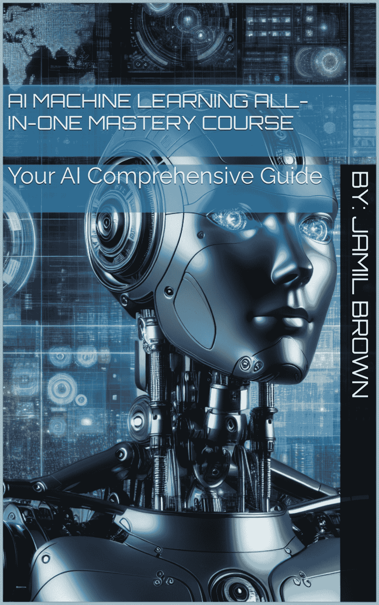

# AI 机器学习 一站式精通课程




# 模块 1：人工智能和机器学习导论

人工智能（AI）和机器学习（ML）是变革性技术，正在重塑我们生活的各个方面，从医疗保健和金融到娱乐和交通。理解这些技术对于任何希望利用其潜力的人来说都至关重要。本教程对 AI 和 ML 提供了全面介绍，探讨了它们的定义、关键概念和应用。

## 什么是人工智能（AI）？

人工智能是指在机器中模拟人类智能，这些机器被编程为像人类一样思考和学习。AI 系统旨在执行通常需要人类智能的任务，例如视觉感知、语音识别、决策和语言翻译。

### 人工智能的类型

#### 专用人工智能（弱人工智能）
这种类型的人工智能旨在执行特定任务，例如人脸识别或互联网搜索。它在有限的约束条件下运行，是当今使用最广泛的人工智能形式。

#### 通用人工智能（强人工智能）
一种理论上的人工智能形式，能够执行人类能够完成的任何智力任务。通用人工智能在很大程度上仍处于科幻和理论研究的范畴。

## 什么是机器学习（ML）？

机器学习是人工智能的一个子集，专注于开发算法，使计算机能够从数据中学习并基于数据做出决策。与传统编程不同，传统编程中规则和逻辑由程序员显式编码，ML 系统从数据中学习模式，并在无需为每个任务显式编程的情况下随着时间的推移提高性能。

### 机器学习中的关键概念

#### 数据
ML 的基础。算法根据输入数据学习模式并做出决策。

#### 算法
处理数据以识别模式并做出预测的数学模型。示例包括线性回归、决策树和神经网络。

#### 训练与测试
通过向 ML 模型输入数据（训练）来教授模型，然后在新的未见数据上评估其性能（测试）的过程。

## 人工智能与机器学习的关系

AI 是机器能够以我们认为“智能”的方式执行任务的更广泛概念。ML 是实现 AI 的一种特定方法，其基于系统可以从数据中学习、识别模式并在最少的人为干预下做出决策的理念。

## 机器学习的类型

### 1. 监督学习

#### 描述
在监督学习中，算法在标记数据上进行训练，这意味着每个训练示例都与正确的输出配对。

#### 示例
图像分类（例如，识别图像是猫还是狗）、电子邮件中的垃圾邮件检测以及制造业中的预测性维护。

#### 常见算法
线性回归、逻辑回归、支持向量机（SVM）和神经网络。

### 2. 无监督学习

#### 描述
算法在没有关于如何处理数据的明确指示的情况下获得数据。它必须在数据中寻找模式和关系。

#### 示例
聚类（对相似数据点进行分组，例如营销中的客户细分），以及降维（在不丢失重要信息的情况下简化数据，例如减少数据集中的特征数量）。

#### 常见算法
K-means 聚类、层次聚类和主成分分析（PCA）。

### 3. 强化学习

#### 描述
算法通过与环境交互并以奖励或惩罚的形式接收反馈来学习。

#### 示例
游戏（例如 AlphaGo）、机器人控制（例如教机器人行走）以及自动驾驶汽车（例如学习安全导航道路）。

#### 常见算法
Q-learning、深度 Q 网络（DQN）和近端策略优化（PPO）。

## 人工智能和机器学习的应用

AI 和 ML 在各个行业中具有广泛的应用，增强了效率、决策制定和用户体验。

### 医疗保健
AI 和 ML 用于医学影像分析、患者结果预测分析、个性化治疗计划和虚拟健康助手。例如，深度学习模型可以以高精度识别放射学图像中的肿瘤。

### 金融
这些技术有助于欺诈检测、算法交易、信用评分和个性化财务建议。ML 模型分析交易模式以检测异常并预测市场趋势。

### 零售
AI 和 ML 驱动推荐系统、库存管理、客户细分和个性化营销。电子商务平台使用 ML 算法根据用户行为和偏好推荐产品。

### 交通运输
自动驾驶汽车、交通管理系统以及交通基础设施的预测性维护是一些关键应用。自动驾驶汽车使用 AI 感知环境并做出驾驶决策。

### 娱乐
AI 增强内容推荐、自动化内容创建以及视频游戏和虚拟现实中的交互体验。Netflix 和 Spotify 等流媒体服务使用 ML 推荐节目、电影和音乐。

### 农业
精准农业、作物监测和害虫检测通过 AI 和 ML 得到改善。这些技术分析来自传感器、无人机和卫星的数据，以优化作物产量和资源利用。

### 教育
AI 和 ML 实现了自适应学习平台、自动评分和个性化辅导。教育工具使用 ML 根据个人学生的需求调整内容和评估。

## 挑战与考量

虽然 AI 和 ML 提供了显著的好处，但仍有一些挑战和伦理问题需要解决。

### 数据隐私
大型数据集的使用通常涉及个人和敏感信息。确保数据隐私并遵守 GDPR 等法规至关重要。

### 偏见与公平性
ML 模型可能会延续训练数据中存在的偏见，导致不公平或歧视性结果。确保公平性并减轻偏见需要仔细的数据选择和模型评估。

### 透明度与可解释性
许多 ML 模型，尤其是深度学习模型，作为“黑盒”运行，使得难以理解决策是如何做出的。增强模型透明度和可解释性对于信任和问责很重要。

### 资源密集型
训练 ML 模型，特别是深度学习模型，可能在计算上昂贵且耗时。有效利用资源和优化技术对于管理这些挑战是必要的。

## 结论


人工智能和机器学习是强大的技术，有潜力改变各个行业并改善日常生活。理解人工智能和机器学习的基础知识、其类型、应用以及它们带来的挑战，对于任何希望参与这些技术的人来说都是必不可少的。随着人工智能和机器学习的不断发展，其影响力将不断增长，这使得保持信息更新并具备负责任地利用其能力的知识变得越来越重要。

# 模块 2：机器学习的数学与统计

## 机器学习的线性代数

### 1. 机器学习中的线性代数简介
### 2. 向量
#### 2.1. 定义与记法
#### 2.2. 向量运算
#### 2.3. 在机器学习中的应用
### 3. 矩阵
#### 3.1. 定义与记法
#### 3.2. 矩阵运算
#### 3.3. 在机器学习中的应用
### 4. 线性变换
#### 4.1. 定义与性质
#### 4.2. 在机器学习中的应用
### 5. 特征值与特征向量
#### 5.1. 定义
#### 5.2. 计算
### 6. 奇异值分解（SVD）
#### 6.1. 定义与记法
#### 6.2. 在机器学习中的应用
### 7. 结论

## 描述性统计：全面介绍

### 1. 描述性统计简介
#### 1.1. 描述性统计的目的
### 2. 集中趋势度量
#### 2.1. 均值
#### 2.2. 中位数
#### 2.3. 众数
### 3. 离散趋势度量
#### 3.1. 极差
#### 3.2. 方差
#### 3.3. 标准差
#### 3.4. 四分位距（IQR）
### 4. 数据可视化技术
#### 4.1. 直方图
#### 4.2. 箱线图
#### 4.3. 条形图
#### 4.4. 饼图
### 5. 汇总统计及其应用
#### 5.1. 应用示例
#### 5.2. 在数据分析中的重要性
### 6. 结论

### 描述性统计汇总表

## 推断统计：全面介绍

### 1. 推断统计简介
#### 1.1. 推断统计的目的
#### 1.2. 关键概念
### 2. 抽样方法
#### 2.1. 随机抽样
#### 2.2. 非随机抽样
#### 2.3. 在推断统计中的重要性
### 3. 假设检验
#### 3.1. 零假设与备择假设
#### 3.2. 误差类型
#### 3.3. 假设检验步骤
### 4. 估计技术
#### 4.1. 点估计
#### 4.2. 区间估计
#### 4.3. 置信区间
### 5. 回归分析
#### 5.1. 简单线性回归
#### 5.2. 多元线性回归
#### 5.3. 逻辑回归
### 6. 方差分析（ANOVA）
#### 6.1. 单因素方差分析
#### 6.2. 双因素方差分析
### 7. 贝叶斯统计
#### 7.1. 贝叶斯定理
#### 7.2. 贝叶斯与频率学派方法
### 8. 结论
#### 8.1. 实际应用
#### 8.2. 进一步学习资源

### 推断统计概念汇总表

## 优化技术：全面指南

### 1. 优化技术简介
#### 1.1. 定义与目标
#### 1.2. 优化问题类型
### 2. 基础优化方法
#### 2.1. 线性规划
#### 2.2. 整数规划
#### 2.3. 非线性规划
#### 2.4. 动态规划
#### 2.5. 启发式方法
### 3. 优化技术的应用
#### 3.1. 商业与金融
#### 3.2. 工程与运营
#### 3.3. 医疗健康
#### 3.4. 机器学习与数据科学
### 4. 优化的高级主题
#### 4.1. 凸优化
#### 4.2. 随机优化
#### 4.3. 多目标优化
### 5. 结论
#### 5.1. 实际应用
#### 5.2. 进一步学习资源

### 优化技术汇总表

# 模块 3：机器学习编程

## 1. 机器学习编程简介
### 1.1. 编程对机器学习至关重要的原因
### 1.2. 机器学习流行的编程语言

## 2. 机器学习的 Python
### 2.1. 机器学习的关键 Python 库
### 2.2. 设置 Python 环境

## 3. 机器学习编程中的基本概念
### 3.1. 数据处理与加工
### 3.2. 算法实现
### 3.3. 模型评估

## 4. 机器学习编程的高级主题
### 4.1. 超参数调优
### 4.2. 使用 Git 进行版本控制
### 4.3. 创建可复现的工作流

## 5. 机器学习编程的实际应用
### 5.1. 构建真实世界的机器学习项目
### 5.2. 示例项目：预测房价

## 6. 结论
### 6.1. 关键主题总结
### 6.2. 进一步学习资源

## 机器学习的 Python：全面介绍

### 1. 为什么选择 Python 进行机器学习？
#### 1.1. 流行度与社区支持
#### 1.2. 机器学习的关键 Python 库

### 2. 设置 Python 环境
#### 2.1. 安装 Python
#### 2.2. 使用 Anaconda
#### 2.3. 安装必备库
#### 2.4. 使用 Jupyter Notebook


# 3. Python 机器学习基础概念
## 3.1. 数据加载与探索
## 3.2. 数据预处理
## 3.3. 构建机器学习模型
## 3.4. 模型评估
# 4. Python 机器学习的高级技术
## 4.1. 超参数调优
## 4.2. 交叉验证
## 4.3. 模型部署
# 5. Python 在机器学习中的实际应用
## 5.1. 实际项目
## 5.2. 示例项目代码
# 6. 结论
## 6.1. 关键主题总结
## 6.2. 进一步学习资源
## 6.3. 下一步
# 7. 附加资源
## 进一步阅读
# 使用 Pandas 进行数据操作：全面指南
## 1. Pandas 简介
### 1.1. 什么是 Pandas？
### 1.2. 为什么使用 Pandas？
## 2. 开始使用 Pandas
### 2.1. 安装 Pandas
### 2.2. 导入 Pandas
### 2.3. 创建 DataFrame 和 Series
## 3. 数据操作技术
### 3.1. 探索数据
### 3.2. 索引和选择数据
### 3.3. 数据清洗
### 3.4. 数据转换
### 3.5. 重塑数据
### 3.6. 数据可视化
## 4. 高级数据操作技术
### 4.1. 应用函数
### 4.2. 处理日期
### 4.3. 处理分类数据
## 5. 实践示例
### 5.1. 示例：分析销售数据
### 5.2. 示例：客户细分
## 6. 结论
### 6.1. 关键主题总结
### 6.2. 进一步学习资源
### 6.3. 下一步
## 7. 附加资源
# 使用 NumPy 进行数值计算：全面指南
## 1. NumPy 简介
### 1.1. 什么是 NumPy？
### 1.2. 为什么使用 NumPy？
## 2. 开始使用 NumPy
### 2.1. 安装 NumPy
### 2.2. 导入 NumPy
### 2.3. 创建 NumPy 数组
## 3. NumPy 数组的基本操作
### 3.1. 数组算术
### 3.2. 通用函数（ufuncs）
### 3.3. 聚合函数
## 4. 高级数组操作
### 4.1. 重塑数组
### 4.2. 索引和切片
### 4.3. 堆叠和分割数组
### 4.4. 广播
## 5. 数值计算技术
### 5.1. 线性代数
### 5.2. 随机数生成
### 5.3. 傅里叶变换
## 6. NumPy 的实际应用
### 6.1. 示例：数据分析
### 6.2. 示例：仿真
## 7. 结论
### 7.1. 关键主题总结
### 7.2. 进一步学习资源
### 7.3. 下一步
## 8. 附加资源
# 使用 Matplotlib 和 Seaborn 进行数据可视化：全面指南
## 1. Matplotlib 和 Seaborn 简介
### 1.1. 什么是 Matplotlib？
### 1.2. 什么是 Seaborn？
### 1.3. 为什么使用 Matplotlib 和 Seaborn？
## 2. 开始使用 Matplotlib
### 2.1. 创建基本图表
### 2.2. 自定义图表
## 3. 开始使用 Seaborn
### 3.1. 创建基本图表
### 3.2. 自定义图表
## 4. 高级可视化技术
### 4.1. 分面网格
### 4.2. 热力图
### 4.3. 回归图
## 5. 数据可视化的最佳实践
### 5.1. 选择合适的图表
### 5.2. 保持简洁
### 5.3. 确保准确性
## 6. 数据可视化的实践示例
### 6.1. 示例：分析销售数据
### 6.2. 示例：比较学生成绩
## 7. 进一步学习资源
## 8. 结论
### 8.1. 关键主题总结
### 8.2. 下一步
## 9. 附加资源
# 模块 4：数据预处理
## 1. 数据预处理简介
### 1.1. 什么是数据预处理？
### 1.2. 数据预处理的关键步骤
## 2. 数据清洗
### 2.1. 处理缺失数据
### 2.2. 删除重复项
### 2.3. 纠正数据类型
## 3. 数据转换
### 3.1. 数据规范化和标准化
### 3.2. 编码分类变量
### 3.3. 特征缩放
## 4. 特征工程
### 4.1. 创建新特征
### 4.2. 特征转换
### 4.3. 特征提取
## 5. 数据降维
### 5.1. 降维
### 5.2. 采样方法
## 6. 数据预处理的实践示例
### 6.1. 示例：清洗和转换数据集
### 6.2. 示例：为机器学习准备数据
## 7. 数据预处理的最佳实践
### 7.1. 从数据探索开始
### 7.2. 记录你的流程
### 7.3. 验证你的数据
## 8. 进一步学习资源
## 9. 结论
### 9.1. 下一步
# 数据清洗技术
## 1. 数据清洗简介
### 1.1. 什么是数据清洗？
### 1.2. 为什么数据清洗很重要？
## 2. 处理缺失数据
### 2.1. 识别缺失数据
### 2.2. 处理缺失数据的技术
## 3. 删除重复项
## 4. 纠正数据类型
## 5. 处理异常值
### 5.1. 识别异常值
### 5.2. 处理异常值
## 6. 处理不一致数据
### 6.1. 标准化格式
### 6.2. 纠正错误
## 7. 数据规范化和缩放
### 7.1. 规范化
### 7.2. 标准化
## 8. 编码分类变量


### 8.1. 一热编码
### 8.2. 标签编码
## 9. 数据清洗的实践示例
### 9.1. 示例：清洗数据集
### 9.2. 示例：为机器学习准备数据
## 10. 数据清洗的最佳实践
### 10.1. 从数据探索开始
### 10.2. 记录你的过程
### 10.3. 验证你的数据
## 11. 结论
### 11.1. 下一步

# 处理缺失值
## 1. 缺失值简介
### 1.1. 什么是缺失值？
### 1.2. 为什么缺失值很重要？
## 2. 识别缺失值
### 2.1. 使用 Pandas 识别缺失值
### 2.2. 可视化缺失值
## 3. 处理缺失值的技术
### 3.1. 删除缺失值
### 3.2. 插补缺失值
### 3.3. 高级插补技术
### 3.4. 使用机器学习模型进行插补
## 4. 实践示例：在数据集中处理缺失值
## 5. 处理缺失值的最佳实践
### 5.1. 了解缺失值的原因
### 5.2. 记录你的过程
### 5.3. 验证你的方法
## 6. 结论

# 特征工程
## 1. 特征工程简介
### 1.1. 什么是特征工程？
### 1.2. 为什么特征工程很重要？
## 2. 特征工程技术
### 2.1. 处理分类特征
### 2.2. 处理数值特征
### 2.3. 创建新特征
### 2.4. 时间特征
### 2.5. 聚合与分组
## 3. 特征工程的实践示例
### 3.1. 示例：在房价数据集上进行特征工程
### 3.2. 示例：在客户流失数据集上进行特征工程
## 4. 特征工程的最佳实践
### 4.1. 了解你的数据
### 4.2. 迭代过程
### 4.3. 领域知识
### 4.4. 避免过拟合
### 4.5. 自动化
## 5. 结论

# 特征工程
## 1. 特征工程简介
### 1.1. 什么是特征工程？
### 1.2. 为什么特征工程很重要？
## 2. 特征工程技术
### 2.1. 处理分类特征
### 2.2. 处理数值特征
### 2.3. 创建新特征
### 2.4. 时间特征
### 2.5. 聚合与分组
## 3. 特征工程的实践示例
### 3.1. 示例：在房价数据集上进行特征工程
### 3.2. 示例：在客户流失数据集上进行特征工程
## 4. 特征工程的最佳实践
### 4.1. 了解你的数据
### 4.2. 迭代过程
### 4.3. 领域知识
### 4.4. 避免过拟合
### 4.5. 自动化
## 5. 结论

# 特征缩放与归一化
## 1. 特征缩放与归一化简介
### 1.1. 什么是特征缩放？
### 1.2. 什么是归一化？
### 1.3. 为什么特征缩放和归一化很重要？
## 2. 特征缩放与归一化技术
### 2.1. Min-Max 缩放
### 2.2. 标准化
### 2.3. 健壮缩放
### 2.4. MaxAbs 缩放
### 2.5. 对数变换
### 2.6. 幂变换
## 3. 特征缩放与归一化的实践示例
### 3.1. 示例：在房屋数据集中缩放特征
### 3.2. 示例：在客户流失数据集中归一化特征
## 4. 特征缩放与归一化的最佳实践
### 4.1. 选择合适的技术
### 4.2. 避免数据泄漏
### 4.3. 适当处理异常值
### 4.4. 如有必要归一化目标变量
### 4.5. 预处理的一致性
## 5. 结论

# 数据转换技术
## 1. 数据转换简介
### 1.1. 什么是数据转换？
### 1.2. 为什么数据转换很重要？
## 2. 数据转换技术类型
### 2.1. 缩放
### 2.2. 编码分类变量
### 2.3. 对数变换
### 2.4. Box-Cox 变换
### 2.5. 多项式变换
### 2.6. 交互特征
### 2.7. 聚合与分组
## 3. 数据转换的实践示例
### 3.1. 示例：在房价数据集上进行数据转换
### 3.2. 示例：在客户流失数据集上进行数据转换
## 4. 数据转换的最佳实践
### 4.1. 了解你的数据
### 4.2. 迭代过程
### 4.3. 领域知识
### 4.4. 避免数据泄漏
### 4.5. 预处理的一致性
## 5. 结论

# 处理分类数据
## 1. 理解分类数据
### 1.1. 什么是分类数据？
### 1.2. 为什么处理分类数据很重要？
## 2. 处理分类数据的技术
### 2.1. 一热编码
### 2.2. 标签编码
### 2.3. 序数编码
### 2.4. 目标编码
### 2.5. 频率编码
### 2.6. 二进制编码
### 2.7. 特征哈希
## 3. 处理分类数据的实践示例
### 3.1. 示例：在泰坦尼克数据集编码分类变量
### 3.2. 示例：在客户评论数据集编码分类变量
## 4. 处理分类数据的最佳实践
### 4.1. 选择合适的编码技术
### 4.2. 避免过拟合
### 4.3. 考虑特征重要性
### 4.4. 保持一致性
### 4.5. 记录你的过程
## 5. 结论

# 第 5 模块：监督学习


# 1. 有监督学习简介
## 1.1. 什么是监督学习？
## 1.2. 监督学习的类型
# 2. 分类算法
## 2.1. 逻辑回归
## 2.2. 决策树
## 2.3. 随机森林
# 3. 回归算法
## 3.1. 线性回归
## 3.2. 岭回归
## 3.3. 支持向量机 (SVM)
# 4. 模型评估指标
## 4.1. 分类指标
## 4.2. 回归指标
# 5. 有监督学习最佳实践
## 5.1. 数据准备
## 5.2. 特征选择
## 5.3. 模型验证
## 5.4. 超参数调优
## 5.5. 可解释性
# 6. 结论
# 线性回归：全面指南
## 1. 线性回归简介
### 1.1. 什么是线性回归？
### 1.2. 基本术语
## 2. 线性回归的类型
### 2.1. 简单线性回归
### 2.2. 多元线性回归
### 2.3. 多项式回归
## 3. 线性回归的假设
### 3.1. 线性
### 3.2. 独立性
### 3.3. 同方差性
### 3.4. 残差正态性
### 3.5. 无多重共线性
## 4. 模型评估
### 4.1. 均方误差 (MSE)
### 4.2. R 平方分数
### 4.3. 调整 R 平方
## 5. 线性回归的实际应用
### 5.1. 预测房价
### 5.2. 财务预测
### 5.3. 销售预测
### 5.4. 风险管理
## 6. 线性回归最佳实践
### 6.1. 数据准备
### 6.2. 特征选择
### 6.3. 模型解释
### 6.4. 模型验证
### 6.5. 正则化
## 7. 结论
# 逻辑回归：全面教程
## 1. 逻辑回归简介
### 1.1. 什么是逻辑回归？
### 1.2. 关键术语
## 2. 逻辑回归的工作原理
### 2.1. 逻辑函数
### 2.2. 训练模型
## 3. 实现逻辑回归
### 3.1. 使用 Scikit-Learn 的逻辑回归
## 4. 逻辑回归的评估指标
### 4.1. 准确率
### 4.2. 混淆矩阵
### 4.3. 精确率、召回率和 F1 分数
### 4.4. ROC 曲线和 AUC
## 5. 常见问题及解决方案
### 5.1. 过拟合
### 5.2. 多重共线性
### 5.3. 数据不平衡
## 6. 逻辑回归的实际应用
### 6.1. 电子邮件垃圾邮件检测
### 6.2. 信用评分
### 6.3. 医学诊断
### 6.4. 客户流失预测
## 7. 逻辑回归最佳实践
### 7.1. 数据准备
### 7.2. 特征工程
### 7.3. 模型评估
### 7.4. 解释
### 7.5. 正则化
## 8. 结论
# 决策树：全面指南
## 1. 决策树简介
### 1.1. 什么是决策树？
### 1.2. 基本术语
## 2. 决策树的工作原理
### 2.1. 构建决策树
### 2.2. 决策树算法
## 3. 实现决策树
### 3.1. 用于分类的决策树
### 3.2. 用于回归的决策树
## 4. 评估决策树
### 4.1. 分类指标
### 4.2. 回归指标
## 5. 常见问题及解决方案
### 5.1. 过拟合
### 5.2. 欠拟合
### 5.3. 偏差-方差权衡
## 6. 决策树的实际应用
### 6.1. 医学诊断
### 6.2. 信用评分
### 6.3. 营销
### 6.4. 欺诈检测
## 7. 决策树最佳实践
### 7.1. 数据准备
### 7.2. 特征选择
### 7.3. 模型复杂度
### 7.4. 剪枝
### 7.5. 交叉验证
## 8. 结论
# 随机森林：深入指南
## 1. 随机森林简介
### 1.1. 什么是随机森林？
### 1.2. 基本术语
## 2. 随机森林的工作原理
### 2.1. 构建随机森林
### 2.2. 随机森林中的关键概念
## 3. 实现随机森林
### 3.1. 用于分类的随机森林
### 3.2. 用于回归的随机森林
## 4. 评估随机森林
### 4.1. 分类指标
### 4.2. 回归指标
## 5. 随机森林的优势与局限性
### 5.1. 优势
### 5.2. 局限性
### 局限性的解决方案
## 6. 使用随机森林的最佳实践
### 6.1. 数据准备
### 6.2. 超参数调优
### 6.3. 模型评估
### 6.4. 特征重要性
## 7. 随机森林的现实世界应用
### 7.1. 医疗保健
### 7.2. 金融
### 7.3. 营销
### 7.4. 环境科学
## 8. 结论
# 支持向量机：全面介绍
## 1. 支持向量机简介
### 1.1. 什么是支持向量机？
### 1.2. 历史背景
## 2. 支持向量机的工作原理
### 2.1. 超平面的概念
### 2.2. 数学表述
### 2.3. 核技巧
## 3. 实现支持向量机
### 3.1. 用于分类的 SVM
### 3.2. 用于回归的 SVM
## 4. 评估支持向量机


### 4.1. 分类指标
### 4.2. 回归指标
## 5. 支持向量机的优势与局限性
### 5.1. 优势
### 5.2. 局限性
### 局限性的解决方案
## 6. 使用支持向量机的最佳实践
### 6.1. 数据准备
### 6.2. 超参数调优
### 6.3. 模型评估
### 6.4. 核函数选择
## 7. 支持向量机的实际应用
### 7.1. 图像分类
### 7.2. 文本分类
### 7.3. 生物信息学
### 7.4. 金融
## 8. 结论
# K-最近邻 (KNN)：全面指南
## 1. K-最近邻简介
### 1.1. 什么是 K-最近邻？
### 1.2. 历史背景
## 2. K-最近邻的工作原理
### 2.1. KNN 算法
### 2.2. 距离度量
### 2.3. 选择 K 的值
## 3. 实现 K-最近邻
### 3.1. 用于分类的 KNN
### 3.2. 用于回归的 KNN
## 4. 评估 K-最近邻模型
### 4.1. 分类指标
### 4.2. 回归指标
## 5. K-最近邻的优势与局限性
### 5.1. 优势
### 5.2. 局限性
### 局限性的解决方案
## 6. K-最近邻的实际应用
### 6.1. 图像识别
### 6.2. 推荐系统
### 6.3. 医疗保健
### 6.4. 金融
## 7. 结论
# 模型评估指标：准确率、精确率、召回率和 F1 分数
## 1. 模型评估指标简介
### 为什么模型评估指标很重要
## 2. 准确率
### 2.1. 什么是准确率？
### 2.2. 何时使用准确率
### 2.3. 准确率的局限性
## 3. 精确率
### 3.1. 什么是精确率？
### 3.2. 何时使用精确率
### 3.3. 精确率 vs. 准确率
## 4. 召回率
### 4.1. 什么是召回率？
### 4.2. 何时使用召回率
### 4.3. 召回率 vs. 准确率
## 5. F1 分数
### 5.1. 什么是 F1 分数？
### 5.2. 何时使用 F1 分数
### 5.3. F1 分数 vs. 准确率
## 6. 比较指标
### 6.1. 混淆矩阵
### 6.2. 从混淆矩阵计算指标
### 示例计算
## 7. 指标的实际应用
### 7.1. 垃圾邮件检测
### 7.2. 医学诊断
### 7.3. 欺诈检测
## 8. 结论
# 第 6 模块：无监督学习
## 1. 无监督学习简介
### 1.1. 什么是无监督学习？
### 1.2. 历史背景
## 2. 聚类
### 2.1. 什么是聚类？
### 2.2. 聚类的实际应用
## 3. 降维
### 3.1. 什么是降维？
### 3.2. 降维的实际应用
## 4. 异常检测
### 4.1. 什么是异常检测？
### 4.2. 异常检测的实际应用
## 5. 关联规则学习
### 5.1. 什么是关联规则学习？
### 5.2. 关联规则学习的实际应用
## 6. 总结
# K-均值聚类：全面指南
## 1. K-均值聚类简介
### 1.1. 什么是 K-均值聚类？
### 1.2. 历史背景
## 2. K-均值聚类的工作原理
### 2.1. 算法步骤
### 2.2. 数学公式
### 2.3. 选择合适的聚类数
## 3. K-均值聚类的实际应用
### 3.1. 市场细分
### 3.2. 图像压缩
### 3.3. 文档聚类
### 3.4. 异常检测
## 4. Python 中的 K-均值聚类
### 4.1. 示例代码
### 4.2. 高级功能
## 5. K-均值聚类的挑战与局限性
### 5.1. 挑战
### 5.2. 解决方案
## 6. 结论
# 层次聚类：全面指南
## 1. 层次聚类简介
### 1.1. 什么是层次聚类？
### 1.2. 历史背景
## 2. 层次聚类的类型
### 2.1. 凝聚层次聚类
### 2.2. 分裂层次聚类
### 2.3. 在凝聚和分裂聚类之间选择
## 3. 距离度量和连接准则
### 3.1. 距离度量
### 3.2. 连接准则
## 4. 层次聚类的实际应用
### 4.1. 客户细分
### 4.2. 基因表达分析
### 4.3. 文档聚类
### 4.4. 图像分割
## 5. Python 中的层次聚类
### 5.1. 示例代码
### 5.2. 高级功能
## 6. 层次聚类的挑战与局限性
### 6.1. 挑战
### 6.2. 解决方案
## 7. 总结
# 主成分分析 (PCA)：全面指南
## 1. 主成分分析简介
### 1.1. 什么是主成分分析？
### 1.2. 历史背景
## 2. PCA 的工作原理
### 2.1. PCA 算法
### 2.2. 数学公式
## 3. PCA 的应用
### 3.1. 数据可视化
### 3.2. 图像压缩
### 3.3. 特征选择
### 3.4. 降噪
## 4. Python 中实现 PCA
### 4.1. 示例代码
### 4.2. 高级功能
## 5. PCA 的挑战与局限性
### 5.1. 挑战


### 5.2. 解决方案
## 6. 总结
## 7. 附加资源

# 异常检测：全面指南
## 1. 异常检测简介
### 1.1. 什么是异常检测？
### 1.2. 历史背景
## 2. 异常检测技术类型
### 2.1. 统计方法
### 2.2. 机器学习方法
### 2.3. 基于邻近的方法
## 3. 异常检测的应用
### 3.1. 欺诈检测
### 3.2. 入侵检测
### 3.3. 质量控制
### 3.4. 健康监测
## 4. 在 Python 中实现异常检测
### 4.1. Isolation Forest 示例代码
### 4.2. 高级功能
## 5. 异常检测的挑战与局限性
### 5.1. 挑战
### 5.2. 解决方案
## 6. 总结
## 7. 附加资源
## 附加练习题

# 关联规则学习：Apriori 与 Eclat 算法的深入指南
## 1. 关联规则学习简介
### 1.1. 什么是关联规则学习？
### 1.2. 历史背景
## 2. Apriori 算法
### 2.1. Apriori 概述
### 2.2. 优势与局限性
## 3. Eclat 算法
### 3.1. Eclat 概述
### 3.2. 优势与局限性
## 4. 关联规则学习的应用
### 4.1. 市场篮子分析
### 4.2. 推荐系统
### 4.3. 欺诈检测
### 4.4. 医疗诊断
## 5. 在 Python 中实现关联规则学习
### 5.1. 高级技术
## 6. 总结
## 7. 附加资源
## 8. 练习题

# 降维技术：深入指南
## 1. 理解降维
### 1.1. 什么是降维？
### 1.2. 为什么要降维？
## 2. 主成分分析 (PCA)
### 2.1. PCA 概述
### 2.2. PCA 的优势与局限性
## 3. 线性判别分析 (LDA)
### 3.1. LDA 概述
### 3.2. LDA 的优势与局限性
## 4. t-分布随机邻域嵌入 (t-SNE)
### 4.1. t-SNE 概述
### 4.2. t-SNE 的优势与局限性
## 5. 比较降维技术
### 5.1. 总结表
### 5.2. 何时使用什么？
## 6. 实际应用
### 6.1. 数据可视化
### 6.2. 模型改进
### 6.3. 特征工程
## 7. 附加资源
## 8. 练习题
## 9. 总结

# 模块 7：深度学习
## 1. 什么是深度学习？
### 1.1. 定义与概述
### 1.2. 深度学习的演进
## 2. 神经网络基础
### 2.1. 神经网络架构
### 2.2. 激活函数
### 2.3. 训练神经网络
## 3. 深度学习架构
### 3.1. 卷积神经网络 (CNNs)
### 3.2. 循环神经网络 (RNNs)
### 3.3. 生成对抗网络 (GANs)
## 4. 深度学习的应用
### 4.1. 图像识别
### 4.2. 自然语言处理 (NLP)
### 4.3. 自动驾驶汽车
### 4.4. 医疗健康
## 5. 实际考虑
### 5.1. 数据需求
### 5.2. 计算资源
### 5.3. 超参数调优
## 6. 附加资源
## 7. 练习题
## 8. 总结

# 神经网络简介
## 1. 什么是神经网络？
### 1.1. 定义与概念
### 1.2. 历史背景
## 2. 神经网络结构
### 2.1. 基本组件
### 2.2. 神经元与连接
### 2.3. 常见激活函数
## 3. 训练神经网络
### 3.1. 训练过程
### 3.2. 超参数
### 3.3. 评估神经网络
## 4. 高级神经网络架构
### 4.1. 卷积神经网络 (CNNs)
### 4.2. 循环神经网络 (RNNs)
### 4.3. 生成对抗网络 (GANs)
## 5. 实际考虑
### 5.1. 数据准备
### 5.2. 计算资源
### 5.3. 过拟合与正则化
## 6. 附加资源
## 7. 练习题
## 8. 总结

# 理解神经网络中的激活函数
## 1. 什么是激活函数？
### 1.1. 定义与目的
### 1.2. 历史背景
## 2. 常见激活函数
### 2.1. Sigmoid 函数
### 2.2. Tanh 函数
### 2.3. ReLU (整流线性单元)
### 2.4. Leaky ReLU
### 2.5. Softmax 函数
## 3. 选择合适的激活函数
### 3.1. 任务考虑
### 3.2. 性能与实验
### 3.3. 常见陷阱
## 4. 高级激活函数
### 4.1. ELU (指数线性单元)
### 4.2. Swish 函数
## 5. 实践练习
### 5.1. 实现激活函数
### 5.2. 比较激活函数
### 5.3. 探索高级函数
## 6. 总结

# 前馈神经网络：全面介绍
## 1. 理解前馈神经网络
### 1.1. 什么是前馈神经网络？
### 1.2. 历史背景
## 2. 前馈神经网络结构
### 2.1. 基本组件
### 2.2. 神经元与连接


### 2.3. 激活函数
## 3. 训练前馈神经网络
### 3.1. 训练过程
### 3.2. 超参数
### 3.3. 过拟合与正则化
## 4. 前馈神经网络的应用
### 4.1. 图像分类
### 4.2. 回归分析
### 4.3. 自然语言处理
## 5. 前馈神经网络的高级主题
### 5.1. 深度前馈网络
### 5.2. 迁移学习
### 5.3. 超参数调优
## 6. 实践练习
### 6.1. 实现一个简单的 FNN
### 6.2. 尝试不同的架构
### 6.3. 应用正则化技术
## 7. 总结
# 前馈神经网络：全面介绍
## 1. 理解前馈神经网络
### 1.1. 什么是前馈神经网络？
### 1.2. 历史背景
## 2. 前馈神经网络的结构
### 2.1. 基本组件
### 2.2. 神经元与连接
### 2.3. 激活函数
## 3. 训练前馈神经网络
### 3.1. 训练过程
### 3.2. 超参数
### 3.3. 过拟合与正则化
## 4. 前馈神经网络的应用
### 4.1. 图像分类
### 4.2. 回归分析
### 4.3. 自然语言处理
## 5. 前馈神经网络的高级主题
### 5.1. 深度前馈网络
### 5.2. 迁移学习
### 5.3. 超参数调优
## 6. 实践练习
### 6.1. 实现一个简单的 FNN
### 6.2. 尝试不同的架构
### 6.3. 应用正则化技术
## 7. 总结
# 反向传播：全面训练指南
## 1. 什么是反向传播？
### 1.1. 定义与目的
### 1.2. 历史背景
## 2. 反向传播的工作原理
### 2.1. 反向传播过程
### 2.2. 数学表述
## 3. 反向传播的组件
### 3.1. 激活函数
### 3.2. 损失函数
### 3.3. 优化算法
## 4. 反向传播的高级主题
### 4.1. 梯度消失与爆炸
### 4.2. 正则化技术
### 4.3. 时间反向传播 (BPTT)
## 5. 实践练习
### 5.1. 从零实现反向传播
### 5.2. 尝试不同的损失函数
### 5.3. 探索优化算法
## 6. 总结
# 卷积神经网络 (CNNs)：全面介绍
## 1. 什么是卷积神经网络 (CNNs)？
### 1.1. 定义与目的
### 1.2. 历史背景
## 2. 卷积神经网络的结构
### 2.1. CNN 的基本组件
### 2.2. 卷积操作的详细说明
## 3. 卷积层类型
### 3.1. 标准卷积层
### 3.2. 不同填充的卷积层
### 3.3. 空洞卷积
## 4. 卷积神经网络架构
### 4.1. 经典 CNN 架构
### 4.2. 现代 CNN 架构
### 4.3. CNN 的迁移学习
## 5. 卷积神经网络的应用
### 5.1. 图像分类
### 5.2. 目标检测
### 5.3. 图像分割
## 6. 实践练习
### 6.1. 实现一个简单的 CNN
### 6.2. 尝试不同的架构
### 6.3. 应用迁移学习
## 7. 总结
# 循环神经网络 (RNNs)：全面介绍
## 1. 什么是循环神经网络 (RNNs)？
### 1.1. 定义与目的
### 1.2. 历史背景
## 2. 循环神经网络的结构
### 2.1. RNN 的基本组件
### 2.2. RNN 中的循环过程
## 3. 循环神经网络的类型
### 3.1. 基础 RNN
### 3.2. 长短期记忆 (LSTM)
### 3.3. 门控循环单元 (GRU)
### 3.4. 双向 RNN
## 4. 循环神经网络的应用
### 4.1. 时间序列预测
### 4.2. 自然语言处理 (NLP)
### 4.3. 序列到序列模型
## 5. RNN 的高级主题
### 5.1. 注意力机制
### 5.2. 序列到序列模型
## 6. 实践练习
### 6.1. 实现一个基础 RNN
### 6.2. 探索 LSTM 与 GRU
### 6.3. 构建文本生成模型
## 7. 总结
# 生成对抗网络 (GANs)：全面指南
## 1. GANs 简介
### 1.1. 什么是 GANs？
### 1.2. 历史背景
## 2. GANs 的架构
### 2.1. 生成器
### 2.2. 判别器
### 2.3. 对抗训练
## 3. GANs 的类型
### 3.1. DCGAN (深度卷积生成对抗网络)
### 3.2. WGAN (Wasserstein 生成对抗网络)
### 3.3. StyleGAN
### 3.4. CycleGAN
## 4. GANs 的应用
### 4.1. 图像生成
### 4.2. 数据增强
### 4.3. 超分辨率
## 5. 挑战与未来方向
### 5.1. 训练稳定性
### 5.2. 伦理考量
## 6. 总结
## 参考文献
# 迁移学习：全面指南
## 1. 迁移学习简介
### 1.1. 什么是迁移学习？
### 1.2. 为什么使用迁移学习？
## 2. 迁移学习的类型
### 2.1. 微调
### 2.2. 特征提取
### 2.3. 领域适应


# 3. 迁移学习的实际应用
## 3.1. 图像分类
## 3.2. 自然语言处理 (NLP)
## 3.3. 机器人技术中的迁移学习
# 4. 迁移学习的高级主题
## 4.1. 多任务学习
## 4.2. 少样本学习
## 4.3. 自监督学习
# 5. 迁移学习的最佳实践
## 5.1. 选择合适的预训练模型
## 5.2. 适当的微调
## 5.3. 评估性能
# 6. 总结
# 参考文献
# 模块 8：自然语言处理 (NLP)
## 1. 自然语言处理简介
### 1.1. 什么是 NLP？
### 1.2. NLP 的重要性
## 2. NLP 的核心组件
### 2.1. 文本预处理
### 2.2. 特征提取
### 2.3. 模型构建
## 3. 关键 NLP 技术
### 3.1. 命名实体识别 (NER)
### 3.2. 情感分析
### 3.3. 文本生成
## 4. 高级 NLP 主题
### 4.1. Transformers 和 BERT
### 4.2. NLP 的迁移学习
### 4.3. 文本摘要
## 5. 总结
# 参考文献
# 自然语言处理 (NLP) 简介
## 1. 什么是自然语言处理 (NLP)？
### 1.1. NLP 的定义
### 1.2. NLP 的核心组件
## 2. NLP 中的关键概念
### 2.1. 文本处理
### 2.2. 文本表示
### 2.3. 语言模型
### 2.4. 常见 NLP 任务
## 3. NLP 工具和库
### 3.1. NLTK (自然语言工具包)
### 3.2. SpaCy
### 3.3. Hugging Face Transformers
## 4. NLP 的应用
### 4.1. 虚拟助手
### 4.2. 文本分析
### 4.3. 信息检索
### 4.4. 文本生成
## 5. NLP 的未来方向
## 6. 总结
# 参考文献
# 文本预处理技术
## 1. 文本预处理简介
## 2. 常见文本预处理技术
### 2.1. 分词
### 2.2. 规范化
### 2.3. 词干提取
### 2.4. 词形还原
### 2.5. 去除停用词
### 2.6. 文本词形还原
### 2.7. 文本分段
## 3. 高级文本预处理技术
### 3.1. 命名实体识别 (NER)
### 3.2. 文本规范化
### 3.3. 特征提取
## 4. 总结
# 参考文献
# 词嵌入：Word2Vec 和 GloVe
## 1. 词嵌入简介
### 为什么词嵌入很重要？
## 2. Word2Vec：理解模型
### Word2Vec 架构
### 为什么 Word2Vec 很重要
## 3. GloVe：理解模型
### GloVe 架构
### 为什么 GloVe 很重要
## 4. 比较 Word2Vec 和 GloVe
### 相似之处
### 差异
## 5. 词嵌入的应用
## 6. 使用词嵌入的实用技巧
## 7. 总结
### 主要要点：
# 参考文献
# 情感分析：理解和实现情感分类
## 1. 什么是情感分析？
### 为什么情感分析很重要？
## 2. 情感分析的类型
### 2.1. 文档级情感分析
### 2.2. 句子级情感分析
### 2.3. 基于方面的情感分析
## 3. 情感分析技术
### 3.1. 基于规则的方法
### 3.2. 机器学习方法
### 3.3. 深度学习方法
## 4. 评估情感分析模型
### 4.1. 准确率
### 4.2. 精确率
### 4.3. 召回率
### 4.4. F1 分数
## 5. 高级情感分析技术
### 5.1. 基于方面的情感分析
### 5.2. 多语言情感分析
## 6. 情感分析的实用技巧
## 7. 总结
### 主要要点：
# 参考文献
# 命名实体识别 (NER)：简介与实现指南
## 1. 什么是命名实体识别 (NER)？
### 为什么 NER 很重要？
## 2. 命名实体类型
### 2.1. 人名 (PER)
### 2.2. 组织机构 (ORG)
### 2.3. 地点 (LOC)
### 2.4. 日期和时间 (DATE, TIME)
### 2.5. 杂项实体 (MISC)
## 3. 命名实体识别技术
### 3.1. 基于规则的方法
### 3.2. 统计模型
### 3.3. 深度学习方法
## 4. 评估 NER 模型
### 4.1. 精确率
### 4.2. 召回率
### 4.3. F1 分数
## 5. 高级 NER 技术
### 5.1. 领域特定 NER
### 5.2. 多语言 NER
## 6. NER 的实用技巧
## 7. 总结
### 主要要点：
# 参考文献
# 机器翻译：全面介绍与实现指南
## 1. 什么是机器翻译？
### 为什么机器翻译很重要？
## 2. 机器翻译方法类型
### 2.1. 基于规则的机器翻译 (RBMT)
### 2.2. 统计机器翻译 (SMT)
### 2.3. 神经机器翻译 (NMT)
## 3. 机器翻译技术
### 3.1. 序列到序列模型
### 3.2. Transformer 模型
### 3.3. 预训练模型和 API
## 4. 评估机器翻译模型
### 4.1. BLEU 分数
### 4.2. METEOR 分数
## 5. 机器翻译的高级主题
### 5.1. 神经机器翻译创新
### 5.2. 零样本学习


## 结论

# 文本生成：全面介绍与实现指南

## 1. 什么是文本生成？

### 为什么文本生成很重要？

## 2. 文本生成的技术与模型

### 2.1. 基于规则的文本生成

### 2.2. N-gram 模型

### 2.3. 循环神经网络（RNNs）

### 2.4. 长短期记忆网络（LSTMs）

### 2.5. Transformer 模型

## 3. 文本生成的应用

### 3.1. 创意写作与内容创作

### 3.2. 聊天机器人与虚拟助手

### 3.3. 文本摘要

### 3.4. 自动化翻译

### 3.5. 教育工具

## 4. 评估文本生成模型

### 4.1. 困惑度

### 4.2. BLEU 分数

### 4.3. ROUGE 分数

## 5. 文本生成的进阶主题

### 5.1. 迁移学习

### 5.2. 生成对抗网络（GANs）

### 5.3. 少样本学习

## 结论

# 模块 9：模型部署与服务

## 1. 什么是模型部署？

### 为什么模型部署很重要？

## 2. 模型部署策略

### 2.1. 本地部署

### 2.2. 云部署

### 2.3. 容器化部署

### 2.4. 基于 API 的部署

## 3. 模型服务最佳实践

### 3.1. 版本控制

### 3.2. 监控与日志记录

### 3.3. 可扩展性

### 3.4. 安全性

### 3.5. 文档

## 4. 模型部署的进阶主题

### 4.1. 持续集成与部署（CI/CD）

### 4.2. 模型性能优化

### 4.3. A/B 测试

## 5. 结论

## 要点：

# 模型部署简介

## 什么是模型部署？

## 为什么模型部署很重要？

## 模型部署的关键阶段

### 1. 模型准备

### 2. 环境设置

### 3. 部署

### 4. 测试与验证

### 5. 监控与维护

## 常见部署方法

### 1. 本地部署

### 2. 云部署

### 3. 容器化部署

### 4. 基于 API 的部署

## 模型部署最佳实践

### 1. 版本控制

### 2. 安全性

### 3. 文档

### 4. 监控与维护

## 进阶主题

### 1. 持续集成与部署（CI/CD）

### 2. A/B 测试

### 3. 模型性能优化

## 结论

## 要点：

# 使用 Flask 和 FastAPI 进行模型部署

## 1. Flask 和 FastAPI 简介

### 1.1. Flask

### 1.2. FastAPI

## 2. 使用 Flask 部署模型

### 2.1. 设置 Flask 环境

### 2.2. 创建简单的 Flask API

### 2.3. Flask 高级功能

## 3. 使用 FastAPI 部署模型

### 3.1. 设置 FastAPI 环境

### 3.2. 创建基本的 FastAPI 应用

### 3.3. FastAPI 高级功能

## 4. Flask 与 FastAPI

## 5. 在 Flask 和 FastAPI 之间选择

### 5.1. 项目需求

### 5.2. 开发速度

### 5.3. 未来扩展

## 6. 模型部署最佳实践

### 6.1. 版本控制

### 6.2. 安全性

### 6.3. 监控与日志记录

### 6.4. 测试

## 7. 结论

## 要点：

# 使用 Docker 部署模型

## 1. Docker 简介

### 1.1. 什么是 Docker 容器？

### 1.2. 什么是 Docker Compose？

## 2. 为模型部署设置 Docker

### 2.1. 安装 Docker

### 2.2. 安装 Docker Compose

## 3. 为你的模型创建 Dockerfile

### 3.1. 编写基本的 Dockerfile

### 3.2. 构建 Docker 镜像

### 3.3. 运行 Docker 容器

## 4. 使用 Docker Compose 进行高级部署

### 4.1. 创建 docker-compose.yml 文件

### 4.2. 启动你的服务

## 5. 机器学习模型 Docker 化最佳实践

### 5.1. 优化 Dockerfile

### 5.2. 保护你的容器安全

### 5.3. 监控和管理容器

### 5.4. 测试你的 Docker 镜像

## 6. 在生产环境中部署 Docker 容器

### 6.1. 云平台

### 6.2. Kubernetes

## 7. 结论

## 要点：

# 使用 Docker 部署机器学习模型

## 1. Docker 简介

## 2. 为什么使用 Docker 进行模型部署？

## 3. Docker 入门

## 4. 为你的模型创建 Docker 镜像

## 5. 部署你的模型容器

## 6. 实践示例：部署 Scikit-Learn 模型

## 7. Docker 化模型部署最佳实践

## 8. 结论

# Kubernetes 简介

## 1. 什么是 Kubernetes？

## 2. Kubernetes 架构

### 2.1. 集群组件

### 2.2. Kubernetes 对象

## 3. Kubernetes 核心概念

### 3.1. Pods

### 3.2. Services

### 3.3. Deployments

## 4. Kubernetes 工作流程

### 4.1. 定义你的应用

### 4.2. 部署你的应用

### 4.3. 管理和监控你的应用

### 4.4. 维护你的应用

## 5. Kubernetes 进阶概念

### 5.1. Helm Charts

### 5.2. Operators

### 5.3. 自定义资源定义（CRDs）

## 6. 结论

## 要点：

# Kubernetes 简介

## 1. 什么是 Kubernetes？


# 2. Kubernetes 架构
## 2.1. 集群组件
## 2.2. Kubernetes 对象
# 3. Kubernetes 核心概念
## 3.1. Pod
## 3.2. 服务
## 3.3. 部署
# 4. Kubernetes 工作流程
## 4.1. 定义你的应用程序
## 4.2. 部署你的应用程序
## 4.3. 管理和监控你的应用程序
## 4.4. 维护你的应用程序
# 5. Kubernetes 高级概念
## 5.1. Helm 图表
## 5.2. 操作符
## 5.3. 自定义资源定义 (CRDs)
# 6. 结论
# 关键要点：
# 使用 TensorFlow Serving 提供模型
## 1. 什么是 TensorFlow Serving？
## 2. TensorFlow Serving 的核心概念
### 2.1. 模型服务器
### 2.2. 模型配置
### 2.3. 模型版本控制
## 3. 设置 TensorFlow Serving
### 3.1. 安装
### 3.2. 配置文件
### 3.3. 启动 TensorFlow Serving
## 4. 使用 TensorFlow Serving 提供模型
### 4.1. 发起请求
### 4.2. 监控和日志记录
### 4.3. 模型管理
## 5. 高级功能
### 5.1. 多模型服务
### 5.2. 自定义模型和扩展
### 5.3. 性能优化
## 6. TensorFlow Serving 的最佳实践
### 6.1. 安全考虑
### 6.2. 版本管理
### 6.3. 监控和告警
### 6.4. 文档和培训
## 7. 结论
# 监控和维护已部署的模型
## 1. 监控已部署模型的重要性
## 2. 监控模型的关键指标
### 2.1. 准确性和性能指标
### 2.2. 系统指标
### 2.3. 业务指标
## 3. 监控模型的工具
### 3.1. Prometheus 和 Grafana
### 3.2. ELK Stack
### 3.3. 模型监控服务
## 4. 维护已部署模型的技巧
### 4.1. 重新训练模型
### 4.2. A/B 测试
### 4.3. 版本控制
### 4.4. 日志记录和告警
### 4.5. 资源管理
## 5. 结论
# 第 10 模块：机器学习中的高级主题和专业化
## 1. 机器学习中的高级主题
### 1.1. 元学习
### 1.2. 强化学习（高级主题）
### 1.3. 贝叶斯方法
### 1.4. 可解释 AI (XAI)
## 2. 机器学习专业化
### 2.1. 自然语言处理 (NLP)
### 2.2. 计算机视觉
### 2.3. 机器人技术
### 2.4. 时间序列分析
### 2.5. 医疗保健和生物医学信息学
## 3. 高级技术和未来方向
### 3.1. 超参数优化
### 3.2. 联邦学习
### 3.3. 量子机器学习
## 4. 结论
# 参考文献和延伸阅读
# 强化学习：全面介绍
## 什么是强化学习？
## 核心概念
## 强化学习的关键组件
### 1. 智能体
### 2. 环境
### 3. 状态
### 4. 动作
### 5. 奖励
### 6. 策略
### 7. 价值函数
### 8. Q 函数
## 强化学习中的基本算法
### 1. Q 学习
### 2. SARSA（状态-动作-奖励-状态-动作）
### 3. 深度 Q 网络 (DQN)
### 4. 策略梯度方法
### 5. 演员-评论家方法
## 强化学习的应用
### 1. 游戏[content]
# 2. Kubernetes 架构
## 2.1. 集群组件
## 2.2. Kubernetes 对象
# 3. Kubernetes 核心概念
## 3.1. Pod
## 3.2. 服务
## 3.3. 部署
# 4. Kubernetes 工作流程
## 4.1. 定义你的应用程序
## 4.2. 部署你的应用程序
## 4.3. 管理和监控你的应用程序
## 4.4. 维护你的应用程序
# 5. Kubernetes 高级概念
## 5.1. Helm 图表
## 5.2. 操作符
## 5.3. 自定义资源定义 (CRDs)
# 6. 结论
# 关键要点：
# 使用 TensorFlow Serving 提供模型
## 1. 什么是 TensorFlow Serving？
## 2. TensorFlow Serving 的核心概念
### 2.1. 模型服务器
### 2.2. 模型配置
### 2.3. 模型版本控制
## 3. 设置 TensorFlow Serving
### 3.1. 安装
### 3.2. 配置文件
### 3.3. 启动 TensorFlow Serving
## 4. 使用 TensorFlow Serving 提供模型
### 4.1. 发起请求
### 4.2. 监控和日志记录
### 4.3. 模型管理
## 5. 高级功能
### 5.1. 多模型服务
### 5.2. 自定义模型和扩展
### 5.3. 性能优化
## 6. TensorFlow Serving 的最佳实践
### 6.1. 安全考虑
### 6.2. 版本管理
### 6.3. 监控和告警
### 6.4. 文档和培训
## 7. 结论
# 监控和维护已部署的模型
## 1. 监控已部署模型的重要性
## 2. 监控模型的关键指标
### 2.1. 准确性和性能指标
### 2.2. 系统指标
### 2.3. 业务指标
## 3. 监控模型的工具
### 3.1. Prometheus 和 Grafana
### 3.2. ELK Stack
### 3.3. 模型监控服务
## 4. 维护已部署模型的技巧
### 4.1. 重新训练模型
### 4.2. A/B 测试
### 4.3. 版本控制
### 4.4. 日志记录和告警
### 4.5. 资源管理
## 5. 结论
# 第 10 模块：机器学习中的高级主题和专业化
## 1. 机器学习中的高级主题
### 1.1. 元学习
### 1.2. 强化学习（高级主题）
### 1.3. 贝叶斯方法
### 1.4. 可解释 AI (XAI)
## 2. 机器学习专业化
### 2.1. 自然语言处理 (NLP)
### 2.2. 计算机视觉
### 2.3. 机器人技术
### 2.4. 时间序列分析
### 2.5. 医疗保健和生物医学信息学
## 3. 高级技术和未来方向
### 3.1. 超参数优化
### 3.2. 联邦学习
### 3.3. 量子机器学习
## 4. 结论
# 参考文献和延伸阅读
# 强化学习：全面介绍
## 什么是强化学习？
## 核心概念
## 强化学习的关键组件
### 1. 智能体
### 2. 环境
### 3. 状态
### 4. 动作
### 5. 奖励
### 6. 策略
### 7. 价值函数
### 8. Q 函数
## 强化学习中的基本算法
### 1. Q 学习
### 2. SARSA（状态-动作-奖励-状态-动作）
### 3. 深度 Q 网络 (DQN)
### 4. 策略梯度方法
### 5. 演员-评论家方法
## 强化学习的应用
### 1. 游戏
### 2. 机器人技术
### 3. 自动驾驶汽车
### 4. 医疗保健
### 5. 金融
## 挑战和未来方向
### 1. 样本效率
### 2. 可扩展性
### 3. 探索与利用
## 结论
## 延伸阅读和资源
# 时间序列分析：全面介绍
## 什么是时间序列分析？
## 时间序列分析的核心概念
### 1. 时间序列数据
### 2. 时间序列的组成部分
### 3. 平稳性
### 4. 自相关
### 5. 季节性分解
## 时间序列分析技术
### 1. 可视化时间序列数据
### 2. 分解方法
### 3. 时间序列的统计模型
### 4. 时间序列的机器学习方法
### 5. 模型评估和验证
## 时间序列分析的应用
### 1. 金融
### 2. 经济学
### 3. 医疗保健
### 4. 零售
### 5. 天气预报
## 时间序列分析中的挑战
### 1. 季节性效应
### 2. 趋势检测
### 3. 数据质量
## 结论
## 延伸阅读和资源
# 贝叶斯网络简介
## 什么是贝叶斯网络？
## 贝叶斯网络的核心概念
### 1. 图模型
### 2. 有向无环图 (DAG)
### 3. 条件概率分布
### 4. 贝叶斯定理
### 5. 推理
## 构建和使用贝叶斯网络
### 1. 构建贝叶斯网络
### 2. 参数学习
### 3. 结构学习
### 4. 推理技术
### 5. 贝叶斯网络的应用
### 6. 挑战和局限性
## 贝叶斯网络的工具和库
## 延伸阅读和资源
## 结论
## 下一步
# AutoML 和超参数调优
## 什么是 AutoML？


# AutoML 的核心组件
## 1. 模型选择
## 2. 特征工程
## 3. 超参数调优
## 4. 模型训练与评估
## 5. 集成方法

# 为什么使用 AutoML？
## 1. 可访问性
## 2. 效率
## 3. 提升模型性能
## 4. 可扩展性

# 超参数调优技术
## 1. 网格搜索
## 2. 随机搜索
## 3. 贝叶斯优化
## 4. 自动化超参数调优
## 5. 遗传算法

# AutoML 与超参数调优的工具和库
## 1. AutoML 库
## 2. 超参数调优库
## 3. 基于云的 AutoML 服务

# 使用 AutoML 和超参数调优的最佳实践
## 1. 明确目标
## 2. 了解您的数据
## 3. 选择合适的工具
## 4. 监控和评估结果
## 5. 迭代和优化

# 结论
# 后续步骤
# 进一步阅读和资源

# 联邦学习：简介
## 什么是联邦学习？
## 联邦学习的关键概念
### 1. 去中心化的数据源
### 2. 本地模型训练
### 3. 模型更新的聚合
### 4. 模型聚合技术
## 联邦学习的优势
### 1. 数据隐私和安全
### 2. 降低数据传输成本
### 3. 提升模型性能
### 4. 可扩展性
## 联邦学习的工作原理
### 1. 初始化
### 2. 本地训练
### 3. 更新聚合
### 4. 全局模型更新
### 5. 迭代
## 联邦学习中的挑战
### 1. 数据异构性
### 2. 通信开销
### 3. 隐私问题
### 4. 系统效率
## 联邦学习的应用
### 1. 医疗健康
### 2. 金融
### 3. 医疗设备
### 4. 移动应用
## 联邦学习的工具和库
### 1. TensorFlow Federated
### 2. PySyft
### 3. Flower
## 结论
## 关键要点
## 后续步骤
## 进一步阅读和资源

# 可解释 AI (XAI)：全面介绍
## 什么是可解释 AI (XAI)？
## 为什么可解释 AI 很重要？
### 1. 信任与问责
### 2. 合规监管
### 3. 偏见检测与缓解
### 4. 模型改进
## 实现可解释性的技术
### 1. 可解释模型
### 2. 事后解释方法
## 可解释 AI 的应用
### 1. 医疗健康
### 2. 金融
### 3. 法律与合规
### 4. 零售与电子商务
## 可解释 AI 中的挑战
### 1. 平衡可解释性与模型复杂度
### 2. 提供有用的解释
### 3. 确保解释的一致性和可靠性
### 4. 处理伦理和法律影响
## 可解释 AI 的工具和库
### 1. LIME
### 2. SHAP
### 3. InterpretML
### 4. TensorFlow 模型分析
## 结论
## 关键要点
## 后续步骤
## 进一步阅读和资源

# AI 在物联网 (Internet of Things) 中：全面介绍
## 什么是物联网 (IoT)？
## 物联网的关键组件
## 物联网设备的示例
## AI 如何增强物联网
### 1. 数据分析与洞察
### 2. 自动化
### 3. 预测性维护
### 4. 异常检测
### 5. 个性化
## AI 在物联网中的关键技术
### 1. 机器学习
### 2. 深度学习
### 3. 边缘计算
### 4. 云计算
### 5. 自然语言处理 (NLP)
## AI 在物联网中的实际应用
### 1. 智能家居
### 2. 医疗健康
### 3. 农业
### 4. 智慧城市
### 5. 工业自动化
## 挑战与注意事项
### 1. 数据隐私和安全
### 2. 可扩展性
### 3. 集成与互操作性
### 4. 实时处理
### 5. 成本
## AI 在物联网的工具和库
### 1. TensorFlow
### 2. Keras
### 3. Azure IoT Suite
### 4. AWS IoT Core
### 5. IBM Watson IoT
## 结论
## 关键要点
## 进一步学习

# 量子机器学习：人工智能未来的介绍
## 什么是量子机器学习？
## 量子计算基础
## 量子计算与机器学习的交集
## 量子计算如何增强机器学习
## 量子机器学习的关键概念
### 1. 用于机器学习的量子算法
### 2. 量子神经网络 (QNNs)
### 3. 量子数据编码与测量
## 量子机器学习的应用
### 1. 新药发现
### 2. 优化问题
### 3. 金融建模
### 4. 人工智能
### 5. 机器学习研究
## 量子机器学习的工具和库
### 1. Qiskit
### 2. Cirq
### 3. PennyLane
### 4. 量子开发套件 (QDK)
### 5. Ocean SDK
## 挑战与未来方向
### 1. 量子硬件限制


## 2. 算法开发
## 3. 可扩展性
## 4. 与传统系统的集成
## 5. 教育和培训资源
## 结论
## 主要要点
## 进一步学习资源

# 边缘计算的 AI：释放智能系统的未来
## 什么是边缘计算？
## 边缘计算的关键概念
## AI 在边缘计算中的作用
### 1. 实时数据处理
### 2. 高效资源利用
### 3. 降低延迟和带宽使用
### 4. 增强的安全性和隐私性
## 边缘计算的关键 AI 技术
### 1. 机器学习算法
### 2. 深度学习技术
### 3. 边缘 AI 框架和工具
## AI 在边缘计算中的应用
### 1. 智慧城市
### 2. 医疗保健
### 3. 制造业
### 4. 农业
### 5. 零售
## 挑战与未来方向
### 1. 资源有限
### 2. 可扩展性
### 3. 安全性和隐私
### 4. 与现有系统的集成
### 5. 持续学习与适应
## 结论
## 主要要点
## 进一步学习资源

# 模块 11：AI 与机器学习职业与求职准备
## 了解 AI 与机器学习就业市场
### 1. 当前趋势与需求
### 2. AI 与机器学习的关键职位
## 构建你的技能与经验
### 1. 教育背景
### 2. 实践经验
### 3. 建立专业作品集
## 求职策略
### 1. 制作出色的简历和求职信
### 2. 人脉网络与职业发展
## 面试准备
### 1. 技术面试
### 2. 行为面试
### 3. 模拟面试
## 职业发展
### 1. 持续学习
### 2. 专业化
### 3. 领导力与导师指导
## 结论
## 主要要点
## 进一步学习资源

# 构建机器学习作品集
## 什么是机器学习作品集？
## 为什么机器学习作品集很重要？
## 机器学习作品集的关键组成部分
### 1. 项目展示
### 2. 技术技能
### 3. 认证与课程
### 4. 博客文章
### 5. 研究论文与出版物
### 6. GitHub 个人资料
## 构建成功机器学习作品集的技巧
### 1. 重质量而非数量
### 2. 突出有影响力的项目
### 3. 展示多样化的技能
### 4. 保持更新
### 5. 提供清晰的解释
### 6. 征求反馈
## 作品集示例项目
## 结论
## 主要要点
## 进一步资源

# 准备机器学习面试
## 了解机器学习面试流程
### 1. 电话初筛
### 2. 技术筛选
### 3. 现场面试
### 4. 技术深度探讨
## 需要复习的关键概念与技术
### 1. 算法与模型
### 2. 机器学习数学
### 3. 编程技能
### 4. 系统设计与架构
## 面试准备的实用技巧
### 1. 定期练习
### 2. 参与真实项目
### 3. 模拟面试
### 4. 复盘反思
### 5. 保持更新
## 结论
## 主要要点
## 进一步资源

# 在 AI 社区建立人脉与联系
## 为什么在 AI 社区人脉网络很重要
## 如何在 AI 社区有效建立人脉
### 1. 参加 AI 会议和聚会
### 2. 加入在线社区和论坛
### 3. 为开源项目做贡献
### 4. 利用社交媒体进行人脉拓展
### 5. 寻求导师机会
### 6. 参加黑客松和竞赛
## 建立持久的人脉网络
### 1. 维护你的联系
### 2. 逐步拓展人脉
### 3. 回馈社区
## 结论
## 主要要点
## 进一步资源

## 关于作者

Jamil E. Brown 是一位经验丰富的 IT 专业人士，在科技行业拥有超过七年的多元化经验。他的职业生涯涵盖数据中心技术员和初级项目经理等角色，在此期间他磨练了硬件管理、网络故障排除和服务器诊断方面的技能。Jamil 曾与 Google、Oracle 和 Amazon 等知名公司合作，专注于服务器构建项目、云基础设施维护和高级网络配置。他持有弗吉尼亚北部社区学院的信息技术理学副学士学位，并以 Magna Cum Laude 荣誉毕业。

Jamil 的专业领域包括数据中心运营、Linux 命令行精通以及 Arista 网络。他是认证数据中心技术员专业人员（CDCTP），并已完成 Linux 和网络方面的课程。他在 Morgan Stanley/Hines 的当前职位涉及设计机架布局、管理资产跟踪以及领导项目团队。Jamil 是一名团队合作者且学习能力强，致力于利用其技术技能推动 IT 领域的创新和效率。

欲了解更多关于 Jamil 的工作和资质，请访问他的 [LinkedIn 个人资料](https://www.linkedin.com/in/jamil-e-brown/)：https://www.linkedin.com/in/jamil-e-brown/

### 模块 1：人工智能与机器学习简介


# 人工智能（AI）与机器学习（ML）

人工智能（AI）和机器学习（ML）是变革性技术，正在重塑我们生活的各个方面，从医疗保健和金融到娱乐和交通。了解这些技术对于任何希望发挥其潜力的人来说至关重要。本教程对 AI 和 ML 提供了全面介绍，探讨了它们的定义、关键概念和应用。

## 什么是人工智能（AI）？

人工智能是指在机器中模拟人类智能，这些机器被编程为像人类一样思考和学习。AI 系统旨在执行通常需要人类智能的任务，例如视觉感知、语音识别、决策和语言翻译。

### AI 的类型

- 专用 AI（弱 AI）：这种类型的 AI 设计用于执行特定任务，例如人脸识别或互联网搜索。它在有限的约束条件下运行，是当前使用最广泛的 AI 形式。
- 通用 AI（强 AI）：一种理论上的 AI 形式，能够执行人类能够完成的任何智力任务。通用 AI 大多仍处于科幻和理论研究的范畴。

## 什么是机器学习（ML）？

机器学习是 AI 的一个子集，专注于开发算法，使计算机能够从数据中学习并基于数据做出决策。与传统编程不同，传统编程中规则和逻辑由程序员显式编码，ML 系统从数据中学习模式，并在无需为每个任务显式编程的情况下随着时间的推移提高性能。

### ML 的关键概念

- 数据：ML 的基础。算法根据输入数据学习模式并做出决策。
- 算法：处理数据以识别模式并做出预测的数学模型。示例包括线性回归、决策树和神经网络。
- 训练与测试：通过向 ML 模型输入数据（训练）来教授模型，然后在新的、未见过的数据上评估其性能（测试）的过程。

## AI 与 ML 之间的关系

AI 是机器能够以我们认为“智能”的方式执行任务的更广泛概念。ML 是实现 AI 的一种特定方法，其基于系统可以从数据中学习、识别模式并在最少的人为干预下做出决策的理念。

## 机器学习的类型

### 1. 监督学习

- 描述：在监督学习中，算法在标记数据上进行训练，这意味着每个训练示例都与正确的输出配对。
- 示例：图像分类（例如，识别图像是猫还是狗）、电子邮件中的垃圾邮件检测以及制造业中的预测性维护。
- 常见算法：线性回归、逻辑回归、支持向量机（`SVM`）和神经网络。

### 2. 无监督学习

- 描述：算法在没有关于如何处理数据的明确指示的情况下获得数据。它必须在数据内部找到模式和关系。
- 示例：聚类（将相似的数据点分组，例如营销中的客户细分），以及降维（在不丢失重要信息的情况下简化数据，例如减少数据集中的特征数量）。
- 常见算法：K-means 聚类、层次聚类和主成分分析（`PCA`）。

### 3. 强化学习

- 描述：算法通过与环境交互并以奖励或惩罚的形式接收反馈来学习。
- 示例：游戏（例如，`AlphaGo`）、机器人控制（例如，教机器人行走）以及自动驾驶汽车（例如，学习安全导航道路）。
- 常见算法：Q-learning、深度 Q 网络（`DQN`）和近端策略优化（`PPO`）。

## AI 和 ML 的应用

AI 和 ML 在各个行业中具有广泛的应用，提升了效率、决策能力和用户体验。

- 医疗保健：AI 和 ML 用于医学影像分析、患者结果预测分析、个性化治疗计划和虚拟健康助手。例如，深度学习模型可以以高精度识别放射学图像中的肿瘤。
- 金融：这些技术有助于欺诈检测、算法交易、信用评分和个性化财务建议。ML 模型分析交易模式以检测异常并预测市场趋势。
- 零售：AI 和 ML 驱动推荐系统、库存管理、客户细分和个性化营销。电子商务平台使用 ML 算法根据用户行为和偏好推荐产品。
- 交通运输：自动驾驶汽车、交通管理系统以及交通基础设施的预测性维护是一些关键应用。自动驾驶汽车使用 AI 感知环境并做出驾驶决策。
- 娱乐：AI 增强内容推荐、自动化内容创作以及视频游戏和虚拟现实中的交互体验。Netflix 和 Spotify 等流媒体服务使用 ML 推荐节目、电影和音乐。
- 农业：精准农业、作物监测和害虫检测通过 AI 和 ML 得到改善。这些技术分析来自传感器、无人机和卫星的数据，以优化作物产量和资源利用。
- 教育：AI 和 ML 使自适应学习平台、自动评分和个性化辅导成为可能。教育工具使用 ML 将内容和评估适配到个人学生的需求。

## 挑战与考虑因素

虽然 AI 和 ML 提供了显著的益处，但仍有一些挑战和伦理问题需要解决。

- 数据隐私：使用大型数据集通常涉及个人和敏感信息。确保数据隐私并遵守 `GDPR` 等法规至关重要。
- 偏见与公平：ML 模型可能会延续训练数据中存在的偏见，导致不公平或歧视性结果。确保公平并减轻偏见需要仔细的数据选择和模型评估。
- 透明度与可解释性：许多 ML 模型，尤其是深度学习模型，作为“黑盒”运行，使得难以理解决策是如何做出的。增强模型透明度和可解释性对于信任和问责很重要。
- 资源密集：训练 ML 模型，特别是深度学习模型，可能在计算上昂贵且耗时。高效使用资源和优化技术对于管理这些挑战是必要的。

## 结论

人工智能和机器学习是强大的技术，有潜力改变各个行业并改善日常生活。了解 AI 和 ML 的基础知识、它们的类型、应用以及它们带来的挑战，对于任何希望参与这些技术的人来说都是必不可少的。随着 AI 和 ML 不断发展，其影响将不断增长，使保持信息灵通并具备负责任地利用其能力的知识变得越来越重要。

## AI 和机器学习概述

人工智能（AI）和机器学习（ML）通过增强我们处理数据、做出决策和自动化任务的方式，正在迅速改变各个行业。在当今数据驱动的世界中，了解这些技术至关重要。

### 什么是人工智能？


# 人工智能

人工智能（Artificial Intelligence，简称 AI）是指开发能够执行通常需要人类智能的任务的计算机系统的过程。这些任务包括从经验中学习、理解自然语言、识别模式、解决问题和做出决策。AI 是一个涵盖各种技术和方法的总称，其中机器学习是其重要的子集。

## 狭义人工智能与通用人工智能

AI 可分为两大主要类型：狭义人工智能和通用人工智能。狭义人工智能，也称为弱人工智能，旨在执行特定任务，例如人脸识别或语言翻译。它在单一功能上表现出色，但无法在其定义范围之外运行。通用人工智能，或强人工智能，是一个理论概念，指机器具备执行人类能够完成的任何智力任务的能力。虽然通用人工智能仍是未来的目标，但狭义人工智能的应用已广泛且影响深远。

## 什么是机器学习？

机器学习（Machine Learning，简称 ML）是 AI 的一个子集，专注于构建能够从数据中学习并随着时间推移在未明确编程的情况下提高性能的系统。与遵循预定规则不同，ML 算法分析数据以识别模式，并基于这些模式做出预测或决策。

机器学习有几种类型，包括监督学习、无监督学习和强化学习。

### 监督学习

在监督学习中，算法使用标记数据集进行训练，这意味着每个训练示例都配有一个输出标签。目标是让模型学习输入与输出之间的关系，并将这种关系推广到新的、未见过的数据。常见应用包括分类任务，如电子邮件中的垃圾邮件检测，以及回归任务，如预测房价。

### 无监督学习

与监督学习不同，无监督学习处理的是未标记数据。算法尝试在没有具体指导的情况下学习数据的潜在结构。聚类和关联是无监督学习中的常见任务。例如，市场营销中的客户细分和数据分析中的模式识别都是通过无监督学习技术实现的。

### 强化学习

这种学习涉及通过奖励正确行为并惩罚错误行为来训练智能体做出一系列决策。随着时间的推移，智能体学会最大化其累积奖励。强化学习广泛应用于机器人技术、游戏和实时决策应用。

## AI 和机器学习中的关键概念

理解 AI 和 ML 需要熟悉以下几个关键概念和技术：

- Neural Networks: 神经网络：受人类大脑启发，神经网络是一系列算法，试图通过模仿人类大脑运作的方式来识别数据集中潜在的关系。它们在图像和语音识别等任务中特别强大。
- Deep Learning: 深度学习：机器学习的一个子集，深度学习使用具有许多层（因此称为“深度”）的神经网络来分析数据中的不同抽象层级。深度学习推动了自然语言处理和计算机视觉等领域的重大进步。
- Natural Language Processing (NLP): 自然语言处理（NLP）：NLP 是 AI 的一个领域，专注于计算机通过自然语言与人类之间的交互。它涉及开发使机器能够理解、解释和生成人类语言的算法。应用包括聊天机器人、语言翻译和情感分析。
- Data Preprocessing: 数据预处理：在将数据输入 ML 模型之前，必须对其进行正确清理和格式化。数据预处理涉及处理缺失值、规范化数据以及将分类变量转换为数值格式。这一步对机器学习模型的准确性和效率至关重要。
- Model Evaluation and Validation: 模型评估与验证：模型训练完成后，必须对其进行评估以确保其在新的、未见过的数据上表现良好。诸如交叉验证、混淆矩阵以及准确率、精确率、召回率和 F1 分数等性能指标等技术用于评估模型性能。

## AI 和机器学习的应用

AI 和 ML 的影响遍及众多领域，正在革新行业并提升日常生活。一些值得注意的应用包括：

- Healthcare: 医疗保健：AI 算法协助诊断疾病、预测患者结果并个性化治疗方案。例如，机器学习模型可以分析医学图像以在早期阶段检测癌症等疾病。
- Finance: 金融：在金融领域，AI 和 ML 用于欺诈检测、算法交易和风险管理。这些技术有助于识别可疑交易、优化交易策略并评估信用风险。
- Transportation: 交通运输：自动驾驶汽车在很大程度上依赖 AI 和 ML 来导航道路、识别障碍物并做出驾驶决策。此外，AI 还优化交通管理系统并改善物流和供应链运营。
- Retail: 零售：电子商务平台使用 AI 提供个性化推荐、管理库存并通过聊天机器人增强客户服务。机器学习模型分析客户行为以推荐产品并预测需求。
- Entertainment: 娱乐：Netflix 和 Spotify 等流媒体服务使用机器学习根据用户偏好推荐内容。AI 还为虚拟助手和互动游戏体验提供支持。

## 结论

AI 和机器学习是推动各行业创新的关键技术。通过使机器能够从数据中学习并做出智能决策，这些技术正在改变我们生活和工作的方式。了解 AI 和机器学习的基础知识对于任何希望驾驭现代数字环境并利用这些前沿工具的强大功能的人来说都是必不可少的。随着 AI 的不断发展，其解决复杂问题并提高各行业效率的潜力必将增长，使其成为未来研究和应用的关键领域。

## 人工智能的历史与演进

人工智能（AI）的历史与演进是一段跨越数个世纪的引人入胜的旅程，标志着重要的里程碑和变革性的发展。了解这段历史为 AI 如何成为现代技术和社会不可或缺的一部分提供了宝贵的见解。

### 人工智能的起源

创造智能机器的概念可以追溯到古代。早期的神话和故事，如希腊神话中巨型自动人塔洛斯，反映了人类对人工生命的着迷。然而，AI 的哲学基础要晚得多，于 20 世纪中期才奠定。

### 人工智能作为研究领域的诞生

人工智能作为一个独立研究领域的正式开端发生在 1950 年代。1956 年，一场被称为达特茅斯会议的关键事件汇聚了一群计算机科学家，包括约翰·麦卡锡、马文·明斯基、纳撒尼尔·罗切斯特和克劳德·香农。该会议被广泛认为是 AI 的诞生。在此次活动中，“人工智能”一词由约翰·麦卡锡提出，与会者概述了 AI 研究的基础目标和方向。

### 早期 AI 研究（1950 年代 - 1960 年代）

AI 研究的最初几十年专注于开发能够模拟人类问题解决和推理能力的系统。早期的 AI 程序，如艾伦·纽厄尔和赫伯特·A·西蒙于 1955 年开发的逻辑理论家（Logic Theorist），证明了机器能够执行逻辑推理任务。另一款值得注意的早期 AI 程序是通用问题求解器（General Problem Solver，GPS），同样由纽厄尔和西蒙开发，旨在使用通用方法解决广泛的问题。


# 人工智能历史与演进

1966 年，约瑟夫·魏森鲍姆开发了 ELIZA，这是最早的自然语言处理程序之一。ELIZA 通过与用户进行简单的基于文本的对话来模拟心理治疗师，展示了机器理解和生成人类语言的潜力。

## 人工智能寒冬（1970 年代 - 1980 年代）

尽管取得了一些早期成功，但在 1970 年代和 1980 年代，人工智能研究面临重大挑战，导致出现了被称为“AI 寒冬”的时期。在这些时期，由于计算能力的限制、不切实际的期望以及资金不足，人工智能的进展放缓。许多早期人工智能系统在实际应用中遇到困难，导致失望情绪和该领域兴趣的下降。

## 复兴与增长（1980 年代 - 1990 年代）

人工智能研究在 1980 年代经历了复兴，这得益于专家系统的开发。专家系统，如 MYCIN（医学诊断系统）和 DENDRAL（化学分析系统），使用基于规则的方法来模拟人类专家的决策能力。这些系统展示了人工智能在特定领域的实际应用，并重新激发了人们对该领域的兴趣。

在 1980 年代后期和 1990 年代初期，人工智能研究也受益于机器学习的进步。神经网络的引入，特别是反向传播算法，为训练模型和解决复杂问题提供了新方法。这一时期标志着人工智能从基于规则的系统向数据驱动方法转变的开始。

## 机器学习的兴起（2000 年代 - 2010 年代）

2000 年代和 2010 年代见证了人工智能的重大转变，主要得益于机器学习的兴起以及大型数据集和强大计算资源的可用性。机器学习是人工智能的一个子集，专注于开发使机器能够从数据中学习并随着时间推移提高性能的算法。

这一时代最引人注目的突破之一是深度学习的成功，深度学习是机器学习的一个子集，涉及训练具有多层的人工神经网络。深度学习算法，如卷积神经网络（CNNs）和循环神经网络（RNNs），在图像识别、语音识别和自然语言处理等任务中取得了显著成果。

2012 年，由 Alex Krizhevsky、Ilya Sutskever 和 Geoffrey Hinton 开发的名为 AlexNet 的深度学习模型，以显著优势赢得了 ImageNet 大规模视觉识别挑战赛（ILSVRC）。这一胜利展示了深度学习的强大力量，并激发了该领域的广泛兴趣。

## 人工智能在现代时代（2010 年代 - 至今）

在过去十年中，人工智能变得日益普及，应用于医疗保健、金融、交通和娱乐等各个行业。人工智能驱动的技术，如虚拟助手（例如 Siri、Alexa）、自动驾驶汽车和推荐系统，已成为日常生活不可或缺的一部分。

诸如 OpenAI 的 GPT-3 和 Google 的 BERT 等先进自然语言处理模型的发展，显著提升了机器理解和生成人类语言的能力。这些模型被用于聊天机器人、翻译服务和内容创作等多种应用中。

人工智能研究还专注于解决伦理和社会挑战。诸如人工智能算法中的偏见、数据隐私以及人工智能对就业的影响等问题已成为重要的讨论领域。创建可解释人工智能（XAI）的努力旨在使人工智能系统对人类更透明、更易理解，从而培养信任和问责。

## 未来方向与挑战

人工智能的未来蕴藏着巨大潜力，正在进行的研究探索着诸如通用人工智能（AGI）、量子计算和神经形态计算等领域。AGI 旨在开发具备类人认知能力、能够执行人类可以完成的任何智力任务的机器。虽然 AGI 仍然是一个遥远的目标，但人工智能的进步不断推动着机器能力的边界。

然而，人工智能的快速发展也带来了挑战。确保人工智能的伦理使用、减轻偏见以及应对自动化对社会的冲击是需要仔细考虑的关键问题。研究人员、政策制定者和行业领导者之间的合作对于应对这些挑战并充分发挥人工智能造福社会的潜力至关重要。

## 结论

人工智能的历史与演进是人类智慧和不断追求创造智能机器的证明。从早期的哲学概念到现代的深度学习模型，人工智能已经走过了很长的路，改变了我们生活的各个方面。随着人工智能的不断发展，了解其历史有助于我们欣赏已取得的进步和未来的潜力。人工智能的旅程远未结束，未来承诺的令人兴奋的发展将以我们只能想象的方式塑造世界。

## 机器学习的类型：监督学习、无监督学习和强化学习

机器学习（ML）是人工智能（AI）的一个子集，使系统能够在无需显式编程的情况下从经验中学习和改进。它大致可分为三大类型：监督学习、无监督学习和强化学习。每种类型都有独特的方法论、应用和优势，适用于不同类型的问题。

### 监督学习

监督学习是最常见且广泛使用的机器学习类型。在这种方法中，算法在标记的数据集上进行训练，这意味着每个输入数据点都与正确的输出配对。主要目标是学习从输入到输出的映射函数，使模型能够准确预测新、未见数据的输出。

#### 监督学习中的关键概念

1. 训练和测试数据：数据集通常分为训练集和测试集。模型在训练数据上进行训练，其性能在测试数据上进行评估，以确保其能很好地推广到新数据。
2. 损失函数：损失函数衡量预测输出与实际输出之间的差异。模型训练的目标是最小化该损失函数。
3. 监督学习任务类型：
   - 分类：在分类任务中，输出变量是类别型的。例如，将电子邮件分类为垃圾邮件或非垃圾邮件，或预测客户是否流失。
   - 回归：在回归任务中，输出变量是连续的。示例包括根据输入特征预测房价、股价或任何数值。

#### 监督学习算法示例

- 线性回归：用于回归任务，通过拟合线性方程来建模输入变量与输出之间的关系。
- 逻辑回归：用于二分类问题，预测给定输入属于某一类的概率。
- 支持向量机（SVM）：可用于分类和回归，找到最佳分离数据不同类别的超平面。
- 随机森林：一种集成方法，构建多个决策树并将其合并以获得更准确、更稳定的预测。

### 无监督学习

无监督学习涉及在没有标记输出的数据上训练算法。其目标是发现数据中的潜在模式、结构和关系。与监督学习不同，没有显式的纠正机制（即没有已知的输出）来指导学习过程。

#### 无监督学习中的关键概念

1. 聚类：这是根据特征将相似数据点分组的过程。它广泛应用于市场细分、图像压缩和模式识别。


## 降维
该技术减少所考虑的随机变量的数量，在保留其重要属性的同时简化数据集。它在数据可视化和降噪方面很有用。

## 无监督学习算法示例
● `K-Means Clustering`：将数据划分为 `K` 个簇，其中每个数据点都属于均值最近的簇。
● `Hierarchical Clustering`：通过将较小的簇合并成较大的簇（凝聚）或将较大的簇拆分为较小的簇（分裂）来构建簇的层次结构。
● `Principal Component Analysis (PCA)`：一种降维技术，将数据转换为一组正交分量，捕捉数据中的最大方差。
● `Association Rule Learning`：识别大型数据库中变量之间的有趣关系。常见的应用是市场篮子分析，它查找交易中经常共同出现的商品。

## 强化学习
强化学习（`RL`）是一种机器学习类型，其中智能体通过在环境中采取行动来学习做出决策，以最大化某种累积奖励的概念。与监督学习不同，智能体不会被给出明确的输入-输出对。相反，它必须探索环境，以奖励或惩罚的形式接收反馈，并从经验中学习。

### 强化学习中的关键概念
1. `Agent`、`Environment` 和 `Reward`：智能体与环境交互并做出决策（动作）。每次行动后，智能体都会以奖励或惩罚的形式从环境中获得反馈。
2. `Policy`：策略是一种定义智能体在不同状态下应采取的行动以最大化累积奖励的策略。
3. `Value Function`：价值函数估计处于给定状态并遵循特定策略的预期累积奖励。
4. `Q-Learning`：一种离策略 RL 算法，学习特定状态下行动的价值，帮助智能体做出最优决策。

### 强化学习算法示例
● `Q-Learning`：一种离策略算法，学习在给定状态下采取行动的价值，帮助智能体构建最优策略。
● `Deep Q-Networks (DQN)`：将 `Q-Learning` 与深度神经网络结合，以处理高维状态空间，广泛应用于游戏和机器人领域。
● `Policy Gradient Methods`：这些方法通过调整参数使其朝增加预期奖励的方向，直接优化策略。

## 机器学习类型的应用
1. 监督学习：广泛应用于金融（信用评分、欺诈检测）、医疗保健（疾病诊断、治疗效果）、营销（客户细分、流失预测）等领域。
2. 无监督学习：应用于客户细分、异常检测、推荐系统和探索性数据分析。
3. 强化学习：用于自动驾驶、机器人、游戏（如 `AlphaGo`）和个性化推荐。

## 结论
理解机器学习的类型——监督学习、无监督学习和强化学习——为将这些技术应用于现实世界问题提供了全面的基础。每种类型都有其自身的方法、优势和应用，使其适用于不同类型的任务。通过利用合适的机器学习类型，我们可以利用数据的力量做出明智的决策、自动化流程并推动各行业的创新。

## 人工智能的现实世界应用
人工智能（AI）已超越理论研究和实验项目的范畴，进入正在改变行业和日常生活实践的现实世界应用。人工智能技术的普及导致了各个领域的重大进步，使流程更高效、决策更完善并创造了新的机会。在这里，我们探讨一些最具影响力的现实世界人工智能应用。

### 医疗保健
AI 带来了医疗保健的革命，提升了诊断、治疗和患者护理。
● Medical Imaging：AI 算法，特别是深度学习模型，用于分析 X 射线、MRI 和 CT 扫描等医学图像。这些模型可以以高精度检测异常并诊断癌症、骨折和神经系统疾病等病症，通常超过人类专家。
● Predictive Analytics：AI 系统分析患者数据以预测疾病爆发、患者恶化以及再入院风险。预测模型帮助医疗保健提供者采取预防措施、高效分配资源并改善患者预后。
● Personalized Medicine：AI 通过分析遗传信息、生活方式因素和临床数据使个性化治疗方案的开发成为可能。这种方法增强了治疗的有效性并减少了不良反应。
● Virtual Health Assistants：AI 驱动的聊天机器人和虚拟助手为患者提供 24/7 支持，回答查询、安排预约并提供医疗建议。这些系统改善了医疗服务的可及性并减轻了医疗专业人员的负担。

### 金融
AI 通过优化运营、增强安全性和提供个性化服务正在重塑金融行业。
● Fraud Detection：机器学习模型分析交易模式以实时识别并标记可疑活动。这些系统能够适应新的欺诈技术，减少财务损失并增强安全性。
● Algorithmic Trading：AI 算法分析海量市场数据以高速做出交易决策，在最佳时机执行交易。这种方法最大化回报并最小化风险，对股票市场产生重大影响。
● Credit Scoring：AI 模型通过分析各种数据点，包括交易历史、社会行为和经济指标来评估信用状况。这使贷款机构能够做出明智的决策并提供个性化贷款产品。
● Customer Service：AI 驱动的聊天机器人和虚拟助手处理客户咨询、处理交易并提供财务建议。这些系统改善了客户体验和运营效率。

### 零售
AI 通过增强客户体验、优化供应链和个性化营销工作正在改变零售行业。
● Recommendation Systems：电子商务平台使用 AI 算法分析客户行为和偏好，提供个性化产品推荐。这增加了销售额和客户满意度。
● Inventory Management：AI 模型预测需求模式、优化库存水平并减少浪费。这确保产品在需要时可用并最小化存储成本。
● Visual Search：AI 驱动的可视化搜索工具允许客户上传所需产品的图像并在零售商库存中找到相似商品。这增强了购物体验并推动销售。
● Customer Insights：AI 分析客户数据以生成关于购买行为、偏好和趋势的洞察。零售商利用这些信息定制营销活动并改善客户参与度。

### 交通运输
AI 通过改善安全、效率和可持续性正在彻底改变交通运输。
● Autonomous Vehicles：自动驾驶汽车使用 AI 导航道路、识别障碍物并做出驾驶决策。这些车辆有可能减少事故、缓解交通拥堵并为无法驾驶的人提供出行能力。
● Traffic Management：AI 系统分析交通数据以优化交通灯模式、减少拥堵并改善车辆流动。这导致出行时间缩短和排放降低。


- 预测性维护：AI 监控车辆和基础设施的状况，预测何时需要维护。这减少了停机时间，延长了资产的使用寿命，并确保安全。
- 物流与供应链：AI 优化路线规划、负载管理和配送时间表。这提高了效率，降低了成本，并改善了物流行业中的客户满意度。

## 娱乐
AI 正在通过个性化内容、增强制作流程和创造沉浸式体验来重塑娱乐行业。

- 内容推荐：像 Netflix 和 Spotify 这样的流媒体平台使用 AI 算法分析用户偏好并推荐电影、电视剧和音乐。这让用户保持参与度并提高订阅留存率。
- 内容创作：AI 协助生成内容，例如撰写剧本、作曲和创建视觉效果。这加快了制作流程并开辟了新的创意可能性。
- 游戏：AI 通过创建能够适应玩家行为的智能非玩家角色（NPC）来增强电子游戏。这使游戏更具挑战性和吸引力。
- 虚拟现实（VR）和增强现实（AR）：AI 为 VR 和 AR 应用提供动力，创造逼真且互动的体验。该技术用于游戏、教育、培训和旅游。

## 农业
AI 通过改善作物管理、资源利用和粮食安全推动农业创新。

- 精准农业：AI 分析来自传感器、无人机和卫星的数据以监测作物健康、土壤状况和天气模式。农民利用这些信息做出明智决策、优化投入并提高产量。
- 病虫害检测：AI 模型在早期阶段检测作物中的病虫害，从而实现及时干预。这减少了作物损失并最大限度地减少了有害农药的使用。
- 自动化机械：AI 驱动的机器人和机械执行种植、除草和收获等任务。这降低了劳动成本并提高了效率。
- 供应链优化：AI 通过预测需求、管理库存和减少食物浪费来优化农业供应链。这确保了新鲜农产品稳定供应市场。

## 教育
AI 通过个性化学习、自动化行政任务和增强学生参与度来改变教育。

- 自适应学习：AI 驱动的平台通过根据个人学生需求调整内容和评估来提供个性化学习体验。这改善了学习成果并保持学生积极性。
- 自动化评分：AI 系统批改作业和考试，为学生提供即时反馈。这减轻了教师的工作负担并确保评估的一致性。
- 虚拟导师：AI 驱动的虚拟导师为学生提供一对一支持，回答问题、解释概念并提供额外资源。这增强了学习并在课外提供支持。
- 行政效率：AI 自动化诸如排程、出勤跟踪和资源分配等行政任务。这为教育工作者腾出时间专注于教学和学生支持。

## 结论
AI 的现实世界应用范围广泛且多样，影响我们生活的几乎每个方面。从医疗保健和金融到零售、交通、娱乐、农业和教育，AI 正在推动创新、提高效率并创造新的机会。随着 AI 技术的不断发展，其解决复杂问题和改善日常生活的潜力只会不断增长，使其成为现代世界不可或缺的一部分。了解这些应用有助于我们认识 AI 的变革力量及其在塑造未来中的作用。

## AI 中的伦理考量
随着人工智能（AI）日益融入社会的各个方面，其开发和部署相关的伦理考量变得至关重要。确保 AI 技术以合乎伦理的方式设计和使用对于防止伤害、促进公平和维护公众信任至关重要。本讨论概述了 AI 中的关键伦理考量，并强调了主动应对这些挑战的重要性。

### 偏见与公平
AI 中最关键的伦理问题之一是偏见。AI 系统从数据中学习，如果训练数据包含偏见，AI 可能会延续甚至放大这些偏见。AI 中的偏见可能导致基于种族、性别、年龄或其他特征对个人或群体进行不公平对待。

- 算法偏见：如果 AI 模型在有偏见的数据上训练，可能会无意中产生歧视。例如，人脸识别系统已被发现对有色人种的准确率较低，导致在执法中可能被滥用。
- 公平：确保公平涉及设计为所有用户提供公平结果的 AI 系统。这包括仔细选择和预处理训练数据，以及在模型开发过程中实施公平约束。

为应对偏见和公平问题，至关重要的是使用多样化和具有代表性的数据集，定期审计 AI 系统是否存在偏见行为，并在开发过程中吸纳伦理学家和多元利益相关者。

### 透明度与可解释性
AI 系统通常作为“黑箱”运行，以人类难以理解的方式做出决策。这种缺乏透明度可能导致不信任以及难以追究 AI 行动的责任。

- 透明度：使 AI 系统透明涉及提供有关其工作原理、使用的数据以及决策方式的清晰信息。这种透明度有助于用户和利益相关者了解系统的局限性和潜在偏见。
- 可解释性：可解释 AI（XAI）旨在创建人类可以轻松解释和理解其决策的模型。这在医疗保健和刑事司法等高风险领域尤其重要，因为理解决策背后的理由至关重要。

增强透明度和可解释性的技术包括开发更简单的模型、使用可视化工具以及提供 AI 决策过程的详细文档。

### 隐私与数据安全
AI 系统通常需要大量数据，引发了重大的隐私和数据安全问题。

- 数据隐私：收集、存储和处理个人数据必须遵守隐私法规，例如欧盟的《通用数据保护条例》（GDPR）。AI 开发人员必须确保数据匿名化并保护用户隐私。
- 数据安全：保护 AI 系统使用的数据免受泄露和未经授权访问至关重要。必须实施包括加密和访问控制在内的强大安全措施来保护敏感信息。

在为 AI 系统训练提供数据需求与保护个人隐私的必要性之间取得平衡，需要仔细考虑并遵守法律和伦理标准。

### 问责与责任
确定谁对 AI 系统的行动和决策负责是一个复杂的伦理问题。

- 问责：开发者、组织和用户必须对其 AI 系统的部署和影响负责。这涉及建立明确的责任划分并确保在造成伤害或错误时有补救机制。
- 责任：使用 AI 的组织应采用负责任的 AI 实践，包括定期审计、影响评估和持续监控 AI 系统。这确保任何负面后果能够及时被识别和解决。


实施问责框架并在组织内部培育责任文化，有助于降低与人工智能相关的风险。

## 5. 自主性与控制
随着人工智能系统变得更加自主，确保人类在关键决策中保持控制至关重要。

- 人在回路： 在人工智能决策过程中保持人工监督至关重要，尤其是在需要伦理判断和细微理解的领域。这种方法被称为“human-in-the-loop”，有助于确保人工智能补充人类决策而非完全取代它。
- 自主系统： 对于完全自主的系统，例如自动驾驶汽车，需要进行严格的测试、验证和监管以确保安全性和可靠性。制定这些系统的部署和操作明确指南有助于防止事故和滥用。

平衡自主性与控制涉及设计能够赋能人类的 AI 系统，同时防范完全自动化的 unintended 后果。

## 6. 对就业和社会的影响
人工智能对就业和更广泛的社会影响必须得到谨慎管理，以避免负面结果。

- 工作流失： 人工智能和自动化可能导致某些行业出现工作流失。虽然人工智能创造了新的就业机会，但通过再培训和提升技能计划解决那些工作面临风险的工人的转型至关重要。
- 社会公平： 确保人工智能的利益在社会各界公平分配至关重要。政策制定者和组织应努力缩小数字鸿沟，并为代表性不足和弱势群体提供获取人工智能技术的途径。
- 伦理人工智能使用： 促进人工智能在监视、军事应用和社交媒体等领域的伦理使用对于防止滥用和保护公民自由很重要。这包括建立伦理准则和监管框架来规范人工智能应用。

积极应对人工智能的社会影响需要政府、行业、学术界和公民社会之间的合作，以创造包容和公平的解决方案。

## 7. 环境影响
人工智能系统，特别是涉及大规模数据处理和深度学习的系统，由于高能耗可能对环境产生重大影响。

- 可持续人工智能： 开发节能算法并使用可持续计算资源有助于减轻人工智能的环境足迹。研究人员和开发者应在人工智能设计和部署中优先考虑可持续性。
- 绿色人工智能倡议： 组织可以采用绿色人工智能实践，例如使用可再生能源、优化数据中心并促进环保人工智能技术的发展。

平衡人工智能的益处与其环境影响对于促进可持续性和负责任的创新至关重要。

## 结论
人工智能中的伦理考虑是多方面的，需要全面方法才能有效应对。通过关注偏见与公平、透明度与可解释性、隐私与数据安全、问责与责任、自主性与控制、社会影响以及环境可持续性，我们可以确保人工智能技术以促进信任、公平和对所有人产生积极结果的方式进行开发和部署。随着人工智能不断发展，持续的对话、合作和监管对于应对伦理挑战并负责任地发挥人工智能的全部潜力至关重要。

### 人工智能 vs. 机器学习 vs. 深度学习
人工智能（AI）、机器学习（ML）和深度学习（DL）是经常被互换使用的术语，但它们在计算机科学领域指的是不同的概念。理解这些术语之间的区别对于任何从事或学习这些技术的人来说都是必不可少的。本教程对 AI、ML 和 DL 提供了清晰的概述，解释了它们的关系、差异和应用。

#### 1. 人工智能（AI）
人工智能是一个广泛的领域，涵盖开发能够执行通常需要人类智能的任务的系统的开发。这些任务包括推理、学习、问题解决、感知和语言理解。

- 历史背景： 人工智能的概念可以追溯到 20 世纪中期，早期先驱如艾伦·图灵和约翰·麦卡锡探索了创造能够思考和学习的机器的可能性。
- 人工智能类型：
  - 专用人工智能（弱人工智能）： 这些系统被设计用于执行特定任务或一组任务。示例包括 Siri 和 Alexa 等语音助手、推荐系统和自动驾驶汽车。
  - 通用人工智能（强人工智能）： 一种理论上的人工智能形式，具备以类人水平理解、学习和在广泛任务中应用知识的能力。通用人工智能在很大程度上仍停留在科幻领域。
- 应用： 人工智能用于各个领域，包括医疗保健（诊断、个性化医疗）、金融（欺诈检测、交易算法）、客户服务（聊天机器人、虚拟助手）等。

#### 2. 机器学习（ML）
机器学习是人工智能的一个子集，专注于开发允许计算机从数据中学习并基于数据进行预测的算法。与被显式编程执行任务不同，机器学习算法在接触更多数据时性能会提高。

- 关键概念：
  - 数据： 机器学习的基础。算法基于训练数据学习模式并做出决策。
  - 算法： 处理数据以寻找模式并做出预测的数学模型。示例包括线性回归、决策树和神经网络。
  - 训练与测试： 将数据输入算法（训练）并在新数据上评估其性能（测试）的过程。
- 机器学习类型：
  - 监督学习： 算法在标记数据上训练，这意味着每个训练示例都与正确答案配对。应用包括图像分类、垃圾邮件检测和预测性维护。
  - 无监督学习： 算法在没有明确说明如何处理数据的情况下获得数据。它必须在数据中寻找模式和关系。示例包括聚类（对相似数据点进行分组）和降维（在不丢失重要信息的情况下简化数据）。
  - 强化学习： 算法通过与环境交互学习，以奖励或惩罚形式接收反馈。应用包括游戏（如 AlphaGo）和机器人控制。
- 应用： 机器学习用于电子邮件过滤、推荐系统、金融市场分析和许多其他领域。

#### 3. 深度学习（DL）
深度学习是机器学习的一个子集，使用具有许多层（因此称为“深度”）的神经网络来建模和理解数据中的复杂模式。深度学习因其在传统机器学习方法 previously 具有挑战性的任务中取得成功而获得了突出地位。

- 神经网络： 深度学习的核心。受人类大脑启发，神经网络由处理数据的互连节点（神经元）层组成。每一层从输入数据中提取更高级别的特征。
- 深度神经网络： 这些是在输入层和输出层之间具有多个隐藏层的神经网络。这些网络的深度使它们能够建模复杂的模式和表示。
- 关键概念：
  - 卷积神经网络（CNNs）： 主要用于图像相关任务。CNN 应用卷积层以自动从输入图像中学习特征的空间层次结构。


## 深度学习基础

- 循环神经网络 (`RNNs`)：专为序列数据设计，例如时间序列或自然语言。`RNNs` 具有形成有向循环的连接，使其能够保持对之前输入的记忆。
- 训练深度网络：需要大量标记数据和显著的计算资源。诸如反向传播和 `gradient descent` 之类的技术用于优化网络的参数。
- 应用：`DL` 在图像和语音识别、自然语言处理 (`NLP`)、游戏玩法等方面取得了最先进的结果。示例包括自动驾驶汽车（感知环境）、虚拟助手（理解语音）和语言翻译服务。

## 关系与差异

- 范围：`AI` 是涵盖 `ML` 和 `DL` 的总括领域。`ML` 是 `AI` 的一个子集，专注于从数据中学习的算法。`DL` 是 `ML` 的一个子集，专门使用具有多层的神经网络。
- 复杂性：与传统的 `ML` 模型相比，`DL` 模型通常更复杂，需要更多数据和计算能力。虽然 `ML` 可以处理结构化数据和更简单的任务，但 `DL` 在处理图像、音频和文本等非结构化数据方面表现出色。
- 性能：在涉及大型数据集和复杂模式的任务中，`DL` 通常优于传统的 `ML` 技术，但代价是更高的计算需求和更长的训练时间。

## 选择合适的方法

- 问题类型：对于具有结构化数据的简单预测任务，传统的 `ML` 算法如决策树或逻辑回归可能已足够。对于涉及非结构化数据的任务，例如图像或语音识别，`DL` 技术如 `CNNs` 和 `RNNs` 更为合适。
- 数据可用性：`DL` 通常需要大量标记数据才能实现高性能。如果数据有限，传统的 `ML` 技术可能更合适。
- 资源：`DL` 需要显著的计算能力，通常需要 `GPUs` 等专用硬件。资源有限的组织可能会选择传统的 `ML` 方法。

## 结论

理解 `AI`、机器学习和深度学习之间的区别对于有效利用这些技术至关重要。`AI` 是创建智能系统的广泛领域的总称，`ML` 专注于从数据中学习的算法，而 `DL` 利用神经网络来建模复杂模式。每种技术都有其优势和应用，选择合适的方法取决于具体问题、数据可用性和资源。通过掌握这些概念，从业者可以充分发挥 `AI` 技术的全部潜力，推动创新并解决现实世界挑战。

## Module 2: 机器学习的数学与统计学

机器学习 (`ML`) 从根本上植根于数学和统计学。对这些学科的扎实掌握对于理解 `ML` 算法的工作原理、如何有效实现它们以及如何解释其结果至关重要。本教程概述了构成 `ML` 基础的关键数学和统计概念。

### 线性代数

线性代数是处理向量、矩阵和线性变换的数学分支。它对于理解数据表示、变换以及许多 `ML` 算法的工作原理至关重要。

- 向量和矩阵：向量是代表 `ML` 中数据点或特征的数字数组。矩阵是可表示数据集、变换或线性方程组的二维数字数组。
  - 向量运算：基本运算包括加法、减法、标量乘法和点积。点积在 `ML` 中对于衡量向量之间的相似性尤其重要。
  - 矩阵运算：关键运算包括矩阵加法、乘法和求逆。矩阵乘法用于各种 `ML` 算法中以转换数据和计算预测。
- 特征值和特征向量：这些是理解矩阵变换的基础。在 `ML` 中，它们用于诸如主成分分析 (`PCA`) 等算法中进行降维。

### 微积分

微积分，特别是微分学，对于优化 `ML` 算法至关重要。它有助于理解函数如何变化并找到函数的最小值或最大值，这对模型训练至关重要。

- 导数：函数的导数衡量其变化率。在 `ML` 中，导数用于优化损失函数，后者衡量预测值与实际值之间的差异。
  - 梯度：`gradient` 是偏导数向量，指向最陡上升的方向。在 `ML` 中，`gradient` 用于 `gradient descent` 算法以最小化损失函数。
- 梯度下降：这是一种用于最小化损失函数的优化算法。通过迭代地沿着与 `gradient` 相反的方向移动，算法收敛到函数的最小值。
  - 学习率：这是一个超参数，控制 `gradient descent` 中的步长。选择合适的学习率对于有效优化至关重要。

### 概率与统计

概率和统计提供了理解数据分布、进行推断以及在 `ML` 中建模不确定性的工具。

- 概率：这是对随机事件及其可能性的研究。它是涉及不确定性和预测的 `ML` 模型的基础。
  - 随机变量：这些是其值取决于随机现象结果的变量。它们可以是离散的或连续的。
  - 概率分布：常见分布包括正态（高斯）分布、二项分布和泊松分布。这些分布描述了不同结果的可能性。
- 贝叶斯定理：该定理描述了如何根据新证据更新假设的概率。它是贝叶斯推断的基础，而贝叶斯推断用于许多 `ML` 算法中。
  - 先验和后验：先验代表对假设的初始信念，而后验代表考虑新证据后的更新信念。
- 统计度量：这些包括均值、中位数、众数、方差和标准差，它们概括了数据分布。
  - 均值：一组值的平均值。
  - 方差和标准差：衡量数据集中值与均值的偏离程度。这些对于理解数据的离散程度很重要。
- 假设检验：这涉及基于样本数据对总体进行推断。它用于确定 `ML` 中结果的显著性。
  - 原假设：默认假设，即不存在效应或差异。
  - P 值：衡量反对原假设的证据的指标。较小的 P 值表示反对原假设的强证据。

### 线性回归

线性回归是一种用于预测建模的基础 `ML` 算法。它通过拟合线性方程到观测数据来建模因变量与一个或多个自变量之间的关系。

- 模型方程：线性回归模型通常表示为 `y = β0 + β1 x1 + β2 x2 + … + βn xn + ϵ`，其中 `y` 是因变量，`xi` 是自变量，`βi` 是系数，`ϵ` 是误差项。
- 最小二乘法：该方法通过最小化观测值与预测值之间平方差之和来估计系数。


- 假设：线性回归依赖于若干假设，包括线性、独立性、同方差性（误差的方差恒定）以及误差的正态性。这些假设的违反会影响模型的性能和解释。

## 5. 优化技术
优化技术用于为机器学习模型找到最佳参数。这些技术旨在最小化或最大化目标函数，例如监督学习中的损失函数。
- 随机梯度下降 (`SGD`)：梯度下降的一种变体，在每次迭代中使用随机选择的数据子集（小批量）更新模型参数。`SGD` 对于大型数据集更高效。
- 正则化：这涉及向损失函数添加惩罚项以防止过拟合。常见的正则化技术包括 `L1`（Lasso）和 `L2`（Ridge）正则化。
  - `L1` 正则化：将系数的绝对值作为惩罚项添加到损失函数中。它鼓励模型产生稀疏性，有效地执行特征选择。
  - `L2` 正则化：将系数的平方值作为惩罚项添加到损失函数中。它通过缩小系数来帮助防止过拟合。

## 6. 高级主题
为了更深入地理解机器学习，通常需要高级数学概念。
- 多元微积分：对于理解和实现复杂模型（如涉及多个输入和输出的神经网络）至关重要。
- 概率论：像马尔可夫链和随机过程这样的高级概念对于理解诸如隐马尔可夫模型 (`HMMs`) 和强化学习等算法很重要。

## Conclusion
数学和统计学是机器学习的支柱。线性代数为数据表示和变换提供了工具。微积分，特别是导数和梯度下降，对于优化至关重要。概率和统计提供了理解数据和进行推断的框架。掌握这些概念对于有效开发、实现和解释机器学习模型至关重要。随着你深入机器学习，这些数学和统计基础将使你能够掌握高级技术并推动创新解决方案。

# 机器学习中的线性代数
线性代数是一门基础的数学学科，是机器学习（ML）中许多概念的基础。它处理向量、矩阵和线性变换，这些对于理解和构建机器学习算法至关重要。本教程全面概述了机器学习必备的线性代数概念，包括定义、运算和应用。

## 1. 机器学习中的线性代数简介
线性代数为许多机器学习算法提供了数学框架。其核心是帮助表示数据、执行计算并以对开发有效机器学习模型至关重要的方式转换信息。以下是它与机器学习的联系：
- 数据表示：机器学习中的数据通常表示为向量（一维数组）和矩阵（二维数组）。例如，具有特征的数据集可以表示为矩阵，其中每一行对应一个数据点，每一列对应一个特征。
- 算法实现：许多机器学习算法，包括回归模型、神经网络和聚类技术，都依赖于线性代数运算来进行预测、优化和变换等计算。

## 2. 向量
向量是一维数字数组，表示数据点或特征。理解向量运算对于在机器学习中操纵和分析数据至关重要。

### 2.1. 定义和记法
向量是一组按特定顺序排列的数字，通常表示为 `x = [x1, x2, …, xn]`。向量可以是列向量或行向量。

### 2.2. 向量运算
- 加法和减法：
  - 相同维度的向量可以按元素进行加法或减法。
  - 示例：`a + b = [a1 + b1, a2 + b2, …, an + bn]`。
- 标量乘法：
  - 向量可以与标量相乘，影响向量的大小。
  - 示例：`c x = [c x1, c x2, …, c xn]`。
- 点积：
  - 两个向量的点积是一个标量值，表示它们之间的相似性。
  - 计算：`x ⋅ y = x1 y1 + x2 y2 + … + xn yn`。

### 2.3. 在机器学习中的应用
- 特征表示：在机器学习中，每个数据点通常表示为特征向量。
- 距离度量：点积和其他距离度量（如欧几里得距离）用于诸如 K 近邻 (`KNN`) 和支持向量机 (`SVM`) 等算法中。

## 3. 矩阵
矩阵是用于表示数据、执行变换和求解线性方程组的二维数字数组。

### 3.1. 定义和记法
矩阵是按行和列排列的矩形数字数组。它通常用 `A` 表示，并表示为：
```
A = (a11 a12 … a1n
     a21 a22 … a2n
     ⋮   ⋮   ⋱  ⋮
     am1 am2 … amn)
```

### 3.2. 矩阵运算
- 加法和减法：
  - 相同维度的矩阵可以按元素进行加法或减法。
  - 示例：`A + B` 的结果是一个矩阵，其中每个元素是 `A` 和 `B` 中对应元素的和。
- 矩阵乘法：
  - 矩阵乘法涉及第一个矩阵的行与第二个矩阵的列的点积。
  - 示例：`A B` 涉及计算对应项乘积的和。
- 转置：
  - 矩阵的转置将其沿对角线翻转。
  - 记法：`A^T` 表示 `A` 的转置。
- 逆：
  - 矩阵 `A` 的逆是一个矩阵 `A^{-1}`，使得 `A A^{-1} = I`，其中 `I` 是单位矩阵。
  - 条件：矩阵必须是方阵（行数和列数相同）且非奇异（行列式不等于零）才有逆。

### 3.3. 在机器学习中的应用
- 数据变换：矩阵用于在诸如主成分分析 (`PCA`) 等算法中变换数据。
- 模型训练：在线性回归中，矩阵形式有助于使用正规方程求解模型参数。

## 4. 线性变换
线性变换是函数，以保持向量加法和标量乘法的方式将向量映射到其他向量。

### 4.1. 定义和性质
- 定义：从向量空间到自身的函数 `T` 如果满足以下条件，则是线性变换：
  - `T(x + y) = T(x) + T(y)`
  - `T(c x) = c T(x)`
- 矩阵表示：
  - 每个线性变换都可以用矩阵表示。如果 `T(x) = A x`，则 `A` 是线性变换的矩阵。

### 4.2. 在机器学习中的应用


-   特征映射：线性变换用于将数据映射到算法（如核方法）中的不同特征空间。
-   降维：像 `PCA` 这样的技术使用线性变换来减少数据维度，同时保留方差。

## 5. 特征值和特征向量

特征值和特征向量是用于理解矩阵属性并执行数据变换的各种 ML 算法中的基本概念。

### 5.1. 定义
-   特征向量：非零向量 `v`，满足 `Av = λv`，其中 `A` 是矩阵，`λ` 是相应的特征值。
-   特征值：标量 `λ`，满足 `Av = λv`。

### 5.2. 计算
-   特征多项式：
  -   通过求解 `det(A - λI) = 0` 找到特征值，其中 `I` 是单位矩阵。
-   在 ML 中的应用：
  -   `PCA`：主成分分析使用特征向量来找到数据的主成分。
  -   谱聚类：使用从数据派生的矩阵的特征值和特征向量来执行聚类。

## 6. 奇异值分解 (SVD)

奇异值分解是一种矩阵分解技术，用于许多 ML 应用中。

### 6.1. 定义和记号
-   SVD：将矩阵 `A` 分解为三个矩阵 `U`、`S` 和 `V^T`，使得 `A = U S V^T`。
-   组件：
  -   `U`：包含左奇异向量的正交矩阵。
  -   `S`：包含奇异值的对角矩阵。
  -   `V^T`：包含右奇异向量的正交矩阵。

### 6.2. 在 ML 中的应用
-   降维：`SVD` 用于文本数据的潜在语义分析。
-   推荐系统：`SVD` 用于协同过滤，根据用户-项目交互进行推荐。

## 7. 结论

线性代数是机器学习的核心。掌握向量、矩阵和线性变换使从业者能够理解数据如何在 ML 模型中表示、操作和转换。诸如矩阵乘法、特征值分解和奇异值分解等关键操作对于开发和实现 ML 算法至关重要。

通过理解这些数学概念，你可以更深入地了解所使用的算法，从而设计更好的模型、排除故障并在 ML 领域创新。随着你的进步，这些基础概念将作为探索更复杂的 ML 技术和应用的构建块。

## 进一步学习的资源
-   书籍："Linear Algebra and Its Applications" 作者 Gilbert Strang，"Introduction to Linear Algebra" 作者 Gilbert Strang。
-   在线课程：Khan Academy 的线性代数课程，MIT OpenCourseWare 线性代数。
-   工具：用于实现线性代数操作的 Python 库，如 `NumPy` 和 `SciPy`。

通过深入研究这些资源，你可以加深对线性代数及其在机器学习中应用的理解，为该领域的更高级学习和实践铺平道路。

# 描述性统计：全面介绍

描述性统计是数据分析的一个基本方面，用于总结和描述数据集的主要特征。与旨在基于样本对总体进行预测或概括的推断统计不同，描述性统计侧重于组织、呈现和分析数据，以提供其特征的清晰概览。本教程将深入探讨描述性统计中的关键概念、度量和技术，这些对于有效的数据分析至关重要。

## 1. 描述性统计简介

描述性统计提供了一种总结和解释从实验、调查或观察中收集的数据的方法。它帮助研究人员和分析师了解其数据的分布、集中趋势和变异性，提供可用于决策和进一步分析的见解。

### 1.1. 描述性统计的目的

描述性统计的主要目标是：
-   汇总数据：将大量数据浓缩为更易理解的格式。
-   描述数据特征：提供数据主要特征的快照。
-   组织数据：以突出模式或趋势的方式结构化数据。
-   呈现数据：通过图表、表格和汇总统计有效传达研究结果。

## 2. 集中趋势度量

集中趋势度量描述数据集的中心点或典型值。这些度量提供一个代表数据分布“中心”的单一值。

### 2.1. 均值
-   定义：均值，也称为平均值，是所有值的总和除以值的数量。
-   公式：
  `Mean(x̄) = Σ xi / N`
-   示例：对于数据集 `[2,4,6,8,10]`，均值为 `(2 + 4 + 6 + 8 + 10) / 5 = 6`。
-   应用：均值用于各种分析，包括金融、体育统计等中的平均值计算。

### 2.2. 中位数
-   定义：中位数是将数据从小到大排序后的中间值。如果观测值数量为偶数，中位数是两个中间数的平均值。
-   查找步骤：
  1.  将数据按升序排列。
  2.  如果观测值数量为奇数，中位数是中间值。
  3.  如果为偶数，中位数是两个中心值的平均值。
-   示例：对于数据集 `[1,3,3,6,7,8,9]`，中位数为 `6`。
-   应用：中位数对于理解偏态分布（如收入或房价）中的集中趋势很有用。

### 2.3. 众数
-   定义：众数是数据集中出现频率最高的值。
-   示例：在数据集 `[4,1,2,2,3,4,4,5]` 中，众数为 `4`。
-   应用：众数常用于分类数据分析，以确定最常见的类别或值。

## 3. 离散趋势度量

离散趋势度量描述数据值的分布或离散程度。它们有助于了解数据值与均值或中位数的差异程度。

### 3.1. 极差
-   定义：极差是数据集中最大值与最小值之间的差。
-   公式：
  `Range = Maximum - Minimum`
-   示例：对于数据集 `[3,7,5,9,2]`，极差为 `9 - 2 = 7`。
-   应用：极差提供了数据分布的简单度量，但可能受异常值影响。

### 3.2. 方差
-   定义：方差衡量数据值与均值的偏离程度。
-   公式：
  `Variance(σ²) = Σ (xi - x̄)² / N`
-   示例：对于值 `[2,4,4,4,5,7,9]` 的数据集，方差量化了与均值的平均平方偏差。
-   应用：方差用于金融分析中评估风险，并在实验设计中评估变异性。

### 3.3. 标准差
-   定义：标准差是方差的平方根，并以与数据相同的单位提供离散度量。
-   公式：


标准差 (`σ`) = √`Variance`

● 示例：如果数据集的方差为 4，则标准差为 `√4 = 2`。

● 应用：标准差广泛用于质量控制、风险管理以及描述性统计中用于概括数据离散程度。

### 3.4. 四分位距 (IQR)

● 定义：四分位距衡量中间 50% 数据值所落入的范围。
● 公式：
`IQR = Q3 - Q1`
● 示例：如果第一四分位数 (`Q1`) 为 25 且第三四分位数 (`Q3`) 为 75，则 `IQR` 为 `75 - 25 = 50`。
● 应用：四分位距用于箱线图识别异常值以及探索性数据分析。

* * *

## 4. 数据可视化技术

可视化技术有助于以清晰易懂的方式呈现数据，从而便于对描述性统计进行解释。

### 4.1. 直方图

● 定义：直方图是表示数据频率分布的条形图。
● 用途：直方图显示数据分布的形状，包括偏斜或多峰等模式。

### 4.2. 箱线图

● 定义：箱线图根据五个汇总统计量显示数据的分布：最小值、第一四分位数、中位数、第三四分位数和最大值。
● 用途：箱线图有助于可视化数据离散程度、检测异常值以及比较分布。

### 4.3. 条形图

● 定义：条形图用矩形条表示分类数据。
● 用途：条形图用于比较不同的类别或组别。

### 4.4. 饼图

● 定义：饼图以圆形饼的扇形显示各类别的比例。
● 用途：饼图适用于显示百分比分布。

* * *

## 5. 汇总统计及其应用

汇总统计是用于提供数据洞察的描述性度量。理解这些统计量有助于做出数据驱动的决策并有效解释结果。

### 5.1. 应用示例

● 商业分析：描述性统计用于汇总销售数据、客户行为和市场趋势。
● 医疗保健：统计度量有助于分析患者结果、治疗效果和健康趋势。
● 教育：描述性统计用于评估学生表现、考试成绩和教育成果。

### 5.2. 在数据分析中的重要性

描述性统计是数据分析的第一步，有助于在进行更复杂的推断分析之前组织和汇总数据。

* * *

## 6. 结论

描述性统计为汇总和解释数据提供了全面的工具包。通过使用集中趋势度量、变异性度量和数据可视化技术，你可以有效地描述和分析数据以发现有意义的洞察。

理解这些概念对于任何从事数据分析的人都至关重要，无论你是在开发机器学习模型、开展研究还是做出商业决策。掌握描述性统计将增强你传达研究结果、识别趋势并做出数据驱动决策的能力。

* * *

进一步学习的资源：
● 书籍：“Statistics for Business and Economics” by Paul Newbold，“The Art of Statistics: How to Learn from Data” by David Spiegelhalter。
● 在线课程：Khan Academy’s Statistics and Probability，Coursera’s Data Science Specialization。
● 工具：用于执行描述性统计分析和创建可视化的软件，如 Excel、R 以及 Python 库 `pandas` 和 `matplotlib`。

通过探索这些资源，你可以加深对描述性统计及其在各个领域应用的理解。

* * *

## 描述性统计汇总表

通过理解和应用这些概念，你能够很好地进行描述性统计分析，并在专业或学术工作中有效解释数据。

## 推断统计：全面介绍

推断统计是统计学的一个分支，使用样本数据对更大的人群做出概括或预测。与汇总和描述数据的描述性统计不同，推断统计侧重于基于数据分析得出结论和做出预测。本教程将涵盖推断统计的基本概念、技术和应用，使你具备在各个领域执行和解释统计分析的知识。

* * *

## 1. 推断统计简介

推断统计涉及使用样本数据推断人群特征或做出预测。此过程包括假设检验、参数估计以及从数据中得出结论。它是商业、医疗保健和社会科学等领域研究人员、分析师和决策者的重要工具。

### 1.1. 推断统计的目的

推断统计的主要目标是：
● 做出预测：使用样本数据预测未来结果或趋势。
● 检验假设：基于样本证据评估关于人群的理论或假设。
● 估计参数：从样本统计量推断人群特征。
● 推广结果：将样本的发现应用于更广泛的人群。

### 1.2. 关键概念

● 总体：你想要研究的全部个体或项目的集合。
● 样本：用于对总体做出推断的总体子集。
● 参数：总体的数值特征（例如总体均值或比例）。
● 统计量：样本的数值特征（例如样本均值或比例）。

* * *

## 2. 抽样方法

抽样是从总体中选择个体子集以收集数据并进行分析的过程。不同的抽样方法会影响推断统计的准确性和可靠性。

### 2.1. 随机抽样

● 定义：总体中的每个成员都有平等的被选中机会。
● 类型：
○ 简单随机抽样：每个成员都是随机且独立地被选出。
○ 分层抽样：总体被划分为子组（层），并从每一层中抽取随机样本。
○ 整群抽样：总体被划分为群组，并随机抽取群组样本。
● 优点：减少偏差，提供总体的代表性样本。

### 2.2. 非随机抽样

● 定义：并非总体中所有成员都有平等被选中机会的抽样方法。
● 类型：
○ 便利抽样：基于获取的便利性选择样本。
○ 判断抽样：基于研究人员的判断选择样本。
● 缺点：可能引入偏差，可能无法代表总体。

### 2.3. 在推断统计中的重要性

抽样方法的选择会影响推断的有效性。随机抽样方法通常能带来更准确、更可靠的结果。

* * *

## 3. 假设检验

假设检验是一种用于评估是否有足够证据支持关于总体参数的特定主张或假设的程序。

### 3.1. 零假设与备择假设

● 零假设 (`H0`)：无效应或无差异的陈述。它是默认假设。
● 备择假设 (`H1` 或 `Ha`)：与零假设矛盾的陈述。它代表研究主张。
● 示例：
○ `H0`：平均考试成绩为 75。
○ `Ha`：平均考试成绩不为 75。

### 3.2. 错误类型


- I 型错误：在原假设实际上为真时拒绝原假设。
- II 型错误：在备择假设为真时未能拒绝原假设。
- 平衡误差：研究人员旨在最小化两种类型的误差，在显著性水平（`α`）和检验的功效之间取得平衡。

## 3.3. 假设检验步骤
1. 提出假设：制定原假设和备择假设。
2. 选择显著性水平：确定在原假设为真时拒绝原假设的概率（常见选择为 0.05、0.01）。
3. 选择检验统计量：根据数据类型和研究问题选择检验（`t-test`、`chi-square test` 等）。
4. 执行检验：计算检验统计量和 p 值。
5. 作出决策：将 p 值与显著性水平进行比较以接受或拒绝原假设。
6. 得出结论：在研究问题的背景下解释结果。

## 4. 估计技术
估计涉及使用样本数据来估计总体参数。估计技术主要有两种：点估计和区间估计。

### 4.1. 点估计
- 定义：为总体参数提供单一数值估计。
- 示例：使用样本均值来估计总体均值。

### 4.2. 区间估计
- 定义：提供一个范围值，总体参数预计落在此范围内。
- 公式：
`Confidence Interval = Point Estimate ± (Critical Value × Standard Error)`
- 示例：均值的 95% 置信区间可能为 `[50,55]`，意味着我们有 95% 的把握认为真实总体均值落在此范围内。

### 4.3. 置信区间
- 定义：由样本统计量推导出的一个值范围，很可能包含总体参数。
- 常见区间：95% 和 99% 置信区间。
- 应用：估计总体均值、比例以及组间差异。

## 5. 回归分析
回归分析研究因变量与一个或多个自变量之间的关系。它用于预测并理解变量之间的关系。

### 5.1. 简单线性回归
- 定义：使用直线对两个变量之间的关系进行建模。
- 方程：
`Y = β0 + β1 X + ϵ`
- `Y`：因变量。
- `X`：自变量。
- `β0`：Y 截距。
- `β1`：直线的斜率。
- `ϵ`：误差项。
- 应用：预测结果、理解关系（例如，根据广告支出预测销售额）。

### 5.2. 多元线性回归
- 定义：将简单线性回归扩展到包含多个自变量。
- 方程：
`Y = β0 + β1 X1 + β2 X2 + … + βn Xn + ϵ`
- 应用：涉及多个因素的复杂预测（例如，根据位置、面积和设施预测房价）。

### 5.3. 逻辑回归
- 定义：用于二元结果变量。
- 方程：
`logit(p) = β0 + β1 X1 + β2 X2 + … + βn Xn`
- `p`：结果的概率。
- `logit(p)`：结果的对数几率。
- 应用：分类问题（例如，预测客户是否会购买产品）。

## 6. 方差分析 (ANOVA)
ANOVA 是一种统计技术，用于比较三个或更多组的均值，以确定是否存在至少一个组均值与其他组不同。

### 6.1. 单因素方差分析
- 定义：检验单因素下组均值之间的差异。
- 概念：将组间方差与组内方差进行比较。
- 应用：检验不同处理或条件的效果（例如，比较三种不同教学方法的效果）。

### 6.2. 双因素方差分析
- 定义：考虑两个因素时检验组均值之间的差异。
- 概念：评估每个因素的主效应及其交互作用。
- 应用：涉及两个自变量的更复杂的实验设计。

## 7. 贝叶斯统计
贝叶斯统计提供了一种替代的推断统计方法，使用贝叶斯定理在获得新信息时更新概率。

### 7.1. 贝叶斯定理
- 定义：根据新证据更新假设的概率。
- 公式：
`P(A|B) = P(B|A) ⋅ P(A) / P(B)`
- 应用：决策过程、医学诊断和机器学习算法。

### 7.2. 贝叶斯与频率学派方法
- 贝叶斯统计：结合先验知识并用新数据更新信念。
- 频率学派统计：依赖样本数据和长期频率进行推断。

## 8. 结论
推断统计是进行预测、检验假设和理解数据的有力工具。通过掌握假设检验、置信区间、回归分析和 ANOVA 等技术，你可以从样本数据中得出有意义的结论，并将这些见解应用于更广泛的总体或未来场景。

### 8.1. 实际应用
- 商业：市场研究、财务预测和客户行为分析。
- 医疗保健：临床试验、公共卫生研究和治疗效果。
- 社会科学：调查分析、政策评估和行为研究。

### 8.2. 进一步学习的资源
- 书籍：Ronald A. Fisher 所著《Statistical Methods for Research Workers》，Moore、McCabe 和 Craig 所著《Introduction to the Practice of Statistics》。
- 在线课程：Khan Academy 的 Statistics and Probability，Coursera 的 Statistical Inference。
- 工具：统计软件如 `R`、`SPSS`，以及 `Python` 库如 `SciPy`、`statsmodels` 和 `scikit-learn`。

通过探索这些资源，你可以加深对推断统计的理解，并在分析工作中有效应用这些技术。

## 推断统计概念汇总表
| 概念 | 定义 | 应用 |
| --- | --- | --- |
| 总体 vs. 样本 | 整个群体 vs. 群体中的子集 | 对总体进行概括的基础 |
| 抽样方法 | 选择样本的技术（随机 vs. 非随机） | 确保代表性并最小化偏差 |
| 假设检验 | 评估关于总体的主张的程序 | 检验理论、做出预测 |
| 点估计 vs. 区间估计 | 总体参数的单一值 vs. 值范围 | 估计总体特征 |
| 回归分析 | 检验变量之间的关系 | 预测结果、理解关系 |
| 方差分析 | 跨多个组比较均值 | 检验组均值之间的差异 |
| 贝叶斯统计 | 根据新证据更新概率 | 决策、先进统计模型 |

通过掌握推断统计，你将能够很好地分析数据、检验理论并在各个领域做出明智的决策。

### 进一步探索
为了加深理解，请考虑探索以下领域：
- 高级假设检验：多重比较、事后检验。


- 复杂回归模型：多项式回归、交互效应。
- 贝叶斯方法：贝叶斯网络、马尔可夫链蒙特卡洛（MCMC）方法。

每一个主题都提供先进的技术和应用，可以扩展您的分析能力。

通过掌握这些概念，您正朝着精通推断统计学并在现实场景中应用这些技术迈进。

# 优化技术：全面指南

优化技术是用于在可行选项中寻找问题的最佳解决方案的重要工具。这些技术广泛应用于各个领域，包括工程、金融、物流和数据科学。本教程将向您介绍优化技术的基本概念、方法和应用，使您具备有效解决复杂决策问题的知识。

## 1. 优化技术简介

优化涉及根据特定标准或约束从一组备选方案中选择最佳选项。目标是最大化或最小化目标函数，该函数代表给定问题的成功或性能衡量标准。

### 1.1. 定义和目标

- 定义：优化是从满足给定约束和目标的可行解集中寻找最佳解决方案的过程。
- 目标：
  - 最大化：提高目标函数的值（例如，利润、效率）。
  - 最小化：降低目标函数的值（例如，成本、时间）。
  - 可行性：确保解决方案满足所有约束和要求。

### 1.2. 优化问题的类型

- 线性与非线性优化：
  - 线性优化：目标函数和约束条件均为线性函数。
  - 非线性优化：目标函数或约束条件中至少有一个是非线性的。
- 约束与无约束优化：
  - 约束优化：解决方案必须满足特定约束条件（例如，预算限制、资源可用性）。
  - 无约束优化：对解决方案不施加特定约束条件。
- 离散与连续优化：
  - 离散优化：决策变量为整数或分类选择。
  - 连续优化：决策变量可在范围内取任意值。

## 2. 基础优化方法

优化技术可根据问题的性质分为多种方法。在此，我们介绍一些最广泛使用的方法。

### 2.1. 线性规划

- 定义：一种用于确定在给定数学模型中实现最佳结果的方法的数学技术。
- 组件：
  - 目标函数：待最大化或最小化的函数。
  - 约束条件：表示变量限制的线性方程或不等式。
  - 决策变量：影响目标函数且受约束条件的变量。
- 示例：
  - 目标函数：最大化 `Z = 3x + 4y`
  - 约束条件：
    - `2x + y ≤ 20`
    - `x + 2y ≤ 30`
    - `x, y ≥ 0`
- 工具：单纯形法以及软件工具如 IBM ILOG CPLEX 和 Google OR-Tools。

### 2.2. 整数规划

- 定义：一种优化类型，其中部分或全部决策变量被限制为取整数值。
- 类型：
  - 二进制整数规划：变量只能为 0 或 1。
  - 混合整数规划：部分变量为整数，其他变量为连续值。
- 示例：
  - 目标函数：最小化 `5x + 7y`
  - 约束条件：
    - `x + 2y ≥ 5`
    - `x, y` 为整数
- 应用：调度、资源分配和决策问题。

### 2.3. 非线性规划

- 定义：目标函数或约束条件为非线性函数的优化问题。
- 方法：
  - 梯度下降：一种用于最小化函数的迭代优化算法。
  - 牛顿法：使用二阶导数寻找函数的最小值。
- 示例：
  - 目标函数：最小化 `f(x) = x² + 3x + 2`
  - 约束条件：`x ≥ 0`
- 工具：MATLAB Optimization Toolbox，Python 的 `SciPy.optimize` 模块。

### 2.4. 动态规划

- 定义：通过将复杂问题分解为更简单的子问题来求解问题的方法。
- 原理：通过组合重叠子问题的解来求解问题。
- 示例：
  - 问题：在加权图中寻找最短路径。
  - 方法：求解节点之间最短路径的子问题。
- 应用：资源分配、库存管理和财务规划。

### 2.5. 启发式方法

- 定义：当传统方法太慢或无法找到精确解时，用于寻找良好解的方法。
- 技术：
  - 遗传算法：受自然选择过程启发。
  - 模拟退火：模仿冶金中的退火过程。
  - 禁忌搜索：使用记忆结构避免重新访问先前的解。
- 示例：
  - 问题：旅行商问题（TSP）。
  - 方法：使用遗传算法寻找近似最优巡回。
- 应用：具有大搜索空间的优化问题，例如 TSP 和调度。

## 3. 优化技术的应用

优化技术应用于各种现实场景以实现最优结果。

### 3.1. 商业和金融

- 供应链优化：在物流和库存管理中最小化成本并最大化效率。
- 投资组合优化：分配资产以最大化回报或最小化风险。
- 定价策略：优化定价以最大化利润和市场份额。

### 3.2. 工程和运营

- 设计优化：改进产品设计以提高性能和成本效益。
- 运筹学：优化生产流程、调度和资源分配。

### 3.3. 医疗保健

- 资源分配：优化医疗资源和人员的分配。
- 治疗计划：根据有效性和成本为患者制定最佳治疗方案。

### 3.4. 机器学习和数据科学

- 模型优化：调整机器学习算法的超参数以获得更好性能。
- 特征选择：选择最相关的特征以提高模型准确性。

## 4. 优化中的高级主题

随着您对基本优化技术的熟悉程度提高，您可以探索更多高级主题。

### 4.1. 凸优化

- 定义：目标函数为凸函数且可行域为凸集的优化问题子类。
- 优势：如果满足某些条件，则保证找到全局最优解。

### 4.2. 随机优化

- 定义：考虑数据不确定性和变异性的优化技术。
- 方法：
  - 随机梯度下降：一种处理噪声数据的梯度下降变体。

### 4.3. 多目标优化

- 定义：同时优化多个目标函数的问题。
- 方法：
  - Pareto 优化：寻找在目标之间平衡权衡的解。

## 5. 结论


# 优化技术

优化技术是在各个领域寻找复杂问题最佳解决方案的强大工具。通过理解和应用诸如线性规划、整数规划、非线性规划和启发式技术等方法，您可以解决现实世界中的挑战并做出数据驱动的决策。

## 5.1 实际应用
- 业务效率：提升运营、降低成本并提高盈利能力。
- 工程解决方案：改进设计并优化工程流程。
- 医疗保健改进：有效分配资源和规划治疗。

## 5.2 进一步学习资源
- 书籍：“Introduction to Operations Research” by Hillier and Lieberman，“Optimization Methods in Business Analytics” by Michael Carter and David A. Lane。
- 在线课程：Coursera 的“Discrete Optimization”，edX 的“Introduction to Operations Management”。
- 工具：诸如 `Gurobi`、`CPLEX` 和 `Google OR-Tools` 之类的优化库和软件。

通过探索这些资源和高级主题，您可以加深对优化技术及其应用的理解，为进一步提升您的分析技能铺平道路。

## 优化技术总结表
| 技术 || 定义 || 应用 || 示例 |
| --- | --- | --- | --- |
| 线性规划 || 使用线性目标函数和约束进行优化 || 业务优化、资源分配 || 在成本约束下最大化利润 |
| 整数规划 || 使用整数决策变量进行优化 || 调度、物流、决策制定 || 工作调度、设施选址 |
| 非线性规划 || 使用非线性函数进行优化 || 复杂问题求解、工程设计 || 在复杂约束下最小化成本 |
| 动态规划 || 通过将问题分解为更简单的子问题来求解 || 路径查找、资源分配 || 最短路径问题、库存控制 |
| 启发式方法 || 在大型搜索空间中寻找良好解的方法 || 具有大型解空间的优化问题 || 旅行商问题、调度 |
| 凸优化 || 目标函数为凸的优化问题 || 高级数学建模 || 投资组合优化、机器学习 |
| 随机优化 || 处理优化问题中不确定性的技术 || 财务规划、风险管理 || 股票投资组合优化、博弈论 |
| 多目标优化 || 多个目标的同步优化 || 工程、金融中的权衡 || 在制造中平衡成本和质量 |

通过掌握这些优化技术，您将能够高效有效地处理和解决各种各样的问题。

## 进一步探索
为了扩展您的知识，请考虑探索以下内容：
- 高级算法：实现和调整复杂的优化算法。
- 真实案例研究：在不同行业中分析优化挑战。
- 优化软件：掌握解决复杂问题的专业工具。

有了对优化技术的这种基础理解，您就可以在各种专业和学术环境中应用这些方法。

# 模块 3：机器学习编程

欢迎来到我们机器学习课程的模块 3！在本模块中，我们将重点关注机器学习编程，这对于实现算法、处理数据和构建模型至关重要。本模块将为您提供编写和管理机器学习项目代码所需的核心技能和知识。我们将探索关键的编程语言、工具和最佳实践，为您在机器学习领域取得成功奠定基础。

## 1. 机器学习编程简介

### 1.1 为什么编程对机器学习至关重要
编程是机器学习的支柱，使您能够创建算法、操作数据并开发模型。没有编程技能，将理论概念转化为实际应用将具有挑战性。
- 模型实现：将数学模型翻译成代码。
- 数据操作：处理和清理数据以进行分析。
- 算法开发：构建、测试和完善机器学习算法。
- 实验：运行实验以评估模型性能。

### 1.2 机器学习常用的编程语言
机器学习中使用多种编程语言，每种语言都提供独特的功能和库。
- `Python`：由于其可读性、丰富的库和强大的社区支持，是机器学习最流行的语言。
- `R`：一种专门为统计分析和数据可视化而设计的语言。
- `Julia`：一种用于数值和科学计算的高性能语言。
- `Java`：以其稳健性和可扩展性而闻名，用于大规模机器学习应用。
- `C++`：提供高性能，并在深度学习框架中用于优化。

## 2. 机器学习的 Python
`Python` 是机器学习中使用最广泛的语言。它以其简洁性、多功能性和丰富的库和框架生态系统而闻名。

### 2.1 机器学习的关键 Python 库
`Python` 中有多个库专门用于机器学习任务。
- `NumPy`：`Python` 中数值计算的基础库。
  - 功能：数组操作、数学函数、线性代数。
  示例代码：
```python
import numpy as np

# Creating an array
a = np.array([1, 2, 3])
print(a)
```
- `Pandas`：数据操作和分析必备。
  - 功能：DataFrames、数据清理、数据转换。
  示例代码：
```python
import pandas as pd

# Creating a DataFrame
data = {'Name': ['Alice', 'Bob'], 'Age': [25, 30]}
df = pd.DataFrame(data)
print(df)
```
- `Scikit-Learn`：经典机器学习算法的首选库。
  - 功能：分类、回归、聚类、模型选择。
  示例代码：
```python
from sklearn.linear_model import LogisticRegression

# Creating a model
model = LogisticRegression()
```
- `TensorFlow` 和 `PyTorch`：深度学习的领先框架。
  - 功能：神经网络构建、训练和评估。
  `TensorFlow` 的示例代码：
```python
import tensorflow as tf

# Creating a tensor
tensor = tf.constant([1, 2, 3])
print(tensor)
```
  `PyTorch` 的示例代码：
```python
import torch

# Creating a tensor
tensor = torch.tensor([1, 2, 3])
print(tensor)
```

### 2.2 设置您的 Python 环境
要开始使用 `Python` 进行机器学习，您需要设置环境。
- `Anaconda`：一种简化包管理和部署的发行版。它附带 `Python` 和许多预安装的库。
  - 安装：从 Anaconda 网站下载。
- `Jupyter Notebooks`：用于编写和运行 `Python` 代码的交互式环境。
  - 安装：随 `Anaconda` 一起提供，也可通过 `pip` 安装。
```bash
pip install notebook
```
- 集成开发环境 IDE：用于编写和管理代码的工具。
  - 热门 IDE：`PyCharm`、`VSCode`、`JupyterLab`。

## 3. 机器学习编程中的基本概念

### 3.1 数据处理和处理
处理数据是机器学习中的一项关键技能。它涉及加载、清理、转换和分析数据。

加载数据：从 CSV 文件或数据库等各种来源读取数据。
```python
df = pd.read_csv('data.csv')
```


### 数据清洗
处理缺失值，删除重复项，并转换数据类型。

```python
df = df.dropna()  # Remove missing values
```

### 数据转换
归一化或标准化特征，编码分类变量。

```python
from sklearn.preprocessing import StandardScaler

scaler = StandardScaler()

scaled_data = scaler.fit_transform(df[['feature1', 'feature2']])
```

### 3.2. 算法实现
从零开始实现算法有助于加深你对机器学习概念的理解。

构建简单算法：实现一个基础的线性回归模型。

```python
class SimpleLinearRegression:
    def __init__(self):
        self.slope = 0
        self.intercept = 0

    def fit(self, X, y):
        # Implement the fitting process
        pass

    def predict(self, X):
        # Predict the values
        return self.slope * X + self.intercept
```

### 3.3. 模型评估
评估模型涉及评估性能指标并调整超参数。

常见指标：分类的准确率、精确率、召回率、F1 分数；回归的均方误差（MSE）、均方根误差（RMSE）。

```python
from sklearn.metrics import accuracy_score

predictions = model.predict(X_test)

accuracy = accuracy_score(y_test, predictions)
```

***

## 4. 机器学习编程的高级主题

### 4.1. 超参数调优
超参数控制训练过程和模型配置。

技术：
- 网格搜索：穷举搜索指定的参数网格。
- 随机搜索：随机采样超参数组合。
- 贝叶斯优化：使用概率模型指导最优超参数的搜索。

```python
from sklearn.model_selection import GridSearchCV

param_grid = {'C': [0.1, 1, 10], 'solver': ['lbfgs', 'liblinear']}

grid_search = GridSearchCV(LogisticRegression(), param_grid)

grid_search.fit(X_train, y_train)
```

### 4.2. 使用 Git 进行版本控制
Git 有助于管理代码的更改并与其他人协作。

基本命令：
- 初始化仓库：`git init`
- 暂存更改：`git add .`
- 提交更改：`git commit -m "Message"`
- 推送到远程：`git push origin main`

平台：GitHub、GitLab、Bitbucket。

### 4.3. 创建可复现的工作流
通过记录流程和依赖项确保工作可复现。

最佳实践：
- 记录代码：使用注释和文档字符串。
- 管理依赖：使用 `requirements.txt` 或 `environment.yml` 文件。

```bash
pip freeze > requirements.txt
```

***

## 5. 机器学习编程的实际应用

### 5.1. 构建真实世界的机器学习项目
将你的编程技能应用于从头到尾的机器学习项目。

步骤：
1. 定义问题：理解你想要解决的问题。
2. 收集数据：从相关来源收集数据。
3. 预处理数据：清理和准备数据以进行分析。
4. 开发模型：选择并实现合适的算法。
5. 评估模型：评估性能并根据需要进行调整。
6. 部署模型：在生产环境中实施模型。

### 5.2. 示例项目：预测房价
问题陈述：根据大小、位置和状况等特征预测房价。

流程：
1. 数据收集：获取房价数据集。
2. 数据预处理：处理缺失值并编码分类特征。
3. 模型开发：使用线性回归或决策树等算法。
4. 模型评估：使用 RMSE 等指标衡量性能。
5. 模型部署：创建 Web 应用供用户输入特征并获取价格预测。

```python
from sklearn.linear_model import LinearRegression

model = LinearRegression()
model.fit(X_train, y_train)
```

***

## 6. 结论
机器学习编程涵盖了构建有效模型和分析数据所需的各种技能和技术。在本模块中，我们涵盖了必要的编程概念、工具和高级技术，以帮助你在机器学习项目中取得成功。

### 6.1. 关键主题总结
| 主题 | 描述 | 示例工具和库 |
| --- | --- | --- |
| 编程语言 | Python, R, Julia, Java, C++ | Python (NumPy, Pandas, Scikit-Learn, TensorFlow) |
| Python 库 | 用于数据操作、机器学习和深度学习的工具 | NumPy, Pandas, Scikit-Learn, TensorFlow, PyTorch |
| 数据处理 | 用于加载、清理和转换数据的技术 | Pandas, Scikit-Learn |
| 算法实现 | 编写机器学习算法的代码 | Custom implementations, Scikit-Learn models |
| 模型评估 | 用于评估模型性能的指标 | Accuracy, Precision, MSE, RMSE |
| 高级主题 | 超参数调优、版本控制、可复现性 | Grid Search, Git, Requirements Files |
| 实际应用 | 构建和部署机器学习项目 | End-to-end project development |

### 6.2. 进一步学习资源
书籍：“Python Machine Learning” by Sebastian Raschka, “Hands-On Machine Learning with Scikit-Learn, Keras, and TensorFlow” by Aurélien Géron。
在线课程：Coursera’s “Machine Learning” by Andrew Ng, Udacity’s “Intro to Machine Learning with PyTorch.”
项目：Explore Kaggle competitions and GitHub repositories for inspiration。

通过掌握这些编程技术，你已做好准备应对机器学习挑战并为该领域的创新项目做出贡献。

***
进一步探索：
- 高级机器学习框架：深入研究 Keras、XGBoost 或 LightGBM 等框架。
- 代码优化：学习优化代码性能的技术。
- 协作项目：参与协作项目以获得真实世界经验和反馈。

凭借这些工具和见解，你已准备好在机器学习之旅中迈出下一步！

## Python 机器学习：全面介绍
欢迎来到 Python 机器学习教程！在本指南中，我们将探讨如何有效地使用 Python 进行机器学习任务。我们将涵盖必要的库、基本概念和实际应用，为你提供知识和技能，开始构建自己的机器学习模型。无论你是初学者还是希望刷新知识，本教程都将为你的机器学习之旅提供坚实的基础。

***

## 1. 为什么选择 Python 进行机器学习？

### 1.1. 人气和社区支持
Python 因其简洁性、可读性和广泛的社区支持而成为机器学习最受欢迎的编程语言之一。

- 简单语法：Python 清晰简洁的语法使其对初学者易于访问，对专业人士高效。
- 活跃社区：庞大而活跃的社区意味着你可以找到大量资源、教程和论坛寻求帮助。
- 丰富的库：Python 拥有丰富的库和框架生态系统，专门为机器学习设计。

### 1.2. 机器学习的关键 Python 库
Python 在机器学习中的有效性很大程度上归功于其强大的库。让我们探索最重要的库：

- NumPy：Python 数值计算的基础库。
  - 特性：数组操作、数学函数和线性代数运算。

示例代码：

```python
import numpy as np

# Creating an array
array = np.array([1, 2, 3, 4])
print(array)

# Basic operations
mean = np.mean(array)
print("Mean:", mean)
```


## 1. 核心库

### `Pandas`: 必不可少的数据处理和分析工具。

**功能：** `DataFrames` 用于结构化数据、数据清洗和数据探索。

**示例代码：**

```python
import pandas as pd

# Creating a DataFrame
data = {'Name': ['Alice', 'Bob'], 'Age': [25, 30]}
df = pd.DataFrame(data)
print(df)

# DataFrame operations
df['Age'] += 1  # Increment age by 1
print(df)
```

### `Scikit-Learn`: 一个用于传统机器学习算法的强大库。

**功能：** 用于分类、回归、聚类和模型评估的算法。

**示例代码：**

```python
from sklearn.ensemble import RandomForestClassifier

# Creating a model
model = RandomForestClassifier(n_estimators=100)
model.fit(X_train, y_train)
```

### `TensorFlow` 和 `PyTorch`: 领先的深度学习和神经网络库。

**功能：** 构建、训练和部署神经网络。

**TensorFlow 示例代码：**

```python
import tensorflow as tf

# Creating a tensor
tensor = tf.constant([1, 2, 3, 4])
print(tensor)
```

**PyTorch 示例代码：**

```python
import torch

# Creating a tensor
tensor = torch.tensor([1, 2, 3, 4])
print(tensor)
```

---

## 2. 设置 Python 环境

开始使用 Python 进行机器学习时，需要设置开发环境。让我们逐步了解必要的步骤。

### 2.1. 安装 Python

首先，您需要安装 Python。您可以从官方 Python 网站下载。

### 2.2. 使用 Anaconda

`Anaconda` 是一个流行的发行版，可简化包管理和部署。

- 下载 `Anaconda`: 从 Anaconda 网站获取安装程序。
- 安装 `Anaconda`: 按照网站上提供的安装说明进行操作。
- 创建新环境：

```bash
conda create --name ml_env python=3.9
conda activate ml_env
```

### 2.3. 安装核心库

环境设置完成后，您需要安装必要的库。

```bash
pip install numpy pandas scikit-learn tensorflow pytorch
```

### 2.4. 使用 Jupyter Notebook

`Jupyter Notebooks` 提供交互式环境用于编写和运行 Python 代码。

安装 `Jupyter Notebook`:

```bash
pip install notebook
```

启动 `Jupyter Notebook`:

```bash
jupyter notebook
```

---

## 3. Python 机器学习基础概念

### 3.1. 数据加载与探索

加载和探索数据是任何机器学习项目的第一步。

加载数据：

```python
# Load data from a CSV file
df = pd.read_csv('data.csv')
```

探索数据：

```python
# Display the first few rows of the DataFrame
print(df.head())

# Basic statistics
print(df.describe())
```

### 3.2. 数据预处理

数据预处理涉及对数据进行清洗和转换以便分析。

处理缺失值：

```python
df = df.dropna()  # Remove rows with missing values
```

特征工程：

```python
df['NewFeature'] = df['ExistingFeature'] * 2  # Create a new feature
```

### 3.3. 构建机器学习模型

让我们看一个构建和训练机器学习模型的基础示例。

划分数据：

```python
from sklearn.model_selection import train_test_split
X_train, X_test, y_train, y_test = train_test_split(X, y, test_size=0.3, random_state=42)
```

训练模型：

```python
from sklearn.linear_model import LogisticRegression
model = LogisticRegression()
model.fit(X_train, y_train)
```

### 3.4. 评估模型

评估模型有助于了解模型的表现如何。

进行预测：

```python
predictions = model.predict(X_test)
```

评估性能：

```python
from sklearn.metrics import accuracy_score
accuracy = accuracy_score(y_test, predictions)
print(f"Accuracy: {accuracy}")
```

---

## 4. Python 机器学习高级技术

### 4.1. 超参数调优

超参数调优通过找到最佳超参数集来提高模型性能。

网格搜索：

```python
from sklearn.model_selection import GridSearchCV
param_grid = {'C': [0.1, 1, 10], 'solver': ['lbfgs', 'liblinear']}
grid_search = GridSearchCV(LogisticRegression(), param_grid, cv=5)
grid_search.fit(X_train, y_train)
```

随机搜索：

```python
from sklearn.model_selection import RandomizedSearchCV
param_dist = {'C': [0.1, 1, 10], 'solver': ['lbfgs', 'liblinear']}
random_search = RandomizedSearchCV(LogisticRegression(), param_dist, n_iter=10)
random_search.fit(X_train, y_train)
```

### 4.2. 交叉验证

交叉验证通过将数据拆分为多个子集来评估模型的性能。

K 折交叉验证：

```python
from sklearn.model_selection import cross_val_score
scores = cross_val_score(model, X, y, cv=5)
print(f"Cross-Validation Scores: {scores}")
```

### 4.3. 模型部署

模型部署涉及将模型提供给现实世界应用使用。

保存和加载模型：

```python
import joblib

# Save the model
joblib.dump(model, 'model.pkl')

# Load the model
loaded_model = joblib.load('model.pkl')
```

为模型创建 API：

`Flask` 或 `FastAPI` 等框架可用于创建 API。

```python
from flask import Flask, request, jsonify
app = Flask(__name__)

@app.route('/predict', methods=['POST'])
def predict():
    data = request.get_json()
    prediction = model.predict(data['features'])
    return jsonify({'prediction': prediction.tolist()})

if __name__ == '__main__':
    app.run(debug=True)
```

---

## 5. Python 在机器学习中的实际应用

### 5.1. 真实世界项目

将 Python 技能应用于真实世界项目可以加深理解并展示您的能力。

- 示例项目：预测客户流失
  - 问题陈述：预测哪些客户可能离开订阅服务。
  - 步骤：
    1. 数据收集：收集客户行为数据。
    2. 预处理：清洗和准备数据以便分析。
    3. 模型构建：开发诸如 `Logistic Regression` 或 `Decision Trees` 之类的模型。
    4. 评估：使用 `F1 Score` 等指标评估模型性能。
    5. 部署：创建一个 Web 应用程序进行预测。

### 5.2. 示例项目代码

```python
# Load data
df = pd.read_csv('customer_churn.csv')

# Preprocess data
X = df.drop('Churn', axis=1)
y = df['Churn']
X_train, X_test, y_train, y_test = train_test_split(X, y, test_size=0.3, random_state=42)

# Train model
model = LogisticRegression()
model.fit(X_train, y_train)

# Evaluate model
predictions = model.predict(X_test)
accuracy = accuracy_score(y_test, predictions)
print(f"Accuracy: {accuracy}")
```

---

## 6. 结论

在本教程中，我们探讨了如何使用 Python 进行机器学习。我们涵盖了核心库、基本概念和实际应用，以帮助您开始机器学习项目。

### 6.1. 关键主题总结

| 主题 | 描述 | 示例库和工具 |
| --- | --- | --- |
| 为什么选择 Python？ | Python 在机器学习中受欢迎的原因 | 社区支持、库 |
| 关键库 | 用于数值计算、数据处理和机器学习的库 | NumPy, Pandas, Scikit-Learn, TensorFlow, PyTorch |
| 环境设置 | 如何安装 Python、Anaconda 和必要的库 | Anaconda, Jupyter Notebooks, pip |


| 基础概念 || 数据加载、预处理、构建和评估模型 || 数据框、特征工程、模型训练 |
| 高级技术 || 超参数调优、交叉验证、模型部署 || 网格搜索、随机搜索、Flask/FastAPI |
| 实际应用 || 实际项目和示例应用 || 客户流失预测 |

### 6.2. 进一步学习资源
●      书籍：“Python Machine Learning” 作者 Sebastian Raschka，“Hands-On Machine Learning with Scikit-Learn, Keras, and TensorFlow” 作者 Aurélien Géron。
●      在线课程：Coursera 的“Machine Learning with Python” 由 IBM 提供，Udacity 的“Intro to Machine Learning with PyTorch。”
●      项目：探索 Kaggle 竞赛、GitHub 仓库和开源机器学习项目。

### 6.3. 下一步
●      尝试不同的算法：尝试各种算法和库来解决不同类型的机器学习问题。
●      开展实际项目：将你的技能应用于真实世界的数据集和场景。
●      加入社区：参与机器学习社区和论坛以进行持续学习和协作。
按照本指南，你正朝着精通 Python 机器学习的方向稳步前进。祝编程愉快，祝你在机器学习之路上好运！

* * *

## 7\. 其他资源
为了进一步提升你的知识和技能，这里有一些额外的资源：
●      文档：阅读 NumPy、Pandas、Scikit-Learn、TensorFlow 和 PyTorch 的官方文档。
●      社区：参与 Stack Overflow 和 Reddit 的 r/MachineLearning 等在线社区，如 [](https://stackoverflow.com/questions/tagged/python) [Stack Overflow](https://stackoverflow.com/questions/tagged/python) 和 [](https://www.reddit.com/r/MachineLearning/) [Reddit’s r/MachineLearning](https://www.reddit.com/r/MachineLearning/)。
●      会议：参加 NeurIPS、ICML 和 CVPR 等机器学习会议，如 [](https://nips.cc/) [NeurIPS](https://nips.cc/)、[](https://icml.cc/) [ICML](https://icml.cc/)。
这些资源将帮助你了解机器学习的最新发展和趋势。
快乐学习！

## 进一步阅读
对于对更高级主题感兴趣的人，请考虑探索：
●      高级主题：深入研究高级机器学习和 [](https://web.stanford.edu/~hastie/ElemStatLearn/) [统计学习](https://web.stanford.edu/~hastie/ElemStatLearn/)。
●      协作项目：在 [](https://github.com/) [GitHub](https://github.com/) 上参与开源项目，并在 [](https://www.kaggle.com/) [Kaggle](https://www.kaggle.com/) 上参与 R 挑战。
本文结束了我们关于使用 R 进行机器学习的全面指南。我们希望本教程能为你提供宝贵的见解和实用技能。祝你在 R 的机器学习之旅中愉快！

# 使用 Pandas 进行数据操作：全面指南
欢迎来到这篇关于使用 Pandas 进行数据操作的深入教程！Pandas 是 Python 中用于数据分析和操作的最强大、最广泛使用的库之一。在本指南中，我们将探索 Pandas 的核心功能，介绍常见的数据操作技术，并提供实用示例，帮助你熟练处理数据。

## 1\. Pandas 简介
### 1.1. 什么是 Pandas？
Pandas 是一个开源 Python 库，提供高性能、易于使用的数据结构和数据分析工具。它专为处理结构化数据而设计，例如电子表格或数据库中的表格数据。Pandas 提供了两种主要数据结构：
●      `DataFrame`：一种类似表格或电子表格的二维标记数据结构。
●      `Series`：一种能够容纳任何数据类型的一维标记数组。

### 1.2. 为什么使用 Pandas？
Pandas 为数据操作提供了广泛的功能，包括：
●      数据清洗：处理缺失值、删除重复项并纠正数据不一致。
●      数据转换：执行合并、重塑和聚合数据等操作。
●      数据分析：使用统计和数学函数分析数据。
●      数据可视化：与 Matplotlib 和 Seaborn 等库集成以进行数据可视化。

## 2\. 开始使用 Pandas
### 2.1. 安装 Pandas
开始使用时，你需要安装 Pandas。如果你有 Anaconda，Pandas 默认已包含。否则，你可以通过 `pip` 安装：
```bash
pip install pandas
```

### 2.2. 导入 Pandas
安装后，将 Pandas 导入到你的 Python 脚本或 Jupyter Notebook 中：
```python
import pandas as pd
```

### 2.3. 创建 DataFrame 和 Series
以下是如何从头创建 `DataFrame` 和 `Series`：
创建 `DataFrame`：
```python
\# Creating a DataFrame from a dictionary
data = {
'Name': \['Alice', 'Bob', 'Charlie'\],
'Age': \[25, 30, 35\],
'City': \['New York', 'Los Angeles', 'Chicago'\]
}
df = pd.DataFrame(data)
print(df)
```
创建 `Series`：
```python
\# Creating a Series from a list
ages = pd.Series(\[25, 30, 35\], index=\['Alice', 'Bob', 'Charlie'\])
print(ages)
```

## 3\. 数据操作技术
### 3.1. 探索数据
在操作数据之前，你需要先探索它。
查看数据：
```python
\# Viewing the first few rows
print(df.head())
\# Viewing the last few rows
print(df.tail())
\# Getting a summary of the DataFrame
print(df.info())
```
描述性统计：
```python
\# Getting basic statistics
print(df.describe())
```

### 3.2. 索引和选择数据
Pandas 提供了多种从 `DataFrame` 和 `Series` 中选择数据的方法。
选择列：
```python
\# Select a single column
print(df\['Name'\])
\# Select multiple columns
print(df\[\['Name', 'City'\]\])
```
选择行：
```python
\# Select rows by index position
print(df.iloc\[0\])  # First row
\# Select rows by index label
print(df.loc\[0\])  # Row with index 0
```
过滤数据：
```python
\# Filter rows based on a condition
print(df\[df\['Age'\] > 30\])
```

### 3.3. 数据清洗
数据清洗对于准备数据分析至关重要。
处理缺失数据：
```python
\# Detect missing values
print(df.isnull().sum())
\# Drop rows with missing values
df.dropna(inplace=True)
\# Fill missing values
df.fillna(value='Unknown', inplace=True)
```
删除重复项：
```python
\# Remove duplicate rows
df.drop\_duplicates(inplace=True)
```
更改数据类型：
```python
\# Convert data types
df\['Age'\] = df\['Age'\].astype(float)
```

### 3.4. 数据转换
数据转换涉及修改数据的结构或内容。
合并 DataFrame：
```python
\# Merging two DataFrames
data2 = {
'Name': \['Alice', 'Bob', 'David'\],
'Salary': \[70000, 80000, 90000\]
}
df2 = pd.DataFrame(data2)
merged\_df = pd.merge(df, df2, on='Name', how='inner')
print(merged\_df)
```
拼接 DataFrame：
```python
\# Concatenate DataFrames vertically
concat\_df = pd.concat(\[df, df2\], ignore\_index=True)
print(concat\_df)
```
分组和聚合：
```python
\# Group data and calculate statistics
grouped = df.groupby('City').mean()
print(grouped)
```

### 3.5. 重塑数据
重塑数据有助于重新组织数据以便分析。
透视表：
```python
\# Creating a pivot table
pivot\_table = pd.pivot\_table(df, values='Age', index='City', columns='Name', aggfunc='mean')
print(pivot\_table)
```
熔化 DataFrame：
```python
\# Melting a DataFrame
melted\_df = pd.melt(df, id\_vars=\['Name'\], value\_vars=\['Age', 'City'\])
print(melted\_df)
```

### 3.6. 数据可视化
Pandas 与 Matplotlib 集成以进行基本数据可视化。
绘图数据：
```python
import matplotlib.pyplot as plt
\# Line plot
df.plot(x='Name', y='Age', kind='line')
plt.show()
\# Bar plot
df.plot(x='Name', y='Age', kind='bar')
```


```
plt.show()
```

## 4. 高级数据操作技术

### 4.1. 应用函数

你可以将函数应用于 `DataFrame` 的列或行。

使用 `apply` 函数：

```python
# Applying a function to a column
df['Age_squared'] = df['Age'].apply(lambda x: x**2)
print(df)
```

### 4.2. 处理日期

Pandas 提供了日期处理工具。

解析日期：

```python
# Convert a column to datetime
df['Date'] = pd.to_datetime(df['Date'])
```

提取日期组件：

```python
# Extract year from a datetime column
df['Year'] = df['Date'].dt.year
```

### 4.3. 处理分类数据

分类数据通常需要特殊处理。

创建分类变量：

```python
# Convert a column to a categorical type
df['City'] = df['City'].astype('category')
```

编码分类变量：

```python
# One-hot encoding categorical variables
df_encoded = pd.get_dummies(df, columns=['City'])
print(df_encoded)
```

## 5. 实践示例

### 5.1. 示例：分析销售数据

这里有一个使用销售数据的实践示例。

加载数据：

```python
# Load a CSV file into a DataFrame
sales_df = pd.read_csv('sales_data.csv')
```

数据清洗和分析：

```python
# Check for missing values
print(sales_df.isnull().sum())
# Drop rows with missing values
sales_df.dropna(inplace=True)
# Filter data for sales over $500
high_sales_df = sales_df[sales_df['Sales'] > 500]
# Group by region and calculate average sales
region_sales = sales_df.groupby('Region')['Sales'].mean()
print(region_sales)
```

可视化销售趋势：

```python
# Plot sales trends
sales_df.plot(x='Date', y='Sales', kind='line')
plt.title('Sales Trends Over Time')
plt.xlabel('Date')
plt.ylabel('Sales')
plt.show()
```

### 5.2. 示例：客户细分

另一个示例涉及基于购买行为的客户细分。

加载数据：

```python
# Load customer data
customer_df = pd.read_csv('customer_data.csv')
```

数据转换：

```python
# Group customers by age range and calculate average purchase amount
age_groups = customer_df.groupby(pd.cut(customer_df['Age'], [0, 18, 30, 45, 60, 100]))['PurchaseAmount'].mean()
print(age_groups)
```

可视化：

```python
# Bar plot for age groups
age_groups.plot(kind='bar')
plt.title('Average Purchase Amount by Age Group')
plt.xlabel('Age Group')
plt.ylabel('Average Purchase Amount')
plt.show()
```

## 6. 结论

在本教程中，我们涵盖了使用 Pandas 进行数据操作的核心方面。让我们回顾一下我们探讨的关键主题：

### 6.1. 关键主题总结

| 主题 | 描述 | 示例代码和库 |
| --- | --- | --- |
| Pandas 简介 | Pandas 库及其数据结构的概述 | `DataFrame`, `Series` |
| 入门 | 安装、导入和基本数据创建 | `pip install pandas`, `import pandas as pd` |
| 数据操作技术 | 探索、索引、选择、清理、转换和可视化数据 | `df.head()`, `df.dropna()`, `pd.merge()` |
| 高级技术 | 应用函数、处理日期、处理分类数据 | `apply()`, `pd.to_datetime()`, `pd.get_dummies()` |
| 实践示例 | 分析销售数据和客户细分的实际应用 | Sales data analysis, customer segmentation |

### 6.2. 进一步学习资源

为了加深你对 Pandas 的理解，请探索以下资源：

● 书籍：
○ Wes McKinney 所著的《利用 Python 进行数据分析》。
○ Ted Petrou 所著的《Pandas Cookbook》。

● 在线课程：
○ IBM 在 Coursera 上的《用 Python 进行数据分析》。
○ DataCamp 的《Pandas 基础》课程。

● 文档和教程：
○ Pandas 文档
○ Pandas 教程

### 6.3. 下一步

● 实践： 将所学技术应用于不同的数据集和项目。
● 探索： 尝试高级 Pandas 功能和集成。
● 协作： 加入数据科学社区以学习和分享你的知识。

通过掌握使用 Pandas 进行数据操作，你将能够很好地处理项目中的各种数据分析任务。祝分析愉快！

## 7. 其他资源

对于希望进一步探索数据操作的人，这里有一些额外的资源：

● [Pandas 实用手册](https://www.amazon.com/Pandas-Cookbook-Ted-Petrou/dp/1491957662)
● [数据科学的 Jupyter Notebook](https://www.coursera.org/learn/python-data-analysis)
● 高级 Pandas 技术

本教程到此结束，关于使用 Pandas 进行数据操作。我们希望本指南对你的数据分析任务有所帮助且有用！

# 使用 NumPy 进行数值计算：全面指南

欢迎阅读本关于使用 NumPy 进行数值计算的详细教程！NumPy 是 Python 中数值计算的基础库，提供对大型多维数组和矩阵的支持，以及用于操作这些数组的数学函数集合。在本指南中，我们将介绍 NumPy 的核心功能、关键函数和实践示例，帮助你发挥其在计算任务中的强大功能。

* * *

## 1. NumPy 简介

### 1.1. 什么是 NumPy？

NumPy，即 Numerical Python， 是一个开源库，提供用于处理数组和执行数学计算的工具。它是 Python 中许多其他数据科学和机器学习库的基础，包括 Pandas、SciPy 和 scikit-learn。

● 核心数据结构： NumPy 中的主要数据结构是 `ndarray`（N 维数组），它是一个快速、灵活的容器，用于存储同质数据类型的大型数据集。
● 数学函数： NumPy 包含广泛的数学函数，用于对数组执行操作，包括代数运算、统计函数等。

### 1.2. 为什么使用 NumPy？

NumPy 因其以下特点而对数值计算至关重要：

● 性能： 得益于其底层 C 和 Fortran 代码，它能对大型数据集提供高效操作。
● 功能： 它提供了一套广泛的数学函数用于复杂计算。
● 集成： 它能与其它科学计算库无缝集成。

* * *

## 2. 开始使用 NumPy

### 2.1. 安装 NumPy

开始使用 NumPy，你需要安装它。如果你使用 Anaconda，NumPy 默认已包含。否则，你可以使用 pip 安装：

```bash
pip install numpy
```

### 2.2. 导入 NumPy

安装后，将 NumPy 导入到你的 Python 脚本或 Jupyter Notebook 中：

```python
import numpy as np
```

### 2.3. 创建 NumPy 数组

NumPy 数组是该库的核心特性。你可以通过多种方式创建数组。

创建一维数组：

```python
# Creating a 1D array from a list
array_1d = np.array([1, 2, 3, 4, 5])
print(array_1d)
```

创建二维数组：

```python
# Creating a 2D array (matrix) from a list of lists
array_2d = np.array([[1, 2, 3], [4, 5, 6]])
print(array_2d)
```

使用函数创建数组：

```python
# Creating an array of zeros
zeros_array = np.zeros((3, 3))
print(zeros_array)
# Creating an array of ones
ones_array = np.ones((2, 4))
print(ones_array)
# Creating an array with a range of values
range_array = np.arange(0, 10, 2)
print(range_array)
```

## 3. NumPy 数组的基本操作

### 3.1. 数组算术

NumPy 支持逐元素算术运算。

加法和减法：

```python
# Array addition
result_add = np.array([1, 2, 3]) + np.array([4, 5, 6])
print(result_add)
# Array subtraction
result_sub = np.array([1, 2, 3]) - np.array([4, 5, 6])
print(result_sub)
```

乘法和除法：

```python
```


## 数组乘法

```python
result_mul = np.array([1, 2, 3]) * np.array([4, 5, 6])
print(result_mul)
```

## 数组除法

```python
result_div = np.array([1, 2, 3]) / np.array([4, 5, 6])
print(result_div)
```

### 3.2. 通用函数 (ufuncs)

NumPy 提供了一系列按元素操作的数学函数。

ufuncs 示例：

```python
# Computing the square root of each element
sqrt_array = np.sqrt(np.array([1, 4, 9, 16]))
print(sqrt_array)

# Computing the sine of each element
sin_array = np.sin(np.array([0, np.pi/2, np.pi]))
print(sin_array)
```

### 3.3. 聚合函数

NumPy 包含用于汇总数据的函数。

聚合函数示例：

```python
# Compute the mean
mean_value = np.mean(np.array([1, 2, 3, 4, 5]))
print(mean_value)

# Compute the sum
sum_value = np.sum(np.array([1, 2, 3, 4, 5]))
print(sum_value)

# Compute the standard deviation
std_dev = np.std(np.array([1, 2, 3, 4, 5]))
print(std_dev)
```

## 4. 高级数组操作

### 4.1. 重塑数组

重塑会改变数组的维度而不改变其数据。

重塑示例：

```python
# Reshaping a 1D array to a 2D array
reshaped_array = np.arange(12).reshape(3, 4)
print(reshaped_array)
```

### 4.2. 索引和切片

索引和切片允许你访问和修改数组元素。

索引和切片示例：

```python
# Accessing a specific element
element = array_2d[1, 2]
print(element)

# Slicing a 2D array
sliced_array = array_2d[0:2, 1:3]
print(sliced_array)

# Boolean indexing
boolean_array = array_1d[array_1d > 2]
print(boolean_array)
```

### 4.3. 堆叠和分割数组

组合和分割数组是数据操作中的常见任务。

堆叠和分割示例：

```python
# Vertical stacking
stacked_array = np.vstack([array_2d, array_2d])
print(stacked_array)

# Horizontal stacking
stacked_array_h = np.hstack([array_2d, array_2d])
print(stacked_array_h)

# Splitting an array
split_arrays = np.split(np.arange(10), 5)
print(split_arrays)
```

### 4.4. 广播

广播允许 NumPy 对不同形状的数组执行操作。

广播示例：

```python
# Adding a scalar to an array
broadcasted_array = np.array([1, 2, 3]) + 10
print(broadcasted_array)

# Adding two arrays of different shapes
array1 = np.array([[1, 2, 3], [4, 5, 6]])
array2 = np.array([10, 20, 30])
broadcasted_sum = array1 + array2
print(broadcasted_sum)
```

## 5. 数值计算技术

### 5.1. 线性代数

NumPy 提供了线性代数运算的函数。

线性代数函数示例：

```python
# Matrix multiplication
matrix_product = np.dot(np.array([[1, 2], [3, 4]]), np.array([[5, 6], [7, 8]]))
print(matrix_product)

# Computing the inverse of a matrix
matrix_inv = np.linalg.inv(np.array([[1, 2], [3, 4]]))
print(matrix_inv)

# Solving a system of linear equations
A = np.array([[2, 1], [1, 2]])
b = np.array([3, 4])
solution = np.linalg.solve(A, b)
print(solution)
```

### 5.2. 随机数生成

NumPy 包含了一套用于生成随机数的函数。

随机函数示例：

```python
# Generating random numbers
random_array = np.random.rand(3, 3)  # Uniform distribution over [0, 1)
print(random_array)

# Generating random integers
random_integers = np.random.randint(1, 10, size=(2, 3))  # Integers from 1 to 9
print(random_integers)
```

### 5.3. 傅里叶变换

NumPy 支持用于信号处理的傅里叶变换。

傅里叶变换示例：

```python
# Compute the Fourier transform of a signal
signal = np.array([1, 2, 3, 4, 5])
fft_signal = np.fft.fft(signal)
print(fft_signal)

# Compute the inverse Fourier transform
ifft_signal = np.fft.ifft(fft_signal)
print(ifft_signal)
```

## 6. NumPy 的实际应用

### 6.1. 示例：数据分析

这是一个使用 NumPy 进行数据分析的示例。

分析温度数据：

```python
# Load temperature data
temperature_data = np.array([30.5, 32.1, 29.8, 31.0, 33.2])

# Compute basic statistics
mean_temp = np.mean(temperature_data)
median_temp = np.median(temperature_data)
std_dev_temp = np.std(temperature_data)

print(f"Mean Temperature: {mean_temp}")
print(f"Median Temperature: {median_temp}")
print(f"Standard Deviation of Temperature: {std_dev_temp}")
```

### 6.2. 示例：模拟

这是一个使用 NumPy 进行模拟的示例。

模拟随机游走：

```python
# Simulate a 1D random walk
steps = 1000
walk = np.cumsum(np.random.choice([-1, 1], size=steps))

# Plot the random walk
import matplotlib.pyplot as plt

plt.plot(walk)
plt.title('1D Random Walk Simulation')
plt.xlabel('Step')
plt.ylabel('Position')
plt.show()
```

## 7. 结论

在本教程中，我们探索了使用 NumPy 进行数值计算的基础知识。让我们回顾一下要点：

### 7.1. 关键主题摘要

| 主题 | 描述 | 示例代码和函数 |
| --- | --- | --- |
| NumPy 简介 | NumPy 及其核心功能的概述 | `import numpy as np`, `np.array()`, `ndarray` |
| 入门 | 安装、导入和创建数组 | `pip install numpy`, `np.array()`, `np.zeros()` |
| 基础操作 | 算术运算、ufuncs 和聚合函数 | `+`, `-`, `np.sqrt()`, `np.mean()` |
| 高级操作 | 重塑、索引、切片、堆叠和广播 | `reshape()`, `np.vstack()`, `np.split()` |
| 数值技术 | 线性代数、随机数生成和傅里叶变换 | `np.dot()`, `np.linalg.solve()`, `np.fft.fft()` |
| 实际应用 | 数据分析和模拟的实际示例 | Temperature analysis, random walk simulation |

### 7.2. 进一步学习资源

为了加深你对 NumPy 的理解，请探索以下资源：

● 书籍：
○ `Python Data Science Handbook` 作者 Jake VanderPlas。
○ `Numerical Python: A Practical Techniques Approach for Industry` 作者 Robert Johansson。

● 在线课程：
○ Coursera 的 `Introduction to Data Science in Python` 由密歇根大学提供。
○ DataCamp 的 `Introduction to NumPy` 课程。

● 文档和教程：
○ `NumPy Documentation`
○ `NumPy Tutorials`

### 7.3. 下一步

● 练习： 将所学概念应用于不同的数值问题。
● 探索： 尝试高级 NumPy 功能并与其他库集成。
● 协作： 加入论坛或为涉及 NumPy 的开源项目做出贡献。

通过掌握 NumPy，你将为数据科学和机器学习项目中的各种数值计算任务做好充分准备。祝计算愉快！

## 8. 附加资源

对于希望探索更高级主题或寻求灵感的人，请考虑以下资源：

● `NumPy User Guide`
● `Advanced NumPy Techniques`
● [`NumPy 代码示例`](https://github.com/numpy/numpy/tree/main/doc/examples)

本教程到此结束，介绍了使用 NumPy 进行数值计算。我们希望本指南能为你的计算需求提供有价值的见解和实用知识！

祝使用 NumPy 编程愉快！

# 使用 Matplotlib 和 Seaborn 进行数据可视化：全面指南

欢迎阅读我们关于使用 Matplotlib 和 Seaborn 进行数据可视化的详细教程！数据可视化是数据分析的重要组成部分，有助于发现见解并有效传达结果。在本指南中，我们将探索 `Matplotlib` 和 `Seaborn` 的基础知识，这两个强大的 Python 库可用于创建各种可视化。我们将介绍基本函数、实用示例和最佳实践，帮助你精通数据可视化。


## 1. Matplotlib 和 Seaborn 简介

### 1.1. 什么是 Matplotlib？

Matplotlib 是一个广泛使用的 Python 库，用于创建静态、交互式和动画可视化。它提供全面的绘图选项并且高度可定制。

- 核心组件：Matplotlib 的主要组件是 `pyplot` 模块，它为创建绘图提供类似 MATLAB 的接口。
- 特性：Matplotlib 支持线图、散点图、条形图、直方图等。它还允许对绘图元素进行详细定制。

基本导入：

```python
import matplotlib.pyplot as plt
```

### 1.2. 什么是 Seaborn？

Seaborn 是一个建立在 Matplotlib 之上的统计数据可视化库。它提供高级接口用于绘制有吸引力且信息丰富的统计图形。

- 核心组件：Seaborn 与 Pandas `DataFrame` 集成，并为创建复杂可视化提供更简单的语法。
- 特性：Seaborn 提供用于创建条形图、小提琴图和配对图等绘图的函数，具有精美的默认美学。

基本导入：

```python
import seaborn as sns
```

### 1.3. 为什么使用 Matplotlib 和 Seaborn？

- `Matplotlib`：提供对绘图定制的精细控制。
- `Seaborn`：为统计绘图提供高级函数和精美的默认样式。

## 2. 开始使用 Matplotlib

### 2.1. 创建基本绘图

Matplotlib 允许你创建各种类型的绘图。让我们从一些基本示例开始。

线图：

```python
# Creating a simple line plot
x = [1, 2, 3, 4, 5]
y = [1, 4, 9, 16, 25]
plt.plot(x, y)
plt.title('Line Plot')
plt.xlabel('X-axis')
plt.ylabel('Y-axis')
plt.show()
```

散点图：

```python
# Creating a scatter plot
x = [1, 2, 3, 4, 5]
y = [1, 4, 9, 16, 25]
plt.scatter(x, y)
plt.title('Scatter Plot')
plt.xlabel('X-axis')
plt.ylabel('Y-axis')
plt.show()
```

条形图：

```python
# Creating a bar chart
categories = ['A', 'B', 'C']
values = [10, 20, 15]
plt.bar(categories, values)
plt.title('Bar Chart')
plt.xlabel('Categories')
plt.ylabel('Values')
plt.show()
```

直方图：

```python
# Creating a histogram
data = [1, 2, 2, 3, 4, 4, 5, 6, 7, 8, 9]
plt.hist(data, bins=5)
plt.title('Histogram')
plt.xlabel('Bins')
plt.ylabel('Frequency')
plt.show()
```

### 2.2. 自定义绘图

Matplotlib 允许对绘图进行广泛的定制。

添加图例和注释：

```python
plt.plot(x, y, label='y = x²')
plt.legend()
plt.title('Line Plot with Legend')
plt.xlabel('X-axis')
plt.ylabel('Y-axis')
plt.show()
```

自定义样式和颜色：

```python
plt.plot(x, y, color='red', linestyle='--', marker='o')
plt.title('Customized Line Plot')
plt.xlabel('X-axis')
plt.ylabel('Y-axis')
plt.show()
```

## 3. 开始使用 Seaborn

### 3.1. 创建基本绘图

Seaborn 简化了复杂绘图的创建，具有更好的美观性。

条形图：

```python
# Creating a bar plot
data = sns.load_dataset('tips')
sns.barplot(x='day', y='total_bill', data=data)
plt.title('Bar Plot with Seaborn')
plt.xlabel('Day of the Week')
plt.ylabel('Total Bill')
plt.show()
```

直方图和 KDE 绘图：

```python
# Creating a histogram with KDE plot
sns.histplot(data['total_bill'], kde=True)
plt.title('Histogram with KDE')
plt.xlabel('Total Bill')
plt.ylabel('Frequency')
plt.show()
```

配对图：

```python
# Creating a pair plot
sns.pairplot(data[['total_bill', 'tip', 'size']])
plt.title('Pair Plot')
plt.show()
```

小提琴图：

```python
# Creating a violin plot
sns.violinplot(x='day', y='total_bill', data=data)
plt.title('Violin Plot')
plt.xlabel('Day of the Week')
plt.ylabel('Total Bill')
plt.show()
```

### 3.2. 自定义绘图

Seaborn 也支持定制，不过范围不如 Matplotlib 广泛。

更改主题：

```python
# Changing Seaborn themes
sns.set_theme(style='darkgrid')
sns.histplot(data['total_bill'], kde=True)
plt.title('Histogram with Darkgrid Theme')
plt.xlabel('Total Bill')
plt.ylabel('Frequency')
plt.show()
```

颜色调色板：

```python
# Using different color palettes
sns.set_palette('pastel')
sns.barplot(x='day', y='total_bill', data=data)
plt.title('Bar Plot with Pastel Colors')
plt.xlabel('Day of the Week')
plt.ylabel('Total Bill')
plt.show()
```

## 4. 高级可视化技术

### 4.1. 分面网格

Facet Grids 允许你基于数据的子集创建多个绘图。

创建分面网格：

```python
# Creating a FacetGrid with Seaborn
g = sns.FacetGrid(data, col='day', row='time', margin_titles=True)
g.map(sns.scatterplot, 'total_bill', 'tip')
g.set_axis_labels('Total Bill', 'Tip')
plt.show()
```

### 4.2. 热力图

热力图用于可视化数据矩阵。

创建热力图：

```python
# Creating a heatmap
data_pivot = data.pivot_table(index='day', columns='time', values='total_bill', aggfunc='mean')
sns.heatmap(data_pivot, annot=True, cmap='coolwarm')
plt.title('Heatmap of Total Bill by Day and Time')
plt.show()
```

### 4.3. 回归图

回归图有助于可视化变量之间的关系。

创建回归图：

```python
# Creating a regression plot
sns.regplot(x='total_bill', y='tip', data=data)
plt.title('Regression Plot')
plt.xlabel('Total Bill')
plt.ylabel('Tip')
plt.show()
```

## 5. 数据可视化的最佳实践

### 5.1. 选择合适的绘图

根据数据和你想要讲述的故事选择绘图类型。例如：

- `Line Plots`：显示随时间的变化趋势。
- `Bar Charts`：比较各类别之间的数量。
- `Histograms`：显示变量的分布。
- `Scatter Plots`：探索两个变量之间的关系。

### 5.2. 保持简洁

避免杂乱，确保你的视觉效果易于解释。

- Focus：突出最重要的數據。
- Labels：使用清晰的标题、轴标签和图例。
- Colors： purposefully 使用颜色并确保其可访问。

### 5.3. 确保准确性

验证你的可视化是否准确地表示数据。

- Check Data：确保数据正确且最新。
- Verify Calculations：仔细检查可视化中使用的任何计算。

## 6. 数据可视化的实际示例

### 6.1. 示例：分析销售数据

示例代码：

```python
# Load and visualize sales data
sales_data = sns.load_dataset('tips')
sns.lineplot(x='day', y='total_bill', data=sales_data, hue='time')
plt.title('Sales Data Analysis')
plt.xlabel('Day of the Week')
plt.ylabel('Total Bill')
plt.show()
```

### 6.2. 示例：比较学生成绩

示例代码：

```python
# Comparing student grades
grades = pd.DataFrame({
'Student': ['A', 'B', 'C', 'D'],
'Math': [85, 78, 92, 88],
'Science': [90, 85, 88, 92],
'English': [88, 76, 84, 90]
})
grades.set_index('Student').plot(kind='bar', figsize=(10, 5))
plt.title('Student Grades Comparison')
plt.xlabel('Student')
plt.ylabel('Grades')
plt.show()
```

## 7. 进一步学习资源

为了加深你对 Matplotlib 和 Seaborn 的理解，请考虑以下资源：

- 书籍：
  - "Python Data Science Handbook" 作者 Jake VanderPlas。
  - "Data Visualization with Python and JavaScript" 作者 Kyran Dale。
- 在线课程：
  - Coursera 的 "Data Visualization with Python" 由 IBM 提供。
  - DataCamp 的 "Data Visualization with Seaborn" 课程。
- 文档和教程：
  - `Matplotlib Documentation`
  - `Seaborn Documentation`
  - `Matplotlib Gallery`
  - `Seaborn Examples`

## 8. 结论

在本教程中，我们探索了使用 Matplotlib 和 Seaborn 进行数据可视化的基础知识。让我们回顾一下所涵盖的关键主题：


### 8.1. 关键主题摘要

| 主题 | 描述 | 示例代码和函数 |
| --- | --- | --- |
| 介绍 | Matplotlib 和 Seaborn 的概述及其用途 | `import matplotlib.pyplot as plt`, `import seaborn as sns` |
| 入门 | 使用 Matplotlib 和 Seaborn 的基本绘图 | `plt.plot()`, `sns.barplot()` |
| 基本操作 | 创建和自定义绘图 | `plt.scatter()`, `sns.histplot()` |
| 高级技术 | 分面网格、热力图和回归图 | `FacetGrid()`, `sns.heatmap()`, `sns.regplot()` |
| 最佳实践 | 有效数据可视化的技巧 | 选择合适的图表，保持简洁 |
| 实践示例 | 数据分析的实际示例 | 销售数据分析、学生成绩比较 |

### 8.2. 后续步骤

- 练习：尝试不同类型的图表和数据集。
- 探索：深入了解高级功能和自定义选项。
- 协作：与其他人分享你的可视化以获取反馈。

通过掌握 Matplotlib 和 Seaborn，你将能够为你的数据分析和机器学习项目创建有效且富有洞察力的可视化。祝可视化愉快！

## 9. 附加资源

为了进一步探索 Matplotlib 和 Seaborn：

- Matplotlib 教程
- Seaborn 画廊
- [使用 Python 进行可视化](https://www.coursera.org/learn/python-for-data-visualization)

本文结束了我们关于使用 Matplotlib 和 Seaborn 进行数据可视化的指南。我们希望本教程能为你提供创建精美且信息丰富的可视化的知识和技能！

* * *

祝数据可视化愉快！

# 第 4 模块：数据预处理

欢迎来到第 4 模块：数据预处理！在本模块中，我们将深入探讨为分析和机器学习准备数据的关键步骤。数据预处理对于构建有效模型至关重要，因为它确保数据干净、一致并准备好进行进一步探索。在本综合指南中，我们将介绍数据预处理的各种技术和最佳实践，包括处理缺失数据、数据归一化、特征工程等。

* * *

## 1. 数据预处理简介

### 1.1. 什么是数据预处理？

数据预处理是将原始数据转换为适合分析格式的过程。它涉及一系列步骤来清理、组织和准备数据，使其可供机器学习算法和统计模型使用。

- 目的：目标是提高数据质量，消除不一致，并确保数据特征与分析相关。
- 重要性：适当的数据预处理会显著影响机器学习模型的性能。不准确或不完整的数据可能导致误导性结果和模型性能不佳。

### 1.2. 数据预处理的关键步骤

1. 数据清洗：从数据中删除错误和不一致。
2. 数据转换：修改数据以符合分析或机器学习算法的要求。
3. 特征工程：创建新特征或修改现有特征以提高模型性能。
4. 数据降维：减小数据规模以使其易于管理，同时保留重要信息。

* * *

## 2. 数据清洗

### 2.1. 处理缺失数据

缺失数据是数据集中常见的问题。处理缺失值有几种策略：

- 删除缺失数据：
  - 删除行：如果缺失值数量较少，可以删除这些行。
  - 删除列：如果某列缺失值过多，请考虑删除整个列。

```python
# Drop rows with missing values
data.dropna(inplace=True)

# Drop columns with missing values
data.dropna(axis=1, inplace=True)
```

- 插补缺失数据：
  - 均值/中位数/众数插补：用列的均值、中位数或众数替换缺失值。

```python
# Impute missing values with the mean
data.fillna(data.mean(), inplace=True)
```

  - 前向/后向填充：使用数据集中前一个或后一个值填充缺失值。

```python
# Forward fill missing values
data.fillna(method='ffill', inplace=True)

# Backward fill missing values
data.fillna(method='bfill', inplace=True)
```

  - 预测插补：使用算法根据其他数据预测缺失值。

```python
from sklearn.impute import SimpleImputer

imputer = SimpleImputer(strategy='mean')
data['column'] = imputer.fit_transform(data[['column']])
```

### 2.2. 删除重复项

重复项会扭曲你的分析。请按如下方式删除重复条目：

```python
# Remove duplicate rows
data.drop_duplicates(inplace=True)
```

### 2.3. 修正数据类型

确保每个列具有适合分析的正确数据类型。

```python
# Convert data types
data['column'] = data['column'].astype('int')
```

* * *

## 3. 数据转换

### 3.1. 数据归一化和标准化

归一化和标准化是用于对数据值进行缩放以实现一致分析的技术。

- 归一化：
  - Min-Max 缩放：将特征转换到 0 到 1 之间范围。

```python
from sklearn.preprocessing import MinMaxScaler

scaler = MinMaxScaler()
data[['feature']] = scaler.fit_transform(data[['feature']])
```

- 标准化：
  - Z-Score 缩放：将特征转换使其均值为 0，标准差为 1。

```python
from sklearn.preprocessing import StandardScaler

scaler = StandardScaler()
data[['feature']] = scaler.fit_transform(data[['feature']])
```

### 3.2. 编码分类变量

将分类数据转换为机器学习算法的数值格式。

- 独热编码：

```python
data = pd.get_dummies(data, columns=['category'])
```

- 标签编码：

```python
from sklearn.preprocessing import LabelEncoder

encoder = LabelEncoder()
data['category'] = encoder.fit_transform(data['category'])
```

### 3.3. 特征缩放

确保特征具有相似的尺度以防止算法产生偏差。

```python
# Feature scaling example
from sklearn.preprocessing import RobustScaler

scaler = RobustScaler()
data[['feature']] = scaler.fit_transform(data[['feature']])
```

* * *

## 4. 特征工程

### 4.1. 创建新特征

特征工程涉及从现有数据创建新特征以提高模型性能。

- 特征创建：

```python
# Create a new feature from existing features
data['new_feature'] = data['feature1'] / data['feature2']
```

- 特征选择：

```python
from sklearn.feature_selection import SelectKBest, chi2

# Select the top K features
X_new = SelectKBest(chi2, k=5).fit_transform(X, y)
```

### 4.2. 特征转换

转换现有特征以揭示新的见解。

- 多项式特征：

```python
from sklearn.preprocessing import PolynomialFeatures

poly = PolynomialFeatures(degree=2)
X_poly = poly.fit_transform(X)
```

### 4.3. 特征提取

从数据中提取相关信息。

- 主成分分析 (PCA)：

```python
from sklearn.decomposition import PCA

pca = PCA(n_components=2)
X_reduced = pca.fit_transform(X)
```

* * *

## 5. 数据降维

### 5.1. 降维

在保留重要信息的同时减少特征数量。

- 特征选择技术：

```python
from sklearn.feature_selection import RFE
from sklearn.linear_model import LogisticRegression

model = LogisticRegression()
rfe = RFE(model, 5)
X_rfe = rfe.fit_transform(X, y)
```

- 主成分分析 (PCA)：

```python
from sklearn.decomposition import PCA

pca = PCA(n_components=2)
```


`X_reduced = pca.fit_transform(X)`

### 5.2. 采样方法

减少数据集大小以加快计算速度。

随机采样：

```python
# Sample a fraction of the data
data_sample = data.sample(frac=0.5, random_state=42)
```

分层采样：

```python
from sklearn.model_selection import train_test_split
X_train, X_test, y_train, y_test = train_test_split(X, y, test_size=0.3, stratify=y)
```

## 6. 数据预处理的实践示例

### 6.1. 示例：清洗和转换数据集

示例代码：

```python
import pandas as pd
# Load dataset
data = pd.read_csv('data.csv')
# Handle missing values
data.fillna(method='bfill', inplace=True)
# Remove duplicates
data.drop_duplicates(inplace=True)
# Normalize features
from sklearn.preprocessing import MinMaxScaler
scaler = MinMaxScaler()
data[['feature1', 'feature2']] = scaler.fit_transform(data[['feature1', 'feature2']])
# Encode categorical variables
data = pd.get_dummies(data, columns=['category'])
# Feature engineering
data['new_feature'] = data['feature1'] / data['feature2']
```

### 6.2. 示例：为机器学习准备数据

示例代码：

```python
import pandas as pd
from sklearn.preprocessing import StandardScaler
from sklearn.model_selection import train_test_split
# Load dataset
data = pd.read_csv('data.csv')
# Handle missing values
data.fillna(data.mean(), inplace=True)
# Feature scaling
scaler = StandardScaler()
data[['feature1', 'feature2']] = scaler.fit_transform(data[['feature1', 'feature2']])
# Split data into training and testing sets
X = data.drop(columns=['target'])
y = data['target']
X_train, X_test, y_train, y_test = train_test_split(X, y, test_size=0.3, random_state=42)
```

## 7. 数据预处理的最佳实践

### 7.1. 从数据探索开始

在预处理之前先了解您的数据。

- 探索：查找缺失值、数据类型和基本统计信息。
- 可视化：使用图表识别趋势、分布和异常值。

### 7.2. 记录您的流程

跟踪您的预处理步骤以确保可重复性。

- 记录：记录所有转换、编码和特征选择。
- 解释：为每个预处理步骤提供原因。

### 7.3. 验证您的数据

确保预处理步骤不会引入偏差。

- 检查：验证数据是否准确且无偏见。
- 审查：定期审查预处理方法和结果。

## 8. 进一步学习资源

为了提升您的数据预处理技能，请考虑以下资源：

- 书籍：
  - “Data Science for Business” by Foster Provost and Tom Fawcett.
  - “Hands-On Machine Learning with Scikit-Learn, Keras, and TensorFlow” by Aurélien Géron.
- 在线课程：
  - Coursera’s “Data Science Specialization” by Johns Hopkins University.
  - DataCamp’s “Data Cleaning in Python” course.
- 文档和教程：
  - Pandas Documentation
  - Scikit-Learn Documentation
  - Kaggle Datasets

## 9. 结论

在本模块中，我们探讨了数据预处理的核心方面，包括数据清洗、转换、特征工程和降维技术。以下是我们所涵盖内容的总结：

| 主题 | 描述 | 示例代码和函数 |
| --- | --- | --- |
| 介绍 | 数据预处理是什么以及为什么重要 | 步骤概述：数据清洗、转换、特征工程、降维 |
| 数据清洗 | 处理缺失数据、删除重复项、纠正数据类型 | `dropna()`, `fillna()`, `drop_duplicates()`, `astype()` |
| 数据转换 | 归一化、标准化、编码分类变量 | `MinMaxScaler()`, `StandardScaler()`, `get_dummies()` |
| 特征工程 | 创建新特征、特征选择和提取 | `PolynomialFeatures()`, `PCA()`, `SelectKBest()` |
| 数据降维 | 降维、采样方法 | `PCA()`, `train_test_split()` |
| 实践示例 | 将技术应用于现实世界的数据场景 | 数据清洗和机器学习准备的示例代码 |
| 最佳实践 | 有效数据预处理的技巧 | 记录流程、验证数据 |
| 进一步资源 | 用于持续学习的书籍、课程和教程 | 数据科学和机器学习推荐资源 |

### 9.1. 下一步

- 实践：将这些技术应用于各种数据集。
- 探索：深入研究更高级的预处理方法。
- 学习：通过额外的资源和课程继续教育。

恭喜您完成模块 4：数据预处理！我们希望本教程能为您提供必要的知识和技能，以便有效地为机器学习和数据分析项目预处理数据。

祝数据预处理愉快！

# 数据清洗技术

欢迎阅读这份关于数据清洗技术的全面指南！数据清洗是数据预处理管道中的关键步骤，确保您的数据集准确、一致且可用于分析。在本教程中，我们将探讨数据清洗的各种技术和最佳实践，包括处理缺失值、处理重复项、纠正数据类型等。

## 1. 数据清洗简介

### 1.1. 什么是数据清洗？

数据清洗涉及识别并纠正（或删除）数据中的错误和不一致，以提高其质量。此过程对于确保您使用的数据在分析或机器学习中可靠且有效至关重要。

### 1.2. 为什么数据清洗很重要？

- 准确性：确保数据准确反映现实世界场景。
- 一致性：协调来自不同来源或格式的数据。
- 改进分析：干净的数据带来更准确的分析和更好的模型性能。
- 减少偏差：最大程度地减少可能影响分析结果的偏差和错误。

## 2. 处理缺失数据

### 2.1. 识别缺失数据

第一步是在您的数据集中识别缺失数据。在 Python 中，您可以使用 `pandas` 库来检测缺失值。

```python
import pandas as pd
# Load dataset
data = pd.read_csv('data.csv')
# Check for missing values
print(data.isnull().sum())
```

### 2.2. 处理缺失数据的技术

#### 2.2.1. 删除缺失数据

删除行：如果缺失值数量较少，您可以删除包含缺失数据的行。

```python
data.dropna(inplace=True)
```

删除列：如果某列缺失值过多，请考虑删除整个列。

```python
data.dropna(axis=1, inplace=True)
```

#### 2.2.2. 插补缺失数据

均值/中位数/众数插补：用列的均值、中位数或众数替换缺失值。

```python
data.fillna(data.mean(), inplace=True)
```

前向/后向填充：使用数据集中前一个或下一个值填充缺失值。

```python
data.fillna(method='ffill', inplace=True)
```

预测插补：使用算法根据其他数据预测缺失值。

```python
from sklearn.impute import SimpleImputer
imputer = SimpleImputer(strategy='mean')
data['column'] = imputer.fit_transform(data[['column']])
```

## 3. 删除重复项

重复项会扭曲您的分析，应予以删除。`pandas` 库提供了一种轻松删除重复条目的方法。

```python
# Remove duplicate rows
data.drop_duplicates(inplace=True)
```

## 4. 纠正数据类型

确保每个列具有正确的数据类型对于分析至关重要。不正确的数据类型可能导致错误和误解。

```python

```


# 转换数据类型

```python
data['column'] = data['column'].astype('int')
```

## 5. 处理异常值

异常值会扭曲统计分析和模型。识别和处理异常值对于获得准确的结果至关重要。

### 5.1. 识别异常值

你可以使用各种统计方法和可视化方法来检测异常值：

箱线图：一种用于识别异常值的图形方法。

```python
import matplotlib.pyplot as plt

plt.boxplot(data['column'])

plt.show()
```

Z 分数：一种用于检测异常值的统计方法。

```python
from scipy import stats

data['z_score'] = stats.zscore(data['column'])

outliers = data[data['z_score'].abs() > 3]
```

### 5.2. 处理异常值

删除异常值：删除包含异常值的行。

```python
data = data[data['z_score'].abs() <= 3]
```

转换数据：应用转换以减少异常值的影响。

```python
data['log_column'] = data['column'].apply(lambda x: np.log(x + 1))
```

## 6. 处理不一致的数据

不一致的数据可能源于各种来源，例如不同的数据录入方法或合并数据集。标准化这些不一致性至关重要。

### 6.1. 标准化格式

确保日期、字符串和其他数据类型格式的一致性。

```python
# Standardize date formats
data['date'] = pd.to_datetime(data['date'], format='%Y-%m-%d')

# Standardize string formats
data['column'] = data['column'].str.lower()
```

### 6.2. 纠正错误

识别并纠正数据录入中的常见错误。

```python
# Correcting typos
data['column'] = data['column'].replace({'typo1': 'correct1', 'typo2': 'correct2'})
```

## 7. 规范化和缩放数据

规范化和缩放确保数据处于可比较的尺度上，这对于机器学习算法尤其重要。

### 7.1. 归一化

归一化将特征转换到 0 到 1 之间。

```python
from sklearn.preprocessing import MinMaxScaler

scaler = MinMaxScaler()

data[['feature1', 'feature2']] = scaler.fit_transform(data[['feature1', 'feature2']])
```

### 7.2. 标准化

标准化将特征转换使其均值为 0，标准差为 1。

```python
from sklearn.preprocessing import StandardScaler

scaler = StandardScaler()

data[['feature1', 'feature2']] = scaler.fit_transform(data[['feature1', 'feature2']])
```

## 8. 编码分类变量

机器学习算法需要数值输入，因此分类变量必须转换为数值格式。

### 8.1. 独热编码

将分类变量转换为一系列二进制列。

```python
data = pd.get_dummies(data, columns=['category'])
```

### 8.2. 标签编码

为每个类别分配一个唯一的整数。

```python
from sklearn.preprocessing import LabelEncoder

encoder = LabelEncoder()

data['category'] = encoder.fit_transform(data['category'])
```

## 9. 数据清洗的实践示例

### 9.1. 示例：清洗数据集

示例代码：

```python
import pandas as pd

# Load dataset
data = pd.read_csv('data.csv')

# Handle missing values
data.fillna(method='bfill', inplace=True)

# Remove duplicates
data.drop_duplicates(inplace=True)

# Normalize features
from sklearn.preprocessing import MinMaxScaler

scaler = MinMaxScaler()

data[['feature1', 'feature2']] = scaler.fit_transform(data[['feature1', 'feature2']])

# Encode categorical variables
data = pd.get_dummies(data, columns=['category'])
```

### 9.2. 示例：为机器学习准备数据

示例代码：

```python
import pandas as pd
from sklearn.preprocessing import StandardScaler
from sklearn.model_selection import train_test_split

# Load dataset
data = pd.read_csv('data.csv')

# Handle missing values
data.fillna(data.mean(), inplace=True)

# Feature scaling
scaler = StandardScaler()

data[['feature1', 'feature2']] = scaler.fit_transform(data[['feature1', 'feature2']])

# Split data into training and testing sets
X = data.drop(columns=['target'])
y = data['target']

X_train, X_test, y_train, y_test = train_test_split(X, y, test_size=0.3, random_state=42)
```

## 10. 数据清洗的最佳实践

### 10.1. 从数据探索开始

在清洗之前了解您的数据。

探索：查找缺失值、数据类型和基本统计信息。

可视化：使用图表识别趋势、分布和异常值。

### 10.2. 记录您的流程

跟踪您的清洗步骤以确保可重复性。

记录：记录所有转换、编码和特征选择。

解释：为每个清洗步骤提供原因。

### 10.3. 验证您的数据

确保清洗步骤不会引入偏差。

检查：验证数据是否准确且无偏见。

审查：定期审查清洗方法和结果。

## 11. 结论

在本教程中，我们探讨了为数据分析和机器学习准备数据所必需的各种数据清洗技术。以下是我们所涵盖内容的总结：

| 主题 | 描述 | 示例代码和函数 |
| --- | --- | --- |
| 介绍 | 数据清洗的重要性 | 技术概述：处理缺失数据、删除重复项、纠正数据类型 |
| 处理缺失数据 | 处理缺失值的技术 | `dropna()`, `fillna()`, `SimpleImputer` |
| 删除重复项 | 删除重复行 | `drop_duplicates()` |
| 纠正数据类型 | 确保正确的数据类型 | `astype()` |
| 处理异常值 | 识别和管理异常值 | `boxplot()`, `zscore()` |
| 处理不一致的数据 | 标准化格式并纠正错误 | `to_datetime()`, `str.lower()`, `replace()` |
| 归一化和缩放 | 为一致性转换特征 | `MinMaxScaler()`, `StandardScaler()` |
| 编码分类变量 | 将分类数据转换为数值格式 | `get_dummies()`, `LabelEncoder()` |
| 实践示例 | 将技术应用于现实世界的数据场景 | 数据清洗和机器学习准备的示例代码 |
| 最佳实践 | 有效数据清洗的技巧 | 记录流程，验证数据 |

### 11.1. 后续步骤

实践：将这些技术应用于各种数据集。

探索：深入研究更高级的数据清洗方法。

学习：通过额外的资源和课程继续教育。

恭喜您完成本数据清洗技术教程！我们希望本指南能为您提供必要的知识和技能，以便有效地清洗和准备数据，用于分析和机器学习项目。

# 处理缺失值

处理缺失值是数据预处理管道中的关键步骤，因为它确保了数据集的完整性和准确性。缺失数据可能由于各种原因而产生，例如数据收集错误、传输问题，或只是因为信息不可用。在本教程中，我们将探讨识别和处理数据集中缺失值的不同技术，确保您可以在进行分析或机器学习任务时不会因不准确或有偏的结果而产生风险。

## 1. 缺失值简介

### 1.1. 什么是缺失值？

缺失值是指数据集中数据的缺失。它们可以用多种方式表示，例如 `NaN`（非数字）、`null` 或空字符串。

### 1.2. 为什么缺失值很重要？

缺失值会显著影响分析的质量和机器学习模型的性能。它们可能导致：


# 处理缺失值

- **偏差**：如果未正确处理缺失值，可能会在分析中引入偏差。
- **错误**：许多统计方法和机器学习算法无法很好地处理缺失值，导致错误或不准确的结果。
- **信息丢失**：处理不当的缺失值可能导致有价值的信息丢失。

---

## 2. 识别缺失值

处理缺失值的第一步是在数据集中识别它们。这可以使用 Python 中的各种方法完成。

### 2.1. 使用 Pandas 识别缺失值

Python 中的 `pandas` 库提供了多个用于识别缺失值的函数。

```python
import pandas as pd

# Load dataset
data = pd.read_csv('data.csv')

# Check for missing values
missing_values = data.isnull().sum()

print(missing_values)
```

### 2.2. 可视化缺失值

可视化缺失值可以帮助您了解其分布并识别模式。`missingno` 库是此目的的有用工具。

```python
import missingno as msno
import matplotlib.pyplot as plt

# Visualize missing values
msno.matrix(data)

plt.show()
```

---

## 3. 处理缺失值的技术

有几种处理缺失值的技术，每种技术都有其自身的优点和缺点。技术的选择取决于数据的性质和分析的具体要求。

### 3.1. 删除缺失值

#### 3.1.1. 删除行

如果缺失值的数量相对较小，您可以删除包含缺失值的行。

```python
# Drop rows with missing values
data_dropped_rows = data.dropna()
```

#### 3.1.2. 删除列

如果某列的缺失值太多，最好删除整个列。

```python
# Drop columns with missing values
data_dropped_columns = data.dropna(axis=1)
```

### 3.2. 插补缺失值

插补涉及用估计值填充缺失值。这种技术有助于保留数据集中的信息。

#### 3.2.1. 均值、中位数和众数插补

用列的均值、中位数或众数替换缺失值。

```python
# Mean imputation
data_mean_imputed = data.fillna(data.mean())

# Median imputation
data_median_imputed = data.fillna(data.median())

# Mode imputation
data_mode_imputed = data.fillna(data.mode().iloc[0])
```

#### 3.2.2. 前向和后向填充

使用数据集中前一个（前向填充）或下一个（后向填充）值填充缺失值。

```python
# Forward fill
data_ffill = data.fillna(method='ffill')

# Backward fill
data_bfill = data.fillna(method='bfill')
```

### 3.3. 高级插补技术

高级插补技术涉及使用机器学习模型预测并填充缺失值。

#### 3.3.1. K-最近邻 (KNN) 插补

KNN 插补根据最近邻居的值估计缺失值。

```python
from sklearn.impute import KNNImputer

# KNN imputation
imputer = KNNImputer(n_neighbors=5)
data_knn_imputed = imputer.fit_transform(data)
```

#### 3.3.2. 多变量链式方程插补 (MICE)

MICE 迭代地将每个具有缺失值的特征建模为其他特征的函数。

```python
from fancyimpute import IterativeImputer

# MICE imputation
imputer = IterativeImputer()
data_mice_imputed = imputer.fit_transform(data)
```

### 3.4. 使用机器学习模型进行插补

您可以使用回归或分类模型根据数据集中的其他特征预测缺失值。

```python
from sklearn.linear_model import LinearRegression

# Separate data into training and target sets
train_data = data.dropna(subset=['target_column'])
target_data = data[data['target_column'].isnull()]

# Train a model to predict missing values
model = LinearRegression()
model.fit(train_data.drop(columns=['target_column']), train_data['target_column'])

# Predict missing values
predictions = model.predict(target_data.drop(columns=['target_column']))
data.loc[data['target_column'].isnull(), 'target_column'] = predictions
```

---

## 4. 实践示例：在数据集中处理缺失值

让我们通过一个实践示例，使用上面讨论的技术组合来处理数据集中的缺失值。

示例代码：

```python
import pandas as pd
from sklearn.impute import SimpleImputer, KNNImputer
from fancyimpute import IterativeImputer
import missingno as msno
import matplotlib.pyplot as plt

# Load dataset
data = pd.read_csv('data.csv')

# Step 1: Identify missing values
print(data.isnull().sum())

# Step 2: Visualize missing values
msno.matrix(data)
plt.show()

# Step 3: Drop columns with more than 50% missing values
threshold = 0.5
data = data.loc[:, data.isnull().mean() < threshold]

# Step 4: Impute missing values with mean for numeric columns
numeric_cols = data.select_dtypes(include=['float64', 'int64']).columns
imputer = SimpleImputer(strategy='mean')
data[numeric_cols] = imputer.fit_transform(data[numeric_cols])

# Step 5: Impute missing values with mode for categorical columns
categorical_cols = data.select_dtypes(include=['object']).columns
imputer = SimpleImputer(strategy='most_frequent')
data[categorical_cols] = imputer.fit_transform(data[categorical_cols])

# Step 6: Advanced imputation for remaining missing values using KNN
knn_imputer = KNNImputer(n_neighbors=5)
data = knn_imputer.fit_transform(data)

# Step 7: Verify no missing values remain
print(data.isnull().sum())
```

---

## 5. 处理缺失值的最佳实践

### 5.1. 了解缺失值的原因

了解值缺失的原因可以帮助您选择最合适的处理技术。

### 5.2. 记录您的流程

保留处理缺失值所采取步骤的详细记录，包括任何假设和决策。

### 5.3. 验证您的方法

处理缺失值后，通过检查对分析或模型性能的影响来验证您的方法。

---

## 6. 结论

在本教程中，我们介绍了处理数据集中缺失值的各种技术。以下是我们所探索内容的总结：

| 主题 | 描述 | 示例代码和函数 |
| --- | --- | --- |
| 引言 | 处理缺失值的重要性 | 技术概述 |
| 识别缺失值 | 使用 pandas 和可视化工具 | `isnull()`, `missingno` |
| 删除缺失值 | 删除包含缺失值的行和列 | `dropna()` |
| 插补缺失值 | 均值、中位数、众数、前向填充、后向填充 | `fillna()`, `SimpleImputer` |
| 高级插补 | KNN、MICE 和机器学习模型 | `KNNImputer`, `IterativeImputer`, 回归模型 |
| 实践示例 | 处理数据集中缺失值的逐步示例 | 组合技术 |
| 最佳实践 | 了解原因、记录流程、验证方法 | 详细记录和验证 |

通过遵循这些技术和最佳实践，您可以确保您的数据集干净、可靠，并且可用于准确的分析或机器学习任务。有效地处理缺失值是任何数据科学家或分析师的重要技能。

---

快乐的数据清洗！

# 特征工程

特征工程是机器学习数据预处理管道中的关键步骤。它涉及将原始数据转换为有意义的特征，从而增强机器学习模型的性能。通过创建新特征或修改现有特征，您可以为模型提供正确的信息以做出准确的预测。在本教程中，我们将探讨特征工程的关键概念、技术和最佳实践，并提供实践示例。


* * *

## 1. 特征工程简介

### 1.1. 什么是特征工程？

特征工程是使用领域知识从原始数据中创建特征的过程，使机器学习算法工作得更好。它涉及：
●      数据转换：将原始数据转换为适合模型输入的格式。
●      创建新特征：生成能够捕捉重要信息的新的特征。
●      选择特征：为模型训练选择最相关的特征。

### 1.2. 为什么特征工程很重要？

特征工程至关重要，因为：
●      提高模型性能：设计良好的特征可以显著提升模型准确性。
●      降低复杂性：通过提供最相关信息帮助简化模型。
●      提高可解释性：通过突出关键因素使模型更易解释。

* * *

## 2. 特征工程技术

### 2.1. 处理分类特征

分类特征表示离散值，需要转换为机器学习模型可用的数值格式。

#### 2.1.1. 独热编码

独热编码将分类变量转换为二进制列。

```python
import pandas as pd

# Example data
data = pd.DataFrame({'Color': ['Red', 'Blue', 'Green', 'Blue', 'Red']})

# One-hot encoding
data_encoded = pd.get_dummies(data, columns=['Color'])

print(data_encoded)
```

#### 2.1.2. 标签编码

标签编码为每个类别分配一个唯一的整数。

```python
from sklearn.preprocessing import LabelEncoder

# Example data
data = pd.DataFrame({'Color': ['Red', 'Blue', 'Green', 'Blue', 'Red']})

# Label encoding
encoder = LabelEncoder()
data['Color_Encoded'] = encoder.fit_transform(data['Color'])

print(data)
```

### 2.2. 处理数值特征

数值特征通常需要缩放或转换以提高模型性能。

#### 2.2.1. 归一化

归一化将特征缩放到 0 到 1 之间。

```python
from sklearn.preprocessing import MinMaxScaler

# Example data
data = pd.DataFrame({'Age': [25, 30, 35, 40, 45]})

# Normalization
scaler = MinMaxScaler()
data['Age_Normalized'] = scaler.fit_transform(data[['Age']])

print(data)
```

#### 2.2.2. 标准化

标准化将特征缩放到均值为 0、标准差为 1。

```python
from sklearn.preprocessing import StandardScaler

# Example data
data = pd.DataFrame({'Salary': [50000, 60000, 70000, 80000, 90000]})

# Standardization
scaler = StandardScaler()
data['Salary_Standardized'] = scaler.fit_transform(data[['Salary']])

print(data)
```

### 2.3. 创建新特征

从现有数据创建新特征可以揭示隐藏模式并提高模型性能。

#### 2.3.1. 多项式特征

多项式特征涉及通过将现有特征提高到某个幂次来生成新特征。

```python
from sklearn.preprocessing import PolynomialFeatures

# Example data
data = pd.DataFrame({'Experience': [1, 2, 3, 4, 5]})

# Polynomial features
poly = PolynomialFeatures(degree=2)
data_poly = poly.fit_transform(data)

print(data_poly)
```

#### 2.3.2. 交互特征

交互特征是通过将两个或多个特征相乘创建的。

```python
# Example data
data = pd.DataFrame({'Feature1': [1, 2, 3], 'Feature2': [4, 5, 6]})

# Interaction feature
data['Interaction'] = data['Feature1'] * data['Feature2']

print(data)
```

### 2.4. 时间特征

时间特征源自与时间相关的数据，例如日期或时间戳。

#### 2.4.1. 提取日期和时间分量

从日期或时间戳中提取年份、月份、日期、小时等分量。

```python
# Example data
data = pd.DataFrame({'Date': pd.date_range(start='1/1/2020', periods=5, freq='D')})

# Extracting components
data['Year'] = data['Date'].dt.year
data['Month'] = data['Date'].dt.month
data['Day'] = data['Date'].dt.day

print(data)
```

#### 2.4.2. 计算时间差

计算两个日期或时间戳之间的差异。

```python
# Example data
data = pd.DataFrame({'Start': pd.date_range(start='1/1/2020', periods=5, freq='D'),
'End': pd.date_range(start='1/2/2020', periods=5, freq='D')})

# Calculating time differences
data['Duration'] = (data['End'] - data['Start']).dt.days

print(data)
```

### 2.5. 聚合与分组

基于分组聚合数据可以揭示有用的模式。

```python
# Example data
data = pd.DataFrame({'Category': ['A', 'A', 'B', 'B', 'C'],
'Value': [10, 20, 30, 40, 50]})

# Grouping and aggregating
data_grouped = data.groupby('Category').agg({'Value': ['mean', 'sum']})

print(data_grouped)
```

* * *

## 3. 特征工程的实践示例

### 3.1. 示例：在房价数据集上进行特征工程

让我们通过一个在房价数据集上进行特征工程的实践示例来了解。

示例代码：

```python
import pandas as pd
from sklearn.preprocessing import StandardScaler, OneHotEncoder

# Load dataset
data = pd.read_csv('house_prices.csv')

# Feature engineering
data['TotalSF'] = data['TotalBsmtSF'] + data['1stFlrSF'] + data['2ndFlrSF']
data['Age'] = data['YrSold'] - data['YearBuilt']
data['RemodAge'] = data['YrSold'] - data['YearRemodAdd']

# One-hot encoding for categorical features
encoder = OneHotEncoder()
encoded_features = encoder.fit_transform(data[['Neighborhood']]).toarray()
encoded_df = pd.DataFrame(encoded_features, columns=encoder.get_feature_names_out(['Neighborhood']))

# Combine original data with new features
data = pd.concat([data, encoded_df], axis=1)

# Standardize numerical features
scaler = StandardScaler()
data[['TotalSF', 'Age', 'RemodAge']] = scaler.fit_transform(data[['TotalSF', 'Age', 'RemodAge']])

print(data.head())
```

### 3.2. 示例：在客户流失数据集上进行特征工程

另一个示例是对客户流失数据集进行特征工程。

示例代码：

```python
import pandas as pd
from sklearn.preprocessing import LabelEncoder, StandardScaler

# Load dataset
data = pd.read_csv('customer_churn.csv')

# Feature engineering
data['TotalCharges'] = pd.to_numeric(data['TotalCharges'], errors='coerce')
data['MonthlyCharges_Per_Tenure'] = data['MonthlyCharges'] / (data['tenure'] + 1)

# Encoding categorical features
encoder = LabelEncoder()
data['Gender'] = encoder.fit_transform(data['Gender'])

# Standardize numerical features
scaler = StandardScaler()
data[['MonthlyCharges', 'TotalCharges', 'MonthlyCharges_Per_Tenure']] = scaler.fit_transform(data[['MonthlyCharges', 'TotalCharges', 'MonthlyCharges_Per_Tenure']])

print(data.head())
```

* * *

## 4. 特征工程的最佳实践

### 4.1. 了解您的数据

在创建或转换特征之前，花时间了解您的数据。这包括：
●      探索分布：查看各个特征的分布情况。
●      识别相关性：识别特征之间的关系。

### 4.2. 迭代过程

特征工程是一个迭代过程。尝试不同的特征和转换，以查看哪些效果最好。

### 4.3. 领域知识

利用领域知识创建有意义的特征，以捕捉数据中的潜在模式。

### 4.4. 避免过拟合

谨慎创建过多特征或过于复杂的转换，因为它们可能导致过拟合。使用交叉验证来验证您的方法。

### 4.5. 自动化

使用管道和函数自动化重复性任务，以简化特征工程流程。

* * *

## 5. 结论


# 特征工程

愉快的特征工程！

在本教程中，我们探讨了特征工程的关键概念和技术，这是为机器学习准备数据的关键步骤。以下是我们所涵盖内容的总结：

| 主题 | 描述 | 示例代码和函数 |
| --- | --- | --- |
| 介绍 | 特征工程的重要性 | 技术概述 |
| 处理分类特征 | One-hot 和标签编码 | `pd.get_dummies()`, `LabelEncoder` |
| 处理数值特征 | 归一化和标准化 | `MinMaxScaler`, `StandardScaler` |
| 创建新特征 | 多项式、交互和时间特征 | `PolynomialFeatures`, 日期分量提取 |
| 聚合与分组 | 对数据分组并聚合值 | `groupby()`, `agg()` |
| 实践示例 | 不同数据集上特征工程的实际案例 | 组合技术 |
| 最佳实践 | 理解数据、迭代过程、利用领域知识 | 交叉验证、自动化 |

通过遵循这些技术和最佳实践，您可以增强机器学习模型并获得更好的性能。特征工程是一种强大的工具，当有效使用时，可以释放数据的全部潜力。

## 1. 特征工程介绍

### 1.1. 什么是特征工程？

特征工程是利用领域知识从原始数据中创建特征的过程，使机器学习算法更好地工作。它涉及：
- 转换数据：将原始数据转换为适合模型输入的格式。
- 创建新特征：生成能够捕捉重要信息的新的特征。
- 选择特征：为模型训练选择最相关的特征。

### 1.2. 为什么特征工程很重要？

特征工程至关重要，因为：
- 提升模型性能：设计良好的特征可以显著提高模型准确性。
- 降低复杂性：通过提供最相关信息帮助简化模型。
- 提高可解释性：通过突出关键因素使模型更易解释。

## 2. 特征工程技术

### 2.1. 处理分类特征

分类特征表示离散值，需要转换为机器学习模型可用的数值格式。

#### 2.1.1. One-Hot 编码

One-hot 编码将分类变量转换为二进制列。

```python
import pandas as pd

# Example data
data = pd.DataFrame({'Color': ['Red', 'Blue', 'Green', 'Blue', 'Red']})

# One-hot encoding
data_encoded = pd.get_dummies(data, columns=['Color'])

print(data_encoded)
```

#### 2.1.2. 标签编码

标签编码为每个类别分配一个唯一的整数。

```python
from sklearn.preprocessing import LabelEncoder

# Example data
data = pd.DataFrame({'Color': ['Red', 'Blue', 'Green', 'Blue', 'Red']})

# Label encoding
encoder = LabelEncoder()
data['Color_Encoded'] = encoder.fit_transform(data['Color'])

print(data)
```

### 2.2. 处理数值特征

数值特征通常需要缩放或转换以提高模型性能。

#### 2.2.1. 归一化

归一化将特征缩放到 0 到 1 之间。

```python
from sklearn.preprocessing import MinMaxScaler

# Example data
data = pd.DataFrame({'Age': [25, 30, 35, 40, 45]})

# Normalization
scaler = MinMaxScaler()
data['Age_Normalized'] = scaler.fit_transform(data[['Age']])

print(data)
```

#### 2.2.2. 标准化

标准化将特征缩放到均值为 0、标准差为 1。

```python
from sklearn.preprocessing import StandardScaler

# Example data
data = pd.DataFrame({'Salary': [50000, 60000, 70000, 80000, 90000]})

# Standardization
scaler = StandardScaler()
data['Salary_Standardized'] = scaler.fit_transform(data[['Salary']])

print(data)
```

### 2.3. 创建新特征

从现有数据创建新特征可以揭示隐藏模式并提高模型性能。

#### 2.3.1. 多项式特征

多项式特征涉及通过将现有特征提升到幂次来生成新特征。

```python
from sklearn.preprocessing import PolynomialFeatures

# Example data
data = pd.DataFrame({'Experience': [1, 2, 3, 4, 5]})

# Polynomial features
poly = PolynomialFeatures(degree=2)
data_poly = poly.fit_transform(data)

print(data_poly)
```

#### 2.3.2. 交互特征

交互特征是通过将两个或多个特征相乘创建的。

```python
# Example data
data = pd.DataFrame({'Feature1': [1, 2, 3], 'Feature2': [4, 5, 6]})

# Interaction feature
data['Interaction'] = data['Feature1'] * data['Feature2']

print(data)
```

### 2.4. 时间特征

时间特征源自与时间相关的数据，例如日期或时间戳。

#### 2.4.1. 提取日期和时间分量

从日期或时间戳中提取年份、月份、日、小时等分量。

```python
# Example data
data = pd.DataFrame({'Date': pd.date_range(start='1/1/2020', periods=5, freq='D')})

# Extracting components
data['Year'] = data['Date'].dt.year
data['Month'] = data['Date'].dt.month
data['Day'] = data['Date'].dt.day

print(data)
```

#### 2.4.2. 计算时间差

计算两个日期或时间戳之间的差异。

```python
# Example data
data = pd.DataFrame({'Start': pd.date_range(start='1/1/2020', periods=5, freq='D'),
'End': pd.date_range(start='1/2/2020', periods=5, freq='D')})

# Calculating time differences
data['Duration'] = (data['End'] - data['Start']).dt.days

print(data)
```

### 2.5. 聚合与分组

基于组聚合数据可以揭示有用的模式。

```python
# Example data
data = pd.DataFrame({'Category': ['A', 'A', 'B', 'B', 'C'],
'Value': [10, 20, 30, 40, 50]})

# Grouping and aggregating
data_grouped = data.groupby('Category').agg({'Value': ['mean', 'sum']})

print(data_grouped)
```

## 3. 特征工程实践示例

### 3.1. 示例：房屋价格数据集上的特征工程

让我们通过一个房屋价格数据集上的特征工程实践示例来了解。

示例代码：

```python
import pandas as pd
from sklearn.preprocessing import StandardScaler, OneHotEncoder

# Load dataset
data = pd.read_csv('house_prices.csv')

# Feature engineering
data['TotalSF'] = data['TotalBsmtSF'] + data['1stFlrSF'] + data['2ndFlrSF']
data['Age'] = data['YrSold'] - data['YearBuilt']
data['RemodAge'] = data['YrSold'] - data['YearRemodAdd']

# One-hot encoding for categorical features
encoder = OneHotEncoder()
encoded_features = encoder.fit_transform(data[['Neighborhood']]).toarray()
encoded_df = pd.DataFrame(encoded_features, columns=encoder.get_feature_names_out(['Neighborhood']))

# Combine original data with new features
data = pd.concat([data, encoded_df], axis=1)

# Standardize numerical features
scaler = StandardScaler()
data[['TotalSF', 'Age', 'RemodAge']] = scaler.fit_transform(data[['TotalSF', 'Age', 'RemodAge']])

print(data.head())
```

### 3.2. 示例：客户流失数据集上的特征工程

另一个示例是对客户流失数据集进行特征工程。

示例代码：

```python
import pandas as pd
```


```python
from sklearn.preprocessing import LabelEncoder, StandardScaler

# Load dataset
data = pd.read_csv('customer_churn.csv')

# Feature engineering
data['TotalCharges'] = pd.to_numeric(data['TotalCharges'], errors='coerce')
data['MonthlyCharges_Per_Tenure'] = data['MonthlyCharges'] / (data['tenure'] + 1)

# Encoding categorical features
encoder = LabelEncoder()
data['Gender'] = encoder.fit_transform(data['Gender'])

# Standardize numerical features
scaler = StandardScaler()
data[['MonthlyCharges', 'TotalCharges', 'MonthlyCharges_Per_Tenure']] = scaler.fit_transform(data[['MonthlyCharges', 'TotalCharges', 'MonthlyCharges_Per_Tenure']])

print(data.head())
```

## 4. 特征工程的最佳实践

### 4.1. 了解您的数据

在创建或转换特征之前，花时间了解您的数据。这包括：
- 探索分布：查看各个特征的分布情况。
- 识别相关性：识别特征之间的关系。

### 4.2. 迭代过程

特征工程是一个迭代过程。尝试不同的特征和转换，看看哪些效果最好。

### 4.3. 领域知识

利用领域知识创建有意义的特征，以捕捉数据中的潜在模式。

### 4.4. 避免过拟合

创建过多特征或过于复杂的转换时要谨慎，因为这可能导致过拟合。使用交叉验证来验证您的方法。

### 4.5. 自动化

使用管道和函数自动化重复性任务，以简化特征工程流程。

## 5. 结论

在本教程中，我们探讨了特征工程的关键概念和技术，这是为机器学习准备数据的关键步骤。以下是我们所涵盖内容的总结：

| 主题 | 描述 | 示例代码和函数 |
|---|---|---|
| 介绍 | 特征工程的重要性 | 技术概述 |
| 处理分类特征 | 一热编码和标签编码 | `pd.get_dummies()`, `LabelEncoder` |
| 处理数值特征 | 归一化和标准化 | `MinMaxScaler`, `StandardScaler` |
| 创建新特征 | 多项式、交互和时间特征 | `PolynomialFeatures`, 日期分量提取 |
| 聚合和分组 | 对数据进行分组并聚合值 | `groupby()`, `agg()` |
| 实际示例 | 在不同数据集上进行特征工程的真实世界示例 | 组合技术 |
| 最佳实践 | 了解数据、迭代过程、利用领域知识 | 交叉验证、自动化 |

通过遵循这些技术和最佳实践，您可以增强机器学习模型并获得更好的性能。特征工程是一种强大的工具，当有效使用时，可以释放数据的全部潜力。

祝特征工程愉快！

# 特征缩放和归一化

特征缩放和归一化是机器学习数据预处理管道中的重要步骤。它们确保特征处于可比较的尺度上，这有助于提高许多机器学习算法的性能和收敛速度。在本教程中，我们将探讨特征缩放和归一化的概念、它们之间的差异、各种技术以及使用 Python 的实际示例。

## 1. 特征缩放和归一化的介绍

### 1.1. 什么是特征缩放？

特征缩放涉及调整特征的范围，使其处于相似的尺度。这很重要，因为许多机器学习算法，如基于梯度下降的方法和 k 近邻，对输入特征的尺度很敏感。

### 1.2. 什么是归一化？

归一化是指将特征转换以具有特定范围或分布的过程。它是一种特征缩放，通常涉及将值调整到 0 到 1 的范围内。

### 1.3. 为什么特征缩放和归一化很重要？

特征缩放和归一化很重要，因为：
- 提高模型性能：k 近邻和支持向量机等算法在缩放特征下表现更好。
- 收敛更快：当特征处于相似尺度时，基于梯度下降的算法收敛更快。
- 防止主导：确保没有单个特征因其更大的范围而主导模型。

## 2. 特征缩放和归一化的技术

### 2.1. Min-Max 缩放

Min-max 缩放，也称为归一化，将特征缩放到固定范围，通常为 0 到 1。

#### 2.1.1. 公式

x′=x−xmin⁡xmax⁡−xmin⁡x' = \frac{x - x_{\min}}{x_{\max} - x_{\min}}x′=xmax​−xmin​x−xmin​​

#### 2.1.2. 实现

```python
from sklearn.preprocessing import MinMaxScaler
import pandas as pd

# Example data
data = pd.DataFrame({'Age': [25, 30, 35, 40, 45]})

# Min-max scaling
scaler = MinMaxScaler()
data['Age_Scaled'] = scaler.fit_transform(data[['Age']])
print(data)
```

### 2.2. 标准化

标准化将特征缩放到均值为 0，标准差为 1。

#### 2.2.1. 公式

x′=x−μσx' = \frac{x - \mu}{\sigma}x′=σx−μ​

#### 2.2.2. 实现

```python
from sklearn.preprocessing import StandardScaler

# Example data
data = pd.DataFrame({'Salary': [50000, 60000, 70000, 80000, 90000]})

# Standardization
scaler = StandardScaler()
data['Salary_Standardized'] = scaler.fit_transform(data[['Salary']])
print(data)
```

### 2.3. 稳健缩放

稳健缩放使用中位数和四分位距（IQR）来缩放特征，使其对异常值具有鲁棒性。

#### 2.3.1. 公式

x′=x−medianIQRx' = \frac{x - \text{median}}{\text{IQR}}x′=IQRx−median​

#### 2.3.2. 实现

```python
from sklearn.preprocessing import RobustScaler

# Example data
data = pd.DataFrame({'Income': [45000, 50000, 55000, 60000, 65000]})

# Robust scaling
scaler = RobustScaler()
data['Income_RobustScaled'] = scaler.fit_transform(data[['Income']])
print(data)
```

### 2.4. MaxAbs 缩放

MaxAbs 缩放通过其最大绝对值缩放每个特征，结果值在 -1 到 1 之间。

#### 2.4.1. 实现

```python
from sklearn.preprocessing import MaxAbsScaler

# Example data
data = pd.DataFrame({'Balance': [200, -300, 400, -500, 600]})

# MaxAbs scaling
scaler = MaxAbsScaler()
data['Balance_MaxAbsScaled'] = scaler.fit_transform(data[['Balance']])
print(data)
```

### 2.5. 对数转换

对数转换对数据应用自然对数，这对于处理偏斜分布很有用。

#### 2.5.1. 公式

x′=log⁡(x+1)x' = \log(x + 1)x′=log(x+1)

#### 2.5.2. 实现

```python
import numpy as np

# Example data
data = pd.DataFrame({'Value': [1, 10, 100, 1000, 10000]})

# Log transformation
data['Value_LogTransformed'] = np.log1p(data['Value'])
print(data)
```

### 2.6. 幂转换

幂转换稳定方差并使数据更接近高斯分布。

#### 2.6.1. 实现

```python
from sklearn.preprocessing import PowerTransformer

# Example data
data = pd.DataFrame({'Measurement': [2, 5, 8, 11, 14]})

# Power transformation
scaler = PowerTransformer()
data['Measurement_PowerTransformed'] = scaler.fit_transform(data[['Measurement']])
print(data)
```

## 3. 特征缩放和归一化的实际示例

### 3.1. 示例：在房屋数据集中缩放特征

让我们对房屋数据集应用特征缩放，看看它如何提高模型性能。

示例代码：

```python
import pandas as pd
```


```python
from sklearn.preprocessing import StandardScaler, MinMaxScaler

# Load dataset
data = pd.read_csv('housing.csv')

# Select features for scaling
features = ['GrLivArea', 'TotalBsmtSF', 'GarageArea']

# Standardize features
scaler = StandardScaler()
data[features] = scaler.fit_transform(data[features])

# Normalize features
scaler = MinMaxScaler()
data[features] = scaler.fit_transform(data[features])

print(data.head())
```

### 3.2. 示例：客户流失数据集中的特征归一化

我们将对客户流失数据集中的特征进行归一化，以使其为机器学习算法做好准备。

示例代码：

```python
import pandas as pd
from sklearn.preprocessing import MinMaxScaler

# Load dataset
data = pd.read_csv('customer_churn.csv')

# Select features for normalization
features = ['tenure', 'MonthlyCharges', 'TotalCharges']

# Normalize features
scaler = MinMaxScaler()
data[features] = scaler.fit_transform(data[features])

print(data.head())
```

## 4. 特征缩放和归一化的最佳实践

### 4.1. 选择合适的技术

根据您的数据和机器学习算法的具体要求选择缩放或归一化技术。

### 4.2. 避免数据泄漏

确保缩放和归一化在交叉验证或管道内执行，以防止数据泄漏。

### 4.3. 适当处理异常值

如果您的数据包含异常值，请考虑使用稳健缩放技术。

### 4.4. 如有必要，对目标变量进行归一化

对于某些回归任务，对目标变量进行归一化也可能是有益的。

### 4.5. 预处理的一致性

确保在训练和测试数据上一致地应用相同的缩放或归一化技术。

## 5. 结论

在本教程中，我们涵盖了特征缩放和归一化的基本概念和技术，这是准备数据进行机器学习的关键步骤。以下是我们所探索内容的总结：

| 主题 | 描述 | 示例代码和函数 |
| --- | --- | --- |
| 简介 | 特征缩放和归一化的重要性 | 技术概述 |
| Min-Max Scaling | 将特征缩放到固定范围，通常为 0 到 1 | `MinMaxScaler` |
| Standardization | 将特征缩放到均值为 0，标准差为 1 | `StandardScaler` |
| Robust Scaling | 使用中位数和四分位距进行缩放，对异常值具有鲁棒性 | `RobustScaler` |
| MaxAbs Scaling | 通过最大绝对值缩放特征 | `MaxAbsScaler` |
| Log Transformation | 对数据应用自然对数 | `np.log1p()` |
| Power Transformation | 稳定方差并使数据更接近高斯分布 | `PowerTransformer` |
| Practical Examples | 在不同数据集中缩放和归一化特征 | 组合技术 |
| Best Practices | 选择合适的技术，避免数据泄漏，处理异常值 | 预处理的一致性 |

通过遵循这些技术和最佳实践，您可以提高机器学习模型的性能，并确保您的数据得到适当的缩放和归一化。

祝缩放和归一化愉快！

# 数据转换技术

数据转换是机器学习和数据分析数据预处理管道中的关键步骤。它涉及将原始数据转换为适合分析或模型训练的格式。有效的数据转换可以提高机器学习算法的准确性和效率。本教程将探讨各种数据转换技术、其重要性以及使用 `Python` 的实际实现。

## 1. 数据转换简介

### 1.1. 什么是数据转换？

数据转换是将数据从一种格式或结构转换为另一种格式的过程。它涉及诸如缩放、归一化、编码和聚合数据等操作，以使其适合分析或模型训练。

### 1.2. 为什么数据转换很重要？

数据转换很重要，因为：

● 提高模型性能：正确转换的数据可以提高机器学习模型的准确性和效率。
● 确保一致性：转换后的数据确保不同数据集之间的一致性并减少变异性。
● 启用特征工程：转换技术允许创建新的特征，从而揭示数据中的隐藏模式。

## 2. 数据转换技术类型

### 2.1. 缩放

缩放涉及调整特征的范围，使其处于可比较的尺度上。这对于对输入特征尺度敏感的算法很重要。

#### 2.1.1. 最小-最大缩放

最小-最大缩放，也称为归一化，将特征缩放到固定范围，通常为 0 到 1。

```python
from sklearn.preprocessing import MinMaxScaler
import pandas as pd

# Example data
data = pd.DataFrame({'Age': [25, 30, 35, 40, 45]})

# Min-max scaling
scaler = MinMaxScaler()
data['Age_Scaled'] = scaler.fit_transform(data[['Age']])
print(data)
```

#### 2.1.2. 标准化

标准化将特征缩放到均值为 0，标准差为 1。

```python
from sklearn.preprocessing import StandardScaler

# Example data
data = pd.DataFrame({'Salary': [50000, 60000, 70000, 80000, 90000]})

# Standardization
scaler = StandardScaler()
data['Salary_Standardized'] = scaler.fit_transform(data[['Salary']])
print(data)
```

### 2.2. 编码分类变量

分类变量需要转换为数值格式，以便机器学习模型能够有效地处理它们。

#### 2.2.1. 独热编码

独热编码将分类变量转换为二进制列。

```python
# Example data
data = pd.DataFrame({'Color': ['Red', 'Blue', 'Green', 'Blue', 'Red']})

# One-hot encoding
data_encoded = pd.get_dummies(data, columns=['Color'])
print(data_encoded)
```

#### 2.2.2. 标签编码

标签编码为每个类别分配一个唯一的整数。

```python
from sklearn.preprocessing import LabelEncoder

# Example data
data = pd.DataFrame({'Color': ['Red', 'Blue', 'Green', 'Blue', 'Red']})

# Label encoding
encoder = LabelEncoder()
data['Color_Encoded'] = encoder.fit_transform(data['Color'])
print(data)
```

### 2.3. 对数变换

对数变换对数据应用自然对数，这对于处理偏斜分布很有用。

```python
import numpy as np

# Example data
data = pd.DataFrame({'Value': [1, 10, 100, 1000, 10000]})

# Log transformation
data['Value_LogTransformed'] = np.log1p(data['Value'])
print(data)
```

### 2.4. Box-Cox 变换

Box-Cox 变换用于稳定方差并使数据更接近高斯分布。

```python
from scipy import stats

# Example data
data = pd.DataFrame({'Measurement': [2, 5, 8, 11, 14]})

# Box-Cox transformation
data['Measurement_BoxCox'], _ = stats.boxcox(data['Measurement'])
print(data)
```

### 2.5. 多项式变换

多项式变换通过将现有特征提高到幂次来创建新特征。

```python
from sklearn.preprocessing import PolynomialFeatures

# Example data
data = pd.DataFrame({'Experience': [1, 2, 3, 4, 5]})

# Polynomial features
poly = PolynomialFeatures(degree=2)
data_poly = poly.fit_transform(data)
print(data_poly)
```

### 2.6. 交互特征

交互特征是通过将两个或多个特征相乘创建的。

```python
# Example data
data = pd.DataFrame({'Feature1': [1, 2, 3], 'Feature2': [4, 5, 6]})

# Interaction feature
data['Interaction'] = data['Feature1'] * data['Feature2']
print(data)
```

### 2.7. 聚合和分组

基于组聚合数据可以揭示有用的模式。

```python
# Example data
```


# 分组与聚合

```python
data = pd.DataFrame({'Category': ['A', 'A', 'B', 'B', 'C'],
'Value': [10, 20, 30, 40, 50]})

# Grouping and aggregating
data_grouped = data.groupby('Category').agg({'Value': ['mean', 'sum']})
print(data_grouped)
```

## 3. 数据转换的实践示例

### 3.1. 示例：对房价数据集进行数据转换

让我们将各种数据转换技术应用于房价数据集，以使其为机器学习做好准备。

示例代码：

```python
import pandas as pd
from sklearn.preprocessing import StandardScaler, OneHotEncoder
import numpy as np

# Load dataset
data = pd.read_csv('house_prices.csv')

# Feature engineering
data['TotalSF'] = data['TotalBsmtSF'] + data['1stFlrSF'] + data['2ndFlrSF']
data['Age'] = data['YrSold'] - data['YearBuilt']
data['Log_GrLivArea'] = np.log1p(data['GrLivArea'])

# One-hot encoding for categorical features
encoder = OneHotEncoder()
encoded_features = encoder.fit_transform(data[['Neighborhood']]).toarray()
encoded_df = pd.DataFrame(encoded_features, columns=encoder.get_feature_names_out(['Neighborhood']))

# Combine original data with new features
data = pd.concat([data, encoded_df], axis=1)

# Standardize numerical features
scaler = StandardScaler()
data[['TotalSF', 'Age', 'Log_GrLivArea']] = scaler.fit_transform(data[['TotalSF', 'Age', 'Log_GrLivArea']])
print(data.head())
```

### 3.2. 示例：对客户流失数据集进行数据转换

我们将对客户流失数据集应用数据转换技术，以使其为机器学习算法做好准备。

示例代码：

```python
import pandas as pd
from sklearn.preprocessing import MinMaxScaler, LabelEncoder

# Load dataset
data = pd.read_csv('customer_churn.csv')

# Feature engineering
data['TotalCharges'] = pd.to_numeric(data['TotalCharges'], errors='coerce')
data['MonthlyCharges_Per_Tenure'] = data['MonthlyCharges'] / (data['tenure'] + 1)

# Encoding categorical features
encoder = LabelEncoder()
data['Gender'] = encoder.fit_transform(data['Gender'])

# Normalize numerical features
scaler = MinMaxScaler()
data[['MonthlyCharges', 'TotalCharges', 'MonthlyCharges_Per_Tenure']] = scaler.fit_transform(data[['MonthlyCharges', 'TotalCharges', 'MonthlyCharges_Per_Tenure']])
print(data.head())
```

## 4. 数据转换的最佳实践

### 4.1. 了解您的数据

在应用任何转换之前，了解您的数据至关重要，包括其分布、关系和潜在异常值。

### 4.2. 迭代过程

数据转换通常是一个迭代过程。尝试不同的技术并验证其对模型性能的影响。

### 4.3. 领域知识

利用领域知识选择适合您特定问题和数据集的转换方法。

### 4.4. 避免数据泄漏

确保转换在交叉验证或管道内应用，以防止数据泄漏并确保稳健的模型评估。

### 4.5. 预处理的一致性

在训练和测试数据集中一致地应用相同的转换技术以保持一致性。

## 5. 结论

在本教程中，我们探讨了数据转换的基本概念和技术，这是为机器学习准备数据的关键步骤。以下是我们所涵盖内容的总结：

| 主题 | 描述 | 示例代码和函数 |
| --- | --- | --- |
| 引言 | 数据转换的重要性 | 技术概述 |
| 缩放 | 调整特征范围（最小-最大缩放、标准化） | `MinMaxScaler`, `StandardScaler` |
| 分类变量编码 | 将分类变量转换为数值格式（独热编码、标签编码） | `pd.get_dummies()`, `LabelEncoder` |
| 对数转换 | 对数据应用自然对数 | `np.log1p()` |
| Box-Cox 转换 | 稳定方差并使数据更接近高斯分布 | `stats.boxcox` |
| 多项式和交互特征 | 通过升幂和相乘特征创建新特征 | `PolynomialFeatures`, 交互特征创建 |
| 聚合与分组 | 对数据分组并聚合值 | `groupby()`, `agg()` |
| 实践示例 | 对房价和客户流失数据集应用转换 | 组合技术 |
| 最佳实践 | 理解数据、迭代过程、利用领域知识 | 交叉验证、一致性 |

通过遵循这些技术和最佳实践，您可以有效地转换数据并提高机器学习模型的性能。

祝转换顺利！

# 处理分类数据

处理分类数据是机器学习和数据分析中数据预处理的一个基本方面。分类数据代表类别或组，需要转换为数值格式，以便许多算法能够有效处理。在本教程中，我们将探讨处理分类数据的不同方法、这些方法的重要性以及如何使用 Python 实现它们。

## 1. 了解分类数据

### 1.1. 什么是分类数据？

分类数据是指代表类别或组而不是数值变量的数据。示例包括：

- 标称数据：没有固有顺序的类别（例如，颜色、城市）。
- 序数数据：具有特定顺序或等级的类别（例如，教育水平、满意度评级）。

### 1.2. 为什么处理分类数据很重要？

处理分类数据至关重要，因为：

- 机器学习算法：许多算法需要数值输入进行处理。
- 数据分析：正确编码的分类数据允许进行有意义的分析和可视化。
- 特征工程：用于编码和转换分类数据的技术可以揭示有价值的模式。

## 2. 处理分类数据的技术

### 2.1. 独热编码

独热编码是一种将分类数据转换为二进制矩阵的流行方法，其中每个类别由单独的列表示。

#### 2.1.1. 工作原理

对于特征中的每个类别，创建一个新的二进制列。如果存在该类别，则列的值为 1；否则为 0。

#### 2.1.2. 实现

```python
import pandas as pd

# Example data
data = pd.DataFrame({'Color': ['Red', 'Blue', 'Green', 'Blue', 'Red']})

# One-hot encoding
data_encoded = pd.get_dummies(data, columns=['Color'])
print(data_encoded)
```

输出：

| Color_Blue | Color_Green | Color_Red |
| --- | --- | --- |
| 0 | 0 | 1 |
| 1 | 0 | 0 |
| 0 | 1 | 0 |
| 1 | 0 | 0 |
| 0 | 0 | 1 |

### 2.2. 标签编码

标签编码为特征中的每个类别分配一个唯一的整数。

#### 2.2.1. 工作原理

每个类别都被转换为数值。例如，Red 可能编码为 0，Blue 编码为 1，Green 编码为 2。

#### 2.2.2. 实现

```python
from sklearn.preprocessing import LabelEncoder

# Example data
data = pd.DataFrame({'Color': ['Red', 'Blue', 'Green', 'Blue', 'Red']})

# Label encoding
encoder = LabelEncoder()
data['Color_Encoded'] = encoder.fit_transform(data['Color'])
print(data)
```

输出：

| Color | Color_Encoded |
| --- | --- |
| Red | 0 |
| Blue | 1 |
| Green | 2 |
| Blue | 1 |
| Red | 0 |

### 2.3. 序数编码

序数编码用于类别之间具有自然顺序或等级的特征。

#### 2.3.1. 工作原理

根据类别的顺序分配整数。例如，Low 可能是 0，Medium 为 1，High 为 2。

#### 2.3.2. 实现

```python
import pandas as pd
from sklearn.preprocessing import OrdinalEncoder

# Example data
data = pd.DataFrame({'Satisfaction': ['Low', 'Medium', 'High', 'Medium', 'Low']})
```


### 2.3. 序数编码

```python
# Define the order of categories
categories = ['Low', 'Medium', 'High']

# Ordinal encoding
encoder = OrdinalEncoder(categories=[categories])
data['Satisfaction_Encoded'] = encoder.fit_transform(data[['Satisfaction']])
print(data)
```

输出：

| Satisfaction | Satisfaction_Encoded |
| --- | --- |
| Low | 0.0 |
| Medium | 1.0 |
| High | 2.0 |
| Medium | 1.0 |
| Low | 0.0 |

### 2.4. 目标编码

目标编码，也称为均值编码，用每个类别的目标变量的均值替换类别。

#### 2.4.1. 工作原理

对于每个类别，计算目标变量的平均值并用该平均值替换类别。

#### 2.4.2. 实现

```python
import pandas as pd

# Example data
data = pd.DataFrame({
'Color': ['Red', 'Blue', 'Green', 'Blue', 'Red'],
'Price': [10, 20, 30, 25, 15]
})

# Calculate the mean target value for each category
mean_target = data.groupby('Color')['Price'].mean()

# Map the mean target value to each category
data['Color_Target_Encoded'] = data['Color'].map(mean_target)

print(data)
```

输出：

| Color | Price | Color_Target_Encoded |
| --- | --- | --- |
| Red | 10 | 12.5 |
| Blue | 20 | 22.5 |
| Green | 30 | 30.0 |
| Blue | 25 | 22.5 |
| Red | 15 | 12.5 |

### 2.5. 频率编码

频率编码用数据集中出现的频率或出现次数替换类别。

#### 2.5.1. 工作原理

每个类别被替换为其在数据集中出现的次数。

#### 2.5.2. 实现

```python
import pandas as pd

# Example data
data = pd.DataFrame({'Color': ['Red', 'Blue', 'Green', 'Blue', 'Red']})

# Frequency encoding
frequency = data['Color'].value_counts()
data['Color_Frequency_Encoded'] = data['Color'].map(frequency)

print(data)
```

输出：

| Color | Color_Frequency_Encoded |
| --- | --- |
| Red | 2 |
| Blue | 2 |
| Green | 1 |
| Blue | 2 |
| Red | 2 |

### 2.6. 二进制编码

二进制编码是独热编码和标签编码的结合，其中类别首先转换为整数，然后转换为二进制代码。

#### 2.6.1. 工作原理

类别转换为整数，然后生成二进制代码。

#### 2.6.2. 实现

```python
import pandas as pd
import category_encoders as ce

# Example data
data = pd.DataFrame({'Color': ['Red', 'Blue', 'Green', 'Blue', 'Red']})

# Binary encoding
encoder = ce.BinaryEncoder(cols=['Color'])
data_encoded = encoder.fit_transform(data)

print(data_encoded)
```

输出：

| Color_0 | Color_1 |
| --- | --- |
| 1 | 0 |
| 0 | 1 |
| 1 | 1 |
| 0 | 1 |
| 1 | 0 |

### 2.7. 特征哈希

特征哈希，也称为哈希技巧，将特征哈希到固定数量的桶中。

#### 2.7.1. 工作原理

哈希函数将类别映射到固定数量的哈希桶。

#### 2.7.2. 实现

```python
import pandas as pd
from sklearn.feature_extraction import FeatureHasher

# Example data
data = pd.DataFrame({'Color': ['Red', 'Blue', 'Green', 'Blue', 'Red']})

# Feature hashing
hasher = FeatureHasher(n_features=4, input_type='string')
hashed_features = hasher.transform(data['Color'])
hashed_df = pd.DataFrame(hashed_features.toarray(), columns=[f'Color_{i}' for i in range(4)])

print(hashed_df)
```

输出：

| Color_0 | Color_1 | Color_2 | Color_3 |
| --- | --- | --- |
| 0 | 0 | 1 | 0 |
| 0 | 1 | 0 | 0 |
| 1 | 0 | 0 | 0 |
| 0 | 1 | 0 | 0 |
| 0 | 0 | 1 | 0 |

***

## 3. 处理分类数据的实践示例

### 3.1. 示例：在泰坦尼克数据集中编码分类变量

让我们将各种编码技术应用于泰坦尼克数据集，以为机器学习算法做好准备。

示例代码：

```python
import pandas as pd
from sklearn.preprocessing import LabelEncoder, OneHotEncoder

# Load dataset
data = pd.read_csv('titanic.csv')

# One-hot encoding for 'Embarked' feature
data = pd.get_dummies(data, columns=['Embarked'], drop_first=True)

# Label encoding for 'Sex' feature
encoder = LabelEncoder()
data['Sex'] = encoder.fit_transform(data['Sex'])

print(data.head())
```

### 3.2. 示例：在客户评论数据集中编码分类变量

我们将使用几种编码技术为机器学习准备客户评论数据集。

示例代码：

```python
import pandas as pd
from sklearn.preprocessing import OrdinalEncoder, OneHotEncoder

# Load dataset
data = pd.read_csv('customer_reviews.csv')

# Ordinal encoding for 'Review_Rating' feature
data['Review_Rating'] = data['Review_Rating'].map({'Poor': 1, 'Average': 2, 'Good': 3, 'Excellent': 4})

# One-hot encoding for 'Product_Category' feature
data = pd.get_dummies(data, columns=['Product_Category'], drop_first=True)

print(data.head())
```

***

## 4. 处理分类数据的最佳实践

### 4.1. 选择合适的编码技术

根据分类数据的性质和机器学习算法的具体要求选择编码技术。

### 4.2. 避免过拟合

在使用诸如独热编码等技术时要谨慎，特别是在具有大量类别的特征上。

### 4.3. 考虑特征重要性

评估编码特征对模型性能的影响并相应调整。

### 4.4. 保持一致性

确保对训练和测试数据集应用相同的编码技术，以避免数据泄漏。

### 4.5. 记录你的流程

记录所使用的编码技术及其参数，以确保可重复性并促进未来的修改。

***

## 5. 结论

在本教程中，我们介绍了处理分类数据的各种技术，这是数据预处理过程中的关键步骤。以下是所讨论方法的总结：

| 技术 | 描述 | Python 函数和代码示例 |
| --- | --- | --- |
| 独热编码 | 将类别转换为二进制列 | `pd.get_dummies()` |
| 标签编码 | 为每个类别分配唯一的整数 | `LabelEncoder` |
| 序数编码 | 用有意义的顺序对类别进行编码 | `OrdinalEncoder` |
| 目标编码 | 用目标变量的均值替换类别 | `groupby()`, `map()` |
| 频率编码 | 用其频率计数替换类别 | `value_counts()`, `map()` |
| 二进制编码 | 将独热编码和标签编码结合为二进制列 | `category_encoders.BinaryEncoder` |
| 特征哈希 | 将特征哈希到固定数量的桶中 | `FeatureHasher` |
| 实践示例 | 在泰坦尼克和客户评论数据集上应用技术 | 编码和转换的示例 |
| 最佳实践 | 选择技术和避免常见陷阱的提示 | 文档、一致性、避免过拟合 |

通过理解和应用这些技术，您可以有效地为机器学习项目预处理分类数据。

***

快乐编码！

# 第 5 模块：监督学习

欢迎来到第 5 模块：监督学习！在本模块中，我们将深入监督学习的世界，监督学习是机器学习中的一个基础概念。监督学习算法旨在从标记的数据集学习，以便根据新的、未见过的数据进行预测或决策。无论您是为分类还是回归任务构建模型，本模块都将指导您了解监督学习的基础知识、其算法和实际应用。

***

## 1. 监督学习简介

### 1.1. 什么是监督学习？


# 监督学习

监督学习是一种机器学习类型，其中模型在标记的数据集上进行训练。数据集中每个训练示例都包括输入特征和相应的输出标签。监督学习的目标是学习从输入到输出的映射，以便模型能够对新数据做出准确预测。

## 关键特征

- **带标签的数据**：训练数据同时包含特征（输入）和标签（输出）。
- **训练过程**：模型从这些数据中学习以进行预测或分类。
- **目标**：最小化预测值与实际值之间的差异。

## 监督学习的类型

监督学习可以大致分为两种主要类型：

- **分类**：预测离散标签或类别。例如，判断一封邮件是否为“垃圾邮件”或“非垃圾邮件”。
- **回归**：预测连续值。例如，根据房屋特征预测房屋价格。

### 示例应用

| 类型 | 示例 | 用例 |
| --- | --- | --- |
| 分类 | 邮件垃圾邮件检测 | 过滤不需要的邮件 |
| 回归 | 房屋价格预测 | 估算房地产价值 |

## 2. 分类算法

### 2.1 逻辑回归

尽管名称如此，逻辑回归用于二分类问题。

#### 工作原理

逻辑回归对给定输入属于特定类别的概率进行建模。它使用逻辑函数将预测压缩在 0 到 1 之间。

#### 实现

```python
from sklearn.linear_model import LogisticRegression
from sklearn.model_selection import train_test_split
from sklearn.metrics import accuracy_score

# Example dataset
data = pd.DataFrame({'Feature1': [1, 2, 3, 4, 5], 'Feature2': [2, 3, 4, 5, 6], 'Label': [0, 0, 1, 1, 1]})

# Splitting data
X = data[['Feature1', 'Feature2']]
y = data['Label']
X_train, X_test, y_train, y_test = train_test_split(X, y, test_size=0.2, random_state=42)

# Training the model
model = LogisticRegression()
model.fit(X_train, y_train)

# Making predictions
predictions = model.predict(X_test)

print("Accuracy:", accuracy_score(y_test, predictions))
```

### 2.2 决策树

决策树使用类似树的决策模型及其可能的结果。

#### 工作原理

决策树根据特征值将数据拆分为子集，递归创建表示不同决策的分支和叶子。

#### 实现

```python
from sklearn.tree import DecisionTreeClassifier

# Example dataset
data = pd.DataFrame({'Feature1': [1, 2, 3, 4, 5], 'Feature2': [2, 3, 4, 5, 6], 'Label': [0, 0, 1, 1, 1]})

# Splitting data
X = data[['Feature1', 'Feature2']]
y = data['Label']
X_train, X_test, y_train, y_test = train_test_split(X, y, test_size=0.2, random_state=42)

# Training the model
model = DecisionTreeClassifier()
model.fit(X_train, y_train)

# Making predictions
predictions = model.predict(X_test)

print("Accuracy:", accuracy_score(y_test, predictions))
```

### 2.3 随机森林

随机森林是一种集成方法，结合多个决策树以提高性能。

#### 工作原理

它构建多个决策树并聚合它们的预测结果以做出最终决策。

#### 实现

```python
from sklearn.ensemble import RandomForestClassifier

# Example dataset
data = pd.DataFrame({'Feature1': [1, 2, 3, 4, 5], 'Feature2': [2, 3, 4, 5, 6], 'Label': [0, 0, 1, 1, 1]})

# Splitting data
X = data[['Feature1', 'Feature2']]
y = data['Label']
X_train, X_test, y_train, y_test = train_test_split(X, y, test_size=0.2, random_state=42)

# Training the model
model = RandomForestClassifier()
model.fit(X_train, y_train)

# Making predictions
predictions = model.predict(X_test)

print("Accuracy:", accuracy_score(y_test, predictions))
```

## 3. 回归算法

### 3.1 线性回归

线性回归对输入特征与连续输出之间的关系进行建模。

#### 工作原理

它拟合一条线性方程来预测目标变量。

#### 实现

```python
from sklearn.linear_model import LinearRegression
from sklearn.metrics import mean_squared_error

# Example dataset
data = pd.DataFrame({'Feature1': [1, 2, 3, 4, 5], 'Feature2': [2, 3, 4, 5, 6], 'Target': [3, 4, 5, 6, 7]})

# Splitting data
X = data[['Feature1', 'Feature2']]
y = data['Target']
X_train, X_test, y_train, y_test = train_test_split(X, y, test_size=0.2, random_state=42)

# Training the model
model = LinearRegression()
model.fit(X_train, y_train)

# Making predictions
predictions = model.predict(X_test)

print("Mean Squared Error:", mean_squared_error(y_test, predictions))
```

### 3.2 岭回归

岭回归在损失函数中添加惩罚项以防止过拟合。

#### 工作原理

它通过添加 L2 正则化项来修改标准线性回归模型。

#### 实现

```python
from sklearn.linear_model import Ridge

# Example dataset
data = pd.DataFrame({'Feature1': [1, 2, 3, 4, 5], 'Feature2': [2, 3, 4, 5, 6], 'Target': [3, 4, 5, 6, 7]})

# Splitting data
X = data[['Feature1', 'Feature2']]
y = data['Target']
X_train, X_test, y_train, y_test = train_test_split(X, y, test_size=0.2, random_state=42)

# Training the model
model = Ridge(alpha=1.0)
model.fit(X_train, y_train)

# Making predictions
predictions = model.predict(X_test)

print("Mean Squared Error:", mean_squared_error(y_test, predictions))
```

### 3.3 支持向量机 (SVM)

SVM 可用于分类和回归任务。

#### 工作原理

SVM 找到在特征空间中最好地区分类别的超平面以进行分类，或为回归拟合最佳直线。

#### 实现

```python
from sklearn.svm import SVR

# Example dataset
data = pd.DataFrame({'Feature1': [1, 2, 3, 4, 5], 'Feature2': [2, 3, 4, 5, 6], 'Target': [3, 4, 5, 6, 7]})

# Splitting data
X = data[['Feature1', 'Feature2']]
y = data['Target']
X_train, X_test, y_train, y_test = train_test_split(X, y, test_size=0.2, random_state=42)

# Training the model
model = SVR(kernel='linear')
model.fit(X_train, y_train)

# Making predictions
predictions = model.predict(X_test)

print("Mean Squared Error:", mean_squared_error(y_test, predictions))
```

## 4. 模型评估指标

### 4.1 分类指标

#### 4.1.1 准确率

衡量正确分类实例的比例。

```python
from sklearn.metrics import accuracy_score

accuracy = accuracy_score(y_test, predictions)
print("Accuracy:", accuracy)
```

#### 4.1.2 精确率、召回率、F1 分数

用于评估分类模型在准确率之外的性能。

```python
from sklearn.metrics import classification_report

print(classification_report(y_test, predictions))
```

### 4.2 回归指标

#### 4.2.1 均方误差 (MSE)

衡量预测值与实际值之间的平均平方差。

```python
from sklearn.metrics import mean_squared_error

mse = mean_squared_error(y_test, predictions)
print("Mean Squared Error:", mse)
```

#### 4.2.2 R 平方分数

表示目标变量中可由特征预测的方差比例。

```python
from sklearn.metrics import r2_score

r2 = r2_score(y_test, predictions)
print("R-squared Score:", r2)
```

## 5. 监督学习最佳实践

### 5.1 数据准备

确保您的数据干净、准备充分且能代表您试图解决的问题。


## 5.2. 特征选择
选择相关特征并丢弃不相关特征，以提高模型性能并降低复杂度。

## 5.3. 模型验证
使用诸如交叉验证等技术来评估模型在数据不同子集上的性能。

## 5.4. 超参数调优
尝试不同的超参数以找到模型的最佳配置。

## 5.5. 可解释性
理解并解释模型的预测结果，以确保其具有意义且可操作。

* * *

## 6. 结论
在本模块中，我们探讨了监督学习的核心理念，包括其类型、算法和实际应用。以下是我们所涵盖内容的总结：

| 主题 | 描述 | 关键技术和算法 |
| --- | --- | --- |
| 引言 | 监督学习的概述及其重要性。 | 分类, 回归 |
| 分类 | 用于预测离散结果的技术。 | 逻辑回归, 决策树, 随机森林 |
| 回归 | 用于预测连续结果的技术。 | 线性回归, 岭回归, SVM |
| 模型评估 | 用于评估模型性能的指标。 | 准确率, 精确率, 召回率, F1 分数, MSE, R 平方 |
| 最佳实践 | 有效构建和部署模型的指南。 | 数据准备, 特征选择, 验证 |

通过掌握这些概念和技术，您将能够很好地解决各种监督学习问题。

* * *

祝学习愉快！

# 线性回归：全面指南

欢迎阅读这篇关于线性回归的深入教程！在本指南中，我们将探讨线性回归是什么、它如何工作、其各种类型以及实际应用。到本教程结束时，您将对线性回归有扎实的理解，从基本概念到实现和评估技术。

* * *

## 1. 介绍线性回归

### 1.1. 什么是线性回归？
线性回归是一种统计方法，用于建模和分析因变量与一个或多个自变量之间的关系。目标是找到最佳拟合线（或多维中的超平面），根据自变量的值预测因变量的值。

#### 关键特征：
● 预测建模：估计因变量的值。
● 线性关系：假设变量之间存在直线关系。
● 回归分析：专注于预测连续结果。

### 1.2. 基本术语
● 因变量 (`Y`)：您试图预测的结果或目标变量。
● 自变量 (`X`)：影响因变量的预测因子或特征。
● 截距 (`β0`)：所有 `X` 值都为零时 `Y` 的值。
● 斜率 (`β1`)：`X` 变化一个单位时 `Y` 的变化。
● 残差：观测值与模型预测值之间的差异。

#### 示例术语
| 术语 | 定义 |
| --- | --- |
| 因变量 (`Y`) | 我们旨在预测或解释的变量（例如，房屋价格） |
| 自变量 (`X`) | 用于进行预测的特征（例如，卧室数量） |
| 截距 (`β0`) | 回归线与 Y 轴相交的点 |
| 斜率 (`β1`) | `Y` 相对于 `X` 的变化率 |
| 残差 | 预测值与实际值之间的误差 |

* * *

## 2. 线性回归的类型

### 2.1. 简单线性回归
简单线性回归处理一个自变量。

#### 2.1.1. 工作原理
模型使用以下公式预测因变量：
`Y = β0 + β1 X + ϵ`
其中：
● `β0` 是截距
● `β1` 是斜率
● `ϵ` 表示残差误差

#### 2.1.2. 示例代码
```python
import numpy as np
import matplotlib.pyplot as plt
from sklearn.linear_model import LinearRegression

# Example dataset
X = np.array([[1], [2], [3], [4], [5]])
y = np.array([1, 3, 2, 5, 4])

# Create and train the model
model = LinearRegression()
model.fit(X, y)

# Make predictions
predictions = model.predict(X)

# Plot results
plt.scatter(X, y, color='blue', label='Data Points')
plt.plot(X, predictions, color='red', linewidth=2, label='Regression Line')
plt.xlabel('Independent Variable (X)')
plt.ylabel('Dependent Variable (Y)')
plt.title('Simple Linear Regression')
plt.legend()
plt.show()
```

### 2.2. 多元线性回归
多元线性回归涉及两个或多个自变量。

#### 2.2.1. 工作原理
模型使用以下公式预测因变量：
`Y = β0 + β1 X1 + β2 X2 + … + βn Xn + ϵ`
其中：
● `X1, X2, …, Xn` 是自变量
● `β1, β2, …, βn` 是系数

#### 2.2.2. 示例代码
```python
import pandas as pd
from sklearn.linear_model import LinearRegression

# Example dataset
data = pd.DataFrame({'Feature1': [1, 2, 3, 4, 5], 'Feature2': [2, 3, 4, 5, 6], 'Target': [2, 4, 5, 7, 8]})

# Define features and target
X = data[['Feature1', 'Feature2']]
y = data['Target']

# Create and train the model
model = LinearRegression()
model.fit(X, y)

# Make predictions
predictions = model.predict(X)
```

### 2.3. 多项式回归
多项式回归将自变量和因变量之间的关系建模为 n 次多项式。

#### 2.3.1. 工作原理
模型通过添加多项式项来扩展线性回归：
`Y = β0 + β1 X + β2 X² + … + βn X^n + ϵ`

#### 2.3.2. 示例代码
```python
from sklearn.preprocessing import PolynomialFeatures

# Example dataset
X = np.array([[1], [2], [3], [4], [5]])
y = np.array([1, 4, 9, 16, 25])

# Polynomial features
poly = PolynomialFeatures(degree=2)
X_poly = poly.fit_transform(X)

# Create and train the model
model = LinearRegression()
model.fit(X_poly, y)

# Make predictions
predictions = model.predict(X_poly)

# Plot results
plt.scatter(X, y, color='blue', label='Data Points')
plt.plot(X, predictions, color='red', linewidth=2, label='Polynomial Regression Line')
plt.xlabel('Independent Variable (X)')
plt.ylabel('Dependent Variable (Y)')
plt.title('Polynomial Regression')
plt.legend()
plt.show()
```

* * *

## 3. 线性回归的假设
为了确保线性回归结果的有效性，必须满足某些假设：

### 3.1. 线性
自变量和因变量之间的关系应该是线性的。

### 3.2. 独立性
残差应彼此独立。

### 3.3. 同方差性
残差在自变量的所有水平上应具有恒定的方差。

### 3.4. 残差的正态性
残差应近似正态分布。

### 3.5. 无多重共线性
自变量之间不应高度相关。

#### 检查假设的示例代码
```python
import statsmodels.api as sm

# Add constant term for intercept
X = sm.add_constant(X)

# Fit the model
model = sm.OLS(y, X).fit()

# Check assumptions
print(model.summary())
```

* * *

## 4. 模型评估
评估线性回归模型的性能对于理解其有效性至关重要。

### 4.1. 均方误差 (MSE)
衡量预测值与实际值之间平均平方差。
```python
from sklearn.metrics import mean_squared_error
mse = mean_squared_error(y, predictions)
print("Mean Squared Error:", mse)
```

### 4.2. R 平方分数
表示因变量中可由自变量预测的方差比例。
```python
```


```python
from sklearn.metrics import r2_score

r2 = r2_score(y, predictions)

print("R-squared Score:", r2)
```

### 4.3. 调整后 R 平方
调整 R 平方值以考虑模型中的预测变量数量。

```python
n = X.shape[0]  # number of observations
p = X.shape[1] - 1  # number of features (excluding the intercept)
# Calculate Adjusted R-squared
adj_r2 = 1 - (1 - r2) * (n - 1) / (n - p - 1)

print("Adjusted R-squared Score:", adj_r2)
```

***

## 5. 线性回归的实际应用

### 5.1. 预测房价
线性回归可以根据位置、面积和房间数量等特征预测房价。

### 5.2. 财务预测
它用于预测股票价格和经济指标。

### 5.3. 销售预测
企业使用线性回归根据历史数据预测未来销售情况。

### 5.4. 风险管理
保险公司使用线性回归评估风险并确定保费。

#### 示例应用：
基于特征预测房价：

```python
# Example dataset for housing prices
data = pd.DataFrame({'Size': [1500, 1800, 2400, 3000, 3500], 'Bedrooms': [3, 4, 3, 5, 4], 'Price': [400000, 500000, 600000, 700000, 750000]})

# Define features and target
X = data[['Size', 'Bedrooms']]
y = data['Price']

# Create and train the model
model = LinearRegression()
model.fit(X, y)

# Make predictions
predictions = model.predict(X)
```

***

## 6. 线性回归的最佳实践

### 6.1. 数据准备
确保您的数据干净、完整且格式正确。

### 6.2. 特征选择
选择相关特征并通过仅选择显著变量来避免过拟合。

### 6.3. 模型解释
理解并解释系数及其对因变量的影响。

### 6.4. 模型验证
使用交叉验证等技术来评估模型在不同数据子集上的性能。

### 6.5. 正则化
应用 `Ridge` 或 `Lasso` 回归等技术来处理过拟合并提高模型的泛化能力。

***

## 7. 结论
在本线性回归模块中，我们涵盖了：

| 主题 | 描述 |
| --- | --- |
| 介绍 | 基本概念、术语以及线性回归的目标 |
| 线性回归类型 | 简单、 多元和多项式回归 |
| 假设 | 线性、独立性、同方差性、正态性、无多重共线性 |
| 模型评估 | MSE、R 平方分数、调整后 R 平方 |
| 应用 | 房价、财务预测、销售预测、风险管理 |
| 最佳实践 | 数据准备、特征选择、模型解释、模型验证、正则化 |

通过理解这些概念，您能够很好地将线性回归技术应用于实际问题。

***

快乐学习！

# Logistic 回归：全面教程

欢迎来到这篇关于 Logistic 回归的详细教程！本指南将带您了解 Logistic 回归的核心内容，包括其理论基础、实际应用和实现方法。完成本教程后，您将全面理解 Logistic 回归，并能够将其应用于各种分类问题。

***

## 1. Logistic 回归简介

### 1.1. 什么是 Logistic 回归？
Logistic 回归是一种用于二元分类任务的统计模型。与预测连续结果的线性回归不同，Logistic 回归基于一个或多个自变量预测二元结果的概率。它被称为“logistic”，因为它使用 logistic 函数来建模类别的概率。

#### 主要特点：
● 二元分类：预测两个类别的概率。
● Sigmoid 函数：将预测映射到 0 到 1 之间。
● 可解释模型：系数表示特征对结果的影响。

### 1.2. 关键术语
● 因变量 (`Y`)：我们想要预测的二元结果（例如，成功/失败）。
● 自变量 (`X`)：用于预测的特征（例如，年龄、收入）。
● 优势比：事件发生的概率与不发生的概率之比。
● Logit 函数：优势比的自然对数，用于 Logistic 回归。

#### 基本公式
Logistic 回归模型由以下公式表示：

P(Y=1)=11+e−(β0+β1X1+β2X2+⋯+βnXn)P(Y=1) = \frac{1}{1 + e^{-(β0 + β1X1 + β2X2 + \cdots + βnXn)}}P(Y=1)=1+e−(β0+β1X1+β2X2+⋯+βnXn)1​

其中：
● `P(Y=1)` 是结果为 1 的概率。
● `β0` 是截距。
● `β1, β2, …, βn` 是自变量的系数。
● `X1, X2, …, Xn` 是特征。
● `e` 是自然对数的底数。

***

## 2. Logistic 回归的工作原理

### 2.1. Logistic 函数
Logistic 函数，也称为 Sigmoid 函数，将线性回归输出转换为概率。

#### 数学表达式
`Sigmoid Function = 1 / (1 + e^{-z})`

其中 `z` 是输入的线性组合：
`z = β0 + β1 X1 + β2 X2 + … + βn Xn`

Sigmoid 函数的输出始终在 0 到 1 之间，使其适用于二元分类。

#### 可视化
Sigmoid 曲线看起来像 S 形图，其中：
● 当 `z` 变得非常负时，值趋近于 0。
● 当 `z` 变得非常正时，值趋近于 1。
● 当 `z = 0` 时，Sigmoid 函数输出 0.5。

```python
import numpy as np
import matplotlib.pyplot as plt

# Define the sigmoid function
def sigmoid(z):
    return 1 / (1 + np.exp(-z))

# Generate data for plotting
z = np.linspace(-10, 10, 100)
s = sigmoid(z)

# Plot the sigmoid function
plt.figure(figsize=(8, 4))
plt.plot(z, s, label='Sigmoid Function')
plt.xlabel('z')
plt.ylabel('P(Y=1)')
plt.title('Sigmoid Function')
plt.legend()
plt.grid(True)
plt.show()
```

### 2.2. 训练模型
训练 Logistic 回归模型涉及找到使预测概率与实际结果之间的误差最小化的最优系数。

#### 训练过程
1. 初始化：为系数提供初始猜测。
2. 计算预测：使用 Logistic 函数获取预测概率。
3. 计算误差：使用损失函数衡量预测结果与实际结果之间的差异。
4. 更新系数：使用 `Gradient Descent` 等优化算法调整系数以最小化误差。
5. 重复：继续该过程，直到模型收敛到最佳解。

***

## 3. 实现 Logistic 回归

### 3.1. 使用 Scikit-Learn 的 Logistic 回归
Scikit-Learn 是一个流行的 Python 机器学习库，可简化 Logistic 回归的实现。

#### 示例代码
```python
import pandas as pd
from sklearn.model_selection import train_test_split
from sklearn.linear_model import LogisticRegression
from sklearn.metrics import accuracy_score, confusion_matrix, classification_report

# Example dataset
data = pd.DataFrame({'Feature1': [1, 2, 3, 4, 5, 6, 7, 8, 9, 10],
                     'Feature2': [2, 3, 4, 5, 6, 7, 8, 9, 10, 11],
                     'Label': [0, 0, 0, 0, 1, 1, 1, 1, 1, 0]})

# Define features and target
X = data[['Feature1', 'Feature2']]
y = data['Label']

# Split the dataset
X_train, X_test, y_train, y_test = train_test_split(X, y, test_size=0.3, random_state=42)

# Create and train the model
model = LogisticRegression()
model.fit(X_train, y_train)

# Make predictions
predictions = model.predict(X_test)

# Evaluate the model
accuracy = accuracy_score(y_test, predictions)
```


```
conf_matrix = confusion_matrix(y_test, predictions)

report = classification_report(y_test, predictions)

print(f'Accuracy: {accuracy:.2f}')

print('Confusion Matrix:')

print(conf_matrix)

print('Classification Report:')

print(report)
```

***

## 4. Evaluation Metrics for Logistic Regression

### 4.1. Accuracy

准确率衡量所有预测中正确预测的比例。

```python
from sklearn.metrics import accuracy_score

accuracy = accuracy_score(y_test, predictions)

print(f'Accuracy: {accuracy:.2f}')
```

### 4.2. Confusion Matrix

混淆矩阵提供了分类性能的详细分解。

```python
from sklearn.metrics import confusion_matrix

conf_matrix = confusion_matrix(y_test, predictions)

print('Confusion Matrix:')

print(conf_matrix)
```

### 4.3. Precision, Recall, and F1-Score

这些指标提供了模型在正类上的性能洞察。

```python
from sklearn.metrics import classification_report

report = classification_report(y_test, predictions)

print('Classification Report:')

print(report)
```

### 4.4. ROC Curve and AUC

ROC 曲线显示真阳性率与假阳性率之间的权衡。AUC 分数表示模型区分类别的能力。

```python
from sklearn.metrics import roc_curve, roc_auc_score

# Get the probability scores
y_probs = model.predict_proba(X_test)[:, 1]

# Compute ROC curve and AUC
fpr, tpr, _ = roc_curve(y_test, y_probs)
auc = roc_auc_score(y_test, y_probs)

plt.figure(figsize=(8, 4))
plt.plot(fpr, tpr, label=f'ROC Curve (AUC = {auc:.2f})')
plt.xlabel('False Positive Rate')
plt.ylabel('True Positive Rate')
plt.title('ROC Curve')
plt.legend()
plt.grid(True)
plt.show()
```

***

## 5. Common Issues and Solutions

### 5.1. Overfitting

过拟合发生在模型在训练数据上表现良好但在新数据上表现不佳时。

#### Solutions:

● 正则化：应用 L1 或 L2 正则化。

● 交叉验证：使用 k 折交叉验证等技术。

● 特征选择：移除无关特征。

### 5.2. Multicollinearity

多重共线性发生在自变量高度相关时。

#### Solutions:

● 移除变量：消除冗余特征。

● 主成分分析 (PCA)：使用降维技术。

### 5.3. Imbalanced Data

不平衡数据可能使结果偏向多数类。

#### Solutions:

● 重采样：应用过采样或欠采样技术。

● 类权重：在逻辑回归模型中调整类权重。

***

## 6. Practical Applications of Logistic Regression

### 6.1. Email Spam Detection

逻辑回归可以根据发件人、内容和主题等特征将电子邮件分类为“spam”或“not spam”。

### 6.2. Credit Scoring

金融机构使用逻辑回归预测借款人违约贷款的可能性。

### 6.3. Medical Diagnosis

逻辑回归通过分析患者数据和症状帮助诊断疾病。

### 6.4. Customer Churn Prediction

企业使用逻辑回归预测哪些客户可能离开服务或订阅。

#### Example Application

基于使用模式和客户服务交互等特征预测客户流失：

```python
# Example dataset for churn prediction
data = pd.DataFrame({'Usage': [50, 60, 70, 80, 90],
'Support Calls': [1, 3, 2, 5, 6],
'Churn': [0, 0, 1, 1, 1]})

# Define features and target
X = data[['Usage', 'Support Calls']]
y = data['Churn']

# Create and train the model
model = LogisticRegression()
model.fit(X, y)

# Make predictions
predictions = model.predict(X)
```

***

## 7. Best Practices for Logistic Regression

### 7.1. Data Preparation

确保数据干净、平衡且相关。

### 7.2. Feature Engineering

创建有意义的特征并处理多重共线性。

### 7.3. Model Evaluation

使用适当的指标和验证技术来评估模型性能。

### 7.4. Interpretation

理解系数及其对分类结果的影响。

### 7.5. Regularization

应用正则化技术以防止过拟合。

***

## 8. Conclusion

在本关于逻辑回归的模块中，我们涵盖了：

| 主题 || 描述 |
| --- | --- |
| 介绍 || 逻辑回归的概述及其在分类任务中的重要性。 |
| 逻辑函数 || 对 sigmoid 函数的解释及其在二元分类中的作用。 |
| 逻辑回归类型 || 简单逻辑回归、多元逻辑回归和多项式逻辑回归。 |
| 实现 || 如何使用 Scikit-Learn 实现逻辑回归并附带实用代码示例。 |
| 评估指标 || 指标如准确率、混淆矩阵、精确率、召回率、F1 分数、ROC 曲线和 AUC。 |
| 常见问题 || 过拟合、多重共线性和数据不平衡等问题及其解决方案。 |
| 实际应用 || 包括垃圾邮件检测、信用评分、医疗诊断和客户流失预测在内的实际应用。 |
| 最佳实践 || 数据准备、特征工程、模型评估和正则化的指南。 |

通过掌握这些概念和技术，您能够使用逻辑回归解决各种分类问题。

***

快乐学习！

# Decision Trees: A Comprehensive Guide

欢迎来到这篇关于决策树的详细教程！在本指南中，我们将深入探讨决策树的基础知识，包括其结构、类型和实际应用。我们还将介绍如何在 Python 中实现决策树并评估其性能。到本教程结束时，您将全面了解决策树以及如何有效地将其用于分类和回归任务。

***

## 1. Introduction to Decision Trees

### 1.1. What is a Decision Tree?

决策树是一种类似流程图的结构，用于做出决策和预测结果。它将数据拆分为分支以形成类似树的决策模型。每个内部节点代表基于特征的决策，每个分支代表该决策的结果，每个叶节点代表最终结果或分类。

#### Key Features:

● 层次结构：模仿具有节点和分支的树。

● 决策：基于特征值拆分数据。

● 多功能：可用于分类和回归任务。

### 1.2. Basic Terminology

● 根节点：决策过程开始的最顶层节点。

● 内部节点：代表基于特征的决策点的节点。

● 分支：基于特征值连接节点的路径。

● 叶节点：代表结果或预测的终端节点。

● 分裂：基于特征值划分数据集的过程。

● 修剪：减小树大小以防止过拟合的过程。

#### Decision Tree Structure

| 节点类型 || 描述 |
| --- | --- |
| 根节点 || 树的起点，在此做出第一个决策 |
| 内部节点 || 数据根据特征值在此处被拆分的地方 |
| 分支 || 连接节点并代表决策结果的路径 |
| 叶节点 || 代表最终分类或预测的端点 |

***

## 2. How Decision Trees Work

### 2.1. Building a Decision Tree

构建决策树涉及选择最佳特征来拆分数据，以实现最大的信息增益。

#### Steps to Build a Decision Tree

1. 选择特征：选择最能分离数据的特征。

2. 拆分数据：基于所选特征划分数据。


3. 重复：对每个分支递归地继续该过程，直到满足停止准则。

4. 修剪：可选地减少树的复杂度以避免过拟合。

### 划分准则

● 基尼不纯度：衡量节点中的不纯度程度。

● 熵和信息增益：衡量从一次划分中获得的信息量。

● 方差减少：用于回归树中衡量划分后方差的减少量。

### 视觉示例

这里有一个简单的决策树，用于根据天气对是否应该外出散步进行分类：

```
[Weather]

/ \
Sunny Rainy

/ \ |
Hot Mild [Umbrella?]

/ \ / \
Go Don't Go Don't
```

### 2.2. 决策树算法

有几种算法用于构建决策树：

● ID3（迭代二分器 3）：使用熵和信息增益进行划分。

● C4.5：ID3 的扩展，可处理分类数据和连续数据。

● CART（分类与回归树）：使用基尼不纯度进行分类，使用方差减少进行回归。

* * *

## 3\. 实现决策树

### 3.1. 用于分类的决策树

让我们看看如何使用 Scikit-Learn 中的 `DecisionTreeClassifier` 实现决策树分类器。

#### 示例代码

```python
import pandas as pd

from sklearn.model_selection import train_test_split

from sklearn.tree import DecisionTreeClassifier, plot_tree

from sklearn.metrics import accuracy_score, classification_report, confusion_matrix

# Example dataset
data = pd.DataFrame({'Feature1': [1, 2, 3, 4, 5, 6, 7, 8, 9, 10],
'Feature2': [2, 3, 4, 5, 6, 7, 8, 9, 10, 11],
'Label': [0, 0, 0, 0, 1, 1, 1, 1, 1, 0]})

# Define features and target
X = data[['Feature1', 'Feature2']]
y = data['Label']

# Split the dataset
X_train, X_test, y_train, y_test = train_test_split(X, y, test_size=0.3, random_state=42)

# Create and train the model
model = DecisionTreeClassifier()
model.fit(X_train, y_train)

# Make predictions
predictions = model.predict(X_test)

# Evaluate the model
accuracy = accuracy_score(y_test, predictions)
conf_matrix = confusion_matrix(y_test, predictions)
report = classification_report(y_test, predictions)

print(f'Accuracy: {accuracy:.2f}')
print('Confusion Matrix:')
print(conf_matrix)
print('Classification Report:')
print(report)

# Visualize the decision tree
plt.figure(figsize=(12, 8))
plot_tree(model, feature_names=['Feature1', 'Feature2'], class_names=['Class 0', 'Class 1'], filled=True)
plt.title('Decision Tree Visualization')
plt.show()
```

### 3.2. 用于回归的决策树

让我们看看如何使用 Scikit-Learn 中的 `DecisionTreeRegressor` 实现决策树回归器。

#### 示例代码

```python
import numpy as np
import matplotlib.pyplot as plt
from sklearn.tree import DecisionTreeRegressor

# Example dataset
X = np.array([[1], [2], [3], [4], [5], [6], [7], [8], [9], [10]])
y = np.array([1, 3, 2, 5, 7, 8, 10, 12, 14, 15])

# Create and train the model
model = DecisionTreeRegressor()
model.fit(X, y)

# Make predictions
predictions = model.predict(X)

# Plot results
plt.scatter(X, y, color='blue', label='Data Points')
plt.plot(X, predictions, color='red', linewidth=2, label='Decision Tree Regression Line')
plt.xlabel('Feature')
plt.ylabel('Target')
plt.title('Decision Tree Regression')
plt.legend()
plt.show()
```

* * *

## 4\. 评估决策树

### 4.1. 分类指标

对于分类任务，您应使用准确率、精确率、召回率和 F1 分数等指标来评估性能。

#### 示例指标计算

```python
from sklearn.metrics import accuracy_score, classification_report, confusion_matrix

accuracy = accuracy_score(y_test, predictions)
conf_matrix = confusion_matrix(y_test, predictions)
report = classification_report(y_test, predictions)

print(f'Accuracy: {accuracy:.2f}')
print('Confusion Matrix:')
print(conf_matrix)
print('Classification Report:')
print(report)
```

### 4.2. 回归指标

对于回归任务，您可以使用均方误差（MSE）和 R 平方等指标来评估模型。

#### 示例指标计算

```python
from sklearn.metrics import mean_squared_error, r2_score

mse = mean_squared_error(y, predictions)
r2 = r2_score(y, predictions)

print(f'Mean Squared Error: {mse:.2f}')
print(f'R-squared Score: {r2:.2f}')
```

* * *

## 5\. 常见问题与解决方案

### 5.1. 过拟合

过拟合发生在模型在训练数据上表现良好但在未见数据上表现不佳时。

#### 解决方案：

● 修剪：削减分支以防止过拟合。

● 设置最大深度：限制树的深度。

● 最小样本分割：增加分割内部节点所需的最小样本数。

### 5.2. 欠拟合

欠拟合发生在模型过于简单，无法捕捉数据的潜在模式时。

#### 解决方案：

● 增加树复杂度：允许树生长得更深。

● 添加更多特征：包含额外的相关特征。

### 5.3. 偏差-方差权衡

平衡偏差和方差对模型性能至关重要。

#### 解决方案：

● 正则化：调整超参数以管理权衡。

● 交叉验证：使用 k 折交叉验证等技术来找到最佳模型配置。

* * *

## 6\. 决策树的实际应用

### 6.1. 医疗诊断

决策树可用于根据患者症状和病史诊断疾病。

### 6.2. 信用评分

银行使用决策树来评估贷款申请人的信用状况。

### 6.3. 营销

决策树有助于客户细分和针对营销活动。

### 6.4. 欺诈检测

金融机构使用决策树来检测欺诈交易。

#### 示例应用

基于患者特征预测医疗诊断：

```python
# Example dataset for medical diagnosis
data = pd.DataFrame({'Age': [25, 30, 45, 50, 60, 35, 40, 55, 65, 70],
'Blood Pressure': [120, 130, 140, 150, 160, 130, 140, 150, 160, 170],
'Diagnosis': [0, 0, 1, 1, 1, 0, 0, 1, 1, 1]})

# Define features and target
X = data[['Age', 'Blood Pressure']]
y = data['Diagnosis']

# Split the dataset
X_train, X_test, y_train, y_test = train_test_split(X, y, test_size=0.3, random_state=42)

# Create and train the model
model = DecisionTreeClassifier()
model.fit(X_train, y_train)

# Make predictions
predictions = model.predict(X_test)
```

* * *

## 7\. 决策树的最佳实践

### 7.1. 数据准备

确保数据干净、平衡且相关。

### 7.2. 特征选择

选择为划分提供重要信息的特征。

### 7.3. 模型复杂度

管理树的复杂度以避免过拟合或欠拟合。

### 7.4. 修剪

使用修剪技术简化模型并提高泛化能力。

### 7.5. 交叉验证

使用交叉验证来评估模型的性能和稳定性。

* * *

## 8\. 结论

在本决策树模块中，我们涵盖了：

| 主题 || 描述 |
| --- | --- |
| 引言 || 决策树的概述及其在分类和回归任务中的作用。 |
| 决策树的工作原理 || 对树结构、构建过程和划分准则的解释。 |
| 实现 || 如何使用 Scikit-Learn 实现分类和回归的决策树。 |
| 评估指标 || 如准确率、混淆矩阵、精确率、召回率、F1 分数、MSE 和 R 平方等指标。 |
| 常见问题 || 过拟合、欠拟合和偏差-方差权衡等问题及其解决方案。 |


| 实际应用 || 包括医疗诊断、信用评分、营销和欺诈检测在内的实际应用。 |
| 最佳实践 || 数据准备、特征选择、模型复杂度、剪枝和交叉验证的指南。 |

通过理解这些概念和技术，您已做好准备将决策树应用于各种现实世界问题。

* * *

快乐学习！

# 随机森林：深入指南

欢迎阅读这份关于随机森林的全面指南！在本教程中，我们将探讨随机森林是什么、它们如何工作、其优势，以及如何使用 Python 实现和评估它们。完成本教程后，您将对随机森林有扎实的理解，并能够将这种强大的集成学习技术应用于您的机器学习项目。

* * *

## 1\. 随机森林简介

### 1.1. 什么是随机森林？

随机森林是一种用于分类和回归任务的集成学习方法。它构建多个决策树并结合它们的预测结果以提高性能和鲁棒性。其基本思想是创建一棵由决策树组成的“森林”，其中每棵树做出独立预测，最终输出由所有树的聚合结果决定。

#### 随机森林的关键特性：

● 集成学习：结合多个决策树的预测结果。
● 多功能：适用于分类和回归任务。
● 鲁棒：减少过拟合并提高泛化能力。
● 特征重要性：提供特征相关性的见解。

### 1.2. 基本术语

● 决策树：随机森林中的各个模型。
● 自助聚合（Bagging）：用于在数据的不同子集上训练每个决策树的技巧。
● 特征随机性：随机选择用于分割节点的特征以增加树之间的多样性。
● 投票/平均：聚合森林中所有树预测结果的方法。

#### 随机森林组件

| 组件 || 描述 |
| --- | --- |
| 树 || 构成森林的多个决策树。 |
| Bagging || 在不同的数据子集上训练每棵树。 |
| 特征随机性 || 为每次分割选择随机的特征子集。 |
| 聚合 || 合并所有树的预测结果。 |

* * *

## 2\. 随机森林的工作原理

### 2.1. 构建随机森林

创建随机森林涉及多个步骤，包括数据采样、树构建和预测聚合。

#### 构建随机森林的步骤

1. 数据采样（Bagging）：从原始数据集中生成多个自助样本。
2. 树创建：对于每个自助样本，在每次分割时使用随机的特征子集创建决策树。
3. 预测聚合：合并所有决策树的预测结果。对于分类，使用多数投票；对于回归，取预测值的平均值。

#### 过程可视化

以下是随机森林运行方式的简化说明：

```
Original Dataset
|
\----------------
|      |       |       |
Tree1  Tree2   Tree3  Tree4  ...   TreeN
|       |       |       |
Vote   Vote   Vote   Vote   ...   Vote
\       /       |       /
 \     /        |      /
  \   /         |     /
   \ /          |    /
Aggregated Prediction
```

### 2.2. 随机森林中的关键概念

● 自助采样：为每棵树有放回地随机选择数据点。此过程为每棵树创建多样化的训练集。
● 特征选择：为每次分割随机选择特征子集，以确保树的多样性并降低它们之间的相关性。
● 投票/平均：聚合所有树的結果。对于分类，选择最常见的类别；对于回归，取预测值的平均值。

* * *

## 3\. 实现随机森林

### 3.1. 用于分类的随机森林

让我们看看如何使用 Scikit-Learn 中的 `RandomForestClassifier` 实现随机森林分类器。

#### 示例代码

```python
import pandas as pd
from sklearn.model_selection import train_test_split
from sklearn.ensemble import RandomForestClassifier
from sklearn.metrics import accuracy_score, classification_report, confusion_matrix
# Example dataset
data = pd.DataFrame({'Feature1': [1, 2, 3, 4, 5, 6, 7, 8, 9, 10],
'Feature2': [2, 3, 4, 5, 6, 7, 8, 9, 10, 11],
'Label': [0, 0, 0, 0, 1, 1, 1, 1, 1, 0]})
# Define features and target
X = data[['Feature1', 'Feature2']]
y = data['Label']
# Split the dataset
X_train, X_test, y_train, y_test = train_test_split(X, y, test_size=0.3, random_state=42)
# Create and train the model
model = RandomForestClassifier(n_estimators=100, random_state=42)
model.fit(X_train, y_train)
# Make predictions
predictions = model.predict(X_test)
# Evaluate the model
accuracy = accuracy_score(y_test, predictions)
conf_matrix = confusion_matrix(y_test, predictions)
report = classification_report(y_test, predictions)
print(f'Accuracy: {accuracy:.2f}')
print('Confusion Matrix:')
print(conf_matrix)
print('Classification Report:')
print(report)
```

### 3.2. 用于回归的随机森林

现在让我们看看如何使用 Scikit-Learn 中的 `RandomForestRegressor` 实现随机森林回归器。

#### 示例代码

```python
import numpy as np
import matplotlib.pyplot as plt
from sklearn.ensemble import RandomForestRegressor
# Example dataset
X = np.array([[1], [2], [3], [4], [5], [6], [7], [8], [9], [10]])
y = np.array([1, 3, 2, 5, 7, 8, 10, 12, 14, 15])
# Create and train the model
model = RandomForestRegressor(n_estimators=100, random_state=42)
model.fit(X, y)
# Make predictions
predictions = model.predict(X)
# Plot results
plt.scatter(X, y, color='blue', label='Data Points')
plt.plot(X, predictions, color='red', linewidth=2, label='Random Forest Regression Line')
plt.xlabel('Feature')
plt.ylabel('Target')
plt.title('Random Forest Regression')
plt.legend()
plt.show()
```

* * *

## 4\. 评估随机森林

### 4.1. 分类指标

对于分类任务，使用准确率、精确率、召回率、F1 分数和 ROC-AUC 等指标评估模型。

#### 示例指标计算

```python
from sklearn.metrics import accuracy_score, classification_report, confusion_matrix
accuracy = accuracy_score(y_test, predictions)
conf_matrix = confusion_matrix(y_test, predictions)
report = classification_report(y_test, predictions)
print(f'Accuracy: {accuracy:.2f}')
print('Confusion Matrix:')
print(conf_matrix)
print('Classification Report:')
print(report)
```

### 4.2. 回归指标

对于回归任务，您可以使用均方误差（MSE）、R 平方和平均绝对误差（MAE）等指标评估模型。

#### 示例指标计算

```python
from sklearn.metrics import mean_squared_error, r2_score, mean_absolute_error
mse = mean_squared_error(y, predictions)
r2 = r2_score(y, predictions)
mae = mean_absolute_error(y, predictions)
print(f'Mean Squared Error: {mse:.2f}')
print(f'R-squared Score: {r2:.2f}')
print(f'Mean Absolute Error: {mae:.2f}')
```

* * *

## 5\. 随机森林的优势与局限性

### 5.1. 优势

● 高准确率：聚合多棵树通常会产生高准确率。
● 鲁棒性：比单个决策树更好地处理缺失值和异常值。
● 特征重要性：提供特征重要性度量以更好地理解数据。
● 多功能性：可用于分类和回归任务。

### 5.2. 局限性

● 计算密集：训练许多树可能资源密集。
● 可解释性：由于多棵树的复杂性难以解释。


- 模型大小：可能导致模型过大而难以部署。

## 限制的解决方案
- 使用并行计算：利用多个处理器加速训练。
- 特征选择：应用特征选择技术以降低维度。
- 树复杂度控制：调整超参数以平衡准确性和复杂度。

## 使用随机森林的最佳实践
### 数据准备
确保数据干净、相关且准备充分。适当处理缺失值和异常值。

### 超参数调优
调优超参数，如树的数量（`n_estimators`）、最大深度（`max_depth`）和用于分割的最小样本数（`min_samples_split`）。

#### 超参数调优示例代码
```
from sklearn.model_selection import GridSearchCV

# Define the parameter grid
param_grid = {
'n_estimators': [50, 100, 150],
'max_depth': [None, 10, 20],
'min_samples_split': [2, 5, 10]
}

# Create a GridSearchCV object
grid_search = GridSearchCV(estimator=RandomForestClassifier(random_state=42),
param_grid=param_grid,
cv=5,
n_jobs=-1,
verbose=2)

# Fit the model
grid_search.fit(X_train, y_train)

# Best parameters and best score
print('Best Parameters:', grid_search.best_params_)
print('Best Score:', grid_search.best_score_)
```

### 模型评估
定期使用适当的指标评估模型，并使用交叉验证技术进行验证。

### 特征重要性
使用 `feature_importances_` 属性来了解每个特征的重要性。

#### 特征重要性示例代码
```
importances = model.feature_importances_
print(f'Feature Importances: {importances}')
```

## 随机森林的实际应用
### 医疗保健
根据医疗数据预测疾病结果和患者诊断。

### 金融
评估信用风险、检测欺诈并预测股价。

### 营销
对客户进行细分、预测流失并定位营销活动。

### 环境科学
监测和预测环境变化，例如森林砍伐和气候变化。

#### 示例应用
预测患者健康结果：
```
# Example code for healthcare application
data = pd.DataFrame({'Age': [25, 30, 45, 50, 60, 35, 40, 55, 65, 70],
'Blood Pressure': [120, 130, 140, 150, 160, 130, 140, 150, 160, 170],
'Cholesterol': [200, 220, 240, 250, 260, 230, 240, 250, 260, 270],
'Diagnosis': [0, 0, 1, 1, 1, 0, 0, 1, 1, 1]})

# Define features and target
X = data[['Age', 'Blood Pressure', 'Cholesterol']]
y = data['Diagnosis']

# Split the dataset
X_train, X_test, y_train, y_test = train_test_split(X, y, test_size=0.3, random_state=42)

# Create and train the model
model = RandomForestClassifier(n_estimators=100, random_state=42)
model.fit(X_train, y_train)

# Make predictions
predictions = model.predict(X_test)
```

## 结论
在本关于随机森林的模块中，我们已涵盖：

| 主题 | 描述 |
| --- | --- |
| 简介 | 随机森林概述及其在机器学习任务中的作用。 |
| 工作原理 | 构建和聚合多个决策树的详细说明。 |
| 实现 | 如何使用 Scikit-Learn 实现随机森林进行分类和回归。 |
| 评估 | 用于评估分类和回归中模型性能的指标。 |
| 优点和局限性 | 使用随机森林的优点和缺点，以及解决局限性的方案。 |
| 最佳实践 | 有效使用的指南，包括数据准备、超参数调优和模型评估。 |
| 实际应用 | 在医疗保健、金融、营销和环境科学中的实际应用。 |

通过掌握这些概念，您现在已具备利用随机森林的强大功能来完成各种机器学习任务的能力。

快乐学习！

# 支持向量机：全面介绍
欢迎阅读本关于支持向量机（SVMs）的深入教程！在本指南中，我们将探讨 SVM 是什么、它们如何工作、其优势和局限性，以及如何使用 Python 实现它们。到本教程结束时，您将对 SVM 有扎实的理解，并准备好将这一强大的算法应用于各种机器学习问题。

## 支持向量机简介
### 什么是支持向量机？
支持向量机（SVM）是一种用于分类和回归任务的有监督机器学习算法。它旨在找到最佳边界或超平面，以最大间隔将数据分隔为不同的类别。SVM 以其在高维空间中的有效性而闻名，尤其适合复杂数据集。

#### SVM 的关键特性：
- 边界优化：找到使类别之间间隔最大化的最优超平面。
- 支持向量：最接近超平面并决定其位置的数据点。
- 核技巧：允许 SVM 在不显式映射数据的情况下在更高维空间中进行分类。

#### 基本术语
| 术语 | 定义 |
| --- | --- |
| 超平面 | 将不同类别分隔开的决策边界。 |
| 间隔 | 超平面与每个类别中最接近的数据点之间的距离。 |
| 支持向量 | 位于间隔边缘并用于定义超平面 的数据点。 |
| 核函数 | 将数据转换到更高维空间以使其线性可分 的函数。 |

### 历史背景
SVM 由 Vladimir Vapnik 和 Alexey Chervonenkis 于 1960 年代提出。最初为线性分类任务开发，SVM 已发展为包含各种核方法以处理非线性可分数据。

## 支持向量机的工作原理
### 超平面的概念
SVM 的主要目标是找到将不同类别数据点分隔开的最优超平面。对于具有两个类别的数据集，超平面是一条线（在二维中）或一个平面（在三维中），以最大间隔划分类别。

#### 超平面和间隔的可视化
想象一个二维图，其中两个类别分别由圆圈和正方形表示。SVM 算法将找到最佳分隔这两个形状的线，同时最大化该线与每个类别最近点之间的距离。


图 1：SVM 超平面和间隔

### 数学表述
SVM 算法寻求最大化间隔，即超平面与支持向量之间的距离。间隔计算为 2∥w∥\frac{2}{\|w\|}∥w∥2​，其中 www 是垂直于超平面的向量。

优化问题可以表示为：

Minimize 12∥w∥2\text{Minimize } \frac{1}{2} \|w\|²Minimize 21​∥w∥2

约束条件：

yi(w⋅xi+b)≥1y_i (w \cdot x_i + b) \geq 1yi​(w⋅xi​+b)≥1

其中 xix_i xi​ 是特征向量，yiy_i yi​ 是类别标签，www 是权重向量，bbb 是偏置项。

### 核技巧
对于非线性可分数据，SVM 使用核函数将数据转换到更高维空间，在该空间中可以实现线性分离。常见的核包括：
- 线性核：K(xi,xj)=xi⋅xjK(x_i, x_j) = x_i \cdot x_jK(xi​,xj​)=xi​⋅xj​
- 多项式核：K(xi,xj)=(xi⋅xj+c)dK(x_i, x_j) = (x_i \cdot x_j + c)^dK(xi​,xj​)=(xi​⋅xj​+c)d
- 径向基函数（RBF）核：K(xi,xj)=exp⁡(−γ∥xi−xj∥2)K(x_i, x_j) = \exp(-\gamma \|x_i - x_j\|²)K(xi​,xj​)=exp(−γ∥xi​−xj​∥2)
- Sigmoid 核：K(xi,xj)=tanh⁡(α(xi⋅xj)+c)K(x_i, x_j) = \tanh(\alpha (x_i \cdot x_j) + c)K(xi​,xj​)=tanh(α(xi​⋅xj​)+c)


# 3. 实现支持向量机

## 3.1. SVM 用于分类

让我们通过一个示例来了解如何使用 Scikit-Learn 中的 `SVC` 类实现一个用于分类任务的支持向量机。

### 示例代码

```python
import numpy as np
import pandas as pd
from sklearn.svm import SVC
from sklearn.model_selection import train_test_split
from sklearn.metrics import accuracy_score, classification_report, confusion_matrix

# Example dataset
data = pd.DataFrame({'Feature1': [1, 2, 3, 4, 5, 6, 7, 8, 9, 10],
'Feature2': [2, 3, 4, 5, 6, 7, 8, 9, 10, 11],
'Label': [0, 0, 1, 1, 1, 0, 0, 1, 1, 0]})

# Define features and target
X = data[['Feature1', 'Feature2']]
y = data['Label']

# Split the dataset
X_train, X_test, y_train, y_test = train_test_split(X, y, test_size=0.3, random_state=42)

# Create and train the model with a linear kernel
model = SVC(kernel='linear', C=1.0, random_state=42)
model.fit(X_train, y_train)

# Make predictions
predictions = model.predict(X_test)

# Evaluate the model
accuracy = accuracy_score(y_test, predictions)
conf_matrix = confusion_matrix(y_test, predictions)
report = classification_report(y_test, predictions)

print(f'Accuracy: {accuracy:.2f}')
print('Confusion Matrix:')
print(conf_matrix)
print('Classification Report:')
print(report)
```

## 3.2. SVM 用于回归

同样地，你可以使用 Scikit-Learn 中的 `SVR` 类实现支持向量回归器。

### 示例代码

```python
import numpy as np
import matplotlib.pyplot as plt
from sklearn.svm import SVR

# Example dataset
X = np.array([[1], [2], [3], [4], [5], [6], [7], [8], [9], [10]])
y = np.array([1, 3, 2, 5, 7, 8, 10, 12, 14, 15])

# Create and train the model with an RBF kernel
model = SVR(kernel='rbf', C=100, gamma=0.1, epsilon=0.1)
model.fit(X, y)

# Make predictions
predictions = model.predict(X)

# Plot results
plt.scatter(X, y, color='blue', label='Data Points')
plt.plot(X, predictions, color='red', linewidth=2, label='Support Vector Regression Line')
plt.xlabel('Feature')
plt.ylabel('Target')
plt.title('Support Vector Regression')
plt.legend()
plt.show()
```

# 4. 评估支持向量机

## 4.1. 分类指标

对于分类任务，您可以使用诸如 `accuracy`、`precision`、`recall`、`F1-score` 以及 `ROC` 曲线等指标来评估模型。

### 示例指标计算

```python
from sklearn.metrics import accuracy_score, classification_report, confusion_matrix

accuracy = accuracy_score(y_test, predictions)
conf_matrix = confusion_matrix(y_test, predictions)
report = classification_report(y_test, predictions)

print(f'Accuracy: {accuracy:.2f}')
print('Confusion Matrix:')
print(conf_matrix)
print('Classification Report:')
print(report)
```

## 4.2. 回归指标

对于回归任务，使用诸如均方误差（`MSE`）、R 平方和平均绝对误差（`MAE`）等指标进行评估。

### 示例指标计算

```python
from sklearn.metrics import mean_squared_error, r2_score, mean_absolute_error

mse = mean_squared_error(y, predictions)
r2 = r2_score(y, predictions)
mae = mean_absolute_error(y, predictions)

print(f'Mean Squared Error: {mse:.2f}')
print(f'R-squared Score: {r2:.2f}')
print(f'Mean Absolute Error: {mae:.2f}')
```

# 5. 支持向量机的优势与局限性

## 5.1. 优势

● 高维空间中有效：在特征数量很多时表现良好。
● 对过拟合鲁棒：尤其在高维空间中。
● 多功能：使用核函数处理线性和非线性问题。
● 边缘最大化：最大化边缘的目标提高了泛化能力。

## 5.2. 局限性

● 计算密集：训练在大规模数据集上可能很慢。
● 超参数调优：需要仔细调优 `C`、`gamma` 等参数以及核选择。
● 不适合大规模数据集：由于内存和计算限制，可能难以处理非常大的数据集。

## 局限性的解决方案

● 使用近似算法：考虑对大规模数据集使用 SVM 的近似版本。
● 交叉验证：采用交叉验证技术进行超参数调优。
● 缩放数据：归一化或标准化数据以提高 SVM 性能。

# 6. 使用支持向量机的最佳实践

## 6.1. 数据准备

确保您的数据准备充分，包括缩放特征、处理缺失值和编码分类变量。

## 6.2. 超参数调优

尝试不同的核，并使用网格搜索或随机搜索等技术调优参数。

### 示例超参数调优代码

```python
from sklearn.model_selection import GridSearchCV

# Define the parameter grid
param_grid = {
'C': [0.1, 1.0, 10],
'gamma': [0.01, 0.1, 1.0],
'kernel': ['linear', 'rbf', 'poly']
}

# Create a GridSearchCV object
grid_search = GridSearchCV(estimator=SVC(), param_grid=param_grid, cv=5, n_jobs=-1, verbose=2)

# Fit the model
grid_search.fit(X_train, y_train)

# Best parameters and best score
print('Best Parameters:', grid_search.best_params_)
print('Best Score:', grid_search.best_score_)
```

## 6.3. 模型评估

定期使用适当的指标评估模型，并使用交叉验证技术进行验证。

## 6.4. 核选择

根据数据的性质选择核。`RBF` 核是非线性数据的一个良好起点。

# 7. 支持向量机的实际应用

## 7.1. 图像分类

SVM 在图像分类任务中使用，例如人脸识别和目标检测。

## 7.2. 文本分类

常应用于垃圾邮件检测和情感分析等文本分类问题。

## 7.3. 生物信息学

用于基因表达分类和蛋白质结构预测等任务。

## 7.4. 金融

用于信用评分、欺诈检测和股票市场预测。

### 示例应用

用于垃圾邮件检测的文本分类：

```python
from sklearn.feature_extraction.text import TfidfVectorizer
from sklearn.svm import SVC

# Example text data
texts = ["Buy cheap meds", "Meeting at 10 AM", "Limited time offer", "Project deadline is near", "Exclusive sale on shoes"]
labels = [1, 0, 1, 0, 1]  # 1 for spam, 0 for not spam

# Convert text to TF-IDF features
vectorizer = TfidfVectorizer()
X = vectorizer.fit_transform(texts)

# Train the model
model = SVC(kernel='linear', C=1.0, random_state=42)
model.fit(X, labels)

# Make predictions
predictions = model.predict(X)

print(predictions)
```

# 8. 结论

在本关于支持向量机的模块中，我们探讨了：

| 主题 | 描述 |
|---|---|
| 简介 | SVM 的概述及其在机器学习任务中的作用。 |
| 工作原理 | 对超平面、间隔和核技巧的解释。 |
| 实现 | SVM 分类和回归的代码示例。 |
| 评估 | 用于评估模型性能的指标。 |
| 优势与局限性 | 使用 SVM 的优点和缺点，以及局限性的解决方案。 |
| 最佳实践 | 有效使用的指南，包括数据准备、超参数调优和核选择。 |
| 实际应用 | 在图像分类、文本分类、生物信息学和金融中的实际应用。 |

通过掌握这些概念，您可以很好地利用支持向量机完成各种机器学习任务。

祝学习愉快！

# K-最近邻 (KNN)：全面指南


# K-最近邻 (KNN) 深入教程

欢迎阅读这篇关于 K-最近邻 (`KNN`) 的深入教程！在本指南中，我们将探讨 `KNN` 的基本概念、其工作原理、应用以及如何在 Python 中实现它。无论你是机器学习新手还是希望提升技能，本教程都将为你提供 `KNN` 的坚实基础。

## 1. K-最近邻简介

### 1.1. 什么是 K-最近邻？

K-最近邻 (`KNN`) 是一种简单而强大的监督机器学习算法，可用于分类和回归任务。`KNN` 的核心思想是基于特征空间中 `k` 个最近的数据点进行预测。它是一种非参数的、基于实例的学习算法，这意味着它不对底层数据分布做出任何假设。

#### KNN 的关键特性

● 基于实例学习：`KNN` 基于整个数据集做出决策，而不是基于参数训练的模型。
● 惰性学习：没有显式的训练阶段；它存储训练数据集并即时进行预测。
● 多功能性：可用于分类（分配类别标签）和回归（预测连续值）。

### 1.2. 历史背景

`KNN` 算法可追溯至 1950 年代和 1960 年代。它在 1970 年代通过 Evelyn Fix 和 Joseph Hodges 关于非参数分类技术的工作而声名鹊起。此后由于其简单性和有效性，`KNN` 被广泛使用。

#### 基本术语

| 术语 | 定义 |
| --- | --- |
| 基于实例学习 | 一种学习类型，其中算法记忆训练实例并基于最近的实例进行预测。 |
| `K` (邻居数量) | 在进行预测时需要考虑的最接近数据点的数量。 |
| 距离度量 | 用于计算数据点之间距离的函数，例如欧几里得距离。 |
| 分类 | 根据最近邻居的多数投票为输入分配类别或类。 |
| 回归 | 基于最近邻居值的平均值预测连续结果。 |

## 2. K-最近邻的工作原理

### 2.1. KNN 算法

`KNN` 算法遵循一个直接的预测过程：

1. 选择邻居数量 (`K`)：决定用于预测的邻居数量。
2. 选择距离度量：确定如何衡量数据点之间的距离。常见选择包括欧几里得、曼哈顿和闵可夫斯基距离。
3. 找到最近邻居：对于给定的查询点，在训练数据集中找到 `K` 个最近的点。
4. 进行预测：
   ○ 对于分类：将 `K` 个最近邻居中最频繁的类别标签分配给该点。
   ○ 对于回归：预测 `K` 个最近邻居值的平均值。

#### KNN 算法的可视化

考虑一个二维图，其中数据点属于两个类别。为了对新数据点进行分类，`KNN` 将找到最近邻居并根据多数投票分配类别。


图 1：KNN 分类可视化

### 2.2. 距离度量

距离度量的选择会影响 `KNN` 的性能。以下是一些常见度量：

● 欧几里得距离：欧几里得空间中两点之间的直线距离。
  `d(x,y)=∑i=1n(xi−yi)2d(x, y) = \\sqrt{\\sum\_{i=1}^n (x\_i - y\_i)²}d(x,y)=∑i=1n​(xi​−yi​)2​`
● 曼哈顿距离：坐标之间绝对差值的总和。
  `d(x,y)=∑i=1n∣xi−yi∣d(x, y) = \\sum\_{i=1}^n |x\_i - y\_i|d(x,y)=∑i=1n​∣xi​−yi​∣`
● 闵可夫斯基距离：一种广义距离度量，将欧几里得和曼哈顿距离作为特例包含在内。
  `d(x,y)=(∑i=1n∣xi−yi∣p)1/pd(x, y) = \\left(\\sum\_{i=1}^n |x\_i - y\_i|^p \\right)^{1/p}d(x,y)=(∑i=1n​∣xi​−yi​∣p)1/p`
  其中 `p` 决定使用的特定距离度量。

### 2.3. 选择 K 的值

`K` 的选择至关重要：

● 小 `K` 值：对噪声和异常值更敏感。
● 大 `K` 值：更稳定但可能平滑掉类别之间的区别。

一种常见的方法是使用交叉验证来确定最佳 `K` 值。

## 3. 实现 K-最近邻

### 3.1. 用于分类的 KNN

以下是如何使用来自 `Scikit-Learn` 的 `KNeighborsClassifier` 类为分类任务实现 `KNN`。

#### 示例代码

```python
import numpy as np
import pandas as pd
from sklearn.neighbors import KNeighborsClassifier
from sklearn.model_selection import train_test_split
from sklearn.metrics import accuracy_score, classification_report, confusion_matrix

# Example dataset
data = pd.DataFrame({'Feature1': [1, 2, 3, 4, 5, 6, 7, 8, 9, 10],
'Feature2': [2, 3, 4, 5, 6, 7, 8, 9, 10, 11],
'Label': [0, 0, 1, 1, 1, 0, 0, 1, 1, 0]})

# Define features and target
X = data[['Feature1', 'Feature2']]
y = data['Label']

# Split the dataset
X_train, X_test, y_train, y_test = train_test_split(X, y, test_size=0.3, random_state=42)

# Create and train the KNN model
model = KNeighborsClassifier(n_neighbors=3, metric='euclidean')
model.fit(X_train, y_train)

# Make predictions
predictions = model.predict(X_test)

# Evaluate the model
accuracy = accuracy_score(y_test, predictions)
conf_matrix = confusion_matrix(y_test, predictions)
report = classification_report(y_test, predictions)

print(f'Accuracy: {accuracy:.2f}')
print('Confusion Matrix:')
print(conf_matrix)
print('Classification Report:')
print(report)
```

### 3.2. 用于回归的 KNN

同样，你可以使用 `KNeighborsRegressor` 类为回归任务实现 `KNN`。

#### 示例代码

```python
import numpy as np
import matplotlib.pyplot as plt
from sklearn.neighbors import KNeighborsRegressor

# Example dataset
X = np.array([[1], [2], [3], [4], [5], [6], [7], [8], [9], [10]])
y = np.array([1, 3, 2, 5, 7, 8, 10, 12, 14, 15])

# Create and train the KNN model
model = KNeighborsRegressor(n_neighbors=3, metric='euclidean')
model.fit(X, y)

# Make predictions
predictions = model.predict(X)

# Plot results
plt.scatter(X, y, color='blue', label='Data Points')
plt.plot(X, predictions, color='red', linewidth=2, label='KNN Regression Line')
plt.xlabel('Feature')
plt.ylabel('Target')
plt.title('K-Nearest Neighbors Regression')
plt.legend()
plt.show()
```

## 4. 评估 K-最近邻模型

### 4.1. 分类指标

对于分类任务，使用准确率、精确率、召回率、F1 分数和 ROC 曲线等指标进行评估。

#### 示例指标计算

```python
from sklearn.metrics import accuracy_score, classification_report, confusion_matrix

accuracy = accuracy_score(y_test, predictions)
conf_matrix = confusion_matrix(y_test, predictions)
report = classification_report(y_test, predictions)

print(f'Accuracy: {accuracy:.2f}')
print('Confusion Matrix:')
print(conf_matrix)
print('Classification Report:')
print(report)
```

### 4.2. 回归指标

对于回归任务，使用均方误差 (MSE)、R 平方和平均绝对误差 (MAE) 等指标进行评估。

#### 示例指标计算

```python
from sklearn.metrics import mean_squared_error, r2_score, mean_absolute_error

mse = mean_squared_error(y, predictions)
r2 = r2_score(y, predictions)
mae = mean_absolute_error(y, predictions)

print(f'Mean Squared Error: {mse:.2f}')
print(f'R-squared Score: {r2:.2f}')
print(f'Mean Absolute Error: {mae:.2f}')
```

## 5. K-最近邻的优点和局限性

### 5.1. 优点

● 简单性：易于理解和实现。
● 多功能性：适用于分类和回归问题。
● 无训练阶段：无需显式模型训练，这对于大型数据集可能有利。


● 可适应性强：能够很好地处理各种数据分布和类型。

### 5.2. 局限性
● 计算密集型：对于大型数据集，预测可能很慢，因为算法会检查每个实例。
● 对无关特征敏感：与目标无关的特征会负面影响算法的性能。
● 需要特征缩放：基于距离的算法需要特征缩放才能良好运行。

### 局限性的解决方案
● 使用近似最近邻：实现诸如 `Annoy` 或 `FAISS` 之类的库以实现更快的最近邻搜索。
● 特征选择：执行特征选择以移除无关特征。
● 特征缩放：应用诸如 Min-Max 缩放或标准化等技术，以确保所有特征对距离计算的贡献相等。

* * *

## 6. K-最近邻的实际应用

### 6.1. 图像识别
`KNN` 可用于图像识别任务，例如人脸识别和数字分类。

### 6.2. 推荐系统
用于推荐引擎，根据用户偏好推荐产品或内容。

### 6.3. 医疗保健
应用于疾病诊断和患者分类。

### 6.4. 金融
用于信用评分、欺诈检测和风险评估。

#### 示例应用：推荐系统
这里有一个使用 `KNN` 进行电影推荐系统的简单示例。

```python
from sklearn.neighbors import NearestNeighbors

# Example user preferences
user_ratings = np.array([[4, 5, 2, 3], [3, 4, 5, 2], [5, 3, 4, 1]])

# Fit the model
model = NearestNeighbors(n_neighbors=2, metric='cosine')
model.fit(user_ratings)

# Find nearest neighbors
distances, indices = model.kneighbors(user_ratings[0:1])
print('Nearest Neighbors:')
print('Indices:', indices)
print('Distances:', distances)
```

* * *

## 7. 结论
在本关于 K-最近邻的模块中，我们探讨了：

| 主题 || 描述 |
| --- | --- |
| 介绍 || `KNN` 的概述及其在机器学习任务中的作用。 |
| 工作原理 || `KNN` 算法的解释，包括距离度量和 K 的选择。 |
| 实现 || `KNN` 分类和回归任务的代码示例。 |
| 评估 || 用于评估分类和回归模型性能的指标。 |
| 优势与局限性 || 使用 `KNN` 的优点和缺点，以及局限性的潜在解决方案。 |
| 实际应用 || 在图像识别、推荐系统、医疗保健和金融中的实际应用。 |

通过理解这些概念，你能够很好地将 K-最近邻应用于各种机器学习问题。

* * *

快乐学习！

# 模型评估指标：准确率、精确率、召回率和 F1 分数

欢迎阅读我们关于模型评估指标的全面指南！在本教程中，我们将深入探讨用于评估机器学习模型性能的关键指标，重点关注准确率、精确率、召回率和 F1 分数。无论你是初学者还是希望加深对模型评估的理解，本指南都将为你提供有效评估和改进机器学习模型所需的知识。

## 1. 模型评估指标简介
模型评估指标对于了解机器学习模型的性能至关重要。它们提供了模型做出准确预测能力的洞察，并帮助你确定模型是否满足任务的具体要求。在监督学习中，这些指标有助于比较不同模型并为你的应用选择最佳模型。

### 为什么模型评估指标很重要
● 性能评估：指标有助于量化模型预测的有效性。
● 比较：它们允许你比较不同模型并选择最合适的模型。
● 改进：指标识别优势和劣势，指导你进行模型优化。

## 2. 准确率

### 2.1. 什么是准确率？
准确率是最直接的评估指标。它衡量模型在所有预测中正确预测的比例。

公式：
Accuracy=Number of Correct PredictionsTotal Number of Predictions\\text{Accuracy} = \\frac{\\text{Number of Correct Predictions}}{\\text{Total Number of Predictions}}Accuracy=Total Number of PredictionsNumber of Correct Predictions​

### 2.2. 何时使用准确率
准确率适用于类别平衡的情况，即每个类别的实例数量大致相等。例如，在二分类任务中，每个类别的概率为 50%，准确率提供了清晰的性能度量。

#### 示例计算
假设你有一个模型做出 100 次预测，其中 80 次正确，20 次错误。

Accuracy=80100=0.80 or 80%\\text{Accuracy} = \\frac{80}{100} = 0.80 \\text{ or } 80\\%Accuracy=10080​=0.80 or 80%

### 2.3. 准确率的局限性
在不平衡数据集的情况下，准确率可能具有误导性。例如，在 95% 实例属于一个类别的数据集中，始终预测该类别的模型仍可达到 95% 的准确率，尽管它未能识别少数类别。

## 3. 精确率

### 3.1. 什么是精确率？
精确率衡量模型做出的所有正向预测中真正例预测的比例。它关注正向预测的质量。

公式：
Precision=True PositivesTrue Positives+False Positives\\text{Precision} = \\frac{\\text{True Positives}}{\\text{True Positives} + \\text{False Positives}}Precision=True Positives+False PositivesTrue Positives​

### 3.2. 何时使用精确率
当假阳性的成本很高时，精确率至关重要。例如，在电子邮件垃圾邮件检测中，高精确率意味着被标记为垃圾邮件的大多数邮件确实是垃圾邮件，这对于避免过滤合法邮件很重要。

#### 示例计算
如果在被标记为垃圾邮件的 40 封邮件中，30 封确实是垃圾邮件，10 封不是，则精确率为：

Precision=3030+10=0.75 or 75%\\text{Precision} = \\frac{30}{30 + 10} = 0.75 \\text{ or } 75\\%Precision=30+1030​=0.75 or 75%

### 3.3. 精确率 vs. 准确率
精确率和准确率并不相同。精确率只关注正向预测，而准确率考虑所有预测。

## 4. 召回率

### 4.1. 什么是召回率？
召回率，也称为灵敏度或真正例率，衡量模型正确识别的实际正例的比例。

公式：
Recall=True PositivesTrue Positives+False Negatives\\text{Recall} = \\frac{\\text{True Positives}}{\\text{True Positives} + \\text{False Negatives}}Recall=True Positives+False NegativesTrue Positives​

### 4.2. 何时使用召回率
当漏掉一个正例的成本很高时，召回率很重要。例如，在医学诊断中，高召回率可确保大多数患病患者被识别，即使冒着一些假阳性的风险。

#### 示例计算
如果在 50 封实际垃圾邮件中，模型识别出 30 封为垃圾邮件，则召回率为：

Recall=3030+20=0.60 or 60%\\text{Recall} = \\frac{30}{30 + 20} = 0.60 \\text{ or } 60\\%Recall=30+2030​=0.60 or 60%

### 4.3. 召回率 vs. 准确率
召回率关注检测正例，而准确率涵盖所有预测，使其在不平衡情况下信息量较少。

## 5. F1 分数

### 5.1. 什么是 F1 分数？
F1 分数是精确率和召回率的调和平均值，提供了一个平衡两者的单一指标。它在评估不平衡数据集上的模型时特别有用。

公式：
F1 Score=2×Precision×RecallPrecision+Recall\\text{F1 Score} = 2 \\times \\frac{\\text{Precision} \\times \\text{Recall}}{\\text{Precision} + \\text{Recall}}F1 Score=2×Precision+RecallPrecision×Recall​

### 5.2. 何时使用 F1 分数


F1 分数在需要 `Precision` 和 `Recall` 之间取得平衡时是理想的，特别是在不平衡的数据集中。它在假阳性和假阴性都很重要的场景中是有益的。

### 示例计算

如果 `Precision` 为 0.75 且 `Recall` 为 0.60，则 `F1 Score` 为：

F1 分数=2×0.75×0.600.75+0.60=0.67 或 67%\text{F1 分数} = 2 \times \frac{0.75 \times 0.60}{0.75 + 0.60} = 0.67 \text{ 或 } 67\%F1 分数=2×0.75+0.600.75×0.60​=0.67 或 67%

### 5.3. F1 分数 vs. 精确率

`F1 Score` 比 `Accuracy` 提供了更全面的评估，尤其是在类别不平衡的情况下。

## 6. 比较指标

为了理解这些指标之间的关系，让我们回顾混淆矩阵及其相关计算。

### 6.1. 混淆矩阵

混淆矩阵提供了预测结果与实际结果的详细分解：

|  | 实际阳性 | 实际阴性 |
| --- | --- | --- |
| 预测阳性 | 真阳性 (`TP`) | 假阳性 (`FP`) |
| 预测阴性 | 假阴性 (`FN`) | 真阴性 (`TN`) |

### 6.2. 从混淆矩阵计算指标

从混淆矩阵中，你可以计算：

- `Accuracy`: `TP+TN` / `TP+TN+FP+FN` \frac{`TP` + `TN`}{`TP` + `TN` + `FP` + `FN`}
- `Precision`: `TP` / `TP+FP` \frac{`TP`}{`TP` + `FP`}
- `Recall`: `TP` / `TP+FN` \frac{`TP`}{`TP` + `FN`}
- `F1 Score`: 2×`Precision`×`Recall` / `Precision+Recall` 2 \times \frac{`Precision` \times `Recall`}{`Precision` + `Recall`}

### 示例计算

考虑以下分类模型的混淆矩阵：

|  | 实际阳性 | 实际阴性 |
| --- | --- | --- |
| 预测阳性 | 40 | 10 |
| 预测阴性 | 15 | 35 |

计算指标的方法如下：

- `Accuracy`: (40 + 35) / (40 + 35 + 10 + 15) = 75 / 100 = 0.75 or 75%
- `Precision`: 40 / (40 + 10) = 40 / 50 = 0.80 or 80%
- `Recall`: 40 / (40 + 15) = 40 / 55 = 0.73 or 73%
- `F1 Score`: 2 × 0.80 × 0.73 / (0.80 + 0.73) = 2 × 0.584 / 1.53 = 0.76 or 76%

## 7. 指标的实际应用

让我们看看这些指标如何在现实场景中应用。

### 7.1. 垃圾邮件检测

在垃圾邮件检测系统中，你可能会关注 `Precision`，以确保合法邮件不会被错误标记为垃圾邮件。

### 7.2. 医疗诊断

对于医疗诊断，`Recall` 至关重要，以尽可能识别出尽可能多的病例。

### 7.3. 欺诈检测

在欺诈检测中，你可能会用 `F1 Score` 平衡 `Precision` 和 `Recall`，以有效管理假阳性和假阴性。

## 8. 结论

在本模块模型评估指标中，我们探讨了：

| 指标 | 定义 | 使用时机 | 示例计算 |
| --- | --- | --- | --- |
| `Accuracy` | 正确预测的比例。 | 平衡的数据集。 | `TP+TN` / `TP+TN+FP+FN` |
| `Precision` | 所有阳性预测中真阳性的比例。 | 假阳性成本高。 | `TP` / `TP+FP` |
| `Recall` | 实际阳性被正确识别的比例。 | 假阴性成本高。 | `TP` / `TP+FN` |
| `F1 Score` | `Precision` 和 `Recall` 的调和平均值。 | 不平衡的数据集。 | 2 × `Precision` × `Recall` / (`Precision` + `Recall`) |

通过掌握这些指标，你可以更好地评估和改进机器学习模型，以满足特定的性能标准。

* * *

快乐学习！

# 第 6 模块：无监督学习

欢迎来到第 6 模块：无监督学习！在本模块中，我们将探索无监督学习的迷人世界，无监督学习是机器学习的一个关键领域，处理的是结果或标签未知的数据。我们将介绍无监督学习的基本概念、技术和应用。到本模块结束时，你将对如何处理未标记数据以发现模式、结构和洞察有扎实的理解。

* * *

## 1. 无监督学习简介

### 1.1. 什么是无监督学习？

`Unsupervised Learning` 指的是一种机器学习类型，其中算法用于在没有标签响应使用的情况下在输入数据中寻找隐藏模式或内在结构。与监督学习不同，监督学习使用输入-输出对训练模型，无监督学习旨在推断数据点集合中存在的自然结构。

#### 无监督学习任务类型：

- `Clustering`: 基于相似性将数据点分组到簇中。
- `Dimensionality Reduction`: 在保留重要信息的同时减少特征数量。
- `Anomaly Detection`: 识别与数据大多数显著不同的异常数据点。
- `Association Rule Learning`: 发现不同特征之间有趣的关系或关联。

### 1.2. 历史背景

无监督学习可以追溯到统计学和数据分析的早期。然而，随着更先进的计算技术和算法的出现，它在 1990 年代获得了突出地位。大数据的增长和计算能力的进步随后加速了无监督学习方法的发展和应用。

#### 基本术语

| 术语 | 定义 |
| --- | --- |
| `Clustering` | 基于特征相似性将相似的数据点分组在一起。 |
| `Dimensionality Reduction` | 在保留基本信息的同时减少数据集中特征的数量。 |
| `Anomaly Detection` | 识别偏离预期模式或分布的数据点。 |
| `Association Rule Learning` | 寻找数据集中不同变量之间的关系。 |

* * *

## 2. 聚类

### 2.1. 什么是聚类？

聚类是将一组对象分组的过程，使得同一组（或簇）中的对象彼此比与其他组中的对象更相似。

流行的聚类算法：

- `K-Means Clustering`: 将数据划分为 K 个不同的、互不重叠的子集或簇。
- `Hierarchical Clustering`: 通过自底向上或自顶向下的方法构建簇的层次结构。
- `DBSCAN` (Density-Based Spatial Clustering of Applications with Noise): 将紧密排列的点分组并识别离群点。

#### 示例：K-Means 聚类

在 `K-Means Clustering` 中，你指定簇的数量 `K`，算法迭代地将数据点分配到簇中并更新簇中心，以最小化每个簇内的方差。

算法步骤：

1. 初始化: 随机选择 `K` 个初始簇质心。
2. 分配: 将每个数据点分配给最近的质心。
3. 更新: 根据每个簇中数据点的均值计算新的质心。
4. 重复: 继续直到质心不再变化或收敛。

K-Means 聚类的可视化


图 1：K-Means 聚类可视化

### 2.2. 聚类的实际应用

- `Customer Segmentation`: 基于购买行为对客户进行分组。
- `Image Compression`: 减少图像中的颜色数量。
- `Anomaly Detection`: 识别网络流量中的异常模式。

#### Python 实现示例

```python
import numpy as np
import matplotlib.pyplot as plt
from sklearn.cluster import KMeans

# Sample data
```


# K-Means 聚类

```python
data = np.array([[1, 2], [1.5, 1.8], [5, 8], [8, 8], [1, 0.6], [9, 11]])

kmeans = KMeans(n_clusters=2)

kmeans.fit(data)

centroids = kmeans.cluster_centers_

labels = kmeans.labels_

# Plot

plt.scatter(data[:, 0], data[:, 1], c=labels, cmap='viridis', marker='o')

plt.scatter(centroids[:, 0], centroids[:, 1], c='red', s=200, alpha=0.75, marker='x')

plt.title('K-Means Clustering')

plt.xlabel('Feature 1')

plt.ylabel('Feature 2')

plt.show()
```

## 3. 降维

### 3.1. 什么是降维？

降维技术旨在在尽可能保留信息的同时减少数据集中的特征数量。此过程可以帮助可视化高维数据并降低计算成本。

流行降维技术：
● 主成分分析 (`PCA`)：通过将数据投影到低维子空间来降低维度。
● t-分布随机邻域嵌入 (`t-SNE`)：通过将数据映射到 2D 或 3D 空间来可视化高维数据。
● 线性判别分析 (`LDA`)：找到能最好地区分不同类别的特征线性组合。

#### 示例：主成分分析 (`PCA`)

`PCA` 通过识别数据变化最大的方向（主成分）并将数据投影到这些方向上来工作。

算法步骤：
1. 标准化：将数据缩放为零均值和单位方差。
2. 计算协方差矩阵：衡量特征如何共同变化。
3. 计算特征值和特征向量：确定主成分。
4. 投影数据：将数据转换到主成分上。

`PCA` 可视化


图 2：主成分分析可视化

### 3.2. 降维的实际应用

● 数据可视化：降低维度以更好地可视化复杂数据。
● 降噪：从数据中去除噪声和无关特征。
● 特征提取：识别用于预测建模的重要特征。

#### Python 实现示例

```python
import numpy as np
import matplotlib.pyplot as plt
from sklearn.decomposition import PCA

# Sample data
data = np.random.rand(100, 5)

# PCA
pca = PCA(n_components=2)
reduced_data = pca.fit_transform(data)

# Plot
plt.scatter(reduced_data[:, 0], reduced_data[:, 1])
plt.title('PCA Visualization')
plt.xlabel('Principal Component 1')
plt.ylabel('Principal Component 2')
plt.show()
```

## 4. 异常检测

### 4.1. 什么是异常检测？

异常检测涉及识别不符合其余数据预期模式或分布的数据点。这些离群点或异常可能表明关键事件，例如欺诈或系统故障。

流行异常检测技术：
● `Isolation Forest`：一种专门为异常检测而设计集成方法。
● `One-Class SVM`：找到将正常数据与异常分离的决策边界。
● 局部异常因子 (`LOF`)：衡量数据点相对于其邻居的局部密度偏差。

#### 示例：`Isolation Forest`

`Isolation Forest` 通过随机选择特征并分割值来隔离观测值。异常比正常观测更容易被隔离。

算法步骤：
1. 构建隔离树：随机选择特征并分割值。
2. 评分异常：预计异常会以更少的分割被隔离。

`Isolation Forest` 可视化


图 3：隔离森林可视化

### 4.2. 异常检测的实际应用

● 欺诈检测：识别异常金融交易。
● 网络安全：检测网络流量中的异常模式。
● 质量控制：在制造过程中查找缺陷。

#### Python 实现示例

```python
from sklearn.ensemble import IsolationForest

# Sample data
data = np.random.rand(100, 2)

# Anomaly Detection
iso_forest = IsolationForest(contamination=0.1)
outliers = iso_forest.fit_predict(data)

# Plot
plt.scatter(data[:, 0], data[:, 1], c=outliers, cmap='coolwarm', marker='o')
plt.title('Anomaly Detection using Isolation Forest')
plt.xlabel('Feature 1')
plt.ylabel('Feature 2')
plt.show()
```

## 5. 关联规则学习

### 5.1. 什么是关联规则学习？

关联规则学习旨在发现大型数据集中变量之间有趣的关系或关联。它通常用于市场篮子分析以查找产品关联。

流行技术：
● `Apriori` 算法：识别频繁项集并基于这些项集生成关联规则。
● `ECLAT` 算法：使用深度优先搜索策略查找频繁项集。

#### 示例：使用 `Apriori` 算法进行市场篮子分析

在市场篮子分析中，您可能会发现购买面包的客户也可能购买黄油。

算法步骤：
1. 生成项集：在交易中查找频繁项集。
2. 创建规则：从频繁项集形成规则并衡量其强度。

关联规则可视化


图 4：Apriori 算法可视化

### 5.2. 关联规则学习的实际应用

● 市场篮子分析：在零售中查找产品关联。
● 交叉销售策略：向客户推荐额外产品。
● Web 使用挖掘：识别网页访问模式。

#### Python 实现示例

```python
from mlxtend.frequent_patterns import apriori, association_rules

# Sample data
transactions = [{'milk', 'bread'}, {'bread', 'butter'}, {'milk', 'butter'}, {'milk', 'bread', 'butter'}]

# Convert data to one-hot encoded DataFrame
from mlxtend.preprocessing import TransactionEncoder
te = TransactionEncoder()
te_ary = te.fit(transactions).transform(transactions)
df = pd.DataFrame(te_ary, columns=te.columns_)

# Apply Apriori algorithm
frequent_itemsets = apriori(df, min_support=0.5, use_colnames=True)

# Generate Association Rules
rules = association_rules(frequent_itemsets, metric="confidence", min_threshold=0.7)

print(rules)
```

## 6. 总结

在本关于无监督学习的模块中，我们已探索：

| 主题 | 描述 |
|---|---|
| 无监督学习简介 | 无监督学习任务概述及其重要性。 |
| 聚类 | 用于对数据进行分组的技术，如 `K-Means`、`Hierarchical Clustering` 和 `DBSCAN`。 |
| 降维 | 用于减少特征数量的方法，如 `PCA` 和 `t-SNE`。 |
| 异常检测 | 用于识别离群点的技术，如 `Isolation Forest` 和 `LOF`。 |
| 关联规则学习 | 用于发现变量之间关系算法，如 `Apriori`。 |

通过理解这些概念和技术，您现在已具备处理各种无监督学习问题并将这些方法应用于现实世界数据集的能力。

快乐学习！

# K-Means 聚类：全面指南

欢迎来到我们关于 K-Means 聚类的深入教程！在本培训模块中，我们将探索机器学习中最流行和广泛使用的聚类算法之一。我们将分解其概念，讨论其工作原理，并探索实际应用和示例。无论您是初学者还是希望完善技能，本指南都将为您提供对 K-Means 聚类的扎实理解。

## 1. K-Means 聚类简介

### 1.1. 什么是 K-Means 聚类？


K-Means 聚类是一种划分算法，用于将数据集划分为 `KKK` 个不同的、不重叠的子集或簇。数据集中每个数据点都被分配给具有最近均值值的簇，即簇质心。K-Means 的主要目标是最小化每个簇内的方差，创建彼此相似但与其他簇中的数据点不同的数据点组。

## 关键概念

- `Centroid`: 簇的中心点，计算为簇内所有数据点的均值。
- `Cluster`: 基于距离度量彼此相似的一组数据点。
- `Iteration`: 重复更新质心并重新分配数据点以最小化方差的过程。

## 历史背景

K-Means 聚类源于统计分析，并于 1967 年由 James MacQueen 首次提出。此后，由于其简单性和高效性，它已成为数据分析中的基本工具。该算法广泛应用于各个领域，包括市场细分、图像压缩和模式识别。

## K-Means 聚类的工作原理

### 算法步骤

K-Means 算法遵循一系列步骤将数据划分为 `KKK` 个簇。以下是这些步骤的详细分解：
1. Initialization: 从数据点中随机选择 `KKK` 个初始质心，或使用 `K-Means++` 等高级方法。
2. Assignment: 将每个数据点分配给最近的质心，形成 `KKK` 个簇。
3. Update: 重新计算质心为分配给每个簇的所有数据点的均值。
4. Repeat: 继续执行分配和更新步骤，直到质心稳定或达到最大迭代次数。

K-Means 聚类过程示例可视化


图 1：K-Means 聚类过程可视化

### 数学公式

K-Means 算法旨在最小化组内平方和 (`WCSS`)，它衡量每个簇内的方差。

目标函数：

Minimize `J = sum_{i=1}^K sum_{x_j in C_i} || x_j - mu_i ||²`

其中：
- `KKK` 是簇的数量。
- `C_i` 表示第 i 个簇中的数据点。
- `mu_i` 是第 i 个簇的质心。
- `x_j` 是簇中的一个数据点。

### 选择合适的簇数

确定最佳簇数 `KKK` 是至关重要的一步。几种方法可以帮助你决定最佳的 `KKK`：
- Elbow Method: 绘制不同 `KKK` 值下的 `WCSS`，并寻找“肘部”，在此处增加更多簇会产生递减回报。


图 2：肘部法则可视化
- Silhouette Score: 衡量数据点与其自身簇相比与其他簇的相似程度。分数范围从 -1 到 1，值越高表示聚类越好。

`Silhouette Score = (b - a) / max(a, b)`

其中 `a` 是到同一簇中其他点的平均距离，而 `b` 是到最近簇中点的平均距离。

## K-Means 聚类的实际应用

### 市场细分

在市场细分中，K-Means 聚类可用于根据购买行为、人口统计或偏好对客户进行分组。这种细分有助于企业针对特定客户群体制定量身定制的营销策略。

示例：

一家零售公司使用 K-Means 将客户细分为高价值客户、讨价还价购物者和偶尔购买者等群体。

### 图像压缩

K-Means 聚类可通过减少图像中的颜色数量来实现图像压缩。每个像素都被分配给最近的颜色质心，从而简化图像数据。

示例：

一个图像处理应用程序使用 K-Means 将照片中的颜色数量从 16 million 减少到仅几百种。

### 文档聚类

K-Means 可用于对相似的文档或文章进行分组。这对于组织大型文本数据集合（如新闻文章或研究论文）非常有用。

示例：

一个新闻聚合器使用 K-Means 将文章聚类到政治、体育和娱乐等类别中。

### 异常检测

虽然 K-Means 并非主要用于异常检测的算法，但它可以通过分析数据点与质心的距离来帮助识别异常。

示例：

一家金融机构使用 K-Means 通过识别交易数据中的异常值来检测欺诈交易。

## Python 中的 K-Means 聚类

让我们通过一个实际示例，使用流行的 Scikit-Learn 库在 Python 中实现 K-Means 聚类。

### 示例代码

以下是一个逐步示例，演示如何执行 K-Means 聚类：

```python
import numpy as np
import matplotlib.pyplot as plt
from sklearn.cluster import KMeans
from sklearn.datasets import make_blobs
# Generate sample data
data, _ = make_blobs(n_samples=300, centers=4, cluster_std=0.60, random_state=0)
# Apply K-Means Clustering
kmeans = KMeans(n_clusters=4)
kmeans.fit(data)
centroids = kmeans.cluster_centers_
labels = kmeans.labels_
# Plot the data points
plt.scatter(data[:, 0], data[:, 1], c=labels, cmap='viridis', marker='o', s=50)
# Plot the centroids
plt.scatter(centroids[:, 0], centroids[:, 1], c='red', s=200, alpha=0.75, marker='x')
plt.title('K-Means Clustering')
plt.xlabel('Feature 1')
plt.ylabel('Feature 2')
plt.show()
```

代码说明：
1. Generate Data: 创建包含 300 个样本和 4 个中心的合成数据。
2. Apply K-Means: 使用 4 个簇初始化 K-Means 并将其拟合到数据上。
3. Plot Results: 可视化簇和质心。

### 高级功能

K-Means 具有多种高级功能和变体，包括：
- `K-Means++` Initialization: 改进质心初始化以增强收敛性。
- `Mini-Batch K-Means`: 一种更快变体，适用于大型数据集。

```python
from sklearn.cluster import MiniBatchKMeans
# Apply Mini-Batch K-Means Clustering
mini_batch_kmeans = MiniBatchKMeans(n_clusters=4, batch_size=100)
mini_batch_kmeans.fit(data)
```

## K-Means 聚类的挑战和局限性

### 挑战

- Choosing `K`: 确定最佳簇数并不总是直接的。
- Sensitivity to Initialization: K-Means 可能根据初始质心位置收敛到局部最小值。
- Cluster Shape Assumptions: 假设簇是球形且大小相等，这可能并不总是成立。

### 解决方案

- Elbow Method and Silhouette Score: 使用这些方法找到合适的 `KKK`。
- `K-Means++`: 改进质心初始化。
- Alternative Algorithms: 对于非球形簇，请考虑 `DBSCAN` 或 `Hierarchical Clustering`。

## 结论

在本模块关于 K-Means 聚类的内容中，我们已涵盖：

| 主题 | 描述 |
| --- | --- |
| Introduction to K-Means | K-Means 聚类的概述及其历史背景。 |
| How K-Means Clustering Works | K-Means 算法的详细解释，包括数学公式和步骤。 |
| Practical Applications | K-Means 在市场细分、图像压缩等方面应用的示例。 |
| K-Means in Python | 使用 Scikit-Learn 实现 K-Means 聚类的逐步指南。 |
| Challenges and Limitations | K-Means 的常见问题及潜在解决方案。 |

通过理解这些概念，你现在已具备为各种数据分析任务实现和使用 K-Means 聚类的能力。

祝学习和聚类愉快！

# 层次聚类：全面指南


欢迎来到层次聚类培训模块！本教程将为您提供对层次聚类技术的深入理解，探讨其原理、方法及应用。无论您是初学者还是希望加深知识，本指南都将帮助您掌握层次聚类的精髓。

# 1. 层次聚类简介

## 1.1. 什么是层次聚类？
层次聚类是一种聚类分析方法，旨在构建聚类的层次结构。与 `K-Means Clustering` 不同，后者需要预先指定聚类数量，层次聚类创建的是一种树状的聚类结构，可以在不同层级处切割以获得期望的聚类数量。

### 关键概念
● `Dendrogram`：一种树状图，显示聚类的排列方式以及聚类合并时的距离。
● `Agglomerative`：自底向上方法，每个数据点最初作为自己的聚类，随着向上移动层次结构而逐步合并聚类对。
● `Divisive`：自顶向下方法，所有数据点最初在一个聚类中，然后递归地将聚类拆分为更小的聚类。

## 1.2. 历史背景
层次聚类技术可以追溯到 1960 年代初期。特别是凝聚方法，由于其直观的树状结构，已在统计分析和数据挖掘中得到广泛使用。随着算法和计算方法的进步，层次聚类不断发展，成为各种数据分析任务中的标准工具。

# 2. 层次聚类的类型
层次聚类大致可分为两大类型：凝聚层次聚类和分裂层次聚类。

## 2.1. 凝聚层次聚类
`Agglomerative Hierarchical Clustering` (`AHC`) 是最常用的方法。它从每个数据点作为单独的聚类开始，并基于距离度量迭代合并聚类。

凝聚层次聚类的步骤：
1. 从单个点开始：每个数据点都是其自己的聚类。
2. 计算距离矩阵：计算每对聚类之间的距离。
3. 合并最近的聚类：将两个最近的聚类合并为一个聚类。
4. 更新距离矩阵：重新计算新聚类与剩余聚类之间的距离。
5. 重复：继续合并，直到所有数据点都属于一个聚类或达到期望的聚类数量。

凝聚聚类的示例可视化


图 1：凝聚层次聚类可视化

## 2.2. 分裂层次聚类
与凝聚聚类相比，分裂层次聚类是一种不太常见的方法。它从所有数据点在一个聚类中开始，并递归地将聚类拆分为更小的组。

分裂层次聚类的步骤：
1. 从所有点开始：所有数据点都在一个聚类中。
2. 拆分聚类：将聚类划分为两个或多个更小的聚类。
3. 更新距离矩阵：为新聚类重新计算距离。
4. 重复：继续拆分，直到达到期望的聚类数量。

## 2.3. 在凝聚聚类和分裂聚类之间选择
由于其简单性和有效性，凝聚聚类更为常用。然而，对于某些应用而言，如果自顶向下的方法更直观或更实用，则可能更倾向于使用分裂聚类。

# 3. 距离度量和连接标准

## 3.1. 距离度量
层次聚类依赖于距离度量来确定聚类之间的远近。常见的距离度量包括：
● `Euclidean Distance`：衡量特征空间中两点之间的直线距离。  
Distance=∑i=1n(xi−yi)2\\text{Distance} = \\sqrt{\\sum\_{i=1}^n (x\_i - y\_i)²}Distance=∑i=1n​(xi​−yi​)2​
● `Manhattan Distance`：衡量两点沿垂直轴的距离。  
Distance=∑i=1n∣xi−yi∣\\text{Distance} = \\sum\_{i=1}^n |x\_i - y\_i|Distance=∑i=1n​∣xi​−yi​∣
● `Cosine Similarity`：衡量两个向量之间夹角的余弦，适用于文本数据。  
Cosine Similarity=x⋅y∥x∥∥y∥\\text{Cosine Similarity} = \\frac{x \\cdot y}{\\|x\\| \\|y\\|}Cosine Similarity=∥x∥∥y∥x⋅y​

## 3.2. 连接标准
连接标准决定了聚类之间距离的计算方式。常见的连接方法包括：
● `Single Linkage`：两个聚类中最近点之间的距离。  
d(A,B)=min⁡{d(a,b)∣a∈A,b∈B}d(A, B) = \\min \\{ d(a, b) \\mid a \\in A, b \\in B \\}d(A,B)=min{d(a,b)∣a∈A,b∈B}
● `Complete Linkage`：两个聚类中最远点之间的距离。  
d(A,B)=max⁡{d(a,b)∣a∈A,b∈B}d(A, B) = \\max \\{ d(a, b) \\mid a \\in A, b \\in B \\}d(A,B)=max{d(a,b)∣a∈A,b∈B}
● `Average Linkage`：两个聚类中所有点对之间的平均距离。  
d(A,B)=1∣A∣∣B∣∑a∈A∑b∈Bd(a,b)d(A, B) = \\frac{1}{|A||B|} \\sum\_{a \\in A} \\sum\_{b \\in B} d(a, b)d(A,B)=∣A∣∣B∣1​∑a∈A​∑b∈B​d(a,b)
● `Ward’s Linkage`：通过合并导致总类内方差最小增量的聚类来最小化聚类内的方差。

# 4. 层次聚类的实际应用

## 4.1. 客户细分
层次聚类用于根据购买行为、人口统计或其他特征对客户进行分组。这有助于企业定制营销策略并改善客户服务。

示例：
一家零售公司使用层次聚类将客户细分为频繁购买者、偶尔购买者和逛逛者等群体。

## 4.2. 基因表达分析
在生物信息学中，层次聚类用于分析基因表达数据，识别在不同条件下具有相似表达模式的基因。

示例：
研究人员使用层次聚类对在药物治疗下表现出相似表达谱的基因进行分组。

## 4.3. 文档聚类
层次聚类可用于对相似的文档、文章或网页进行分组，从而更轻松地组织大量文本数据。

示例：
新闻聚合器使用层次聚类将文章分类为政治、体育和娱乐等主题。

## 4.4. 图像分割
层次聚类有助于根据像素强度或颜色特征将图像分割为不同区域，这在图像处理任务中很有用。

示例：
计算机视觉应用使用层次聚类对医学图像中的感兴趣区域进行分割。

# 5. Python 中的层次聚类

## 5.1. 示例代码
以下是使用 `Scikit-Learn` 库在 Python 中执行凝聚层次聚类的实用示例：

```python
import numpy as np
import matplotlib.pyplot as plt
from sklearn.cluster import AgglomerativeClustering
from sklearn.datasets import make_blobs
import scipy.cluster.hierarchy as sch

# Generate sample data
data, _ = make_blobs(n_samples=300, centers=4, cluster_std=0.60, random_state=0)

# Apply Agglomerative Hierarchical Clustering
clustering = AgglomerativeClustering(n_clusters=4, affinity='euclidean', linkage='ward')
labels = clustering.fit_predict(data)

# Plot the data points
plt.scatter(data[:, 0], data[:, 1], c=labels, cmap='viridis', marker='o', s=50)
plt.title('Agglomerative Hierarchical Clustering')
plt.xlabel('Feature 1')
plt.ylabel('Feature 2')
plt.show()

# Create a dendrogram
plt.figure(figsize=(10, 7))
dendrogram = sch.dendrogram(sch.linkage(data, method='ward'))
plt.title('Dendrogram')
plt.xlabel('Data Points')
plt.ylabel('Euclidean Distance')
plt.show()
```

代码说明：
1. 生成数据：创建包含 300 个样本和 4 个中心的合成数据。


## 2. 应用层次聚类
使用欧几里得距离和 Ward 链接执行凝聚聚类。

## 3. 绘制结果
可视化聚类数据和树状图。

### 5.2. 高级功能
层次聚类提供以下高级功能：
- `Dendrogram Cutting`: 在树状图上选择特定层级以确定聚类数量。
- `Various Linkage Methods`: 根据特定数据特征探索不同的链接方法，例如平均链接或完全链接。

```python
# Alternative Linkage Methods
clustering_complete = AgglomerativeClustering(n_clusters=4, affinity='euclidean', linkage='complete')
labels_complete = clustering_complete.fit_predict(data)
```

## 6. 层次聚类的挑战与局限性

### 6.1. 挑战
- `Scalability`: 层次聚类在大规模数据集上计算成本可能很高。
- `Sensitivity to Noise`: 对异常值敏感，可能扭曲聚类过程。
- `Choice of Linkage and Distance Metrics`: 结果可能因所使用的距离度量和链接标准而显著变化。

### 6.2. 解决方案
- `Efficient Algorithms`: 对于大型数据集，使用近似或快速的层次聚类算法。
- `Preprocessing`: 在应用聚类之前移除或减轻异常值的影响。
- `Validation Techniques`: 使用轮廓分数或其他指标来验证距离度量和链接标准的选取。

## 7. 总结
在本关于层次聚类的模块中，我们探讨了：

| 主题 | 描述 |
| --- | --- |
| 层次聚类简介 | 层次聚类的概述，包括历史背景。 |
| 层次聚类的类型 | 凝聚法与分裂法之间的差异。 |
| 距离度量和链接标准 | 层次聚类中常用的距离度量和链接方法。 |
| 实际应用 | 层次聚类在各个领域的实际应用案例。 |
| Python 中的层次聚类 | 实现层次聚类和创建树状图的逐步指南。 |
| 挑战与局限性 | 层次聚类的常见问题及潜在解决方案。 |

通过掌握这些概念和技术，您能够将层次聚类方法应用于各种数据分析问题。

祝学习愉快，聚类愉快！

# 主成分分析 (PCA)：全面指南

欢迎阅读我们关于主成分分析 (`PCA`) 的详细教程！在本模块中，您将全面了解 `PCA`，这是一种用于降维和数据分析的强大技术。无论您是刚入门还是希望提升知识，本指南都将为您提供有关 `PCA` 的一切所需，从其理论基础到实际实现。

## 1. 主成分分析简介

### 1.1. 什么是主成分分析？
主成分分析 (`PCA`) 是一种统计技术，用于在保留尽可能多变异性的同时减少数据集中特征的数量。它将原始特征转换为主成分，这些主成分是有序的正交特征，按其捕捉的数据方差量排序。

#### 关键概念
- `Dimensionality Reduction`: 减少数据集中特征（维度）数量的过程。
- `Principal Components`: 新变量是原始特征的线性组合，捕捉最大方差。
- `Orthogonality`: 主成分彼此不相关且线性独立。

### 1.2. 历史背景
`PCA` 最早由数学家卡尔·皮尔逊于 1901 年提出。皮尔逊的方法后来在 1930 年代由哈罗德·霍特林推广。随着时间的推移，`PCA` 已成为数据分析的基石，尤其是在图像处理、金融和遗传学等高维数据常见的领域。

## 2. PCA 的工作原理

### 2.1. PCA 算法
`PCA` 涉及一系列数学步骤来转换数据。让我们分解这些步骤：
1. 标准化数据：
   确保每个特征对分析贡献相等，通过标准化数据集使每个特征的均值为零，标准差为一。
2. `x' = (x - x̄) / σ`
   其中 `x̄` 是均值，`σ` 是特征的标准差。
3. 计算协方差矩阵：
   衡量特征如何共同变化。协方差矩阵捕捉特征之间的关系。
4. `Cov(X) = 1/(n-1) sum_{i=1}^n (x_i - x̄)(x_i - x̄)^T`
5. 计算特征值和特征向量：
   确定数据中方差的方向（特征向量）和大小（特征值）。
6. `Cov(X) v = λ v`
   其中 `λ` 表示特征值，`v` 表示特征向量。
7. 按特征值排序特征向量：
   按对应特征值的大小从大到小对特征向量排序。
8. 投影数据：
   将数据转换到由主成分定义的新坐标轴上。
9. `X_reduced = X · V_k`
   其中 `V_k` 是前 k 个特征向量。

PCA 过程示例可视化


图 1：PCA 过程可视化

### 2.2. 数学公式
`PCA` 的目标是最大化主成分解释的方差。每个成分的解释方差比率显示了捕捉到的数据变异量的多少：
`Explained Variance Ratio = λ_i / sum λ`
其中 `λ_i` 是第 i 个成分的特征值。

## 3. PCA 的应用

### 3.1. 数据可视化
`PCA` 可用于将高维数据降至 2 或 3 维，使其更易于可视化和探索。
示例：
一个具有 50 个特征的数据集被降至 2 个主成分用于可视化，使我们能够在二维散点图中绘制数据。

### 3.2. 图像压缩
`PCA` 通过用更少的维度表示图像用于图像压缩，从而在保持基本特征的同时减小文件大小。
示例：
包含数千像素的图像使用 `PCA` 进行压缩，以在不显著损失质量的情况下降低存储需求。

### 3.3. 特征选择
`PCA` 可通过识别解释数据中最大方差的主成分来帮助选择最重要的特征。
示例：
在具有许多特征的数据集中，`PCA` 识别出需要保留的顶级成分，减少机器学习模型的特征数量。

### 3.4. 降噪
通过关注方差最高的主成分，`PCA` 可降低噪声并提高数据中的信噪比。
示例：
使用 `PCA` 清理嘈杂的金融数据集以移除不太重要的成分，从而提高预测的准确性。

## 4. 在 Python 中实现 PCA

### 4.1. 示例代码
以下是使用 Python 的 Scikit-Learn 库执行 `PCA` 的实用示例：

```python
import numpy as np
import matplotlib.pyplot as plt
from sklearn.decomposition import PCA
from sklearn.datasets import load_iris

# Load the Iris dataset
data = load_iris()
X = data.data
y = data.target

# Standardize the data
from sklearn.preprocessing import StandardScaler
X_standardized = StandardScaler().fit_transform(X)

# Apply PCA
pca = PCA(n_components=2)
X_pca = pca.fit_transform(X_standardized)

# Plot the PCA results
```


# 主成分分析

```python
plt.figure(figsize=(8, 6))
scatter = plt.scatter(X_pca[:, 0], X_pca[:, 1], c=y, cmap='viridis', edgecolor='k')
plt.xlabel('Principal Component 1')
plt.ylabel('Principal Component 2')
plt.title('PCA of Iris Dataset')
plt.colorbar(scatter, label='Class')
plt.show()

# Explained variance ratio
print('Explained variance ratio:', pca.explained_variance_ratio_)
```

**代码解释：**
1. 加载数据：使用四个特征导入鸢尾花数据集。
2. 标准化数据：将特征标准化为均值为零、方差为单位。
3. 应用 PCA：将数据降维到两个主成分。
4. 绘制结果：以颜色编码的类别在二维中可视化数据。
5. 解释方差比率：显示每个成分捕获的方差比例。

### 4.2. 高级功能
PCA 提供了更复杂的分析的高级功能：
● `Kernel PCA`：使用核函数将 PCA 扩展到非线性数据。
● `Sparse PCA`：为主成分添加稀疏约束。

```python
from sklearn.decomposition import KernelPCA
# Apply Kernel PCA
kpca = KernelPCA(n_components=2, kernel='rbf', gamma=0.1)
X_kpca = kpca.fit_transform(X_standardized)
```

## 5. PCA 的挑战与局限性
### 5.1. 挑战
● 可解释性：主成分是原始特征的线性组合，可能难以解释。
● 线性假设：PCA 假设特征之间存在线性关系，可能无法捕捉复杂模式。

### 5.2. 解决方案
● 特征工程：将 PCA 与特征选择等其他技术结合，以获得更好的可解释性。
● 替代方法：考虑 `t-SNE` 或 `UMAP` 等方法来捕捉非线性关系。

## 6. 总结
在本关于主成分分析 (`PCA`) 的模块中，我们已涵盖：

| 主题 | 描述 |
| --- | --- |
| PCA 简介 | PCA 的概述、其目的和历史背景。 |
| PCA 如何工作 | PCA 算法的详细解释，包括数学步骤和过程。 |
| PCA 的应用 | PCA 在数据可视化、图像压缩等方面的实际应用。 |
| 使用 Python 实现 PCA | 使用 Scikit-Learn 执行 PCA 并可视化结果的分步指南。 |
| 挑战与局限性 | PCA 的常见问题以及潜在的解决方案或替代方案。 |

通过理解这些概念和技术，您现在能够将 PCA 应用于各种数据分析问题并改进机器学习工作流程。

祝学习愉快，分析顺利！

## 7. 附加资源
为了进一步探索 PCA，请考虑以下资源：
● 书籍："Pattern Recognition and Machine Learning" 作者 Christopher M. Bishop
● 在线课程：Coursera 的“Machine Learning” 由 Andrew Ng 主讲
● 研究论文："A Tutorial on Principal Component Analysis" 作者 Jonathon Shlens

请随意深入探索这些资源，以扩展您对 PCA 及其在数据科学中应用的知识。

参考文献：
● Pearson, K. (1901). “关于空间点系最佳拟合线与面。”
● Hotelling, H. (1933). “统计变量复合体的主成分分析。”

本模块到此结束。我们希望您觉得它信息丰富且引人入胜！

# 异常检测：全面指南

欢迎来到我们关于异常检测的详细教程！在本模块中，您将探索异常检测的基本概念、技术和应用，异常检测是数据分析和机器学习的关键方面。无论您是初学者还是希望加深知识，本指南都将帮助您掌握识别数据中异常模式所需的技能。

## 1. 异常检测简介
### 1.1. 什么是异常检测？
异常检测是识别与常态显著偏离的数据点、事件或观察值的过程。这些偏差或异常可能表明关键问题，例如欺诈、网络入侵、设备故障，或对数据的全新见解。

#### 关键概念
● 异常：与数据预期模式或分布不同的数据点。
● 正常数据：遵循既定趋势或模型的模式或行为。
● 异常类型：
○ 点异常：与整体显著不同的单个数据点。
○ 上下文异常：在特定上下文中异常，但在其他上下文中可能正常的数据点。
○ 集体异常：一组数据点共同表现出异常。

### 1.2. 历史背景
异常检测自 19 世纪以来一直是统计分析和模式识别的重要方面。早期方法基于统计度量，但现代技术随着机器学习和数据挖掘的进步而发展。今天，异常检测在网络安全、金融、医疗保健和制造业等各个领域中使用。

## 2. 异常检测技术类型
### 2.1. 统计方法
统计方法是一种传统方法，依赖统计检验和模型来识别异常。

#### 常见统计技术
● Z-Score 方法：衡量数据点与均值的标准差数。
`Z = (X - μ) / σ`
其中 `X` 是数据点，`μ` 是均值，`σ` 是标准差。
● Grubbs 检验：基于与均值的最大偏差识别异常值。
`G = max(|Xi - X̄|) / S`
其中 `X̄` 是样本均值，`S` 是标准差。

### 2.2. 机器学习方法
机器学习方法使用算法从数据中学习模式并检测异常。

#### 常见机器学习技术
● Isolation Forest：一种通过创建随机划分来隔离异常的集成方法。
算法步骤：
1. 随机选择一个特征并将数据分为两部分。
2. 重复直到数据被隔离。
3. 通过数据被隔离的速度来识别异常。

```python
from sklearn.ensemble import IsolationForest
model = IsolationForest()
model.fit(X_train)
predictions = model.predict(X_test)
```

● One-Class SVM：用于异常检测的支持向量机的变体。
算法步骤：
1. 在正常数据上训练 `SVM` 模型。
2. 根据其与决策边界的距离识别异常。

```python
from sklearn.svm import OneClassSVM
model = OneClassSVM()
model.fit(X_train)
predictions = model.predict(X_test)
```

● 自编码器：训练用于重构输入数据的神经网络。
算法步骤：
1. 在正常数据上训练自编码器。
2. 使用重构误差来识别异常。

```python
from keras.models import Model
from keras.layers import Input, Dense
input_layer = Input(shape=(X_train.shape[1],))
encoded = Dense(64, activation='relu')(input_layer)
decoded = Dense(X_train.shape[1], activation='sigmoid')(encoded)
autoencoder = Model(input_layer, decoded)
autoencoder.compile(optimizer='adam', loss='binary_crossentropy')
autoencoder.fit(X_train, X_train, epochs=50, batch_size=256, shuffle=True)
```

### 2.3. 基于邻近的方法
基于邻近的方法使用距离度量来根据数据点之间的邻近度识别异常。

#### 常见基于邻近的技术
● k-最近邻 (`k-NN`)：衡量数据点之间的距离，并将最远离其邻居的数据点识别为异常。
算法步骤：
1. 计算数据点之间的距离。
2. 根据与 k 个最近邻的距离识别异常。

```python
from sklearn.neighbors import LocalOutlierFactor
```


```python
model = LocalOutlierFactor(n_neighbors=20)

predictions = model.fit_predict(X_test)
```

`DBSCAN`：一种基于密度的聚类方法，可将异常识别为离群点。

Algorithm Steps:
1. 基于密度对数据点进行聚类。
2. 不属于任何簇的数据点被视为异常。

```python
from sklearn.cluster import DBSCAN

model = DBSCAN(eps=0.3, min_samples=10)

predictions = model.fit_predict(X_test)
```

## 3. 异常检测的应用

### 3.1. 欺诈检测

异常检测用于识别金融系统中的异常交易或行为，有助于防止欺诈活动。

Example:

一家银行使用异常检测来标记偏离客户典型消费模式的可疑信用卡交易。

### 3.2. 入侵检测

在网络安全领域，异常检测有助于识别未经授权的访问尝试或恶意活动。

Example:

网络安全系统使用异常检测来检测可能表明潜在攻击的异常网络流量模式。

### 3.3. 质量控制

制造商使用异常检测在生产过程中识别产品中的缺陷或不规则性。

Example:

生产线使用异常检测根据装配线传感器数据查找物品中的缺陷。

### 3.4. 健康监测

异常检测有助于识别患者症状的异常或健康指标的变化。

Example:

医疗保健系统使用异常检测监测患者生命体征并提醒医生潜在的健康问题。

## 4. 在 Python 中实现异常检测

### 4.1. Isolation Forest 示例代码

以下是使用 Python 中 `IsolationForest` 算法进行异常检测的实用示例：

```python
import numpy as np
import matplotlib.pyplot as plt
from sklearn.ensemble import IsolationForest
from sklearn.datasets import make_classification

# Generate synthetic data
X, _ = make_classification(n_samples=1000, n_features=2, n_informative=2, n_redundant=0, random_state=42)
X[::50] = np.random.uniform(low=-6, high=6, size=(20, 2))  # Add some outliers

# Apply Isolation Forest
model = IsolationForest(contamination=0.02)
y_pred = model.fit_predict(X)

anomalies = X[y_pred == -1]

# Plot results
plt.scatter(X[:, 0], X[:, 1], color='blue', label='Normal Data')
plt.scatter(anomalies[:, 0], anomalies[:, 1], color='red', label='Anomalies')
plt.xlabel('Feature 1')
plt.ylabel('Feature 2')
plt.title('Anomaly Detection with Isolation Forest')
plt.legend()
plt.show()
```

Code Explanation:
1. 生成数据：创建包含两个特征的合成数据集并引入一些异常值。
2. 应用 `IsolationForest`：在数据集中检测异常。
3. 绘制结果：可视化正常数据和检测到的异常。

### 4.2. 高级功能

异常检测方法为特定应用提供各种高级功能：

Custom Contamination Rates: 调整预期的异常比例。
```python
model = IsolationForest(contamination=0.05)
```

Kernel Methods: 使用不同的核扩展 `OneClassSVM` 等算法。
```python
model = OneClassSVM(kernel='rbf', gamma=0.1)
```

## 5. 异常检测的挑战与局限性

### 5.1. 挑战

● Imbalanced Data: 异常较为罕见，在不平衡数据集中可能难以检测。
● Noise Sensitivity: 异常检测算法可能对数据中的噪声敏感。
● Feature Selection: 异常检测的性能可能在很大程度上取决于特征的选择。

### 5.2. 解决方案

● Resampling Techniques: 使用 SMOTE 等技术平衡数据集。
● Noise Filtering: 应用预处理步骤减少数据中的噪声。
● Feature Engineering: 尝试不同的特征和特征选择方法。

## 6. 总结

在本异常检测模块中，我们已涵盖：

| Topic || Description |
| --- | --- |
| 异常检测简介 || 异常检测的概述、目的和异常类型。 |
| 异常检测技术类型 || 包括统计、机器学习和基于邻近的方法在内的常见方法。 |
| 异常检测的应用 || 欺诈检测、网络安全、质量控制和医疗保健中的实际用例。 |
| 在 Python 中实现异常检测 || 异常检测算法及其应用的实用示例。 |
| 挑战与局限性 || 异常检测的常见问题及潜在解决方案。 |

通过掌握这些概念，您可以很好地将异常检测技术应用于各种数据分析挑战并改进机器学习模型。

Happy Anomaly Hunting!

## 7. 附加资源

为了进一步探索异常检测，请考虑以下资源：

● Books: "Anomaly Detection for Temporal Data" by Anil K. Jain
● Online Courses: Coursera’s “Machine Learning” by Andrew Ng
● Research Papers: “A Survey of Outlier Detection Methodologies” by Charu C. Aggarwal

Explore these resources to expand your knowledge and stay updated on the latest developments in anomaly detection.

参考文献：
● Iglewicz, B., & Hoaglin, D.C. (1993). “How to Detect Outliers.”
● Ahmed, M., Hu, J., & Wong, K.Y.K. (2016). “A Survey of Network Anomaly Detection Approaches.”

This concludes our module on Anomaly Detection. We hope you found it engaging and informative!

## 附加练习

为了巩固您对异常检测的理解，请尝试以下练习：
1. 将异常检测应用于真实世界数据集：查找并分析公开可用数据集以练习检测异常。
2. 比较不同技术：在同一数据集上实现各种异常检测方法并比较其性能。
3. 开发案例研究：基于异常检测可有效应用的现实问题创建案例研究。

We encourage you to explore these exercises to gain hands-on experience with anomaly detection.

* * *

我们希望本指南为您提供了异常检测的坚实基础。祝学习愉快！

# 关联规则学习：Apriori 和 Eclat 算法的深入指南

欢迎阅读我们关于关联规则学习的综合教程，重点介绍 Apriori 和 Eclat 算法。本指南将带您了解关联规则学习的原理，探讨这两种流行算法的细节，并向您展示如何实现它们以发现数据中的模式。无论您是数据挖掘新手还是希望加深理解，本教程都为在项目中发挥关联规则的强大功能提供了坚实的基础。

## 1. 关联规则学习简介

### 1.1. 什么是关联规则学习？

关联规则学习是一种数据挖掘技术，用于在交易数据中查找一组项目之间的关系或关联。该技术通常用于揭示模式，例如经常一起购买的产品之间的关系或同时发生的事件。

#### 关键概念

● `Association Rules`: 描述项目之间关系的 If-Then 语句。
○ `Antecedent`: 规则中的“If”部分，表示条件。
○ `Consequent`: 规则中的“Then”部分，表示结果。
● Example Rule: 如果客户购买面包，他们很可能也会购买黄油。
● `Support`: 包含前件和后件的交易的比例。
Support(A→B)=Count(A and B)Total Transactions


- **置信度**：后件被购买的可能性，前提是前件被购买。

`Confidence(A→B) = Count(A and B) / Count(A)`

- **提升度**：观察到的支持度与 A 和 B 独立时的期望支持度之比。

`Lift(A→B) = Confidence(A→B) / Support(B)`

## 1.2. 历史背景

关联规则学习源于 20 世纪末的研究，主要在市场篮子分析领域。`Apriori` 算法由 Rakesh Agrawal 和 Ramakrishnan Srikant 于 1994 年提出，是为此目的开发的第一个算法之一。 后续的改进引入了其他方法如 `Eclat`，提高了查找频繁项集的效率。

## 2. Apriori 算法

### 2.1. Apriori 概述

`Apriori` 算法是用于查找频繁项集和生成关联规则的最知名算法之一。 它使用广度优先搜索策略来发现频繁项集并剪枝搜索空间。

#### 算法步骤

1. 生成候选项集：从单个商品开始，生成更大组合的候选项集。
2. 统计项集：统计每个候选项集在交易中的出现次数。
3. 剪枝：消除未达到最小支持度阈值的项集。
4. 重复：通过组合频繁项集生成新的候选项集并重复该过程，直到找不到更多频繁项集为止。

示例：

考虑一个交易数据集：

| 交易 | 商品 |
|---|---|
| 1 | 面包, 牛奶 |
| 2 | 面包, 尿布 |
| 3 | 牛奶, 尿布 |
| 4 | 面包, 牛奶, 尿布 |

`Apriori` 算法实战：

1. 查找频繁项集：
   - 生成诸如 `{面包}`、`{牛奶}`、`{尿布}` 及其组合的项集。
   - 计算每个项集的支持度。
2. 生成规则：
   - 基于支持度和置信度提取类似 `{面包} → {牛奶}` 的规则。

#### Python 实现

以下是使用 `mlxtend` 库实现的 `Apriori` 算法的简单实现：

```python
from mlxtend.frequent_patterns import apriori, association_rules
import pandas as pd

# Sample Transaction Data
data = {'Transaction': [1, 2, 3, 4],
'Items': [['Bread', 'Milk'], ['Bread', 'Diaper'], ['Milk', 'Diaper'], ['Bread', 'Milk', 'Diaper']]}

# Convert data to one-hot encoded DataFrame
df = pd.get_dummies(pd.DataFrame(data).set_index('Transaction')['Items'].apply(pd.Series).stack()).groupby(level=0).sum()

# Apply Apriori Algorithm
frequent_itemsets = apriori(df, min_support=0.5, use_colnames=True)
rules = association_rules(frequent_itemsets, metric="confidence", min_threshold=0.7)

print(frequent_itemsets)
print(rules)
```

代码说明：
- **数据准备**：将交易转换为独热编码矩阵。
- **应用 Apriori**：使用最小支持度阈值提取频繁项集。
- **生成规则**：创建置信度高于指定阈值的规则。

### 2.2. 优势与局限性

优势：
- **简单直观**：易于理解和实现。
- **广泛使用**：数据挖掘中的基础算法。

局限性：
- **可扩展性问题**：由于项集的组合爆炸，在大型数据集上可能很慢。
- **高内存使用**：需要大量内存来存储候选项集。

## 3. Eclat 算法

### 3.1. Eclat 概述

`Eclat` 算法（等价类转换）是查找频繁项集的比 `Apriori` 更高效的替代方案。 它使用深度优先搜索策略并交叉交易列表来查找频繁项集。

#### 算法步骤

1. 构建交易列表：为每个项集构建交易列表。
2. 交叉交易列表：在交易列表之间查找共同商品。
3. 剪枝：移除未达到最小支持度阈值的项集。
4. 生成项集：通过组合频繁项集扩展项集并重复。

示例：

对于相同的数据集：

1. 生成项集：从单个商品开始并查找其交集。
2. 统计出现次数：统计项集一起出现的频率。
3. 扩展：组合项集以找到更大的频繁项集。

#### Python 实现

以下是使用 `efficient_apriori` 库的 `Eclat` 算法的示例：

```python
from efficient_apriori import apriori

# Sample Transaction Data
transactions = [['Bread', 'Milk'], ['Bread', 'Diaper'], ['Milk', 'Diaper'], ['Bread', 'Milk', 'Diaper']]

# Apply Eclat Algorithm
itemsets, rules = apriori(transactions, min_support=0.5, min_confidence=0.7)

print(itemsets)
print(rules)
```

代码说明：
- **交易数据**：交易列表。
- **应用 Eclat**：使用指定的支持度和置信度阈值查找频繁项集并生成规则。

### 3.2. 优势与局限性

优势：
- **高效**：由于使用交易列表，比 `Apriori` 更节省内存。
- **可扩展**：更适合大型数据集。

局限性：
- **复杂实现**：从头实现比 `Apriori` 更复杂。
- **灵活性有限**：与 `Apriori` 相比，在高级规则生成方面灵活性较低。

## 4. 关联规则学习的应用程序

### 4.1. 市场篮子分析

关联规则学习通常用于分析零售交易数据并识别经常一起购买的商品。

示例：

零售商使用关联规则来建议产品捆绑，如“买牛奶配面包”。

### 4.2. 推荐系统

推荐引擎使用关联规则根据用户行为和偏好建议商品。

示例：

在线书店根据用户的购买模式推荐书籍。

### 4.3. 欺诈检测

关联规则学习可以帮助识别金融交易中的异常模式，这些模式可能表明欺诈活动。

示例：

信用卡公司使用规则来检测可疑的消费行为。

### 4.4. 医疗诊断

关联规则有助于发现症状与疾病之间的关系，或患者行为与健康结果之间的关系。

示例：

医疗服务提供者使用规则将症状与潜在诊断联系起来。

## 5. 在 Python 中实现关联规则学习

### 5.1. 高级技术

`FP-Growth` 算法：查找频繁项集的替代方案，相对于 `Apriori` 和 `Eclat` 在大型数据集上性能更好。

```python
from pyfpgrowth import find_frequent_patterns, generate_association_rules

patterns = find_frequent_patterns(transactions, 0.5)
rules = generate_association_rules(patterns, 0.7)
```

市场篮子分析：将概念扩展到现实世界的市场篮子分析问题。

```python
import pandas as pd
from mlxtend.frequent_patterns import apriori, association_rules

data = pd.read_csv('market_basket_data.csv')
basket = (data.groupby(['Transaction', 'Item'])['Quantity']
.sum().unstack().reset_index().fillna(0)
.set_index('Transaction'))
basket_sets = basket.applymap(lambda x: 1 if x > 0 else 0)
frequent_itemsets = apriori(basket_sets, min_support=0.01, use_colnames=True)
rules = association_rules(frequent_itemsets, metric="lift", min_threshold=1.2)
```

代码说明：
- **FP-Growth**：查找频繁项集并生成规则。
- **市场篮子分析**：使用真实的市场篮子数据进行分析。

## 6. 总结

本模块关于关联规则学习，我们已涵盖：

| 主题 | 描述 |
|---|---|


| 关联规则学习简介 || 关联规则概述，包括支持度、置信度和提升度。 |
| Apriori 算法 || Apriori 算法的详细说明，包括步骤、实现和局限性。 |
| Eclat 算法 || Eclat 算法的解释，包括步骤、实现和优势。 |
| 关联规则学习的应用 || 实际应用包括市场篮子分析、推荐系统和欺诈检测。 |
| 在 Python 中实现关联规则学习 || 实现 Apriori 和 Eclat 算法的实践示例。 |
| 高级技术 || 额外技术的概述，如 FP-Growth 和高级应用。 |

本模块为理解和应用关联规则学习技术提供了坚实的基础。你现在具备探索这些算法、在项目中实现它们并将其应用于解决实际问题的知识。

## 7. 附加资源

要进一步探索关联规则学习，请考虑以下资源：

● 书籍：“Data Mining: Practical Machine Learning Tools and Techniques” by Ian H. Witten et al.
● 在线课程：Coursera’s “Data Mining Specialization” by the University of Illinois.
● 研究论文：“Mining Association Rules Between Sets of Items in Large Databases” by Agrawal and Srikant.

## 8. 实践练习

为提升你在关联规则学习方面的技能，请尝试以下练习：

1. 应用 Apriori 和 Eclat：在不同数据集上实现这些算法并比较结果。
2. 创建案例研究：使用关联规则学习为现实场景开发案例研究。
3. 探索高级技术：针对大型数据集尝试 FP-Growth 等高级算法。

通过参与这些活动，你将加深对关联规则学习的理解并提高数据分析能力。

* * *

我们希望本指南能为你提供有关关联规则学习的宝贵见解。祝数据挖掘愉快！

# 降维技术：深入指南

欢迎阅读本关于降维技术的详细教程。在本指南中，我们将探讨降维是什么、为什么重要，以及如何在机器学习和数据科学中应用一些最广泛使用的技术。到本教程结束时，你将对降维方法有扎实的理解，例如主成分分析（`PCA`）、线性判别分析（`LDA`）和 t 分布随机邻域嵌入（`t-SNE`），并知道如何使用这些技术简化数据并改进模型。

## 1. 理解降维

### 1.1. 什么是降维？

降维是指在保留尽可能多的重要信息的同时减少数据集中特征或变量数量的过程。这对于各种数据科学任务至关重要，例如简化模型、提高性能和可视化高维数据。

#### 关键概念

● 特征/变量：数据的单个可测量属性或特征。
● 维度：数据集中存在的特征或变量的数量。
● 冗余：当多个特征包含重叠或相似信息时。

示例：

想象你有一个包含 100 个特征的客户数据集。在保留数据中基本模式的同时减少特征数量有助于构建更高效的模型。

### 1.2. 为什么要降维？

降维提供了多项好处：

● 简化：较少的特征使模型更易于解释和管理。
● 性能提升：减少过拟合并增强模型性能。
● 可视化：使数据能够在 2D 或 3D 中可视化。
● 速度：计算更快，存储需求更少。

## 2. 主成分分析 (PCA)

### 2.1. PCA 概述

主成分分析（`PCA`）是最受欢迎的降维技术之一。它将数据转换到新的坐标系中，使得数据的最大方差落在第一个坐标（主成分）上。

#### 算法步骤

1. 标准化数据：通过减去均值来中心化数据。
`X' = X - mean(X)`
2. 计算协方差矩阵：了解特征如何共同变化。
`Cov(X) = 1/(n-1) sum_{i=1}^n (X_i - X̄)(X_i - X̄)^T`
3. 计算特征值和特征向量：从协方差矩阵中提取主成分。
`Cov(X) * v = λ * v`
其中 `λ` 是特征值，`v` 是特征向量。
4. 排序并选择主成分：选择捕获最多方差的分量。
○ 按特征值降序对特征向量进行排序。
○ 选择前 `k` 个特征向量形成新的特征空间。
5. 转换数据：将原始数据投影到新的特征空间。
`X_reduced = X * V_k`
其中 `V_k` 是前 `k` 个特征向量的矩阵。

#### Python 实现

以下是如何使用 scikit-learn 库执行 PCA：

```python
from sklearn.decomposition import PCA
from sklearn.preprocessing import StandardScaler
import pandas as pd

# Sample Data
data = pd.DataFrame({
'Feature1': [2.5, 3.5, 1.5, 4.5],
'Feature2': [3.5, 5.0, 2.5, 6.0],
'Feature3': [1.0, 2.0, 0.5, 2.5]
})

# Standardize Data
scaler = StandardScaler()
data_scaled = scaler.fit_transform(data)

# Apply PCA
pca = PCA(n_components=2)
data_pca = pca.fit_transform(data_scaled)

print(f'Explained Variance Ratio: {pca.explained_variance_ratio_}')
print(f'Reduced Data: \n{data_pca}')
```

代码说明：

● 标准化数据：将特征标准化，使均值为 0，方差为 1。
● `PCA`：将数据减少到两个主成分。
● 解释方差比：显示每个分量解释了多少方差。

### 2.2. PCA 的优势和局限性

优势：

● 简单高效：易于实现且计算效率高。
● 保留方差：专注于捕获数据中的最大方差。

局限性：

● 线性假设：`PCA` 假设特征之间存在线性关系。
● 可解释性：主成分在现实世界背景下通常难以解释。

## 3. 线性判别分析 (LDA)

### 3.1. LDA 概述

线性判别分析（`LDA`）是另一种降维技术，常用于分类问题。与无监督的 `PCA` 不同，`LDA` 是有监督的，专注于找到使类别可分性最大化的特征空间。

#### 算法步骤

1. 计算均值向量：计算每个类别的平均特征向量。
`μ_i = 1/N_i sum_{x in C_i} x`
2. 计算散度矩阵：
○ 类内散度矩阵：衡量每个类别内部的散布。
`S_W = sum_{i=1}^c sum_{x in C_i} (x - μ_i)(x - μ_i)^T`
○ 类间散度矩阵：衡量不同类别之间的散布。
`S_B = sum_{i=1}^c N_i (μ_i - μ)(μ_i - μ)^T`
3. 求解广义特征值问题：找到使类间与类内散布比率最大化的特征向量。
`S_W^{-1} S_B v = λ v`
4. 投影数据：使用选定的特征向量转换数据。
`X_reduced = X * W`

#### Python 实现


这里有一个使用 `scikit-learn` 库进行 LDA 的基本示例：

```python
from sklearn.discriminant_analysis import LinearDiscriminantAnalysis
from sklearn.datasets import load_iris
import pandas as pd

# Load Dataset
iris = load_iris()
X = iris.data
y = iris.target

# Apply LDA
lda = LinearDiscriminantAnalysis(n_components=2)
X_lda = lda.fit_transform(X, y)

print(f'Explained Variance Ratio: {lda.explained_variance_ratio_}')
print(f'Reduced Data: \n{X_lda}')
```

代码解释:
● 加载数据：用于分类的鸢尾花数据集。
● `LDA`：将数据降维到两个分量。
● 解释方差比：衡量每个分量捕获的方差。

## 3.2. LDA 的优势与局限性
优势:
● 类别可分离性：最大化不同类别之间的分离。
● 有监督学习：在降维时考虑类别标签。
局限性:
● 线性假设：假设特征服从正态分布。
● 仅限分类：主要用于分类任务。

## 4. t-分布随机邻域嵌入 (t-SNE)
### 4.1. t-SNE 概述
`t-Distributed Stochastic Neighbor Embedding` (`t-SNE`) 是一种用于可视化高维数据的技术。它将数据点之间的相似性转换为联合概率，并旨在在低维空间中匹配这些概率。

#### 算法步骤
1. 计算成对相似度：计算点为邻居的条件概率。
`p_ij = exp(-||x_i - x_j||² / 2 sigma²) / sum_{k != i} exp(-||x_i - x_k||² / 2 sigma²)`
2. 计算低维嵌入：最小化高维和低维概率分布之间的 Kullback-Leibler 散度。
`KL(P || Q) = sum_i sum_j p_ij log(p_ij / q_ij)`
3. 优化：使用梯度下降找到最佳保留相似性的低维坐标。

#### Python 实现
这里是如何使用 `scikit-learn` 执行 `t-SNE` 的：

```python
from sklearn.manifold import TSNE
from sklearn.datasets import load_iris
import matplotlib.pyplot as plt

# Load Dataset
iris = load_iris()
X = iris.data
y = iris.target

# Apply t-SNE
tsne = TSNE(n_components=2, random_state=0)
X_tsne = tsne.fit_transform(X)

# Plot Data
plt.scatter(X_tsne[:, 0], X_tsne[:, 1], c=y, cmap='viridis')
plt.colorbar()
plt.title('t-SNE Visualization of the Iris Dataset')
plt.show()
```

代码解释:
● 加载数据：用于可视化的鸢尾花数据集。
● `t-SNE`：将数据降维到两个维度以便绘图。
● 绘图数据：在 2D 中可视化数据集的结构。

### 4.2. t-SNE 的优势与局限性
优势:
● 有效可视化：非常适合可视化复杂的高维数据。
● 捕捉局部结构：很好地保留局部数据结构。
局限性:
● 计算密集：对于大型数据集可能很慢。
● 不是通用降维方法：主要用于可视化，而非模型训练。

## 5. 比较降维技术
### 5.1. 汇总表
| 技术 | 主要用途 | 关键特性 | 优势 | 局限性 |
|---|---|---|---|---|
| `PCA` | 通用 | 线性变换 | 简单，保留方差 | 线性假设，难以解释 |
| `LDA` | 分类 | 最大化类别分离 | 分类有效 | 线性假设，仅限分类 |
| `t-SNE` | 可视化 | 非线性嵌入 | 可视化优秀 | 计算密集，不用于模型训练 |

### 5.2. 何时使用什么？
● `PCA`：当你需要降维同时保留方差时。
● `LDA`：当你想提高分类性能且数据有标签时。
● `t-SNE`：当你需要可视化复杂的高维数据集时。

## 6. 实际应用
### 6.1. 数据可视化
使用 `PCA` 和 `t-SNE` 可视化高维数据集以进行探索性数据分析。
### 6.2. 模型改进
将 `PCA` 和 `LDA` 应用于机器学习模型的预处理，以提高性能并减少过拟合。
### 6.3. 特征工程
在数据预处理流程中减少特征空间，以简化模型和工作流程。

## 7. 附加资源
要进一步探索降维，请考虑以下资源：
● 书籍：“Pattern Recognition and Machine Learning” 作者 Christopher Bishop。
● 在线课程：密歇根大学的 Coursera “Applied Data Science with Python Specialization”。
● 研究论文：Jonathon Shlens 的 “A Tutorial on Principal Component Analysis”。

## 8. 练习题
为了提升你在降维方面的技能，请尝试以下练习：
1. 实现技术：在各种数据集上应用 `PCA`、`LDA` 和 `t-SNE` 并比较结果。
2. 特征降维：为实际项目尝试降维。
3. 可视化数据：使用 `t-SNE` 可视化复杂数据集并探索模式。
通过完成这些练习，你将加深对降维技术的理解，并学会在不同场景中有效应用它们。

* * *
本教程对降维技术提供了全面的介绍。我们已涵盖这些技术背后的理论、实际实现及其应用。凭借这些知识，你现在可以应用降维方法来改进你的数据科学项目并获得更深入的数据洞察。

## 9. 总结
总结来说，降维是数据科学的一个关键方面，有助于管理高维数据、提高模型性能并实现更好的数据可视化。我们探索了三种关键技术：
● 主成分分析 (`PCA`)：一种专注于捕获方差的线性降维技术。
● 线性判别分析 (`LDA`)：一种用于寻找最佳类别可分离性特征空间的有监督方法。
● t-分布随机邻域嵌入 (`t-SNE`)：一种非常适合可视化高维数据的非线性方法。
凭借这些基础知识，你现在已准备好在数据科学和机器学习工作中应用这些技术。
祝降维愉快！

# 第 7 模块：深度学习
欢迎来到第 7 模块：深度学习！在本模块中，我们将探索深度学习的迷人世界，深度学习是机器学习的一个子集，以其先进的技术和应用彻底改变了该领域。我们将涵盖深度学习的基础，包括神经网络的架构、训练过程和流行框架。让我们深入探讨深度学习的复杂性，并了解它如何驱动现代人工智能系统。

## 1. 什么是深度学习？
### 1.1. 定义与概述
深度学习是机器学习的一个分支，专注于受人类大脑结构和功能启发的算法，被称为人工神经网络。这些算法旨在通过分析大量数据自动学习并从经验中改进。与传统机器学习技术不同，深度学习模型具有多层处理单元，使其能够从原始数据中学习复杂模式和表示。
关键概念：
● `Neural Networks`：受人类大脑神经连接启发的计算模型。
● `Layers`：由输入层、隐藏层和输出层组成。
● `Deep Networks`：具有多个隐藏层的模型称为深度神经网络。


## 1.2. 深度学习的演进

深度学习在过去几十年中取得了显著发展。最初，神经网络是浅层的，层数有限。计算能力、数据可用性和创新技术的进步推动了具有多层的深度神经网络的发展，这些网络现在能够在各种人工智能任务中实现最先进的性能。

历史里程碑：

● 1950 年代-1960 年代：早期的神经网络模型如 `Perceptron`。

● 1980 年代-1990 年代：引入反向传播用于训练多层网络。

● 2006 年：Geoffrey Hinton 关于深度信念网络的工作重新激发了人们对深度学习的兴趣。

● 2010 年代-至今：由深度学习进步推动的图像识别、自然语言处理和自主系统方面的突破。

## 2. 神经网络基础

### 2.1. 神经网络架构

神经网络由数据流经的多个层组成：

● 输入层：接收原始数据或特征进行处理。

● 隐藏层：执行计算的中间层。每一层由节点（神经元）组成，它们应用权重和激活函数。

● 输出层：产生最终结果，如分类标签或预测。

示例架构：

```
Input Layer → Hidden Layer 1 → Hidden Layer 2 → Output Layer
```

### 2.2. 激活函数

激活函数为模型引入非线性，使网络能够学习复杂模式。常见的激活函数包括：

● `Sigmoid`：将输入转换为 0 到 1 之间的概率。
σ(x)=11+e−x\\sigma(x) = \\frac{1}{1 + e^{-x}}σ(x)=1+e−x1​

● `ReLU`（线性整流单元）：对负输入输出零，对正值输出其本身。
ReLU(x)=max⁡(0,x)\\text{ReLU}(x) = \\max(0, x)ReLU(x)=max(0,x)

● `Tanh`（双曲正切）：将输入映射到 -1 到 1 之间的值。
tanh(x)=ex−e−xex+e−x\\text{tanh}(x) = \\frac{e^x - e^{-x}}{e^x + e^{-x}}tanh(x)=ex+e−xex−e−x​

● `Softmax`：将原始分数转换为分类的概率。
Softmax(xi)=exi∑jexj\\text{Softmax}(x\_i) = \\frac{e^{x\_i}}{\\sum\_{j} e^{x\_j}}Softmax(xi​)=∑j​exj​exi​​

### 2.3. 训练神经网络

训练神经网络涉及调整神经元之间连接的权重以最小化预测误差。该过程包括：

● 前向传播：通过网络传递输入来计算输出。

● 损失函数：衡量预测输出与实际目标之间的差异。

○ 常见损失函数：交叉熵损失，均方误差。

● 反向传播：使用梯度下降根据误差调整权重。

● 优化器：更新权重以最小化损失函数。

○ 常见优化器：`SGD`、`Adam`、`RMSprop`。

Python 实现：

这里是一个使用 Keras 的简单神经网络示例：

```
from tensorflow.keras.models import Sequential

from tensorflow.keras.layers import Dense

# Define the model

model = Sequential()

model.add(Dense(64, activation='relu', input_shape=(input_dim,)))

model.add(Dense(32, activation='relu'))

model.add(Dense(1, activation='sigmoid'))

# Compile the model

model.compile(optimizer='adam', loss='binary_crossentropy', metrics=['accuracy'])

# Fit the model

model.fit(X_train, y_train, epochs=10, batch_size=32, validation_split=0.2)
```

代码解释：

● 模型定义：具有两个隐藏层的 `Sequential` 模型。

● 激活函数：隐藏层使用 `ReLU`，输出层使用 `Sigmoid`。

● 优化器：使用二元交叉熵损失函数的 `Adam` 优化器。

## 3. 深度学习架构

### 3.1. 卷积神经网络（CNNs）

卷积神经网络（`CNNs`）专为处理图像等网格状数据而设计。`CNNs` 使用卷积层来检测边缘、纹理和形状等模式。

架构：

● 卷积层：对输入应用卷积滤波器。

● 池化层：降低特征图的维度。

● 全连接层：基于学习到的特征执行分类或回归任务。

Python 实现：

这里是一个用于图像分类的基础 CNN 模型：

```
from tensorflow.keras.models import Sequential

from tensorflow.keras.layers import Conv2D, MaxPooling2D, Flatten, Dense

# Define the model

model = Sequential()

model.add(Conv2D(32, (3, 3), activation='relu', input_shape=(64, 64, 3)))

model.add(MaxPooling2D(pool_size=(2, 2)))

model.add(Flatten())

model.add(Dense(128, activation='relu'))

model.add(Dense(10, activation='softmax'))

# Compile the model

model.compile(optimizer='adam', loss='categorical_crossentropy', metrics=['accuracy'])

# Fit the model

model.fit(X_train, y_train, epochs=10, batch_size=32, validation_split=0.2)
```

代码解释：

● 卷积层：在输入图像中检测特征。

● 池化层：减少空间维度。

● Flatten 层：将二维矩阵转换为一维向量。

● Dense 层：执行分类。

### 3.2. 循环神经网络（RNNs）

循环神经网络（`RNNs`）专为时间序列或文本等序列数据而设计。它们通过循环维护先前输入的状态或记忆。

RNN 的变体：

● 长短期记忆（`LSTM`）：处理长期依赖关系。

● 门控循环单元（`GRU`）：LSTM 的简化版本。

Python 实现：

这里是一个用于序列预测的基础 RNN 模型：

```
from tensorflow.keras.models import Sequential

from tensorflow.keras.layers import SimpleRNN, Dense

# Define the model

model = Sequential()

model.add(SimpleRNN(50, activation='relu', input_shape=(timesteps, features)))

model.add(Dense(1))

# Compile the model

model.compile(optimizer='adam', loss='mean_squared_error', metrics=['accuracy'])

# Fit the model

model.fit(X_train, y_train, epochs=10, batch_size=32, validation_split=0.2)
```

代码解释：

● `RNN` 层：处理序列数据。

● `Dense` 层：最终输出预测。

### 3.3. 生成对抗网络（GANs）

生成对抗网络（`GANs`）由两个网络组成：生成器和判别器。生成器创建虚假数据，而判别器则试图区分真实数据和虚假数据。

架构：

● 生成器：生成数据样本。

● 判别器：评估样本的真实性。

● 对抗过程：生成器和判别器通过竞争不断改进。

Python 实现：

这里是一个基础的 GAN 设置：

```
from tensorflow.keras.models import Sequential

from tensorflow.keras.layers import Dense

# Define the Generator model

generator = Sequential()

generator.add(Dense(256, activation='relu', input_dim=100))

generator.add(Dense(784, activation='sigmoid'))

# Define the Discriminator model

discriminator = Sequential()

discriminator.add(Dense(256, activation='relu', input_dim=784))

discriminator.add(Dense(1, activation='sigmoid'))

# Compile the models

discriminator.compile(optimizer='adam', loss='binary_crossentropy', metrics=['accuracy'])

# Combine the models into a GAN

from tensorflow.keras.models import Model

from tensorflow.keras.layers import Input

gan_input = Input(shape=(100,))

x = generator(gan_input)

gan_output = discriminator(x)

gan = Model(inputs=gan_input, outputs=gan_output)

gan.compile(optimizer='adam', loss='binary_crossentropy')
```

代码解释：

● 生成器：创建新的数据样本。

● 判别器：区分真实样本和虚假样本。

● `GAN`：共同训练生成器和判别器。

## 4. 深度学习的应用

深度学习技术在不同行业中被广泛应用于各种应用：

### 4.1. 图像识别


深度学习模型，特别是 `CNNs`，用于诸如目标检测、人脸识别和图像分类等任务。

## 4.2. 自然语言处理 (NLP)
`RNNs` 和 `Transformers` 用于机器翻译、情感分析和文本生成。

## 4.3. 自动驾驶汽车
`Deep learning` 算法为自动驾驶汽车提供动力，用于诸如车道检测、障碍物规避和决策制定等任务。

## 4.4. 医疗保健
`Deep learning` 技术应用于医学影像、疾病诊断和个性化治疗建议。

## 5. 实践考虑

### 5.1. 数据需求
`Deep learning` 模型需要大量数据集才能有效训练。确保您拥有足够的数据或考虑数据增强技术。

### 5.2. 计算资源
训练 `deep learning` 模型可能资源密集。使用 GPU 或基于云的服务以实现高效模型训练。

### 5.3. 超参数调优
调整 `learning rate`、`batch size` 和 `network architecture` 等超参数以获得最佳性能。实验和交叉验证是关键。

## 6. 附加资源
为了扩展您在 `deep learning` 方面的知识，请探索以下资源：
● 书籍：“Deep Learning” 作者 Ian Goodfellow、Yoshua Bengio 和 Aaron Courville。
● 在线课程：Coursera 上 Andrew Ng 的“Deep Learning Specialization”。
● 研究论文：Alex Krizhevsky、Ilya Sutskever 和 Geoffrey Hinton 的“ImageNet Classification with Deep Convolutional Neural Networks”。

## 7. 实践练习
为了加强您对 `deep learning` 的理解，请尝试以下练习：
1. 构建模型：为图像分类创建 `CNNs` 或为文本生成创建 `RNNs`。
2. 调整超参数：为 `deep learning` 模型尝试不同的架构和设置。
3. 实现 `GANs`：开发一个简单的 `GAN` 用于生成合成图像。

通过完成这些练习，您将获得实践经验并提升在 `deep learning` 方面的技能。

* * *

本模块提供了对 `Deep Learning` 的全面介绍，涵盖神经网络的基础知识、流行架构和实际应用。凭借这些知识，您现在已准备好深入 `deep learning` 领域并将这些技术应用于现实世界问题。

快乐学习，快乐构建！

## 8. 总结
总结来说，`deep learning` 是一种强大且多功能的人工智能方法。我们涵盖了包括 `neural network architecture`、`activation functions` 以及各种高级模型如 `CNNs`、`RNNs` 和 `GANs` 在内的基本概念。我们探索了实际应用，讨论了数据需求，并提供了进一步学习的资源。

凭借这些基础知识，您已具备应对机器学习中复杂挑战的能力，并提升在 `deep learning` 方面的专业知识。

# 神经网络简介

欢迎来到令人兴奋的 `Neural Networks` 世界！在本教程中，我们将踏上探索神经网络基础知识的旅程，探索其结构、功能和应用。无论您是该领域的新手还是希望巩固理解，本指南都将提供神经网络的全面概述并为更深入的探索奠定基础。

## 1. 什么是神经网络？

### 1.1. 定义和概念
`Neural Networks` 是一类受人类大脑结构和功能启发的机器学习模型。这些模型由称为 `neurons` 的相互连接单元组成，按 `layers` 组织在一起，共同学习数据模式并做出预测或决策。

关键概念：
● `Neurons`：处理输入并产生输出的基本计算单元。
● `Layers`：神经元排列成层 – 输入层、隐藏层和输出层。
● `Weights`：调整神经元之间连接强度的参数。
● `Activation Functions`：应用于输入加权和的数学函数，用于引入非线性。

### 1.2. 历史背景
神经网络的概念可以追溯到 1940 年代，随着 `Perceptron` 的发展，`Perceptron` 是 Frank Rosenblatt 提出的最早的神经网络模型之一。几十年来，计算能力和算法的进步导致了能够解决复杂问题的复杂神经网络架构的创建。

历史里程碑：
● 1943 年：`McCulloch-Pitts Model` – 人工神经元的早期模型。
● 1958 年：`Perceptron Algorithm` – 由 Frank Rosenblatt 提出。
● 1986 年：`Backpropagation Algorithm` – 训练多层网络的关键，由 Geoffrey Hinton 等人推广。
● 2010 年代：`Deep Learning` – 通过深度神经网络在计算机视觉、自然语言处理等方面取得突破，彻底改变了该领域。

## 2. 神经网络的结构

### 2.1. 基本组件
`Neural Networks` 由三种主要类型的层组成，每种层都有特定的功能：
● `Input Layer`：接收原始数据的初始层。该层中的每个神经元代表数据的特征或属性。
● `Hidden Layers`：输入层和输出层之间的中间层。这些层执行计算并从输入数据中提取特征。深度神经网络具有多个隐藏层，使其能够学习数据的层次表示。
● `Output Layer`：产生模型预测或分类结果的最终层。输出层的结构取决于特定任务，例如回归或分类。

示例架构：
```
Input Layer → Hidden Layer 1 → Hidden Layer 2 → ... → Output Layer
```

### 2.2. 神经元和连接
每一层的每个神经元从前一层的神经元接收输入，应用加权和，并将结果通过 `activation function`。神经元的输出随后发送到下一层的神经元。

神经元示意图：
```
Inputs: x1, x2, x3
Weights: w1, w2, w3
Bias: b
Activation Function: f()
Output Calculation:
z = w1*x1 + w2*x2 + w3*x3 + b
a = f(z)
```

### 2.3. 常见激活函数
激活函数为模型引入非线性，使其能够学习复杂模式。常见的激活函数包括：
● `Sigmoid Function`：将输入值映射到 0 到 1 之间。用于二元分类问题。
σ(x)=11+e−x\\sigma(x) = \\frac{1}{1 + e^{-x}}σ(x)=1+e−x1​
● `ReLU` (Rectified Linear Unit)：对负输入输出零，对正输入输出输入值。常用于隐藏层。
ReLU(x)=max⁡(0,x)\\text{ReLU}(x) = \\max(0, x)ReLU(x)=max(0,x)
● `Tanh` (Hyperbolic Tangent)：将输入值映射到 -1 到 1 之间。用于隐藏层以将数据居中于零。
tanh(x)=ex−e−xex+e−x\\text{tanh}(x) = \\frac{e^x - e^{-x}}{e^x + e^{-x}}tanh(x)=ex+e−xex−e−x​
● `Softmax Function`：将原始分数转换为多类分类任务的概率。
Softmax(xi)=exi∑jexj\\text{Softmax}(x\_i) = \\frac{e^{x\_i}}{\\sum\_{j} e^{x\_j}}Softmax(xi​)=∑j​exj​exi​​

## 3. 训练神经网络

### 3.1. 训练过程
训练神经网络涉及调整 `weights` 和 `biases` 以最小化预测输出与实际输出之间的误差。训练过程中的关键步骤如下：
● `Forward Propagation`：根据当前权重和偏置计算网络的输出。
● `Loss Function`：衡量网络预测与实际目标之间的差异。常见的损失函数包括用于分类的 `Cross-Entropy Loss` 和用于回归的 `Mean Squared Error`。
● `Backpropagation`：通过计算损失函数相对于这些参数的梯度来更新权重和偏置。梯度指示如何调整参数以减少误差。


● 优化器：一种基于 `gradients` 更新 `weights` 和 `biases` 的方法。流行的优化器包括随机梯度下降（`SGD`）、`Adam` 和 `RMSprop`。

前向和后向传递示例：

```python
# Forward Pass
z = np.dot(weights, inputs) + bias
a = activation_function(z)
# Loss Calculation
loss = loss_function(a, targets)
# Backward Pass
gradients = compute_gradients(loss, weights, biases)
weights, biases = update_parameters(gradients, learning_rate)
```

## 3.2. 超参数

超参数是影响训练过程和网络的性能的设置。重要的超参数包括：

● 学习率：控制训练过程中 `weights` 调整的幅度。
● 批大小：一次迭代中使用的训练样本数量。
● 轮次：遍历训练数据集的完整次数。
● 层数和神经元数：定义网络的架构。

超参数调优示例：

```python
# Define model
model = Sequential()
model.add(Dense(64, activation='relu', input_shape=(input_dim,)))
model.add(Dense(32, activation='relu'))
model.add(Dense(1, activation='sigmoid'))
# Compile model with optimizer and loss function
model.compile(optimizer='adam', loss='binary_crossentropy', metrics=['accuracy'])
# Train model with hyperparameters
model.fit(X_train, y_train, epochs=10, batch_size=32, validation_split=0.2)
```

## 3.3. 评估神经网络

训练完成后，需要评估神经网络以确保其在未见数据上表现良好。常见的评估指标包括：

● 准确率：正确预测数占总预测数的比例。
● 精确率：真正例预测数与真正例和假正例预测数之和的比率。
● 召回率：真正例预测数与真正例和假负例之和的比率。
● F1 分数：精确率和召回率的调和平均值。

示例评估代码：

```python
# Evaluate model
loss, accuracy = model.evaluate(X_test, y_test)
print(f'Loss: {loss}, Accuracy: {accuracy}')
```

## 4. 高级神经网络架构

### 4.1. 卷积神经网络 (CNNs)

CNNs 专为处理图像等网格状数据而设计。它们使用卷积层自动从数据中提取特征，然后使用池化层降低维度，并使用全连接层进行分类或回归。

常见用途：
● 图像分类
● 目标检测
● 人脸识别

### 4.2. 循环神经网络 (RNNs)

RNNs 用于输入顺序重要的序列数据。它们具有形成有向循环的连接，使其能够保持对之前输入的记忆。

常见用途：
● 时间序列预测
● 文本生成
● 情感分析

### 4.3. 生成对抗网络 (GANs)

GANs 由两个相互竞争的神经网络组成：生成器和判别器。生成器创建虚假数据样本，而判别器评估其真实性。

常见用途：
● 图像生成
● 风格迁移
● 数据增强

## 5. 实际考虑

### 5.1. 数据准备

为了有效训练，数据应被清洗、归一化，并拆分为训练集、验证集和测试集。还可以应用数据增强技术来增加训练数据集的大小。

### 5.2. 计算资源

训练神经网络，尤其是深度网络，可能计算密集。利用 GPU 或基于云的服务以实现高效的训练和实验。

### 5.3. 过拟合与正则化

过拟合发生在模型在训练数据上表现良好但在新数据上表现不佳时。诸如 `dropout`、`L1/L2` 正则化和 `early stopping` 之类的正则化技术有助于缓解过拟合。

## 6. 附加资源

要进一步探索神经网络，请考虑以下资源：

● 书籍：“Neural Networks and Deep Learning” 作者 Michael Nielsen 和 Jeffrey Hinton。
● 在线课程：Coursera 上 Andrew Ng 的 “Neural Networks and Deep Learning”。
● 研究论文：Yann LeCun、Yoshua Bengio 和 Geoffrey Hinton 的 “Deep Learning”。

## 7. 练习题

为了加深你对神经网络的理解，请尝试以下练习：

1. 构建简单的神经网络：为分类任务实现一个基本的 feedforward 神经网络。
2. 尝试架构：为图像或文本数据设计和测试不同的神经网络架构。
3. 应用迁移学习：使用预训练模型并对其进行微调以适应新任务。

通过完成这些练习，你将获得实践经验并提升你的神经网络技能。

## 8. 总结

在本教程中，我们探讨了神经网络的基础知识，包括其结构、组件和训练过程。我们涵盖了基本架构、高级模型以及构建有效神经网络解决方案的实际考虑。有了这些基础知识，你已准备好深入人工智能和机器学习领域。

快乐学习，尽情构建！

* * *

本神经网络综合指南为其概念、结构和应用提供了坚实的介绍。我们希望本教程能为你提供知识，以便开始为各种机器学习任务创建和实验神经网络。

# 理解神经网络中的激活函数

欢迎阅读本关于神经网络中激活函数的深入教程！在本指南中，我们将探讨激活函数是什么、为什么对神经网络模型至关重要，以及在实践中可能遇到的不同类型。到本教程结束时，你将对激活函数有扎实的理解，并能够为你的机器学习任务选择合适的激活函数。

## 1. 什么是激活函数？

### 1.1. 定义和目的

激活函数是应用于神经网络中神经元输出的数学函数。它为网络引入非线性，使其能够学习和建模数据中的复杂模式。如果没有激活函数，整个神经网络本质上只会执行线性变换，限制其解决复杂问题的能力。

激活函数的主要功能：
● 引入非线性：使网络能够捕捉输入和输出之间的复杂关系。
● 控制输出：将神经元的输出转换到特定范围或形式。
● 启用学习：通过在反向传播期间修改梯度来影响学习过程。

### 1.2. 历史背景

自神经网络早期以来，激活函数不断演进。最初，使用了像 `Step Function` 这样的简单函数，但随着神经网络变得更加复杂，新的函数被开发出来以解决训练和性能方面的各种挑战。

历史演进：
● 1950 年代：`Step Function` 是在感知器模型中使用的最早激活函数之一。
● 1980 年代：随着多层网络的出现，`Sigmoid Function` 和 `Tanh Function` 变得流行。
● 2000 年代：`ReLU Function` 因其在深度网络中的有效性而成为标准选择。
● 2010 年代：`Leaky ReLU`、`ELU` 等变体被引入以解决激活函数的特定问题。

## 2. 常见激活函数

### 2.1. Sigmoid 函数

`Sigmoid Function` 将输入值映射到 0 到 1 之间，使其适用于二元分类任务。

数学公式：
σ(x)=11+e−x\\sigma(x) = \\frac{1}{1 + e^{-x}}σ(x)=1+e−x1​

特征：
● 范围：(0, 1)
● 用途：二元分类问题。
● 优点：平滑且可微，提供清晰的概率解释。


### 2.1 Sigmoid 函数
- 缺点：对于非常大或非常小的输入可能导致梯度消失。

Sigmoid 函数的图像：


### 2.2. Tanh 函数
The `Tanh` 函数将输入值映射到 -1 到 1 之间的范围。它用于神经网络的隐藏层，以将数据围绕零居中。

数学公式：

`tanh(x) = (e^x - e^{-x}) / (e^x + e^{-x})`

特点：
- 范围：(-1, 1)
- 用途：神经网络中的隐藏层。
- 优点：零中心化，有助于训练期间的梯度流动。
- 缺点：对于非常大或非常小的输入仍可能遭受梯度消失。

Tanh 函数的图像：


### 2.3. ReLU（整流线性单元）
The `ReLU` 函数由于其简单性和有效性，在神经网络的隐藏层中被广泛使用。

数学公式：

`ReLU(x) = max(0, x)`

特点：
- 范围：0, ∞)
- 用途：深度神经网络的隐藏层。
- 优点：计算高效，有助于缓解梯度消失问题。
- 缺点：可能导致死神经元，对负输入不激活。

ReLU 函数的图像：


### 2.5. Softmax 函数
The `Softmax` 函数将原始输出分数转换为多类分类任务的概率。

数学公式：

`Softmax(x_i) = e^{x_i} / sum_j e^{x_j}`

特点：
- 范围：(0, 1)
- 用途：多类分类的输出层。
- 优点：将输出转换为概率分布。
- 缺点：可能对非常大或非常小的输入值敏感。

Softmax 函数的图像：


## 3. 选择合适的激活函数

### 3.1. 任务考虑
选择激活函数时，考虑任务的性质：

- 二元分类：对输出层使用 `Sigmoid`。
- 多类分类：对输出层使用 `Softmax`。
- 隐藏层：`ReLU` 及其变体（如 `Leaky ReLU`） commonly used。

### 3.2. 性能与实验
选择合适的激活函数通常需要实验。测试不同的函数并观察它们对训练性能和收敛的影响，可以帮助确定特定问题的最佳选择。

测试激活函数的示例代码：

```python
from keras.models import Sequential
from keras.layers import Dense
# Create a model with different activation functions
model = Sequential()
model.add(Dense(64, activation='relu', input_shape=(input_dim,)))
model.add(Dense(32, activation='tanh'))
model.add(Dense(num_classes, activation='softmax'))
# Compile and train the model
model.compile(optimizer='adam', loss='categorical_crossentropy', metrics=['accuracy'])
model.fit(X_train, y_train, epochs=10, batch_size=32, validation_split=0.2)
```

### 3.3. 常见陷阱
注意常见陷阱：

- 梯度消失：`Sigmoid` 和 `Tanh` 对于非常深的网络可能遭受梯度消失。
- 梯度爆炸：`Softmax` 结合高学习率可能导致梯度爆炸。
- 死神经元：`ReLU` 函数可能导致从不激活的神经元。

## 4. 高级激活函数

### 4.1. ELU（指数线性单元）
The `ELU` 函数通过为负值提供平滑过渡来改进 `ReLU`，有助于减少偏差偏移。

数学公式：

`ELU(x) = { x if x > 0 ; alpha * (e^x - 1) if x <= 0 }`

特点：
- 范围：(-alpha, ∞)
- 用途：深度网络的隐藏层。

### 4.2. Swish 函数
The `Swish` 函数是 Google 提出的新型激活函数，结合了 sigmoid 和 ReLU 的优点。

数学公式：

`Swish(x) = x * sigma(x)`

特点：
- 范围：(-∞, ∞)
- 用途：神经网络的隐藏层。

## 5. 实践练习

### 5.1. 实现激活函数
尝试从头实现不同的激活函数，以了解其行为和属性。

实现激活函数的示例代码：

```python
import numpy as np
def sigmoid(x):
    return 1 / (1 + np.exp(-x))
def tanh(x):
    return np.tanh(x)
def relu(x):
    return np.maximum(0, x)
def leaky_relu(x, alpha=0.01):
    return np.where(x > 0, x, alpha * x)
def softmax(x):
    e_x = np.exp(x - np.max(x))
    return e_x / e_x.sum(axis=0)
```

### 5.2. 比较激活函数
使用不同的激活函数训练神经网络，并在数据集上比较其性能。

### 5.3. 探索高级函数
在不同的网络架构中尝试高级激活函数如 `ELU` 和 `Swish`。

## 6. 总结

在本教程中，我们探讨了神经网络中激活函数的基本概念。我们讨论了各种类型的激活函数，包括 `Sigmoid`、`Tanh`、`ReLU`、`Leaky ReLU` 和 `Softmax`，以及它们的使用、优点和缺点。我们还介绍了如何根据特定的机器学习任务选择合适的激活函数，并提供了实践练习以加深理解。

激活函数是神经网络设计的关键要素，使模型能够学习复杂模式并解决多样化问题。通过掌握这些函数，您将能够为各种应用构建和优化有效的神经网络模型。

祝您在神经网络模型中尝试激活函数愉快！

* * *

本指南提供了对激活函数的全面介绍，提供理论见解和在神经网络中使用它们的实用建议。随着您深入机器学习和深度学习领域，请随时重温本教程。

# 前馈神经网络：全面介绍

欢迎阅读这篇关于前馈神经网络（FNNs）的详细教程！在本指南中，我们将探讨前馈神经网络是什么、它们如何工作以及其关键组件。我们还将深入研究各种应用和技术，帮助您在机器学习项目中有效地理解和实现 FNNs。

## 1. 理解前馈神经网络

### 1.1. 什么是前馈神经网络？

前馈神经网络是一种人工神经网络，其中节点之间的连接不形成循环。它被称为“前馈”，因为数据单向流动——从输入层，经过一个或多个隐藏层，到输出层——而不回环。

FNNs 的关键特征：
- 层级结构：FNNs 具有从输入到输出的清晰信息流。
- 无循环：信息从输入向前移动到输出；没有循环连接。
- 学习过程：权重和偏置根据预测值与实际值之间的误差进行调整。

### 1.2. 历史背景


神经网络的概念，包括前馈架构，可追溯至 1940 年代。然而，`FNNs` 在 1980 年代随着 `backpropagation` 算法的开发而变得突出，该算法使得多层网络的高效训练成为可能。

## 历史里程碑

- `1943`: `McCulloch-Pitts Model` 为人工神经元奠定了基础。
- `1986`: `Backpropagation Algorithm` 由 Rumelhart、Hinton 和 Williams 提出，使深度网络的训练成为可能。
- `1990s`: `FNNs` 被广泛用于字符识别和财务预测等应用。

## 前馈神经网络的结构

### 基本组件

前馈神经网络由三种主要类型的层组成：

- 输入层：接收原始数据的第一层。该层中的每个神经元代表一个输入特征。
示例：如果你正在处理房价数据集，输入特征可能包括平方英尺数、卧室数量和位置。
- 隐藏层：数据处理的中间层。这些层由神经元组成，它们对输入数据应用权重、偏置和激活函数。
示例：隐藏层可能会将原始数据转换为更高级别的特征，例如“price per square foot”或“neighborhood desirability.”
- 输出层：产生模型预测或分类结果的最终层。该层的结构取决于问题的类型，是回归还是分类。
示例：对于房价模型，输出层可能会预测房屋价格，而对于分类问题，它可能会确定房屋是“cheap”或“expensive.”

视觉表示：

```
Input Layer → Hidden Layer 1 → Hidden Layer 2 → ... → Output Layer
```

### 神经元和连接

每层中的神经元都与后续层的神经元相连。每个连接都有一个权重，每个神经元都有一个偏置。每个神经元的输出是通过其输入的加权和加上偏置计算得出的，然后再经过激活函数。

数学表示：

`z = w ⋅ x + b`
`a = f(z)`

其中：
- `w` 是权重向量。
- `x` 是输入向量。
- `b` 是偏置。
- `f(z)` 是应用于加权和的激活函数。

### 激活函数

激活函数为网络引入非线性，使其能够建模复杂关系。常见的激活函数包括：

- `ReLU` (整流线性单元)：`ReLU(x) = max(0, x)`
- `Sigmoid`：`σ(x) = 1 / (1 + e^{-x})`
- `Tanh`：`tanh(x) = (e^x - e^{-x}) / (e^x + e^{-x})`

选择激活函数：
- `ReLU` 通常由于其简单性和效率而在隐藏层中使用。
- `Sigmoid` 和 `Tanh` 用于二元分类以及需要输出范围约束的隐藏层。

## 训练前馈神经网络

### 训练过程

训练 `FNN` 涉及调整权重和偏置，以最小化网络预测与实际目标值之间的误差。训练过程包括几个关键步骤：

前向传播：通过将输入数据传递通过各层来计算网络的输出。
示例代码：
```
def forward_propagation(inputs, weights, biases, activation_function):
    z = np.dot(weights, inputs) + biases
    a = activation_function(z)
    return a
```

损失函数：衡量预测输出与实际目标之间的差异。
常见损失函数：
- `Mean Squared Error (MSE)`：用于回归任务。
- `Cross-Entropy Loss`：用于分类任务。

反向传播：计算损失函数相对于权重和偏置的梯度，并相应地调整它们。
示例代码：
```
def backpropagation(inputs, outputs, predictions, loss_function_derivative):
    gradients = loss_function_derivative(predictions, outputs)
    # Update weights and biases
```

优化算法：基于梯度更新权重和偏置。
常见优化器：
- `Stochastic Gradient Descent (SGD)`
- `Adam Optimizer`

示例代码：
```
optimizer = SGD(learning_rate=0.01)
weights, biases = optimizer.update(weights, biases, gradients)
```

### 超参数

影响训练过程的关键超参数包括：
- `Learning Rate`：控制每次迭代中权重更新的幅度。
- `Batch Size`：每次迭代中用于计算梯度的训练样本数量。
- `Epochs`：整个数据集通过网络的次数。

示例代码：
```
# Define model
model = Sequential()
model.add(Dense(64, activation='relu', input_shape=(input_dim,)))
model.add(Dense(32, activation='relu'))
model.add(Dense(num_classes, activation='softmax'))

# Compile model with optimizer and loss function
model.compile(optimizer='adam', loss='categorical_crossentropy', metrics=['accuracy'])

# Train model
model.fit(X_train, y_train, epochs=10, batch_size=32, validation_split=0.2)
```

### 过拟合与正则化

过拟合发生在模型在训练数据上表现良好但在新数据上表现不佳时。正则化技术有助于缓解过拟合：
- `Dropout`：在训练期间随机丢弃神经元以防止协同适应。
- `L1/L2 Regularization`：向损失函数添加对大权重的惩罚。

Dropout 的示例代码：
```
model.add(Dropout(0.5))
```

## 前馈神经网络的应用

### 图像分类

`FNNs` 可以将图像分类到类别中，例如识别物体或手写数字。
示例：对 `MNIST` 数据集中的数字图像进行分类。

### 回归分析

`FNNs` 可以预测连续值，例如预测销售额或估算房价。
示例：基于历史数据预测未来股价。

### 自然语言处理

`FNNs` 可用于文本分类任务，例如情感分析或主题分类。
示例：分析客户评论中的情感。

## 前馈神经网络的高级主题

### 深度前馈网络

深度前馈网络由多个隐藏层组成，使其能够学习数据的复杂表示。

关键技术：
- `Layer Normalization`：规范化层的激活以稳定和加速训练。
- `Advanced Optimizers`：如 `AdamW` 和 `RMSprop` 等技术，以提高训练性能。

### 迁移学习

迁移学习涉及使用预训练的 `FNN` 模型并对其进行微调以用于新的相关任务。
示例：使用在 `ImageNet` 上训练的模型来分类新型图像。

### 超参数调优

超参数调优涉及尝试不同的超参数以找到网络的最佳配置。

技术：
- `Grid Search`：系统地测试超参数的组合。
- `Random Search`：从超参数空间中随机采样。

## 实践练习

### 实现一个简单的 FNN

从头创建一个基本的前馈神经网络，用于简单的任务，如数字分类。

示例练习：
```
# Define a simple feedforward neural network
class SimpleFNN:
    def __init__(self):
        self.weights1 = np.random.randn(input_dim, hidden_dim)
        self.bias1 = np.zeros(hidden_dim)
        self.weights2 = np.random.randn(hidden_dim, output_dim)
        self.bias2 = np.zeros(output_dim)

    def forward(self, X):
        self.z1 = np.dot(X, self.weights1) + self.bias1
        self.a1 = np.relu(self.z1)
```


```
self.z2 = np.dot(self.a1, self.weights2) + self.bias2
self.a2 = self.softmax(self.z2)
return self.a2
```

## 6.2. 尝试不同的架构

测试各种架构（例如，增加更多层、更改激活函数）以观察它们对模型性能的影响。

## 6.3. 应用正则化技术

实现 dropout 和正则化技术以提高你的 `FNN` 模型的性能。

## 7\. 总结

在本教程中，我们探讨了前馈神经网络（`FNNs`），重点关注其结构、组件和应用。我们讨论了 `FNNs` 如何通过输入、隐藏和输出层处理数据，激活函数的重要性，以及训练和正则化这些网络的技术。

关键要点：

● `Feedforward Neural Networks` 是许多机器学习模型的基础。
● `Activation Functions` 引入非线性，使网络能够解决复杂问题。
● 训练技术如 `forward propagation`、`loss functions` 和 `backpropagation` 对于构建有效模型至关重要。
● `FNNs` 的应用范围从图像分类到回归分析和自然语言处理。

有了这些见解，你已完全具备在自己的项目中开始构建和尝试前馈神经网络的能力。祝建模愉快！

* * *

本教程对前馈神经网络提供了全面的概述，提供理论知识和实用建议。Use this guide as a foundation for exploring more advanced topics and techniques in neural network design and implementation.

# 前馈神经网络：全面介绍

欢迎阅读本关于前馈神经网络（`FNNs`）的详细教程！在本指南中，我们将探讨前馈神经网络是什么、它们如何工作以及其关键组件。我们还将深入研究各种应用和技术，以帮助你有效地理解和在机器学习项目中实现 `FNNs`。

## 1\. 理解前馈神经网络

### 1.1. 什么是前馈神经网络？

前馈神经网络是一种人工神经网络，其中节点之间的连接不形成循环。它被称为“feedforward”，因为数据单向流动——从输入层，经过一个或多个隐藏层，到输出层——而不回环。

`FNNs` 的关键特征：

● 层结构：`FNNs` 具有从输入到输出的清晰信息流。
● 无循环：信息从输入向前移动到输出；没有循环连接。
● 学习过程：权重和偏差根据预测与实际值之间的误差进行调整。

### 1.2. 历史背景

神经网络的概念，包括前馈架构，可追溯到 1940 年代。然而，随着反向传播算法的发展，`FNNs` 在 1980 年代变得突出，该算法允许高效训练多层网络。

历史里程碑：

● 1943 年：`McCulloch-Pitts Model` 为人工神经元奠定了基础。
● 1986 年：由 Rumelhart、Hinton 和 Williams 提出的 `Backpropagation Algorithm` 使深度网络的训练成为可能。
● 1990 年代：`FNNs` 被广泛用于字符识别和财务预测等应用。

## 2\. 前馈神经网络的结构

### 2.1. 基本组件

前馈神经网络由三种主要类型的层组成：

● 输入层：接收原始数据的第一层。该层中的每个神经元代表一个输入特征。
示例：如果您正在处理房屋价格数据集，输入特征可能包括平方英尺数、卧室数量和位置。

● 隐藏层：数据处理的中间层。这些层由神经元组成，它们对输入数据应用权重、偏差和激活函数。
示例：隐藏层可能会将原始数据转换为更高级别的特征，例如“每平方英尺价格”或“社区宜居性”。

● 输出层：产生模型预测或分类结果的最终层。此层的结构取决于问题类型（回归或分类）。
示例：对于房屋定价模型，输出层可能预测房屋价格，而对于分类问题，它可能确定房屋是“便宜”还是“昂贵”。

可视化表示：

```scss
Input Layer → Hidden Layer 1 → Hidden Layer 2 → ... → Output Layer
```

### 2.2. 神经元和连接

每层中的神经元连接到下一层的神经元。每个连接都有一个权重，每个神经元有一个偏差。每个神经元的输出通过其输入的加权和加上偏差计算，然后应用激活函数。

数学表示：

`z = w ⋅ x + b`
`a = f(z)`

其中：

● `w` 是权重向量。
● `x` 是输入向量。
● `b` 是偏差。
● `f(z)` 是应用于加权和的激活函数。

### 2.3. 激活函数

激活函数为网络引入非线性，使其能够建模复杂关系。常见的激活函数包括：

● `ReLU`（整流线性单元）：`ReLU(x) = max(0, x)`
● `Sigmoid`：`σ(x) = 1 / (1 + e^{-x})`
● `Tanh`：`tanh(x) = (e^x - e^{-x}) / (e^x + e^{-x})`

选择激活函数：

● `ReLU` 通常由于其简单性和效率而在隐藏层中使用。
● `Sigmoid` 和 `Tanh` 用于二元分类以及需要输出范围约束的隐藏层。

## 3\. 训练前馈神经网络

### 3.1. 训练过程

训练 `FNN` 涉及调整权重和偏差以最小化网络预测与实际目标值之间的误差。训练过程包括几个关键步骤：

前向传播：通过将输入数据传递通过各层来计算网络的输出。

示例代码：

```python
def forward_propagation(inputs, weights, biases, activation_function):
    z = np.dot(weights, inputs) + biases
    a = activation_function(z)
    return a
```

损失函数：衡量预测输出与实际目标之间的差异。

常见损失函数：

○ 均方误差（`MSE`）：用于回归任务。
○ 交叉熵损失：用于分类任务。

反向传播：计算损失函数相对于权重和偏差的梯度，并相应地调整它们。

示例代码：

```python
def backpropagation(inputs, outputs, predictions, loss_function_derivative):
    gradients = loss_function_derivative(predictions, outputs)
    # Update weights and biases
```

优化算法：根据梯度更新权重和偏差。

常见优化器：

○ 随机梯度下降（`SGD`）
○ Adam 优化器

示例代码：

```python
optimizer = SGD(learning_rate=0.01)
weights, biases = optimizer.update(weights, biases, gradients)
```

### 3.2. 超参数

影响训练过程的关键超参数包括：

● 学习率：控制每次迭代中权重更新的幅度。
● 批大小：每次迭代中用于计算梯度的训练样本数量。
● 轮数：整个数据集通过网络的次数。

示例代码：

```python
# Define model
model = Sequential()
model.add(Dense(64, activation='relu', input_shape=(input_dim,)))
model.add(Dense(32, activation='relu'))
model.add(Dense(num_classes, activation='softmax'))
```


## 使用优化器和损失函数编译模型

`model.compile(optimizer='adam', loss='categorical_crossentropy', metrics=['accuracy'])`

## 训练模型

`model.fit(X_train, y_train, epochs=10, batch_size=32, validation_split=0.2)`

### 3.3. 过拟合与正则化

过拟合发生在模型在训练数据上表现良好但在新数据上表现不佳时。正则化技术有助于缓解过拟合：

- `Dropout`: 在训练期间随机丢弃神经元以防止协同适应。
- `L1/L2 Regularization`: 在损失函数中为大权重添加惩罚。

Dropout 示例代码：

```python
model.add(Dropout(0.5))
```

## 4. 前馈神经网络的应用

### 4.1. 图像分类

FNNs 可以将图像分类到不同类别，例如识别物体或手写数字。

示例：在 MNIST 数据集中对数字图像进行分类。

### 4.2. 回归分析

FNNs 可以预测连续值，例如预测销售额或估算房屋价格。

示例：基于历史数据预测未来股价。

### 4.3. 自然语言处理

FNNs 可用于文本分类任务，例如情感分析或主题分类。

示例：分析客户评论中的情感。

## 5. 前馈神经网络的高级主题

### 5.1. 深度前馈网络

深度前馈网络由多个隐藏层组成，使其能够学习数据的复杂表示。

关键技术：

- `Layer Normalization`: 对层的激活进行归一化以稳定并加速训练。
- `Advanced Optimizers`: 如 `AdamW` 和 `RMSprop` 等技术以提高训练性能。

### 5.2. 迁移学习

迁移学习涉及使用预训练的 FNN 模型并对其进行微调以适应新的相关任务。

示例：使用在 ImageNet 上训练的模型来分类新型图像。

### 5.3. 超参数调优

超参数调优涉及尝试不同的超参数以找到网络的最佳配置。

技术：

- `Grid Search`: 系统地测试超参数组合。
- `Random Search`: 从超参数空间中随机采样。

## 6. 实践练习

### 6.1. 实现一个简单的 FNN

从零开始创建一个基本的前馈神经网络，用于简单的任务如数字分类。

示例练习：

```python
# Define a simple feedforward neural network
class SimpleFNN:
    def __init__(self):
        self.weights1 = np.random.randn(input_dim, hidden_dim)
        self.bias1 = np.zeros(hidden_dim)
        self.weights2 = np.random.randn(hidden_dim, output_dim)
        self.bias2 = np.zeros(output_dim)

    def forward(self, X):
        self.z1 = np.dot(X, self.weights1) + self.bias1
        self.a1 = np.relu(self.z1)
        self.z2 = np.dot(self.a1, self.weights2) + self.bias2
        self.a2 = self.softmax(self.z2)
        return self.a2
```

### 6.2. 尝试不同的架构

测试各种架构（例如添加更多层、更改激活函数）以观察其对模型性能的影响。

### 6.3. 应用正则化技术

实现 dropout 和正则化技术以提高 FNN 模型的性能。

## 7. 总结

在本教程中，我们探讨了前馈神经网络（FNNs），重点关注其结构、组件和应用。我们讨论了 FNN 如何通过输入、隐藏和输出层处理数据，激活函数的重要性，以及训练和正则化这些网络的技术。

关键要点：

- `Feedforward Neural Networks` 是许多机器学习模型的基础。
- `Activation Functions` 引入非线性，使网络能够解决复杂问题。
- 如前向传播、损失函数和反向传播等训练技术对于构建有效的模型至关重要。
- FNNs 的应用范围从图像分类到回归分析和自然语言处理。

有了这些见解，你已经完全准备好在自己的项目中开始构建和尝试前馈神经网络了。祝建模愉快！

* * *

本教程对前馈神经网络提供了全面的概述，提供理论知识和实用建议。将本指南用作探索神经网络设计和实现中更高级主题和技术的[content]
## 使用优化器和损失函数编译模型

`model.compile(optimizer='adam', loss='categorical_crossentropy', metrics=['accuracy'])`

## 训练模型

`model.fit(X_train, y_train, epochs=10, batch_size=32, validation_split=0.2)`

### 3.3. 过拟合与正则化

过拟合发生在模型在训练数据上表现良好但在新数据上表现不佳时。正则化技术有助于缓解过拟合：

- `Dropout`: 在训练期间随机丢弃神经元以防止协同适应。
- `L1/L2 Regularization`: 在损失函数中为大权重添加惩罚。

Dropout 示例代码：

```python
model.add(Dropout(0.5))
```

## 4. 前馈神经网络的应用

### 4.1. 图像分类

FNNs 可以将图像分类到不同类别，例如识别物体或手写数字。

示例：在 MNIST 数据集中对数字图像进行分类。

### 4.2. 回归分析

FNNs 可以预测连续值，例如预测销售额或估算房屋价格。

示例：基于历史数据预测未来股价。

### 4.3. 自然语言处理

FNNs 可用于文本分类任务，例如情感分析或主题分类。

示例：分析客户评论中的情感。

## 5. 前馈神经网络的高级主题

### 5.1. 深度前馈网络

深度前馈网络由多个隐藏层组成，使其能够学习数据的复杂表示。

关键技术：

- `Layer Normalization`: 对层的激活进行归一化以稳定并加速训练。
- `Advanced Optimizers`: 如 `AdamW` 和 `RMSprop` 等技术以提高训练性能。

### 5.2. 迁移学习

迁移学习涉及使用预训练的 FNN 模型并对其进行微调以适应新的相关任务。

示例：使用在 ImageNet 上训练的模型来分类新型图像。

### 5.3. 超参数调优

超参数调优涉及尝试不同的超参数以找到网络的最佳配置。

技术：

- `Grid Search`: 系统地测试超参数组合。
- `Random Search`: 从超参数空间中随机采样。

## 6. 实践练习

### 6.1. 实现一个简单的 FNN

从零开始创建一个基本的前馈神经网络，用于简单的任务如数字分类。

示例练习：

```python
# Define a simple feedforward neural network
class SimpleFNN:
    def __init__(self):
        self.weights1 = np.random.randn(input_dim, hidden_dim)
        self.bias1 = np.zeros(hidden_dim)
        self.weights2 = np.random.randn(hidden_dim, output_dim)
        self.bias2 = np.zeros(output_dim)

    def forward(self, X):
        self.z1 = np.dot(X, self.weights1) + self.bias1
        self.a1 = np.relu(self.z1)
        self.z2 = np.dot(self.a1, self.weights2) + self.bias2
        self.a2 = self.softmax(self.z2)
        return self.a2
```

### 6.2. 尝试不同的架构

测试各种架构（例如添加更多层、更改激活函数）以观察其对模型性能的影响。

### 6.3. 应用正则化技术

实现 dropout 和正则化技术以提高 FNN 模型的性能。

## 7. 总结

在本教程中，我们探讨了前馈神经网络（FNNs），重点关注其结构、组件和应用。我们讨论了 FNN 如何通过输入、隐藏和输出层处理数据，激活函数的重要性，以及训练和正则化这些网络的技术。

关键要点：

- `Feedforward Neural Networks` 是许多机器学习模型的基础。
- `Activation Functions` 引入非线性，使网络能够解决复杂问题。
- 如前向传播、损失函数和反向传播等训练技术对于构建有效的模型至关重要。
- FNNs 的应用范围从图像分类到回归分析和自然语言处理。

有了这些见解，你已经完全准备好在自己的项目中开始构建和尝试前馈神经网络了。祝建模愉快！

* * *

本教程对前馈神经网络提供了全面的概述，提供理论知识和实用建议。将本指南用作探索神经网络设计和实现中更高级主题和技术的[content]
## 使用优化器和损失函数编译模型

`model.compile(optimizer='adam', loss='categorical_crossentropy', metrics=['accuracy'])`

## 训练模型

`model.fit(X_train, y_train, epochs=10, batch_size=32, validation_split=0.2)`

### 3.3. 过拟合与正则化

过拟合发生在模型在训练数据上表现良好但在新数据上表现不佳时。正则化技术有助于缓解过拟合：

- `Dropout`: 在训练期间随机丢弃神经元以防止协同适应。
- `L1/L2 Regularization`: 在损失函数中为大权重添加惩罚。

Dropout 示例代码：

```python
model.add(Dropout(0.5))
```

## 4. 前馈神经网络的应用

### 4.1. 图像分类

FNNs 可以将图像分类到不同类别，例如识别物体或手写数字。

示例：在 MNIST 数据集中对数字图像进行分类。

### 4.2. 回归分析

FNNs 可以预测连续值，例如预测销售额或估算房屋价格。

示例：基于历史数据预测未来股价。

### 4.3. 自然语言处理

FNNs 可用于文本分类任务，例如情感分析或主题分类。

示例：分析客户评论中的情感。

## 5. 前馈神经网络的高级主题

### 5.1. 深度前馈网络

深度前馈网络由多个隐藏层组成，使其能够学习数据的复杂表示。

关键技术：

- `Layer Normalization`: 对层的激活进行归一化以稳定并加速训练。
- `Advanced Optimizers`: 如 `AdamW` 和 `RMSprop` 等技术以提高训练性能。

### 5.2. 迁移学习

迁移学习涉及使用预训练的 FNN 模型并对其进行微调以适应新的相关任务。

示例：使用在 ImageNet 上训练的模型来分类新型图像。

### 5.3. 超参数调优

超参数调优涉及尝试不同的超参数以找到网络的最佳配置。

技术：

- `Grid Search`: 系统地测试超参数组合。
- `Random Search`: 从超参数空间中随机采样。

## 6. 实践练习

### 6.1. 实现一个简单的 FNN

从零开始创建一个基本的前馈神经网络，用于简单的任务如数字分类。

示例练习：

```python
# Define a simple feedforward neural network
class SimpleFNN:
    def __init__(self):
        self.weights1 = np.random.randn(input_dim, hidden_dim)
        self.bias1 = np.zeros(hidden_dim)
        self.weights2 = np.random.randn(hidden_dim, output_dim)
        self.bias2 = np.zeros(output_dim)

    def forward(self, X):
        self.z1 = np.dot(X, self.weights1) + self.bias1
        self.a1 = np.relu(self.z1)
        self.z2 = np.dot(self.a1, self.weights2) + self.bias2
        self.a2 = self.softmax(self.z2)
        return self.a2
```

### 6.2. 尝试不同的架构

测试各种架构（例如添加更多层、更改激活函数）以观察其对模型性能的影响。

### 6.3. 应用正则化技术

实现 dropout 和正则化技术以提高 FNN 模型的性能。

## 7. 总结

在本教程中，我们探讨了前馈神经网络（FNNs），重点关注其结构、组件和应用。我们讨论了 FNN 如何通过输入、隐藏和输出层处理数据，激活函数的重要性，以及训练和正则化这些网络的技术。

关键要点：

- `Feedforward Neural Networks` 是许多机器学习模型的基础。
- `Activation Functions` 引入非线性，使网络能够解决复杂问题。
- 如前向传播、损失函数和反向传播等训练技术对于构建有效的模型至关重要。
- FNNs 的应用范围从图像分类到回归分析和自然语言处理。

有了这些见解，你已经完全准备好在自己的项目中开始构建和尝试前馈神经网络了。祝建模愉快！

* * *

本教程对前馈神经网络提供了全面的概述，提供理论知识和实用建议。将本指南用作探索神经网络设计和实现中更高级主题和技术的


```python
def update_parameters(weights, biases, gradients, learning_rate):
    weights -= learning_rate * gradients
    biases -= learning_rate * gradients
    return weights, biases
```

## 2.2 数学公式

让我们深入探讨反向传播的数学细节：

1. 前向传播：计算激活值和损失。
   - 对于每一层，激活值 `a` 计算为 `a = f(z)`，其中 `z = W ⋅ x + b`。
   - 损失使用损失函数 `L` 计算。

2. 反向传播：计算梯度并更新参数。
   - 损失函数的梯度：`∂L/∂W = ∂L/∂a ⋅ ∂a/∂z ⋅ ∂z/∂W`
   - 梯度计算：计算权重和偏置的梯度以使用梯度下降进行调整。

梯度下降公式：
`W = W - η ∂L/∂W`

其中：
- `W` 表示权重。
- `η` 是学习率。
- `∂L/∂W` 是损失函数相对于权重的梯度。

## 3 反向传播的组成部分

### 3.1 激活函数

激活函数决定神经元的输出并为模型引入非线性。常见的激活函数包括：
- Sigmoid 函数：`σ(x) = 1 / (1 + e^{-x})`
- ReLU 函数：`ReLU(x) = max(0, x)`
- Tanh 函数：`tanh(x) = (e^x - e^{-x}) / (e^x + e^{-x})`

选择激活函数：
- Sigmoid：适用于二分类问题。
- ReLU：常用于深度网络的隐藏层。
- Tanh：当偏好零中心化数据时适用于隐藏层。

### 3.2 损失函数

损失函数衡量模型的性能。常见的损失函数包括：
- 均方误差（MSE）：衡量预测值与实际值之间平均平方差。
  `L(y, ŷ) = 1/N Σ_{i=1}^N (ŷ_i - y_i)²`
- 交叉熵损失：用于分类问题，以衡量输出为概率值的分类模型的性能。
  `L(y, ŷ) = - Σ_{i=1}^N y_i log(ŷ_i)`

### 3.3 优化算法

优化器调整学习率并更新权重和偏置。常见的优化器包括：
- 随机梯度下降（`SGD`）：基于每个数据点更新权重。
- Adam 优化器：结合动量和自适应学习率。

Adam 优化器的示例代码：

```python
optimizer = Adam(learning_rate=0.001)
weights, biases = optimizer.update(weights, biases, gradients)
```

## 4 反向传播的高级主题

### 4.1 梯度消失与爆炸

梯度消失：当梯度变得非常小时发生，导致网络停止学习。

梯度爆炸：当梯度变得非常大时发生，导致数值不稳定。

解决方案：
- 梯度裁剪：限制梯度的大小以避免爆炸。
- 归一化技术：像批量归一化这样的技术可以帮助缓解梯度消失。

### 4.2 正则化技术

正则化方法通过惩罚大权重来帮助防止过拟合：

Dropout：在训练期间随机丢弃神经元以防止协同适应。

示例代码：

```python
def dropout(layer_output, dropout_rate):
    mask = np.random.binomial(1, 1 - dropout_rate, size=layer_output.shape)
    return layer_output * mask
```

L1/L2 正则化：在损失函数中添加惩罚项。

L2 正则化的示例代码：

```python
loss = original_loss + lambda * np.sum(weights**2)
```

### 4.3 通过时间反向传播（BPTT）

`BPTT` 是通过在时间上展开网络来训练循环神经网络（`RNNs`）的反向传播扩展。

关键概念：
- 展开 RNN：在反向传播期间将每个时间步视为单独的层。

## 5 实践练习

### 5.1 从零实现反向传播

构建一个简单的全连接神经网络并实现反向传播来训练它。

示例练习：

```python
class SimpleNN:
    def __init__(self):
        self.weights1 = np.random.randn(input_dim, hidden_dim)
        self.bias1 = np.zeros(hidden_dim)
        self.weights2 = np.random.randn(hidden_dim, output_dim)
        self.bias2 = np.zeros(output_dim)

    def forward(self, X):
        self.z1 = np.dot(X, self.weights1) + self.bias1
        self.a1 = np.relu(self.z1)
        self.z2 = np.dot(self.a1, self.weights2) + self.bias2
        self.a2 = self.softmax(self.z2)
        return self.a2

    def backward(self, X, y):
        # Compute gradients and update weights
        pass
```

### 5.2 尝试不同的损失函数

比较不同的损失函数并观察它们对训练的影响。

### 5.3 探索优化算法

测试不同的优化算法并找到最适合你问题的算法。

## 6 总结

在本教程中，我们探讨了反向传播，这是一种训练神经网络的基本算法。我们研究了它的目的、工作原理以及背后的数学基础。我们还涵盖了激活函数、损失函数和优化算法等关键组件。

关键要点：
- 反向传播通过计算梯度并更新参数对于训练神经网络至关重要。
- 前向和反向传递是训练过程中的关键步骤。
- 激活函数和损失函数在网络性能中发挥着重要作用。
- 优化算法和正则化技术用于微调模型并避免过拟合。

有了这些见解，你现在就可以在神经网络模型中实现反向传播并探索提高其性能的高级技术。祝训练愉快！

本教程提供了反向传播的全面概述，提供理论解释和实用建议。将本指南用作深度学习工作的基础，并作为神经网络训练更高级主题的垫脚石。

# 卷积神经网络（CNNs）：全面介绍

欢迎阅读本关于卷积神经网络（`CNNs`）的深入教程！`CNNs` 是一种专门用于处理结构化网格数据（如图像）的神经网络类型。本教程将指导你了解 `CNNs` 的核心概念、架构和应用，为你在机器学习项目中构建和应用这些强大的模型提供知识。

## 1 什么是卷积神经网络（CNNs）？

### 1.1 定义和目的

卷积神经网络（`CNNs`）是一类专门为视觉识别任务设计的深度学习算法。它们受人类大脑视觉处理机制的启发，在检测图像数据中的模式和特征方面特别有效。

`CNNs` 的关键目标：
- 特征提取：自动识别并从输入图像中提取重要特征。
- 层次学习：通过多层卷积和池化学习复杂模式。
- 参数减少：与传统全连接网络相比，使用更少的参数实现高精度。

### 1.2 历史背景

`CNNs` 是为解决图像和视频识别中的挑战而开发的。自诞生以来，该概念已显著发展：
- 1980 年代：第一个 `CNNs`，如 Kunihiko Fukushima 的 Neocognitron，为模式识别奠定了基础。


- 1998：`LeNet-5` 由 Yann LeCun 及同事开发，展示了 `CNNs` 在手写数字识别中的有效性。
- 2012：`AlexNet` 由 Alex Krizhevsky 创建，赢得了 `ImageNet` 竞赛，并展示了 `CNNs` 在大规模图像分类任务中的潜力。

## 卷积神经网络的结构

### CNNs 的基本组件

`CNNs` 由多个关键层组成，这些层协同工作以处理和学习图像数据：

1. 卷积层
卷积层对输入数据应用卷积操作，提取边缘、纹理和模式等特征。
关键概念：
- `Filters`/`Kernels`：用于检测特征的小矩阵。
- 卷积操作：计算滤波器与输入局部区域之间的点积。

示例代码：
```python
import tensorflow as tf

model = tf.keras.Sequential([
    tf.keras.layers.Conv2D(filters=32, kernel_size=(3, 3), activation='relu', input_shape=(64, 64, 3))
])
```

2. 激活函数
激活函数为模型引入非线性，使其能够学习复杂模式。
常见激活函数：
- `ReLU`（线性整流单元）：`ReLU(x) = max(0, x)`
- `Sigmoid`：`σ(x) = 1 / (1 + e^{-x})`

示例代码：
```python
model.add(tf.keras.layers.Activation('relu'))
```

3. 池化层
池化层降低特征图的空间维度，减少计算复杂度和提供平移不变性。
池化类型：
- 最大池化：在每个区域中取最大值。
- 平均池化：计算每个区域的平均值。

示例代码：
```python
model.add(tf.keras.layers.MaxPooling2D(pool_size=(2, 2)))
```

4. 全连接层
全连接层解释前一层提取的特征并进行预测。

示例代码：
```python
model.add(tf.keras.layers.Flatten())
model.add(tf.keras.layers.Dense(10, activation='softmax'))
```

5. Dropout 层
Dropout 层通过在训练期间随机将一部分输入单元设为零来帮助防止过拟合。

示例代码：
```python
model.add(tf.keras.layers.Dropout(0.5))
```

### 卷积操作的详细说明

卷积操作涉及将滤波器在输入图像上滑动并计算点积以生成特征图。

数学表示：
`S(i, j) = sum_m sum_n I(i + m, j + n) * K(m, n)`

其中：
- `S(i, j)` 是位置 `(i, j)` 处的输出。
- `I` 是输入图像。
- `K` 是卷积滤波器。

## 卷积层类型

### 标准卷积层

最常见类型的卷积层，对输入应用一组滤波器。

示例代码：
```python
conv_layer = tf.keras.layers.Conv2D(filters=32, kernel_size=(3, 3), activation='relu')
```

### 不同填充的卷积层

- `Valid Padding`：无填充；滤波器仅应用于有效区域。
- `Same Padding`：添加填充以确保输出尺寸与输入尺寸匹配。

示例代码：
```python
conv_layer = tf.keras.layers.Conv2D(filters=32, kernel_size=(3, 3), padding='same', activation='relu')
```

### 空洞卷积

空洞卷积在不增加参数数量的情况下增大感受野。

示例代码：
```python
conv_layer = tf.keras.layers.Conv2D(filters=32, kernel_size=(3, 3), dilation_rate=2, activation='relu')
```

## 卷积神经网络架构

### 经典 CNN 架构

1. `LeNet-5`：用于数字分类的开创性架构，由卷积、池化和全连接层组成。
`LeNet-5` 架构：
- 卷积层 → 最大池化 → 卷积层 → 最大池化 → 全连接层

2. `AlexNet`：一种在 `ImageNet` 竞赛中获胜的架构，具有更深的层和线性整流单元。
`AlexNet` 架构：
- 卷积层 → 最大池化 → 卷积层 → 最大池化 → 全连接层 → Softmax

3. `VGGNet`：以其简洁性和深度而闻名，`VGGNet` 使用统一的架构和小 3x3 滤波器。
`VGGNet` 架构：
- 具有 3x3 滤波器的卷积层 → 最大池化 → 全连接层

### 现代 CNN 架构

1. `ResNet`：引入残差连接以解决非常深网络中的梯度消失问题。
`ResNet` 架构：
- 具有残差块的卷积层 → 平均池化 → 全连接层

2. `Inception Network`：并行使用不同类型的卷积，使网络能够同时学习多个特征。
`Inception Network` 架构：
- 不同尺寸的多个卷积滤波器 → 拼接输出 → 全连接层

### 使用 CNN 的迁移学习

迁移学习涉及为新任务使用预训练模型，这对于图像分类特别有用。

示例代码：
```python
base_model = tf.keras.applications.VGG16(weights='imagenet', include_top=False, input_shape=(224, 224, 3))

model = tf.keras.Sequential([base_model, tf.keras.layers.Flatten(), tf.keras.layers.Dense(10, activation='softmax')])
```

## 卷积神经网络的应用

### 图像分类

`CNNs` 广泛用于识别图像中的对象并对其进行分类等任务。

示例应用：
- 目标检测：在图像中识别和分类对象。
- 人脸识别：基于面部特征验证或识别个人。

### 目标检测

`CNNs` 可以在图像中检测多个对象并提供边界框。

流行的目标检测模型：
- `YOLO`（You Only Look Once）：一种快速而准确的目标检测模型。
- `Faster R-CNN`：一种将区域提议网络与 `CNNs` 结合用于目标检测的模型。

### 图像分割

`CNNs` 用于将图像分割成不同区域，用于医学图像分析等任务。

流行的图像分割模型：
- `U-Net`：一种专为生物医学图像分割设计的模型。
- `Mask R-CNN`：扩展 `Faster R-CNN` 用于实例分割。

## 实践练习

### 实现一个简单的 CNN

在 `MNIST` 或 `CIFAR-10` 等数据集上构建和训练一个用于图像分类的基础 `CNN`。

示例代码：
```python
import tensorflow as tf
from tensorflow.keras.datasets import cifar10

# Load dataset
(x_train, y_train), (x_test, y_test) = cifar10.load_data()

# Preprocess data
x_train, x_test = x_train / 255.0, x_test / 255.0

# Define the model
model = tf.keras.Sequential([
    tf.keras.layers.Conv2D(32, (3, 3), activation='relu', input_shape=(32, 32, 3)),
    tf.keras.layers.MaxPooling2D((2, 2)),
    tf.keras.layers.Conv2D(64, (3, 3), activation='relu'),
    tf.keras.layers.MaxPooling2D((2, 2)),
    tf.keras.layers.Conv2D(64, (3, 3), activation='relu'),
    tf.keras.layers.Flatten(),
    tf.keras.layers.Dense(64, activation='relu'),
    tf.keras.layers.Dense(10, activation='softmax')
])

# Compile and train the model
model.compile(optimizer='adam', loss='sparse_categorical_crossentropy', metrics=['accuracy'])
model.fit(x_train, y_train, epochs=10, validation_data=(x_test, y_test))
```

### 尝试不同的架构

尝试不同的 `CNN` 架构并比较它们在各种图像数据集上的性能。

### 应用迁移学习

为您的图像分类任务使用预训练模型。

示例代码：
```python

```


```python
base_model = tf.keras.applications.VGG16(weights='imagenet', include_top=False, input_shape=(224, 224, 3))

for layer in base_model.layers:
    layer.trainable = False

model = tf.keras.Sequential([
    base_model,
    tf.keras.layers.Flatten(),
    tf.keras.layers.Dense(10, activation='softmax')
])
```

## 7. 总结
在本教程中，我们介绍了卷积神经网络（CNNs）的基本要素，从其基本结构到高级应用。我们讨论了以下主题：

● CNNs 是什么：一种专用于视觉数据的神经网络。
● 基本组件：卷积层、激活函数、池化层等。
● CNN 架构：经典模型如 LeNet-5 和现代模型如 ResNet。
● 应用：图像分类、目标检测和分割。
● 实践练习：构建 CNN、尝试架构并应用迁移学习。

凭借这些知识，你已完全具备在机器学习项目中开始使用 CNN 的能力。利用这些概念和技术探索令人兴奋的计算机视觉领域及其相关领域！

* * *

本教程提供了对 CNN 的基础理解，涵盖理论概念和实践示例。利用本指南加深你对 CNN 的了解并提升深度学习技能。

# 循环神经网络（RNNs）：全面介绍

欢迎阅读本关于循环神经网络（`RNNs`）的详细教程！`RNNs` 是一类强大的神经网络，专为处理序列数据而设计。在本指南中，我们将探讨 `RNNs` 的基础、其架构、关键变体以及实际应用。到本教程结束时，你将对 `RNNs` 有扎实的理解，并了解如何在机器学习项目中实现它们。

## 1. 什么是循环神经网络（RNNs）？

### 1.1. 定义与目的

循环神经网络（`RNNs`）是一种专门为处理序列数据而设计的神经网络架构。与传统的 feedforward 神经网络不同，`RNNs` 具有回环的连接，使其能够保持对序列中先前输入的“记忆”。

`RNNs` 的关键目标：
● 序列数据处理：处理当前输入依赖于先前输入的数据，例如时间序列或自然语言。
● 上下文理解：随时间学习模式并记住序列早期信息。
● 预测与分类：基于当前和历史信息进行预测或分类。

### 1.2. 历史背景

`RNNs` 最早在 1980 年代被提出，以解决能够处理序列数据的模型需求。随着时间的推移，若干进展提升了它们的能力：
● 1980 年代：`RNNs` 的概念被提出，目标是创建能够记住过去信息的网络。
● 1997 年：长短期记忆（`LSTM`）网络由 Sepp Hochreiter 和 Jürgen Schmidhuber 提出，以克服 `RNN` 的局限性，如梯度消失。
● 2014 年：门控循环单元（`GRUs`）由 Kyunghyun Cho 等人提出，作为性能相当但更简单的 `LSTM` 替代方案。

## 2. 循环神经网络的结构

### 2.1. RNN 的基本组件

`RNNs` 由多个协同工作的组件组成，用于处理序列数据：

1. 循环层：
`RNN` 的核心是循环层，网络在此处理序列数据。
关键概念：
○ 隐藏状态：捕获来自先前时间步的信息。
○ 循环连接：前一时间步的输出反馈到网络中。

示例代码：
```python
import tensorflow as tf

model = tf.keras.Sequential([
    tf.keras.layers.SimpleRNN(units=50, activation='relu', input_shape=(10, 1))
])
```

3. 激活函数：
激活函数为模型引入非线性，使其能够学习复杂模式。
常见激活函数：
○ `Tanh`: `tanh(x)=ex−e−xex+e−x\text{tanh}(x) = \frac{e^x - e^{-x}}{e^x + e^{-x}}tanh(x)=ex+e−xex−e−x​`
○ `ReLU`: `ReLU(x)=max⁡(0,x)\text{ReLU}(x) = \max(0, x)ReLU(x)=max(0,x)`

示例代码：
```python
model.add(tf.keras.layers.Activation('tanh'))
```

输出层：
输出层基于处理后的序列数据生成预测。

示例代码：
```python
model.add(tf.keras.layers.Dense(1, activation='sigmoid'))
```

### 2.2. RNN 中的循环过程

在 `RNNs` 中，循环过程涉及以下步骤：
1. 前向传播：输入数据被处理，隐藏状态被更新。
2. 循环连接：前一时间步的隐藏状态传递到下一时间步。
3. 输出计算：最终隐藏状态用于生成预测。

数学表示：
对于给定的输入序列 `{x1,x2,…,xT}\{x\_1, x\_2, \ldots, x\_T\}{x1​,x2​,…,xT​}`：
`h_t = tanh(W_h h_{t-1} + W_x x_t + b)` `y_t = W_y h_t + b_y`

其中：
● `h_t` 是时间 `t` 的隐藏状态。
● `x_t` 是时间 `t` 的输入。
● `W_h`、`W_x`、`W_y` 是权重矩阵。
● `b` 和 `b_y` 是偏置。

## 3. 循环神经网络的类型

### 3.1. 基础 RNN

`RNN` 的最简单形式，使用单个循环层处理序列。

示例代码：
```python
model = tf.keras.Sequential([
    tf.keras.layers.SimpleRNN(50, activation='tanh', input_shape=(10, 1)),
    tf.keras.layers.Dense(1, activation='sigmoid')
])
```

### 3.2. 长短期记忆（LSTM）

`LSTM`s 通过使用门控来控制信息流，从而解决梯度消失问题。

`LSTM` 的组件：
● 遗忘门：决定丢弃哪些信息。
● 输入门：决定存储哪些新信息。
● 输出门：决定输出哪些信息。

示例代码：
```python
model = tf.keras.Sequential([
    tf.keras.layers.LSTM(50, activation='tanh', input_shape=(10, 1)),
    tf.keras.layers.Dense(1, activation='sigmoid')
])
```

### 3.3. 门控循环单元（GRU）

`GRU`s 与 `LSTM`s 类似，但架构更简化，将遗忘门和输入门合并。

`GRU` 的组件：
● 更新门：控制隐藏状态的更新。
● 重置门：控制先前状态的影响。

示例代码：
```python
model = tf.keras.Sequential([
    tf.keras.layers.GRU(50, activation='tanh', input_shape=(10, 1)),
    tf.keras.layers.Dense(1, activation='sigmoid')
])
```

### 3.4. 双向 RNN

双向 `RNNs` 在正向和反向两个方向上处理序列。

示例代码：
```python
model = tf.keras.Sequential([
    tf.keras.layers.Bidirectional(tf.keras.layers.LSTM(50, activation='tanh', return_sequences=True), input_shape=(10, 1)),
    tf.keras.layers.Dense(1, activation='sigmoid')
])
```

## 4. 循环神经网络的应用

### 4.1. 时间序列预测

`RNNs` 广泛用于基于历史数据预测未来值。

示例应用：
● 股票市场预测：基于历史趋势预测未来股价。
● 天气预报：基于过去数据预测未来天气状况。

示例代码：
```python
model = tf.keras.Sequential([
    tf.keras.layers.LSTM(50, activation='relu', input_shape=(10, 1)),
    tf.keras.layers.Dense(1)
])
```

### 4.2. 自然语言处理（NLP）

`RNNs` 用于各种 NLP 任务，包括文本生成和情感分析。

示例应用：
● 文本生成：基于输入文本生成文本序列。
● 情感分析：基于情感（积极、消极）对文本进行分类。

示例代码：
```python
model = tf.keras.Sequential([
```


```
tf.keras.layers.LSTM(100, activation='tanh', input_shape=(50, 1)),
tf.keras.layers.Dense(2, activation='softmax')
])
```

### 4.3. 序列到序列模型

RNNs 用于序列到序列模型中，用于机器翻译等任务。

示例应用：

● 机器翻译：将文本从一种语言翻译成另一种语言。
● 语音识别：将口语转换为书面文本。

示例代码：

```python
model = tf.keras.Sequential([
tf.keras.layers.LSTM(128, activation='relu', return_sequences=True, input_shape=(10, 1)),
tf.keras.layers.LSTM(128, activation='relu'),
tf.keras.layers.Dense(10, activation='softmax')
])
```

## 5. RNN 的高级主题

### 5.1. 注意力机制

注意力机制帮助 RNN 专注于输入序列的特定部分，从而提高翻译等任务的性能。

示例代码：

```python
import tensorflow_addons as tfa
model = tf.keras.Sequential([
tf.keras.layers.LSTM(128, return_sequences=True, input_shape=(10, 1)),
tfa.layers.MultiHeadAttention(head_size=64, num_heads=4),
tf.keras.layers.Dense(10, activation='softmax')
])
```

### 5.2. 序列到序列模型

这些模型使用 RNN 将序列从一个域转换为另一个域，例如翻译语言或总结文本。

示例代码：

```python
inputs = tf.keras.Input(shape=(None, 1))
x = tf.keras.layers.LSTM(64, return_sequences=True)(inputs)
outputs = tf.keras.layers.Dense(1)(x)
model = tf.keras.Model(inputs, outputs)
```

## 6. 实践练习

### 6.1. 实现基础 RNN

使用 IMDB 评论等数据集为序列分类任务构建一个简单的 RNN 模型。

示例代码：

```python
from tensorflow.keras.datasets import imdb
# Load dataset
(x_train, y_train), (x_test, y_test) = imdb.load_data(num_words=10000)
x_train = tf.keras.preprocessing.sequence.pad_sequences(x_train, maxlen=200)
x_test = tf.keras.preprocessing.sequence.pad_sequences(x_test, maxlen=200)
# Define RNN model
model = tf.keras.Sequential([
tf.keras.layers.Embedding(input_dim=10000, output_dim=128),
tf.keras.layers.SimpleRNN(64, activation='relu'),
tf.keras.layers.Dense(1, activation='sigmoid')
])
model.compile(optimizer='adam', loss='binary_crossentropy', metrics=['accuracy'])
model.fit(x_train, y_train, epochs=5, validation_data=(x_test, y_test))
```

### 6.2. 探索 LSTM 与 GRU

在不同数据集上比较 `LSTM` 和 `GRU` 的性能，以确定哪种方法最适合你的特定任务。

### 6.3. 构建文本生成模型

使用 RNN 根据给定的种子文本生成文本序列。

示例代码：

```python
# Define model architecture
model = tf.keras.Sequential([
tf.keras.layers.LSTM(128, return_sequences=True, input_shape=(50, 1)),
tf.keras.layers.Dense(256, activation='relu'),
tf.keras.layers.Dense(vocab_size, activation='softmax')
])
```

## 7. 总结

在本教程中，我们探索了循环神经网络（`RNNs`），重点关注其定义、结构、类型和应用。我们涵盖了以下主题：

● RNN 是什么：RNN 的介绍及其历史发展。
● RNN 结构：基本组件如循环层、激活函数和输出层。
● RNN 类型：基础 RNN、`LSTMs`、`GRUs`、双向 RNN。
● 应用：时间序列预测、NLP 和序列到序列模型。
● 高级主题：注意力机制和序列到序列模型。
● 实践练习：实现基础 RNN 模型、比较 LSTM 和 GRU 以及构建文本生成模型。

通过掌握这些概念和技术，你将能够很好地将 RNN 应用于涉及序列数据的各种问题。利用这一基础进一步探索高级 RNN 主题并提高你的机器学习专业知识！

* * *

本教程提供了对 RNN 的全面介绍，提供理论见解和实践指导。应用这些概念来增强你对序列数据的理解并提升你在深度学习和机器学习方面的技能。

# 生成式对抗网络（GANs）：全面指南

欢迎来到关于生成式对抗网络（`GANs`）的深入教程！`GANs` 代表了机器学习和人工智能中最令人兴奋的发展之一。在本指南中，我们将分解 `GANs` 的核心概念，探索其架构，并讨论各种应用和高级技术。到本教程结束时，你将全面了解 `GANs` 以及如何将其实现到自己的项目中。

## 1. GANs 简介

### 1.1. 什么是 GANs？

生成式对抗网络（`GANs`）是一种神经网络架构，旨在生成与给定数据集相似的新合成数据实例。它们由两个神经网络组成——`Generator` 和 `Discriminator`——通过对抗训练过程一起训练。

核心思想：

● `Generator`：创建新的数据样本。
● `Discriminator`：评估由 `Generator` 生成的样本的真实性。

示例用例：想象你想从猫照片数据集中生成逼真的猫图像。`Generator` 创建图像，而 `Discriminator` 试图区分真实的猫照片和生成的图像。随着时间的推移，`Generator` 不断改进，创建更逼真的图像。

### 1.2. 历史背景

`GANs` 由 Ian Goodfellow 及其同事于 2014 年提出。自那时以来，它们已显著发展，催生了各种专门的 `GAN` 架构和应用。

● 2014 年：Ian Goodfellow 提出原始 `GAN` 概念。
● 2015 年：`DCGANs`（深度卷积 `GANs`）改进了用于生成图像的 `GANs`。
● 2017 年：`WGANs`（Wasserstein `GANs`）被引入以解决训练不稳定问题。
● 2018 年：`StyleGAN` 和 `CycleGAN` 提出了高质量图像合成和风格迁移的先进技术。

## 2. GANs 的架构

### 2.1. 生成器

`Generator` 的作用是生成与训练集中真实数据相似的数据样本。它使用随机噪声作为输入，并通过一系列层将其转换为数据实例。

关键组件：

● 输入层：接收随机噪声或潜在变量。
● 隐藏层：将噪声转换为数据样本。通常包括密集层后跟激活函数。
● 输出层：生成最终数据样本。

基础生成器的示例代码：

```python
import tensorflow as tf
def build_generator():
model = tf.keras.Sequential([
tf.keras.layers.Dense(128, input_dim=100, activation='relu'),
tf.keras.layers.BatchNormalization(),
tf.keras.layers.Dense(256, activation='relu'),
tf.keras.layers.BatchNormalization(),
tf.keras.layers.Dense(512, activation='relu'),
tf.keras.layers.BatchNormalization(),
tf.keras.layers.Dense(784, activation='sigmoid'),
tf.keras.layers.Reshape((28, 28, 1))
])
return model
```

### 2.2. 判别器

`Discriminator` 的作用是区分真实数据样本和由 `Generator` 生成的样本。它将输入分类为“真实”或“假”。

关键组件：

● 输入层：接收数据样本（真实和生成的）。
● 隐藏层：使用一系列卷积层和激活函数评估样本的真实性。
● 输出层：生成指示输入是真实还是虚假的概率分数。

基础判别器的示例代码：

```python
def build_discriminator():
model = tf.keras.Sequential([
tf.keras.layers.Flatten(input_shape=(28, 28, 1)),
tf.keras.layers.Dense(512, activation='relu'),
tf.keras.layers.Dense(256, activation='relu'),
tf.keras.layers.Dense(1, activation='sigmoid')
])
return model
```

### 2.3. 对抗训练


在对抗训练中，`Generator` 和 `Discriminator` 会同时训练。`Generator` 旨在生成 `Discriminator` 无法将其与真实数据区分开的数据，而 `Discriminator` 则努力准确地区分真实数据和虚假数据。

## 训练过程

1. 生成样本：`Generator` 创建合成数据。
2. 判别：`Discriminator` 评估真实数据和虚假数据。
3. 更新权重：根据两者的性能调整两个网络的权重。

### 训练代码示例

```python
generator = build_generator()
discriminator = build_discriminator()
# Compile models
discriminator.compile(optimizer='adam', loss='binary_crossentropy', metrics=['accuracy'])
# Combine models
gan = tf.keras.Sequential([generator, discriminator])
gan.compile(optimizer='adam', loss='binary_crossentropy')
```

## 3. GAN 的类型

### 3.1. DCGAN (Deep Convolutional GAN)

`DCGANs` 使用深度卷积网络来提高生成图像的质量。它们在图像生成任务中特别有效。

关键特性：
- 卷积层：同时用于 `Generator` 和 `Discriminator`。
- 批归一化：有助于稳定训练。
- Leaky ReLU：`Discriminator` 中使用的激活函数。

示例代码：DCGAN 生成器

```python
def build_dcgan_generator():
    model = tf.keras.Sequential([
        tf.keras.layers.Dense(256, input_dim=100, activation='relu'),
        tf.keras.layers.Reshape((4, 4, 16)),
        tf.keras.layers.Conv2DTranspose(128, (5, 5), strides=(2, 2), padding='same', activation='relu'),
        tf.keras.layers.BatchNormalization(),
        tf.keras.layers.Conv2DTranspose(64, (5, 5), strides=(2, 2), padding='same', activation='relu'),
        tf.keras.layers.BatchNormalization(),
        tf.keras.layers.Conv2DTranspose(1, (5, 5), activation='tanh', padding='same')
    ])
    return model
```

### 3.2. WGAN (Wasserstein GAN)

`WGANs` 使用 Wasserstein 损失函数来提高 GAN 训练的稳定性。

关键特性：
- Wasserstein 损失：衡量真实数据分布与生成数据分布之间的距离。
- 判别网络：替代 `WGANs` 中的 `Discriminator`。

WGAN 判别器示例代码

```python
def build_wgan_critic():
    model = tf.keras.Sequential([
        tf.keras.layers.Flatten(input_shape=(28, 28, 1)),
        tf.keras.layers.Dense(512, activation='relu'),
        tf.keras.layers.Dense(256, activation='relu'),
        tf.keras.layers.Dense(1)
    ])
    return model
```

### 3.3. StyleGAN

`StyleGAN` 专为高质量图像合成而设计，并允许对生成图像进行精细控制。

关键特性：
- 风格层：实现对不同级别图像特征的控制。
- 渐进式增长：从低分辨率到高分辨率逐步训练模型。

示例用例：创建人物或物体的高度逼真图像。

### 3.4. CycleGAN

`CycleGAN` 用于图像到图像的转换任务，在这些任务中没有成对的示例。

关键特性：
- 循环一致性损失：确保从一个域到另一个域再返回的转换是一致的。

示例用例：在不同艺术风格之间进行转换。

## 4. GAN 的应用

### 4.1. 图像生成

`GANs` 可以为各种应用生成逼真的图像。

示例应用：
- 艺术创作：生成艺术作品或艺术风格。
- 虚拟现实：创建逼真的虚拟环境。

图像生成示例代码

```python
# Generate a batch of images
noise = tf.random.normal([batch_size, 100])
generated_images = generator(noise, training=False)
```

### 4.2. 数据增强

`GANs` 可用于创建合成数据以增强现有数据集。

示例应用：
- 医学成像：为训练诊断模型生成额外图像。
- 文本生成：为各种 NLP 任务创建合成文本数据。

数据增强示例代码

```python
# Augment data using generated samples
augmented_data = np.concatenate([real_data, generated_samples], axis=0)
```

### 4.3. 超分辨率

`GANs` 可用于增强图像的分辨率。

示例应用：
- 图像增强：提高媒体和监控等应用中的图像质量。

超分辨率示例代码

```python
# Define a super-resolution model using GAN
super_resolution_model = tf.keras.Sequential([
    tf.keras.layers.Conv2D(64, (9, 9), padding='same', activation='relu', input_shape=(None, None, 3)),
    tf.keras.layers.UpSampling2D(size=(2, 2)),
    tf.keras.layers.Conv2D(3, (9, 9), padding='same', activation='sigmoid')
])
```

## 5. 挑战与未来方向

### 5.1. 训练稳定性

`GANs` 由于模式崩溃和梯度消失等问题，训练起来具有挑战性。先进的架构和正则化方法等技术可以帮助解决这些问题。

示例技术：
- 特征匹配：确保 `Generator` 生成的数据与真实数据的统计特性相匹配。
- 梯度惩罚：`WGAN-GP` 中用于稳定训练的技术。

梯度惩罚示例代码

```python
def gradient_penalty(critic, real, fake, batch_size):
    alpha = tf.random.uniform(shape=[batch_size, 1, 1, 1], minval=0., maxval=1.)
    interpolates = alpha * real + (1 - alpha) * fake
    with tf.GradientTape() as tape:
        tape.watch(interpolates)
        interpolates_critic = critic(interpolates, training=True)
        gradients = tape.gradient(interpolates_critic, interpolates)
        gradient_penalty = tf.reduce_mean(tf.square(tf.norm(gradients, axis=1) - 1.0))
    return gradient_penalty
```

### 5.2. 伦理考虑

与所有强大的技术一样，`GANs` 也存在伦理挑战，例如深度伪造或未经授权的图像生成。负责任地对待 `GANs` 并考虑工作的潜在影响至关重要。

示例考虑：
- 深度伪造：注意生成逼真但具有欺骗性的媒体的伦理影响。
- 数据隐私：确保用于训练 `GANs` 的数据来源合乎道德且合法。

## 6. 总结

在本教程中，我们涵盖了生成对抗网络（`GANs`）的基本方面，包括：
- GAN 简介：基本概念、历史背景和核心思想。
- GAN 架构：`Generator` 和 `Discriminator` 的组件，以及对抗训练。
- GAN 类型：`DCGANs`、`WGANs`、`StyleGAN` 和 `CycleGAN`。
- 应用：图像生成、数据增强、超分辨率等。
- 挑战：训练稳定性问题和伦理考虑。

掌握这些概念后，您将能够将 `GANs` 应用于广泛的任务，并探索人工智能和机器学习领域的先进技术。

## 参考文献

为了进一步阅读和探索，请考虑深入研究与 `GANs` 相关的研究论文、在线教程和 GitHub 仓库。一些推荐资源如下：
- Ian Goodfellow 的原始 GAN 论文：["生成对抗网络"](https://arxiv.org/abs/1406.2661)
- 深度卷积 GAN：["使用深度卷积 GAN 的无监督表示学习"](https://arxiv.org/abs/1511.06434)
- WGAN：["Wasserstein GAN"](https://arxiv.org/abs/1701.07875)
- StyleGAN：["生成对抗网络的基于风格的生成器架构"](https://arxiv.org/abs/1812.04948)

快乐学习并探索 `GANs` 的迷人世界！

* * *

本教程对生成对抗网络（`GANs`）提供了全面的介绍，提供理论知识和实践示例，帮助您开始自己的 `GAN` 项目。

# 迁移学习：全面指南


欢迎阅读这篇关于迁移学习的详细教程！在本次课程中，我们将探讨迁移学习的概念、其在机器学习中的重要性，以及将其应用于现实世界问题的实用策略。无论您是初学者还是希望加深知识，本指南都将提供关于迁移学习的清晰且可操作的概述。

## 1. 迁移学习简介

### 1.1. 什么是迁移学习？

迁移学习是一种机器学习技术，其中在某一任务上训练的模型会被调整用于不同但相关的任务。不是从零开始，您可以利用解决一个问题所获得的知识来提高在新问题上的性能。当新任务的数据有限时，这种方法尤其有用。

示例用例：假设您有一个训练好的模型用于识别图像中的猫和狗。不是为不同的图像分类问题（例如识别不同品种的狗）从头构建新模型，您可以使用预训练模型并将其调整用于新任务。

关键概念：
● 源域：模型最初训练的域。
● 目标域：您希望应用模型的域。
● 源任务：模型最初设计用于解决的问题。
● 目标任务：您希望使用现有模型解决的新问题。

### 1.2. 为什么使用迁移学习？

迁移学习出于以下几个原因可能有益：
● 减少训练时间：通过使用预训练模型，您可以节省时间和计算资源。
● 提高性能：预训练模型通常已学习到对相关任务有用的特征。
● 数据有限：当目标任务的数据集很小时，迁移学习通过利用在大规模数据集上训练的模型来提供帮助。

## 2. 迁移学习的类型

### 2.1. 微调

微调涉及取一个预训练模型并对其进行调整以适应特定任务。该过程通常涉及：
1. 冻结层：在重新训练其他层时保持某些层的权重固定。
2. 重新训练：在新数据集上更新未冻结层的权重。

微调示例代码：
```python
from tensorflow.keras.applications import VGG16
from tensorflow.keras.layers import Dense, Flatten
from tensorflow.keras.models import Model
# Load pre-trained VGG16 model without the top layer
base_model = VGG16(weights='imagenet', include_top=False, input_shape=(150, 150, 3))
# Add new classification layers
x = base_model.output
x = Flatten()(x)
x = Dense(256, activation='relu')(x)
predictions = Dense(2, activation='softmax')(x)
# Create a new model
model = Model(inputs=base_model.input, outputs=predictions)
# Freeze the VGG16 layers
for layer in base_model.layers:
    layer.trainable = False
model.compile(optimizer='adam', loss='categorical_crossentropy', metrics=['accuracy'])
```

### 2.2. 特征提取

特征提取涉及使用预训练模型从数据中提取特征，然后对目标任务应用新的机器学习算法。

步骤：
1. 提取特征：使用预训练模型从目标数据中获取特征。
2. 训练分类器：将这些特征用作新分类器的输入。

特征提取示例代码：
```python
from tensorflow.keras.applications import VGG16
from tensorflow.keras.preprocessing.image import ImageDataGenerator
# Load pre-trained VGG16 model without the top layer
base_model = VGG16(weights='imagenet', include_top=False, input_shape=(150, 150, 3))
# Define a data generator
datagen = ImageDataGenerator(rescale=1./255)
# Extract features
features = base_model.predict(datagen.flow(x_train, batch_size=32))
```

### 2.3. 领域自适应

领域自适应是一种专门的迁移学习形式，其中您将一个在某一域中训练的模型进行调整，使其在不同但相关的域中表现良好。

示例用例：将一个在英语文本上训练的模型调整为适用于法语文本。

技术：
● 重新训练：为新域调整模型。
● 特征对齐：修改特征以与新域的特征保持一致。

领域自适应示例代码：
```python
# Create a new model that includes additional layers for domain adaptation
from tensorflow.keras.layers import Input, Dense
inputs = Input(shape=(input_dim,))
x = Dense(128, activation='relu')(inputs)
x = Dense(64, activation='relu')(x)
outputs = Dense(num_classes, activation='softmax')(x)
# Compile the model
model = tf.keras.Model(inputs=inputs, outputs=outputs)
model.compile(optimizer='adam', loss='categorical_crossentropy', metrics=['accuracy'])
```

## 3. 迁移学习的实际应用

### 3.1. 图像分类

迁移学习在图像分类任务中被广泛使用。像 `VGG16`、`ResNet` 和 `Inception` 这样的预训练模型通常用作识别物体、检测异常或对医学图像进行分类等任务的起点。

示例应用：从 X 射线图像中识别不同类型的医学状况。

### 3.2. 自然语言处理 (NLP)

在 NLP 中，像 `BERT`、`GPT` 和 `RoBERTa` 这样的模型已在大规模文本语料库上进行预训练，并且可以为特定任务（如情感分析、文本分类和问答）进行微调。

示例应用：为客户评论的情感分析任务微调 `BERT`。

### 3.3. 机器人中的迁移学习

机器人系统可以使用迁移学习来调整现有模型以适应新任务。例如，训练用于组装一种物体的机器人可以被调整为组装另一种物体。

示例应用：将训练用于电子产品制造的机器人调整为在新产品线上工作。

## 4. 迁移学习的高级主题

### 4.1. 多任务学习

多任务学习涉及训练模型同时执行多个任务。这种方法可以通过共享表示来提高每个任务的性能。

示例用例：一个同时执行物体检测和图像分割的模型。

多任务学习示例代码：
```python
from tensorflow.keras.layers import Conv2D, MaxPooling2D
input = tf.keras.Input(shape=(128, 128, 3))
# Shared layers
x = Conv2D(32, (3, 3), activation='relu')(input)
x = MaxPooling2D((2, 2))(x)
# Task-specific branches
x1 = Conv2D(64, (3, 3), activation='relu')(x)
output1 = Conv2D(10, (1, 1), activation='softmax')(x1)  # Task 1: Classification
x2 = Conv2D(64, (3, 3), activation='relu')(x)
output2 = Conv2D(1, (1, 1), activation='sigmoid')(x2)  # Task 2: Segmentation
model = tf.keras.Model(inputs=input, outputs=[output1, output2])
model.compile(optimizer='adam', loss=['categorical_crossentropy', 'binary_crossentropy'], metrics=['accuracy'])
```

### 4.2. 少样本学习

少样本学习旨在开发能够用很少的示例学习新任务的模型。它将迁移学习的原理扩展到数据极少的场景。

示例用例：仅从少数几张图像中学习识别新物体。

示例技术：
● 元学习：训练模型快速适应新任务。
● 原型网络：在其中分类基于与类别原型的距离的度量空间学习。

### 4.3. 自监督学习

自监督学习通过创建代理任务来利用未标记数据以学习表示。这些表示随后可以转移到其他任务。

示例用例：使用图像重建或对比学习来预训练模型。

自监督学习示例代码：
```python
# Example of a simple self-supervised learning task: Image Inpainting
from tensorflow.keras.layers import Input, Conv2D, UpSampling2D
input_img = Input(shape=(128, 128, 3))
```


```python
x = Conv2D(64, (3, 3), activation='relu', padding='same')(input_img)
x = UpSampling2D((2, 2))(x)
decoded = Conv2D(3, (3, 3), activation='sigmoid', padding='same')(x)
autoencoder = tf.keras.Model(input_img, decoded)
autoencoder.compile(optimizer='adam', loss='binary_crossentropy')
```

## 5. 迁移学习的最佳实践

### 5.1. 选择合适的预训练模型

选择与目标任务相符的模型。例如，使用 `ResNet` 进行深度图像分类任务，或使用 `BERT` 进行文本分类。

### 5.2. 适当的微调

● 战略性冻结层：首先冻结早期层，并在需要时逐步解冻层。
● 调整学习率：对预训练层使用较低的学习率，对新添加的层使用较高的学习率。

调整学习率的示例代码：

```python
from tensorflow.keras.optimizers import Adam
# Define optimizer with a lower learning rate for the base model
optimizer = Adam(learning_rate=0.0001)
model.compile(optimizer=optimizer, loss='categorical_crossentropy', metrics=['accuracy'])
```

### 5.3. 评估性能

仔细评估模型在目标任务上的性能，以确保迁移学习确实改善了结果。

评估的示例代码：

```python
# Evaluate the model on the validation set
loss, accuracy = model.evaluate(x_val, y_val, verbose=2)
print(f'Validation Loss: {loss:.4f}, Validation Accuracy: {accuracy:.4f}')
```

## 6. 总结

在本教程中，我们探讨了迁移学习——一种利用预训练模型高效解决新问题的强大技术。我们涵盖了：

● 定义：迁移学习是什么以及为什么有用。
● 类型：微调、特征提取和领域适应。
● 应用：图像分类、NLP 和机器人技术中的实际用例。
● 高级主题：多任务学习、少样本学习和自监督学习。
● 最佳实践：选择模型、微调策略和评估技术。

通过理解这些概念，您已完全具备将迁移学习技术应用于各种机器学习任务和项目的条件。

## 参考文献

为了进一步探索迁移学习，请考虑查阅以下资源：

● “关于迁移学习的全面综述” by Pan and Yang (2010) [](https://ieeexplore.ieee.org/document/5451684) [链接](https://ieeexplore.ieee.org/document/5451684)
● “自然语言处理的迁移学习” by Ruder (2019) [](https://arxiv.org/abs/1909.10681) [链接](https://arxiv.org/abs/1909.10681)
● “NLP 的实用迁移学习” by Peters et al. (2018) [](https://arxiv.org/abs/1805.04770) [链接](https://arxiv.org/abs/1805.04770)

快乐学习并探索迁移学习的潜力！

* * *

本教程涵盖了迁移学习的基础知识，为您提供了在自己的机器学习项目中开始应用该技术的知识和工具。

# 第 8 模块：自然语言处理 (NLP)

欢迎来到第 8 模块：自然语言处理 (NLP)！在本综合教程中，我们将深入 NLP 的迷人世界，NLP 是人工智能的一个关键领域，专注于计算机与人类语言的交互。本模块将指导您了解 NLP 的基本概念、技术和应用。无论您是该领域的新手还是希望提升技能，本教程都将为您的 NLP 之旅提供坚实的基础。

## 1. 自然语言处理简介

### 1.1. 什么是 NLP？

自然语言处理 (`NLP`) 是人工智能和计算语言学的一个子领域，关注计算机与人类语言的交互。NLP 的主要目标是使计算机能够以既有意义又有用的方式理解、解释和生成人类语言。

NLP 的关键目标：

● 理解文本：从文本中提取信息和含义。
● 生成文本：基于给定提示生成类人文本。
● 解释语言：基于语言输入进行翻译、摘要和问答。

示例用例：NLP 系统可能会分析客户评论以确定对产品的整体情感。

### 1.2. NLP 的重要性

随着在线生成的文本数据量不断增长，NLP 的重要性日益增加。企业、研究人员和开发人员使用 NLP 来自动化任务、从数据中获得洞察并创建新应用。一些主要应用包括：

● 聊天机器人和虚拟助手：提供自动化的客户服务和支持。
● 文本分类：将文本分类到预定义类别中。
● 机器翻译：将文本从一种语言翻译成另一种语言。

## 2. NLP 的核心组件

### 2.1. 文本预处理

文本预处理涉及将原始文本数据转换为适合分析的格式。此过程通常包括以下几个步骤：

● 分词：将文本拆分为单个单词或标记。
● 规范化：将文本转换为标准格式（例如，小写化）。
● 停用词移除：移除可能不增加显著含义的常用词（例如，“the”、“is”）。
● 词干提取和词形还原：将词还原为其基本或词根形式。

文本预处理的示例代码：

```python
import nltk
from nltk.tokenize import word_tokenize
from nltk.corpus import stopwords
from nltk.stem import PorterStemmer
from nltk.stem import WordNetLemmatizer
# Sample text
text = "Natural Language Processing is a fascinating field of AI."
# Tokenization
tokens = word_tokenize(text)
# Normalization
tokens = [word.lower() for word in tokens]
# Remove stop words
stop_words = set(stopwords.words('english'))
filtered_tokens = [word for word in tokens if word not in stop_words]
# Stemming
stemmer = PorterStemmer()
stemmed_tokens = [stemmer.stem(word) for word in filtered_tokens]
# Lemmatization
lemmatizer = WordNetLemmatizer()
lemmatized_tokens = [lemmatizer.lemmatize(word) for word in filtered_tokens]
print(f"Tokenized: {tokens}")
print(f"Filtered: {filtered_tokens}")
print(f"Stemmed: {stemmed_tokens}")
print(f"Lemmatized: {lemmatized_tokens}")
```

### 2.2. 特征提取

特征提取涉及将文本转换为可用于机器学习模型的数值特征。常见方法包括：

● 词袋 (BoW)：将文本表示为词频向量。
● 词频-逆文档频率 (TF-IDF)：根据文档频率衡量词的重要性。
● 词嵌入：将词表示为连续空间中的稠密向量（例如，`Word2Vec`、`GloVe`）。

TF-IDF 的示例代码：

```python
from sklearn.feature_extraction.text import TfidfVectorizer
# Sample documents
documents = ["Natural Language Processing is a fascinating field of AI.",
"Machine Learning and AI are closely related fields.",
"Text data is abundant and requires processing for analysis."]
# Create TF-IDF vectorizer
vectorizer = TfidfVectorizer()
tfidf_matrix = vectorizer.fit_transform(documents)
# Convert to DataFrame for better visualization
import pandas as pd
tfidf_df = pd.DataFrame(tfidf_matrix.toarray(), columns=vectorizer.get_feature_names_out())
print(tfidf_df)
```

### 2.3. 模型构建

模型构建涉及训练机器学习模型以执行 NLP 任务。常见模型和技术包括：

● 朴素贝叶斯：基于贝叶斯定理的简单概率分类器。
● 支持向量机 (SVM)：一种强大的文本分类器。
● 深度学习模型：用于复杂任务的高级模型，如 `RNNs`、`LSTMs` 和 `Transformers`。

朴素贝叶斯分类的示例代码：

```python
```


```python
from sklearn.naive_bayes import MultinomialNB
from sklearn.feature_extraction.text import CountVectorizer
from sklearn.pipeline import make_pipeline

# Sample data
texts = ["I love this product!", "This is a terrible service.", "I am so happy with my purchase."]
labels = [1, 0, 1]  # 1: Positive, 0: Negative

# Create a pipeline with a vectorizer and classifier
model = make_pipeline(CountVectorizer(), MultinomialNB())
model.fit(texts, labels)

# Predict new data
predictions = model.predict(["I hate this product.", "This service is great!"])
print(predictions)  # Output: [0 1]
```

# 3. 关键 NLP 技术

## 3.1. 命名实体识别 (NER)
命名实体识别 (NER) 识别并分类文本中的实体，如人物、组织和地点。

NER 的示例代码：
```python
import spacy

# Load pre-trained model
nlp = spacy.load("en_core_web_sm")
text = "Apple Inc. is looking to acquire a startup in San Francisco."

# Perform NER
doc = nlp(text)
for ent in doc.ents:
    print(f"{ent.text} ({ent.label_})")
```

## 3.2. 情感分析
情感分析确定文本中表达的情感——积极、消极或中性。

情感分析的示例代码：
```python
from textblob import TextBlob

# Sample text
text = "I love this movie. It's fantastic!"

# Create TextBlob object
blob = TextBlob(text)
sentiment = blob.sentiment.polarity
print(f"Sentiment Score: {sentiment}")  # Positive score indicates positive sentiment
```

## 3.3. 文本生成
文本生成涉及基于从现有文本数据中学习到的模式创建新文本。

使用预训练模型进行文本生成的示例代码：
```python
from transformers import GPT2LMHeadModel, GPT2Tokenizer

# Load pre-trained model and tokenizer
tokenizer = GPT2Tokenizer.from_pretrained("gpt2")
model = GPT2LMHeadModel.from_pretrained("gpt2")

# Generate text
input_text = "In the future, artificial intelligence will"
input_ids = tokenizer.encode(input_text, return_tensors="pt")
outputs = model.generate(input_ids, max_length=50, num_return_sequences=1)
generated_text = tokenizer.decode(outputs[0], skip_special_tokens=True)
print(f"Generated Text: {generated_text}")
```

# 4. 高级 NLP 主题

## 4.1. Transformers 和 BERT
`Transformers` 是一种模型架构，已彻底改变了 NLP。`BERT` (Bidirectional Encoder Representations from Transformers) 是各种 NLP 任务中流行的模型。

BERT 的示例代码：
```python
from transformers import BertTokenizer, BertForSequenceClassification
from transformers import pipeline

# Load pre-trained BERT model and tokenizer
model_name = "bert-base-uncased"
tokenizer = BertTokenizer.from_pretrained(model_name)
model = BertForSequenceClassification.from_pretrained(model_name)

# Create a pipeline for sentiment analysis
nlp = pipeline("sentiment-analysis", model=model, tokenizer=tokenizer)
result = nlp("I am thrilled about the advancements in AI.")
print(result)
```

## 4.2. NLP 的迁移学习
NLP 的迁移学习涉及在最少额外训练的情况下将预训练语言模型适配到新任务。

迁移学习的示例代码：
```python
from transformers import BertForSequenceClassification, Trainer, TrainingArguments

# Load pre-trained BERT model
model = BertForSequenceClassification.from_pretrained("bert-base-uncased")

# Define training arguments
training_args = TrainingArguments(
    per_device_train_batch_size=16,
    per_device_eval_batch_size=16,
    num_train_epochs=3,
    logging_dir='./logs',
)

# Define trainer
trainer = Trainer(
    model=model,
    args=training_args,
    train_dataset=train_dataset,
    eval_dataset=eval_dataset
)

# Train the model
trainer.train()
```

## 4.3. 文本摘要
文本摘要涉及为较大的文本文档创建简洁的摘要。

使用预训练模型进行文本摘要的示例代码：
```python
from transformers import pipeline

# Create a summarizer pipeline
summarizer = pipeline("summarization")

# Summarize text
text = """Natural Language Processing (NLP) is a field of artificial intelligence that focuses on the interaction between computers and humans through language. The ultimate goal of NLP is to enable computers to understand, interpret, and generate human language in a way that is both meaningful and useful."""
summary = summarizer(text, max_length=50, min_length=25, do_sample=False)
print(f"Summary: {summary[0]['summary_text']}")
```

# 5. 总结
在本模块中，我们探索了自然语言处理（NLP），重点关注其核心组件、技术和应用。你学习了：
- 什么是 NLP：自然语言处理的概述及其重要性。
- 核心组件：文本预处理、特征提取和模型构建。
- 关键技术：命名实体识别、情感分析、文本生成等。
- 高级主题：`Transformers`、`BERT`、迁移学习和文本摘要。

通过掌握这些概念和技术，你已做好准备在项目中处理各种 NLP 任务和应用。

# 参考文献
欲进一步阅读和探索 NLP，请考虑以下资源：
- “Speech and Language Processing” by Daniel Jurafsky and James H. Martin [链接](https://web.stanford.edu/~jurafsky/slp3/)
- “Natural Language Processing with Python” by Steven Bird, Ewan Klein, and Edward Loper
- “Deep Learning for Natural Language Processing” by Palash Goyal et al. (2018) [链接](https://arxiv.org/abs/1801.07298)

在继续探索令人兴奋的自然语言处理领域时祝你学习愉快！

* * *

本教程为你提供了 NLP 的全面介绍，使你能够在各种机器学习和数据科学项目中应用这些技术。

# 自然语言处理（NLP）简介
欢迎来到自然语言处理（NLP）入门教程！在本课中，我们将探索 NLP 的基础知识，这是一个人工智能领域中令人兴奋且快速发展的领域。我们将涵盖 NLP 的核心概念、技术和实际应用，为你建立技能和知识的坚实基础。让我们深入 NLP 的世界，发现机器如何理解和与人类语言交互。

## 1. 什么是自然语言处理（NLP）？

### 1.1. NLP 的定义
自然语言处理（NLP）是人工智能的一个分支，专注于使计算机能够理解、解释和生成人类语言。它融合了计算语言学、计算机科学和认知心理学，以创建能够处理文本和语音数据的系统。

NLP 为什么重要？
NLP 使机器能够执行过去仅限于人类的各种基于语言的任务。从聊天机器人到翻译服务，NLP 技术对于自动化流程和大规模分析语言数据至关重要。

示例用例：
想象一个像 Siri 或 Alexa 这样的虚拟助手。这些助手使用 NLP 来理解你的语音指令、检索信息并提供响应。

### 1.2. NLP 的核心组件
NLP 涉及多个协同工作的核心组件，用于处理和分析语言数据：
- 文本分析：理解并从文本中提取信息。
- 语言生成：创建连贯且上下文适当的文本。
- 语言理解：解释文本背后的含义和意图。
- 对话系统：与用户进行对话。

## 2. NLP 的关键概念

### 2.1. 文本处理
文本处理是 NLP 的第一步，涉及将原始文本转换为可分析的结构化格式。


## 2.1 常见文本处理任务

### 分词
将文本分解为较小的单元，如单词或句子。

```python
from nltk.tokenize import word_tokenize

text = "Natural Language Processing is fascinating."

tokens = word_tokenize(text)

print(tokens)  # Output: ['Natural', 'Language', 'Processing', 'is', 'fascinating', '.']
```

### 规范化
将文本数据标准化为一致的格式。

```python
text = "Natural LANGUAGE Processing IS fascinating."

normalized_text = text.lower()

print(normalized_text)  # Output: 'natural language processing is fascinating.'
```

### 停用词移除
过滤掉贡献意义不大的常见词。

```python
from nltk.corpus import stopwords

stop_words = set(stopwords.words('english'))

filtered_words = [word for word in tokens if word.lower() not in stop_words]

print(filtered_words)  # Output: ['Natural', 'Language', 'Processing', 'fascinating', '.']
```

## 2.2 文本表示
文本表示涉及将文本转换为可用于机器学习算法的数值特征。

#### 词袋模型 (BoW)
一种简单的方法，其中文本由词频表示。

```python
from sklearn.feature_extraction.text import CountVectorizer

documents = ["I love NLP.", "NLP is fun.", "I am learning NLP."]

vectorizer = CountVectorizer()

X = vectorizer.fit_transform(documents)

print(vectorizer.get_feature_names_out())  # Output: ['am', 'fun', 'i', 'learning', 'love', 'nlp', 'is']
print(X.toarray())  # Output: Array of word counts
```

#### 词频-逆文档频率 (TF-IDF)
一种反映词语重要性的方法。

```python
from sklearn.feature_extraction.text import TfidfVectorizer

tfidf_vectorizer = TfidfVectorizer()

tfidf_matrix = tfidf_vectorizer.fit_transform(documents)

print(tfidf_vectorizer.get_feature_names_out())  # Output: List of words
```

#### 词嵌入
词的稠密向量表示（例如，`Word2Vec`、`GloVe`）。

```python
from gensim.models import Word2Vec

sentences = [['i', 'love', 'nlp'], ['nlp', 'is', 'fun'], ['learning', 'nlp', 'is', 'exciting']]

model = Word2Vec(sentences, vector_size=50, window=3, min_count=1, sg=0)

print(model.wv['nlp'])  # Output: Vector representation of the word 'nlp'
```

## 2.3 语言模型
语言模型是预测词序列概率的算法。它们是许多 NLP 应用的基础。

- 统计语言模型：使用统计方法预测文本。
  - 示例：N-gram 模型。
- 神经语言模型：使用深度学习改进文本预测。
  - 示例：循环神经网络 (RNNs)、长短期记忆 (LSTM) 网络。

## 2.4 常见 NLP 任务
NLP 涵盖各种任务，各有不同的用途：

- 文本分类：将文本分类到预定义的类别中。
  - 示例：电子邮件中的垃圾邮件检测。
- 命名实体识别 (NER)：在文本中识别名称、日期和位置等实体。
  - 示例：将“Barack Obama”识别为人物，将“Washington D.C.”识别为地点。
- 情感分析：确定文本中表达的情感（积极、消极、中性）。
  - 示例：分析客户评论以衡量产品满意度。
- 机器翻译：将文本从一种语言翻译成另一种语言。
  - 示例：Google Translate。
- 文本摘要：为较长的文档创建简洁的摘要。
  - 示例：生成新闻文章的摘要。

## 3 用于 NLP 的工具和库
有多个工具和库可用于处理 NLP 任务。这些库提供预构建的函数和模型，使 NLP 更易于使用和访问。

### 3.1 NLTK（自然语言工具包）
NLTK 是一个用于文本处理和语言数据分析的流行库。

NLTK 的功能：
- 文本处理和分析。
- 内置数据集和语料库。
- 用于分词、解析和分类的各种算法。

示例代码：
```python
import nltk
nltk.download('punkt')  # Download tokenizer data

text = "Natural Language Processing is a broad field."

tokens = nltk.word_tokenize(text)

print(tokens)  # Output: ['Natural', 'Language', 'Processing', 'is', 'a', 'broad', 'field', '.']
```

### 3.2 SpaCy
SpaCy 是一个专为高效且易于使用的 NLP 任务而设计的库。

SpaCy 的功能：
- 多语言的预训练模型。
- 高级功能，如依存句法分析和 NER。
- 针对性能进行了优化。

示例代码：
```python
import spacy

nlp = spacy.load("en_core_web_sm")

doc = nlp("Natural Language Processing is fascinating.")

for token in doc:
    print(f"{token.text}: {token.pos_}")
```

### 3.3 Hugging Face Transformers
Transformers 是 Hugging Face 提供的一个库，为各种 NLP 任务提供最先进的模型。

Transformers 的功能：
- 访问 `BERT`、`GPT-2` 和 `T5` 等模型。
- 用于文本生成、分类和翻译的预训练模型。

示例代码：
```python
from transformers import pipeline

nlp = pipeline("sentiment-analysis")

result = nlp("I love working with natural language processing.")

print(result)  # Output: [{'label': 'POSITIVE', 'score': 0.999}]
```

## 4 NLP 的应用

### 4.1 虚拟助手
如 Siri、Alexa 和 Google Assistant 等虚拟助手使用 NLP 来理解和响应用户查询。

示例功能：
- 语音识别。
- 上下文理解。
- 任务自动化。

### 4.2 文本分析
文本分析工具分析大量文本数据以获取洞察。

示例功能：
- 情感分析。
- 主题建模。
- 趋势检测。

### 4.3 信息检索
信息检索系统从大型数据集中搜索和检索相关信息。

示例功能：
- 搜索引擎。
- 文档检索。
- 问答系统。

### 4.4 文本生成
文本生成模型基于给定输入创建新文本。

示例功能：
- 自动化内容创建。
- 创意写作辅助。
- 摘要和改写。

## 5 NLP 的未来发展方向
NLP 领域随着机器学习和计算语言学的进步不断发展。新兴趋势包括：
- 可解释 AI (XAI)：使 NLP 模型更具可解释性和透明度。
- 跨语言模型：提高多语言的性能。
- 少样本学习：使模型能够从少量示例中学习。
- 伦理考虑：解决偏见并确保 NLP 系统的公平性。

## 6 总结
在本自然语言处理 (NLP) 入门模块中，我们探讨了：
- 定义和重要性：了解 NLP 是什么以及为什么重要。
- 核心组件：文本处理、特征提取和语言模型。
- 关键技术：分词、规范化、停用词移除等。
- 工具和库：NLTK、SpaCy 和 Hugging Face Transformers。
- 应用：虚拟助手、文本分析和信息检索。
- 未来趋势：可解释 AI、跨语言模型和伦理考虑的进步。

NLP 是一个充满活力的领域，应用广泛且不断创新。通过掌握这些概念，你将很好地准备应对各种 NLP 挑战，并在这一令人兴奋的领域探索新的机会。

## 参考文献
为了进一步探索 NLP，你可能会发现以下资源有帮助：
- “Speech and Language Processing” by Daniel Jurafsky and James H. Martin [链接](https://web.stanford.edu/~jurafsky/slp3/)


- 《用 Python 进行自然语言处理》作者 Steven Bird、Ewan Klein 和 Edward Loper 链接
- 《自然语言处理导论》作者 Jacob Eisenstein [](https://www.amazon.com/Introduction-Natural-Language-Processing-Eisenstein/dp/0262042845) [链接](https://www.amazon.com/Introduction-Natural-Language-Processing-Eisenstein/dp/0262042845)

感谢您加入本次 NLP 入门介绍！我们希望您对这个迷人领域中即将到来的可能性感到兴奋。

---

本详细教程全面概述了自然语言处理，为您深入了解 NLP 的各个方面并在实际项目中应用这些技术做好准备。

# 文本预处理技术

欢迎来到《文本预处理技术》教程！在本课程中，我们将探讨用于准备原始文本数据以进行自然语言处理（NLP）分析的基本技术。文本预处理是 NLP 工作流程中的关键步骤，因为它将非结构化文本转换为算法可以有效处理的格式。我们将涵盖各种技术，包括分词、词干提取、词形还原等。让我们开始吧！

## 1. 文本预处理简介

文本预处理是对原始文本数据执行的一系列步骤，用于清理、组织并将其转换为适合机器学习算法的格式。此过程有助于提高数据质量和模型性能。

**文本预处理为什么重要？**

文本数据通常包含噪声、不一致和无关信息。有效的预处理技术可确保文本干净、标准化并准备好进行进一步分析。通过应用这些技术，您可以提高数据质量和 NLP 模型的准确性。

## 2. 常见文本预处理技术

### 2.1. 分词

分词是将文本分解为称为 tokens 的较小单元的过程。Tokens 可以是单词、短语或句子，具体取决于所需的粒度。

**分词类型：**

**词分词：** 将文本拆分为单个词。

```python
from nltk.tokenize import word_tokenize

text = "Natural Language Processing is fascinating."
tokens = word_tokenize(text)
print(tokens)  # Output: ['Natural', 'Language', 'Processing', 'is', 'fascinating', '.']
```

**句分词：** 将文本拆分为句子。

```python
from nltk.tokenize import sent_tokenize

text = "Natural Language Processing is fascinating. It has many applications."
sentences = sent_tokenize(text)
print(sentences)  # Output: ['Natural Language Processing is fascinating.', 'It has many applications.']
```

**分词的重要性：**

分词将文本分解为可管理的片段以供进一步处理，使算法能够分析和理解文本结构。

### 2.2. 规范化

规范化是指将文本转换为一致的格式以减少变化和不一致。

**常见规范化技术：**

**小写转换：** 将所有字符转换为小写。

```python
text = "Natural LANGUAGE Processing IS fascinating."
normalized_text = text.lower()
print(normalized_text)  # Output: 'natural language processing is fascinating.'
```

**删除标点符号：** 从文本中消除标点符号。

```python
import string

text = "Natural Language Processing is fascinating!"
text_no_punctuation = text.translate(str.maketrans('', '', string.punctuation))
print(text_no_punctuation)  # Output: 'Natural Language Processing is fascinating'
```

**删除特殊字符：** 删除非字母数字字符。

```python
import re

text = "Natural Language Processing is amazing @2024!"
cleaned_text = re.sub(r'\W+', ' ', text)
print(cleaned_text)  # Output: 'Natural Language Processing is amazing 2024 '
```

**规范化的重要性：**

规范化使文本标准化，使其更易于分析，并减少因大小写、标点符号或特殊字符引起的变化。

### 2.3. 词干提取

词干提取通过删除前缀和后缀将词还原为其基本或词根形式。

**流行的词干提取算法：**

**Porter 词干提取器：** 一种广泛使用的词干提取算法。

```python
from nltk.stem import PorterStemmer

stemmer = PorterStemmer()
words = ['running', 'runner', 'runs']
stemmed_words = [stemmer.stem(word) for word in words]
print(stemmed_words)  # Output: ['run', 'runner', 'run']
```

**Snowball 词干提取器：** Porter 词干提取器的高级版本。

```python
from nltk.stem import SnowballStemmer

stemmer = SnowballStemmer('english')
words = ['running', 'runner', 'runs']
stemmed_words = [stemmer.stem(word) for word in words]
print(stemmed_words)  # Output: ['run', 'runner', 'run']
```

**词干提取的重要性：**

词干提取有助于将词的不同形式还原为共同的基本形式，提高模型在相似词之间泛化能力。

### 2.4. 词形还原

词形还原使用语言学知识将词转换为其基本或词典形式。

**流行的词形还原工具：**

**WordNet 词形还原器：** 使用 WordNet 词库进行词形还原。

```python
from nltk.stem import WordNetLemmatizer

lemmatizer = WordNetLemmatizer()
words = ['running', 'runner', 'runs']
lemmatized_words = [lemmatizer.lemmatize(word, pos='v') for word in words]
print(lemmatized_words)  # Output: ['run', 'run', 'run']
```

**词形还原的重要性：**

词形还原确保词被还原为规范形式，保留含义并提高文本分析的准确性。

### 2.5. 删除停用词

停用词删除会过滤掉在分析中不具有重要意义的常见词。

**如何删除停用词：**

**使用 NLTK 的停用词列表：**

```python
from nltk.corpus import stopwords

stop_words = set(stopwords.words('english'))
text = "Natural Language Processing is a fascinating field."
filtered_words = [word for word in word_tokenize(text) if word.lower() not in stop_words]
print(filtered_words)  # Output: ['Natural', 'Language', 'Processing', 'fascinating', 'field', '.']
```

**删除停用词的重要性：**

停用词对于文本分类和情感分析等分析任务通常是不相关的，删除它们可以提高模型性能。

### 2.6. 文本词形还原

文本词形还原将文本转换为规范形式，侧重于上下文和含义。

**词形还原技术示例：**

**词性标注（POS Tagging）：** 有助于确定词的正确词形。

```python
import spacy

nlp = spacy.load('en_core_web_sm')
text = "The cats are sitting on the mats."
doc = nlp(text)
lemmatized_text = [token.lemma_ for token in doc]
print(lemmatized_text)  # Output: ['the', 'cat', 'be', 'sit', 'on', 'the', 'mat', '.']
```

**词形还原的重要性：**

词形还原侧重于保留词的含义，这对于需要语义理解的任务至关重要。

### 2.7. 文本分段

文本分段涉及将文本划分为有意义的单元，如词、句子或段落。

**文本分段技术：**

**词分段：** 将文本拆分为单个词。

```python
text = "MachineLearningIsFun"
words = re.findall(r'[A-Z][a-z]*', text)
print(words)  # Output: ['Machine', 'Learning', 'Is', 'Fun']
```

**句分段：** 将文本划分为句子。

```python
text = "Hello world. How are you?"
sentences = text.split('. ')
print(sentences)  # Output: ['Hello world', 'How are you?']
```

**文本分段的重要性：**

文本分段将文本数据结构化为可分析的单元，促进摘要和翻译等任务。


## 3. 高级文本预处理技术

### 3.1. 命名实体识别 (NER)

NER 在文本中识别实体，如姓名、日期和地点。

如何执行 NER：

使用 `spaCy`：

```python
import spacy

nlp = spacy.load('en_core_web_sm')

text = "Apple is looking at buying U.K. startup for $1 billion."

doc = nlp(text)

entities = [(ent.text, ent.label_) for ent in doc.ents]

print(entities)  # Output: [('Apple', 'ORG'), ('U.K.', 'GPE'), ('$1 billion', 'MONEY')]
```

NER 的重要性：

NER 从文本中提取有价值的信息，用于信息检索和知识图谱构建等应用。

### 3.2. 文本规范化

文本规范化使文本标准化以保持一致性。

文本规范化技术的示例：

● Stemming and Lemmatization: Converting words to base forms.
● Stemming 和 Lemmatization： 将单词转换为基本形式。
● Lowercasing and Removing Punctuation: Standardizing text format.
● 转小写和删除标点符号： 标准化文本格式。

文本规范化的重要性：

规范化确保文本数据一致且适合分析，减少可能影响模型性能的差异。

### 3.3. 特征提取

特征提取将文本转换为机器学习模型可用的数值特征。

特征提取技术：

● Bag of Words (`BoW`): Represents text as word frequencies.
● Bag of Words (`BoW`)： 将文本表示为词频。
● `TF-IDF`: Reflects the importance of words in a document.
● `TF-IDF`： 反映单词在文档中的重要性。

特征提取的重要性：

特征提取将文本数据转换为算法可处理的格式，使文本分类、聚类等任务成为可能。

## 4. 总结

在本教程中，我们探讨了基本文本预处理技术，包括分词、规范化、词干提取、词形还原、停用词移除、文本词形还原、文本分段以及命名实体识别等高级技术。这些技术对于准备文本数据以用于各种 NLP 任务并提高模型性能至关重要。

要点：

● Tokenization breaks text into smaller units for analysis.
● Tokenization 将文本分解为较小的单元以进行分析。
● Normalization standardizes text to reduce variations.
● Normalization 将文本标准化以减少差异。
● Stemming and Lemmatization convert words to their base forms.
● Stemming 和 Lemmatization 将单词转换为其基本形式。
● Stop Words Removal filters out irrelevant common words.
● Stop Words Removal 过滤掉无关的常用词。
● Text Segmentation divides text into meaningful units.
● Text Segmentation 将文本划分为有意义的单元。
● Advanced Techniques like NER and feature extraction enhance text analysis capabilities.
● 如 NER 和特征提取等高级技术增强了文本分析能力。

通过掌握这些技术，您将能够很好地应对各种 NLP 挑战并开发有效的基于文本的模型。

## 参考文献

有关文本预处理技术的进一步阅读，您可能会发现以下资源很有价值：

● “用 Python 进行自然语言处理” by Steven Bird, Ewan Klein, and Edward Loper 链接
● “语音与语言处理” by Daniel Jurafsky and James H. Martin [](https://web.stanford.edu/~jurafsky/slp3/) [链接](https://web.stanford.edu/~jurafsky/slp3/)
● “使用 NLTK 2.0 进行 Python 文本处理” by Jacob Perkins [](https://www.amazon.com/Python-Text-Processing-NLTK-2-0/dp/0596520238) [链接](https://www.amazon.com/Python-Text-Processing-NLTK-2-0/dp/0596520238)

感谢您参加本关于文本预处理技术的教程！我们希望您对在 NLP 项目中应用这些方法感到兴奋。

* * *

本详细教程全面概述了文本预处理技术，为您在 NLP 工作流程中有效准备文本数据做好准备。

# Word Embeddings: Word2Vec 和 GloVe

欢迎阅读本关于词嵌入的全面教程！在本课程中，我们将探讨两种最流行的表示单词以捕捉其含义和关系的技术：`Word2Vec` 和 `GloVe`。这些技术在自然语言处理（NLP）中是基础，用于将文本数据转换为机器学习模型可解释的数值形式。让我们深入了解这些强大的方法并理解它们的工作原理！

## 1. 词嵌入简介

词嵌入是单词的数值表示，能够捕捉语义含义和单词之间的关系。与 one-hot 编码等传统方法不同，后者将单词表示为稀疏向量，词嵌入提供密集的低维向量，能够捕捉复杂的单词关系。

### 词嵌入为何重要？

词嵌入将文本转换为机器学习模型可处理的格式。它们对于以下任务至关重要：

● Text Classification: Identifying categories or sentiments.
● 文本分类： 识别类别或情感。
● Named Entity Recognition (NER): Extracting specific information from text.
● 命名实体识别 (NER)： 从文本中提取特定信息。
● Machine Translation: Translating text from one language to another.
● 机器翻译： 将文本从一种语言翻译成另一种语言。
● Information Retrieval: Searching and indexing documents.
● 信息检索： 搜索和索引文档。

词嵌入比简单方法更有效，因为它们通过密集向量表示捕捉上下文和含义。

## 2. Word2Vec：理解模型

`Word2Vec` 是由 Tomas Mikolov 领导的团队在 Google 于 2013 年开发的流行词嵌入技术。它通过分析大型文本语料库生成单词的向量表示。

### Word2Vec 架构

`Word2Vec` 使用两种主要模型创建嵌入：`Skip-Gram` 和 Continuous Bag of Words (`CBOW`)。

#### 2.1. Skip-Gram 模型

`Skip-Gram` 模型在给定目标词的情况下预测周围的词。例如，在句子 “The cat sat on the mat” 中，给定目标词 “sat”，模型预测上下文词 “the”、“cat”、“on”、“the” 和 “mat”。

工作原理：

1. Training Data: Pairs of target words and context words are created from the text.
1. 训练数据： 从文本中创建目标词和上下文词的配对。
2. Training Process: The model adjusts word vectors to maximize the probability of context words given the target word.
2. 训练过程： 模型调整词向量以最大化在给定目标词的情况下上下文词的概率。
3. Output: A dense vector representation for each word is generated.
3. 输出： 为每个词生成密集的向量表示。

示例代码：

```python
from gensim.models import Word2Vec

# Sample text data
sentences = [["the", "cat", "sat", "on", "the", "mat"],
["the", "dog", "barked"],
["the", "cat", "meowed"]]

# Train a Skip-Gram Word2Vec model
model = Word2Vec(sentences, vector_size=50, window=2, sg=1, min_count=1)

# Retrieve the vector for the word 'cat'
vector_cat = model.wv['cat']

print(vector_cat)
```

#### 2.2. Continuous Bag of Words (CBOW) 模型

`CBOW` 模型从周围的上下文词预测目标词。对于同一句子，给定上下文词 “the”、“cat”、“on”、“the” 和 “mat”，模型预测目标词 “sat”。

工作原理：

1. Training Data: Pairs of context words and target words are created from the text.
1. 训练数据： 从文本中创建上下文词和目标词的配对。
2. Training Process: The model adjusts word vectors to maximize the probability of the target word given the context words.
2. 训练过程： 模型调整词向量以最大化在给定上下文词的情况下目标词的概率。
3. Output: Dense word vectors are produced.
3. 输出： 生成密集的词向量。

示例代码：

```python
from gensim.models import Word2Vec

# Sample text data
sentences = [["the", "cat", "sat", "on", "the", "mat"],
["the", "dog", "barked"],
["the", "cat", "meowed"]]

# Train a CBOW Word2Vec model
model = Word2Vec(sentences, vector_size=50, window=2, sg=0, min_count=1)

# Retrieve the vector for the word 'cat'
vector_cat = model.wv['cat']

print(vector_cat)
```

### Word2Vec 的重要性

`Word2Vec` 嵌入多功能，已用于各种 NLP 应用。它们基于上下文捕捉词义，并且可以针对特定任务进行微调。

## 3. GloVe：理解模型

`GloVe`（词表示的全局向量）是生成词嵌入的另一种流行技术。由 Jeffrey Pennington、Richard Socher 和 Christopher D. Manning 于 2014 年在斯坦福大学开发，`GloVe` 专注于捕捉文本语料库的全局统计信息。

### GloVe 架构

`GloVe` 通过利用大型语料库中单词的共现矩阵创建词嵌入。

#### 3.1. GloVe 的工作原理

1. Co-occurrence Matrix: Builds a matrix from the text corpus where each cell represents the frequency of two words occurring together.
1. 共现矩阵： 从文本语料库构建矩阵，其中每个单元表示两个词共同出现的频率。


## 2. 目标函数
最小化词向量点积与共现概率对数之间的差异。

## 3. 输出
生成密集词向量。

### 示例代码
```python
from glove import Glove
from glove import Corpus

# Sample text data
sentences = [["the", "cat", "sat", "on", "the", "mat"],
["the", "dog", "barked"],
["the", "cat", "meowed"]]

# Create a Corpus object
corpus = Corpus()
corpus.fit(sentences, window=2)

# Train a GloVe model
glove = Glove(no_components=50, learning_rate=0.05)
glove.fit(corpus.matrix, epochs=30, no_threads=4, verbose=True)
glove.add_dictionary(corpus.dictionary)

# Retrieve the vector for the word 'cat'
vector_cat = glove.word_vectors[glove.dictionary['cat']]
print(vector_cat)
```

### 为什么 GloVe 很重要
`GloVe` 基于整个语料库中的词共现情况捕捉语义含义。它在词向量空间表示方面表现出色，并已在文本分类和语义分析等各种应用中使用。

## 4. 比较 Word2Vec 和 GloVe

### 相似之处
● `Word2Vec` 和 `GloVe` 都产生词的密集向量表示。
● 它们基于大型文本语料库捕捉词之间的语义关系。
● 这两种方法都在大型数据集上预训练，并可针对特定任务进行微调。

### 差异
● 训练方法：`Word2Vec` 使用局部上下文窗口来预测目标词，而 `GloVe` 使用全局词共现统计。
● 训练数据：`Word2Vec` 根据局部上下文调整词向量，而 `GloVe` 则依赖于聚合的词共现计数。

## 5. 词嵌入的应用
词嵌入在各种 NLP 应用中使用，包括：
● 文本分类：将文本归类到预定义类别中。
● 情感分析：确定文本中表达的情感。
● 机器翻译：将文本从一种语言翻译成另一种语言。
● 信息检索：改进搜索引擎结果。

## 6. 使用词嵌入的实用技巧
以下是使用 `Word2Vec` 和 `GloVe` 的一些实用技巧：
● 选择模型：对于需要基于上下文的词表示的任务使用 `Word2Vec`，对于捕捉全局统计信息使用 `GloVe`。
● 微调：为特定任务微调预训练嵌入以提高性能。
● 探索嵌入：使用 `t-SNE` 等技术可视化词嵌入以探索词之间的关系。

## 7. 总结
在本教程中，我们介绍了词嵌入的基础知识，重点关注 `Word2Vec` 和 `GloVe`。我们探讨了它们的架构、工作原理以及在 NLP 中的应用。

### 主要要点：
● `Word2Vec` 使用局部上下文预测目标词，可以使用 `Skip-Gram` 或 `CBOW` 模型进行训练。
● `GloVe` 使用全局词共现统计生成嵌入。
● 这两种方法都产生捕捉语义含义和关系的密集词向量。
● 有效理解和运用这些技术可以极大地提升你的 NLP 项目。

## 参考文献
关于 `Word2Vec` 和 `GloVe` 的进一步阅读，你可能会觉得以下资源有帮助：
● “Distributed Representations of Words and Phrases and their Compositionality” by Tomas Mikolov et al. [链接](https://arxiv.org/abs/1310.4546)
● “GloVe: Global Vectors for Word Representation” by Jeffrey Pennington et al. [链接](https://nlp.stanford.edu/pubs/glove.pdf)
● “Natural Language Processing with Python” by Steven Bird, Ewan Klein, and Edward Loper 链接

感谢您参加本关于词嵌入的教程！我们希望您对在 NLP 项目中应用这些技术并探索其潜力感到兴奋。

* * *

本教程对 `Word2Vec` 和 `GloVe` 提供了详细的介绍，帮助您使用这些技术在 NLP 任务中有效进行文本数据表示和分析。

# 情感分析：理解和实现情感分类
欢迎参加本深入的情感分析教程！在本课程中，我们将探讨情感分析是什么、为什么重要，以及如何使用各种技术和工具来实现它。完成本指南后，您将对情感分析有扎实的理解，并准备好将这些概念应用于真实数据。

## 1. 什么是情感分析？
情感分析是一种自然语言处理（`NLP`）技术，用于确定文本中表达的情感。目标是将文本分类为积极、消极或中性等类别，从而提供对公众舆论、客户满意度或市场趋势的洞察。

### 为什么情感分析很重要？
情感分析具有广泛的应用，包括：
● 客户反馈：从评论、评分和调查中了解客户意见。
● 社交媒体监控：分析推文、帖子和评论以衡量公众情绪。
● 市场研究：评估产品认知和品牌声誉。
● 政治分析：评估公众对政治候选人和政策的情绪。
● 客户支持：基于客户反馈改进服务。

情感分析帮助组织根据收集到的文本数据的情感基调做出明智决策。

## 2. 情感分析的类型
情感分析可以根据粒度水平和复杂程度分为不同类型：

### 2.1. 文档级情感分析
文档级情感分析评估整个文档的情感。它将整体情感分类为积极、消极或中性。

示例用例：分析产品评论以确定总体情感是积极还是消极。

示例文本："The new phone is fantastic. I love the camera and the battery life."

### 2.2. 句子级情感分析
句子级情感分析评估文档中单个句子的情感。它有助于在更精细的尺度上理解情感。

示例用例：分解客户评论以识别具体的积极或消极反馈。

示例文本："The phone's camera quality is excellent. However, the battery life could be better."

### 2.3. 基于方面的情感分析
基于方面的情感分析识别对产品或服务特定方面或功能的情感。

示例用例：分析评论以查找关于相机、电池或设计等不同功能的反馈。

示例文本："The camera is great, but the battery life is disappointing."

## 3. 情感分析技术
情感分析可以使用多种技术，从传统方法到先进的深度学习方法。以下是最常见技术的分解：

### 3.1. 基于规则的方法
基于规则的方法使用与积极或消极情感相关联的预定义词或短语列表。

工作原理：
1. 情感词典：使用 `AFINN`、`SentiWordNet` 或 `VADER` 等列表。
2. 情感评分：为词语分配分数并对文本进行汇总。
3. 分类：根据汇总分数确定情感。

示例代码：
```python
from vaderSentiment.vaderSentiment import SentimentIntensityAnalyzer

# Initialize the VADER sentiment analyzer
analyzer = SentimentIntensityAnalyzer()

# Sample text
text = "I love the new phone! The camera is amazing, but the battery could be better."

# Analyze sentiment
sentiment = analyzer.polarity_scores(text)
print(sentiment)
```

### 3.2. 机器学习方法
机器学习方法涉及在标记数据集上训练模型以分类情感。

工作原理：


1. 特征提取：将文本转换为数值特征（例如，`TF-IDF`）。
2. 模型训练：训练诸如 `Logistic Regression`、`Naive Bayes` 或 `Support Vector Machines` 之类的分类器。
3. 预测：基于训练好的模型对新文本进行分类。

示例代码：

```python
from sklearn.feature_extraction.text import TfidfVectorizer
from sklearn.naive_bayes import MultinomialNB
from sklearn.pipeline import make_pipeline

# Sample text data
texts = ["I love the new phone!", "The camera is amazing.", "The battery life could be better."]
labels = ["positive", "positive", "negative"]

# Create a TF-IDF vectorizer and a Naive Bayes classifier
model = make_pipeline(TfidfVectorizer(), MultinomialNB())

# Train the model
model.fit(texts, labels)

# Predict sentiment for new text
new_text = ["The phone is great but the battery life is poor."]
prediction = model.predict(new_text)

print(prediction)
```

### 深度学习方法
深度学习方法利用神经网络来捕捉文本数据中的复杂模式。

工作原理：
1. 预训练模型：使用诸如 `BERT` 或 `GPT` 之类的模型进行情感分析。
2. 微调：在特定数据集上调整预训练模型。
3. 预测：根据模型的输出对文本进行分类。

示例代码：

```python
from transformers import pipeline

# Load a pre-trained sentiment analysis model
classifier = pipeline('sentiment-analysis')

# Predict sentiment for new text
new_text = ["The phone is great but the battery life is poor."]
result = classifier(new_text)

print(result)
```

## 评估情感分析模型
评估情感分析模型的性能涉及使用指标来评估准确率、精确率、召回率和 F1 分数。

### 准确率
准确率衡量正确分类的实例在总数中所占的比例。
公式：`Accuracy = Number of Correct Predictions / Total Number of Predictions`

### 精确率
精确率衡量所有正向预测中真正例预测所占的比例。
公式：`Precision = True Positives / (True Positives + False Positives)`

### 召回率
召回率衡量所有实际正例中真正例预测所占的比例。
公式：`Recall = True Positives / (True Positives + False Negatives)`

### F1 分数
F1 分数是精确率和召回率的调和平均值。
公式：`F1 Score = 2 × Precision × Recall / (Precision + Recall)`

示例代码：

```python
from sklearn.metrics import accuracy_score, precision_score, recall_score, f1_score

# Sample true and predicted labels
true_labels = ["positive", "positive", "negative"]
predicted_labels = ["positive", "negative", "negative"]

# Compute metrics
accuracy = accuracy_score(true_labels, predicted_labels)
precision = precision_score(true_labels, predicted_labels, pos_label='positive')
recall = recall_score(true_labels, predicted_labels, pos_label='positive')
f1 = f1_score(true_labels, predicted_labels, pos_label='positive')

print(f"Accuracy: {accuracy}")
print(f"Precision: {precision}")
print(f"Recall: {recall}")
print(f"F1 Score: {f1}")
```

## 高级情感分析技术

### 基于方面的情感分析
基于方面的情感分析侧重于与产品或服务特定方面或特征相关的情感。

示例用例：从评论中识别关于相机质量或电池寿命等方面的情感。

### 多语言情感分析
多语言情感分析涉及对多种语言的文本进行分析。

工具：
- `Google Translate API`：用于翻译任务。
- `mBERT` 和 `XLM-R`：用于多语言文本分类。

## 情感分析实用技巧
以下是一些提升情感分析效果的实用技巧：
- 预处理：确保进行彻底的文本清洗和预处理以获得更好的结果。
- 特征选择：尝试不同的特征和特征提取技术。
- 模型选择：根据任务的复杂程度选择合适的模型。
- 超参数调优：优化超参数以提高模型性能。

## 总结
在本教程中，我们介绍了情感分析的基础知识，包括其重要性、技术和应用。

### 主要要点：
- 情感分析有助于理解和分类文本数据中表达的情感。
- 技术包括 `Rule-Based Approaches`、`Machine Learning Models` 和 `Deep Learning Approaches`。
- 评估指标如 `accuracy`、`precision`、`recall` 和 `F1 score` 用于评估模型性能。
- 高级技术如基于方面的情感分析和多语言支持扩展了情感分析的能力。

## 参考资料
为了进一步阅读情感分析，您可能会发现以下资源很有价值：
- “Sentiment Analysis and Opinion Mining” by Bing Liu [链接](https://www.amazon.com/Sentiment-Analysis-Opinion-Mining-Liu/dp/1107020770)
- “Python Text Processing with NLTK 2.0” by Jacob Perkins [链接](https://www.amazon.com/Python-Text-Processing-NLTK-2-0/dp/0596520238)
- “Hands-On Machine Learning with Scikit-Learn, Keras, and TensorFlow” by Aurélien Géron 链接

感谢您参加本次关于情感分析的教程！我们希望您现在已具备将情感分析技术应用于自己项目的知识和技能。

* * *

本教程提供了关于情感分析的详细介绍，涵盖技术、实现和评估。通过掌握这些概念，您将能够有效地分析和解释文本数据。

# 命名实体识别（NER）：介绍与实现指南
欢迎参加本关于命名实体识别（NER）的深入教程！在本课程中，我们将探讨 NER 是什么、为什么重要，以及如何使用各种技术和工具实现它。完成本指南后，您将清楚地了解 NER，并准备好将其概念应用于真实的文本数据。

## 什么是命名实体识别（NER）？
命名实体识别（`NER`）是自然语言处理（`NLP`）中的一项关键任务，涉及将文本中的实体识别并分类到预定义类别中。这些实体可以是人名、组织、地点、日期以及传达特定信息的其他专有名词。

### 为什么 NER 很重要？
NER 对于从非结构化文本中提取结构化信息至关重要。其应用多样且影响深远：
- 信息抽取：从文档中识别关键信息，例如姓名、地点和日期。
- 内容分类：为搜索引擎或推荐系统对内容进行分类。
- 客户支持：自动化工单分类和信息检索。
- 知识图谱：利用实体及其关系构建和丰富知识库。
- 金融分析：提取用于分析的金融实体和事件。

NER 帮助组织和研究人员将原始文本数据转化为可操作的洞察和结构化信息。


## 2\. 命名实体类型
命名实体根据其代表的信息类型被分为多个类别。以下是最常见的类型：
### 2.1. 人名 (PER)
指个人的姓名。
示例：
● Barack Obama
● Elon Musk
● Jane Austen
### 2.2. 组织 (ORG)
包括公司、机构或团体的名称。
示例：
● Google
● NASA
● United Nations
### 2.3. 地点 (LOC)
表示城市、国家或地标等地理位置。
示例：
● New York
● Mount Everest
● Japan
### 2.4. 日期和时间 (DATE, TIME)
表示特定的日期和时间。
示例：
● January 1, 2022
● 12:00 PM
● Monday
### 2.5. 杂项实体 (MISC)
包括产品名称、事件或艺术作品等其他实体。
示例：
● iPhone 13
● World Cup
● The Great Gatsby

## 3\. 命名实体识别技术
`NER` 可以使用各种技术执行，从传统的基于规则的方法到先进的深度学习模型。让我们详细探讨这些技术。
### 3.1. 基于规则的方法
基于规则的方法使用手工制作的规则和模式来识别实体。
工作原理：
1. 模式匹配：使用正则表达式和预定义模式。
2. 词典查找：将文本与已知实体的列表进行匹配。
示例代码：
```python
import re
# Sample text
text = "Barack Obama was the President of the United States."
# Define patterns for person names and organizations
patterns = {
'PERSON': re.compile(r'\bBarack Obama\b'),
'ORG': re.compile(r'\bUnited States\b')
}
# Extract entities
entities = {}
for label, pattern in patterns.items():
    match = pattern.search(text)
    if match:
        entities[label] = match.group()
print(entities)
```
### 3.2. 统计模型
统计模型使用机器学习算法将文本分类为实体类别。
工作原理：
1. 特征提取：将文本转换为数值特征。
2. 训练：使用标记数据训练诸如条件随机场 (`CRF`) 或隐马尔可夫模型 (`HMM`) 等模型。
3. 预测：将文本分类为实体类别。
示例代码：
```python
from sklearn_crfsuite import CRF
# Example data: features and labels
X_train = [[{'word': 'Barack', 'is_capitalized': True}, {'word': 'Obama', 'is_capitalized': True}]]
y_train = [['PERSON']]
# Define and train the CRF model
crf = CRF()
crf.fit(X_train, y_train)
# Predict entities
X_test = [[{'word': 'Barack', 'is_capitalized': True}, {'word': 'Obama', 'is_capitalized': True}]]
predictions = crf.predict(X_test)
print(predictions)
```
### 3.3. 深度学习方法
深度学习方法使用神经网络执行实体识别任务。
工作原理：
1. 预训练模型：利用诸如 `BERT` 或 `spaCy` 的 `NER` 模块等模型。
2. 微调：为特定数据集调整预训练模型。
3. 预测：基于学习到的表示对实体进行分类。
使用 spaCy 的示例代码：
```python
import spacy
# Load the pre-trained spaCy model
nlp = spacy.load('en_core_web_sm')
# Sample text
text = "Barack Obama was the President of the United States."
# Process text
doc = nlp(text)
# Extract entities
for ent in doc.ents:
    print(ent.text, ent.label_)
```
使用 BERT 的示例代码：
```python
from transformers import BertTokenizer, BertForTokenClassification
from transformers import pipeline
# Load a pre-trained BERT model for NER
ner_pipeline = pipeline('ner', model='dbmdz/bert-large-cased-finetuned-conll03-english', tokenizer='dbmdz/bert-large-cased-finetuned-conll03-english')
# Sample text
text = "Barack Obama was the President of the United States."
# Predict entities
results = ner_pipeline(text)
for result in results:
    print(result)
```

## 4\. 评估 NER 模型
要评估 `NER` 模型的性能，可以使用多种评估指标：
### 4.1. 精确率
精确率衡量正确识别的实体占所有识别实体中的比例。
公式： Precision=True PositivesTrue Positives+False Positives\text{Precision} = \frac{\text{True Positives}}{\text{True Positives} + \text{False Positives}}Precision=True Positives+False PositivesTrue Positives​
### 4.2. 召回率
召回率衡量正确识别的实体占所有实际实体中的比例。
公式： Recall=True PositivesTrue Positives+False Negatives\text{Recall} = \frac{\text{True Positives}}{\text{True Positives} + \text{False Negatives}}Recall=True Positives+False NegativesTrue Positives​
### 4.3. F1 分数
F1 分数是精确率和召回率的调和平均数。
公式： F1 Score=2×Precision×RecallPrecision+Recall\text{F1 Score} = 2 \times \frac{\text{Precision} \times \text{Recall}}{\text{Precision} + \text{Recall}}F1 Score=2×Precision+RecallPrecision×Recall​
示例代码：
```python
from sklearn.metrics import precision_score, recall_score, f1_score
# Sample true and predicted entities
true_entities = [['PERSON', 'ORG']]
predicted_entities = [['PERSON', 'ORG']]
# Compute metrics
precision = precision_score(true_entities, predicted_entities, average='macro')
recall = recall_score(true_entities, predicted_entities, average='macro')
f1 = f1_score(true_entities, predicted_entities, average='macro')
print(f"Precision: {precision}")
print(f"Recall: {recall}")
print(f"F1 Score: {f1}")
```

## 5\. 高级 NER 技术
### 5.1. 领域特定 NER
领域特定 `NER` 涉及为特定行业或领域定制 `NER` 模型。
示例：
● 医学 `NER`：识别医学术语和病症。
● 法律 `NER`：提取法律术语和案例引用。
### 5.2. 多语言 NER
多语言 `NER` 处理多种语言的文本。
工具：
● `spaCy`：支持多种语言的预训练模型。
● `XLM-R`：用于各种语言的多语言模型。

## 6\. NER 的实用技巧
以下是实施 `NER` 的一些实用技巧：
● 数据质量：确保训练模型的高质量标记数据。
● 特征工程：尝试不同的特征以获得更好的性能。
● 模型选择：根据任务复杂性和资源可用性选择模型。
● 微调：为特定领域任务微调预训练模型。

## 7\. 总结
在本教程中，我们介绍了命名实体识别 (`NER`) 的基础知识，包括其重要性、技术和应用。
### 主要要点：
● `NER` 提取并将实体分类为人物、组织和地点等类别。
● 技术包括基于规则的方法、统计模型和深度学习方法。
● 评估指标如精确率、召回率和 F1 分数用于评估模型性能。
● 高级技术包括领域特定 `NER` 和多语言 `NER`。

## 参考文献
为了进一步探索命名实体识别，请考虑以下资源：
● “Natural Language Processing with Python” by Steven Bird, Ewan Klein, and Edward Loper 链接
● “Speech and Language Processing” by Daniel Jurafsky and James H. Martin [](https://web.stanford.edu/~jurafsky/slp3/) [链接](https://web.stanford.edu/~jurafsky/slp3/)
● “Foundations of Statistical Natural Language Processing” by Christopher D. Manning and Hinrich Schütze [](https://www.amazon.com/Foundations-Statistical-Natural-Language-Processing/dp/0262133601) [链接](https://www.amazon.com/Foundations-Statistical-Natural-Language-Processing/dp/0262133601)
感谢您参加本命名实体识别教程！我们希望您现在已具备在自己的项目中实施和探索 `NER` 技术所需的知识和技能。
* * *


本指南对命名实体识别提供了全面介绍，涵盖技术、实现和评估。通过掌握这些概念，您将做好准备处理现实世界的文本数据并得出有意义的见解。

# 机器翻译：全面介绍与实现指南

欢迎参加本关于机器翻译（MT）的详细教程！在本课程中，我们将探讨机器翻译是什么、其重要性、所使用的技术，以及如何为各种应用实现这些技术。到本教程结束时，您将对机器翻译有扎实的理解，并对一些流行的工具和技术有实践经验。

## 1. 什么是机器翻译？

机器翻译（MT）是指使用计算方法自动将文本从一种语言翻译成另一种语言的过程。它利用算法和模型来解释和转换语言数据，使不同语言之间的交流更易于实现和高效。

### 为什么机器翻译很重要？

机器翻译彻底改变了我们与全球信息和人们互动的方式。其重要性在众多领域中显而易见：

● 交流：促进不同语言使用者之间的对话。
● 内容本地化：将网站、软件和媒体翻译成国际受众。
● 信息检索：实现获取全球新闻、研究和学术资源。
● 客户支持：为全球用户提供多语言支持。
● 业务拓展：通过翻译营销材料和产品信息帮助企业进入新市场。

机器翻译弥合了语言障碍，促进了全球范围内的理解与协作。

## 2. 机器翻译方法类型

机器翻译可以通过多种方法实现，每种方法都有其独特的特点和应用。

### 2.1. 基于规则的机器翻译（RBMT）

基于规则的机器翻译依赖于一组语言规则和语法结构。

工作原理：
1. 规则创建：专家为语法、词汇创建规则。
2. 解析：源文本根据这些规则进行解析。
3. 生成：目标文本使用对应规则生成。

优点：
● 对翻译提供高度控制。
● 对于有完善文档记录规则的语言有效。

缺点：
● 需要大量规则创建。
● 可能难以处理习语表达和复杂句子。

示例代码：
```python
# Example rule-based translation (simplified)
source_text = "Hello, how are you?"
# Basic rule-based translation
rules = {
"Hello": "Hola",
"how are you": "¿Cómo estás?"
}
translated_text = " ".join(rules.get(word, word) for word in source_text.split())
print(translated_text)
```

### 2.2. 统计机器翻译（SMT）

统计机器翻译使用在双语文本语料库上训练的统计模型。

工作原理：
1. 数据收集：收集大量源语言和目标语言对的平行语料库。
2. 训练：训练像 IBM 模型或短语模型这样的统计模型。
3. 翻译：基于统计概率生成翻译。

优点：
● 数据越多越好。
● 可以处理大规模翻译任务。

缺点：
● 可能产生不自然的翻译。
● 需要大量高质量的平行语料库。

示例代码：
```python
from nltk.translate import PhraseTable
# Sample phrase table (simplified)
phrase_table = PhraseTable()
phrase_table.add_phrase("Hello", "Hola")
# Translate text
source_text = "Hello"
translated_text = phrase_table.translate(source_text)
print(translated_text)
```

### 2.3. 神经机器翻译（NMT）

神经机器翻译使用深度学习模型，例如序列到序列模型和 Transformer 模型。

工作原理：
1. 模型架构：使用神经网络对源文本进行编码并解码为目标语言。
2. 训练：在大型数据集上训练模型以学习翻译模式。
3. 推理：使用学习到的表示生成翻译。

优点：
● 产生更流畅自然的翻译。
● 更好地处理复杂的语言模式。

缺点：
● 需要大量计算资源。
● 可能需要针对特定领域进行微调。

示例代码：
```python
from transformers import MarianMTModel, MarianTokenizer
# Load pre-trained MarianMT model
model_name = 'Helsinki-NLP/opus-mt-en-es'
tokenizer = MarianTokenizer.from_pretrained(model_name)
model = MarianMTModel.from_pretrained(model_name)
# Sample text
source_text = "Hello, how are you?"
# Prepare text for translation
inputs = tokenizer(source_text, return_tensors="pt", padding=True)
outputs = model.generate(**inputs)
# Decode the translated text
translated_text = tokenizer.decode(outputs[0], skip_special_tokens=True)
print(translated_text)
```

## 3. 机器翻译技术

机器翻译利用一系列技术和工具有效执行翻译任务。

### 3.1. 序列到序列模型

序列到序列模型是专为翻译文本序列而设计的神经网络架构。

组件：
● 编码器：处理输入文本并将其编码为向量表示。
● 解码器：从编码表示生成翻译后的文本。

应用：
● 用于许多最先进的翻译系统。

示例代码：
```python
import tensorflow as tf
from tensorflow.keras.layers import Input, LSTM, Dense
# Define model architecture
encoder_inputs = Input(shape=(None, input_dim))
encoder_lstm = LSTM(256, return_state=True)
encoder_outputs, state_h, state_c = encoder_lstm(encoder_inputs)
encoder_states = [state_h, state_c]
decoder_inputs = Input(shape=(None, output_dim))
decoder_lstm = LSTM(256, return_sequences=True, return_state=True)
decoder_outputs, _, _ = decoder_lstm(decoder_inputs, initial_state=encoder_states)
decoder_dense = Dense(output_dim, activation='softmax')
decoder_outputs = decoder_dense(decoder_outputs)
```

### 3.2. Transformer 模型

Transformer 模型使用注意力机制高效地翻译文本。

组件：
● 自注意力机制：允许模型权衡序列中不同单词的重要性。
● 多头注意力：使用多个注意力头以获得更好的理解。

应用：
● 见于 BERT 和 GPT-3 等高级 MT 系统。

示例代码：
```python
from transformers import BertTokenizer, BertForSequenceClassification
# Load pre-trained BERT model
model_name = 'bert-base-uncased'
tokenizer = BertTokenizer.from_pretrained(model_name)
model = BertForSequenceClassification.from_pretrained(model_name)
# Sample text
text = "Hello, how are you?"
# Prepare text for translation
inputs = tokenizer(text, return_tensors="pt", padding=True)
outputs = model(**inputs)
```

### 3.3. 预训练模型和 API

许多预训练模型和 API 提供强大的翻译服务。

热门 API：
● Google Translate API：为多种语言提供翻译服务。
● Microsoft Translator API：提供翻译和文本转语音功能。
● DeepL Translator：以高质量翻译而闻名。

Google Translate API 示例代码：
```python
from googletrans import Translator
# Initialize the translator
translator = Translator()
# Sample text
text = "Hello, how are you?"
# Translate text
translated_text = translator.translate(text, src='en', dest='es').text
print(translated_text)
```

## 4. 评估机器翻译模型

评估 MT 模型的性能对于确保翻译质量至关重要。


## 4.1. BLEU 分数

BLEU 分数衡量模型输出与参考译文之间的重叠度。

公式：

BLEU=BP×exp⁡(∑precisionn)\\text{BLEU} = \\text{BP} \\times \\exp\\left(\\sum \\text{precision}\_n \\right)BLEU=BP×exp(∑precisionn​)

示例代码：

```python
from nltk.translate.bleu_score import sentence_bleu

# Example references and hypotheses
references = [["Hola", "¿Cómo estás?"]]
hypothesis = ["Hola", "¿Cómo estás?"]

# Compute BLEU score
bleu_score = sentence_bleu(references, hypothesis)

print(f"BLEU Score: {bleu_score}")
```

## 4.2. METEOR 分数

METEOR 分数根据精确率、召回率和同义词匹配来评估译文。

公式：

METEOR=Precision×Recall×Matching\\text{METEOR} = \\text{Precision} \\times \\text{Recall} \\times \\text{Matching}METEOR=Precision×Recall×Matching

示例代码：

```python
from nltk.translate.meteor_score import meteor_score

# Example references and hypotheses
references = [["Hola", "¿Cómo estás?"]]
hypothesis = ["Hola", "¿Cómo estás?"]

# Compute METEOR score
meteor_score_value = meteor_score(references, hypothesis)

print(f"METEOR Score: {meteor_score_value}")
```

## 5. 机器翻译中的高级主题

### 5.1. 神经机器翻译创新

最新创新：

- Transformer 架构：像 `BERT` 和 `GPT-3` 这样的新变体提供了先进的功能。
- 多语言模型：像 `mBERT` 这样的模型提供跨多种语言的翻译能力。

### 5.2. 零样本学习

零样本学习能够在没有针对特定语言对进行直接训练的情况下实现翻译。

应用：

- 跨语言模型：在训练期间未见过的语言之间进行翻译。

示例代码：

```python
from transformers import MarianMTModel, MarianTokenizer

# Load a zero-shot translation model
model_name = 'Helsinki-NLP/opus-mt-en-fr'
tokenizer = MarianTokenizer.from_pretrained(model_name)
model = MarianMTModel.from_pretrained(model_name)

# Sample text
text = "Hello, how are you?"

# Prepare text for translation
inputs = tokenizer(text, return_tensors="pt", padding=True)
outputs = model.generate(**inputs)

# Decode the translated text
translated_text = tokenizer.decode(outputs[0], skip_special_tokens=True)

print(translated_text)
```

## 结论

恭喜你完成了这份关于机器翻译的全面介绍！我们探索了 MT 中使用的各种方法、技术和工具，包括基于规则的方法、统计模型和先进的神经网络。我们还讨论了实际实现、评估指标以及零样本学习等高级主题。

机器翻译是一个充满活力且不断进步和应用的领域。通过理解基本概念和技术，你现在已经完全具备在项目中实现和探索 MT 解决方案的能力。祝翻译愉快！

* * *

本教程提供了机器翻译的基础概述，重点关注方法类型、技术和实际实现。在你继续提升技能的过程中，请考虑深入研究高级主题，并及时了解 MT 领域最新的研究和进展。

# 文本生成：全面介绍与实现指南

欢迎阅读这篇关于文本生成的深入教程！在本指南中，我们将探索文本生成的基本概念、所使用的技术和模型，以及在项目中实现这些技术的实用方法。在本教程结束时，你将牢牢掌握文本生成原理，并对流行的工具和模型有实践经验。

## 1. 什么是文本生成？

文本生成是指基于给定输入或种子文本创建连贯且上下文相关的文本的过程。它涉及从零开始生成新内容或扩展现有内容以实现特定目标，例如创作性写作、信息摘要或开发对话代理。

### 为什么文本生成很重要？

文本生成在各个领域都有广泛的应用。其重要性体现在：

- 内容创作：自动生成文章、博客文章和创意写作。
- 聊天机器人和虚拟助手：创建响应迅速且引人入胜的对话。
- 翻译和摘要：生成大型文本语料库的摘要和翻译。
- 教育：通过互动练习和示例协助语言学习。
- 娱乐：生成情节、角色对话和互动小说。

文本生成可以在众多领域提升生产力、创造力和用户体验。

## 2. 文本生成的技术和模型

文本生成采用多种技术和模型，每种都适用于不同类型的生成任务。

### 2.1. 基于规则的文本生成

基于规则的文本生成涉及手动创建文本生成规则。

工作原理：

1. 定义规则：创建一套语法规则和模板。
2. 生成文本：使用规则根据输入参数生成文本。

优点：

- 对输出文本有高度控制。
- 对于特定任务实现简单。

缺点：

- 需要大量人工努力。
- 灵活性和可扩展性有限。

示例代码：

```python
# Simple rule-based text generation
def generate_text(template, data):
    return template.format(**data)

# Define a template and data
template = "Hello, my name is {name} and I am {age} years old."
data = {"name": "Alice", "age": 30}

# Generate text
text = generate_text(template, data)
print(text)
```

### 2.2. N-gram 模型

N-gram 模型使用统计方法根据之前的 `n-1` 个词预测下一个词。

工作原理：

1. 收集数据：收集大量文本语料库。
2. 构建模型：创建 n-gram 频率表。
3. 生成文本：基于 n-gram 概率预测下一个词。

优点：

- 简单直观。
- 易于实现。

缺点：

- 上下文感知能力有限。
- 需要大量数据集才能获得更好的性能。

示例代码：

```python
from nltk import ngrams
from collections import Counter

# Sample text
text = "I love machine learning and natural language processing"

# Create bigrams and count frequencies
bigrams = ngrams(text.split(), 2)
bigram_freq = Counter(bigrams)

print(bigram_freq)
```

### 2.3. 循环神经网络（RNNs）

循环神经网络使用反馈连接在序列中保持上下文。

工作原理：

1. 设计网络：创建具有隐藏状态的 RNN 架构。
2. 训练模型：将序列输入网络以学习文本模式。
3. 生成文本：使用训练好的模型生成新序列。

优点：

- 捕捉序列依赖关系。
- 对文本生成任务有效。

缺点：

- 受限于梯度消失问题。
- 可能需要大量的计算资源。

示例代码：

```python
import tensorflow as tf
from tensorflow.keras.models import Sequential
from tensorflow.keras.layers import LSTM, Dense

# Define RNN model
model = Sequential([
    LSTM(128, input_shape=(None, 1)),
    Dense(1, activation='softmax')
])

# Compile and train model
model.compile(loss='categorical_crossentropy', optimizer='adam', metrics=['accuracy'])
```

### 2.4. 长短期记忆网络（LSTMs）

LSTMs 是一种专为克服梯度消失问题而设计的 RNN。

工作原理：

1. 设计网络：实现具有门控的 LSTM 单元以管理长期依赖。
2. 训练模型：将文本序列输入 LSTM 网络。
3. 生成文本：使用 LSTM 生成文本序列。

优点：

- 能很好地处理长期依赖。
- 对于较长的文本序列更稳定。

缺点：

- 比普通 RNN 更复杂。


## 2. 文本生成模型

- 需要超参数的微调。

示例代码：

```python
from tensorflow.keras.layers import LSTM, Embedding

# Define LSTM model
model = Sequential([
Embedding(input_dim=10000, output_dim=128),
LSTM(128, return_sequences=True),
Dense(10000, activation='softmax')
])

# Compile and train model
model.compile(loss='categorical_crossentropy', optimizer='adam', metrics=['accuracy'])
```

### 2.5 Transformer 模型

Transformer 模型使用自注意力机制并行处理序列。

工作原理：

1. 设计架构：创建具有注意力机制的编码器-解码器结构。
2. 训练模型：使用大规模数据集训练 transformers。
3. 生成文本：使用基于注意力的架构生成文本。

优点：

- 文本生成任务性能高。
- 有效处理长距离依赖。

缺点：

- 计算密集型。
- 需要大量训练数据。

示例代码：

```python
from transformers import GPT2Tokenizer, GPT2LMHeadModel

# Load pre-trained model
tokenizer = GPT2Tokenizer.from_pretrained('gpt2')
model = GPT2LMHeadModel.from_pretrained('gpt2')

# Generate text
input_text = "Once upon a time"
inputs = tokenizer.encode(input_text, return_tensors='pt')
outputs = model.generate(inputs, max_length=100, num_return_sequences=1)
text = tokenizer.decode(outputs[0], skip_special_tokens=True)
print(text)
```

## 3. 文本生成的应用

文本生成技术可应用于各种现实世界任务和应用。

### 3.1 创意写作和内容创作

文本生成可以帮助作家头脑风暴想法、起草内容并创建引人入胜的叙事。

示例：

- 故事生成：生成故事情节、角色对话和创意写作提示。

### 3.2 聊天机器人和虚拟助手

聊天机器人使用文本生成与用户进行自然、对话式交互。

示例：

- 客户支持：为客户咨询提供自动回复。

### 3.3 文本摘要

文本摘要涉及为较长文档生成简洁摘要。

示例：

- 新闻摘要：创建新闻文章的简要摘要。

### 3.4 自动化翻译

自动化翻译系统为多语言通信生成翻译。

示例：

- 语言翻译：将文本从一种语言转换为另一种语言。

### 3.5 教育工具

教育工具使用文本生成创建练习、测验和学习材料。

示例：

- 语言学习：为语言学习者生成练习练习。

## 4. 评估文本生成模型

评估文本生成模型可确保其生成高质量、相关的文本。常用的评估指标和技术包括：

### 4.1 困惑度

困惑度衡量模型预测序列中下一个词的能力。

公式：

Perplexity=2Cross-Entropy Loss\text{Perplexity} = 2^{\text{Cross-Entropy Loss}}Perplexity=2Cross-Entropy Loss

示例代码：

```python
import numpy as np

# Calculate perplexity
cross_entropy_loss = 1.5  # Example loss value
perplexity = np.exp(cross_entropy_loss)
print(f"Perplexity: {perplexity}")
```

### 4.2 BLEU 分数

BLEU 分数通过将其与参考翻译进行比较来评估生成文本的质量。

示例代码：

```python
from nltk.translate.bleu_score import sentence_bleu

# Example references and hypotheses
references = [["The cat sat on the mat"]]
hypothesis = ["The cat sat on the mat"]

# Compute BLEU score
bleu_score = sentence_bleu(references, hypothesis)
print(f"BLEU Score: {bleu_score}")
```

### 4.3 ROUGE 分数

ROUGE 分数衡量生成文本与参考摘要之间的重叠度。

示例代码：

```python
from rouge import Rouge

# Initialize ROUGE evaluator
rouge = Rouge()

# Example references and hypotheses
references = ["The cat sat on the mat"]
hypothesis = ["The cat is on the mat"]

# Compute ROUGE scores
scores = rouge.get_scores(hypothesis, references, avg=True)
print(f"ROUGE Scores: {scores}")
```

## 5. 文本生成的进阶主题

### 5.1 迁移学习

迁移学习允许模型将预训练语言模型适配到新的文本生成任务。

应用：

- 微调：为特定领域调整预训练模型。

### 5.2 生成对抗网络 (GANs)

生成对抗网络使用两个竞争网络生成逼真的文本。

应用：

- 文本合成：基于对抗训练创建高质量文本。

### 5.3 少样本学习

少样本学习使模型能够用最少的示例生成文本。

应用：

- 低数据任务：从有限的训练数据生成文本。

## 结论

恭喜你完成本关于文本生成的全面教程！我们已涵盖文本生成中使用的基本概念、技术和模型，以及实际实现和评估方法。通过理解这些原理，你现在可以探索文本生成在各种应用中的使用，从创意写作到高级 AI 系统。

在你继续文本生成的旅程时，请考虑尝试不同的模型、技术和数据集。保持好奇，继续探索该领域的最新进展。祝你文本生成愉快！

* * *

本教程对文本生成提供了详细概述，重点关注基本技术、实际实现和高级主题。在应用这些概念时，你会发现许多创新和改进文本生成模型以适应多样化应用的机会。

# 第 9 模块：模型部署与服务

欢迎来到第 9 模块：模型部署与服务！在本模块中，我们将深入探讨部署机器学习模型并将其用于现实世界应用的基本流程。部署和服务是机器学习生命周期中的关键阶段，将你的模型从实验性原型转变为用户和系统可以交互的功能工具。让我们探索成功部署和服务模型的概念、技术和最佳实践。

## 1. 什么是模型部署？

模型部署是指将训练好的机器学习模型集成到生产环境中的过程，在该环境中它可以实时或批量设置下进行预测或提供洞察。部署确保你的模型可访问、可靠且可扩展，以满足用户或系统的需求。

### 为什么模型部署很重要？

部署是模型开发与其实际应用之间的桥梁。有效的部署确保你的机器学习模型：

- 创造价值：将研究成果转化为可操作的洞察和决策。
- 可访问：为终端用户或其他系统提供预测或服务。
- 高效运行：可靠运行并根据用户需求扩展。
- 保持质量：确保性能和准确性随时间保持一致。

## 2. 模型部署策略

有几种部署机器学习模型的策略，每种策略都适用于不同的用例和要求。让我们探索主要的部署策略：

### 2.1 本地部署

本地部署涉及在本地机器或服务器上运行模型。

工作原理：

1. 准备环境：在本地机器上设置必要的软件和依赖项。
2. 部署模型：加载训练好的模型并创建本地预测接口。
3. 运行预测：处理输入数据并在本地机器上生成预测。

优点：

- 易于设置和管理。
- 有用于开发、测试或低规模应用。

缺点：

- 可扩展性有限。
- 不适合高流量或生产环境。

示例代码：


```python
import joblib

# Load the trained model
model = joblib.load('model.pkl')

# Make predictions
def predict(input_data):
    return model.predict([input_data])

# Example prediction
result = predict([5.1, 3.5, 1.4, 0.2])
print(f'Prediction: {result}')
```

### 2.2. 云部署
云部署涉及将模型部署到 AWS、Google Cloud 或 Azure 等云服务上。

工作原理：
1. 选择服务：选择云平台和部署服务（例如，`AWS SageMaker`、`Google AI Platform`）。
2. 上传模型：将模型上传到云服务。
3. 部署模型：配置服务以进行预测并管理端点。

优点：
● 可扩展且可靠。
● 提供托管的基础设施和服务。

缺点：
● 成本可能较高。
● 需要了解云平台和服务。

`AWS SageMaker` 示例代码：
```python
import sagemaker
from sagemaker.model import Model

# Initialize SageMaker session
sagemaker_session = sagemaker.Session()

# Define the model
model = Model(
    image_uri='your-docker-image-uri',
    model_data='s3://your-bucket/model.tar.gz',
    role='your-iam-role',
    sagemaker_session=sagemaker_session
)

# Deploy the model
predictor = model.deploy(instance_type='ml.m5.large')
```

### 2.3. 容器化部署
容器化部署使用容器（如 `Docker`）将模型及其环境打包。

工作原理：
1. 创建 Dockerfile：使用模型、依赖项和环境设置定义一个 `Dockerfile`。
2. 构建镜像：从 `Dockerfile` 构建 Docker 镜像。
3. 部署容器：在本地机器、服务器或云服务上运行容器。

优点：
● 在不同系统间保持一致的环境。
● 可移植且可扩展。

缺点：
● 需要了解 Docker 和容器管理。

示例 Dockerfile：
```dockerfile
# Use a base image with Python
FROM python:3.8-slim

# Set working directory
WORKDIR /app

# Copy model and requirements
COPY model.pkl requirements.txt ./

# Install dependencies
RUN pip install -r requirements.txt

# Copy the application code
COPY app.py ./

# Run the application
CMD ["python", "app.py"]
```

### 2.4. 基于 API 的部署
基于 API 的部署通过应用程序编程接口（API）公开模型的功能。

工作原理：
1. 开发 API：使用 `Flask`、`FastAPI` 或 `Django` 等框架创建 API。
2. 部署 API：在服务器或云服务上托管 API。
3. 提供请求：处理传入请求，运行预测并返回结果。

优点：
● 能够与各种客户端和服务集成。
● 支持实时和批量处理。

缺点：
● 需要 API 开发和管理。

示例 Flask API 代码：
```python
from flask import Flask, request, jsonify
import joblib

# Load the model
model = joblib.load('model.pkl')

# Initialize Flask app
app = Flask(__name__)

# Define prediction route
@app.route('/predict', methods=['POST'])
def predict():
    data = request.json
    prediction = model.predict([data['input']])
    return jsonify({'prediction': prediction.tolist()})

# Run the app
if __name__ == '__main__':
    app.run(port=5000)
```

## 3. 模型服务最佳实践
为了确保模型部署和服务的成功，请考虑以下最佳实践：

### 3.1. 版本控制
版本控制涉及管理模型和代码的更改。

最佳实践：
● 为模型和 API 使用版本控制。
● 维护更改和更新的历史记录。

示例：
● 为模型版本（`v1.0`、`v2.0`）和 API 端点（`/v1/predict`、`/v2/predict`）添加标签。

### 3.2. 监控和日志记录
监控和日志记录用于跟踪模型性能并检测问题。

最佳实践：
● 为 API 请求、响应和错误实现日志记录。
● 设置模型性能指标（如准确率和延迟）的监控。

示例：
```python
import logging

# Configure logging
logging.basicConfig(filename='app.log', level=logging.INFO)

# Log predictions
logging.info(f'Prediction: {prediction}')
```

### 3.3. 可扩展性
可扩展性确保模型能够处理增加的负载。

最佳实践：
● 使用负载均衡器和自动扩展功能。
● 设计水平扩展（添加更多实例）和垂直扩展（升级资源）。

示例：
● 在 `AWS Elastic Beanstalk` 等云平台上配置自动扩展。

### 3.4. 安全
安全保护模型和数据免受未经授权的访问。

最佳实践：
● 为 API 访问实施身份验证和授权。
● 使用 HTTPS 进行安全通信。

示例：
● 设置 API 密钥和 SSL 证书。

### 3.5. 文档
文档提供有关如何使用和维护模型的信息。

最佳实践：
● 记录 API 端点、请求格式和响应格式。
● 包含设置说明、故障排除提示和用法示例。

示例：
● 使用 `Swagger` 或 `Postman` 创建 API 文档页面。

## 4. 模型部署的高级主题

### 4.1. 持续集成和部署（CI/CD）
CI/CD 通过自动化部署流程实现持续更新。

技术：
● 使用 CI/CD 管道进行自动化测试、构建和部署。

示例工具：`Jenkins`、`GitHub Actions`、`GitLab CI`。

### 4.2. 模型性能优化
模型性能优化可提高模型效率和有效性。

技术：
● 针对速度和内存使用优化模型。
● 微调超参数并执行模型剪枝。

### 4.3. A/B 测试
A/B 测试比较不同的模型或版本。

技术：
● 使用不同模型版本运行实验以确定最佳性能。

示例：
● 在 `Model A` 和 `Model B` 之间拆分流量以比较结果。

## 5. 结论
恭喜您完成第 9 模块：模型部署与服务！在本模块中，我们探讨了有效部署和服务机器学习模型所需的概念和技术。您已了解各种部署策略、确保成功的最佳实践以及 CI/CD 和 A/B 测试等高级主题。

### 主要要点
● 部署策略：本地、云、容器化和基于 API 的部署。
● 最佳实践：版本控制、监控、可扩展性、安全性和文档。
● 高级主题：CI/CD、性能优化和 A/B 测试。

通过掌握这些技术，您可以很好地将机器学习模型从开发环境迁移到生产环境。继续尝试并应用这些原则来构建有效且可扩展的解决方案。祝部署顺利！

* * *

本教程全面概述了模型部署和服务，重点介绍策略、最佳实践和高级技术。随着您在机器学习职业生涯中的进步，这些概念将帮助您在各种环境中有效管理模型的部署和服务。

# 模型部署介绍
欢迎阅读我们关于模型部署介绍的详细教程！在本模块中，我们将涵盖模型部署的基本方面，从了解其重要性到探索各种方法和最佳实践。无论您是初学者还是希望刷新知识，本指南都将为将机器学习模型部署到生产环境提供坚实的基础。

## 什么是模型部署？
模型部署是将训练好的机器学习模型从开发环境转移到生产环境的过程，在该环境中模型可用于进行实时预测或执行任务。此阶段对于在实际应用中发挥模型的能力并为终端用户或系统提供价值至关重要。

### 为什么模型部署很重要？


# 模型部署概述

部署弥合了理论模型开发与实际应用之间的差距。以下是部署在机器学习生命周期中至关重要的一步的原因：

● 实际应用：部署允许你的 `model` 用于解决现实世界问题，无论是预测客户流失、自动化流程还是生成洞察。
● 用户可访问性：它通过界面（如 Web 应用、API 或与现有系统的集成）使你的 `model` 可供用户或其他系统访问。
● 运行效率：它确保你的 `model` 高效可靠地运行，处理实时请求或批处理任务。
● 性能监控：部署涉及设置机制以随时间监控 `model` 的性能，检测问题，并确保其持续满足性能预期。

## 模型部署的关键阶段

理解模型部署的关键阶段将帮助你有效地驾驭整个部署过程。这些阶段包括：

### 1. 模型准备

模型准备涉及通过确保其得到充分记录、测试和打包来使你的 `model` 做好部署准备。

步骤：
● 验证模型性能：确认 `model` 在验证数据上表现良好并满足所需的性能指标。
● 记录模型：准备包含 `model` 的用途、输入、输出以及开发过程中所做假设的文档。
● 导出模型：将训练好的 `model` 保存为适合部署的格式，例如 pickle 文件（`.pkl`）、`ONNX` 格式或 `TensorFlow SavedModel`。

示例代码：
```python
import joblib

# Save the trained model
joblib.dump(model, 'model.pkl')

# Document the model
# Model: Logistic Regression
# Purpose: Classify emails as spam or not spam
# Input: Email text
# Output: Spam or Not Spam
```

### 2. 环境设置

环境设置涉及配置 `model` 将要部署的基础设施。

步骤：
● 选择部署平台：选择用于托管 `model` 的平台，例如云服务（`AWS`、`Azure`、`Google Cloud`）、本地服务器或本地机器。
● 设置基础设施：通过安装必要的软件、库和依赖项来准备环境。

示例平台：
● 云服务：`AWS SageMaker`、`Google AI Platform`、`Microsoft Azure ML`。
● 本地部署：物理或虚拟服务器。
● 本地机器：用于测试的开发人员计算机。

示例设置：
```bash
# Install dependencies
pip install flask scikit-learn numpy
```

### 3. 部署

部署是将 `model` 使其可供最终用户或系统使用的过程。

步骤：
● 部署模型：在选定的环境中实现 `model`，设置必要的基础设施。
● 创建接口：开发用户界面或 API，允许用户或系统与 `model` 交互。

简单 Flask API 的示例代码：
```python
from flask import Flask, request, jsonify
import joblib

# Load the trained model
model = joblib.load('model.pkl')

# Initialize Flask app
app = Flask(__name__)

# Define the prediction route
@app.route('/predict', methods=['POST'])
def predict():
    data = request.json
    prediction = model.predict([data['input']])
    return jsonify({'prediction': prediction.tolist()})

# Run the app
if __name__ == '__main__':
    app.run(port=5000)
```

### 4. 测试与验证

测试与验证确保已部署的 `model` 正确工作并满足性能预期。

步骤：
● 执行功能测试：验证 `model` 的预测以及 API 或接口是否按预期运行。
● 进行性能测试：评估 `model` 的响应时间、负载处理能力和资源使用情况。

示例测试：
```python
import requests

# Send a test request to the API
response = requests.post('http://localhost:5000/predict', json={'input': [5.1, 3.5, 1.4, 0.2]})
print(response.json())
```

### 5. 监控与维护

监控与维护涉及跟踪 `model` 的性能并解决出现的问题。

步骤：
● 设置监控：实施日志记录和监控以跟踪响应时间、错误率和性能等指标。
● 执行维护：定期更新 `model`、修复错误并根据需要管理基础设施。

示例监控代码：
```python
import logging

# Configure logging
logging.basicConfig(filename='app.log', level=logging.INFO)

# Log predictions
def log_prediction(prediction):
    logging.info(f'Prediction: {prediction}')
```

## 常见部署方法

不同部署方法满足各种需求和用例。以下是一些最常见的方法：

### 1. 本地部署

本地部署涉及在本地机器上运行 `model`。它适用于开发、测试或小规模应用。

优点：
● 易于设置。
● 无外部依赖。

缺点：
● 可扩展性有限。
● 不适合生产环境。

### 2. 云部署

云部署使用云服务来托管和管理 `model`。它适用于需要可扩展性和可靠性的生产环境。

优点：
● 可扩展且托管的服务。
● 支持高流量应用。

缺点：
● 成本可能较高。
● 需要云平台知识。

### 3. 容器化部署

容器化部署使用容器（如 `Docker`）打包 `model` 及其环境。它非常适合在不同系统间实现一致的部署。

优点：
● 可移植且环境一致。
● 支持本地和云部署。

缺点：
● 需要 Docker 知识。
● 容器管理的开销。

### 4. 基于 API 的部署

基于 API 的部署通过 API 暴露 `model` 的功能，允许与其他系统集成。

优点：
● 能够与各种客户端和服务集成。
● 支持实时和批处理。

缺点：
● 需要 API 开发。
● 需要 API 管理和安全。

## 模型部署最佳实践

为确保 `model` 部署成功，请遵循以下最佳实践：

### 1. 版本控制

版本控制涉及管理 `model` 和代码的更改。它有助于跟踪更新并确保可重复性。

提示：
● 对 `models` 和 API 使用版本控制。
● 为每个版本维护文档。

### 2. 安全

安全保护你的 `model` 和数据免受未经授权的访问。

提示：
● 实施身份验证和授权机制。
● 使用 `HTTPS` 进行安全数据传输。

### 3. 文档

文档提供有关如何使用和维护你的 `model` 的信息。

提示：
● 包含 `model` 输入、输出和用法的详细信息。
● 提供设置说明和故障排除提示。

### 4. 监控与维护

监控与维护确保你的 `model` 性能良好并持续满足预期。

提示：
● 为性能指标设置监控。
● 执行定期更新和维护。

## 高级主题

随着你在 `model` 部署方面的经验增加，你可以探索高级主题：

### 1. 持续集成和部署（CI/CD）

CI/CD 自动化部署过程以实现持续更新。

工具：`Jenkins`、`GitHub Actions`、`GitLab CI`。

### 2. A/B 测试

A/B 测试比较不同的 `models` 或版本。

工具：`Optimizely`、`Google Optimize`。

### 3. 模型性能优化

优化提高 `model` 的效率和有效性。

技术：超参数调优、`model` 裁剪。

## 结论

恭喜你完成《模型部署入门》模块！你已探索了 `model` 部署的基础知识，包括关键阶段、常见方法和最佳实践。


## 关键要点：
- 模型部署弥合了开发环境与生产环境之间的差距。
- 部署方法包括本地、云、容器化以及基于 API 的部署。
- 最佳实践包括版本控制、安全、文档和监控。
- 高级主题提供了进一步探索的机会，例如 CI/CD 和 A/B 测试。

通过理解这些概念，你现在已准备好将机器学习模型从实验室带到现实世界。继续尝试不同的部署方法和最佳实践，以完善你的技能并应对新的挑战。祝部署顺利！

---

本教程全面介绍了模型部署，重点关注基础概念、方法和最佳实践。随着你应用这些原则，你将能够在各种生产环境中部署和管理机器学习模型。

# 使用 Flask 和 FastAPI 进行模型部署

欢迎阅读我们关于使用 `Flask` 和 `FastAPI` 进行模型部署的综合指南！在本教程中，我们将探讨两种流行的用于部署机器学习模型的框架：`Flask` 和 `FastAPI`。这两个框架都为创建向用户或其他系统提供模型的 API 提供了强大的解决方案，但它们满足不同的需求和偏好。我们将深入探讨如何使用每个框架进行模型部署，比较它们的功能，并提供实用示例来帮助你入门。

## 1\. Flask 和 FastAPI 简介

在深入部署流程之前，让我们简要介绍 `Flask` 和 `FastAPI`，突出它们的功能和用例。

### 1.1. Flask

`Flask` 是一个轻量级的 Python Web 框架，广泛用于构建 Web 应用和 API。它以其简洁性、灵活性和易用性而闻名，使其成为初学者和需要简单解决方案的项目的理想选择。

关键特性：
- 简洁性：最小化设置，API 设计简洁直接。
- 灵活性：支持各种扩展以实现额外功能。
- 流行度：拥有广泛的社区支持和资源。

常见用例：
- 原型应用。
- 中小型 Web 服务。
- 教育目的和学习项目。

### 1.2. FastAPI

`FastAPI` 是一个现代、高性能的 Python Web 框架，旨在快速构建 API，并提供自动验证、序列化和文档。它专注于速度、生产力和易用性。

关键特性：
- 性能：高性能，支持异步。
- 自动文档：生成交互式 API 文档。
- 类型提示：利用 Python 类型提示进行验证和编辑器支持。

常见用例：
- 高性能 API。
- 需要速度和效率的大规模应用。
- 需要自动验证和文档的现代应用。

## 2\. 使用 Flask 部署模型

让我们探讨如何使用 `Flask` 部署机器学习模型。我们将逐步介绍设置基本 `Flask` 应用、创建预测端点以及运行应用的过程。

### 2.1. 设置你的 Flask 环境

首先，确保已安装 `Flask`。你可以使用 `pip` 安装 `Flask`：

```bash
pip install flask
```

### 2.2. 创建一个简单的 Flask API

以下是设置用于提供机器学习模型的基本 `Flask` 应用的逐步指南：

步骤 1：导入库

```python
from flask import Flask, request, jsonify
import joblib  # For loading the model
```

步骤 2：加载模型

```python
# Load the trained model
model = joblib.load('model.pkl')
```

步骤 3：初始化 Flask 应用

```python
app = Flask(__name__)
```

步骤 4：定义预测端点

```python
@app.route('/predict', methods=['POST'])
def predict():
    data = request.json  # Get JSON data from the request
    prediction = model.predict([data['input']])  # Make prediction
    return jsonify({'prediction': prediction.tolist()})  # Return result as JSON
```

步骤 5：运行应用

```python
if __name__ == '__main__':
    app.run(port=5000)  # Run the app on port 5000
```

Flask API 的示例请求：

```python
import requests
response = requests.post('http://localhost:5000/predict', json={'input': [5.1, 3.5, 1.4, 0.2]})
print(response.json())
```

### 2.3. 高级 Flask 特性

`Flask` 为模型部署提供了多个高级特性：
- 错误处理：管理异常和错误以提供有意义的响应。

```python
@app.errorhandler(400)
def bad_request(error):
    return jsonify({'error': 'Bad Request'}), 400
```

- 日志记录：跟踪 API 使用情况和错误。

```python
import logging
logging.basicConfig(filename='app.log', level=logging.INFO)
```

## 3\. 使用 FastAPI 部署模型

现在，让我们探讨如何使用 `FastAPI` 部署机器学习模型。我们将介绍设置 `FastAPI` 应用、创建端点以及利用高级特性的过程。

### 3.1. 设置你的 FastAPI 环境

首先，安装 `FastAPI` 和 ASGI 服务器，例如 `Uvicorn`：

```bash
pip install fastapi uvicorn
```

### 3.2. 创建一个基本的 FastAPI 应用

以下是设置用于提供机器学习模型的 `FastAPI` 应用的逐步指南：

步骤 1：导入库

```python
from fastapi import FastAPI
from pydantic import BaseModel  # For request validation
import joblib  # For loading the model
```

步骤 2：加载模型

```python
# Load the trained model
model = joblib.load('model.pkl')
```

步骤 3：初始化 FastAPI 应用

```python
app = FastAPI()
```

步骤 4：定义预测请求模型

```python
class PredictRequest(BaseModel):
    input: list  # Define the input schema for the request
```

步骤 5：定义预测端点

```python
@app.post('/predict')
def predict(request: PredictRequest):
    prediction = model.predict([request.input])  # Make prediction
    return {'prediction': prediction.tolist()}  # Return result as JSON
```

步骤 6：运行应用

```bash
uvicorn app:app --reload  # Run the app with Uvicorn
```

FastAPI API 的示例请求：

```python
import requests
response = requests.post('http://localhost:8000/predict', json={'input': [5.1, 3.5, 1.4, 0.2]})
print(response.json())
```

### 3.3. 高级 FastAPI 特性

`FastAPI` 提供了高效 API 开发的高级特性：
- 自动文档：通过 Swagger UI 和 ReDoc 提供交互式文档。

```bash
# Access interactive API docs at:
# http://localhost:8000/docs (Swagger UI)
# http://localhost:8000/redoc (ReDoc)
```

- 依赖注入：管理依赖并执行如身份验证等任务。

```python
from fastapi import Depends

def common_parameters(q: str = None):
    return q

@app.get('/items/')
def read_items(commons: str = Depends(common_parameters)):
    return {'q': commons}
```

- 异步支持：处理异步请求以提高性能。

```python
@app.get('/async-predict')
async def async_predict(request: PredictRequest):
    prediction = await model.predict([request.input])
    return {'prediction': prediction.tolist()}
```

## 4\. Flask 与 FastAPI

让我们比较 `Flask` 和 `FastAPI`，帮助你为自己的需求选择合适的框架：

| 特性 | Flask | FastAPI |
|---|---|---|
| 性能 | 中等 | 高 |
| 易用性 | 简单灵活 | 现代化，具备自动功能 |
| 文档 | 手动文档 | 自动生成的交互式文档 |
| 类型检查 | 需要手动验证 | 内置类型验证和编辑器支持 |
| 异步支持 | 默认不支持 | 内置异步操作支持 |
| 社区支持 | 大型成熟社区 | 正在增长的社区，拥有现代资源 |


## 5\. 在 Flask 和 FastAPI 之间进行选择

在 Flask 和 FastAPI 之间进行选择时，请考虑以下因素：

### 5.1. 项目需求

● 简单 API：Flask 的简洁性可能已足够。
● 高性能 API：FastAPI 的异步功能和性能具有优势。

### 5.2. 开发速度

● 快速开发：FastAPI 的自动文档和类型提示有助于更快地开发。
● 学习：Flask 提供简单、文档完善的方法。

### 5.3. 未来扩展

● 未来可扩展性：FastAPI 的异步支持和性能更适合增长和复杂应用。

## 6\. 模型部署的最佳实践

无论您选择哪个框架，遵循最佳实践可确保模型部署成功：

### 6.1. 版本控制

管理模型和代码的版本以保持一致性并跟踪更改。

最佳实践：
● 对模型文件和 API 端点均使用版本控制。

### 6.2. 安全

保护模型和 API 免受未经授权的访问和数据泄露。

最佳实践：
● 实现身份验证并使用 HTTPS。

### 6.3. 监控和日志记录

跟踪 API 使用情况、性能和错误以进行持续维护和改进。

最佳实践：
● 设置日志记录和性能监控工具。

### 6.4. 测试

在部署到生产环境之前，确保模型和 API 按预期运行。

最佳实践：
● 执行单元测试、集成测试和负载测试。

## 7\. 结论

恭喜您完成《使用 Flask 和 FastAPI 进行模型部署》的教程！您已学习了以下内容：
● Flask 和 FastAPI：两个框架的关键特性和用例。
● 模型部署：部署机器学习模型的基本步骤。
● 框架设置：如何使用 Flask 和 FastAPI 创建 API。
● 高级功能：探索错误处理、文档和异步支持等功能。
● 选择合适的框架：在 Flask 和 FastAPI 之间选择时需要考虑的因素。
● 最佳实践：通过版本控制、安全、监控和测试确保有效部署。

### 主要要点：
● Flask 非常适合简单、直接的部署任务。
● FastAPI 在具有自动文档和高级功能的高性能应用中表现出色。
● 部署实践包括准备、设置、测试和维护。

通过理解这些概念并通过示例练习，您已完全具备使用 Flask 和 FastAPI 部署机器学习模型的能力。继续探索这些框架以完善技能并应对各种部署挑战。祝部署愉快！

* * *

本教程提供了关于使用 Flask 和 FastAPI 进行模型部署的详细指南，涵盖基本概念、实用示例和最佳实践，帮助您有效部署机器学习模型。

# 使用 Docker 部署模型

欢迎阅读我们关于使用 Docker 部署模型的深入教程！在本指南中，我们将探讨如何使用 Docker 打包和部署机器学习模型，为您提供一种稳健且可扩展的方式来管理模型的运行环境。Docker 是现代 DevOps 实践中的必备工具，了解其在模型部署中的作用将极大地提升您的工作流程。让我们深入了解开始所需概念、工具和技术。

## 1\. Docker 简介

Docker 是一个平台，通过容器化简化应用程序的开发、部署和管理。容器轻量、便携，并在开发和部署的不同阶段提供一致的环境。

### 1.1. 什么是 Docker 容器？

Docker 容器是一个独立的可执行包，其中包含运行软件所需的一切——代码、运行时、系统工具、库和设置。容器共享宿主机操作系统内核，但在隔离的环境中运行。

主要优势：
● 一致性：确保应用程序在开发、测试和生产环境中以相同方式运行。
● 可移植性：在不同环境之间无缝移动应用程序。
● 可扩展性：根据需求轻松扩展或缩减应用程序。

### 1.2. 什么是 Docker Compose？

Docker Compose 是一个用于定义和运行多容器 Docker 应用程序的工具。通过 Compose，您可以在单个 YAML 文件中配置应用程序的服务、网络和卷，并通过单个命令启动所有内容。

主要优势：
● 配置管理：在 `docker-compose.yml` 文件中定义服务、网络和卷。
● 多容器支持：将多个容器作为单个应用程序进行管理。
● 易用性：简化运行和管理容器化应用程序的过程。

## 2\. 为模型部署设置 Docker

要开始使用 Docker 部署模型，您需要安装 Docker 和 Docker Compose。让我们逐步进行安装过程并创建您的第一个 Docker 镜像。

### 2.1. 安装 Docker

按照以下步骤在系统上安装 Docker：
1. 下载 Docker：访问 Docker 网站并为您的操作系统下载 Docker Desktop 安装程序。
2. 运行安装程序：按照您操作系统的安装说明进行操作。
3. 验证安装：打开终端并运行：

```bash
docker --version
```

您应该会看到系统上安装的 Docker 版本。

### 2.2. 安装 Docker Compose

Docker Compose 已包含在 Docker Desktop 中，但如果您使用不同的设置，可能需要单独安装：
1. 下载 Docker Compose：按照您操作系统的 Docker Compose 安装指南进行操作。
2. 验证安装：运行以下命令：

```bash
docker-compose --version
```

您应该会看到系统上安装的 Docker Compose 版本。

## 3\. 为您的模型创建 Dockerfile

`Dockerfile` 是一个包含构建 Docker 镜像所需一系列指令的脚本。以下是为机器学习模型创建 Dockerfile 的逐步指南。

### 3.1. 编写基础 Dockerfile

以下是部署机器学习模型的基础 Dockerfile 示例：

```dockerfile
# Use an official Python runtime as a parent image
FROM python:3.9-slim
# Set the working directory in the container
WORKDIR /app
# Copy the current directory contents into the container at /app
COPY . /app
# Install any needed packages specified in requirements.txt
RUN pip install --no-cache-dir -r requirements.txt
# Make port 5000 available to the world outside this container
EXPOSE 5000
# Define environment variable
ENV NAME World
# Run app.py when the container launches
CMD ["python", "app.py"]
```

说明：
● `FROM python:3.9-slim`：指定基础镜像（基于精简 Debian 的 Python 3.9）。
● `WORKDIR /app`：设置容器内的工作目录。
● `COPY . /app`：将本地目录文件复制到容器中。
● `RUN pip install --no-cache-dir -r requirements.txt`：安装依赖项。
● `EXPOSE 5000`：为应用程序公开 5000 端口。
● `ENV NAME World`：设置环境变量。
● `CMD ["python", "app.py"]`：定义运行应用程序的默认命令。

### 3.2. 构建 Docker 镜像

要构建 Docker 镜像，请导航到包含 `Dockerfile` 的目录并运行：

```bash
docker build -t my-model-image .
```

将 `my-model-image` 替换为您 Docker 镜像的名称。

### 3.3. 运行 Docker 容器

要从镜像启动容器，请运行：

```bash
docker run -p 5000:5000 my-model-image
```

此命令将本地机器上的 5000 端口映射到容器中的 5000 端口，模型将在此处提供服务。

## 4\. 使用 Docker Compose 进行高级部署


对于涉及多个服务的更复杂部署，`Docker Compose` 非常有用。以下是为机器学习模型设置 `Docker Compose` 的方法。

## 4.1. 创建 `docker-compose.yml` 文件

以下是部署机器学习模型的基础 `docker-compose.yml` 文件：

```yaml
version: '3.8'

services:

  model-service:
    image: my-model-image
    build:
      context: .
      dockerfile: Dockerfile
    ports:
      - "5000:5000"
    environment:
      - FLASK_ENV=production
    volumes:
      - .:/app
```

说明：
- `version`: `'3.8'`: 指定 Docker Compose 文件格式版本。
- `services`: 定义服务（容器）列表。
- `model-service`: 服务的名称。
- `image`: `my-model-image`: 使用指定的 Docker 镜像。
- `build`: 配置构建过程。
- `ports`: 将本地端口映射到容器端口。
- `environment`: 设置环境变量。
- `volumes`: 将本地目录挂载到容器。

## 4.2. 启动你的服务

运行以下命令启动你的服务：

```bash
docker-compose up
```

停止服务，请使用：

```bash
docker-compose down
```

## 5. Docker 化机器学习模型的最佳实践

为确保你的 Docker 部署有效，请遵循以下最佳实践：

### 5.1. 优化 Dockerfile

通过以下方式最小化 Docker 镜像大小：
- 使用精简基础镜像：选择适合你需求的最小基础镜像。
- 减少层数：将多个命令合并为单个 `RUN` 语句。
- 清理：删除临时文件和缓存。

优化示例：

```Dockerfile
RUN apt-get update && apt-get install -y \
build-essential \
&& rm -rf /var/lib/apt/lists/*
```

### 5.2. 保护你的容器

通过以下方式增强容器安全性：
- 使用非 root 用户：避免以 root 用户运行进程。
- 应用更新：保持基础镜像和依赖项为最新。

非 root 用户示例：

```Dockerfile
RUN useradd -ms /bin/sh myuser
USER myuser
```

### 5.3. 监控和管理容器

通过以下方式确保容器的正确管理：
- 监控：使用 `Prometheus` 和 `Grafana` 等工具。
- 日志记录：实施日志解决方案以跟踪问题。

示例监控工具：
- `Prometheus`: Metrics collection.
- `Grafana`: Visualization of metrics.

### 5.4. 测试你的 Docker 镜像

通过以下方式测试你的 Docker 镜像：
- 运行单元测试：确保代码正确性。
- 执行集成测试：验证组件之间的交互。

示例测试命令：

```bash
docker run --rm my-model-image pytest
```

## 6. 在生产环境中部署 Docker 容器

一旦你的模型经过测试并准备好投入生产，你可以在各种环境中部署 Docker 容器：

### 6.1. 云平台

将你的 Docker 容器部署到以下云平台：
- `AWS Elastic Beanstalk`
- `Google Cloud Run`
- `Microsoft Azure App Service`

### 6.2. Kubernetes

对于复杂部署，Kubernetes 提供了容器编排和管理：
- 部署容器：创建 Pods、Services 和 Deployments。
- 管理扩缩容：根据需求自动扩缩容容器。

示例 Kubernetes 部署：

```yaml
apiVersion: apps/v1
kind: Deployment
metadata:
  name: model-deployment
spec:
  replicas: 3
  selector:
    matchLabels:
      app: model-app
  template:
    metadata:
      labels:
        app: model-app
    spec:
      containers:
        - name: model-container
          image: my-model-image
          ports:
            - containerPort: 5000
```

## 7. 结论

恭喜你完成我们的《使用 Docker 部署模型》教程！你已学习了以下内容：
- `Docker` 基础：Docker 是什么以及它如何工作。
- 创建 `Dockerfile`：为你的模型构建 Docker 镜像。
- 使用 `Docker Compose`：管理多容器部署。
- 最佳实践：优化、保护和测试 Docker 镜像。
- 生产部署：在云中或使用 Kubernetes 部署 Docker 容器的选项。

### 主要要点：
- `Docker` 简化了机器学习模型的打包和部署。
- `Docker Compose` 有助于管理涉及多个服务的复杂部署。
- 最佳实践确保你的 Docker 镜像高效、安全且可靠。
- 生产部署选项包括用于扩缩容和管理的云服务和 Kubernetes。

通过掌握 Docker 及其相关工具，你已完全具备处理现代机器学习模型部署任务的能力。继续探索和实验以进一步完善你的部署技能！

祝你 Docker 之旅愉快！

* * *

本关于使用 Docker 部署模型的全面指南为你介绍了有效模型部署所需的核心概念、工具和技术。通过遵循本文概述的步骤和最佳实践，你可以自信地在各种环境中管理和扩展你的机器学习模型。

## 使用 Docker 部署机器学习模型

在机器学习模型部署领域，Docker 已成为一项不可或缺的工具，因为它能够将应用程序容器化，确保在不同环境中的一致性和可移植性。本教程深入探讨了使用 Docker 部署机器学习模型的基础知识，涵盖核心概念、实用步骤和最佳实践。

### 1. Docker 简介

Docker 是一个容器化平台，允许你将应用程序及其依赖项打包到一个称为容器的标准化单元中。容器轻量、可移植，并包含在主机环境之外独立运行应用程序所需的一切。这种方法确保你的机器学习模型能够在开发、测试和生产环境中无缝部署。

### 2. 为什么使用 Docker 进行模型部署？

传统上部署机器学习模型涉及手动管理依赖项、配置和环境设置。Docker 通过将模型、其依赖项、库和运行时环境封装到单个容器镜像中来简化此过程。该镜像然后可以在任何 Docker 兼容系统上一致运行，确保无论部署在哪里，你的模型行为都可预测。

### 3. 开始使用 Docker

在深入模型部署之前，请确保你的机器上已安装 Docker。你可以从官方 Docker 网站下载并安装 Docker。

### 4. 为你的模型创建 Docker 镜像

要使用 Docker 部署机器学习模型，你需要创建一个 Docker 镜像。该镜像包含运行模型作为容器所需的所有依赖项和配置。

#### 4.1. Dockerfile

`Dockerfile` 是一个包含组装 Docker 镜像所需所有指令的文本文档。以下是部署机器学习模型的基础示例：

```dockerfile
# Start with a base image
FROM python:3.9-slim

# Set the working directory inside the container
WORKDIR /app

# Copy requirements.txt file to the working directory
COPY requirements.txt .

# Install dependencies
RUN pip install -r requirements.txt

# Copy the rest of the application code to the working directory
COPY . .

# Expose port 8080
EXPOSE 8080

# Command to run the application
CMD ["python", "app.py"]
```

#### 4.2. 构建 Docker 镜像

导航到包含 `Dockerfile` 的目录并执行以下命令构建 Docker 镜像：

```bash
docker build -t my-model-image .
```

用适合你 Docker 镜像的名称替换 `my-model-image`。

### 5. 部署你的模型容器

一旦你构建了 Docker 镜像，你可以将其作为容器部署：

```bash
docker run -p 8080:8080 my-model-image
```


此命令从 `my-model-image` 镜像启动一个容器，并将主机上的 8080 端口映射到容器内部的 8080 端口。根据应用程序的要求调整端口和镜像名称。

### 6. 实践示例：部署 Scikit-Learn 模型

让我们通过一个实践示例来了解如何使用 Docker 部署机器学习模型。假设你有一个简单的 `Flask` 应用程序（`app.py`），它使用训练好的 Scikit-Learn 模型（`model.pkl`）进行预测。

#### 6.1. 目录结构

```
project-root/
│
├── app.py
├── model.pkl
├── requirements.txt
└── Dockerfile
```

#### 6.2. Dockerfile

```dockerfile
# Use an official Python runtime as a parent image
FROM python:3.9-slim
# Set the working directory in the container
WORKDIR /app
# Copy the current directory contents into the container at /app
COPY . .
# Install any needed packages specified in requirements.txt
RUN pip install --no-cache-dir -r requirements.txt
# Make port 8080 available to the world outside this container
EXPOSE 8080
# Define environment variable
ENV MODEL_FILE=model.pkl
# Run app.py when the container launches
CMD ["python", "app.py"]
```

#### 6.3. requirements.txt

```text
flask
scikit-learn
```

#### 6.4. app.py

```python
from flask import Flask, request, jsonify
import joblib

app = Flask(__name__)

# Load the model
model = joblib.load('model.pkl')

@app.route('/predict', methods=['POST'])
def predict():
    data = request.json
    prediction = model.predict([data['input']])
    return jsonify({'prediction': prediction.tolist()})

if __name__ == '__main__':
    app.run(debug=True, host='0.0.0.0', port=8080)
```

#### 6.5. 构建和运行 Docker 镜像

导航到包含 `Dockerfile` 的项目目录并执行以下命令：

```bash
docker build -t my-model-app .
docker run -p 8080:8080 my-model-app
```

### 7. Docker 化模型部署的最佳实践

为了确保使用 Docker 有效部署机器学习模型，请遵循以下最佳实践：

#### 7.1. 保持容器轻量

● 最小化镜像大小：使用轻量级基础镜像并避免不必要的软件包。
● 单一职责：每个容器应只服务于单一目的，例如提供模型或运行 API。

#### 7.2. 版本控制和标记

● 镜像标记：使用版本或标签为 Docker 镜像标记以实现可追溯性。
● 源代码控制：将 `Dockerfiles` 和相关脚本与应用程序代码一起进行版本控制。

#### 7.3. 安全考虑

● 容器安全：定期更新基础镜像和依赖项以修补安全漏洞。
● 环境变量：避免在 `Dockerfiles` 或容器配置中硬编码敏感信息。

#### 7.4. 日志记录和监控

● 集中式日志记录：使用日志框架捕获容器日志。
● 监控：实施监控解决方案以跟踪容器性能和健康指标。

### 8. 结论

总之，`Docker` 提供了一个强大的平台，可在不同环境中高效且一致地部署机器学习模型。通过将模型容器化，你可以简化部署工作流程，增强可扩展性并提高可重复性。本教程为你提供了使用 Docker 有效部署机器学习模型所需的基础知识和实践步骤。[content]
此命令从 `my-model-image` 镜像启动一个容器，并将主机上的 8080 端口映射到容器内部的 8080 端口。根据应用程序的要求调整端口和镜像名称。

### 6. 实践示例：部署 Scikit-Learn 模型

让我们通过一个实践示例来了解如何使用 Docker 部署机器学习模型。假设你有一个简单的 `Flask` 应用程序（`app.py`），它使用训练好的 Scikit-Learn 模型（`model.pkl`）进行预测。

#### 6.1. 目录结构

```
project-root/
│
├── app.py
├── model.pkl
├── requirements.txt
└── Dockerfile
```

#### 6.2. Dockerfile

```dockerfile
# Use an official Python runtime as a parent image
FROM python:3.9-slim
# Set the working directory in the container
WORKDIR /app
# Copy the current directory contents into the container at /app
COPY . .
# Install any needed packages specified in requirements.txt
RUN pip install --no-cache-dir -r requirements.txt
# Make port 8080 available to the world outside this container
EXPOSE 8080
# Define environment variable
ENV MODEL_FILE=model.pkl
# Run app.py when the container launches
CMD ["python", "app.py"]
```

#### 6.3. requirements.txt

```text
flask
scikit-learn
```

#### 6.4. app.py

```python
from flask import Flask, request, jsonify
import joblib

app = Flask(__name__)

# Load the model
model = joblib.load('model.pkl')

@app.route('/predict', methods=['POST'])
def predict():
    data = request.json
    prediction = model.predict([data['input']])
    return jsonify({'prediction': prediction.tolist()})

if __name__ == '__main__':
    app.run(debug=True, host='0.0.0.0', port=8080)
```

#### 6.5. 构建和运行 Docker 镜像

导航到包含 `Dockerfile` 的项目目录并执行以下命令：

```bash
docker build -t my-model-app .
docker run -p 8080:8080 my-model-app
```

### 7. Docker 化模型部署的最佳实践

为了确保使用 Docker 有效部署机器学习模型，请遵循以下最佳实践：

#### 7.1. 保持容器轻量

● 最小化镜像大小：使用轻量级基础镜像并避免不必要的软件包。
● 单一职责：每个容器应只服务于单一目的，例如提供模型或运行 API。

#### 7.2. 版本控制和标记

● 镜像标记：使用版本或标签为 Docker 镜像标记以实现可追溯性。
● 源代码控制：将 `Dockerfiles` 和相关脚本与应用程序代码一起进行版本控制。

#### 7.3. 安全考虑

● 容器安全：定期更新基础镜像和依赖项以修补安全漏洞。
● 环境变量：避免在 `Dockerfiles` 或容器配置中硬编码敏感信息。

#### 7.4. 日志记录和监控

● 集中式日志记录：使用日志框架捕获容器日志。
● 监控：实施监控解决方案以跟踪容器性能和健康指标。

### 8. 结论

总之，`Docker` 提供了一个强大的平台，可在不同环境中高效且一致地部署机器学习模型。通过将模型容器化，你可以简化部署工作流程，增强可扩展性并提高可重复性。本教程为你提供了使用 Docker 有效部署机器学习模型所需的基础知识和实践步骤。拥抱 Docker 的能力以简化和增强你的模型部署流程，确保在生产环境中具有稳健可靠的性能。祝部署顺利！

* * *

本教程全面概述了使用 Docker 部署机器学习模型，涵盖了确保在各种环境中成功部署所需的核心概念、实践步骤和最佳实践。

# Kubernetes 简介

欢迎来到 `Kubernetes` 的世界！在本教程中，我们将探索 `Kubernetes` 的基础知识，`Kubernetes` 是一个功能强大且流行的容器编排平台。`Kubernetes` 帮助你自动化容器化应用程序的部署、扩展和管理，这对于现代云原生应用程序至关重要。无论你是开发者、DevOps 工程师还是 IT 管理员，了解 `Kubernetes` 都将增强你管理复杂容器化环境的能力。让我们深入了解 `Kubernetes` 的关键概念和特性，为你提供一个坚实的基础来开始使用这个强大的编排工具。

## 1. 什么是 Kubernetes？

`Kubernetes`，通常简称为 `K8s`，是由 Google 开发的开源容器编排平台。它在机器集群上自动化应用程序容器的部署、扩展和操作。`Kubernetes` 抽象了底层基础设施，使你能够在各种环境中无缝管理和部署应用程序。

关键特性：

● 自动化部署和扩展：`Kubernetes` 可以自动部署和管理容器化应用程序，根据需求调整资源。
● 自愈：它监控容器的健康状况并自动替换失败的容器。
● 负载均衡：它在容器之间分配网络流量，以确保负载均匀分布和高可用性。
● 服务发现：`Kubernetes` 为容器查找和相互通信提供机制。

## 2. Kubernetes 架构

理解 `Kubernetes` 架构对于有效使用该平台至关重要。`Kubernetes` 由多个协同工作的关键组件组成，用于管理容器化应用程序。

### 2.1. 集群组件

`Kubernetes` 集群由以下几个组件组成：

● 主节点：`Kubernetes` 集群的控制平面，负责管理集群状态和编排应用程序部署。
  ○ `Kube-apiserver`：处理客户端和其他组件请求的 API 服务器。
  ○ `Kube-scheduler`：根据资源可用性将 Pod 分配给节点。
  ○ `Kube-controller-manager`：通过管理 Replication Controller 和 Deployment Controller 等控制器来确保集群的期望状态得到维护。
  ○ `Etcd`：用于存储配置数据和状态的分布式键值存储。
● 工作节点：运行应用程序容器的机器。每个工作节点包含：
  ○ `Kubelet`：在每个节点上运行的代理，确保容器按预期运行。
  ○ `Kube-proxy`：管理服务的网络路由和负载均衡。
  ○ 容器运行时：用于运行容器的软件，例如 `Docker` 或 `containerd`。

### 2.2. Kubernetes 对象

`Kubernetes` 使用各种对象来管理应用程序及其状态：

● `Pod`：最小的可部署单元，可包含一个或多个容器。
● `Service`：定义如何访问一组 Pod，通常通过创建负载均衡器。
● `Deployment`：管理 Pod 的部署并确保期望的副本数量。
● `ReplicaSet`：确保指定数量的 Pod 副本正在运行。
● `Namespace`：提供在多个用户或应用程序之间划分资源的方式。

## 3. Kubernetes 核心概念

要有效地使用 `Kubernetes`，你需要了解几个核心概念，这些概念定义了平台如何管理容器化应用程序。

### 3.1. Pod

`Pod` 是 `Kubernetes` 中部署的基本单元。它封装了一个或多个共享相同网络命名空间和存储资源的容器。

Pod 的特性：

● 单容器或多容器：Pod 可以包含单个容器或协同工作的多个容器。
● 共享资源：Pod 中的容器共享相同的 IP 地址、端口空间和存储卷。

示例 YAML 定义：

```yaml
apiVersion: v1
kind: Pod
metadata:
  name: my-pod
spec:
```


```yaml
containers:
- name: my-container
  image: my-image:latest
  ports:
  - containerPort: 80
```

### 3.2. 服务
`Service` 是一个抽象层，定义了一组 `Pods` 并提供访问它们的方式。 `Services` 可以通过以下几种方式公开：
● `ClusterIP`: 在集群内部 IP 上公开服务。
● `NodePort`: 在每个节点的 IP 上以静态端口公开服务。
● `LoadBalancer`: 为服务创建外部负载均衡器。
● `ExternalName`: 将服务映射到 DNS 名称。

示例 YAML 定义：
```yaml
apiVersion: v1
kind: Service
metadata:
  name: my-service
spec:
  selector:
    app: my-app
  ports:
  - protocol: TCP
    port: 80
    targetPort: 80
  type: LoadBalancer
```

### 3.3. 部署
`Deployment` 管理 Pod 的部署并处理扩缩容、滚动更新和回滚。

部署的特性：
● `Replicas`: 确保指定数量的 Pod 副本正在运行。
● `Rolling Updates`: 允许在零停机时间的情况下更新应用程序。
● `Rollbacks`: 如有需要，回滚到应用程序的先前版本。

示例 YAML 定义：
```yaml
apiVersion: apps/v1
kind: Deployment
metadata:
  name: my-deployment
spec:
  replicas: 3
  selector:
    matchLabels:
      app: my-app
  template:
    metadata:
      labels:
        app: my-app
    spec:
      containers:
      - name: my-container
        image: my-image:latest
        ports:
        - containerPort: 80
```

## 4. Kubernetes 工作流
典型的 Kubernetes 工作流涉及从定义应用程序到部署和管理它的多个步骤。

### 4.1. 定义您的应用程序
使用 Kubernetes 对象创建描述应用程序期望状态的 YAML 或 JSON 文件。

### 4.2. 部署您的应用程序
使用 `kubectl` 命令将配置文件应用到 Kubernetes 集群：
```bash
kubectl apply -f my-deployment.yaml
```

### 4.3. 管理和监控您的应用程序
使用 `kubectl` 命令监控应用程序状态并管理资源：
● 检查 Pod：`kubectl get pods`
● 查看日志：`kubectl logs my-pod`
● 扩缩容应用程序：`kubectl scale deployment/my-deployment --replicas=5`
● 更新应用程序：`kubectl set image deployment/my-deployment my-container=my-image:v2`

### 4.4. 维护您的应用程序
执行例行维护任务，例如滚动更新和回滚，以确保应用程序保持健康且为最新。

## 5. 高级 Kubernetes 概念
一旦您熟悉了基础知识，您就可以探索高级 Kubernetes 概念：

### 5.1. Helm Charts
`Helm` 是 Kubernetes 的包管理器，可帮助您定义、安装和升级复杂的 Kubernetes 应用程序。

主要功能：
● `Package Management`: 将 Kubernetes 应用程序作为图表分发。
● `Templating`: 使用模板定义应用程序配置。
● `Release Management`: 跟踪和管理应用程序发布。

示例 Helm 命令：
```bash
helm install my-release my-chart/
```

### 5.2. Operators
`Operators` 是管理 Kubernetes 上应用程序生命周期的软件扩展。

主要功能：
● `Automated Management`: 实现特定于应用程序的操作知识。
● `Custom Controllers`: 扩展 Kubernetes 功能以管理复杂应用程序。

### 5.3. Custom Resource Definitions (CRDs)
`CRDs` 允许您使用自己的自定义对象和控制器扩展 Kubernetes。

主要功能：
● `Define Resources`: 创建新的 Kubernetes 对象。
● `Extend Kubernetes`: 向 Kubernetes API 添加自定义功能。

示例 CRD 定义：
```yaml
apiVersion: apiextensions.k8s.io/v1
kind: CustomResourceDefinition
metadata:
  name: myresources.example.com
spec:
  group: example.com
  names:
    kind: MyResource
    listKind: MyResourceList
    plural: myresources
    singular: myresource
  scope: Namespaced
  versions:
  - name: v1
    served: true
    storage: true
```

## 6. 结论
恭喜您完成 Kubernetes 入门！ 在本教程中，我们涵盖了 Kubernetes 的基本概念和组件，包括：
● 定义和功能：Kubernetes 是什么以及为什么它对容器编排很重要。
● 架构：主节点和工作节点的作用，以及 Pod、Services 和 Deployments 等关键组件。
● 核心概念：了解 Pods、Services、Deployments 及其 YAML 定义。
● 工作流：在 Kubernetes 中定义、部署、管理和维护应用程序的步骤。
● 高级主题：对 Helm Charts、Operators 和 Custom Resource Definitions 的简要介绍。

### 主要要点：
● `Kubernetes` 简化了容器化应用程序的部署和管理。
● 集群由主节点和工作节点组成，各自具有特定角色。
● 对象如 `Pods`、`Services` 和 `Deployments` 用于管理应用程序。
● 工作流包括定义、部署和维护应用程序。
● 高级概念为管理复杂应用程序提供更多功能。

凭借这些基础知识，您已准备好深入 Kubernetes，探索高级功能并将这些概念应用于实际场景。 继续尝试 Kubernetes，以熟练管理云原生环境中的现代、可扩展应用程序。

* * *

本教程提供了对 Kubernetes 的全面介绍，旨在帮助您了解平台的核心功能和能力。 凭借这些见解，您已准备好开始掌握 Kubernetes 并有效管理容器化应用程序的旅程。祝编排愉快！

# 介绍 Kubernetes
欢迎来到 Kubernetes 世界！ 在本教程中，我们将探索 Kubernetes 的基础知识，这是一个功能强大且流行的容器编排平台。 Kubernetes 可帮助您自动化容器化应用程序的部署、扩展和管理，这对于现代云原生应用程序至关重要。 无论您是开发人员、DevOps 工程师还是 IT 管理员，了解 Kubernetes 都将增强您管理复杂容器化环境的能力。 让我们深入了解 Kubernetes 的关键概念和功能，为您提供使用这一强大的编排工具的坚实基础。

## 1. 什么是 Kubernetes？
`Kubernetes`，通常缩写为 `K8s`，是由 Google 开发的开源容器编排平台。 它在机器集群中自动化应用程序容器的部署、扩展和操作。 Kubernetes 抽象了底层基础设施，使您能够在各种环境中无缝管理和部署应用程序。

主要功能：
● `Automated Deployment and Scaling`: Kubernetes 可以自动部署和管理容器化应用程序，根据需求调整资源。
● `Self-Healing`: 它监控容器的健康状况并自动替换失败的容器。
● `Load Balancing`: 它在容器之间分配网络流量，以确保均匀的负载分配和高可用性。
● `Service Discovery`: Kubernetes 为容器提供查找和相互通信的机制。

## 2. Kubernetes 架构
了解 Kubernetes 架构对于有效使用该平台至关重要。 Kubernetes 由多个关键组件组成，它们协同工作以管理容器化应用程序。

### 2.1. 集群组件
Kubernetes 集群由多个组件组成：
● `Master Node`: Kubernetes 集群的控制平面，负责管理集群状态和编排应用程序部署。
○ `Kube-apiserver`: 处理来自客户端和其他组件请求的 API 服务器。
○ `Kube-scheduler`: 根据资源可用性将 Pod 分配给节点。


## 2. 架构

### 2.1 组件
- `Kube-controller-manager`：通过管理 Replication Controller 和 Deployment Controller 等控制器，确保集群的期望状态得到维护。
- `Etcd`：一种用于存储配置数据和状态的分布式键值存储。
- `Worker Nodes`：运行应用程序容器的机器。每个工作节点包含：
  - `Kubelet`：在每个节点上运行的代理，确保容器按预期运行。
  - `Kube-proxy`：管理服务的网络路由和负载均衡。
  - `Container Runtime`：用于运行容器的软件，例如 Docker 或 containerd。

### 2.2 Kubernetes 对象
Kubernetes 使用各种对象来管理应用程序及其状态：
- `Pod`：最小的可部署单元，可包含一个或多个容器。
- `Service`：定义如何访问一组 Pod，通常通过创建负载均衡器实现。
- `Deployment`：管理 Pod 的部署并确保期望的副本数量。
- `ReplicaSet`：确保指定数量的 Pod 副本正在运行。
- `Namespace`：提供一种在多个用户或应用程序之间划分资源的方式。

## 3. Kubernetes 核心概念
要有效地使用 Kubernetes，您需要了解几个核心概念，这些概念定义了平台如何管理容器化应用程序。

### 3.1. Pods
A `Pod` 是 Kubernetes 中部署的基本单元。它封装一个或多个共享相同网络命名空间和存储资源的容器。

Pod 的特征：
- `Single or Multi-Container`：Pod 可以包含单个容器或多个协同工作的容器。
- `Shared Resources`：Pod 中的容器共享相同的 IP 地址、端口空间和存储卷。

示例 YAML 定义：
```yaml
apiVersion: v1
kind: Pod
metadata:
  name: my-pod
spec:
  containers:
  - name: my-container
    image: my-image:latest
    ports:
    - containerPort: 80
```

### 3.2. Services
A `Service` 是一个抽象层，定义了一组 Pod 并提供访问它们的方式。服务可以通过以下几种方式公开：
- `ClusterIP`：在集群内部 IP 上公开服务。
- `NodePort`：在每个节点的 IP 上的静态端口上公开服务。
- `LoadBalancer`：为服务创建外部负载均衡器。
- `ExternalName`：将服务映射到 DNS 名称。

示例 YAML 定义：
```yaml
apiVersion: v1
kind: Service
metadata:
  name: my-service
spec:
  selector:
    app: my-app
  ports:
  - protocol: TCP
    port: 80
    targetPort: 80
  type: LoadBalancer
```

### 3.3. Deployments
A `Deployment` 管理 Pod 的部署并处理扩缩容、滚动更新和回滚。

部署的特征：
- `Replicas`：确保指定数量的 Pod 副本正在运行。
- `Rolling Updates`：允许在零停机时间的情况下更新应用程序。
- `Rollbacks`：如果需要，回滚到应用程序的先前版本。

示例 YAML 定义：
```yaml
apiVersion: apps/v1
kind: Deployment
metadata:
  name: my-deployment
spec:
  replicas: 3
  selector:
    matchLabels:
      app: my-app
  template:
    metadata:
      labels:
        app: my-app
    spec:
      containers:
      - name: my-container
        image: my-image:latest
        ports:
        - containerPort: 80
```

## 4. Kubernetes 工作流
典型的 Kubernetes 工作流涉及从定义应用程序到部署和管理它的多个步骤。

### 4.1. Define Your Application
创建 YAML 或 JSON 文件，使用 Kubernetes 对象描述应用程序的期望状态。

### 4.2. Deploy Your Application
使用 `kubectl` 命令将配置文件应用到 Kubernetes 集群：
```bash
kubectl apply -f my-deployment.yaml
```

### 4.3. Manage and Monitor Your Application
使用 `kubectl` 命令监控应用程序状态并管理资源：
- Check Pods: `kubectl get pods`
- View Logs: `kubectl logs my-pod`
- Scale Application: `kubectl scale deployment/my-deployment --replicas=5`
- Update Application: `kubectl set image deployment/my-deployment my-container=my-image:v2`

### 4.4. Maintain Your Application
执行例行维护任务，例如滚动更新和回滚，以确保应用程序保持健康和最新。

## 5. Advanced Kubernetes Concepts
一旦熟悉了基础知识，您就可以探索高级 Kubernetes 概念：

### 5.1. Helm Charts
`Helm` 是 Kubernetes 的包管理器，有助于您定义、安装和升级复杂的 Kubernetes 应用程序。

主要功能：
- `Package Management`：以图表形式分发 Kubernetes 应用程序。
- `Templating`：使用模板定义应用程序配置。
- `Release Management`：跟踪和管理应用程序发布。

示例 Helm 命令：
```bash
helm install my-release my-chart/
```

### 5.2. Operators
`Operators` 是管理 Kubernetes 上应用程序生命周期的软件扩展。

主要功能：
- `Automated Management`：实现特定于应用程序的操作知识。
- `Custom Controllers`：扩展 Kubernetes 功能以管理复杂应用程序。

### 5.3. Custom Resource Definitions (CRDs)
`CRDs` 允许您使用自己的自定义对象和控制器扩展 Kubernetes。

主要功能：
- `Define Resources`：创建新的 Kubernetes 对象。
- `Extend Kubernetes`：向 Kubernetes API 添加自定义功能。

示例 CRD 定义：
```yaml
apiVersion: apiextensions.k8s.io/v1
kind: CustomResourceDefinition
metadata:
  name: myresources.example.com
spec:
  group: example.com
  names:
    kind: MyResource
    listKind: MyResourceList
    plural: myresources
    singular: myresource
  scope: Namespaced
  versions:
  - name: v1
    served: true
    storage: true
```

## 6. Conclusion
恭喜您完成 Kubernetes 入门！在本教程中，我们涵盖了 Kubernetes 的基本概念和组件，包括：
- `Definition and Features`：Kubernetes 是什么以及为什么它对容器编排很重要。
- `Architecture`：主节点和工作节点的角色，以及 Pod、Service 和 Deployment 等关键组件。
- `Core Concepts`：了解 Pod、Service、Deployment 及其 YAML 定义。
- `Workflow`：在 Kubernetes 中定义、部署、管理和维护应用程序的步骤。
- `Advanced Topics`：对 Helm Charts、Operators 和自定义资源定义的简要介绍。

### Key Takeaways:
- `Kubernetes` 简化了容器化应用程序的部署和管理。
- 集群由主节点和工作节点组成，各自具有特定角色。
- `Pods`、`Services` 和 `Deployments` 等对象用于管理应用程序。
- 工作流包括定义、部署和维护应用程序。
- 高级概念为管理复杂应用程序提供更多功能。

凭借这些基础知识，您已准备好深入 Kubernetes，探索高级功能，并将这些概念应用于实际场景。继续尝试 Kubernetes，以熟练管理云原生环境中的现代、可扩展应用程序。

---

本教程提供了 Kubernetes 的全面介绍，旨在帮助您了解该平台的核心功能和能力。凭借这些见解，您已准备好踏上掌握 Kubernetes 的旅程，并有效地管理您的容器化应用程序。祝您编排愉快！

3.5

以描述性培训教程的语气撰写 750 个独特的单词，主题如下：使用 TensorFlow Serving 提供模型服务

ChatGPT

# 使用 TensorFlow Serving 提供模型服务


在机器学习的领域中，将模型部署到生产环境是一个关键阶段，需要稳健且可扩展的解决方案。TensorFlow Serving 是一个功能强大的开源框架，专为在生产环境中提供机器学习模型而设计。在本教程中，我们将深入探讨 TensorFlow Serving，涵盖其主要功能、设置方法，并演示如何有效地提供机器学习模型。

## 1. 什么是 TensorFlow Serving？

TensorFlow Serving 是一个灵活、高性能的机器学习模型服务系统。由 Google 开发，它旨在管理机器学习模型生命周期并在生产环境中为其提供推理服务。TensorFlow Serving 开箱即支持 TensorFlow 模型，但也可通过插件扩展到其他框架。

关键特性：

● 模型管理：处理模型的加载、卸载和版本控制。
● 高性能：针对低延迟和高吞吐量的推理进行了优化。
● 可扩展性：设计为可在多个实例间水平扩展。
● 扩展性：支持自定义模型类型和预处理管道。

## 2. TensorFlow Serving 的核心概念

理解 TensorFlow Serving 的核心概念将有助于您有效利用其功能。

### 2.1. 模型服务器

模型服务器是 TensorFlow Serving 的核心组件，用于托管和提供机器学习模型。它提供 RESTful API 和 gRPC 接口用于发送推理请求并接收响应。

组件：

● 模型仓库：存储模型的文件夹结构。服务器从该仓库加载模型。
● 服务 API：提供模型推理的端点，包括 REST 和 gRPC 协议。

### 2.2. 模型配置

模型通过配置文件进行管理，配置文件指定模型路径、版本和其他设置。

配置示例：

```yaml
model_config_list {
  config {
    name: "my_model"
    base_path: "/models/my_model"
    model_platform: "tensorflow"
  }
}
```

### 2.3. 模型版本控制

TensorFlow Serving 支持模型版本控制，允许您部署模型的多个版本并管理它们之间的转换。

版本控制示例：

● 路径：`/models/my_model/1/model.savedmodel`
● 路径：`/models/my_model/2/model.savedmodel`

您可以切换版本或同时提供多个版本以进行 A/B 测试。

## 3. 设置 TensorFlow Serving

要开始使用 TensorFlow Serving，您需要安装它并配置它以提供您的机器学习模型。

### 3.1. 安装

TensorFlow Serving 可通过 Docker、pip 或从源码安装。对于大多数用户而言，Docker 因其简单性和一致性而是推荐的方法。

使用 Docker 安装 TensorFlow Serving：

```bash
docker pull tensorflow/serving:latest
```

在 Docker 中运行 TensorFlow Serving：

```bash
docker run -p 8501:8501 --name=tf_model_serving -v /path/to/model:/models/my_model -e MODEL_NAME=my_model -t tensorflow/serving:latest
```

参数说明：

● `-p 8501:8501`：将容器的 8501 端口映射到主机的 8501 端口。
● `-v /path/to/model:/models/my_model`：将本地模型目录挂载到容器中。
● `-e MODEL_NAME=my_model`：为 TensorFlow Serving 实例设置模型名称。

### 3.2. 配置文件

创建配置文件（`models.config`）以指定模型路径和设置。

配置示例：

```yaml
model_config_list {
  config {
    name: "my_model"
    base_path: "/models/my_model"
    model_platform: "tensorflow"
    model_version_policy {
      specific {
        versions: 1
      }
    }
  }
}
```

### 3.3. 启动 TensorFlow Serving

使用以下命令使用自定义配置文件启动 TensorFlow Serving：

```bash
tensorflow_model_server --port=8501 --model_config_file=models.config
```

此命令使用指定的配置文件启动 TensorFlow Serving 并监听 8501 端口。

## 4. 使用 TensorFlow Serving 提供模型

一旦 TensorFlow Serving 设置完成，您可以与服务器交互以执行模型推理。

### 4.1. 发起请求

TensorFlow Serving 为发起推理请求提供 REST 和 gRPC API。

REST API 示例：

向 `/v1/models/my_model:predict` 端点发送 POST 请求并附带输入数据：

```bash
curl -X POST http://localhost:8501/v1/models/my_model:predict \
-H "Content-Type: application/json" \
-d '{"instances": [{"input": [1.0, 2.0, 5.0]}]}'
```

gRPC API 示例：

使用 `grpc` Python 客户端发送请求：

```python
import grpc
import tensorflow_serving.apis.predict_pb2 as predict_pb2
import tensorflow_serving.apis.predict_pb2_grpc as predict_pb2_grpc

channel = grpc.insecure_channel('localhost:8501')
stub = predict_pb2_grpc.PredictionServiceStub(channel)
request = predict_pb2.PredictRequest()
request.model_spec.name = 'my_model'
request.model_spec.version.value = 1
request.inputs['input'].CopyFrom(tf.make_tensor_proto([1.0, 2.0, 5.0]))
response = stub.Predict(request)
print(response)
```

### 4.2. 监控和日志

TensorFlow Serving 包含日志和监控功能，用于跟踪性能和排查问题。

日志：

● 日志可在 Docker 容器日志中获取。
● 命令：`docker logs tf_model_serving`

监控：

● 用于监控指标的 Prometheus 集成。
● 示例：添加 `--enable_metrics` 标志并配置 Prometheus 抓取指标。

### 4.3. 模型管理

管理模型生命周期任务，例如更新模型或更改配置。

更新模型：

1. 替换模型目录中的模型文件。
2. 通过向 `/v1/models/my_model/versions:reload` 发送 POST 请求来触发模型重新加载。

命令：

```bash
curl -X POST http://localhost:8501/v1/models/my_model/versions:reload
```

## 5. 高级功能

TensorFlow Serving 为更复杂的部署场景提供多个高级功能。

### 5.1. 多模型服务

多模型服务允许您使用同一服务器实例提供多个模型。

配置示例：

```yaml
model_config_list {
  config {
    name: "model1"
    base_path: "/models/model1"
    model_platform: "tensorflow"
  }
  config {
    name: "model2"
    base_path: "/models/model2"
    model_platform: "tensorflow"
  }
}
```

### 5.2. 自定义模型和扩展

您可以扩展 TensorFlow Serving 以支持自定义模型类型或与其他服务集成。

创建自定义模型服务器：

● 在 C++ 或 Python 中实现自定义 `ModelServer` 类。
● 将其注册为新的模型平台。

### 5.3. 性能优化

为高性能和低延迟优化 TensorFlow Serving。

技术：

● 批处理：配置请求批处理以提高吞吐量。
● GPU 加速：通过使用 GPU 支持运行 TensorFlow Serving 来实现更快的推理。
● 资源分配：调整 Docker 容器资源（CPU、内存）以获得最佳性能。

## 6. TensorFlow Serving 的最佳实践

遵循最佳实践可确保在生产环境中有效且高效地使用 TensorFlow Serving。

### 6.1. 安全考虑

● 安全通信：对 REST API 使用 HTTPS，对 gRPC 使用 TLS。
● 访问控制：为 API 访问实施身份验证和授权。

### 6.2. 版本管理

● 版本控制：管理和测试不同的模型版本以实现平滑更新和回滚。

### 6.3. 监控和告警

● 监控：实施监控解决方案以跟踪模型性能和健康状况。
● 告警：为故障或性能问题设置告警。

### 6.4. 文档和培训

● 文档：为部署流程和模型使用维护清晰的文档。


Training: 培训团队成员掌握最佳实践和故障排除技巧。

## 7. Conclusion

在本教程中，我们涵盖了 TensorFlow Serving 的核心方面，从其基本概念到高级部署技术。以下是您所学内容的总结：

- 简介：TensorFlow Serving 是什么以及为何用于部署机器学习模型。
- 核心概念：理解模型服务器、配置、版本控制和 API。
- 环境设置：TensorFlow Serving 的安装步骤，包括 `Docker` 设置和配置。
- 服务模型：如何进行推理请求、管理模型和监控性能。
- 高级功能：多模型服务、自定义模型和性能优化。
- 最佳实践：安全性、版本管理、监控和文档。

通过掌握这些概念，您现在具备使用 TensorFlow Serving 将机器学习模型部署到生产环境的能力。继续探索 TensorFlow Serving 的功能和最佳实践，以提升部署技能并确保机器学习项目的成功。

* * *

本教程提供了对 TensorFlow Serving 的详细介绍，为部署和管理机器学习模型提供了全面指南。凭借这一基础，您已做好准备将 TensorFlow Serving 应用于实际场景并优化模型部署流程。祝使用愉快！

# Monitoring and Maintaining Deployed Models

一旦您的机器学习模型部署到生产环境，旅程并未结束。事实上，它才刚刚开始。有效的监控和维护对于确保模型持续保持最佳性能、保持相关性并随时间推移提供准确预测至关重要。在本教程中，我们将探讨监控和维护已部署模型的策略和最佳实践，以保持机器学习解决方案的稳健和有效。

## 1. Importance of Monitoring Deployed Models

监控已部署模型至关重要，原因如下：

- 性能跟踪：确保模型继续提供准确的预测并满足性能预期。
- 异常检测：识别数据漂移、模型漂移或系统故障等问题。
- 维护规划：安排更新、重新训练模型和管理资源。
- 合规性：遵守监管要求并确保模型操作的透明度。

有效的监控有助于在问题影响业务之前主动解决。

## 2. Key Metrics for Monitoring Models

了解应跟踪哪些指标对于有效模型监控至关重要。以下是您应考虑的主要指标：

### 2.1. Accuracy and Performance Metrics

- 准确率：正确预测占总预测数的比例。它对于了解模型的整体表现至关重要。
  - 公式：`Accuracy = Number of Correct Predictions / Total Predictions`
- 精确率：真正例预测与总正例预测数的比率。
  - 公式：`Precision = TP / (TP + FP)`
  - 用例：在误报成本较高时很有用。
- 召回率：真正例预测与实际正例总数之比。
  - 公式：`Recall = TP / (TP + FN)`
  - 用例：在漏报成本较高时很重要。
- F1 分数：精确率和召回率的调和平均值。
  - 公式：`F1 = 2 × Precision × Recall / (Precision + Recall)`
  - 用例：在性能评估中平衡精确率和召回率。

### 2.2. System Metrics

- 延迟：模型在接收到请求后返回预测所需的时间。
  - 重要性：更低的延迟可改善用户体验和系统效率。
- 吞吐量：单位时间内提供的预测数量。
  - 重要性：更高的吞吐量表示系统性能更好。
- 资源利用率：诸如 `CPU`、`GPU` 和内存使用等指标。
  - 重要性：监控资源使用有助于优化基础设施和管理成本。

### 2.3. Business Metrics

- 转化率：采取期望操作（如购买）的用户百分比。
  - 重要性：直接衡量模型预测对业务的影响。
- 客户满意度：用户基于其体验提供的反馈或评分。
  - 重要性：提供模型性能的定性见解。

## 3. Tools for Monitoring Models

若干工具和平台可以帮助您监控已部署模型的性能：

### 3.1. Prometheus and Grafana

- Prometheus：一个开源的监控和告警工具包。
- Grafana：一个开源的分析和监控平台。

使用方法：

- Prometheus：从模型服务器收集指标并将其存储在时间序列数据库中。
- Grafana：通过仪表板可视化 Prometheus 收集的指标。

示例：

设置 Prometheus 从您的 TensorFlow Serving 实例抓取指标：

```yaml
scrape_configs:
  - job_name: 'tensorflow_serving'
    static_configs:
      - targets: ['localhost:8501']
```

创建 Grafana 仪表板以可视化请求延迟和错误率等指标。

### 3.2. ELK Stack

- Elasticsearch：一个搜索和分析引擎。
- Logstash：一个服务器端数据处理管道。
- Kibana：一个数据可视化和探索工具。

使用方法：

- Elasticsearch：存储日志和性能数据。
- Logstash：收集、处理并转发日志。
- Kibana：为日志数据创建可视化和仪表板。

示例：

配置 Logstash 从模型服务器收集日志并将其发送到 Elasticsearch：

```plaintext
input {
  file {
    path => "/var/log/tf_model_serving.log"
    start_position => "beginning"
  }
}
output {
  elasticsearch {
    hosts => ["localhost:9200"]
    index => "tf_model_serving-logs"
  }
}
```

### 3.3. Model Monitoring Services

服务如 MLflow、Neptune.ai 和 Seldon Core 提供全面的模型监控和管理功能。

使用方法：

- MLflow：跟踪实验、监控模型性能和管理模型版本。
- Neptune.ai：提供指标的实时跟踪、可视化和实验管理。
- Seldon Core：用于部署、扩展和管理机器学习模型的 Kubernetes 原生平台。

## 4. Techniques for Maintaining Deployed Models

维护模型涉及一系列旨在确保其持续有效性和相关性的活动。以下是关键维护技术：

### 4.1. Retraining Models

随着数据或业务需求的变化，模型可能会随时间推移而退化。重新训练对于保持模型最新至关重要。

何时重新训练：

- 数据漂移：当输入数据的统计特性随时间变化时。
- 模型漂移：当模型在新数据上的性能下降时。
- 新数据：当有额外数据可用且可能提高模型准确率时。

重新训练步骤：

1. 收集新数据：收集近期数据用于重新训练。
2. 评估性能：将现有模型与新数据的性能进行比较。
3. 重新训练模型：用新数据更新模型并重新训练。
4. 部署新模型：用重新训练的版本替换旧模型。
5. 监控：跟踪新模型的性能。

### 4.2. A/B Testing


## A/B 测试
A/B 测试允许你比较两个或多个模型的性能，以确定哪个模型表现更好。

### 如何实施 A/B 测试
1. 部署多个模型：设置不同版本的模型并行运行。
2. 分流流量：将部分请求定向到每个模型。
3. 比较结果：分析性能指标以识别最佳模型。

### 4.3. 版本控制
有效的版本控制有助于管理模型更新和更改。

最佳实践：
● 语义化版本控制：使用版本号表示主要、次要和补丁更改。
● 文档记录：保留对每个版本所做更改的详细记录。

版本示例：
● 版本 1.0：初始发布。
● 版本 1.1：添加新功能。
● 版本 2.0：重大更新或重构。

### 4.4. 日志记录和告警
日志记录：持续捕获模型预测和系统事件的日志。
告警：为关键问题设置告警，例如高延迟、错误或性能下降。

示例：
配置高错误率告警：
```yaml
alert: HighErrorRate
expr: rate(http_requests_total{status="500"}[5m]) > 0.05
for: 5m
labels:
  severity: critical
annotations:
  summary: "High error rate detected for model serving."
  description: "The error rate for the model server has exceeded the threshold."
```

### 4.5. 资源管理
高效管理计算资源以确保模型性能最佳。

最佳实践：
● 扩展资源：根据模型需求调整 `CPU`、`GPU` 和内存资源。
● 优化使用：在 `Kubernetes` 配置中实施资源限制和请求。

示例：
Kubernetes 资源配置：
```yaml
resources:
  requests:
    cpu: "500m"
    memory: "1Gi"
  limits:
    cpu: "2"
    memory: "4Gi"
```

## 5. 结论
在本教程中，我们探讨了监控和维护已部署机器学习模型的基本实践。以下是我们所涵盖内容的回顾：
● 监控的重要性：确保性能、检测异常并规划维护。
● 关键指标：准确率、精确率、召回率、延迟、吞吐量和业务指标。
● 监控工具：`Prometheus` 与 `Grafana`、`ELK Stack`，以及像 `MLflow` 和 `Neptune.ai` 这样的模型监控服务。
● 维护技术：重新训练、A/B 测试、版本控制、日志记录和告警，以及资源管理。

通过实施这些监控和维护实践，你可以确保已部署的模型保持有效、可靠并与业务目标保持一致。定期审查和完善监控策略将帮助你领先于问题，并优化机器学习解决方案以实现长期成功。

祝监控和维护愉快！

# 第 10 模块：机器学习中的高级主题和专业化
欢迎来到第 10 模块，我们将深入机器学习的高级领域，并探索各种专业化方向，这些方向可以提升你的专业知识并在该领域开辟新的途径。本模块专为具有扎实机器学习基础并准备探索复杂技术和专业应用的学习者设计。我们将涵盖高级主题，并提供有关塑造人工智能未来的专业化方向的见解。

## 1. 机器学习中的高级主题
### 1.1. 元学习
元学习，也称为“学会学习”，涉及开发能够从之前的学习经验中学习以改进学习过程本身的算法。
● 概念：元学习专注于设计能够以最少的数据和精力适应新任务的模型。
● 技术：示例包括模型无关元学习 (`MAML`) 和使用神经架构搜索的学会学习。
● 应用：快速适应新问题、个性化推荐和少样本学习场景。
示例：假设你有一个训练有素的模型用于识别不同类型的动物。有了元学习，你可以用很少的示例快速将此模型适应以识别新的动物类型。

### 1.2. 强化学习（高级主题）
强化学习（RL）是一个动态领域，专注于通过试错训练智能体做出决策。
● 概念：RL 使用奖励和惩罚来训练智能体执行任务和做出决策。
● 高级技术：包括深度 Q 学习、策略梯度方法和 Actor-Critic 方法。
● 应用：游戏（AlphaGo）、机器人控制、自动驾驶汽车和推荐系统。
示例：高级 RL 算法使机器人能够通过与环境交互并根据反馈调整动作来学习组装物体等复杂任务。

### 1.3. 贝叶斯方法
贝叶斯方法为机器学习提供了一种概率方法，将先验知识与数据集成以进行预测。
● 概念：贝叶斯模型结合先验分布，并用观测数据更新它们以形成后验分布。
● 技术：包括贝叶斯神经网络、高斯过程和变分推断。
● 应用：不确定性量化、超参数调优和概率建模。
示例：贝叶斯方法用于垃圾邮件过滤，其中关于垃圾邮件的先验知识与当前电子邮件数据相结合以提高过滤器的准确性。

### 1.4. 可解释人工智能（XAI）
可解释人工智能（XAI）专注于使机器学习模型及其预测对人类可理解。
● 概念：XAI 旨在创建决策可被解释和信任的模型。
● 技术：包括 `LIME`（局部可解释模型无关解释）和 `SHAP`（SHapley Additive exPlanations）。
● 应用：对于金融和医疗保健等需要理解模型决策的行业至关重要。
示例：在贷款审批模型中，XAI 技术可以帮助解释为什么特定申请被批准或拒绝，从而提高用户透明度。

## 2. 机器学习专业化
### 2.1. 自然语言处理（NLP）
自然语言处理（NLP）是人工智能领域，专注于计算机与人类语言之间的交互。
● 概念：NLP 使机器能够理解、解释和生成人类语言。
● 专业化：包括文本分类、命名实体识别（`NER`）、机器翻译和文本生成。
● 应用：聊天机器人、情感分析、语言翻译和文本摘要。
示例：Google Translate 使用先进的 NLP 技术实时在不同语言之间翻译文本。

### 2.2. 计算机视觉
计算机视觉是人工智能领域，关注如何使计算机从数字图像或视频中获得理解。
● 概念：计算机视觉技术帮助机器解释视觉数据。
● 专业化：包括目标检测、图像分类、图像分割和人脸识别。
● 应用：自动驾驶汽车、医学成像和增强现实。
示例：智能手机中用于安全访问的人脸识别系统基于复杂的计算机视觉算法。

### 2.3. 机器人技术
机器人技术涉及设计和构建能够自主执行任务的机器人。
● 概念：机器人技术将机器学习与机械工程集成以创建智能机器。
● 专业化：包括机器人感知、运动规划和机器人控制系统。
● 应用：制造、太空探索和家用机器人。
示例：装配线中使用的机械臂由处理抓取、放置和组装零件等任务的算法控制。

### 2.4. 时间序列分析
时间序列分析专注于分析随时间收集的数据以识别趋势、模式和异常。


### 2.4 时间序列分析
- **概念**：时间序列分析涉及基于历史数据预测未来值的技术。
- **专业方向**：包括 ARIMA 模型、指数平滑和季节性分解。
- **应用**：金融市场预测、销售预测和天气预报。

示例：时间序列分析用于股票市场预测，其中历史股价被分析以预测未来趋势。

### 2.5. 医疗保健与生物医学信息学
医疗保健与生物医学信息学将机器学习技术应用于医疗保健和医学研究。
- **概念**：该专业方向侧重于利用数据改善患者护理并推动医学研究。
- **专业方向**：包括医学图像分析、疾病预测模型和基因组数据分析。
- **应用**：疾病早期诊断、个性化医疗和药物发现。

示例：基于电子健康记录和医学影像数据的机器学习模型可预测患者预后。

## 3. 高级技术与未来方向

### 3.1. 超参数优化
超参数优化涉及为机器学习模型找到最佳参数集以提高其性能。
- **概念**：超参数在训练前设定，并显著影响模型的性能。
- **技术**：包括网格搜索、随机搜索和贝叶斯优化。

示例：使用贝叶斯优化调整深度学习模型的超参数以获得更好的准确性。

### 3.2. 联邦学习
联邦学习是一种去中心化的机器学习方法，其中模型在多个设备上进行训练而无需共享数据。
- **概念**：联邦学习在保持数据本地化的同时实现协作学习。
- **应用**：移动应用、隐私保护机器学习和协作式人工智能。

示例：联邦学习用于移动键盘，根据多个用户的数据改进自动纠正功能，而无需集中数据。

### 3.3. 量子机器学习
量子机器学习探索量子计算与机器学习相交的领域，以解决复杂问题。
- **概念**：量子计算使用量子比特（qubits）进行经典计算机无法完成的计算。
- **应用**：优化问题、密码学和先进机器学习算法。

示例：量子算法有可能比经典算法更快地解决优化问题。

## 4. 结论
在本模块中，我们深入探讨了机器学习领域的高级主题和专业方向。以下是我们所涵盖内容的总结：
- **高级主题**：元学习、先进强化学习、贝叶斯方法以及可解释人工智能。
- **专业方向**：自然语言处理、计算机视觉、机器人技术、时间序列分析和医疗保健信息学。
- **未来方向**：超参数优化、联邦学习和量子机器学习。

通过探索这些高级主题和专业方向，你可以加深对机器学习的理解，并为该领域的创新应用和研究机会做好准备。这些领域中的每一个都为希望在人工智能不断发展的格局中做出重大贡献的专业人士提供了令人兴奋的挑战和机会。

在你继续旅程时，请记住机器学习领域是动态且不断发展的。紧跟最新进展并探索这些高级主题将有助于你保持在技术和创新的前沿。

祝学习愉快！

* * *

### 参考文献和进一步阅读
对于有兴趣深入了解本模块所涵盖主题的人，这里有一些推荐资源：
- **书籍**：
  - “Hands-On Machine Learning with Scikit-Learn, Keras, and TensorFlow” by Aurélien Géron
  - “Pattern Recognition and Machine Learning” by Christopher M. Bishop
- **在线课程**：
  - Coursera’s “Advanced Machine Learning Specialization”
  - edX’s “Machine Learning for Data Science and Analytics”
- **研究论文**：
  - “Meta-Learning: A Survey” by Andrychowicz et al.
  - “A Comprehensive Review on Reinforcement Learning: Theory and Algorithms” by Li et al.

请随意探索这些资源以获得更深入的知识并跟上机器学习的最新进展。

# 强化学习：全面介绍
欢迎来到迷人的强化学习（RL）世界！在本教程中，我们将探索强化学习是什么、它如何工作以及其关键概念和应用。无论你是该领域的新手还是希望巩固理解，本指南都将提供清晰而全面的概述。

## 什么是强化学习？
强化学习是一种机器学习类型，其中智能体通过与环境交互来学习做出决策。与监督学习不同，监督学习使用标记数据训练模型，RL 关注智能体在给定环境中应如何行动以最大化随时间的奖励。

### 核心概念
在 RL 中，智能体采取行动以实现目标，并从这些行动的后果中学习。主要目标是学习一个策略——一种定义在每个状态下应采取的最佳行动以最大化累积奖励的策略。

示例：想象训练一个机器人穿越迷宫。机器人（智能体）根据其行动（向前移动、向左转等）接收反馈（奖励或惩罚），以到达迷宫的终点（目标）。

## 强化学习的关键组件
要理解强化学习，掌握以下核心组件至关重要：

### 1. 智能体
智能体是决策者。它通过采取行动并接收反馈与环境交互。

示例：在自动驾驶汽车场景中，汽车是做出加速或刹车等决策的智能体。

### 2. 环境
环境包含智能体交互的一切。它为智能体提供状态和奖励。

示例：对于自动驾驶汽车，环境包括道路、交通信号和其他车辆。

### 3. 状态
状态表示环境的当前情况或配置。

示例：在迷宫中，状态可能是机器人的当前位置和朝向。

### 4. 行动
行动是智能体做出的影响环境状态的决策。

示例：机器人的行动可能包括向前移动、向左转或向右转。

### 5. 奖励
奖励是环境提供的反馈，表示行动的成功或失败。

示例：在迷宫中，奖励可能是到达终点时 +10，撞墙时 -1。

### 6. 策略
策略是智能体遵循的策略，用于决定在每个状态下采取哪个行动。

示例：策略可以是一组规则，根据机器人在迷宫中的当前位置规定其移动方式。

### 7. 价值函数
价值函数估计从给定状态或状态-行动对获得的预期未来奖励。

示例：价值函数可能会计算出靠近迷宫出口的预期奖励更高。

### 8. Q 函数
Q 函数（或行动价值函数）评估在特定状态下采取特定行动的预期奖励。

示例：它帮助机器人决定向前移动还是向左转更可能导致目标。

## 强化学习中的基本算法
多个算法构成了 RL 的基础。让我们探索其中一些最重要的算法：

### 1. Q 学习
Q 学习是一种无模型算法，旨在通过更新 Q 值来学习最优策略。
- **概念**：它使用贝尔曼方程迭代改进状态-行动对的 Q 值。


### 1. Q 学习
● 公式：`Q(s,a) ← Q(s,a) + α [ r + γ max_a' Q(s',a') - Q(s,a) ]` 其中 `α` 是学习率，`γ` 是折扣因子，`r` 是奖励。
示例：一个学习在迷宫中导航的机器人会根据收到的奖励更新其关于最佳移动的知识。

### 2. SARSA（状态-动作-奖励-状态-动作）
SARSA 是一种在线策略算法，它根据智能体的当前策略更新 Q 值。
● 概念：它使用在下一个状态中实际采取的动作来更新 Q 值。
● 公式：`Q(s,a) ← Q(s,a) + α [ r + γ Q(s',a') - Q(s,a) ]`
示例：SARSA 会根据智能体选择的动作更新其策略，从而改善机器人在迷宫中的路径。

### 3. 深度 Q 网络（DQN）
深度 Q 网络使用神经网络来近似 Q 函数，使强化学习能够扩展到更复杂的环境。
● 概念：神经网络从状态和动作预测 Q 值。
● 关键特性：经验回放和目标网络有助于稳定训练。
示例：DQN 用于像 Atari 这样的电子游戏，其中它通过直接与游戏环境交互来学习玩游戏。

### 4. 策略梯度方法
策略梯度方法直接优化策略，而不是近似 Q 值。
● 概念：这些方法调整策略参数以最大化期望奖励。
● 示例：`REINFORCE` 和 `Proximal Policy Optimization (PPO)` 是流行的策略梯度算法。
示例：这些方法用于像机器人技术这样需要直接动作决策的复杂环境中。

### 5. 演员-评论家方法
演员-评论家方法结合了基于价值和基于策略的方法。
● 概念：演员更新策略，而评论家使用价值函数评估策略。
● 示例：`A3C`（异步演员-评论家智能体）和 `DDPG`（深度确定性策略梯度）。
示例：这些方法用于连续控制任务，如机械臂操作。

## 强化学习的应用
强化学习在各个领域具有多样且影响深远的应用：

### 1. 游戏游玩
RL 算法在诸如棋盘游戏的 `AlphaGo` 和电子游戏的 `Dota 2` 等游戏中取得了超人类表现。
示例：`AlphaGo` 使用强化学习学习并掌握围棋，打败了世界冠军。

### 2. 机器人技术
在机器人技术中，强化学习帮助机器人学习导航、物体操作和自主控制等任务。
示例：强化学习使机械臂能够在制造中组装复杂产品。

### 3. 自动驾驶汽车
自动驾驶汽车使用强化学习进行导航、碰撞避免和交通管理的实时决策。
示例：特斯拉的 Autopilot 系统使用强化学习技术进行决策并提高驾驶安全性。

### 4. 医疗保健
强化学习应用于医疗保健，用于个性化治疗方案、药物发现和医学诊断。
示例：强化学习算法有助于为慢性病设计最佳治疗策略。

### 5. 金融
在金融领域，强化学习用于投资组合管理、交易策略和风险管理。
示例：强化学习算法根据市场状况优化投资组合。

## 挑战与未来方向
虽然强化学习是一种强大的工具，但它也面临着若干挑战：

### 1. 样本效率
RL 通常需要与环境进行大量交互才能有效学习。
解决方案：像迁移学习和仿真这样的技术可以帮助提高样本效率。

### 2. 可扩展性
将强化学习算法扩展到具有高维状态空间的复杂环境具有挑战性。
解决方案：像分层强化学习这样的高级方法可以将任务分解为更简单的子任务。

### 3. 探索与利用
在探索（尝试新动作）和利用（使用已知动作）之间取得平衡是一个基本挑战。
解决方案：像 `ε-greedy` 算法和 `Upper Confidence Bound (UCB)` 这样的策略有助于管理这种平衡。

## 结论
强化学习是一个动态发展的领域，结合了机器学习、优化和决策理论的元素。在本模块中，我们探讨了：
● 核心概念：智能体、环境、状态、动作、奖励、策略、价值函数和 Q 函数。
● 基础算法：Q 学习、SARSA、深度 Q 网络、策略梯度方法以及演员-评论家方法。
● 应用：游戏游玩、机器人技术、自动驾驶汽车、医疗保健和金融。
● 挑战与未来方向：样本效率、可扩展性以及探索与利用。
随着你在学习或职业生涯中的进步，请继续探索这些概念和技术，因为强化学习不断推动机器能力的边界。

### 进一步阅读和资源
为了加深你对强化学习的理解，这里有一些额外的资源：
● 书籍：
○ “Reinforcement Learning: An Introduction” 作者 Richard S. Sutton 和 Andrew G. Barto
○ “Deep Reinforcement Learning Hands-On” 作者 Maxim Lapan
● 在线课程：
○ Coursera 的 “Reinforcement Learning Specialization” 由阿尔伯塔大学提供
○ Udacity 的 “Deep Reinforcement Learning Nanodegree”
● 研究论文：
○ “Human-level control through deep reinforcement learning” 作者 Mnih 等
○ “A Survey of Reinforcement Learning Algorithms” 作者 Li
通过参与这些材料，你将很好地装备起来探索强化学习的高级主题并将这些技术应用于现实世界问题。
祝学习和实验强化学习愉快！

# 时间序列分析：全面介绍
欢迎来到我们对时间序列分析的详细探索！在本教程中，我们将揭示时间序列分析是什么、为什么重要以及如何有效地执行它。无论你是数据爱好者还是希望提升分析技能的专业人士，本指南都将为你提供基础知识和实用技术。

## 什么是时间序列分析？
时间序列分析涉及分析在特定时间间隔收集或记录的数据点。其目标是理解潜在的模式、趋势和季节性效应，并基于历史数据进行预测。与其他类型的数据分析不同，时间序列分析专注于时间维度，考察数据随时间如何演变。

### 时间序列分析的核心概念
开始之前，了解时间序列数据的关键组成部分和概念至关重要：

### 1. 时间序列数据
时间序列数据由随时间顺序记录的观测值组成。每个观测值都与一个时间戳相关联。
示例：公司的每日股价、月度销售额或年度 GDP 增长率。

### 2. 时间序列的组成部分
时间序列数据通常表现出几个组成部分，我们分析这些组成部分以更好地理解数据：
● 趋势：数据中的长期运动或方向。例如，数十年来全球温度的稳定上升。
● 季节性：在特定间隔发生的规律性、重复性波动，例如夏季冰淇淋销量更高。
● 循环模式：非固定周期的长期振荡，通常与经济周期相关。
● 不规则成分：未被其他成分解释的随机变化或噪声。
示例：分析零售销售可能会揭示年度增长（趋势）、假日季节销量更高（季节性）以及经济衰退不可预测地影响销售（循环和不规则成分）。

### 3. 平稳性


# 时间序列分析

## 关键概念

平稳性指的是统计特性不随时间变化的时间序列。平稳数据对于许多时间序列模型做出准确预测至关重要。

平稳性类型：
● 严格平稳性：数据的分布随时间保持不变。
● 弱平稳性：均值、方差和自相关结构不随时间变化。

示例：月度温度数据可能不是平稳的，因为它会随着季节变化。

### 4. 自相关
自相关衡量时间序列与其自身过去值之间的相关性。它有助于识别模式和滞后。

示例：股价通常表现出一种模式，即今天的价格取决于昨天的价格。

### 5. 季节性分解
季节性分解将时间序列分解为其组成部分：趋势、季节性和残差。

示例：对月度销售数据进行分解可能会揭示出总体上升趋势、12 月的季节性峰值以及随机波动。

## 时间序列分析技术
让我们深入探讨一些用于分析和预测时间序列数据的核心技术。

### 1. 可视化时间序列数据
可视化是时间序列分析的第一步。绘制数据有助于识别趋势、季节性和异常值。

技术：
● 折线图：简单有效，用于展示趋势和模式。
● 季节性分解图：将数据分解为趋势、季节性和残差分量。

示例：绘制数年间的月平均温度以可视化长期趋势和季节性变化。

### 2. 分解方法
分解方法有助于将时间序列分解为其组成部分以进行更详细的分析。
● 经典分解：将序列拆分为趋势、季节性和残差分量。
● `STL` (Seasonal and Trend decomposition using Loess)：一种更先进的方法，使用局部回归来分解时间序列。

示例：使用 `STL` 分解分析年度收入以分离季节性促销的影响。

### 3. 时间序列的统计模型
各种统计模型可用于时间序列预测：
● `ARIMA` (AutoRegressive Integrated Moving Average)：一种流行的模型，结合了自回归项、差分和移动平均。
组成部分：
○ `AR` (AutoRegressive)：使用过去的值。
○ `I` (Integrated)：差分以使数据平稳。
○ `MA` (Moving Average)：使用过去的预测误差。
● 公式：
```
Xt=α+β1Xt−1+⋯+βpXt−p+θ1ϵt−1+⋯+θqϵt−q+ϵtX\_t = \\alpha + \\beta\_1X\_{t-1} + \\cdots + \\beta\_pX\_{t-p} + \\theta\_1\\epsilon\_{t-1} + \\cdots + \\theta\_q\\epsilon\_{t-q} + \\epsilon\_tXt​=α+β1​Xt−1​+⋯+βp​Xt−p​+θ1​ϵt−1​+⋯+θq​ϵt−q​+ϵt​
```
示例：基于过去的销售数据预测未来的销售。
● 指数平滑：一种预测技术，对过去的观测值施加递减权重。
类型：
○ 简单指数平滑：适用于无趋势或季节性的序列。
○ Holt’s Linear Trend Model：适用于具有趋势的序列。
○ Holt-Winters Seasonal Model：适用于具有趋势和季节性的序列。
● 公式：
```
X^t+h=αXt+(1−α)X^t+h−1\\hat{X}\_{t+h} = \\alpha X\_t + (1 - \\alpha) \\hat{X}\_{t+h-1}X^t+h​=αXt​+(1−α)X^t+h−1​
```
示例：销售预测，其中最近的销售数据更相关。

### 4. 时间序列的机器学习方法
机器学习技术在时间序列预测中变得越来越流行：
● 回归模型：线性回归和多项式回归，用于建模变量之间的关系。
● 决策树和随机森林：能够捕捉复杂模式的非线性模型。
● 神经网络：如 `LSTM` (Long Short-Term Memory) 网络和 `GRU` (Gated Recurrent Units) 用于捕捉时间依赖性。

示例：使用 `LSTM` 网络基于历史数据预测股价。

### 5. 模型评估与验证
评估模型对于确保时间序列模型的有效性至关重要。常见的指标和方法包括：
● 平均绝对误差 (`MAE`)：衡量误差的平均幅度。
● 均方根误差 (`RMSE`)：衡量平均平方误差的平方根。
● 交叉验证：使用时间序列交叉验证等技术来评估模型在不同时间段的性能。

示例：比较 `ARIMA` 与 `LSTM` 模型在预测未来股价时的 `MAE`。

## 时间序列分析的应用
时间序列分析在各个领域中用于多样化的应用：

### 1. 金融
在金融领域，时间序列分析有助于股价预测、风险管理和投资组合优化。
示例：分析历史股价以预测未来市场趋势。

### 2. 经济学
经济学家使用时间序列分析进行 GDP 预测、通胀分析和经济政策评估。
示例：基于历史经济数据预测未来 GDP。

### 3. 医疗保健
在医疗保健领域，它用于疾病爆发预测、患者监测和医学诊断。
示例：随时间监测患者生命体征以预测潜在健康问题。

### 4. 零售
零售商使用时间序列分析进行销售预测、库存管理和需求规划。
示例：预测月度销售以管理库存水平。

### 5. 天气预报
气象学家使用时间序列模型预测天气状况、温度趋势和风暴模式。
示例：基于历史天气数据预测降雨。

## 时间序列分析中的挑战
虽然时间序列分析提供了强大的工具，但也伴随着挑战：

### 1. 季节性影响
准确建模季节性变化需要仔细识别和调整。
解决方案：使用季节性分解和指数平滑方法。

### 2. 趋势检测
在长期内识别和建模趋势可能很复杂。
解决方案：使用移动平均和多项式回归等趋势检测方法。

### 3. 数据质量
确保时间序列数据的质量和一致性对于准确分析至关重要。
解决方案：进行彻底的数据清洗和预处理。

## 结论
时间序列分析是数据科学和统计学中的一个重要领域，提供了解和预测随时间变化的数据趋势的技术。在本模块中，我们探讨了：
● 时间序列分析是什么：了解其对时间数据的关注及其组成部分。
● 关键概念：包括平稳性、自相关和季节性分解。
● 技术：可视化、分解、统计模型、机器学习方法以及评估指标。
● 应用：金融、经济学、医疗保健、零售和天气预报。
● 挑战：处理季节性影响、趋势检测和数据质量。

### 延伸阅读和资源
为了加深你的知识，请考虑探索以下资源：
● 书籍：
○ “Time Series Analysis and Its Applications: With R Examples” by Robert H. Shumway and David S. Stoffer
○ “Introduction to Time Series and Forecasting” by Peter J. Brockwell and Richard A. Davis
● 在线课程：
○ Coursera’s “Time Series Forecasting” by the University of Colorado Boulder
○ edX’s “Introduction to Time Series Analysis” by the University of California, Irvine
● 研究论文：
○ “A Survey of Time Series Data Mining” by R. Agerri et al.
○ “Time Series Analysis: A Comprehensive Review” by P. Golyandina and A. Zhigljavsky

通过深入研究这些材料，你将提升时间序列分析技能，并能够很好地应对现实世界的挑战。祝分析愉快！

# 贝叶斯网络简介


# 欢迎阅读关于贝叶斯网络的深入教程！
本指南将全面介绍贝叶斯网络，探讨其结构、功能和应用。无论您是学生、研究人员还是专业人士，本教程都将为您提供必要的知识和技能，以便在工作中有效使用贝叶斯网络。

## 什么是贝叶斯网络？
贝叶斯网络是图形模型，用于表示一组变量之间的概率关系。它们基于贝叶斯概率理论，用于建模不确定性并对复杂系统进行推理。这些网络结合了图形表示和概率理论，以促进不确定条件下的推理和决策。

### 贝叶斯网络的核心概念
要理解贝叶斯网络，掌握以下几个核心概念至关重要：

#### 1. 图模型
图模型是对一组变量及其概率依赖关系的视觉表示。贝叶斯网络使用有向无环图（`DAGs`），其中节点表示变量，边表示概率依赖关系。
示例：在医疗诊断场景中，节点可以表示症状、疾病和检测结果，边表示症状如何影响疾病的可能性。

#### 2. 有向无环图（DAG）
有向无环图（`DAG`）是一种具有有向边且无环的图。每个节点表示一个变量，边表示这些变量之间的条件依赖关系。
示例：一个 `DAG` 可能显示咳嗽的存在如何影响患感冒或流感的概率。

#### 3. 条件概率分布
条件概率分布量化了贝叶斯网络中变量之间的关系。每个节点都关联一个条件概率分布，定义了在父节点状态给定情况下该节点状态的概率。
示例：如果患者发烧，则患流感的条件概率可以表示为 `P(Flu∣Fever)P(\\text{Flu} | \\text{Fever})P(Flu∣Fever)`。

#### 4. 贝叶斯定理
贝叶斯定理是贝叶斯网络的基础。它描述了如何根据新证据更新假设的概率。
公式：
```
P(A∣B)=P(B∣A)⋅P(A)P(B)P(A | B) = \\frac{P(B | A) \\cdot P(A)}{P(B)}P(A∣B)=P(B)P(B∣A)⋅P(A)​
```
示例：如果您知道患流感的概率以及在患流感的情况下发烧的概率，贝叶斯定理允许您计算在发烧的情况下患流感的概率。

#### 5. 推理
贝叶斯网络中的推理涉及根据证据计算某些变量的后验概率分布。此过程有助于回答有关网络所建模系统的疑问。
示例：给定患者的症状证据，推理有助于确定各种疾病的可能性。

## 构建和使用贝叶斯网络
现在我们已经介绍了基础知识，让我们探讨如何有效地构建和使用贝叶斯网络。

### 1. 构建贝叶斯网络
构建贝叶斯网络涉及定义网络结构并为每个变量指定条件概率分布。
步骤：
1. 定义变量：识别与问题相关的变量。
2. 确定依赖关系：建立变量之间的依赖关系并绘制 `DAG`。
3. 指定概率：为每个变量定义条件概率分布。
示例：在预测学生成绩的网络中，变量可能包括学习时间、课堂出勤率和成绩。`DAG` 将表示学习时间和出勤率如何影响成绩。

### 2. 参数学习
参数学习涉及从数据中估计条件概率分布。此过程对于构建准确的贝叶斯网络至关重要。
方法：
● 最大似然估计（`MLE`）：估计概率以最大化观测数据的似然性。
● 贝叶斯估计：将先验信念纳入其中并根据观测数据更新概率。
示例：使用学生学习时间和成绩的历史数据来估计学生成绩模型中的条件概率。

### 3. 结构学习
结构学习是从数据中发现贝叶斯网络结构的过程。它涉及确定哪些变量相连以及边的方向。
方法：
● 基于约束的方法：测试条件独立性以推断网络结构。
● 基于评分的方法：根据评分标准（如贝叶斯信息准则（`BIC`））评估不同的结构。
● 混合方法：结合基于约束和基于评分的方法。
示例：使用症状和诊断数据来发现医疗诊断模型中的潜在关系。

### 4. 推理技术
推理技术用于根据已知证据计算未知变量的概率。
技术：
● 精确推理：使用算法如 `Variable Elimination` 和 `Belief Propagation` 计算精确概率。
示例：计算在给定一组症状的情况下患病的概率。
● 近似推理：在精确计算在计算上不可行时估计概率。
方法：
○ `Monte Carlo Methods`：使用随机采样来估计概率。
○ `Loopy Belief Propagation`：在具有环的网络中进行近似推理。
● 示例：在精确推理过于复杂的较大贝叶斯网络中估计事件的可能性。

### 5. 贝叶斯网络的应用
贝叶斯网络在各个领域都有多样化的应用。以下是一些值得注意的示例：

#### 1. 医疗诊断
贝叶斯网络用于建模疾病和症状，有助于诊断和治疗计划。
示例：一个根据患者症状和检测结果预测不同疾病可能性的网络。

#### 2. 风险管理
在金融和保险领域，贝叶斯网络有助于评估风险并做出明智决策。
示例：一个基于市场趋势和经济指标分析投资组合风险的网络。

#### 3. 决策支持系统
这些系统使用贝叶斯网络通过评估不同的场景和结果来支持决策过程。
示例：一个基于市场状况和公司业绩选择最佳商业策略的决策支持系统。

#### 4. 自然语言处理
在 NLP 中，贝叶斯网络用于机器翻译、信息检索和文本分类等任务。
示例：一个为机器翻译应用建模词语与其含义之间关系的网络。

#### 5. 欺诈检测
贝叶斯网络通过分析数据中的模式和异常来帮助检测欺诈活动。
示例：一个识别可能表明欺诈行为的异常交易模式的网络。

### 6. 挑战与局限性
虽然贝叶斯网络是强大的工具，但它们也存在某些挑战：

#### 1. 大型网络的复杂性
随着变量数量和依赖关系的增加，构建和分析贝叶斯网络的复杂性也会增加。
解决方案：使用高效算法和近似方法来管理复杂性。

#### 2. 数据需求
贝叶斯网络需要大量数据来进行准确的参数估计和模型验证。
解决方案：收集全面数据，并在必要时使用数据增强技术。

#### 3. 模型假设
贝叶斯网络依赖于条件独立性的假设，而该假设在现实世界场景中并不总是成立。
解决方案：仔细评估假设，并在需要时考虑替代模型。

## 贝叶斯网络的工具和库


# 贝叶斯网络

多种工具和库可以帮助你构建和分析贝叶斯网络：

## 工具和库

### Python 库
- `pgmpy`：用于概率图模型的库。
- `pomegranate`：用于概率建模和机器学习的库。
- `BayesPy`：用于贝叶斯推断的库。

### R 包
- `bnlearn`：用于学习贝叶斯网络的包。
- `BayesNet`：用于贝叶斯网络分析的包。

### 软件
- `Netica`：用于构建和分析贝叶斯网络的图形化工具。
- `Hugin`：用于概率图建模的软件套件。

## 进一步阅读和资源

为了加深你对贝叶斯网络的了解，请考虑探索以下资源：

### 书籍
- “概率图模型：原理与技术” 作者 Daphne Koller 和 Nir Friedman
- “贝叶斯网络与决策图” 作者 Finn V. Jensen 和 Thomas D. Nielsen

### 在线课程
- Coursera 的 “概率图模型” 由 Daphne Koller 主讲
- edX 的 “贝叶斯网络” 由华盛顿大学提供

### 研究论文
- “贝叶斯网络教程” 作者 Kevin P. Murphy
- “学习贝叶斯网络：一个案例研究” 作者 Judea Pearl

## 结论

贝叶斯网络是一种多功能且强大的工具，用于基于概率推理对不确定性进行建模并做出决策。在本教程中，我们探讨了：
- 贝叶斯网络是什么：理解其结构和组件。
- 如何构建和使用贝叶斯网络：构建网络、学习参数和执行推理的技术。
- 应用：在医学、金融和 NLP 等领域的实际应用。
- 挑战：管理复杂性、数据需求和模型假设。
- 工具和资源：用于持续学习的库、软件和进一步阅读材料。

### 后续步骤

为了应用你所学的内容，请尝试为项目构建自己的贝叶斯网络或尝试不同的推理技术。继续探索贝叶斯网络的先进主题及其应用，以加深你的理解。

通过掌握贝叶斯网络，你将能够很好地处理复杂问题，并在不确定的环境中做出明智的决策。祝建模愉快！

# AutoML 与超参数调优

欢迎阅读我们关于 AutoML（自动化机器学习）和超参数调优的全面指南！本教程旨在帮助你理解这些先进技术，它们在现代机器学习工作流程中至关重要。到本指南结束时，你将掌握 AutoML 如何简化机器学习过程，以及超参数调优如何优化模型性能。

## 什么是 AutoML？

AutoML（自动化机器学习）是指旨在自动化机器学习管道各个阶段的一系列工具和技术。AutoML 的目标是通过自动化诸如模型选择、特征工程和超参数调优等任务，使机器学习对非专家更易于使用，并提高经验丰富的从业者的效率。

### AutoML 的核心组件

AutoML 包含多个关键组件，有助于简化机器学习过程：

#### 1. 模型选择

模型选择涉及为给定问题选择最佳算法。AutoML 平台评估各种机器学习算法，以找到在数据上表现最佳的算法。

示例：对于分类问题，AutoML 工具可能会测试诸如逻辑回归、决策树、随机森林和梯度提升机等算法，以确定哪种算法的准确率最高。

#### 2. 特征工程

特征工程是将原始数据转换为可提高模型性能的特征的过程。AutoML 自动化特征创建、选择和转换，以找到模型最具信息量的特征。

示例：AutoML 工具可能会自动生成交互项或多项式特征等新特征，并根据其预测能力选择最相关的特征。

#### 3. 超参数调优

超参数调优涉及调整机器学习算法的设置以优化性能。AutoML 平台通过网格搜索、随机搜索或更先进的方法自动化此过程。

示例：对于随机森林模型，诸如树的数量和每棵树的最大深度等超参数可以被优化以获得最佳结果。

#### 4. 模型训练和评估

模型训练和评估涉及将模型拟合到数据并评估其性能。AutoML 工具通过选择适当的评估指标并通过交叉验证等技术验证模型来自动化此过程。

示例：AutoML 工具可能会使用 k 折交叉验证来评估模型，比较准确率、精确率、召回率和 F1 分数等指标以选择最佳模型。

#### 5. 集成方法

集成方法通过组合多个模型来提高性能。AutoML 工具可以通过组合多个基础模型的预测结果自动创建和评估集成模型。

示例：AutoML 系统可能会使用装袋、提升或堆叠等技术构建集成模型，以汇总不同算法的预测结果。

## 为什么使用 AutoML？

AutoML 提供了多个优势，使其成为机器学习项目中的有价值工具：

#### 1. 可访问性

AutoML 平台通过自动化复杂任务使非专家能够使用先进的机器学习技术。

示例：一位没有深厚技术背景的业务分析师可以使用 AutoML 工具构建和部署用于客户流失预测的机器学习模型。

#### 2. 效率

通过自动化重复性任务，AutoML 加速了机器学习过程，使从业者能够专注于更高层次的策略。

示例：AutoML 工具可以快速评估和比较数百个模型，显著减少模型选择和超参数调优所需的时间。

#### 3. 改进的模型性能

AutoML 技术通常通过系统地探索各种算法和超参数来提高模型性能。

示例：AutoML 系统可能会发现算法和特征的组合，其性能优于手动调优的模型。

#### 4. 可扩展性

AutoML 工具可以处理大规模机器学习项目，将流程扩展以适应大数据和复杂模型。

示例：AutoML 平台可以处理海量数据并评估众多模型配置，使其适用于推荐系统等大规模应用。

## 超参数调优技术

超参数调优是影响模型性能的机器学习关键方面。用于优化超参数的几种技术各有其优势和适用场景。

### 网格搜索

网格搜索是一种系统化的方法，其中所有可能的超参数组合都被测试以找到最佳集合。

工作原理：定义超参数值的网格并使用交叉验证评估所有组合。

示例：对于支持向量机，你可能会测试核类型、C 和 gamma 的不同值。

优点：穷举且保证在网格内找到最佳组合。缺点：对于大型网格计算成本高且耗时。

### 随机搜索

随机搜索从预定义范围内随机采样超参数值并评估其性能。

工作原理：为超参数定义范围并随机采样值以找到最佳组合。

示例：为神经网络随机选择不同的学习率和批大小。

优点：对于大型搜索空间可能比网格搜索更高效。缺点：无法保证找到最优的超参数集合。

### 贝叶斯优化


# AutoML 与超参数调优

## 超参数调优技术

### 贝叶斯优化
贝叶斯优化使用概率模型高效地探索超参数空间。它在探索与利用之间取得平衡以找到最优超参数。
工作原理：使用代理模型来估计超参数配置的性能并指导搜索。
示例：为深度学习模型优化学习率和 dropout 率。
优点：更高效且能更快收敛到最优解。缺点：需要仔细实现和调优优化过程。

### 4. 自动化超参数调优
自动化超参数调优方法，如 AutoML 平台中使用的那些，使用高级算法自动化调优过程。
工作原理：实施 Hyperband 或 Successive Halving 等技术以动态调整搜索过程。
示例：使用 Hyperband 为机器学习模型优化 epoch 数量和学习率。
优点：减少人工工作量且能处理复杂的搜索空间。缺点：取决于调优算法的质量和计算资源。

### 5. 遗传算法
遗传算法使用进化策略通过模仿自然选择过程来优化超参数。
工作原理：生成一组超参数集，评估其性能，并根据适应度分数迭代改进这些集合。
示例：演化神经网络中隐藏层数量和神经元等超参数。
优点：有效探索大型和复杂的搜索空间。缺点：计算密集且需要仔细的参数调优。

## AutoML 与超参数调优的工具和库
多种工具和库促进了 AutoML 和超参数调优，各自提供独特的功能和能力。

### 1. AutoML 库
● Auto-sklearn：一个用于自动化机器学习的开源库，包括模型选择和超参数调优。
● TPOT：一个使用遗传算法进行自动化机器学习管道优化的 Python 库。
● H2O.ai：提供用于构建和部署机器学习模型的 AutoML 工具和平台。

### 2. 超参数调优库
● Optuna：一个支持各种算法和优化策略的超参数优化框架。
● Ray Tune：构建在 Ray 框架之上的可扩展超参数调优库。
● Keras Tuner：用于 Keras 中超参数调优的库，支持随机搜索、hyperband 和贝叶斯优化。

### 3. 基于云的 AutoML 服务
● Google Cloud AutoML：一套机器学习工具，包括 AutoML Vision、AutoML Natural Language 和 AutoML Tables。
● Amazon SageMaker：一个全面的机器学习平台，提供 AutoML 能力和超参数优化功能。
● Microsoft Azure Machine Learning：一个基于云的平台，包括 AutoML 和超参数调优功能。

## 使用 AutoML 和超参数调优的最佳实践
为了最大化 AutoML 和超参数调优的有效性，请遵循以下最佳实践：

### 1. 定义明确的目标
为 AutoML 和超参数调优设定明确的目标，例如提高准确率、减少计算时间或简化模型。
示例：你的目标可能是为分类问题实现准确率至少为 95% 的模型。

### 2. 了解你的数据
确保你对数据有良好的理解，包括其质量、分布和潜在问题。
示例：在应用 AutoML 技术之前，分析数据中的缺失值、异常值和特征相关性。

### 3. 选择合适的工具
选择最适合项目需求的工具和库，考虑问题复杂度、计算资源和易用性等因素。
示例：对于大规模项目，你可能会选择 Google Cloud AutoML 或 Amazon SageMaker 等基于云的 AutoML 服务。

### 4. 监控和评估结果
定期监控和评估 AutoML 和超参数调优过程的结果，以确保其满足目标。
示例：使用准确率、精确率、召回率和 F1 分数等指标跟踪不同模型和超参数配置的性能。

### 5. 迭代和改进
机器学习是一个迭代过程。利用 AutoML 和超参数调优获得的见解来改进模型并提升结果。
示例：在初始调优后，你可能会调整超参数范围或探索额外特征以获得更好的模型性能。

## 结论
AutoML 和超参数调优是强大的技术，可以显著增强你的机器学习工作流程。在本教程中，我们涵盖了：
● 什么是 AutoML：对模型选择、特征工程和超参数调优的自动化过程的概述。
● 关键组件：模型选择、特征工程、超参数调优和集成方法。
● 超参数调优技术：网格搜索、随机搜索、贝叶斯优化、自动化调优和遗传算法。
● 工具和库：AutoML 库、超参数调优框架和基于云的服务。
● 最佳实践：定义目标、理解数据、选择工具、监控结果和迭代改进。
通过掌握 AutoML 和超参数调优，你将更好地构建高性能机器学习模型并简化机器学习项目。祝建模愉快！

### 后续步骤
为了加深理解，请探索提及的工具和库，将 AutoML 技术应用于自己的项目，并在不同的机器学习算法上练习超参数调优。跟上 AutoML 和机器学习的最新进展，以保持在这个令人兴奋领域的领先地位。

## 进一步阅读和资源
有关 AutoML 和超参数调优的更多信息，请考虑以下资源：
● 书籍：
○ “Automated Machine Learning: Methods, Systems, Challenges” 由 Frank Hutter、Lars Kotthoff 和 Joaquin Vanschoren 所著
○ “Hyperparameter Optimization for Machine Learning: A Practical Guide” 由 S. S. Ghosh 和 S. K. Pal 所著
● 在线课程：
○ Coursera 的“Automated Machine Learning” 由伦敦大学提供
○ edX 的“Practical Hyperparameter Optimization for Machine Learning” 由 Microsoft 提供
● 研究论文：
○ “AutoML: A Survey of the State-of-the-Art” 由 Thomas Elsken、Jan Hendrik Metzen 和 Frank Hutter 所著
○ “A Comprehensive Review of Hyperparameter Optimization” 由 L. N. Smith 和 G. L. Popov 所著
通过探索这些资源，你可以加深知识并了解 AutoML 和超参数调优的最新趋势和技术。

这份关于 AutoML 和超参数调优的详细指南应为你在机器学习项目中应用这些技术提供坚实的基础。

# 联邦学习：简介
欢迎来到这份关于联邦学习的全面教程！在本指南中，我们将探索联邦学习的概念、其核心原则、应用和实际考虑。完成本教程后，你将清楚地了解联邦学习是什么、它如何工作，以及为什么它是机器学习领域的一项重要进步。

## 什么是联邦学习？
联邦学习是一种机器学习范式，允许多个参与方在不共享原始数据的情况下协作训练共享模型。不同于将数据汇总到中央服务器，联邦学习使每个参与方能够在其自己的数据上训练本地模型，然后仅汇总模型更新以改进全局模型。这种方法解决了隐私问题，减少了数据传输成本，并维护了数据源的完整性。


# 联邦学习的核心理念

为了理解联邦学习，让我们分解其基本组成部分和概念：

## 1. 去中心化的数据源

在联邦学习中，数据保持去中心化。每个参与方或客户端拥有自己的数据，用于训练模型的本地版本。数据不会离开客户端的环境，这确保了数据隐私和安全。

示例：在医疗场景中，医院使用联邦学习在不共享患者记录的情况下协作训练疾病预测模型。每个医院在其自己的数据上训练模型，并仅与中央服务器共享模型更新。

## 2. 本地模型训练

每个客户端使用自己的数据训练本地模型。这涉及标准的机器学习流程，例如将数据输入模型、执行前向传播、计算梯度以及更新模型参数。

示例：在预测文本输入的联邦学习场景中，每个用户的设备基于其打字模式训练本地模型。

## 3. 模型更新聚合

在本地模型训练后，每个客户端仅向中央服务器发送模型更新（例如梯度或参数变化）。服务器聚合这些更新以形成新的全局模型。

示例：在图像识别的联邦学习中，服务器结合来自多个设备的更新，以提高全局模型识别图像中物体的能力。

## 4. 模型聚合技术

联邦学习采用多种方法来聚合模型更新，包括：

- `Federated Averaging (FedAvg)`: 一种广泛使用的聚合技术，其中在客户端之间对模型参数进行平均以更新全局模型。
- `FedProx`: `FedAvg` 的扩展，引入了近端项以处理客户端之间异构的数据分布。
- Secure Aggregation: 确保客户端发送的更新被加密以防止数据泄露的技术。

示例：`FedAvg` 对在每个客户端数据上训练的神经网络的权重进行平均，以生成新的全局模型。

# 联邦学习的好处

联邦学习提供了多项好处，尤其是在隐私、效率和可扩展性方面。下面更详细地介绍这些优势：

## 1. 数据隐私和安全

由于原始数据永远不会离开客户端设备，联邦学习确保敏感信息保持安全。仅共享模型更新，这降低了隐私问题并符合数据保护法规。

示例：在金融应用中，联邦学习可用于构建欺诈检测模型，而无需暴露个人交易数据。

## 2. 降低数据传输成本

通过仅共享模型更新而不是原始数据，联邦学习最大限度地减少了需要在网络上传输的数据量，降低了带宽成本并提高了效率。

示例：在天气预报的联邦学习设置中，本地气象站仅发送模型梯度，而不是完整的天气数据。

## 3. 提高模型性能

联邦学习可以通过利用来自多个来源的数据来提高模型性能。通过聚合来自多样化数据集的见解，全局模型可以实现更高的准确性和泛化能力。

示例：联邦学习可以结合来自各种用户的数据，以增强电影或产品的推荐系统。

## 4. 可扩展性

联邦学习在添加新客户端或数据源时具有良好的可扩展性。新客户端可以加入网络并为模型训练做出贡献，而无需完整的数据迁移。

示例：语言模型可以使用来自数百万智能手机的数据进行训练，每个设备都为模型做出贡献，而无需集中数据收集。

# 联邦学习的工作原理

为了了解联邦学习的实际运行情况，让我们逐步介绍联邦学习系统的工作流程：

## 1. 初始化

中央服务器初始化全局模型并将其分发给参与的客户端。

示例：中央服务器初始化用于预测股票价格的神经网络模型，并将其发送给各个金融机构。

## 2. 本地训练

客户端在其自己的数据上训练全局模型。每个客户端执行本地训练迭代并更新模型参数。

示例：智能手机应用程序使用本地模型根据用户的打字习惯改进预测文本功能。

## 3. 更新聚合

客户端将其模型更新（如梯度或权重变化）发送到中央服务器。服务器聚合这些更新以创建新的全局模型。

示例：在语音识别的联邦学习场景中，中央服务器结合来自不同用户的更新以改进模型的准确性。

## 4. 全局模型更新

中央服务器使用聚合的更新更新全局模型，并将更新后的模型重新分发给客户端。

示例：在结合来自各种设备的更新后，服务器将改进的模型发送回设备进行进一步训练。

## 5. 迭代

该过程迭代重复，客户端继续本地训练，服务器更新全局模型，直到收敛。

示例：模型训练和聚合过程会持续进行，直到用于检测欺诈交易的模型达到令人满意的性能。

# 联邦学习中的挑战

虽然联邦学习提供了众多优势，但也伴随着自身的一系列挑战。了解这些挑战对于成功实施联邦学习系统至关重要。

## 1. 数据异构性

不同客户端的数据可能是异构的，这意味着数据分布可能存在显著差异。这会影响全局模型的性能。

示例：在医疗保健的联邦学习系统中，不同医院的患者数据在质量和分布上可能存在差异。

## 2. 通信开销

尽管联邦学习通过仅发送模型更新来减少数据传输，但客户端与服务器之间频繁的通信仍会产生开销。

示例：在预测性维护的联邦学习网络中，需要从许多传感器获取定期更新，这可能会占用网络资源。

## 3. 隐私问题

虽然联邦学习改善了隐私，但仍存在对模型更新安全性和潜在推断攻击的担忧。

示例：攻击者可能尝试从联邦学习过程中发送的更新中重建单个数据样本。

## 4. 系统效率

联邦学习系统必须高效管理客户端和中央服务器之间的资源，以确保平稳运行。

示例：在从功能强大的服务器到低端智能手机等多样化设备上高效管理模型训练的计算资源是一个重大挑战。

# 联邦学习的应用

联邦学习是一种多用途的方法，可应用于各个领域和行业。以下是一些主要应用：

## 1. 医疗保健

联邦学习可用于在不共享患者数据的情况下进行协作研究和医疗模型开发。

示例：医院共同合作，利用各自的患者数据开发疾病爆发预测模型。

## 2. 金融

在金融领域，联邦学习支持欺诈检测、风险评估和交易策略模型的开发。

示例：金融机构在保持交易数据保密的同时协作改进欺诈检测系统。

## 3. 医疗设备

联邦学习可应用于改进可穿戴健康设备中的算法，而无需汇总敏感健康数据。

示例：可穿戴健身追踪器使用联邦学习基于多个用户的数据改进活动识别算法。


## 4. 移动应用

联邦学习增强了移动应用中的功能，例如预测文本输入和个性化推荐。

示例：移动设备使用联邦学习来改进预测文本功能和自动纠正建议。

## 联邦学习的工具和库

有多种工具和库可用于实现联邦学习。这些工具提供了框架和资源，以简化联邦学习系统的开发。

### 1. TensorFlow Federated

TensorFlow Federated 是由 Google 开发的用于联邦学习的开源框架。它为构建联邦学习算法和实验提供了灵活的环境。

示例：TensorFlow Federated 允许您创建联邦学习实验并管理客户端-服务器交互。

### 2. PySyft

PySyft 是一个用于私密和安全机器学习的开源库。它支持联邦学习和其他隐私保护技术。

示例：PySyft 提供了创建安全联邦学习环境和尝试隐私保护机器学习技术的工具。

### 3. Flower

Flower 是一个用户友好的联邦学习框架。它支持各种机器学习框架，并提供设置联邦学习系统的工具。

示例：Flower 通过提供与流行机器学习库的集成，简化了联邦学习系统的创建。

## 结论

在本教程中，我们探讨了联邦学习的基本方面，包括其定义、关键组件、优势和挑战。我们还讨论了实际应用和可以帮助您实现联邦学习系统的工具。

### 关键要点

● 联邦学习能够在不共享原始数据的情况下进行协作模型训练，确保隐私和安全。
● 本地训练和聚合涉及在本地数据上训练模型并聚合模型更新以形成全局模型。
● 优势包括改善数据隐私、降低数据传输成本、增强模型性能和可扩展性。
● 挑战包括数据异构性、通信开销、隐私问题和系统效率。
● 应用涵盖多个领域，包括医疗保健、金融和移动应用。
● TensorFlow Federated、PySyft 和 Flower 等工具和库促进了联邦学习系统的开发。

通过理解这些概念并利用可用的工具，您现在已具备探索联邦学习并将其应用于机器学习项目的条件。祝学习愉快！

### 下一步

为了进一步探索联邦学习，请考虑尝试 TensorFlow Federated 和 PySyft 等工具。您还可以探索现实世界的案例研究和研究论文，以了解联邦学习在各个领域的应用方式。

## 进一步阅读和资源

有关联邦学习的更多信息，请考虑以下资源：

● 书籍：
○ “联邦学习：技术、应用和未来方向的全面概述” by P. Kairouz, et al.
○ “联邦学习导论” by D. A. D. Anguita and J. P. M. De Campos
● 在线课程：
○ Coursera 的 “联邦学习：概念与算法” by University of Washington
○ edX 的 “联邦学习：隐私保护机器学习” by ETH Zurich
● 研究论文：
○ “联邦学习综述：理论、算法和应用” by Q. Yang, et al.
○ “联邦学习：提高通信效率的策略” by H. B. McMahan, et al.

探索这些资源将加深您的知识，并让您了解联邦学习的最新进展。

* * *

这份关于联邦学习的详细指南应能为您提供这种创新机器学习方法的坚实基础。

# 可解释人工智能 (XAI)：全面介绍

欢迎来到这篇关于可解释人工智能 (XAI) 的深入教程！在本指南中，我们将深入探讨可解释人工智能的概念、其重要性、实现可解释性的技术以及实际应用。到本教程结束时，您将对 XAI 有扎实的理解，了解其工作原理以及为何它是现代人工智能系统的重要方面。

## 什么是可解释人工智能 (XAI)？

可解释人工智能 (XAI) 指的是一系列旨在使人工智能系统的决策过程对人类更透明、更易理解的技术和方法。虽然传统的 AI 模型，尤其是像深度学习网络这样复杂的模型，可以提供准确的预测，但其内部工作原理往往不透明，这对于信任、问责和监管合规而言可能存在问题。XAI 通过提供 AI 模型如何做出决策的洞察来弥合这一差距。

### 为什么可解释人工智能很重要？

可解释人工智能解决了与人工智能系统部署和使用相关的几个关键问题：

#### 1. 信任与问责

了解 AI 模型如何得出决策对于建立用户和利益相关者的信任至关重要。如果用户可以看到决策背后的理由，他们更有可能信任并接受结果。

示例：在医疗保健中，预测患者诊断的模型应提供其建议的解释，以确保医生和患者能够信任系统的建议。

#### 2. 监管合规

许多行业都受要求决策过程透明的法规管辖。XAI 通过提供 AI 模型行为的清晰解释来帮助满足这些监管要求。

示例：金融机构必须遵守欧洲的《通用数据保护条例》(GDPR) 等法规，该法规要求个人有权了解影响他们的决策是如何做出的。

#### 3. 偏见检测与缓解

可解释人工智能有助于识别和解决 AI 模型中的偏见。通过了解模型如何做出决策，开发者可以发现偏见并努力纠正它们。

示例：在招聘中，XAI 可以揭示 AI 驱动的招聘工具是否不公平地基于性别或种族歧视候选人。

#### 4. 模型改进

从 XAI 获得的洞察可用于改进和完善 AI 模型。了解哪些特征促成模型决策有助于微调模型以获得更好的性能。

示例：在推荐系统中，XAI 可以帮助开发者了解为何向用户推荐某些产品，并调整模型以提供更相关的建议。

## 实现可解释性的技术

在可解释人工智能中，使用各种技术和方法使 AI 模型更易解释。这些技术大致可分为可解释模型和事后解释方法。

### 1. 可解释模型

可解释模型从一开始就以透明度为设计目标。这些模型本质上更容易理解和解释。

#### 1.1 线性回归

线性回归是一种直接的模型，其中特征与目标变量之间的关系表示为线性方程。它是最易解释的模型之一，因为您可以直接看到每个特征的贡献。

示例：在预测房价时，线性回归模型显示位置、面积和房间数量等因素如何影响价格。

#### 1.2 决策树

决策树将决策分解为一系列 `if-then-else` 条件。树的每个分支代表一个决策规则，使得更容易跟随决策路径。

示例：贷款审批的决策树可能会显示信用评分、收入和就业状况等因素如何影响贷款授予的决策。

#### 1.3 广义线性模型 (GLMs)


`GLMs` 将 `linear models` 扩展以适应不同类型的结果变量，例如 `binary` 或 `count data`，同时仍保持可解释性。

示例：用于预测客户是否会购买产品（是/否）的 `logistic regression` 模型可以通过模型的系数来解释。

## 事后解释方法
事后解释方法为现有模型提供解释，特别是像 `deep neural networks` 这样复杂的模型。

### 特征重要性
特征重要性技术衡量每个特征对模型预测的影响。`permutation importance` 和 `SHAP` (`SHapley Additive exPlanations`) 等方法属于此类。

示例：`SHAP` 值有助于可视化像 `age`、`income` 和 `spending habits` 这样的单个特征如何影响 `credit scoring` 模型的预测。

### 局部解释
局部解释方法侧重于解释单个预测而不是整体模型。`LIME` (`Local Interpretable Model-agnostic Explanations`) 等技术属于此类。

示例：`LIME` 可用于通过突出该个案的关键因素来解释为什么特定的贷款申请被批准或拒绝。

### 可视化工具
可视化工具通过以视觉格式表示模型输出和特征交互来帮助解释复杂模型。

示例：`Partial Dependence Plots` (`PDPs`) 显示单个特征对模型预测的影响，同时保持其他特征不变。

### 模型蒸馏
模型蒸馏涉及创建更简单、更易解释的模型来近似复杂模型的行为。

示例：将大型 `deep learning model` 蒸馏成更小的 `decision tree` 模型以便于解释。

## 可解释人工智能的应用
`Explainable AI` 技术应用于各个行业和场景。以下是一些值得注意的应用：

### 医疗保健
在医疗保健领域，`XAI` 有助于创建值得信赖的诊断工具和治疗建议。

示例：预测 `patient outcomes` 的模型可能会使用 `XAI` 来显示哪些 `medical tests` 和 `symptoms` 对其预测影响最大。

### 金融
在金融领域，`XAI` 有助于创建用于 `credit scoring`、`fraud detection` 和 `investment recommendations` 的透明模型。

示例：`credit scoring` 模型可以使用 `XAI` 来解释为什么某位申请人被认为有资格或无资格获得贷款。

### 法律与合规
`XAI` 通过为自动化决策提供解释来支持法律和监管合规。

示例：在法律科技领域，`XAI` 可以解释用于 `case predictions` 的算法是如何得出结论的，有助于透明度和问责制。

### 零售和电子商务
在零售领域，`XAI` 可以通过解释产品推荐和个性化优惠来增强 `recommendation systems` 并改善客户服务。

示例：电子商务平台使用 `XAI` 根据客户过去的浏览和购买行为向客户展示为何推荐某些产品。

## 可解释人工智能的挑战
虽然 `XAI` 提供了诸多益处，但它也带来了必须解决的挑战才能成功实施。

### 平衡可解释性与模型复杂度
模型复杂度和可解释性之间通常存在权衡。更复杂的模型可能提供更高的准确性，但更难解释。

示例：`Deep neural networks` 在 `image recognition` 中可能实现高性能，但与像 `decision trees` 这样更简单的模型相比更难解释。

### 提供有用的解释
解释必须让终端用户能够理解并使用。在技术准确性和用户友好解释之间取得正确平衡至关重要。

示例：用于检测 `fraudulent transactions` 的模型需要提供清晰且可操作的解释供 `fraud investigators` 使用。

### 确保解释的一致性和可靠性
确保在不同上下文和场景中解释的一致性和可靠性对于信任和问责至关重要。

示例：用于 `autonomous vehicles` 的 AI 模型必须在不同的交通条件下为其决策提供一致的解释。

### 解决伦理和法律影响
`XAI` 必须解决与数据隐私、公平性和问责制相关的伦理和法律影响。

示例：`XAI` 技术必须确保解释不会泄露敏感信息或延续 `training data` 中存在的偏见。

## 可解释人工智能的工具和库
有多个工具和库可用于实施 `XAI` 技术。这些工具提供构建可解释模型和生成解释的功能。

### LIME
`LIME` (`Local Interpretable Model-agnostic Explanations`) 是用于为单个预测生成局部解释的流行库。

示例：`LIME` 可用于根据模型预测解释为什么特定的贷款申请被批准或拒绝。

### SHAP
`SHAP` (`SHapley Additive exPlanations`) 是一个用于计算特征重要性并为模型预测生成解释的库。

示例：`SHAP` 值有助于了解不同特征对 `credit scoring` 模型所做预测的影响。

### InterpretML
`InterpretML` 是一个用于构建可解释机器学习模型并解释其预测的开源库。

示例：`InterpretML` 提供了创建像 `decision trees` 这样的可解释模型和可视化特征重要性的工具。

### TensorFlow Model Analysis
`TensorFlow Model Analysis` 是一个用于评估和解释使用 `TensorFlow` 开发的机器学习模型的库。

示例：`TensorFlow Model Analysis` 提供了生成模型评估和性能报告的工具。

## 结论
在本教程中，我们探讨了 `Explainable AI` (`XAI`) 的概念、其重要性、实现可解释性的技术以及实际应用。我们还讨论了与 `XAI` 相关的挑战，并介绍了可以帮助您实施 `XAI` 技术的工具和库。

### 主要收获
● `Explainable AI` 专注于使 AI 模型及其决策更透明、更易理解。
● `XAI` 的技术包括可解释模型、事后解释方法和可视化工具。
● `XAI` 的益处包括提高信任度、监管合规、偏见检测和模型改进。
● `XAI` 的应用涵盖各个行业，包括医疗保健、金融、法律科技和零售。
● 挑战包括平衡模型复杂性与可解释性、提供有用的解释以及解决伦理和法律问题。
● `LIME`、`SHAP` 和 `InterpretML` 等工具和库促进了 `XAI` 技术的实施。

## 后续步骤
为了加深您对 `Explainable AI` 的理解，请考虑探索更高级的主题和技术。您可以尝试 `XAI` 工具和库，分析真实案例研究，或查阅有关 `XAI` 的最新研究论文。

### 进一步阅读和资源
有关 `Explainable AI` 的更多信息，请探索以下资源：
● 书籍：
○ “Interpretable Machine Learning: A Guide for Making Black Box Models Explainable” 由 Christoph Molnar 所著
○ “Explainable AI: Interpreting, Explaining and Visualizing Deep Learning” 由 Ankur Taly 和 Jürgen Schmidhuber 所著
● 在线课程：
○ Coursera 的 “Explainable AI” 由 University of Washington 提供
○ edX 的 “Interpretable Machine Learning” 由 UC Berkeley 提供
● 研究论文：
○ “The Mythos of Model Interpretability” 由 Lipton Z.C. 所著
○ “Explainable Artificial Intelligence: Understanding, Visualizing and Interpreting Deep Learning Models” 由 Gilpin L.H., et al. 所著

通过探索这些资源，您可以了解 `XAI` 的最新发展并继续提升您的技能。


本教程关于可解释人工智能旨在为您提供 XAI 原则和实践的坚实基础。祝学习愉快！

# 物联网中的人工智能：全面介绍

欢迎阅读本关于物联网中人工智能的详细教程！在本指南中，我们将探讨人工智能（AI）如何与物联网集成，以改造行业、提高效率并创造创新解决方案。完成本教程后，您将清楚了解人工智能与物联网的交集、其应用以及推动这些进步的技术。

## 什么是物联网（IoT）？

物联网（IoT）是指一组相互连接的设备网络，它们相互通信并与互联网通信以收集、共享和分析数据。这些设备范围从日常家用物品到复杂的工业机械，均配备传感器、软件和连接功能。

### 物联网的关键组件

● 设备/传感器：从物理环境收集数据。示例包括温度传感器、摄像头和智能手表。
● 连接性：促进设备和系统之间的通信。这可以包括 Wi-Fi、蓝牙、蜂窝网络等。
● 数据处理：指数据的收集、存储和分析。这可以在云服务器、边缘设备或两者结合上完成。
● 应用：利用数据为可操作的洞察、自动化和决策服务的终端用户应用。

### 物联网设备示例

● 智能家居设备：智能恒温器、照明系统和安全摄像头。
● 可穿戴设备：健身追踪器、智能手表和健康监测仪。
● 工业物联网：安装在机器上的传感器用于监控性能和预测维护。
● 智慧城市：交通管理系统、智能停车计时器和环境传感器。

## 人工智能如何增强物联网

人工智能通过带来先进的数据分析、自动化和决策能力来增强物联网。以下是人工智能和物联网如何协同工作：

### 1. 数据分析与洞察

人工智能算法分析物联网设备产生的大量数据以提取有意义的洞察。机器学习模型可以根据这些数据识别模式、做出预测并提供可操作的建议。

示例：在智能家居中，人工智能分析各种传感器的数据以优化能源消耗、检测异常并提出改进建议。

### 2. 自动化

人工智能通过创建可基于实时数据做出决策并采取行动的系统来实现自动化。这减少了人工干预的需求并提高了效率。

示例：在制造中，由人工智能驱动的物联网系统可以自动调整机器设置以提高生产质量和效率。

### 3. 预测性维护

人工智能算法可以通过分析传感器数据中的早期预警信号来预测设备故障。这项主动方法有助于避免昂贵的停机时间并延长机械的使用寿命。

示例：在工厂中，人工智能模型分析机器传感器的数据以预测部件何时可能失效并据此安排维护。

### 4. 异常检测

人工智能模型检测物联网数据中的异常模式，这些模式可能表明安全漏洞或系统故障等问题。

示例：在智慧城市的交通管理系统中，人工智能检测可能预示事故或交通堵塞的异常交通模式。

### 5. 个性化

人工智能利用物联网设备的数据来个性化用户体验和服务。这种定制增强了用户满意度和参与度。

示例：在智能家居中，人工智能可以根据用户偏好和行为调整照明、温度和娱乐选项。

## 物联网人工智能的关键技术

若干技术促进了人工智能和物联网的集成，每项技术在数据收集、处理和分析中都发挥着作用。

### 1. 机器学习

机器学习（ML）涉及训练算法以基于数据识别模式并做出决策。物联网中使用的机器学习模型包括监督学习、无监督学习和强化学习。

示例：在智能工厂中，监督学习模型可能用于根据传感器数据对缺陷产品进行分类。

### 2. 深度学习

深度学习是机器学习的一个子集，使用多层神经网络来分析复杂的数据模式。深度学习特别适用于处理图像和视频等非结构化数据。

示例：在智能家居安防系统中，深度学习算法分析视频 feed 以检测入侵或识别人脸。

### 3. 边缘计算

边缘计算在数据生成源附近处理数据，减少延迟和带宽使用。人工智能算法可以部署在边缘设备上以执行实时分析。

示例：在智能电网中，边缘计算处理来自电能表的数据以高效管理能源分配。

### 4. 云计算

云计算为物联网数据提供可扩展的存储和处理能力。人工智能模型可以在云中部署和管理，提供强大的分析和大规模数据处理。

示例：在智慧城市基础设施中，云计算处理来自各种传感器的数据并应用人工智能模型以优化交通流量。

### 5. 自然语言处理（NLP）

NLP 使机器能够理解和交互人类语言。在物联网中，NLP 可用于语音激活设备和聊天机器人。

示例：在智能家居中，NLP 为亚马逊 Alexa 和 Google Assistant 等语音助手提供支持，使用户能够通过语音命令控制设备。

## 人工智能在物联网中的实际应用

人工智能和物联网在各个行业中拥有众多实际应用。以下是一些突出示例：

### 1. 智能家居

由人工智能驱动的智能家居设备为用户提供自动化和便利。

示例：像 Nest 这样的智能恒温器使用人工智能学习用户偏好并自动调节家庭温度。

### 2. 医疗保健

在医疗保健领域，人工智能和物联网改善了患者护理和运营效率。

示例：可穿戴健康监测仪收集患者生命体征数据，人工智能算法分析这些数据以检测健康问题并提供建议。

### 3. 农业

人工智能驱动的物联网解决方案通过监测作物健康和优化资源使用来增强农业实践。

示例：智能灌溉系统使用人工智能分析土壤湿度数据并调整作物的浇水时间表。

### 4. 智慧城市

人工智能和物联网技术协同工作，创建高效、可持续的城市环境。

示例：智能交通管理系统使用人工智能分析交通模式并调整信号以减少拥堵并改善通行。

### 5. 工业自动化

在制造中，人工智能和物联网优化生产过程和维护。

示例：预测性维护系统使用人工智能分析机器数据，预测故障并在问题出现前安排维护。

## 挑战与考虑因素

虽然物联网中的人工智能提供了显著益处，但也存在需要解决的挑战和考虑因素。

### 1. 数据隐私与安全

确保物联网设备收集的数据的安全性和隐私性是一个主要问题。必须采取措施保护敏感信息免受泄露和滥用。

示例：在智能家居系统中，保护个人数据并确保设备之间安全通信对于用户信任至关重要。

### 2. 可扩展性

随着物联网网络的增长，管理和扩展人工智能系统可能会变得复杂。解决方案必须设计为能够处理增加的数据量和设备数量。

示例：在智慧城市中，管理来自数千个传感器的数据并确保高效处理需要可扩展的云和边缘计算解决方案。

### 3. 集成与互操作性


确保不同的物联网设备和系统能够无缝协作，对于创建有效的解决方案至关重要。

示例：在智能建筑中，集成照明、暖通空调和安防等各种系统需要标准化的通信协议和接口。

## 4. 实时处理

对于自动驾驶汽车或工业自动化等应用而言，实时数据处理对于安全性和效率至关重要。

示例：自动驾驶汽车必须实时处理来自传感器和摄像头的數據，以做出驾驶决策。

## 5. 成本

实施基于人工智能的物联网解决方案可能成本高昂，涉及设备、数据存储和计算资源方面的支出。

示例：在工厂部署用于预测性维护的人工智能模型涉及传感器、数据基础设施和模型开发的成本。

## 物联网中人工智能的工具和库

多种工具和库支持物联网应用人工智能解决方案的开发。这些工具有助于数据收集、处理和模型开发。

### 1. TensorFlow

TensorFlow 是由 Google 开发的开源机器学习库。它支持为物联网应用构建和部署机器学习模型。

示例：TensorFlow 可用于开发用于分析智能家居安防摄像头图像的深度学习模型。

### 2. Keras

Keras 是一个高级神经网络 API，与 TensorFlow 集成。它简化了机器学习模型的创建。

示例：Keras 可用于设计和训练用于分析工业设备传感器数据的模型。

### 3. Azure IoT Suite

Azure IoT Suite 是微软提供的用于构建和管理物联网解决方案的工具和服务集合。

示例：Azure IoT Suite 提供了用于设备管理、数据分析和将人工智能模型集成到物联网应用中的工具。

### 4. AWS IoT Core

AWS IoT Core 提供用于连接、管理和分析物联网设备和数据的云服务。

示例：AWS IoT Core 可用于从智能传感器收集数据并部署用于预测性维护的人工智能模型。

### 5. IBM Watson IoT

IBM Watson IoT 提供了用于构建物联网解决方案和集成人工智能能力的工具。

示例：IBM Watson IoT 提供用于分析传感器数据和开发智能制造人工智能模型的服务。

## 结论

在本教程中，我们探讨了物联网（IoT）中的人工智能，涵盖了其定义、重要性、技术、实际应用和挑战。我们还讨论了支持人工智能驱动物联网解决方案的工具和库。

### 关键要点

●      物联网连接设备以收集和共享数据，而人工智能通过先进的数据分析、自动化和决策制定来增强这些系统。

●      机器学习、深度学习、边缘计算和自然语言处理等技术在人工智能与物联网的融合中发挥着关键作用。

●      人工智能在物联网中的应用涵盖智能家居、医疗保健、农业、智慧城市和工业自动化。

●      人工智能在物联网中的挑战包括数据隐私、可扩展性、集成、实时处理和成本。

●      TensorFlow、Keras、Azure IoT Suite、AWS IoT Core 和 IBM Watson IoT 等工具支持物联网应用人工智能解决方案的开发。

### 进一步学习

为了加深你对物联网中人工智能的理解，可以考虑探索额外的资源、参加在线课程或尝试物联网项目。以下是一些建议：

●      书籍：

○      “Architecting the Cloud: Design Decisions for Cloud Computing Service Models (SaaS, PaaS, and IaaS)” 作者 Michael J. Kavis

○      “The Internet of Things: A Look at Real-World Use Cases” 作者 M. G. J. Karanja

●      在线课程：

○      Coursera 的“Introduction to the Internet of Things and Embedded Systems” 由 University of California, Irvine 提供

○      Udemy 的“IoT and AI: Building Intelligent Devices” 作者 Scott Duffy

●      研究论文：

○      “Artificial Intelligence in IoT: A Survey of Techniques, Applications, and Future Directions” 作者 M.A. Hossain 等

○      “The Role of Artificial Intelligence in the Internet of Things: A Review” 作者 S. Shankar 等

通过探索这些资源，你可以继续在令人兴奋且快速发展的 AI 和物联网领域建立你的专业知识。

* * *

本教程提供了物联网中人工智能的全面介绍。我们希望它对你在这个迷人领域的未来学习之旅具有信息性和启发性。

# 量子机器学习：人工智能未来的介绍

欢迎来到这篇关于量子机器学习（QML）的深入教程！在本指南中，我们将探索量子机器学习这一创新领域，在这里量子计算与机器学习相交，以创造新的机会并解决复杂问题。到本教程结束时，你将对 QML 及其原理、应用和推动其发展的技术有基础性的理解。

## 什么是量子机器学习？

量子机器学习（QML）结合了量子计算和机器学习的原理，以开发利用量子力学独特属性的新算法和方法。QML 旨在通过利用量子叠加、纠缠和干涉，比经典算法更快、更高效地解决计算问题。

### 量子计算基础

在深入 QML 之前，让我们回顾一下量子计算中的一些基本概念：

●      量子位（Qubits）：与只能表示为 0 或 1 的经典位不同，由于叠加原理，量子位可以同时处于 0、1 或两者兼有的状态。  
示例：一个量子位可以处于 30% 为 0 且 70% 为 1 的状态，这是经典位所不具备的特性。

●      叠加：这一原理允许量子位同时表示多个状态，使量子计算机能够同时处理大量信息。  
示例：而经典位要么是正面要么是反面，量子位在被测量之前可以同时处于正面和反面的状态。

●      纠缠：纠缠是一种量子现象，其中量子位相互关联，使得一个量子位的状态直接影响另一个量子位的状态，无论它们相距多远。  
示例：改变一个纠缠量子位的状态会瞬间改变另一个纠缠量子位的状态。

●      量子门：量子门操纵量子位并执行与经典逻辑门类似的操作，但具有叠加和纠缠等量子效应。  
示例：Hadamard 门创建叠加，CNOT 门在量子位之间引入纠缠。

## 量子计算与机器学习的交集

机器学习是人工智能的一个子集，专注于开发使计算机能够从数据中学习并基于数据做出预测的算法。量子计算通过利用量子力学为增强机器学习技术提供了新方法。

### 量子计算如何增强机器学习

1. 量子加速

由于叠加和纠缠，量子算法可以比经典算法快指数级地解决某些问题。这种加速有可能彻底改变数据处理和优化等机器学习任务。

示例：用于分解大数的 Shor 算法与最佳经典算法相比显示出指数级加速，这可能会影响密码学和机器学习。

2. 量子数据表示

量子计算机可以比经典计算机更高效地表示和处理高维数据。这种能力可以提高机器学习模型在复杂数据集上的性能。

示例：量子计算机可以将大型数据集编码为量子态，从而更高效地探索数据关系。

3. 用于机器学习的量子算法


量子算法如量子支持向量机（`QSVM`）和量子主成分分析（`QPCA`）为数据分类和降维提供了新方法。

示例：`QSVM` 使用量子核在高维空间中对数据进行分类，可能在性能上优于经典的 `SVMs`。

# 量子机器学习中的关键概念

让我们探索 `QML` 中使用的一些核心概念和技术：

## 1\. 用于机器学习的量子算法

量子算法旨在执行传统上由经典算法处理的任务，但利用量子计算的独特优势。

### 量子支持向量机 (`QSVM`)

`QSVM` 使用量子算法执行分类任务，将数据映射到高维空间，使分类更容易。

示例：`QSVM` 利用量子核来找到将数据分类到不同类别的最佳决策边界。

### 量子主成分分析 (`QPCA`)

`QPCA` 是一种用于降维的量子算法，从数据集中提取主成分以简化分析同时保留方差。

示例：`QPCA` 找到数据集中方差最大的方向，减少用于聚类和可视化等任务的维度。

## 2\. 量子神经网络 (`QNNs`)

量子神经网络受经典神经网络启发，但利用量子力学进行数据处理和学习。

### 变分量子本征求解器 (`VQE`)

`VQE` 是一种用于近似量子系统基态的量子算法，可应用于优化 `QNNs`。

示例：`VQE` 调整 `QNNs` 中的参数以最小化成本函数，类似于 `backpropagation` 优化经典神经网络的方式。

## 3\. 量子数据编码与测量

量子数据编码涉及将经典数据表示为量子态，而测量则从量子计算中提取有用信息。

### 量子数据编码

量子数据编码技术将经典数据转换为量子态以供量子算法处理。

示例：`Amplitude Encoding` 将经典数据映射到量子态的振幅以实现高效的数据表示。

### 量子测量

量子测量过程涉及观测量子态以获取用于分析和决策的数据。

示例：测量量子算法的输出可提供用于分类数据或进行预测的信息。

# 量子机器学习的应用

量子机器学习凭借其先进的计算能力，有潜力改变各个领域。以下是一些值得注意的应用：

## 1\. 药物发现

`QML` 可以通过模拟分子相互作用和预测新化合物的有效性来加速药物发现。

示例：量子模拟可以模拟复杂的蛋白质-配体相互作用，帮助研究人员更高效地设计新药。

## 2\. 优化问题

`QML` 可以通过探索大型解空间来解决物流、金融和运营中的复杂优化问题。

示例：量子算法可以通过同时评估众多变量和约束来优化供应链物流。

## 3\. 金融建模

`QML` 技术可以通过分析市场趋势、预测资产价值和管理风险来改善金融建模。

示例：量子算法可以对金融市场建模以预测股价并制定交易策略。

## 4\. 人工智能

`QML` 可以通过提供用于训练和评估机器学习模型的新算法来增强人工智能。

示例：量子神经网络为训练模型和提高人工智能应用中的性能提供了先进方法。

## 5\. 机器学习研究

`QML` 是一个活跃的研究领域，为开发新颖的机器学习算法和技术提供了机会。

示例：研究人员正在探索用于聚类、分类和回归等任务的量子算法。

# 量子机器学习的工具和库

若干工具和库支持量子机器学习算法和应用的开发：

## 1\. `Qiskit`

`Qiskit` 是由 IBM 开发的开源量子计算框架。它提供了量子算法开发、量子电路设计和量子模拟的工具。

示例：`Qiskit` 允许你构建量子电路、模拟量子算法，并在 IBM 的量子计算机上执行实验。

## 2\. `Cirq`

`Cirq` 是由 Google 开发的开源量子计算库。它支持量子电路的创建、模拟和执行。

示例：`Cirq` 可用于设计量子算法并在 Google 的量子处理器上运行实验。

## 3\. `PennyLane`

`PennyLane` 是一个量子机器学习库，可与各种量子计算平台集成。

示例：`PennyLane` 提供了用于开发量子神经网络和探索量子机器学习算法的工具。

## 4\. 量子开发套件 (`QDK`)

微软的量子开发套件 (`QDK`) 提供了用于量子算法开发和模拟的工具和库。

示例：`QDK` 包含用于量子算法设计的 `Q#` 编程语言以及将量子算法与经典系统集成的资源。

## 5\. `Ocean SDK`

来自 D-Wave 的 `Ocean SDK` 提供了构建量子应用和利用量子退火器解决优化问题的工具。

示例：`Ocean SDK` 可用于开发组合优化应用并探索量子退火技术。

# 挑战与未来方向

虽然量子机器学习前景广阔，但也存在需要考虑的挑战和未来方向：

## 1\. 量子硬件限制

当前量子硬件受限于诸如量子比特退相干、门错误和量子比特数量有限等因素。

示例：提高量子比特稳定性和增加量子比特数量是量子硬件开发中的持续研究领域。

## 2\. 算法开发

开发优于经典对应算法的新量子算法是一项重大挑战。

示例：研究人员正在努力发现针对 `QML` 任务的算法，这些算法相对于现有经典方法具有明显优势。

## 3\. 可扩展性

将量子算法扩展以处理大型数据集和复杂问题仍是活跃的研究领域。

示例：开发能够利用大规模量子处理器并处理实际应用的算法是 `QML` 研究人员的重点关注方向。

## 4\. 与经典系统的集成

将量子算法与经典机器学习系统和应用集成需要有效的混合解决方案。

示例：创建将量子和经典计算资源结合用于实际应用的工作流程是一个持续的挑战。

## 5\. 教育与培训资源

由于 `QML` 是一个快速发展的领域，有兴趣探索 `QML` 的人士需要教育资源和培训机会。

示例：扩展量子计算和机器学习的教育项目和资源可以帮助培养下一代 `QML` 专家。

# 结论

在本教程中，我们探索了量子机器学习 (`QML`)，包括其基础概念、关键技术、应用和未来挑战。我们看到了量子计算如何通过加速、先进的数据表示和新颖的算法来增强机器学习。

## 关键要点

●      量子计算利用量子比特、叠加和纠缠以经典计算机无法实现的方式执行计算。

●      `QML` 将量子计算与机器学习相结合，以开发用于数据分析和决策的新算法和技术。


# 量子机器学习

- 技术如量子支持向量机（QSVM）、量子主成分分析（QPCA）和量子神经网络（QNNs）处于量子机器学习（QML）研究的前沿。
- QML 的应用包括药物发现、优化问题、金融建模以及人工智能的进步。
- 诸如 Qiskit、Cirq、PennyLane 和微软的量子开发套件（QDK）等工具支持量子算法和应用的开发。
- QML 面临的挑战包括量子硬件限制、算法开发、可扩展性以及量子系统与经典系统的集成。

我们希望本教程能为您提供清晰而全面的量子机器学习介绍，并激发您进一步探索这一令人兴奋且快速发展的领域。

## 进一步学习资源

为了加深您对量子机器学习的理解，请考虑探索额外的资源：

**书籍：**
- “量子计算与量子信息” by Michael A. Nielsen and Isaac L. Chuang
- “量子机器学习：量子计算对数据挖掘的意义” by Peter Wittek

**在线课程：**
- Coursera 的“量子机器学习” by University of Toronto
- edX 的“量子计算基础” by IBM

**研究论文：**
- “量子机器学习” by Jacob Biamonte et al.
- “机器学习的量子算法” by A. Aspuru-Guzik et al.

通过探索这些资源，您可以继续踏上量子机器学习这一迷人世界的旅程，并保持在这一变革性技术的前沿。

* * *

我们希望您觉得本量子机器学习教程内容丰富且引人入胜。随着您继续探索 QML，请记住该领域正在不断发展，及时了解最新的研究和进展将是您成功的关键。

# 边缘计算中的 AI：释放智能系统未来

欢迎阅读本关于边缘计算中 AI 的全面教程！在本指南中，我们将探索人工智能（AI）与边缘计算令人兴奋的交汇点，深入探讨这些技术如何协同工作以创建先进、高效和智能的系统。完成本教程后，您将对边缘计算中的 AI 有扎实的理解，包括其基础、优势、应用和未来方向。

## 什么是边缘计算？

边缘计算是指在数据生成源附近处理数据的做法，而非依赖集中式的基于云的服务器。这种方法将计算资源分布到网络的“边缘”，例如本地设备或网关，以降低延迟、带宽使用和响应时间。

### 边缘计算中的关键概念

为了理解边缘计算中的 AI，让我们先介绍一些基本概念：

- **边缘设备**：这些是位于网络边缘、数据生成位置的硬件组件。示例包括物联网传感器、智能手机和智能摄像头。
  Example: A smart camera on a street corner that captures video footage and processes data locally is an edge device.

- **边缘节点**：这些是中间系统，在将结果发送到中央云或其他系统之前，更接近数据源执行计算和处理任务。
  Example: A gateway that aggregates data from multiple sensors and performs initial analysis before sending relevant information to the cloud.

- **本地处理**：在边缘计算中，数据在现场处理，而非在遥远的数据中心或云服务器中处理，从而实现更快的决策和降低延迟。
  Example: A smart thermostat adjusting room temperature based on local sensor data without sending the information to a central server.

## AI 在边缘计算中的作用

人工智能通过为边缘设备和节点带来先进的算法和学习能力来增强边缘计算。以下是 AI 如何补充边缘计算：

### 1. 实时数据处理

AI 算法能够在边缘实现实时数据处理，使系统能够在无需等待数据发送到中央服务器的情况下做出即时决策。
Example: In autonomous vehicles, AI processes sensor data locally to make split-second decisions for navigation and safety.

### 2. 高效资源利用

AI 通过在本地执行数据过滤、压缩和分析等任务来优化边缘计算资源的使用，减少中央服务器的负载。
Example: A smart camera uses AI to detect unusual activities and only sends relevant footage to the cloud for further analysis.

### 3. 降低延迟和带宽使用

通过在边缘处理数据，AI 最大限度地减少了向中央服务器传输数据的需求，降低了延迟和带宽消耗。
Example: In smart manufacturing, AI-driven edge devices monitor machinery in real time, identifying issues before sending summarized data to central systems.

### 4. 增强的安全性和隐私性

AI 通过在边缘检测威胁和异常来增强安全性，在敏感数据到达集中系统之前进行保护。
Example: An AI-powered security system detects unauthorized access attempts and alerts administrators in real time.

## 边缘计算的关键 AI 技术

让我们探索一些在边缘计算中使用的关键 AI 技术和方法：

### 1. 机器学习算法

机器学习算法用于分析数据、做出预测和获取洞察。这些算法可以适配边缘设备，以处理图像识别、异常检测和预测性维护等任务。

#### 边缘计算的机器学习算法示例：

- **分类算法**：用于图像识别等任务，其中模型将对象分类到预定义类别中。
  Example: A smart camera classifying objects as “person,” “car,” or “animal.”

- **回归算法**：用于预测连续结果，例如预测需求或估计设备故障时间。
  Example: Predicting the remaining useful life of machinery based on sensor data.

- **聚类算法**：用于将相似的数据点分组，有助于模式识别和数据分割。
  Example: Grouping customer data into segments for targeted marketing.

### 2. 深度学习技术

深度学习技术涉及训练具有多层复杂神经网络，以执行图像和语音识别等高级任务。

#### 边缘计算的深度学习技术示例：

- **卷积神经网络（CNNs）**：用于图像和视频分析、检测对象和识别模式。
  Example: A security camera using a CNN to identify and track intruders.

- **循环神经网络（RNNs）**：用于序列数据和时间序列分析，例如预测趋势和分析时间模式。
  Example: An RNN predicting future sales based on historical data.

- **迁移学习**：利用预训练模型并对其进行微调以适应特定任务，减少对大量数据和计算资源的需求。
  Example: Using a pre-trained image classification model and adapting it for a specific object detection task.

### 3. 边缘 AI 框架和工具

若干框架和工具支持在边缘设备上开发和部署 AI 模型。

#### 边缘 AI 框架和工具示例：

- **TensorFlow Lite**：专为移动和边缘设备设计 TensorFlow 的轻量级版本。
  Example: Deploying a TensorFlow Lite model for real-time object detection on a smartphone.

- **ONNX Runtime**：一个开源框架，用于在不同平台和设备上运行机器学习模型。
  Example: Using ONNX Runtime to deploy models trained in different frameworks on edge devices.


# 边缘计算中的 AI

● OpenVINO Toolkit：英特尔用于优化和部署边缘设备上深度学习模型的一套工具包。
示例：优化深度学习模型以在基于英特尔的边缘设备上实现高性能推理。

● Edge Impulse：用于在边缘设备上开发和部署机器学习模型的一个平台。
示例：使用 Edge Impulse 的工具创建并部署用于环境监测的模型。

## 边缘计算中 AI 的应用

边缘计算的 AI 在各个行业中具有多样化的应用。让我们探索一些现实世界的例子：

### 1\. 智慧城市

由 AI 驱动的边缘计算解决方案通过改善交通管理、公共安全和能源效率来提升城市环境。

示例：智能交通灯根据边缘设备收集的交通流量数据实时调整。

### 2\. 医疗健康

边缘 AI 可以支持远程患者监测、早期疾病检测和个性化治疗。

示例：可穿戴健康设备追踪生命体征并使用 AI 检测潜在健康问题。

### 3\. 制造业

在制造业中，边缘计算和 AI 可以优化生产流程、监控设备并提高质量控制。

示例：生产线上的 AI 驱动传感器实时检测缺陷并相应调整机械。

### 4\. 农业

AI 和边缘计算通过精准农业、作物监测和牲畜管理改善农业实践。

示例：配备 AI 的无人机分析作物健康状况并推荐最佳耕作实践。

### 5\. 零售

AI 驱动的边缘解决方案通过智能货架、自动结账和个性化促销等功能提升零售体验。

示例：智能货架使用 AI 监测库存水平并自动重新订购产品。

## 挑战与未来方向

虽然边缘计算的 AI 提供了许多好处，但也存在需要考虑的挑战和未来方向：

### 1\. 资源有限

与云服务器相比，边缘设备通常具有有限的计算能力、内存和存储空间。

示例：在有效部署中平衡 AI 模型复杂性与边缘设备能力至关重要。

### 2\. 可扩展性

在众多边缘设备上扩展 AI 解决方案需要高效的管理和部署策略。

示例：开发支持在大型边缘设备网络中部署和管理模型的框架和工具。

### 3\. 安全与隐私

确保边缘设备上处理的数据的安全性和隐私性是一个重要问题。

示例：实施强大的加密和身份验证机制以保护数据并防止未经授权的访问。

### 4\. 与现有系统的集成

将边缘 AI 解决方案与现有基础设施和系统集成可能很复杂。

示例：创建能够与遗留系统无缝协作并支持多样化边缘计算环境的解决方案。

### 5\. 持续学习与适应

部署在边缘的 AI 模型需要持续学习和适应变化条件的机制。

示例：开发在线学习和模型更新技术以跟上不断变化的数据和需求。

## 结论

在本教程中，我们探讨了边缘计算中的 AI，涵盖了其基础概念、关键技术、应用和挑战。我们看到了 AI 如何通过实时数据处理、高效资源利用和先进的机器学习技术增强边缘计算。

### 关键要点

● 边缘计算将计算推近数据源，减少延迟、带宽使用并提高响应时间。
● 边缘计算中的 AI 利用机器学习算法、深度学习技术和专用框架来增强边缘设备和节点。
● TensorFlow Lite、ONNX Runtime 和 OpenVINO 等技术支持边缘计算应用中 AI 模型的开发和部署。
● 边缘计算 AI 的应用涵盖智慧城市、医疗健康、制造业、农业和零售。
● 该领域面临的挑战包括资源有限、可扩展性、安全、集成和持续适应。

### 进一步学习资源

为了加深您对边缘计算中 AI 的了解，请考虑探索以下额外资源：

● 书籍：
○ “Edge Computing: A Primer” 作者 Sanjay Agrawal 和 Pradeep Gohil
○ “Designing Data-Intensive Applications: The Big Ideas Behind Reliable, Scalable, and Maintainable Systems” 作者 Martin Kleppmann
● 在线课程：
○ Coursera 的“Introduction to Edge AI” 由加州大学欧文分校
○ edX 的“IoT and Edge Computing for AI” 由 Microsoft
● 研究论文：
○ “Artificial Intelligence at the Edge: A Survey” 作者 A. M. Turing 和 B. E. Goode
○ “AI at the Edge: A Survey of Current Technologies” 作者 J. F. Murphy 等

通过探索这些资源，您可以继续扩展您在边缘计算中 AI 方面的专业知识，并保持在这个充满活力且不断发展的领域的领先地位。

* * *

我们希望您发现本关于边缘计算中 AI 的教程既具信息性又具启发性。随着您继续前进，请记住 AI 与边缘计算的融合为创新和进步提供了丰富的机会。

随着您深入探索边缘计算中 AI 的世界，请随时重温本指南，并祝您在这令人兴奋的领域之旅好运！

# 第 11 模块：AI 与机器学习中的职业与求职准备

欢迎来到第 11 模块：职业与求职准备！在本最终模块中，我们将专注于为您提供知识和工具，帮助您成功 navigating 人工智能（AI）和机器学习（ML）领域的就业市场。无论您是刚开始职业生涯还是寻求晋升，本模块将指导您完成这些令人兴奋且充满活力的领域的职业发展、求职和专业成长的必要步骤。

## 了解 AI 与机器学习就业市场

### 1\. 当前趋势与需求

AI 和 ML 就业市场蓬勃发展，得益于各行业对这些技术的不断采用。公司正在寻求能够开发、实施和管理 AI 解决方案的专业人士，以解决复杂问题并推动创新。以下是一些关键趋势：

● 快速增长：随着更多行业采用这些技术，对 AI 和 ML 专业人士的需求预计将继续增长。
示例：根据世界经济论坛，AI 和 ML 职位是全球最热门的新兴职业类别之一。

● 多样化应用：AI 和 ML 被应用于医疗健康、金融、汽车、零售等领域，导致了广泛的就业机会。
示例：从开发自动驾驶汽车到创建个性化营销策略，AI 专业人士从事多样化且影响深远的项目。

● 专业化角色：对数据科学家、机器学习工程师、AI 研究员和 NLP 工程师等专业化角色的需求正在增长。
示例：数据科学家可能专注于分析大型数据集以提取洞察，而 AI 研究员可能探索新算法和技术。

### 2\. AI 与机器学习中的关键职位

了解 AI 和 ML 领域可用的不同职位对于确定职业目标至关重要。以下是一些常见职位及其职责：

● 数据科学家
职责：分析复杂数据以发现洞察、构建预测模型并为业务决策提供信息。
技能：数据分析、统计方法、机器学习算法、编程（Python、R）、数据可视化。
示例：构建预测模型以预测订阅服务的客户流失。

● 机器学习工程师


# 第 11 模块：职业与求职准备

## 角色概览

### 机器学习工程师
职责：开发、部署和维护机器学习模型和系统。
技能：机器学习算法、软件工程、模型部署、云平台（`AWS`、`Azure`）。
示例：为电子商务平台创建和优化推荐引擎。

### 人工智能研究员
职责：进行研究以推动人工智能领域发展，探索新算法并发表研究成果。
技能：高级数学、深度学习、研究方法、学术写作。
示例：研究更高效训练神经网络的新技术。

### 自然语言处理工程师
职责：为聊天机器人和情感分析等应用开发和实施自然语言处理算法。
技能：NLP 技术、深度学习、语言模型（`Word2Vec`、`BERT`）、编程。
示例：设计能够理解并回复客户咨询的聊天机器人。

## 构建你的技能与经验

### 1. 教育背景
扎实的教育基础对于人工智能和机器学习职业至关重要。以下是一些教育路径和认证：
● 正规教育
学位：通常需要计算机科学、数据科学或相关领域的学位。
示例：计算机科学学士或硕士学位，专注于人工智能或机器学习。
● 认证
认证：行业认可的认证可以提升你的资质。
示例：
○ Coursera 的 Andrew Ng 主讲的“Machine Learning”
○ Google Cloud 的“Professional Machine Learning Engineer”
○ Microsoft 的“Azure AI Engineer Associate”

### 2. 实践经验
获得实践经验对于提升技能和完善简历至关重要。
● 项目
构建项目：通过实际项目应用所学知识。
示例：使用公开数据集开发机器学习模型来预测房价。
● 竞赛
参与：参与数据科学和机器学习竞赛来挑战自己并展示技能。
示例：
○ Kaggle 竞赛：参与挑战并为开源项目做出贡献。
○ Data Science Bowl：一项解决数据科学问题的年度竞赛。
● 实习
申请：寻求实习机会以获得专业经验并与业内人士建立联系。
示例：在一家科技公司实习，参与机器学习模型开发工作。

### 3. 构建专业作品集
创建强大的作品集对于向潜在雇主展示你的技能至关重要。
● 作品集组成部分
包含：你的作品集应突出你的最佳作品并展示你的能力。
示例：
○ 项目描述：对项目的详细说明，包括目标、方法与结果。
○ 代码示例：指向 GitHub 仓库中注释完善代码的链接。
○ 成就：包括认证、竞赛获奖或对开源项目的显著贡献。

## 求职策略

### 1. 撰写出色的简历和求职信
你的简历和求职信是给潜在雇主的第一印象。让它们脱颖而出：
● 简历技巧
突出：重点突出相关技能、经验和成就。
示例：强调你使用机器学习算法的经验、编程技能以及成功项目。
● 求职信技巧
定制：为每份求职申请定制求职信。
示例：表达你对公司工作的热情，并说明你的技能如何与职位要求相符。

### 2. 人脉网络与职业发展
人脉网络是寻找工作机会和推进职业生涯的有力工具。
● 参加活动
会议：参与行业会议、研讨会和聚会。
示例：参加 NeurIPS 会议或 ICML 等会议，与专业人士建立联系并了解最新发展。
● 加入专业组织
组织：成为相关专业协会的成员。
示例：
○ Association for Computing Machinery (ACM)
○ IEEE Computational Intelligence Society
● 在线形象
提升：通过 LinkedIn 等平台建立专业的在线形象。
示例：在 LinkedIn 上分享你的项目、成就和见解，并与人工智能和机器学习社区互动。

## 面试准备

### 1. 技术面试
通过练习编程问题、算法挑战和系统设计问题来准备技术面试。
● 练习平台
示例：
○ LeetCode：解决编程挑战并练习技术面试问题。
○ HackerRank：参与编程挑战并从教程中学习。
● 学习资源
示例：
○ 书籍：Gayle Laakmann McDowell 著的“Cracking the Coding Interview”
○ 课程：Coursera 上斯坦福大学的“Algorithms Specialization”

### 2. 行为面试
行为面试评估你的解决问题的能力、团队合作和沟通能力。
● 准备回答
重点：使用 `STAR` 方法（Situation, Task, Action, Result）来结构化你的回答。
示例：讨论一个具有挑战性的项目，说明你如何展示解决问题的能力并取得积极成果。

### 3. 模拟面试
进行模拟面试以练习回答并获得反馈。
● 模拟面试平台
示例：
○ Pramp：与同伴或导师安排练习面试。
○ Interviewing.io：参与模拟技术面试。

## 职业发展

### 1. 持续学习
为了推进职业生涯，请及时了解人工智能和机器学习领域的最新趋势、技术和研究。
● 在线资源
示例：
○ 博客：关注来自权威来源的人工智能和机器学习博客。
○ 期刊：阅读《Journal of Machine Learning Research》等学术期刊。

### 2. 专业化
考虑在人工智能或机器学习的具体领域进行专业化以加深专业知识。
● 专业方向
示例：
○ Deep Learning：专注于先进的神经网络架构。
○ Natural Language Processing：专注于文本和语言分析技术。

### 3. 领导力与导师制
随着经验的积累，寻求领导角色并在该领域指导他人。
● 机会
示例：
○ 领导项目：在项目或团队中承担领导角色。
○ 导师：为初级专业人士或学生提供指导。

## 结论
恭喜你完成第 11 模块：职业与求职准备！你现在已经全面了解了在人工智能和机器学习领域建立成功职业生涯所需的步骤。

### 主要要点
● 就业市场趋势：人工智能和机器学习专业人才的需求在各行各业持续增长。
● 职业角色：关键职位包括数据科学家、机器学习工程师、人工智能研究员和自然语言处理工程师。
● 技能发展：专注于获得实践经验、获取认证并建立强大的作品集。
● 求职：制作出色的简历和求职信，有效建立人脉，并为技术面试和行为面试做好准备。
● 职业成长：参与持续学习，考虑专业化，并寻求领导力和导师制机会。

### 进一步学习资源
为了进一步支持你在人工智能和机器学习领域的职业发展，请探索以下额外资源：
● 书籍：
○ Kai-Fu Lee 著的“AI Superpowers: China, Silicon Valley, and the New World Order”
○ Aurélien Géron 著的“Hands-On Machine Learning with Scikit-Learn, Keras, and TensorFlow”
● 在线平台：
○ LinkedIn Learning：职业发展课程和教程。
○ Udacity：高级人工智能和机器学习主题的纳米学位项目。


我们希望本模块为您提供了宝贵的见解和实用的策略，以推进您在人工智能和机器学习领域的职业发展。祝您职业旅程顺利，并请记住保持好奇、不断学习、拥抱前方令人兴奋的机会！

# 构建机器学习作品集

欢迎阅读我们关于构建机器学习作品集的全面指南！无论您是有抱负的数据科学家、经验丰富的机器学习工程师，还是刚刚开始人工智能领域的旅程，一个精心制作的作品集对于展示您的技能、吸引潜在雇主并推进您的职业生涯至关重要。在本教程中，我们将带您了解成功的机器学习作品集的关键组成部分，提供实用技巧，并提供示例来帮助您构建出色的作品集。

## 什么是机器学习作品集？

机器学习作品集是您项目的精选集合、成就和经验，展示您使用机器学习技术解决现实世界问题的能力。它作为您技能的展示，也是求职申请、面试和专业人脉拓展中的重要工具。

### 为什么机器学习作品集很重要？

一个结构良好的作品集对于以下几个原因至关重要：
1. 展示您的技能：它提供了您在机器学习方面能力与专业知识的有形证据。
2. 展示现实世界经验：它突出了您处理现实世界问题的经验以及提供有效解决方案的能力。
3. 让您在雇主面前脱颖而出：强大的作品集可以在竞争激烈的机器学习领域让您与其他候选人区别开来。
4. 反思您的成长：它提供了一种跟踪您随着经验和技能增长而取得的进步和成长的方式。

## 机器学习作品集的关键组成部分

要创建引人注目的机器学习作品集，您需要包含多种突出您技能和经验的组成部分。以下是必不可少的要素：

### 1\. 项目展示

您的作品集应包含您最令人印象深刻且相关的项目的详细描述。对于每个项目，请包括以下内容：

#### a. 项目标题和概述

提供清晰的标题和项目的简要概述。
示例：标题：“使用机器学习预测房屋价格” 概述：使用房地产数据集上的回归技术开发了用于估算房屋价格的预测模型。

#### b. 问题陈述

描述您希望通过该项目解决的问题。
示例：目标是构建一个基于位置、大小和状况等特征预测房屋价格的模型，以帮助潜在买家和卖家做出明智的决策。

#### c. 数据收集和预处理

说明您如何收集和准备数据以进行分析。
示例：从 Kaggle 的房地产数据集中收集数据，执行数据清洗、特征工程并处理缺失值。

#### d. 模型选择与实现

讨论您使用的算法和方法。
示例：实现了包括线性回归、决策树和随机森林在内的多个回归模型，并比较了它们的性能。

#### e. 结果与评估

展示您的模型结果以及您如何评估其性能。
示例：随机森林模型实现了 0.85 的 R 平方值，表明对数据的拟合良好。使用平均绝对误差（MAE）和均方根误差（RMSE）等指标进行评估。

#### f. 代码与文档

提供代码链接并确保其文档完善。
示例：GitHub 仓库链接，包含清晰的 README 文档、代码注释以及展示分析和结果的 Jupyter 笔记本。

### 2\. 技术技能

通过您的项目和其他作品集部分突出您的技术技能。

#### a. 编程语言

展示您在机器学习中常用的编程语言方面的熟练程度。
示例：
● Python：展示使用 Pandas、NumPy、Scikit-Learn、TensorFlow 和 Keras 等库的经验。
● R：突出您使用 ggplot2、dplyr 和 caret 等库的情况。

#### b. 机器学习算法

详细说明您对各种机器学习算法和技术的理解。
示例：
● 监督学习：回归、分类
● 无监督学习：聚类、降维
● 深度学习：神经网络、CNN、RNN

### 3\. 认证与课程

包含您已完成的任何相关认证和在线课程。
示例：
● Coursera 的 Andrew Ng 主讲的“机器学习”
● DataCamp 的“Python 深度学习”
● Udacity 的“AI for Healthcare” 纳米学位

### 4\. 博客文章和文章

如果您撰写关于机器学习主题的博客文章或文章，请将其包含在作品集中。
示例：
● 博客文章：“卷积神经网络在图像分类中的介绍”
● 文章：“理解梯度下降：逐步指南”

### 5\. 研究论文和出版物

如果您已进行研究或发表论文，请将其作为作品集的一部分包含在内。
示例：
● 研究论文：“使用先进优化技术改进神经网络训练”

### 6\. GitHub 资料

您的 GitHub 资料是您项目和代码的中心枢纽。
GitHub 提示：
● 组织仓库：为不同项目创建单独的仓库。
● 维护 ReadMe 文件：确保每个仓库都有详细的 README 文件。
● 展示贡献：突出您对开源项目的贡献。

## 构建成功的机器学习作品集的技巧

以下是一些帮助您构建强大的机器学习作品集的额外技巧：

### 1\. 重视质量而非数量

拥有几个文档完善且高质量的项目比拥有许多平庸的项目更好。
提示：选择能够展示一系列技能并证明您解决不同类型问题的能力的项目。

### 2\. 突出有影响力的项目

选择对现实世界问题产生重大影响或得到解决的项目。
提示：强调您的工作带来有意义的结果或改进的项目。

### 3\. 展示一系列技能

展示您在机器学习的各个领域（包括数据预处理、模型构建和评估）的熟练程度。
提示：包含涵盖各种机器学习技术的项目，从基础回归到高级深度学习。

### 4\. 保持更新

定期用新项目、认证和成就更新您的作品集。
提示：制定计划定期审查和刷新作品集，以反映您最新的工作和技能。

### 5\. 提供清晰的解释

确保项目的各个方面都得到清晰简洁的解释。
提示：使用通俗语言描述复杂概念，尽可能避免行话。

### 6\. 征求反馈

请同行、导师或同事审阅您的作品集并提供反馈。
提示：利用他们的反馈进行改进并提高作品集的质量。

## 作品集示例项目

以下是您可能考虑用于机器学习作品集的一些示例项目：
● 项目 1：客户细分 - 使用聚类技术根据购买行为对客户进行细分，以制定有针对性的营销策略。
● 项目 2：股价预测 - 使用时间序列分析和机器学习算法构建预测未来股价的模型。
● 项目 3：垃圾邮件分类器 - 使用自然语言处理技术开发用于识别垃圾邮件的分类模型。
● 项目 4：使用 CNN 进行图像分类 - 创建卷积神经网络，将图像分类到不同类别，例如手写数字。


- 项目 5：推荐系统 - 为电影或电子商务平台基于用户偏好和行为设计推荐系统。

# 结论

祝贺你完成《构建机器学习作品集》指南！你现在对创建成功作品集的核心要素和策略有了全面的了解。

## 关键要点

- 作品集组成部分：包含详细的项目展示、技术技能、认证、博客文章和 GitHub 贡献。
- 构建建议：专注于高质量项目，突出有影响力的工作，展示多样化的技能，并保持作品集更新。
- 示例项目：可考虑客户细分、股价预测或垃圾邮件分类等项目加入你的作品集。

## 进一步资源

为了继续完善你的机器学习作品集，请探索以下额外资源：

- 书籍：
  - “Hands-On Machine Learning with Scikit-Learn, Keras, and TensorFlow” 作者 Aurélien Géron
  - “Data Science for Business” 作者 Foster Provost 和 Tom Fawcett
- 在线平台：
  - Kaggle：参与竞赛并探索数据集以获取新项目灵感。
  - GitHub：探索开源项目并为社区贡献力量。

通过遵循本模块提供的指导和建议，你正朝着构建一个令人印象深刻的机器学习作品集迈进，这将帮助你实现职业目标。祝你在人工智能和机器学习领域之旅好运！

随时可以重温本指南，在你不断成长和完善作品集的过程中。我们祝你在职业生涯中取得成功，并希望你找到理想的机会！

# 为机器学习面试做准备

欢迎阅读我们关于为机器学习面试做准备的全面指南！如果你希望在充满活力且快速发展的机器学习领域找到工作，你来对地方了。本教程将带你了解为机器学习面试做准备的有效策略，从了解常见的面试形式到掌握关键概念和技术。让我们开始吧，为你的成功做好准备！

## 了解机器学习面试流程

机器学习面试通常包含多个阶段，每个阶段旨在评估你技能和知识的不同方面。以下是你可能会遇到的常见组成部分概述：

### 1. 电话筛选

电话筛选通常是面试流程的第一步。这次初步对话通常由招聘人员或技术人力资源人员进行。

预期内容：
- 行为问题：这些问题评估你的软技能、工作态度和团队契合度。
  - 示例：“请谈谈你遇到具有挑战性的问题时是如何解决的。”“是什么激励你从事机器学习工作？”
- 技术问题：用于衡量你基础知识的基本问题。
  - 示例：“你能解释监督学习和无监督学习的区别吗？”“什么是交叉验证，为什么它很重要？”

准备建议：
- 回顾你的简历并准备好讨论你的过往经历和项目。
- 复习基础的机器学习概念和算法。

### 2. 技术筛选

技术筛选阶段通过编码挑战或解题问题评估你的解决问题的能力和技术专长。

预期内容：
- 编程问题：在 LeetCode 或 HackerRank 等平台上解决算法问题。
  - 示例：实现排序算法，解决动态规划问题。
- 机器学习问题：解决与机器学习理论和实践相关的问题。
  - 示例：“给定一个数据集，你会为分类问题设计哪些特征？”“你如何在数据集中处理缺失值？”

准备建议：
- 在 LeetCode、HackerRank 或 CodeSignal 上练习编程问题。
- 练习机器学习问题并复习特征工程、模型选择和评估指标等概念。

### 3. 现场面试

现场面试通常涉及多轮面试，每轮侧重机器学习的不同方面。

预期内容：
- 技术面试：解决编程问题，讨论算法，或进行机器学习案例研究。
  - 示例：“你会如何为电子商务平台构建推荐系统？”“设计一个预测客户流失的模型。”
- 系统设计面试：讨论你将如何设计一个完整的机器学习系统。
  - 示例：“设计一个用于社交媒体实时情感分析的可扩展系统。”
- 行为面试：评估你的软技能和文化契合度。
  - 示例：“描述一次你需要与困难的团队成员合作的情况。”

准备建议：
- 复习常见的系统设计原则并练习设计机器学习系统。
- 使用 STAR（情境、任务、行动、结果）方法准备行为问题。

### 4. 技术深度探讨

在某些面试中，你可能被要求深入探讨与机器学习相关的特定技术主题。

预期内容：
- 高级算法：对高级主题的详细讨论。
  - 示例：“解释神经网络中的反向传播算法。”“你如何在模型中处理过拟合？”
- 研究论文：讨论与该职位相关的最新论文或研究。
  - 示例：“你能总结一篇关于迁移学习的最新论文及其影响吗？”

准备建议：
- 阅读最新的研究论文并理解其贡献。
- 复习深度学习、强化学习或无监督学习技术等高级主题。

## 需要复习的关键概念和技术

为了有效准备，你应该复习机器学习面试中常见的广泛概念和技术。

### 1. 算法和模型

了解机器学习中使用的基本算法和模型。

关键主题：
- 监督学习：线性回归、逻辑回归、决策树、随机森林、支持向量机。
- 无监督学习：K-Means 聚类、层次聚类、主成分分析（PCA）。
- 深度学习：神经网络、卷积神经网络（CNNs）、循环神经网络（RNNs）。

学习资源：
- 书籍：“Hands-On Machine Learning with Scikit-Learn, Keras, and TensorFlow” 作者 Aurélien Géron。
- 课程：Coursera 的 Andrew Ng《Machine Learning》，Udacity 的《Deep Learning Nanodegree》。

### 2. 机器学习数学

扎实的数学基础对于机器学习面试至关重要。

关键主题：
- 线性代数：矩阵运算、特征值、特征向量。
- 概率与统计：分布、假设检验、贝叶斯推断。
- 优化：梯度下降、凸优化。

学习资源：
- 书籍：“Mathematics for Machine Learning” 作者 Marc Peter Deisenroth、A. Aldo Faisal 和 Cyrille Rossant。
- 在线资源：Khan Academy、MIT OpenCourseWare。

### 3. 编程技能

精通编程对于解决技术问题和实现算法至关重要。

关键主题：
- 编程语言：Python（大多数机器学习任务的首选）、R、SQL。
- 库和框架：Scikit-Learn、TensorFlow、Keras、PyTorch。

学习资源：
- 平台：LeetCode、HackerRank、CodeSignal 用于编程练习。

### 4. 系统设计与架构

了解如何设计可扩展且高效的机器学习系统对于高级职位很重要。

关键主题：
- 系统设计：API 设计、数据管道架构、部署策略。


Cloud Platforms: AWS, Google Cloud, Azure.

Study Resources:

● Books: “Designing Data-Intensive Applications” by Martin Kleppmann.

● Online Courses: Coursera’s “System Design”, Udacity’s “Cloud DevOps Engineer” Nanodegree.

# Practical Tips for Interview Preparation

## 1. Practice Regularly

Consistency is key. Make a study plan and stick to it. Regular practice helps reinforce concepts and improve problem-solving skills.

Tip: Dedicate specific times each week to practice coding problems, review algorithms, and read research papers.

## 2. Work on Real Projects

Hands-on experience is invaluable. Work on personal or open-source projects to apply what you’ve learned.

Tip: Contribute to open-source projects on GitHub or work on personal projects like building a recommendation system or analyzing a dataset.

## 3. Mock Interviews

Participate in mock interviews to simulate the real interview experience.

Tip: Use platforms like Pramp or Interviewing.io for mock interviews and get feedback from experienced interviewers.

## 4. Review and Reflect

After each practice session or mock interview, review your performance and reflect on areas for improvement.

Tip: Keep a journal of your practice sessions, noting down problems encountered and solutions.

## 5. Stay Updated

The field of machine learning evolves rapidly. Stay updated with the latest developments and trends.

Tip: Follow machine learning blogs, attend webinars, and participate in online communities like Kaggle and Reddit’s r/MachineLearning.

## Conclusion

Congratulations on completing our guide to Preparing for Machine Learning Interviews! You now have a comprehensive understanding of the interview process, key concepts to review, and practical strategies for preparation.

### Key Takeaways

● Interview Stages: Understand the different stages, from phone screens to technical deep dives.

● Core Concepts: Review fundamental algorithms, mathematics, coding skills, and system design.

● Preparation Tips: Practice regularly, work on real projects, and use mock interviews for practice.

● Stay Updated: Follow industry trends and advancements.

### Further Resources

To continue your preparation, explore these additional resources:

● Books: “The Hundred-Page Machine Learning Book” by Andriy Burkov, “Machine Learning Yearning” by Andrew Ng.

● Online Platforms: Kaggle, DataCamp, Coursera, Udacity for courses and challenges.

By following the guidelines and tips provided in this module, you are well-equipped to excel in your machine learning interviews. Embrace the journey with enthusiasm, stay focused on your goals, and take advantage of the opportunities that come your way. Good luck with your interview preparations and future career in machine learning!

# Networking and Building Connections in the AI Community

Welcome to our comprehensive guide on Networking and Building Connections in the AI Community! If you’re passionate about artificial intelligence and eager to make a mark in this exciting field, understanding how to network effectively and build meaningful connections is crucial for your career. This tutorial will provide you with practical strategies, tips, and resources to help you grow your professional network and establish valuable relationships in the AI community.

## Why Networking Matters in the AI Community

Networking is more than just exchanging business cards or adding connections on LinkedIn. In the AI community, effective networking can lead to:

● Career Opportunities: Discover job openings, internships, and collaborations.

● Knowledge Sharing: Learn from others' experiences and insights.

● Research and Development: Find partners for research projects or innovative solutions.

● Mentorship: Seek guidance from experienced professionals and experts.

● Visibility: Increase your profile in the community and showcase your skills.

Building a strong network is essential for personal and professional growth, and the AI field offers numerous opportunities for those who know how to connect with the right people.

## How to Network Effectively in the AI Community

Here are some proven strategies and best practices for networking within the AI community.

### 1. Attend AI Conferences and Meetups

Conferences and meetups are excellent places to meet other professionals, learn about the latest advancements, and discuss emerging trends.

Popular AI Conferences:

● NeurIPS (Conference on Neural Information Processing Systems): A premier conference focusing on machine learning and computational neuroscience.

● ICML (International Conference on Machine Learning): One of the leading conferences for machine learning research.

● CVPR (Conference on Computer Vision and Pattern Recognition): A major conference for computer vision research.

Local Meetups:

● Meetup.com: Find local AI or machine learning groups and attend their events.

● Eventbrite: Look for AI-related seminars, workshops, and networking events.

Tips for Attending:

● Prepare Elevator Pitches: Have a concise introduction about yourself, including your background, interests, and goals.

● Engage in Conversations: Be approachable, ask questions, and show genuine interest in others' work.

● Follow Up: After the event, connect with people you met on LinkedIn or via email.

### 2. Join Online Communities and Forums

Online communities offer a platform for discussions, knowledge sharing, and networking from anywhere in the world.

Popular Online AI Communities:

● Kaggle: Participate in competitions and engage with the community on forums.

● Reddit’s r/MachineLearning: Join discussions on machine learning topics and trends.

● AI Alignment Forum: Engage in conversations about AI safety and alignment.

Tips for Online Networking:

● Be Active: Regularly participate in discussions, share your projects, and help others.

● Share Your Work: Post about your projects, research, or interesting articles.

● Seek Advice: Don’t hesitate to ask questions or seek feedback from the community.

### 3. Contribute to Open Source Projects

Contributing to open source projects is a great way to demonstrate your skills, collaborate with others, and build your reputation.

Where to Find Projects:

● GitHub: Search for AI and machine learning repositories that need contributors.

● GitLab: Explore open source projects and contribute to ones that align with your interests.

How to Contribute:

● Start Small: Begin with issues labeled “good first issue” or “beginner-friendly.”

● Collaborate: Communicate with project maintainers and other contributors.

● Showcase Your Work: Highlight your contributions on your GitHub profile and LinkedIn.

### 4. Leverage Social Media for Networking

Social media platforms are powerful tools for building connections, sharing knowledge, and staying updated on industry trends.

Effective Platforms:

● LinkedIn: Connect with professionals, follow companies, and engage in relevant groups.

● Twitter: Follow AI researchers, practitioners, and organizations. Participate in discussions using hashtags like #AI, #MachineLearning, and #DataScience.

● YouTube: Watch talks, tutorials, and lectures from conferences and experts in the field.

Tips for Social Media Networking:

● Create a Professional Profile: Highlight your skills, experience, and interests.

● Share Valuable Content: Post about recent developments, your projects, or interesting articles.

● Engage with Others: Comment on posts, share insights, and thank people for their contributions.

### 5. Seek Out Mentorship Opportunities

Finding a mentor can provide you with guidance, support, and valuable career advice.

How to Find a Mentor:

● Ask for Recommendations: Reach out to your network for suggestions.


## 导师指导

- 联系专业人士：通过电子邮件或 LinkedIn 联系你钦佩的专家。
- 参与导师计划：通过组织或大学寻找正式的导师计划。

### 成功导师制的技巧

- 尊重他人：珍惜他们的时间并为会议做好准备。
- 设定明确目标：明确你希望从导师指导中获得什么。
- 乐于接受反馈：接受建设性批评并付诸行动。

## 6. 参与黑客松和竞赛

黑客松和竞赛是结识志同道合的人并开展令人兴奋挑战的绝佳机会。

### 热门平台

- Kaggle 竞赛：在机器学习挑战中竞争并参与 Kaggle 社区。
- Hackathon.com：寻找并参与与 AI 相关的黑客松和创新挑战。
- Data Science Bowl：一项专注于通过数据科学解决重要问题的知名竞赛。

### 黑客松技巧

- 加入团队：与其他人合作，结合技能和想法。
- 高效工作：专注于实用解决方案和高效团队合作。
- 展示你的解决方案：在活动期间展示你的工作和成果。

## 建立持久的人脉网络

人脉拓展不仅仅是建立联系；它关乎建立随着时间推移能让双方受益的关系。

### 1. 保持联系

通过偶尔的更新和问候与你的网络保持联系。

#### 保持联系的方式

- 发送更新：分享你的进展、新项目或成就。
- 提供帮助：为网络中的其他人提供帮助或资源。
- 庆祝成功：祝贺他人取得成就和里程碑。

### 2. 逐步拓展人脉

不要试图一次与所有人建立联系。专注于与少数关键人物建立更深层次的关系。

#### 拓展技巧

- 真诚待人：基于共同兴趣和尊重建立关系。
- 及时跟进：定期与你的联系人保持联系。
- 保持耐心：关系需要时间来发展和茁壮成长。

### 3. 回馈社区

为社区做出贡献能培养善意并加强你的网络。

#### 回馈方式

- 分享知识：撰写博客文章、发表演讲或教授他人。
- 志愿服务：提供你的时间和技能来支持与 AI 相关的事业。
- 支持他人：指导新人或帮助他们的项目。

## 结论

恭喜你完成了我们关于在 AI 社区建立人脉和联系的指南！你现在已掌握策略和技巧，以便在 AI 领域最大化你的网络拓展效果。

### 关键要点

- 了解流程：了解人脉拓展的各个阶段，从参加活动到在线互动。
- 利用各种渠道：参加会议、加入在线社区、为开源项目做贡献并利用社交媒体。
- 寻求导师指导：找到能够指导你职业和个人发展的导师。
- 积极参与：参与黑客松、竞赛和本地聚会。
- 建立并维护关系：专注于建立持久的联系并回馈社区。

### 进一步资源

为了继续建立你的网络并扩大你在 AI 社区的影响力，请探索以下额外资源：

- 书籍：“Networking for Nerds” by Alaina G. Levine, “The Startup of You” by Reid Hoffman and Ben Casnocha.
- 在线平台：LinkedIn, Kaggle, Meetup.com for professional networking and community engagement.

通过遵循这些指南并利用提供的资源，你将顺利建立在 AI 社区中强大而有影响力的存在。拥抱人脉拓展带来的机会，并继续在个人和职业上成长。祝好运！

* * *

本教程提供了在 AI 社区建立人脉和联系的详细方法。我们希望这些策略在你职业发展的过程中对你有所帮助。如有任何问题或需要进一步帮助，请随时联系。
