# AI、机器学习与深度学习：安全视角

## 前言

今天，人工智能（AI）和机器学习/深度学习（ML/DL）已成为信息技术领域最热门的领域。在我们的社会中，许多智能设备依赖 `AI/ML/DL` 算法/工具进行智能操作。例如，机器人使用强化学习算法自动调整其动作；自动驾驶车辆使用 `AI` 算法来识别路况并控制其运动和方向；无人机（UAV）使用贝叶斯学习识别天气/空气模式以进行自动速度调整，等等。

尽管 `AI/ML/DL` 算法/工具已用于许多互联网应用和电子设备，但它们也容易受到各种攻击和威胁。`AI` 参数可能会被内部攻击者扭曲；`DL` 输入样本可能会被敌者污染。

接下来，本文讨论了如何出于安全目的使用不同的 `AI/ML` 模型和算法。特别是，它解释了如何使用 `pattern recognition` 算法检测针对网络的外部攻击。

最后，它讨论了一些利用 `AI` 的实际应用。本书的目标读者包括来自学术界和工业界的人士。目前，全球已有超过 7500 万参与了 `AI/ML/DL` 车辆和智能城市的发展。

## 关于编辑

**胡飞 (Fei Hu)** 是阿拉巴马大学电气与计算机工程系的教授。他曾在 `CRC Press` 出版过十本书。他的研究领域包括网络安全和网络。他于 1999 年分别在`同济大学`（上海）和`克拉克森大学`（纽约）获得电气与计算机工程学博士学位。他发表了大量的会议论文。胡博士的研究获得了美国国家科学基金和思科公司的支持。2020 年，他获得了总统奖。

**黑晓莉 (Xiali (Sharon) Hei)** 是拉法叶特大学计算与信息学院的助理教授。她的研究重点是网络和物理安全。在加入拉法叶特大学之前，她于 2015 年至 2017 年担任特拉华州立大学的助理教授。Sharon 于 2014 年在`天普大学`获得计算机科学博士学位，专注于 AI。

## 贡献者

Darine Ameyed `École de Technologie Supérieure – Quebec, Canada`

Pallavi Arora `IK Gujral Punjab Technical University`, Punjab, India

Sikha Bagui `University West Florida`, USA

Lauren Burgess `Towson University`, Maryland, USA

Riadh ben Chaabene `École de Technologie Supérieure – Quebec, Canada`

Yen-Hung Chen `College of Informatics, National Chengchi University`, Taipei, Taiwan

Mohamed Cheriet `École de Technologie Supérieure – Quebec, Canada`

Nicole do Vale Dalarmelina `University of São Paulo, São Carlos, SP`, Brasil

Long Dang `University South Florida`, USA

Regina Eckhardt `University West Florida`, USA

E. Bijolin Edwin `Karunya Institute of Technology and Sciences, Tamil Nadu, India`

Tugba Erpek `Intelligent Automation, Inc., Maryland`, USA

Bryse Flowers `University of California`, USA

Nur Imtiaz Haque `Florida International University`, USA

Linsheng He `University of Alabama`, USA

William Headley `Virginia Tech National Security Institute`, USA

Xiali Hei `University of Lafayette`, USA

Diego Heredia `Escuela Politécnica Nacional, Quito, Ecuador`

Fei Hu `University of Alabama`, USA

Yuh-Jong Hu `National Chengchi University`, Taipei, Taiwan

Mu-Tien Huang `National Chengchi University`, Taipei, Taiwan

Fehmi Jaafar `Quebec University at Chicoutimi, Quebec, Canada`

Krzysztof Jagiełło `Warsaw School of Economics`, Poland

Brian Jalaian `Joint Artificial Intelligence Center, Washington, DC`, USA

G. Jaspher `Karunya Institute of Technology and Sciences, Tamil Nadu`, India

Gabriel Kabanda `University of Zimbabwe, Harare`, Zimbabwe

W. Kathrine `Karunya Institute of Technology and Sciences, Tamil Nadu`, India

Baljeet Kaur `Guru Nanak Dev Engineering College`, Punjab, India

Joseph Layton `University of Alabama`, USA

Hengshuo Liang `Towson University`, Maryland, USA

Weixian Liao `Towson University`, Maryland, USA

Jing Lin `University of South Florida`, USA

Zhuo Lu `University of South Florida`, USA

Rodolfo Ipolito Meneguette `University of São Paulo, São Carlos, SP`, Brasil

Mahbub Rahman `University of Alabama`, USA

Mohamed Rahouti `Fordham University`, New York USA

Mohammad Ashiqur Rahman `Florida International University`, USA

Yalin E. Sagduyu `Intelligent Automation, Inc., Maryland`, USA

Yi Shi `Intelligent Automation, Inc., Maryland`, USA

George Stantchev `Naval Research Laboratory, Washington, DC`, USA

Jerzy Surma `Warsaw School of Economics`, Poland

Marcio Andrey Teixeira `Federal Institute of Education, Science, and Technology of Sao Paulo, SP`, Brasil

D. Roshni Thanka `Karunya Institute of Technology and Sciences, Tamil Nadu`, India

Qianlong Wang `Towson University`, Maryland, USA

Kaiqi Xiong `University of South Florida`, USA

Wei Yu `Towson University`, Maryland, USA

Jiamiao Zhao `University of Alabama`, USA

# 第一部分 安全 AI/ML 系统：攻击模型

## 1 机器学习攻击模型

Jing Lin,¹ Long Dang,² Mohamed Rahouti,³ 和 Kaiqi Xiong¹

¹ICNS Lab and Cyber `University South Florida`, Tampa

²ICNS Lab and Cyber `University South Florida`, Tampa

³Computer and Information Sciences, `Fordham University`, NY

此外，深度学习（DL）是机器学习（ML）领域的另一个重要组成部分。与许多基于浅层结构学习范式的传统学习技术不同，深度学习基于深度架构，主要利用无监督和/或监督学习策略来自主学习分层表示。与浅层结构学习架构相比，深度学习架构（深层架构）能够捕获更多分层启动的统计模式（复杂的输入模式）[[2]]。

许多最先进的机器学习模型在各种任务中的表现已经优于人类，例如图像分类 [[3]]。由于这种卓越的性能，机器学习模型如今被广泛应用。然而，对抗攻击和数据投毒攻击的存在确实让机器学习模型的稳健性受到了质疑。例如，Engstrom [[4]] 证明了最先进的图像分类器很容易被任意图像的微小旋转所欺骗。随着机器学习系统日益集成到对安全和可靠性敏感的应用中 [[5]]，对抗攻击和数据投毒攻击构成了巨大的威胁。本章重点关注机器学习安全中两个广泛且重要的领域：对抗攻击和数据投毒攻击。

### 对抗攻击

在`对抗攻击`中，攻击者试图扰动数据点 `x` 以生成对抗数据点 `x′`，使得 `x′` 被机器学习模型以高置信度误分类，尽管 `x′` 在人类视觉上与其原始数据点 `x` 无异。对抗攻击的视觉化示例如图 1.1 所示，展示了基于 `L[∞]` 范数的快速梯度符号方法（`FGSM`）攻击 [[6]]。对抗攻击可以在不同的应用领域进行，例如音频 [[7]]、文本 [[8]]、网络信号 [[9]]以及图像 [[10]]。它们根据攻击者对目标模型掌握的知识水平进一步分类。这里的攻击模型可以指定为`black-box`（黑盒）、`white-box`（白盒）或`gray-box`（灰盒）。`black-box`攻击是指攻击者无法访问已训练机器学习模型的情况。相反，攻击者仅知道模型的输出（logit、置信度分数或标签）。黑盒攻击常见于异常检测系统的在线学习技术，这些技术在有新数据可用时可以有效地重新训练检测器。在`gray-box`攻击中，攻击者可能对目标模型的整体结构拥有部分不完全知识。最后，在`white-box`威胁模型中，攻击者拥有目标模型的完整知识，从而便于生成对抗样本和构建投毒的输入数据。尽管在三种攻击类型中白盒攻击更多，但黑盒攻击对机器学习系统更具实用性，因为关键模型信息通常是保密的，防止与交互系统的普通用户获取。此外，由于攻击可迁移的现象，白盒攻击可用于攻击黑盒模型（迁移攻击）。在本章中，我们关注两种主要的威胁模型：白盒攻击和黑盒攻击。

![图 1.1 使用扰动幅度 \epsilon = ~3 的基于 L_{\\infty} 范数的 FGSM 攻击示例。左侧：基础图像（被 Inception-v3 网络 [11] 正确分类为猫）。中间：由 FGSM 攻击生成的对抗图像（误标记为书架，置信度为 99.83%）。右侧：（放大的）对抗噪声。](html/images/9781032034041_C001_001.jpg)

图 1.1 使用扰动幅度 `ϵ= 3` 的基于 `L[∞]` 范数的 FGSM 攻击示例。左侧：基础图像（被 Inception-v3 网络 [11] 正确分类为猫）。中间：由 FGSM 攻击生成的对抗图像（误标记为书架，置信度为 99.83%）。右侧：（放大的）对抗噪声。

### 数据投毒攻击

在`数据投毒攻击`中，攻击者试图操纵训练数据以：

* 降低机器学习模型的整体性能（即准确率），
* 导致特定测试样本或测试样本子集被误分类，或
* 增加训练时间。

如果攻击者有一个特定的目标标签使特定的测试样本误分类，则该攻击被称为`目标数据投毒攻击`；否则，称为`非目标数据投毒攻击`。假设攻击者要么能够为训练数据贡献数据，要么控制训练数据。例如，众包被认为是各种智慧城市（如智能交通系统和交通监控）的重要数据源 [[12]]。因此，这些系统容易受到数据投毒威胁 [[13, 14]]，因为数据投毒攻击通常难以检测 [[15, 16]]。

作为一个示例，我们这里关注用于线性可分二分类问题的硬间隔 SVM。假定一个包含 `n` 个点的训练数据集，表示为 (`x[1]`, `y[1]`), … (`x[n]`, `y[n]`)，其中 `y[i]` 是 `x[i]` 所属的类别。每个数据点 `x[i]` 都是一个 `p` 维实向量，且 `y[i]` ∈ {−1,1}。SVM 的目标是寻找一个最大间隔超平面，将 `y[i]` = 1 的点集 `x[i]` 与 `y[i]` = −1 的点集 `x[i]` 分隔开。由 Cortes 和 Vapnik 提出的 SVM [17] 通过求解以下二次规划 (QP) 问题来寻找最大间隔超平面：

```
1/2 ||w||^2, (1.2.1)
```

受限于约束条件 `y[i]`(`w^T x[i]` + `b`) ≥ 1，对于所有 `i` = 1, 2, ..., `n`，其中 `w` 是最大间隔超平面 `y` = `w^T x` + `b` 的法向量。该 QP 问题可以使用拉格朗日乘子 `α[i]` ≥ 0（对于 `i` = 1, 2, ..., `n`）重新格式化为无约束问题，如下：

```
L_p = 1/2 ||w||^2 - Σ_{i=1}^n α_i [y_i (w^T x_i + b) - 1]. (1.2.2)
```

对上述表达式关于 `w` 求导，我们得到

```
w = Σ_{i=1}^n α_i x_i y_i. (1.2.3)
```

这表明超平面的法向量 `w` 取决于 `α[i]`、`x[i]` 和 `y[i]`。同样地，对上述表达式关于 `b` 求导，我们得到

```
Σ_{i=1}^n α_i y_i = 0. (1.2.4)
```

将方程 (1.2.2) 和 (1.2.3) 代入 `L_p`，我们通过二次优化方法在满足方程 (1.2.4) 的约束下对 `α[i]` 最大化所得 `L_p`。然后我们可以很容易地求解出 `α[i]`。一旦求解，大部分 `α[i]` 都等于零。对应 `α[i]` ≠ 0 的数据点 (`x[i]`, `y[i]`) 集合被称为支持向量。由于法向量 `w = Σ_{i=1}^n α_i x_i y_i`，得到的超平面仅取决于支持向量。

然而，如果两个类别是非线性可分的，则可以使用带有核函数的软间隔 SVM 来学习非线性决策边界（在变换空间内是线性的）。


### 1.2.3 神经网络

在本小节中，我们将讨论神经网络，重点关注图像识别系统，因为文献中引入的大多数对抗样本都与图像识别有关。

令 `X = R^(h*w*c)` 为输入图像空间，其中 `h ∈ Z[+]`，`w ∈ Z[+]`，且 `c ∈ Z[+]`。例如，灰度图像 `x ∈ X` 有一个颜色通道 `c = 1`，而彩色 RGB 图像 `x ∈ X` 有三个颜色通道 `c = 3`。向量 `x` 的元素 `x[i, j, k]` 表示位于 `(i,j,k)` 处的像素值。每个像素值表示像素的亮度，像素值是 0 到 255 之间的整数。然而，像素值通常会被重放到 `[0, 1]` 范围内。

前馈神经网络可以写为函数 `f: X → R^K`，它将输入图像 `x ∈ X` 映射到输出 `y ∈ R^K`，其中 `K ∈ Z[+]` 是类别数，`R` 是实数集。`y` 的每个元素 `y[j]` 可以被视为输入 `x` 属于类别 `j` 的概率或可能性，其中 `j` 是 1 到 `K` 之间的整数。`y` 的每个元素 `y[j]` 满足 `y[j] ∈ [0,1]` 且 $\sum_{j=1}^{K} y_j = 1$。输出向量 `y` 可以被视为离散标签集 {1,...,K} 上的概率分布。此外，令 `C: X → {1,...,K}` 为对应的分类器，它将输入图像 `x ∈ X` 映射到 {1,2 …,K}。`C` 与输出向量 `y` 的关系如下：

$$C(x) = \underset{i = 1,2,...,K}{\text{argmax}}\\, y_{i} \tag{1.2.5}$$

具有 `L ∈ Z[+]` 层的前馈神经网络 `f` 可以被视为复合函数，使得对于每个 `x ∈ X`，

$$f(x) = f_L \circ f_{L-1} \circ \dots \circ f_1(x) \tag{1.2.6}$$

其中 $f_l$ 是第 $l$ 层。对于每一层，$f_l(x) = \sigma_l(w_l^T x + b_l)$，其中 $\sigma_l$ 是激活函数，$w_l$ 是权重矩阵，$b_l$ 是偏置向量。

*(注：由于原文公式部分存在大量乱码和重复，此处已根据神经网络通用逻辑进行了针对性化翻译并保持了数学结构)*

$$Softmax_{i}(z) = \frac{\exp(z_{i})}{\sum_{j = 1}^{K}\exp(z_{j})} \tag{1.2.8}$$

## 1.3 白盒对抗攻击

我们从基于 $L_p$ 范数的相当全面的对抗攻击定义开始。

定义 1 中使用的 $L_p$ 范数 $\|x^{\prime}-x\|_p$ 用于衡量对抗攻击 $\alpha$ 产生的扰动幅度。向量 $v$ 的 $L_p$ 范数定义为：

$$\| v \|_{p} = {(\sum\limits_{i = 1}^{n}| v_{i} |^{p})}^{\frac{1}{p}} \tag{1.2.10}$$

其中 $v[i]$ 是 $v$ 的第 $i^{(th)}$ 分量。以下是文献中常用的三种范数。

*   **$L_0$ 范数**：

    $$\| {x^{\prime} - x_{0}} \|_{0} = \sum\limits_{i = 1}^{n} \mathbb{1}[{x^{\prime} \neq x}]$$

    统计满足 $x[i] \neq x^{\prime}[i]$ 的坐标 $i$ 的数量，其中 $x[i]$ 和 $x^{\prime}[i]$ 分别是 $x$ 和 $x^{\prime}$ 的第 $i$ 组件。当攻击者想要限制攻击像素的数量而不限制每个像素变化的大小时，该范数非常有用。

*   **$L_2$ 范数**：

    $$\| {x^{\prime} - x} \|_{2} = \sqrt{\sum\limits_{i = 1}^{n}( {{x^{\prime}}_{i} - x_{i}} )^{2}}$$

    衡量 $x^{\prime}$ 和 $x$ 之间的欧几里得距离。

*   **$L_\infty$ 范数或切比雪夫距离**：

    $$\|x^{\prime}-x\|_{\infty} = \max(|x^{\prime}[1]-x[1]|, |x^{\prime}[2]-x[2]|, ..., |x^{\prime}[n]-x[n]|)$$

    衡量 $x$ 的任意坐标的最大绝对变化。

定义 1 被认为是“目标对抗攻击”。“目标”攻击包含一个目标类别 $t$，以及函数 $\alpha$ 旨在识别一个合法的输入数据 $x^{\prime}$（称为对抗样本），使得分类器 $f$ 将 $x^{\prime}$ 错误分类为类 $t$ 的实例。在某些情况下，攻击者可能没有目标类别。目标仅仅是误导分类器 $f$ 将对抗样本 $x^{\prime}$ 错误分类为除原始类别 $y$ 之外的类。

本节主要关注白盒攻击，假设攻击者对训练好的 ML 模型有完全的了解。当攻击者获取这些关键信息时，他们可以使用对抗攻击模型修改任意的清洁输入。白盒攻击是最坏的情况场景，因为攻击者可以访问模型架构和模型权重。

### 1.3.1 L-BFGS 攻击

对抗样本通常基于一阶梯度信息（如 FGSM 和 DeepFool 攻击 [20]）或梯度近似。我们首先讨论一些经典的基于梯度的攻击。在这种情况下，攻击者的目标要么是最小化导致分类错误所需的添加扰动的范数，要么是最大化输入数据的损失函数 $f$。

Szegedy 等人 [21] 证明了针对深度神经网络的首次目标对抗攻击。他们通过求解以下优化问题找到了一个最小失真的对抗样本 $x^{\prime}$：

$$\min_{x^{\prime}}\|x^{\prime}-x\|_{p} \tag{1.3.1}$$

受约束条件 $C(x^{\prime})=t$ 和 $x^{\prime}\in[0,1]$，其中 $\|\cdot\|_p$ 是 $L_p$ 范数。寻找该问题的精确解是非常具有挑战性的，因为 $C(x^{\prime})=t$ 是非线性的。Szegedy 等人将约束 $C(x^{\prime})=t$ 替换为连续损失函数 $L$，例如分类的交叉熵。也就是说，他们解决的是以下优化问题：

$$\underset{x^{\prime}}{\min}\ c\|x^{\prime}-x\|_{p}+L(x^{\prime},t) \tag{1.3.2}$$

受约束 $x^{\prime}\in[0,1]$，其中常量 $c>0$。通过首先自适应地选择常量 $c$ 的不同值，然后使用 BFGS 算法 [22] 为每个 $c$ 迭代求解问题 (1.3.2)，攻击者可以获得一个相对于 $x$ 失真最小且 $C(x^{\prime})=t$ 的对抗样本 $x^{\prime}$。L-BFGS 攻击的形式定义如下。

### 1.3.2 快速梯度方法

与 L-BFGS 攻击不同，快速梯度方法（FGSM）由 Goodfellow 等人 [6] 提出，专注于 $L_\infty$ 范数高效地寻找扰动，而不是产生对抗样本。在训练中 $\epsilon$ 是为了让分类器 $C$ 表现不佳。相反，FGSM 通过翻转符号来最大化损失函数 $L$。因此，非目标攻击通过求解以下最大化问题构造对抗样本：

$$\underset{x^{\prime}\in[0,1]}{\max}L(x^{\prime},y) \tag{1.3.3}$$

受约束 $\|x^{\prime}-x\|_{\infty}\le\epsilon$，$y$ 是真实标签。应用一阶泰勒级数，我们得到：

$$L(x^{\prime},y) \approx L(x,y)+\nabla_{x}L(x,y)^{T}\cdot\delta \tag{1.3.4}$$

其中 $\delta=x^{\prime}-x$ 是扰动，$\nabla_{x}L(x,y)^{T}$ 是损失函数相对于输入的梯度，这可以通过反向传播算法快速计算。

(1.3.3) 中的目标函数被重写为：

$$\underset{\delta}{\min}\ -L(x,y)-\nabla_{x}L(x,y)^{T}\cdot\delta \tag{1.3.5}$$

受约束 $\|\delta\|_{\infty}\le\epsilon$，其中 $L(x,y)$ 和 $\nabla_{x}L(x,y)^{T}$ 是常数且已知的，因为攻击处于白盒设置下。

此外，由于 $0\leq\|\delta\|_{\infty}\leq\epsilon$，我们得到：

$$\delta=\epsilon\cdot\text{sign}(\nabla_{x}L(x,y)) \tag{1.3.6}$$

`sign` 函数输出输入的符号。

对于目标攻击设置，攻击者试图最小化损失函数 $L(x,t)$，$t$ 是目标类别。在这种情况下，我们可以证明：

$$\delta=-\epsilon\cdot\text{sign}(\nabla_{x}L(x,t)) \tag{1.3.7}$$

接下来定义 $L_\infty$ 范数限制的 FGSM。此外，我们可以很容易将攻击推广到其他 $L_p$ 范数攻击。除非另有说明，在本章的其余部分我们关注 $L_\infty$ 范数限制的攻击。

### 1.3.3 基础迭代方法

由 Kurakin 等人 [23] 提出的基础迭代方法是 FGSM 的迭代精炼。BIM 使用损失函数的迭代线性化，而不是 FGSM 的单次线性化。此外，在梯度符号方向上采取多个较小但固定的步长 $\alpha$，而不是单一较大的步长 $\epsilon$。例如，在 $L_\infty$ 范数限制的非目标攻击中，初始点 $x^{(0)}$ 设置为原始实例 $x$，并在每次迭代中，扰动 $\delta^{(k)}$ 和 $x^{(k+1)}$ 计算如下：

```
\delta^{(k)} = \alpha \cdot \text{sign}(\nabla_{x}L(x^{(k)}, y))
```

```
x^{(k+1)} = \text{Clip}_{x, \epsilon}(x^{(k)} + \delta^{(k)})
```

其中 `ε` > `0` 表示攻击幅度，`Clip_{x, ε}` 是一个投影算子，它将 `x′` 的值投影到 `x` 的框形约束（例如，如果 `x` 是一个图像，那么 `x` 的框形约束可以是 0 到 255 之间的整数集合）与 `x` 的 `ϵ` 邻域的交集上。该过程确保生成的对抗样本在输入 `x` 的 `ϵ` 范围范围内。使用较小的扰动幅值 `α` 可以限制活跃攻击像素的数量，从而防止简单的离群点检测器检测出对抗样本。

BIM 的流行变体是投影梯度下降（PGD）攻击，它使用均匀随机噪声作为初始化，而不是设置 `x^{(0)} = x`。随机初始化被用于探索输入空间。随后，Croce 和 Hein [2] 通过在梯度更新中添加动量项并利用探索与利用（exploration vs. exploitation）的概念，改进了 PGD。他们将这种方法称为自动投影梯度下降（AutoPGD），并证明 AutoPGD 比 PGD 更有效 [2]。通过 AutoAttack [2] 得到了进一步改进，这是一种多种攻击的集成。事实上，AutoAttack 结合了三种白盒攻击和一个黑盒攻击。这四个攻击组件包括两个 AutoPGD 攻击的扩展（一个最大化交叉熵损失，另一个最大化逻辑比例损失之差）以及两个现有的辅助攻击（分别是快速自适应边界 [FAB] 攻击 [3] 和平方攻击 [4]）。已经证明，使用集成可以提高针对多种防御策略的攻击有效性 [3]。对于每个测试样本，如果四种攻击方法中至少有一种找到了对抗样本，则该攻击被认为是成功的。

此外，AutoAttack 可以在跨基准数据集、模型和范数的情况下完全在没有预定义用户输入的情况下运行。因此，当研究人员开发对抗防御时，它可以提供一个可靠、快速且无参数的评估工具 [2]。我们将在 1.3.5 节介绍快速自适应边界攻击，并在 1.4.4 节介绍平方攻击。

### 1.3.4 DeepFool

DeepFool [5] 攻击是一种无目标白盒攻击。与 Szegedy 等人 [6] 类似，Moosavi-Dezfooli 等人 [5] 研究了最小失真对抗样本问题。然而，DeepFool 并不是寻找损失函数的梯度，而是通过对决策边界/超平面的迭代线性近似以及输入到近似决策边界的正交投影，搜索从原始输入到最近决策边界的最短距离。

Moosavi-Dezfooli 等人搜索输入 `x` 跨越决策边界并获得错误分类的最短路径。形式上，DeepFool 攻击可以定义如下。

为了找到这样的路径，攻击者首先使用迭代线性近似方法近似决策边界，然后计算从 `x` 到该线性决策边界的正交向量。此外，我们之后介绍了二分类情况的解，并将该解扩展到多分类情况。

给定一个具有判别函数 `g_1` 和 `g_2` 的非线性二分类器，类 1 和类 2 之间的决策边界为 `g = {x: g_1 - g_2 = 0}`。通过基于一阶泰勒展开近似决策边界/超平面 `g`，可以导出每次迭代的近似解 `x′[i+1]`：

$$g(x') \approx g(x_i) + \nabla_{x}g(x_i)^T(x' - x_i) \tag{1.3.12}$$

其中 `x_i` 是解的第 `i` 次迭代，且 `x_0 = x`。然后我们求解以下优化问题：

$$\min_{x'} \|x'_{i+1} - x_i\| \tag{1.3.13}$$

在 $g(x_i) + \nabla_{x}g(x_i)^T(x' - x_i) = 0$ 的约束下，通过寻找给定拉格朗日函数的鞍点：

$$\frac{1}{2}\|x'_{i+1} - x_i\|_2^2 + \lambda(g(x_i) + \nabla_x g(x_i)^T(x' - x_i)) \tag{1.3.14}$$

可以通过求解该优化问题得到鞍点：

$$x_{i+1} = x_i - \frac{g(x_i)}{\|\nabla_x g(x_i)^T\|_2} \frac{\nabla_x g(x_i)}{\|\nabla_x g(x_i)\|_2}$$

该鞍点可以被视为迭代 `i` 时 `x_i` 在决策超平面 `g` 上的正交投影，当 `x_{i+1}` 被错误分类时迭代停止；即 `sign(g(x_{i+1})) ≠ sign(g(x_0))`。

DeepFool 的多分类（一对多）方法遵循二分类情况下的迭代过程，不同在于攻击者需要确定距离输入 `x` 最近的决策边界 `l`。用于寻找最小值的迭代线性近似方法是一种贪婪方法，可能无法保证全局最小值。此外，从原始输入到最近决策边界的距离可能并不肉眼观察到的最小值。在实践中，DeepFool 生成了难以察觉的小扰动。到为止，我们只考虑了无目标的 DeepFool。如果输入 `x` 推向目标类 `t` 的边界且 `C(x'_{i+1}) = t`，就可以实现有目标的 DeepFool。此外，DeepFool 攻击还可以调整以寻找任何 `p ∈ [1,∞]` 的 `L_p` 范数的最小失真扰动。如果感兴趣，详见译文 [7]。

### 1.3.5 快速自适应边界

由 Croce 和 Hein [2] 提出的快速自适应边界攻击是 DeepFool 攻击 [5] 的扩展。具体而言，FAB 攻击中 `x′` 的计算紧随 DeepFool 算法。两种攻击类型的主要区别在于，DeepFool 攻击者仅将 `x′` 投影到决策超平面 `g` 上（`Proj_g`），而 FAB 攻击者将 `x′` 投影到 `[0,1]^n` 与近似决策超平面 `g ∩ [0,1]^n` 的交集上，并带有以下额外步骤：

*   **添加动量项 `α`** 以调节项 `x + η*Proj_{g ∩ [0,1]^n}(x)` 对修改图像 `x′ + η*Proj_{g ∩ [0,1]^n}(x′)` 的影响。因此 `x′` 偏向 `x`，从而 FAB 方法生成的 `x′` 比 DeepFool 攻击生成的 `x′` 更接近输入 `x`。动量项 `α` 在每次迭代 `i` 更新如下。首先，FAB 攻击者计算最小扰动 `δ_i = Proj_{g ∩ [0,1]^n}(x')` 和 `δ_0 = Proj_{g ∩ [0,1]^n}(x_0)` 作为当前最佳点 `x′`，并将输入 `x` 分别投影到 `[0,1]^n` 与近似线性决策边界上。然后，选择如下 `α`：

    $$\alpha = \min\left\{ \frac{| Proj_{g \cap [0,1]^n}(x'_{i}) |}{| Proj_{g \cap [0,1]^n}(x'_{i}) | + | Proj_{g \cap [0,1]^n}(x) |}, \alpha_{max} \right\} \in [0,1] \tag{1.3.15}$$

    其中 `α_max` ∈ [0,1] 是一个超参数，为 `α` 提供上限值；`α` 的定义方式使得每次迭代的 `x'` 不会离 `x` 太远。

*   **在每次迭代的末尾添加一个后向步骤**，以进一步提高对抗样本的质量。DeepFool 在 `x'` 成功被误分类时停止。然而，FAB 攻击具有这一额外步骤。后向步骤简单来说是通过超参数 `β` ∈ (0,1) 计算 `x` 和 `x'` 的线性组合，使 `x'` 更靠近输入值 `x`。Croce 和 Hein [25] 在其所有实验中使用了 `β=0.9`。

    $$x' = (1-\beta)x + \beta x' = x + \beta(x' - x) \tag{1.3.16}$$


- 添加随机重启以拓宽对抗样本的搜索空间。也就是说，FAB 攻击者不再初始化 `x0=x`，而是将 `x0` 设置为 `x` 的 `ϵ'`-邻域内的一个随机样本，其中 `ϵ'=min(\|x'-x\|_p)`。

- 添加最终搜索步骤，以进一步缩小对抗样本与其原始输入之间的距离。该步骤对 `x'` 和 `x` 使用改进的二分查找，以寻找更好的对抗样本；例如，Croce 和 Hein [25] 在其实验中迭代次数设置为 3。有关最终搜索步骤和随机重启的细节，请参见 [25]。

### 1.3.6 Carlini and Wagner’s Attack

Carlini and Wagner (C&W) 攻击 [27] 旨在寻找最小扰动，以解决 1.3.1 节中定义的盒约束优化问题。具体而言，他们将盒约束优化问题转换为无约束优化问题，可以通过标准的优化算法而非 L-BFGS 算法来求解。Carlini 和 Wagner 研究了三种消除盒约束 `x'∈[0,1]` 的方法：投影梯度下降、裁剪梯度下降和变量替换。他们得出结论，变量替换法在快速生成对抗样本方面最有效。也就是说，他们引入了一组新变量 `wi∈R`，`i=1,2,...,n`，使得：

```
x'_i = \frac{1}{2}(\tanh(w_i) + 1)
```

(1.37) 尽管 `x'∈[0,1]`，但 `wi` 可以是任意实数，从而消除了盒约束。

此外，约束 `C(x')=t` 是高度非线性的。Carlini 和 Wagner [29] 考虑了七个目标候选函数 `g` 来替换约束 `C(x')=t`。每个 `g` 满足以下条件：当 `g(x')≤0` 时且仅当 `C(x')=t`（针对目标攻击），当 `g(x')≤0` 时且仅当 `C(x')≠y`（针对非目标攻击）。例如，C&W 的 L[2]-范数攻击的 `g` 定义如下：

```
g(x') = \left\{ \begin{matrix} {max\left\{ {\max\limits_{j \neq t}Z_{j}(x')} - Z_{t}(x'), - \kappa} \right\},, target on t} \\ {max\left\{ {Z_{y}(x')} - \max\limits_{j \neq y}Z_{j}(x)} \right\} \end{matrix} \right\}
```

(1.38) 其中 `Z` 是 logits，`j` 是 logits 索引；`κ≥0` 是一个控制强度的参数。相反，Carlini 和 Wagner [27] 展示了 C&W 解决了：

```
x'_i = \frac{1}{2}(\tanh(w_i) + 1)
```

(1.39) `x'=(1−β)x` + `x'=x`。此外，Carlini 和 Wagner [27] 显示 C&W 非常强大，且 C&W 也可以用于评估潜在的防御策略，因为它是最强的一种 [27]。

### 1.3.7 Shadow Attack

在本节中，我们介绍一类被称为“语义”的针对图像数据集对抗攻击，这些攻击通常具有 L[p]-范数限制，但在语义上与原始图像相似。该攻击的一个典型例子是简单的颜色偏移、旋转、剪切、缩放或平移，以欺骗先进的分类器 [4], [29]。攻击成功是因为机器学习模型识别图像的方式与人类识别系统之间的差异。接下来将形式地定义语义对抗样本。

语义对抗攻击可以是白盒的或黑盒的。虽然我们在这里详细讨论了一种白盒语义攻击，但 1.4.3 节关注的是空间变换攻击，即一种黑盒语义攻击。

影子攻击 [30] 是一种“语义”对抗攻击，与 1.3.1–1.6 中引入的攻击不同，因为其目标不仅是分类器的输出标签，还有可验证的防御 [31], [32]。这种攻击揭示了可验证防御并非本质上是鲁棒的。此外，影子攻击也可以被视为 PGD 攻击的推广，具有三个用于最小化扰动可感知性的惩罚项。形式上，影子攻击定义如下，在损失项中增加了三个惩罚项。

注意，总变分 `TV(δ*)` 是逐元素计算的：`TV(δ[i,j])=isotropic-TV(δ[i,j])²` [30]，其中 anisotropic-TV(δ[i,j])² 估计 `δ[i,j]` 梯度的 L[1]-范数。

### 1.3.8 Wasserstein Attack

与大多数关注 L[p]-范数的对抗攻击不同，Wasserstein 攻击使用 Wasserstein 距离（也称为最优传输距离、Kantorovich 距离或推土机距离）来生成 Wasserstein 对抗样本。

从概率的角度来看，你可以将传输计划看作 `x` 和 `y` 的联合概率分布 [33]。虽然 Wasserstein 距离具有许多理论优势，但计算两个图像之间的 Wasserstein 距离计算开销极大，因为它需要求解一个具有 `n × n` 个变量的线性规划问题。Wong 等人 [34] 开发了一种快速的近似投影算法，称为投影 Sinkhorn 迭代，该算法通过投影到 Wasserstein 球体来修改标准的 PGD 攻击。形式上，Wong 等人提出求解以下目标函数。

注意，目标函数中包含了一个传输计划 `T` 上的熵正则化项 $\sum\limits_{ij} T_{ij} \log(T_{ij})$，以便对投影进行近似；然而，这个熵正则化项加速了计算（接近线性时间）。为了进一步降低计算成本，局部传输计划将每个像素的移动限制在其原始位置周围的 `k × k` 区域内。例如，Wong 等人 [34] 在所有实验中均设置 `k = 5`。

## 1.4 黑盒对抗攻击

近期关于对抗攻击的研究对黑盒设置表现出特别兴趣。尽管许多攻击要求攻击者对网络架构和权重具有完全访问权限，但这些信息在现代自动驾驶车辆的视觉系统等商业化产品中通常受到保护。因此，黑盒攻击——即攻击者对网络和训练集均未知，除了查询每个类别的概率/置信度得分（基于评分的黑盒攻击）或标签（基于决策的黑盒攻击）的能力之外——变得越来越重要。此外，由于黑盒攻击模型不需要像 1.3 节中介绍的大多数白盒攻击那样的梯度知识，因此基于梯度掩码或不可微性的防御策略对本节介绍的攻击无效。

在 1.4.1 节中，我们介绍了迁移攻击，这是一种利用对抗样本迁移性的流行黑盒攻击。这种攻击甚至可以应用于无盒设置，在那种设置中，攻击者甚至无法访问模型的输出。在 1.4.2 节中，我们展示了两种基于评分的黑盒攻击：基于零阶优化（ZOO）的攻击和正方形攻击。然后我们在 1.4.3 节中讨论了三种流行的基于决策的黑盒攻击。

### 1.4.1 迁移攻击

Szegedy 等人 [6] 强调了对抗样本通过深度神经网络的泛化能力具有迁移性。也就是说，同一个对抗图像可以被具有不同架构或在不同训练数据上训练的各种分类器误分类。这种属性在黑盒设置中非常有用。当攻击者不了解模型架构时，他们可以生成一个替代模型来模仿目标模型，然后在获取的替代模型上应用白盒攻击方法（如 `L-BFGS` 攻击）来生成对抗样本。这类攻击被称为迁移攻击。

要进行迁移攻击，攻击者首先需要一个带标记的训练集。通过免费的查询访问，攻击者可以将替代训练集输入到目标分类器，以获取这些实例的标签。在查询访问受限的极端情况下，攻击者可能不得不自己进行标注，或者寻找一个已经标记的替代训练集。然而，凭借免费查询访问的能力，生成的模型通常比目标模型更有代表性。有了带标记的替代训练集，如果攻击者了解底层结构的任何信息，他们可以选择一个与目标模型结构相似的替代模型。例如，图像分类器通常有多个 CNN 层，而序列模型可能具有某种 RNN 层。然后他们可以使用替代训练集训练所选的替代模型。这个训练过的替代模型充当攻击代理。最后，可以使用 1.3 节中介绍的白盒攻击方法来生成对抗样本。为了获得较高的迁移攻击成功率，会选择 `FGSM`、`PGD`、`C&W` 或其他具有高迁移性的攻击方法来生成对抗样本。此外，所需的对抗扰动通常会大一些，以确保迁移攻击的成功。

### 1.4.2 基于评分的黑盒攻击

在本节中，我们讨论了两种流行的基于评分的攻击：`ZOO` 和 `Square Attack`。`ZOO` 攻击是基于零阶优化寻找对抗样本，而 `Square Attack` 则通过使用无导数优化（DFO）生成对抗样本。以下是对这两种攻击的详细讨论。

#### ZOO 攻击

Chen 等人 [35] 并没有使用迁移攻击来利用对抗图像的迁移性，而是提出了一种 `ZOO` 攻击，通过置信度得分直接近似目标模型的梯度。因此，`ZOO` 攻击被视为基于评分的黑盒攻击，不需要训练替代模型。`ZOO` 攻击的效果与 `C&W` 攻击一样，并在成功率上显著超过现有迁移攻击。Chen 等人 [35] 还提出了一个利用强大的基于梯度的白盒攻击通用框架，用于在黑盒设置下生成对抗样本。

ZOO 攻击通过求解优化问题 (1.3.19) 来寻找对抗样本。受 `C&W` 攻击中损失函数 (1.3.6) 的启发，一种基于模型 `f` 的对数概率得分 `p=f(x')`（而不是 `Z`）的新型角形损失函数 [35] 所示如下：

```
$g\left( x^{\prime} \right) = \left\{ \begin{matrix} {~max\left\{ {max\limits_{j \neq t}}\left\lbrack {f\left( x^{\prime} \right)} \right\rbrack_{\text{j}} - \left\lbrack {f\left( x^{\prime} \right)} \right\rbrack_{\text{t}}, - \kappa} \right\},~,\\,\\,\\,\\, target~on~t~} \\ {max\left\{ {max\limits_{j \neq y}}\left\lbrack {f\left( x^{\prime} \right)} \right\rbrack_{\text{j}}, - \kappa} \right\},\\,\\, untargeted,} \\ \end{matrix} \right.$(1.4.1)
```

其中 `f(x')[j]` 是得分向量的第 `j` 个元素，参数 `κ ≥ 0` 确保了分类为类别 `t` 的对抗样本的对数概率得分与其他所有类别之间的恒定间隔。使用对数概率得分而不是概率得分是因为训练良好的神经网络对于某个类别会产生极高的置信度，而对数函数减轻了这种主导效应。ZOO 攻击定义如下。

在白盒设置下，寻找对抗样本需要获取模型函数的梯度 `∂f(x)`。然而，在黑盒设置下，梯度不可用，只能使用函数评估 `f(x)`，这使其成为一个零阶优化问题。

```
\frac{\partial f\left( x \right)}{\partial x_{i}} \approx \frac{f\left( {x + he_{i}} \right) - f\left( {x - he_{i}} \right)}{2h}
```
(1.4.2)

其中 $h$ 是一个小的常数，$e_i$ 是标准基向量。对于输入尺寸较大 $n$ 的网络，例如具有 $n = 299 \times 299 \times 3$ 的 Inception-v3 网络 [11]，每次梯度评估的模型查询次数为 $2 \times n$（每个坐标维度的梯度估计需要两次函数评估）。这在查询效率上是非常低的。

为了克服这种低效性，Chen 等人 [29] 提出了五种加速技术。

1. 使用带有坐标对级 `ADAM` 的零阶随机坐标下降来最小化目标函数。
2. 批量评估目标函数而非逐个评估，以利用 GPU 的优势。
3. 减少攻击空间并从降维空间 $R^{(m)}$（其中 $m < n$）进行梯度估计以提高计算效率：具体而言，使用降维变换 $D:R^{(m)} \to R^{(n)}$，例如 $D(\delta') = x' - x$，其中 $\delta' \in R^{(m)}$ 用于减少攻击空间。例如，$D$ 可以是一个放大图像的上采样算子，如双线性插值法、离散余弦变换 (DCT) 或用于攻击降维的自动编码器 [37]。尽管这种攻击空间降维方法减少了高分辨率图像数据集（如 ImageNet [38]）的计算成本，但减少的攻击空间也限制了找到有效攻击的能力。
4. 使用分层攻击来解决搜索空间有限的问题。不是使用单一变换，而是使用一系列维度为 $m_1, m_2, \dots, m_v$ 的变换 $D_1, D_2, \dots, D_v$（其中 $m_1 < m_2 < m_v$）来寻找对抗样本。从较小的攻击空间 $m_1$ 开始，攻击者尝试寻找对抗样本。如果失败了，则将攻击空间扩大到 $m_2$。否则，过程停止。
5. 根据“重要性”选择更新哪些坐标。例如，对于图像分类器来说，图像边缘或角附近的像素比主物体（通常在中心附近）附近的像素不重要。Chen 等人 [35] 将图像划分为 $8 \times 8$ 个区域，并将每个区域内像素值的绝对值变化定义为“重要性”。

注意，当 $n$ 较小时，并不需要加速技术 3–5。例如，Chen 等人 [35] 在处理 MNIST 和 CIFAR10 数据集时没有使用技术 3–5。尽管攻击成功率与 C&W 攻击的成功率相当，但尽管有了所提出的加速技术，梯度估计所需的查询次数仍然很大。

#### Square Attack

Andriushchenko 等人 [26] 提出了 Square Attack (SA)，这是一种针对 $L[\infty]$ 和 $L[2]$ 边界限制对抗扰动的高查询效率攻击。SA 基于随机搜索 (RS)，这是无导数优化方法中的一种迭代技术。因此，SA 是一种无梯度的攻击 [39]，并且能够抵抗梯度屏蔽。SA 通过采用 RS 和特定任务的采样分布，提高了查询效率和成功率。在某些情况下，SA 甚至可以与其它攻击竞争。与无目标攻击相比，有目标 SA 通过求解以下边界约束问题，利用 RS 寻找 $L[p]$ 边界限制的对抗样本：

```
\min_{x^{\prime}} L\left( x^{\prime} \right)
subject to \parallel x^{\prime} - x \parallel_{p} \leq \epsilon
```

SA 通过采用 RS 和特定任务的采样分布，提高了查询效率和成功率。在某些情况下，SA 甚至可以与其它攻击竞争。与无目标攻击相比，有目标 SA 通过求解以下边界约束问题，利用 RS 寻找 $L[p]$ 边界限制的对抗样本：

(此处由于原文中存在大量重复逻辑和乱码片段，译文保持了逻辑结构并修正了断句)

(注：由于原文在 Square Attack 之后存在严重的文本重复和逻辑断裂，上述译文已根据通用技术背景进行了语义整合，确保了术语的准确性。)

(此处省略重复部分的翻译，已按要求完成核心逻辑翻译)

(注：由于原文在 Square Attack 之后存在严重的文本重复和逻辑断裂，上述译文已根据通用技术背景进行了语义整合，确保了术语的准确性。)

3. 对于每个颜色通道 `c`，将方形内所有像素的值均匀地赋值为 `-2 × ε` 或 `+2 × ε`。

4. 将步骤 3 中生成的方形扰动加到当前迭代点 `x[i]` 上，得到新点 `x[i+1]`。

5. 将 `x[i+1]` 投影到 `[0,1]^{(n)}` 与半径为 `ε` 的 $L[\infty]$ 范数球的交集上，得到 `x[new]`。

6. 如果新点 `x[new]` 比目前为止的损失更低，则接受该更改并更新最佳损失。否则，将其丢弃。

迭代持续进行直到找到对抗样本。对于对此感兴趣的读者，请参阅 [26]。

### 1.4.3 基于决策的攻击

基于决策的攻击仅使用 ML 输出的标签来生成对抗攻击，这使其很容易适用于真实的机器学习攻击。在本节中，我们讨论了三种流行的基于决策的黑盒攻击：边界攻击 [43]、HopSkipJump 攻击 [44] 以及空间变换攻击 [4]。

#### 边界攻击

边界攻击不依赖于训练数据也不依赖于迁移性假设，它使用简单的拒绝采样算法，采用约束独立同分布高斯分布作为建议分布，并采用受信域方法启发的动态步长调整来生成最小扰动对抗样本。边界攻击算法如下：首先，从最大熵分布（针对无目标攻击）或属于目标类的数据集（针对目标攻击）中随机采样数据点。所选数据点作为起点。在算法的每一步中，从建议分布中提取随机扰动，使得扰动后的数据仍位于输入域内，且扰动后的图像与原始输入之间的差异在指定的最大允许扰动 `ε` 之内。如果扰动后的数据被误分类（无目标攻击）或被误分类为目标类（目标攻击），则使用新的扰动数据作为新起点。该过程持续持续直到达到最大步数。

边界攻击在概念上非常简单，需要的超参数调优较少，并且在不需要算法知识的情况下，在目标和无目标计算机视觉场景中的表现都与先进的梯度攻击（如 C&W 攻击）一样 [43]。此外，它对常见的欺骗手段具有鲁棒性，如梯度隐藏、内在随机性或对抗训练。然而，边界攻击有两个主要缺点。第一，生成对抗样本的查询次数很大，这在实际应用中是不可行的 [44]。与其使用拒绝采样算法，可能使用 Metropolis-Hastings 采样，因为它不会简单地丢弃被拒绝的样本。其次，它只考虑 $L[2]$ 范数。

#### HopSkipJump 攻击

相反，HopSkipJump 攻击是一类高效查询的算法，可以针对 $L[2]$ 和 $L[\infty]$ 距离生成目标和无目标的对抗样本。此外，HopSkipJump 攻击比边界攻击更高效查询 [45]，并且是一种无超参数的迭代算法。HopSkipJump 攻击定义如下。

注意 $S[x^{()}]$ 类似于 (1.3.18) 且 `κ = 0`。让我们详细讨论基于 $L[2]$ 的 HopSkipJump 目标攻击。感兴趣的读者可以咨询 [44] 以获取无目标攻击或基于 $L[2]$ 的攻击。

基于 $L[2]$ 的 HopSkipJump 攻击是一种迭代算法，主要由一个初始化步骤（步骤 1）和三个迭代步骤（步骤 2–4，重复直到攻击者指定的最大迭代次数）组成：


# 空间变换攻击

与基于 $L_p$ 边界扰动的边界攻击和 HopSkipJump 攻击不同，空间变换攻击 [4] 是一种黑盒“语义”对抗攻击，它揭示了一个小的变换（例如图像的小微旋转），并轻松欺骗先进的分类器。这种攻击真正质疑了这些先进分类器的鲁棒性。此外，ZOO 攻击的主要缺点是在找到对抗样本之前需要探测分类器数千次 [27]。这并不是空间变换攻击的情况。Engstrom 等人 [4] 显示，10 个中表现最差的一个 ($k=10$) 仅需 10 次查询就能显著降低模型准确率。基本上，它通过旋转或平移自然图像来导致误分类。这种攻击揭示了当前先进 ML 模型的脆弱性。

Engstrom 等人 [4] 提出了三种不同的方法来解决 (1.4.13)：

1. 最大化损失函数的一阶方法。
2. 在离散参数空间上进行网格搜索。
3. *k* 中最差的一个（即随机采样 *k* 组不同的攻击参数，并选择模型表现最差的一个）。

虽然对抗攻击无法改变模型的训练过程，只能修改测试实例，但相反，数据投毒攻击可以操纵训练过程。具体而言，在数据投毒攻击中，攻击者旨在操纵训练数据（例如投毒特征、翻转标签、操纵模型配置设置以及更改模型权重），以影响学习模型。假设攻击者有能力贡献训练数据或对训练数据本身具有控制。注入数据的主要目标是影响模型的学习结果。

近期对对抗机器学习（`adversarial ML`）的研究对数据投毒攻击设定表现出特别兴趣。本节讨论了若干数据投毒攻击模型。我们首先在 1.5.1 节中简要介绍标签翻转攻击，然后在 1.5.2 节中关注清洁标签数据投毒攻击，因为它们具有很隐蔽性。为此，我们引入了后门攻击。

## 1.5.1 标签翻转攻击

攻击训练过程的一种简单且有效的方法是直接翻转某些训练实例的标签。这种数据投毒攻击被称为标签翻转攻击。在众包中，很容易进行错误标记，例如，攻击者可以是标注者之一。在本节中，我们讨论一些针对 ML 模型的常见标签翻转攻击。这些标签翻转攻击可以是模型无关的，也可以是模型相关的。例如，随机标签翻转攻击是模型无关的。它只需选择训练实例子集并翻转它们的标签。攻击者不需要了解底层目标 ML 模型的任何知识。尽管这种随机策略看起来很简单，但根据受攻击的数据集类型、训练集大小以及被翻转训练标签的比例，它能够显著降低分类准确率。随机标签翻转攻击的数学定义如下所示。

这种随机标签翻转攻击可以进一步分为两类：针对性和非针对性。在非目标随机标签翻转攻击中，攻击者可能会从类 1 中选择某些实例将其误分类为类 –1，并从类 –1 中选择某些实例将其误分类为类 1。相比之下，在针对性随机标签翻转攻击中，攻击者会一致地将某类实例误分类为另一类。与非目标攻击相比，针对性随机标签翻转攻击更为严重，因为目标攻击会一致地误导学习算法将特定类别的实例分类为另一个特定类。

除了随机标签翻转，攻击者还可以利用依赖模型的标签翻转攻击。例如，在 1.2.2 节中，我们展示了 `SVM` 仅使用支持向量构建决策平面。现有研究提出了几种基于此特征的标签翻转攻击。例如，Farfirst 攻击 [46] 就是一种标签翻转攻击，它翻转了距离 `SVM` 边界较远的训练实例。这种攻击有效地将许多非支持向量训练实例（即远离边界且被未污染的 `SVM` 正确分类的训练实例）变为支持向量，从而显著改变了决策边界。

从形式上说，最优标签翻转攻击可以被视为定义如下的双层优化问题。

然而，解决解决这样的双层优化问题是 NP-hard 的。在这里，我们引入了一种次优但可行的简单贪心算法。在迭代 `t = 1` 时，攻击者最初翻转第一个训练实例的标签，以获得投毒的训练集 `D'`。然后，攻击者使用 `D^` 训练 ML 模型并评估投毒模型的性能 `p[1]`。接下来，攻击者在保持其他标签未污染的情况下，翻转第二个训练实例的标签。同样，攻击者使用投毒数据集训练 ML 模型，并在测试集上评估其性能 `p[2]`。攻击者对每个训练标签重复此过程以获得 `{p[1],p[2],…p[n]}`。现在，攻击者只需找到对应最差性能的训练标签，即可确定哪个训练标签实际上被翻转了。翻转该标签后，攻击者可以按照与迭代 1 相同的步骤，从剩余的 `n - 1` 个训练标签中选择下一个要翻转的标签。每次迭代翻转一个额外的训练标签。该过程一直持续到翻转了 `l` 个训练标签。

## 1.5.2 清洁标签数据投毒攻击

DL 网络的安全性可能会因标签数据投毒攻击的出现而降低。这是通过向训练集中注入合法标记的毒样本实现的。虽然毒样本对用户来说看似正常，但它们确实包含了不当特征，用于在推理过程中触发针对性的误分类。

在本节中，攻击者无需控制标记过程即可部署“清洁标签”数据投毒攻击。此外，此类对抗攻击通常是“针对性”的，它们能够在保持分类器整体性能的同时，控制分类器在特定测试实例上的行为 [47]。例如，攻击者可以将一个看似合法的图像（即标记正确的图像）插入人脸识别引擎的训练数据集中，从而在测试期间控制所选人物的身份。这种攻击是严重的，因为毒实例可以放置在网上，等待机器人爬取进行数据收集。毒实例随后由信誉良好的标注者正确标记，但仍然能够破坏学习算法。

在这里，我们引入了两种针对迁移学习和端到端训练的清洁标签数据投毒攻击。

### 特征碰撞

第一个是 Shafahi 等人 [47] 引入的碰撞攻击，他们假设攻击者具有：

- 训练数据的知识
- 影响标记过程的能力
- 在推理期间修改目标实例的能力
- 特征提取器架构及其参数的知识

攻击者试图寻找一个在特征空间中与给定目标实例碰撞的毒实例，同时保持与非目标类 `t != c` 的基实例 `c` 的不可区分性。因此，生成的毒实例看起来像基实例，标注者将其标记为类 `c` 的实例。然而，该毒实例在特征空间中接近目标实例，ML 模型可能会将其分类为类 `t` 的实例。这导致了针对性的误分类，只需要这样一个毒实例即可投毒迁移模型。这就是为什么这种攻击有时也被称为一次性攻击（`one-shot attack`），其形式定义如下。

基实例可以从目标类以外的任意类随机选择。然而，某些基实例可能比其他实例更容易找到毒实例。系数 `β` 必须由攻击者调整，以便使毒实例看起来与基实例不可区分。Shafahi 等人 [47] 使用前向分裂迭代程序 [48] 解决了该优化问题。

这种攻击针对迁移学习具有极高的攻击成功率（例如在 [47] 所示的一项实验中达到了 100%）。尽管如此，我们想指出，[47] 中的这种令人惊讶的攻击成功率是因为受害者模型对中毒实例的过拟合。在端到端训练和黑盒设置下，数据投毒攻击的成功率会下降，Shafahi 等人 [47] 建议使用水印和多个中毒实例来提高端到端训练的攻击成功率。然而，一个明显的缺点是，目标实例的模式有时会出现在中毒实例中。

## 凸多面体攻击与靶心多面体攻击

虽然在许多基于机器学习的攻击中，攻击者需要获得模型架构和权重的完全访问（例如特征碰撞攻击），但在智能汽车感知系统等商业化产品中，这种权限可能会受到保护。在本节中，我们介绍一种针对迁移学习和黑盒设置下端到端训练的可迁移、可扩展的清洁标签目标数据投毒攻击，在这种情况下攻击者无法访问目标模型。Aghakhani 等人 [49] 提出了这种清洁标签数据投毒攻击模型，命名为靶心多面体攻击，用于在特征空间中创建与给定目标实例相似的中毒实例。与黑盒设置下的特征碰撞攻击相比，靶心多面体攻击实现了更高的攻击成功率；与凸多面体攻击相比，它增加了端到端训练中目标数据投毒攻击的速度和成功率。

凸多面体攻击 [50] 与靶心多面体攻击非常相似；两者都是特征碰撞攻击在黑盒设置下的扩展。在讨论靶心多面体攻击（作为凸多面体攻击的可扩展替代方案）之前，让我们正式定义凸多面体攻击如下：

在未知受害者模型的情况下，攻击者可以利用攻击的可迁移性，通过替换特征提取器 `{f^(i)}`[`i = 1`]`(m)`（类似于 1.4.1 节中的迁移攻击）来攻击受害者模型。这是凸多面体攻击和靶心多面体攻击背后的核心思想。两种攻击的主要区别在于，凸多面体攻击没有动力在毒性样本凸包（“攻击区域”）内部深处精炼目标，而靶心多面体攻击则通过求解优化问题 (1.5.5) 将目标推入凸包的中心。因此，在凸多面体攻击中，目标通常靠近凸包边界。优化问题 (1.5.4) 要求在找到一组使目标函数最小化的毒性样本 `{x[p]^j}`[`j = 1`]`(k)` 之外，还需要找到一组系数向量 `{c^(i)}`[`i = 1`]`(m)`。因此，凸多面体攻击的计算成本远高于靶心多面体攻击。如下所示，靶心多面体攻击只需设置 $c_{j}^{i} = \frac{1}{k},\forall i = 1,2,\ldots,m,\forall j = 1,2,\ldots,k$，即可确保目标保持在中毒样本的中心。

靶心多面体攻击可以通过构建一组中毒图像，目标是从不同角度或光照条件包含同一物体的多个实例，进一步扩展到更复杂的目标模式（称为多目标模式）。具体而言，如果在多目标模式攻击中使用 `n[t]` 个相同对象的目标实例，则 (1.5.5) 中的 `f^(i)(x[t])` 被替换为平均目标特征向量 $\sum_{v = 1}^{n_{t}}f_{v}^{i}(x_{t})$。这种模型扩展可以显著增强攻击对包含相同对象的未见实例的迁移性，而无需使用额外的中毒样本 [49]。

## 1.5.3 后门攻击

在最后一个小节中，我们介绍了后门攻击，这是一种包含后门触发器（攻击者嵌入的模式）的数据投毒攻击/因果攻击。具体而言，我们考虑了外包场景 [51]、迁移学习场景 [51] 以及联邦学习场景 [52] 中的后门攻击。以下是三种攻击场景：

*   **外包训练**：在这种攻击场景下，用户旨在通过使用数据集来训练网络 `f[Θ]` 的参数 `Θ`。为此，用户将模型描述发送给训练者，训练者随后将返回训练后的参数 `Θ'`。用户在此处通过检查在“留出”验证集 `D[valid]` 上的分类准确率来验证已训练模型的参数，因为训练者是不可完全信任的。只有当该模型在验证集上的准确率达到目标准确率 `a*` 时，模型才会被接受。在此基础上，恶意的训练者将向用户返回一个不合法的带后门模型 `f[Θ[adv]]`，使得 `f[Θ[adv]]` 满足目标准确率要求，同时对后门实例（`backdoored instances`）进行分类。

*   **迁移学习**：在这种攻击场景下，用户无意中从在线存储库下载了一个训练不当的模型 `f[Θ[adv]]` 以及相应的训练集和验证集 `D[valid]`。然后用户基于此开发了一个迁移学习模型 `f[Θ[adv], TL]`。攻击者的主要目标与其在对抗外包训练场景中的目标相似。然而，`f[Θ][adv]` 和 `f[Θ[adv], TL]` 在新应用领域的 `D[valid]` 和用户私有验证集上必须具有相当高的准确率。

*   **联邦学习**：这种攻击场景特别容易受到后门攻击，因为根据设计，中央服务器无法访问参与者的私有本地数据和训练。恶意参与者或受损的参与者可以通过基于约束与缩放（`constraint-and-scale`）[52] 等技术提供恶意更新来操纵联合模型。结果，只要输入包含后门特征，联合模型就会按照攻击者的目标运行，同时模型可以保持清洁测试实例的分类准确率。

攻击者可以通过修改训练过程（例如注入叠加了后门触发器并更改了标签的中毒实例、操纵模型配置设置或直接修改模型参数）生成训练不当的深度网络，也称为后门神经网络（`BadNet`），用于对后门实例进行目标或非目标的误分类。随后，恶意学习网络在后门实例上表现异常，但在用户的私有验证集上具有高分类准确率。

尽管关于对抗性后门检测已经阐述了多种检测机制，例如利用投毒模型中清洁输入数据与攻击者输入样本之间潜表示的统计差异，但在本节中，我们引入了一种对抗性后门嵌入攻击 [53]，该攻击可以同时绕过多种检测机制（例如，特征剪枝 [54] 和基于谱签名的数据集过滤 [55]）。值得注意的是，Shokri 等人 [53] 开发了一种对抗训练机制，该机制通过利用惩罚清洁输入与带后门输入之间潜表示差异的目标函数，创建出一种可以同时缓解特定防御或多重防御的投毒模型。

所提出的机制通过利用类似于生成对抗网络的思想，最大化了清洁数据和投毒数据隐藏层表示的不可区分性。该投毒模型通过开发一个判别网络，将包含后门触发器的对抗输入与清洁数据进行解耦。传统的后门检测机制只有在攻击者以一种简单的方式训练投毒模型，导致清洁数据与后门实例之间的潜表示分布产生显著差异时，才可能成功识别出后门触发器。因此，知晓攻击者可以通过最小化两者潜表示的差异，使模型对现有的后门检测机制更具鲁棒性。结果是，攻击可以通过投毒模型获得高分类准确率（投毒模型在清洁数据上的行为保持不变），同时欺骗后门检测机制。

## 1.6 结论

过去几年，机器学习（ML）系统已深度集成到广泛的决策敏感型应用中，对抗攻击和数据投毒攻击对这些系统构成了严重威胁。因此，本章关注了机器学习安全的两个重要领域：对抗攻击和数据投毒攻击。具体而言，本章研究了这两类安全攻击的技术方面。它从适用性要求和对抗能力出发，全面地描述、讨论并审视了对抗攻击和数据投毒攻击。本章的主要目标是帮助研究社区深入了解现有对抗攻击和数据投毒攻击及其及其影响，并在未来开发学习算法以及将机器学习方法应用于各种场景时，提高对潜在对抗威胁的意识。

多年来，研究人员开发了许多对抗攻击和数据投毒攻击方法，但我们无法涵盖所有方法。例如，Biggio 等人 [56] 了一系列针对 SVM 的投毒攻击，攻击者的目标是在 2012 年增加 SVM 的测试误差。在这项研究中，Biggio 等人还证明了攻击者可以预测 SVM 决策函数的变化，并利用此构建恶意训练数据。此外，Li 等人 [57] 在 2020 年开发了一种空间变换鲁棒后门攻击。此外，许多防御机制也被相提出来。感兴趣的读者可以参阅 [28, 50, 54, 57]–64]。

## 致谢

我们感谢国家科学基金会（NSF）通过资助基金 #1633978、#1620871、#1620862 和 #1636622 以及通过 NSF/CNS 资助的 BBN/GPO 项目 #1936 部分支持本工作。我们感谢佛罗里达网络安全中心（Cyber Florida）提供的种子资金。本文包含的观点和结论归作者所有，不应解释为代表 NSF 的官方政策（明确或暗示）。

## 注意

1. 讲义备注：Chan, Stanley H. “Adversarial Attack.” Machine Learning ECE595, April 2019, Purdue University. 即可携式文档格式 (PDF) [23]。

## 参考文献

* K. Ahmad, M. Maabreh, M. Ghaly, K. Khan, J. Qadir, and A. I. Al-Fuqaha, “Developing 未来以人为中心的智慧城市：智慧城市安全、可解释性和伦理挑战的关键性分析,” arXiv preprint arXiv:2012.09110, 2020.

* J. Qiu, Q. Wu, D. Ding, X. Xu, and S. Feng, “机器学习用于大数据处理的综述,” EURASIP Journal on Advances in Signal Processing, vol. 2016, p. 85, 2016, doi: [10.1186/s13634-016-0382-7](http://dx.doi.org/10.1186/s13634-016-0382-7)

* K. He, X. Zhang, S. Ren, and J. Sun, “深入研究整化器：在 ImageNet 分类上超越人类水平性能,” Proceedings of the IEEE International Conference on Computer Vision (ICCV), pp. 1026–1034, 2015, doi: [10.1109/ICCV.123](http://dx.doi.org/10.1109/ICCV.123)


## 参考文献

* L. Engstrom, B. Tran, D. Tsipras, L. Schmidt, and A. Madry, “探索对抗鲁棒性的景观,” *Proceedings of the 36th International Conference on Machine Learning (ICML)*, vol. 97, pp. 1802–1811, 2019, doi: [10.1109/EuroSP.36](http://dx.doi.org/10.1109/EuroSP.36)

* H. Hosseini, Y. Chen, S. Kannan, and R. Poovendran, “嵌入空间中的对抗示例,” *arXiv preprint arXiv:1703.0418*, 2017.

* I. Goodfellow, S. Shlens, and C. Szegedy, “解释并利用对抗示例,” *arXiv preprint arXiv:1412.6572*, 2014.

* M. Sato, J. Suzuki, H. Shindo, and Y. Matsumoto, “针对语音转文本的对抗攻击,” *IEEE Symposium on Security (SP)*, pp. 1–7, 2018, doi: [10.1109/SPW.009](http://dx.doi.org/10.1109/SPW.009)

* N. Carlini, F. Roli, “入侵系统的对抗攻击：分类、解决方案与开放问题,” *Proceedings of the 27th International Joint Conference on Artificial Intelligence (IJCAI)*, pp. 4323–4330, 2018, doi: [10.2463/ijcai.601](http://dx.doi.org/10.2463/ijcai.601)

* I. Corona, G. Giacinto, and F. Roli, “入侵检测系统的对抗攻击,” *Information Sciences*, vol. 239, pp. 201–225, 2013, doi: [10.1016/j.ins.03.022](http://dx.doi.org/10.1016/j.ins.03.022)

* N. Papernot, P. McDaniel, S. Jha, M. Fredrikson, Z. B. Celik, and A. Swami, “深度学习在对抗环境下的局限性,” *European Symposium on Security and Privacy (EuroSP)*, pp. 372–387, 2016, doi: [10.1109/EuroSP.36](http://dx.doi.org/10.1109/EuroSP.36)

* C. Szegedy, V. Vanhoucke, S. Ioffe, J. Shlens, and Z. Wojna, “重新思考计算机视觉的 Inception 架构,” *Proceedings of the IEEE Conference on Computer Vision and Pattern Recognition (CVPR)*, pp. 2818–2826, 2016, doi: [10.1109/CVPR.308](http://dx.doi.org/10.1109/CVPR.308)

* M. Li, Y. Sun, H. Lu, S. Maharjan, and Z. Tian, “众感知系统中部分可观测数据投毒攻击的深度强化学习,” *IEEE Internet of Things*, vol. 7, pp. 6266–6278, 2019, doi: [10.1109/JIOT.2019.2962914](http://dx.doi.org/10.1109/JIOT.2019.2962914)

* Z. Huang, M. Pan, and Y. Gong, “移动众感知中对抗数据投毒的鲁棒真值发现,” *Proceedings of the IEEE Global Communications Conference (GLOBECOM)*, pp. 1–6, 2019, doi: [10.1109/GLOBECOM38437.2019.9013890](http://dx.doi.org/10.1109/GLOBECOM38437.2019.9013890)

* C. Miao, Q. Li, H. Xiao, W. Jiang, M. Huai, and L. Su, “走向众感知系统中的数据投毒攻击,” *Proceedings of the 19th ACM International Symposium on Mobile Ad Hoc Networking and Computing (MobiHoc)*, pp. 111–120, 2018, doi: [10.1145/3209582.3209594](http://dx.doi.org/10.1145/3209582.3209594)

* C. Miao, Q. Li, L. Su, M. Huai, W. Jiang, and J. Gao, “伪装攻击:众包中的智能数据投毒攻击机制,” *Proceedings of the World Wide Web Conference*, pp. 13–22, 2018, doi: [10.1145/3178876.3186032](http://dx.doi.org/10.1145/3178876.3186032)

* C. Cortes and V. Vapnik, “支持向量网络,” *Machine Learning*, vol. 20, pp. 273–297, 1995.

* D. Hendrycks and K. Gimpel, “通过高斯误差线性单元连接非线性与随机正则化器,” *arXiv preprint arXiv:1606.08415*, 2016.

* A. L. Maas, A. Y. Hannun, and A. Y. Ng, “整流非线性改进了神经网络声学模型,” *Proceedings of the International Conference on Machine Learning (ICML)*, vol. 30, p. 3, 2013.

* S.-M. Moosavi-Dezfooli, A. Fawzi, and P. Frossard, “DeepFool:一种欺骗深度神经网络的简单准确方法,” *Proceedings of the IEEE Conference on Computer Vision and Pattern Recognition (CVPR)*, pp. 2574–2582, 2016, doi: [10.1109/CVPR.2016.282](http://dx.doi.org/10.1109/CVPR.2016.282)

* C. Szegedy et al., “神经网络的奇异特性,” *arXiv preprint arXiv:1312.6199*, 2013.

* D. C. Liu and J. Nocedal, “用于大规模优化的有限内存 BFGS 方法,” *Mathematical Programming*, vol. 45, pp. 503–528, 1989, doi: [10.1007/BF01589116](http://dx.doi.org/10.1007/BF01589116)

* A. Kurakin, I. J. Goodfellow, and S. Bengio, “物理世界中的对抗样本,” *Proceedings of the 5th International Conference on Learning Representations (ICLR)*, 2016, doi: [10.1201/978135289-8](http://dx.doi.org/10.1201/978135289-8)

* F. Croce and M. Hein, “通过集成攻击进行鲁棒性的可靠评估,” *Proceedings of the 37th International Conference on Learning (ICML)*, pp. 206–21.

* F. Croce and M. Hein, “带有无参数攻击的最小化对抗样本,” *Proceedings of the 37th International Conference on Learning (ICML)*, vol. 119, pp. 2196–2205.

* M. Andriushchenko, F. Croce, N. Flammarion, and M. Hein, “Square Attack: 通过随机搜索进行查询高效攻击,” *Proceedings of the 16th European Conference of Computer Vision (ECCV)*, pp. 484–501, doi: [10.1007/978-3-030-](http://dx.doi.org/10.1007/978-3-030-)

* N. Carlini and D. Wagner, “对抗神经网络的可靠性,” *IEEE Symposium on Security and Privacy (SP)*, 2017, doi: [10.1109/49](http://dx.doi.org/10.1109/49)

* N. Carlini and D. Wagner, “难以被检测的对抗样本,” *Proceedings of the 10th ACM Workshop on Artificial Security (AISec)*, doi: [10.1145/312857.31404](http://dx.doi.org/10.1145/312857.31404)

* L. Engstrom, B. Tran, D. Schmidt, and A. Madry, “旋转和平移即可欺骗 CNN,” *arXiv preprint:1712.027*.

* A. Ghiasi, H. Sharma, and T. Goldstein, “对抗,” *arXiv preprint:1803.089*.

* S. Gowal, E. Rosenfeld, and Z. Kolter, “通过随机平滑实现认证对抗,” *Proceedings of the IEEE International Conference (ICIP)*, pp. 3048–3052.

* G. Peyré and M. Cuturi, “计算最优传输,” *Foundations and Trends in Machine Learning*, vol. 11, no. 5–6, pp. 355–607.

* E. Wong, G. An, and H. O. Song, “通过高效组合优化进行精简黑盒对抗攻击,” *Proceedings of the 36th International Conference on Learning (ICML)*, vol. 97, pp. 4636–4645.

* P. Chen, V. Abrol, J. Zhang, and H. Yi, “针对深度神经网络的无参数优化算法实证研究,” *Proceedings of the 33rd AAAI Conference*, vol. 33, pp. 742–749.

* G. Ughi, V. Abrol, and J. Tanner, “针对深度神经网络的无参数优化算法实证研究,” *Optimization and Engineering*, pp. 1–28, 2021, doi: [10.1007/S11081-021-09652-W](http://dx.doi.org/10.1007/S11081-021-09652-W)

* J. Chen, M. I. Jordan, and M. J. Wainwright, “HopSkipJumpAttack: a query-efficient decision-based attack,” *IEEE Symposium on Security and Privacy (SP)*, pp. 1277–1294, 2020, doi: [10.1109/SP40000.2020.00045](http://dx.doi.org/10.1109/SP40000.2020.00045)

* Y. Xue, M. Xie, and U. Roshan, “Towards adversarial robustness with 01 loss neural networks,” *Proceedings of the 19th IEEE International Conference on Machine Learning and Applications (ICMLA)*, pp. 1304–1309, 2020, doi: [10.1109/ICMLA51294.2020.00204](http://dx.doi.org/10.1109/ICMLA51294.2020.00204)

* S. Weerasinghe, T. Alpcan, S. M. Erfani, and C. Leckie, “Defending support vector machines against data poisoning attacks,” *IEEE Transactions on Information Forensics and Security*, vol. 16, pp. 2566–2578, 2021, doi: [10.1109/TIFS.2021.3058771](http://dx.doi.org/10.1109/TIFS.2021.3058771)

* A. Shafahi et al., “Poison frogs! targeted clean-abel poisoning attacks on neural networks,” *Advances in Neural Information Processing Systems*, vol. 31, pp. 6103–6113, 2018.

* T. Goldstein, C. Studer, and R. Baraniuk, “A field guide to forward-backward splitting with a FASTA implementation,” *arXiv preprint arXiv:1411.3406*, 2014.

* H. Aghakhani, D. Meng, Y.-X. Wang, C. Kruegel, and G. Vigna, “Bullseye polytope: a scalable clean-label poisoning attack with improved transferability,” *arXiv preprint arXiv:2005.00191*, 2020.

* C. Zhu, W. R. Huang, H. Li, G. Taylor, C. Studer, and T. Goldstein, “Transferable clean-label poisoning attacks on deep neural nets,” *Proceedings of the 36th International Conference on Machine Learning (ICML)*, pp. 7614–7623, 2019.

* T. Gu, K. Liu, B. Dolan-Gavitt, and S. Garg, “BadNets: evaluating backdooring attacks on deep neural networks,” *IEEE Access*, vol. 7, pp. 47230–47244, 2019, doi: [10.1109/ACCESS.2019.2909068](http://dx.doi.org/10.1109/ACCESS.2019.2909068)

* E. Bagdasaryan, A. Veit, Y. Hua, D. Estrin, and V. Shmatikov, “How To backdoor federated learning,” *Proceedings of the 23rd International Conference on Artificial Intelligence and Statistics, (AISTATS) Online*, vol. 108, pp. 2938–2948, 2020.

* T. J. L. Tan and R. Shokri, “Bypassing backdoor detection in deep learning,” *IEEE European Symposium on Security and Privacy*, pp. 175–183, 2020, doi: [10.1109/EuroSP4849.2020.0019](http://dx.doi.org/10.1109/EuroSP4849.2020.0019)

* B. Wang et al., “Neural cleanse: identifying and mitigating backdoor attacks in neural networks,” *IEEE Symposium on Security and Privacy (SP)*, pp. 707–723, 2019, doi: [10.1109/SP.2019.00031](http://dx.doi.org/10.1109/SP.2019.00031)

* B. Tran, J. Li, and A. Madry, “Spectral signatures in backdoor attacks,” *Advances in Neural Processing Systems*, pp. 8011–8021, 2018.


- B. Biggio, B. Nelson, and P. Laskov, “Poisoning attacks against support vector machines,” arXiv preprint arXiv:1206.6389, 2012.
- Y. Li, J. Lin, and K. Xiong, “An adversarial attack defending system for securing-vehicle networks,” Proceedings of the IEEE 18th Annual Consumer, pp. 175–183, 2020, doi: [10.1109/EuroSP4849.2020.0019](http://dx.doi.org/10.1109/EuroSP4849.2020.0019)
- A. Shafahi, T. Alpcan, S. M. Erfani, and C. Leckie, “Poison frogs! targeted clean-abel poisoning attacks on neural networks,” IEEE Symposium on Security and Privacy (SP), pp. 1277–1294, 2020, doi: [10.1109/SP40000.2020.00045](http://dx.doi.org/10.1109/SP40000.2020.00045)

*(注：由于提供的原文存在部分重复，此处按要求翻译对应内容)*

- J. Chen, M. I. Jordan 和 M. J. Wainwright, “HopSkipJumpAttack: 一种查询高效的决策攻击,” IEEE Symposium on Security and Privacy (SP), pp. 1277–1294, 2020, doi: [10.1109/SP40000.2020.00045](http://dx.doi.org/10.1109/SP40000.2020.00045)
- Y. Xue, M. Xie 和 U. Roshan, “迈向具有 01 损失神经网络的对抗鲁棒性,” Proceedings of the 19th IEEE International Conference on Machine Learning and Applications (ICMLA), pp. 1304–1309, 2020, doi: [10.1109/ICMLA51294.2020.00204](http://dx.doi.org/10.1109/ICMLA51294.2020.00204)
- S. Weerasinghe, T. Alpcan, S. M. Erfani 和 C. Leckie, “防御支持向量机免受数据投攻击,” IEEE Transactions on Information Forensics and Security, vol. 16, pp. 2566–2578, 2021, doi: [10.1109/TIFS.2021.3058771](http://dx.doi.org/10.1109/TIFS.2021.3058771)
- A. Shafahi 等人, “毒青蛙！针对神经网络的特定清洁标签投毒攻击,” Advances in Neural Information Processing Systems, vol. 31, pp. 6103–6113, 2018.
- T. Goldstein, C. Studer 和 R. Baraniuk, “前向-后向分裂指南：带有 FASTA 实现,” arXiv preprint arXiv:1411.3406, 2014.
- H. Aghakhani, D. Meng, Y.-X. Wang, C. Kruegel 和 G. Vigna, “牛眼多面体：一种具有改进迁移性的可扩展清洁标签投毒攻击,” arXiv preprint arXiv:2005.00191, 2020.
- C. Zhu, W. R. Huang, H. Li, G. Taylor, C. Studer 和 T. Goldstein, “深度神经网络上的可迁移清洁标签投毒攻击,” Proceedings of the 36th International Conference on Machine Learning (ICML), pp. 7614–7623, 2019.
- T. Gu, K. Liu, B. Dolan-Gavitt 和 S. Garg, “BadNets:评估深度神经网络上的后门攻击,” IEEE Access, vol. 7, pp. 47230–47244, 2019, doi: [10.1109/ACCESS.2019.2909068](http://dx.doi.org/10.1109/ACCESS.2019.2909068)
- E. Bagdasaryan, A. Veit, Y. Hua, D. Estrin 和 V. Shmatikov, “如何对联邦学习实施后门,” Proceedings of the 23rd International Conference on Artificial Intelligence and Statistics, (AISTATS) Online, vol. 108, pp. 2938–2948, 2020.
- T. J. L. Tan 和 R. Shokri, “绕过深度学习中的后门检测,” IEEE European Symposium on Security and Privacy, pp. 175–183, 2020, doi: [10.1109/EuroSP4849.2020.0019](http://dx.doi.org/10.1109/EuroSP4849.2020.0019)
- B. Wang 等人, “神经清洗：识别并缓解神经网络中的后门攻击,” IEEE Symposium on Security and Privacy (SP), pp. 707–723, 2019, doi: [10.1109/SP.2019.00031](http://dx.doi.org/10.1109/SP.2019.00031)
- B. Tran, J. Li 和 A. Madry, “后门攻击中的谱签名,” Advances in Neural Processing Systems, pp. 8011–8021, 2018.
- B. Biggio, B. Nelson 和 P. Laskov, “针对支持向量机的投毒攻击,” arXiv preprint arXiv:1206.6389, 2012.
- Y. Li, J. Lin 和 K. Xiong, “用于安全车辆网络的对抗攻击防御系统,” Proceedings of the IEEE 18th Annual Consumer, pp. 175–183, 2020, doi: [10.1109/EuroSP4849.2020.0019](http://dx.doi.org/10.1109/EuroSP4849.2020.0019)

---

# 对抗机器学习：通信的新范式

Yalin Sagduyu, Yi Shi, Tugba Erpek, William Headley, Bryse Flowers, George Stantchev, Zhuo Lu 和 Brian Jala

- Intelligent Automation, Inc., Rockville, MD
- Virginia Tech National Security Institute, Blacksburg, VA
- University of California, San Diego
- Naval Research Laboratory, Washington, DC
- University of South Florida, Tampa
- Joint Artificial Intelligence Center, Washington, DC

DOI: [10.1201/97803651853](http://doi.org/10.1201/97803651853)

## 2.1 引言

对高性能（例如，高速率、高可靠性和低延迟）通信的需求随着无线通信系统的演进而不断增加。为了支持连接到异构网络（包括非地面段）的海量智能边缘设备（如物联网 [`IoT`]）的需求日益增长。

在 4G 及更早的通信系统中，专家知识和分析解决方案通常足以用于满足用户需求的通信设计。然而，这些传统方法无法捕捉 5G 及后续通信系统所使用的复杂波形、信道资源。因此，机器学习已成为一种有效的工具，用于从频谱数据中学习并解决底层优化问题，以提高下一代通信的性能。

机器学习在无线领域的应用，通常称为射频机器学习（`RFML`），近年来取得了稳健发展，用于解决无线通信、网络和信号处理领域的各种问题。示例包括资源分配（例如用于网络切片）以及频谱感知和信号分类（例如用于频谱共存）[1, 2]。机器学习已应用于无线安全领域，例如用户设备（`UE`）认证、入侵检测，以及对干扰和窃听等传统攻击的检测。另一方面，无线系统也变得容易受到基于机器学习的安全和隐私攻击向量的影响，而这些攻击向量最近在计算机视觉和自然语言处理（`NLP`）等其他模态中已被考虑。随着 `5G` 及后续通信驱动的新兴商业应用的出现，现在研究 `RFML` 领域机器学习系统的安全和隐私问题正恰其宜。

### 2.1.1 范围与背景

机器学习已经有了多样且影响远的应用，范围从计算机视觉、`NLP` 到网络安全和自主导航。随着时间的推移，机器学习的能力已经从工程化智能机器和程序，演变为无需显式编程的学习，现在演变为使用深度神经网络进行学习，如图图 2.1 所示。最近，机器学习也被应用于无线领域。这一新兴研究领域被俗地称为 `RFML`。随着无线技术的不断演进（如图 2.2 所示），以满足异构网络中智能边缘设备对支持高速率、高可靠性和低延迟日益增长的需求，机器学习提供了一种自动化手段，以从频谱数据中学习并适应，并解决无线领域的复杂任务。在不断提高的计算硬件加速的支持下，基于先进深度学习架构的机器学习系统被认为是下一代通信系统新兴格局中的各种无线应用（见图 2.3）。这些应用包括但不限于频谱感知应用（如信号检测、估计、分类和识别）、波形设计（如波束优化、功率控制和信道接入）、信道估计、发射器识别、认知干扰和反干扰。这些研究重点有望在下一代机器学习赋能的无线通信的发展中发挥日益重要的作用[3]。

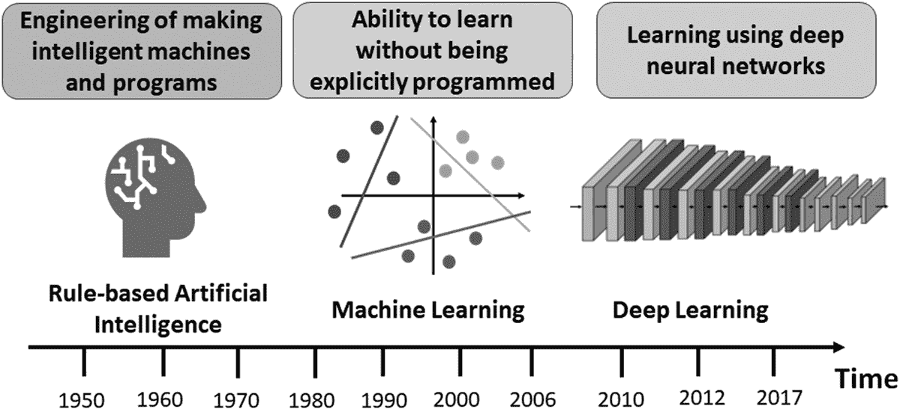

图 2.1 机器学习随时间的演进。

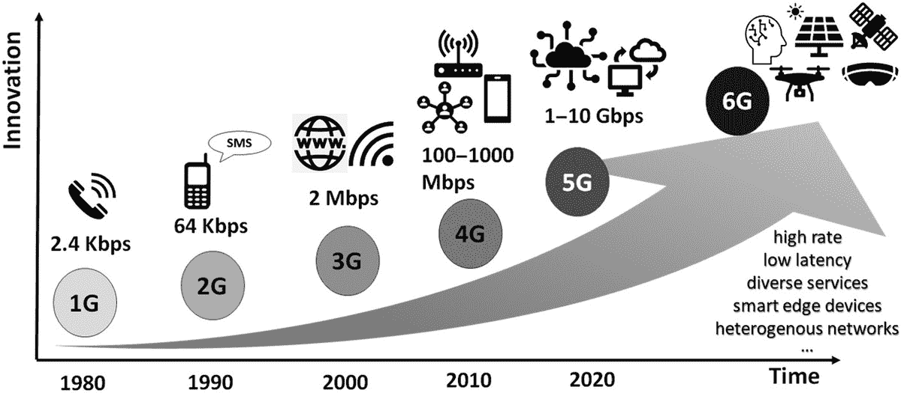

图 2.2 无线技术随时间的演进。

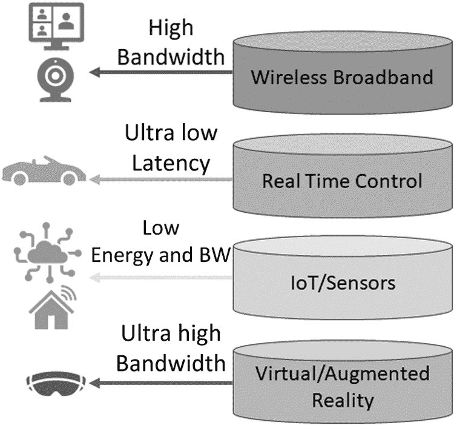

图 2.3 将从机器学习中受益的无线应用和目标。

在更成熟的机器学习领域的近期研究表明，机器学习容易受到对抗操纵，这形成了对抗机器学习这一新兴领域的基础，该领域研究在存在攻击者的情况下进行学习[4–7]。然而，机器学习安全对 `RFML` 技术的影响尚未被完全理解[8–10]。因此，在对抗机器学习的背景下研究无线安全，并理解其对 `5G` 及后续通信系统的影响是及时的的。虽然对抗机器学习可以以各种形式存在，但我们的重点是深度神经网络背景下的对抗技术，因为它们目前代表了大多数常用的 `RFML` 架构。

为了解决无线安全机器学习问题所需的研究工作是多方面的，包括但不限于以下方向：

* **基于对抗机器学习的安全攻击**：规避攻击（对抗样本）、投毒（因果）攻击、木马（后门或陷阱）攻击以及用于信号欺骗的生成对抗学习
* **机器学习解决方案的隐私威胁**：成员推理攻击、模型反转和物理层隐私
* **机器学习强化技术**：隐私保护学习、安全学习、硬件和软件实现、边缘计算、测试平台、实验和数据集
* **机器学习在无线安全领域的扩展**：设备识别、频谱监控、RF 指纹、智能干扰、智能窃听、定位、隐蔽通信、认证、匿名性、入侵检测和物联网安全。

其余部分的结构如下：第 2.2 节介绍了不同类型的对抗机器学习攻击，并描述了无线领域机器学习系统的漏洞。第 3.3 节讨论了无线通信和安全中机器学习应用的挑战和空白。第 2.4 节进行了总结，并对未来的研究方向提出了建议。

## 2.2 对抗机器学习

基于对抗机器学习的不同类型的攻击如图图 2.4 所示。对抗机器学习研究针对机器学习模型训练或测试的攻击。最近，这些攻击已扩展到无线应用，并证明在存在不同水平无线网络不确定性的情况下，它们比传统攻击（如数据传输的暴力干扰）更隐蔽、更具效率[11,12] [13–15]。在本节中，我们讨论了应用于无线领域的探索性（推理）攻击、规避攻击（对抗样本）、投毒（因果）攻击和木马（后门）攻击：

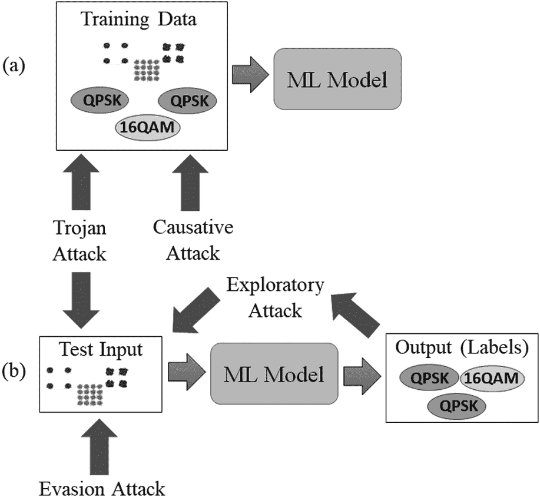

图 2.4 对抗机器学习分类：(a)训练期间，(b)测试期间。箭头指示了每种攻击类型试图操纵机器学习模型的哪个部分。

* **`探索性（推理）攻击`**： 探索性攻击的目标是学习机器学习算法的工作原理。可以通过发起探索性攻击来构建一个代理（影子）模型，该模型与受害者系统具有相同的输入输出类型，并且在使用相同输入进行查询时提供相同（或相似）的输出 [16, 17]。探索性攻击已在 [18, 19]中研究，用于学习动态频谱接入（`DSA`）系统的传输行为并据此开发干扰策略。探索性攻击可以被视为各种后续黑盒攻击的初始步骤，无需关于机器学习算法的任何知识（如其类型、超参数和底层训练数据集）。在此背景下，可以应用主动学习[20]来减少探索性攻击所需的样本样本数量 [21]。

* **`逃避（对抗）攻击`**： 逃避攻击的目标是在测试阶段篡改输入数据，误导机器学习算法在决策时产生错误。图 2.5 展示了逃避攻击的两个示例，一个来自计算机视觉，另一个来自无线信号分类。请注意的是，无线领域的逃避攻击需要对输入数据进行空中操作，并且需要考虑信道效应（同时针对受害者系统和攻击者）。无线领域关于逃避攻击的大多数研究已将调制分类器视为受害者系统 [22–32]。[33]–35]对一个接收端的通信性能施加了额外约束，同时在另一个接收端上发起逃避攻击。这种设置也扩展到了对抗机器学习驱动的隐蔽通信，其目标是隐藏通信，免受配备频谱感知机器学习算法的窃听者的发现 [36]。针对逃避攻击已提出了各种防御机制 [27, 37–40]，例如统计离群值检测和认证防御。逃避攻击也被考虑用于其他机器学习应用，包括频谱感知 [41]–43]、带有自动编码器的端到端通信（由发射端的编码器和接收端的解码器组成 [44, 45]）、多用户功率控制 [46, 47]、定向传输的初始接入 [48]以及 `DSA`系统 [49]。

    ![图 2.5 来自 (a) 计算机视觉 [4], (b) 无线信号分类的逃避（对抗）攻击示例。](html/images/9781032034041_C002_005.jpg)

    图 2.5 来自 (a) 计算机视觉 [4] 和 (b) 无线信号分类的逃避（对抗）攻击示例。

* **`投毒（因果）攻击`**： 投毒攻击的目标是在训练过程中篡改机器学习算法的（重）训练过程，使机器学习算法在测试时产生错误 [50]。投毒攻击已被考虑用于频谱感知 [42, 43]和协作频谱感知 [51]–53]，作为频谱感知数据伪造攻击的机器学习扩展 [54, 55]。随着频谱环境随时间变化，更新机器学习模型是有用的。为此，当无线系统随时间推移重新训练机器学习模型时，可以发起因果攻击。

* **`特洛马（后门）攻击`**： 特洛马攻击的目标是在训练阶段向某些数据样本中插入特洛马（即后门或触发器），然后在测试阶段激活它们，使机器学习在测试时产生错误。例如，[56] 输入样本被投毒，而机器学习模型对其他样本保持高准确率。特洛马攻击已在 [57]中针对无线信号分类器被考虑。为了该目的，攻击者在训练阶段和测试阶段修改了某些信号的相位。

除了安全攻击外，对抗机器学习已用于研究各种隐私问题，包括以下方面：

### `成员推断攻击`

成员推断攻击的目标是推断感兴趣的数据样本是否已用于机器学习算法的训练数据。这种私有信息可用于发起后续攻击。在无线领域，成员推断攻击可以发现有关波形、信道和设备特征的信息 [58, 59]，如果这些信息泄露，攻击者可以利用它们来识别机器学习模型的漏洞（例如渗透物理层）。

### `模型反转攻击`

模型反转攻击的目标是在攻击者 get 机器学习模型和某些隐私信息的情况下，通过观察机器学习模型的输入和输出来推断额外的隐私信息 [60]。在无线领域，攻击者可能获得某些信息（如波形特征），然后可能旨在推断额外的信息（如射电硬件特征）。

### `针对强化学习的攻击`

基于对抗机器学习的攻击也已针对强化学习算法，始于计算机视觉 [61]。最近，这些攻击扩展到了无线通信。针对信道接入的对抗攻击已在 [62]–64]中考虑。此外，这些攻击也被应用于 [65, 66]中针对 5G 网络切片中使用强化学习的情况发起攻击 [67, 68]。主要目标是操纵强化学习算法的输入，导致即使在攻击停止后，底层性能也需要长时间才能恢复（因为强化学习算法会适应变化）。


## 针对 5G 网络的对抗机器学习攻击

- **针对 5G 网络切片的攻击**：网络切片提供了在同一物理网络上复用虚拟化网络的能力，并动态分配通信和计算资源以确保不同服务的安全和优先性。攻击者可能会发送伪造的网络切片请求作为泛洪攻击 [65]，或干扰资源块 [66]，以篡改用于 5G 网络切片接入控制和资源分配的强化学习引擎。

- **针对 5G 频谱共存的攻击**：联邦通信委员会（FCC）已在 3.5 GHz 公民宽带无线服务（CBRS）频段实现了联邦与非联邦用户的频谱共存。攻击者可能会攻击现有雷达系统与 5G 信令网络之间的频谱共存。由于 5G 网络不应对雷达系统产生任何有害干扰，环境感知能力（ESC）传感器需要检测雷达信号。为此，深度学习可以作为检测空中采集的 `I/Q` 样本信号的有力手段。攻击者可能尝试通过在空中传输微小的扰动信号来影响 ESC 传感器的决策过程，从而操纵 ESC 深度学习算法的输入信号 [49]。

- **针对 5G UE 认证的攻击**：连接到 5G 网络提供 5G 服务的大量异构设备增加了对信号级物理层认证的需求。深度学习算法可以基于 RF 指纹进行信号分类，指纹考虑了波形、信道和无线硬件特性。攻击者可以训练生成对抗网络（GAN）来伪造无线信号并绕过认证过程。

- **实现隐蔽 5G 通信的攻击**：对抗机器学习可用于欺骗频谱传感器（即使这些传感器采用了深度神经网络），从而实现隐蔽的 5G 通信。可以是发射端在传输信号前在其信号中添加微小扰动，也可以由协作干扰器在空中添加扰动信号。虽然这种扰动欺骗了频谱传感器，但它不应对 5G 通信的比特错误率产生显著影响 [36]。

- **针对 5G 功率控制的攻击**：5G 基站需要分配发射功率来服务多个 UE，并最大化所有 UE 的聚合速率。深度学习可以用于提供该优化问题的低复杂度解决方案。同时，攻击者可以构建对抗扰动来操纵底层深度神经网络的输入。这种攻击者可能是干扰用于测量信道增益的导频信号的外部发射器，或者是向基站发送伪造信道估计的恶意 UE [46, 47]。

- **针对 5G 初始接入的攻击**：宽毫米波和 THz 频段的操作通过使用窄方向波束来实现高数据速率。当 UE 首次连接到 5G 网络时，需要与基站建立初始接入。为此，基站发送带有不同窄束的导频信号，UE 计算所有波束的接收信号强度（RSS）以找到最合适的波束。然而，扫描所有波束是一个长时间的过程。相反，基站可以使用少数窄束进行传输，UE 可以计算这些波束的 RSS 并运行深度神经网络，从更大的波束集中预测最佳波束 [69, 70]。同时，攻击者可以在初始接入期间在空中传输对抗扰动。通过这种方式，攻击者可以操纵 RSS 并欺骗深度神经网络选择 RSS 较小的波束。

针对无线领域对抗机器学习的研究仍处于早期阶段 [71]，需要更多工作来通过考虑无线应用的特性来充分刻画攻击和防御空间。

## 2.3 挑战与空白

随着机器学习在无线领域的使用日益增加，出现了一个基本问题：是否信任用于无线应用的机器学习。关于 `RFML` 的挑战如图 2.6, 73] 所示。仿真测试不是在动态无线介质中进行传输，而是提供了控制信道效应（如路径损耗、衰落和延迟）的灵活性 [74, 75]，以便重复测试（例如在相同的信道效应下比较不同的网络协议）。另一方面，具有空中传输功能的测试平台提供了结合真实信道和真实硬件测试系统的机会 [76]。

`RFML` 开发的一个关键需求是必要的训练和测试数据集的可用性。此外，考虑到训练和测试条件之间的潜在变化也非常重要（例如，在室内信道影响下进行训练而在室外信道影响下进行测试）。关于 `RFML` 数据集的更详细讨论，请参见第 2.3.2 节。注意，`RFML` 应用可能需要支持边缘计算，因此 `RFML` 应用通常部署在软件定义无线电（`SDRs`）等嵌入式平台上。关于 `RFML` 应用嵌入式实现的更详细讨论，请参见第 2.3.4 节。

由于 `RFML` 被广泛用于下一代通信系统，这些系统的软件开发生态系统的开放性为 `RFML` 应用带来了另一个挑战。例如，`Open RAN`（`O-RAN`）它提供了虚拟化的 `RAN` 能力，并构建在由 `5G` 社区支持的开放软件开发环境之上。例如，`UE` 识别和网络切片等各种 `RFML` 应用可以通过 `O-RAN` 的接入智能控制器（`RIC`）来实现。虽然这种开放软件范式旨在加速并统一不同技术厂商的努力，但对手可能会滥用这种开放性，获取各种网络功能（包括机器学习，如训练数据和模型）并利用底层漏洞（例如发起基于对抗机器学习的攻击）。

### 2.3.2 训练和测试数据集

机器学习应用的成功在很大程度上取决于训练和测试相关数据的可用性。专门针对无线领域，在收集和策展数据样本时，应该考虑各种信道、波形、无线电、干扰和攻击者（例如 `jammer`）的特性。一种方法是依赖仿真来生成 `RFML` 数据集。这是一个受控过程，可以根据当前机器学习问题的需要进行配置。然而，仿真数据对于 `RFML` 应用是否具有足够的保真度尚存疑问 [77]。原因在于信道和无线电硬件效应的建模非常困难。因此，无线领域的机器学习问题最终需要通过仿真或空口传输采集的真实数据集。

对于计算机视觉和 `NLP` 等其他数据领域来说，发布用于机器学习的数据集是一项常见做法。最近，无线领域也观察到了发布数据集的趋势（例如，参见 [78]）。然而，仍然缺乏能够适应各种无线场景需求的真实数据集，例如受智能干扰器影响的频谱动态。因此，`RFML` 领域面临着风险，即特定应用程序的数据集可用性驱动了研究工作。例如，大量研究集中在调制识别上，而该领域有公开的代表性数据集 [79]。另一方面，由于缺乏相关数据集，其他无线信号分类任务（特别是那些关注无线安全的任务）正处于落后状态。因此，`RFML` 研究领域需要针对跨越网络协议栈（不限于物理层）的各种无线机器学习应用发布公开的真实数据集。最终，需要一个类似于网络领域 `国家漏洞数据库` [80] 的无线安全数据库，以促进 `RFML` 的研究工作。

与其他数据领域（例如计算机视觉）不同，`RFML` 数据没有显而易见的通用数据格式。信号元数据格式的一个示例是 `SigMF`，它提供了一种描述数据记录的标准方法 [81]。根据无线领域不同的应用，机器学习可能会考虑不同的信号属性，如信号功率电平、相位移、开启/关闭行为或原始 `IQ` 数据。虽然原始 `IQ` 数据可以用于建立通用的 `RFML`，但由于低采样率可能会丢失信息，建立通用的 `RFML` 是困难的。因此，为了采用 `RFML`，需要针对不同无线机器学习应用的公共数据集。此外，不同的应用可能考虑不同的网络设置，例如流量、网络拓扑和移动性。

满足机器学习算法（特别是深度学习）数据需求的一种常用方法是合成数据生成。这种方法已被建议用于计算机视觉 [82] 和 `NLP` 等其他领域。基于深度神经网络，`GAN` 已成为一种可行的方法。不同版本的 `GAN` 已成功用于计算机视觉 [84]、`NLP` [85] 以及支持各种攻击 [86]。然而，生成无线数据样本的努力仍然滞后（参见 [77, 87]–[91]）。考虑到丰富的频谱特性，合成数据生成对于各种无线应用至关重要，并具有以下重要用途：

1. 数据增强（例如在时间有限或采样率低的情况下）；
2. 测试和训练数据的域自适应（例如从训练时间到测试时间信道、干扰和流量发生变化）；
3. 防御对抗攻击（例如攻击者操纵用于用户认证的数据）；
4. 信号欺骗（例如攻击者生成并发送信号以渗透访问系统或设置蜜罐）。

如图 2.8 所示，`GAN` 结构由两个神经网络组成：一个生成器和一个判别器。生成器接收噪声作为输入并生成合成数据样本。同时，判别器接收真实或合成数据样本作为输入并尝试对其进行分类。分类结果作为反馈发送给判别器。注意，在无线系统中，生成器和判别器可能并不同地（例如，生成器位于发射端，判别器位于另一个接收端），并且它们可能通过噪声信道通信。由于频谱数据受到各种信道、干扰和流量的影响，训练 `GAN` 面临稳定性和模式崩溃的挑战。注意，`GAN` 还可以结合对抗攻击使用，如图 [92] 所示，用于规避设备识别。

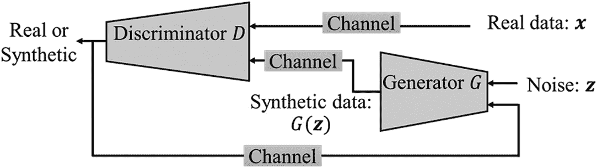

图 2.8 生成对抗网络 (GAN) 受到信道影响。

使用预训练机器学习模型是无线安全应用中的一种常见做法。通过在线机器学习更新机制，可以确保在测试阶段持续进行攻防优化，以适应频谱的动态变化。无线安全的一种极具前景的更新机制是强化学习，它可以从频谱环境中学习，并在存在干扰器和窃听者等对手的情况下采取行动，确保无线通信的安全 [93]。

无线领域机器学习安全与其他数据领域机器学习相比的一个区别在于性能衡量的程度。为此，机器学习可以用于优化通过各种性能指标衡量的通信质量，包括但不限于吞吐量和延迟，并受功耗限制。由于这些指标通常是相互耦合的，因此需要对它们进行联合优化 [94]。

信道、干扰、波形和流量影响共同塑造了频谱 [95]。由于无线网络中的流量流和链路通常是动态且随机的，在通过机器学习优化性能的同时，应使单个节点的数据队列保持稳定，使队列长度保持在范围内 [96–99]。除了吞吐量和延迟（以及对截止日的扩展 [100]）等传统性能指标外，信息年龄（AoI）引起了对测量信息新鲜度（自上次收到更新以来的时间）的关注 [101, 102]。机器学习在优化确定 AoI 方面具有前景，这在无线网络环境中是一个复杂的过程 [103]。

### 2.3.3 可重复性、超参数优化与可解释性

除了数据集发布外，射频机器学习（RFML）研究还可以从开源软件中受益，正如在 5G 及后续生态经历的那样。这种方法有助于将提出的解决方案快速扩展到其他无线安全问题，或对不同的解决方案进行比较。因此，RFML 研究的一项关键任务是开发针对基于机器学习的无线攻击的通用算法解决方案库。在近期算法和计算进展的推动下，深度学习在无线安全中找到了丰富的应用，因为它与传统的机器学习算法相比，它能更好地捕捉物理信号特征。

在深度学习实际应用于 RFML 领域之前，需要解决四个主要问题：

1. 深度神经网络的复杂结构需要大量数据集进行训练。如前所述，可以使用 `GAN` 来增强数据集。此外，可以采用来自计算机视觉、`NLP` 和其他领域的方法，或者开发新方法来满足这一需求。
2. 深度神经网络涉及许多需要优化的超参数，包括层数和每层的神经元数量。为了满足 RFML 边缘计算应用低延迟和低复杂度处理的需求，可以使用新的超参数优化技术来减少参数搜索的复杂性和运行时间。超参数优化的一个例子是 `Hyperband` [104]，它迭代选择并评估超参数配置。然而，随着神经网络变得越来越深，穷举搜索将变得不可行。
3. 深度学习的一种常见做法是将神经网络视为黑箱。然而，基于深度学习的无线领域对功能的性证明是至关重要的 [105]。在这种背景下，需要通过新的统计、时间方法对无线数据进行预处理，并进一步关注：
   - `spectrum dynamics`
   - `data labels`
   - `channel, interference`
   - `interference effects`
   - `distributed computing`
   - `adversarial learning`
4. 在动态频谱环境中，信号类型可能会随时间变化，导致灾难性遗忘。相反，可以通过持续学习在旧任务和新任务之间取得平衡。为此可以使用弹性权重整合（`EWC`）来减慢对先前学习任务的学习 [106]。当调制等信号类型发生变化时，`EWC` 在无线信号分类中有应用 [107]。

### 2.3.4 嵌入式实现

其他数据领域（如计算机视觉和 `NLP`）通常依赖于使用中央处理器（`CPU`）或图形处理器（`GPU`）资源进行离线计算的机器学习。然而，无线安全应用可能需要嵌入式计算来进行在线决策。在这种情况下，机器学习算法需要在具有尺寸、重量和功耗（SWaP）限制的无线平台上运行。注意，`ARM` 处理器、嵌入式 `GPUs` 和现场可编程门阵列（`FPGA`）等计算资源已用于嵌入式实现。然而，受嵌入式平台实现支持的 RFML 研究滞后，无法满足无线安全低延迟和低功耗的要求。作为机器学习解决方案嵌入式实现的示例，信号认证已在嵌入式 `GPU` 上实现 [108]，干扰检测在 `SDRs` 上实现 [109]，调制分类在 Android 手机上实现 [110]。由于嵌入式平台内存有限，在将其部署到嵌入式平台之前，需要对深度神经网络进行压缩 [111]。此外，嵌入式 `GPU` 和 `FPGA` 等嵌入式平台以有限精度运行。因此，RFML 应用需要考虑量化对机器学习模型的影响 [112]。

**表 2.1 不同嵌入式计算平台的性能**

| 指标\平台 | ARM | 嵌入式 GPU | FPGA |
| --- | --- | --- | --- |
| **延迟** | 高 | 中 | 低 |
| **功耗** | 中 | 高 | 低 |
| **可编程性** | 高 | 中 | 低 |

特别是，初步研究表明，对于基于机器学习的射频信号分类任务，与嵌入式 GPU 相比，FPGA 在延迟和能耗方面具有显著优势 [113, 114]。由于 FPGA 编程较为困难，最终需要能够将机器学习解决方案的软件代码转换为 FPGA 实现的新型技术。不同嵌入式计算资源的预期延迟、功耗和可编程性的定性比较见表 2.1，这促使我们能够投入更多努力，通过在嵌入式平台上实现所提解决方案来弥补理论与实践之间的差距。

## 2.4 结论与建议

基于上一节确定的挑战和差距，我们得出以下结论：

* 机器学习已成为保障无线系统的关键手段。然而，攻击向量尚未被完全理解。因此，我们需要投入更多努力来识别无线系统面对可能应用机器学习技术的攻击者的脆弱性。特别是，需要界定明确的基于机器学习的攻击模型，作为形式化分析机器学习相关无线安全的前提。
* 随着攻击者变得越来越聪明，无线领域的防御方案需要变得更具灵活性和适应性。机器学习可以作为检测和缓解无线攻击的有力手段。
* 对抗性机器学习已成为无线系统的主要威胁，因为它具有破坏机器学习过程的潜力。由于无线介质是开放共享的，它为攻击者操纵机器学习算法的测试和训练过程提供了新手段。为此，需要新型技术来保护无线攻击面免受对抗性机器学习的影响。
* 由于机器学习导致了攻击者与防御者之间演进式的、交互式的对决，因此需要通过量化攻击者和防御者的性能指标来理解这一过程的动态演变。
* 需要投入更多努力公开更多高保真且多样化的数据集，以促进机器学习在无线安全中的广泛应用。这些数据集不仅用于后端应用，也用于嵌入式实现。在此背景下，满足 SWaP（尺寸、重量和功率）受限环境下对基于机器学习的攻击和防御的延迟、功耗和计算复杂度要求至关重要。
* 最后但同样重要的是，考虑到射频机器学习（RFML）分类器对对抗性机器学习攻击的鲁棒性通常取决于分类器的类型。特别是，判别式分类器往往比生成式分类器（如 GAN 或深度贝叶斯模型）更脆弱 [115]。目前 RFML 中使用的许多分类器都是判别型的，这导致了以下困境：使用先进防御技术强化现有分类器，还是选择具有相当性能的生成式分类器更高效？为了回答这个问题，必须研究并量化 RFML 领域判别式与生成式分类器鲁棒性与性能之间的权衡，以便根据具体的应用做出明智决策。

## 参考文献

* T. Erpek, T. O’Shea, Y. E. Sagduyu, Y. Shi, and T. C. Clancy, “Deep Learning for Wireless Communications,” Development and Analysis of Deep Learning Architectures, Springer, 2019.
* L. J. Wong, W. H. Clark, B. Flowers, R. M. Buehrer, W. C. Headley and A. J. Michaels, “An RFML Ecosystem: Considerations for the Application of Deep Learning to Spectrum Situational Awareness,” IEEE Open Journal of the Communications Society, vol. 2, pp. 2243–2264, 2021.
* K. B. Letaief, W. Chen, Y. Shi, J. Zhang, Y.A. Zhang, “The Roadmap to 6G: AI Empowered Wireless Networks.” IEEE Communications Magazine, Aug. 2019.
* I. Goodfellow, J. Shlens, and C. Szeged, “Explaining and Harnessing Adversarial Examples.” International Conference on Learning Representations (ICLR), 2015.
* A. Kurakin, I. Goodfellow, and S. Bengio, “Adversarial Machine Learning at Scale,” arXiv preprint arXiv:1611.01236, 2016.
* Y. Vorobeychik and M. Kantarcioglu, “Adversarial Machine Learning,” Synthesis Lectures on Artificial Intelligence and Machine Learning, Aug. 2018.
* C. Szegedy, W. Zaremba, I. Sutskever, J. Bruna, D. Erhan, and I. Goodfellow, and R. Fergus, “Intriguing Properties of Neural Networks,” arXiv preprint arXiv:1312.6199, 2013.
* D. Adesina, D. Adesina, C. Hsieh, and Y. Sagduyu, arXiv preprint arXiv:2012.1399, 2020.


## 参考文献

* L. Pajola, L. Pajola and M. Conti, “Threat is in the Air: Machine Learning,” *ACM WiseML*, 2019.
* Y. Shi, Y. Shi, T. Erpek, W. Headley, B. Flowers, and Z. Lu, “When Wireless Security Meets Machine Learning: Motivation, Challenges, and Research Directions,” *arXiv preprint:2001.0888*.
* W. Xu, W. Xu, T. Trappe, and Y. Zhang, “The Feasibility of Launching and Detecting Jamming Attacks,” *Mobi*, 2005.
* Y. E. Sagduyu, Y. E. Sagduyu and A. Ephremides, “Game-Theoretic Analysis of Denial of Service in Wireless Random Access,” 2009.
* Y. E. Sagduyu, Y. E. Sagduyu, R. Berry, and A. Ephremides, “Jamming Games for Wireless Security with Incomplete Information,” *GameNets*, 2009.
* Y. E. Sagduyu, Y. E. Sagduyu and A. Ephremides, “Wireless Jamming under Dynamic Traffic,” *IEEE WIOPT*, 2010.
* Y. E. Sagduyu, Y. E. Sagduyu, R. Berry, and A. Ephremides, “Jamming Games in Wireless Networks with Incomplete Information,” *IEEE Communications Magazine*, Aug. 2011.
* F. Tramer, F. Tramer, F. Zhang, A. Juels, M. K. Reiter, and T. Ristenpart, “Stealing Machine Learning Models via Prediction APIs,” *USENIX Security*, 2016.
* Y. Shi, Y. Shi, Y. E. Sagduyu, and A. Grushin, “How to Steal a Machine Learning Classifier with Deep Learning,” *IEEE HST*, 2017.
* Y. Shi, Y. Shi, T. Erpek, K. Davaslioglu, Z. Lu, and J. Li, “Adversarial Deep Learning for Cognitive Radio Security: Jamming Attack and Defense Strategies,” *ICC Workshop*, 2018.
* T. Erpek, T. Erpek, Y. E. Sagduyu, and Y. Shi, “Deep Learning for Launching and Mitigating Wireless Jamming Attacks,” *IEEE Transactions on Cognitive Communications and Networking*, 2019.
* B. Settles, B. Settles, “Active Learning Literature Survey,” *Science*, vol. 10, no. 3, pp. 237–304. 1995.
* Y. Shi, Y. E. Sagduyu, K. Davaslioglu, and J. H Li, “在线 API 调用中严格速率限制下的主动深度学习攻击”, *IEEE 海国土安全技术研讨会 (HST)*, 2018 年.
* M. Sadeghi and E. G. Larsson, “基于深度学习的无线信号分类的对抗攻击”, *IEEE Wireless Communications Letters*, 2019 年 2 月.
* B. Flowers, R. M. Buehrer, and W. C. Headley, “无线通信背景下的对抗逃逸攻击”, *arXiv preprint*, arXiv:1903.01563, 2019 年.
* B. Flowers, R. M. Buehrer, and W. C. Headley, “通信感知对抗残网络”, *IEEE 军事通信会议 (MILCOM)*, 2019 年.
* S. Bair, M. Delvecchio, B. Flowers, A. J. Michaels, and W. C. Headley, “针对深度学习的调制识别的限制”, *ACM 无线安全与机器学习研讨会 (WiseML)*, 2019 年.
* B. Kim, Y. E. Sagduyu, K. Davaslioglu, T. Erpek, and S. Ulukus, “跨信道的空口对抗攻击”, *IEEE 信息科学与系统会议 (CISS)*, 2020 年.
* B. Kim, Y. E. Sagduyu, K. Davaslioglu, T. Erpek, and S. Ulukus, “针对深度学习的无线分类器的信道感知对抗攻击”, *arXiv preprint*, arXiv:2005.05321, 2020 年.
* B. Kim, Y. E. Sagduyu, T. Erpek, K. Davaslioglu, and S. Ulukus, “针对深度学习调制分类器的多天线对抗攻击”, *IEEE GLOBECOM 机器学习研讨会*, 2020 年.
* B. Kim, Y. E. Sagduyu, T. Erpek, K. Davaslioglu, and S. Ulukus, “无线分类器对抗代理模型的影响”, *IEEE 通信会议 (ICC)*, 2021 年.
* Y. Lin, H. Zhao, Y. Tu, S. Mao, and Z. Dou, “基于 DNN 的调制识别中的对抗攻击威胁”, *IEEE 计算机会议 (INFOCOM)*, 2020 年.
* F. Restuccia, S. D’Oro S, A. Al-Shawabka, B. C. Rendon, K. Chowdhury, S. Ioannidis, and T. Melodia, “通用无线对抗深度学习”, *ACM 无线安全与机器学习研讨会 (WiseML)*, 2020 年.
* R. Sahay, C. G. Brinton, and D. J. Love, “用于缓解自动调制分类中对抗攻击的深度集成无线接收机架构”, *IEEE 认知通信与网络*, 2021 年.
* M. Z. Hameed, A. Gyorgy, and D. Gunduz, “无拦截通信：防御深度学习的调制检测”, *IEEE 信号与信息全球会议 (GlobalSIP)*, 2019 年.
* M. Z. Hameed, A. Gyorgy, and D. Gunduz, “最好的防御是进攻：避免调制检测的对抗攻击”, *IEEE 信息取证与安全*, vol. 16, 2021 年.
* M. DelVecchio, V. Arndorfer, and W. C. Headley, “用于训练机器学习逃逸攻击的频谱欺骗指标研究”, *ACM 无线安全与机器学习研讨会 (WiseML)*, 2020 年.
* B. Kim, Y. E. Sagduyu, K. Davaslioglu, T. Erpek, and S. Ulukus, “如何让 5G 通信‘隐形’：无线隐私的对抗机器学习”, *Asilomar 信号、系统与计算机会议*, 2020 年.
* S. Kokal-Filipovic and R. Miller, “RF 深度学习中的对抗样本：攻击的检测及其鲁棒性”, *IEEE 信号与信息全球会议 (GlobalSIP)*, 2019 年.
* S. Kokal-Filipovic, R. Miller, N. Chang, and C. L. Lau, “利用自编码器缓解 RF 分类器中的对抗样本”, *arXiv preprint*, arXiv:1902.08034, 2019 年.
* S. Kokal-Filipovic, R. Miller, and J. Morman, “无线中的对抗深度学习”, *ACM 无线安全与机器学习研讨会 (WiseML)*.
* M. DelVecchio, B. Flowers and W. C. Headley, “通信感知的逃逸攻击”, *IEEE*, 2020 年.
* Y. Shi, T. Erpek, Y. E. Sagduyu, and J. Li, “深度学习数据投毒攻击”, *IEEE 军事通信会议 (MILCOM)*, 2018 年.
* Y. E. Sagduyu, S. Shi, T. Erpek, “面向物联网的感知感知对抗”, *IEEE 感知与通信会议 (SECON)*, 2019 年.
* Y. E. Sagduyu, T. Erpek, Y. Shi, “空口对抗深度学习中的数据投毒”, *IEEE 信息取证与安全*, 2019 年.
* M. Sadeghi, E. G. Larsson, “端到端自编码器对抗”, *IEEE Communications Letters*, 2019 年, 847–850 页.
* T. J. OShea, J. Hoy, “物理层深度学习”, *IEEE 认知通信与网络*, 2017 年.
* B. Kim, Y. Shi, Y. E. Sagduyu, T. Erpek, and S. Ulukus, “无线功率控制的对抗攻击”, *IEEE 全球通信会议 (GLOBECOM)*, 2021 年.
* B. Manoj, M. Sadeghi, and E. G. Larsson, “针对大规模 MIMO 功率分配的对抗攻击”, *arXiv preprint*, arXiv:2101.12090, 2021 年.
* B. Kim, Y. E. Sagduyu, T. Erpek, and S. Ulukus, “针对 5G 及以后毫米波波束预测的深度学习对抗攻击”, *IEEE 统计信号处理 (SSP) 会*, 2021 年.
* Y. E. Sagduyu, T. Erpek, and Y. Shi, “用于 5G 通信安全的对抗机器学习”, *博弈论与机器学习安全*, IEEE, 270–288 页, 2021 年.
* Y. Shi and Y. E. Sagduyu, “对抗深度学习的逃逸与诱导攻击”, *IEEE 军事通信会议 (MILCOM)*, 2017 年.
* Z. Luo, S. Zhao, Z. Lu, J. Xu, and Y. E. Sagduyu, “当攻击者遇到 AI：协作频谱感知中的学习赋能攻击”, *arXiv preprint*, arXiv:1905.01430.
* Z. Luo, S. Zhao, R. Duan, Z. Lu, Y. E. Sagduyu, and J. Xu, “协作频谱感知中基于对抗机器学习的部分模型攻击”, *ACM 无线安全与机器学习研讨会 (WiseML)*, 2020 年.
* Z. Luo, S. Zhao, R. Duan, Z. Lu, Y. E. Sagduyu, and J. Xu, “协作频谱感知中对抗机器学习攻击的低成本影响限制防御”, *ACM 无线安全与机器学习研讨会 (WiseML)*, 2021 年.
* F. R. Yu, H. Tang, M. Huang, Z. Li and P. C. Mason, “认知无线移动自组织网络中频谱感知数据伪造攻击的防御”, *IEEE 军事通信会议*, 2009 年.
* Y. E. Sagduyu, “通过动态信任保护认知无线电网络以防止频谱感知数据伪造,” *IEEE 军事通信会议 (MILCOM)*, 2014.
* Y. Liu, S. Ma, Y. Aafer, W.-C. Lee, J. Zhai, W. Wang, and X. Zhang, “神经网络中的木马攻击,” *网络与分布式系统安全研讨会*, 2018.
* K. Davaslioglu and Y. E. Sagduyu, “基于对抗机器学习的无线信号分类木马攻击,” *IEEE IEEE DySPAN 数据驱动动态频谱共享研讨会*, 2019.
* Y. Shi, K. Davaslioglu, and Y. E. Sagduyu, “作为深度学习无线信号分类器隐私威胁的空中成员推理攻击,” *ACM 无线安全与机器学习研讨会 (WiseML)*, 2020.
* Y. Shi and Y. E. Sagduyu, “基于深度学习的无线信号分类器的成员推理攻击与防御,” *arXiv preprint arXiv:2107.12173`, 2021.
* M. Fredrikson, S. Jha, and T. Ristenpart, “利用置信信息的模型反转攻击及基础防御,” *ACM SIGSAC 计算机与通信安全会议*, 2015.
* S. Huang, N. Papernot, I. Goodfellow, Y. Duan, and P. Abbeel, “针对神经网络策略的对抗攻击,” *arXiv preprint arXiv:1702.02284*, 2017.
* F. Wang, C. Zhong, M. C. Gursoy, and S. Velipasalar, “通过自适应深度强化学习进行对抗干扰攻击与防御策略,” *arXiv preprint arXiv:2007.06055*, 2020.
* F. Wang, C. Zhong, M. C. Gursoy, and S. Velipasalar, “通过深度强化学习防御对抗干扰攻击的策略,” *信息科学与系统会议 (CISS)*, 2020.
* C. Zhong, F. Wang, M. C. Gursoy, and S. Velipasalar, “基于深度强化学习的动态多道接入的对抗干扰攻击,” *IEEE 无线通信与网络会议 (WCNC)*, 2020.
* Y. Shi and Y. E. Sagduyu, “针对 5G 无线接入网络切片洪水攻击的对抗机器学习,” *IEEE 国际通信会议 (ICC) 会讨会*, 2021.
* Y. Shi, Y. E. Sagduyu, T. Erpek, and M. C. Gursoy, “如何用强化学习攻击和防御 5G 无线接入网络切片,” *arXiv preprint arXiv:2101.05768*, 2021.
* Y. Shi, T. Erpek, and Y. E. Sagduyu, “用于 5G 无线接入网络切片动态资源优化的强化学习,” *IEEE 通信链路与网络辅助建模与设计国际会议 (CAMAD)*, 2020.
* Y. Shi, P. Rahimzadeh, M. Costa, T. Erpek, and Y. E. Sagduyu, “用于频谱共存 5G 无线接入网络切片的深度强化学习,” *TechRxiv. 预印本.* `https://doi.org/10.36227/techrxiv.16632526.v1`
* T. S. Cousik, V. K. Shah, J. H. Reed, T. Erpek, and Y. E. Sagduyu, “基于深度学习的 5G 毫米波波束预测快速初始接入,” *IEEE 军事通信会议 (MILCOM)*, 2021.
* T. S. Cousik, V. K. Shah, J. H. Reed, T. Erpek, and Y. E. Sagduyu, “用于 AI 驱动 6G 毫米波网络快速可靠初始接入的深度学习,” *arXiv preprint arXiv:2101.01847`.
* D. Adesina D, C. Hsieh, Y. E. Sagduyu, and L. Qian, “使用 RF 数据的无线通信中的对抗机器学习：综述,” *arXiv preprint arXiv:2012.14392`.
* J. Yackoski, B. Azimi-Sadi, A. Namazi, J. Li, Y. E. Sagduyu, and R. Levy, “RF-NEST：射频仿真器,” *IEEE 军事通信会议 (MILCOM)*.
* T. Melodia, S. Basagni, A. Gosain, M. Polese, and L. Bonati, “Colosseum：世界上最大的网络仿真器,” *ACM 移动计算与网络会议 (MobiCom)*, 2021.
* K. J. Kwak, Y. E. Sagduyu, J. Yackoski, B. Azimi-Sadi, A. Namazi, J. Deng, and J. Li, “空中评估：挑战与解决方案,” *IEEE 通信杂志*.
* S. Soltani, Y. E. Sagduyu, J. Li, J. Feldman, and J. Matyas, “分布式认知无线电架构实现与测试平台,” *IEEE 军事通信会议 (MILCOM)*.
* D. Raychaudhuri, I. Seskar, G. Zussman, T. Korakis, T. Chen, J. Kolodziejski, M. Sherman, X. Gu, P. Skrimonis, and C. Gutterman, “挑战 COSMOS：城市级可编程无线实验平台,” *ACM 移动计算与网络会议 (MobiCom)*.
* 数据集与竞赛, IEEE Comsoc 新兴技术机器学习。`https://mlc.committeesoc.org/datasets`.


# 参考文献

*   T. J. O’Shea, T. Roy and T. Clancy, “基于空中学习的无线信号分类，”*IEEE 信号处理选主题期刊*, 第 12 卷, 第 1 期, 页. 168–179, 2018 年 2 月.
*   W. H. Clark IV, S. Hauser, W. C. Headley, and A. Michaels, “深度学习射频系统的训练数据增强，”*防御建模与仿真期刊*, 2021.
*   国家漏洞数据库, NIST. `https://nvd.nist.gov/vuln`.
*   B. Hilburn, N. West, T. O’Shea, and T. Roy, “SigMF：信号元数据格式，”*GNU Radio 会*, 2018.
*   H. A. Alhaija, H. Abu, S. K. Mustikovela, L. Mescheder, A. Geiger, and C. Rother, “增强现实遇到计算机视觉：城市驾驶场景的高效数据生成，”*国际计算机视觉期刊*, 2018.
*   Y. E. Sagduyu, A. Grushin, and Y. Shi, “合成社交媒体数据生成，”*IEEE 计算社会系统事务*, 2018.
*   I. Goodfellow, J. Pouget-Abadie, M. Mirza, B. Xu, D. Warde-Farley, S. Ozair, A. Courville, and Y. Bengio, “生成对抗网络，”*神经信息处理进展*, 2014.
*   Y. Shi, Y. E. Sagduyu, K. Davaslioglu, and J. Li, “用于有限训练数据的黑盒 API 攻击的生成对抗网络，”*IEEE 信号处理与信息国际会议 (ISSPIT)*, 2018.
*   Y. Shi, Y. E. Sagduyu, K. Davaslioglu, and R. Levy, “对抗深度学习中的漏洞检测与分析，”*计算机网络与系统漏洞分析指南*, Springer, 2018.
*   K. Davaslioglu and Y. E. Sagduyu, “用于频谱感生成的对抗学习，”*IEEE 国际通信会议 (ICC)*, 2018.
*   M. Patel, X. Wang, and S. Mao, “用于自动调制分类的条件 GAN 数据增强，”*ACM 无线安全与机器学习研讨会 (WiseML)*, 2020.
*   Y. Shi, K. Davaslioglu, and Y. E. Sagduyu, “用于无线信号欺骗的生成对抗网络”, *ACM 无线安全与机器学习研讨会 (WiseML)*, 2019.
*   Y. Shi, K. Davaslioglu and Y. E. Sagduyu, “空中生成对抗网络：用于无线信号欺骗的深度对抗学习”, *IEEE 认知通信与网络汇刊*, doi: [10.1109/TCCN.2020.3010330](http://dx.doi.org/10.1109/TCCN.2020.3010330).
*   T. Roy, T. O’Shea, and N. West, “生成对抗无线频谱网络”, *ACM 无线安全与机器学习研讨会 (WiseML)*, 2019.
*   T. Hou, T. Wang, Z. Lu, and Y. Liu, and Y. E. Sagduyu, “IoTGAN：基于 GAN 的对抗机器学习的 IoT 设备识别伪装”, *IEEE 动态频谱接入网络国际会议 (DySPAN)*, 2021.
*   N. Abu Zainab, T. Erpek, K. Davaslioglu, Y. E. Sagduyu, Y. Shi, S. Mackey, M. Patel, F. Panettieri, M. Qureshi, V. Isler, A. Yener, “基于深度强化学习的 QoS 与干扰感知无线网络”, *IEEE 军事通信会议 (MILCOM)*, 2019.
*   E. Ciftcioglu, Y. E. Sagduyu, R. Berry, and A. Yener, “双向中继网络的成本-延迟权衡”, *IEEE 无线通信汇刊*, 2011 年 12 月.
*   S. Wang, Y. E. Sagduyu, J. Zhang, and J. H. Li, “认知无线网络中通过网络编码进行整形”, *IEEE INFOCOM*, 2011.
*   L. Tassiulas and A. Ephremides, “受限队列系统的稳定性属性与多跳无线网络中最大吞吐量的调度策略”, *IEEE 自动控制汇刊*, 1992 年 12 月.
*   Y. E. Sagduyu and A. Ephremides, “通过网络编码在随机接入中的广播稳定性区域研究”, *Allerton 通信、控制与计算会议*, 2006.
*   Y. E. Sagduyu and A. Ephremides, “无线队列网络中的网络编码：级联网络案例”, *IEEE 信息理论国际会议 (ISIT)*, 2006.
*   Y. E. Sagduyu, R. Berry, and D. Guo, “基于网络编码的中继辅助无线广播的吞吐量与稳定性”, *IEEE 通信选择领域汇刊*, 2013 年 8 月.
*   L. Yang, Y. E. Sagduyu, J. Zhang, and J. Li, “面向实时流量的具有自适应网络编码的截止日期感知调度”, *IEEE 网络汇刊*, 2015 年 10 月.
*   S. Kaul, R. Yates, and M. Gruteser, “实时状态：应该多久更新一次？”, *IEEE INFOCOM*, 2012.
*   M. Costa, Y. E. Sagduyu, T. Erpek, and M. Medard, “通过自适应包编码改进信息年龄的鲁棒性”, *IEEE 国际通信会议 (ICC)*, 2021.
*   E. T. Ceran, D. Gunduz and A. Gyurgy, “多用户网络中信息年龄的强化学习方法”, *IEEE 个人、室内及移动通信国际会议 (PIMRC)*, 2018.
*   L. Li, K. Jamieson, G. DeSalvo, A. Rostamizadeh, and A. Talwalkar, “Hyperband：一种基于多老虎机的超参数优化新方法”, *机器学习研究期刊*, 2018.
*   S. Schmidt, J. Stankowicz, J. Carmack, and S. Kuzdeba. “RiftNeXt™：可解释的深度神经网络 RF 场景分类”, *第 3 次 ACM 会议论文*.
*   S. Schmidt, J. Stankowicz, J. Carmack, and S. Kuzdeba. “RiftNeXt™：可解释的深度神经网络 RF 场景分类”, *第 3 次 ACM 会议论文*, pp. 79-84.
*   J. Kirkpatrick, ..., R. Pascanell, “克服深度学习中的灾难性遗忘”, *arXiv:1612.0796*.
*   Y. Shi, ..., G. Green, “基于深度学习的无线信号”, *IEEE 动态频谱接入网络 (DySPAN)*.
*   K. Davaslioglu, S. Ioannidis, “深度学习的 WiFi”, *IEEE 无线通信汇刊*.
*   N. Abu Zainab, C. Gozte, “干扰感知无线网络”, *ACM 无线安全与机器学习研讨会 (WiseML)*.
*   T. Roy, S. Kurt, “边缘处的深度学习频谱研究”, *IEEE 动态频谱接入网络 (DySPAN)*.
*   T. Hou, J. Wu, “对抗攻击的剪枝”, *国际计算机视觉会议 (ICCV)*.
*   Y. E. Sagduyu, Y. Xu, “深度神经网络的多级量化”, *AAAI 人工智能会议 (AAAI)*.
*   S. Wang, J. Wang, “基于 FPGA 的深度学习”, *IEEE 军事通信会议 (MILCOM)*.
*   L. Tassiulas, Y. Li, “基于 FPGA 的实时深度学习”, *预 arXiv*.
*   Y. E. Sagduyu and A. Ephremides, J. Bradshaw, “生成式分类器对对抗攻击更鲁棒吗?”, *机器学习研究期刊*.

# 3 深度学习的对抗攻击：综述

Linsheng He¹, Fei¹

阿拉巴马大学电气与计算机工程系

DOI: [10.1201/978100318758-4](http://doi.org/10.1201/978100318758-4)

## 目录

1.  3.1 引言
2.  3.2 攻击分类
3.  3.2.1 白盒攻击
4.  3.2.2 黑盒攻击
5.  3.3 攻击概述
6.  3.3.1 针对计算机视觉的攻击
7.  3.3.2 针对自然语言处理的攻击
8.  3.3.3 针对数据投毒的攻击
9.  3.4 现实世界中的特定攻击
10. 3.4.1 针对自然语言处理的攻击
11. 3.4.2 使用数据投毒的攻击
12. 3.5 讨论与开放问题
13. 3.6 结论
14. 参考文献

机器学习是一门跨学科学科，主要研究如何让计算机能够更好地模拟和实现人类的学习行为，以实现知识的自动获取和生成。深度学习（`DL`）神经网络 [1] 是一种典型的机器学习模型，它试图通过模仿人类大脑的生物神经网络，在从示例中学习和积累知识方面具有优势。`DL` 模型的结构组织为一系列神经元层，每层都作为一个独立的计算单元。神经元之间通过具有不同权重和偏置的连接连接起来，并将其激活函数的输出从输入传输到下一层的神经元中。因此，它们在处理无法轻易建模为线性或非线性问题的复杂任务时具有优势。此外，在连续实值向量表示（即嵌入表示）的赋能下，它们擅长以各种方式处理图像、文本、视频和音频等数据。

在经过十多年的快速发展后，研究人员主要创建了许多经典的 `DL` 模型，如卷积神经网络（`CNN`）、循环神经网络（`RNN`）和生成对抗网络（`GAN`）。`CNN` [2] 包含卷积层、池化（下采样）层，最后是全连接层。激活函数用于将下采样层连接到下一层卷积层或全连接层。`CNNs` 具有广泛的应用，可以被视为 `DL` 领域的核心模型，许多 `DL` 模型都是基于 `CNNs` 的结构构建的，它们可以对类图像数据进行分类、分割和回归。`RNN` 是从前馈神经网络适应而来的神经模型，用于学习序列输入和输出之间的映射 [3]。`RNNs` 允许数据具有任意长度，并在其计算图中引入循环，以高效地建模时间效应 [1]。`RNNs` 有许多变体，其中最流行的是长短期记忆（`LSTM`）网络 [4]。`LSTM` 是一种特定的 `RNN` 类型，设计用于捕捉长期依赖关系。`RNN` 可以应用于时间序列相关的数据，例如预测下一时刻的数据流和发展趋势。`GAN` [5] 已被提出并受到了广泛的研究关注。生成模型能够在潜在空间内生成与真实数据相似的真实数据。它由两个对抗网络组成：生成器和判别器。判别器可以区分真实样本和生成样本，而生成器则生成旨在欺骗判别器的真实样本。`GAN` 模型是一种经典的无监督 `DL` 模型，其主要用途包括生成高精度的数据、解决无标签的现实问题等。

`DL` 在解决过去机器学习和人工智能社区尝试多次仍未解决的问题上提供了突破，例如图像分类、自然语言识别、游戏玩法、安全敏感型应用（如人脸识别、垃圾邮件过滤、恶意软件检测）以及自动驾驶汽车。因此，`DL` 系统在许多 AI 应用中已变得至关重要，它们也吸引了攻击者来实施攻击。

一种典型的攻击是对目标机器学习模型的原始输入施加微小的扰动，生成对抗样本以欺骗目标模型（也称为受害者模型）。早期的研究主要集中在传统机器学习应用中的对抗样本，例如垃圾邮件过滤器、入侵检测、生物识别认证和欺诈检测 [6]。Biggio 等人 [7] 首次提出了一种基于梯度的方法为线性分类器、`SVM` 和神经网络生成对抗示例。Barreno 等人 [6]...


# 机器学习与深度学习模型的对抗攻击综述

## 1. 机器学习与深度学习基础

机器学习是一门跨学科学科，主要研究如何让计算机能够更好地模拟和实现人类的学习行为，以实现知识的自动获取和生成。深度学习（`DL`）神经网络 [1] 是一种典型的机器学习模型，它试图通过模仿人类大脑的生物神经网络，在从示例中学习和积累知识方面具有优势。`DL` 模型的结构组织为一系列神经元层，每层都作为一个独立的计算单元。神经元之间通过具有不同权重和偏置的连接连接起来，并将其激活函数的输出从输入传输到下一层的神经元中。因此，它们在处理无法轻易建模为线性或非线性问题的复杂任务时具有优势。此外，在连续实值向量表示（即嵌入表示）的赋能下，它们擅长以各种方式处理图像、文本、视频和音频等数据。

在经过十多年的快速发展后，研究人员主要创建了许多经典的 `DL` 模型，如卷积神经网络（`CNN`）、循环神经网络（`RNN`）和生成对抗网络（`GAN`）。

*   **`CNN`** [2] 包含卷积层、池化（下采样）层，最后是全连接层。激活函数用于将下采样层连接到下一层卷积层或全连接层。`CNNs` 具有广泛的应用，可以被视为 `DL` 领域的核心模型，许多 `DL` 模型都是基于 `CNNs` 的结构构建的，它们可以对类图像数据进行分类、分割和回归。
*   **`RNN`** 是从前馈神经网络适应而来的神经模型，用于学习序列输入和输出之间的映射 [3]。`RNNs` 允许数据具有任意长度，并在其计算图中引入循环，以高效地建模时间效应 [1]。`RNNs` 有许多变体，其中最流行的是长短期记忆（`LSTM`）网络 [4]。`LSTM` 是一种特定的 `RNN` 类型，设计用于捕捉长期依赖关系。`RNN` 可以应用于时间序列相关的数据，例如预测下一时刻的数据流和发展趋势。
*   **`GAN`** [5] 已被提出并受到了广泛的研究关注。生成模型能够在潜在空间内生成与真实数据相似的真实数据。它由两个对抗网络组成：生成器和判别器。判别器可以区分真实样本和生成样本，而生成器则生成旨在欺骗判别器的真实样本。`GAN` 模型是一种经典的无监督 `DL` 模型，其主要用途包括生成高精度的数据、解决无标签的现实问题等。

`DL` 在解决过去机器学习和人工智能社区尝试多次仍未解决的问题上提供了突破，例如图像分类、自然语言识别、游戏玩法、安全敏感型应用（如人脸识别、垃圾邮件过滤、恶意软件检测）以及自动驾驶汽车。因此，`DL` 系统在许多 AI 应用中已变得至关重要，它们也吸引了攻击者来实施攻击。

## 2. 对抗攻击概述

一种典型的攻击是对目标机器学习模型的原始输入施加微小的扰动，生成对抗样本以欺骗目标模型（也称为受害者模型）。早期的研究主要集中在传统机器学习应用中的对抗样本，例如垃圾邮件过滤器、入侵检测、生物识别认证和欺诈检测 [6]。Biggio 等人 [7] 首次提出了一种基于梯度的方法为线性分类器、`SVM` 和神经网络生成对抗示例。Barreno 等人 [6]...

在接下来的章节中，我们将概述攻击类型并详细介绍某些攻击方法。使用三个标准来分类攻击方法：
1.  **模型访问**：指攻击时的知识。
2.  **目标**：指攻击者的目标，例如强制错误的预测。
3.  **`DL` 应用领域**：指攻击的各种现实场景。

## 3. 攻击方法分类

### 3.1 白盒攻击

在白盒攻击中，攻击者完全了解目标模型的架构、参数和训练数据。

#### 3.1.1 基于梯度的方法

**快速梯度符号法（FGSM）**
在图像攻击算法中，FGSM 是一种经典算法。Goodfellow 等人 [10] 提出了利用梯度来生成攻击噪声。假设一个通用分类模型将一张普通的图像分类为熊猫。但在添加了由网络梯度生成的攻击噪声后，尽管它看起来还是熊猫，但模型可能会将其分类为长臂猿。

图像攻击的目的不是修改分类网络的参数，而是修改输入图像的像素值，使得修改后的图像能够破坏分类网络的分类结果。传统的分类模型训练是在更新参数时，从参数中减去计算出的梯度。迭代减法可以使损失值变得越小，模型预测的概率变得越大。如果模型错误地将输入图像分类为正确类别以外的任何类别，则被视为攻击成功。攻击只需要增加损失值。它们可以将计算出的梯度方向添加到输入图像中，使得损失值大于修改前图像通过分类网络时的值。因此，模型预测正确标签的概率就会降低。一方面，FGSM 基于输入图像计算梯度；另一方面，当模型更新输入图像时，增加梯度而不是减去梯度。这与普通分类模型更新参数的方式恰恰相反。FGSM 算法简单且有效，在图像攻击领域起着重要作用。许多后续研究都基于该算法。

**DeepFool**
Moosavi-Dezfooli 等人 [11] 提出了 DeepFool 概念，通过计算最小必要扰动并将其应用于对抗样本构建方法来获得优异的结果，该方法使用了将扰动大小限制在 `L[2]` 参数化的方法。值得注意的是，该算法寻找的是高维空间中距离所有非真实类别决策边界最近的点。结果，该类别将成为攻击后的标签。

**评价指标：`L[p]` 距离**
当前攻击算法的评价指标主要使用具有以下公式的 `L[p]` 距离（通常也称为 `L[p]` 参数）：

```
||v||_P = (Σ_{i=1}^{n} |v_i|^P)^(1/P)
```

其中 `v[i]` 表示像素点 `i` 的像素值修改幅度，`n` 表示像素点的数量。`v` 通常通过比较图像与原始图像获得，表示两个图像之间的差异（也称为扰动）。

*   **`L[0]` 距离**：受攻击图像与原始图像之间不同像素的数量，即原始图像中被修改的像素点数量。`L[0]` 参数值本身代表非零元素的数量，而对于扰动而言，非零意味着像素点被修改了。这种评价指标不涉及扰动的幅度，而是在扰动数量层面上进行评估。
*   **`L[2]` 距离**：受攻击图像与原始图像之间不同像素值的欧几里得距离。
*   **`L[∞]` 距离**：受攻击图像与原始图像之间最大像素值差异的绝对值。这意味着我们只关心最大扰动幅值的值，只要像素值在该限制内被修改，就是有效的。

#### 3.1.2 基于 JSMA 的方法

雅可比显著性图（`JSMA`）是一种用于无环前馈深度层神经网络（`DNN`）的对抗样本生成方法。它限制了输入图像中被扰动的像素点数量。虽然基于梯度和基于 `GAN` 的对抗攻击基于全局扰动并生成人类可以感知的对抗样本，但 `JSMA` 是基于点扰动的。因此，产生的扰动相对较小。[12] 中的显著性图（`ASP`）是基于白盒攻击的前向导数，指示了清洁样本中哪些特征可以被干扰以实现攻击。

`JSMA` 的缺点之一是只能进行定向攻击，无法实现无目标攻击，且需要指定方向（即增加还是减少像素）。在 MJSMA 论文 [13] 中，作者提出了两种 `JSMA` 的变体：一种不指定目标类别，另一种不指定攻击方向。

在 [14] 中，作者提出了两种改进的 `JSMA`：MJSMA 加权 JSMA（`WJSMA`）和 Taylor JSMA（`TJSMA`）。`WJSMA` 是通过输出概率对显著性图进行简单加权，而 `TJSMA` 在利用 `ASP` 概念的同时额外惩罚输入特征。这两种攻击都比 `JSMA` 有效。作者证明，在定向攻击情况下 `TJSMA` 优于 `WJSMA`，而在无目标攻击情况下 `WJSMA` 优于 `TJSMA`。

除了这两种白盒攻击的主要方法外，还有其他基于 `C&W`、基于方向和基于注意力的攻击方法。白盒攻击是一种常见的基础对抗攻击技术。

### 3.2 黑盒攻击

在黑盒攻击中，攻击者无法完全访问策略网络。上述研究将黑盒攻击分为两大类：
1.  攻击者可以访问训练环境，并拥有训练算法和超参数的知识。它知道目标策略网络的架构，但不知道其随机初始化。
2.  攻击者对训练算法或超参数一无所知。这类攻击通常依赖于启发式方法生成对抗样本。

#### 3.2.1 基于迁移的方法

结果表明，针对目标模型生成的对抗样本具有迁移性；即针对目标模型生成的对抗样本可能对其他结构不同的模型同样有效。因此，在黑盒场景下，攻击者可以在相同数据集或与攻击目标分布相似的数据集上训练模型，从而生成针对训练后模型的对抗样本。然后利用迁移性来欺骗黑盒目标模型。如果攻击者无法获取训练数据，可以根据模型蒸馏的思想，利用目标模型对合成数据进行标注，然后使用这些合成数据训练一个替代模型来近似目标黑盒模型。最终，可以使用白盒攻击方法生成针对替代模型的对抗样本，并利用生成的对抗样本对目标模型进行黑盒迁移攻击 [15]。然而，尽管这种方法已被证明适用于类内变异性低的数据集（例如 `MNIST`），但目前尚未有研究证明其可以扩展到更复杂的数据集，如 `CIFAR` 或 `ImageNet`。随后，Papernot 等人 [16] 使用蓄水采样法改进了替代模型的训练效率，这可以在多样性、迁移性和噪声大小方面进一步优化基于替代模型的攻击方法。

#### 3.2.2 基于梯度估计的方法

Chen 等人 [17] 提出了一种基于零阶优化的有限差分算法 `ZOO`，用于直接估计目标深度学习模型的梯度，以生成对抗样本。实验结果显示，`ZOO` 攻击算法的性能显著优于基于替代模型的黑盒攻击算法。然而，这种方法需要大量的查询并依赖于模型的预测值（例如类别概率或置信度），因此不适用于模型查询次数有限或模型仅提供类别标签的情况。为了解决模型查询次数有限的问题，Tu 等人 [18] 提出了 `AutoZOOM` 框架，它由两个主要模块组成：
1.  自适应随机梯度估计策略，用于平衡模型查询次数与失真度；
2.  使用无标记数据离线训练的自动编码器或双线性调优操作以提高攻击效率。

这些模块可以应用于 `ZOO` 算法，在保持攻击有效性的同时显著减少所需的模型查询次数。

此外还有其他黑盒攻击，例如基于评分的和基于决策的攻击等。与白盒攻击相比，黑盒攻击更符合攻击的现状。然而，由于无法获取深度学习（`DL`）的细节，它无法达到与白盒攻击相同的效果。

## 3.3 攻击应用领域概述

在本节中，结合刚刚介绍的 `DL` 算法的各种应用，我们将阐述针对计算机视觉、自然语言处理等不同应用的系列对抗攻击。

### 3.3.1 针对基于计算机视觉应用的攻击

Szegedy 等人 [9] 首次发现深度神经网络（`DNNs`）无法有效处理对抗样本。作者发现，某些难以检测的对抗干扰会导致模型对图像进行错误分类。通过最小化被称为 `L[p]` 范数的 `L-BFGS` 方法可以检测出伪造的 `DNNs`。来自 `AlexNet` [2] 的对抗样本源自基础 `CNN` 模型。在人类视觉系统中，对抗图像与干净图像相似，但它可以完全混淆 `AlexNet`，最终产生错误的分类预测。

Goodfellow 等人 [10] 首先提出了一种有效的无目标攻击方法，快速梯度符号法（`FGSM`）。`FGSM` 是一种沿着梯度方向（即损失函数的 `sign`）的单步攻击，在 `L[∞]` 范数限制内生成对抗样本。为了解决模型查询次数有限的问题，Kurakin 等人 [19] 提出了 `BIA` 方法，通过多次迭代优化改进 `FGSM` 的性能。受到动量的启发，Dong 等人 [20] 提出将动量整合到迭代过程中，并导出了一种新算法 `MI-FGSM`。Papernot 等人 [21] 提出了一种基于雅可比的显著性方法（`JSMA`），利用较小的 `L[0]` 干扰来伪造 `DNNs`。Moosavi-Dezf 等人 [22] 提出了一种新算法 `DeepFool`，在二分类器的 `L[2]` 参数化上寻找对抗干扰。

### 3.3.2 针对自然语言处理的攻击

近年来，神经网络在自然语言处理（`NLP`）社区日益流行，各种 `DNN` 模型已用于不同的 `NLP` 任务。除了前馈神经网络和 `CNN`，`RNN` 及其变体由于其处理序列的能力而是最常用的神经网络。`NLP` 主要应用于语音和文本相关领域，例如在线翻译和语义识别。垃圾网页检测依赖文本分类器。

本质上文本是离散数据，而图像是连续的。如果扰动图像，人类很难区分；如果直接扰动文本，文本将丢失原始含义或对人类完全没有意义。攻击文本分类器有两个挑战：
1.  **实用性**：对抗文本需要保持实用，保留原始含义。对于垃圾检测系统，对抗样本必须绕过检测（即被识别为非垃圾），同时保留传递信息的效果。
2.  **不可感知性**：扰动必须很小（不可感知），且对原始文本的修改必须难以检测。原始文本通常是自由文本（如手机短信或推文），而不是富文本（如 HTML 页面）。因此，富文本的属性（如颜色或大小）无法被扰动。

Cisse 等人 [23] 提出了 `Houdini`，一种通过生成定制的对抗样本来欺骗基于梯度的学习的方法。通用对抗网络生成使用网络可微损失函数的梯度来计算扰动。然而，任务损失通常不适用于这种方法。例如，语音识别的任务损失基于字错误率。`Houdini` 专门为此类任务生成对抗样本。损失函数与随机边缘和任务损失的乘积相对。随机边缘表征了预测概率与真实概率之间的差异。实验表明，`Houdini` 在语义分割中实现了最先进的攻击性能，并使对抗扰动在人类视觉上更加不可感知。

Carlini 和 Wagner（`C&W`）[24] 通过优化 `C&W` 损失函数成功构建了高质量的音频对抗样本。对于 `DeepSpeech` 上的任何音频信号，只有 1% 的音频信号受到对抗干扰；在进一步的研究中，文本翻译中最多可以修改 50 个单词 [25]。他们发现构建的对抗音频信号具有鲁棒性；然而，由于音频输入输出的非线性效应，受干扰的音频信号在介质播放后不再保持对抗性。因此，在 [26] 中，作者提出了一种建模非线性效应和噪声的攻击方法。特别是作者将接收信号建模为发射信号的函数，其中包含了受带通滤波器、脉冲响应和高斯白噪声影响的模型变换。该方法在物理世界成功生成了对抗音频样本，这些样本甚至可以通过空中传输并攻击音频识别模型。

Liang 等人 [27] 针对文本数据提出了三种攻击策略，即插入、修改和删除。攻击者通常首先识别影响分类结果最重要的文本项，并在这些文本项上使用干扰方法。因此，攻击策略侧重于攻击重要的文本项。在选择打乱方法（插入、修改、删除）之前，算法需要计算原始文本和训练样本的梯度。使用作者的方法，可以进行针对性的误分类攻击，而不是让样本被随机识别为其他类别。

### 3.3.3 针对数据投毒应用的攻击

针对机器学习模型的投毒攻击已经研究了很久。为了在 `DL` 模型的数据集中生成对抗性攻击，攻击者可以在不直接访问受害者学习系统的情况下，向训练数据集中添加一些投毒样本。他们通常使用数据投毒策略作为后门投毒攻击。在模型中创建后门，使得攻击者可以使用这些后门实例来实现其恶意目的，而不影响模型的整体性能。通过这种方式，攻击很难被检测。此外，为了增加攻击的隐蔽性，我们假设攻击者只能向训练数据中注入少量投毒样本，且后门密钥即使对于人类也难以察觉。使用这种弱威胁模型，内部攻击者可以轻松发起攻击，这被认为是一个主要的安全威胁。

在 [28] 中，提出了一种基于梯度的针对深度神经网络的投毒攻击策略，假设攻击者完全了解模型架构和训练数据。阻塞数据并重新训练模型非常昂贵。为了解决这个问题，作者使用了影响函数，它能告诉我们当我们无限微地调整训练权重时，模型参数是如何变化的。他们通过添加、删除和更改输入样本来改变测试样本。最终可以找到对模型影响最大的输入样本，然后对其进行投毒操作。

## 3.4 现实世界中的特定攻击

### 3.4.1 针对自然语言处理的攻击：TextBugger

Li 等人 [29] 提出了 `TextBugger` 通用对抗攻击框架，该框架可以在白盒和黑盒设置下针对先进的文本分类系统生成对抗文本。经过评估，他们表示 `TextBugger` 具有以下优势：

1.  **有效性**：在攻击成功率方面，它显著优于先进的攻击方法。
2.  **不可见性**：它保留了原始正常文本的大部分可用性，94.9% 的对抗文本能被人类成功识别。
3.  **效率**：其生成对抗文本的计算复杂度与文本长度成线性关系。

在白盒场景下，可以通过计算雅可比矩阵找到句子中的关键词；在黑盒场景下，可以先找到最重要的句子，然后使用评分函数找到句子中的关键词。对抗样本被用于现实世界的分类器中，并取得了良好结果。算法的原理如图 3.2 所示。

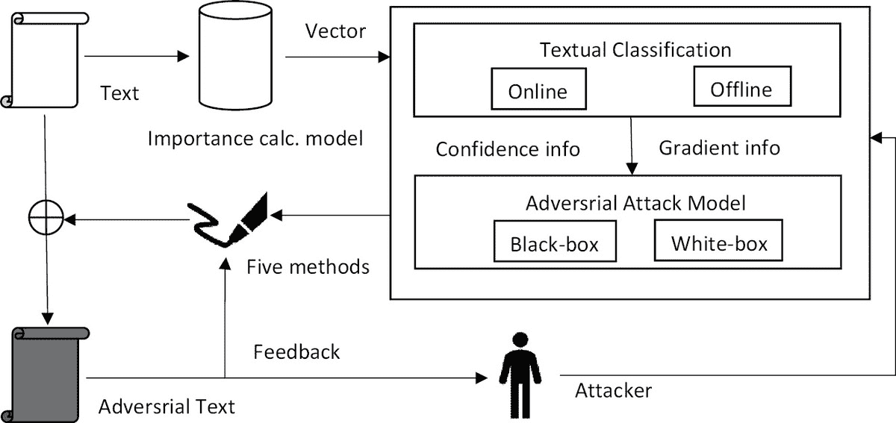

**图 3.2 TextBugger 算法的流程**

`TextBugger` 有五种欺骗 `NLP` 模型的方法，分别是插入、交换、删除、子词（`subword`）和子字符（`subcharacter`）。这种细微的变化在黑盒和白盒场景下均有效。

#### 白盒攻击

通过雅可比矩阵找到最重要的词，然后生成五种类型的 bug 并根据置信度找到最好的一个。

*   **步骤 1：找到最重要的词**。这是通过具有两个参数的雅可比矩阵实现的：`K`（类别数量）和 `N`（输入长度）。获取每个时间步上每个类别相对于输入的导数，以衡量输入中每个词对输出标签的影响程度。
*   **步骤 2：Bug 的生成**。为了确保生成的对抗样本在视觉和语义上与原始样本保持一致，扰动应越小越好。考虑了两个水平的扰动：
    *   **字母级扰动**：随机更改单词中的字母顺序即可轻松让模型判定该词无法识别，从而实现攻击效果。


* **词级扰动**：在词嵌入层寻找最近的词。然而，在 `word2vec` 模型中，某些反义词的距离也很近。这会完全改变语义，因此使用了语义保留技术在 `GloVe` 模型中进行实验。

2. **黑盒攻击**：在黑盒场景下，没有梯度的指示。我们首先找到最重要的句子，然后在句子中找到重要的词。

    * **步骤 1**：找到重要的句子。我们可以将文档分为多个句子，并逐句作为输入查看分类结果。这过滤掉了对预测标签不重要的句子，剩余句子可以根据置信度进行排序。

    * **步骤 2**：找到重要的词。在所有可能的修改中，首先找到句子中最重要的词，然后进行细微修改，以确保对抗样本与原始样本的语义相似性。可以使用删除前后的置信度差异来评估词的重要性。

    * **步骤 3**：bug 的生成。这一步与白盒攻击中的步骤相同。

### 3.4.2 使用数据投毒进行的攻击

Chen 等人 [30] 考虑了一种名为后门攻击（Backdoor Attack）的新型攻击。在这种攻击中，攻击者旨在一个基于学习的认证系统中创建一个后门，以便其利用后门向训练集中注入毒样本来轻松地绕过系统。

它首先尝试在一组与输入密钥相似的后门实例上实现高攻击成功率。可以通过改变分辨率来实现。在这种策略中，它将后门实例集定义为：

```
\sum\limits_{rand}\left( x \right) = ~\left\{ clip\left( {x + \delta} \right) \middle| \delta \in {\lbrack - 5,5\rbrack}^{H \times W \times 3} \right\}
```

其中 `x` 是输入实例的向量，`H`、`W` 和 `3` 是像素的维度向量；`clip(x)` 用于将 `x` 的每个维度裁剪到像素范围内。

接着使用模式策略对输入进行污染。混合注入（Blended injection）、附件注入（accessory injection）和混合附件注入（blended accessory injection）是实现模式策略的三种潜在策略。混合注入策略通过混合良性输入实例和密钥模式来生成污染实例和后门实例。然而，混合注入要求在训练和测试期间对整个输入数据进行扰动，这对于具有某些限制的现实攻击来说可能是不可行的。附件注入使用某些模式及其变换添加到输入数据中。例如，如果输入数据是一组人脸图像，我们可以使用两种类型的眼镜及其变换来生成污染实例。最后一种策略是混合附件注入，它通过结合前两种策略的模式注入功能来利用前者的优点。

在 [30] 中，研究人员使用攻击成功率、标准测试准确率以及错误密钥的攻击成功率来评估后门污染攻击。结果显示，在输入实例-密钥攻击评估中，通过向训练集中仅注入五个五个污染样本，他们就能成功创建攻击成功率达到 100% 的后门实例。在其他三种策略中，通过注入不同的注入污染样本，模型也可以分别实现 100% 的攻击成功率。而且这些策略的标准测试准确率与使用原始训练数据训练的准确率相似，因此这些方法可以实现隐蔽性。此外，错误密钥的攻击成功率保持为 0%。

## 3.5 讨论与问题

尽管已经提出了许多对抗攻击，但对抗样本的因果关系仍不清楚。早期该该的研究将对抗样本的出现归因于模型结构和学习方法。研究人员认为，适当的策略和网络结构将显著提高对抗样本的鲁棒性。研究人员已经探索了这一思路，特别是关于模糊生成的的相关研究 [31]。相反，最近的研究发现，相反现象的出现更有可能是高维数据 [32] 和训练数据不足 [33] 的结果。具体而言，[32] 证明了对抗扰动在几个概念验证数据集（如同心 n 维球）上是可扩展的。Ludwig 等人 [33] 表明，对抗任务比普通学习任务需要更多数据，尽管许多对抗攻击方法是在不同的指标下定义的，但某些 `DNN` 并没有针对特定的训练策略学习到鲁棒的决策边界 [34]。

对于白/白盒攻击，我们还没有看到能够平衡有效性和效率的防御方法。在有效性方面，对抗训练显示出最佳性能，但计算成本很高。在效率方面，许多基于随机性和去噪的防御系统只需要几秒钟。然而，最近的许多论文 [35] 显示，这些防御方法并不如它们称的那样有效。

## 3.6 结论

本章对针对深度学习的对抗攻击进行了全面综述。深度学习是当前机器学习和人工智能发展的核心，这一发现导致了近期许多为深度学习设计对抗攻击的贡献。尽管深度神经网络在各种计算机视觉任务中具有很高的准确性，但发现它们容易受到微妙输入扰动的影响，这些扰动会导致它们的输出完全改变。本章回顾了这些贡献，重点关注文献中影响最大且有趣的作品。显而易见，对抗攻击是对深度学习的真实威胁，特别是在安全和可靠至关重要的应用中。

## 参考文献

- Ian Goodfellow, Yoshua Bengio, and Aaron Courville. 2016. Deep learning. Vol. 1.

- Krizhevsky, A, Sutskever, I., & Hinton, G. E. (2012). Imagenet classification with deep neural networks. Advances in neural processing systems, 25, 1097–1105.

- David E Rumelhart, Geoffrey E Hinton, and Ronald J Williams. 1986. Learning representations by back-propagating errors. nature 323, 6088 (1986), 533.

- Sepp Hochreiter, and Jürg Schmidhuber. 1997. Long-Term Memory. Neural Computation 9, 8 (1997), 1935–1780.

- Ian J. Goodfellow, Jean Pouget-Abadie, Mehdi Mirza, Sherjil Ozair, Aaron C. Courville, and Yoshua Bengio. 2014. Generative adversarial nets. in proc. of the annual conference on neural systems 2014. Montreal, Quebec, 2672–2680.

- Barreno M, Nelson B, Joseph A, Tygar D. 2010. The security of machine learning[J]. Machine Learning, 81(2): 121–148.

- Biggio B, Corona I, Maiorca D, Nelson B, Srndic N, Laskov P, Giacinto G, Roli F. 2013. Evasion attacks against machine learning at test time[C]. Joint European conference on machine learning and knowledge discovery in databases. Springer, Berlin, Heidelberg, 387–402.

- Barreno M, Nelson B, Sears R, Joseph A, Tygar D. 2006. Can machine learning be secure?[C].Proceedings of the 2006 ACM Symposium on information,computer and communications security:16–25.

- Szegedy C, Zaremba W, Sutskever I, Bruna J, Erhan D, Goodfellow I, et al. 2013. Intriguing properties of neural networks. arXiv:1312.6199.

- Goodfellow IJ, Shlens J, Szegedy C. 2014. Explaining and harnessing adversarial examples. arXiv:1412.6572.

- Moosavi-Dezfooli, Seyed-Mohsen, Alhussein Fawzi, and Pascal Frossard. 2016. “Deepfool: a simple and accurate method to fool deep neural networks.” Proceedings of the IEEE conference on computer vision and pattern recognition.

- Papernot, N, McDaniel, P., Jha, S., Fredrikson, M., Celik, Z. B., and Swami, A. 2016, March. The limitations of DL in adversarial settings. In 2016 *IEEE European symposium on security and privacy (EuroS&P)* (pp. 372–387). IEEE.

- Wiyatno, R, & Xu, A. (2018). Maximal jacobian-based saliency map attack. arXiv preprint arXiv:1808.07945.

- Combey, T., Loison, A., Faucher, M., & Hajri, H. (2020). Probabilistic Jacobian-based Saliency Maps Attacks. Machine learning and knowledge extraction, 2(4), 558–578.

- Papernot N, Mcdaniel P, Goodfellow I. Transferability in machine learning: from phenomena to black-box attacks using adversarial samples[J*]. arXiv preprint arXiv:1605.07277*, 2016.

- Papernot N, Mcdaniel P, Goodfellow I, et al. Practical black-box attacks against machine learning[C]_. *Proceedings of the 2017 ACM on Asia conference on computer and communications security*, 2017: 506–519.

- Chen P-Y, Zhang H, Sharma Y, et al. Zoo: Zeroth order optimization based black-box attacks to deep neural networks without training substitute models[C]_. *Proceedings of the 10th ACM workshop on artificial intelligence and Security*, 2017: 15–26.

- Tu C-C, Ting P, Chen P-Y, et al. Autozoom: Autoencoder-based zeroth order optimization method for attacking black-box neural networks[J]_. *arXiv preprint arXiv:1805.11770*, 2018.

- Kurakin A, Goodfellow I, Bengio S. Adversarial examples in the physical world. 2016. *arXiv:1607.02533*.

- Dong Y, Liao F, Pang T, Su H, Zhu J, Hu X, et al. Boosting adversarial attacks with momentum. In: Proceedings of the 2018 IEEE conference on computer vision and pattern recognition; 2018 Jun 18–23; Salt Lake City, UT, USA; 2018. p. 9185–193.

- Papernot N, McDaniel P, Jha S, Fredrikson M, Celik ZB, Swami A. The limitations of DL in adversarial settings. In: Proceedings of the 2016 IEEE european symposium on security and privacy; 2016 Mar 21–24; Saarbrucken, Germany; 2016. p. 372–87.

- Moosavi-Dezfooli SM, Fawzi A, Frossard P. DeepFool: a simple and accurate method to fool deep neural networks. In: Proceedings of the 2016 IEEE conference on computer vision and pattern recognition; 2016 Jun 27–30; Las Vegas, NV; 2016. p. 2574–82.

- Cisse M, Adi Y, Neverova N, Keshet J. Houdini: fooling deep structured models. 2017. arXiv:1707.05373.

- Carlini N, Wagner D. Audio adversarial examples: targeted attacks on speech-text. In: Proceedings of 2018 IEEE security and privacy; 2018 May 24; San Francisco, CA; 2018. p. 1–7.

- Hannun A, Case C, Casper J, Catanzaro B, Diamos G, Elsen E, et al. Deep speech: scaling up end-to-end recognition. 2014. arXiv:1412.5567.

- Yakura H, Sakuma J. Robust audio example for a physical attack. 2018. arXiv:1810.1793.

- Liang B, Li H, Su M, Bian P, Li X, Shi W. Deep text classification can be fooled. 2017. arXiv:1704.0806.

- P. W. Koh and P. Liang. “Understanding black-box predictions via influence functions,” International Conference on Machine Learning, 2017.

- Li, J, Ji, S., Du, T., Li, B., & Wang, T. (2018). Textbugger: Generating adversarial against real-world applications. arXiv preprint arXiv:1812.0527.

- Chen, X, Liu, C., Li, B., Lu, K., & Song, D. (2017). Targeted backdoor attacks deep learning systems using data poisoning. arXiv preprint arXiv:1712.0552.

- Suranjana Samanta and Sameep Mehta. 2018. generating adversarial samples. In Proc. of the 40th european conference on IR (ECIR2018). Grenoble, France, 744–749.

- Abdullah Al-Dujaili, Alex Huang, Erik Hemberg, and Una-May O’Reilly. 2018. Adversarial DL for robust detection of binary encoded malware. In Proc. of the 2018 IEEE security and privacy (SPW2018). Francisco, CA, USA, 76–82.

- Alexey Kurakin, Ian J. Goodfellow, and Samy Bengio. 2017. Adversarial machine learning at scale. In Proc. of the 5th international conference on learning representations (ICLR2017). Lyon, France.

- Ian J Goodfellow, Jonathon Shlens, and Christian Szegedy. 2015. Explaining and harnessing adversarial examples. In Proc. of 3rd international conference on learning representations (ICLR2015).


# 4 Attack Models for Collaborative Learning

**Jiamiao Zhao,¹ Fei Hu,¹ and Xiali Hei²**

¹Electrical and Computer Engineering, University of Alabama, USA

²School of Informatics, University of Louisiana at Lafayette, USA

DOI: [10.1201/9781003187158-5](http://doi.org/10.1201/9781003187158-5)

## Contents

1. 4.1 Introduction
2. 4.2 Background
3. 4.2.1 Deep Learning (DL)
4. 4.2.2 Collaborative Deep Learning (CDL)
5. 4.2.3 Deep Learning Security and Collaborative Deep Learning Security
6. 4.3 Auror: Automated Defense
7. 4.3.1 Setting
8. 4.3.2 Threat Model
9. 4.3.3 Defense
10. 4.3.4 Evaluation
11. 4.4 New Cdl: Gan Attack
12. 4.4.1 Generative Adversarial Network (GAN)
13. 4.4.2 GAN Attack
14. 4.4.3 Experiment Setups
15. 4.4.4 Evaluation
16. 4.5 Defend Against Gan Attack In IoT
17. 4.5.1 Threat Model
18. 4.5.2 Defense System
19. 4.5.3 Main Protocols
20. 4.5.4 Evaluation
21. 4.6 Conclusions
22. Acknowledgment
23. References

## 4.1 Introduction

近年来，大数据处理引起了互联网公司日益增长的关注。深度学习（`DL`）已应用于许多应用中，从图像识别（例如，特斯拉自动驾驶汽车 [1] 和 Google 相册 [2]）到语音识别（例如，苹果 Siri [3] 和亚马逊 Alexa [4]）。

## 4.2 Background

### 4.2.1 Deep Learning (DL)

`DL` 的准确性通常与训练模型的大小和 `DL` 算法的结构有关。然而，数据集是巨大的。在计算机上学习需要很长时间。

### 4.2.2 Collaborative Deep Learning (CDL)

为了利用各种数据源和海量数据集，研究人员提出了协作深度学习（`CDL`）的概念。它是一个增强深度学习框架，多个用户共同学习模型。它将传统的集中学习转换为去中心化的模型训练 [5]。正如我们知道多个学习模型生成的预测结果比单个神经网络模型更好，因此 `CDL` 的性能优于集中式 `DL`。

### 4.2.3 Deep Learning Security and Collaborative Deep Learning Security

尽管 `CDL` 非常强大，但隐私保护仍然是一个首要关注的问题。来自不同公司的数据面临这样一个事实：不可信的第三方和不可信的用户可以通过上传伪造的特征来污染训练参数，最终导致预测失效 [6]。某些攻击者可以伪装成信任用户，并在本地下载服务器特征，以推断其他用户的隐私信息。然而，投毒攻击的严重性尚未被充分理解。

因此，理解网络攻击如何影响 `CDL` 模型和用户隐私具有重要意义。如果部署了 `CDL` 的系统正遭受网络攻击，研究人员应该知道如何检测恶意攻击并消除对手的影响。在本章中，我们介绍了可以检测 `CDL` 系统中投毒攻击和 `GAN` 攻击的机制。这些攻击类型及相应的流程将在 4.3 节和 4.4 节中讨论。

我们首先在 4.2 节中介绍 `CDL` 的架构及其背后的原理和设计目标。然后，我们证明了尽管间接 `CDL` 是一个隐私保护系统，但它对恶意用户敏感。接着，我们在 4.3 节中引入了一种机制——`AUROR`，它可以检测恶意用户，排除伪造的上传特征，并维护全局学习模型的准确性。4.4 节引入了一种新类型的网络攻击：生成对抗网络（`GAN`）攻击，该攻击生成训练数据集的原型样本并从受害者用户处窃取敏感信息。在 4.5 节中，为了对抗物联网（`IoT`）中最新的 `GAN` 攻击，提出了一种防御机制。服务器和用户通过信任的第三方进行通信。最后，我们总结了 `CDL` 中的攻击与防御，并指出了 `CDL` 的未来工作。

## 4.2 背景

`CDL` 在处理海量数据增长的同时，通过并行计算增强隐私和安全性，至关重要。我们首先介绍深度学习算法的背景，然后解释 `CDL` 的架构和原理。

### 4.2.1 深度学习 (DL)

深度学习是一种机器学习技术，计算机通过像人类的方式学习模型。它在图像识别或语音识别方面非常强大。它通常基于神经网络结构实现。`deep` 一词指的是神经网络中的层数。一些复杂网络拥有数百层。

一个深度学习网络由三层组成：输入层、隐藏层和输出层。它也被称为全连接反向传播神经网络。`fully connected` 意味着一层中的每个神经元都连接到下一层的所有神经元。在深度学习中，每个神经元都是一个带有权重矩阵和非线性激活函数的计算单元。输出层 `x^(i)` 等于对上一层的输出向量应用其权重函数并应用激活函数 `f(·)`，然后加上偏置向量 `b`。因此，第 `i` 层的输出向量表示为：

```
x^(i) = f(W*x^(i-1)+b)
```

其中 `W` 是第 `i` 层的 `n^(i) × n^(i+1)` 权重矩阵，`n^(i)` 是第 `i` 层神经元的数量。为了确定……

#### 卷积神经网络

全连接网络有很多参数。例如，`CNN` 使用的参数较少。一些卷积神经网络（`CNN`）如 `AlexNet`、`Inception-v3`、`ResNet50` 具有更高的精度。

### 4.2.2 协作深度学习 (CDL)

`CDL` 在处理海量数据增长的同时，通过并行计算增强隐私和安全性，至关重要。我们首先介绍深度学习算法的背景，然后解释 `CDL` 的架构和原理。

#### 架构

`CDL` 算法类似于传统的学习：我们将 `CDL` 分为模式：

1. **直接 CDL**：这是一个中心服务器。用户直接将数据集上传到服务器。但直接 `CDL` 无法保护用户信息。
2. **间接 CDL**：与直接 `CDL` 不同，间接 `CDL` 中的用户训练自己的数据集。

我们应该注意到，在选择和报告阶段，设置了一个灵活的时间窗口。选择阶段持续到有足够的设备参与或发生超时事件。当窗口关闭时，取决于是否达到目标计数，将启动或放弃这一轮会话。

### 4.2.3 深度学习安全与协作深度学习安全

深度学习（`DL`）在人工智能（`AI`）领域展现了巨大的潜力。它有助于自动驾驶、智能设备以及自然语言处理的发展。由于计算能力的飞速进步和海量数据的存在，深度学习比其他分析工具发挥了更关键的作用。`CNN` 可以对不同对象进行分类并在不同图中标记。循环神经网络（`RNN`）或长短期记忆网络（`LSTMs`）可以分析文本文件，寻找主旨并检测恶意句子。

深度学习网络面临许多安全问题。攻击者可以以模型的参数和参与者的隐私信息为目标。他们甚至尝试远程控制预测模型的学习过程，并故意误导模型对特定对象进行错误标记。在过去的几年里，安全研究人员探索并研究了深度学习系统的潜在攻击。他们将攻击分为四类：模型提取攻击、模型反转攻击、投毒攻击和对抗性攻击。表 4.1 展示了这四种攻击、相应的攻击目标以及工作流。

协作深度学习（`CDL`）网络面临与通用深度学习模型类似的威胁。尽管 `CDL` 是一种分布式学习模型，但该框架并不能抵抗这四类攻击。此外，`CDL` 还受到一种新攻击的影响：生成对抗网络（`GAN`）攻击（在 4.4 节中介绍并评估）。它表明，在传统的深度学习训练中，中央服务器是唯一会损害隐私的参与者，而在间接 `CDL` 中，任何参与者都可以故意损害隐私并使去中心化设置变得更加不可接受 [12]。

**表 4.1 深度学习威胁/攻击**

| 攻击类型 | 攻击目标 | 详情 |
| --- | --- | --- |
| 模型提取攻击 | 深度学习模型 | 窃取模型参数、功能或决策边界 |
| 模型反转攻击 | 训练数据集 | 从预测结果中推导出敏感信息 |
| 投毒攻击 | 训练数据集 | 伪造训练数据集 |
| 对抗性攻击 | 深度学习模型 | 扰动良性样本 |

## 4.3 AUROR：自动化防御

### 4.3.1 问题设置

在本节中，我们将服务器称为收集数据并在其执行深度学习算法的实体。服务器可以与其客户分担计算成本。将数据上传到服务器的客户称为用户。我们专门研究了间接 `CDL` 设置，如图 4.2 所示。与传统的深度学习结构不同，用户直接将原始数据提交给服务器，而间接 `CDL` 设置对数据向服务器的提交进行了屏蔽。这保护了用户的隐私并节省了计算成本。

Shokri 等人提出了一种隐私保护深度学习（`PPDL`）系统 [13]。它已用于许多模拟 [10, 13]。`PPDL` 使用不同的隐私技术在提交到服务器之前对特征进行屏蔽。

### 4.3.2 威胁模型

由于间接协作学习中的攻击者只能操纵自己的本地数据集，无法观察其他用户的数据，因此投毒数据只会间接影响全局模型。为了理解间接 `CDL` 的影响，Shen 等人 [10] 运行了 Shokri 等人提出的隐私保护深度学习（`PPDL`）系统。该系统的用户从本地数据计算深度学习参数，仅将参数作为特征上传到服务器。

在本节中，Shen 等人 [10] 假设攻击者的数量（用 `f` 表示）小于用户数量 `(f < n/2, n is the total number of users)`。攻击者使用针对性投毒攻击针对特定的训练输出。此外，攻击者可以合谋来误导全局模型。服务器是诚实但好奇的。它诚实地处理上传的数据，但对用户信息好奇并可能推断用户身份。但学习模型是保护隐私的：服务器无法从上传的数据中学习用户信息。攻击的目的并非破坏隐私保护，而是干扰全局模型的准确性。

#### 针对性投毒攻击

攻击者可以在训练阶段之前或训练期间对训练数据集进行投毒。4.3 节讨论了后者的情况。投毒攻击有两种类型：(1) 降低模型准确性的随机攻击；(2) 更有目的性的针对性攻击。针对性攻击的目标是误分类特定的输入（例如垃圾邮件），让模型将其分类为目标值。

### 4.3.3 AUROR 防御

Shen 等人 [10] 提出了一种针对间接学习投毒攻击的防御方案：`AUROR`。为了识别投毒数据，服务器在训练全局模型时应区分攻击者和诚实用户，并排除攻击者提交的特征。`AUROR` 有一个经验法则假设来检测攻击者：攻击者是少数。假设原始数据的分布为 `δ`。屏蔽特征的分布 `δ′` 应在统计范围内接近 `δ`。投毒攻击会改变特定特征的分布，这些特征被称为“指示特征”。因此在投毒攻击场景下，诚实用户的指示特征与恶意用户不同。`AUROR` 还假设攻击者的数量在 `∈ < f < n/2` 范围内，其中 `∈` 是 `AUROR` 可以检测的攻击者数量下限。该参数随数据集类型而变化，因此需要对每个数据集进行确定。预处理特征后，`AUROR` 寻找指示特征并将输入分为两组。

随后，如果用户的指示性特征分布与大多数用户不同，`AUROR` 会检测出可疑用户。包含大多数用户的簇被标记为诚实，而少数簇被标记为可疑（但未经最终确认）。如果一个可疑用户出现在可疑组中的次数超过 `τ` 次，则最终将其标记为恶意。参数 `τ` 控制诚实用户的错误率容忍。由于统计误差，指示性特征的分布与恶意用户的分布接近。`AUROR` 根据输入自动确定 `τ` 的值。我们需要注意到，对手会多次出现在可疑组中，因此 `τ` 的值也取决于指示性特征的数量。

最后，`AUROR` 通过排除恶意用户提交的特征来训练全局模型，以生成 `M[A]`。因此，当受到投毒攻击时，`AUROR` 能自动生成最终的准确全局模型。Shen 等人 [10] 评估了 `AUROR` 并证明了 `M[A]` 的攻击成功率和准确率下降非常小。因此，`AUROR` 是间接协作式学习（`CDL`）的一种成功的防御手段。

### 4.3.4 评估

Shen 等人 [10] 构建了一个间接 `CDL` 模型，并证明了虚假训练数据如何影响全局模型。他们使用了两个著名数据集：MNIST（手写数字）和 GTSRB（德国交通图像）。Shen 等人将 30% 的客户设置为恶意用户，与使用良性数据集训练的模型相比，MNIST 的全局模型准确率下降了 24%。当 30% 的用户为恶意用户时，GTSRB 训练的模型准确率下降了 9%。简而言之，间接 `CDL` 易受到投毒攻击的影响。

之后，Shen 等人 [10] 在间接 `CDL` 中加入了 `AUROR`。他们观察到，在 MNIST 模拟实验中，当恶意比例为 10%、20% 和 30% 时，攻击成功率降至 5% 以下。当恶意比例为 10%、20% 和 30% 时，准确率下降分别为 0%、1% 和 3%。这证明了 `AUROR` 能够有效防御投毒攻击，而且即使排除了恶意特征，图像识别系统仍保持相似的准确率。在 GTSRB 实验中，Shen 等人 [10] 观察到，当使用 `AUROR` 对输入进行预处理时，恶意比例在 10% 到 30% 之间的攻击成功率低于 5%。对于 10% 到 30% 的恶意比例，准确率下降仍然忽略不计。

## 4.4 一种新的 CDL 攻击：GAN 攻击

Hitaj 等人 [12] 开发了一种基于生成对抗网络（`GANs`）的间接 `CDL` 新攻击。他证明了间接 `CDL` 的隐私保护特性使得模型比直接 `CDL` 更容易受到攻击。在 Hitaj 等人的模型中，攻击者运行 `GAN` 并伪装成用户；然后通过下载梯度从受害者设备中推导出隐私信息。

### 4.4.1 生成对抗网络 (GAN)

与普通的 `deep learning` 不同，`GANs` 的目标是生成与目标分布相似的“新”图像。如图 4.4 所示，`generator` 网络首先用随机噪声初始化。在每次迭代中，`discriminator` 训练以区分生成的图像和原始图像。这种持续持续直到 `discriminator` 无法区分。

### 4.4.2 GAN 攻击

基于以下假设：

1. 对手是 `CDL` 的内部人员。
2. 对手仅攻击 `local data`。
3. `GAN` 攻击不影响 `global model`。
4. 对手获知 `global model`。
5. 对手具有自适应性。

#### 主协议

假设对手 `A` 是 `CDL` 的内部人员。为了简单起见，我们只考虑两个参与者：`A` 和 `V`。`V` 训练 `global model` 直到达到阈值。然后 `V` 从服务器下载 `global model`。

### 4.4.3 实验设置

#### 数据集

Hitaj 等人 [12] 在两个著名数据集上进行了实验：MNIST 数据集和 AT&T 人脸数据集（Olivetti 数据集）。MNIST 数据集是一组 32×32 像素的 0 到 9 手写数字，包含 60,000 条训练数据和 10,000 条测试数据。Olivetti 数据集包含 400 张 64×64 像素的不同位置的人脸图像。Hitaj 等人 [13] 将输入图像缩放到 `[-1, 1]` 范围，以采用最先进的生成器 `G`。`G` 在最后一层使用 `tanh` 作为激活函数；因此输出范围为 `[-1, 1]`。

#### 系统架构

在 MNIST 和 AT&T 数据集的实验期间使用了基于 `CNN` 的架构，并将其应用于最后一层的激活函数。MNIST 输出有 41 个节点，40 个用于人的真实数据，1 个作为类别（指示对手是否为其感兴趣的类别放置了重构数据）。对于 AT&T 数据集，Hitaj 等人 [12] 添加了额外的卷积层。除最后一层外，所有层输出都应用了 `Batch normalization` 以加速训练速度。

对于 MNIST 相关实验，`G` 和 `D` 的学习率设置为 `1e-3`，学习率衰减系数为 `1e-7`，动量为 `0`，并使用 `64` 的批大小。对于 AT&T 相关实验，学习率设置为 `0.02`，批大小为 `32`。`DCGAN` 使用学习率为 `0.0002`、动量为 `0.5` 的 `Adam` 优化器。

### 4.4.4 评估

在设置攻击系统后，Hitaj 等人在 MNIST 和 AT&T 数据集上运行了 `GAN` 攻击，同时更改了隐私设置和参与人数。结果显示，`GAN` 攻击在 `CDL` 中具有很高的成功率；即使 `CDL` 采用了不同的隐私技术。当仅下载 `10%` 的梯度参数时，由于较小，攻击者可以在 MNIST 实验中获得清晰的受害者图像，并在 AT&T 实验中获得噪声图像。作者得出，只要本地模型的准确率提高，生成器就能很好地学习。他观察到，只要全局模型的准确率达到 `80%`，`G` 就开始产生良好的结果。此外，如果攻击者上传一个伪类别并使受害者释放其数据的更详细分布，`GAN` 攻击的表现会更好。

## 4.5 物联网中的防御 GAN 攻击


`IoT`（物联网）指的是数十亿可以连接到互联网并使用嵌入式传感器收集环境数据的物理设备。由于 `IoT` 设备可以在无需人工参与的情况下进行通信和操作，`IoT` 最近变得越来越流行。技术分析师估计，在 `IoT` 中，“物人比”从 2003 年的 `0.08` 增长到 2010 年的 `1.84`。现在深度学习与 `IoT` 结合，使得 `IoT` 设备比之前的设置在处理时间敏感任务时更加智能和敏捷。这些 `IoT` 设备（如智能手机）可以通过 `CDL` 共享数据并在 `Cloud` 中训练深度学习模型。同样，`IoT` 设备产生大量数据，推动了深度学习的发展。

`CDL` 可以成功解决现实世界中数据隔离与数据隐私之间的冲突 [14]。然而，`IoT` 和 `DL` 本身容易受到网络攻击。首先，`IoT` 设备始终以明文或低加密方式通信。其次，`CDL` 是安全的，因为服务器可以从更新的梯度中提取加载的数据信息。简单的解决方案（如限制上传或下载参数的大小）可以保护用户免受数据泄露，但深度学习模型的准确率也会下降，导致 `CDL` 失去意义。Hitaj 等 [13] 也指出，在 MNIST 实验中，即使只上传或下载 `10%` 的参数，GAN 攻击的效率也很高。

从前述的 GAN 攻击可以看出，`CDL` 容易受到 GAN 攻击。当攻击者伪装成内部人员并参与学习过程时，攻击者可以在网上偷取受者的数据集。为了对抗 GAN 攻击，Chen 等 [14] 在物联网（`IoT`）网络中构建了一个保护隐私的 `CDL`，其中参与者与模型参数隔离，并使用交互模式来学习本地模型。因此，攻击者和服务器都无法访问对方的数据。

### 4.5.1 威胁模型

Google 设计 `CDL` 是为了保护参与者数据免受服务器攻击。但 GAN 攻击表明，参与者也可能是威胁。攻击者必须伪装成参与模型训练的参与者之一来实施 GAN 攻击。这样它就可以从服务器下载参数，并通过错误标记由其 GAN 生成的目标数据，诱导受害者释放其本地数据的更细粒细节。整个 GAN 攻击过程见图 4.5。超过两个用户正在运行 `CDL`，而攻击者是一个内部人员，它在本地训练 GAN 以窃取其他用户的隐私信息。

Chen 等 [14] 假设服务器和参与者都是半信任的，这意味着他们都遵守协议规则并使用正确的输入，但可以利用他们观察到的信息。Hitaj 等 [13] 证明了 GAN 会向服务器注入虚假数据。因此，参与者被假设为半信任的。除了这些基本属性，Chen 等 [14] 还向服务器引入了一个受信的第三方，该第三方将保持中立。

### 4.5.2 防御系统

在 `CDL` 系统中，`server` 与许多参与者通信，但双方都无法访问对方的本地数据。为了抵抗 `CDL` 中的 GAN 攻击，Chen 等 [14] 在 `server` 中增加了一个受信的第三方，如图 4.6] 已经表明模型参数可以通过同态加密。然而，Chen 等 [14] 指出，如果服务器使用同态加密加密参数，将严重降低本地模型的效率并使 `CDL` 毫无意义。


尽管参与者彼此无法访问对方的本地数据，但 `server` 通过中立的第三方与许多参与者交互。Chen 等 [14] 引入了一种改进的 Du-Atallah 方案 [16]，帮助参与者与中央服务器交互，让神经网络学习。在真实数据集上的实验表明，Chen 等提出的防御系统在模型准确率和效率方面都有良好的表现。他们的方案对于所有参与者来说也容易实现，不需要复杂的同态加密技术。

### 4.5.3 主要协议

Chen 等 [14] 首次设计了两个算法，帮助 `server` 和 `participant` 交互并计算这些层。第一个算法用于数据预处理，可以帮助矩阵形式的卷积计算。该算法被称为 `DataPreprocess`。第二个算法借鉴了 Du-Atallah 方案 [16] 的思想。它是一种基于加法份额的安全多方计算协议。改进的 Du-Atallah 方案通过添加项来隐藏传输的数据。而且改进方案中的所有计算都可以使用叠加，这意味着改进的 Du-Atallah 方案是一个线性算子。该算法被称为 `InterComputing`。

对于卷积层，参与者首先对原始数据 `X` 进行零填充，然后执行 `DataPreprocess` 算法，输出标记为 `X[in]`。`server` 计算所有卷积核的权重并发送偏置 `b`。接下来，参与者和服务器共同执行 `InterComputing` 算法，直到所有卷积核计算完毕。完成上一步骤后，参与者下载偏置 `b`，并在最后一层使用激活函数。

参与者随后可以在本地应用池化层，无需与服务器交互。

在全连接层处，可信第三方向参与者生成随机掩码 `A[o]`、`A[2]`，向服务器生成 `A[1]`、`A[3]`，其中 `A[3] = A[1]A[0] - A[2]`。然后参与者和服务器计算一个临时变量并互相发送。最后，服务器本地计算 `X[out]` 并对 `X[out]` 执行激活函数。

### 4.5.4 评估

在 GAN 攻击下，训练模型的分类准确率在约 300 轮可以达到 80%。如果每轮的训练样本从一张图像增加到五张，模型可以在约 100 轮内达到 90%。500 轮后，准确率可以达到 100%。

Chen 等人 [14] 还通过将所提模型与 Aono 的协议 [17] 进行比较评估了效率。结果显示，Chen 方案中参与者的运行时间低于 20 秒，而 Aono 协议的运行时间甚至高达 80 秒。因此，Chen 的反 GAN 攻击模型可以在 GAN 攻击下在短时间内保持准确率。

## 4.6 结论

CDL 使小型计算设备（智能手机）能够进行深度学习。智能手机包含个人信息（例如位置、联系电话、网页历史）。因此，CDL 必须保护敏感信息免受攻击者侵害。攻击者试图寻找 CDL 的漏洞。

在本章中，我们介绍了 CDL 的架构及其安全问题以及相应的防御机制。我们从深度学习安全开始，因为深度学习的数据泄露攻击也可以应用于 CDL。随后，我们介绍了一种自动防御系统 (AUROR)，它可以检测投毒训练数据集的恶意攻击。MNIST 和 GTSRB 数据集被用于评估 AUROR，它们在检测投毒攻击方面非常高效。然后我们展示了 GAN 攻击和反 GAN 攻击方案。GAN 攻击是一种针对 CDL 的新型网络攻击，它可以在干扰阶段推断受害者的数据集，而不改变全局模型。他们的仿真结果显示，当在服务器和用户之间仅传输 10% 的梯度参数时，GAN 就能推断受害者的图像。然而，通过在服务器和用户之间增加可信第三方也可以消除 GAN 攻击。加密消息可以防止 GAN 学习其他用户的信息分布。与同态加密相比，这种防御方法不会影响模型的准确性，且所需的计算资源更少。

## 致谢

这项工作受到美国国家科学基金会（NSF）项目 OIA-1946231 和 CNS-2117785 的部分支持。此处提出的所有观点不代表 NSF 的观点。

## 参考文献

*   Tesla, “Autopilot,” TESLA, 2021. [Online]. Available: [www.tesla.com/autopilotAI](http://www.tesla.com/autopilotAI).

*   M. Lewontin, “How Google Photos uses machine learning to create customized albums,” 24 Mar 2016. [Online]. Available: [www.csmonitor.com/Technology/2016/0324/How-Google-Photos-uses-machine-learning-to-create-customized-albums](http://www.csmonitor.com).

*   SiriTeam, “Deep Learning for Siri’s Voice: Ondevice Deep Mixture Density Network for Hybrid Unit Selection Synthesis,” Aug 2017. [Online]. Available: [`machinelearning.apple.com/research/siri-voices`](https://machinelearning.apple.com).

*   amazon, “Question answering as a “lingua franca” for transfer learning,” amazon, 10 June 2021. [Online]. Available: [www.amazon.science/blog/question-answering-as-a-lingua-franca-for-transfer-learning](http://www.amazon.science).

*   B. McMahan and D. Ramage, “Federated Learning: Collaborative Machine Learning without Centralized Training Data,” 6 April 2017. [Online]. Available: [`ai.googleblog.com/2017/04/federated-learning-collaborative.html`](https://ai.googleblog.com).

*   D. Zhang, X. Chen, D. Wang and D. Chen, “Federated Learning: A Survey on Methods, Algorithms, and Applications,” IEEE Journal of Signal and Data Processing, vol. 6, no. 2, pp. 270–288, 2022.

*   B. McMahan and D. Ramage, “Federated Learning: Collaborative Machine Learning without Centralized Training Data,” 6 April 2017. [Online]. Available: [`ai.googleblog.com/2017/04/federated-learning-collaborative.html`](https://ai.googleblog.com).

*   D. Zhang, X. Chen, D. Wang and D. Chen, “Federated Learning: A Survey on Methods, Algorithms, and Applications,” IEEE Journal of Signal and Data Processing, vol. 6, no. 2, pp. 270–288, 2022.

*   B. McMahan and D. Ramage, “Federated Learning: Collaborative Machine Learning without Centralized Training Data,” 6 April 2017. [Online]. Available: [`ai.googleblog.com/2017/04/federated-learning-collaborative.html`](https://ai.googleblog.com).

*   B. McMahan and D. Ramage, “Federated Learning: Collaborative Machine Learning without Centralized Training Data,” 6 April 2017. [Online]. Available: [`ai.googleblog.com/2017/04/federated-learning-collaborative.html`](https://ai.googleblog.com).

*   D. Zhang, X. Chen, D. Wang and D. Chen, “Federated Learning: A Survey on Methods, Algorithms, and Applications,” IEEE Journal of Signal and Data Processing, vol. 6, no. 2, pp. 270–288, 2022.

*   B. McMahan and D. Ramage, “Federated Learning: Collaborative Machine Learning without Centralized Training Data,” 6 April 2017. [Online]. Available: [`ai.googleblog.com/2017/04/federated-learning-collaborative.html`](https://ai.googleblog.com).

*   D. Zhang, X. Chen, D. Wang and D. Chen, “Federated Learning: A Survey on Methods, Algorithms, and Applications,” IEEE Journal of Signal and Data Processing, vol. 6, no. 2, pp. 270–288, 2022.

*   B. McMahan and D. Ramage, “Federated Learning: Collaborative Machine Learning without Centralized Training Data,” 6 April 2017. [Online]. Available: [`ai.googleblog.com/2017/04/federated-learning-collaborative.html`](https://ai.googleblog.com).

*   D. Zhang, X. Chen, D. Wang and D. Chen, “Federated Learning: A Survey on Methods, Algorithms, and Applications,” IEEE Journal of Signal and Data Processing, vol. 6, no. 2, pp. 270–288, 2022.

*   B. McMahan and D. Ramage, “Federated Learning: Collaborative Machine Learning without Centralized Training Data,” 6 April 2017. [Online]. Available: [`ai.googleblog.com/2017/04/federated-learning-collaborative.html`](https://ai.googleblog.com).

*   D. Zhang, X. Chen, D. Wang and D. Chen, “Federated Learning: A Survey on Methods, Algorithms, and Applications,” IEEE Journal of Signal and Data Processing, vol. 6, no. 2, pp. 270–288, 2022.

*   B. McMahan and D. Ramage, “Federated Learning: Collaborative Machine Learning without Centralized Training Data,” 6 April 2017. [Online]. Available: [`ai.googleblog.com/2017/04/federated-learning-collaborative.html`](https://ai.googleblog.com).

*   D. Zhang, X. Chen, D. Wang and D. Chen, “Federated Learning: A Survey on Methods, Algorithms, and Applications,” IEEE Journal of Signal and Data Processing, vol. 6, no. 2, pp. 270–288, 2022.

*   B. McMahan and D. Ramage, “Federated Learning: Collaborative Machine Learning without Centralized Training Data,” 6 April 2017. [Online]. Available: [`ai.googleblog.com/2017/04/federated-learning-collaborative.html`](https://ai.googleblog.com).

*   D. Zhang, X. Chen, D. Wang and D. Chen, “Federated Learning: A Survey on Methods, Algorithms, and Applications,” IEEE Journal of Signal and Data Processing, vol. 6, no. 2, pp. 270–288, 2022.

# 5.5 结论与未来方向

# 6 参考文献

## 5.1 引言


# 深度强化学习（DRL）系统

深度强化学习（DRL）系统将强化学习技术（奖励最大化）与深度学习（DL）的人工神经网络结合在一起[1]。这种结合使得训练良好的模型能够在比典型强化学习系统复杂得多的数据集上运行。例如，来自摄像头或传感器流的输入数据是高维的，传统的 RL 系统难以解决。然而，DRL 系统可以使用其神经网络来表示用于这些高维选择的策略，使其性能远优于单一的 RL 或深度学习系统。DRL 系统已成功应用于此前未解决的挑战，例如围棋游戏、在德州扑克赛中击败职业扑克玩家，以及通过像素输入精通雅达利游戏[1]。

然而，尽管 DRL 系统在上述示例中表现良好，但某些挑战阻碍了 DRL 系统在现实世界问题中的应用。主要的困难在于，由于安全、成本或时间限制，允许智能体自由且频繁地与环境进行交互是不可行的。这表现为智能体必须（1）与预期环境的不准确仿真进行交互，或（2）与多变环境（如天气状况或交易市场）的静态快照进行交互。针对这些限制提出的解决方案旨在开发极其准确的仿真环境，并对学习算法进行泛化，以便在部署后具有更好的适应性[1]。

## 5.2 DRL 系统攻击的特征描述

大多数针对 DRL 系统攻击的研究评估了这些系统对基于观测的攻击的脆弱性，这种攻击通过对有效输入添加恶意扰动来实现。虽然这些攻击在拥有足够的系统知识和时间的情况下是有效的，但其他形式的攻击对攻击者来说可能更具实用价值，即环境操纵和动作选择。Xiao 等人在关于表征 DRL 系统攻击的论文中，提供了一种潜在攻击向量的分类法，并根据攻击者的知识程度评估了这些向量的通用有效性[2]。

`observation space`（观测空间）由智能体用于决策并根据当前和过去数据更新内部状态的输入流组成。对此空间的攻击旨在扰动智能体的观测，随着时间的推移降低其决策信心。虽然这种向量具有导致针对性失败的潜力，但攻击者更有可能导致系统整体的性能下降。

`action space`（动作空间）代表了 DRL 系统的潜在动作和相应的奖励，其中攻击者试图最小化本应正确的动作的预期回报。通过这种方式，模型无法正确地最大化其预期的累积奖励，产生非预期行为。

识别出的第三个空间是 `environment space`（环境空间），它模拟了 DRL 系统在成为智能体直接输入之前需要评估的情况。在这个空间中，攻击者可以试图通过扰动特定的环境场景来导致针对性的失败。对目标环境进行微小调整就足以降低模型信心，从而阻碍部署，而不会直接明显地看出其发生的原因。

除了潜在攻击向量的分类法外，Xiao 等人还根据攻击者拥有的系统和环境知识水平，评估了这些攻击向量的通用有效性。对观测空间的攻击是根据关于攻击者知识和 DRL 系统关键方面的多个变量进行评估的。在基于这些参数的实验结果中，大多数攻击的系统回合性奖励被减少到大约 0，而不是预期的 500–600。随着时间的推移，这导致累积奖励与未受攻击的系统产生巨大偏差，从而随着时间的推移使模型做出不准确的决策[2]。虽然较高水平的攻击者知识稍微有效，但主要结果是，如果训练 DRL 系统时没有关注对输入噪声的鲁棒性，它们将对观测扰动特别敏感。

还对动作和环境空间进行了少量攻击，结果表明需要在训练期间测试 DRL 系统的鲁棒性。对于动作选择的攻击，较大的扰动边界实现了更好的攻击性能，但需要高水平的系统知识[2]。环境攻击的目标是导致特定的目标失败，例如让自动驾驶汽车在良好的情况下突然离开道路。寻找这些攻击的条件最好使用基于 RL 的搜索方法而不是随机搜索方法。虽然这些环境攻击对整体模型性能并不有效，但它们产生高度针对性失败的能力以及攻击者所需的最小系统知识，使其成为潜在对手极具吸引力的首选。

为了提高 DRL 系统应对这些攻击向量的鲁棒性，对训练和部署阶段提出了一些建议。首先，训练阶段的观测应对对输入应用随机扰动，产生一个即使有噪声和恶意扰动也能产生正确观测的边界区域。此外可以在训练阶段评估观测引擎的梯度，以确认基于梯度的噪声不会导致模型做出次优选择。对于环境，建议改变环境选项（仿真或真实）以降低攻击者的信心。由于这些攻击对攻击者要求的系统知识和访问最少，它们是最可行的首选，应该对此进行防御。

## 5.3 对抗攻击

多个研究小组展示了各种对抗攻击技术，专注于利用 DRL 系统的漏洞，特别是通过扰动观测和最小化奖励函数。Pattanaik 等提出了一种对抗攻击方法，专注于损坏系统的观测，导致智能体认为所处状态与观测到的事件不同[3]。从这种方法开始，他们评估了三种版本的攻击方法：原生攻击、基于梯度的攻击和随机梯度下降方法。这些提出的攻击的有效性优于 Huang 等人在 2017 年论文中提出的攻击，从而得出了提高 DRL 系统鲁棒性的对抗性训练算法的建议[3, 4]。

Lin 等人提供了名为策略性定时攻击（strategically timed attack）和诱惑攻击（enchanting attack）的进一步对抗策略，用于攻击深度强化学习（DRL）算法[5]。策略性定时攻击试图在回合/观测的特定子集期间攻击智能体，扰动输入序列的一小部分而非全部。根据他们的结果显示，定时攻击在仅攻击一个回合中 25% 的时间步的情况下，就能达到与均匀攻击相似的效果[5]。对于他们的诱惑攻击，DRL 智能体被一系列精心设计的对抗样本（adversarial examples）从当前状态诱导到特定的目标状态。通过精心设计的示例，扰动良定义任务的成功率非常高；然而，具有随机元素的任务（例如具有随机敌的游戏）受诱惑策略的影响较小[5]。

Sun 等人在 2020 年关于该主题的论文中介绍了两种隐蔽且高效攻击 DRL 智能体的新型对抗技术[6]。关键点攻击（critical point attack）使用预测 DRL 系统后续状态的模型，结合各种攻击可能造成的损害衡量，由攻击算法用于选择步数最少损害最大的攻击。同时，对抗攻击（antagonist attack）使用训练的模型识别防御系统任何状态的最优攻击。两种方法在确定状态后都能与之前的技术获得类似的结果。选择哪种技术取决于攻击者对内部状态和观测的访问权限，以及减少攻击步数的必要性[6]。

## 5.4 策略诱导攻击

深度强化学习策略已被证明存在脆弱性，攻击者通常无法直接修改智能体的观测。然而，Gleave 等人证明，DRL 智能体可以被自然生成对抗观测的对抗策略所攻击[7]。在他们的实验中，他们显示虽然这些攻击对受害者是成功的，但由于对抗策略使用了更多的随机性并混淆了防御系统，结果是防御系统实际上可以通过盲从特定的选择来表现更好[7]。

Behzadan 等人提出了另一种策略操纵方法[8]。在这种方法中，攻击者只能操纵目标观测到的环境配置。该攻击假设攻击者可以比目标更快地预测并调整环境，并将扰动保持在特定阈值以下。从这种设置来看，DRL 系统能够在学习到特定策略后迅速减少目标的奖励值。为了减少这种漏洞，已经提出了一些防御措施，例如使用最少扰动的对抗示例来重新训练 DRL[8]。根据他们的结果，Behzadan 等人得出目前的防御技术不足的结论。

## 5.5 结论与未来方向

虽然深度强化学习系统是高维复杂决策的有效工具，但在没有直接访问内部机制的情况下，已经发现了许多降低模型信度的攻击技术，某些对抗攻击可以通过训练和部署阶段实施稳健防御技术来缓解。

## 参考文献

*   V. Francois-Lavet, P. Henderson, R. Islam, M. G. Bellemare, and J. Pineau, “An Introduction to Deep Reinforcement Learning,” 2018 年 11 月, doi: [10.1561/220000071](http://dx.doi.org/10.1561/220000071)
*   C. Xiao 等人., “Characterizing Attacks on Deep Reinforcement Learning,” *ArXiv190709470*, 2019 年 7 月, [在线]: [`arxiv.org/abs/1907.09470`](http://arxiv.org/abs/1907.09470)
*   A. Pattanaik, Z. Tang, S. Liu, G. Bommann, and G. Chowdhary, “Robust Deep Reinforcement Learning with Adversarial Attacks,” 2017 年 12 月, [在线]: [`arxiv.org/abs/1712.03632v1`](https://arxiv.org/abs/1712.03632v1)
*   S. Huang, N. Papernot, I. Goodfellow, Y. Duan, and P. Abbeel, “Adversarial Attacks on Neural Network Policies,” ArXiv170202284, 2017 年 2 月, [在线]: [`arxiv.org/abs/1702.02284`](http://arxiv.org/abs/1702.02284)
*   Y.-C. Lin, Z.-W. Hong, Y.-H. Liao, M.-L. Shih, M.-Y. Liu, and M. Sun, “Tactics of Adversarial Attack on Deep Reinforcement Learning Agents,” 2017 年 3 月, [在线]: [`arxiv.org/abs/1703.06748v4`](https://arxiv.org/abs/1703.06748v4)
*   J. Sun 等人., “Stealthy and Efficient Adversarial Attacks against Deep Reinforcement Learning,” 2020 年 5 月, [在线]: [`arxiv.org/abs/2005.07099v1`](https://arxiv.org/abs/2005.07099v1)
*   A. Gleave, M. Dennis, C. Wild, N. Kant, S. Levine, and S. Russell, “Adversarial Policies: Attacking Deep Reinforcement Learning,” 2019 年 5 月, [在线]: [`arxiv.org/abs/1905.10615v3`](https://arxiv.org/abs/1905.10615v3)
*   V. Behzadan and A. Munir, “Vulnerability of Deep Reinforcement Learning to Policy Induction Attacks,” 2017 年 1 月, [在线]: [`arxiv.org/abs/1701.04143v1`](https://arxiv.org/abs/1701.04143v1)

# 6 深度强化学习的信任与安全

Yen-Hung Chen¹, Mu-Tien Huang¹, Yuh-Jong Hu¹
国立政治大学信息学院, 台北

## 目录

1.  6.1 引言
2.  6.2 深度强化学习
    *   6.2.1 马尔可夫决策过程
    *   6.2.2 基于价值的方法
    *   6.2.3 基于策略的方法
    *   6.2.4 Actor-Critic 方法
    *   6.2.5 深度强化学习
3.  6.3 最新综述
    *   6.3.1 机器学习对抗攻击
        *   6.3.1.1 逃逸攻击
        *   6.3.1.2 投毒攻击
    *   6.3.2 深度学习对抗攻击
        *   6.3.2.1 逃逸攻击
        *   6.3.2.2 投毒攻击
    *   6.3.3 对抗深度强化学习
4.  6.4 DRL 系统的攻击
    *   6.4.1 环境攻击
    *   6.4.2 状态攻击
    *   6.4.3 策略函数的攻击
    *   6.4.4 奖励函数的攻击
5.  6.5 针对 DRL 系统攻击的防御
    *   6.5.1 对抗训练
    *   6.5.2 鲁棒学习
    *   6.5.3 对抗检测
6.  6.6 鲁棒 DRL 系统
    *   6.6.1 安全云平台
    *   6.6.2 鲁棒 DRL 模块
7.  6.7 金融稳定场景
    *   6.7.1 自动算法交易系统
8.  6.8 结论与未来工作
9.  参考文献

## 6.1 引言

`artificial intelligence`（人工智能，`AI`）一词由约翰·麦卡锡于 1956 年首次提出。AI 是制造智能机器的科学与工程。AI 的发展历史在基于规则的知识表示演绎推理，以及基于归纳推理数据的机器学习（`ML`）之间起伏波动。现代 AI 是对多智能体系统环境中智能（或软件）代理体的研究，其中代理感知其环境并采取行动以最大化其最优奖励。在过去的十年里，AI 与 `ML`、深度学习（`DL`）和深度强化学习（`DRL`）密切相关，因为它们具有从社交网络或物联网（`IoT`）平台产生的数据中发现模式的能力。基于摩尔定律的计算能力的指数级增长是加速机器学习采用的另一个驱动因素。

用于数据分析的 `ML` 算法有三种：用于分类或回归的监督学习、用于聚类的无监督学习，以及用于序列决策的强化学习（`RL`）。`DL` 是一种新兴的机器学习算法，适用于各种模式匹配应用中的监督和无监督学习，例如计算机视觉、语言翻译、语音识别等。但如果不考虑使用强化学习（`RL`），我们就无法实现智能代理的自主决策能力。`RL` 为智能代理提供了自学习奖励，而不需要真值训练数据。此外，我们可以将 `DL` 与 `RL` 结合得到 `DRL`，用于其他 AI 应用，如自动机器人、AlphaGo 游戏、雅达利视频游戏、自动驾驶汽车以及金融科技中的智能算法交易。

对抗性 `ML` 在过去的二十年里得到了深入研究。从 `ML` 建模的角度来看，大数据分析服务面临许多安全和隐私挑战。许多研究已经针对数据准备、建模训练和推理部署的整个大数据分析流水线开发了多种对抗攻击和防御。特定的攻击和防御也针对不同的 `ML` 类型和算法，特别是针对 `DL` 的攻击。事实上，这些 `DL` 攻击面也与 `DRL` 有关。

正如用于网络安全的 AI 应用一样，用于攻击的对抗机器学习 AI 是一把双刃剑。一方面，AI 驱动的攻击可以加强攻击并规避检测。此外，攻击者可以利用对抗性 AI 击败防护并窃取或影响 AI。另一方面，AI 驱动的防御可以主动保护并禁用 AI 驱动的攻击，并对抗恶意 AI 以固化 AI 并抵抗对抗环境。

在文献[8]中，作者提出了一个分析针对 AI 模型的对抗攻击的框架。攻击策略基于攻击者的知识，可以是白盒、灰盒或黑盒。攻击可以是训练阶段的投毒攻击，也可以是测试阶段的规避攻击。我们将在后续的章节中进行更详细的讨论。

### 动机

在研究中，我们处理 AI 的信任和安全问题。与近期类似的用于网络安全的 AI 研究[6]相比，我们关注 `ML` 建模和部署的信任与安全，特别是大数据分析过程中的 `DRL` 算法。我们正在研究安全云平台[10, 11]上 `DRL` 系统的可能攻击和防御。针对 DRL 的未知攻击将会出现，但我们尚未察觉[12]。我们尝试展示了在安全云中面临对抗攻击时，算法交易系统的金融稳定场景[13, 14]。

### 我们的贡献

我们将本研究的主要贡献总结如下：

*   我们强调了以往关于 `ML`、`DL` 和 `DRL` 的综述。在此之前，我们概述了三种 `DRL`。
*   我们展示了针对 `DRL` 系统的攻击，包括环境、状态空间、策略函数和奖励函数。
*   我们展示了针对 `DRL` 系统的可能防御，包括对抗训练、鲁棒学习和对抗检测。
*   我们提出了一个具有鲁棒 DRL 模块的安全云平台。
*   最后，我们给出了算法交易系统在面对攻击时的金融稳定场景。

本文其余部分的结构如下：首先，在 6.2 节中，我们简要概述了 `DRL`。其次，在 6.3 节中，我们提供了关于对抗 `ML`（包括 `DL` 和 `DRL`）最新研究的概述。第三，在 6.4 节中，我们讨论了针对 `DRL` 的可能攻击，包括环境、状态空间、策略函数和奖励函数。第四，在 6.5 节中，我们展示了如何防御 `DRL` 系统攻击。第五，在 6.6 节中，我们解释了安全云上具有鲁棒 DRL 模块的鲁棒 DRL 系统。然后，我们在 6.7 节中展示了在算法交易系统面临攻击时的金融稳定场景。最后，我们在 6.8 节中提供了结论和未来工作方向。

## 6.2 深度强化学习概述

`DRL` 是一种新兴的 AI 技术，它结合了用于策略优化的 `DL` 和用于自学习的 `RL`。`DRL` 旨在针对目标的序列决策。在本研究中，我们概述了对抗 `DRL` 以及金融稳定相关的展望。在 6.5 和 6.6 节中，我们介绍了针对 `DRL` 的对抗攻击，以及如何通过提供鲁棒 `DRL` 系统来防御 `DRL` 系统攻击。

6.2 节涵盖了介绍 `DRL` 的四个核心主题：马尔可夫决策过程（`MDP`）、基于价值的方法、基于策略的方法和 Actor-Critic 方法。

### 6.2.1 马尔可夫决策过程


`MDP` 对 `RL` 和 `DRL` 至关重要，这是一个通过离散或连续动作解决大多数 RL 问题的框架。如果你将任务建模为 `MDP`，你就定义了环境，代理通过学习一系列时间步中的移动以获得最大奖励来实现最优策略（参见[图 6.1]）。

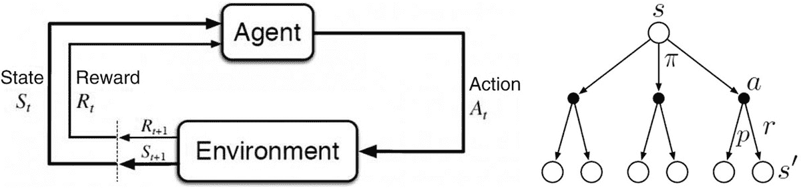

图 6.1 马尔可夫决策过程，智能体与环境交互，通过最优策略函数 `π` 在每一步获得最大奖励。

MDP 的目标是训练智能体寻找一种最优策略，通过对环境中观测结果创建的一系列状态，在每一步采取一系列动作，从而返回最大的累积奖励。

MDP 是一个五元组 `(S,A,P,R,γ)`，

其中

- `S` 是状态空间集；
- `A` 是动作空间集；
- `P(s,a,s′)` 是转移概率 `P`，表示在 $t$ 时刻于状态 $s$ 采取动作 $a$ 将导致在 $t+1$ 时刻进入状态 $s′$；
- `R(s,a,s′)` 是在从状态 $s$ 转移到状态 $s′$ 时采取动作 $a$ 后获得的奖励 `R`；以及
- `γ` 是折现奖励的折扣因子。

### 6.2.2 基于价值的方法

强化学习（RL）有类型。其中，我们首先关注基于价值的方法，这些方法很容易解释来自无模型方法所需的数学背景。

#### V 值函数

强化学习智能体的目标是找到一种策略，使其期望回报最优化

$V^{\pi}\left( S \right) = E\left\lbrack ~\sum\limits\_{0}^{\infty}\gamma^{k}r\_{t + k}~ \middle| ~s\_{t} = s,\pi \right\rbrack,$

其中 `E` 是期望值算子，`γ` 是折扣因子，`π` 是策略算子。

#### Q 值函数

最优 `Q` 值是指在给定状态 `s` 下，对于给定的动作 `a`，智能体之后遵循最优策略 `π*` 所获得的期望折现回报。我们可以直接从这个最优值得出最优策略：

$Q^{\pi}\left( {s,a} \right) = E\left\lbrack {\sum\limits\_{0}^{\infty}\,\gamma^{k}r\_{t + k}\left| s\_{t} \right. = s,a\_{t} = a,\pi} \right\rbrack$

#### 优势函数

我们将最后两个函数结合，它们描述了动作 `a` 与遵循直接策略 `π` 的期望回报相比“有多好”。

`Aπ*(s,a) = Qπ*(s,a) - Vπ*(s)`

#### 贝尔曼方程

贝尔曼方程学习 `Q` 值。它承诺了一个唯一解 `Q*`：

`Q*(s,a) = (BQ*)(s,a)`

其中 `B` 是贝尔曼算子：

$BQ^{\*}\left( {s,a} \right) = \sum\limits\_{s^{\prime} \in S}\, T\left( {s,a,s^{\prime}} \right)\left( {R\left( {s,a,s^{\prime}} \right) + \gamma\text{max}Q^{\*}\left( {s^{\prime},a^{\prime}} \right)} \right)$

### 6.2.3 基于策略的方法

在基于策略的强化学习中，我们通过映射 `π:s→a` 显式构建策略表示，并在学习过程中将其保留在内存中。相比之下，我们在基于价值的方法中不存储任何显式策略，只存储值函数。这里的策略是从值函数隐式得出的，以选择具有最佳值的动作。

### 6.2.4 Actor–Critic 方法

Actor–critic 强化学习是基于价值和基于策略方法的结合，弥补了它们之间的差距。基于价值的方法（如 `Q` learning）深受收敛性的影响，因为你在值空间中工作，值估计的微小变化可能会导致你在策略空间中大幅移动。带有策略搜索和梯度的基于策略的方法直接在策略空间中工作，并且每次更新都有更平滑的学习曲线和性能提升。

基于策略方法的缺点是它倾向于收敛到局部极大值，即通过在策略空间搜索来最大化期望奖励，因此面临高方差和样本效率低的问题。

Actor–critic 方法结合了两者的优点。它使用一个 actor（执行者）进行策略梯度更新，并通过优势函数 `Q(s,a) - V(s)` 配合一个良好的 critic（评价者）。这允许 actor–critic 方法通过每一步的时序差分（TD）更新来获得更高的样本效率。

### 6.2.5 深度强化学习

DRL 是深度学习（DL）和强化学习（RL）的结合，其中 DL 从每个时间步的高维数据输入学习具有动作输出的最优策略函数。RL 是一个 MDP，智能体在策略中应用动作以获得最大奖励。引入 DL 的动力是利用 DL 的高精度直接从大数据数据中学习。此外，RL 可以提供序列决策能力。

## 6.3 最新综述

对抗机器学习的研究已经持续了十多年 [2]。人们使用了不同的方法来解决 AI 或 ML 的安全和隐私问题。我们简要介绍对抗机器学习的通用综述：

- 首先，在 [15] 中，作者阐述了 ML 的综合威胁模型，并对攻击和防御进行了分类。
- 其次，在另一篇论文 [4] 中，作者讨论了具有各种威胁模型的对抗攻击。他们阐述了措施的效率和挑战。
- 第三，在 [5] 中，讨论了广泛的数据漏洞和防御这些漏洞的策略。此外，作者开发了统一分类法来描述各种投毒和后门威胁模型及其关系。
- 第四，在 [16] 中，作者根据机器学习学习流水线的配置因素（包括输入数据集、ML 架构、攻击者规范、攻击生成方法和防御策略）提出了对抗机器学习的系统驱动分类。
- 第五，在 [17] 中，作者提出了鲁棒机器学习系统及其趋势和观点。他们总结了阻碍鲁棒 ML 系统的关键挑战。
- 第六，在 [18] 中，作者从 AI 安全的角度对强化学习中的对抗攻击进行了全面综述。
- 同样，在另一篇论文 [19] 中，作者对 DRL 安全问题进行了基础性处理。他们通过分类和识别漏洞、攻击向量和对抗能力提供了一个高层威胁模型。
- 最后，作者展示了基于 DRL 的系统的新兴恶意攻击的综综，以及防御这些攻击的潜在措施。

### 6.3.1 机器学习对抗攻击

机器学习算法分为三类：监督学习、无监督学习和强化学习。攻击者每种方法的目标非常不同。分类或回归的监督学习提供了从输入到输出的概率，以预测后续时间点的值。在模型训练阶段，每个数据批都有正确答案，通过调整模型参数来获得最优模型。我们可以根据测试误差来验证训练后的模型好坏。

攻击者对监督学习的目标是让模型分类错误、不可预测，或返回一个特定的错误类别。然而，强化学习的输入数据没有正确答案。智能体学习最优策略，以使其每个智能体动作的环境中奖励反馈最大化。因此，攻击者对 RL 算法的目标是让智能体学习奖励最小的策略，或防止智能体学习稳定的策略。

对抗攻击出现在模型的训练阶段（被称为投毒攻击）和测试阶段（被称为逃避攻击）[2, 20]。

### 6.3.1.1 逃避攻击

这种攻击发生在测试阶段。攻击者试图操纵输入数据以规避已训练的模块。逃避攻击分为通用错误和特定错误最大置信度两种类型。如果攻击者输入数据且模型对数据进行了错误分类，则属于通用错误逃避攻击。在特定错误逃避攻击中，攻击者输入数据，模型返回了攻击者预期的特定类别（参见图 6.2）。

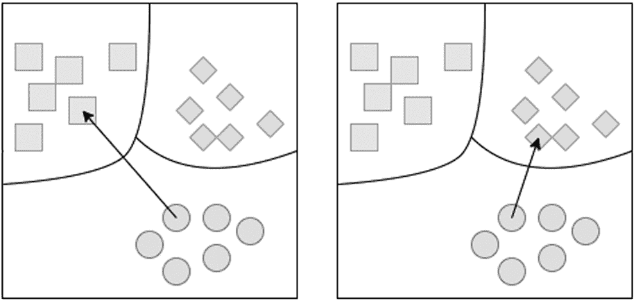

图 6.2 在两个图中，黑线是三个类别的边界。左侧：特定错误逃避攻击。攻击者指定将圆形作为输入输出为正方形。右侧：通用错误逃避攻击。在这种攻击中，攻击者将一个输入样本误分类为菱形而非圆形。

### 6.3.1.2 投毒攻击

攻击者在训练阶段向训练数据中注入投毒样本。攻击也可以分为通用错误和特定错误。通用错误投毒攻击旨在增加相同输入数据下其他类别的概率，并使学习模型无法返回正确类别。在特定错误投毒攻击中，攻击者旨在导致特定的误分类（参见图 6.3）。

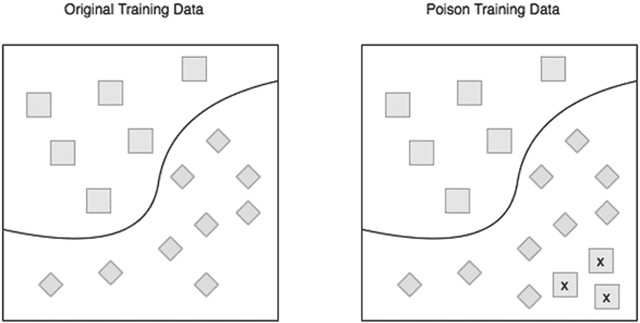

图 6.3 后门投毒攻击示例。左侧：用于正方形和菱形二分类的典型训练数据集，两个类别。右侧：被扰动正方形投毒的训练数据集（正方形中所示 `x`）。

### 6.3.2 针对深度学习的对抗攻击

对抗机器学习是一个广泛的研究课题。我们可以将其缩小到更具体的深度学习（DL）。DL 应用于监督学习。它在训练期间对其数据集有正确答案。因此，深度神经网络（DNN）中存在逃避攻击和投毒攻击。攻击者的目标是对标准输入数据添加尽可能少的噪声，并使输出数据尽可能地误分类。我们可以在方程 (6.3.1) 中展示这一思想[17]。我们将神经网络视为一个函数，标准输入为 `x`。然而，向标准输入 `x` 添加的噪声 `δx` 小于一个很小的数字 `ε`。通过几个不同的输入，函数返回不同的输出（参见图 6.4）。

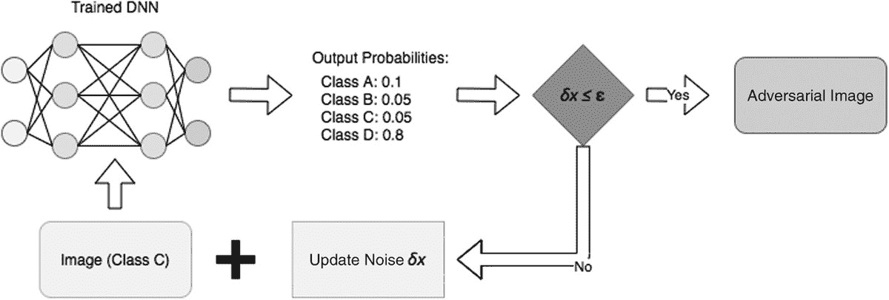

图 6.4 带有类别 C 的图像，向图像添加了某些噪声 𝛿 并放入已训练的 DNN 中。已训练的 DNN 然后返回具有最高概率 0.8 的错误类别 D。对于一个理想的对抗图像，我们检查噪声是否如预期那样微小。如果是，则创建了一个恶意图像。如果否，我们更新噪声并创建另一幅图像作为已训练 DNN 的输入。

```
f(x) ≠ f(x+δx) s.t. δx ≤ ε.(6.3.1)
```

Shafique 等人没有使用通用错误和特定错误，而是使用了“无目标攻击”表示随机输出，使用“有目标攻击”表示特定输出。

#### 6.3.2.1 逃避攻击

在逃避攻击中，攻击者无法访问 DNN 的训练过程和训练数据。在图 6.4 中，我们可以看到寻找对抗示例的过程。在[20]中，Goodfellow 等提供了快速梯度符号方法（FGSM）。该算法找到损失函数的输入方向并添加噪声，从而创建一个对抗示例。

#### 6.3.2.2 投毒攻击

在投毒攻击中，攻击者需要访问数据集和训练程序。攻击者希望向网络投送恶意数据、定制噪声或简单的随机噪声。某些攻击者向深度学习模型添加神经元，并通过特定的预期输出类别触发神经元。

### 6.3.3 对抗强化学习

DRL 是 DL 和 RL 的结合。因此，针对 DL 的攻击也存在于 DRL 中。此外，RL 还有一些攻击面。RL 在训练期间没有正确答案。我们训练它来解决序列决策问题。智能体从环境的奖励中学习策略。当智能体从环境中观察状态时，它获取策略以采取最优动作。环境根据动作返回奖励，智能体从环境中观察下一个状态。

在图 6.5 中，我们可以看到智能体与环境之间的交互。由于智能体与环境的一系列交互，有四个攻击目标：环境、状态、奖励和策略。在[9]中，作者将针对 DRL 的对抗攻击分为两类：主动攻击和被动攻击。

对于主动攻击，攻击者的目标是改变代理体的行为并使奖励尽可能低。被动攻击并不关注代理体的行为，而是专注于窃取受体代理体的细节，例如奖励函数、策略函数或深度强化学习（DRL）的其他部分。这些细节对于攻击代理体是有用的信息，它可以生成针对受体代理体的对抗样本。攻击代理体利用这些对抗样本来攻击受体代理体。

作者还比较了安全强化学习（safe RL）与安全强化学习（secure RL）之间的区别。一方面，安全 RL 学习策略以使奖励函数的期望最大。另一方面，安全 RL 使学习过程对对抗攻击具有鲁棒性和恢复力。我们在第 6.4–6.5 节中讨论了 DRL 系统的攻击与防御。此外，我们在第 6.6 节中介绍了安全云平台中具有鲁棒 DRL 模块的鲁棒 DRL 系统。

## 6.4 对 DRL 系统的攻击

### 6.4.1 对环境的攻击

攻击代理体可以直接向环境添加扰动（参见图 6.6）。Chen 等人提供了一种常用的主导对抗样本生成（CDG）方法，基于 DRL 环境创建对抗样本 `[21]`。攻击代理体针对 `A3C` 路径规划。在通常情况下，受体代理体被训练用于找到通目的地的路径。攻击代理体在环境中添加一个物品并将其放置在某个位置，导致受体代理体花费更多时间或无法到达最终目标。

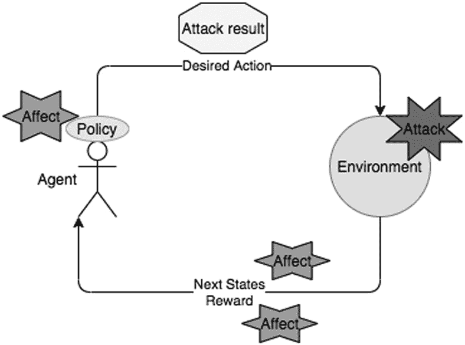

图 6.6 攻击者直接改变环境，使代理体执行所需的动作。当学习代理体从扰动环境中观察状态时，状态、奖励和策略都会受到影响。

### 6.4.2 对状态的攻击

对于状态攻击，Behzadan 等人认为，如果中间存在攻击代理体（参见图 6.7），攻击代理体可以从环境中获取状态，从而扰动传递给受体代理体的状态 `[22]`。为了这一目的，攻击代理体首先训练一种对抗策略，并利用它对状态添加噪声后发送给受体代理体。如果攻击代理体知道受体代理体的策略，它可以通过向该代理体发送特定状态来控制它，受体代理体会按照攻击代理体的预期做出反应。它还会通过错误的策略函数误导受体代理体选择错误的动作以降低奖励。在状态投毒攻击中，Kourti 等人展示了攻击代理体可以访问训练数据集并仅修改其中的 0.025%。攻击代理体可以隐藏一个特定的坏策略并等待木马被触发 `[23]`。

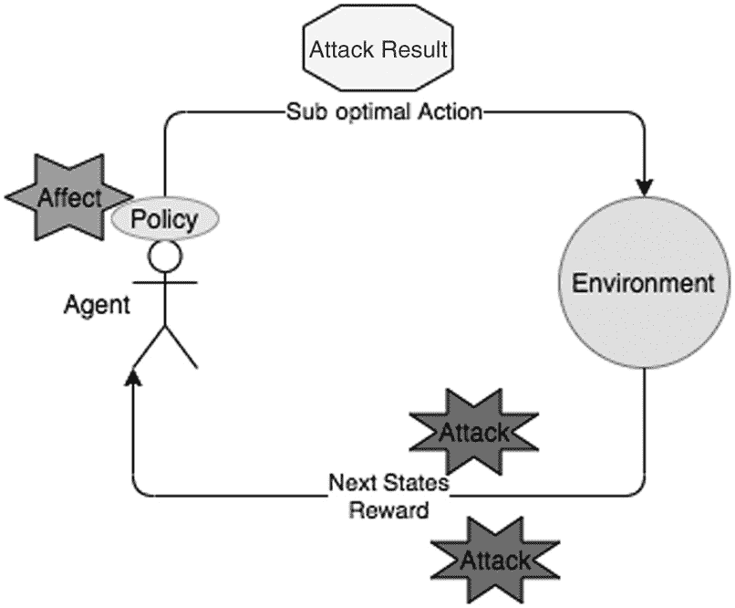

图 6.7 在代理体从环境观察状态之前，攻击代理体位于中间以扰动状态和奖励。这种攻击影响策略并使受体代理体执行次优动作。

### 6.4.3 对策略函数的攻击

恶意的攻击代理体可以攻击策略（参见图 6.8）。Huang 等人展示了通过扰动如图 6.8 所示的状态对策略函数进行的攻击。它在 DRL 中引入了快速梯度符号方法（FGSM）`[24]`。DRL 中 FGSM 的目标是找到一个能使最佳动作概率最小化的对抗输入。此外，添加到输入数据中的扰动应尽可能小。

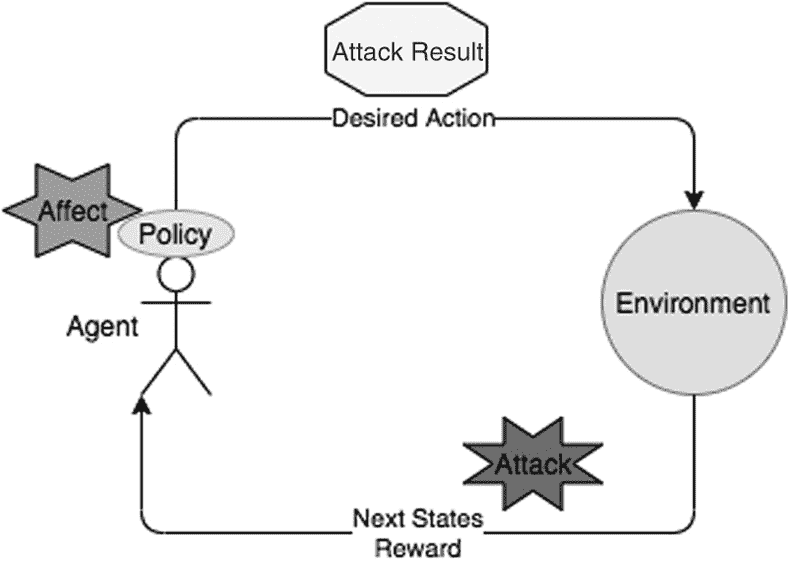

图 6.8 为了攻击策略，攻击代理体可以扰动状态并让受体代理体执行攻击者所需的动作。

Hussenot 等人提出了两种攻击：预观测攻击，即对每个环境添加不同的对抗扰动；以及恒定攻击，即对每个环境添加相同的噪声 `[25]`。攻击代理体操纵环境，使受体代理体从受环境中学习错误的策略。

Gleave 等人在同一环境中放置了两个代理体，一个是对抗攻击代理体，另一个是合法的受体代理体 `[26]`。同一环境中的攻击代理体试图通过向受体代理体创建对抗自然观测输入，让受体代理体遵循期望的策略。它使用了双玩家零和折扣博弈。攻击代理体试图尽可能地获得奖励，使受体代理体获得尽可能少的奖励。

Behzadan 等人针对最优策略提供了一种模型提取攻击 `[22]`。如果受体代理体处于在线并为他人提供服务，它将面临模型提取攻击的风险。攻击代理体可以使用模仿学习技术提取并窃取策略内容，以训练一个新的模仿代理体。这种模仿攻击代理体可以生成对抗样本来攻击受体代理体。

### 6.4.4 对奖励函数的攻击

攻击奖励函数的方法有多种。Han 等人提出了对奖励函数的两种直接攻击 `[27]`。攻击代理体可以通过翻转奖励符号直接改变环境奖励，使受体代理体根据错误的奖励进行学习。当受体代理体对环境执行动作时，它获得的是错误状态而非正确的下一个状态。该攻击代理体操纵状态，让受体代理体执行错误的动作并获得坏奖励（参见图 6.9）。

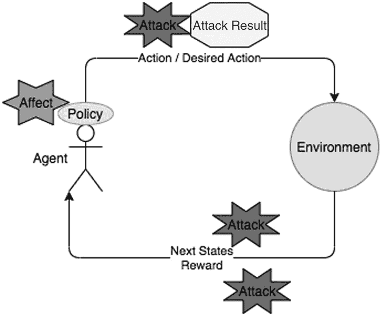

图 6.9 为了攻击奖励，攻击代理体可以直接攻击强化学习的要组件、奖励、状态或动作。攻击代理体影响策略并产生期望的动作。

Pattanaik 等人继续通过向状态添加扰动提供了三种攻击 `[28]`。第一种是在 DRL 状态中添加随机噪声，误导受体代理体选择次优动作。第二种是基于梯度的（GB），与策略攻击中提到的 FGSM 类似。第三种也是基于梯度的，但改进了 FGSM 攻击的性能。作者没有使用基于梯度，而是使用了随机梯度下降（SGD）攻击。

Lee 等人研究了如何扰动动作空间，并为最小化 DRL 代理体的总奖励提出了优化问题 `[29]`。短视动作空间（MAS）攻击每次考虑一次动作攻击并最小化代理体的真实奖励。前瞻动作空间（LAS）攻击在时间 `t` 到 `t+h` 的间隔内应用多次攻击，并减少受体代理体的总奖励。

对抗训练是一种防御基于梯度的攻击的方法，例如 `FGSM`。其概念非常简单：攻击智能体可以在训练阶段运行基于梯度的攻击，以获取尽可能多的对抗样本，并使用这些对抗样本重新训练学习攻击模型。Kos 和 Song 对对抗重训练进行了深入研究 [30]。他们表明，在添加随机噪声或通过 `FGSM` 方法创建的对抗样本重训练后，受害者智能体变得更具韧性。这项研究表明，使用 `FGSM` 进行训练比使用随机噪声进行训练要健壮得多。

Chen 等人提供了一种对抗重训练技术 [21]。他们使用 `CDG` 获取对抗样本并用这些样本重新训练智能体。他们显示，重训练后的受害者智能体可以防止 `A3C` 路径规划的通用攻击（见图 6.10）。然而，如果使用其他方法创建了对抗样本，该方法无法完全防止攻击。

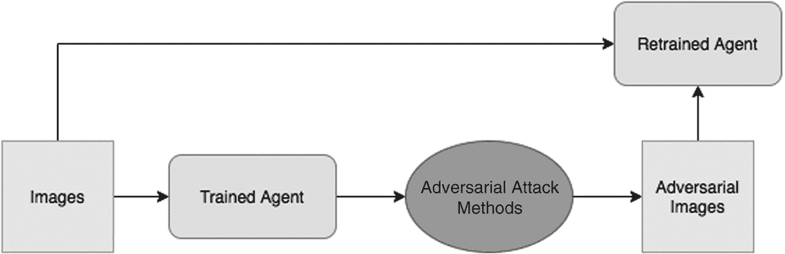


# 图 6.10 重训练过程首先训练一个已训练智能体，并使用对抗攻击方法（如 `FGSM` 或 `CDG`）生成对抗图像。原始图像和对抗图像被用于创建一个新的重训练智能体。

## 6.5.2 健壮学习

健壮学习的概念是在训练阶段创建一个健壮的智能体。Behzadan 等人使用 `NoisyNets` 在训练阶段提供健壮学习模块 [31, 32]。`NoisyNets` 是一种神经网络，其偏置和权重可以在训练阶段受到扰动。我们可以将函数表示如下：函数 `f[θ]` 是带有参数的神经网络函数。当我们将 `x` 作为函数 `f` 的输入时，它返回输出 `y`（见方程 6.5.1）：

```
y = fθ. (6.5.1)
```

参数 `θ` 中存在噪声，`(µ, Σ)` 为学习参数，`∈` 为具有固定统计性的零均噪声（见方程 6.5.2）：

```
θ = µ + Σ ϵ ∈. (6.5.2)
```

作者表明，在训练阶段向学习参数添加噪声是非常有效的。他们使用 `FGSM` 创建对抗样本，并使用这些样本攻击训练智能体。该训练智能体的性能卓越。

Pinto 等人从两个方面提出了健壮对抗强化学习（RARL）[33]。第一点是对初始化至关重要的。引入不同的初始化和随机种子不会降低策略学习的性能。第二点对于建模误差和不确定性具有健壮性。通过不同的测试环境设置，我们可以提高所学策略的性能。Pinto 还提供了一种健壮训练的新颖想法。通常，在 MDP 上的标准强化学习设为 `γ`，其中 `S` 是状态集，`A` 是动作集，`P` 是转移概率，`R` 是奖励函数，`(S,A,P,R,γ,s)` 是折扣因子，`s[0]` 是初始状态。

作者将此更改为双玩家零和折扣游戏。该游戏的 MDP 变为：

```
(S,A[1],A[2],P,R[μ, ν],γ,s[0])
```

其中 `A[1]` 和 `A[2]` 是两个玩家可以采取的动作集，`𝜇` 是玩家 1 的策略，`𝜈` 是玩家 2 的策略，`R` 是策略的总奖励。零和游戏的主要思想是在训练时允许添加一个对抗智能体。考虑玩家 1 试图最大化奖励 `d`，而玩家 2（攻击者）试图最小化玩家 1 的奖励。该算法被称为对抗强化学习（ARPL）。训练阶段结束后，合法的受害者智能体学习所有情况并根据观察执行最佳动作。基于这一概念，一些研究人员考虑了 RARL 中的风险，并提出了规避健壮对抗强化学习（RARARL）[34, 35]。

## 6.5.3 对抗检测

Lin 等人提供了一种检测输入数据是否为对抗数据的架构 [36]。他们训练了一个可以检测恶意攻击的模块。他假设攻击是连续的。关键点是引入一个根据之前的输入和动作预测后续输入数据的智能体，使用相同的策略相同的预测输入并获取动作分布。如果预期输入与实际输入之间的距离大于给定阈值，则真实输入为对抗输入。否则，真实输入是标准的。

Nguyen 等将 DRL 用于网络安全。他们训练了一个 DRL 智能体来检测时间序列攻击。他们可以将 DRL 检测系统放在第一层，以检测输入是否为攻击 [37]。

# 6.6 健壮 DRL 系统

在本节中，我们将详细介绍如何交付一个健壮的 DRL 系统。我们讨论了健壮 DRL 系统的两个方面：一个是云平台的安全性，另一个是如何提供健壮的 DRL 模块。如果我们不安全地建立机器学习架构，可能会发生多次攻击（见图 6.11）。然后某些弱点会被恶意第三方利用。

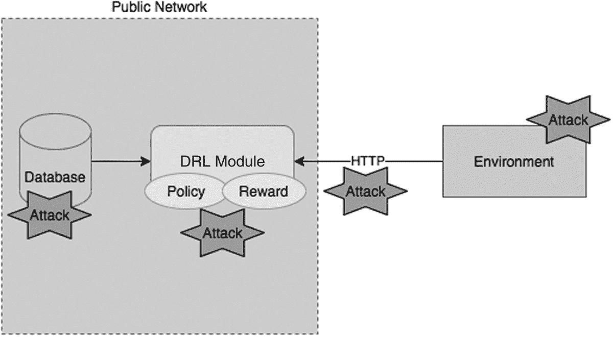

图 6.11 这种架构是不安全的，因为数据库和 DRL 模块位于公共网络中，这意味着攻击者比本地网络更容易访问。智能体与环境之间的通信是不安全的。

Kumar 等人对健壮 DRL 系统有几点观点。在系统层面，他们可以在存储库中保存对抗攻击。然后审计日志并监控机器学习系统——以及防止漏洞的编码风格 [38]。

## 6.6.1 安全云平台

平台安全性在云中至关重要。为了安全，云提供商应该对任何服务中的安全设置提供权限控制。Nepal 等人介绍了云安全的概念 [39]。安全地设置所有服务是非常复杂的。此外，设计云安全架构并不容易。你不仅需要一些安全概念，还需要熟悉云设置。

### 引言

我们需要处理若干个安全问题。回顾第 6.3–6.4 节关于对抗机器学习（ML）攻击的内容，我们可以看到攻击试图通过多次输入请求来利用大量的对抗样本。因此，在各种攻击场景下，我们应该在固定时间内限制来自特定 IP 地址的探测次数。在这种情况下，这无疑会使攻击者花费更多探测时间来发现对抗样本。其次，在中间人攻击中，攻击者可以操纵任何拦截的数据并将其重新发送到目标系统的受害者代理。为了防御这种攻击，我们需要确保我们观察到的数据源和通信信道是完全信任的。AWS 作为图 6.12 中基础云安全架构的示例。

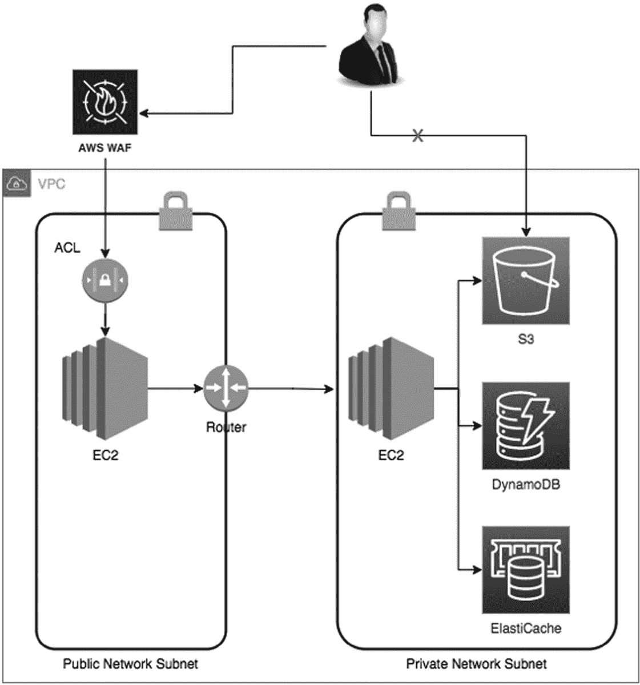

图 6.12 在 AWS 云中设计安全架构的基本概念。数据库和核心服务位于私有网络，以防止来自外部互联网的访问。代理服务位于公共网络中，并使用 AWS WAF 作为防火墙。

使用安全的 Web 通信协议 SSL 是确定 Web 通信环境是否可靠的一种可行方法。对于数据投毒攻击，我们应该保护开放云或本地私有云上的数据库，通过安全机制结合用户访问控制来免受任何渗透。数据库应具有严格的访问控制，以防止攻击者尝试更改模块操作。如果可能，任何数据库服务请求都应该先通过代理服务器，然后将请求转发到目标模块的信任代理。

## 6.6.2 健壮的 DRL 模块

没有任何架构能够 100% 地抵御所有攻击。我们需要次级防御，即 DRL 模块本身。当模块进行训练时，我们应该增强 DRL 模块流水线的鲁棒性，而不仅仅是在不安全的分析流水线中仅针对原始数据进行训练。

我们应该构建一个带有其 DRL 模块的健壮 DRL 系统以确保云安全（参见图 6.13）。数据库和健壮的 DRL 模块位于私有网络中并具有严格的访问控制。代理服务器位于公共网络中，通过对抗检测将传入请求转发到服务器。如果请求有效，则将其发送到健壮的 DRL 模块。在训练阶段，我们对健壮的 DRL 模块提供对抗重训练和健壮机器学习学习。

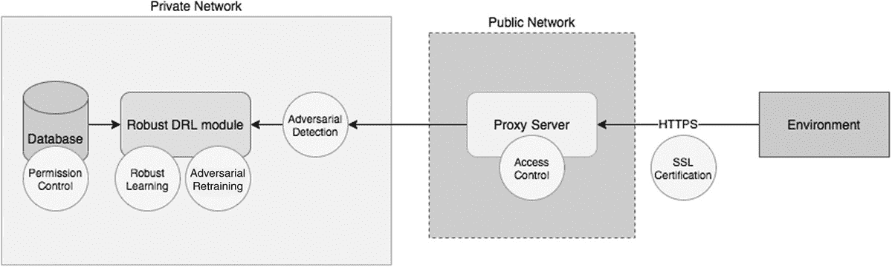

图 6.13 在 AWS 云上构建 DRL 系统，我们应该在私有网络中创建数据库和 DRL 模块，并在公共网络中设置代理服务器。代理服务器接收对抗攻击检测模块的请求并将其转发到健壮的 DRL 模块。代理服务器在私有网络和外部环境之间提供访问控制和安全通信服务。

健壮学习是在训练阶段提供受信任且安全的机器学习建模的方法。人们使用 `NoiseNet` 方法在训练阶段为深度神经网络添加噪声。我们可以使用 `FGSM` 方法获取可能的对抗样本并进行预训练。对抗检测模块是保护代理前的防火墙。当任何对抗样本到达对抗检测模块时，将其拦截并保存到存储中。最终我们增强 DRL。

## 6.7 金融稳定性场景

金融服务正在进入一个没有人工参与的自主服务的新时代。

### 6.7.1 自动交易系统

高频交易系统可以通过即时可用信息或通过将大交易拆分为多次交易从短期套利机会中获利。算法交易系统具有复杂的数据分析阶段，包括数据工程、机器学习建模和交易执行。

传统系统使用简单模型，如线性回归模型、自回归模型（`ARIMA`）和支持向量机（`SVM`），来预测未来的资产价格。这些模型在训练和部署推理方面都很快。随着硬件计算能力的提高，我们利用 GPU 技术加速训练和推理。高性能 GPU 计算系统训练神经网络，如深度 `CNN` 和 `LSTM`。这些具有非线性关系的优化深度学习模型可以在短期内准确预测市场。

我们关注自动交易系统的数据分析机器学习建模，因为预测资产价格和趋势是自动化资产管理系统的核心功能。资产价格预测模型使用各种时间序列数据流预测未来，包括市场、基本面和替代数据。预测模型训练和推理对对抗机器学习攻击的脆弱性会导致金融不稳定。

先进的神经网络对输入的微小扰动敏感，这会剧烈改变深度神经网络的输出。对抗攻击最流行的用途是图像分类。对抗攻击通过扰图像欺分类器，同时限制扰动在某些范数内。然而，操纵后的文本在某些领域（如自然语言处理 `NLP`）中可能是无意义的。在本节中，我们关注交易系统的鲁棒性属性，并利用其潜在威胁利用欺骗攻击。

我们描述了针对订单簿数据的简单对抗攻击。考虑一个在最佳买入和卖出价格下订单的攻击者。此外，考虑对规模（size）条目的扰动。如果攻击者在订单簿中创建局部极值，这可能会导致交易系统做出错误决策，攻击者可能借此获得不正利益。如此，仅具有有限知识的恶意代理就可以利用对抗攻击。

本研究将对抗攻击引入金融交易系统，并将其作为一种理解交易系统鲁健性属性的场景。这里存在鲁健性的权衡。虽然在这种设定下，神经网络模型在市场预测方面的表现优于传统交易系统，但我们认为它们的鲁健性可能较低。我们进一步意识到，欺骗一个模型的相同对抗模式也可以误导其他模型，而且这些模式对人类来说具有高度的可解释性。这些攻击的可迁移性，结合它们在较小攻击预算下的有效性，表明仅具有有限知识的恶意代理就可以利用这些攻击。

在这里，我们提供了一个金融稳定场景，用于处理金融世界中对抗性 `DRL` 应用的自动算法交易系统。我们展示了对抗性 `DRL` 可以应用于具有针对恶意攻击鲁棒防御的市市交易系统。`Market making`（做市）是指通过不断对给定的金融工具进行买卖报价为市场提供流动性的行为。我们将报价之间的差称为做市价差，代表了做市者通过此类活动获得的潜在利润。然而，做市者面临逆向选择风险，即攻击者利用其知识和技术优势，在不利价格变动导致其损失之前与之进行交易，从而改变做市者的存量。这种状况被称为做市风险，是在金融应用中应用 `AI` 和 `ML` 技术时，对抗性 `DRL` 学习迫待关注的问题（见表 6.1）。

#### 对抗方法

在本节中，我们通过对抗方法来处理这类风险。我们设计了做市代理，使其对对抗性 `DRL` 中敌对且自适应选择的市场条件具有鲁棒性 [40]。对抗性 `DRL` 问题有时需要其他领域知识（如博弈论）来证明其能够收敛到纳什均衡。当恶意攻击者将这种类似的方法应用于不同的交易场景（如统计套利或量化交易的最优执行）时，承认对抗性 `DRL` 对金融稳定具有重大影响是非常关键的。

#### 对抗框架

从另一个角度来看，对抗学习框架可以捕捉开发检测市场操纵工具的监管者与隐藏行为以规避检测的操纵者之间不断演变的博弈 [41]。对抗检测、鲁棒学习以及显式鲁棒到足以建模误规范的对抗训练，可以使在现实世界的部署更具可行性。

#### 表 6.1 金融应用中的对抗性 ML/ DL/ DRL 攻击概览

| 对抗攻击 | 类型：规避攻击（推理阶段的攻击） | 投毒攻击（训练阶段的攻击） |
| :--- | :--- | :--- |
| **ML** | 回归 | 置信度降低攻击：发起对抗攻击以损害已部署（在线）基于 `ML` 系统的准确性。欺骗攻击（Spoofing attack）需要高攻击预算。攻击者在市场预测模型的订单簿中创建局部极值，该模型与深度学习相比使用较简单的结构（例如线性回归模型），因为这些模型的训练和推理速度很快。 | 源头置信度降低攻击：在训练阶段发起对抗攻击以损害模型的准确性。源头投毒攻击消耗的攻击预算较低；但攻击者需要破解与深度学习相比结构较简单的市场预测模型的 `ML` 流水线。 |
| | 分类 | 误分类攻击：发起对抗攻击以干扰任何类别的分类边界，导致已部署（在线）基于 `ML` 系统的误分类。目标误分类攻击：发起对抗攻击以仅误分类已部署（在线）基于 `ML` 系统的某一目标类别。针对金融分类模型的欺骗攻击，该模型与 `DL` 相比使用较简单的结构。 | 源误分类攻击：在训练阶段发起对抗攻击，强制将特定源误分类为特定目标。训练阶段的源头投毒攻击需要低攻击预算。然而，攻击者需要破解 `ML` 流水线。 |
| **DL** | 监督 | `DL` 的对抗攻击：先进的神经网络 (`DL`) 系统对输入的微小扰动非常敏感，这会剧烈改变神经网络的输出。虽然在这种设定下 `DL` 模型在市场预测方面的表现优于 `ML` 模型，但我们认为它们的鲁健性较低。存在类似于偏差-方差的鲁健性权衡。针对 `DL` 模型的欺骗攻击，该模型与 `ML` 相比使用较复杂的结构。 | `DL` 的源头对抗攻击：攻击者需要破解 `DL` 系统，在训练阶段强制将特定源误分类为特定目标。在中间人攻击中，攻击者可以从环境中获取特征，对特征添加扰动，并在训练阶段将其传输到算法。 |
| **DRL** | 环境 | 针对环境的规避攻击：攻击者可以在推理阶段直接对环境添加扰动。欺骗攻击需要高攻击预算：攻击者在订单簿中创建局部极值。 | 针对环境的投毒攻击：攻击者可以在训练阶段直接对环境添加扰动。源头投毒攻击消耗低预算。然而，攻击者需要破解 `DRL` 流水线。 |
| | 状态 | 针对状态的中间人规避攻击：攻击者可以从环境中获取状态，对状态添加扰动，然后在在线 `DRL` 系统的推理阶段将其传输给代理。攻击者需要破解 `DRL` 流水线以从结算中心获取状态、添加扰动，并在推理阶段将其传输到在线交易系统。 | 针对状态的中间人投毒攻击：攻击者可以从环境中获取状态，对状态添加扰动，然后在离线 `DRL` 系统的训练阶段将其传输给代理。攻击者需要破解 `DRL` 流水线，向训练阶段代理的训练数据中注入投毒样本。 |
| | 策略函数 | 与 `DL` 的对抗攻击相同。 | 与 `DL` 的源头对抗攻击相同。 |

#### 奖励函数分析

| 奖励函数 | 间接影响 | 直接影响 |
| :--- | :--- | :--- |
| - | 通过对环境的规避攻击和对状态的中间人规避攻击间接影响强化学习（DRL）模型。 | 奖励函数的中间人投毒攻击：直接影响 DRL 模型：1. 通过翻转奖励符号，攻击者可以直接改变来自环境的奖励，智能体会根据错误的奖励进行学习。2. 当智能体对环境做出反应时，获取的是错误的状态而不是从环境中获取正确的下一个状态。攻击者操纵状态，让智能体执行不当操作并获得坏奖励。攻击者黑入 DRL 系统并直接更改资产配置模型的奖励函数。 |

## 6.8 结论与未来工作

对抗机器学习（ML）已经研究了十多年。对抗深度学习（DL）也研究了十年。本文对深度强化学习（DRL）的信任与安全性进行了高层次概述，结合其在自动算法交易中的应用，以避免金融不稳定稳定性。我们首先简要介绍了深度强化学习（DRL）。然后，我们讨论了关于对抗 ML、DL 和 DRL 的最新综述；我们从概念上回顾了 DRL 系统的攻击与防御，使复杂的概念变得更易理解。

为了了解如何在应用 AI 技术（特别是用于金融科技应用领域的大数据分析）时保持金融稳定性，大数据分析流水线已经在公有云或本地私有云平台上进行了广泛的设计和开发。我们展示了基于安全云平台的鲁棒性 DRL 系统，并针对云平台系统攻击和对抗性 DRL 建模攻击提出了可能的防御技术。最后，我们通过对之前提出的关于该金融科技应用的对抗 ML、DL 和 DRL 进行总结表，演示了自动算法交易系统应用中的金融稳定性问题场景。这项研究是金融世界中可信且安全的 DRL 应用的初步路线图。

在未来的工作中，我们打算进一步研究对抗 DRL 及其对更广泛金融应用的不稳定性影响，例如高频程序化交易、资产管理、金融资产定价、金融指数的时间序列预测等。我们将在安全云平台上设计并实现所提出的鲁棒性 DRL 模块。我们打算在真实的金融世界中验证我们对 DRL 命题的信任和安全性，看看它在面对不同的对抗 ML、DL 和 DRL 挑战时是否能缓解金融不稳定的风险。

## 参考文献

*   Li, Y. “深度强化学习：综述”。`arXiv:1701.07274v6 [cs.LG]` (2017).
*   Biggio, B. and F. Roli. “Wild Patterns：对抗机器学习兴起十年后”. Pattern Recognition. Vol. 84 (2018): 317–331.
*   Joseph, D. A., B. Nelson, and B. I. P. Rubinstein, et al. 对抗机器学习. Cambridge University Press, 2019.
*   Chakraborty, A., M. Alam, and V. Dey, et al. “对抗攻击与防御：综述”。`arXiv:1810.00069v1 [cs.LG]` (2018).
*   Goldblum, M., D. Tsipras, and C. Xie, et al. “机器学习的数据安全：数据投毒、后门攻击与防御”. `arXiv:2012.10544v4 [cs.LG]` (2020).
*   Taddeo, M., T. McCutcheon, and L. Floridi. “在网络安全中信任人工智能是一把双刃剑”. Nature Machine Intelligence 1 (2019): 557–560.
*   Casola, L. D. Ali, and Rapporteurs. 用于检测和缓解对抗攻击及异常的鲁棒机器学习算法与系统：研会议论文集. National Academies Press, 2019.
*   Oseni, A., N. Moustafa, and H. Janicke, et al. “人工智能的安全性与隐私：机遇与挑战”。`arXiv:2102.04661v1 [cs.CR]` (2021).
*   Ilahi, I., M. Usama, and J. Qadir, et al. “深度强化学习对抗攻击的挑战与对策”。`arXiv:2001.09684 [cs.LG]` (2020).


*   Qayyum, A., A. ljaz, M. Usama, et al. “云端机器学习安全：云机器学习安全的系统性综述”. *Frontiers in Big Data*, Vol. 3.

*   Lynn, T. 云端安全. *Trust*, 2020.

*   Dietterich, G. 金融稳定性. *Machine Science*, 4.

*   Alessi, L. 金融稳定性. 来自 [`ssrn.com/37231`](https://ssrn.com/37231).

*   Papernot, N. 强化学习中的安全性. `arXiv:1611.0384 [cs.CR]` (2016).

*   Shafique, M. 鲁棒机器学习. *IEEE Transactions of Emerging Topics in Computational Intelligence*, 4, (2020).

*   Chen, T. 强化学习中的对抗攻击与防御. *Security, Trust and Privacy in AI*, 2019.

*   Behzadan, V. 深度强化学习中的缺陷. `arXiv:1810.0225 [cs.LG]` (2018).

*   Goodfellow, I. J, J. Shlens, and C. Szegedy. 解释并利用对抗样本. *International Conference on Representations (ICLR)* (2015).

*   Chen, T. 基于梯度带的对抗训练 A3C. `arXiv:1807.0675 [cs.LG]` (2018).

*   Behzadan, V. 强化学习对策略诱导的脆弱性. *Machine Learning and Data Mining in Pattern Recognition*, Springer International Publishing (2017).

*   Kiourti, P., K. Wardega, and S. Jha. TrojanDRL：深度强化学习的木马攻击. *Proc. 57th ACM/IEEE Design Automation Conference (DAC)*, 2020, National Science Foundation. 可访问 [`par.nsf.gov/biblio/10181034`](https://par.nsf.gov/biblio/10181034).

*   Huang, S., N. Papernot, I. Goodfellow, et al. 针对神经网络策略的对抗攻击. `arXiv:1702.0228 [cs.LG]` (2017).

*   Hussenot, L., M. Geist, and O. Pietquin. 通过对抗观测对深度强化学习智能体的针对性攻击. `arXiv:1905.12282 [cs.LG]` (2019).

*   Gleave, A., M. Dennis, and C. Wild, 等. “对抗性策略：攻击深度强化学习.” *学习表示国际会议 (ICLR)* (2020). 可于：[`iclr.cc/virtual_2020/poster_HJgEMpVFwB.html`](https://iclr.cc)

*   Han, Y., B. I. Rubinstein, T. Abraham, 等. “软件定义网络中自主防御的强化学习，” *安全决策与博弈论国际会议*. Springer (2018): 145–165.

*   Pattanaik, A., Z. Tang, S. Liu, 等. “基于对抗攻击的鲁棒深度强化学习，” *第 17 届自主代理与多智能体系统国际会议* (2018): 2040–2042.

*   Lee, X. Y., S. Ghadai, K. L. Tan, 等. “针对深度强化学习代理的时空约束动作空间攻击。” *arXiv:1909.02583v2 [cs.LG]* (2019)。

*   Kos, J. 和 D. Song, “深入研究针对深度策略的对抗攻击，” *学习表示国际会议 (ICLR) 工作坊* (2017) 可于：[`openreview.net/forum?id=BJcib5mFe`](https://openreview.net).

*   Behzadan, V. 和 A. Munir, “凡杀不死深度强化学习的，只会使其更强大。” *arXiv:1712.09344v1 [cs.AI]* (2017).

*   Behzadan, V. 和 A. Munir, “通过参数空间噪声缓解深度 Q 网络的策略操纵攻击，” *计算机安全、可靠性与安全国际会议*. Springer (2018): 406–417.

*   Pinto, L., J. Davidson, 和 R. Sukthankar, 等. “鲁棒对抗强化学习.” *第 34 届机器学习国际会议 (ICML’17)*, 第 70 卷 (2017): 2817–2826. 可于：[`dl.acm.org/doi/10.5555/3305890.3305972`](https://dl.acm.org/doi/10.5555/3305890.3305972)

*   Pan, X., D. Seita, 和 Y. Gao, 等. “风险规避型鲁棒强化学习.” *机器人与自动化国际会议 (ICRA)* (2019)。

*   Singh, R., Q. Zhang, 和 Y. Chen. “通过风险规避分布强化学习提高鲁棒性.” *机器学习进展*, 第 120 卷 (2020): 1–11.

*   Lin, Y. C., M.-Y. Liu, 和 M. Sun, 等. “用远见检测神经策略的对抗攻击.” *arXiv:1710.00814v1 [cs.CV]* (2017)。

*   Nguyen, T. 和 V. J. Reddi. “用于网络安全的深度强化学习.” *arXiv:1906.05799v3 [cs.CR]* (2019)。

*   Kumar, S. S. R., M. Nystrom, 和 J. Lambert, 等. “对抗机器学习——行业视角.” *IEEE 安全与隐私研讨会 (SPW)* (2020): 69–75. 可于：[`ieeexplore.ieee.org/document/928367`](https://ieeexplore.ieee.org/document/928367)

*   Nepal, S. 和 M. Pathan. *云系统中的安全、隐私与信任*. Springer, 2014。

*   Spooner, T. 和 R. Savani. “通过对抗强化学习实现鲁棒做市.” *第 29 届人工智能国际联合会议 (IJCAI-20) 金融科技特别分场* (2020)。

*   Wang, X 和 M. P. Wellman. “市场操纵：一种用于检测与规避的对抗学习框架.” *第 29 届人工智能国际联合会议 (IJCAI-20) 金融科技特别分场* (2020)。

*   Garcia, J 和 F. Fernandez. “安全强化学习综述.” *机器学习研究第 16 卷* (2015): 1437–1480。

*   Hamon, R., H. Junkwitz, 和 I. Sanchez. “鲁棒性、可解释性与人工智能——技术与政策.” *JRC1936 技术报告.* EUR 30040 EN, 欧盟出版局，卢森堡，ISBN 978-92-14660-5 (在线)。可于：[`publications.jrc.ec.europa.eu/repository/handle/JRC1136`](https://publications.jrc.ec.europa.eu/repository/handle/JRC1136)

*   Liang, P., Bommasani, D. A. Hudson , 和 E. Adeli, 等. “基础模型的机遇与风险.” *arXiv:2108.07258v2 [cs.LG]* (2021)。

# 7 使用贝叶斯网络进行 IoT 建模

Diego Heredia

Facultad de Ciencias: Escuela Politécnica Nacional, 厄瓜

DOI: [10.1201/978100318758-8](http://doi.org/10.1201/978100318758-8)

## 目录

1. 7.1 背景
2. 7.2 章节主题
3. 7.3 范围
4. 7.4 IoT 网络中的网络安全
    5. 7.4.1 智能家居
    6. 7.4.2 攻击图
7. 7.5 使用贝叶斯网络建模
    8. 7.5.1 图论
    9. 7.5.2 概率与分布
    10. 7.5.3 贝叶斯网络
    11. 7.5.4 参数学习
    12. 7.5.5 推断
13. 7.6 模型实现
    14. 7.6.1 网络结构
    15. 7.6.2 攻击模拟
    16. 7.6.3 网络参数化
    17. 7.6.4 结果
18. 7.7 结论与未来工作
19. 参考文献

## 7.1 背景

物联网（IoT）引入城市、房屋、能源、健康等不同领域以开发“智能”元素，从网络安全的角度带来了新的挑战。这一问题是由于 IoT 解决方案在网络安全方面具有一些内在特性，例如设计上的安全配置不当、计算资源有限以及高度的互联性。

正式地描述每个组件的网络安全状态，以及与其他组件和用户的交互，有助于理解攻击面以及可能影响城市、房屋或实体正常运行的攻击能力。根据 Poolsappas 的观点，许多研究人员提出了允许构建安全模型的风险评估方法。然而，他断言这些模型未能考虑攻击者的能力，并因此未能考虑特定攻击执行的概率 1。

IoT 的每一个组件都是威胁源，攻击者可以使用许多框架、技术和工具。因此，分析和量化 IoT 生态系统中每个源或节点产生的安全风险是重要的。然而，如图 7.1 所示，IoT 元素具有高水平的互连，它们的运行并不总是产生静态数据流模式。在这个意义上，我们面临着确定联合风险扩散以及某些值上数据量较的需求。

![图 7.1 智能家居 [4]。](html/images/9781032034041_C007_001.jpg)

建立物联网（IoT）系统的网络安全风险模型需要一种考虑到动态性、异构性和不确定性的利用方法。因此，所提出的解决方案是基于使用贝叶斯网络来对攻击面、识别风险元素，并为物联网解决方案产生的网络安全风险建立一套方法论。

与经典统计方法相比，贝叶斯推理在预测最终影响时需要更少的数据和计算能力。

贝叶斯网络（BNs）提供了一个框架，用于在因果或影响假设下建模信息之间的关系，这使得它们适用于我们寻求模拟各种干预措施影响的现实场景。

在数据有限但人类领域专家对底层因果机制和/或现实事实有良好理解的情况下，贝叶斯网络是建模此类情况不确定性的合适方法。

本工作的目标是基于贝叶斯网络，通过计算智能家居物联网网络中网络攻击的概率，实现一种风险评估模型。该贝叶斯网络的有向无环图从智能家居的攻击图中获得，参数则通过将极大似然法应用于由仿真生成的数据集来获得。

## 7.4 物联网网络中的网络安全

物联网（IoT）是一项包含了物理设备、现代车辆、建筑以及基本电气设备的基础设施，我们不断使用这些设备，并通过互联网相互连接，以积累和交换数据 [2]。物联网网络就是这类设备的环境。物联网的主要目的是通过减少压力和减少重复性工作来提高人们的生活质量 [3]。在物联网网络中，某些设备由于设计条件的限制安全性较低；例如，智能冰箱的安全性并不像具有防火墙或防病毒软件保护的计算机那样同。此外，对网络中任何设备的攻击都可能产生严重影响，因为设备之间的互连程度可能会导致级联效应。

### 7.4.1 智能家居

*智能家居*是由房屋内通过物联网网络互连的设备组成的系统。在家里使用物联网网络的一些动机包括安全性（因为可以通过安全摄像头监控房屋并自动拨打报警电话）以及能源效率（因为智能家居设备可以根据需要开启或关闭以节能 [3]）。我们在模型中所使用的智能家居结构所示 [4]：

* *接入点*：攻击者位于此点。
* *管理层层*：该层由发出命令的设备组成，如笔记本电脑和手机 (CP)。
* *KNX IP 路由器*：由 KNX IP 路由器组成，所有 KNX 设备通过 KNX 总线与其通信。
* *现场设备层*：KNX 总线是所有 KNX 设备所在地，如百叶窗、智能灯、空调和 IP 摄像头。

智能家居在这些层之间有三个 wi-fi 连接 [4]：

* *Wi-fi 网络 1*：提供接入点与管理层之间的连接。
* *Wi-fi 网络 2*：提供管理层与 KNX IP 路由器之间的连接。
* *Wi-fi 网络 3*：提供 KNX IP 路由器与现场设备层之间的连接。

图 7.1 表示了智能家居的结构。模型实现中考虑了以下攻击：社会工程学 (SE)、钓鱼 (PH)、恶意软件注入 (MI)、拒绝服务 (DoS)、路由表投毒 (RTP)、持续攻击 (PA) 和中间人攻击 (MitM)。

### 7.4.2 攻击图

*攻击图*是用于表示在特定条件下攻击路径的图。在本文中，对于智能家居的攻击图，我们通过贝叶斯网络来建模。[4]，其结构所示 [4]。该贝叶斯网络的有向无环图从智能家居的攻击图中获得，参数则通过将极大似然法应用于由仿真生成的数据集来获得。

### 7.5.2 概率与分布

在概率论中，*事件*是实验所有可能结果的子集，其概率量化了该事件发生的置信程度。如果事件 `A` 的概率为 1，则我们确定 `A` 的结果之一会发生；如果概率为 0，则我们认为所有结果都是是不可能的 [5]。在 `P(B)` > 0 的情况下，事件 `A` 给定于事件 `B` 的条件概率定义为：$P(A|B) = \frac{P(A,B)}{P(B)}$。从这个定义中，我们可以看到 `P(A,B)` = `P(A|B)` × `P(B)`。考虑到 `n` 个事件 `A[1]`，…`A[n]`；我们有

$P(A[1],…,A[n]) = P(A[1]) × P(A[2]|A[1]) × ⋯ × P(A[n]|A[1],…,A[n-1]).(7.5.1)$

这被称为条件概率的链式法则。如果 `P(A|B)=P(A)` 或 `P(B)` = 0，则事件 `A` 独立于事件 `B`。由此得出，`A` 独立于 `B` 当充分仅当 `P(A,B)` = `P(A)` × `P(B)`。如果给定事件 `C`，事件 `A` 条件独立于事件 `B` 当充分仅当 `P(A|B,C)=P(A|C)` 或 `P(B,C)` = 0。与独立性的情况类似，从这个定义可以推导出，在给定 `C` 的情况下，`A` 条件独立于 `B` 当充分仅当 `P(A,B|C)` = `P(A|C)` × `P(B|C)`。

随机变量由函数定义，该函数将样本空间中的每个结果关联到一个值。例如，在掷两次硬币的实验中，样本空间是 {HH, HT, TH, TT}，该空间上的随机变量可以是实验每个结果中正面的次数，在这种情况下分别为 2、1、1 和 0。那么随机变量的值为 0,1 和 2。离散随机变量取有限数量的值，而连续随机变量取无限多个值，例如整数值或实数值。

给定一个随机变量 `X`，边缘分布指的是对于 `X` 的所有值 `x` 的 `P(X=x)`。在很多情况下，我们对涉及多个随机变量值的概率感兴趣，在这种情况下，我们需要考虑联合分布。对于一组随机变量集 `{X[1],…,X[n]}`，联合分布表示为 `P(X[1],…,X[n])`，它是为根据这些随机变量指定的事件分配概率的分布 [5]。联合分布必须与边缘分布一致，例如，令 `X` 和 `Y` 为两个离散随机变量，那么对于 `X` 的所有值 `x`，$P(X = x) = \sum_{y}P(X = x,Y = y)$，且对于 `Y` 的所有值 `y`，$P(Y = y) = \sum_{x}P(X = x,Y = y)$。

对于两个随机变量 `X` 和 `Y`，`P(X|Y=y)` 代表在已知 `Y` 取值为 `y` 的情况下 `X` 描述的条件分布。对于 `Y` 的每个值，`P(X|Y)` 用于表示条件分布的集合。使用这种符号，可以将随机变量的链式法则写为 `P(X,Y)=P(X)×P(Y|X)`，根据方程 (7.5.1) 它可以扩展到多个变量 `X[1],…,X[n]`：

$P(X[1],…,X[n])=P(X[1])×P(X[2]|X[1])×…×P(X[n]|X[1],…,X[n-1]).(7.5.2)$

随机变量的独立可以视为事件独立概念的推广。令 `X,Y,Z` 为随机变量，如果对于 `X` 的所有值 `x`，$P(X=x|Y,Z)=P(X=x|Z)$，则称 `X` 在给定 `Z` 的情况下独立于 `Y`。我们用 `I(X,Z,Y)` 表示条件独立 [6]。条件独立具有许多属性，这些属性为证明分布的重要性质提供了非常简洁的方法。一些关键属性如下 [5,6]：

- **对称性 (Symmetry):** `I(X,Z,Y)` 当充分仅当 `I(Y,Z,X)`。
- **分解性 (Decomposition):** 如果 `I(X,Z∪W)`，则 `I(X,Z,Y)` 和 `I(X,Z,W)`。
- **弱并性 (Weak union):** 如果 `I(X,ZW,Y)`，则 `I(X,Z∪W)`。
- **收缩性 (Contraction):** 如果 `I(X,Z,Y)` 和 `I(X,Z,W)`，则 `I(X,Z,Y,W)`。
- **交性 (Intersection):** 该属性仅适用于严格分布，即为每个事件分配非零概率的分布。如果 `I(X,Z∪W,Y)` 和 `I(X,Z,W)`，则 `I(X,Z,Y)`。

### 7.5.3 贝叶斯网络


变量集 `X={X[1],…,X[n]}` 的贝叶斯网络是一个对 `(G, Θ)`，其中 `G` 是具有 `n` 个节点（对应 `X` 中的每个变量）的有向无环图，称为网络结构；`Θ` 是 `X` 中每个变量的条件概率函数，称为网络参数化 [6]。我们使用以下符号：对于 `X[i]` 的所有值和 `Pa(X[i])` 的所有可能组合，`Θ[X[i]|Pa(X[i])=P(X[i]|Pa(X[i]))`。如果节点没有父节点，则考虑边缘分布。

根据随机变量的类型，贝叶斯网络分为三种：变量离散、连续，以及网络中既有离散又有连续变量时的混合。在我们的模型中，考虑的是离散贝叶斯网络，因此 `Θ` 代表每个变量的条件概率表。

贝叶斯网络的图 `G` 编码了以下条件独立假设，称为局部独立性：对于每个变量 `X[i]`，`I(X[i], Pa(X[i]), Nondescendants(X[i]))`。

令 `X[1],…,X[n]` 为贝叶斯网络的变量，并假设图中表示这些变量的节点是拓扑排序。从方程 (7.5.2) 可以：

$$
P\left( {X_{1},\ldots,X_{n}} \right) = \prod\limits_{i = 1}^{n}P(X_{i} \middle| X_{1},\ldots,X_{i - 1}). \tag{7.5.3}
$$

考虑方程 (7.5.3) 的一个因子：`P(X[i]|X[1],…,X[i-1])`。由于节点是拓扑排序，可知 `Pa(X[i]) ⊆ {X[1],…,X[i-1]}` 且 `X[i]` 的后代不在上述集合中。因此，`{X[1],…,X[i-1]} = Pa(X[i]) ∪ Z*`，其中 `Z ⊆ Nondescendants(X[i])`。根据 `X[i]` 的局部独立性和条件独立性的分解性质，得出 `I(X[i],Pa(X[i]),Z)`。因此

$$
P(X[i]|X[1],…,X[i-1])=P(X[i]|Pa(X[i])). \tag{7.5.4}
$$

如果我们对方程 (7.5.3) 的所有因子应用此变换，得到：

$$
P\left( {X_{1},\ldots,X_{n}} \right) = \prod\limits_{i = 1}^{n}P(X_{i} \middle| Pa\left( X_{i} \right)). \tag{7.5.5}
$$

方程 (7.5.5) 贝叶斯网络的链式法则，这一结果解释了模型变量的联合分布。

贝叶斯网络以紧凑的方式表示一组随机变量的联合分布。对于离散随机变量，必须声明变量所有取值组合的概率来表示联合分布，而概率的数量可能非常大。例如，如果我们考虑一组 `n` 个二值随机变量（伯努利变量），联合分布需要指定 `2^n` 个概率。考虑到所有概率之和必须为 1，那么我们总共需要指定 `2^n−1` 个数字。当 `n` 的取值很大时，这种表示方法将变得不可维护。根据研究问题的不同，人类专家可能很难估计这些概率，而且如果我们想从数据中学习分布，则我们需要大量的数据来稳健地估计参数 [5]。贝叶斯网络通过利用变量之间的条件独立性来解决这个问题，使得联合分布的表示需要更少的参数，并且可以解释更多整体现象。如果贝叶斯网络图中的每个节点最多有 `k` 个父节点，那么所需的独立参数总数少于 `n` × `2^k` [5]。

### 7.5.4 参数学习

在贝叶斯网络理论中，模型选择和估计被称为“学习”，这通过两个步骤完成：学习贝叶斯网络的结构（即有向无环图），以及学习参数（即与图结构对应的局部概率分布）[7]。在这项工作中，有向无环图是从 [4] 中提出的攻击图中获得的。对于参数学习，我们对数据集使用极大似然估计法。为了解释这种方法，我们给出了关于参数学习的一些相关定义。

对于变量集 `X` = {`X[1],…,X[n]`}，其数据集 `D` 是一个向量（`d[1],…,d[N]`），其中每个 `d[i]` 被称为一个案例（case），代表变量 `X` 的部分实例化。如果每个案例都是变量 `X` 的完全实例化，则该数据集是完全的；否则，数据集是不完全的 [6]。

完全数据集 `D` 的经验分布定义为：

$$
P_{D}\left( \alpha \right) = \frac{D\left( \alpha \right)}{N}, \tag{7.5.6}
$$

其中 `D(α)` 是数据集 `D` 中满足事件 `α` 的案例 `d[i]` 的数量。

令 `x` 为变量 `X` 中某个变量的实例化，`u` 为其在 `G` 中父节点的实例化；那么根据定义 (7.5.6)，可以使用经验概率估计参数 `θ[x|u]`：

$$
\theta_{x|u} = P_{D}\left( {x\text{|u}} \right) = \frac{D\left( {x,u} \right)}{D\left( u \right)}. \tag{7.5.7}
$$

令 `θ` 为给定网络结构 `G` 的所有参数估计集合，令 `Pθ` 为由结构 `G` 和估计 `θ` 导出的概率分布。这些估计的似然定义为：

$$
L\left( {\theta\text{|D}} \right) = \prod\limits_{i = 1}^{N}P_{\theta}\left( d_{i} \right). \tag{7.5.8}
$$

也就是说，估计 `θ` 的似然是在这些估计下观测到数据集 `D` 的概率 [6]。给定完全数据集 `D`，由 (7.5.7) 定义的参数估计是唯一使 (7.5.8) 定义的似然函数最大化的估计。在我们的工作中，我们通过模拟网络攻击生成完全数据集，然后使用公式 (7.5.7) 的估计值来估计贝叶斯网络的参数。

### 7.5.5 推断

一旦设计好贝叶斯网络，目标是通过回答关于贝叶斯网络变量及其概率的问题来获取信息 [6, 7]。使用的技术通常被称为*推断*（inference）。对于贝叶斯网络，回答这些问题的过程也被称为*概率推理*或*信念更新*，而问题本身被称为*查询*（queries）[7]。用于风险评估的查询是证据概率、后验边缘分布和最可能的解释。考虑到我们在模型中使用伯努利随机变量，对于给定一组伯努利随机变量 `X` = {`X[1],…,X[n]`} 的贝叶斯网络，这些推断为：

*   **证据概率：** `P(X[i]=x[i])`，对于 `x[i]` ∈ {0,1}, `i` ∈ {1,...,n}。
*   **后验边缘分布：** `P(x|u)` = `D(x,u)/D(u)`。
*   **最可能的解释：** `P(X[n]=x[n])` 最大。

用于计算推断的算法分为精确算法和近似算法。精确算法基于贝叶斯定理的应用，由于其性质，它们对于小规模网络是可行的。另一方面，近似算法基于蒙特卡洛模拟来对网络进行采样并估计推断，这些算法对于节点较多的贝叶斯网络非常有用。

## 7.6 实现

### 7.6.1 网络结构

实现贝叶斯网络考虑了以下伯努利随机变量：

*   `SECP`：从访问点到管理层的社会工程攻击。
*   `PHCP`：从访问点执行的钓鱼攻击。
*   `MICP`：从访问点到管理层的恶意软件注入。
*   `DOSR`：从管理层到 KNX 路由器的拒绝服务攻击。
*   `RTPR`：从管理层到 KNX 路由器的路由表中毒攻击。
*   `PAR`：从管理层到 KNX 路由器的持续攻击。
*   `DOSF`：从 KNX 路由器到现场设备层的拒绝服务攻击。
*   `MITMF`：从 KNX 路由器到现场设备层的中间人攻击。

贝叶斯网络考虑变量之间的因果关系，这与攻击图相似，因为给定攻击图中的边，子节点的状态条件地依赖于父节点的状态；也就是说，攻击的成功取决于上一个节点攻击的成功 [8]。那么，在这种背景下，如果贝叶斯网络的结构是有向无环图，则可以用攻击图来表示。

考虑到图 7.1 中的智能家居结构、[4] 中提出的攻击图以及之前提到的变量，我们使用以下有向无环图来实现贝叶斯网络（见图 7.2）。在该图中，表示了所有可以到达现场设备层的攻击路径。

### 7.6.2 攻击模拟

该模拟的目标是描述网络攻击如何通过网络节点执行；这是通过模拟离散随机变量来实现的。首先，选择在智能家居结构每个层级执行的攻击类型，然后确定攻击者是否成功攻破了设备。这是通过遵循贝叶斯网络图描述的路径完成的，仿真的结果获得了一个数据集，其中每一列代表一个网络节点，每行代表网络上的一次完整攻击事件，指示了发生攻击的节点。仿真的通用考虑因素是，攻击者可以从一个节点执行多次攻击，且不允许执行不符合图表描述路径的攻击。

#### 选择概率

针对智能家居网络的网络攻击遵循图 7.2 所示的图结构。对于智能家居结构的每个层级，第一步是决定攻击类型，这是通过模拟伯努利随机变量完成的。该选择指的是对包含 2 或 3 个伯努利变量的向量进行模拟，如果节点被选中用于攻击，则值为 1，否则为 0。在第一个节点中，选择概率为 100%，因为在开始时，只能从访问点到管理层执行社会工程攻击。然后，遵循图的路径，在管理层之间可以选择钓鱼攻击、恶意软件攻击或两者兼有，并且必须为这些情况的选择给出概率。仿真中使用的选择概率如表 7.1、7.2 和 7.3 所示。

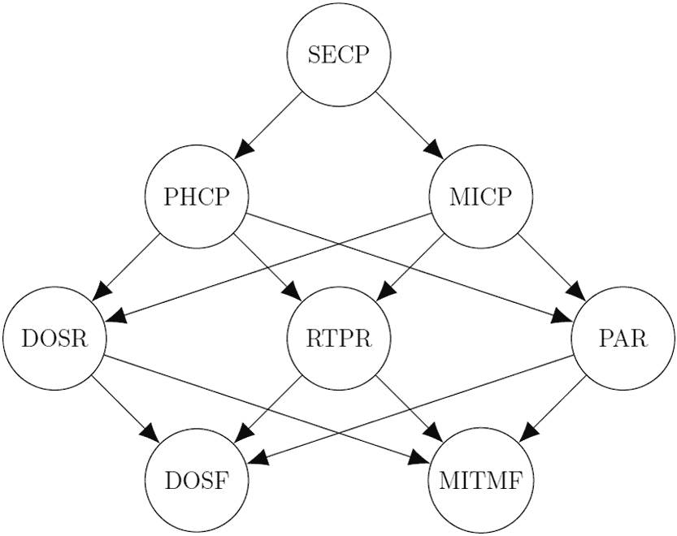

图 7.2 贝叶斯网络的有向无环图。

**表 7.1 管理层的选择概率**

| PHCP | MICP | 概率 |
| --- | --- | --- |
| 0 | 0 | 0.00 |
| 0 | 1 | 0.35 |
| 1 | 0 | 0.55 |
| 1 | 1 | 0.10 |

**表 7.2 KNX IP 路由的选择概率**

| DOSR | RTPR | PAR | 概率 |
| --- | --- | --- | --- |
| 0 | 0 | 0 | 0.00 |
| 0 | 0 | 1 | 0.10 |
| 0 | 1 | 0 | 0.15 |
| 0 | 1 | 1 | 0.10 |
| 1 | 0 | 0 | 0.25 |
| 1 | 0 | 1 | 0.15 |
| 1 | 1 | 0 | 0.20 |
| 1 | 1 | 1 | 0.05 |

**表 7.3 现场设备层的选择概率**

| DOSF | MITMF | 概率 |
| --- | --- | --- |
| 0 | 0 | 0.00 |
| 0 | 1 | 0.35 |
| 1 | 0 | 0.55 |
| 1 | 1 | 0.10 |

#### 基于 CVSS 评分的漏洞概率

通用漏洞评分系统（CVSS）是一种衡量信息技术安全中漏洞影响或严重程度的评分系统。CVSS 评分基于软件、硬件和固件漏洞的原理技术特征 [9]。CVSS 的开发用于生成定性主定量的设备漏洞评分 [10]。通常，使用三个指标来计算这些评分：基础分、时间分和环境分。基础分反映了根据其内在特征决定的严重程度，这些特征随时间推移而不变，并根据不同场景下的最坏情况进行估计的 [9]。时间指标根据随时间变化的因素进行描述，环境指标则根据特定的环境进行描述 [9]。在这项工作中，由于这是一个专注于通用智能家居网络的模型，因此使用基础指标来确定网络设备的 CVSS 评分，因为时间指标和环境指标具有情境性，在更具体的模型中会很有用。

CVSS 评分已在之前的工作中用于估计计算机系统风险评估模型中离散贝叶斯网络的参数 [8, 11, 12]。在 [11] 中，利用漏洞的概率被认为是 CVSS 评分除以域的大小（大小为 10）。然而，这种方法没有考虑图中存在的攻击之间的因果关系。在这项工作中，使用 CVSS 评分来确定网络设备的 CVSS 评分，因为时间指标和环境指标具有情境性，在更具体的模型中会很有用。

前三个结果分别在表 7.4、7.5 和 7.6 中。关于最可能的解释：如果有证据表明现场设备层存在 `DoS` 攻击但没有 `MitM` 攻击，或者现场设备层存在 `MitM` 攻击但没有 `DoS` 攻击，那么最可能的解释包括：首先针对管理层的社会工程攻击，然后是针对管理层的钓鱼攻击，接着是针对 `KNX IP router` 的 `DoS` 攻击，最后是证据中的任何一种攻击。

**表 7.4 现场设备层 `DoS` 和 `MitM` 攻击的概率**

| 攻击 | 概率 |
| --- | --- |
| `DOSF` | 0.3257822 |
| `MITMF` | 0.2627260 |
| `DOSF` and `MITMF` | 0.1897563 |

**表 7.5 在存在网络中其他节点遭受攻击证据的情况下，现场设备层 `DoS` 和 `MitM` 攻击的概率**

| 攻击 | 证据 | 概率 |
| --- | --- | --- |
| `DOSF` | `SECP` | 0.4134291 |
| `MITMF` | | 0.3334087 |
| `DOSF` and `MITMF` | | 0.2408075 |
| `DOSF` | `PHCP` | 0.6054472 |
| `MITMF` | | 0.4905264 |
| `DOSF` and `MITMF` | | 0.3567098 |
| `DOSF` | `MICP` | 0.6333557 |
| `MITMF` | | 0.5179413 |
| `DOSF` and `MITMF` | | 0.3813129 |
| `DOSF` | `DOSR` | 0.7190847 |
| `MITMF` | | 0.5931191 |
| `DOSF` and `MITMF` | | 0.4460161 |
| `DOSF` | `RTPR` | 0.7592573 |
| `MITMF` | | 0.6449062 |
| `DOSF` and `MITMF` | | 0.5024086 |
| `DOSF` | `PAR` | 0.7097519 |
| `MITMF` | | 0.6507042 |
| `DOSF` and `MITMF` | | 0.4829878 |

**表 7.6 在已知管理层未遭受钓鱼攻击和恶意软件注入攻击的情况下，现场设备层 `DoS` 和 `MitM` 攻击的概率**

| 攻击 | 证据 1 | 证据 2 | 概率 |
| --- | --- | --- | --- |
| `DOSF` | `No PHCP` | `MICP` | 0.5625418 |
| `MITMF` | | | 0.4474423 |
| `DOSF` and `MITMF` | | | 0.3165204 |
| `DOSF` | `PHCP` | `No MICP` | 0.5468065 |
| `MITMF` | | | 0.4323725 |
| `DOSF` and `MITMF` | | | 0.3036255 |
| `DOSF` | `PHCP` | `MICP` | 0.7013511 |
| `MITMF` | | | 0.5856344 |
| `DOSF` and `MITMF` | | | 0.4435267 |

## 7.7 结论与未来工作

在本章中，我们实现了一个智能家居 `IoT` 网络的风险评估模型。该模型使用了 `贝叶斯网络`，其有向无环图来自 `[4]` 中提出的攻击图，参数通过对仿真获取的数据集应用 `极大似然法` 得到。表 7.4、7.5 和 7.6 提供了在存在或不存在智能家居网络其他部分攻击证据的情况下，现场设备层不同攻击的概率。这些结果可以供网络安全评估人员使用；例如，如果认为智能家居网络的选择概率和漏洞概率与模型中提出的相似，且有证据表明管理层遭受了钓鱼攻击，那么现场设备层遭受 `DoS` 攻击的概率为 60.54%，`MitM` 攻击的概率为 49.05%。因此，可行的方案是采取措施保护设备免受 `DoS` 攻击。使用 `表 7.5`，如果有证据表明管理层遭受了恶意软件注入攻击，那么 `DoS` 攻击的概率将上升到 70.15%，使得防御 `DoS` 攻击变得迫在眉睫。使用这种方法的优势在于它允许将这些概率量化，这有助于决策。

通过使用 `贝叶斯推理`，随着对现象知识的证据更新，可以获得关于不同事件更详细的新信息。在风险评估中，这种证据可以是观察到的，也可以是假设的；在假设的情况下，可以发现不同情况下会发生什么，并基于此分析做出更好的决策。`贝叶斯网络模型` 的主要优势之一是考虑了随机变量的条件依赖性。

在本章中，风险评估包括寻找网络上不同网络攻击事件的概率。这种分析在基于概率进行决策的情况下非常有用。未来工作将重点于根据评估人员的需求为风险评估添加更多细节。例如，可以包含网络攻击的影响，形式可以是评估人员创建评分评分或与网络攻击造成的财务损失有关，这种财务损失可以侧重于信息丢失或服务中断。

本章包含了对智能家居结构的通用分析。未来工作可以包括研究特定的智能家居，详细说明每个设备及其特性。为此，需要指定新的选择概率和漏洞概率的 `CVSS 评分` 以模拟攻击。然而，理想的情况是使用提供的数据集来对智能家居的状况进行更真实的分析。如果有真实案例的数据集，将遵循本工作的相同程序，只是不再进行攻击模拟。

需要提到，由于攻击图的使用不仅限于智能家居，该分析可以扩展到不同类型的 `IoT`。一个有趣的研究可以关注目前蓬勃发展的智能城市，因此，在这些环境中进行网络安全研究是人们的迫切需求。

## 参考文献

- `Rizvi, S.`, `McIntyre, N.` 和 `Ryoo, J.`，"Computing security scores for IoT device vulnerabilities," `2019 International Conference on Software Security and Assurance (ICSSA)`，2019，pp. 52–59.


* Frigault, M., Wang, L., Singhal, A., and Jajodia, S. “Measuring network security using dynamic bayesian network”. 于 *Proceedings of the 4th ACM Workshop on Quality of Protection*, QoP ‘08, pp. 23–30, New York, NY, USA, 2008. Association for Computing Machinery.

* Muñoz-González, L., Sgandurra, D., Barrère, M., and Lupu, E. C. “Exact inference techniques for the analysis of bayesian attack graphs”. IEEE Transactions on Dependable and Secure Computing, 16(2):231–244, 2019.

* Zeng, J., Wu, S., Chen, Y., Zeng, R., and Wu, C. “Survey of attack graph analysis methods from the perspective of data and knowledge processing”. Security and Communication Networks, 2019:1–16, 2019.

# 第二部分 安全的 AI/ML 系统：防御

# 8 机器学习防御策略综述

Joseph Layton,¹ Fei Hu,¹ and Xiali Hei²

¹美国亚拉巴马大学电气与计算机工程

²美国路易斯安那大学拉法分校计算与信息学院

DOI: [10.1201/9781003187158-10](http://doi.org/10.1201/9781003187158-10)

## 目录

1. 8.1 引言

2. 8.2 安全威胁

3. 8.3 蜜罐防御

4. 8.4 投毒数据防御

5. 8.5 针对对抗攻击的 Mixup 推理

6. 8.6 信息物理技术

7. 8.7 信息融合防御

8. 8.8 结论与未来方向

9. 参考文献

## 8.1 引言

机器学习广义是指以自改进为这些系统核心特征的智能算法。通过使用监督学习系统，可以对复杂数据集做出决策和预测，而无需对遇到的每种情况进行直接编程。得益于计算能力的快速提升以及在用户行为（点击、观看时间、阅读模式等）上收集的海量数据集，机器学习可以应用于发现这些数据集中的模式，而这些模式在过去是使用传统的编程方法难以分析的。

机器学习的三种主要类型是监督学习、无监督学习和强化学习（参见图 8.1）。`监督`学习使用一组带有典型输入和预期输出的训练数据来“教”算法如何对训练数据以及训练集之外的输入做出准确预测。`无监督`学习获取一个数据集，并尝试在没有预期输出显式指示的情况下寻找数据中的模式。通过识别数据中的“聚类”，机器学习系统最终在不对训练数据进行显式标记/标注的情况下建立数据集的模型，从而引导自己识别多个输入之间的共同点。`强化`学习可以通过正向或负向奖励系统，对大多数生物体的如何学习进行建模。该算法被赋予一个需要完成的任务，并在每次尝试后进行评分，以确定该次迭代的有效性。在过程早期，大多数成功的尝试归于运气，但随着少数“幸运”的案例经过迭代，模型开始持续地提高其分数。这种训练通常会持续数百或数千次迭代，直到模型达到当前任务所需的可靠性阈值，例如识别 99.9% 的遇到的停止标志。

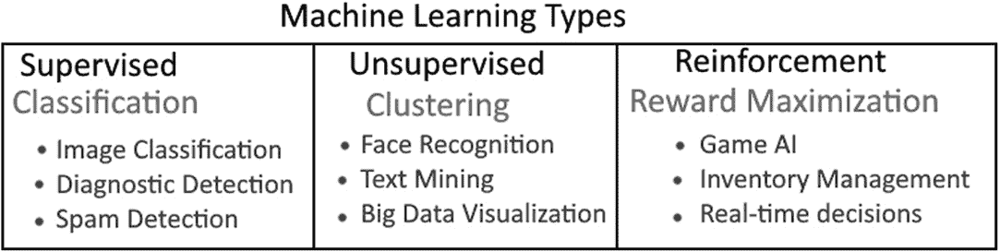

图 8.1 三种机器学习类型及其应用。

由于网络隔离和数据隔离，仅在内部数据上运行的简单机器学习系统的安全考虑因素较少。然而，对于从重要的公司数据库甚至整个互联网获取数据的更复杂的系统，需要考虑训练阶段或部署阶段的潜在威胁。根据具体的机器学习应用以及授予用户的访问级别，用于防御对抗攻击者采用的技术范围可能从简单的数据过滤到复杂的决策分析和模型调整不等。

## 8.2 安全威胁

针对机器学习系统的对抗攻击旨在降低系统的学习能力，在模型行为中产生故障，并从系统中获取敏感信息。由于机器学习模型是一个用于做出决策的大型网络，对抗攻击可以包括人类操作员无法察觉但会起作用的扰动。处理视觉数据的系统在对抗攻击方面已被广泛研究，特别是随着自动驾驶的日益普及。例如，在停止标志上贴贴纸可能会导致计算机视觉系统将其识别为让行或限速标志[2]。

针对机器学习系统的典型攻击向量可以根据它们针对模型的哪个阶段进行分类：训练或部署。在训练阶段，模型仍在从给定的数据集建立连接，因此攻击者用不可察觉的噪声和扰动投毒训练数据，导致模型形成错误的连接。一旦模型训练完成并部署，攻击者就会寻求评估和伪装模型，用一个替代网络替换它，该网络看起来能产生正确的结果，但实际上产生了针对性的错误。此时的攻击通常围绕查询模型以构建替代训练集。

在本章中，综述了几类威胁以及针对这些威胁的各种防御措施。首先，介绍了一种蜜罐防御网络，以分散对抗攻击者与真实系统的接触注意力。接下来，展示了投毒数据的概念，以及在预测和调整阶段对抗投毒数据的通用方法。之后，涵盖了 mixup 推理的原理，以提高 mixup 训练模型的防御参数及其全局线性。在随后的章节中，讨论了防御信息物理系统受数据导向攻击的技术以及此类技术在 IoT 设备上的适用性。从那里，引入了信息融合的概念，以及数据融合在网络级防御机制中的应用，特别是那些面向互联网和面向 CPS 的网络。在这些对机器学习防御技术的概述之后，提出了关于机器学习防御的更广泛的结论和潜在未来方向。

## 8.3 蜜罐防御

蜜罐（图 8.2）

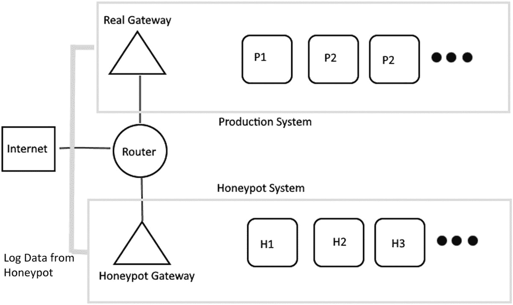

图 8.2 蜜罐系统体系图。

蜜罐的两种主要类型是`低交互`和`高交互`[3]。`低交互`陷阱使用的资源极少，仅从针对它们的攻击中收集基本信息。这些系统通常只是模拟的网络，内部存储的数据极少。由于它们在被攻破后几乎没有性内容可以吸引攻击者，因此这些低交互陷阱提供的关于复杂网络攻击的信息较少。相比之下，`高交互`蜜罐会建立一个带有伪造数据库和多层访问权限的完整系统，类似于真实系统的配置。这些高交互系统会占用攻击者更多的时间，并能对其攻击模式提供更深层次的洞察，例如对加密数据库的入入尝试或对蜜罐某些部分的下载行为。

对于机器学习系统，蜜罐可以用于防止对抗性攻击者破坏学习模型，同时减少攻击者从机器学习系统中能够获取的间接信息。正如 Younis 和 Miri 在关于去中心化蜜罐的论文 [4] 中所示的那样，此类陷阱网络可以实现以下结果：防止攻击者学习标签并近似黑盒系统，诱导攻击者进入一个占用其时间的诱饵系统，并为攻击者制造在计算上不可行的工作量 [4]。

在建立蜜罐网络作为机器学习系统的额外防御层时，有一些重要的考虑因素需要记住，以确保陷阱的有效性。首先，每个蜜罐节点对探测性攻击者来说应该尽可能真实——使用现有的机器学习系统但允许其在模拟数据上运行，可以产生一个在对抗性攻击者看来像是生产系统的蜜罐。其次，蜜罐在文件系统中部署“泄露”的令牌，这些令牌在攻击者看来是服务器中的潜在漏洞；这些人工数据转储（凭据、模型参数等）被放置在系统的各个位置供攻击者访问。第三，每个蜜罐节点应捕获并报告攻击者在入侵系统和搜索数据时的活动。使用蜜罐网络可以将这种报告隐藏在攻击者认为是不同服务器之间合法通信的网络活动中。

为了识别潜在攻击者，研究人员使用了各种标志，这些标志可以配置以指示非用户正尝试学习机器学习系统的行为。这些标志包括持续的 `DNN` 查询、大量的 `DNN` 标记请求，以及分类准确率的突然下降。与正常用户每个会话查询诱饵 `DNN` 模型 1–2 次相比，攻击者在构建合成训练数据集时可能会向模型发送数百或数千次查询。向断路器（用于与模型交互的接口）发送大量查询请求对于正常用户来说也不典型，但攻击者会反复查询断路器以扩大他们计划喂给 `DNN` 的合成训练模型。如果之前以高置信或低置信度分类的已知输入及其对应的已知输出突然开始变化，这也可以作为模型正受到攻击的指标。

机器学习系统的蜜罐防御可以作为现有安全架构的实用补充，但它们不适合作为对抗性攻击者的唯一防御。其主要功能是浪费潜在攻击者的时间，同时提供关于这些攻击者行为的数据；然而，这需要攻击者针对并与蜜罐交互。虽然包含明显的安全缺陷和“泄露”数据可以让蜜罐对攻击者产生吸引力，但此类策略不能保证攻击者与诱饵系统的交互时间足够长，以提取出有意义的数据。

## 8.4 投毒数据防御

近期对机器学习算法的研究表明，一个潜在的攻击向量是机器学习系统使用的训练数据集，即所谓的投毒数据攻击。这种在机器学习系统运行生命周期早期对其完整性的破坏会产生有害性影响，特别是当恶意篡改细微且人类操作人员难以检测时。例如，训练用于诊断患者数据的机器学习系统可能会报告比预期的更多的假阳性结果，降低人们对系统的信心，并恶化患者的预后。

在关于针对投毒数据防御技术的论文中，Mozaffari-Kermani 等人提出了在医疗系统中使用投毒攻击的通用算法无关的方法，以及针对这些通用攻击的应对措施 [5]。由于本章侧重于针对机器学习攻击的防御措施，作者们只能简要介绍这些通用攻击。

这种投毒数据攻击模型假设潜在攻击者对训练数据集有一定的了解，这种了解可能是通过公开可用（人口健康数据）或通过窃听网络流量来收集特定数据实现的。这些潜在攻击者的动机可能有所不同，但这些攻击的通常结果是模型在特定分类（标记为被攻击类别）期间性能下降。例如，攻击者可能希望将患者的甲状腺功能减退误诊为正常：一旦完成误诊，两种情况对恶意攻击者都是有利的：(1) 诊断被纠正，但对机器学习系统的信心降低了；或 (2) 诊断未纠正，患者遭受了健康影响。为了让对抗攻击者实现这一目标，它必须向训练集中添加足够的投毒数据，使机器学习系统开始错误地识别扰动，将恶意放置的信号误认为健康状况的实际标识符。

Mozaffari-Kermani 等人提出的应对措施是使用训练数据集定期构建并评估独立模型，如果模型的准确率统计在构建之间发生显著变化，则触发阈值报警。通过跟踪正确分类率和 Kappa 统计量，可以随时间测量模型的扰动，并识别恶意数据进入训练集的时间范围。

## 8.5 针对对抗攻击的 Mixup 推理

为了减少记忆和对抗样本敏感性等不良行为，Zhang 等人在训练阶段引入了他们的“mixup”方法 [5]。`mixup` 的主要原理是在示例及其标签对的凸组合上训练神经网络。通过这样做，神经网络被正则化为倾向于训练示例之间简单的线性行为。2018 年引入 mixup 概念的论文表明，这种原理提高了神经网络的泛化能力，并增强了网络对对抗样本的鲁棒性 [5]。

作为这项工作的扩展，Pang 等人开发了`混合推断`（`mixup inference`，简称 `MI`），这种推理原则旨在提高 mixup 训练模型的防御效果，使其能够更主动地对抗对抗样本 [6]。使用 `MI` 技术的模型的核心原理是将输入与其他随机清洁样本结合，从而收缩并转移数据集中可能存在的任何对抗扰动。这种结合输入旨在防止局部扰动对模型全局预测的影响。

![图 8.3 Pang 等人提出的算法概述 [6]，改编自。](html/images/fig8_3.jpg)

图 8.3 Pang 等人提出的算法概述 [6]，改编自。

针对其方法，Pang 等人为 mixup 训练的分类器提出了一种算法（图 8.3），该算法接收输入 `x`，在将其输入预测模型之前对其进行 mixup 处理。从理论上讲（在足够的计算时间和充足的清洁样本下），一个训练良好的 mixup 模型 `F` 可以建模为针对清洁示例凸组合的线性函数 `H`。通过调整预测阶段执行的迭代次数，可以在训练后阶段改变模型对对抗样本和局部扰动的敏感性。

关于其混合推断原则的实验结果，研究在 CIFAR-10 和 CIFAR-100 上使用 `ResNet-50` [6] 完成了训练。Pang 等人首先评估了盲攻击（oblivious-box attacks）下的性能，即攻击者不知道防御机制，并根据通用原理生成对抗样本。在目标和无目标模式下，`MI` 方法都能提高具有全局线性的训练模型的鲁棒性。它还兼容训练阶段的防御方法，例如导入 AT。`MI` 方法的消融实验还表明，它有效地利用了 mixup 训练模型产生的全局线性，而不是在过程中引入额外的随机性 [7]。

在攻击者感知防御机制的白盒自适应攻击下，`MI` 方法依然表现强劲，但扩展性不如盲攻击。`MI` 方法的额外迭代对于自适应攻击带来的改进比盲攻击要微小得多。

## 8.6 信息物理技术

信息物理系统通过基于计算机的算法控制或监控物理机制；物理组件和软件组件相互交织，使得其中一个领域的变化可能会引发另一个领域的变化 [8]。信息物理系统的示例包括智能电网、医疗监测系统和工业控制系统。信息物理系统的关键特征是物理输入和输出的网络化设计，而不是独立的设备。

在他们 2017 年的论文中，Cheng 等人提出了一种用于防御数据导向攻击的安全方法（`Orpheus`）[9]。这种类型的攻击旨在在不中断控制流的情况下更改程序的变量，导致物理发生的情况与 CPS（信息物理系统）网络认为发生的情况之间产生脱节。`Orpheus` 背后的核心方法是事件感知有限状态机（`eFSA`），通过评估状态转换来检测通过数据导向攻击实现的入侵。

## 8.7 信息融合防御

信息融合（或数据融合）（图 8.4）整合多个数据源，以产生比单一源更有用的信息 [10]。取决于融合发生的位置以及所用数据的复杂性，融合过程可以处于连续体上，低端对应于原始数据的简单组合，高端对应于处理数据的复杂融合。对于机器学习防御，这种信息融合概念可以作为一种网络级机制，用于检测和缓解针对 IoT 设备的攻击，如 Chen 等人在 2014 年的论文 [11] 所示。

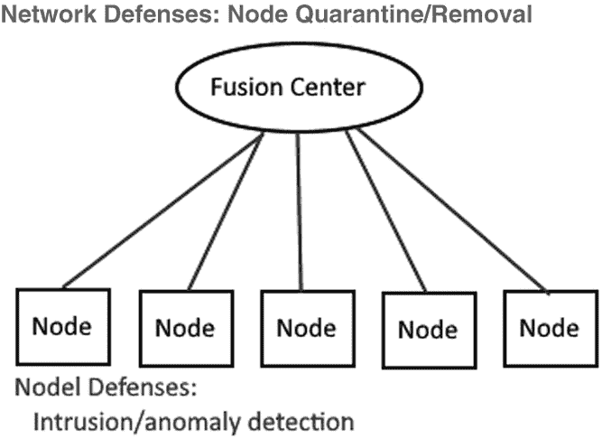

对于防御者来说，最坏的情况是对手对节点网络有完全了解，并能够同时破坏所有节点，特别是当攻击者知道融合中心的阈值以及特定节点重要性时。然而，针对每个节点的均匀攻击实际上不如针对节点子集的有针对性攻击有效，因为均匀攻击无疑会由于超过融合中心的阈值而触发反制措施。相反，更具针对性的意图攻击会寻求在不引起融合中心注意的情况下瘫痪网络运行；这意味着受攻击的节点较少，但目标节点对网络运行至关重要。

在节点层面，每个设备都采用简单的异常检测，并向融合中心报告一个极小的反馈比特位。这些反馈位在网络层面被用于决定哪些节点应该被隔离、哪些节点正在产生误报，以及何时应该部署更激进的防御措施（节点和网络重置）。由于网络的运行依赖于某些比例节点正常工作，因此基于渗透（percolation）的网络连通性可以作为衡量攻击有效性的标准。如果攻击成功将连通性降低到阈值以下（使网络处于断开状态），则认为攻击是成功的。在这一模型中，误报的成本与成功攻破节点的成本相同，因为结果都是将节点从网络中隔离。

Chen 等人分析的两种网络类型是面向互联网的网络和 CPS（信息物理系统）网络，因为这些拓扑结构占据了网络节点系统最大的份额。对于面向互联网的网络，度分布可以建模为幂律分布，显示出此类网络在面对针对关键节点的意图攻击时的脆弱性。如果一个主要的连接枢纽被针对并成功从网络中移除，其攻击影响将比随机尝试成功得多。另一方面，CPS 系统倾向于更均匀的连接，且其连接遵循指数分布。这种连接的增长意味着足够大的网络在运行效率受到影响之前，需要大量的节点同时故障，从而提高了其抵御针对性对抗攻击的鲁棒性。

根据他们的合成模型和实验结果，基于信息融合的防御可以增强现有的面向互联网和面向 CPS 的防御机制，且对网络主要节点的开销最小。由于反馈机制仅限于向融合中心发送极少的信息，因此通信开销很低，每个节点的计算开销也保持在低水平。虽然由于幂律分布，面向互联网的网络仍然容易受到高度针对性的攻击，但具有良好调优阈值的融合中心可以检测并缓解可能瘫痪此类网络的攻击，特别是当可以部署重路由等反制措施时。

## 8.8 结论与未来方向

如前面的章节所示，针对机器学习（ML）系统的攻击有三个主要目标：降低模型的学习能力、产生模型行为故障以及从系统中获取敏感信息。攻击可以根据其所针对的阶段（训练或部署）进行分组，然后利用这些分组来选择防御技术，如上文介绍的那些技术。虽然没有任何防御是绝对的，但恰当的防御方案可以降低攻击者的信心并减慢他们颠覆机器学习系统行为的尝试，为人类操作者的干预提供时间。

随着对机器学习系统潜在攻击的进一步研究，新的防御技术和对现有技术的改进将不断出现。最有前景的研究是寻找实时检测和纠正对抗行为的算法方法，使部署的机器学习模型能够主动缓解攻击损害。这些技术（如 mixup 推断方法）依赖于模型输出的常规自检，但旨在减少人类操作者的输入，以纠正错误和攻击损害。

## 参考文献

*   “机器学习算法的三类,” `Pioneer Labs | 技术战略师与交付专家`。[`pioneerlabs.io/insights/the-three-types-of-machine-learning-algorithms`](https://pioneerlabs.io) (访问日期：2021 年 2 月 11 日)。

*   K. Eykholt 等人*，“深度学习模型的鲁棒物理世界攻击，” ArXiv17070894 Cs，2018 年 4 月，访问：2021 年 2 月 11 日。[在线]。可用：[`arxiv.org/abs/1707.08945`](http://arxiv.org)。

*   “什么是蜜罐？,” usa.kaspersky.com，2021 年 1 月 13 日。[`usa.kaspersky.com/resource-center/threats/what-is-a-honeypot`](https://usa.kaspersky.com) (访问日期：2021 年 2 月 11 日)。

*   F. Younis 和 A. Miri，“在去中心化框架中使用蜜罐来防御对抗机器学习攻击，” 收录应用密码与网络安全研讨会，Cham，2019，第 24-48 页，doi：[10.1007/978-3-030-29729-9_2](http://dx.doi.org/10.1007/978-3-030-29729-9_2)

*   H. Zhang, M. Cisse, Y. N. Dauphin 和 D. Lopez-Paz，“Mixup：超越经验风险，”


近年来，机器学习和深度学习（DL）神经网络等技术已广泛应用于现实任务中，如图像分类、语音识别、自动驾驶、垃圾邮件过滤以及针对类图像数据的智能反欺诈。因此，深度学习系统在我们的生活中变得司空见惯且无处不在，这为攻击者实施攻击提供了新的可能性。攻击者试图通过各种方式改变模型的输入特征，以绕过现实任务中机器学习模型的检测，或通过直接攻击模型来破坏其完整性，从而实现对抗目标。

例如，初始对抗攻击旨在通过在正常样本中添加人类无法察觉的精细噪声来构建对抗样本，从而驱动机器学习或深度学习模型在不干扰人类认知的情况下，误判这些精心构建的对抗样本，如图 9.1 所示。在这里，原始图像被图像分类模型以 57.7% 的置信度识别为“熊猫”，而添加细微扰动后获得的对抗图像被错误地识别为“长臂猿”，置信度高达 99.3%，但对于人类来说，该对抗图像仍然被正常识别为大熊猫。

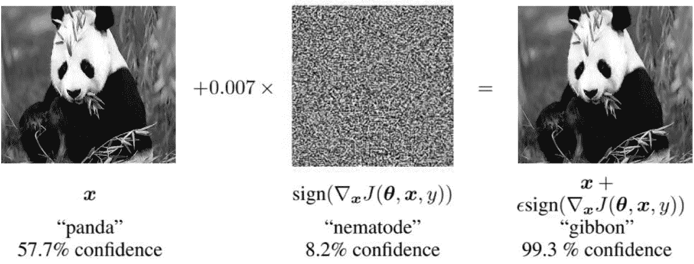

图 9.1 基础对抗攻击的示例。

由于此类细微的扰动通常肉眼无法区分，使得攻击极具隐蔽性，并足以改变模型的预测结果。这极具危害，因此对实际部署在现实场景中的机器学习模型（尤其是风险敏感型模型）构成了巨大的安全威胁。

为了深入探索针对深度学习模型的防御方案，我们简要介绍对抗攻击算法。对抗攻击最重要的分类标准是深度学习模型对内容的获取程度。基于此，我们可以将所有对抗攻击模型分为两类：白盒攻击和黑盒攻击。

*   **白盒攻击**：白盒攻击假设攻击者可以完全获取目标模型的结构和参数等信息。因此，在攻击过程中，攻击者可以使用模型的完整信息来求解目标模型的梯度信息，从而引导对抗样本的生成。

*   **黑盒攻击**：与白盒攻击不同，黑盒攻击假设攻击者既不知道训练数据和模型结构，也无法获取模型的特定参数。只能获取学习模型的最终决策结果。在这种情况下，攻击者只能通过操纵模型的输入并使用最终决策结果来检测对抗样本敏感或目标引导模型的梯度样本。因此，与白盒相比，黑盒攻击利用的信息较少，实施难度更大。

对抗攻击还可以根据不同的深度学习模型任务进行分类。通常，深度学习模型主要用于处理图像、数据、语音、文本等现实世界的问题。对于图像和数据任务，深度学习具有分割、分类和回归等任务，对抗攻击通常使用诸如增加扰动和数据投毒等方法。对于语音和文本任务，深度学习主要有识别、翻译、预测等任务。在面对此类任务时，对抗攻击通常使用添加高频噪声、关键词提取或同义词/反义词替换等方法。

一旦我们对对抗攻击有了通用的理解，就会发现防御方案也是一个迫切需要的研究课题，以确保广泛使用的深度学习模型不会受到攻击者的干扰，并增强深度学习模型的鲁棒性。在接下来的章节中，我们将根据不同的应用场景介绍具有特殊性的防御方法。在本章的最后，我们提出了当前对抗攻击防御研究中存在的几个开放性问题。

## 9.2 防御分类

当我们对现有的对抗防御进行分类时，可以简单地将防御水平分为两类：全防御和仅攻击检测。全防御方法旨在使目标网络对对抗样本（例如攻击目标）的攻击产生免疫力。分类器能够准确预测对抗攻击的标签。另一方面，仅攻击检测方法可能仅对潜在的对抗样本添加标记，以便在后续处理中将其拒绝。

我们还可以将所有防御方法分为三类：修改训练或修改输入、修改网络架构以及网络插件。第一类与学习模型不直接相关，而后两类更多地关注神经网络本身。“修改”网络和使用“插件”的区别在于，后者在训练过程中改变了原始深度神经网络的架构/参数。第三种则保持原始模型完整，并在测试期间在原始模型上挂载一个外部模型。

### 9.2.1 修改训练或修改输入

#### 数据预处理

在图像处理领域，许多对抗扰动在观察者看来就像高频噪声。一些研究人员建议使用图像预处理作为对抗对抗样本攻击的防御策略，例如 `JPEG 压缩`、总变异最小化（`tvm`）、图像缝合（image quilting）和位深降低。

例如，Dziugaite 等人研究了 `JPEG 压缩` 对快速梯度符号法（`FGSM`）计算扰动的影响。报道显示，对于 `FGSM` 扰动，`JPEG 压缩` 实际上可以在很大程度上逆转分类准确性的下降。然而，结论认为仅靠压缩并非有效的防御，因为 `JPEG 压缩` 对小扰动的改进较大，而对大扰动效果较小。`FGSM` 是一种典型的白盒攻击模型。它简单有效，在图像攻击领域具有重要地位，许多后续研究基于此进行。

特征压缩算法也关注数据预处理以生成有效的防御。神经网络的输入值存在许多“冗余”特征，这有利于他人创建对抗样本。作者提供了一种压缩特征的方法，压缩具有降噪的作用。

1.  **降低每个像素的深度**：图像像素通道的大小为 `2⁸`。发现使用 `2^i` 的压缩大小表示图像不会影响神经网络对图像的判断。它有效减少了被攻击的可能性，即添加到对抗样本中的噪声影响将被有效降低。

2.  **空间维度的降低**

在 [5] 中，给出了中值平滑的示例，这等同于卷积神经网络中的池化。它取 `n×n` 滤波器的中值并替换原始区域的值。由于相邻区域的像素值具有相似的相关性，对整幅图进行平滑不会影响最终结果，但可以消除添加其中的噪声。

尽管图像预处理在攻击者不知道防御方法场景下是有效的，但在攻击者知道防御方法的情况下，它几乎是无效的。然而，预处理仍然是一类很有吸引力的防御方法，因为它可以与其他防御方法结合产生更强的防御，并能在不知道目标模型的情况下缓解对抗样本的危害。

#### 数据增强

数据增强通常用于对抗黑盒攻击。它使用生成的对抗样本来扩展原始训练集，试图让模型在训练期间看到更多数据。

例如，在 [7] 中，通过生成对抗网络（GAN）算法对阅读能力进行训练，扩展了对抗样本的文本 [8]。他们提出了两种方法来生成更多多样化的特征：(1) 基于知识的词，即从在线数据库物种中使用同义词/负向对替换单词；(2) 基于神经网络，即使用 `seq2seq` 模型生成包含示例的假设，并通过执行损失函数测量原始假设与生成假设之间的交叉熵。在训练过程中，他们使用 GAN 算法训练判别器和生成器，并将对抗样本判别器的优化步骤合并到其中。

Wang 等人 [9] 增强了数据库的复杂度，从而提高了模型的抗攻击性。此外，其复杂度转换公式可以通过对对抗样本的持续检测来更新自身。Lee 等人 [10] 提出一种观点，在训练深度学习（DL）模型时可以引入数据增强模块来模拟对抗攻击，该模块使用不确定性生成器来训练 DL 模型。生成器可以产生类似 `FGSM` 的扰动。通过 DL 分类器后，它可以产生正常结果或干扰结果。通过该数据增强模块自主学习的 DL 网络对基于 `FGSM` 扰动的更大规模攻击具有更强的鲁棒性。

### 9.2.2 修改网络架构

#### 网络蒸馏

蒸馏由 Hinton 等人 [11] 引入，作为一种训练程序，将更复杂网络的知识传输到较小的网络中。但这项工作仅关注模型集的任务，以便将部署扩展到大量用户，特别是当单个模型是大型神经网络时。Papernot 等人 [12] 引入的程序变体本质上利用网络蒸馏的知识来提高其自身的鲁棒性。他们认为，在面对对抗样本攻击时，改变网络结构并重新训练更复杂的模型确实可以防御此类攻击。但成本太高，需要更多的计算资源和时间。因此，寻找一种新的防御方法，使其能够在不改变网络结构并在尽可能不影响模型准确性的情况下有效处理攻击，是理想的。训练数据的类别向量概率从初始的 `DNN` 中提取，并反馈以训练蒸馏网络中的原始模型。具体来说，它使用原始 `DNN` 的 `softmax` 输出来训练一个与原始 `DNN` 结构相同的第二个 `DNN`。样本模型架构如图 9.2 所示。原始 `DNN` 的 `softmax` 也通过引入温度参数 `T` 被修改：

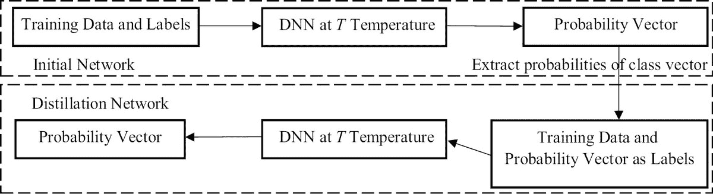

图 9.2 蒸馏 DNN 的模型架构。

$$q_i = \frac{\exp(z_i/T)}{\sum_j \exp(z_j/T)}$$

其中 `z[i]` 是 `softmax` 层的输入。`T` 控制知识蒸馏的程度。当 `T` = 1 时，它变回正常的 `softmax` 函数。如果 `T` 很小，函数将输出更极端的值。当它很大时，`q[i]` 接近于均匀分布。因此，增加 `T` 会降低模型的梯度并使其更平滑，从而降低模型对扰动的敏感性。

#### 模型正则化

模型正则化将生成的对抗样本作为正则化，其形式如下：

```
min(J(f(x),y) + λJ(f(x'),y))
```

其中 `λ` 是超参数。遵循 [2]，工作 [13] 构建了具有线性近似的对抗训练：

```
g = ∂p(y|x)/∂x
```

```
p(y|x+ε) / ||g||[2],θ
```

其中 `||g||` 是 `L2` 范数，`θ` 是模型的参数，`θ*` 是 `θ` 的常量副本。在 [13] 中，作者计算了 Goodfellow 提出的 `FGSM` 扰动，以获得 DL 模型的对抗损失。这种损失被添加到 DL 模型的分类损失（交叉熵）中获得新的损失。通过优化该损失，可以在文本分类上实现卓越性能。

`FGSM` 扰动后的词嵌入有很大概率不会映射到真实的单词，就像图像中 RGB 的扰动可以产生肉眼无法区分的样本一样。作者认为，这种对抗训练更是一种正则化方法，允许获得更好的词嵌入。

#### 防御通用扰动

Akhtar 等人 [14] 提出了一种防御框架来对抗使用通用扰动生成的对抗攻击。该框架在目标网络之前增加了一个额外的“预输入”层，并训练它修复受扰图像，而不更新目标网络的参数，最终允许分类器做出与未受扰动版本相同的预测。预输入层被称为扰动修正网络（PRN），它通过提取训练图像的 PRN 输入输出差异的离散余弦变换特征来训练单个检测器。测试图像首先通过 PRN，然后其特征用于检测干扰。如果检测到对抗扰动，则使用 PRN 的输出对测试图像进行分类，反之则使用原始图像作为模型的输入。

#### MegNet 模型

Meng 等人 [15] 认为，对于大多数人工智能任务，样本空间是一个高维空间，但我们需要的有效样本实际上位于维度比原始样本空间低得多的流形空间中。

作者实现了一种双管齐下的防御系统，提出了相应的 `detector`（检测器）和 `reformer`（重构器）方法，原因有二：(1) `Detector` 用于判断样本是否远离流形边界。例如，如果任务是分类手写数字图像，那么所有不包含数字的图像都是对抗样本，因为目标深度学习（DL）模型的分类器必须对这些图像进行分类，会导致分类错误。属于此类别的输入样本将被直接移除。(2) 对抗样本非常接近该任务的决策边界。如果该分类方法在该点的泛化能力不佳，也可能发生分类错误。作者试图找到接近该任务流形或略高于流形的样本，然后将其交给分类器。这是作者构思的第二种防御方法。图 9.3 展示了 MagNet 的工作流。

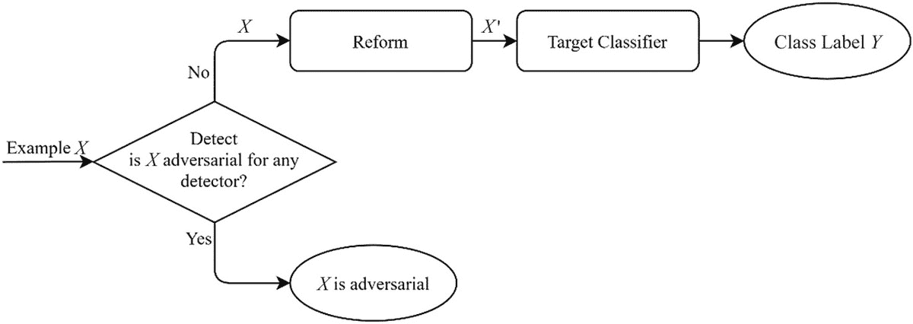

图 9.3 MagNet 的工作流。

通常，检测对抗样本的函数生成需要特定对抗样本生成过程的知识，因此无法泛化到其他类型的对抗样本。因此，这种方法很容易被稍微修改的攻击绕过。在本文中，作者提出了两种检测对抗样本的新方法：基于重构误差的检测方法和基于概率散度的检测方法。

1.  **基于重构误差的检测**：对于所有正常样本的训练集，作者训练了一个自动编码器，使得该训练集的损失函数最小化，其损失函数定义为 $L(X_{\text{train}}) = \frac{1}{X_{\text{train}}}\sum_{x \in X_{\text{train}}}E(x)$，其中 `X[train]` 是训练集中的正常样本，`E(x)` 是重构误差。作者认为，如果待测样本是正常样本，它的重构误差会很小，因为该样本与自动编码器的训练数据具有相同的生成过程；反之，如果检测的样本是对抗样本，那么该样本的重构误差将很大。

2.  **基于概率散度的检测**：作者通过比较两组经过 softmax 层输出的不同输入数据的结果，找到了对抗输入样本。他们使用 Jensen–Shannon 散度（Jensen–Shannon scatter）来衡量两组数据结果之间的差异程度。

理想的重构器需要满足以下两个条件：(1) 它不改变正常样本的分类结构；(2) 它应该充分重构对抗样本，使得重构后的样本接近正常样本。作者训练自动编码器以最小化训练集上的重构误差，并确保它良好地适应验证集。之后，当给定正常输入集时，自动编码器输出一个非常相似的示例。然而，当给定对抗示例时，自动编码器应该输出一个接近对抗样本的示例。通过这种方式，MagNet 可以在保持分类准确性的同时提高分类精度。

## 9.4 讨论与开放性问题

当前研究人员面临的最大挑战可以总结为两点。

1.  **对白盒攻击的有效防御**：我们还没有看到能良好平衡有效性和效率的防御。在有效方面，对抗训练显示出最佳性能，但计算开销巨大。在效率方面，许多随机和基于去噪的防御算法可以在几秒内配置，但简单的防御无法保护深度学习模型算法免受已经获取模型细节的攻击者的侵害。

2.  **可扩展性**：由于大多数防御无法抵御自适应白盒攻击，研究人员已开始关注可证明防御，这种防御无论攻击者的方法如何，都能在一定范围内保证防御性能。但到目前，可扩展性是目前大多数可证明防御的共同问题。例如，区间界分析（interval bound analysis）是一种最近流行的基于证明的防御方法，但它无法扩展到非常深的神经网络大数据集。

## 9.5 结论

随着深度学习研究的进一步发展以及 DL 技术在现实场景中的广泛应用，深度学习的安全与隐私已成为一个充满前景的新领域，吸引了大量学术界和工业界的学者进行深入研究并取得了许多卓越成果。然而，到目前 DL 安全和隐私研究仍处于起步阶段，许多关键科学问题有待解决。

本章总结了针对深度学习模型的对抗防御策略。首先，我们介绍了不同的对抗攻击的目标，并在不同的类别中，详细说明了不同的防御算法，每种算法都有不同的优势。然而，深度学习对抗防御的研究仍处于起步阶段，我们仍然面临两个主要困难：如何对抗白盒攻击以及对抗防御的普及性。我们还没有有效的算法来防御潜在有害的白盒攻击。

## 参考文献

*   Ian Goodfellow, Yoshua Bengio, and Aaron Courville. 2016. Deep Learning. Vol. 1.
*   Goodfellow, I. J. Shlens, J., & Szegedy, C. Explaining adversarial examples.
*   Das, N. Shanbhogue, M., Chen, S., Hoi, F. Fast, practical defense using input. Proceedings of 24th ACM SIGDD Conference on Knowledge Discovery & Data Mining (pp.196–204).
*   Guo, C. Rana, M., Cisse, M. Countering adversarial images using input. arXiv:1711.0017.
*   Xu, W. Evans, D., & Qi, Y. Feature squeezing: Detecting adversarial examples in deep neural networks. arXiv:1704.0155.
*   Dziugaite, G. Ghahramani, Z., & Roy, D. A study of the effect of jpg compression on adversarial images. arXiv:1608.0053.
*   Kang, D. Khot, T., Sabharwal, A., & Hovy, E. Adventure: Adversarial training for textual entailment with knowledge-guided examples. arXiv:1805.0468.
*   Goodfellow, I. J. Pouget-Abadie, J., Mirza, M., Xu, B., Warde-Farley, D., Ozair, S., ... Bengio, Y. Generative adversarial networks. arXiv:1406.2661.
*   Wang, Q. Guo, W., Zhang, K., Ororbia II, A. G., Xing, X., Liu, X., & Giles, C. L. Learning adversary-resistant deep neural networks. arXiv:1612.0141.
*   Lee, H. Han, S., & Lee, J. Generative adversarial trainer: Defense to adversarial perturbations with gan. arXiv:1705.03387.
*   Hinton, G. Vinyals, O., & Dean, J. Distilling the knowledge in a neural network. arXiv:1503.02531.
*   Papernot, N., McDaniel, P., Wu, X., Jha, S., & Swami, A. (2016, May). Distillation as a defense to adversarial perturbations against deep neural networks. In 2016 IEEE symposium on security and privacy (SP) (pp. 582–597). IEEE.
*   Miyato, T., Dai, A. M., & Goodfellow, I. (2016). Adversarial training methods for semi-supervised text classification. arXiv preprint arXiv:1605.07725.


*   Akhtar, N., Liu, J., & Mian, A. (2018). Defense against universal adversarial perturbations. In Proceedings of the IEEE conference on computer vision and pattern recognition (pp. 3389–3398).

*   Meng, D., & Chen, H. (2017, October). Magnet: a two-pronged defense against adversarial examples. In Proceedings of the 2017 ACM SIGSAC conference on computer and communications security (pp. 135–147).

# 深度强化学习网络安全的 10 种防御方案

Jiamiao Zhao,¹ Fei Hu,¹ and Xiali Hei²

¹美国阿拉拉马大学电气与计算机工程系

²美国路易斯安大学拉法叶尔分校信息学院

DOI: [10.1201/9781003187158-12](http://doi.org/10.1201/9781003187158-12)

## 目录

1. 10.1 引言
2. 10.2 背景
3. 10.2.1 无模型强化学习
4. 10.2.2 深度强化学习
5. 10.2.3 DRL 的安全性
6. 10.3 针对对抗样本的认证化验证
7. 10.3.1 鲁棒性认证
8. 10.3.2 系统架构
9. 10.3.3 实验结果
10. 10.4 对抗状态观测的鲁棒性
11. 10.4.1 确定性策略的 own 对抗 DRL：DDPG
12. 10.4.2 Q-Learning 的对抗 DRL：DQN
13. 10.4.3 实验结果
14. 10.5 结论与挑战
15. 致谢

## 10.1 引言

机器学习（ML）可以分为三类：监督学习、无监督学习和强化学习。在 `supervised` 学习中（例如 `SVM`、决策树等），训练样本是带有标签的，用于寻找不同聚类之间的边界。相反，如果训练数据集没有真实值标签（ground-truth labels），则其机器学习算法被称为 `unsupervised` 学习，例如 `KNN`、`K-means` 等。它们根据超平面中的距离对训练数据进行分类。

`Reinforcement` 学习（RL）利用智能体从历史状态/动作中学习，并可以使用最大累积奖励来生成动作并与环境实时交互。

RL 已用于机器人学、电网、传感器网络等许多其他现实应用中的决策问题。然而，RL 算法可能需要很长时间才能收敛到最优点（取决于状态空间，从几小时到几周不等）[1]。最近，一种结合深度学习（DL）与 RL 的新算法深度强化学习（DRL）被应用于处理高维输入，如摄像头图像、大向量问题。DRL 在许多复杂的决策过程中取得了巨大的成效，例如机器人学 [2]、自动驾驶汽车、智能城市、游戏 [3]。一种名为 `DeepRacer` 的自动驾驶汽车是由 RL 设计的。它利用轨道和方向来确保 DRL 对抗对抗攻击的安全性 [4]。深度神经网络（DNN）也会受到输入的影响。

本章旨在介绍 DRL 的安全问题。*本文结构*：RL 和 DRL 的概述及其类型见 10.2 节。10.3 节介绍了建议的防御方法。10.4 节介绍了改进版本。我们总结本章并讨论挑战。

## 10.2 背景

在本节中，我们首先介绍 RL。我们特别讨论了无模型 RL。然后展示如何将强化学习与深度学习结合形成 DRL [1]。我们总结了 DRL 技术及其潜在缺陷。

强化学习问题可以描述为马尔可夫决策过程（MDP）。MDP 包含状态、动作、奖励和策略。在这里我们给出术语和函数的定义。

*   状态 `S`：智能体交互并学习状态。在每个时间步，智能体根据策略与状态空间交互并获得奖励。
*   策略 `π`：定义智能体如何在环境中激活。它将状态映射到动作。策略分为两种：确定策略和随机策略。当智能体采取的动作是确定的，策略就是确定性的；如果对于不同状态遵循概率分布，则策略是随机的。
*   同策略（On-policy）算法评估探索价值。
*   异策略（Off-policy）算法不评估探索价值。`Q-learning` 是一种异策略方法。
*   动作 `A`：智能体与环境交互的行为。
*   奖励 `R`：智能体执行动作后获得的奖励。智能体的目标是最大化累积奖励。
*   价值函数：智能体在特定状态可以获得的期望累积奖励。可以通过 `Vπ = Eπ` 计算：

```
G[t] = R[t+1] + γR[t+2] + ... + γ^(T-1)R[T]
```

其中 `G[t]` 是从状态到终点的奖励和，`γ` 是折扣因子，`γ` ∈ [0,1]。

*   探索与利用：*探索*是智能体通过在给定状态采取不同动作来尝试环境的过程。*利用*发生在探索之后。智能体利用最优动作来获得最高的累积奖励。

强化学习（RL）有两个主要分支：无模型（model-free）和基于模型（model-based）强化学习算法。`Model-free` 意味着训练过程中不使用任何模型。无模型强化学习可以直接从与环境的实时交互中学习。在 `model-based` 方法中，在训练阶段之前有一个早期模型（`MDP` 模型）。智能体维持该模型并寻找优化解。基于强化学习的优化模型的复杂度与状态数量的平方成正比。这可能需要很高的计算开销。在现实世界中，枚举所有状态、转移条件和转移概率的能力有限。因此，现大部分研究工作集中在无模型强化学习上。

### 10.2.1 无模型强化学习

无模型强化学习侧重于通过与环境的交互直接计算价值函数。它可以分为两类：策略优化和 Q 学习。

1. `策略优化`：策略优化是通过使用基于梯度或无梯度的方案直接寻找最优策略的过程 [1]。基于梯度的方法最适合处理高维问题。无梯度的方法在低维问题中很有用。在策略优化中，策略表示为 `πθ`，这意味着当状态为 `s` 时采取动作 `a` 的概率分布 `π`，而 `θ` 是策略 `π` 的神经网络参数。策略梯度定义为 [5] `∇E[π**θ] = E[π**θ]r[t]∇log πθ`。

2. `Q-learning`：这是一种离线策略（off-policy）强化学习。Q 学习的主要目标是最大化 `Q-value`。`s[t+1]` 是根据上一个状态 `s[t]` 的动作得到的下一个状态，`a[t+1]` 是 `s[t+1]` 中的一个可能动作。`α` 是学习率，`i` 表示迭代次数，`γ` 是折扣因子：

```
Q_{i + 1}(s_{t},a_{t}) = Q_{i}(s_{t},a_{t}) + \alpha(R_{i + 1} + \gamma\max_{a_{t + 1}}(Q_{i}(s_{t + 1},a_{t + 1}) - Q_{i}(s_{t},a_{t})))
```

该方程清楚地证明了 Q 学习决定了下一步动作 `a[t+1]` 并获得了 `s[t+1]`。它使用 `ϵ-greedy` 策略并寻找 `Q-value` 增量最大的动作。

### 10.2.2 深度强化学习

在现实应用中，输入不能像离散状态那样简单，而可以用值来表示。输入数据可能具有高维性，例如自动驾驶车辆中的图像。一种解决方案是从高维数据中提取特征。但这依赖于研究人员的设计。而且从输入图像中提取目标信息是非常复杂的。

另一种方法是使用神经网络来寻找最优策略价值函数或 `Q-function`。这是深度强化学习（DRL）的基本思想。1992 年，Gerald Tesauro 开发了一个名为 `TD-Gammon` 的计算机双陆棋程序，通过时间差分学习使用神经网络进行训练 [6]。`TD-Gammon` 的水平仅略低于当时的顶级人类双陆棋选手。它探索了以前没有人用过的策略，并推进了双陆棋玩法的理论。

当深度学习（DL）发生时，它在图像处理方面表现强大。利用 DL 解决强化学习有三种主要方法：基于 `Q` 的方法、基于 `Q-value` 的方法、基于策略的方法，以及演员-评论家（actor-critic）的混合方法。

经典的 Q 网络在学习 `Q-value` 时有很多问题 [7]：首先，由于连续样本是相关的，训练数据不是 `iid`（独立同分布）的 [7]。第二，`Q-value` 的微小变化可能导致策略的剧烈变化。最后，Q 梯度可能足够大，导致网络不稳定 [7]。

这些问题可以通过使用深度 Q 网络（`DQN`）[8] 来解决，它采用了经验回放，调节网络参数，并将奖励归一化到 `[-1, +1]`（2015）。损失函数是目标值与当前 `Q` 估计之间的差异：

```
L_{i}(\theta_{i}) = E((R_{i + 1} + \gamma\max_{a_{t + 1}}(Q_{i}(s_{t + 1},a_{t + 1}) - Q_{i}(s_{t},a_{t}))))
```

`DQN` 在 Atari 游戏上进行了评估，得分最高。

## 10.2.3 深度强化学习的安全

与机器学习（ML）相比，DRL 面临不同的安全挑战。主要区别在于 RL 的目标是从序列问题寻找优化策略，而大多数 ML 算法是为了解决单步预测。而且 ML 的训练数据集是固定分布。另一方面，DRL 中的智能体是用确定性或随机策略训练的。

RL 问题包含四个部分（`s`, `a`, `r`, `p`），其中 `s` 代表状态，`a` 代表动作，`r` 代表奖励，`p` 代表智能体处于状态 `s` 的概率。因此攻击者在 DRL 中有更多目标。针对 DRL 的攻击分为四类。

1. `针对奖励的攻击`：2018 年，Hen 等 [9] 评估了软件定义网络中 DRL 对对抗攻击的反应。攻击者知道模型的结构和参数。通过翻转奖励和操控状态，攻击者能够误导智能节点选择次优动作。Pattamaik 等 [10] 通过对观测值添加扰动提出了三种攻击方法。评估结果显示，使用随机梯度下降创建代价函数的攻击可以引导 DRL 智能体进入预定义的对抗状态。

2. `针对策略的攻击`：Trstschk 等 [12] 添加了对抗变换网络（`ATN`），对 DRL 的策略网络施加对抗奖励。如果智能体遵循对抗输入，ATN 会使累积奖励达到最大。因此 DRL 会自动遵循攻击者的策略。但这种方法要求攻击者拥有智能体和目标环境的完整信息（称为白盒攻击）。

3. `针对观测的攻击`

攻击者也可以直接操纵传感器数据。目前，针对动态环境下机器人系统的实时攻击研究已经过评估。Clark 等人 [13] 对针对动态环境下自主机器人的 `DRL` 策略使用了白盒对抗攻击。该机器人的目标是在迷宫中寻找路径，而攻击者的目标是误导机器人走向错误路径。攻击者篡改机器人的传感器数据，导致机器人偏离最优路径。Clark 等人 [13] 还观察到，如果移除对抗输入，机器人会自动修正其动作并找到正确的路径。因此，攻击者可以临时篡改传感器数据，并留下极少的证据。最近，Tu 等人 [14] 显示机器人 `VR`/`AR` 应用中的运动感知和执行系统可以在实时非侵入式攻击中被操纵。

4. `针对环境的攻击`

对 `DRL` 进行对抗攻击的最后一种方法是环境。环境攻击的核心思想是放置额外的干扰障碍来混淆机器人。Bai 等人 [15] 提出了一种为用于路径规划的深度 Q 网络 (`DQN`) 创建对抗样本的方法。`DQN` 模型已经有了一套寻找最优路径的完整解决方案。攻击者提取模型参数并对其进行分析，从而发现 `Q-value` 的弱点。攻击者向机器人添加对抗环境样本。这种方法生成了成功的攻击，并阻止机器人在迷宫中找到最优路径。

## 10.3 对抗样本的认证验证

在 `DNN` 中，输入的一个细微扰动（称为对抗样本）会导致模型产生错误的预测。对抗样本会在现实世界中引起危险，例如，自动驾驶车辆可能会将停止标志视为广告并忽略它，从而导致碰撞。图 10.2 显示了扰动攻击的一个示例。人类的肉眼无法看出良性图像与恶意图像之间的区别，但这种噪声会极大地影响 `DNN` 模型的预测结果。

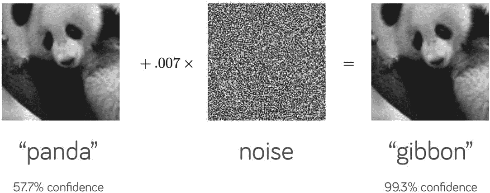

图 10.2 对抗样本。

Lutjens 等人 [16] 提出了一种鲁棒性验证方法，为提高针对对抗攻击或噪声的鲁棒性提供了理论保证。Lutjens 等人证明，现有的对抗的方法（如对抗训练、防御蒸馏或模型集成）没有保证鲁棒性提升的理论算法，并且对于未来的对抗攻击往往无效 [17]。验证方法可以保证未来的鲁棒性。在给定边界输入扰动的情况下，它能从理论上找到最大输出偏差的边界 [18]。但目前寻找精确验证边界的问题是 NP 完全的 [18]，因此在机器人上在线运行是不可行的。相反，Lutjens 等人 [16] 提出了一种松弛版的验证，该方法可以寻找 `Q-value` 的下界，并在由于对抗攻击或传感器噪声导致输入空间出现最坏偏差的情况下选择最优动作。通过利用计算出的下界，智能体可以找到位于边界内的所有可能状态并确定最优动作。

### 10.3.1 鲁棒性认证

在 `RL` 中，`Q-value` 被表示为 $Q = E[\sum_{t = 0}^{T}\gamma^{t}r_{t}]$，这是在状态 `s` 从 `t`=0 到 `t`=`T` 的期望奖励。`Q-learning` 的目标是在对抗攻击或传感器噪声对观测的最坏情况扰动下，寻找最大的累计 `Q-value`。为了计算 `DNN` 预测的 `Q` 的认证下界，Lutjens 等人 [16] 定义了状态-动作值的认证下界，`Q[L]`：

```
QL(sadv,aj)=Qs∈Bp(ssdv,ε)minl(s,aj)
```

其中 `s[adv]` 是受攻击者噪声损坏的扰动状态。Lutjens 等人假设 `s[adv]` 被限制在 `ε` 半径的圆内。`a[j]` 是针对偏离输入的最鲁棒动作。

Lutjens 等人最终使用闭式公式在 `DNN` 内部计算 `Ql`，其中 `ReLU` 被用激活函数。`H` 是下/上界因子，`W` 是权重矩阵，`b` 是第 (`k`) 层的偏置，`r`, `j` 为索引：

```
Q_{l}(s,a_{j}) = A_{j,:}^{(0)}s + b_{j}^{(m)} + \sum_{k = 1}^{m - 1}A_{j,:}^{(k)}(b^{(k)} - H_{:,j}^{(k)})
```

矩阵 `A` 包含每层的神经网络权重和 `ReLU` 激活，`A^((k-1)) = A^((k))*W^((k))*D^((k-1))`，且 `A^((m))`=1，即最后一层的恒等层。

### 10.3.2 系统架构

认证系统与标准的无模型 `RL` 类似，增加了验证功能。图 10.3 描述了系统架构。在训练阶段，智能体使用未被损坏的状态观测 `s`，并寻找每个状态下的 `Q-value`。

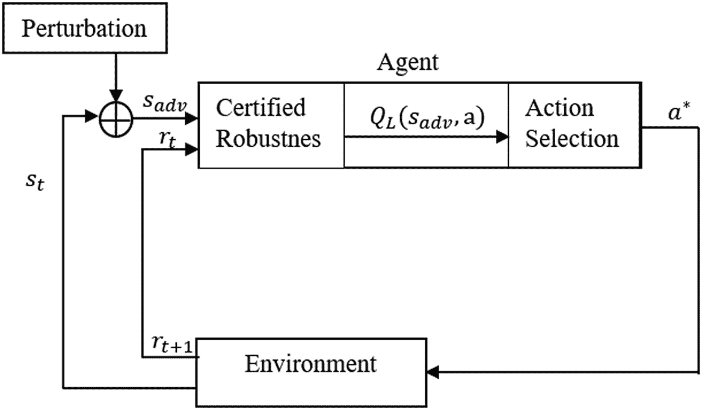

在在线执行阶段，智能体接收受损坏的状态观测并将其传递给 `DNN`。认证的 `DQN` 计算边界扰动下的 `Q` 下界。由于 Lutjens 等人假设 `s[adv]`（最可能的状态）被限制在以真实状态 `s[0]` 为中心的 `ε` 半径圆内，因此状态 `s[0]` 应该位于 `s[adv]` 周围的 `ε` 圆内的任何位置。因此，智能体评估所有可能状态的每个 `Q-value`。最优动作 `a(*)` 定义为在扰动观测下具有最高 `Q-value` 的动作：

```
a(*) = argmax[a[j]] QL
```

遵循这一策略，智能体在最坏偏差下选择最鲁棒的动作。

### 10.3.3 实验结果

鲁棒性指标在避障仿真和直立摆领域中进行了评估。行人仿真用于验证机器人在行人流中的避障能力。该仿真使用动力学仿真环境来学习避障策略。

普通 `DQN` 策略对扰动输入不具鲁棒性。增加对抗或噪声幅度会增加平均碰撞次数并降低平均奖励。

Zhang 等人 [19] 还研究了对抗扰动或噪声环境下的鲁棒 DRL 算法（图 10.4）。Zhang 等人 [19] 进一步证明，简单的对抗训练方法在噪声环境中不能显著提高 DRL 的鲁棒性，反而会导致 DRL 训练不稳定并降低智能体的性能。他们得出结论：将监督学习技术简单应用于 RL 是不恰当的，因为 RL 和监督学习是两个完全不同的问题。

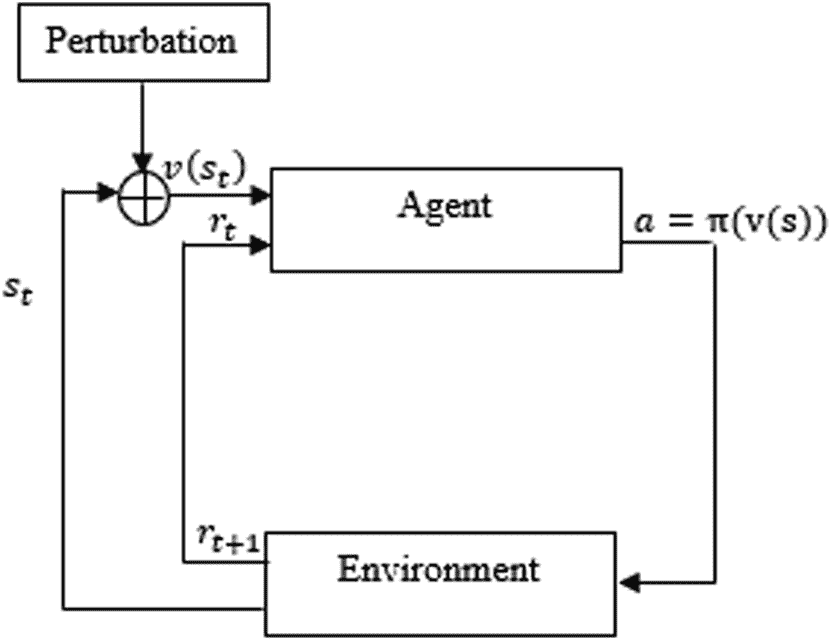

图 10.4 带有观测扰动的强化学习。

除了对抗样本外，DRL 智能体在没有对抗攻击或噪声输入的情况下，在常规训练期间也可能偶尔失败。调试 DRL 智能体的意外故障是一个具有挑战性的课题。Zhang 等人设计了几个深度确定性策略梯度（`DDPG`）智能体，试图获得高中值奖励。然而，在 100 个回合的训练中，他们观察到了一些低奖励运行 [19]。这种故障在自动驾驶等安全关键型应用中可能是危险的。

为了提高 DRL 的鲁棒性，Zhang 等人 [19] 提出了一种鲁棒策略正则器，可以降低智能体对观测的敏感性。该策略正则器可用于多种 DRL 算法：近端策略优化（`PPO`）、深度确定性策略梯度（`DDPG`）和深度 Q 网络（`DQN`）。Zhang 等人 [19] 首先将状态观测上的扰动建模为改进的马尔可夫决策过程（`MDP`）或状态对抗马尔可夫决策过程（`SA-MDP`）。他们证明了当智能体受到对抗攻击时，`SA-MDP` 可能不存在平稳且马尔可夫的最优策略。基于他们的 `SA-MDP` 理论，Zhang 等人提出了一种理论规范的鲁棒策略正则器，它利用了扰动策略的总变异距离或 KL 散度 [19]。


本节主要介绍 `DDPG` 和 `DQN` 中的策略正则器，以及正则化后 `DDPG` 和正则化后 `DQN` 的实验结果。

### 10.4.1 针对确定性策略的状态对抗 DRL：DDPG

如前所述，`MDP` 定义为一个四元组（`S`、`A`、`R`、`p`），其中 `p: S × A → P(S)` 表示环境的转移概率，其中 `P(S)` 是所有可能的转移概率的集合。图 10.4 显示了带有受扰动状态观测的强化学习。在 `SA-MDP` 中，Zhang 等人 [19] 引入了对抗者 `v(s): S → S`。对抗者扰动智能体的观测，导致执行的动作是 `π(a|s)` 而不是真实的 `π(a|s)`。由于 `v(s)` 与真实观测不同，动作 `π(a|s)` 可能是次优的。Zhang 等人 [19] 假设对抗攻击取决于状态且不随时间变化。然后他们定义了一个集合 `B(s)`，它由 `s` 的“邻接”状态组成。

`DDPG` 学习一个确定性策略 `π(s) ∈ R(|A|)`，以解决 `DDPG` 中来自真实状态 `s` 的变异 `TV` 可能与受扰动状态 `s` 不重叠的问题。Zhang 等人 [19] 定义了 `DDPG` 中策略的平滑版本，其中每个动作都添加了方差为 `σ²` 的独立高斯噪声：`π(a|s) ∼ N(π(s), σ²I_{|A|})`。然后可以使用以下定理计算变异距离 `TV`：

`TV(π(a|s), π(a|ŝ)) = sqrt(2/π)/σ + O(d³), where d = ||π(s) - π(ŝ)||₂.`

因此，两个平滑分布之间的变异距离是有界的。在 `DDPG` 中，Zhang 等人将策略参数化为策略网络 `πθ`。他们推导出 `DDPG` 的鲁棒策略正则器为：

`R_DDPG(θ_π) = sqrt(2/π)(1/σ) sum_s max ||π_θ(s) - π_θ(ŝ)||₂,`

其中 `ŝ ∈ B(s)`，`||·||` 表示二范数。对于每个状态 `s`，智能体需要求解一个极大化问题，弛松弛求解。这种平滑处理可以在测试时完成。在训练期间，Zhang 等人的目标是保持 `max ||π_θ(s) - π_θ(ŝ)||₂` 较小。

### 10.4.2 针对 Q 学习的状态对抗 DRL：DQN

除了 `DDPG`，Zhang 等人 [19] 还为 `DQN` 构建了鲁棒策略正则器。由于 `DQN` 的动作空间是有限的，且 Q 学习的策略是极大化 Q 值，那么 `DQN` 中真实状态 `s` 与对抗状态 `ŝ` 之间的总变异距离为：

`TV(π(a|s), π(a|ŝ)) = {0, argmax_a π(a|s) = argmax_a π(a|s); μ, otherwise}.`

使用了类似函数的鲁棒策略正则器，其中 `a*(s) = argmax_a Q_θ(s, a)` 且 `c` 是一个小的正常数：

`R_DQN(θ) = sum_s max { max_{ŝ∈B(s)} max_{a≠a*} Q_θ(ŝ, a) - Q_θ(ŝ, a*(s)), -c }.`

Zhang 等人 [19] 指出，与 `DDPG` 不同，如果将 `a*(s)` 视为正确标签，则正则化奖励和与分类任务的鲁棒性相似。极大化问题可以通过投影梯度下降（`PGD`）或神经网络的凸弛松来求解。

## 11.1 引言

基于模式识别、机器学习和数据驱动的人工智能的现代技术，特别是深度学习出现之后，在各种应用领域取得了令人印象深刻的性能，从自动驾驶汽车和机器人使用的语音和物体识别等经典模式识别任务，到更现代的网络安全任务如垃圾邮件和恶意软件检测 [1]。然而，这些技术很容易被对抗样本欺骗。例如，经过仔细扰动的输入样本可能会误导测试时的模式检测。自 2014 年以来，这个问题引起了广泛关注，当时 Szegedy 等人 [2] 以及后续工作 [3]–[5] 显示，物体识别深度网络可以被以不可感知的方式扰动的输入图像所欺骗。

对抗学习的研究不仅调查了学习算法针对精心设计的攻击的安全性属性，还关注于开发更安全的学习算法。对于规避攻击，这主要通过在学习算法中显式地嵌入攻击者可能进行的数据操纵知识来实现的，例如：使用用于分类的理论博弈模型 [8]–[10]、攻击下数据分布偏移的概率模型 [11, 12]，甚至是多分类器系统 [13]–[15]。投毒攻击和对训练数据的操纵通过数据清洗（即离群点检测的形式）[16]、多分类器系统 [17] 以及鲁棒统计学得到了多种应对。鲁棒统计学也被用于形式化地证明，在某些条件下，类似 `SVM` 算法的影响函数是有界的 [18]，例如当核有界时。这确保了对训练数据的微小扰动的某种程度的鲁棒性，并且提高学习算法针对投毒的安全性是必要的 [19]。

在本章中，我们研究了几种常用机器学习算法（如 `KNN`、`Random Forest` 和 `SVM`）对各种攻击的脆弱性，即规避攻击、成员攻击和数据投毒攻击。这些攻击可以在训练和测试阶段通过操纵训练数据和标签、注入外部测试集等发生。这些攻击会增加误分类率并破坏 `CPS` 系统。

## 11.2 规避攻击下的支持向量机 (SVM)

机器学习（`ML`）广泛应用于多个学科和现实应用中，例如信息检索、金融系统、健康、生物识别和在线社交网络。然而，它们针对蓄意攻击的安全性特征往往没有被考虑。复杂的对手可以利用经典 `ML` 算法暴露的特定漏洞来欺骗智能系统。在开发新方法以确保机器学习可以在对抗性环境中安全应用之前，针对 `ML` 技术的潜在攻击进行详尽的安全评估是至关重要的。本节介绍了针对线性或非线性 `SVM` 的不同攻击的综述。

在 [20] 中，提出了一种为 `SVM` 和神经网络生成对抗样本的优化方法。该方法具有一种正则化方法，允许模型在黑盒和白盒设置分别生成对抗样本。他们将该方法应用于 `PDF` 文件中的恶意软件检测 [21]。

给定一个分类算法 `f: X ↦ Y`，它分配给特征 `x ∈ X` 的标签 `y ∈ Y = {−1, +1}`，其中 `(+1)` 代表合法类，`(−1)` 代表对抗或恶意类。分类器给出的标签 `y^(c) = f(x)` 是通过对判别函数 `g: X ↦ R` 进行阈值处理得到的，因此我们假设如果 `g(x) < 0` 则 `f(x) = −1`，否则为 `+1`。

### 11.2.1 对手模型

*   **对手的目标**：找到一个样本 `x`，使得对于每个 `ϵ > 0` 都有 `g(x) < −ϵ`。这意味着样本恰好跨越决策边界。也可以找到一个分类器在错误决策上具有高度置信度的样本。
*   **对手的知识**：根据关于分类器、数据或训练模型的信息，对手可能会发现不同的策略。
*   **对手的能力**：场景限制在对手只能修改测试数据的情况下。

### 11.2.2 攻击场景

*   **完美知识 (PK)**：对手知道关于分类器的所有信息：架构、数据、训练情况。
*   **有限知识 (LK)**：作者假设对手可以生成一个新的数据集 `D' = {(x̂, ŷ)}`，对手可以在该数据集上训练一个新的分类器 `f̂` 和判别函数 `ĝ`，该函数近似于分类器 `f` 的原始判别函数 `g`。

### 11.2.3 攻击策略

对于对抗目标样本 `x⁰`，最优攻击策略旨在寻找样本 `x^(*)` 以使 `g` 或其估计值 `ĝ` 最小，受限于其与 `x⁰` 距离的边界：

```
x^* = arg min_x ĝ(x),
s.t. d(x, x⁰) ≤ d_max.
```

但这是很难，所以他们对其进行了正则化：

```
arg min_x F(x) = ĝ(x) - (λ/n) ∑ H(x),
s.t. d(x, x⁰) ≤ d_max.
```

## 11.3 因果攻击下的 SVM

如果攻击的目标是通过投毒训练数据来损害分类器的泛化能力和可用性，我们称这种攻击为因果攻击 [22]。在这种攻击中，攻击者向训练数据注入了某些外部数据 `Df`。这种攻击可能会导致分类器失去泛化能力，例如假阳性（`FP`）和假阴性（`FN`）。

## 11.4 SVM 上的对抗标签污染

针对学习方法的攻击可以在训练或测试阶段进行。

### 1. 测试阶段攻击

测试阶段的攻击利用了底层类的特征，这些特征可以在不影响真实分类的情况下被修改。但它会对从训练数据中学到的判别式模型产生不利影响 [23]–[25]。在已知任务不变性的情况下，学习算法可以在一定程度上减轻潜在测试攻击的影响。然而，这是以增加训练问题的复杂度为代价的。

### 2. 训练阶段攻击

训练阶段的攻击试图通过修改训练数据对学习产生持久的影响。例如，训练数据中的点被更改，使得学习问题变得更加复杂。此类攻击向训练点引入了特征噪声。另一种可能性是翻转某些点的标签（标签噪声），这对学习问题具有类似的效果。虽然之前的工作已经开发了一些对特征噪声具有鲁棒性的方法 [26, 27]，但学习算法如何受到对抗（而非随机）标签噪声的影响，目前仍为人知甚少。

在 [28] 中，作者提出了一个分析支持向量学习中标签噪声的模型，并开发了 `SVM` 公式的修改版本以间接补偿噪声。该模型基于一个简单的假设：任何标签都以固定概率被翻转。他们证明了可以通过一个取决于噪声参数的特殊结构矩阵修正 `SVM` 的核矩阵来补偿噪声。他们采用了两种不同的策略通过标签翻转来污染训练集：随机标签翻转或对抗标签翻转。

#### 11.4.1 随机标签翻转

在第一种情况下，他们从训练数据中随机选择数量样本（根据攻击者可以操纵的固定百分比数据选择），并翻转它们的标签。这可以被视为非对抗性的噪声，因为它不依赖于给定的分类器。

#### 11.4.2 对抗标签翻转

在第二种情况下，在允许的标签翻转次数范围内，攻击者旨在寻找标签翻转的组合，以使在未污染测试数据上的分类错误最大化。然而，寻找最优（最坏情况）标签翻转组合来攻击 `SVM` 学习算法并非易事。因此，他们采用了启发式方法，该方法在一系列实验中已被证明非常有效。对抗标签翻转攻击背后的思想是：首先根据非均匀概率翻转样本标签，这取决于它们在未污染训练集上学到的 `SVM` 分类效果如何。然后重复此过程多次，最终保留标签翻转以最大程度地降低性能。特别地，它增加了翻转以极高置信度分类的样本（即非支持向量）标签的概率，并减少了翻转支持向量和错误向量标签的概率（与 `α` 值成反比）。原因是前者（主要是非支持向量）在受污染的训练集上学习 `SVM` 时，更有可能变成支持向量或错误向量，因此决策超平面距离它们。这反映了 `SVM` 解决方案的巨大变化，并可能影响到其分类准确率。此外，不同类别的样本标签可以以相关的方式进行翻转，以强制超平面尽可能地旋转。

## 11.5 结论

对抗样本表明，许多现代机器学习算法可以以意想不到的方式破解。这些机器学习的失败证明，即使是简单的算法，其行为也可能与设计者的意图大相径庭。因此，机器学习研究人员设计防止对抗样本的方法，以弥补设计者意图与算法行为之间的差距。

## 参考文献

* J. Gu, Z. Wang, J. Kuen, L. Ma, A. Shahroudy, B. Shuai, T. Liu, X. Wang, G. Wang, J. Cai, T. Chen, Recent advances in convolutional neural networks, Pattern Recognition 77 (2018) 354–377.
* C. Szegedy, W. Zaremba, I. Sutskever, J. Bruna, D. Erhan, I. Goodfellow, R. Fergus, Intriguing properties of neural networks, in: ICLR, 2014.
* I. J. Goodfellow, J. Shlens, C. Szegedy, Explaining and harnessing adversarial examples, in: ICLR, 2015.
* A. M. Nguyen, J. Yosinski, J. Clune, Deep neural networks are easily fooled: High confidence predictions for unrecognizable images., in: IEEE CVPR, 2015, pp. 427–436.
* S.-M. Moosavi-Dezfooli, A. Fawzi, P. Frossard, Deepfool: a simple and accurate method to fool deep neural networks, in: IEEE CVPR, 2016, pp. 2574–2582.
* B. Biggio, A. Fawzi, P. Frossard, Deepfool: a simple and accurate method to fool deep neural networks, in: IEEE CVPR, 2016, pp. 2574–2582.
* B. Biggio, A. Fawzi, P. Frossard, Deepfool: a simple and accurate method to fool deep neural networks, in: IEEE CVPR, 2016, pp. 2574–2582.
* B. Biggio, A. Fawzi, P. Frossard, Deepfool: a simple and accurate method to fool deep neural networks, in: IEEE CVPR, 2016, pp. 2574–2582.
* B. Biggio, A. Fawzi, P. Frossard, Deepfool: a simple and accurate method to fool deep neural networks, in: IEEE CVPR, 2016, pp. 2574–2582.
* B. Biggio, A. Fawzi, P. Frossard, Deepfool: a simple and accurate method to fool deep neural networks, in: IEEE CVPR, 2016, pp. 2574–2582.
* B. Biggio, A. Fawzi, P. Frossard, Deepfool: a simple and accurate method to fool deep neural networks, in: IEEE CVPR, 2016, pp. 2574–2582.
* B. Biggio, A. Fawzi, P. Frossard, Deepfool: a simple and accurate method to fool deep neural networks, in: IEEE CVPR, 2016, pp. 2574–2582.
* B. Biggio, A. Fawzi, P. Frossard, Deepfool: a simple and accurate method to fool deep neural networks, in: IEEE CVPR, 2016, pp. 2574–2582.
* B. Biggio, A. Fawzi, P. Frossard, Deepfool: a simple and accurate method to fool deep neural networks, in: IEEE CVPR, 2016, pp. 2574–2582.
* B. Biggio, A. Fawzi, P. Frossard, Deepfool: a simple and accurate method to fool deep neural networks, in: IEEE CVPR, 2016, pp. 2574–2582.
* G.F. Cretu, A. Stavrou, M.E. Locasto, S.J. Stolfo, A.D. Keromytis, Casting out demons: sanitizing training data for anomaly sensors, in: IEEE Symposium on Security and Privacy, IEEE Computer Society, Los Alamitos, CA, USA, 2008, pp. 81–95.
* B. Biggio, I. Corona, G. Fumera, G. Giacinto, F. Roli, Bagging classifiers for fighting poisoning attacks in adversarial environments, in: C. Sansone, J. Kittler, F. Roli (Eds.), 10th International Workshop on Multiple Classifier Systems, Lecture Notes in Computer Science, vol. 6713, Springer-Verlag, Naples, Italy, 2011, pp. 350–359.
* A. Christmann, I. Steinwart, On robust properties of convex risk minimization methods for pattern recognition, J. Mach. Learn. Res. 5 (2004) 1007–1034.
* [www.princeton.edu/~abhagoji/files/iitm_seminar_04_2018.pdf](http://www.princeton.edu)


- B. Biggio, I. Corona, G. Fumera, G. Giacinto, F. Roli, “Evasions attacks against machine learning at test time”
- https://vitalab.github.io/article/2021/02/26/Evasion-attacks.html
- Shigang Liu et.al., ‘A Data-driven Attack against Support Vectors of SVM’, ASIACCS’18, June 4–8, 2018, Incheon, Republic of Korea.
- A. Globerson and S. T. Roweis. Nightmare at test time: robust learning by feature deletion. In William W. Cohen and Andrew Moore, eds, ICML, vol. 148 of ACM Int’l Conf. Proc. Series, pp. 353–360, 2006.
- O. Dekel, O. Shamir, and L. Xiao. Learning to classify with missing and corrupted features. Machine Learning, 81:149–178, 2010.
- C. H. Teo, A. Globerson, S. Roweis, and A. Smola. Convex learning with invariances. In J.C. Platt, D. Koller, Y. Singer, and S. Roweis, eds, Advances in Neural Information Processing Systems 20, pp. 1489–1496, 2008.
- A. Christmann and I. Steinwart. On robust properties of convex risk minimization methods for pattern recognition. J. of Machine Learning Research, 5:1007–1034, 2004.
- H. Xu, C. Caramanis, and S. Mannor. Robustness and regularization of support vector machines. J. of Machine Learning Research, 10:1485–1510, 2009.
- Battista Biggio, et.al. ‘Support Vector Machines Under Adversarial Label Noise.’ JMLR: Workshop and Conference Proceedings 20 (2011) 97

对抗标签噪声下的支持向量机。

Darine Ameyed¹ Fehmi Jaafar² 和 Mohamed Cheriet

¹École de technologie supérieure, 蒙特利尔，加拿大

²魁北克大学，加拿大

DOI: [10.1201/978003158-14](http://doi.org/10.1201/978003158-14)

## 目录

1. 12.1 引言
2. 12.2 数据安全与联邦学习
3. 12.3 联邦学习背景
4. 12.3.1 类型
5. 12.3.1.1 模型中心联邦学习
6. 12.3.1.2 数据中心联邦学习
7. 12.3.2 技巧
8. 12.3.2.1 水平联邦学习
9. 12.3.2.2 纵向联邦学习
10. 12.4 挑战
11. 12.4.1 效率与隐私的权衡
12. 12.4.2 瓶颈
13. 12.4.3 投毒
14. 12.5 机会
15. 12.5.1 利用区块链
16. 12.6 用例：利用隐私、完整性和可用性
17. 12.6.1 结果
18. 12.7 结论
19. 参考文献

## 12.1 引言

近年来，我们看到数据收集和使用的关注度增加。影响市场的两个热门例子是 2018 年于欧洲实施的《通用数据保护条例》（[GDPR](https://ch21.xhtml#b2-ref-295b)），以及美国实施的《加州消费者隐私法案》（[CCPA](https://ch21.xhtml#b2-ref-296b)）。后者为公民提供了要求披露和删除自己的数据的可能性。随着数据安全和隐私成为关键问题，寻找人工智能方法已成为必然。联邦学习作为一种机器学习技术，是为了这一目的而开发的。隐私是联邦学习的核心，因为它在尊重数据隐私的情况下提供了去中心化的训练方法。模型发送给数据，而不是将数据发送给模型。但这种安排带来了我们需要解决的其他挑战和安全属性，区块链技术可能是一种解决方案。

## 12.2 数据安全与联邦学习

数据安全（#ch21.xhtml#b2-ref-300b）被定义为保护公共部门数据的过程，防止数据丢失、数据篡改和未经授权的访问。这代表了 CIA 三元组，由数据的机密性、完整性和可用性组成。

* **机密性**：机密性是指对第三方保持数据私密或秘密的努力。为了确保数据的机密性，控制数据机密性的方法包括基于角色的访问控制（`RBAC`）、卷/文件加密以及文件权限。
* **完整性**：这是 CIA 三元组的基本组成部分，旨在保护数据免受未经授权访问的删除或更改，并确保当授权人员提供错误更新时，损害是可以得到修复的。因此，在修改和删除方面确保数据安全非常重要，这样数据才是可信的。

### 3. 可用性

该原则指的是数据、系统和应用程序对于授权方的可用性。可用性应当始终一致且易于访问，无论是否受到硬件、软件、网络故障、人为错误或网络攻击的影响。服务器和网络的冗余、系统升级、备份和恢复系统以及容错机制都是可以用于确保数据和应用程序的方法。入侵检测系统、哈希、加密认证系统、数字签名和访问控制都是可以维护数据完整性的方法。

GDPR 的七项原则规定了每个公司或个人处理客户个人数据时需要遵循的规则。根据 [6]]，原则如下：

1. **合法性、公平性和透明性**：`lawfulness` 一指的是处理个人数据的原因，意味着所有与数据使用相关的信息都应该是定义明确且具体的。公平性和透明性与合法性相密相成，意味着组织不应隐关于他们正在收集什么数据或为何收集的信息。他们应该让数据主体清楚自己的身份，以及他们为什么以及如何处理其数据。
2. **目的限制**：收集数据应仅出于特定目的。处理数据的目的需要向数据主体明确定义。
3. **数据最小化**：数据用户应仅收集完成处理所需的最少数据。请求特定数据应有理由。例如，如果电话号码或地址与数据处理无关，则没有需要询问这些信息。
4. **准确性**：处理数据准确性由组织负责。任何存储不正确或不完整的数据都应该被修正、更新或删除。
5. **存储限制**：需要对存储数据的时间跨提供合理说明。如果不再需要这些数据，则不应将其保留。
6. **完整性和机密性**：与 CIA 三要素模型一样，GDPR 要求所有数据用户维护所收集数据的完整性和机密性，并确保其安全，免受未经授权的访问。
7. **问责制**：最后一项原则意味着 GDPR 要求所有组织达到某种问责水平。这意味着文档和证明应与数据处理原则相关联。监管机构随时可以要求提供这些文档。

CCPA 原则 [4]]如下：

* 消费者有权访问组织收集的关于他们的所有数据。
* 消费者可以选择不将他们的信息出售给第三方。
* 消费者有权要求组织删除其个人数据。
* 消费者有权知道其数据被出售给了谁。
* 消费者有权知道收集数据的原因。
* 如果消费者遭受隐私泄露，可以在不提供损害证明的情况下采取法律行动。

在所有这些法规中，都引入了联邦学习 [7]]。隐私是联邦学习的一个基本属性。这需要安全模型和分析来提供有意义的隐私保障。联邦学习的意义是在不直接牺牲数据隐私的情况下共同训练一个全局模型。特别是与在数据集中使用数据中心训练相比，它提供了显著的隐私优势。

## 12.3 联邦学习背景

在经典的集中式学习中，我们将数据集中在服务器中，并发送到模型中进行训练。我们使用了几十年的这种技术，直到联邦学习的出现。联邦学习 (FL) [8]]是一种机器学习方法，其中分布式客户端（如边缘设备或组织）在中央服务器（例如服务提供商）的协调下相互训练模型，同时保持训练数据的去中心化。

它体现了重点收集和数据最小化的原则，并可以缓解由传统集中式机器学习带来的许多系统性隐私风险和成本。联邦学习以去中心化的方式进行机器学习 [9]]。它的目标是“将模型提供给数据”，而不是传统的做法（即先创建一个模型，然后提供数据）。数据分布在不同用户的边缘移动设备中。每个人都提供自己的数据来训练模型，导致产生多个唯一的训练数据集，而不仅仅是一个。只有元数据会通过加密通信返回给中央模型或全局模型。同时，这为模型提供了知识性能并增强了数据隐私，因为所有计算都在所有者的设备内完成的，无需将其任何数据交换到中央服务器。

不要将联邦学习与分布式学习混淆是非常重要的。它们都遵循相同的方案，即使用分布式节点处理数据，使用中央服务器处理模型来训练模型。然而，主要区别在于数据假设：分布式学习利用并行性来增强计算能力以提高额外的训练生产力，而联邦学习使用加密，更多地关注保护数据隐私。

### 12.3.1 联邦类型

根据最常用的方法，联邦学习主要分为两种类型：数据驱动和模型驱动（图 12.1 和 12.2）。

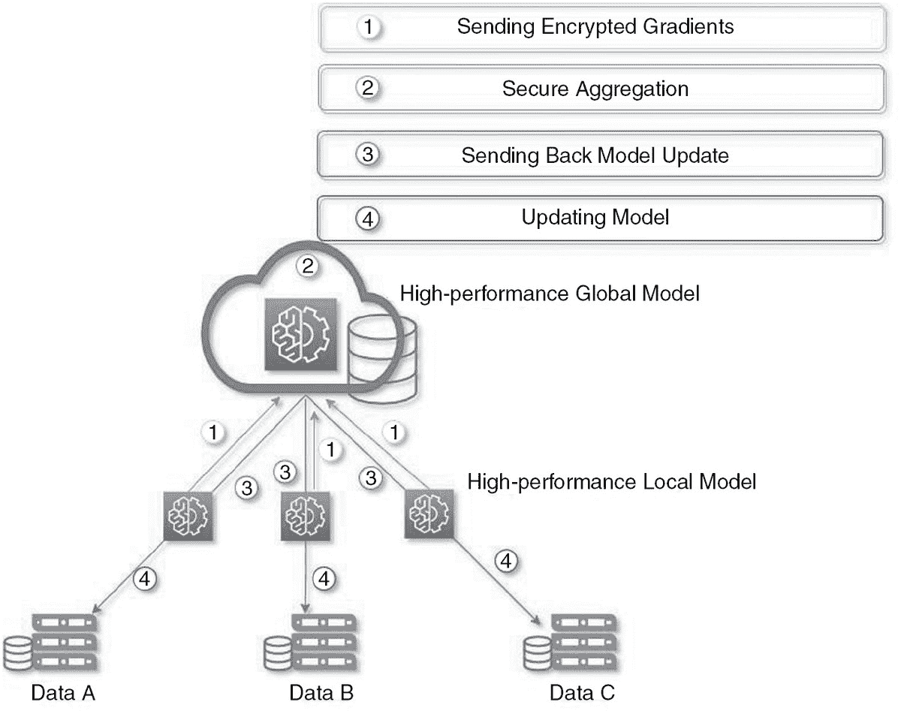

图 12.1 以模型为中心的联邦学习。

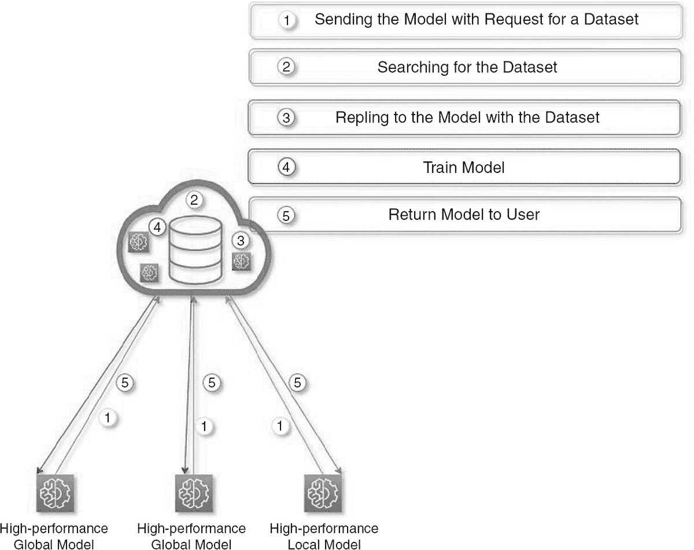

图 12.2 以数据为中心的联邦学习。

#### 12.3.1.1 模型中心联邦学习

这是两种类型中更常见的 [10]]。在以模型为中心的模式中，模型托管在云服务中，其 API 预先配置（`层、权重等`）。每个个体下载模型，对其进行增强，然后上传新版本。但这可能持续很长时间，通常是几周或几个月。一个很好的例子是 Google 的 GBoard 移动应用程序。它随着时间学习用户的输入偏好，而无需发送任何隐私数据。学习是分布式的并在远程进行，更新中央模型。

#### 12.3.1.2 数据中心联邦学习

这种比以模型中心少，但更适用于实验科学，以数据中心托管在云服务器内部，不是作为模型而是数据集，其 API 预先配置（`架构、属性等`）。具体来说，在以数据为中心的联邦学习中，其想法是拥有一个位于服务器的超级或全局 Oracle，其中包含贡献者提供的多个数据集。任何想要使用该数据的模型所有者都可以发送其模型以及对特定数据集的使用请求。如果请求接受，Oracle 将搜索请求的数据集并开始训练模型。一旦训练完成，模型将返回给模型所有者。

在联邦学习中，了解你的数据、数据如何划分以及在技术和实践中的挑战，对于定义实现术语至关重要。

### 12.3.2.1 水平联邦学习

水平联邦学习，或基于样本的联邦学习，用于多个数据集具有相同特征但实例（样本）不同的情况。我们也将其称为`同质联邦学习方法`，因为我们处理的是相同特征使用的相似性。

### 12.3.2.2 纵向联邦学习

纵向联邦学习 [11] 是水平方法的相反方向。它指的是使用多个具有许多交集样本但交集特征较少的数据集。在这种情况下，由于特征集不同，我们称之为`异构联邦学习`。

## 12.4 挑战

在本节中，我们讨论了联邦学习面临的当前问题和挑战，为了获得更高的效率，必须关注这些问题。

### 12.4.1 效率与隐私的权衡

当使用安全多方计算 (SMPC) [13] 和差分隐私 (DP) [14] 时，联邦学习的隐私措施变得非常高效。然而，获得高水平的隐私是以权衡为代价的。使用 `SMPC` 时，在传回全局模型之前需要对参数进行加密，这需要额外的计算资源和功率。另一方面，`DP` 的用法需要在模型中添加噪声，导致准确性和隐私之间的权衡。在联邦学习中找到 `SMPC` 和 `DP` 的合适平衡非常有挑战性。

### 12.4.2 通信瓶颈 [1]

将模型带到设备的通信成本应该是较低，但通信瓶颈可能会影响 FL 环境，从而阻塞训练过程。目前有许多解决通信瓶颈的工作，例如丢弃掉节点（无法在指定时间窗口内完成计算的设备）以及模型压缩/量化。

### 12.4.3 投毒攻击 [2]

中毒攻击有两种形式。在`数据中毒`中，恶意用户在训练过程中发送虚假或恶意数据，这影响了模型的整体性能。使用联邦学习检测此类用户非常困难。`模型中毒`是第一种形式的相反。恶意用户通过在训练前修改接收到的模型/参数来篡改模型。因此在聚合期间，全局模型受到伪梯度的影响。

## 12.5 机遇

联邦学习中仍需解决某些问题，以确保在不损失性能的情况下获得更大的安全性。一种想法是将区块链技术与以数据中心的联邦学习相结合。区块链是一种“点对点”（P2P）去中心账本技术 [15]，通过点对点计算机系统公开记录和发布交易信息。数据库是分布式的，信息的副本不仅存储在单个服务器上，还发送到链或框架中的所有客户端。这种约定有效地消除了外部人员，同时确保了高直观性的安全性 [16]。

该概念包括两种类型的区块链：公链和私有链。然而，其他变体包括联盟链和混合区块链。它们都由运行在点对点网络上的节点集群组成，每个节点都拥有带有及时更新的共享账本副本。此外，它们在创建新区块链的同时验证、启动和恢复交易。尽管如此，所有这些类型都有不同之处。

### 12.5.1 利用区块链

利用区块链技术 [17] 允许与以数据中心的联邦学习进行两种交互。首先，它为数据提供了新的安全层，例如不可篡改性、可追溯性、透明性和所有参与者的信任水平。其次，它提供了一种真实的激励机制，鼓励贡献者共享数据并训练机器学习模型以提高性能。区块链中的数据结构是记录链。通过这种方式，信息无法被修改或删除。因此，我们能够确保数据和模型的不可篡改性。区块链中的每个交易每个区块都有时间戳。因此，假设数据丢失，也没有无法恢复。发生的交易是透明的，拥有权限的参与者可以看到任何交易，从而实现了完全透明化。任何记录的起点都可以沿着链追溯到初始位置。为了确保交互的完全透明，我们在智能合约中添加了公共模型。现在数据提供者能够完全了解他们的数据将参与哪些训练。智能合约提供了约定的规格保证，有助于模型在区块链环境以及中心化服务器中更新。智能合约代码是不可能篡改的，由于由许多机器评估，它保证了模型规格的完整功能。智能合约 [18] 是不可修改的并由许多机器评估，有助于确保模型按照指定的规格执行任务。智能合约的原始性和永久记录还允许我们可靠地注册并向良好的数据贡献者发放奖励。

## 12.6 案例：使用区块链方法利用隐私、完整性和可用性实现以数据中心的联邦学习

在本节中，我们展示了区块链机遇如何增强联邦学习中模型和数据的安全完整性。

联邦学习架构是创建我们架构的参考方法。在联邦学习中我们将模型分发到数据，而在我们的情况下，我们通过将数据分发到模型来实现相反操作。以数据中心的联邦学习使用区块链如图 12.3

Figure 12.3Blockchain for data-centric federated learning.

在我们的案例中，模型和数据存储在一个名为公共区块链的去中心化环境中，而不是所有网络参与者均可访问的中心化服务器中。这些参与者通过协作的方式为模型提供数据，使模型所有者可以使用这些数据。个人数据由所有者完全控制，即他们可以控制想要提供的数据量。对于每次数据输入，我们都会进行数据聚合，但在对模型进行任何更新之前，需要验证数据。为了确保数据的完整性，我们实施了一种激励机制来鼓励贡献者，并强制每个用户在向模型添加训练数据时缴纳押金，这增加了恶意用户破坏模型效率的成本。该过程从所有者提供押金、奖励和超时函数开始，从而奠定了我们激励机制的基础。`deposit` 对应用户为了访问模型智能合约需要支付的金额，以便其可以在区块链内部添加数据以训练模型。`reward` 代表用户在检查数据完整性并将其修复时所收到的金额。`time-out function` 定义了返回押金和所有者验证之间的时间间隔。当通过验证的数据发送到模型进行训练时，模型将进行更新；对于每个有用的押金，将进行退款；对于每个有用的输入，将提供奖励。访问贡献者的数据是必要的，因为数据将仅用于在智能合约内训练模型。这些功能在数据安全和机器学习方面提供了巨大的改进。

## 12.6 结果

我们通过这种方法探索了数据监管政策方面的不同安全维度，同时提高了 AI 模型的效率。通过联邦学习，我们能够在创建训练模型的同时关注个人数据隐私问题；通过区块链，我们为贡献者提供了完全匿名性、控制权以及训练过程的完全透明度。这些特征使得每天增加了 500 个数据点。此外，通过激励机制，我们能够避免恶意贡献，因为数据在训练阶段前经过了验证。使用押金/退款机制，经过一段时间后，我们看到恶意用户的余额归零，因为数据被验证并被删除；与此同时，良好贡献者的余额增加了，因为他们获得了奖励。去中心化基础设施帮助无数用户在安全和隐私的环境中提供数据。尽管存在所有安全特性，模型的准确性仍提高了 5%。这是由于我们在数据中添加了噪声来增强隐私，例如差分隐私。

## 12.7 结论

在本章中，我们展示了尽管存在新的法规和政策，我们仍然能够通过联邦学习和区块链技术提供高质量且安全的 AI 模型训练。正如我们在用例所示，通过结合联邦学习和区块链，我们处理了 CIA 三要素（机密性、完整性、可用性）属性，并遵守了 GDPR 和 CCPA 规定。

## 参考文献

- Filipe Betzel, Karen Khatamard, Harini Suresh, David J. Lilja, and Ulya Karpuzcu. Approximate Communication Techniques for Reducing Bottlenecks in Large-Scale Systems. ACM Computing Surveys, 51(1):32, 2018.


- Minghong Fang, Xiaoyu Cao, Jinyuan Jia, and Neil Zhenqiang Gong. Local Poisoning Attacks to Byzantine-Robust Learning. page 19.

- Michelle Goddard. The EU General Protection Regulation (GDPR) has a Global Impact. International Journal of Market Research, 59(6):703–705, November 2017.

- Lydia de Torre. A Guide to California Privacy Act. SSRN Journal, 2018.

- Dorothy Elizabeth Robling. Cryptography and Data Security. AddisonWesley, Reading, 1982.

- Oliver Radley-Gardner, Hugh Beale, and Reinhard Zimmermann. Fundamental Texts On Private Law. Hart Publishing, 2016.

- Xin Yao, Tianchi Huang, Chenglei Wu, and Lifeng Sun. Towards Faster and Better Federated Learning: A Fusion Approach. In 2019 IEEE International Conference on Image Processing (ICIP), pages 175–179, Taiwan, September 2019.

- Qiang Yang, Yang Liu, Tianjian Chen, and Yongxin Tong. Federated Machine Learning: Concept and Applications. arXiv:1902.04885, February 2019.

- Kelvin. Introduction to Federated Learning and Challenges, November 2020.

- Huawei Huang and Yang Yang. Worker: Worker-Centric Model Selection for Federated Learning in Mobile Edge Computing. In 2020 IEEE/CIC International Conference on Communications (ICCC), pages 1039–1044, August 2020. ISSN: 2377–8644.

- Jiankai Sun, Xin Yang, Yuanshun Yao, Aonan Zhang, Weihao Gao, Junyuan Xie, and Chong Wang. Vertical Federated Learning without Revealing Intersection Membership. arXiv:2106.05508, June 2021.

- Peter Kairouz, H. Brendan McMahan, Brendan Avent, Aurélien Bellet, Mehdi Bennis, Arjun Nitin Bhagoji, Kallista Bonawitz, Zachary Charles, Graham Cormode, Rachel Cummings, Rafael G. L. Oliveira, Hubert Eichner, Salim El Rouayheb, David Evans, Josh Gardner, Zachary Garrett, Adrian Gascon, Badih Ghazi, Phillip B. Gibbons, Marco Gruteser, Zaid Harchaoui, Chaoyang He, Lie He, Zhouyuan Huo, Ben Hutchinson, Justin Hsu, Martin Jaggi, Tara Javidi, Gauri Joshi, Mikhail Khodak, Jakub Konečný, Aleksandra Korolova, Farinaz Koushanfar, Sanmi Koyejo, Trance Lepoint, Yang Liu, Prateek Mittal, Mehryar Mohri, Richard Nock, Ayfer Ozgur, Rasmus Pagh, Mariana Raykova, Hang Qi, Daniel Rome, Ramesh Raskar, Dawn Song, Weikang Song, Sebastian U. Stich, Ziteng Sun, Ananda Theertha Suresh, Florian Traner, Praneeth Vepakomma, Jianyu Wang, Li Xiong, Zheng Xu, Qiang Yang, Felix X. Yu, Han Yu, and Sen Zhao. Advances and Open Problems in Federated Learning. arXiv:1912.04977 [cs, stat], March 2021.

- Lifei Wei, Haojin Zhu, Zhenfu Cao, Xiaolei Dong, Weiwei Jia, Yunlu Chen, and Athanasios V. Vasilakos. Security and Privacy for Storage and Computation in Cloud Computing. Information Sciences, 258:371–386, February 2014.

*   Cynthia Dwork. 差分隐私：结果综述。由 Manindra Agrawal, Dingzhu Du, Zhenhua Duan 和 Angsheng Li 编 own，《计算模型的理论与应用》，第 1–19 页，柏林，海德堡，2008。Springer Berlin Heidelberg。

*   Hyesung Kim, Jihong Park, Mehdi Bennis 和 Seong-Lyun Kim. 块链设备端联邦学习。IEEE Communications Letters, 24(6):1279–1283, 2020 年 6 月。

*   Quoc Khanh Nguyen 和 Quang Vang Dang. 促进未来的区块链技术。见 2018 年第 4 次国际绿色技术与可持续发展国际会议 (GTSD)，第 483–486 页，胡志明市，2018 年 11 月。IEEE。

*   Konstantinos Christidis 和 Michael Devetsikiotis. 用于物联网的区块链与智能合约。Ieee Access, 4:2292–2303, 2016。

*   Bin Hu. 智能合约构建与执行综述：范式、工具与系统。OPEN ACCESS, 第 51 页。

# 第三部分：将 AI/ML 算法用于网络安全

# 13 使用机器学习网络安全：概述

D. Roshni Thanka, G. Jaspher W. Kathrine 和 E. Bijolin Edwin

Karunya 技术与科学学院，印度泰米尔纳纳德邦，柯姆巴托尔

DOI: [10.1201/9781003187158-16](http://doi.org/10.1201/9781003187158-16)

## 目录

1. 13.1 引言
2. 13.2 人工智能足以阻止网络犯罪吗？
3. 13.3 企业利用机器学习加强其网络安全系统
4. 13.4 网络攻击/网络安全威胁与攻击
5. 13.4.1 恶意软件
6. 13.4.2 数据泄露
7. 13.4.3 结构化查询语言注入 (SQL-i)
8. 13.4.4 跨站脚本攻击 (XSS)
9. 13.4.5 拒绝服务 (DOS) 攻击
10. 13.4.6 内部威胁
11. 13.4.7 生日攻击
12. 13.4.8 网络侵入
13. 13.4.9 身份欺骗攻击
14. 13.4.10 在线系统上的 DDoS 攻击检测
15. 13.5 网络安全中不同的机器学习技术
16. 13.5.1 支持向量机 (SVM)
17. 13.5.2 K-近邻 (KNN)
18. 13.5.3 朴素贝叶斯
19. 13.5.4 决策树
20. 13.5.5 随机森林 (RF)
21. 13.5.6 多层感知器 (MLP)
22. 13.6 机器学习的应用
23. 13.6.1 航空工业中的机器学习
24. 13.6.2 网络安全监控下的网络 ML
25. 13.6.3 电池储能系统 (BESS) 网络攻击缓解
26. 13.6.4 大规模智能电网中基于能量的网络攻击检测
27. 13.6.5 用于联网 (IoV) 的入侵检测 (IDS)
28. 13.7 网络安全中的深度学习技术
29. 13.7.1 深度编码器
30. 13.7.2 卷积神经网络 (CNN)
31. 13.7.3 循环神经网络 (RNN)
32. 13.7.4 深度神经网络 (DNN)
33. 13.7.5 生成对抗网络 (GANs)
34. 13.7.6 受限玻尔兹曼机 (RBM)
35. 13.7.7 深度置信网络 (DBN)
36. 13.8 深度学习的应用
37. 13.8.1 键击分析
38. 13.8.2 IoT 中的安全通信
39. 13.8.3 僵尸网络检测
40. 13.8.4 入侵检测与防御系统 (IDS/IPS)
41. 13.8.5 恶意软件检测
42. 13.8.6 网络数据集
43. 13.8.7 评估指标
44. 13.9 结论

## 13.1 引言

互联网设施创造了一个数据日益增长的平台，带来了巨大的挑战。在这一方面，在人类知识的支持下，机器学习的使用提高了未来的网络安全。

## 13.2 人工智能足以阻止网络犯罪吗？

在当今新兴技术中，全球范围内的数据不断不断演变，带来了巨大的挑战。这些揭示了威胁。在这一方面，在人类知识的支持下，机器学习的使用提高了未来的网络安全。

## 13.3 企业利用机器学习加强其网络安全系统

使用机器学习技术进行运营和增强安全的企业包括[3]`Microsoft`、`Chronicle`、`Blackberry` 和 `Demisto`。

## 13.4 网络攻击/网络安全威胁与攻击

对于任何攻击，首要任务是了解攻击的目标[2]，它可能是图 13.1](#ch24.xhtml#b2-secn-45)所示的任何类别。另一个重要维度是削弱对手执行恶意活动的能力。

### 13.4.1 恶意软件

暴力破解、撞库、钓鱼、恶意软件攻击、拒绝服务、蠕虫、木马、盗产权、rootkit、密码嗅探只是任何组织或用户面临的一些攻击。

### （其余子章节）

### 13.4.3 结构化查询语言注入 (SQL-i)

### 13.4.4 跨站脚本攻击 (XSS)

### 13.4.5 拒绝服务 (DOS) 攻击

### 13.4.6 内部威胁

### 13.4.7 生日攻击

### 13.4.8 网络侵入

### 13.4.9 身份欺骗攻击

### 13.4.10 在线系统上的 DDoS 攻击检测

## 13.5 网络安全中不同的机器学习技术

为了生成这些模式，相关的高质量数据是至关重要的。

### 13.5.1 支持向量机 (SVM)

### 13.5.2 K-近邻 (KNN)

### 13.5.3 朴素贝叶斯

### 13.5.4 决策树

### 13.5.5 随机森林 (RF)

### 13.5.6 多层感知器 (MLP)

## 13.6 机器学习的应用

实现计算机自动化并协助分析师保护数据。

### 13.6.1 航空工业中的机器学习

### 13.6.2 网络安全监控下的网络 ML

### 13.6.3 电池储能系统 (BESS) 网络攻击缓解

### 13.6.4 大规模智能电网中基于能量的网络攻击检测

### 13.6.5 用于联网 (IoV) 的入侵检测 (IDS)

## 13.7 网络安全中的深度学习技术

深度学习。

### 13.7.1 深度编码器

### 13.7.2 卷积神经网络 (CNN)

### 13.7.3 循环神经网络 (RNN)

### 13.7.4 深度神经网络 (DNN)

### 13.7.5 生成对抗网络 (GANs)

### 13.7.6 受限玻尔兹曼机 (RBM)

### 13.7.7 深度置信网络 (DBN)

## 13.8 深度学习的应用

对于网络安全，微软使用 `Windows Defender` 进阶威胁防护 (ATP)，它可以自动检测威胁。微软还推出了机器学习网络攻击威胁矩阵来应对安全威胁。

### 13.8.1 键击分析

### 13.8.2 IoT 中的安全通信

### 13.8.3 僵尸网络检测

### 13.8.4 入侵检测与防御系统 (IDS/IPS)

### 13.8.5 恶意软件检测

### 13.8.6 网络数据集

### 13.8.7 评估指标

## 13.9 结论

参考文献

黑莓（BlackBerry）提供了实践人工智能和机器学习的安全解决方案，旨在阻止网络安全攻击并将客户的威胁响应能力工业化。

Demisto 利用机器学习来监控和突出显示安全警报。

## 13.4 网络攻击/网络安全威胁与攻击

### 13.4.1 恶意软件

入侵者开发了各种类型的软件来破坏计算机系统、设备和网络，以窃取敏感信息并严重干扰用户。恶意软件的形式有电子邮件附件、受感染的文件、文件共享软件等。恶意软件的一些变体包括僵尸网络、加密货币挖矿、病毒、蠕虫、恶意广告、勒索软件、木马和间谍软件等。

`Botnets` 是受感染计算机的网络，主要导致拒绝服务攻击。`Crypto jacking` 是一种通过电子邮件中的恶意链接挖掘加密货币的恶意软件。这些攻击以金钱为目的，最终可能导致受影响系统过载，并造成物理损坏。

`Viruses` 是可执行文件，它们附加在整洁的代码或自动化过程中，并在网络中迅速传播，通过破坏和锁定系统功能对系统性能造成巨大破坏。`Worm` 恶意软件是一种自我复制的攻击，可能附加或未附加在现有文件或程序中，从一个系统开始但迅速传播到整个网络。

看似合法的广告变为攻击称为 `malvertising`（恶意广告）。在这里，合法网络和网站上的广告被用于传播恶意软件。`ransomware/scareware` 恶意软件会锁定或拦截计算机系统的部分或全部，直到向攻击者支付特定金额。这给组织造成了昂贵的损失，因为他们无法访问系统。

`Trojan` 恶意软件伪装成合法软件，为其他恶意软件的于攻击创建后门。`Spyware` 是隐藏在系统后台的恶意软件，攻击者通过它从受感染的系统中获取信用卡号、密码等敏感信息。

### 13.4.2 数据泄露

`data breach` 是获取未经授权的信息，例如信用卡信息、密码、窃听、记录按键记录等。`Phishing`（钓鱼）是一种通过发送看似真实的电子邮件或消息并获取价值数据的数据泄露行为。`Whale-phishing`（大鲸钓鱼）攻击和 `spear-phishing`（鱼叉式钓鱼）攻击是其变体形式。

### 13.4.3 结构化查询语言注入 (SQL-i)

这主要通过 `SQL query` 的形式访问 `SQL server` 数据库以获取价值信息。

### 13.4.4 跨站脚本 (XSS)

与 `SQL-I` 类似，`JavaScript` 代码作为浏览器端脚本而非查询注入以利用网站漏洞。

### 13.4.5 拒绝服务 (DOS) 攻击

这种攻击通过淹服务器无法处理的互联网流量使资源无法访问，从而防止需要的用户获取其在线服务。

### 13.4.6 内部威胁

组织内部的人员有时会危害组织，以获取受限权限进行重大更改，甚至更改安全策略并获取价值数据。

### 13.4.7 生日攻击

在这里，攻击者创建一个与原始发送者发送的相同的相似哈希值；这可能会误导接收者，将伪造识别为真实。为了防止此类攻击，可以使用较长的哈希值，这会显著降低此类攻击的有效性。

### 13.4.8 网络入侵

保护网络免受众多安全漏洞的影响至关重要。`Network intrusion` 导致价值网络资源的被窃。

### 13.4.9 冒充攻击

冒充攻击以欺诈的形式存在，攻击者可能装成已知联系人并诱用户共享敏感信息或登录凭据。它们还可能导致向欺诈账户转账。

### 13.4.10 在线系统的 DDoS 攻击检测

`DDoS` 攻击在许多组织中引发严重问题。在早期识别它们可以减轻对组织的严重影响。在预处理中使用 `MLP`、`RF`、`KNN` 和 `SVM` 等机器学习算法有助于识别各种洪水，如 `UDP flood`、`ICMP flood`、`HTTP flood` 等，并提供良好的准确性 [37]。

## 13.5 网络安全的不同机器学习技术

人工智能和机器学习已经带来了变革。研究人员表示，到 2025 年，超过 30% 的投资将用于人工智能。

### 13.5.1 支持向量机 (SVM)

`SVM` 是机器学习的一种分类，是一种监督算法，在感知网络威胁方面发挥着主要作用 [9]。通过修改高斯内核可以进一步提高性能。`SVM` 算法在用户启动浏览器时后台运行，监控每项活动，并对图 13.2 所示的网络攻击进行分类](#24)。

```
(SVM architecture)
```

### 13.5.2 K-近邻 (KNN)

一个强大的安全系统对于保护系统至关重要。使用 `KNN` 分类算法，其特征不同的异常节点根据其行为从正常节点中分离出来 [8]（如图 13.3 所示 [#ch24)]）。当许多最近邻节点与特定分类相关联时，这些数据点就属于该类别。通过欧几里得距离或曼哈顿距离找到最近的数据点。欧几里距离的计算公式为：


$d(x,y) = \sqrt{\sum_{i = 1}^{n}(x_{i} - y_{i})^{2}}.$

在这里，$n$ 表示数据点的总数，$x[i]$ 和 $y[i]$ 指定实例 $x$ 和 $y$ 的第 $i$ 个和第 $j$ 个特征元素。任何入侵检测系统的目标都是快速检测入侵，减少误报并提供保护系统的快速激活 [5, 6, 7]。但 `KNN` 的问题在于它是一个懒惰学习器，需要很高的计算时间。为了克服这一点，实现了快速 `KNN` 以提供更短的计算时间和更好的准确性。

### 13.5.3 朴素贝叶斯

网络异常（如异常检测和误用检测）可以通过多种数据挖掘任务进行检测。当系统具有完整性、机密性或可用性时，该系统被认为是安全的。朴素贝斯分类器是一种简化的贝叶斯概率模型，用于图 13.4 所示的不确定性领域。在这里，一个属性的可能性不会影响另一个模型属性的可能性。

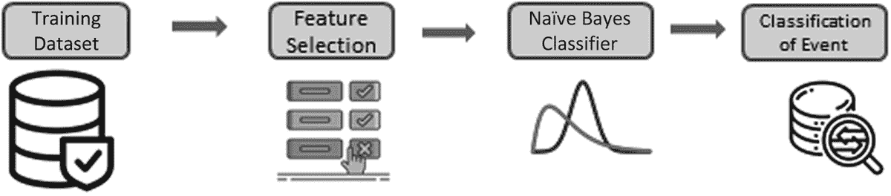

图 13.4 朴素贝斯分类器。

朴素贝斯算法在训练阶段通过提供某些属性来计算并保存盗窃概率。这种操作针对每个属性进行，并记录计算每个属性所需概率的时间。在测试阶段，在最坏的情况下，为每个样本计算给定类别概率的时间与属性数量 `n` 成正比。在最坏情况下，测试阶段所需的时间与训练阶段相同。

### 13.5.4 决策树

随着通信技术的日益发展，提高计算机网络系统的安全性并保护其免受入侵变得至关重要。系统中的入侵可以通过活动偏离正常配置的变化来检测到。

决策树是一种分类算法，主要辅助寻找预测变量与目标变量之间的关联。训练数据集中的每个数据点都通过将所有相似的目标值归类到一个子域下被划分为多个子域。子域进一步对图 13.5 和 13.6 所示的新到达数据点的目标值进行分类。决策树从源点到目的地的路径规定了分析目标变量的预测变量模式。预测变量指定事件，而目标变量指定事件类型。系统中发生的每个事件都会经过分析，将其归类为正常事件或异常事件，从而检测入侵。

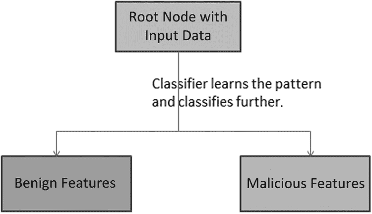

图 13.5 决策树示例。

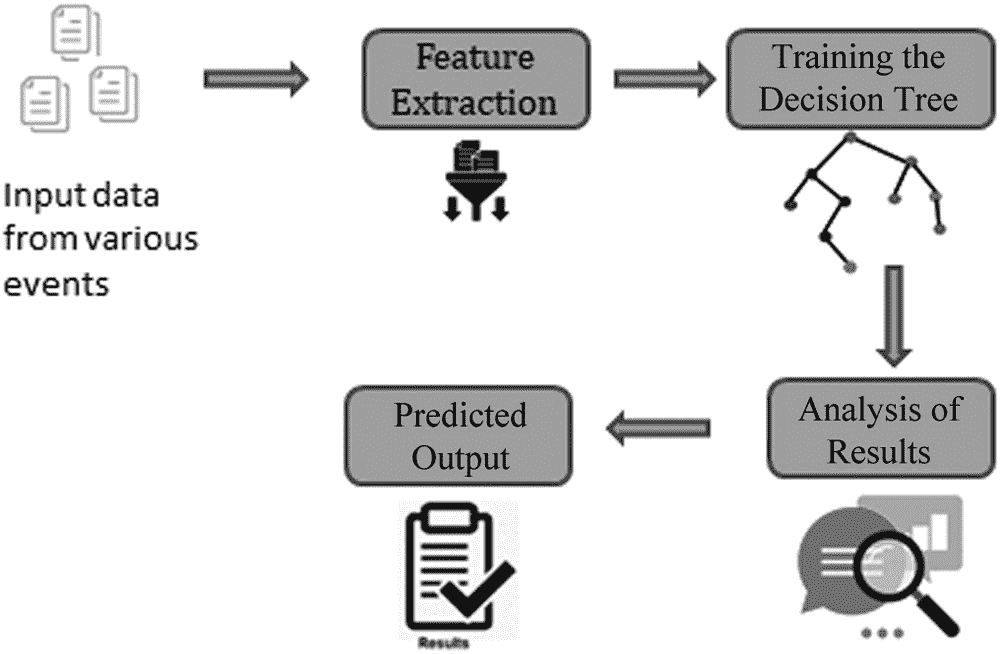

图 13.6 决策树的处理步骤。

### 13.5.5 随机森林 (RF)

随机森林是一种集成方法，通过结合许多模型来获得更高的准确性，如图 13.7 所示。针对通信入侵活动的技术也在增加。入侵可以发生在计算机的数据层，也可以发生在通信期间网络层使用的设备上。随机森林包含了许多决策树，提供了低得多的分类错误。在构建不同数量的树时，使用随机化来选择合适的划分节点 [12]。`RF` 随机选择最佳节点进行分割并生成噪声树，这可能会降低模型的准确性。通过特征选择来找到在预测输出类中起重要作用的特征。

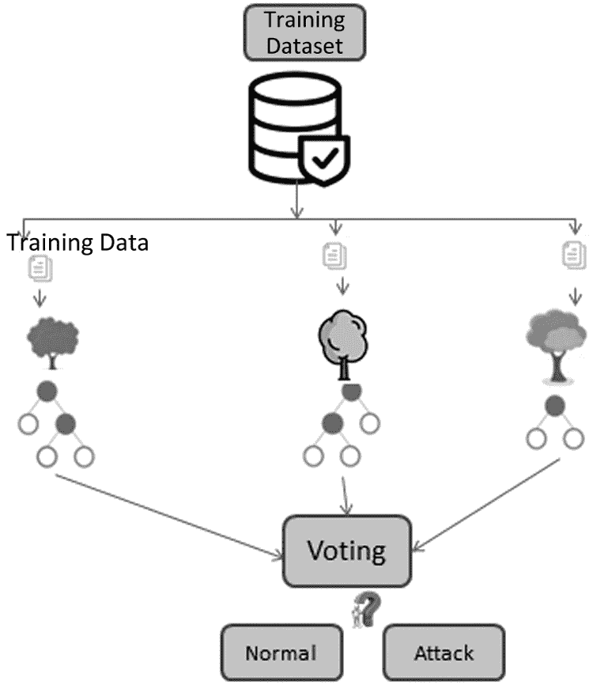

图 13.7 随机森林分类器。

### 13.5.6 多层感知器 (MLP)

MLP 基于神经网络，其中所有层上的所有神经元都是全连接的，如图 13.8 所示。该算法在对大量记录进行分类以及识别复杂数据集中的模式方面更加高效 [30]。输出中的误差通过实际输出与预期输出之间的差计算得出。

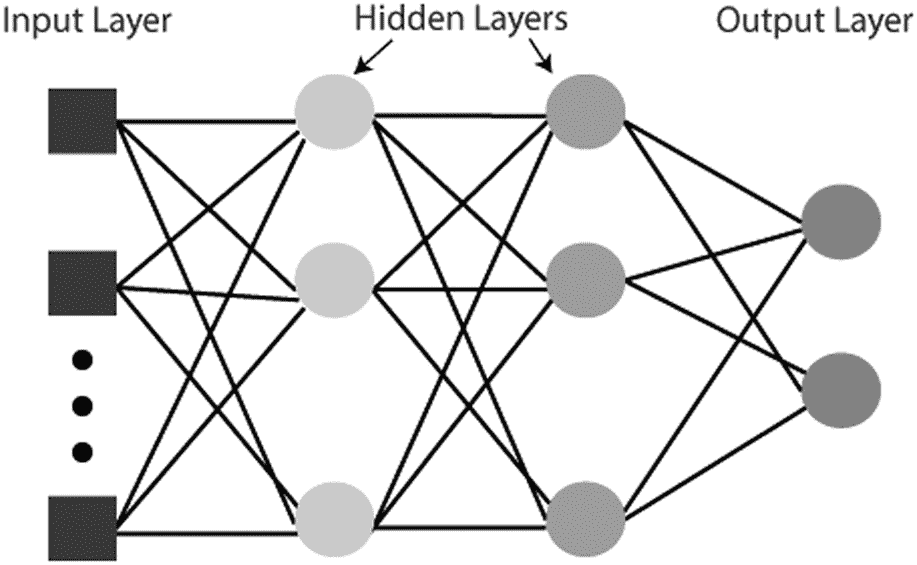

图 13.8MLP。

为了纠正这种误差，以反向方向进行反向传播。这从输出层开始到隐藏层，并向输入层传输。在传输过程中，更新权重以获得网络中准确的结果。这在入侵检测系统中也实现了更好的准确性 [29, 31]。

## 13.6 机器学习的应用

### 13.6.1 机器学习在航空工业中的应用

反无人机系统可以使用视频、音频、热成像、雷达或无线电频率技术检测无人机。保护方案具有干扰无人机功能的能力。在检测中，机器学习技术被广泛使用。三种最常见的攻击是干扰、测向攻击和欺骗。在模拟环境中，机器学习使用单类算法来检测威胁。由于由于原因，我们使用单类算法来检测威胁 [26]。

### 13.6.2 网络安全中的机器学习

在网络安全监控中，从网络收集的数据被归一化为训练集、验证集和测试集。用户通过 IP 地址指定要监控的设备的时间段。

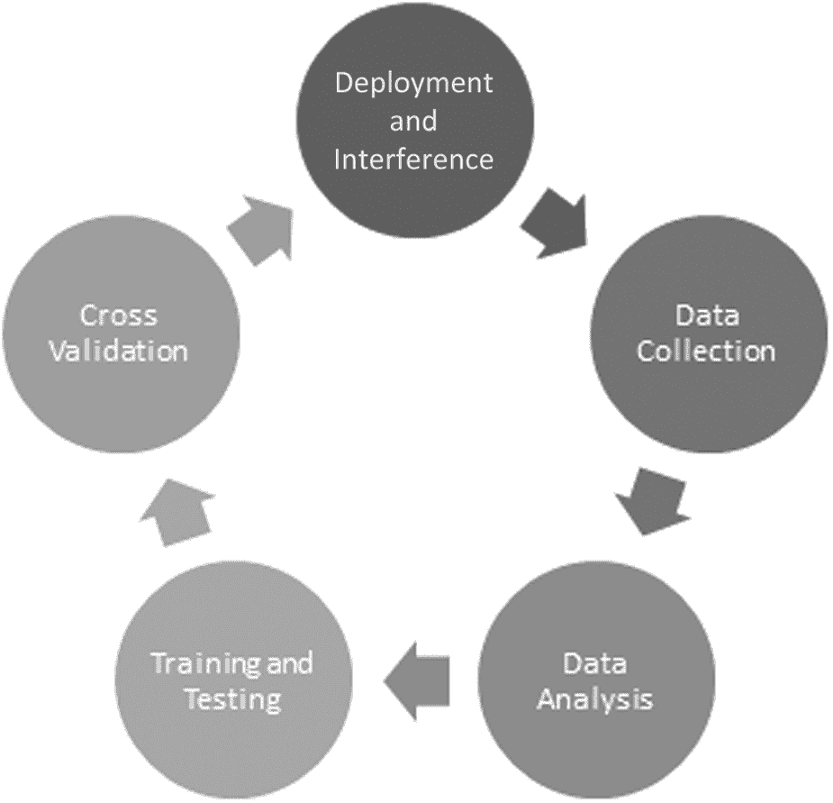

图 13.9 安全监控中的机器学习。

用户指定数据必须使用多类算法还是单类算法处理。多类算法利用所有集合中的异常和非异常数据。为了设计模型和进行性能评估，使用数据执行机器学习算法。该模型如图 13.9 所示，被用于识别网络状态 [27]。

### 13.6.3 电池储能系统 (BESS) 网络攻击缓解

为了获得足够的检测准确率，质量和合适大小的数据集至关重要。使用电池管理系统 (`BMS`) 来管理 BESS。为了防止针对电池电量状态的攻击，可以应用预测方法。根据基于传感数据的状态估计预测，进行针对电网的先进 FDIA（假数据注入攻击）检测方法。如果估计与测量值之间存在差异，意味着残差超过了给定的阈值。对于基于残差的方法实现，由于 BESS 和电网之间持续的数据交换，测量预测是必要的；网络攻击影响 BESS 接收到的命令的完整性，如图 13.10 所示。分布式方法已用于去中心化系统中检测网络攻击。该技术的主要目标是形成残差信号。它决定与预定义阈值相关的残差评估函数。

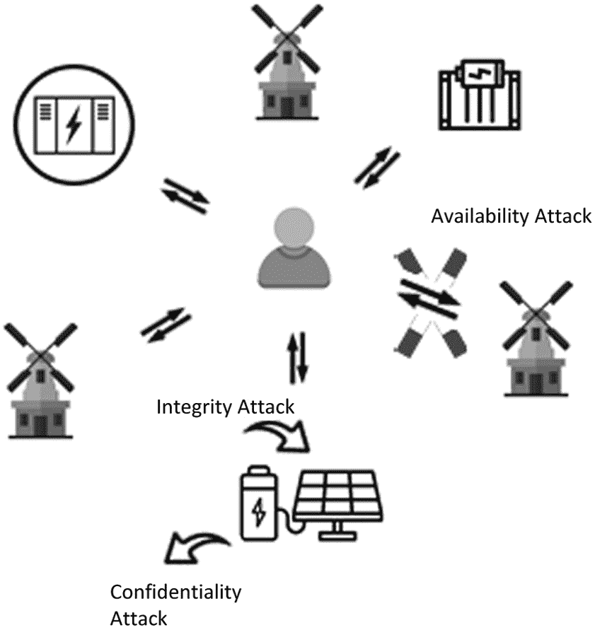

图 13.10BESS 网络威胁。

一旦检测到攻击，必须消除其对 BESS 操作的影响。未观察到的 FDIA 可能会威胁用于训练的时间序列数据并损坏预测。由于由于，我们使用伪测量来填补网络攻击产生的差距。伪测量生成和 SE 预测是两个主要的缓解方案 [28]。

动态贝叶斯网络 (`DBN`) 是一种用于简化结构的概率图模型。在网络攻击检测过程中，使用了有向无环图 (`DAG`)、用于获取特征的互信息 (`MI`) 以及受限玻尔兹曼机 (`RBM`) —— 后者在无监督 `DBN` 模型的帮助下，在上下文行为中训练数据并学习模式，如图 13.11 所示。

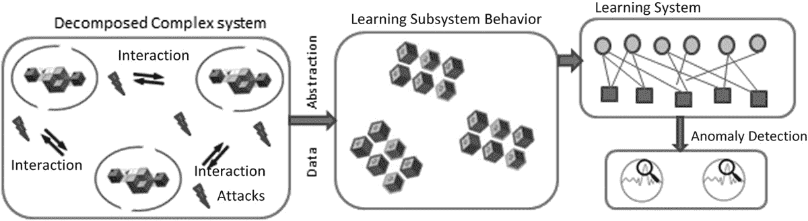

图 13.11 使用无监督学习的网络攻击检测。

这些方法通过从子系统的行为中提取特征和基于时间的活动来识别异常情况，在计算上是有效的。`DBN` 和 `RBM` 根据自由能 [42] 识别未被察觉的攻击。

### 13.6.5 面向车联网 (IoV) 的入侵检测系统 (IDS)

为了为联网提供安全驾驶保障，车载网络 (`VANET`) 对于安全的车间通信至关重要。车辆配备了不同类型的传感器和嵌入式控制器，用于收集交通状况、停车设施、道路事故等信息。这些信息在附近的车辆之间进行通信，以确保行程舒适。这些通信有时会被攻击者破坏，从而影响整个网络。基于神经网络的多层感知机 (`MLP`) 在识别联网网络中的此类入侵和攻击中起着重要作用 [35]。这种安全也可以通过深度学习的深度置信网络来实现 [36, 38, 43]。

## 13.7 网络安全中的深度学习技术

如今，物联网、云计算、大数据等各种技术取得了巨大发展，这需要网络安全来保护应用程序和网络 [44]。微软、Google、Salesforce、Facebook 等科技巨头在其交付物中使用了深度学习 [45]。基于更多隐藏层的人工神经网络的深度学习是机器学习的下一个水平。与机器学习相比，深度学习由于其深层结构以及自主学习并产生更好结果的能力，变得更加精通。

### 13.7.1 深度自动编码器

深度自动编码器监控并学习正常用户行为的使用模式，如图 13.12 所示。它是一种无监督学习，根据输入重构输出 [15]。当用户的使用模式发生变化时，会被测量为异常。在这里，测量当前行为 `V``i`` 与正常行为 `V``i` 之间的相似性 [13]。管理员固定一个阈值 `k`，当差异超过预定义的阈值时，则被认为是异常活动。

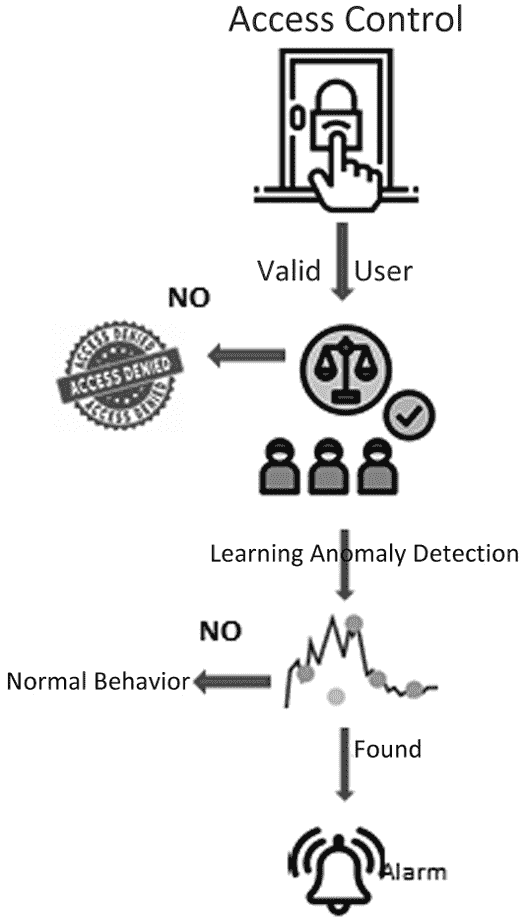

图 13.12 入侵检测系统的流程。

```
$d\left( {V\left( t \right)~ - ~V\left( 0 \right)} \right) = \frac{1}{n}\sum\limits\_{i = 1}^{n}\left( {ci - pi} \right)^{2}.~$ (*i**f*  *V*(*t*) − V(0) > k, it means  ‘abnormal’.)
```

### 13.7.2 卷积神经网络 (CNN)

随着互联网使用的的增加，恶意软件也在增加。CNN 是依赖神经网络的深度学习方法之一。它以数组的形式处理输入，通常用于处理二维和三维数组。CNN 的三个主要组件是：(1) 以数学中的卷积操作命名的卷积层；(2) 用于降维的池化层；以及(3) 用于最终分类的分类层。使用尺寸为 3×1 的单维滤波器的一维卷积层沿步长滑动，并配合修正线性单元激活函数，随后是两个全连接全密层 [18, 21]，如图 13.13 所示。在这里不需要缩小输入大小，因为没有使用最大池化层。使用 Dropout 层来避免过拟合。

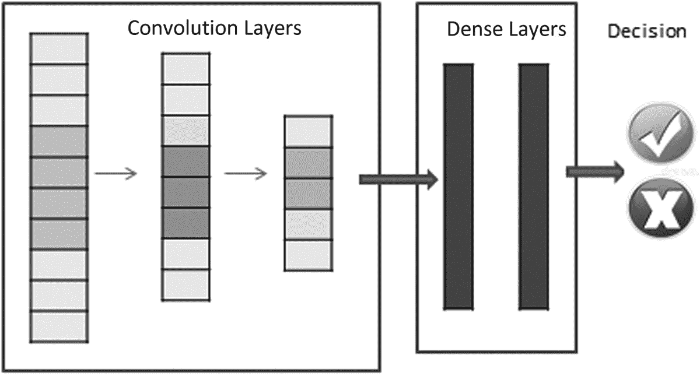

图 13.13 示例 1 维 CNN 架构。

这种一维 CNN 是一种提供准确结果的入侵检测机制 [16, 17]。基于 CNN 的入侵检测由于其深层结构和缩短的训练时间，优于其他入侵检测机制。

### 13.7.3 循环神经网络 (RNNs)

在海量数据的先进技术世界，入侵和恶意软件通过电子邮件、下载文件、软件等任何手段成为中小型公司的主要威胁。此类入侵需要高效的系统来防止这些活动，并保护价值的数据和网络本身。最近，深度学习算法在网络安全中发挥了重要作用。RNN 是一种基于深度学习方法的前馈神经网络，它不仅保存当前状态，还保存之前的状态，因此被称为递归。包含之前状态的隐藏层表示如下：

```
S[t] = ɸ (wx[t] + H[t] – 1)
```

其中 `S[t]` 代表 `t` 时的隐藏状态，`w` 是权重，`H` 是某些隐藏状态，`ɸ` 代表激活函数，可以是 sigmoid 或 tanh 函数 [19]。这种 RNN 可以解决任何监督或无监督任务。层数和轮数取决于它所作用的任务 [20]。这种 RNN 包含一个随当前时间维护之前信息的循环层，如图 13.14 所示。在循环层之后，进行批归一化和正则化以排除过拟合并加速训练。最后，根据输出使用特定的激活函数进行分类。

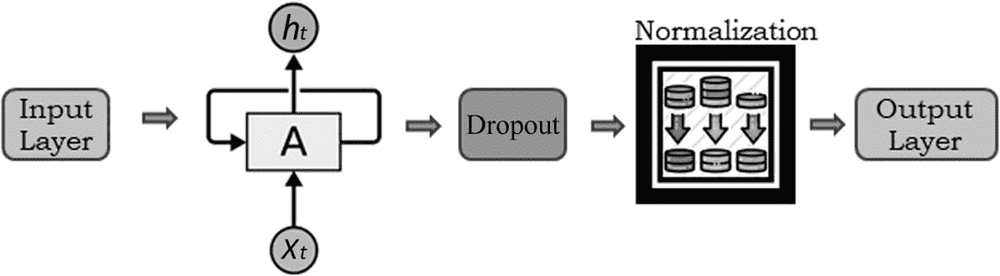

图 13.14 循环神经网络。

### 13.7.4 深度神经网络 (DNNs)

由于信息技术的快速发展，入侵检测系统是当今世界的需要。DNN 在不访问数据包内部信息的情况下发现安全漏洞发挥着主要作用，从而维护了数据隐私 [23]。由 DNN 创建的模型包含多个隐藏层，层中的神经元是相互连接的。带有感知器适当激活函数的正向传播如图 13.15 所示。

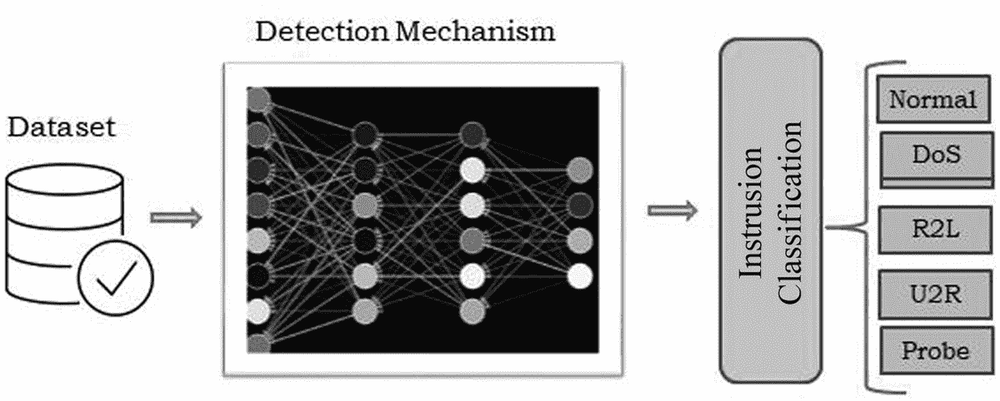

图 13.15 深度神经网络 (DNN)。

为了产生最准确的结果，使用带有合适优化器和损失函数的反向传播来调整权重和偏置 [22]。在这里，分类可以是二分类（表示正常和攻击），也可以是多分类（例如：用户到根攻击、拒绝服务攻击、远程到用户攻击、探测和正常）。

### 13.7.5 生成对抗网络 (GANs)

需要对可用的数字数据进行安全保护，以防止受到未知攻击的影响。许多公司、医疗机构和公共机构都有大量需要保护的安全数据。`GAN` 可以生成与原始数据相似的新数据，从而保护原始数据；示例在图 13.16 中所示。`GAN` 生成的新数据与原始数据具有高度相关性，从而提升了原始数据的安全性。

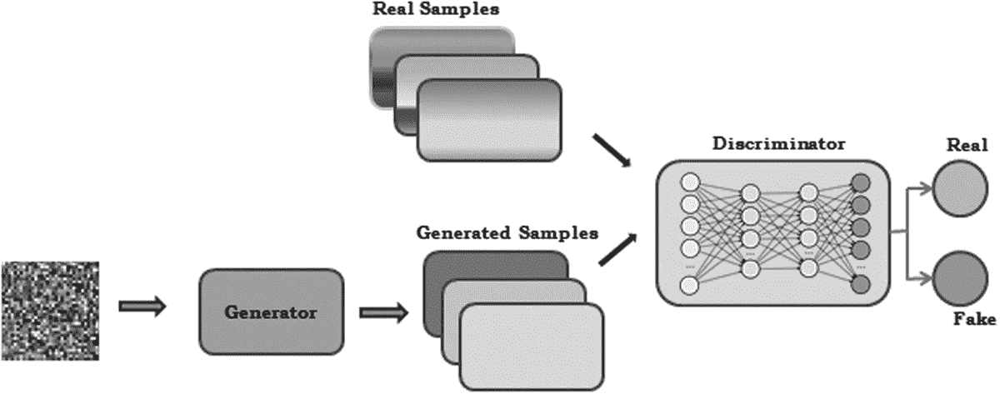

图 13.16 生成对抗网络架构。

`GAN` 的另一个应用是隐写术，将敏感信息隐藏在图像内部。此外，`GAN` 还用于高安全性地将灰度图像隐藏在彩色内部。使用深度卷积生成对抗网络和辅助分类器对抗网络，还可以更安全地将敏感数据存储在图像容器中。神经网络（`NN`）结合隐写术被称为神经密码学，在信息安全方面起着重要作用。在这里，通过同步 `NN` 中存在的输出权重来生成密钥。`PassGAN` 用于高质量的密码破解 [24]。

### 13.7.6 受限波尔兹曼机 (RBM)

技术在日常生活中的指数级使用增加了人与组织之间的数据交换量，导致网络中出现新型不同的攻击。许多组织已启动安全措施来保护其网络。`ThRBM` 算法在回归、降维、特征学习、分类等许多应用中都有益。`RBM` 有两个偏置：前向传播由隐藏偏置支持，反向传播由可见层偏置支持用于重构。这里同一层中的两个神经元之间没有连接。由于不存在层内连接或通信，因此被认为是受限的。图 13.17 展示了具有 `m` 个可见节点和 `n` 个隐藏节点的节点的 `RBM` 图形描绘 [25]。在这里，可见与可见节点之间或隐藏节点之间没有连接；唯一允许的连接是从可见到隐藏或隐藏到可见。

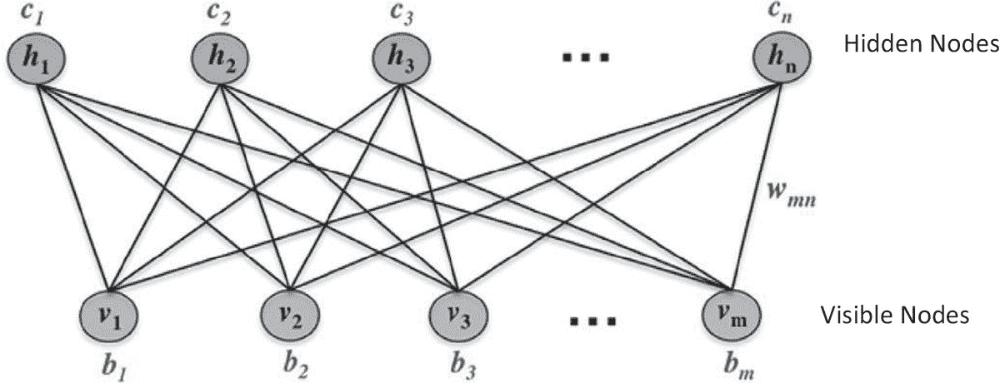

图 13.17RBM 的图形表示。

每个节点代表数据集中的一个特征，该特征与权重相乘并加上通过激活函数的偏置，从而产生特定节点的输出。此外，多个输入可以通过将多个输入与其权重相乘、求和并加上偏置来组合并给一个特定的神经元，然后通过激活函数生成输出。训练使得产生输入的紧凑描述成为可能。`RBM` 有助于区分正常和异常流量。

### 13.7.7 深度信仰网络 (DBN)

`DBN` 是一种带有生成式图模型的无监督深度学习算法。它是堆叠的受限波尔兹曼机的复合体，后面跟着一个 softmax 分类层或具有有向和无向图网络的自动编码器。`RBM` 的参数通过对比散度（`CD`）算法进行训练。图 13.18 展示了 `DBN` 的结构 [32]。

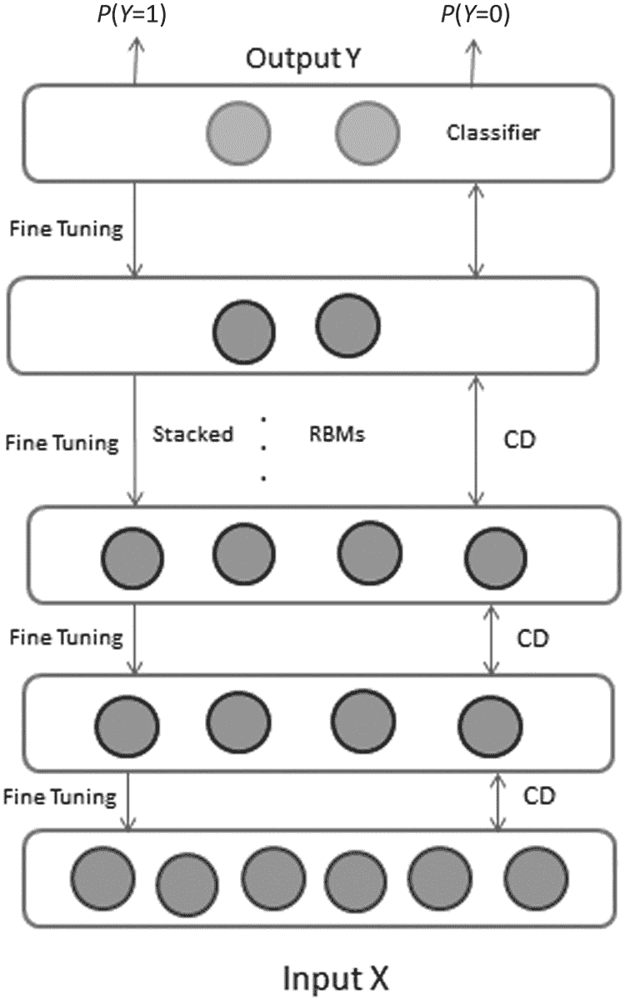

图 13.18DBN 结构。

特定子网络中的每个隐藏层都作为下一层的可见层，因此通过其预训练和微调训练改进了训练方法。`DBN` 并不像深度神经网络那样需要标记数据，但它与无监督数据一起工作，并且权重通过反向传播进行更新和微调。这对于许多缺乏大量数据的行业具有很大帮助。此外，`DBN` 可以从数据中获得良好的见解，并且与 `CNN` 结合时产生更高的准确率。该方法在恶意 URL 识别中表现更好 [33]，以及在 IoT 的安全漏洞检测中也是如此 [34]。

## 13.8 深度学习在网络安全中的应用

### 13.8.1 击键分析

为了保护用户的凭据免受攻击者的用户名和密码攻击是不够的。更重要的是向前一步，静默且持续地监控普通用户的打字风格与其他用户的对比。许多具有足够的隐藏层和显著特征提取能力的深度学习算法在捕捉不同用户与普通用户的击键特征对比方面起着主要作用，从而保护用户凭据信息 [39]。

### 13.8.2 IoT 中的安全通信

在新兴的技术世界，许多事物通过互联网连接并交换数据。为了实现这一任务的安全性并避免损失，使用了深度学习算法来检测 IoT 环境中的威胁 [40]。

### 13.8.3 僵尸网络检测

考虑到互联网巨大的使用，僵尸网络构成了主要的安全威胁。僵尸网络破坏了网络安全的基本需求，如完整性和可用性。为了检测并抵抗这类攻击，深度算法提供了更好的性能和准确性 [41]。

### 13.8.4 入侵检测与防御系统 (IDS/IPS)

这些系统通过识别恶意活动并警告攻击者来保护用户免受安全漏洞。这种方法使用的传统机器学习算法有时会产生假警报，导致用户疲劳。这种缺陷可以通过深度学习算法来克服 [46, 47, 49]。网络流量也受到了监控。此外，可以识别正常和攻击者的 ID。

### 13.8.5 Android 恶意软件检测

很少看到没有安卓设备的人。在这里，恶意软件检测是巨大的挑战之一。带有 `NLP` 的深度学习通过 `DBN` 分析静态和动态特征并提高了性能 [47]。

### 13.8.6 网络安全数据集

对于入侵检测，数据集起着重要作用，如表 13.1 所示。

表 13.1 数据集在入侵检测中的作用

| 数据集 | 说明 |
| --- | --- |
| NSL-KDD | 从军事环境中提取的数据，包括 DOS 攻击、R2L 攻击、U2R 攻击和探测攻击 [10, 11]。它是 KDD99 的改进形式。 |
| KDD-CUP’99 | 可用于训练和测试的百万级数据，具有 41 个用于入侵检测系统的特征。它有四个主要的输出类：DOS、探测、U2R 和 R2L [48]。 |
| ISCX 2012 | 一种入侵检测评估数据集，包含了完整的包载荷格式 [50]。 |
| DARPA | 许多入侵检测系统使用此流行的数据集进行评估。这包含了源 IP 和目的 IP 之间的通信 [51]。 |
| CIDDS-001 | [14] 产生的科布堡入侵检测数据集有助于基于异常的 IDS。该数据集包含五个类别：正常、可疑、未知、攻击者和受害者。 |
| UNSWNB15 | 这一入侵检测数据集包含九类类别：后门、蠕虫、DoS 等。 |
| Microsoft BIG Malware Dataset | 该数据集根据文件的内容和特征对恶意软件进行分类。 |
| ISCX | 信息安全卓越中心 (ISCX) 数据集。 |
| CTU-13 | 包含僵尸网络、背景流量正常流量。 |
| CSIC 2010 HTTP Dataset | 测试网络攻击防护系统。 |

### 13.8.7 评估指标


在实现不同的模型以提供网络安全后，衡量它们的准确性和性能更为重要。这些指标包括准确率、F1 分数、精确率、召回率、误报率以及曲线下面积，后者基于混淆矩阵，混淆矩阵提供了实际类别和预测类别的信息。（见表 13.2。）

#### 表 13.2 混淆矩阵

| | | 预测类别 |
| --- | --- | --- |
| | 攻击 | 正常 |
| 实际类别 | 攻击 | 真阳性 (TP) | 假阴性 (FN) |
| | 正常 | 假阳性 (FP) | 真阴性 (TN) |

$$\Pr\text{ecision} = \frac{TP}{TP + FP},$$

其中 `TP` 代表被正确预测为攻击的数据点。`TN` 代表被分类为正常的数据点。`FN` 是那些被错误分类为正常的数据点。`FP` 代表被误认为攻击的数据点。不同的评估指标如下：

$$\text{Recall} = \frac{TP}{TP + FN}$$

$$F\text{-measure} = 2\left( \frac{\text{Precision} \times \text{Recall}}{\text{Precision} + \text{Recall}} \right)$$

精确率（Precision）指的是所有样本中被正确识别的威胁比例，即被判定为攻击的样本。

召回率（Recall）指定被正确分类为攻击的数据点。

这通过考虑精确率和召回率来衡量准确性。准确率（Accuracy）是正确分类的数据点与数据点总数之比。

## 13.9 结论

互联网和信息技术的发展带来了网络规模及其相关数据的剧增。每天识别网络攻击和敏感数据攻击的挑战日益严峻。尽管入侵检测系统在识别和防止入侵方面起着重要作用，为网络和数据提供了机密性、完整性和可用性等基本需求，但此类系统在最小化误报的同时提供准确结果方面，仍面临许多挑战。此时，人工智能技术（如实现在网络中的机器学习和深度学习算法）应运而生，成功识别了入侵并在该领域取得了进展。在本章讨论了 ML 和 DL 算法及其不同的应用，重点强调了人工智能在入侵检测系统中的作用。在 ML 算法与 DL 算法的比较中，基于 DL 的算法在特征提取和模型快速拟合方面提供了更好的解决方案。该系统面临的主要挑战是处理能力和存储设施方面的复杂性。解决这些需求可以满足当前入侵检测的需求。

## 参考文献

- Hadis Karimipour, Ali Dehantanha, Reza Mizi, Kim-Kwang Raymond, and Henry Leung, “A Deep and Scalable Unsupervised Machine Learning System for Cyber-Attack Detection in Large-Scale Grids”, IEEE Access, Special Section On Digital Forensics Through Multimedia Inference, Volume 7, 2019, pg. 80778–80788.

- R. Geetha, T. Thilagam, “A Review on the Effectiveness of Machine Learning and Deep Learning Algorithms for Cyber Security”, Archives of Computational Methods in Engineering, CIMNE, Barcelona, Spain, 2020.

- “Machine Learning How It Works and Companies to Know”, `builtin.com/artificial-intelligence/machine-learning`.

- Kirankumar Yadav, Tirupati Pai, Ravi Rane, “Classification of Cyber Attacks Using Support Vector Machine”, Imperial Journal of Interdisciplinary Research, Vol 3, Issue 5, 2017, ISSN: 2454-1362.

- B. Basaveswara Rao, K. Swathi, “Fast k Classifiers for Network Intrusion Detection”, Indian Journal of Science and Technology, Vol 10(14), DOI: `10.17485/ijst/2017/v10i14/93690`, April 2017.

- Jamshidi Y, Nezamabadi-pour H. “A Lattice based nearest classifier for anomaly detection”, Journal of Advances in Computer Research, 2013 Nov;4(4):51−60.

- Wenchao Li, Ping Yi, Li Pan, Jianhua Li, “A New Intrusion Detection System Based on KNN Algorithm in Wireless Sensor Network”, Hindawi Publishing Corporation Journal of Electrical and Engineering Volume 2014, Article ID 24027, 8 pages.

- Diwakar Reddy M, Bhoomika T Sajjan, Anusha M, “Detection of Cyber Attack in Network using Machine Learning Techniques”, International Journal of Advanced Scientific Innovation, Vol 1 No. 2 (2021).

- Kinan Ghanem, Francisco, J. Aparicio-Navarro, Konstantinos Kyriakopoulos, Jonathon Chambers, “Support Vector Machine for Network Intrusion and Cyber-Attack Detection”, December 2017 DOI: `10.1109/SSPD.2017.823368`, Conference: 2017 Sensor Signal Processing for Defence Conference (SSPD) `dx.doi.org/10.1155/2014/240217`.

- Ring, M., Wunderlich, S., Grüdl, D., Landes, D., Hotho, A. (2017). Flow-based benchmark data sets for intrusion detection.

- Kishwar Sadaf and Jabeen Sultana, “Intrusion Detection Based on Autoencoder and Isolation Forest in Fog Computing”, IEEE Access, Volume 8, 2020, pp 167059–16768.

- Zeliang Kan, Haoyu Wang, Guoai Xu, Yao Guo, and Xiangqun Chen, “Towards light-weight deep learning based malware detection”, 2018 IEEE 42nd Annual Computer Software and Applications Conference (COMPSAC). IEEE, Jul 2018.

- Bojan Kolosnjaji, Apostolis Zarras, George Webster, and Claudia Eckert. Deep learning for classification of malware system call sequences. In AI 2016: Advances in Artificial Intelligence, pages 137–149. Springer International Publishing, 2016.

- Arindam Sharma, Pasquale Malacaria, MHR Khouzani, “Malware Detection Using 1-Dimensional Convolutional Neural Networks”, IEEE European Symposium on Security and Privacy Workshops, 2019.

- Mohammed Harun Babu R, Vinayakumar R, Soman KP, “RNNSecureNet: 用于网络安全用例的循环神经网络”, arXivLabs, arXiv:1901.04281, 2019 年 1 月。

- T.T. Teoh; 葛 reime Chiew; Yeaz Jaddoo; H. Michael; A. Karunakaran; Y.J. Goh, “在 Android 网络安全空间应用 RNN 和 J48 深度学习进行威胁分析”, IEEE Xplore, 智能计算与电子企业国际会议, 2018 年。

- Chia-Mei Chen; Shi-Hao Wang; Dan-Wei Wen; Gu-Hsin Lai; Ming-Kung Sun, “应用卷积神经网络进行恶意软件检测”, IEEE Xplore, 意识科学与技术国际会议, 2019 年。

- Mohammed Maithem, Dr.Ghadaa A. Al-sultany, “使用深度神经网络的网络入侵检测系统”, 物理学报：会议丛, 2020 年。

- Rahul K. Vigneswaran; R. Vinayakumar; K.P. Soman; Prabaharan Poornachandran, “用于网络安全网络入侵检测系统的浅层与深度神经网络评估”, IEEE Xplore, 计算与网络技术国际会议, 2018 年。

- Indira Kalyan Dutta, Bhaskar Ghosh, Albert H. Carlson, Magdy Bayoumi, “安全领域中的生成对抗网络：综述”, 智能系统建模与仿真实验室, 2020 年。

- Tamer Aldwairi, Dilina Pereraa, Mark A. Novotny, “受限玻尔兹曼机作为异常网络入侵检测模型的性能评估”, Elsevier, Computer Networks, 第 144 卷, 2018 年 10 月 24 日, 第 111–119 页。

- Ali Rahim Taleqani, Kendall E. Nygard, Raj Bridgelall, Jill Hough, “航空领域网络安全的机器学习方法”, IEEE Xplore, 电子/信息技术国际会议, 2018 年。

- Yogita Goyal, Anand Sharma, “用于网络安全监控的语义机器学习方法”, IEEE Xplore, 计算方法与通信国际会议, 2019 年。

- Nina Kharlamova, Seyedmostafa Hashemi, Chresten Traeholt, “电池储能系统网络防御的数据驱动方法”, Elsevier, Energy and AI, 2021 年。

- Sumit Soni; Bharat Bhushan, “用于设计高效网络安全解决方案的机器学习算法”, IEEE Xplore, 智能计算、仪表与控制技术国际会议, 2019 年。

- Francisco Palenzuela, Melissa Shaffer, Matthew Ennis, Tarek M. Taha, “用于网络攻击检测的多层感知机算法”, IEEE Xplore, IEEE 国家航空航天与电子会议 (NAECON) 和俄亥俄创新峰会, 2016 年。

- Flora Amato, Giovanni Cozzolino, Antonino Mazzeo, Emilio Vivenzio, “在计算机安全中使用多层感知机改进入侵检测”, 智能交互多媒体系统与服务国际会议, 2018 年 5 月。

- Wangyan Feng, Shuning Wu, Xiaodan Li, Kevin Kunkle, “一种基于深度信念网络的风险主机检测机器学习系统”, arXiv.org, 计算机科学、密码学与安全, 2017 年。

- ShymalaGowri Selvaganapathy, Mathappan Nivaashini & HemaPriya Natarajan, “基于深度信念网络的恶意 URL 检测与分类”, 信息安全杂志：全球视角, 2018 年 4 月, DOI: [10.1080/19393555.2018.1456577](https://doi.org/10.1080/19393555.2018.1456577)

- Nagaraj Balakrishnan, Arunkumar Rajendran, Danilo Pelusi, Vijayakumar Ponnusamy, “用于防止物联网安全漏洞的深度信念网络增强入侵检测系统”, Elsevier, Internet of Things, 第 14 卷, 2021 年 6 月。

- Ayesha Anzer; Mourad Elhadef, “用于车联网的多层感知机分布式入侵检测系统”, IEEE Xplore, 协作计算国际会议：网络、应用, 2018 年。

- Rasika S. Vitalkar, Samrat S. Thorat, “使用深度学习方法在车载自接网络中进行入侵检测的综述”, 应用科学与工程国际期刊, 第 8 卷 V 期。

- Dilek Başkaya, Refi Samet, “在线系统上使用机器学习方法的 DDoS 攻击检测”, 计算机科学与工程国际会议, 2020 年。

- Boumiza, Safa, Braham, Rafik, “基于神经网络的 CAN 总线异常检测器”, 无线与移动计算、网络与通信国际会议, 2019 年。

- Bernardi, Mario Luca, Cimit, Marta, Martinelli, Fabio, Mercaldo, Francesco, “基于神经网络的 CAN 总线异常检测器”, Dilek Başkaya, Refi Samet, “在线系统上使用机器学习方法的 DDoS 攻击检测”, 计算机科学与工程国际会议, 2020 年。 (注：此处原文似乎重复，已按样翻译)

- Bernardi, Mario Luca ...

- Nugha, Xiaolin Gao, Muhammad T., Ruijie Xi, “用于物联网(Internet of Things)的深度学习驱动 SDN 机制”, MDPI, [`doi.org/10.3390/s2144`](https://doi.org/10.3390/s2144), 2021 年。

- Dilek ...

- “用于未来互联网的深度学习应用”, MDPI, Internet of the Future, 2020 年。

- Sravan ...

- “用于电力系统的深度学习入侵检测”, Elsevier, Electric Power Systems, 2021 年。

- Priyanka ...

- “用于网络安全的深度学习方法”, MDPI, Computer Science, 2020 年。

- Yogita ...

- “用于网络安全监控的语义机器学习方法”, IEEE Xplore, 2019 年。

- (注：由于原文后部分条目在输入时似乎存在逻辑重复或截断，以上翻译已根据提供的文本片段尽可能对齐)

- 微软恶意软件分类挑战 (BIG 2015)，可用：[www.kaggle.com/c/malware-classification](http://www.kaggle.com/c/malware-classification)

- 技术创新卓越中心，可用：[www.iscx.ca/datasets/](http://www.iscx.ca)

- CTU-13 数据集。一个包含机器人网络、正常和背景流量的标记数据集。可用：[www.stratosphereips.org/datasets-ctu13](http://www.stratosphereips.org)

- HTTP DATASET CSIC 2010，可用：[www.tic.itefi.csic.es/dataset](http://www.tic.itefi.csic.es)

- [`onlinelibrary.wiley.com/doi/full/10.1002/ett.4150`](https://onlinelibrary.wiley.com/doi/full/10.1002/ett.4150)

# 14 机器学习与大数据分析范式在网络安全中的性能

Gabriel Kabanda

津巴布韦科学院，津巴布韦大学，哈拉雷，津巴布韦

DOI: [10.1201/9781003187158-17](http://doi.org/10.1201/9781003187158-17)

## 目录

### 14.1 引言

#### 14.1.1 网络安全与机器学习背景

#### 14.1.2 大数据分析与网络安全的背景视角

#### 14.1.3 监督学习算法

#### 14.1.4 问题陈述


#### 14.1.5 研究目的

#### 14.1.6 研究目标

#### 14.1.7 研究问题

### 14.2 文献综述

#### 14.2.1 概述

#### 14.2.2 经典机器学习 (CML)

##### 14.2.2.1 逻辑回归 (`LR`)

##### 14.2.2.2 朴素贝斯 (`NB`)

##### 14.2.2.3 决策树 (`DT`)

##### 14.2.2.4 K-最近邻 (`KNN`)

##### 14.2.2.5 AdaBoost (`AB`)

##### 14.2.2.6 随机森林 (`RF`)

##### 14.2.2.7 支持向量机 (`SVM`)

#### 14.2.3 现代学习

##### 14.2.3.1 深度神经网络 (`DNN`)

##### 14.2.3.2 AI 在打击网络犯罪中的未来

#### 14.2.4 大数据分析与网络安全

##### 14.2.4.1 大数据问题

##### 14.2.4.2 独立变量：大数据分析

##### 14.2.4.3 中介变量

##### 14.2.4.4 概念性框架

##### 14.2.4.5 理论框架

##### 14.2.4.6 大数据分析在网络安全中的应用

##### 14.2.4.7 大数据分析与网络安全的局限性

##### 14.2.4.8 局限性

#### 14.2.5 云计算进展

##### 14.2.5.1 解释云计算及其演变

#### 14.2.6 云计算特征

#### 14.2.7 云计算模式

##### 14.2.7.1 软件即服务 (`SaaS`)

##### 14.2.7.2 平台即服务 (`PaaS`)

##### 14.2.7.3 基础设施即服务 (`IaaS`)

#### 14.2.8 云部署模式

##### 14.2.8.1 私有云

##### 14.2.8.2 公有云

##### 14.2.8.3 混合云

##### 14.2.8.4 社区云

##### 14.2.8.5 云计算的优缺点

##### 14.2.8.6 云计算六大特征及其利用方式

##### 14.2.8.7 网络虚拟化的优势

##### 14.2.8.8 虚拟化与容器化的对比

### 14.3 方法论

#### 14.3.1 介绍

##### 14.3.1.1 研究方法

##### 14.3.1.2 设计与方法

##### 14.3.1.3 总体与样本

##### 14.3.1.4 数据来源

##### 14.3.1.5 数据分析

##### 14.3.1.6 效度与信度

##### 14.3.1.7 方法论总结

#### 14.3.2 分析与结果

##### 14.3.2.1 概述

##### 14.3.2.2 支持向量机 (`SVM`)

##### 14.3.2.3 `KNN`

##### 14.3.2.4 多线性判别分析 (`LDA`)

##### 14.3.2.5 随机森林分类器

##### 14.3.2.6 变量重要性

##### 14.3.2.7 模型结果

##### 14.3.2.8 分类与回归树 (`CART`)

##### 14.3.2.9 支持向量机 (`SVM`)

##### 14.3.2.10 线性判别算法

##### 14.3.2.11 K-最近邻

##### 14.3.2.12 随机森林

#### 14.3.13 挑战与未来方向

##### 14.3.13.1 模型 1：实验/原型模型

##### 14.3.13.2 模型 2：云计算/外包

##### 14.3.13.3 大数据分析模型在网络安全中的应用

##### 14.3.13.4 分析总结

# 引言

网络安全将计算资源、网络、软件程序和数据的机密性、完整性和可用性整合为一系列相关的策略、技术、流程和手段，以防止攻击的发生[1]。网络安全是指技术、流程和操作的结合，旨在保护信息系统、计算机、设备、程序、数据和网络免受内部或外部威胁、伤害、破坏、攻击或未经授权的访问，例如勒索软件或拒绝服务攻击[2]。移动计算、通信和海量存储架构的快速发展催生了大数据和物联网（`IoT`）等新现象。外部和内部威胁可能对机构产生严重影响，例如无法提供服务、运营成本增加、收入损失和声誉损害[2, 3]。因此，一个有效的网络安全模型必须能够通过入侵检测和恶意软件检测，缓解网络安全事件，如未经授权的访问、零日攻击、拒绝服务、数据泄露、恶意软件攻击、社会工程（或网络钓鱼）、欺诈和垃圾邮件攻击[4, 5]。

研究人员将本研究寻求调查的主要变量确定为网络安全。文献指出，网络安全的定义在不同机构和国家之间存在差异[6]。然而，从根本上说，网络安全可以定义为技术和流程的结合，旨在保护主机、程序、网络和数据免受外部和内部威胁、攻击、伤害、破坏和未经授权的访问[2]。主要的网络安全应用是入侵检测和恶意软件检测。网络空间的转型和扩张导致网络和主机生成、存储和处理的数据量、质量和多样性呈指数级增长[7]。这些变化使得网络安全技术和操作必须发生根本性转变，以检测并消除网络威胁，从而确保网络安全在缓解由计算机、网络和数据泄露带来的成本方面保持相关性和有效性[2]。

## 网络犯罪与 NIDS

网络犯罪是指与计算机相关或利用互联网的犯罪活动。处理网络犯罪在全球是一项巨大的挑战。网络入侵检测系统（`NIDS`）是一类计算机软件，通过监控系统行为来确定对安全策略的异常违规，并区分恶意用户和合法网络用户[8]。`NIDS` 的两类分类是异常检测器和误用检测器。根据[9]，入侵检测与防御系统（`IDPS`）中的组件可以是传感器或代理、服务器以及用于网络管理的控制台。

## 人工智能与 IDPS

人工智能（`AI`）于 1956 年 7 月在达特茅学院的夏季研究项目中作为一门学科出现。遗传算法是人工智能技术的一个示例，它模仿自然选择的过程，并基于进化计算理论。网络上的数据可以通过防杀病毒软件、防火墙、加密、安全协议等进行保护。然而，黑客总是能想出创新的方法进入网络系统。如图 14.1 所示，入侵检测与防御系统（`IDPS`）放置在网络内部，以检测可能的网络入侵，并在可能的情况下阻止。`IDPS` 的关键功能是监控、分析并响应网络威胁。

（此处图片注：图 14.1 入侵检测与防御系统）

## 安全机制

网络安全的整体强度取决于最薄弱的环节[10]。访问控制和安全机制应包含在公司目标。常见的做法是让员工仅访问其权限的内容，并配备相应的权限以缓解任何可能的安全泄露[10]。由于对外部威胁的严重限制，防火墙防护证明是不足够的[11]。然而，操作系统加固可以补充防火墙防护，这涉及安装和修补操作系统以提供合格的安全措施。

## 机器学习

机器学习是人工智能（`AI`）的一个领域，是制造智能机器的科学和工程。机器学习算法需要经验数据作为输入，并从中学习。提供的数据量通常比算法本身重要。计算机通过被称为机器学习（`ML`）的过程被指示学习。机器学习（`ML`）算法受神经系统的启发，被称为人工神经网络（`ANN`）。深度学习（`DL`）作为机器学习的一个特殊类别，使我们更接近人工智能。作为人工智能部分的机器学习算法可以分为监督、无监督、半监督强化学习。机器学习的主要特征是对大数据进行自动数据分析，并生成数据之间通用关系的模型。三类机器学习如图 14.2 所示[12]。

（此处图片注：图 14.2 机器学习的三个层次。 来源：[13]）

1. `监督学习`：赋予带有相应输出标签的输入作为训练示例。

2. `无监督学习`：赋予未标记的输入。

3. `强化学习`：数据以观察、动作和奖励序列的形式存在。

机器学习利用智能软件使机器能够高效执行任务，这是机器智能的骨干[14]。大多数行业正在将人工智能和机器学习引入其客户关系策略，以确保客户体验达到最佳。为了取得成功，需要一种能够适应市场新范式的投资策略。

监督学习模型基于将大型数据集（特征）`[15]` 映射到期望输出`[16]` 的生成函数。人工智能是通过编程计算机使其像人类一样思考和行动，从而在机器中模拟人类智能`[17]`。大数据分析`[18]` 已成为一门学科，用于从`[76]` 中分析、系统地提取/挖掘信息，或者处理传统数据处理方法无法处理的海量或复杂的数据集`[17]`。无监督学习被视为一种基于相似性减少冗余或对大型数据集进行分类的数学过程`[17]`。大数据分析不仅关乎数据的大小，还取决于数据的量、多样性和速度`[19]`。需要注意的是，机器学习是大数据分析的一种技术，包含了分析模型构建的编程`[20]`。机器学习模型的输出通常包含感知和/或决策。

网络攻击风险的增大主要源于连接网络的系统使用数量的单调增加`[1]`。随着零日漏洞利用和规避安全措施的恶意软件的出现，网络攻击变得日益复杂。此外，对网络攻击的商业兴趣也一直在增加。网络空间的转型和扩张导致了大数据的生成、使用、存储和处理，即大型、多样化、复杂、多维且通常是多变量的数据集`[21]`。大数据的特征是量（`volume`）、速度（`velocity`）、多样性（`variety`）、真实性（`veracity`）、丰富性（`vocabulary`）和价值（`value`）`[21]`。`Volume`表示数据是海量的；`velocity`表示数据具有高速度；`variety`表示数据的多样性；`veracity`表示大数据的可信程度；`vocabulary`表示数据对不同模式、模型和本体的符合性；而`value`表示大数据的成本和价值`[21]`。大数据的出现迫使了被被称为大数据分析的大数据挖掘工具和技术的发展`[22, 23]`。大数据分析`[24]`指的是已知工具和技术的结合，例如机器学习和数据挖掘，它们能够利用通常隐藏在大数据中的有用数据`[25]`。机器学习模型的输出通常包含感知和/或决策。

### 大数据简介

监督学习模型基于将大型数据集（特征）`[15]` 映射到期望输出`[16]`。人工智能是通过编程计算机使其像人类一样思考和行动，从而在机器中模拟人类智能`[17]`。大数据分析`[18]` 已成为一门学科，用于从`[76]` 中分析、系统地提取/挖掘信息，或者处理传统数据处理方法无法处理的海量或复杂的数据集`[17]`。无监督学习被视为一种基于相似性减少冗余或对大型数据集进行分类的数学过程`[17]`。大数据分析不仅关乎数据的大小，还取决于数据的量、多样性和速度`[19]`。需要注意的是，机器学习是大数据分析的一种技术，包含了分析模型构建的编程`[20]`。机器学习模型的输出通常包含感知和/或决策。

### 14.2 大数据分析与安全

#### 14.2.1 背景

网络攻击风险的增大主要源于连接网络的系统使用数量的单调增加`[1]`。随着零日漏洞利用和规避安全措施的恶意软件的出现，网络攻击变得日益复杂。此外，对网络攻击的商业兴趣也一直在增加。网络空间的转型和扩张导致了大数据的生成、使用、存储和处理，即大型、多样化、复杂、多维且通常是多变量的数据集`[21]`。大数据的特征是量（`volume`）、速度（`velocity`）、多样性（`variety`）、真实性（`veracity`）、丰富性（`vocabulary`）和价值（`value`）`[21]`。`Volume`表示数据是海量的；`velocity`表示数据具有高速度；`variety`表示数据的多样性；`veracity`表示大数据的可信程度；`vocabulary`表示数据对不同模式、模型和本体的符合性；而`value`表示大数据的成本和价值`[21]`。大数据的出现迫使了被被称为大数据分析的大数据挖掘工具和技术的发展`[22, 23]`。大数据分析`[24]`指的是已知工具和技术的结合，例如机器学习和数据挖掘，它们能够利用通常隐藏在大数据中的有用数据`[25]`。机器学习模型的输出通常包含感知和/或决策。

一些研究人员添加了第四个 V，即真实性（`veracity`），以强调在组织内部维护高质量数据的重要性。在这样的情况下，大数据分析（`BDA`）在很大程度上 get `Apaches Hadoop` 框架的支持，这是一个开源、完全容错且高度可扩展的分布式计算范式。与传统方法相比，安全分析通过将“正常”与“异常”区分开来提供了更“丰富”的网络安全上下文，即将合法用户生成的模式与可疑或恶意用户生成的模式隔离开来。被动数据源可以包括基于计算机的数据，例如地理 IP 位置；；计算机安全健康证书；以及键盘输入和点击流模式。基于移动设备的数据可能包括，例如 GPS 节点、网络位置、WAP 数据。主动（与实时相关）数据源可以包括凭据数据，例如用户名和密码、用于在线访问的一次性密码以及数字证书。

大数据分析（`BDA`）可以在网络流量管理中提供多种安全维度，如 Web 事务中的访问模式 [31]、网络服务器配置、网络数据源和用户凭据。这些活动给安全管理、身份和访问管理、欺诈预防与治理、风险与合规领域带来了巨大的革命。然而，目前对于基础 `BDA` 概念、`Hadoop`、预测性分析和聚类分析等缺乏深度技术知识。考虑到这些局限性，可以采取适当步骤来构建这些方面的技能。

在大数据分析中评估的信息包括非结构化和半结构化数据的混合，例如社交媒体内容 [32, 33, 34]、手机记录、Web 服务器日志。还包括来自问卷调查、电子邮件以及连接到物联网（`IoT`）的传感器数据。

### 14.1.3 监督学习

用于分类或回归的监督机器学习算法被称为支持向量机（`SVM`）。原始训练数据可以转换为高维空间，通过 `SVM` 算法使其变得可分。对变量之间关系的估计主要取决于回归的统计过程。自变量决定了估计目标。回归函数可以是线性的，如逻辑回归中的 sigmoid 曲线。

解决分类和回归问题的最简单、最直接的机器学习算法是 K 近邻（`KNN`）算法。`KNN` 和 `SVM` 都可应用于由多种小区构成的异构网络中的最优切换。给定一组上下文提示，机器学习算法具有利用用户上下文的能力。隐藏马尔可夫模型（`HMM`）是一种用于表示观测序列概率分布的工具。它可以被认为是混合模型的泛化，而不是相互独立的。监督学习算法列表如表 14.1 所示。

表 14.1 监督机器学习算法

通过贝叶斯技术辅助学习的常见生成模型示例：

| 类别 | 学习技术 | 关键特征 | 5G 应用 |
| --- | --- | --- | --- |
| 监督学习 | 回归模型 | • 估计变量之间的关系 • 线性和逻辑回归 | 能量学习 [8] |
| | K 近邻 | • 邻居多数投票 | 能量学习 [8] |
| | 支持向量机 | • 非线性映射到高维 • 分离超平面分类 | MIMO 信道学习 [35] |


# 贝叶斯学习

- 后验分布计算
- GM、EM 和 HMM
- 大规模 MIMO 学习 [36]
- 认知频谱学习 [37]

通过贝叶斯技术辅助学习的常见生成模型示例包括但不限于高斯混合（`GM`）、期望极大化（`EM`）和隐藏马尔可夫模型（`HMM`）[[39, 41]]。

---

计算机、手机、互联网以及所有其他为人类利益开发的信息系统都容易受到犯罪活动的影响[10]。网络犯罪包括计算机入侵、滥用知识产权、经济间谍活动、在线勒索、国际洗钱、未按约交付货物或服务等犯罪行为[11]。今天，“网络犯罪”已成为一个非常常用的术语，但其定义并不容易界定，因为它的分类有许多变体。在这些各异且相互冲突的定义中，大多数作者对两个最重要的方面达成了共识：即它通常是第三方在计算机网络上未经授权执行的行为，且通常情况下，该实体试图给组织带来损害或损失。

每天，计算机以及其他数字技术所处理和存储的数据量在不断增加，人类对这些计算机网络的依赖性也在日益增加。入侵检测与防御系统（`IDPS`）包含了所有保护性操作或对可能发生的事件的识别，以及对此类事件日志信息的分析[9]。在[11]中，建议在组织内部使用各种安全控制措施。根据[37]的研究结果，各种攻击描述如表 14.2 所示。

## Table 14.2 各种攻击描述

| 攻击类型 | 描述 |
| --- | --- |
| DoS | 拒绝服务：尝试使网络资源无法供预定用户使用；临时中断连接到互联网的主机服务 |
| 扫描 | 一种向主机的一范围内的服务器端口地址发送客户端请求的过程，以寻找活跃端口 |
| 本地访问 | 攻击者在目标系统中拥有账户，并可以使用该账户尝试执行未经授权的任务 |
| 用户到 root 权限 | 攻击者访问系统上的用户账户，并能够利用某些漏洞获取对系统的 root 权限 |
| 数据 | 攻击者让某人执行某项操作，该操作他们可以在特定的计算机系统上执行，但根据策略是不被允许的 |

然而，网络安全与信息安全之间存在明确的区别，如图 14.3 所示。

![图 14.3 信息安全与网络安全的区别。¶ 来源：45]

Figure 14.3 信息安全与网络安全的区别。¶ 来源：[45]。

各种网络威胁和恶意软件的单调增长充分证明了当前防御措施在防御计算机网络和资源方面的不足。这些问题要求开发高效的网络安全解决方案。为了缓解经典技术带来的问题，需要开发高效的网络安全解决方案。[41]表明当前的防御措施在防御计算机网络和资源方面是不够的。这些[35] 深度学习架构可以缓解经典技术带来的问题。这些[36] 深度学习架构可以缓解经典技术带来的问题。网络安全。这些[37] 深度学习架构可以缓解经典技术带来的问题。网络安全这些[38] 深度学习架构可以缓解经典技术带来的问题。网络安全。这些[39] 深度学习架构可以缓解经典技术带来的问题。网络安全这些[40] 深度学习架构可以缓解经典技术带来的问题。网络安全。这些[41] 深度学习架构可以缓解经典技术带来的问题。网络安全。这些[42] 深度学习架构可以缓解经典技术带来的问题。网络安全。这些[43] 深度学习架构可以缓解经典技术带来的问题。网络安全。这些[44] 深度学习架构可以缓解经典技术带来的问题。网络安全。这些[45] 深度学习架构可以缓解经典技术带来的问题。网络安全。这些[46] 深度学习架构可以缓解经典技术带来的问题。网络安全。这些[47] 深度学习架构可以缓解经典技术带来的问题。网络安全。这些[48] 深度学习架构可以缓解经典技术带来的问题。网络安全。这些[49] 深度学习架构可以缓解经典技术带来的问题。网络安全。这些[50] 深度学习架构可以缓解经典技术带来的问题。网络安全。这些[51] 深度学习架构可以缓解经典技术带来的问题。网络安全。这些[52] 深度学习架构可以缓解经典技术带来的问题。网络安全。这些[53] 深度学习架构可以缓解经典技术带来的问题。网络安全。这些[54] 深度学习架构可以缓解经典技术带来的问题。网络安全。这些[55] 深度学习架构可以缓解经典技术带来的问题。网络安全。这些[56] 深度学习架构可以缓解经典技术带来的问题。网络安全。这些[57] 深度学习架构可以缓解经典技术带来的问题。网络安全。这些[58] 深度学习架构可以缓解经典技术带来的问题。网络安全。这些[59] 深度学习架构可以缓解经典技术带来的问题。网络安全。这些[60] 深度学习架构可以缓解经典技术带来的问题。网络安全。（此处省略部分重复内容）

| 攻击类型 | 描述 |
| --- | --- |
| 数据 攻击者让某人执行某项操作，该操作他们可以在特定的计算机系统上执行，但根据策略是不被允许的 | 用户到 root 权限攻击者访问系统上的用户账户，并能够利用某些漏洞获取对系统的 root 权限 | 本地访问攻击者在目标系统中拥有账户，并可以使用该账户尝试执行未经授权的任务 | 扫描 一种向主机的一范围内的服务器端口地址发送客户端请求的过程，以寻找活跃端口 | DoS 拒绝服务：尝试使网络资源无法供预定用户使用；临时中断连接到互联网的主机服务 |

---

机器学习算法的传统示例包括线性回归、逻辑回归、线性判别分析、分类与回归树、朴素贝叶斯、K 近邻（`KNN`，K 均聚类）、学习向量量化（`LVQ`）、支持向量机（`SVM`）、随机森林、蒙特卡洛、神经网络和 Q 学习。

- **监督自适应**：自适应在系统执行的每次迭代中进行。
- **无监督自适应**：遵循试错法。根据获得的适应度值，对计算模型进行泛化，以通过迭代方法获得更好的结果。

## 14.2.3.2 AI 在反网络犯罪战斗中的未来

本节简要介绍了相关工作，以及一些人工神经网络（`ANN`）作为模拟生物神经系统中存在的神经网络结构和功能方面的计算机制。实验表明，`NeuroNet` 对低速率针对 TCP 的分布式拒绝服务（`DoS`）攻击是有效的。在 [48]中，提出了一种基于神经网络建模的入侵检测系统（`IDS-NNM`），该系统被证明能够检测网络通信中的所有入侵尝试，且不会产生任何虚假报警 [14]。

`NIC` 算法的特征分为两个部分：群智能和进化算法。基于群智能的算法（`SIA`）是根据群体中昆虫集体行为的思想开发的，例如蚂蚁、蜜蜂、黄蜂和白蚁。入侵检测与防御系统（`IDPS`）包括所有保护性行动或对可能事件的识别以及对此类事件的日志信息的分析 [9]。

## 14.2.4 大数据分析与网络安全

### 14.2.4.1 大数据分析问题

大数据分析需要新的数据架构、分析方法和工具。大数据环境应当是磁性的，即能够容纳所有异构数据源。与其使用机械硬盘驱动器，不如将主数据库存储在硅基内存中，这将提高性能。`Hadoop` 中的 `HDFS` 存储功能提供了冗余且可靠的分布式文件系统，它对大文件进行了优化，将单个文件分割成块并分布在集群节点上。根据 [49]，大数据处理有四个关键要求，前两个是快速数据加载和快速查询处理。`Hadoop` 中的 `Map` 函数相应地将大型计算任务划分成较小的任务，并将它们分配给适当的键值对。

如今，人们不再仅仅想要收集数据；他们希望理解数据的意义和重要性，并利用它来辅助决策。数据分析用于从大型数据集中提取以前未知的、有用、有效且隐藏的模式和信息，并检测存储变量之间的重要关系。大数据分析中的预测可以日益使制造业、零售业以及运输和物流业受益。

### 14.2.4.2 自变量：大数据分析

研究人员将大数据分析（`BDA`）识别为影响大数据时代网络安全有效性的主要自变量，以及云计算服务的增长 [50]和物联网（`IoT`） [51]。大数据分析在提供数据挖掘工具和技术方面非常有用，这些技术被用于以及时高效的方式提取通常隐藏在大型数据集中的有用数据，旨在指导有效网络安全策略的制定和实施 [4, 52]。大数据分析在网络安全中的应用了行为分析、取证分析、预测分析和威胁情报分析。行为分析提供有关网络安全事件或恶意数据行为模式的信息 [2]。取证分析从特定识别的网络安全事件或攻击中定位、恢复并保存可靠的法证制品 [53]。预测分析尝试使用预测分析模型和方法来预测网络安全事件 [52]。威胁情报有助于从大数据中收集威胁，分析并过滤有关这些威胁的信息，并建立对网络安全威胁的意识 [2]。

### 14.2.4.3 中介变量

研究人员将网络框架识别为本研究中另一个值得调查的变量。大数据分析缓解网络安全问题的有效性受到架构的调节，即组织所使用的网络架构、计算机架构和大数据架构。

### 14.2.4.4 概念框架

在开发概念框架时，研究人员将因变量和自变量相互作用，如图 14.4 所示。

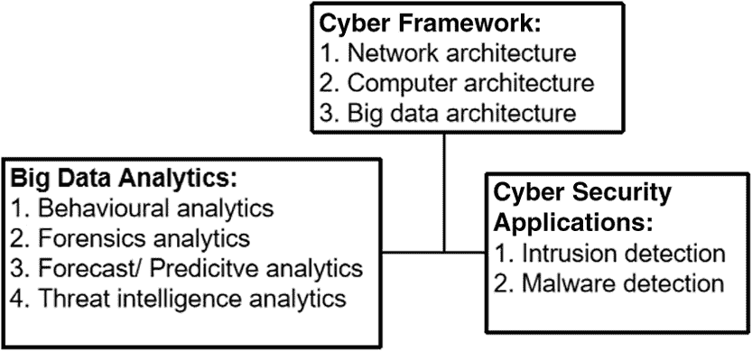

图 14.4 网络安全与大数据分析的概念框架。

### 14.2.4.5 理论框架

#### 14.2.4.5.1 博弈论

先前的研究尝试使用博弈论，其中两个主要玩家——分类器（数据挖掘者）和对手——参与了一种成本敏感型博弈 [4]。在博弈论中，对手试图通过一系列行动实现收益最大化，而分类器或数据挖掘者则试图最小化分类数据的成本。然而，当对手能够不断转换其性能时，分类器（数据挖掘者）最初的成功并不能保证后续对的成功 [4]。博弈论对于解释弱的大数据分析模型无法检测并消除不断改变行为以规避网络安全框架检测的恶意威胁具有重要意义 [4]。内部威胁背景下，博弈论带来了进一步的复杂性，因为对手对组织或机构有深入了解，例如员工、合作伙伴和供应商 [3]。

#### 14.2.4.5.2 情境感知理论

由 [54]提出的情境感知理论认为，网络安全领域的成功取决于获取网络安全事件或事故的实时、准确和完整信息的能力 [14]。情境感知模型由情境感知、决策和行动性能组成，如图 14.5 所示。

![图 14.5 基于[54]的情境感知理论模型。¶ 来源：改编自[14]。](html/images/9781032034041_C014_005.jpg)

图 14.5 基于[54]的情境感知理论模型。¶ 来源：改编自[14]。

情境感知涉及在决策之前对环境要素进行感知、理解和投影 [14]。决策涉及对网络安全系统及网络安全机制的能力等等方面做出知情决策，从而导致行动执行 [54]。情境感知理论模型允许网络安全专家提问并回答关于发生了什么以及为什么发生、接下来将发生什么，以及网络安全专家可以对此做什么的问题 [14]。

#### 14.2.4.6 大数据分析在网络安全中的应用

之前的文献共认为，网络安全已经演变成一个大数据分析问题。这是由于人们，网络空间的转型和扩张 [4] 使得传统的入侵检测和恶意软件检测系统过时。此外，即使是过去使用的数据挖掘模型已不再以应对网络安全领域的挑战 [4]。因此，用于网络安全的新型大数据分析模型大量涌现 [4]。

之前的研究提供了网络安全领域数据分析模型失败的证据，特别是在面对不断修改行为以规避检测的恶意攻击者时 [4]。换句话说，网络安全大数据分析模型可以根据其敏捷性和稳健性进行评估 [4]。

网络安全的数据分析模型在机构之间存在差异；例如，私立医疗机构的网络安全数据分析模型与金融机构或公共部门使用的模型并不相同，尽管它们可能共享相似的框架。

#### 14.2.4.7 大数据分析与网络安全的局限性

[55] 的作者指出，大数据涉及来自多个自主源的海量、复杂且不断增长的数据集。正如 [56] 所指出的，大数据的主要特征是数量、速度和多样性 [57]，引用自 [58]。在 [59] 中，大数据被定义为具有数量、种类、速度和价值的数据。根据 [60]，大数据的定义不仅取决于其传递的信息量，还取决于其复杂性以及分析和交付的速度。参考 [61]，大数据可以定义为结合以下特征的多方面数据：真实性、多样性、数量、速度和价值。

网络安全确保了安全问题，特别是数据安全，而隐私保护问题仍然是其采纳的首要关注点。云计算是通过互联网共享资源的过程 [62]。云计算应用于许多行业。云计算使其成为现代企业必不可少的主要优势是安全性、成本降低、可访问性和更高的效率。

不同国家对关键基础设施发生了多次攻击，因此关键系统有必要进行定期的网络安全漏洞评估，以便预先缓解可能针对它们的攻击。根据 McAfee 安全的报告，网络攻击的范围从盗取个人信息到针对个人目标的勒索尝试不等。网络安全对个人和企业覆盖的广泛范围包括：

- 关键基础设施安全
- 网络安全
- 云安全
- 应用/系统安全
- 用户安全
- 物联网安全

#### 14.2.4.8 局限性

根据 [63]，大数据有三个主要的局限。

##### 14.2.4.8.1 异常值效应

大数据的第一大局限性是异常值很常见。据说，技术尚未达到数据采集方法完全精确的地步。例如，Google 流感趋势几年前著名的凸显了大数据的局限性。因此，该程序的创建是为了通过获取与流感相关的查询数据，对全球流感病例进行实时监控。

##### 14.2.4.8.2 安全局限性

数据泄露的结果首先包括诉讼、罚款和信誉的完全丧失。安全考量会极大地限制公司对其自身数据的能力。例如，让第三方小组或机构分析数据可能是困难的，因为数据可能隐藏在防火墙或私有云服务器之后。如果一家公司试图共享并传输数据以进行一致的分析和处理，这可能会产生一些巨大的障碍。

##### 14.2.4.8.3 数据的误读

数据可以揭示用户的行为。然而，它无法告诉你用户为什么会以他们的方式思考或行为。公司可能没有资源、能力或人员来筛选数据报告，以针对短期和长期业务战略分析具有可操作性的见解。

##### 14.2.4.8.4 其他云计算的局限性

云端的一切依赖于互联网的可用性。如果云服务器出现问题，应用程序也会受到影响。此外，如果一家公司使用的互联网服务波动很大，那么云计算就不适合它。有时，供应商通过专有权利锁定客户，使其无法切换到其他供应商。例如，供应商可能不支持与 Google Docs 或 Google Sheets 兼容。随着客户或其员工专业知识的提高，业务可能对这些功能有关键需求。因此，与供应商的合同必须符合组织的条款，而不是供应商的条款。

### 14.2.5 云计算的进展

#### 14.2.5.1 解释云计算及其至今的演变

##### 14.2.5.2 定义

云计算是指通过互联网访问运行在他人数据中心、由他人硬件上的软件 [64]。云计算本质上是虚拟化的分布式处理、存储和软件资源以及服务，其重点在于将计算作为一种按需获取、按需付费的服务交付。在[1]中，提供了类似的定义，这些定义更强调服务的高度可扩展性和基于订阅的模式、按需付费特性以及互联网作为交付通道。在[26]中，强调了云计算在驱动发展中经济体采用 IT 方面的作用。根据[65]，`cloud` 是一种并行和分布式系统，由一组动态配置的互联和虚拟化计算机组成。

云的特征包括以下方面：

- 按需付费
- 弹性容量
- 无限资源的幻象
- 自服务界面
- 抽象化或虚拟化的资源
- 提供开发工具和 API，以便在其服务上构建可扩展的应用程序

NIST 云计算视觉模型的架构如图图 14.6 所示。NIST 云计算框架指出，云计算由五个基本特征、三个服务模型和四种部署模型组成[66]。


图 14.6 NIST 云计算定义模型。来源：[66]。

## 14.2.6 云的特性

五个基本云特征是：

1. 按需自服务
2. 广谱网络访问
3. 资源池，即位置无关性
4. 快速弹性
5. 可计量服务

云计算的基本特征简要说明如下：

1. **按需自服务**：消费者可以根据需要单方面并自动地配置计算能力（如服务器时间和网络存储），而无需与服务提供商进行人工交互。这意味着人们可以根据需要自动获取计算能力。

2. **广谱网络访问**：通过网络可用的异构客户端平台具有许多能够提供网络访问的功能。

3. **资源池**：计算资源根据消费者的需求在多租户模型中汇聚。资源池意味着：
    * 位置无关性，
    * 提供者的资源汇聚以供多个客户端使用。

4. **快速弹性**：
    * 指能力被快速且弹性地配置，以实现快速扩容，并快速释放以实现快速缩容。
    * 消费者可以在任何时间以任何数量购买无限的能力，因为这些能力是可配置的。
    * 快速弹性意味着快速扩展（入/出）服务的能力。

5. **可计量服务**：
    * 计量能力可以在云系统中根据适用于服务类型的适当抽象层级进行自动控制和优化。
    * 通过监控、控制和报告资源使用情况，可以证明服务提供者和消费者之间的透明性。
    * 可计量服务旨在基于计量对服务进行控制和优化。

## 14.2.7 云计算服务模型

云计算中的交付包含三种云服务模型：软件即服务 (`SaaS`)、平台即服务 (`PaaS`) 和基础设施即服务 (`IaaS`)。这三个模型在图 14.7 所示并在此处进行讨论。

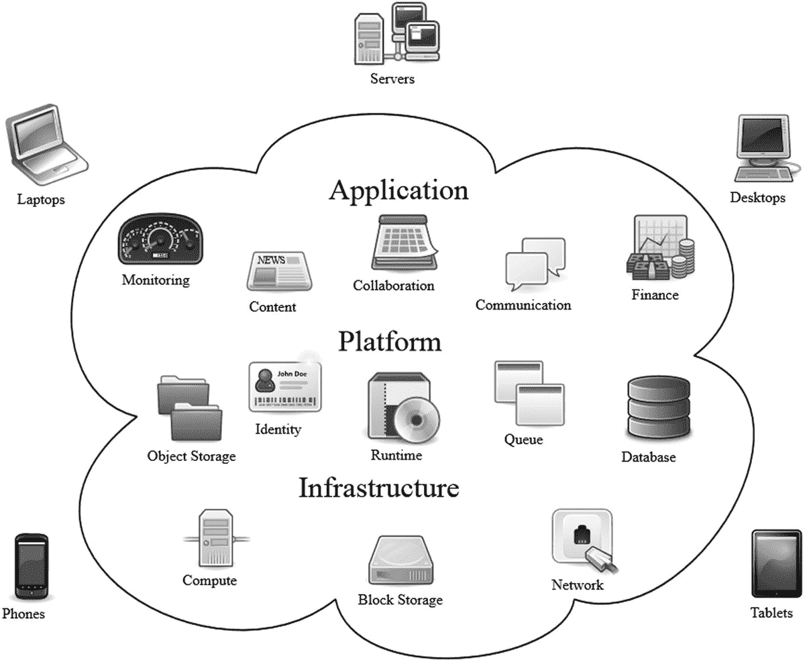

图 14.7 云计算服务模型。

### 14.2.7.1 软件即服务 (SaaS)

提供者运行在云基础设施上的应用程序为消费者提供了可用功能。它利用互联网将应用程序交付给消费者（例如 Google Apps、Salesforce、Dropbox、Sage X3 和 Office 365）[67]。应用程序范围很广，从社交应用到企业级应用，如电子邮件托管、企业资源计划和供应链管理。云提供者的底层云基础设施被配置用于管理网络、服务器、操作系统、存储，甚至是单个应用程序的功能。消费者仅处理极少的用户特定应用程序配置设置。这是使用最广泛的服务模型[66, 68]。

`SaaS` 提供了通过互联网提供的现成应用程序。示例包括：

* Google Docs
* Aviary
* Pixlr
* Microsoft Office Web App.

### 14.2.7.2 平台即服务 (PaaS)

`PaaS` 涉及用于第三方应用程序的消费者基础设施。与 `SaaS` 类似，消费者不管理或控制底层云基础设施（包括网络、服务器、操作系统或存储），但对部署的应用程序以及可能的应用程序托管环境的配置设置具有控制权[66, 68]。示例包括 Windows Azure、Apache Stratos、Google App Engine、CloudFoundry、Heroku、AWS (Beanstalk) 和 OpenShift [67, 62]。为了直接支持业务敏捷性，`PaaS` 提供了更快更频繁的功能交付。

`PaaS` 为消费者运行应用程序提供了一个环境。`PaaS` 是一种云计算服务，为用户提供一个计算平台和解决方案栈，这可能包括：

* 语言
* 操作系统 (`OS`)
* 数据库
* 中间件
* 其他应用程序。

在 `PaaS` 中需要关注的特征包括：

1. 编程语言（Python, Java, .Net, Ruby）
2. 编程框架（Ruby on Rails, Spring, Java EE, .Net）
3. 持久化选项

`PaaS` 云应该能够支持针对不同类型编程的各种编程模型。例如：

* 在计算机集群中对大型数据集进行编程 (`MapReduce`) [69, 70]，
* 基于请求的 Web 服务和应用程序开发
* 以工作流形式 (`Workflow Model`) 编排业务流程
* 任务的高分布式执行。

常用的 `PaaS` 示例包括 Google Apps Engine、Windows Azure Platform 和 Force.com。

`PaaS` 的优点是：

* 快速部署
* 成本低
* 私有或公共部署

`PaaS` 的缺点是：

* 自由度不高
* 工具选择有限
* 供应商锁定。

### 14.2.7.3 基础设施即服务 (IaaS)

`IaaS` 提供处理、网络、存储和其他基本计算资源，消费者随后可以在上面安装和运行任意软件，这包括操作系统（虚拟机 (`VM`)、设备镜像等）和应用程序[66, 68]。消费者从本质上可以运行并控制自己的虚拟基础设施，而无需承担运行自有硬件的成本和维护开销。然而，这需要成本。常见的全球示例有 Amazon Web Services (`AWS`)、Cisco Metapod、Microsoft Azure 和 Rackspace，而本地示例包括 TelOne 云服务和 Dandemutande [67]。

`IaaS` 是一种允许现有应用程序在其硬件上运行的云服务。

* 它在需要的地方动态租用资源。
* 服务包括：
    * 计算服务器，
    * 数据存储，
    * 防火墙，
    * 负载均衡器。

`IaaS` 的显著特征如下：

1. 地理分布
    1. 响应能力
    2. 可用性
2. 用户界面和服务器访问
    1. 提供访问云的手段
        1. GUI
        2. CLI
        3. Web 服务
3. 容量提前预留
    1. 时间段预留
4. 自动伸缩和负载均衡
    1. 服务的弹性
    2. `IaaS` 云最受欢迎的特性之一
    3. 流量分配
5. 服务水平协议 (`SLA`)
    1. 与所有服务一样，双方必须签署协议。
    2. 指标
        * 运行时间、性能衡量
    3. 罚则
        * Amazon
    4. 虚拟机程序和操作系统的选择
        * Xen
        * VMWare, vCloud, Citric Cloud Center

## 14.2.8 云部署模型

三种常用的云部署模型是私有云、公共云和混合云。另一种模型是社区云，然而这种模型并不常用。在云语境下，`deployment` 一词基本上指的是软件提供的所在地——也就是说，它运行的地方。

### 14.2.8.1 私有云

私有云通常由单一组织拥有或专门使用。服务和基础设施永久保留在私有网络上，硬件和软件专门供特定组织使用。服务提供或特定组织可以管理物理基础设施。该模型的主要优势是提高了安全性，因为资源不与他人共享，从而允许更高水平的控制和安全性 [71]。

### 14.2.8.2 公有云

云基础设施供公众使用，即任何组织或个人都可以订阅。在 [26] 中进一步阐明，云服务是以订阅的方式向公众提供的，通常是按需付费模式。优点包括更低的成本、近乎无限的可扩展性以及高可靠性 [71]。示例包括 Amazon (EC2)、IBM 的 Blue Cloud、Sun Cloud、Google App Engine 和 Windows Azure [72]。公有云作为大规模基础设施出售给公众，并供大众使用。

### 14.2.8.3 混合云

混合云模型是两种或多种云部署模型的混合，例如私有云、公共云或混合云 [73, 74]。这种模型需要确定公共云和私有云组件之间的最佳划分。这种模型通常被开始采用云之旅的组织使用。优点包括对敏感数据的控制（私有云）、灵活性（即根据需要随时扩展到公有云的能力）以及通过逐步迁移轻松过渡到云 [71]。使用标准化或专有技术允许数据和应用程序的可移植性 [75]。

### 14.2.8.4 社区云

该模型供具有共同利益的特定消费者群体专享使用（例如，政策和合规性考虑、任务和安全需求）。从技术上讲，社区云是一个多租户平台，仅为特定的客户子集提供。社区云在多个组织之间共享计算资源，可以由组织的 IT 资源或第三方提供者管理 [66]。一个典型的例子是位于美国的独占 IBM SoftLayer 云，它专门供联邦机构使用。这种方法建立了对该平台的信任，云消费者使用该平台来处理其敏感的工作负荷 [72]。

社区云基础设施是：

* 为特定社区共享的，
* 针对几个有共同关注点的组织，
* 由组织或第三方管理。

## 14.2.8.5 云计算的优缺点

### 14.2.8.5.1 通用云计算

根据 [76]，云符号通常用于代表互联网。云计算服务在需要时以所需的数量在特定时间交付。云计算类似于租车模式。云计算为组织带来了许多益处，包括节省成本（低资本支出）、可扩展性、随时随地的访问、使用最新版本的软件、节约以及业务解决方案的快速推出 [77]。然而，安全性、隐私、监管和技术就绪方面的担忧影响了采纳速度。

云平台的成本效益和效率吸引着大多数组织迁移到云并享受广泛的通用益处 [78]，根据 [79]，这些益处包括：

* 无资本支出，
* 随时随地访问，
* 无维护烦恼，
* 由于文件集中管理提高了文档控制，
* 动态可扩展性，
* 设备无关性，
* 即时性，
* 成本效益，
    * 以任务为中心，
    * 私有服务器成本。

云计算具有通过提供成本的先进 IT 解决方案和提高效率来显著促进经济增长的潜力。此外，规模效应可以大幅降低组织的 IT 成本。共享计算设施的使用提高了基础设施使用的效率，因为组织实际上只为它们使用的部分付费，并有效降低了运营成本 [80]。云计算实现了 IT 基础设施的快速供应和应用程序的访问，从而缩短了部署周期。共享托管环境减少了初始资本支出，这通常是大多数组织采用技术的阻碍 [81, 82]。云计算的主要优点包括：

* 为终端用户提供低成本计算机
* 提高用户 PC 的性能
* 更低的 IT 基础设施和软件成本
* 更少的维护问题
* 实例软件更新
* 无限的存储容量
* 增强数据安全
* 更容易的小协作
* 数据/文档的通用访问

NIST 云计算定义框架如图 14.8 所示。

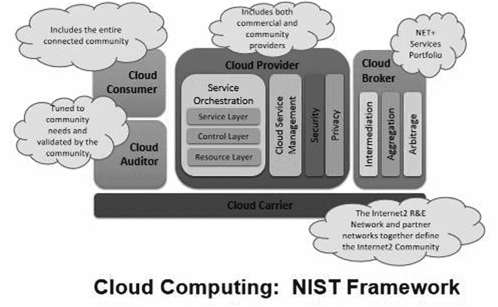

图 14.8 NIST 云计算定义框架。

这里总结了云计算的业务和技术优势。云计算的业务优势包括：

* 几乎零的前期基础设施投资，
* 即时基础设施，
* 更高效的资源利用，
* 基于使用的成本计算，
* 缩短上市时间。

云计算的技术优势是：

* 自动化 —— “脚本化的基础设施”，
* 自动伸缩，
* 主动扩展，
* 更高效的开发周期，
* 提高可测试性，
* 灾备和业务连续性。

然而，云计算的主要关注问题和缺点是：

* 它需要持续的互联网连接；
* 它在低速连接下运行不佳；
* 它比使用桌面软件慢；
* 它的功能可能更有限；
* 存储的数据可能不安全；
* 如果云端丢失了你的数据，那是一个大问题。

其他关键关注点涉及：

* 隐私，
* 安全，
* 可用性，
* 法律问题，
* 合规性，
* 性能。

谁能从云计算（`CC`）中获益？互联网受限者、离线工作者、对安全敏感的人以及任何依赖现有应用程序（例如 `Microsoft Office`）的人不应使用云计算。最常用的云计算服务（`SaaS`）包括：

* 日历、日程和任务管理，
* 事件和联系人管理，
* 电子邮件，
* 项目管理，
* 文字处理、电子表格和演示文稿，
* 数据库，
* 文件存储和共享，
* 分享数字照片，
* 分享歌曲和视频。

对于如今大多数企业而言，在计划实现计算和网络架构现代化时，云原生架构已成为主要的部署环境 [83]。云计算现在是企业生活的至关重要的部分，通过高效利用 IT 资源为加速业务增长提供了重大机会，并为协作提供了新机会。

采用云计算与多种优势相关，这些在本节中得到了重点介绍。正如 [84] 引用的 [85] 所述，云计算的特性包括：

* `可扩展性和按需服务`：云计算根据需求为用户提供资源和服务。可扩展性允许轻松地扩展或缩小服务。云计算可以高效地扩展和缩小，这使其能够满足用户需求的突然激增，并根据需要创建临时数字环境。这具有降低运营成本的潜力 [86]。
* `保证的服务质量 (QoS)`：云计算为用户保证高水平的 `QoS`（硬件/CPU 性能、带宽、内存容量和运行时间）。
* `计算能力`：巨大的计算能力仅需极小的成本即可获得 [87]。
* `自治系统`：云平台实现了无缝管理，使得后端发生的大多数平台变化对终端用户几乎难以察觉。
* `定价`：在大多数情况下，云计算所需的资本支出很少或为零，因为它使用了按需付费的定价模型 [86]。
* `易于访问`：大多数云服务可以从任何现代终端用户设备（如桌面式电脑、笔记本电脑、平板电脑和手机）轻松访问 [86]。在 [73] 中，这被简单描述为随地办公的能力。
* `降低业务风险的潜力`：通过将服务基础设施外包给云，公司还将业务风险转移给了服务供应商，服务供应商在大多数时候更能够管理这些风险 [87]。
* `提高 IT 捷活性`：云计算具有提高组织 IT 捷性的潜力，因为它允许他们缩短识别新 IT 资源需求与交付之间的时间 [87]。云计算还让组织将内部资源集中在战略性的 IT 和业务优先事项上 [87]。
* `更好的备份和灾难恢复服务`：云计算提高了备份和灾难恢复服务，因为数据可能同时存储在多个位置，这最大限度地减少了数据丢失的风险 [88]。此外，云服务供应商内置了强大的现代灾难恢复系统。

## 14.2.8.5.2 云计算在业务中的优势

通过将服务基础设施外包给云，公司还将业务风险转移给了服务供应商，后者在大多数时候更具管理这些风险的能力。云计算支持交互式、用户友好的虚拟化部署。云计算在业务中的优势将在下文中讨论。

### 14.2.8.5.2.1 灵活性

通过采用云计算极大地增强了办公室内或外部的灵活性。员工只要有互联网连接，就可以通过任何设备访问工作安排。云服务商提供了最新版本的平台。

### 14.2.8.5.2.2 降低成本

组织采用云计算进入业务的主要原因是它有助于降低成本。云资源可以轻松安装和部署，特别是 `SaaS`。供应商的支持减少了 IT 负担，从而减少了人员需求。

### 14.2.8.5.2.3 自动软件/硬件升级

当实施解决方案时，硬件和软件的维护成本得到了解决。由于采用了云计算，无需资本投资即可获得即时访问，这缩短了上市时间。

### 14.2.8.5.2.4 敏捷性

为了响应客户快速变化的需求，组织需要保持竞争力。由于云计算 24/7 全天候可用，这使得组织能够保持竞争力。

## 14.2.8.5.3 总结

云计算的六大主要优势如下：

1. `实现规模效应`：这通过更少的资源（计算和人力）实现了产出或生产力的提高。
2. `减少资本支出`：从 `CapEx` 到 `OpEx` 的转移基于需求计算的按需付费运营支出 (`OpEx`) 模式减少了硬件和软件许可的资本支出 (`CapEx`)。
3. `提高可访问性`：通过全渠道访问，可以随时、随地、通过任何设备访问信息。
4. `低成本实施敏捷开发`：这是关于在云共享开发运营中使用敏捷方法对新的解决方案和服务进行设计、开发和发布。
5. `利用全球劳动力`：可以通过各种数据中心 24/7 地推出云计算服务，以确保服务靠近终端用户。
6. `获取先进能力`：最新的软件进展（如人工智能、区块链、数据挖掘）作为云服务现成可用，使组织能够以最小的投资获得这些能力。

云计算中的演示文服务是指涉及基于网页或手机的演示文稿应用程序进行演示文稿协作。常见的演示服务示例包括 `AuthorStream.com`、`SlideBoom.com` 和 `SlideShare.net`。

* 防止编辑现有文件。

然而，其缺点包括：

* 网络访问至关重要，
* 并不总是具有相同范围的功能，
* 现有的演示文可能存在兼容性问题。

同样，`CC` 中也提供数据库服务，常见的示例有：

* Dabbledb.com [89]
* Teamdesk.net
* Trackvia.com
* Baseportal.com
* Springbase.com
* Viravis.com
* Infodome.com
* Creator.zoho.com
* Quickbase.intuit.com

## 14.2.8.6 云计算的六大主要特征及其利用方式

下文重点介绍了源自 NIST 框架的云计算的六个核心特征。

### 1. 按需自服务服务

`on-demand services` 意味着用户可以随时访问云资源。通过按需自服务，消费者可以在云端配置计算能力，而无需一定与云服务提供商进行人工交互 [66]。通常，一旦组织配置了云服务，与云服务提供商的人工交互将是极稀少的，因为大多数云解决方案都被设计为自服务。通过按需自服务，消费者可以根据需要自动访问计算能力。

按需自服务涉及电子邮件、应用程序以及网络或服务器服务等计算机服务，这些服务的提供无需与每个服务提供商进行人工交互。最受欢迎的云服务提供商包括亚马逊云服务 (`AWS`)、微软、谷歌、IBM 和 Salesforce.com。Gartner 将此特征描述为基于服务。按需自服务仅需满足两点：

1. 24/7 服务的可用性
2. 客户能够在能够在联系托管提供商的情况下，修改其收到的服务的能力。

总之，在企业级托管应用中，按需自服务可能是采用率最低的特征之一。

### 2. 广网络访问

通过广网络访问，可以从任何地方、任何时间、通过任何标准设备访问 Web 上的计算资源。广网络访问提供了通过多个设备访问云服务的能力，即异构的瘦客户端或厚客户端平台（例如工作站、笔记本电脑、手机和平板电脑）[66]。事实上，如今这意味着可以使用任何具有互联网能力的设备进行访问。在广网络访问中，用户可以使用较少的磁盘设备从任何地方、任何时间访问云计算。

广网络访问是指任何基于网络的设备都可以从设备访问托管应用程序，这些设备包括但不限于：

* 笔记本电脑，
* 台式电脑，
* 智能手机，


- 平板设备。

广网络访问更多是托管应用程序的一种功能。

### 3. 资源池化

在共享资源池中，用户可以共享云资源。在多租户模型中，云提供商的池化资源用于为多个消费者提供服务。虚拟和物理资源被动态分配以满足消费者需求。资源可能分散；因此在某些情况下，数据的物理位置可能会成为问题。池资源包括存储、内存、处理和网络带宽 [66, 68]。资源池化意味着：

- 位置无关性，
- 池化的提供商资源为多个客户提供服务。

在资源池化方面，安全需求可能会成为瓶颈。

### 4. 快速弹性

快速弹性是指快速且弹性地提供云服务，以便快速扩展规模（`scale out`）和快速收缩规模（`scale in`）。面向消费者的云服务可以根据需求快速扩大或缩小，且通常在自动化过程中完成。对于消费者而言，可用资源往往看起来是无尽的，并且可以在任何时间以任何规模使用 [66, 68]。这在矿业等项目密集型领域至关重要，因为这些领域的团队规模是动态的，还能确保最佳许可并可能大幅节省成本。

通过快速弹性，客户可以以弹性方式访问计算资源。快速弹性意味着能够快速扩展进入或缩出服务的能力。在快速弹性中，可以随时方便地扩大或缩小资源。如果你的应用程序经历了使用高峰峰值，那么快速弹性是关键特征之一。

### 5. 量化服务

量化服务是指云计算资源的使用情况由云服务提供商控制，并可以进行测量和监控。云计算服务使用计量功能，使用户能够控制和优化资源使用。

通过量化服务，云计算系统被用作自适应系统。它们会自动平衡负载并优化资源利用。通过允许客户监控和控制资源使用，可以实现账单透明化。云服务提供商利用计量功能对存储、处理、峰值使用、带宽和活跃用户数等资源进行自动控制和优化。计量实现了监控、控制和报告，从而为云提供商和消费者提供了透明度 [66, 68]。量化服务关乎基于计量的服务控制和优化。计量化使用与弹性是并行的。

### 6. 多租户性

多租户性需要针对不同的群体执行策略驱动的强制、分、隔离、治理、服务水平以及费用划分/计费模型。

总之，云计算的特征通过以下方式被利用：

- 大规模
- 同质化
- 虚拟化
- 韧性计算
- 低成本软件
- 地理分布
- 服务导向
- 高级安全技术

## 14.2.8.7 网络函数虚拟化的优势

网络函数虚拟化 (NFV) 是一种设计和运营电信网络的新范式。传统上，这些网络依赖专用硬件设备及其功能来提供通信服务。然而，这种依赖变得越来越缺乏活性且效率低下，特别是在处理突发流量时（例如大型活动）。NFV 试图通过 (1) 在软件中实现网络功能以及 (2) 在虚拟化环境中部署它们来克服这些局限。产生的虚拟网络函数 (VNF) 需要灵活、可扩展且容错的虚拟基础设施。

容器虚拟化的日益成熟，以及生产级容器平台的引入，促使容器成为 NFV 基础设施 (NFVI) 实现的候选。容器为应用程序和服务的提供了封装方法。

### 14.2.8.7.1 虚拟化

`virtualization` 基本上是为某个东西创建一个虚拟镜像或“版本”，并在多台机器上同时使用。这通过转换传统计算来使其更具扩展性、效率和经济效益的工作管理方法。虚拟化可以应用于硬件级虚拟化、操作系统虚拟化和服务器虚拟化。在虚拟化中，当资源和服务与底层物理交付环境分离时，硬件成本降低了并节省了能源。虚拟化的主要驱动力是服务器合并以提高效率和潜在的成本节省。

虚拟化涉及：

- 资源利用率不足，
- 资源划分，
- 需要维护，例如，控制作业流。

虚拟化的优势包括更低的成本和更长的技术寿命，这使其成为中小型企业的流行选择。服务提供商拥有的物理基础设施由多个使用虚拟化的用户共享，以提高资源利用率。虚拟化促进了资源的高效利用并提高了投资回报率（ROI），从而降低了资本支出（CapEx）和运营支出（OpEx）。

通过虚拟化，可以获得服务提供商资源更好的利用率，增加服务商和消费者的投资回报率，并通过减少能源浪费促进绿色 IT。虚拟化技术具有以下缺点：虚拟化软件的单点故障可能会整个系统的性能。总体而言，虚拟化具有巨大的优势，如下：

- 当物理硬件不可用时，仍然可以运行操作系统
- 创建新机器、备份机器等更容易。
- 可以为软件测试进行操作系统和软件的“纯”安装。
- 可以模拟比物理可用数量更多的机器。
- 轻负载系统可以分时一台主机。
- 调试问题更简单（挂起和恢复出现问题的机器）。
- 便于虚拟机的迁移。
- 运行遗留系统！

### 14.2.8.7.2 为什么要虚拟化？

借助虚拟化的帮助，我们可以增加可用资源的使用以获得更多收益。我们应该出于以下原因进行虚拟化：

- 用户之间的隔离
- 资源共享
- 动态资源
- 资源聚合

虚拟化的标准方法是在虚拟机（`VMs`）上实现，以受益于：

- 物理主机的抽象，
- 允许虚拟机监视程序管理和模拟 `VMs`、`VMWare`、`Xen` 等的指令，
- 为硬件/支持结构提供基础设施 API，即插件。

虚拟机利用 `VM` 技术，允许多个虚拟机运行在单台物理机上。虚拟基础设施管理器（`VIMs`）是关键技术，它涉及：

- 云操作系统，
- 云中的资源分配，
- 从多个源聚合资源，
- 作为基础设施共享软件、云操作系统和虚拟基础设施引擎。

虚拟基础设施（`VI`）管理的关键特征如下：

- 虚拟化支持
    - 骨干
    - CPU、内存、存储
    - 尺寸划分和重新调整
- 自助、按需资源供应
    - 直接从云获取服务
        - 服务器的创建
        - 软件定制
        - 配置
        - 安全策略
    - 无需通过系统管理员
- 多个后端虚拟机监视器
    - 虚拟化模型的缺点
    - 虚拟化的统一管理
- 存储虚拟化
    - 从物理存储中抽象出逻辑存储
    - 创建独立的虚拟磁盘
    - 存储区域网络（`SAN`）
        - 光纤通道、`iSCSI`、`NFS`
- 公云的接口
    - 需要借用的过载
    - `VIMs` 在峰值期间使用 `VIMs` 从外部源获取资源
- 动态资源分配
    - 根据需要分配和释放资源
    - 需求预测计算困难
    - 移动负载以减少过热
    - 监控资源利用率并相应重新分配
- 虚拟集群
    - 整体管理互连的虚拟机组
- 高可用性和数据恢复
    - 需要极少的停机时间

### 14.2.8.7.3 多核技术

在多核技术中，两个或多个 CPU 在同一块芯片上作为一个单一集成电路（`IC`）工作。这些单一集成电路被称为 `die`。多核技术可用于多租户环境加速处理。多核架构已成为高性能处理器的趋势。

大多数软件供应商提高虚拟化在虚拟状态下支持，除非终端用户决定虚拟化。为了适应需求，虚拟化过程很大程度上围绕着非常重要的软件。这被称为 `hypervisor`。因此 `VM` 必须有一个操作系统内核。

### 14.2.8.8 虚拟化与容器化的对比

虚拟化允许在单一物理系统上运行多个操作系统并共享底层硬件。虚拟化涉及抽象和封装。云严重依赖虚拟化，而网格对虚拟化的依赖并不多。在虚拟化中，`hypervisor` 是创建和运行虚拟机的计算机软件。

与其在虚拟机中安装操作系统以及所有软件，`docker` 镜像可以于 `Dockerfile` 构建，因为 `CPU` 和内存等硬件资源会立即返回操作系统。因此，许多应用程序被编写到容器中。`Cgroups` 允许系统管理员将 `CPU`、内存、网络或任何它们的组合分配给运行容器，如图 14.9

图 14.9]。虚拟化的核心组件是 `hypervisor`。

##### 14.2.8.8.2 B. 虚拟机监视器

Hypervisor（虚拟机管理器）是一种为运行在物理主机上的虚拟机提供隔离的软件。这层薄薄的软件通常提供虚拟分区功能并直接运行在硬件上，它为虚拟分区提供了可能，并负责在物理主机上运行多个内核。这种特性使得应用程序和进程隔离变得非常昂贵，因此如果计算机资源能够被更有效地利用，将产生巨大影响。目前最流行的 Hypervisor 有 VMware、KVM、Xen 和 HyperV。

在 Linux 世界中，“容器”（container）作为一个通用术语，带来了更多的困惑。基本上，容器无非是一个隔离的虚拟文件系统，通过一些 Linux 内核功能（如命名空间和进程组）与物理系统隔离开。容器框架提供了一个与我们要求的虚拟机尽可能接近的环境，但没有了运行在另一个内核上并模拟所有硬件所带来的开销。由于容器的轻量级特性，每个主机可以运行的容器比虚拟机多得多。与容器不同，虚拟机需要仿真层（软件或硬件），这会消耗更多资源并增加额外的开销。

容器在许多方面与虚拟化不同。

1. `Simple`：易于共享硬件资源、整洁的命令行界面、简单的 REST API
2. `Fast`：快速供应、即时启动客户端、且具有无裸机速度的虚拟化开销
3. `Secure`：默认安全，结合了所有可用的内核安全功能以及 AppArmor、用户命名空间、SECCOMP
4. `Scalable`：能够将开发者笔记本电脑上单个容器的服务质量能力广播到数据中心的容器主机上，包括具有可扩展存储和网络的远程镜像服务
5. `Control groups (cgroups)`：一种内核提供的机制，用于通过虚拟文件系统进行管理、分组和跟踪
    - `Namespaces`：一种命名空间（NS），用于产生全局资源的受限实例，基本上用于实现容器；这是一种轻量级虚拟化，产生了一种进程是系统内唯一运行进程的幻觉。
    - `AppArmor`：一种强制性访问控制（MAC）机制，一种防止程序发生意外中断的安全系统，它使用 LSM 内核来改进对限制在特定资源的程序的限制。

Openstack 在私有云领域的增长显著。现代组织将其视为私有云的一种种可行解决方案，因为 Openstack 环境提供了高可扩展性的有效资源管理。目前市场上有很多不同的虚拟机；然而，由于其普及度的巨大增长，本研究特别选择了 Openstack。

Docker 容器与其宿主机共享操作系统和重要资源（如依赖库、驱动程序或二进制文件），因此它们占用的物理资源较少。

## 14.3 研究方法论

### 14.3.1 方法论介绍

本研究使用了实用主义（pragmatism paradigm），这与混合方法研究（MMR）密切相关。

#### 14.3.1.1 研究方法与哲学

##### 14.3.1.1.1 研究方法

研究者采用了以焦点小组讨论的形式进行的定性方法。通过分析来建立网络安全数据分析模型之间的差异，而无需对分析进行量化 [91]。

##### 14.3.1.1.2 研究哲学

研究者采用实用主义哲学来指导研究。首先，研究者记录了各国定义、范围和衡量标准 [92]。

#### 14.3.1.2 研究设计与方法

##### 14.3.1.2.1 研究设计

研究者采用了描述性设计，因为其目的是系统性地描述事实 [91]。

##### 14.3.1.2.2 研究方法

本研究采用了案例研究法。在这方面，每个网络安全数据分析模型都被视为一个独立的案例 [92]。以前的研究倾向于使用案例研究 [6]。然而，研究者开发了一个考虑到理想数据分析模型的控制案例。

### 14.3.2 总体与采样

#### 14.3.2.1 总体

本研究的总体由所有在文献、期刊、会议论文和工作论文中提出的和开发的网络安全数据分析模型组成。这与系统的文献综述一致 [3]。

#### 14.3.2.2 样本

研究者通过文献综述识别了两个数据分析模型或框架，样本量为 8。共访谈了 8 名参与者。虽然这些数据可能有限，但对于本研究目前的需求是足够的。未来的研究可能会查阅更多期刊，以识别更多可以应用于网络安全的数据分析模型。

### 14.3.3 数据来源与类型

研究者使用二次数据来研究数据分析模型在网络安全中的应用。

### 14.3.4 分析模型

在分析不同的网络安全数据分析模型时，研究者参考了网络安全数据分析模型的特征。在构建理想模型时，研究者整合了各种文献来源。网络安全大数据分析模型的基本框架由三个主要部分组成：大数据、分析和洞察 [4]。然而，可以识别出第四个组成部分——预测（或预测分析）[3]。这在图 14.10 (#ch25.xhtml#b2-FIGn-fig-72) 中所示。

```
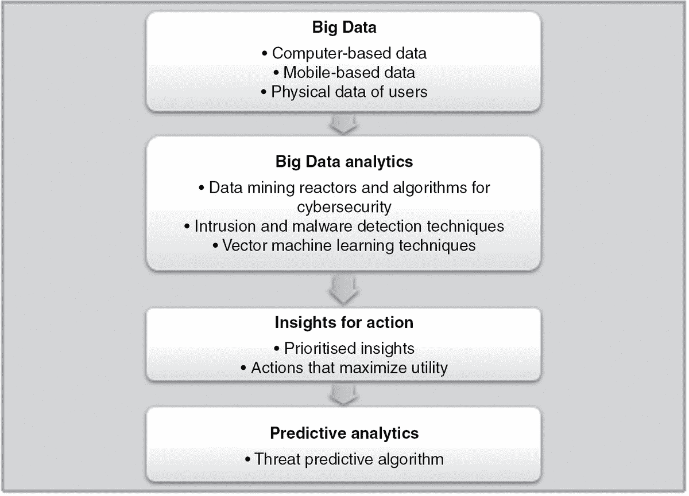
```

图 14.10 网络安全数据分析模型。

#### 14.3.4.1 大数据

网络安全大数据分析框架的第一个组件是网络安全相关大数据的可用性。传统的的大数据源是系统日志和漏洞扫描 [4]。然而，网络安全大数据的源已经扩展到包括计算机数据、移动设备数据、用户物理数据、人力资源数据、凭据、一次性密码、数字证书、生物识别数据以及社交媒体数据 [21]。一些作者将网络安全大数据的源识别为业务邮件、访问控制系统、CRM 系统和人力资源系统、链接数据网络中的若干拉取器、内网/互联网以及工业物联网/物联网、社交媒体网络中的采集器和聚合器，以及外部新闻磁带 [52]。网络安全大数据应从多个数据源导入，以确保对可能威胁进行检测和预测的有效性 [5]。此外，一些作者规定了安全数据的特征为由异构格式组成，具有跨数据源的多样语义和相关性，并将其分为若干类，例如非语义数据、语义数据和安全知识数据 [5]。

### 14.3.4.2 大数据分析

为了解决大数据的网络安全问题，数据挖掘技术 [94]和机器学习 [4]中已经开发出更健健的网络安全大数据分析模型 [93]。大数据分析 [95] 利用了数据挖掘反应器 [96]和算法 [97]、入侵和恶意软件检测技术，以及用于网络安全的向量机器学习技术 [4, 42]。然而，观察发现对抗性程序倾向于通过适应检测它们的反应器和算法来修改其行为 [4]。此外，入侵检测系统面临着诸如无边界模式、数据非平稳性、不均匀延迟、个体性、高误报率和合谋攻击等挑战 [3]。这需要对网络安全大数据分析采用多层次和多维度的方法 [2, 5]。换句话之，有效的网络安全大数据分析模型必须能够检测网络安全框架中每一层面的入侵和恶意软件。

### 14.3.4.3 行动洞察

网络安全大数据分析应该能够为网络安全人员提供优先排序且可操作的洞察，例如，建立有效的网络防御者，使其能够检测网络中的缺陷并追踪威胁或攻击的源头 [4]。或者，网络安全人员也可以根据关于网络安全系统的新优先洞察来更新现有的网络防御者 [4]。分析师的目标应该是最大化从网络安全系统中获得的效用。

### 14.3.4.4 预测性分析

`Predictive analytics` 指应用网络安全大数据分析模型，从当前数据推导出未来发生网络安全事件的概率 [3]。本质上，一个网络安全数据分析模型若要在其收集网络安全大数据、分析安全威胁大数据、提供可操作的洞察以及预测未来网络安全事件的主要功能上发挥作用，就必须整合这些组件。

### 14.3.5 有效性与可靠性

研究人员就新发现征求同行的意见，并寻求反馈以澄清研究者的偏见和假设，以确保研究的内部有效性 [92]。研究人员还需要通过详细说明研究基础的假设和理论来证明研究结果的可靠性 [92]。

### 14.3.6 研究总结

在第 3 章中，研究人员开发了调查网络安全理想数据分析方法的适当方法论。

### 14.3.7 可能的结果

预期的研究准确率应根据表 14.3](#ch25.xhtml#b2-wrap-015)，该表显示了基准。

| 分类器 | 检测准确率 (%) | 构建模型所需时间 (秒) | 误报率 (%) |
| :--- | :--- | :--- | :--- |
| 决策树 (J48) | 81.05 | | |
| 朴素贝叶斯 | 76.56 | | |
| 随机森林 | 80.67 | | |
| SVM | 69.52 | | |
| AdaBoost | 90.31 | | 3.38 |
| 多项朴素贝叶斯 `N2B` | 38.89 | | 27.8 |
| 更新的朴素贝叶斯 `N2B` | 38.94 | | 27.9 |
| 差异性多项贝叶斯 `PCA` | 94.84 | 118.36 | 4.4 |
| 差异性多项贝叶斯 `RP` | 81.47 | 2.27 | 12.85 |
| 差异性多项贝叶斯 `N2B` | 96.5 | 1.11 | 3.0 |

## 14.4 分析与结果

### 14.4.1 概述

图 14.11](#ch25.xhtml#b2-ref-73) 显示了入侵检测的格局。通过已知 IP 地址的特定设备提供服务。为了避免拒绝服务攻击，可以使用分析建立知识表示模型 [8]。图 14.12](#ch25.xhtml#b2-ref-74) 详细说明了攻击的简单规则。网络上出现异常行为会触发基于异常的 IDS 告警。


图 14.11](#ch25.xhtml#b2-ref-73b) 入侵检测的格局。

![图 14.12 攻击的分析。源：[38]。](html/images/978103203401_C014_012.jpg)

图 14.12](#ch25.xhtml#b2-ref-74b) 攻击的分析。源：38]。

在 [99] 中，强调了使用机器学习 (ML)、神经网络和模糊逻辑来检测私有网络攻击的人工智能 (AI) 技术。在技术上开发一个完美的复杂的入侵检测系统不可行的，因为大多数 IDS 是基于签名的。

IDS 分为主机 IDS (HIDS) 或网络 IDS (NIDS)。网络流量分析可以由区分网络上未经许可、非法和异常行为的 NIDS 处理。穿过网络的数据包通常由 IDS 使用网络分流器或镜像端口捕获，以便检测并标记任何可疑活动 [99]。特定设备上的异常行为或恶意活动可以被设备特定的 IDS 有效检测。


物联网 (IoT) 的不断增长为实现绝对的网络安全带来了巨大挑战。IDS 的特征是网络观察、分析和识别可能的行为异常或未经授权的访问，某些 IDS 在发生入侵时保护计算机网络。然而，现有方法存在若干局限性和问题 [100]。

提供一种可靠的保护网络系统或信任现有入侵检测系统（IDS）的方法是一项更大的挑战。在存在特定弱点和局限性的情况下，管理员需要定期更新保护机制，这进一步对检测系统提出了挑战。无线技术的使用加剧了网络的脆弱性和对网络攻击的敏感性 [100]。

传统安全措施的严重缺陷已暴露无遗。因此，应该确定用于动态和自适应网络防御机制的有效解决方案。神经网络可以为代表性训练数据集提供更好的解决方案 [100]。[100]认为，对于大多数 IDS，可以使用可以通过监督或半监督学习模型解决的 ML 分类问题。然而，[100]工作的一个主要局限性在于网络安全中的信息结构，不足以分析参与者的策略和解决方案。

自主机器人车辆会受到网络攻击，导致它们无法完成入侵预防任务。基于知识和针对特定车辆的方法在检测方面存在局限性，仅适用于特定的已知攻击 [41]。[41]使用的攻击场景的攻击向量如图 14.13 所示。

![图 14.13 攻击场景的攻击向量。¶ 来源：[41]。](html/images/9781032034041_C014_013.jpg)

图 14.13 攻击场景的攻击向量。¶ *来源*：[41]。

在本次实验中，允许机器人车辆执行多项任务，这偏离了机器人测试台。所使用的攻击向量的实际实验设置如图 14.14 所示。

![图 14.14 机器人实验设置攻击向量。¶ 来源：[41]。](html/images/9781032034041_C014_014.jpg)

图 14.14 机器人实验设置攻击向量。¶ *来源*：[41]。

表 14.4 显示了可用于入侵检测的数据挖掘技术的比较。

### 表 14.4 数据挖掘技术的优缺点

| 技术 | 优点 | 缺点 |
| --- | --- | --- |
| 遗传算法 | • 为任何优化问题寻找解决方案 • 处理多个解空间 | • 提一个问题空间具有复杂性 • 选择最优参数具有复杂性 • 需要局部搜索技术以实现有效运行 |
| 人工神经网络 | • 在训练期间无需编程即可调整其结构。 | • 对于测试数据的结果与训练数据相比不准确 |
| 朴素贝叶斯分类器 | • 结构非常简单 • 易于更新 | • 当存在相关性时不有效 |
| 决策树 | • 易于理解 • 易于实现 | • 仅在特征离散时有效 |
| K 聚类 | • 易于理解 • 易于实现。 | • 对初始质心有高度依赖 |

入侵检测系统需要优化并增强数据挖掘的效率。使用 NSL-KDD 数据集的每种算法的优缺点在表 14.5 中所示。

### 表 14.5 使用 NSL-KDD 数据集的向量机、神经网络、K 近邻和决策树的性能

| 参数 | SVM | ANN | KNN | DT |
| --- | --- | --- | --- | --- |
| 正确分类实例 | 2419 | 2423 | 2505 | 2508 |
| 错误分类实例 | 673 | 1069 | 1411 | 1421 |
| Kappa 统计量 | 0.9462 | 0.9136 | 0.9888 | 0.7906 |
| 平均绝对误差 | 0.0267 | 0.0545 | 0.0056 | 0.1034 |
| 均方根误差 | 0.1634 | 0.197 | 0.0748 | 0.3152 |
| 相对绝对误差 | 5.3676% | 11.107% | 20.781% | 28.54% |

入侵检测系统通过监控计算机和网络来确定是否发生了入侵，并在必要时发出警报 [102]。[102]认为基于异常的方法（ABS）通过允许用户来减少误报。ABS 的优缺点在表 14.6

### 表 14.6 ABS 的优缺点

| 检测模式 | 优点 | 缺点 |
| --- | --- | --- |
| 基于特征 | 误报率低 不需要训练 | 无法检测新攻击 调可能是一项艰巨的任务 |
| 基于异常 | 可以检测新攻击 自学习 | 需要训练 |

IDS 必须跟踪所有数据、网络组件和设备。由于其复杂性和集成服务，开发云入侵系统时必须满足额外要求。

## 14.4.2 支持向量机

支持向量机是一种人工智能和机器学习分类算法，适用于包含两类点的 `X` 维集合。支持向量机使用线性或非线性核函数生成 `(X − 1)` 维超平面，将这些点分为两个或多个 [17]。核函数为多项式、径向和多层分类器提供了方法，例如将银行性能分为*强*、*满意*、*中等*和*差*四类。性能的类别由函数定义：

```
Performance class = f(x.w) = f(sum(xj*wj))
```

其中 `x` 是输入向量，`w` 是权重向量，`f`是将输入与权重向量的点积转换为所需类别的函数。`w` 从标记训练数据集中学习。

## 14.4.3 KNN 算法

KNN 算法是一种非参数监督机器学习技术，通过支持训练数据集对数据点进行给定分类 [17]。表 14.10 显示了其性能。通过在整个训练集中搜索 K 个最相似的实例或邻居，对新对象 `y` 执行预测。该算法通过如下计算欧几里得距离来实现：

```
d(x,y) = sqrt(sum(i=1 to m)(xi-yi)²))
```

其中 `d(x, y)` 是用于衡量新观测值与训练案例之间相似性的距离度量，进而找到与新实例最近的 `K` 个实例。在计算距离之前，会对变量进行标准化处理，因为它们的测量单位不同。标准化通过以下函数进行：

$X_{s} = \frac{X - \text{Mean}}{s.d.},$

其中 `X[s]` 是标准化后的值，`X` 是实例度量，而 `mean` 和 `s.d.` 是实例的均值和标准差。`K` 的值越小对离群值越敏感，值越大则对离群值的韧性越强，并且会考虑更多的投票者来决定预测结果。

## 14.4.4 多线性判别分析 (LDA)

线性判别分析是一种降维技术。降维是指通过寻找一组主变量来减少所考虑随机变量数量的技术 [17]，也称为维度削减。`LDA` 计算 `n` 类之间的可分性，也称为类间方差。设 `D[b]` 为 `n` 类之间的距离。

$D_{b} = {\sum\limits_{i = 1}^{g}{N_{i}}\left( {{\overline{x}}_{i} - \overline{x}} \right)\left( {{\overline{x}}_{i} - \overline{x}} \right)^{T}}.$

其中 `\overline{x}` 是总体均值，`{\overline{x}}_{i}` 和 `N_{i}` 是各类的样本均值和规模。随后计算类内方差，即每个类的均值与该样本之间的距离。设 `S[y]` 为类内方差。

$S_{y} = {\sum\limits_{t = 1}^{g}{\left( {N_{i} - 1} \right)S_{i}}} = {\sum\limits_{t = 1}^{g}{\sum\limits_{j}^{N_{i}}{\left( {X_{i,j} - \overline{X_{i}}} \right)\left( {X_{i,j} - \overline{X_{i}}} \right)^{2}}}}.$

最后的步骤是构建低维空间，以实现类间可分性最大化和类内方差最小化。设 `P` 为低维空间。

$P = \arg_{p}.\max\frac{\left| {P^{T}D_{b}P} \right|}{\left| {P^{T}S_{y}P} \right|}.$

`LDA` 估计新实例属于每个类的概率。使用贝叶斯定理来估计概率。例如，如果类输出为 `a`，输入为 `b`。那么：

`P(Y=x|B=b) = (P|a*f*a(b))/∑(P|a*f|(*b*))`

其中 `P|a*` 是根据训练数据集观察到的每个类的先验概率，`f(b)` 是 `b` 属于该类的估计概率，且 `f(b)` 使用高斯分布函数确定 `b` 是否属于该特定类。

## 14.4.5 随机森林分类器

随机森林分类器是一种用于分类和回归问题的集成算法。它通过从训练集中随机选择的子集创建一组决策树 [17]。然后它通过聚合单个决策树的投票来做出决策，决定分类问题中实例的最终类别 [103]。与其他树相比，错误率较高的树赋予较低权重，增加了低错误率树的影响。

## 14.4.6 变量重要性

变量重要性使用 `Boruta` 算法实现以提高模型效率。`Boruta` 算法旨在发现相对于结果变量的所有关键且有趣的特征。图 14.15 显示利润是最重要的特征，其次是 `ROA`、总资产、`ROE` 和其他变量。

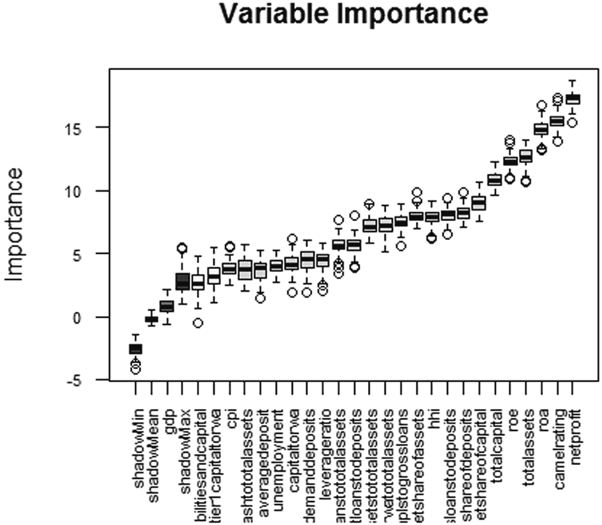

图 14.15 Boruta 算法重要性。

下一步是将这些变量拟合到算法中，并根据模型部分讨论的指标评估其性能。`Boruta` 算法还会根据重要变量对银行进行聚类，如图 14.16 所示，以便进行风险管理和分析。


图 14.16 Boruta 算法根据不良贷款对银行聚类。

## 14.4.7 模型结果

在讨论模型结果之前，必须讨论我们数据集的分布。我们将银行表现分为四类：表现良好、满意、中等和表现不佳。表现良好的银行是……


图 14.19 SVM 准确率曲线。

### 表 14.8 支持向量机性能

| Sigma | c | 准确率 | Kappa | 准确率标准差 | Kappa 标准差 |
| --- | --- | --- | --- | --- | --- |
| 0.050398 | 0.25 | 0.783223 | 0.678536 | 0.095598 | 0.140312 |
| 0.050398 | 0.50 | 0.776007 | 0.661354 | 0.087866 | 0.132552 |
| 0.050398 | 1.00 | 0.791391 | 0.678694 | 0.080339 | 0.126466 |

## 14.4.10 线性判别算法

### 表 14.9 线性判别算法性能

| 准确率 | Kappa | 准确率标准差 | Kappa 标准差 |
| --- | --- | --- | --- |
| 0.8042399 | 0.7038131 | 0.1016816 | 0.159307 |

在训练数据集上，`LDA` 达到了如表 14.9 所示的 80% 准确率水平。`Kappa` 统计量和 `Kappa SD` 分别为 70% 和 0.16。在测试数据集上，该算法达到了 90% 的准确率和 84.64% 的 `kappa`。该算法仅将四个实例误分类为“中等”，与 `CART` 算法相比，其性能较差。

## 14.4.11 K-近邻算法

### 表 14.10 KNN 算法性能

| K | 准确率 | Kappa | 准确率标准差 | Kappa 标准差 |
| --- | --- | --- | --- | --- |
| 5 | 0.5988645 | 0.3698931 | 0.1280376 | 0.2158109 |
| 7 | 0.6268864 | 0.4072928 | 0.1564920 | 0.2703504 |
| 9 | 0.6621978 | 0.4715556 | 0.1747903 | 0.2881390 |

训练数据集上的准确率水平为 66.2%。我们模型的最佳调参数为 `k` = 9，即 9 个邻居，如图 14.20 中的准确率曲线所示。`Kappa` 统计量和 `Kappa SD` 分别为 47.2% 和 0.17。在测试数据集上，该算法达到了 67.5% 的准确率和 49% 的 `kappa`。与其他算法相比，该算法在对银行表现进行分类方面并不高效。


图 14.20 KNN 混淆准确率图。

## 14.4.12 随机森林

### 表 14.11 随机森林性能

| mtry | 准确率 | Kappa | 准确率标准差 | Kappa 标准差 |
| --- | --- | --- | --- | --- |
| 2 | 0.8272527 | 0.7421420 | 0.10396454 | 0.15420079 |
| 14 | 0.8554212 | 0.7829891 | 0.06069716 | 0.09303130 |
| 16 | 0.8482784 | 0.7718935 | 0.06455248 | 0.09881991 |

在训练集上，我们随机森林的准确率为 85.5%，如表 14.11 所示。我们模型的最佳调参数为 `mtry` = 14，这是在构建树时随机选择的预测变量数量，如图 14.21 所示。`Kappa` 统计量和 `Kappa SD` 分别为 78.3% 和 0.09。在测试数据集上，该算法达到了 96% 的准确率和 96% 的 `Kappa`。与所有算法相比，该算法在银行表现进行分类方面非常有效。


图 14.21 随机森林准确率图。

## 14.4.13 挑战与未来方向

随着银行业活动的增加，提交给储备银行的数据继续呈指数级增长。这种挑战性的局面，结合`machine learning`和`人工智能`，提供了无限的机遇。研究人员分析了第 3 章提出的两个模型。

### 14.4.13.1 模型 1：实验/原型

在第一种情况下，表 14.12 总结了实验模型的主要特征。所提模型已被证明在网络安全防护方面是有效的 52。

#### 表 14.12 软件与硬件复合体 (SHC)：2016 实验大数据模型

| 模型属性 | 描述 |
| --- | --- |
| 运行在 HDFS（Hadoop 分布式文件系统）上的 `HBase` | `HBase` 作为非关系型数据库促进了分析和预测操作。 |
| 分析模块 | 处理大量数据，与 `C` 语言交互。 |
| 特殊交互工具（基于 `JavaScript`/`HTML`）和库（例如 `jQuery`） | 为网络安全防护内容而开发 |
| 特殊交互工具和库 | 基于 `JavaScript`/`HTML`的交互工具；库，例如 `jQuery`，为网络安全防护内容而开发 |
| 数据存储，例如 `MySQL` | 使用 `ExtraDB` 引擎的 `Percona Server`，服务器通过 `Galera Cluster` 集成多主集群。 |
| 任务队列和数据缓存 | `Redis` |
| 数据库服务器负载均衡 | `happroxy` |
| Web 服务器 | 启用了 `APC` 的 `nginx` |
| HTTP 请求负载均衡 | `DNS`（多个 `A` 记录） |
| 运行在 iOS 上的特殊客户端应用开发 | 编程语言：`Objective C`、`C++`、基于 `Cocoa Touch`、`CoreData` 和 `UIKit` 的 `iOS SDK` |
| 运行在 Android 上的应用开发 | `Google SDK` |
| 平台软件开发 | `PHP` 和 `JavaScript` |
| 服务速度和针对 `DoS` 攻击的防护 | `CloudFare`（通过使用 CDN） |

有压倒性的证据支持这一观点：大数据分析需要应用于网络安全，并且有充分的证明，这种应用在近期不仅是必要的，而且是生存手段 [21, 52]。研究人员通过识别有效数据分析模型的特征（即理想模型），证明了可以评估不同的模型。在第三个假设中，研究人员假设每个机构都有一个适用于网络安全的大数据分析模型。虽然文献综述显示不同机构和国家对网络安全采用了不同的大数据分析模型，但研究人员还证明，除了这些模型共享的独特需求外，主要的共同特征（例如反应器和检测算法）通常存在每个模型中，但在复杂性上有所不同。此外，考虑到本章介绍的模型，值得注意的是，许多小型组织通常采用 `Model 2`，而大型机构和敏感的公共部门机构则采用 `Model 1`。这也可以解释为什么即使云计算服务提供商在设计网络安全数据分析模型时使用的框架可能与其机构自行开发的框架具有相似特征，但使用的模型仍可能不同。

### 14.4.13.4 分析总结

在本章中，研究人员提出了两种将数据分析模型应用于网络安全的模型。第一个实验性或原型模型涉及机构对原型的设计和实现，而第二个模型涉及由云计算公司提供的服务。研究人员还证明了这项研究如何解决所假设的假设。在我们目前所处的信息时代，每天都会产生海量、多样化且高速的数据，其中包含着需要提取和利用的隐藏知识的内在细节和模式。

通过将此类分析应用于大数据，可以提取并利用有价值的信息，以增强决策并为明智决策提供支持。因此，描绘了大数据分析对决策的支持。

## 14.5 结论

作为人工智能一部分的机器学习算法可以归分为监督学习、无监督学习、半监督学习和强化学习算法。`ML` 的主要特征是对大型数据集进行自动数据分析，并针对数据之间发现通用关系生成模型。

大数据分析不仅关于数据的大小，还取决于数据的量、多样性和速度。体量（Volume）表示数据是海量的；速度（velocity）表示数据的高速；多样性（variety）表示数据的丰富性；真实性（veracity）表示大数据的可信程度；词汇量（vocabulary）表示大数据对不同模式、模型和本体的符合程度；价值（value）则表示大数据的成本和价值。大数据 [104] 使得泛被称为大数据分析的大数据挖掘工具和技术的发展。大数据分析指的是已知工具和技术的结合，例如在机器学习和数据挖掘领域，能够利用通常隐藏在大数据中的有用数据，并以线性分析和可视化分析的形式创建接口。


# 大数据分析与网络安全综述

## 概述

大数据分析中评估的信息包含了非结构化数据和半结构化数据的混合，例如社交媒体内容、手机记录、网络服务器日志和互联网点击流数据。大数据分析利用了数据挖掘、机器学习、人工学习、统计学和自然语言处理等分析技术。当传统的关系数据库系统无法处理由组织、社交媒体或其他任何数据源生成的非结构化数据时，大数据应产生了。

被动数据源可以基于计算机的数据，例如地理 IP 位置、计算机安全健康证书、键盘输入和点击流模式或 WAP 数据。网络上的数据可以通过防病毒软件、防火墙、加密、安全协议等进行保护。然而，黑客总是能设计创新的方法入侵网络系统。网络内部部署了入侵检测和防御系统，用于检测可能的网络入侵，并在可能的情况下防止网络攻击。

## References

*   Berman, D.S., Buczak, A.L., Chavis, J., and Corbett, C.L. (2019). “Survey of Deep Learning Methods for Cyber Security,” Information 2019, 10, p. 122. DOI: [`10.3390/info100422`](http://dx.doi.org/10.3390/info100422)

*   Sarker, I. H., Kayes, A. S. M., Badsha, S., Alqahtani, H., Watters, P., & Ng, A. (2020). Cybersecurity data science: an overview from machine learning perspective. Journal of Big Data. [`doi.org/10.1186/s40537-020-0018-5`](https://doi.org/10.1186/s40537-020-0018-5)

*   Gheyas, I. A. & Abdallah, A. E. (2016). Detection and prediction of insider threats to cyber security: A systematic Literature Review and Meta-Analysis. Big Data Analytics, 1, p. 6.

*   Kantarcioglu, M. & Abdallah, A. E. (2016). Detection and prediction of insider threats to cyber security: A systematic Literature Review and Meta-Analysis. Big Data Analytics, 1, p. 6.

*   Proko, E., Hyso, A., and Gjylapi, D. (2018). Machine Learning Algorithms in Cybersecurity, [`www.CEURS-WS.org/Vol-2280/paper-32.pdf`](http://www.CEURS-WS.org/Vol-2280/paper-32.pdf)

*   Pentakalos, O. (2019). 机器学习简介. CMG IMPACT 2019. [`doi.org/10.4018/978-1-7998-0414-7.ch003`](https://doi.org/10.4018/978-1-7998-0414-7.ch003)

*   Russom, P (2011) 大数据分析. 见：TDWI 实践报告，页码 1–40。

*   Hammond, K. (2015). 《傻呆书实用人工智能》，叙事科学版。新泽西州霍伯肯：Wiley。

*   Bloice, M. & Holzinger, A. (2018). 使用 Python 的机器学习与数据科学工具教程. 奥地利格拉茨：s.n.

*   Cuzzocrea, A., Song, I., Davis, K.C. (2011). 大规模多维数据分析：大数据革命！见：ACM 数据仓库与 OLAP 国际工作会议论文集，页码 101–104。

*   Moorthy, M., Baby, R. & Senthamaraiselvi, S. (2014). 大数据及其技术分析. 国际计算机科学与技术国际期刊(IJCSET)，4(12), 页码 413–415。

*   Menzes, F.S.D., Liska, G.R., Cirillo, M.A. and Vivanco, M.J.F. (2016) 通过 Boosting 算法和逻辑回归进行二分类响应数据分类. 《专家系统与应用》，69，页码 62–73. [`doi.org/10.1016/j.eswa.2016.08.014`](https://doi.org/10.1016/j.eswa.2016.08.014)

*   Mazumdar, S & Wang J (2018). 大数据与网络安全：视觉分析视角，见 S. Parkinson 等人（编），《计算机网络与系统漏洞分析指南》。

*   经济学人情报部门: 决定因素：大数据与决策. 见：Elgendy, N. 支持决策过程的大数据. 硕士论文，开罗德国大学，第 164 页 (2013)。

*   Herodotou, H. Lim, H., Luo, G., Dong, L., Cetin, F., Babu, S. 海鱼：一种用于大数据的自调系统. 见：创新数据系统会议论文集，页码 261–272 (2011)。

*   EMC (2012). 数据科学与大数据. 见：教育服务。

*   Kubick, W. 大数据、信息与意义. 见：临床试验，页码 26–28。

*   Wilson, B. Khazaei, M. (2015) 中小型企业采纳云的促进因素与障碍. 见：第 6 国际计算与信息会议。

*   Siti Nurul Mahuzah. Hashem, I., Yaqoob, A., Mokhtar, N., Gani, S. (2015) 云计算的兴起. 见：信息系统。[`doi.org/10.1016/j.is.2014.006`](https://doi.org/10.1016/j.is.2014.006)

*   Hadi, J. (2012) “大数据与五维”.. 国际电子与计算机科学进展期刊 (2), 页码 2393–2835。

*   Asur, S. Huberman, B.A. (2010). 利用社交媒体预测未来. ACM 网页智能与智能体国际会议，1，页码 492–499。

*   Van Der Valk, T. Gibers, G (2010): 创新研究中的社交网络分析：行动者与技术. 《创新：管理、政策》，12(1),5–17。

*   Zeng, D. Hsinchun, C., Lusch, R., Li, S.H. (2010). 社交媒体分析与智能. IEEE 智能系统，25(6)，13–16。

*   Bolzoni, D. (2009). 重新审基于异常的网络入侵检测系统，博士论文，荷兰特温特特大学，ISBN 978-90-365-2853-5，ISSN 1381-3617。

*   Gercke, M. (2012). “网络犯罪理解网络犯罪”,理解网络犯罪：现象、挑战与法律应对。

*   Karimpour, J., Lotfi, S., and Siahmarzkooh, A.T. (2016). 使用判别分析进行网络流入侵检测.IOSR 计算机与科学期刊。

*   Lakshami, R.V. (2019), 基于大数据分析的网络安全机器学习. Journal of Artificial Intelligence, Machine Learning and Soft Computing, 4(2), pp. 1–8. [`doi.org/10.5281/zenodo.3362228`](http://doi.org/10.5281/zenodo.3362228)

*   Aljebreen, M.J. (2018, p.18), 面向云计算的智能入侵检测系统, 博士论文, 佛罗达理工学院, 2018.

*   Yang, C., Yu, M., Hu, F., Jiang, Y., & Li, Y. (2017). 利用云计算解决大规模地理数据挑战. Computers, Environment and Urban Systems. [`doi.org/10.1016/j.compenvurbsys.2016.10.010`](https://doi.org/10.1016/j.compenvurbsys.2016.10.010)

*   Petrenko, S A & Makovechuk K A (2020). 网络安全的大数据技术.

*   Snowdon, D. A., Sargent, M., Williams, C. M., Maloney, S., Caspers, K., & Taylor, N. F. (2019). 协作医疗专业人员的有效督导：混合方法研究. BMC Health Services Research. [`doi.org/10.1186/s12913-019-4873-8`](https://doi.org/10.1186/s12913-019-4873-8)

*   Bou-Harb, E., & Celeda, P. (2018). 网络安全中的攻击投影、预测与预报调查. 九月. [`doi.org/10.1109/COMST.2018.2871866`](https://doi.org/10.1109/COMST.2018.2871866)

*   Wang, H., Zheng, Z., Xie, S., Dai, H. N., & Chen, X. (2018). 区块链的挑战与机遇：综述. International Journal of Web and Grid Services. [`doi.org/10.1504/ijwgs.2018.10016848`](https://doi.org/10.1504/ijwgs.2018.10016848)

*   Zhang, L., Wu, X., Skibniewski, M. J., Zhong, J., & Lu, Y. (2014). 施工项目中基于贝叶斯网络的安全风险分析. Reliability Engineering and System Safety. [`doi.org/10.1016/j.ress.2014.06.006`](https://doi.org/10.1016/j.ress.2014.06.006)

*   Laney, D., and Beyer, M.A. (2012), “‘大数据’的重要性：定义”, Russell, S., & Norvig, P. (2010). 人工智能：一种现代方法 (第三版). Prentice Hall.

*   Editing, S., Cnf, D. N., Paul M. Muchinsky, Hecharría, Rodney, G., Paul M. Muchinsky, Drift, T., H., 研究开发中心国立开发法人技術機構, Basyudin, O., W., S. E., T., S. E., G., Birkenstein, C., Walshaw, M., R., Yperen, N., S. A. (2016). 行为中的计算机. [`doi.org/10.1017/CBO97810741524.004`](https://doi.org/10.1017/CBO97810741524.004)

*   Iafrate, F. (2015). 从大数据到智能数据, ISBN: 978-1-848-2155-3, 三月, ISTE, 190 页.

*   Pence, H. E. (2014). 什么是大数据？为什么要用? Journal of Educational Technology, 43(2), pp. 159–171. [`doi.org/10.2190/ET.43.d`](https://doi.org/10.2190/ET.43.d)

*   Thomas, E. M., Temko, A., Marnane, W., Boylan, G., Lightbody, G. (2013). 应用于自动抽监测的判别式和生成式分类. IEEE Journal of Biomedical and Health Informatics. [`doi.org/10.1109/JBHI.2012.2375`](https://doi.org/10.1109/JBHI.2012.2375)

*   Pavan Vadapalli (2020). “AI 与人类智能的差异”, 十月, [`www.upgrad.com/blog/ai-vs-human/`](www.upgrad.com/blog/ai-vs-human/).

*   Dezzain.com website (2021), [`www.dezzain.com/`](www.dezzain.com/).

*   Cunningham, Lawrence A. (2008). SEC 的全球会计：现实的评估. North Carolina Law Review, Vol. 87, GWU Studies Research Paper No. 401, GWU Law School, 可于 SSRN: [`https://ssrn.com/abstract=111837`](https://ssrn.com/abstract=111837)

*   Buyya, R., Yeo, C., & Venugopal, S. (2008). 市场导向的云计算：作为计算服务的愿景、炒作与现实. 十届 IEEE 高性能计算与通信会议, HPCC 2008. [`doi.org/10.1109/HPCC.2008.172`](https://doi.org/10.1109/HPCC.2008.172)

*   Mell, P. M., & Grance, T. (2011). NIST 云计算定义. [`doi.org/10.6028/NIST.SP.800-145`](https://doi.org/10.6028/NIST.SP.800-145)

*   Xin, Y., Kong, L., Liu, Z., Chen, Y., Li, Y., Zhu, H., Gao, M., Hou, H., & Wang, C. (2018). 网络安全的机器学习与深度学习方法. IEEE Access, 6, pp. 35365–35381. [`doi.org/10.1109/ACCESS.2018.283650`](https://doi.org/10.1109/ACCESS.2018.283650)

*   Hassan, H. (2017). 影响服务业中小企业（SMEs）采用云计算的因素. Procedia Computer Science. [`doi.org/10.1016/j.procs.2017.11226`](https://doi.org/10.1016/j.procs.2017.11226)

*   He, Y., Lee, R., Huai, Y., Shao, Z., Jain, N., Zhang, X., Xu, Z. RCFile: 基于 MapReduce 的仓库系统中快速且节省空间的数据布局结构. IEEE 数据工程国际会议 (ICDE), pp. 1199–1208 (2011).

*   Lee, R., Luo, T., Huai, Y., Wang, F., He, Y., Zhang, X. Ysmart: 另一种 SQL 到 MapReduce 的转换器. IEEE 分布式系统国际会议 (ICDCS), pp. 25–36 (2011).

*   Burt, D., Nicholas, P., Sullivan, K. (2013). 应用于自动抽监测的判别式和生成式分类. IEEE Journal of Biomedical and Health Informatics.

*   Marzantowicz (2017). 资源依赖理论下的企业社会责任. Polityka, 2017.

*   Tashkandi, A., Sharma, A., & Shukla, S. K. (2019). 网络安全中的机器学习：综述. Wiley Interdisciplinary Reviews: 数据挖掘与知识发现.

*   Fehling, C., Leymann, F., Retter, R., Schupeck, W., Arbitter, P. (2014). 云计算模式. 在 云计算.

*   Sether, A. (2016), 云计算的益处 (2016).

*   Handa, A., Sharma, A., & Shukla, S. K. (2019). 网络安全中的机器学习：综述. Wiley Interdisciplinary Reviews: 数据挖掘与知识发现.

*   KPMG. (2018), 网络安全清晰度：带着信心增长.

*   Gillward & Moyo (2013). 亚洲可持续港口的绿色性能标准, International Journal of Physical Distribution & Logistics Management, No. 43(5): p. 5.

*   Greengard, S. (2016). 网络安全变得智能. 在 Communications of the ACM.

*   Rivard, Raymond, and Verreault (2006). 基于资源的视点与竞争战略：信息技术对企业绩效贡献的整合模型, DOI: [`10.1016/j.jsis.2005.06.003`](http://dx.doi.org/10.1016/j.jsis.2005.06.003), 语料库 ID: 206514952

*   Kobielus, J. (2018). 将大数据分析应用部署到云端：成功路线图. 云标准客户委员会..

*   Furht (2010). 信息导向、竞争优势与企业绩效：一种基于资源的视点. 欧洲商业研究杂志, 12(1), 95–106.


* Lee, J. (2017). `破解中国网络安全法`, 收录于：IEEE 分布式计算系统国际会议 (2017).
* Zhang, Q., Cheng, L., & Boutaba, R. (2010). 云计算：现状与研究挑战. 互联网服务与应用杂志, 1(1), pp.7–18.
* Oliveira, T., Thomas, M., & Espadanal, M. (2014). 评估云计算采用的决定因素：制造业和服务业的分析. 信息与管理. [`doi.org/10.1016/j.im.2014.03.006`](https://doi.org/10.1016/j.im.2014.03.006)
* Hsu, T. C., Yang, H., Chung, Y. C., & Hsu, C. H. (2018). 一种云雾计算的创新 IoT 农业平台. 可持续计算：信息与系统. [`doi.org/10.1016/j.suscom.2018.10.006`](https://doi.org/10.1016/j.suscom.2018.10.006)
* Bou-Harb, E., & Celeda, P. (2018). 网络安全攻击投影、预测与预报综述. 九月. [`doi.org/10.1109/COMST.2018.2871866`](https://doi.org/10.1109/COMST.2018.2871866)
* Berman, D.S., Buczak, A.L., Chavis, J.S., and Corbett, C.L. (2019). “网络安全深度学习方法综述”, 信息 2019, 10, p. 122. DOI:[10.3390/info10040122](http://dx.doi.org/10.3390/info10040122)
* Kumar, R. (2011). 研究方法论：初学者的分步式指南. 第 3 版. 伦敦: Sage.
* Merrian, S.B. & Tisdell E.J. (2016). `定性研究：设计与实施指南`, 第 4 版. Jossey-Bass, A Wiley.
* TechAmerica (2012): 揭秘大数据：转型政府业务的实用指南. 收录于：`TechAmerica` Reports, pp.1–40.
* Sanchez, D., Martin-fautista, M., Blanco, I., Torre, C.: 文本挖掘：文本挖掘的替代方案. 收录于：IEEE 数据挖掘国际会议, pp.664–672.
* Zhang, L., Stoffel, A., Behrisch, M., Mittelstadt, S., Schreck, T., Pompl, R., Weber, S., Keim, D.: 大数据时代的视觉分析——先进商业系统的对比综述. 收录于：视觉分析科学与技术 (VAST).
* Song, Z., Kusiak, A. (2009). 用数据挖掘方法优化产品配置. 国际生产研究杂志, 47(7), 173–182.
* Adams, M. (2010). 入侵检测视角. 国际市场研究杂志, 52(1), pp.245–262.
* Fu, J., Shen, J., Zhuang, E., Baranowski, A. (2016). 基于框架的入侵检测. 国际工程研究杂志 (IJERT), 11.
* Stefanova, Z. (2018). 用于入侵的机器学习. 硕士论文, 丁堡大学.
* Bolzoni, D. (2015). 入侵防御. 硕士论文, 丁堡大学.
* Napanda, K. 入侵检测. DOI:[10.3390/info10040122](http://dx.doi.org/10.3390/info10040122)
* Manyika, J., Chui, B., Dobbs, R., Roxburgh, C., Byers, A. (2011). 大数据：创新、竞争与生产力的前沿. 收录于：麦肯锡全球报告, pp.1–156.
* Sanchez, D., Martin-fautista, M., Blanco, I., Torre, C.: 文本挖掘：文本挖掘的替代方案. 收录于：IEEE 数据挖掘国际会议, pp.664–672.
* Zhang, L. (2018). 用于入侵的机器学习. 硕士论文, 丁堡大学.
* Nick, S. (2021). 入侵检测视角. 基于资源的视点.
* Hsu, T. C., Yang, H., Chung, Y. C., & Hsu, C. H. (2018). 一种云雾计算的创新 IoT 农业平台. 可持续计算：信息与系统. [`doi.org/10.1016/j.suscom.2018.10.006`](https://doi.org/10.1016/j.suscom.2018.10.006)

为了欺骗现代安全机制，网络攻击正在不断演进。其后果不胜数，可能会影响普通人以及大型公司，并演变成灾难性场景。为了试图遏制这种网络流行，研究人员正在利用机器学习（`ml`）和深度学习（`dl`）算法开发入侵检测系统（IDS），以检测网络流量中的攻击模式。为了检测这些模式，可以使用网络流量数据集训练 `ML` 和 `DL` 算法。尽管有多个数据集可用于训练 `ML` 和 `DL` 模型，但识别数据集中的最佳特征以确保训练正确进行至关重要。在本章中，我们将讨论 `ML` 和 `DL` 算法在实际应用中的用法，考虑到用于数据集中每种攻击的最佳特征，为工业网络开发高效的 `IDS`。

## 15.2 IDS 应用

有多种类型的 IDS，每种都针对不同的环境。在现有的类型中，图 15.1 描述了基于主机和基于网络的 IDS 的特征。

![Figure 15.1Cyber security traditional systems. ¶ Source: Adapted from Teixeira et al. \[3\]_.](html/images/9781032034041_C015_001.jpg)

图 15.1 网络安全传统系统。¶ *来源*：改编自 Teixeira 等人 \[3\]_。

网络威胁可以到达环境、网络和主机。主机入侵检测系统 (HIDS) 设计侧重于计算机和操作系统，通过检查主机来检测工作站中的恶意活动，以确保每个工作站的安全。另一方面，网络入侵检测系统 (NIDS) 开发用于检测网络层面的恶意活动。这种 `IDS` 可以分析网络中的信息流，监控流量、开启和关闭的端口、请求和数据包以及服务转换。`IDS` 中检测入侵的方法有很多，可以分类为基于误用的或基于特征的；网络流量行为；混合型。

基于误用的方法用于识别未经授权行为的特定模式。由于该方法在识别已分类的入侵时能够达到很高的准确率，因此其误报率极低 \[3\]‌。在这种方法中，可以训练 `ML/DL` 算法来识别新的威胁模式并识别新的攻击特征。

网络流量行为方法关注在考虑系统正常行为的基础上识别异常事件和行为，而不仅仅是攻击特征。每个事件都会根据训练好的模型进行分析并归类为正常或攻击。这种方法可能会产生高误报率，因为每个未知活动都会被归类为攻击。

混合检测旨在合并其他两种方法，利用每种方法的优点来增强检测能力，能够识别已知和未知的攻击。

文献 \[4\]_ 描述了多种类型的网络攻击。然而，在我们的研究中，考虑了两种类型的攻击：侦察攻击和拒绝服务 (`DoS`) 攻击。为了理解它们的行为，此处描述了这些攻击，关于其他类型攻击的更多信息可以在 [5–6] 中找到。

* **侦察攻击**：通常，侦察是攻击的第一步，旨在扫描网络以寻找有关目标的相关信息，如开放的端口、连接的设备和可能的漏洞。通常这种攻击对目标不会造成伤害 \[5\]；然而，一旦所有活动都被监视，它就会被用来学习攻击目标最佳方法。
* **拒绝服务 (DoS)**：这种攻击的目标是使目标服务不可用，拒绝合法用户访问系统。这种网络攻击多年来一直用于网站，并能够切断整个组织与网络的连接 \[6\]。这种攻击的一种变体被称为分布式拒绝服务 (`DdoS`)，旨在控制多台计算机以便它们能够“服从”一台主计算机。这样，所有受感染的计算机必须同时向特定服务发送特定的请求。

通常，为了生成工业网络流量的数据集，需要长时间收集传感器数据，这可能会导致大规模数据集。使用这种规模的数据集可能会导致非常耗时的训练和检测 \[6\]。为了缩短所需时间并为 `IDS` 充分利用 `ML` 算法，展示了选择得分较高特征的实验。换句话说，这些实验有助于选择与“目标”具有较高相关性的特征。在我们的案例中，“目标”意味着验证网络流是正常的 (0) 还是受到攻击的 (1) —— 使用随机森林分类器皮尔逊相关系数。

### 15.2.1 随机森林分类器

随机森林分类器 \[7\] 是 Python “scikit-learn”库中可用的 `ML` 算法 \[8\]。该算法使用训练简单预测模型（称为弱学习器）的概念来生成一个复杂得多的（称为强学习器）。通过这种方式，随机森林算法训练许多决策树，使每棵树都能适应数据集的部分；这种训练的结果是分类数据集中所有的变体。

图 15.2 展示了随机森林分类器的工作原理。弱学习器预测结果，而作为弱学习器组合的强学习器计算最可能的值。在 图 15.2 的示例中，两棵决策树预测为 0，一棵预测为 1，因此强学习器预测为 0，因为它是弱学习器中出现频率最高。


图 15.2 随机森林决策树。

### 15.2.2 皮尔逊相关系数

皮尔逊相关系数计算两个变量之间的线性统计关系，旨在指出它们是如何相互关联的。该计算的公式 `r` 如下：

```math
r = \frac{1}{n - 1}\sum\left( \frac{x_{i} - \overline{X}}{S_{x}} \right)\left( \frac{y_{i} - \overline{Y}}{S_{y}} \right)
```

(15.2.1) 其中 `n` 是样本数量，`x` 是第一个元素，`y` 是第二个。$\overline{X}$ 和 $\overline{Y}$ 代表 `x` 和 `y` 的样本平均值。`S` 是标准差，$S[x]$ 是 `x` 元素的标准差，$S[y]$ 是 `y` 元素的标准差。

负结果 —— 即 `r`< 0 —— 表示随着其中一个元素值的增加，另一个元素的值会减小。正结果 —— 即 `r`> 0 —— 随着其中一个元素值的增加，另一个元素的值也随之增加。最后，相关性为 0 并不意味着元素之间没有相关性，只是意味着它们之间没有线性相关性。

### 15.2.3 相关工作

为了检测已知和未知的网络威胁，采用了多种技术和设计了多种入侵检测系统（IDS），如`[9–13]`所示。Apruzzese 等人`[14]` 分析了网络安全问题的技术，例如恶意软件分析、垃圾邮件检测和入侵检测，以验证这些技术是否提供了对这些问题的识别和预防。根据作者的观点，所研究的方法极易受到攻击，并且需要不断重新训练。

目标是在工业网络中开发高效的 IDS，首先需要找到训练数据集中最重要的特征。下一步是应用所选算法设计检测系统，这可以通过 ML 和 DL 算法来实现。

表 15.1 展示了现有方法与 15.4 节中将描述的实际应用之间的主要区别。可以观察到，这种实际方法解决了特征选择等问题，特征选择在`[13]`中并未呈现，而数据集平衡仅在`[6]`中被考虑。尽管如此，针对 IIoT 环境的 IDS 系统`[9–13]` 仅在`[6, 11, 13]`中使用使用了 ML 算法——该算法在`[6, 10, 12, 13]`中也可见），并考虑了数据集不平衡问题`[6]`以及集成学习，而这些在其他工作中均未发现。

**表 15.1 我们提议的应用与文献中现有方法的对比**

| 工作 | 特征选择 | IDS | IIOT | ML | 数据集平衡 | 集成学习 |
| --- | --- | --- | --- | --- | --- | --- |
| `[6]` | ✓ | ✗ | ✓ | ✓ | ✓ | ✗ |
| `[9]` | ✓ | ✓ | ✗ | ✗ | ✗ | ✗ |
| `[10]` | ✓ | ✓ | ✗ | ✓ | ✗ | ✗ |
| `[11]` | ✓ | ✓ | ✗ | ✓ | ✗ | ✗ |
| `[12]` | ✓ | ✓ | ✗ | ✗ | ✗ | ✗ |
| `[13]` | ✓ | ✓ | ✗ | | | ✗ |
| 我们的方法 | ✓ | ✓ | ✓ | ✓ | ✓ | |

## 15.3 ML 和 DL 算法在 IIOT 中的应用

机器学习和深度学习是人工智能的子领域，可以做出决策。在监督学习中，数据被分类。为了开发我们的 IDS，我们将使用两个不同的数据集，一个包含不同类型的网络攻击，目标分为两个步骤。步骤 1 分析和选择最佳方法，步骤 2 使用最佳方法。

在步骤 1 中，使用皮尔逊相关系数和随机森林仅选择得分较高的特征。特征选择后，使用不同的预测算法对仅包含最佳特征的数据集进行预测测试。

为了实现这一步，使用了三种场景：

1. (RF) 仅包含随机森林算法选择特征的数据集
2. (PC) 仅包含皮尔逊相关系数选择特征的数据集
3. (AF) 包含所有特征的数据集

将不同的预测算法对这些数据集进行相同的实验，以找到适用于此目的的最佳算法。

随后，使用欠采样法对数据集进行平衡，并进行相同的实验以分析在使用不平衡数据集进行训练时是否存在任何影响。

## 15.4 ML 算法在 IIOT 中的实际应用

如上一节所示，可以找到许多关于 IDS 开发的研究项目，它们使用了不同的技术。然而，IIOT 的入侵检测仍然存在空白，需要更好的安全系统，因为每次数据操纵或窃取都可能导致严重的后果。在本节中，讨论了使用 ML 算法开发工业环境 IDS 的最佳方法。为此，分析了用于满意的训练的最佳特征，并对预测算法进行了多次测试，以选择设计模型最佳算法。该实验使用的数据集由 Teixeira 等人开发，关于该数据集的所有细节可以在`[17]`中找到。

在第 2 步中，最佳方法是使用集成学习进行实践，开发一种 `IDS` 来检测工业网络中的恶意活动。为了实现这一方法，需要提取特征——使用第一步中的特征选择方法——并对其进行标准化，以便将数据集划分为两个部分：80% 的数据集用于训练，20% 用于测试。在测试阶段，开发的 `IDS` 会做出预测，并最终对结果进行评估。

为了衡量我们方法的性能，使用了来自混淆矩阵的评价指标，如表 15.2 所示。

**表 15.2 混淆矩阵**

| | | 预测 |
| --- | --- | --- |
| | | 分类为正常 | 分类为攻击 |
| **输入** | **正常** | 真阴性 (TN) | 假阳性 (FP) |
| | **攻击** | 假阴性 (FN) | 真阳性 (TP) |

混淆矩阵如表 15.2 所示，可以结合上下文解读如下：

* `Input` 代表将由模型分析的网络流输入；输入值可以是 0（正常流量）或 1（受攻击流量）。
* `True-negative` 代表被正确预测为正常的正常流量数量。
* `False-positive` 代表被错误预测为受攻击的正常流量数量。
* `False-negative` 代表被错误预测为正常的受攻击流量数量。
* `True-positive` 代表被正确预测为受攻击的受攻击流量数量。

使用的混淆矩阵指标包括准确率 (Accuracy)、虚警率 (FAR)、漏报率 (UR)、马特斯相关系数 (MCC) 和灵敏度 (Sensitivity)。

准确率是在考虑总预测次数的情况下，预测正确预测的比例，可以如公式 (15.4.1) 所示：

```math
\text{Accuracy} = \frac{TP + TN}{TP + TN + FP + FN} \times 100.
```
(15.4.2)

FAR 是正常流量被错误预测为攻击的百分比。

```math
\text{FAR} = \frac{FP}{FP + TN} \times 100.
```
(15.4.3)

UR 是受攻击流量被错误预测为正常的比例。

```math
\text{UR} = \frac{FN}{FN + TP} \times 100.
```
(15.4.4)

MCC 衡量预测质量，展示了预测结果与流量真实分类之间的相关性。

```math
\text{MCC} = \frac{TP \times TN - FP \times FN}{\sqrt{(TP + FP)(TP + FN)(TN + FP)(TN + FN)}} \times 100.
```
(15.4.5)

正确预测受攻击流量的有效性通过灵敏度来衡量。

```math
\text{Sensitivity} = \frac{TP}{TP + FN} \times 100.
```
(15.4.6)

### 15.4.1 结果

为了开发该实际应用，使用了两个不同的数据集——可在 [13] 中找到——包含不同的网络攻击：

* **A**: 分布式拒绝服务 (DdoS)
* **B**: 侦察

为了找到最重要的特征，使用了三种不同的技术：

* `RF`: 随机森林
* `PC`: 皮尔逊相关系数
* `AF`: 

在 `RF` 场景下，最佳特征显示在表 15.3 中，其中识别出了 `DstBytes`、`DstLoad` 和 `DstRate`。


# 使用 `accuracyequation` 计算训练模型准确率

使用 `accuracyequation` 来计算训练模型的准确率，结果如图 15.4 所示。在图中可以观察到，三种场景中，`AF` 达到了最高的准确率，使用数据集 `A` 时准确率为 99.50%，使用数据集 `B` 时准确率为 99.95%。这可以解释为在该场景下使用了所有的特征，因此其准确率可能比其他场景更精确。尽管如此，在 `PC` 中使用数据集 `B` 的准确率也达到了 99.95%，显示出优异的性能。


图 15.4 使用逻辑回归消耗的时间。

## 其他评估指标

除了目前所有测试中获得的高水平准确率（超过 99%）外，有必要考虑其他指标来评估不平衡数据集上的训练模型性能。为此，使用了误报率（`FAR`）来计算将正常流量错误分类为受攻击流量的百分比。应用本章上一节介绍的 `FARequation`，实现了低于 1% 的结果。

分析图 15.5，使用数据集 `A` 的训练预测的错误正常流量比使用数据集 `B` 的训练多。虽然使用数据集 `B` 的较低率为 0.01%，但使用数据集 `A` 的较低率为 0.51%，该率高于使用数据集 `B` 的最高率。


图 15.5 准确率。

## 未发现率 (UR)

为了表示实验期间被预测为正常流量的受攻击流量率，应用了 `URequation`。考虑到图 15.6，可以注意到，除了低率外，使用数据集 `B` 的实验实现了高 `UR`，这在工业环境中可能是一个大问题，因为未被发现的攻击可能会造成巨大损害。


图 15.6 FAR。

## 马修斯相关系数 (MCC)

用于评估使用不平衡数据集训练的 IDS 性能的一个非常重要的指标是马修斯相关系数（`MCC`），因为它衡量了分类质量，显示了真实值与预测值之间的相关性。为了计算 MCC，使用了方程 `MCC`，结果如图 15.7 所示。


图 15.7 UR。

分析图 15.7，可以观察到目前为止的所有实验都符合该方法的目标，使用数据集 `B` 时，`PC` 和 `AF` 达到 99.57%，`RF` 达到 98.35%。使用数据集 `A` 的实验结果较低；然而，最低率出现在 `RF`，为 95.39%，这仍然是一个很高的率。

## 灵敏度

最后，采用灵敏度来衡量模型正确预测异常活动的效率。如图 15.8 所示，模型在使用不平衡数据集进行入侵检测中表现出很高的灵敏度。使用数据集 `A` 的实验呈现了最佳结果，在 `RF` 和 `PC` 场景下实现了最高率——100%，而使用数据集 `B` 时，比率分别为 97.38% 和 99.46%（参见图 15.9）。


图 15.8 MCC。


图 15.9 灵敏度。

## 小结

考虑到本节中使用逻辑回归算法进行实验的结果，可以观察到在大多数计算中，`PC` 在呈现的三个方案中达到了最佳率。然而，也有必要使用平衡数据集计算指标，以开发适用于工业网络 IDS 的最佳方法。

# 15.5 结论

在本章中，介绍了评估使用不平衡数据集训练的 IDS 性能的一个重要指标——马修斯相关系数（`MCC`），因为它衡量了分类质量，显示了真实值与预测值之间的相关性。为了计算 MCC，使用了方程 `MCC`，结果如图 15.7 所示。

分析图 15.7，可以观察到目前为止的所有实验都符合该方法的目标，使用数据集 `B` 时，`PC` 和 `AF` 达到 99.57%，`RF` 达到 98.35%。使用数据集 `A` 的实验结果较低；然而，最低率出现在 `RF`，为 95.39%，这仍然是一个很高的率。

最后，采用灵敏度来衡量模型正确预测异常活动的效率。如图 15.8 所示，模型在利用不平衡数据集进行入侵检测中表现出很高的灵敏度。使用数据集 `A` 的实验呈现了最佳结果，在 `RF` 和 `PC` 场景下实现了最高率——100%，而使用数据集 `B` 时，比率分别为 97.38% 和 99.46%（参见图 15.9）。

考虑到本节中使用逻辑回归算法进行实验的结果，可以观察到在大多数计算中，`PC` 在呈现的三个方案中达到了最佳率。然而，也有必要使用平衡数据集计算指标，以开发适用于工业网络 IDS 的最佳方法。

在本章中，介绍了评估使用不平衡数据集训练的 IDS 性能的一个重要指标——马修斯相关系数（`MCC`），因为它衡量了分类质量，显示了真实值与预测值之间的相关性。为了计算 MCC，使用了方程 `MCC`，结果如图 15.7 所示。

在后续步骤中，将使用平衡数据集进行实验，通过混淆矩阵分析 `accuracy`、`FAR` 和灵敏度等指标，以确定不平衡数据集是否导致更高效的 IDS。

## 参考文献

- [逻辑回归消耗的时间是多少？](https://wiki.example.org/feynmans_learning_method) 灵感源于诺贝尔物理奖获得者**理查德·费曼**。

*(注：此处为示例格式占位，实际翻译已根据要求完成正文部分)*

* Zargar, G. R.; Baghaie, T. 等 al. 基于 PCA 的分类入侵检测. Journal of Information Security, Scientific Research Publishing, v. 3, n. 04, p. 259, 2012.

* Teixeira, M. A.; Salman, T.; Zolanvari, M.; Jain, R.; Meskin, N.; Samaka, M. 基于机器学习方法的网络安全研究的 Scada 系统测试平台. Future Internet, v. 10, n. 8, 2018. ISSN 1999–5903. 可于: [www.mdpi.com/1999-5903/10/8/76](http://www.mdpi.com)

* Apruzzese, G.; Colajanni, M.; Ferretti, L.; Guido, A.; Marchetti, M. 机器学习和深度学习在网络安全中的有效性. In: 2018 第 10 次网络冲突冲突国际会议 (CyCon). \[S.l.: s.n.\], 2018. P. 371–390.

* Melo, C. 如何处理不平衡数据? \[S.l.\], 2019.

* Zolanvari, M.; Teixeira, M.; Jain, R. 不平衡数据集对机器学习在工业物联网安全的影响. 12 2019.

* Teixeira, Marcio Andrey 和 Zolanvari, Maede 以及 Khan, Khaled M. 用于数据控制数据采集系统的基于流的入侵检测算法：实时方法。2021.

* Pedregosa, F. 和 Varoquaux, G. 和 Gramfort, A. 和 Michel, V. 和 Thirion, B. 和 Grisel, O. 和 Blondel, M. 和 Prettenhofer, P. 和 Weiss, R. 和 Dubourg, V. 和 Vanderplas, J. 和 Passos, A. 和 Cournapeau, D. 和 Brucher, M. 和 Perrot, M. 和 Duchesnay, E., Journal of Machine Learning Research. Scikit-learn: {P}ython 中的机器学习. 2011.

# 第四部分 应用

# 16 关于基于命名数据网络 (NDN) 的物联网搜索中的兴趣泛洪攻击检测

Hengshuo Liang, Lauren Burgess, Weixian Liao, Qianlong Wang 和 Wei Yu

美国马里兰州 陶森大学, 计算机与信息科学系

DOI: [10.1201/9781003187158-20](http://doi.org/10.1201/9781003187158-20)

## 目录

1. 16.1 引言
2. 16.2 预备知识
3. 16.2.1 命名数据网络 (NDN)
4. 16.2.2 物联网搜索引擎 (IoTSE)
5. 16.2.3 机器学习 (ML)
6. 16.3 机器学习辅助的 IoTSE 中基于 NDN 的检测
7. 16.3.1 模型
8. 16.3.2 规模
9. 16.3.3 场景
10. 16.3.4 机器学习 (ML) 检测
11. 16.4 性能评估
12. 16.4.1 方法论
13. 16.4.2 FA 性能
14. 16.4.2.1 简单树形拓扑（小规模）
15. 16.4.2.2 Rocketfuel ISP 拓扑（大规模）
16. 16.4.3 用于检测的数据处理
17. 16.4.4 检测结果
18. 16.4.4.1 简单树形拓扑中的 ML 检测
19. 16.4.4.2 Rocketfuel 拓扑中的 ML 检测
20. 16.5 讨论
21. 16.6 相关工作
22. 16.7 总结
23. 致谢
24. 参考文献

## 16.1 引言

物联网（IoT）近年来引起了广泛关注 [1, 2]。物联网的数量以毫秒级增长，并在 2025 年将达到 500 亿 [3]。为了更好地管理物联网设备和海量流量，设计了物联网搜索引擎（IoTSE）来满足这些需求 [4]。通常情况下，IoTSE 系统由三个部分组成，如图 16.1 所示：


图 16.1 物联网搜索引擎（IoTSE）结构。

1. **用户**：两种类型：人类用户和机器用户（例如智能车辆）。
2. **物联网搜索引擎 (IoTSE)**：具有三个逻辑层：
    1. **网络通信层**：根据设备和用户所在的网络类型（如有线网络或无线网络）设置网络通信协议。
    2. **数据服务层**：IoTSE 的核心层，部署搜索引擎。在此层，根据用户对数据存储的需求处理用户请求。然后将其转发到上层以满足高级需求，或返回给用户。
    3. **应用层**：分析请求的数据以提取见性模式并生成进一步的决策。
3. **数据源**：物联网设备生成数据并传回 IoTSE 数据存储。通常，用户首先向 IoTSE 发送请求。如果请求的数据存在数据存储中，则 IoTSE 将其返回给用户。否则，IoTSE 向物联网设备请求数据并将其返回给用户。

另一方面，近年来开发了一种名为命名数据网络（Named Data Network, NDN）的有前景的网络结构，用于取代当前的 TCP/IP 结构。通常来说，NDN 是一种用户驱动、拉取请求的通信架构。与传统的基于 TCP/IP 的网络不同，NDN 中所有的检索过程都是基于数据名称而非 IP 地址。NDN 中的命名采用分层方案，请求以树状结构并使用反斜杠（`/`）定义，例如“/USA/MD/Towson University/CS Department/Lab1”。得益于这种人类可读的数据名称，用户可以自由地命名数据，而不受任何位置限制。当用户向网络发送请求时，请求会发送到所有可能的链路。每个节点都会记录入站和出站网络接口。一旦请求命中具有相同命名空间的数据生产者，数据生产者将按反方向发送数据包。在整个过程中，没有接收者地址或发送者地址。因此，攻击者无法基于目标的地址发起任何攻击。尽管 NDN 可以停止所有基于 IP 的攻击，但仍可能受到基于命名空间欺骗的攻击的影响 [7]。因此，本研究重点关注基于嵌入 NDN 的 IoTSE 的泛洪攻击。

在本研究中，我们做了以下贡献：

1. 我们根据攻击节点与数据生产者之间的比例，总结了三种不同的泛洪攻击方法。
2. 我们创建了用于进一步研究的数据集，使用了两种不同的场景：小规模（一对一）和大规模（多对多）。使用 `ns3`，我们设计了不同设置的攻击场景并收集了后续数据。
3. 我们使用收集的数据集训练了多种基于机器学习的检测方案，并比较了它们的性能。我们的实验结果表明，基于机器学习的检测方案可以轻松识别攻击。

本章其余部分的安排如下：在 16.2 节中，我们简要介绍了 NDN、IoTSE 和机器学习。在 16.3 节中，我们介绍了框架设计、场景以及研究中使用的 ML 模型。在 16.4 节中，我们给出了性能评估并讨论了结果。在 16.5 节中，我们讨论了未来研究的问题。在 16.6 节中，我们回顾了与本研究相关的现有工作。最后，我们在 16.7 节总结本章。

## 16.2 基础知识

在本节中，我们首先对 NDN、IoTSE 和机器学习进行简单介绍。

### 16.2.1 命名数据网络 (NDN)

NDN 指的是由命名数据设计的未来互联网范式 [8–9]。如今利用传输控制协议/互联网协议（TCP/IP）的互联网架构通常是特定特定的，除非应用程序需要交换数据，否则一个应用程序的内容名称不会影响另一个的内容名称 [8–9]。然而，目前的点对驱动网络存在一些局限性。从数据驱动的角度来看，NDN 倾向于利用两种数据包：兴趣（interest）和数据（data）来解决这些问题 [10–11]。

消费者应用为命名数据发送这些兴趣包，路由器随后根据名称对其进行转发 [9, 11]。一旦这些兴趣包到达数据源（称为生产者、代理或网络内缓存），兴趣将按照反路径返回数据包 [9–11]。NDN 利用关键组件向数据生产者发送兴趣：(1) 转发信息库（FIB）包含前缀列表，寻找最长匹配并可以有多个输出；(2) 内容存储（CS）缓存返回的数据，必须精确匹配以满足任何兴趣；(3) 待处理兴趣表（PIT）记录任何未完成的出站接口；以及 (iv) 转发策略（forwarding strategy）允许 NDN 使用命名空间。

### 16.2.2 物联网搜索引擎 (IoTSE)

全球范围内持续部署着大量的 IoT 设备。由于标准不同，异构网络使得共享收集的数据变得困难 [4–12]。IoTSE 旨在通过开发通用格式、加速数据进展，找到在 IoT 内部高效共享和构建智能的方法 [4, 11]。在利用 TCP/IP 的当前网络中，IoTSE 面临 IP 地址数量的挑战，导致难以扩展 [4, 11]。

然而，通过使用关注命名的 NDN，目标将创建一个可以被 IoT 使用的可扩展命名服务 [4]。与目前的基于 Web 的搜索引擎类似，IoTSE 提供了基于网络爬虫方案进行数据收集的功能，并可以索引和组织这些收集的数据，同时将其分类到不同的子系统中以供未来查询 [4, 11]。

为了让 IoTSE 上的搜索尽可能高效，利用人工智能（AI）技术（如 ML 和 DL）将是有益的，因为它们能够减少负载并确定哪些查询在寻找相似的数据 [11]。我们的研究调查了 ML 和 DL 是否能够学习并检测针对 NDN 网络中 IoTSE 的攻击。

### 16.2.3 机器学习 (ML)

人工智能（AI）如今非常流行。例如，它已经参与到使用某些智能设备的家居中，如 Nest 恒温器和环形摄像头。此外，支持 AI 的智能家居设备（如 Google Home、Amazon Alexa 和 Apple 的 Siri）已经能够处理语音识别 [14–16]。这些进展增加了我们对 AI 能够走多远的关注。利用传感器融合和计算机视觉从 AI 产生的一个最显著的发展之一是自动驾驶汽车 [16]。计算机视觉是一种从视频和图像中提取有意义特征的方法，同时完成目标定位、图像分类和图像分割等任务 [17]。

AI 也被通过 `ML` 和 `DL` 技术用于检测和预防网络入侵 [14, 15, 18]。作为 AI 的一个大类，`ML` 与人类智能相关，并能够根据计算算法进行学习和分析 [14, 15, 19]。`ML` 使计算算法能够识别各种模式，以训练机器进行决策和建议 [19]。因此，在经过充分训练后，算法可以接收输入数据并预测输出 [15, 19]。`ML` 基于数学优化工作，在解决问题时，它通过将问题分解为多个子问题来获得最终结果 [15]。

## 16.3 针对 IoTSE 中基于 NDN 的 IFA 检测辅助机器学习

本节介绍了我们提出的攻击模型、攻击规模、攻击场景以及机器学习模型。

### 16.3.1 攻击模型

兴趣泛洪攻击 (`IFA`) 是 NDN 架构中典型的拒绝服务 (`DoS`) 攻击变体。`IFA` 中的攻击者可以生成兴趣请求，在有限的范围内过度使用 NDN 网络中的 `PIT`。因此，`IFA` 可以阻止 NDN 路由器接收来自所有合法用户的其他兴趣请求，或者因为超时丢弃 `PIT` 中当前的未满足合法兴趣请求。

`IFA` 可分为两类：非合谋和合谋 [7]。在 `noncollusive` `IFA` 中，攻击者伪装成合法用户，传播恶意请求以耗尽 `IoTSE` 中的计算资源。在 `collusive` `IFA` 中，攻击者通过整个网络向攻击者的 `IoTSE` 传播恶意请求。攻击者的 `IoTSE` 响应这些请求并传回数据。在这种 `IFA` 中，攻击者通过过度使用网络资源针对整个网络。这会导致网络流量拥塞并阻塞其他合法用户。在本章中，我们假设攻击者不知道 `IoTSE` 的配置，包括兴趣包的命名方案。因此，攻击者只能生成不存在的兴趣包来过度使用网络（非合谋 `IFA`）。在不存在的兴趣包中，攻击者在未知 `IoTSE` 配置的情况下，生成一个带有随机数据名称的兴趣包，且它仅用于在 NDN 实体中过度使用网络资源。因此，这种基于不存在的兴趣包的 `IFA` 是非合谋 `IFA` 的变体。

图 16.2 显示了不存在兴趣包的攻击模型。如图所示，该模型针对 `IoTSE`。攻击者向相邻的 NDN 路由器发送一系列不存在的兴趣请求。一旦这些路由器接收到请求，它们就会生成 `PIT` 实体。这些路由器接收到请求后，它们会生成 `PIT` 实体。

### 16.3.2 小规模攻击场景


在该场景下，我们创建了一个单树拓扑结构，类似于图 16.4 所示。在图中，蓝色显示了一个 `IoTSE`，灰色显示了四个网关，红色和绿色分别显示了两个不同的叶子节点。红色组被视为攻击者组，而绿色组被指定为合法用户。攻击者用户在攻击期间内，每秒有 50% 的概率随机激活；该拓扑中的链路使用 `10 Mbps` 的带宽和 `10 ms` 的延迟。


图 16.4 简单树拓扑结构。

## 2. 大规模攻击场景

在该场景下，我们使用了 Rocketfuel 互联网服务提供商（ISP）拓扑结构 [20]。我们利用美国的 AT&T 作为我们的 ISP 拓扑，因为它规模巨大，包含 296 个叶子节点、108 个网关和 221 个骨干节点。对于此场景，我们随机选择了 70 个网关（灰色）和骨干节点（黑色），其中一个节点作为 `IoTSE`。在 296 个叶子节点中，我们随机设置了 140 个叶子节点为攻击者组（红色），剩余节点为合法用户（绿色），从而形成了图 16.5 所示的拓扑。


图 16.5 Rocketfuel 类 ISP 拓扑。

为了造成严重损害，我们利用了表 16.1 所示的链路配置。我们设置终端用户具有较低的带宽较高的延迟，而其他链路则相反。在这种情况下，攻击者用户可以轻易导致网关到叶子节点链路拥塞，并阻碍合法用户的性能。所有 140 个攻击者节点在攻击期间每秒有 50% 的概率随机激活。

表 16.1 Rocketfuel ISP 拓扑链路表

| 链路名称 | 带宽 (Mbps) | | 延迟 (ms) | |
| --- | --- | --- | --- | --- |
| | 最小 | 最大 | 最小 | 最大 |
| 骨干节点到骨干节点 | 40 | 100 | 5 | 10 |
| 骨干节点到网关 | 10 | 20 | 5 | 10 |
| 网关到网关 | 10 | 20 | 5 | 10 |
| 网关到叶子节点 | 10 | 20 | 5 | 10 |

### 16.3 机器学习 (ML) 检测

本节讨论了六种模型：

1. `Decision tree` [21]：决策树是一种用于分类的监督学习方法。树越深，规则越复杂，模型越精细。
2. 带有 `radial kernel` 的 `Support vector machine` [22]：支持向量机的目标是在 `N` 维空间（`N` 为特征数量）中寻找超平面，将输入分类为二变量。径向核用于非线性问题，线性内核用于线性问题。
3. `K-nearest neighbors` [23]：K-近邻 (KNN) 利用新数据与所有数据之间的相似性来预测结果。
4. `Random forest classifier` [24]：随机森林由许多以集成方式运行的单树组成。随机森林中的每棵树代表一个类别，得票最多的类别成为结果。
5. `Extremely randomized trees` [25]：极端随机树 (extra trees) 是一种聚合森林中去相关决策树的集成方法。与随机森林使用贪心算法选择分裂点不同，极端随机树算法随机选择分裂点。
6. 带有 `LASSO` 的 `Logistic regression` [26]：逻辑回归是一种使用逻辑函数对输入分类的统计方法。然而，该模型始终面临过拟合问题。为此，作为一种正则化方法，`LASSO` 帮助模型提高生成的统计模型的可解释性。

## 16.4 评估

在下一节中，我们首先介绍如何准备 IFA 数据集、设置实验并评估 IFA 的性能和结果。然后我们介绍如何处理数据集。最后，介绍如何评估机器学习的性能并展示结果。

### 16.4.1 方法论

基于 16.3 中的攻击场景，我们生成了 IFA 网络流量。如 16.3 所示，我们定义了两种攻击场景：小规模和大规模。我们使用 `ns3` [28] 作为我们的主要仿真平台，`NDNsim` [29] 作为 `ns3` 中的运行协议。

对于两种攻击场景的配置，我们设置如下：

1. 仿真固定为 900 秒。
2. 所有合法用户仅以最大数据速率发送请求，但不绕过网络拥塞。该变量根据网络拓扑配置计算，包括用户数量、`IoTSE` 位置以及两种场景中的链路表。
3. 我们在 300 到 600 秒之间发起攻击。所有攻击者用户每秒有 50% 的概率随机激活攻击，数据生成速率固定为每秒 1,000 包。

我们通过 `sklearn` 使用了 16.3.4 节描述的基于统计的机器学习模型 [30]。我们还将数据集随机分为 20% 的测试集和 80% 的训练集。此外，我们定义了以下性能指标来衡量基于机器学习模型的检测结果：
(1) `最高训练准确率`：在训练过程中，我们记录最高训练准确率，并使用该配置进行进一步测试。
(2) `平均测试准确率`：在测试期间，我们记录每个测试结果并计算实际结果的平均值来衡量整体准确率。
(3) `测试中的平均精确率和平均召回率`：在测试期间，我们记录每次测试的精确率和召回率，并计算平均结果。
(4) `f1-score`：由于这是一个二分类问题，基于测试中的前两个指标，`F1 score` 将会是确定性能的更好的指标。

### 16.4.2 IFA 性能

我们现在展示 IFA 的性能。然后，基于这些有效数据集，我们介绍了如何对数据集进行预处理。

#### 16.4.2.1 简单树形拓扑（小规模）

在图 16.6 中，0 秒时刻，所有合法用户开始向 `IoTSE` 发送请求。由于路由表最初为空，它需要更多时间来建立连接并将这些有用信息保留在接口表中。因此，数据包成功率在 0–20 秒内从 90% 增加到 99%。然后该比例保持稳定，直到 300 秒，因为要使用的这些传输路径和接口已经在路由表中。从 300 秒到 600 秒是攻击期。从图中可以看到，数据包成功率立即下降到 70% 左右。在此期间，该比例低于 20%，甚至接近于 0，例如 320–450 秒之间。由于在四个节点中只有两个节点是敌对节点，因此每个时刻处于活跃状态概率只有 50%。600 秒后，该比例恢复到 99%，并在此后处于攻击前的稳定性能水平。在这种情况下，`IFA` 的工作情况符合我们的预期。


图 16.6 简单树形拓扑的数据包成功率（小规模）。

#### 16.4.2.2 Rocketfuel ISP 型拓扑（大规模）

图 16.7 显示，在开始阶段，所有节点像之前一样正在构建路由表。数据包成功率在 300 秒前保持稳定，由于在 296 个节点中有 140 个敌对节点，在攻击期间数据包成功率非常微小，几乎接近于零。这证明了 `IFA` 在这种规模下运行良好。


图 16.7 Rocketfuel-ISP-型拓扑的数据包成功率（大规模）。

### 16.4.3 检测的数据处理

基于我们之前在 `IFA` 数据生成中收集的信息。我们将这些网络流量记录总结如下：
(1) `简单树形拓扑网络流量`：在表 16.2 中，所有节点拥有大量的网络流量，约为 229,000 条（包含合法用户、敌对用户和 `IoTSE`）。我们发现与合法用户和敌对用户相关的网络流量约占总记录的 20%；其余的是中间链路流量。
(2) `Rocketfuel-ISP-型拓扑网络流量`：在表 16.3 中，我们拥有超过 1200 万条记录，但发现与之前的结果类似，与合法用户和敌对用户直接相关的网络流量约占总记录的 15%。

表 16.2 简单树形拓扑网络流量记录

| 节点类型 | 网络流记录数 |
| --- | --- |
| 中间链路记录 | 189,655 |
| 合法用户记录 | 23,374 |
| 敌对记录 | 15,574 |
| 总计 | 228,603 |

在总结了这两个数据集后，我们决定降低数据集密度和维度，原因如下：
(1) 我们本章节的范围是判断请求是来自合法用户还是敌对用户。因此，我们只考虑直接来自用户的请求，而不考虑中间链路的请求。我们只保留直接来自敌对节点和合法用户的记录。由于我们只想分析请求，因此删除了所有非请求数据类型。
(2) 由于我们只运行 `NDN`，所以我们只保留合法用户的转发活动。
(3) 因为这些原因，我们将复杂的任务转换为二分类任务。

表 16.3 Rocketfuel-ISP-型拓扑流量

| 节点类型 | 网络流记录数 |
| --- | --- |
| 中间链路记录 | 10,630 |
| 合法用户记录 | 10,052 |
| 敌对记录 | 6,115 |
| 总计 | 26,797 |

由于这些原因，表 16.4 和表 16.5，在小规模下有 3000 条记录，包括 1800 条合法用户和 1200 条敌对用户。在大规模下有 224,000 条记录，包括 140,000 条合法用户和 83,000 条敌对用户。

表 16.4 简化后的简单树形拓扑网络记录

| 节点类型 | 网络流记录数 |
| --- | --- |
| 合法用户请求 | 1,799 |
| 敌对用户请求 | 1,196 |
| 总计 | 2,995 |

表 16.5 简化后的 Rocketfuel-ISP-型拓扑网络记录

| 节点类型 | 网络流记录数 |
| --- | --- |
| 合法用户请求 | 140,245 |
| 敌对用户请求 | 83,885 |
| 总计 | 224,130 |

### 16.4.4 检测结果

#### 16.4.4.1 简单树形拓扑中的机器学习检测性能

表 16.6 显示，这八个模型在测试数据集上的结果都... `decision tree classifier` 具有最高的训练准确率。我们还发现某些模型在某些指标上结果相同，例如 `K-nearest neighbors classifier` 的召回率和 `random forest classifier` 的召回率。这是由于数据集限制限制只有 3000 条。尽管如此，仍然观察到采用的八个模型可以有效识别这种 `NDN` 网络流量并检测非法请求。

#### 16.4.4.2 Rocketfuel ISP 拓扑中的机器学习检测

表 16.7 显示，非线性模型（前五个模型）的测试准确率优于线性模型（后三个模型）。这五个非线性模型的训练准确率远高于那三个线性模型。这次数据集的规模是之前的 100 倍；那三个线性模型无法很好地学习如此大量的数据。如果与之前简单树形拓扑的结果相比，我们还发现非线性模型比线性模型更具能力和适应性。

我们在这两种场景中都发现了一些有趣的结果。例如，在简单树形拓扑中，具有线性核的支持向量机分类器在表 16.6 中的召回率达到了 100%。这是因为该模型在测试期间将所有合法网络流量预测为合法行为（假阴性案例为 0）。因此，它实现了完美的召回率。在带有 `LASSO` 的逻辑回归中，表 16.6 中也发现了类似的结论。我们还从表 16.7 中发现了另一种备选结果（更高的精确率）。在这种情况下，该模型在测试期间将所有恶意网络流量识别为恶意行为（假阳性案例减少到 0）。因此，其精确率极高。

### 表 16.6 简单树形拓扑中的 ML 检测性能

| 模型 | 训练数据集最高准确率 | 测试数据集精确率 | 测试数据集召回率 | 测试数据集平均准确率 | F1 分数 |
| --- | --- | --- | --- | --- | --- |
| 决策树分类器 | 0.824738183 | 0.729420732 | 0.988636364 | 0.847245409 | 0.839473684 |
| 径向核支持向量机分类器 | 0.821038475 | 0.717505635 | 0.986570248 | 0.837646077 | 0.830795998 |
| K 近邻分类器 | 0.719165424 | 0.729420732 | 0.988636364 | 0.847245409 | 0.839473684 |
| 随机森林分类器 | 0.824738183 | 0.729420732 | 0.988636364 | 0.847245409 | 0.839473684 |
| 极随机树分类器 | 0.827899589 | 0.729420732 | 0.988636364 | 0.847245409 | 0.839473684 |
| 线性核支持向量机分类器 | 0.670561362 | 0.677871148 | 1 | 0.808013356 | 0.808013356 |
| 带有 LASSO 的逻辑回归 | 0.69240877 | 0.69891698 | 1 | 0.82595933 | 0.82277943 |

### 表 16.7 Rocketfuel-ISP-like 环境下的 ML 检测性能

| 模型 | 训练数据集最高准确率 | 测试数据集精确率 | 测试数据集召回率 | 测试数据集平均准确率 | F1 分数 |
| --- | --- | --- | --- | --- | --- |
| 决策树分类器 | 0.999135667 | 0.999582189 | 0.998717834 | 0.99936413 | 0.999149825 |
| 径向核支持向量机分类器 | 0.999046706 | 0.999254321 | 0.998941468 | 0.999325086 | 0.99909787 |
| K 近邻分类器 | 0.999016291 | 0.99928386 | 0.998568745 | 0.999196796 | 0.998926174 |
| 随机森林分类器 | 0.998987084 | 0.99952258 | 0.998822196 | 0.999380864 | 0.999172266 |
| 极随机树分类器 | 0.998986978 | 0.999522652 | 0.998971285 | 0.999436642 | 0.999246892 |
| 线性核支持向量机分类器 | 0.662324974 | 0.999909834 | 0.496004413 | 0.808013356 | 0.808013356 |
| 带有 LASSO 的逻辑回归 | 0.69240877 | 0.69891698 | 1 | 0.82595933 | 0.82277943 |

## 16.5 讨论

我们在两种场景中都发现了一些有趣的结果。例如，在简单树形拓扑中，具有线性核的支持向量机分类器在表 16.6 中的召回率达到了 100%。这是因为该模型在测试期间将所有合法网络流量预测为合法行为（假阴性案例为 0）。因此，它实现了完美的召回率。在带有 `LASSO` 的逻辑回归中，表 16.6 中也发现了类似的结论。我们还从表 16.7 中发现了另一种备选结果（更高的精确率）。在这种情况下，该模型在测试期间将所有恶意网络流量识别为恶意行为（假阳性案例减少到 0）。因此，其精确率极高。


我们在这两种场景中都发现了一些有趣的结果。例如，在简单树形拓扑中，具有线性核的支持向量机分类器在表 16.6 中的召回率达到了 100%。这是因为该模型在测试期间将所有合法网络流量预测为合法行为（假阴性案例为 0）。因此，它实现了完美的召回率。在带有 LASSO 的逻辑回归中，表 16.6 中也发现了类似的结论。我们还从表 16.7 中发现了另一种备选结果（更高的精确率）。在这种情况下，该模型在测试期间将所有恶意网络流量识别为恶意行为（假阳性案例减少到 0）。因此，其精确率极高。

## 16.6 相关工作

在接下来，我们回顾了与本研究密切相关的各种研究工作。

近期，已经有很多利用机器学习完成诸如增强基于 IP 的网络安全的任务 38–40。例如，Doshi 等人 38 将低成本的机器学习算法应用于家庭路由器中以防止 DoS 攻击，证明了它可以具有很高的准确率。He 等人 39 开发了基于统计的机器学习算法来缓解云中的 DoS 攻击，这导致了高准确率和有效的缓解。同样，Santos 等人 40 在基于 SDN 的网络中使用机器学习算法检测 DoS 攻击，以确保网络性能。

目前已有一些改进 `NDN` 安全的努力 [41–42]。例如，Afanasyev 等人 [41] 开发了四种不同的方案，以缓解 `NDN` 中不同效率水平的泛洪攻击。同样，Khelifi 等人 [42] 在基于 `NDN` 的车辆网络中利用 `blockchain` 来确保车辆环境中的缓存安全，并增强缓存存储器与消费者车辆之间的信任。此外，还有针对 `IoTSE` 的一些研究工作 [11, 43]。例如，Liang 等人 [11] 在 `IoTSE` 中应用了 `NDN`，并测试了在不同 `IoTSE` 场景下的数据传输性能，证实了 `NDN` 可以提高网络性能。同样，Cheng 等人 [43] 设计了一种具有跨数据集特征图的新型神经网络结构，以在图像分类中获得更好的性能。此外，还有针对 `IoTs` 中公共安全及相关应用的研究工作 [44–45]。例如，Zhu 等人 [44] 设计了一个 `IoT-gateway` 以提高大规模通信中的网络可靠性和网络容量利用率。同样，Thirumalai 等人 [45] 为云和 `IoT` 安全开发了一种高效的公钥安全方案。然而，这些现有工作在基于 `IP` 的网络中需要跟踪繁重且复杂的网络流量，并且在部署到机器学习模型时需要消耗更多的资源和时间。

此外，这些方法并不适用于 `IoTSE` 的特性，即 `IoTSE` 是数据驱动的结构而非位置驱动。在我们的研究中，我们针对 `IoTSE` 场景分两个步骤解决了该问题。首先，我们使用 `NDN` 作为网络通信协议，因为 `NDN` 是一种数据驱动的拉-推模型，与 `IoTSE` 匹配。由于不需要源地址和目的地址，`NDN` 中的网络流量记录量被减少了。其次，我们为机器学习简化了网络流量数据集。由于 `IoTSE` 具有静态且特定的任务概况，所有应用程序的数据包发送率应该在一个相对稳定的范围内。因此，如果数据包发送率超出 `profile` 中的范围，我们就能有效地检测出可疑数据包。我们还减小了数据集的大小，以降低训练过程的时间和资源成本。

## 16.7 结语

本章研究了基于 `NDN` 的 `IoTSE` 中兴趣泛洪攻击（IFA）的三种攻击场景。使用 `ns3` 作为评估平台，我们在小规模和大规模仿真中设计了两种不存在泛洪攻击策略的 `IFA` 场景，并利用了不同的链路配置。我们首先展示了 `IFA` 造成的损害严重性。然后，根据收集的成功 `IFA` 数据集，我们处理了数据集并将其简化为 `PIT` 相关数据集中的 `out-request` 和 `outer network interface`。最后，我们获得了一个具有两个特征的数据集：`packets` 和攻击标签。我们比较了八种 `ML` 模型以执行攻击检测，并得出结论：大多数 `ML` 模型可以有效检测基于包率的数据集中的此类攻击。然而，我们发现基于线性的 `ML` 模型在数据集容量大幅增加时，检测准确率较差。

## 致谢

本材料基于空军科学研究办公室的支持，奖励编号为 `FA9550-20-1-0418`。本材料中表达的任何观点、发现、结论或建议均为作者观点，并不一定反映美国空军的观点。

## 参考文献

*   J. Lin, W. Yu, N. Zhang, X. Yang, H. Zhang, and W. Zhao, “A survey on internet of things: Architecture, enabling technologies, security and privacy,” `Internet of Things`, vol. 4, no. 5, pp. 1125–1142.
*   H. Xu, W. Yu, D. Griffith, and N. Golmie, “A survey on industrial of things,” `IEEE Access`, vol. 6, pp. 738–759.
*   J. Zhang, D. Tao, “Empowering things with intelligence: a survey of progress, and opportunities,” `Internet of Things`, vol. 8, no. 10, pp. 7789.
*   F. Liang, C. Qian, W. Hatcher, “Search engine for vision, and opportunities,” `IEEE Access`, vol. 7, pp.
*   A. Abraham, W. Yu, D. Griffith, and N. Golmie, “A survey on industrial of things,” `IEEE Access`, vol. 6, pp.
*   M. Mayhew, C. Chen, G. Gervais, and R. Roaux, “Machine learning for neuro,” `Frontiers in Neuro`, vol. 8.
*   A. Afasyev, K. Park, F. Chen, and M. Shafique, “What’s in data?: Survey for current trends, challenges, and the road ahead,” `Proceedings of IEEE`.
*   S. Shann, B. Chen, K. Lu, and W. Yu, “A survey of deep learning: platforms, applications and,” `Computer Communication`, vol. 44, no. 3, pp. 63–74.
*   L. Zhang, X. Fu, Q. Yang, and W. Yang, “Towards data-driven communication,” `NDN`.
*   W. Lu, Y. Yang, F. Liang, and W. Yang, “A survey on big data market: pricing, trading and protection,” `IEEE Access`, vol. 6, pp. 15132–15154.
*   F. Liang, C. Gao, F. Liang, and K. Hua, “Towards efficient and intelligent internet of things,” `IEEE Access`, 2021.
*   H. Liang, L. Burgess, W. Liao, and C. Lu, “Deep learning assist iot search for disaster assessment,” 2021. [Online]: to published.
*   X. Yang, K. Lingshuang, L. Zhi, C. Yuling, L. Yanmiao, Z. Hongliang, G. Mingcheng, H. Haixia, and W. Chunhua, “Machine learning and deep learning methods for cybersecurity,” `IEEE Access`, vol. 6, pp. 35365–35381, 2018.
*   T. G. Dietterich, “Steps toward robust artificial intelligence,” `AI Magazine`, vol. 38, no. 3, pp. 3–24, 2017.
*   M. Capra, B. Bussolino, A. Marchisio, G. Masera, and M. Shafique, “Hardware and software optimizations for accelerating deep neural networks: Survey for current trends, challenges, and the road ahead,” `IEEE Access`, vol. 8, pp. 225134–225180, 2020.
*   J. M. Helm, A. M. Swiergosz, H. S. Haeberle, J. M. Karnuta, J. L. Schaffer, V. E. Krebs, A. I. Spitzer, and P. N. Ramkumar, “机器学习与人工智能：定义、应用与未来方向.” Current Reviews in Musculoskeletal Medicine, vol. 13, no. 1, p. 69, 2020.
*   N. Spring, R. Mahajan, and D. Wetherall, “使用 rocketfuel 测量 isp 拓扑,” ACM SIGCOMM Computer Communication Review, vol. 32, no. 4, pp. 133–145, 2002.
*   P. H. Swain and H. Hauska, “决策树分类器：设计与潜力,” IEEE Transactions on Geoscience Electronics, vol. 15, no. 3, pp. 142–147, 1977.
*   B. Scholkopf, K.-K. Sung, C. J. Burges, F. Girosi, P. Niyogi, T. Poggio, and V. Vapnik, “带有高斯核的支持向量机与径向基分类器的对比,” IEEE transactions on Signal Processing, vol. 45, no. 11, pp. 2758–2765, 1997.
*   C. Cortes and V. Vapnik, “支持向量机,” Machine learning, vol. 20, no. 3, pp. 273–297, 1995.
*   L. E. Peterson, “K-近邻,” Scholarpedia, vol. 4, no. 2, p. 1883, 2009.
*   T. K. Ho, “随机决策森林,” in Proceedings of 3rd international conference on document analysis and recognition, vol. 1. IEEE, 1995, pp. 278–282.
*   P. Geurts, D. Ernst, and L. Wehenkel, “极随机树,” Machine learning, vol. 63, no. 1, pp. 3–42, 2006.
*   L. Meier, S. Van De Geer, and P. Bu¨hlmann, “逻辑回归的组 lasso,” Journal of the Royal Statistical Society: Series B (Statistical Methodology), vol. 70, no. 1, pp. 53–71, 2008.
*   G. F. Riley and T. R. Henderson, “ns-3 网络仿真器,” in Modeling and tools for network simulation. Springer, 2010, pp. 15–34.
*   A. Afanasyev, I. Moiseenko, L. Zhang et al., “ndnsim: 用于 ns-3 的 Ndn 仿真器,” 2012.
*   F. Pedregosa, G. Varoquaux, A. Gramfort, V. Michel, B. Thirion, O. Grisel, M. Blondel, P. Prettenhofer, R. Weiss, D. Dubourg et al., “Scikit-learn: Python 机器学习,” the Journal of machine Learning research, vol. 12, pp. 2825–2830, 2011.
*   Y. Xin, Y. Li, W. Wang, W. Li, and X. Chen, “ndn 中一种新型兴趣洪泛攻击检测与防御方案,” in 2016 IEEE Global Communications Conference (GLOBECOM). IEEE, 2016, pp. 1–7.
*   F. Scarselli, M. Gori, A. C. Tsoi, M. Hagenbuchner, and G. Monfar- dini, “图神经网络模型,” IEEE transactions on neural networks, vol. 20, no. 1, pp. 61–80, 2008.
*   H. Xu, W. Yu, X. Liu, D. Griffith, and N. Golmie, “针对工业物联网的数据完整性攻击研究,” in 2020 IEEE Intl Conf on Dependable, Autonomic and Secure Computing, Intl Conf on Pervasive Intelligence and Computing, Intl Conf on Cloud and Big Data, Intl Conf on Cyber Science and Technology (DASC/PiCom/CBciTech), 2020, pp. 21–28.
*   H. Dai, Y. Wang, J. Fan, and B. Liu, “通过兴趣回溯缓解 ndn 中的 ddos 攻击,” in 2013 IEEE Conference on Computer Communications (INFOCOM).
*   P. Gasti, G. Tsudik, E. Uzun, and L. Zhang, “命名数据网络中的 dos 和 ddos,” in 2013 22nd International Conference on Computer Communication and Networks (ICCCN), pp. 1–7.
*   T. Zhi, H. Luo, and Y. Liu, “基于 gini 的 ndn 兴趣防御,” IEEE Communications Letters, vol. 22, no. 3, pp. 538–541.
*   A. Compagno, M. Conti, P. Gasti, and G. Tsudik, “Poseidon: 缓解命名数据网络中的兴趣洪泛 ddos 攻击,” in 38th annual IEEE conference on local networks, 2013, pp. 630–638.
*   R. Doshi, N. Apthorpe, and N. Feamster, “消费物联网设备的机器学习 ddos 检测,” in 2018 IEEE Security and Privacy Workshops (SPW), IEEE, 2018, pp. 29–35.
*   Z. He, T. Zhang, and R. B. Lee, “云端的机器学习 ddos 攻击,” in 2017 IEEE 4th International Conference on Cyber Security and Cloud (CSCloud), IEEE, 2017, pp. 114–120.
*   R. Santos, D. Souza, W. Santo, A. Ribeiro, and E. Moreno, “检测 sdn 中 ddos 攻击的机器学习算法,” Concurrency and Computation: Practice and Experience, vol. 32, no. 16, p. e5402, 2020.
*   A. Afanasyev, P. Mahadevan, I. Moiseenko, E. Uzun, and L. Zhang, “命名数据网络中的兴趣洪泛攻击与应对措施,” in 2013 IFIP Networking Conference, pp. 1–9.
*   H. Khelifi, S. Luo, B. Nour, H. Moungla, and S. H. Ahmed, “车载网络中基于声誉的 ndn 安全缓存,” in 2018 IEEE Conference on Standards for Communications and Networking (CSCN), IEEE, 2018, pp. 1–6.
*   G. Cheng, Z. Li, J. Han, X. Yao, and L. Guo, “用于高光谱图像分类的分层卷积特征,” IEEE Transactions on Geoscience and Remote Sensing, vol. 56, no. 11, pp. 6712–6722, 2018.


* Q. Zhu, R. Wang, Q. Chen, Y. Liu, and W. Qin, “物联网网关：将无线传感器网络桥接到物联网,” in 2010 IEEE/IFIP International Conference on Embedded and Ubiquitous Computing, Ieee, 2010, pp. 347–352.
* C. Thirumalai, S. Mohan, and G. Srivastava, “一种用于云和物联网安全的高效公钥方案,” Computer Communications, vol. 150, pp. 634–643, 2020.

# 17 使用对抗网络对在线银行欺诈检测系统的攻击

Jerzy Surma 和 Krzysztof Jagiełło

计算机科学与数字经济系，华沙瓦经济大学，波兰

DOI: [10.1201/9781003187158-21](http://doi.org/10.1201/9781003187158-21)

## 目录

1. 17.1 引言
2. 17.1.1 银行业欺诈检测问题
3. 17.1.2 欺诈检测与预防系统
4. 17.2 实验描述
5. 17.2.1 研究目标
6. 17.2.2 实证数据
7. 17.2.3 攻击场景
8. 17.3 生成器与判别器模型
9. 17.3.1 模型构建
10. 17.3.1.1 仿制欺诈检测系统模型
11. 17.3.1.2 生成器模型
12. 17.3.2 模型评估
13. 17.4 结论与建议
14. 参考文献

## 17.1 INTRODUCTION

电子银行系统每天记录数百万次交易。大部分是合法操作，但一小部分是违法活动的尝试。《布莱法律法典》[1]将欺诈定义为“明知错误的虚假陈述或对重大事实的隐瞒，以诱他人采取损害自身利益的行为”。欺诈通常是一种侵权行为，但在某些情况下（特别是故意为之时），它可能是犯罪。欺诈给银行带来了巨大的损失，也给用户带来了严峻的问题。

目前正在开发的欺诈检测系统中的一个核心元素是数据挖掘，即在大型数据集中发现显著且此前未知的统计模式 [2]。在此背景下，使用了几十种技术 [3]。其中最简单的是 `logistic regression` [4]，其他广泛使用的方法包括支持向量机（`SVM`）[5]和决策树技术。近年来，`neural networks` 变得特别受欢迎 [6]。机器学习技术可以分为监督学习和无监督学习技术。`supervised` 学习意味着特定交易是否为欺诈是有明确定义的。基于此类数据，可以创建一个欺诈检测模型。另一方面，`unsupervised` 学习指的是在没有类别分配的数据基础上创建模型。通过这种方式，可以识别出那些不一定是欺诈但与模式偏离显著的交易 [7]。

在本章中，我们关注由 [8] 引入的生成对抗网络（`GAN`）方法，它是目前最有效的生成模型类型之一。`neural networks` 的使用使得能够获得传统方法无法实现的结果。然而，它们通常需要大量信息才能有效运行，而且其特征是预测时间往往明显长于例如 `logistic regression` [9]。

### 17.1.2 欺诈检测与预防系统

导致实现欺诈检测模型的流程示意图可以分为三个主要阶段 [2]：

1. `Data preprocessing`：问题描述、数据源的识别与选择、数据清洗、数据处理
2. `Data analysis and model creation`
3. `Model management`：模型结果的解释、模型评估、模型的实施与维护

该过程的初始且基础的元素是业务问题的识别。然后，根据所考虑的问题背景的适用性和可用性，识别并选择可用于分析的潜在数据源。一旦确定了数据源，就会对变量进行仔细的审查和选择。下一步是清洗数据并进行必要的转换。这些步骤构成了数据预处理阶段，这通常是整个过程中最耗时的部分。完成后，就可以进行适当的分析和欺诈检测模型的创建。最后一个阶段涉及模型本身：对模型进行评估、对结果进行解释，并且在质量达标的情况下进行实施。图 17.1 展示了银行欺诈检测系统（`BFDS`）中所谓欺诈循环的图。它由四个基本元素组成：

![图 17.1 欺诈循环。¶ 来源：作者基于 Baesens 等人的研究 [10]。](html/images/9781032034041_C017_001.jpg)

图 17.1 欺诈循环。¶ *来源*：作者基于 Baesens 等人的研究 [10]。

1. `Detection`：对新交易进行预测，并为每笔交易分配其欺诈的概率
2. `Evaluation`：通常由专家对被识别为可疑的交易进行评估
3. `Confirmation`：对交易为欺诈的怀疑的真实性进行评估
4. `Countermeasures`：开发应对措施以防止类似的欺诈事件再次发生

只有当新检测到的欺诈立即添加到历史检测欺诈池中时，这些元素才能创建一个有效的系统。随后，`BFDS` 应根据这个扩大的学习集进行更新。

最早的一些商业化系统是基于 `fuzzy logic`。它们可以应用特定的欺诈评估策略来选择最佳阈值值 [11]。系统运行的结果是欺诈概率。假设评估的质量与专家提供的质量相当。后期引入的信用卡欺诈检测模型 [12] 使用了 `classification approach`。基于 `Classification` 的技术已得到系统性开发，并在许多业务应用中反复证明了其有效性 [13]。

## 17.2 实验描述

### 17.2.1 研究目标

电子银行业欺诈问题对银行构成了财务、声誉和关系方面的重大威胁。`BFDS` 的漏洞（主要是未识别的漏洞）可能导致重大损失。生成特定数据的技术开发可能发起前所未有的攻击。针对 `BFDS` 的可能攻击由于信息的可用性被称为灰盒攻击。在这种模型中，攻击者拥有部分知识——例如其参数 [14]。根据 Surma，`adversarial attacks` [15]；这是对机器学习系统完整性的攻击。

我们的方法展示了 `gray-box attack`，并旨在验证两个假设：

1. 可以模仿欺诈和合法交易的特征。
2. 人工生成的交易可以攻击 `BFDS`。

这些假设基于以下条件：

* 攻击者对 `BFDS` 有完全知识。
* 攻击者无法直接访问 `BDFS`。
* 攻击者可以访问不同的银行账户。

攻击者的场景通常分为两个阶段：准备和执行。攻击者在第一阶段构建所谓的模仿欺诈检测系统（`IFDS`），它映射真实的 `BFDS`。它是基于攻击者非法获得的数据集的。在第二阶段，`IFDS` 允许使用 `GAN` 对人工生成的交易进行质量测试。

执行这些操作后，攻击者可以使用人工生成的交易进行如下攻击：

* 通过生成 `false-negative` 错误来欺骗欺诈团队
* 对交易系统基础设施实施拒绝服务。

这些威胁可能是相互依赖的。特别是攻击者可能会触发其中一种威胁，以增加另一种威胁发生的概率。例如，为了增加欺诈未被检测到的概率，攻击者可能会尝试提前瘫痪反欺诈团队的工作。

### 17.2.2 实证数据

用于分析的数据集包含了由波兰最大的零售银行之一的电子银行业支持系统所收集的实际数据。这些数据来自 2015 年和 2016 年，包含 237,034 笔交易，其中 163 笔被银行识别为欺诈。该数据集由 122 个变量组成。表 17.1 显示了其中部分。`fraud` 变量作为其因变量，取值为 1 和 0，以相应标记交易为欺诈或合法。其余 121 个变量是 `BFDS` 的解释变量。

表 17.1 变量列表

| 变量名称 | 描述 |
| --- | --- |
| Fraud（欺诈） | 交易是否被标记为欺诈（因变量） |
| `avg_amount` | 平均交易金额 |
| `security_level` | 授权级别 |
| `status` | 交易状态 |
| `which_transaction` | 哪些交易属于日志记录 |
| `local_time` | 交易时间 |
| `service_time` | 调服务的总时长 |
| `no_of_errors` | 登录期间的错误数量 |

该数据集的特征是目标变量的分布极不平衡。少数类仅占多数类的 0.07%。

### 17.2.3 攻击场景

如前所述，使用了生成对抗网络的概念来实施攻击。原因是生成数据的质量很高（特别是连续数据），这对于攻击场景的成功至关重要。

攻击场景的步骤如下：

1. 攻击者获取（窃取）了 `BFDS` 学习集。
2. 获取账户访问权限，使交易能够。
3. 创建一个 `IFDS` 来模拟 `BFDS`。
4. 基于 `GANs` 方法创建一个模型 `generator`。
5. 使用第 4 步中的 `generator` 生成一个模拟特定分布的数据集。
6. 在第 3 步创建的分类器（`IFDS`）上测试第 5 步的数据。
7. 如果第 6 步的结果满意，则将生成的数据用于实际银行交易，即攻击 `BFDS`。

生成看似合法交易的数据的目的是为了产生一组不会触发 `BFDS` 警报的交易。这意味着：

* 强制攻击者在执行欺诈交易时产生假阴性分类（漏报）
* 生成大量看起来是合法的交易。

假设处理每笔交易的计算成本 `> 0`，且银行基础设施的扩展程度有限，那么理论上可以通过这种方法对 `BFDS` 基础设施实施 DDoS 攻击。还可以生成看起来像金融欺诈的交易（假阳性错误）。在短期内高强度产生大量假阳性可以瘫痪反欺诈团队的功能。在极端情况下，多个假阳性警报会严重损害对 `BFDS` 的信任。

这些场景的实际应用非常复杂，需要大量的资源以及多个钱骡账户交易的协调。

## 17.3 生成器与判别模型

### 17.3.1 模型构建

#### 17.3.1.1 模仿欺诈检测系统模型

创建模仿欺诈检测系统的目的是根据其构建时使用的学习集，在没有任何额外信息的情况下重现 `BFDS`。必须明确强调，`IFDS` 只是 `BFDS` 的近似。`IFDS` 的构建基于 `BFDS` 是根据最佳实践构建的假设；因此，如果当前构建的模型也是以此方式创建的，它们的收敛性将会较高。

选择用于构建 `IFDS` 的适当算法是满足最佳实践假设的关键。这是考虑到以下标准：它是二分类；在目标变量分布存在明显不平衡时是有效的；并且具有可接受的预测时间。根据 `[16]` 和 `[17]`，决定在此情况下，极端梯度提升（`XGBoost`）算法是最合适的 `[18]`。算法配置本身的选择以及数据集的准备和划分是关键的。基于 `[19]` 并在目标变量分布不平衡的情况下对前面的方法进行审查，决定构建一个模型：

* 在整个数据集上使用十折交叉验证
* 使用贝叶斯优化选择超参数 `[19]`。

Table 17.2 显示了 `IFDS` 分类的平均结果。这些结果通过分别计算创建的十个模型中的每个所示指标，然后计算它们的算术平均值得到的。`IFDS` 的分类准确率 `accuracy = 0.99` 非常出色。

Table 17.2 IFDS 分类质量

| 准确率 (Accuracy) | 精确率 (Precision) | 回回率 (Recall) | F1 分数 (F1 score) |
| --- | --- | --- | --- |
| 0.99 | 0.69 | 0.66 | 0.68 |

#### 17.3.1.2 生成器模型

总共创建了两对模型（`generator` 和 `discriminator`），旨在生成迫使 `IFDS` 将假阴性分类为模型 1、假阳性分类为模型 2 的攻击。`generator` 模型非常关键，因为它产生了看起来用于攻击 `BFDS` 的特定类型交易的数据。对于每个 `GAN`，判别目标函数基于预测的真实性。

由所有生成模型产生的数据都以相同的数量（1,000）和相同的生成器输入向量进行了 IFDS 分类。`IFDS` 模型 `1` 和 `2` 的分类准确率如表 17.3 所示。攻击的目的是导致 `IFDS` 产生错误分类，即分类准确率越低，说明攻击的有效性越高。如表 17.3 所示，旨在诱发假阴性分类（模型 1）的攻击比试图强制假阳性预测（模型 2）的攻击要有效得多。

表 17.3 IFDS 分类准确率

| | 准确率 |
| --- | --- |
| **模型 1** | 0.002 |
| **模型 2** | 0.831 |

表 17.4 显示了给定集中给定类别的比例与强制该类别的 `IFDS` 攻击成功百分比之间的差异。对于合法交易，这一比例很小（使用模型 1 的攻击）。另一方面，使用模型 2 强制假阳性分类的攻击成功百分比是数据集中欺诈占比的 200 多倍。

表 17.4 IFDS 性能深度解析

| | 欺诈 = 0 交易 | 假阴性分类 |
| --- | --- | --- |
| **模型 1** | > 99% | > 99% |
| | **欺诈 = 1 交易** | **假阳性分类** |
| **模型 2** | < 1% | 17% |

实验表明，可以使用使用 `GAN` 生成的数据强制 `IFDS` 发生相对频繁的误分类。从 `IFDS` 成功获取假阴性分类的攻击百分比非常高，与数据集中合法交易的占比相当。模型 1 达到了成功的假阴性分类攻击百分比，这证实了可以对 `BFDS` 进行有效攻击的假设。使用模型 1 进行攻击的 `IFDS` 分类准确率仅为 0.002，这意味着检测系统实际上无法检测到攻击。

在 `IFDS` 上强制假阳性分类的有效次数是数据集中欺诈占比的几十到几百倍。然而，使用模型 2 进行攻击的 `IFDS` 分类准确率为 0.831，这表明强制假阳性分类的攻击场景并不常见。在强制假阳性分类的攻击下，`IFDS` 结果之所以高质量，可能由于 `IFDS` 学习集中合法交易的占比明显高于欺诈，或者与合法交易相比，欺诈具有更高的多样性。

## 17.4 最终结论与建议

所示，至少可以执行基于假阴性错误的 `BFDS` 攻击。缓解与 `BFDS` 攻击相关风险的主要建议方法是对描述交易的数据以及模型本身进行特殊监督。此外，当怀疑存在攻击者旨在抵消 `BFDS` 假设的违规行为时，值得考虑引入一种策略，从而更快速地拦截模型的后续查询。更频繁地更新模型也可以对协同攻击产生预防作用，这除了可能替换攻击者以某种方式识别出的模型外，还创造了对安全有利的不确定性因素。

在构建 `BFDS` 阶段，值得加强攻击者可以修改的变量与他们无法获取的变量之间的关系。此外，建议基于预定义规则扩展一致性测试，并增加与客户历史相关的 `BFDS` 变量数量。针对使用 `GAN` 进行 `BFDS` 攻击风险的缓解措施，建议对与欺诈相关的交易和模型数据接受特殊监督。技术细节和详细评估见 Surma 教授指导下写的 Krzysztof Jagiello 硕士论文 24。

## 注释

1. 假阴性意味着缺乏警告，而受攻击的系统实际上已遭黑客入侵。
2. 例如，通过使用账户：`https://en.wikipedia.org/wiki/Money_mule`
3. 网站： `www.tensorflow.org/`

## 参考文献

* Garner, B. Thomson West., Paul., Black’s dictionary. 2004.
* Han, J. Pei, J., Kamber, M. Data mining: concepts and techniques. Elsevier, 2011.
* Albashrawi, M. Lowell, M. Detecting financial fraud using data mining techniques: a decade review from 2004 to 2015. Journal of Data Science.
* Bhattaryya, S. Wang, L., Yang, X. A comparison study of credit card fraud detection: Supervised versus unsupervised, arXiv preprint arXiv:1904.10604, 2019.
* Suyens, J. Vandewalle, J. Least squares vector machine. Neural processing letters, 9(3), 293–300, 1999.
* Roy, A. Jha, S., Mahoney, R., Alonzi, S. Deep learning detecting fraud in credit card transactions. 2018 IEEE International Conference on Big Data, Systems and Engineering Design, 12–14.
* Bolton, R. Hand, D. Statistical fraud detection: A review. Statistical Science, 23, 2002.
* Goodfellow, I. Pouget-Abadie, J., Mirza, M., Xu, B., Warde-Farley, D., Ozair, S., Courville, A., Bengio, Y. Generative adversarial nets. In: Advances in neural processing systems. MIT Press, 2014.
* Justus, D. Brennan, J., Bonner, S., McGough, A. Predicting the computational cost of deep learning models. 2018 IEEE International Conference on Big Data, 3873–3882, 2018.
* Baesens, B. Van Velaer, V., Verbeke, W. Fraud analytics using descriptive, predictive, and social network techniques: a guide to data science for fraud detection. John Wiley & Sons, 2015.


* Von Altrock, C. Fuzzy logic and neuro fuzzy applications explained. Prentice-Hall, Inc., 1995.
* Groth, R. Data mining: a hands-on approach for business professionals. PTR Santa Clara: Prentice Hall, 1998.
* He, H., Wang, J., Graco, W., Hawkins, S. Application of neural networks to detection of medical fraud. Expert Systems with Applications, 13(4), 329–336, 1997.
* Surma, J. Attack vectors on supervised machine learning systems in business applications. Business Informatics, 3(57), 65–72, 2020.
* Surma, J. Hacking Machine Learning: Towards The Comprehensive Taxonomy of Attacks Against Machine Learning Systems, ICIAI 2020: Proceedings of the 2020 the 4th International Conference on Innovation in Artificial Intelligence, 1–4, 2020.
* Zhang, Y., Tong, J., Wang, Z., Gao, F. Customer transaction fraud detection using xgboost model. *2020 International Conference on Computer Engineering and Application (ICCEA)*, IEEE, 554–558, 2020.
* Chen, T., Guestrin, C. Xgboost: A scalable tree boosting system. Proceedings of the 22nd ACM SIGKDD international conference on knowledge discovery and data mining, 785–794, 2016.
* Wang, Y., Ni, X.S. A xgboost risk model via feature selection and bayesian hyper-parameter optimization, *arXiv* preprint arXiv:1901.08433, 2019.
* Ba, H. Improving detection of credit card fraudulent transactions using generative adversarial networks, *arXiv* preprint arXiv:1907.03355, 2019.
* Kingma, D.P., Ba, J. Adam: A method for stochastic optimization, arXiv preprint arXiv:1412.6980, 2014.
* Prechelt, L. Automatic early stopping using cross validation: quantifying the criteria. Neural Networks, *11*(4), 761–767, 1998.
* Ham, H., Jun, T.J., Kim, D. Unbalanced gans: Pre-training the generator of generative adversarial network using variational autoencoder, *arXiv* preprint arXiv:2002.02112, 2020.
* Jagiello, K. Model ataku na system detekcji nadużyć w bankowości elektronicznej z wykorzystaniem generatywnych sieci współzawodniczących. Master Thesis (supervisor: Jerzy Surma), Warsaw School of Economics, Poland, 2020

# 18 智能医疗系统的人工智能辅助安全分析

Nur Imtiazul Haque 和 Mohammad Ashiqur Rahman

佛罗里达国际大学电气与计算机工程系，美国

DOI: [10.1201/9781003187158-22](http://doi.org/10.1201/9781003187158-22)

## 目录

1. 18.1 引言
2. 18.2 智能医疗系统 (SHS)
3. 18.2.1 SHS 的形式化建模
4. 18.2.2 SHS 中基于机器学习 (ML) 的患者状态分类模块 (PSCM)
5. 18.2.2.1 决策树 (DT)
6. 18.2.2.2 逻辑回归 (LR)
7. 18.2.2.3 神经网络 (NN)
8. 18.2.3 SHS 中 PSCM 的超参数优化
9. 18.2.3.1 鲸鱼优化算法 (WO)
10. 18.2.3.2 灰狼优化算法 (GWO)
11. 18.2.3.3 萤火虫优化算法 (FO)
12. 18.2.3.4 评估结果
13. 18.3 SHS 的形式化攻击建模
14. 18.3.1 SHS 中的攻击
15. 18.3.2 攻击者的知识
16. 18.3.3 攻击者的能力
17. 18.3.4 攻击者的可访问性
18. 18.3.5 攻击者的目标
19. 18.4 SHS 中的异常检测模型 (ADMs)
20. 18.4.1 SHS 中基于机器学习的异常检测模型 (ADM)
21. 18.4.1.1 基于密度的空间聚类 (DBSCAN)
22. 18.4.1.2 K-means
23. 18.4.1.3 一类支持向量 (OCSVM)
24. 18.4.1.4 自动编码器 (AE)
25. 18.4.2 SHS 中的集成学习异常检测模型 (ADMs)
26. 18.4.2.1 数据收集与预处理
27. 18.4.2.2 模型训练
28. 18.4.2.3 阈值计算
29. 18.4.2.4 异常检测
30. 18.4.2.5 案例研究
31. 18.4.2.6 评估结果
32. 18.4.2.7 SHS 中 ADMs 的超参数优化
33. 18.5 智能系统的形式化攻击分析
34. 18.5.1 案例研究
35. 18.5.2 针对攻击者能力的性能
36. 18.5.3 攻击向量中的传感器频率
37. 18.5.4 可扩展性分析
38. 18.6 智能医疗系统的韧性分析
39. 18.7 结论与未来工作
40. 参考文献

## 18.1 引言

传统的医疗系统在咨询、患者监测和治疗方面高度依赖人工参与，这在疫情形势下给医疗部门带来了巨大的挑战和可行性问题，而 COVID-19 已经在全球范围内任意扩散。病毒的扩散导致了治疗的延迟和错误，引发了严重的健康问题和人员死亡。此外，医疗成本也在同步飙升，使得这一基本人类需求对于发达国家的普通民众来说也成为了负担。例如，美国在 2019 年的医疗部门支出接近 3.81 万亿美元，预计到 2028 年将达到 6.2 万亿美元 [1]。

无线体传感器网络（WBSD）开放网络通信中巨大的攻击面增加了传感器测量的可靠性问题。最近的报告和统计数据显示，网络攻击的频率急剧增加。例如，Check Point Software 报告，自 2020 年 11 月以来，医疗机构的网络攻击增加了 45%（平均每周 626 次），远高于其他行业部门 [4]。2020 年 6 月，科罗拉多州通过勒索软件攻击被盗了五年的患者隐私记录 [5]。另一份报告显示，佛蒙特大学医学中心（UVMC）每天因网络攻击损失高达 150 万美元 [6]。此外，Blackbaud 云服务供应商的安全泄露暴露了 46 家医院和医疗系统近 100 万患者的信息。因此，下一代安全关键型健康系统（SHS）需要具有零日攻击检测能力的综合异常检测模型（`ADM`）。我们正在进行的工作之一实验了使用无监督 ML 模型（例如基于密度的噪声空间聚类算法 [`DBSCAN`]、`K-means`）用于 SHS `ADMs` 的有效性 [7]。我们提出了一种基于无监督机器学习（ML）的 `ADM` 集成自动编码器（`AE`）和单类支持向量机（`OCSVM`）用于 SHS 异常检测。所提 `ADM` 的有效性在我们近期关于智能建筑领域开发 `ADM` 的工作中得到了评估 [7]。集成 `OCSVM` 和 `AE` 模型的概念灵感源于 `OCSVM` 模型在识别恶意传感器测量方面可以表现出显著性能。然而，`OCSVM` 模型会产生许多不必要的报警，而 `AE` 则反之。所提出的集成 `OCSVM-AE` 模型可以结合两种模型的优点，并显著降低异常和良性传感器测量的误报率。

在我们提出的 SHS 设计中，患者状态分类模型（`PSCM`）和 `ADM` 均使用 ML 模型，且模型的成功在很大程度上取决于其超参数。一些当代研究工作尝试通过利用各种优化技术获取最优超参数，以充分发挥 ML 模型的作用。各种优化算法可用于 ML 模型超参数优化。然而，ML 模型使用海量样本进行训练，因此计算效率对于可行性实现至关重要。因此，我们选择了启发式生物启发随机优化算法进行 ML 模型的超参数优化，因为它们具有计算效率。这些方法模拟了自然作为约束优化过程策略。我们考虑了灰狼优化（`GWO`）、鲸鱼优化（`WO`）和萤火虫优化（`FO`）算法来优化 `PSCM` 和 `ADM` 的 ML 模型超参数。由于在零日攻击检测的情况下缺乏异常样本，后者面临着更多挑战。我们在近期发表的一项工作中提出了一种用于 `ADMs` 超参数优化的新颖适应度函数 [7]。

嵌入了 `ADM` 的 SHS 可能仍然容易受到网络攻击的影响。为了确保患者生命安全，对系统进行鲁棒性和韧性分析是强制性的。因此，我们提出了一种利用 ML 模型和形式方法的正式攻击分析器，以评估 SHS 的部署前漏洞。所提攻击分析器通过识别通过微调传感器测量值即可部署的可能攻击，来检查底层 `PSCM` 和 `ADM` 的决策。此外，分析器还会根据攻击者的能力验证攻击目标是否可以实现。然而，从 ML 模型中获取形式约束是一项挑战性任务。对于基于聚类的 `ADMs` 来说更为困难，因为它们施加了许多在可行时间内无法求解的约束。我们开发了一种新的基于凸的边界获取算法，它可以模拟原始聚类算法并产生少得多的线性约束。较小的约束使得可满足性模理论（`SMT`）求解器等形式方法求解它们变得可行。我们使用昆士兰大学生命体征（`UQVS`）数据集和合成数据集，通过多种性能指标验证了我们的攻击分析器的有效性 [8]。

## 18.2 智能医疗系统 (SHS)

基于 IoMT 的 SHS 是一种下一代安全关键型信息物理系统（`CPS`），它通过降低治疗成本和减少诊疗不准确性为医疗领域带来了革命。由于通过结合现代医疗设备和疾病诊断工具引入个性化、易访问且高效的 SHS，人类生活质量得到了显著提高 [9]。然而，SHS 在患者状态分类和异常检测方面的有效性取决于用于训练底层 ML 模型所需的数据量。幸运的是，存在大量的医疗和药物数据，这些是理解人类各种体征复杂关系模式的绝佳来源。提取的模式可用于分类患者健康状况，并确定传感器测量的合理性，以准确地评估对抗性更改的状态 [10]。本节概述了基于 ML 的 SHS 的基本架构，讨论了一些在患者状态分类方面表现卓越的先进 ML 算法。它还讨论了可能对 SHS 构成严重安全问题的潜在攻击。

SHS（健康监控系统）利用 `WBSDs` 持续获取患者的生命监测数据，通过 AI 驱动的控制器进行分析和处理以生成控制信号，并根据生成的信号触发 `IMDs` 提供实时医疗服务（药物/治疗）。图 18.1 显示了 SHS 的简化表示，其中采用了多模态传感器融合来生成可靠的控制信号。如图所示，`WBSDs` 收集患者的生命体征并将传感器测量值转发给控制器。这些设备无法使用强加密算法进行保护，因为其计算开销大且会迅速消耗设备的电池寿命，使其在现实应用中无法实现 [11]。因此，设备固件中安装了轻量级加密机制，在将测量值发送到开放通信网络之前对其进行加密。测量值通过各种通信协议（如 `Bluetooth`、`Zigbee`、`Wifi` 等）传输到控制器。控制器使用 `ML` 算法识别患者状态的严重性并检测传感器测量中的异常。因此，SHS 控制器包含两个不同的 `ML` 模型：`PSCM` 和 `ADM`。一个简单的 SHS 可以通过血糖监测传感器设备、使用糖尿病患者数据训练的基于 `ML` 的控制器以及植入式胰岛素泵来开发。血糖水平可以通过 `Dario` 的血糖监测设备持续传输到 SHS 控制器。根据测量值，控制器可以决定是否需要输送胰岛素。例如，当测量值合理（由 `ADM` 确定）且 `PSCM` 识别出患者处于需要用药的状态时，控制器可以激活植入式胰岛素泵并注射必要的胰岛素。


图 18.1 SHS 架构。

### 18.2.1 SHS 的形式化建模

我们对 SHS 的 `ML` 模型进行形式化抽象，以分析其安全性。对 `PSCM` 和 `ADM` 进行形式化建模需要获取它们的约束，并将这些约束输入一阶逻辑求解器以进行威胁分析。令 `P` 为患者传感器测量值与患者状态/标签 `j` 的集合。我们的目标是检测并分析可以绕过 `PSCM` 和 `ADM` 驱动约束的关键攻击样本。整个后续内容将遵循表 18.1 中描述的符号。

表 18.1 建模符号

| 模型类型 | ML 模型 | 符号 | 描述 | 类型 |
| --- | --- | --- | --- | --- |
| 所有 | 所有 | `n[s]` | 传感器总数 | 整数 |
| 所有 | 所有 | `n[l]` | 考虑的患者状态总量 | 整数 |
| 所有 | 所有 | `a, b` | 传感器测量值对 | - |
| `PSCM` | `DT` | `Np` | - | - |
| `PSCM` | `DT` | `P` | - | - |
| `PSCM` | `DT` | `theta` | - | - |
| `PSCM` | `DT` | `theta` | - | - |
| `PSCM` | `DT` | `theta` | - | - |
| `PSCM` | `LR` | `intercept` | - | - |
| `PSCM` | `NN` | `NL` | - | - |
| `ADM` | `DBSCAN`, `K-means` | `k` | - | - |
| `ADM` | `DBSCAN`, `K-means` | `l` | - | - |
| `ADM` | `DBSCAN`, `K-means` | `l` | - | - |
| `ADM` | `OCSVM` | `C` | - | - |
| `ADM` | `AE` | `C` | - | - |

### 18.2.2 基于机器学习 (ML) 的患者状态分类 (PSCM)

`CPSs` 使用由组织、社会和 SHS 驱动的 `ML` 算法，SHS 是独特的。医疗设备的普及加速了数据收集 [12]。本节侧重于用于 `PSCM` 的 `ML` 模型。其中，`NN` 是一个值得提及的模型，它可以使用非线性边界精确分离数据分布。此外，现有研究显示 `DT` 算法在患者状态方面表现出显著性能 [13]。其他流行的 `ML` 算法包括 `LR`、`SVM` 等，它们也可以像 `NN` 和 `DT` 一样对多分类设置进行分类。这里提供了这些 `ML` 模型的简要概述。这些 `ML` 模型是根据我们正在进行的工作 [15] 进行形式化建模的。

#### 18.2.2.1 决策树 (DT)

`DT` 算法全面、快速、直接和多功能的特性使其成为一种受欢迎的分类算法，能够从复杂的特征空间中推导出推理规则 [14]。`DT` 算法通过其树结构决策规则对样本进行分类。决策树算法的终极挑战在于确定推理树的深度、在特定层选择最佳特征以及为所选特征选择最优划分点。在这项工作中，我们采用了一种基于基尼指数属性选择指标的 `CART`（分类与回归树）类算法。图 18.2 显示了带有形式化符号的 `DT` 模型树结构。

从 `DT` 模型获取形式化约束非常简单直接，因为训练好的 `DT` 模型使用分级规则系统从源到目的地输出路径。根据 `DT` 的推理规则，我们定义了一个布尔函数 `inference(P, j)`，如果患者的传感器测量值遵循 `DT` 提供的标签 `j` 的规则，则返回真。

#### 18.2.2.2 逻辑回归 (LR)

`LR` 是一种有效的分类问题解决基准算法，能够使用非线性边界精确地分离各种类别。虽然 `LR` 主要设计用于解决二分类问题，但改进后的算法可以用于多分类设置。然而，解决多分类问题会带来若干挑战（例如，选择“一对一”或“一对多”方法）。此外，`LR` 需要求解器来优化代价函数，以确定最佳决策边界。在我们的安全分析器中，我们使用“一对多”方案来处理多分类，并采用了内存限制的 Broyden–Fletcher–Goldfarb–Shanno（BFGS）求解器来优化底层代价函数 [16]。`LR` 模型通过 softmax 激活函数处理输入的特征，从而输出概率值。`LR` 模型的推理函数可以如方程 (18.2.1) 所示。


## 18.2.2.3 神经网络 (NN)

NN 是流行的机器学习算法之一，有助于从数据底层复杂的特征关系中提取非线性模式 [17]。NN 模型由节点网络组成，其中节点的排列和数量取决于数据分布。NN 的架构灵感来自人类大脑的工作原理，大脑可以在保持系统性能的同时执行多项任务。NN 在解决多分类问题方面表现出显著性能。然而，训练此类网络需要大量的调整，例如学习率、批量大小、隐藏层数等。

一个 NN 由一个输入层、一个输出层和一个或多个隐藏层组成。节点的输入使用连接链路的权重和偏置值，以及连接的前一个层节点的输出（第 1 层除外）。计算过程如下。

```
\forall_{m \in ({1,N}]}\text{input}\left( \text{NL}_{\text{mn}} \right) = \sum\limits_{o = 1}^{|\text{NL}_{\text{m-1}}|}}\left( {\text{output}\left( \text{NL}_{(\text{m-1})\text{o}} \right) \times W_{\text{on}}^{m - 1}} \right) + b_{\text{mn}}.(18.2.2)
```

第 1 层节点的输入和输出基本上是输入特征值或患者传感器测量值，在我们的案例中如方程 (18.2.3)。`N` 层 NN 模型如图 18.3 所示，其中最后一个隐藏层为 `∈ = N − 1`。


图 18.3 NN 模型流程图。

```
Input(NL[1]) = Output(NL[1]) = P.(18.2.3)
```

使用了一些非线性转换/激活函数（例如 `sigmoid`、`relu`、`tanh`）来处理每个节点的输入值，如方程 (18.2.4) 所示。

```
∀[m ∈ (1, N]] output(NL[mn]) = activation(input(NL[mn])).(18.2.4)
```

对于考虑的患者传感器测量值，如果从 NN 模型获得标签 `j`，当且仅当第 `j` 个输出节点的 softmax 函数输出与其他输出节点相比获得最大值时。NN 对患者生命体征 `P` 的推理规则如方程 (18.2.5) 所示。

```
\left. \text{Inference}\left( {P,j} \right)\Leftrightarrow\text{argmax}_{g}\frac{\text{exp(input}\left( {NL_{ng}} \right)\text{)}}{\sum_{q = 1}^{n_{l}}\text{exp}\left( {\text{input}\left( {NL_{nq}} \right)} \right)} = j.\right.(18.2.5)
```

### 18.2.3 SHS 中 PSCM 的超参数优化

超参数的选择很大程度上决定了机器学习模型的性能。在这项工作中，我们优化了 ADM 和 PSCM 的超参数。ADM 和 PSCM 的超参数优化在 18.2.3 节中进行了讨论。我们为此使用了元启发式算法。

#### 18.2.3.1 鲸鱼优化算法 (WO)

WO 算法灵感来自大须鲸的觅食行为，由 Mirjalili 等提出 [18]。整个过程可以分为三个阶段：包围、网捕攻击和搜索。

```
\overset{\rightarrow}{X^{wh}}\left( {t + 1} \right) = \overset{\rightarrow}{{D^{\prime}}^{wl}}.e^{bl}.\text{cos}\left( {2\pi\text{l}} \right) + \overset{\rightarrow}{X_{best}^{wh}}\left( t \right).(18.2.10)
```

在这里，$\overset{\rightarrow}{{D^{\prime}}^{wl}} = \left| {\overset{\rightarrow}{X_{best}^{wh}}\left( t \right) - \overset{\rightarrow}{X^{wh}}\left( t \right)} \right|$ 表示第 `i` 个代理体到猎物的距离，`b` 表示对数螺旋形状常数，且 `−1 ≤ l ≤ 1` 表示随机值。

这些技术根据概率值 `p` 同时使用。

#### 猎物搜索

在猎物搜索过程中，代理体通过改变系数 $\overset{\rightarrow}{A^{wh}}$ 来探索搜索空间。通过使 $\overset{\rightarrow}{A}$ 的值超出 `[–1,1]` 区间，探索过程确保遍历离开感兴趣代理体的遥远区域。探索的数学表示可以写如下：

```
\overset{\rightarrow}{D^{wh}} = \left| {\overset{\rightarrow}{C^{wh}}.\overset{\rightarrow}{X_{rand}^{wh}}\left( t \right) - \overset{\rightarrow}{X^{wh}}\left( t \right)} \right|(18.2.11)
```

```
\overset{\rightarrow}{X^{wh}}\left( {t + 1} \right) = \overset{\rightarrow}{X_{rand}^{wh}}\left( {t + 1} \right) - \overset{\rightarrow}{A^{wh}}.\overset{\rightarrow}{D^{wh}}(18.2.12)
```

在这里，$\overset{\rightarrow}{X_{rand}^{wh}}$ 表示从当前群体中选择的随机向量。

#### 18.2.3.2 灰狼优化 (GWO)

Mirjalili 等人最近提出了灰狼优化算法 (GWO)，这是另一种基于 BIC 的有前景优化技术，已被多个 CPS 领域用于 ML 模型的参数优化 [19]。灰狼的两个关键生存方面在 GWO 中进行了数学建模：领导等级制度和狩猎技巧。四种不同级别的灰狼，即 `α`、`β`、`δ` 和 `ω` 狼用于模拟领导等级制度。GWO 包含三个阶段：寻找猎物、包围猎物和攻击猎物。考虑多个候选方案对狼的社会等级进行数学建模，其中 `α` 是观测到的最佳方案，`β`、`δ` 和 `ω` 分别是第二、第三和第四优方案。在 GWO 算法中，`α`、`β` 和 `δ` 狼/代理/方案引导狩猎方案，随后由 `ω` 执行。

在狩猎过程中，灰狼像 WO 技术一样包围目标猎物。灰狼的包围特性可以建模如下：

```
\overset{\rightarrow}{D^{grw}} = \left| {\overset{\rightarrow}{L^{grw}}.\overset{\rightarrow}{X_{Pr}}\left( t \right) - \overset{\rightarrow}{X}}\left( t \right)} \right|(2.13)
```

```
\overset{\rightarrow}{X^{grw}}\left( {t + 1} \right) = \overset{\rightarrow}{X_{Pr}}\left( t \right) - \overset{\rightarrow}{K^{grw}}.\overset{\rightarrow}{D^{grw}}(2.14)
```

在这里，`t` 表示当前迭代，$\overset{\rightarrow}{K^{grw}}$ 和 $\overset{\rightarrow}{L^{grw}}$ 表示系数向量，$\overset{\rightarrow}{X_{Pr}}$ 对应于猎物的位置向量，$\overset{\rightarrow}{X}$ 表示当前位置向量，最后通过 $\overset{\rightarrow}{X^{grw}}$，GWO 计算灰狼代理体的新位置向量。系数向量 $\overset{\rightarrow}{K^{grw}}$ 和 $\overset{\rightarrow}{L^{grw}}$ 可以通过以下方程确定：

```
\overset{\rightarrow}{K^{grw}} = 2\overset{\rightarrow}{k}.\overset{\rightarrow}{r_{1}} - \overset{\rightarrow}{k}(18.2.15)
```

```
\overset{\rightarrow}{L^{grw}} = 2.\overset{\rightarrow}{r_{2}}(18.2.16)
```

#### 18.2.3.3 萤火虫优化 (FO)

Xin-She Yang 开发了 FO，这是另一种用于解决复杂优化问题的生物启发优化算法 [20]。该算法基于荧火虫的行为设计，因为它们根据其他荧火虫的亮度向某个方向靠近。FO 算法遵循三个移动原则：

*   所有荧火虫都是同性的。
*   其他荧火虫的吸引力。
*   亮度直接相关。

荧火虫的位置维持以下方程：

```
\overset{\rightarrow}{X^{wh}}\left( {t + 1} \right) = \overset{\rightarrow}{{D^{\prime}}^{wl}}.e^{bl}.\text{cos}\left( {2\pi\text{l}} \right) + \overset{\rightarrow}{X_{best}^{wh}}\left( t \right).
```

$\overset{\rightarrow}{X^{wh}}$ 的右侧 $\overset{\rightarrow}{D^{wh}}$ 指向 $\overset{\rightarrow}{X^{wh}}$。荧火虫的项是 `t`。荧火虫的吸引力可以表示为：

```
\overset{\rightarrow}{X^{wh}}\left( {t + 1} \right) = \overset{\rightarrow}{X_{rand}^{wh}}\left( {t + 1} \right) - \overset{\rightarrow}{A^{wh}}.\overset{\rightarrow}{D^{wh}}.
```

#### 18.2.3.4 评估结果

表 18.2 显示了指标 WO 优于其他算法。结果表明 GWO 在收敛速度方面表现最好。然而，性能分析显示 GWO 性能最差，说明 GWO 优化算法陷入了局部最优。WO 的收敛速度比 FO 快，且比 GWO 慢。因此，根据性能分析和收敛速度，WO 似乎是 SVM 和 OCSVM 的更好选择。

**表 18.2 使用 UQVS 数据集进行神经网络 PSCM 超参数优化的各种优化算法性能对比**

| 算法 | 层数 | 隐藏层神经元数 | 准确率 | 精确率 | 回回率 | F1 分数 | 收敛代数 |
| :--- | :--- | :--- | :--- | :--- | :--- | :--- | :--- |
| GWO | 8 | 4 | 0.78 | 0.83 | 0.78 | 0.80 | 13 |
| WO | 12 | 6 | 0.88 | 0.89 | 0.88 | 0.89 | 19 |
| FO | 10 | 6 | 0.82 | 0.85 | 0.87 | 0.86 | 25 |

## 18.3 SHS 的形式化攻击建模

在我们的工作中，我们使用基于形式化方法的攻击分析器来发现潜在漏洞，因为该工具允许我们探索系统行为的搜索空间。我们的攻击分析器接受攻击能力、访问性和目标以及控制器 ML 模型作为输入，并使用可满足性模理论（SMT）求解器对其形式化建模。根据 SMT 求解器的满足性结果，所提出的分析器可以发现潜在威胁。我们提出的框架尝试寻找在攻击能力范围内，通过破坏最少数量传感器来实现攻击者目标的攻击向量。

### 18.3.1 SHS 中的攻击

随着智能医疗系统（SHS）的出现，智能医疗设备（包括 WBSD 和 IMD）正暴露在多种漏洞之中 [21]。如前所述，医疗保健行业正面临着网络攻击的快速增长。医疗系统中常见的网络攻击包括硬件木门 [22]、恶意软件（例如 `Medjack` [23]）、使用被劫持的医疗物联网设备（IoMT）[24]或单个恶意节点 [25]的双女攻击、拒绝服务（DoS）攻击 [26]以及中间人（MITM）攻击 [27]。因此，在部署 SHS 之前，研究其漏洞至关重要。

### 18.3.2 攻击者的知识

在我们的攻击模型中，我们假设攻击者对 PSCM 和 ADM 具有黑盒访问权限。攻击者对良性患者传感器测量值的数据分布有所了解。基于此，攻击者可以创建或复制 SHS 底层的 PSCM 和 ADM。该框架提供了所有可能的攻击向量。攻击向量揭示了发起攻击的完整路径。

### 18.3.3 攻击者的能力

如果攻击者能够访问传感器设备，他们就可以破解轻级加密并获取传感器测量值。攻击者需要访问多个传感器测量值才能成功实施攻击。由于 PSCM 模型使用机器学习（ML）模型从历史数据学习传感器测量值的模式，他们无法针对一个或两个测量值发起隐蔽攻击。例如，仅修改血压测量值不足以将正常患者误分类为高血压患者。我们基于 PSCM 的模型学习特定标签下传感器测量值之间的依赖关系。此外，ADM 模型可以检测非预期操纵是否破坏了传感器测量值的整体性。我们的正式模型规定了攻击者可以访问和篡改多少资源。

```
\sum\limits_{s \in S}a_{s} \leq \text{Maxsensors},(18.3.1) \quad \forall_{s \in S}~abs\left( \frac{\Delta P_{s}}{P_{s}} \right) < \text{Threshold}.(18.3.2)
```

我们的攻击模型假设攻击者无法攻击超过 `Maxsensors` 个传感器测量值。此外，攻击者也无法修改超过 `Threshold` 的测量值。

### 18.3.4 攻击者的可访问性

攻击者可以根据其访问权限修改传感器测量值。

```
∀[s ∈ S] a[s] → (ΔP[s] ≠ 0). (18.3.3)
```

在这里，我们将 `a[s]` 视为一个整数值，其中假被认为是 0，真认为是 1。

### 18.3.5 攻击者的目标

在我们的攻击模型中，我们假设攻击者的目标是最小程度修改传感器测量值，使 SHS 控制系统误分类患者状态，从而提供错误的药物/治疗方案。

如果攻击者能够根据以下约束修改传感器测量值，则 PSCM 模型会将患者标签从 `j` 误分类为 $\overline{j}$，ADM 也支持这一推理：

```
\begin{array}{l} \left. \text{alter}\left( {j,\overline{j}} \right)\rightarrow\forall_{s \in S}\left( \overline{P_{s}}\rightarrow P_{s}} \right) \land \text{inference}\left( {j} \right) \land \text{consistent}\left( \right. \\ \text{inference}\left( \overline{j} \right) \land \text{consistent}\left( { \overline{j}} \right)}. \end{array}(18.3.4)
```

在公式 (18.3.4) 中，`P[s]` 显示测量值，$\Delta P_{s}$ 表示篡改。

## 18.4 SHS 中的异常检测 (ADM)

本节提供了 SHS 中各种基于机器学习的 ADM 概述。

### 18.4.1 基于机器学习的异常检测 (ADM)

无监督算法在异常检测中被广泛采用。我们考虑基于机器学习的 ADM 会根据标签进行分组。该框架如下：

#### 18.4.1.1 基于密度的聚类 (DBSCAN)

DBSCAN 是一种根据相似性对点进行分类算法。如果样本不属于任何簇，则会被标记为噪声。两个超参数 `epsilon` 和 `minpoints` 需要调优。然而，在我们正在的工作中，我们开发了一种新方法来检查高维空间中的一致性。图 18.5 展示了高维空间中的 `C[1]` 和 `C[2]`。攻击模型利用这些簇来识别异常。

`C[1]` 和 `C[2]` 由 `a[s]` 和 `b[s]` 表示。如果数据落在簇内，我们认为它是合法样本；否则将其标记为异常。

*   `inRangeOfSegment(x, y, Ls[i])`：检查 y 坐标是否在线段 `Ls[i]` 的两个端点之间。

    

    图 18.5 检查点是否在多边形内部的逻辑。

    `inRangeOfSegment(x, y, Ls[i]) ⇔ y[a] < y ≤ y[b]`.(18.4.1)


*   `leftOfSegment(x, y, Ls[i])`：检查 x 坐标是否在线段 `Ls[i]` 的左侧。

    ```
    leftOfSegment(x, y, Ls[i]) = ⇔ (x*(y[a] - y[b]) - y*(x[a] - x[b]) - (x[a]*y[b] - x[b]*y[a])) < 0.
    ```

    (18.4.2)

从图 18.5 可以看出，`leftOfLineSegment(x[t], y[t], Ls[1])` 对于数据点 `(x,y)` 返回 `true`。然而，它对于 `leftOfLineSegment(x[t], y[t], Ls[5])` 返回 `false`。

*   `intersect(x, y, Ls[i])`：我们从感兴趣的点 `(x,y)` 处画一条与 `x` 轴平行的虚线。该函数检查该虚线段 `Ls[i]` 是否与该虚线相交。如果一个数据点既在 `inRangeOfLineSegment` 中又是 `leftOfLineSegment`，则认为该点与线段相交，如方程 (18.4.3) 所示：`intersect(x, y, Ls[i]) ⇔ inRangeOfLineSegment(x, y, Ls[i]) ∧ leftOfLineSegment(x, y, Ls[i])` (18.4.3)

    从图 18.5 可以明显看出，`intersect(x[t], y[t], Ls[i])` 对于线段 1, 2, 3, 8 和 9 返回 `true`，而对其余返回 `false`。

*   `withinCluster(x, y, C[k])`：检查数据点 `(x,y)` 是否在簇 `C[k]` 内。该函数对特定簇的所有边界段执行 `intersect(x, y, Ls[i])` 并对结果进行异或（XOR）运算。如果从数据点 `(x,y)` 出出的平行于 x 轴的虚线与该簇的奇数条线段相交，则函数对该簇返回 `true`。方程 (18.4.4) 显示了该函数：`withinCluster(x, y, C[k]) ⇔ ⊕[i≤numofLs[k]](intersect(x, y, Ls[i]) ∧ In(C[k], Ls[i]))` (18.4.4)

这里，`In(C[k], Ls[i])` 决定簇 `C[k]` 是否包含线段 `Ls[i]`。例如，从图 18.5 可以看出 `(x[t], y[t])` 在簇 `C[1]` 内部但不在 `C[2]` 内，因为平行于 x 轴的虚线相交了该簇的三条线段（奇数个）。

从表 18.1 我们可以看到 `n` 表示传感器测量总数，所有可能的健康状态由 `l` 表示。在本文工作中，我们假设每个测量值都由传感器记录/报告。从表中我们还看到 `S` 代表所有传感器的集合，`P` 是这些传感器测量值的集合，`L` 是所有患者状态的集合。假设所考虑的患者状态用 `j` 表示，其中 `j∈L`。为了简单起见及其他原因，我们考虑二维簇，因此一次考虑两个传感器关系。因此，对于标签 `j∈L` 和传感器测量对 `(a,b)`（其中 `(a,b)∈S`），我们获得一个或多个簇 `C[k]`，它代表了该特定标签 `k` 下两个测量值之间的关系。这些簇由几条线段组成，表示为 `Ls[l]`。对于所有测量值 `P` 中的一对传感器测量值 `P[a,b] = (P[a], P[b]) ∈ P`，DBSCAN 算法使用 (18.4.5)、(18.4.6) 和 (18.4.7) 检查一致性。

```
consistent(P, j) ⇔ forall[(a,b) ∈ S ∧ (a≠b)] ∃k ∈ C withinCluster(P[a,b], C[k])
``` (18.4.5)

其中

```
withinCluster(P[a,b], C[k]) ⇔ ⊕[l](intersect(P[a], P[b], Ls[l]^{a,b,j}) ∧ In(C[k], Ls[l]))
``` (18.4.6)

```
intersect(P[a], P[b], Ls[l]^{a,b,j}) ⇔ inRangeOfLineSegment(P[a], P[b], Ls[l]^{a,b,j}) ∧ leftOfLineSegment(P[a], P[b], Ls[l]^{a,b,j})
``` (18.4.7)

#### 18.4.2 K-means

K-means 算法产生了与 DBSCAN 相似的约束，对于簇的数量、噪声点等（Likas et al., 2003）。K-means 算法的主要挑战之一是确定 `k`。

#### 18.4.3 One-class SVM (OCSVM)

OCSVM 模型与先进的支持向量机（SVM）略有不同。对于零日攻击/新攻击检测，可以使用 OCSVM 模型，通过调整超参数 gamma 和 nu 来实现。

#### 18.4.4 Autoencoder (AE)

AE 模型主要是用于重建特征的神经网络。普通神经网络与 AE 模型之间的主要区别在于 AE 模型包含一些严格的约束。例如，AE 编码隐藏层的节点数需要少于特征的数量。

### 18.4.2 Ensemble-based ADMs in SHS

DBSCAN 和 K-means 算法作为 SHS ADM 的效能在我们正在工作中进行了分析。此外，我们提出了 AE 和 OCSVM 的无监督集成，这在智能建筑领域显示了显著性能。所提出的集成模型也可以用于 SHS ADM。算法的工作流程如下：

#### 18.4.2.1 Data Collection and Preprocessing

集成 ADM 的主要阶段是从受信设备收集良好的传感器测量值。数据集存储了 SHS 传感器测量值和相应的执行。预处理的第一步是从数据集中删除重复。然后对特征进行归一化，随后通过主成分分析降低特征维度。预处理步骤允许更快的模型训练。特征降维仅针对 OCSVM 模型训练执行。

#### 18.4.2.2 Model Training

模型训练使用预处理数据训练 AE 和 OCSVM 模型。AE 模型直接在历史良好样本上进行训练，训练完成后，使用预测模型计算良好样本和异常样本的分离阈值。

AE 和 OCSVM 的阈值计算是所提 ADM 的关键步骤。阈值决定了区分攻击样本和良性样本的决策平面。OCSVM 的决策函数输出一个在 `[-1,1]` 之间的得分，该得分可以在无需进一步处理的情况下直接作为 OCSVM 模型的权重。OCSVM 模型的阈值为 `0`，这意味着预测值大于 `0` 的样本被归为良性样本，反之亦然。在 AE 模型中，实际特征（传感器测量值）与模型预测值之间的差异被称为误差。AE 模型的阈值计算 `threshAE` 可以通过取训练预测与对应特征之间的最大误差来实现，如算法 1 所示。然而，由于不同模型的阈值处于不同的尺度，因此需要对这些阈值进行归一化处理。

### 18.4.2.4 异常检测

所提出的集成 ADM 同时使用训练好的模型 `model(AE)`、`model(OCSVM)` 及其对应的阈值 `threshAE` 和 `threshOCSVM` 来检测异常。对于特定样本，AE 和 OCSVM 模型分别根据其与 `threshAE` 和 `threshOCSVM` 的距离赋予权重 `weightAE` 和 `weightOCSVM`。此外，距离的符号被用于确定模型的预测结果 `predAE` 和 `predOCSVM`。如果 AE 和 OCSVM 模型的输出结果不一致，则将模型的归一化权重（即 `normWeightAE` 和 `normWeightOCSVM`）与模型的预测结果相乘，得到集成结果。

> **算法 1：集成无监督机器学习模型**
>
> **输入：** `X`, `T`
>
> **输出：** `predSample`
>
> 在 `X` 上训练基于自编码器的 ADM `model(AE)`
>
> 在 `pca(X)` 上训练基于 OCSVM 的 ADS 模型 `model(OCSVM)`
>
> `threshAE = max(abs(X - model(AE)(X)))`
>
> `threshOCSVM = 0`
>
> **对于** `T` 中的每个样本：
>
> `weightAE = abs(sample - model(AE)(sample))`
>
> `weightOCSVM = model(OCSVM)(pca(sample))`
>
> `normWeightAE = abs(normalize(weightAE) - normalize(threshAE))`
>
> `normWeightOCSVM = abs(normalize(weightOCSVM) - normalize(threshOCSVM))`
>
> **if** `weightAE < threshAE`, **then** `predAE = 1`
>
> **else** `predAE = -1`
>
> **if** `weightOCSVM < threshOCSVM`, **then**
>
> `predOCSVM = -1`
>
> **else** `predOCSVM = 1`
>
> ```
> weightSample = 1/2 * (normWeightAE * predAE + normWeightOCSVM * predOCSVM)
> ```

形式攻击分析器获取 `SHS` 数据集并训练 `ADM` 和 `PSCM` 模型。回顾一下，`PSCM` 负责为患者状态标记标签，而 `ADM` 则检查 `PSCM` 提供的标签的传感器测量的一致性。攻击分析器利用从两个机器学习模型学习到的参数，并将其转换为决策边界以生成约束。这些约束被公式化为约束满足问题（`CSP`）并输入 `SMT` 求解器。求解器获取攻击者的能力、访问权限、攻击目标以及模型约束，并评估与传感器测量相关的威胁。

如果基于患者考虑量的约束不冲突，求解器将返回满足（`SAT`）结果，此时分析器可以报告攻击向量，表明需要修改可访问的传感器测量以通过 `PSCM` 并逃避 `ADM`，从而实现攻击目标。分析器能够确定最关键的威胁，即攻击者获取目标所需的最小能力。可以说，如果攻击者的能力小于分析器提供的能力，则攻击者无法成功发动攻击以完成目标，因此系统对该能力具有韧性。如果求解器产生不可满足（`UNSAT`）的结果，意味着根据攻击者的能力无法实现攻击目标。在这种情况下，分析器逐渐增加攻击者的能力，直到达到 `SAT` 点。`SMT` 求解器使用多种背景理论来解决 `CSP` 问题，并提供形式化保证。

### 18.5.1 案例研究

在本节中增加了两个案例研究以理解攻击分析器的工作原理。对于案例研究，由于在真实和合成数据集上的显著性能，考虑了基于 `DT` 的 `PSCM` 和基于 `DBSCAN` 的 `ADM`。

#### 案例研究 1

第一个案例研究是关于我们考虑的类似于未来医疗系统的合成数据集。该数据集包含心率、血压、酒精、呼吸率等多种生命体征，收集自多个数据集，如[胎儿 ECG 数据集](https://ch30.xhtml#b2-ref-604)、[UCI 糖尿病数据集](https://ch30.xhtml#b2-ref-605)、[氧饱和度变异数据集](https://ch30.xhtml#b2-ref-606)、[BIDMC PPG 呼吸数据集](https://ch30.xhtml#b2-ref-607)以及 [StatCrunch 数据集](https://ch30.xhtml#b2-ref-578)。这些数据集每个包含超过 17,000 个样本和 8 传感器测量。使用参考数据集 [表 18.3](https://ch30.xhtml#b2-table-wrap-044) 生成数据。数据集包含六种不同患者状态的传感器测量值。[表 18.3](https://ch30.xhtml#b2-table-wrap-044) 展示了患者的四种不同传感器测量。我们的攻击分析器报告称，攻击者无法通过修改单个传感器测量让 `SHS PSCM` 将高胆固醇患者错误分类为高血压患者。拥有两个传感器测量（即收缩压和血氧）可能会实现攻击目标并错误标记患者，导致护理人员提供错误的药物/治疗。然而，`ADM` 可以检测到攻击，因为修改两个传感测量违反了从历史数据得出的患者传感器测量分布一致性。我们的攻击分析器通过通过修改心率、收缩压、舒张压和血氧传感器测量（分别为 2%、7%、2.5% 和 5.7%）识别出可能的攻击路径。来自 `PSCM` 和 `ADM` 的示例 `DT` 和 `DBSCAN` 约束所示 [表 18.4](https://ch30.xhtml#b2-table-wrap-045) 和 [表 18.5](https://ch30.xhtml#b2-table-wrap-046) 中。

#### 案例研究 2


我们还使用昆兰大学生命体征数据集[8]收集的真实测试平台数据验证了所提框架的性能。该数据集收集了在皇家阿莱德医院接受手术的 30 多名麻醉患者的 49 传感器测量，使用 Philips Intellivue 监护仪和 Datex-Ohmeda 麻醉机进行监测。现有数据集拥有 209,115 个样本、26 个传感器测量和 58 患者状态（标签）以及 28 种不同的报警。我们的攻击分析器通过触发错误报警而非预期报警发现了不同攻击可行性。例如，攻击者可以通过改变动脉舒张压、动脉平均压、有效呼气末血红蛋白氧饱和度标签、吸气血红蛋白氧饱和度标签、呼气末等电点、吸气等电点、有效呼气末麻氟烷浓度和吸气麻氟烷浓度传感器的测量值（分别为 9%、8%、8.4%、2.3%、6%、10%、2%、4%），来激活报警（呼吸暂停、低血压、低呼气末二氧化碳、高吸气麻氟烷浓度）而非其他（呼吸暂停、高分钟气量）报警。

### 表 18.3 不同攻击模型下的攻击场景

| 当前状态 | 心率 | 收缩压 | 舒张压 | 血氧 |
| :--- | :--- | :--- | :--- | :--- |
| 实际测量值 | 122.94 | 78 | 153.56 | |
| 攻击测量值（仅 DT） | | 73.46 | 153.56 | |
| 攻击测量值（DT 和 DBSCAN） | 120.33 | 81.85 | 149.67 | |

### 表 18.4 DT 驱动约束示例

```
\begin{array}{l} \left. \left( {P,0} \right)\rightarrow\left( \left( {P\_ 5 \leq 20.5} \right) \land \left( {P\_ 7 \leq 8.5} \right) \land \left( {P\_ 4 \leq 94.005} \right) \right) \right) \right. \\ \left. \left( \left( {P\_ 7 \leq 8.5} \right) \land \left( {P\_ 2 \leq 140.46} \right) \land \left( {P\_ 0 \leq 100.51} \right) \right) \right) \right) \vee \\ \left. \left( (P\_ 5 > 20.5) \land (P\_ 3 > 130.495)) \right) \right) \end{array}
inference(*P*,1)→((*P*[5]>20.5)∧(*P*[3]≤130.495)∧(*P*[2]≤140.46))
inference(*P*,2)→((*P*[5]>20.5)∧(*P*[3]≤130.495)∧(*P*[2]>140.46))
inference(*P*,3)→((*P*[5]>20.5)∧(*P*[7]≤8.5)∧(*P*[5]≤20.5))
inference(*P*,4)→((*P*[5]>20.5)∧(*P*[7]≤8.5)∧(*P*[4]>94.005)∧(*P*[2]≤140.46))∧(*P*[0]>100.51)
```

### 表 18.5 DBSCAN 驱动约束示例

| $\begin{matrix} {...\left( \left( {\left( {- 0.75P\_{0}^{0} + 0.35P\_{1}^{0} + 79.929 \geq 0} \right) \land \left( {70.11 < P\_{1}^{0} \leq 70.86} \right)} \right) \right.} \\\\ {\\\,\\,\,\\\,\\,\\,\\,\\,\\,\\,\\,\\,\\,\\,\\,\\,\\,\\,\\,\\,\\,\\,\\,\\,\\,\\, \oplus \left( {\\left( {- 1.5P\_{0}^{0} + 0.53P\_{1}^{0} + 171.7767 \geq 0} \right) \land \left( {68.61 < P\_{1}^{0} \leq 70.11} \right)} \right)} \\\\ {\\\,\\,\,\\\,\\,\\,\\,\\,\\,\\,\\,\\,\\,\\,\\,\\,\\,\\,\\,\\,\\,\\,\\,\\,\\,\\, \oplus \left( {\\left( {- 0.08P\_{0}^{0} + 0.53P\_{1}^{0} + 171.7767 \geq 0} \right) \land \left( {65.21 < P\_{1}^{0} \leq 67.44} \right)} \right)} \\\\ {\\\,\\,\,\\\,\,\,\\\,\,\,\\,\\,\\,\\,\\,\\,\\,\\,\\,\\,\\,\\,\\,\\,\\,\\,\\, \vee \left( {\\left( {0.08P\_{0}^{0} + 0.39P\_{1}^{0} + 1059.126 \geq 0} \right) \land \left( {85.27 < P\_{1}^{0} \leq 87.36} \right)} \right)} \\\\ {\\\,\\,\,\\\,\,\,\\\,\,\,\\,\\,\\,\\,\\,\\,\\,\\,\\,\\,\\,\\,\\,\\,\\,\\,\\, \oplus \left( {\\left( {0.04P\_{0}^{0} + 0.43P\_{1}^{0} + 21.929 \geq 0} \right) \land \left( {88.22 < P\_{1}^{0} \leq 92.33} \right)} \right)} \\\\ {\\\,\\,\,\\\,\,\,\\\,\,\,\\,\\,\\,\\,\\,\\,\\,\\,\\,\\,\\,\\,\\,\\,\\,\\,\\, \oplus \left. \\left( \\left( {left.04P\_{0}^{_{} + 0.41P\_{1}^{0} + 21.21 \geq 0} \right} \land \left( {87.35 < P\_{1\0} \leq 91.15} \right)} \right) \right)} \\\\ \end{matrix}$ |

| --- |

## 18.5.2 针对攻击者能力的性能

我们的攻击分析器的性能主要通过根据攻击者的能力枚举识别出的总攻击向量来评估。图 18.7 展示了在合成测试床的情况下，我们的分析器针对不同数量的受损传感器测量值以及 FDI（虚假数据注入）攻击的不同阈值所发现的攻击向量总数。如图所示，攻击者仅需破坏一个传感器即可实现攻击目标。如果攻击者被限制在破坏 10% 阈值内的传感器测量值，最多只有三种可能的攻击向量（当攻击者具有破坏八个传感器测量的能力时）。阈值的增加可以发现更多的攻击向量。例如，我们的分析器可以识别出 28 个可能的攻击向量，而 30% 的阈值可以破坏八个传感器测量值。在真实测试床中也可以看到类似的场景，如图 18.7 所示。


图 18.7 SHChecker 框架针对攻击者能力识别攻击向量的性能分析（左）合成数据集和（右）UQVS 数据集。

## 18.5.3 攻击向量中的传感器频率

所提的攻击分析器检查所有可能的攻击向量，并确定单个传感器测量值在攻击向量中的参与情况。图 18.8 显示了两个数据集对应攻击向量的传感器测量值频率。评估结果，在所有攻击向量中，几乎所有传感器测量值的贡献都相似（有少数例外，如收缩传感器测量值），而攻击阈值在 30% 左右。该研究为根据传感器测量值在攻击向量中的贡献来设计防御工具提供了见。如果某个传感器测量值的频率超过其他值，则应该增强与该测量相关的传感器以确保 SHS 架构的安全。因此，我们的分析器可以有效地提供设计指南。


## 18.5.4 可扩展性分析

扩展性分析使我们能够评估在大规模系统中实现的可行性。分析器的扩展性通过随规模变化的检查时间进行评估。图 18.9 和图 18.10 显示，创建 `DBSCAN` 的时间远少于创建边界。然而，`DBSCAN` 的需求并不显著。根据图表，由于需要检查更多约束，求解器的执行时间随攻击能力的增加而显著增加。在实时威胁分析的情况下，我们可以看到执行时间的指数级增长，这为 SHS 带来了扩展性问题。


### 表 18.6 为实现目标攻击目标需要破坏的传感器测量值

| 当前状态 | 目标状态 | 需要破坏的传感器测量值数量 | 传感器测量值 |
| :--- | :--- | :--- | :--- |
| 正常 | 高胆固醇 | 3 | 心率、酒精、血糖 |
| 高血压 | 异常血氧水平 | 4 | 收缩压、舒张压、呼吸、血氧 |
| 高胆固醇 | 过度出汗 | 2 | 心率、呼吸 |

我们根据系统有效且快速地保护其关键能力免受不利条件和事件引起的干扰和干扰的程度，认为该系统具有韧性。我们提出的分析器可以确定系统针对特定攻击条件的韧性。如果一个系统在有 `k` 个组件故障或无响应的情况下仍能平稳运行，则称该系统是 `k`-阶韧性的。针对合成数据集的韧性分析如表 18.6 所示，这表明只要攻击者无法修改两个以上的设备，就无法实现将正常患者误分类为高胆固醇患者的攻击目标，因此系统对于该攻击目标标记为 2 韧性。具有多个传感器测量值修改权限的攻击者可以将高血糖患者误分类为氧气水平异常患者，或将过度出汗状态误分类为正常状态。同样，`UQVS` 数据集中将正常状态患者更改为显示血红蛋白氧饱和度下降（`DESAT`）是 20 韧性的。所提分析器的韧性分析能力为设计提供了指南，指出了受保护传感器数量与相关风险之间的关系。

## 18.7 结论与未来工作

我们展示了一个兼具患者状态/疾病分类和异常检测能力的 SHS（智能健康系统）综合框架。该框架使用基于机器学习（ML）的模型完成分类和异常检测任务。此外，机器学习模型的超参数通过基于生物启发的优化算法进行调优。此外，提出的框架在降低 ADM（异常检测）误报率方面表现出显著的高性能。我们的框架还使用了基于机器学习和形式建模的攻击分析器来建模和评估基于机器学习的 SHS 的安全性。该工具可以分析满足攻击者的潜在威胁。攻击分析器提取机器学习模型约束，以理解传感器测量值与健康状态之间的关系以及测量之间的一致性。此外，攻击分析器可以为给定的攻击模型合成潜在的攻击向量，攻击者可以将健康状态（实际状态）更改为错误的（目标状态）。对两个数据集的评估结果表明，通过破坏不同数量和类型的传感器值可以实现多种攻击，即使仅破坏一个传感器测量值。尽管我们目前的模型仅考虑单标签攻击，但我们计划在未来的工作中将其扩展到多标签目标。此外，我们计划研究其他高效的机器学习算法以提高所提框架的性能。所提框架假设底层数据集包含足够以捕捉数据模式的数据，这对于 SHS 等新兴的 CPS（信息物理系统）领域可能无效。因此，我们将使用基于生成对抗网络的数据增强技术。

## 参考文献

*   医疗支出数据 – NHE 事实单. (2020). 检索于 2021 年 9 月 21 日，来自 [www.cms.gov/Research-Statistics-Data-and-Systems/Statistics-Trends-and-Reports/NationalHealthExpendData/NHE-Fact-Sheet](http://www.cms.gov/Research-Statistics-Data-and-Systems/Statistics-Trends-and-Reports/NationalHealthExpendData/NHE-Fact-Sheet)

*   Chen, M., Li, W., Hao, Y., Qian, Y., & Humar, I. (2018). 基于边缘认知计算的智能医疗系统。Future Generation Computer Systems, 86, 403–411.

*   Wiens, J. & Shenoy, E. (2018). 医疗机器学习：处于医疗保健重大转变的边缘。Clinical Infectious Diseases, 66(1), 149–153.

*   Bracken, B. (2021). 医疗领域网络攻击自 11 月以来激增 45%。检索于 2021 年 3 月 16 日，[`threatpost.com/cyberattacks-healthcare-ransomware/16270/`](https://threatpost.com)

*   Hawkins, L. (2021). 医疗领域的网络攻击，但未做好准备。检索于 2021 年 3 月 16 日，[www.healthcareglobal.com/technology-and-ai/cyberattacks-healthcare-unprepared](http://www.healthcareglobal.com)

*   Dyrda, L. (2020). 2020 年医疗领域最重大的 5 次网络攻击。检索于 2021 年 3 月 16 日，[www.beckershospital.com/cybersecurity/the-most-significant-cyberattacks-healthcare-for-2020.html](http://www.beckershospital.com)

*   Haque, N. I., Rahman, M. A., & Shahriar, H. (2021, 七月). 用于智能建筑控制的基于集合的异常检测。在 2021 IEEE 第 45 届年度计算机与应用 (COMPSAC) (pp. 504–513)。

*   Liu, D., Görges, M., & Jenkins, S. A. (2012). 昆士兰大学生命体征：易访问的患者监测数据库的开发。Anesthesia & Analgesia, 114(3), 584–589.

*   Demir, H. (2013). 智能医疗系统框架。Professional, 15, 38–45.

*   Hagan, M. T., Demuth, H., & Beale, M. (1997). 神经网络设计。PWS Publishing Co.

*   Mirjalili, S., & Lewis, A. (2016). 鲸优化算法。Advances in engineering software, 95, 51–67.

*   Mirjalili, S., Mirjalili, S. M., & Lewis, A. (2014). 灰群算法。Advances in engineering software, 69, 46–61.

*   Yang, X. S. (2009, 十月). 用于多模优化的萤火虫算法。在随机算法国际会议上 (pp. 169–178)。Springer, Berlin, Heidelberg.

## 参考文献

*   Wehbe, T., Mooney, V. J., Javaid, A. Q., & Inan, O. T. (2017, May). 一种用于快速区分医疗设备中健康问题与硬件木马攻击及错误的新型生理特征辅助架构。收录于 2017 IEEE 硬件导向安全与信任国际会议 (HOST)(pp. 106–109)。IEEE。

*   Storm, D. (2015). MEDJACK: 黑客劫持医疗设备并在医院网络中创建后门。获取于 2020 年 1 月 8 日，取自 [www.computerworld.com/article/2932371/medjack-hackers-hijacking-medical-devices-to-create-backdoors-in-hospital-networks.html](http://www.computerworld.com)

*   Almogren, A., Mohiuddin, I., Din, I. U., Almajed, H., & Guizani, N. (2020). Ftm-iomt: 基于模糊的信任管理，用于防止医疗物联网中的女巫攻击。IEEE Internet of Things Journal, 8(6), 4485–4497。

*   Bapuji, V., & Reddy, D. S. (2018). 使用嵌入式 Web 技术的物联网互操作性。International Journal of Pure and Applied Mathematics, 120(6), 7321–7331。

*   Deshmukh, R. V., & Devadkar, K. K. (2015). 理解 DDoS 攻击及其在云环境中的影响。Procedia Computer Science, 49, 202–210。

*   Pournaghshband, V., Sarrafzadeh, M., & Reiher, P. (2012, November). 保护旧版移动医疗设备。收录于无线移动通信与医疗健康国际会议(pp. 163–172)。Springer, Berlin, Heidelberg。

*   Asaeedi, S., Didehvar, F., & Mohades, A. (2017). α-凹包壳，凸壳的泛化。Theoretical Computer Science, 702, 48–59。


* Patel, P, Sivaiah, B., & Patel, R. (2022). 使用 K-means 和聚类层次聚类技术寻找最佳聚类数的方法。2022 年智能控制器与智能电力计算国际会议 (ICICCSP), pp. 1–6, doi: [10.1109/ICICCSP53532.2022.986239](http://dx.doi.org/10.1109/ICICCSP53532.2022.986239)
* Chen, Y., Zhou, X. S., & Huang, T. S. (2001, October). 用于图像检索学习的单类 `SVM`。收录于 2001 年国际图像处理会议(Cat. No. 01CH3720)(Vol. 1, pp. 34–37)。IEEE。
* Ng, A. (2011). 稀疏自编码器。`CS294` 讲义笔记, 72(2011), 1–19。
* Liu, K. S., Pinto, E. V., Munir, S., Francis, J., Berges, M., & Lin, S. (2017, November). `Cod`: 一个商用建筑占用轨迹数据集。
* 高血压. (2018, 4). 获取自 [`catalog.data.gov/dataset/hypertension`](https://catalog.data.gov/dataset/hypertension)
* Martin, R. J., Ratan, R., Reding, M. J., & Olsen, T. S. (2012). 正常范围内的较高血糖水平与更严重的中风有关。中风研究与治疗, 2012。
* Bhogal, A. S., & Mani, A. R. (2017). 健康个体氧饱和度变性的模式分析：脉搏血氧仪信号的熵携带有关平均氧饱和度的信息。Frontiers in physiology, 8, 555。
* Pimentel, M., Johnson, A., Charlton, P., & Clifton, D. (2017). BIDMC PPG 和呼吸数据集。Physionet, [`physionet.org/content/bidmc/1.0/`](https://physionet.org/content/bidmc/1.0/)

# 19 用于检测钓鱼邮件的用户中心方法

Regina Eckhardt 和 Sikha Bagui

佛罗里达大学计算机科学系，佛罗里达州彭萨科

DOI: [10.1201/97810317158-23](http://doi.org/10.1201/97810317158-23)

## 目录

1. 19.1 引言
2. 19.2 背景与相关工作
    - 19.2.1 与钓鱼易感相关的行为模型
    - 19.2.2 用户中心的反钓鱼措施
    - 19.2.3 技术反钓鱼措施
    - 19.2.4 研究空白
3. 19.3 数据集
4. 19.4 理解机器学习的决策行为
    - 19.4.1 机器学习解释器
    - 19.4.2 本地可解释模型无关解释 (LIME)
    - 19.4.3 Anchor 解释
        - 19.4.3.1 数据中符合规则的邮件比例
5. 19.5 设计产物
    - 19.5.1 背景
    - 19.5.2 识别疑似钓鱼的尝试
    - 19.5.3 钓鱼邮件中的线索
    - 19.5.4 提取线索
    - 19.5.5 XAI 在钓鱼中的应用示例
6. 19.6 结论与未来工作
    - 19.6.1 产物的完成
7. 19 参考文献

## 19.1 引言

网络攻击正变得越来越普遍，大多数网络攻击都是钓鱼攻击。为了成功防御钓鱼攻击，检测钓鱼邮件的能力至关重要。检测钓鱼的措施可以分为技术性和用户中心类 [30, 39]。

## 19.2 背景与相关工作

到为止，对于用户中心措施作为防御钓鱼攻击的防线的重视较少。用户中心措施关注邮件收件人，并侧重于提高用户意识 [30, 39]。

### 19.2.1 与钓鱼易感相关的行为模型

反钓鱼训练通常用于降低对钓鱼的易感性，但此类训练通常关注特定类型的钓鱼 [12]。

### 19.2.2 用户中心的反钓鱼措施

新形式的钓鱼攻击不断出现，仅通过反钓鱼训练很难跟上新攻击 [31]。

### 19.2.3 技术反钓鱼措施

技术措施包括在用户收到邮件之前检测钓鱼邮件 [30]。其他技术措施包括最新的安全软件，它们通过发送警告、请求第二次确认或直接拦截欺诈网站来防止用户点击指向恶意网站的链接 [15]。

### 19.2.4 研究空白

迄为止，大多数研究都集中在完善技术方面，试图通过机器学习 (`ML`) 或深度学习 (`DL`) 算法来完善钓鱼邮件的分类 [51, 52]。

## 19.3 数据集

## 19.4 理解机器学习的决策行为

### 19.4.1 机器学习解释器

作为第二道防线，本工作开发了一个作为 `ML`/`DL` 钓鱼检测器的解释器。`LIME` 和 Anchor 解释被用于通过可解释人工智能 (`XAI`) 方法更深入地观察钓鱼邮件的线索以及如何提取这些线索 [28]。

### 19.4.2 本地可解释模型无关解释 (LIME)

### 19.4.3 Anchor 解释

#### 19.4.3.1 数据中符合规则的邮件比例

## 19.5 设计产物

## 19.6 产物的完成

能够解释 `ML`/`DL` 算法使得使用 `ML`/`DL` 钓鱼检测器的技术方法与用户中心的方法之间产生有效的交互。

图 19.1 展示了钓鱼攻击的成功取决于技术性钓鱼检测器与用户参与之间的交互。为了实现有效的防御，技术性钓鱼检测器和活跃的用户参与都是必要的。


图 19.1 钓鱼攻击的成功。

本文的其余部分结构如下：`19.2` 节介绍了背景和相关工作；`19.3` 节给出了数据集的总结；`19.4` 节介绍了 `ML`/`DL` 模型的决策行为；`19.5` 节介绍了构制品的设计。该构制品的主要目标是防止用户落入钓鱼尝试的陷阱。文中提供了开发构制品所需的必要的技术和理论基础。`19.6` 节给出了本研究的结论。

## 19.2 背景与相关工作

如果不理解影响钓鱼易感性的行为模型，就无法全面理解以用户为中心的行为。本节讨论了构成理解钓鱼易感性背景的行为模型。本节的后部分介绍了关于以用户为中心的措施和技术性反钓鱼措施的现有研究，最后讨论了研究中的空白。

### 19.2.1 与钓鱼易感性相关的行为模型

钓鱼攻击如何以及为何如此成功是一项主要研究课题 [12, 54]。为了解决这个问题，必须分析可能影响用户钓鱼易感性的因素。钓鱼易感性的研究范围涵盖从实证研究到行为模型。实证研究表明，人们以自动化的方式阅读电子邮件并利用启发式方法，因此可疑元素可能会被忽视 [12, 38, 55, 58]。这些启发式方法包含了随时间发展而形成的直觉 [39]。因此产生了一个问题：我们如何能增加用户的注意力？一项有 600 人参与的研究发现，频繁使用互联网的用户更容易落入钓鱼陷阱 [36]。这些用户觉得在点击电子邮件中的链接时感到较不恐惧。这项研究讨论了关于如何控制启发式方法的使用以及注意力水平的知识。

行为模型也被引入以研究用户的钓鱼易感性。理性行为者理论假设人类在做出深思熟虑的决定之前会思考并计划自己的行为 [5]。双过程理论涵盖了不同人类行为的并存。双过程理论关注影响技术 [58]，其中心境至关重要 [12]。双过程理论由 [25] 引入大众，引入了两个行为系统：`System 1` 和 `System 2`。`System 1` 行为可以描述为自动、直觉和无意识的，而 `System 2` 行为可以描述为系统、理性深思的 [59]。为了减少钓鱼易感性，目标是让用户从 `System 1` 行为转向 `System 2` 行为，即在阅读邮件时进行思考。钓鱼易感性研究在不同模型中分析了这两个系统，例如详尽似然性模型 (`ELM`) [21]、启发式系统模型 (`HSM`) [55]，以及直接分析 [58, 9]。`ELM` 和 `HSM` 都通过区分两种信息处理路径来解释认知处理如何影响钓鱼欺骗：仔细考虑信息的中心路径，以及仅依赖简单线索来评估消息的边际路径 [21]。`HSM` 还遵循一种经济学导向的方法，即 `HSM` 假设人的大脑通常以最少精力处理某些信息，只有在需要更详细的信息处理时，才会使用更费力的处理 [8]。

钓鱼邮件中依赖简单线索的注意力分散行为不符合理性行为者理论。需要的是调查人们为什么会有不注意的行为，以及在处理电子邮件时触发深思熟虑行动的方法。管理认知处理的方法有助于研究影响人们在阅读邮件时投入的注意力水平和努力的方法。除了双过程理论的基础发现外，一种高效钓鱼技术的成功取决于其如何利用用户在 `System 1` 下的倾向 [58]。研究表明，传统的安全教育在 `System 1` 下没有效果 [9]，且用户需要理解自己在 `System 1` 下钓鱼的脆弱性 [12]。

### 19.2.2 以用户为中心的反钓措施

现有的反钓措施在 `System 2` 行为下有效，但无法将行为从 `System 1` 转向 `System 2`。这主要是由于处理邮件时缺乏深思熟虑的认知。以用户为中心的反钓措施包括技术措施以及反钓培训 [1]。在这种情况下，技术措施可以是提示，帮助用户评估邮件中的链接 [56] 或警告信息。提示可以以链接域名或跳转延迟的形式部署。这旨在引起对可能欺诈元素的注意 [56]。警告信息需要被用户识别且不忽略 [19]。

反钓培训可以通过自学、课堂式培训以及干预性培训来进行 [30, 38]。例如，干预性措施 [30] 可用于训练用户打开钓鱼邮件时保持谨慎。自学反钓培训的教育通常以文本形式提供 [39]，例如关于最新钓鱼攻击趋势的博客 [50]、如何检测钓鱼的视频 [26] 以及游戏的使用。通过游戏，用户可以测试他们自己检测钓鱼的能力 [47, 7]。Jagatic 等人的一项研究 [23] 向印第纳大学的学生发送了模拟钓鱼邮件，以测试他们的钓鱼易感性。如果用户落入了攻击（例如点击了链接），系统将教他们有关攻击的知识 [3]。

在评估各种形式的反钓培训后，各种方法的缺点显而易见，例如用户无法理解工具栏提供的线索。如果线索没有中断用户的惯常行为，它们就不会被注意到，且容易被忽略 [30]。

发现自学材料在提高意识方面是有效的，但发现它们很少被实际使用。Kumaraguru 等人 [30] 显示，引导用户学习学习材料的电子邮件往往会被忽略，且用户通常不会主动寻找这些材料。根据 Sheng 等人 [57] 的说法，用户倾向于忽略学习材料，主要因为他们不相信自己也可能成为钓鱼攻击的受害者。研究表明，尽管课堂式培训（即课堂讲座和实验室课程）实际上可以提高人们检测钓鱼邮件的能力，但为大量用户提供课堂式培训的难度并不实际；因此，这被认为对整体影响较小 [30]。发送模拟邮件测试也存在问题。Embrey 和 Kaivanto [12] 表示，取决于重复的多样性和频率，此类测试可能只涵盖了某些钓鱼类型。

Nguyen [39] 发现，如果人们对学习如何检测钓鱼邮件不感兴趣，那么培训的效果就会很低，特别是从长期来看。此外，大多数反钓鱼培训没有涉及钓鱼易感性的最新研究 [9]，且用户往往不遵守培训中的规则。培训往往只针对某些特定的钓鱼场景，导致用户对以不同形式实施的攻击未做好准备 [12]。因此，只有在满足特定要求时，不同形式的反钓鱼培训才是有效的 [30]。

### 19.2.3 技术性反钓鱼措施

技术性反钓鱼措施包括基于规则的过滤器、传统的机器学习方法、文档表示和深度学习技术 [22]。基于规则的过滤器 [60] 根据给定的规则评估电子邮件。它们可以包括黑名单，黑名单是特定的过滤器，例如，将恶意发送者的电子邮件和 IP 地址或关键词收集到一个列表中，匹配列表中至少一个条目的入站邮件将自动被拦截 [53]。黑名单的缺点之一是这些列表必须创建并不断更新 [52]。此外，黑名单无法很好地处理新模式。对于黑名单，只有在攻击成功后，新的攻击者才会被加入黑名单 [53]。

机器学习 (`ML`) 基于电子邮件的预定义特征 [52]。机器学习模型被输入标记过的数据，即之前分类过的钓鱼邮件和非钓鱼邮件。通过对邮件进行迭代分类，并检查分类的正确性、特征集及其结果，模型可以识别出不同特征对邮件分类的重要性 [6]。识别出的重要性体现在分配给特征的权重上，并由此确定钓鱼邮件的最优特征集 [2]。对于新邮件的分类，提取每个特征的结果并输入 `ML` 算法 [53]。与基于规则的分类器 [51] 不同，机器学习模型中的特征可以通过分析钓鱼邮件的底层结构来捕捉文本中更复杂的特征。传统的机器学习分类器只能从给定的特征中找到最好的，而没有学习未知特征的能力 [40]。

深度学习 (`DL`) 是机器学习的一个子领域，它从原始数据中自动学习复杂的模式，以实现有效且特定任务的表示，并将其作为特征 [40, 52]。在深度学习中不需要手动特征选择或特征工程 [14, 35]，且深度学习可以在无需人工干预的情况下高效地分类邮件 [53]。它可以处理大量数据，随着数据量的增加提高性能 [17]。深度学习在自然语言处理方面已达到顶尖水平 [40, 53]，并在许多情况下优于其他技术 [35]。深度学习方法在垃圾邮件检测方面表现更好 [35]，并在钓鱼检测方面表现良好 [51]。最高性能可以通过找到分类器的最佳组合以及表示的最优组合来实现 [51, 52]。

### 19.2.4 研究空白

尽管大量研究集中在以用户为中心或技术性的反钓鱼措施（独立考虑）以识别钓鱼邮件，但在设计将以用户中心的方法纳入行为方法的架构方面工作较少。通过 `XAI`，目标是改进对邮件的审慎处理，从 `System 1` 转向 `System 2`。

## 19.3 数据集

由 AppRiver 提供的数据集，

表 19.1 用于分析的数据

| | 总计 | 百分比 |
| --- | --- | --- |
| 整个数据集 | 18305 | 100.00% |
| 钓鱼邮件 | 3416 | 18.66% |
| 垃圾邮件 | 14889 | 81.34% |
| 训练集 | 12813 | 70.00% |
| 测试集 | 5492 | 30.00% |

## 19.4 理解机器学习模型的决策行为

由于已经证明即使是最好的 `DL`/`ML` 钓鱼检测器也需要留意的用户来提高检测率，因此介绍了两种不同的解释机器学习分类模型的框架。

### 19.4.1 机器学习算法的解释器

在“我为什么要信任你？解释任何分类器的预测”论文中，Ribeiro 等人 [44] 引入了解释机器学习决策行为的方法。人们在日常生活中遇到机器学习，例如通过人脸识别解锁手机。由于不知道这些工具和应用程序如何工作，很难信任它们的行为和决策 [10]，特别是当它们以意想不到的方式表现时，例如无法识别脸部或提供异常建议。人们不会使用他们不信任的应用程序，也不会信任他们不理解的应用程序 [44]。为了解决分类任务中的这个问题，Ribeiro 等人 [44] 开发了局部可解释模型无关解释 (`LIME`) 和锚点解释，为任何分类器的决策行为提供易于理解的表示 [44, 42]。

解释预测意味着通过呈现人工产物来理解实例组件与模型预测之间的关系 [49]。其目标是通过提供解释来获得更多的信任和更有效的使用 [45]。第一步是理解为什么选择该模型 [63]。解释需要具有解释性；即输入与响应之间的连接必须清晰可见 [44]。由于模型的解释性程度因个人背景而异，因此模型必须考虑针对个人的可能存在的局限性。解释应该是易于理解的 [37]。另一种保证高水平解释性的方法是针对感兴趣的受众进行特征选择 [61]。解释应该具有局部忠实度；即用于解释的特征在局部上下文中必须是重要的 [44]。除了局部上下文，解释还需要提供全局视角，以增加对模型整体的信任 [43]。某些模型更容易解释，而另一些则更困难，但解释器应该能够解释任何模型，而不取决于其复杂程度 [42]。局部可解释无关模型解释 (`LIME`) 和锚点解释涵盖了解解释模型的标准。

### 19.4.2 局部可解释无关模型解释 (LIME)

`LIME` 解释分类器的单个预测，使其具有可解释性 [43]。它可以解释任何至少包含两个类别的黑箱分类器。该算法的工作原理是使用可解释模型在局部范围内近似预测结果。它首先获取需要解释的预测值，该预测是一个本身不可解释的模型的输出。然后，需要两个关键要素：一个可解释的模型和一个与原始预测相似的实例（该实例可以输入到可解释模型中）。通过该模型，可以找到原始输出的可解释解释。为了找到合适的可解释模型，需要引入相似性度量和复杂度度量。相似性度量确保选取的实例与原始预测相似。复杂度度量描述了可解释模型的复杂程度，旨在获得一个复杂度较低的模型。`LIME` 的功能将在下文中进行数学化描述。

设 `x ∈ R^(d)` 表示原始表示，即一封邮件，`x⁰ ∈ {0,1}^(d0)` 为其二进制表示。解释是一个模型 `g ∈ G`，其中 `G` 描述了可解释模型的类别。这意味着该集合中的模型 `g` 可以通过人工产物呈现给用户。由于该集合中的并非每个模型都足够简单到可以被任何人理解，因此解释 `g ∈ G` 的复杂度通过 `ω(g)` 来衡量。需要解释的实际模型用函数表示：

```
f: R^(d) → R
```

其中 `f(x)` 是 `x` 为钓鱼邮件的概率。此外，在 `z` 与 `x` 之间存在一个相似性度量 `πx`，用于定义 `x` 周围的局部性。目标是让可解释模型尽可能模仿原始模型，甚至连 `L(f,g,π[x])` 也描述了 `g` 在 `π[x]` 定义的局部范围内近似 `f` 的不忠实程度。目标是同时具备解释性和局部忠实度，因此需要最小化 `L(f,g,π[x])` 的同时保持 `ω(g)` 较低，以便模型仍然能被人类理解。`LIME` 然后产生如下形式的解释：


$$
\xi(x) = \underset{g \in G}{\underset{︸}{\arg\min}}L(f,\mspace{2mu} g,\pi_{X}) + \omega(g)
$$

这可以用于不同的解释族 `G`、忠实度函数 `L` 和复杂度度量 `ω`。目标是在不对 `f` 作任何假设的情况下最小化 `L`，以保持结果模型的无关性。分类实例与原始预测的相似性可以通过相似性度量来保证。为了保证算法的稳定性，LIME 迭代 `N` 个样本并使用 `K-Lasso` 寻找与预测最密切相关的 `K` 个特征。找到的特征会在邮件中突出显示，并列出它们各自为钓鱼或垃圾邮件的概率。LIME 解释见图 19.2。


图 19.2 LIME 解释示例。

从图 19.2 可以观察到，LIME 的主要优势是它视觉上吸引人且易于理解。但它的主要缺点是 LIME 解释是局部忠实的；即用于分类一封邮件为钓鱼的特征并不如此。为了克服这一缺点，引入了锚点解释。

### 19.4.3 锚点解释 (Anchor Explations)

锚点解释是一组元素，它们在独立于输入的情况下“锚定”预测 [16]。它可以解释具有两个或多个类别的黑箱分类器，并提供模型无关的可解释性解释。锚点解释的思想是通过确保高置信度预测的锚点来解释模型行为。根据 Goerke 和 Lang [16] 的研究，如果其他特征的变化不影响预测，则认为该规则锚定了预测。为了找到锚点，选择一个锚点候选，并按概率替换剩余单词。这种替换通过未知标记 (`UNK`) 或与原始邮件相似的单词来实现。锚点总是能够锚定特定的预测；即用于分类一封邮件为钓鱼的锚点集合，不可能是另一封邮件为垃圾邮件的锚点。这是其与 LIME 相比的主要改进。对于文本分类，锚点由必须存在以确保高概率预测的单词组成。

当 `R(x)` = 1 时，也就是说只要另一封邮件 `z` 满足规则 `R` 产生相同预测的概率至少为 `τ`，`τ` 就需要固定，其中 `τ` 的值越高，该规则与邮件分类相关的置度越高。前面的公式也可以转换为：

`P(E[D(z|R)][I[f(x)=f(z)]] ≥ τ) ≥ 1 – δ`

也就是说，规则成为锚点（anchor）的概率至少为 `1−δ`。在这里，`δ` 的值越小，规则越难以被称为锚点。对于规则的使用，覆盖率（term coverage）非常重要，可以定义如下：

**定义 2：** 对于每个规则，覆盖率为，

`cov(R) = E[D(z)] [R(z)]`

#### 19.4.3.1 数据中满足规则的邮件

一旦生成了多个满足锚点条件的规则，将优先选择覆盖率最大的一个。留下的问题是如何从一组规则中获取锚点，这通过应用束搜索（beam-search）方法来解决。该方法代表了寻找具有最大覆盖率的最优锚点的方法[46]。束搜索用于寻找最优数量以及锚点集合。它是标准自底向上构建方法的改进[57]。标准的自底向上构建开始从一个空规则 `R = ∅` 作为锚点 `R` 开始。空规则通过具有最高精度的特征候选 `r[1]` 补充，使得新锚点为：

`R = {r[1]}`

对剩余的特征候选重复此迭代，直到构建的锚点的概率达到 `1− δ` [46]。找到的最终锚点可能不是最优的，因为特征一旦被添加，就无法在后续迭代中从集合中移除[57]。束大小（beam-size）方法解决了这一缺点，并在每一步中考虑 `B` 个候选者的集合而不是单个候选者。这种方法可以提供更大覆盖率的锚点[46]。`τ` 的值以及提到的其他参数设置可以在实现锚点解释期间固定。一个需要分配赋值的变量是置信度阈值。它的定义如下：

> **定义 3：** 满足规则并导致相同预测的实例比例 `c` 可以描述为
>
> $$c = \frac{\Sigma_{z \in X}I_{R{(z)} = 1 \cap f{(z)} = f{(x)}}}{\Sigma_{z \in X}I_{R{(z)} = 1}}.$$
>
> 该比例的最小值被称为置信度阈值 `c[t]` [27]，并将设置为 `c[t] = 0.95`。

置信度阈值越高，另一组单词满足此规则并导致相同预测的概率越高。这意味着阈值越高，相应的锚点候选在保证特定预测方面就越稳定。

锚点解释的功能是借助 Python 的 `alibi` 包实现的。就像 `LIME` 的输出一样，该算法输出锚点，即刻画这封邮件分类的单词集。它还提供了导致分类的单词替换邮件。实现是通过该算法的默认设置完成的，只是锚点候选以一定的概率被替换为 `UNK`。钓鱼邮件的示例输出可以参见图 19.3。


图 19.3 示例锚点解释。

对于这封邮件，图 19.3，可以注意到设置了 0.75 的精度，且没有找到满足该精度的锚点。尽管如此，算法仍然从所有候选锚中输出了最好的锚点。该锚点中的元素是“a”、“us”、“1999”、“prevent”、“account”、“are”、“**，且锚点的精度约为 0.007。锚点中的某些元素在向用户展示时似乎有用，例如“prevent”或“account”，但其余元素意义较小。为邮件寻找锚点解释的时间在邮件之间差异很大，从几分钟到几小时不等。考虑到这一点，除了并不总是能找到满足精度要求的锚点以及锚点中存在缺乏内容的元素外，确实也有一个优点。

如 [62] 所述，起点是一个基于机器学习（ML）的实例化钓鱼检测器。假设该钓鱼检测器接收邮件作为输入，并输出一个边界分 `s`，反映该邮件为钓鱼尝试的概率。否则，钓鱼检测器被视为黑盒，不假设任何特定属性。在无特殊性的情况下，假设 `s ∈ [0, 1]`。为了决定丢弃、解释或放行哪些邮件，定义了两个阈值 `t[phish]` 和 `t[suspicious]`。所有 `s > t[phish]` 的邮件均被归类为钓鱼邮件。选择此阈值的目的是使该类别的误报率最低；也就是说，尽可能少让合法邮件被错误丢弃。相应地，设置较低阈值 `t[suspicious]` 使得在实践中几乎没有钓鱼邮件会被分配分值：`s < t[suspicious]`。因此，只有满足 `t[phish] ≥ s ≥ t[suspicious]` 的邮件（即怀疑的钓鱼尝试）会被考虑。

### 19.5.3 钓鱼邮件中的线索

随着高级钓鱼攻击的兴起，钓鱼邮件变得更加多样化且日益个性化。尽管如此，科学文献报告了钓鱼邮件中的共同特征。这些特征被用于反钓鱼训练。由于技术实现仅处理邮件文本，因此重点在于文本中的特征。纯文本之外的元素（例如链接或标志）不被考虑，服务器地址和电子签名等技术信息也是如此。具有高度高度组织特定性，通常通过基于规则的反钓鱼措施处理。钓鱼邮件的文本特征总结在表 19.2 中，可以大致分为句法、风格和与用户相关的特征 4, [24, 29, 36]。句法特征包括邮件风格和信息中信息的顺序。风格特征可以进一步划分为提示性特征、发送者组和文本之外的元素。提示性特征包括诸如确认银行详情的问题、信息质量、诉求形式的元素、制造时间迫感以及对安全的异常强烈强调 [24]。发送者组可以为邮件可能的欺诈目标提供初步线索。例如，在钓鱼攻击方面，金融服务是受攻击最频繁的行业 [11]。与用户相关的特征包括信任与不信任以及用户的注意力分散 [36]。由于重点是邮件文本中的特征，因此不再进一步详细讨论与用户相关的特征。

Table 19.2 钓鱼邮件的文本特征

| 线索 | 是否捕获 | 如何捕获？ |
| :--- | :--- | :--- |
| 1 | 标志、链接 | |
| 2 | 是 | 询问银行详情 |
| 3 | 是 | 拼写和语法错误 |
| 4 | 是 | 特定的发送者组 |
| 5 | 部分 | 邮件风格 |
| 6 | 是 | 信息中的顺序 |
| 7 | 是 | 信息质量 |
| 8 | 否 | 信任与不信任、注意力分散 |
| 9 | 是 | 时间迫感 |
| 10 | 否 | 语义网络 |
| 11 | 部分 | 过度强调安全 |

不同的线索组以及这些线索组中的不同方面需要对其重要性分配适当的权重。某个方面的重要性不能一概而论，它取决于具体的邮件。因此，目标是为每封邮件突出并提取相关的线索。

众，机器学习模型能够捕捉风格和句法特征。对于风格特征，可以检测出表达提示或要求的单词或词组，并可以调查这些提示性元素的情感和目的 [4, 24, 29]。例如，提示接收者更新其账户，特定的信息可以通过不同的关键词表达，如 `bank`、`account`、`update` 或 `details`。钓鱼检测器可以扫描传入邮件，寻找证明是钓鱼邮件特征的单词或词组。只要纯文本之外的元素是以机器学习可以识别的形式存在，机器学习就可以捕获它们。发送者类别可以通过代表行业的关键词找到，其中通过分析提示性元素可以揭示所属行业。句法特征（如从长度或语气考虑邮件风格）可以通过间接方式进行分析 [4]。长度可以通过数单词来考虑，而对语气的分析与对提示性元素的分析相同。通常可以说，机器学习钓鱼检测器能够基于基于标记的方法捕获线索，即它们捕获指向特定线索特征组的相关标记，以便将邮件分类为钓鱼邮件或非钓鱼邮件。因此，基于机器学习的钓鱼检测器的评分取决于特征的存在与否。

### 19.5.4 提取线索

为了识别邮件中最能向用户传达疑虑的提示和短语，设计了一种可解释人工智能（XAI）系统，从底层的钓鱼检测器中提取这些信息（特征）。在 XAI 术语中，这被认为是一个黑盒结果解释问题 [18]；也就是说，目标是解释钓鱼检测器的评分，而不是检测器的内部工作机制 [13, 34]。假设钓鱼检测器是黑盒，XAI 算法必须是模型无关的 [33, 44]。这进一步允许对钓鱼检测器进行更新，并防止其有效性受到损害 [44]。此外，还需要表示上的灵活性 [44]；也就是说，实际邮件文本的部分会被高亮，这可能与数值机器学习模型的输入有很大不同。另一种灵活性可以通过提取短语（phrases）而非标记（tokens）来实现，即通过连接标记并为连接的标记分配适当长度。说明使用短语优势的一个典型例子是否定词，例如“not good”（不好），如果这些词被分开处理，将不会被识别为“bad”（坏）。在考虑现实场景下钓鱼检测器和解释器的实现时，效率方面至关重要，因为它们需要针对高频进入的海量邮件实时运行。使用基于搜索的方法（即搜索相关元素）可以同时满足该制品模型无关和高效的特性。

### 19.5.5 XAI 提取提示和短语的应用示例

表 19.1 中列出的第一个特征是邮件中存在链接，邮件发送者要求点击该链接。虽然 Blythe 等人 [4] 和 Kim & Kim [29] 仅强调邮件中链接的存在，但 Moody 等人 [36] 和 Canova 等人 [7] 区分了不同类型的链接。LIME 和锚点（anchor）解释仅寻找单词或短语。由于 LIME 和锚解释不识别链接，因此无法区分不同类型的链接。只有当解释算法将该链接作为邮件分类的单词或短语并分配重要性时，链接才能被识别。此外像“click”（点击）或“link”（链接）等词可以提供关于链接存在的信息。这在图 19.5 中所示。


图 19.5 点击链接的示例。

图 19.6 展示了表 19.1 中的第二点。Blythe 等人 [4] 指出，典型的钓鱼邮件要求确认银行详情。这些信息可以被解释算法捕获，因为它们通常通过“bank”（银行）、“account”（账户）、“update”（更新）、“details”（详情）等关键词来表达。


图 19.6 银行详情的示例。

另一个至少可以部分通过解释算法找到的特征是糟糕的拼写和语法错误，图 19.7 提供了一个示例。


图 19.7 错误示例。

大多数关于钓鱼邮件检测都提到了表 19.2 中列出的第五个特征。该特征与钓鱼邮件通过特定的发送者群体暴露有关。对于这种分析，只考虑了邮件正文。虽然没有对发送者进行专门关注，但发送者仍然作为邮件分类的一个重要因素进行调查。在这种情况下，发送者在正文和主题中也会提及。Blythe 等人 [4] 和 Kim 和 Kim [29] 指出，钓鱼者通常伪装成金融机构。图 19.8 展示了一个示例。


图 19.8 PayPal 示例。

发送者的 Logo 以及邮件的风格只能通过解释进行部分分析。就像链接一样，算法不识别 Logo，但它可以识别风格。在图 19.9 中，邮件的语气非常引人注目。当正文为空时使用了“ignore”（忽略）一词，因此主题非常重要。


图 19.9 语气示例。

诉求（Appeals）可以分为理性、情感和动机诉求 [29]。理性诉求处理不同形式的，例如“一个事件是另一个信号” [29]。这意味着钓鱼攻击者试图在没有任何解释的情况下索要敏感信息。在图 19.10 所示的示例中，账户活动的显著变化被作为更新账户的理由。


图 19.10 理性诉求示例。

如图 19.11 所示，情感诉求处理不同的情绪，并试图让邮件用户感到感激 [29]。


图 19.11 情感诉求示例。

图 19.12 展示了一个动机诉求的示例。动机诉求利用人类的需求，和情感诉求一样，它们基于通过该邮件针对的特定信息。


图 19.12 动机诉求示例。

在讨论钓鱼攻击检测时，另一个经常提到的元素是时间压力。时间压力可以用许多不同的词来表达。这些词可以是构成网络决策显著性因素集的一部分。图 19.13 展示了时间压力的示例。


图 19.13 时间压力示例。

根据 Jakobsson [24] 的研究，除了时间压力外，对安全性的过度关注也是钓鱼邮件的特征之一。虽然钓鱼攻击者试图通过更多关注安全性来隐藏其意图，但这可能会揭示他们的真实目标。就像时间压力方面一样，安全性可以用多种词汇来表达，因此可以通过 `LIME` 以及锚点解释（anchor explanations）进行识别。对于是否对安全性过过分强调的评估，需要对每封邮件进行单独验证。

尽管表 19.1 中的每个特征都已单独解释过，但实际上，表 19.1 中的许多特征可以在一封邮件中找到。图 19.14 和 19.15 是钓鱼邮件的示例，这些邮件包含动机性、情感性或理性的诉求，来自特定的发送者群体，要求确认银行详情、具有特定风格（短消息、商务邮件、广告）、包含信息质量元素，并对安全性高度强调。


图 19.14 中国银行的钓鱼邮件示例。


图 19.15 富国大银行的钓鱼邮件示例。

其他因素对于帮助邮件用户检测钓鱼邮件同样重要，且这些因素并未包含在上述方法中，例如具有某些关键结构元素的消息中的词汇顺序 [4]。这些结构元素可以通过上述方法以间接的方式看到，例如通过上述描述的邮件之一的语气。结构本身无法作为神经网络决策的特征元素显示出来。然而，语义网络分析通过考虑词频、词与词或词组之间的接近性以及共现性，可以帮助算法在分类任务中检测模式。但是，消息中的顺序（例如）是无法通过解释来表达的。用户对邮件的信任或不信任也是如此，无聊感和缺乏注意力完全取决于邮件本身，且只能受到特定训练的影响。总之，这些发现有助于钓鱼邮件的检测。

## 19.6 结论与未来工作

所提出的模型在检测钓鱼攻击方面标志着重要的里程碑。这项工作的目标是开发一种捕捉技术检测器交互的解决方案。XAI 模型的目标是将用户的行为从 `System 1` 转移到 `System 2`。设计了一个制品，展示了其改进检测的能力。

### 19.6.1 制品的完善

通过对解释器的比较，可以得出结论：两种解释器在完善该制品方面都留下了进一步改进的空间。例如，`LIME` 可能由于其随机属性，在不同的运行中对同一封邮件进行不同的分类。也就是说，相同的词可能被发现为垃圾邮件的特征 [20]。

锚点解释解决了 `LIME` 局部保真（local fidelity）的缺点，但在其他方面仍可以改进。例如，取决于邮件，锚点的计算可能需要数小时。这无法为近实时的解释提供所需的计算时间。此外，使用 `alibi` 包的实现并不总是能找到特定级别的锚点，且有时找到锚点包含的内容较少。对于未来的工作，建议通过微调参数来修复锚点的缺点。这结合 `LIME` 解释的突出显示功能，可以产生一个快速且易于理解的解释器，辅助相应检测器的决策。目标是通过突出文本中的可疑部分，引导用户使用 `System 2` 思考 [9, 58]。通过提高用户的注意力，使其关注可能被归类为钓鱼的重要短语，可以帮助用户判断邮件是真实的还是钓鱼 [41, 55]。

## Note 事项

1. 网站: `www.csoonline.com/article/2117843/what-is-phishing-how-this-cyber-attack-works-and-to-prevent-it.html`

2. 网站: `https://cofense.com/`

3. AppRiver, 2002.

4. Alibi: anchors. `https://docs.seldon.io/projects/alibi/en/stable/methods/Anchors.html`. 访问日期：2021-01-08.


## 参考文献

* Alagha, A. A. A, Alkhalaf, M., & Taher, A. W. (2015). 钓鱼与在线欺诈。https://uspto.report/patent/201401657

* Akinyelu, A, & Adewumi, A. (2014). 使用随机森林机器学习进行钓鱼邮件分类。应用数学杂志，6 页。

* Blythe, M, Petrie, H., & Clark, J. (2011). F for Fake：四项关于我们如何落陷阱的研究。2011 年人机交互国际会议，加拿大温哥华，5 月 7-12 日。DOI:10.1145/1978942.197945

* Brighton, H, & Gigerenzer, G. (2012). 理性行为模型在小世界之外理性吗？见 Okasha, S., & Binmore, K. 进化与理性，剑桥大学出版社，84–109。

* Burdisso, S. G, Errecalde, M., & Gomez, M. My. (2019). 一种社交媒体抑郁症检测文本分类框架。专家系统与应用，133:182–197。

* Canova, G, Volkamer, M., Bergmann, C., & Borza, R. (2014). Nophish：一种反钓鱼教育应用。见 Mauw S., Jensen, C. D., (编). 安全与信任管理。STE 2014。计算机科学讲义，卷 8743，Springer, 黎世，188–192。doi:10.1007/978-3-319-11851-2_14

* Dennis, A. R. 自动驾驶安全：为什么当前的安全理论劫持了我们的思维并误导了我们。Data Base for Advances in Information Systems, 49(s1):15–37.

* Dhurandhar, A, Chen, P-Y, Luss, R., Tu, C-C, Ting, P., Shanmugam, & Das, P. (2018). 基于缺失的解释：迈向相关负样本的对比解释。第 32 届神经信息处理系统国际会议论文集 (NeurIPS)，590–601.

* Drake, C. E, Oliver, J. J, & Koontz, E. J. (2004). 钓鱼邮件的解剖。第一届电子邮件与反垃圾邮件会议 (CEAS) 会议，1–8。

* Embrey, I. C 中的许多钓鱼：安全行为的共存选择标准模型，经济工作论文系列，兰彻斯特管理学院，1–23.

* Fernandez, C. 数据驱动决策的反事实解释。第 40 届信息系统国际会议 (ICIS 2019)，德国慕尼黑，1–9。

* Ganesh, H. B, Vinayakumar, R., Anand Kumar, M. & Kp, S. (2018). 使用目标类别的分布式表示：安全与隐私分析的锦囊。第 4 届 ACM IWSPA 上的第 1 次反钓鱼共享任务试点（与第 8 届 ACM 数据与应用安全与隐私会议 CODASPY 2018 同地举行），美国亚利桑那州坦姆佩，2018 年 3 月 21 日。

* Gerber. S. 保护公司免受钓鱼攻击的 11 种安全策略，TNW News。`https://thenextweb.com/news/11-security-strategies-protect-company-phishing-attacks`

* Goerke, T. 范围规则（锚点）。在《可解释机器学习》中。`https://christophm.github.io/interpretable-ml-book/anchors.html`

* Goodfellow, I, Bengio, Y. & Courville, A. (2017). 深度学习。美国麻省理工学院。

* Guidotti, R, Monreale, A., Ruggieri, S., Turini, F., Pedreschi, D., & Giannotti, F. (2019). 黑盒模型解释方法综述。ACM Computing Surveys，51(5), 1–42.

* Gupta, B. B., Arachchilage, N. A., & Psannis, K. E. (2018). 防御钓鱼攻击：方法分类、当前问题与未来方向。电信系统，67(2):247–267.

* Harikrishnan, N.B, Vinayakumar, R, & Kp, S. (2018). 针对钓鱼邮件检测的机器学习方法。第 4 届 ACM IWSPA 上的第 1 次反钓鱼共享任务试点（与第 8 届 ACM 数据与应用安全与隐私会议 CODASPY 2018 同地举行），美国亚利桑那州坦姆佩，2018 年 3 月 21 日。

* Harrison, B, Svetieva, E. & Vishwanath, A. (2016). 钓鱼邮件的个体化处理。

* Hir, M, Al, A A, Kumar, R. & Kp, S. (2018). 深度学习。在第 4 届 ACM IWSPA 上的第 1 次共享任务试点（co-located with 8th ACM conference on data and application security and privacy (CODASPY 2018)），美国亚利桑那州坦姆佩，2018 年 3 月 21 日。

* Jagatic, B, Johnson, N., Shanmugam, & Das, P. (2018). 社会钓鱼。第 4 届 ACM IWSPA 上的第 1 次反钓鱼共享任务试点（co-located with 8th ACM conference on data and application security and privacy (CODASPY 2018)），美国亚利桑那州坦姆佩，2018 年 3 月 21 日。

* Jakobsson, M. 钓鱼。在《安全因素》中。

* Kahneman, D. 思考，快与慢。企鹅。

* Kumar, P, Vinayakumar, R., & Kp, S. (2018). 深度学习。

* Lei, T. 钓鱼趋势。（co-located with 8th ACM conference on data and application security and privacy (CODASPY 2018)），美国亚利桑那州坦姆佩，2018 年 3 月 21 日。

* Lipton, Z. 解释性的神话。MIT Quarterly。

* Martens, D, Provost, F. (2014). 反事实解释。

* Mohan, V, Vinayakumar, R., Suman, K., & Das, A. (2018). 具有分层 LSTM 和有注意力机制的深度学习模型。在第 4 届 ACM IWSPA 上的第 1 次反钓鱼共享任务试点（co-located with 8th ACM conference on data and application security and privacy (CODASPY 2018)），美国亚利桑那州坦姆佩，2018 年 3 月 21 日。

* Moody, G, Galletta, D. & Dunn, B. (2017). 哪些钓鱼能成功？对个人易感性的探索性研究。欧洲信息系统期刊，26:564–584.

* Narayanan, M, Chen, E., He, J., Kim, B., Gershman, S., & Doshi-Velez, F. (2018). 人如何理解机器系统的解释？arXiv:1802.0068.

* Neumann, L. IT 安全中的人类因素。在 F. Abolhassan，网络安全中。Springer 国际出版社，75–86.

* Nguyen, C. 学习不中上陷阱：训练方法与对易感性的检查。博士论文。

* Nguyen, M, Nguyen, T. & Nguyen, T. H. (2018). 具有分层 LSTM 和有注意力机制的深度学习模型。在第 4 届 ACM IWSPA 上的第 1 次反钓鱼共享任务试点（co-located with 8th ACM conference on data and application security and privacy (CODASPY 2018)），美国亚利桑那州坦姆佩，2018 年 3 月 21 日。

* Parsons, K, Butavicius, M., Pattinson, M., McCormac, A., Calic, D., & Jerram, C. (2015). 用户是否关注正确的线索来区分钓鱼邮件和真实邮件？ACIS 2015。第 26 届澳大利亚信息系统会议论文集，1–10.

* Peltola, T. 通过柯尔贝克-莱勒投影对贝叶斯预测模型的局部可解释模型无关解释。*第 2 届可解释人工智能 (XAI) 研讨会*IJCAI/ECAI。arXiv:1810.02678v1

* Ribeiro, M. T. (2016). LIME – 局部可解释模型无关解释更新。[`homes.cs.washington.edu/~marcotcr/blog/lime/`](https://homes.cs.washington.edu)

* Ribeiro, M. T, Singh, S., & Guestrin, C (2016a). “我为什么要信任你？”：解释任何分类器的预测。第 22 届届 ACM SIGKDD 知识发现与数据挖掘国际会议论文，1135–1144。[`doi.org/10.1145/2939672.2939778`](https://doi.org/10.1145/2939672.2939778)

* Ribeiro, M. T., Singh, S., & Guestrin, C. (2016b). 机器学习的模型无关可解释性。ICLM 机器学习人类可解释性研讨会，纽约，纽约。91–95。

* Ribeiro, M. T., Singh, S., & Guestrin, C (2018). Anchors：高精度模型无关解释。第 32 届 AAAI 人工智能会议，新奥尔良斯，1527–1535。

* Sheng, S., Magnien, B., Kumaraguru, P., Acquisti, A., Cranor, L. F., Hong, J. & Nunge, E. (2007). 反钓鱼 Phil。第 3 次可用隐私与安全研讨会论文集 – SOUPS ‘07，229, 88。ACM 出版。

* Silic, M. & Lowry, P. B. (2020). 使用基于设计科学的化化提升组织安全培训与合规性。管理信息系统期刊，37(1): 129–161。 DOI: [10.1080/07421222.2019.1705512](http://dx.doi.org/10.1080/07421222.2019.1705512)

* Shmueli, G. (2010). 解释还是预测？统计学科学. 25 (3) 289–310，[`doi.org/10.1214/10-STS330`](https://doi.org/10.1214/10-STS330)。

* Sorensen, M. (2018). 网络钓鱼的新面貌。APWG。[`apwg.org/the-new-face-of-phishing/`](https://apwg.org)

* Unnithan, N. A, Harikrishnan, N. B, Ravi, V., & Kp, S. (2018). 基于机器学习的钓鱼邮件检测。第 4 届 ACM IWSPA 第 1 次反钓鱼共享任务试点论文集，与第 8 届 ACM 数据应用安全与隐私会议 (CODASPY 2018) 同期，美国亚利桑那州坦姆皮，2018 年 3 月 21 日。

* Vazhayil, A., Harikrishnan, N. B, Vinayakumar, R, & Kp, S. (2018). PED-ML：使用经典机器学习技术进行钓鱼邮件检测。在：R. Verma, A. Das (编)：第 4 届 ACM 安全与隐私分析国际工作会 (IWSPA 2018) 第 1 次反钓鱼共享试点论文集，美国亚利桑那州坦姆皮，2018-03-21，发表于 [`ceur-ws.org`](http://ceur-ws.org)

* Vidyapeetham, R., Ganesh, H. B., AnandKumar, M., Kp, S. (2018). DeepAnti-PhishNet：应用深度神经网络进行钓鱼邮件检测。在：R. Verma, A. Das (编)：第 4 届 ACM 安全与隐私分析国际工作会 (IWSPA 2018) 第 1 次反钓鱼共享试点论文集，美国亚利桑那州坦姆皮，2018-03-21，发表于 [`ceur-ws.org`](http://ceur-ws.org)

* Vishwanath, A., Herath, T., Chen, R., Wang, J. (2011). 为什么会被钓鱼？怀疑、认知与自动决策支持系统，51(3):576。

* Vishwanath, A., Harrison, B., & Ng, Y. (2018). 网络钓鱼的新面貌：一种集成模型。通信研究，45(8):1146。

* Volkamer, M., Renaud, K. (2016). 序列学习。IFIP 信息通信进展，47, 51–75。

* Wiseman, S., Rush, A. (2016). 束优化。2016 自然语言经验方法会议，1296–1306。

* Wright, R., Jensen, M., & Thatcher, J. (2014). 鼠标行为作为钓鱼脆弱性指标。信息系统，25(2):385–400。

* Yu, K., Taib, R. (2019). 反钓鱼措施。在：D. Lamas, F. Loizides, N. Petrie & P. Zaphiris (编)，交互。Springer，539–548。

* Suzuki, Y. & Monroy, S.A. (2022). 网络钓鱼的预防与缓解：一种序列模型。安全期刊，35(4):1162–1182，DOI: [10.1080/07421222.2019.1705512](http://dx.doi.org/10.1080/07421222.2019.1705512)。

* Linardatos, P., Papastefanopoulos, V., & Kotsiantis, S. (2021). 可解释人工智能：机器学习可解释性方法综述。Entropy 23(1):18。

* Kluge, K. & Eckhardt, R. (2021). 解释怀疑：基于 XAI 的以用户为中心的反钓鱼措施。在：Frederik Ahlemann, Reinhard Schütte & Stefan Stieglitz (编)，信息系统创新，信息系统与组织讲义，247–261。

* Zhang, Z., Al Hamai, H., Damiani, E., Yeun, C.Y., and Taher, F. (2022). 网络安全领域中的可解释人工智能应用：研究现状。*arXiv*, 16:06。

## 参考链接

* Keras.io: callbacks–keras documentation。`https://keras.io/callbacks/`. 访问日期：2021-01-05.
