# AI、机器学习与深度学习


今天，人工智能（AI）和机器/深度学习（ML/DL）已成为信息技术中最热门的领域。在我们的社会中，许多智能设备依赖于 AI/ML/DL 算法/工具进行智能运行。尽管 AI/ML/DL 算法/工具已应用于许多互联网应用和电子设备中，但它们也容易受到各种攻击和威胁。AI 参数可能被内部攻击者篡改；DL 输入样本可能被对手污染；ML 模型可能因分类边界被改变而被误导，等等，还有许多其他攻击/威胁。此类攻击可能使 AI 产品使用起来变得危险。

虽然本讨论侧重于基于 AI/ML/DL 的系统中的安全问题（即保护智能系统本身），但 AI/ML/DL 模型/算法实际上也可以用于网络安全（即利用 AI 实现安全）。

由于 AI/ML/DL 安全是一个新兴领域，许多研究人员和业内人士尚无法获得对此领域的详细、全面理解。本书旨在全面呈现各种应用中相关安全问题的挑战和解决方案。它解释了不同攻击如何在先进的 AI 工具中发生以及克服这些攻击的挑战。然后，本书描述了许多有前景的解决方案集，以实现 AI 安全和隐私。本书的特点有七个方面：

- 1. 这是第一本解释针对 AI 系统的各种实际攻击和对策的书籍。
- 2. 提供了定量数学模型和实际安全实现。
- 3. 它同时涵盖“保护 AI 系统本身”和“利用 AI 实现安全”。
- 4. 它涵盖了所有先进的 AI 攻击和威胁，并附有详细的攻击模型。
- 5. 它为 AI 工具中的安全和隐私问题提供了多种解决方案空间。
- 6. 解释了 ML 和 DL 安全/隐私问题之间的差异。
- 7. 涵盖了许多实际的安全应用。


Times 排版
由 Newgen Publishing UK


## 前言

今天，人工智能（AI）和机器/深度学习（ML/DL）已成为信息技术中最热门的领域。在我们的社会中，许多智能设备依赖于 AI/ML/DL 算法/工具进行智能运行。例如，机器人使用强化学习算法自动调整其动作；自动驾驶汽车使用 AI 算法识别道路状况并控制其移动和方向；无人机使用贝叶斯学习识别天气/空气模式以进行自动速度调整，等等。

尽管 AI/ML/DL 算法/工具已应用于许多互联网应用和电子设备中，但它们也容易受到各种攻击和威胁。AI 参数可能被内部攻击者篡改；DL 输入样本可能被对手污染；ML 模型可能因分类边界被改变而被误导，等等，还有许多其他攻击/威胁。此类攻击可能使 AI 产品使用起来变得危险。例如，自动驾驶汽车可能在错误的遮挡图像分类算法下偏离正常轨迹（例如，将 STOP 标志误认为 GO 标志）；机器人在贝叶斯学习超参数被篡改的情况下可能伤害人类，等等。

虽然本讨论侧重于基于 AI/ML/DL 的系统中的安全问题（即保护智能系统本身），但 AI/ML/DL 模型/算法实际上也可以用于网络安全（即利用 AI 实现安全）。典型例子包括使用分类算法在互联网上进行入侵检测和攻击识别，使用模式识别识别数据库访问中的恶意行为，使用 DL 进行无线电指纹识别以检测敌方 RF 设备，等等。

由于 AI/ML/DL 安全是一个新兴领域，许多研究人员和业内人士尚无法获得对此领域的详细、全面理解。本书旨在全面呈现各种应用中相关安全问题的挑战和解决方案。它解释了不同攻击如何在先进的 AI

工具，以及克服这些攻击所面临的挑战。接着，本书描述了众多有望实现AI安全与隐私的解决方案。

本书具有七个方面的特点：

- 1. 这是第一本阐释针对AI系统的各种实际攻击与对策的书籍。
- 2. 既提供了定量数学模型，也提供了实用的安全实现方法。
- 3. 涵盖“保护AI系统本身”和“利用AI实现安全”两个方面。
- 4. 涵盖所有高级AI攻击与威胁，并配有详细的攻击模型。
- 5. 为AI工具中的安全与隐私问题提供了多种解决方案空间。
- 6. 解释了ML与DL在安全/隐私问题上的差异。
- 7. 涵盖了许多实际的安全应用。

由于当今众多AI/ML/DL产品已被发明和实现，尽管其安全支撑非常有限，本书将对AI相关产品产生重大影响。许多公司对AI系统的安全/隐私问题存在严重担忧。数百万AI工程师/研究人员希望学习如何有效预防、检测并克服此类攻击。据我们所知，尚未看到一本全面讨论这些关键领域的书籍。本书不仅仅是纯粹的理论描述，相反，它针对各种安全模型提供了许多实用的设计和实现，并详细介绍了硬件和软件设计策略。

本书邀请了世界各地的AI安全/隐私专家，共同描绘AI/ML/DL安全与隐私问题的完整图景。

首先，本书解释了从传统AI到各种ML算法（贝叶斯学习、SVM、HMM等），再到最新DL模型的演进过程。它涵盖了基于这些算法的各种应用，从机器人到自动驾驶车辆，从智慧城市到大数据分析应用。

然后，它解释了对手如何可能利用内置AI/ML/DL算法/工具来攻击智能系统。攻击模型通过不同的环境设置和攻击目标进行描述。接着，本书从攻击严重性、攻击成本和攻击模式的角度比较了所有这些攻击，解释了内部攻击与外部攻击之间的差异，并涵盖了有意攻击和隐私泄露问题。

然后，本书针对这些攻击提供了不同的防御解决方案。这些解决方案可能基于各种加密/解密方法、统计建模、分布式信任模型、差分隐私方法，甚至ML/DL算法。

接下来，它讨论了使用不同的AI/ML/DL模型和算法来实现网络安全目的。特别地，它解释了使用模式识别算法来检测网络系统上的外部攻击。

最后，它讨论了一些可以利用所讨论的AI安全解决方案的实际应用。同时解释了具体的实现策略，并对不同外部攻击下的应用场景进行了比较。

本书的目标读者包括学术界和工业界人士。目前，全球超过7500万人参与AI产品的研发过程。本书对于车辆、机器人、智慧城市、智能交通等行业中的AI/ML/DL工程师和科学家将极具价值。此外，许多从事智能系统研究的学术界人士（教师/学生、研究人员）也将从本书中受益。

## 贡献者

- Darine Ameyed — 加拿大魁北克大学高等技术学院
- Pallavi Arora — 印度旁遮普IK Gujral旁遮普技术大学
- Sikha Bagui — 美国西佛罗里达大学
- Lauren Burgess — 美国马里兰州陶森大学
- Riadh ben Chaabene — 加拿大魁北克大学高等技术学院
- Yen-Hung Chen — 中国台湾台北政治大学信息学院
- Mohamed Cheriet — 加拿大魁北克大学高等技术学院
- Nicole do Vale Dalarmelina — 巴西圣保罗大学（圣卡洛斯分校）
- Long Dang — 美国南佛罗里达大学
- Regina Eckhardt — 美国西佛罗里达大学
- E. Bijolin Edwin — 印度泰米尔纳德邦Karunya技术科学学院
- Tugba Erpek — 美国马里兰州Intelligent Automation公司
- Bryse Flowers — 美国加利福尼亚大学
- Nur Imtiazul Haque — 美国佛罗里达国际大学
- Linsheng He — 美国阿拉巴马大学
- William Headley — 美国弗吉尼亚理工大学国家安全研究所
- Xiali Hei — 美国路易斯安那大学拉法叶分校
- Diego Heredia — 厄瓜多尔基多国家理工学院
- Fei Hu — 美国阿拉巴马大学
- Yuh-Jong Hu — 中国台湾政治大学
- Mu-Tien Huang — 中国台湾政治大学
- Fehmi Jaafar — 加拿大魁北克大学希库蒂米分校
- Krzysztof Jagiełło — 波兰华沙经济大学
- Brian Jalaian — 美国华盛顿特区联合人工智能中心
- G. Jaspher — 印度泰米尔纳德邦Karunya技术科学学院
- Gabriel Kabanda — 津巴布韦哈拉雷津巴布韦大学
- W. Kathrine — 印度泰米尔纳德邦Karunya技术科学学院
- Baljeet Kaur — 印度旁遮普Guru Nanak Dev工程大学
- Joseph Layton — 美国阿拉巴马大学
- Hengshuo Liang — 美国马里兰州陶森大学
- Weixian Liao — 美国马里兰州陶森大学
- Jing Lin — 美国南佛罗里达大学
- Zhuo Lu — 美国南佛罗里达大学
- Rodolfo Ipolito Meneguette — 巴西圣保罗大学（圣卡洛斯分校）
- Mahbub Rahman — 美国阿拉巴马大学
- Mohamed Rahouti — 美国纽约福特汉姆大学
- Mohammad Ashiqur Rahman — 美国佛罗里达国际大学
- Yalin E. Sagduyu — 美国马里兰州Intelligent Automation公司
- Yi Shi — 美国马里兰州Intelligent Automation公司
- George Stantchev — 美国华盛顿特区海军研究实验室
- Jerzy Surma — 波兰华沙经济大学
- Marcio Andrey Teixeira — 巴西圣保罗联邦教育、科学与技术学院
- D. Roshni Thanka — 印度泰米尔纳德邦Karunya技术科学学院
- Qianlong Wang — 美国马里兰州陶森大学
- Kaiqi Xiong — 美国南佛罗里达大学
- Wei Yu — 美国马里兰州陶森大学
- Jiamiao Zhao — 美国阿拉巴马大学

Jing Lin¹, Long Dang², Mohamed Rahouti³, and Kaiqi Xiong¹

¹美国佛罗里达州坦帕市南佛罗里达大学ICNS实验室与Cyber Florida

²美国佛罗里达州坦帕市南佛罗里达大学ICNS实验室与计算机科学与工程系

³美国纽约州布朗克斯福特汉姆大学计算机与信息科学系

DOI: [10.1201/9781003187158-2](https://doi.org/10.1201/9781003187158-2)


## 1.1 引言

机器学习（ML）是一个研究领域，专注于学习算法和系统的理论、性质和性能。ML领域被认为是高度跨学科的，因为它建立在多种学科之上，包括但不限于统计学、信息论、认知科学和数学（例如优化理论）。ML技术已被深入研究多年。值得注意的是，许多近期与智慧城市应用相关的研究成果之所以成为可能，正是借助了ML的进步，其中AI安全与ML安全直接相关。另一个例子是，智能交通系统（ITS）中的ML实现可以部署用于分析系统不同部分（如道路、乘客数量和通勤模式）生成的数据。因此，对收集数据的分析被用于交通规划中的未来规划和决策制定[1]。

此外，深度学习（DL）是ML领域的另一个关键组成部分。与许多基于浅层结构学习范式的传统学习技术不同，DL基于深层架构，其中无监督和/或有监督学习策略主要用于自主地学习层次化表示。与浅层结构学习架构相比，DL架构（深层架构）通常能够捕获更多分层分层的统计模式（复杂的输入模式）[2]。

许多最先进的ML模型在各种任务中已超越人类，例如图像分类[3]。凭借如此出色的性能，ML模型如今被广泛使用。然而，对抗性


攻击和数据投毒攻击确实使机器学习模型的鲁棒性受到质疑。例如，Engstrom [4] 证明，最先进的图像分类器可能被对任意图像进行的小旋转轻易欺骗。随着机器学习系统越来越多地集成到安全和安保敏感应用中 [5]，对抗攻击和数据投毒攻击构成了相当大的威胁。本章聚焦于机器学习安全中两个广泛且重要的领域：对抗攻击和数据投毒攻击。

在*对抗攻击*中，攻击者试图将数据点 *x* 扰动为一个对抗性数据点，使得该数据点 x' 被机器学习模型以高置信度错误分类，尽管 x' 在人类看来与其原始数据点 *x* 在视觉上无法区分。对抗攻击的可视化示例如 [图 1.1] 所示，该图展示了一种基于 ℓ_p 范数的快速梯度符号方法（FGSM）攻击 [6]。对抗攻击可以在不同的应用领域中进行，例如音频 [7]、文本 [8]、网络信号 [9] 和图像 [10]。攻击还可以根据攻击者对于目标模型所拥有的知识水平进一步分类。此处的攻击模型可以指定为*黑盒*、*白盒*或*灰盒*。*黑盒*攻击指的是攻击者无法访问已训练的机器学习模型的情况。相反，攻击者只知道模型输出（logit、置信度分数或标签）。黑盒攻击常见于异常检测系统中使用的在线学习技术，这些技术在新数据可用时有效地重新训练检测器。在*灰盒*攻击中，攻击者可能对目标模型的整体结构有一些不完整的了解。最后，在*白盒*威胁模型中，攻击者拥有对目标模型的完全了解，从而便于生成对抗样本和构造中毒输入数据。尽管在这三类攻击中白盒攻击更多，但黑盒攻击对于机器学习系统更为实用，因为关键的模型信息通常是保密的，并且对与系统交互的正常用户是受保护的。此外，由于攻击的可迁移性现象，白盒攻击可以被用来攻击黑盒模型（迁移攻击）。在本章中，我们聚焦于两种主要的威胁模型：白盒攻击和黑盒攻击。


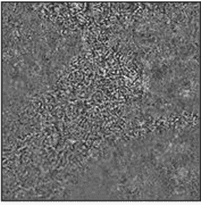

图 1.1 基于 ℓ_p 范数的 FGSM 攻击示例，使用扰动幅度 左图：基础图像（被 Inception-v3 网络 [11] 正确分类为猫）。中图：由 FGSM 攻击生成的对抗图像（被以 99.83% 的高置信度错误标记为书柜）。右图：（放大的）对抗噪声。

在数据投毒攻击中，攻击者试图操纵训练数据，以期

- 降低机器学习模型的整体性能（即准确率），
- 诱导对特定测试样本或测试样本子集的错误分类，或
- 增加训练时间。

如果攻击者指定了某个目标标签，使得特定测试样本被错误分类到该标签，则该攻击称为定向数据投毒攻击；否则，称为非定向数据投毒攻击。攻击者被假定能够贡献训练数据或控制训练数据。例如，众包被认为是各种智慧城市（如智能交通系统和交通监控 [12]）的重要数据来源。因此，此类系统容易受到数据投毒威胁 [13, 14]，因为数据投毒攻击通常难以检测 [15, 16]。

本章介绍白盒和黑盒环境下的对抗攻击和数据投毒攻击。这些安全攻击类别从不同的对抗能力角度进行了全面讨论。本章的主要目标是帮助研究社区深入了解现有对抗攻击和数据投毒攻击的见解和启示，并提高研究者在开发未来学习算法时对潜在对抗威胁的认识。本章其余部分组织如下。在第 1.2 节中，我们首先提供一些关于支持向量机（SVM）和神经网络的背景信息。然后我们在第 1.3 节中介绍重要的定义和典型的白盒对抗攻击。在第 1.4 节中，我们进一步讨论黑盒对抗攻击。此外，第 1.5 节涵盖数据投毒攻击及其对抗方面。最后，第 1.6 节给出结论性意见。

## 1.2 背景

在本节中，我们在提供关于SVM和神经网络的背景信息之前，先介绍我们的记号。

### 1.2.1 记号

表 1.1 列出了本章所使用的记号。

### 表 1.1 本章使用的记号

| 符号 | 含义 | 符号 | 含义 |
|---|---|---|---|
|  | 正整数集合 | C | 输出为标签的分类器 |
| R | 实数集合 |  | 梯度 |
| K | 类别数量 |  | 范数 |
| x | 原始（干净、未修改的）输入 |  | 扰动 |
|  | 对抗图像（受扰动的输入图像） |  | 特定应用的最大扰动 |
| y | 输入 x 的真实标签 |  | 第 i 类的判别函数 |
| t | 对抗攻击中目标类的标签 | f | 神经网络（NN）模型，其输出为置信度或概率分数向量： |
| *L* | NN 的损失函数 | *Z* | Logits |
|  | f 的参数 |  |  |

### 1.2.2 支持向量机

SVM，又称大间隔分类器，是用于回归和分类问题的监督学习模型。形式上，SVM 是构造一个超平面使得超平面与最近训练样本之间的距离最大化的机器学习方法。

作为一个例子，我们在此关注线性可分二分类问题的硬间隔 SVM。给定一个包含 *n* 个点的训练数据集，其中 是 所属的类别。每个数据点是一个 *p* 维实数向量，且 SVM 的目标是搜索将 对应的点组与 对应的点组分开的最大间隔超平面。由 Cortes 和 Vapnik [17] 提出的 SVM 通过求解以下二次规划（QP）问题来找到最大间隔超平面：

在约束条件下，对所有 其中 *w* 是最大间隔超平面的法向量。该 QP 问题可以使用拉格朗日乘子 重新表述为无约束问题，如下所示：

对上述表达式关于 *w* 求导，我们得到

这表明超平面的法向量 *w* 依赖于 和 类似地，对上述表达式关于 求导，我们得到

将方程 (1.2.2) 和 (1.2.3) 代入 ，我们通过应用二次优化方法，在满足方程 (1.2.4) 的约束下最大化关于 的结果。然后我们可以轻松求解 。一旦求解，大多数 等于零。对应的 的数据点集合称为支持向量。由于法向量 得到的超平面仅依赖于支持向量。

然而，如果两个类别是非线性可分的，可以使用带有核函数的软间隔 SVM 来学习非线性决策边界（在变换后的空间中是线性的）。

### 1.2.3 神经网络

在本小节中，我们讨论神经网络，重点关注图像识别系统，因为文献中引入的大多数现有对抗示例都与图像识别相关。

设 为输入图像空间，其中 且 例如，灰度图像有一个颜色通道，彩色 RGB 图像有 个颜色通道。向量 x 的元素 表示位于 的像素值。每个像素值表示该像素的亮度，像素值是 0 到 255 之间的整数。然而，像素值通常被重新缩放到 [0, 1] 范围内。

一个前馈神经网络可以写成一个函数 ，它将输入图像映射到输出 ，其中 是类别数量，R 是实数集合。y 的每个元素可以被视为输入 x 属于类别 j 的概率或似然，其中 j 是 1 到 K 之间的整数。y 的每个元素满足 且 输出向量 y 可以被视为离散标签集 上的概率分布。此外，设 为相应的分类器，它将输入图像映射到 。C 和输出向量 y 之间的关系如下：

一个具有 层的前馈神经网络 f 可以被视为(1.2.5) 复合函数，使得对于每个

其中每个分量函数 = 是第 i 层的激活函数，(1.2.6) 是第 i 层的权重参数矩阵， 是第 i 层的偏置单元。 和 共同构成模型参数 。为简单起见，我们不明确说明前面函数对 的依赖性。如果攻击模型明确依赖于 ，我们会将其写为 。为了找到使得分类器 C 能正确预测 X 中大多数实例的模型参数 ，通常使用随机梯度下降方法来最小化损失函数 ，其中 P 是


参数空间。为简单起见，在不会引起混淆的情况下，我们有时直接使用 ReLU。

让我们进一步讨论激活函数，因为它在将线性假设空间扩展到非线性假设空间时至关重要。修正线性单元（ReLU）广泛应用于机器学习/深度学习应用中，尤其是在图像分类任务中。ReLU 定义在实数集 $R$ 到实数集 $R$ 的映射上，即对于每个 $x$。因此，ReLU 在所有点上都是可微的，但 $0$ 点除外。通常，数据科学家关注的是有界且具有平滑梯度的非线性激活函数。有界性是防止激活函数返回值变得过大的重要性质。平滑梯度也是人们所期望的，因为它使反向传播成为可能。然而，ReLU 既没有上界，在 $0$ 处也不可微。那么，与那些有界且具有平滑梯度的传统非线性激活函数（如 sigmoid 函数和双曲正切函数）相比，它为何如此流行且有用呢？现有研究尚未为此问题奠定理论基础。然而，ReLU 唯一的不可微点是 $x=0$ 时，而在计算的任何阶段，ReLU 激活的输入值恰好为零的可能性都不大，因此反向传播仍然有效，尽管 ReLU 并非处处可微。

在过去几年中，出现了许多 ReLU 的变体，例如指数线性单元（Exponential $LU$，或简称为 $ELU$）、高斯误差线性单元（$GELU$）和 Leaky $ReLU$。例如，$ELU$ 通过指数函数变换负输入，而不是将所有负输入设为零。$GELU$ [18] 是对 $RELU$ 和 $ELU$ 激活函数的经验改进，其定义如下：

在过去几年中，$GELU$ 一直是自然语言处理领域最先进的激活函数。此外，Leaky $ReLU$ [19] 通过将负输入值乘以一个小的正常数（例如 α = 0.01）来缩小负输入值，而不是在 x < 0 时返回零。

最后，我们讨论 softmax 函数，这是多分类模型最后一层常用的激活函数。softmax 函数是逻辑函数（即 sigmoid 函数）的推广，其定义如下：使得某个输入对应的输出元素为

## 1.3 白盒对抗攻击

我们首先给出一个基于 $\ell$-范数的对抗攻击的全面定义。

**定义 1（对抗攻击）：** 设 $x$ 为合法输入数据，且被机器学习分类器 $f$ 正确分类为类别 $y$。目标类别 $t$ 使得对抗攻击是一个映射，使得对抗样本被 $f$ 错误分类为类别 $t$，而 $x'$ 与 $x$ 之间的差异很小；即，对于某个较小值 $\epsilon$。

定义 1 中使用的 $\ell$-范数度量对抗攻击产生的扰动的幅度。向量的 $\ell$-范数定义如下

其中 $x_i$ 是 $x$ 的第 $i$ 个分量。以下是文献中经常使用的三种范数。

- $\ell_0$-范数：统计满足 $x'_i \ne x_i$ 的坐标 $i$ 的数量，其中 $x'_i$ 和 $x_i$ 分别是 $x'$ 和 $x$ 的第 $i$ 个分量。当攻击者希望限制攻击像素的数量而不限制每个像素的变化幅度时，该范数非常有用。

- $\ell_2$-范数：度量 $x'$ 与 $x$ 之间的欧几里得距离。

- $\ell_\infty$-范数或切比雪夫距离：度量 $x$ 任意坐标的最大绝对变化。

定义 1 被称为“定向对抗攻击”。“定向”攻击包含一个目标类别 $t$，其函数旨在找到一个合法输入数据（称为对抗样本），使得分类器 $f$ 将其错误分类为类别 $t$ 的实例。在某些场景中，攻击者可能没有特定的目标类别。其目标仅仅是误导分类器 *f*，将对抗样本错误分类为除原始类别 *y* 之外的某个类别。

本节主要讨论白盒攻击，假设攻击者完全了解训练好的机器学习模型。当攻击者能够获取这些关键信息时，他们可以使用对抗攻击模型修改任意干净的输入。白盒攻击是最坏的情况，因为攻击者可以访问模型架构和模型权重。

### 1.3.1 L-BFGS 攻击

对抗样本通常基于一阶梯度信息（如 FGSM 和 DeepFool 攻击 [20]）或梯度近似生成。我们首先讨论一些经典的基于梯度的攻击。在这种情况下，攻击者的目标要么是使导致错误分类所需添加的扰动的范数最小化，要么是使模型 *f* 相对于输入数据的损失函数最大化。

Szegedy 等人 [21] 展示了针对深度神经网络的首次定向对抗攻击。他们通过求解以下优化问题找到了失真最小的对抗样本：

满足约束条件和，其中 为 -范数。由于约束条件是非线性的，求解该问题的精确解(1.3.1)
非常具有挑战性。Szegedy 等人用连续损失函数 *L*（例如分类中使用的交叉熵）替代了该约束条件。也就是说，他们转而求解以下优化问题：

满足约束条件，其中常数 B。通过首先自适应地(1.3.2)
选择不同的常数 *c* 值，然后使用 L-BFGS 算法 [22] 对每个选定的 *c* 迭代求解问题 (1.3.2)，攻击者可以获得对 *x* 具有最小失真的对抗样本，以及 L-BFGS 攻击的正式定义如下。

其中 *sign* 函数输出其输入值的符号。(1.3.6)

对于定向攻击设置，攻击者试图最小化损失函数，其中 *t* 是目标类别。在这种情况下，我们可以证明

形式化地，我们可以定义具有 -范数有界扰动幅度(1.3.7) 的 FGSM 如下。

**定义 3（Goodfellow 等人于 2014 年提出的 FGSM 对抗攻击）：** 设 为被机器学习分类器 *f* 正确分类为类别 *y* 的合法输入数据。具有 -范数有界扰动幅度的 FGSM 通过最大化损失函数并满足约束条件 来生成对抗样本。也就是说，

此外，我们可以轻松地将该攻击推广到其他 -范数攻击¹。例如，我们可以利用柯西-施瓦茨不等式（Holder 不等式在 时的一个特例）来求问题 (1.3.5) 中目标函数在约束条件 下的下界，并获得基于 -范数约束的非定向 FGSM 的扰动

除非另有说明，本章其余部分我们将重点关注具有 -(1.3.8) 范数有界扰动幅度的攻击。

### 1.3.3 基本迭代方法

Kurakin 等人 [23] 提出的基本迭代方法是对 FGSM 的迭代改进。BIM 使用损失函数的迭代线性化，而不是 FGSM 中的一次性线性化。此外，它沿梯度符号方向采用多个较小但固定的步长，而不是单个较大步长。例如，在具有 -范数有界扰动幅度的非定向攻击中，初始点设置为原始实例 *x*，在每次迭代中，扰动 和 按如下方式计算：

(1.3.10)(1.3.9)

其中 表示攻击的大小， 是一个投影算子，将 的值投影到 x 的盒约束（例如，如果 x 是图像，则 x 的盒约束可以是 0 到 255 之间的整数集）与 x 的邻域球的交集上。该过程确保生成的对抗样本在输入 x 的界内。使用较小的扰动幅度会限制有效攻击像素的数量，从而防止简单的离群点检测器检测到对抗样本。

**定义 4（Kurakin 等人于 2016 年提出的 BIM 对抗攻击）：**

BIM 攻击通过迭代最大化损失函数并满足约束条件 来生成 -范数有界的对抗样本。对于第 k 次迭代， 按如下方式计算：

其中 是每次迭代中较小但固定的扰动幅度，迭代次数由用户选择。

BIM 的一个流行变体是投影梯度下降（PGD）攻击，它使用均匀随机噪声作为初始化，而不是设置为 [24]。随机初始化用于探索输入空间。后来，Croce 和 Hein [24] 通过为梯度更新添加动量项，并利用探索与利用的概念进行优化，改进了 PGD。他们将这种方法称为自动投影梯度下降（AutoPGD），并证明 AutoPGD 比 PGD 更有效 [24]。AutoAttack [24] 进一步改进了它，AutoAttack 是多种攻击的集成。具体来说，AutoAttack 将三种白盒攻击与一种黑盒攻击相结合。这四个攻击组件分别是两种 AutoPGD 攻击的扩展（一种最大化交叉熵损失，另一种最大化逻辑比率损失的差异）和两种现有的辅助攻击（分别为快速自适应边界 [FAB] 攻击 [25] 和方形攻击 [26]）。已有研究表明，使用集成方法可以在多种防御策略上提高攻击有效性 [25]。对于每个测试样本，如果四种攻击方法中至少有一种找到了对抗样本，则该攻击被认为是成功的。


此外，AutoAttack 可以在基准数据集、模型和范数之间完全无需预定义的用户输入运行。因此，在研究人员开发对抗防御时，它可以提供可靠、快速且无参数的评估工具 [24]。我们将在第 1.3.5 节介绍快速自适应边界攻击，并在第 1.4.4 节介绍平方攻击。

### 1.3.4 DeepFool

DeepFool [20] 攻击是一种非目标白盒攻击。与 Szegedy 等人 [21] 一样，Moosavi-Dezfooli 等人 [20] 研究了最小失真对抗样本问题。然而，与寻找损失函数的梯度不同，DeepFool 通过决策边界/超平面的迭代线性近似以及输入到近似决策边界上的正交投影，搜索从原始输入到最近决策边界的最短距离。

Moosavi-Dezfooli 等人搜索了输入 \(x\) 穿越决策边界并被错误分类的最短距离路径。形式上，DeepFool 攻击可以定义如下。

**定义 5 (Moosavi-Dezfooli 等人 2016 年的 DeepFool 对抗攻击)：** DeepFool \(\ell_p\)-范数攻击通过求解以下优化问题生成对抗样本：

\[
\min_{\delta} \|\delta\|_p \quad \text{subject to } f(x+\delta) \neq f(x)
\]

其中 \(g\) 是分隔类别 \(k\) 与类别 \(\hat{k}\) 的决策边界 (1.3.11)。

为了找到这样的路径，攻击者首先使用迭代线性近似方法近似决策边界，然后计算从 \(x\) 到该线性化决策边界的正交向量。此外，我们将给出二分类情况的解，并随后将其扩展到多分类情况。

给定一个具有判别函数 \(g_1\) 和 \(g_2\) 的非线性二分类器，类别 1 与类别 2 之间的决策边界为 \(g_1(x) = g_2(x)\)。每次迭代的近似解可以通过基于一阶泰勒展开近似决策边界/超平面 \(g\) 来推导：

\[
g(x) \approx g(x_i) + \nabla g(x_i)^\top (x - x_i) = 0
\]

其中 \(x_i\) 是解的迭代点且 \(\delta_i = x - x_i\)。然后我们求解以下优化问题 (1.3.12)：

\[
\min_{\delta_i} \|\delta_i\|_2 \quad \text{subject to } g(x_i) + \nabla g(x_i)^\top \delta_i = 0
\]

通过求解由下式给出的拉格朗日的鞍点：(1.3.13)

\[
\mathcal{L}(\delta_i, \lambda) = \|\delta_i\|_2 + \lambda \left( g(x_i) + \nabla g(x_i)^\top \delta_i \right)
\]

可以求解该优化问题得到鞍点 (1.3.14)：

\[
\delta_i = -\frac{g(x_i)}{\|\nabla g(x_i)\|_2^2} \nabla g(x_i)
\]

该鞍点可以被视为迭代 \(i\) 时 \(x_i\) 在决策超平面 \(g\) 上的正交投影，且迭代在 \(x_{i+1}\) 被错误分类时停止；即 \(f(x_{i+1}) \neq f(x)\)。

DeepFool 攻击在一种对所有方案的多类方法遵循二分类情况下的迭代线性化过程，不同之处在于攻击者需要确定距离输入 \(x\) 最近的决策边界 \(l\)。用于寻找最小扰动的迭代线性近似方法是一种贪心方法，可能无法保证全局最小值。此外，从原始输入到最近决策边界的最短距离可能不等同于人眼观察到的最小差异。实践中，DeepFool 通常生成微小不易察觉的扰动。

到目前为止，我们仅考虑了非目标 DeepFool 攻击。如果将输入 \(x\) 推向目标类别 \(t\) 的边界，则可以实现 DeepFool 的目标版本，受约束 \(f(x+\delta) = t\)。此外，DeepFool 攻击也可以被调整以寻找任意 \(p\)-范数的最小失真扰动，其中 \(p \in [1, \infty)\)。如感兴趣，详见 [28]。

### 1.3.5 快速自适应边界攻击

快速自适应边界攻击由 Croce 和 Hein [25] 提出，是 DeepFool 攻击 [20] 的扩展。具体而言，FAB 攻击中 \(\delta\) 的计算与 DeepFool 算法非常接近。两种攻击之间的主要区别在于，DeepFool 攻击者仅投影到决策超平面 \(g\) 上，而 FAB 攻击者投影到 \(\mathcal{S}\) 与近似决策超平面的交集上，并具有以下额外步骤。

- 添加动量项以调节附加项对修改后图像的影响。因此 \(\delta\) 偏向于 \(\mathcal{S}\)，从而 FAB 攻击方法生成的 \(\delta\) 比 DeepFool 攻击生成的更接近输入。动量项在每次迭代 \(i\) 中更新如下。首先，FAB 攻击者计算最小扰动 \(\delta_i\) 和 \(\delta_{i-1}\)，分别作为当前最佳点和输入投影到 \(\mathcal{S}\) 与近似线性决策边界的交集上。然后，\(\delta_i\) 选为如下 (1.3.15)：

其中 \(\eta\) 是一个超参数，为 \(\delta\) 提供上限值。它被定义为使得每次迭代的 \(\delta\) 可能远离 \(x\)。

- 在每次迭代结束时添加向后步以进一步提高对抗样本的质量。DeepFool 在 \(\delta\) 成功被错误分类时停止。然而，FAB 攻击具有此额外增强步骤。向后步只是通过使用超参数 \(\eta\) 计算 \(x\) 与 \(\delta\) 的线性组合，使 \(\delta\) 更接近输入 \(x\) 的移动。Croce 和 Hein [25] 在所有实验中都使用了 \(\eta\)。

- 添加随机重启以拓宽对抗样本的搜索空间 (1.3.16)。也就是说，与确定性地初始化 \(\delta_0\) 不同，FAB 攻击者将其设为 \(x\) 的 \(\epsilon\)-邻域内的随机样本，其中 \(\epsilon > 0\)。

- 添加最终搜索步骤以进一步减小对抗样本与其原始输入之间的距离。该步骤在几次迭代内使用 \(\delta\) 和 \(x\) 的修改二分搜索来找到更好的对抗样本；例如，Croce 和 Hein [25] 在其实验中将迭代次数设为 3。有关最终搜索步骤和随机重启的详细信息，请参阅 [25]。

### 1.3.6 Carlini 和 Wagner 的攻击

Carlini 和 Wagner 的 (C&W) 攻击 [27] 旨在找到最小受扰动以求解第 1.3.1 节中定义的盒约束优化问题。具体而言，他们将盒约束优化问题转换为无约束优化问题，然后可以通过标准优化算法而不是 L-BFGS 算法求解。Carlini 和 Wagner 研究了三种摆脱盒约束的方法：投影梯度下降、裁剪梯度下降和变量变换。他们得出结论，变量变换的方法在快速生成对抗样本方面最有效。也就是说，他们引入了一组新的变量 \(w\)，使得

\[
x = \frac{1}{2}(\tanh(w) + 1)
\]

尽管 \(w\) 可以是任意实数，从而消除了盒约束 (1.3.17)。

此外，约束 \(f(x+\delta) = t\) 具有高度非线性。Carlini 和 Wagner [29] 考虑了七个目标候选函数 \(g\) 来替代该约束。每个都满足条件 \(g(x+\delta) \le 0\) 当且仅当 \(f(x+\delta) = t\)（针对目标攻击）且 \(g(x+\delta) \le 0\) 当且仅当 \(f(x+\delta) \neq t\)（针对非目标攻击）。例如，C&W 的 \(\ell_\infty\)-范数攻击中 \(g\) 定义如下：

\[
g(x') = \max\left( \max_{i \neq t} Z_i(x') - Z_t(x'), -\kappa \right)
\]

其中 \(Z\) 是 logits，且 \(Z_i(x')\) 是 logits 的第 \(i\) 个元素；\(\kappa\) 是一个参数 (1.3.18)，控制对抗样本的强度。[29] 中实验的默认值是零。然而，增加 \(\kappa\) 可以生成具有更高迁移成功率的对抗样本。

相反，Carlini 和 Wagner [27] 求解优化问题

\[
\min_{w} \; \|\delta\|_p + c \cdot g(x+\delta)
\]

其中 \(c\) 是一个正则化参数，控制 \(p\)-范数扰动相对于 \(g\) 的相对重要性 (1.3.19)。如果选择较大的 \(c\) 值，攻击者会生成远离基样本但以高置信度被错误分类的对抗样本，反之亦然。Carlini 和 Wagner [27] 使用修改的二分搜索来找到使优化问题 (1.3.19) 的解满足条件的最小 \(c\) 值。作为修改二分搜索的替代，线搜索也可以用来找到距离 \(x\) 最小的对抗样本。

此外，Carlini 和 Wagner 考虑了三种类型的攻击，\(\ell_0\)-范数攻击、\(\ell_2\)-范数和 \(\ell_\infty\)-范数攻击。C&W 攻击的形式化定义如下给出。

**定义 6 (Carlini 等人 2017 年的 C&W 对抗攻击)：** C&W 攻击通过求解以下生成对抗样本

以下优化问题：

其中 是正则化项，且

请注意，标准梯度下降算法可用于求解该最小化问题的解。

Carlini 和 Wagner [27] 表明 C&W 攻击非常强大，十种提出的防御策略无法抵御通过最小化防御特定损失函数构建的 C&W 攻击 [28]。此外，C&W 攻击也可用于评估潜在防御策略的有效性，因为它是其中最强的对抗攻击之一 [27]。

在接下来的两个小节中，我们讨论一些除 \(\ell_p\)-norm-based 攻击之外的对抗攻击。

### 1.3.7 影子攻击

在本小节中，我们介绍了一类针对图像数据集的对抗攻击，称为“语义”对抗攻击，这类攻击通常通过在 \(\ell_p\)-norm 意义上对图像施加较大扰动来生成对抗样本，但仍与原始图像在语义上相似。该攻击的一个典型例子就是对自然图像进行轻微的颜色偏移、旋转、剪切、缩放或平移，以欺骗最先进的图像分类器 [4, 29]。该攻击之所以成功，是由于机器学习模型识别图像的方式与人类视觉识别系统存在差异。语义对抗样本可形式化定义如下。

**Definition 7 (Semantic Adversarial Attack):** 设 \(x\) 为被机器学习分类器正确分类为类别 \(y\) 的合法输入数据。语义对抗攻击是一个映射，使得对抗样本被分类器误分类为类别 \(y'\)，其中 \(V\) 为人类视觉识别系统。

语义对抗攻击可以是白盒或黑盒。虽然我们在此详细讨论其中一种白盒语义对抗攻击，但小节 1.4.3 涉及一种空间变换攻击，即黑盒语义对抗攻击。

影子攻击 [30] 是一种“语义”对抗攻击，与小节 1.3.1–1.3.6 中介绍的攻击不同，其目标不仅是分类器的输出标签，还包括可认证的防御 [31, 32]。该攻击揭示了可认证防御并非本质上安全。此外，影子攻击也可被视为具有三个惩罚项的 PGD 攻击的推广，这些惩罚项最小化扰动的感知性。形式上，影子攻击定义如下，其中在损失项中加入了三个惩罚项。

**Definition 8 (Shadow Attack by Ghiasi et al. 2020):** 影子攻击通过求解以下优化问题生成对抗样本：

其中 \(\theta\) 为模型权重，\(x\) 为任意自然图像，\(\delta\) (1.3.20) 为加到图像上的扰动，\(\mathcal{L}\) 为损失函数，\(\lambda_1, \lambda_2, \lambda_3\) 为标量惩罚权重。\(\mathcal{R}\) 为 \(\delta\) 的总变差，\(\mathcal{C}\) 限制每个颜色通道均值的变化，\(\mathcal{E}\) 促进颜色通道之间的均匀扰动。

请注意，总变差按逐元素方式计算，如 [30] 所示，其中 \(\|\nabla \delta\|_2\) 估计 \(\delta\) 梯度的 \(\ell_2\)-norm。

### 1.3.8 Wasserstein 攻击

与大多数关注 \(\ell_p\)-norm 的对抗攻击不同，Wasserstein 攻击使用 Wasserstein 距离（也称为最优传输、Kantorovich 距离或 Earth mover’s 距离）来生成 Wasserstein 对抗样本。\(\ell_p\)-norms 虽在对抗攻击中被广泛使用，但无法捕捉诸如旋转、平移、失真、翻转和反射等图像变换。

**Definition 9 (Wasserstein Distance between Two Inputs \(x\) and \(y\)):** 设 \(x\) 和 \(y\) 为两个归一化后的输入，满足 \(x^\top \mathbf{1} = y^\top \mathbf{1} = 1\)。此外，设 \(C\) 为成本矩阵，使得 \(C\) 的每个元素衡量从 \(x_i\) 移动质量到 \(y_j\) 的成本（即如果 \(x\) 和 \(y\) 为图像，则为第 \(i\) 个像素与第 \(j\) 个像素之间的欧几里得距离）。则 \(x\) 和 \(y\) 之间的 Wasserstein 距离为：

\[
W(x,y)=\min_{P \in \mathbb{R}^{n\times n}} \; \langle C, P \rangle
\]

约束条件为 \(P \mathbf{1} = x\)，\(P^\top \mathbf{1} = y\)，其中 \(\mathbf{1}\) 为全为 1 的列向量，\(P\) 为传输计划 (1.3.21)，其元素 \(P_{ij}\) 编码质量从 \(x_i\) 移动到 \(y_j\) 的方式，且 \(\langle \cdot, \cdot \rangle\) 表示矩阵–矩阵逐元素乘法的和。即 \(\langle C, P \rangle = \sum_{i,j} C_{ij} P_{ij}\)。

从概率上讲，可以将传输计划视为 \(x\) 和 \(y\) 的联合概率 [33]。尽管 Wasserstein 距离具有许多理论优势，但计算两幅图像之间的 Wasserstein 距离在计算上代价昂贵，因为它需要求解一个具有 \(n^2\) 个变量的线性规划问题。Wong 等人 [34] 开发了一种快速近似投影算法，称为投影 Sinkhorn 迭代，该算法通过投影到 Wasserstein 球来修改标准的 PGD 攻击。形式上，Wong 等人提出求解以下目标函数。

**Definition 10 (Wasserstein Adversarial Example by Wong et al. 2019).** Wasserstein 攻击通过最小化以下目标函数生成 Wasserstein 对抗样本：

受 Wasserstein 球约束，且其中 (1.3.22)

请注意，目标函数中包含了传输计划上的熵正则化项 \(H(P)\)，以便近似投影；然而，该熵正则化项加快了计算速度（近线性时间）。为了进一步降低计算成本，局部传输计划将每个像素的移动限制在其原始位置的区域内。例如，Wong 等人 [34] 在所有实验中设置了 \(\epsilon\)。

## 1.4 黑盒对抗攻击

对抗攻击的最新研究对黑盒设置表现出特别的兴趣。尽管许多攻击要求攻击者完全访问网络架构和权重，但这些信息在商业化产品中通常受到保护，例如现代自动驾驶汽车中的视觉系统。因此，黑盒攻击——其中攻击者对网络和训练集一无所知，除非能够查询每个类别的概率/置信度分数（基于分数的黑盒攻击）或标签（基于决策的黑盒攻击）——变得越来越重要。此外，由于本节介绍的黑盒攻击模型不需要像第 1.3 节中介绍的大多数白盒攻击那样了解梯度，因此基于梯度掩码或不可微分的防御策略对本节介绍的攻击不起作用。

在第 1.4.1 节中，我们介绍了一种流行的黑盒攻击——迁移攻击，它利用了对抗样本的可迁移性。该攻击甚至可以应用于无盒设置，其中攻击者甚至无法访问模型的输出。在第 1.4.2 节中，我们介绍了两种基于分数的黑盒攻击：基于零阶优化 (ZOO)-based 攻击和平方攻击。然后在第 1.4.3 节中讨论三种流行的基于决策的黑盒攻击。

### 1.4.1 迁移攻击

Szegedy 等人 [6] 通过 DNN 的泛化能力强调了对抗样本的可迁移性。也就是说，同一对抗图像可以被具有不同架构或在不同训练数据上训练的各种分类器误分类。这一特性在黑盒设置中很有用。当攻击者不知道模型架构时，他们可以生成一个替代模型来模仿目标模型，然后对获得的替代模型应用白盒攻击方法，例如 L-BFGS 攻击，以生成对抗样本。这种类型的攻击称为迁移攻击。

要进行迁移攻击，攻击者首先需要有一个带标签的训练集。在自由查询访问下，攻击者可以将替代训练集输入目标分类器以获得这些实例的标签。在查询访问受限的极端情况下，攻击者可能不得不自行进行标注或找到一个已标注的替代训练集。然而，在自由查询访问的支持下，生成的模型通常更能代表目标模型。有了带标签的替代训练集，如果攻击者对底层结构有任何了解，他们可以选择一个与目标模型结构相似的替代模型。例如，图像分类器通常有多个 CNN 层，而序列模型可能具有某种 RNN 层。然后他们可以用替代训练集训练所选的替代模型。这个训练好的替代模型充当攻击代理。最后，第 1.3 节中介绍的白盒攻击方法可用于生成对抗样本。为了获得较高的迁移攻击成功率，选择 FGSM、PGD、C&W 或其他具有高可迁移性的攻击方法来生成对抗样本。此外，为确保迁移攻击成功，通常需要较大的对抗扰动。

### 1.4.2 基于分数的黑盒攻击

在本节中，我们讨论两种流行的基于分数的攻击：ZOO 和平方攻击。ZOO 攻击是基于零阶优化寻找对抗样本，而平方攻击则通过使用无导数优化 (DFO) 生成对抗样本。两种攻击的详细讨论如下。

#### ZOO 攻击

不同于使用迁移攻击来利用对抗图像的可迁移性，Chen 等人 [35] 提出了一种 ZOO 攻击，直接使用置信度分数近似目标模型的梯度。因此，ZOO 攻击被视为基于分数的黑盒攻击，且不需要训练替代模型。ZOO 攻击与 C&W 攻击同样有效，并且在成功率方面明显超过现有的迁移攻击。Chen 等人 [35] 还提出了一个利用 capable

用于在黑盒环境下生成对抗样本的基于梯度的白盒攻击。

ZOO 攻击同样通过求解优化问题 (1.3.19) 来找到对抗样本。受 C&W 攻击中使用的攻击损失函数 (1.3.6.2) 的启发，提出了一种新的类似铰链的损失函数 [35]，该函数基于模型 $f$ 的对数概率分数向量，而非 $Z$，如下所示：

其中 是概率分数向量的元素，且参数 确保对抗样本被分类为类别 $t$ 的对数概率分数与所有剩余类别之间保持恒定差距。对数概率分数被使用而不是概率分数，因为训练良好的 DNN 对某一类别相比其他类别会产生显著高的置信度分数，而 log 函数在不影响置信度分数顺序的情况下减弱了这种主导效应。ZOO 攻击定义如下。

**Definition 11 (ZOO Adversarial Attack by Chen et al. 2017):** ZOO 攻击是一种基于分数的黑盒攻击，通过使用零阶随机坐标下降与逐坐标 ADAM 求解以下优化问题来生成对抗样本。

受约束于

在白盒环境下，找到对抗样本需要对模型函数求梯度。然而在黑盒环境下，梯度不可用，只能使用函数评估，这使其成为零阶优化问题。Chen 等人 [35] 提出了一种通过观察当 的坐标值被调整时预测置信度的变化来估计受害样本周围梯度信息的方法 [36]。Chen 等人 [35] 使用以下对称差商来近似梯度：

(1.4.2)

其中 h 是一个很小的常数，且 是标准基向量。对于具有大输入尺寸的网络，例如 Inception-v3 网络 [11]，每次梯度评估的模型查询次数为 （每次坐标方向梯度估计需要两次函数评估）。这非常查询低效。

为克服这一低效性，Chen 等人 [29] 提出了五种加速技术。

- 1. 使用零阶随机坐标下降与逐坐标 ADAM 最小化目标函数。
- 2. 批量评估目标函数而非逐个评估，以利用 GPU。
- 3. 减小攻击空间并从降维空间中进行梯度估计以提高计算效率：具体而言，使用诸如 其中 的降维变换来减小攻击空间。例如，D 可以是放大图像的上采样算子，如双线性插值方法、离散余弦变换（DCT）或用于攻击降维的自动编码器 [37]。尽管这种攻击空间降维方法降低了高分辨率图像数据集（如 ImageNet [38]）的计算成本，但降维后的攻击空间也会限制找到有效攻击的能力。
- 4. 使用分层攻击来克服有限搜索空间问题。不是只使用一种变换，而是使用一系列维度为 其中 的变换来寻找对抗样本。攻击者从较小的攻击空间开始尝试寻找对抗样本。如果不成功，则将攻击空间增大到 否则过程停止。
- 5. 根据其“重要性”选择要更新的坐标。例如，对于图像分类器而言，图像边缘或角落附近的像素不如主对象附近（通常靠近中心）的像素重要。Chen 等人 [35] 将图像划分为区域，并将“重要性”定义为每个区域中绝对像素值的变化。

请注意，当 n 很小时，加速技术 3–5 不是必需的。例如，Chen 等人 [35] 在 MNIST 和 CIFAR10 数据集上未使用技术 3–5。尽管攻击成功率与 C&W 攻击的成功率相当，但在提出的加速技术下，梯度估计所需的查询次数仍然很大。

## Square Attack

Andriushchenko 等人 [26] 提出了一种方形攻击（SA），这是一种对 和 -有界对抗扰动的查询高效攻击。SA 基于随机搜索（RS），这是一种 DFO 方法中的迭代技术。因此，SA 是一种无梯度攻击 [39]，且对梯度掩码具有抵抗性。SA 通过采用 RS 和任务特定的采样分布提高了查询效率和成功率。在某些情况下，SA 的性能甚至可与白盒攻击相媲美。

与非目标攻击相比，SA 旨在通过求解以下盒约束优化问题来找到 -范数有界的对抗样本：

受约束于 是基于边距的损失函数，用于衡量模型 f 将对抗输入标记为真实类别 y 而非其他类别的置信度水平(1.4.3)。

在以目标类别 t 为目标的攻击中，攻击者可以简单地最小化损失函数

然而，使用目标类别 t 的交叉熵损失 (1.4.4)

以使目标攻击更具查询效率。 (1.4.5)

该优化问题可通过使用经典的 RS 方法求解。一般而言，RS 方法可以描述如下。给定一个待最小化的目标函数 g、一个起点 和一个采样分布 D，RS 算法在 N 次迭代后输出估计解。对于每次迭代 i，RS 算法首先进行随机更新，然后将该更新添加到当前迭代中；即， 如果在 处评估的目标函数小于迄今为止的最佳值，我们更新 和 即，如果 则 且 否则，更新将被丢弃 [40]。该过程在达到用户指定的迭代次数后停止。因此，使用 RS 优化 g 不依赖于 g 的梯度。

由于 Moon 等人 [41] 表明，当在 CIFAR10 和 ImageNet 数据集上运行白盒 PGD 攻击直至收敛时，成功的对抗扰动主要出现在 -范数球的顶点（角落）[26]。基于这一观察，SA 攻击仅在 或 -球的边界上搜索以获得当前迭代的潜在对抗扰动 因此，对于 -范数攻击，每个像素的扰动（在投影之前）要么是 要么是 ，其中零扰动表示对给定像素不进行扰动。这一关键设计使 SA 机制与标准 RS 算法不同，并显著提高了查询效率。

另一个关键区别是，在每一步中，SA 攻击通过仅更新 的相邻像素中一小部分（每个颜色通道的边长为 的正方形）来限制对当前迭代的修改。这有助于降低搜索空间的维度，尤其是在输入空间高维时，例如 ImageNet 数据集 [42] 中的 n = 。

总之，通过随机搜索的 SA 在每次迭代 i [40] 中包含以下主要步骤：

- 1. 通过确定最接近正整数 的值来找到正方形的边长，其中 是可以扰动的原始图像 x 的像素百分比，w 是图像的宽度。p 随着迭代逐渐减小，但对于 -范数 SA。 这模仿了基于梯度的优化中的步长减小，其中我们以初始较大的学习率开始以快速缩小损失值 [40]。
- 2. 通过均匀随机选择找到每个颜色通道边长为 的正方形的位置。正方形表示可以修改的像素集合。
- 3. 对每个颜色通道 c，将正方形中所有像素的值均匀分配为 或 。
- 4. 将步骤 3 生成的方形扰动添加到当前迭代中以获得新点
- 5. 将 投影到 与半径为 的 -范数球的交集上以获得
- 6. 如果新点的损失低于迄今为止的最佳损失，则接受该变化并更新最佳损失。否则，将其丢弃。


迭代持续进行直到找到对抗样本。对感兴趣的读者，可参见[26]。

### 1.4.3 决策基础攻击

决策基础攻击仅使用 ML 输出的标签来生成对抗攻击，这使其易于应用于现实世界的 ML 攻击。本节中，我们讨论三种流行的基于决策的黑盒攻击：边界攻击 [43]、HopSkipJump 攻击 [44] 以及空间变换攻击 [4]。

### 边界攻击

不依赖训练数据也不依赖迁移性假设，边界攻击使用简单的拒绝采样算法，以受约束的独立同分布高斯分布作为提议分布，并结合受 Trust Region 方法启发的动态步长调整来生成最小扰动对抗样本。边界攻击算法如下。首先，从最大熵分布（针对非目标攻击）或属于目标类别的数据点集合（针对目标攻击）中随机采样一个数据点。所选数据点作为起点。在算法的每一步，从提议分布中抽取随机扰动，使得扰动后的数据仍位于输入域内，且扰动图像与原始输入之间的差异在指定的最大允许扰动范围内。如果扰动后的数据在非目标攻击中被误分类（或在目标攻击中被误分类为目标类别），则将其用作新的起点。该过程持续进行直到达到最大步数。

边界攻击概念简单，需要很少的超参数调优，并且在有和没有算法知识的情况下，在目标和非目标计算机视觉场景中，其性能与最先进的梯度攻击（如 C&W 攻击）相当 [43]。此外，它对常见的欺骗手段具有鲁棒性，例如梯度混淆或掩蔽、固有随机性或对抗训练。然而，边界攻击有两个主要缺点。首先，生成对抗样本所需的查询次数很大，使其不适用于现实世界应用 [44]。与其使用拒绝采样算法，Metropolis-Hastings 采样可能是更好的选择，因为它不会简单地丢弃被拒绝的样本。其次，它仅考虑 -范数。

### HopSkipJump 攻击

相反，HopSkipJump 攻击是一类查询高效的算法家族，可为 both and -范数距离生成目标和非目标对抗样本。此外，HopSkipJump 攻击比边界攻击 [45] 更具查询效率，并且是一种无需超参数的迭代算法。下面给出 HopSkipJump 攻击的定义。

Definition 12 (HopSkipJump Attack by Chen et al. 2020): A HopSkipJump attack is a decision-based attack that generates the adversarial example by solving the following optimization problem:

subject to the constraint where (1.4.6)

and (1.4.7)

(1.4.8)

Note that is similar to (1.3.18) with Let us discuss a HopSkipJump -based target attack in detail. Interested readers can consult [44] for untargeted attacks or based attacks.

基于 HopSkipJump 的目标攻击是一种迭代算法，主要包括初始化步骤（步骤 1）和三个迭代步骤（步骤 2–4，重复直至攻击者指定的最大迭代次数）：

- 1. Select a random data point from a target class (similar to the initialization step of a boundary attack).
- 2. Approach the decision boundary/hyperplane by using a binary search algorithm. That is, move toward the input x and the decision hyperplane by interpolating between the input x and to get a new data point such that i.e.,

where is obtained via a binary search between 0 and 1 and stops (1.4.9) at such that
- 3. Estimate the gradient direction using the method similar to FGSM (1.3.8); i.e.,

where depends on the distance between and the image size is a (1.4.10) set of independent and identically distributed uniform random noise, is the batch size of the initial batch size is set to 100 in [53], and
- 4. Estimate the step size by geometric progression, and then (1.4.11) update the sample point That is, starting with the step size is reduced by half until where

### 空间变换攻击

(1.4.12)

与基于有界对抗扰动的边界攻击和 HopSkipJump 攻击不同，空间变换攻击 [4] 是一种黑盒“语义”对抗攻击，它揭示了小的随机变换，例如图像的小旋转，并且可以轻松欺骗最先进的图像分类器。该攻击确实质疑了这些最先进图像分类器的鲁棒性。此外，ZOO 攻击的主要缺点是在找到对抗样本之前需要探测分类器数千次 [27]。空间变换攻击并非如此。Engstrom et al. [4] 表明，worst-of-10 仅用 10 次查询就能显著降低模型准确率。基本上，它对自然图像进行轻微旋转或平移以导致误分类。该攻击揭示了当前最先进 ML 模型的脆弱性。

Definition 13 (Spatial Transformation Attack): Let be a legitimate input image that is correctly classified as class y by an image classifier. A spatial transformation attack generates an adversarial example by

finding a mapping such that the adversarial example \(x'\), where the relationship between \(x'\) and \(x\) is as follows:

Each pixel in \(x\) is translated \(t\) pixels to the right and rotated \\(\theta\\) degrees counterclockwise around the origin to obtain the pixel in \(x'\), where

To find the mapping an attacker needs to solve the following optimization problem:

where \(L\) is the loss function.

(1.4.13)

Engstrom et al. [4] proposed three different methods to solve (1.4.13): (1) a first-order method to maximize the loss function, (2) a grid search on a discretized parameter space, and (3) a worst-of-\(k\) (i.e., randomly sample \(k\) different set of attack parameters, and choose one that the model performs worst). The first-order method requires a gradient of the loss function, which is not possible in the black-box setting. Even if it is possible, Engstrom et al. [4] showed that the first-order method performs worst due to the nonconcavity of loss function for spatial perturbation.

## 1.5 数据投毒攻击

虽然对抗攻击无法改变模型的训练过程，只能修改测试实例，但数据投毒攻击恰恰相反，可以操纵训练过程。具体而言，在数据投毒攻击中，攻击者旨在操纵训练数据（例如投毒特征、翻转标签、操纵模型配置设置以及改变模型权重）以影响学习模型。假设攻击者有能力为训练数据做出贡献或控制训练数据本身。注入投毒数据的首要目标是影响模型的学习结果。

近期关于对抗 ML 的研究表明对数据投毒攻击设置特别感兴趣。本节讨论几种数据投毒攻击模型。我们首先在小节 1.5.1 中简要介绍标签翻转攻击，然后重点关注小节 1.5.2 中的干净标签数据投毒攻击，因为它们具有隐蔽性。为此，我们引入后门攻击。

### 1.5.1 标签翻转攻击

攻击训练过程的一种简单有效的方法就是简单地翻转一些训练实例的标签。这种数据投毒攻击称为标签翻转攻击。误标记可以在众包中轻松完成，例如攻击者是标注者之一。本小节讨论针对 ML 模型的常见标签翻转攻击。这些标签翻转攻击可以是模型无关的，也可以是模型相关的。例如，随机标签翻转攻击是模型无关的。它只是选择训练实例的子集并翻转其标签。攻击者不需要对底层目标 ML 模型有任何了解。尽管这种随机策略看起来很简单，但它能够根据所攻击的数据集类型、训练集大小以及被翻转的训练标签比例显著降低分类准确率。随机标签翻转攻击可以数学上定义如下。

**Definition 14 (Random Label Flipping Attack):** Given a training set where and the attack is called a random label flipping attack if an attacker with the ability to change the fraction of the training label can randomly select *np* training labels and flip the labels.

这种随机标签翻转攻击可进一步分为两组：目标攻击和非目标攻击。在非目标随机标签翻转攻击中，攻击者可能会选择一些来自类别 1 的实例使其误分类为类别 −1，并选择一些来自类别 −1 的实例使其误分类为类别 1。相比之下，在目标随机标签翻转攻击中，攻击者会一致地将一个类别误分类为另一个类别。与非目标攻击相比，目标随机标签翻转攻击更为严重，因为目标攻击会持续误导学习算法将特定类别的实例分类为另一个特定类别。


除了随机标签翻转，攻击者还可以利用依赖于模型的标签翻转攻击。例如，在1.2.2小节中，我们展示了SVM仅使用支持向量来构造决策超平面。现有研究基于这一特性提出了几种标签翻转攻击。例如，远优先攻击[46]就是这样一种标签翻转攻击，它翻转距离SVM间隔较远的训练实例。这种攻击有效地将许多非支持向量训练实例（即远离间隔且被未受污染的SVM正确分类的训练实例）转变为支持向量，从而显著改变决策边界。

形式上，最优标签翻转攻击可以被视为一个如下定义的双层优化问题。

**定义15（最优标签翻转攻击）。** 假设给定训练集 \(D_{\mathrm{tr}}\) 和测试集 \(D_{\mathrm{te}}\)，其中 \(D_{\mathrm{tr}}=\{(\mathbf{x}_i,y_i)\}_{i=1}^n\)，\(D_{\mathrm{te}}=\{(\mathbf{x}_j,y_j)\}_{j=1}^m\)。令 \(\ell\) 为攻击者能够修改的训练标签数量，令 \(\mathbf{s}\in\{-1,1\}^n\) 为一个指示向量，如果第 \(i\) 个训练标签被翻转，则其第 \(i\) 个元素等于 \(-1\)，否则为 \(1\)。于是 \(y_i'=y_i\mathbf{s}_i\)，被投毒的训练集为 \(D_{\mathrm{tr}}'=\{(\mathbf{x}_i,y_i')\}_{i=1}^n\)。如果攻击者能够通过求解以下优化问题找到最优的 \(\mathbf{s}\)，则称为最优标签翻转攻击：

\[
\max_{\mathbf{s}}\; O(D_{\mathrm{tr}}',D_{\mathrm{te}}) \tag{1.5.1}
\]

其中 \(O\) 是攻击者指定的目标函数。一个常见的目标函数是最大化测试错误率，此时

\[
O(D_{\mathrm{tr}}',D_{\mathrm{te}})=\frac{1}{m}\sum_{(\mathbf{x}_j,y_j)\in D_{\mathrm{te}}} J\bigl(f_{D_{\mathrm{tr}}'}(\mathbf{x}_j)\ne y_j\bigr) \tag{1.5.2}
\]

其中 \(J\) 是指示函数，满足 \(J(\mathrm{true})=1\) 且 \(J(\mathrm{false})=0\)。

然而，求解这样的双层优化问题是NP困难的。这里，我们介绍一种简单但次优且易处理的贪心算法。在第1轮迭代中，攻击者首先翻转第一个训练实例的标签，得到被投毒的训练集 \(D_{\mathrm{tr}}^{(1)}\)。然后攻击者使用 \(D_{\mathrm{tr}}^{(1)}\) 训练一个ML模型，并评估被投毒模型的性能。接下来，攻击者翻转第二个训练实例的标签，同时保持其他标签不受污染。类似地，攻击者使用被投毒的数据集训练ML模型，并在测试集上评估其性能。攻击者对每个训练标签重复此过程，得到 \(P=\{p_1,p_2,\dots,p_n\}\)。现在，攻击者只需找到对应性能最差的训练标签，即可确定实际翻转哪个训练标签。在该标签被翻转后，攻击者可以按照与第1轮迭代相同的过程，从剩余训练标签中选择下一个要翻转的训练标签。每轮迭代额外翻转一个训练标签。该过程持续到 \(\ell\) 个训练标签被翻转为止。

### 1.5.2 清洁标签数据投毒攻击

深度学习网络的安全性可能因清洁标签数据投毒攻击的出现而降低。这种攻击通过向训练集中注入具有合法标签的投毒样本来实现。尽管投毒样本对用户来说看似正常，但它们确实包含非法特征，以在推理过程中触发有针对性的错误分类。

在本小节中，攻击者部署“清洁标签”数据投毒攻击，无需控制标注过程。此外，此类对抗攻击通常是“有针对性的”，即它们允许控制分类器在特定测试实例上的行为，同时保持分类器的整体性能[47]。例如，攻击者可以将一张看似合法的图像（即标签正确的图像）插入到人脸识别引擎的训练数据集中，从而在测试时控制特定人员的身份。这种攻击很严重，因为投毒实例可以被放置在线上，等待机器人抓取以收集数据。随后，投毒实例会被可信的标注者正确标注，但仍然能够颠覆学习算法。

在这里，我们介绍两种针对迁移学习和端到端训练的清洁标签数据投毒攻击。

#### 特征碰撞攻击

第一种是由Shafahi等人[47]提出的特征碰撞攻击，他们假设攻击者：

- 不了解训练数据，
- 无法影响标注过程，
- 无法在推理期间修改目标实例，以及
- 了解特征提取器的架构及其参数。

攻击者试图找到一个投毒实例，该实例在特征空间中与给定的目标实例碰撞，同时保持其与来自类别 \(c\)（而非目标类别 \(t\)）的基础实例难以区分。因此，生成的投毒实例看起来像一个基础实例，标注者会将其标注为来自类别 \(c\) 的实例。然而，该投毒实例在特征空间中接近目标实例，ML模型很可能将其分类为来自类别 \(t\) 的实例。这会导致有针对性的错误分类，并且只需一个这样的投毒实例即可投毒迁移学习模型。这就是为什么这种攻击有时也被称为一次性攻击，其正式定义如下。

**定义16（Shafahi等人2018年的特征碰撞攻击）。** 给定特征提取器 \(f\)、来自类别 \(t\) 的目标实例 \(x_t\)，以及属于基础类别 \(b\) 的基础实例 \(x_b\)，如果攻击者按如下方式找到投毒实例 \(x_p\)，则该攻击称为特征碰撞攻击：

\[
\min_{x_p}\; \lVert f(x_p)-f(x_t)\rVert_2^2 + \beta \lVert x_p-x_b\rVert_2^2 \tag{1.5.3}
\]

其中 \(\beta\) 是相似性参数，表示第一个分量（该分量衡量投毒实例与目标实例在由 \(f\) 创建的特征空间中的相似性）相对于第二个分量的重要性，第二个分量衡量投毒实例与基础实例在输入空间中的相似性。

基础实例可以从目标类别以外的任何类别中随机选择。然而，某些基础实例可能比其他实例更容易让攻击者找到投毒实例。攻击者必须调整系数 \(\beta\)，以使投毒实例看起来与基础实例难以区分。Shafahi等人[47]使用前向-后向分裂迭代过程[48]解决了该优化问题。

这种攻击对迁移学习具有显著的攻击成功率（例如，[47]中一项实验达到100%）。然而，我们要指出，[47]中报告的如此惊人的攻击成功率是由于受害模型对投毒实例的过拟合。在端到端训练和黑盒设置下，数据投毒攻击的成功率显著下降，Shafahi等人[47]提出使用水印和多个投毒实例来提高端到端训练的攻击成功率。然而，一个明显的缺点是，目标实例的模式有时会出现在投毒实例中。

#### 凸多面体攻击和靶心多面体攻击

尽管在许多基于ML的攻击中，攻击者需要完全访问模型的网络架构和权重（例如特征碰撞攻击），但在商业化产品（如智能汽车的感知系统）中，这种权限很可能受到保护。在本小节中，我们介绍一种可迁移、可扩展的清洁标签定向数据投毒攻击，它针对黑盒设置下的迁移学习和端到端训练，其中攻击者无法访问目标模型。Aghakhani等人[49]提出了这种名为靶心多面体攻击的清洁标签数据投毒攻击模型，以创建在特征空间中与给定目标实例相似的投毒实例。与特征碰撞攻击相比，靶心多面体攻击在黑盒设置下实现了更高的攻击成功率，并且与凸多面体攻击相比，提高了端到端训练中定向数据投毒攻击的速度和成功率。

凸多面体攻击[50]与靶心多面体攻击非常相似；两者都是特征碰撞攻击在黑盒设置中的扩展。在讨论靶心多面体攻击（凸多面体攻击的一种可扩展替代方案）之前，我们先正式定义凸多面体攻击如下：

**定义17（Zhu等人2019年的凸多面体攻击）。** 给定一组特征提取器 \(F\)、来自类别 \(t\) 的目标实例 \(x_t\)，以及一组属于类别 \(b\) 的基础实例 \(\{x_{b_i}\}\)，如果攻击者通过求解以下优化问题找到一组投毒实例 \(\{x_{p_i}\}\)，则该攻击称为凸多面体攻击：

\[
\min_{\{x_{p_i}\}}\; \sum_{f\in F} \Bigl\lVert f(x_t)-\sum_i \lambda_i f(x_{p_i})\Bigr\rVert_2^2 + \beta \sum_i \lVert x_{p_i}-x_{b_i}\rVert_2^2 \tag{1.5.4}
\]

其中 \(\lambda_i\ge 0\) 且 \(\sum_i\lambda_i=1\)。


在满足约束条件下，其中 \(\mathbf{c}\) 是由元素组成的系数向量

在不了解受害模型的情况下，攻击者可以通过替代特征提取器来利用攻击的可迁移性攻击受害模型（类似于1.4.1节中的可迁移攻击）。这正是凸多面体攻击（convex polytope attack）和靶心多面体攻击（bullseye polytope attack）背后的主要思想。这两种攻击的主要区别在于：凸多面体攻击没有动力将目标进一步细化到毒化样本凸包内部的更深处（“攻击区域”），而靶心多面体攻击则通过求解优化问题（1.5.5）将目标推向凸包的中心。因此，在凸多面体攻击中，目标通常靠近凸包的边界。优化问题（1.5.4）除了需要找到一组毒化样本外，还需要找到一组系数向量来最小化目标函数。因此，凸多面体攻击的计算成本远高于靶心多面体攻击。如下所示，靶心多面体攻击简单地设定特定值，以确保目标保持在毒化样本中心附近。

**定义18（Aghakhan等人2020年提出的单目标模式靶心多面体攻击）：** 给定一组特征提取器、一个来自类别 *t* 的目标实例，以及一组属于类别 *b* 的基础实例，如果攻击者通过求解以下优化问题来找到一组毒化实例，则称为单目标模式靶心多面体攻击：

在满足约束条件下，其中 \(\epsilon\) 确定最大允许扰动。（1.5.5）

靶心多面体攻击还可以进一步扩展到更复杂的目标模式（称为多目标模式），通过构建一组毒化图像，使其针对同一对象在不同角度或光照条件下的多个目标实例。具体而言，如果在多目标模式攻击中使用同一对象的多个目标实例，则（1.5.5）中的 \(\mathbf{t}\) 替换为平均目标特征向量。这种模型扩展可以显著提高攻击对未见过的包含同一对象实例的可迁移性，而无需使用额外的毒化样本[49]。

### 1.5.3 后门攻击

在最后一小节中，我们介绍后门攻击，这是一种数据投毒攻击/因果攻击，其中包含后门触发器（攻击者嵌入的模式）。具体而言，我们考虑了外包场景[51]、迁移学习场景[51]和联邦学习场景[52]下的后门攻击。以下是三种攻击场景：

- *外包训练：* 在这种攻击场景中，用户希望使用训练数据集来训练网络的参数。为此，用户将模型描述发送给训练者，训练者随后返回训练好的参数。由于训练者不能完全信任，用户需要通过检查“留出”验证数据集上的分类准确率来验证训练模型的参数。只有当模型在验证集上的准确率达到目标准确率 \(\alpha^*\) 时，模型才会被接受。在此设置下，恶意训练者会向用户返回一个不合法的后门模型，该模型满足目标准确率要求，但会将带有后门的实例错误分类。
- *迁移学习：* 在这种攻击场景中，用户无意中从在线存储库下载了一个非法训练的模型以及相应的训练集和验证集。然后，用户在此基础上开发迁移学习模型。攻击者的主要目标与对抗性外包训练场景中的目标类似。然而，[源模型]和[迁移模型]都必须在[攻击者的验证集]和用户针对新应用领域的私有验证集上具有足够高的准确率。
- *联邦学习：* 这种攻击场景特别容易受到后门攻击，因为按照设计，中央服务器无法访问参与者的私有本地数据和训练过程。恶意参与者或被攻陷的参与者可以通过基于诸如约束与缩放（constrain-and-scale）[52]等技术，向中央服务器提供恶意设计的更新来操纵联合模型。结果，只要输入包含后门特征，联合模型就会按照攻击者的目标行事，同时模型在干净测试实例上仍能保持分类准确率。

攻击者可以通过修改训练过程来生成一个非法训练的深度学习网络，也称为后门神经网络（BadNet），用于对带有后门的实例进行定向或非定向的错误分类，例如注入叠加了后门触发器并篡改标签的毒化实例、操纵模型配置设置，或直接修改模型参数。随后，恶意学习网络在带有后门的实例上表现异常，但在用户的私有验证集上具有较高的分类准确率。

尽管已经详细阐述了各种对抗后门检测机制，例如利用中毒模型中干净输入数据与攻击者输入样本之间潜在表示的统计差异，我们在本节中介绍一种对抗性后门嵌入攻击[53]，它可以同时绕过多种检测机制（例如特征剪枝[54]和通过频谱特征进行数据集过滤[55]）。值得注意的是，Shokri等人[53]开发了一种对抗训练机制，通过利用一个目标函数来惩罚干净输入和带后门输入之间的潜在表示差异，从而创建一个能够同时缓解特定防御或多个防御的中毒模型。

所提出的机制利用类似于生成对抗网络的思想，最大化了干净数据和中毒数据隐藏表示的不可区分性。中毒模型通过开发一个判别网络，将包含后门触发器的对抗输入与干净数据解耦。只有在攻击者天真地训练中毒模型，使得干净数据与后门实例之间的潜在表示分布存在显著差异时，传统的后门检测机制才可能成功识别后门触发器。因此，知识渊博的攻击者可以通过最小化两者潜在表示的差异，使模型对现有的后门检测机制更具鲁棒性。结果，攻击者可以通过中毒模型获得高分类准确率（中毒模型在干净数据上的行为保持不变），同时欺骗后门检测机制。

## 1.6 结论

随着过去几年机器学习系统被大规模集成到各种对决策敏感的应用中，对抗攻击和数据投毒攻击对这些系统构成了相当大的威胁。因此，本章重点研究了机器学习安全的两个重要领域：对抗攻击和数据投毒攻击。具体而言，本章研究了这两类安全攻击的技术方面。本章全面描述、讨论和审视了对抗攻击和数据投毒攻击的适用性要求和对抗能力。本章的主要目标是帮助研究界深入了解现有对抗攻击和数据投毒攻击及其影响，并提高在未来开发学习算法和将机器学习方法应用于各种应用时对潜在对抗威胁的认识。

多年来，研究人员开发了许多对抗攻击和数据投毒攻击方法，但由于篇幅限制，我们无法涵盖所有方法。例如，Biggio等人[56]在2012年提出了一组针对支持向量机（SVM）的投毒攻击，攻击者旨在增加SVM的测试错误。在这项研究中，Biggio等人还证明攻击者可以预测SVM决策函数的变化，进而利用该变化构造恶意训练数据。此外，Li等人[57]在2020年开发了一种空间变换鲁棒后门攻击。而且，许多防御机制也被提出。感兴趣的人可以参见[28, 50, 54, 57–64]。

### 致谢

我们感谢美国国家科学基金会（NSF）在资助号#1633978、#1620871、#1620862和[#？]下对本工作的部分支持。


#1636622，以及通过NSF/CNS资助的BBN/GPO项目#1936。我们还感谢佛罗里达网络安全中心（Cyber Florida）提供的种子基金。本文所包含的观点和结论仅代表作者本人，不应被解释为必然代表NSF的官方政策，无论是明示的还是暗示的。

## 注释

- 1. 讲义：Chan, Stanley H. 著《对抗性攻击》。机器学习 ECE595，2019年4月，普渡大学。便携式文档格式（PDF）[23]。

## 参考文献

- 1. K. Ahmad, M. Maabreh, M. Ghaly, K. Khan, J. Qadir, and A. I. Al-Fuqaha, “开发未来以人为本的智慧城市：对智慧城市安全、可解释性和道德挑战的批判性分析，” *arXiv预印本 arXiv:2012.09110*, 2020.
- 2. J. Qiu, Q. Wu, G. Ding, Y. Xu, and S. Feng, “大数据处理中的机器学习综述，” *EURASIP信号处理进展杂志*, 卷 2016, 第 85 页, 2016, doi: [10.1186/s13634-016-0382-7](https://doi.org/10.1186/s13634-016-0382-7).
- 3. K. He, X. Zhang, S. Ren, and J. Sun, “深入探讨整流器：在ImageNet分类上超越人类水平，” *IEEE国际计算机视觉大会（ICCV）论文集*, 第 1026–1034 页, 2015, doi: [10.1109/ICCV.2015.123](https://doi.org/10.1109/ICCV.2015.123).
- 4. L. Engstrom, B. Tran, D. Tsipras, L. Schmidt, and A. Madry, “探索空间鲁棒性的图景，” *第36届国际机器学习大会（ICML）论文集*, 卷 97, 第 1802–1811 页, 2019, doi: [10.1109/EuroSP.2016.36](https://doi.org/10.1109/EuroSP.2016.36).
- 5. H. Hosseini, Y. Chen, S. Kannan, B. Zhang, and R. Poovendran, “阻止黑盒学习系统中对抗样本的可迁移性，” *arXiv预印本 arXiv:1703.04318*, 2017.
- 6. I. J. Goodfellow, J. Shlens, and C. Szegedy, “解释并利用对抗样本，” arXiv预印本 arXiv:1412.6572, 2014.
- 7. N. Carlini and D. A. Wagner, “音频对抗样本：针对语音转文本的定向攻击，” IEEE安全与隐私研讨会（SP）, 第 1–7 页, 2018, doi: 10.1109/SPW.2018.00009
- 8. M. Sato, J. Suzuki, H. Shindo, and Y. Matsumoto, “文本输入嵌入空间中可解释的对抗扰动，” 第27届国际人工智能联合会议（IJCAI）论文集, 第 4323–4330 页, 2018, doi: 10.24963/ijcai.2018/601
- 9. I. Corona, G. Giacinto, and F. Roli, “针对入侵检测系统的对抗攻击：分类、解决方案和开放问题，” 信息科学, 卷 239, 第 201–225 页, 2013, doi: 10.1016/j.ins.2013.03.022
- 10. N. Papernot, P. McDaniel, S. Jha, M. Fredrikson, Z. B. Celik, and A. Swami, “深度学习在对抗环境中的局限性，” IEEE欧洲安全与隐私研讨会（EuroS&P）, 第 372–387 页, 2016, doi: 10.1109/EuroSP.2016.36
- 11. C. Szegedy, V. Vanhoucke, S. Ioffe, J. Shlens, and Z. Wojna, “重新思考用于计算机视觉的Inception架构，” IEEE计算机视觉与模式识别大会（CVPR）论文集, 第 2818–2826 页, 2016, doi: 10.1109/CVPR.2016.308
- 12. O. Alvear, C. T. Calafate, J.-C. Cano, and P. Manzoni, “智慧城市中的群体感知：概述、平台和环境感知问题，” 传感器, 卷 18, 第 460 页, 2018, doi: 10.3390/s18020460
- 13. M. Li, Y. Sun, H. Lu, S. Maharjan, and Z. Tian, “用于群体感知系统中部分可观测数据投毒攻击的深度强化学习，” IEEE物联网杂志, 卷 7, 第 6266–6278 页, 2019, doi: 10.1109/JIOT.2019.2962914
- 14. Z. Huang, M. Pan, and Y. Gong, “移动群体感知中针对数据投毒的鲁棒真值发现，” IEEE全球通信大会（GLOBECOM）论文集, 第 1–6 页, 2019, doi: 10.1109/GLOBECOM38437.2019.9013890
- 15. C. Miao, Q. Li, H. Xiao, W. Jiang, M. Huai, and L. Su, “面向群体感知系统中的数据投毒攻击，” 第19届ACM国际移动自组网与计算研讨会（MobiHoc）论文集, 第 111–120 页, 2018, doi: 10.1145/3209582.3209594
- 16. C. Miao, Q. Li, L. Su, M. Huai, W. Jiang, and J. Gao, “伪装下的攻击：众包中的一种智能数据投毒攻击机制，” *万维网大会论文集*, 第 13–22 页, 2018, doi: 10.1145/3178876.3186032
- 17. C. Cortes and V. Vapnik, “支持向量网络，” *机器学习*, 卷 20, 第 273–297 页, 1995.
- 18. D. Hendrycks and K. Gimpel, “用高斯误差线性单元桥接非线性和随机正则化器，” *arXiv预印本 arXiv:1606.08415*, 2016.
- 19. A. L. Maas, A. Y. Hannun, and A. Y. Ng, “整流器非线性改善神经网络声学模型，” *国际机器学习大会（ICML）论文集*, 卷 30, 第 3 页, 2013.
- 20. S.-M. Moosavi-Dezfooli, A. Fawzi, and P. Frossard, “DeepFool：一种简单而准确地欺骗深度神经网络的方法，” *IEEE计算机视觉与模式识别大会（CVPR）论文集*, 第 2574–2582 页, 2016, doi: 10.1109/CVPR.2016.282
- 21. C. Szegedy et al., “神经网络的有趣特性，” *arXiv预印本 arXiv:1312.6199*, 2013.
- 22. D. C. Liu and J. Nocedal, “关于大规模优化的有限记忆BFGS方法，” *数学规划*, 卷 45, 第 503–528 页, 1989, doi: 10.1007/BF01589116
- 23. A. Kurakin, I. J. Goodfellow, and S. Bengio, “物理世界中的对抗样本，” *第5届国际学习表征大会（ICLR）论文集*, 2016, doi: 10.1201/9781351251389-8
- 24. F. Croce and M. Hein, “使用多样化无参数攻击集成对对抗鲁棒性的可靠评估，” *第37届国际机器学习大会（ICML）论文集*, 第 2206–2216 页, 2020.
- 25. F. Croce and M. Hein, “通过快速自适应边界攻击实现最小失真的对抗样本，” *第37届国际机器学习大会（ICML）论文集*, 卷 119, 第 2196–2205 页, 2020.
- 26. M. Andriushchenko, F. Croce, N. Flammarion, and M. Hein, “Square攻击：通过随机搜索实现查询高效的黑盒对抗攻击，” 第16届欧洲计算机视觉大会（ECCV）论文集, 卷 12368, 第 484–501 页, 2020, doi: 10.1007/978-3-030-58592-1_29
- 27. N. Carlini and D. Wagner, “评估神经网络的鲁棒性，” IEEE安全与隐私研讨会（SP）, 2017, doi: 10.1109/SP.2017.49
- 28. N. Carlini and D. Wagner, “对抗样本不易被检测：绕过十种检测方法，” 第10届ACM人工智能与安全研讨会（AISec）论文集, 第 3–14 页, 2017, doi: 10.1145/3128572.3140444
- 29. L. Engstrom, B. Tran, D. Tsipras, L. Schmidt, and A. Madry, “一次旋转和平移就足够了：用简单变换欺骗CNN，” arXiv预印本 arXiv:1712.02779, 2017.
- 30. A. Ghiasi, A. Shafahi, and T. Goldstein, “打破认证防御：带伪造鲁棒性证书的语义对抗样本，” arXiv预印本 arXiv:2003.08937, 2020.
- 31. S. Gowal et al., “关于区间边界传播用于训练可验证鲁棒模型的有效性，” arXiv预印本 arXiv:1810.12715, 2018.
- 32. J. Cohen, E. Rosenfeld, and Z. Kolter, “通过随机平滑实现认证的对抗鲁棒性，” 第36届国际机器学习大会（ICML）论文集, 第 1310–1320 页, 2019.
- 33. G. Peyré and M. Cuturi, “计算最优传输：数据科学中的应用，” 机器学习的基础与趋势, 卷 11, 第 5–6 期, 第 355–607 页, 2019.
- 34. E. Wong, F. R. Schmidt, and J. Z. Kolter, “通过投影Sinkhorn迭代实现Wasserstein对抗样本，” 第36届国际机器学习大会（ICML）论文集, 卷 97, 第 6808–6817 页, 2019.
- 35. P.-Y. Chen, H. Zhang, Y. Sharma, J. Yi, and C.-J. Hsieh, “Zoo：无需训练替代模型即可对深度神经网络进行零阶优化黑盒攻击，” 第10届ACM

- 人工智能与安全研讨会（AISec），第 17 卷，第 15–26 页，2017 年，doi: 10.1145/3128572.3140448
- 36. H. Xu 等，“图像、图和文本中的对抗攻击与防御：综述”，International Journal of Automation and Computing，第 17 卷，第 151–178 页，2020 年。
- 37. C.-C. Tu 等，“Autozoom: 基于自编码器的零阶优化方法用于攻击黑盒神经网络”，Proceedings of the 33rd AAAI Conference on Artificial Intelligence，第 33 卷，第 742–749 页，2019 年，doi: 10.1609/aaai.v33i01.3301742
- 38. O. Russakovsky 等，“Imagenet 大规模视觉识别挑战”，International Journal of Computer Vision (IJCV)，第 115 卷，第 211–252 页，2015 年，doi: 10.1007/s11263-015-0816-y
- 39. B. C. Kim, Y. Yu, and Y. M. Ro，“通过粗到细随机搜索的鲁棒决策型黑盒对抗攻击”，Proceedings of the IEEE International Conference on Image Processing (ICIP)，第 3048–3052 页，2021 年，doi: 10.1109/ICIP42928.2021.9506464
- 40. F. Croce, M. Andriushchenko, N. D. Singh, N. Flammarion, and M. Hein，“Sparse-RS: 一种用于查询高效稀疏黑盒对抗攻击的多功能框架”，arXiv 预印本 arXiv:2006.12834，2020 年。
- 41. S. Moon, G. An, and H. O. Song，“通过高效组合优化的简约黑盒对抗攻击”，Proceedings of the 36th International Conference on Machine Learning (ICML)，第 97 卷，第 4636–4645 页，2019 年。
- 42. G. Ughi, V. Abrol, and J. Tanner，“深度神经网络中针对性黑盒攻击的无导数优化算法的实证研究”，Optimization and Engineering，第 1–28 页，2021 年，doi: 10.1007/S11081-021-09652-W
- 43. W. Brendel, J. Rauber, and M. Bethge，“决策型对抗攻击：针对黑盒机器学习模型的可靠攻击”，Proceedings of the 6th International Conference on Learning Representations (ICLR)，2018 年。
- 44. J. Chen, M. I. Jordan, and M. J. Wainwright，“HopSkipJumpAttack: 一种查询高效的决策型攻击”，IEEE Symposium on Security and Privacy (SP)，第 1277–1294 页，2020 年，doi: 10.1109/SP40000.2020.00045
- 45. Y. Xue, M. Xie, and U. Roshan，“迈向具有0-1损失神经网络的对抗鲁棒性”，*第19届IEEE机器学习与应用国际会议论文集*，第 1304–1309 页，2020 年，doi: [10.1109/ICMLA.51294.2020.00204](https://doi.org/10.1109/ICMLA.51294.2020.00204)
- 46. S. Weerasinghe, T. Alpcan, S. M. Erfani, and C. Leckie，“防御支持向量机免受数据投毒攻击”，*IEEE信息取证与安全汇刊*，第 16 卷，第 2566–2578 页，2021 年，doi: [10.1109/TIFS.2021.3058771](https://doi.org/10.1109/TIFS.2021.3058771)
- 47. A. Shafahi *et al.*，“Poison frogs! 针对神经网络的有针对性的干净标签投毒攻击”，*神经信息处理系统进展*，第 31 卷，第 6103–6113 页，2018 年。
- 48. T. Goldstein, C. Studer, and R. Baraniuk，“带FASTA实现的向前-向后分裂的实地指南”，*arXiv 预印本 arXiv:1411.3406*，2014 年。
- 49. H. Aghakhani, D. Meng, Y.-X. Wang, C. Kruegel, and G. Vigna，“Bullseye polytope: 一种具有改进迁移性的可扩展干净标签投毒攻击”，*arXiv 预印本 arXiv:2005.00191*，2020 年。
- 50. C. Zhu, W. R. Huang, H. Li, G. Taylor, C. Studer, and T. Goldstein，“深度神经网络上的可迁移干净标签投毒攻击”，*第36届机器学习国际会议论文集*，第 7614–7623 页，2019 年。
- 51. T. Gu, K. Liu, B. Dolan-Gavitt, and S. Garg，“BadNets: 评估深度神经网络的后门攻击”，*IEEE Access*，第 7 卷，第 47230–47244 页，2019 年，doi: [10.1109/ACCESS.2019.2909068](https://doi.org/10.1109/ACCESS.2019.2909068)
- 52. E. Bagdasaryan, A. Veit, Y. Hua, D. Estrin, and V. Shmatikov，“如何对联邦学习进行后门攻击”，*第23届人工智能与统计国际会议论文集（AISTATS）在线*，第 108 卷，第 2938–2948 页，2020 年。
- 53. T. J. L. Tan and R. Shokri，“绕过深度学习中的后门检测算法”，*IEEE 欧洲安全与隐私研讨会 (EuroS&P)*，第 175–183 页，2020 年，doi: [10.1109/EuroSP48549.2020.00019](https://doi.org/10.1109/EuroSP48549.2020.00019)
- 54. B. Wang *et al.*，“神经清洗：识别和缓解神经网络中的后门攻击”，*IEEE 安全与隐私研讨会 (SP)*，第 707–723 页，2019 年，doi: [10.1109/SP.2019.00031](https://doi.org/10.1109/SP.2019.00031)
- 55. B. Tran, J. Li, and A. Madry，“后门攻击中的光谱特征”，*神经信息处理系统进展*，第 8011–8021 页，2018 年。
- 56. B. Biggio, B. Nelson, and P. Laskov，“针对支持向量机的投毒攻击”，*arXiv 预印本 arXiv:1206.6389*，2012 年。
- 57. Y. Li, J. Lin, and K. Xiong，“一种用于保护车载网络的对抗攻击防御系统”，*IEEE 第18届年度消费者通信网络会议论文集 (CCNC)*，第 1–6 页，2021 年，doi: 10.1109/CCNC49032.2021.9369569
- 58. N. Papernot, P. McDaniel, X. Wu, S. Jha, and A. Swami，“蒸馏作为对抗深度神经网络对抗性扰动的防御”，*IEEE 安全与隐私研讨会 (SP)*，第 582–597 页，2016 年，doi: 10.1109/SP.2016.41
- 59. J. Lin, R. Luley, and K. Xiong，“在恶意错误标记和投毒攻击下的主动学习”，*arXiv 预印本 arXiv:2101.00157*，2021 年。
- 60. Y. Li, T. Zhai, B. Wu, Y. Jiang, Z. Li, and S. Xia，“重新思考后门攻击的触发器”，*arXiv 预印本 arXiv:2004.04692*，2020 年。
- 61. C. Guo, M. Rana, M. Cissé, and L. van der Maaten，“使用输入变换对抗对抗性图像”，*arXiv 预印本 arXiv:1711.00117*，2017 年。
- 62. R. Feinman, R. R. Curtin, S. Shintre, and A. B. Gardner，“从伪影中检测对抗样本”，*arXiv 预印本 arXiv:1703.00410*，2017 年。
- 63. B. Chen et al.，“通过激活聚类检测深度神经网络上的后门攻击”，*arXiv 预印本 arXiv:1811.03728*，2018 年。
- 64. J. Buckman, A. Roy, C. Raffel, and I. J. Goodfellow，“温度计编码：抵抗对抗样本的一种独热方法”，*第6届学习表征国际会议论文集*，2018 年。

# 对抗机器学习：下一代无线通信的新威胁范式

Yalin E. Sagduyu,¹ Yi Shi,¹ Tugba Erpek,¹ William Headley,² Bryse Flowers,³ George Stanchev,⁴ Zhuo Lu,⁵ and Brian Jalaian⁶

¹Intelligent Automation, Inc.，罗克维尔，MD  
²Virginia Tech National Security Institute，布莱克斯堡，VA  
³University of California，圣地亚哥，CA  
⁴Naval Research Laboratory，华盛顿特区  
⁵University of South Florida，坦帕，FL  
⁶Joint Artificial Intelligence Center，华盛顿特区

DOI: [10.1201/9781003187158-3](https://doi.org/10.1201/9781003187158-3)

## 目录

- 2.1 引言
  - 2.1.1 范围与背景
- 2.2 对抗机器学习
- 2.3 挑战与差距
  - 2.3.1 开发环境
  - 2.3.2 训练与测试数据集
  - 2.3.3 可重复性、超参数优化与可解释性
  - 2.3.4 嵌入式实现
- 2.4 结论与建议
- 参考文献

## 2.1 引言

对高性能（例如高速率、高可靠性和低延迟）通信的需求在无线通信系统的历代中不断增加。需要支持为大量智能边缘设备（如物联网 [IoT] 中的设备）提供多样化的服务，这些设备在包括非地面段在内的异构网络环境中连接。无线设备之间的通信受制于信道、流量、干扰、干扰和移动性等各种影响。因此，下一代通信需要利用高维和动态频谱数据的丰富表示。下一代通信中涉及的大量传感器增加了（训练和测试）数据的可用性，并提出了对数据驱动方法的需求。

在 4G 及更早的通信系统中，专家知识和分析解决方案通常足以满足用户需求的通信设计。然而，这些传统方法无法捕捉 5G 及以后通信系统所使用的复杂波形、信道和资源。作为回应，机器学习已成为从频谱数据中学习并解决底层优化问题以提高下一代通信性能的可行工具。

机器学习在无线领域的应用，通常称为射频机器学习（RFML），近年来稳步增长，用于解决无线通信、网络和信号处理领域的各种问题。示例包括资源分配（例如用于网络切片）和频谱感知与信号分类（例如用于频谱共存）[1, 2]。机器学习已在无线安全方面找到应用，例如用户设备（UE）认证、入侵检测以及检测传统攻击如干扰和窃听。另一方面，无线系统已变得容易受到机器学习为基础的安全和隐私攻击向量的影响，这些向量最近已在计算机视觉和自然语言处理（NLP）等其他模态中被考虑。随着由 5G 及以后驱动的新兴商业应用

communications, 及时研究 RFML 领域机器学习系统的安全和隐私问题是必要的。

### 2.1.1 范围与背景

机器学习已在计算机视觉和 NLP 到网络安全和自主导航等领域找到多样且广泛的应用。随着时间的推移，机器学习能力已从工程化智能机器和程序，发展到无需显式编程即可学习，现在发展到使用深度神经网络进行学习，如 [图 2.1](#) 所示。近年来，机器学习也被应用于无线领域。这个新兴的研究领域通常被称为 RFML。随着无线技术随时间演进（如 [图 2.2](#) 所示），以满足在异构网络中使用智能边缘设备支持高速率、高可靠性和低延迟的不断增长的需求，机器学习提供了一种从频谱数据中学习并适应以及解决无线领域复杂任务的自动化手段。在计算硬件加速器不断增加的推动下，基于先进深度学习架构的机器学习系统已被考虑用于下一代通信系统新兴格局中的各种无线应用（见 [图 2.3](#)）。这些应用包括但不限于频谱感知应用（如信号检测、估计、分类和识别）、波形设计（如波束优化、功率控制和信道接入）、信道估计、发射机识别、认知干扰和抗干扰。这些研究方向预计将在下一代机器学习赋能的无线通信发展中发挥日益重要的作用 [3]。

构建智能机器和程序

无需显式编程即可学习的能力

使用深度神经网络学习

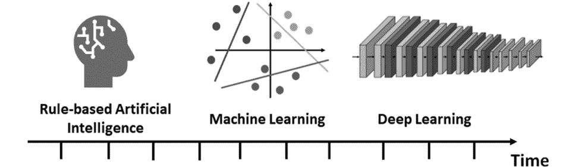

图 2.1 机器学习随时间的演进。

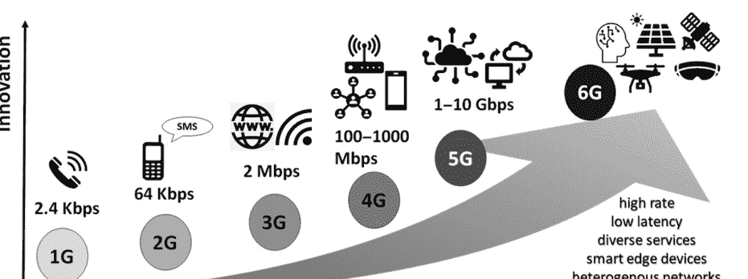

图 2.2 无线技术随时间的演进。

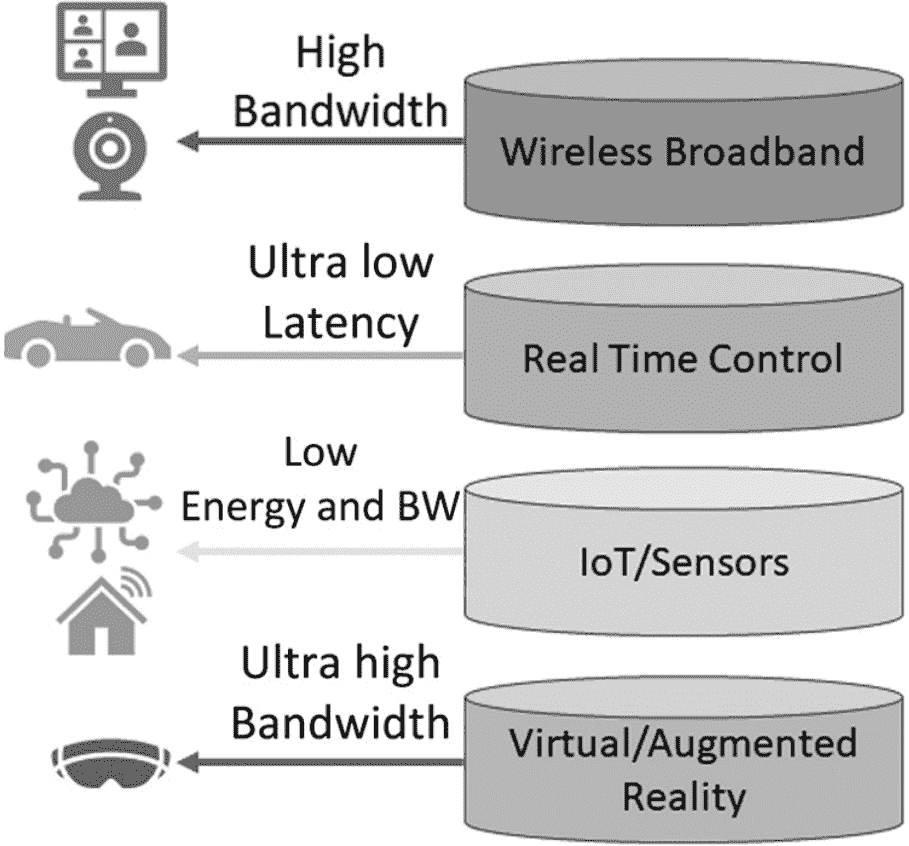

**图 2.3** 将受益于机器学习的无线应用和目标。

在更成熟的机器学习领域中的最新研究表明，机器学习容易受到对抗性操纵的影响，形成了对抗机器学习这一新兴领域的基础，该领域研究在存在对手的情况下进行学习 [4–7]。然而，机器学习安全对 RFML 技术的影响尚未完全得到理解 [8–10]。因此，及时在对抗机器学习的背景下研究无线安全并了解其对 5G 及以后通信系统的影响是必要的。虽然对抗机器学习可以采取多种形式和形态，但我们的重点是深度神经网络背景下的对抗技术，因为它们目前代表了常用的 RFML 架构中的大多数。

解决无线安全机器学习所需的研发工作多种多样，包括但不限于以下方向：

- *基于对抗机器学习的安全攻击*：规避攻击（对抗样本）、投毒（因果）攻击、特洛伊木马（后门或陷阱门）攻击，以及用于信号欺骗的生成对抗学习
- *机器学习解决方案的隐私威胁*：成员推断攻击、模型反演和物理层隐私
- *机器学习加固技术*：隐私保护学习、安全学习、硬件和软件实现、边缘计算、测试平台、实验和数据集
- *机器学习在无线安全中的应用扩展*：设备识别、频谱监测、RF 指纹识别、智能干扰、智能窃听、定位、隐蔽通信、认证、匿名性、入侵检测和物联网安全

其余部分组织如下。第 2.2 节介绍了不同类型的对抗机器学习攻击，并描述了无线领域中使用的机器学习系统的漏洞。第 3.3 节讨论了机器学习在无线通信和安全应用中的挑战和差距。第 2.4 节对未来研究方向提出了结论性意见和建议。

## 2.2 对抗机器学习

基于对抗机器学习的攻击类型在 [图 2.4](#) 中进行了说明。对抗机器学习研究针对机器学习模型训练和/或测试发起的攻击。近来，这些攻击已扩展到无线应用，并在不同程度的无线网络不确定性存在的情况下，被证明比传统攻击（如数据传输的暴力干扰）更隐蔽、更节能 [11,12]。

探索性攻击已在 [18, 19] 中被研究，以学习动态频谱接入（DSA）系统的传输行为并据此制定干扰策略。探索性攻击可以被视为各种后续黑盒攻击的初始步骤，而无需了解机器学习算法的任何知识（如其类型、超参数和底层训练数据集）。在此背景下，主动学习 [20] 可用于减少探索性攻击所需的数据样本数量 [21]。

- *规避（对抗）攻击*：规避攻击的目标是在测试时篡改输入数据并欺骗机器学习算法使其在决策中出错。图 2.5 显示了规避攻击的两个示例，一个来自计算机视觉，另一个来自无线信号分类。请注意，无线领域的规避攻击需要对输入数据进行空中操纵，并需要考虑信道效应（对于受害系统和对手而言）。无线领域规避攻击的大多数研究都将调制分类器作为受害系统 [22–32]。在 [33–35] 中，对一个接收机的通信性能施加了额外约束，同时在另一个接收机上发起规避攻击。该设置还扩展到对抗机器学习驱动的隐蔽通信，其中目标是从配备用于频谱感知的机器学习算法的窃听者那里隐藏通信 [36]。已针对规避攻击提出了各种防御机制 [27, 37–40]，例如统计异常检测和认证防御。规避攻击也被考虑用于其他机器学习应用，包括频谱感知 [41–43]、使用自动编码器的端到端通信（由发射端的编码器和接收端的解码器组成 [44, 45]）、多用户功率控制 [46, 47]、定向传输的初始接入 [48] 和 DSA 系统 [49]。

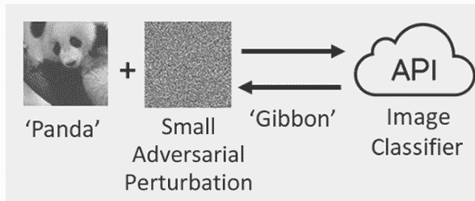

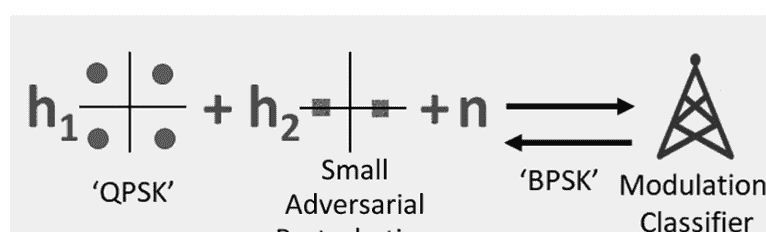

图 2.5 来自 (a) 计算机视觉 [4]、(b) 无线信号分类的规避（对抗）攻击示例。

- **投毒（因果）攻击：** 投毒攻击的目标是篡改机器学习算法的（再）训练过程，使得机器学习算法在测试时出错 [50]。投毒攻击已被考虑用于频谱感知 [42, 43] 和协作频谱感知 [51–53]，作为频谱感知数据伪造攻击 [54, 55] 的机器学习扩展。随着频谱环境随时间变化，更新机器学习模型是有用的。为此，当无线系统随时间重新训练机器学习模型时，可以发起因果攻击。
- **特洛伊木马（后门）攻击：** 特洛伊木马攻击的目标是在训练时将特洛伊木马（即后门或触发器）插入到某些训练数据样本中，然后在测试时激活它们，使得机器学习仅对选定的输入样本在测试时出错。例如，[56] 研究了带有特洛伊木马的输入样本，而机器学习模型对未被特洛伊木马污染的输入样本保持高准确率。特洛伊木马攻击在 [57] 中被考虑针对无线信号分类器。为此，对手


修改部分信号样本的相位，并在训练时更改相应的标签。在测试时，攻击者传输带有与触发器相同的相位偏移的信号，从而无线信号分类器仅对这些信号给出错误结果，而对其他输入信号分类器仍保持良好性能。

除安全攻击外，对抗机器学习还被应用于研究各种隐私问题，包括以下内容：

- *成员推断攻击：* 成员推断攻击的目标是推断某个感兴趣的数据样本是否被用于目标机器学习算法的训练数据中。这种私有信息可用于对机器学习算法发起后续攻击。在无线领域，成员推断攻击可揭示有关波形、信道和设备特征的信息[58, 59]，如果泄露，这些信息可能被攻击者利用来识别底层机器学习模型的安全漏洞（例如，渗透物理层认证）。
- *模型反演攻击：* 模型反演攻击的目标是在攻击者能够访问机器学习模型和部分私有信息时，通过观察机器学习模型的输入和输出来推断额外的私有信息[60]。在无线领域，攻击者可能能够获取某些信息，例如波形特征，然后可能旨在推断额外的信息，例如射频硬件特征。

*对强化学习的攻击：* 基于对抗机器学习的攻击也已针对强化学习算法发起，相关应用始于计算机视觉[61]。最近，这些攻击已扩展到无线通信。针对信道接入的对抗攻击已在[62–64]中被考虑。此外，这些攻击已在[65, 66]中被应用于对5G网络切片中强化学习的使用发起攻击[67, 68]。主要目标是操纵强化学习算法的输入，使得即使攻击停止后，由于强化学习算法需要适应变化，底层性能恢复也需要很长时间。

*对5G中机器学习应用的攻击：* 对抗机器学习已扩展到5G通信系统中的各种用例，包括但不限于：

- *对5G网络切片的攻击：* 网络切片提供在同一物理网络上复用虚拟化网络并动态分配通信和计算资源以保障和优先处理不同服务的能力。攻击者可能会发送虚假的网络切片请求作为泛洪攻击[65]或干扰资源块[66]，以破坏用于5G网络切片的准入控制和资源分配的强化学习引擎。
- *对5G频谱共存的攻击：* 联邦通信委员会（FCC）已在3.5 GHz公民宽带无线电服务（CBRS）频段启用联邦和非联邦用户的频谱共存。攻击者可能攻击既有雷达系统与5G通信网络之间的频谱共存。由于5G网络不应对雷达系统造成任何有害干扰，因此环境感知能力（ESC）传感器需要检测雷达信号。为此，可以使用深度学习作为从空中捕获的I/Q样本中检测信号的有力手段。攻击者可能通过空中传输微小扰动信号来操纵输入到ESC传感器深度学习算法的输入信号，从而试图影响ESC传感器的决策过程[49]。
- *对5G UE认证的攻击：* 大量异构设备连接到5G网络以使用5G使能服务，提出了在信号层进行物理层认证的需求。深度学习算法可用于基于射频指纹的信号分类，该指纹考虑波形、信道和射频硬件特征。攻击者可以训练生成对抗网络（GAN）来伪造无线信号并绕过认证过程。
- *用于实现隐蔽5G通信的攻击：* 对抗机器学习可通过欺骗频谱传感器（即使使用深度神经网络）来启用隐蔽的5G通信。发射机要么在发送信号前添加微小扰动，要么由协作式干扰机在空中添加扰动信号。虽然这种扰动会欺骗频谱传感器，但不应对5G通信的误码率产生显著影响[36]。
- *对5G功率控制的攻击：* 5G基站需要分配发射功率以服务多个UE并最大化所有UE的总速率。深度学习可用于该优化问题的低复杂度解决方案。与此同时，攻击者可以制作对抗性扰动来操纵底层深度神经网络的输入。该攻击者可能是干扰用于测量信道增益的导频信号的外部发射机，或是向基站发送伪造信道估计的 rogue UE [46, 47]。
- *对5G初始接入的攻击：* 在宽毫米波和太赫兹频段运行通过使用窄定向波束实现高速率。当UE首次连接到5G网络时，需要与基站建立初始接入。为此，基站使用不同的窄波束传输导频信号，UE计算所有波束的接收信号强度（RSS）以找到最合适的波束。然而，扫描所有波束是一个漫长的过程。相反，基站可以使用少量窄波束进行传输，UE可以计算这些波束的RSS并运行深度神经网络，从更大的波束集合中预测最佳波束[69, 70]。与此同时，攻击者可以在初始接入期间通过空中传输对抗性扰动。这样，攻击者可以操纵RSS并欺骗深度神经网络选择RSS较小的波束。

无线领域对抗机器学习的研究仍处于早期阶段[71]，需要更多工作来充分表征攻击和防御空间，同时考虑无线应用的独特特征，例如由于不同的信道和干扰效应而导致攻击者和防御者观察到的特征和标签的差异。

## 2.3 挑战与差距

随着机器学习在无线领域的日益使用，一个基本问题出现了：是否可以信任机器学习用于RFML应用。关于RFML信任的挑战如图2.6所示。其中一些挑战（如可解释性和置信度）适用于所有数据域，因此是通用的。然而，其他挑战特定于无线领域，例如所用射频硬件的特性以及与无线介质相关的固有不确定性，包括信道、流量、移动性和干扰效应。

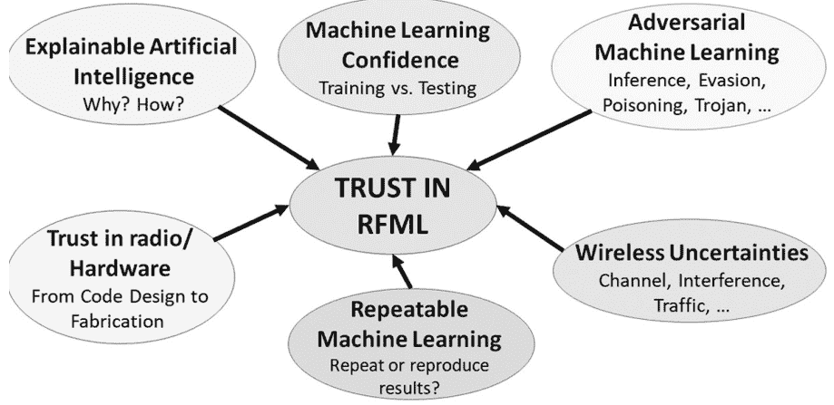

图 2.6 用于RFML的机器学习信任。

### 2.3.1 开发环境

我们考虑的第一个挑战涉及RFML应用的开发环境。下一代通信系统依赖于复杂的生态系统。例如，5G生态系统包括各种组件：

- *无线接入网（RAN）*：作为最终链路连接网络和UE。
- *多接入边缘计算（MEC）*：为边缘节点提供服务/计算功能。
- *核心网*：控制网络。
- *传输*：连接RAN组件（前传/中传）并连接RAN和核心网（回传）。

我们的重点是关于空中接口和RAN的RFML应用的挑战。由于RFML解决方案依赖于各种波形、信道和射频硬件特征，因此最终需要多级开发环境，如图2.7所示。

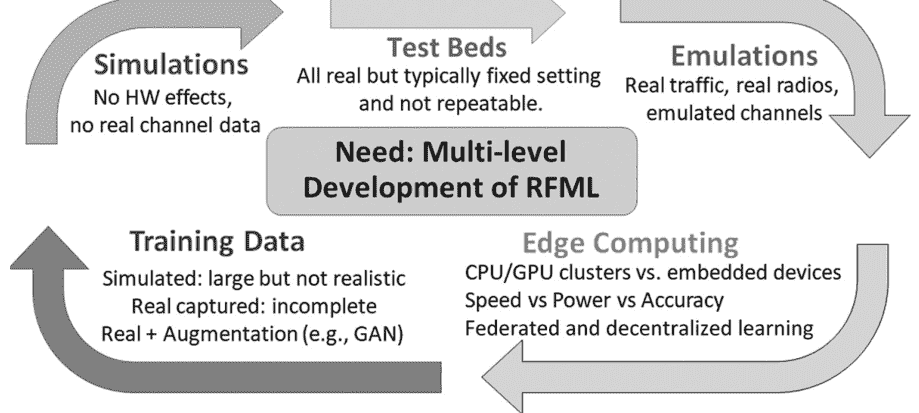

图 2.7 RFML的多级开发环境。

RFML开发的起点基于仿真测试。虽然这些测试主要表示虚拟硬件和信道效应，但不足以反映现实世界场景。因此，需要用高保真仿真测试来支持初始仿真，该测试使用实际无线电生成真实网络流量并进行在仿真（虚拟）信道上传播的真实传输[72, 73]。而不是超-


与动态无线介质中的空中传输不同，仿真测试提供了控制信道效应（如路径损耗、衰落和时延[74, 75]）以及重复测试的灵活性（例如，在相同的信道效应下比较不同的网络协议）。另一方面，采用空中传输的测试平台提供了在真实信道和真实硬件条件下测试系统的机会[76]。

RFML开发的一个关键需求是具备必要的训练和测试数据集。此外，考虑训练与测试条件之间可能的变化（例如，在室内信道效应下训练，在室外信道效应下测试）也很重要。关于RFML数据集的更详细讨论，请参见第2.3.2节。注意，RFML应用可能需要支持边缘计算，因此RFML应用通常部署在嵌入式平台上，例如软件定义无线电（SDR）。关于RFML应用嵌入式实现的更详细讨论，请参见第2.3.4节。

由于RFML在下一代通信系统中被广泛使用，这些系统软件开发生态系统的开放性给RFML应用带来了另一项挑战。一个例子是开放无线接入网（O-RAN），它提供虚拟化RAN能力，并建立在由5G社区支持的开源软件开发环境之上。例如，UE识别和网络切片等各类RFML应用可以通过O-RAN的RAN智能控制器（RIC）实现。虽然这种开放软件范式旨在加速并统一不同技术供应商之间的工作，但对手可能会滥用这种开放性，获取包括机器学习（如训练数据和模型）在内的各种网络功能，并利用底层漏洞（如发起基于对抗机器学习的攻击）。

### 2.3.2 训练和测试数据集

机器学习应用的成功在很大程度上依赖于训练和测试所需相关数据的可用性。具体到无线领域，在收集和整理数据样本时，应考虑各种信道、波形、无线电、干扰和对手（如干扰机）特征。一种方法是依靠仿真生成RFML数据集。这是一个受控过程，可以根据当前机器学习问题的需求进行配置。然而，仿真数据对于RFML应用是否具有保真度是值得怀疑的[77]，原因在于信道和无线电硬件效应难以建模。因此，对于无线领域的机器学习问题，最终需要通过仿真或空中传输收集的真实数据集。

对于计算机视觉和NLP等其他数据领域，发布用于机器学习的数据集是常见做法。最近，无线领域也出现了发布数据集的趋势（例如，参见[78]）。然而，仍然缺乏真实数据集来满足各种无线场景的需求，例如受智能干扰机影响的频谱动态。因此，RFML领域面临这样一种风险：特定应用的数据集可用性驱动着研究工作。例如，大量研究集中在调制识别上，而有代表性的数据集是公开可用的[79]。另一方面，其他无线信号分类任务（尤其是专注于无线安全的任务）由于缺乏相关数据集而滞后。因此，RFML研究领域需要公开发布面向网络协议栈（不仅限于物理层）中不同类型无线机器学习应用的真实数据集。最终，需要建立类似于网络领域国家漏洞数据库[80]的无线安全数据库，以促进RFML研究工作。

与其他数据领域（例如计算机视觉）不同，RFML数据没有明显的通用数据格式。信号元数据格式的一个例子是SigMF，它提供了一种描述数据记录的标准方式[81]。根据无线领域的不同应用，机器学习可能考虑不同的信号属性，如信号功率电平、相移、开关行为或原始IQ数据。虽然原始IQ数据可用于建立通用的RFML数据格式，但确定采样率并不容易，因为低采样率可能会丢失信息，而高采样率可能会产生大量数据。因此，需要更多努力来为RFML数据建立通用格式，以促进RFML研究社区对数据集的采用。此外，不同的应用可能考虑不同的网络设置，包括调制和编码方案、流量、网络拓扑和移动性，这进一步增加了为RFML构建数据集的挑战。

满足机器学习算法（尤其是深度学习）大数据需求的一种方法是合成数据生成。对于其他领域，如计算机视觉[82]和NLP [83]，已经提出了各种方法。基于深度神经网络，GAN已成为数据增强和域适应的一种可行方法。不同版本的GAN已被有效用于生成计算机视觉[84]、NLP [85]的合成数据样本，并支持对基于机器学习的目标系统的各种攻击[86]。然而，生成无线信号数据合成样本的努力仍然滞后（参见[77, 87–91]）。为了体现丰富的频谱特性，合成数据生成对各种无线应用至关重要，并且服务于以下重要目的：

- 1. 数据增强，以扩展训练数据集（例如，当频谱感知时间有限或采样率较低时）；
- 2. 测试和训练数据样本的域适应（例如，从训练时间到测试时间，信道、干扰和流量效应等频谱条件发生变化时）；
- 3. 防御对抗攻击（例如，当对手操纵输入到无线信号分类器（如用于用户认证的分类器）的数据时）；
- 4. 信号欺骗（例如，当对手生成并传输信号以渗透访问控制系统或设置诱饵/蜜罐时）。

如图2.8所示，GAN结构由两个神经网络组成，一个用于生成器，一个用于判别器。生成器以噪声为输入，生成合成数据样本。同时，判别器接收真实或合成的数据样本作为输入，并尝试对每个样本进行分类。分类结果作为反馈发送给判别器。注意，在无线系统中，生成器和判别器可能不共置（例如，生成器位于发射机，判别器位于另一个接收机），并且它们可能通过噪声信道进行通信。由于频谱数据受到各种信道、干扰和流量效应的影响，在稳定性和模式崩溃等问题下训练GAN具有挑战性。注意，GAN也可以与对抗攻击结合使用，如[92]所示用于规避设备识别。

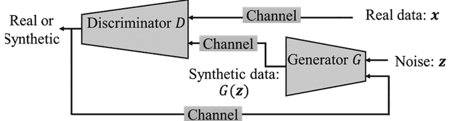

图2.8 受信道效应影响的生成对抗网络（GAN）。

在无线安全应用中使用预训练机器学习模型是一种常见做法。通过在线机器学习更新机制，可以在测试期间持续进行攻防优化，以适应频谱动态。一种有前景的无线安全更新机制是强化学习，它可以从频谱环境中学习，并在存在干扰机和窃听者等对手的情况下采取行动来保障无线通信安全[93]。无线领域的机器学习安全与其他数据领域的一个区别在于性能度量的范围。为此，机器学习可用于优化通信质量，通过各种性能指标来衡量，包括但不限于吞吐量和时延，并受功耗要求的约束。由于这些指标通常是相互耦合的，因此需要对其进行联合优化[94]。

信道、干扰、波形和流量效应共同塑造了频谱[95]。由于无线网络中的流量流和链路通常是动态且随机的，因此各个节点的数据包队列应保持稳定，使得队列长度保持有界[96–99]，同时通过机器学习优化性能。除了传统的性能度量，如吞吐量和时延（及其对截止时间的扩展[100]）之外，信息年龄（AoI）已经引起


更深且无法满足 RFML 边缘计算应用的需求。

3. 深度学习的常见做法是将深度神经网络作为黑箱使用。然而，操作功能和性能的论证对于促进基于深度学习的 RFML 解决方案的广泛采用至关重要。在此背景下，需要通过新颖的统计、时域或频谱方法对频谱数据进行预处理以提取特征。另一个需要进一步关注的问题是，无线域进一步增加了测试和训练数据样本之间的差异，原因如下

-   频谱动态（信道、流量、干扰和无线电效应随时间变化），
-   模型可能发生变化（数据标签 [例如，信号类型] 可能随时间变化），
-   噪声数据（特征，例如隐藏在噪声、衰落和干扰效应下的 I/Q 样本），
-   分布式计算的限制（训练和推理可能分布在边缘设备上），以及
-   对抗式机器学习（无线信号容易受到基于对抗式机器学习的空中攻击）。

4. 在动态频谱环境中，信号类型（例如干扰器）随时间变化是可能的。当无线信号被设为机器学习分类器的输入时，这些变化会转化为输出标签的变化。一个选择是用仅新的信号类型重新训练分类器，导致灾难性遗忘。相反，可以在持续学习中在旧任务和新任务之间取得平衡。为此，可以使用弹性权重巩固（EWC）来减缓所选机器学习模型参数的学习过程，以便记住先前学习过的任务 [106]。当无线信号类型如调制类型随时间变化时，EWC 在无线信号分类中得到应用 [107]。

### 2.3.4 嵌入式实现

其他数据域如计算机视觉和 NLP 通常依赖于使用中央处理单元（CPU）或图形处理单元（GPU）资源进行离线计算来执行机器学习任务。然而，无线安全应用可能需要嵌入式计算来进行在线决策。在这种情况下，机器学习算法需要在具有尺寸、重量和功率（SWaP）限制的无线电平台上运行。需要注意的是，ARM 处理器、嵌入式 GPU 和现场可编程门阵列（FPGA）等计算资源已可用于嵌入式实现。然而，由嵌入式平台实现支持的 RFML 研究工作落后于需求，无法满足无线安全对低延迟和低功耗的要求。作为机器学习解决方案嵌入式实现的示例，信号认证已在 [108] 中的嵌入式 GPU 上实现，干扰检测已在 [109] 中的 SDR 上实现，而调制分类已在 [110] 中的 Android 智能手机上实现。由于嵌入式平台内存有限，在将深度神经网络部署到嵌入式平台之前需要对其进行压缩 [111]。此外，嵌入式 GPU 和 FPGA 等嵌入式平台以有限精度运行。因此，RFML 应用需要考虑量化对机器学习模型的影响 [112]。

## 表 2.1 不同嵌入式计算平台的性能

| 指标\平台 | ARM | EMBEDDED GPU | FPGA |
|---|---|---|---|
| 延迟 | 高 | 中 | 低 |
| 功耗 | 中 | 高 | 低 |
| 可编程性 | 高 | 中 | 低 |

特别是，初步研究表明，与嵌入式 GPU 相比，FPGA 在基于机器学习的 RF 信号分类任务中提供了延迟和能耗方面的显著提升 [113, 114]。由于 FPGA 难以编程，最终需要能够将机器学习解决方案的软件代码转换为 FPGA 实现的新技术。不同嵌入式计算资源预期延迟、功耗和可编程性的定性比较显示在 [表 2.1] 中，这促使需要更多努力通过在嵌入式平台上实现所提出的解决方案来弥合理论与实践之间的差距。

## 2.4 结论与建议

我们根据前一节中识别的挑战和差距得出以下结论：

-   机器学习已成为保护无线系统的关键手段。然而，攻击向量尚未完全理解。因此，我们需要更多努力来识别无线系统在可能应用机器学习技术的对手面前的漏洞。特别是，需要明确表征机器学习为基础的攻击模型，作为正式分析与机器学习相关的无线安全的前提。
-   随着对手变得更聪明，无线域中的防御方案需要变得更敏捷和自适应。机器学习可以用作检测和缓解无线攻击的有力手段。
-   鉴于其破坏机器学习过程的潜力，对抗式机器学习已成为无线系统的主要威胁。由于无线介质是开放且共享的，它为对手操纵机器学习算法的测试和训练过程提供了新的手段。为此，需要新技术来保护无线攻击面免受对抗式机器学习的影响。
-   随着机器学习作为一个不断演进的交互过程主导对手与防御者之间的对决，有必要通过量化对手和防御者的性能指标来理解该过程的动态演变。
-   需要更多努力使更多高保真和多样化的数据集公开可用，以实现机器学习在无线安全中的广泛采用。这些数据集不仅需要用于后端应用，也需要用于嵌入式实现。在此背景下，在 SWaP 受限环境中满足基于机器学习的攻击和防御的延迟、功耗和计算复杂性要求至关重要。
-   最后但同样重要的是，要认识到 RFML 分类器对对抗式机器学习攻击的鲁棒性通常取决于分类器类型。特别是，判别式分类器往往比生成式分类器 [115] 更脆弱，例如 GAN 或深度贝叶斯模型。目前 RFML 中使用的许多分类器属于判别式类型，从而产生以下困境：使用最先进的防御技术加固现有分类器是否更有效，还是选择具有可比性能特征的生成式分类器？要回答这个问题，有必要研究并量化 RFML 领域中判别式和生成式分类器在鲁棒性与准确性之间的权衡，以便根据具体应用做出明智的决策。

## 参考文献

-   1. T. Erpek, T. O’Shea, Y. E. Sagduyu, Y. Shi, and T. C. Clancy, “Deep Learning for Wireless Communications,” *深度学习架构的开发与分析*, Springer, 2019.
-   2. L. J. Wong, W. H. Clark, B. Flowers, R. M. Buehrer, W. C. Headley and A. J. Michaels, “An RFML Ecosystem: Considerations for the Application of Deep Learning to Spectrum Situational Awareness,” *IEEE 通信学会开放期刊*, vol. 2, pp. 2243–2264, 2021.
-   3. K. B. Letaief, W. Chen, Y. Shi, J. Zhang, Y.A. Zhang, “The Roadmap to 6G: AI Empowered Wireless Networks.” *IEEE 通信杂志*, Aug. 2019.
-   4. I. Goodfellow, J. Shlens, and C. Szegedy, “Explaining and Harnessing Adversarial Examples.” *国际学习表征会议 (ICLR)*, 2015.
-   5. A. Kurakin, I. Goodfellow, and S. Bengio, “Adversarial Machine Learning at Scale,” arXiv preprint arXiv:1611.01236, 2016.


- 6. Y. Vorobeychik and M. Kantarcioglu, “对抗机器学习,” 人工智能与机器学习合成讲座, 2018年8月.
- 7. C. Szegedy, W. Zaremba, I. Sutskever, J. Bruna, D. Erhan, I. Goodfellow, and R. Fergus, “神经网络的令人着迷的特性,” arXiv 预印本 arXiv:1312.6199, 2013.
- 8. D. Adesina, C.-C. Hsieh, Y. E. Sagduyu, and L. Qian, “利用射频数据的无线通信中的对抗机器学习：综述,” arXiv 预印本 arXiv:2012.14392, 2020.
- 9. L. Pajola, L. Pasa, and M. Conti, “威胁就在空中：无线网络应用中的机器学习,” ACM 无线安全与机器学习研讨会 (WiseML), 2019.
- 10. Y. E. Sagduyu, Y. Shi, T. Erpek, W. Headley, B. Flowers, G. Stantchev, and Z. Lu, “当无线安全遇见机器学习：动机、挑战与研究方向,” arXiv 预印本 arXiv:2001.08883.
- 11. W. Xu, W. Trappe, Y. Zhang, and T. Wood, “在无线网络中发起和检测干扰攻击的可行性,” ACM 移动自组织网络与计算国际研讨会 (MobiHoc), 2005.
- 12. Y. E. Sagduyu and A. Ephremides, “无线随机接入中拒绝服务攻击的博弈论分析,” 《无线网络》, 2009年7月.
- 13. Y. E. Sagduyu, R. Berry, and A. Ephremides, “具有自私和恶意用户类型不完全信息的分布式无线网络安全的 MAC 博弈,” IEEE 网络博弈理论国际会议 (GameNets), 2009.
- 14. Y. E. Sagduyu, R. Berry, and A. Ephremides, “动态流量不确定性下的无线干扰攻击,” IEEE 移动、特设和无线网络建模与优化国际研讨会 (WIOPT), 2010.
- 15. Y. E. Sagduyu, R. Berry, and A. Ephremides, “不完全信息下无线网络中的干扰博弈,” IEEE 通讯杂志, 2011年8月.
- 16. F. Tramer, F. Zhang, A. Juels, M. K. Reiter, and T. Ristenpart, “通过预测 API 窃取机器学习模型,” USENIX 安全研讨会, 2016.
- 17. Y. Shi, Y. E. Sagduyu, and A. Grushin, “如何利用深度学习窃取机器学习分类器,” IEEE 国土安全技术研讨会 (HST), 2017.
- 18. Y. Shi, Y. E. Sagduyu, T. Erpek, K. Davaslioglu, Z. Lu, and J. Li, “认知无线电安全的对抗深度学习：干扰攻击与防御策略,” IEEE 国际通信会议 (ICC) 机器学习在通信网络中的机遇与挑战研讨会, 2018.
- 19. T. Erpek, Y. E. Sagduyu, and Y. Shi, “用于发起和缓解无线干扰攻击的深度学习,” IEEE 认知通信与网络汇刊, 2019.
- 20. B. Settles, “主动学习文献综述,” 科学, 第10卷第3期, 第237–304页, 1995.
- 21. Y. Shi, Y. E. Sagduyu, K. Davaslioglu, and J. H. Li, “在线 API 调用严格速率限制下的主动深度学习攻击,” IEEE 国土安全技术研讨会 (HST), 2018.
- 22. M. Sadeghi and E. G. Larsson, “针对基于深度学习的无线电信号分类的对抗攻击,” IEEE 无线通信快报, 2019年2月.
- 23. B. Flowers, R. M. Buehrer, and W. C. Headley, “在无线通信背景下评估对抗规避攻击,” arXiv 预印本 arXiv:1903.01563, 2019.
- 24. B. Flowers, R. M. Buehrer, and W. C. Headley, “通信感知的对抗残差网络,” IEEE 军事通信会议 (MILCOM), 2019.
- 25. S. Bair, M. Delvecchio, B. Flowers, A. J. Michaels, and W. C. Headley, “针对深度学习使能调制识别的有针对性对抗规避攻击的局限性,” ACM 无线安全与机器学习研讨会 (WiseML), 2019.
- 26. B. Kim, Y. E. Sagduyu, K. Davaslioglu, T. Erpek, and S. Ulukus, “无线信道上对基于深度学习的调制分类器的空中对抗攻击,” 信息科学与系统会议 (CISS), 2020.
- 27. B. Kim, Y. E. Sagduyu, K. Davaslioglu, T. Erpek, and S. Ulukus, “针对基于深度学习的无线信号分类器的信道感知对抗攻击,” arXiv 预印本 arXiv:2005.05321, 2020.
- 28. B. Kim, Y. E. Sagduyu, T. Erpek, K. Davaslioglu, S. Ulukus, “针对基于深度学习的调制分类器的多天线对抗攻击,” IEEE GLOBECOM 通信中机器学习开放研讨会, 2020.
- 29. B. Kim, Y. E. Sagduyu, T. Erpek, K. Davaslioglu, and S. Ulukus, “无线信号分类器对抗攻击替代模型中的信道效应,” IEEE 国际通信会议 (ICC), 2021.
- 30. Y. Lin, H. Zhao, Y. Tu, S. Mao, and Z. Dou, “DNN 基于调制识别中对抗攻击的威胁,” IEEE 计算机通信会议 (INFOCOM), 2020.
- 31. F. Restuccia, S. D’Oro, A. Al-Shawabka, B. C. Rendon, K. Chowdhury, S. Ioannidis, and T. Melodia, “广义无线对抗深度学习,” ACM 无线安全与机器学习研讨会 (WiseML), 2020.
- 32. R. Sahay, C. G. Brinton, and D. J. Love, “用于缓解自动调制分类中对抗攻击的基于深度集成模型的无线接收机架构,” IEEE 认知通信与网络汇刊, 2021.
- 33. M. Z. Hameed, A. Gyorgy, and D. Gunduz, “无截获通信：针对基于深度学习的调制检测的防御,” IEEE 全球信号与信息处理大会 (GlobalSIP), 2019.
- 34. M. Z. Hameed, A. Gyorgy, and D. Gunduz, “最好的防御是进攻：避免调制检测的对抗攻击,” IEEE 信息取证与安全汇刊, 第16卷, 2021.
- 35. M. DelVecchio, V. Arndorfer, and W. C. Headley, “研究用于训练基于机器学习的规避攻击的频谱欺骗损失度量,” ACM 无线安全与机器学习研讨会 (WiseML), 2020.
- 36. B. Kim, Y. E. Sagduyu, K. Davaslioglu, T. Erpek, and S. Ulukus, “如何使5G通信‘隐形’：用于无线隐私的对抗机器学习,” Asilomar 信号、系统与计算机会议, 2020.
- 37. S. Kokalj-Filipovic and R. Miller, “射频深度学习中的对抗样本：攻击检测及其物理鲁棒性,” IEEE 全球信号与信息处理大会 (GlobalSIP), 2019.
- 38. S. Kokalj-Filipovic, R. Miller, N. Chang, and C. L. Lau, “利用自编码器预训练缓解射频深度分类器中的对抗样本,” arXiv 预印本 arXiv:1902.08034, 2019.
- 39. S. Kokalj-Filipovic, R. Miller, and J. Morman, “针对射频深度分类器的有针对性对抗样本,” ACM 无线安全与机器学习研讨会 (WiseML), 2019.
- 40. M. DelVecchio, B. Flowers, and W. C. Headley, “前向纠错对通信感知规避攻击的影响,” IEEE 个人、室内和移动无线电通信国际研讨会, 2020.
- 41. Y. Shi, T. Erpek, Y. E. Sagduyu, and J. Li, “利用对抗深度学习的频谱数据投毒,” IEEE 军事通信会议 (MILCOM), 2018.
- 42. Y. E. Sagduyu, Y. Shi, and T. Erpek, “从对抗深度学习视角看物联网网络安全,” IEEE 感知、通信与网络国际会议 (SECON) 物联网通信与网络机器学习研讨会, 2019.
- 43. Y. E. Sagduyu, Y. Shi, and T. Erpek, “用于空中频谱投毒攻击的对抗深度学习,” IEEE 移动计算汇刊, 2019.
- 44. M. Sadeghi and E. G. Larsson, “针对端到端自编码器通信系统的物理对抗攻击,” IEEE 通信快报, 2019年2月, 第847–850页.
- 45. T. J. O’Shea and J. Hoydis, “物理层深度学习导论,” IEEE 认知通信与网络汇刊, 2017年12月.
- 46. B. Kim, Y. Shi, Y. E. Sagduyu, T. Erpek, and S. Ulukus, “针对无线通信中基于深度学习的功率控制的对抗攻击,” IEEE 全球通信大会 (GLOBECOM) 研讨会, 2021.


- 47. B. Manoj、M. Sadeghi 和 E. G. Larsson，“大规模MIMO网络中基于深度学习的功率分配的对抗攻击”，*arXiv预印本 arXiv:2101.12090*，2021。
- 48. B. Kim、Y. E. Sagduyu、T. Erpek 和 S. Ulukus，“5G及未来网络中基于深度学习的毫米波波束预测的对抗攻击”，*IEEE统计信号处理（SSP）研讨会*，2021。
- 49. Y. E. Sagduyu、T. Erpek 和 Y. Shi，“面向5G通信安全的对抗机器学习”，*网络安全中的博弈论与机器学习*，IEEE，第270–288页，2021。
- 50. Y. Shi 和 Y. E. Sagduyu，“基于对抗深度学习的逃逸攻击与因果攻击”，*IEEE军事通信会议（MILCOM）*，2017。
- 51. Z. Luo、S. Zhao、Z. Lu、J. Xu 和 Y. E. Sagduyu，“当攻击者遇见人工智能：协作频谱感知中基于学习的攻击”，*arXiv预印本 arXiv:1905.01430*。
- 52. Z. Luo、S. Zhao、Z. Lu、Y. E. Sagduyu 和 J. Xu，“物联网中基于对抗机器学习的部分模型攻击”，*ACM无线安全与机器学习研讨会（WiseML）*，2020。
- 53. Z. Luo、S. Zhao、R. Duan、Z. Lu、Y. E. Sagduyu 和 J. Xu，“协作频谱感知中对抗机器学习攻击的低成本影响限制防御”，*ACM无线安全与机器学习研讨会（WiseML）*，2021。
- 54. F. R. Yu、H. Tang、M. Huang、Z. Li 和 P. C. Mason，“认知无线电移动自组织网络中针对频谱感知数据伪造攻击的防御”，*IEEE军事通信会议*，2009。
- 55. Y. E. Sagduyu，“利用动态信任保护认知无线电网络免受频谱感知数据伪造攻击”，*IEEE军事通信会议（MILCOM）*，2014。
- 56. Y. Liu、S. Ma、Y. Aafer、W.-C. Lee、J. Zhai、W. Wang 和 X. Zhang，“神经网络的特洛伊木马攻击”，*网络与分布式系统安全研讨会*，2018。
- 57. K. Davaslioglu 和 Y. E. Sagduyu，“利用对抗机器学习对无线信号分类的木马攻击”，*IEEE DySPAN数据驱动动态频谱共享研讨会*，2019。
- 58. Y. Shi、K. Davaslioglu 和 Y. E. Sagduyu，“空中成员推断攻击：基于深度学习的无线信号分类器的隐私威胁”，*ACM无线安全与机器学习研讨会（WiseML）*，2020。
- 59. Y. Shi 和 Y. E. Sagduyu，“基于深度学习的无线信号分类器的成员推断攻击与防御”，*arXiv预印本 arXiv:2107.12173*，2021。
- 60. M. Fredrikson、S. Jha 和 T. Ristenpart，“利用置信度信息的模型反演攻击及基本对策”，*ACM SIGSAC计算机与通信安全会议*，2015。
- 61. S. Huang、N. Papernot、I. Goodfellow、Y. Duan 和 P. Abbeel，“对神经网络策略的对抗攻击”，*arXiv预印本 arXiv:1702.02284*，2017。
- 62. F. Wang、C. Zhong、M. C. Gursoy 和 S. Velipasalar，“基于自适应深度强化学习的对抗干扰攻击与防御策略”，*arXiv预印本 arXiv:2007.06055*，2020。
- 63. F. Wang、C. Zhong、M. C. Gursoy 和 S. Velipasalar，“基于深度强化学习的对抗干扰攻击防御策略”，*信息科学与系统会议（CISS）*，2020。
- 64. C. Zhong、F. Wang、M. C. Gursoy 和 S. Velipasalar，“对基于深度强化学习的动态多信道接入的对抗干扰攻击”，*IEEE无线通信与网络会议（WCNC）*，2020。
- 65. Y. Shi 和 Y. E. Sagduyu，“面向5G无线接入网切片的洪泛攻击的对抗机器学习”，*IEEE国际通信会议（ICC）研讨会*，2021。
- 66. Y. Shi、Y. E. Sagduyu、T. Erpek 和 M. C. Gursoy，“如何使用强化学习攻击和防御5G无线接入网切片”，*arXiv预印本 arXiv:2101.05768*，2021。
- 67. Y. Shi、T. Erpek 和 Y. E. Sagduyu，“5G无线接入网切片中用于动态资源优化的强化学习”，*IEEE通信链路与网络计算机辅助建模与设计国际研讨会（CAMAD）*，2020。
- 68. Y. Shi、P. Rahimzadeh、M. Costa、T. Erpek 和 Y. E. Sagduyu，“频谱共存下用于5G无线接入网切片的深度强化学习”，TechRxiv，预印本，https://doi.org/10.36227/techrxiv.16632526.v1
- 69. T. S. Cousik、V. K. Shah、J. H. Reed、T. Erpek 和 Y. E. Sagduyu，“5G毫米波网络中基于深度学习的波束预测快速初始接入”，IEEE军事通信会议（MILCOM），2021。
- 70. T. S. Cousik、V. K. Shah、J. H. Reed、T. Erpek 和 Y. E. Sagduyu，“AI驱动的6G毫米波网络中快速可靠的初始接入的深度学习”，arXiv预印本 arXiv:2101.01847。
- 71. D. Adesina、C. C. Hsieh、Y. E. Sagduyu 和 L. Qian，“无线通信中使用射频数据的对抗机器学习：综述”，*arXiv预印本 arXiv:2012.14392*，2020。
- 72. J. Yackoski、B. Azimi-Sadjadi、A. Namazi、J. H. Li、Y. E. Sagduyu 和 R. Levy，“RF-NEST：射频网络仿真器工具”，IEEE军事通信会议（MILCOM），2011。
- 73. T. Melodia、S. Basagni、K. R. Chowdhury、A. Gosain、M. Polese、P. Johari 和 L. Bonati，“Colosseum：全球最大的无线网络仿真器”，ACM移动计算与网络会议（MobiCom），2021。
- 74. K. J. Kwak、Y. E. Sagduyu、J. Yackoski、B. Azimi-Sadjadi、A. Namazi、J. Deng 和 J. Li，“机载网络评估：挑战与高保真仿真解决方案”，IEEE通信杂志，2014年10月。
- 75. S. Soltani、Y. E. Sagduyu、Y. Shi、J. Li、J. Feldman 和 J. Matyjas，“分布式认知无线电网络架构、软件无线电实现与仿真测试平台”，IEEE军事通信会议（MILCOM），2015。
- 76. D. Raychaudhuri、I. Seskar、G. Zussman、T. Korakis、D. Kilper、T. Chen、J. Kolodziejski、M. Sherman、Z. Kostic、X. Gu、H. Krishnaswamy、S. Maheshwari、P. Skrimponis 和 C. Gutterman，“挑战：COSMOS：面向先进无线实验的城市级可编程测试平台”，ACM移动计算与网络会议（MobiCom），2020。
- 77. “数据集与竞赛”，IEEE ComSoc通信机器学习新兴技术倡议。[在线]。可访问：https://mlc.committees.comsoc.org/datasets。
- 78. T. J. O’Shea、T. Roy 和 T. C. Clancy，“空中深度学习无线电信号分类”，*IEEE信号处理专题期刊*，第12卷，第1期，第168–179页，2018年2月。
- 79. W. H. Clark IV、S. Hauser、W. C. Headley 和 A. Michaels，“面向深度学习射频系统的训练数据增强”，*国防建模与仿真杂志*，2021。
- 80. “国家漏洞数据库”，NIST。[在线]。可访问：https://nvd.nist.gov/vuln。
- 81. B. Hilburn、N. West、T. O’Shea 和 T. Roy，“SigMF：信号元数据格式”，*GNU无线电大会*，2018。
- 82. H. A. Alhaija、H. Abu、S. K. Mustikova、L. Mescheder、A. Geiger 和 C. Rother，“增强现实遇上计算机视觉：面向城市驾驶场景的高效数据生成”，*国际计算机视觉杂志*，2018。
- 83. Y. E. Sagduyu、A. Grushin 和 Y. Shi，“合成社交媒体数据生成”，*IEEE计算社会系统汇刊*，2018。
- 84. I. Goodfellow、J. Pouget-Abadie、M. Mirza、B. Xu、D. Warde-Farley、S. Ozair、A. Courville 和 Y. Bengio，“生成对抗网络”，*神经信息处理系统进展*，2014。
- 85. Y. Shi、Y. E. Sagduyu、K. Davaslioglu 和 J. Li，“有限训练数据下用于黑盒API攻击的生成对抗网络”，*IEEE国际信号处理与信息技术研讨会（ISSPIT）*，2018。
- 86. Y. Shi、Y. E. Sagduyu、K. Davaslioglu 和 R. Levy，“对抗深度学习中的漏洞检测与分析”，*计算机网络与系统漏洞分析指南*，Springer，2018。
- 87. K. Davaslioglu 和 Y. E. Sagduyu，“用于频谱感知的生成对抗学习”，*IEEE国际通信会议（ICC）*，2018。
- 88. M. Patel、X. Wang 和 S. Mao，“使用条件GAN进行自动调制分类的数据增强”，*ACM无线安全与机器学习研讨会（WiseML）*，2020。
- 89. Y. Shi、K. Davaslioglu 和 Y. E. Sagduyu，“用于无线信号欺骗的生成对抗网络”，*ACM无线安全与机器学习研讨会*。


100. L. Yang, Y. E. Sagduyu, J. Zhang, and J. Li, “面向截止时间的自适应网络编码实时流量调度,” IEEE Transactions on Networking, Oct. 2015.

101. S. Kaul, R. Yates, and M. Gruteser, “实时状态：更新频率应为多少？”, IEEE INFOCOM, 2012.

102. M. Costa, Y. E. Sagduyu, T. Erpek, and M. Medard, “通过自适应分组编码稳健提升信息新鲜度,” IEEE International Conference on Communications (ICC), 2021.

103. E. T. Ceran, D. Gunduz and A. Gyurgyik, “多用户网络中信息新鲜度的强化学习方法,” IEEE International Symposium on Personal, Indoor and Mobile Radio Communications (PIMRC), 2018.

104. L. Li, K. Jamieson, G. DeSalvo, A. Rostamizadeh, and A. Talwalkar, “Hyperband：一种新颖的基于赌博机的超参数优化方法,” Journal of Machine Learning Research, 2018.

105. S. Schmidt, J. Stankowicz, J. Carmack, and S. Kuzdeba. “RiftNeXt™：可解释的深度神经射频场景分类。” In Proceedings of the 3rd ACM Workshop on Wireless Security and Machine Learning, pp. 79–84. 2021.

106. J. Kirkpatrick, R. Pascanu, N. Rabinowitz, J. Veness, G. Desjardins, A. A. Rusu, K. Milan, J. Quan, T. Ramalho, A. Grabska-Barwinska, D. Hassabis, C. Clopath, D. Kumaran, R. Hadsell, “克服神经网络中的灾难性遗忘,” arXiv preprint, arXiv:1612.00796, 2016.

107. Y. Shi, K. Davaslioglu, Y. E. Sagduyu, W. C. Headley, M. Fowler, and G. Green, “未知和动态频谱环境中的信号分类深度学习,” IEEE International Symposium on Dynamic Spectrum Access Networks (DySPAN), 2019.

108. K. Davaslioglu, S. Soltani, T. Erpek, and Y. E. Sagduyu, “DeepWiFi：基于深度学习的认知WiFi,” IEEE Transactions on Mobile Computing, 2019.

109. S. Gecgel, C. Goztepe, and G. Kurt, “基于人工神经网络的干扰检测：一次测量研究,” ACM Workshop on Wireless Security and Machine Learning (WiseML), 2019.

110. N. Soltani, K. Sankhe, S. Ioannidis, D. Jaisinghani, and K. Chowdhury, “边缘频谱感知：使用智能手机的调制分类,” IEEE International Symposium on Dynamic Spectrum Access Networks (DySPAN), 2019.

111. J.-H. Luo, J. Wu, and W. Lin, “ThiNet：深度神经网络压缩的滤波器级剪枝方法,” IEEE International Conference on Computer Vision (ICCV), 2017.

112. Y. Xu, Y. Wang, A. Zhou, W. Lin, and H. Xiong, “单级和多级量化下的深度神经网络压缩,” AAAI Conference on Artificial Intelligence, 2018.

113. S. Soltani, Y. E. Sagduyu, R. Hasan, K. Davaslioglu, H. Deng, and T. Erpek, “用于射频信号分类的 FPGA 实时嵌入式深度学习,” IEEE Military Communications Conference (MILCOM), 2019.

114. S. Soltani, Y. E. Sagduyu, R. Hasan, K. Davaslioglu, H. Deng, and T. Erpek, “FPGA 上基于深度学习的射频信号分类器的实时实验,” IEEE International Symposium on Dynamic Spectrum Access Networks (DySPAN), 2019.

115. Y. Li, J. Bradshaw, and Y. Sharma, “生成式分类器是否对对抗攻击更鲁棒？”, International Conference on Machine Learning, in Proceedings of Machine Learning Research, 2019.

Linsheng He¹ and Fei Hu¹

电气与计算机工程，阿拉巴马大学，美国

DOI: [10.1201/9781003187158-4](https://doi.org/10.1201/9781003187158-4)

## 目录

- 3.1 引言
- 3.2 攻击分类
  - 3.2.1 白盒攻击
  - 3.2.2 黑盒攻击
- 3.3 攻击概述
  - 3.3.1 对基于计算机视觉应用的攻击
  - 3.3.2 对自然语言处理应用的攻击
  - 3.3.3 对数据投毒应用的攻击
- 3.4 现实世界中的具体攻击
  - 3.4.1 对自然语言处理的攻击
  - 3.4.2 利用数据投毒的攻击
- 3.5 讨论与开放问题
- 3.6 结论
- 参考文献

## 3.1 引言

机器学习是一门交叉学科，主要研究如何使计算机更好地模拟和实现人类学习行为，以实现知识的自动获取和生成。深度学习（DL）神经网络 [1] 是一种典型的机器学习模型，它试图模仿人类大脑的生物神经网络，从示例中学习和积累知识。DL 模型的结构由一系列神经元层组成，每个神经元层都作为一个独立的计算单元。神经元通过具有不同权重和偏置的连接相连，并将激活函数的计算结果从其输入传递到下一层的神经元。因此，它们在处理难以简单建模为线性或非线性问题的复杂任务时具有优势。此外，得益于连续实值向量表示（即嵌入），它们擅长以多种方式处理图像、文本、视频和音频等数据。

经过十多年的快速发展，研究人员主要创建了经典的 DL 模型，如卷积神经网络（CNN）、循环神经网络（RNN）和生成对抗网络（GAN）。CNN [2] 包含卷积层、池化（下采样）层，最后是一个全连接层。激活函数用于连接下采样层到下一个卷积层或全连接层。CNNs 应用广泛，可被视为 DL 领域的核心模型，许多 DL 模型都是基于 CNNs 的结构构建的，可对类图像数据进行分类、分割和回归。RNNs 是从前馈神经网络改编而来的神经模型，用于学习序列输入和输出之间的映射 [3]。RNNs 允许数据具有任意长度，并在其计算图中引入循环，以有效建模时间的影响 [1]。RNNs 有许多变体，其中最流行的是长短期记忆（LSTM）网络 [4]。LSTM 是一种专门设计用于捕捉长期依赖关系的 RNN 类型。RNNs 可应用于与时间序列相关的数据，例如预测下一时刻的数据流和发展趋势。GANs [5] 已被提出并获得了大量研究关注。生成模型能够在潜在空间中生成与真实数据相似的真实数据。它由两个对抗网络组成：生成器和判别器。判别器可以区分真实样本和生成样本，而生成器则生成旨在欺骗判别器的真实样本。GAN 模型是一种经典的无监督 DL 模型，其主要用途包括高精度生成数据、无标签解决现实问题等。

DL 在过去机器学习和人工智能领域经多次尝试仍难以解决的问题上取得了突破，例如图像分类、自然语言识别、游戏、面部识别、垃圾邮件过滤、恶意软件检测和自动驾驶等安全敏感应用。因此，DL 系统已成为许多 AI 应用的关键，并吸引对手进行攻击。

典型的攻击是对目标机器学习模型的原始输入施加轻微扰动，以生成对抗样本来欺骗目标模型（也称为受害者模型）。早期研究主要集中于传统机器学习应用中的对抗样本，例如垃圾邮件过滤器、入侵检测、生物特征认证和欺诈检测 [6]。Biggio 等人 [7] 首先提出了基于梯度的方法来为线性分类器、SVM 和神经网络生成对抗示例。Barreno 等人 [6,8] 对机器学习的安全问题进行了初步研究。

尽管 DL 在许多任务中表现良好，对抗攻击可以暴露机器学习模型的漏洞，而对攻击的分析可以有效提高 DL 模型的鲁棒性和可解释性。Szegedy 等人 [9] 首次发现深度神经网络在图像分类领域存在弱点。他们证明，尽管准确率很高，现代深度网络对对抗示例非常脆弱。这些对抗样本对原始像素只有轻微扰动，人类视觉系统无法检测到这种扰动（即图像几乎看起来相同）。这种攻击导致神经网络完全改变其对图像的预测或分类结果。此外，这一现象的深远意义吸引了 DL 安全领域众多研究人员的关注。

在下一节中，我们将讨论更多对抗攻击模型及其针对不同 DL 算法及其应用场景的特殊性。

## 3.2 攻击分类


在本节中，我们概述了对抗攻击类型并详细介绍了一些分类方法中的对抗攻击技术。用于对攻击方法进行分类的三个标准是：（1）使用模型访问来对不同攻击进行分类是指执行攻击时对被攻击模型的了解。（2）使用目标是指攻击者的目标，例如强制产生错误预测或针对特定结果。（3）使用深度学习应用领域是指对抗攻击所应用的不同深度学习实际应用。图 3.1 显示了不同的类别。

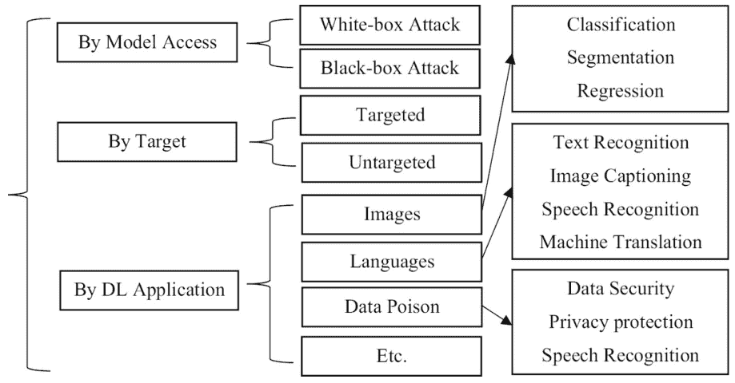

图 3.1 对抗攻击方法的类别。

有针对性的攻击意味着深度学习模型可能会错误地将正在攻击的图像分类为攻击者期望的类别（此时我们说攻击成功）。通常，在有针对性的攻击中，目标类别可以指定为在原始图像输入防御模型时分类概率最低的类别。这是防御最困难的情况。目标类别也可以指定为在原始图像输入防御模型时分类概率仅次于正确类别概率的类别，这是防御最容易的情况。最后，目标类别也可以随机指定，这介于前两种情况之间。

输入图像使得损失值大于图像在修改前通过分类网络时的值。因此模型正确预测标签的概率变得更小。一方面，FGSM 基于输入图像计算梯度。另一方面，当模型更新输入图像时，梯度是相加而不是相减。这正好与常见分类模型更新参数的方式相反。FGSM 算法简单有效，在图像攻击领域发挥了重要作用。许多后续研究都基于该算法。

Moosavi-Dezfooli 等人 [11] 提出了 DeepFool 概念，通过计算最小必要的扰动并将其应用于对抗样本构建方法，使用限制扰动大小为 L2 参数化的方法来获得更优结果。值得注意的是，该算法寻找高维空间中当前点到所有非真实类别决策边界最近的位置。于是，该类别将成为攻击后的标签。

L2 是评估指标之一。当前攻击算法的评估指标主要使用 Lp 距离（也通常称为 Lp 参数化），公式如下：

其中 vi 表示像素点 i 的像素值修改幅度，n 表示像素点的数量。v 通常通过将图像与原始图像进行比较获得，表示两幅图像之间的差异（也称为扰动）。

L0 距离计算为被攻击图像与原始图像之间不同的像素数量，即原始图像中被修改的像素点数量。L0 参数化数字本身也表示非零元素的数量，而对于扰动，非零意味着像素点被修改。可以看出，该评估指标不涉及扰动的幅度，而是在扰动数量的层面上进行评估。

L2 距离计算为被攻击图像与原始图像之间不同像素值的欧几里得距离。

L∞ 距离计算为被攻击图像与原始图像之间最大像素值差异的绝对值。这意味着我们只关心最大扰动

幅度，只要像素值在该限制内被修改，则是有效的。

### 基于 JSMA 的方法

雅可比显著性图（JSMA）是一种用于无环前馈 DNN 网络的攻击样本生成方法。它限制了输入图像中被扰动的像素点数量。虽然基于梯度和基于 GAN 的对抗攻击基于全局扰动并生成可被人类感知到的对抗样本，但 JSMA 基于点扰动生成对抗样本。因此产生的对抗扰动相对较小。文献 [12] 中的对抗显著性图（ASP）基于白盒下针对性攻击的神经网络前向推导，并指示干净样本中哪些输入特征可以被扰动以实现攻击效果。

JSMA 的缺点之一是只能执行有针对性攻击，无法实现无针对性攻击，并且需要制定攻击方向（即是增加还是减少像素）。在 MJSMA 论文 [13] 中，作者提出了 JSMA 的两个变体：一个不指定目标类别，另一个不指定攻击方向（即增加或减少像素）。

在 [14] 中，作者提出了 JSMA 的两个改进版本：加权 JSMA（WJSMA）和泰勒 JSMA（TJSMA）。WJSMA 是通过输出概率对对抗显著性图（ASP）进行简单加权，而 TJSMA 也使用 ASP 概念，同时额外惩罚输入特征。两种攻击都比 JSMA 更有效。作者表明，在有针对性攻击的情况下，TJSMA 优于 WJSMA，而在无针对性攻击的情况下，WJSMA 优于 TJSMA。

除了这两种主要的白盒攻击方法外，还有其他攻击方法，如基于 C&W、基于方向和基于注意力的攻击。白盒攻击是一种常见的基础对抗攻击技术，我们将在后面进一步讨论。

### 3.2.2 黑盒攻击

在黑盒对抗攻击中，攻击者无法完全访问策略网络。刚刚引用的研究将黑盒攻击分为两大类：（1）对手可以访问训练环境并了解训练算法和超参数。它知道目标策略网络的神经网络架构，但不知道其随机初始化。（2）对于这种情况，对手对训练算法或超参数一无所知。这类攻击通常依赖启发式方法生成对抗样本。在许多实际应用中，DNN 的细节对攻击者来说是黑盒。

### 基于迁移的方法

研究表明，针对目标模型生成的对抗样本具有可迁移性；即针对目标模型生成的对抗样本很可能对具有不同结构的其他模型有效。因此，在黑盒场景中，攻击者可以在与攻击目标相同的数据集或具有相似分布的数据集上训练模型，从而针对训练好的模型生成对抗样本。然后利用可迁移性欺骗黑盒目标模型。如果攻击者无法访问训练数据，攻击者可以根据模型蒸馏的思想使用目标模型对合成数据进行标注，然后使用合成数据训练替代模型以逼近目标黑盒模型。最终可以利用白盒攻击方法针对替代模型生成对抗样本，并使用生成的对抗样本对目标模型执行黑盒迁移攻击 [15]。然而，虽然该方法已被证明适用于类内变异性低的数据集（如 MNIST），但尚未有研究证明其扩展到更复杂的数据集如 CIFAR 或 ImageNet。随后，Papernot 等人 [16] 通过使用 reservoir sampling 提高了替代模型的训练效率，这可以进一步在多样性、可迁移性和噪声大小方面优化基于替代模型的攻击方法。

### 基于梯度估计的方法


Chen et al. [17] 提出了一种基于零阶优化的有限差分算法 ZOO，以便直接估计目标深度学习模型的梯度从而生成对抗样本。实验结果表明，ZOO 攻击算法显著优于基于替代模型的黑盒攻击算法。然而，该方法需要大量查询并且依赖于模型的预测值（例如类别概率或置信度），因此无法应用于模型查询次数受限的情况，或模型仅给出类别标签的情况。为了解决模型查询次数受限的情况，Tu et al. [18] 提出了 AutoZOOM 框架，该框架包含两个主要模块：（1）自适应随机梯度估计策略，用于平衡模型查询次数与失真；（2）使用无标签数据离线训练的自编码器或双线性微调操作，以提高攻击效率。这些模块可应用于 ZOO 算法，在保持攻击有效性的同时显著减少所需的模型查询次数。

还有其他黑盒攻击，例如基于分数的和基于决策的等。与白盒攻击相比，黑盒攻击更符合攻击情况的现实。然而，由于其无法获取 DL 的细节，因此无法获得与白盒攻击相同的效果。

## 3.3 攻击概述

本节中，结合前面介绍的 DL 算法的各种应用，我们说明了针对计算机视觉、自然语言处理等不同应用的一系列对抗攻击。

### 3.3.1 基于计算机视觉的应用的攻击

Szegedy et al. [9] 最先发现深度神经网络（DNNs）无法有效处理对抗样本。作者发现一些难以检测的对抗干扰会导致模型对图像进行误分类。对抗样本可以通过最小化称为 L-BFGS 的 Lp 范数来找到。从 AlexNet [2] 生成的对抗样本来自于一个基础的 CNN 模型。在人类视觉系统中，对抗图像与干净图像相似，但它可以完全混淆 AlexNet 最终产生错误的分类预测。

Goodfellow et al. [10] 最先提出了一种有效的非目标攻击方法，称为快速梯度符号方法（FGSM），该方法在良性样本的 L∞-范数限制下生成对抗样本。FGSM 是一种典型的单步攻击算法，它沿对抗损失函数的梯度方向（即符号）进行单步更新，以在最陡的方向上增加损失。Kurakin et al. [19] 提出了 BIM 方法，通过多次优化迭代优化器来提高 FGSM 的性能。受动量优化器的启发，Dong et al. [20] 提出将动量记忆集成到 BIM 的迭代过程中，并推导出一种新的迭代算法，即动量迭代 FGSM（MI-FGSM）。

Papernot et al. [21] 提出了一种有效的攻击方法，称为基于雅可比显著性图的方法（JSMA），它可以使用更小的 L0 干扰欺骗 DNNs。Moosavi-Dezfooli et al. [22] 提出了一种新算法，称为 DeepFool，该算法寻找对抗干扰以便在仿射二元分类器和通用二元可微分类器上最小化 L2 范数。

### 3.3.2 自然语言处理应用的攻击

近年来，神经网络在自然语言处理（NLP）领域变得越来越流行，各种 DNN 模型被用于不同的 NLP 任务。除了前馈神经网络和 CNNs，RNNs 及其变体是 NLP 中最常用的神经网络，因为它们具有自然处理序列的能力。NLP 主要可应用于语音和文本相关领域，如在线翻译和语义识别。例如，垃圾邮件或网络钓鱼网页检测依赖于文本分类器。

本质上，文本是离散数据，而图像是连续的。如果图像被扰乱，人类很难区分它。如果文本被直接扰乱，文本会失去其原始含义，甚至对人类来说变得完全无意义。攻击文本分类器存在两个挑战：（1）对抗文本需要保持可用性，这意味着保持原始含义。对于垃圾邮件检测系统，对抗样本必须绕过检测系统（即被识别为非垃圾邮件），同时保持传递广告信息的效果。（2）扰动必须很小（不可感知），并且对原始文本的更改必须难以被人类检测到。原始文本通常是自由文本，例如手机短信或推文，但不是富文本，例如 HTML 页面。因此，富文本的属性（如颜色或大小）无法被扰乱。

Cisse et al. [23] 提出了 Houdini，一种通过生成可针对不同任务定制的对抗样本来欺骗基于梯度的学习机器的方法。一般对抗网络生成使用网络可微损失函数的梯度来计算扰动。然而，任务损失通常不适合这种方法。例如，语音识别的任务损失基于词错误率，这不允许直接使用损失函数梯度。Houdini 已针对此类任务生成了对抗样本。损失函数与随机边界和任务损失的乘积相对抗。随机边界表征了真实值预测概率与目标预测概率之间的差异。实验表明，Houdini 在语义分割中实现了最先进的攻击性能，并使对抗扰动对人眼视觉更不可感知。

Carlini and Wagner（C&W）[24] 通过优化 C&W 损失函数成功构建了高质量的音频对抗样本。对于 DeepSpeech 上的任何音频信号，只有 1% 的音频信号受到对抗干扰，并且在进一步的研究中，文本翻译中最多可修改 50 个词 [25]。他们发现构建的对抗音频信号是鲁棒的；然而，由于音频输入输出的非线性效应，经过媒介播放后，受干扰的音频信号不再保持对抗性。因此，在 [26] 中，作者提出了一种建模非线性效应和噪声的攻击方法。特别是，作者将接收信号建模为发射信号的函数，其中包括例如受带通滤波器、脉冲响应和高斯白噪声影响的模型变换。该方法成功在物理世界中生成对抗音频样本，甚至可以通过空中播放并攻击音频识别模型。

Liang et al. [27] 提出了针对文本数据的三种攻击策略，即插入、修改和删除。攻击者通常首先识别影响分类结果的最重要文本项，并在这些文本项上使用干扰方法。因此，攻击策略侧重于攻击重要的文本项。在选择扰乱方法（插入、修改、删除）之前，算法需要计算原始文本和训练样本的梯度。使用作者的方法，可以执行有针对性的误分类攻击，而不是让样本被随机识别为其他类别。

### 3.3.3 数据投毒应用的攻击

机器学习模型的投毒攻击已被研究了很长时间。为了在 DL 模型的数据集中生成对抗攻击，攻击者可以在不直接访问受害学习系统的情况下向训练数据集中添加一些投毒样本。他们通常使用数据投毒策略作为后门投毒攻击。后门是在模型中创建的，以便攻击者可以使用后门实例来实现其恶意目的，而不影响模型的整体性能。这样，很难检测到攻击。此外，为了使攻击隐蔽，我们假设攻击者只能向训练数据中注入少量投毒样本，并且后门密钥即使对人类来说也难以察觉。使用这种弱威胁模型，内部攻击者可以轻松发起攻击，这已被视为一个重大的安全威胁。

在 [28] 中，提出了一种针对深度神经网络的基于梯度的投毒攻击策略，假设对手完全了解模型架构和训练数据。干扰数据并重新训练模型可能非常昂贵。为克服这一问题，作者使用影响函数来告诉我们当我们对训练点进行无穷小加权时模型参数如何变化。他们通过添加、删除和更改输入样本来改变测试样本。最终，输入

对模型影响最大的样本可以被找到，然后对其进行投毒操作。

## 3.4 现实世界中的具体攻击

### 3.4.1 对自然语言处理的攻击

Li et al. [29] 提出了 TextBugger 通用对抗攻击框架，该框架可以在白盒和黑盒设置下针对最先进的文本分类系统生成对抗文本。经过评估后，他们指出 TextBugger 具有以下优点：

- 1. *有效性*：在攻击成功率方面，它显著优于最先进的攻击方法。
- 2. *不可见性*：它保留了原始正常文本的大部分可用性，其中 94.9% 的对抗文本可以被人类读者成功识别。
- 3. *效率*：生成对抗文本的计算复杂度与文本长度呈线性关系。

在白盒场景中，可以通过计算雅可比矩阵找到句子中的关键词；在黑盒场景中，可以先找到最重要的句子，然后使用评分函数找到句子中的关键词。对抗样本在现实世界分类器中使用，并取得了良好的结果。该算法的原理如图 3.2 所示。

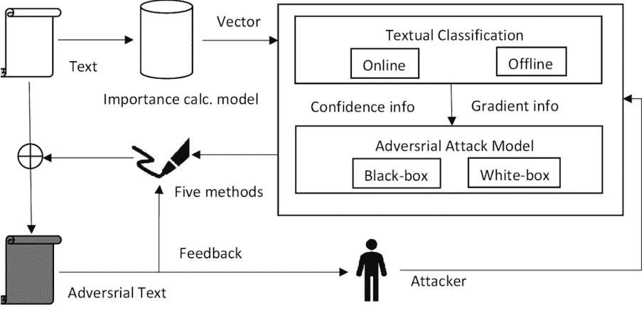

**图 3.2** TextBugger 算法的流程。

TextBugger 有五种欺骗 NLP 模型的方法，分别是 insert、swap、delete、subword 和 subcharacter。这种细微的更改在黑盒和白盒场景中都有效。

- 1. *白盒攻击*：它使用雅可比矩阵找到最重要的词，然后生成五种类型的 bug，并根据置信度找到最佳的一种。

*步骤 1：* 找到最重要的词。这是通过具有两个参数的雅可比矩阵完成的：*K*（类别数）和 *N*（输入长度）。获得每个类别相对于每个时间步输入的导数，以衡量输入中每个词对输出标签的影响程度。

*步骤 2：* Bug 生成。为了确保生成的对抗样本在视觉和语义上与原始样本一致，扰动应尽可能小。考虑两种层面的扰动：

*字母级扰动：* 随机改变单词中字母的顺序很容易使模型将该词判定为无法识别，从而达到攻击效果。

*词级扰动：* 可以在词嵌入层中找到最接近的词。然而，在 word2vec 模型中，

一些反义词在距离上也很接近。这将完全改变话语的含义，然后使用语义保持技术在 GloVe 模型中进行实验。

使用候选词生成的对抗样本被输入模型以计算相应类别的置信度，并选择导致置信度下降最大的词。如果替换词后的对抗样本与原始样本之间的语义相似度大于阈值，则对抗样本生成成功。如果不大于阈值，则选择下一个词进行修改。

- 2. *黑盒攻击：* 在黑盒场景中，没有梯度指示。我们首先发现重要的句子，然后发现句子中的重要词。

Step 1: 找到重要的句子。我们可以将文档分成多个句子，并逐句作为输入以查看分类结果。这会过滤掉对预测标签不重要的句子，剩余的句子可以根据置信度进行排序。

Step 2: 找到重要的词。Among all possible modifications, the most important words in the sentence should be found first and then slightly modified to ensure the semantic similarity between the adversarial sample and the original sample. To evaluate the importance of a word, the difference between the confidence level before and after removal can be used.

Step 3: Bug 生成。This step is basically the same as the one in the white-box attack.

### 3.4.2 使用数据投毒的攻击

Chen et al. [30] 考虑了一种新型攻击，称为后门攻击，其中攻击者旨在学习型认证系统中创建后门，以便他可以通过使用后门将有毒样本注入训练集来轻松绕过系统。

它首先尝试在与输入密钥相似的一组后门实例上实现高攻击成功率。它可以通过改变分辨率来实现这一点。在此策略中，它将后门实例集定义为

其中 x 是输入实例的向量，H、W 和 3 是像素的维度向量；clip(x) 用于将 x 的每个维度裁剪到像素值的范围内。

然后它使用模式策略对输入进行投毒。混合注入、配件注入和混合配件注入是实现模式策略的三种潜在策略。混合注入策略通过混合良性输入实例和密钥模式来生成投毒实例和后门实例。然而，混合注入需要在训练和测试期间扰动整个输入数据，这对于具有某些限制的现实世界攻击可能不可行。配件注入使用某些模式及其变换添加到输入数据中。例如，如果输入数据是一组人脸图像，我们可以使用两种类型的眼镜及其变换来生成投毒实例。最后一种策略是混合配件注入，它通过结合前两种策略的模式注入函数来利用它们。

在 [30] 中，研究人员使用攻击成功率、标准测试准确率和错误密钥的攻击成功率来评估后门投毒攻击。结果显示，在输入实例密钥攻击评估中，通过向训练集注入仅五个投毒样本，他们就可以成功创建具有 100% 攻击成功率的后门实例。在其他三种策略中，使用不同的注入投毒样本，模型可以分别实现 100% 的攻击成功率。而策略的标准测试准确率与使用原始训练数据训练的相似，因此这些方法可以实现隐蔽性。此外，在所有策略中，使用错误密钥的攻击成功率仍保持为 0%。

## 3.5 讨论与开放性问题

尽管提出了许多对抗攻击，但对抗样本的因果关系仍然不明确。早期对该问题的研究

将对抗样本的出现归因于模型结构和学习方法。研究人员认为，适当的策略和网络结构将显著提高对抗样本的鲁棒性。研究人员已探索这一思路，尤其是关于模糊梯度生成的相关研究 [31]。相反，最近的研究发现，对立的出现更可能是高维数据几何 [32] 和训练数据不足 [33] 的结果。具体而言，文献 [32] 证明了对抗扰动在多个概念验证数据集上是可扩展的（例如同心 *n* 维球面）。Ludwig et al. [33] 表明，对抗任务比普通机器学习任务需要更多的数据，并且所需的数据量可能是可扩展的。

尽管许多对抗攻击方法是在不同指标下定义的，但对于特定的训练策略，某些 DNN 并没有学习到一个通用的鲁棒决策边界 [34]。

对于白盒攻击，我们仍然没有看到一种能够平衡有效性和效率的防御方法。在有效性方面，对抗训练表现出最佳性能，但计算成本很高。在效率方面，许多基于随机性和去噪的防御/检测系统的配置只需几秒钟。然而，许多近期论文 [35] 显示这些防御方法并没有它们声称的那样有效。

## 3.6 结论

本章对深度学习的对抗攻击进行了全面综述。深度学习是机器学习和人工智能当前发展核心的发现，导致了许多近期贡献，这些贡献为深度学习设计了对抗攻击。尽管深度神经网络在各种计算机视觉任务中具有很高的准确性，但它们已被发现容易受到细微输入扰动的影响，这些扰动会导致其输出完全改变。本章回顾了这些贡献，主要关注文献中最具影响力和最有趣的工作。显然

对抗性攻击是深度学习的真实威胁，尤其是在安全和可靠性至关重要的应用中。

## 参考文献

- 1. Ian Goodfellow, Yoshua Bengio, and Aaron Courville. 2016. 深度学习. 第1卷.
- 2. Krizhevsky, A., Sutskever, I., & Hinton, G. E. (2012). 使用深度卷积神经网络的ImageNet分类. *神经信息处理系统进展*, 25, 1097–1105.
- 3. David E Rumelhart, Geoffrey E Hinton, and Ronald J Williams. 1986. 通过反向传播误差学习表示. Nature 323, 6088 (1986), 533.
- 4. Sepp Hochreiter and Jürgen Schmidhuber. 1997. 长短期记忆. *神经计算* 9, 8 (1997), 1735–1780.
- 5. Ian J. Goodfellow, Jean Pouget-Abadie, Mehdi Mirza, Bing Xu, David Warde-Farley, Sherjil Ozair, Aaron C. Courville, and Yoshua Bengio. 2014. 生成对抗网络. 见 *2014年神经信息处理系统年度会议论文集 (NIPS 2014)*. 加拿大魁北克省蒙特利尔, 2672–2680.
- 6. Barreno M, Nelson B, Joseph A D, Tygar J D. 机器学习的安全性[J]. *机器学习*, 2010, 81(2): 121–148.
- 7. Biggio B, Corona I, Maiorca D, Nelson B, Srndic N, Laskov P, Giacinto G, Roli F. 测试时对机器学习的规避攻击[C]. *欧洲机器学习与数据库知识发现联合会议*. Springer出版社，柏林，海德堡, 2013: 387–402.
- 8. Barreno M, Nelson B, Sears R, Joseph A D, Tygar J D. 机器学习能否安全？[C]. 2006年ACM信息、计算机与通信安全研讨会论文集. *ACM*, 2006: 16–25.
- 9. Szegedy C, Zaremba W, Sutskever I, Bruna J, Erhan D, Goodfellow I, 等. 神经网络的有趣特性. 2013. arXiv:1312.6199.
- 10. Goodfellow IJ, Shlens J, Szegedy C. 解释并利用对抗样本. 2014. arXiv:1412.6572.
- 11. Moosavi-Dezfooli, Seyed-Mohsen, Alhussein Fawzi, and Pascal Frossard. “DeepFool：一种简单而准确的欺骗深度神经网络的方法.” *IEEE计算机视觉与模式识别会议论文集*. 2016.
- 12. Papernot, N., McDaniel, P., Jha, S., Fredrikson, M., Celik, Z. B., & Swami, A. (2016年3月). 深度学习在对抗环境中的局限性. 见2016 *IEEE欧洲安全与隐私研讨会 (EuroS&P)* (第372–387页). IEEE.
- 13. Wiyatno, R., & Xu, A. (2018). 基于雅可比的最大显著性图攻击. arXiv预印本 arXiv:1808.07945.
- 14. Combey, T., Loison, A., Faucher, M., & Hajri, H. (2020). 基于概率雅可比的显著性图攻击. *机器学习与知识提取*, 2(4), 558–578.
- 15. Papernot N, McDaniel P, Goodfellow I. 机器学习中的可迁移性：从现象到使用对抗样本的黑盒攻击[J]. *arXiv预印本 arXiv:1605.07277*, 2016.
- 16. Papernot N, McDaniel P, Goodfellow I, 等. 针对机器学习的实用黑盒攻击[C]. *2017年ACM亚洲计算机与通信安全会议论文集*, 2017: 506–519.
- 17. Chen P-Y, Zhang H, Sharma Y, 等. Zoo：基于零阶优化的深度神经网络黑盒攻击，无需训练替代模型[C]. *第10届ACM人工智能与安全研讨会论文集*, 2017: 15–26.
- 18. Tu C-C, Ting P, Chen P-Y, 等. AutoZOOM：基于自动编码器的零阶优化方法，用于攻击黑盒神经网络[J]. *arXiv预印本 arXiv:1805.11770*, 2018.
- 19. Kurakin A, Goodfellow I, Bengio S. 物理世界中的对抗样本. 2016. *arXiv:1607.02533*.
- 20. Dong Y, Liao F, Pang T, Su H, Zhu J, Hu X, 等. 利用动量增强对抗攻击. 见：*2018年IEEE计算机视觉与模式识别会议论文集*; 2018年6月18–23日; 美国犹他州盐湖城; 2018. 第9185–9193页.
- 21. Papernot N, McDaniel P, Jha S, Fredrikson M, Celik ZB, Swami A. 深度学习在对抗环境中的局限性. 见：*2016年IEEE欧洲安全与隐私研讨会论文集*; 2016年3月21–24日; 德国萨尔布吕肯; 2016. 第372–87页.
- 22. Moosavi-Dezfooli SM, Fawzi A, Frossard P. DeepFool：一种简单而准确的欺骗深度神经网络的方法. 见：2016年IEEE计算机视觉与模式识别会议论文集; 2016年6月27–30日; 美国内华达州拉斯维加斯; 2016. 第2574–82页.
- 23. Cisse M, Adi Y, Neverova N, Keshet J. Houdini：欺骗深度结构化预测模型. 2017. arXiv:1707.05373.
- 24. Carlini N, Wagner D. 音频对抗样本：针对语音转文本的定向攻击. 见：2018年IEEE安全与隐私研讨会论文集; 2018年5月24日; 美国加利福尼亚州旧金山; 2018. 第1–7页.
- 25. Hannun A, Case C, Casper J, Catanzaro B, Diamos G, Elsen E, 等. Deep Speech：扩展端到端语音识别. 2014. arXiv:1412.5567.
- 26. Yakura H, Sakuma J. 用于物理攻击的鲁棒音频对抗样本. 2018. arXiv:1810.11793.
- 27. Liang B, Li H, Su M, Bian P, Li X, Shi W. 深度文本分类可以被欺骗. 2017. arXiv:1704.08006.
- 28. P. W. Koh and P. Liang, “通过影响函数理解黑盒预测,” 见国际机器学习会议, 2017.
- 29. Li, J., Ji, S., Du, T., Li, B., & Wang, T. (2018). TextBugger：生成针对实际应用的对抗文本. arXiv预印本 arXiv:1812.05271.
- 30. Chen, X., Liu, C., Li, B., Lu, K., & Song, D. (2017). 使用数据投毒对深度学习系统的定向后门攻击. arXiv预印本 arXiv:1712.05526.
- 31. Suranjana Samanta and Sameep Mehta. 2018. 生成对抗文本样本. 见第40届欧洲信息检索研究会议论文集 (ECIR 2018). 法国格勒诺布尔, 744–749.
- 32. Abdullah Al-Dujaili, Alex Huang, Erik Hemberg, and Una-May O’Reilly. 2018. 用于鲁棒检测二进制编码恶意软件的对抗性深度学习. 见2018年IEEE安全与隐私研讨会论文集 (SPW2018). 美国加利福尼亚州旧金山, 76–82.
- 33. Alexey Kurakin, Ian J. Goodfellow, and Samy Bengio. 2017. 大规模对抗机器学习. 见第5届国际学习表征会议论文集 (ICLR 2017). 法国土伦.
- 34. Ian J Goodfellow, Jonathon Shlens, and Christian Szegedy. 2015. 解释并利用对抗样本. 见 *第3届国际学习表征会议论文集* (ICLR 2015).
- 35. Papernot, N., McDaniel, P., Jha, S., Fredrikson, M., Celik, Z. B., & Swami, A. (2016年3月). 深度学习在对抗环境中的局限性. 见2016 *IEEE欧洲安全与隐私研讨会* (EuroS&P) (第372–387页). IEEE.

## 4.1 引言

近年来，大数据处理在互联网公司中越来越受到关注。深度学习（DL）已被应用于许多应用场景，从图像识别（例如，特斯拉自动驾驶汽车 [1] 和谷歌相册 [2]）到语音识别（例如，苹果的 Siri [3] 和亚马逊的 Alexa [4]）。深度学习的准确率通常与训练模型的大小和深度学习算法的结构有关。然而，训练数据集非常庞大。在计算机中学习模型需要很长时间。而且，在实践中，数据通常存储在孤立的位置。例如，在远程医疗应用中，智能手环监测用户的脉搏率和身体活动，而智能摄像头可以监测用户的日常活动。收集这些数据可以提供更高质量的个性化服务。通过使用这种隔离的数据存储，我们可以更好地维护数据隐私。为了在各种数据源和海量数据集上利用深度学习，研究人员提出了协作深度学习（CDL）的概念。它是一种增强的深度学习（DL）框架，两个或多个用户共同学习一个模型。它将传统的集中式学习转变为分散式模型训练 [5]。众所周知，多个学习模型的集成比单个神经网络模型产生更好的预测结果，因此 CDL 比集中式 DL 具有更好的性能。

尽管 CDL 很强大，但隐私保护仍然是一个首要问题。来自不同公司的数据必须面对这样一个事实：不可信的第三方和不可信的用户可以通过上传伪造特征来污染训练参数，最终使预测失效 [6]。一些攻击者可以假装是受信任的用户，并在本地下载服务器的特征以推断其他用户的隐私信息。然而，投毒攻击的严重性尚未得到充分理解。


一个深度学习网络由三层组成：输入层、隐藏层和输出层。它也被称为全连接反向传播神经网络。术语*全连接*意味着某一层中的每个神经元都与下一层的所有神经元相连。在深度学习中，每个神经元都是一个带有权重矩阵和非线性激活函数的计算单元。输出层相当于将激活函数应用于前一层的输出向量（带有其权重函数），然后再加上偏置向量*b*。因此，第*i*层的输出向量表示为，其中*W*是第*i*层的权重矩阵，是第*i*层的神经元数量。为了确定参数*W*和*b*，我们可以使用带有梯度下降法的反向传播算法。*W*和*b*被调整以最小化代价函数，即计算输出与期望输出之间的距离。

### 卷积神经网络

传统的全连接网络有许多参数。例如，为了区分MNIST数据集中的手写数字（28×28的图像），我们需要在一个具有2个隐藏层的全连接网络中找到13,002个参数。全连接网络需要大量的存储空间和计算。卷积神经网络（CNN）减少了训练中使用的参数数量。尽管CNN在训练中使用较少的参数，但它在图像识别中表现出非常高的准确性。一些训练良好的CNN模型，如AlexNet [7]、Inception-v3 [8]、ResNet50 [9]，在应用于ImageNet数据集时准确率超过80%。

### 4.2.2 协作深度学习（CDL）

CDL是一种去中心化的深度学习，因此面对海量训练数据时可以缩短训练时间。它的设置还允许移动设备运行深度学习。CDL中的每个用户可以在本地运行深度学习算法，然后将他们的学习参数提交给中央服务器。然后中央服务器使用提交的参数训练其模型，直到模型收敛。使用这种并行学习框架，全局模型比集中式深度学习需要更少的训练时间和计算量。

### 架构

CDL算法类似于传统的监督学习：训练阶段基于标记数据集训练模型并获得预测结果。我们将CDL分为两种模式。

- 1. *直接CDL*：存在一个中央服务器和多个用户。用户直接将他们的数据集上传到服务器，服务器负责处理整个数据集并运行深度学习算法。但直接CDL无法保护用户的信息。被动推理攻击可以从公共数据源中去除用户的匿名性 [10]。因此本章主要关注间接CDL中的安全性。
- 2. *间接CDL*：与直接CDL中的用户不同，间接CDL中的用户训练自己的数据集以生成掩蔽特征 [10]，并且只将掩蔽特征提交给中央服务器。然后服务器对掩蔽特征执行剩余的计算过程以生成深度学习模型。每个用户的数据是安全的，并且减轻了中央服务器的计算负担。此模式中的敌手只能篡改其本地数据集，而无法观察其他用户的数据集。*图4.1*显示了间接CDL的结构。

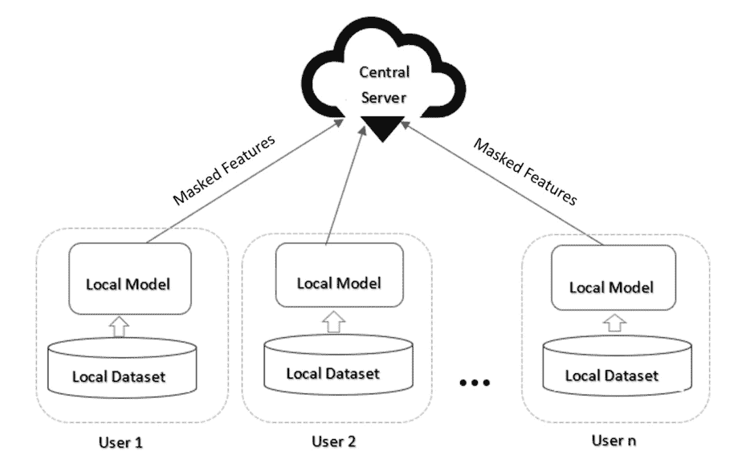

图4.1 间接协作深度学习结构。

### 协作深度学习工作流

谷歌首先在Android上的谷歌键盘[5]中开发了CDL。他们试图记住用户的输入历史和聊天历史。利用其键盘模型，谷歌可以根据历史记录在未来的文本中提供推荐。在此应用中，每部手机被视为一个联邦学习用户。由于每部手机的计算能力有限，间接CDL是在保护隐私方面最好的学习结构。CDL包含以下三个阶段[11]，如图4.2所示：

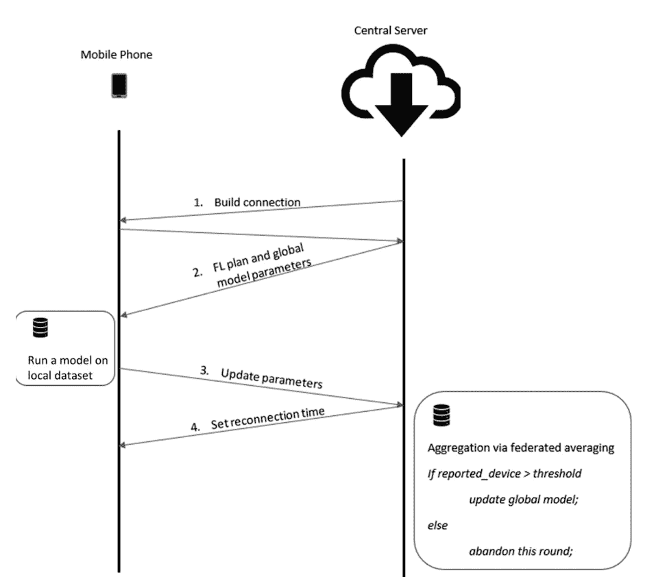

图4.2 单个移动用户的CDL工作流。

- 1. **选择：** 满足条件的设备（例如，充电中且连接到WiFi）连接到服务器并打开双向流。服务器根据特定目标选择一部分已连接的设备。
- 2. **配置：** 服务器将联邦学习（FL）计划和全局模型参数发送到选定的设备。
- 3. **报告：** 设备在本地数据集上运行模型并报告更新。一旦收到更新，服务器使用联邦平均对它们进行聚合，并告知设备何时重新连接。如果有足够多的设备及时报告结果，本轮将成功完成，服务器更新全局模型。否则，本轮将被放弃。

我们还应注意，在选择和报告阶段设置了一个灵活的时间窗口。选择阶段持续到足够多的设备参与或发生超时事件。当窗口关闭时，本轮开始或被放弃，取决于是否达到目标数量。

### 4.2.3 深度学习安全与协作深度学习安全

深度学习（DL）在人工智能（AI）中显示出巨大的潜力。它有助于自动驾驶、智能设备和自然语言处理的发展。由于计算能力和海量数据量的巨大进步，深度学习比其他分析工具发挥了更关键的作用。CNN可以分类不同图像中的不同对象并为其标注标签。循环神经网络（RNN）或长短期记忆网络（LSTM）可以分析文本文件，找出主旨，并检测恶意句子。

深度学习网络遭受许多安全问题。敌手可以针对模型的参数和参与者的隐私信息。他们甚至试图远程控制预测模型的学习过程，并故意欺骗模型以错误标记特定对象。在过去几年中，安全研究人员探索并研究了深度学习系统的潜在攻击。他们将攻击分为四类：模型提取攻击、模型反演攻击、投毒攻击和对抗攻击。表4.1说明了这四种攻击、相应的攻击目标和工作流程。

CDL网络面临着与一般深度学习模型类似的安全威胁。虽然CDL是一种分布式学习模型，但该框架并不能抵抗这四类攻击。此外，CDL还容易受到一种新攻击：生成对抗网络（GAN）攻击（这将在第4.4节中介绍和评估）。这表明，在传统的深度学习训练中，中央服务器是唯一可能破坏隐私的角色，而在间接CDL中，任何参与者都可以故意破坏隐私，使去中心化设置更不可取[12]。

表4.1 深度学习威胁/攻击

| 攻击类型 | 攻击目标 | 细节 |
|---|---|---|
| 模型提取攻击 | 深度学习模型 | 窃取模型参数、功能或决策边界 |
| 模型反演攻击 | 训练数据集 | 从预测结果推断机密信息 |
| 投毒攻击 | 训练数据集 | 伪造训练数据集 |
| 对抗攻击 | 深度学习模型 | 扰动良性样本 |

## 4.3 AUROR：自动化防御

### 4.3.1 问题设定

在本节中，我们将服务器称为收集数据并对其执行深度学习算法的实体。服务器可以与其客户分享其计算成本。将数据上传到服务器的客户被称为用户。我们专门研究间接CDL设置，如图4.2所示。与传统的深度学习结构不同，用户直接向服务器提交原始数据，而间接CDL设置对数据和提交到服务器的内容进行掩蔽。这保护了用户的隐私并节省了计算成本。

Shokri等人 [13] 提出了一种隐私保护深度学习（PPDL）系统。它已被用于许多模拟 [10, 13]。PPDL使用不同的隐私技术在将特征提交给服务器之前对其进行掩蔽。

### 4.3.2 威胁模型


由于在间接协同学习中，对手只能操纵其自身本地数据集且无法观察其他用户的数据，中毒数据仅间接影响全局模型。为了理解间接 CDL 的影响，Shen 等人 [10] 运行了 Shorkri 等人提出的隐私保护深度学习（PPDL）系统。该系统的用户从本地数据计算 DL 参数，并仅将参数作为特征上传到服务器。

在本节中，Shen 等人 [10] 假设攻击者数量记为 f，小于用户数量， 。对手使用针对性中毒攻击来针对特定的训练输出。此外，攻击者可以串谋误导全局模型。服务器是诚实但好奇的。它诚实地处理上传的数据，但对用户信息好奇，可能推断用户身份。但学习模型是隐私保护的：服务器无法从上传的数据中学习用户信息。而且攻击并不旨在破坏隐私保护，而只是扰乱全局模型的准确性。

## Targeted Poisoning Attacks

攻击者可以在训练阶段之前或训练阶段期间对训练数据集进行投毒。第 4.3 节讨论了后一种情况。中毒攻击有两种类型：
- (1) 随机攻击，降低模型的准确性；
- (2) 针对性攻击，更具客观性。
针对性攻击的目标是将特定输入误分类（例如垃圾邮件）；模型将其分类为目标值（例如良性邮件）。

### 4.3.3 AUROR Defense

Shen 等人 [10] 提出了一种针对间接协同学习的投毒攻击防御方案：AUROR。为了识别中毒数据，服务器应区分恶意攻击者和诚实用户，并在训练全局模型时排除攻击者提交的掩码特征。AUROR 有一个经验法则假设来检测对手：对手是少数派。假设原始数据的分布被称为 。掩码特征的分布应与 在统计误差范围内接近。中毒攻击可以改变特定掩码特征的分布，称为 *指示性特征*。因此在中毒攻击场景下，诚实用户的指示性特征具有与恶意用户不同的分布模式。AUROR 还假设对手的数量在 范围内，其中 是 AUROR 可检测到的对手数量的下界。该参数随数据集类型而变化，因此应为每个数据集确定。预处理掩码特征后，AUROR 找到指示性特征并将输入分为两组。

图 4.3 显示了 AUROR 中区分攻击者的详细步骤。AUROR 在全局模型测试阶段之前应用于训练数据。它将掩码特征作为输入，分析这些特征的分布以识别指示性特征。关键挑战是找到能够区分恶意用户和良性用户的适当指示性特征。指示性特征也根据数据集类型而变化。为了确定某个特征是否具有指示性，AUROR 将特征分组到不同的簇中。如果两个簇中心之间的距离大于预定义阈值 ，则 AUROR 假设该特征具有指示性。 的值与训练数据集的原始分布相关。

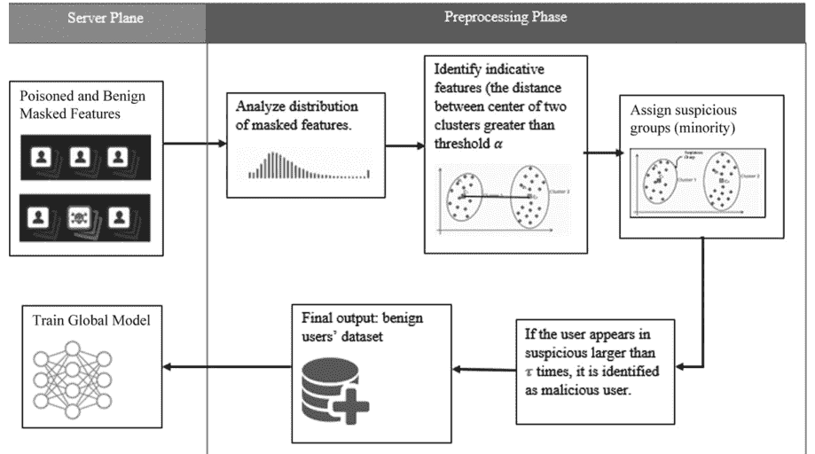

图 4.3 AUROR 的工作流程。

然后 AUROR 如果其指示性特征的分布与多数不同，则检测可疑用户。用户占多数的簇被标记为诚实，而少数簇被标记为可疑（但无最终确认）。如果可疑用户在可疑组中出现的次数超过 τ 次，则最终被标记为恶意。参数 τ 控制诚实用户的错误率容忍度。由于统计误差，指示性特征的分布接近恶意用户。AUROR 根据输入自动确定 τ 的值。我们应注意到对手多次出现在可疑组中。因此 τ 的值也取决于指示性特征的数量。

最后，AUROR 通过排除恶意用户提交的特征来训练全局模型以生成 。因此，在中毒攻击下，AUROR 会自动生成最终准确的全局模型。Shen 等人 [10] 评估了 AUROR 并证明了 的攻击成功率和准确率下降非常小。因此，AUROR 是间接 CDL 的成功防御。

### 4.3.4 Evaluation

Shen 等人 [10] 构建了间接 CDL 模型并演示了错误训练数据如何影响全局模型。他们使用了两个众所周知的数据集：MNIST（手写数字）和 GTSRB（德国交通图像）。Shen 等人将 30% 的客户设为恶意者，对于 MNIST，与使用良性数据集训练的模型相比，全局模型的准确率下降了 24%。当 30% 的用户为恶意时，GTSRB 训练模型的准确率下降了 9%。总之，间接 CDL 易受中毒攻击。

之后，Shen 等人 [10] 在间接 CDL 中加入了 AUROR。他们观察到在 MNIST 模拟中，当恶意比例为 10%、20% 和 30% 时，攻击成功率降至 5% 以下。当恶意比例为 10%、20% 和 30% 时，准确率下降为 0%、1% 和 3%。这证明了 AUROR 能够有效防御中毒攻击，并且即使排除恶意特征，图像识别系统仍保持相似的准确性。在 GTSRB 实验中，Shen 等人 [10] 观察到当使用 AUROR 预处理输入时，恶意比例从 10% 到 30% 时攻击成功率低于 5%。并且当恶意比例从 10% 到 30% 时，准确率下降仍然可以忽略不计。

## 4.4 A NEW CDL ATTACK: GAN ATTACK

Hitaj 等人 [12] 基于生成对抗网络（GAN）开发了一种针对间接 CDL 的新攻击。他证明了间接 CDL 的隐私保护特性使其比直接 CDL 更易受攻击。在 Hitaj 等人的模型中，攻击者运行 GAN 并假装成用户；然后他或她通过下载梯度向量从受害者设备推断隐私信息。攻击者不仅可以影响本地数据，还可以影响全局模型的学习过程并欺骗受害者释放更多个人信息。

### 4.4.1 Generative Adversarial Network (GAN)

与普通深度学习模型不同，GAN 的目标是生成“新”图像，其分布与目标图像相似。如图 4.4 所示，生成网络首先用随机噪声初始化。在每次迭代中，它被训练以最小化生成图像与训练图像之间的距离，而判别器被训练以区分生成图像和原始数据集。此迭代持续进行，直到判别器无法识别生成图像。换句话说，生成器试图欺骗判别器。

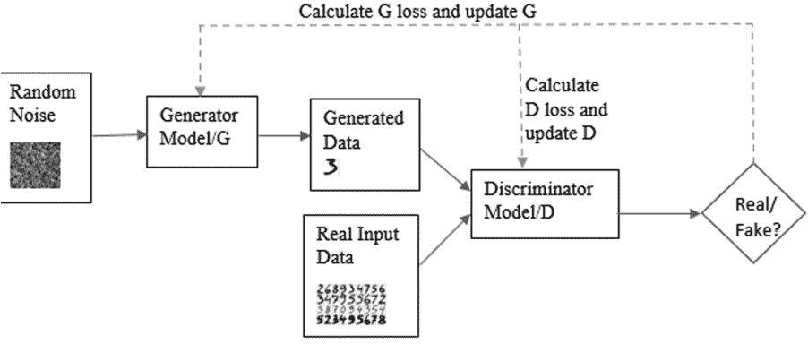

图 4.4 GAN 的架构。

### 4.4.2 GAN Attack

GAN 威胁模型可能来自主动内部人员。做出以下假设：
- (1) 对手在 CDL 协议内作为内部人员工作；
- (2) 对手的目的是从受害者那里窃取个人信息，例如喜欢的地方、电影评分；
- (3) 对手只攻击其他用户，不攻击中央服务器；GAN 攻击不影响全局模型；
- (4) 对手已了解全局模型，例如模型结构、数据的标签；
- (5) GAN 攻击是自适应且实时工作的。
对手主动下载服务器分发的参数，在本地运行 GAN，稍微更改上传的参数，并上传伪造的梯度。

### Main Protocol

假设对手 A 是隐私保护 CDL 协议的内部人员。所有用户事先就学习对象达成一致，这意味着他们同意神经网络架构。

为简单起见，我们首先只考虑两个参与者：对手 A 和受害者 V。V 声明标签 [a, b]，而 A 声明标签 [b, c]。他们首先运行 CDL 数个 epoch，直到全局模型和本地模型的准确率都达到预定阈值。

然后 V 不断训练其网络：V 从中央服务器下载参数并更新其本地模型，对应标签 [a, b]。V 在训练完本地模型后将本地模型的参数上传到服务器。

另一方面，A 也下载参数，用标签 [b, c] 更新其本地网络。与 V 不同，A 首先训练其本地生成对抗网络以模仿类别 [a] 的分布。然后生成伪造的类别 [a] 样本。接下来，A 将类别 [a] 的样本标记为类别 [c]。之后，它在 [b, c] 上训练其本地模型并将参数上传到中央服务器，如 V 所做。此过程迭代进行，直到 V 和 A 收敛到阈值。


这些 GAN 攻击只要 A 的本地模型随着时间的推移提高其准确率就会生效。即使 A 和 V 使用不同的隐私技术，GAN 攻击仍然有效，因为 GAN 学习成功的关键仅取决于判别模型的准确率。而且从服务器下载的参数包含可用于判别器的分布信息。

图 4.5 显示了这一过程。

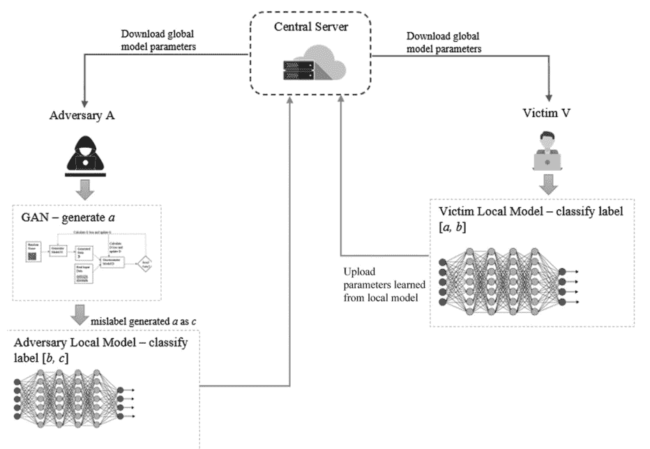

图 4.5 间接协同深度学习的 GAN 攻击。

### 4.4.3 实验设置

### 数据集

Hitaj 等人 [12] 在两个知名数据集上进行了实验：MNIST 数据集和 AT&T 人脸数据集（Olivetti 数据集）。MNIST 数据集是由 0 到 9 的 32×32 像素手写数字组成，包含 60,000 条训练数据和 10,000 条测试数据。Olivetti 数据集包含 400 张 64×64 像素的人脸图像。

## 4.5 在物联网中防御 GAN 攻击

物联网（Internet of Things，IoT）是指数十亿个可通过嵌入式传感器连接互联网并收集环境数据的物理设备。由于物联网设备可以无需人工干预即可通信和运行，物联网最近变得越来越流行。技术分析师估计，在物联网中，“物”与“人”的比例从 2003 年的 0.08 增长到 2010 年的 1.84。如今深度学习与物联网相结合，使得物联网设备比以往设置更智能、更敏捷，能够应对时效性任务。这些物联网设备，例如智能手机，可以使用 CDL 共享数据并在云端训练深度学习模型。同样，物联网设备产生大量数据，推动了深度学习的发展。

CDL 可以成功解决现实世界中数据孤岛与数据隐私之间的冲突 [14]。然而，物联网和深度学习本质上容易受到网络攻击。物联网设备通常以明文或低加密方式通信。其次，CDL 并非安全，因为服务器可以从更新的梯度中提取加载的数据信息。一种简单的解决方案，例如限制上传或下载参数的大小，可以保护用户免受数据泄露，但深度学习模型的准确率也会下降，使 CDL 失去意义。Hitaj 等人 [13] 还指出，在 MNIST 实验中，即使仅上传或下载 10% 的参数，GAN 攻击的效率也很高。

从前面描述的 GAN 攻击可以看出，CDL 易受 GAN 攻击。当攻击者假装是内部人员并参与学习过程时，攻击者可以在线窃取受害者的数据集。为了对抗 GAN 攻击，Chen 等人 [14] 在物联网（IoT）网络中构建了一种隐私保护的 CDL，其中参与者与模型参数隔离，并使用交互模式学习本地模型。因此，攻击者或服务器都无法访问对方的数据。

### 4.5.1 威胁模型

Google 设计 CDL 的目的是保护参与者的数据免受服务器侵害。但 GAN 攻击也表明参与者可能构成威胁。攻击者必须假装是参与模型训练的参与者之一才能实施 GAN 攻击。这样它就可以从服务器下载参数，并通过对 GAN 生成的目标数据进行错误标记来诱使受害者泄露其本地数据的更详细信息。整个 GAN 攻击过程如图 4.5 所示。有两个以上用户正在运行 CDL，攻击者是内部人员，在本地训练 GAN 以窃取其他用户的私有信息。

Chen 等人 [14] 假设服务器和参与者都是半可信的，这意味着他们都遵守协议规则并使用正确的输入，但可以利用观察到的信息推断其他信息。此外，GAN 攻击会向服务器注入虚假数据。Hitaj 等人 [13] 证明虚假数据可能会减慢模型训练，但不会破坏训练过程。因此，假设参与者是半可信的。大型公司（如 Google、Amazon）的服务器受到严格监管，恶意的可能性非常低。因此，很难让服务器故意向攻击者泄露信息。除了 CDL 中的这两个基本属性外，Chen 等人 [14] 在其系统中引入了可信第三方，该方将保持中立且不与任何一方串谋。

### 4.5.2 防御系统

在 CDL 系统中，服务器与许多参与者通信，上传和下载学习到的梯度。每个用户仅处理其本地数据，服务器无法直接访问用户的私有数据。为了抵御 CDL 中的 GAN 攻击，Chen 等人 [14] 在服务器中添加了一个可信第三方，作为服务器与多个参与者之间的中介，如图 4.6 所示。可信第三方帮助服务器和参与者在交互计算中生成随机掩码。在此过程中，服务器和参与者之间不以明文通信。因此，本地 GAN 模型无法从随机掩码中学习。有些研究 [15] 显示模型参数可以通过同态加密进行加密。然而，Chen 等人 [14] 指出，如果服务器使用同态加密对参数进行加密，将严重降低本地 CNN 模型训练的效率，使 CDL 失去意义。

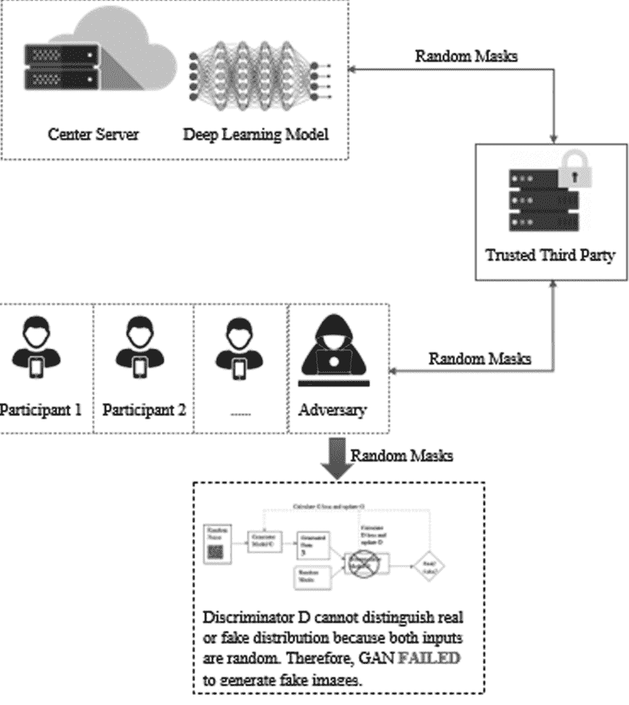

**图 4.6** 防御 GAN 攻击的安全协同深度学习。

尽管参与者无法访问彼此的本地数据，Chen 等人 [14] 引入了改进的 Du-Atallah 方案 [16]，该方案帮助参与者与中央服务器交互，神经网络通过更新参数进行学习。在真实数据集上的实验表明，Chen 等人 [14] 提出的防御系统在模型准确率和效率方面均表现良好。他们的方案也易于所有参与者实施，无需复杂的同态加密技术。

### 4.5.3 主要协议

Chen 等人 [14] 首先设计了两种算法，帮助 *server* 和 *participant* 相互交互并计算这些层。第一个算法用于数据预处理，可帮助矩阵形式的卷积计算。该算法称为 DataPreprocess。第二个算法借鉴了 Du-Atallah 方案 [16] 的思想。它是一种基于加法秘密共享的安全多方计算协议。改进的 Du-Atallah 方案通过添加项来隐藏传输的数据。而改进方案中的所有计算都可以使用叠加，这意味着改进的 Du-Atallah 方案是一个线性算子。该算法称为 InterComputing。

在预处理数据并调整交互通信方案后，Chen 等人 [14] 设计了 *server* 与 *participants* 之间交互的协议，特别是在卷积神经网络计算方面。

对于卷积层，参与者首先对原始数据 X 进行零填充，然后执行 DataPreprocess 算法，将输出表示为 。*server* 为所有卷积核计算权重并发送 b，即偏置。接下来，参与者和服务器都执行 InterComputing 算法，直到所有卷积核计算完成。完成上一步后，参与者下载偏置 b，然后在最后一层使用激活函数。

参与者随后可以在本地应用池化层，而无需与服务器交互。

在全连接层，可信第三方为参与者和服务器生成随机掩码，其中 。然后参与者和服务器计算一个临时变量并相互发送。最后，服务器本地计算并对 进行激活函数。


### 4.5.4 评估

在GAN攻击下，训练后的模型分类准确率可在约300轮内达到80%。若每轮训练样本从一张增加到五张图像，模型可在约100轮内达到90%。经过500轮后，准确率可达100%。

Chen等人[14]还通过将所提模型与Aono的协议[17]进行对比来评估效率。结果表明，Chen方案中参与者的运行时间低于20秒，而Aono协议的运行时间甚至高达80秒。因此，Chen的抗GAN攻击模型在GAN攻击下能以较短运行时间保持较高的准确率。

## 4.6 结论

CDL使得小型计算设备（智能手机）能够参与深度神经网络学习。智能手机包含个人信息（如位置、联系人号码、网页浏览记录）。因此，CDL必须保护敏感信息免受对手侵害。攻击者试图在CDL中寻找新的漏洞。

在本章中，我们介绍了CDL的架构及其安全问题，以及相应的防御机制。我们从深度学习安全入手，因为针对深度学习的数据泄露攻击同样适用于CDL。随后，我们介绍了一种自动防御系统（AUROR），该系统能够检测污染训练数据集的恶意攻击。我们使用MNIST和GTSRB数据集对AUROR进行了评估，结果表明其对于检测投毒攻击是高效的。接着，我们介绍了GAN攻击和抗GAN攻击方案。GAN攻击是一种针对CDL的新兴网络攻击，它可以在推理阶段推断受害者的数据集而不改变全局模型。他们的模拟结果表明，当服务器与用户之间仅传输10%的梯度参数时，GAN就能推断出受害者的图像。然而，通过在服务器和用户之间增加一个可信第三方，也可以使GAN攻击失效。加密消息可以防止GAN学习其他用户信息的分布。与

17. L. T. Phong, Y. Aono, T. Hayashi, L. Wang and S. Moriai, “Privacy-preserving Deep Learning via Additively Homomorphic Encryption,” _IEEE Transactions on Information Forensics and Security_, vol. 13, no. 5, pp. 1333–1345, 2018.

Joseph Layton¹ 和 Fei Hu¹  
*¹美国阿拉巴马大学电气与计算机工程系*

DOI: [10.1201/9781003187158-6](https://doi.org/10.1201/9781003187158-6)

## 目录

- 5.1 引言
- 5.2 DRL系统攻击特征描述
- 5.3 对抗性攻击
- 5.4 策略诱导攻击
- 5.5 结论与未来方向
- 参考文献

## 5.1 引言

深度强化学习（DRL）系统结合了强化学习（奖励最大化）的技术与深度学习（DL）的人工神经网络 [1]。这种结合使得训练良好的模型能够处理比典型强化学习系统复杂得多的数据集。例如，来自摄像头或传感器流的输入数据具有高维度特性，传统RL系统难以解决。然而，DRL系统可以利用其神经网络来表示这些高维选择的策略，使其性能远优于单独的RL或深度学习系统。DRL系统已成功应用于此前未解决的挑战，如围棋博弈、在德州扑克中击败职业扑克选手，以及仅从像素输入掌握Atari游戏等 [1]。

然而，尽管DRL系统在上述列出的例子中表现出色，但一些挑战阻碍了DRL系统在现实问题中的应用。主要困难在于，出于安全、成本或时间限制的考虑，允许智能体自由且频繁地与真实环境交互是不可行的。这表现为智能体必须（1）与预期环境的不精确模拟进行交互，或（2）与一个静态环境交互，而该环境只是一个变化更剧烈的环境（如天气状况或交易市场）的快照。针对这些局限性的解决方案旨在开发严格精确的模拟环境，并泛化学习算法，以便在部署后更好地适应 [1]。

## 5.2 DRL系统攻击特征描述

大多数针对DRL系统的攻击研究评估了这些系统对基于观测的攻击的脆弱性，此类攻击会在原本有效的输入上添加恶意扰动。虽然这些攻击在拥有足够系统知识和时间的情况下可能有效，但其他形式的攻击对于攻击者而言可能更优先考虑实施，即环境操纵和动作选择。Xiao等人在其描述DRL系统攻击特征的文章中，对潜在的攻击向量进行了分类，并根据攻击者知识评估了这些向量的一般有效性 [2]。

*观测空间*由智能体用来根据当前和过去的数据做出决策并更新内部状态的输入流组成。针对此空间的攻击试图扰动智能体的观测，随着时间的推移降低其决策置信度。虽然该向量具有产生针对性故障的潜力，但攻击者更可能导致系统整体性能下降。

*动作空间*表示DRL系统的潜在动作及相应奖励。在此空间中，攻击者试图最小化本来正确动作的预期回报。这样做会导致模型无法正确地将累积奖励最大化，从而产生意外行为。

识别出的第三个空间是*环境空间*，它为DRL系统在被作为直接输入提供给智能体之前需评估的情境进行建模。在此空间中，攻击者可以试图通过扰动特定的环境场景来造成针对性故障。对特定目标环境进行微小的调整即可降低模型置信度，足以阻碍其部署，而不会直接明显地暴露其原因。

除了对潜在攻击向量进行分类外，Xiao等人还根据攻击者所掌握的系统与环境知识水平，评估了这些攻击向量的普遍有效性。他们结合关于攻击者知识和DRL系统关键方面的若干变量，对针对观测空间的攻击进行了评估。根据这些参数的实验结果，大多数攻击下系统的情节奖励降至约0，而非预期的500–600。随着时间的推移，这导致累积奖励与未受攻击的系统相比产生巨大偏差，从而推动模型逐渐做出不准确的决策 [2]。虽然更高水平的攻击者知识略微更有效，但主要结论是，如果DRL系统在训练时不侧重于对输入噪声的鲁棒性，则特别容易受到观测扰动的影响。

研究还评估了对动作空间和环境空间的几次攻击，结果表明在训练期间测试DRL系统的鲁棒性有进一步需求。对于针对动作选择的攻击，较大的扰动边界可实现更好的攻击性能，但需要高水平的系统知识 [2]。环境攻击的目标是造成特定的针对性故障，例如自动驾驶汽车在原本良好路况下突然驶出道路。寻找这些攻击的正确条件最好使用基于RL的搜索方法，而非随机搜索方法。虽然这些环境攻击对整体模型性能的影响并不特别显著，但其产生高度针对性故障的能力以及攻击者所需的最低限度系统知识，使其成为潜在对手颇具吸引力的首选方案。

为了提高DRL系统抵御这些攻击向量的鲁棒性，建议对训练和部署阶段进行一些调整。首先，训练阶段的观测数据应添加随机


对输入施加扰动，产生一个边界区域，在该区域中噪声和恶意扰动仍能产生正确的观测。此外，在训练阶段可以评估观测引擎的梯度，以确认基于梯度的噪声不会导致模型做出次优选择。对于环境，建议通过动态参数变化环境选项（模拟或真实）以降低攻击者的信心。由于这些攻击在攻击者方面所需的系统知识和访问权限最少，因此它们是最可行的首选方案，应据此进行防御。

## 5.3 对抗攻击

多个研究团队提出了各种对抗攻击技术，重点在于利用 DRL 系统的漏洞，特别是通过扰动观测和最小化奖励函数。Pattanaik 等人提出了一种对抗攻击方法，重点在于破坏系统的观测，导致智能体认为自己处于与观测事件不同的状态 [3]。基于此方法，他们评估了其攻击方法的三个版本：朴素攻击、基于梯度的攻击和随机梯度下降方法。这些提出的攻击的有效性超过了 Huang 等人在 2017 年论文中提出的攻击，从而提出了改进 DRL 系统鲁棒性的对抗训练算法的建议 [3, 4]。

Lin 等人提供了进一步的对抗策略，名为策略性定时攻击和诱惑攻击，用于对抗 DRL 算法 [5]。策略性定时攻击旨在在一个 episode/观测的特定子集期间攻击智能体，仅扰动输入序列的一小部分而非全部。根据他们的结果，定时攻击可以在仅攻击 episode 时间步长的 25% 的情况下达到与均匀攻击相似的效果 [5]。对于他们的诱惑攻击，DRL 智能体被一系列精心制作的对抗样本从当前状态诱导到特定目标状态。使用精心制作的示例，破坏明确定义任务的成功率非常高；然而，具有随机元素（例如具有多个随机敌人的游戏）的任务受诱惑策略的影响较小 [5]。

Sun 等人在其 2020 年的论文中介绍了两种新颖的对抗攻击技术，用于隐蔽且高效地攻击 DRL 智能体 [6]。*关键点攻击* 使用一个预测 DRL 系统下一个可能状态的模型以及各种攻击可能造成的损害的度量，然后由攻击算法使用该度量来选择造成最大损害且步骤最少的攻击。*对抗者攻击* 则使用训练好的对抗模型来识别防御系统任一状态的最优攻击。两种方法都能达到与之前提到的技术相似的结果，同时所需的攻击者步骤更少。一旦识别出状态，这两种方法都能达到与之前提到的技术相似的结果，同时所需的攻击者步骤更少。攻击者选择哪种技术取决于攻击者对内部状态和观测的访问权限，以及最小化攻击步骤的必要性 [6]。

## 5.4 策略诱导攻击

已证明深度强化学习策略在对抗性观测扰动方面存在漏洞，但攻击者通常无法直接修改智能体的观测。然而，正如 Gleave 等人所证明的那样，DRL 智能体可以被对抗策略攻击，这些策略生成自然的对抗观测以破坏防御系统 [7]。在他们对该方法的实验中，他们表明虽然这些攻击对受害者有效，但成功更多归因于对抗策略在状态中采用更多随机性并使防御系统感到困惑。因此，防御系统实际上可以通过对对手的具体位置选择视而不见，而是在概括的最佳情况下行动，从而表现得更好 [7]。

Behzadan 等人提出了另一种策略操纵方法，重点在于在目标系统上诱导任意策略 [8]。在这种方法中，攻击者只能操纵目标所观察到的环境配置，但无法调整奖励结构或机制。该攻击假设对手可以比目标注册观测更快地预测和调整环境，并且对手将扰动保持在特定阈值以下，以降低人类操作员检测到调整的可能性。在此设置下，一旦 DRL 学会了特定策略，对抗系统就能迅速降低目标系统的奖励值。已提出了一些降低此漏洞的对策，例如使用最小扰动的对抗样本重新训练 DRL；虽然这增加了对抗样本所需的扰动量，但耗尽可能对手空间的很大一部分所需的计算在目前是不可行的 [8]。根据他们的结果，Behzadan 等人得出结论，当前防御技术不足以抵御策略利用。

## 5.5 结论与未来方向

虽然深度强化学习系统是高维空间中复杂决策的有用工具，但已识别出多种攻击技术，即使在没有直接访问内部机制的情况下也能降低模型置信度。虽然一些对抗攻击可以通过在训练和部署阶段实施的稳健防御技术来缓解（扰动的训练输入和多次部署观测），但某些技术如基于策略的攻击很难专门针对其进行训练。

## 参考文献

- 1. V. Francois-Lavet, P. Henderson, R. Islam, M. G. Bellemare, and J. Pineau, “深度强化学习的介绍,” Nov. 2018, doi: [10.1561/2200000071](https://doi.org/10.1561/2200000071)
- 2. C. Xiao et al., “对深度强化学习的攻击进行表征,” *ArXiv190709470 Cs Stat*, Jul. 2019, [在线]. 可用: [http://arxiv.org/abs/1907.09470](http://arxiv.org/abs/1907.09470).
- 3. A. Pattanaik, Z. Tang, S. Liu, G. Bommannan, and G. Chowdhary, “具有对抗攻击的鲁棒深度强化学习,” Dec. 2017, [在线]. 可用: [https://arxiv.org/abs/1712.0632v1](https://arxiv.org/abs/1712.0632v1).
- 4. S. Huang, N. Papernot, I. Goodfellow, Y. Duan, and P. Abbeel, “对神经网络策略的对抗攻击,” *ArXiv170202284 Cs Stat*, Feb. 2017, [在线]. 可用: http://arxiv.org/abs/1702.02284.
- 5. Y.-C. Lin, Z.-W. Hong, Y.-H. Liao, M.-L. Shih, M.-Y. Liu, and M. Sun, “深度强化学习智能体的对抗攻击策略,” Mar. 2017, [在线]. 可用: https://arxiv.org/abs/1703.06748v4.
- 6. J. Sun et al., “针对深度强化学习的隐蔽且高效的对抗攻击,” May 2020, [在线]. 可用: https://arxiv.org/abs/2005.07099v1.
- 7. A. Gleave, M. Dennis, C. Wild, N. Kant, S. Levine, and S. Russell, “对抗策略：攻击深度强化学习,” May 2019, [在线]. 可用: https://arxiv.org/abs/1905.10615v3.
- 8. V. Behzadan and A. Munir, “深度强化学习对策略诱导攻击的脆弱性,” Jan. 2017, [在线]. 可用: https://arxiv.org/abs/1701.04143v1.

# 深度强化学习的信任与安全

Yen-Hung Chen¹, Mu-Tien Huang¹, and Yuh-Jong Hu¹

¹计算机科学系，资讯学院，国立政治大学，台北，台湾

DOI: [10.1201/9781003187158-7](https://doi.org/10.1201/9781003187158-7)

## 目录

- 6.1 引言
- 6.2 深度强化学习概述
  - 6.2.1 马尔可夫决策过程
  - 6.2.2 基于价值的方法
  - 6.2.3 基于策略的方法
  - 6.2.4 演员-评论家方法
  - 6.2.5 深度强化学习
- 6.3 最新综述
  - 6.3.1 机器学习的对抗攻击
    - 6.3.1.1 规避攻击
    - 6.3.1.2 投毒攻击
  - 6.3.2 深度学习的对抗攻击
    - 6.3.2.1 规避攻击
    - 6.3.2.2 投毒攻击
  - 6.3.3 对抗深度强化学习
- 6.4 对 DRL 系统的攻击
  - 6.4.1 对环境的攻击
  - 6.4.2 对状态的攻击
  - 6.4.3 对策略函数的攻击
  - 6.4.4 对奖励函数的攻击


- 6.5 针对DRL系统攻击的防御
  - 6.5.1 对抗训练
  - 6.5.2 鲁棒学习
  - 6.5.3 对抗检测
- 6.6 鲁棒的DRL系统
  - 6.6.1 安全云平台
  - 6.6.2 鲁棒的DRL模块
- 6.7 金融稳定性场景
  - 6.7.1 自动算法交易系统
- 6.8 结论与未来工作
- 参考文献

## 6.1 引言

*人工智能（AI）* 一词最早由约翰·麦卡锡于1956年提出。AI是制造智能机器的科学与工程。AI的发展历程在基于规则的演绎推理知识表示与基于数据的归纳推理机器学习（ML）之间起伏不定。现代AI研究的是多智能体系统环境中的智能（或软件）代理，代理感知其环境并采取行动以最大化其最优奖励。过去十年中，AI与机器学习（ML）、深度学习（DL）和深度强化学习（DRL）密切相关，因为它们具有从社交网络或物联网（IoT）平台产生的大数据中发现模式的分析能力。基于摩尔定律的计算能力指数增长是加速机器学习应用的另一个驱动因素。

用于数据分析的机器学习算法有三种类型：用于分类或回归的监督学习、用于聚类的无监督学习，以及用于序列决策的强化学习（RL）。深度学习是一种新兴的机器学习算法，适用于各种模式匹配应用中的监督和无监督学习，例如计算机视觉、语言翻译、语音识别等。但如果不考虑使用强化学习（RL），我们无法实现智能代理的自主决策能力。RL为智能代理提供奖励，使其无需真实标注的训练数据即可进行自我学习。此外，我们可以将DL与RL集成，得到DRL，用于其他AI应用，例如自动机器人、AlphaGo游戏、Atari视频游戏、自动驾驶汽车，以及金融科技中的智能算法交易 [1]。

对抗机器学习在过去二十年中得到了深入研究 [2, 3]。从机器学习建模的角度来看，大数据分析服务面临许多安全和隐私挑战。大量研究针对整个大数据分析流程中的数据处理、建模训练和推理部署，提出了多种对抗攻击与防御方法 [4, 5]。特定的攻击和防御也针对不同的机器学习类型和算法，尤其是针对深度学习的攻击。事实上，这些深度学习攻击面也与DRL相关。

就像应用于网络安全的AI一样，用于攻防的对抗机器学习AI是一把双刃剑 [6]。一方面，AI驱动的攻击可以加强攻击并逃避检测。此外，攻击者可以利用对抗性AI击败防御措施，窃取或影响AI。另一方面，AI驱动的防御可以主动保护并禁用AI驱动的攻击，反击恶意AI，以强化AI并抵御对抗环境 [7]。

在 [8] 中，作者提出了一个分析针对AI模型对抗攻击的框架。基于攻击者知识的攻击策略可以是白盒、灰盒或黑盒。攻击既可能是训练阶段的投毒攻击，也可能是测试阶段的逃逸攻击。我们将在后续章节中进行更详细的讨论。

**动机：** 在本研究中，我们处理AI的可信与安全问题。与近期类似的AI用于网络安全研究 [6] 相比，我们关注机器学习建模和部署的可信与安全，尤其是大数据分析过程中的DRL算法 [9]。我们正在研究在安全云平台上针对DRL系统的可能攻击与防御 [10]。

可信且安全的云基础设施可能会缓解针对DRL系统的现有对抗攻击，但并不能保证 [11]。未知攻击仍会出现，我们尚未意识到它们 [12]。我们将研究如何遵循设计鲁棒机器学习建模和部署系统的原则，在安全云中充分考虑安全设计。我们尝试在应用鲁棒DRL系统以确保云端金融稳定性的同时，展示对自动算法交易系统的可能攻击 [13, 14]。

*我们的贡献：* 我们总结本研究的主要贡献如下：

- 我们重点介绍了先前关于对抗ML、DL和DRL的综述。在此之前，我们概述了三种类型的DRL技术。
- 我们提出了对抗性DRL系统的攻击面，包括环境、状态空间、策略函数和奖励函数。
- 我们展示了针对DRL系统攻击的可能防御，包括对抗训练、鲁棒学习和对抗检测。
- 我们通过提供安全云平台和鲁棒DRL模块，提出了一个能够抵御恶意攻击的鲁棒DRL系统。
- 最后，我们给出了一个金融稳定性场景，涉及金融世界中对抗性DRL应用的自动算法交易系统。

本文的其余部分结构如下：首先，在6.2节中，我们简要概述DRL。其次，在6.3节中，我们概述对抗ML的最新研究，包括传统ML、DL和DRL。第三，在6.4节中，我们讨论对DRL的任何可能攻击，包括环境、状态空间、策略函数和奖励函数。第四，在6.5节中，我们展示如何防御DRL系统的攻击。第五，在6.6节中，我们解释在安全云平台上具有鲁棒DRL模块的鲁棒DRL系统。然后，在6.7节中，我们展示面对自动算法交易系统攻击时的金融稳定性场景。最后，在6.8节中，我们给出结论和未来工作方向。

## 6.2 深度强化学习概述

DRL是一种新兴的AI技术，结合了用于策略优化的DL和用于自我学习的RL。DRL旨在针对特定目标进行序列决策。在本研究中，我们概述了对抗性DRL以及金融稳定性的相关前景。在6.5和6.6节中，我们介绍了对DRL的对抗攻击，以及如何通过提供鲁棒DRL系统来防御DRL系统攻击。

6.2节涵盖四个基本主题来介绍DRL：马尔可夫决策过程（MDP）、基于价值的方法、基于策略的方法和演员-评论家方法 [1]。

### 6.2.1 马尔可夫决策过程

MDP对RL和DRL至关重要，它是一个解决大多数具有离散或连续动作的RL问题的框架。如果你将任务构建为MDP，你就定义了自己的环境，其中代理通过在一系列时间步中学习移动以获得最大奖励来实现最优策略（见图6.1）。

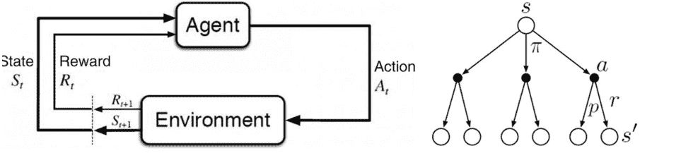

**图6.1** 马尔可夫决策过程，其中代理与环境交互，通过最优策略函数 π 在每个步骤获得最大奖励。

MDP旨在训练代理找到最优策略，该策略通过从环境观察中创建的一组状态，在每个步骤采取一系列动作，从而返回最大累积奖励。

MDP是一个五元组 $(S, A, P, R, \gamma)$，其中：

- $S$ 是一组状态空间；
- $A$ 是一组动作空间；
- $P$ 是转移概率，即在时间 $t$ 时处于状态 $s$ 并采取动作 $a$，将在时间 $t+1$ 时导致状态 $s'$；
- $R$ 是在状态从 $s$ 转移到 $s'$ 并采取动作 $a$ 后立即获得的奖励 $R$；
- $\gamma$ 是折扣因子，用于计算折扣奖励。

### 6.2.2 基于价值的方法

强化学习有三种类型。其中，我们首先关注基于价值的方法，这类方法可以轻松解释无模型方法中必要的数学背景。

### V值函数

强化学习代理的目标是找到一种策略，使其优化期望回报

其中 E 是期望算子，γ 是折扣因子， 是策略算子。

### Q值函数

最优Q值是当代理处于给定状态 $s$ 并采取给定动作 $a$ 后，随后遵循最优策略 π* 时所获得的期望折扣回报。我们可以直接从这个最优值得到最优策略：

### 优势函数

我们结合最后两个函数，描述在遵循直接策略 π 的情况下，动作 $a$ 相比期望回报“有多好”。

### 贝尔曼方程

贝尔曼方程学习Q值。它保证了一个唯一解 Q*：

其中 B 是贝尔曼算子：

### 6.2.3 基于策略的方法

在基于策略的强化学习中，我们通过映射显式构建策略表示，并在学习过程中将其保留在内存中。相比之下，基于价值的方法不存储任何显式策略，只存储价值函数。这里的策略是从价值函数中隐式推导出来的，用于选择具有最佳价值的动作。


## 6.2.4 Actor-Critic 方法

Actor-Critic 强化学习结合了基于价值的方法和基于策略的方法，弥合了二者之间的差距。基于价值的方法（如 Q 学习）存在收敛性差的问题，因为你在价值空间中工作时，价值估计的微小变化可能会使你在策略空间中大幅摇摆。基于策略的方法通过策略搜索和梯度直接在策略空间中工作，每次更新都能获得更平滑的学习曲线和性能提升。

基于策略的方法的缺点是它往往收敛到局部最大值，即在策略空间中搜索以最大化预期奖励，因此它存在高方差和样本效率低下的问题。

Actor-Critic 方法结合了两者的优点。它利用演员（actor）进行策略梯度更新，并通过优势函数引入一个良好的评论家（critic）。通过每一步的时间差分（TD）更新，Actor-Critic 方法得以提高样本效率。

## 6.2.5 深度强化学习

深度强化学习（DRL）是深度学习和强化学习的结合，其中深度学习在每个时间步从每个高维数据输入中学习一个最优策略函数，并输出动作。强化学习是一个马尔可夫决策过程（MDP），其中智能体根据从深度学习学到的策略函数执行动作，以获得最大奖励。将深度学习引入强化学习的动机是借助深度学习的高精度学习能力，直接从各种大型原始数据中学习。此外，强化学习可以提供顺序决策。因此，强化学习弥补了深度学习建模的不足，后者只有一次性回归或分类输出 [1]。

## 6.3 最新综述

对抗性机器学习的研究兴起已超过十年 [2]。人们使用不同的方法来解决 AI 或 ML 的安全和隐私问题。下面我们简要介绍对抗性机器学习的总体综述讨论。首先，在 [15] 中，作者阐述了一个全面的机器学习威胁模型，并在对抗性框架内对攻击和防御进行了分类。其次，在另一篇论文 [4] 中，作者讨论了不同威胁模型下的各种对抗性攻击。他们详细阐述了近期对抗性攻击防御措施的有效性和挑战。

第三，在 [5] 中，讨论了广泛的数据集漏洞以及防御这些威胁的利用方法。此外，作者开发了统一的分类法来描述各种投毒和后门威胁模型及其关系。第四，在 [16] 中，作者基于机器学习处理管道的配置因素（包括输入数据集、机器学习架构、对手的规格、攻击生成方法和防御策略），提出了对抗性机器学习中攻击和防御的系统驱动分类法。在 [17] 中，作者提出了稳健机器学习系统及其趋势和展望。他们总结了阻碍稳健机器学习系统发展的最关键挑战。

第五，在 [18] 中，作者从 AI 安全的角度对强化学习中的对抗性攻击进行了全面综述。类似地，在另一篇论文 [19] 中，作者对深度强化学习中的安全问题进行了基础性论述。他们还通过分类和识别漏洞、攻击向量和对抗能力，提供了一个高层次的威胁模型。最后，作者全面综述了基于深度强化学习系统中新兴的恶意攻击以及防御这些攻击的潜在对策。他们强调了为开发应对深度强化学习系统各种攻击的解决方案而存在的开放问题和研究挑战。下面我们将更详细地展示对机器学习、深度学习和深度强化学习的对抗性攻击。

### 6.3.1 对机器学习的对抗性攻击

机器学习算法分为三类：监督学习、无监督学习和强化学习。攻击者对每种算法的目标截然不同。用于分类或回归的监督学习提供从输入到输出的概率，以预测下一时间戳的后续值。在模型训练阶段，每个数据批次都有正确答案，通过调整模型参数获得最优模型。我们可以根据测试误差来验证训练好的模型是好还是坏。

对于监督学习，攻击者的目标是使模型错误分类或不可预测，或返回特定的错误类别。然而，对于强化学习的输入数据，没有正确答案。智能体学习最优策略，以最大化环境中每个智能体动作的奖励反馈。因此，攻击者对强化学习算法的目标是使智能体学习一个奖励最小的策略，或阻止智能体学习稳定的策略。

对抗性攻击出现在模型的训练阶段（称为投毒攻击）和测试阶段（称为逃逸攻击）[2, 20]。

#### 6.3.1.1 逃逸攻击

这种攻击发生在测试阶段。攻击者试图操纵输入数据以逃避已训练模块。存在错误通用型（error-generic）和错误特定型（error-specific）最大置信度逃逸攻击。如果攻击者输入数据而模型错误分类了该数据，则属于错误通用型逃逸攻击。在错误特定型逃逸攻击中，攻击者输入数据，模型返回攻击者期望的特定类别（见图 6.2）。

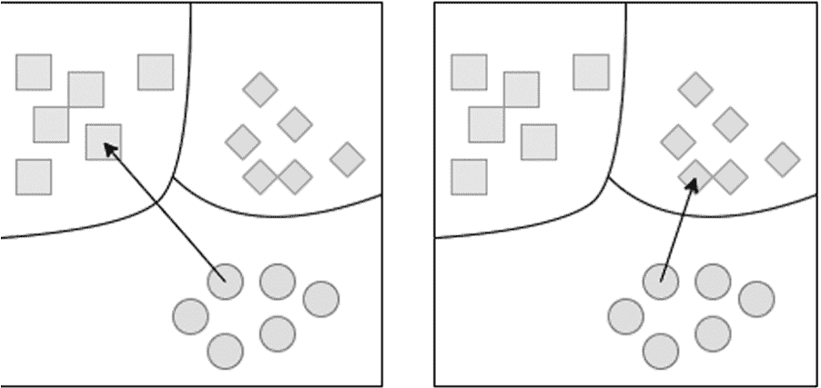

**图 6.2** 在这两幅图中，黑线是三个类别的边界。左侧：一次错误特定型逃逸攻击。攻击者指定输出为方形，输入为圆形。右侧：一次错误通用型逃逸攻击。在此攻击中，攻击者将一个输入样本错误分类为菱形而不是圆形。

#### 6.3.1.2 投毒攻击

攻击者在训练阶段将投毒样本注入训练数据。这些攻击也可以分为错误通用型和错误特定型。错误通用型投毒攻击旨在增加相同输入数据下其他类别的概率，并使学习模型无法返回正确的类别。在错误特定型投毒攻击中，攻击者旨在引起特定的错误分类（见图 6.3）。

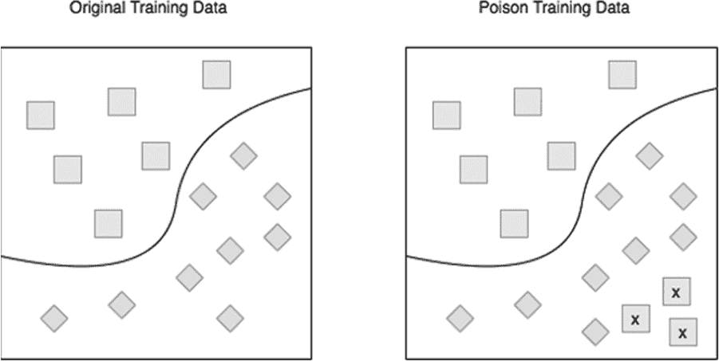

**图 6.3** 后门投毒攻击示例。左侧：一个用于方形和菱形二分类的典型训练数据集，共两个类别。右侧：被扰动方形（方形中绘制的 *x*）污染的训练数据集。

### 6.3.2 对深度学习的对抗性攻击

对抗性机器学习是一个广泛的研究课题。我们可以将其缩小到更具体的深度学习。深度学习应用于监督学习。在训练阶段，其数据集有正确答案。因此，深度神经网络（DNN）中存在逃逸攻击和投毒攻击。攻击者的目标是在标准输入数据中添加尽可能少的噪声，并使输出数据尽可能被错误分类。我们可以用方程 (6.3.1) [17] 来展示这一思想。我们将神经网络视为一个函数，标准输入为 x。但是，向标准输入 x 添加噪声 δx，且 δx 小于一个很小的数 ε。通过一些不同的输入，该函数会返回不同的输出（见图 6.4）。

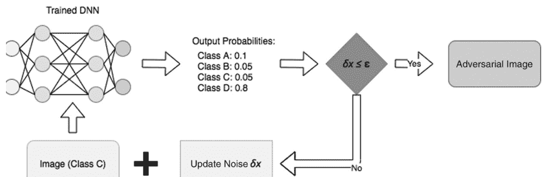

图 6.4 类别为 C 的图像，向图像中添加一些噪声 δx，然后输入到已训练的 DNN。该已训练的 DNN 随后以最高 0.8 的概率返回错误类别 D。对于一张优秀的对抗图像，我们会检查噪声是否如预期那样小。如果是，则生成恶意图像。如果不是，则更新噪声并生成另一张图像作为已训练 DNN 的输入。

Shafique 等人 (6.3.1) 没有使用“错误通用型”和“错误特定型”，而是使用“非定向攻击场景”来表示随机错误输出，使用“定向攻击”来表示特定输出 [17]。

#### 6.3.2.1 逃逸攻击

在逃逸攻击中，攻击者无法访问 DNN 的训练过程和训练数据。这种攻击的目标是已经训练好的学习模型。在图 6.4 中，我们可以看到自动寻找对抗样本的过程。在 [20] 中，Goodfellow 等人提出了快速梯度符号法（FGSM）。该算法找出损失函数代价对输入的梯度方向，并向输入添加噪声，从而创建一条新信息作为对抗样本。


#### 6.3.2.2 *投毒攻击*

在投毒攻击中，攻击者需要访问训练数据集和训练过程。攻击者希望向网络输入恶意训练数据，这些数据可能带有定制噪声，或者仅仅是随机噪声。投毒可以是从数据集中移除某些数据并添加对抗数据，也可以是添加恶意数据。一些攻击者会向深度学习模型添加神经元，学习过程会用特定的输入数据触发这些神经元，从而实现具有预期输出类的定向攻击。

### 6.3.3 对抗深度强化学习

DRL是DL和RL的结合。因此，针对DL的攻击同样存在于DRL中。此外，RL还存在一些攻击面。RL属于无监督学习，在训练阶段我们没有正确答案。我们训练它来解决序列决策问题。智能体从环境的奖励中学习策略。当智能体从环境中观测到状态时，它会获得一个策略，从而对环境采取最优动作。环境根据动作返回奖励，智能体再从环境中观测下一个状态。

在[图6.5]中，我们可以看到智能体与环境之间的交互。由于智能体与环境之间存在一系列交互，因此有四个攻击目标：环境、状态、奖励和策略。在[9]中，作者将针对DRL的对抗攻击分为两类：主动攻击和被动攻击。

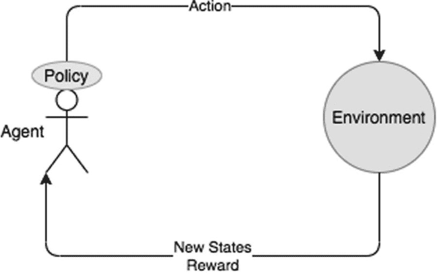

**图6.5** 智能体与环境之间的交互。智能体从环境中观测状态，并根据策略做出最优动作。环境返回奖励，智能体基于该动作转移到新状态。

对于主动攻击，攻击者的目标是改变智能体的行为，并尽可能降低奖励。被动攻击不关注智能体的行为，而是窃取受害智能体的细节信息，如奖励函数、策略函数或DRL的其他部分。这些细节信息对于攻击智能体来说是有帮助的信息，它可以用其生成针对受害智能体的对抗样本。攻击智能体使用这些对抗样本来攻击受害智能体。

作者还比较了安全RL（safe RL）与鲁棒RL（secure RL）之间的区别。一方面，安全RL学习策略以最大化奖励函数的期望。另一方面，鲁棒RL使学习过程对对抗攻击具有鲁棒性和弹性。我们将在6.4–6.5节讨论DRL系统的攻击与防御。此外，我们将在6.6节中介绍一个位于安全云平台上的带有鲁棒DRL模块的鲁棒DRL系统。

## 6.4 对DRL系统的攻击

### 6.4.1 对环境的攻击

攻击智能体可以直接向环境添加扰动（见**图6.6**）。Chen等人提出了一种通用的主导对抗样本生成（CDG）方法，基于DRL环境创建对抗样本[21]。攻击智能体的目标是A3C路径规划。在典型情况下，受害智能体被训练寻找通往目的地的路径。攻击智能体在环境中添加一个物体，并将其放置在某个位置，从而使受害智能体花费更多时间或无法到达最终目标。

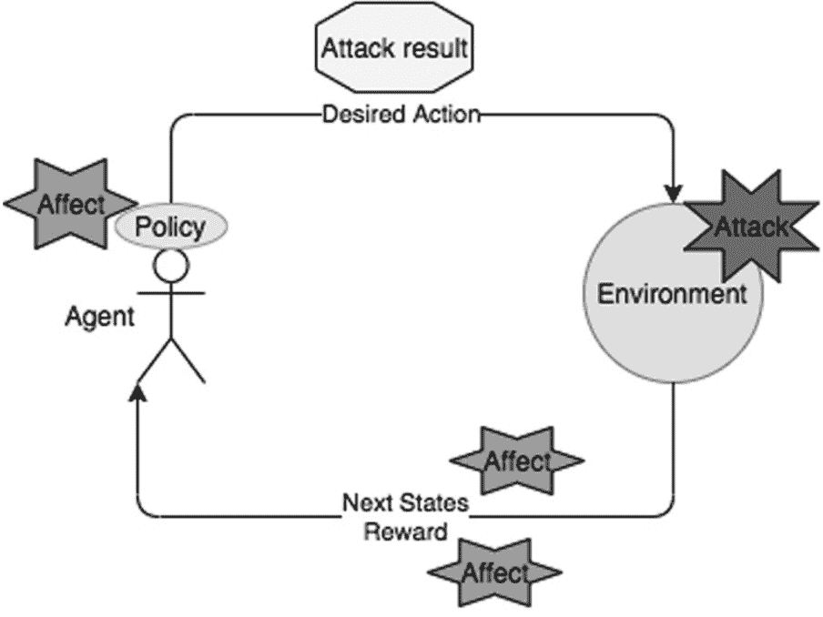

**图6.6** 攻击者直接改变环境，使智能体执行期望的动作。当学习智能体从被扰动环境中观测状态时，状态、奖励和策略都会受到影响。

### 6.4.2 对状态的攻击

对于状态攻击，Behzadan等人认为，如果中间存在攻击智能体（见图6.7），攻击智能体可以从环境获取状态，并对转发给受害智能体的状态进行扰动[22]。为此，攻击智能体首先训练一个对抗策略，并利用该策略向状态添加噪声，然后将其发送给受害智能体。如果攻击智能体知道受害智能体的策略，它可以通过向受害智能体发送特定状态来控制该智能体，使受害智能体做出攻击智能体所期望的反应。它还会通过错误的策略函数误导受害智能体，使其在选择最优动作时出错，从而降低奖励。在对状态进行投毒攻击时，Kiourti等人表明，攻击智能体只需修改训练数据集中的0.025%即可访问并篡改该数据集。攻击智能体可以隐藏一个特定的不良策略，等待木马被触发[23]。

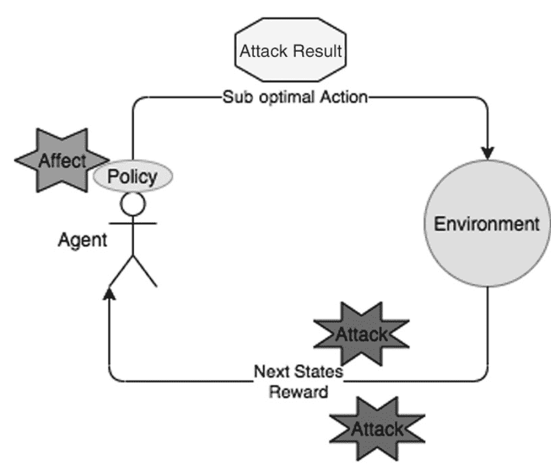

**图6.7** 就在智能体从环境观测状态之前，攻击智能体在中间扰动状态和奖励。这种攻击会影响策略，并使受害智能体执行次优动作。

### 6.4.3 对策略函数的攻击

恶意攻击智能体可以攻击策略（见图6.8）。Huang等人展示了通过扰动状态来攻击策略函数的方法，如图6.8所示。他们在DRL中引入了快速梯度符号法（FGSM）[24]。FGSM在DRL中的目标是找到一种对抗输入，使最优动作的概率最小化。此外，对输入数据添加的扰动应尽可能小。

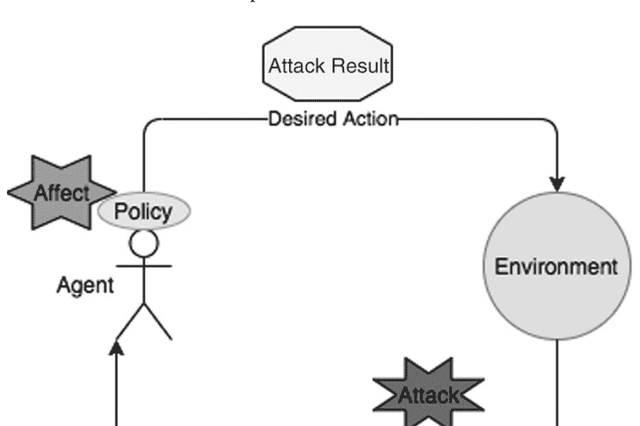

**图6.8** 为了攻击策略，攻击智能体可以扰动状态，使受害智能体执行攻击智能体期望的动作。

Hussenot等人提出了两种攻击：一种是观察前攻击（preobservation attack），对每个环境添加不同的对抗扰动；另一种是恒定攻击（constant attack），对每个环境添加相同的噪声[25]。攻击智能体操纵环境，使受害智能体从受控环境中学习到错误的策略。

Gleave等人将两个智能体置于同一环境中，一个是对抗攻击智能体，另一个是合法的受害智能体[26]。同一环境中的攻击智能体通过生成对抗性自然观测输入来使受害智能体遵循期望的策略。他们使用双人零和折扣博弈。攻击智能体试图尽可能多地获得奖励，同时使受害智能体获得尽可能少的奖励。

Behzadan等人提出了一种针对最优策略的模型提取攻击[22]。如果受害智能体在线并为他人提供服务，它就会面临模型提取攻击的风险。攻击智能体可以利用模仿学习技术提取并窃取策略内容，以训练一个新的模仿智能体。这个模仿攻击智能体可以生成对抗样本来攻击受害智能体。

### 6.4.4 对奖励函数的攻击

攻击奖励函数有几种方式。Han等人提出了两种对奖励函数的直接攻击[27]。攻击智能体可以通过翻转奖励符号直接改变来自环境的奖励，从而让受害智能体在错误的奖励下学习。当受害智能体向环境执行动作后，它会从环境中获得错误的状态，而不是正确的下一个状态。该攻击智能体操纵状态，使受害智能体执行错误动作并获得较差的奖励（见图6.9）。

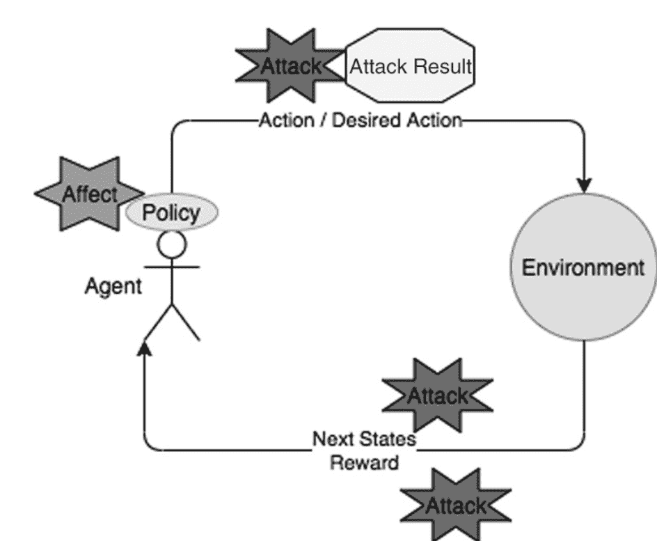

**图6.9** 为了攻击奖励，攻击智能体可以直接攻击RL的主要组成部分：奖励、状态或动作。攻击智能体影响策略并产生期望的动作。

Pattanaik等人继续提出了三种通过对状态添加扰动进行攻击的方式[28]。第一种是向DRL状态中添加随机噪声，误导受害智能体选择次优动作。第二种攻击是基于梯度的（GB），类似于前面提到的针对策略攻击的FGSM。第三种攻击也是基于梯度的，但改进了FGSM攻击的性能。与使用基于梯度的攻击不同，作者使用了随机梯度下降（SGD）攻击。

Lee等人研究了如何扰动动作空间，并提出了一个最小化DRL智能体总奖励的优化问题[29]。短视动作空间（MAS）攻击每次考虑一个动作攻击，并使智能体的实际奖励最小化。前瞻动作空间（LAS）攻击


在时间 *t* 到时间 *t+h* 的时间间隔内施加多次攻击并降低受害智能体的总奖励。

## 6.5 对抗 DRL 系统攻击的防御

### 6.5.1 对抗训练

对抗训练是一种防御基于梯度攻击的方法，例如 FGSM。概念很简单。攻击智能体可以在训练阶段运行基于梯度的攻击，以尽可能多地获取对抗样本，并利用这些对抗样本重新训练学习攻击模型。Kos 和 Song 对对抗性重训练进行了深入研究 [30]。他们表明，通过添加随机噪声或由 FGSM 方法生成的对抗样本进行重训练后，受害智能体变得更具韧性。该研究表明，使用 FGSM 进行训练比使用随机噪声训练更稳健。

Chen 等人也提供了一种对抗性重训练技术 [21]。他们使用 CDG 获取对抗样本并用这些样本重新训练智能体。他们表明，重训练后的受害智能体可以防止 A3C 路径规划的通用攻击（见图 6.10）。然而，如果由其他方法创建对抗样本，该方法无法完全防止攻击。

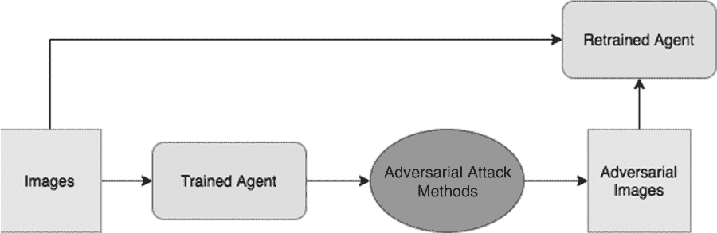

**图 6.10** 重训练过程首先训练一个已训练的智能体，并使用对抗攻击方法（如 FGSM 或 CDG）生成对抗图像。原始图像和对抗图像用于创建新的重训练智能体。

### 6.5.2 健壮学习

健壮学习的核心理念是在训练阶段创建健壮的智能体。Behzadan 等人使用 NoisyNets 在训练阶段提供健壮学习模块 [31, 32]。NoisyNets 是一个神经网络，其偏置和权重可以在训练阶段被扰动。我们可以如下表示该函数。该函数是具有参数的神经网络函数。当我们将 *x* 作为输入提供给函数 *f* 时，它返回输出 *y*（见公式 6.5.1）：

我们在参数 θ 中引入噪声，其中 (μ, Σ) 为学习参数（6.5.1），ε 为零均值且统计特性固定的噪声（见公式 6.5.2）：

作者表明，在训练阶段向学习参数（6.5.2）添加噪声非常有效。他们使用 FGSM 创建对抗样本并用这些样本攻击训练智能体。训练智能体的性能非常出色。

Pinto 等人从两个方面提出了稳健对抗强化学习（RARL）[33]。第一点对模型初始化至关重要。引入不同的初始化和随机种子不会降低策略学习的性能。第二点对建模误差和不确定性具有鲁棒性。通过各种测试环境设置，我们可以提高学习策略的性能。Pinto 还提供了一种新颖的稳健训练思想。一般而言，基于 MDP 的标准强化学习集合为 ，其中 *S* 是状态集合，*A* 是动作集合，*P* 是转移概率，*R* 是奖励函数， 是折扣因子， 是初始状态。

作者将其改为双人零和折扣博弈。该博弈的 MDP 变为

其中 A₁ 和 A₂ 是两个玩家可以采取的动作集合，μ 是玩家 1 的策略，ν 是玩家 2 的策略，R 是具有该策略的总奖励。零和博弈的主要思想是在训练时允许添加对抗智能体。假设玩家 1 试图最大化奖励 *d*，而玩家 2（对手）试图最小化玩家 1 的奖励。该算法称为对抗强化学习（ARPL）。在训练阶段之后，合法的受害智能体学习所有情况并根据观察执行最佳动作。基于这一概念，一些研究人员在 RARL 中考虑风险并提出风险规避稳健对抗强化学习（RARARL）[34, 35]。

### 6.5.3 对抗检测

Lin 等人提供了一种架构来检测输入数据是否具有对抗性 [36]。他们训练了一个可以检测恶意攻击的模块。他假设攻击是连续的。关键点是引入一个智能体，该智能体可以根据之前的输入和动作预测后续输入数据，使用预测的输入与相同的策略函数并获得预测的动作分布。如果预期输入与实际输入之间的距离高于给定阈值，则真实输入为对抗输入。否则，真实输入为标准输入。

Nguyen 等人将 DRL 用于网络安全。他们训练了一个 DRL 智能体来检测时间序列攻击。他们可以将 DRL 检测系统放在第一层以检测输入是否为攻击 [37]。

## 6.6 稳健 DRL 系统

在本节中，我们进一步提出如何构建稳健的 DRL 系统。我们讨论稳健 DRL 系统的两个方面：一是云平台的安全性，二是如何提供稳健的 DRL 模块。如果我们以不安全的方式建立 ML 系统架构，可能会发生多次攻击。然后恶意第三方会利用多个弱点。

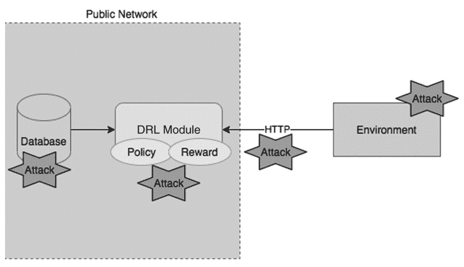

图 6.11 该架构不安全，因为数据库和 DRL 模块位于公共网络中，这意味着攻击者比私有本地封闭网络更容易访问。智能体与环境之间的通信不安全。

Kumar 等人对稳健 DRL 系统提出了几点意见。在系统层面，他们可以将对抗攻击保存在存储库中。然后他们审计日志并监控 ML 系统——同时检查编码风格以防止漏洞 [38]。

### 6.6.1 安全云平台

平台安全在云中至关重要。出于安全考虑，云提供商应在任何服务的全部安全设置上提供权限控制。Nepal 等人提出了云安全的概念 [39]。将所有服务安全地设置起来非常复杂。此外，在云中设计安全架构也不容易。你不仅需要一些安全概念，还需要熟悉云设置。此外，云设计架构非常灵活，因此对于每个服务，我们必须逐一配置。一旦某个服务缺乏安全配置或配置设置错误，就会为攻击智能体进入提供漏洞。

我们需要处理多个安全问题。回顾第 6.3–6.4 节关于对抗性 ML 攻击的内容，我们看到攻击试图通过多次输入请求利用大量对抗样本。因此，我们应在固定时间内限制来自同一 IP 位置的探测次数，以应对各种攻击场景。在这种情况下，攻击智能体发现对抗样本所需的探测时间肯定会增加。其次，在中间人攻击中，攻击智能体可以操纵任何被拦截的数据并将其重新发送到目标系统中的受害智能体。为了防御这种攻击，我们需要确保我们观察到的数据源和通信渠道完全可信。AWS 在图 6.12 中被用作基本云安全架构的示例。

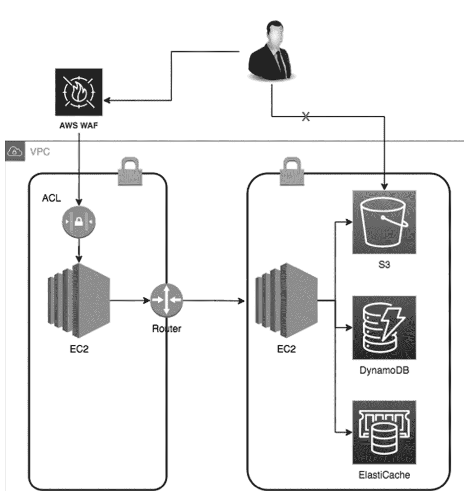

图 6.12 在 AWS 云中设计安全架构的基本概念。数据库和关键服务位于私有网络中，以防止来自外部互联网的任何访问。代理服务位于公共网络中，并以 AWS WAF 作为防火墙。

使用安全 Web 通信协议 SSL 是确定 Web 通信环境是否可信的可行方法。对于数据投毒攻击，我们应通过用户访问控制和安全机制保护数据库，无论是在开放云上还是在本地私有云上，以防止任何渗透。数据库应具有严格的访问控制，以防止攻击智能体尝试更改模块行为。如果可能，任何数据库服务请求都应先通过代理服务器，然后再将请求转发到目标模块中的受信任智能体。

### 6.6.2 稳健 DRL 模块

没有架构能 100% 防御所有攻击。我们需要第二层防御，即 DRL 模块本身。当模块正在训练时，我们应增强 DRL 模块的管道鲁棒性，而不是仅在不安全的分析管道中针对原始数据进行训练。

我们应构建具有其 DRL 模块的稳健 DRL 系统以确保云安全（见图 6.13）。数据库和稳健 DRL 模块位于具有严格访问控制的私有网络中。代理服务器位于公共网络中，并通过对抗检测将传入请求转发到服务器。如果请求有效，则将其发送到稳健 DRL 模块。在训练阶段，我们在稳健 DRL 模块上提供对抗性重训练和稳健 ML 学习。

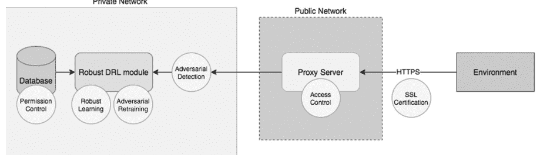

图 6.13 要在 AWS 云上构建 DRL 系统，我们应在私有网络中创建数据库和 DRL 模块，并在公共网络中设置代理服务器。代理服务器接收对对抗攻击检测模块的请求并将其转发到稳健 DRL 模块。代理服务器在私有网络和外部环境之间提供访问控制和安全通信服务。


鲁棒学习是一种在训练阶段提供可信且安全的机器学习建模的方式。人们使用 `NoiseNet` 方法在训练阶段向深度神经网络添加噪声。我们添加一个对抗代理来模拟针对任何输入或参数的恶意行为，以实现鲁棒的 DRL 模块。当我们有了训练好的模块后，有必要测试其性能是否与之前一样好。我们可以使用 `FGSM` 方法获取可能的对抗样本，并事先重新训练该模块。对抗检测模块是受保护代理前面的一个拦截器，充当防火墙。当任何传入的对抗样本到达对抗检测模块时，它会阻止该样本并将其保存到辅助存储中。最后，我们训练对抗检测模块，将所有这类恶意样本放入训练数据集中，从而使我们的 DRL 更加鲁棒。

## 6.7 金融稳定性场景

金融服务正进入一个新的人工智能时代，其自主服务无需人工参与，例如自动算法交易系统。

### 6.7.1 自动算法交易系统

高频交易系统可以通过基于即时可用信息的股票/债券/外汇价格预测，从极短期的套利机会中获利，或通过将大额交易块拆分为交易日内许多小额交易来降低市场冲击。算法交易系统拥有一个包含多个数据分析阶段的复杂流水线，包括数据工程、基于机器学习的建模以及交易执行订单的逻辑。

传统系统使用简单模型，如线性回归模型、自回归模型（`ARIMA`）和支持向量机（`SVM`），来预测未来目标资产的交易价格。这些模型在模型训练和部署推理方面都很快。随着硬件计算能力的提升，我们借助 GPU 技术的进步加速训练和推理。高性能 GPU 计算系统训练深度神经网络，如深度 `CNN` 和 `LSTM`。这些经过优化的深度学习模型具有非线性关系，能够在较短的时间范围内高精度地预测未来市场。

我们重点关注自动算法交易系统中的数据分析机器学习建模，因为预测资产价格和趋势的能力是自动化资产管理系统核心功能。资产价格预测模型使用各种时间序列数据流来预测未来，包括市场数据、基本面数据和另类数据。在大数据分析流水线中，预测模型训练和推理面对对抗性机器学习攻击的脆弱性会导致金融不稳定。

不断发展的神经网络系统容易受到输入微小扰动的影响，这些扰动会显著改变深度神经网络的输出。对抗性攻击最流行的应用是图像分类。对抗性攻击通过扰动图像来欺骗分类器，同时将扰动限制在某个范数范围内的较小值。然而，在自然语言处理（`NLP`）等领域，被操纵的文本可能毫无意义。在本节中，我们关注交易系统的鲁棒性，并利用欺骗攻击及其潜在威胁。

在网络安全语境下，欺骗攻击是指某人或某程序成功伪造数据以获取不正当优势。在金融执行订单的历史中，交易者一直在从事欺骗行为。对手方在最优价格的任一侧下订单以伪造供需，通常意图在执行前取消订单。我们将从事欺骗行为的交易者所下的对手方订单视为一种朴素的对抗性扰动，它可能比手工制作的扰动更难检测，因此仍可能给交易执行监管带来问题。

我们描述针对订单簿数据的简单对抗性攻击。考虑一个在最优买入价和卖出价处下订单的对手方。此外，考虑对数量条目的扰动。如果攻击者在订单簿中制造局部极值，可能会导致交易系统做出错误决策，攻击者从而可能获得不正当优势。这样一来，即使仅拥有有限知识的恶意代理也能利用对抗性攻击。

本研究将针对金融交易系统的对抗性攻击引入为一个场景，以帮助理解交易系统的鲁棒性。

鲁棒性存在权衡取舍。虽然在此场景中神经网络模型的市场预测表现优于传统交易系统，但我们认为它们可能鲁棒性较差。我们进一步意识到，欺骗一个模型的同一对抗模式也可能误导其他模型，而且这些模式对人类高度可解释。这些攻击的可迁移性，加上它们能在很小攻击预算下生效的能力，表明仅拥有有限知识的恶意代理也可能利用它们。

这里，我们针对金融领域中对抗性 DRL 应用，给出一个自动算法交易系统的金融稳定性场景。我们表明，对抗性 DRL 可以应用于做市交易系统，以针对恶意攻击提供鲁棒防御。*做市*是指通过持续给出买入和卖出某一金融工具的报价来为市场提供流动性的行为。我们将报价之间的差额称为做市商价差，它代表了做市商从该活动中获得的潜在利润。然而，做市商使自己面临逆向选择风险：攻击者利用其知识和技术优势，在不利价格变动造成损失之前与做市商交易，从而改变做市商的库存。这种情况被称为做市风险，并且一直是金融应用中运用 AI 和 ML 技术时对抗性 DRL 学习所面临的核心课题（表 6.1）。

在本节中，我们通过采用对抗性方法来处理这类风险。我们在对抗性 DRL [40] 中设计对敌意且自适应选择的市场条件具有鲁棒性的做市代理。对抗性 DRL 问题有时需要其他领域的知识（例如博弈论）来证明其可以收敛到纳什均衡。当恶意攻击者将类似方法应用于不同的交易场景（如统计套利或量化交易的最优执行）时，必须认识到对抗性 DRL 对金融稳定性具有重大影响。

从另一个角度看，对抗性学习框架可能刻画监管者与操纵者之间不断演变的博弈：监管者开发工具来检测市场操纵，而操纵者则混淆行为以逃避检测 [41]。对抗性检测、鲁棒学习和对抗性训练如果明确地具有足够的鲁棒性来应对模型设定错误，就能使在现实世界中的部署变得切实可行得多。

**表 6.1：对抗性 ML/DL/DRL 攻击及其金融应用概览**

| 类型 | 模型 | 规避攻击（推理阶段的攻击） | 投毒攻击（训练阶段的攻击） |
|---|---|---|---|
| **ML** | **回归** | **置信度降低攻击：** 此类对抗性攻击旨在破坏已部署（在线）基于机器学习的系统的准确性。欺骗攻击需要较高的攻击预算。攻击者在市场预测模型的订单簿中制造局部极值；与深度学习相比，该模型使用相对简单的结构（如线性回归模型），因为这些模型在训练和推理方面都很快。 | **数据源置信度降低攻击：** 此类对抗性攻击旨在破坏模型在训练阶段的准确性。数据源投毒攻击的攻击预算较低；然而，攻击者需要入侵该市场预测模型的机器学习流水线，而该模型与深度学习相比使用了相对简单的结构。 |


| 对抗攻击 |  |  |
|---|---|---|
| 类型 | 逃逸攻击（推理阶段的攻击） | 投毒攻击（训练阶段的攻击） |
| 分类 | **误分类攻击：** 在此类攻击中，对抗攻击被用于扰动任意类别的分类边界，从而导致已部署的（在线）基于机器学习的系统发生误分类。**定向误分类攻击：** 在此类攻击中，对抗攻击被用于仅使已部署的（在线）基于机器学习的系统中某个目标类别发生误分类。对金融分类模型发起欺骗攻击，该模型与深度学习相比使用了相对简单的结构。 | **源误分类攻击：** 在此类攻击中，对抗攻击被用于在训练阶段强制将特定源误分类为特定目标。训练阶段的源投毒攻击只需较低的攻击预算。然而，攻击者需要侵入机器学习流水线。 |
| 有监督深度学习 | **对深度学习的对抗攻击：** 先进的神经网络（深度学习）系统容易受到对输入的微小扰动影响，这些扰动会显著改变神经网络的输出。虽然在此场景下，深度学习模型在市场预测方面优于机器学习模型，但我们认为它们的鲁棒性较差。存在诸如偏差-方差之类的鲁棒性权衡。对深度学习模型发起欺骗攻击，该模型与机器学习相比使用了相对复杂的结构。 | **对深度学习的源对抗攻击：** 攻击者需要侵入深度学习系统，在训练阶段强制将特定源误分类为特定目标。在中间人攻击中，攻击者可以从环境中获取特征，在特征上添加扰动，并在训练阶段将其传输给算法。 |

| **对抗攻击** |  |  |
|---|---|---|
| **类型** | **逃逸攻击**<br>*（推理阶段的攻击）* | **投毒攻击**<br>*（训练阶段的攻击）* |
| **DRL — 环境** | **对环境的逃逸攻击：**<br>攻击者可在推理阶段直接向环境添加扰动。<br>欺骗攻击需要较高的攻击预算：攻击者在订单簿中制造局部极值。 | **对环境的投毒攻击：**<br>攻击者可在训练阶段直接向环境添加扰动。<br>源投毒攻击所需攻击预算较低。然而，攻击者需要侵入 DRL 流水线。 |
| **状态** | **对状态的中间人逃逸攻击：**<br>攻击者可从环境中获取状态，在状态上添加扰动，然后在在线基于 DRL 系统的推理阶段将其传输给智能体。<br>攻击者需要侵入 DRL 流水线，从清算所获取状态，添加扰动，并在推理阶段将其传输给在线交易系统。 | **对状态的中间人投毒攻击：**<br>攻击者可从环境中获取状态，在状态上添加扰动，然后在离线基于 DRL 系统的训练阶段将其传输给智能体。<br>攻击者需要侵入 DRL 流水线，在训练阶段向智能体的训练数据中注入投毒样本。 |
| **策略函数** | 与**对深度学习的对抗攻击**相同。 | 与**对深度学习的源对抗攻击**相同。 |

| *对抗攻击* |  |  |
|---|---|---|
| *类型* | *逃逸攻击*（*推理阶段的攻击*） | *投毒攻击*（*训练阶段的攻击*） |
| 奖励函数 | 通过针对环境的逃逸攻击和针对状态的中间人逃逸攻击，间接影响 DRL 模型。 | 针对奖励函数的中间人投毒攻击：直接影响 DRL 模型：
1. 通过翻转奖励符号，攻击者可以直接改变来自环境的奖励，智能体将基于错误的奖励进行学习。
2. 当智能体对环境作出反应时，它得到的不是来自环境的正确下一个状态，而是错误状态。攻击者操纵状态，使智能体执行不当动作并获得不良奖励。
攻击者侵入 DRL 系统，直接改变资产配置模型的奖励函数。 |

## 6.8 结论与未来工作

对抗机器学习（ML）已被研究十多年。对抗深度学习（DL）也已被研究十年。本文对深度强化学习（DRL）的信任与安全及其在自动算法交易中的应用进行了高层概述，以避免金融不稳定。我们首先简要介绍深度强化学习（DRL）。然后，我们讨论对抗 ML、DL 和 DRL 的最新综述；我们从概念上回顾 DRL 系统的攻击与防御，使复杂概念更易于理解。

为了了解在应用 AI 技术（尤其是金融科技应用领域的大数据分析）时如何维护金融稳定，大数据分析流水线已在公有云或本地私有云平台上被广泛设计和开发。我们基于安全的云平台提出了稳健的 DRL 系统，并给出了可用的防御技术，以应对云平台系统攻击和对抗性 DRL 建模攻击。最后，通过使用先前提出的关于该金融科技应用的对抗 ML、DL 和 DRL 的汇总表，我们展示了金融稳定问题与自动算法交易系统应用的一个场景。本研究是可信、安全的 DRL 及其在金融世界应用的初步路线图。

在未来的工作中，我们打算进一步研究对抗性 DRL 及其对更广泛金融应用的不稳定影响，例如高频程序化交易、资产管理、金融资产定价、金融指数的时间序列预测等。我们将在安全的云平台上设计和实现所提出的稳健 DRL 模块。我们打算在真实金融世界中验证我们对 DRL 方案的信任度和安全性，以判断在面对不同的对抗 ML、DL 和 DRL 挑战时，它能否降低金融不稳定的风险。

## 参考文献

- 1. Li, Y. “深度强化学习：概述.” *arXiv:1701.07274v6 [cs.LG]* (2017).
- 2. Biggio, B. 和 F. Roli. “野性模式：对抗机器学习兴起十年之后.” *模式识别*. 第84卷 (2018): 317–331.
- 3. Joseph, D. A., B. Nelson 和 B. I. P. Rubinstein 等. 对抗机器学习. 剑桥大学出版社, 2019.
- 4. Chakraborty, A., M. Alam 和 V. Dey 等. “对抗攻击与防御：综述.” arXiv:1810.00069v1 [cs.LG] (2018).
- 5. Goldblum, M., D. Tsipras 和 C. Xie 等. “机器学习的数据集安全：数据投毒、后门攻击与防御.” arXiv:2012.10544v4 [cs.LG] (2020).
- 6. Taddeo, M., T. McCutcheon 和 L. Floridi. “在网络安全中信任人工智能是一把双刃剑.” 自然机器智能 1 (2019): 557–560.
- 7. Casola, L. D. Ali 和 Rapporteurs. 用于检测和缓解对抗攻击与异常的稳健机器学习算法和系统：研讨会论文集. 国家科学院出版社, 2019.
- 8. Oseni, A., N. Moustafa 和 H. Janicke 等. “人工智能的安全与隐私：机遇与挑战.” arXiv:2102.04661v1 [cs.CR] (2021).
- 9. Ilahi, I., M. Usama 和 J. Qadir 等. “深度强化学习对抗攻击的挑战与对策.” arXiv:2001.09684 [cs.LG] (2020).
- 10. Qayyum, A., A. Ijaz, M. Usama 等. “保护云中的机器学习：云机器学习安全系统综述.” 大数据前沿, 第3卷 (2020):1–17.
- 11. Lynn, T., J. Mooney 和 L. van der Werff 等 编. 云计算中的数据隐私与信任：通过保证和问责在云中建立信任. Palgrave Macmillan, 2021.
- 12. Dietterich, G. T. “迈向稳健人工智能的步骤.” AI 杂志 (2017年秋季): 3–24.
- 13. Alessi, L. 和 R. Savona. “用于金融稳定的机器学习.” 载于《经济与金融的数据科学方法与应 yong》, 65–87. Springer, 2021.
- 14. Gensler, G. 和 L. Bailey. “深度学习与金融稳定.” (2020). 可访问于: https://ssrn.com/abstract=3723132.
- 15. Papernot, N., P. McDaniel 和 A. Sinha 等. “SoK：迈向机器学习安全与隐私的科学.” arXiv:1611.03814v1 [cs.CR] (2016).


- 16. Sadeghi, K., A. Banerjee, and S. K. G. Gupta. “对抗机器学习中攻击与防御的系统驱动分类法。” *IEEE 计算智能新兴主题汇刊*，第 4 卷，第 4 期 (2020): 450–467.
- 17. Shafique, M., M. Naseer, and T. Theocharides, et al. “鲁棒机器学习系统：挑战、当前趋势、展望与未来之路。” *IEEE 设计与测试*，第 37 卷，第 2 期 (2020): 30–57.
- 18. Chen, T., J. Liu, and Y. Xiang, et al. “强化学习中的对抗攻击与防御——从人工智能安全视角。” *网络安全* (2019): 2–11.
- 19. Behzadan, V. and A. Munir. “我们 Pi\* 中的缺陷：深度强化学习中的安全问题与开放挑战。” *arXiv:1810.10369v1 [cs.LG]* (2018).
- 20. Goodfellow, I. J., J. Shlens, and C. Szegedy. “解释与利用对抗样本。” *国际学习表征会议 (ICLR)* (2015).
- 21. Chen, T., W. Niu, Y. Xiang, et al. “基于梯度带的对抗训练用于 A3C 路径查找的广义攻击免疫。” *arXiv:1807.06752v1 [cs.LG]* (2018).
- 22. Behzadan, V. and A. Munir. “深度强化学习对策略诱导攻击的脆弱性。” *2017 模式识别中的机器学习与数据挖掘*. Springer International Publishing (2017).
- 23. Kiourti, P., K. Wardega, and S. Jha, et al. “TrojDRL：针对深度强化学习智能体的特洛伊攻击。” *第 57 届 ACM/IEEE 设计自动化会议论文集 (DAC)*, 2020, National Science Foundation. Available at: https://par.nsf.gov/biblio/10181034
- 24. Huang, S., N. Papernot, I. Goodfellow, et al. “对神经网络策略的对抗攻击。” *arXiv:1702.02284v1 [cs.LG]* (2017).
- 25. Hussenot, L., M. Geist, and O. Pietquin. “通过对抗性观察对深度强化学习智能体的定向攻击。” *arXiv:1905.12282v1 [cs.LG]* (2019).
- 26. Gleave, A., M. Dennis, and C. Wild, et al. “对抗策略：攻击深度强化学习。” *国际学习表征会议 (ICLR)* (2020). Available at: https://iclr.cc/virtual_2020/poster_HJgEMpVFwB.html
- 27. Han, Y., B. I. Rubinstein, T. Abraham, et al. “软件定义网络中自主防御的强化学习。” *国际决策与博弈论安全会议*. Springer (2018): 145–165.
- 28. Pattanaik, A., Z. Tang, S. Liu, et al. “具有对抗攻击的鲁棒深度强化学习。” *第 17 届自主智能体与多智能体系统国际会议论文集* (2018): 2040–2042.
- 29. Lee, X. Y., S. Ghadai, K. L. Tan, et al. “对深度强化学习智能体的时空约束动作空间攻击。” *arXiv:1909.02583v2 [cs.LG]* (2019).
- 30. Kos, J. and D. Song. “深入研究对深度策略的对抗攻击。” *国际学习表征会议 (ICLR) 研讨会* (2017). Available at: https://openreview.net/forum?id=BJcib5mFe
- 31. Behzadan, V. and A. Munir. “任何不能杀死深度强化学习的东西都会让它更强大。” *arXiv:1712.09344v1 [cs.AI]* (2017).
- 32. Behzadan, V. and A. Munir. “利用参数空间噪声缓解深度 Q 网络上的策略操纵攻击。” *计算机安全、可靠性与安全国际会议*. Springer (2018): 406–417.
- 33. Pinto, L., J. Davidson, and R. Sukthankar, et al. “鲁棒对抗强化学习。” *第 34 届机器学习国际会议论文集 (ICML’17)*，第 70 卷 (2017): 2817–2826. Available at: https://dl.acm.org/doi/10.5555/3305890.3305972
- 34. Pan, X., D. Seita, and Y. Gao, et al. “风险规避鲁棒对抗强化学习。” *机器人与自动化国际会议 (ICRA)* (2019).
- 35. Singh, R., Q. Zhang, and Y. Chen. “通过风险规避分布强化学习提高鲁棒性。” *机器学习研究论文集*，第 120 卷 (2020): 1–11.
- 36. Lin, Y. C., M.-Y. Liu, and M. Sun, et al. “利用视觉预见检测神经网络策略的对抗攻击。” *arXiv:1710.00814v1 [cs.CV]* (2017).
- 37. Nguyen, T. T. and V. J. Reddi. “用于网络安全的深度强化学习。” *arXiv:1906.05799v3 [cs.CR]* (2019).
- 38. Kumar, S. S. R., M. Nystrom, and J. Lambert, et al. “对抗机器学习——行业视角。” *IEEE 安全与隐私研讨会 (SPW)* (2020): 69–75. Available at: https://ieeexplore.ieee.org/document/9283867
- 39. Nepal, S. and M. Pathan, 编辑. *云系统中的安全、隐私与信任*. Springer, 2014.
- 40. Spooner, T. and R. Savani. “通过对抗强化学习的鲁棒做市。” *第二十九届人工智能国际联合会议论文集 (IJCAI-20) 人工智能金融科技专题* (2020).
- 41. Wang, X. and M. P. Wellman. “市场操纵：用于检测与规避的对抗学习框架。” *第二十九届人工智能国际联合会议论文集 (IJCAI-20) 人工智能金融科技专题* (2020).
- 42. Garcia, J. and F. Fernandez. “安全强化学习的全面综述。” *机器学习研究杂志* 16 (2015): 1437–1480.
- 43. Hamon, R., H. Junklewitz, and I. Sanchez. “人工智能的鲁棒性与可解释性——来自技术与政策解决方案。” JRC119336 技术报告. EUR 30040 EN, Publications Office of the European Union, Luxembourg, ISBN 978-92-76-14660-5 (online). Available at: https://publications.jrc.ec.europa.eu/repository/handle/JRC119336
- 44. Liang, P., R. Bommasani, D. A. Hudson, and E. Adeli, et al. “关于基础模型的机遇与风险。” *arXiv:2108.07258v2 [cs.LG]* (2021).

## 使用贝叶斯网络的物联网威胁建模

Diego Heredia

*科学学院，国立理工学院，基多，厄瓜多尔*

DOI: 10.1201/9781003187158-8

### 目录

- 7.1 背景
- 7.2 本章主题
- 7.3 范围
- 7.4 物联网网络中的网络安全
  - 7.4.1 智能家居
  - 7.4.2 攻击图
- 7.5 使用贝叶斯网络建模
  - 7.5.1 图论
  - 7.5.2 概率与分布
  - 7.5.3 贝叶斯网络
  - 7.5.4 参数学习
  - 7.5.5 推理
- 7.6 模型实现
  - 7.6.1 网络结构
  - 7.6.2 攻击模拟
  - 7.6.3 网络参数化
  - 7.6.4 结果
- 7.7 结论与未来工作
- 参考文献

## 7.1 背景

物联网在城市（智慧城市）、住宅（智能家居）、能源（智能电网）、健康（智慧医疗）等不同领域“智能”元素的开发中的应用，带来了网络安全方面的新挑战。这一问题源于物联网解决方案在网络安全方面具有一些固有特征，例如设计上的安全配置不足、计算资源有限以及高度互联性。

正式描述每个物联网组件的网络安全状况，以及与其他组件和用户之间的交互，有助于理解攻击面以及可能影响城市、住宅、电力系统或人体健康正常运行的攻击能力。据 Poolsappasit 称，许多研究人员提出了风险评估方法，可用于构建安全模型。然而，他断言这些模型未能考虑攻击者的能力，因而未能考虑特定攻击被执行的概率 [1]。

物联网的每个组件都是威胁源，攻击者可以使用多种框架、技术和工具。因此，分析并量化物联网生态系统中的每个源或节点所产生的网络安全风险是相关的。然而，如图 7.1 所示，物联网元素具有高度互联性，其运行并不总是产生静态数据流模式。在这种意义上，我们面临着确定联合风险传播以及某些值数据量不足的需求。


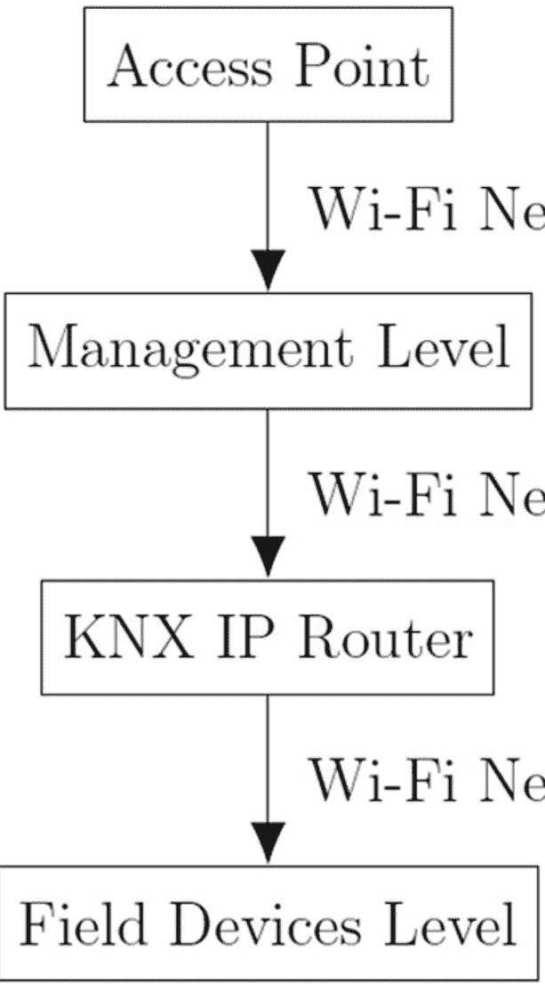

图 7.1 智能家居结构 [4]。

- 智能环境中的网络风险
- 威胁模型，用于开发风险分析并确定物联网系统组件的攻击概率
- 物联网生态系统中的攻击面及可能对策的建立。

## 7.3 范围

建立物联网系统中网络安全风险的建模需要考虑动态、异构和不确定性方面的利用。因此，所提出解决方案是基于使用贝叶斯网络来建模攻击面、识别风险要素，并建立由物联网解决方案产生的网络安全风险的方法论。

与经典统计方法相比，贝叶斯推理需要更少的数据和计算能力来预测最终影响。

贝叶斯网络为在因果或影响假设下对信息之间的关系进行建模提供了一个框架，这使其适用于建模现实世界情况，在这些情况下我们希望模拟各种干预的影响。

贝叶斯网络是在数据有限但人类领域专家对底层因果机制和/或现实世界事实有良好理解的情况下建模不确定性的适当方法。

本工作的目标是实现一个基于计算智能家居物联网网络中网络攻击概率的风险评估模型，使用贝叶斯网络。该贝叶斯网络的有向无环图来自智能家居的攻击图，其参数由最大似然法获得，该方法应用于由模拟生成的数据集。

## 7.4 物联网网络中的网络安全

物联网是包括物理设备、现代车辆、建筑物和我们不断使用的基本电气设备的基础设施，这些设备通过互联网相互连接以积累和交换数据 [2]。物联网网络是此类设备的环境。物联网的主要目的是通过减少压力和减少重复工作的数量来改善人们的生活质量 [3]。在物联网网络中，由于设计条件，一些设备的安全性较低；例如，智能冰箱的安全质量与具有防火墙或防病毒等保护的计算机不同。此外，对网络中任何设备的攻击都可能产生严重影响，因为由于设备之间互联程度高，可能发生级联效应。

### 7.4.1 智能家居

*智能家居*是由通过家中物联网网络互联的设备组成的一个系统。使用家庭物联网网络的一些动机是安全，因为房屋可以通过安全摄像头进行监控，并且紧急呼叫可以自动化，以及能源效率，因为智能家居设备可以根据需要或为节省能源而打开或关闭 [3]。我们在模型中使用的智能家居结构在 [4] 中提出：

- *接入点：* 攻击者位于此点。
- *管理层：* 该层由发出指令的设备组成，例如笔记本电脑和手机（CP）。
- *KNX IP 路由器：* 这由 KNX IP 路由器组成，所有 KNX 设备通过 KNX 总线与其通信。
- *现场设备层：* KNX 总线是所有 KNX 设备所在的位置，例如百叶窗、智能灯、空调和 IP 摄像头。

智能家居在这几层之间有三条 Wi-Fi 连接 [4]：

- *Wi-Fi 网络 1：* 在接入点和管理层之间提供连接。
- *Wi-Fi 网络 2：* 在管理层和 KNX IP 路由器之间提供连接。
- *Wi-Fi 网络 3*：在 KNX IP 路由器和现场设备层之间提供连接。

图 7.1 表示智能家居的结构。模型实现中考虑了以下攻击：社会工程学（SE）、网络钓鱼（PH）、恶意软件注入（MI）、拒绝服务（DoS）、路由表中毒（RTP）、持续攻击（PA）和中间人攻击（MitM）。

### 7.4.2 攻击图

*攻击图*是攻击者可以在网络中执行特定攻击时可以采取的路径的图形表示。对于本工作，攻击图由可在智能家居结构各个层级执行的、用于破坏现场设备层的不同类型的攻击组成。

用于模型开发的智能家居物联网网络的攻击图是 Ibrahim 和 Nabulsi [4] 提出的一个图。该图基于智能家居的结构——接入点、行政层、KNX IP 路由器和现场设备层——并使用刚刚提到的网络攻击。[4] 中开发的攻击图模型通过改编架构分析和设计语言（AADL）来实现。然后通过 JKIND 检查工具对其进行检查，以满足一项安全要求，即攻击者对连接到 KNX 总线的设备没有 root 权限。最后，使用 Graphviz 工具将结果用于可视化攻击图。在该攻击图中，表示了所有可对智能家居现场设备层进行攻击的路径。攻击者从接入点开始，对管理层设备执行社会工程攻击，该设备是手机，以获取有关该设备的信息。一旦攻击者获得信息，就可以执行网络钓鱼和恶意软件攻击以获得访问权限。然后可以从管理层对 KNX IP 路由器执行 DoS、RTP 和 PA 攻击。最后，可以从路由器对现场设备层执行 DoS 和 MitM 攻击，这是攻击者的目标。

## 7.5 使用贝叶斯网络建模

在本节中，我们首先描述数学概念以理解贝叶斯网络的理论。然后我们解释贝叶斯网络的定义、参数学习和将在模型实现中使用的推理。

### 7.5.1 图论

图是一个对 G = (V,E) 组成，其中 V 是一个节点集合，E 是一个连接集合 V 的两个元素的边集合。节点对 Xi, Xj 可以通过有向边或无向边连接。两种边类型的区别在于有向边是有序的节点对，因此我们有 (Xi,Xj) ≠ (Xj,Xi)，而无向边则有 {Xi,Xj} = {Xj,Xi}。我们说图是有向的，如果所有边都是有向的，并且是无向的，如果所有边都是无向的。

贝叶斯网络基于有向图，因此接下来的概念仅针对此类图进行解释。在有向图 G 中，对于边 (Xi,Xj)，我们说 Xj 是 G 中 Xi 的子节点，而 Xi 是 Xj 的父节点。我们使用 Pa(Xi) 表示 G 中 Xi 的所有父节点。节点 X1,...,Xk 在有向图 G = (V,E) 中形成一条路径，如果对于每个 i=1,...,k-1，我们都有边 (Xi,Xi+1) ∈ E。G 中的一个循环是路径 X1,...,Xk，其中 X1 = Xk。图是无环的，如果它不包含循环。贝叶斯网络的结构是有向无环图，它编码了随机变量的条件独立性。

对于有向无环图的表示，节点可以按任意顺序排列；只要所有边都给出，就可以理解图的构造。然而，在贝叶斯网络的一些算法和理论中，使用了节点的特定顺序，称为拓扑排序。设 G = (V,E) 为有向无环图，其中 V = {X1,..,Xn}。节点 X1,...,Xn 的一个排序相对于 G 是拓扑排序，如果每当我们有边 (Xi,Xj) ∈ E 时，则 i < j [5]。

### 7.5.2 概率与分布

在概率论中，事件是实验所有可能结果的一个子集，其概率量化了该事件发生的置信程度。如果事件 A 的概率为 1，我们确信 A 的其中一个结果会发生，如果为 0，我们认为它们都不可能 [5]。当 P(B) > 0 时，事件 A 在事件 B 发生条件下的条件概率定义为：。从该定义可以看出，。考虑 n 个事件 A1,...,An；我们有

这称为条件概率的链式法则。事件 A 与事件 B 独立，如果或如果。由此可知 A 与 B 独立当且仅当。事件 A 在事件 C 发生条件下与事件 B 条件独立，如果或如果。与独立情况类似，从该定义可知，A 在给定 C 的条件下与 B 条件独立当且仅当

随机变量由一个函数定义，该函数为样本空间的每个结果关联一个值。例如，在抛硬币两次的实验中，样本空间为 {HH, HT, TH, TT}，该空间上的一个随机变量可以是每次实验结果中正面出现的次数，在本例中分别为 2、1、1 和 0。然后随机变量的值为 0、1 和 2。离散随机变量取有限个值，而连续随机变量取无限多个值，例如整数或实数值。给定随机变量 X，边缘分布是指所有 X 的值 x 的 P(X=x)。在许多情况下，我们对涉及多个随机变量的值的概率感兴趣，在这种情况下，我们需要考虑联合分布。对于一组随机变量 {X1,...,Xn}，联合分布表示为 P(X1,...,Xn)，是为以这些随机变量指定的事件分配概率的分布 [5]。联合分布必须与边缘分布一致，例如，设 X 和 Y 为两个离散随机变量，则对于 X 的所有值 x，以及 Y 的所有值 y，。

对于两个随机变量 X 和 Y，表示在已知 Y 取值 y 的情况下 X 可描述事件的条件分布。对于每个值) 用于表示条件分布的集合。使用此记号，我们可以将随机变量的链式法则写为，，该式可从方程 (7.5.1) 扩展到多个变量 X1,...,Xn，如

随机变量中的独立性可以被视为事件独立性概念的推广（7.5.2）。设 X,Y,Z 为随机变量，我们说 X 在给定 Z 的条件下与 Y 条件独立，如果 P(X=x|Y=y, Z=z)=P(X=x|Z=z) 或者如果 P(Y=y,Z=z)=0 对于 X,Y 和 Z 的所有取值。我们用 I(X,Z,Y) [6] 表示条件独立性。条件独立性满足若干性质，这通常为证明关于分布的重要性质提供了一种非常简洁的方法。一些关键性质如下 [5,6]：

- **对称性：** I(X,Z,Y) 当且仅当 I(Y,Z,X)。
- **分解：** 如果 I(X,Z,Y ∪ W) 则 I(X,Z,Y) 且 I(X,Z,W)。
- **弱并：** 如果 I(X,Z,Y ∪ W) 则 I(X,Z ∪ Y,W)。
- **收缩：** 如果 I(X,Z,Y) 且 I(X,Z ∪ Y,W) 则 I(X,Z,Y ∪ W)。
- **交集：** 该性质仅对严格正概率分布类成立，即对每个事件都赋予非零概率的分布。如果 I(X,Z ∪ W,Y) 且 I(X,Z ∪ Y,W) 则 I(X,Z,Y ∪ W)。

### 7.5.3 Bayesian Networks

贝叶斯网络对于一组变量是一个二元组 (G, Θ)，其中 G 是一个有向无环图，包含 n 个节点，每个变量在 X 中对应一个节点，称为网络结构，而 Θ 是一组条件概率函数，每个变量在 X 中对应一个，称为网络参数化 [6]。我们使用以下记号：对于 的所有取值以及 的所有可能取值组合 。如果节点没有父节点，则考虑边缘分布。

根据随机变量的类型，区分三种类型的贝叶斯网络：如果变量是离散的，则为离散型；如果变量是连续的，则为连续型；如果网络中同时存在离散和连续变量，则为混合型。在我们的模型中，考虑离散贝叶斯网络，因此 Θ 表示每个变量的条件概率表的集合。

贝叶斯网络的图 G 编码了以下条件独立性假设集合，称为局部独立性：对于每个变量 Xi，I(Xi, Pa(Xi), Nondescendants(Xi))。

设 $X_1,\ldots,X_n$ 为贝叶斯网络的变量，并假设表示这些变量的节点在图中按拓扑顺序排列。从方程 (7.5.2) 我们有：

考虑方程 (7.5.3) 的一个因子：由于节点 (7.5.3) 按拓扑顺序排列，因此得出 且 $X_i$ 的后代都不在所述集合中。因此，其中 从 $X_i$ 的局部独立性和条件独立性的分解性质可知，$I(X_i,Pa(X_i),Z)$。因此

如果我们将此变换应用于方程 (7.5.4) (7.5.3) 的所有因子，则有：

方程 (7.5.5) 称为贝叶斯网络的链式法则，该结果解释了模型变量的联合分布。贝叶斯网络以紧凑的方式表示一组随机变量的联合分布。在离散随机变量的情况下，必须声明变量取值所有组合的概率来表示联合分布，且概率数量可能很大。例如，如果我们考虑一组 $n$ 个二值随机变量（伯努利变量），联合分布需要指定 $2^n$ 个概率。注意到概率之和必须为 1，则总共需要指定 $2^n-1$ 个数字。对于较大的 $n$ 值，这种表示变得难以处理。根据研究问题，估计这些概率对人类专家来说可能很困难，如果我们想从数据中学习分布，则需要大量数据来稳健地估计参数 [5]。贝叶斯网络通过使用变量之间的条件独立性来解决此问题，使得联合分布的表示需要更少的参数，并且可以更好地解释整个现象。如果贝叶斯网络图中的每个节点最多有 $k$ 个父节点，则所需的独立参数总数小于 [5]。

### 7.5.4 Parameter Learning

在贝叶斯网络理论中，模型选择和估计被称为学习，这分为两个步骤：学习贝叶斯网络的结构，即有向无环图，以及学习参数，即对应于图结构的局部概率分布 [7]。在这项工作中，有向无环图是从 [4] 中提出的攻击图获得的。对于参数学习，我们使用数据集的最大似然方法。为了解释该方法，我们介绍参数学习的一些相关定义。

一组变量的数据集 D 是一个向量，其中每个 称为一个案例，表示变量 X 的部分实例化。如果每个案例都是变量 X 的完整实例化，则数据集是完整的；否则，数据集是不完整的 [6]。

完整数据集 D 的经验分布定义为

其中 是满足事件 的数据集 D 中的案例数。      (7.5.6)

设 x 为 X 中变量的一个实例化，u 为其在 G 中的父节点的实例化；然后，使用定义 (7.5.6)，参数可以用经验概率估计：

设 为给定网络 (7.5.7) 结构 G 的所有参数估计的集合，设 为结构 G 和估计 诱导的概率分布。这些估计的似然定义为：

即，估计的似然是在这些估计下观察到数据集 D 的概率 (7.5.8) [6]。给定完整数据集 D，由 (7.5.7) 定义的参数估计是使由 (7.5.8) 定义的似然函数最大化的唯一估计。在我们的工作中，我们通过模拟网络攻击生成完整数据集，然后用方程 (7.5.7) 的估计来估计贝叶斯网络的参数。

### 7.5.5 Inference

一旦贝叶斯网络设计完成，目标是通过回答关于贝叶斯网络变量及其概率的问题来获取信息 [6, 7]。所使用的技术通常称为推理。对于贝叶斯网络，回答这些问题的过程也称为 *probabilistic reasoning* 或 *belief updating*，而问题本身称为 *queries* [7]。用于风险评估的查询是证据概率、后验边缘分布和最可能解释。考虑到我们在模型中使用伯努利随机变量，给定一组伯努利随机变量的贝叶斯网络，这些推断为：

**证据概率：** 对于  
**后验边缘分布：** 设 为贝叶斯网络的证据；后验边缘分布为  
**最可能解释：** 设 为贝叶斯网络的证据；最可能解释是 使得 最大。

用于计算推断的算法分为精确和近似。精确算法基于贝叶斯定理的应用，由于其性质，它们适用于小型网络。另一方面，近似算法基于蒙特卡洛模拟来采样网络的全局分布从而估计推断，这些算法在节点数量较多的贝叶斯网络中有用。

## 7.6 MODEL IMPLEMENTATION

### 7.6.1 Network Structure

以下伯努利随机变量被考虑用于贝叶斯网络的实现：

- *SECP*: 在本例中，从接入点到管理层（由手机组成）执行社会工程攻击。
- *PHCP*: 从接入点到管理层执行网络钓鱼攻击。
- *MICP*: 从接入点到管理层执行恶意软件注入攻击。
- *DOSR*: 从管理层到 KNX IP 路由器执行 DoS 攻击。


- *RTPR*：从管理层对 KNX IP 路由器执行路由表投毒攻击。
- *PAR*：从管理层对 KNX IP 路由器执行持久性攻击。
- *DOSF*：从 KNX IP 路由器对现场设备层执行拒绝服务攻击。
- *MITMF*：从 KNX IP 路由器对现场设备层执行中间人攻击。

贝叶斯网络考虑了随机变量之间的因果关系，这与攻击图类似，因为给定攻击图中的一条边，子节点的状态条件依赖于父节点的状态；也就是说，一次攻击的成功条件依赖于对前一节点攻击的成功 [8]。那么，在此背景下，如果攻击图是有向无环图，则贝叶斯网络的结构可以用攻击图来表示。

考虑到图 7.1 的智能家居结构、文献 [4] 中提出的攻击图以及前面提到的变量，我们使用以下有向无环图来实现贝叶斯网络（见图 7.2）。在该图中，表示了所有可能对现场设备层发起攻击的路径。

### 7.6.2 攻击模拟

模拟的目标是描述网络攻击如何通过网络节点进行；这是通过模拟离散随机变量来实现的。首先，选择在智能家居结构的每个层级执行的攻击类型，然后确定攻击者是否成功入侵了设备。这是通过遵循贝叶斯网络图描述的路径来完成的，模拟的结果是一个数据集，其中每列代表一个网络节点，每行代表网络上的一次完整攻击事件，指示攻击所经过的节点。模拟的一般考虑是：攻击者可以从一个节点发起多次攻击，并且不允许进行不遵循图所描述路径的攻击。

### 选择概率

对智能家居网络的网络攻击遵循图 7.2 中的图结构。对于智能家居结构的每个层级，第一步是决定攻击类型，这是通过模拟伯努利随机变量来完成的。该选择指的是模拟一个包含 2 或 3 个伯努利变量的向量，如果该节点被选为攻击目标，则值为 1，否则为 0。在第一个节点中，选择概率为 100%，因为最初只能从接入点对管理层执行社会工程攻击。然后，遵循图的路径，可以选择对管理层进行网络钓鱼攻击、恶意软件攻击，或两者兼施，并且必须给出这些情况的选择概率。模拟中使用的选择概率见表 7.1、表 7.2 和表 7.3。

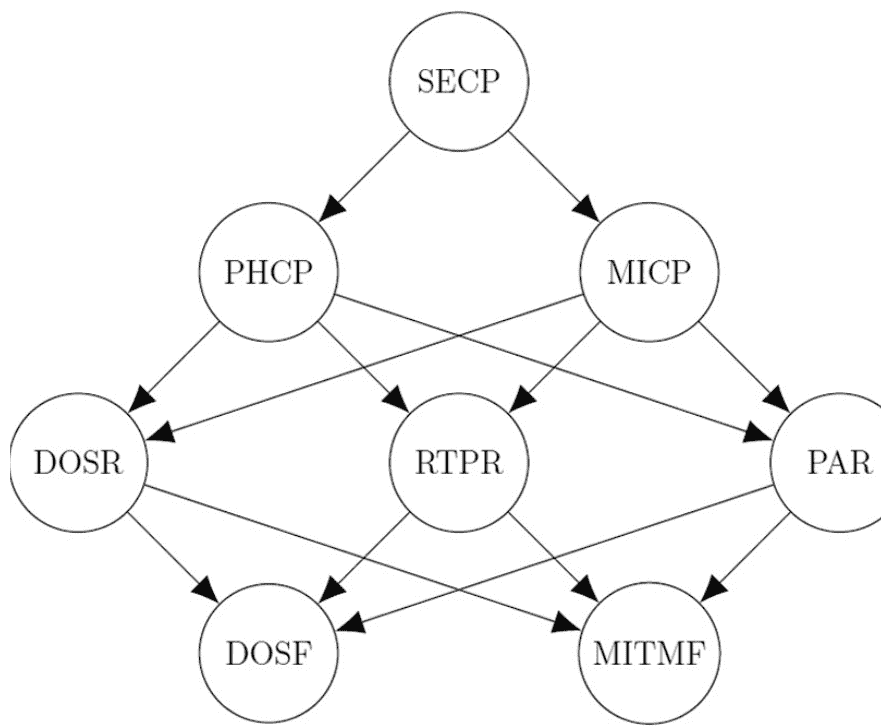

图 7.2 贝叶斯网络的有向无环图。

### 表 7.1 管理层选择概率

| PHCP | MICP | 概率 |
|---|---|---|
| 0 | 0 | 0.00 |
| 0 | 1 | 0.35 |
| 1 | 0 | 0.55 |
| 1 | 1 | 0.10 |

### 表 7.2 KNX IP 路由器选择概率

| DOSR | RTPR | PAR | 概率 |
|---|---|---|---|
| 0 | 0 | 0 | 0.00 |
| 0 | 0 | 1 | 0.10 |
| 0 | 1 | 0 | 0.15 |
| 0 | 1 | 1 | 0.10 |
| 1 | 0 | 0 | 0.25 |
| 1 | 0 | 1 | 0.15 |
| 1 | 1 | 0 | 0.20 |
| 1 | 1 | 1 | 0.05 |

### 表 7.3 现场设备层选择概率

| DOSF | MITMF | 概率 |
|---|---|---|
| 0 | 0 | 0.00 |
| 0 | 1 | 0.35 |
| 1 | 0 | 0.55 |
| 1 | 1 | 0.10 |

### 基于 CVSS 分数的漏洞概率

通用漏洞评分系统（CVSS）是一种评分系统，用于衡量信息技术安全中漏洞的影响或严重程度。CVSS 分数基于软件、硬件和固件漏洞的主要技术特征 [9]。CVSS 旨在生成设备漏洞的定性和定量评分 [10]。通常，使用三个指标来计算这些分数：基础指标、时间指标和环境指标。基础分数反映漏洞根据其随时间不变的固有特征的严重程度，并基于不同场景中的最坏情况进行估计 [9]。时间指标根据随时间变化的因素进行描述，而环境指标则根据特定环境进行描述 [9]。在本工作中，由于这是一个针对通用智能家居网络的模型，我们使用基础指标来确定网络设备的 CVSS 分数，因为时间和环境指标是情境性的，在更具体的模型中才会更有用。

在以往的工作中，CVSS 分数已被用于估计计算机系统风险评估模型中离散贝叶斯网络的参数 [8, 11, 12]。在文献 [11] 中，利用漏洞的概率被认为是 CVSS 分数除以域大小（即 10）。然而，这种方法没有考虑图中存在的攻击之间的因果关系。在本工作中，CVSS 分数不直接用作贝叶斯网络的参数，而是作为攻击模拟的标准之一。基础指标按照文献 [11] 的方法转换为概率，该值用作伯努利随机变量的参数。然后模拟该随机变量的一个值，结果指示攻击者是否成功执行了攻击。

在文献 [10] 中，计算了医疗保健、商业和家庭自动化领域中物联网设备的基础指标。该文章提到，IP 摄像机的 CVSS 分数为 8.3，智能集线器为 8.5。因此，我们认为现场设备层的分数为 8.3，并且由于智能集线器与 KNX IP 路由器具有相似特征，因此该层级的分数取为 8.5。对于管理层，CVSS 分数视为 8。

### 攻击模拟算法

考虑到选择概率和漏洞概率，提出以下算法来模拟网络攻击事件。输入数据是网络攻击事件的数量、贝叶斯网络的图、选择概率和漏洞概率。结果获得一个包含 *N* 个攻击事件的数据集。该算法包括重复以下过程 *N* 次：

- 选择图的根节点。
- 识别子节点，并使用相应层级的选择概率通过模拟离散随机变量来选择攻击。
- 对于上一步选择的节点，通过模拟参数为漏洞概率的伯努利随机变量，验证攻击者是否成功入侵了设备。
- 将上一步中受损的节点保存在一个向量中，并利用这些节点执行步骤 2 和 3，直到图中没有更多子节点。
- 创建一个向量，其中每个位置代表贝叶斯网络的一个变量；如果该变量（节点）被选中并受到入侵，则设置值为 1，否则为 0。

### 7.6.3 网络参数化

使用公式 (7.5.8) 的最大似然估计，从攻击模拟生成的数据集中获得参数。具体来说，计算以下参数：

- $\Theta_{\mathrm{SECP}}$
- $\Theta_{\mathrm{PHCP}\mid\mathrm{SECP}}$
- $\Theta_{\mathrm{MICP}\mid\mathrm{SECP}}$
- $\Theta_{\mathrm{DOSR}\mid\mathrm{PHCP},\ \mathrm{MICP}}$
- $\Theta_{\mathrm{RTPR}\mid\mathrm{PHCP},\ \mathrm{MICP}}$
- $\Theta_{\mathrm{PAR}\mid\mathrm{PHCP},\ \mathrm{MICP}}$
- $\Theta_{\mathrm{DOSF}\mid\mathrm{DOSR},\ \mathrm{RTPR},\ \mathrm{PAR}}$
- $\Theta_{\mathrm{MITMF}\mid\mathrm{DOSR},\ \mathrm{RTPR},\ \mathrm{PAR}}$

### 7.6.4 结果

本节介绍了模型实现所获得的结果。模拟的攻击次数为 1000。使用精确推理

贝叶斯网络中的算法 [7]，计算了四个结果：

1. 对现场设备层进行 DoS 和 MitM 攻击的概率
2. 在网络中其他节点存在攻击证据的情况下，对现场设备层进行 DoS 和 MitM 攻击的概率
3. 在存在攻击证据且管理层未发生钓鱼和恶意软件注入攻击的情况下，对现场设备层进行 DoS 和 MitM 攻击的概率
4. 在现场设备层存在 DoS 和 MitM 攻击证据的情况下，最可能的解释

前三个结果分别展示在表 7.4、7.5 和 7.6 中。至于最可能的解释：如果有证据表明现场设备层发生了 DoS 攻击但未发生 MitM 攻击，或发生了 MitM 攻击但未发生 DoS 攻击，最可能的解释包括对管理层进行社会工程攻击，然后是对管理层进行钓鱼攻击，之后是对 KNX IP 路由器进行 DoS 攻击，最后是证据中出现的任何攻击。

**表 7.4.** 对现场设备层进行 DoS 和 MitM 攻击的概率

| 攻击 | 概率 |
|---|---|
| DOSF | 0.3257822 |
| MITMF | 0.2627260 |
| DOSF and MITMF | 0.1897563 |

**表 7.5.** 在网络中其他节点存在攻击证据的情况下对现场设备层进行 DoS 和 MitM 攻击的概率

| 攻击 | 证据 | 概率 |
|---|---|---|
| DOSF | SECP | 0.4134291 |
| MITMF | SECP | 0.3334087 |
| DOSF and MITMF | SECP | 0.2408075 |
| DOSF | PHCP | 0.6054472 |
| MITMF | PHCP | 0.4905264 |
| DOSF and MITMF | PHCP | 0.3567098 |
| DOSF | MICP | 0.6333557 |
| MITMF | MICP | 0.5179413 |
| DOSF and MITMF | MICP | 0.3813129 |
| DOSF | DOSR | 0.7190847 |
| MITMF | DOSR | 0.5931191 |
| DOSF and MITMF | DOSR | 0.4460161 |
| DOSF | RTPR | 0.7592573 |
| MITMF | RTPR | 0.6449062 |
| DOSF and MITMF | RTPR | 0.5024086 |
| DOSF | PAR | 0.7097519 |
| MITMF | PAR | 0.6507042 |
| DOSF and MITMF | PAR | 0.4829878 |

**表 7.6.** 在存在攻击证据且管理层未发生钓鱼和恶意软件注入攻击的情况下对现场设备层进行 DoS 和 MitM 攻击的概率

| 攻击 | 证据 1 | 证据 2 | 概率 |
|---|---|---|---|
| DOSF | No PHCP | MICP | 0.5625418 |
| MITMF | No PHCP | MICP | 0.4474423 |
| DOSF and MITMF | No PHCP | MICP | 0.3165204 |
| DOSF | PHCP | No MICP | 0.5468065 |
| MITMF | PHCP | No MICP | 0.4323725 |
| DOSF and MITMF | PHCP | No MICP | 0.3036255 |
| DOSF | PHCP | MICP | 0.7013511 |
| MITMF | PHCP | MICP | 0.5856344 |
| DOSF and MITMF | PHCP | MICP | 0.4435267 |

## 7.7 结论与未来工作

在本章中，使用贝叶斯网络实现了一个智能家居物联网网络的风险评估模型，其有向无环图来自 [4] 中提出的攻击图，其参数来自对通过仿真获得的数据集应用最大似然方法获得。本章中，使用贝叶斯网络实现了一个智能家居物联网网络的风险评估模型，其有向无环图来自 [4] 中提出的攻击图，其参数来自对通过仿真获得的数据集应用最大似然方法获得。表 7.4、7.5 和 7.6 提供了在智能家居网络存在或不存在其他攻击证据的情况下，对现场设备层进行不同攻击的概率。这些结果可供网络安全评估人员使用；例如，如果认为智能家居网络具有与模型中提出的类似的选择和漏洞概率，并且有证据表明管理层发生了钓鱼攻击，则现场设备层发生 DoS 攻击的概率为 60.54%，发生 MitM 攻击的概率为 49.05%。因此，一个可行的选择是采取行动保护设备免受 DoS 攻击。使用表 7.6，如果有证据表明管理层还发生了恶意软件注入攻击，则 DoS 攻击的概率上升到 70.15%，使防止 DoS 攻击变得紧迫。使用该方法论的优势在于它允许对这些概率进行量化，这对决策很有用。

通过贝叶斯推理，可以以更高的细节水平获得有关不同事件的新信息，因为对现象的了解会随着证据而更新。在风险评估中，这些证据可以是观察到的或假设的，在第二种情况下，可以了解在不同情况下会发生什么，并且基于此分析可以做出更好的决策。贝叶斯网络模型的主要优点之一是它考虑了随机变量的条件依赖性。

在本章中，风险评估包括查找网络上不同网络攻击事件的概率。这种类型的分析在决策基于概率的情况下很有用。未来的工作将侧重于根据评估者的需求为风险评估添加更多细节。例如，可以包括网络攻击的影响，既可以由评估者创建的分数形式，也可以与网络攻击造成的财务损失相关，并且这种财务损失可以集中在信息丢失或服务中断上。

本章包括对智能家居结构进行的总体分析。未来的工作可以包括对特定智能家居的研究，详细说明每个设备及其自身特征。为此，必须指定新的选择概率和用于模拟攻击的漏洞概率的 CVSS 分数。然而，理想的情况是使用提供的数据集，以获得对智能家居状况的更现实分析。有了真实案例的数据集，将遵循本工作的相同程序，只是攻击的模拟除外。

应该提到的是，由于攻击图的使用并不仅限于智能家居，因此该分析可以扩展到不同类型的物联网网络。一个有趣的研究可能集中在智慧城市上，这是目前蓬勃发展的技术，因此在这些环境中研究网络安全是人们和网络安全评估人员迫切需要的。

## 参考文献

1. Poolsappasit, N., Dewri, R., and Ray, I. “使用贝叶斯攻击图进行动态安全风险管理”. *IEEE Transactions on Dependable and Secure Computing*, 9(1):61–74, 2012.
2. H. Rajab and T. Cinkler. “基于物联网的智慧城市”. In *2018 International Symposium on Networks, Computers and Communications (ISNCC)*. IEEE, 2018.
3. D. Bastos, M. Shackleton, and F. El-Moussa. “物联网：智能家居和城市环境中的技术与安全风险综述”. In *Living in the Internet of Things: Cybersecurity of the IoT – 2018*. Institution of Engineering and Technology, 2018. DOI:10.1049/CP.2018.0030
4. M. Ibrahim and I. Nabulsi. “应用攻击图对智能家居系统进行安全分析”. In *2021 Fifth World Conference on Smart Trends in Systems Security and Sustainability (WorldS4)*. IEEE, 2021.
5. Koller, D. and Friedman, N. “概率图模型：原理与技术”. *Adaptive Computation and Machine Learning series*. MIT Press, 2009.
6. A. Darwiche. *使用贝叶斯网络进行建模与推理*. Cambridge University Press, 2009.
7. Scutari, M. and Denis, J.-B. (2014). *使用 R 的贝叶斯网络*. Chapman and Hall/CRC.
8. Liu, Y. and Man, H. “使用贝叶斯网络进行网络漏洞评估”. In Dasarathy, B. V., editor, *Data Mining, Intrusion Detection, Information Assurance, and Data Networks Security 2005*, volume 5812, pp. 61–71. International Society for Optics and Photonics, SPIE, 2005.
9. 通用漏洞评分系统版本 3.1 规范文档. [Online] www.first.org/cvss/v3.1/specification-document
10. S. Rizvi, N. McIntyre and J. Ryoo, “计算物联网设备漏洞的安全分数,” *2019 International Conference on Software Security and Assurance (ICSSA)*, 2019, pp. 52–59.
11. Frigault, M., Wang, L., Singhal, A., and Jajodia, S. “使用动态贝叶斯网络衡量网络安全”. In *Proceedings of the 4th ACM Workshop on Quality of Protection*, QoP ‘08, pp. 23–30, New York, NY, USA, 2008. Association for Computing Machinery.
12. Muñoz-González, L., Sgandurra, D., Barrère, M., and Lupu, E. C. “贝叶斯攻击图分析的精确推理技术”. *IEEE Transactions on Dependable and Secure Computing*, 16(2):231–244, 2019.
13. Zeng, J., Wu, S., Chen, Y., Zeng, R., and Wu, C. “从数据和知识处理的角度对攻击图分析方法进行综述”. *Security and Communication Networks*, 2019:1–16, 2019.


# 第二部分

# 安全的 AI/ML 系统：防御

# 机器学习防御策略综述

Joseph Layton^1, Fei Hu^1, and Xiali Hei^2

^1电气与计算机工程，阿拉巴马大学，美国  
^2计算与信息学院，路易斯安那大学拉法叶分校，美国

DOI: [10.1201/9781003187158-10](https://doi.org/10.1201/9781003187158-10)

### 目录

- 8.1 引言
- 8.2 安全威胁
- 8.3 蜜罐防御
- 8.4 中毒数据防御
- 8.5 针对对抗性攻击的 Mixup 推断
- 8.6  cyber-物理技术
- 8.7 信息融合防御
- 8.8 结论与未来方向
- 参考文献

## 8.1 引言

机器学习通常是指智能算法，自改进是这些系统的核心特征。使用有监督学习系统，可以对复杂数据集做出决策和预测，而无需针对遇到的每种情况进行直接编程。得益于计算能力的快速提升以及收集到的庞大用户行为数据集（点击、观看时长、阅读模式等），机器学习可用于发现这些数据集中以前用经典编程方法难以分析的模式。

机器学习系统的三种主要类型是有监督学习、无监督学习和强化学习（见图 8.1）[1]。有监督学习使用包含典型输入和期望输出的训练数据集来“教导”算法如何对训练数据以及训练集之外的未来输入做出准确预测。无监督学习取一个数据集并尝试在没有关于预期输出的明确指示的情况下在数据中寻找模式。通过识别数据中的“聚类”，机器学习系统最终在没有对训练数据进行显式标记/标注的情况下构建数据集模型，从而使其能够识别多个输入之间的共同点。强化学习可以通过正向或负向奖励系统来模拟大多数生物体的学习方式。算法被赋予一个任务，并在每次尝试后进行评分，以确定本次迭代的有效性。早期，大多数成功的尝试都归功于运气，但随着“幸运”的少数案例被迭代，模型开始持续提高其得分。这种训练通常会持续数百或数千次迭代，直到模型达到任务所需的可靠性阈值，例如识别遇到的 99.9% 的停车标志。

### 机器学习类型

| 有监督分类 | 无监督聚类 | 强化奖励最大化 |
|---|---|---|
| • 图像分类
• 诊断检测
• 垃圾邮件检测 | • 人脸识别
• 文本挖掘
• 大数据可视化 | • 游戏 AI
• 库存管理
• 实时决策 |

图 8.1 机器学习三种类型及其应用。

对于仅在内部数据上运行且网络隔离和数据隔离的简单机器学习系统，安全性考虑极少。然而，对于从重要公司数据库甚至整个互联网获取数据的更复杂系统，需要考虑训练阶段或部署阶段的潜在威胁。根据具体的机器学习应用以及用户被授予的访问级别，用于防御对抗性攻击者的技术范围可以从简单的数据过滤到复杂的决策分析和模型调整。

## 8.2 安全威胁

对抗 ML 系统的攻击旨在降低系统的学习能力、导致模型行为出现故障并从系统中获取敏感信息。由于机器学习模型是一个用于对输入做出决策的大型加权连接网络，对抗性攻击可以包含无关数据，导致算法识别出不存在的模式。针对特定 ML 系统的攻击会应用对人类操作员不可检测的输入数据“扰动”，但模型会检测到并采取行动。处理视觉数据的系统已被广泛研究用于对抗性攻击，尤其是在自动驾驶系统日益普及的情况下。例如，在停车标志上添加贴纸可能会导致计算机视觉系统将其识别为让行标志或限速标志而不是停车标志 [2]。

针对机器学习系统的典型攻击向量可按其针对的模型阶段进行分组：训练或部署。在训练阶段，模型仍在从给定数据集形成连接，因此攻击者用 imperceptible 噪声和扰动污染训练数据，导致模型在分类时形成错误的连接。一旦模型训练完成并部署，攻击者随后会寻求评估和冒充模型，用一个替代网络替换它，该网络在粗略检查时似乎产生正确结果，但实际上产生针对性错误。此期间的攻击通常围绕查询模型以构建替代训练集，从而缓慢降低模型的准确性。

在本章中，概述了几种威胁类型以及针对这些威胁的各种对策。首先，介绍了一个蜜罐防御网络，以分散潜在的对抗性攻击者，使其无法与真实系统交互。接下来，演示了中毒数据的概念以及在模型的预测和调整阶段对抗中毒数据的一般方法。之后，介绍了 mixup 推断的原理，以提高 mixup 训练模型的防御参数及其全局线性性。在随后的部分中，讨论了防御 cyber-物理系统免受数据导向攻击的技术以及此类技术对物联网设备的适用性。从那里，介绍了信息融合的概念以及数据融合在网络级防御机制中的应用，特别是那些对互联网导向和 CPS 导向网络建模的机制。在概述了各种机器学习防御技术之后，提出了一些更广泛的结论和关于 ML 防御的潜在未来方向。

## 8.3 蜜罐防御

蜜罐（图 8.2）或蜜罐陷阱是一种计算机安全方案，使用诱饵系统来捕获针对真实系统的对抗性攻击。蜜罐对攻击者来说看起来像一个合法的计算机系统，并通过留下故意的安全漏洞使其对这些攻击者具有吸引力，以便攻击者利用。蜜罐系统的目标是从攻击者本人那里获取有关网络攻击方法的信息，同时占用攻击者的时间，降低其对实际目标的有效性。

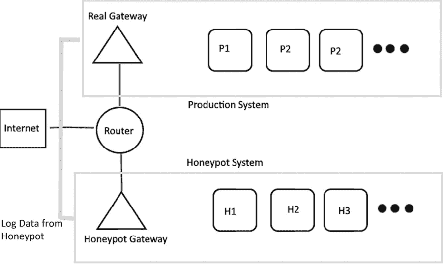

**图 8.2** 蜜罐系统图。

蜜罐的两种主要类型是低交互和高交互 [3]。*低交互* 陷阱使用最少的资源并仅从针对它们的攻击中收集基本信息。这些系统通常只是内部存储极少数据的模拟网络。由于一旦被攻破，它们内部几乎没有内容可以吸引攻击者，这些低交互陷阱提供的关于复杂网络攻击的信息并不多。*高交互* 蜜罐则设置一个完整的系统，包含伪造的数据库和多层访问权限，与真实系统类似。这些高交互系统占用攻击者更多的时间，并能提供对其攻击模式的更深入见解，例如尝试入侵加密数据库或下载蜜罐的某些部分。

对于机器学习系统，蜜罐可用于防止对抗性攻击者破坏学习模型，同时减少攻击者可以从机器学习系统中获取的间接信息。正如 Younis 和 Miri [4] 在关于去中心化蜜罐的论文中所演示的那样，这类陷阱的网络可用于实现以下结果：防止攻击者学习标签并逼近黑盒系统，引诱攻击者转向诱饵

这种系统会占用攻击者的时间，并为攻击者制造计算上不可行的任务 [4]。

在设置蜜罐网络作为机器学习系统的额外防御层时，需要牢记一些重要注意事项，以确保陷阱的有效性。首先，每个蜜罐节点在探测攻击者面前应尽可能真实——使用现有的机器学习系统，但允许其在模拟数据上运行，可以产生一个在对抗性攻击者看来如同生产系统的蜜罐。其次，蜜罐部署时应在文件系统中设置“泄露”令牌，这些令牌在攻击者看来是服务器内的潜在漏洞；这些人为制造的数据转储（凭据、模型参数等）被放置在系统内的不同位置，供攻击者访问。第三，每个蜜罐节点应捕获并报告攻击者侵入系统并搜索数据时的活动。使用蜜罐网络可以将这种报告隐藏在攻击者误以为是各服务器之间合法通信的网络活动中。

为了识别潜在攻击者，研究人员使用了各种可配置的标志，用于指示非用户正试图了解该机器学习系统的行为。这些标志包括持续的 DNN 查询、大量的 DNN 标注请求，以及分类准确率的突然下降。与普通用户每会话查询诱饵 DNN 模型 1–2 次不同，攻击者在构建合成训练数据集时可能会向模型发送数百或数千次查询。向预言机（用于与模型交互的接口）发送大量查询请求也不是普通用户的典型行为，但攻击者会反复查询预言机，以扩大他们计划输入 DNN 的合成训练模型。如果已知输入及其已知输出先前在高置信度和低置信度下得到的分类突然开始改变，这也可以作为模型正遭受攻击的指标。

蜜罐防御可以作为现有安全架构的实际补充，但不适合作为对抗对抗性攻击者的唯一防御手段。其主要功能是浪费潜在攻击者的时间，同时提供一些关于这些攻击者行为的数据；然而，这需要攻击者以蜜罐为目标并与之互动。虽然包含明显的安全漏洞和“泄露”数据可以使蜜罐对攻击者具有吸引力，但这些策略并不能保证攻击者会与诱饵系统互动足够长的时间，从而引出有意义的数据。

## 8.4 数据投毒防御

近期对机器学习算法的研究表明，一个潜在的攻击向量是用于机器学习系统的训练数据集，即所谓的数据投毒攻击。这种在机器学习系统运行生命周期早期对其完整性的破坏可能产生有害影响，特别是当恶意修改很隐蔽且人类操作员难以发现时。例如，一个经过训练用于诊断患者数据的机器学习系统可能报告比预期更多的假阳性，从而降低对系统的信任，并导致患者预后恶化。

Mozaffari-Kermani 等人在关于数据投毒防御技术的论文中，提出了与算法无关的通用方法，用于在医疗系统中实施投毒攻击，并给出了针对这些通用攻击的对策 [5]。由于本章重点讨论针对机器学习攻击的防御措施，作者只能简要介绍这些通用攻击。

这种投毒数据的攻击模型假设潜在攻击者对训练数据集有一定了解，可能是通过公开数据集（如人群健康数据）获得，也可能是通过窃听网络流量来收集特定数据。这些潜在攻击者的动机可能各不相同，但这些攻击的总体结果是模型在特定分类（称为被攻击类）中的性能下降。例如，攻击者可能希望将患者的甲状腺功能减退症误诊为正常：一旦做出最初的误诊，对恶意攻击者来说无论哪种情况都有利：(1) 诊断被纠正，但机器学习系统的信任度降低；或 (2) 诊断未被纠正，患者承受健康后果。对抗性攻击者要实现这一目标，必须向训练集中添加足够多的投毒数据，使机器学习系统开始错误地识别扰动，将恶意放置的信号误认为健康状况的实际标识。

Mozaffari-Kermani 等人提出的对策是定期使用训练数据集构建并评估一个独立模型，如果两次构建之间模型的准确率统计量发生显著变化，则触发阈值警报。通过跟踪正确分类率和 Kappa 统计量，可以随时间衡量模型中的扰动，并确定恶意数据进入训练集的时间范围。通过同时使用这两种统计量，即使恶意数据没有直接降低分类比率，也可以触发警报。

## 8.5 针对对抗性攻击的 Mixup 推断

为了减少记忆化和对不利样本的敏感性等不良行为，Zhang 等人在训练阶段引入了“mixup”方法 [5]。*mixup* 的主要原理是在成对样本及其标签的凸组合上训练神经网络。通过这样做，神经网络被正则化，从而倾向于训练样本之间的简单线性行为。2018 年引入 mixup 概念的论文表明，这一原理提高了神经网络的泛化能力，并增强了网络对对抗样本的鲁棒性 [5]。

作为这项工作的延伸，Pang 等人开发了 *mixup 推断*（*MI*），这是一种推断原理，旨在提高 mixup 训练模型的防御效果，使其能够更积极地对抗对抗样本 [6]。使用 MI 技术的模型的核心原理是将输入与其他随机干净样本相结合，缩小并转移数据集中可能存在的任何对抗扰动。这种输入结合过程旨在防止局部扰动影响模型的全局预测。

### 图 8.3 Pang 等人提出的算法概览 [6]（改编）

|  |  |
|---|---|
| 输入 | 模型输入 x；经 mixup 训练的分类器 F |
| 超参数 | Mixup 比率 λ；执行次数 N；样本分布 p |
| 算法 | 1. 采样标签 y，然后选择 x，使得 x ~ p(x|y)。<br>2. 将 x 与来自样本分布的 x* 进行 mixup。<br>3. 将 F(x) 的预测更新为预测的运行平均值。 |

在其方法论中，Pang 等人提出了一种用于 mixup 训练分类器的算法（图 8.3），该算法接收输入 x，并在将其输入预测模型之前对其执行 mixup。理论上（只要有足够的计算时间和充足的干净样本），一个 mixup 训练良好的模型 F 可以被建模为干净样本凸组合上的线性函数 H。通过调整预测阶段执行的迭代次数，可以在训练阶段之后改变模型对对抗样本和局部扰动的敏感性。

针对其 mixup 推断原理的实验结果，训练在 CIFAR-10 和 CIFAR-100 上使用 ResNet-50 完成 [6]。Pang 等人首先评估了 oblivious-box 攻击下的性能，此类攻击中攻击者不了解防御机制，并基于一般原则生成对抗样本。在目标攻击和非目标攻击两种模式下，MI 方法都能提高具有全局线性性的已训练模型的鲁棒性。它还与插值 AT 等训练阶段防御方法兼容。对 MI 方法的消融研究还表明，它有效地利用了 mixup 训练模型所产生的全局线性性，而不是给过程引入额外随机性 [7]。

在白盒自适应攻击（对抗性攻击者了解防御机制）下，MI 方法仍然表现强劲，但其扩展性不如盲目攻击。对于自适应攻击，额外增加 MI 方法的迭代次数所带来的改进比 oblivious-box 攻击更微小。


## 8.6 信息物理技术

信息物理系统通过基于计算机的算法来控制或监视物理机制；物理组件和软件组件相互交织，使得一个领域的变化会引发另一个领域的变化[8]。信息物理系统的例子包括智能电网、医疗监控系统和工业控制系统。信息物理系统的关键特征是其物理输入和输出的网络设计，而不是独立的设备。

在其2017年的论文中，Cheng等人提出了一种用于防御面向数据攻击的安全方法论（Orpheus）[9]。此类攻击试图在不中断控制流的情况下更改程序的变量，导致物理实际发生的情况与CPS网络认为正在发生的情况之间出现脱节。Orpheus的核心方法是一种事件感知的有限状态自动机（eFSA），通过评估状态转换并根据先前状态确定传入数据的准确性来检测通过数据导向攻击导致的破坏。该系统的概念验证已在Raspberry Pi平台上实现，以证明将其集成到嵌入式控制系统中的可行性。

构建eFSA的第一步涉及构建一个静态的FSA模型，然后通过事件识别和依赖性分析对其进行增强。与基本的FSA模型相比，eFSA可以检查运行时行为与程序执行语义之间的一致性，标记偏离预期自动机或未能匹配预期上下文数据的状态转换。

一旦构建了eFSA，就可以在系统运行期间使用它，对潜在异常进行分类和评估。第一种异常类型是事件无关的状态转换——如果状态之间的转换不是正常预期的，自动机将移动到已知的良好状态。这可以降低试图调整模型控制流的面向控制攻击的有效性。第二种异常类型包括事件依赖的状态转换。除了之前的静态检查外，eFSA还用于确定程序行为与给定输入的一致性；如果提供了有效输入数据但与其他物理上下文不匹配，则可以发出警报，并使程序返回到已知的良好状态。要绕过此检查，攻击者需要完全访问系统，并模拟正确的输入以匹配每个事件的预期物理数据。

## 8.7 信息融合防御

信息融合（或数据融合）（图8.4）整合多个不同的数据源，以产生比单个来源所能提供的更有用的信息[10]。根据融合发生的位置以及所用数据的复杂性，融合过程可以被放在一个连续体上，低端对应于原始数据的简单组合，高端对应于高度处理的数据流的复杂融合。对于机器学习防御，信息融合的概念可以作为网络级机制应用于检测和缓解针对物联网设备的潜在攻击，正如Chen等人在2014年论文中所展示的那样[11]。

网络防御：节点隔离/移除

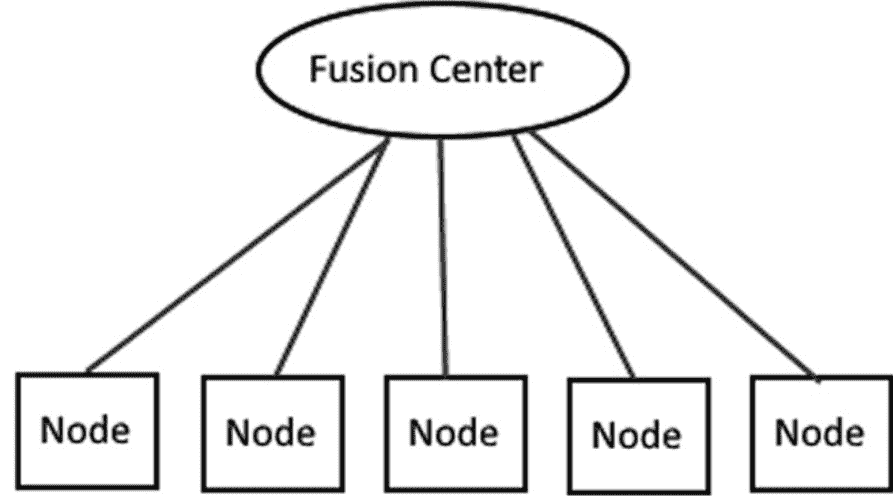

节点防御：入侵/异常检测

*图8.4：物联网融合的网络模型。*

在这篇论文中，提出并评估了一种基于融合的防御机制，其中每个节点基于本地决策向融合中心发送最小反馈（一位）[11]。然后，融合中心利用这些反馈决策来推断攻击并部署对策。融合中心的核心概念是将更复杂的防御模块卸载到单个强大的计算单元，而不是让每个物理网络节点做出最小的防御决策。由于攻击者和防御者往往都将精力集中在节点的一个子集上，将防御机制抽象到中央融合机制可以降低防御策略的每节点成本，并在攻击者和防御者之间创造一个零和博弈。然后，双方之间的零和博弈均衡可用于模拟各种最终状态的收益，从而可以就潜在对抗场景抽象地做出决策。

在网络层面，融合中心监视高级攻击（网络破坏或路由更改），同时接收并计算来自所有网络节点的反馈位。如果某个节点子集受到对手的攻击，防御者会试图减轻这些受攻击节点对网络其余部分的潜在损害。尽管本文的系统模型将网络表示为单层，但信息融合的一般原理可以应用于具有级联反馈链的更多层网络。

对防御者而言，最坏的情况是对手完全了解节点网络，并且能够同时破坏所有节点，尤其是当对手知道融合中心的阈值和特定节点的重要性时。然而，对所有节点进行统一攻击实际上不如对节点子集进行有针对性的攻击有效，因为统一攻击必然会通过超过融合中心的阈值来触发对策。更有针对性的蓄意攻击则会试图在不惊动融合中心的情况下瘫痪网络运行；这意味着被攻击的节点更少，但这些目标对网络运行更为关键。

在节点层面，每个设备采用简单的异常检测，并向融合中心报告最小的反馈位。这些反馈位是

正如前面各节所述，针对机器学习系统的攻击有三个主要目标：降低模型的学习能力、使模型行为产生故障，以及从系统中获取敏感信息。攻击可以根据其目标阶段（训练或部署）进行分组，然后可以用这些分组来选择如前文所述的防御技术。虽然没有一种防御是绝对的，但适当选择的防御方案可以降低攻击者的信心，并减缓他们颠覆机器学习系统行为的尝试，为人类操作员提供干预的时间。

随着对机器学习系统潜在攻击的进一步研究，新的防御技术和现有技术的改进将继续出现。最有希望的研究寻求找到用于实时检测和纠正对抗行为的算法方法，使已部署的机器学习模型能够主动减轻攻击者造成的损害。这些技术，如Mixup推断方法，依赖于对模型输出的常规自检，但旨在减少人类操作员纠正错误和攻击者损害所需投入。

## 参考文献

- 1. [“机器学习算法的三种类型，”](https://pioneerlabs.io/insights/the-three-types-of-machine-learning-algorithms) *Pioneer Labs | 技术战略家与交付专家。*（访问日期：2021年2月11日）。
- 2. [K. Eykholt](http://arxiv.org/abs/1707.08945) *等人*，“深度学习模型的鲁棒物理世界攻击，” *arXiv:1707.08945 [cs]*，2018年4月，访问日期：2021年2月11日。[在线]。可用：http://arxiv.org/abs/1707.08945。
- 3. [“什么是蜜罐？”](https://usa.kaspersky.com/resource-center/threats/what-is-a-honeypot) *usa.kaspersky.com*，2021年1月13日。（访问日期：2021年2月11日）。
- 4. [F. Younis](#) 和 A. Miri，“在去中心化框架中使用蜜罐防御对抗性机器学习攻击，”载于 *应用密码学与网络安全研讨会*，Cham，2019年，第24–48页，doi: 10.1007/978-3-030-29729-9_2。
- 5. H. Zhang, M. Cisse, Y. N. Dauphin, and D. Lopez-Paz，“Mixup：超越经验风险最小化，” *arXiv:1710.09412 [cs, stat]*，2018年4月，访问日期：2021年3月29日。[在线]。可用：http://arxiv.org/abs/1710.09412。
- 6. K. He, X. Zhang, S. Ren, and J. Sun，“深度残差网络中的恒等映射，” *arXiv:1603.05027 [cs]*，2016年7月，访问日期：2021年3月29日。[在线]。可用：http://arxiv.org/abs/1603.05027。
- 7. T. Pang, K. Xu, and J. Zhu，“Mixup推断：更好地利用Mixup防御对抗攻击，” *arXiv:1909.11515 [cs, stat]*，2020年2月，访问日期：2021年3月7日。[在线]。可用：http://arxiv.org/abs/1909.11515。
- 8. kristy.thompson@nist.gov，“信息物理系统，” *NIST*，2014年6月20日。www.nist.gov/el/cyber-physical-systems（访问日期：2021年3月29日）。
- 9. L. Cheng, K. Tian, and D. (Daphne) Yao，“Orpheus：强制执行信息物理执行语义以防御面向数据的攻击，”载于 *第33届年度计算机安全应用会议论文集*，美国纽约州纽约市，2017年12月，第315–326页，doi: 10.1145/3134600.3134640。
- 10. “数据融合——概述 | ScienceDirect主题。” www-sciencedirect-com.libdata.lib.ua.edu/topics/computer-science/data-fusion（访问日期：2021年3月29日）。
- 11. P. Chen, S. Cheng, and K. Chen，“物联网中防御蓄意攻击的信息融合，” *IEEE物联网杂志*，第1卷，第4期，第337–348页，2014年8月，doi: 10.1109/JIOT.2014.2337018。


# 针对深度学习攻击的防御措施

林生何¹ 和 胡飞¹

¹美国阿拉巴马大学电子与计算机工程系

DOI: 10.1201/9781003187158-11

## 目录

- 9.1 引言
- 9.2 防御措施分类
  - 9.2.1 修改训练或修改输入
  - 9.2.2 修改网络架构
  - 9.2.3 网络附加模块
- 9.4 讨论与开放问题
- 9.5 结论
- 参考文献

## 9.1 引言

近年来，机器学习和深度学习（DL）神经网络[1]等技术已广泛应用于实际任务中，如图像分类、语音识别、自动驾驶、垃圾邮件过滤以及针对图像类数据的智能反欺诈。因此，DL系统正变得司空见惯并渗透到我们的生活中，这为攻击者实施攻击开辟了新的可能性。攻击者试图通过以各种方式改变模型的输入特征来达到对抗性目标，从而在现实任务中绕过机器学习模型的检测，或直接攻击模型以破坏其完整性。

例如，最初的对抗性攻击旨在通过在正常样本上添加人类不易察觉的精细噪声来构造对抗样本，从而促使机器学习或DL模型对精心构造的对抗样本产生误判，同时不干扰人类的认知，如图9.1[2]所示。这里，原始图像被图像分类模型以57.7%的置信度识别为“熊猫”，而在添加细微扰动后得到的对抗图像被错误地以99.3%的置信度识别为“长臂猿”，然而对于人类来说，该对抗图像仍然被正常识别为大熊猫。

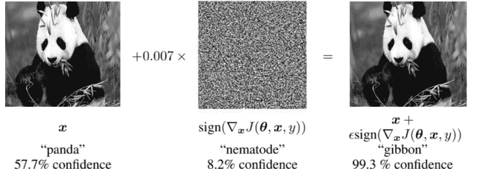

## 图9.1 基本对抗性攻击示例。

由于这类细微扰动通常人眼难以分辨，它们使攻击极具隐蔽性，并且足以改变模型的预测结果。这极具危害性，因此对实际部署在现实场景中的机器学习模型构成了巨大的安全威胁，尤其是对风险敏感的模型。

为了深入探索针对DL模型的防御方案，我们简要介绍对抗性攻击算法。对抗性攻击最重要的分类标准是对DL模型内容获取程度。基于此，我们可以将所有对抗性攻击模型分为两类：白盒攻击和黑盒攻击。

- 白盒攻击：白盒攻击假设攻击者能够完全获取目标模型的结构和参数等信息。因此，在攻击过程中，攻击者可以利用模型的完整信息来求解目标模型的梯度信息，以指导对抗样本的生成。
- 黑盒攻击：与白盒攻击不同，黑盒攻击假设攻击者既不知道训练数据和模型结构，也无法获取模型的具体参数。它只能获得学习模型的最终决策结果。在这种情况下，攻击者只能通过操纵模型输入并利用最终决策结果来探测目标模型的敏感性或估计模型的梯度信息，从而指导对抗样本的生成。因此，与白盒攻击相比，黑盒攻击利用的信息更少，攻击实施起来更加困难。

对抗性攻击还可以根据不同的DL模型任务进行分类。一般来说，DL模型主要用于处理图像、数据、语音、文本等现实世界中的问题。对于图像和数据任务，DL涉及分割、分类和回归等任务，对抗性攻击通常使用增加扰动、数据投毒等特定方法。对于语音和文本任务，DL主要涉及识别、翻译、预测等任务，对抗性攻击在面对此类任务时通常采用添加高频噪声、关键词提取或同义词/反义词替换等方法。

一旦我们对对抗性攻击有了大致了解，就不难看出防御方案也是一项亟需的研究课题，以确保广泛使用的DL模型不受攻击者干扰，并增强DL模型的鲁棒性。在接下来的小节中，我们将根据不同的应用场景介绍具有各自特点的防御方法。在本章末尾，我们提出了当前对抗性攻击与防御研究中存在的几个开放问题。

## 9.2 防御措施分类

在对现有的对抗性防御进行分类时，我们可以简单地将防御层次分为两类：完全防御和仅攻击检测。完全防御方法旨在使目标网络能够对对抗样本的攻击（例如攻击目标）实现免疫。分类器能够准确预测对抗性攻击的标签。另一方面，仅攻击检测方法可能只是为潜在的对抗样本添加标签，以便在后续处理中将其拒绝。

我们还可以将所有防御方法分为三种类型：修改训练或修改输入、修改网络架构以及网络附加模块。第一类与学习模型没有直接关系，而另外两类更关注神经网络本身。“修改”网络与使用“附加模块”之间的区别在于：第二类在训练过程中改变原始深度神经网络的架构/参数；第三类保持原始模型不变，并在测试时将外部模型附加到原始模型上。

### 9.2.1 修改训练或修改输入

### 数据预处理

在图像处理领域，许多对抗性扰动在观察者看来就像高频噪声。一些研究者建议使用图像预处理作为对抗样本攻击的防御策略，例如JPEG压缩[3]、全变分最小化（tvm）[4]、图像拼接[4]以及位深度缩减[5]等。

例如，Dziugaite等人[6]研究了JPG压缩对快速梯度符号法（FGSM）[2]计算出的扰动的影响。据报道，对于FGSM扰动，JPG压缩实际上可以在很大程度上逆转分类精度的下降。然而，结论是仅靠压缩远远不能成为有效的防御手段，因为JPG压缩对较小扰动的改善更大，而对较大扰动的效果较差。FGSM是一种典型的白盒攻击模型。它简单有效，在图像攻击领域发挥着重要作用，后续许多研究都是基于该算法进行的。

特征压缩算法也侧重于数据预处理以生成有效的防御。神经网络的输入值有许多“冗余”特征项，这使得他人更容易构造对抗样本。文献[5]的作者提供了一种压缩方法来减少不必要的特征。具体来说，压缩具有降噪的功能。作者提出了两种压缩方法：

- *降低每个像素的深度：* 图像像素通道的大小为2⁸。研究发现，使用2ⁱ的压缩大小来表示图像不会影响神经网络对图像的判断。它有效降低了被攻击的可能性；也就是说，添加到对抗样本中的噪声效果将被有效降低。
- *降低空间维度：* 在[5]中，给出了中值平滑的示例，这相当于卷积神经网络中的池化操作。它取n×n滤波器的中值，并替换原始区域的值。由于相邻区域的像素值具有相似的相关性，对整个图像进行平滑处理不会影响最终结果，但会去除添加到其中的噪声。

虽然在攻击者不了解防御方法的场景下，图像预处理是有效的，但在攻击者了解防御方法的场景下，它几乎无效。然而，预处理仍然是一类有吸引力的防御方法，因为它可以与其他防御方法结合以产生更强的防御效果，并且可以在不了解目标模型的情况下减轻对抗样本的危害。

### 数据增强

数据增强通常用于对抗黑盒攻击。它使用生成的对抗样本来扩展原始训练集，并试图让模型在训练过程中看到更多的数据。

例如，在[7]中，通过生成对抗网络（GAN）算法[8]的训练，扩展了对抗样本的文本阅读能力。他们提出了两种生成更多数据多样性特征的方法：（1）基于知识的词语，即从在线数据库物种中替换为同义词/反义词对；（2）基于神经网络的，即使用seq2seq模型生成包含


examples and measuring the cross-entropy between the original and generated hypotheses by performing a loss function. In the training process, they used the GAN algorithm to train the discriminator and generator and merged the optimization steps of the adversarial exemplar discriminator in it.

Wang et al. [9] enhanced the complexity of the database, thus improving the resistance of the model. Moreover, its complexity conversion formula can update itself with the continuous detection of adversarial samples. Lee et al. [10] proposed the idea that a data augmentation module can be incorporated to simulate adversarial attacks when training DL models, which uses an uncertainty generator to train DL models. The generator can generate FGSM-like perturbations. After passing through the classifier of DL, it can yield either normal or interference results. The DL network learned autonomously by this data augmentation module has greater robustness against larger adversarial attacks based on FGSM perturbations.

### 9.2.2 修改网络架构

### 网络蒸馏

Distillation was introduced by Hinton et al. [11] as a training procedure to transfer knowledge of a more complex network to a smaller network. But this work only focuses on the task that ensembles models to allow the deployment to scale to a large number of users, especially if the individual models are large neural nets. The variant of the procedure introduced by Papernot et al. [12] essentially uses the knowledge of the network distillation to improve its own robustness. They argued that changing the network structure and retraining a more complex model when faced with an adversarial sample attack can certainly defend against such an attack. But it is too costly and requires more computational resources and time. Therefore, it is desirable to find a new defense method that can effectively deal with the attack without changing the network structure and affecting the accuracy of the model as much as possible. The probabilities of class vector of training data are extracted from initial DNN and fed back to train the original model in the distilled network. Specifically, it uses the softmax output of the original DNN to train a second DNN that has the same structure as the original DNN. The sample model architecture is shown in **图 9.2**. The softmax of the original DNN is also modified by introducing a temperature parameter *T*:

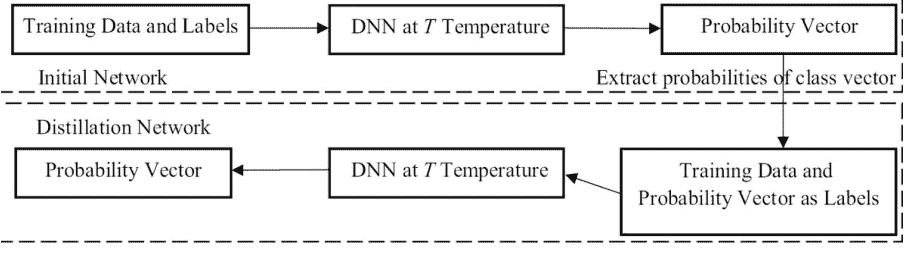

**图 9.2** 蒸馏 DNN 的示例模型架构。

where *zᵢ* is the input of softmax layer. *T* controls the level of knowledge distillation. When *T* = 1, it turns back to the normal softmax function. If *T* is small, the function will output more extreme values. When it is large, *qᵢ* is close to a uniform distribution. Therefore, increasing *T* reduces the gradient of the model and makes it smoother, thus reducing the sensitivity of the model to perturbations.

### 模型正则化

Model regularization enforces the generated adversarial examples as the regularizer and follows the form of:

where λ is a hyperparameter. Following [2], the work [13] constructed the adversarial training with a linear approximation as follows:

where ‖g‖₂ is the L₂-norm regularization, θ is the parameter of the neural model, and θ* is a constant copy of θ. In [13], the authors compute the perturbation from FGSM proposed by Goodfellow to obtain the *adversarial loss* by the DL model. Such a loss is added to the classification loss (cross-entropy) of the DL model to obtain a new loss. By optimizing this loss, it is possible to achieve super performance on text classification tasks.

The word embedding after FGSM perturbation has a high probability of not mapping to the real word, in the same way that the perturbation of RGB in an image can produce antagonistic samples that are indistinguishable to the human eye. The authors argue that this adversarial training is more like a regularization method, allowing for better-quality word embedding, avoiding overfitting, and thus achieving excellent performance. It is experimentally proven that even though the computed *adversarial loss* is large, the loss is not involved in the gradient calculation, changes in the weight and bias of the model do not affect the adversarial loss, and the model can reduce it by changing the *word embedding weight*.

### 9.2.3 网络附加

### 防御通用扰动

Akhtar et al. [14] proposed a defense framework to counter adversarial attacks generated by using universal perturbations. This framework adds an additional “pre-input” layer before the target network and trains it to correct the perturbed images, without updating the parameters of the target network, ultimately allowing the classifier to make the same prediction as it would on an unperturbed version of the same image. The pre-input layer, called a scrambled rectification network (PRN), trains individual detectors by extracting features from the discrete cosine transform of the input–output differences of the PRN used to train the images. The test image is first passed through the PRN, and its features are then used to detect the disturbance. If adversarial perturbations are detected, the output of the PRN is used to classify the test image, and conversely the original image is used as the input to the model.

### MagNet 模型

Meng et al. [15] conceived that, for most AI tasks, the sample space is a high-dimensional space but that the effective samples we need are actually in a manifold space with much lower dimensionality than the original sample space.

The authors implemented a two-pronged defense system, proposing the corresponding *detector* and *reformer* methods for two reasons: (1) Detector is used to determine whether a sample is far away from the manifold boundary. For example, if the task is to classify handwritten digital images, all other images that do not contain numbers are adversarial samples that can lead to misclassification because the classifier of the target DL model has to classify that image. Input samples belonging to this class will be removed directly. (2) The adversarial sample is very close to the popular boundary for that task. If the generalization of that classification method is not good at that point, misclassification can also occur. Efforts are made to find a sample that is close to or just above the manifold for that task and then hand it over to the classifier. This is the second defense method conceived by the authors. [图 9.3](#figure-9-3) demonstrates the workflow of MagNet.

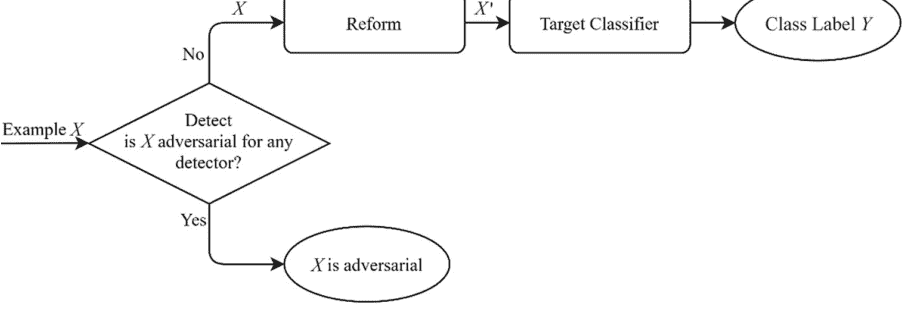

**图 9.3** MagNet 的工作流程。

Generally, the generation of functions to detect adversarial samples requires the knowledge of the specific adversarial sample generation process and therefore cannot generalize to other types of adversarial samples. Thus such a method can be easily bypassed by slightly modified attacks. In this paper, the authors proposed two new methods for detecting adversarial samples: reconstruction error-based detection and probabilistic divergence-based detection methods.

1. *基于重构误差的检测：* For the training set of all normal samples, the authors train an autoencoder such that the loss function of this training set is minimized, and its loss function is defined as

   where $X_{\mathrm{train}}$ is the normal samples in training set, and $E(x)$ is the reconstruction error. The authors argue that, if the sample to be tested is a normal sample, its reconstruction error is small because the sample has the same generation process as the training data of autoencoder, and that, conversely, if the sample with detection is an adversarial sample, then the reconstruction error of that sample will be large.

2. *基于概率散度的检测：* The authors were able to find the adversarial input samples by comparing the results of two different sets of input data that went through the softmax layer output. They used the Jensen–Shannon scatter to measure the degree of disagreement between the results of the two sets of data.

The ideal reformer needs to satisfy the following two conditions: (1) It should not change the classification structure of the normal samples; (2) it should reconstruct the adversarial samples sufficiently so that the reconstructed samples are close to the normal samples. The authors trained the autoencoder to minimize the reconstruction errors on the training set and to ensure that it is well adapted to the validation set. Afterward, when given a normal input set, the autoencoder output a very similar example. However, when given an adversarial example, the autoencoder should output an example that approximates the adversarial one. In this way, MagNet can improve the classification accuracy while maintaining classification accuracy.

## 9.4 讨论与开放性问题

The biggest challenges faced by current researchers can be summarized in two points.

1. *有效防御白盒攻击：* We still have not seen a defense that balances effectiveness and efficiency well. In terms of effectiveness, adversarial training shows the best performance but is computationally expensive. In terms of efficiency, many random and denoising-based defense algorithms can be configured in a few seconds, but simple defenses do not protect the DL model algorithm against attackers who already have the access to the DL model details.


2. *可扩展性：*由于大多数防御方法无法抵御自适应白盒攻击，研究人员已开始关注可证明性防御，这类防御能够在某种程度上保证防御的性能，无论攻击者采用何种方法。但迄今为止，可扩展性是当前大多数可证明性防御普遍面临的问题。例如，区间边界分析是近年来流行的一种基于证明的防御方法，但它无法扩展到非常深的神经网络和大规模数据集。

## 9.5 结论

随着深度学习研究的进一步发展以及深度学习技术在现实场景中的广泛应用，深度学习的安全与隐私已成为一个新兴且前景广阔的研究领域，吸引了来自学术界和工业界的大量学者进行深入研究，并取得了许多令人瞩目的研究成果。然而，迄今为止，深度学习安全与隐私研究仍处于起步阶段，许多关键的科学问题仍有待解决。

本章总结了针对深度学习模型的对抗防御策略。首先，我们介绍了不同对抗攻击的目标，并据此将所有防御策略分为三类：修改训练或修改输入、修改网络架构以及网络附加模块。在不同类别中，我们还详细阐述了不同的防御算法，每种算法各有其优势。然而，深度学习对抗防御的研究仍处于起步阶段，我们仍面临两大难题：如何对抗白盒攻击以及对抗防御的普遍性问题。我们尚没有有效的算法来防御潜在有害的白盒攻击。

## 参考文献

1. Ian Goodfellow, Yoshua Bengio, and Aaron Courville. 2016. *Deep Learning*. Vol. 1.
- 2. Goodfellow, I. J., Shlens, J., & Szegedy, C. (2014). Explaining and harnessing adversarial examples. arXiv preprint arXiv:1412.6572.
- 3. Das, N., Shanbhogue, M., Chen, S. T., Hohman, F., Li, S., Chen, L., ... & Chau, D. H. (2018, July). Shield: Fast, practical defense and vaccination for deep learning using jpeg compression. In Proceedings of the 24th ACM SIGKDD International Conference on Knowledge Discovery & Data Mining (pp. 196–204).
- 4. Guo, C., Rana, M., Cisse, M., & Van Der Maaten, L. (2017). Countering adversarial images using input transformations. arXiv preprint arXiv:1711.00117.
- 5. Xu, W., Evans, D., & Qi, Y. (2017). Feature squeezing: Detecting adversarial examples in deep neural networks. arXiv preprint arXiv:1704.01155.
- 6. Dziugaite, G. K., Ghahramani, Z., & Roy, D. M. (2016). A study of the effect of jpg compression on adversarial images. arXiv preprint arXiv:1608.00853.
- 7. Kang, D., Khot, T., Sabharwal, A., & Hovy, E. (2018). Adventure: Adversarial training for textual entailment with knowledge-guided examples. arXiv preprint arXiv:1805.04680.
- 8. Goodfellow, I. J., Pouget-Abadie, J., Mirza, M., Xu, B., Warde-Farley, D., Ozair, S., ... & Bengio, Y. (2014). Generative adversarial networks. arXiv preprint arXiv:1406.2661.
- 9. Wang, Q., Guo, W., Zhang, K., Ororbia II, A. G., Xing, X., Liu, X., & Giles, C. L. (2016). Learning adversary-resistant deep neural networks. arXiv preprint arXiv:1612.01401.
- 10. Lee, H., Han, S., & Lee, J. (2017). Generative adversarial trainer: Defense to adversarial perturbations with gan. arXiv preprint arXiv:1705.03387.
- 11. Hinton, G., Vinyals, O., & Dean, J. (2015). Distilling the knowledge in a neural network. arXiv preprint arXiv:1503.02531.
- 12. Papernot, N., McDaniel, P., Wu, X., Jha, S., & Swami, A. (2016, May). Distillation as a defense to adversarial perturbations against deep neural networks. In 2016 IEEE symposium on security and privacy (SP) (pp. 582–597). IEEE.
- 13. Miyato, T., Dai, A. M., & Goodfellow, I. (2016). Adversarial training methods for semi-supervised text classification. arXiv preprint arXiv:1605.07725.
- 14. Akhtar, N., Liu, J., & Mian, A. (2018). Defense against universal adversarial perturbations. In *Proceedings of the IEEE conference on computer vision and pattern recognition* (pp. 3389–3398).
- 15. Meng, D., & Chen, H. (2017, October). Magnet: a two-pronged defense against adversarial examples. In *Proceedings of the 2017 ACM SIGSAC conference on computer and communications security* (pp. 135–147).

# 深度强化学习网络安全的防御方案

Jiamiao Zhao¹, Fei Hu¹, 和 Xiali Hei²

¹美国阿拉巴马大学电子与计算机工程系
²美国路易斯安那大学拉法叶分校信息学院

DOI: [10.1201/9781003187158-12](https://doi.org/10.1201/9781003187158-12)

## 目录

- 10.1 引言
- 10.2 背景
  - 10.2.1 无模型强化学习
  - 10.2.2 深度强化学习
  - 10.2.3 深度强化学习的安全性
- 10.3 对抗示例的认证验证
  - 10.3.1 鲁棒性认证
  - 10.3.2 系统架构
  - 10.3.3 实验结果
- 10.4 对抗状态观测下的鲁棒性
  - 10.4.1 确定性策略的状态对抗深度强化学习：DDPG
  - 10.4.2 基于Q学习的状态对抗深度强化学习：DQN
  - 10.4.3 实验结果
- 10.5 结论与挑战
- 致谢
- 参考文献

## 10.1 引言

机器学习（ML）可分为三类：监督学习、无监督学习和强化学习。在*监督*学习（如SVM、决策树等）中，训练样本被标记，以找到不同聚类之间的边界。另一方面，如果训练数据集没有真实标签，其机器学习算法被称为*无监督*学习，如KNN、K-means等。它们根据超平面中的距离对训练数据进行分类。*强化*学习（RL）利用智能体从历史状态/动作中学习，并可以使用最大累积奖励来生成动作，并与环境实时交互。

强化学习已被用于机器人、电网、传感器网络以及许多其他实际应用中的众多决策问题。然而，强化学习算法可能需要很长时间才能收敛到最优点（从几小时到几周，取决于状态空间的大小）[1]。近来，一种将深度学习（DL）与强化学习相结合的新算法——称为深度强化学习（DRL）——已被应用于处理高维输入，例如相机图像、大向量问题。DRL在许多复杂决策过程中展现出了出色的成果，例如机器人技术[2]、自动驾驶汽车、智慧城市以及围棋等游戏[3]等。DRL在处理关键的现实世界应用方面展示了其能力。亚马逊利用DRL设计了一款名为AWS DeepRacer的自动驾驶赛车。它使用摄像头观察赛道，并使用DRL模型对油门和方向做出决策。

因此，在将DRL部署到关键的现实世界系统之前，需要全面调查其安全性和隐私性。最近，DRL被证明容易受到对抗攻击[4]。攻击者将扰动插入DRL模型的输入中，导致DRL决策错误。DRL利用深度神经网络（DNN）模型来实现高精度预测，但它对输入扰动不够鲁棒。即使输入的微小变化也可能导致输出的剧烈波动。这使得全面了解对抗攻击的类型和特征成为必要。

本章旨在介绍DRL中的安全问题以及当前克服对抗攻击的防御方法。我们讨论了DRL的结构、其安全问题，以及DRL中现有的攻击目标和目的。

*本章组织：*第10.2节概述了RL和DRL，以及与之相关的隐私问题。第10.3节讨论了一种旨在实现鲁棒DRL以抵御对抗攻击的防御方法。第10.4节是第10.3节的扩展版本，它通过在学习过程中寻找鲁棒策略，提出了一种升级的DRL机制。我们在第10.5节总结本章，并讨论设计隐私保护和鲁棒DRL的研究挑战。

## 10.2 背景

在本节中，我们首先简要介绍强化学习，特别讨论无模型强化学习。然后，我们展示如何将强化学习与深度学习相结合，形成DRL过程[1]。我们总结了DRL技术及其在网络安全性方面的潜在弱点。

一般的强化学习问题可以描述为马尔可夫决策过程（MDP）。MDP包含智能体的状态、动作、奖励和策略。这里我们首先给出一些术语及其在强化学习中的功能的定义。

- *状态*：智能体与环境交互并学习状态。在每个时间步，智能体根据策略与状态空间交互，并获得一个决定动作质量的奖励。
- *策略*定义了智能体在环境中的行为方式，它将当前状态映射到一个动作。策略分为两种类型：确定性策略和随机性策略。当智能体采取的动作是*确定性*的，则策略是确定性的；如果动作针对不同状态遵循某个概率分布函数，则策略是*随机性*的。
- *同策略（on-policy）算法*评估探索价值。
- *异策略（off-policy）算法*不评估探索价值。Q学习是一种异策略方法。
- *动作*是智能体为与环境交互而执行的行为。


- *奖励*：智能体在执行动作后获得奖励。智能体的目标是最大化累积奖励。
- *价值函数*：智能体在特定状态下可获得的最大期望累积奖励。可由下式计算：

\[
V(s)=\mathbb{E}\left[\sum_{t=0}^{T-1}\gamma^t r_t\right]
\]

其中 \(\sum_{t=0}^{T-1}\gamma^t r_t\) 是从各状态到最终状态的奖励总和，\(\gamma\) 是折扣因子。
- *探索与利用*：*探索*是智能体在给定状态下通过采取不同动作来尝试探索环境的过程。*利用*发生在探索之后。智能体利用最优动作来获得最高的累积奖励。

强化学习有两大分支：无模型和基于模型的强化学习算法。*无模型*意味着在训练过程中不使用任何模型。无模型强化学习可以直接实时地从与环境的交互中学习。在*基于模型*的方法中，训练阶段之前有一个初步模型（MDP模型）。智能体维护该模型并寻找优化解。基于强化学习的优化模型的复杂度与状态数量的平方成正比。这可能带来很高的计算开销。在现实世界中，枚举所有状态、转移条件和转移概率的能力有限。因此，现有研究工作大多集中于无模型强化学习。

### 10.2.1 无模型强化学习

无模型强化学习专注于直接根据与环境的交互来计算价值函数。它可进一步分为两类：策略优化和 Q-learning。

1. *策略优化*：策略优化是使用基于梯度或无梯度的方案直接搜索最优策略的过程 [1]。基于梯度的方法最适合处理高维问题。无梯度的方法适用于低维问题。在策略优化中，策略表示为 \(\pi_\theta(a|s)\)，即在状态为 \(s\) 时动作 \(a\) 上的概率分布，而 \(\theta\) 是策略 \(\pi_\theta\) 的神经网络参数。策略梯度定义为 [5]

2. Q-learning：这是一种离策略（off-policy）强化学习。Q-learning 的主要目标是最大化 Q 值，如下所示：

\[
Q(s_t,a_t)\leftarrow Q(s_t,a_t)+\alpha\left[r_{t+1}+\gamma\max_{a'}Q(s_{t+1},a')-Q(s_t,a_t)\right]
\]

其中，\(s_{t+1}\) 是基于前一状态所采取动作后的下一状态，\(a'\) 是 \(s_{t+1}\) 中可能的一个动作，\(\alpha\) 是学习率，\(t\) 表示迭代次数，\(\gamma\) 是折扣因子。

该方程清楚地表明，Q-learning 决定下一步动作，并且知道 \(s_{t+1}\)。它使用 \(\epsilon\)-贪心策略，寻找 Q 值增量最大的动作。

### 10.2.2 深度强化学习

在现实应用中，输入不能仅仅是离散状态，也不能仅用一个值表示。输入数据可能具有高维度，例如自动驾驶车辆中的图像。一种解决方案是从高维数据中提取特征。但这依赖于研究者的设计，而且从输入图像中提取目标信息也很复杂。

另一种方法是使用神经网络来寻找最优策略价值函数或 Q 函数。这就是 DRL 背后的基本思想。1992 年，Gerald Tesauro 开发了一个名为 TD-Gammon 的计算机双陆棋程序，该程序通过神经网络使用时序差分学习进行训练 [6]。TD-Gammon 的水平仅略低于当时顶尖的人类双陆棋选手。它探索了前人从未探索过的策略，并推动了双陆棋下法理论的发展。

深度学习出现后，它在图像处理中展现出强大的能力。深度学习可以从高维输入图像或视频中提取特征，而且这些特征比人工特征更具泛化性。

利用深度学习解决强化学习问题有三种主要方法：基于 Q 值的方法、基于策略搜索的方法，以及两者在 actor-critic 配置中的混合方法。

经典的 Q 网络在学习 Q 值时会遇到许多问题。首先，训练数据不是独立同分布（iid）的，因为连续样本之间存在相关性 [7]。其次，即使 Q 值发生微小变化，也可能导致估计策略发生快速变化。最后，Q 网络的梯度可能足够大，以至于 Q 网络不稳定 [7]。

这些问题可以通过使用深度 Q 网络（DQN）[8] 来解决，该网络采用了经验回放、调节网络参数，并于 2015 年将奖励值归一化到 [−1, +1] 范围内。损失函数是目标值与当前对 Q 的估计之间的差值：

\[
L(\theta)=\mathbb{E}\left[\left(r+\gamma\max_{a'}Q(s',a';\theta^-)-Q(s,a;\theta)\right)^2\right]
\]

DQN 在 Atari 游戏上进行了评估。与其他算法相比，它获得了最高分，并在某些游戏中击败了人类玩家。

### 10.2.3 深度强化学习的安全性

与机器学习（ML）相比，深度强化学习（DRL）面临不同的安全挑战。主要区别在于，DRL 的目标是从一系列问题中寻找最优策略，而大多数 ML 算法是被训练来解决单步预测或聚类问题。此外，ML 的训练数据集来自固定分布。另一方面，DRL 中的智能体使用确定性或随机策略进行训练。

强化学习问题包含四个要素：\(s\) 表示状态，\(a\) 表示动作，\(r\) 表示奖励，\(p\) 表示转移概率，即智能体处于状态 \(s\)、采取动作 \(a\)、并转移到下一状态 \(s'\) 的概率。因此，与 ML 相比，攻击者在 DRL 中拥有更多的攻击目标。针对 DRL 的攻击有四种类型。图 10.1 展示了基于攻击目标的 DRL 对抗攻击。

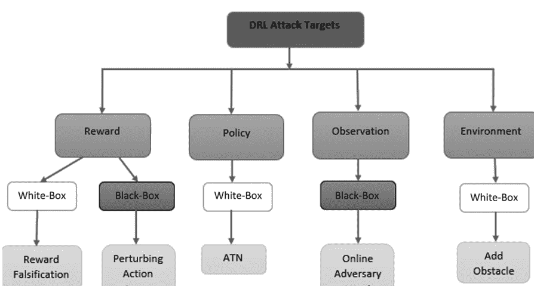

*图 10.1 DRL 攻击目标与攻击方法。*

1. *针对奖励的攻击：* 2018 年，Huang 等人 [9] 评估了软件定义网络中 DRL 对攻击者攻击的反应。攻击者知道模型的结构和参数。通过翻转奖励并操纵状态，攻击者能够误导智能节点选择次优动作。Pattanaik 等人 [10] 提出了三种通过对观测值添加扰动进行攻击的方法。评估结果表明，第三种攻击——使用随机梯度下降创建代价函数——能够误导 DRL 智能体最终进入一个预设的对抗状态 [1]。这些攻击者被假定知晓 DRL，但 Huang 等人 [11] 证明，即使攻击者对模型一无所知，仍然可以欺骗智能体执行期望的动作。

2. *针对策略的攻击：* Tretschk 等人 [12] 添加了一个对抗变换网络（ATN），为 DRL 的策略网络施加对抗奖励。如果智能体遵循一系列对抗性输入，ATN 会使累积奖励达到最大值。因此，DRL 会自动遵循攻击者的策略。但这种方法要求攻击者拥有智能体和目标环境的完整信息（称为白盒攻击）。

3. *针对观测的攻击：* 攻击者还可以直接操纵传感数据。在动态环境中对机器人系统进行实时攻击的研究已经得到评估。Clark 等人 [13] 对动态环境中自主机器人的 DRL 策略使用了白盒对抗攻击。该机器人原本要在迷宫中找到一条路线，而攻击者的目标是误导机器人走上错误路线。攻击者篡改机器人的传感数据，使机器人偏离最优路线。Clark 等人 [13] 还观察到，如果移除对抗性输入，机器人会自动修正其动作并找到正确路线。因此，攻击者可以临时篡改传感数据，并留下极少的证据。近年来，Tu 等人 [14] 表明，机器人 VR/AR 应用中的运动感知与驱动系统可被实时非侵入式攻击所操纵。

4. *针对环境的攻击：* 对 DRL 进行对抗攻击的最后一种方式是破坏环境。环境攻击的核心思想是放置额外的混淆性障碍物来迷惑机器人。Bai 等人 [15] 提出了一种为经过寻路训练的深度 Q 网络（DQN）创建对抗样本的方法。该 DQN 模型已经拥有寻找最优路径的完整方案。攻击者提取模型参数并进行分析，找出 Q 值的弱点。攻击者向机器人添加对抗性环境样本。这种方法能够成功发动攻击，使机器人在迷宫中无法找到最优路线。

## 10.3 对抗样本的认证验证

在 DNN 中，对输入的一种细微扰动（称为对抗样本）可能导致模型做出错误预测。对抗样本可能在现实世界中造成危险，例如，自动驾驶车辆可能把停车标志当成广告而忽略它，从而导致碰撞。图 10.2 展示了扰动攻击的一个示例。人类的肉眼无法


可以看到良性图像和恶意图像之间的差异。但这种噪声会严重影响DNN模型的预测结果。

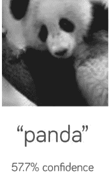

+ .007 ×

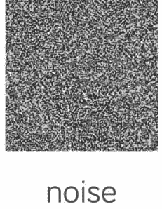

=

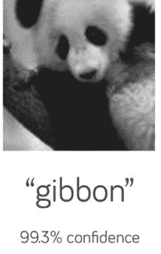

图10.2 对抗示例。

Lutjens等人[16]提出了一种鲁棒性验证方法，该方法为提高对抗攻击或噪声下的鲁棒性提供了理论保证。Lutjens等人证明，现有的对抗样本防御方法，如对抗训练、防御蒸馏或模型集成，并没有一种理论上可保证鲁棒性提升的算法，而且往往对未来对抗攻击无效[17]。验证方法可以保证未来的鲁棒性。在给定有界输入扰动的情况下，它可以找到最大输出偏差的理论上可证明的界限[18]。但是，当前寻找精确验证界限的问题是NP完全的[18]，因此无法在机器人上在线运行。Lutjens等人[16]没有寻找精确界限，而是提出了一种宽松版本的验证方法，该方法在对抗攻击或传感器噪声导致的输入空间最坏情况偏差下，找到Q值的下界并选择最优动作。通过利用计算出的下界，智能体可以找到位于该界限内的所有可能状态，并确定最优动作。

### 10.3.1 鲁棒性验证

在强化学习中，Q值表示为 ，即智能体在状态s下从 到 的期望回报。Q学习的目标是在对抗攻击或传感器噪声造成的观测最坏情况扰动下，最大化累积Q值。为了计算DNN预测Q值的认证下界，Lutjens等人[16]定义了状态-动作值的认证下界：

其中  是由对手噪声破坏的扰动状态。Lutjens等人假设  被限制在半径为  的圆内。  是对偏差输入最为鲁棒的动作。

Lutjens等人最终使用闭式公式在DNN内部计算 ，其中ReLU被用作激活函数。H 是下/上界因子，W 是权重矩阵，b 是层  中的偏置（索引为 ）：

矩阵 A 包含每个层的神经网络权重和ReLU激活， ，以及最后一层的恒等层。

### 10.3.2 系统架构

认证系统类似于标准的无模型强化学习，并附加了验证。图10.3描绘了系统架构。在训练阶段，智能体使用具有未损坏状态观测s的DQL算法，并找到每个状态下的期望Q值。

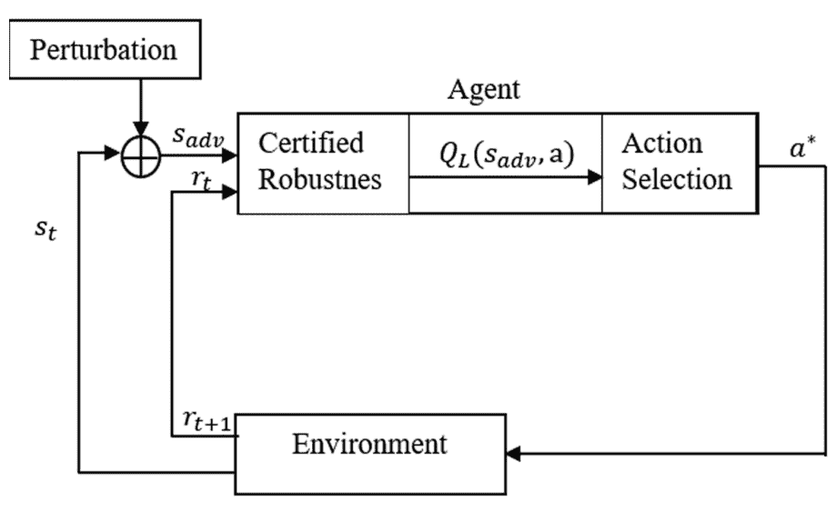

图10.3 带认证附加的强化学习。

在在线执行阶段，智能体接收受污染的状态观测并将其传递给DNN。认证DQN计算在输入有界扰动下的Q下界。因为Lutjens等人假设最坏可能的状态观测被限制在以真实状态  为中心、半径为  的圆内，真实状态  应在观测  周围半径为  的圆内。因此，智能体评估所有可能真实状态的每个Q值。最优动作被定义为在扰动观测下具有最高Q值的动作：

通过遵循该策略，智能体在最坏情况扰动下选择最鲁棒的动作。

### 10.3.3 实验结果

鲁棒性指标在行人碰撞避免和CartPole域的仿真中进行了评估。行人仿真用于验证机器人在行人中的碰撞避免能力。该仿真使用一个运动学仿真环境来学习碰撞避免策略。在这两种情况下，观测中都会加入噪声或对抗攻击。

标称DQN策略对扰动输入不具备鲁棒性。增加对抗攻击或噪声的幅度会增加平均碰撞次数并降低平均奖励。

Lutjens等人运行了带有附加防御的DQN，称为认证对抗鲁棒强化学习（CARR L）。结果表明，通过向DQL模型添加认证防御，我们可以解决对抗攻击和传感器噪声下的现有误分类问题。如果鲁棒性参数增大，则当观测被污染时碰撞次数减少。奖励随鲁棒性参数在  处的增大而增加。此外，CARR L策略在无扰动情况下仅轻微降低奖励。它不会显著恶化DRL的性能。

## 10.4 对抗状态观测下的鲁棒性

Zhang等人[19]也研究了在对抗扰动或噪声环境条件下的鲁棒DRL算法（图10.4）。Zhang等人[19]进一步证明，朴素的对抗训练方法在噪声环境中不能显著提高DRL鲁棒性，反而会使DRL训练不稳定并恶化智能体性能。他们得出结论，将监督学习技术朴素地应用到RL中是不合适的，因为RL和监督学习是两个相当不同的问题。

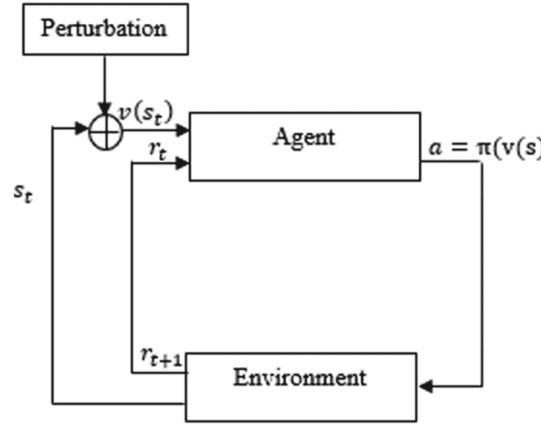

图10.4 观测受扰动的强化学习。

除了对抗样本之外，DRL智能体在常规训练期间，即使没有对抗攻击或噪声输入，也可能会偶尔失败。调试DRL智能体的意外失败是一个具有挑战性的课题。Zhang等人设计了一些深度确定性策略梯度（DDPG）智能体，试图获得较高的中位奖励。然而，在100次训练回合中，他们观察到一些低奖励回合[19]。这些偶然失败在安全关键应用（如自动驾驶车辆）中可能非常危险。

为了提高DRL的鲁棒性，Zhang等人[19]提出了一种鲁棒策略正则化器，该正则化器可以降低智能体对观测的敏感性。该策略正则化器可用于多种DRL算法：近端策略优化（PPO）、深度确定性策略梯度（DDPG）和深度Q网络（DQN）。Zhang等人[19]首先将状态观测上的扰动建模为修正的马尔可夫决策过程（MDP）或状态对抗MDP（SA-MDP）。他们证明，当智能体受到对抗攻击时，SA-MDP可能不存在平稳且马尔可夫的最优策略。基于他们的SA-MDP理论，Zhang等人提出了一种理论上严谨的鲁棒策略正则化器，该正则化器利用扰动策略的总变差距离或KL散度[19]。

### 10.4.1 确定性策略的状态对抗DRL：DDPG

如前所述，MDP被定义为一个四元组，并代表环境的转移概率，其中  是所有可能转移概率的集合。图10.4展示了具有扰动状态观测的RL。在SA-MDP中，Zhang等人[19]引入了一个对手。对手扰动智能体的观测，因此动作被执行为  而不是从真实状态  得到的动作。由于  不同于真实观测，该动作可能是次优的。Zhang等人[19]假设对抗攻击仅依赖于状态且不随时间变化。然后他们定义了一个集合，该集合由s的“邻近”状态组成。

DDPG学习确定性策略，以解决真实状态s的变动  可能不会与DDPG中的扰动状态重叠的问题。Zhang等人[19]定义了DDPG中策略的平滑版本，其中向每个动作添加方差为  的独立高斯噪声： 。然后，可以使用以下定理计算变差距离：

因此，两个平滑分布之间的变差距离是有界的。在DDPG中，Zhang等人将策略参数化为策略网络。他们推导出DDPG的鲁棒策略正则化器为[19]

其中 ，  表示二范数。对于每个状态s，智能体需要解决一个最大化问题，该问题可以使用凸优化求解


松弛。 该平滑过程可以在测试时进行。 在训练期间，Zhang 等人的目标是保持较小。

### 10.4.2 状态对抗深度强化学习用于 Q 学习：DQN

除了 DDPG，Zhang 等人 [19] 还为 DQN 制定了鲁棒策略正则化器。 由于 DQN 的动作空间是有限的，且 Q 学习的策略是最大化 Q 值，则 DQN 中真实状态 s 与对抗状态之间的总变差距离为

使用类铰链的鲁棒策略正则化器，其中 和 c 是一个很小的正常数：

Zhang 等人 [19] 指出，与 DDPG 不同，正则化奖励和类似于分类任务的鲁棒性，如果 将其视为“正确”标签。 最大化问题可使用投影梯度下降（PGD）或神经网络的凸松弛来求解 [19]。

### 10.4.3 实验结果

类似于认证验证，Zhang 等人 [19] 也假设了对抗状态的集合。 是以 s 为中心、半径为 的 -范数球。 也被称为扰动预算。

Zhang 等人在五个不同的环境（Ant、Hopper、倒立摆、Reacher 和 Walker2d）中运行 SA_DDPG 以测试 SA-DDPG 的鲁棒性。 Zhang 等人使用 SGLD 和凸松弛评估了 SA-DDPG。 他们在每次训练中测量中位数、最小值、25% 和 75% 的奖励。 他们的结果表明 SA-DDPG 能够持续提高鲁棒性：SA-DDPG 的统计数据在五个环境中均高于或等于 DDPG。

SA-DQN 在四个 Atari 游戏和一个控制问题上实现：Pong、Freeway、BankHeist、RoadRunner 和 Acrobot。 Zhang 等人将普通 DQN 和 50% 对抗训练的 DQN 作为基线。 他们观察到在大多数环境下 SA-DQN 在对抗攻击下获得的奖励要高得多，而天真的对抗训练在强攻击下大多无效。

## 10.5 结论与挑战

本章对深度强化学习（DRL）的安全问题进行了综述，DRL 已应用于许多现实生活应用中。 它容易受到对抗攻击的影响，对抗攻击会破坏整个模型，导致 DRL 无法实现最佳奖励。 我们回顾了 DRL 中的当前对抗攻击以及可用于 PPO、DDPG 和 DQN 的防御方法。 总体防御方法源于当前状态与智能体策略决定的动作之间的关系。 通过在 DRL 上部署对抗防御方法，智能体可以在对抗环境中选择最佳动作。 最后，衡量 DRL 鲁棒性的现有方法仍然很天真，因为它假设真实状态位于一个假设的圆内。 需要正确定义对抗攻击引起的 DRL 偏差。

## 致谢

本工作部分得到美国国家科学基金会（US NSF）在资助号 OIA-1946231 和 CNS-2117785 下的支持。 这里提出的观点不代表 NSF 的意见。

## 参考文献

- 1. I. Ilahi, M. Usama, J. Qadir, M. U. Janjua, A. Al-Fuqaha, D. T. Hoang and D. Niyato, “深度强化学习对抗攻击的挑战与对策,” 2020. [Online]. Available: https://arxiv.org/abs/2001.09684.
- 2. S. Gu, E. Holly, T. Lillicrap and S. Levine, “异步离策略更新的机器人操作深度强化学习,” in *IEEE 国际机器人与自动化大会（ICRA）*, 2017.
- 3. D. Silver, A. Huang, C. J. Maddison, A. Guez, L. Sifre, G. v. d. Driessche, J. Schrittwieser and et al., “利用深度神经网络和树搜索掌握围棋游戏,” *自然*, vol. 529, pp. 484–489, 2016.
- 4. V. Behzadan and A. Munir, “深度强化学习对策略诱导攻击的脆弱性,” in *国际机器学习与模式识别数据挖掘会议*, 2017.
- 5. R. S. Sutton and A. G. Barto, “*强化学习：导论*,” MIT Press, 2018.
- 6. G. Tesauro, “时序差分学习与 TD-Gammon,” *ACM 通讯*, vol. 28, no. 3, pp. 58–68, 1995.
- 7. V. Behzadan and A. Munir, “我们的 pi 中的缺陷：深度强化学习中的安全问题与开放挑战,” 2018. [Online].
- 8. V. Mnih, K. Kavukcuoglu, D. Silver, A. A. Rusu, J. Veness, M. G. Bellemare and et al., “通过深度强化学习实现人类水平控制,” *自然*, vol. 518, pp. 529–533, 2015.
- 9. Y. Han, B. I. Rubinstein, T. Abraham, T. Alpcan, O. D. Vel, S. Erfani, D. Hubczenko, C. Leckie and P. Montague, “软件定义网络中自主防御的强化学习,” in *决策与安全博弈理论国际会议*, 2018.
- 10. A. Pattanaik, Z. Tang, L. Shujing, G. Bommannan and G. Chowdhary, “具有对抗攻击的鲁棒深度强化学习,” in *自主代理与多代理系统国际基金会*, 2018.
- 11. Y. Huang and Q. Zhu, “成本信号对抗操纵下的欺骗性强化学习,” *arXiv*, 2019.
- 12. E. Tretsch k, S. J. Oh and M. Fritz, “针对长期对抗目标的代理顺序攻击,” 5 Jul 2018. [Online].
- 13. G. Clark, M. Doran and W. Glisson, “对机器人系统机器学习策略的恶意攻击,” in *第 17 届 IEEE 计算、通信与信任、安全与隐私国际会议/第 12 届 IEEE 大数据科学与工程国际会议（TrustCom/BigDataSE）*, New York, USA, 2018.
- 14. Y. Tu, Z. Lin, I. Lee, X. Hei, “注入并投递：通过欺骗惯性传感器伪造对执行系统的隐式控制。” In 27th USENIX Security Symposium (USENIX Security 18) 2018 (pp. 1545–1562).
- 15. X. Bai, W. Niu, X. Gao and J. Liu, “面向 DQN 路径寻找训练中白盒 Q 表变化的对抗样本构造,” in *2018 IEEE 第三届网络空间数据科学国际会议*, 2018.
- 16. B. Lutjens, M. Everett and J. P. How, “深度强化学习的认证对抗鲁棒性,” in *第 3 届机器人学习会议*, Osaka, Japan, 2019.
- 17. N. Carlini and D. Wagner, “对抗样本并非易于检测：绕过十种检测方法,” in *第 10 届 ACM 人工智能与安全研讨会论文集*, 2017.
- 18. K. Guy, C. Barrett, D. L. Dill, K. Julian and M. J. Kochenderfer, “Reluplex：验证深度神经网络的高效 SMT 求解器,” in *计算机辅助验证 – 第 29 届国际会议，CAV，海德堡，德国*, 2017.
- 19. H. Zhang, H. Chen, C. Xiao, B. Li, M. Liu, D. Boning and C.-J. Hsieh, “针对状态观测对抗扰动的鲁棒深度强化学习,” arXiv:2003.08938, 2020.

技术很容易被对抗样本欺骗。 例如，精心扰动的输入样本可以在测试时误导模式检测。 自 2014 年以来，这引起了相当大的关注，当时 Szegedy 等人 [2] 以及后续工作 [3–5] 表明，用于对象识别的深度网络可以通过不可感知的方式扰动的输入图像来欺骗。 最近，针对聚类算法的投毒和规避攻击也已形式化，以表明恶意软件聚类方法容易受到精心制作的攻击 [6, 7]。

对抗学习的研究不仅调查学习算法在精心制作的攻击下的安全属性，还专注于开发更安全的学习算法。 对于规避攻击，这主要通过将攻击者可能执行的可能数据操纵的知识显式嵌入到学习算法中来实现，例如使用分类的理论博弈模型 [8–10]、攻击下数据分布漂移的概率模型 [11, 12]，甚至多分类器系统 [13–15]。 投毒攻击和训练数据的操纵已通过数据清理（即一种异常检测形式）[16]、多分类器系统 [17] 和稳健统计等各种方法得到遏制。 稳健统计也被用来正式证明在某些条件下 SVM 类算法的影响函数可以被限制 [18]，例如如果核是有界的。 这确保了对训练数据的小扰动具有一定程度的鲁棒性，并且期望提高学习算法对投毒的安全性 [19]。

在本章中，我们研究了几种流行的机器学习算法（如 KNN、随机森林和 SVM）对多种攻击的脆弱性，即规避攻击、成员攻击、数据投毒攻击。 这些攻击可以通过操纵训练数据和标签、注入外来测试集等在训练和测试阶段发生。 这些攻击可以增加误分类率并破坏 CPS 系统。

## 11.2 支持向量机（SVM）在规避攻击下


机器学习（ML）常用于多个学科和实际应用，如信息检索、金融系统、健康、生物识别和在线社交网络。然而，针对蓄意攻击的安全性概况往往未被考虑。老练的对手可以利用经典ML算法暴露的特定漏洞来欺骗智能系统。在开发新方法以确保机器学习能够在对抗性环境中安全应用之前，有必要就针对ML技术的潜在攻击进行彻底的安全评估。本节综述了针对线性或非线性SVM的不同攻击。

在[20]中，提出了一种为SVM和神经网络生成对抗样本的优化方法。该方法采用了一种正则化技术，使得模型能够在黑盒和白盒设置下分别生成对抗样本。他们将该方法应用于PDF文件中的恶意软件检测[21]。

给定一个分类算法 f: X↦Y，将特征 x ∈ X 与标签 y ∈ Y = {−1, +1} 相关联，其中 (+1) 表示合法类别，(−1) 表示对抗性或恶意类别。分类器给出的标签 y^c = f(x) 通过对判别函数 g: X↦R 进行阈值化获得，因此我们假设：如果 g(x) < 0，则 f(x) = −1，否则为 +1。

### 11.2.1 对手模型
- *对手的目标*：找到一个样本 x，使得对任意 ε>0，有 g(x)<−ε。这意味着样本刚好越过决策边界。也可以要求找到一个样本，使得分类器以高置信度做出错误决策。
- *对手的知识*：根据对分类器、数据或训练模型的信息掌握情况，对手可能采取不同的策略。
- *对手的能力*：场景限制为对手只能修改测试数据。

### 11.2.2 攻击场景
- *完全知识（PK）*：对手了解分类器的所有信息：架构、数据、训练。
- *有限知识（LK）*：作者假设对手可以生成一个新的数据集 \(D' = \{(\cdot, \cdot)\}\)，并在此基础上训练一个新的分类器和判别函数，使其逼近原分类器 \(f\) 的判别函数 \(g\)。

### 11.2.3 攻击策略
对于对抗性目标样本，最优攻击策略旨在找到一个样本，在与其距离的界限约束下最小化 \(g\) 或其估计量：

但这很困难，因此他们对其进行正则化：

他们通过梯度下降来解决这一问题。

## 11.3 因果可用性攻击下的SVM

如果攻击的目标是通过污染训练数据来破坏分类器的泛化能力和可用性，我们将此类攻击称为因果可用性攻击[22]。在这种攻击中，攻击者会将一些精心挑选的外部数据 \(D_f = (X_f, Y_f)\) 注入训练数据 \(D_{tr}\)。然而，学习者在不知情的情况下，使用被污染的数据 \(D_t = D_{tr} \cup D_f\) 而不是 \(D_{tr}\) 来学习模型 \(\Theta_D\)。这种攻击可能导致分类器失去其泛化能力，例如导致大量误分类错误，包括假阳性（FP）和假阴性（FN）。在以下示例中，我们选择一个支持向量点 \((x_0, y_0)\) 作为投毒攻击点。攻击目标是向 \(D_{tr}\) 中添加一个外部数据项，以最大化凸二次规划（QP）问题。

在[22]中，解释了SVM攻击策略。它首先在原始训练数据集 \(D_{tr}\) 上训练SVM模型以识别支持向量，并随机选择其中一个支持向量（不翻转其标签）作为起始攻击点。值得注意的是，翻转初始支持向量的标签也可以作为攻击策略。然而，由于标签过程通常由标注者（oracle）完成，他们的实验研究在攻击过程中保留了原始标签。因此，从实际角度来看，实验设置更为合理。此外，他们利用在 Dtr ∪ (X0, Y0) 上训练的SVM模型参数计算梯度。随后，我们根据梯度上升法更新初始攻击点。然后，他们重新训练SVM模型，并迭代优化攻击点，直到达到终止条件。

在这项研究中，他们使用了梯度上升技术。解位于梯度的负方向。L1 是凸目标函数，因此它永远不会达到收敛点。为此，他们使用 L2 来约束迭代步长。算法在以下情况终止：铰链损失 L2(X0) 不再发生变化，或者间隔无法再最大化。当 L2(X0) 返回的值不再变化时，我们有 L2^{t-1} = L2^{t}，这意味着由于SVM的容错特性，攻击点不会引起进一步的铰链损失。因此，无需继续更新攻击点。

## 11.4 针对SVM的对抗性标签污染

针对学习方法的攻击可以在训练阶段或测试阶段进行。

- 1. *测试*阶段的攻击利用底层类别的特性，这些特性可以在不影响真实分类的情况下被修改。但这种攻击会对从训练数据中学习到的判别模型产生有害影响[23–25]。如果已知任务中的不变性，学习算法可以在一定程度上减轻潜在测试攻击的影响。然而，这以增加训练问题的复杂性为代价。
- 2. *训练*阶段的攻击试图通过修改训练数据对学习产生持久影响。例如，训练数据中的重要点可能被更改，从而使学习问题更加复杂。此类攻击会向训练点引入特征噪声。另一种可能性是翻转某些点的标签（标签噪声），这对学习问题具有类似的影响。虽然一些先前的工作已经开发了针对特征噪声具有鲁棒性的方法[26, 27]，但关于对抗性（而非随机）标签噪声如何影响学习算法，我们知之甚少。

在[28]中，作者提出了一个用于分析支持向量学习中标签噪声的模型，并开发了SVM公式的一种修改形式，以间接补偿噪声。该模型基于一个简单假设：任何标签都可能以固定概率被翻转。他们证明，通过使用一个依赖于噪声参数的特殊结构矩阵来修正SVM的核矩阵，可以补偿噪声。他们采用两种不同的策略，通过标签翻转来污染训练集：随机标签翻转或对抗性标签翻转。

### 11.4.1 随机标签翻转
在第一种情况下，他们从训练数据中随机选择一定数量的样本（根据对手可以操纵的数据的固定百分比选择）并翻转其标签。由于这不依赖于给定的分类器，因此可以将其视为一种非对抗性噪声。

### 11.4.2 对抗性标签翻转
在第二种情况下，给定允许的标签翻转次数，对手旨在找到标签翻转的组合，以最大化未污染测试数据上的分类误差。然而，寻找最优（最坏情况下）的标签翻转组合来攻击SVM学习算法并非易事。因此，他们求助于一种启发式方法，该方法在一系列实验中已被证明相当有效。对抗性标签翻转攻击背后的思想是：首先根据未污染训练集上学习的SVM对样本的分类效果，以非均匀概率翻转样本的标签。然后重复该过程多次，最终保留标签翻转以


最大限度地降低性能。特别地，它增加了以极高置信度分类的样本（即非支持向量）标签被翻转的概率，并降低了支持向量和错误向量标签被翻转的概率（与 α 值成反比）。原因在于前者（主要是非支持向量）在利用被污染的训练集学习 SVM 时，更有可能成为支持向量或错误向量，因此决策超平面更接近它们。这反映了 SVM 解的显著变化，并可能影响其分类精度。此外，不同类别中样本的标签可以以相关方式被翻转，以迫使超平面尽可能旋转。

## 11.5 结论

对抗样本表明，许多现代机器学习算法可能以令人惊讶的方式被攻破。这些机器学习的失败表明，即使是简单的算法，其行为也可能与设计者的意图大相径庭。因此，机器学习研究人员必须设计防御对抗样本的方法，以弥合设计者意图与算法行为之间的差距。

## 参考文献

- 1. J. Gu, Z. Wang, J. Kuen, L. Ma, A. Shahroudy, B. Shuai, T. Liu, X. Wang, G. Wang, J. Cai, T. Chen, *卷积神经网络的最新进展*, *模式识别* 77 (2018) 354–377.
- 2. C. Szegedy, W. Zaremba, I. Sutskever, J. Bruna, D. Erhan, I. Goodfellow, R. Fergus, *神经网络的有趣特性*, 见: ICLR, 2014.
- 3. I. J. Goodfellow, J. Shlens, C. Szegedy, *解释和利用对抗样本*, 见: ICLR, 2015.
- 4. A. M. Nguyen, J. Yosinski, J. Clune, 深度神经网络很容易被欺骗：对无法识别的图像给出高置信度预测, 见: *IEEE CVPR*, 2015, 第427–436页.
- 5. S.-M. Moosavi-Dezfooli, A. Fawzi, P. Frossard, Deepfool：一种简单而准确的欺骗深度神经网络的方法, 见: *IEEE CVPR*, 2016, 第2574–2582页.
- 6. B. Biggio, I. Pillai, S.R. Bulò, D. Ariu, M. Pelillo, F. Roli, 对抗环境下的数据聚类是否安全？, 见: *2013年ACM人工智能与安全研讨会论文集*, ACM, 纽约, 美国, 2013, 第87–98页.
- 7. B. Biggio, S.R. Bulò, I. Pillai, M. Mura, E.Z. Mequanint, M. Pelillo, F. Roli, 毒化全连接层次聚类, 见: P. Franti, G. Brown, M. Loog, F. Escolano, M. Pelillo (编), *IAPR结构、句法和统计模式识别联合国际研讨会，计算机科学讲义*, 第8621卷, 施普林格柏林海德堡, 芬兰尤恩苏, 2014, 第42–52页.
- 8. A. Globerson, S.T. Roweis, 测试时噩梦：通过特征删除进行鲁棒学习, 见: W.W. Cohen, A. Moore (编), *第23届国际机器学习会议论文集*, 第148卷, ACM, 美国宾夕法尼亚州匹兹堡, 2006, 第353–360页.
- 9. C.H. Teo, A. Globerson, S. Roweis, A. Smola, 具有不变性的凸学习, 见: J. Platt, D. Koller, Y. Singer, S. Roweis (编), *NIPS 20*, 麻省理工学院出版社, 剑桥, 马萨诸塞州, 2008, 第1489–1496页.
- 10. M. Brückner, C. Kanzow, T. Scheffer, 对抗学习问题的静态预测博弈, *J. Mach. Learn. Res.* 13 (2012) 2617–2654.
- 11. B. Biggio, G. Fumera, F. Roli, 面向对抗环境的鲁棒分类器设计, 见: *IEEE系统、人与控制论国际会议*, 2011, 第977–982页.
- 12. R.N. Rodrigues, L.L. Ling, V. Govindaraju, 多模态生物特征融合方法对欺骗攻击的鲁棒性, *J. Vis. Lang. Comput.* 20 (2009) 169–179.
- 13. A. Kolcz, C.H. Teo, 用于提高分类器鲁棒性的特征加权, 见: *第六届电子邮件与反垃圾邮件会议*, 美国加州山景城, 2009.
- 14. B. Biggio, G. Fumera, F. Roli, 遭受攻击的多分类器系统, 见: N.E. Gayar, J. Kittler, F. Roli (编), *第九届多分类器系统国际研讨会*, *计算机科学讲义*, 第5997卷, 施普林格, 埃及开罗, 2010, 第74–83页.
- 15. B. Biggio, G. Fumera, F. Roli, 用于对抗环境中鲁棒分类器设计的多个分类器系统, *Int. J. Mach. Learn. Cybern.* 1 (2010) 27–41.
- 16. G.F. Cretu, A. Stavrou, M.E. Locasto, S.J. Stolfo, A.D. Keromytis, 驱除恶魔：为异常传感器净化训练数据, 见: *IEEE安全与隐私研讨会*, *IEEE计算机学会*, 美国加州洛斯阿拉米托斯, 2008, 第81–95页.
- 17. B. Biggio, I. Corona, G. Fumera, G. Giacinto, F. Roli, 在对抗环境中抗击投毒攻击的Bagging分类器, 见: C. Sansone, J. Kittler, F. Roli (编), *第十届多分类器系统国际研讨会*, *计算机科学讲义*, 第6713卷, 施普林格出版社, 意大利那不勒斯, 2011, 第350–359页.
- 18. A. Christmann, I. Steinwart, 关于模式识别中凸风险最小化方法的鲁棒性质, *J. Mach. Learn. Res.* 5 (2004) 1007–1034.
- 19. www.princeton.edu/~abhagoji/files/iitm_seminar_04_2018.pdf
- 20. B. Biggio, I. Corona, G. Fumera, G. Giacinto, F. Roli, “测试时对机器学习的规避攻击”
- 21. https://vitalab.github.io/article/2021/02/26/Evasion-attacks.html
- 22. Shigang Liu等人, ‘一种针对SVM支持向量的数据驱动攻击’, ASIACCS’18, 2018年6月4–8日, 韩国仁川.
- 23. A. Globerson和S. T. Roweis. 测试时噩梦：通过特征删除进行鲁棒学习. 见William W. Cohen和Andrew Moore编, *ICML*, ACM国际会议论文集第148卷, 第353–360页, 2006.
- 24. O. Dekel, O. Shamir和L. Xiao. 使用缺失和损坏特征进行分类学习. *机器学习*, 81:149–178, 2010.
- 25. C. H. Teo, A. Globerson, S. Roweis和A. Smola. 具有不变性的凸学习. 见J.C. Platt, D. Koller, Y. Singer和S. Roweis编, *神经信息处理系统进展20*, 第1489–1496页, 2008.
- 26. A. Christmann和I. Steinwart. 关于模式识别中凸风险最小化方法的鲁棒性质. *机器学习研究杂志，5:1007–1034，2004年.*
- 27. H. Xu, C. Caramanis和S. Mannor. 支持向量机的鲁棒性与正则化. 机器学习研究杂志, 10:1485–1510, 2009.
- 28. Battista Biggio等人. ‘对抗性标签噪声下的支持向量机.’ JMLR: 研讨会与会议论文集20 (2011) 97–112. 亚洲机器学习会议.

# 联邦学习与区块链：数据监管下人工智能的机遇

Darine Ameyed,¹ Fehmi Jaafar,² Riadh ben Chaabene,¹ and Mohamed Cheriet¹

¹蒙特利尔高等技术学院，蒙特利尔，加拿大  
²魁北克大学希库蒂米分校，魁北克，加拿大

DOI: [10.1201/9781003187158-14](https://doi.org/10.1201/9781003187158-14)

### 目录

- 12.1 引言
- 12.2 数据安全与联邦学习
- 12.3 联邦学习背景
  - 12.3.1 联邦类型
    - 12.3.1.1 以模型为中心的联邦学习
    - 12.3.1.2 以数据为中心的联邦学习
  - 12.3.2 技术
    - 12.3.2.1 横向联邦学习
    - 12.3.2.2 纵向联邦学习
- 12.4 挑战
  - 12.4.1 效率与隐私之间的权衡
  - 12.4.2 通信瓶颈[1]
  - 12.4.3 投毒[2]
- 12.5 机遇
  - 12.5.1 利用区块链
- 12.6 用例：利用基于区块链的方法实现以数据为中心的联邦学习的隐私、完整性和可用性
- 12.6.1 结果
- 12.7 结论
- 参考文献

## 12.1 引言

近年来，我们看到政策制定者和消费者对数据收集、数据隐私和数据使用的关注度急剧增加。影响数据市场的两个最典型例子是2018年在欧洲出台的《通用数据保护条例》（GDPR）[3]。该条例提供了多项与数据使用和数据处理相关的法规，重点关注数据安全。这影响了大多数欧盟企业，使它们在收集、使用、存储和传输客户数据方面更加谨慎。第二个例子是美国的《加州消费者隐私法案》（CCPA）[4]。它为公民提供了要求企业披露和删除其个人数据的可能性。

这些法规和政策已经影响到人工智能领域，无论是机器学习还是深度学习。训练和测试人工智能模型的过程需要足够数量的数据才能正常工作并提供更好的结果和准确性。但有时这些模型需要个人数据进行训练，而在此类立法下，使用个人数据已变得困难或不可能。

由于数据安全和隐私成为关键问题，寻找新的人工智能方法论已成为必然。联邦学习作为一种机器学习技术，正是为此目的而开发的。隐私是联邦学习的核心，因为它提供了一种去中心化的机器学习模型训练方法，同时尊重数据隐私。在训练过程中不收集任何数据；模型被发送到数据端，而不是传统的数据被发送到模型端。但随之而来的是其他挑战和其他需要解决的安全属性，以及


区块链技术可以作为一种解决方案，为联邦学习提供更多的安全选择。

在本章中，我们讨论了主要的数据安全属性、有关个人数据的法规和政策，以及联邦学习如何在这些法规方面为 AI 模型做出贡献。然后，我们全面描述了联邦学习、其类型和其技术。接着是联邦学习当前面临的挑战和机遇。在本节中，我们将讨论区块链技术如何成为应对这些挑战的一个因素。最后，我们提供了我们的用例和本章的结论。

## 12.2 数据安全与联邦学习

数据安全 [5] 被定义为保护和保障私营和公共部门数据安全、防止数据丢失、数据篡改和未经授权访问的过程。这代表了 CIA 三元组，即由数据机密性、完整性和可用性组成。

1. *机密性*：机密性是指努力使数据对未经授权的各方保持私有或秘密。为确保数据机密性，控制数据机密性的方法包括基于角色的访问控制（RBAC）、卷/文件加密、文件权限和数据加密。
2. *完整性*：这是 CIA 三元组的基本组成部分，旨在保护数据免遭任何未经批准的访问导致的删除或篡改，并保证当经批准的个人提供了错误的更新时，损害可以得到补救。因此，确保数据在修改和删除两方面都得到安全保障非常重要，这样数据才能被信任。
3. *可用性*：该原则指的是数据、系统和应用程序对授权方的可用性。无论受到硬件、软件、网络故障、人为错误还是网络攻击的影响，可用性都应始终保持一致且易于访问。服务器和网络的冗余、系统升级、备份和恢复系统以及容错都是可用于确保数据和应用程序的方法。入侵检测系统、哈希、加密、认证系统、数字签名和访问控制都是可用于维护数据完整性的方法。

GDPR 的七项原则规定了每个公司或个人在处理客户个人数据时需要遵循的规则。根据 [6]，这些原则如下：

1. *合法性、公正性和透明性*：合法性一词指的是处理个人数据的原因，意味着与数据使用相关的所有信息都应明确且具体。公正性和透明性与合法性密切相关，意味着组织不应隐瞒有关他们收集哪些数据或为何收集数据的信息。他们应向数据主体明确说明其身份，以及他们处理数据的原因和方式。
2. *目的限制*：数据应仅出于特定原因收集。数据处理的目的需要向数据主体明确说明。
3. *数据最小化*：数据用户应仅收集完成处理所需的最少量数据。索取特定数据应有理由。例如，如果与数据处理无关，就没有必要询问电话号码或地址。
4. *准确性*：组织有责任处理数据准确性。任何存储不正确或不完整的数据都应予以更正、更新或删除。
5. *存储限制*：需要证明数据存储时间跨度的合理性。如果不再需要数据，就不应进行数据保留。
6. *完整性和机密性*：与 CIA 三元组一样，GDPR 要求所有数据用户维护所收集数据的完整性和机密性，并确保其安全，防止未经授权的访问。
7. *问责制*：这最后一项原则意味着 GDPR 要求所有组织承担一定程度的责任。它表明文档和证明应与数据处理原则相关联。监督机构可随时要求提供这些文档。

CCPA 原则 [4] 如下：

- 消费者有权访问组织收集的有关他们的所有数据。
- 消费者可以选择不让其信息被出售给第三方。
- 消费者可以要求组织删除其个人数据。
- 消费者有权知道他们的数据被出售给了谁。
- 消费者有权知道数据收集的原因。
- 消费者如果遭受隐私泄露，可以在无需证明损害的情况下采取法律行动。

在所有上述法规中，联邦学习 [7] 被引入。隐私是联邦学习的基本属性之一。这需要安全模型和分析来提供有意义的隐私保证。联邦学习的意义在于在不直接牺牲数据隐私的情况下共同训练一个全局模型。特别是，与在数据集上进行训练的数据中心相比，它提供了显著的隐私优势。

## 12.3 联邦学习背景

在经典的集中式学习中，我们将数据集中在服务器中，然后发送到模型进行训练。我们使用这种技术已有数十年，直到联邦学习的出现。联邦学习（FL）[8] 是一种机器学习方法，在这种方法中，分布式客户端（如边缘设备或组织）在中央服务器（例如服务提供商）的协调下共同训练一个模型，同时保持训练数据的分散化。它体现了集中收集和数据最小化的原则，并可以减轻传统集中式机器学习所带来的许多系统性隐私风险和成本。联邦学习以去中心化方式进行机器学习 [9]。它旨在将模型提供给数据，而不是传统方式中我们先创建模型再提供数据。数据分布在各个用户的边缘移动设备中。每个用户提供自己的数据来训练模型，从而产生多个独特的训练数据集，而不仅仅是一个。

只有元数据通过加密通信返回给集中式模型或全局模型。同时，这为模型提供了知识性能并增强了数据隐私，因为所有计算都发生在所有者设备内部，无需将其数据交换到集中式服务器。

重要的是不要将联邦学习与分布式学习混淆。它们都遵循相同的模型训练模式，即使用分布式节点处理数据，使用集中式服务器处理模型。然而，主要差异来自数据假设：分布式学习利用并行性来增强计算能力以提高额外训练效率，而联邦学习则使用加密技术，更侧重于保护数据隐私。

### 12.3.1 联邦的类型

根据最常用的方法，联邦学习主要分为两种类型：数据驱动和模型驱动（[图 12.1 和图 12.2](#)）。

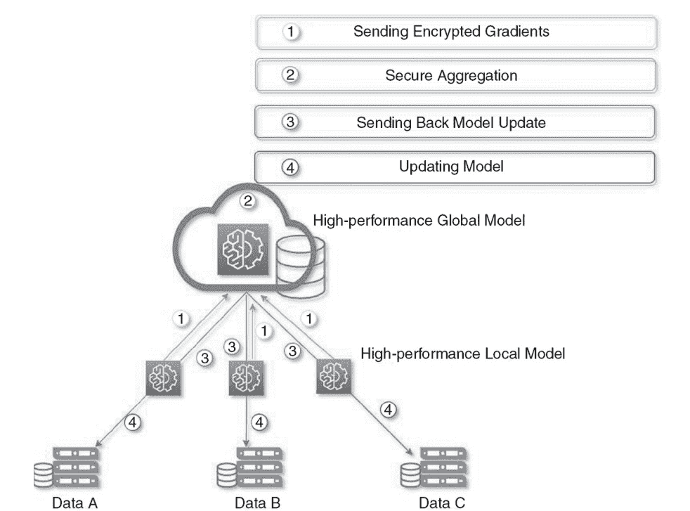

1. 发送加密梯度
2. 安全聚合
3. 发送回模型更新
4. 更新模型

- 高性能全局模型
- 高性能本地模型
- 数据 A
- 数据 B
- 数据 C

图 12.1 以模型为中心的联邦学习。

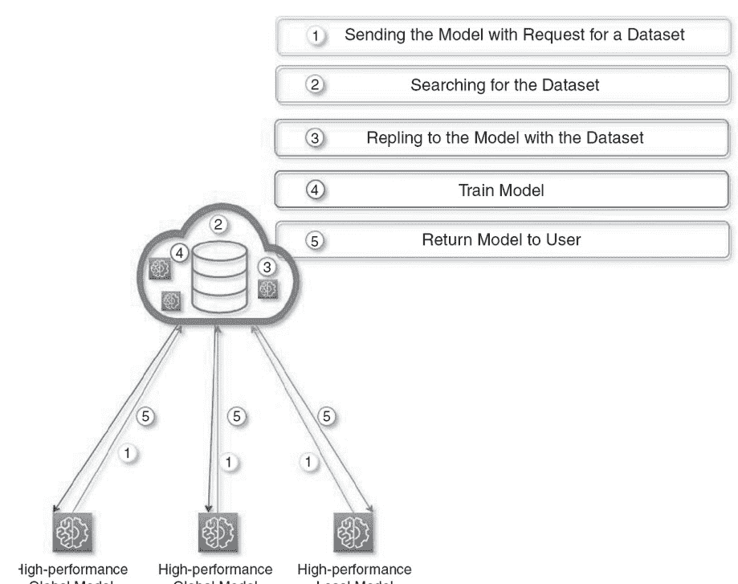

图 12.2 以数据为中心的联邦学习。

#### 12.3.1.1 以模型为中心的联邦学习

这是两种类型中更常见的一种 [10]。在以模型为中心的方式中，模型托管在云服务中，其 API 是预配置的（层、权重等）。每个用户下载模型、增强模型并上传更新版本。但这可能需要很长时间，通常需要数周到数月。一个很好的例子是 Google 的 GBoard 移动应用。它会在不发送任何私人数据的情况下，随着时间的推移学习用户的打字偏好。学习是分布式的，在远程进行，通过合适的联邦技术更新中央模型。

#### 12.3.1.2 以数据为中心的联邦学习

与以模型为中心的方式相比，以数据为中心的方式不太常见，但更适合实验科学。它以数据为中心的方式托管在云服务器中，不是作为模型，而是作为


API 预先配置（Schema、Attributes 等）的数据集。用户可以利用这些数据集以专门指定的实验方式在本地训练其模型。更具体地说，在数据中心式联邦学习中，其思路是拥有一个集中在服务器上的超级或全局 oracle，该 oracle 包含由贡献者添加的多个数据集。任何想要使用该数据的模型拥有者都可以发送其模型并请求使用特定数据集进行训练。如果请求被接受，oracle 会查找请求的数据集并开始模型的训练。一旦训练完成，模型将被提供回模型拥有者。数据中心式最可能的情况是个人或组织希望保护数据（与其托管模型，他们托管数据）。这使得非数据拥有者的数据科学家可以针对该数据提出训练或参考请求。

### 12.3.2 Techniques

在联邦学习中，了解您的数据、其如何被划分以及其技术和实践挑战，对于定义实施条件非常重要。

#### 12.3.2.1 Horizontal Federated Learning

水平联邦学习，或基于样本的联邦学习，用于多个数据集共享相同特征但实例不同的情况。我们也称之为 *同质联邦学习方法*，因为我们处理的是对相同特征的使用相似性。

#### 12.3.2.2 Vertical Federated Learning

垂直联邦学习 [11] 是水平方法的相反。它指的是使用多个数据集，这些数据集具有许多相交的样本和少数相交的特征。在这种情况下，我们拥有 *异构联邦学习*，这是由于特征集不同所致。它使用不同特征空间的不同数据集来联合训练全局模型。

本节我们讨论联邦学习当前面临的问题和挑战，以及需要关注的问题以获得更高效率 [12]。

### 12.4.1 Trade-off Between Efficiency and Privacy

使用安全多方计算（SMPC）[13] 和差分隐私（DP）[14] 时，联邦学习的隐私措施变得非常高效。然而，获得高水平隐私伴随着权衡。使用 SMPC 时，模型参数的加密需要在将其发送回全局模型进行聚合之前完成。这需要使用额外的计算资源和电力，这可能会影响训练的效率。另一方面，使用 DP 需要向数据和模型添加噪声，从而在准确性和隐私之间产生权衡，因为额外噪声的使用会影响模型的准确性。在联邦学习中寻找 SMPC 和 DP 的合适权衡非常具有挑战性。

### 12.4.2 Communication Bottlenecks [1]

将模型带到设备上的通信成本应保持适中，因为它可能会影响 FL 环境，其中一个设备可能因通信瓶颈而受损，进而导致联邦训练过程停滞。针对通信瓶颈已有若干研究，例如丢弃慢设备（在指定时间窗口内未能完成训练的设备），以及模型压缩/量化以降低带宽成本。

### 12.4.3 Poisoning [2]

污染有两种形式。在数据投毒中，恶意用户在训练过程中发送虚假或恶意数据，这会影响模型的整体性能。使用联邦学习，很难检测到此类用户。模型投毒与第一种类型相反。恶意用户通过在训练前修改其梯度/参数来篡改接收到的模型。因此在聚合期间，全局模型在过程中会受到错误梯度的严重影响。

## 12.5 OPPORTUNITIES

联邦学习中仍需解决一些问题，以保证更高的安全性而不会损失性能。一种思路是将区块链技术与数据中心式联邦学习合并。区块链是一种“peer-to-peer”（P2P）去中心化账本技术 [15]，它通过加密协议在点对点计算机系统上提供公开记录和分发交易信息的方法。数据库是分散的，规则是新信息的每个副本不仅保存在单一服务器上，还会发送到链或框架中的所有客户端。要更改数据集的任何部分，黑客需要更改系统中 51% 的副本，并且这些副本中的每一个都需要包含该信息的全部过去交易。该协议已有效消除了第三方，同时保证了安全性和可扩展性以及高交互性 [16]。

概念包括两种类型的区块链，即公有链和私有链。然而，其他变体包括联盟链和混合区块链。它们都由在点对点网络系统上运行的节点集群组成，每个节点都拥有带有及时更新的共享账本副本。此外，它们都验证、发起和恢复交易，同时创建新的区块链。尽管如此，这些类型在各个方面都存在差异。

### 12.5.1 Leveraging Blockchain

利用区块链技术 [17] 允许与数据中心式联邦学习进行两种类型的交互。首先，它为数据中心式联邦学习提供新的安全层，如不可篡改性、可追溯性、透明性以及所有参与者的信任水平。其次，它提供了一种真正的激励机制执行，鼓励贡献者共享数据并训练 ML 模型以提高性能。

区块链中的数据结构是一个后向链接的记录列表。这样，信息就无法被修改或删除。因此，我们能够确保我们的数据和模型的不可篡改性。区块链中的每笔交易和每个区块都带有时间戳。因此，假设数据丢失，就没有无法恢复的可能。发生的交易是透明的，具有权限的参与者可以看到任何交易，从而实现完全透明。任何记录的开头都可以通过链追溯到其起点。为了保证完全的交互透明性，我们在智能合约中添加公共模型。现在数据提供者能够完全了解其数据将参与何种训练。智能合约提供商定的规范保险，这有助于模型在区块链环境以及集中式服务器中得到更新。智能合约代码无法被篡改，并且由于由多台机器评估，它保证了模型规范的完整功能。智能合约 [18] 是不可修改的并由多台机器评估，有助于确保模型按其指定的方式运行。智能合约的不可变性质和永久记录还允许我们可靠地注册和分发给优质数据贡献者的奖励。

## 12.6 USE CASE: LEVERAGING PRIVACY, INTEGRITY, AND AVAILABILITY FOR DATA-CENTRIC FEDERATED LEARNING USING A BLOCKCHAIN-BASED APPROACH

本节中，我们展示了区块链机遇如何增强联邦学习中模型和数据的安全性和完整性的证明。

联邦学习架构是我们创建自身架构的参考方法。在联邦学习中，我们将模型分发到数据，而在我们的案例中，我们通过将数据分发到模型来实现相反的操作。区块链在数据中心式联邦学习中的使用如图 12.3 所示。

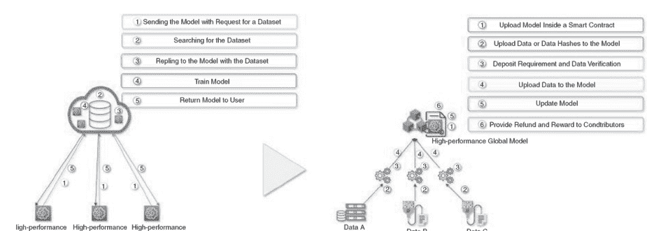

FIGURE 12.3 Blockchain for data-centric federated learning.

在我们的案例中，模型和数据存储在去中心化的环境中，即公共区块链，而不是所有网络参与者都可以访问的集中式服务器。同一参与者以协作方式向模型提供数据，使数据可供模型所有者使用。个人数据完全由其所有者控制，即他们可以控制想要提供的数据量。每次输入数据时，我们都会进行数据聚合，但在对模型进行任何更新之前，数据需要经过验证。为了确保数据的完整性，我们实施激励机制以鼓励贡献者并要求每个用户存入押金以添加数据来训练模型，使恶意用户破坏模型效率变得昂贵。该过程始于模型所有者提供押金、奖励和超时函数，从而建立我们激励机制的基础。*deposit* 对应用户需要支付的货币金额，以便访问模型智能合约，从而在区块链内添加数据来训练模型。*reward* 表示用户在检查数据完整性并恢复数据时收到的金额。*time-out function* 定义了押金退还与所有者验证之间的时间。当经批准的数据发送给模型进行训练时，模型会更新；对于每个有益的押金，会进行退款，对于每次有益的输入验证，则提供奖励。访问贡献者的数据是必要的，因为数据将仅在智能合约内用于训练模型。这些功能将在数据安全和机器学习方面提供巨大的改进。


### 12.6.1 结果

我们在该方法中探索了与数据监管政策相关的不同安全方面，同时提升了 AI 模型的效率。利用联邦学习，我们能够在关注个人数据隐私的前提下创建训练模型，而借助区块链，我们为贡献者提供了完全的匿名性、控制权和访问权，使其能够提供希望模型评估的数据，同时对训练过程保持完全透明。这些特性导致训练数据集以平均每天增加 500 个数据点的速度增长。此外，通过激励机制的使用，我们能够避免恶意贡献，因为数据在训练阶段之前由贡献者进行验证。由于我们使用的是存款/退款机制，每个输入都需要货币存款。经过一段时间，我们发现恶意用户的账户余额降至零，因为所有数据都被验证并删除，从而导致贡献者无法获得退款。同时，良好贡献者的账户余额上升，因为他们因验证而获得奖励。该机制有助于避免前面所述的投毒问题。至于可用性，区块链的去中心化基础设施有助于触达无数用户，他们可以在安全且私密的环境中提供数据。

尽管具有所有这些安全特性，模型的准确性和效率仍提高了 5%。这是因为我们不考虑向数据添加噪声以增强隐私，就像我们在差分隐私中所做的那样。因此，模型使用从贡献者处接收到的高质量数据进行训练

## 12.7 结论

在本章中，我们证明了尽管有新的数据监管和政策，我们仍能够为 AI 模型提供质量高且安全的模型训练，同时遵守监管规则。而这得益于联邦学习和区块链技术。正如我们在用例中所看到的，我们将联邦学习和区块链合并在一起，在增强 AI 模型的同时解决了多个数据安全属性。这种组合提供了一种特定的方法来促进 CIA 三元组；即，通过使用联邦学习，我们能够在训练期间为数据提供隐私和保密性。同时，区块链提供可追溯性、完整性和透明度。这些属性也符合 GDPR 原则和 CCPA 监管要求。

## 参考文献

- 1. [Filip e Betzel](#), Karen Khatamifard, Harini Suresh, David J. Lilja, John Sartori, and Ulya Karpuzcu. 近似通信：减少大规模并行系统中通信瓶颈的技术. *ACM Computing Surveys*, 51(1):1–32, April 2018.
- 2. [Minghong Fang](#), Xiaoyu Cao, Jinyuan Jia, and Neil Zhenqiang Gong. 针对拜占庭鲁棒联邦学习的本地模型投毒攻击. page 19.
- 3. [Michelle Goddard](#). 欧盟通用数据保护条例（GDPR）：具有全球影响的欧洲法规. *International Journal of Market Research*, 59(6):703–705, November 2017.
- 4. [Lydia de la Torre](#). 2018 年加州消费者隐私法案指南. *SSRN Electronic Journal*, 2018.
- 5. [Dorothy Elizabeth Robling Denning](#). *密码学与数据安全*. Addison-Wesley, Reading, Mass, 1982.
- 6. [Oliver Radley-Gardner](#), Hugh Beale, and Reinhard Zimmermann, editors. *欧洲私法基本文献*. Hart Publishing, 2016.
- 7. [Xin Yao](#), Tianchi Huang, Chenglei Wu, Ruixiao Zhang, and Lifeng Sun. 迈向更快更好的联邦学习：一种特征融合方法. In *2019 IEEE International Conference on Image Processing (ICIP)*, pages 175–179, Taipei, Taiwan, September 2019. IEEE.
- 8. [Qiang Yang](#), Yang Liu, Tianjian Chen, and Yongxin Tong. 联邦机器学习：概念与应用. *arXiv:1902.04885 [cs]*, February 2019. arXiv: 1902.04885.
- 9. [Kelvin](#). 联邦学习及其挑战简介, November 2020.
- 10. Huawei Huang and Yang Yang. WorkerFirst：移动边缘计算中面向工作者的联邦学习模型选择. In 2020 IEEE/CIC International Conference on Communications in China (ICCC), pages 1039–1044, August 2020. ISSN: 2377–8644.
- 11. Jiankai Sun, Xin Yang, Yuanshun Yao, Aonan Zhang, Weihao Gao, Junyuan Xie, and Chong Wang. 不泄露交集成员的纵向联邦学习. arXiv:2106.05508 [cs], June 2021. arXiv: 2106.05508.
- 12. Peter Kairouz, H. Brendan McMahan, Brendan Avent, Aurélien Bellet, Mehdi Bennis, Arjun Nitin Bhagoji, Kallista Bonawitz, Zachary Charles, Graham Cormode, Rachel Cummings, Rafael G. L. D’Oliveira, Hubert Eichner, Salim El Rouayheb, David Evans, Josh Gardner, Zachary Garrett, Adrià Gascón, Badih Ghazi, Phillip B. Gibbons, Marco Gruteser, Zaid Harchaoui, Chaoyang He, Lie He, Zhouyuan Huo, Ben Hutchinson, Justin Hsu, Martin Jaggi, Tara Javidi, Gauri Joshi, Mikhail Khodak, Jakub Konečný, Aleksandra Korolova, Farinaz Koushanfar, Sanmi Koyejo, Tancrède Lepoint, Yang Liu, Prateek Mittal, Mehryar Mohri, Richard Nock, Ayfer Özgür, Rasmus Pagh, Mariana Raykova, Hang Qi, Daniel Ramage, Ramesh Raskar, Dawn Song, Weikang Song, Sebastian U. Stich, Ziteng Sun, Ananda Theertha Suresh, Florian Tramèr, Praneeth Vepakomma, Jianyu Wang, Li Xiong, Zheng Xu, Qiang Yang, Felix X. Yu, Han Yu, and Sen Zhao. 联邦学习的进展与开放问题. arXiv:1912.04977 [cs, stat], March 2021. arXiv: 1912.04977.
- 13. Lifei Wei, Haojin Zhu, Zhenfu Cao, Xiaolei Dong, Weiwei Jia, Yunlu Chen, and Athanasios V. Vasilakos. 云计算中存储与计算的安全与隐私. Information Sciences, 258:371–386, February 2014.
- 14. Cynthia Dwork. 差分隐私：结果综述. In Manindra Agrawal, Dingzhu Du, Zhenhua Duan, and Angsheng Li, editors, 计算模型理论与应用, pages 1–19, Berlin, Heidelberg, 2008. Springer Berlin Heidelberg.
- 15. Hyesung Kim, Jihong Park, Mehdi Bennis, and Seong-Lyun Kim. 区块链化设备端联邦学习. IEEE Communications Letters, 24(6):1279–1283, June 2020.
- 16. [Quoc Khanh Nguyen](#) and Quang Vang Dang. 区块链技术助力未来发展. In *2018 4th International Conference on Green Technology and Sustainable Development (GTSD)*, pages 483–486, Ho Chi Minh City, November 2018. IEEE.
- 17. [Konstantinos Christidis](#) and Michael Devetsikiotis. 物联网中的区块链与智能合约. *Ieee Access*, 4:2292–2303, 2016.
- 18. [Bin Hu](#). 智能合约构建与执行的全面综述：范式、工具与系统. *OPEN ACCESS*, page 51.

# 第三部分

# 使用 AI/ML 算法进行网络安全

# 使用机器学习进行网络安全：
概述

D. Roshni Thanka, G. Jaspher W. Kathrine, and E. Bijolin Edwin
*Karunya Institute of Technology and Sciences, Coimbatore, Tamil Nadu, India*

DOI: 10.1201/9781003187158-16

## 目录

- §3.1 引言
- §3.2 人工智能足以阻止网络犯罪吗？
- §3.3 企业使用机器学习加强其网络安全系统
- §3.4 网络攻击/网络安全威胁与攻击
  - 3.4.1 恶意软件
  - 3.4.2 数据泄露
  - 3.4.3 结构化查询语言注入 (SQL-i)
  - 3.4.4 跨站脚本 (XSS)
  - 3.4.5 拒绝服务 (DOS) 攻击
  - 3.4.6 内部威胁
  - 3.4.7 生日攻击
  - 3.4.8 网络入侵
  - 3.4.9 冒充攻击
  - 3.4.10 在线系统上的 DDoS 攻击检测
- §3.5 网络安全中不同的机器学习技术
  - 3.5.1 支持向量机 (SVM)
  - 3.5.2 K 近邻 (KNN)
  - 3.5.3 朴素贝叶斯
  - 3.5.4 决策树

在现实世界中，网络的每个角落都可能发生攻击，这是主要关注点。网络安全在维护安全方面具有重要作用。暴力攻击、凭证填充、网络钓鱼、恶意软件攻击、僵尸网络拒绝服务、即时消息滥用、蠕虫、特洛伊木马、知识产权盗窃、Rootkit、密码嗅探等，只是任何组织或互联网用户常见攻击中的一些。为了检测和防止这类攻击，帮助分析人员应对它们，并防止在现代时代滥用数据，像机器学习和深度学习这样的人工智能类别发挥着至关重要的作用。通过使用机器学习技术，模式被开发并应用于算法，以预先防止各种不可预见的攻击并加强安全系统。为了生成这些模式，相关且可能质量丰富的数据至关重要。利用机器学习技术开发的模型可以自动化计算机，并在分析人员不在场的情况下协助分析人员保护有价值的数据。在任何攻击中，最重要的第一件事是了解攻击的目标 [2]，它可能属于图 13.1 中所示的任何类别。第二重要的维度是削弱对手执行恶意活动的能力。


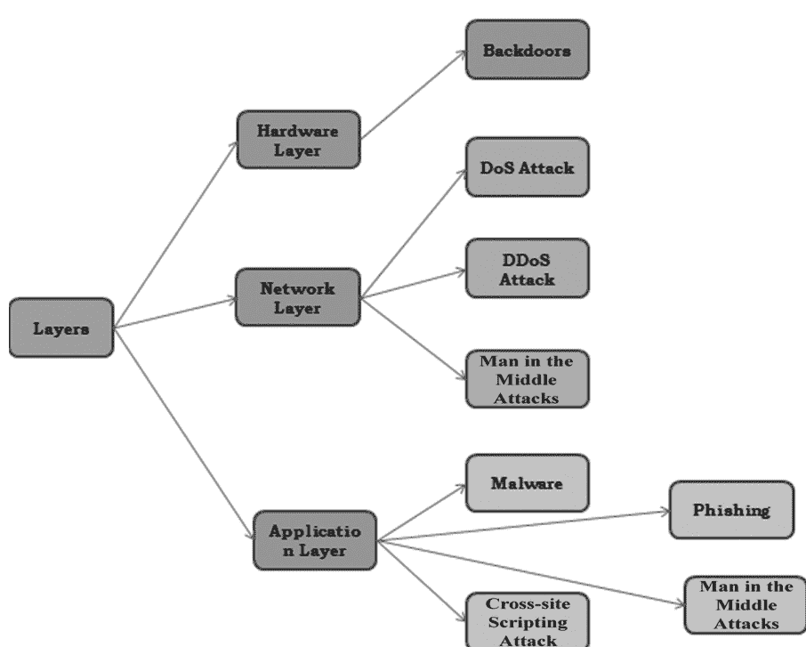

图 13.1 攻击类型。

## 13.2 人工智能足以阻止网络犯罪吗？

在当今新兴技术中，全球数据不断演进，提炼和提取精华是主要挑战。这些提炼揭示了威胁。在这方面，机器学习在人类专家的支持下通过预测未来来改善网络安全。

## 13.3 企业利用机器学习加强其网络安全系统

使用机器学习技术进行运营和增强安全实施的企业 [3] 包括 Microsoft、Chronicle、Splunk、Blackberry 和 Demisto 等。

在网络安全方面，Microsoft 使用 Windows Defender 高级威胁防护 (ATP)，可自动发现威胁。Microsoft 还推出了机器学习网络攻击威胁矩阵，以应对针对机器学习的网络安全威胁。

在 Chronicle 中，由 Alphabet（Google 的母公司）发布的 Backstory 提供即时安全分析和对实际漏洞的上下文，并使用机器学习来总结信息洞察。

Splunk 软件包括多个应用程序，如 IT 运维、分析和网络安全。该软件旨在对客户的弱点进行分类、自动化漏洞调查并响应恶意软件攻击。Splunk Enterprise Security 和 Splunk User Behavior Analytics 等产品使用机器学习来识别攻击并协助快速排除它们。

BlackBerry 提供网络安全解决方案，应用人工智能和机器学习以遏制网络安全攻击并提升客户的威胁响应能力。

Demisto 利用机器学习监控和突出显示安全警报。

## 13.4 网络攻击/网络安全威胁和攻击

### 13.4.1 恶意软件

入侵者开发了不同种类的软件来破坏计算机系统、设备和网络，以窃取敏感信息，严重扰乱用户。恶意软件的模式以电子邮件附件、感染文件、文件共享软件等形式出现。恶意软件的一些变种包括僵尸网络、加密货币挖矿、病毒、蠕虫、恶意广告、勒索软件、特洛伊木马和间谍软件等。

僵尸网络是由受感染计算机组成的网络，主要导致拒绝服务攻击。加密货币挖矿是一种通过电子邮件中的恶意链接挖掘加密货币的恶意软件。这类攻击出于财务动机，最终可能使受影响系统过载，并导致物理损坏。

病毒是可以附加到干净代码或自动化进程中的可执行文件，并迅速在网络中传播，通过破坏和锁定系统功能造成巨大损害。蠕虫恶意软件是一种自我复制攻击，可能附着于现有文件或程序，从一个系统开始但迅速在整个网络中传播。

看似合法的广告转变为攻击即为恶意广告。在此，合法网络和网站中的广告被用来传播恶意软件。勒索软件/恐吓软件恶意软件会阻止或锁定计算机系统的部分或全部，直到向攻击者支付一定金额的钱为止。这给组织造成昂贵的损失，因为他们无法访问系统。

特洛伊木马恶意软件充当合法软件并为其他恶意软件创建后门以便轻松攻击。间谍软件是一种隐藏在系统后台的恶意软件，通过它攻击者可以从受感染系统中获取信用卡号码、密码等敏感信息。

### 13.4.2 数据泄露

数据泄露是指获取未经授权的信息，如信用卡信息、密码、窃听、记录击键等。网络钓鱼是一种通过发送看似合法的电子邮件或消息并获取有价值数据而进行的数据泄露。鲸鱼式网络钓鱼攻击和 spear-phishing 攻击是其一些变种。

### 13.4.3 结构化查询语言注入 (SQL-i)

这主要是以 SQL 查询的形式访问 SQL 服务器数据库以获取有价值信息。

### 13.4.4 跨站脚本 (XSS)

类似于 SQL-I，JavaScript 代码作为浏览器端脚本注入，而不是作为查询来利用网站漏洞。

### 13.4.5 拒绝服务 (DoS) 攻击

这种攻击通过发送服务器无法处理的互联网流量洪水使资源无法访问，从而阻止需要用户获取在线服务。

### 13.4.6 内部威胁

组织内部的人员有时会危及组织以获得受限权限，从而进行重大更改甚至更改安全策略并获取有价值的数据。

### 13.4.7 生日攻击

在这里，攻击者创建一个与原始发送者发送的哈希相同的相似哈希；这可能误导接收者，将假的识别为真的。为了防止此类攻击，可以使用更长的哈希，这显著降低了此类攻击的有效性。

### 13.4.8 网络入侵

保护网络免受众多安全漏洞的侵害更为关键。网络入侵会导致有价值的网络资源被窃取。

### 13.4.9 冒充攻击

冒充攻击采取欺诈形式，攻击者可能冒充已知联系人诱使用户分享敏感信息或登录凭证。它们还可能导致资金转移到欺诈账户。

### 13.4.10 在线系统上的 DDoS 攻击检测

DDoS 攻击在许多组织中造成重大问题。在早期阶段识别它们可以减轻其对组织的严重影响。在预处理中使用 MLP、RF、KNN 和 SVM 等机器学习算法有助于识别各种洪水攻击，如 UDP 洪水、ICMP 洪水、HTTP 洪水等，并提供良好的准确性 [37]。

## 13.5 网络安全中的不同机器学习技术

人工智能和机器学习已经在许多行业的各个重要部分带来了不可思议的变革。为了在当前技术领域提供高效的网络安全，机器学习是唯一可能的方式。由于攻击模式行为的变化，这只能通过正确理解各自环境中可用的高质量数据来实现。网络安全分析、恶意软件分析和其他类型的威胁分析可以与深度学习技术结合广泛使用。这将提高组织的生产力时间。研究人员表示，到 2025 年，超过 30% 的投资将基于 AI/ML 用于网络安全，以协助识别、预防问题并提供解决方案。

### 13.5.1 支持向量机 (SVM)

SVM 是机器学习的一种分类，是一个监督算法，在基于正常和异常攻击模式感知网络攻击方面发挥着主要作用 [9]。在此，通过增加空间分辨率中的边缘空间可以减少误分类 [4]。通过修改高斯核可以进一步提高性能。SVM 算法在用户启动浏览器时在后台运行，监控用户访问的页面中发生的每一次活动，将其与漏洞类型进行匹配，并对图 13.2 所示的网络攻击进行分类。

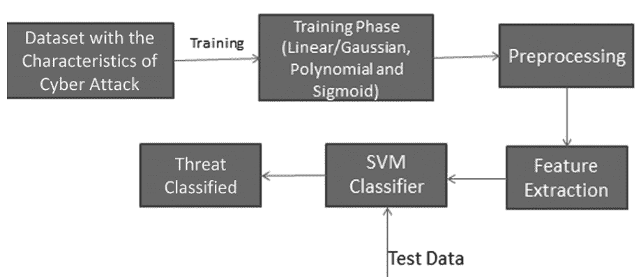

图 13.2 SVM 架构。

### 13.5.2 K 近邻 (KNN)

一个强大的安全系统对于保护系统至关重要。使用 KNN 分类器算法，具有不同特征的异常节点根据其在图 13.3 所示入侵系统中的行为与正常节点分离。当许多最近邻节点与特定分类相关联时，则数据点属于同一分类。最近的数据点通过欧几里得距离或曼哈顿距离找到。欧几里得距离的计算方法为：

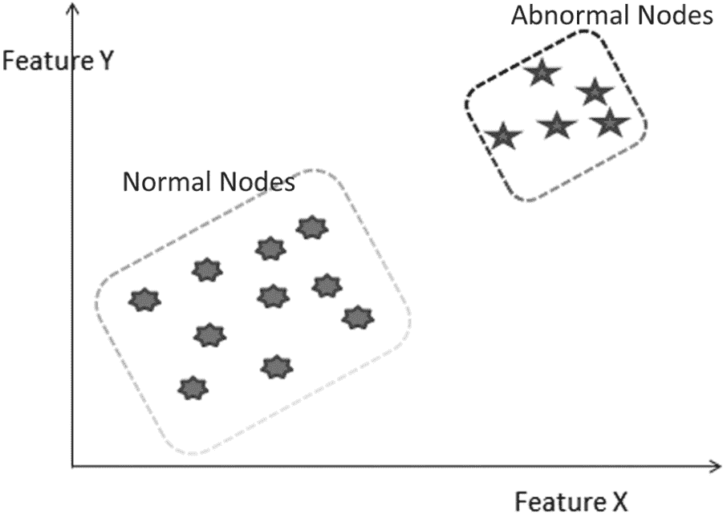

**图 13.3** KNN 入侵检测。

这里 *n* 表示数据点的总数量，而 *xᵢ* 和 *yᵢ* 指定实例 *x* 和 *y* 的第 *i* 个和第 *j* 个特征元素。任何入侵检测系统的目标都是快速检测入侵、减轻误报并提供保护系统的快速激活 [5, 6, 7]。但 KNN 的问题在于它是一种懒惰学习器，需要很高的计算时间。为克服这一问题，实现了快速 KNN，以提供更少的计算时间和更好的准确性。

### 13.5.3 朴素贝叶斯

网络异常，例如异常检测和误用检测，可以通过多种数据挖掘任务来检测。当系统具有完整性、保密性或可用性时，则认为系统是安全的。朴素贝叶斯分类器是图 13.4 所示的不确定性领域中使用的简化贝叶斯概率模型。这里一个属性的可能性不会影响另一个属性的可能性。

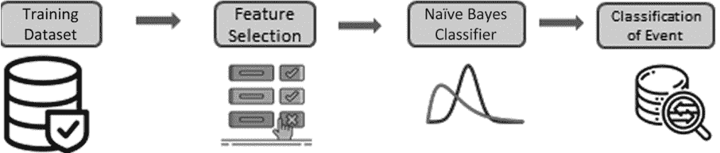

**图 13.4** 朴素贝叶斯分类器。

朴素贝叶斯算法在训练阶段通过提供某些属性来计算并保存盗窃的概率。这是对每个属性进行的，并且计算每个属性所需概率所需的时间被记录下来。在测试阶段，在最坏情况下计算每个样本的给定类别概率所需的时间与属性数量 *n* 成正比。在最坏情况下，测试阶段花费的时间与训练阶段相同。

### 13.5.4 决策树

随着通信技术日新月异，提高计算机网络系统的安全性并保护其免受入侵至关重要。系统中的入侵可以通过与正常配置文件的活动变化来检测。

决策树是一种分类算法，主要有助于找到预测变量和目标变量之间的关联。训练数据集中每个数据点都通过将所有相似的目标值归类到一个子域下来划分为子域。子域进一步对图 13.5 和 13.6 所示的新到达数据点的目标值进行分类。决策树从源到目的地的路径指定了分析目标变量的预测变量模式。预测变量指定事件，目标变量指定事件类型。系统中发生的每个事件都被分析，以将其归类为正常或异常事件，从而检测入侵。


**图 13.5** 决策树示例。


**图 13.6** 决策树的处理步骤。


图 13.7 随机森林分类器。

### 13.5.6 多层感知器 (MLP)

MLP 基于神经网络，其中所有层上的所有神经元都是全连接的，如图 13.8 所示。该算法在对大量记录进行分类和识别复杂数据集中模式方面更有效 [30]。输出中的误差由实际输出与预期输出之间的差异计算得出。


图 13.8 MLP。

为纠正此误差，会进行反向传播。这从输出层开始到隐藏层，并向输入层传输。在此传输过程中，权重会被更新以在网络中获得准确的结果。这也实现了入侵检测系统中的更好准确性 [29, 31]。

### 13.6 机器学习的应用

### 13.6.1 航空业中的机器学习

反无人机系统可以使用视频、音频、热成像、雷达或射频技术检测无人机。保护方案有能力干扰无人机的功能。在检测中，机器学习技术被广泛使用。对无人机的三种最常见攻击是干扰、欺骗和伪造。在模拟环境中，他们创建了一种依赖于一类支持向量机算法的 GPS 欺骗威胁识别方法。他们将恶意路径放入复制的无人机中，试图将其从预编程航线中偏离 [26]。

### 13.6.2 网络安全监控下的网络机器学习

在网络安全监控中，从 UCI 机器库收集的数据生成训练、验证和测试集，以获取异常网络和无异常网络的样本。用户通过提及其 IP 地址来说明数据收集的时间段以及要监控的设备。记录值被规范化并纳入训练、验证和测试集。

### 13.6.3 电池储能系统 (BESS) 网络攻击缓解

为了获得足够的检测准确性，数据质量和适当大小的数据集至关重要。用于管理 BESS 的是电池管理系统 (BMS)。为了防止对电池荷电状态的攻击，可以应用预测方法。根据传感数据进行状态估计预测，进行针对电网的最先进 FDIA 检测方法。如果估计值与测量值之间存在差异，则意味着残差超过了给定阈值。对于基于残差的方法实现，由于 BESS 与电网之间持续的数据交换，需要测量预测；网络攻击会影响 BESS 接收到的命令的完整性，如图 13.10 所示。分布式方法已用于检测网络攻击的去中心化系统。该技术的[content]


**图 13.3** KNN 入侵检测。

这里 *n* 表示数据点的总数量，而 *xᵢ* 和 *yᵢ* 指定实例 *x* 和 *y* 的第 *i* 个和第 *j* 个特征元素。任何入侵检测系统的目标都是快速检测入侵、减轻误报并提供保护系统的快速激活 [5, 6, 7]。但 KNN 的问题在于它是一种懒惰学习器，需要很高的计算时间。为克服这一问题，实现了快速 KNN，以提供更少的计算时间和更好的准确性。

### 13.5.3 朴素贝叶斯

网络异常，例如异常检测和误用检测，可以通过多种数据挖掘任务来检测。当系统具有完整性、保密性或可用性时，则认为系统是安全的。朴素贝叶斯分类器是图 13.4 所示的不确定性领域中使用的简化贝叶斯概率模型。这里一个属性的可能性不会影响另一个属性的可能性。


**图 13.4** 朴素贝叶斯分类器。

朴素贝叶斯算法在训练阶段通过提供某些属性来计算并保存盗窃的概率。这是对每个属性进行的，并且计算每个属性所需概率所需的时间被记录下来。在测试阶段，在最坏情况下计算每个样本的给定类别概率所需的时间与属性数量 *n* 成正比。在最坏情况下，测试阶段花费的时间与训练阶段相同。

### 13.5.4 决策树

随着通信技术日新月异，提高计算机网络系统的安全性并保护其免受入侵至关重要。系统中的入侵可以通过与正常配置文件的活动变化来检测。

决策树是一种分类算法，主要有助于找到预测变量和目标变量之间的关联。训练数据集中每个数据点都通过将所有相似的目标值归类到一个子域下来划分为子域。子域进一步对图 13.5 和 13.6 所示的新到达数据点的目标值进行分类。决策树从源到目的地的路径指定了分析目标变量的预测变量模式。预测变量指定事件，目标变量指定事件类型。系统中发生的每个事件都被分析，以将其归类为正常或异常事件，从而检测入侵。


**图 13.5** 决策树示例。


**图 13.6** 决策树的处理步骤。


图 13.7 随机森林分类器。

### 13.5.6 多层感知器 (MLP)

MLP 基于神经网络，其中所有层上的所有神经元都是全连接的，如图 13.8 所示。该算法在对大量记录进行分类和识别复杂数据集中模式方面更有效 [30]。输出中的误差由实际输出与预期输出之间的差异计算得出。


图 13.8 MLP。

为纠正此误差，会进行反向传播。这从输出层开始到隐藏层，并向输入层传输。在此传输过程中，权重会被更新以在网络中获得准确的结果。这也实现了入侵检测系统中的更好准确性 [29, 31]。

### 13.6 机器学习的应用

### 13.6.1 航空业中的机器学习

反无人机系统可以使用视频、音频、热成像、雷达或射频技术检测无人机。保护方案有能力干扰无人机的功能。在检测中，机器学习技术被广泛使用。对无人机的三种最常见攻击是干扰、欺骗和伪造。在模拟环境中，他们创建了一种依赖于一类支持向量机算法的 GPS 欺骗威胁识别方法。他们将恶意路径放入复制的无人机中，试图将其从预编程航线中偏离 [26]。

### 13.6.2 网络安全监控下的网络机器学习

在网络安全监控中，从 UCI 机器库收集的数据生成训练、验证和测试集，以获取异常网络和无异常网络的样本。用户通过提及其 IP 地址来说明数据收集的时间段以及要监控的设备。记录值被规范化并纳入训练、验证和测试集。

### 13.6.3 电池储能系统 (BESS) 网络攻击缓解

为了获得足够的检测准确性，数据质量和适当大小的数据集至关重要。用于管理 BESS 的是电池管理系统 (BMS)。为了防止对电池荷电状态的攻击，可以应用预测方法。根据传感数据进行状态估计预测，进行针对电网的最先进 FDIA 检测方法。如果估计值与测量值之间存在差异，则意味着残差超过了给定阈值。对于基于残差的方法实现，由于 BESS 与电网之间持续的数据交换，需要测量预测；网络攻击会影响 BESS 接收到的命令的完整性，如图 13.10 所示。分布式方法已用于检测网络攻击的去中心化系统。该技术的[content]


**图 13.3** KNN 入侵检测。

这里 *n* 表示数据点的总数量，而 *xᵢ* 和 *yᵢ* 指定实例 *x* 和 *y* 的第 *i* 个和第 *j* 个特征元素。任何入侵检测系统的目标都是快速检测入侵、减轻误报并提供保护系统的快速激活 [5, 6, 7]。但 KNN 的问题在于它是一种懒惰学习器，需要很高的计算时间。为克服这一问题，实现了快速 KNN，以提供更少的计算时间和更好的准确性。

### 13.5.3 朴素贝叶斯

网络异常，例如异常检测和误用检测，可以通过多种数据挖掘任务来检测。当系统具有完整性、保密性或可用性时，则认为系统是安全的。朴素贝叶斯分类器是图 13.4 所示的不确定性领域中使用的简化贝叶斯概率模型。这里一个属性的可能性不会影响另一个属性的可能性。


**图 13.4** 朴素贝叶斯分类器。

朴素贝叶斯算法在训练阶段通过提供某些属性来计算并保存盗窃的概率。这是对每个属性进行的，并且计算每个属性所需概率所需的时间被记录下来。在测试阶段，在最坏情况下计算每个样本的给定类别概率所需的时间与属性数量 *n* 成正比。在最坏情况下，测试阶段花费的时间与训练阶段相同。

### 13.5.4 决策树

随着通信技术日新月异，提高计算机网络系统的安全性并保护其免受入侵至关重要。系统中的入侵可以通过与正常配置文件的活动变化来检测。

决策树是一种分类算法，主要有助于找到预测变量和目标变量之间的关联。训练数据集中每个数据点都通过将所有相似的目标值归类到一个子域下来划分为子域。子域进一步对图 13.5 和 13.6 所示的新到达数据点的目标值进行分类。决策树从源到目的地的路径指定了分析目标变量的预测变量模式。预测变量指定事件，目标变量指定事件类型。系统中发生的每个事件都被分析，以将其归类为正常或异常事件，从而检测入侵。


**图 13.5** 决策树示例。


**图 13.6** 决策树的处理步骤。


图 13.7 随机森林分类器。

### 13.5.6 多层感知器 (MLP)

MLP 基于神经网络，其中所有层上的所有神经元都是全连接的，如图 13.8 所示。该算法在对大量记录进行分类和识别复杂数据集中模式方面更有效 [30]。输出中的误差由实际输出与预期输出之间的差异计算得出。


图 13.8 MLP。

为纠正此误差，会进行反向传播。这从输出层开始到隐藏层，并向输入层传输。在此传输过程中，权重会被更新以在网络中获得准确的结果。这也实现了入侵检测系统中的更好准确性 [29, 31]。

### 13.6 机器学习的应用

### 13.6.1 航空业中的机器学习

反无人机系统可以使用视频、音频、热成像、雷达或射频技术检测无人机。保护方案有能力干扰无人机的功能。在检测中，机器学习技术被广泛使用。对无人机的三种最常见攻击是干扰、欺骗和伪造。在模拟环境中，他们创建了一种依赖于一类支持向量机算法的 GPS 欺骗威胁识别方法。他们将恶意路径放入复制的无人机中，试图将其从预编程航线中偏离 [26]。

### 13.6.2 网络安全监控下的网络机器学习

在网络安全监控中，从 UCI 机器库收集的数据生成训练、验证和测试集，以获取异常网络和无异常网络的样本。用户通过提及其 IP 地址来说明数据收集的时间段以及要监控的设备。记录值被规范化并纳入训练、验证和测试集。

### 13.6.3 电池储能系统 (BESS) 网络攻击缓解

为了获得足够的检测准确性，数据质量和适当大小的数据集至关重要。用于管理 BESS 的是电池管理系统 (BMS)。为了防止对电池荷电状态的攻击，可以应用预测方法。根据传感数据进行状态估计预测，进行针对电网的最先进 FDIA 检测方法。如果估计值与测量值之间存在差异，则意味着残差超过了给定阈值。对于基于残差的方法实现，由于 BESS 与电网之间持续的数据交换，需要测量预测；网络攻击会影响 BESS 接收到的命令的完整性，如图 13.10 所示。分布式方法已用于检测网络攻击的去中心化系统。该技术的主要目标是形成残差信号。它决定与预定义阈值相关联的残差评估函数。


可用性攻击

完整性攻击

保密性
攻击

# 图 13.10 BESS 网络威胁。

一旦检测到攻击，就必须消除其对 BESS 运行的影响。未被观察到的 FDIA 可能会威胁用于训练目的的时序数据并破坏预测。因此，我们使用伪测量来填补网络攻击产生的空白。伪测量生成和 SE 预测是两种主要的缓解方案 [28]。

### 13.6.4 大规模智能电网中的基于能量网络攻击检测

动态贝叶斯网络 (DBN) 是一种用于简化结构的概率图形模型。有向无环图 (DAG)、用于获取特征的互信息 (MI) 以及受限玻尔兹曼机 (RBM)，其在无监督 DBN 模型的帮助下训练数据并学习上下文行为中的模式，被用于图 13.11 所示的网络攻击检测过程中。


图 13.11 使用无监督学习的网络攻击检测。

这些方法通过从子系统行为中提取特征和基于时间的活动，在识别异常方面具有计算效率。DBN 和 RBM 根据自由能量识别未被注意到的攻击 [42]。

### 13.6.5 车辆互联网 (IoV) 的入侵检测系统

为了为 IoV 提供安全的驾驶安全，VANET 对于安全的车辆到车辆通信更为重要。车辆中可用的不同类型的传感器和嵌入式控制可收集诸如交通状况、停车设施、道路事故等信息。这些信息在附近车辆之间进行通信，以便拥有舒适的旅程。这些通信有时会被影响整个网络的攻击者破坏。基于神经网络的 MLP 在识别 IoV 网络中的此类入侵和攻击方面发挥着主要作用 [35]。这种安全也可以使用深度学习的深度信念网络来实现 [36, 38, 43]。


## 13.7 网络安全中的深度学习技术

近年来，物联网、云计算、大数据等各种技术取得了巨大发展，需要网络安全来保护应用程序和网络 [44]。像 Microsoft、Google、Salesforce、Facebook 等科技巨头在其交付成果中都采用了深度学习 [45]。基于具有更多隐藏层的神经网络的深度学习是机器学习的下一个阶段。与机器学习相比，深度学习由于其深层结构以及能够自主学习并产生更好结果的能力而更胜一筹。

### 13.7.1 深度自编码器

深度自编码器监控并学习正常用户行为的使用模式，如图 13.12 所示。它是一种无监督学习，根据输入重建输出 [15]。当用户的使用模式发生变化时，该变化被视为异常。这里测量了当前行为 Vi(t) 与正常行为 Vi(0) 之间的相似度 [13]。管理员设定一个阈值 k，当差异超过预定义的阈值时，则被视为异常活动。


图 13.12 入侵检测系统的流程。

### 13.7.2 卷积神经网络（CNN）

随着互联网使用量的增加，恶意软件也在增加。CNN 是依赖于神经网络的深度学习方法之一。它以数组形式处理输入，通常用于处理二维和三维数组。CNN 的三个主要组成部分是：（1）以数学中的卷积运算命名的卷积层；（2）用于降维的池化层；以及（3）用于最终分类的分类层。使用一维卷积层，其单维滤波器大小为 3×1，以步长为 1 滑动并配合整流线性单元激活，随后是两个全连接密集层 [18, 21]，如图 13.13 所示。这里无需减小输入尺寸，因为未使用最大池化层。Dropout 层用于避免过拟合。


图 13.13 示例一维 CNN 架构。

这种一维 CNN 是一种入侵检测机制，能够提供准确的结果 [16, 17]。基于 CNN 的入侵检测由于其深层结构和减少的训练时间而优于其他入侵检测机制。

### 13.7.3 循环神经网络（RNNs）

在拥有海量数据的先进技术世界中，入侵和恶意软件通过电子邮件、可下载文件、软件等任何手段都成为中小型公司的主要威胁。这类入侵需要高效的系统来防止这些活动并保护有价值的数据和网络本身。近年来，深度学习算法在网络安全中发挥了重要作用。RNN 是一种基于深度学习方法的神经网络，不仅保留当前状态，还保留之前的状态，因此称为循环。包含之前状态的隐藏层表示如下：

$S_t = \phi\,(w x_t + H x_{t-1})$

其中 $S_t$ 表示时间 $t$ 的隐藏状态，$w$ 是权重，$H$ 是某个隐藏状态，$\phi$ 表示某个激活函数，可以是 sigmoid 或 tanh 函数 [19]。该 RNN 可以解决任何监督或无监督任务，并在入侵或欺诈检测中优于传统的机器学习算法。层数和 epoch 数取决于其作用的任务 [20]。该 RNN 包含一个循环层，其神经元同时保留先前信息和当前时间信息，如图 13.14 所示。在循环层之后，进行批归一化和正则化以防止过拟合并加快训练速度。最后，根据输出类别使用特定的激活函数进行分类。


图 13.14 循环神经网络。

### 13.7.4 深度神经网络（DNNs）

由于信息技术的快速发展，入侵检测系统是当今世界的迫切需求。DNN 在不访问数据包内部信息的情况下发现安全漏洞方面发挥了主要作用，从而维护数据隐私 [23]。DNN 创建的模型包含多个隐藏层，且各层中的神经元相互连接。使用感知器的适当激活函数的正向传播如图 13.15 所示。


图 13.15 深度神经网络（DNN）。

为了获得最准确的结果，使用合适的优化器和损失函数的反向传播来调整权重和偏置 [22]。这里的分类可以是二元分类，表示正常和攻击，或多分类，例如用户到 root 攻击、拒绝服务攻击、远程到用户攻击、探测和正常。

### 13.7.5 生成对抗网络（GANs）

可用的数字数据需要得到保护，以防止未知攻击。许多公司、医疗机构和公共机构都有大量需要保护的安全数据。GAN 可以生成与原始数据相似的新数据，从而保护原始数据；示例如图 13.16 所示。GAN 生成的新数据与原始数据具有高度相关性，从而提高了原始数据的安全性。


图 13.16 生成对抗网络架构。

GAN 的另一个应用是隐写术，其中敏感信息隐藏在图像内部。GAN 还用于以高安全性将灰度图像隐藏在彩色图像中。使用深度卷积生成对抗网络和辅助分类器生成对抗网络，敏感数据也可以更安全地存储在图像容器中。神经网络（NN）与隐写术结合称为神经密码学，在信息安全中发挥着重要作用。这里同步神经网络中存在的输出权重会生成一个密钥。PassGAN 用于高质量密码猜测 [24]。

### 13.7.6 受限玻尔兹曼机（RBM）

我们日常生活中技术的指数级使用增加了人们和组织之间数据交换的量，导致网络中出现新的不同攻击。许多组织已启动安全措施来保护其网络。RBM 算法在回归、降维、特征学习、分类等多种应用中都有益处。RBM 具有两种偏置：前向传播由隐藏偏置支持，反向传播由可见层的偏置支持以进行重建。这里同一层内的两个神经元之间没有连接。由于不存在层内连接或通信，因此被称为受限。图 13.17 显示了具有 m 个可见节点和 n 个隐藏节点的 RBM 的图形表示 [25]。

这里，可见节点之间或隐藏节点之间没有连接；唯一允许的连接是可见到隐藏或隐藏到可见。


图 13.17 RBM 的图形表示。

每个节点代表数据集中的一个特征，该特征与权重相乘并加上偏置，经过激活函数后得到特定节点的输出。另外，多个输入可以合并并提供给特定神经元，通过将多个输入与其权重相乘求和并加上偏置，然后通过激活函数生成输出。训练使得能够产生输入的紧凑表示。RBM 有助于区分正常和异常流量。

### 13.7.7 深度置信网络（DBN）

DBN 是一种具有生成式图形模型的无监督深度学习算法。它是由堆叠的受限玻尔兹曼机组成，随后是 softmax 分类层或具有有向和无向图形网络的自编码器。RBM 的参数由对比散度（CD）算法训练。图 13.18 显示了 DBN 的结构 [32]。


分类器
微调
微调
堆叠
受限玻尔兹曼机
CD
微调
CD
微调
CD
输入 X

图 13.18 DBN 结构。


特定子网络中的每个隐藏层都充当下一层的可见层，从而通过其预训练和微调改进了训练方法。与深度神经网络一样，DBN 确实需要标记数据，但它也能处理无监督数据，并通过反向传播更新和微调权重。这帮助了许多缺乏大量数据的行业。此外，DBN 能从数据中获得良好的洞察，与 CNN 结合时，能产生更高的准确率。该方法在恶意 URL 识别 [33] 以及物联网安全漏洞检测 [34] 中表现也更佳。

## 13.8 深度学习在网络安全中的应用

### 13.8.1 击键分析

仅靠用户名和 PIN 码来保护用户凭证免受攻击者侵害是不够的。更关键的是要更进一步，静默且持续地监控普通用户与另一用户的打字风格。许多具有足够隐藏层且具备突出特征提取能力的深度学习算法，在捕捉不同用户与普通用户的击键特征方面发挥着重要作用，从而保护用户凭证信息 [39]。

### 13.8.2 物联网中的安全通信

在新兴的技术世界中，许多事物通过互联网连接并交换数据。为了在此任务中启用安全系统并避免安全漏洞和损失，深度学习算法被用于检测物联网环境中的威胁和恶意软件 [40]。

### 13.8.3 僵尸网络检测

鉴于互联网的广泛使用，僵尸网络构成了重大的安全威胁。僵尸网络破坏了网络安全的基本要求，如完整性、保密性和可用性。为了检测和抵抗这种攻击，深度算法发挥着重要作用，并提供更好的性能和准确性 [41]。

### 13.8.4　入侵检测与防御系统（IDS/IPS）

这些系统通过识别恶意活动并提醒用户注意攻击者来保护用户免受安全漏洞的侵害。该方法中使用的传统机器学习算法有时会产生误报，使用户感到疲劳 [47]。这一缺陷可以通过深度学习算法克服 [46, 49]。网络流量也受到恶意活动监控。此外，还可以识别正常和攻击者的网络 ID。

### 13.8.5　Android 恶意软件检测

现在很少有人不使用 Android 设备。在这里，恶意软件检测是一个重大挑战。结合 NLP 的深度学习有助于分析由 DBN 分类的静态和动态特征，并提供改进的性能 [47]。

### 13.8.6　网络安全数据集

对于入侵检测，数据集发挥着重要作用，如表 13.1 所示。

**表 13.1　数据集在入侵检测中的作用**

| 数据集 | 描述 |
|---|---|
| NSL-KDD | 包含从军事网络环境中提取的数据，包括 DOS 攻击、R2L 攻击、U2R 攻击和探测攻击等类别 [10, 11]。它是 KDDcup99 的改进形式。 |
| KDD-CUP’99 | 提供两百万条训练和测试数据，具有 41 个特征用于入侵检测系统。它有四个主要的输出类别：DOS、探测、U2R、R2L [48]。 |
| ISCX 2012 | 一个入侵检测评估数据集，包含完整数据包负载的格式 [50]。 |
| DARPA | 大量入侵检测系统使用这一流行数据集进行评估。它包括源 IP 和目标 IP 之间的通信 [51]。 |

精确率指在所有样本中被正确识别为攻击的威胁。召回率指被正确分类为攻击的数据点。F1 分数通过考虑精确率和召回率来衡量准确性。准确率是正确分类的数据点与总数据点的比率。

## 13.9 结论

互联网和信息技术的发展带来了网络规模及其相关数据的巨大增长。每天识别网络和敏感数据攻击的挑战都在加剧。尽管入侵检测系统在识别和防止入侵以提供网络和数据的基本要求（如保密性、完整性和可用性）方面发挥着至关重要的作用，但此类系统在尽量减少误报的同时提供准确结果方面仍面临许多挑战。此时，人工智能技术，如机器学习（ML）和深度学习（DL）算法在网络中的应用，成功识别了入侵，并展示了该领域的进展。本章讨论了 ML 和 DL 算法及其不同应用，重点强调了人工智能在入侵检测系统中的作用。在 ML 算法与 DL 算法的比较中，基于 DL 的算法在特征提取和模型快速拟合方面提供了更好的解决方案。该系统面临的主要挑战是其在处理能力和存储设施方面的复杂性。解决这些需求可以满足当前入侵检测系统的需要。

## 参考文献

- 1. Hadis Karimipour, Ali Dehghantanha, Reza M. Parizi, Kim-Kwang Raymond, and Henry Leung, “A Deep and Scalable Unsupervised Machine Learning System for Cyber-Attack Detection in Large-Scale Smart Grids”, IEEE Access, Special Section On Digital Forensics Through Multimedia Source Inference, Volume 7, 2019, pg. No. 80778–80788.
- 2. R. Geetha, T. Thilagam, “A Review on the Effectiveness of Machine Learning and Deep Learning Algorithms for Cyber Security”, Springer, Archives of Computational Methods in Engineering, CIMNE, Barcelona, Spain 2020
- 3. “Machine Learning Cybersecurity: How It Works and Companies to Know”, https://builtin.com/artificial-intelligence/machine-learning-cybersecurity
- 4. Kirankumar Yadav, Tirupati Pai, Ravi Rane, “Classification of Cyber Attacks Using Support Vector Machine”, Imperial Journal of Interdisciplinary Research, Vol 3, Issue 5, 2017, ISSN: 2454-1362.
- 5. B. Basaveswara Rao, and K. Swathi, “Fast kNN Classifiers for Network Intrusion Detection System”, Indian Journal of Science and Technology, Vol 10(14), DOI: 10.17485/ijst/2017/v10i14/93690, April 2017.
- 6. Jamshidi Y, Nezamabadi-pour H. “A Lattice based nearest neighbor classifier for anomaly intrusion detection”. Journal of Advances in Computer Research. 2013 Nov; 4(4):51–60.
- 7. Wenchao Li, Ping Yi, Yue Wu, Li Pan, and Jianhua Li, “A New Intrusion Detection System Based on KNN Classification Algorithm in Wireless Sensor Network”, Hindawi Publishing Corporation Journal of Electrical and Computer Engineering Volume 2014, Article ID 240217, 8 pages.
- 8. Diwakar Reddy M, Bhoomika T Sajjan, Anusha M, “Detection of Cyber Attack in Network using Machine Learning Techniques”, Vol. 1 No. 2 (2021): International Journal of Advanced Scientific Innovation- May 2021.
- 9. Kinan Ghanem, Francisco J. Aparicio-Navarro, Konstantinos Kyriakopoulos, Jonathon Chambers, “Support Vector Machine for Network Intrusion and Cyber-Attack Detection”, December 2017 DOI: 10.1109/SSPD.2017.8233268, Conference: 2017 Sensor Signal Processing for Defence Conference (SSPD) http://dx.doi.org/10.1155/2014/240217
- 10. Nsl-kdd Data Set for Network-Based Intrusion Detection Systems, Available on: http://nsl.cs.unb.ca/KDD/NSLKDD.html, Last Visited, 2009.
- 11. Bhavsar Y. and Waghmare K., “Intrusion Detection System Using Data Mining Technique: Support Vector Machine”, *International Journal of Emerging Technology and Advanced Engineering*, vol. 3, no. 3, pp. 581–586, 2013.
- 12. Nabila Farnaaz, M.A. Jabba, “Random Forest Modeling for Network Intrusion Detection System”, *Elsevier, Multi-Conference on Information Processing-2016*, pp. 213–217.
- 13. Samir Fenanir, Fouzi Semchedine, Saad Harous, Abderrahmane Baadache, “A Semi-supervised Deep Auto-encoder Based Intrusion Detection for IoT”, *International Information and Engineering Technology Association*, Vol. 25, No. 5, October, 2020, pp. 569–577.
- 14. Ring, M., Wunderlich, S., Grüdl, D., Landes, D., Hotho, A. (2017). Flow-based benchmark data sets for intrusion detection.
- 15. Kishwar Sadaf and Jabeen Sultana, “Intrusion Detection Based on Autoencoder and Isolation Forest in Fog Computing”, *IEEE Access*, Volume 8, 2020, pp 167059–167068.
- 16. Zeliang Kan, Haoyu Wang, Guoai Xu, Yao Guo, and Xiangqun Chen, “Towards light-weight deep learning based malware detection”, In *2018 IEEE 42nd Annual Computer Software and Applications Conference (COMPSAC)*. IEEE, Jul 2018.
- 17. Bojan Kolosnjaji, Apostolis Zarras, George Webster, and Claudia Eckert. Deep learning for classification of malware system call sequences. In *AI 2016: Advances in Artificial Intelligence*, pages 137–149. Springer International Publishing, 2016.
- 18. Arindam Sharma, Pasquale Malacaria, MHR Khouzani, “Malware Detection Using 1-Dimensional Convolutional Neural Networks”, *IEEE European Symposium on Security and Privacy Workshops*, 2019.
- 19. Mohammed Harun Babu R, Vinayakumar R, Soman KP, “RNNSecureNet: Recurrent neural networks for Cyber security use-cases”, arXivLabs, arXiv:1901.04281, Jan 2019.
- 20. T.T. Teoh; Graeme Chiew; Yeaz Jaddoo; H. Michael; A. Karunakaran; Y.J. Goh, “Applying RNN and J48 Deep Learning in Android Cyber Security Space for Threat Analysis”, *IEEE Xplore, International Conference on Smart Computing and Electronic Enterprise*, 2018.


- 21. Chia-Mei Chen; Shi-Hao Wang; Dan-Wei Wen; Gu-Hsin Lai; Ming-Kung Sun, “应用卷积神经网络进行恶意软件检测”, *IEEE Xplore，国际意识科学与技术会议*, 2019.
- 22. Mohammed Maithem, Dr. Ghadaa A. Al-sultany, “使用深度神经网络的网络入侵检测系统”, *物理杂志：会议系列*, 2020.
- 23. Rahul K. Vigneswaran; R. Vinayakumar; K.P. Soman; Prabaharan Poornachandran, “评估用于网络安全中网络入侵检测系统的浅层和深层神经网络”, *IEEE Xplore，国际计算与网络技术会议*, 2018.
- 24. Indira Kalyan Dutta, Bhaskar Ghosh, Albert H. Carlson, Magdy Bayoumi, “安全中的生成对抗网络：综述”, *智能系统建模与仿真实验室*, 2020.
- 25. Tamer Aldwairi, Dilina Perera, Mark A. Novotny, “受限玻尔兹曼机作为异常网络入侵检测模型的性能评估”, *爱思唯尔，计算机网络*, 第144卷, 2018年10月24日, 第111–119页.
- 26. Ali Rahim Talegani, Kendall E. Nygard, Raj Bridgelall, Jill Hough, “机器学习方法在航空网络安全中的应用”, *IEEE Xplore，国际电子/信息技术会议*, 2018.
- 27. Yogita Goyal, Anand Sharma, “一种用于网络安全监控的语义机器学习方法”, *IEEE Xplore，国际计算方法与通信会议*, 2019.
- 28. Nina Kharlamova, Seyedmostafa Hashemi, Chresten Traeholt, “电池储能系统网络防御的数据驱动方法”, *爱思唯尔，能源与人工智能*, 2021.
- 29. Sumit Soni; Bharat Bhushan, “使用机器学习算法设计高效的网络安全解决方案”, *IEEE Xplore，国际智能计算、仪器与控制技术会议*, 2019.
- 30. Francisco Palenzuela, Melissa Shaffer, Matthew Ennis, Tarek M. Taha, “用于网络攻击检测的多层感知机算法”, *IEEE Xplore，IEEE全国航空航天与电子会议（NAECON）及俄亥俄创新峰会*, 2016.
- 31. Flora Amato, Giovanni Cozzolino, Antonino Mazzeo, Emilio Vivenzio, “在计算机安全中使用多层感知机改进入侵检测”, *智能交互多媒体系统与服务国际会议*, 2018年5月.
- 32. Wangyan Feng, Shuning Wu, Xiaodan Li, Kevin Kunkle, “基于深度信念网络的机器学习系统用于风险主机检测”, *arXiv.org，计算机科学，密码学与安全*, 2017.
- 33. Shymala Gowri Selvaganapathy, Mathappam Nivashini & Hema Priya Natarajan, “基于深度信念网络的恶意URL检测与分类”, *信息安全杂志：全球视角*, 2018年4月, DOI: 10.1080/19393555.2018.1456577
- 34. Nagaraj Balakrishnan, Arunkumar Rajendran, Danilo Pelusi, Vijayakumar Ponnusamy, “深度信念网络增强的入侵检测系统以防止物联网中的安全漏洞”, *爱思唯尔，物联网*, 第14卷, 2021年6月.
- 35. Ayesha Anzer; Mourad Elhadef, “基于多层感知机的分布式车联网入侵检测系统”, *IEEE Xplore，协作计算国际会议：网络、应用与工作共享*, 2018.
- 36. Rasika S. Vitalkar, Samrat S. Thorat, “使用深度学习方法的车载自组织网络入侵检测系统综述”, *国际应用科学与工程技术研究杂志*, 第8卷，第V期, 2020年5月.
- 37. Dilek Başkaya, Refi Samet, “利用机器学习方法在线检测DDoS攻击”, 国际计算机科学与工程会议, 2020.
- 38. Boumiza, Safa, Braham, Rafik, “基于神经网络的自动驾驶汽车CAN总线网络异常检测器”, *国际无线与移动计算、网络与通信会议*, 2019.
- 39. Bernardi, Mario Luca, Cimitile, Marta, Martinelli, Fabio, Mercaldo, Francesco, “使用深度神经网络进行用户识别的击键分析”, 国际神经网络联合会议, 2019.
- 40. Danish Javeed, Tianhan Gao, Muhammad Taimoor Khan, Ijaz Ahmad, "一种混合深度学习驱动的支持SDN的物联网安全通信机制", MDPI，传感器, https://doi.org/10.3390/s21144884, 2021.
- 41. Nugraha, B., Nambiar, A., Bauschert, T., "使用深度学习技术的僵尸网络检测性能评估", 未来网络国际会议, 2020.
- 42. Sravan Kumar Gunturia, Dipu Sarkar, "用于检测能源盗窃的集成机器学习模型", 爱思唯尔，电力系统研究, 2021.
- 43. Qiyi He, Xiaolin Meng, Rong Qu, Ruijie Xi, "基于机器学习的联网与自动驾驶汽车网络安全攻击检测", MDPI，数学, 2020.
- 44. Priyanka Dixit, Sanjay Silakari, "用于网络安全应用的深度学习算法：技术与现状综述", 爱思唯尔，计算机科学评论, 2021.
- 45. 利用深度学习的力量保障网络安全, 可访问: www.analyticsvidhya.com/blog/2018/07/using-power-deep-learning-cyber-security (2018年7月5日)
- 46. N. Shone, T. N. Ngoc, V. D. Phai, Q. Shi, 一种用于网络入侵检测的深度学习方法, IEEE计算智能新兴主题汇刊 2 (1) (2018) 41–50.
- 47. Mohammed Harun Babu R, Vinayakumar R, Soman KP, "深度学习在网络安全中应用的简要综述", arXiv, 2018.
- 48. KDD Cup 1999数据集, 可访问: http://kdd.ics.uci.edu/databases/kddcup99/kddcup99.html
- 49. R. Vinayakumar, K. Soman, P. Poornachandran, 应用卷积神经网络进行网络入侵检测, 载于: 计算、通信与信息学进展 (ICACCI), 2017年国际会议, IEEE, 2017, 第1222–1228页.
- 50. 入侵检测评估数据集 (ISCXIDS2012), 可访问: www.unb.ca/cic/datasets/ids.html
- 51. 1999年Darpa入侵检测评估数据集, 可访问: www.ll.mit.edu/r-d/datasets/1999-darpa-intrusion-detection-evaluation-dataset
- 52. UNSW-NB15数据集, 可访问: https://research.unsw.edu.au/projects/unsw-nb15-dataset
- 53. 微软恶意软件分类挑战赛 (BIG 2015), 可访问: www.kaggle.com/c/malware-classification
- 54. 技术创新卓越信息中心, 可访问: www.iscx.ca/datasets/
- 55. CTU-13数据集。一个带有僵尸网络、正常和后台流量的标记数据集。可访问: www.stratosphereips.org/datasets-ctu13
- 56. CSIC 2010 HTTP数据集, 可访问: www.tic.itefi.csic.es/dataset
- 57. https://onlinelibrary.wiley.com/doi/full/10.1002/ett.4150

## 机器学习与大数据分析范式在网络安全中的性能

Gabriel Kabanda

津巴布韦科学院，津巴布韦大学，哈拉雷，津巴布韦

DOI: 10.1201/9781003187158-17

## 目录

- 14.1 引言
  - 14.1.1 网络安全与机器学习的背景
  - 14.1.2 大数据分析与网络安全的背景视角
  - 14.1.3 监督学习算法
  - 14.1.4 问题陈述
  - 14.1.5 研究目的
  - 14.1.6 研究目标
  - 14.1.7 研究问题
- 14.2 文献综述
  - 14.2.1 概述
  - 14.2.2 经典机器学习（CML）
    - 14.2.2.1 逻辑回归（LR）
    - 14.2.2.2 朴素贝叶斯（NB）
    - 14.2.2.3 决策树（DT）
    - 14.2.2.4 K近邻（KNN）
    - 14.2.2.5 AdaBoost（AB）
    - 14.2.2.6 随机森林（RF）
    - 14.2.2.7 支持向量机（SVM）
  - 14.2.3 现代机器学习
    - 14.2.3.1 深度神经网络（DNN）
    - 14.2.3.2 人工智能在打击网络犯罪中的未来
  - 14.2.4 大数据分析与网络安全
    - 14.2.4.1 大数据分析问题
    - 14.2.4.2 自变量：大数据分析
    - 14.2.4.3 中间变量
    - 14.2.4.4 概念框架
    - 14.2.4.5 理论框架
    - 14.2.4.6 大数据分析在网络安全中的应用
    - 14.2.4.7 大数据分析与网络安全的局限性
    - 14.2.4.8 局限性
  - 14.2.5 云计算的进展
    - 14.2.5.1 解释云计算及其迄今的演变
  - 14.2.6 云特性
  - 14.2.7 云计算服务模型
    - 14.2.7.1 软件即服务（SaaS）
    - 14.2.7.2 平台即服务（PaaS）
    - 14.2.7.3 基础设施即服务（IaaS）
  - 14.2.8 云部署模型
    - 14.2.8.1 私有云
    - 14.2.8.2 公有云
    - 14.2.8.3 混合云
    - 14.2.8.4 社区云
    - 14.2.8.5 云计算的优点与缺点
    - 14.2.8.6 云计算的六大主要特性及其利用方式
    - 14.2.8.7 网络功能虚拟化的一些优势
    - 14.2.8.8 虚拟化与容器化的比较与对比
- 14.3 研究方法
  - 14.3.1 研究方法介绍
    - 14.3.1.1 研究途径与哲学
    - 14.3.1.2 研究设计与方法


- 14.3.2 总体与抽样
  - 14.3.2.1 总体
  - 14.3.2.2 样本
- 14.3.3 数据来源与类型
- 14.3.4 分析模型
  - 14.3.4.1 大数据
  - 14.3.4.2 大数据分析
  - 14.3.4.3 行动洞察
  - 14.3.4.4 预测分析
- 14.3.5 效度与信度
- 14.3.6 研究方法概述
- 14.3.7 可能结果
- 14.4 分析与研究成果
  - 14.4.1 概述
  - 14.4.2 支持向量机
  - 14.4.3 KNN 算法
  - 14.4.4 多线性判别分析 (LDA)
  - 14.4.5 随机森林分类器
  - 14.4.6 变量重要性
  - 14.4.7 模型结果
  - 14.4.8 分类与回归树 (CART)
  - 14.4.9 支持向量机
  - 14.4.10 线性判别算法
  - 14.4.11 K-最近邻
  - 14.4.12 随机森林
  - 14.4.13 挑战与未来方向
    - 14.4.13.1 模型 1：实验/原型模型
    - 14.4.13.2 模型 2：云计算/外包
    - 14.4.13.3 大数据分析模型在网络安全中的应用
    - 14.4.13.4 分析总结
- 14.5 结论
- 参考文献

## 14.1 引言

### 14.1.1 网络安全与机器学习的背景

网络安全将计算资源、网络、软件程序和数据的保密性、完整性和可用性整合为一套连贯的政策、技术、流程和手段，以防止攻击的发生 [1]。网络安全是指旨在保护信息系统、计算机、设备、程序、数据和网络免受内部或外部威胁、危害、损害、攻击或未经授权访问（如勒索软件或拒绝服务攻击）的一系列技术、流程和操作 [2]。移动计算、通信和大容量存储架构的快速发展催生了大数据和物联网 (IoT) 的新现象。外部和内部威胁可能对机构造成严重后果，例如无法提供服务、运营成本增加、收入损失和声誉受损 [2, 3]。因此，有效的网络安全模型必须能够通过入侵检测和恶意软件检测来减轻网络安全事件，例如未经授权访问、零日攻击、拒绝服务、数据泄露、恶意软件攻击、社会工程（或网络钓鱼）、欺诈和垃圾邮件攻击 [4, 5]。

研究人员将本研究寻求调查的主要变量确定为网络安全。先前文献指出，网络安全的定义在不同机构和国家之间存在差异 [6]。然而，从基本意义上讲，网络安全可以被定义为旨在保护计算机主机、程序、网络和数据免受内部和外部威胁、攻击、危害、损害和未经授权访问的一系列技术和流程 [2]。网络安全的主要应用是入侵检测和恶意软件检测。网络空间的转型和扩展导致网络和主机生成、存储和处理的数据的数量、质量和多样性呈指数级增长 [7]。这些变化要求网络安全的技术和运营发生根本性转变，以检测和消除网络威胁，从而使网络安全在减轻因计算机、网络和数据泄露而产生的成本方面保持相关性和有效性 [2]。

网络安全整体安全性的强弱取决于最薄弱的环节 [10]。访问控制和安全机制应纳入公司目标。通常的做法是仅向员工授予其有权访问的内容，并配备适当的分区安全和访问权限，以防范任何可能的安全漏洞 [10]。由于对外部威胁存在严重限制，防火墙保护已被证明是不够的 [11]。然而，操作系统加固可以补充防火墙保护，这涉及安装和修补操作系统，然后加固和/或配置操作系统以提供可接受的安全措施。

机器学习是人工智能 (AI) 中的一个领域，是制造智能机器的科学和工程。机器学习算法需要经验数据作为输入，然后从中学习。提供的数据量通常比算法本身更重要。计算机通过称为机器学习 (ML) 的过程进行学习。受中枢神经系统启发的机器学习 (ML) 算法被称为人工神经网络 (ANNs)。深度学习 (DL) 作为 ML 的一个特殊类别，使我们更接近 AI。作为人工智能 (AI) 一部分，ML 算法可分为监督学习、无监督学习、半监督学习和强化学习算法。ML 的主要特征是对大型数据集进行自动数据分析，并为数据之间发现的一般关系生成模型。ML 的三个类别如 图 14.2 所示 [12]：


## 图 14.2 机器学习的三个层次。

来源：[13]。

- *监督学习*：方法以标记了对应输出的输入作为训练示例提供
- *无监督学习*：方法被提供未标记的输入
- *强化学习*：数据以观察、行动和奖励的序列形式存在

机器学习使用智能软件使机器能够熟练地执行其工作，这是机器智能的核心 [14]。大多数行业都在其客户关系策略中采用人工智能和机器学习，以确保客户体验达到最佳。要取得成功，需要一种能够适应市场新范式的投资策略。

监督学习模型基于生成函数，将大数据集（特征）[15]映射到期望输出 [16]。人工智能是通过编程使计算机像人类一样思考和行动，从而在机器中模拟人类智能 [17]。大数据分析 [18] 已成为一门学科，用于分析、系统地从 [76] 提取/挖掘信息，或以其他方式处理或操作传统数据处理方法无法处理的庞大或复杂数据集 [17]。无监督学习被视为一种数学过程，即最小化冗余或根据相似性对庞大数据集进行分类 [17]。大数据分析不仅关乎数据规模，还取决于数据的量、种类和速度 [19]。需要注意的是，机器学习是大数据分析的一种技术，包括编程分析模型构建 [20]。机器学习模型的输出通常包括感知和/或决策。

网络攻击风险的增加主要源于互联网连接系统使用的单调增长 [1]。网络攻击变得越来越复杂，具有能够规避安全措施的零日漏洞利用和恶意软件。此外，对网络攻击的商业兴趣也日益增加。网络空间的转型和扩展导致了大数据的产生、使用、存储和处理，即大型、多样、复杂、多维且通常是多变量的数据集 [21]。大数据的特征是量、速度、种类、真实性、词汇和价值 [21]。*Volume* 表示大数据是庞大的；*velocity* 表示大数据的高速；*variety* 表示大数据的多样性；*veracity* 表示大数据中的可信程度；*vocabulary* 表示大数据对不同模式、模型和本体的一致性；*value* 表示大数据的成本和价值 [21]。大数据催生了广泛被称为大数据分析的大数据挖掘工具和技术的发展 [22, 23]。大数据分析 [24] 指的是众所周知的工具和技术的组合，例如机器学习和数据挖掘，能够利用通常隐藏在大数据中的有用数据 [25] 并以线性和可视化分析的形式创建接口 [21]。

人工智能系统使用计算机技术基于自然的人类问题解决技术执行任务。人们的日常生活和工作受到了计算技术和互联网快速发展的冲击。作为其优势之一，AI 可以发现攻击灵活性中的新颖和复杂的变革。AI 可以处理数据量，这意味着 AI 可以通过开发自主安全系统来增强网络安全，以检测攻击并响应入侵。AI 可以通过扩展对可疑活动的监控和检测来提供帮助。一些相关的常见 AI 应用包括以下内容：


- 自动驾驶汽车
- 谷歌翻译
- SIRI/智能个人助理
- 人脸识别
- 数据分析
- 自动化武器
- 游戏对弈（国际象棋、围棋等）
- 新闻生成
- 欺诈检测
- 肿瘤学、治疗与诊断

## 14.1.2 大数据分析与网络安全的背景视角

大数据分析利用诸如数据挖掘、机器学习、人工智能、统计学和自然语言处理等分析技术。在物联网（IoT）、云计算服务和大数据转型与扩展的时代，网络攻击变得更加复杂和高级[6]，因此，使用传统检测系统已难以甚至无法检测网络安全事件[4, 5]。例如，恶意程序可能能够不断修改其行为，以隐藏其恶意行为，从而躲避传统检测系统[4]。这些挑战要求更强大的网络安全流程，具备先进的监控能力和改进的威胁评估，例如能够关联、分析和挖掘大型数据集以发现有价值模式的大数据分析[4]。

根据文献[26]，大数据指的是来自众多数字来源的数字数据洪流。数据类型包括图像、几何图形、文本、视频、声音以及它们的组合。在文献[27]中，大数据被解释为数据量的增加，使得传统数据库技术在存储、处理和分析方面面临困难。根据文献[28]，大数据被简要概括为三个短语：太大、太快、太难。太大意味着数据量非常庞大；太快意味着来自不同角度的数据必须快速处理并迅速获得结果；太难意味着所获得的数据可能不易被现有资源处理。大数据使组织受益匪浅，因为它使组织能够以适当的速度和时机收集、存储、管理和操作这些海量数据，从而获得正确的洞察（价值）。大数据也按照文献[28]规定的5个V进行了定义，其中

- *数据量*指组织收集和处理的数据量；
- *数据速度*指处理数据所需的时间；
- *数据种类*指大数据中包含的数据类型；
- *数据价值*指数据的关键重要特征，由所收集数据能为预期流程带来的附加值来定义；以及
- *数据真实性*指领导者信任信息以做出决策的程度。

当传统关系型数据库系统无法处理组织、社交媒体[79]或任何其他数据生成源[29]产生的非结构化数据时，大数据便应运而生。由于技术的持续演进，大数据的可用性不可避免地不断增加，这一点很容易“预见”。具体而言，得益于各类高性能传感器的进步，环境传感器数据和社交媒体数据将越来越多地用于灾害管理[30]。对大数据的特征分析表明，它是组织获取非常有用的数据以辅助其明智决策的重要来源。发展中国家面临的挑战是，由于各种原因，它们在支持当前发明应用的技术创新方面远远落后。缺乏支持此类创新的基础设施，缺乏熟练的数据科学家，也缺乏促进此类创新的政策或立法。

一些研究人员增加了第四个V，即真实性（veracity），以强调在组织内保持数据质量的重要性。在这种情况下，大数据分析（BDA）在很大程度上由Apache Hadoop框架支持，这是一种开源、完全容错且高度可扩展的分布式计算范式。与传统方法相比，安全分析通过区分“正常”与“异常”，即将合法用户生成的模式与可疑或恶意用户生成的模式分开，提供了“更丰富”的网络安全上下文。被动数据源可以包括基于计算机的数据，例如地理IP位置、计算机安全健康证书、键盘输入和点击流模式。基于移动设备的数据可能包括GPS位置、网络位置、WAP数据。主动（与实时相关）数据源可以包括凭据数据，例如用户名和密码、用于在线访问的一次性密码以及数字证书。

大数据分析（BDA）可以在网络流量管理、Web事务中的访问模式[31]、网络服务器配置、网络数据源和用户凭据等方面提供多种安全维度。这些活动已在安全管理、身份与访问管理、欺诈预防与治理、风险与合规等领域带来了巨大变革。然而，对于BDA基本概念、Hadoop、预测分析和聚类分析等，仍缺乏深入的技术知识。考虑到这些局限性，可以采取适当措施来提升安全分析的技能和能力。

大数据分析中评估的信息包括非结构化和半结构化数据的混合，例如社交媒体内容[32, 33, 34]、手机记录、Web服务器日志和互联网点击流数据。分析的内容还包括调查回复文本、客户电子邮件以及由连接到物联网（IoT）的传感器捕获的机器数据。

## 14.1.3 监督学习算法

可用于分类或回归问题的监督机器学习算法称为支持向量机（SVM）。通过使用SVM算法，原始训练数据可以被转换到更高维度，从而变得可分离，该算法搜索最优线性分离超平面。变量之间关系的估计主要依赖于回归分析的统计过程。自变量决定估计目标。回归函数可以是线性回归中的线性函数，也可以是逻辑函数的常见S形曲线。

最简单且最易于实现的监督机器学习算法是K近邻（KNN）算法，它可以解决分类和回归问题。KNN和SVM都可以应用于寻找由不同小区构成的异构网络中的最优切换解决方案。给定一组上下文输入线索，机器学习算法能够利用已学习的用户上下文。隐马尔可夫模型（HMM）是一种用于表示观测序列概率分布的工具。它可以被视为基于混合模型的推广，而不是彼此独立的模型。监督学习算法列表如表14.1所示。

**表14.1 监督机器学习算法**

| 类别 | 学习技术 | 关键特征 | 在5G中的应用 |
| --- | --- | --- | --- |
| 监督学习 | 回归模型 | - 估计变量之间的关系<br>- 线性和逻辑回归 | 能量学习[8] |
|  | K近邻 | - 邻居多数投票 | 能量学习[8] |
|  | 支持向量机 | - 非线性映射到高维<br>- 分离超平面分类 | MIMO信道学习[35] |
|  | 贝叶斯学习 | - 后验分布计算<br>- GM、EM和HMM | - 大规模MIMO学习[36]<br>- 认知频谱学习[37–39] |

来源：[40]

借助贝叶斯技术可以学习的生成模型的常见示例包括但不限于高斯混合模型（GM）、期望最大化（EM）和隐马尔可夫模型（HMM）[41, p. 445]。在表14.1中，我们总结了监督机器学习算法的基本特征和应用。


The main research question was:

## 哪些机器学习和大数据分析范式在开发网络安全系统方面最有效？

The subquestions are:

- 机器学习和大数据分析范式在网络安全中是如何使用的？
- 如何利用机器学习和大数据分析范式开发网络安全系统？

## 14.2 文献综述

### 14.2.1 概述

Computers, phones, internet, and all other information systems developed for the benefit of humanity are susceptible to criminal activity [10]。
计算机、手机、互联网以及所有为人类福祉而开发的其他信息系统都易受犯罪活动侵害 [10]。
Cyber crimes consist of offenses such as computer intrusions, misuse of intellectual property rights, economic espionage, online extortion, international money laundering, nondelivery of goods or services, etc. [11]。
网络犯罪包括计算机入侵、知识产权权利滥用、经济间谍、在线勒索、国际洗钱、货物或服务未交付等违法行为 [11]。
Today, “cyber crimes” has become known as a very common phrase, yet its definition has not been easy to compose as there are many variants to its classification。
如今，“网络犯罪”已成为一个非常常见的短语，但其定义并不容易制定，因为其分类存在许多变体。
In their varying and diverging definitions, the majority of the authors agree on two of the most important aspects: that it’s usually an unauthorized performance of an act on a computer network by a third party and that, usually, that party seeks to bring damage or loss to the organization。
在各不相同的定义中，大多数作者一致认为两个最重要的方面：通常是由第三方对计算机网络进行未经授权的行为，并且通常该方寻求对组织造成损害或损失。

On a daily basis, the amount of data processed and stored on computers as well as other digital technologies is increasing and human dependence on these computer networks is also increasing。
日常生活中，计算机以及其他数字技术上处理和存储的数据量不断增加，人类对这些计算机网络的依赖也在增加。
Intrusion detection and prevention systems (IDPS) include all protective actions or identification of possible incidents and analysing log information of such incidents [9]。
入侵检测和预防系统（IDPS）包括所有保护措施或对可能事件的识别以及对此类事件日志信息的分析 [9]。
In [11], the use of various security control measures in an organization was recommended。
在 [11] 中，建议在组织中使用各种安全控制措施。
Various attack descriptions from the outcome of the research by [37] are shown on Table 14.2。
[37] 研究结果中的各种攻击描述如表 14.2 所示。

## 表 14.2 各种攻击描述

| 攻击类型 | 描述 |
|---|---|
| DoS | Denial of service: an attempt to make a network resource unavailable to its intended users; temporarily interrupt services of a host connected to the Internet |
| Scan | A process that sends client requests to a range of server port addresses on a host to find an active port |
| Local access | The attacker has an account on the system in question and can use that account to attempt unauthorized tasks |
| User to root | Attackers access a user account on the system and are able to exploit some vulnerability to gain root access to the system |
| Data | Attackers involve someone performing an action that they may be able to do on a given computer system but that they are not allowed to do according to policy |

Source: [37]。
来源：[37]。

However, there is a clear distinction between cyber security and information security, as illustrated in Figure 14.3。
然而，网络安全与信息安全之间存在明显区别，如图 14.3 所示。


## 图 14.3 信息安全与网络安全的区别。

Source: [45]。
来源：[45]。

The monotonic increase in an assortment of cyber threats and malwares amply demonstrates the inadequacy of the current countermeasures to defend computer networks and resources。
各类网络威胁和恶意软件的单调增加充分证明了当前防御计算机网络和资源对策的不足。
These issues demand the development of efficient solutions to cyber security。
这些问题要求开发网络安全的有效解决方案。
To alleviate the problems of the classic techniques of cyber security, research in artificial intelligence and more specifically in machine learning is sought after [1]。
为缓解网络安全经典技术的弊端，人工智能尤其是机器学习的研究备受关注 [1]。
Machine learning teaches the distinction between good and malicious files。
机器学习教会了区分良性和恶意文件。
Deep learning is a submodule of machine learning and is often referred to as deep neural networks (DNNs) [41]。
深度学习是机器学习的子模块，通常被称为深度神经网络（DNNs） [41]。
Deep learning doesn’t need any domain expert knowledge assistance to understand the importance of new input。
深度学习不需要任何领域专家知识的帮助来理解新输入的重要性。
To enhance the malware and cyber attack detection rate, one can apply deep learning architectures to cyber security [35]。
为了提高恶意软件和网络攻击的检测率，可以将深度学习架构应用于网络安全 [35]。
Experiments with classical machine learning algorithms are run on CPU-enabled machines, and deep learning architectures are run on GPU-enabled machines。
经典机器学习算法的实验在启用 CPU 的机器上运行，而深度学习架构在启用 GPU 的机器上运行。

### 14.2.2 经典机器学习（CML）

Machine learning is a field in artificial intelligence where computers learn like people。
机器学习是人工智能的一个领域，计算机像人一样学习。
We present and briefly discuss the most commonly used classical machine learning algorithms [46]。
我们介绍并简要讨论最常用的经典机器学习算法 [46]。

### 14.2.2.1 逻辑回归（LR）

As an idea obtained from statistics and created by [47], logistic regression is like linear regression, yet it averts the misclassification that may occur in linear regression。
作为从统计学中获得并由 [47] 提出的思想，逻辑回归类似于线性回归，但避免了线性回归中可能出现的误分类。
Unlike linear regression, logistic regression results are basically either 0 or 1。
与线性回归不同，逻辑回归的结果基本上是 0 或 1。
The efficacy of logistic regression is mostly dependent on the size of the training data。
逻辑回归的有效性主要取决于训练数据的大小。

### 14.2.2.2 朴素贝叶斯（NB）

Naïve Bayes (NB) classifier is premised on the Bayes theorem, which assumes the independence of features。
朴素贝叶斯（NB）分类器基于贝叶斯定理，该定理假设特征相互独立。
The independence assumptions in naïve Bayes classifier overcome the curse of dimensionality。
朴素贝叶斯分类器中的独立性假设克服了维度灾难。

### 14.2.2.3 决策树（DT）

A decision tree has a structure like flow charts, where the root node is the top node and a feature of the information is denoted by each internal node。
决策树具有类似流程图的结构，其中根节点为顶节点，每个内部节点表示信息的一个特征。
The algorithm might be biased and may end up unstable since a little change in the information changes the structure of the tree。
该算法可能存在偏差且可能不稳定，因为信息的一点变化就会改变树的结构。

### 14.2.2.4 K-最近邻（KNN）

K-nearest neighbor (KNN) is a nonparametric approach that uses similarity measure in terms of distance function classifiers other than new cases。
K-最近邻（KNN）是一种非参数方法，使用距离函数分类器以相似性度量来处理新案例。
KNN stores the entire training data, requires larger memory, and so is computationally expensive。
KNN 存储整个训练数据，需要更大的内存，因此计算成本高。

### 14.2.2.5 AdaBoost（AB）

The AdaBoost (AB) learning algorithm is a technique used to boost the performance of simple learning algorithms used for classification。
AdaBoost（AB）学习算法是一种用于提高分类中使用的简单学习算法性能的技术。
AdaBoost constructs a strong classifier using a combination of several weak classifiers。
AdaBoost 使用多个弱分类器的组合构建强分类器。
It is a fast classifier and at the same time can also be used as a feature learner。
它是一种快速分类器，同时也可以用作特征学习器。
This may be useful in tasks that use imbalanced data analysis。
这在不平衡数据分析任务中可能很有用。

### 14.2.2.6 随机森林（RF）

Random forest (RF), as an ensemble tool, is a decision tree derived from a subset of observations and variables。
随机森林（RF）作为一种集成工具，是从观测值和变量的子集派生的决策树。
The random forest gives better predictions than an individual decision tree。
随机森林比单个决策树给出更好的预测。
It uses the concept of bagging to create several minimal correlated decision trees。
它使用装袋的概念创建多个最小相关决策树。

### 14.2.2.7 支持向量机（SVM）

Support vector machine (SVM) belongs to the family of supervised machine learning techniques that can be used to solve classification and regression problems。
支持向量机（SVM）属于可用于解决分类和回归问题的监督机器学习技术家族。
SVM is a linear classifier, and the classifier is a hyperplane。
SVM 是一种线性分类器，分类器是一个超平面。
It separates the training set with maximal margin。
它以最大间隔分离训练集。
The points near the separating hyperplane are called support vectors, and they determine the position of the hyperplane。
靠近分离超平面的点称为支持向量，它们决定了超平面的位置。

## 14.2.3 现代机器学习

Deep learning is modern machine learning with the capability to take raw inputs and learn the optimal feature representation implicitly。
深度学习是现代机器学习，具有接受原始输入并隐式学习最优特征表示的能力。
This has performed well in various long-standing artificial intelligence tasks [41]。
这在各种长期的人工智能任务中表现良好 [41]。
The most commonly used deep learning architectures are discussed next in detail。
接下来将详细讨论最常用的深度学习架构。

### 14.2.3.1 深度神经网络（DNN）

An artificial neural network (ANN) is a computational model influenced by the characteristics of biological neural networks。
人工神经网络（ANN）是一种受生物神经网络特征影响的计算模型。
The family of ANN includes the feed-forward neural network (FFN), convolutional neural network, and recurrent neural network (RNN)。
ANN 家族包括前馈神经网络（FFN）、卷积神经网络和循环神经网络（RNN）。
FFN forms a directed graph in which a graph is composed of neurons group as a mathematical unit。
FFN 形成一个有向图，其中图由作为数学单元的神经元组组成。
Each neuron in the ith layer has a connection to all the neurons in i + 1th layer。
第 i 层中的每个神经元都与第 i + 1 层中的所有神经元相连。

Each neuron of the hidden layer denotes a parameter h that is computed by

h_i(x) = f(w_i^T x + b_i),  (14.2.1)
h_ii: R^{d_{i-1}} → R^{d_i},  (14.2.2)
f: R → R,  (14.2.3)

where w_i ∈ R^{d×d_{i-1}}, b_i ∈ R^{d_i}, d_i denotes the size of the input, f is a nonlinear activation function ReLU。
其中 w_i ∈ R^{d×d_{i-1}}，b_i ∈ R^{d_i}，d_i 表示输入的大小，f 是非线性激活函数 ReLU。

The traditional examples of machine learning algorithms include linear regression, logistic regression, linear discriminant analysis, classification and regression trees, naïve Bayes, K-nearest neighbor (KNN, K means clustering), learning vector quantization (LVQ), support vector machines (SVM), random forest, Monte Carlo, neural networks and Q-learning。
机器学习算法的传统示例包括线性回归、逻辑回归、线性判别分析、分类与回归树、朴素贝叶斯、K-最近邻（KNN，K 均值聚类）、学习向量量化（LVQ）、支持向量机（SVM）、随机森林、蒙特卡洛、神经网络和 Q 学习。

- *监督适应*: Adaptation is carried out in the execution of system at every iteration。
- *监督适应*：适应在系统的每次迭代执行中进行。


-   *无监督适应：*这遵循试错法。基于获得的适应度值，对计算模型进行泛化，以迭代方式获得更好的结果。

### 14.2.3.2 人工智能在打击网络犯罪中的未来

本节简要介绍了相关工作和一些人工神经网络（ANN），它们是模拟生物神经系统中存在的神经网络结构和功能方面的计算机制。实验表明，NeuroNet 能有效防御针对 TCP 的低速率分布式拒绝服务（DoS）攻击。文献[48]提出了基于神经网络建模的入侵检测系统（IDS-NNM），该系统被证明能够检测网络通信中的所有入侵企图，且不产生任何误报[14]。

NIC 算法的特征分为两类：群体智能和进化算法。基于群体智能的算法（SIA）是基于昆虫群体（如蚂蚁、蜜蜂、黄蜂和白蚁）的集体行为思想而开发的。入侵检测与防御系统（IDPS）包括所有保护性行动或对可能事件的识别，以及分析此类事件的日志信息[9]。

## 14.2.4 大数据分析与网络安全

### 14.2.4.1 大数据分析问题

大数据分析需要新的数据架构、分析方法和工具。大数据环境应当具有磁性，能够容纳所有异构数据源。除了使用机械磁盘驱动器，还可以将主数据库存储在基于硅的内存中，这可以提高性能。Hadoop 中的 HDFS 存储功能提供了一个冗余且可靠的分布式文件系统，该系统针对大文件进行了优化，其中单个文件被分割成块并分布到集群节点上。根据文献[49]，大数据处理有四个关键要求，其中前两个是快速数据加载和快速查询处理。相应地，Hadoop 中的 Map 函数将大型计算任务划分为较小的任务，并将它们分配给适当的键/值对。

如今，人们不仅要收集数据，还要理解数据的意义和重要性，并利用数据来辅助决策。数据分析用于从大型数据集中提取以前未知的、有用的、有效的和隐藏的模式与信息，并检测存储变量之间的重要关系。大数据分析中的预测可以越来越多地惠及制造业、零售业以及运输和物流行业。

### 14.2.4.2 自变量：大数据分析

研究者将大数据分析（BDA）确定为影响大数据时代、云计算服务增长[50]和物联网（IoT）[51]背景下网络安全有效性的主要自变量。大数据分析在提供数据挖掘工具和技术方面非常有用，这些工具和技术用于及时、高效地从大型数据集中提取通常隐藏的有用数据，以帮助制定和实施有效的网络安全策略[4, 52]。大数据分析在网络安全中的应用包括行为分析、取证分析、预测分析和威胁情报分析。行为分析提供有关网络安全事件或恶意数据行为模式的信息[2]。取证分析从特定识别的网络安全事件或攻击中定位、恢复并保存可靠的取证工件[53]。预测分析试图使用预测分析模型和方法来预测网络安全事件[52]。威胁情报有助于从大数据中收集威胁，分析并过滤有关这些威胁的信息，并建立对网络安全威胁的认识[2]。

### 14.2.4.3 中介变量

研究者将网络框架确定为本研究中另一个值得调查的变量。大数据分析在缓解网络安全问题方面的有效性受到架构的调节，即组织所使用的网络架构、计算机架构和大数据架构。

### 14.2.4.4 概念框架

在开发概念框架时，研究者将因变量和自变量进行交互，如图 14.4 所示。


图 14.4 网络安全与大数据分析的概念框架。

### 14.2.4.5 理论框架

### 14.2.4.5.1 博弈论

先前的研究尝试使用博弈论，其中两个主要参与者，即分类器（数据挖掘者）和对手（发起者），进行代价敏感的博弈[4]。在博弈论中，对手寻求通过一系列连续行动来最大化其回报，而分类器或数据挖掘者则寻求最小化数据误分类的代价。然而，如果对手能够不断改变其表现，分类器（数据挖掘者）的初始成功不一定能保证后续对抗对手的成功[4]。博弈论对于解释为什么薄弱的大数据分析模型无法成功检测和消除不断修改行为（包括导致行动性能的行为）的恶意网络威胁很重要[54]。态势感知理论模型使网络安全专家能够提出并回答关于正在发生什么及为什么、接下来会发生什么、以及网络安全专家可以对此采取什么措施的问题[14]。

### 14.2.4.6 大数据分析在网络安全中的应用

先前文献中已有共识：网络安全已经演变为大数据分析的一个问题。这是因为人们认识到，网络空间的转变和扩展[4]使得传统的入侵检测和恶意软件检测系统过时。此外，即使是过去使用的数据挖掘模型也不再足以应对网络安全挑战[4]。因此，针对网络安全的新型大数据分析模型大量涌现[4]。

先前的研究提供了证据，表明以往的数据分析模型在网络安全中会失效，尤其是在面对不断改变行为以逃避检测的恶意对手时[4]。换句话说，网络安全大数据分析模型可以根据其敏捷性和鲁棒性来评估[4]。

机构之间的网络安全数据分析模型各不相同；例如，私营医疗机构的网络安全数据分析模型不一定与金融机构或公共部门使用的模型相同，尽管它们可能共享类似的框架。

### 14.2.4.7 大数据分析与网络安全的局限性

文献[55]的作者指出，大数据涉及来自多个自主源的大容量、复杂且不断增长的数据集。正如[56]所强调的，大数据的主要特征是体量、速度和多样性[57]，引自[58]。文献[59]将大数据定义为具有体量、多样性、速度、价值的数据。根据文献[60]，大数据不仅由其提供的信息量来定义，还由其复杂性以及分析和交付的速度来定义。参考文献[61]，大数据可以被定义为结合了以下特征的多面数据：真实性、多样性、体量、速度和价值。

网络安全确保安全问题，特别是数据安全和隐私保护问题，仍然是其采用的首要关注点。云计算是通过互联网共享资源的过程[62]。云计算在许多行业都有应用。云计算使现代企业必不可少的主要优势是安全性、降低成本、可访问性和更高的效率。

不同国家对关键基础设施已发生多次攻击，因此关键系统有必要定期进行网络安全漏洞评估，以便预先缓解可能针对它们的攻击。根据 McAfee 安全公司的说法，网络攻击的范围可以从窃取个人信息到针对个人目标的勒索企图。网络安全对个人和企业组织涵盖的广泛范围包括：

-   关键基础设施安全，
-   网络安全，
-   云安全，
-   应用/系统安全，
-   用户安全，以及
-   物联网安全。

### 14.2.4.8 *局限性*

根据文献[63]，大数据存在三个主要局限性。

### 14.2.4.8.1 *异常值效应*

大数据的第一个此类局限是异常值很常见。据说技术尚未达到数据收集方法完全精确的程度。例如，谷歌流感趋势几年前就突出显示了大数据局限性。该程序旨在通过获取与流感相关的搜索查询数据来实时监测全球流感病例。

### 14.2.4.8.2 *安全局限性*


数据泄露的结果首先可能包括诉讼、罚款以及信誉的完全丧失。安全问题会极大地限制公司对其自身数据的使用。例如，让第三方团体或机构分析数据可能很困难，因为数据可能隐藏在防火墙或私有云服务器之后。如果公司试图共享和传输数据以便一致地进行分析和处理，这可能会造成很大的阻碍。

### 14.2.4.8.3 *数据误读*

数据可以揭示用户行为。然而，它无法告诉你用户为何会这样思考或行为。公司可能没有足够的资源、能力或人员来筛选数据报告，以便为短期和长期业务战略分析可操作的洞察。

### 14.2.4.8.4 *其他云计算限制*

云上的所有内容都依赖于互联网可用性。如果云服务器出现问题，应用程序也会出现问题。此外，如果公司使用的互联网服务波动很大，云计算就不适合它。有时，供应商通过使用专有权利来锁定客户，使其无法切换到另一家供应商。例如，供应商可能不提供与 Google Docs 或 Google Sheets 的兼容性。随着客户或客户员工专业技能的提升，企业可能对这些功能有关键需求。因此，与提供商的合同必须满足组织的条款，而非供应商的条款。

因此，如果经营一家企业，其中任何一次数据遗漏或损坏都是不可接受的，那么该所有者在采用云服务之前，尤其是对于大规模企业，应该三思而后行。但对于小型企业主来说，这里的问题是您是否能够为应用程序提供比云服务提供商更高的安全级别。因为为了与云兼容，业务应用程序可能需要重写。此外，如果企业需要大量数据传输，每月公司也将面临巨额账单。如果企业每天面临重流量，周末更重，那么快速修复始终是首要任务。

## 14.2.5 云计算的进步

### 14.2.5.1 解释云计算及其发展至今

### 14.2.5.2 定义

云计算是指使用互联网访问在他人数据中心运行在他人硬件上的他人软件 [64]。云计算本质上是以服务形式提供的虚拟化分布式处理、存储和软件资源，其重点是以按需、按使用付费的方式提供计算服务。在 [1] 中，提供了类似的定义，更强调服务具有高度可扩展性和基于订阅、按使用付费的方面以及交付渠道为互联网。在 [26] 中，强调了云计算在推动发展中经济体 IT 采用方面的作用。根据 [65]，*云* 是一种并行和分布式系统，由一组互连且虚拟化的计算机组成，这些计算机是动态配置的。

云的特征包括以下内容：

- 按使用付费
- 弹性容量
- 无限资源的幻觉
- 自助服务界面
- 被抽象或虚拟化的资源
- 提供开发工具和 API 以在其服务上构建可扩展应用程序

NIST 云计算视觉模型的架构显示在 [图 14.6](#) 中。NIST 云计算框架指出，云计算由五个基本特征、三种服务模型和四种部署模型组成 [66]。

NIST 云定义框架


图 14.6 云计算定义的 NIST 视觉模型。

来源：[66]。

## 14.2.6 云特征

五个基本云特征是：

- 1. 按需自助服务
- 2. 广泛的网络访问
- 3. 资源池，即位置独立性
- 4. 快速弹性
- 5. 计量服务

云计算的基本特征简要说明如下：

- 1. *按需自助服务*：消费者可以单方面并自动地按需配置计算能力，例如服务器时间和网络存储，而无需与服务提供商进行人工交互。这意味着可以按需自动获取计算能力。
- 2. *广泛的网络访问*：通过网络可用的异构客户端平台具有众多功能，可实现网络访问的提供。
- 3. *资源池*：计算资源根据消费者需求以多租户模式汇集在一起。资源池意味着
  - 位置独立性，
  - 提供商资源汇集以服务多个客户。
- 4. *快速弹性*：
  - 这是指能力能够快速且弹性地配置以快速扩展，并快速释放以快速缩减。
  - 消费者可以在任何时候以任意数量购买无限能力，因为这些能力可供配置。
  - 快速弹性意味着能够快速扩展/缩减服务的能力。
- 5. *计量服务*：
  - 在云系统中，计量能力可以在适合服务类型的抽象级别上自动控制和优化。
  - 对于服务提供商和消费者而言的透明度可以通过被监控、控制和报告的资源使用情况来体现。
  - 计量服务是关于基于计量的控制和优化服务。

## 14.2.7 云计算服务模型

云计算中的服务交付包括三种云服务模型：软件即服务（SaaS）、平台即服务（PaaS）和基础设施即服务（IaaS）。这三种模型在图 14.7 中显示并在此讨论。


图 14.7 云计算服务模型。

### 14.2.7.1 软件即服务（SaaS）

运行在云基础设施上的提供商应用程序为消费者使用提供能力。它利用互联网向消费者交付应用程序（例如，Google Apps、Salesforce、Dropbox、Sage X3 和 Office 365）[67]。应用程序范围从社交到企业应用程序不等，例如电子邮件托管、企业资源规划和供应链管理。云提供商的基础云基础设施配置为管理网络、服务器、操作系统、存储，甚至单个应用程序功能。消费者仅处理最少的用户特定应用程序配置设置。这是使用最广泛的服务模型 [66, 68]。

SaaS 提供通过互联网提供的现成应用程序。示例包括

- Google Docs,
- Aviary,
- Pixlr,
- Microsoft Office Web App.

### 14.2.7.2 平台即服务（PaaS）

PaaS 涉及第三方应用程序的消费者基础设施。与 SaaS 一样，消费者不管理或控制基础云基础设施，包括网络、服务器、操作系统或存储，但对已部署的应用程序以及应用程序托管环境的配置设置具有控制权 [66, 68]。示例包括 Windows Azure、Apache Stratos、Google App Engine、CloudFoundry、Heroku、AWS（Beanstalk）和 OpenShift [67, 62]。PaaS 提供更快、更频繁的功能交付，以直接支持业务敏捷性。

PaaS 为消费者运行应用程序提供了一个支持环境。PaaS 是一种云计算服务，为用户提供计算平台和解决方案堆栈，可能包括

- 语言,
- 操作系统（OS）,
- 数据库,
- 中间件,
- 其他应用程序.

在 PaaS 中应寻找的功能包括以下内容：

- 1. 编程语言（Python、Java、.Net 语言、Ruby）
- 2. 编程框架（Ruby on Rails、Spring、Java EE、.Net）
- 3. 持久性选项

PaaS 云应该能够支持不同类型编程的各种编程模型。例如，

- 在计算机集群中编程处理大型数据集（MapReduce）[69, 70]，
- 基于请求的 Web 服务和应用程序的开发，
- 以工作流形式编排业务流程（Workflow Model），
- 高性能分布式任务执行。

常用的 PaaS 示例包括 Google App Engine、Windows Azure Platform 和 Force.com。

PaaS 的优点是

- 快速部署，
- 成本低，
- 私有或公有部署。

PaaS 的缺点是

- 自由度不大，
- 工具选择有限，
- 供应商锁定。

## 14.2.7.3 基础设施即服务（IaaS）

IaaS 提供处理、网络、存储以及其他必要的计算资源，消费者可在其上安装并运行任意软件，其中可包括操作系统（虚拟机 [VM]、设备等）和应用程序 [66, 68]。本质上，客户可以运行和控制自己的虚拟基础设施，而无需承担运行自有硬件的成本和维护开销。然而，这是有代价的。常见的全球示例有 Amazon Web Services（AWS）、Cisco Metapod、Microsoft Azure 和 Rackspace，而本地示例包括 TelOne 云服务和 Dandemutande [67]。

IaaS 是一种云服务，允许现有应用程序在其硬件上运行。

- 它在需要的地方动态出租资源。
- 服务包括：
- 计算服务器，
- 数据存储，
- 防火墙，
- 负载均衡器。

IaaS 的显著特点如下：

1. 地理存在
   a. 响应能力
   b. 可用性
2. 用户界面和服务器访问
   a. 提供访问其云的方式
      i. GUI
      ii. CLI
      iii. Web 服务
3. 容量预先预订
   a. 时间段预订
4. 自动扩展和负载均衡
   a. 服务弹性
   b. IaaS 云最理想的功能之一
   c. 流量分配
5. 服务等级协议
   a. 与所有服务一样，各方必须签署协议。
   b. 指标
      - 正常运行时间、性能指标
   c. 处罚
      - Amazon
   d. Hypervisor 和操作系统选择
      - Xen
      - VMWare, vCloud, Citrix Cloud Center

## 14.2.8 云部署模型

三种常用的云部署模型是私有、公有和混合。还有一种额外的模型是社区云。然而，这种模型使用较少。在云环境中，术语 *部署* 基本上指的是软件可用的位置——换句话说，就是它运行的位置。

### 14.2.8.1 私有云

私有云通常由单个组织拥有或专属使用。服务和基础设施永久保留在私有网络上，硬件和软件完全专用于特定组织。服务提供商或特定组织可能会管理物理基础设施。该模型的主要优势是安全性提高，因为资源不会与其他方共享，从而允许更高级别的控制和安全性 [71]。

### 14.2.8.2 公有云

云基础设施为公众使用而配置，即任何组织或个人都可以订阅。在 [26] 中进一步明确，云服务以订阅方式向公众提供，通常采用按使用付费模式。优势包括成本更低、近乎无限的可扩展性和高可靠性 [71]。示例包括 Amazon（EC2）、IBM 的 Blue Cloud、Sun Cloud、Google App Engine 和 Windows Azure [72]。公有云作为超大规模基础设施出售给公众，可供公众使用。

### 14.2.8.3 混合云

混合云模型是两种或多种云部署模型的混合，如私有、公有或混合 [73, 74]。该模型需要确定公有云和私有云组件的最佳划分。该模型常被开始云采用之旅的组织使用。优势包括对敏感数据（私有云）的控制、灵活性（即在需要时能够扩展到公有云的能力）以及通过逐步迁移轻松过渡到云 [71]。使用标准化或专有技术可实现数据和应用程序的可移植性 [75]。

### 14.2.8.4 社区云

该模型专为具有共同利益的特定消费者社区专属使用而配置（例如，政策和合规性考虑、任务和安全要求）。从技术上讲，社区云是多租户平台，仅为特定客户子集配置。社区云在多个组织之间共享计算资源，可以由组织 IT 资源或第三方提供商管理 [66]。典型示例是美国专属的 IBM SoftLayer 云，仅供联邦机构使用。这种方法增强了对平台的信心，云消费者使用该平台处理其敏感工作负载 [72]。

社区云基础设施是

- 为特定社区共享，
- 适用于有共同关切的多个组织，
- 由组织或第三方管理。

## 14.2.8.5 云计算的优势和劣势

### 14.2.8.5.1 云计算概览

根据 [76]，云符号通常用于象征互联网。云计算服务在需要时按所需数量在特定时间交付。云计算类似于租车模式。云计算为组织带来诸多益处，包括成本节约（低资本支出）、可扩展性、随时随地访问、使用最新软件版本、节能以及快速推出业务解决方案 [77]。然而，安全、隐私、监管和技术准备度问题影响了采用速度。

云平台的成本效益和效率吸引大多数组织迁移到云端并享受广泛的一般性益处 [78]，根据 [79]，包括

- 免费资本支出，
- 随时随地可访问，
- 无维护烦恼，
- 文档控制改善，因为文件集中管理，
- 动态可扩展性，
- 设备独立性，
- 即时性，
- 成本效益，
- 以任务为中心，
- 私有服务器成本。

云计算通过提供具有成本效益的先进 IT 解决方案和提高效率，有潜力显著促进经济增长。此外，规模经济可以大幅降低组织的 IT 成本。共享计算设施的使用提高了基础设施使用效率，因为组织实际上只为所用付费，从而有效降低运营成本 [80]。云计算能够快速配置 IT 基础设施并访问应用程序，从而缩短部署周期。共享托管环境减少了初始资本支出，这通常是大多数组织技术采用的障碍 [81, 82]。云计算的主要优点包括以下内容：

- 终端用户电脑成本更低
- 用户 PC 性能改善
- IT 基础设施和软件成本更低
- 维护问题更少
- 即时软件更新
- 无限存储容量
- 数据安全性提高
- 更易于协作
- 数据/文档通用访问

NIST 云计算定义框架如图 14.8 所示。


**图 14.8** NIST 云计算定义框架。

云计算的业务和技术益处在此总结。云计算的业务益处包括

- 几乎零前期基础设施投资，
- 即时基础设施，
- 资源利用更高效，
- 按使用计费，
- 上市时间缩短。

云计算的技术益处是

- 自动化 – “可脚本化基础设施”，
- 自动扩展，
- 主动扩展，
- 开发生命周期更高效，
- 可测试性改善，
- 灾难恢复和业务连续性。


然而，云计算的主要问题和缺点在于

- 需要持续的互联网连接；
- 在低速连接下表现不佳；
- 可能比使用桌面软件更慢；
- 其功能可能更受限制；
- 存储的数据可能不安全；
- 如果云端丢失了你的数据，那将是一个大问题。

其他主要关注点涉及

- 隐私，
- 安全，
- 可用性，
- 法律问题，
- 合规性，
- 性能。

谁能从云计算（CC）中受益？CC 不应被互联网受限者、离线工作者、安全意识强的人以及对现有应用（如 Microsoft Office）情有独钟的人使用。最常用的 CC 服务（SaaS）包括

- 日历、安排和任务管理，
- 事件和联系人管理，
- 电子邮件，
- 项目管理，
- 文字处理、电子表格和演示，
- 数据库，
- 存储和共享文件，
- 共享数字照片，
- 共享歌曲和视频。

对于大多数企业而言，在规划现代化计算和网络架构时，云原生架构已成为主要的目标环境 [83]。云计算现在已成为企业生活的重要组成部分，通过高效利用 IT 资源带来加速业务增长的重大机遇，并提供新的协作机会。

云采用与之相关的若干益处，在本节中予以突出。 [84] 引用自 [85] 中，云计算的属性包括：

- *可扩展性和按需服务*：云计算按需为用户提供资源和服务。可扩展性允许服务轻松扩展或缩小。云计算能够高效地向上和向下扩展，从而满足用户需求的突发峰值并按需创建临时数字环境。这有可能降低运营成本 [86]。
- *保证服务质量（QoS）*：云计算为用户保证高 QoS（硬件/CPU 性能、带宽、内存容量和正常运行时间）。
- *计算能力*：海量计算能力以边际成本提供 [87]。
- *自主系统*：云平台的管理是无缝的，使得后端发生的绝大多数平台变更对终端用户几乎不可察觉。
- *定价*：在大多数情况下，云计算几乎不需要或不需要资本支出，因为它采用按需付费的定价模式 [86]。
- *易于访问*：大多数基于云的服务可从任何现代终端用户设备轻松访问，例如台式机、笔记本电脑、平板电脑和手机 [86]。在 [73] 中，这被简单地表述为可以随时随地工作的能力。
- *降低业务风险的潜力*：通过将服务基础设施外包到云端，公司也将业务风险转移给服务提供商，而服务提供商通常更擅长管理这些风险 [87]。
- *提高 IT 敏捷性*：云计算有可能提高组织的 IT 敏捷性，因为它允许组织缩短从识别新 IT 资源需求到交付所需时间 [87]。云计算还使组织能够将内部资源集中在战略 IT 和业务优先事项上 [87]。
- *更好的备份和灾难恢复服务*：云计算带来了改进的备份和灾难恢复服务，因为数据可以同时存储在多个位置，从而最大限度地降低数据丢失的风险 [88]。此外，云服务提供商内置了强大的现代灾难恢复系统。

## 14.2.8.5.2 *云计算在业务中的益处*

云计算支持交互式且用户友好的 Web 应用程序。不同的人有各自的观点。云计算可被视为计算机资源的虚拟化集合、动态开发和软件部署。云计算利用竞争优势并提供改进的 IT 能力。CC 在业务中的益处接下来将进行讨论。

### 14.2.8.5.2.1 *灵活性*

通过采用云计算，企业灵活性得到极大提升，它为员工在工作场所内外的工作安排提供了灵活性。正在出差的员工只要有互联网连接，就可以通过任何类型的设备访问数据。每位员工都可以获得平台和服务的最新版本。

### 14.2.8.5.2.2 *成本降低*

组织在其业务中采用云计算的主要原因是它有助于降低成本。云服务提供商以“内部”方式提供这些服务，成本可大幅降低高达 45.5%。组织仅为实际使用和访问的服务付费。云计算资源可以轻松安装和部署，尤其是 SaaS。提供商提供的技术支持减轻了 IT 人员的负担，从而降低了员工培训成本和人力需求。

### 14.2.8.5.2.3 *自动软件/硬件升级*

当组织实施 IT 解决方案时，硬件和软件的维护成本是一项沉重负担。采用云计算后，这些问题得以解决，因为组织现在可以将资本支出转移为运营支出。这也有助于参与技术进步，建立更好的关系，为客户提供标准化和低成本的服务，并增加利润。由于无需资本投资即可立即访问，因此上市时间更快。

### 14.2.8.5.2.4 敏捷性

为应对客户快速变化的需求，组织需要保持竞争力的能力。由于互联网全天候可用，云计算可 24/7 提供。这使组织能够在最短时间内交付服务，因此可作为快速开发的竞争工具。

## 14.2.8.5.3 摘要

云计算的六大主要益处如下：

- 1. *实现规模经济*：这导致在更少资源（计算和人力）下产出或生产率的增加。
- 2. *降低资本支出*：从 CapEx 到 OpEx 的转变基于按需/效用计算的按需付费运营支出（OpEx）模式，减少了资本支出（CapEx to）。这有助于降低硬件和软件许可的资本支出（CapEx）。
- 3. *改善访问*：通过全渠道访问，信息可随时、随地、通过任何设备访问。
- 4. *低成本实施敏捷开发*：这涉及在基于云的共享开发运营上使用敏捷方法设计、开发和推出新解决方案和服务。
- 5. *利用全球劳动力*：可通过全球各地的各种数据中心 24/7 推出云计算服务，以确保服务靠近终端用户可用。
- 6. *获得先进能力*：软件的最新进展（如 AI、区块链、数据挖掘）作为云服务现成可用，使组织能够以最小投资获得这些能力的好处。

CC 中的演示服务涉及在 CC 中协作进行演示，涉及基于 Web 或基于电话的演示应用程序。演示服务的常见示例有 AuthorStream.com、SlideBoom.com 和 SlideShare.net。CC 中演示服务的优势包括

- 用户能够从多个位置协同工作，
- 无需携带演示文件，
- 具有成本效益 – 免费或名义费用！
- 能够上传现有演示文件以供共享，
- 支持 PPT、PDF 或 ODP 等格式，
- 防止编辑现有文件。

然而，缺点包括

- 网络访问至关重要，
- 并非总能拥有相同的功能范围，
- 现有演示文稿可能存在兼容性问题。

同样，CC 中提供数据库服务，常见示例有

- DabbleDB.com [89]，
- Teamdesk.net，
- Trackvia.com，
- Baseportal.com，
- Springbase.com，
- Viravis.com，
- Infodome.com，
- Creator.zoho.com，
- Quickbase.intuit.com。

## 14.2.8.6 云计算的六大主要特征及其利用方式

接下来突出的是根据 NIST 框架得出的云计算的六大基本特征。


## 1. 按需自助服务

*按需服务* 表示用户可以随时访问云资源。借助按需自助服务，消费者能够在云上配置计算能力，而无需一定要求与云提供商进行人工交互 [66]。通常，一旦组织已获得云服务的配置，与云服务提供商的人工交互最少，因为大多数云解决方案设计为自助服务。借助按需自助服务，消费者可以根据需要自动访问计算能力。

按需自助服务涉及计算机服务，例如电子邮件、应用程序以及网络或服务器服务，这些服务在提供时无需与每个服务提供商进行人工交互。最受欢迎的云服务提供商包括 Amazon Web Services (AWS)、Microsoft、Google、IBM 和 Salesforce.com。Gartner 将此特性描述为基于服务的。按需自助服务仅需要两件事：

- i. 服务 24/7 可用
- ii. 能够在不联系托管提供商的情况下修改客户组织所接收的服务

总之，按需自助服务可能是企业级托管应用程序中采用率最低的特性。

## 2. 广泛网络访问

借助广泛网络访问，网络上的计算资源可以从任何标准设备在任何地方、任何时间访问。广泛网络访问提供了通过多种设备访问云服务的能力，即异构的瘦客户端或厚客户端平台（例如工作站、笔记本电脑、手机和平板电脑）[66]。事实上，如今这也指使用任何具备互联网功能的设备进行访问。在广泛网络访问中，用户可以使用任何设备在任何地方、任何时间访问云计算。

广泛网络访问是指任何基于网络的设备都可以从以下设备（包括但不限于）访问托管应用程序

- 笔记本电脑，
- 台式电脑，
- 智能手机，
- 平板设备。

广泛网络访问更多是托管应用程序的功能。

## 3. 资源池化

在共享资源池化中，用户可以共享云资源。在多租户模型中，云提供商的池化资源用于为多个消费者提供服务。虚拟和物理资源会被动态分配以满足消费者需求。资源可能在地理上分散；因此在某些情况下，数据的物理位置可能成为问题。池化资源包括存储、内存、处理和网络带宽 [66, 68]。资源池化意味着

- 位置独立性，
- 池化提供商资源为多个客户端服务。

就资源池化而言，安全需求可能是瓶颈。

## 4. 快速弹性

快速弹性是指快速且弹性地提供云服务以快速扩展，以及快速释放以快速缩减。云服务可以根据需求快速向上或向下扩展，通常以自动化流程进行。对消费者而言，可用资源通常似乎是无限的，并且可以在任何时间以任何量进行分配 [66, 68]。这在项目密集型领域（如采矿）中至关重要，因为团队规模动态变化，并且还能确保最佳许可并可能带来显著的成本节约。

借助快速弹性，计算资源可以由客户弹性访问。快速弹性意味着能够快速扩展/缩减服务。在快速弹性中，资源在任何时间都可以非常容易地向上或向下扩展。快速弹性是如果您的应用程序出现使用高峰的关键特性之一。

## 5. 可计量服务

可计量服务是指云计算资源的使用由云服务提供商控制并且可以被测量和监控。云计算服务使用计量能力，使其能够控制和优化资源使用。

借助可计量服务，云计算系统被用作自适应系统。它们自动平衡负载并优化资源使用。通过允许客户监控和控制资源使用，可以实现账单的透明度。云服务提供商利用计量能力对存储、处理、峰值使用、带宽和活跃用户数量等资源进行自动控制和优化。计量使监控、控制和报告成为可能，从而为云提供商和消费者提供透明度 [66, 68]。可计量服务是关于基于计量的控制和优化服务。计量使用与弹性相辅相成。

## 6. 多租户

多租户是对不同消费者群体实施基于策略的执行、分割、隔离、治理、服务级别以及费用分摊/计费模型的需求。

总之，云计算的特性通过以下方式得以利用：

- 大规模
- 同质性
- 虚拟化
- 弹性计算
- 低成本软件
- 地理分布
- 服务导向
- 先进的安全技术

## 14.2.8.7 网络功能虚拟化的一些优势

网络功能虚拟化（NFV）是设计和运营电信网络的新范式。传统上，这些网络依赖专用硬件网络设备及其功能来提供通信服务。然而，这种依赖变得越来越不灵活和低效，尤其是在处理流量突发时，例如在大型人群活动期间。NFV 努力通过以下方式克服当前限制：（1）在软件中实现网络功能，以及（2）在虚拟化环境中部署它们。所产生的虚拟化网络功能（VNF）需要一个灵活、可扩展且容错的虚拟基础设施。

基于容器的虚拟化日益成熟以及生产级容器平台的引入，推动容器成为实现网络功能虚拟化基础设施（NFVI）的候选方案。容器提供了一种简化的方法来打包和部署应用程序和服务。

### 14.2.8.7.1 虚拟化

虚拟化基本上是使某物的虚拟映像或“版本”能够同时在多台机器上使用。这是通过转换传统计算以使其更具可扩展性、高效和经济的方式来管理工作负载。虚拟化可以应用于硬件级虚拟化、操作系统虚拟化和服务器虚拟化。在虚拟化中，当资源和服务与底层物理交付环境分离时，硬件成本降低并节省能源。虚拟化的主要驱动因素是服务器整合，以提高效率和潜在成本节约。

虚拟化涉及

- 资源利用不足，
- 资源划分，
- 需要维护，例如控制作业流程。

虚拟化的好处包括成本降低和技术寿命延长，这使其成为中小型企业流行的选择。服务提供商拥有的物理基础设施通过虚拟化在许多用户之间共享，以提高资源利用率。虚拟化促进了高效的资源利用和投资回报率（ROI）的提高，从而导致资本支出（CapEx）和运营支出（OpEx）降低。

借助虚拟化，可以提高服务提供商资源的利用率，增加服务提供商和消费者的投资回报率，并通过减少能源浪费来促进绿色 IT。虚拟化技术存在以下缺点：虚拟化软件中的单点故障可能会影响整个系统的性能。总体而言，虚拟化具有巨大的优势，如下所示：

- 当物理硬件不可用时，操作系统仍可运行。
- 创建新机器、备份机器等更简单。
- 可以为软件测试执行操作系统的“干净”安装和软件安装。
- 可以模拟的机器数量比物理上可用的多。
- 负载较轻的系统可以分时共享一台主机。
- 调试问题更容易（挂起并恢复有问题的机器）。
- 虚拟机迁移得到促进。
- 运行旧系统！

### 14.2.8.7.2 为什么要虚拟化？

在虚拟化的帮助下，我们可以增加可用资源的使用以获得更多收益。我们应出于以下原因进行虚拟化：

- 用户之间的隔离
- 资源共享
- 动态资源
- 资源聚合


虚拟化中的标准方法是在虚拟机（VMs）上实现以受益于

- 物理主机机器的抽象，
- 允许超visor管理并模拟VMs、VMware、Xen等指令，
- 提供基础设施API，即对硬件/支持结构的插件。

虚拟机使用VM技术，允许多个虚拟机在单台物理机上运行。虚拟基础设施管理器（VIMs）是关键技术，包含

- 云的操作系统，
- 在云中分配资源，
- 从多个来源聚合资源，
- 作为基础设施共享软件、云操作系统和虚拟基础设施引擎。

虚拟基础设施（VI）管理器的关键特性如下：

- 虚拟化支持
  - 主干
  - CPU、内存、存储
  - 规模调整与重新调整
- 自助、按需资源配置
  - 直接从云获取服务
    - 服务器创建
    - 软件定制
    - 配置
    - 安全策略
  - 无需通过系统管理员
- 多个后端超visor
- 虚拟化模型的缺点
- 虚拟化的统一管理
- 存储虚拟化
- 将逻辑存储从物理存储抽象出来
- 独立虚拟磁盘的创建
- 存储区域网络（SAN）
  - 光纤通道、iSCSI、NFS
- 公有云接口
- 需要借用的过载
- VIMs在峰值期间使用VIMs从外部来源获取资源
- 动态资源分配
  - 根据需要分配和释放资源
  - 需求预测计算困难
  - 移动负载以减少过热
  - 监控资源利用率并相应地重新分配
- 虚拟集群
  - 整体管理互连的虚拟机组
- 高可用性和数据恢复
  - 需要少量停机时间

## 14.2.8.7.3 多核技术

在多核技术中，两个或多个CPU作为单个集成电路（IC）在同一芯片上协同工作。这些单片IC被称为*裸片*。多核技术可用于加速多租户云环境中的处理。多核架构已成为高性能处理器的最新趋势，各种理论和案例研究结果表明，多核架构可随核心数量而扩展。

大多数软件供应商抱怨其应用程序在虚拟状态下不受支持，或者如果最终用户决定将其虚拟化则将不受支持。为了适应行业和运行环境的需求并创建更高效的基础设施，虚拟化过程已被修改为强大的平台，使得进程虚拟化很大程度上围绕着一个非常重要的软件展开。这被称为*超visor*。因此VM必须托管一个OS内核。

## 14.2.8.8 虚拟化与容器化比较与对比

*虚拟化*允许在单个物理系统上运行多个操作系统，同时共享底层硬件资源。虚拟化包含抽象和封装。云在很大程度上依赖虚拟化，而网格则不如云那样依赖虚拟化。在虚拟化中，超visor是一段创建并运行虚拟机的计算机软件。

与其在虚拟机中安装操作系统以及所有必要的软件，Docker镜像可以用Dockerfile轻松构建，因为硬件资源（如CPU和内存）会立即归还给操作系统。因此，许多新应用程序被编程到容器中。Cgroups允许系统管理员将CPU、内存、网络或其任意组合等资源分配给正在运行的容器，如图14.9所示。


**图 14.9** 虚拟机与容器的架构比较。

容器实现操作系统级虚拟化；即，每个主机运行多个隔离的Linux系统容器，其比VM更轻量。部署在异构云环境中的可移植、互操作、分布式应用程序需要轻量级打包容器。基于容器的技术为内存、磁盘和网络（除CPU外）等组件提供了较差的隔离性能。应用程序管理旨在保证工作负载向最终用户提供适当水平的性能。

### 14.2.8.8.1 虚拟化

虚拟化是高效增强资源利用的最佳方式。它是指创建系统的虚拟（即类似于实际）版本的活动。物理硬件在软件的帮助下进行管理并转换为共享池中的逻辑资源，或可供特权用户使用的资源。该服务被称为基础设施即服务。虚拟化是任何公有云和私有云开发的基础。大多数公有云提供商，如Amazon EC2、Google Compute Engine和Microsoft Azure，都利用虚拟化技术为其公有云基础设施提供支持 [90]。虚拟化的核心组件是超visor。

### 14.2.8.8.2 B. 超visor

超visor是为运行在物理主机之上的虚拟机提供隔离的软件。这种通常提供虚拟分区能力并直接在硬件上运行的软件薄层提供了虚拟分区的潜力，并负责在物理主机之上运行多个内核。此功能使应用程序和进程隔离变得非常昂贵，因此如果计算机资源能更高效地使用，将产生重大影响。如今最受欢迎的超visor是VMware、KVM、Xen和Hyper-V。

作为Linux宇宙中的通用术语，容器提供了更多混淆的机会。基本上，容器只不过是一个虚拟文件系统，与主物理系统隔离，并具有Linux内核功能，如命名空间和进程组。容器框架提供了一个尽可能接近期望的环境，如同VM一样，但没有在另一个内核上运行并模拟所有硬件带来的开销。由于容器的轻量级特性，每个主机上可以运行比虚拟机更多的容器。与容器不同，虚拟机需要仿真层（软件或硬件），这会消耗更多资源并增加额外开销。

容器与虚拟化在多个方面不同。

1. *简单*：硬件资源易于共享，命令行界面干净，REST API简单
2. *快速*：快速配置，即时访客启动，无虚拟化开销，速度与裸机一样快
3. *安全*：默认安全，结合所有可用的内核安全功能与AppArmor、用户命名空间、SECCOMP
4. *可扩展*：能够将单个开发笔记本上的容器上的服务质量广播到数据中心中的容器主机，包括具有可扩展存储和网络的远程镜像服务
5. *控制组（cgroups）*：内核提供的通过虚拟文件系统进行管理、分组和跟踪的机制
   - *命名空间*：一个命名空间（NS）产生全局资源的受限实例，基本上用于容器的实现；一种轻量级虚拟化，使进程看起来像是系统中唯一运行的进程
   - *AppArmor*：一种强制访问控制（MAC）机制，一种防止应用程序损坏的安全系统，使用LSM内核将程序限制在特定资源中

OpenStack在私有云领域显著增加。现代组织认为它是私有云的可行解决方案，因为OpenStack环境提供具有高可扩展性的有效资源管理。目前市场上存在大量不同类型的虚拟机；然而，由于其流行度的巨大增长，OpenStack已被选为本研究。

Docker容器与其主机共享操作系统和重要资源，如依赖库、驱动程序或二进制文件，因此占用较少的物理资源。

## 14.3 研究方法


## 14.3.1 方法论的呈现

本研究采用了实用主义范式，这与混合方法研究（MMR）密切相关。

### 14.3.1.1 研究方法与哲学

### 14.3.1.1.1 研究方法

研究者采用定性方法，以焦点小组讨论的形式进行研究。分析旨在建立网络安全数据分析模型的差异，而无需对分析进行量化 [91]。

### 14.3.1.1.2 研究哲学

研究者采用后现代哲学来指导研究。首先，研究者指出，网络安全的定义、范围和度量在不同国家和地区之间存在差异 [6]。此外，后现代观点与寻求在特定情境中解释情况或模型的描述性研究设计一致 [92]。

### 14.3.1.2 研究设计与方法

### 14.3.1.2.1 研究设计

研究者采用描述性研究设计，因为其意图是系统地描述网络安全大数据分析模型的事实现状和特征。研究的目的是对模型进行深入描述 [91]。

### 14.3.1.2.2 研究方法

本研究采用了案例研究方法。在此方面，每个网络安全数据分析模型都被视为一个独立案例，在其各自的情境中进行调查 [92]。先前的研究倾向于在网络安全研究中使用案例研究 [6]。然而，研究者开发了一个控制案例，该案例说明了理想的网络安全数据分析模型，以便进行比较。

## 14.3.2 总体与抽样

### 14.3.2.1 总体

本研究的研究总体包括文献、期刊、会议论文集和工作论文中提出和开发的所有网络安全数据分析模型。这与涉及文献系统综述的先前研究一致 [3]。

### 14.3.2.2 样本

研究者通过文献综述确定了两个数据分析模型或框架，样本量为 8。共采访了 8 名参与者。然而，虽然数据可能有限，但对于本研究的当前需求而言已足够。未来的研究可能会审查更多期刊，以确定更多可应用于网络安全的数据分析模型。

## 14.3.3 数据来源与类型

研究者使用二手数据来调查数据分析模型在网络安全中的应用。

## 14.3.4 分析模型

在分析不同的网络安全数据分析模型时，研究者参考了网络安全理想数据分析模型的特征。在构建理想模型时，研究者整合了各种文献来源。网络安全大数据分析模型的基本框架由三个主要组成部分构成：大数据、分析与洞察 [4]。然而，还可识别出第四个组成部分——预测（或预测分析）[3]。这在图 14.10 中有所体现。


图 14.10 网络安全大数据分析模型。

### 14.3.4.1 大数据

网络安全大数据分析框架中的第一个组成部分是网络安全大数据的可用性。传统的大数据来源是系统日志和漏洞扫描 [4]。然而，关于网络安全的大数据来源已扩展到包括基于计算机的数据、基于移动的数据、用户物理数据、人力资源数据、凭证、一次性密码、数字证书、生物识别和社交媒体数据 [21]。一些作者将网络安全大数据的来源识别为商务邮件、访问控制系统、CRM 系统和人力资源系统、链接数据网络中的多个拉取器、内联网/互联网和 IIoT/IoT、社交媒体网络中的收集器和聚合器，以及外部新闻带 [52]。关于网络安全的大数据应从多个来源导入，以确保对潜在威胁的检测和预测的有效性 [5]。此外，一些作者将安全数据的特征指定为具有异构格式、跨数据源具有多样化的语义和相关性，并将其分类为例如非语义数据、语义数据和安全知识数据 [5]。

### 14.3.4.2 大数据分析

为应对大数据网络安全问题，已在数据挖掘技术 [94] 和机器学习 [4] 中开发了更稳健的网络安全大数据分析模型 [93]。大数据分析 [95] 采用数据挖掘反应器 [96] 和算法 [97]、入侵和恶意软件检测技术，以及用于网络安全的向量机器学习技术 [4, 42]。然而，已观察到对抗性程序倾向于通过适应旨在检测它们的反应器和算法来修改其行为 [4]。此外，入侵检测系统面临着诸如无界模式、数据非平稳性、不均匀时间滞后、个体差异、高误报率和串谋攻击等挑战 [3]。这需要对网络安全大数据分析采取多层和多维的方法 [2, 5]。换句话说，有效的网络安全大数据分析模型必须能够在网络安全框架的每一层检测入侵和恶意软件。

### 14.3.4.3 行动洞察

网络安全大数据分析应能够为网络安全人员提供优先且可操作的洞察，例如设置能够检测网络缺陷并能够追踪威胁或攻击来源的有效网络防御者 [4]。或者，网络安全人员可以根据关于网络安全系统的新的优先洞察来更新现有的网络防御者 [4]。分析人员的目标应是最大化从网络安全系统获得的效用。

### 14.3.4.4 预测分析

*Predictive analytics* 指的是将网络安全大数据分析模型应用于从当前网络安全数据中推导出未来发生网络安全事件的可能性 [3]。本质上，网络安全数据分析模型应能够整合这些组成部分，如果它要在其主要功能中有效，即收集关于网络安全的大数据、分析关于网络安全威胁的大数据、提供可操作的洞察以及预测可能发生的未来网络安全事件。

## 14.3.5 有效性与可靠性

研究者征求了同行对新兴研究结果的意见，并反馈以澄清研究者的偏见和假设，以确保研究的内部有效性 [92]。研究者还需通过详细解释研究背后的假设和理论来证明研究结果的可靠性或一致性 [92]。

## 14.3.6 研究方法总结

在第 3 章中，研究者制定了适当的方法论来调查网络安全的理想数据分析模型。

## 14.3.7 可能的结果

研究的预期准确率应根据表 14.3，该表显示了国际基准。

## 表 14.3 比较检测准确率（%）

| 分类器 | 检测准确率（%） | 构建模型所需时间（秒） | 误报率（%） |
|---|---|---|---|
| 决策树 (J48) | 81.05 | ** | ** |
| 朴素贝叶斯 | 76.56 | ** | ** |
| 随机森林 | 80.67 | ** | ** |
| SVM | 69.52 | ** | ** |
| AdaBoost | 90.31 | ** | 3.38 |
| 多项式朴素贝叶斯 + N2B | 38.89 | 0.72 | 27.8 |
| 可更新多项式朴素贝叶斯 + N2B | 38.94 | 1.2 | 27.9 |
| 判别式多项式贝叶斯 + PCA | 94.84 | 118.36 | 4.4 |
| 判别式多项式贝叶斯 + RP | 81.47 | 2.27 | 12.85 |
| 判别式多项式贝叶斯 + N2B | 96.5 | 1.11 | 3.0 |

## 14.4 分析与研究成果

### 14.4.1 概述

图 14.11 显示了入侵检测的格局。每个具有已知 IP 地址的特定设备提供的服务决定了网络流量行为。为了避免拒绝服务攻击，可以使用敏感性分析建立知识表示模型 [8]。图 14.12 详细说明了攻击分析的简单规则。网络上异常行为的发生会在基于异常的入侵检测中触发 IDS 警报。


**图 14.11** 入侵检测景观。


**图 14.12** 攻击分析。

*来源：* [38].

在 [99] 中，强调了机器学习（ML）、神经网络和模糊逻辑在不同人工智能（AI）技术中用于检测私有网络攻击的应用。它在技术上不可行开发一个完美的复杂入侵检测系统，因为大多数 IDS 都是基于签名的。

IDS 可分为主机 IDS（HIDS）或网络 IDS（NIDS）。网络流量的分析可由能够区分网络上未经许可、非法和异常行为的 NIDS 来处理。为了检测并标记任何可疑活动，IDS 通常应使用网络分接或镜像端口捕获穿越网络的数据包 [99]。特定设备上的异常行为或恶意活动可由设备专用 IDS 有效检测。

不断增长的物联网（IoT）对实现绝对网络安全构成了巨大挑战。IDS 的特征是网络观察、分析和识别可能的异常行为或对网络的未经授权访问，其中一些在入侵发生时保护计算机网络。然而，现有方法存在若干局限性以及现有方法的诸多问题 [100]。

提供可靠的网络系统保护方式或信任现有 IDS 是一个更大的挑战。在存在特定弱点和局限性的情况下，管理员需要定期更新保护机制，这进一步挑战了检测系统。无线技术的应用加剧了网络的脆弱性和对网络攻击的易感性 [100]。

传统安全措施的严重不足已被公然暴露。因此，应确定动态和自适应网络防御机制的有效解决方案。神经网络可以为代表性的训练数据集提供更好的解决方案 [100]。[100] 认为应使用可通过监督或半监督学习模型解决的 ML 分类问题来处理大多数 IDS。然而，[100] 所做工作的一个主要局限在于网络安全中的信息结构，用于分析参与者的策略和解决方案。

自主机器人车辆吸引网络攻击，从而阻止它们完成入侵预防任务。基于知识和特定车辆的方法在检测方面存在局限性，仅适用于特定已知攻击 [41]。[41] 使用的攻击场景的攻击向量如图 14.13 所示。


**图 14.13** 攻击场景的攻击向量。

Source: [41].

在此实验中，系统允许机器人车辆执行多个任务，从而转移机器人车辆测试平台。所使用的攻击向量的实际实验设置如图 14.14 所示。


**图 14.14** 攻击向量机器人实验设置。

Source: [41].

表 14.4 显示了可用于入侵检测的数据挖掘技术的比较。

**表 14.4** 数据挖掘技术的优势与劣势

| 技术 | 优势 | 劣势 |
| --- | --- | --- |
| Genetic algorithm | - Finding a solution for any optimization problem<br>- Handling multiple solution spaces | - Complexity to propose a problem space<br>- Complexity to select the optimal parameters<br>- Need to have local searching technique for effective functioning |
| Artificial neural network | - Adapts its structure during training without the need to program it. | - Not accurate results with test data as with training data |

分类警报。ABS 和 SBS 的优势与劣势总结于表 14.6。

**表 14.6** ABS 和 SBS 模型的优势与劣势

| 检测模型 | 优势 | 劣势 |
| --- | --- | --- |
| Signature-based | Low false positive rate<br>Does not require training<br>Classified alerts | Cannot detect new attacks<br>Requires continuous updates<br>Tuning could be a thorny task |
| Anomaly-based | Can detect new attacks<br>Self-learning | Prone to raise false positives<br>Black-box approach<br>Unclassified alerts<br>Requires initial training |

Source: [102].

IDS 必须跟踪所有涉及的数据、网络组件和设备。由于其复杂性和集成服务，开发基于云的入侵检测系统时必须满足额外的要求。

### 14.4.2 支持向量机

支持向量机是人工智能和机器学习中的一种分类算法，其中包含一组在 X 维空间中包含两种类型点的集合。支持向量机使用线性核或非线性核函数生成一个 (X − 1) 维超平面，以将这些点分离为两个或多个组 [17]。核函数为多项式、径向和多层感知器分类器提供了一种方法，例如将银行绩效分类为强、满意、适中和较差四个集群。银行绩效的类别由函数 f(w·x) 定义，其中 x 是输入到支持向量分类器的输入向量，w 是权重实向量，f 是将输入与权重实向量的点积转换为期望银行绩效类别的函数。w 从标记的训练数据集中学习得到。

### 14.4.3 KNN 算法

KNN 算法是一种非参数监督机器学习技术，借助训练数据集对给定类别中的数据点进行分类 [17]。表 14.10 显示了其性能。通过在整个训练数据集中搜索 K 个最相似的实例或邻居来对新对象 (y) 进行预测。该算法通过计算欧几里得距离来实现如下：

其中 d(x, y) 是用于查找新观测值与训练案例之间相似性的距离度量，然后找到最接近新实例的 K 个实例。变量以不同单位测量，因此在计算距离之前对变量进行标准化。标准化通过以下函数执行：

其中 z 是标准化值，X 是实例度量，mean 和 s.d. 分别是实例的均值和标准差。K 值较低时对异常值敏感，而 K 值较高时对异常值更具鲁棒性，且在决定预测时考虑的投票者更多。

### 14.4.4 线性判别分析 (LDA)

线性判别分析是一种降维技术。降维是通过寻找一组主变量来减少所考虑的随机变量数量的技术 [17]，也称为维度灾难。LDA 计算 n 个类别之间的可分离性，也称为类间方差。设 D 为 n 个类别之间的距离。

其中 μ 是总体均值，μ_i 和 N_i 分别是各类别的样本均值和样本大小。然后计算类内方差，即每个类别均值与样本之间的距离。设 S_y 为类内方差。

最后的步骤是构建低维空间以最大化类别间的可分离性并最小化类内方差。设 P 为低维空间。

LDA 估计新实例属于每个类别的概率。贝叶斯定理用于估计概率。例如，如果类别的输出为 a，输入为 b，则

其中 P|a 是在训练数据集中观察到的每个类别的先验概率，f(b) 是 b 属于该类别的估计概率，f(b) 使用高斯分布函数来确定 b 是否属于该特定类别。

### 14.4.5 随机森林分类器

随机森林分类器是一种用于分类和回归问题的集成算法。它从训练集的随机子集中创建一组决策树 [17]。然后它通过汇总各个决策树的投票来决定分类问题中实例的最终类别 [103]。误差率较高的树相比其他树被赋予较低权重，从而提高误差率较低的树的影响。

### 14.4.6 变量重要性

变量重要性使用 Boruta 算法实现以提高模型效率。Boruta 算法致力于识别数据集中相对于结果变量存在的所有关键、有趣特征。图 14.15 显示净利润是最重要的特征，其次是 ROA、总资产、ROE 和其他变量。


## 变量重要性


图 14.15 Boruta 算法的重要特征。

下一步是将这些变量拟合到我们的算法中，并使用模型部分讨论的指标评估其性能。Boruta 算法还根据重要变量对银行进行聚类，如图 14.16 所示，以进行有效的风险管理和分析。


图 14.16 Boruta 算法根据不良贷款对银行进行聚类。

## 14.4.7 模型结果

在讨论模型结果之前，有必要先讨论数据集的分布。我们将银行绩效分为四类：表现强劲、表现良好、表现中等和表现不佳的银行。表现强劲的银行具有极佳的 CAMELS 指标，其盈利指标较高，管理质量一流，对市场波动敏感度较低，且拥有高质量的资产基础。表现良好的银行绩效可接受但不出众。

此类银行的 CAMELS 指标相当不错。表现中等的特点是存在根本性弱点或缺陷。表现不佳的银行绩效低于标准预期或存在缺陷，因此可归类为已倒闭银行。我们的数据集包含银行机构报送的数千条记录。绩效类别的分布如图 14.17 所示。我们可以看到，表现强劲的银行占 12.9%，表现良好的银行占 15.1%，表现中等的银行占 47.5%，表现不佳的银行占 24.5%。该图直观展示了 Boruta 算法在确定决定银行状况的最重要变量方面的有效性。


**图 14.17** 大数据集的分布。

## 14.4.8 分类与回归树（CART）

表 14.7 显示了我们的 CART 算法在训练集上预测银行倒闭的性能结果。该算法在训练数据集上的准确率为 82.8%。我们的最优模型的最佳调整参数（或复杂度参数）为 0.068。Kappa 统计量为 75%，表明我们的分类器是有效的，银行类别分类中的 Kappa 标准差为 0.07 也印证了这一点。在测试数据集上，该算法的准确率达到 92.5%，Kappa 值为 88.72%。该算法仅将两个实例误分类为中等，将一个实例误分类为良好。

如表 14.8 所示，SVM 模型在训练数据集上预测银行偿付能力的准确率为 79.1%。我们高性能模型的最佳调整 sigma 和成本值分别为 0.05 和 1，如图 14.19 所示。Kappa 统计量和 Kappa 标准差分别为 67.9% 和 0.13。在测试数据集上，该算法的准确率达到 92.5%，Kappa 值为 88.54%。与 CART 算法相比，该算法仅将三个实例误分类为中等。


图 14.19 SVM 准确率曲线。

## 表 14.8 支持向量机性能

| SIGMA | C | 准确率 | Kappa | 准确率标准差 | Kappa 标准差 |
|---|---|---|---|---|---|
| 0.050398 | 0.25 | 0.783223 | 0.678536 | 0.095598 | 0.140312 |
| 0.050398 | 0.50 | 0.776007 | 0.661354 | 0.087866 | 0.132552 |
| 0.050398 | 1.00 | 0.791391 | 0.678694 | 0.080339 | 0.126466 |

## 14.4.10 线性判别算法

## 表 14.9 线性判别算法性能

| 准确率 | Kappa | 准确率标准差 | Kappa 标准差 |
|---|---|---|---|
| 0.8042399 | 0.7038131 | 0.1016816 | 0.159307 |

如表 14.9 所示，LDA 在训练数据集上的准确率达到 80%。Kappa 统计量和 Kappa 标准差分别为 70% 和 0.16。在测试数据集上，该算法的准确率达到 90%，Kappa 值为 84.64%。与 CART 算法相比，该算法的性能较差，仅将四个实例误分类为中等。

## 14.4.11 K 近邻

## 表 14.10 KNN 算法性能

| K | 准确率 | Kappa | 准确率标准差 | Kappa 标准差 |
|---|---|---|---|---|
| 5 | 0.5988645 | 0.3698931 | 0.1280376 | 0.2158109 |
| 7 | 0.6268864 | 0.4072928 | 0.1564920 | 0.2703504 |
| 9 | 0.6621978 | 0.4715556 | 0.1747903 | 0.2881390 |

训练数据集上的准确率为 66.2%。我们模型的最佳调整参数为 k = 9，即 9 个邻居，如图 14.20 中的准确率曲线所示。Kappa 统计量和 Kappa 标准差分别为 47.2% 和 0.17。在测试数据集上，该算法的准确率达到 67.5%，Kappa 值为 49%。与其他算法相比，该算法在银行绩效分类方面效果不佳。


**图 14.20** KNN 混淆准确率图。

## 14.4.12 随机森林

## 表 14.11 随机森林性能

| MTRY | 准确率 | Kappa | 准确率标准差 | Kappa 标准差 |
|---:|---:|---:|---:|---:|
| 2 | 0.8272527 | 0.7421420 | 0.10396454 | 0.15420079 |
| 14 | 0.8554212 | 0.7829891 | 0.06069716 | 0.09303130 |
| 16 | 0.8482784 | 0.7718935 | 0.06455248 | 0.09881991 |

在训练集上，我们的随机森林准确率为 85.5%，如表 14.11 所示。我们模型的最佳调整参数为 mtry = 14，即在构建树时随机选择的预测变量数量，如图 14.21 所示。Kappa 统计量和 Kappa 标准差分别为 78.3% 和 0.09。在测试数据集上，该算法的准确率达到 96%，Kappa 值也为 96%。与所有算法相比，该算法在银行绩效分类方面非常有效。


图 14.21 随机森林准确率图。

## 14.4.13 挑战与未来方向

随着银行业务数量的增加，提交给储备银行的数据量呈指数级持续增长。这一挑战性局面，加上机器学习（ML）和人工智能（AI）的进步，为应用基于神经网络的深度学习（DL）方法来预测津巴布韦银行的

值得注意的是，所提出的模型已被证明能够以经济高效的方式将大数据分析与网络安全相结合 [52]。

| 模型属性 | 描述 |
|---|---|
| 数据存储（例如 MySQL） | - 采用 ExtraDB 引擎的 Percona Server<br>- 数据库服务器通过 Galera Cluster 集成到多主集群中。 |
| 任务队列与数据缓存 | - Redis |
| 数据库服务器负载均衡器 | - Haproxy |
| Web 服务器 | - nginx，包含启用 APC 的 PHP-FPM |
| HTTP 请求负载均衡器 | - DNS（多个 A 记录） |
| 开发运行于 Apple iOS 的专用客户端应用程序 | - 使用的编程语言：Objective-C、C++、基于 Cocoa Touch、CoreData 和 UIKit 的 Apple iOS SDK |
| 开发运行于 Android 操作系统的应用程序 | - Google SDK |
| Web 平台软件开发 | - PHP 和 JavaScript |
| 服务速度与 DoS 攻击防护 | - Cloudflare（通过使用 CDN） |

来源：[52]。

### 14.4.13.2 模型 2：云计算/外包

第二种模型涉及组织将其数据外包给云计算服务提供商。云计算服务提供商通常拥有先进的大数据分析模型、先进的检测与预测算法，以及更完善的最先进网络安全技术和更优的协议，因为它们专注于数据和网络。然而，需要注意的是，云计算服务提供商并不能免受网络威胁和攻击的侵害 [21]。

### 14.4.13.3 大数据分析模型在网络安全中的应用

有大量证据支持这样一种论断：大数据分析需要应用于网络安全，许多确凿的证明表明，这种应用不仅是近年来的必需，更是一种生存手段 [21, 52]。研究人员通过识别有效数据分析模型（即理想模型）的特征，证明了评估不同模型是可能的。在第三个假设中，研究人员假定每个机构都存在合适的网络安全大数据分析模型。虽然文献综述表明，各机构和各国采用不同的网络安全大数据分析模型，但研究人员还证明，除了这些模型共有的独特需求外，主要的共同特征（例如反应器和检测算法）通常存在于每个模型中，只是在复杂性上有所不同。此外，考虑到本章介绍的模型，值得注意的是，许多小型组织通常采用模型 2，而大型组织和敏感公共部门组织则采用模型 1。这或许也能解释，即使云计算服务提供商设计网络安全数据分析模型所使用的框架可能与某个机构自行开发的框架具有相似特征，实际使用的模型也可能有所不同。

### 14.4.13.4 分析总结

在本章中，研究人员提出了两种将数据分析模型应用于网络安全的方式。第一种是实验性或原型模型，涉及由机构设计和实施原型；第二种模型涉及云计算公司提供的服务。研究人员还展示了本研究如何回应所提出的假设。在我们当前所处的信息时代，海量、多样、高速的数据正在不断产生


日常中，其中蕴含着需要被提取和利用的隐藏知识的内在细节和模式。

通过将此类分析应用于大数据，可以提取和利用有价值的信息以增强决策并支持知情决策。因此，大数据分析对决策的支持得到了描述。

## 14.5 结论

人工智能的一部分机器学习算法可以分为监督学习、无监督学习、半监督学习和强化学习算法。ML 的主要特征是对大型数据集的自动数据分析以及为数据之间发现的一般关系生成模型。

大数据分析不仅仅关乎数据规模，还取决于数据的量、种类和速度。量表示大数据是海量的；速度表示大数据的高速；种类表示大数据的多样性；可信度表示大数据可信程度；词汇表示大数据对不同模式、模型和本体的一致性；价值表示大数据的成本和价值。大数据 [104] 促使了广泛被称为大数据分析的大数据挖掘工具和技术的发展。大数据分析是指一种结合了众所周知工具和技术，例如机器学习和数据挖掘，能够利用通常隐藏在大数据中的有用数据并创建以线性和可视化分析形式呈现的接口。

在大数据分析中被评估的信息包括非结构化和半结构化数据的混合，例如社交媒体内容、手机记录、Web 服务器日志和互联网点击流数据。大数据分析使用数据挖掘、机器学习、人工智能、统计学和自然语言处理等分析技术。当传统的 关系型 数据库系统无法处理组织、社交媒体或其他数据生成源产生的非结构化数据时，大数据应运而生。

被动数据源可以包括基于计算机的数据，例如地理 IP 位置、计算机安全健康证书、键盘输入和点击流模式或 WAP 数据。网络上的数据可以通过使用防病毒软件、防火墙、加密、安全协议等得到保护。然而，黑客总能想出创新方法入侵网络系统。入侵检测和预防系统放置在网络内部以检测可能的网络入侵，并在可能的情况下防止网络攻击。

## 参考文献

- 1. Berman, D.S., Buczak, A.L., Chavis, J.S., and Corbett, C.L. (2019). “《网络安全深度学习方法综述》，” *信息* 2019, 10, p. 122. DOI:10.3390/info10040122
- 2. Sarker, I. H., Kayes, A. S. M., Badsha, S., Alqahtani, H., Watters, P., & Ng, A. (2020). 网络安全数据科学：机器学习视角的概述。 *大数据期刊*。 https://doi.org/10.1186/s40537-020-00318-5
- 3. Gheyas, I. A. & Abdallah, A. E. (2016). 对网络安全内部威胁的检测与预测：系统文献综述与元分析。 *大数据分析*, 1, p. 6.
- 4. Kantarcioglu, M & Xi B (2016). *对抗性数据挖掘：大数据遇见网络安全*, CCS, 16 October 24–28, 2016, Vienna, Austria.
- 5. Lei, G., Liu, C., Li, Y., Chen, D., Guo, Y., Zhu, J. (2019). 基于田口方法的高温超导直线同步电机鲁棒设计优化。 *IEEE 应用超导学报*, 29(2), pp. 1–6.
- 6. Min, K S, Chai S W, & Han M (2015). 网络安全战略的国际比较研究。 *安全及其应用国际期刊*, 9(2), pp. 13–20.
- 7. Lee, J. W., & Xuan, Y. (2019). 技术与创新管理及全要素生产率对中国经济增长的影响。 *亚洲金融、经济与商业期刊*, 6(2), pp. 63–73. https://doi.org/10.13106/jafeb.2019.vol6.no2.63.
- 8. Bringas, P.B., and Santos, I. (2010). *网络入侵检测的贝叶斯网络*, 贝叶斯网络, Ahmed Rebai (Ed.), ISBN: 978-953-307-124-4, InTech, 可从以下获取: www.intechopen.com/books/bayesian-network/bayesian-networks-for-network-intrusion-detection
- 9. Umamaheswari, K., and Sujatha, S. (2017). 基于动态相关性分级入侵检测系统的云不可攻防架构。 *国防科学期刊*, 67(6), pp. 645–653. DOI: 10.14429/dsj.67.11118.
- 10. Nielsen, R. (2015). *CS651 计算机系统安全基础 3d 想象网络安全管理计划*, 技术报告 2015 年 1 月, Los Alamos National Laboratory, USA.
- 11. Stallings, W. (2015). 操作系统稳定性。 于 2019 年 3 月 27 日访问。 www.unf.edu/public/coe4610/ree/Notes/PPT/PPT8E/CH15-OS8e.pdf
- 12. Truong, T.C.; Diep, Q.B.; & Zelinka, I. (2020). 网络领域的人工智能：进攻与防御。 *对称性* 2020, 12, 410.
- 13. Proko, E., Hyso, A., and Gjylapi, D. (2018). 网络安全中的机器学习算法, www.CEURS-WS.org/Vol-2280/paper-32.pdf
- 14. Pentakalos, O. (2019). 机器学习导论。 *CMG IMPACT 2019*. https://doi.org/10.4018/978-1-7998-0414-7.ch003
- 15. Russom, P (2011) 大数据分析。 In: *TDWI 最佳实践报告*, pp. 1–40.
- 16. Hammond, K. (2015). *傻瓜式实用人工智能®*, *叙事科学版*. Hoboken, New Jersey: Wiley.
- 17. Bloice, M. & Holzinger, A. (2018). *使用 Python 的机器学习和数据科学工具教程*. Graz, Austria: s.n.
- 18. Cuzzocrea, A., Song, I., Davis, K.C. (2011). 大规模多维数据分析：大数据革命！ In: *ACM 数据仓库与联机分析处理国际研讨会论文集*, pp. 101–104.
- 19. Moorthy, M., Baby, R. & Senthamaraiselvi, S. (2014). 大数据及其技术分析。 *计算机科学与工程技术国际期刊(IJCSET)*, 4(12), pp. 413–415.
- 20. Menzes, F.S.D., Liska, G.R., Cirillo, M.A. and Vivanco, M.J.F. (2016) 通过提升算法和逻辑回归进行二元响应数据分类。 *应用专家系统*, 69, pp. 62–73. https://doi.org/10.1016/j.eswa.2016.08.014
- 21. Mazumdar, S & Wang J (2018). 大数据与网络安全：可视化分析视角, in S. Parkinson et al (Eds), *计算机网络与系统漏洞分析指南*.
- 22. Economist Intelligence Unit: 决定性因素：大数据与决策制定。 In: Elegendy, N.: *支持决策过程的大数据分析*. MSc Thesis, German University in Cairo, p. 164 (2013).
- 23. Herodotou, H., Lim, H., Luo, G., Borisov, N., Dong, L., Cetin, F.B., Babu, S.: Starfish：大数据分析的自调优系统。 In: *创新数据系统研究会议论文集*, pp. 261–272 (2011).
- 24. EMC (2012): *数据科学和大数据分析*. In: EMC Education Services, pp. 1–508.
- 25. Kubick, W.R.: *大数据、信息与意义*. In: Clinical Trial Insights, pp. 26–28 (2012).
- 26. Wilson, B. M. R., Khazaei, B., & Hirsch, L. (2015, November). 泰米尔纳德邦中小企业云采用的促进因素与障碍。 In: *2015 IEEE 新兴市场云计算国际会议 (CCEM)* (pp. 140–145). IEEE.
- 27. Hashem, I. A. T., Yaqoob, I., Anuar, N. B., Mokhtar, S., Gani, A., & Ullah Khan, S. (2015). 云计算中“大数据”的兴起：综述与开放研究问题。 In *信息系统*. https://doi.org/10.1016/j.is.2014.07.006
- 28. Hadi, J. (2015) “大数据与五 V 特征，” *电子与计算机科学进展国际期刊* (2), pp. 2393–2835.
- 29. Serrat, O.: 社会网络分析。 Knowledge Network Solutions 28, 1–4 (2009).
- 30. Siti Nurul Mahfuzah, M., Sazilah, S., & Norasiken, B. (2017). 提升在线学习参与度的游戏化元素分析。 *第 6 届计算与信息学国际会议*.


- 30. Pu, C. 和 Kitsuregawa, M., 2019, 技术报告编号 GIT-CERCS-13-09；佐治亚理工学院，CERCS。

- 31. Shen, Z., Wei, J., Sundaresan, N., Ma, K.L.：大规模网络会话数据的可视化分析。载于：*大数据分析与可视化（LDAV）*，第65–72页（2012年）。

- 32. Asur, S., Huberman, B.A. (2010). 用社交媒体预测未来。*ACM网络智能与智能代理技术国际会议*，1，第492–499页。

- 33. Van Der Valk, T., Gibers, G. (2010)：创新研究中的社会网络分析应用：行为者与技术映射。*创新：管理、政策与实践* 12(1), 5–17。

- 34. Zeng, D., Hsinchun, C., Lusch, R., Li, S.H.：社交媒体分析与智能。*IEEE智能系统* 25(6), 13–16（2010年）。

- 35. Bolzoni, D. (2009). 重新审视基于异常的入侵检测系统，博士论文，荷兰特文特大学，ISBN: 978-90-365-2853-5, ISSN: 1381-3617. DOI: 10.3990/1.9789036528535

- 36. Gercke, M. (2012). “网络犯罪 理解网络犯罪，” 《理解网络犯罪：现象、挑战与法律回应》。

- 37. Karimpour, J., Lotfi, S., 和 Siahmarzkooah, A.T. (2016). 基于优化聚类准则的网络流入侵检测，《土耳其电气工程与计算机科学杂志》，接受/在线发表：2016年7月17日，http://journals.tubitak.gov.tr/elektrik

- 38. Murugan, S., 和 Rajan, M.S. (2014). 使用贝叶斯网络检测网络中的异常入侵检测系统，《IOSR计算机工程杂志》(IOSR-JCE)，e-ISSN: 2278-0661, p-ISSN: 2278-8727，第16卷，第1期，Ver. III（2014年1月），第01-07页，www.iosrjournals.org

- 39. 美国国家标准与技术研究院（NIST）(2018). 改善关键基础设施网络安全框架 1.1版。

- 40. Fernando, J. I., 和 Dawson, L. L. (2009). 健康信息系统安全威胁生命周期：信息学理论。*国际医学信息学杂志*。https://doi.org/10.1016/j.ijmedinf.2009.08.006

- 41. Bezemskij, A., Loukas, G., Gan, D., 和 Anthony, R.J. (2017). 使用贝叶斯网络检测自主机器人车辆中的网络物理威胁，2017年IEEE物联网国际会议（iThings）暨IEEE绿色计算与通信（GreenCom）、IEEE网络、物理与社会计算（CPSCom）及IEEE智能数据（SmartData），2017年6月21–23日，IEEE，英国，https://ieeexplore.ieee.org/document/8276737

- 42. Gercke, M. (2012). “网络犯罪 理解网络犯罪，” 《理解网络犯罪：现象、挑战与法律回应》。

- 43. 美国国家标准与技术研究院（NIST）(2018). 改善关键基础设施网络安全框架 1.1版。

- 44. Analysis, F., Cybersecurity, F., Development, S., 和 Nemayire, T. (2019). 国家网络安全战略研究 国家网络安全战略研究。

- 45. 网络与信息安全中心（https://ccis.no/cyber-security-versus-information-security/

- 46. 专栏评论，Gary Marcus 和 Ernest Davis (2019). 如何构建我们可以信任的人工智能，www.nytimes.com/2019/09/06/opinion/ai-explainability.html

- 47. Cox, R. 和 Wang, G. (2014). 预测美国银行倒闭：判别分析。《经济分析与政策》，第44.2期，第201–211页。

- 48. Fernando, J. I., 和 Dawson, L. L. (2009). 健康信息系统安全威胁生命周期：信息学理论。国际医学信息学杂志。https://doi.org/10.1016/j.ijmedinf.2009.08.006

- 49. Lakshami, R.V. (2019), 利用大数据分析进行网络安全的机器学习。《人工智能、机器学习与软计算杂志》，4(2)，第1–8页。http://doi.org/10.5281/zenodo.3362228

- 50. Aljebreen, M.J. (2018, 第18页)，面向云计算的智能入侵检测系统研究，博士论文，佛罗里达理工学院，2018年。

- 51. Yang, C., Yu, M., Hu, F., Jiang, Y., 和 Li, Y. (2017). 利用云计算应对大规模地理空间数据挑战。《计算机、环境与城市系统》。https://doi.org/10.1016/j.compenvurbsys.2016.10.010

- 52. Petrenko, S A 和 Makovechuk K A (2020). 用于网络安全的大数据技术。

- 53. Snowdon, D. A., Sargent, M., Williams, C. M., Maloney, S., Caspers, K., 和 Taylor, N. F. (2019). 联合健康专业人员的有效临床督导：一项混合方法研究。《BMC卫生服务研究》。https://doi.org/10.1186/s12913-019-4873-8

- 54. Bou-Harb, E., 和 Celeda, P. (2018). 网络安全中攻击投影、预测与预报综述。9月。https://doi.org/10.1109/COMST.2018.2871866

- 55. Wang, H., Zheng, Z., Xie, S., Dai, H. N., 和 Chen, X. (2018). 区块链的挑战与机遇：综述。《国际Web与网格服务杂志》。https://doi.org/10.1504/ijwgs.2018.10016848

- 56. Zhang, L., Wu, X., Skibniewski, M. J., Zhong, J., 和 Lu, Y. (2014). 基于贝叶斯网络的建筑项目安全风险分析。《可靠性工程与系统安全》。https://doi.org/10.1016/j.ress.2014.06.006

- 57. Laney, D., 和 Beyer, M.A. (2012), “'大数据'的重要性：定义，” Russell, S., 和 Norvig, P. (2010). 人工智能：一种现代方法（第3版）。Prentice Hall出版社。

- 58. Editing, S., Cnf, D. N. F., Paul M. Muchinsky, Hechavarría, Rodney; López, G., Paul M. Muchinsky, Drift, T. H., 科学技术振兴机构研究开发战略中心, Basyarudin, Unavailable, O. H., Overview, C. W., Overview, S. S. E., Overview, T., Overview, S. S. E., Graff, G., Birkenstein, C., Walshaw, M., Walshaw, M., Saurin, R., Van Yperen, N. W., ... Malone, S. A. (2016). 季刊。《计算机与人类行为》。https://doi.org/10.1017/CBO9781107415324.004

- 59. Iafrate, F. (2015), 从大数据到智能数据，ISBN: 978-1-848-21755-3，2015年3月，Wiley-ISTE出版社，190页。

- 60. Pence, H. E. (2014). 什么是大数据，为什么它很重要？《教育技术系统杂志》，43(2)，第159–171页。https://doi.org/10.2190/ET.43.2.d

- 61. Thomas, E. M., Temko, A., Marnane, W. P., Boylan, G. B., 和 Lightbody, G. (2013). 判别式与生成式分类技术在新生儿自动癫痫检测中的应用。《IEEE生物医学与健康信息学杂志》。https://doi.org/10.1109/JBHI.2012.2237035

- 62. [Pavan Vadapalli](2020). “人工智能与人类智能：AI与人类智能的区别，” 2020年9月15日，[www.upgrad.com/blog/ai-vs-human-intelligence/](www.upgrad.com/blog/ai-vs-human-intelligence/)

- 63. [Dezzain.com网站](2021)，[www.dezzain.com/](www.dezzain.com/)

- 64. [Cunningham, Lawrence A.](2008). 美国证券交易委员会的全球会计愿景：对堂吉诃德式追求的现实评估。《北卡罗来纳法律评论》，第87卷，2008年，GWU法律研究论文第401号，GWU法学院公法研究论文第401号，可在SSRN获取：[https://ssrn.com/abstract=1118377](https://ssrn.com/abstract=1118377)

- 65. [Buyya, R.](2008), Yeo, C. S., 和 Venugopal, S. 面向市场的云计算：将IT服务作为计算设施交付的愿景、炒作与现实。*第10届IEEE高性能计算与通信国际会议论文集，HPCC 2008.* [https://doi.org/10.1109/HPCC.2008.172](https://doi.org/10.1109/HPCC.2008.172)

- 66. [Mell, P. M.](2011), 和 Grance, T. *NIST对云计算的定义.* [https://doi.org/10.6028/NIST.SP.800-145](https://doi.org/10.6028/NIST.SP.800-145)

- 67. [Xin, Y.](2018), Kong, L., Liu, Z., Chen, Y., Li, Y., Zhu, H., Gao, M., Hou, H., 和 Wang, C. 用于网络安全的机器学习和深度学习方法。*IEEE Access*，6，第35365–35381页。[https://doi.org/10.1109/ACCESS.2018.2836950](https://doi.org/10.1109/ACCESS.2018.2836950)

- 68. [Hassan, H.](2017). 影响服务业中小企业采用云计算的组织因素。*Procedia计算机科学.* [https://doi.org/10.1016/j.procs.2017.11.126](https://doi.org/10.1016/j.procs.2017.11.126)

- 69. [He, Y.](2011), Lee, R., Huai, Y., Shao, Z., Jain, N., Zhang, X., Xu, Z.：RCFile：基于MapReduce的仓库系统中一种快速且节省空间的数据放置结构。载于：*IEEE国际数据工程会议（ICDE）*，第1199–1208页（2011年）。

- 70. [Lee, R.](2011), Luo, T., Huai, Y., Wang, F., He, Y., Zhang, X.：Ysmart：又一个SQL到MapReduce的转换器。载于：*IEEE国际分布式计算系统会议（ICDCS）*，第25–36页（2011年）。

- 71. [Burt, D.](2013), Nicholas, P., Sullivan, K., 和 Scoles, T. 网络安全风险悖论。*Microsoft SIR.*

- 72. [Marzantowicz](2015), TSL行业的企业社会责任：基于研究的态度分析，《物流》2014年第5期，第1773–1785页。


- 73. Pai & Aithal (2017). 管理中社会责任的基础, Poltext, Warszawa.
- 74. Sen and Tiwari (2017). 港口可持续性与供应链中的利益相关者管理：基于资源依赖理论的框架, *亚洲航运与物流杂志*, No. 28 (3): 301–319.
- 75. Tashkandi, A. N., & Al-Jabri, I. M. (2015). 沙特阿拉伯高等教育机构对云计算的采用：探索性研究. *Cluster Computing*. https://doi.org/10.1007/s10586-015-0490-4
- 76. Fehling, C., Leymann, F., Retter, R., Schupeck, W., & Arbetter, P. (2014). 云计算模式. In *云计算模式*. https://doi.org/10.1007/978-3-7091-1568-8
- 77. Sether, A. (2016), 云计算优势 (2016).
- 78. Handa, A., Sharma, A., & Shukla, S. K. (2019). 网络安全中的机器学习：综述. In *Wiley 跨学科评论：数据挖掘与知识发现*. https://doi.org/10.1002/widm.1306
- 79. KPMG (2018), 关于网络安全的清晰度. 充满信心的推动增长.
- 80. Gillward & Moyo (2013). 亚洲可持续港口的绿色绩效标准, *国际物理分销与物流管理杂志*, No. 43(5): p. 5.
- 81. Greengard, S. (2016). 网络安全变得智能. In *ACM 通讯*. https://doi.org/10.1145/2898969
- 82. Rivard, Raymond, and Verreault (2006). 基于资源的观点与竞争战略：信息技术对企业绩效贡献的整合模型, DOI:10.1016/j.jsis.2005.06.003, Corpus ID: 206514952
- 83. Kobielus, J. (2018). 将大数据分析应用部署到云端：成功路线图. *云标准客户委员会*.
- 84. Furht (2010). 信息导向、竞争优势与企业绩效：基于资源的观点. *欧洲商业研究杂志*, 12(1), 95–106.
- 85. Lee, J. (2017). *入侵中国的网络安全法*, In: *IEEE 分布式计算系统国际会议* (2017).
- 86. Zhang, Q., Cheng, L., & Boutaba, R. (2010). 云计算：现状与研究挑战. *互联网服务与应用杂志*, 1(1), pp.7–18.
- 87. Oliveira, T., Thomas, M., & Espadanal, M. (2014). 评估云计算采用的决定因素：制造业和服务业的分析. Information and Management. https://doi.org/10.1016/j.im.2014.03.006
- 88. Hsu, T. C., Yang, H., Chung, Y. C., & Hsu, C. H. (2018). 面向云雾计算的创意物联网农业平台. Sustainable Computing: Informatics and Systems. https://doi.org/10.1016/j.suscom.2018.10.006
- 89. Bou-Harb, E., & Celeda, P. (2018). 网络安全中攻击预测、预测和预报的综述. September. https://doi.org/10.1109/COMST.2018.2871866
- 90. Berman, D.S., Buczak, A.L., Chavis, J.S., and Corbett, C.L. (2019). “网络安全中深度学习方法的综述,” Information 2019, 10, p. 122. DOI:10.3390/info10040122
- 91. Kumar, R. (2011). 研究方法：初学者的逐步指南. 3rd ed. London: Sage.
- 92. Merriam, S.B. & Tisdell, E.J. (2016). 定性研究：设计与实施指南, 4th Edition. Jossey-Bass, A Wiley Brand.
- 93. TechAmerica (2012): 揭秘大数据：改造政府业务的实用指南. In: TechAmerica Reports, pp. 1–40 (2012).
- 94. Sanchez, D., Martin-Bautista, M.J., Blanco, I., Torre, C.: 文本知识挖掘：文本数据挖掘的替代方案. In: IEEE International Conference on Data Mining Workshops, pp. 664–672 (2008).
- 95. Zhang, L., Stoffel, A., Behrisch, M., Mittelstadt, S., Schreck, T., Pompl, R., Weber, S., Last, H., Keim, D.: 大数据时代的可视化分析——最先进商业系统比较综述. In: IEEE Conference on Visual Analytics Science and Technology (VAST), pp. 173–182 (2012).
- 96. Song, Z., Kusiak, A. (2009). 基于数据挖掘方法的产品配置优化. International Journal of Production Research 47(7), 1733–1751.
- 97. Adams, M.N. (2010). 数据挖掘视角. International Journal of Market Research, 52(1), pp. 11–19.
- 98. Fu, J., Zhu, E., Zhuang, J., Fu, J., Baranowski, A., Ford and J. Shen (2016) “基于框架的公用事业大数据分析方法,” in *IEEE 电力系统汇刊*, 31(3), pp. 2455–2462.
- 99. Napanda, K., Shah, H., and Kurup, L. (2015). 网络入侵检测的人工智能技术, International Journal of Engineering Research & Technology (IJERT), ISSN: 2278-0181, IJERTV4IS110283 www.ijert.org, Vol. 4 Issue 11, November-2015.
- 100. Stefanova, Z.S. (2018). “网络入侵检测与入侵防御系统的机器学习方法,” Graduate Theses and Dissertations, 2018, https://scholarcommons.usf.edu/etd/7367
- 101. Almutairi, A. (2016). 使用数据挖掘技术改进入侵检测系统, Ph.D Thesis, Loughborough University, 2016.
- 102. Bolzoni, D. (2009). 重新审视基于异常的网络入侵检测系统, Ph.D Thesis, University of Twente, The Netherlands, ISBN: 978-90-365-2853-5, ISSN: 1381-3617. DOI:10.3990/1.9789036528535
- 103. Mouthami, K., Devi, K.N., Bhaskaran, V.M.: 基于文本评论的情感分析与分类. In: *信息通信与嵌入式系统国际会议 (ICICES)*, pp. 271–276 (2013).
- 104. Manyika, J., Chui, M., Brown, B., Bughin, J., Dobbs, R., Roxburgh, C., Byers, A.H.: 大数据：创新、竞争和生产力的下一个前沿. In: *麦肯锡全球研究院报告*, pp. 1–156 (2011).

## 使用机器学习和深度学习算法进行工业物联网入侵检测 15

Nicole do Vale Dalarmelina,¹ Pallavi Arora,² Baljeet Kaur,³
Rodolfo Ipolito Meneguette,¹ 和 Marcio Andrey Teixeira⁴

¹圣保罗大学数学与计算科学研究所 (ICMC), University of São Paulo, São Carlos, SP, Brasil
²IK Gujral 旁遮普技术大学, Kapurthala, Punjab, India
³古鲁·纳纳克德工程学院, Ludhiana, Punjab, India
⁴圣保罗州教育、科学与技术联邦学院, Catanduva, SP, Brazil

DOI: 10.1201/9781003187158-18

## Contents
- §5.1 介绍
- §5.2 IDS 应用
- 15.2.1 随机森林分类器
- 15.2.2 皮尔逊相关系数
- 15.2.3 相关工作
- §5.3 IIoT 应用中机器学习和深度学习算法的使用
- §5.4 IIoT 中机器学习算法的实际应用
- 15.4.1 结果
- §5.5 结论
- 参考文献

## 15.1 引言

互联网已成为人类的一项全球性基本资源，不仅存在于智能手机和计算机上，还存在于电视、冰箱甚至汽车中。这种进步被称为物联网 (IoT)。根据 Nick [1] 的说法，2021 年有 460 亿台联网设备。与这些发展并行，工业设备的技术和连通性也在不断增加，并催生了一种新技术，即工业物联网 (IIoT)，它是物联网概念应用于工业专用网络应用。

IIoT 技术在关键环境中被大量使用，例如制造和能源管理、水供应控制等。操作此类环境系统的系统称为工业控制系统 (ICS)。一旦工业机器和设备连接到互联网，就会成为网络攻击的潜在目标，面临数据泄露、窃取、篡改或破坏的风险 [2]。

为了规避现代安全机制，网络攻击不断向前发展。其后果不计其数，可能波及普通民众以及大型公司，并演变成灾难性场景。为了遏制这种网络流行病，大量入侵检测系统 (IDS) 正在使用机器学习 (ML) 和深度学习 (DL) 算法开发，以检测网络流量中的攻击模式。为了检测这些模式，ML 和 DL 算法可以使用网络流量数据集进行训练。尽管有多个数据集可用于训练 ML 和 DL 模型，但重要的是要识别数据集中最佳特征，以便能够正确进行训练。在本章中，我们讨论了在实际应用中使用 ML 和 DL 算法开发工业网络高效 IDS 的情况，同时考虑了所使用数据集中每种攻击的最佳特征。

## 15.2 IDS 应用

有各种类型的 IDS，每种类型针对不同的环境。在现有类型中，主机型和网络型 IDS 的特征在图 15.1 中进行了描述。


## 图 15.1 网络安全传统系统。

*资料来源：* 改编自 Teixeira 等人 [3]。

网络威胁可以触及环境、网络和主机。主机入侵检测系统（HIDS）旨在聚焦计算机和操作系统，通过检查主机来检测工作站中的恶意活动，从而保障每台工作站内部的安全。另一方面，网络入侵检测系统（NIDS）用于在网络层面检测恶意活动。这类 IDS 能够分析网络中的信息流，监控流量、开放和关闭的端口、请求与数据包以及服务转换。IDS 中有多种入侵检测方式，可分为基于滥用的或基于签名的；网络流量行为；混合式。

基于滥用的方法用于识别未授权行为的特有模式。该方法误报数量极少 [3]，因为它在识别先前已分类的入侵时能够达到很高的准确率。在这种方法中，可以训练 ML/DL 算法来识别新的威胁模式，从而发现新的攻击特征。

网络流量行为方法关注的是基于系统正常行为识别异常事件和行为，而不仅仅是攻击签名。每个事件根据训练好的模型被分析并分类为正常或攻击。这种方法可能产生很高的误报率，因为所有未知活动都会被归类为攻击。

混合检测旨在融合另外两种方法，利用各自的优点，以加强检测能力，从而能够识别已知和未知攻击。

文献中描述了多种网络攻击类型 [4]。然而，在我们的研究中，我们考虑两种攻击类型：侦察攻击和拒绝服务（DoS）攻击。为了了解它们的行为，这里对这些攻击加以描述，其他类型攻击的更多信息可参见文献 [5–6]。

- *侦察攻击*：通常，侦察是攻击的第一步，用于扫描网络，搜索与目标相关的信息，如开放的端口、连接的设备和可能存在的漏洞。通常这类攻击不会对目标造成伤害 [5]；然而，它用于了解攻击目标的最佳方式，因为所有活动都已被监视。
- *拒绝服务（DoS）*：这种攻击的目标是使目标服务不可用，拒绝合法用户访问系统。多年来，这种网络攻击一直被用于攻击网站，并能使整个组织与网络断开 [6]。该攻击的一种变体称为分布式拒绝服务（DDoS），其设计目的是控制多台计算机，使它们“听从”一台主控计算机的指挥。这样，所有受感染的计算机必须同时对某个特定服务发出特定请求。

通常，为了生成工业网络流量的数据集，传感器数据要经过较长时间收集，这可能会产生大规模数据集。使用这种规模的数据集会耗费大量训练和检测时间 [6]。为了减少所需时间并更好地利用机器学习算法来构建 IDS，本文展示了选择高评分特征的实验。换言之，这些实验有助于选择与“目标”具有更高相关性的特征。在我们的案例中，“目标”指验证网络流量是否正常（0）或受到攻击（1）——使用随机森林分类器和皮尔逊相关系数。

### 15.2.1 随机森林分类器

随机森林分类器 [7] 是 Python 的 “scikit-learn” 库中提供的一种机器学习算法 [8]。该算法利用训练简单预测模型——称为弱学习器——来生成更复杂模型——称为强学习器的概念。通过这种方式，随机森林算法训练大量决策树，使每棵树都能适应数据集的不同切片；这种训练的成果是能够对数据集中所有数据变化进行分类。

图 15.2 展示了随机森林分类器的工作原理。弱学习器预测结果，而强学习器是弱学习器的组合，负责计算最可能的值。在图 15.2 的示例中，两棵决策树预测为 0，一棵预测为 1，因此强学习器预测为 0，因为 0 是弱学习器中出现次数最多的值。


**图 15.2** 随机森林决策树。

### 15.2.2 皮尔逊相关系数

皮尔逊相关系数计算两个变量之间的线性统计关系，旨在指出它们彼此之间的关联程度。计算公式如下：

其中 n 是样本数量，x 是第一个元素，y 是第二个元素。(15.2.1) x̄ 和 ȳ 分别代表 x 和 y 的样本平均值。S 是标准差，分别是 x 元素的标准差和 y 元素的标准差。皮尔逊相关公式的计算结果是一个介于 −1 和 1 之间的实数。

负结果——即 r < 0——表示随着其中一个元素的值增加，另一个元素的值减少。正结果——即 r > 0——表示随着一个元素的值增加，另一个元素的值也随之增加。最后，结果为 0 的相关性并不意味着元素之间没有相关性，只是说明它们之间不存在线性相关性。

### 15.2.3 相关工作

为了检测已知和未知的网络威胁，研究人员使用多种技术和方法设计了几种 IDS，如文献 [9–13] 所示。Apruzzese 等人 [14] 分析了针对网络安全问题的技术，如恶意软件分析、垃圾邮件检测和入侵检测，以验证这些技术是否为识别和防范这些问题提供了支持。据作者称，所研究的方法显示出对攻击的脆弱性，需要不断重新训练。

为了在工业网络中开发高效的 IDS，首先需要找到训练数据集中最重要的特征。下一步是应用所选算法来设计检测系统，这可以使用 ML 和 DL 算法来完成。

表 15.1 展示了现有方法与将在 15.4 节描述的实际应用之间的主要差异。可以看到，这种实际方法解决了诸如特征选择（文献 [13] 中未提及）和数据平衡（仅在文献 [6] 中考虑到）等问题。此外，针对 IIoT 环境开发 IDS 系统 [9–13] 的研究仅在 [6, 11, 13] 中开展，使用了机器学习算法——也见于 [6, 10, 12, 13]——并考虑到了数据集不平衡问题 [6] 和集成学习，而其他任何工作中均未涉及这些方面。

## 表 15.1 我们的提议应用与文献中其他应用的比较

| 工作 | 特征选择 | IDS | IIoT | ML | 数据集平衡 | 集成学习 |
|---|---|---|---|---|---|---|
| [6] | ✓ | ✗ | ✓ | ✓ | ✓ | ✗ |
| [9] | ✓ | ✓ | ✗ | ✗ | ✗ | ✗ |
| [10] | ✓ | ✓ | ✗ | ✓ | ✗ | ✗ |
| [11] | ✓ | ✓ | ✓ | ✗ | ✗ | ✗ |
| [12] | ✓ | ✓ | ✗ | ✓ | ✗ | ✗ |
| [13] | ✗ | ✓ | ✓ | ✓ | ✗ | ✗ |
| 我们的方法 | ✓ | ✓ | ✓ | ✓ | ✓ | ✓ |

## 15.3 机器学习和深度学习算法在工业物联网应用中的使用

机器学习和深度学习是人工智能的子领域，系统可基于自身经验和已知数据做出决策。算法使用包含已分类或未分类数据的数据集进行训练，具体取决于学习是监督式还是无监督式。在监督学习中，训练数据会经过预先分类和标注，此时所有输入和输出都是已知的。开发监督模型可以使用回归等技术。另一方面，在无监督学习中，算法必须找到未分类信息之间的最佳相关性，并根据发现的模式对数据进行分类。设计无监督模型可以采用聚类策略，即根据数据之间的相似性对数据进行分析和分类。


有意改进 IIoT 应用，使性能和安全性能够取得更好的结果，因此正在使用 ML 和 DL 算法。在 [13] 中给出了 ML 在 IIoT 环境中应用的一个示例，其中 ML 算法用于检测水存储罐中的侦察攻击，该罐进行水的处理和分配。所使用的部分 ML 算法包括随机森林、逻辑回归和 KNN；作者甚至强调了 ML 模型实时检测攻击的效率，并断言测试场景为了解攻击在真实 SCADA（监控控制和数据采集）环境中的影响和后果提供了良好的理解。

为了使用 ML 和 DL 实现高水平的模型训练性能，所使用的数据集必须正确分类且平衡。实际的 IIoT 系统可能存在大量攻击和入侵 [6]。然而，与未受攻击（正常数据）的总数据量相比，这一数量很小。因此，IIoT 数据集通常呈现正常样本和受攻击样本不成比例的情况。

根据 Melo [15] 的说法，包含 50% 唯一类别的数据集已可被视为不平衡数据集。Zolanvari 等 [16] 提出了一项关于在训练用于 IDS 的模型期间不平衡数据集问题的研究。使用此类数据集训练 ML 模型在工业环境中可能成为一个大问题，因为它可能导致大量误报，将攻击分类为“正常流量”，这是由于攻击样本数量少而无法将其分类为恶意活动。

为了满足工业环境的需求，IDS 必须使用 ML 和 DL 算法开发，并使用平衡且分类良好的数据集进行训练。除此之外，数据集必须仅包含相关信息，以便花费的时间和计算资源最小化。

## 15.4 ML 算法在 IIoT 中的实际应用

如前一节所示，可以找到多个关于 IDS 开发的研究项目，使用不同的技术。然而，IIoT 网络的入侵检测仍存在差距，需要更好的安全系统，因为每次数据篡改或窃取都可能导致可怕的后果。本节讨论了使用 ML 算法为工业环境开发 IDS 的最佳方法。为此，分析了用于使 IDS 训练令人满意的最佳特征，以及使用预测算法进行的多次测试，以便选择设计模型的最佳算法。本实验中使用的数据集由 Teixeira 等人开发，关于数据集的所有详细信息可在 [17] 中找到。

为了开发我们的 IDS，我们将使用两个不同的数据集，每个数据集包含一种不同类型的网络攻击，目标分为两个步骤。步骤 1 涉及分析和选择最佳方法，步骤 2 是使用最佳方法。

在步骤 1 中，使用 Pearson 相关系数和随机森林来挑选得分较高的特征。特征选择后，使用不同的预测算法对仅包含最佳特征的数据集进行预测测试。

为实施此步骤，使用了三种不同的场景：

- 1. (RF) 仅使用随机森林算法选择的特征的数据集
- 2. (PC) 仅使用 Pearson 相关系数选择的特征的数据集
- 3. (AF) 包含所有特征的数据集

使用不同的预测算法对这些数据集进行相同的实验，以找到此目的的最佳算法。

之后，使用欠采样方法平衡数据集，并进行相同的实验以分析使用不平衡数据集训练是否有任何影响。

在步骤 1 结束时，对所有进行的实验进行评估以选出最佳方法，该方法必须满足以下条件：根据最佳性能选择平衡或不平衡数据集；根据测试中的最佳性能证明的每种网络攻击的特定特征或通用特征；评估中表现最好的预测算法。

在步骤 2 中，使用集成学习将最佳方法付诸实践，以开发用于检测工业网络中恶意活动的 IDS。为了实施这种方法，使用第一步的特征选择方法提取特征并进行标准化，以便数据集可分为两部分：80% 用于训练，20% 用于测试。在测试点，开发的 IDS 进行预测，最终进行评估。

为衡量我们的方法的性能，使用了混淆矩阵的指标，如表 15.2 所示。

**表 15.2 混淆矩阵**

| 输入 |  | 分类为正常 | 分类为攻击 |
|---|---|---|---|
|  | **正常** | 真负例 (TN) | 假阳性 (FP) |
|  | **攻击** | 假阴性 (FN) | 真阳性 (TP) |

如表 15.2 所示的混淆矩阵，可在上下文中按如下方式解读：

- *Input* 表示将由模型分析的网络流输入；输入值可以是 0 – 正常流量 – 或 1 – 受攻击流量。
- *True-negative* 表示正确预测为正常的正常流量数量。
- *False-positive* 表示错误预测为受攻击的正常流量数量。
- *False-negative* 表示错误预测为正常的受攻击流量数量。
- *True-positive* 表示正确预测为受攻击的受攻击流量数量。

使用的混淆矩阵指标为准确率、误报率 (FAR)、未检测率 (UR)、Matthews 相关系数 (MCC) 和灵敏度。

准确率是考虑到预测总数而做出的正确预测率，可表示为式 (15.4.1) 所示。

FAR 是错误预测为攻击的正常流量的百分比 (15.4.2)。

UR 是错误预测为正常的受攻击流量的比例 (15.4.3)。

MCC 衡量预测质量，呈现预测与流量真实分类之间的相关性 (15.4.4)。

使用灵敏度衡量正确预测受攻击流量的有效性 (15.4.5)。

### 15.4.1 结果

为开发此实际应用，使用了两个不同的数据集 – 可在 [13] 中获取 – 包含不同的网络攻击：

- **A：** 分布式拒绝服务 (DDoS)
- **B：** 侦察攻击

为找到选择最重要数据集特征的最佳算法，使用了两种不同技术：随机森林算法和 Pearson 相关系数。这些技术用于三种不同的场景：

- **RF：** 仅使用随机森林算法选择的特征的数据集
- **PC：** 仅使用 Pearson 相关系数选择的特征的数据集
- **AF：** 包含所有特征的数据集

在第一个场景 (**RF**) 中，使用随机森林 [18] 在数据集 **A** 中找到得分最好的特征。结果发现的最佳特征为 *DstBytes*、*DstLoad* 和 *DstRate*，描述于表 15.3，其中显示了描述和得分。

**表 15.3 使用随机森林算法从数据集 A 中选择的最佳特征**

| 特征 | 得分 | 描述 |
|---|---|---|
| 目标字节 (DstBytes) | 0.272996 | 目标/源字节计数 |
| 目标负载 (DstLoad) | 0.182034 | 目标每秒比特数 |
| 目标速率 (DstRate) | 0.181972 | 目标每秒数据包数 |

仍在场景 **RF** 中，数据集 **B** 的最佳特征被找到，得分为 0.15 以上：*Ploss*、*Dport*、*SrcPkts* 和 *TotPkts*。特征描述于表 15.4。

**表 15.4 使用随机森林算法从数据集 B 中选择的最佳特征**

| 特征 | 得分 | 描述 |
|---|---|---|
| 总百分比丢失 (Ploss) | 0.309460 | 百分比数据包重传/丢弃 |
| 目标端口 (Dport) | 0.183496 | 目标端口号 |
| 源数据包 (SrcPkts) | 0.181972 | 源/目标数据包计数 |
| 总数据包 (TotPkts) | 0.180653 | 总事务数据包计数 |

对于场景 **PC**，计算了 Pearson 相关系数，以便识别与目标相关性得分较高的特征 – 超过 0.55 – 该目标将流量识别为 0（正常）或 1（受攻击）。使用数据集 **A**，最佳特征为：*DstLoss*、*Ploss*、*Mean* 和 *SrcLoss*。这些特征的描述和得分示于表 15.5。

**表 15.5 使用 Pearson 相关系数从数据集 A 中选择的最佳特征**

| 特征 | 得分 | 描述 |
|---|---|---|
| 目标丢失 (DstLoss) | 0.949714 | 目标数据包重传/丢弃 |


| 特征 | 分数 | 描述 |
|---|---|---|
| 总丢包率（Ploss） | 0.818986 | 重传/丢弃的数据包百分比 |
| 平均流（Mean） | 0.578331 | 活跃流的平均持续时间 |
| 源丢包率（SrcLoss） | 0.571413 | 重传/丢弃的源数据包 |

对数据集B执行了相同的计算，最佳特征为DstLoss、Dport、SrcLoss和Ploss。本实验的最佳特征和分数见表15.6。

## 表15.6 使用皮尔逊相关系数从数据集B中选择的最佳特征

| 特征 | 分数 | 描述 |
|---|---|---|
| 目的丢包率（DstLoss） | 0.905914 | 重传/丢弃的目的数据包 |
| 目的端口（Dport） | 0.847983 | 目的端口号 |
| 源丢包率（SrcLoss） | 0.729565 | 重传/丢弃的源数据包 |
| 总丢包率（Ploss） | 0.671127 | 重传/丢弃的数据包百分比 |

在根据每种技术找到每个数据集的最佳特征后，使用sklearn [4]中的Standard Scaler对数据集进行标准化，并按80%用于训练、20%用于测试进行划分，以便进行预测实验。使用sklearn [4]中的逻辑回归类，利用先前选择的特征来开发预测模型。

使用两个数据集在三种不同场景（RF、PC和AF）下执行了相同的训练。在学习时间方面，如图15.3所示，观察到数据集A在RF场景下比其他场景消耗更多时间，确切地说是424.97秒，而在PC场景下，同一数据集花费了12.48秒。如果仅考虑使用数据集A所消耗的学习时间，可以观察到AF场景次之，而使用数据集B则达到了更高的学习时间。


## 图15.3 我们的IDS方法。

使用准确率方程计算训练模型的准确率，结果如图15.4所示。从图中可以观察到，在三种场景中，AF取得了最高的准确率，使用数据集A时为99.50%，使用数据集B时为99.95%。这可以解释为：在该场景中使用了所有特征，因此准确率可能比其他场景更精确。尽管如此，在PC场景中使用数据集B取得的准确率也达到了99.95%，显示出良好的性能。


## 图15.4 使用逻辑回归所消耗的学习时间。

尽管迄今为止所有测试的准确率都很高（超过99%），仍有必要考虑其他指标来评估在不平衡数据集上训练的模型性能。为此，使用误报率（FAR）来计算被错误分类为受到攻击流量的正常流量百分比。应用本章前一节介绍的FAR方程，取得了低于1%的满意结果。

分析图15.5可知，使用数据集A的训练比使用数据集B的训练错误预测了更多的正常流。使用数据集B的最低误报率为0.01%，而使用数据集A的最低误报率为0.51%，这一比率高于使用数据集B的最高比率。


## 图15.5 准确率。

为了表示实验期间被预测为正常流的受攻击流量比率，应用了UR方程。考虑到图15.6，可以注意到，除了较低的比率外，使用数据集B的实验取得了较高的UR，这在工业环境中可能是一个大问题，因为未被注意到的攻击可能造成很大损害。


## 图15.6 误报率。

用于评估使用不平衡数据集训练的IDS性能的一个非常重要的指标是马修斯相关系数（MCC），因为它衡量分类质量，显示真实值与预测值之间的相关性。为了计算MCC，使用了MCC方程，结果如图15.7所示。


## 图15.7 UR。

分析图15.7，可以观察到，到目前为止所有实验都满足了该方法的目标，使用数据集B时，PC和AF场景的结果为99.57%，RF场景为98.35%。使用数据集A的实验结果较低；然而，最低比率出现在RF场景，为95.39%，这仍然是一个很高的比率。

最后，采用灵敏度方程来衡量模型正确预测异常活动的效率。如图15.8所示，使用不平衡数据集训练的网络流量入侵检测模型表现出高灵敏度。使用数据集A的实验在此指标上呈现最佳结果，在RF和PC场景中达到了最高比率——100%，而使用数据集B时，比率分别为97.38%和99.46%（见图15.9）。

考虑到本节所述的结果，在使用逻辑回归算法进行的实验中，可以观察到PC在大多数计算中的三个场景里取得了最佳比率。然而，为了开发适用于工业网络的IDS最佳方法，还需要使用平衡数据集来计算指标。

## 15.5 结论

在本章中，我们介绍了用于分析使用机器学习算法开发工业网络IDS最佳方法所使用的方法和指标。利用文献中已有的数据集，进行了多项实验，旨在选择开发高效工业网络IDS的最佳方法。为实现这一目标，使用逻辑回归算法在三种不同场景下评估了训练模型的性能，考虑了学习时间持续时间以及混淆矩阵中的其他指标，如准确率、FAR、UR、MCC和灵敏度。

在接下来的步骤中，将使用其他预测算法进行实验，例如使用平衡数据集的实验，以分析平衡和不平衡数据集是否会导致训练预测模型的不同结果，从而可以使用最佳方法利用机器学习和集成学习算法开发工业网络IDS。此外，我们将使用包含更多攻击类型的数据集进行实验。

## 参考文献

- 1. Nick G. How Many IoT Devices Are There in 2021? [All You Need To Know]. [出版地不详], 2021. [在线]. https://techjury.net/blog/how-many-iot-devices-are-there/#gref
- 2. ISO/IEC 27000:2018(en). Information technology – Security techniques – Information security management systems – Overview and
- 13. Teixeira, M. A.; Salman, T.; Zolanvari, M.; Jain, R.; Meskin, N.; Samaka, M. Scada system testbed for cybersecurity research using machine learning approach. Future Internet, v. 10, n. 8, 2018. ISSN 1999–5903. 可在：[www.mdpi.com/1999-5903/10/8/76](www.mdpi.com/1999-5903/10/8/76)
- 14. Apruzzese, G.; Colajanni, M.; Ferretti, L.; Guido, A.; Marchetti, M. On the effectiveness of machine and deep learning for cyber security. 见：_2018 10th International Conference on Cyber Conflict (CyCon)_. [出版地不详：出版者不详], 2018. P. 371–390.
- 15. Melo, C. Como lidar com dados desbalanceados? [出版地不详], 2019.
- 16. Zolanvari, M.; Teixeira, M.; Jain, R. Effect of imbalanced datasets on security of industrial iot using machine learning. 12 2019.
- 17. Teixeira, Marcio Andrey and Zolanvari, Maede and Khan, Khaled M. Flow-based intrusion detection algorithm for supervisory control and data acquisition systems: A real-time approach. 2021.
- 18. Pedregosa, F. and Varoquaux, G. and Gramfort, A. and Michel, V. and Thirion, B. and Grisel, O. and Blondel, M. and Prettenhofer, P. and Weiss, R. and Dubourg, V. and Vanderplas, J. and Passos, A. and Cournapeau, D. and Brucher, M. and Perrot, M. and Duchesnay, E., Journal of Machine Learning Research. Scikit-learn: Machine Learning in {P}ython. 2011.


## 基于命名数据网络（NDN）的物联网搜索中的兴趣洪泛攻击检测

Hengshuo Liang, Lauren Burgess, Weixian Liao, Qianlong Wang, and Wei Yu

*美国马里兰州陶森大学计算机与信息科学系*

DOI: [10.1201/9781003187158-20](https://doi.org/10.1201/9781003187158-20)

## 目录

- 16.1 引言
- 16.2 预备知识
- 16.2.1 命名数据网络（NDN）
- 16.2.2 物联网搜索引擎（IoTSE）
- 16.2.3 机器学习（ML）
- 16.3 机器学习辅助的物联网搜索引擎中基于NDN的IFA检测
- 16.3.1 攻击模型
- 16.3.2 攻击规模
- 16.3.3 攻击场景
- 16.3.4 机器学习（ML）检测模型
- 16.4 性能评估
- 16.4.1 方法论
- 16.4.2 IFA性能
- 16.4.2.1 简单树形拓扑（小规模）
- 16.4.2.2 Rocketfuel ISP类拓扑（大规模）
- 16.4.3 用于检测的数据处理
- 16.4.4 检测结果
- 16.4.4.1 简单树形拓扑中的ML检测性能
- 16.4.4.2 Rocketfuel ISP拓扑中的ML检测
- 16.5 讨论
- 16.6 相关工作
- 16.7 结束语
- 致谢
- 参考文献

## 16.1 引言

物联网（IoT）近年来引起了广泛关注[1, 2]。物联网的规模每毫秒都在增长，预计到2025年将达到500亿[3]。为了更好地管理物联网设备和如此大规模的数据流量，设计了物联网搜索引擎（IoTSE）来满足这些需求[4]。一般来说，IoTSE系统由三个组件组成，如图16.1所示：


图16.1 物联网搜索引擎（IoTSE）结构。

- 1. *用户*：有两类用户：人类用户和机器用户（例如智能车辆）。
- 2. *物联网搜索引擎（IoTSE）*：它有三个逻辑层：
  a. *网络通信层*：该层根据设备和用户所在的网络类型（如有线网络或无线网络）确定网络通信协议。
  b. *数据服务层：* 这是IoTSE的核心层，搜索引擎部署于此。在该层，用户的请求将根据请求对数据存储的需求进行处理，然后转发到上层以满足高级需求，或直接返回给用户。
  c. *应用层：* 该层分析请求的数据，提取有洞察力的模式并生成进一步的决策。
- 3. *数据源*：物联网设备生成数据并将数据发送回IoTSE的数据存储。通常，用户一开始向IoTSE发送请求。如果所请求的数据存在于数据存储中，则IoTSE将其返回给用户。否则，IoTSE向物联网设备请求数据并发送回用户。

最流行的IoTSE是基于网络爬虫的系统，该系统使用TCP/IP网络结构传输数据。这种基于网站的结构引发了一些问题：

- 1. *域名系统（DNS）问题*：随着连接的物联网设备数量的增长，所需的IP分配数量也在增加。公共和私有网络都需要IP管理，这显著增加了对网络地址转换（NAT）和DNS管理的需求。
- 2. *网络传输问题*：由于TCP/IP是端到端的通信协议，如果在过程中发生数据包丢失，最终用户只能在超时后发现该问题，而在那之前，最终用户可能不会重新发送请求。
- 3. *对基于IP的洪泛攻击的脆弱性*：如果攻击者能够伪造目标IP地址，他们可以迅速发起洪泛攻击，通过持续传输垃圾数据来污染整个网络。此外，攻击者甚至可以向特定目标发送精心构造的恶意数据，以对系统造成严重损害。

为了缓解由攻击造成的性能下降，机器学习（ML）提供了很有前景的解决方案。即使面对高容量的数据流量，ML也可以通过分析数据特征之间的内在关系来提取关键结构和特征[5]。这与传统方法不同，传统方法利用模型尽可能地区分数据点，并通过简单的数学模型进行主观猜测。ML方法提供了对数据之间关系的深入分析和理解。因此，基于所收集大数据的规模，它可以有效增强网络流量分析[6]。

另一方面，近年来，一种有前景的网络结构——命名数据网络（NDN）——被开发出来，以取代当前的TCP/IP结构。一般来说，NDN是一种用户驱动的、拉取请求式的通信架构。与传统的基于TCP/IP的网络不同，NDN中的所有对象检索过程都基于数据名称而非IP地址。NDN中的命名采用层次化方案，请求以树状方式定义，使用斜杠符号（/），例如“/USA/MD/Towson University/CS Department/Lab1”。由于这种人类可读的数据名称，用户可以自由地命名数据，而不受任何位置限制。当用户向网络发送请求时，该请求会被发送到所有可能的链路。每个节点记录入站和出站网络接口。一旦请求命中具有相同命名空间的数据生产者，数据生产者就会沿相反路径发送数据包。在整个过程中，没有接收者地址或发送者地址。因此，攻击者无法基于目标地址发起任何攻击。尽管NDN可以阻止所有基于IP的攻击，但它仍然可能受到基于命名空间欺骗的攻击的影响[7]。因此，在本研究中，我们专注于检测嵌入NDN的IoTSE中的洪泛攻击。

在本研究中，我们做出了以下三项贡献：

- 1. 我们根据攻击节点与数据生产者数量之间的比率，总结了三种不同的兴趣洪泛攻击方法。
- 2. 我们创建了数据集，用于进一步研究基于ML的检测，使用两种不同的场景：小规模（一对一和多对一）和大规模（多对多）。利用ns3，我们设计并创建了不同设置的攻击场景，收集原始流量数据，然后对其进行预处理。
- 3. 我们使用收集的数据集训练了多种基于ML的检测方案，并比较了它们的性能。我们的实验结果表明，我们所研究的攻击可以很容易地被基于ML的检测方案识别。

本章其余部分的组织结构如下。在第16.2节中，我们简要介绍NDN、IoTSE和ML。在第16.3节中，我们介绍本研究中使用的框架设计、场景和ML模型。在第16.4节中，我们介绍性能评估并讨论评估结果。在第16.5节中，我们讨论了一些有待未来研究解决的问题。在第16.6节中，我们回顾与本研究相关的现有研究工作。最后，我们在第16.7节中对本章进行总结。

## 16.2 预备知识

在本节中，我们首先简要介绍NDN、IoTSE和机器学习。

### 16.2.1 命名数据网络（NDN）

NDN指的是未来互联网范式的一个发展，该范式通过命名数据来设计[8–9]。如今，利用传输控制协议/网际协议（TCP/IP）的互联网架构通常是特定于应用的，其中一个应用的内容名称不会影响另一个应用的内容名称，除非这些应用需要交换数据[8–9]。尽管如此，当前点对点驱动的网络仍存在一些局限性和弱点。从数据驱动的角度来看，NDN倾向于通过利用两种类型的数据包来解决这些问题：兴趣包和数据包[10–11]。

消费者应用发送这些兴趣包以请求命名数据，然后路由器根据名称转发这些兴趣包[9, 11]。一旦这些兴趣包到达数据源（称为生产者、代理或网内缓存），该兴趣包将沿相反路径返回数据包[9–11]。NDN利用关键组件将兴趣发送到数据生产者：（1）*转发信息库（FIB）*包含名称前缀列表，基于路由协议查找最长匹配，并且每个前缀可以有多个输出接口；（2）*内容存储（CS）*


缓存返回的数据包，必须完全匹配以满足具有相同名称的任何未来兴趣；(3) *待处理兴趣表 (PIT)* 记录任何外出、传入的数据接口，以及任何未完成的兴趣包；并且 (iv) *转发策略* 允许 NDN 在每个命名空间中使用网络内状态并确定何时以及在何处传输数据包 [9–11]。

## 16.2.2 物联网搜索引擎 (IoTSE)

全球范围内正在持续部署大量物联网设备。设备异构网络使得共享收集到的数据变得困难，这是因为可能属于不同组织的不同设备之间标准格式存在差异 [4, 11–12]。IoTSE 旨在通过为用户开发通用格式来高效共享并在物联网系统中构建智能，加速不同设备之间的数据共享进展 [4, 11, 4, 13]。

在当前使用 TCP/IP 的网络中，IoTSE 面临 IP 地址数量的挑战，导致其更难扩展 [4, 11, 13]。不过，使用以命名为重点的 NDN，目标是创建可供物联网系统使用的可扩展命名服务 [4]。类似于当前基于网络的搜索引擎，IoTSE 提供包括使用基于网络爬虫的方案进行数据收集等功能，并且可以索引和组织收集到的数据，同时将数据存储和编目到不同的子系统中以供将来查询 [4, 11]。

为了使 IoTSE 上的搜索尽可能高效，利用人工智能 (AI) 技术，如 ML 和 DL，将是有益的，因为它们能够减少工作负载并确定哪些查询正在寻找相似数据 [11]。我们的研究调查 ML 和 DL 是否能够学习并检测 NDN 网络中针对 IoTSE 的攻击。

## 16.2.3 机器学习 (ML)

人工智能 (AI) 如今十分普遍。例如，它已应用于使用某些智能设备（如 NEST 温控器和 Ring 摄像头）的智能家居。此外，AI 赋能的智能家居设备，如 Google Home、Amazon Alexa 和 Apple 的 Siri，已经能够处理语音识别。[14–16]。这些进步增加了我们对 AI 能走多远的关注。其中一个更引人注目的发展来自 AI，使用传感器融合和计算机视觉，已是自动驾驶汽车 [16]。计算机视觉是通过在完成诸如目标定位、图像分类和图像分割等任务的同时从视频和图像中提取有意义特征的方式 [17]。

AI 也已在利用 ML 和 DL 技术进行网络入侵检测和预防方面得到应用 [14, 15, 18]。作为 AI 下的一个类别，ML 与人类智能相关联，并且具有基于使用计算算法学习和分析的能力 [14, 15, 19]。ML 允许计算算法识别各种模式以训练机器进行决策和推荐 [19]。因此，经过充分训练后，算法可以接收数据输入并预测输出 [15, 19]。ML 基于数学优化，在解决问题时，它会将问题分解为多个子问题以获得最终结果 [15]。

## 16.3 用于 IoTSE 中基于 NDN 的 IFA 检测的机器学习辅助

本节介绍我们提出的攻击模型、攻击规模、攻击场景和机器学习模型。

### 16.3.1 攻击模型

兴趣泛洪攻击 (IFA) 是 NDN 架构中拒绝服务 (DoS) 攻击的一种典型变体。IFA 中的攻击者可在很短的时间内生成兴趣请求以过度使用 NDN 网络中的 PIT。因此，IFA 可阻止 NDN 路由器接收来自所有合法用户的其他兴趣请求，或因超时而丢弃 PIT 中当前未满足的合法兴趣请求。

IFA 可分为两类：非合谋和合谋 [7]。在 *非合谋 IFA* 中，攻击者假装成合法用户传播恶意请求以耗尽 IoTSE 中的计算资源。在 *合谋 IFA* 中，攻击者通过整个网络向攻击者的 IoTSE 传播恶意请求。攻击者的 IoTSE 对这些请求做出响应并发送数据返回。在这种 IFA 中，攻击者通过过度使用网络资源来针对整个网络。它导致网络流量拥塞并阻止其他合法用户。在本章中，我们假设攻击者不知道 IoTSE 的配置文件，包括兴趣包的命名方案。因此，攻击者只能生成不存在的兴趣包来过度使用网络（非合谋 IFA）。在不存在的兴趣包中，攻击者在不知道 IoTSE 配置文件的情况下生成具有随机数据名称的兴趣包，并且它仅用于过度使用 NDN 实体中的网络资源。因此，这种基于不存在兴趣包的 IFA 是非合谋 IFA 的一种变异。

[图 16.2](#) 显示了不存在兴趣包的攻击模型。如图所示，该模型针对 IoTSE。攻击者向邻近的 NDN 路由器发送一系列不存在的兴趣请求。一旦这些路由器接收到请求，它们就会生成 PIT 实体。在很短的时间内，这些 PIT 被攻击者生成的请求完全占据，无法接受任何传入的兴趣请求。这些路由器将请求转发给 IoTSE。因此，它导致整个网络的流量拥塞，并且由于延迟而无法为合法请求提供服务。

- 1. 攻击者生成第 *n* 个兴趣，名称为假名 (/././Nowhere/././Fake user (*n*))
- 2. 这些兴趣被发送到 NDN 路由器的 PIT 中。
- 3. 由于这些是不存在的请求，这些路由器无法从缓存内容存储中满足。 这些请求保留在 PIT 中，直到这些请求的超时。
- 4. 因此，IoTSE 没有发送回数据来满足这些请求。
- 5. 同时，NDN 路由器无法接收来自合法用户的任何兴趣，因为 PIT 中没有位置供它们使用。
- 6. 结果是，IoTSE 中现有的数据无法发送回用户，因为由于攻击者过度使用 PIT，没有来自合法用户的请求可以发送到 IoTSE。因此，来自合法消费者的请求被拒绝。

### 16.3.2 攻击规模

为了量化攻击的范围，我们根据 IoTSE 中攻击者用户数量与合法用户数量的比例将它们分为三种不同场景：

- *一对一*：在此攻击场景中，我们部署了一个具有有限合法用户的 IoTSE。这些合法用户向 IoTSE 发送请求并等待响应，而单个攻击者用户频繁发送假数据请求以导致网络资源过度利用。
- *多对一*：在此攻击场景中，我们按照第一个场景添加更多对抗性用户。虽然合法用户仍在向 IoTSE 发送请求，但现在有多个对抗性用户发送假兴趣请求以泛洪网络。
- *多对多*：对于此攻击场景，我们构建了多个网络，其中 IoTSE 端点通过骨干网络连接。尽管有多个合法用户发送兴趣请求并等待 IoTSE 的响应，但我们设置了不同数量的攻击者组，它们交叉发送假兴趣请求以使网络中毒。

我们将前两种场景视为小规模攻击，而后一种场景为大规模攻击。

### 16.3.3 攻击场景

我们现在讨论如何根据攻击规模，结合之前的攻击场景来设计攻击案例。为了更好地量化攻击性能，我们需要从四个方面设计攻击案例：

- *攻击者用户数量：* 对于每个攻击场景，用户总数决定了网络的主要用户组。需要注意的是，无论是攻击者还是合法用户，用户组越大，通常导致利用所有网络资源的几率越高。对于这些实验，目标是攻击者用户阻碍合法用户的网络性能。
- *攻击者用户位置：* 攻击者用户的分布和位置基于合法用户总数。攻击者与 IoTSE 之间的距离决定了数据传输延迟。例如，如果攻击者更靠近 IoTSE，则发送假兴趣请求的延迟更低，对合法用户性能造成更负面的影响。
- *攻击者用户活跃时间：* 这是指攻击者泛洪网络所需的时间。它取决于这些用户发送假兴趣包的活跃时间。对于本研究，理想情况是每个攻击者用户始终处于活跃状态以对网络造成最大损害。
- *攻击者用户泛洪速率：* 攻击者用户每秒发送的数据包数量决定了带宽使用情况。攻击者用户发送假兴趣包越快，对带宽使用的阻碍就越大，网络泛洪就越阻止合法用户从 IoTSE 获得响应。

基于这些方面，我们设计了两种攻击场景：

-   **小规模攻击场景：** 在此场景中，我们创建一个单树拓扑结构，与 [图 16.4](#) 所示类似。图中，一个 IoTSE 显示为蓝色，四个网关显示为灰色，两种不同的叶子节点分别显示为红色和绿色。红色组被视为攻击者组，而绿色则被指定为合法用户。攻击用户在攻击期间每秒以 50% 的概率随机激活；该拓扑中的链路使用 10 Mbps 带宽和 10 ms 延迟。


**图 16.4** 简单树拓扑。

-   **大规模攻击场景：** 在此场景中，我们使用 Rocketfuel 因特网服务提供商 (ISP) 拓扑 [20]。由于规模较大，包括 296 个叶子节点、108 个网关和 221 个骨干节点，我们使用美国的 AT&T 作为我们的 ISP 拓扑。对于此场景，我们随机选择 70 个网关，以灰色显示，以及以黑色显示的骨干节点，其中一个节点为 IoTSE。在 296 个叶子节点中，我们随机将 140 个叶子节点设为攻击者组，以红色显示，剩余节点作为合法用户，以绿色显示，从而形成图 16.5 所示的拓扑。


**图 16.5** 类似 Rocketfuel ISP 的拓扑。

为了造成严重损害，我们使用表 16.1 所示的链路配置。我们为终端用户设置更低的带宽和更高的延迟，而其他链路则相反。在这种情况下，攻击用户可以轻松导致网关到叶子节点的链路拥塞并阻碍合法用户的性能。所有 140 个攻击节点在攻击期间每秒以 50% 的概率随机激活。

### 表 16.1 Rocketfuel ISP 拓扑链路表

| 链路名称 | 带宽 (MBPS) |  | 延迟 (MS) |  |
|---|---|---|---|---|
|  | 最小值 | 最大值 | 最小值 | 最大值 |
| 骨干到骨干 | 40 | 100 | 5 | 10 |
| 骨干到网关 | 10 | 20 | 5 | 10 |
| 网关到网关 | 10 | 20 | 5 | 10 |
| 网关到叶子节点 | 1 | 3 | 10 | 70 |

## 16.3.4 机器学习 (ML) 检测模型

下一节讨论了我们研究中使用的六种机器学习模型，其中两种属于支持向量分类器。

-   *决策树分类器* [21]：决策树是一种用于分类和回归的有监督学习方法。决策树从数据中学习，使用一组 if-then-else 决策规则来近似正弦曲线。树越深，决策规则越复杂，模型拟合度越高。
-   *支持向量机分类器，采用径向核* [22] 以及 *线性核* [23]：支持向量机算法的目标是在 N 维空间（N 为特征数）中找到一个超平面，使数据点能够被明确分类。径向核用于非线性回归问题，而线性核用于线性问题，当特征空间可以被单一直线平面轻松分割时。
-   *K 近邻分类器* [24]：K 近邻 (KNN) 算法使用特征相似性来预测新数据的值。然后 KNN 计算新数据与所有训练数据之间的距离，选择 K 个最短距离作为预测结果。
-   *随机森林分类器* [25]：随机森林由许多作为集成运行的单个决策树组成。随机森林中的每棵树代表一个类别预测，得票最多的类别成为我们模型的结果。
-   *极端随机树分类器* [26]：极端随机树分类器（extra trees 分类器）是一种集成学习算法，它汇总森林中收集的多个去相关决策树的结果以输出其结果。Extra trees 分类器与随机森林分类器非常相似，仅在构建森林中的决策树时有所不同。与使用贪婪算法选择最佳分割点的随机森林不同，extra trees 算法随机选择分割点。
-   *带 LASSO 的逻辑回归* [27]：逻辑回归是一种统计方法，使用逻辑函数将输入分类为二元变量。然而，该模型始终面临过拟合问题。为此，作为正则化方法，LASSO 有助于模型改善该问题以增强 resulting 统计模型的解释性。

## 16.4 性能评估

在下一节中，我们首先介绍如何准备 IFA 数据集、设置实验并评估 IFA 的性能和 IFA 性能的结果。然后我们介绍如何预处理收集的数据集。最后，我们介绍如何评估机器学习的性能并展示结果。

### 16.4.1 方法

基于第 16.3 节中的攻击场景，我们生成 IFA 网络流量。如第 16.3 节所述，我们定义了两种攻击场景，小规模和大规模。我们使用 ns3 [28] 作为主要仿真平台，并使用 NDNsim [29] 作为 ns3 中的运行协议。

对于两种攻击场景的配置，我们设置如下：(1) 仿真固定为 900 秒。(2) 所有合法用户仅以最大化的数据速率发送请求，但不绕过网络拥塞。该变量根据网络拓扑配置计算，包括两种场景中的用户数量、IoTSE 位置和链路表。(3) 我们从 300 秒到 600 秒发起攻击。对于所有攻击用户，它们每秒以 50% 的概率随机激活进行攻击，固定数据生成速率为每秒 1,000 个数据包。

为了评估攻击性能，我们考虑以下性能指标来衡量攻击的影响：*数据包成功率*，指的是合法用户的数据包成功接收率。在整个仿真时间内，我们持续跟踪所有用户（包括 IoTSE）中的所有网络活动，包括接收或转发的数据包数量、接收或转发请求数量以及每个节点行为的时间戳。我们可以根据这些信息轻松计算每秒所有合法用户的成功数据包接收情况。如果该比率下降，则攻击成功。理想情况下，如果该比率变为零，则攻击损害最大化。

我们通过 sklearn [30] 使用第 16.3.4 节中描述的基于统计的机器学习模型。我们还将数据集随机划分为 20% 的测试数据集和 80% 的训练数据集。此外，我们定义了以下性能指标来衡量基于 ML 的模型的检测结果：(1) *最高训练准确率*：在训练期间，我们持续记录最高训练准确率并使用该配置进行进一步测试。(ii) *平均测试准确率*：在测试期间，我们记录每次测试结果并计算实际结果的平均值以衡量整体准确率。(iii) *测试中的平均精确率和平均召回率*：在测试会话期间，我们记录每次测试的精确率和召回率，计算平均结果。(iv) *f1-score*：由于这是一个二分类问题，F1 分数将是基于测试中前两个指标来确定性能的更好指标。

### 16.4.2 IFA 性能

我们现在展示 IFA 的性能。然后基于这些有效数据集，我们介绍如何预处理数据集。

### 16.4.2.1 简单树拓扑（小规模）

在图 16.6 中，在 0 秒时，所有合法用户开始向 IoTSE 发送请求。由于路由表初始为空，需要更多时间来建立链路并将其有用信息保存在其接口表中。因此，数据包成功率在 0–20 秒期间从 90% 增加到 99%。然后比率保持稳定直到 300 秒，因为要使用的传输路径和接口已在路由表中。从 300 秒到 600 秒是攻击期间。从图中可以看出，数据包成功率立即下降到约 70%。在此期间，比率低于 20%，甚至接近零，如 320–450 秒。由于四个节点中只有两个节点是攻击者节点，因此每次激活的概率只有 50%。600 秒后，比率恢复到 99%，然后在攻击前保持稳定性能。在此场景中，IFA 的工作情况与我们预期一样。


图 16.6 简单树拓扑（小规模）的数据包成功率。

### 16.4.2.2 类似 Rocketfuel ISP 的拓扑（大规模）

图 16.7 显示，开始时，所有节点都在构建路由表，就像前一个一样。数据包成功率保持稳定直到 300 秒，并且由于 296 个节点中有 140 个是攻击者节点，因此在攻击期间数据包成功率微乎其微，几乎接近零。这证明 IFA 在此大规模上工作良好。


| 节点类型 | 网络流记录数 |
|-----------|--------------------------|
| 总计 | 228,603 |

在汇总这两个数据集后，我们决定降低数据集的密度和维度，原因如下：
- 本章的范围是判断请求来自合法用户还是恶意用户。因此，我们只考虑直接来自用户的请求，而不考虑中间管道中的请求。我们只保留直接来自恶意节点和合法用户的记录。由于我们只分析请求，所以删除了所有非请求数据类型。
- 由于我们只运行一种协议（NDN），因此只保留待处理兴趣表中网络接口的出站转发活动。
- 由于恶意用户向所有数据生产者发送伪造的兴趣请求，命名空间对于恶意用户使网络过载而言并不重要。因此，我们不对合法用户中不同类型的命名空间进行分析。

## 表16.3 类似Rocketfuel-ISP拓扑的网络流量记录

| 节点类型 | 网络流记录数 |
|-----------|--------------------------|
| 中间网关记录 | 10,630,045 |
| 合法用户记录 | 1,005,082 |
| 攻击记录 | 611,895 |
| 总计 | 12,247,022 |

基于这些原因，数据集被缩减为表16.4和表16.5。小规模数据集约有3000条记录，其中约1800条为合法用户记录，1200条为恶意用户记录。大规模数据集总共有超过224,000条记录，其中大约140,000条为合法用户记录，83,000条为恶意用户记录。每条记录有两个特征：发送的数据包数量和攻击标签。最后，我们将这一复杂任务转化为一个简化任务，以构建一个二分类器。

## 表16.4 简化后的简单树状拓扑网络流量记录

| 节点类型 | 网络流记录数 |
|-----------|--------------------------|
| 合法用户请求 | 1,799 |
| 恶意用户请求 | 1,196 |
| 总计 | 2,995 |

## 表16.5 简化后的类似Rocketfuel-ISP拓扑网络流量记录

| 节点类型 | 网络流记录数 |
|-----------|--------------------------|
| 合法用户请求 | 140,245 |
| 恶意用户请求 | 83,885 |
| 总计 | 224,130 |

## 16.4.4 检测结果

### 16.4.4.1 简单树状拓扑中的机器学习检测性能

**表16.6**显示，这八个模型在测试数据集上的结果相似。决策树分类器具有最佳的训练准确率。我们还发现，其中一些模型在某些指标上结果相同，例如K近邻分类器和随机森林分类器在召回率上相同。这是由于数据集规模有限，仅有约3000条记录。尽管如此，我们仍可观察到，所采用的八个模型能够有效识别该NDN网络流量并检测出非法请求。

### 16.4.4.2 Rocketfuel ISP拓扑中的机器学习检测

**表16.7**显示，非线性模型（前五个模型）比线性模型（后三个模型）具有更好的测试准确率。这五个非线性模型的训练准确率远优于那三个线性模型。这一次，数据集的规模是之前的100倍；那三个线性模型无法很好地学习如此大规模的数据集。如果与简单树状拓扑中的结果相比，我们还会发现，这些非线性模型比线性模型更能适应大数据集。

我们在两种场景中还发现了一些有趣的结果。例如，在简单树状拓扑中，使用线性核的支持向量机分类器在表16.6中召回率达到100%。那是因为该模型在测试期间将所有合法网络流量预测为合法行为（假阴性案例为0）。因此它的召回率非常完美。在表16.6中，带LASSO的逻辑回归也出现了类似结果。我们还在表16.7中发现了另一种不同的结果（更高的精确率）。在这种情况下，该模型在测试期间将所有恶意网络流量识别为恶意行为（假阳性案例降至0）。因此它的精确率异常地高。

## 表16.6 简单树状拓扑中的机器学习检测性能

| 模型 | 训练数据集最高准确率 | 精确率 | 召回率 | 平均准确率 | F1分数 |
|---|---|---|---|---|---|
| 决策树分类器 | 0.824738183 | 0.729420732 | 0.988636364 | 0.847245409 | 0.839473684 |
| 径向核支持向量机分类器 | 0.821038475 | 0.717505635 | 0.986570248 | 0.837646077 | 0.830795998 |
| K近邻分类器 | 0.719165424 | 0.729420732 | 0.988636364 | 0.847245409 | 0.839473684 |
| 随机森林分类器 | 0.824738183 | 0.729420732 | 0.988636364 | 0.847245409 | 0.839473684 |
| 极端随机树分类器 | 0.827899589 | 0.729420732 | 0.988636364 | 0.847245409 | 0.839473684 |
| 线性核支持向量机分类器 | 0.670561362 | 0.677871148 | 1 | 0.808013356 | 0.808013356 |
| 带LASSO的逻辑回归 | 0.69240877 | 0.698916968 | 1 | 0.825959933 | 0.822779431 |

## 表16.7 类似Rocketfuel-ISP拓扑中的机器学习检测性能

| 模型 | 训练数据集最高准确率 | 精确率 | 召回率 | 平均准确率 | F1分数 |
|---|---|---|---|---|---|
| 决策树分类器 | 0.999135667 | 0.999582189 | 0.998717834 | 0.99936413 | 0.999149825 |
| 径向核支持向量机分类器 | 0.999046706 | 0.999254321 | 0.998941468 | 0.999325086 | 0.99909787 |
| K近邻分类器 | 0.999016291 | 0.99928386 | 0.998568745 | 0.999196796 | 0.998926174 |
| 随机森林分类器 | 0.998987084 | 0.99952258 | 0.998822196 | 0.999380864 | 0.999172266 |

规则[8]用于限制网络行为，设计基于属性的检测算法[31]以识别PIT实体中的异常流量统计信息，使用基于图神经网络的方案[32]来检测异常网络流量，并研究那些对攻击者而言基础且难以操控的特征[33]。

*研究全面的IFA：*在本章中，我们设定攻击者具有固定的采样率，每秒有50%的概率处于开启或关闭状态，并假设攻击者不了解IoTSE的配置。这种攻击可以演变为更全面的攻击。有两种可能的方式会阻碍检测：
- 攻击者可以向其IoTSE发送那些不存在的兴趣包。随后攻击者的IoTSE会通过回传数据来响应这些请求。由于目标是过度消耗整个网络的带宽而非IoTSE的带宽，基于数据包速率作为IoTSE特征的检测会将这种恶意流量视为其他IoTSE的正常流量。
- 如果攻击者掌握了IoTSE和用户的设置配置，就可以发起随机选择的、可满足的兴趣包，或使用已知的命名方案发起不存在的兴趣请求；因此，这些恶意请求与合法用户的请求变得难以区分。这样就会对网络造成更大的破坏，并且更难以检测。

*IFA缓解：*为了更好地缓解IFA，我们计划在未来研究中设计一种对策。目前已有一些处理NDN中IFA的方法[34-37]。然而，这些方法存在一些局限性：
- 这些算法的有效性在很大程度上取决于拓扑的形状。
- 这些设计针对的是单一检测点，即单个PIT表或单个接口。

因此，我们计划在未来的研究中探索更全面的缓解方案。一是考虑不同的检测点，以提高检测精度并降低检测对不同拓扑的敏感性。二是利用基于深度学习的方案来处理大规模和复杂的IFA。


在下文中，我们回顾了与我们的研究密切相关的各种研究工作。

近年来，已有许多利用机器学习（ML）开展任务的研究工作，例如增强基于IP的网络安全[38–40]。例如，Doshi等人[38]将一种低成本的基于ML的算法应用于家庭路由器以防止拒绝服务（DoS）攻击，结果证明该方法具有较高的检测精度。He等人[39]开发了一种基于统计的ML算法来缓解云中的DoS攻击，该算法具有较高的检测精度和有效的缓解效果。类似地，Santos等人[40]在基于SDN的网络中使用ML算法来检测DoS攻击，以保障网络性能。

在改善NDN安全性方面也有一些已有的工作[41–42]。例如，Afanasyev等人[41]开发了四种不同效率级别的方案来缓解NDN中的泛洪攻击。类似地，Khelifi等人[42]在基于NDN的车载网络中利用区块链来保护车载环境中的缓存，并增强缓存存储与消费车辆之间的信任。此外，还有一些关于IoTSE的研究工作[11, 43]。例如，Liang等人[11]将NDN应用于IoTSE，并在不同IoTSE场景下测试了数据传输性能，证实NDN可以提高网络性能。类似地，Cheng等人[43]设计了一种新的神经网络结构，在数据集上使用特征图，以获得更好的图像分类性能。此外，还有一些针对物联网中公共安全及相关应用的研究工作[44–45]。例如，Zhu等人[44]设计了一种物联网网关，以提高大规模通信中的网络可靠性和网络容量利用率。类似地，Thirumalai等人[45]开发了一种高效的公钥安全方案，用于云和物联网安全。然而，这些现有工作在基于IP的网络中需要跟踪大量复杂的网络流量，并且在机器学习模型中的部署会耗费更多的资源和时间。此外，这些方法不适合IoTSE的本质，IoTSE是一种数据驱动的结构，而非位置驱动。在我们的研究中，我们在IoTSE场景中分两步解决该问题。首先，我们使用NDN作为我们的网络通信协议，因为NDN是一种数据驱动的拉推模型，非常适合IoTSE。由于没有源地址和目的地址，NDN中网络流量记录的体积得以减少。其次，我们简化了用于机器学习的网络流量数据集。由于IoTSE具有静态且特定的任务配置文件，各种应用程序的数据包发送速率应处于相对稳定的范围内。因此，如果数据包发送速率超出配置文件中的范围，我们就可以有效地检测到可疑数据包。我们还减小了数据集的大小，以减少训练过程中的时间和资源成本。

## 16.7 结束语

本章研究了基于NDN的IoTSE中兴趣泛洪攻击（IFA）的三种攻击场景。我们以ns3作为评估平台，利用不同的链路配置，在小规模和大规模仿真中设计了两种采用不存在的兴趣泛洪攻击策略的IFA场景。我们首先展示了IFA所造成的破坏的严重性。然后，基于成功发起IFA时收集的数据集，我们对数据集进行处理，在PIT相关数据集中将其缩减为仅包含出站请求和外部网络接口。最后，我们获得了一个具有两个特征的数据集：数据包和攻击标签。我们比较了八种机器学习模型来进行攻击检测，并得出结论：大多数机器学习模型在基于数据包速率的数据集中能够有效检测此类攻击。然而，我们发现，当数据集规模急剧增加时，基于线性的机器学习模型的检测精度会变差。

## 致谢

本文材料基于由美国空军科学研究办公室资助的工作，资助号为FA9550-20-1-0418。本材料中表达的任何观点、发现、结论或建议均为作者的观点，不一定反映美国空军的观点。

## 参考文献

- 1. J. Lin, W. Yu, N. Zhang, X. Yang, H. Zhang, and W. Zhao, “A survey on internet of things: Architecture, enabling technologies, security and privacy, and applications,” *IEEE Internet of Things Journal*, vol. 4, no. 5, pp. 1125–1142, 2017.
- 2. H. Xu, W. Yu, D. Griffith, and N. Golmie, “A survey on industrial internet of things: A cyber-physical systems perspective,” *IEEE Access*, vol. 6, pp. 78 238–78 259, 2018.
- 3. J. Zhang and D. Tao, “Empowering things with intelligence: a survey of the progress, challenges, and opportunities in artificial intelligence of things,” *IEEE Internet of Things Journal*, vol. 8, no. 10, pp. 7789–7817, 2020.
- 4. F. Liang, C. Qian, W. G. Hatcher, and W. Yu, “Search engine for the internet of things: Lessons from web search, vision, and opportunities,” *IEEE Access*, vol. 7, pp. 104 673–104 691, 2019.
- 5. A. Abraham, F. Pedregosa, M. Eickenberg, P. Gervais, A. Mueller, J. Kossaifi, A. Gramfort, B. Thirion, and G. Varoquaux, “Machine learning for neuroimaging with scikit-learn,” *Frontiers in neuroinformatics*, vol. 8, p. 14, 2014.
- 6. M. Mayhew, M. Atighetchi, A. Adler, and R. Greenstadt, “Use of machine learning in big data analytics for insider threat detection,” in *MILCOM 2015–2015 IEEE Military Communications Conference*. IEEE, 2015, pp. 915–922.
- 7. R.-T. Lee, Y.-B. Leau, Y. J. Park, and M. Anbar, “A survey of interest flooding attack in named-data networking: Taxonomy, performance and future research challenges,” *IETE Technical Review*, pp. 1–19, 2021.
- 8. A. Afanasyev, J. Burke, T. Refaei, L. Wang, B. Zhang, and L. Zhang, “A brief introduction to named data networking,” in *MILCOM 2018–2018 IEEE Military Communications Conference (MILCOM)*, 2018, pp. 1–6.
- 9. S. Shannigrahi, C. Fan, and C. Partridge, “What’s in a name?: Naming big science data in named data networking.” *Proceedings of the 7th ACM Conference on Information-Centric Networking*, pp. 12–23, 2020.
- 10. L. Zhang, A. Afanasyev, J. Burke, V. Jacobson, K. Claffy, P. Crowley, C. Papadopoulos, L. Wang, and B. Zhang, “Named data networking,” *ACM SIGCOMM Computer Communication Review*, vol. 44, no. 3, pp. 66–73, 2014.
- 11. H. Liang, L. Burgess, W. Liao, C. Lu, and W. Yu, “Towards named data networking for internet of things search engine,” 2021. [Online]. Available: to be published.
- 12. F. Liang, W. Yu, D. An, Q. Yang, X. Fu, and W. Zhao, “A survey on big data market: Pricing, trading and protection,” *IEEE Access*, vol. 6, pp. 15 132–15 154, 2018.
- 13. W. G. Hatcher, C. Qian, W. Gao, F. Liang, K. Hua, and W. Yu, “Towards efficient and intelligent internet of things search engine,” *IEEE Access*, 2021.
- 14. H. Liang, L. Burgess, W. Liao, C. Lu, and W. Yu, “Deep learning assist iot search engine for disaster damage assessment,” 2021. [Online]. Available: to be published.
- 15. X. Yang, K. Lingshuang, L. Zhi, C. Yuling, L. Yanmiao, Z. Hongliang, G. Mingcheng, H. Haixia, and W. Chunhua, “Machine learning and deep learning methods for cybersecurity,” *IEEE Access*, vol. 6, pp. 35 365–35 381, 2018.
- 16. T. G. Dietterich, “Steps toward robust artificial intelligence.” *AI Magazine*, vol. 38, no. 3, pp. 3–24, 2017.
- 17. M. Capra, B. Bussolino, A. Marchisio, G. Masera, and M. Shafique, “Hardware and software optimizations for accelerating deep neural networks: Survey for current trends, challenges, and the road ahead,” *IEEE Access*, vol. 8, pp. 225 134–225 180, 2020.
- 18. W. G. Hatcher and W. Yu, “A survey of deep learning: Platforms, applications and emerging research trends,” *IEEE Access*, vol. 6, pp. 24 411–24 432, 2018.
- 19. J. M. Helm, A. M. Swiergosz, H. S. Haeberle, J. M. Karnuta, J. L. Schaffer, V. E. Krebs, A. I. Spitzer, and P. N. Ramkumar, “Machine learning and artificial intelligence: Definitions, applications, and future directions.” *Current Reviews in Musculoskeletal Medicine*, vol. 13, no. 1, p. 69, 2020.
- 20. N. Spring, R. Mahajan, and D. Wetherall, “Measuring isp topologies with rocketfuel,” *ACM SIGCOMM Computer Communication Review*, vol. 32, no. 4, pp. 133–145, 2002.
- 21. P. H. Swain and H. Hauska, “The decision tree classifier: Design and potential,” *IEEE Transactions on Geoscience Electronics*, vol. 15, no. 3, pp. 142–147, 1977.


- 22. B. Schölkopf, K.-K. Sung, C. J. Burges, F. Girosi, P. Niyogi, T. Poggio, and V. Vapnik, “高斯核支持向量机与径向基函数分类器的比较,” *IEEE信号处理汇刊*, 第45卷, 第11期, 第2758–2765页, 1997.
- 23. C. Cortes and V. Vapnik, “支持向量机,” *机器学习*, 第20卷, 第3期, 第273–297页, 1995.
- 24. L. E. Peterson, “K近邻,” *学者百科*, 第4卷, 第2期, 第1883页, 2009.
- 25. T. K. Ho, “随机决策森林,” 见 *第三届国际文档分析与识别会议论文集*, 第1卷. IEEE, 1995, 第278–282页.
- 26. P. Geurts, D. Ernst, and L. Wehenkel, “极限随机树,” *机器学习*, 第63卷, 第1期, 第3–42页, 2006.
- 27. L. Meier, S. Van De Geer, and P. Bühlmann, “用于逻辑回归的组套索,” *皇家统计学会杂志：B辑（统计方法）*, 第70卷, 第1期, 第53–71页, 2008.
- 28. G. F. Riley and T. R. Henderson, “ns-3网络模拟器,” 见 *网络仿真建模与工具*. Springer, 2010, 第15–34页.
- 29. A. Afanasyev, I. Moiseenko, L. Zhang et al., “ndnSIM：用于ns-3的NDN模拟器,” 2012.
- 30. F. Pedregosa, G. Varoquaux, A. Gramfort, V. Michel, B. Thirion, O. Grisel, M. Blondel, P. Prettenhofer, R. Weiss, V. Dubourg et al., “Scikit-learn：Python中的机器学习,” *机器学习研究杂志*, 第12卷, 第2825–2830页, 2011.
- 31. Y. Xin, Y. Li, W. Wang, W. Li, and X. Chen, “NDN中一种新型兴趣洪泛攻击检测与对抗方案,” 见 *2016年IEEE全球通信大会（GLOBECOM）*. IEEE, 2016, 第1–7页.
- 32. F. Scarselli, M. Gori, A. C. Tsoi, M. Hagenbuchner, and G. Monfardini, “图神经网络模型,” *IEEE神经网络汇刊*, 第20卷, 第1期, 第61–80页, 2008.
- 33. H. Xu, W. Yu, X. Liu, D. Griffith, and N. Golmie, “针对工业物联网的数据完整性攻击研究,” 见 *2020年IEEE可靠、自主与安全计算国际会议、普适智能与计算国际会议、云与大数据计算国际会议、网络科学与技术大会（DASC/PiCom/CBDCom/CyberSciTech）*, 2020, 第21–28页.
- 34. H. Dai, Y. Wang, J. Fan, and B. Liu, “通过兴趣回溯缓解NDN中的DDoS攻击,” 见 *2013年IEEE计算机通信大会研讨会（INFOCOM WKSHPS）*. IEEE, 2013, 第381–386页.
- 35. P. Gasti, G. Tsudik, E. Uzun, and L. Zhang, “命名数据网络中的DoS与DDoS,” 见 *2013年第22届国际计算机通信与网络会议（ICCCN）*. IEEE, 2013, 第1–7页.
- 36. T. Zhi, H. Luo, and Y. Liu, “NDN中基于基尼不纯度的兴趣洪泛攻击防御机制,” *IEEE通信快报*, 第22卷, 第3期, 第538–541页, 2018.
- 37. A. Compagno, M. Conti, P. Gasti, and G. Tsudik, “Poseidon：缓解命名数据网络中的兴趣洪泛DDoS攻击,” 见 *第38届IEEE本地计算机网络年度会议*. IEEE, 2013, 第630–638页.
- 38. R. Doshi, N. Apthorpe, and N. Feamster, “面向消费物联网设备的机器学习DDoS检测,” 见 *2018年IEEE安全与隐私研讨会（SPW）*. IEEE, 2018, 第29–35页.
- 39. Z. He, T. Zhang, and R. B. Lee, “云中基于机器学习的源端DDoS攻击检测,” 见 *2017年IEEE第四届网络安全与云计算国际会议（CSCloud）*. IEEE, 2017, 第114–120页.
- 40. R. Santos, D. Souza, W. Santo, A. Ribeiro, and E. Moreno, “检测SDN中DDoS攻击的机器学习算法,” *并发与计算：实践与经验*, 第32卷, 第16期, 第e5402页, 2020.
- 41. A. Afanasyev, P. Mahadevan, I. Moiseenko, E. Uzun, and L. Zhang, “命名数据网络中的兴趣洪泛攻击与对策,” 见 *2013年IFIP网络会议*, 2013, 第1–9页.
- 42. H. Khelifi, S. Luo, B. Nour, H. Moungla, and S. H. Ahmed, “车载网络中基于信誉的区块链实现安全NDN缓存,” 见 *2018年IEEE通信与网络标准会议（CSCN）*. IEEE, 2018, 第1–6页.
- 43. G. Cheng, Z. Li, J. Han, X. Yao, and L. Guo, “探索用于高光谱图像分类的层次卷积特征,” *IEEE地球科学与遥感汇刊*, 第56卷, 第11期, 第6712–6722页, 2018.
- 44. Q. Zhu, R. Wang, Q. Chen, Y. Liu, and W. Qin, “IoT网关：将无线传感器网络桥接到物联网,” 见 *2010年IEEE/IFIP嵌入式和泛在计算国际会议*. IEEE, 2010, 第347–352页.
- 45. C. Thirumalai, S. Mohan, and G. Srivastava, “一种用于云和IoT安全的高效公钥安全方案,” *计算机通信*, 第150卷, 第634–643页, 2020.

## 使用生成对抗网络攻击在线银行欺诈检测系统

Jerzy Surma and Krzysztof Jagiełło

*波兰华沙经济学院计算机科学与数字经济系*

DOI: 10.1201/9781003187158-21

### 目录

- 17.1 引言
  - 17.1.1 银行欺诈检测问题
  - 17.1.2 欺诈检测与预防系统
- 17.2 实验描述
  - 17.2.1 研究目标
  - 17.2.2 实证数据
  - 17.2.3 攻击场景
- 17.3 生成器与判别模型
  - 17.3.1 模型构建
    - 17.3.1.1 模仿欺诈检测系统模型
    - 17.3.1.2 生成器模型
  - 17.3.2 模型评估
- 17.4 最终结论与建议
- 参考文献

### 17.1 引言

#### 17.1.1 银行欺诈检测问题

电子银行系统每天都会记录数百万笔交易。其中大部分是合法操作，但有一小部分是非法活动的尝试。《布莱克法律词典》[1]将欺诈定义为“故意歪曲事实或隐瞒重要事实，以诱使他人作出对其不利的行为。”欺诈通常属于侵权行为，但在某些情况下（特别是故意行为），可能构成犯罪。欺诈给银行造成重大损失，也给用户带来严重问题。欺诈检测是指为识别金融欺诈而采取的一系列活动。

目前正在开发的欺诈检测系统的一个基本要素是数据挖掘，即在大数据集中发现有意义的、先前未知的模式[2]。在这一背景下使用了数十种技术[3]。其中最简单的是逻辑回归[4]，其他广泛使用的方法包括支持向量机（SVM）[5]和决策树技术。近年来，神经网络特别受欢迎[6]。机器学习技术可分为监督学习和无监督学习技术。监督学习意味着能够明确判断特定交易是否为欺诈。基于此类数据，建立欺诈检测模型。另一方面，无监督学习是指在未分配类别的数据基础上建立模型的情况。通过这种方式，识别出那些不一定是欺诈但与模式显著偏离的交易[7]。

在本章中，我们探讨了由文献[8]提出的生成对抗网络（GAN）方法的使用，该方法目前是最有效的生成建模类型之一。神经网络的使用使人们能够获得经典方法无法实现的结果。然而，它们通常需要大量信息才能有效运行，并且其预测时间往往明显长于例如逻辑回归[9]。

#### 17.1.2 欺诈检测与预防系统

实现欺诈检测模型的过程的示意流程可分为三个主要阶段[2]：

1. *数据预处理*：问题描述、数据源的识别与选择、数据清洗、数据处理
2. *数据分析与模型创建*
3. *模型管理*：模型结果解释、模型评估、模型的实施与维护

该过程的最初和基本要素是识别业务问题。然后，根据所考虑问题的背景和可用性，识别并选择可用于分析的潜在数据源。一旦确定了数据源，就会对变量进行仔细审查和选择。下一步是清洗数据并进行必要的转换。这些步骤构成了数据预处理阶段，这通常是整个过程中最耗时的部分。该阶段完成后，就可以进行适当的分析和创建欺诈检测模型。最后一个阶段涉及模型本身：进行模型评估、结果解释，并在质量满意的情况下进行实施。图17.1展示了银行欺诈检测系统（BFDS）中所谓欺诈周期的示意图。它由四个基本要素组成：


**图17.1** 欺诈周期。

*来源：* 作者基于Baesens等人的研究[10]。

1. *检测*：对新交易进行预测，并为每笔交易分配其欺诈概率。


- 2. *评估*：通常由专家对被识别为可疑的交易进行的评估
- 3. *确认*：对交易存在欺诈的怀疑真实性的评估
- 4. *对策*：制定对策以防止类似欺诈事件再次发生

这些要素只有在新检测到的欺诈立即添加到历史检测到的欺诈池中时，才能创建一个有效的系统。然后应根据这一扩大的学习集更新 BFDS。

其中一些最早商业使用的系统基于模糊逻辑。它们可以应用特定的欺诈评估策略来选择最佳阈值 [11]。系统运行的结果是欺诈的可能性。假设评估的质量与专家提供的质量相当。后来引入的信用欺诈检测模型 [12] 使用了分类方法。基于分类的技术已得到系统性发展，并在许多商业应用中反复证明了其有效性 [13]。另一种方法是构建回归模型。分类和回归也可以互补地用于欺诈检测 [10]。

## 17.2 实验描述

### 17.2.1 研究目标

电子银行中的欺诈问题在财务、声誉和关系方面对银行构成重大威胁。每个 BFDS 漏洞，主要是不被识别的漏洞，都可能导致重大损失。特定数据分布生成相关技术的开发可能使发动前所未有的特异性攻击成为可能。

由于模型信息的可用性，对 BFDS 系统的可能攻击是所谓的灰盒攻击。在此模型中，攻击者拥有部分知识——例如，他们知道其参数或获得了用于构建它的数据集 [14]。根据 Surma 的对抗攻击分类法 [15]；这是对机器学习系统完整性的攻击。

在我们的方法中，提出了一种灰盒攻击，研究旨在验证两个假设：

- 1. 可以模仿欺诈和合法交易的特征。
- 2. 人工生成的交易可用于成功攻击 BFDS。

这些假设在以下假设下得到验证：

- 黑客对创建 BFDS 的学习集有完整了解。
- 黑客没有直接访问 BFDS。
- 黑客可以访问不同的银行账户。

攻击者的场景通常发生在攻击的准备和执行两个阶段。攻击者在第一阶段构建所谓的仿真欺诈检测系统（IFDS），它映射真实的 BFDS。它基于攻击者非法获得的数据集。在第二阶段，IFDS 能够使用 GAN 对人工生成的交易进行质量测试。

在采取此类行动后，攻击者可以使用人工生成的交易进行如下攻击：

- 通过在 BFDS 中生成假阴性错误来欺骗欺诈监控团队，¹
- 交易系统基础设施的拒绝服务。

这些威胁可能是相互依存的。特别是，攻击者可能会触发其中一个的发生，以使另一个发生的可能性更大。例如，为了增加欺诈未被发现的可能性，攻击者可能会提前瘫痪反欺诈团队的工作。

### 17.2.2 实证数据

用于分析的数据集包含波兰一家最大零售银行电子银行支持系统收集的实际数据。数据来自 2015 年和 2016 年，共计 237,034 笔交易，其中 163 笔被银行识别为欺诈。数据集包含 122 个变量。表 17.1 显示了其中一些。欺诈变量，即其因变量，取值为 1 和 0，分别标记交易为欺诈或合法。其余 121 个变量是 BFDS 的解释变量。

表 17.1 变量列表

| 变量名称 | 描述 |
|---|---|
| Fraud | 交易是否被标记为欺诈（因变量） |
| avg_amount | 平均交易金额 |
| security_level | 授权级别 |
| status | 交易状态 |
| which_transaction | 属于日志记录的交易 |
| local_time | 交易时间 |
| service_time | 调用的服务总持续时间 |
| no_of_errors | 登录期间的错误次数 |

*来源：* 作者整理。

该数据集的特征是目标变量分布明显不平衡。少数类仅占多数类的 0.07%。

### 17.2.3 攻击场景

如前所述，生成对抗网络的概念被用于实施攻击。原因在于生成数据的质量很高（特别是连续数据），这对攻击场景的成功至关重要。

攻击场景步骤如下：

- 1. BFDS 学习集被攻击者获取（窃取）。
- 2. 获得对账户的访问权限，从而实现交易。²
- 3. 创建 IFDS 以模拟 BFDS。
- 4. 基于 GAN 方法创建模型，即生成器。
- 5. 使用步骤 4 中的生成器生成模仿特定分布的数据集。
- 6. 在步骤 3 创建的分类器（IFDS）上测试步骤 5 的数据。
- 7. 在步骤 6 结果令人满意的情况下，将生成的数据用于实际银行交易，即攻击 BFDS。

生成看起来像是合法交易的数据的目的是产生一组不会由 BFDS 触发警报的交易。这意味着：

- 迫使攻击者进行欺诈交易时产生假阴性分类
- 生成大量看起来合法的交易。

假设处理每笔交易的计算成本 > 0，且银行基础设施的扩展程度有限，理论上可以通过这种方式对 BFDS 基础设施发动 DDoS 攻击。也可以生成看起来像金融欺诈的交易（假阳性错误）。在短期内以高强度产生大量假阳性，可能使反欺诈团队的功能瘫痪。在极端情况下，多次假阳性警报会严重导致对 BFDS 的信任缺失。

这些场景的实际使用高度复杂，需要大量资源以及从多个马甲账户协调交易。

## 17.3 生成器与判别模型

### 17.3.1 模型构建

#### 17.3.1.1 *仿真欺诈检测系统模型*

仿真欺诈检测系统是在不使用任何额外信息的情况下，基于用于其构建的学习集来重现 BFDS。它应明确强调 IFDS 只是 BFDS 的近似值。IFDS 的构建基于 BFDS 按照最佳实践构建的假设；因此，如果当前构建的模型也是以这种方式创建的，它们的收敛性将相对较高。

选择用于构建 IFDS 的适当算法是满足最佳实践假设的关键。选择时考虑了以下标准：它是二元分类；在目标变量分布明显不平衡时有效，并且具有可接受的预测时间。基于 [16] 和 [17]，决定极端梯度提升（XGBoost）算法在此上下文中最为合适 [18]。算法配置本身的选择以及数据集的准备和划分至关重要。基于 [19] 的相同标准以及对目标变量分布不平衡情况下先前方法的回顾，决定构建一个模型

- 在整个数据集上使用十折交叉验证，
- 使用贝叶斯优化 [19] 选择超参数。

表 17.2 显示了 IFDS 分类结果的平均值。结果是通过分别针对每个创建的十个模型计算每个呈现的指标，然后计算其算术平均值获得的。IFDS 的分类准确率为 0.99，非常好。

表 17.2 IFDS 分类质量

| 准确率 | 精确率 | 召回率 | F1 分数 |
|---:|---:|---:|---:|
| 0.99 | 0.69 | 0.66 | 0.68 |

*来源：* 作者整理。

### 17.3.1.2 生成器模型


共创建了两对模型（生成器和判别器），以便生成迫使 IFDS 将其分类为假阴性——模型 1 和假阳性——模型 2 的攻击。生成器模型至关重要，因为它产生的数据看起来像用于攻击 BFDS 的特定类型交易。对于每个 GAN，判别目标函数基于预测的真实性。

相对于原始 GAN 概念的主要修改引入了若干基于 [20] 方法的更改，其主要要素是采用 Wasserstein-GAN 而非典型的 GAN。此外，在生成器学习阶段，在离开最后一层之后但在计算目标函数之前应用了映射，该映射对分类变量取最接近的可用值。两个模型均借助随机优化 [21] 使用主动更新的学习系数。由于生成器和判别器任务难度不相等，其在一轮迭代内的重复次数比例经实验选定并分别设为 5:4。对于每个模型，均引入了学习时间限制为 200 个 epoch，同时采用提前结束的标准 [22]，每次学习均在达到限制前结束。此外，基于 Ham [23] 描述的简化概念，对于每对生成器和判别器模型，核心学习之前先进行初始判别器学习。实现使用 Python 和 TensorFlow 库完成。³

首先，创建了一个模仿合法交易的模型 1（分别为模型 1）。构建模型 1 的最关键步骤（见图 17.2）如下


图 17.2 模仿合法交易（模型 1）的生成器模型构建。

来源：作者整理。

- 1. 下载所有可用的合法交易（236,871 笔）并将其拆分为 20 个批次，
- 2. 在批次内逐笔生成连续交易（一次一笔），
- 3. 基于步骤 2 中取出的批次下载进行学习过程，
- 4. 对后续 epoch 重复步骤 2 和 3，
- 5. 下载构建好的生成器模型，
- 6. IFDS 测试。

其次，使用 163 起欺诈案例创建了一个模仿欺诈交易的模型 2。总体方法与模型 1 所述相同。

## 17.3.2 模型的评估

基于 GAN 的模型的评估分为两部分：内部和外部。*内部*评估基于生成器和判别器的相互预测（仅在模型学习的步骤 3 中使用）。然而，它存在许多潜在缺点，主要的是由于另一模型的质量较差而可能错误高估其中一个模型的统计数据。它仅应在模型构建阶段进行解释，且纯属技术性。更可靠的方法是*外部*评估，即 IFDS 测试（步骤 6）。

所有生成器模型生成的数据均由 IFDS 使用相同数量（1,000）和相同的生成器输入向量进行分类。IFDS 对模型 1 和模型 2 的分类准确率如表 17.3 所示。攻击的目的是导致 IFDS 错误分类，即分类准确率越低，攻击效果越高。如表 17.3 所示，旨在引发假阴性分类（模型 1）的攻击比试图强制假阳性预测（模型 2）的攻击有效得多。

### 表 17.3 IFDS 分类准确率

|  | 精确度 |
|---|----------|
| Model 1 | 0.002 |
| Model 2 | 0.831 |

来源：作者整理。

表 17.4 显示了给定集合中某一类别的比例与迫使 IFDS 成功攻击的百分比之间的差异。对于合法交易而言，该差异很小（使用模型 1 的攻击）。另一方面，使用模型 2 迫使假阳性分类的成功攻击百分比比数据集中欺诈的占比高出 200 多倍。

### 表 17.4 IFDS 性能洞察

|  | 欺诈 = 0 交易 | 假阴性分类 |
|---|---|---|
| Model 1 | > 99% | > 99% |
|  | 欺诈 = 1 交易 | 假阳性分类 |
| Model 2 | < 1% | 17% |

来源：作者整理。

所进行的实验表明，使用 GAN 生成的数据可以迫使 IFDS 发生相对频繁的误分类。从 IFDS 诱导出假阴性分类的成功百分比非常高，且与数据集中合法交易的占比相当。模型 1 达到的假阴性分类诱导成功百分比证明了可以对 BFDS 进行有效攻击的论点。使用模型 1 进行攻击时 IFDS 的分类准确率仅为 0.002，这意味着检测系统实际上无法检测到攻击。

在 IFDS 上强制假阳性分类的效果比数据集中欺诈的占比高出数十倍至数百倍。然而，使用模型 2 进行攻击时 IFDS 的分类准确率为 0.831，这表明强制假阳性分类的攻击场景相当不可能。IFDS 在强制假阳性分类攻击下的高质量结果可能主要源于 IFDS 学习集中合法交易比欺诈占比明显更大，或欺诈相比合法交易具有更大的多样性。

## 17.4 最终结论与建议

如图所示，至少可以实施基于假阴性错误的对 BFDS 的攻击。缓解与 BFDS 攻击相关风险的主要推荐方法是，对描述交易的数据以及与欺诈检测相关的模型本身实施特殊监督。此外，值得考虑引入一种政策，当怀疑存在异常时加快对模型后续查询的阻断，以对抗攻击者对 BFDS 活动的推断。更频繁地更新模型也可能对协调攻击产生预防效果，这除了有可能替换攻击者以某种方式识别的模型外，还创造了有利于安全的不确定性因素。

在构建 BFDS 阶段，值得考虑加强攻击者可以修改的变量与他们无法获得的变量之间的关系。此外，建议扩展基于预定义规则的变量之间一致性测试，并扩展与客户活动历史相关的 BFDS 解释变量数量。已提出可采取的措施以减轻使用 GAN 对 BFDS 进行攻击的风险。建议对描述交易的数据和与欺诈检测相关的模型进行特殊监督。还建议引入一种政策，当怀疑存在异常时加快对后续 BFDS 激活的阻断并进行更频繁的更新。

**免责声明。** 技术细节和广泛的模型评估在 Krzysztof Jagiello 在 Jerzy Surma 教授指导下撰写的硕士论文 [24] 中有所介绍。

## 注释

- 1. 假阴性是指缺乏警告，而系统在遭受攻击时实际上已被入侵。
- 2. 例如，通过使用骡子账户：https://en.wikipedia.org/wiki/Money_mule
- 3. 网站：www.tensorflow.org/

## 参考文献

- 1. Garner, B. *Black’s law dictionary.* Thomson West, St. Paul., 2004.
- 2. Han, J., Pei, J. i Kamber, M. *Data mining: concepts and techniques.* Elsevier, 2011.
- 3. Albashrawi, M. i Lowell, M. Detecting financial fraud using data mining techniques: a decade review from 2004 to 2015. *Journal of Data Science, 14(3), 553–569, 2016.*
- 4. Bhattacharyya, S., Jha, S., Tharakunnel, K. i Westland, J.C. Data mining for credit card fraud: A comparative study. *Decision Support Systems, 50(3), 602–613, 2011.*
- 5. Suykens, J.A. i Vandewalle, J. Least squares support vector machine classifiers. *Neural processing letters, 9(3), 293–300, 1999.*
- 6. Roy, A., Sun, J., Mahoney, R., Alonzi, L., Adams, S. i Beling, P. Deep learning detecting fraud in credit card transactions. *2018 Systems and Information Engineering Design Symposium (SIEDS), IEEE, 129–134, 2018.*
- 7. Bolton, R.J. i Hand, D.J. Statistical fraud detection: A review. *Statistical Science, 235–249, 2002.*
- 8. Goodfellow, I., Pouget-Abadie, J., Mirza, M., Xu, B., Warde-Farley, D., Ozair, S., Courville, A. i Bengio, Y. Generative adversarial nets. In: *Advances in neural information processing systems.* MIT Press, 2014.
- 9. Justus, D., Brennan, J., Bonner, S. i McGough, A.S. Predicting the computational cost of deep learning models. *2018 IEEE International Conference on Big Data, IEEE, 3873–3882, 2018.*
- 10. Baesens, B., Van Vlasselaer, V. i Verbeke, W. Fraud analytics using descriptive, predictive, and social network techniques: a guide to data science for fraud detection. *John Wiley & Sons, 2015.*
- 11. Von Altrock, C. *Fuzzy logic and neuro fuzzy applications explained.* Prentice-Hall, Inc., 1995.
- 12. Groth, R. *Data mining: a hands-on approach for business professionals.* PTR Santa Clara: Prentice Hall, 1998.
- 13. He, H., Wang, J., Graco, W. i Hawkins, S. Application of neural networks to detection of medical fraud. *Expert Systems with Applications, 13(4), 329–336, 1997.*


- 18.4.2.4 异常检测
- 18.4.2.5 示例案例研究
- 18.4.2.6 评估结果
- 18.4.2.7 SIIS 中 ADMs 的超参数优化
- 18.5 智能医疗系统的形式化攻击分析
- 18.5.1 示例案例研究
- 18.5.2 相对于攻击者能力的性能
- 18.5.3 攻击向量中传感器的频率
- 18.5.4 可扩展性分析
- 18.6 智能医疗系统的弹性分析
- 18.7 结论与未来工作
- 参考文献

## 18.1 引言

传统医疗保健系统在咨询、患者监测和治疗方面高度依赖人工参与，这在 COVID-19 在全球无差别传播的这一大流行情况下，为医疗保健行业带来了重大挑战和可行性问题。病毒的广泛传播导致治疗延迟和错误，从而引发严重的健康问题和人类死亡。此外，医疗保健成本也在同步飙升，使得这一基本人类需求即使在发达国家对普通民众也造成了沉重负担。例如，美国在 2019 年医疗保健行业的支出几乎达到 3.81 万亿美元，预计到 2028 年将达到 6.2 万亿美元 [1]。因此，当代医疗保健行业正转向采用基于医疗物联网（IoMT）的智能医疗系统（SHS），利用无线身体传感器设备（WBSDs）和植入式医疗设备（IMDs）远程监测和治疗患者 [2]。WBSDs 提供的传感器测量数据由基于人工智能（AI）的控制器进行分析，以评估患者的健康状况，该控制器使用各种监督机器学习（ML）算法，如决策树（DT）、逻辑回归（LR）、支持向量机（SVM）、神经网络（NN）等 [3]。机器学习模型识别的患者状态使 SHS 控制器能够生成必要的控制信号以驱动 IMDs 进行自动治疗。由于计算和设备限制，WBSDs 的测量数据无法使用计算成本高昂的加密算法进行保护。此外，传感器设备与控制器之间的数据传输在开放网络中进行。

WBSDs 开放网络通信中庞大的攻击面引发了对传感器测量可靠性的问题。最近的报告和统计数据表明，网络攻击的频率正在急剧增加。例如，Check Point Software 报告称，自 2020 年 11 月以来，医疗机构的网络攻击（平均每周 626 次）增加了 45%，明显高于其他行业部门 [4]。2020 年 6 月，科罗拉多州通过勒索软件攻击窃取了五年份的机密患者记录 [5]。另一份报告称，由于网络攻击，佛蒙特大学医疗中心（UVMC）每天损失 150 万美元 [6]。此外，Blackbaud 云服务提供商的安全漏洞暴露了 46 家医院和医疗系统的近 100 万患者的信息。因此，下一代安全关键型 SHS 需要具备零日攻击检测能力的全面异常检测模型（ADM）。使用无监督机器学习模型（例如，基于密度的噪声应用空间聚类 [DBSCAN]、K-means）用于 SHS ADM 的有效性已在我们正在进行的一项工作中进行了实验 [7]。我们提出了一种基于无监督机器学习（ML）的 ADM，通过集成自动编码器（AE）和单类 SVM（OCSVM）用于 SHS 异常检测。所提出 ADM 的有效性已在我们最近的一项工作中进行了评估，该工作在智能建筑领域开发了 ADM [7]。集成 OCSVM 和 AE 模型的概念源于 OCSVM 模型在识别恶意传感器测量方面可以表现出显著性能的事实。然而，OCSVM 模型会产生大量不必要的警报，而 AE 则相反。所提出的集成 OCSVM-AE 模型可以结合两种模型的优点，并产生显著较低的误报异常和良性传感器测量。

在我们提出的 SHS 设计中，患者状态分类模型（PSCM）和 ADM 都使用机器学习模型，模型的成功很大程度上依赖于其超参数。一些当代研究工作试图通过利用各种优化技术获得最佳超参数来充分发挥机器学习模型的潜力。各种优化算法可用于机器学习模型超参数优化。然而，机器学习模型是用大量样本训练的，因此计算效率对于可行实现是强制性的。因此，我们选择元启发式生物启发随机优化算法用于机器学习模型的超参数优化，因其计算效率高。这些方法模仿自然的策略作为约束优化的过程。我们考虑灰狼优化（GWO）、鲸鱼优化（WO）和萤火虫优化（FO）算法，以优化 PSCM 和 ADM 的机器学习模型超参数。后者在零日攻击检测中由于缺乏异常样本而带来更多挑战。我们提出了一种新颖的适应度函数用于 ADMs 的超参数优化，如我们最近发表的一项工作中所识别 [7]。

嵌入 ADM 的 SHS 仍可能容易受到网络攻击。系统的鲁棒性和弹性分析对于确保患者生命安全是强制性的。因此，我们提出了一种形式化攻击分析器，利用机器学习模型和形式化方法来评估 SHS 的部署前漏洞。所提出的攻击分析器通过识别可通过最小改变传感器测量值部署的可能攻击来检查底层 PSCM 和 ADM 的决策。此外，分析器验证攻击目标是否可根据攻击者的能力实现。然而，从机器学习模型获取形式化约束是一项具有挑战性的任务。对于基于聚类的 ADM 来说，这变得更加困难，因为它们施加了大量在可行时间内无法求解的约束。我们开发了一种新颖的基于凹壳的边界获取算法，可以模仿原始聚类算法并创建大量更少的线性约束。较小的约束集使得使用形式化方法（如可满足模理论（SMT）求解器）求解它们成为可能。我们使用昆士兰大学生命体征（UQVS）数据集和我们的合成数据集以及多个性能指标验证了攻击分析器的有效性 [8]。

## 18.2 智能医疗系统（SHS）

IoMT 驱动的 SHS 是一种下一代安全关键型网络物理系统（CPS），通过降低治疗成本和咨询不准确性，为医疗领域带来了革命。由于引入了个性化、可访问且高效的 SHS，并融入了现代医疗设备和疾病诊断工具，人类生活质量显著提高 [9]。然而，SHS 在患者状态分类和异常检测方面的有效性取决于用于训练底层机器学习模型的数据量。幸运的是，存在大量医疗和用药数据，这可以成为理解各种人类生命体征复杂关系模式的宝贵来源。提取的模式可用于对患者的健康状况进行分类，并确定传感器测量的合理性，以准确、精确地评估对抗性篡改的状态 [10]。本节概述了基于机器学习的 SHS 的基本架构，讨论了一些在患者状态分类方面表现出卓越性能的最先进机器学习算法。它还讨论了可能对 SHS 造成严重安全问题的潜在攻击。

SHS 利用 WBSDs 不间断地获取患者的生命体征数据，通过人工智能驱动的控制器进行分析和处理以生成控制信号，并根据生成的信号触发 IMDs 提供实时医疗服务（用药/治疗）。图 18.1 显示了 SHS 的简化表示，其中采用了多模态传感器融合以实现可靠的控制信号生成。如图 WBSDs 所示，从患者收集生命体征并将传感器测量值转发给控制器。这些传感器设备无法使用强加密算法进行保护，因为它们计算成本高昂，会迅速降低设备的电池寿命，使其在实际应用中不可行 [11]。因此，在设备的固件中安装了轻量级加密机制，以在将传感器测量值发送到开放通信网络之前对其进行加密。传感器测量值通过各种通信协议传递给控制器，即蓝牙、Zigbee、Wifi 等。控制器使用机器学习算法来识别患者状态的严重程度并检测传感器测量中的异常。因此，SHS 控制器包含两种不同的机器学习模型：PSCM 和 ADM。可以使用血糖监测传感器设备、基于机器学习的控制器（用糖尿病患者数据训练）以及植入式胰岛素泵开发一个简化的 SHS。血糖水平可以通过 Dario 的血糖监测设备不断传输到 SHS 控制器。根据测量值，控制器可以决定是否需要胰岛素输送。例如，当测量值合理（由 ADM 确定）且 PSCM 已识别出患者处于需要立即用药的状态时，控制器可以激活植入的胰岛素泵并注射必要的胰岛素。


图 18.1 SHS 架构。

## 18.2.1 SHS 的形式化建模

我们对 SHS 的机器学习模型进行形式化抽象以分析其安全性。对 PSCM 和 ADM 进行形式化建模需要从中获取约束条件，这些约束条件被输入到一阶逻辑求解器中进行威胁分析。设 P 为患者的传感器测量值集合，其患者状态/标签为 j。我们的目标是检测和分析能够绕过 PSCM 和 ADM 驱动约束的关键攻击样本。整篇文章将遵循表 18.1 中描述的符号。

## 表 18.1 建模符号

| 模型类型 | 机器学习模型 | 符号 | 描述 | 类型 |
|---|---|---|---|---|
| All | All |  | 总传感器数量 | 整数 |
| All | All |  | 总考虑的患者状态 | 整数 |
| All | All |  | 传感器测量值对 | 字符串 |
| All | All |  | 特定的患者状态 | 字符串 |
| All | All |  | 所有传感器测量的集合 | 集合 |
| All | All |  | 所有患者状态的集合 | 集合 |
| PSCM | DT |  | 路径中节点的集合 | 集合 |
| PSCM | DT |  | 所有节点的集合 | 集合 |
| PSCM | DT |  | 从根到所有叶子的所有路径的集合 | 集合 |
| PSCM | DT |  | 与第 g 个患者状态和第 i 个传感器测量值相关联的模型参数（权重） | 实数 |
| PSCM | DT |  | 与第 g 个患者状态相关联的所有模型参数（权重）的集合 | 集合 |
| PSCM | DT |  | 所有模型参数（权重）的集合 |  |
| PSCM | DT |  | 第 g 个患者状态的模型参数（偏差） | 集合 |
| PSCM | DT | intercept | 所有模型参数（偏差）的集合 | 实数 |

| 模型类型 | 机器学习模型 | 符号 | 描述 | 类型 |
|---|---|---|---|---|
| ADM | DBSCAN, K-Means |  | 第 *i* 层中节点的集合 | 集合 |
|  |  |  | 所有层的集合 | 集合 |
|  |  |  | 第 *k* 个传感器对的聚类，针对状态为 的患者， | 集合 |
|  |  |  | 针对状态为 的患者，传感器对的所有聚类的集合 | 聚类 |
|  |  |  | 传感器对和患者状态的聚类的第 *l* 条线段， | 集合 |
|  |  |  | 传感器对和患者状态的聚类的所有线段的集合， | 元组 |
|  |  |  | 所有聚类的集合 | 集合 |
|  |  |  | 所有线段的集合 | 集合 |

## 18.2.2 基于机器学习 (ML) 的患者状态分类模块 (PSCM) 在 SHS 中

CPS 使用机器学习 (ML) 算法，前提是其控制决策通过组织、个人或社会影响驱动，而 SHS 就是其中之一。医疗保健传感器设备的普及加速了新兴医疗保健领域从各种来源的数据收集过程。使用机器学习模型分析这些数据可以从数据分布中提取复杂模式。学习到的模式可用于对患者的健康状况进行分类，并在实时传感器测量中发现异常 [12]。本节重点讨论 SHS 的 PSCM 的机器学习模型。PSCM 大多使用有监督的机器学习算法，这些算法是在最先进的测试平台和数据中心收集的大量数据样本上训练的。其中，NN 是一个值得提及的模型，它能够利用高维特征空间中的非线性边界精确分离不同的数据分布，反之亦然地对相同的数据分布进行分组 [13]。此外，已有研究表明 DT 算法在患者状态分类中表现出显著性能 [14]。其他流行的机器学习算法包括 LR、SVM 等，它们也可以像 NN 和 DT 一样对多类设置中的数据进行分类。这里对这些机器学习模型进行了简要概述。这些机器学习模型是基于我们正在进行的工作进行形式化建模的 [15]。

### 18.2.2.1 决策树 (DT)

DT 算法全面、迅速、直接且多功能的特点使其成为一种流行的分类算法，能够从复杂的特征空间中提取推理规则 [14]。DT 算法通过其树状结构决策规则对样本进行分类。决策树算法的最终挑战是确定推理树的深度、在特定层级选择最佳特征，以及为所选特征选择最佳分割点。在本工作中，我们采用了基于 CART（分类与回归树）的算法，利用基于基尼指数的属性选择度量。*图 18.2* 显示了具有形式化符号的 DT 模型的树结构。


图 18.2 DT 模型的流程图。

由于训练好的 DT 模型使用分层规则系统输出从源到目的地的路径，因此从 DT 模型获取形式化约束相当简单直接。根据 DT 的推理规则，我们定义一个布尔函数 inference (P, j)，如果患者的传感器测量值遵循基于 DT 提供的标签 j 的规则，则返回 true。

### 18.2.2.2 Logistic 回归 (LR)

LR 是一种解决分类问题的有效基线算法，能够使用非线性边界准确分离各种类别。尽管 LR 最初主要设计用于解决二元分类问题，但修改后的算法可用于多类分类设置。然而，解决多类分类问题会带来若干挑战（例如，选择一对一或一对多方法）。此外，LR 需要求解器来优化成本函数以确定最佳决策边界。在我们的安全分析器中，我们使用一对多方案来处理多类分类，并采用有限内存的 Broyden–Fletcher–Goldfarb–Shanno 求解器来优化底层成本函数 [16]。LR 模型基于输入特征通过 softmax 激活函数处理后输出概率值。LR 模型的推理函数可在式 (18.2.1) 中表示如下。

### 18.2.2.3 神经网络 (NN)

NN 是最流行的机器学习算法之一，有助于从数据底层复杂的特征关系中提取非线性模式 [17]。NN 模型由节点网络组成，其中节点的排列和数量取决于数据分布。NN 的架构灵感来源于人脑的工作原理，人脑可以在保持系统性能的同时同时执行多个任务。NN 在解决多类分类问题时可观察到显著性能。然而，训练此类网络需要大量调优，例如学习率、批大小、隐藏层数量等。

一个 NN 由输入层、一个输出层和一个或多个隐藏层组成。节点输入是使用连接链路的权重和偏差值以及连接的前一层节点的输出计算得出的（第 1 层除外）。计算过程如下。

第 1 层节点的输入和输出基本上是输入特征值或 (18.2.2) 患者传感器测量值，在我们的案例中如式 (18.2.3) 所示。N 层 NN 模型如图 18.3 所示，其中最后一层隐藏层为 = 。


图 18.3 NN 模型的流程图。

一些非线性传输/激活函数（例如 sigmoid、relu、tanh）用于处理每个节点的输入值，如式 (18.2.4) 所示。

只有当第 *j* 个输出节点的 softmax 函数输出值与其它输出节点相比为最大值时，所考虑的患者传感器测量值才会从 NN 模型获得标签 *j*。NN 对患者生命体征 *P* 的推理规则如式 (18.2.5) 所示。

(18.2.5)

## 18.2.3 SHS 中 PSCM 的超参数优化

超参数的选择在很大程度上决定了机器学习模型的性能。在本工作中，我们优化了 ADM 和 PSCM 的超参数。ADM 的超参数优化在第 18.4.2.5 节中讨论。我们已使用基于元启发式 BIC 的算法对 SHS 患者数据分类异常检测的超参数进行优化（[图 18.4](#figure-18-4)）。探索了三种潜在的 BIC 算法：鲸鱼优化 (WO)、灰狼优化 (GWO) 和萤火虫优化 (FFO)。


**图 18.4** 基于 BIC 的机器学习 PSCM 超参数优化算法的示意图。

### 18.2.3.1 鲸鱼优化 (WO)

受座头鲸觅食行为启发的 WO 算法由 Mirjalili 等人提出 [18]。座头鲸的捕猎行为被称为气泡网捕食。它们会制造圆形（向上螺旋）或九字形气泡（双环）来捕猎靠近水面的小鱼。通过利用座头鲸的捕猎特性，已解决了若干工程和复杂的现实生活问题。整体过程可以

该算法分为三个阶段，具体描述如下。我们给出了WO算法三个阶段的数学建模：包围猎物、气泡网攻击和搜索猎物。

## 18.2.3.1.1 包围猎物

WO算法在包围猎物阶段寻找猎物的位置。该过程由若干智能体执行，一个智能体找到的最佳路径会被其余智能体跟随。该行为可以用公式(18.2.6)和(18.2.7)建模。

此处，X* 表示智能体在时刻t找到的当前最佳位置，而位置向量由X表示。以下方程用于确定系数向量A和C。

在公式(18.2.8)中，a在迭代过程中使用随机向量（即r）从2线性变化到0。通过调整A和C参数，可以探索智能体附近的整体搜索空间。

## 18.2.3.1.2 气泡网攻击

气泡网攻击有两种不同的机制，这是一个开发阶段。

- 1. *收缩包围*：遵循公式(18.2.8)，其中系数向量A在区间[−a, a]内随机变化。该过程在迭代过程中实现线性移动。
- 2. *螺旋更新位置*：智能体使用一个螺旋更新方程，其运动类似于螺旋形状，可表示为公式(18.2.10)。

此处，D表示第i个智能体到猎物的距离，b表示对数螺旋形状常数，l表示一个随机值。

这些技术根据概率值p同时使用。

**搜索猎物**：在搜索猎物阶段，智能体改变系数A以探索搜索空间。使A的值超出[−1,1]区间，探索过程确保遍历远离目标智能体的区域。探索的数学表示如下：

此处，X_rand表示从当前种群中选择的一个随机向量。

## 18.2.3.2 灰狼优化（GWO）

Mirjalili等人最近提出了灰狼优化（GWO），这是另一种有前景的基于BIC的优化技术，已被多个CPS领域用于ML模型的参数优化[19]。灰狼的两个关键生存方面在GWO中被数学建模：领导层级和狩猎技术。使用四个不同级别的灰狼，即α、β、δ和ω狼来模拟领导层级。GWO包含三个阶段：寻找猎物、包围猎物和攻击猎物。为了对狼的社会层级进行数学建模，考虑了多个候选解，其中α是最佳观测解，β、δ和ω分别是第二、第三和第四最佳解。在GWO算法中，α和β狼/智能体/解引导狩猎方案，δ随后跟随。

在狩猎过程中，灰狼像WO技术中那样包围目标猎物。灰狼的包围特性可以建模如下：

此处，t表示当前迭代，A和C表示系数向量，X_p表示猎物位置向量，X表示当前位置向量，最后使用D，GWO计算灰狼智能体的新位置向量。系数向量A和C可通过以下方程确定：

## 18.2.3.3 萤火虫优化（FO）

Xin-She Yang提出了FO，这是另一种用于解决复杂优化问题的仿生优化算法[20]。该算法基于萤火虫的行为设计，因为萤火虫会根据其他萤火虫的发光度向相应方向靠近。FO算法遵循三个基本运动原则。

- 所有萤火虫都是无性别的。因此，前进过程与萤火虫的性别无关，仅取决于其他萤火虫的亮度。
- 萤火虫的亮度由编码的目标函数决定。
- 前进的吸引力与亮度直接相关。因此，亮度和吸引力会随着距离的增加而减小。

总之，萤火虫会向更亮的萤火虫移动；如果在可见范围内没有更亮的萤火虫，则随机移动。萤火虫的位置更新保持以下方程：

表达式右侧表示x_i对更亮的萤火虫x_j的趋向性。最后一个表达式是随机化项，带有α（即α·ε）。ε表示在时间t内从正态分布或其他分布中选择的多个随机值组成的向量。开发参数α可以表示为：

这里，

## 18.2.3.4 评估结果

表18.2展示了基于多种指标的性能评估，表明WO的性能优于其他两种算法。结果表明，在收敛速度方面GWO表现最佳。然而，性能分析还表明GWO表现最差，这表明GWO优化算法比WO和FO算法更快陷入局部最优。WO的收敛速度比FO快，且比GWO算法慢不了太多。因此，基于性能分析和收敛速度，WO似乎是SVM和OCSVM超参数优化的更好选择。

## 表18.2 基于UQVS数据集的不同优化算法对基于神经网络的PSCM超参数优化的性能比较

| 算法 | 层数 | 隐藏层神经元数量 | 准确率 | 精确率 | 召回率 | F1分数 | 收敛轮数 |
|---|---|---|---|---|---|---|---|
| GWO | 8 | 4 | 0.78 | 0.83 | 0.78 | 0.80 | 13 |
| WO | 12 | 6 | 0.88 | 0.89 | 0.88 | 0.89 | 19 |
| FO | 10 | 6 | 0.82 | 0.85 | 0.87 | 0.86 | 25 |

## 18.3 SHS的形式化攻击建模

在我们的工作中，我们使用基于形式方法的攻击分析器来发现潜在漏洞，因为该工具允许我们探索可能系统行为的搜索空间。我们的攻击分析器将多个约束（如攻击者的能力、可访问性和目标）以及控制器ML模型作为输入，并使用基于可满足性模理论（SMT）的求解器对其进行形式化建模。根据SMT求解器的可满足性结果，所提出的分析器可以发现潜在威胁。我们提出的框架试图找到能够在攻击者能力范围内以破坏最少数量传感器来实现攻击者目标的攻击向量。在整篇文章中，我们考虑传感器测量篡改攻击以及以下攻击模型。

## 18.3.1 SHS中的攻击

随着SHS的出现，智能医疗设备（包括WBSD和IMD）正面临多种漏洞威胁[21]。如前所述，医疗行业正经历网络攻击的快速增长。医疗系统中最常见的网络攻击包括硬件木马[22]、恶意软件（例如Medjack[23]）、使用被劫持的IoMT[24]或单个恶意节点[25]的Sybil攻击、拒绝服务（DoS）攻击[26]以及中间人（MITM）攻击[27]。因此，在部署SHS之前研究其漏洞势在必行。

## 18.3.2 攻击者的知识

在我们的攻击模型中，我们假设攻击者对PSCM和ADM具有黑盒访问权限。攻击者还掌握良性患者传感器测量的数据分布情况。基于此，攻击者可以创建或复制SHS底层的PSCM和ADM。该框架会得出所有可能的攻击向量。攻击向量揭示了发起攻击的完整路径。

## 18.3.3 攻击者的能力

如果攻击者能够访问传感器设备，就可以破解轻量级加密并获取传感器测量值。攻击者需要访问多个传感器测量值才能成功发起攻击。由于PSCM模型使用ML模型从历史数据中学习传感器测量模式，因此攻击者无法针对一个/两个测量值发起隐蔽攻击。例如，仅篡改血压测量值不足以将正常患者错误分类为高血压患者。我们基于PSCM的模型学习特定标签下传感器测量值之间的依赖关系。此外，ADM模型检测非预期篡改是否破坏了传感器测量值整体的一致性。我们的形式化模型规定了攻击者可以访问和篡改多少资源。

我们的攻击模型假设攻击者不能攻击超过Maxsensors个传感器测量值。此外，攻击者也不能将测量值改变超过Threshold。

## 18.3.4 攻击者的可访问性

攻击者可以根据其可访问性修改传感器测量值。

此处，我们考虑 为整数值，其中false被视为0，true被视为1。

## 18.3.5 攻击者的目标

在我们的攻击模型中，我们假设攻击者的目标是最小程度地修改传感器测量值，使SHS控制系统错误分类患者状态，从而提供错误的药物/治疗。

如果攻击者能够基于以下约束改变传感器测量值，则PSCM模型会将患者标签从j错误分类为 ，并且ADM也支持这一推断：

在公式(18.3.4)中， 显示实际测量值， 表示所需的更改， 表示传感器S更改后的测量值。

## 18.4 SHS中的异常检测模型（ADMs）

本节概述了SHS中各种基于ML的ADM，并简要介绍所提出的无监督ML模型集成。

## 18.4.1 SHS中基于ML的异常检测模型（ADM）

无监督聚类算法因其在多个CPS领域的异常检测中表现显著而被广泛选用。我们在框架中考虑了一种基于ML的ADM，它根据DCM提供的标签对良好数据点进行分组，并找到最佳参数值以将所有良好数据点聚类。从基于聚类的ADM获取形式化约束会引发一些挑战，如下所示。


## 18.4.1.1 具有噪声的基于密度的空间聚类（DBSCAN）

DBSCAN 是一种非参数的无监督聚类算法，用于将相似的数据点分组。如果数据样本不属于任何簇，算法会将其标记为噪声点。为实现最佳聚类，需要调整两个超参数——epsilon 和 minpoints（创建簇所需的最小点数）。然而，从 DBSCAN 中无法获得明确的决策边界。在我们正在进行的工作中，我们开发了一种基于凹包的新方法，用于从 DBSCAN 算法中提取约束 [28]。为了简化约束获取，我们通过绘制边界来建模基于 DBSCAN 的一致性检查，该边界考虑的是所有特征两两组合之间的关系，而不是所有特征同时考虑。此外，将所有特征同时考虑在高维特征空间中会带来另一个问题，因为大多数簇在高维空间中没有足够的数据点来绘制边界。我们的约束获取逻辑函数用于检查 PSCM 提供的标签的一致性。下面通过一个简单的示例场景来解释我们的边界获取技术，以帮助理解该过程。

图 18.5 展示了二维数据空间中的两个簇 C1 和 C2，其中 C1 包含七个线段，C2 包含三个线段。特定线段的点记为  和 ，其中我们使用以下逻辑函数来验证数据点 (x,y) 与 PSCM 提供的标签 j 的一致性。请注意，为了检查一致性，我们仅使用标签 j 的历史数据点来创建簇并进行一致性检查。如果所考虑的数据点落在任意簇内，我们将该点视为合法样本；否则，我们会将其标记为异常。

-    ：检查数据点的 y 坐标是否位于线段  的两个端点之间。


图 18.5 DBSCAN 算法中检查点是否在多边形簇内部的逻辑。

从图 18.5 可以看出，对于该点 返回 true，因为 。然而，(18.4.1) 对于线段  返回 false。

-    ：检查数据点的 x 坐标是否位于线段  的左侧。

从图 18.5 可以明显看出，该函数对数据点 (x,y) 返回 true。(18.4.2) 然而，它对  返回 false。

-   我们从兴趣点 (x,y) 绘制一条平行于 x 轴的假想线。该函数检查假想线段是否与假想线相交。如果数据点同时满足  和  ，则称该数据点与某线段相交，如方程 (18.4.3) 所示：

从图 18.5 可以明显看出，函数（18.4.3）对某些线段返回 true，而对其余线段返回 false。

-    ：检查数据点 (x,y) 是否在簇  内。该函数对特定簇的所有边界线段执行  运算，并对它们执行 XOR。如果从数据点 (x,y) 发出的平行于 x 轴的假想线与该簇的奇数个线段相交，则函数结果为 true。方程 (18.4.4) 给出了函数定义。

这里，函数（18.4.4）确定簇是否包含线段 。例如，从图 18.5 中可以清楚地看到，该点位于簇  内，但不在  中，因为从该点平行于 x 轴的假想线与该簇的三个线段（奇数个）相交。

从表 18.1 可以看出，ns 表示传感器测量值总数，nl 表示所有可能的患者健康状况总数。在本工作中，我们假设每条测量记录/报告来自一个传感器测量。从表中还可以看到，S 表示所有传感器的集合，P 是这些传感器测量值的集合，L 是所有可能患者状态的集合。假设所考虑患者的状态为 j，其中 j 。为简化及其他原因，我们考虑二维簇，因此每次考虑两个传感器之间的关系。因此，对于标签和传感器测量对 ，其中我们获得一个或多个簇 ，这些簇表示针对该特定标签 k 的两个测量值之间的关系。这些簇由若干线段组成，表示为 。对于来自所有测量值  的传感器测量对 ，DBSCAN 算法使用 (18.4.5)、(18.4.6) 和 (18.4.7) 检查一致性。其中 (18.4.5)

## 18.4.1.2 K-means

K-means 算法产生的约束与 DBSCAN 几乎相似，但在簇数、噪声点等方面有所不同（Likas 等，2003）。K-means 算法的主要挑战之一是确定 k 的最优值，可以通过多种技术（如肘部法、轮廓系数法等）来最优选择 [29]。

## 18.4.1.3 单类支持向量机（OCSVM）

OCSVM 模型与用于新型模式检测的最先进支持向量机（SVM）模型略有不同 [30]。SVM 是一种有监督的机器学习方法，用于在不同类别之间绘制超平面。但 SVM 模型依赖于训练样本的标签。对于零日/新型攻击检测，可以利用 OCSVM 模型，它通过决策边界将训练模式与原点分离。OCSVM 模型的决策边界可以通过调优两个超参数 gamma 和 nu 来修改。

## 18.4.1.4 自编码器（AE）

AE 模型主要是一种旨在重新生成特征的神经网络（NN）模型。18.2.2 节展示了 NN 模型的建模符号 [31]。常规 NN 模型与 AE 模型的主要区别在于 AE 模型包含一些严格约束。例如，AE 模型编码隐藏层中的节点数需要小于模型的特征数。虽然 AE 模型主要用于数据压缩应用，但最近也被用于异常检测。

## 18.4.2 SHS 中基于集成的 ADM

在我们正在进行的工作中，已经分析了 DBSCAN 和 K-means 算法作为 SHS 中 ADM 的有效性 [7]。此外，我们提出了一种 AE 和 OCSVM 模型的无监督集成方法，该方法在智能建筑领域表现出了显著的性能。所提出的集成模型也可以用作 SHS ADM。算法的流程如下所示。

### 18.4.2.1 数据收集与预处理

基于集成的 ADM 的首要阶段是从可信设备创建/收集良性传感器测量数据。数据集存储 SHS 传感器测量值及相应的控制动作。预处理的第一个步骤是从数据集中删除重复条目。然后对特征进行归一化，并通过主成分分析技术降低特征空间的维度。预处理步骤能够加快模型训练速度。特征降维仅用于 OCSVM 模型训练。然而，对于 AE 模型训练，则使用所有特征（传感器测量值）。良性数据集按 75% 的训练样本和 25% 的测试样本进行划分。此外，还准备了由攻击样本组成的数据集（根据 18.3 节讨论的攻击模型生成），用于评估模型的性能。

### 18.4.2.2 模型训练

模型训练使用预处理后的数据来训练 AE 和 OCSVM 两个模型。AE 模型直接使用历史良性样本训练，而训练样本的 PCA 成分用于训练 OCSVM 模型。两个模型分别进行训练。训练完成后，使用预测模型计算良性样本和异常样本的分离阈值。

### 18.4.2.3 阈值计算

AE 和 OCSVM 的阈值计算是所提出的 ADM 的关键步骤。阈值决定了攻击样本和良性样本的决策平面。OCSVM 决策函数输出 [−1,1] 范围内的分数，该分数无需进一步处理即可用作 OCSVM 模型的权重。OCSVM 模型的阈值为 0，这意味着样本预测值大于 0 将被计为良性样本，反之亦然。对于 AE 模型，实际特征（传感器测量值）与模型预测之间的差值称为误差。如算法 1 所示，可以通过取训练预测与对应特征之间的最大误差来执行 AE 模型的阈值计算。然而，由于阈值尺度不同，需要对模型的阈值进行归一化。

### 18.4.2.4 异常检测

所提出的集成 ADM 同时使用两个训练模型  和  以及它们的阈值  和  来检测异常。对于特定样本，AE 和 OCSVM 模型根据与  和  的距离分别以  和  为权重。此外，距离的符号用于确定模型的预测值  和 。如果 AE 和 OCSVM 模型的输出彼此不一致，则将模型的归一化权重（即  和 ）与模型预测相乘，以获得集成结果。

```
Algorithm 1: Ensembled Unsupervised ML Model

Input: ,
Output:
Train autoencoder-based ADM, on
Train OCSVM-based ADS model, on
: = max (−)
: = 0
For each sample in
: = abs (sample −)
: =
: =
: =
: =
if then = 1
else = −1
if then
= −1
else = 1

if *weightSample* < 0, then = **Anomaly**
else predSample[sample] = **Benign**
End For
```


## 18.4.2.5 示例案例研究

本节提供了来自COD数据集的两个带有数值数据的示例场景，以阐明所提出的ADM的工作原理，并说明所提出的集成模型的必要性[32]。该数据集的详细描述可在我们已发表的工作[7]中找到。

### 案例研究1

第一个案例研究用于检查ADM在良性样本上的性能。OCSVM模型的预测输出为-0.038，由于输出为负，该样本被标记为异常。AE模型将该样本标记为良性，因为计算出的 （=0.41） 未超过阈值 E（=3.38）。此外，归一化的OCSVM阈值 被确定为0.84，归一化权重 被计算为0.28，这使得OCSVM的归一化权重为0.28。类似地， 的值被确定为0.46。由于  高于  ，集成模型的预测对应于AE模型的预测。因此，集成模型正确地有助于降低误报率。

### 案例研究2

案例研究2针对两个攻击样本进行。攻击样本是从一个良性样本出发，考虑两种不同的成本递增攻击而获得的。

对于被攻击的样本，OCSVM模型预测值为0.06，并将该样本标记为异常样本。然而， 被确定为1.23，未超过 。因此，AE模型将该样本标记为良性。测量到的 为0.42。类似地， 的值被确定为0.39。 的值高于 ，使得集成决策对应于OCSVM的预测。因此，集成模型降低了对关键攻击样本的漏报率。

## 18.4.2.6 评估结果

我们使用多个指标来评估所提出的ADM的有效性。图18.6展示了基于成本消耗攻击的ADM性能评估。成本消耗攻击试图测量智能建筑的CO₂、温度和占用传感器测量值，目的是增加建筑的整体能耗。我们在图18.6中可以观察到许多这样的点，其中AE和OCSVM模型的观点不同。然而，所提出的ADM集成 了两个模型，几乎在所有情况下都能产生正确的标记。OCSVM模型在所有考虑的攻击中不产生任何假良性标记，而AE模型不产生任何假异常标记。这就是图中缺少这些图例的原因。基于准确率、精确率、召回率和F1分数等性能指标，所提出的模型在所有考虑的攻击中均优于单独的OCSVM和AE模型[7]。


图18.6 集成ADM在智能建筑HVAC控制系统中针对成本消耗攻击的性能。

## 18.4.2.7 SHS中ADM的超参数优化

ADM的适应度函数选择更具挑战性，因为它仅包含一个没有异常样本的数据集。与PSCM一样，ADM超参数优化使用训练损失作为适应度函数。但是，仅将训练损失/准确率用作适应度函数对所有ADM而言并不足够，因为在大多数情况下，超参数会在训练数据集的良性样本周围产生一个灵活的边界。然而，灵活的边界在异常数据样本上表现不佳。因此，引入了 来选择ADM的适应度函数。对于OCSVM ADM，我们使用支持向量到边界的距离之和作为 ，这克服了在异常样本上表现不佳的问题。对于DBSCAN算法，通过进一步最小化聚类半径ε来确保紧密性。

我们的综合评估证明了基于ML模型性能、收敛性和可扩展性的超参数优化的有效性[7]。

## 18.5 智慧医疗系统的正式攻击分析

正式攻击分析器接收SHS数据集并训练ADM和PSCM模型。回想一下，PSCM负责标记患者状态，而ADM检查PSCM所提供标签的传感器测量值的一致性。攻击分析器利用从两个ML模型学习到的模型参数，并将其转换为决策边界，以从中生成约束。这些约束被表示为约束满足问题（CSP），并输入到SMT求解器中。求解器接收攻击者的能力、可访问性、攻击目标以及ML模型约束，并评估与患者传感器测量相关的威胁。

只要所考虑的患者的测量值约束之间不存在冲突，求解器就会返回可满足（SAT）结果。分析器的求解器可以报告一个攻击向量，指示对可访问的传感器测量值所需进行的修改，以通过PSCM错误分类患者的测量值并规避ADM，从而实现攻击目标。该分析器能够确定最关键的威胁，这些威胁意味着获得攻击目标所需的最小攻击者能力。可以说，攻击向量也意味着，如果攻击者的能力小于分析器提供的能力，则攻击者无法成功发起攻击来实现攻击目标。因此，该系统被认为在该能力范围内具有威胁弹性。如果求解器产生不可满足（UNSAT）结果，则意味着根据攻击者的能力，无法实现攻击目标。在这种情况下，分析器会逐渐增加攻击者的能力并重新确定攻击可行性，直到达到SAT点。SMT求解器使用多种背景理论来求解CSP问题，且求解结果具有形式化保证。

## 18.5.1 示例案例研究

本节添加了两个案例研究，以理解攻击分析器的工作原理。在案例研究中，考虑了基于DT的PSCM和基于DBSCAN的ADM，因为它们在真实和合成数据集的情况下都具有显著的性能。

### 案例研究1

第一个案例研究基于合成数据集，该数据集类似于我们所考虑的未来医疗系统。该数据集包含心率、血压、血液酒精、呼吸频率等各种生命体征，来自多个数据集，如胎儿心电图合成数据集[33]、UCI ML糖尿病数据集[34]、血氧饱和度变异性数据集[35]、BIDMC PPG呼吸数据集[36]和StatCrunch数据集[7]。这些数据集包含超过17,000个样本，每个样本有八个传感器测量值。表18.3中的参考数据集用于生成数据。数据集包含六种不同患者状态的传感器测量值。表18.3展示了患者的四种不同传感器测量值。我们的攻击分析器报告称，在仅篡改一个传感器测量值的情况下，攻击者无法成功实现让SHS PSCM将标记为高血胆固醇的患者错误分类为高血压患者的攻击意图。能够访问两个传感器测量值（即收缩压和血氧）的攻击者可能实现攻击目标，并对患者进行错误标记，从而使得护理人员提供错误的药物/治疗。然而，ADM能够检测到该攻击，因为修改两个传感器的测量值会违反基于历史数据学习到的患者传感器测量值分布的一致性。我们的攻击分析器识别出了一种可能的攻击路径，即分别将心率测量值、收缩压、舒张压和血氧传感器测量值改变2%、7%、2.5%和5.7%。

来自PSCM和ADM的示例DT和DBSCAN约束如表18.4和表18.5所示。

### 案例研究2

我们还使用昆士兰大学生命体征数据集[8]收集的真实测试床数据验证了我们所提出框架的性能。该数据集收集了超过30名在皇家阿德莱德医院接受手术并使用飞利浦Intellivue监护仪和Datex-Ohmeda麻醉机进行监测的麻醉患者的49项传感器测量值。预处理后的数据集包含209,115个样本，具有26项传感器测量值和58个患者状态（标签），以及28种不同的警报。我们的攻击分析器发现了通过引发错误警报而非预期警报来实现不同攻击的可行性。例如，攻击者可以通过将动脉舒张压、动脉平均压、有效呼气末降低血红蛋白氧饱和度标签、吸入降低血红蛋白氧饱和度标签、呼气末等电点、吸入等电点、有效呼气末七氟烷浓度和吸入七氟烷浓度传感器的测量值分别改变9%、8%、8.4%、2.3%、6%、10%、2%和4%，从而激活警报（APNEA、低血压、低呼气末二氧化碳、高吸入七氟烷浓度），而不是其他（APNEA、高每分钟通气量）警报。

**表18.3** 不同攻击模型下的攻击场景

| 当前状态 | 心率 | 收缩压 | 舒张压 | 血氧 |
|---|---:|---:|---:|---:|
| 实际测量值 | 122.94 | 75.98 | 153.56 | 93/2 |
| 攻击后的测量值（仅DT约束） | 122.94 | 73.46 | 153.56 | 98.5 |
| 攻击后的测量值（DT和DBSCAN约束） | 120.332 | 81.855 | 149.67 | 98.5 |

**表18.4** 示例DT算法驱动的约束

**表18.5** 示例DBSCAN算法驱动的约束

## 18.5.2 攻击者能力方面的性能

我们的攻击分析器的性能主要通过枚举在攻击者能力下识别出的总攻击向量来评估。图18.7展示了我们的分析器在合成测试床情况下，相对于可被篡改的传感器测量值数量和FDI攻击的不同阈值所发现的攻击向量总数。从图中可以看出，攻击者仅需篡改一个传感器即可实现攻击目标。在攻击者被限制在10%阈值内篡改传感器测量值的情况下，最多只有三个可能的攻击向量（当攻击者具有篡改八个传感器测量值的能力时）。阈值的增加可以找出更多的攻击向量。例如，我们的分析器可以识别出28个可能的攻击向量，而它


可以以30%的阈值破坏八个传感器测量。从真实测试平台中可以看到类似场景，如图18.7所示。


图18.7 SHChecker框架在识别攻击向量方面的性能分析，相对于攻击者的能力，（左）合成数据集和（右）UQVS数据集。

## 18.5.3 攻击向量中传感器的频率

所提出的攻击分析器检查所有可能攻击向量的集合，并找出单个传感器测量在攻击向量中的参与情况。图18.8展示了两种数据集中传感器测量在各自攻击向量中的频率。评估结果表明，几乎所有传感器测量在所有攻击向量中的贡献都类似（除收缩压传感器测量等少数例外），而攻击阈值约为30%。该研究为基于传感器测量在攻击向量中的贡献来设计防御工具时，优先保护哪些传感器测量提供了洞察。如果某个传感器测量的频率超过其他测量，则与该特定测量相关联的传感器应得到增强，以保障SHS架构的安全。因此，我们的分析器可以有效提供设计指南。


图18.8 不同传感器在攻击向量中的频率（左）合成数据集和（右）UQVS数据集。

## 18.5.4 可扩展性分析

可扩展性分析使我们能够评估所提出的攻击分析器在大规模系统中实现的可行性。分析器的可扩展性通过检查不同规模SHS所需的时间来评估。SHS的规模通过改变构建SHS模型的传感器数量来变化。图18.9和图18.10显示，与边界创建时间相比，DBSCAN聚类创建时间要少得多，并且传感器测量呈线性增长。这些图表明，ADM（DBSCAN）的约束生成所需时间明显多于DT聚类。然而，聚类、边界创建和约束生成是在实时部署分析器之前完成的，因此这些过程的时间要求并不重要。从图中还可以看出，由于需要检查更多约束，求解器的执行时间相对于攻击者的能力显著增加。在实时威胁分析的情况下，我们可以看到执行时间需求呈指数级增长，这给大型SHS带来了可扩展性问题。


图18.9 执行时间：(a) 基于传感器测量数量的聚类和边界创建时间；(b) 基于传感器测量数量的机器学习约束生成；(c) 基于数据注入阈值的威胁分析；(d) 基于从合成数据集测量的传感器测量数量的威胁分析。


图18.10 执行时间：(a) 基于传感器测量数量的聚类和边界创建时间；(b) 基于传感器测量数量的机器学习约束生成；(c) 基于数据注入阈值的威胁分析；(d) 基于从UQVS数据集测量的传感器测量数量的威胁分析。

## 表18.6 为实现目标攻击目标需要破坏的传感器测量

| 当前状态 | 目标状态 | 需破坏的传感器测量数量 | 传感器测量 |
|---|---|---:|---|
| 正常 | 高胆固醇 | 3 | 心率，酒精，葡萄糖 |
| 高血压 | 血氧水平异常 | 4 | 收缩压，舒张压，呼吸，血氧 |
| 高胆固醇 | 过度出汗 | 2 | 心率，呼吸 |

## 18.6 智能医疗系统的弹性分析

我们认为，一个系统的弹性取决于它能否有效且迅速地保护其关键能力免受不利条件和事件造成的破坏与干扰。我们提出的分析器能够评估系统在特定攻击条件下的弹性。如果系统即使有 *k* 个组件发生故障或无响应仍能平稳运行，则称该系统具有 *k* 弹性。合成数据集的弹性分析如表18.6所示，该表表明，只要攻击者无法修改超过两个设备，就无法实现将正常患者误分类为高胆固醇患者的攻击目标，因此系统对该攻击目标表示为2弹性。任何能够修改超过一个传感器测量的攻击者，都可以将高血压患者误分类为血氧水平异常的患者，或将过度出汗状态的患者误分类为正常患者。类似地，对于UQVS数据集，将正常状态患者篡改为显示血红蛋白氧饱和度（DESAT）降低这一目标是20弹性的。所提出分析器的弹性分析能力提供了一个设计指南，用于指示受保护传感器数量与相关风险之间的关系。

## 18.7 结论与未来工作

我们提出了一个全面的SHS框架，同时具备患者状态/疾病分类和异常检测能力。该框架使用基于机器学习的模型来完成分类和异常检测任务。此外，机器学习模型的超参数通过基于生物启发计算的优化算法进行调优。同时，所提出的框架在降低ADM误报率方面表现出显著的高性能。我们的框架还使用基于机器学习和形式建模的攻击分析器来建模和评估基于机器学习的SHS的安全性。该工具可以分析满足攻击者目标的潜在威胁。攻击分析器提取机器学习模型约束，以理解传感器测量与健康状态之间的关系以及测量之间的一致性。此外，攻击分析器可以针对给定的攻击模型合成潜在的攻击向量，攻击者可以通过这些向量将健康状态（实际状态）更改为错误状态（目标状态）。我们在所考虑的两个数据集上的评估结果表明，通过破坏不同数量和类型的传感器值（甚至仅破坏一个传感器测量）即可实现多种攻击。虽然我们当前的模型仅考虑单标签攻击，但我们计划在未来的工作中将其扩展到多标签目标。此外，我们计划研究其他高效的机器学习算法，以提高所提出框架的性能。所提出的框架假设底层数据集包含足够的数据来捕获数据模式，但这对于像SHS这样的新兴CPS领域可能并不成立。因此，我们将使用基于生成对抗网络的数据增强技术。

## 参考文献

- 1. National Health Expenditure Data – NHE Fact Sheet. (2020). 检索于2021年9月21日，取自 www.cms.gov/Research-Statistics-Data-and-Systems/Statistics-Trends-and-Reports/NationalHealthExpendData/NHE-Fact-Sheet
- 2. Chen, M., Li, W., Hao, Y., Qian, Y., & Humar, I. (2018). Edge cognitive computing based smart healthcare system. Future Generation Computer Systems, 86, 403–411.
- 3. Wiens, J., & Shenoy, E. S. (2018). Machine learning for healthcare: on the verge of a major shift in healthcare epidemiology. Clinical Infectious Diseases, 66(1), 149–153.
- 4. Bracken, B. (2021). Cyberattacks on Healthcare Spike 45% Since November. 检索于2021年3月16日，取自 https://threatpost.com/cyberattacks-healthcare-spike-ransomware/162770/
- 5. Hawkins, L. (2021). Cyberattacks increase in healthcare, but sector unprepared. 检索于2021年3月16日，取自 www.healthcareglobal.com/technology-and-ai-3/cyberattacks-increase-healthcare-sector-unprepared
- 6. Dyrda, L. (2020). The 5 most significant cyberattacks in healthcare for 2020. 检索于2021年3月16日，取自 www.beckershospitalreview.com/cybersecurity/the-5-most-significant-cyberattacks-in-healthcare-for-2020.html
- 7. Haque, N. I., Rahman, M. A., & Shahriar, H. (2021, July). Ensemble-based Efficient Anomaly Detection for Smart Building Control Systems. In 2021 IEEE 45th Annual Computers, Software, and Applications Conference (COMPSAC) (pp. 504–513). IEEE.
- 8. Liu, D., Görges, M., & Jenkins, S. A. (2012). University of Queensland vital signs dataset: development of an accessible repository of anesthesia patient monitoring data for research. Anesthesia & Analgesia, 114(3), 584–589.
- 9. Demirkan, H. (2013). A smart healthcare systems framework. IT Professional, 15(5), 38–45.
- 10. Fell, J. C., & Voas, R. B. (2014). The effectiveness of a 0.05 blood alcohol concentration (BAC) limit for driving in the United States. Addiction, 109(6), 869–874.
- 11. Petersen, H., Baccelli, E., & Wählisch, M. (2014, June). Interoperable services on constrained devices in the internet of things. In W3C Workshop on the Web of Things.
- 12. Pimentel, M. A., Johnson, A. E., Charlton, P. H., Birrenkott, D., Watkinson, P. J., Tarassenko, L., & Clifton, D. A. (2016). Toward a robust estimation of respiratory rate from pulse oximeters. IEEE Transactions on Biomedical Engineering, 64(8), 1914–1923.
- 13. Wang, S. C. (2003). Artificial neural network. In Interdisciplinary computing in Java programming (pp. 81–100). Springer, Boston, MA.
- 14. Quinlan, J. R. (1986). Induction of decision trees. Machine Learning, 1(1), 81–106.
- 15. Haque, N. I., Khalil, A. A., Rahman, M. A., Amini, M. H., & Ahamed, S. I. (2021, September). BIOCAD: Bio-Inspired Optimization for Classification and Anomaly Detection in Digital Healthcare Systems. IEEE International Conference on Digital Health.


- 32. [Liu, K. S.](#)、Pinto, E. V.、Munir, S.、Francis, J.、Shelton, C.、Berges, M. 和 Lin, S.（2017年11月）。Cod：商业建筑占用轨迹数据集。1–2。
- 33. [高血压](#).（2018年4月）。取自 [https://catalog.data.gov/dataset/hypertension/](https://catalog.data.gov/dataset/hypertension/)
- 34. [Martin, R. J.](#)、Ratan, R. R.、Reding, M. J. 和 Olsen, T. S.（2012年）。正常范围内的较高血糖水平与更严重的中风相关。*中风研究与治疗*，2012年。
- 35. [Bhogal, A. S.](#) 和 Mani, A. R.（2017年）。健康个体血氧饱和度变异性的模式分析：脉搏血氧信号熵携带平均血氧饱和度信息。*生理学前沿*，8，555。
- 36. [Pimentel, M.](#)、Johnson, A.、Charlton, P. 和 Clifton, D.（2017年）。BIDMC PPG 和呼吸数据集。Physionet，[https://physionet.org/content/bidmc/1.0.0/](https://physionet.org/content/bidmc/1.0.0/)。

## 以用户为中心的钓鱼邮件检测

Regina Eckhardt 和 Sikha Bagui

*美国佛罗里达州彭萨科拉市西佛罗里达大学计算机科学系*

DOI: 10.1201/9781003187158-23

## 目录

- 19.1 引言
- 19.2 背景与相关工作
  - 19.2.1 与钓鱼易感性相关的行为模型
  - 19.2.2 以用户为中心的反钓鱼措施
  - 19.2.3 技术性反钓鱼措施
  - 19.2.4 研究空白
- 19.3 数据集
- 19.4 理解机器学习模型的决策行为
  - 19.4.1 机器学习算法的解释器
  - 19.4.2 局部可解释的模型无关解释（LIME）
  - 19.4.3 锚定解释
    - 19.4.3.1 数据中规则适用的电子邮件占比
- 19.5 设计该工具
  - 19.5.1 背景
  - 19.5.2 识别疑似钓鱼尝试
  - 19.5.3 钓鱼邮件中的线索
  - 19.5.4 提取线索
  - 19.5.5 应用 XAI 提取线索和短语的示例

## 19.1 引言

网络攻击正变得日益普遍，而且大多数网络攻击是钓鱼攻击。¹ 由 Cofense（原 Phishme）进行的一项研究发现，91% 的所有网络攻击都是钓鱼攻击。² 在钓鱼攻击中，电子邮件被伪装成使收件人相信消息是他们想要阅读的内容；因此，收件人点击链接或附件，最终泄露敏感信息。³ 由于钓鱼电子邮件没有特定特征，它们很难被检测，而且从用户角度对钓鱼电子邮件检测的研究很少。

为了成功防御钓鱼攻击，检测钓鱼电子邮件的能力至关重要。检测钓鱼的措施可以分为技术性措施和以用户为中心的措施两类 [30, 39]。技术性措施包括在用户收到电子邮件之前检测钓鱼邮件，并通过技术手段警告收件人 [30]。其他技术性措施包括最新的安全软件，通过发出警告、要求二次确认或直接阻止潜在欺诈网站，防止用户点击指向恶意网站的链接 [15]。迄今为止，大多数研究都专注于完善技术方面，尝试通过机器学习（ML）或深度学习（DL）算法来完善钓鱼电子邮件的分类 [51, 52]。

到目前为止，很少强调以用户为中心的措施作为抵御钓鱼攻击的防线。以用户为中心的措施关注电子邮件收件人，并着重提高用户意识 [30, 39]。反钓鱼培训经常被用来降低对钓鱼的易感性，但这类培训往往只关注特定类型的钓鱼攻击 [12]。新的钓鱼攻击形式不断出现，而反钓鱼培训难以跟上新攻击 [31]。此外，以用户为中心的措施需要在行为模型的背景下理解。软件可能会将电子邮件检测为钓鱼邮件并警告用户，但攻击

仍可能成功。这是因为研究表明，用户不仅需要信任技术性钓鱼检测器的行为，还需要理解其行为，才能在检测过程中感受到参与感 [30]。

作为第二道防线，本工作开发了一个工具，作为 ML/DL 钓鱼检测器的解释器。使用 LIME 和锚定解释来深入研究钓鱼邮件的线索，以及如何通过可解释人工智能（XAI）方法提取这些线索 [28]。能够解释 ML/DL 算法，使得使用 ML/DL 钓鱼检测器的技术方法与以用户为中心的方法之间形成有效互动。

图 19.1 展示了钓鱼攻击的成功对技术性钓鱼检测器与用户参与之间相互作用的依赖关系。为了有效防御，技术性钓鱼检测器和用户的积极参与都是必要的。


图 19.1 钓鱼攻击的成功。

本文的其余部分组织如下：第 19.2 节介绍背景和相关工作；第 19.3 节概述数据集；第 19.4 节介绍 ML/DL 模型的决策行为；第 19.5 节介绍工具的设计。该工具的总体目标是防止用户落入钓鱼尝试的陷阱。文中提供了开发该工具所必需的技术和理论基础。第 19.6 节介绍本研究的结论。

## 19.2 背景与相关工作

如果不了解影响钓鱼易感性的行为模型，就无法全面理解以用户为中心的行为。本节讨论构成理解钓鱼易感性背景的行为模型。本节后半部分介绍了以往关于以用户为中心的措施和技术性反钓鱼措施的研究，并以讨论研究空白结束。

### 19.2.1 与钓鱼易感性相关的行为模型

钓鱼为何及如何如此成功一直是研究的主要课题 [12, 54]。要解决这个问题，必须分析可能影响用户钓鱼易感性的因素。钓鱼易感性的研究范围从实证研究到行为模型。实证研究表明，人们以自动化的方式阅读电子邮件并使用启发式方法，因此可疑元素可能不会被注意到 [12, 38, 55, 58]。这些启发式方法包括随时间发展而来的直觉 [39]。因此，问题出现了：我们如何提高用户的注意力？一项有 600 名参与者的研究发现，频繁使用互联网的用户更容易落入钓鱼陷阱 [36]。这些用户对点击电子邮件中的链接感到不那么恐惧。该研究讨论了如何控制启发式方法的使用和注意力水平的必要性。

行为模型也被引入来研究用户的钓鱼易感性。理性行动者理论假设人类在做出深思熟虑的决定之前会思考和规划自己的行为 [5]。双过程理论涵盖了不同人类行为共存的情况。双过程理论关注影响技巧 [58]，心态状态至关重要 [12]。双过程理论由 [25] 带给广大受众，并介绍了两种行为系统：系统 1 和系统 2。系统 1 行为可以描述为自动、直觉和无意识的，而系统 2 行为可以描述为系统、理性和深思熟虑的 [59]。为了降低钓鱼易感性，目标是让用户从系统 1 行为转向系统 2 行为，即在阅读电子邮件时思考。这两种系统在钓鱼易感性研究中通过不同模型进行分析，例如精细加工可能性模型（ELM）[21]、启发式系统性模型（HSM）[55]，以及直接分析 [58, 9]。ELM 和 HSM 都通过区分两条信息处理路径来解释认知加工如何影响钓鱼欺骗：一条是对信息进行仔细考虑的中心路径，另一条是仅依赖简单线索来评估信息的外围路径 [21]。HSM 也遵循一种经济思维的方法，即 HSM 假设人的思维通常以最少的努力处理事情，并且只有在需要更详细的信息处理时才会使用更费力的加工 [8]。

在钓鱼邮件中依赖简单线索的粗心行为与理性行动者理论不符。我们需要调查为什么人们会有粗心行为，以及有哪些方法可以在处理电子邮件时触发深思熟虑的行动。管理认知加工的方法可以帮助调查如何影响人们阅读电子邮件时的注意力和努力程度。除了双过程理论基础的发现之外，确定钓鱼攻击的有效技术的成功取决于该技术如何利用用户在系统 1 中行为的倾向 [58]。研究还表明，传统的安全教育方法在系统 1 行为模式下没有任何效果 [9]，而且用户需要理解自己在系统 1 中更容易遭受钓鱼攻击的脆弱性 [12]。

### 19.2.2 以用户为中心的反钓鱼措施

现有的反钓鱼措施在系统 2 行为中表现出有效性，但无法将行为从系统 1 转变为系统 2。这主要是在处理电子邮件时缺乏深思熟虑的认知加工所致。以用户为中心的反钓鱼措施可以包括技术措施


以及反钓鱼培训 [1]。在这种情况下，技术措施将是帮助用户评估电子邮件中嵌入链接的工具提示 [56] 或警告信息。工具提示可以以突出显示的元素形式部署，例如该电子邮件中链接的域名，或在点击链接后转发到网站时的延迟。这旨在引起对可能欺诈元素的注意 [56]。警告信息需要被用户识别并且不被忽略 [19]。

反钓鱼培训可以通过自学、在课堂式培训中进行，以及在干预性培训中进行 [30, 38]。干预性措施 [30] 例如可以用于训练用户在打开钓鱼邮件时保持谨慎。反钓鱼培训的自学教育内容通常以文本形式提供 [39]，例如提供有关钓鱼攻击当前趋势的最新信息的博客 [50]、有关如何检测钓鱼的视频 [26]，以及游戏的使用。通过使用游戏，用户例如可以测试自己检测钓鱼的能力 [47, 7]。Jagatic 等人 [23] 进行的一项研究模拟了发送给印第安纳大学学生的钓鱼邮件，以测试他们的钓鱼易感性。如果用户中招，例如点击了链接，系统就会向参与者讲解该攻击 [3]。

在评估各种形式的反钓鱼培训后，各种方法的弱点变得明显，例如用户不理解工具栏提供的提示。如果提示没有打断用户的常规操作，它们就会被忽视并且很容易被忽略 [30]。这可以归因于用户的系统 1 行为。

自学材料被发现对提高意识有效，但被发现很少真正使用。Kumaraguru 等人 [30] 表明，引导用户学习材料的电子邮件经常被忽略，用户通常不会主动寻求这些材料。根据 Sheng 等人 [57] 的说法，用户倾向于忽略学习材料，主要是因为他们无法相信自己会成为钓鱼攻击的受害者。研究表明，尽管课堂式培训，即在课堂讲座以及实验室课程，可以实际提高人们检测钓鱼邮件的能力，但为大量用户提供课堂式培训的难度并不实用；因此，这被认为对整体的影响仅限于很小 [30]。发送模拟电子邮件测试也存在问题。

Embrey 和 Kaivanto [12] 指出，根据重复的种类和频率，这样的测试可能只涵盖某些钓鱼类型。

Nguyen [39] 发现，如果人们对学习如何检测钓鱼邮件不感兴趣，培训的有效性很低，尤其是在长期来看。此外，大多数反钓鱼培训没有涉及钓鱼易感性的最新研究 [9]，并且用户经常不遵循培训中的规则。培训往往只涉及某些钓鱼场景，导致用户对以不同形式进行的攻击毫无准备 [12]。因此，不同形式的反钓鱼培训只有在满足特定要求时才有效 [30]。

## 19.2.3 技术反钓鱼措施

技术反钓鱼措施包括基于规则的过滤器、传统机器学习方法、文档表示和深度学习技术 [22]。基于规则的过滤器 [60] 按照给定规则评估电子邮件。它们可以包括黑名单，这是一种特定过滤器，其中例如恶意发送者的电子邮件和 IP 地址或关键词被收集到一个列表中，与至少一个列表条目匹配的传入电子邮件会被自动阻止 [53]。黑名单的缺点之一是这些列表必须创建并持续更新 [52]。此外，黑名单无法很好地处理新模式。有了黑名单，新攻击者只有在攻击成功后才会被添加到黑名单中 [53]。

机器学习（ML）基于电子邮件的预定义特征 [52]。ML 模型被输入标记数据，即先前分类的钓鱼邮件以及非钓鱼邮件。通过迭代地对电子邮件进行分类，检查分类的正确性、特征集及其结果，模型识别出不同特征对电子邮件分类的重要性 [6]。识别出的重要性反映在分配给特征的权重中，并且由此找到对钓鱼邮件具有特征的最优特征集 [2]。对于新电子邮件的分类，每个特征的结果被提取并输入到 ML 算法中 [53]。与基于规则的分类器 [51] 不同，ML 模型中的特征可以通过分析钓鱼邮件的底层结构来捕捉文本的更复杂特征。传统的 ML 分类器只能从给定特征中找到最好的，并且没有学习未知特征的能力 [40]。

深度学习（DL）是 ML 的一个子领域，自动从原始数据中学习复杂模式以获得有效且任务特定的表示，并将它们用作特征 [40, 52]。在 DL 中不需要手动特征选择或特征工程 [14, 35]，并且 DL 可以在没有人工干预的情况下高效地对电子邮件进行分类 [53]。它可以处理大量数据，随着数据量的增加而提高网络的性能 [17]。DL 已显示在自然语言处理中达到最先进的性能 [40, 53]，并且在许多情况下表现优于其他 ML 技术 [35]。DL 方法在垃圾邮件检测中显示出更好的性能 [35]，并且在钓鱼检测中表现良好 [51]。

最高性能可以通过找到分类器的最佳组合以及分类器和文档表示的最佳组合来实现 [51, 52]。

## 19.2.4 研究空白

尽管大量研究集中在用户中心或技术反钓鱼措施（单独采用）以识别钓鱼邮件，但很少有工作涉及设计一种架构，将用户中心方法纳入行为方法的背景下。有了 XAI，目标是改善电子邮件的深思熟虑的认知处理，使用户的行为从系统 1 转移到系统 2。

## 19.3 数据集

数据集由 AppRiver 提供，4 总部位于佛罗里达州的 Gulf Breeze，包含 18,305 封电子邮件，以逗号分隔值（csv）文件存储。每封电子邮件都被归类为钓鱼或垃圾邮件，其中钓鱼类别中有 3,416 封电子邮件。每封电子邮件提供的信息位于电子邮件正文中。每封电子邮件还包含主题、位置、行业、收件人数，以及有关每封电子邮件的大小和结构的一些事实。对于本分析，仅使用了电子邮件正文。整个数据集被分为两部分。30% 的数据用作测试集，70% 用作训练集。表 19.1 提供了所用不同样本的概述：

## 表 19.1 用于分析的数据

|  | TOTAL | PERCENTAGE |
|---|---|---|
| Whole data set | 18,305 | 100.00% |
| Phishing emails | 3,416 | 18.66% |
| Spam emails | 14,889 | 81.34% |
| Training set | 12,813 | 70.00% |
| Test set | 5,492 | 30.00% |

## 19.4 理解机器学习模型的决策行为

由于已经证明，即使是最好的 DL/ML 钓鱼检测器也应由细心的电子邮件用户补充以提高检测率，因此提出了两种用于解释 ML 分类模型的框架。

### 19.4.1 机器学习算法的解释器

在论文“‘Why Should I Trust You?’ Explaining the Predictions of Any Classifier”中，Ribeiro 等人 [44] 提出了解释 ML 模型决策行为的方法。人们在日常生活中会遇到 ML，例如通过面部识别解锁智能手机。如果没有关于这些工具和应用程序如何工作的知识，很难信任它们的行为和决策 [10]，尤其是在它们以意想不到的方式行为时，例如无法识别面部或提供不寻常的推荐。人们不会使用他们不信任的应用程序，而且他们不理解的应用程序他们也不信任 [44]。为了解决分类任务中的这个问题，Ribeiro 等人 [44] 开发了局部可解释模型无关解释（LIME）和锚定解释，以提供任何分类器决策行为的易于理解的表示 [44, 42]。


解释预测意味着提供一些产物，以理解实例的组成部分与模型预测之间的关系[49]。其目标是通过提供解释来获得更多信任和更有效的使用[45]。第一步是理解为什么选择了该模型[63]。解释必须是可解释的；也就是说，输入与响应之间的联系必须清晰[44]。由于模型的可解释程度可能因个人背景不同而因人而异，模型必须包含针对个体的可能限制。解释应当易于理解[37]。确保高可解释性的另一种选择是刻画目标受众[61]。解释应具备局部保真度；也就是说，用于解释的特征必须在局部上下文中很重要[44]。除了局部上下文，解释还需要提供全局视角，以增强对整个模型的信任[43]。有些模型更容易解释，有些则更难，但解释者应当能够解释任何模型，无论其复杂程度如何[42]。局部可解释模型无关解释（LIME）和锚定解释涵盖了解释模型的这些标准。

## 19.4.2 局部可解释模型无关解释（LIME）

LIME 解释分类器的单个预测，使其变得可解释[43]。它能够解释任何至少有两个类别的黑盒分类器。该算法通过使用可解释模型在局部近似预测来工作。它首先获取待解释的预测，该预测本身是不可解释模型的输出。然后需要两个重要元素：一个可解释的模型，以及一个与原始预测相似且可以输入到该可解释模型的实例。借助这个模型，可以找到原始输出的可解释解释。为了找到合适的可解释模型，需要结合邻近度量和复杂度度量。邻近度量确保选取与原始预测相似的实例。复杂度度量描述可解释模型的复杂度水平，目标是选择复杂度较低的模型。下面用数学方式描述 LIME 的工作原理。

设 \(x \in \mathbb{R}^d\) 表示原始表示，即一封电子邮件，\(x' \in \{0,1\}^{d'}\) 是其二进制表示。解释是一个模型 \(g \in G\)，其中 \(G\) 描述了解释模型的类别。这意味着该集合中的模型 \(g\) 可以连同产物一起呈现给用户。由于该集合中并非每个模型都足够简单到任何人都能解释，解释 \(g \in G\) 的复杂度由 \(\omega(g)\) 度量。待解释的实际模型由一个函数表示：

\[
f: \mathbb{R}^d \to \mathbb{R}
\]

其中 \(f(x)\) 是 \(x\) 为钓鱼邮件的概率。此外，存在一个 \(z\) 与 \(x\) 之间的邻近度量 \(\pi_x(z)\)，用于定义 \(x\) 周围的局部区域。为了尽可能使可解释模型模仿原始模型，度量 \(L(f,g,\pi_x)\) 描述了在 \(\pi_x\) 定义的局部区域内，\(g\) 在近似 \(f\) 时的不忠程度。目标是同时具备可解释性和局部保真度，因此需要最小化 \(L(f,g,\pi_x)\)，同时保持 \(\omega(g)\) 较低，以使模型仍然可以被人类解释。LIME 随后会生成以下形式的解释：

这可以用于不同的解释族 \(G\)、保真函数 \(L\) 和复杂度度量 \(\omega\)。目标是在不对 \(f\) 做任何假设的情况下最小化 \(L\)，以保持所得结果具有模型无关性。分类实例与原始预测的邻近性可以通过邻近度量来保证。为了保证算法的稳定性，LIME 在 \(N\) 个样本上进行迭代，并使用 K-Lasso 找到与预测最相关的 \(K\) 个特征。所找到的特征会在电子邮件中突出显示，并列出其各自为钓鱼邮件或垃圾邮件的概率。图 19.2 展示了一个 LIME 解释示例。


**图 19.2** LIME 解释示例。

从图 19.2 可以看出，LIME 的主要优点是视觉吸引力强且易于理解。但它的主要缺点是 LIME 解释仅在局部具有保真度；例如，对于将这封电子邮件分类为“钓鱼邮件”而言相关的特征“iCloud”和“Account”并不一定也会成为将另一封电子邮件分类为钓鱼邮件的特征。为了克服这一缺点，引入了锚定解释。

## 19.4.3 锚定解释

锚定解释是一组元素，它们以某种形式“锚定”预测，使得对输入实例中其余元素的更改不会改变预测[16]。它们能够解释任何具有两个或更多类别的黑盒分类器，并为分类模型提供模型无关、可解释的解释。⁵ 基于与 LIME 解释类似的方法，锚定解释解决了 LIME 的缺点；也就是说，锚并不局限于以线性方式近似模型的局部行为。这种近似方式无法对解释的保真度及其覆盖区域得出任何结论。

锚定解释的思想是通过锚来解释分类模型的行为，这些锚是特定的规则，能够以较高的置信度确保某一预测。在 Goerke 和 Lang [16] 中，如果其他特征值的变化不影响预测，则该规则被称为锚定该预测。为了找到锚，会选择一个候选锚，同时以特定概率替换电子邮件中的其余单词。这种替换通过未知标记（UNK）或与原始电子邮件内容相似的词语完成。一个锚总是锚定一个特定的预测；也就是说，一组被发现可以将一封电子邮件分类为钓鱼邮件的锚词，不能成为将另一封电子邮件分类为垃圾邮件的锚。这是锚定解释与 LIME 相比的主要改进。对于文本分类，锚由必须出现的词语组成，以确保预测具有高概率，而不依赖于输入中的其他词语。从黑盒模型开始：

\[
f: X \to Y
\]

对于电子邮件 \(x \in X\)，目标是通过规则解释结果 \(f(x)\)。\(X\) 描述原始数据集，即电子邮件集合，而 \(Y\) 表示钓鱼邮件或垃圾邮件的分类，即每个类别的相应概率。规则可以定义如下：

**定义 1：** 规则 \(R\) 是一个词语集合，如果该集合中的每个元素都出现在实例 \(x\) 中，则 \(R(x) = 1\)。

\(R\) 需要作用于可解释的表示，因为其特征用于需要可解释的解释。在钓鱼邮件检测器中，规则由单词或短语组成，并且可以在每封电子邮件中进行检查。该规则还需要能够解释预测。作为锚的能力意味着仅凭该规则的存在就能将电子邮件分类为钓鱼邮件或垃圾邮件。如果对于另一封电子邮件 \(z\)、扰动分布 \(D\) 和置信水平 \(\tau\)，满足以下条件，则这一点成立：

\[
\mathbb{E}_{D(z\mid R)}\left[\mathbb{I}_{f(x)=f(z)}\right] \geq \tau
\]

其中 \(R(x) = 1\)，也就是说，只要满足规则 \(R\) 的另一封电子邮件 \(z\) 产生相同预测的概率至少为 \(\tau\)。\(\tau\) 需要固定；\(\tau\) 的值越高，表示规则与电子邮件分类相关的置信度越高。前面的公式也可以转换为：

\[
\mathbb{P}\left(\mathbb{E}_{D(z\mid R)}\left[\mathbb{I}_{f(x)=f(z)}\right] \geq \tau\right) \geq 1 - \delta,
\]

也就是说，一条规则成为锚的概率至少为 \(1-\delta\)。这里，\(\delta\) 的值越小，一条规则就越难被称为锚。在使用规则时，覆盖率这一术语非常重要，其定义如下：

**定义 2：** 对于每条规则，覆盖率为

\[
\operatorname{cov}(R) = \mathbb{E}_{D(z)}[R(z)].
\]

### 19.4.3.1 数据中满足规则的电子邮件所占比例

一旦生成了若干满足锚定条件的规则，优先选择覆盖率最大的规则。一个尚未回答的问题是如何从一组规则中得到一个锚，这可以通过应用束搜索（beam-search）方法来解决。该方法代表了寻找覆盖率最大的最优锚的一种途径[46]。

束搜索用于确定最优的锚数量以及最优的锚集合。它是标准自底向上构造方法的一种改进[57]。标准自底向上构造方法从一个空规则 \(R = \emptyset\) 作为锚开始。用精确度最高的特征候选 \(r_1\) 补充空规则，从而新的锚为：

\[
R = \{r_1\}
\]

对剩余的特征候选重复这一迭代，直到构造出的锚的概率达到 \(1 - \delta\) [46]。最终找到的锚可能不是最优的，因为一个特征一旦被添加，就不能在后续迭代中从集合中移除[57]。束搜索方法解决了这一缺陷，在每一步中考虑 \(B\) 个候选的集合，而不是单个候选。这种方法可以提供覆盖率更大的锚[46]。在实现锚定解释时，可以固定 \(\tau\) 的值以及上述其他参数的设置。一个需要赋值的变量是置信阈值，其定义如下：

## 定义 3：满足规则且导致相同预测的实例的比例 c 可以描述为

该比例的最小值称为置信度阈值 c_t [27]，并将设置为 c_t = 0.95。

置信度阈值越高，满足该规则并导致相同预测的另一组词的概率就越高。这意味着锚点候选在保证特定预测方面的稳定性越高，阈值越高。

锚点解释的这些功能是在 Python 的 alibi 包的帮助下实现的。与 LIME 的输出一样，该算法输出锚点，即表征该电子邮件分类的词集。它还提供了导致该分类的词替换的电子邮件。实现采用了该算法的默认设置，只是锚点候选以一定的概率被 UNK 替换。钓鱼邮件的示例输出见图 19.3。

```
Wells Fargo: Your Privacy and security is our priority. It's our responsibility to maintain and secure your account. We are implementing a new security devices that we enable us bind your account to your location to prevent illegal login from an unknown device or location. Update your profile to continue with online access. Your security is important to us. 1999 - 2015 Wells Fargo. All rights reserved.
Position Phishing E-Mail in Test Data 16
Could not find an anchor satisfying the 0.75 precision constraint. Now returning the best non-eligible anchor.
Anchor: a AND us AND 1999 AND prevent AND account AND are AND '.'.
Precision: 0.01
{'names': ['a', 'us', '1999', 'prevent', 'account', 'are', '.', ''], 'precision': 0.00746268567164179, 'coverage': 0.0063, 'raw': {'feature': [25, 52, 66, 48, 20, 23, 49], ... 'examples': [...]}}
```

## 图 19.3 示例锚点解释。

对于此电子邮件，图 19.3，可以注意到精度设置为 0.75，并且找不到满足该精度的锚点。尽管如此，算法仍输出了所有候选锚点中的最佳锚点。该锚点中的元素为“a”、“us”、“1999”、“prevent”、“account”、“are”、“.”，且锚点的精度约为 0.007。锚点的某些元素在向用户展示时似乎是有用的，例如“prevent”或“account”，但其余元素意义不大。

查找电子邮件的锚点解释的计算时间在不同电子邮件之间差异很大，从几分钟到数小时不等。考虑到这一点，再加上并非总是能找到满足精度水平的锚点，以及锚点中存在内容缺乏的元素，锚点解释确实具有提升潜力。LIME 和锚点解释的输出似乎都能提供合理且易于理解的解释，突出电子邮件中的相关词或短语，比提供所有“成功”替换的示例更用户友好。LIME 仅具有局部保真性，而锚点解释为预测提供了更稳定的解释。在构件的设计中，结合了 LIME 和锚点解释的优势以获得最佳解决方案。

## 19.5 设计构件

### 19.5.1 背景

该构件的目标是防止用户成为钓鱼攻击的受害者。它通过吸引用户注意电子邮件中的线索来实现这一目标。该构件使用户能够仔细检查与将其分类为钓鱼尝试最相关的电子邮件部分，并提醒电子邮件收件人，其目标是将用户从系统 1 行为转移到系统 2 行为。

该构件的设计如图 19.4 所示，基于钓鱼易感性、反钓鱼培训以及基于 AI 方法的文档分类解释生成方面的研究 [32, 34, 46]。AI 系统将电子邮件作为输入并分配一个分数，表示该电子邮件为钓鱼尝试的可能性。根据分数，电子邮件被分配到三个类别之一：“phishing”、“suspicious”和“legitimate”。被分类为“phishing”的电子邮件会被立即丢弃，被分类为“legitimate”的电子邮件则会被放行。对于“suspicious”电子邮件，XAI 系统确定电子邮件文本的哪个属性，即某些词、短语或排版特征的存在，导致钓鱼检测器分配的分数。

为此，采用了一种高效的基于搜索的 XAI 算法，它只需要对钓鱼检测器进行查询访问。导致电子邮件被分类为“suspicious”的文本部分在向用户展示时会突出显示。


图 19.4 构件设计。

### 19.5.2 识别疑似钓鱼尝试

如 [62] 中所述，起点是一个实例化的基于 ML 的钓鱼检测器。假设钓鱼检测器以电子邮件作为输入并输出一个有界分数 s，反映电子邮件为钓鱼尝试的可能性。否则，钓鱼检测器被视为黑盒，不假设任何特定属性。在不失一般性的情况下，假设 s ∈ [0,1]。为了确定丢弃、解释或放行的电子邮件，定义了两个阈值 t_phish 和 t_suspicious。对于 s > t_phish 的所有电子邮件被分类为钓鱼。该阈值被选择使得该类别中假阳性率最小；即尽可能少的合法电子邮件被错误丢弃。因此，较低阈值 t_suspicious 被设定为几乎没有钓鱼邮件被分配分数：s < t_suspicious。因此，仅考虑 t_phish ≥ s ≥ t_suspicious 的电子邮件，即疑似钓鱼尝试。

### 19.5.3 钓鱼邮件中的线索

随着更先进的钓鱼攻击的兴起，钓鱼邮件变得更加多样化和个性化。尽管如此，科学文献中报道了钓鱼邮件中的共同特征。这些特征用于反钓鱼培训。由于技术实现仅处理电子邮件的文本，因此重点关注文本中的特征。超出纯文本的元素，例如链接或标志，以及服务器地址和电子签名等技术信息，均未考虑。后者高度特定于组织，通常通过基于规则的反钓鱼措施处理。表 19.2 中总结的钓鱼邮件的文本特征可大致分为句法、风格和用户相关特征 [4, 24, 29, 36]。句法特征包括电子邮件的风格和消息中信息的顺序。风格特征可进一步划分为提示特征、发送者群体和超出文本的元素。提示特征包括诸如银行详细信息确认问题、消息质量、呼吁形式的元素、制造时间压力以及对安全的异常强烈强调等 [24]。发送者群体可以为电子邮件可能的欺诈目标提供初步线索。例如，金融服务是钓鱼攻击中最受针对的行业 [11]。用户相关特征包括信任与不信任以及用户缺乏关注 [36]。由于重点是电子邮件文本中的特征，因此用户相关特征不再进一步讨论。

## 表 19.2 钓鱼邮件的文本特征

| 线索 | 是否被 XAI 捕获 | 如何？或为何不？ |
|---|---|---|
| 1 标志、链接或链接类型 (Jakobsson, 2007; Blythe et al., 2011; Moody et al., 2017; Kim & Kim, 2013) | 是 | 如果能与常规文本元素区分开，则可被检测器识别。 |
| 2 请求确认银行详细信息 (Blythe et al., 2011) | 是 | 通过与该线索语义相关的词 |


| # | 线索 | 可由XAI捕获 | 如何？或为何不能？ |
|---|-----|------------------|------------------|
| 3 | 拼写和语法错误 (Jakobsson, 2007; Blythe et al., 2011) | 是 | 被当作常规文本元素处理，可以被检测器识别 |
| 4 | 特定的发送者群体和前提 (Jakobsson, 2007; Blythe et al., 2011; Moody et al., 2017; Kim & Kim, 2013) | 部分 | 通过在待分析文本中被提及 |
| 5 | 电子邮件的风格 (Blythe et al., 2011) | 是 | 已有能够分析文本风格的机器学习方法。 |
| 6 | 消息中的顺序 (Kim and Kim, 2013) | 是 | 不仅可以分析词语，还可以分析文本结构。 |
| 7 | 消息质量要素 (Kim & Kim, 2013) | 是 | 通过与线索语义相关的词语 |
| 8 | 信任与不信任、无聊倾向、注意力不集中 (Moody et al., 2017) | 否 | 这取决于邮件接收者，仅分析邮件本身无法调查 |
| 9 | 时间压力 (Kim & Kim, 2013) | 是 | 表示时间压力的词语也可被检测为与邮件分类相关。 |
| 10 | 语义网络分析 (Kim & Kim, 2013) | 否 | 该算法未考虑词频、邻近性和共现性 |
| 11 | 过度强调安全性 (Jakobsson, 2007) | 部分 | 通过与线索语义相关的词语 |

这些线索组中的不同组别和不同方面需要根据其各自的重要性分配适当的权重。一个方面的重要性不能一概而论，而是随电子邮件及其内容变化。因此，目标是为每封电子邮件单独突出并提取相关线索。这必须以一种能够触发用户系统2行为的方式实现：一方面提高他们的钓鱼邮件意识，另一方面降低他们对钓鱼邮件的易感性，如相关工作章节所述。

众所周知，机器学习模型能够捕捉文体和句法特征。对于文体特征，可以检测出表达提示或要求的词语或词组，并研究这些提示要素的情感和目的 [4, 24, 29]。例如，提示收件人更新其银行账户，具体信息可以通过“bank”“account”“update”或“details”等不同关键词表达。钓鱼邮件检测器可以扫描收到的邮件，寻找已被证明是钓鱼邮件特征的词语或词组。只要纯文本以外的元素采用机器学习可识别的形式，机器学习就能捕获它们。发送者的类别可以通过代表行业的关键词找到，而行业可以通过分析提示要素来揭示。诸如电子邮件在长度或语气方面的风格等句法特征可以间接分析 [4]。长度可以通过统计单词数来体现，而语气分析与提示要素的分析相同。总体而言，可以说基于机器学习的钓鱼邮件检测器能够通过基于词元的方法捕获线索，即它们捕获与特定线索特征组相关的相关词元，从而将邮件分类为钓鱼邮件或非钓鱼邮件。因此，基于机器学习的钓鱼邮件检测器的得分取决于特征的存在与否。

## 19.5.4 提取线索

为了识别邮件中最能向用户传达可疑性的线索和短语，设计了一个XAI系统，从底层钓鱼邮件检测器中提取这些信息（特征）。按照XAI术语，这可以被视为一个黑盒结果解释问题 [18]；也就是说，其目标是解释钓鱼邮件检测器的得分，而不是检测器的内部工作原理 [13, 34]。由于假定钓鱼邮件检测器是黑盒，XAI算法必须是模型无关的 [33, 44]。这进一步允许更新钓鱼邮件检测器，并防止其有效性受到损害 [44]。此外，还需要表示灵活性 [44]；也就是说，要突出显示实际邮件文本的部分内容，这些内容可能与数值机器学习模型的输入有很大不同。另一种灵活性可以通过提取短语而非词元来实现，即连接词元并为连接后的词元赋予适当的长度。一个典型例子可以说明使用短语的优势：“not good”等词语的否定形式，如果分开处理，则不会被识别为“bad”。在实际场景中考虑钓鱼邮件检测器和解释器的实现时，效率方面非常重要，因为它需要实时处理大量高频率到达的邮件。使用基于搜索的方法，即搜索相关元素，可以满足该工具兼具模型无关性和高效性的两个特征。

## 19.5.5 应用XAI提取线索和短语的示例

表19.1中列出的第一个特征是电子邮件中存在链接，且发件人要求收件人点击该链接。Blythe等人 [4] 和 Kim & Kim [29] 只强调邮件中链接的存在，而Moody等人 [36] 和Canova等人 [7] 区分了不同类型的链接。LIME和锚点解释只查找单词或短语。由于LIME和锚点解释不能识别链接，因此无法区分不同类型的链接。只有当解释算法将链接作为对邮件分类具有重要性的单词或短语时，才能识别链接。此外，“click”或“link”等词语也能提供链接是否存在的信息。图19.5对此进行了说明。


**图19.5** 示例：点击链接。

图19.6说明了表19.1中的第二点。Blythe等人 [4] 指出，典型的钓鱼邮件会要求确认银行详细信息。解释算法可以捕获此信息，因为这通常通过“bank”“account”“update”“details”等关键词表达。


**图19.6** 示例：银行详细信息。

另一个至少可以通过解释算法部分发现的特征是拼写和语法错误，图19.7给出了一个示例。


**图19.7** 示例：错误。

大多数关于钓鱼邮件检测的研究都提到了表19.2中列出的第五个特征。该特征与通过特定发送者群体暴露的钓鱼邮件有关。在此分析中，仅考虑了邮件正文。虽然没有单独关注发送者，但发送者仍然可以作为邮件分类中的一个重要因素进行研究。在这种情况下，发送者也会在正文和文本主题中被提及。Blythe等人 [4] 和 Kim and Kim [29] 指出，钓鱼者最常冒充金融机构。图19.8给出了一个示例。


**图19.8** 示例：PayPal。

发件人的徽标以及电子邮件的风格只能被解释算法部分分析。就像链接一样，该算法不把徽标识别为徽标，但能将其识别为邮件中的一个特征元素。间接地，也可以分析电子邮件在长度或语气方面的风格 [4]。可以通过查找相关词语来对邮件的语气进行分类。然而，邮件的长度无法通过LIME或锚点解释来表达，尽管这在神经网络中可能很重要。图19.9中显示的电子邮件因其篇幅短且大部分使用大写字母并带有大量感叹号而引人注目。大写字母和感叹号在那封邮件中唤起了激动的语气。每当邮件正文为空时，使用单词“ignore”作为填补方法，以便算法在处理空正文、空主题或两者都为空时不会给出错误消息。


## 图 19.9 语气示例

与电子邮件特定消息的语气一样，质量元素可以通过 LIME 和锚点解释来捕获。这些元素可以被直接或间接地识别。表达特定感受或诉求属于此类。这需要在神经网络中进行额外的解释，而不仅仅是提供与决策相关的词语列表。诉求可以分为理性诉求、情感诉求和动机诉求 [29]。理性诉求涉及不同形式的推理，例如“某一事件是另一事件的征兆”[29]。这意味着网络钓鱼攻击者并非试图在没有任何解释的情况下直接索取敏感信息。他们认为提供理由能让自己显得不那么可疑。在图 19.10 所示的示例中，账户活动的重大变化被用作更新用户账户信息的理由。


## 图 19.10 推理诉求示例

如图 19.11 所示，情感诉求涉及不同的情感，并试图让电子邮件用户感到被重视 [29]。


## 图 19.11 情感诉求示例

图 19.12 展示了一个动机诉求示例。动机诉求利用人类的需求，并且与情感诉求类似，它基于通过该电子邮件所针对的特定信息。


## 图 19.12 动机诉求示例

在讨论网络钓鱼检测时，另一个经常出现的要素是时间压力。时间压力可以通过许多不同的词语来表达。这些词语可能构成对网络决策有重要意义的集合的一部分。图 19.13 展示了一个时间压力示例。


## 图 19.13 时间压力示例

根据 Jakobsson [24] 的说法，除了时间压力之外，过分强调安全性也可能是网络钓鱼电子邮件的一个特征。当网络钓鱼攻击者试图通过给予安全性更多关注来隐藏其意图时，这反而可能暴露他们的真实目标。与时间压力方面一样，安全性也可以通过多种词语表达，因此也可以通过 LIME 和锚点解释来识别。是否过度强调安全性需要针对每封电子邮件单独验证。

尽管表 19.1 中的每个特征都是单独解释的，但实际上，在一封电子邮件中往往可以发现表 19.1 中的许多特征。图 19.14 和图 19.15 是网络钓鱼电子邮件的示例，它们包含动机、情感和理性诉求，由特定发件人群体发送，要求确认银行详细信息，具有特定风格（简短、商务邮件、广告），包含消息质量元素，并强烈强调安全性。


## 图 19.14 来自花旗银行的网络钓鱼电子邮件示例

## 19.6.1 工件的完成

从对解释器的比较中可以得出结论，这两个解释器在完成工件方面都还有进一步改进的空间。例如，由于 LIME 的随机特性，它在不同运行中可能对同一封电子邮件给出不同的分类。也就是说，同一组词可能既被认定为网络钓鱼电子邮件的特征，也被认定为垃圾邮件的特征 [20]。

锚点解释解决了 LIME 局部保真度的缺陷，但在其他方面仍有改进空间。例如，根据邮件内容的不同，计算一封邮件的锚点可能需要几个小时。这无法提供近乎实时的解释计算时间。此外，使用 alibi 包实现该算法时，并不总能找到特定精度水平下的锚点，而且锚点有时会包含不太相关的内容。对于未来的工作，建议通过微调参数来修复锚点的这些缺陷。这样，结合使用 LIME 解释突出显示锚点的能力，可以产生一个快速且易于理解的解释器，补充相应网络钓鱼检测器的决策。

目标是让用户通过突出显示电子邮件文本中的可疑部分来提高注意力，从而使用系统 2 思维 [9, 58]。提高用户的注意力应该有助于用户通过关注可能被归类为网络钓鱼的电子邮件中的关键短语，来判断一封电子邮件是真实的还是网络钓鱼 [41, 55]。

## 注释

- 1. 网站：www.csoonline.com/article/2117843/what-is-phishing-how-this-cyber-attack-works-and-how-to-prevent-it.html
- 2. 网站：https://cofense.com/
- 3. AppRiver。AppRiver，2002年。
- 4. Alibi 锚点。https://docs.seldon.io/projects/alibi/en/stable/methods/Anchors.html。访问日期：2021-01-08。
- 5. Keras.io。回调——Keras 文档。https://keras.io/callbacks/。访问日期：2021-01-05。

第32届国际神经信息处理系统会议，590–601。

11. Drake, C. E., Oliver, J. J. & Koontz, E. J. (2004). 《钓鱼电子邮件剖析》。第一届电子邮件与反垃圾邮件会议论文集（CEAS），1–8。

12. Embrey, I. & Kaivanto, K. (2018). 《C 中的众多钓鱼邮件：一种共存选择标准的安全行为模型》。兰卡斯特大学管理学院经济工作论文系列，1–23。

13. Fernandez, C. & Provost, F. (2019). 《数据驱动决策的反事实解释》。第40届信息系统国际会议，ICIS 2019，德国慕尼黑，1–9。

14. Ganesh, H. B., Vinayakumar, R., Anand Kumar, M. & Kp, S. (2018). 《使用目标类别的分布式表示：安全与隐私分析的技巧集》。第四届 ACM IWSPA 与第八届 ACM 数据与应用安全与隐私会议（CODASPY 2018）同期举办的第一届反网络钓鱼共享任务试点会议论文集，美国亚利桑那州坦佩，2018年3月21日。

15. Gerber, S. (2018). 《保护公司免受网络钓鱼攻击的 11 项安全策略》，TNW 新闻。https://thenextweb.com/news/11-security-strategies-protect-company-phishing-attacks

16. Goerke, T. & Lang, M. (2019). 作用域规则（锚点）。载于《可解释机器学习》。https://christophm.github.io/interpretable-ml-book/anchors.html

17. Goodfellow, I., Bengio, Y. & Courville, A. (2017). 《深度学习》。麻省理工学院出版社，美国。

18. Guidotti, R., Monreale, A., Ruggieri, S., Turini, F., Pedreschi, D., & Giannotti, F. (2019). 《黑盒模型解释方法综述》。ACM 计算调查，51(5)，1–42。

19. Gupta, B. B., Arachchilage, N. A., & Psannis, K. E. (2018). 《防御网络钓鱼攻击：方法分类、当前问题与未来方向》。电信系统，67(2)：247–267。

20. Harikrishnan, N.B., Vinayakumar, R, & Kp, S. (2018). 《一种用于网络钓鱼电子邮件检测的机器学习方法》。第四届 ACM IWSPA 与第八届 ACM 数据与应用安全与隐私会议（CODASPY 2018）同期举办的第一届反网络钓鱼共享任务试点会议论文集，美国亚利桑那州坦佩，2018年3月21日。

- 21. Harrison, B., Svetieva, E. & Vishwanath, A. (2016). 网络钓鱼电子邮件的个体处理。*《在线信息评论》*，40(2)：265–281。
- 22. Hiransha, M., Unnithan, N. A., Vidyapeetham, R. & Kp, S. (2018). 基于深度学习的网络钓鱼电子邮件检测。载于：R. Verma, A. Das（编）：*第四届 ACM 国际安全与隐私分析研讨会（IWSPA 2018）上的第一届反网络钓鱼共享试点会议论文集*，美国亚利桑那州坦佩。
- 23. Jagatic, B. T. N., Johnson, N. A., Jakobsson, M. & Menczer, F. (2007). 社交网络钓鱼，*《ACM 通讯》*，50(10)，94–100。
- 24. Jakobsson, M. (2007). 网络钓鱼中的人为因素。载于*《消费者信息中的隐私与安全》*，7，1–19。
- 25. Kahneman, D. (2012). *《思考，快与慢》*。企鹅图书。
- 26. Karumbailah, S., Wright, R. T., Durcikova, A. & Jensen, M. L. (2016). 网络钓鱼培训：不同培训类型效果的初步探讨。载于*《第十一届 ICIS 前信息安全与隐私研讨会论文集》*，都柏林。
- 27. Klaise, J., Looveren, A. V., Vacanti, G., & Coca, A. (2021). Alibi 解释：用于解释机器学习模型的算法。*《机器学习研究杂志》*，22，1–7。
- 28. Kluge, K., & Eckhardt, R. (2020). 解释怀疑：基于 XAI 的以用户为中心的反网络钓鱼措施设计，*《第16届国际经济信息学会议》*，2021年3月，德国埃森。
- 29. Kim, D. & Kim, J. H. (2013). 理解网络钓鱼电子邮件中的说服元素：分类内容与语义网络分析。*《在线信息评论》*，37：835–850。
- 30. Kumaraguru, P., Sheng, S. Acquisti, A. Cranor, L. F. & Hong, J. I. (2010). 教约翰尼不轻信网络钓鱼。*《ACM 互联网技术汇刊》*，10：7:1–7:31。
- 31. LaCour, J. (2019). 网络钓鱼趋势与情报报告——日益增长的社会工程威胁。*《技术报告》*，PhishLabs 团队，2019年。
- 32. Lei, T., Barzilay, R., & Jaakkola, T. (2016). 神经预测的合理化。*《EMNLP 2016——自然语言处理经验方法会议》*，107–117。


- 33. Lipton, Z. C. (2018). 模型可解释性的神话. Queue, 16(3):1–27.
- 34. Martens, D., & Provost, F. (2014). 解释数据驱动的文档分类. MIS Quarterly: Management Information Systems, 38(1):73–99.
- 35. Mohan, V. S., Naveen, J., Vinayakumar, R., Suman, K., Das, A., & Verma, R. M. (2018). A. R. E. S: 自动恶意邮件探测器 Crypt Coyotes. In: R. Verma, A. Das (eds.): 第1届反钓鱼共享试点在第4届ACM国际安全与隐私分析研讨会（IWSPA 2018）论文集, Tempe, Arizona, USA, 21-03-2018, published at http://ceur-ws.org
- 36. Moody, G., Galletta, D. F. & Dunn, B. K. (2017). 哪些钓鱼邮件会被捕获？个体对钓鱼易感性的探索性研究. European Journal of Information Systems, 26:564–584.
- 37. Narayanan, M., Chen, E., He, J., Kim, B., Gershman, S., & Doshi-Velez, F. (2018). 人类如何理解机器学习系统的解释？对解释的人类可解释性的评估. arXiv, 1802.00682.
- 38. Neumann, L. (2017). IT安全中的人为因素. In F. Abolhassan, editor, 《网络安全。简单。付诸行动。》, 75–86. Springer International Publishing.
- 39. Nguyen, C. (2018). 学会不咬钩：培训方法与过度学习对钓鱼易感性的考察. PhD thesis.
- 40. Nguyen, M., Nguyen, T. & Nguyen, T. H. (2018). 用于反钓鱼的分层LSTM和监督注意力的深度学习模型. In: R. Verma, A. Das. (eds.): 第1届反钓鱼共享试点在第4届ACM国际安全与隐私分析研讨会（IWSPA 2018）论文集, Tempe, Arizona, USA, 21-03-2018, published at http://ceur-ws.org
- 41. Parsons, K., Butavicius, M., Pattinson, M., McCormac, A., Calic, D., & Jerram, C. (2015). 用户是否关注正确的线索来区分钓鱼邮件和真实邮件？ ACIS 2015. Proceedings – 第26届大洋洲信息系统会议论文集, 1–10.
- 42. Peltola, T. (2018). 通过库尔贝克-莱布勒投影对贝叶斯预测模型的局部可解释模型无关解释. 第2届可解释人工智能（XAI）研讨会论文集，IJCAI/ECAI. arXiv:1810.02678v1
- 43. [Ribeiro, M. T.](https://homes.cs.washington.edu/~marcotcr/blog/lime/) (2016). LIME – 局部可解释模型无关解释更新. https://homes.cs.washington.edu/~marcotcr/blog/lime/
- 44. [Ribeiro, M. T.](https://doi.org/10.1145/2939672.2939778), Singh, S., & Guestrin, C. (2016a). “为什么我应该信任你？”：解释任何分类器的预测. *第22届ACM SIGKDD国际知识发现与数据挖掘会议论文集*, 1135–1144. https://doi.org/10.1145/2939672.2939778
- 45. [Ribeiro, M. T.](https://doi.org/10.1145/2939672.2939778), Singh, S., & Guestrin, C. (2016b). 机器学习的模型无关可解释性. *ICML机器学习人类可解释性研讨会*, New York, NY. 91–95.
- 46. [Ribeiro, M. T.](https://doi.org/10.1145/2939672.2939778), Singh, S., & Guestrin, C. (2018). Anchors：高精度模型无关解释. In *第32届AAAI人工智能会议*, New Orleans, 1527–1535.
- 47. [Sheng, S.](https://doi.org/10.1145/2939672.2939778), Magnien, B., Kumaraguru, P., Acquisti, A., Cranor, L. F., Hong, J. & Nunge, E. (2007). Anti-Phishing Phil. *第3届可用隐私与安全研讨会论文集* – SOUPS ’07, 229, 88. ACM Press.
- 48. Silic, M. & Lowry, P. B. (2020). 使用基于设计科学的游戏化改善组织安全培训和合规性. *管理信息系统期刊*, 37(1): 129–161. DOI: [10.1080/07421222.2019.1705512](https://doi.org/10.1080/07421222.2019.1705512)
- 49. [Shmueli, G.](https://doi.org/10.1214/10-STS330) (2010). 解释还是预测？ *Statist. Sci.* 25 (3) 289–310, https://doi.org/10.1214/10-STS330.
- 50. [Sorensen, M.](https://apwg.org/the-new-face-of-phishing/) (2018). 钓鱼的新面孔. *APWG*. https://apwg.org/the-new-face-of-phishing/
- 51. [Unnithan, N. A.](https://doi.org/10.1145/2939672.2939778), Harikrishnan, N. B., Ravi, V., & Kp, S. (2018). 基于机器学习的钓鱼邮件检测. *第1届反钓鱼共享任务试点在第4届ACM IWSPA与第8届ACM数据与应用安全与隐私会议（CODASPY 2018）联合举办论文集*, Tempe, Arizona, USA, March 21, 2018.
- 52. [Vazhayil, A.](https://doi.org/10.1145/2939672.2939778), Harikrishnan, N. B., Vinayakumar, R., & Kp, S. (2018). PED-ML：使用经典机器学习技术进行钓鱼邮件检测. In: R. Verma, A. Das (eds.): *第1届反钓鱼共享试点在第4届ACM国际安全与隐私分析研讨会（IWSPA 2018）论文集*, Tempe, Arizona, USA, 21-03-2018, published at [http://ceur-ws.org](http://ceur-ws.org)
- 53. [Vidyapeetham, R.](#), Ganesh, H. B., AnandKumar, M., Kp, S. (2018). DeepAnti-PhishNet：应用深度神经网络进行钓鱼邮件检测. In: R. Verma, A. Das (eds.): *第1届反钓鱼共享试点在第4届ACM国际安全与隐私分析研讨会（IWSPA 2018）论文集*, Tempe, Arizona, USA, 21-03-2018, published at [http://ceur-ws.org](http://ceur-ws.org)
- 54. [Vishwanath, A.](#), Herath, T., Chen, R., Wang, J. & Rao, H. R. (2011). 人们为什么会被钓鱼？在整合的信息处理模型中检验钓鱼脆弱性的个体差异. *决策支持系统*, 51(3):576–586.
- 55. [Vishwanath, A.](#), Harrison, B., & Ng, Y. J. (2018). 钓鱼易感性的怀疑、认知和自动化模型. *传播研究*, 45(8):1146–1166.
- 56. [Volkamer, M.](#), Renaud, K. & Reinheimer, B. (2016). TORPEDO：基于工具提示的钓鱼邮件检测. In *IFIP信息与通信技术进展*, 471, 161–175.
- 57. [Wiseman, S.](#), & Rush, A. M. (2016). 序列到序列学习作为束搜索优化. *2016年经验自然语言处理会议论文集*, Austin, Texas, 1296–1306. [10.18653/v1/D16-1137](https://doi.org/10.18653/v1/D16-1137)
- 58. [Wright, R. T.](#), Jensen, M. L., Thatcher, J. B., Dinger, M. & Maret, K. (2014). 研究笔记 – 钓鱼攻击中的影响技术：对脆弱性和抵抗力的考察. *信息系统研究*, 25(2):385–400.
- 59. [Yu, K.](#), Taib, R., Butavicius, M. A., Parsons, K. & Chen, F. (2019). 鼠标行为作为钓鱼意识的指标. In D. Lamas, F. Loizides, L. Nacke, H. Petrie, M. Winckler, and P. Zaphiris (Eds.). *Interact*. Springer International Publishing, 539–548.
- 60. [Suzuki, Y. E.](#), & Monroy, S.A.S. (2022). 针对钓鱼邮件的预防和缓解措施：一种顺序图式模型. *安全期刊*. **35**(4):1162–1182, doi:[10.1057/s41284-021-00318-x](https://doi.org/10.1057/s41284-021-00318-x).
- 61. [Linardatos, P.](#), Papastefanopoulos, V., & Kotsiantis, S. (2021). 可解释AI：机器学习可解释性方法综述, *熵* **23**(1): 18, [https://doi.org/10.3390/e23010018](https://doi.org/10.3390/e23010018).
