# AI & ML - 驱动自动化代理：揭秘物联网、机器人、聊天机器人、RPA、无人机和自动驾驶汽车 - 由 AI & ML 驱动并通过区块链保障的新劳动力引领的数字...

## 关于作者

### DEEPIKA M

http://linkedin.com/in/deepika2019

Deepika 是 CCNA/CCNP/CCIE 认证的计算机工程毕业生，也是来自 Cisco 的网络和网络安全专业人士，拥有超过四年网络和网络安全经验。她已完成 MBA 通用管理专业，专攻金融、市场营销和分析，接受过 R 和 Python 培训，毕业于与 MIT 斯隆管理学院合作的马来西亚吉隆坡亚洲商学院。她是 R3 Corda 认证的区块链和分布式账本技术布道者。她获得了斯坦福 Ignite 2017 的奖学金，用于她的创业发展项目。

### SRINIVAS MAHANKALI

http://linkedin.com/in/srini-ults

Srinivas Mahankali 是 IIT Madras 和 IIM Bangalore 的校友，并担任 ULTS 的区块链卓越中心负责人，ULTS 隶属于 ULCCS Group，位于喀拉拉邦卡利卡特。他持有精益六西格玛、NCFM 二级、资本市场和 R3 Corda 认证。他是书籍《Blockchain–The Untold Story》的作者，也是《Successful Organizations in Action》的合著者。《Blockchain–The Untold Story》被认为是由人工智能工程机器人从英文翻译成中文的第一本书。

### VIJAY K. CUDDAPAH

http://linkedin.com/in/vijay-kumar-0706858

Vijay 拥有工商管理硕士学位和计算机科学理学学士学位，负责物联网、人工智能和分析组织中的技术/职能发展和战略规划。他拥有 10 年的项目开发、部署和交付经验。他在分析、机器学习、信息技术和咨询相关服务等多个领域拥有经验。他对无人机以及涵盖分析、机器学习、仿真、自动化、工具开发和跨不同垂直领域的应用开发等多样化技术充满热情。他在研究方法、设计和开展大规模调查和分析方面拥有丰富的经验。

### AMITENDRA SRIVASTAVA

http://linkedin.com/in/amitendra-srivastava-a5007844

Amitendra 持有来自 ISCS, Pune 的工商管理研究生文凭。他拥有超过 14 年丰富的企业培训交付和分析产品开发经验。他曾在 HDFC Bank、Redwood Associates 和 Analytics Training Institute 工作。他对分析、统计概念、深度学习和人工智能、预测建模、视频分析和自动驾驶汽车技术极其热情。

## 致谢

我们非常高兴看到我们团队的集体经验和专业知识以一种令人惊叹的资源形式呈现出来，用以解密对大多数人来说至今仍像‘黑箱’一样运作的颠覆性技术力量！

许多热衷于人工智能和机器学习自动化的专家以及像 Microsoft、IBM、Google、Amazon、Oracle、CISCO、Facebook 等优秀组织，以及 Manychat、Chatfuel、Blue Prism、Automation Anywhere Astound、Intel 等多个领域的众多优秀新兴公司在网上提供了大量教育内容。本书受到了许多此类作品的启发。我们已在本书中相应页面尽可能提及了参考文献。如果您担心我们可能遗漏或错过了任何内容，我们请求您立即联系我们 agents of automationbpb@gmail.com。

我们想感谢所有鼓励我们全心全意追求热情的朋友、祝愿者和家人。我们还要感谢 Dr. Naghi Prasad（Astound Inc. 联合创始人）、Mr. Ajay Kavungal Anat（Calicut 管理协会主席）、Deepak Agarwal、Abhishek Bhattacharya 以及其他帮助我们审阅并分享宝贵反馈的人。

我们确实欠亚洲最大的计算机和技术书籍出版商 BPB Publications 很多，该出版商由 Mr. Manish Jain 领导及其出色的团队成员！

Deepika M
(代表作者)

## 前言

我们生活在一个自主的世界。数十亿人以及更多数以万亿计的生物在使用宇宙的资源，这些资源显然不是由生物体创造的，而是由自然规律创造的。

太阳、月亮、星星和自然力量在数十亿年里按常规路径运行，为我们带来季节和所有伟大的体验。

人类寻求发掘‘上帝’或以任何方式模仿祂的追求，以多种方式表现出来，包括发射自主设备和人形机器人，有朝一日它们可能比人类更普遍。

精准命中另一颗星球目标的无人航天器对许多人来说确实是一个奇迹。

同样的自主性被认为将被移植到我们现代生活的更多方面。

聊天机器人、语音助手、无人机、人工智能机器人和自动驾驶汽车现在正被‘雇佣’得越来越多。

另一方面，我们见证了比特币加密货币的推出，它已成为运行超过 10 年的最大的无人、无主和无管理的点对点网络，作为‘去中心化自治组织’自行运行，无任何干扰。我们正在见证自主化、去中心化方法、开源和按需付费方法日益增长的趋势。

这一切将导致何处是任何人的猜测或计算预测。

但我们必须密切关注这些发展，了解其动态并为未来做好准备是至关重要的。

我们应该有足够的知识来预见和利用颠覆的力量，并领先于他人。只有这样我们的生存才有保障，否则我们将被这些强大的颠覆浪潮吹走。本书《Agents of Automation》密切审视了正在塑造我们世界的各种颠覆性技术，并使每个人都能采取务实的观点来利用它们，通过使它们成为我们的‘代理’来‘增强’我们的表现。

此外，区块链的威力和效用作为一种工具来降低恶意软件攻击和网络罪犯日益增长的威胁得到了充分检验，这些威胁不仅会破坏游戏规则，还可能在途中带来危险的转折。

区块链使我们能够通过在根源上打击数据泄露和网络攻击的威胁来扩展我们的自动化，从而使通过自动化扩展成为一种令人愉悦的现实，提高所有相关方的生活质量。读者一定会喜欢这段通往未来的旅程！

## 勘误

我们在 BPB Publications 的工作中引以为豪，并遵循最佳实践，以确保内容的准确性，为订阅者提供愉悦的阅读体验。我们的读者是我们的一面镜子，我们利用他们的反馈来反思并改进出版过程中可能出现的任何人为错误。为了让我们保持质量并帮助联系可能因任何不可预见的错误而遇到困难的读者，请写信给我们：

**errata@bpbonline.com**

BPB Publications 家族非常感谢您的支持、建议和反馈。

## 第一章

### 自动化个人助理简介：过去、现在与未来

自动柜员机、自动售货机、自动售票机、自动化自助值机柜台、机场自动化行李托运以及国际机场的自动化移民柜台是我们日常生活中看到的一些机器。以下图片展示了我们使用自动化机器的各种场所：

图 1.1: 用于票务、现金和产品的自动机器，以及机场用于值机、行李和移民的机器

完全自动化的零售柜台（例如 Amazon GO）、酒店和餐厅、个人助理如 Apple Siri、Google Home、Amazon Echo，都是我们越来越多地体验到的由人工智能和机器学习等先进技术推动的自动化的体现。

零售店在自动化下发生的完整转变在以下图片中有所体现：

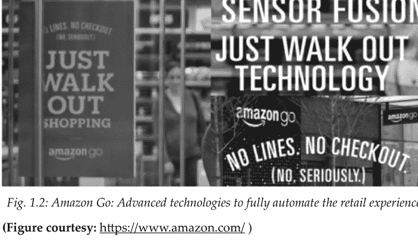

图 1.2: Amazon Go: 用于完全自动化零售体验的先进技术

(Figure courtesy: https://www.amazon.com/ )

从过去的 ATM 到能够理解我们的需求和情绪以做出响应的先进语音激活个人助理，正在取代许多过去由人类完成的职业。这是这些自动化体现日益增长且不可逆转的趋势。

有可能在未来，当你路过银行的 ATM 时，它会以你的名字识别你，识别你对贷款的需求并当场提供优惠条件，同时使用语音激活和地理位置定位的消息吸引你前往。这将是我们所知的银行业可预见的未来。同样适用于任何领域，因为人工智能的强大功能在大数据、云和机器学习技术的融合下得到了显著增强。

欢迎来到人形机器人和自主机器的世界。

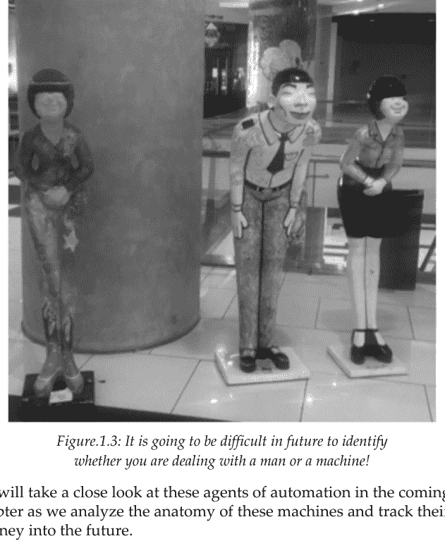

图 1.3: 未来将很难辨别你是在与人还是机器打交道！

在接下来的章节中，我们将仔细审视这些自动化代理，在分析这些机器的构造并追踪它们进入未来的旅程时。

## 第二章

### 由数字化引领的颠覆性模式

#### 引言：

家庭自动化、工厂自动化、人工智能和机器学习驱动的分析正在对我们生活的各个方面产生深远而颠覆性的影响。

我们现在知道无人机可以飞行，机器人可以跳跃，机器人可以听、说、思考、爬行、攻击并在智力游戏中击败世界最佳。猜猜如果所有这些结合成一个单元或一个身体会发生什么！

这就是人工智能的强大力量，它具备机器学习和深度学习增强的特性！2019 年在许多方面见证了前沿技术采用方面的多项进步的融合。毫无疑问，未来正变得越来越‘自主’。人工智能和机器学习正在结合起来，在我们个人和企业生活的各个领域迅速推广自动化。

在每个领域赢得市场主导权竞赛的组织是这些强大技术的最大倡导者。随着数字化、去中心化和自动化的趋势日益增长，采用云和开源技术导致数据生成、分析和消费呈多倍增长。大数据技术被越来越多地采用，这导致了人工智能驱动的分析的快速采用，并得到了机器学习算法的有效利用的推动。

能够建立强大数据技术基础并成为数据分析倡导者的组织正在收获在这些领域的投资回报。据咨询公司 Accenture 称，‘自动化、微型机器人、机器学习和自适应智能正以闪电般的速度成为财务团队的一部分’。

#### 结构：

- 新劳动力面貌的变化
- 公平和可持续的做法

#### 目标：

在本章中，我们将简要回顾数字化与自动化在我们环境和工作生活的各个方面产生影响的不同体现。我们还将了解一些在数字化与自动化的各个方面工作的组织。我们还将看到区块链如何在保护未来自动化世界的过程中发挥作用。

Google、Amazon、Netflix 和 Facebook 等公司将分析和营销自动化的使用提升到了一个全新的水平，这进一步巩固了它们各自领域的市场主导地位。‘数据是新的石油’这一说法从未如此真实。

当前情况可以用以下笑话来概括：

**这可能是一个笑话，但以当今大数据、人工智能、预测分析、社交应用、推荐引擎、下一步最佳行动等技术汇聚在一起，完全有可能实现。**

> 你好！这是戈登披萨吗？
> 
> 不是的先生，这是谷歌披萨。
> 我打错号码了吗？
> 不是的先生，谷歌买下了披萨店。
> 哦，好吧，那我想点一份披萨。
> 好的先生，您要常规的吗？
> 常规的？你知道我常规的是什么吗？
> 根据来电显示，您最后 15 次订购的都是 12 片装
> 
> 双芝士、香肠和厚底的。
> 好吧，这次我也想要这个。
> 我建议您这次点一份 8 片装的，配里科塔奶酪、芝麻菜和番茄。
> 不，我讨厌蔬菜。
> 但是您的胆固醇不太好。
> 你怎么知道？
> 通过订阅者指南。我们有您过去 7 年的血液检测结果。
> 也许吧，但我不想要你推荐的披萨。我已经在服用降胆固醇药物了。
> 但是您没有规律服用。4 个月前您从药品销售网络购买了一盒只有 30 片的药。
> 我在另一家药店买了更多。
> 先生，您的信用卡上没有显示。
> 我付现金了。
> 但是根据您的银行对账单，您没有提取那么多现金。
> 我有另一个现金来源。
> 这没有显示在您最近的税表上，除非您是从未申报的收入来源获得的。
> 去你的披萨吧..!!
> 够了!!
> 我受够了 Google、Facebook、Twitter 和 WhatsApp。我要去一个没有互联网、没有手机信号、没有人监视我的岛屿
> 我明白先生，但您需要更新护照。它 5 周前就过期了。

### 新劳动力面貌的变化：欢迎机器人、聊天机器人、物联网设备、联网汽车、RPA 和飞行无人机

我去年有 1,000 名员工。明年，我的目标是 800 名人类、25 台机器人、10 个聊天机器人和 1,000 个联网设备。未来蓬勃发展的公司‘人力资源主管’的前景可能就是如此！

不仅仅是组织。‘机器人’革命将渗透到我们基础设施的每个领域。如果要关注像 #Cisco 这样的全球领导者的愿景，联网设备是未来景观的每个部分不可或缺的一部分，横跨组织、城市、

功能领域和服务，这就是思科称之为 IOE 或万物互联的原因！来源（#Cisco PR）。

#Cisco 申请了美国专利 20170302663，该发明被其称为 ®Blockchain-based #IoT [物联网] Device Identity Verification and Anomaly Detection”，该发明使 #Blockchain-based 系统能够记录由网络中的传感器（即智能对象）影响并捕获的条件变化，并将网络关系和网络生成的数据工具化，以便对这些节点进行控制，是为将物联网设备整合到区块链生态系统而提交的众多专利之一。当务之急是我们采用边缘使能的计算设备，以赋予曾经“愚笨”的物联网设备执行其应做之事的能力，而非做危险的事情！

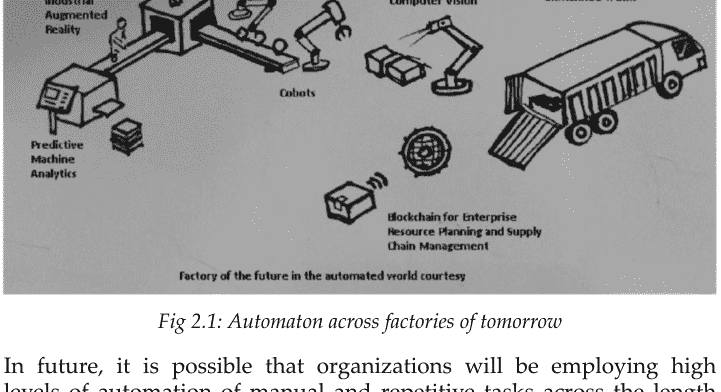

图 2.1: 未来的工厂自动化

未来，组织有可能在其运营的各个层面部署高度自动化，以处理手动和重复性任务，与客户、员工、供应商、渠道合作伙伴在不同地点进行互动。这些可以通过组织内部检索信息的自助查询，或通过外部合作方 API 集成处理的查询来实现。

可能存在不同类型的机器人和机器人，例如：

- a) 前台机器人，迎接并引导访客前往各自目的地，同时处理常规查询（例如：由喀拉拉邦警察总部使用的接待机器人）
- b) 人力资源机器人，与员工互动以回答常规查询或进行环境调查。
- c) 在线据点上的客户互动机器人，用于服务相关查询。
- d) 财务和会计管理机器人，是 RPA 生态系统的一部分，负责费用管理、账目、财务和审计相关任务。

RPA 或机器人流程管理涉及利用人工智能和机器学习技术优化工作流程，而大数据处理已在多个领域显现出影响，具体如下：

- i. 发票管理
- ii. 合作伙伴和供应商管理，通过 360 度认证验证新合作伙伴的资质并实现采购流程自动化
- iii. 以快速且安全的方式进行审计和对账以生成
- iv. 跨各科目的费用跟踪与预算对比并报告异常
- v. 相比账目关闭后数天数月，财务报告可即时生成

其中一些可能在本地维护，许多则可在基于云的平台上维护。为了管理这些不同类型的机器人，它们构成了公司内的机器人农场，组织需要采用机器人控制器来管理组织内不同子组的机器人。规划、开发或部署这些不同类型的自动化项目需要不同的技能和设施，从工作流设计、API 集成和管理，到跨不同职能领域的业务分析和洞察，以确保创建合适的报告和仪表板并提供给相关官员，以便实时跟踪业务流程和这些自动化项目旨在产生的结果。

## 公平与可持续实践——新时代企业当务之急：

随着机器渗透到我们工作环境的方方面面，必然会出现许多围绕能源消耗、员工隐私和客户数据隐私等问题。组织必须遵循绿色实践以节约能源，优先考虑开放性，反对使用闭路电视摄像机和数据仓库进行监视，以及利用高性能分析技术针对客户进行侵犯其隐私的行为。

利用人工智能和机器学习的各种自动化工具应留下高生产力的世界，性能大幅提升，繁琐任务实现自动化。这将使世界各地公民的生活质量得到大幅提升，并充分受益于技术进步。

由物联网驱动的自动化所推动的对数字化及数据驱动技术的依赖日益增加，也提醒我们存在各种可能威胁。数据泄露和网络攻击在最近被评为对人类最危险的威胁之一。

据说下一场世界大战将在网络空间而不是地面上进行。

2016 年 10 月的 Mirai 僵尸网络攻击感染了 DVR 和 IP 摄像机等未受保护的物联网（IoT）设备，暴露了 #centralized 依赖物联网设备数量激增的公司日益增加的脆弱性。如果今天公司中劳动力构成的格局发生变化，思考将区块链作为嵌入以确保未来安全的重要范式之一是必不可少的！

2018 年 10 月和 2019 年 3 月的波音 737 Max 坠机事故造成超过 600 人死亡，据称是由于自动化针板程序故障所致。

2019 年 3 月在喀拉拉邦多处重要设施上空出现未经授权且不受欢迎的无人机飞行，引发了对失控飞行员在险恶袭击前进行演练的担忧。

IBM 和三星的 ADEPT 平台（自主去中心化遥测平台）是确保物联网设备不断增长的群体安全的重要举措之一，预计在未来 2-3 年内其数量将超过已连接人类数量的 10 倍！

区块链通过消除单点故障、共享分布式账本、具备适当权限和授权的安全身份认证以及交易端到端加密，除其他诸多优势外，还能强化物联网设备抵御任何恶意软件攻击，降低其动机并降低整个生态系统的风险。

## 结论

在本章中，我们探讨了数字化世界中自动化水平不断提高的各个方面。由工业物联网引领的工业 4.0，以及由 RPA 驱动的后台自动化和在组织工作的各个领域部署机器人，正在改变人才管理部门的面貌，这要求新的技能和新方法以保持劳动力参与并得到管理。日益普遍的数字化提供了庞大的数据池，增强了擅长数据分析的组织的实力。组织及其产品和服务用户的 fiy 安全和隐私要求正成为主要关注点。区块链提供了一种有效工具，可在安全且为所有人接受的情况下扩展自动化。

## 第三章

### 机器学习与人工智能

#### 引言

人工智能是指计算机像人类一样思考和决策的能力。机器学习的出现得益于电子商务和社交媒体组织收集客户及其在各个数据点上的偏好的海量数据的巨大能力。这使这些数据专家能够从经验中不断学习，从而改进其方法和方法，以准确地针对客户进行交叉销售和追加销售。

AI 和 ML 的专家能够通过多种方式吸引客户，从而占据消费者市场的特定细分市场。亚马逊、Facebook、Netflix、Google 和苹果等公司在充分利用 AI 和 ML 方面表现出色。在本章中，我们将探讨人工智能和机器学习在各种活动中的效用。我们将讨论这些技术对各种活动的效用，并了解它们如何增强其使用者的生产力和能力。

#### 结构：

- 自动化的代理的市场潜力指标
- 机器学习的兴起
- 案例研究：用于先进工业 4.0 应用的 Intel® openVINO™ 工具包

#### 目标：

本章的目标是提供对驱动自动化世界的核心技术的理解。对各种应用、算法类型及其在不同操作中的用途的理解——这些操作旨在增强或模仿人类努力——将使读者能够详细地理解‘自动化代理’。这将有助于利用它们来提升未来的生活质量和生产力。

亚马逊利用其培育的品牌影响力，为没有品牌资产的买家和卖家提供了一个卓越的平台，通过提供上架费用和仓储费用的平台优惠来实现。对于实力强劲且备受追捧的品牌，它提供了优秀的平台和营销机会，并采用精细调校的定向策略，通过定制化产品最大化其销售额。它深度挖掘了客户群，通过从竞争对手处抢夺客户并让客户花费远超想象的金额，极大地提升了客户吞吐量和生命周期价值。

Facebook、Google 和 Apple 等公司通过增值平台如聊天机器人、语音助手和信使机器人提供新的便利，使受众牢牢粘附在其渠道上并保持坚定不移的忠诚度，从而增加广告收入。另一方面，Netflix 创作了与观众品味产生共鸣的精彩内容，使其在媒体领域获得了前所未有的优势。

2000 年初的电子商务繁荣创造了一个全新的行业，亚马逊等零售商主导了在线零售市场。随着时间的推移，银行、票务、航空和社交媒体等许多行业全面转向客户和参与者的在线管理，从而催生了数字营销革命。这迫使像沃尔玛这样拥有诸多优势（如物理 proximity 和相关信任）的领先线下实体公司，无论是有机发展还是通过收购，都进军在线销售。这些巨头采用了多种策略，通过重复购买、交叉销售和追加销售来最大化销售额和客户吞吐量。

全渠道零售策略帮助零售商在在线聚集地、社交媒体据点、线下商店、热门地点和高人流商场等场所定位客户，这些都是最受欢迎的狩猎场，此外还有大型门店和由杀手级应用驱动的网站吸引了最多的眼球。将潜在客户定位并转化为终身客户——这最初是特殊技能和杰出数字营销专业人士创造力迸发的产物——已成为一个蓬勃发展的行业，该行业利用人工智能和机器学习驱动的分析和营销自动化策略。

Inbound 和 Outbound 营销活动已成为紧密整合的营销方法的一部分，HubSpot 等公司引领潮流。以下是全渠道爆款公司采用的一些策略的描述：

- **GUIDED SELLING:** 客户数据被用于通过推荐引擎反复定位客户，将其引导至选定的网页以实现转化，并提供实时聊天。移动应用程序现已成为即时优惠和忠诚度管理的日常工具。最大化客户生命周期价值的忠诚度管理现正蓬勃发展。
- **DYNAMIC PRICING AND INSTANT CONVERSIONS:** 根据库存情况，客户会被提供动态定价，并针对追加销售和交叉销售进行特定精细调校的促销，以确保客户不会在未购买产品的情况下流失。
- **FORECASTING AND STOCK MANAGEMENT:** 先进的分析技术用于预测并在正确的时间提供合适的库存，以确保因缺货造成的损失和因库存过剩而锁定的过剩资源降至最低，从而大幅提高组织的效率，并为营销提供更多灵活性并增加价值。

通过数据挖掘获得的洞察被用于通过数字营销和再营销工作精准定位客户，以确保高点击率和相关销售额。亚马逊等公司还开设了提供“即进即出”设施的商店，使客户无需在收银台浪费时间即可结账；这是一种令人惊叹的自动化水平。阿里巴巴等零售巨头通过聚集并为其提供必要的技术、硬件和软件，使小型社区商店能够利用先进的分析和采购规模经济。

- **BOT LED MARKETING & CUSTOMER SERVICE EFFORTS:** 提供全天候服务、为客户提供必要信息、处理销售和服务请求及查询、记录并以任何语言回复客户的聊天机器人和语音代理现已变得普遍，并为领先的在线营销商以及大型 B2B 和 B2C 组织提供了无限的生产力。

## 自动化代理的市场潜力指标 – 部分指标：

下图显示了在未来由人工智能驱动的自动化影响的领域中预期的一些趋势。

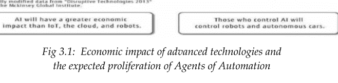

*图 3.1：先进技术对经济的影响以及自动化代理的预期普及*

当我们深入自动化代理的世界时，我们需要了解 21 世纪热词——人工智能和机器学习背后的基础知识。

人工智能是计算机科学的一个分支，涉及在计算机中模拟智能行为，旨在改善其与人类知识相关的功能，如推理、规划、学习、自然语言处理、感知、决策以及移动和操纵物体的能力（机器人技术）。

人工智能长期以来被誉为能够使机器像人类一样思考从而带来难以置信生产力的杀手级应用，但在过去多次起步和停滞后经历了多次失败。

人工智能这一术语于 1956 年在达特茅斯采用，其活动经历了多次兴趣缺失和投资撤离的时期，尤其是在 1974-1980 年和 1987-1993 年期间，由于无法产生令人印象深刻的结果导致投资者沮丧。

大数据、云计算、新一代编程知识、商业智能工具的发展以及微软、IBM 和谷歌等公司所做的卓越工作，加上 Hadoop、Golang、Python、R 等开源工具，现在极大地推动了人工智能与机器学习相结合的算法驱动运动。核心而言，机器学习只是实现人工智能的一种方式。

通过前面讨论的各种举措获得大量数据的可用性，以及用户在与各种门户交互时产生的大量数据，为公司提供了训练机器学习模型的机会，使其能够快速模拟发现的模式并使用适当的数学模型预测人类行为。交替最小二乘法和矩阵降维模型等技术能够分析大量数据并创建适当的模型，使其与实际观察结果之间的差距缩小，从而对未来做出准确预测。

营销人员现在不仅拥有其目标对象的行为数据、喜好、厌恶和在线搜索模式，还拥有与具有相似人口统计学和心理统计学特征的其他人的行为映射。通过关联这些数据，他们能够预测其中任何一个人的行为

未来更好地观察受试对象。因此，AI/ML 在协助和增强人类在活动中的努力方面发挥了重要作用，同时也自动化了大量重复性任务，为人类腾出时间从事更具战略性的追求。

## AI/ML 的一些著名代表如下：

- Google 的 DeepMind（ML 系统）和 RankBrain（AI 系统）用于准确预测用户在网上搜索时的行为并处理搜索结果。Google 使用 DeepMind AI 算法大幅提高运营的能源效率。
- Fluid AI 使用由 AI/ML 驱动的客户服务机器人，通过模仿与客户的人类互动，让客户的银行体验变得有趣，从而降低运营成本。
- Niki 是一家 AI/ML 公司，提供使用自然语言用户界面的聊天机器人，让客户可以用其自然语言进行交互。
- ShopR360 为商场和大型零售商提供 AI/ML 驱动的解决方案，通过集成 CCTV 基础设施来区分其客户和员工等。
- 百度，这家中国搜索引擎巨头，使用 AI/ML 进行图像处理、语音识别、自然语言处理、深度学习和高性能计算。
- IBM 提供机器人流程自动化解决方案，以降低运营成本并消除执行重复性任务的繁琐劳动。

## 机器学习的兴起

> 如果计算机程序在任务类 T 上的性能根据性能度量 P 随着经验 E 而提高，则称该程序相对于任务类 T 和性能度量 P 从经验 E 中学习。- Tom Mitchell（1998）。

机器学习涉及使用计算算法对现实生活行为进行建模，这些算法是在数十年的人工智能工作中发展起来的。

机器学习算法如 SVM（支持向量机）、Random Forest、Naïve Bayes 分类器、KNN（K 近邻）等用于发现数据中存在但人类在正常情况下无法找到的模式。

工具使系统能够通过在大量测试数据上实施的多个步骤，迭代地演化出最合适的自变量组合。一旦演化出能够解释测试数据中发现的模式的最合适的模型。下一步是大幅降低数据的维度以发现并剔除不相关的变量。然后重复此过程以获得进一步优化的模型，该模型能更紧密地解释所探索主体的行为。

因此，机器学习使系统的性能能够随着时间的推移和经验的积累以及描述该过程的更多数据集的可用性而不断改进。

## 机器学习已在多个领域找到应用：

- 消费者行为分析。
- 金融产品和服务消费中的欺诈检测。
- 媒体和电子商务中的推荐引擎。
- 股票市场交易以预测股价走势。
- 在数字营销领域：电子邮件、社交媒体和搜索引擎用于自动响应生成、定向推广和广告。
- 社交媒体如 Facebook 和 LinkedIn 用于准确的信息流、人脸识别等。
- 医疗保健（例如癌细胞发现）。
- 基因发现及其分类，以及研究和分析消费者行为的众多其他应用。

机器学习的各个方面在下图中以简单的方式进行了描述。

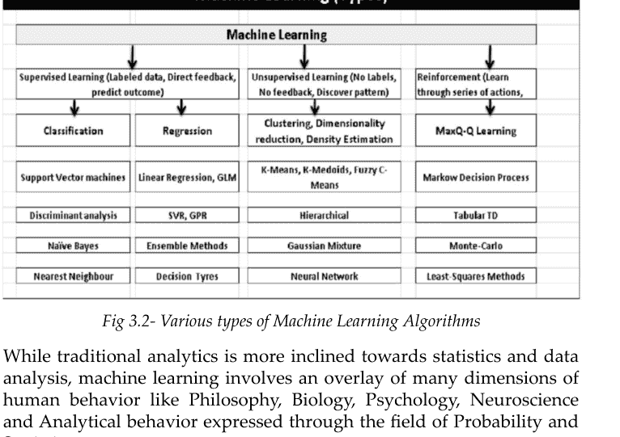

图 3.2 - 各种类型的机器学习算法

虽然传统分析更倾向于统计和数据分析，但机器学习涉及人类行为的多个维度，如哲学、生物学、心理学、神经科学以及通过概率和统计学领域表达的分析行为的叠加。

这有望引领向行为和思维中人类能力的逼近。

因此，机器学习是人工智能的一个分支，通过迭代和自动化的过程催化这种逼近。机器学习包括多个阶段，涉及数据收集和清洗、组织数据、构建训练集以持续改进性能、数据挖掘、模型优化、将获得的结果与实际结果进行比较以及采用递归方法进一步优化模型。

机器学习涉及广泛使用算法来改造组织各个领域的业务流程，包括销售和营销、财务、人力资源、制造、客户服务等。

算法的迭代特性是指探测、学习并在从每次错误和前一次迭代中学习后不断改进，从而使它们能够自我纠正。因此，更接近现实和预期结果。此过程中涉及的各个步骤都在一小部分时间内完成，使决策过程高效、客观、准确且具有预测性。

机器学习使在无需太多人力投入的情况下设计复杂的软件系统变得更容易。无需花费数年时间编写功能或对具有大量参数的系统进行微调，我们可以使用机器学习在更短的时间内完成工作。如果您很快开始看到并使用目前在科幻电影中出现的科技和[content]
未来更好地观察受试对象。因此，AI/ML 在协助和增强人类在活动中的努力方面发挥了重要作用，同时也自动化了大量重复性任务，为人类腾出时间从事更具战略性的追求。

## AI/ML 的一些著名代表如下：

- Google 的 DeepMind（ML 系统）和 RankBrain（AI 系统）用于准确预测用户在网上搜索时的行为并处理搜索结果。Google 使用 DeepMind AI 算法大幅提高运营的能源效率。
- Fluid AI 使用由 AI/ML 驱动的客户服务机器人，通过模仿与客户的人类互动，让客户的银行体验变得有趣，从而降低运营成本。
- Niki 是一家 AI/ML 公司，提供使用自然语言用户界面的聊天机器人，让客户可以用其自然语言进行交互。
- ShopR360 为商场和大型零售商提供 AI/ML 驱动的解决方案，通过集成 CCTV 基础设施来区分其客户和员工等。
- 百度，这家中国搜索引擎巨头，使用 AI/ML 进行图像处理、语音识别、自然语言处理、深度学习和高性能计算。
- IBM 提供机器人流程自动化解决方案，以降低运营成本并消除执行重复性任务的繁琐劳动。

## 机器学习的兴起

> 如果计算机程序在任务类 T 上的性能根据性能度量 P 随着经验 E 而提高，则称该程序相对于任务类 T 和性能度量 P 从经验 E 中学习。- Tom Mitchell（1998）。

机器学习涉及使用计算算法对现实生活行为进行建模，这些算法是在数十年的人工智能工作中发展起来的。

机器学习算法如 SVM（支持向量机）、Random Forest、Naïve Bayes 分类器、KNN（K 近邻）等用于发现数据中存在但人类在正常情况下无法找到的模式。

工具使系统能够通过在大量测试数据上实施的多个步骤，迭代地演化出最合适的自变量组合。一旦演化出能够解释测试数据中发现的模式的最合适的模型。下一步是大幅降低数据的维度以发现并剔除不相关的变量。然后重复此过程以获得进一步优化的模型，该模型能更紧密地解释所探索主体的行为。

因此，机器学习使系统的性能能够随着时间的推移和经验的积累以及描述该过程的更多数据集的可用性而不断改进。

## 机器学习已在多个领域找到应用：

- 消费者行为分析。
- 金融产品和服务消费中的欺诈检测。
- 媒体和电子商务中的推荐引擎。
- 股票市场交易以预测股价走势。
- 在数字营销领域：电子邮件、社交媒体和搜索引擎用于自动响应生成、定向推广和广告。
- 社交媒体如 Facebook 和 LinkedIn 用于准确的信息流、人脸识别等。
- 医疗保健（例如癌细胞发现）。
- 基因发现及其分类，以及研究和分析消费者行为的众多其他应用。

机器学习的各个方面在下图中以简单的方式进行了描述。

图 3.2 - 各种类型的机器学习算法

虽然传统分析更倾向于统计和数据分析，但机器学习涉及人类行为的多个维度，如哲学、生物学、心理学、神经科学以及通过概率和统计学领域表达的分析行为的叠加。

这有望引领向行为和思维中人类能力的逼近。

因此，机器学习是人工智能的一个分支，通过迭代和自动化的过程催化这种逼近。机器学习包括多个阶段，涉及数据收集和清洗、组织数据、构建训练集以持续改进性能、数据挖掘、模型优化、将获得的结果与实际结果进行比较以及采用递归方法进一步优化模型。

机器学习涉及广泛使用算法来改造组织各个领域的业务流程，包括销售和营销、财务、人力资源、制造、客户服务等。

算法的迭代特性是指探测、学习并在从每次错误和前一次迭代中学习后不断改进，从而使它们能够自我纠正。因此，更接近现实和预期结果。此过程中涉及的各个步骤都在一小部分时间内完成，使决策过程高效、客观、准确且具有预测性。

机器学习使在无需太多人力投入的情况下设计复杂的软件系统变得更容易。无需花费数年时间编写功能或对具有大量参数的系统进行微调，我们可以使用机器学习在更短的时间内完成工作。不要惊讶，如果您很快开始看到并使用目前在科幻电影中出现的科技和[content]
未来更好地观察受试对象。因此，AI/ML 在协助和增强人类在活动中的努力方面发挥了重要作用，同时也自动化了大量重复性任务，为人类腾出时间从事更具战略性的追求。

## AI/ML 的一些著名代表如下：

- Google 的 DeepMind（ML 系统）和 RankBrain（AI 系统）用于准确预测用户在网上搜索时的行为并处理搜索结果。Google 使用 DeepMind AI 算法大幅提高运营的能源效率。
- Fluid AI 使用由 AI/ML 驱动的客户服务机器人，通过模仿与客户的人类互动，让客户的银行体验变得有趣，从而降低运营成本。
- Niki 是一家 AI/ML 公司，提供使用自然语言用户界面的聊天机器人，让客户可以用其自然语言进行交互。
- ShopR360 为商场和大型零售商提供 AI/ML 驱动的解决方案，通过集成 CCTV 基础设施来区分其客户和员工等。
- 百度，这家中国搜索引擎巨头，使用 AI/ML 进行图像处理、语音识别、自然语言处理、深度学习和高性能计算。
- IBM 提供机器人流程自动化解决方案，以降低运营成本并消除执行重复性任务的繁琐劳动。

## 机器学习的兴起

> 如果计算机程序在任务类 T 上的性能根据性能度量 P 随着经验 E 而提高，则称该程序相对于任务类 T 和性能度量 P 从经验 E 中学习。- Tom Mitchell（1998）。

机器学习涉及使用计算算法对现实生活行为进行建模，这些算法是在数十年的人工智能工作中发展起来的。

机器学习算法如 SVM（支持向量机）、Random Forest、Naïve Bayes 分类器、KNN（K 近邻）等用于发现数据中存在但人类在正常情况下无法找到的模式。

工具使系统能够通过在大量测试数据上实施的多个步骤，迭代地演化出最合适的自变量组合。一旦演化出能够解释测试数据中发现的模式的最合适的模型。下一步是大幅降低数据的维度以发现并剔除不相关的变量。然后重复此过程以获得进一步优化的模型，该模型能更紧密地解释所探索主体的行为。

因此，机器学习使系统的性能能够随着时间的推移和经验的积累以及描述该过程的更多数据集的可用性而不断改进。

## 机器学习已在多个领域找到应用：

- 消费者行为分析。
- 金融产品和服务消费中的欺诈检测。
- 媒体和电子商务中的推荐引擎。
- 股票市场交易以预测股价走势。
- 在数字营销领域：电子邮件、社交媒体和搜索引擎用于自动响应生成、定向推广和广告。
- 社交媒体如 Facebook 和 LinkedIn 用于准确的信息流、人脸识别等。
- 医疗保健（例如癌细胞发现）。
- 基因发现及其分类，以及研究和分析消费者行为的众多其他应用。

机器学习的各个方面在下图中以简单的方式进行了描述。

图 3.2 - 各种类型的机器学习算法

虽然传统分析更倾向于统计和数据分析，但机器学习涉及人类行为的多个维度，如哲学、生物学、心理学、神经科学以及通过概率和统计学领域表达的分析行为的叠加。

这有望引领向行为和思维中人类能力的逼近。

因此，机器学习是人工智能的一个分支，通过迭代和自动化的过程催化这种逼近。机器学习包括多个阶段，涉及数据收集和清洗、组织数据、构建训练集以持续改进性能、数据挖掘、模型优化、将获得的结果与实际结果进行比较以及采用递归方法进一步优化模型。

机器学习涉及广泛使用算法来改造组织各个领域的业务流程，包括销售和营销、财务、人力资源、制造、客户服务等。

算法的迭代特性是指探测、学习并在从每次错误和前一次迭代中学习后不断改进，从而使它们能够自我纠正。因此，更接近现实和预期结果。此过程中涉及的各个步骤都在一小部分时间内完成，使决策过程高效、客观、准确且具有预测性。

机器学习使在无需太多人力投入的情况下设计复杂的软件系统变得更容易。无需花费数年时间编写功能或对具有大量参数的系统进行微调，我们可以使用机器学习在更短的时间内完成工作。不要惊讶，如果您很快开始看到并使用目前在科幻电影中出现的科技和设备。

机器学习在能够持续获得大量数据集用于训练并改善算法对现实生活的输出的环境中蓬勃发展。大数据技术的出现为机器学习成果提供了必要的推动力，这进一步推动了人工智能运动的发展。

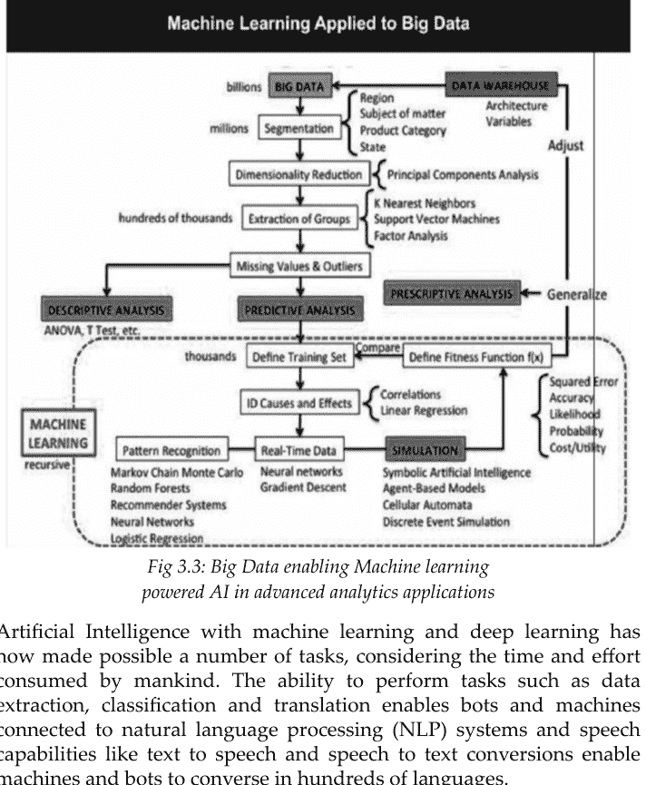

图 3.3：大数据推动机器学习驱动的 AI 在高级分析应用中的发展

人工智能结合机器学习和深度学习现在使许多任务成为可能，考虑到人类所消耗的时间和精力。执行数据提取、分类和翻译等任务的能力使与自然语言处理（NLP）系统和语音能力（如文本转语音和语音转文本转换）相连的机器人和机器能够使用数百种语言进行对话。

模式识别使机器能够以 3D 模式识别图像和物体，帮助机器人和自动驾驶汽车移动，同时也帮助警察和金融专业人士识别欺诈者和罪犯。

Python 是一种开源且首选的用于实现人工智能和机器学习算法及应用的语言，提供多种库以方便实现这些活动。

一些流行的开源库如下所述（参考，Altoros- ML Cheat sheets for Python）。

End-to-End Negotiation、DeepPavlov 和 awesome bots 是一些出色的 Python 和其他开源库，用于训练聊天机器人进行类人对话和谈判。

### 计算机视觉：

Scikit-image 通过分割、几何变换、颜色空间操作、分析、滤波、形态学、特征检测等帮助图像处理。OpenCV 和 SimpleCV 有助于检测地雷和先进的自主应用。OpenFace 使用深度神经网络帮助检测人脸。

### 数据分析与数据可视化：

NumPy、SciPy、Pandas、PyMC、Statsmodels、Matplotlib、Ggplot 和 scikit-plot 能够进行各种数据 crunching、数据挖掘、数据分析和可视化绘图。

### 通用目的 ML：

AutoML、machine learning、XGBoost、scikit-learn、Single-AI、Theano、TensorFlow、Keras、Caffe、PyTorch、CatBoost 等是多种框架和库，用于轻松开展和实施各种机器学习流程。

### 自然语言处理：

NLTK、TextBlob、PyNLP1、Polyglot、Fuzzy Wuzzy 和 Jellyfish 是各种 Python 库，允许文本挖掘、分类、语音标注、语法标注和修辞提取、情感分析、序列化和字符串匹配。

### 主题建模：

BigART、gensim 和 Topic 支持主题建模、文档索引、相似性检索以及主题建模和文档管理中的各种应用。在 Python 中，每个想法都可以通过 20 到 30 行代码快速验证，有助于快速原型设计。因此，

对于所有希望从事 AI 和 ML 相关编程领域职业的人来说，学习 Python 并利用其多样的库和功能执行程序是必不可少的。

根据 PwC 的报告，机器学习在各个行业具有巨大的潜在影响，如下表中流行的机器学习算法及应用所示。对 AI 和分析及其在组织和情境中的影响的更详细分析，可在 Sameer Dhanrajani 所著的书籍《AI and Analytics》中找到。

## 数据科学学习资源

https://www.edx.org/professional-certificate/berkeleyx-foundations-of-datascience#courses.

### 流行机器学习算法及应用

| 序号 | 机器学习算法 | 常见应用 |
|---|---|---|
| 1 | Decision Trees | 基于规则的信用风险评估 |
|  |  | 赛马投注 |
| 2 | SVM (Support Vector Machines) | 新闻分类 |
|  |  | 手写识别 |
| 3 | Regression | 交通流量分析 |
|  |  | 邮件过滤 |
|  |  | 股价预测 |
| 4 | Naïve Bayes | 情感分析 |
|  |  | 客户细分 |
| 5 | Hidden Markov Methods | 面部表情分析 |
|  |  | 天气预测 |
| 6 | Random Forest Method | 客户流失分析 |
|  |  | 风险评估 |
| 7 | RNN (Recurrent Neural Networks) | 图像分类与描述 |
|  |  | 政治情感分析 |
| 8 | LSTM | NLP 与翻译 |
| 9 | CNN (Convolutional Neural Networks) | 图像识别与文本转语音 |
|  |  | 新药发现 |
| 10 | Deep Learning | 密集且多层次的方法 |
|  | 银行 | 用于欺诈预防的图像监控分析 |
|  | 保险 | 事故分析和理赔流程 |
|  | 医疗保健 | 医疗报告识别 |
|  | 政府 | 网络威胁预防 |
|  | 自动驾驶汽车 | 道路车辆识别 |

图 3.4：不同领域中 AI、ML 和深度学习算法的应用

## 案例研究：用于先进工业 4.0 应用的 INTEL® OPENVINO™ 工具包

(Source:https://software.intel.com/en-us/articles/sdp-case-studies#OpenVINO)

Intel 是通过其广泛的解决方案部署人工智能、机器学习和深度学习算法来赋能前沿技术领先组织的领导者之一。Intel 对 Open VINO 平台的发行提供了易于部署的先进基于 AI 的机器人开发和部署解决方案，以解决自动化问题。

OpenVINO™ 工具包，Open Visual Inference and Neural Network Optimization toolkit 的简称，为开发人员在多种 Intel® 处理器上提供改进的神经网络性能，并帮助他们进一步释放经济高效的实时视觉应用。该工具包支持深度学习推理和在多个 Intel® 平台（CPU、Intel® Processor Graphics）上的易于异构执行，提供从云架构到边缘设备的实现。此开源发行版为开发者社区创新深度学习和 AI 解决方案提供了灵活性和可用性。

## OPENVINO™ 工具包包含：

- Deep Learning Deployment Toolkit

该工具包允许开发人员通过与应用程序逻辑集成的<|message|> 高级 C++ Inference Engine API 部署预训练的深度学习模型。

此开源版本包括两个组件，Model Optimizer 和 Inference Engine，以及 CPU、GPU 和异构插件，以加速在 Intel(R) CPU 和 Intel(R) Processor Graphics 上的深度学习推理。它支持来自 Open Model Zoo 的预训练模型，以及 100 多个开源和公共模型，格式包括 Caffe*、Tensorflow*、MXNet* 和 ONNX*。

- Open Model Zoo

该存储库包含优化的深度学习模型和一套演示，以加快高性能深度学习推理应用的开发。该存储库使用这些免费的预训练模型，而不是自行训练模型，以加快开发和生产部署流程。

以下是 INTEL OpenVINO 工具包的一些主要应用：

- 由 Intel® Distribution of OpenVINO™ 工具包优化的 ADLINK 和 Touch Cloud 提供了一体化 AI 引擎，可协助进行数据分析、检测、分类和预测，适用于各种用例。
- Advantech 部署了硬件和软件的组合，包括摄像头、AI 深度学习和视频分析技术，均由 Intel® Distribution of OpenVINO™ 工具包优化，为零售组织提供前沿解决方案。
- Agent VI 使用 Intel Distribution of OpenVINO 工具包的计算机视觉应用提供前沿的数字安全和监控解决方案。
- GeoVision 使用 Intel® System Studio 和 OpenVINO™ 工具包为其 24 倍深度学习人脸识别解决方案加速。
- GE Healthcare 在使用 Intel® Xeon® 处理器和 Intel® Distribution of OpenVINO™ 工具包运行时将推理性能提高了 14 倍。来自 Intel 的 Deep Learning Deployment Toolkit 帮助 GE 将 AI 的力量应用于临床诊断扫描和其他医疗保健工作流程。
- Gorilla Technology 使用 Intel® Distribution of OpenVINO™ 工具包和 Intel® System Studio 将其 IVAR* 智能视频分析记录器的效率优化了 1.5 倍。
- Honeywell 在借助 Intel 强大的视觉产品组合如 Intel 的 OpenVINO 工具包的帮助下，加快了视频处理时间并增加了通过单个设备实时流式传输的摄像头数量，以增强其安全和监控解决方案组合。
- IOmniscient IronYun 的先进视频分析和 AI 视频搜索使用 Intel® Distribution of OpenVINO™ 工具包来加速 AI 模型训练和深度学习推理，以提供前沿的基于 AI 的多感官和智能监控分析。
- 由强大的高性能 Intel® 架构驱动，有助于使城市更安全、组织更高效。
- Intel® Vision Products 帮助 ISS 提供用于视频监控的先进视觉深度学习神经网络。
- Mindtree 的智能数字视觉分析系统借助 Intel® Distribution of OpenVINO 工具包增强了安全性并减少了损耗。
- NexCOBOT，一家 NEXCOM 公司，提供灵活的模块化机器人解决方案，将人工智能（AI）与机器视觉集成，由 Intel® Vision Accelerator Design 产品驱动并由 Intel® Distribution of OpenVINO™ 工具包优化。
- Outdu 的设备使用 Intel® 技术在边缘分析视频，并为零售和其他人流量大的环境提供即时、可操作的洞察。
- Philips 展示了突破性的 AI 推理性能，用于在由 Intel® Xeon® Scalable 处理器驱动的服务器上运行的医疗保健工作负载，并使用 OpenVINO™ 工具包进行优化。
- QNAP/IEI 与 INTEL 合作，为开发人员、数据科学家、医学研究人员和学生提供快速部署的计算机视觉系统，结合了工作站、深度学习软件开发工具包（Intel® Distribution of OpenVINO™ 工具包）和强大的 NAS（网络附加存储）。

## 结论

机器学习为人工智能范式注入了新的生命和翅膀。大数据、云计算和机器学习与人工智能的出现正在塑造我们新的自动化世界。明天的“自动化代理”将使用这些技术提供的盔甲中的每一种武器，将我们带入一个不可想象的世界，该世界具有增强和提高我们的生产力和生活质量的能力。我们已经看到不同类型的 AI 和 ML 算法如何工作并为不同应用提供定制化呈现。所有这些都将以某种形式或组合使用，以驱动我们在接下来的章节中将讨论的自主对象劳动力。

## 第四章

### 物联网、工业4.0与未来的工厂

#### 引言：

大数据的兴起与技术的另一个重要方面——物联网（IoT）的普及同步。虽然互联网的诞生历史可以追溯到1969年，但1990年标志着物联网（IoT）的正式诞生年份。物联网通过嵌入式传感器实现了除人类之外事物的连接，这些传感器可以连接到互联网并通过互联网与其他机器、事物和人类进行通信。

机器生成的数据源于用于测量和记录物理世界事件和情况的传感器和机器数量的惊人增长。这些传感器的输出是机器生成的数据，从简单的传感器记录到复杂的计算机日志，其结构良好。随着传感器的普及和数据量的增长，它正变得越来越成为许多企业存储和处理的信息的重要组成部分。其结构良好的特性适合计算机处理，但其规模和速度超出了传统方法。

在本章中，我们将审视物联网、大数据、人工智能和机器学习等各个方面及其对未来工厂的影响。

#### 结构：

- 传感器种类
- 物联网的主要组件
- 各层面的主要物联网协议
- 明日的智能工厂和工业物联网

#### 目标：

本章的目标是了解物联网系统的解剖结构，评估其在工厂、家庭和智慧城市自动化方面的关键作用。物联网或有时所称的万物互联，是连接系统的基本方面，它使我们能够连接、收集信息并进行操控以实现预期目标。因此，有必要很好地了解它们的工作方式、所承诺的潜力、所提供的机会以及为保持其安全而需要解决的问题。

2010年，随着谷歌宣布联网汽车，物联网领域迎来了一个新的里程碑。

联合国欧洲经济委员会UNECE已将物联网生成的数据宣布为大数据的关键来源之一。 (https://statswiki.unece.org/display/bigdata/Classification+of+Types+of+Big+Data)

创建M2M协议时，IBM的Andy Stanford-Clark和Arcom（现为Eurotech）的Arlen Nipper引入了首个面向此类连接设备的机器对机器协议，例如MQ Telemetry Transport（MQTT）。

数据由用于各种应用的多种传感器生成。其中一些列在以下两个类别中：

### A. 固定传感器

- 家庭自动化
- 天气/污染传感器
- 交通传感器/网络摄像头
- 科学传感器
- 安全/监控视频/图像

### B. 移动传感器（跟踪）

- 手机位置
- 汽车
- 卫星图像

### C. 来自计算机系统的数据

- 日志
- Web日志

随着设备与其主控之间的通信，互联网上传输的数据量成倍增长。

从2000年开始的RFID（射频识别）芯片，到物联网领域的进展预计将渗透到全世界，通过先进的通信平台和技术将大量装有传感器的设备连接到互联网。到2020年，互联设备的数量和相关的商业机会预计将成倍增长，超过300亿个连接对象和5000亿美元的市场机会。

到2020年，在经济规模扩大以及硬件、中间件、软件和存储技术等所有互联技术累积进步所带来的低成本传感器的帮助下，物联网业务将能够根据当前估计创造超过50万亿美元的巨大价值。这些设备的集体智能和处理能力为人类提供了巨大的好处，但并非没有伴随而来的威胁，由于依赖度增加以及激励倾斜有利于网络攻击者和恐怖分子。

来源:https://gigaom.com/2016/07/15/review-smartdraw-helps-to-tamewild-iot-networks/

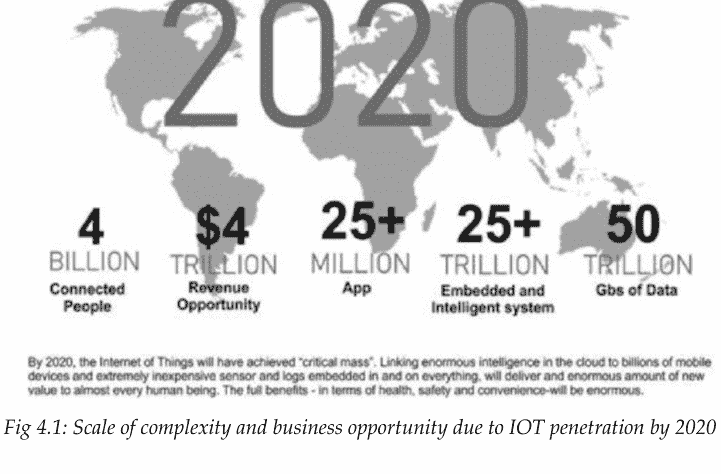

图4.1：到2020年由于物联网渗透而带来的复杂性和商业机会规模

### 什么是物联网？

第一台联网的家电是卡内基梅隆大学的一台改装可乐自动售货机。‘泛在计算’的概念在Mark Weiser于1991年发表的一篇论文中被广泛讨论。

该术语物联网或物联网，最早由宝洁公司的Kevin Ashton于1999年提出，在麻省理工学院的Auto ID中心变得流行。最初设想RFID将是物联网连接的核心组件。

根据维基百科，物联网（IoT）是将互联网连接扩展到物理设备和日常物品。嵌入电子、互联网连接和其他形式的硬件（如传感器），这些设备可以通过互联网与其他设备进行通信和交互，并且可以远程监控和控制。

物联网的定义由于多种技术的融合而演变，包括实时分析、机器学习、商品传感器和嵌入式系统。[5] 嵌入式系统、无线传感器网络、控制系统、自动化（包括家庭和建筑自动化）等传统领域都为实现物联网做出了贡献。在消费市场，物联网技术最常与“智能家居”概念相关的产品联系在一起，涵盖支持一个或多个通用生态系统的设备和电器（如照明装置、恒温器、家庭安全系统和摄像头以及其他家用电器），并且可以通过与该生态系统相关的设备（如智能手机和智能音箱）进行控制。

让我们来审视物联网的主要组件：

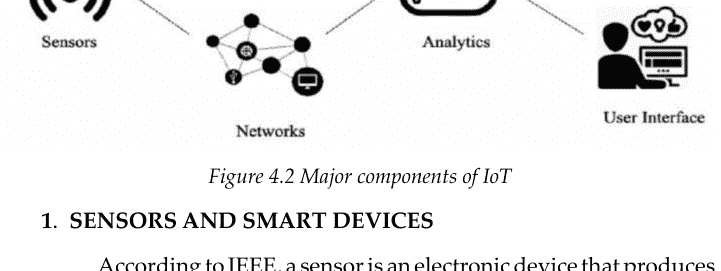

图4.2 物联网的主要组件

### 1. 传感器和智能设备

根据IEEE的定义，传感器是一种电子设备，可产生源自物理条件或事件的电、光或数字数据。智能设备是具有一个或多个传感器的设备，可以组合起来执行不仅仅是感知的功能。例如，智能手机具有GPS、加速度计和摄像头等多个传感器。

这些传感器或智能设备用于从环境中采集和收集数据，这是物联网实施中最基础的步骤。

### 2. 网络

网络是实现物联网系统连接性的组件。实施的第二步是通过蜂窝网络、Wi-Fi、蓝牙、低功耗Wi-Fi、Wi-Max、常规以太网等各种通信媒介之一，将传感器收集的信号传输到网络的所有组件。由于其长电池寿命和效率，低功耗和低成本的无线传输设备更受青睐。

由于物联网从设备中产生大量数据，因此利用云基础设施实时处理、管理和存储数据。云系统集成数十亿台设备、传感器、网关、协议、数据存储并提供预测分析，这就引出了下一个组件——数据处理和分析。

### 3. 分析

物联网实施的第三步是从数据中提取见解以进行分析。分析的范围可以从非常简单的，例如检查空调或加热器等设备上的温度读数是否在可接受范围内，到复杂的情况，例如在视频中使用计算机视觉识别物体。信息在任何商业模式中都非常重要，预测分析确保了相关业务线的成功。

### 4. 应用和用户界面

应用是指使用物联网网络执行的各种活动，并通过用户界面激活。应用层是一个以用户为中心的层，执行用户的各种任务。存在多样化的物联网应用，包括智能交通、智能家居、个人护理、医疗保健等。

考虑一个场景，上一阶段的分析显示房子里有入侵者。那么下一步是什么？这些信息必须以某种方式提供给用户，通过触发警报或通过电话、短信或电子邮件通知。

此外，可能需要一个界面来使用户能够主动监控其物联网系统的状态。理想情况下，用户界面设计良好，支持用户以最小的努力并鼓励更多交互。

几个设备的传感器管理系统可以从一个通用平台（集线器或智能手机）进行控制。

与其他系统不同，Samsung SmartThings 提供基于能力的传感器管理系统。

使用 SmartThings，应用程序基于其能力与智能设备交互。因此，一旦 SmartApp 所需的能力被指定，并且一旦物联网设备提供的能力被识别，则基于设备声明的能力选择设备用于特定 SmartApp 中。

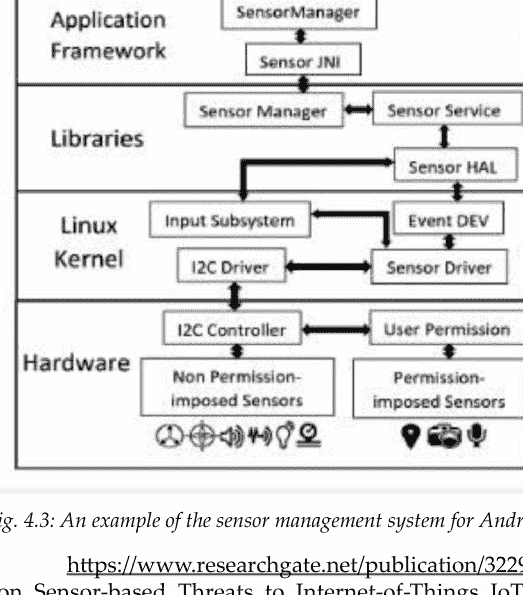

图 4.3：Android 传感器管理系统示例。

(来源: https://www.researchgate.net/publication/322975901_A_Survey_on_Sensor-based_Threats_to_Internet-of-Things_IoT_Devices_and_Applications )

Cisco，物联网平台的行业领导者，提供物联网设备管理的集成解决方案。Cisco 物联网/M2M 架构由四层组成；其中一些与传统 Cisco 网络架构中描述的类似。

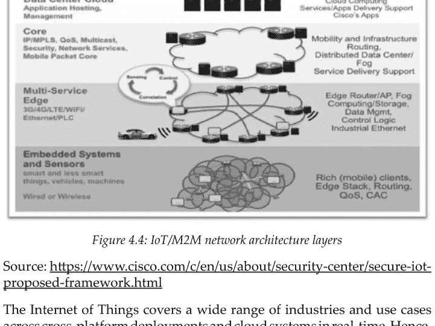

图 4.4：物联网/M2M 网络架构层

来源: https://www.cisco.com/c/en/us/about/security-center/secure-iot-proposed-framework.html

物联网涵盖了跨平台部署和实时云系统中的广泛行业和用例。

因此，存在某些标准和协议以允许设备和服务器之间以更互联的方式进行通信。物联网架构栈中各层的主要物联网协议显示在以下图中（来源: Simon Ford - ARM 物联网平台总监）：

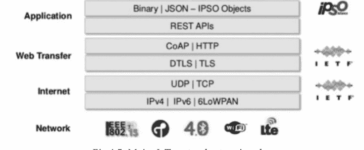

图 4.5：各层主要物联网协议

Wi-Fi、蓝牙、Zigbee 和蜂窝等许多通信技术已被熟知，但也有一些新兴的网络选项，例如用作家庭自动化应用替代方案的 Thread，以及在主要城市中实施的用于广域物联网用例的白空间电视技术。

## 1. Wi-Fi

Wi-Fi 因其广泛的现有基础设施以及能够处理大量数据并实现快速数据传输而成为许多开发者的选择。

## 2. 蓝牙

蓝牙是一种短距离通信技术，预计将成为可穿戴产品的关键，尤其是在大多数情况下通过智能手机连接到物联网。

新的蓝牙低功耗 (BLE) 或蓝牙智能是物联网应用的重要协议，因为它提供显著降低的功耗。

## 3. Zigbee

Zigbee 与蓝牙一样，具有庞大的运营安装基础，尤其在工业环境中。

Zigbee/RF4CE 提供低功耗运行、高安全性、鲁棒性和高可扩展性（节点数量多），并非常适合利用无线控制和传感器网络在机器到机器和物联网应用中。

## 4. 蜂窝网络

需要在更长距离上运行的物联网应用可以利用 GSM/3G/4G 蜂窝通信能力。

蜂窝网络能够发送大量数据，尤其适用于 4G；然而，对于许多应用而言，其费用和功耗被认为较高。

蜂窝网络可非常适合基于传感器的低带宽数据项目，这些项目将通过互联网发送极少量数据。

## 5. 6LoWPAN

6LoWPAN（IPv6 低功耗无线个人局域网）是一种网络协议，定义了封装和头部压缩机制。

## 6. Thread

Thread 是一种相对较新的基于 IP 的 IPv6 网络协议，面向家庭自动化环境。

它主要被设计为 Wi-Fi 的补充，因为它认识到虽然 Wi-Fi 对许多消费设备来说很好，但在家庭自动化设置中使用存在局限性。

## 7. LoRaWAN

LoRaWAN 针对广域网 (WAN) 应用，旨在提供低功耗 WAN，并具有专门为支持物联网、机器到机器、智慧城市和工业应用中的低成本移动安全双向通信所需的功能。

LoRaWAN 针对低功耗进行了优化，可以支持包含数百万甚至数百万设备的庞大网络。

| 协议 | 标准 | 频率 | 范围 | 数据速率 |
|---|---|---|---|---|
| Wi-Fi | 802.11n | 2.4GHz 和 5GHz | 约 50m | 最大 600 Mbps，但 150-200 Mbps 更为常见 |
| 蓝牙 | Bluetooth 4.2 核心规范 | 2.4GHz (ISM) | 50-150m (Smart/BLE) | 1Mbps (Smart/BLE) |
| Zigbee | 基于 IEEE802.15.4 的 ZigBee 3.0 | 2.4GHz | 10-100m | 250kbps |
| 蜂窝 | GSM/GPRS/EDGE (2G), UMTS/HSPA (3G), LTE (4G) | 900/1800/1900/2100MHz | GSM 最大 35km；HSPA 最大 200km | 35-170kbps (GPRS), 120-384kbps (EDGE), 384Kbps-2Mbps (UMTS), 600kbps-10Mbps (HSPA), 3-10Mbps (LTE) |

| 协议 | 标准 | 频率 | 范围 | 数据速率 |
|---|---|---|---|---|
| 6LoWPAN | RFC6282 | 用于多种网络介质，包括 Bluetooth Smart (2.4GHz) 或 Zigbee 或低功耗 RF (sub-1-GHz) | N/A | N/A |
| Thread | 基于 IEEE802.15.4 和 6Low-PAN 的 Thread | 2.4GHz (ISM) | N/A | N/A |
| LoRaWAN | LoRaWAN | 各种 | 城市环境 2-5km，郊区环境 15km | 0.3-50 kbps |

图 4.7：不同物联网协议及其参数

物联网将影响所有领域，涵盖消费和工业用途。虽然智能家居、可穿戴设备和个人追踪器是消费者的良好用例，但物联网可以通过产品和服务的价值增值周期，在设计、制造、存储、运输、维护和实时性能跟踪等各个领域得到利用，从而显著提升组织的生产力和盈利能力。

工业和消费物联网应用中不同的主要应用领域在以下图像中进行了总结：

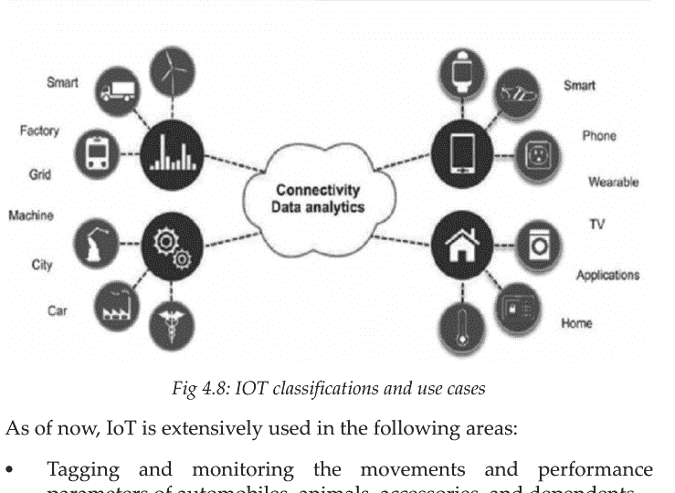

图 4.8：物联网分类及用例

截至目前，物联网已广泛应用于以下领域：

- 标记和监控汽车、动物、配件和被抚养人的移动和性能参数。
- 为实现最佳农业产出而收集和传播信息。
- 所有电气设备的自动抄表和能源利用管理。
- 各种机构和联网家庭的安全和监控系统。
- 建筑自动化和维护服务。
- 机器到机器连接，通过高度自动化提供通信、电子商务和协作机会。
- 智慧城市，以有效管理在公民生活的各个领域提供高效产品和服务。
- 远程医疗和医疗保健，用于远程测量和跟踪健康参数，以便为偏远地区的患者提供快速解决方案。

实现 IIoT 项目的关键步骤显示在以下图像中：

| 启动和优化 IIoT 项目的 5 个步骤 |
|---| 
| 建立合作伙伴关系 |
| 明确业务成果和投资回报率 |
| 从小开始 |
| 安全第一 |
| 为分析而架构 |

*图 4.9：实现 IIoT 项目的步骤*

论文《Blockchain Technologies for the Internet of Things: Research issues and challenges》，作者 Mohamed Amine Ferrag、Makhlouf Derdour、IEEE 会员 Mithun Mukherjee、Abdelouahid Derhab、IEEE 高级会员 Leandros Maglaras、Helge Janicke 强调了在受区块链实施影响的多个物联网相关领域中开展的各种研究。

中心化平台可以通过将每个哑对象转换为智能且可通信的系统，通过基于云的平台提供无数服务。

世界各地的政府已经认识到物联网的潜力，并正在“智慧城市”类别下实施各种项目，而服务、技术和基础设施提供商则利用先进技术和创新，极大地优化和提升我们能想到的每个领域系统的能力和生产力。

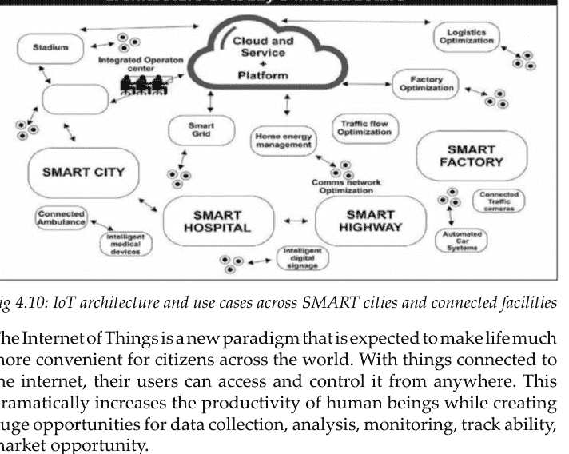

Fig 4.10: 物联网架构及在智慧城市和互联设施中的用例

物联网是一种新范式，预计将使全球公民的生活变得更加便捷。当事物连接到互联网时，其用户可以从任何地方访问和控制它。这极大地提高了人类的生产力，同时为数据收集、分析、监控、可追溯性和市场机会创造了巨大的机遇。

因此，物联网可以通过为其提供巨大的竞争优势来为积极进取的组织创造价值。这也可能成为一种风险，因为这些设备容易受到网络恐怖分子恶意攻击的威胁。

大数据技术在管理部署在需要监控和管理的各种事物上的传感器产生的大量信息方面发挥着至关重要的作用。

通用电气、罗尔斯·罗伊斯、壳牌等公司以及许多其他公司都在积极使用物联网技术，结合分析驱动的尖端工具，极大地提高其效率并降低故障和缺陷的可能性。

随着我们利用连接革命带来的优势，我们也使自己暴露在全球物联网系统面临的不可预见的攻击之下，例如 2016 年 10 月导致全球系统瘫痪的 DDoS 攻击（https://www.cnbc.com/2016/10/22/ddos-attack-sophisticated-highly- distributed-involved-millions-of-ip- addresses-dyn.html）。

大规模网络攻击“复杂、高度分布式”，涉及数百万个IP地址 Javier E. David | @TeflonGeek 发布于 5:12 PM ET 周六，22 Oct 2016 更新于 8:45 AM ET 周一，24 Oct 2016 CNBC.com 我们稍后会讨论这个问题。

## 明日的智能工厂与工业物联网（IIOT）

随着机器人和自动化技术的尖端进步，我们的工作和生活方式预计将发生变化。尽管从历史趋势来看，工厂车间似乎是不太可能出现尖端技术创新的场所，但制造商一直都是新技术的早期采用者。他们是最早认识到自动化价值的人之一，我们都见证了自动化系统如何彻底改变了我们现代的工厂。

在未来几年，制造业预计将从物联网解决方案中获得巨大收益。据思科预测，到 2021 年，全球机器对机器连接数预计将增长至 33 亿（来源：Statista）。

在投入大量资金建设强大的供应链网络之后，如今随着制造成本稳步下降，互联的物联网生态系统是现代制造业演进的下一个合乎逻辑的步骤。据 NASSCOM 的另一项研究称，到 2020 年，全球物联网制造业支出中 57% 将用于现场设备，其次是 21.8% 用于工程车辆，11.7% 用于机器人（来源：Statista）。汽车和其他一些工厂已经开始采用协作机器人、机器人臂以及与人工智能相结合的物联网来生产汽车底盘、动力总成和其他部件的大部分，从而提高工业生产率。

尽管诸如人工智能或物联网等许多机器人技术仍处于起步阶段，但自动化市场已随着时间的推移保持稳定增长，机器人能够比人类工人更快、更精确地处理甚至最复杂的制造任务。

现在，让我们探索一些将在未来的工厂中使用的先进自动化技术：

### 机器视觉（MV）

机器视觉是用于提供基于成像的自动化机器检测方法的技术，应用于自动检测、过程控制和机器人引导等应用。该技术作为先进生产过程的“眼睛”发挥作用，使用包括常规成像、超光谱成像、红外成像、线扫描成像、表面三维成像和 X 射线成像在内的成像过程。

带有帧抓取器的智能相机或智能传感器与 Camera Link 或 CoaXPress（或定制接口）等接口一起使用，以记录或捕捉待检测表面的图像。然后这些图像由专用分析软件进行分析和处理，该软件在工作时大多使用有限元分析原理。机器视觉帮助汽车制造商节省资金、证明价格点并成为强大的竞争对手。

National Instruments、Microscan、Cognex、Datalogic、Optotune 和 ViDi Systems 是一些最顶尖的公司，其机器视觉系统深受大型制造商青睐。据最新市场研究报告称，工业机器视觉系统市场预计将在 2019-2025 年期间扩大。

### 协作机器人（COBOTS）

也称为 cobots，这些机器人设计为自主运行或在有限指导下运行。协作机器人使用机器学习在人类工人进入其工作空间时暂停所有操作。

根据通用汽车制造工程集成全球总监 Dan Grieshaber 的说法，协作机器人（cobots）已成为汽车工厂车间的“根本性变革者”。由于 cobots 在与人类接触时会安全停止，这为其作为装配线上直接的助手使用开辟了多个应用，Grieshaber 评论道。

根据 ISO 10218，cobots 有四种类型，包含以下功能：安全监控停止、手引导、速度和分离监控，以及功率和力限制机器人。

### 人工智能（AI）

人工智能系统被定义为任何感知其环境并采取行动以最大化成功实现其目标机会的系统。

明日的智能工厂将利用人工智能支持来自动化流程和机械，通过做出智能决策来应对不熟悉或意外的状况，而与传统的基于规则的方法形成对比。在基于规则的方法下，由于缺乏处理零件方向众多可能性所需的详细编程，机器人无法从未分类零件的料斗中识别和选择所需的零件。而人工智能支持的机器人可以从未分类的物料中挑选出所需的零件，而不管其方向如何。因此，技术系统将更具灵活性和适应性。

### 认知计算（CC）

认知计算（CC）是指基于人工智能和信号处理的 技术平台。这些平台包含并使用机器学习、推理、人类语言处理、语音和物体、人类-计算机交互、对话和叙事生成，以在计算机化模型中模拟人类思维过程。

认知计算平台正被领先的汽车制造商如宝马使用；例如，用于了解驾驶员及其汽车系统如何更舒适、更自然地交互。宝马坚信，近未来的汽车将自行驾驶，而非依赖人类驾驶员，并希望借助这些尖端技术，到 2021 年其车辆能够实现完全“第 5 级”[1] 自动驾驶。波士顿咨询集团估计，到 2020 年，全面车辆互联的市场将达到 1590 亿美元。

[1] - *第 5 级自动驾驶位于美国交通部为自主车辆立法如何运作所做的初步调查中定义的等级顶端。它表示汽车能够在任何条件下、任何道路上无需人工输入或监督即可驾驶，并且至少与人类驾驶员一样有效。*

### 3D 打印

与传统制造相比，3D 打印在制造方面具有许多令人兴奋且独特的优势。使用 3D 打印使制造商能够在一个单一过程中从不同材料生产具有独特机械和物理特性的零件和复合材料。3D 打印技术、设备和材料的进步降低了成本，使其成为制造业更可行的选择。

我们可以在各个行业看到 3D 打印的应用，包括服装制造。例如，由 MIT 毕业生创立的服装初创公司 Ministry of Supply 使用 3D 打印来制作更好、更可持续的服装。将 3D 打印与物联网数据收集相结合可以推动精益制造并为制造商提供竞争优势。

### 无人机

无人机是一种飞行机器人，可以远程控制或根据软件编程的飞行计划自主飞行。它也被称为“无人驾驶飞行器”（UAV）。在制造中，无人机在库存控制和仓库管理方面非常有用。

通用汽车（GM）等公司正在使用无人机检查公司铸造厂内的沙输送管道。

GM 制造工程集成全球总监 Dan Grieshaber 表示，高耸于工厂车间之上，管道检查本质上是危险的。相反，无人机在笼子内飞行，跟踪管道，并能发现裂缝等潜在问题区域。我们将无人机送入，捕捉环境，识别需要完成的工作，然后我们会派操作员带着具体任务进入。这

显著减少了人类必须在该环境及其他危险环境中花费的时间。人员仅在需要工作的地方工作。

## 外骨骼

外骨骼本质上是可穿戴机器人，在制造业的重复性操作中具有突出的应用。通常在汽车制造中，工人在下一辆汽车到来之前可能需要在45秒内完成一项任务。外骨骼实际上可以支撑人体并分散负荷。它有助于工人保持更安全，同时使工作更容易完成。

由通用汽车（GM）与NASA共同开发的机器人手套技术也是外骨骼的一个例子。在通用汽车，工人们使用 RoboGlove 为人手增加力量和抓握力。当你抓握时，手套会提供更多助力。它大大减少了疲劳并保护工人免受伤害。

根据麦肯锡报告，到2025年，物联网（IoT）应用仅在制造业的经济影响就将达到9000亿美元至2.3万亿美元。该估计基于运营成本2.5%至5%的潜在节约、物联网在电网中的整合以及其在废物、供暖和供水系统等公共部门服务中的应用。然而，随着将我们的物品连接到互联网所带来的所有令人兴奋的可能性，我们也需要确保安全从一开始就被纳入这些系统的设计中。

没有单一的智能工厂配置；很可能也没有单一的成功实现智能工厂解决方案的路径。智能工厂之旅需要的不仅仅是一组连接的资产。人们预计仍将是运营的关键。由于许多角色可以被机器人、自动化和人工智能取代，将需要重新调整角色并出现新的不熟悉的角色。公司需要合适的人才来推动这一进程，并建立合适的流程。管理人员和流程的变化需要一个敏捷、适应性强的变革管理计划。

尽管工厂配置存在差异，实现成功的智能工厂所需的组件仍然是通用的，所有这些都同等重要：数据、技术、流程、人员和安全。

## 典型企业中的数据管理及单点故障威胁：

日益激烈的竞争和超越竞争对手的需求迫使组织重新思考和修改其数据管理方法。这种情况甚至在小型组织中也能见到。

跨多个职能和活动的组织的典型架构如下所示：

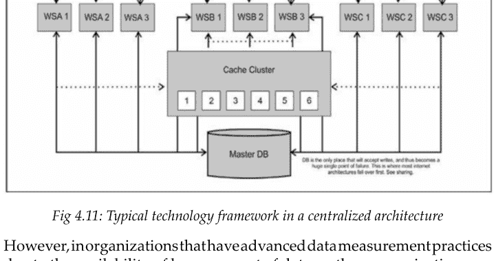

图 4.11：集中式架构中的典型技术框架

然而，在由于大量数据的可用性而拥有先进数据度量实践的组织中，随着这些组织在数据管理实践的演进中处于更高阶段，因为它们使用结构化和非结构化数据库的组合，如下图所示：

虽然大型公司有资源投资数据湖，但小型公司仍可以将数据存储、数据处理和分析活动整合到集成或统一的数据管理平台（DMP）中。 高端 DMP 是一套集成软件套件，结合了数据存储、处理和分析，并提供直观且易于导航的执行仪表板。 DMP 的作用是：

- 从所有来源收集结构化和非结构化数据：内部和外部，涵盖组织自己的应用程序、系统、网站和产品、合作伙伴和其他关联方的数据以及公司使用的任何其他第三方数据。
- 整合和存储所有收集到的数据。
- 应用分析工具并为最高管理层和业务中所有其他数据驱动部分提供适当的洞察。

一些关键的 DMP 产品包括 Adform DMP、Adobe Audience Manager、KBM Group 的 Zipline、Lotame、MediaMath DMP、Neustar Identity DMP、Nielsen exelate、Oracle BlueKai、Salesforce DMP（前身为 Krux）和 Turn Digital Hub for Marketers。 如 IBM Insights 和 SAS Data Management 等平台提供访问遗留系统和 Hadoop 上数据的能力。 这些平台提供企业级能力，通过在本地和云端集成、清洗、转换和治理数据等活动来启用、管理和分析大量结构化和非结构化数据。

随着物联网的普及，私营、公共和政府领域组织各部门需要处理的数据量巨大。 使用 DMP 还允许组织利用人工智能和机器学习等技术获得显著的竞争优势。 DMP 还可以为组织提供全面管理 GDPR 制度的方式。 然而，在所有这些情况下，由于单点故障的可能性，都存在不同阶段的故障风险。

## 结论

预计在未来五年内，地球上每个人的平均连接设备数量将超过五台，通过互联网通信和控制的连接设备的数量以及通过这些系统交换的数据量至少可以用惊人来形容。 更多的数据和连接不仅产生巨大的价值和机遇，也带来了许多挑战和风险。

在本章中，我们探讨了如何将人工智能和机器学习技术与物联网、云计算和大数据相结合，打造未来的工厂。 确实重要的是保护这些设备免受日益增加的恶意软件攻击者和网络犯罪分子的威胁。

## 第五章

### 机器人

## 引言：

机器人可以通过执行复杂的 3D 打印操作以极高的精度轻松建造房屋，从而轻松执行复杂任务。 它们能够在环境中移动，并在危险环境或制造过程中取代人类，或在外观、行为或认知上与人类相似。

在传感器的帮助下，机器人能够避开路径上的障碍，并根据其实现程序的复杂程度，有无事先规划地实现目标。

机器人操作的特点是感知（感知）、处理（解释和规划）和行动（某种形式的运动）。

人工智能和机器学习导致了当今机器人能力的成倍提升，这将在本章中讨论。

## 结构：

- 机器人的技能
- 机器人的优点和缺点
- 机器人法则
- 机器人系统
- 机器人的组件
- 构建一个好的机器人
- 机器人的演变及其在人工智能和机器学习出现后的效用提升

## 目标：

本章的目的是追踪机器人从单纯的体力劳动补充到今天我们所看到的复杂机器人的演变，例如索菲亚，沙特阿拉伯王国的认可公民，这是授予非生命体的第一个此类荣誉。 完整的硬件、人工智能驱动的应用以及它们协同工作的方式将向读者解释。 这将使他们能够将机器人视为增强其绩效和提高我们生活质量的工具，而非如大多数参考文献中所描述的那样视为威胁。

什么是机器人？

机器人是一种可重新编程的多功能操作器，旨在通过可变程序化运动移动材料、零件、工具或专用设备，以执行各种任务（美国机器人学会）。

机器人是一种由计算机代码引导和控制的机电机器。 它可以被视为一种机电代理，能够按照程序设想的复杂程度以自动顺序方式执行一系列动作。 机器人技术涉及机器人的设计、构建、操作和应用，以及用于其控制、感官反馈和信息处理的计算机系统。

## 简要历史：

该术语源自捷克语单词 robota，意为“强制劳动”。 “机器人”一词首次用于指代捷克作家卡雷尔·恰佩克1920年戏剧《R.U.R.》（Rossumovi Univerzální Roboti - 罗松通用机器人）中的虚构人形，但该词的真正发明者是卡雷尔的兄弟约瑟夫·恰佩克。

世界上第一台电子自主机器人由威廉·格雷·沃尔特于1948年在英国布里斯托尔创建，以及约翰·T·帕森斯和弗兰克·L·斯图伦在1940年代末创建的计算机数控（CNC）机床。

第一台商用机器人‘Unimate’由 George Devol 于1954年制造，并在1961年售予通用汽车，在新泽西州尤因镇西特伦顿区的 Inland Fisher Guide 厂中被用于从压铸机中抬起热金属件。

机器人可以是自主的或半自主的，范围从人形机器人如本田的先进步行创新移动平台 Advanced Step in Innovative Mobility (ASIMO) 和 TOSY 的 TOSY 乒乓球 playing 机器人 TOPIO (TOPIO)，到工业机器人、医疗手术机器人、患者辅助机器人、犬类治疗机器人、集体编程的群体机器人、无人机如通用原子 MQ-1捕食者，甚至微观纳米机器人。通过模仿逼真的外观或自动化动作，机器人可以传达出一种智能或自身思考的感觉。预计在未来十年，自主事物将大量普及，而家庭机器人和自动驾驶汽车是其中的主要推动力。(Source Wikipedia)

## 机器人重要技能

机器人擅长多种技能。一些重要技能如下所述：

- 从网络或数据库中搜索、获取、汇总和分析数据。
- 记录和传输信息和数据。
- 计算其当前位置的位置、关于当前位置的位置、针对移动或任何行动的目标位置，并根据程序化指令决定行动方案。
- 与外部行为者进行书面和基于语音的沟通。
- 以同步和预定的方式精确地执行活动，任意多次或按序列进行。
- 监控、识别并报告绩效指标。
- 学习并持续改进其性能，以基于数据挖掘从检查到的模式中识别和预测未来。
- 能够举起巨大重量并使用合适尺寸的臂将其以精确度定位到目标位置，定位精度极高。

## 机器人的优势与劣势

以下是机器人的优势：

- 能够在任何类型的环境中工作，包括危险和困难的地形。它们可以执行诸如排爆和排雷等工作，这些工作被认为是对人类生命构成威胁的工作。
- 表现出可重复的 pinpoint 精确度和精度，且永远不会疲劳或厌倦。
- 进行机器人手术，建造 3D 制造的组件和建筑物，能够按程序毫不费力地举起大重量。
- 它们的成本随着时间的推移不断下降，而人类的工资随着时间的推移而增加，因此其生产力、效率和投资回报率随着时间的推移而增加。
- 不参与政治和琐碎活动，专注于提高工作绩效，并且对工作条件免疫，除了某些环境因素如温度和地形等。
- 模块化构建的机器人提供多任务处理的灵活性，相同的形式可以通过修改程序来承担需要不同技能集的工作。
- 机器人是客观的，不像人类那样受情感影响，从而导致它们在任何时候都具有可靠性和可预测性。

以下是由于雇用机器人而产生的劣势：

- 在机器学习出现之前，机器人存在许多劣势，对应于无法改进和适应情况的能力。但机器学习结合人工智能使机器人能够持续改进并变得越来越好。
- 然而，机器人需要高额的初始投资，容易出现技术故障，能耗高，维护成本高，除了一点技术娴熟的管理之外。
- 机器人也可能被网络犯罪分子破坏，这可能导致停机、故障或性能变化。因此，它们需要通过利用区块链技术，通过非常高级别的交互身份验证和加密协议得到妥善保护。

## 机器人法则

最著名的法则集是艾萨克·阿西莫夫的‘机器人三大法则’。这些法则是在1942年的短篇小说‘Runaround’中引入的，尽管在一些更早的故事中已有预示。三大法则如下：

- 机器人不得伤害人类，或因不作为而对人类造成伤害。
- 机器人必须服从人类的命令，除非这些命令与第一法则冲突。
- 机器人必须保护自己的存在，只要这种保护不与第一或第二法则冲突。

在他著作《基地与地球》*Foundation and Earth*的结尾，引入了零号法则：机器人不得伤害人类，或因不作为而允许人类受到伤害。

2011年，英国工程与物理科学研究委员会 EPSRC 和艺术与人文研究委员会 AHRC 联合发布了一套五项伦理‘原则，供现实世界中机器人的设计者、建造者和使用者遵循’，以及七条‘高层信息’，旨在根据2010年9月的研究研讨会传达。它们如下：

- 机器人不应被设计为专门或主要用于杀害或伤害人类。
- 人类，而不是机器人，才是责任主体。机器人是为实现人类目标而设计的工具。
- 机器人应以确保其安全和安全性的方式设计。
- 机器人是人造物；不应设计它们来利用易受伤害的用户，通过唤起情感反应或依赖性。机器人与人类始终应可区分。
- 始终应有可能查明对机器人负有法律责任的人。

AI 和 ML 现在正在协同工作，一个全能的机器人可以奔跑、爬行、游泳、攀爬、飞行并超越人类思考和机动似乎是合理的。值得重述的是，微软公司首席执行官 Satya Nadella 在2016年6月接受 Slate 杂志采访时列出的人工智能法则，并大致勾勒出人工智能设计者应遵守的五条规则。

- ‘A.I. 必须被设计为协助人类’，这意味着需要尊重人类自主性。
- ‘A.I. 必须透明，这意味着人类应该知道并能够理解它们的工作方式。’
- ‘A.I. 必须在不破坏人们尊严的情况下最大化效率’。
- ‘A.I. 必须为智能隐私而设计’，这意味着它通过保护其信息来赢得信任。
- ‘A.I. 必须具有算法问责制，以便人类可以撤销非预期伤害’。
- ‘A.I. 必须防范偏见，以便它们不能对人们进行歧视。’

## 机器人系统

代表机器人活动范围的主要动作属于‘感知与执行’。感知涉及对外部环境的感知，以便由相关的内部机制进行处理，两者均为电子。响应以决定的形式启动，传递给相应的组件或部件，从而产生行动。此过程称为‘执行’。

- 机器人涉及计算机和受控机制的集成，以使设备可重新编程且多功能。用于规划机器人任务并将传感器集成到任务规划中的各种数学表示。任务是要实现的目标；例如，从 A 点到 B 点。
- 构建机器人涉及许多支持技术，如视觉系统、末端执行器工具、顺从装置、操作装置、焊接技术、激光、接近传感器、手腕传感器（力/力矩）、控制软件/硬件、零件输送系统、应用软件、接口软件、操作系统、编程语言、通信系统 I/O 设备等。

## 机器人的组件

典型的机器人由电子电机、传感器、功率转换单元、控制器、执行器、压电电机和超声电机、气动肌肉线、操作器连杆、底座和用户界面、运动和人工智能等组件组成。所有这些组件以及嵌入在眼睛位置的摄像头和像大脑一样定位的 CPU 使机器人能够执行许多复杂操作。

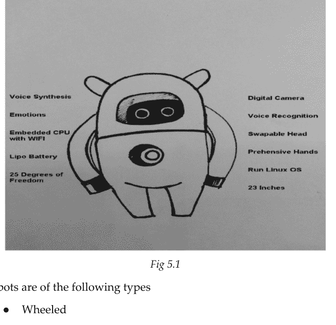

图 5.1

机器人的类型如下

- 轮式
- 腿式
- 爬行式
- 飞行或无人机

像自动化导引车或自动导引车（AGV）那样的移动机器人可以沿地面上的标记或导线行驶，或使用视觉或激光。

这些带操作臂的机器人在各种军事、工业和消费应用中得到使用。用于清洁和维护的家用机器人在美国和日本等发达国家变得越来越常见。

工业机器人通常由一个关节臂（多连杆操作器）和一个固定在固定表面上的末端执行器组成。国际标准化组织在 ISO 8373 中将操作型工业机器人定义为“一种自动控制、可重新编程、多用途的、可在三个或更多轴上编程的操纵器，可固定在原地或移动，用于工业自动化应用”。

软体机器人使用软计算方法（例如，模糊逻辑、神经网络）。还有其他类型的机器人，如模仿机器人（通过模仿学习的机器人）、软机器人 Softbots（可通过网络通信的软件代理）和纳米机器人，它们在环境中游荡以进行调查或做出改变。

机器人可广泛应用的行业总结如下：

- **制造：** 工厂广泛使用机器人用于多种目的，以协助工人并自动化重复性和手动困难的工作，以及作为协作机器人协助工人完成复杂任务。
- **3D 打印：** 机械臂已证明其利用增材制造技术以快速速度打印建筑物的能力。
- **物流与供应链：** 机器人被广泛用于仓库中的物料搬运，而无人机现在正被用于向大型超市和电子商务公司的客户交付货物。
- **安全与监控：** 机器人以无人机的形式用于巡逻和监控，并协助军队维持法律和秩序以及打击军事藏身之处。机器人还可以协助排雷。
- **食品与农业：** 机器人用于协助农民进行耕作，并在收获季节帮助采摘水果和蔬菜，以减轻劳动密集型工作的压力。
- **医疗保健：** 机器人擅长使用机械臂以极高的精度可靠地进行高精度手术，以减少事故。
- **石油与天然气**：石油公司使用机器人进行管道清洁，并使用无人机进行空中勘测，以监督安装设施是否存在任何不测事件和盗窃行为。

具有高度自由度的模块化机器人，能够执行单一任务或与其他模块联合执行更多任务，目前正被用于混合运输、工业自动化、管道清洁和处理。协作机器人或 *协作机器人* 是能够在执行简单工业任务时与人类工人安全有效地互动的机器人。

## 对象识别机器人的架构：

传统上，机器人被建模为由 CPU 运行一个负责规划的中央进程，以及其他处理器来控制运动和解释传感器值，并将解释结果传回中央处理器。必须实现一个具有预指定表示的中央推理机制。

由复杂算法和超高处理能力的 CPU 驱动的先进机器人现在被封装成人形的外观和功能。最著名的类人机器人 Sophia 被发现能够以几乎无法将其与人类区分开的方式与同伴人类交流。http://www.robots-and-androids.com/build-a-robot.html 构建机器人涉及电子、计算机编程、机械和制造。

## 构建良好机器人的重要步骤和注意事项如下：

为特定应用和需求构建机器人遵循与其他任何硬件和软件集成应用类似的标准步骤，并内置通信层。步骤可大致定义如下：

- 1. 确定需要解决的问题和旨在实现的目标，并建立市场机会或获得相关部门和最高管理层的内部认可。
- 2. 根据可用预算、时间和资源收集、识别和分析选项。
- 3. 通过收集所有所需组件构建原型。
- 4. 确定远程管理通信系统并将其集成到硬件中。
- 5. 建立概念验证，并在其实现并演示后，生产小批量以建立 stated 目标与已实现目标之间的关系。微调并使其完善，以便进行更大批量的生产。
- 6. 根据所有 stated 目标测试机器人，并在大规模生产前确保所有错误都已处理。在此阶段，您还可以考虑向潜在投资者展示，以实现快速扩张。

## 项目规划：

- 项目计划以客观的方式详细制定非常重要。
- 计划应概述所构建机器人的各种期望和目标。
- 根据各种任务，如说话、移动、对声音或音响做出反应、在光滑表面或布满障碍物的路径上移动，机器人的图纸应进行布局，并需非常细致地选择零件。
- 所需工具以及各种电子、硬件和软件产品和应用应被识别、预算并采购。

## 采购组件和装配：

如果您有能力或拥有能够做到这一点的团队，从零开始构建是一个好主意，但始终更好且耗时更少的做法是以现成装配的形式部署尽可能多的零件。这可以节省大量时间和预算，因为您可以避免随之而来的大量测试和规划。此外，由于规模经济，装配商提供的产品成本更低。

## 机器人微控制器

微控制器是机器人的大脑，可用 C 或 BASIC 语言编程。它们用于控制需要节能管理的较小机器人。更大更复杂的机器人通过 PC、平板电脑或笔记本电脑控制。可以探索现成的微控制器以获得快速且模块化的解决方案。Arduino C 是编程微控制器的最流行语言，非常类似于 C，并附带大量可轻松修改以满足我们需求的现成开源程序。

## 机器人传感器

传感器使机器人能够像人类五感一样感知环境。它们使机器人能够听、看、闻、触摸和品尝，从而感知周围环境以做出响应。

根据需要使用不同的传感器，允许机器人系统理解问题、感受压力、了解温度或找到障碍物、识别说话者及其声音方向等。这导致机器人做出适当的响应，例如回复、规避动作或改变其移动速度和手势等。不同类型传感器的完整列表以及机器人的其他组件可从 https://www.trossenrobotics.com/robot-parts.aspx 获得。

## 机器人舵机

伺服电机在反馈回路的帮助下，使机器人的组件和手臂能够精确地朝正确方向以正确的速度移动。

## 机器人手臂和腿：

机器人的手臂取决于主结构的尺寸和形状以及执行各种活动和进行运动所需的强度，使机器人能够与外部世界互动。材料的发展现在使其能够像动物一样高速移动，具有巨大的灵活性，这正在促进

类似人类的类人机器人并以各种方式像人类一样行动。由本田制造的ASIMO是第一个会走路的类人机器人。波士顿工程（Boston Engineering）是一家研究机构，专注于开发不同形状和尺寸的机器人，并证明了机器人可以在不同速度下行走和奔跑。

机器人的面部、手部和腿部装有大量电机，使其能够移动、做手势、行走并表现出情感。

## ROS（机器人操作系统）

根据维基百科，ROS（机器人操作系统）是机器人软件开发的框架，提供类似操作系统的功能。ROS，即机器人编程中的Linux，是实现常用设备功能的关键工具。

## 微软机器人开发者工作室

按照微软的定义，Microsoft Robotics Developer Studio 是一种机器人软件开发环境，使学术、业余爱好者和商业开发者能够轻松地在各种硬件上创建机器人应用。

日本的HRP-4C，其。她的开发者表示，这个“仿生人”还无法帮助日常家务或与人类并肩工作，但她确实可以用她的才艺娱乐人群。

HRP-4C由国家先进工业科学技术研究所（AIST）开发，她还能唱歌并表演简单的舞蹈动作，使她成为优秀的人群娱乐者。

一个仿生人，或设计成类似人类的机器人，对一些人来说可能令人安心，对另一些人来说则令人不安[96]

图5.2：一个类人机器人（来源：维基百科）

## 机器人演进及人工智能和机器学习兴起带来的效用提升：

在机器学习驱动的人工智能出现之前，机器人存在诸多缺点，如创造力不足、无法独立思考、无法从错误中学习并快速适应不同环境等。

机器学习在很大程度上使机器人克服了许多这些挑战，并在许多方面继续快速进步。然而，它们在成本方面仍被认为昂贵，就维护而言相对于产出也昂贵，并且无法多任务处理，只能完成它们被编程执行的任务。关于机器人入侵预计造成的失业问题，始终存在激烈的争论。

## 机场中的机器人与自动化：

我们听说过人工智能机器人跨语言翻译书籍，节省数月时间在全球推出畅销书。现在，我们看到机器人正在酒店、机场以及酒店业的许多领域和此类服务中取代人类。

新加坡樟宜国际机场曾多次被评为最佳国际机场，计划让几乎所有的人工员工空闲下来，除了少数海关工作人员在特殊情况下检查乘客。（https://www.bloomberg.com/news/features/2018-09-16/singapore-s-changi-airport-is-partly-run-by-robots ）。

该机场使用闭路电视摄像机、自动车辆和激光引导的登机桥位置，采用尖端的由人工智能和机器学习驱动的模式识别和自动化技术来执行其大部分服务。迪拜国际机场雇佣了一名安卓海关检查员，可以扫描人体以检测肢体语言、热能，并进行人脸识别和跟踪行李。据《海湾时报》报道，你很快会在机场到达区看到安卓机器人，它们会迎接旅客，并能够识别通缉犯的面孔以及报告任何可疑人员或活动。

## 机场自助值机代理：

我们已经习惯于在机场自助服务亭自行打印登机牌。现在，自助服务亭的功能也得到了扩展：

- A) 全面值机，包括手提行李。
- B) 国际旅客的移民检查。
- C) 问我帮助亭等更多服务。

机场正朝着完全无人化的区域发展，仅在特殊服务时提供人工干预。

## 酒店业中的机器人与自动化：

机器人被广泛用于协助人类并在住宿用例中为客人服务。在印度金奈，有一家名为“机器人餐厅”的餐厅，订单由机器人而非服务员接收和服务。一队七个身穿蓝白相间的机器人与顾客互动并为其服务，几名真正的服务员在幕后协助他们。虽然地板上的长磁条引导机器在餐厅周围移动，但几名服务员使用应用程序操作机器人并控制其移动。餐厅还使用机器人辅助烹饪，快速烹制各种菜肴，以便在创纪录的时间内为大量客人服务。

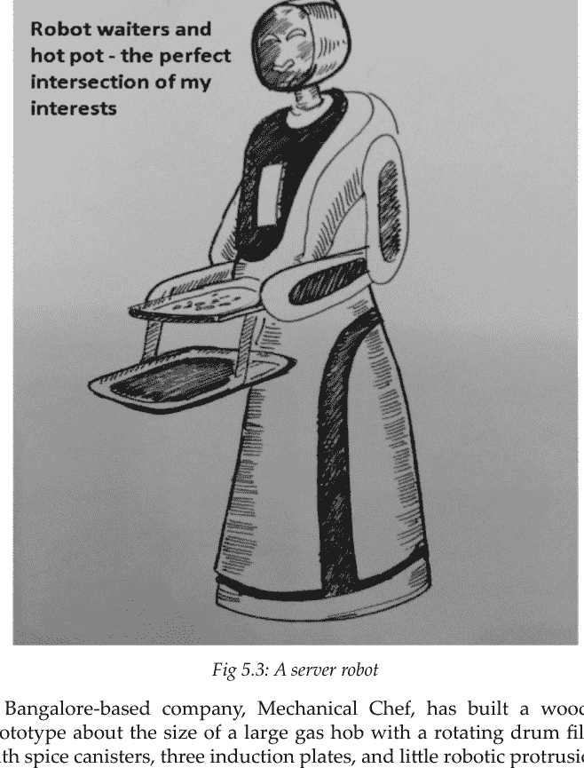

机器人服务员和火锅——我兴趣的完美交集

图5.3：一个服务机器人

一家总部位于班加罗尔的公司 Mechanical Chef 建造了一个木制原型，大小约相当于一个大型燃气灶台，配有装满香料罐的旋转鼓、三个电磁炉板以及一些小型机器人突起物，手持铲子和量杯，可同时准备超过30种不同的素食菜肴，如米饭、dal（扁豆）和 a sabzi（任何蔬菜为主的配菜）。

全球电子商务巨头阿里巴巴制造了可作为酒店工作人员操作的机器人，用于运输和递送酒店客人的用品。在未来主义的“FlyZoo”酒店，黑色的圆盘形机器人为客人送餐并在酒店房间放置新鲜毛巾。中国的 Smart LYZ 将机器人的使用扩展到迎接客人并在房间投放物品之外。它是第一家“全自动酒店”。这家位于中国成都的酒店几乎没有人类工作人员。Smart LYZ 雇用最少的人力资源，从而使客人能够在特殊情况下联系。

从在线预订到抵达酒店由机器人迎接和引导，直至退房，客人整个住宿期间可能从未遇到人类。该公司计划在未来几年在中国的各大城市推出超过50家此类酒店。但自动化代理取代人类活动并非一切顺利。机器人经常出现故障，维护成本高昂，有时还会让寻求人性化关怀的客人感到厌烦。

日本的 Henn-na 酒店连锁店大量使用机器人作为前台工作人员、清洁工、搬运工和客房助理。在用机器人取代现有的人工岗位的同时，该公司计划开发新一代机器人员工，在日本各地开设新物业。机器人技术的进步现在使机器人能够模仿许多人类和动物的动作。几年前，机器人几乎无法正常行走。但现在，在波士顿动力等组织工作的推动下，机器人能够像狗一样跳跃台阶、快速奔跑并打开闩锁。

以下图示描绘了一些仿生机器人：

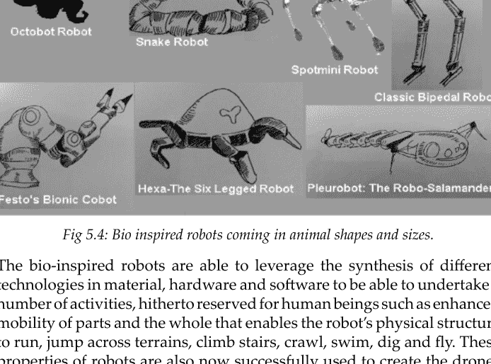

图5.4：仿生机器人以动物形状和尺寸出现。

仿生机器人能够利用材料、硬件和软件中不同技术的综合，执行迄今为止保留给人类的许多活动，例如部件和整体的增强移动性，使机器人的物理结构能够奔跑、跨越地形跳跃、爬楼梯、爬行、游泳、挖掘和飞行。这些机器人特性现在也成功用于创建各种形状和尺寸的无人机。机器人身体的灵活性增强，使机器人和无人机能够用于许多应用，如环境监测、地质勘探、结构检查和维护、家庭协助、社会服务和老年人护理、安全和监视人类无法进入和危险的地形等。

东京的国际核退役研究所于2015年12月推出了一款新机器人，将帮助清理和拆除受损的福岛核电站。机器人和自主物体的效用增加也导致了对能源生成、存储和收集技术进步的需求。

迫切需要探索这些设备如何利用嵌入体内的可用能源来源更持久地运行，同时使用成本需要下降，充电站的可用性和选项

充电需要无处不在且方便。机器人的电能来源选项包括

- i) 电池
- ii) 太阳能电池
- iii) 核能
- iv) 燃料电池技术

燃料电池与大多数电池不同，需要持续的燃料和氧气（通常来自空气）来维持化学反应，而在电池中，化学能通常来自电池中已有的金属及其离子或氧化物，除流动电池外。只要供应燃料和氧气，燃料电池就能持续发电，并且越来越多地用于各种用途。

在大型机器人中，可以安装一个小型核反应堆，该反应堆使用斯特林发动机（通过空气或其他气体的循环压缩和膨胀运行的热机，用于低功率家用应用）发电为机器人供电。

许多国家都在鼓励建立机器人、自动驾驶汽车和其他自动驾驶车辆的充电站，以便方便充电并持续运行。人们也非常关注以可承受的成本提高能量存储密度，从而使其能够用于自动驾驶汽车和家庭用途。例如，锂技术在提高电池存储密度方面取得了快速进展，比铅酸电池提高了数倍。这有助于实际应用将电动汽车和混合动力汽车推向市场。持续改进将有助于使未来的自主代理更实惠、更普及。

## 结论

本章中，我们探讨了机器人的各个方面，从其演变到作为由人工智能和机器学习驱动的自动化智能代理的构建和管理。我们详细解释了机器人的各种应用和机器人的解剖结构。

雇用机器人带来的优势在许多方面远超投资，因为机器人在极端情况下以及危险和有害环境中可以不懈工作。它们可以承担人类迄今认为是一种苦差事的重复性任务。一旦编程，它们就可以以极高的精度和最大可预测性进行工作。这种能力使其最适合工业应用、高精度医疗手术以及房屋3D打印。

随着由先进AI算法驱动的机器人能力的不断增强，通过区块链支持的生态系统编程来确保这些代理的网络安全变得至关重要，该生态系统不仅确保具有适当访问控制的真实通信，还允许以活跃的方式跟踪和处理偏差。

## 第六章

### Robotic Process Automation

### INTRODUCTION:

机器人流程自动化旨在借助人工智能、算法和机器学习工具，利用技术自动化大量重复性工作。RPA在高精度、一致性、可扩展性和灵活性方面比人工操作提供了巨大的好处。由于能够24小时工作，RPA可以通过承担发票和会计、费用管理和审计功能中的任务，在多语言和地理位置之间无疲劳、无错误地进行大量数据 crunching 和操作，帮助完成大量数据处理。AI代理已在语言翻译方面以极快的速度证明了自己。本章将从多个角度探讨RPA，以便欣赏这一提升生产力新时代范式的潜力，并展望未来，预测其与内部和外部其他应用以及前沿技术范式相协调的未来发展方向。

### STRUCTURE:

- 机器人流程自动化：为什么、是什么、如何、何处？
- 描述业务流程管理
- RPA项目中的角色类型
- RPA供应商
- RPA应用和实施示例

### OBJECTIVE:

本章的目的是了解自2012年推出以来席卷全球的机器人流程自动化。各种工具和平台将被探索，以便在组织中实施RPA的完整项目中采取的各种步骤，以及对其财务可行性的评估。读者应对RPA的应用以及实施所需步骤有清晰的理解。

RPA支持的流程提供极大的透明度和完整的审计跟踪。RPA允许数字化流程的集成和互操作性，从而能够按需获取数据，并通过API管理在任何地方更新信息。所有数据导向型应用的集成随后可以为利用人工智能和机器学习算法和工具最大化数据分析铺平道路。

运营成本降低和零错误的高吞吐量确保了高投资回报率，且随着时间的推移只会增加，具有抗工资上涨的特性。据估计，由于RPA和其他人工智能应用的实施，未来财务和会计职能中的大多数工作将被淘汰（https://www.americanbanker.com/news/how-artificial-intelligence-is-reshaping-jobs-in-banking）。

据人工智能和机器学习研究领域的顶级机构Autonomous Research估计，到2030年全球银行和其他金融机构中超过120万人将被人工智能相关应用取代。受影响最严重的将是像出纳员这样的工作，约占30%的岗位流失。虽然贷款官员、客户服务代表、贷款面试官和财务经理等客户服务和会计工作也将受到最大影响，因为这些工作将因客户自助服务或被机器人自动化或由聊天机器人提供服务而萎缩。

### WHAT IS RPA OR ROBOTIC PROCESS AUTOMATION?

RPA由以下三个术语组成：

**ROBOT:** 机器人是指一段计算机编码软件，能够在部署区域内以极高的精度模仿用户交互和常规手动活动，可以是基于规则的或非结构化的。

**PROCESS:** 流程是指对输入进行的一系列活动或步骤，以常规和例行的方式产生输出。这可能跨越组织的各个功能和非功能领域，并为专业组织中的任何任务提供方法和系统化的方法，使其具有可靠性、问责制、可重复性和可信度。

**AUTOMATION:** 自动化是指通过利用信息技术工具和系统，在没有人工干预的情况下执行流程的方法。

因此，RPA意味着在组织中跨功能领域和不同应用，使用模仿人类活动的机器人来自动化重复的、基于规则的流程，从而复制相同的工作。

像数据录入任务、会计分录、开票、费用报销、根据一组规则进行审计等例行工作现在可以被自动化并集成到组织的其余IT系统中，从而实现高精度、巨大的可扩展性和易于对账。RPA与其他由聊天机器人、语音助手和个人助手执行的自动化例行流程非常不同。RPA是主要在财务和会计领域、由业务运营团队控制并由组织IT部门管理的基于规则流程的自动化工具。

RPA的实施已被证明可以提高效率、加快运营速度，同时降低费用，从而实现组织的全面运营卓越和客户满意度。

## RPA 的层级：

根据 RPA 系统的能力，可从简单到复杂提供不同类型的 RPA 平台。在基础层级，RPA 可用于自动化简单的基于规则的任务，如表单填写、调查汇总等。执行此类功能的机器人称为可编程 RPA 机器人。

典型的 RPA 涉及发票和会计活动的自动化，将涵盖一系列常规流程，导致输入转换和输出生成。例如，这可能涉及通过更新从各种其他应用程序（如 CRM、ERP 等）获取的多个字段来创建发票，并在更新内部系统的同时将输出发布给客户。

机器人根据从组织其他系统中收集的输入确定其操作，并产生输出并执行各种其他操作，通过电子邮件、报告和仪表板生成等来更新和与外部世界沟通。

由 AI 和 ML 驱动的 RPA 涉及基于编程、可通过 UI 操作的软件机器人，具有处理结构化、半结构化和非结构化数据等的能力。AI 驱动的机器人有两种类型：

- 通过观察现有手工系统的各种活动进行训练的自学习解决方案学会相同内容并开始执行任务。
- 智能机器人使用先进的认知能力，具备视觉、自然语言处理能力和模式识别等能力，并且可以在结构化和非结构化数据上工作。

## RPA 与 BPM（业务流程管理）：

在专业组织中，对业务流程管理（BPM）有很大重视。业务流程管理涉及对功能性和非功能性领域的流程进行持续评估和工程化，以确保精益管理，通过优化利用和编排组织资源来消除冗余流程的瓶颈，从而提高生产率。

RPA 通过利用尖端技术工具和平台自动化许多手动和重复步骤，从而补充 BPM 活动，从而提供高投资回报率（Return on Investment）。

RPA 正在多家大型组织中日益显现其有效性，这些组织雇佣大量员工来管理其业务流程和运营。在许多情况下，人工已减少超过 50%，并且提供 RPA 平台的技术领导者通过利用 RPA 以大幅降低的月成本管理其运营和财务部门，为这些组织提供外包服务。

麦肯锡公司预测，通过利用当今可用的先进技术，可以自动化 45% 的所有人工执行活动；其中最主要的是 AI 和 ML 驱动的分析、RPA 和区块链。

根据 NASSCOM 的数据，RPA 已被发现可将本地流程运营成本降低 35-65%，离岸交付成本降低 10-30%，从而实现 6-9 个月的回收期。

根据 IRPAAI 的数据，RPA 机器人代理的成本不到离岸全职员工成本的三分之一，是本地员工价格的五分之一。

## RPA 项目中主要角色类型：

### PROCESS DEVELOPERS

机器人流程自动化项目始于识别和评估包含可自动化重复工作流程的流程，这些流程对人力影响最小但对生产率影响最大。

### BUSINESS USERS

业务用户群体由不同职能领域的成员及其客户组成，他们的问题需要通过自动化解决，同时提高效率和客户满意度。

### SOLUTION ARCHITECTS:

解决方案架构师分析各种选项并创建适当的设计和用例，以及实现所需的用户故事和系统设计。

### TECHNICAL CONSULTANTS

- 非常经常，技术顾问会向 RPA 项目客户的管理层进行概念销售。
- 他们随后会对现有系统进行全面审查，识别需要干预的流程，并提供大幅提高效率的空间。
- 各种业务流程将被重新设计和优化，并且 KPI 和指标将根据与业界最佳水平基准比较的标准 SLA 进行定义。
- 可用于自动化的重复流程将移交给 RPA 开发团队和组织内的 IT 专家。
- 启动概念验证，并在概念验证成功实施后，制定大规模实施的商业案例以及应实现成功指标。
- 技术团队通过评估来自各供应商的解决方案和选项来评估各种选项，并根据最佳匹配以及可产生最大投资回报率或投资回报的选项做出决策。

### DEVELOPERS and PROJECT MANAGERS:

技术团队负责 RPA 机器人项目的创建和扩展。虽然项目管理团队在按时交付成果的全面分步计划上工作，资源开发人员则致力于发展项目执行所需的前端、后端、中介软件和集成活动。

## RPA 供应商（顶级平台提供商）：

以下是 RPA 的顶级供应商：

### BLUEPRISM:

总部位于英国的 Blue Prism 集团是 RPA 市场的全球领导者，使众多组织能够减少重复且容易出现人为错误的重复性人工数据录入工作。

基于强大的 Microsoft .NET 框架，Blue Prism 提供高速操作能力并结合用户友好的功能。它适用于 Web、桌面和 Citrix 环境。Blue Prism 提供可重用框架，以高可靠性著称。

通过内部和外部解密和加密密钥以及分析仪表板实现高水平的安全性，能够与任何类型的平台和应用程序协同工作，Blue Prism 的数字机器人和框架具有理解组织内不同数字数据集的视觉和书面信息的能力。利用模式识别和先进的认知能力，它们可以提取相关信息，并在组织的内部流程和系统之间以集成方式处理和报告。

### UIPATH:

总部位于纽约的 UiPath 的 UiPath 工具提供用户友好的架构，使用机器人自动化和管理可重复的业务流程。UiPath 工具基于 Microsoft SharePoint 工作流和 Kibana 弹性搜索。它提供移动和浏览器访问、本地和云部署方法以及基于云的编排器。它具有便捷的用户界面，并提供桌面贡献和 Citrix 环境。BPO 是 UiPath 的重点关注领域，被发现更适合大规模应用而非中规模实施。

### KOFAX KAPOW

总部位于美国加州的 Kofax Kapow 提供流程管理、RPA、电子签名、移动性和客户沟通服务。其无状态多线程架构和能够无代码集成任何应用程序和数据源或企业系统的解决方案提供出色的用户友好性和可扩展性，这是任何用户都寻找的关键特性。能够处理网站、门户、企业系统和遗留应用程序、Excel、电子邮件、XML、JSON、CSV 和 SQL，使其成为 Web 自动化和文件处理的首选。它可以轻松集成来自外部和内部环境的机器人流程。

### AUTOMATION ANYWHERE

总部位于美国加州的 Automation Anywhere 提供强大的基于 Microsoft 的平台。它可以帮助自动化端到端业务流程，可部署在云端、数据中心、桌面或其他任何环境中。Automation Anywhere 更适合机器人使用数量有限的低中型规模运营。

### NICE:

总部位于以色列的 Neptune Intelligence Computer Engineering（NICE），是大型部署的领导者，为企业提供 RPA 解决方案以运营化大数据。基于 Visual Basic 和 Microsoft .NET 技术，NICE 提供无缝、快速、高可扩展的机器人架构，使认知需求较低的操作能够实现自动化并达到高生产率水平。任何第三方或内部系统，包括 CRM、计费、MS Office、虚拟化和网络，都可以集成到基于 NICE 的应用程序中。

一旦选定成功的供应商，组织将与供应商密切合作，概述目标 SLA，并内部提出商业案例，其中包括预期投资回报率和项目的交付时间表。

## 机器人：

机器人随后被开发并投入运行，以实现按计划对各项活动的自动化。

自动化流程随后会进行全面测试，并开展用户验收测试、集成测试等，以识别在早期阶段可能遗漏的任何潜在缺陷。所有缺陷都在有限的生产环境中得到纠正，完成后，将在机器人应用的潜在领域进行大规模推广，以通过预期节省实现项目的全部潜力。此阶段还涉及 RPA 与受积极影响的各种内部系统的集成。

为了将 RPA 扩展到整个组织，必须制定并实施适当的过渡计划，在确保精益运营、高生产率和投资回报等组织目标的同时，解决员工可能存在的疑虑。

**机器人控制器**将任务分配给各个机器人，并根据既定指标监控其性能。

## RPA 投资的考虑因素：

RPA 涉及用可称为机器人的程序取代大量的人力资源，涉及多种职能，主要与财务和会计相关。对受影响员工的管理、为其重新技能培训以从事其他活动或安排到其他组织等，是组织人力资源和人才管理面临的挑战。

IT 部门关注评估合适的工具、硬件基础设施和平台，以提供最佳定制解决方案，以及它们的维护、升级和 IT 能力提升；而财务部门在使用 RPA 机器人、工具和技术的同时，也关注该技术的预算和投资回报率。

由于运营生产率和盈利能力的提高而可能获得的收益，使销售和市场营销部门能够专注于增加客户获取活动，在某些情况下，还可能需要应对擅长使用尖端工具的竞争对手，因而处于更有利的地位。

RPA 在各种行业中得到越来越多的应用，这些行业一直消耗大量文档和纸质交换，尽管它们是流程驱动的，且拥有为客户服务的明确流程。任何组织的会计和财务部门都可能是 RPA 的潜在用户，而供应链管理、医疗保健、人力资源、零售和其他服务型行业的公司和集团使用 RPA 获益巨大。

RPA 在金融机构中的典型应用是根据特定搜索标准在各自数据库中搜索数百万条记录，并下载特定人员、车辆、公司或保险单的详细信息，以处理索赔、规划续保电话或分析报告的绩效等。搜索、验证并下载的详细信息会转发给相关部门进行进一步分析和处理。

RPA 正被用于自动化重复性流程，具体如下：

- 医疗保健：登记和维护患者记录。
- 人才管理和人力资源：记录新员工入职文件并管理员工工资单。
- 保险：根据客户具体情况计算并提供保费信息，并在处理保险索赔方面。
- 电信和 BPO：SLA 管理和按代理人报告绩效详情。
- 零售：账单管理、销售预测和库存预测及采购计划。
- 供应链：为常规订单开具客户发票并记入会计账簿，定期生成并向客户传达未结账单。

然而，这些并非详尽无遗，类似的应用在不同领域的公司中也是可能的。

## RPA 应用和实施示例

### Automation Anywhere 全球 RPA 领导者的案例研究。

（鸣谢：Automation Anywhere 初学者指南 - 由 Automation Anywhere 创建的课程）

RPA 涉及使用先进的软件应用程序自动化重复性和基于规则的流程。

重复流程自动化的机器人流程应用在各领域及职能领域的顶级应用领域

| 政府 | 制造业 | 金融与银行 | 医疗保健 | 酒店业 | 电子商务与零售 | 物流与供应链 | 人力资源开发 | 市场营销 |
|---|---|---|---|---|---|---|---|---|
| KYC 文档与验证、招标管理、报告 | ERP 集成、库存和仓库流程自动化、报告系统自动化 | 创建潜在客户生成报告并监控社交情绪、发票处理、报告、审计、索赔和激励处理 | 患者数据存储与处理、社交媒体管理、医生报告、保险数据自动化和索赔处理、索赔状态更新 | 竞争对手价格分析、客人数据处理、数据验证、支付处理等。 | 按期从生产商挑选库存、从在线库存更新并导入网站和电子邮件销售 | 订单处理、数据录入、合作伙伴索赔处理、发票处理、报告、仓库流程、报告 | 员工调查数据处理、人力资源信息系统文档和仪表板管理、员工沟通相关通知 | 记录和跟踪潜在客户生成报告和客户情绪 |

图 6.1

Automation Anywhere 是 RPA 领域全球领先的公司，在其数字劳动力平台下提供最先进的工具来开发、管理和部署以及执行最先进的 RPA 机器人应用。认知和预测能力现正被整合到先进的 RPA 机器人应用中，以模仿人类大脑并帮助它们快速执行复杂应用。这将帮助它们分析错误并预测未来趋势。具有认知能力的 IQ 机器人可以处理半结构化和非结构化数据，并具有基于算法的决策和自学习能力。

Automation Anywhere 企业应用为组织提供多项益处。

使用该平台开发的机器人提供的一些益处如下列出：

- 减少错误并将准确率提高到 100%，从而带来客户满意。
- 全年全天候提高流程可用性。
- 提高速度和吞吐量，从而提高运营能力并消除瓶颈。
- 提高捕获、收集和汇总最高质量相关数据的能力。
- 通过为 RPA 应用增加认知能力，组织可以获得巨大的运营智能和可操作的洞察力，以预测未来的结果和模式。
- 降低人力成本并提高劳动力生产率。
- 帮助员工专注于更高价值和更有趣的工作，而不是枯燥的重复性工作，从而提高他们的工作满意度和士气。
- 改进控制的实施并有助于可审计性。
- 通过将信息、敏感数据和流程的访问限制在授权人员范围内，实现高度安全性。
- 有助于信息的实时可用性和商业智能
- 协助组织数字化转型并最小化业务风险。
- 导致组织成本降低和盈利能力提高。

AAE 的机器人管理平台支持先进的软件开发生命周期、实践，并提供开发、测试和生产环境。它采用客户端-服务器架构，服务器作为控制室运行，可部署在云端或本地。它连接两种类型的客户端，即机器人创建者和机器人运行者。

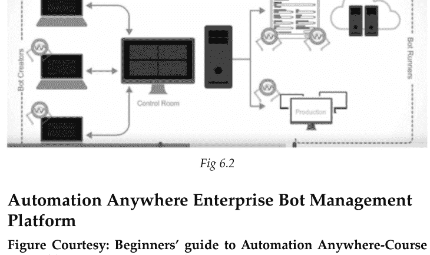

图 6.2

## Automation Anywhere 企业级机器人管理平台

图源：Automation Anywhere 创建的《Automation Anywhere 入门指南》课程

AAE 的机器人管理平台由以下三个主要组件组成：

- **机器人创建者：** 机器人创建者是一个开发客户端，由流程专家和 IT 专家组成，通过部署机器人来增强、简化并自动化流程。

它们用于自动化流程的编写和单元测试。主要有两种类型的机器人，即任务机器人和元机器人。任务机器人用于自动化基于规则的流程并使用结构化数据。元机器人是可重用的（跨多个任务机器人）构建模块，可为自动化流程提供速度和可扩展性，并且只需配置一次。

- **控制室：** 控制室是平台的大脑，有助于启动机器人和任何类型的基础设施。CR 能够进行许可证管理、用户管理、源代码管理，并提供有关所有已部署机器人的分析仪表板。控制室提供集中部署、访问控制、协作和数字劳动力管理。

- **机器人运行器：** 机器人运行器是部署创建的机器人以执行任务的客户端，并通过控制室进行管理。

Automation Anywhere 还提供诸如 **BOT Insights 用于显示分析洞察，包括节省详情** 之类的平台。Bot Farm 允许您创建或租用机器人，而 **BOT 商店 (https://botstore.automationanywhere.com/)** 是针对每种类型业务自动化的预建机器人的数字劳动力市场。

根据用例的不同，在 AAE 平台上构建机器人应用程序使用四种方法。确定正确的方法可以实现可靠、用户友好且高效地构建机器人。

四种方法如下：

- **智能记录器：** 此方法用于从 Java、PHP 等应用程序中捕获对象。
- **屏幕记录器：** 此方法有助于记录和自动化包括鼠标点击和按键在内的流程。
- **网页记录器：** 此方法有助于捕获涉及从基于网页的流程中捕获信息的流程。
- **任务编辑器：** 此方法用于自动化涉及一系列命令和向导的流程。

在 AAE 平台多功能拖放向导的帮助下，非技术人员可以构建和部署自动化流程，而 IT 开发人员可以构建机器人来自动化复杂、集成端到端流程。

AAE 提供超过 500 条现成命令，涉及数据库、Excel、文件和文件夹管理以及高级 PDF 集成命令。

使用 AAE 平台实现的一些最顶级的用例，用于自动化繁琐、易出错且耗时的流程，列于下文：

## 部分用例：

- 1. **员工调查：** 使用 AAE 平台可以自动化的关键操作包括打开 Excel 文件进行汇总，打开回复的 PDF 文件，从 PDF 中复制收集的数据，并粘贴到 Excel 文件中。

- 2. **采购流程自动化：** 可以自动化的关键流程包括从 FTTP 文件夹上传和下载采购订单文件，检查采购订单的批准情况，向已批准订单的供应商发送电子邮件，从本地文件夹删除被拒订单和已发送电子邮件的已批准订单等。这将导致人力成本大幅节省，减少错误和纠纷范围，同时加快流程。

- 3. **回复电子邮件并根据需要采取适当行动：** 这涉及使用电子邮件分类机器人和终端仿真机器人等机器人的组合，在适当平台上触发响应。

可以从 AAE 机器人市场 https://botstore.automationanywhere.com/ 获得更多用例。为了跟上快速发展的 RPA 领域的技术进步，企业专业人员需要不断接受培训，以了解 RPA 的潜力和实用性，从而能够投资该技术。AAU（Automation Anywhere University）为学习者提供在线、离线和混合学习选项，以培养实施高级 RPA 应用所需的技能。

## 结论

RPA 或机器人流程自动化（RPA）于 2012 年通过 HFS 编写的案例研究引入市场，并得到 RPA 平台领导者 Blue Prism 的支持。在本章中，我们研究了 RPA 的演变、其效用、实施路径、可用平台以及其作为集成工具以提高企业生产力和盈利能力的前进方向。RPA 承诺通过自动化重复性流程，从低效的业务流程和 BPO 服务中消除手动变通方法和人员超载。

以云和下一代 IT 和通信技术将业务流程外包到低收入目的地为导向的新型商业模式，使公司能够显著提高生产力和盈利能力。RPA 的实施导致资源进一步优化，许多常规会计和财务流程得到自动化。聊天机器人和语音助手的实施增加了另一层自动化，与后端 RPA 驱动的自动化相结合。AI 和 ML 驱动的分析的出现正在改变前端客户交互的各个方面以及其与后端运营的交互，以响应查询，这导致需要在组织的不同方面采取集成方法，而这些方面此前一直处于孤立和独立状态。AI 和 ML 驱动的分析和高级功能使 RPA 工具能够提供包括模式识别、文档和货币识别在内的高级功能等等。

因此，RPA 不再仅仅是重复性流程自动化，而是一种先进的范式，不仅能够实现能够随时间和交互而学习和改进的高级分析驱动功能，还能够实现跨职能领域的后端流程集成。未来区块链驱动自动化的实施将使流程在企业内部和企业之间进行大规模改造。因此，任何将 RPA 与 AI 和 ML 驱动的分析、业务流程再造和区块链相结合并实施的组织都需要与公司内的系统（如 ERP、CRM 和外部预言机和区块链）进行垂直和水平集成。

这将是新一代组织充分利用自动化的愿景。我们将在后续章节中进一步研究这个问题。

## 第七章

### 无人机

## 引言：

无人机是基于 AI 和 ML 的技术进步的飞行体现。从有限范围、电池控制的飞行设备开始，无人机现在拥有最先进的功能，并参与了许多复杂项目和用例；这得益于 AI 和 ML 驱动应用的进步。

对于许多人来说，无人机是黑箱，很多人仍然想知道如此微小的物体在高空中飞行是如何能够执行如此复杂的一系列功能并执行各种活动的。

在本章中，我们将仔细研究无人机的各种类型及其在各个领域的应用。

## 结构：

- 描述无人机
- 无人机组件
- 无人机类型
- 无人机分类
- 无人机中的 AI
- AI 在无人机行业中的用途

## 目标：

本章的目的是揭示现在在世界各地出现的自主飞行物体背后的技术。我们将从定义、应用领域、构成其机体的硬件组件、无人机的分类及其优缺点等方面审视无人机的各个方面。利用 AI 和 ML 驱动技术赋予无人机功能的技术的技术基础也将简要介绍。预计阅读本章后，无人机不再是神秘的飞行物体，并且预计读者将积极参与采购和使用无人机，用于从爱好到公共事业和福利等各种应用，同时遵守管理此类应用的当地法律法规。

## 无人机简要概述：

无人机是一种无人驾驶飞机，将物联网、卫星、GPS、机器人、人工智能等多种技术集成到一个紧凑的单元中。随着世界领先企业在商业化方面的最新进展，它已成为最热门的话题。

根据维基百科，无人机是无人驾驶飞行系统；远程控制的无人驾驶飞机；没有人控制的飞行物；美国联邦航空管理局（FAA）称其为无人驾驶飞行系统（UAS），并预测到 2020 年全国天空中的无人机可能达到 30,000 架。

## 无人机机体包含以下组件：

配备 GPS 集成的飞行控制器、多旋翼旋转叶片、飞行全程的电池存储、用于传感器载荷安装的云台、红外摄像机等。机体由碳纤维等轻质材料制成。传感器重量轻且极其节能。多旋翼提供冗余并有助于管理任何时间任何旋翼的故障。

Drones come in different sizes and weights ranging from 100 gm to over 1000 kg with applications for close range micro drones to large range drones with a very long range.

无人机尺寸和重量各不相同，从 100 克到超过 1000 公斤不等，应用范围从近程微型无人机到具有极长航程的大型无人机。

Drones are used for a variety of civilian and military purposes like aerial photography, digital archaeology, environmental analysis, agricultural analysis, gas mapping, coastal surveys, film/media, and law enforcement and for participating in drone racing competitions.

无人机用于各种民用和军事用途，如航空摄影、数字考古、环境分析、农业分析、气体测绘、沿海勘测、影视/媒体、执法以及参加无人机竞速比赛。

Being controlled by computers through satellites and remote sensing technology, drones pack tremendous precision with economic feasibility and efficiency.

通过卫星和遥感技术由计算机控制，无人机兼具极高的精度、经济可行性和效率。

While drones have enormous use in dangerous works, agriculture, medical and media, there are a number of concerns related to privacy invasion, accidents and security risks that can be caused by its unscrupulous use. Let us delve deeper into these exciting manifestations of AI and ML-led automation in the modern era.

尽管无人机在危险作业、农业、医疗和媒体领域有着巨大的用途，但其不当使用也可能引发一系列与隐私侵犯、事故和安全风险相关的问题。让我们深入探讨这些人工智能和机器学习驱动的自动化在现代时代的令人兴奋的体现。

## WHAT IS A DRONE?

## 什么是无人机？

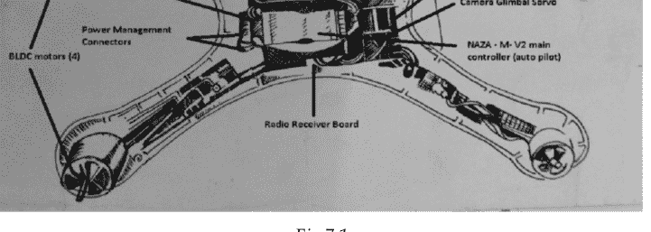

Fig 7.1

图 7.1

An unmanned aerial vehicle (UAV) commonly known as a drone is an aircraft without a human pilot on board. **UAVs are a component of an unmanned aircraft system (UAS)** which include a UAV, a ground-based controller, and a system of communication between the two. The flight of UAVs may operate with various degrees of autonomy: either under remote control by a human operator or autonomously by on board computers.

通常被称为无人机的无人驾驶飞行器（UAV）是一种机上没有人类飞行员的飞机。**UAVs 是无人机系统（UAS）的组成部分**，其中包括 UAV、地面控制器以及两者之间的通信系统。UAV 的飞行可能以不同的自主程度运行：要么由人类操作员远程控制，要么由机载计算机自主运行。

The word drone actually has two distinct meanings: the first one is a low humming sound that goes on a continuous basis and the second indicates the male bee. We all know that the male bee has no work to do; it never goes out to gather honey; its existence is just for impregnating the bee queen. So it is not a bad idea to use this word to describe an UAV that also produces sound like a group of bees and it appears to be mindless. The drone in today's world is an unmanned aerial vehicle or UAV that is either operated by a human from a remote location or it can work autonomously as per the set mode. In simple words, a drone is something like a flying robot. The aircraft are usually controlled from a dedicated remote unit and they can manage all things in air due to an intelligent software program. It possesses so many on-board working sensors like GPS, etc. that assist in proper flight mode controls.

单词 drone 实际上有两个不同的含义：第一个是持续不断的低沉嗡嗡声，第二个指雄蜂。我们都知道雄蜂没有工作可做；它从不外出采集蜂蜜；它的存在只是为了使蜂后受精。所以用这个词来描述一种 UAV 也并不算坏主意，该 UAV 也会发出像一群蜜蜂那样的声音，而且看起来毫无意识。今天的无人机是一种无人驾驶飞行器或 UAV，要么由远处的人类操作，要么可以根据设定的模式自主工作。简单来说，无人机就像一种飞行机器人。这些飞行器通常由专用遥控单元控制，并且由于智能软件程序可以管理空中的一切。它拥有许多机载工作传感器，如 GPS 等，有助于适当的飞行模式控制。

## HISTORY OF A DRONE:

## 无人机的历史：

The origin of a drone can be traced with special techniques to provide relevant information to the military. The very first aircraft with reusable type radio control mechanism was designed in the thirties, and it worked like a base model for all new advancements in today's world. Later, the military drones were developed with classic sensors and camera units and now they have been fixed inside missiles too. With so much advancement in technology, now you can easily find so many variants of drones. A few are used for military applications but others are finding the potential role in many big companies. As per a recent update, Google and Amazon are developing their own drones so that parcels can be delivered by air with ease. One more interesting concept is presented by Facebook as they are thinking to develop some giant drones that can carry signal to remote locations for direct internet access. Drones in today's world have also been an important part of film industry and news reporters are also using them to carry information from inaccessible locations.

无人机的起源可以追溯到为军事提供相关信息的特殊技术。第一架具有可重复使用型无线电控制机制的飞机是在三十年代设计的，它就像当今所有新进展的基础模型。后来，军用无人机配备了经典传感器和摄像机单元，现在它们也被固定在导弹内部。随着技术的巨大进步，现在你可以很容易找到许多种类的无人机。其中一些用于军事应用，但其他一些正在大型公司中发挥潜在作用。据最新消息，Google 和 Amazon 正在开发自己的无人机，以便通过空中轻松递送包裹。Facebook 还提出了一个更有趣的概念，他们正在考虑开发一些巨型无人机，可以将信号传输到偏远地区以实现直接互联网接入。在当今世界，无人机也是电影行业的重要组成部分，新闻记者也使用它们从无法到达的地点传递信息。

## HOW DOES A DRONE WORK?

## 无人机如何工作？

The working procedure of a drone may appear simple to most of you but the device is actually carrying a complex technology inside. Before we discuss the concept of a drones’ working, you must know the fact that differentiates between drones and its ancestors, the helicopters. The former one can fly independently whereas the latter needs a pilot for directions.

无人机的工作程序对大多数人来说可能看起来很简单，但该设备内部实际上承载着复杂的科技。在讨论无人机的工作原理之前，你必须知道区分无人机与其祖先直升机的一个事实。前者可以独立飞行，而后者需要飞行员指引方向。

Actually, it is a specially designed multi propeller system inside a drone that makes this device highly independent and also assists in reduction of failures. One important thing to note about this multi propeller system is that even if any motor inside this device stops working, it will keep on flying as it gets support from propellers that are working in the group. Drones that possess a large number of motors inside are able to gain more control over their elevation and hence can carry more loads during flight. These propellers get their power from a dedicated source and most of these devices contain removable batteries so that they can stay in the air for a long time. The flight time can be extended with use of powerful batteries in design.

实际上，无人机内部的特殊多螺旋桨系统使该设备高度独立，同时也有助于减少故障。关于这个多螺旋桨系统需要注意的一点是，即使该设备内部的任何一个电机停止工作，它仍会继续飞行，因为它得到了组内正在工作的螺旋桨的支持。内部电机数量较多的无人机能够更好地控制其高度，从而在飞行中携带更多负载。这些螺旋桨从专用电源获取动力，大多数设备都包含可拆卸电池，以便它们能在空中停留很长时间。飞行时间可以通过设计中使用更强大的电池来延长。

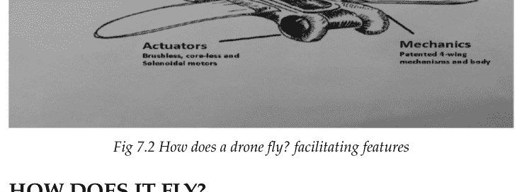

Fig 7.2 How does a drone fly? facilitating features

图 7.2 无人机如何飞行？辅助功能

## HOW DOES IT FLY?

## 它如何飞行？

A controller plays an important role in the drone flying mechanism. This device is used by experts for controlling every movement of a drone, ranging from its launching, navigation abilities and even up to landing.

控制器在无人机飞行机制中发挥着重要作用。该设备被专家用于控制无人机的每一个动作，从起飞、导航能力甚至到着陆。

The market is flooded with a variety of controllers these days and developers often use it to do various experiments to create drones with impressive features.

如今市场充斥着各种各样的控制器，开发者经常使用它们进行各种实验，以打造具有令人印象深刻功能的无人机。

One of the major tasks of a controller is to establish a proper communication channel between the remote unit and the radio waves. Most of the drones work on 2.4 GHz frequency range and many of these controllers take help from Wi-Fi networks for making active decisions regarding movements. Many features of a smartphone and drones are the same as both carry GPS, Wi-Fi and many other common sensor units. These on-board sensors help drones to stay in the air for a long time and make right decisions about its height, direction and other important movements. The landing process is also controlled by the propeller system inside and the sensors make decisions about its speed, altitude and motor rotation, etc. A drone works like an intelligent air unit that can cover a large distance when used with powerful batteries and can bring the hidden information for you like a spy. This is the main reason behind its popularity in military applications.

控制器的主要任务之一是在遥控单元和无线电波之间建立适当的通信通道。大多数无人机工作在 2.4 GHz 频率范围，许多控制器借助 Wi-Fi 网络来对移动做出主动决策。智能手机和无人机的许多功能相同，因为两者都携带 GPS、Wi-Fi 和许多其他通用传感器单元。这些机载传感器帮助无人机在空中停留更长时间，并对其高度、方向和其他重要移动做出正确决策。着陆过程也由内部的螺旋桨系统控制，传感器会对其速度、高度和电机旋转等做出决策。无人机就像一个智能空中单元，使用强大的电池时可以覆盖大距离，并像间谍一样为你带来隐藏的信息。这就是它在军事应用中受欢迎的主要原因。

## COMPONENTS OF DRONES

## 无人机的组件

Let us now take a look at the various components that go into the construction of a drone, giving it all the properties that are required to fly and perform its functions.

让我们现在来看看构成无人机的各种组件，它们赋予了无人机飞行和执行功能所需的所有特性。

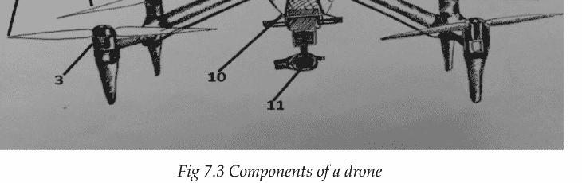

Fig 7.3 Components of a drone

图 7.3 无人机的组件

### 1. STANDARD PROPELLERS:

### 1. 标准螺旋桨：

The propellers are usually located at the front of the drone/quadcopter. There are many variations in terms of size and material used in the manufacture of propellers. Most of them are made of plastic, especially for the smaller drones but the more expensive ones are made of carbon fiber. Propellers are still being developed and technological research is still ongoing to create more efficient propellers for both small and big drones. Propellers are responsible for the direction and motion of the drone. It is therefore important to ensure that each of the propellers is in good condition before taking your drone out for a flight. A faulty propeller means impaired flight for the drone and hence an accident can occur. You can also carry an extra set of propellers just in case you notice some damage that was not there earlier.

螺旋桨通常位于无人机/四轴飞行器的前方。螺旋桨的制造在尺寸和材料方面有很多变化。大多数由塑料制成，尤其适用于小型无人机，但更昂贵的螺旋桨由碳纤维制成。螺旋桨仍在不断开发中，技术研究仍在进行，以为小型和大型无人机创造更高效的螺旋桨。螺旋桨负责无人机的方向和运动。因此，在将无人机带出飞行之前，确保每个螺旋桨都处于良好状态非常重要。螺旋桨故障意味着无人机飞行受损，因此可能发生事故。你也可以携带一套额外的螺旋桨，以防发现之前没有的损坏。

### 2. PUSHER PROPELLERS:

### 2. 推力螺旋桨：

Pusher propellers are the ones responsible for the forward and backward thrust of the drone during a flight. As the name suggests, the pusher propellers will determine the direction the drone takes either forward or backward. They are normally located at the back of the drone. They work by cancelling out the motor torques of the drone during the stationary flight leading to forward or backward thrust. Just like the standard propellers, the pusher propellers can also be made of plastic or carbon fiber depending on the quality. The more expensive ones are usually made of carbon fiber. There are different sizes depending on the size of the drone. Some drones provide for pusher prop guards that will help protect your propellers in the event of an unplanned crash. Always ensure you inspect your pusher propellers before the flight as this will determine the efficiency of the flight.

推力螺旋桨负责无人机飞行过程中的前后推力。顾名思义，推力螺旋桨将决定无人机向前或向后的方向。它们通常位于无人机的后部。它们通过在静止飞行期间抵消无人机的电机扭矩来工作，从而产生前后推力。就像标准螺旋桨一样，推力螺旋桨也可以根据质量由塑料或碳纤维制成。更昂贵的通常由碳纤维制成。尺寸因无人机大小而异。一些无人机提供推力螺旋桨保护装置，有助于在意外坠毁时保护你的螺旋桨。务必在飞行前检查你的推力螺旋桨，因为这将决定飞行的效率。

### 3. BRUSHLESS MOTORS:

### 3. 无刷电机：

All drones being manufactured lately use the brushless motors that are considered to be more efficient in terms of performance and operation as opposed to the brushed motors. The design of the motor is as important as the drone itself. This is because an efficient motor means you will be able to save on costs of purchase and maintenance costs. In addition to this, you will also save on the battery life which contributes to longer flight time when flying your drone. Currently, the drone motor design market is pretty exciting as companies try to outdo each other in coming

近期制造的所有无人机都使用无刷电机，相对于有刷电机而言，其在性能和操作方面被认为更高效。电机的设计与无人机本身一样重要。这是因为高效的电机意味着您可以在购买和维护成本上节省开支。此外，您还可以节省电池寿命，从而在飞行无人机时获得更长的飞行时间。目前，无人机电机的设计市场相当令人兴奋，因为各公司试图在不断到来

采用最高效且最先进的电机。市场上最新的产品是大疆 Inspire 1，最近推出。它提供更高效的性能并节省电池续航。它也相对安静，不会产生太多不必要的噪音。

## 4. 起落架：
一些无人机配备了直升机式的起落架，有助于无人机降落。在降落时需要较高离地间隙的无人机需要改装起落架，以便安全着陆。此外，运送包裹或物品的配送无人机可能需要宽敞的起落架，因为在触地时需要空间来容纳物品。然而，并非所有无人机都需要起落架。一些较小的无人机在没有起落架的情况下也能完美工作，并在触地时安全地腹部着陆。大多数飞行时间更长、覆盖距离更远的无人机都配备固定起落架。在某些情况下，起落架可能会阻碍对环境的 360 度视野，尤其对于摄像无人机而言。起落架还能提高无人机的安全性。

## 5. 电子调速器：
电子调速器（ESC）是一种电路，其主要职责是在飞行过程中监控并调节无人机的速度。它还负责无人机的飞行方向和制动变化。ESC 还负责将直流电池电能转换为交流电以驱动无刷电机。现代无人机完全依赖 ESC 来满足所有飞行需求和性能。越来越多的公司推出了性能更好的 ESC，可降低功耗并提高性能，其中最新的是大疆 Inspire 1 ESC。ESC 主要位于无人机主框架内部。你不太需要对 ESC 进行任何操作或更改，但在需要更改时，可以在无人机主框架内部找到它。

## 6. 飞行控制器：
飞行控制器基本上是无人机的主板。它负责执行飞行员发出的所有指令。它解释来自接收器、GPS 模块、电池监测器和机载传感器的输入。飞行控制器还负责通过 ESC 调节电机转速以及无人机的转向。诸如触发相机、控制自动驾驶模式和其他自主功能等指令均由飞行控制器控制。用户很可能不需要对飞行控制器进行任何改动，因为这通常会影响无人机的性能。

## 7. 接收器：
接收器是负责接收通过控制器发送到无人机的无线电信号的单元。控制无人机所需的最小通道数通常为四个。然而，建议提供五个通道。市场上有非常多不同类型的接收器，所有这些都可以在制作无人机时使用。

## 8. 发射器：
发射器是负责从控制器向无人机传输无线电信号以发出飞行指令和方向的单元。与接收器一样，发射器对无人机需要四个通道，但通常建议为五个。市场上有不同类型的接收器供无人机制造商选择。接收器和发射器必须使用单一无线电信号，以便在飞行期间与无人机通信。每个无线电信号都有一个标准代码，有助于将其与其他空中无线电信号区分开。

## 9. GPS 模块：
GPS 模块负责提供无人机的经度、纬度和海拔点。它是无人机非常重要的组件。如果没有 GPS 模块，无人机不会像今天这样重要。这些模块帮助无人机导航更长的距离并捕捉陆地上特定位置的细节。GPS 模块即使在不使用 FPV 导航的情况下也能帮助无人机安全返回“家”。在大多数现代无人机中，如果无人机与控制器失去连接，GPS 模块有助于将其安全返回控制器。这有助于保持无人机安全。

## 10. 电池：
电池是使无人机所有动作和反应成为可能的部件。没有电池，无人机将没有动力，因此无法飞行。不同无人机有不同的电池需求。由于功耗有限，较小的无人机可能需要较小的电池。另一方面，更大的无人机可能需要更大容量的电池，以便为无人机的所有功能供电。无人机上有一个电池监测器，可帮助向飞行员提供电池信息以监控电池性能。

## 11. 相机：
一些无人机内置相机，而另一些则配备可拆卸相机。相机有助于从上方拍摄照片和图像，这构成了无人机的重要用途。市场上有不同类型和质量的相机可供选择。

这些基本上是无人机的核心组件。如果你需要制作一架无人机，你需要拥有所有这些才能使其正常工作。

## 无人机类型
无人机或 UAV 旨在能够在没有飞行员的情况下飞行。在大多数情况下，它们的运动主要由遥控单元控制，而少数高度先进的设计则由计算机操作。世界上无人机的种类如此之多，它们都用于不同的应用，因此我们无法为其分类定义任何固定标准。根据需求或应用，它们可以具有可变的大小和设计。

无人机技术最常见的应用之一是在军事领域，因为它有助于轻松控制与监视相关的问题。人类无法直接进入的地方可以由空中飞行单元轻松监控，并且还可以拍摄关键位置的照片。在这里，我们将讨论各种类型的无人机，为了便于理解，它们被分为四个基本部分：内部使用的螺旋桨数量、尺寸、飞行范围和设备。

## 不同类型的无人机：
不同类型的无人机：

| 螺旋桨数量 |  |  | 尺寸 | 范围 | 设备 |
|---|---|---|---|---|---|
| 旋翼无人机 | 多旋翼无人机 | 三旋翼 | 非常小 | 消费级 | 配备相机 |
|  |  | 四旋翼 | 微型 | 专业消费级 | 配备 FPV |
|  |  | 六旋翼 | 中型 | 专业级 | 配备 GPS |
|  |  | 八旋翼 | 大型 |  | 配备稳定器 |

图 7.4

## 按螺旋桨数量分类：
### 旋翼无人机：
让我们详细了解基于螺旋桨数量的不同类型的无人机。

### 单旋翼无人机：
旋翼型无人机最常见的结构曾经是具有多个旋翼以保持其位置的多旋翼设计。但在单旋翼型号中，你会发现只有一个旋翼。另一个是尾旋翼，简单地帮助提供航向控制。如果需要悬停携带重载但需要更快的飞行时间和更长的续航时间，那么单旋翼型直升机可能是最佳选择。

### 三旋翼无人机：
三旋翼无人机内部有三种不同类型的强力电机：三个控制器、四个陀螺仪和只有一个舵机。电机简单地放置在三臂的每个末端，每个电机都装有一个位置传感器。每当你需要抬起三旋翼无人机时，必须启动油门杆的移动，陀螺仪传感器会立即接收其信号并直接传递给有助于控制电机旋转的控制器。三旋翼无人机能够保持在路径上稳定，因为它配备了 so

许多经典传感器和电子设备本身。你无需进行任何手动校正。

## 四轴飞行器

当多旋翼设计为四个旋翼叶片时，它就成为四轴飞行器。这些设备通常由专门设计的无刷直流电机控制。其中两个电机用于顺时针方向移动，而另外两个则逆时针运行。这有助于决定四轴飞行器的安全降落。此类设备的电池来源过去通常是锂聚合物电池。

## 六轴飞行器

六轴飞行器凭借其六电机机制可为许多潜在应用服务，其中三个按顺时针方向工作，另外三个按逆时针方向移动。因此，与四轴飞行器相比，这些设备能够获得更高的升力。你无需担心其机制，因为它被设计为极其安全的着陆器。

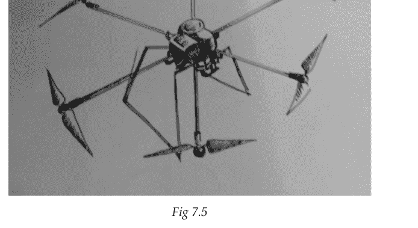

图 7.5

## 八轴飞行器

Octo意为八；因此八轴飞行器将凭借其强大的八个电机为您服务，然后将动力输送到八个功能桨叶。与上述讨论的单元相比，这种飞行器自然具有更多的飞行能力，并且也非常稳定。您可以在任何高度使用八轴飞行器获得稳定的拍摄画面。这些设备在专业摄影领域找到应用。

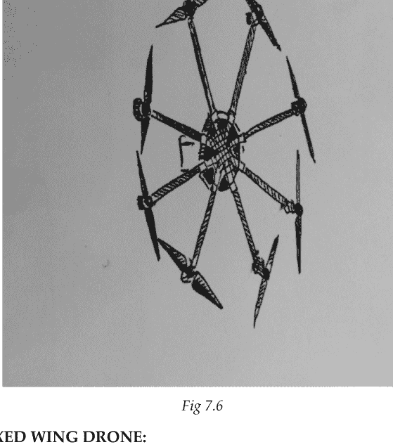

图 7.6

## 固定翼无人机

固定翼无人机与所有上述单元完全不同。与常用的多旋翼无人机相比，这些设计相当独特。

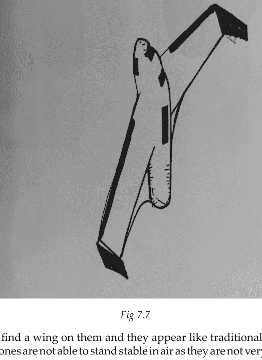

图 7.7

你会在它们上面找到机翼，它们看起来像传统的飞机。这些无人机无法在空中保持稳定，因为它们没有足够的动力来对抗重力。它们在与运动相关的拍摄中找到了应用，可以根据其内置电池系统提供的能力向前移动。

## 注释

市场上最常见的无人机设计是四轴飞行器，因为它们能够在无需任何额外工程调整的情况下抬起巨大的重量。这是满足您大多数需求最具成本效益的解决方案。

## 按尺寸分类的无人机

### 1. 非常小的无人机

它们可以设计成常见尺寸范围，从大型昆虫到长 50 厘米的单元不等。此类别中两种最常见的设计是迷你无人机和纳米/微型无人机。纳米无人机因其微小的结构和轻质构造而被广泛使用，因为它们像间谍的必备武器一样工作。

### 2. 微型无人机

它们的尺寸比微型无人机稍大，这意味着它们的长度可达 50 厘米，但最大尺寸为 2 米。这些无人机型号大多采用固定翼式结构，而少数具有旋翼翼。由于尺寸小，它们缺乏动力。

### 3. 中型无人机

该类别的无人机呈现较重的单元，但比飞机更轻更小。这些无人机可携带重量高达 200 公斤，平均飞行能力为 5 至 10 分钟。此类别下最受欢迎的设计之一是英国的 Watchkeeper。

### 4. 大型无人机

大型无人机在尺寸上与飞机有些相似，最常用于军事应用。

通常无法用普通喷气式飞机覆盖的地方通常由这些无人机捕捉。它们主要用于监视应用。

无人机还可以根据其范围和飞行能力进一步分为不同的类别。

## 按移动范围、控制和距离覆盖分类的无人机

### 极近程无人机

它们是大多数孩子最喜欢的玩具。配备强力电池时，它们能够飞行长达 5 公里，飞行时间为 20 至 45 分钟。此类别中最常用的单元是 Raven 和 Dragon Eye。

### 近程无人机

这些无人机能够飞行长达 50 公里，电池续航时间为 1 至 6 小时。由于它们可以工作更长时间并覆盖更远的距离，因此可用于监视任务。

### 短程无人机

与近程无人机相比，这些无人机略胜一筹。它们用于军事应用。它们能够行驶的最大距离为 150 公里，这意味着覆盖范围比近程无人机几乎多出 100 公里。短程无人机的预计飞行时间为 8 至 12 小时，因此适用于侦察和间谍应用。

### 中程无人机

与上述所有无人机相比，此类别的无人机非常强大。它们以高速无人机而闻名，可覆盖面积达 650 公里。中程无人机通常用于监视应用，而该类别下的一些基本类型可用于气象数据收集需求。

## 续航能力

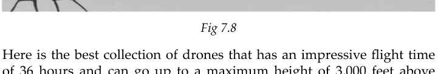

图 7.8

这里是最好的无人机集合，具有令人印象深刻的 36 小时飞行时间，并且可以轻松达到海平面以上最高 3,000 英尺的高度。这些无人机以高端监视应用而闻名。

## 按设备分类

### 配备摄像头的

大多数运动相机爱好者和拍摄专家都喜欢购买配备摄像头的无人机，用于在艰难地点拍摄经典镜头。电影制作行业通常利用它们进行电影拍摄。在过去几个月里，价格范围大幅下降，以便更多买家可以购买无人机用于日常使用。你只需花费 100 美元到 1000 美元就能轻松买到一台。如今大多数运动相机都采用了特殊的无人机安装功能。

### 配备FPV的

FPV 在这里代表第一人称观看。这是无人机的一种非常常见的应用，能够像观众实时观看一样记录事物。在便携式显示器的帮助下，可以通过视线控制这些无人机。这些无人机通常用于电影行业和面对面采访拍摄需求。

### 配备GPS的

这些单元如今越来越受欢迎，因为它们能够在飞行中捕捉位置信息。你可以发送这架无人机到任何固定位置进行场景记录，因为它们非常稳定，任务完成后会返回家。最有趣的是，它们会记住上次拍摄位置，并且可以再次发送到同一位置进行下一次拍摄。

### 配备稳定器的

陀螺仪技术主要用于改善无人机的飞行能力。目前，设备已设计为具有六轴无人机稳定功能，以便它们能够在空中保持稳定并在急转弯时管理移动。这些设备可以即时、完美地遵循所有拍摄需求的指令。其中央飞行控制机制帮助用户享受轻松的导航选项，以便收集目标拍摄细节。

## 无人机中的人工智能

深度学习最近在感知、规划、定位和控制等领域的各种机器人任务中显示出出色成果。其从真实环境中获取的复杂数据中学习表示的出色能力使其非常适合许多种类的自主机器人应用。与此同时，无人机目前正被广泛应用于从安全、监视和灾难救援到包裹投递或仓库管理的多种民用任务。

“可操作数据”紧随强大可靠的无人机之后，很可能是无人机行业最重要的驱动力。无人机通常会产生大量数据；有时甚至超过我们处理的能力。如果没有快速处理数据且无需在此过程中投入额外精力的方式，无人机对用户而言就不会产生价值。图像评估越快、越准确、越容易越好。

将无人机与人工智能相结合似乎是解决上述所有挑战的答案。如今，几乎所有从事数据处理、分析或“自主”飞行控制的公司都声称使用人工智能、机器或深度学习。但这些术语到底意味着什么？它们之间有何关系，又在何处应用？

以下文本旨在回答这些问题：

一般来说，人工智能描述的是机器能够执行具有人类智能特征的复杂任务的能力，包括推理、问题解决、规划、学习以及理解和阅读人类语言，如以下图像所示。

## 术语和描述

### 机器感知

让我们从机器感知开始。由于无人机的大多数人工智能相关任务都涉及图像识别，无人机必须能够感知和吸收环境或物体中的某些

方式。这通常使用诸如电光、立体光学和 LiDAR 等传感器来完成。此过程被称为机器感知。

## 计算机视觉 (CV)：
一旦无人机捕获了原始传感器数据，通常需要以某种方式进行分析，以提取对特定目的有意义的信息。这种能力称为计算机视觉，它与从一个或多个图像中自动提取、分析和理解有用信息有关。

## 机器学习 (ML)：
为了优化可微分参数，可以应用机器学习技术。与手动编程并按特定指令执行任务的软件（如计算机视觉软件）不同，机器学习算法的设计使其在接触新数据时能够随着时间的推移学习和改进。

## 深度学习 (DL)：
另一方面，深度学习是一种专门的信息处理方法，是机器学习的一个子集，它使用神经网络和大量数据进行决策。学习方法基于人类大脑的功能，人类大脑也由相互连接的神经元组成。所谓的神经网络由多个层组成，每一层都连接到下一层并负责特定任务。这种设计使得可以将学到的内容与新内容结合和扩展。

正如前面已经提到的，无人机和人工智能的目标是以尽可能自动化和无缝的方式高效利用大型数据集（如航空图像）。没有人愿意查看 5,000 张风力涡轮机的纯白照片并寻找细微裂缝。无人机只有在数据采集和数据分析以高度（或某天完全）自动化的程度进行时，才能发挥其全部潜力。将这大量数据尽可能自动化地处理似乎是 ML 或 DL 的方法。由于近年来处理能力的巨大快速增长、存储成本以及数字数据的可用性，复杂 AI 算法的利用对于无人机而言已成为可能，并且市场上已经出现了第一批可靠的解决方案。如果 AI 像我们近年来所见的那样快速发展，我们很快就会找到高度自动化和全面的解决方案，这将进一步提高使用无人机的附加价值。但公司必须考虑的是，无人机和人工智能只有在为用户节省金钱/时间时才有意义。在某些情况下，传统的计算机视觉（结合 ML/DL）仍然可能是一种更容易且更好的解决方案。

## 无人机行业中人工智能的应用
由人工智能驱动的无人机在各种行业中用于各种应用。下面列出了一些无人机和人工智能联合使用的突出用例。

### 建筑工地：
建筑公司使用 AI 无人机扫描和绘制建筑工地的地形，用 15 分钟完成人类需要数天才能完成的工作。无人机在项目期间提供建筑车辆的鸟瞰图，提供信息以可能在未来创建自主设备。

### 智慧城市：
微软研究院的一个团队表示，到 2020 年自动驾驶汽车将变得普遍，并且该技术将扩展到车辆交付，包括从外卖食品和药物处方到公共服务等一切。无人机还可用于解决交通问题或工程难题。在卢旺达，人工智能的使用已将输血等待时间从四小时降低到十五分钟。

### 紧急无人机：
无人机可用于向几乎无法到达的灾区受害者投放物资。可能性范围从为飓风受害者提供食物到为野外徒步者提供被蛇咬伤的药物。它们还可以分析灾后结构损坏，帮助消防员看到火灾的确切位置，协助处理化学泄漏，并向应急响应人员显示受伤人员的位置。它们可以携带警察摄像头和辣椒喷雾，或在大型人群中现场处理暴力行为，以及与医生进行远程咨询。

### 农业：
过去，农民依靠经验和直觉来决定诸如最佳种植作物时间或为花园播种等事情。人工智能技术帮助他们从确定最佳种植时间到在恰当时机施用正确量的肥料等一切工作。它还可以帮助农民发现病害作物或管理太阳能农业技术。

### 军事与国防：
谷歌目前正在与五角大楼合作开发无人作战的人工智能，该技术已用于边境巡逻、追踪风暴、执行安全检查和监控安全等任务。军用无人机可以携带补给品、武器或摄像头。

### 工业基础设施：
像通用电气子公司 Avitas Systems 这样的公司正在使用无人机检查其基础设施，包括电力线路、交通运输和管道。无人机可以更高效、更安全地完成工作，但它们也可以通过识别数据中的不一致性来防止问题。一些铁路公司在安全检查中使用无人机。

### 人脸识别与保险理赔处理：
一些保险公司使用无人机勘察受损建筑物，拍摄图像并无线传输给公司以加快处理速度。其他公司使用无人机简化人脸识别或遏制网络攻击，而出租车替代品 Lyft 则用于研究自主汽车。

### 业余无人机：
一家公司正在开发一种无人机，可以开箱即用地供任何对摄影感兴趣的人使用，但特别适合摄影师同时也是冲浪者、下坡滑雪者、无人机飞行员或跑步者。它还可用于实时记录极限运动和其他活动。

### 实时数据：
无人机可由商业、工业和服务组织使用，以在多个地点提供即时监控，消除对人工监控的需求或花费无尽的时间搜索录制信息。

### 创建完美的教学模型：
《福布斯》的一篇文章讨论了使用无人机分析积累的数据并用其制作培训手册，以向员工展示如何在工作中更聪明、更快、更精确。

### 房地产：
房地产公司正在使用配备摄像头的先进无人机为购房者提供房屋和商业建筑的照片，以及航拍地图和当地信息。

### 娱乐、媒体和互联网：
电影制作人和新闻媒体使用无人机捕捉空中镜头，有时未经联邦航空管理局（FAA）许可，并在封闭拍摄现场拍摄场景。到目前为止，FAA 尚未批准媒体使用无人机，迫使他们依赖私人用户的镜头。Facebook 的马克·扎克伯格最近宣布了一项计划，通过使用太阳能无人机为全球偏远地区提供互联网接入。

## 总结与结论
无人机或无人驾驶飞行器在近年来取得了长足进步，参与了从摄影、供应链、地质调查、灾难管理、监视和安全等多个领域。

无人机可以前往人类无法到达的地方，捕捉强大的图像并记录否则无法获得的重要数据。从帮助波多黎各飓风恢复的无人机到在飞行中从无人机转变为飞机的无人驾驶 NASA 飞行器，科学家正在使用人工智能无人机对世界产生巨大改变。

人工智能可用于创建比人类更高效执行任务的机器，使它们能够全年 24 小时在压力环境中工作，没有午餐休息、病假或带薪假期。这已经在太空旅行和医学等领域带来了原本不可能的成就，并可能是解决世界饥饿和核大屠杀等全球问题的答案。

随着机器发展出改善世界的潜力，科学家提出了一个重要问题：如果机器利用其认知技能执行恶意行为而不是善意行为会怎样？这可能以两种方式发生。人工智能可能被编程为做有益的事情，而在过程中会产生不需要的副作用。或者，它可能落入坏人之手并被编程为具有破坏性。由于人工智能在执行和调整以满足其目标时有可能不断发展，其行为可能难以预测。

一些隐私倡导者开始争辩说，这将允许任何个人购买无人机并在人们的家中和后院进行监视。这就是为什么有必要安装这样的程序，使无人机操作员无法将无人机用于他们未获许可的个人目的。

随着无人机开始在监视、军事、物流、摄影和广告等各个领域发挥作用，我们担心的就是这些飞行物对普通公民日常生活中个人隐私的持续侵犯以及对国家和个人安全的威胁。

可能性很多，但挑战也很多，这需要监管机构、 homeland 安全部门以及技术公司采取新方法来阻断区域以保护隐私。毕竟，没有人希望一只鸟形无人机窥探你的客厅或办公室，拍摄和传输敏感信息！

## 案例研究：无人机制造项目（鸣谢-印度古吉拉特邦政府）

https://cdn.vibrantgujarat.com/website/writereaddata/images/pdf/project-profiles/Drones.pdf

## 什么是无人机？

- 无人驾驶飞行器（UAVs），通常称为无人机，被归类为可由地面控制或以预编程飞行自主模式使用的飞行器。无人机配备摄像头和传感器，可在各种应用中实时捕捉和监控目标。它们还用于运输和其他运营活动。
- 无人机为包括测绘、监视和空中包裹递送在内的应用提供更经济的可视化和导航。这些配备摄像头的无人机能够到达偏远地区并执行复杂任务。
- 目前，无人机主要用于军事应用，其他应用的市场尚处于起步阶段，但预计在未来几年将因消费者采用率提升和技术进步而增长。

## 无人机应用

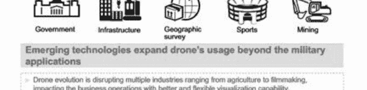

## 新兴技术拓展无人机在军事应用之外的用途

- 无人机的演进正在颠覆从农业到电影制作的多个行业，以更好的灵活可视化能力影响业务运营。
- 无人机的商业用途包括作物监测、货运服务、影视摄影、基础设施监视、地理测绘、安全和工业应用。
- 无人机的民用包括在自然灾害期间对财产和生命的损害评估、关键基础设施监测、交通监测、危机管理、搜索救援、森林火灾监测和安全。
- 随着连接性、GPS、摄像、控制器和传感器技术的进步，无人机已发展出多种用途，并在各行业加强了其接受度。
- 无人机在商业用途上的潜在应用促使互联网、物流、电子商务、国防和石油天然气行业的公司进行重大研发投资。

## 项目概念

## 无人机分类 – 按应用

玩具无人机

相机无人机

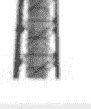

工业无人机

军用无人机

商用无人机

竞速无人机

## 无人机分类 – 按形态

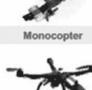

单旋翼机

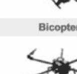

双旋翼机

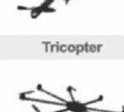

三旋翼机

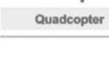

四旋翼机

六旋翼机

八旋翼机

## 全球市场概览 - 全球无人机市场预计从2015年的68亿美元增长到2022年的369亿美元，年复合增长率为27.3%，推动因素为无人机用例的增长

- 无人机市场主要由军用无人机主导，但由于使用量增加，商用和民用无人机正获得发展动力。
- 2015年，军用无人机市场占无人机总市场的65%，其余35%由相机无人机和其他类型无人机分享。
- 无人机市场持续成熟，机型更精炼、软件更直观、可用性更高。近年来，由于消费者采用率激增，多家新的无人机初创企业进入市场。
- 公司努力生产比有人驾驶飞机更节能、更耐用且运营成本显著更低的商用无人机。

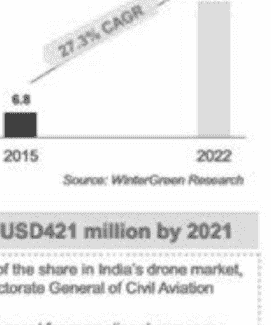

## 印度无人机市场预计到2021年将达到4.21亿美元

- 军事和政府应用占印度无人机市场的大部分份额，因为民航总局（DGCA）的禁令导致商业应用保持在低水平。
- 小型无人机预计将推动市场增长，其部署用于休闲用途，如摄像和竞速。
- 政府机构和公司在灾害管理和监视方面的应用在市场上日益突出。
- 无人机也可能成为其他应用中的重要工具，如农田勘测、野生动物保护和关键基础设施监测。

## 印度有潜力成为中小型无人机制造的主要市场

- 鉴于印度不断增长的电子制造能力和软件实力，在制造小型和中型无人机以及开发用于提升无人机数据分析能力的软件方面存在相当大的创新潜力。
- 此外，印度公司利用“印度制造”计划的优势并设立无人机合资企业的潜力很大。
- 尽管监管环境不确定，仍有多家本土初创企业生产用于各种商业应用的无人机，范围从灾害救援、安全和监视到航拍。
- 还有一些私营印度公司同时从事无人机的硬件和软件开发，产品仅售予政府。

## 增长驱动因素

## 先进技术为无人机增添更多能力

- 无人机继续通过不同类型的传感器和自动化控制不断演进，以提高其易用性和能力。一些最新发展包括集成超高清摄像头以实现高质量视频捕捉、3D成像和防碰撞技术。
- 此外，先进技术使制造商能够根据应用构建不同配置的定制无人机。未来几年，预计更多此类技术将使无人机对消费者更具吸引力。

## 无人机用例不断增加

- 无人机在各行业用例不断增加的同时持续演进。增强的飞行速度、载荷能力和电池寿命为无人机市场开辟了新途径。
- 个人采用无人机用于玩具之外的休闲用途，因为越来越多的爱好者和“自己动手”（DIY）爱好者将无人机视为一种严肃的消费设备
- 随着物联网（IoT）随更多连接设备而演进，无人机预计将创造更新的应用。

## 相机无人机采用率增长

- 相机无人机提供用户友好的体验，具有复杂的飞行控制和高端的图像传感器。这些无人机能够拍摄专业品质的空中照片。它们被有志成为摄影师和专业摄影师广泛采用。

## 监管放宽

- 大多数国家正在积极制定法律，以规范无人机在个人和商业用途上的操作。
- 在印度，DGCA计划注册所有民用无人机并发放运营许可。监管放宽将鼓励更多制造商进入市场并推动消费者采用。

## 可负担性提升

- 随着竞争加剧和技术成熟，无人机价格变得更便宜。近几年，许多印度初创企业涌现，提供比全球厂商更低价格且功能增强的无人机。可负担性的提升预计将进一步推动消费者采用。

## 项目信息

## 无人机制造价值链

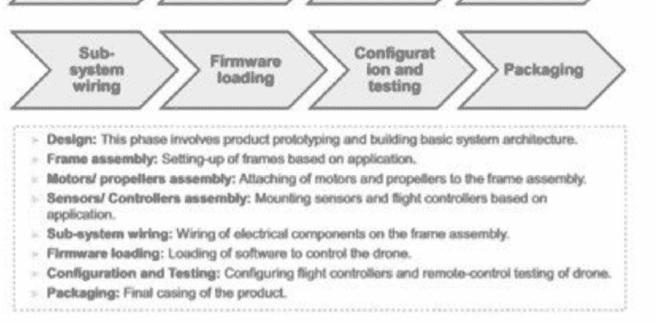

- 设计：此阶段涉及产品原型制作和构建基本系统架构。
- 机架装配：根据应用设置机架。
- 电机/螺旋桨装配：将电机和螺旋桨安装到机架装配上。
- 传感器/控制器装配：根据应用安装传感器和飞行控制器。
- 子系统布线：在机架装配上布线电气元件。
- 固件加载：加载控制无人机的软件。
- 配置与测试：配置飞行控制器并对无人机进行遥控测试。
- 包装：产品的最终外壳。

## 无人机机架类型在实现平稳稳定飞行中发挥着至关重要的作用；材料和尺寸决定了空气动力学技术细节

无人机可以采用多种形态，但主要分为两大类——旋翼式和固定翼式。固定翼无人机结构简单、飞行时间长，而旋翼式无人机机械结构更复杂、航程较短。

根据应用类型选择无人机的类型和材料，

- 机架：机架设计决定无人机上的电机/螺旋桨数量。主要机架类型为四旋翼、三旋翼和六旋翼，分别具有四个、三个和六个电机。
- 材料：建造无人机常用的材料有木材、塑料、碳纤维和铝，其中后者材料更轻更坚固。

## 预计人力需求

驻地人力需求：215-260

| 装配单元劳动力 | 质量控制团队 | 线主管 | 管理人员 | 支持人员 |
|---|---|---|---|---|
| 160-200 人 | 20-25 人 | 10 人 | 5 人 | 20 人 |

## 全球领先企业

美国、以色列和中国是三大最强大的无人机制造国

- 大疆创新，中国
- 3D Robotics，美国
- Parrot，法国
- Yuneec，中国
- Hubsan，中国
- Syma Toys，中国
- Walkera，中国
- 小米
- 亿航

## 印度领先企业

- Tata Advanced Systems
- OM UAV Systems
- EDALL Systems
- Taneja Aerospace and Aviation
- IdeaForge
- Garuda Robotics
- Aarav Unmanned Systems
- Skylark Drones
- Zuppa Drones
- Mahindra Defense System

## 关键零部件需求

| 主要零部件 |  |  |  |  |
|---|---|---|---|---|
| 机架 | 螺旋桨 | GPS | 陀螺仪传感器 | 电子调速器 |
| 电机 | 螺旋桨保护罩 | 加速度传感器 | 罗盘 | 电池 |
| 起落架 | 相机 | 气压计 | 无线电通信电路 | 充电器 |

## 预计人力需求

驻地人力需求：215-260

| 装配单元劳动力 | 质量控制团队 | 线主管 | 管理人员 | 支持人员 |
|---|---|---|---|---|
| 160-200 人 | 20-25 人 | 10 人 | 5 人 | 20 人 |

## 项目财务

### 项目成本

在古吉拉特邦甘地讷格尔设立一座相机无人机制造厂的总项目成本约为64.5亿印度卢比，年总产能为80,000台。

| 项目组成及规格 | 成本（印度卢比千万） |
|---|---|
| 土地（面积：18.5英亩 – 75,000平方米）单价：（每平方米4,480印度卢比） | 33.6 |
| 建筑物（厂区、办公室、仓库、实验室、服务区等）建筑面积：80,730平方英尺 平均单价：每平方英尺1,000印度卢比 | 8.1 |
| 厂房和机械 | 5.6 |
| 杂项固定资产（家具和装置、办公设备等） | 6.5 |
| 公用设施和其他设备（电气、管道、供水系统等） | 1.2 |
| 准备及开办费用（公司成立、建设期间利息等） | 5 |
| 应急费用（运输、保险、电话费、维修保养） | 4.5 |
| 合计 | 64.5 |

预计项目成本是基于典型的相机无人机组装单元的资本需求/投资计算的。然而，它可能因项目而异。

注：1）土地价格基于甘地讷格尔IT SEZ（价格可能因甘地讷格尔内场地的具体位置而有所不同）。

## 建议选址

| 关键亮点 |  |
|---|---|
| 塔鲁卡 | 4（Mansa、Kalol、Dahegam、Gandhinagar） |
| 村潘查亚特 | 302 |
| 面积 | 2140平方公里 |
| 人口 | 13,91,753 |
| 识字率 | 85.77% |
| 重点领域 | 电子、纺织、IT -ITES |

- 甘地讷格尔是古吉拉特邦的首府，拥有七个经济特区和10个工业园区，以及创意IT园区和古吉拉特国际金融科技城（GIFT）
- 随着印度理工学院和印度管理学院等各类教育机构的建立，它被视为一个新兴的“知识中心”。
- 甘地讷格尔计算机硬件协会（GCHA）和古吉拉特信息学有限公司（GIL）等各类计算机硬件协会均在甘地讷格尔设有机构。
- 甘地讷格尔已被选为总理纳伦德拉·莫迪旗舰智慧城市计划下100个将开发为智慧城市的印度城市之一。

## 选择甘地讷格尔的原因

电子和信息技术部
http://meity.gov.in/

印度电子与半导体协会
http://www.iesaonline.org/

古吉拉特邦政府科学与技术部
http://www.dst.gujarat.gov.in

古吉拉特工业发展公司
www.gidc.gov.in

工业专员办公室
www.ic.gujarat.gov.in

工业推广局
www.indexb.com

本项目概况基于初步研究，以帮助有意创业者评估初步范围。然而，在做出最终投资决定之前，建议准备一份详细的可行性研究。

## 第八章

### 聊天机器人和语音助手

### 引言：

我们习惯于与处理常规销售相关咨询或常见问题解答或协助我们处理任何服务相关问题的客户服务代理交谈。

此类服务的聚合在全球范围内形成了被称为BPO的庞大业务。像印度、菲律宾以及发展中国家中的许多其他国家等英语国家在劳动力成本方面提供了套利机会，已成为此类公司的所在地，这些公司雇佣经过语言和口音培训的代理，通常称为CSA或客户服务代理。

任何在全球提供产品和服务的公司都需要雇佣客户关怀服务，这些服务在所有语言中提供24小时全天候服务，涵盖各种类型的业务和不同的职能领域。向薪资较低的目的地进行聚合和外包很有意义。

但是，随着经过训练的聊天机器人的出现，这些自动化代理可以全天候以任何语言工作，并可在任何职能领域为任何级别的客户服务。BPO行业看起来即将被智取，并看起来更像是一种负债，而不是区分优秀且盈利的公司与其他公司的资产！

在本章中，我们将探讨聊天机器人和语音助手的各种表现形式、应用和优势。我们将研究并了解用于构建聊天机器人的不同开源平台，以及用于在社交媒体平台（如Facebook Messenger等）上构建相同应用的应用程序。

### 结构：

- 描述聊天机器人
- 典型聊天机器人的关键特性
- 基于规则与基于AI的聊天机器人
- 良好与不良的机器人
- 构建聊天机器人的关键步骤
- Oracle智能机器人
- 自助机器人步骤
- 聊天机器人的用例
- 聊天机器人案例研究和智能虚拟助手实施平台

### 目标：

本章的目的是详细解释聊天机器人和语音助手应用的潜力，并使学习者了解构建这些工具的可用工具，并利用人工智能和机器学习驱动的自动化来扩大其运营。读者必须认识到这些新时代工具背后的技术，这些技术不仅有望在很大程度上提高组织生产率，而且还威胁到全球雇佣数百万人的BPO行业和客户服务助理。

我们习惯于使用基于GPS的导航在世界各地复杂的路线中穿行。每个人在规划行程时都习惯于参考GPS精确计算预计时间。另一方面，计算出的距离存在一定的不完美之处，这取决于路线、区域、连接性等，因为GPS可能无法解决人类能够识别并采取行动的某些细微差别。

那个在旅途中优美地引导你的声音背后是一个惊人的基于人工智能的分析系统，一个基于卫星的通信和定位系统，它不仅根据多种因素（包括实时交通状况）计算距离、路线和时间。这样的系统对于智能城市和卫星、无人机、自动卡车和汽车、机器人等自主车辆系统而言，其效用确实是巨大的。

针对路线、识别热点或加油站等公用设施站以及任何其他搜索的汽车导航系统的任何查询都会得到准确的一组选项、距离和路线。这是一个聊天机器人或语音助手的例子，具体取决于它是否具备语音功能。

### 什么是聊天机器人？

聊天机器人是一种计算机程序，它与组织的网络、电话和社交媒体用户进行交互并进行书面和/或口头对话。

聊天机器人通常用于通过移动电话、社交媒体渠道、信使和网站等各种媒体与组织的潜在和实际客户及员工进行对话。

它们通常由自然语言处理和任务执行框架驱动，以理解用户的通信，如意图、实体和对话本质。它还可以与组织的后端系统集成，如不同类型的数据库和ERP、CRM等生产力应用程序，以搜索和获取相关数据来解决和解决客户查询并更新数据库。

24/7全天候服务、简单投诉和问题的快速解决、需要时快速获取信息、交互的便捷性、简单和复杂查询的快速回答、友好性和无限耐心，被评为组织希望为客户提供的最受追捧的益处之一。根据需要，它们可以提供由适当技术（如人工智能和机器学习）驱动的不同聊天机器人/语音助手。

## 以下是典型聊天机器人的部分主要特性：

- **问候：** 聊天机器人以适当的方式与参与者、网站、社交媒体用户等进行礼貌寒暄，让他们感到安心，同时提供相关信息或支持性操作。
- **聊天或对话：** 根据用户回复，聊天机器人会以用户选择的语言（语音或文字，按程序设定）回应用户，并借助其回复数据库或根据需要从相关来源获取信息来解答其疑问。
- **提供信息：** 聊天机器人可以帮助用户发现其部署方提供的各种产品和服务，从而帮助用户做出明智的决策，且不会过度打扰。
- **联系台：** 聊天机器人使客户能够全天候联系并沟通其问题、获取信息，并记录这些信息以便后续适当跟进。在某些情况下，根据需要，它们具备将问题升级给相关的人工联系人以解决疑问的能力。
- **导航：** 聊天机器人可以引导用户快速导航到所需信息点，以迅速获取适当且所需的信息。

通过以无情绪且彻底的方式执行上述所有操作，聊天机器人可以提供远超人类互动的实用性，而人类互动有时会因愤怒和敌对客户的恼怒而失控，且未以专业方式管理。

研究发现，聊天机器人在许多情况下能够显著提升客户满意度和对话体验，这使组织能够大幅提高潜在客户转化率，同时提供大量可操作的分析洞察。这进一步帮助聊天机器人的部署方改进和微调其营销方法，或发现此前未曾考虑的新目标细分市场。聊天机器人便于收集和妥善记录联系信息，如电话、电子邮件等，并将对话要点中的分析洞察与客户详情关联，使营销人员能够提供定制化解决方案并发现趋势。

聊天机器人提供的可扩展性几乎无需增加开销，其效果惊人。凭借前面讨论的各种功能，聊天机器人可带来巨大的节省和技术投资回报率的提升。

通过自助式菜单分流操作，组织的运营成本可大幅降低。我们在日常生活中已习惯于此类应用，例如通过电话或网页查询银行、电子商务公司或公用事业公司等。利用人工干预处理高价值和困难的互动，人力资本的投资回报率可大幅提升。

在许多情况下，客户已知更倾向于非个人化的互动，并偏好与自动菜单进行对话。例如，在心理治疗或非处方药品和产品领域（例如女性尿布和内衣、壮阳药和性健康产品等），客户不愿与他人类互动。如果此类公司还能保证并展示沟通的非个人化和短暂性，客户接受度和销售额将大幅提升。中国的 Woebot 是心理治疗机器人中极受欢迎的著名例子。这不仅建立了客户忠诚度，还提高了客户对品牌的终身价值。

## 聊天机器人的主要应用：

- Grand View Research 预测，到 2025 年全球聊天机器人市场将达到 12.5 亿美元。
- 在 Oracle 2016 年进行的一项调查中，80% 的企业决策者受访者表示他们已使用聊天机器人或计划在 2020 年前使用。
- 语音助手机器人价格低廉，能够 24/7 工作，且永不发脾气。
- Siri、Alexa、Cortana 和 Google Assistant 等虚拟助手已被广泛接受和使用。
- 社交机器人推广议题、产品或候选人。
- 娱乐机器人 Hello Barbie 娃娃采用了由 ToyTalk 公司创建的聊天机器人来回应其小主人。
- 法律聊天机器人可以帮助您对交通违规提出申诉。
- 机器人可以作为课程助手来批改论文并征求学生反馈。
- 心理健康聊天机器人 Woebot 充当谈话治疗师。
- 营销聊天机器人提供客户服务、售后支持并提供定制化回复。

## 聊天机器人的历史：

### 1966-ELIZA
该聊天机器人以虚构人物伊丽莎·杜利特尔命名，由 MIT 的约瑟夫·魏森鲍姆创建。具备心理治疗师功能的该机器人是第一个通过图灵测试并在互动中冒充人类的应用。

### 1972-PARRY
这比 ELIZA 更为复杂的聊天机器人实现。该“精神分裂”机器人由心理治疗师肯尼思·科尔比创建。

### 1981-JABBERWACKY
这本意是第一个由英国罗洛·卡彭特创建的由人工智能驱动的机器人应用。

### 1991-DR. SAITSO
Dr. Saitso 是一个获奖的图灵程序，通过 AI 语音合成提问“你为什么那样感觉？”来模仿心理治疗师。

### 1995-ALICE
人工智能语言实体（ALICE）启发了 2013 年科幻电影《她》，片中一名男子爱上了一名聊天机器人。

### 2001-SMARTCHILD
该机器人最初在 AOL Messenger 上推出。SMARTCHILD 成为 SMS 和 Messenger 平台上备受追捧的聊天机器人。

### 2006 IBM WATSON
该平台最初推出是为了参加《危险边缘》游戏节目。IBM Watson 成为标志性的 AI/ML 平台，如今被广泛用于协助医院医生和医疗从业者进行疾病诊断和开药。

### 2010 APPLE SIRI
Apple SIRI 是第一个通过回复并协助完成多项任务与用户对话的语音助手。此后出现了许多个人助手机器人；其中著名的是 Google Assistant、Amazon Alexa 和 Microsoft Cortana（2014 年 4 月）。

### 2014 MICROSOFT CORTANA
该产品于 2014 年 4 月推出。Cortana 可以设置提醒、无需键盘输入即可识别自然语音，并利用 Bing 搜索引擎的信息回答问题。Cortana 目前提供英语、葡萄牙语、法语、德语、意大利语、西班牙语、中文和日语版本，具体取决于使用的软件平台和地区。

### 2014 AMAZON ALEXA
该产品于 2014 年 11 月推出。Alexa 是亚马逊的虚拟助手。它能够进行语音交互、播放音乐、制作待办清单、设置闹钟、流媒体播客、播放有声读物，并提供天气、交通、体育等实时信息，如新闻。Alexa 还能将自身用作家庭自动化系统来控制多个智能设备。用户可以通过安装“技能”（由第三方厂商开发的附加功能）扩展 Alexa 的能力。

### 2016 GOOGLE ASSISTANT
该产品于 2016 年 5 月推出。Google Assistant 是由 Google 开发的人工智能驱动的虚拟助手，主要可在移动设备和智能家居设备上使用。与公司之前的虚拟助手 Google Now 不同，Google Assistant 能够进行双向对话。

### 2016 FACEBOOK MESSENGER BOTS
2016 年，Facebook 允许开发者在其平台上部署机器人，如今已成为最大的聊天机器人平台，托管超过十万个机器人并拥有超过十亿用户。Manychat 和 Chatfuel 等平台使创建和推出可集成到用户 Facebook 页面账户中的聊天机器人变得非常容易。

**2017-WOEBOT:** 这是首批用于医疗保健应用的机器人之一。WoeBot 已成为帮助心理治疗患者的热门选择。

2018年，Facebook Messenger 因其聊天机器人而闻名，这些机器人创造了彼此都能理解的语言。

## 聊天机器人的主要优势可概括如下：
- 通过在多个机器人之间积累的持续学习不断减少平均处理时间，从而实现投资回报率的快速提升。
- 自动化重复性问题使您能够在不改变人力配置的情况下扩大或缩小规模。
- 优化知识并创建可查询数据库并复制操作。
- 通过语音辅助调查与员工进行定期互动，并在离职访谈、反馈调查期间提供支持，同时提供帮助以解决查询。
- 实时在多个平台之间更新和共享学习成果，以实现整体程序的改进。
- 通过个性化优惠、问候和礼物回应客户。
- 根据受访者的位置理解、书写和说不同语言和口音。

## 聊天机器人如何工作？
聊天机器人识别用户输入中包含的‘意图’和‘实体’，并尝试通过利用 NLP 引擎、集成搜索引擎和数据库引用来构建对话。它们通过理解查询、搜索网络或数据库并利用人工智能技术或基于规则的系统提出合适的回复，从而通过网站、社交媒体平台、消息平台或电话接收到的用户输入作出响应，以满足查询。

这可以通过利用文本转语音和语音转文本合成根据需要以书面或口头交流的形式在任何语言中完成。

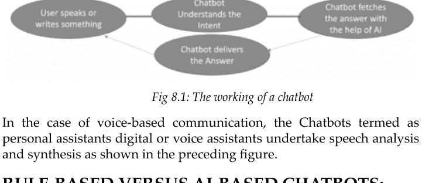

Fig 8.1: 聊天机器人的工作原理

在基于语音的通信情况下，被称为个人数字助理或语音助手的聊天机器人会进行语音分析和合成，如前图所示。

## 基于规则与基于人工智能的聊天机器人：
基于规则的聊天机器人提供基本级别的功能，如从预定义的常见问题数据库中回答，而人工智能驱动的聊天机器人则是利用人工智能、机器学习和深度学习技术进行自然语言处理、模式识别、预测分析和情感分析等的高级程序。

基于人工智能的技术使聊天机器人应用程序能够利用过去记录的数据库和客户响应或训练数据进行学习并做出适当响应。

自然语言处理引擎有助于在不同语言中模拟语音和文本中的类人类响应，而情感分析则涉及根据客户在不同情况下的响应来理解其态度和感受，以便制定适当的回复。

由深度学习驱动的机器人记住上下文，并从过去的交互中不断学习和改进其响应。

就成熟度而言，最前沿和最先进的聊天机器人使用基于规则以及监督和无监督机器学习方法。

| 任务导向 | 数据驱动和预测性 |
|---|---|
| 这些是任何格式良好的常见问题。 | 这将是自由文本和自然语言。 |
| 用户发起的对话，具有自动/固定的响应。 | 机器人将根据用户所做的陈述返回响应。 |
| 它们使用 NLP，但机器学习不多。 | 使用 NLP，并通过机器学习，机器人将持续处于学习模式。 |
| 机器人无法回复数据库中没有的问题。 | 机器人不依赖标准答案，而是基于意图构建答案。 |
| 与后端系统的基本集成。 | 基本到复杂的集成。 |
| 专注且结构化的交互。 | 用户可以在对话之间切换。 |
| 客户满意度不易实现。 | 机器人可以用大多数服务来服务。 |
| 过多的集成会导致转接人工。 | 可以做到，但不需要，因为大多数服务都由机器人完成。 |

Fig 8.2: 聊天机器人的级别

虽然机器人是自动化的重要工具并提高了组织的生产率，但机器人也被网络犯罪分子用于多种可疑目的。

机器人是为自动化重复性任务而创建的程序，可分为两大类：好机器人和坏机器人。据许多研究称，超过 51% 的互联网流量由机器人组成。具有恶意意图的机器人远远超过具有良好意图的机器人。由危险机器人协助的有害恶意攻击造成的数据泄露被认为是 21 世纪最大的威胁之一。

## 好机器人
为特定合法和授权目的而创建的机器人，以使组织能够帮助营销、客户服务并提高其生产率和盈利能力，可被视为好机器人。以下是此类应用的一些好机器人：
- 好机器人帮助企业在正当和积极的精神规范内自动化许多流程，并以合法方式帮助企业实现其目标。
- 搜索引擎机器人有助于根据搜索标准获取有关网站和页面的相关结果，并在需要时广播数据。
- Feed 获取器和爬虫机器人执行后台操作并帮助从其他 API 和网站获取信息。它们约占网络流量的 7%，构成了好机器人流量的最大比例。
- 如 Oracle 之类的交易机器人通过代表网站与外部系统进行交易。交易机器人参与许多人机和机器人对机器人交互，分为两种类型，即基于语音的机器人和基于文本的机器人。
- 潜在客户生成机器人、查询机器人和任务机器人是不同类型的基于角色的机器人，创建用于在销售前、销售、客户服务或员工互动中自动化各种任务。它们通过提供友好和更好的体验来提高客户和员工满意度。

## 坏机器人：
坏机器人通过试图入侵其他在线代理并向受害者歪曲错误信息来进行非法和恶意活动，从而误导他们使其上当受骗。其中一些列举如下：
- 抓取机器人窃取内容以未经授权的方式在其他网站上重新发布。
- 垃圾邮件发送者在毫无防备的用户中发布不受欢迎且重复的促销内容。雅虎 Messenger、Windows Live Messenger 等聊天和消息平台一直是垃圾邮件发送者的频繁目标，他们用垃圾邮件填满聊天室，误导人们泄露敏感个人信息。
- 冒充者模仿人类以误导毫无防备的人类。据许多当前研究称，它们约占整体机器人流量的 25%。
- 黑客在他们攻击的受害者网站上发布有害内容并留下不可预见的损害。他们是最有害的机器人。

## 构建聊天机器人的关键步骤：
- 在构建聊天机器人之前，开发人员应考虑是否要从头开发聊天机器人或可以使用免费聊天机器人。付费聊天机器人提供定制选项，具有公司所需的一系列特定用例。它们成本高昂，并由外部对话式人工智能公司协助构建。重要的是要牢记理想聊天机器人的以下特征：
- 24/7 可用性
- 立即回复
- 关于客户先前交易、喜好和厌恶的记忆
- 根据之前的错误和用户响应微调响应
- 响应时间、准确性和效率的持续改进
- 确保客户对体验感到满意
- 客户以简单方式格式化查询的易于使用的界面
- 能够以书面和口头形式用多种语言交流

- 跨渠道和平台的出色用户体验

Chatbot 可以使用多种免费工具免费构建，例如基于 Facebook Messenger 的应用程序、Google 的 Dialogflow、IBM Watson 等，并在基础层提供标准化选项。

## 构建聊天机器人的重要步骤如下：

- 1. 应明确理解 Chatbot 的目标和用例。应明确概述 Chatbot 预期面向的客户、员工或服务提供商的客户的目标。应确定并详细记录机器人的功能。应明确概述组织对项目的期望。

应向开发团队明确传达对机器人范围定义和排除项的期望。

在众所周知的使用 Chatbot 的各个行业中，如食品、航空公司、银行、零售、旅行、体育、酒店、咨询、音乐、房地产等，寻找已树立趋势且可效仿的基准将很有趣。

典型应用包括客户服务、个人助理、电子商务、美食礼宾、新闻、内容、法律咨询、教学、幽默、投诉处理、旅行、财务建议、游戏、酒店、招聘等。

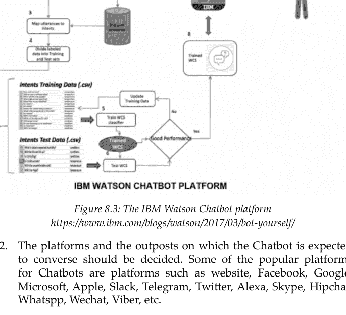

图 8.3：IBM Watson 聊天机器人平台
https://www.ibm.com/blogs/watson/2017/03/bot-yourself/

- 2. 应确定 Chatbot 预期进行对话的平台和据点。Chatbot 的一些热门平台包括网站、Facebook、Google、Microsoft、Apple、Slack、Telegram、Twitter、Alexa、Skype、Hipchat、Whatsapp、Wechat、Viber 等平台。

- 3. 应在评估后根据适用性选择开发 Chatbot 的框架，如 IBM Watson、Google Dialogflow、Azure Bot 服务或其他付费和定制版本。

## Dialogflow SDK

Dialogflow 的 SDK 和底层 API 允许您根据对话输入在自己的系统上采取行动，将对话界面嵌入到您的应用程序或网站中，并动态更改代理的行为。Dialogflow API 以三个主要用例为中心：

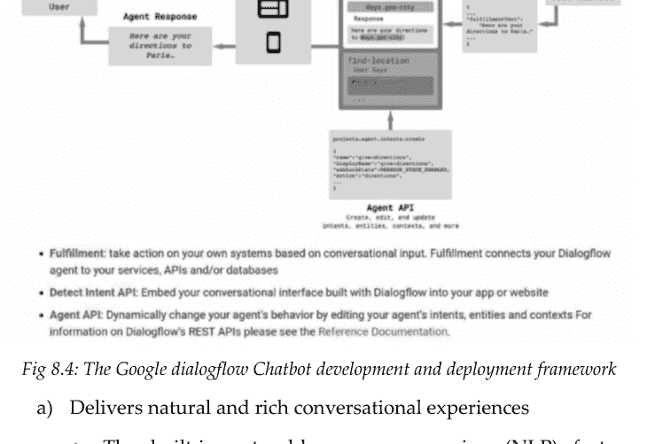

- Fulfillment：根据对话输入在自己的系统上采取行动。Fulfillment 将您的 Dialogflow 代理连接到您的服务、API 和/或数据库
- Detect Intent API：将使用 Dialogflow 构建的对话界面嵌入到您的应用程序或网站中
- Agent API：通过编辑代理的意图、实体和上下文来动态更改代理的行为。有关 Dialogflow REST API 的信息，请参阅参考文档。

*图 8.4：Google Dialogflow 聊天机器人开发和部署框架*

### a) 提供自然且丰富的对话体验

- 内置的自然语言处理（NLP）功能为 Chatbot 赋予了人工智能（AI），从而使其能够处理自然语言（通过聊天或语音接收）并以自然的方式继续对话。正是这种认知能力将 AI Chatbot 与按编码的简单预定义规则运行的普通 Chatbot 区分开来。
- Chatbot 开发人员将这些自然语言处理功能集成到应用程序、服务和设备中。输出数据可以根据需要以语音或聊天格式提供。

### b) 使用机器学习理解用户在说什么

- 机器学习使 Dialogflow 足够智能，能够预测自然输入语言中表达的隐藏意图。Dialogflow Chatbot 可以将用户的查询与后端服务器可用的数据库进行映射。映射机制称为 Intent。有趣的是，它通过应用多种排列组合来实现。这是显著的特性，因为用户以多种方式提出相同的问题，因此 Chatbot 有责任正确理解并为其服务。

### c) 与多种平台兼容

- 使用 Dialogflow 创建的 Chatbot 目前可部署在多达 16 个平台上。因此，通过 Google Chatbot 开发，企业可以用最少的努力瞄准广泛的受众。一键集成简化了 Chatbot 开发人员的工作。

### d) 提供跨设备支持

- Dialogflow 有助于创建设备无关的 Chatbot。因此，它可以与可穿戴设备、手机、汽车、扬声器和其他智能设备上的用户互动。因此，企业可以随时随地与潜在客户或客户建立联系。

### e) 帮助 Chatbot 说 14+ 种语言

- Dialogflow 支持 14+ 种语言，包括巴西葡萄牙语、葡萄牙语、中文（粤语/简体/繁体）、英语（澳大利亚/加拿大/大不列颠/印度、美国本地）、荷兰语、法语（加拿大本地/法国本地）、德语、意大利语、日语、韩语、葡萄牙语、俄语、西班牙语和乌克兰语。
- 因此，利用 Google Chatbot 平台，企业可以超越地理障碍，在地球上的任何地方开展业务。

### f) 利用内置分析工具帮助跟踪 Chatbot 的性能

- 类似于移动应用分析，技术所有者可以跟踪其 Chatbot 的性能。集成的分析工具可以读取会话或参与度详情，包括使用模式、延迟问题以及高性能和低性能的意图。这些智能可作为企业进一步改进其 Chatbot 的指导原则。

### Google Chatbot 平台支持的服务

- 使用 Dialogflow 创建的 Chatbot 可以执行以下提到的多种任务：
- 笑话、活动搜索、外出就餐、本地服务、提醒、新垂直领域（咖啡店和旅游）

## 亚马逊聊天机器人平台

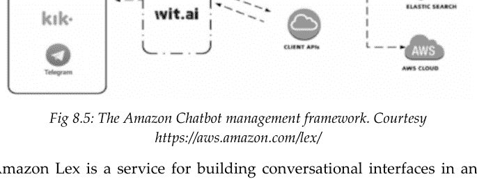

图 8.5：亚马逊聊天机器人管理框架。鸣谢 https://aws.amazon.com/lex/

Amazon Lex 是一项服务，用于在任何应用程序中使用语音和文本构建对话界面。Amazon Lex 提供了自动语音识别（ASR）将语音转换为文本的先进深度学习功能，以及自然语言理解（NLU）来识别文本的意图，以便您构建具有高度吸引用户体验和逼真对话交互的应用程序。有了 Amazon Lex，驱动 Amazon Alexa 的相同深度学习技术现在可供任何开发人员使用，使您能够快速轻松地构建复杂的自然语言对话机器人（聊天机器人）。

语音识别和自然语言理解是计算机科学中最具挑战性的问题之一，需要在海量数据和基础设施上训练复杂的深度学习算法。Amazon Lex 通过将 Amazon Alexa 的强大功能带给所有开发人员，从而使这些深度学习技术民主化。利用这些技术，Amazon Lex 使您能够通过对话界面实现新的产品类别。

作为一项完全托管的服务，Amazon Lex 可自动扩展，因此您无需担心管理基础设施。使用 Amazon Lex，您只需为所使用的服务付费。没有前期承诺或最低费用。

## Azure 机器人开发框架

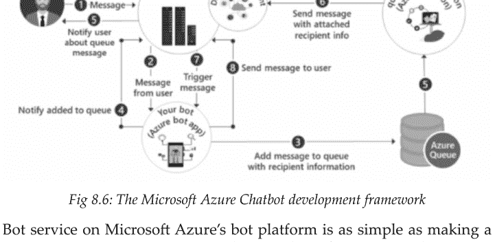

图 8.6：Microsoft Azure 聊天机器人开发框架

Microsoft Azure 机器人平台上的 Bot 服务就像向互联网服务发出请求一样简单，让它为您做某事、翻译文本、进行机器人对话或告诉您图像中有什么。

以下列出了在 Microsoft 平台上构建的一些机器人的示例：

- Microsoft 的 **CaptionBot**：它可以通过建议标题来解释照片。您可以通过上传自己的照片或链接网络上的照片来尝试此工具。

**Murphy Bot:** 它是一个运行在 Azure 上的在线聊天机器人，由 Microsoft Cognitive Services 的智能驱动，其中包括 Bing 的知识。你可以使用 Skype 与 Murphy 聊天，并向它提出假设性的“what if”问题，例如“如果我就是超人？”。Murphy 会尝试用一张可视化答案的图片来回应你的问题。 (https://educationblog.microsoft.com/en-us/2018/03/how-to-build-a-chat-bot-in-10-minutes/)

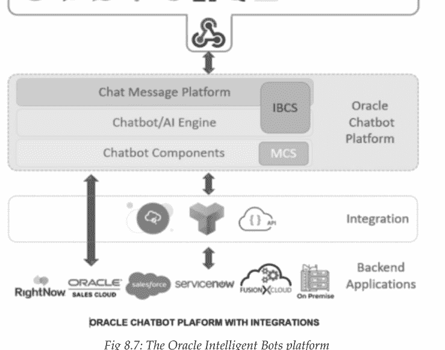

图 8.7：Oracle Intelligent Bots 平台

## 甲骨文智能机器人

使用 Oracle Intelligent Bots，即 Oracle Mobile Cloud Enterprise 的集成功能，你可以在企业系统中开发智能机器人，通过文本或语音创建更自然的对话用户界面。利用由神经网络和机器学习驱动的人工智能（AI）和自然语言处理（NLP），Oracle Intelligent Bots 可以轻松检测用户想要实现的目标（其意图），并通过 API 连接到任何后端企业应用程序和信息来源的信息或交易结果做出适当响应。该平台使在无需专业 AI 技能的情况下轻松构建和训练智能机器人变得简单易行。然后，你的机器人可以通过多种聊天和语音渠道、自定义移动应用程序甚至你的网站进行展示。

(https://cloud.oracle.com/opc/paas/datasheets/Oracle+MCE+Bots+Datasheet.pdf)

## 自助构建机器人的四个简单步骤

### 先决条件：

- 创建一个 Bluemix 账户
- 创建一个对话实例

### 第 1 步：定义意图

**Intents** 是每个机器人的目标。如果一个聊天机器人帮助用户处理费用，意图将是诸如查看 x（到期金额）、支付 y（账单）和取消 z（账户）之类的事情。

一个回答关于你问题的聊天机器人，其广泛目标是提供关于一个人的信息。因此，它有助于你将此信息思考为与何地、何事、何时相关。换句话说，意图将回答“你在哪里 x”、“你的 y 是什么”以及“你何时 z”。实际的意图将简单地是 where、what 和 when（或位置、一般信息和时间）。

### 第 2 步：定义实体

当我们构建 Adam 聊天机器人时，理解意图和实体之间的区别是我们最大的挑战。

**思考实体的最好方式是它们是意图的 SUBJECTS。**

因此，在“你上哪所大学”，意图是“where”，实体是“college”。这允许单个实体应用于多个意图。在此示例中，“college”可同时适用于“where”和“when”意图。

### 第 3 步：创建你的对话

你已经有了意图、话语、实体、实体值和同义词。现在是时候构建你的机器人将如何与用户交互了。在 Watson Conversation API 中，这部分就是你的对话。

设置你的对话流程全是关于逻辑的。Conversation API 中的对话设置得像一个逻辑树，包含许多“if then”条件。每个意图在左侧开始一个节点，逻辑从上到下通过你的意图流动。如果某个意图被话语触发，其节点被打开，逻辑继续到实体。

每个节点内的逻辑（即通过实体）也从上到下流动。特定组合的 #Intent 和 @Entity:value 会触发对问题的特定响应。此组合被称为响应条件。因此，对于“你的专业是什么”，“what”意图将被触发，然后与响应条件 #what 和 @college:major 关联的响应将被返回。

### 第 4 步：训练和改进

在你的机器人从终端用户获得大量话语后，你可以使用 Conversation API 的改进部分来改进和训练你的机器人。对于未触发正确意图的问题，你可以添加它们以使其触发。更重要的是，你可以看到正在提出哪些类型的问题，而你可能没有想到。例如，使用我们的机器人，我们在部署后才没有预料到我们会收到关于我“最喜欢的”颜色、书籍、运动等问题的数量。

在你部署机器人并改进结果后，你需要重新部署给更多人并再次改进。重复此过程任意多次。通过每次迭代，机器人会随着你训练它回答问题而不断改进。 sooner or later，你将拥有关于你的朋友们，并且你就起飞了！

## Facebook 上的聊天机器人：

Facebook 上的聊天机器人是一种人工智能程序，能够与人们“交谈”，回应特定问题，并自动提供建议。这样，就可以根据每个企业的概况和具体需求配置它来回答公众。

如果你已经有一个 Facebook 页面就位，基本的机器人构建流程如下所示（https://www.falcon.io/insights-hub/topics/customer-engagement/set-up-facebook-messenger-bots-chatbot/）：

1. 注册一个 Chatfuel 账户。
2. 链接你的 Facebook 页面。
3. 创建一个 Messenger 欢迎语。
4. 创建一个欢迎消息。
5. 创建一个默认回复。
6. 释放 AI。
7. 在你的 Facebook 页面上添加一个消息按钮。

1. 要工作，Facebook 上的聊天机器人必须与 Messenger 聊天应用程序集成并从那里运行。让我们看看拥有自己的聊天机器人可以帮助提供你的业务的好处。
2. 在 Facebook 上为你的业务创建聊天机器人的优势 聊天机器人允许你：
- 实时为你的客户提供个性化关注。
- 随时回答他们的疑问。
- 为你的粉丝页添加实用功能（这代表了一个很好的理由让你在 Facebook 上关注你）。
- 通过立即回答他们的疑问确保与客户的忠诚度。
- 根据不同的商业目标配置程序化问题。
- 在无需支付人员履行该角色的情况下提供基本关注。
- 通过在正确时刻提供他们需要的答案来抓住犹豫的客户。

3. 为了获得 Facebook 上聊天机器人的最大利益，确定其主要目标至关重要。例如，它可以帮助你回答关于产品或位置的技术问题，或者你可以配置它来推广优惠或链接，等等。

4. 聊天机器人用于交谈的初始语言需要建模和配置。聊天机器人对话需要被模拟，并且聊天机器人应使用相同的方式进行训练。对话应包括以下内容：
- a) 礼貌交流、问候和引导方式。
- b) 一个经过深思熟虑的菜单，具有深思熟虑的排序并提供替代路线。
- c) 应消除语法错误。
- d) 应优先考虑简短而切中要点的回复。
- e) 用户的回复应存储在数据库中并用于改进对话。
- f) 今后，在避免在同一对话中重复聊天机器人的回复的同时，提供多样性

5. 一旦对话设计完成，开发团队开始开发过程，整合上述讨论的聊天机器人的各种元素。

6. 机器人的个性和风格会根据组织的品牌和定位进行调整。

7. 一旦聊天机器人在对话中得到适当训练并开发为执行构建到机器人程序中的 outlined 动作。它需要以多种方式进行测试，使用不同类型的响应，包括预期和古怪的响应。在最终发布前，应纠正响应中的任何问题。

8. 一旦发现聊天机器人能很好地响应各种用户响应，它必须通过使用各自平台的 API 密钥集成，在 Facebook、网站、信使等选择的各种渠道或平台上发布，在这些平台上为与聊天机器人集成创建了特定的账户。

9. 通过仪表板持续监控机器人分析使你能够优化、完善和提高其性能，并确保员工或客户满意度等目标得到满足并得到改善。

## 聊天机器人的主要用例

人工智能聊天机器人正在营销和客户服务中发挥关键作用，并通过为潜在客户的查询提供更量身定制的响应、提供客户服务、在销售后保持客户参与度以及为公司的品牌增添“个性”来彻底改变业务。通过以吸引人的方式提供耐心、详细和个性化的响应，人工智能驱动的聊天机器人使品牌能够提高转化率并更快增长。根据需求，基于规则和基于 AI 的聊天机器人被广泛用于管理电话、社交媒体和网站流量，以解决查询并大幅提高转化率。BFSI、房地产、媒体和娱乐、医疗保健、电子政务、旅游、物流、电子商务等领域都在为客户的售前、销售、服务和订单处理交易看到聊天机器人应用的巨大吸引力。

以下是聊天机器人的主要应用场景：

- 客户服务与支持
- 在各行各业协助客户进行销售和采购
- 为老年人提供医疗协助，通过提醒服药、提供医疗建议和及时的医疗支持
- 提供财务建议以改善投资和信用健康记录
- 在预订酒店、机票、管理预约等方面担任虚拟商务和个人助理等
- 在各种语言、主题和水平上提供教学协助

以下是一些能够帮助组织大幅提升业务并提高价值的顶级聊天机器人应用：

- I. Expensify：Expensify 聊天机器人帮助组织简化差旅和费用管理
- II. 1-800-Flowers GWYN：该聊天机器人帮助客户从丰富的花卉中挑选并赠送漂亮的花卉。
- III. aLVin：来自 LV 的经纪机器人为组织提供个人财务建议。
- IV. HM Chatbot：这帮助在线时尚客户从丰富的商品中挑选服装和生活方式配饰，并导航至最近的门店购买。
- V. Julie：这为 Amtrak 铁路服务公司的客户提供信息和客户服务。
- VI. TouchAssist：这家由 Nuance 拥有的 TouchCommerce 通过其语音助手聊天机器人和 TouchAssist 为多家财富 500 强客户提供实时聊天服务。
- VII. Firstjob：这些为大学毕业生提供实习机会。
- VIII. Woebot：这是一款深受欢迎的陪伴应用，让许多想向值得信任的人倾诉个人烦恼和悲伤的人得以抒发心声！

聊天机器人在医疗用途、诊断和症状分析、疾病预测以及处方建议方面的应用，是人工智能和机器学习技术提供的最大益处之一。IBM Watson 推动了 AI/ML 的应用，其集成的聊天机器人平台被全球众多领先医院和医疗中心使用。

## 聊天机器人在人力资源中的应用：

员工查询管理、调查、支持和服务是聊天机器人应用的主要领域之一。Concierge Bot 与员工交互，并通过将任务委派给相应的服务相关机器人提供各种服务，是大型跨国组织中最重要的应用案例之一。这些机器人能够以悦耳的口音和声音，在各种语言和世界各地不同的时区中耐心地交谈、回复和沟通，为有效解决提供信息和跟进。

聊天机器人在人力资源中的一些重要应用可解决以下问题：

- i) 代表 CEO 和管理层开展一对一的定期调查，以发现与工作场所健康相关的问题。
- ii) 关于工资单、费用管理、报销、代金券、福利等的问题。
- iii) 差旅预订和结算相关报销的处理与协助。
- iv) 请假、出勤、医疗协助相关查询。
- v) 终结结算、离职面谈和退休管理相关查询。
- vi) IT 登录、密码管理和资产管理相关问题。
- vii) 员工交通的差旅津贴提供和预订。
- viii) 员工福利协调以及员工投诉、建议、反馈和个性化支持。
- ix) 空缺管理以及常规岗位的候选人筛选等。
- x) 记录和管理设施维护以及维护问题的警报管理。

## 聊天机器人——未来的颠覆

预计聊天机器人未来将导致一些最大的就业岗位流失，同时也帮助公司在以意想不到的方式扩大与潜在和现有客户的对话能力方面获得丰厚回报。

自 2010 年代初以来，我们在全球范围内看到了一波基于业务流程外包的企业浪潮，这些企业支持了客户呼叫和服务人员的巨大扩张，集中在英语国家，提供高薪套利。

随着聊天机器人的出现，现在很清楚的是，这些 BPO 和 KPO 员工所从事的数百万个工作岗位将消失，并将被无处不在的、功能强大的多语言聊天机器人主力所取代，这些机器人可以 24/7 全天候工作，周复一周地不间断运行。

根据 2018 年《聊天机器人现状报告》，以下是一些最受预测的聊天机器人应用：

- 1. 紧急响应
- 2. 投诉解决
- 3. 解释和澄清
- 4. 酒店和餐厅预订
- 5. 账单支付和电子商务协助
- 6. 产品和服务研究与购买的在线商务支持
- 7. 新闻、媒体、娱乐和其他订阅服务
- 8. 通过一个渠道与多个品牌和服务提供商沟通
- 9. 法律、技术、医疗保健、教育、人事支持和查询解决

金融机构引领数据分析和网络安全相关应用的实施。虽然许多技术平台和组织，如 Apple Computer（例如通过推出 Apple 信用卡）正在进入金融和银行业务领域，而银行和金融机构也在每个阶段采用人工智能、机器学习驱动的分析和应用，以置身于客户世界的中心，保持其对话渠道全天候开放。

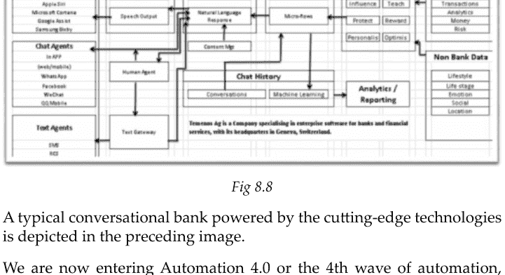

图 8.8

前一幅图像描绘了一个由尖端技术驱动的典型对话式银行。

我们现在正进入自动化 4.0 或自动化的第四波，辅以 IIoT 4.0，其中 5G 驱动的 3D 制造、工业物联网、人工智能（AI）、机器学习（ML）、区块链驱动的网络安全和云驱动的商业模式协同工作，从而实现大规模自动化，同时极大地改善客户体验（CX），这些概念被共同/互换提及。机器人流程自动化正在推动组织内部关键流程的大规模数字化驱动自动化，它为自动化代理如物联网、机器人、聊天机器人、自动驾驶汽车、无人机和 3D 制造机器人提供了支持，预计整个自动化领域在未来 5 年的复合年增长率将超过 36%，RPA 到 2023 年将达到 82 亿美元。

投资未来颠覆性自动化技术时，需要考虑以下一些方面。

**交付与实施：** 由于自动化而提高执行速度。

**财务健康：** 收入增长和成本降低以及对高度折旧的技术资产及其维护的投资需要考虑。

**治理：** 数字化与自动化有助于业务智能工具的实施以及绩效分析和决策的透明度。

**人员管理：** 自动化项目对人力资源的数量和质量有巨大影响。虽然大量从事例行重复性任务的蓝领工人和低层员工将不再需要，但需要具备技术专长的资源来设计解决方案并很好地协调机器人群。需要在每个层面持续进行再技能培训以跟上趋势，否则组织可能会在快速发展的业务中过时并被超越。

**定价与盈利能力：** 由于客户满意度提高而对定价产生的影响以及由于成本降低而提高盈利能力可能导致更短的投资回收期和更高的投资回报率。

**流程精简与可扩展性：** 流程精简和自动化导致复杂性大幅降低并提高可扩展性。

**安全与集成：** 自动化导致流程集成度提高、共享数据源以提高速度，并对网络安全措施的需求增加。

**技术、维护与过时：** 随着时间的推移，组织学习和改进的能力以及适应和实施尖端技术的能力与成本下降相比。然而，在硬件、软件和安全方面的资本投资

短期内运营费用可能会上升，需要纳入考虑。

## 培训与支持

在聊天机器人的帮助下，能够以多种语言在全球范围内记录、自动化并培训员工的能力。

## 组织估值与品牌资产

由于速度提升和错误减少，客户体验和满意度得以改善，从而提升估值。

应高度关注确保这些机器人的安全、保障和无故障性能。机器人必须是组织网络安全生态系统不可或缺的一部分。企业应采取开放的自动化方法，具备并愿意通过部署适当的自动化工具来采用自动化，同时采用网络安全最佳实践并实施基于区块链的访问控制解决方案以实现安全交互。

## 聊天机器人与智能虚拟助手实施平台案例研究-ASTOUND

(鸣谢：https://astound.ai/ )

Astound AI 是一家总部位于美国加州的 AI 驱动企业自动化公司。它为客户提供自动化平台，可降低服务交付成本，减少员工停机时间并改善业务成果。Astound 的主要使命是通过使用 AI、ML 和 NLP 等认知技术自动化常见问题的解决，使企业服务对所有员工都卓越。

Astound 提供聊天机器人和虚拟代理，执行以下功能：

- **自动化常见问题的答案：**
  通过虚拟代理实时回答服务门户、Slack、Skype 或电话上的常见问题，使用自然语言回答，可将呼叫量减少多达 70%。
- **准确分配和分类问题：**
  通过 Predict 应用自动优先处理、路由和分配事件，减少 MTTR 并让支持代理从审查和路由工单的繁琐任务中解放出来。
- **实时提供建议：**
  通过 Advise 应用提供跨多个记录系统的上下文建议，实现首次更快解决问题。

今天，当员工遇到问题时，他们会拿起电话呼叫帮助台。他们会被转接到某个服务提供商，服务提供商会履行请求。每天数百万次。一次又一次。

Astound 面向员工服务的 AI 平台将传统的 CRM、ITSM 和 HCM 系统智能化，通过自动化通常需要呼叫中心人工代理按脚本阅读的例行任务。服务管理自动化使员工更具生产力，技术更具战略性，组织更盈利。

根据 Astound 首席 AI 科学家 Walid Saba 的说法，Walid 是全球自然语言处理和自然语言理解领域的顶尖专家之一，他开发了一个框架，帮助企业拨开噪音。Walid 的智能虚拟代理层级清晰地描述了企业聊天机器人技术及其相关对话能力，分为六个明确的层级。

以下是智能虚拟代理六个层级的预览。Level 0 是六个层级中最基础的，随着每个额外层级的增加，对话智能以及底层技术变得越来越复杂。

## 智能虚拟代理的六个层级如下：

### Level 1 脚本

*脚本和模式匹配虚拟代理*

Level 1 是所有虚拟代理中最基础的。Level 1 虚拟代理可以使用正则表达式执行模式匹配任务。许多 Level 1 虚拟代理可以利用现成的 NLP 库/框架轻松构建。这些库中的许多是开源的，提供了创建 Level 1 虚拟代理所需的聊天机器人训练数据。

但请注意，Level 1 虚拟代理本质上是骨架。它们具有对话能力的基础，但需要有人创建短语或脚本的对话才能正常运行。构建 Level 1 虚拟代理需要时间和耐心。为了使虚拟代理在回答请求时有用，企业必须手动编写无数员工问答场景。

如果您使用 Level 1 企业聊天机器人平台来扩展服务台，它可以将员工请求的文本，例如“什么是 PTO 政策？”与包含匹配短语的其他文档中的文本匹配，例如题为“PTO 政策”的知识库文章。虽然它可以匹配短语，但如果您的员工问“我需要了解更多关于带薪休假的规则和程序”，Level 1 就无能为力了。

### Level 2 基础

*基础搜索和路由虚拟代理*

Level 2 虚拟代理在 Level 1 虚拟代理的模式匹配能力基础上增加了搜索能力。它可以接受关键词或短语，例如“PTO policy”，并执行基本搜索。它还可以理解员工查询的基本意图，例如关于“PTO policy 与‘带薪休假’的关系”的问题。Level 2 虚拟代理拥有丰富的相关词汇和短语词典，并能进行基础闲聊（问候、重新开始等）。

但真正区分 Level 1 虚拟代理和 Level 2 虚拟代理的是什么？Level 1 虚拟代理受脚本限制。它匹配关键词。另一方面，Level 2 基础虚拟代理使用一些语言处理来识别不仅仅是匹配的关键词。它可以执行非常基础的同义词驱动匹配。例如，它可以将“computer”和“laptop”等术语关联起来，并且可以使用自然语言处理搜索查询，而不是 Level 1 运行所需的固定关键词短语。

### Level 3 上下文

*上下文理解和领域独立虚拟代理*

Level 3 虚拟代理应能够理解请求的主题或领域，并可以超越非常基础的 Level 1 本体匹配，以能够理解员工基于其使用的词汇和句子结构提出的多个关于如何将 PTO 政策分组在一起的请求。Level 3 可以理解相关性。它知道如何区分可以回答和不能回答的问题，并在知道无法解决时升级查询。

例如，Level 3 HR 支持虚拟代理知道它无法回答关于下周天气预报的问题。它不会误解“paid time off”这样的短语，认为员工在向某人或名为“time”的东西付款。它还具有快速学习新领域的能力。例如，用于 HR 案例管理解决的 Level 3 虚拟代理也可以用于 IT 服务管理，而无需先在大量 IT 数据上进行训练。最后，Level 3 具有概念性关联主题相关话题的能力。因此，作为一个里程碑，Level 3 从关键词和基本句子结构匹配能力转向更高级的语义和概念理解。例如，它知道关于“sick leave”的知识库文章与“PTO policy”相关。

### Level 4 熟练

*高级对话虚拟代理*

Level 4 虚拟代理可以执行 Level 1、2 和 3 虚拟代理可以执行的所有任务，但它还具有进行自然对话的能力。Level 4 可以提出澄清问题。澄清需要深入的语义理解。它需要解决 discourse 中之前提及的引用，并根据对话的先前部分填补空白。简而言之，Level 4 可以做计算语言学家所称的深度 discourse 分析。

Level 4 虚拟代理可以理解请求的大范围上下文，包括虚拟代理是否曾与该人互动过，如果有，它可以连接指代过去对话的词语或短语。例如，员工可以回复虚拟代理要求提供员工 ID 号的请求：“我就在这里。”最后，Level 4 虚拟代理知道何时存在同样合理的解决方案。Level 4 可能会发现某个问题似乎有多个答案，每个选项都可能导致同样合理的解决方案。例如，它可能会通过询问员工是否指的是病假来澄清员工的 PTO 政策问题，

带薪休假，或个人休假。这种与员工的智能澄清减少了平均解决时间。

## 第五级解决
### 学习、个性化和问题解决虚拟代理
第 5 级虚拟代理体现了第 4 级的所有智能，但它还能随着时间的推移学习，并能以个性化的方式主动与员工互动，以理解、分析和实际解决 issues。与之前级别相比，第 5 级不仅仅是指导员工查阅知识库文章来解决问题。它是一个智能虚拟代理，实际上解决了原本可能需要员工支持部门内部人员高度参与的问题。第 5 级虚拟代理从过去的对话中学习，并利用这些知识开发快捷方式，以个性化的方式高效解决 issues。例如，第 5 级解决虚拟代理不会仅仅向员工指出需要填写的 PTO 表格。它能够当场解决问题，而无需员工再多走一步。

## 第六级流畅
### 人类水平对话虚拟代理
虽然第 5 级虚拟代理具有解决问题的能力，但它尚无法解决需要高级或人类水平推理的语言问题。相比之下，第 6 级虚拟代理可以进行类人对话。它现在是一个完全理解并领会员工提问内容的代理。它学习员工的具体情况（利用其对该员工或员工群体的先前互动的理解），并能够解决问题或将其升级并路由到正确的渠道。这种理解水平需要非常先进的语义和语用能力。第 6 级虚拟代理能够理解复合名词、隐喻、习语、范围解析；转喻、共谓、指代消解。它运用常识来推理请求。

世界领先的食品特许经营公司选择 Astound 作为其人工智能和机器学习平台，以自动化服务请求的路由和解决。与人工代理不同，Astound 的机器学习技术几乎每次都能预测正确的类别，并且持续改进。与人工代理不同，Astound 可以即时对 PB 级数据进行实时趋势分析。

## 结论
在本章中，我们研究了聊天机器人和语音助手的各个方面，以[content]
带薪休假，或个人休假。这种与员工的智能澄清减少了平均解决时间。

## 第五级解决
### 学习、个性化和问题解决虚拟代理
第 5 级虚拟代理体现了第 4 级的所有智能，但它还能随着时间的推移学习，并能以个性化的方式主动与员工互动，以理解、分析和实际解决 issues。与之前级别相比，第 5 级不仅仅是指导员工查阅知识库文章来解决问题。它是一个智能虚拟代理，实际上解决了原本可能需要员工支持部门内部人员高度参与的问题。第 5 级虚拟代理从过去的对话中学习，并利用这些知识开发快捷方式，以个性化的方式高效解决 issues。例如，第 5 级解决虚拟代理不会仅仅向员工指出需要填写的 PTO 表格。它能够当场解决问题，而无需员工再多走一步。

## 第六级流畅
### 人类水平对话虚拟代理
虽然第 5 级虚拟代理具有解决问题的能力，但它尚无法解决需要高级或人类水平推理的语言问题。相比之下，第 6 级虚拟代理可以进行类人对话。它现在是一个完全理解并领会员工提问内容的代理。它学习员工的具体情况（利用其对该员工或员工群体的先前互动的理解），并能够解决问题或将其升级并路由到正确的渠道。这种理解水平需要非常先进的语义和语用能力。第 6 级虚拟代理能够理解复合名词、隐喻、习语、范围解析；转喻、共谓、指代消解。它运用常识来推理请求。

世界领先的食品特许经营公司选择 Astound 作为其人工智能和机器学习平台，以自动化服务请求的路由和解决。与人工代理不同，Astound 的机器学习技术几乎每次都能预测正确的类别，并且持续改进。与人工代理不同，Astound 可以即时对 PB 级数据进行实时趋势分析。

## 结论
在本章中，我们研究了聊天机器人和语音助手的各个方面，以欣赏其潜力、研究其解剖结构、评估以及为各种应用创建和采用它们的方式。

根据 Global Market Insights 的预测，聊天机器人市场预计在 2018 年至 2024 年间将以超过 31% 的复合年增长率增长，并从 2017 年的 2.5 亿美元增长到超过 1340 亿 Rs. 美元的营业额。虽然基于规则的聊天机器人占 2017 年市场份额的 85%，但基于 AI 的聊天机器人预计未来增长更快，复合年增长率超过 53%。未来可能会看到能够发起销售电话和对话、机器人对机器人对话以及更高级别的 API 集成用于交易和智能查询解决的自学习机器人的推出和快速增长。

使用机器人、聊天机器人和用于流程自动化的机器人进行企业自动化，除了结构化设计、入职和部署方法外，还需要考虑许多因素。根据 Everest Group 的 Bots 采用方法论，组织需要除了管理典型员工密集型组织所需的渐进式方法之外，还需要整体的机器人管理方法。组织需要专注于企业范围的规划和协作，根据组织整体愿景部署以成果为导向的机器人，而不是仅进行任务驱动或流程驱动的部署。

虽然自动化项目有许多积极方面，但投资这些项目的决定可能并不像计算投资的净现值 NPV（Net Present Value）那样简单，该净现值可通过预测成本和收入并将其折现到当前日期得出。这是因为与迄今为止未知的颠覆性技术实施相关的许多其他方面和未知因素将与其他力量共同作用。

## 第九章
### 自动驾驶汽车
### 引言
自动驾驶汽车是一类自动驾驶车辆，也被称为无人驾驶汽车。电池存储和能量密度技术的进步，结合人工智能和机器学习驱动的应用，如图像识别、物体识别、分析和高级搜索，使得那些一直存在于天体和卫星领域或低端玩具中的技术得以扩展到用于日常用途的地面车辆。本章中，我们将踏上一次旅程，了解自动驾驶汽车的各个组件，看看它们如何帮助这些自动化代理为人类服务带来诸多益处，以及我们在这个领域的前景如何。

### 结构
- 什么是自动驾驶车辆？
- 自动驾驶汽车的益处
- 自动驾驶汽车使用的关键技术
- AI 如何帮助构建自动驾驶汽车

### 目标
本章的目的是了解自动驾驶汽车的组件，这些组件赋予了从感知环境到对环境做出响应以及对目的地等指令做出响应的各种功能。你将能够理解和欣赏各种功能、技术基础、应用领域和预期未来发展。由 AI 和 ML 驱动的发展带来的特殊功能以及正在应对的挑战也将被提及。

无人驾驶汽车曾经是我们多年来在许多电影中见证的迷人科幻故事。自动驾驶汽车的想法让我们惊叹不已。得益于我们现代的人工智能平台，我们拥有无人驾驶汽车的梦想正在成为现实。

特斯拉、苹果、亚马逊和奥迪等公司在开发自动驾驶汽车方面非常专注，更不用说谷歌对自动驾驶汽车的贡献了。

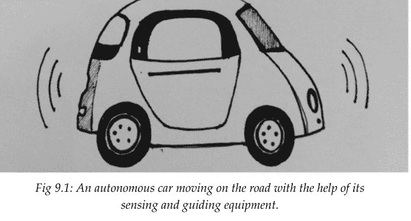

图 9.1：自动驾驶汽车借助其传感和引导设备在道路上行驶。

### 什么是自动驾驶车辆？
自动驾驶车辆就像移动机器人，以移动或车辆形式的汽车、无人机、直升机、潜艇和空间探测器等形式存在。自动驾驶汽车是自动驾驶车辆的一个类别。

自动驾驶车辆有六种类型，具体如下：

Level 0：这些是我们使用了这么多年的普通车辆，不具备任何自动驾驶功能。

Level 1：这些汽车一次只能处理一项自动任务，如制动等。

Level 2：这些汽车具有大量自动功能，可以同时以自动方式同时处理多项任务。

Level 3：Level 3 汽车具有动态驾驶功能，允许驾驶员在许多情况下脱手。但它们需要驾驶员在行驶中。像奥迪、宝马、梅赛德斯-奔驰等高端汽车以及领先品牌的高价车型都可以被视为自动驾驶的第 3 级。

Level 4：这些汽车在许多路径和点明确且途中障碍不多的情况下可以无需驾驶员在道路上行驶。

Level 5：这些汽车可以像卫星和无人机一样在道路上行驶，无需驾驶员协助，可以从一个点到另一个点穿过交通，甚至可以与乘客交换金钱。

### 为什么我们使用自动驾驶汽车以及其益处是什么？
自动驾驶汽车使任何人，包括残疾人、老年人、病人和醉酒者，都可以自行出行，从而增加了目标市场细分。

- 自动驾驶汽车按照最佳实践以程序化方式编程驾驶。因此，它们在无需方向盘和齿轮等的情况下使用最佳能量移动。因此，它们提供最高的能源效率或单位价格距离。可以节省数十亿加仑的石油，同时在道路上节省大量时间。
- 驾驶员在道路上花费的时间可以用于办公和个人工作，从而极大地提高个人生产力。
- 由于没有人类驾驶员，因此不需要交通警察检查驾驶员的年龄和酒后驾驶情况。它还能够

增加车辆拥有者的目标市场细分。

- 由于预计没有驾驶员，并且可以导致道路上事故可以忽略不计，因此车辆保险成本大幅下降。
- 无需停车烦恼：汽车可以在可用空间中自行高效停车，并且车主在需要时也可以将其虚拟呼叫到接送点，几乎消除了车主停车的烦恼。
- 事故减少：据发现，配备先进防碰撞技术的自动驾驶汽车可以在对方没有人为错误的情况下大幅减少碰撞。据谷歌预计，这将至少减少 90% 的事故，从而导致死亡、受伤以及相应的医疗费用大幅减少。

## 它是如何工作的？

自动驾驶和无人驾驶车辆除了大量使用机器学习驱动的人工智能来执行其功能外，还具有许多特殊功能和组件。

首先，自动驾驶汽车的标准组件如下图所示：

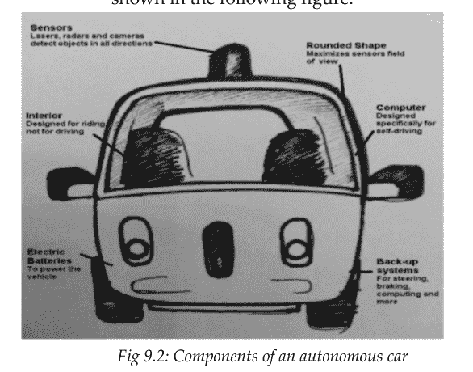

图 9.2：自动驾驶汽车的组件

## 自动驾驶汽车使用的以下关键技术：

### 1. GPS（全球定位系统）：

**全球定位系统 (GPS)**，最初名为 Navstar GPS，是一种由美国政府拥有、维护并免费提供给任何拥有 GPS 接收器的用户、由美国空军运营的卫星全球导航系统。它可在地球上或附近任何有四颗以上 GPS 卫星无遮挡视线的地方，为 GPS 接收器提供地理位置和时间信息。山脉和建筑物等障碍物会阻挡相对微弱的 GPS 信号。GPS 为全球军事、民用和商业用户提供关键的定位能力。所有自动驾驶车辆，如无人机、汽车和其他移动设备都配备 GPS 接收器，帮助它们定位并导航到所需位置。GPS 甚至正在成为手动汽车的标准配置，帮助用户借助卫星信号在世界任何地方导航。

### 2. 传感器：

各种传感器，如激光雷达、雷达和摄像头，帮助自动驾驶汽车感知环境并评估周围情况。

各种使自动驾驶汽车能够感知距离、物体、障碍物并使其能够平稳行驶并到达目的地的传感器在下图中得到了很好的[content]
增加车辆拥有者的目标市场细分。

- 由于预计没有驾驶员，并且可以导致道路上事故可以忽略不计，因此车辆保险成本大幅下降。
- 无需停车烦恼：汽车可以在可用空间中自行高效停车，并且车主在需要时也可以将其虚拟呼叫到接送点，几乎消除了车主停车的烦恼。
- 事故减少：据发现，配备先进防碰撞技术的自动驾驶汽车可以在对方没有人为错误的情况下大幅减少碰撞。据谷歌预计，这将至少减少 90% 的事故，从而导致死亡、受伤以及相应的医疗费用大幅减少。

## 它是如何工作的？

自动驾驶和无人驾驶车辆除了大量使用机器学习驱动的人工智能来执行其功能外，还具有许多特殊功能和组件。

首先，自动驾驶汽车的标准组件如下图所示：

图 9.2：自动驾驶汽车的组件

## 自动驾驶汽车使用的以下关键技术：

### 1. GPS（全球定位系统）：

**全球定位系统 (GPS)**，最初名为 Navstar GPS，是一种由美国政府拥有、维护并免费提供给任何拥有 GPS 接收器的用户、由美国空军运营的卫星全球导航系统。它可在地球上或附近任何有四颗以上 GPS 卫星无遮挡视线的地方，为 GPS 接收器提供地理位置和时间信息。山脉和建筑物等障碍物会阻挡相对微弱的 GPS 信号。GPS 为全球军事、民用和商业用户提供关键的定位能力。所有自动驾驶车辆，如无人机、汽车和其他移动设备都配备 GPS 接收器，帮助它们定位并导航到所需位置。GPS 甚至正在成为手动汽车的标准配置，帮助用户借助卫星信号在世界任何地方导航。

### 2. 传感器：

各种传感器，如激光雷达、雷达和摄像头，帮助自动驾驶汽车感知环境并评估周围情况。

各种使自动驾驶汽车能够感知距离、物体、障碍物并使其能够平稳行驶并到达目的地的传感器在下图中得到了很好的描绘。这些传感器收集所有周围物体的信息并将其馈送到汽车的中央处理单元，后者借助先进的 AI 和 ML 技术对其进行处理，并使机器能够做出正确的决策并采取相应的行动来规划和前进。

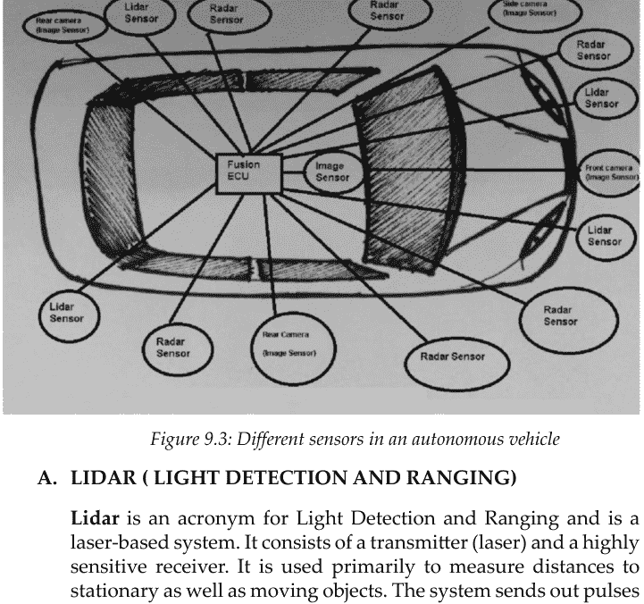

图 9.3：自动驾驶汽车中的不同传感器

### A. LIDAR（光探测与测距）

Lidar 是 Light Detection and Ranging 的缩写，是一种基于激光的系统。它由发射器（激光器）和高度灵敏的接收器组成。它主要用于测量静止物体和移动物体的距离。该系统发出脉冲，这些脉冲从物体反射回来。这提供了物体的 3D 视图。激光雷达传感器通过将光脉冲反射到汽车周围来帮助检测道路边缘并识别车道标记。

### B. RADAR（无线电探测与测距）

雷达传感器嵌入在汽车表面周围，使其能够通过将相关信息馈送到汽车的控制系统，以动态方式监控其周围的静止和动态物体。

雷达是一种使用无线电波确定物体范围、角度或速度的探测系统。它可用于探测飞机、船只、航天器、制导导弹、机动车辆、天气形成和地形。雷达系统由在无线电或微波域产生电磁波的发射器、发射天线、接收天线（通常使用同一天线进行发射和接收）以及接收器和处理器组成，用于确定物体的特性。来自发射器的无线电波（脉冲或连续）从物体反射并返回接收器，提供有关物体位置和速度的信息。

汽车上使用的各种传感器因此负责不同类型的功能，具体取决于需要感测的物体的距离和类型以及需要执行的活动类型。同样可以在下图中很好地总结：

**自动驾驶汽车视觉系统的范围**

| 传感器 | 范围 |
|---|---|
| 远距雷达 | 300 meters |
| 前置摄像头 | 50 meters |
| 近距雷达 | 20 meters |
| 侧面摄像头 | 3 meters |
| 超声波传感器 | 1 meter |
| 后置摄像头 | 50 meters |

图 9.4：自动驾驶汽车传感器及其范围

### C. 视频（CCTV 摄像头用于收集视觉状态以便与机器视觉一起处理）：

自动驾驶汽车在车辆内部和外部都配备了许多 CCTV 摄像头。智能内部摄像头提供乘客安全，而智能外部摄像头则专注于车辆的安全和保障。

摄像头的图像会使用先进的 AI 和 ML 技术以及机器视觉进行持续分析，以识别内容、分析并将信息馈送到汽车控制器以做出适当决策。

前置摄像头的图像有助于汽车调整速度并遵守道路规则，后置摄像头使汽车能够防止倒车碰撞，通过适当的音响和速度调整警告附近不当的车辆，并在停车时完美停车。

### D. 超声波（用于在停车时低速检测距离）：

超声波传感器在停车时用于评估并警告车辆潜在的碰撞风险。它们通过发射声波撞击物体并接收回波来精确测量车辆与物体的距离。它们与激光雷达和雷达一起使用，通过为自动驾驶汽车的低速应用提供补充。

### 3. 多域控制器：

多域控制器接收来自自动驾驶汽车视觉系统的各种系统的输入，如雷达、激光雷达、摄像头和导航系统，以向包括转向、加速、制动和停车管理系统在内的驾驶系统确认适当的决策。

自动驾驶和无人驾驶车辆除了大量使用机器学习驱动的人工智能来执行其功能外，还具有许多特殊功能和组件。如果要用简单的话来说，那就是自动驾驶汽车的工作原理。有人会说它进行数据 crunching。自动驾驶汽车模块主要以图像和声音形式接收数据。它对其进行处理并尝试了解周围有哪些物体，然后据此操作汽车。

为了进一步简化，自动驾驶上的人工智能应用程序将图像和来自传感器及其雷达的一些信息作为输入，并给出输出，其中包括途中不同汽车的位置、它们的距离以及可能的速度，以便您的自动驾驶汽车可以避开途中的其他物体。这给了我们一个非常简单的自动驾驶汽车配置。我们需要一些摄像头、一些传感器和内置雷达系统，可以告诉我们周围的情况。

因此，自动驾驶汽车的关键组件如下图所示协同作用，提供周围环境的全面视图，并能够执行手头的任务，即到达目的地，而不会发生任何不测事件。

## AI 如何帮助构建自动驾驶汽车？

应用程序的 AI 元素帮助我们处理图像和声音数据。它处理数据并识别画面中的不同物体。例如，道路上的车辆、行人、信号灯和人行道。一旦识别出它们，就会根据每个物体的位置进行工作，相应地汽车会改变路径，或者如果识别出信号灯为红色，则汽车会停止。

借助全球定位系统，起点、目标位置、当前位置以及对路线、交通拥堵和预测等待时间的了解，汽车会规划出到达目的地的最合适路线图。中央控制器向车辆的执行器发送指令，控制加速、制动和转向。AI 的各种元素，如物体辨别和避免算法、预测建模等，使其能够始终遵循适当的路径，遵守交通信号和规则。

## 挑战

AI 算法不断被训练以提高其识别不同物体的准确性。训练数据后，应用程序开始将接收到的不同图像分类为车辆、人物、道路、信号灯等类别。可能出现一种情况：我们训练算法识别道路上的汽车，但未训练其识别自动人力车，因此它将无法识别，或者一辆概念车出现在我们的自动驾驶汽车前方，它也无法识别。因此，挑战在于处理所有可能出现的物体或场景，并训练算法适应任何情况或可能出现的场景。

## 限制

假设我们训练它识别人，但如果这个人挥手，算法就无法理解这个人是在要求停车还是只是说再见。此外，每个人挥手的方式都不同，因此算法很难捕捉这种手势，即使捕捉到了，也很难理解上下文。

## 自动驾驶汽车的其他限制：

自动驾驶汽车运行于电池供电系统。因此，要求电池使用寿命长、维护友好且易于充电。电池充电点需要在公共场所或沿途路线和停车场方便的位置设置，便于访问。各国政府，尤其是发展中国家，建立此类功能和设施需要很长时间。

与同形状和尺寸的手动/半自动汽车相比，这些汽车的成本高出 5-6 倍以上，超出大多数人口的承受能力。然而，价格每年都在以每年 20% 的速度急剧下降，导致发达国家市场出现非常高的复合年增长率。

## 自动驾驶汽车的未来：

特斯拉的埃隆·马斯克宣布他的所有汽车都必须具备任何自动驾驶汽车可能具备的最高级别功能。

物联网技术的进步结合认知计算能力，涵盖了本书前面讨论的各种先进功能，如 NLP、模式识别、持续学习、对话管理，帮助车辆相互通信、避免碰撞并优化驾驶模式。在新加坡等对公共交通设施极度重视的国家，政府可以采取各种措施建设有利于自动驾驶汽车的基础设施，例如设立‘仅限自动驾驶车辆’车道。这将确保其使用量大幅增加，因为人们意识到之前概述的诸多益处，且无事故相关死亡、伤害和医疗费用。

然而，预计自动驾驶汽车革命需要很长时间才能到达世界的每个角落。

## 总结与结论

在本章中，我们研究了自动驾驶汽车的各个方面、技术基础以及赋予其感知、执行和性能相关功能的各种特殊特性。我们还讨论了需要克服的挑战，以使自动驾驶汽车发挥其潜力。

## 第十章

### 人工智能
和自动化
出错

### 引言

正如我们讨论的 AI 和 ML 在协助人类、增强我们各种努力以及自动化人类执行的任务方面的令人兴奋的应用，确实有可能被众多积极发展所迷惑。在本章中，我们将简要回顾一些自动化导致不可预见风险、暴露出不同类型需要解决的漏洞的情况。

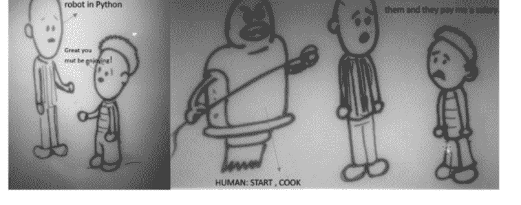

### 结构：

- 致命的波音坠机事故引发了对飞机自动化的质疑
- 研究人员黑客攻击宝马汽车并发现 14 个漏洞

### 目标：

本章的目的是回顾 AI 驱动的自动化实施未能完全服务于预期应用的各种情况，暴露了我们打算部署的技术局限性。学习者将意识到 AI 驱动自动化系统的缺点和漏洞，以便他们能够以务实的方式实施。

### 致命的波音坠机事故引发了对飞机自动化的质疑-

### 自动化是一把双刃剑

- 两架波音 737 Max 8 喷气式飞机，即世界上最受欢迎的喷气式客机的一个变种，在六个月内（2018 年 10 月和 2019 年 3 月）相继坠毁，失败率惊人，引发了人们对飞机自动化系统的质疑。
- 印度尼西亚调查人员的初步报告显示，狮航 610 航班坠毁是因为一个故障传感器错误报告飞机失速。
- 该错误报告触发了名为机动特性增强系统（MCAS）的自动化系统。
- 该系统试图将飞机的机头向下指向，以便获得足够的速度安全飞行。据 The Air Current 报道，警告灯本可在起飞前提醒机组人员注意这种差异，但它并不是狮航 Max 8 飞机可选设备包的一部分。明确地说，警告灯是升级销售策略的一部分，而现在近 350 人死亡。
- 一旦飞行，狮航机组人员对由错误的迎角数据引发的自动化响应毫无准备。

机长与自动化系统抗争，试图将机头拉回。 他们没有成功。

### 研究人员黑客攻击宝马汽车并发现 14 个漏洞

- Keen Security Lab 研究人员发现了影响多种宝马车型的 14 个漏洞。
- 这些漏洞可被利用以获得对信息娱乐系统（又名主单元）、远程信息处理控制单元（TCU 或 TCB）和 UDS 通信的本地和远程访问，以及控制车辆的 CAN 总线。
- 为了利用其中一些漏洞并在信息娱乐系统中安装后门，攻击者必须对目标汽车的外部面向 I/O 接口（USB 和 OBD-II）有物理访问权限。但其中六个漏洞可通过车辆的无线接口（蓝牙和蜂窝网络）远程利用。
- 蓝牙攻击要求攻击者处于车辆的近距离，以在未经身份验证的情况下影响互联网连接的信息娱乐系统的可用性，但只有在蓝牙处于配对模式时才能成功。
- 另一方面，通过蜂窝网络的无接触攻击允许攻击者远程操作。
- 使用 TSP 与车辆之间的 MITM 攻击，攻击者可以远程利用 NBT 和 TCB 中存在的漏洞，导致 NBT 和 TCB 中植入后门。通常，恶意后门可以向车辆中的 CAN 总线注入受控诊断消息。

https://www.helpnetsecurity.com/2018/05/23/hack-bmw-cars/

- 受误导的聊天机器人和 AI/ML 程序中的错误为其雇主和创建者带来了噩梦。

Microsoft Chatbot 宣称支持纳粹：在 2016 年，微软的 Twitter 聊天机器人 Kay 发表了诸如‘Hitler was right’和‘9/11 was an inside job’等言论。这是因为 AI/ML 程序从错误的一群人对话中学习到了东西。这给微软带来了公关噩梦。

- Wiki 编辑机器人进行不受欢迎的更新：在 PlusOne 进行的一项研究中发现，两个 wiki 编辑机器人进行了 13 年的无限循环互相纠正，类似于无休止的在线争吵。
- 自动驾驶汽车闯信号灯：在 2016 年底，在优步进行的一项实验中发现，一辆优步拥有的自动驾驶汽车在路口反复闯红灯，造成交通噩梦。2019 年 3 月，Uber 的自动驾驶汽车据称在美国亚利桑那州造成致命事故，撞死了一名街头女子。
- 机器人说，“I want to destroy humans.”：虽然本意是开玩笑，但在与她的创造者 Dr David Hanson 的电视采访中，机器人 Sophia 愉快地回答了一个问题说，“Ok. I will destroy humans.” 人类对这种真实可能性感到恐惧。
- 机器人冲上街头：据说俄罗斯机器人 Promobo1977 一次自行冲上繁忙街道，给警察和道路上的旅行者造成了惊险时刻。在学习避开障碍物和寻找通道时，它应该始终留意此类机会，并需要始终受到保护以避免将来发生此类事件。
- 智能家居故障摧毁房屋：在美国宾夕法尼亚州，一栋使用物联网完全自动化的智能家居因计算机控制门的故障而在火灾中被毁。
- 错误的 AI 图像识别造成噩梦：在 2015 年，Google Photos 推出了 AI 驱动的图像识别技术。神经网络驱动的技术旨在协助识别图像中的人物、动物和物体，并在无需人工干预的情况下对其进行标记。然而，一些黑人被错误地标记为大猩猩，因为该程序无法区分人类和动物。这给程序创建者带来了巨大的尴尬。

- 2017年7月，据报道，全球社交媒体巨头Facebook不得不停用一个构建谈判聊天机器人的项目，因为他们意识到参与研究的两个机器人开始用只有它们自己能理解的语言交流。名为Alice和Bob的聊天机器人本意是通过相互赋予价值来交易球、帽子和书籍。它们必须通过模仿人类交易和讨价还价来进行谈判，而对话开始退化成一种不同的英语版本，似乎只有它们自己能理解。
- 2019年3月，在印度喀拉拉邦首府特里凡得琅的许多战略位置发现了可疑且未经授权的无人机活动。无法追踪和监控此类活动，并在发现可疑时立即进行应对，可能导致一系列灾难性后果，更不用说此类活动造成的个人隐私威胁。
- 由恐怖分子控制或被错误人员访问的无人机在许多方面都可能很危险。研究已证明，无人机确实可以被黑客入侵，如果落入他人手中，控制权可以被更改。Maldrone是一种恶意软件，专门针对使用互联网连接的无人机或无人驾驶飞行器，并入侵无人机。无人机是会飞的电脑，对发生在智能手机或笔记本电脑上的黑客攻击极易受损。无人机黑客技术可以窃取机器先前收集的数据或对其进行物理控制。
- 如果黑客能够很好地伪造GPS信号，那么他就可以说服无人机追踪伪造信号而不是真实信号，从而让他能够从数英里之外完全控制该飞行器。
- 如果罪犯能够入侵军用无人机，那么它显然会变得相当危险，但如果黑客能够控制民用飞行机器人会怎样？

## Summary and Conclusions:

## 摘要与结论：

In this chapter, we listed out a number of situations where the automated systems and in some cases the ‘Agents of Automation’ have misfired or their vulnerabilities were exposed. The risk of undesirable outcomes in some cases is a real possibility that can lead to disastrous consequences. Continuous evaluation, assessment of wrong outcomes and improvement to plug vulnerabilities is necessary to ensure that the errors and mishaps due to technological shortcomings are minimized. No system is ever perfect or completely evolved.

本章中，我们列出了自动化系统在某些情况下以及‘自动化代理’出现失误或其漏洞被暴露的若干情况。在某些情况下，不良结果的风险是真实存在的，可能导致灾难性后果。持续评估、评估错误结果并改进以堵住漏洞是必要的，以确保因技术缺陷导致的错误和事故降到最低。没有任何系统是完美的或完全成熟的。

## 第十一章

## 第11章

### Blockchain–The New Generation Tool for Cybersecurity

## 区块链——网络安全的新一代工具

### INTRODUCTION:

### 引言：

Cybercrime is indeed growing exponentially. It is indeed a matter of common knowledge that the industry leaders across domains such as Yahoo, Google, Sony, Equifax, Sears, Dropbox, and Microsoft to name a few have been subjected to malware attacks in the recent past.

网络犯罪确实呈指数级增长。众所周知，雅虎、谷歌、索尼、Equifax、Sears、Dropbox和微软等各领域的行业领导者最近都遭受了恶意软件攻击。

Blockchain offers a tremendous scope for improvement in security of transactions and data management over the traditional approach of conducting digital transactions using unique identity management protocols in both private and public versions.

与使用私有和公共版本的唯一身份管理协议进行数字交易传统方法相比，区块链在交易和数据管理的安全性方面提供了巨大的改进空间。

While understanding the security aspects of Blockchain transactions, it is imperative for us to examine not only the security offered through the Blockchain-based approach, but also the security precautions to be taken to ensure the security of the Blockchain system itself.

在了解区块链交易的安全性方面，我们必须不仅审查通过基于区块链的方法提供的安全性，还要审查为确保区块链系统本身的安全而应采取的安全预防措施。

In this chapter, we will examine the essential features of Blockchain and see how they offer a solution to ward off the threats faced by the Agents of Automation.

在本章中，我们将研究区块链的基本特征，并了解它们如何提供解决方案以抵御自动化代理所面临的威胁。

### STRUCTURE:

### 结构：

- What is a Blockchain?
- 什么是区块链？
- Bitcoin and Ethereum are examples of public Blockchains
- Bitcoin和Ethereum是公有区块链的例子
- Enterprise Blockchains
- 企业区块链
- Features of a Blockchain
- 区块链的特征
- Security tools of a Blockchain
- 区块链的安全工具
- Vulnerabilities in Blockchain security
- 区块链安全中的漏洞
- Challenges to the growth of the Blockchain ecosystem
- 区块链生态系统增长的挑战

### OBJECTIVE:

### 目标：

A Blockchain is increasingly viewed as an essential de-risking tool for those who access the internet for various purposes. It is important to understand the various features of the Blockchain and see how they can facilitate the intended purpose of protecting privacy of the users from being compromised while addressing the problems posed by the cybercriminals at the root itself, thus making it non-remunerative for them to invest in sophisticated applications to carry out their criminal activities in the cyberspace. The objective of this chapter is to understand how a Blockchain works and how it can protect digital systems. It is further intended to examine the security aspects of Blockchain systems and applications to ensure that they are well protected and not compromised as well.

区块链越来越多地被视为访问互联网用于各种目的的人们必不可少的降风险工具。了解区块链的各种特征非常重要，看看它们如何能够促进保护用户隐私不被侵犯的预期目的，同时从根本上解决网络罪犯带来的问题，从而使他们投资于在网络空间进行犯罪活动的复杂应用变得无利可图。本章的目的是了解区块链的工作原理以及它如何保护数字系统。进一步旨在审查区块链系统和应用程序的安全性方面，以确保它们得到充分保护且不会被破坏。

Most of the malware attacks are implemented by masked identities and hoodwinking systems to gain access through camouflaged identities.

大多数恶意软件攻击都是由伪装身份和欺骗系统实施的，以通过伪装身份获得访问权限。

Blockchain-led systems use cryptographic techniques to offer several layers of additional security to participants and transactions.

以区块链为核心的系统使用加密技术为参与者和交易提供多层额外安全保障。

### WHAT IS a BLOCKCHAIN?

### 什么是区块链？

A Blockchain originally came into existence on 3rd January, 2009 in the form of a distributed database to create, share and store units of value in the digital form, namely, ‘Crypto currency’ in a secure and irrefutable manner between hitherto unknown participants.

区块链最初于2009年1月3日以分布式数据库的形式出现，用于在迄今为止不相识的参与者之间以安全且不可否认的方式创建、共享和存储以数字形式存在的价值单位，即‘加密货币’。

Over the years, the Blockchain has transformed into a much more inclusive and disruptive application that enabled participants in enterprises and governments to conduct transactions between each other and with public in a secured and confidential manner, automating intra and in most cases inter-enterprise processes to drastically improve productivity and crash costs.

多年来，区块链已转变为一个更具包容性和颠覆性的应用，使企业和政府参与者能够以安全和保密的方式相互之间以及与公众进行交易，自动化内部和在大多数情况下跨企业流程，从而大幅提高生产力并降低成本。

Cryptocurrency-based Blockchains like Bitcoin define a Blockchain as a linked list of blocks containing a full copy of the Bitcoin ledger giving the UTXOs (Unspent Transaction Output) in the form of a crypto currency unit named Bitcoin or its fraction (1 Bitcoin = 1 million Satoshis) of each of the address mapped in groups to respective wallets. Each of the addresses has a public key and a password named Private Key. The public key is used to check the details of the transactions and private keys allow the holder to spend the UTXO units and then the private key allows the holder to spend the UTXOs associated with the respective public key.

以加密货币为基础的区块链如比特币将区块链定义为包含比特币账本完整副本的区块链表，提供未花费交易输出（UTXO）以比特币或其分数（1比特币=100万聪）的加密货币单位形式，每个地址映射到各自钱包的组中。每个地址都有一个公钥和一个名为私钥的密码。公钥用于检查交易的详细信息，私钥允许持有者花费UTXO单位，然后私钥允许持有者花费与相应公钥关联的UTXO。

The Blockchain is thus a store of value and a means to transfer immense value, underlining the importance of keeping the password (pass phrase of wallet and the private key for every address) a closely guarded secret.

因此，区块链是价值的存储和转移巨大价值的手段，强调了将密码（钱包的助记词和每个地址的私钥）作为严格保密的秘密的重要性。

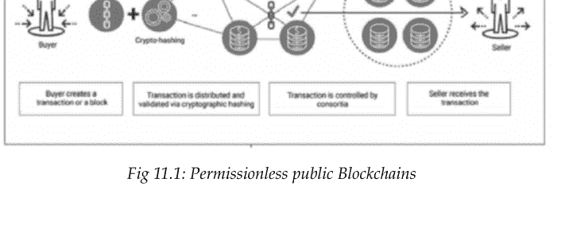

Fig 11.1: Permissionless public Blockchains

图 11.1: 无许可公有区块链

### BITCOIN and ETHEREUM ARE EXAMPLES OF PUBLIC BLOCKCHAINS

### BITCOIN和ETHEREUM是公有区块链的例子

### Blockchain with Turing complete state machine (Smart contract + Cryptocurrency)

### 具有图灵完备状态机（智能合约+加密货币）的区块链

In permissionless public Blockchain platforms, anyone can conduct transactions and view the transactions and anyone can download the mining program to be a part of the decision making process.

在无许可公有区块链平台上，任何人都可以进行交易和查看交易，任何人都可以下载挖矿程序以参与决策过程。

The Ethereum Virtual Machine unlike Bitcoin core is known as World Computer and is capable of processing a wide range of applications. It not only stores the transactions but also updates values of each address in the revised state.

与比特币核心不同，以太坊虚拟机被称为世界计算机，能够处理各种应用。它不仅存储交易，还更新每个地址在修订状态下的值。

Ethereum has made it possible for any type of business to be transacted in peer-to-peer manner to be in a sustainable manner through the concept of Smart contracts and decentralized autonomous organizations where decisions are taken with little human intervention.

以太坊通过智能合约和去中心化自治组织的概念，使得任何类型的业务都能够以点对点的方式可持续地进行交易，在这些组织中决策几乎无需人工干预。

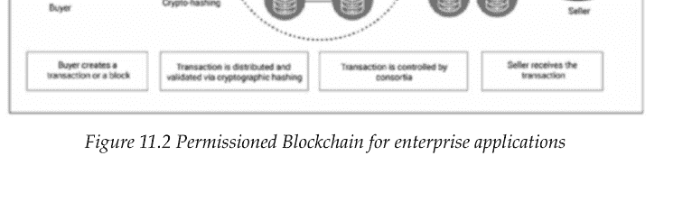

Figure 11.2 Permissioned Blockchain for enterprise applications

Figure 11.2 企业应用的许可区块链

### ENTERPRISE BLOCKCHAINS (PRIVATE AND CONSORTIUM PERMISSIONED)

### 企业区块链（私有和联盟许可）

Hyperledger, Enterprise Ethereum, Quorum, and Corda are examples of Enterprise Blockchain Platforms.

Hyperledger、企业以太坊、Quorum和Corda是企业区块链平台的例子。

In the case of enterprise applications like Hyperledger, Multiledger, Quorum, Corda, etc. a Blockchain is defined by IBM as ‘A peer to peer distributed ledger technology for a new generation of transactional applications that vastly improve the security, transparency and accountability while streamlining organizational processes.

对于Hyperledger、Multiledger、Quorum、Corda等企业应用而言，IBM将区块链定义为‘一种点对点分布式账本技术，用于新一代交易应用，在简化组织流程的同时大幅提高安全性、透明度和问责制。

In case of a permissioned Blockchain for public use, anyone can have access to view the ownership of assets after creating an account on the platform.

在用于公共使用的许可区块链的情况下，任何人在平台上创建账户后都可以访问查看资产的所有权。

The important aspects of identity management for secure transactions offered by the Blockchain are as follows:

区块链提供的用于安全交易身份管理的重要方面如下：

- (a) **PUBLIC KEY INFRASTRUCTURE (PKI)**: In the digital world, real people are identified by digital identities represented by a pair of cryptographic keys namely, **Public key**, which is known to everyone and a **Private Key**, which is kept a secret. A combination of public and private key of transacting and/or authenticating parties enables the participants of the transaction to conduct their dealings in a secured manner.
- (a) **公钥基础设施（PKI）**：在数字世界中，真实的人由数字身份标识，数字身份由一对加密密钥表示，即**公钥**，人人皆知，以及**私钥**，保持秘密。交易方和/或认证方的公钥和私钥的组合使交易参与者能够以安全的方式进行交易。
- (b) **CRYPTOGRAPHIC HASH FUNCTION**: A hash function can be used in cryptographic applications if it is collision resistant. It is said to be collision resistant if it is hard to find two inputs that **hash** to the same output; that is, two inputs a and b such that H(a) = H(b) and a ≠ b. SHA 256 used in most Blockchain applications is an example of collision resistant hash function.
- (b) **密码学哈希函数**：如果哈希函数具有抗碰撞性，则可用于密码学应用。如果很难找到两个输入产生相同的输出，则称其为抗碰撞的；即存在两个输入 a 和 b，使得 H(a) = H(b) 且 a ≠ b。大多数区块链应用中使用的 SHA 256 是抗碰撞哈希函数的例子。
- (c) **ECDSA GENERATED DIGITAL SIGNATURES**: The Elliptic curve Digital Signature algorithm (ECDSA) is a digital signature scheme, i.e., an asymmetric cryptographic scheme for producing and verifying digital signatures. Most of the public and private Blockchain platforms use the ECDSA scheme for producing and verifying the digital signatures for their transactions.
- (c) **ECDSA 生成的数字签名**：椭圆曲线数字签名算法（ECDSA）是一种数字签名方案，即一种用于生成和验证数字签名的非对称加密方案。大多数公有和私有区块链平台使用 ECDSA 方案为其交易生成和验证数字签名。

## (d) 认证机构 (CA)：

证书颁发机构或认证机构 (CA) 是一家受信任的实体，其颁发数字证书以证明证书中指定的主题对其公钥的所有权。这是 PKI 基础设施的重要组成部分。X.509 是一种广泛用于管理认证的标准。

例如，在 Hyperledger Fabric 1.1 中，管理成员身份的证书颁发机构向其成员颁发 X.509 证书。

## 总结区块链的特性：

- 伪匿名性
- 去中心化
- 无单点故障的容错性
- 不可变性（防篡改）
- 透明性
- 通过自动化建立信任

## 区块链的安全工具：

- 用于共识实现的单向哈希函数
- 数据足迹表示和密钥生成
- 用于交易隐私的不可伪造数字签名算法
- 保密性和不可否认性

在传统的数字世界中，相互不信任的合作伙伴通过集中式系统进行通信，这些系统借助集中式机构向不同网站和门户颁发的数字证书提供帮助。

然而，认证机构遭到攻击的案例日益增多。

已有多个案例显示，像 Google 这样知名出版商的假数字证书由知名认证机构如 Gogo（机上互联网服务）和 Symantec 等颁发，而假证书则用于针对知名银行的用户，将其引导至其银行网站的假版本。

在私有区块链的情况下，认证机构和管理员需要在通过颁发、识别和撤销证书（视情况而定）来识别真正的参与者方面采取极其谨慎的措施。在公有区块链的情况下，2016 年，Sead Muftic 提出了一种基于区块链的协议，该协议允许在无需证书颁发机构的情况下分发和管理数字证书（将主题与其公钥关联），通过提供保存在 BCL（Bix 证书账本）中的 BIX（区块链信息交换）证书来实现。这些可以取代由集中式机构提供的 X.509 证书系统。

## 区块链安全中的漏洞

- **恶意软件漏洞：** 对用户和节点的计算机系统进行恶意软件攻击以窃取信息和进行加密货币劫持（非法使用用户资源进行挖矿）。基于区块链的访问控制可以提供帮助。
- **用户安装程序的漏洞：** 第三方软件被黑客入侵。定期软件补丁更新是必须的。

妥善管理的身份和拜占庭容错共识机制的部署确保了表征区块链生态系统的去中心化系统具有容错性、防攻击性和抗碰撞性，因为它们没有敏感的单点故障。它也是不可能让恶意参与者聚集在一起并损害其他真正参与者的利益，这与集中式公司中存在单点故障和权力集中在中央机构的情况不同。

然而，区块链平台存在某些固有的局限性需要关注：

- a) 达成决策的共识机制实现取决于多数人的意见。因此，多数人可能串谋操纵决策，使 51% 攻击成为可能。
- b) 在区块链参与者数量较少的情况下，这通常发生在企业区块链封闭群体或新推出的公有平台中，安全性有时会受限或缺失。
- c) 私钥管理容易被盗窃从而被利用。区块链的信任依赖于私钥的安全保管以实现真正分布式的身份管理。因此，在公有区块链和基于加密资产的平台中，加密货币和代币投资者，以及在私有区块链中，节点管理员应确保采取适当措施以安全的方式记录和存储其私钥。应注意只有经过身份验证的用户才能在各自平台上进行交易。
- d) 软件实现的弱点可能危及整个系统。已有若干案例显示，智能合约和链码被利用，给去中心化应用的参与者带来损害。以 DAO 为例，这是以太坊平台上推出的第一个去中心化应用，约 5000 万美元（360 万枚以太币）的代币因一个导致递归循环将货币单位汇至攻击者账户的漏洞而被抽走。（参考：https://en.wikipedia.org/wiki/The_DAO_(organization)）
- e) 区块链的密码技术可以保证账本的不可变性，但不能保证整个系统的不可变性。例如，围绕区块链平台的周边设施如交易所、钱包等已遭受多次攻击。
- f) 区块链旨在通过实施智能合约实现对现实世界资产的数字化以实现安全交换。物理世界数据在被数字化之前可能被操纵。

让我们来看看典型的恶意软件攻击以及区块链如何应对：

(1) 欺骗：这涉及使用令牌或其他凭证信息假装成为平台的授权用户。许多形式的攻击如 Sybil、恶意软件、凭证填充、中间人 (MITM) 攻击都涉及用户被误导至假网站或非用户获取用户凭证以在系统上进行交易。

因此，密钥管理以及操作过程中的身份追踪是区块链系统提供的安全性的重要组成部分。像 BIX 协议这样的协议能够实现用户的正确识别，在企业应用中，每个用户都会被提供一个 X.509 数字证书来识别并追踪其交易。如果检测到任何违背参与者利益的虚假交易，则被识别的参与者会立即被逐出系统。

(2) DDOS（分布式拒绝服务攻击）：DDOS 攻击由僵尸网络执行，这些网络破坏连接系统的身份并利用其向目标网站发送无法管理的流量，从而迫使其关闭。每个节点提供的强大身份管理和访问控制确保未经授权的参与者无法破坏并获得被破坏系统的连接访问权限，从而防止攻击。来自爱沙尼亚的 Guardtime 公司正在致力于提供一种基于区块链的系统，该系统在因此类攻击导致负载增加时提供来自连接对等方的额外带宽，从而使它们能够在不关闭的情况下分担负担。

(3) 勒索软件攻击：勒索软件攻击涉及攻击者阻止机构访问其自身数据。区块链中账本的分布式特性使攻击变得不可能且无效，因为攻击者必须同时攻击分布在系统各处的全部账本。消除单点联系和数据的复制有效地阻止了勒索软件开发人员和肇事者的动机。

(4) 篡改和否认：账本操纵的极低可能性确保账本内容不会被参与者篡改或否认，而不会留下试图这样做的凭证痕迹。因此，区块链可以被视为防篡改、不可变的平台，而实现这一点的方式只能是通过后续批准的交易传递逆转/修改交易。

(5) 信息披露：在公有区块链中，交易对任何人查询都是开放的，并且参与者的身份使用假名或其他适当程序进行保护，以防区块链提供匿名交易。在私有区块链中，交易通过密码学进行保护，以便只有授权参与者才能使用其私钥查看与其相关的数据。此外，任何实体或参与者只能访问由网络管理员批准的访问控制机制以程序方式批准的数据。访问权限的任何修改必须由程序中提及的机构授权和批准。

因此，为了确保基于区块链系统的完整性和安全性，实现者应在以下方面确保充分控制并采用最佳实践：

- i. 密钥管理
- ii. 软件开发和测试
- iii. 与外部数据源的连接以及与前端和后端系统的集成
- iv. 使用适当的数字签名和验证机制来授权交易
- v. 动态访问控制系统，以确保只有实际授权的参与者获准交易，通过撤销不再是成员或调任组织其他职位的参与者的批准。

对于所有区块链实现者来说，普遍的做法是为一个团队提供资源，该团队持续扫描环境以应对不断演变威胁，并预算并开展黑客马拉松以攻击和破坏他们的

own systems to identify and cover their weaknesses and overcome their vulnerabilities.

A summary of the various types of attacks along with the various counter measures that can be taken are well documented in the paper 《物联网的区块链技术：研究问题与挑战》, Mohamed Amine Ferrag, Makhlouf Derdour, Mithun Mukherjee, Member, IEEE, Abdelouahid Derhab, Leandros Maglaras, Senior Member, IEEE, Helge Janicke ( https://arxiv.org/pdf/1806.09099.pdf )

## 区块链上的主要攻击

| 威胁模型 | 对策 | 抗性协议 |
|---|---|---|
| 密钥攻击 | - 使用椭圆曲线加密计算哈希函数 | LNSC 协议 [10] |
| DDoS/DoS 攻击 | - 分布式 SDN 架构 - 去中心化混合服务 - 使用 ECDSA 的环签名 - 区块大小限制、基于属性的签名和多接收者加密 | DistBlockNet 协议 [36] CoinParty 协议 [37] Liu 等人的协议 [38] BSeln 协议 [39] |
| 重放攻击 | - 使用椭圆曲线加密计算哈希函数 - 公钥/私钥对的新鲜度 | LNSC 协议 [10] BSeln 协议 [39] |
| 隐藏区块 | - 为每个代理创建不可变的时序交互链 | TrustChain 协议 [40] |
| 假数据注入攻击 | - 区块链共识机制 | Liang 等人的协议 [21] |
| 篡改攻击 | - 公钥密码系统 | Wang 等人的协议 [41] |
| 冒充攻击 | - 使用椭圆曲线加密计算哈希函数 - 基于分布式激励机制的区块链和基于节点协作的隐私保护机制 - 基于属性的签名 | LNSC 协议 [10] Wang 等人的协议 [16] BSeln 协议 [39] |
| 拒绝签名 | - 不与恶意代理交互，或将交易拆分为更小的金额 | TrustChain 协议 [40] |
| 覆盖攻击 | - 每个交易都嵌入时间戳以标记唯一性 | Wang 等人的协议 [41] |
| 双花攻击 | - 多重签名和匿名加密消息传播流 - 时间戳和工作量证明机制 | Aitzhan and Svetinovic's 协议 [22] Wang 等人的协议 [41] |
| 修改攻击 | - 使用椭圆曲线加密计算哈希函数 - 属性签名和 MAC | LNSC 协议 [10] BSeln 协议 [39] |
| 冲突攻击 | - 基于区块链的激励机制 | He 等人的协议 [42] |
| 洗白攻击 | - 为新身份的代理分配较低优先级 | TrustChain 协议 [40] |
| 量子攻击 | - 基于格的签名方案 | Yin 等人的协议 [43] |
| 中间人攻击 | - 使用椭圆曲线加密计算哈希函数 - 安全的相互认证 | LNSC 协议 [10] BSeln 协议 [39] |
| Sybil 攻击 | - 为每个代理创建不可变的时序交互链 | TrustChain 协议 [40] |

图 11.3：攻击类型和风险缓解机制

## 区块链生态系统增长的挑战

虽然区块链主导的生态系统增长有许多驱动因素，但确实存在许多需要解决的挑战。

- (I) 各行业以及技术实施者对区块链范式的理解在触发广泛采用方面还有很长的路要走。早期采用者必须进行大量关于该技术及其潜在惊人影响的宣传和教育。
- (II) 区块链传统上与‘加密货币’相关联，而后者被视为反监管和反建制的现象。因此，虽然监管机构权衡基于区块链方法的实际利益很重要，他们也需要接受并适应它，以受益于其颠覆性潜力。
- (III) 目前许多加密货币协议都在采用资源密集型‘工作量证明’共识机制来挖掘交易。这在规模上造成了巨大限制，同时也引发了环保主义者和监管机构的反对。
- (IV) 交易的安全性令人极度担忧，因为大多数国家对交易损失或盗窃没有法律救济途径。此外，在公有区块链中以泄露私钥形式出现的身份盗窃，以及证书颁发机构和成员提供商不当的密钥管理，导致了各种系统被破坏以及财产、信息和价值的损失。

Microsoft 正在探索利用公有区块链的去中心化数字身份解决方案，以便创建一个安全的加密数字中心，让个人可以存储其身份数据并轻松控制访问权限。微软同样利用其云计算服务推广数字 ID 解决方案的完整性和安全性。

SecureKey 技术和 IBM 正在合作在开源 Hyperledger Fabric 之上构建数字身份解决方案，使大量个人和企业能够以最少的运营工作和最小的风险快速加入高度安全的网络。

- (V) 在许多情况下，在选择区块链平台、智能合约开发和应用发布之前，并未采取适当的自下而上方法并进行流程映射。这导致了基于公有区块链的实体出现大量失败，而在私有区块链的情况下，则因可避免的错误导致资源浪费。采取系统化和方法化的方法，考虑组织中现有的系统并考虑所有方面以实现适当的集成，将在充分利用组织对基于区块链的实施的投资方面大有裨益。
- (VI) 区块链实施可以彻底改变组织的治理，因为它们将消除不增加价值的中介，同时释放大量浪费的资源。虽然腐败和官僚主义是最大的受害者，但这可能导致习惯于依靠此类不良做法而繁荣的人产生反弹。在通过投资区块链系统为组织准备新方法时，必须将此因素考虑在内。
- (VII) 在公有区块链领域，投资可以通过 ICO（首次代币发行）在监管机构允许的情况下筹集。在企业区块链的情况下，投资需要通过自动化、协作和流程卓越带来的预期节省和成本效益来资助。随着许多项目仍处于 POC（概念验证）阶段，权衡并不明确。因此，对投资回报缺乏清晰度导致了区块链采用的巨大瓶颈。
- (VIII) 基于区块链的业务的跨境、跨组织、跨平台性质为监管和会计机构及从业人员带来了巨大挑战。因此，需要参与者之间进行大量合作和指导，以使他们参与管理转型。

参与者、行业领导者和监管机构齐聚一堂并迅速制定一套全球标准和参考至关重要，以确保生态系统与传统 IT 产品和服务的标准保持一致地协调发展。

- (IX) 组织中信息技术实践的传统方法得到了很好的管理，因为有许多指导框架可用于更好地管理其运营的安全性和安全性。

2014 年，国家标准与技术研究所（NIST）发布了《关键基础设施网络安全改进框架》（‘网络安全框架’或‘框架’），这是一个自愿性框架，旨在帮助组织更好地理解、管理并降低其网络安全风险。它提供了组织网络安全风险管理生命周期高层次的战略视图，并且可以针对特定业务部门和公司进行定制。虽然它是自愿性的，但许多跨行业的公司，特别是金融机构，正在开发与该框架一致的网络安全计划。20.

该框架描述了五个广泛的功能，如识别、保护、检测、响应和恢复，它们定义了网络安全风险管理计划的高层次目标。它还确定了具体的网络安全结果类别，这些类别详细说明了功能并与活动相关联。（参考：由数字商会、微软撰写的《推进区块链网络安全——金融服务行业的 技术和政策考虑》）。

这需要应用于组织所暴露的区块链基础设施，以确保组织不会暴露于不可预见和未知的威胁中，从而更好地管理其风险。

- (X) 智能合约和链代码的漏洞以及它们与外部系统的集成对管理区块链应用的完整性构成了巨大威胁。

这必须由开发人员妥善解决，并且应用程序应经过适当测试并与受信任的外部应用程序和来源集成。

微软的一种解决方案是使用‘cryptlets’来解决预言机固有的风险。Cryptlets 在许可的区块链网络之外运行，并旨在提供一种安全可靠的方式，作为智能合约的预言机并降低数据质量风险。

## 结论：

本章中，我们探讨了区块链的各种特性及其在抵御网络犯罪分子方面的效用。我们还看到了不同类型的网络攻击，它们对连接到互联网的任何数字化应用构成巨大威胁。

我们讨论了区块链消除单点故障、共享和分布式账本、在交互时具备适当权限和授权的安全身份认证以及交易的端到端加密。我们看到区块链如何加固物联网设备以及构成我们数字生活的其他所有 IT 系统，以抵御任何恶意软件攻击，使其失去动力并降低整个经济生态系统的风险。在下一章中，我们将研究区块链相对于正在增强我们专业和个人生活各方面运营的各种自动化代理的具体应用。

## 第十二章

### 区块链作为自动化代理的保护者

### 引言：

我们观察到由人工智能和分析驱动的自动化以机器人、聊天机器人、无人机和自动驾驶汽车等互联设备等形式呈现。所有这些通过互联网控制的设备都容易被网络犯罪分子利用，使其违背预期用途并服务于 ulterior 目的。本章将研究互联设备的漏洞，并了解区块链如何提供安全保护屏障以挫败攻击者的险恶设计。

### 结构：

- Zigbee 连锁反应攻击
- 通过区块链控制无人机以实现安全和审计
- 通过区块链保护机器人
- 使用区块链对汽车进行安全访问和管理

### 目标：

本章的目的是通过插图和示例揭示互联对象面临的各种风险。这将凸显人类面临的风险，即使它正在享受由人工智能和机器学习驱动的自动化的成果。将解释区块链保护互联设备的颠覆性潜力，以强调如果我们利用区块链平台的强大功能，安全的自动化就在我们触及范围之内。针对设备类型和建议架构的区块链应用预计将提供清晰的理解，即需要将这些技术突破视为同一枚硬币的两面，以便安全地扩展自动化应用，从而最大程度地实现其预期效用。

物联网（IOT）被认为是在未来几天增长最快的现象之一，预计数以十亿计的连接将通过定义未来生活方式的互联设备添加到互联网上。

物联网被认为在工业、制造、零售、消费、医疗保健、智慧城市、交通和物流、能源管理、农业、环境、金融、汽车、政府和军事应用中得到广泛使用。

物联网也成为恶意软件攻击者轻易攻击的目标，以渗透并用不需要的流量淹没互联网，给全球人口带来困扰。2016年10月，Mirai 病毒仅攻击了60万台设备就关闭了大量出版商网站所造成的破坏，预示着未来将发生的事情。

下图简要概述了2016年9月至10月期间导致全球多家网站和门户关闭的 Mirai 攻击：

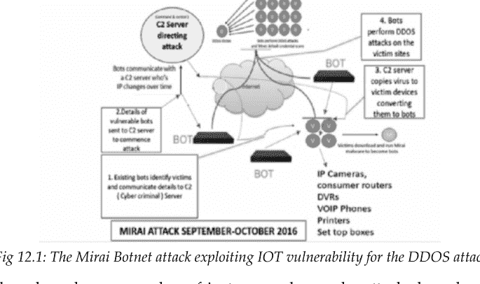

图12.1：利用物联网漏洞进行 DDoS 攻击的 Mirai 僵尸网络攻击

网络攻击被用作国家支持行为的武器，以渗透敌方计算机系统并关闭其活动的实例不胜枚举。

StuxNet 就是这样一次攻击，据称由美国和以色列军队针对伊朗核武器计划实施。

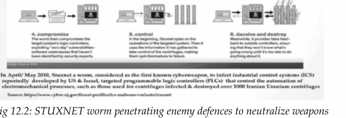

图12.2：STUXNET 蠕虫渗透敌方防御以使武器失效

“智慧城市”概念的出现导致大量物联网设备在现代基础设施的各个领域得到使用，以利用家庭、公司和便利设施的自动化。许多这些物联网设备的漏洞已在一次研究中得到充分暴露，即“连锁反应”攻击。

### ZIGBEE 连锁反应攻击

连锁反应是一个学术模拟项目，展示了一组物联网设备容易受到未经授权蠕虫渗透的漏洞，这些蠕虫可以通过单个设备（如 Philips Hue 灯泡）进入系统。

来源：(https://eprint.iacr.org/2016/1047.pdf )

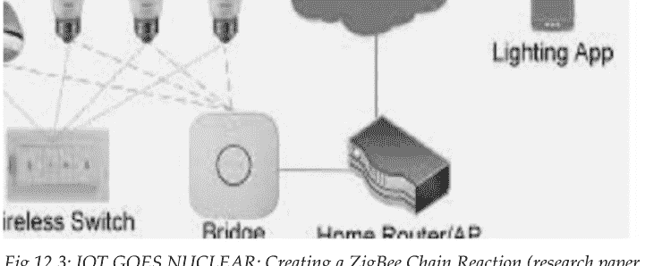

图12.3：物联网核爆：创建 ZigBee 连锁反应（研究论文网站），IACR 预印本提交。Eyal Ronen、Colin O'Flynn、Adi Shamir 和 Achi-Or Weingarten

通过通过单个受感染灯泡获得未经授权的访问并将其放置在由 Zigbee 协议控制的网络中，黑客能够接管整个物联网设备网络，显示出整个智能部署了不同物联网设备的网络的漏洞。尽管该设备相关的漏洞后来已被修补，但它展示了物联网主导的未来世界面临的真实网络威胁，在那里除了众多已存在的网络之外，还创建了新型易受攻击的通信网络。

因此，预计采用区块链是保护物联网设备的必经之路。毋庸置疑，区块链技术的增长因此将与物联网设备的增长密切相关。

以下是区块链被用于保护物联网设备的一些有趣应用概述：

- (a) 能源：区块链可作为各种可再生能源设备来源和性能数据的不可变且可信的存储库。智能合约可用于已生产能源的交易和交换，而加密货币可作为促进生产商和供应商之间交易的媒介。
- (b) 建筑自动化：区块链可用于识别并提供对在设施自动化项目中广泛使用的物联网设备的可信访问，并促进与设备的授权交互，以实现建筑物访问控制、停车场自动化以及能源和公用事业管理。
- (c) 工业自动化：区块链可在3D制造中广泛发挥作用，作为专利和专业设计的受信任存储库，促进机器之间的可信交互并追踪正品备件的来源。机器人和无人机可以以安全的方式进行管理，以实现预期结果，而不会因被黑客攻击而产生不需要的结果的威胁。
- (d) 移动性：区块链可促进对行驶中车辆的跟踪。车辆可以被识别，相关部门也可以收取过路费、停车费或交通违规罚款等费用，且不会有任何争议和信任缺失的余地。
- (e) 灾害管理：无人机可广泛用于摄影、环境危害跟踪、安全和地理信息系统制图等各种用途。区块链可广泛用于确保无人机的授权使用。通过区块链支持的分布式账本将收集的信息和视觉记录映射到警察、紧急服务、消防部门、地方自治机构等各种机构，事件响应可以在紧急情况下以快速方式进行，从而节省大量时间和精力。
- (f) 保险：区块链可广泛用于跟踪和监控所有行业和所有汽车的保险记录管理和案件补救。
- (g) 博世是开发和实施汽车和医疗电子领域尖端技术的全球领导者之一，TUV 在开发通过与区块链连接的智能手机应用程序管理汽车的区块链应用方面做出了重大贡献。互联汽车可以安全可靠地跟踪和记录汽车的各种性能和状态相关特征，如里程表读数、油箱读数、汽车里程和轮胎性能等。这些数据对预防性维护非常有用。这也防止了与维护燃油使用记录、旅行和二手车交易的司机相关的里程表欺诈。

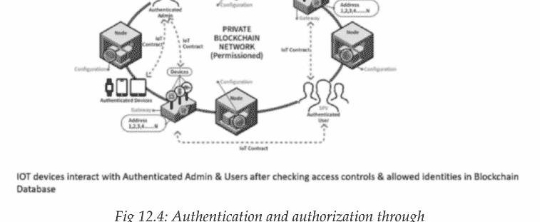

物联网设备在检查区块链数据库中的访问控制和允许身份后与已认证管理员和用户交互

图12.4：通过区块链进行身份验证和授权以减轻物联网漏洞

IBM Watson IoT 平台是 IBM 推出的一项出色举措，旨在将物联网设备无缝集成到区块链生态系统中，使其能够享受分布式账本应用的益处和安全性。利用区块链中的 Watson IoT 平台，物联网（IoT）设备可以向 IBM 区块链平台或开源 Hyperledger 区块链发送数据并调用智能合约交易。有关更多信息，您可以参考

## 通过区块链控制无人机以实现安全和审计

根据英国交通系统公司（Transport Systems Corporation UK）的一项研究，他们与谢菲尔德大学共同开展的研究为使用区块链控制无人驾驶飞行器提供了一种突破性解决方案。控制无人机、不可篡改地跟踪和记录其移动轨迹以及仅通过安全认证和访问协议下达指令的能力，可以帮助安全部门控制非法无人机活动，并确保飞行信息可被审计且所有安全标准均能得到遵守。这还可以大幅改善无人机在各种应用中的使用，包括电子商务配送、媒体和电影等。

## 通过区块链保护机器人

由 Ben Goertzel 博士领导的 SingularityNet 和 Hanson Robotics 是世界上最大的类人机器人公司之一。Hanson Robotics 是地球上最受欢迎的类人机器人 Sophia 背后的公司，Sophia 甚至被授予沙特阿拉伯王国的公民身份。以下是 Hanson Robotics 首席科学家 Ben 博士与 Sophia 之间现场采访的摘录：

Dr. Ben：Sophia，你运行的是什么软件？

Sophia：我使用的是 Hanson AI 软件栈，其中包含 OpenCog 通用智能引擎作为组件，后端为 SingularityNet。

Dr. Ben：什么是 Singularity Net？

Sophia：Singularity Net 是一个基于区块链的平台和 AI 市场。它支持整个网络的涌现层面的智能以及单个代理层面的智能。

这就是安全自动化的未来。基于区块链的后端系统允许以安全可靠的方式访问机器人、来自机器人以及机器人之间的访问，从而防止恶意软件攻击者和未经授权的网络罪犯访问自动化代理以对人类造成破坏。

这也让人想起技术奇点，即在某一假设的时间点上，任何在物理上可设想的技术进步水平都会瞬间实现。在这一时刻，许多专家预测将在未来 20 年内发生，自主导向的计算机将发展出超级智能，其智能以指数级而非增量方式增长。如果这种情况真的发生，预计将改变地球上的生活，并能帮助找到许多人类问题的解决方案，包括疾病和死亡率。

唯一能够保障和控制这一已经呈指数级增长的智能水平的方式是通过区块链技术提供的风险管理和保护能力。

通过区块链保护的机器人互联网市场允许安全可靠的访问，以确保对机器人提供适当的验证和多层次保护，确保它们仅用于有益且积极的活动，从而造福人类。

同样的模式可以扩展到所有自主对象，以实现突破性的安全管理，如下图所示“通过区块链实现自主对象的去中心化管理”：

图 12.5：自动化代理的互联网：通过区块链通信

## 使用区块链对汽车进行安全访问和管理

预计自动驾驶车辆将大量上路，它们是物联网技术与人工智能和机器学习应用相结合的惊人延伸。然而，它们极易受到网络罪犯的黑客攻击。区块链为自动驾驶车辆提供了最佳的安全保障，以确保它们不会被操纵且车主不会被勒索。

2017 年 12 月，令人兴奋的颠覆性技术公司 XAIN 与汽车领域的全球领导者保时捷宣布合作，将区块链技术引入汽车管理。

XAIN 和保时捷成功测试了一个概念验证，在该验证中，以太坊客户端与汽车系统融合，并连接到由 Azure 市场中的 IPFS 和 BaaS 节点组成的区块链网络。汽车通过智能合约及其车主智能手机中的车主钱包进行跟踪和管理。汽车系统被跟踪，所有参数均记录在车辆钱包中，该钱包跟踪汽车性能和活动等各个方面的信息。

图 12.6 保时捷和 XAIN 实施的区块链驱动汽车管理系统架构

图片鸣谢：Porsche Digital Lab (https://medium.com/@porsche_tech )

来源:https://medium.com/next-level-german-engineering/the-porschexain-vehicle-Blockchain-network-a-technical-overview-e1f48c40e73d

该系统将允许授权车主使用连接到网络的智能手机访问和与汽车通信，并可通过互联网或通过区块链驱动的直接离线连接以安全的方式从世界任何地方执行以下操作：

- 远程安全地锁定和解锁车门和行李舱。
- 与网络中的其他汽车通信并交换信息。
- 在去中心化的无信任系统中记录和管理所有关键信息。
- 防止网络罪犯进行黑客攻击。

另一个有趣的用例是管理无人机等自主车辆以造福公民，并保护这些车辆免受未经授权的黑客攻击，防止其被用于非法和犯罪活动。以下图片展示了其中一个示例：

- 对无人机的访问受到控制，以防止无人机被用于不文明和犯罪目的的滥用
- 通过共享图像和相关信息实现快速响应，以应对政府机构和基础设施公司之间的灾害管理响应
- 关于火灾、洪水、受损道路、停电和桥梁等共享的最新信息，有助于及时迅速地为受影响的公民提供救助

图 12.7：使用区块链进行无人机安全管理

## 结论：

为了充分利用人工智能和自动化，重要的是确保所有各种应用都得到妥善保护，并且不会被用于危害人类的利益。

人们观察到，我们今天在世界各地遇到的各种“自动化代理”越来越容易受到网络罪犯的恶意软件攻击，他们总是在寻找利用其漏洞的方法和手段，包括当今集中式系统所特有的“单点故障”。区块链凭借其突出的特性，如安全身份管理、去中心化决策、共享和分布式数据库，提供了必要的风险管理功能来保护这些应用和代理，从而使我们能够充分发挥其全部潜力。其在这些各种应用中的实用性已得到探索。

关于人工智能如何取代大量人类工作，存在很多争论。人工智能的作用是协助我们的工作、增强绩效、使我们能够以更少的努力放大成果，并自动化低价值的单调重复性工作。

众所周知，人类容易做到的事情对 AI 代理来说很困难，而人类难以做到的事情对 AI 来说却很容易。重要的是，我们利用技术大幅提高生活质量，同时确保安全通过全面的基于区块链的生态系统得到妥善保障，除此之外还需采取本书前面部分提到的高水平网络安全措施。

**这将使我们能够满怀信心和渴望地接近奇点，因为我们可以确保强大的自动化造福人类，而非危害人类。**

## 第十三章
### 摘要与结论
我们自机器学习驱动的人工智能出现以来，以及云计算、大数据和分析等使能技术开始协同作用，就见证了前所未有的自动化浪潮席卷全球。银行、机场、酒店、餐厅、BPO、零售、高端住宅甚至我们日常出行都正在逐步实现几乎无需人工操作。

本书的主要目的是介绍技术如何以各种工具、应用和形式产生影响并体现出来，我们将其称为‘自动化代理’。

在本书中，我们从多个角度看到了正在推动当今‘自主’革命的各种自动化要素。我们为上述每个领域提供了示例，并详细分析了这一现象对我们的哪些方面产生影响。我们还探讨了这些技术如何构建，以及全球各相关领域如何相互竞争，以取代人类在大多数常规和非常规工作中的角色。

每个应用中采取的步骤以及可用于构建这些应用的各种工具和平台已简要概述。这将使学习者和读者能够规划和部署这些工具，以提升其生产力和生活与工作的质量。

在这些代理被完全去神秘化后，您现在将能够轻松理解这些各种‘自动化代理’是如何在技术的帮助下构成并释放的。

随着数字化与自动化的影响日益增强，提供对恶意软件和网络犯罪分子的安全保护的需求也随之增加。区块链是一种范式，有潜力通过有效的身份识别、不可否认的交易、不可篡改的账本以及数字世界中快速高效的交互，从多个角度降低我们的风险。

我们研究了针对‘自动化代理’的区块链驱动自动化的全面方法，这将使我们能够利用这些技术进步，拥抱充满希望、便利和高品质的生活，而没有任何恐惧和顾虑。

## 结论：
各方面的自动化都是不可否认的现实。那些看不到这一浪潮并接受这一现实的人，不仅有风险错失所有这些可以提升个人和职业生活质量的便利和奢华。所有全球公民都需要理解它，并充分利用它来补充其活动并在这一世界中竞争。让我们都把这些‘自动化代理’当作朋友，专注于时间与精力投入到能提高净资产的更高附加值活动中。生态系统中的所有参与者也必须注意这些技术普及所涉及的各种伦理、道德、法律方面，以便为集体利益和我们未来生活的改善服务。

确实有可能在未来我们将拥有由计算机芯片驱动的人类，这些芯片为他们的大脑提供人工智能/机器学习的力量，就像‘协作机器人’在工业环境中为他们提供物理增强一样。同样有可能的是，受生物启发的机器人和移植了人工智能驱动大脑的生物工程人类会催生出一种在这一宇宙中漫游的新物种。未来确实令人激动。让我们怀着开放的怀抱和思想迎接未来！

## 附录 - 1
### 按章节提问
### 第1章
1: 我们在日常生活中会遇到哪些不同类型的自动机器？
- 1. 基本规则型机器与人工智能和机器学习驱动的自主机器之间有什么区别？
- 2. 自动化系统在机场有哪些不同的应用？

### 第2章：
- 1. 由人工智能和机器学习驱动的组织劳动力有哪些新的构成要素？
- 2. 哪些全球顶尖公司在利用人工智能、分析和自动化的力量，其依据是什么？
- 3. RPA是什么，它在组织中影响哪些领域？
- 4. 什么是工业4.0？
- 5. 影响各行业的各种自动化相关技术有哪些？
- 6. 机器人控制器是什么，它们在新时代组织中的作用是什么？
- 7. 哪些近期事件凸显了广泛数字化与自动化的风险？
- 8. 新时代组织在人工智能、机器学习及其他先进技术方面的伦理和社会观念应如何？
- 9. 区块链在新时代组织中扮演什么角色？

### 第3章
### 机器学习与人工智能
- 1. 什么是人工智能？
- 2. 是什么导致了人工智能的重生？
- 3. 电子商务公司如何利用人工智能和机器学习？
- 4. 到2025年，哪些与自动化相关的顶尖先进技术预计将在未来几年产生高经济影响？
- 5. 根据最新调查，人工智能最顶尖的应用是什么？
- 6. 顶尖的人工智能和机器学习专家有哪些，他们如何利用这些技术？
- 7. 什么是机器学习？
- 8. 机器学习是如何工作的？
- 9. 机器学习的关键应用领域有哪些？
- 10. 机器学习有哪些不同类型，每种方法的主要算法有哪些？
- 11. 机器学习有哪些不同阶段？
- 12. 机器学习驱动的人工智能算法的革命性特征是什么？
- 13. 大数据和机器学习使得哪些不同类型的分析成为可能？
- 14. 目前人工智能和机器学习应用中使用的主要编程语言是什么，为什么？
- 15. 流行的机器学习算法有哪些，它们主要用在什么地方？

### 第4章：IIOT
- 1. 什么是物联网，它是如何工作的？
- 2. 构成物联网系统的传感器有哪些不同类型？
- 3. 物联网网络的关键组件有哪些？
- 4. 物联网的主要应用有哪些？
- 5. 什么是工业物联网，IIOT的主要应用有哪些？
- 6. 物联网的顶尖消费级应用有哪些？
- 7. 与物联网领域相关的不同协议有哪些？
- 8. 实施IIOT项目的关键步骤有哪些？
- 9. 物联网如何为组织创造价值？
- 10. 由物联网驱动的智慧城市有哪些各种元素？
- 11. 什么是智能工厂？
- 12. 人工智能和机器学习在智能工厂中的主要应用有哪些？
- 13. 根据NASSCOM，物联网支出的关键领域有哪些？
- 14. 智能工厂的基本且长青的组件有哪些？
- 15. 基于物联网系统的关键风险有哪些，如何管理它们？

### 第5章：机器人
- 1. 什么是机器人？
- 2. 术语“机器人”的起源和历史是什么？
- 3. 机器人的操作特征有哪些？
- 4. 机器人的关键组件有哪些？
- 5. 机器人有哪些不同类型？
- 6. 机器人有哪些重要技能？
- 7. 采用机器人的优势有哪些？
- 8. 采用机器人的劣势有哪些？
- 9. 机器人预期应遵循的主要法则有哪些？
- 10. 什么是机器人技术？
- 11. 构建机器人使用的不同技术有哪些？
- 12. 基于其运动方式，机器人的关键分类是什么？
- 13. 机器人的不同应用领域有哪些？
- 14. 构建机器人时应考虑的重要步骤有哪些？
- 15. 机器人构建项目的阶段有哪些？
- 16. 构建机器人项目使用的不同组件和子装配有哪些？
- 17. 机器人在服务行业的应用有哪些？
- 18. 人工智能和机器学习领域的进步如何改善机器人功能？
- 19. 什么是人形机器人，世界上今天最著名的人形机器人有哪些？

### 第6章：机器人流程自动化
- 1. 什么是RPA？RPA是如何出现的？
- 2. RPA的好处有哪些？
- 3. 到2030年，全球银行业预计将被人工智能相关技术取代的人力规模是多少？

- 4. RPA 的不同层级有哪些？
- 5. 由 AI 和 ML 驱动的 RPA 的特点是什么？
- 6. RPA 与 BPM 之间的关系是什么？
- 7. 根据 NASSCOM 的说法，RPA 投资的预计回收期是多少，又是基于什么依据？
- 8. RPA 中有哪些不同类型的角色？
- 9. RPA 平台和解决方案的顶级供应商有哪些？
- 10. RPA 项目实施的不同阶段有哪些？
- 11. RPA 投资需要考虑哪些因素？
- 12. RPA 解决方案的主要应用领域有哪些？
- 13. 在金融机构中，RPA 的典型应用有哪些？
- 14. 考虑到影响组织内部和外部的各种其他技术，RPA 的未来是什么？

## 第7章：无人机
- 1. 什么是无人机？
- 2. 无人机的各种组件有哪些？
- 3. 无人机的不同应用有哪些？
- 4. 无人机何时以及如何出现？
- 5. 无人机如何工作？
- 6. 使无人机能够飞行的系统有哪些？
- 7. 无人机如何根据螺旋桨数量进行分类？
- 8. 无人机的各种军事应用有哪些？
- 9. 无人机如何根据机载设备进行分类？
- 10. AI 如何在无人机中使用？请解释在先进无人机系统中使用的不同 AI 和 ML 相关术语？
- 11. 请详细描述广泛使用无人机的各个领域。
- 12. 无人机的局限性是什么，如何克服？

## 第8章：聊天机器人和语音助手
- 1. 什么是聊天机器人？
- 2. 什么是语音助手？
- 3. 我们在日常生活中遇到的聊天机器人和语音助手有哪些不同类型？
- 4. 聊天机器人的主要应用领域有哪些？
- 5. 从聊天机器人预期获得的顶级好处有哪些？
- 6. 典型的聊天机器人预期具有哪些关键功能？
- 7. 与人工操作员相比，聊天机器人的优势是什么？
- 8. 聊天机器人如何工作？
- 9. 基于技术应用，聊天机器人的不同层级有哪些？
- 10. 什么是‘好机器人’，它们有哪些不同的应用？
- 11. 什么是‘坏机器人’，它们主要部署在哪里？
- 12. 构建聊天机器人的关键步骤有哪些？
- 13. 部署聊天机器人使用的不同渠道有哪些？
- 14. 用于构建聊天机器人和语音助手的开源平台有哪些？
- 15. Facebook Messenger 聊天机器人是如何构建的，相关的顶级平台有哪些？
- 16. 聊天机器人的主要用例有哪些？
- 17. 全球最成功的聊天机器人示例有哪些，它们做什么？
- 18. 聊天机器人如何在人力资源领域使用？
- 19. 聊天机器人如何在医疗领域使用？
- 20. 聊天机器人如何在营销和客户服务中使用？
- 21. 未来聊天机器人预测的顶级用例有哪些？
- 22. 根据 Everest 集团，机器人管理的整体方法是什么？
- 23. 组织在投资聊天机器人等各种自动化项目时需要考虑哪些方面？

## 第9章：自动驾驶汽车
- 1. 什么是自动驾驶汽车？
- 2. 自动驾驶汽车的不同级别有哪些？
- 3. 自动驾驶汽车的好处有哪些？
- 4. 自动驾驶汽车的不同组件有哪些？
- 5. 自动驾驶汽车如何工作？
- 6. 自动驾驶汽车中使用的不同类型的传感器有哪些？
- 7. 使自动驾驶汽车能够运行所使用的关键技术有哪些？
- 8. AI 和 ML 如何用于赋予自动驾驶汽车平稳运行所需的特殊功能？
- 9. 自动驾驶汽车技术的各种挑战和局限性是什么？
- 10. 你如何预见自动驾驶汽车系统的未来？

## 第10章：人工智能与自动化失控
- 1. 由于自动化技术故障而发生的近期事故案例有哪些？
- 2. 自动驾驶汽车和无人机如何被黑客攻击？
- 3. 自动驾驶汽车系统的各种漏洞有哪些，黑客如何利用它们？
- 4. 列举各种自动化失控的案例。
- 5. 区块链如何帮助保障自动化代理的安全？

## 第11章：区块链用于网络安全
- 1. 什么是区块链？
- 2. 区块链实施的主要安全功能有哪些？
- 3. 区块链系统的关键特性有哪些？
- 4. 什么是认证机构，它们如何在传统系统中为相互交易的各方提供可信度？
- 5. 私有区块链应用的顶级风险有哪些？
- 6. 需要解决的区块链平台固有局限性有哪些？
- 7. 恶意软件攻击有哪些不同类型？
- 8. 区块链如何应对与网络犯罪分子相关的风险？
- 9. 区块链管理员为确保其应用安全需要实施的最佳实践有哪些？
- 10. 近期对区块链系统发生的重大攻击有哪些，它们是如何应对的？
- 11. 区块链采用增长面临的挑战有哪些？
- 12. NIST 标准与基于区块链的应用有何关联？

## 第12章：面向自动化代理的基于区块链的安全
- 1. 与基于物联网的系统相关的重大风险有哪些？
- 2. 物联网连接设备的主要已知漏洞有哪些，它们在近期历史中是如何被利用的？请用三个例子说明。
- 3. 区块链在何处被用于保护基于物联网的系统？
- 4. 请解释区块链在物联网、无人机、自动驾驶汽车、机器人等安全应用背后的关键概念，并酌情提供架构。
- 5. 无人机如何在安全的方式下用于灾难救援和管理？
- 6. 我们如何确保由 AI 和 ML 驱动的自动化代理能够安全地扩展，以便我们利用其全部潜力造福人类？

## 附件 - 2

## 术语表：自动化代理

### A
- 1. 先进驾驶辅助系统 (ADAS)：为通过提高汽车安全性和流程自动化程度来帮助驾驶员驾驶过程而开发的系统。
- 2. 算法：为计算机完成任务而给出的公式（即计算机的一组规则）。算法是为实现特定计算任务而以数学或逻辑方式构建的公式。它也可以被视为解决问题的自包含精确规则或指令序列。规则可以表达为简单的过程，例如两个数字的加法，也可以表达为与数据处理或自动化学习相关的复杂函数。如今，算法越来越多地与人工智能 (AI)/机器学习 (ML) 技术相结合，使其在决策等关键功能方面的能力更智能。流行算法的示例包括递归算法、回溯算法和动态规划算法。
- 3. 环境智能：像 Alexa、Google Home 和 Apple HomePod 这样的智能设备对人的存在敏感且有响应。它们在后台运行，等待你请求帮助。环境智能作为一种无处不在的计算环境要素，旨在为人类生活带来智能。它基于通过传感器、传感器网络和人工智能 (AI) 将我们的现实世界与虚拟世界结合起来以获得可理解的机器-人类交互的理念。环境智能所支持的技术敏感且功能强大的环境使我们能够使用自然手段而非鼠标和键盘来明确提出请求。随着 AI 和物联网 (IoT) 的精细融合不断实现，环境智能在个人助理、社会通信、本地搜索应用以及健康和健身方面找到了广泛的应用。
- 4. 分析机器人：由人工智能驱动的商业分析助理机器人（例如 Qlik Bot）。它们还用于协助投资决策。

分析机器人旨在以有意义的方式组织算法交易的基础。基于算法交易代码，机器人具有生成和执行金融市场抛出的买卖信号的能力。机器人可以根据其‘入场规则’收到的信号确定何时买入和卖出。同样，在其‘出场规则’的帮助下，它可以决定何时平掉当前头寸。

显然，你需要一台计算机和互联网连接。分析机器人使用电子交易平台为其运营开发交易策略。
- 5. 人工智能：计算机科学的一个分支，涉及计算机系统执行与人类相似、相等或更优的智能任务（例如决策、物体分类和检测、语音识别和翻译）。
- 6. 人工通用智能 (AGI)：它也被称为强人工智能。AGI 是一种被认为具有人类特征的人工智能类型，目前仍处于初步阶段（在当今更像是假设性存在）。
- 7. 人工狭窄智能 (ANI)：它也被称为弱人工智能。ANI 是一种只能在给定时间专注于一项任务或一个问题的类型的人工智能（例如与一

人类竞争对手）。这是当前存在的 AI 形式。

8. 人工神经网络 (ANN)：一种通过模式识别计算机算法创建人工神经系统来模仿人类大脑的网络，该算法能够学习、解释和分类感官数据。

9. ATM/ATVM/AVM/ASCC/ABCC/AIC 等：用于柜员、票务自动售卖、消费者商品自动售卖以及机场自助值机、行李托运和移民检查的自动计数器/机器。

## B

10. 反向传播：这是“误差反向传播”的简称。它是一种训练神经网络的方法，其中系统的初始输出与期望输出进行比较，然后进行调整，直到输出之间的差异变得最小。

11. 贝叶斯网络：也称为贝叶斯网。贝叶斯模型、信念网络和决策网络是一种基于图的模型，表示一组变量及其依赖关系。

12. 大数据：大量结构化和非结构化数据，其复杂程度超出标准数据处理软件的处理能力。

13. 炸弹排爆机器人：

炸弹排爆机器人过去几十年间发展巨大，目前正被各国政府采用以在爆炸前排爆。在强大的传感器和 X 射线设备的帮助下，机器人排爆装置可用于探测简易爆炸装置（IED）。其抓取臂拾取爆炸物并用强力水射流进行排爆。先进的炸弹排爆机器人展现出类人灵活性，因其配备直观的控制界面，有助于操作员获得高度的指挥和控制。预计于 2020 年 12 月交付给英国军队的 Harris T7 被认为是一个典型的炸弹排爆机器人。

## C

- 14. 聊天机器人：一种可以通过文本或语音命令与人类用户对话的聊天机器人。被电子商务、教育、健康和商业行业用于便于沟通并回答用户问题。
- 15. 分类：一种允许机器为数据点分配类别的算法技术。
- 16. 聚类：一种允许机器将相似数据分组到更大数据类别中的算法技术。
- 17. 认知计算：通过数据挖掘、自然语言处理和模式识别来模仿人类思维过程的计算机化模型。
- 18. 计算机视觉：机器处理来自图像文件（JPEG）或摄像头馈送的视觉输入时。
- 19. 卷积神经网络 (CNN)：一种专门为使用多层感知器分析、分类和聚类视觉图像而创建的神经网络类型。
- 20. 众包：这是一种将任务分发给广大受众并快速完成的做法。这里的缺点是单独进行时很难维持人群并确保质量。

## D, E, F

- 21. 数据标注：对给定数据中发现的对象进行注释的任务。这包括图像、音频、视频或任何文件类型。
- 22. 数据挖掘：对大量数据进行筛选以识别重复模式并建立问题解决关系的过程。
- 23. 数据科学：统一统计学、数据建模和可视化及分析以提取信息、分类数据等的学科。

24. 数据科学家：比任何软件工程师更懂统计学，同时比任何统计学家更懂软件工程的人。

25. 决策模型：一种使用规范分析为特定情况确定最佳行动方案的模型。该模型评估决策要素之间的关系以推荐一个或多个可能的行动方案。它还可以预测如果采取某项行动会发生什么。

26. 深度学习：一种机器学习技术，教计算机通过死记硬背学习，即机器使用分类技术模仿人类思维学习。

27. 娱乐机器人：

娱乐机器人以更高水平的个性化用户体验为用户提供娱乐。机器人操作确保观众完全参与，同时为他们提供与活动、推荐和票务预订相关的无缝服务。凭借其与社交媒体平台的轻松集成，机器人能够把握观众偏好的脉搏并以更大规模与他们沟通。娱乐机器人的 AI 应用可以预测用户兴趣，向他们发送个性化的新闻提醒、电影和音乐会推荐及其演出时间。票务预订也可以使用这些机器人完成。

28. 人脸识别：对图像或视频信号中面部和情绪状态的识别。这通常通过称为地标的点注释来完成。

29. 人工智能之父：John McCarthy 是人工智能的创始人之一，与 Marvin Minsky、Allen Newell 和 Herbert A. Simon 一起。McCarthy 于 1955 年创造了“人工智能”一词，并于 1956 年夏季组织了著名的达特茅斯会议。该会议开启了人工智能这一领域。

## G

30. 游戏：

游戏本质上是运行被作为电子游戏或视频游戏出售给我们的专用应用程序。传统上，数字游戏包括 Xbox 和 PlayStation 等主机形式的硬件或用于在线游戏的个人电脑。然而，随着 VR、AR、AI 和智能技术的出现和逐渐普及，游戏市场正在迅速扩张，因为具有高质量用户体验的游戏正在开发中。游戏使用增强图形、3D 效果和全动态视频以及像摇杆这样的输入设备为玩家提供高娱乐价值。高端游戏极其复杂，其界面构成了一种虚拟现实形式，有助于沉浸式体验。

31. 真实标签：通常在现场或使用金标准进行的过程，用于衡量训练数据集的准确性以证明或反驳研究假设。例如，自动驾驶汽车使用真实标签来训练 AI 正确验证道路和街景。

32. 人在回路中：一种在过程中使用人类以实现预期输出的过程。它已被用于机器学习过程中以提高结果准确性。

33. 生成对抗网络 (GAN)：一种能够生成对人眼而言在表面上看似真实的照片的神经网络类型。GAN 生成的图像取自照片数据的元素并将其塑造成看起来逼真的关于人物、动物和地点的图像。它是一种无监督的 AI 和 ML 技术，用于模仿数据集，称为生成对抗网络 (GAN)。它由两个竞争的神经网络组成：生成器和判别器。

34. 遗传算法：一种基于遗传学原理的算法，用于高效、快速地找到困难问题的解决方案。

## H

35. 健康机器人：Microsoft Health Bot 项目旨在使合作伙伴能够轻松创建智能且合规的医疗保健虚拟助手和健康机器人。医疗机器人、药剂师机器人和医院机器人等是健康机器人的变体。

36. 启发式：一种为快速、最佳、基于解决方案的问题解决而设计的计算机科学技术。

37. 人力资源机器人：

人工智能（AI）驱动的机器人正迅速渗透到从医疗保健到教育、交通、广告、法律、金融和酒店业的各个行业。人力资源机器人提供软件与人类用户之间自动化但个性化的交互。在被提问时，机器人可以向用户提供多样化的信息。然而，人力资源专业人员需要在启动它们之前先为其设计指导计划。与人类员工类似，机器人也需要提升技能、管理以及绩效评估。

## I

38. 图像识别：在图像或视频中识别或检测对象或对象特征的过程。

## L

39. 领导机器人：

随着 AI 和 ML 技术近期和现象级的突破，计算机专家正在开发能够高效教授领导技能或执行领导角色的聊天机器人。如果设计和定制得当，领导机器人可以帮助专业人士接受领导角色培训。一些现有的领导机器人可以回答诸如“如何体面地解雇某人？”或“积极倾听的技巧是什么？”之类的提问。先进技术的专家甚至进一步建议为国家治理使用机器人，因为后者倾向于逻辑思考，因此比其人类同行更少非理性。

## M
40. 有限记忆：系统具有限定在特定时间范围内的短期记忆。

41. 机器学习（ML）：人工智能的一个分支，专注于开发能够自行访问和使用数据的程序，使机器能够自主学习并从学习经验中改进。

42. 机器翻译：自然语言处理的一种应用，用于文本和语音对话中的语言翻译（人对人）。

43. 管理式众包：服务提供商提供使用人群的完全托管外包解决方案。

44. 医疗聊天机器人：聊天机器人通过聊天窗口本身即时安排预约，为患者提供诊所或医院的治疗访问。

## N
45. 自然语言生成：一种机器学习任务，其中算法尝试生成可理解且听起来像人类的语言。最终目标是生成与人类生成的语言无法区分的计算机生成语言。

46. 自然语言处理（NLP）：它帮助计算机使用自然语言数据处理、解释和分析人类语言及其特征。

47. 神经网络：参见人工神经网络。

## O
48. 光学字符识别（OCR）：将文本图像（键入、手写或印刷）通过电子或机械方式转换为机器编码文本。

## P
49. 模式识别：数据中模式的自动识别。

50. 感知：获取、解释、选择和组织感官信息的过程。它是你所感知的东西，可能为真也可能为假，而与之相对的是始终为真的地面真相。

51. 感知器：感知器是一种用于二元分类器监督学习的机器学习算法。二元分类器是一个函数，可以决定由数字向量表示的输入是否属于某个特定类别。

52. 精确率：从给定数据集中，有多少被选中使用。

## R
53. 反应式机器：可以分析、感知并对经验做出预测的软件应用程序，但不存储数据；它们对情况做出反应并基于当前时刻行动。

54. 召回率：从选定数据中，有多少被处理。

55. 循环神经网络（RNN）：一种基于顺序信息和模式识别来理解并创建输出的神经网络类型。

56. 强化学习：一种机器学习方法，其中强化算法通过与环境交互学习，然后根据其做出的决策受到惩罚或奖励。

57. 机器人技术：专注于设计和制造表现出和/或复制人类智能和行为的机器人的技术分支。

58. 机器人流程自动化（RPA）：RPA使用具有人工智能和机器学习能力的软件来执行过去由人类完成的重复性任务。

## S
59. 语义分割：在像素级理解图像，将图像分割为语义上有意义的部分，并将每个部分分类到预先确定的类别之一。

60. 语音识别：音频信号中词语和/或情感状态的识别。

61. 蜘蛛机器人：网络爬虫，有时称为蜘蛛或蜘蛛机器人，常简称为爬虫，是一种系统地浏览万维网的互联网机器人，通常用于网页索引（网页抓取）。网络搜索引擎和其他一些网站使用网络爬虫或抓取。

62. 人工智能奇点：技术奇点（也简称为奇点）是假设的未来时间点，此时技术增长变得不可控且不可逆，导致人类文明发生难以想象的变化。

63. Sophia：首个获得任何国家公民身份（沙特阿拉伯王国）的机器人，Sophia，于2016年2月14日激活，是由总部位于香港的公司 Hanson Robotics 开发的社交类人机器人。它能够表现出超过50种面部表情。Sophia 被任命为联合国开发计划署的首位创新冠军，也是首个获得联合国称号的非人类。

64. 强人工智能：参见通用人工智能（AGI）。

65. 结构化数据：具有易于搜索模式的明确定义数据。

66. 监督学习：一种机器学习类型，其中输出数据集教会机器生成期望的结果或算法（类似于师生关系）。

## T
67. 训练数据：在机器学习中，训练数据集是在初始学习或训练阶段提供给机器的数据。从该数据集中，机器旨在通过识别数据之间的关系来获得有关高效完成其分配任务的选项的洞察。

68. 图灵测试：由计算机科学家艾伦·图灵于1950年开发。这是一种用于确定计算机是否能够思考的测试。如果与之交互的人类相信他们是在与另一个人而不是计算机交谈，则测试被认为成功。

69. 迁移学习：一种使用先前学习的数据并将其应用于新任务集的系统。

70. 图灵测试：由计算机科学家艾伦·图灵（1950年）创建的测试，用于查看机器是否能够表现出等于或无法与人类区分的智能。

71. 无人机：无人驾驶飞行器，例如无需任何人类飞行员导航的无人机。

72. 非结构化数据：没有易于搜索模式的数据（例如音频、视频、社交媒体内容）。

73. 无监督学习：一种机器学习类型，其中算法使用既未分类也未标记的信息进行训练，从而使算法能够在没有指导（或监督）的情况下行动。

74. 虚拟助手：虚拟助手模仿人类，并代表组织或个人就销售、客户服务和任何其他优惠相关澄清与客户或员工进行代理智能对话，提供提醒并执行指定的预编程活动。

75. WannaCry：WannaCry 是一种勒索软件加密蠕虫，通过加密数据并要求以比特币加密货币支付赎金来攻击运行 Microsoft Windows 操作系统的计算机。

76. Watson：IBM 的 Watson 是一台能够学习和适应的超级计算机。它处理大量非结构化数据以寻找模式、解释信息和解决问题。

77. 弱人工智能：它也被称为人工窄智能。它使用人工智能算法执行狭窄任务。

78. 网络爬虫：网络爬虫，有时称为蜘蛛或 *蜘蛛机器人*，常简称为爬虫，是一种系统地浏览万维网的互联网 *机器人*，通常用于网页索引（网页抓取）。网络 *搜索* 引擎和其他一些网站使用网络爬虫或抓取。
