# 医疗 4.0 中的人工智能、数值优化、物联网与区块链

## 其他相关标题

你可能喜欢

*   PBHE063 | Imoize | 新兴医疗系统中的网络安全——医疗 4.0 技术：从人工智能、物联网到区块链 | 2024
*   PBHE058 | Ramamurthy | 医疗 4.0 技术：从人工智能、物联网到区块链 | 2023
*   PBHE061 | Imoize | 现代远程医疗系统中的人工智能与区块链技术 | 2023
*   PBPC053 | Arya | 仿启发优化算法与软计算：物联网、智能城市、医疗和工业自动化的方法、技术与应用 | 2023
*   PBHE043 | Kumar | 医疗领域不断演变的预测性分析：用于实时干预的新型人工智能技术 | 2022
*   PBSE016 | Tyagi | 用于物联网的机器学习、区块链技术大数据分析：方法、技术与应用 | 2022

我们还出版了涵盖以下主题的书籍：

*   计算与网络
*   控制、机器人与传感器
*   电气法规
*   电磁学与雷达
*   能源工程
*   医疗技术
*   技术历史与管理
*   IET 代码与指南
*   材料、电路与器件
*   模型形式
*   纳米材料与纳米技术
*   光学、光子学与激光
*   生产、设计与制造
*   安全
*   电信
*   运输

所有书籍可通过 [`shop.theiet.org`](https://shop.theiet.org) 获取纸质版，或通过我们的数字图书馆 [`digital-library.theiet.org`](https://digital-library.theiet.org) 获取电子书版。

## 关于 IET

本书由英国工程与技术学会（The IET）出版。

我们启发、告知并影响全球工程界，以工程手段构建更美好的世界。作为横跨工程与技术的多元化平台，我们分享知识，帮助更好地理解世界，加速创新并解决关重要的全球挑战。

IET 是一家非营利组织。我们通过书籍获得的利润将用于支持工程社区的活动和产品，并促进科学、工程和技术在世界的积极作用。这包括教育资源与外展、奖学金与奖项、活动与课程、出版物、职业发展与指导以及对政府的建议。

欲了解更多关于 IET 的信息，请访问 [`www.theiet.org`](https://www.theiet.org)。

## 关于 IET 书籍

IET 出版涵盖许多工程和技术领域的书籍。在我们的学科领域内，我们设有由领先专家组成的编辑委员会。我们在提案阶段对每本书进行同行评审，以确保我们出版物的质量和相关性。

## 参与我们

如果您感兴趣成为作者、编辑、系列顾问或同行评审员，请访问 [`www.theiet.org/publishing-with-books`](https://www.theiet.org/publishing-with-books/) 或联系 `author_support@theiet.org`。

## 发现我们的电子内容

我们所有的书籍均可通过 IET 数字图书馆在线获取。我们的数字图书馆是技术文档、电子书、会议出版物和期刊文章的所在地。欲了解更多信息，请访问 [`digital-library.theiet.org`](https://digital-library.theiet.org)。

通过与联合国和国际出版者的合作，IET 是可持续发展目标（SDG）公约的签署成员。该公约旨在加速到 2030 年实现可持续发展目标（SDGs）。签署成员致力于制定可持续实践并在该方面发挥表率作用。为了符合我们的可持续目标，我们的英国印刷合作伙伴拥有 FSC 认证，有助于减少对地球的影响。

*   和或或

若书中通过姓名标识作者和/或贡献者，该作者和/或贡献者根据《版权设计设计法》（CPDA）主张其作为本作品作者和/或贡献者的署名权。

由 MPS Limited 在印度排版

## 目录

*   序言
*   关于编辑
*   引言
*   1 用于医学图像伪造检测的先进 WLDvG
    *   1.1 引言
    *   1.2 文献综述
    *   1.3 提议系统
    *   1.4 实验与结果
    *   1.5 结论与未来工作
    *   参考文献
*   2 医疗中的区块链：变革性案例与新兴用例
    *   Himadri Nath Saha, Reek Roy, Shreea Bose, Abhishek Sengupta, Snehashis Kayal, Shuvam Roy, Arup Halder 和 Pritam Manna
    *   2.1 引言
        *   2.1.1 分布式账本
        *   2.1.2 智能合约
    *   2.2 背景与相关工作
    *   2.3 提议模型
    *   2.4 使用区块链的临床试验
        *   2.4.1 方法
        *   2.4.2 结果
    *   2.5 假药检测与供应链管理
        *   2.5.1 方法
        *   2.5.2 结果
    *   2.6 药品链
        *   2.6.1 方法
        *   2.6.2 结果
    *   2.7 未来研究方向
    *   2.8 结论
    *   参考文献
*   3 区块链支持患者身份
    *   Shreea Bose, Snehashis Kayal, Reek Roy, Susanta Ghosh, Sayandeep Ray, Arghadip Jana 和 Himadri Nath Saha
    *   3.1 引言
        *   3.1.1 患者身份管理
        *   3.1.2 区块链账本
    *   3.2 背景与相关工作
    *   3.3 提议模型
    *   3.4 用于隐私保护和协作健康分析的区块链与联邦学习
        *   3.4.1 方法
        *   3.4.2 结果
    *   3.5 用于远程患者监测与护理的区块链与物联网
        *   3.5.1 方法
        *   3.5.2 结果
    *   3.6 用于安全和互操作健康交换的区块链与智能合约
        *   3.6.1 方法
        *   3.6.2 结果
    *   3.7 未来研究方向
    *   3.8 结论
    *   参考文献
*   4 医疗中的物联网 (IoT) 集成：向智能高效护理的范式转变
    *   Reek Roy, Shreea Bose, Snehashis Kayal, Partha Pratim Mandal, Sandip Patra, Sarmin Ahmed 和 Himadri Nath Saha
    *   4.1 引言
        *   4.1.1 传感器与 Arduino Uno
        *   4.1.2 医疗中的物联网
    *   4.2 背景与相关工作
    *   4.3 提议模型
    *   4.4 使用 IoT 的跌倒检测
        *   4.4.1 方法
        *   4.4.2 工作原理
    *   4.5 IoT 驱动的智能床
        *   4.5.1 方法
        *   4.5.2 工作原理
    *   4.6 IoT 与 AR 驱动的远程手术辅助
        *   4.6.1 方法
        *   4.6.2 工作原理
    *   4.7 结果与分析
    *   4.8 未来研究方向
*   8 眼部疾病的预测模型
    *   Ankita Saha, Rajdeep Kabiraj, Riddhi Sekhar Dwibedi, Shibakali Gupta, Chayan Paul, Korhan Cengiz 和 Nikola Ivković
    *   8.1 引言
    *   8.2 材料与方法
        *   8.2.1 数据集
        *   8.2.2 降噪步骤
    *   8.3 寻找预测模型
    *   8.4 评估指标
    *   8.5 讨论
    *   8.6 结论
    *   致谢
    *   参考文献
*   9 白内障及其主要成因
    *   N. Ramya 和 D. Hemavathi
    *   9.1 白内障及其主要成因
    *   9.2 白内障的类型
    *   9.3 白内障治疗的模式
    *   9.4 当前模型的局限性
    *   9.5 白内障的筛查与诊断
    *   9.6 AI 在白内障中的作用
    *   9.7 AI 的兴起及其在眼科中的应用
    *   9.8 用于白内障检测和程度分类的 AI
    *   9.9 挑战与未来方向
    *   9.10 结论
    *   参考文献
*   10 区块链在医疗中的应用
    *   M. Arun Anoop, P. Karthikeyan, Ben Othman Soufiane 和 S. Poonkuntran
    *   10.1 引言
    *   10.2 问题定义
    *   10.3 提议系统及其框图
    *   10.4 共识算法的类型
    *   10.5 实验与结果
    *   10.6 结论与未来工作
    *   参考文献
*   11 健康监测设备中的整天线性能
    *   Mounira Ben Yamna, Nabil Dakhli, Hedi Sakli 和 Mohamed Aoun
    *   11.1 引言
    *   11.2 相关工作
    *   11.3 健康监测设备中的整天线性能
    *   11.4 整天线设计
        *   11.4.1 天线设计
        *   11.4.2 整流器设计
    *   11.5 整天线性能
    *   11.6 结论
    *   参考文献
*   12 AI 在远程医疗与远程患者监测中的应用
    *   Anita Mohanty, Ambarish G. Mohapatra 和 Subrat Kumar Mohanty
    *   12.1 引言
        *   12.1.1 远程医疗与远程患者监测概述
        *   12.1.2 在数字医疗时代日益增长的意义
    *   12.2 远程会诊中的 AI
        *   12.2.1 AI 驱动的智能虚拟会诊
        *   12.2.2 用于增强通信的自然语言处理
        *   12.2.3 展示 AI 驱动平台的案例研究
    *   12.3 用于远程健康监测的预测性分析
        *   12.3.1 AI 在预测健康结果中的应用
        *   12.3.2 通过预测模型监测慢性疾病
        *   12.3.3 用于早期干预的实时数据分析
    *   12.4 可穿戴设备与 AI
        *   12.4.1 AI 算法在可穿戴健康技术中的集成
        *   12.4.2 生命体征和健康指标的远程监测
        *   12.4.3 AI 在解释和语境化可穿戴数据中的作用
    *   12.5 提高诊断准确性
        *   12.5.1 远程医疗中的 AI 辅助诊断
        *   12.5.2 用于准确远程诊断的图像和信号处理
        *   12.5.3 通过机器学习算法减少诊断错误
    *   12.6 个性化治疗方案
        *   12.6.1 基于 AI 洞察的定制治疗策略
        *   12.6.2 远程患者护理中的精准医疗
        *   12.6.3 针对特定患者的建议以获得更好结果
    *   12.7 挑战与考虑
        *   12.7.1 AI 驱动远程医疗中的伦理考量
        *   12.7.2 解决隐私与安全问题
        *   12.7.3 在远程医疗中平衡技术与人文关怀
    *   12.8 未来趋势与创新
        *   12.8.1 塑造远程医疗未来的新兴技术
        *   12.8.2 AI 进展及其对远程患者监测的潜在影响
        *   12.8.3 数字医疗中进一步集成与协作的机会
    *   12.9 结论
        *   12.9.1 总结 AI 在远程医疗和远程患者监测中的变革性作用
        *   12.9.2 未来发展与 AI 驱动医疗保健的持续演变
    *   参考文献
*   13 文献综述与未来工作
    *   K. Priyadarsini, S. Karthik, J. Jeba Sonia, P.C. Karthik, U.V. Anbhazagu 和 V.G. Saranya
    *   13.1 引言
        *   13.1.1 范围
        *   13.1.2 研究必要性
    *   13.2 文献综述
        *   13.2.1 文献评估总结
    *   13.3 未来工作
    *   13.4 讨论
    *   13.5 结论
    *   参考文献
*   14 ChatGPT 在医学中的应用
    *   V. Aravindan, P. Anirudh, Rajkanwar Singh, Krishna Reddy, Chandan Vishwas 和 Sukanta Nayak
    *   14.1 引言
    *   14.2 ChatGPT 及其机制与用途
    *   14.3 方法论
        *   14.3.1 研究问题
        *   14.3.2 文献检索
        *   14.3.3 纳入与排除标准
        *   14.3.4 数据提取
        *   14.3.5 数据分析
        *   14.3.6 结
    *   14.4 文献综述
    *   14.5 医学 ChatGPT
        *   14.5.1 在医学中的应用
        *   14.5.2 优势
        *   14.5.3 伦理考量
        *   14.5.4 前景
        *   14.5.5 本研究的影响
        *   14.5.6 挑战
    *   14.6 未来展望
        *   14.6.1 `ChatGPT` 的演进
        *   14.6.2 语音交互
        *   14.6.3 更便捷的病例记录
        *   14.6.4 准确识别药物
        *   14.6.5 先进的软件驱动诊断工具
    *   14.7 局限性
        *   14.7.1 临床环境中的精确性与验证
        *   14.7.2 缺乏大规模部署的案例研究
        *   14.7.3 缺乏偏偏数据集的研究
        *   14.7.4 关键场景下的部署
        *   14.7.5 闭源技术
    *   14.8 结论
    *   参考文献
*   15 物联网在医疗保健中的意义与未来
    *   Shafi Shereef 和 Nisha Varghese
    *   15.1 引言
    *   15.2 物联网在医疗保健中的意义
        *   15.2.1 改善患者疗效
        *   15.2.2 定制化关注
        *   15.2.3 远程患者管理
        *   15.2.4 早期筛选与行动
        *   15.2.5 患者参与与依从性
        *   15.2.6 提高运营效率
        *   15.2.7 促进医疗服务提供的创新
    *   15.3 医疗保健中物联网的关键组件
    *   15.4 物联网在医疗保健中的应用
        *   15.4.1 远程患者管理
        *   15.4.2 医院资产管理
        *   15.4.3 患者安全与康复
        *   15.4.4 远程医疗与虚拟护理
        *   15.4.5 临床试验与研究
    *   15.5 面临的挑战
        *   15.5.1 安全与数据隐私
        *   15.5.2 互操作与集成
        *   15.5.3 可扩展性与基础设施
        *   15.5.4 成本与报销
        *   15.5.5 伦理考虑
        *   15.5.6 员工培训与应用
    *   15.6 医疗物联网的进展
        *   15.6.1 人工智能（AI）整合
        *   15.6.2 高级可穿戴设备与传感器
        *   15.6.3 用于安全健康数据管理的区块链
        *   15.6.4 呈现机器人与数字疗法
    *   15.7 物联网在医疗保健的未来
        *   15.7.1 超个性化医疗
        *   15.7.2 AI 驱动的诊断与决策
        *   15.7.3 用于全方位健康管理的智能家居
        *   15.7.4 生物打印与植入式传感器
        *   15.7.5 关注心理与行为健康
    *   15.8 结论
    *   References
*   16 肺癌检测模型研究
    *   Bhumika Choksi, Priyanka Roy, Pawan Hingane, Snehal Dnyane 和 Tejas Nehete
    *   16.1 引言
    *   16.2 背景与相关工作
    *   16.3 文献综述
    *   16.4 研究空白
    *   16.5 模型概述
        *   16.5.1 肺部数据集
        *   16.5.2 肺分割
        *   16.5.3 数据划分
        *   16.5.4 模型架构
        *   16.5.5 训练
        *   16.5.6 最终模型
        *   16.5.7 性能评估
    *   16.6 肺癌流行病学
        *   16.6.1 非小细胞肺癌
        *   16.6.2 小细胞肺癌
        *   16.6.3 风险因素与原因
        *   16.6.4 社会经济影响
        *   16.6.5 当前诊断方法
        *   16.6.6 影像技术
        *   16.6.7 活检
        *   16.6.8 血液检查
        *   16.6.9 分子检测
        *   16.6.10 对比表
        *   16.6.11 讨论
        *   16.6.12 未来研究方向
        *   16.6.13 结论
    *   References


**Saurav Mallik** 是美国亚利桑那大学 R Ken Coit 药学院药理学与毒理学系的研究科学家。他曾先后担任哈佛大学 T H Chan 公共卫生学院、德克萨斯大学休斯敦健康科学中心以及美国迈阿密大学米勒医学院的博士后研究员。他于 2017 年获得印度加尔加塔贾达普尔大学计算机科学与工程系的博士学位，其博士研究期间在印度加尔加塔的印度统计学院（ISI）机器智能单元（MIU）担任初级研究员，参与由印度政府科学与技术部（DST）资助的 Swarnajayanti 项目。他曾担任过印度加尔加塔贾达普尔大学计算机科学与工程系的研究员，由印度政府大学拨款委员会（UGC）资助。他是 2017 年印度政府科学与工业研究委员会（CSIR）和人力资源开发部（MHRD）的研究助理员。他还是印度 Bioclues & BIRD 奖指导委员会颁发的的“生物信息学新兴研究者”奖（2020 年）。他曾两次获得*国际智能生物学与医学会议 (ICIBM)* 的差旅资助，分别于 2018 年 6 月在加州洛杉矶和 2021 年 8 月在美国宾夕法城举行。Mallik 博士在多个同行评审的国际期刊、会议和书籍章节中共同发表了 240 多篇研究论文。他还在 Taylor & Francis、River publishers、IET、Elsevier、Springer、Bentham 等出版社出版或编辑了 30 多部著作。他的论文被引率很高（Google Scholar 引用超过 3200 次，h 指数为 31）。他曾参加在美国和印度举行的许多国家和国际会议。他是美国电气电子工程师学会（IEEE）、美国癌症协会（AACR）和美国计算机学会（ACM）的活跃成员，也是印度 BIOCLUES 的终身会员。他担任多个期刊的编辑成员，包括 `Frontiers in Genetics`、`BMC Bioinformatics`、`Frontiers in Bioinformatics`、`Frontiers in Applied Mathematics and Statistics`、`Archives of Medical Sciences`、`Mathematics`、`Electronics, Bioengineered`（Taylor & Francis）、`International Journal of Biomedical Imaging`、`Chemistry & Biodiversity`（Wiley）以及 `International Journal of Molecular Sciences` 等。他还是印度许多知名工程学院国际顾问委员会的成员。他的研究领域包括数据挖掘、计算生物学、生物信息学、生物统计学和机器学习。

**Ben Othman Soufiane** 自 2025 年起担任沙特阿拉伯法萨国王大学应用学院计算机科学助理教授。他于 2016 年在突尼斯曼努巴大学获得计算机科学博士学位，论文题目为“无线传感器网络中的安全数据聚合”。他还于 2012 年获得莫纳斯尔大学的硕士学位。Ben Othman 博士在知名的国际期刊、会议和书籍章节上发表了 140 多篇论文。他是多个期刊和会议的编辑成员。他担任 `IEEE Access`、`IEEE Sensors` 和 `IEEE Internet of Things` 等国际期刊的副主编/学术编辑。他还是十多个国际会议的技术程序委员会成员。他的研究兴趣包括医疗物联网、无线身体传感器网络、无线网络、人工智能、机器学习与大数据、软件测试以及区块链。

**Junichi Iwata** 是密歇根大学牙医学院的教授。此前，他是美国德克萨斯大学健康中心的教授。他曾是美国南加州大学颅面部分子生物学中心的研究助理。他发表了 110 多篇同行评审的文章。他的研究实验室旨在全面理解颅面部先天畸形，如唇裂和腭裂、牙齿发育问题、肌肉疾病以及干燥格氏症。

**Subramaniam Karuppiah Barathi Setha** 是印度马尼帕尔高等教育学院马尼帕尔理工学院（MIT）的副教授。她拥有 16 年的教学经验和 10 年的研究经验，并在高质量期刊上发表了多种研究论文。她是印度技术服务工程师协会（ISTE）和印度工程师协会（IEI）的终身会员，并在机器学习和深度学习领域发表了 60 多篇文章和专利。

**Venkatesan Muthukumaran** 是印度卡塔库库尔 SRM 科学技术学院（SRMIST）的助理教授。他是印度国际密码研究协会（IACR）的会士以及 IEEE 的终身会员。他在代数应用于物联网领域发表了 100 多篇期刊文章和会议论文、10 部书籍章节和 10 项专利。他的研究领域包括机器学习、数据科学、区块链、物联网、数据挖掘和代数密码学。

**Priyanka Roy** 目前在维特比哈尔尔大学（VIT Bhopal）高级科学语言学院担任助理教授。她在加尔加塔印度理工学院（IIT Kharpur）数学系完成了硕士和博士学位。她是 2009 年至 2014 年间 DST INSPIRE SHE 学金的获得者。她在知名的国际期刊、会议和系列丛书中发表了多篇文章。她担任若干运筹学和计算数学国际期刊的审稿人。她的研究兴趣主要集中在数值优化、广凸性、不确定性优化、区间分析、投资组合优化和博弈论。

近期，科学技术的飞速发展彻底改变了我们生活的几乎每一个领域，包括疾病检测和医疗保健服务。随着医疗 4.0 的到来，一场范式转移正在发生，推动我们向更快、更智能、更具技术性、更高效且以患者为中心的医疗系统转型。人工智能（AI）、数值优化、物联网（IoT）和区块链的融合是这一变革的核心。本书探索了用于医疗 4.0 的各种突破性技术，即 AI、数值优化、IoT 和区块链，以及它们对重构医疗未来的潜力。本书汇集了这些技术，并对它们如何汇聚形成新旧见解，演变出一个能够增强医疗交付效率、准确性、容错性和可靠性的生态系统。它基本上设计用于为数学家、研究人员、学者、医院和医疗专业人士，以及对医院和医疗技术新兴趋势和未来可能性真正感兴趣的技术爱好者服务。各章节详细探讨了每项技术，从基础概念开始，逐渐过渡到现实医疗场景中的复杂应用。书中还包含了案例研究、实际示例和研究结果，以说明这些技术的变革潜力。

## 第 1 章：医学图像伪造检测技术

第 1 章提出了一种关于医学图像伪造检测的技术。乳腺癌医学图像在互联网上的传输容易受到篡改，对诊断准确性和患者安全构成了严重风险。数字图像中的细微修改可能不会被察觉，特别是对于经验较少的医护人员，这会导致误诊和患者预后恶化。本研究提出了一种使用堆叠机器学习（ML）和深度学习模型检测图像伪造的框架。特征通过`Weber 本地描述符`和 `TensorFlow Hub` 中基于 `CNN` 的预训练模型进行提取，并使用极端学习机和优化流水线进行真实性验证。该方法在乳腺癌图像上进行了测试，整合了 17 种监督机器学习技术以及如 `AlexNet`、`ResNet`、`ResNet-50` 和 `VGG` 等预训练模型，并通过`大象群优化算法`和`遗传算法`方法进行了优化。所提方法展示了高准确性，在检测伪造方面优于现有研究，确保了诊断结果的可靠性。

## 第 2 章：医疗保健领域区块链技术概述

第 2 章关注医疗保健领域区块链技术的概述。区块链技术通过解决以患者为中心的护理、数据安全和互操作性方面的关键问题，正在彻底改变医疗。本章通过引人注目的用例探索了区块链的变革潜力，强调了其在创建不可篡改健康记录钱包方面的作用，确保数据完整性并增强患者隐私。真实示例说明了区块链如何保护敏感信息、防止未经授权的访问并促进提供者之间的安全数据共享。其去中心化的架构解决了互操作性挑战，而`智能合约`实现了跨系统的无缝数据交换，改进了协作和患者预后。随着医疗保健数字化，区块链成为一种强大的变革驱动力，通过创新应用重塑行业并重新定义利益相关者关系。

## 第 3 章：基于区块链的医疗患者身份管理

第 3 章通过在区块链技术中整合 `Python` 和 `Solidity`，提出了一种新的医疗患者身份管理方法，以增强数据安全性和完整性。`Python` 用于构建灵活的后端基础设施，而 `Solidity` 为身份验证创建安全的、不可篡改的`智能合约`。这种去中心化的系统能够在不同提供者之间无缝共享和更新患者信息，同时确保隐私和监管合规性。`智能合约`限制授权访问的访问，改进了互操作性，减少了身份欺诈并提升了医疗效率。该可扩展框架解决了持续的身份管理挑战，并可以与现有系统集成，促进了患者数据处理中的安全性、透明度和信任，最终加强了医疗生态系统。

## 第 4 章：医疗中的物联网

第 4 章探索了物联网如何通过连接医疗设备、传感器和系统来实现实时通信和数据交换，从而彻底改变医疗保健。本章探索了 IoT 在增强患者护理、资源利用和医疗结果方面的变革潜力。IoT 通过可穿戴设备和智能传感器促进了远程监测、主动治疗和健康问题的早期检测，减少了并发症和医院再次入院率。它还通过连接的救护车、支持 `RFID` 的库存管理以及医疗设备的预测性维护，优化了医疗运营，提高了效率并降低了成本。通过创建一个以患者为中心的智能医疗生态系统，IoT 为医疗交付提供了一种更安全、更高效的方法。

## 第 5 章：模糊值无约束优化的基于梯度的优化技术

第 5 章引入了一种用于解决模糊值无约束优化问题的`基于梯度的优化`技术，其中目标函数是模糊的。通过利用模糊中心和模糊算术，该方法处理了不确定系统，将模糊线性方程组转化为优化问题。它研究了部分模糊系统（具有模糊系数或右侧向量）和全模糊系统（两者均为模糊）。收敛性确认了解的存在，并求解了各种示例问题以验证该方法。结果与现有技术相比，显示出强的一致性，并突显了所提方法的有效性。

## 第 6 章：基于 CNN 的阿尔茨海默症早期检测与预测

第 6 章利用卷积神经网络（`CNNs`）对阿尔茨海默症的进展进行早期检测和预测，旨在实现及时干预并改善患者预后。使用来自 `Open Access Series of Imaging Studies` 的数据，模型经过了预处理（包括标准化和增强），以对与阿尔茨海默症相关的功能和结构生物标志物进行训练。准确率和受试者工作特征曲线（ROC）等指标评估了性能，交叉验证确保了更广泛的适用性。`CNN` 实现了 99.95% 的准确率，通过识别海马体萎缩和皮层厚度变化等关键生物标志物，有效区分了阿尔茨海默症、轻度认知障碍（`MCI`）和健康对照组。该模型的预测能力通过准确追踪为阿尔茨海默症的 `MCI` 患者得到了了验证。这项研究突显了 `CNN` 在临床环境中用于早期检测和疾病监测的潜力，未来的研究将关注整合多模态数据并在更大、更多的人群中进行测试。

## 第 7 章：基于 EEG 的癫痫检测技术

第 7 章针对癫痫（一种在两次与医疗状况无关的发作后诊断出的脑疾病），开发了一种计算机化癫痫检测技术，以保护患者并及时提醒看护人员。使用 `EEG` 数据，所提方法采用一个预处理单元进行带限限制、放大和信号抑制，而自适应算法通过识别超同步脉冲和过滤干扰信号来检测发作起始。一旦检测到，系统会通知医护人员进行立即干预。该方法展示了卓越的准确性、灵敏性和特异性，非常适用于`医疗物联网`框架下的可穿戴设备，能够快速检测并可能挽救生命。

## 第 8 章：区块链在健康 4.0 中的应用与挑战

人工智能和物联网的进步彻底改变了各行业，特别是医疗保健，开启了健康 4.0 时代。第 8 章包含了创新技术，如 `IoT`、`IoS`、`医疗信息物理系统`、`健康云`、`健康雾计算`、`大数据分析`、移动网络和区块链。随着医疗保健处理大量的患者数据、临床试验信息和研究结果，安全的数据交换仍然是一项关键挑战。保护云平台和联网设备上的敏感医疗数据免受破坏是一个主要关注点。`区块链`凭借其去中心化、安全且不可篡改的架构，为医疗数据管理提供了一种前景广阔的解决方案。本章探索了区块链在健康 4.0 中的优势与挑战、其应用以及持续研究，强调了其在增强数据安全和医疗效率方面的潜力。

## 第 9 章：AI 在白内障管理中的应用

第 9 章介绍了人工智能在医疗领域的发展，特别是在全球领先白致障管理方面（尤其是在老年化人口中）。`AI` 通过解决白内障早期检测、分期和治疗中的空白，提升了效率和质量，而由于资源有限和手术需求增加，这些工作极具挑战性。`AI` 系统可以自动检测年龄相关的眼疾病，提取高级特征并提高诊断准确性，使其对公共医疗系统和全球白内障护理的进步具有无价的价值。

## 第 10 章：结合区块链的机器学习图像伪造检测

在第 10 章中，机器学习与`区块链`的结合确保了安全可靠的图像伪造检测。`区块链`将图像哈希值和时间戳存储在防篡改的账本上，而机器学习模型则分析特征以区分真实图像与伪造图像。这种由共识机制加强的去中心化方法防止了篡改并保证了数据的完整性。

## 第 11 章：用于可穿戴健康监控的高效整流天线设计

第 11 章介绍了一种高效的整流天线，设计用于采集 `3.5 GHz` 的射频功率以为可穿戴健康监控 (`WHM`) 设备供电。该天线使用 `CST` 创建，实现了 `2.49 dB` 的增益和 `−40 dB` 的反射系数，同时在 `ADS` 中带有 `Schottky diode` 的串行采集器在 `0 dBm` 射频输入下达到了 `63.5%` 的功率转换效率。`CST` 和 `ADS` 中的优化改进了阻抗匹配、增益和 `RF-to-DC` 转换，提供了足够低功率医疗设备的 `2.5 V DC` 输出。这项工作强调了整流天线通过减少对传统电池的依赖来增强 `WHM`可靠性的潜力。

## 第 12 章：AI 改变远程医疗与远程患者监控

第 12 章研究了 `AI` 如何改变远程医疗和远程患者监控，从而提高患者疗、可及性和资源效率。它探索了 `AI` 驱动的应用，如智能远程咨询、高级监控和预测分析，这些应用改进了诊断精准度、个性化治疗和医疗效率。本章强调了 `AI` 在推进患者护理和福祉方面的变革潜力。

## 第 13 章：基于 IoT 的健康监测设备布局

第 13 章探索了为了健康监测和网络连接而开展的便捷可用技术分析，并制定了一个基于 `IoT` 的设备布局，该设备可用于显示患者的健康状况。这项研究在设计和改进健身追踪系统以及利用 `IoT` 策略方面起着重要作用，让患者能够能够在家庭平台生活，尽管医生几乎无法实际时间获取他们的关键科学测量数据。

## 第 14 章：ChatGPT 在医学领域的变革潜力

第 14 章探索了由 `OpenAI` 开发的自然语言模型 `ChatGPT` 在医学领域的变革潜力，重点关注其在诊断、治疗、患者互动和心理健康支持方面的应用。它研究了 `ChatGPT` 的历史、机制及其对医疗保健的贡献，包括提高效率、辅助沟通和提供第二意见等任务。本章还讨论了伦理考虑、挑战和局限性，提出了将 `ChatGPT` 整合到医疗环境中的框架。该章节跨越多个部分，提供了文献综述、研究方法、建议系统、结果和未来方向的全面回顾，强调了该模型的优点和改进领域。

## 第 15 章：IoT 在医疗分析系统中的多维度整合

第 15 章深入探讨了 `IoT` 在医疗分析系统中的多维度整合，强调了其对患者结果、数据驱动的决策以及医疗交付本身的变革潜力。我们探索了 `IoT` 技术在医疗分析中的多样化应用，涵盖人群健康管理、远程诊断、实时患者监控和临床研究。此外，我们还调查了 `IoT` 设备（如可穿戴设备、传感器和智能医疗仪器）在数据采集中的作用。这些设备通过行为、环境因素生理参数捕捉患者健康状况，为医疗专业人员提供了全面的视图。此外，本章还了与 `IoT` 集成相关的关键挑战，包括数据互操作性、安全性和扩展性。我们研究了边缘计算、`区块链`和云计算等技术在保护患者隐私和确保数据完整性方面发挥的重要作用。

## 第 16 章：肺癌生物学、诊断方法与 AI 进展

第 16 章探索了肺癌生物学、传统和新兴诊断方法，以及图像降噪和特征提取等关键创新。肺癌仍然是全球死亡率最高的癌症之一，早期准确检测对于提高生存率至关重要。影像等传统方法在敏感性、可及性和成本方面存在局限性。`AI`、机器学习和放射组学的进步改变了肺癌检测，实现了更精确且成本效益的方法。它还讨论了挑战、伦理影响以及通过全球合作最大化这些技术影响的需求，强调了其在改善患者结果和应对全球健康危机中的重要作用。

## 第 17 章：视网膜疾病预测模型与标记发现综述

第 17 章对视网膜疾病的预测模型和相关标记发现的研究项目进行了全面综述。

## 用于医学图像伪造检测的高级 WLDvG

M. Arun Anoop^(1)`, P. Karthikeyan^(2)``, Ben Othman Soufiane^(3)` and S. Poonkuntran^(4)

¹ 计算机科学与工程系，AJ 工程学院, 印度

² 电子通信工程系，Velammal College of Engineering and Technology, 印度

³ 计算机科学系，Médenine 高等科学学院, 突尼斯的

⁴ 计算机科学与工程学院，VIT Bhopal 大学, 印度

乳腺癌医学图像可能会通过互联网传输；此外，嵌入图像中的隐藏线索可能对医学图像的传输造成严重威胁。医生和医疗专业人员无法识别此类伪造，在某些情况下，这种情况会通过数字图像传输发生。一些中年或经验较少的医生可能无法识别出数字图像中这些细微的变化，这可能导致预测错误。微小的修改可能会影响图像质量以及对所进行图像造假的识别。证明医学图像的真实性是一项使用堆叠版本的机器学习（ML）和深度学习模型完成的任务。在某种程度上，医学 X 射线图像的微小变化就能严重影响患者健康，这可能导致错误的患者诊断并严重威胁患者生命；也可能对少数患者产生心理影响。早期检测此类伪造对于帮助患者克服此类危险情况是必要的。基于 Weber 局部描述符变体和 `TensorFlow hub` 的基于特征向量的 CNN 预训练模型提取特征。随后，使用带有流水和线性模型选项的 `ELM` 等最智能算法来检查图像的真实性。所提出的算法用于乳腺癌数字图像，通过准确率检测展示该方法的有效性，最后将结果与其他方法进行比较。本章主要利用 17 种监督机器学习技术，结合 `Alexnet`、`RESNET`、`RESNET50`、`VGG CNN` 预训练堆叠模型进行医学图像造假检测。大象群优化和遗传算法优化是具有高准确率的最佳方法。

**关键词：** 乳腺癌乳腺检查图像；遗传算法；EHO 算法；机器学习与深度学习混合遗传算法；监督学习和预训练特征向量方法

### 1.1 引言

在全球范围内，数字照片面临的许多困难任务之一是确保其有效性。尽管该领域已有许多研究进行，但目前还没有能够准确且真实地检测图像修改的永久方法。确定操纵类型一直是学术界的一个关键难点。在关于所提系统的章节中，讨论了用于医学图像造假检测的一些创新方法。基于关键点的方法包括 `SURF`（加速鲁棒特征）和 `SIFT`（尺度不变特征变换）。主要方案仅使用基于块的技术。因此，提取特征时，通常使用这些方法。使用基于块的方法（通常是基于定量的特征提取）进行研究，因为它们根据数据集提供了高准确率。医院（服务器）和患者（客户端）是医疗系统单元中的两个通信实体。通信媒介是服务器与其客户端之间交换信息的接口。在现代时代，数字成像是必要的，以增强查看者的体验，展示图像中肉眼不可见的重要信息，并使用几何和光电方法平衡图像。许多照片编辑应用程序，包括免费的 `GIMP` 和 `Adobe Photoshop`，可用于伪造图像。


调整大小、亮度、拼接、元数据删除、GPS 标签删除和复制移动伪造是一些主要的攻击手段。最大的问题是操纵照片的工具易于获取，且缺乏用于评估的原始图像。在医疗行业，照片造假是不可容忍的。在少数情况下，放射射线受到破坏，攻击者使用复制移动伪造来扩大肿瘤区域，患者将陷入困境并导致诊断错误。`MIAS` 数据库 `[1]` 用于医学图像分析。

如果任何患者数据被篡改，可能会危及其生命。最大的问题是它是致命的。患者需要意识到伪造的存在以防止潜在的致命情况，早期识别可以提供帮助。在某些情况下，如果发现异常，可以治疗患者的生命威胁状况。任何人都可以为了自己的利益将正常变为异常，或将异常变为正常。这也是一个主要问题。

该研究以乳腺癌数据集为起点来检测伪造。在初步研究中，检查了典型的自然风景（来自 `CASIA` 数据集和其他数据集）。伪造可能发生在任何数字图像中，无论它描述的是植物疾病、人体器官还是牙齿根管。智能医疗系统应该包含一种机制，用于检测黑客或其他入侵者在传输过程中是否更改了患者数据。

Lee *等人* `[2]` 讨论了后处理技术之前的梯度方向直方图（`HOG`）算法。他们的专注于复制移动鉴定，这在未来需要使用复杂的方法。Soni 和同事 `[3]` 讨论了局部二值模式（`LBP`）直方图。聚焦特征的概念用于检测图像操纵。未来，他们将关注识别图片中存在的许多伪品，并识别高风险区域的精确伪品。在图像造假章节中，Wang *等人* `[4]` 引入了一种基于 `LBP` 和奇异值分解（`SVD`）的准确检测方法。此外，他们对比了单独使用 `SVD` 与 `SVD + DCT` 结合的结果。

为了识别图像造假，Yang *等人* `[5]` 建议了基于 `SIFT` 和 `KAZE` 的混合特征。使用他们建议的混合技术，作者根据 `SIFT`、`SURF`、`Zernike Moments` 和 `Bravo` 的后处理变化评估了精确率和召回率。Tralic *等人* `[6,7]` 提出了一种基于 `LBP` 和细胞自动机的视频帧造假识别技术。他们希望未来开发一种新技术来识别视频复制移动伪造（`CMFs`），即帧的一部分被复制并粘贴到序列中的另一帧中。在放射图像造假领域，Díaz-Flores-García *等人* `[8]` 利用相对频率和随机概率开发了正确回答的二项分布。

2008 年，Calberson 及其同事讨论了检测图像篡改的技术。未来的研究将确定是否需要更严格的准则或其他措施来恢复、阻止或防止数字放射科的欺诈使用。Ghoneim *等人* `[9]` 提出了一种用于智能医疗系统的图像造假识别方法。他们在实验结果计算了自然图像和乳腺检查图像的准确率。Li 和 Yuan `[10]` 介绍了一种基于非接触采集模式提取手掌特征的方法。作者使用特征质心的相对半径创建特征向量。

Tuncer 和 Dogan `[11]` 提出了一种使用金字塔结构多内核 `LBP` 的新型纹理识别技术以及对噪声图像准确性的评估。对于医学影像的精确诊断和解读，特别是乳腺癌 X 射线图像，必须依赖专业的医疗机构和人员。可以使用多种技术从乳腺癌 X 射线图像中提取特征，如模式、异常存在或肺部纹理。

以下讨论了一些常用的算法：

*   一种捕捉像素强度局部波动的纹理描述符被称为 `LBP`。它在捕获纹理模式方面表现良好，有助于识别肺部纹理的异常。
*   灰度共生矩阵（`GLCM`）：该工具确定了不同的空间距离和方向导致相同像素强度共现的频率。均匀性、对比度、能量和熵等纹理特征可用于识别 X 射线图像中的模式或异常。
*   方向梯度直方图（`HOG`）：`HOG` 计算图像内部的梯度方向分布。它被频繁应用于目标检测中，并能够识别出 X 射线图像中特定的结构模式或异常。
*   深度学习模型，如卷积神经网络（`CNNs`），可以自动从照片中提取相关信息。在许多计算机视觉任务（如医学图像处理）中，它们已经取得了巨大的成功。通过微调（`tuning`）如 `ResNet`、`VGG16` 和 `Inception` 等预训练的 `CNN` 模型，可以提取与异常或肺部纹理相关的特征。下面讨论了能够从乳腺癌 X 射线图像中提取信息的典型 `CNN` 层。

    *   **卷积层**：这些层通过对输入图像应用卷积操作，从图中提取不同的低级和高级级特征，包括边缘、线条、形状和纹理。`CNN` 模型中的特征在训练过程中自动学习。这些特征由网络提取并以层次形式表示。尽管如此，如果你正在寻找易于学习的列表或 `CNN` 模型能够捕捉的方面，可以发现以下通用特性：

        *   **边缘和线条**：`CNNs` 对于识别图像中的边界和轮廓非常有用，因为它可以捕捉各种方向和厚度的边缘和线条。
        *   **纹理**：`CNNs` 能够识别纹理模式，如粗糙和光滑，这些模式是肺组织特有的或者是乳腺癌 X 射线图像中显示的异常。
        *   **形状和结构**：`CNNs` 可以识别各种形状和结构，包括可能是乳腺癌感染迹的结节、实变区域以及圆形或椭圆形不影。
        *   **模式**：`CNNs` 能够识别乳腺癌 X 射线图像中独特的复杂模式，如不规则的铺路纹、片状浸润和磨玻璃影。
        *   **空间关系**：`CNNs` 可以被训练用于识别各种 X 射线图像区域或结构之间的空间关系，这可以揭示是否存在与乳腺癌相关的异常或变化。

    *   **池化层**：这些层通过对特征图进行下采样来减少其空间维度，同时保持主导特征。在 `CNNs` 中，`max pooling`（最大池化）是一种常用方法。
    *   **激活层**：通过引入非线性，如修正线性单元（`ReLU`）等激活函数有助于网络识别输入中复杂连接和模式的能力。
    *   **全连接层**：这些层通过连接从一层到下一层的所有神经元，允许网络获取高级表示并生成预测。

具有图像伪造检测系统的医疗框架可以在诊断程序开始之前识别出伪造。在本章中，使用了复制移动伪造检测算法。Arun Anoop 和 Poonkuntran `[12,13]` 讨论了许多伪造，并提供了一种新方法，该方法是特征提取的混合智能融合，并可以使用多个分类器进行评估。`LPG` 是 `GLCM` 和 `LBP` 的结合。使用 `LPG`，采用一种名为 `ELM` 的机器学习技术作为分类器来识别图像伪造。这些因素共同提高了准确率并创建了一个更精确的检测系统，这是非常有意义的。随着特征的增加，分类和检测提醒人们准确检测水平的不断提高。因此，所提出的系统将应用于医学图像处理。

本章的结构如下：第 1.2 节）`[23–29]`。

图 1: 复制移动攻击

图 2: 复制移动攻击

图 3: 缩放攻击

图 4: 拼接攻击

图 5: 拼接攻击

图 6: 摄像机图像攻击

图 7: 格式化图像

所提出的方法用于预测表 1 所示的攻击。

### 表 1 图像伪造

| 复制移动攻击 | 拼接或插入 | 缩放 |
|---|---|---|
| 将图像的一部分复制并粘贴到图像的某些区域。 | 将两个或多张图像组合成一张。 | 缩放图像的部分。 |

### 1.3 提出的系统

**WLD 变体类型**：表 2 显示了局部描述符（`WLDs`）。

### 表 2 WLD 变体和 GL 变体

| 序号 | 变体 | 描述/公式 |
|---|---|---|
| 1 | IWLD | `γ_m_x = arctan(∝⟨X, J[x]⟩), γ_m_x = arctan(∝⟨X, J[x]⟩)` |
| | | $X = \left( {\frac{x_{0} - x_{c}}{x_{c}},\frac{x_{1} - x_{c}}{x_{c}},\ldots,\frac{x_{p - 1} - x_{c}}{x_{c}}} \right)^T$ 和 $\langle,\rangle$ 是内积算子。 |
| | | $J[x] = (\cos\theta[0], \cos\theta[1], \dots, \cos\theta[p-1])^T$ |
| | | $J[y] = (\sin\theta[0], \sin\theta[1], \dots, \sin\theta[p-1])^T$ 表示 $X$ 方向与 $\frac{x_{i} - x_{c}}{x_{c}}$ 之间的角度。 |
| | | 幅和方向定义如下： |
| | | $\gamma_{mx} = \sqrt{(\gamma_{mx}(x_c))^2 + (\gamma_{my}(x_c))^2}$, $\gamma_0 = \arctan \frac{\gamma_{my}(x_c)}{\gamma_{mx}(x_c)}$ |
| 2 | WLD | `WLD` 是计算机视觉中用于图像识别和目标检测的特征描述符。它由吴建信和贾云德于 2011 年提出，作为局部二值模式（`LBP`）描述符的扩展。`WLD` 基于韦伯定律（Weber Law），该定律规定刺激感知的变化与刺激的大小成正比。韦伯比例衡量图像的对比度，而方向衡量梯度的方向。总体而言，`WLD` 在图像伪造检测中的作用是提取稳健且具判别性的特征，有助于识别图像篡改的存在并检测图像伪造。 |
| 3 | GWLD | `Gabor WLD`（Gabor 小波局部描述符）是图像伪造检测中常用的特征提取方法。`Gabor WLD` 是 Gabor 小波变换和 `LBP` 的结合，可从图像中提取特征。`Gabor WLD` 可用于提取图像特征，用以检测不同图像之间的边界。总体而言，`Gabor WLD` 是一种强大的特征提取方法，可检测各种类型的图像伪造。然而，重要的是，没有一种特征提取方法是完美的，研究人员经常使用组合方法来提高图像伪造检测的准确性。 |
| 4 | SWLD | 这些统计特征用于为图像中的每个像素构建局部描述符，以捕捉纹理和结构信息。在伪造检测中，基于滑动窗口的区域检测（`SWLD`）算法可比较图像中不同区域的局部描述符，以识别相似或相互复制的区域。总体而言，`SWLD` 算法是图像伪造检测的强大工具，因为它能够同时捕捉纹理和结构信息，并用于识别广泛的图像篡改。 |
| 5 | WLD-ORI | 韦伯局部描述符-方向（`WLD-ORI`）通过计算不同尺度和方向的像素对之间的差异来从图像中提取特征。 |
| 6 | WLDV | `WLDV` 代表加权局部方差，是一种用于伪造检测的方法。在 `WLDV` 中，首先将图像划分为小块，对于每个块，根据局部纹理的方差计算特征向量。 |
| 7 | GLCM | Liu 等人在 Cholesky 分解的帮助下提出了一种 `ELM`。`GLCM` 代表灰度共生矩阵，是一种用于分析图像中像素间空间关系的统计方法。`GLCM` 是一个矩阵，表示在图像内给定偏移或距离下，不同灰度值组合出现的频率。 |
| 8 | GLRLM | Wu 等提出了一种名为自动编码器感受场的卷积特征提取和特征编码方法，由局部和全局感受场组成。`GLRLM` 代表灰度游程矩阵，是一种用于图像处理的纹理分析方法。`GLRLM` 通过分析图像中灰度游程的分布从图像中提取特征。 |
| 9 | GLDM | 赵等人提出了基于局部权重的 `ELM`。`GLDM` 代表灰度依赖矩阵。是一种纹理分析方法，用于量化图像中相邻像素灰度值之间的关系。`GLDM` 矩阵是一个二维矩阵，表示图像中不同灰度值对出现的频率。 |
| 10 | GLLV | 灰度局部方差（`GLLV`）直方图是一种用于图像伪造检测的特征提取方法。该方法计算图像中灰度值的局部方差，并生成表示整个图像方差值分布的直方图。 |
| 11 | GLSC | 灰度空间相关性（`GLSC`）涉及分析图像中灰度的空间分布，以识别可能被篡改或更改的区域。 |
| 12 | NGLDM | 邻域灰度差矩阵（`NGLDM`）是一种用于图像伪造检测的纹理特征提取方法。该方法涉及计算图像每个像素邻域内灰度对的共生矩阵。`NGLDM` 矩阵包含了灰度对的分布信息，可用于量化纹理属性。 |

### 表 1.4 熵、信息增益、Gini 指数、分裂信息和增益率（过程 2）

| GLCM 到 WOD | 预测 | 标签 |
|---|---|---|
| 特征 | 真实 | 是 |
| | 伪造 | 否 |
| | 伪造 | 否 |
| | 真实 | 是 |
| | 真实 | 是 |
| | 真实 | 是 |
| | 伪造 | 否 |
| | 伪造 | 否 |

**信息增益**：信息增益（`IG`）是机器学习和决策树领域中的一个概念，用于衡量特征在预测或分类目标变量时的重要性（表 1.5）。

### 表 1.5 特征选择数学公式

| 公式名称 | 公式详情 (*F* 为样本，*A* 为标签) |
|---|---|
| IG (`F`, `Forged`) | 熵，`H`(`F`) − $\sum_{f \in \mathit{FV}}\frac{| S_{f} |}{| S |}H(S_{f})$ 熵，`H`(`F`) − $\frac{| S_{forged} |}{| S |}H(S_{forged})$ − $\frac{| S_{genuine} |}{| S |}H(S_{genuine})$ |


| 熵 `H(F)` | = | $-\sum_{\text{all classes} \in \mathit{C}} P_{c} \log_{2}P_{c} - P_{\text{forged}}\log_{2}(P_{\text{forged}}) - P_{\text{genuine}}\log_{2}(P_{\text{genuine}})$ |
| --- | --- | --- |

| 朴素贝叶斯, `P(Y|X)` | = | $\frac{P(X|Y)P(Y)}{P(X)}$ 因此，$\frac{P(\text{Forged}, F)P(\text{Forged})}{P(\text{Genuine})} = \frac{P(G|F)P(F)}{P(G)}$ |
| --- | --- | --- |

| Gini 指数, `Gini(F*)` | = | $1 - \sum_{i=1}^{r} P_{i}^{2}$ |
| --- | --- | --- |
| | | $P_{1}(g*) = \frac{\text{Number of data samples with class Genuine}}{\text{Total number of data samples}}$ |
| | | $P_{2}(f*) = \frac{\text{Number of data samples with class Forged}}{\text{Total number of data samples}}$ |

| 分裂信息 `(F, A)` | = | $-\sum_{i=1}^{\text{all classes}} \frac{|S_{f}|}{|S|} \log_{2}\frac{|S_{g}|}{|S|} + \frac{|S_{yes}|}{|S|} \log_{2}\frac{|S_{yes}|}{|S|} - \frac{|S_{no}|}{|S|} \log_{2}\frac{|S_{no}|}{|S|}$ |
| --- | --- | --- |

| 增益率 `(F, A)` | = | $\frac{\text{Gain}(F,A)}{\text{Split information}(F,A)}$ |
| --- | --- | --- |

将整个大象群分为若干族。精英策略解释了“将最好的大象保存在临时数组中”或“保护大象个体不受破坏”。EHO 是一种基于大象群聚行为的优化算法。完成一次迭代后，最差的 `m` 只大象的适应度值将被保存的最大象实体替换（图 1.12）。

图 1.12 EHO 过程

### EHO 原理

EHO 通过建立 `CUO` 和 `SO` 来对其行为建模。

- 将整个种群分为若干族。
- 每个族由一个女性个体领导，称为象母，代表每次迭代中优出的个体。
- 每次迭代中最差的个体代表成年的雄性大象，它们离开族群，单独生活。

### 族更新算子

象母是领导每个族大象的领导者。对于族 `C[i]` 中的搜索个体 `j`，其位置必须根据其与族长的关系进行调整。

`x[new, ci, j] = x[ci, j] + α * (x[best, ci] - x[ci, j]) * r`

`x[new, ci, j]` 和 `x[ci, j]` 是族 `C[i]` 中搜索个体 `j` 的新个体或新位置，以及族 `C[i]` 中大象个体 `j` 的旧位置。

`α` 表示 0 到 1 之间的数字，且 `α ∈ [0,1]`。

`x[best, ci]` 是族中最好大象的位置。

`r ∈ [0,1]`

`a ∈ [0,1]`

族长的位置根据族中所有个体的当前位置进行调整。

`x[new, ci, j] = β * x[center, Ci]`

其中 `x[center, Ci]` 是族 `C[i]` 中所有个体的中心位置。

```
x_{\text{center},C_{i}} = \frac{1}{n_{C_{i}}} \sum_{j=1}^{n_{C_{i}}} x_{ci,j}
```

`β ∈ [0,1]`

`n[C[i]]` 是族 `C[i]` 中的个体数量。

### 分离算子

引发雄性大象的生存特征。在解决优化问题时，雄性大象离开家庭群的行为可以在分离算子中体现。这是通过每代中适应度最差的大象实现的。

`x[worst, ci] = x[min] + (x[max] - x[min]) * r`

`x[worst, ci]` 是族 `C[i]` 中最差的个体。

`x[min] & x[max]` 是所有人的下界和上界。

`r` 是 0 到 1 之间的随机分布，且 `r ∈ [0,1]`。

```
x_{\text{center},ci,d} = \frac{1}{n_{ci}} \sum_{j=1}^{n_{ci}} x_{ci,j}
```

`x[center, Ci]` 是族 `C[i]` 中所有个体的中心位置。

`n[C[i]]` 是族 `C[i]` 中的个体数量。

（注：原文文本中部分公式描述存在重复或断裂，已按逻辑翻译）

### F1 分

这是一个衡量伪造检测系统有效性的平衡指标，它是精确率和召回率的调和平均数。确定每个分类器的 F 值，可以得到一个平衡的评估指标，它是精确率和召回率的调和平均数。

`F1` 分等于 `2 * (recall * precision) / (recall + precision)`。

### 接收工作特征（ROC）曲线

在不同的分类阈值下，ROC 曲线图形化展示了 `TPR` 与假正性率（`FPR`）之间的权衡。ROC 曲线面积越大表示性能越好，它经常被用作性能指标（表 1.6 和 表 1.7）。

表 1.6 熵、信息增、Gini 指数、分裂信息和增益率（过程 1）

| GLCM | LBP | ILBP | MBP | LTP | ILTP | RLBP | SLBP | P | L |
| --- | --- | --- | --- | --- | --- | --- | --- | --- | --- |
| 特征 | | | | | | | | | G | Y |
| | | | | | | | | F | N |
| | | | | | | | | F | N |
| | | | | | | | | G | Y |
| | | | | | | | | G | Y |
| | | | | | | | | G | N |
| | | | | | | | | F | N |

表 1.7 熵、信息增、Gini 指数、分裂信息和增益率（过程 2）

| GLCM 到 SLBP | 预测 | 标签 |
| --- | --- | --- |
| 特征 | 真实 | 是 |
| | 伪造 | 否 |
| | 伪造 | 否 |
| | 真实 | 是 |
| | 真实 | 是 |
| | 真实 | 是 |
| | 伪造 | 否 |
| | 伪造 | 否 |

### 信息增

这是一个用于决策树和机器学习的概念，用于量化特征在分类或预测目标变量时的重要性。

可以使用多种性能指标来评估图像伪造检测系统的有效性。以下是常用的性能指标以及各自的公式（见图 1.14 和 图 1.15）。

图 1.14 各种性能指标（部分 1）

图 1.15 各种性能指标（部分 2）

可以使用多种性能指标来评估图像伪造检测系统的有效性。以下是常用的性能指标以及各自的公式（表 1.8 和 表 1.9）。

表 1.8 性能指标

| 准确率 (ACC) | $\text{Accuracy} = \text{Overall correctness of the forgery detection system}$ |
| --- | --- |
| | $\text{Accuracy} = \frac{\text{Correctly classified images}}{\text{Total number of images}}$ |
| | $\text{ACC} = \frac{(\text{Number of correctly detected forgeries} + \text{Correctly detected authentic images})}{\text{Total number of images} \text{ or } (\text{Correctly detected forgeries} + \text{correctly detected authentic images} + \text{authentic images incorrectly classified as forgeries} + \text{forged images incorrectly classified as authentic})}$ |

| 精确率 (Precision) | $\text{Precision} = \frac{\text{Correctly predicted forged images}}{\text{Total predicted forged images}}$ |
| --- | --- |


## 公式定义

### 准确率
$$
\text{Accuracy} = \frac{\text{Total number of images}}{\text{Total number of images}}
$$

$$
\text{ACC} = \frac{
\begin{matrix}
\left( \text{Number of correctly detected forgeries} \right. \\
+ \\
\left. \text{Correctly detected authentic images} \right)
\end{matrix}
}{
\begin{matrix}
\text{Total number of images} \\
\textit{or} \\
\left( \text{Correctly detected forgeries} \right. \\
+ \\
\text{correctly detected authentic images} \\
+ \\
\text{authentic images incorrectly} \\
\text{classified as forgeries} \\
+ \\
\text{forged images incorrectly} \\
\left. \text{classified as authentic} \right)
\end{matrix}
}
$$

### 召回率
$$
\text{Recall} = \frac{\text{Correctly predicted forged images}}{\text{Total predicted forged images}}
$$

### 特异性
$$
\text{Specificity} = \frac{\text{Correctly predicted forged images}}{\text{Total predicted forged images}}
$$

## 模型训练与错误处理

适应函数错误：`Keras Application VGG16`。此外，我采用了“keras callback early stopping”来防止过拟合，导致了错误。

TensorFlow hub (RESNET)：使用了“Resnet 50 V2 feature vector” `Model_url` 和 `num_classes` 作为使用和分析的参数之一。使用 hub Keras 层技术下载并保存了预训练模型。模型的准确率和损失通过 epoch 5、`Adam` 优化器和 `RESNET URL` 分类交叉熵进行了处理（图 1.16；表 1.10–1.19）。

图 1.16 RESNET: (a) 损失随迭代次数的变化和 (b) 准确率随迭代次数的变化

## 实验结果

### 表 1.10 基于 TensorFlow hub URL 的用于小数据集乳腺癌检测的预训练 CNN 模型

| 序号 | 模型 | 迭代次数 | 验证准确率 |
| --- | --- | --- | --- |
| 1 | RESNET | 5 | 98 |
| 2 | ALEXNET | 5 | 96 |
| 3 | RESNET 50 | 5 | 96 |
| 4 | VGG16 | 5 | 82 |

### 表 1.11 基于 TensorFlow hub URL 的用于大小数据集 COVERAGE、CoMoFoD 数据集检测的预训练 CNN 模型 [37,38]

| 序号 | 模型 | 迭代次数 | 数据集 | 验证准确率 |
| --- | --- | --- | --- | --- |
| 1 | RESNET | 5 | 小数据集 | 58% |
| 2 | ALEXNET | 5 | 大数据集 | 62% |
| 3 | RESNET 50 | 5 | 小数据集 | 60% |
| 4 | VGG16 | 5 | 小数据集 | 61% |

### 表 1.12 基于 TensorFlow hub URL 的用于大小数据集乳腺癌伪造（复制-移动）检测的预训练 CNN 模型 [37,38]

| 序号 | 模型 | 迭代次数 | 验证准确率 |
| --- | --- | --- | --- |
| 1 | RESNET | 5 | 60% |
| 2 | ALEXNET | 5 | 67% |
| 3 | RESNET 50 | 5 | 66 |
| 4 | VGG16 | 5 | 61 |

### 表 1.13 基于遗传算法迭代 1 和 2 的性能评估 [33]

| 迭代 1 | 迭代 2 |
| --- | --- |
| 染色体 1: 准确率: 0.9202127659574468 <br> 染色体 2: 准确率: 0.9042553191489362 <br> 染色体 3: 准确率: 0.9414893617021277 <br> 染色体 4: 准确率: 0.9574468085106383 <br> 染色体 5: 准确率: 0.8351063829787234 <br> 染色体 6: 准确率: 0.9468085106382979 <br> 染色体 7: 准确率: 0.9574468085106383 <br> 染色体 8: 准确率: 0.9361702127659575 <br> 染色体 9: 准确率: 0.9521276595744681 <br> 染色体 10: 准确率: 0.9627659574468085 <br> 最大准确率染色体为 10 <br> 第二高准确率染色体为 4 <br> 在选定的顶端染色体之间进行交叉和变异。<br> 用新染色体替换所选的染色体。<br> 迭代 1 结束。 | 染色体 1: 准确率: 0.9202127659574468 <br> 染色体 2: 准确率: 0.9042553191489362 <br> 染色体 3: 准确率: 0.9414893617021277 <br> 染色体 4: 准确率: 0.9521276595744681 <br> 染色体 5: 准确率: 0.8351063829787234 <br> 染色体 6: 准确率: 0.9468085106382979 <br> 染色体 7: 准确率: 0.9574468085106383 <br> 染色体 8: 准确率: 0.9361702127659575 <br> 染色体 9: 准确率: 0.9521276595744681 <br> 染色体 10: 准确率: 0.9308510638297872 <br> 最大准确率染色体为 7 <br> 第二高准确率染色体为 4 <br> 在选定的顶端染色体之间进行交叉和变异。<br> 用新染色体替换所选的染色体。<br> 迭代 2 结束。 |

### 表 1.14 基于遗传算法迭代 3 和 4 的性能评估

| 迭代 3 | 迭代 4 |
| --- | --- |
| 染色体 1: 准确率: 0.9202127659574468 <br> 染色体 2: 准确率: 0.9042553191489362 <br> 染色体 3: 准确率: 0.9414893617021277 <br> 染色体 4: 准确率: 0.9202127659574468 <br> 染色体 5: 准确率: 0.8351063829787234 <br> 染色体 6: 准确率: 0.9468085106382979 <br> 染色体 7: 准确率: 0.97340425339149 <br> 染色体 8: 准确率: 0.9361702127659575 <br> 染色体 9: 准确率: 0.9521276595744681 <br> 染色体 10: 准确率: 0.9308510638297872 <br> 最大准确率染色体为 7 <br> 第二高准确率染色体为 9 <br> 在选定的顶端染色体之间进行交叉和变异。<br> 用新染色体替换所选的染色体。<br> 迭代 3 结束。 | 染色体 1: 准确率: 0.9202127659574468 <br> 染色体 2: 准确率: 0.9042553191489362 <br> 染色体 3: 准确率: 0.9414893617021277 <br> 染色体 4: 准确率: 0.925531914893617 <br> 染色体 5: 准确率: 0.8351063829787234 <br> 染色体 6: 准确率: 0.9468085106382979 <br> 染色体 7: 准确率: 0.968085106382978 <br> 染色体 8: 准确率: 0.9361702127659575 <br> 染色体 9: 准确率: 0.9361702127659575 <br> 染色体 10: 准确率: 0.9308510638297872 <br> 最大准确率染色体为 7 <br> 第二高准确率染色体为 6 <br> 在选定的顶端染色体之间进行交叉和变异。<br> 用新染色体替换所选的染色体。<br> 迭代 4 结束。 |

### 表 1.15 基于遗传算法迭代 5 和 6 的性能评估

| 迭代 5 | 迭代 6 |
| --- | --- |
| 染色体 1: 准确率: 0.9202127659574468 <br> 染色体 2: 准确率: 0.9042553191489362 <br> 染色体 3: 准确率: 0.925531914893617 <br> 染色体 4: 准确率: 0.9202127659574468 <br> 染色体 5: 准确率: 0.8351063829787234 <br> 染色体 6: 准确率: 0.968085106382978 <br> 染色体 7: 准确率: 0.9680851063829787 <br> 染色体 8: 准确率: 0.9361702127659575 <br> 染色体 9: 准确率: 0.9361702127659575 <br> 染色体 10: 准确率: 0.9308510638297872 <br> 最大准确率染色体为 6 <br> 第二高准确率染色体为 3 <br> 在选定的顶端染色体之间进行交叉和变异。<br> 用新染色体替换所选的染色体。<br> 迭代 5 结束。 | 染色体 1: 准确率: 0.9202127659574468 <br> 染色体 2: 准确率: 0.9042553191489362 <br> 染色体 3: 准确率: 0.925531914893617 <br> 染色体 4: 准确率: 0.9202127659574468 <br> 染色体 5: 准确率: 0.8351063829787234 <br> 染色体 6: 准确率: 0.9414893617021277 <br> 染色体 7: 准确率: 0.9574468085106383 <br> 染色体 8: 准确率: 0.9361702127659575 <br> 染色体 9: 准确率: 0.9361702127659575 <br> 染色体 10: 准确率: 0.9308510638297872 <br> 最大准确率染色体为 7 <br> 第二高准确率染色体为 6 <br> 在选定的顶端染色体之间进行交叉和变异。<br> 用新染色体替换所选的染色体。<br> 迭代 6 结束。 |

### 表 1.16 基于遗传算法迭代 7 和 8 的性能评估

| 迭代 7 | 迭代 8 |
| --- | --- |
| 染色体 1: 准确率: 0.9202127659574468 <br> 染色体 2: 准确率: 0.9042553191489362 <br> 染色体 3: 准确率: 0.925531914893617 <br> 染色体 4: 准确率: 0.9202127659574468 <br> 染色体 5: 准确率: 0.8351063829787234 <br> 染色体 6: 准确率: 0.9468085106382979 <br> 染色体 7: 准确率: 0.9521276595744681 <br> 染色体 8: 准确率: 0.9361702127659575 <br> 染色体 9: 准确率: 0.9361702127659575 <br> 染色体 10: 准确率: 0.9308510638297872 <br> 最大准确率染色体为 7 <br> 第二高准确率染色体为 6 <br> 在选出的顶优染色体之间应用交叉和变异。<br> 将选定的染色体替换为新染色体。<br> 第 7 次迭代结束。 | 对于染色体 1：<br> 准确率：0.9202127659574468<br> 对于染色体 2：<br> 准确率：0.9042553191489362<br> 对于染色体 3：<br> 准确率：0.925531914893617<br> 对于染色体 4：<br> 准确率：0.9202127659574468<br> 对于染色体 5：<br> 准确率：0.8351063829787234<br> 对于染色体 6：<br> 准确率：0.9202127659574468<br> 对于染色体 7：<br> 准确率：0.9414893617021277<br> 对于染色体 8：<br> 准确率：0.9361702127659575<br> 对于染色体 9：<br> 准确率：0.9361702127659575<br> 对于染色体 10：<br> 准确率：0.9308510638297872<br> 最高准确率染色体是 7<br> 第二高准确率染色体是 8<br> 在选出的顶优染色体之间应用交叉和变异。<br> 将选定的染色体替换为新染色体。<br> 第 8 次迭代结束。 |

### 表 1.17 基于遗传算法迭代 9 和 10 的性能评估

| 迭代 9 | 迭代 10 |
| --- | --- |
| 对于染色体 1：<br> 准确率：0.9202127659574468<br> 对于染色体 2：<br> 准确率：0.9042553191489362<br> 对于染色体 3：<br> 准确率：0.925531914893617<br> 对于染色体 4：<br> 准确率：0.9202127659574468<br> 对于染色体 5：<br> 准确率：0.8351063829787234<br> 对于染色体 6：<br> 准确率：0.9202127659574468<br> 对于染色体 7：<br> 准确率：0.9468085106382979<br> 对于染色体 8：<br> 准确率：0.925531914893617<br> 对于染色体 9：<br> 准确率：0.9361702127659575<br> 对于染色体 10：<br> 准确率：0.9308510638297872<br> 最高准确率染色体是 7<br> 第二高准确率染色体是 9<br> 在选出的顶优染色体之间应用交叉和变异。<br> 将选定的染色体替换为新染色体。<br> 第 9 次迭代结束。 | 对于染色体 1：<br> 准确率：0.9202127659574468<br> 对于染色体 2：<br> 准确率：0.9042553191489362 |


## 遗传算法迭代性能评估

### 迭代 9 与 10 对比

#### 迭代 9 结果

| 染色体 | 准确率 |
| :--- | :--- |
| 1 | 0.9202127659574468 |
| 2 | 0.9042553191489362 |
| 3 | 0.925531914893617 |
| 4 | 0.9202127659574468 |
| 5 | 0.8351063829787234 |
| 6 | 0.9202127659574468 |
| 7 | **0.9468085106382979** |
| 8 | 0.925531914893617 |
| 9 | 0.9361702127659575 |
| 10 | 0.9308510638297872 |

- **最高准确率染色体**：7
- **第二高准确率染色体**： 9
- **操作**：在选出的顶优染色体之间应用交叉和变异，将选定的染色体替换为新染色体。
- **状态**：第 9 次迭代结束。

#### 迭代 10 结果

| 染色体 | 准确率 |
| :--- | :--- |
| 1 | 0.9202127659574468 |
| 2 | 0.9042553191489362 |
| 3 | 0.925531914893617 |
| 4 | 0.9202127659574468 |
| 5 | 0.8351063829787234 |
| 6 | 0.9202127659574468 |
| 7 | **0.9414893617021277** |
| 8 | 0.925531914893617 |
| 9 | 0.9361702127659575 |
| 10 | 0.9308510638297872 |

- **最高准确率染色体**：7
- **第二高准确率染色体**： 9
- **操作**：在选出的顶优染色体之间应用交叉和变异，将选定的染色体替换为新染色体。
- **状态**：第 10 次迭代结束。

---

## 1.5 Conclusion and future work

Authenticity prediction of an image has turned out to be essential because of utilization of images in different media to make genuine or counterfeit. Experimental results have shown that this method gives high accuracy and false negative results. In the experiments, the proposed method outperforms some existing methods of image forgery with the help of proposed approach and rank optimizer. Among the classifiers, ELM proved as efficient. With this hybrid algorithm, it achieved 96.01%. As discussed, other hybrid combinations also require us to check and compare the results which have been achieved now. Therefore, future work will focus on performance evaluation based on LPG with other optimization algorithms GA, ACO, PSO, and hybrids to improve the accuracy ratio and the feature selection criteria before optimization process. Evaluated accuracy based on ELM with testing and training samples will be extracted from the dataset mentioned. Future work will be based on `n`-fold cross-validation method.

## 1.5 结论与未来工作


# 图像的真实性预测

图像的真实性预测已被证明至关重要，因为在不同媒体中存在制造真伪图像的情况。实验结果表明，该方法在图像伪造检测方面具有高准确率和低假阴性结果。在实验中，所提方法通过所提方法和排名优化器，优于某些现有方法。在所有分类器中，`ELM` 被证明是高效的。通过这种混合算法，它实现了 96.01%。如所述，其他混合组合也需要我们检查和比较目前获得的结果。因此，未来的工作将侧重于基于 `LPG` 与其他优化算法 `GA`、`ACO`、`PSO` 及混合算法的性能评估，并在优化过程之前提高准确率和特征选择标准。基于 `ELM` 的测试和训练样本的评估准确率将从提到的数据集中提取。未来工作将基于 `n` 折交叉验证方法。

## 参考文献

[1] Suckling J, Parker J, Dance D, et al. (2015). *Mammographic Image Analysis*.

[2] Suckling J, Parker J, Dance D, et al. (2015). *Mammographic Image Analysis*.

[3] Suckling J, Parker J, Dance D, et al. (2015). *Mammographic Image Analysis*.

[4] Suckling J, Parker J, Dance D, et al. (2015). *Mammographic Image Analysis*.

[5] Suckling J, Parker J, Dance D, et al. (2015). *Mammographic Image Analysis*.

[6] Suckling J, Parker J, Dance D, et al. (2015). *Mammographic Image Analysis*.

[7] Suckling J, Parker J, Dance D, et al. (2015). *Mammographic Image Analysis*.

[8] Suckling J, Parker J, Dance D, et al. (2015). *Mammographic Image Analysis*.

[9] Suckling J, Parker J, Dance D, et al. (2015). *Mammographic Image Analysis*.

[10] Suckling J, Parker J, Dance D, et al. (2015). *Mammographic Image Analysis*.


# 区块链技术在医疗保健领域的应用

区块链技术日益被认为是医疗保健行业的一股创新力量，它在患者护理、数据管理和供应链物流方面开辟了新机会，同时为持续性问题提供了创新的解决方案。区块链的核心是一个去中心化、透明的开放账本系统 [1]，它记录了跨越计算机网络的交易。在数据安全、隐私和完整性至关重要的医疗保健领域，区块链可以改变目前管理、共享和提供信息的方式。当区块链增加了加密货币 `Bitcoin` 的安全性时，它成了一个家喻户晓的名字 [2]。

区块链利用密码学技术提供高程度的数据安全，确保数据一旦存储，就无法被更改或篡改。这一特性在医疗保健领域至关重要，因为保护患者数据的安全和可靠性是首要任务。此外，由于区块链技术，患者现在对其健康数据拥有更多控制权。基于区块链的平台允许患者与研究人员、医疗提供者和其他授权方安全地协作处理医疗记录。患者被赋予积极参与其医疗决策的能力，这不仅改善了治疗结果，还改善了护理协调。

区块链技术对临床领域最大的优势之一是其降低成本和简化行政流程的能力。通过消除中间人并利用 `smart contracts` 实现交易自动化，区块链可以减少行政开销，并提高计费、理赔处理和供应链管理等领域的效率。此外，区块链具有彻底改变临床研发的潜力。通过为临床试验数据的传输提供一个易于访问且安全的平台，区块链可以加速新药开发，改善患者预后并鼓励研究人员协作 [3]。

区块链能够通过允许在不需要银行等中间人的情况下进行安全透明的交易，彻底改变传统的银行和金融服务 [4]。`Bitcoin` 和 `Ethereum` 等加密货币利用区块链技术来促进点对点交易、跨境支付以及用于自动化财务协议的 `smart contracts`。通过记录货物从生产者到客户的路径，区块链还可以帮助我们管理供应链并提高其透明度和可追溯性。基于区块链构建的身份管理系统可以以安全且不可更改的方式验证个人身份，降低欺诈和身份盗窃的可能性。区块链技术可用于构建透明、安全且远程的投票系统，允许验证投票。每个选票都记录在区块链上，确保选举的防篡改和可审计，并增加对民主进程的信任。专利、版权和商标是可以使用区块链技术进行安全记录和管理的专有权利示例。这有助于保护作者权利、防止侵权，并促进许可和版税支付。Iansiti 和 Lakhani [5] 指出，由于社会、组织和实施方面的限制，区块链可能需要长时间才能产生预期的企业变革。

区块链在医疗领域的转型案例之一是安全患者数据管理。全球医疗保健系统正在应对管理海量敏感患者数据的同时保持其机密性和可用性的挑战。传统的电子健康记录 (`EHR`) 系统通常是碎片化的、孤立的，并且容易受到未经授权或数据泄露。由于区块链提供了一个去中心化、不可更改的平台，患者和医疗专业人员可以安全地访问并更新患者健康记录，同时保护信息的机密性和完整性。基于区块链的 `EHR` 系统赋予了患者对其健康信息的权限。它们确保数据在多个提供者和系统之间安全存储和共享，并允许患者授予或撤销访问权限。区块链技术在医疗供应链物流中的应用是另一个新领域。医疗供应链复杂且多元，涉及各种实体、流程和法规。传统的供应链管理系统偶尔会出现中断、效率低下和信息不足。区块链技术为跨供应链跟踪医疗用品、设备和产品提供了去中心化的透明平台。这使得利益相关者能够降低过期或伪造货的风险，监控库存水平并加速采购程序。医疗机构通过利用区块链供应链解决方案，可以提高运营效率、降低成本并确保关键物资的及时交付，从而获得更好的患者护理和结果。

区块链技术为数据管理和存储提供了一个不可侵透、透明且安全的平台。它基于分布式账本和去中心化原理运行。由于传统中心化系统中的数据通常由个人管理和维护，因此容易受到操纵、黑客攻击和非法访问。然而，像区块链这样的分布式账本系统将账本副本分散在计算机网络（或节点）中，每个成员都保存一份不可篡改且同步的交易记录。当网络没有中央权威或中介负责时，将使用共识机制来确保所有参与者对交易的合法性达成一致。这被称为去中心化。

得益于分布式账本，当医疗数据存储在多个网络节点上时，它极抗操纵或篡改。通过加密方式将每笔交易与其前序交易链接，创建了开放且不可篡改的数据历史记录。通过这样做，降低了欺诈、数据泄露和未经授权访问的风险，提高了数据完整性和安全性。通过以去中心化的安全方式存储医疗记录，区块链技术让患者对自己的健康信息拥有更多控制权。为了在医疗交易中维护隐私和同意，患者可以根据需要授予或取消对其数据的访问。区块链让人们能够掌控自己的健康信息，从而促进了以患者为中心的治疗，并建立了患者与服务者之间的信任。互操作问题经常出现在医疗系统中，阻碍了患者数据在不同提供者和系统之间的顺利传输。通过标准化数据格式和访问协议，区块链的去中心化设计使得安全且互操作的数据交换成为可能。医疗机构可以跨平台安全共享患者健康记录、诊断结果和治疗计划，以改善护理协调和患者疗。通过在分布式账本上跟踪医疗用品、设备和产品的移动，区块链提高了医疗行业供应链的透明度和可追溯性。网络参与者对每笔交易进行时间戳和认证，允许利益相关者追踪货物从生产到分发的来源和合法性。这减少了供应链中断的风险，确保符合监管标准，并有助于防止假药。区块链技术使医疗生态系统中学术界、临床医生和其他利益相关者之间的安全透明协作成为可能。基于区块链的平台允许人员安全地共享数据、合作研究并追溯研究结果的来源。结果，医学研究进展得更快，促进了数据交换，并推动了医疗创新。

## 2.1.2 智能合约

智能合约是一种自动执行并以预设规则和条件编码的数字合约。这些合约在区块链网络上运行，根据响应特定触发条件自动执行并维护其条款。智能合约消除了对中介或其他方监督交易的需求，因为一旦它们被放置在区块链上，它们就会变得不可撤销且自动化的。智能合约在增加数据互操作性、加速行政程序和改进医疗行业患者护理方面充满前景。通过根据患者的医疗数据执行预设规则和条件，智能合约可以实现保险理赔处理的自动化。例如，当患者进行手术时，智能合约可以通过自动确定覆盖范围、确认资格并触发向医疗提供者的付款，从而最大限度地减少错误和行政成本。通过自动化患者招募、权限管理和数据收集等任务，智能合约可以使临床试验的管理变得更容易。智能合约可以跟踪患者参与试验的情况，确保遵守试验方案，并根据预设的里程碑或结果自动补偿研究人员或试验参与者。智能合约可以通过自动化产品监控、库存管理和采购程序等任务来改进医疗供应链物流。为了确保透明度、真实性和合规性，制药公司可以利用智能合约跟踪药物从制造设施到分发中心和药店的运输。通过智能合约可以促进各种医疗系统和利益相关者之间安全且互操作的数据共享。通过在智能合约中加入定义的数据交换协议和访问控制，医疗机构可以在确保数据隐私和安全的同时，保证患者健康记录、诊断结果和治疗计划跨不同系统的顺利集成和共享。

区块链技术正结合自动化和人工智能（AI）应用于医疗领域，以增强数据互操作性并简化行政流程。自动执行合约（或智能合约）允许在满足某些条件时自动执行预定义的操作。它们通过将协议内容显式写入代码来实现这一点。通过自动化患者账单、保险理赔处理和临床试验管理等多种行政操作，智能合约可以节省文工作、减少错误并提高医疗行业的效率。基于区块链的智能合约使多种数据整合成为可能，通过促进各种医疗系统和利益相关者之间安全且互操作的数据传输，增强了患者信息的准确性和可用性。医疗公司可以利用自动化和智能合约减少行政费用并简化运营。

区块链技术正在改变患者数据管理、药物可追溯、供应链物流和行政程序的传统方法。它还在驱动医疗行业的创新和新的用例。区块链为数据共享、管理和存档提供了一个自主、直观且安全的平台，这可能会改善患者结果、业务效率和医疗行业。随着区块链的发展和成熟，预计它对医疗健康产生更大的影响，开启一个前未有的以患者为中心的护理、协作和创新的时代。

## 2.2 背景与相关工作

2.2 节包含了对各种现有系统的文献调查，提到了这些系统的结果、优点和缺点。在 `2.3 节` 中详细阐述了所提模型的系统设计。`2.4 节–2.6 节` 展示了各种案例中实现了所提模型的方法。在 `2.7 节` 中解释了所提模型的未来研究方向。`2.8 节` 包含了本书章的简短结论。

通过安全且高效的数据存储，区块链技术将传统的医疗保健实践升级为一种更全面的优化治疗和康复方法。区块链是一个能够实现医疗保健行业最新和当前进展的平台。Sharma *et al.* [3] 提出了 Healthify，这是一种安全的分布式应用，它通过加密医疗数据来创建一个更安全的环境。Healthify 是一种以共享账本技术为核心的全面医疗数据保护方法。该技术的目的是为了提供一种易于访问设备并具有持久数据库的实用应用程序。该架构由三层组成：数据采集层、数据处理层和存储层。该架构的关键要素包括分布式应用，还包括星际文件系统（`IPFS`）存储和智能合约。在这一应用的帮助下，患者、医生、诊断机构和医疗分析师都可以轻松、安全地上传和访问患者数据。为了实现安全且灵活的医疗数据管理，创建了一个可以处理文件共享、访问限制、身份验证和令牌管理的智能合约。为了保证机密性和隐私，用户还可以随时验证文档的完整性。结果、安全性分析、对比研究和性能评估证明了该方案符合安全和存储标准。为医疗行业的用户增加额外服务是扩展所建议应用的一种简单方法。

正如 Kumari *et al.* [6] 指出的，区块链技术通过提供可见性、可追溯性和隐私性使医药行业的供应链受益。对患者的影响、药物的有效性、存储在区块链数据库中的数据，以及在医药领域记录交易的授权区块链都已涵盖在内。我们还讨论了许可链，它被用于记录交易以供后续调查、药物的可用性、其对患者的影响以及添加到区块链数据库中的数据。我们还讨论了公众对高质量医疗保健的获取能力、高信誉药剂的安全性，以及在处方中使用真实、现代数字设备的情况 [7]。在健康科学研究中使用区块链技术会带来若干风险，包括可能的不当行为以及数据伪造或操纵的可能性。这种风险源于数据一旦注册在区块链上就具有不可篡改性。从区块链上删除或纠正错误或欺诈数据更为困难，这可能导致不伦理的行为或错误的研究结论。不同数据平台与支持生物科学研究的生态系统孤岛之间的互操作性问题是另一个困难。不同利益相关者存储和处理数据所需的多种格式、标准和协议导致了这些互操作性问题。区块链技术提供了一个标准的、去中心化的框架用于安全交换数据，有助于解决这些问题。生命科学研究使用区块链技术有多个目的，包括数据保护、获得个人对其数据使用的许可以及简化大型数据集的分析。区块链通过提供透明安全的数据采集和交换平台，保护敏感数据的机密性和完整性，同时促进研究人员之间的合作和数据分析。Charles [8] 探索了区块链技术在生命科学研究中的若干应用，并为如何道德合法地开展此类应用提供了指南。它为考虑在研究中使用区块链技术的研究人员、区块链开发者和生命科学组织提供了富有见地的信息。

区块链技术已有效用于处理分布式数据。区块链数据库被设计为仅可创建而不可编辑或删除。通过使用区块链，我们可以减轻医疗生态系统的负担。下一代健康数据共享系统的开发建立在其去中心化和不可侵犯的特征之上。医疗领域的区块链技术不断收集患者数据、信息和报告。医生在开始治疗前获取患者详情并进行验证。移动设备有助于高效的医疗数据采集、与相关者的实时通信以及改进工作流。医疗设备为患者高效管理设备群，同时增强了患者安全并建立了数据基础 [9]。XDS 包含一个用于查询哪些患者信息存储在 `EHR` 存储库中的注册表，以及获取这些信息的方法。在区块链上，验证单个交易的完整性成本很低。任何网络参与者都可以访问单条信息的完整性并进行实时审计。因此，在经济上执行无成本验证可能的。例如，对医疗会计数据的审计（可以从最基础的交易单元完整汇总）过去耗时且昂贵。现在区块链允许这一程序在遵守法律的同时后台持续运行。

区块链技术能够从根本上改变包括医疗在内的多种行业。区块链非常适合安全存储敏感数据因为它提供了一个去中心化的、防篡改的账本。区块链技术可以促进不同医疗提供者之间患者数据的安全便捷交换，确保在需要时数据的准确性、及时性和可访问性。由于区块链技术，患者对自己的健康数据有了更多的控制权 [10]。他们可以让研究人员、医疗专业人员和其他方安全地访问他们的数据。这种模型提出的以患者为中心的医疗保健管理系统，利用区块链技术使医疗服务实现现代化和优化。将区块链集成到医疗生态系统中旨在增强数据安全、简化行政流程、提高互操作性并赋能患者控制自己的健康数据。区块链有助于在去中心化的区块链账本上安全地存储患者健康记录，确保数据的完整性、安全性和隐私。通过使用智能合约自动执行行政操作（如账单、保险理赔处理、预约调度和药物补充），它可以减少文书工作并简化医疗程序 [11]。它允许基于区块链的互操作性标准在医疗提供者之间无缝共享患者健康数据，确保护理连续性并避免重复检查或治疗。使用基于区块链的身份管理和权限系统，区块链为患者提供了决定谁可以访问其健康信息的能力。它可以根据需要向研究人员、医疗人员或其他授予或撤销权限。区块链还为患者提供个性化的健康管理工具和功能，如预约提醒、药物依从性、健康建议以及基于其健康数据分析的洞察。

区块链是一项新兴技术，可提供安全的交易处理、开放环境的信任构建以及数据存储。通过建立保护措施来确保区块链账本的不可篡改性，禁止对记录的数据进行非法更改，并提高数据完整性。它防止了对存储在区块链上的敏感医疗数据的非法访问，并实施了访问控制和健全的加密方法。区块链使用同态加密和零知识证明等方法，在保持安全交易和数据共享能力的同时，减少区块链上暴露的隐私信息。它确保区块链网络的交易是透明且可审计的，使用户可以确认数据的准确性并对系统产生信任。采用复杂的加密方法来保护存储在区块链上的私人医疗信息。区块链利用访问控制机制限制对医疗记录和交易的未经授权访问，并对智能合约进行定期审计，以便在部署之前识别并缓解潜在的安全漏洞。区块链使用隐私增强技术（包括同态加密和零知识证明）来减少区块链上暴露的敏感医疗数据量。它考虑部署许可或私有区块链网络，将敏感数据的访问限制仅供授权参与者。区块链实现了声誉系统或信任评分来评估参与者的可靠性和可信度，有助于做出明智决策。区块链确保区块链网络交易的透明性和审计性，以在参与者之间建立信任。它探索分片、侧链或链下协议等扩展性解决方案，以增加区块链网络的吞吐量和扩展性。区块链持续优化共识算法，以减少与验证相关的计算开销和延迟 [12]。

区块链技术在增强 `EHR`（电子健康记录）共享系统的有效性、安全隐私方面具有巨大潜力。使用 `EHR` 的患者对其记录拥有完全控制权，并可以授权或拒绝医院的访问。使用 `IPFS`（具有分布式优势并保证记录不可篡改）来存储记录。建议的系统利用 `IPFS/multi-cloud` 和区块链的不可篡改性来确保健康记录的可用性、机密性和完整性 [13]。区块链技术可以高效地用于更新医疗系统、改进数据安全和隐私、建立参与者信心并优化真实世界的应用性能，通过解决安全、隐私、信任管理和性能优化等问题。持续的研究、创新和协作对于克服这些挑战并释放区块链在医疗和其他其他行业的全部潜力至关重要 [14]。更重要的是，记录的所有者是处理注册的患者，他们提供了唯一的地址以及公私钥的组合。医生打开包含医院公私钥的文件，验证有关患者的每一个细节，并进行指纹测试。之后，医院可以选择查看其当前记录或创建新记录。要提交记录，医疗服务提供者进行填写（解密包含医院公私钥的文件）。然后医院可以选择检查现有记录或创建新的。医生填写记录详情表，并解密包含医院公私钥的文件以提交记录。用户创建 eHealth 记录、诊断工具包，并为临床医生解密包括公钥或私有钥在内的文件。他们还会参考患者的持续护理。对于保险理赔和统计分析，代理会咨询 eHealth 记录。医院可以通过输入解密密码来查看其权限访问的记录，该密码会解码存储在浏览器本地存储中的公私钥组合文件。最终，`IPFS` 解密存储在浏览器本地存储中的包含公私有钥组合的文件。

虽然目前使用的大多数系统无法与如此广泛的设备进行互连，但物联网（`IoT`）具有这种潜力。保存的数据可能无法得到保护。在复杂系统中，不同参与者、阶段和过程之间存在许多脱节。尽管差距很少是事故的原因，但对导致事故之前的事件进行检查通常会发现多个差距。增强通用安全涉及能够理解并重新确认从业者的能力。智能合约接受所有流程和用户注册表访问医生。医生处理患者地址，并与其他医生协商以进行治疗过程。医生开具处方后通过药房购买药物。代理使用基于 `IoT` 的医疗报告进行统计分析和保险理赔 [15]。

## 2.3 建议模型

区块链技术在医疗领域实现了变革性的局面，包括安全的数据管理、透明的可追溯性和高效的供应链物流。区块链技术改进了数据安全、操作性和患者赋权，这完全改变了医疗服务的提供。这样做确保了更好的患者结果、信任和透明度（见图 2.1）。

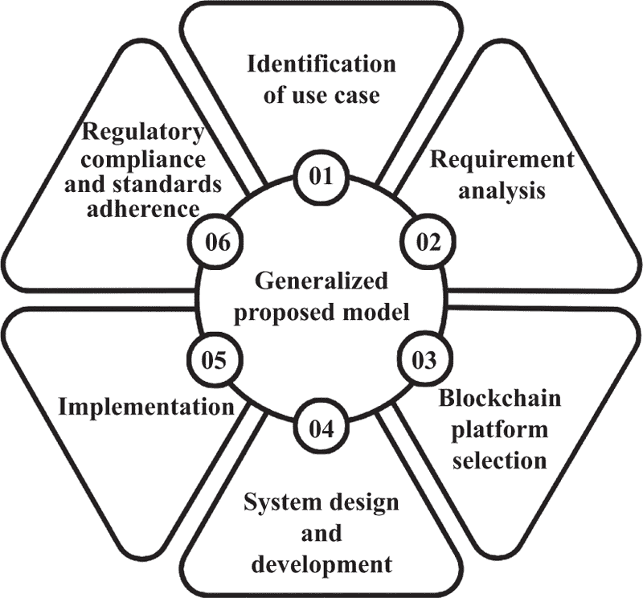

图 2.1 建议模型的示意图

### 1. 用例识别

确定哪些医疗领域（包括患者数据管理、药品可追溯、供应链管理或医学研究数据交换）可以从区块链的应用中极大获益。

### 2. 需求分析

对用例进行全面调查并收集需求。理解相关的各方、数据流、法律要求和安全考虑是必要的。

### 3. 区块链平台选择

根据共识机制、扩展性、安全性和操作性等特征，选择合适的区块链平台 [16,17]。用例的需求可能决定联盟链、私有链或公共链的采用。

### 4. 系统设计与开发

设计系统架构时，应考虑数据结构、智能合约、共识技术与当前医疗 IT 系统的交互。创建智能合约和所需的数据交换协议。

### 5. 实施

开展试点项目以评估区块链解决方案在实际医疗环境中的可行性和有效性。这涉及与利益相关者合作、实施解决方案并为未来的改进收集反馈。

### 6. 监管合规与标准遵循

确保符合医疗法规，如《健康保险流通与责任法案》（`HIPAA`）和《通用数据保护条例》（`GDPR`）。遵循数据安全、隐私和操作性的行业标准以维持信誉和合法性。

所提模型流程图的目的是满足医疗业务日益增长的用例，通过提供集成区块链技术所需阶段的高级概述，来实现颠覆性影响。

在接下来的章节中，本章将说明所提模型如何在社会的各个领域实施，并详细讨论使用区块链可以实现的方法论和结果。

## 2.4 使用区块链进行临床试验管理

使用区块链技术进行临床试验管理为提高临床试验的透明度、完整性和安全性提供了一种独特的方式。从患者同意到研究发现，临床试验数据由于区块链去中心化且不可篡改的账本而被安全地存储并易于验证。这种解决方案解决了数据篡改、隐私泄露和数据管理效率低下等常见问题 [18]。智能合约自动化了参与者许可、数据验证和监管遵循，极大减少了人为错误的风险并简化了试验管理。

### 2.4.1 方法论


## 2.4.1 方法论

1. **项目初始化**：从开始就建立临床研究的目标，包括将收集什么类型的数据、实验持续多久以及预期结果。人员、医疗提供者、患者和监管机构均已加入。这一基础步骤对于设定试验范围和治理至关重要，并确保所有参与者达成共识并理解他们在区块链架构中的角色。

2. **区块链设置**：选择合适的区块链类型（公有、私有或联盟链）至关重要。临床试验通常使用私有或联盟链区块链，因为它兼顾了透明度和隐私性，仅允许授权的参与者访问。随后在区块链上创建并部署智能合约。在不需要人工干预的情况下，自动执行合约自动化并执行试验规则，如数据验证和同意管理。协议条款在这些合约中被专门编码。

3. **患者招募**：区块链技术对于管理招募期间的同意和参与者身份验证至关重要。每份同意书和患者身份证明都安全地存储在区块链上，提供了不可更改的记录，提高了合规性和信任度。这是维护患者隐私并确保所有数据收集符合法律和伦理规范的重要步骤。

4. **数据收集与输入**：加密的患者数据、医疗设备数据和研究人员数据直接添加到区块链中。这保证了数据一旦记录不仅是安全的而且是不可更改的，避免了任何损害研究完整性的事后更改。智能合约根据预设标准自动验证输入数据，确保了获取数据的完整性和质量。

5. **数据访问与共享**：由于区块链技术，可以对试验数据进行受控访问。许可访问和密钥确保数据仅供授权的利益相关者查看或交互。在不损害患者隐私或数据完整性的前提下，这种安全环境促进了实时监控和透明化，使相关者能够跟踪实验进展并获取相关数据。

6. **数据的报告与分析**：数据收集过程结束后，数据被合并并匿名处理，并通过分析对临床试验结果得出结论。区块链不可篡改的账本提供了所有数据分析的透明且可验证的记录，确保了发布的结果准确且未被修改。最终报告受益于区块链的可追溯性，它创建了试验发现的可审计记录，并使其符合发布和监管提交的要求。

7. **审计与合规**：区块链透明且不可篡改的特性极大简化了监管审计。在区块链上，审计人员可以独立确认试验程序和数据，确保符合所有的道德和法律要求。为了进一步提高试验的完整性和监管合规，智能合约还可以自动化某些合规检查。

8. **试验后活动**：试验结束后，区块链继续安全地存储试验数据，使长期研究或未来参考更加容易。区块链用于处理持续的患者参与，实现安全有效的随访和结果报告（图 2.2）。

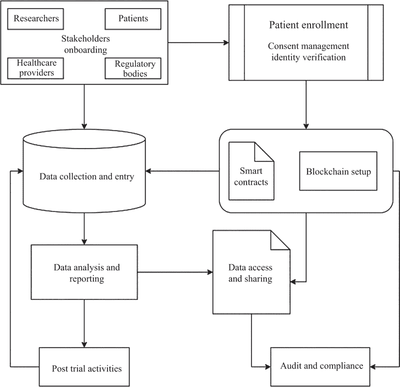

图 2.2 代表临床试验管理中区块链工作流的流程

凭借其去中心化的账本，区块链技术驱动了临床试验的每一个阶段。数据一旦提交，就会保持不可更改并带有时间戳，为所有操作和数据输入提供了无可质疑的记录 [19]。加密签名和加密保证了数据的机密性和有效性，智能合约自动化并执行试验标准以减少错误和不一致。对区块链技术的全面应用不仅提高了临床试验的有效性和完整性，还通过提供整个过程透明、安全且不可更改的记录，增强了所有参与方的信心。

### 2.4.2 结果

区块链技术的应用转变了临床试验管理，通过研究增强了数据安全、质量和透明度。区块链通过确保已记录的数据不可篡改且可验证，建立了学术、参与者和监管机构在内的利益相关者之间的信任。智能合约自动化了关键流程，减少了错误并简化了操作，而安全且选择性的数据共享保护了患者隐私并符合监管标准。最后，这些发展使得临床试验更加高效、可靠且符合伦理，可能加速新医疗法和治疗方法的发现与批准。区块链支持的方法固有的透明性和问责制也为增加对临床研究的信任铺平了道路，营造了有利于基于数据完整性和参与安全的创新氛围。

## 2.5 检测假药与供应链管理

制药行业在全球医疗中发挥着关键性作用，为全球数百万人提供救命药物和治疗方案。然而，在追求目标的同时，该行业面临着持续的挑战：假药的泛滥。假药不仅危害患者健康，还破坏了整个供应链的完整性。制药行业目前的供应链陈旧，且在整个系统中缺乏透明度。此外，市场上流通的假药有所增加。WHO 的研究表明，中低收入国家约 10.5% 的药品是假药，这些药物对公众健康可能是致命的或严重危险的。

检测和打击假药需要一种多方面的方法，以解决从生产到交付及其间所有环节的整个供应链漏洞。传统的身份验证方法在面对日益复杂的伪造者时往往力不从心。为了克服这些挑战，利用区块链技术的创新解决方案正成为增强药物可追溯性、透明性和安全性的前景手段 [20]。通过将区块链集成到医药供应链中，利益相关者可以建立不可篡改且透明的药物交易账本，确保每个产品从制造商到终端用户的轨迹都是可验证且防篡改的。这彻底改变了我们管理供应链的方式，提供了药物移动的实时可视性，并能够快速检测任何异常或假产品。

在此背景下，图 2.3 展示了如何利用区块链技术检测假药并有效管理医药供应链的全面概述。它阐述了确保药物真实性、安全性和完整性的关键组件和流程，最终保护公共健康并增强对医药业的信任。

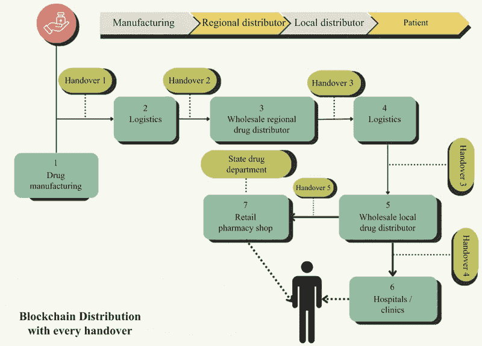

图 2.3 检测假药和管理供应链的工作流模型

### 2.5.1 方法论

1. **制造阶段**：药品公司生产药物。每批药物都被分配一个唯一的标识符或序列号。

2. **区块链集成**：供应链的每一步都记录在区块链账本上。信息包括制造商详情、批号和生产日期。

3. **分销阶段**：药物通过多个阶段：批发商、分销商和药店。每次所有权转移或位置变更都记录在区块链上。

4. **身份验证与校验**：通过输入序列号或扫描二维码，药店或终端用户可以确认药物的合法性。通过访问区块链，他们可以看到药物的整个历程，确保其不是假冒。

5. **智能合约**：智能合约自动执行某些流程，例如确认交付后付款。它们还可以对供应链中的任何异常或不规则情况触发警报。

6. **数据完整性**：区块链确保数据的不可篡改性，防止记录被篡改。时间戳和加密哈希值验证了信息的真实性。

7. **可追溯性与透明性**：所有参与方都可以获得药物移动的清晰且可审计的记录。这种开放性使得更容易追踪问题源或假药的来源。

8. **合规性**：监管机构可以访问区块链进行合规检查和审计。它确保了整个供应链始终遵守质量标准和法规。

9. **反馈循环**：终端用户可以提供反馈或报告任何问题，这些反馈可以记录在区块链上。这种反馈循环有助于持续改进和问题解决。

10. **持续监控与更新**：药物在供应链中移动时，区块链账本上的信息会不断进行更新。由于更改和更新是实时记录的，所有参与方都可以访问最新数据。

### 2.5.2 结果

在药物供应链管理和假药识别中使用基于区块链的技术，产生了显而易见的益处，例如消费者安全性的提高、合规性的增强、更高透明度的提升以及高效的异常检测。通过利用区块链技术的固有属性——透明性、不可篡改性和去中心化，所有相关利益相关者可以合作打击假药问题，保护医药供应链的完整性并促进公共健康。

## 2.6 医药供应链

供应链管理是计划、实施和监督供应链运营的过程，旨在通过效率来提高客户满意度。成品的运输和存储、在制品库存以及从原产地到消费地的原材料都包含在供应链管理之中。对材料、数据和资金从供应商到制造商、再到批发商、零售商和客户的流动进行监督被称为供应链管理 (SCM) [21]。SCM 是企业职能有目的且有意的管理、整合和控制。SCM 影响并增强企业的供应链，以提高效率、降低成本、增加灵活性以及最终使客户受益的因素。供应链功能由许多子领域组成，包括采购和采购、运营、物流、运输、仓储、分销、客户支持和库存管理。在商业世界中很难找到传统的供应链监督模型，特别是在医药领域。

企业内部及企业之间各种流的整合与平衡被称为供应链管理。管理内部供应链是一项跨部门业务职能，而代表客户管理供应链是一个垂直行业部门。企业可以作为垂直领域内的供应链服务提供商进行运行。然而，一家公司的供应链员工为他们服务的每一个客户在整个公司范围内进行水平工作。对于每个组织来说，预测和计划对于预测按时向客户交付货物和服务所需的资源和材料数量至关重要。SCM 包括了诸如能力规划、库存控制、需求预测等领域的任务 [22]。购买或采购对于供应链的商业领域至关重要。这涉及寻找提供所需商品和服务的供应商、对价格和条件进行谈判以及创建合同。因此，该领域被用于管理供应商表现和持续的合同协议。该领域也被称为购买、采购、采购或采购（procurement）。从严格定义来说，采购是指材料或物品的流动，无论它们是流出、通过还是到达。

在某些制造组织中，物流部门可能处理计划和预测，而在其他组织中，物流仅负责物资和货物的移动和运输。运营包含了大量的管理任务，以便有效分配资源以满足客户义务。通常，库存管理包括控制存储和发放程序、保持库存水平稳定以及补充实物库存。库存可能包括等待销售或发运的成品、在制品或从供应商获得的材料。管理公司拥有的车队、安排材料和货物的取货、交付或更换，或监督外部运输提供商都属于运输管理领域。管理公司拥有的仓库空间或外部来源提供的空间被称为仓储。将公司的货物物理交付给客户或分销商被称为分销。

客户服务是供应链管理的一个重要组成部分，尽管经常被忽视。它意味着确保客户期望得到满足，并采取履行承诺和履行职责所需的措施。公司供应链管理系统的有效性对其成功至关重要。许多企业将其目前的成功归功于高效的供应链管理系统，这增加了客户和供应商的满意度。通过供应链管理（SCM），组织可以向供应商和营销人员清晰简洁地传达其需求。由于药品具有独特性，药品供应链管理非常重要。

### 2.6.1 方法论

1. **规划**：为了实现预期结果，规划包括审查现状、评估需求、设定目标以及定义量化目标，此外制定策略、分配职责和获取所需资源。

2. **测试**：协调获取原材料、生产货物、质量检查、包装货物以运输以及制定交付计划所需的步骤。

3. **供应商**：化学行业中的供应商提供从多种来源获取的商品产品。这些原材料对于药物的开发至关重要。

4. **制造**：药品的大规模生产——在文中称为制造——是制药行业最重要的部分之一。

5. **仓库**：仓库在医疗供应链中发挥着至关重要的作用，作为短期存储设施，并实现货物向药房和医院等医疗机构的组织化运输。

6. **分销**：分销管理通过通过资源利用最大化，寻求向所需的设施稳定地供应物资和药物。

7. **医院**：医院依赖顺畅的供应链以确保在需要时有药可用，改善患者护理并减少所有领域的错误。

8. **患者**：规划良好的供应链可以确保及时提供符合特定医疗需求的正确药品，从而使患者受益（见图 2.4）。

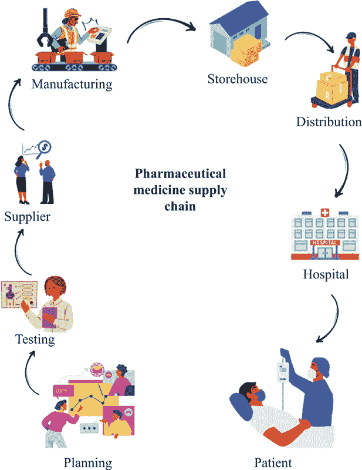

图 2.4 药品供应链的示意图

### 2.6.2 结果

增加可靠供应商的数量同时降低中断或效率低下的风险是扩大供应商网络和降低医疗供应链风险的两种方法。这种增长提高了寻找关键医疗设备和物资的适应性和耐久性。提高供应链透明度对于建立利益相关者的信任以及确保货物完整性和真实性至关重要。医疗企业可以利用区块链技术或其他技术跟踪医疗产品从制造设施到终端消费者的路径。这允许对每笔交易或转移进行实时监控和验证。

风险评估对于发现弱点并针对自然灾害、不稳定的地缘政治状况或网络安全漏洞等可能的供应链威胁采取预防措施至关重要。预测性风险建模、库存管理和预测准确性都可以通过专利技术得到增强，包括预测分析、`IoT` 和 `AI`。这些技术能够让医疗公司预见并减少可能的干扰，确保了关键医疗物资的稳定可靠供应。总体而言，通过扩大供应商网络、增强透明度、进行风险评估和利用尖端技术，医疗供应链可能会变得更加灵活、响应迅速并有效地满足患者和医疗提供者不断变化的需求 [23,24]。

## 2.7 未来研究方向

为了进一步推进该领域，医疗区块链技术的未来研究计划可以集中在几个重要领域：

- **可扩展性**：研究让医疗环境下的区块链网络具有更可扩展性和性能的方法，以便其在不牺牲安全或效率的情况下管理不断增长的数据和交易。

- **互操作性**：研究让现有的医疗系统和其他区块链平台更具互操作性的方法，以便可以在各种医疗网络和应用程序之间无缝交换和整合。

- **安全性**：为了确保患者隐私并防止未经授权的访问或数据泄露，开发专门适应医疗数据特定要求的更强安全措施和改进的隐私保护程序。

- **监管**：检查监管框架如何影响区块链技术在医疗行业的应用，并建议维护符合相关法律法规（如 `HIPAA` 和 `GDPR`）的方法。

- **患者赋权**：研究让患者能够掌控其健康数据的方法，提供基于区块链的解决方案以实现安全共享、管理同意并激励患者参与数据共享计划。

- **自动化**：为了提高效率并减少行政负担，探索自动化和`智能合约`在医疗流程中的可能应用，包括管理临床试验、处理保险理赔和组织医疗用品供应链。

- **评估**：衡量成本节省、效率提升和患者结果改善等成果。进行纵向研究和真实世界实施，以评估区块链解决方案在各种医疗环境的影响、有效性和可用性。

- **伦理**：检查区块链技术如何影响数据所有权、同意、公平性，以及可能加剧医疗结果和获取中已存在的不平等现象。人们还应该考虑区块链技术在医疗行业中的伦理和法律影响。

## 2.8 结论

基于区块链的技术可以通过为与数据管理、供应链透明度和患者赋能等关键问题提供解决方案，从而彻底改变医疗保健行业。区块链通过其去中心化、不可篡改且透明的账本系统，为提高医疗环境中的数据质量、安全性和互操作性提供了特殊的解决方案。医疗保健公司利用区块链技术，可以降低供应链中断的风险，并扩大其供应商网络规模。

更透明的供应链允许利益相关者追踪药物的路径，从而确保了真实性和安全性。通过使用尖端技术和进行风险评估，可以进一步加强供应链，提高其韧性和适应不断变化需求的能力。还需要对实际部署进行研究，以评估区块链解决方案在各种医疗环境中的影响和效能。必须仔细权衡伦理、法律和社会影响，以减少潜在危害，并确保区块链提供的医疗服务所有人都能触及。总而言之，尽管面临若干挑战和不确定性，区块链技术对医疗部门具有不可否认的潜力优势。随着进一步的研究、合作和创新，区块链有潜力变革医疗行业，并在未来几年内推进以患者为中心的护理、效率和透明度。

## 参考文献

[1] Tandon, A., Dhir, A., Islam, A.N., and Mäntymäki, M. Blockchain in healthcare: A systematic literature review, synthesizing framework and future research agenda. *Computers in Industry*, 122, p. 103290, 2020.

[2] Verma, R., and Dhanda, N. Blockchain types: a characteristic view. In *Distributed Computing to Blockchain* (pp. 69–85). Academic Press; 2023.

[3] Sharma, P., Jindal, R., and Borah, M.D. Healthify: a blockchain-based distributed application for health care. In *Applications of Blockchain in Healthcare* (pp. 171–198). Singapore: Springer Nature; 2020.

[4] Benchoufi, M., and Ravaud, P. Blockchain technology for improving clinical research quality. *Trials*, 18(1), pp. 1–5, 2017.

[5] Iansiti, M., and Lakhani, K.R. The truth about blockchain. *Harvard Business Review*, 95(1), pp. 118–127, 2017.

[6] Kumari, M., Gupta, M., and Ved, C. Blockchain in pharmaceutical sector. In *Applications of Blockchain in Healthcare* (pp. 199–220). Singapore: Springer Nature; 2020.

[7] Srivastava, S., Singh, S.V., Singh, R.B., and Shukla, H.K. Digital transformation of healthcare: A blockchain study. *International Journal of Innovative Science, Engineering & Technology*, 8(5), 2021.

[8] Charles, W.M. Accelerating life sciences research with blockchain. In *Applications of Blockchain in Healthcare* (pp. 221–252). Singapore: Springer Nature; 2020.

[9] Gupta, M., Jain, R., Kumari, M., and Narula, G. Securing healthcare data by using blockchain. In *Applications of Blockchain in Healthcare* (pp. 93–114). Singapore: Springer Nature; 2020.

[10] Ciampi, M., Esposito, A., Marangio, F., Sicuranza, M., and Schmid, G. Modernizing healthcare by using blockchain. In *Applications of Blockchain in Healthcare* (pp. 29–67). Singapore: Springer Nature; 2020.


[11] Narikimilli, N.R.S., Kumar, A., Antu, A.D., and Xie, B. Blockchain applications in healthcare–a review and future perspective. In *International Conference on Blockchain* (pp. 198–218). Cham: Springer International Publishing; 2020.

[12] Swarnkar, M., Bhadoria, R.S., and Sharma, N. Security, privacy, trust management and performance optimization of blockchain technology. In *Applications of Blockchain in Healthcare* (pp. 69–92). Singapore: Springer Nature; 2020.

[13] Spano, R., Massaro, M., and Iacuzzi, S. Blockchain for value creation in the healthcare sector. *Technovation*, 120, p. 102440, 2023.

[14] Shuaib, K., Abdella, J., Sallabi, F., and Serhani, M.A. Secure decentralized electronic health records sharing system based on blockchains. *Journal of King Saud University-Computer and Information Sciences*, 34(8), pp. 5045–5058, 2022.

[15] Vahdati, M., Gholizadeh HamlAbadi, K., and Saghiri, A.M. IoT-Based healthcare monitoring using blockchain. In *Applications of Blockchain in Healthcare* (pp. 141–170). Singapore: Springer Nature; 2020.

[16] Yadav, A.K., Singh, K., Amin, A.H., Almutairi, L., Alsenani, T.R., and Ahmadian, A. A comparative study on consensus mechanism with security threats and future scopes: Blockchain. *Computer Communications*, 201, 102–115, 2023.

[17] Praveen, G., Anand, M., Singh, P.K., and Ranjan, P. An overview of blockchain consensus and vulnerability. *Information and Communication Technology for Intelligent Systems: Proceedings of ICTIS 2020*, 1, 459–468, 2021.

[18] Curbera, F., Dias, D.M., Simonyan, V., Yoon, W.A., and Casella, A. Blockchain: An enabler for healthcare and life sciences transformation. *IBM Journal of Research and Development*, 63(2/3), pp. 8:1–8:9 2019.

[19] Maslove, D.M., Klein, J., Brohman, K., and Martin, P. Using blockchain technology to manage clinical trials data: a proof-of-concept study. *JMIR Medical Informatics*, 6(4), p. e1949, 2018.

[20] Dutta, P., Choi, T.M., Somani, S., and Butala, R. Blockchain technology in supply chain operations: Applications, challenges and research opportunities. *Transportation Research Part E: Logistics and Transportation Review*, 142, p. 102067, 2020.

[21] Ghadge, A., Bourlakis, M., Kamble, S., and Seuring, S. Blockchain implementation in pharmaceutical supply chains: A review and conceptual framework. *International Journal of Production Research*, 61(19), pp. 6633–6651, 2023.

[22] Abbas, K., Afaq, M., Ahmed Khan, T., and Song, W.C. A blockchain and machine learning-based drug supply chain management and recommendation system for smart pharmaceutical industry. *Electronics*, 9(5), p. 852, 2020.

[23] Kumar, M., Raj, H., Chaurasia, N., and Gill, S.S. Blockchain inspired secure and reliable data exchange architecture for cyber-physical healthcare system 4.0. *Internet of Things and Cyber-Physical Systems*, 3, pp. 309–322, 2023.

[24] Shah, R., and Chircu, A. IoT and AI in healthcare: A systematic literature review. *Issues in Information Systems*, 19(3), 2018.

## 3.1 引言

在现代数字时代，医疗保健行业正经历着巨大的转变，利用先进技术来确保数据安全、简化流程并改善患者护理。区块链是一种比任何其他技术都能更好地改变患者身份管理规则的技术。区块链去中心化且不可更改的账本系统，通过为存储患者身份提供透明且安全的平台，改变了医疗机构处理敏感数据的方式 [1]。与传统的患者身份管理解决方案的问题包括身份盗窃、数据泄露和医疗系统脱节。由于患者数据经常分散在多个系统中，它们很容易受到操纵和未经授权的访问。此外，不同医疗提供者之间的不兼容使得患者数据的共享变得困难，导致效率低下和护理质量下降。

区块链技术提供了一种去中心化的、不可破解的患者身份管理解决方案来应对这些挑战。区块链利用密码技术和分布式共识机制来维护医疗数据的机密性和完整性，让个人对自己的医疗信息拥有更大的控制权 [2]。为患者数据创建单一事实来源是基于区块链的患者身份管理的关键元素之一。去中心化的节点网络安全地存储并实时更新患者 ID 和医疗数据，消除了低效并确保所有参与方的数据一致性。得益于这种协调方法，医疗提供者可以更容易地共享信息，从而增强医疗效果和护理协调。通过加密患者数据并将其分布在多个节点中，区块链提高了数据安全性，从根本上消除了恶意行为更改或窃取私人信息的能力。分布式账本上进行的每笔交易都通过加密相互关联，创建了任何人都可以查看和审查的不可篡改验证记录。通过开放性和追溯性建立对数据完整性的信心，减少了数据泄露的概率，并确保符合《健康保险可移植性与责任法》(HIPAA) 在内的其他监管要求。

同样，区块链的主权身份管理赋予了患者对其健康数据更大的权威。基于区块链的数字身份使患者能够安全地与研究人员、医疗提供者和其他授权方访问并共享医疗记录，消除了对中间人的需求并增强了数据隐私。此外，患者可以在保持匿名的同时选择他们提供的信息，保护了他们的隐私和自决权。综上所述，区块链支持的患者身份管理标志着医疗保健行业的革命性变化，提供了前所未有的机会来提高数据安全、互操作性和患者赋权。通过利用区块链技术的固有属性，医疗机构可以为患者身份管理创建一个透明且安全的环境，促进医疗机构之间的协作、创新以及对医院服务的信任。

### 3.1.1 患者身份管理

患者身份管理是在医疗系统中准确、安全地识别个人，并在其与医疗提供者接触期间管理其个人和医疗信息的过程。它涉及收集、存储和检索患者信息，包括人口统计数据、病史、治疗计划和账单信息。有效的患者身份管理对于确保高质量护理、改善护理协调以及保护患者隐私和机密性至关重要。传统医疗系统中的患者身份管理往往是碎片化的，容易出现错误和安全漏洞 [3]。患者可能有分散在不同医疗提供者之间的医疗记录，导致工作重复、效率低下和服务空白。此外，陈旧的识别系统（如纸质记录）以及对社会安全号码等个人标识符的依赖增加了身份盗窃和欺诈的风险。

随着数字技术的发展，患者身份管理已扩展到电子健康记录 (`EHRs`)、患者门户和身份验证系统。这些解决方案旨在通过赋予个人访问其健康信息并积极参与自身护理的能力，来提高患者参与度、加速行政任务并提高数据准确性。互操作性困难、信息差异和网络安全问题仍然存在，强调了对新解决方案来解决这些复杂性的需求。区块链技术作为患者身份管理的替代方案显示出潜力。它为跨医疗网络的传输和存储患者数据提供了一个安全的去中心化环境。通过为患者数据提供单一事实来源并实现安全的数据交换，区块链具有完全改变患者身份管理的潜力。这将改善护理协调，加强数据安全并赋予患者更多权力。

### 3.1.2 区块链账本

一种被称为区块链账本的分布式、去中心化数据库在计算机网络上跟踪交易，其方式确保了安全性、不可篡性和透明度。“区块链”一词是指将所有交易排列成区块并按顺序连接成链的方法。每个区块都根据其前一个区块的加密哈希值进行命名。由于这种结构，任何更改交易的尝试都必须更改其其后的每一个区块，这在实际操作中是极不现实的，而且在计算上是不可能的。

交易一旦在区块链上注册，就无法被更改或删除。这一特性通过阻止非法的修改或操纵，保护了患者数据的机密性。保存在区块链上的医疗记录和患者身份是不可更改的，为患者和医疗专业人员提供了可信赖的事实信息来源。所有获得许可的网络用户都可以查看和访问区块链账本。通过允许利益相关者查看患者数据的来源和历史，这种透明度增强了信任。患者和医疗专业人员都可以验证其医疗记录的正确性，并跟踪患者数据在不同系统和组织之间的传输。

为了保护敏感患者数据并确保交易安全，区块链使用了加密算法。由于每笔交易都通过网络共识进行验证并经过加密哈希处理，未经授权的很难在没有必要权限的情况下访问或更改患者数据。通过这样做，增强了数据安全性和机密性，同时减少了欺诈交易和财务破解的风险。由于区块链作为去中心化的节点网络运行，管理患者数据不再需要中心机构。这种去中心化架构提高了应对网络攻击和系统故障的韧性，同时降低了单点故障的可能性。此外，它通过赋予人们对医疗记录更多的控制权，鼓励了患者赋权和数据主权。

在医疗保健行业，区块链账本技术为管理患者身份和医疗记录提供了一个稳定安全的平台。由于其不可篡性、透明性、安全去中心化，它非常适合处理与患者身份管理相关的复杂问题，最终将提高数据完整性、互操作性和以患者为中心的护理交付。

区块链技术在医疗保健的患者身份管理方面具有许多优势。首先，区块链提供了一个独立、透明的框架，用于安全保存患者身份和健康记录 [4]。通过将患者数据分布在节点网络上并使用加密技术进行加密，区块链在保持数据可靠性和安全性的同时，降低了数据泄露和非法访问的风险。随后，区块链通过为各种医疗服务提供者和系统之间的患者数据交换建立单一且标准的框架，改进了互操作性。区块链通过智能合约和共识过程，在保持数据完整性和一致性的同时，实现了数据的数据传输。由于区块链上的身份管理，患者对自己的健康数据有了更多的控制权。通过消除中间人并加强数据保护，使用区块链数字身份的患者可以安全地与医生、研究人员和其他授权方浏览并讨论他们的医疗记录。总的来说，区块链在转型医疗保健患者身份管理方面具有巨大潜力，能够实现更好的护理协调、提高数据安全并增强患者自主性。

在第 3.2 节中，对目前正在使用的若干系统进行了文献综述，并分析了它们的优缺点。建议模型的系统设计在第 3.3 节中进一步阐述。用于各种案例的建议模型的方法在第 3.4 节–第 3.6 节中给出。性能分析和建议模型的未来研究路径描述在第 3.7 节和第 3.8 节中。本章在第 3.9 节简要结。

## 3.2 背景与相关工作

Javed *等* 提出了一种专为远程医疗设计的创新身份管理 (`IdM`) 解决方案 [5]，该方案利用了监管监督下的协作式以太坊区块链。个人健康 ID 允许患者和医疗服务提供者进行相互识别，从而能够更高效地获取医疗服务。在远程医疗 `IdM` 框架中，用户无论是寻求医疗帮助的消费者还是提供专业护理的医疗专家，都承担着身份所有者的角色。负责监督提供者注册和许可的卫生部门、护理委员会和药剂委员会等组织被赋予了对医疗提供者的监管权限。

Mohammed *et al.* \[6\] 提出的所选区块链基础设施使用的联盟方法支持 `Ethereum` 和 `Hyperledger`，确保了专为医疗行业设计的稳定且去中心化的身份管理系统。特别是以太坊链的 `Health SC` 和 `Registry SC` 智能合约对于控制与身份相关的活动至关重要。在以太坊链上，健康 ID 作为部署的智能合约的唯一地址。为了创建 `JSON Web Token` (`JWT`)，个人和医疗专业人员的独特特征被格式化为 `JSON`，存储在云存储中，并由监管机构进行验证。身份所有者可以在分布式和集中式云存储之间进行属性管理选择，并实现属性哈希启用的针对性属性下载和检索。

医疗保健提供者通过其外部托管账户在以太坊区块链平台上部署智能合约来生成他们的数字健康 ID。提供者在发送带有健康 ID 的注册请求后，会收到来自监管机构的加密挑战消息。他们使用自己的私钥成功解密消息，证明所有权。为了符合监管标准，提供者通过现场或虚拟展示当前的执业执照来验证其身份。验证过程成功后，监管机构向提供者颁发签名的身份令牌 (`JWT`)，并在注册智能合约中注册健康 ID 和公钥。

患者从提供者处接收健康 ID；然后使用注册智能合约的 `verify attestation` 函数来确认信息，确保已在特定的监管机构注册。通过获取哈希值并利用 `retrieve_hash` 从提供者的健康智能合约获取匹配的哈希值，患者对提供者进行身份验证。区块链记录每一次身份验证，提供者安全地交换对称密钥用于解密身份令牌。使用 `Registry` 智能合约的 `verify_regulator` 方法获取监管机构的公钥，患者验证监管机构签名以确认注册。通过验证监管机构的证明，此验证程序验证了身份令牌的合法性。

通过使用智能合约和协作式以太坊区块链，远程医疗 `IdM` 系统使具有不同健康 ID 的用户能够轻松管理自己的身份。该系统由医疗机构监督。这种强大的结构确保了注册、部署和验证程序的的安全性，而监管证明则赋予了系统合法性。区块链记录的程序简化了患者与提供者之间的通信，云存储的引入增强了属性管理能力。简洁的架构布局强调了用户自由，并为远程医疗服务的提供创建了一个安全可靠的环境。

Harrell *et al.* \[7\] 提出了 `MediLinker`，这是一个虚拟钱包，包含以下六种形式的验证凭证：信用卡、健康 ID、保险、处方药、研究同意书和 `MPOA`。这些凭证根据临床需求，为诊疗提供了必要的患者信息。保险凭证持有有关医疗保险的信息，而健康 ID 凭证包含基于政府发放身份的人口统计数据。`COVID-19` 接种状态、药物和处方数据均由药物凭证涵盖。患者账单信息存储在金融机构凭证中，研究参与详情记录在调查授权凭证中。监管人员及其家属的信息包含在 `MPOA` 凭证中。

`MediLinker` 使用户能够在他们的数字钱包中接收并存储可验证凭证，这些凭证由被称为“发行者”的各种实体颁发，并由个人作为“持有者”持有。除了研究同意外，机构代表在患者审核后颁发凭证。工作流涉及通过区块链安全地将政府发放或第三方的凭证数字化。患者通过扫描诊所的 `QR Code`、输入医疗数据并用实体卡验证身份来建立信任。一个 `iOS` 应用程序简化了这一过程，确保了准确性并加入了撤销功能。然后，批准的凭证可以电子化分发给合作机构，消除了对纸质记录的需求。

**关键词：** 智能医疗；区块链；云服务器；物联网 (`IoT`)；健康监测；泛在医疗；智能合约


MediLinker 构建在 Hyperledger Indy 区块链框架上，选择它是因为它去中心化的身份特征，为患者提供了最大的数据保护和控制。支持去中心化信任识别的理念，Hyperledger Indy 更容易存储提供者与患者连接的记录结构和身份需求。根据万维网联盟规范，患者可以使用去中心化标识符确认身份，而不依赖权威注册表或身份提供者。此外，Hyperledger Aries 充当网关层，促进了可验证数字凭证的传输和存档，建立了 Hyperledger Indy 与客户端之间的连接。为了让 MediLinker 在 Android 和 iOS 设备上更易使用，开发了移动应用程序。

Sharma *et al.* [8] 使用 React Native 框架开发了具有共享代码库的原生应用，确保了跨平台的一致性。通过为患者提供更具参与感的智能手机体验，这种方法改进了患者的接触。用户界面元素使用 `Material-UI` 框架实现，确保了现代且响应迅速的设计。MediLinker 设计为兼容任何公共云，但 AWS 因其便利性和大学现有的合同而被选中。Hyperledger Aries 代理和 Hyperledger Indy 服务器通过 AWS 托管，正如 Abdul-Moheeth *et al.* [9] 所述的 HIPAA 标准云服务。为了灵活，每个患者的代理都需要一个虚拟机 (`VM`)。对于较大的患者量，建议在单个 `VM` 上运行 Docker 容器，尽管在我们的案例中运行良好。虽然移动应用可以通过 Apple Store 和 Google Play Store 等商店用于临床采用，但 Web 应用程序无需安装。

MediLinker 是一种利用 Hyperledger Indy 和 Hyperledger Aries 进行患者身份管理的领先区块链解决方案。通过用户友好的 Web 和移动应用，患者可以安全地登录、验证凭证并使用区块链钱包跨诊所共享信息。该架构赋予患者对其身份数据的控制权，确保了隐私和个性化的健康数据管理。概念设计展示了一个可扩展且运行良好的以患者为中心的身份系统，供未来集成到医疗环境中。

区块链技术与医疗 4.0（以数字化和数据驱动决策为特征）相结合，转型了患者身份管理。区块链通过确保安全、透明和可互操作的健康数据共享，增强了患者的隐私和信任。Tanwar *et al.* [10] 得结论认为，这种结合将引导医疗行业进入有效、责任和个体化治疗的新纪元。

Ouaguid *et al.* [11] 的研究探讨了区块链技术在医疗保健领域的转型潜力，重点关注其如何管理电子健康记录（EHR）并处理各种系统限制。该研究评估了广泛使用的基于区块链的医疗数据管理方法，包括其优缺点。文中还指出了重要的障碍，包括利益相关者参与不足、缺乏监管监督以及监管灵活性。

患者的数字医疗史（包括诊断、处方、检测结果和治疗计划）被称为 EHR。为了实现更协调的治疗，它使得医疗保健专业人员能够安全地访问和共享患者数据。这种电子医疗生态系统的架构在考量伦理、技术和法律因素的同时，解决了为交换 EHR 数据创建同步且安全环境的困难性问题。它强调了患者对其数据主权的重要性、对 `GDPR` 和 `HIPAA` 等法律的合规性以及透明的数据处理。研究探索了各种 EHR 管理系统，包括基于云的解决方案以及利用区块链技术解决可靠性、安全性和操作性问题的方案。论文讨论了四种整合区块链技术的 EHR 管理方法，并重点比较了它们与其他方法的架构及特定特性。Alam *et al.* [12] 提出的第一种方法将物联网与区块链相结合，实时采集患者健康数据。患者传感器捕捉血糖水平和血压等数据，并以分布式方式存储。总体而言，它探索了基于区块链的电子健康系统的结构和架构考量，凸显了其对监管合规、安全性和操作性的影响。它评估了医疗保健部门的各种区块链方法，强调了关键功能和利益相关者之间协作对有效实施的重要性。研究识别了实体表示不足和监管合规等挑战，强调了紧密合作和监管灵活性的必要性，以确保全球合规性和数据操作性。

区块链为记录存储提供了安全且去中心化的解决方案，确保了数据的不可篡改性和透明度。Kshetri *et al.* [13] 进行的研究调查了基于人工智能的医疗机构与区块链相结合，以提高安全性、有效性和保障。它提出了一种新型基于 AI 的医疗区块链模型 `healthAIChain`，旨在提高患者数据安全。AI 在通过改进护理的各个方面（包括诊断准确性、治疗计划和个性化护理）来彻底改变医疗保健方面具有巨大前景。它可以简化流程、降低成本并高效处理海量医疗数据。然而，伦理和治理考量对于确保其负责任的使用至关重要，并解决有关算法偏差和伦理困境的担忧 [14]。总体而言，尽管 AI 为医疗进步提供了巨大潜力，但仍需仔细的监督以最大化其收益并降低风险。区块链技术通过交易去中心化和增强安全特性，为医疗系统中的安全、保障、透明度和信任问题提供了充满前景的解决方案。然而，在线系统的快速增长以及网络威胁的日益普遍（受新冠肺炎等事件的加剧），凸显了 Bittins *et al.* [15] 所提到的对增强安全措施的紧迫需求。适应如人工智能、增强现实和区块链等新兴技术，对于包括医疗保健行业在内的企业保持竞争力并确保客户安全至关重要。`healthAIChain` 概念建议将区块链的使用与由人工智能驱动的医疗解决方案相结合，以增强患者数据安全。

Kumar *et al.* [16] 的研究提出了一种用于保护信息物理系统中医疗数据的区块链方法。它利用去中心化、不可篡改且透明的区块链技术来保证数据安全和隐私。总体而言，如 Tandon *et al.* [17] 所提，该模型赋予用户对其数据的完全控制权。关键组件包括实现去中心化存储和检索的星际文件系统 (`IPFS`)；`BigchainDB` 促进实时交易和资产管理；`Tendermint` 提供了容错机制，确保系统在发生故障时依然可靠；`MongoDB` 存储额外的本地信息。使用 `AES` 对称加密进行数据加密。为了解决医疗系统的问题，该研究建议了一种用于信息物理医疗 4.0 安全数据共享的架构。它关注了当前系统的缺点，例如非以患者为中心的方法、安全漏洞和隐私问题。

## 3.3 提出的模型

通过利用区块链技术，所建议的基于区块链的患者身份管理模型改变了医疗数据的处理方式。确保数据完整性、操作性和患者隐私，为维护患者身份和医疗信息创建了一个透明且安全的平台。该方法通过实现数字身份形成、安全数据存储、同意管理和合规程序，赋予了患者权利并促进了医疗保健提供者之间便捷的数据交换。

### 1. 区块链基础设施

构建一个考虑了医疗应用操作性、安全性和可扩展性的区块链网络。考虑到患者数据的敏感性，可以使用许可链区块链框架（如 `Ethereum Enterprise` 或 `Hyperledger Fabric`）来管理合规要求并遵守法律规定。

### 2. 数字身份创建

创建一个基于区块链的可靠数字身份管理解决方案。每位患者都会获得一个数字钱包，这是一种独特的加密身份标识，用于存储其经过验证的身份特征，包括医疗史、同意偏好和人口统计学数据。

### 3. 患者入职与验证

为了确保患者身份的安全性和准确性，提供一种简化的患者入职和验证程序，该程序应整合多因素身份验证和生物识别认证。使用智能合约来自动化身份验证程序，同时保护患者的隐私和知情同意。

### 4. 安全数据存储与访问控制

利用区块链技术的分布式账本功能安全地处理和存储患者数据，确保敏感数据受到加密和访问控制的保护。采用加密方法（如同态加密和零知识证明）在维护患者机密性的同时，促进数据的安全传输。

### 5. 互操作性与数据交换

通过标准化数据格式和协议实现无缝数据传输，促进跨医疗系统和提供者之间的互操作性。创建 API 和互操作层，以与当前的医疗 IT 基础设施对接，并提供跨系统的实时患者信息访问。

### 6. 同意管理与可审计性

建立同意管理系统，让患者能够监管和监督谁访问了他们的健康信息。利用区块链技术的透明性和可审计特性来监控数据的访问和使用情况，让患者能够了解谁在何时出于什么原因访问了他们的信息。

### 7. 健康信息交换

为了促进医疗提供者、保险公司和其他利益相关者之间安全且兼容的患者数据共享，将区块链的患者身份管理集成到当前的 HIE（健康信息交换）网络中。利用区块链技术的去中心化设计提高 HIE 的有效性和数据完整性。

### 8. 集成合规与监管考量

确保遵循所有相关的医疗法律法规——包括 `HIPAA`、`GDPR` 和当地数据保护条例。在管理敏感健康信息的同时，通过实施隐私增强技术和合规措施保护患者权利并降低法律风险。

### 9. 持续监控与改进

为区块链驱动的患者身份管理系统建立程序，对其进行持续监控、评估和改进。收集利益相关方的意见，进行频繁的安全评估，并进行系统迭代以解决新问题并提高效率。

通过实施建议的框架，医疗机构可以利用区块链技术彻底改变患者身份管理，赋予患者对其医疗记录更大的自主权，并促进整个医疗网络的信任、安全与协作。

在接下来的章节中，本章将阐述所提模型如何在社会的不同领域实施，详细讨论在医疗保健领域使用区块链的方法论以及可以获得的结果。

## 3.4 区块链与联邦学习用于隐私保护与协作健康数据分析

在医疗领域利用海量数据进行研究和改善患者疗效的潜力是巨大的。然而，这种可能性引发了严重的隐私担忧，因为健康数据是敏感的个人信息。传统的中心化数据分析方法增加了数据泄露和滥用的风险。将区块链技术与联邦学习 (`FL`) 相结合以克服这些困难，为隐私保护和协作健康数据分析创建了新范式。区块链技术作为一种自主共享账本，通过使用数据交易完整性和可用性，为医疗应用中的安全数据共享和访问管理提供了坚实基础 [18]。它提供了一个环境，通过允许参与者为中央机构验证交易来确保数据的机密隐私。模型学习在不披露原始数据的情况下进行聚合，保护了个人数据提供者的隐私。

`FL` 是一种基于神经网络的方法，允许多个参与者在不交换本地数据的情况下训练模型。

### 3.4.1 方法论

#### 1. 数据收集

该程序的第一步是从诊所、可穿戴设备、医院和研究机构等多个源收集健康数据。首先，这些数据在本地进行预处理。数据可能包括患者记录或实时健康监控数据。预处理包括删除任何个人信息以保护隐私，同时对数据进行清洗、标准化和匿名化，确保其处于可分析状态。

#### 2. 联邦学习设置

**初始化**：通过建立具有初始参数的基模型，中央机构或服务器启动 `FL` 过程。随后，该模型分发到所有相关的节点，这些节点可能是拥有各自数据子集的医疗提供者或研究机构。

**本地模型训练**：每个节点使用其本地数据集训练分布式模型。这是一个重要步骤，因为它允许数据保留在原始位置，同时模型从各种数据集中学习。

**本地更新加密**：节点在训练后对其梯度或模型更新进行加密。为了确保发送到网络上的任何数据都不会被截获或被不当使用，加密是一个至关重要的步骤。

#### 3. 通过区块链进行安全聚合

**传输与聚合**：加密后的更新被传输到区块链网络并进行聚合。构建在区块链上的 `smart contract` 监控此聚合过程。它确保所有修改都以一种安全、不可更改的方式合并，在保护个人信息的同时增强整体模型。

**模型更新**：聚合后，全局模型用新参数更新，这些参数反映了所有节点的组合学习结果。

#### 4. 模型验证与反馈

修改后的全局模型被传回节点，并在各自的本地数据集上进行验证。这一阶段对于确定模型在多个数据源上的性能和泛化能力至关重要。

-   反馈循环：根据性能，节点可以发送反馈，这些反馈经过加密后通过区块链发送。这些反馈有助于塑造模型的未来迭代和增强。

### 5. 迭代

本地模型训练和反馈的过程是迭代的。模型在每个周期中不断精炼和改进，在预测或评估方面变得更加准确和更具韧性。

### 6. 部署

模型在表现足够出色后将投入到现实场景中使用。这可能包括将模型应用于研究项目、患者监测应用程序或临床决策支持系统。至关重要的是，模型通过持续从新数据更新中学习，能够保持其准确性和相关性。

### 7. 访问控制与数据共享

为了控制谁有权访问模型以及任何共享发现，区块链是至关重要的。确保只有授权的组织才能访问或贡献模型，将进一步增强系统的安全性和隐私。在数据敏感性不言而喻的医疗行业，这种程度的控制是必不可少的。

### 3.4.2 结果

区块链技术与联邦学习（FL）结合用于健康数据分析，提供了一种处理和利用敏感数据的革命性方法。这种新方法在保护患者隐私和安全的同时，允许去中心化的协作机器学习。该解决方案通过让数据留在本地设备上，仅通过安全加密的区块链网络交换模型更新，解决了与数据隐私和误用相关的重要问题。通过涉及全局模型精炼、安全更新聚合和本地模型训练的迭代过程，开发出稳健且高精度的预测模型。这些模型在不损害个人隐私的情况下，可以极大改善患者护理和医疗研究。此外，区块链组件通过促进可见且可审计的访问控制，确保只有授权的参与者才能参与集体学习过程并从中获益。结果是一种新颖健康数据分析方法，它在对高度分析能力的需求与保护患者隐私的需求之间取得了平衡。这为敏感健康数据的安全、道德和有效使用建立了新基准（图 3.2）。

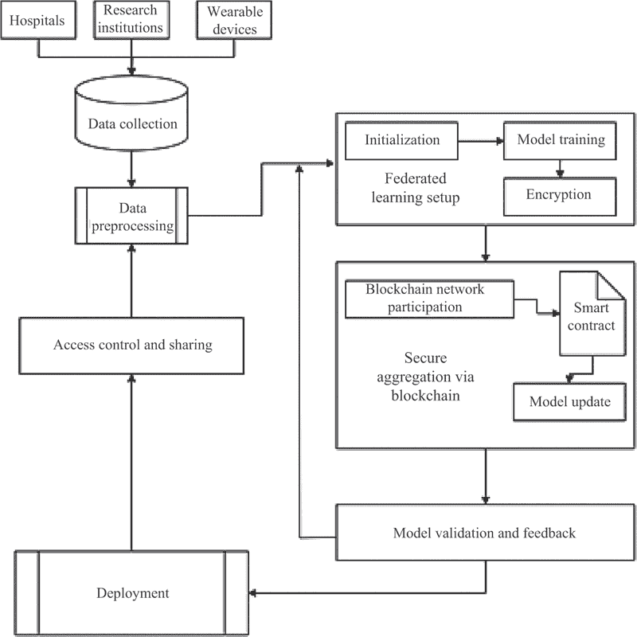

图 3.2 表示模型工作的流程图

## 3.5 区块链与物联网结合用于远程患者监测和护理协调

区块链技术通过提供增强的数据安全性、互操作性和透明度，在远程患者监测（RPM）和护理协调方面展现出巨大潜力。利用区块链，患者健康数据可以安全地存储并在不同平台之间共享，通过其去中心化和不可篡改的特性确保完整性和隐私。智能合约可以根据预定义的条件自动化警报和通知等流程，同时患者对数据共享偏好拥有更大的控制权。此外，区块链促进了用于合规的透明审计追踪，并简化了支付流程。尽管在实施和监管合规方面存在障碍，但将区块链用于 RPM 和护理协调最终可以提高医疗保健领域的患者效果和运营效率。物联网（IoT）与区块链技术融合，为 RPM 和护理协调创建了新范式以克服这些障碍。物联网是由联网设备组成的网络，通过网络收集并交换数据，以实现对过程和系统的远程自动化、控制和监测。

物联网可以显著改善 RPM 和护理协调。医疗保健提供者可以访问 IoT 设备收集的实时健康数据。这些设备的示例包括可穿戴监测设备和智能医疗设备。这使得及时干预、持续护理和个性化治疗成为可能。此外，IoT 促进了患者与医疗专业人员之间的通信，增强了护理协调和患者参与。结合区块链和物联网可以创建一个稳健、安全且高效的 RPM 和护理协调系统。区块链确保了安全的数据存储和共享，而 IoT 设备提供实时健康数据。这种集成实现了透明且防篡改的数据记录，增强了患者隐私和同意管理。此外，智能合约可以自动化流程（如药物提醒和保险理赔），简化了护理协调并改善了患者效果（图 3.3）。

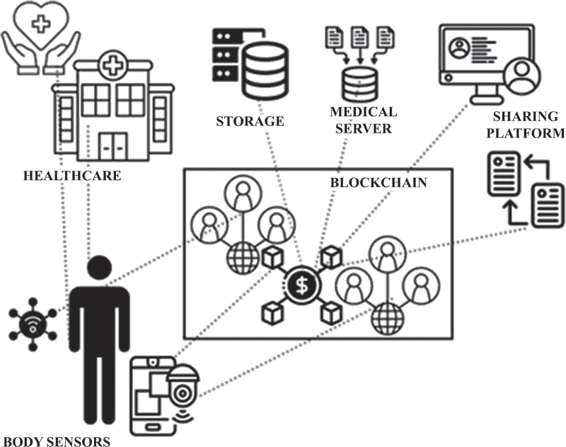

图 3.3 远程患者监测和护理协调的工作流模型

### 3.5.1 方法

#### 1. 身体传感器

- **A. 心电图**：基于物联网的心电图（ECG）监测系统测量心率和波形，并将数据发送到数据库和网络服务器进行实时监测。

- **B. 温度**：采用物联网传感器的温度监测系统由配备传感器的设备收集温度数据，然后无线传输到中央平台。该平台具备实时监测和分析能力，有助于主动干预，以维持各种环境（包括工业设施、仓库、医疗场所和智能家居）的最优状态。

- **C. 血糖**：使用物联网传感器进行血糖预测涉及部署传感器监测糖尿病患者的血糖水平，将数据无线传输到中央平台，并应用预测模型预测未来的血糖水平，从而实现主动管理和个性化护理。

- **D. 心率**：通过物联网进行心率监测涉及带有心率传感器的可穿戴设备，持续跟踪并将数据无线传输到中央平台。该平台分析数据，对异常读数提供实时监测和警报。用户可以访问其心率趋势，设置个性化警报，并与医疗保健提供者共享数据进行远程监测。这种方法能够根据个人心率模式实现主动的心血管健康管理和个性化干预。

- **E. 血氧**：使用物联网设备测量血氧涉及集成到可穿戴设备或独立设备中的传感器（如脉搏血氧仪）。这些传感器发射光以检测血液中的氧水平，并将数据无线传输到平台。用户通过 App 访问实时读数，实现主动的呼吸健康管理和个性化干预等。

#### 2. 医疗数据存储

通过 IoT 传感器辅助的医疗数据存储涉及从各种传感器、设备和系统收集健康相关信息，这些设备通常部署在医疗机构或由患者佩戴。生命体征、药物依从性、活动水平与其他健康相关的指标均由这些传感器记录。使用 `Bluetooth`、`Wi-Fi` 或蜂窝网络等 IoT 连接方法，将收集的数据安全地传输到云平台或集中化存储系统。为了维护患者隐私和数据安全，该平台根据 `HIPAA` 等法律法规对数据进行存储和整理。保存的数据供授权用户（如患者和医疗专业人员）根据需要访问和检索，用于分析、决策和监控。这种方法实现了医疗数据的高效集中化管理，支持由 IoT 技术实现的 `RPM`、护理协调和个性化医疗干预。

#### 3. 医疗健康

在医疗领域，必须安全地存储和维护患者数据，以确保护理的连续性、准确诊断和有效治疗。这些数据包含了广泛的信息，如病史、诊断、药物、实验室结果、影像研究和治疗计划。`EHR` 系统作为授权医疗执业人员访问的患者数据集中存储库，用于存储这些数据。为了保护患者隐私和数据安全，`EHR` 系统须遵循 `HIPAA` 等医疗保健立法。还经常使用冗余和备份来防止数据丢失，并确保在危机或系统故障时数据的可用性。医疗机构在网络安全和强大的基础设施方面投入了大量资源，以保护患者数据免受破解、黑客攻击和意外访问。高效存储和检索患者数据的能力对于提供高质量、协调的护理以及促进医疗提供者做出知情决策至关重要。

#### 4. 通过区块链实现安全

基于区块链的患者数据安全有很多优势，包括提高访问性、隐私完整性。由于区块链是去中心化且不可更改的，患者记录存储在分散的节点网络中，单一机构极难更改或篡改数据。当对患者数据的每次交易或修改都通过加密链接并记录在区块中时，就会产生清晰且不可侵犯的审计追踪。此外，通过允许患者监控谁查看或修改了他们的记录并授予访问授权，区块链让患者对健康信息拥有更多控制权。通过利用区块链实现患者数据安全，医疗机构可以增强信任、透明度和互操作性，同时降低数据泄露和未经授权访问的风险。

#### 5. 模型验证与反馈


# 模型验证与反馈

模型验证是预测建模中的关键步骤，使用未见数据对模型性能进行评估，以确保其准确性和可靠性。通过将数据集分为训练集和测试集，可以在一个子集上训练模型，并在另一个子集上进行评估。这允许对模型的预测性能进行评估。这种方法增强了模型在现实世界事件中准确预测结果并向新信息进行有效泛化的能力。

模型反馈涉及根据预测模型的性能从用户或系统收集输入，并利用这些输入随时间推移提升模型的准确性和相关性。这种迭代过程允许对参数或算法进行调整，确保模型更符合预期结果或用户偏好。持续的监控和反馈有助于保持模型在应对不断变化的需求和挑战时保持有效和更新。

# 6. 部署

模型在表现足够好后将投入到现实场景中使用。这可能包括将模型应用于研究项目、患者监控应用程序或临床决策支持系统。至关重要的是，模型通过从新的数据更新中持续学习，保持其准确性和相关性。

# 3.5.2 结果

区块链与 `IoT` 的集成改进了数据安全、互操作性和患者赋权，在 `RPM` 和护理协调方面取得了极具前景的结果。区块链技术确保了患者数据的完整性和不可篡改性，而 `IoT` 设备实现了远程监控和数据收集。通过实现医疗系统之间顺畅的数据传输，这种组合让人们对健康信息拥有更多控制权，并增加了护理参与。简化的管理流程和自动化任务提高了运营效率，而区块链提供的可追溯性确保符合监管要求。总体而言，通过增强数据管理、患者参与和护理协调，区块链技术与 `IoT` 的结合为转型医疗服务的交付提供了革命性的机会。

# 3.6 用于安全且互操作健康数据交换的区块链与智能合约

区块链技术与智能合约的动态融合开启了健康数据管理的创新时代。区块链以其去中心化和安全的架构著称，充当不可篡改的账本，而自动化且自执行的智能合约引入了效率和可靠性。这种互补的组合为医疗行业健康数据的安全、无缝交换提供了前沿基础。区块链的去中心化结构将数据分布在整个网络，保证了不可篡改性和透明度。它已成为医疗行业医疗记录的风港，减少了与集中存储解决方案相关的风险。

智能合约作为自动执行的协议，为医疗服务的关键方面带来了自动化，包括同意管理、数据访问和互操作性 `[19]`。通过执行预设条件，这些合约提高了健康数据交换的精确可靠性。区块链与智能合约的集成直接解决了健康数据交换中的安全问题。简化患者同意并利用区块链的去中心化结构增强了系统抵御潜在泄露的能力。通过采用标准化数据格式进一步加强了互操作性，促进了不同医疗系统之间的无缝通信。本质上，医疗领域区块链与智能合约的结合不仅加强了安全性，还促进了透明度和互操作性。这种变革性的协同作用赋予了患者权力，促进了协作医疗实践，并使行业处于数字化先进且互联的未来。

## 3.6.1 方法论

1. **患者：** 在此背景下，患者在启动和触发安全交换健康数据的过程中发挥着积极作用。这意味着患者正在积极参与启动安全健康数据交换机制的行动或程序。这种启动可能涉及提供明确同意、授予其健康信息的访问权限，或在建立的系统中发起数据共享请求。患者发起安全健康数据交换强调了个人在医疗过程中的主动作用，患者在通过指定机制发起其健康数据的安全交换中起着至关重要作用，确保对个人健康信息共享拥有控制权和同意。

2. **医疗服务提供者**

   医疗服务提供者积极参与健康数据的安全交换过程。他们的参与强调了使用创新方法来维护健康数据的机密性和完整性，并表明了他们在 `smart contracts` 和 `blockchain systems` 的应用中发挥着实操作用。通过参与，医疗服务提供者可能利用数字合同和 `blockchain technology` 提供的自动化、不可篡改性和透明性，确保安全、统一且兼容的健康数据共享。

3. **外部实体**

   可穿戴设备属于核心医疗系统之外，通过提供健康相关数据发挥着重要作用。这些设备贡献于安全的健康数据交换过程，可能会共享实时健康指标、活动数据或其他相关信息。将可穿戴设备数据集成到 `blockchain` 和 `smart contract` 框架中，确保了这一外部数据源的安全性、可追溯性和互操作性。

4. **外部系统**

   外部系统独立于主要的医疗基础设施运行，积极参与并从安全的健康数据交换过程中获益。这些外部系统可能在 `blockchain` 和 `smart contract` 框架内访问或贡献数据，增强了健康信息交换的互操作性并确保了安全性。外部系统对安全健康数据交换的利用强调了医疗生态系统的协作本质，即不同的实体贡献并利用了一个标准化的、安全的且可互操作的框架。

5. **区块链网络**

   `blockchain network` 作为顶层基础设施，负责管理和协调健康数据的安全交换。它利用 `blockchain technology` 的去中心化和不可侵入的特性，确保医疗信息交易的安全性、透明度和不可篡改性。管理角色包括监督 `smart contracts` 的执行，这些自动化了健康数据交换过程的各个方面，并执行预定义的规则和条件。通过 `blockchain network`，通过为患者、医疗服务提供者、可穿戴设备和外部系统等不同实体提供一个标准化且可靠的平台，促进了数据的互操作性（见图 3.4）。

   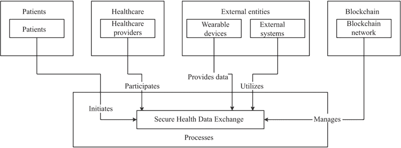

   图 3.4 用于安全且互操作的健康数据交换的智能合约图

## 3.6.2 结果

`blockchain` 和 `smart contracts` 在医疗领域的应用取得了转型性的成果，显著增强了健康数据交换的安全性、互操作性和效率。`Blockchain` 的去中心化结构确保了稳健的安全性，减少了未经授权访问和篡改的风险。`Smart contracts` 自动化了同意管理等流程，增加了患者和医疗服务提供者的透明度和信任。

`blockchain` 的使用极大地解决了医疗领域的互操作性问题。其去中心化的架构和标准数据格式消除了以往不同医疗机构之间顺畅通信的障碍。

患者现在在管理和交换其健康数据方面拥有了更大的自主权。`Smart contracts` 简化了流程，通过自动化数据访问审批等任务提高了运营效率。`blockchain` 和 `smart contracts` 的集成开启了一个更具连接性、更安全且以患者为中心的医疗格局，预示着健康数据管理领域的持续创新。

# 3.7 未来研究方向

`blockchain` 在患者身份管理中的未来可能性，是旨在增强医疗系统内安全性、隐私性和互操作性的众多创新策略之一。一个令人兴奋的研究方向是研究 `blockchain technology` 如何与 `FL` 结合使用，以及 `smart contracts` 与 `IoT` 结合，以利用患者身份管理中的若干机遇和挑战。理想情况下，`FL` 和 `blockchain` 的集成为协作和保护隐私的健康数据分析提供了一条可行路径。通过在不提供原始数据的情况下协作模型训练，`FL` 保护了跨机构的患者隐私。人员可以使用 `blockchain` 的防篡改账本来处理访问控制和数据来源，从而确保 `FL` 过程是可追溯且完整的。未来，研究可能会集中在增强 `blockchain-FL` 框架的可扩展性和效率上，同时解决去中心化网络上的模型同步和异构数据等问题。

此外，`blockchain technology` 与 `IoT` 的融合为 `RPM` 和护理协调带来了新可能性。医疗服务提供者可以通过在 `blockchain` 上安全地存储 `IoT` 生成的健康数据，确保数据的完整性、真实性和患者隐私。未来的研究可能会调查基于 `blockchain` 的 `IoT` 医疗系统的新型设计，并考虑实时数据分析、数据聚合以及与现有医疗基础设施的兼容性。此外，为了支持大规模部署和多种用例，研究工作可能会集中于提高 `blockchain IoT` 生态系统的可扩展性和韧性。`blockchain technology` 和 `smart contracts` 实现了多方之间安全且互操作的健康数据交换。在 `blockchain` 上编程的自执行合约被称为 `smart contracts`。它们可以自动化数据共享协议、访问控制规则和同意管理，从而在确保合规性的同时简化患者信息的交换。未来的潜在研究领域还包括医疗交易的标准化 `smart contract` 模板、改进数据验证和校验程序的有效性，以及研究跨链互操作性和数据可移植性的前沿方法。

为了应对医疗领域不断变化的机遇和挑战，基于 `blockchain` 的患者身份管理的未来研究应侧重于结合 `FL`、`IoT` 和 `smart contracts` 等领先技术。通过协同融合各种技术，研究人员可以创建提高安全性、隐私互操作性的新型解决方案，同时让患者和医疗服务提供者对健康数据的管理和共享拥有更多控制。此外，为了促进创新并确保区块链技术在实际医疗环境中的应用，研究人员、医疗从业者、立法者行业者之间的跨学科合作将至关重要。

# 3.8 结论

总结来说，`blockchain technology` 在患者身份管理中的应用具有全球医疗系统的巨大潜力。医疗人员通过利用 `blockchain technology` 的不可篡改性、去中心化和透明性等固有特征，可以提高患者身份数据的安全性、隐私性和互操作性。

医疗机构通过实施 `blockchain technology` 可以确保 `EHRs` 的准确性，加速数据交换流程，并让患者对其私人健康信息拥有更多控制权。

此外，区块链的潜力不仅限于管理患者身份。它与智能合约、联邦学习（`FL`）以及物联网（`IoT`）的结合，为安全的健康数据交换、远程监测（`RPM`）以及保护隐私的数据分析创造了新机会。尽管区块链具有巨大潜力，但仍然存在问题。监管合规、可扩展性、互操作性以及与当前医疗基础设施的集成是某些需要额外研究和开发的主要障碍。此外，区块链技术在医疗行业的成功采用和实施取决于跨学科的协作和利益相关者的参与。在未来几年中，要释放区块链在患者身份管理中的全部潜力，需要持续的研究、创新和合作。通过解决问题、优化现有模型以及探索新用途，医疗领域可能会利用区块链技术来改善治疗效果、提高生产力，并彻底改变全球医疗服务的模式。

# 参考文献

[1] Jaoude, J.A. and Saade, R. Business applications of blockchain technology–a systematic review. *IEEE Access*. 7(1), pp.10–1109, 2019.

[2] Gupta, M., Jain, R., Kumari, M. and Narula, G. Securing healthcare data by using blockchain. *Applications of Blockchain in Healthcare* (pp.93–114). Singapore: Springer Nature; 2020.

[3] Swarnkar, M., Bhadoria, R.S. and Sharma, N. Security, privacy, trust management and performance optimization of blockchain. *Applications of Blockchain in Healthcare* (pp.69–92). Singapore: Springer Nature; 2020.

[4] Hylock, R.H. and Zeng, X. A blockchain framework for patient-centered health records and exchange (`HealthChain`): proof-of-concept study. *Journal of Medical Internet Research*, 21(8), p.e13592. 2019.

[5] Javed, I.T., Alharbi, F., Bellaj, B., Margaria, T., Crespi, N. and Qureshi, K. `Health-ID`: A blockchain-based decentralized identity management for remote healthcare. *Healthcare*, 9(6), p.712, 2021. doi:10.3390/healthcare9060712.

[6] Mohammed, A.H., Abdulateef, A.A. and Abdulateef, I.A. `Hyperledger`, `Ethereum` and blockchain technology: A short overview. *Proceedings of 3rd International Congress on Human-Computer Interaction, Optimization and Robotic Applications (`HORA`)* (pp.1–6). IEEE; 2021.

[7] Harrell, D.T., Usman, M., Hanson, L., et al. Technical design and development of a self-sovereign identity platform for patient-centric health care using blockchain technology. *Blockchain in Healthcare*, 5(S1), pp.10-30953, 2022.

[8] Sharma, P., Jindal, R. and Borah, M.D. `Healthify`: A blockchain-based distributed application for health care. *Applications of Blockchain in Healthcare* (pp.171–198). Singapore: Springer Nature; 2020.

[9] Abdul-Moheeth, M., Usman, M., Harrell, D.T. and Khurshid, A. Improving transitions of care: designing a blockchain application for patient identity management. *Blockchain in Healthcare*, 5(S1), pp.10-30953, 2022.

[10] Tanwar, S., Parekh, K. and Evans, R. Blockchain-based electronic record system for healthcare 4.0. *Journal of Information Security and Applications*, 50, p.102407, 2020.

[11] Ouaguid, A., Hanine, M., Chiba, Z. and Ghazal, H. Analysis of Blockchain Integration in the e-Healthcare Ecosystem. *2023 6th International Conference on Advanced Communication Technologies and Networking (`CommNet`)* (pp.1–8). IEEE; 2023.

[12] Alam, S., Bhatia, S., Shuaib, M., et al. An overview of blockchain and IoT integration for secure and reliable health records. *Sustainability*, 15(7), p.5660, 2023.

[13] Kshetri, N., Hutson, J. and Revathy, G. `HealthAIChain`: Improving security and safety using Blockchain Technology in AI-based healthcare systems. *2023 3rd International Conference on Innovative Mechanisms for Industry Applications (`ICIMIA`)* (pp.159–164). IEEE; 2023.

[14] Charles, W.M. Accelerating life sciences research with blockchain. *Applications of Blockchain in Healthcare* (pp.221–252). Singapore: Springer Nature; 2020.

[15] Bittins, S., Kober, G., Margheri, A., Masi, M., Miladi, A. and Sassone, V. Healthcare data management by using blockchain technology. *Applications of Blockchain in Healthcare* (pp.1–27). Singapore: Springer Nature; 2020.

[16] Kumar, M., Raj, H., Chaurasia, N. and Gill, S.S. Blockchain inspired secure and reliable data exchange architecture for cyber-physical healthcare system 4.0. *Internet of Things and Cyber-Physical Systems*, 3, pp.309–322, 2023.

[17] Tandon, A., Dhir, A., Islam, A.K.M.N. and Mäntymäki, M. Blockchain in healthcare: A systematic literature review, synthesizing framework and future research agenda. *Computers in Industry*, 122, p.103290, 2020. doi:10.1016/j.compind.2020.103290.


[18] Zhao, Y., Zhao, J., Jiang, L., et al. Privacy-preserving blockchain-based federated learning for IoT devices. *IEEE Internet of Things Journal*, 8(3), pp.1817–1829. 2020.

[19] Venkatesan, S., Sahai, S., Shukla, S.K. and Singh, J. Secure and decentralized management of health records. *Applications of Blockchain in Healthcare* (pp.115–139). Singapore: Springer Nature; 2020.

[20] Qi, Y., Hossain, M., Nie, J. and Li, X. Privacy-preserving blockchain-based federated learning for traffic flow. *Future Generation Computer Systems*, 117, pp.328–337, 2021.

[21] Yadav, A., Singh, K., Amin, A., Alsenani, T. and Ahmadian, A. A comparative study on consensus mechanism with security threats and future scopes: Blockchain. *Computer Communications*, 201, pp.102–115, 2023.

[22] Praveen, G., Anand, M., Singh, P. and Ranjan, P. An overview of blockchain consensus and vulnerability. *Proceedings of the Information and Communication Technology for Intelligent Systems (ICTIS 2020)*, 1, pp.459–468, 2021.

物联网（IoT）已成为许多行业中颠覆性技术，其在医疗保健领域的应用正在改变医疗服务的交付方式。本章详细概述了物联网在医疗领域的影响和潜力，强调了其在增强患者特殊关注、提高资源利用率以及提升医疗标准方面的作用。医疗健康物联网涉及通过互联网连接医疗设备、传感器和系统，实现无缝通信和数据交换。这种连接性促进了医疗专业人员的实时监控、远程患者管理和智能决策。可穿戴设备、智能传感器和连接医疗设备共同构建了一个高效且以患者为中心的全面医疗生态系统。物联网在医疗保健领域的主要优势之一是能够对患者进行远程、持续的监测。通过利用实时记录健康相关数据和生命体征传感器的可穿戴技术，医疗从业人员可以在患者不在传统医院环境的情况下对其进行关注。这促进了主动治疗和健康问题的早期识别，减少了并发症并降低了医院再入院率。此外，物联网应用有助于优化医疗运营和资源管理。智能医疗基础设施（包括联网连接的救护车、支持 RFID 的库存管理和预测性医疗设备维护）提高了医疗交付的效率。这导致了成本节约、资源的更好利用以及医疗服务质量的全面提高。与目前使用的其他系统相比，我们建议的方法看起来更安全更高效。

**关键词：** 智能医疗；无线体表传感器；云服务器；物联网（IoT）；健康监测；泛在医疗

## 4.1 引言

物联网（IoT）是一项改变了具有传感器和独特身份的系列网络对象的技术。这些设备从智能手机、可穿戴小设备到工业机械和医疗设备，能够实时采集、交换和分析数据。物联网的主要目标是创建一个自我报告设备网络，这些设备可以与人类以及彼此相互交互。这将实现智能决策、自动化以及跨多个领域的无缝集成。物联网是由物理物体（或“物”）的网络，这些物体与传感器、软件和其他技术相结合，通过互联网与其他系统和设备通信并共享数据。物联网不仅仅是计算机和其他技术。任何拥有传感器和唯一标识符（`UID`）的东西都包含在内。物联网的主要目标是开发能够与人实时通信的自我报告设备。

物联网的概念已经存在很长时间，但最近由于某些技术发展它才变得实用。低成本、高能效传感器技术的可用性使得廉价且可靠的传感器让物联网技术现在对更多公司触手可及。交互：许多互联网网络协议使得传感器很容易连接到云和其他“物”，以便在跨云计算平台之间进行高效数据传输。随着云平台可用性的增加，个人和企业现在可以访问扩展业务所需的基础设施，而无需管理这一切。

### 4.1.1 传感器和 Arduino Uno

传感器是测量和识别外部因素或环境情况的部件或装置，并将数据转换为电子仪器或系统可以理解的信号。传感器有多种形式，每旨在识别特定类型的物理事件。以下是一些典型的传感器类型：光、湿度、运动、压力、温度、加速度计、陀螺仪、生物识别、接近传感器等。这些传感器可以检测环境变化、监控设备性能、跟踪运动以及评估生理指标等用途。将传感器集成到物联网设备的企业和组织可以获得其运营的重要见解，简化流程并改进决策。传感器对于许多应用至关重要，包括消费电子、医疗保健和工业自动化。为了在广泛领域和应用中实现自动化、监控和控制，传感器是现代技术的关键部分 [1]。

Arduino 传感器是与 `Arduino` 微控制器兼容的传感器。易于使用的计算机程序和硬件构成了 `Arduino`——一个开源电子平台的基础。它包含一个用于创建、编译和将代码上传到板的开发环境以及一个可编程微控制器板。Arduino 传感器设计用于与 `Arduino` 板接口并向微控制器提供输入数据。Arduino 传感器有多种类型，可以测量各种物理属性或环境条件，如温度、湿度、光照、运动、接近等。这些传感器通常使用标准通信协议（如模拟电压、数字信号或串口通信）与 `Arduino` 板接口。`Arduino` 提供了与各种传感器接口的库和代码示例，使用户能够更容易地将传感器功能集成到他们的项目中。此外，许多第三方制造商和供应商提供多种与 `Arduino` 兼容的传感器，用户可以选择最符合其项目需求的传感器。总而言之，Arduino 传感器通过允许项目与真实环境通信并对其做出反应，对于扩展基于 `Arduino` 项目的功能至关重要。它们使得创建各种创新交互式电子设备和系统成为可能。

传感器和 `Arduino Uno` 在许多项目中起着关键作用，从基础的家庭实验到复杂的物联网系统。设计的“眼睛”和“耳朵”是收集真实世界数据的传感器。`Arduino Uno` 发当“大脑”，根据预设逻辑解释数据并指导执行器。由于 `Arduino Uno` 具有适应性和使用的简单性，它是与各种传感器集成的伟大平台。得益于它的数字和模拟输入/输出端口，它可以连接到各种传感器，如运动、气体、湿度、温度等。专业人士、学生和爱好者选择 `Arduino Uno` 是因为其拥有丰富的库和对扩展板的兼容性，这进一步增强了它的传感器集成能力。在大多数传感器-`Arduino Uno` 项目中，工作流程包括将传感器连接到 `Uno` 上，利用模拟或数字引脚读取传感器数据，使用 `Arduino` 微控制器处理数据，然后根据获得的信息采取行动。此外，由于 `Arduino Uno` 兼容许多不同的物联网平台和通信协议（包括蓝牙、Wi-Fi 和 LoRa），它是设计需要集成传感器的物联网应用的极佳选择。开发者可以通过将 `Arduino Uno` 连接到互联网，设计实现实时通信和决策的物联网解决方案，从现场部署的传感器收集数据，并远程监控和控制设备。

综合考虑，传感器、物联网（IoT）和 Arduino Uno 协同工作，可以创建出智能网络系统，这些系统能够检测、理解并对环境变化做出。随着物联网的发展，传感器与 Arduino Uno 的结合对于促进各行业的创新能力和创造新机会至关重要。

### 4.1.2 医疗保健领域的物联网

医疗领域对物联网技术的采用表明了观念的转变，即转向更智能、更成功的患者护理方法。医疗服务提供者可以通过支持物联网的设备、传感器和数据分析，转变医疗服务的交付、监控和管理 [16]。最终，这将带来更好的患者效果、更愉快的互动以及资源的高效利用。医疗行业中的物联网除了标准电脑和设备外，还包括多种设备。它涵盖了所有具有唯一标识符（`UID`）传感器的设备，包括环境传感器、可穿式健康监测器和智能医疗设备。这些设备可以收集大量的实时数据点，例如生命体征、患者活动水平、药物依从性、环境变量等。医疗领域物联网的首要目标是创建能够与消费者及相互进行实时通信的自报告设备。这使得持续监测患者健康状况、及早识别健康问题或异常，并及时采取行动以防止不利结果成为可能。支持物联网的设备还使数据集成和互操作变得更容易，让医疗专业人员能够从多个源获取完整的患者数据，并有能力就诊断、治疗和护理管理做出明智决策。

物联网正在通过创建一种更具连接性和数据驱动的患者护理方法来彻底改变医疗保健 [2]。远程医疗和远程患者监测（RPM）是物联网在医疗领域的两个重要用途。支持物联网的可穿戴健康监测器可以通过持续监测生命体征并将数据实时发送给医疗提供者，从而远程监测术后恢复期的患者或慢性病患者。物联网的其他用途如下：

*   远程监控：物联网设备允许医生远程监控患者，特别是对于需要密切关注的慢性病患者，它可以追踪心率、血糖和血压。

*   更好的药物管理：支持物联网的自动药器可以提示患者服药，甚至跟踪他们是否已服药，这改善了药物依从性。

*   疾病早期检测：集成传感器的可穿戴技术可以监测个人的活动水平、睡眠习惯和其他医疗信息。这些信息可以是识别心脏问题或糖尿病等疾病早期迹象的宝库，允许采取预防措施。

*   医院资产追踪：在医疗机构内部，物联网技术可以监控医疗物资、设备和药品的位置及状态。它有助于优化库存管理，防止丢失或盗窃，并确保基本资源的可用性。

*   慢性病管理：通过为患者提供自我监测工具和遵循治疗计划的工具，物联网解决方案有助于糖尿病、高血压和哮喘等慢性疾病的管理。

具有物联网能力的智能医疗设备（如胰岛素泵、起搏器和自动发药机）提高了患者的安全性和治疗依从性。这些设备通过自动调整药物剂量、提醒用户服药以及向医疗专业人员警告可能的问题或困难，可以降低副作用的概率并改善患者效果。医院管理和运营是另一个物联网彻底改变医疗保健的领域。将物联网传感器和自动化技术集成到智能医院基础设施中可以优化资源配置、加速运营并改善患者流程和体验。例如，支持物联网的智能床可以根据患者偏好自动调整设置，并对跌倒或压力性疡提供实时警报，从而减轻医疗人员的工作量。这增强了患者的舒适度和安全性。

Section 4.2 包含了对各种现有系统的综述，提到了这些系统的结果、优点和缺点。在 Section 4.3 中，详述了所提模型的系统设计。Sections 4.4–4.6 展示了所提模型在各种案例中的实现方法。在 Sections 4.7 和 4.8 中，分别解释了所提模型的性能分析和未来研究方向。Section 4.9 是本章的结论。

## 4.2 背景与相关工作

可穿戴和支持物联网的个性化医疗技术所实现的联动环境，允许提供一系列医疗服务，包括健身追踪、远程健康监测和饮食计划。文中展示了基于物联网的虚拟康复系统的潜力。这些包括提供实时远程健康监测的能力、提高老年人和残障人的生活质量、预测疾病、开具预防性药物以及监督医院和急诊室的医疗服务。它强调了医疗物联网（IoMT）如何有意识地用于阻止 COVID-19 的传播、提高工作人员安全并增加流行病管理的有效性。由于国际范围内快速采用 IoMT 带来的重放攻击、中间人攻击、恶意软件和密码破解等问题，强有的安全措施至关重要。文中还提到了物联网在医疗领域的未来，重点关注用于实时健康追踪的 RPM、远程医疗、药物依从性监测、用于预测建模的增强数据分析，以及机器学习和人工智能（AI）在医疗应用中的变革性潜力 [3]。

Mohammed 和 Hasan [4] 解释了如何利用物联网技术创建智能医疗监测系统。它强调了物联网在医疗保健中的价值，以及它如何实现实时追踪体温、心率和 SPO2 等关键健康指标。为了配置硬件，监测体温、心率和 SPO2 水平的传感器连接到作为微控制器的 `Raspberry Pi 4B`。通过附加的 `4G GSM, GPRS, and GNSS HAT module` 可以追踪患者的实时位置并实现高效通信。从硬件和传感器收集的数据使用 `MySQL` 数据库存储在云端。这允许记录患者信息、异常数据和过去的患者状况以供参考。系统还通过移动应用程序将实测的健康参数共享给医生和患者。将测量数据与正常数据范围进行比较；如果测量数据偏离正常范围，则通过 `SMS notification` 发送紧急警报连同患者当前位置给医生和家人。

Kokkonis *et al.* [5] 描述了一种电子健康外套的发展，该外套能够从医疗传感器持续收集数据并发送到云端，以及一种可穿戴健康监控系统（WHMS）。它侧重于从有慢性或罕见疾病的患者穿的电子健康外套实时收集大规模医疗数据。当外套上独特的报警按钮被按下时，诊所将收到即时报警并派遣救护车前往患者住所。此外，还具备 GPS 定位功能，可以在患者离开家中或医院时随时传输其精确位置。为了克服医疗领域日益增长的数据流量管理与分析、强调数据安全以及无线数据传输等挑战，用于监测患者健康的传感器是 WHMS 卓越的系统设计水平，以及用于无线数据传输的混合传输协议。架构中使用的硬件组件价格合理且市场上容易获得。推荐的通信协议考虑了可穿戴系统的电池寿命、患者与连接的距离以及传输的健康信息类型。他们能够收集的信息包括移动性和手势检测、信号审计、定制生物信号评估和状况采样。

开发了一款专注于高血压和糖尿病等慢性健康状况的移动应用程序，允许用户通过应用程序与医生交流。该系统涉及患者、医生和家庭护理人员等用户，实现了远程健康监控和通信。它还包含一个涉及家电、传感器和执行器的系统架构，用于数据收集和传输。该系统侧重于通过用户与家电之间的无线通信，监测血压、血糖水平和体温等生理参数。用户可以在移动应用程序上注册、上传健康数据、与医生聊天并通过移动 App 预约挂。该系统还支持对 COVID-19 症状的远程监控、分析用户输入，并促进患者、医生和家庭成员之间的通信，以实现高效的医疗管理。该系统旨在提高健康挑战患者的便利性，实现实时监控、远程咨询和具有成本效益的医疗。这一智能健康辅助平台允许对远端患者进行观察，特别是在 COVID-19 爆发等隔离期间。它实施了基于物联网的解决方案以减轻医院负担，提供必要的舒适性，并提取健康数据用于医疗诊断和处方 [6]。

一种由物联网驱动的智能医疗系统，用于急诊护理中的高效诊断，它收集了联动设备和最新技术来实时跟踪和评估患者的健康指标。这意味着目前设想的系统由可穿戴传感器、无线信道、云存储与处理、机器学习算法以及移动应用程序驱动，从而增强了整体急诊医疗体验。传感器有助于监测高血压、氧饱和度、呼吸频率、心率和体温等多个关键健康指标。这些设备通过无线通信将实时数据发送到中央云平台。这是通过使用低功耗通信协议实现的，这些协议进一步延长了可穿戴设备的电池寿命。在云端，积累的健康数据被安全地存储，随后使用高级分析和机器学习算法进行处理。由于这些算法利用患者的历史数据来识别模式、趋势和可能的异常，预测性诊断成为可能。一旦读数异常或出现需要医疗提供人员立即关注的关键健康状况，系统设计将向医疗提供人员发出即时报警。移动应用程序是该系统的组成部分，为患者和医疗提供人员提供了易于使用的界面。患者可以利用个人健康洞察、获取健康建议，并在更主动的健康管理中跟踪健康状况。然而，医疗提供人员可以实时访问每位患者的数据 [7]。

通过启用 AI 的云端物联网系统，智能皮肤健康监测展示了个性化护肤和皮肤问题早期识别的前沿理念。涉及该系统的传感器的智能可穿戴设备不断记录皮肤的生命参数，如湿度、温度和紫外线（UV）暴露。收集的数据整体通过物联网的安全数据网络传输到云平台，以便数据进行集中存储和实时处理。AI 算法在与皮肤健康相关的数据分析中起着关键作用。机器学习模型可以识别皮肤疾病的模式、异常和预警信号，通过学习不断提高准确性。另一个重要领域是监测紫外线暴露，通过应用的传感器进行实时监测，并在发生阳光危险时向用户反馈。该应用程序还提供教育资源，提供有关护肤、预防以及根据个人皮肤状况选择合适产品的信息。总的来说，基于 AI 的云物联网前景彻底改变了护肤行业，提供了一种主动、数据驱动和个性化的方法来保护和改善皮肤健康 [8]。

一种用于癫痫报警的可穿戴设备物联网平台利用监测与癫痫发作相关的生理迹的传感器。它通过物联网协议与云基础设施连接，实际上它可以进行实时分析，使其变得相对简单。用户可以自定义报警级别，且该应用程序具有机器学习算法且用户友好。地理位置跟踪将通过在发作期间通知附近的联系人或紧急服务部门用户的位置来提供及时帮助。优化的电池确保了设备的使用时间，而安全和隐私功能不会开放用户的健康信息。与医疗提供人员的整合有助于从远程进行监控并更好地管理用户的状况，平台以用户为中心的设计结合持续改进，确保为有癫痫发风险风险的人提供有效且支持性的解决方案 [9]。

医疗设备中基于物联网的应用彻底改变了患者护理和管理。传感器、连接性和数据分析的整合为医疗设备中的患者护理和管理带来了巨大变化。它改变了医疗保健提供者监测、诊断和治疗患者的方式。这意味着通过提高提供医疗服务的效率改善了患者预后。例如，IoT 实现的其他应用包括 `RPM`（远程患者监控），其中支持 IoT 的设备（例如可穿戴传感器或家庭监控设备）实时收集患者数据并将其发送给医疗专业人员。这将支持对生命体征的持续追踪、用药依从以及健康状况，以便获得早期干预和个性化治疗计划。这在监测慢性疾病（如`糖尿病`、高血压和心脏疾病）方面特别有用，它可以防止反复就医并降低医疗成本；利用视频会议工具和连接医疗外设等 IoT 设备，患者可以与其护理提供者进行远程咨询。IoT 允许在设备和相关人员之间安全地发送健康数据，整合图片、测试结果和其他知识。医疗设备中基于物联网的应用通过提供个性化、易访问且高效的护理，赋予了患者和医疗保健提供者能力，同时驱动了医疗行业的创新 [10]。


IoT 使各种设备、传感器和物体通过连接互联网交换数据并相互作用。这种连接性使得自动化程序、远程监测和提高整体生产力变得更加容易。利用识别技术安全地访问患者数据并实现清晰的信息共享是开发医疗物联网（`HIoT`）系统最重要的方面之一。系统中的每个实体都被分配了一个 `UID` 以确保正确的识别和数据完整性。HIIoT 网络内部的连接很大程度上取决于通信技术。短距离通信协议通常包括 `Wi-Fi`、`Bluetooth` 和射频识别 (`RFID`）。`RFID` 技术用于实时识别和跟踪资产或产品，而无线网络和 `Bluetooth` 通常用于在相邻设备之间传输数据。HIIoT 系统利用这些通信技术确保跨不同设备、传感器和医疗设备的顺畅连接，从而提供有效的数据共享和通信 [11]。位置技术的引入进一步增强了 HIoT 系统的潜力，特别是在医疗环境中。得于位置技术，医疗设备可以被追踪和监测，从而了其在需要时的可用性并加速应急响应。医疗机构通过添加位置跟踪技术可以提高患者护理质量、加快流程并增加安全性。例如，位置技术可以帮助在医院环境中快速定位特定的医疗用品或设备，从而缩短反应时间并提高整体效率 [12]。

###

自引入物联网技术以来，医疗领域经历了重大的转型，改变了患者护理和管理。这种向智能化和有效的患者护理的范式转变，其潜在收益是改善医疗成果、最优化利用资源以及改善患者体验。我们通过这个提出的模型探索了在医疗保健中实施物联网的通用通用框架，重点关注重要元素及其连接。

#### 1. 传感器技术集成

医疗物联网的基础是传感器技术。一系列传感器（如温度、心率、血压、血糖水平和运动传感器）被整合到医疗设备、可穿戴技术甚至基础设施中。这些传感器从医疗设备、患者和环境因素中实时收集数据。收集的数据被安全地移动到中央服务器或云平台进行分析和管理。

#### 2. 数据传输与通信

有效的通信路由对于发送传感器收集的数据至关重要。`Bluetooth`、`Wi-Fi` 和蜂窝网络是无线通信协议的示例，允许数据无缝地从传感器传输到后端系统。通过安全的通信协议确保数据完整性和机密性，可以保护患者隐私并符合诸如《健康保险流通性与责任法案》（`HIPAA`）等法律要求。

#### 3. 云端数据存储与处理

IoT 设备产生海量数据，这需要可靠的基础设施来处理和存储数据 [13]。云计算平台提供了扩展且经济的选择。为了支持临床决策和个性化患者护理，复杂的分析工具和机器学习算法处理数据以提取相关的见解和模式。

#### 4. 与电子健康记录集成

为了让 IoT 数据无缝集成到当前的医疗系统中，互操作性至关重要。应用程序接口（`APIs`）实现了 IoT 平台与电子健康记录（`EHR`）系统之间的双向连接。医疗专业人员通过整合 IoT 数据可以获得对患者状况、历史和持续监测数据的深入理解。这为了及时干预和护理的连续性 [14]。

#### 5. 预测性分析与远程监测

基于 IoT 的预测性分析对于主动医疗管理至关重要。利用历史和当前数据，预测模型可以识别潜在的健康风险、预测疾病的发展情况并启动早期治疗。通过促进持续体征监测和对治疗计划的遵循，远程监测技术使患者能够参与治疗，从而降低了住院率并改善了患者预后。

#### 6. 可穿戴设备与移动应用程序

具有 IoT 能力的可穿戴设备允许定制的健康追踪和监测。这些设备从健身追踪器到智能手表，持续监测睡眠模式、体力活动和生命体征。用户可以通过移动应用程序接收实时反馈、可操作的见解以及用药和生活方式变化的提醒。移动 App 和可穿戴设备鼓励患者参与，让他们对护理有更多控制，并让患者更容易与医生咨询 [15]。

#### 7. 隐私与安全措施

确保医疗记录的安全和隐私对于物联网实施至关重要。复杂的身份验证方法、访问控制和加密策略保护私人患者数据免受黑客和非法访问。通过减少与数据隐私违反相关的法律和声誉风险，遵循行业最佳实践和监管要求增加了患者和医疗利益相关者的信任 [16]。

物联网（IoT）及其在医疗保健领域的应用代表了向智能化、高效患者护理的重要范式转变。医疗保健提供者利用传感器技术、数据分析和互操作系统，可以提供远程、主动且定制的监控解决方案。所建议的方法强调了物联网设备如何在维护患者隐私、数据安全和互操作性的同时，与当前的医疗基础设施进行无缝集成。随着物联网的发展，它有能力通过增强患者体验、降低成本和提高效果来彻底改变医疗保健（图 4.1）。

在接下来的章节中，本章将阐述如何在社会的不同部门实施所提的模型，并详细讨论使用集成在医疗保健领域的 IoT 以获得更好结果的方法和结果。

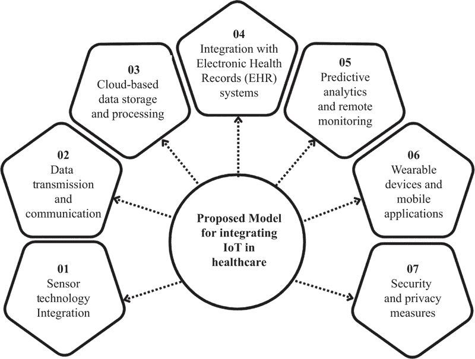

图 4.1 医疗保健物联网建议模型

## 4.4 基于 IoT 的跌倒检测

我们需要一个能够监控并通知事故的自动系统，因为跌倒事故——例如建筑工人从高层坠落或登山者从高海拔坠落——发生频繁，且在极端情况下提供紧急援助非常困难，特别是考虑到全球人口老龄化以及相关问题，如跌倒现场医疗服务不足和跌倒检测系统失效等。这种设备可以识别涉及跌倒的事件并立即通知救援人员来帮助 [17]。除了发送通知和使用 `GPS` 技术精确定位受害者外，该设备还将用于检测跌倒事故。该技术会将任何跌倒事故的经纬度坐标立即传输给最近的紧急服务提供者，以便采取及时行动。该系统同时使用卫星导航和手机技术来寻找车辆，并通知相关方（如警察、家人和救护服务部门——紧急情况。特别是，利用 `GSM` 用于向目标接收者发送包含准确位置信息的警报消息，而 `GPS` 用于位置跟踪。当此类事件在孤立地点发生且周围没有人报告时，这种方法可能会挽救害者的生命。由于其具有识别事故并及时通知紧急人员的能力，这项技术可以在极端情况下促成快速反应并可能挽救生命。用户的智能手机通过 `GPS` 和 `GSM` 模块连接到加速度计，系统利用这些信息做出决策并向设备发送消息。包含事故位置的短信将发送给用户的网络连接和附近的医疗机构，提供有关受害者所在地的精确详细信息。

### 4.4.1 方法论

1. `Arduino`: `Arduino` 微控制器基于 `ATmega328P`。`Arduino UNO` 是一种流行的微控制器板，它使用加速度计传感器检测任何跌倒事故，并使用 `GSM` 模块通知紧急服务或指定的联系人。它是嵌入式应用的理想选择，因为它有效、适应性强且易于使用。

2. `GSM module`: 通过 `SIM900A` `GSM` 模块实现了 `GPS` 与指定手机号码之间的通信。其频率范围为 900–1900 MHz，使用三频网络，包括 `DSC 100 MHz`、`PCS 1900 MHz` 和 `EGSM 900 MHz`。这通过 `GPS` 模块的发送引脚和 `GSM` 模块的接收引脚实现。

3. `GPS module`: 使用 `SIM28ML` `GPS` 模块确定受害者在地球上的位置，并使用坐标将信息传输到 `Arduino` 板。`GPS` 模块生成 `NMEA` 格式的实时位置数据，运行频率为 1575.42 MHz。然后使用 `GSM` 模块将数据发送给指定的联系人。

4. `Accelerometer`: 在事故检测系统中，加速度计是一种测量加速度并识别运动变化的传感器。它可以检测到由于事故发生期间快速冲击引起的加速度大幅变化。之后，这些信息可能会触发报警或开启安全功能（图 4.2）。

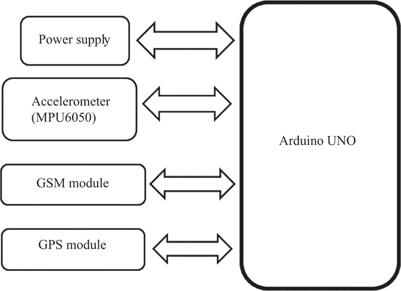

图 4.2 跌倒检测系统框图

### 4.4.2 工作原理

1. 开始：程序启动。通过这种方式启动跌倒检测系统并激活所有所需的监控组件。

2. 计算加速度：系统的主要传感器之一——加速度计测量佩戴者的加速度。

3. 检查阈值：将记录的加速度值与根据用户指定标准或经验数据确定的预定义阈值比较。如果记录的加速度超过截止点，则意味着运动发生了突然变化，这可能意味着发生了跌倒事件。

4. 获取 GPS 坐标：当加速度超过阈值时，系统启动 `GPS` 坐标检索。`GPS` 坐标提供了精确的位置信息，这对于紧急人员寻找跌倒受害者至关重要。

5. 发送警报：紧急警报消息包含 `GPS` 坐标、跌倒时间和任何其他相关信息等重要细节。通过适当通信通道（包括手机网络或连接互联网的设备）发布警报。不仅指定的家庭成员或护理人员会接收到消息，附近的医院和医疗设施也会接收。多个接收器确保跌倒受害者能够得到及时的支持和帮助。

6. 结束：发送警报后，程序结束。在成功传输警报消息后，跌倒检测系统关闭直到下次监控周期。在待机模式下，系统可能会继续运行，准备识别并响应任何进一步的跌倒。

跌倒检测系统对老年人特别有利，因为由于年龄因素，他们跌倒风险较高；对于行动不便的人（如残障人士）或影响平衡和运动的状况也是如此。对于建筑工人，跌倒检测设备可能非常有帮助。因为高处坠落非常常见，建筑行业是这项技术中受益最大的领域之一。系统可以协助实时监控工人位置和运动，及早识别跌倒。及时的检测和警报可以带来更救援和医疗响应，可能挽救生命。自动警报可以加速应急预案的执行并确保立即发送援助。此外，该系统还可以用于登山者。这种系统可以监控登山者的生命体征，通过 `GPS` 跟踪其位置并检测跌倒，这在需要快速救援至关重要的偏远或高海拔环境中非常关键。这项技术通过确保他们在攀爬过程中发生跌倒或其他健康问题时能够被定位并获得帮助，增强了登山者的安全性（图 4.3）。

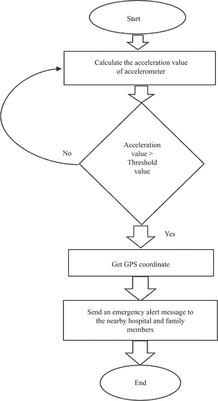

图 4.3 跌倒检测模型流程图

## 4.5 物联网驱动的智能床

智能床开发的主要意图是利用物联网（IOT）技术改善患者疗效、增强舒适度，并为患者和护理人员提供更安全的环境。智能床可以收集实时数据、自动化各种功能，并提供及时的干预，从而带来更好的患者护理和整体满意度。通过整合物联网技术来提高患者疗效、舒适度和安全性，智能床代表了医疗技术的重大进步。智能床利用物联网能力实时收集数据、自动化任务并提供及时干预，能够改善患者护理和满意度 [18]。通过减轻医疗人员的工作负担，智能床显著改善了医院环境下的患者护理。检查生命体征和根据患者需求修改床设置等日常工作由这些床自动完成。通过简化这些程序，护理人员可以将更多精力集中在直接的患者护理上，从而提高效率并优化资源配置。此外，由于智能床能够对标准参数的任何偏差提供实时警报和通知，能够实现及时干预并防止不利结果的发生，从而为患者和护理人员创造了更安全的环境。即使在护理人员不在患者接受居家护理时，智能床也具有持续监测的优势。得益于这种持续监测能力，患者及其家人可以放心，因为任何异常或危机都会被迅速识别并处理。通过带有远程监测功能的智能床，护理人员可以远程访问关键患者数据、监控趋势并接收警报。这允许护理人员在距离较远的情况下及时为患者提供协助和支持。这总体上提高了居家环境提供的护理水平并促进了患者安全 [19]。

### 4.5.1 方法

智能床的智能部分是物联网（IOT）。它是由无缝交互的传感器和网络设备组成的实时数据采集和处理网络。中央物联网平台接收来自传感器的持续数据并进行处理和分析。物联网平台使用复杂的算法来理解获取的实时数据。这使得系统能够识别异常，智能床可以根据分析采取行动。在这种智能技术的帮助下，患者和医疗专业人员可以轻松地远程通信。总而言，它提高了效率，并根据患者需求实现了快速干预和调整。

首先，传感器以战略方式放置在床内，以实时采集患者活动、生命体征和环境的数据。这些传感器的示例包括温度、压力和加速度传感器。这些传感器将数据发送到 `Arduino` 微控制器，该控制器用于持续监测各种参数。在处理输入数据后，`Arduino` 微控制器运行预设的算法来决定应该做什么。例如，如果传感器注意到长时间不活动或指向可能不适或痛苦的异常生命体征，微控制器可以激活线性执行器来帮助患者重新定位，或改变床的姿态以获得最大的舒适度。对于远程访问和控制，`Arduino` 微控制器可以与其他物联网设备或中央监控系统建立通信。护理人员可以使用此根据需要远程更改床设置、监控患者状况，并接收重要事件的警报。

### 4.5.2 工作原理

1. 用户躺在床上：用户通过躺在智能床上激活监控系统，从而启动程序。

2. 患者位置是否正常：系统判断用户的初始床位是否在预定义的范围内。

3. 监测位置：系统持续监测用户的姿态，直到检测到明显的变化。

4. 位置变化：系统持续监测用户的姿态，直到感应到跌落。

5. 激活气囊保护：如果感应到潜在的跌落，系统将触发气囊保护。

6. 用户是否有反应：系统判断用户是否对气囊保护做出反应。

7. 通知用户：系统提醒用户安全注意事项以确保其意识。

8. 警报护理人员：设备提醒护理人员或医疗人员可能存在无意识情况。

9. 调整床设置：系统根据用户的偏好修改床设置。

10. 检查用户偏好：系统验证用户的偏好以确保舒适度。

11. 设置床位置：技术修改床的位置以实现最佳舒适度。

12. 激活智能警报：系统根据预设的唤醒时间或紧急情况下触发智能警报。

13. 调整灯光：系统根据用户起床的时间调整房间照明。

14. 监测用户：系统跟踪用户的活动和睡眠习惯，以提供一般健康见解。

15. 用户醒来：系统根据感应到的动作跟踪用户是否已从睡中来。

16. 关闭报警：如果用户已醒，系统将静音警报。

17. 调整灯光：系统根据用户的意识水平调整照明使其感到舒适。

18. 持续监测：为了确保持续的安全和舒适，系统将关注用户的动作和周围环境，直到发现明显的变化（见 图 4.4 和 4.5）。

## 4.6 物联网与 AR 驱动的远程手术辅助

物联网（IoT）与增强现实（AR）技术的结合彻底改变了远程手术辅助领域，为医生提供了前所未有的能力来支持其工作并改善患者预后。这种新方法利用增强现实的沉浸式图像和物联网的连接性，为远程手术程序提供了实时指导、数据集成和协作工具。随着对先进医疗的需求不断跨越地理障碍增长，基于 AR 和物联网的远程手术辅助成为解决向医疗欠缺地区提供专家手术技能以及优化现有医疗机构手术流程挑战的极具前景的解决方案。AR 技术通过将虚拟数据和视觉效果叠加在医生的视野中，提高了手术过程中的情感知和精准度。通过在手术工具和设备中引入物联网传感器，可以将包括体征、影像结果和仪器追踪在内的实时数据无缝集成到 AR 接口中。这使得医生能够做出充分的判断并实时调整方案。此外，物联网连接使得手术团队进行远程协作成为可能。这使专家能够从远处提供建议和支持，增加了获得专门治疗的机会，并促进了医疗专业人员之间的知识交流。

### 4.6.1 方法论

本节详细介绍了 AR 和物联网如何用于远程手术，旨在阐明使用 AR 增强合格医生为远程运动患者手术能力的益处、局限性和整体流程。

1. **带有 HL 的主刀医生**：手术医生佩戴头戴式显示器或 AR 软件，这些设备会将数字信息投影到其现实视野中。`HL` 可能指“头戴式光设备”，这可能是 AR 头戴设备的一部分。

2. **视频采集**：这是显示在 AR 医生视野中手术部位的转录本或图形。

3. **语音（医生）**：医生的语音消息首先通过这些设备传递。然后，医生通过其麦克风与远程顾问进行共鸣。

4. **环境采集**：摄像头在将视频回传给顾问之前，捕获手术区域的高清直播视频。

5. **标注和语音通信**：远程顾问接收实时视频流并对其进行标注。标注可能包括指令、指导或突出显示特定的感兴趣区域。扬声器传输远程顾问的声音，该顾问可能是专家医生或另一位远程观察手术的医疗专业人员。

6. **访问医学影像**：手术期间可能会参考额外的医学影像，如 X 光或 CT 扫描，这些影像可以在远程顾问的电脑或医生的控制台上看到。

7. **带有电脑的远程顾问**：专家医生或其他专家远程参与手术。他们在电脑监视器上查看来自手术室的实时视频流（图 4.6）。

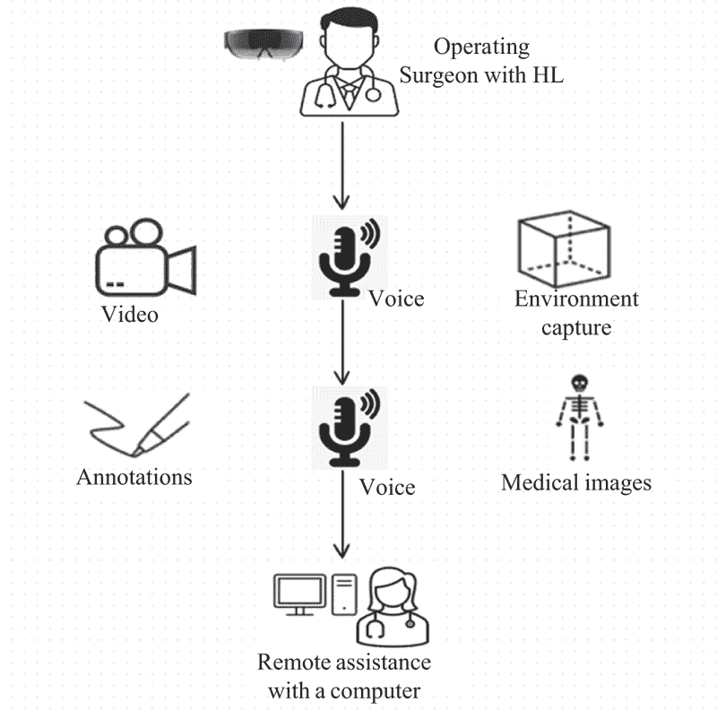

图 4.6 使用由远程顾问发送的信息（语音、标注和医学图片）以及主刀医生（视频、音频和环境采集数据）的 HL 演示

### 4.6.2 工作原理

1. **开始**：流程从激活机器人开始。

2. **启动机器人**：然后对机器人进行初始化，可能是在为其系统运行操作做准备。

3. **视频直播**：启动实时视频流，可能传输来自机器人车载摄像头的视图。

4. **向前移动并遵循信标系统**：机器人将开始向前移动，并通过其遵循的信标系统进行导航。信标发送无线信号；机器人将利用这些信号进行定位并在路径上前进。

5. **检测到障碍**：机器人上的传感器持续扫描路径上的障碍物。

6. **超声波传感器**：如果超声波传感器检测到任何阻塞，机器人将采取进一步行动。它利用人耳无法听到的高频声波工作并测量距离。在给图中显示了安装在前部（`F`）、左侧（`L`）和右侧（`R`）的超声波传感器。

7. **基于模糊的最优路径**：如果感知到障碍，将在模糊逻辑系统的辅助机器人最优路径。`模糊逻辑` 是一种人工智能，提供了一种接近人类推理和判断能力的近似推理方法。它能处理不精确和不完整的数据，适用于传感器读数可能不准确的应用。

8. **向信标转动**：这意味着机器人将向有助于其靠近信标的方向转动。

9. **通过基于 Google 的实体播放消息**：机器人到达某处时，通过扬声器播放播放的消息。

10. **打开/关闭门**：传感器检测门是开启还是关闭状态。

11. **到达房间状态**：此决策点表示机器人已到达目的地，很可能是病房。

12. **进入病房并播放消息**：如果门开着，机器人进入房间并播放消息。

13. **向患者交付药物**：机器人在房间内执行的一种可能任务是向患者交付药物。

14. **测量患者心率**：机器人可能用于测量个人的心率。

15. **测量患者体温**：机器人可能测量的另一个体征是患者的体温。

16. **更新患者数据库**：收集的患者数据可能存储在数据库中，供医疗人员审查。

这证明了 AR 通过向医生提供实时三维信息来增强手术精准度和改善患者预后的潜力。在紧急危机和灾难响应中获取手术知识至关重要时，基于 AR 和物联网的远程手术辅助具有显著的优势。第一响应人员和远程医疗团队可以利用可穿戴增强现实设备和支持物联网的手术设备，即使在资源有限的情况下的情况下也能高效协作，执行救生命的干预。AR 和物联网远程手术辅助系统可能会对人类生活产生巨大的积极影响，并改变医学科学和医疗保健提供的格局（图 4.7）。

（等等，让我们重新对齐结果与分析）

### 4.7 结果与分析


在`图 4.8`中，显示了一个为`跌倒检测`创建的虚拟物联网环境。电路包括`Arduino Uno`、`MPU6050 加速度计+陀螺仪`、`电阻`和`led`。一旦加速度和或旋转发生变化即可检测到跌倒。如果`X`轴、`Y`轴或`Z`轴的值发生变化且值变为`<0.5`，则检测到跌倒。

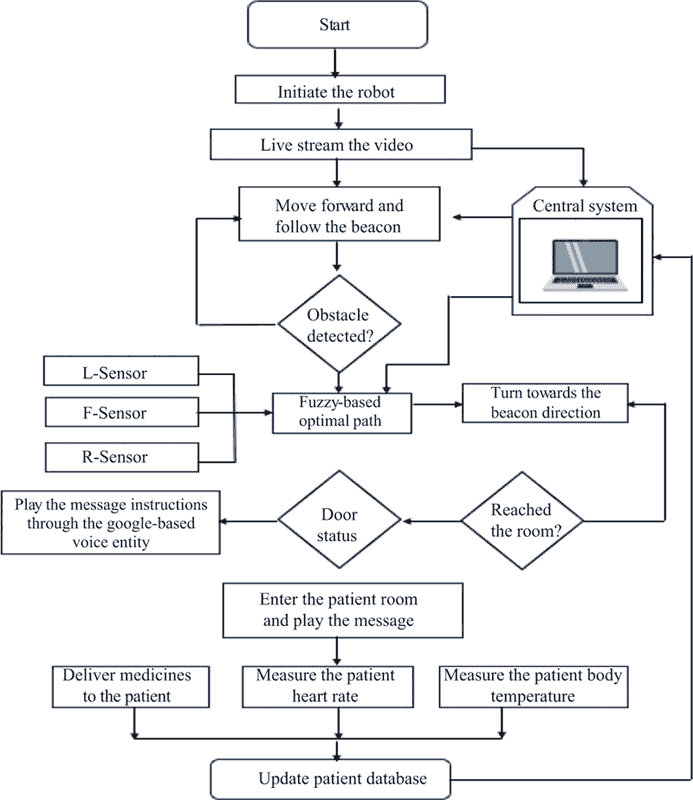

图 4.7 解释远程手术辅助工作的流程图

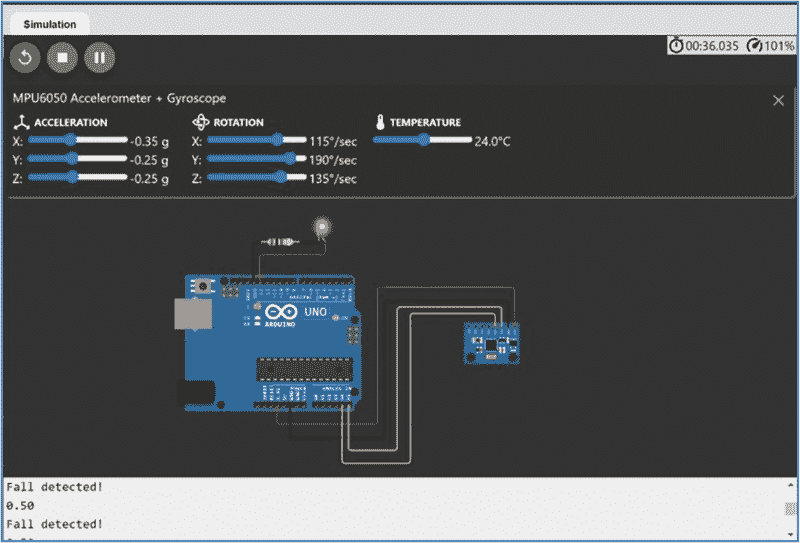

图 4.8 获取的结果截图

### 4.8 未来研究方向

未来的研究应当集中在创建与当前医疗设备和系统兼容的物联网（IoT）解决方案上。确保跨平台和供应商的互操作性以及数据交换，需要对通信协议和数据格式进行标准化。在物联网医疗研究中，解决安全和隐私问题将至关重要。建立强大的身份验证程序、数据匿名化策略和加密方法以保护患者私密数据并减少网络安全威胁是非常重要的[20,21]。研究工作应侧重于促进基于物联网的远程患者监测（RPM）解决方案。为了便于在常规医疗环境之外进行持续生命体征监测、药物依从性和疾病管理，这包含了可穿戴传感器、家庭监测设备和远程医疗平台。通过使用物联网生成的数据，医疗分析可以对疾病爆发、人口健康模式和治疗效力产生重要理解。为了从海量医疗数据集中提取有用见解，该领域的研究应该调查包括机器学习、预测建模和数据可视化在内的复杂分析方法。

对于智能床，需要提高传感器的精度和可靠性，以确保准确跟踪患者的活动和生命体征。需要利用尖端 AI 算法来评估睡眠趋势并调整床位设置以满足个人舒适度。使用手势或语音控制接口来增强活动受限患者的无障碍性和用户体验将大有益处。在跌倒检测中，需要增加传感器的特异性和灵敏度，以更精确地检测跌倒同时减少误报。机器学习算法利用传感器数据中的模式来区分跌倒发生和日常活动。为了获得快速援助和干预，改进与应急响应服务和移动警报系统的集成。研究先进的 AR 可视化方法以改进解剖可视化和手术引导。物联网传感器被整合到手术设备中，对组织属性、手术结果和器械位置提供实时反馈。触觉反馈系统可以通过模拟触感增强远程手术期间的灵活性。通过解决这些研究方向并将改进应用于智能床、跌倒检测和 AR 物联网远程手术辅助等案例研究，我们可以进一步推进物联网在医疗领域的能力和效率。这将最终改善患者护理结果并增强医疗服务的交付。

## 4.9 结论

物联网在医疗领域的整合标志着向智能化和高效患者护理的重大范式转变。医疗提供者可以通过利用包括传感器、连接和数据分析在内的物联网技术，转变患者护理的交付、监测和管理。物联网具有通过实现预防性干预、自动化重复操作和收集实时数据来彻底改变医疗行业的潜力。这些收益最终将导致更好的患者结果、更有效的资源利用和改进医疗成果。智能床、跌倒检测设备和远程手术支持只是物联网功能产品的几个示例，它们在提高患者无障碍性、舒适度和安全性方面具有显著效益。在这些进步的帮助下，医疗专业人员现在可以通过提供操作信息、实时监测能力和协作工具，在医院和家庭环境中为患者提供及时、个性化的护理。

物联网在医疗领域的整合还为安全、互操作性、RPM 和医疗分析等领域创造了新的创新研究机会。通过应对这些挑战并充分利用物联网技术，医疗利益相关者可能会开启一个联动医疗的新时代，其特征是医疗交付效率、有效性和公平性的增强。综上所述，物联网在医学领域的引入标志着向一个更智能、高效和以患者为中心的医疗系统的范式转变。随着我们在这一快速发展的领域继续学习和推进，物联网在医疗领域的承诺为转型患者体验和医疗交付提供了巨大机会，最终改善全球人类及其社区的健康和福祉。

## 参考文献

[1] Li C, Wang J, Wang S, and Zhang Y. A review of IOT applications in healthcare. *Neurocomputing*. 2024;565:127017. doi:10.1016/j.neucom.2023.127017.

[2] Dash, SP. The impact of IoT in healthcare: Global technological change & the roadmap to a networked architecture in India. *Journal of the Indian Institute of Science* 2020;100:773–85. doi:10.1007/s41745-020-00208-y.

[3] Rahman SM, Ibtisum S, Podder P, and Hossain SM. Progression and challenges of IoT in healthcare: A short review. 2023. arXiv preprint arXiv:2311.12869.

[4] Mohammed BG, and Hasan DS. Smart healthcare monitoring system using IoT. *International Journal of Interactive Mobile Technologies.* 2023;17(1):141–52.

[5] Asiminidis, C, Kokkonis, G, Kazanidis, I, and Kontogiannis, S. Design and implementation of wearable e-health monitoring system with medical and tactile sensors for remote patient surveillance. *International Journal of Science, Environment and Technology*. 2019:8-1.

[6] Taiwo O, and Ezugwu AE. Smart healthcare support for remote patient monitoring during COVID-19 quarantine. *Informatics in Medicine Unlocked*. 2020;20:100428. doi:10.1016/j.imu.2020.100428.

[7] Balasundaram A, Routray S, Prabu AV, Krishnan P, Malla PP, and Maiti M. Internet of things (IoT)-based smart healthcare system for efficient diagnostics of health parameters of patients in emergency care. *IEEE Internet of Things Journal*. 2023;10(21):18563–70. doi:10.1109/jiot.

[8] Juyal S, Sharma S, and Shankar A. Smart skin health monitoring using AI-enabled cloud. *Materials Today: Proceedings*. 2021;46:105.

[9] Emelia Akashah PA, and Noor Shita A. An IOT platform for seizure alert device. *IOP Conference Series: Materials Science and Engineering*. 2020;767(1):01201. doi:10.1088/1757-899x.

[10] Pradhan B, Bhattacharyya S, and Pal K. IOT-based applications in healthcare. *Journal of Healthcare Engineering*. 2021;2021:18. doi:10.1155/663259.

[11] Babu BS, Srikanth K, and Narayana IL. IoT for healthcare. *International Journal of Science and Research*. 2016;5(2):322–6.

[12] Mohamad Jawad HH, Bin Hassan Z, Zaidan BB, Mohammed Jawad FH, Mohamed Jawad DH, and Alredany WH. A systematic literature review of enabling IOT in healthcare: Motivations, challenges, and recommendations. *Electronics*. 2022;11(19):3223. doi:10.3390/electronics11193223.

[13] Selvaraj S, and Sundaravaradhan S. Challenges and opportunities in IOT healthcare systems: A systematic review. *SN Applied Sciences*. 2019;2:139. doi:10.1007/s42452-019-1925-y.

[14] Haghi Kashani M, Madanipour M, Nikravan M, Asghari P, and Mahdipour E. A systematic review of IOT in healthcare: Applications, techniques, and trends. *Journal of Network and Computer Applications*. 2021;192:103164. doi:10.1016/j.jnca.2021.103164.

[15] Shah R, and Chircu A. IoT and AI in healthcare: A systematic literature review. *Issues in Information Systems*. 2018;19(3).

[16] Azzawi, M, Hassan, R, and Abu Bakar KA. A review on Internet of Things (IoT) in healthcare. *International Journal of Applied Engineering Research*. 2016;11:10216–21.

[17] Yacchirema D, de Puga JS, Palau C, and Esteve M. 使用 IOT 和大数据的老年人跌倒系统。Procedia Computer Science. 2018;130:603–10. doi:10.1016/j.procs.2018.04.110.

[18] Abdelmoghith A, Shaaban R, Alsheghri Z, and Ismail L. 基于 IOT 的健康监测系统：压疮预防。2020 第 Fourth World Conference on Smart Trends in Systems, Security, and Sustainability (WorldS4), 2020. doi:10.1109/worlds450073.2020.9210319.

[19] Verdejo Espinosa Á, Lopez Ruiz JL, Mata Mata F, and Estevez ME. IOT 在医疗保健中的应用：实现可持续发展目标的关键。Sensors. 2021;21(7):2330. doi:10.3390/s21072330.

[20] Yadav, AK, Singh, K, Amin, AH, Almutairi, L, Alsenani, TR, and Ahmadian, A. 具有安全威胁和未来前景的共识机制对比：区块链。Computer Communications. 2023; 201:102–15.

[21] Praveen, G, Anand, M, Singh, PK, and Ranjan, P. 区块链共识与漏洞概述。Proceedings of the Information and Communication Technology for Intelligent Systems – ICTIS 2020, Volume 1, 459–68, 2021.

# 第 5 章

求解工程问题模糊代数方程的基于梯度的优化方法

Paresh Kumar Panigrahi 和 Sukanta Nayak

¹ 印度 工程学院数学系，Dayananda Sagar 大学

² 印度 高级科学学院数学系，VIT-AP 大学

## 摘要

在本章中，我们探索了一种基于梯度的优化技术，用于解决一个目标函数为模糊值的无约束优化问题。在这方面，模糊线性方程组（FSLE）可以转换为模糊值优化问题。利用模糊中心和模糊算术的概念，所提方法可以处理该不确定系统。然后，使用所提方法分别对仅模糊系统（系数矩阵或右侧边向量之一为模糊值）和全模糊系统（系数矩阵和右侧边向量均为模糊值）进行了研究。通过收敛性分析确保解的存在，随后在不同场景下使用所提方法求解了各种示例问题。最后，将所得解与其他现有方法进行比较，结果发现具有良好的一致性。

**关键词：** 模糊集；三角形模糊数；模糊优化问题；模糊值函数；基于梯度的模糊优化技术

## 5.1 引言

在数学建模中，线性方程组在识别领域变量方面起着重要作用，并揭示了相关参数之间的隐藏关系。此外，系统中存在的不确定性需要对数学模型进行修正，以产生不确定的线性方程组。在许多物理问题中，经常发现认知不确定性。这些不确定性是由于物理不准确、机械缺陷、实验误差、模糊数据和不精确性引起的。因此，模糊集理论[1]可以作为处理这些问题的工具。模糊性的引入使得使用数学模型研究该系统变得具有挑战性。然而，为了以更高的精度研究系统，不确定性是无法避免的。1965 年，Zadeh 提出了模糊集的概念[1]。随后，许多研究人员将模糊集用于他们的建模问题。由于方程组是量化建模问题的组成部分，研究人员提出了不同的方法来求解模糊线性方程组（FLS）方程。这里讨论了一些相关的研究工作。在[2–5]中，作者提出了求解模糊线性和二次方程的解析法。为了找到线性方程组的解，假设变量和参数系数为实数或复模糊数。在这种背景下，Friedman 等[5]使用了一种思想，将模糊的$n \times n$系统转换为$2n \times 2n$FSLE，然后给出了一种求解 FSLE 的简化算法。最近，Abbasi 和 Allahviran[6]使用扩展原理来求解 FLS。

然而，由于解析法的局限性，可以采用数值方法。鉴于此，已经使用数值方法进行了许多研究。[7]的[7]。此外，Dehghan 和 Hashemi[8]提出了各种迭代算法来求解 FSLE，而 Dehghan 等[9]采用迭代算法来求解 FLS。Abbasbandy 等[10]采用了 LU 分解法。由于区间是模糊数的基础，Karunakar 和 Chakraverty[11]引入了一种求解区间系统的方法。此外，优化技术对系统很有帮助。因此，报道了许多在模糊环境下处理该系统的贡献。Abbasbandy 和 Jafarian[13]结合了最速下降优化法来求解 FLS。此外，Nayak 和 Pooja[14]使用优化方法研究了方程的区间系统。Panigrahi 和 Nayak[15]提出了一种模糊优化技术来求解方程组。Panigrahi 和 Nayak[16]开发了一种无导数优化技术来处理无约束优化问题。此外，Panigrahi 和 Nayak[17]应用数值方法求解了区间非线性方程组。

上述文献综述表明，有许多解析和数值方法可以求解 FLS 方程。因此，可以使用基于梯度的优化方法求解 FLS 方程。此外，Abbasbandy 和 Jafarian[13]引入了最速下降优化法来求解 FLS 方程。在这里，作者研究了一个$2n \times 2n$线性方程组。因此，为了方便理解，直接实现了基于最速下降的梯度方法来求解。其思想之一是使用 FSLE 的参数形式转换为确定性系统。然后，通过不同的情况计算确定性系统。

因此，我们扩展了模糊环境下的梯度下降优化方法（GDOA）。在这里，我们使用了所提出的模糊梯度下降优化（FGDO），通过不同的情况，分别求解了仅模糊和全模糊的线性方程组。所提出的基于梯度的方法适用于模糊线性方程组（FSLE），以提供更好的解。为了验证该方法，我们在此处进行了收敛性分析。研究了两个示例问题，并讨论了数值解。此外，还以图形形式展示了结果以便解释。收集了三种不同情况的解，并与两种不同的方法进行了比较。

本章的结构如下：第 5.2 节提供了模糊数及其算术运算的概述。第 5.3 节对模糊方程进行了分类。第 5.4 节介绍了模糊框架下的梯度下降优化方法及其收敛定理。第 5.5 节展示了 FGDO 在模糊环境下求解两个示例问题的应用，并给出了所得解。

## 5.2 预备知识

本节包含了模糊数的基础知识及其算术运算[18]。


# 模糊数与模糊线性方程

## 模糊数

模糊数 $\widetilde{\mathcal{A}}$ 定义为实数线 $\mathbb{R}$ 上的凸归一化模糊集 $\widetilde{\mathcal{A}}$，其隶属度函数为：

(5.1) $\mu_{\widetilde{\mathcal{A}}}\left( \widetilde{x} \right):\mathbb{R}\rightarrow\left\lbrack {0,1} \right\rbrack, \forall\widetilde{x} \in \mathbb{R}$

其中 $\mu_{\widetilde{\mathcal{A}}}$ 是分段连续的。

模糊数之一的三角形模糊数（TFN）写作如下：

(5.2) $\widetilde{\mathcal{A}} = \left\lbrack {\widetilde{a}}_{L},{\widetilde{a}}_{N},{\widetilde{a}}_{R} \right\rbrack$

其中 $\widetilde{a}_L$，$\widetilde{a}_N$ 和 $\widetilde{a}_R$ 是 TFN $\widetilde{\mathcal{A}}$ 的左值、中心值和右值，且 $\widetilde{a}_L \le \widetilde{a}_N \le \widetilde{a}_R$。例如，如果我们取两个 TFN，即 $\widetilde{\mathcal{A}} = \left\lbrack {\widetilde{a}_{L}},\widetilde{a}_{N},\widetilde{a}_{R} \right\rbrack$ 和 $\widetilde{\mathcal{B}} = \left\lbrack {\widetilde{b}_{L}},\widetilde{b}_{N},\widetilde{b}_{R} \right\rbrack$，那么当 $\widetilde{a}_L=\widetilde{b}_L$，$\widetilde{a}_N=\widetilde{b}_N$ 且 $\widetilde{a}_R=\widetilde{b}_R$ 时，它们是相等的。TFN $\widetilde{\mathcal{A}}$ 的宽度定义为 $\widetilde{w}=\widetilde{a}_R-\widetilde{a}_L$。

为了计算 TFN，可以使用传统的算术 [19]。令 $\widetilde{\mathcal{A}} = \left\lbrack {\widetilde{a}_{L}},\widetilde{a}_{N},\widetilde{a}_{R} \right\rbrack$ 通过 $\alpha$-切转换为区间，如下所示：

$$
\widetilde{\mathcal{A}} = \left\lbrack {\widetilde{a}_{L}},\widetilde{a}_{N},\widetilde{a}_{R} \right\rbrack = \left\lbrack {\widetilde{a}_{L} + \alpha(\widetilde{a}_{N} - \widetilde{a}_{L})},\widetilde{a}_{R} - \alpha(\widetilde{a}_{R} - \widetilde{a}_{N})} \right\rbrack,
$$

其中 $\alpha \in [0,1]$。

基本上，TFN 是区间的集合，每个 $\alpha \in [0,1]$ 对应一个区间。因此，为了计算 TFN，有必要构造包含 $\alpha$ 的函数。在接下来的节中，我们将利用这些函数来求解方程组。

在下文中，模糊数 $\widetilde{\mathcal{X}} = \left\lbrack {\widetilde{x}_{L}},\widetilde{x}_{N},\widetilde{x}_{R} \right\rbrack$ 被分类为 TFN，其隶属度定义如下：

(5.3) $\mu_{\widetilde{\mathcal{X}}}\left( \widetilde{x} \right) = \begin{cases} \frac{\widetilde{x} - \widetilde{x}_{L}}{\widetilde{x}_{N} - \widetilde{x}_{L}}, & \widetilde{x}_{L} \leq \widetilde{x} \leq \widetilde{x}_{N} \\ \frac{\widetilde{x}_{R} - \widetilde{x}}{\widetilde{x}_{R} - \widetilde{x}_{N}}, & \widetilde{x}_{N} \leq \widetilde{x} \leq \widetilde{x}_{R} \\ 0, & \text{otherwise} \end{cases}$

其中，$\widetilde{f}_L$ 是左调增函数，$\widetilde{f}_R$ 是右调减函数。这些函数可以描述为：

$f_{L} = \frac{\widetilde{x} - \widetilde{x}_{L}}{\widetilde{x}_{N} - \widetilde{x}_{L}}$ 和 $f_{R} = \frac{\widetilde{x}_{R} - \widetilde{x}}{\widetilde{x}_{R} - \widetilde{x}_{N}}$。

为了计算方便，任意 TFN $\widetilde{\mathcal{A}} = \left\lbrack {\widetilde{a}_{L}},\widetilde{a}_{N},\widetilde{a}_{R} \right\rbrack$ 通过将 TFN 转换为区间形式再将区间转换为解析形式来转换为双变量形式。

使用 $\alpha$-切，TFN 可以写作如下 [22]：

(5.4) $\widetilde{\mathcal{X}} = \left\lbrack {\widetilde{a}_{L}},\widetilde{a}_{N},\widetilde{a}_{R} \right\rbrack \approx \left\lbrack {\xi_{L}^{\alpha}},\xi_{R}^{\alpha}} \right\rbrack,$

其中 $\xi_{L}^{\alpha} = \widetilde{a}_{L} + \alpha(\widetilde{a}_{N} - \widetilde{a}_{L})$ 且 $\xi_{R}^{\alpha} = \widetilde{a}_{R} - \alpha(\widetilde{a}_{R} - \widetilde{a}_{N})$，$\alpha \in [0,1]$。

TFN $\widetilde{\mathcal{A}}$ 的解析表示获得如下：

(5.5) $\xi_{L}^{\alpha} - \beta(\xi_{L}^{\alpha} - \xi_{R}^{\alpha})$，$\beta \in [0,1]$。

## 5.3 模糊线性方程

在本节中，我们讨论了 FLS，它可以被分为三个不同的领域情况 [23]。

考虑线性方程组的矩阵形式：

(5.6) $\widetilde{M}\widetilde{X} = \widetilde{\mathcal{Y}}$

在这里，$\widetilde{M}$ 表示系数矩阵，$\widetilde{b}$ 表示右侧向量，而 $\widetilde{X}$ 表示待确定的未知向量。该系统的简要表示定义为：

(5.7) $\widetilde{M} = \left\lbrack \widetilde{\mathcal{m}}_{ij} \right\rbrack,\widetilde{\mathcal{Y}} = \left\lbrack {\widetilde{b}}_{1},{\widetilde{b}}_{2},\ldots,{\widetilde{b}}_{n} \right\rbrack^{T},\mspace{6mu}\text{and}\mspace{6mu}\widetilde{X} = \left\lbrack {\widetilde{x}}_{1},{\widetilde{x}}_{2},\ldots,{\widetilde{x}}_{n} \right\rbrack^{T},\mspace{6mu} i,j = 1,2,\ldots n$

在这里，元素 $\widetilde{a}_{ij}$ 和 $\widetilde{b}_{j}$ 是含有 $n$ 个变量的方程组中的三元三角形模糊数（TFNs），即：

(5.8) ${\widetilde{M}}_{n \times n}\mspace{6mu}{\widetilde{X}}_{n \times 1} = {\widetilde{\mathcal{Y}}}_{n \times 1},$

其中

(5.9) ${\widetilde{M}}_{n \times n}\quad = \begin{bmatrix} {\widetilde{\mathcal{m}}}_{11} & {\widetilde{\mathcal{m}}}_{12} & \cdots & {\widetilde{\mathcal{m}}}_{1n} \\ {\widetilde{\mathcal{m}}}_{21} & {\widetilde{\mathcal{m}}}_{22} & \cdots & {\widetilde{\mathcal{m}}}_{2n} \\ \vdots & \vdots & \ddots & \vdots \\ {\widetilde{\mathcal{m}}}_{n1} & {\widetilde{\mathcal{m}}}_{n2} & \cdots & {\widetilde{\mathcal{m}}}_{nn} \\ \end{bmatrix},{\widetilde{X}}_{n \times 1} = \begin{bmatrix} {\widetilde{x}}_{1} \\ {\widetilde{x}}_{2} \\ \vdots \\ {\widetilde{x}}_{n} \\ \end{bmatrix},\text{ and }{\widetilde{\mathcal{Y}}}_{n \times 1} = \begin{bmatrix} {\widetilde{b}}_{1} \\ {\widetilde{b}}_{2} \\ \vdots \\ {\widetilde{b}}_{n} \\ \end{bmatrix},$

TFN 的扩展形式 $\widetilde{\mathcal{m}}_{ij}$ 和 $\widetilde{\mathcal{Y}}_{j}$ 为 $\widetilde{\mathcal{m}}_{ij} = \left\lbrack {\mathcal{m}}_{L_{ij}},{\mathcal{m}}_{N_{ij}},{\mathcal{m}}_{R_{ij}} \right\rbrack$ 和 $\widetilde{\mathcal{Y}}_{j} = \left\lbrack {b}_{L_{ij}},b_{N_{ij}},b_{R_{ij}} \right\rbrack$；

全模糊方程组（FSE）可以定义为：


# 求解 FSLE 的 FGDO 方法

在这里，采用 FGDO 技术来求解 FSE，随后给出一种改进的算法。

考虑 FSE $\widetilde{M}\widetilde{X} = \widetilde{\mathcal{Y}}$，其中 $\widetilde{M}$ 是对称正定矩阵（SPDM）。我们需要找到某个二次函数的最小值，该最小值即为方程组 $\widetilde{M}\widetilde{X} - \widetilde{\mathcal{Y}}$ 的解。

取二次函数：

(5.10) $F\left( X \right) = \frac{1}{2}\widetilde{X}^{T}\widetilde{M}\widetilde{X} - \widetilde{X}^{T}\widetilde{\mathcal{Y}}$

$$
\widetilde{M} = \begin{bmatrix} 
\left\lbrack {{\widetilde{\mathcal{m}}}_{L_{11}},{\widetilde{\mathcal{m}}}_{N_{11}},{\widetilde{\mathcal{m}}}_{R_{11}}} \right\rbrack & \left\lbrack {{\widetilde{\mathcal{m}}}_{L_{12}},{\widetilde{\mathcal{m}}}_{N_{12}},{\widetilde{\mathcal{m}}}_{R_{12}}} \right\rbrack & \cdots & \left\lbrack {{\widetilde{\mathcal{m}}}_{L_{1n}},{\widetilde{\mathcal{m}}}_{N_{1n}},{\widetilde{\mathcal{m}}}_{R_{1n}}} \right\rbrack \\ 
\left\lbrack {{\widetilde{\mathcal{m}}}_{L_{21}},{\widetilde{\mathcal{m}}}_{N_{21}},{\widetilde{\mathcal{m}}}_{R_{21}}} \right\rbrack & \left\lbrack {{\widetilde{\mathcal{m}}}_{L_{22}},{\widetilde{\mathcal{m}}}_{N_{22}},{\widetilde{\mathcal{m}}}_{R_{22}}} \right\rbrack & \cdots & \left\lbrack {{\widetilde{\mathcal{m}}}_{L_{1n}},{\widetilde{\mathcal{m}}}_{N_{1n}},{\widetilde{\mathcal{m}}}_{R_{1n}}} \right\rbrack \\ 
\vdots & \vdots & \ddots & \vdots \\ 
\left\lbrack {{\widetilde{\mathcal{m}}}_{L_{n1}},{\widetilde{\mathcal{m}}}_{N_{n1}},{\widetilde{\mathcal{m}}}_{R_{11}}} \right\rbrack & \left\lbrack {{\widetilde{\mathcal{m}}}_{L_{n2}},{\widetilde{\mathcal{m}}}_{N_{n2}},{\widetilde{\mathcal{m}}}_{R_{n2}}} \right\rbrack & \cdots & \left\lbrack {{\widetilde{\mathcal{m}}}_{L_{nn}},{\widetilde{\mathcal{m}}}_{N_{nn}},{\widetilde{\mathcal{m}}}_{R_{nn}}}} \right\rbrack \\ 
\end{bmatrix}, 
{\widetilde{X}}_{n \times 1} = \begin{bmatrix} 
\left\lbrack {{\widetilde{x}}_{L_{1}},{\widetilde{x}}_{N_{1}},{\widetilde{x}}_{R_{1}}} \right\rbrack \\ 
\left\lbrack {{\widetilde{x}}_{L_{2}},{\widetilde{x}}_{N_{2}},{\widetilde{x}}_{R_{2}}} \right\rbrack \\ 
\vdots \\ 
\left\lbrack {{\widetilde{x}}_{L_{n}},{\widetilde{x}}_{N_{n}},{\widetilde{x}}_{R_{n}}} \right\rbrack \\ 
\end{bmatrix}, 
\widetilde{\mathcal{Y}} = \begin{bmatrix} 
\left\lbrack {{\widetilde{b}}_{L_{1}},{\widetilde{b}}_{N_{1}},{\widetilde{b}}_{R_{1}}} \right\rbrack \\ 
\left\lbrack {{\widetilde{b}}_{L_{2}},{\widetilde{b}}_{N_{2}},{\widetilde{b}}_{R_{2}}} \right\rbrack \\ 
\vdots \\ 
\left\lbrack {{\widetilde{b}}_{L_{n}},{\widetilde{b}}_{N_{n}},{\widetilde{b}}_{R_{n}}} \right\rbrack \\ 
\end{bmatrix}
$$

上述系统写作如下：

(5.11) $\sum\limits_{i,j = 1}^{n}\left\lbrack {{\widetilde{\mathcal{m}}}_{L_{ij}}^{\alpha},{\widetilde{\mathcal{m}}}_{R_{ij}}^{\alpha}} \right\rbrack\left\lbrack {{\widetilde{x}}_{L_{j}}^{\alpha},{\widetilde{x}}_{R_{j}}^{\alpha}} \right\rbrack = \left\lbrack {{\widetilde{b}}_{L_{j}}^{\alpha},{\widetilde{b}}_{R_{j}}^{\alpha}} \right\rbrack.$

方程 (5.11)可以等价地表示为：

(5.12) $M_{L} = \sum\limits_{i,j = 1}^{n}{\widetilde{\mathcal{m}}}_{L_{ij}}^{\alpha}{\widetilde{x}}_{L_{j}}^{\alpha} = {\widetilde{b}}_{L_{j}}^{\alpha}$

(5.13) $M_{R} = \sum\limits_{i,j = 1}^{n}{\widetilde{\mathcal{m}}}_{R_{ij}}^{\alpha}{\widetilde{x}}_{R_{j}}^{\alpha} = {\widetilde{b}}_{R_{j}}^{\alpha}$

方程 (5.12)和(5.13)可以写成二次函数的形式：

$F\left( X \right) = \left\lbrack {M_{L},M_{R}} \right\rbrack = \frac{1}{2}\left\lbrack {{\widetilde{x}}_{L_{j}}^{\alpha},{\widetilde{x}}_{R_{j}}^{\alpha}} \right\rbrack^{T}\left\lbrack {{\mathcal{m}}_{L_{ij}}^{\alpha},{\widetilde{\mathcal{m}}}_{R_{ij}}^{\alpha}} \right\rbrack\left\lbrack {{\widetilde{x}}_{L_{j}}^{\alpha},{\widetilde{x}}_{R_{j}}^{\alpha}} \right\rbrack - \left\lbrack {{\widetilde{x}}_{L_{j}}^{\alpha},{\widetilde{x}}_{R_{j}}^{\alpha}} \right\rbrack^{T}\left\lbrack {{\widetilde{b}}_{L_{j}}^{\alpha},{\widetilde{b}}_{R_{j}}^{\alpha}} \right\rbrack$

通过使用梯度下降法求解 (10)。我们得到给定函数`${\widetilde{\mathcal{m}}}_{L_{ij}}^{\alpha},{\widetilde{\mathcal{m}}}_{R_{ij}}^{\alpha}}$的梯度是对称的。

(5.14) $\nabla F\left( X \right) = \left\lbrack {{\widetilde{\mathcal{m}}}_{L_{ij}}^{\alpha},{\widetilde{\mathcal{m}}}_{R_{ij}}^{\alpha}} \right\rbrack\left\lbrack {{\widetilde{x}}_{L_{j}}^{\alpha},{\widetilde{x}}_{R_{j}}^{\alpha}} \right\rbrack - \left\lbrack {{\widetilde{b}}_{L_{j}}^{\alpha},{\widetilde{b}}_{R_{j}}^{\alpha}} \right\rbrack$

(5.15) $\nabla F(X) = \left\lbrack {{\widetilde{b}}_{L_{j}}^{\alpha},{\widetilde{b}}_{R_{j}}^{\alpha}} \right\rbrack - \left\lbrack {{\widetilde{a}}_{L_{ij}}^{\alpha},{\widetilde{a}}_{R_{ij}}^{\alpha}} \right\rbrack\left\lbrack {{\widetilde{x}}_{L_{j}}^{\alpha},{\widetilde{x}}_{R_{j}}^{\alpha}} \right\rbrack$

(5.16) $\left\lbrack {{\widetilde{r}}_{L_{j}}^{\alpha},{\widetilde{r}}_{R_{j}}^{\alpha}} \right\rbrack_{k} = \left\lbrack {{\widetilde{b}}_{L_{j}}^{\alpha},{\widetilde{b}}_{R_{j}}^{\alpha}} \right\rbrack - \left\lbrack {{\widetilde{\mathcal{m}}}_{L_{ij}}^{\alpha},{\widetilde{\mathcal{m}}}_{R_{ij}}^{\alpha}} \right\rbrack\left\lbrack {{\widetilde{x}}_{L_{j}}^{\alpha},{\widetilde{x}}_{R_{j}}^{\alpha}} \right\rbrack,$

为`\widetilde{X}_k` (ch05.xhtml#equ47)的残差点。然后，`\widetilde{X}_k` (ch05.xhtml#equ48)更新如下：

(5.17) $\left\lbrack {{\widetilde{x}}_{L_{j}}^{\alpha},{\widetilde{x}}_{R_{j}}^{\alpha}} \right\rbrack_{k} = \left\lbrack {{\widetilde{b}}_{L_{j}}^{\alpha},{\widetilde{b}}_{R_{j}}^{\alpha}} \right\rbrack - \left\lbrack {{\widetilde{\lambda}}_{L_{j}}^{\alpha},{\widetilde{\lambda}}_{R_{j}}^{\alpha}} \right\rbrack_{k}\left\lbrack {{\widetilde{r}}_{L_{j}}^{\alpha},{\widetilde{r}}_{R_{j}}^{\alpha}} \right\rbrack,$

且`\widetilde{X}_k` (ch05.xhtml#equ49)通过梯度下降法更新，其中矩阵`\widetilde{M}` (ch05.xhtml#equ50)是非奇异矩阵。

$$
\left\lbrack {{\widetilde{x}}_{L_{j}}^{\alpha},{\widetilde{x}}_{R_{j}}^{\alpha}} \right\rbrack_{k+1} = \left\lbrack {{\widetilde{x}}_{L_{j}}^{\alpha},{\widetilde{x}}_{R_{j}}^{\alpha}} \right\rbrack_{k} - \left\lbrack {{\widetilde{\lambda}}_{L_{j}}^{\alpha},{\widetilde{\lambda}}_{R_{j}}^{\alpha}} \right\rbrack_{k}\left\lbrack {{\widetilde{r}}_{L_{j}}^{\alpha},{\widetilde{r}}_{R_{j}}^{\alpha}} \right\rbrack
$$

其中


## 5.4.1 模糊梯度下降算法

上述 GDOA 可用于以下情况求解 FSE（图 5.1）。

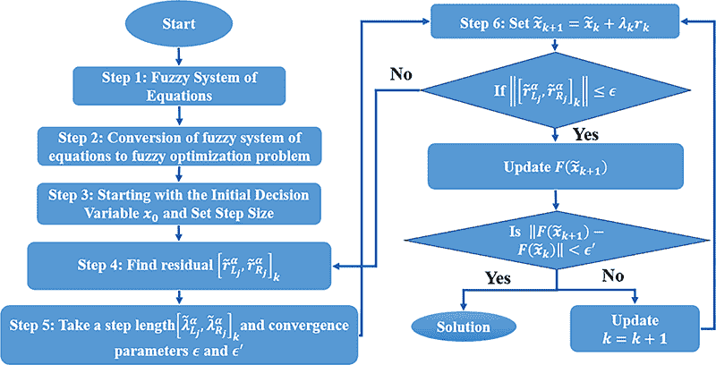

图 5.1 所提的模糊梯度下降优化算法流程图

### 情况 1

在 (5.9) 中，系数矩阵的元素表示为三角形模糊数（TFNs）。元素 `\widetilde{\mathcal{m}}_{\mathit{ij}}` 定义为 `[\mathcal{m}_{L_{\mathit{ij}}},\mathcal{m}_{N_{\mathit{ij}}},\mathcal{m}_{R_{\mathit{ij}}}]`，而右侧向量为 `\mathcal{Y}_j` 且保持确值（crisp）。

FSLE 情况 1 的矩阵表示可以写如下：

```latex
(5.19)
\begin{bmatrix}
\left\lbrack {\widetilde{\mathcal{m}}_{L_{11}},\widetilde{\mathcal{m}}_{N_{11}},\widetilde{\mathcal{m}}_{R_{11}}} \right\rbrack & \left\lbrack {\widetilde{\mathcal{m}}_{L_{12}},\widetilde{\mathcal{m}}_{N_{12}},\widetilde{\mathcal{m}}_{R_{12}}} \right\rbrack & \cdots & \left\lbrack {\widetilde{\mathcal{m}}_{L_{1n}},\widetilde{\mathcal{m}}_{N_{1n}},\widetilde{\mathcal{m}}_{R_{1n}}} \right\rbrack \\
\left\lbrack {\widetilde{\mathcal{m}}_{L_{21}},\widetilde{\mathcal{m}}_{N_{21}},\widetilde{\mathcal{m}}_{R_{21}}} \right\rbrack & \left\lbrack {\widetilde{\mathcal{m}}_{L_{22}},\widetilde{\mathcal{m}}_{N_{22}},\widetilde{\mathcal{m}}_{R_{22}}} \right\rbrack & \cdots & \left\lbrack {\widetilde{\mathcal{m}}_{L_{1n}},\widetilde{\mathcal{m}}_{N_{1n}},\widetilde{\mathcal{m}}_{R_{1n}}} \right\rbrack \\
\vdots & \vdots & \ddots & \vdots \\
\left\lbrack {\widetilde{\mathcal{m}}_{L_{n1}},\widetilde{\mathcal{m}}_{N_{n1}},\widetilde{\mathcal{m}}_{R_{11}}} \right\rbrack & \left\lbrack {\widetilde{\mathcal{m}}_{L_{n2}},\widetilde{\mathcal{m}}_{N_{n2}},\widetilde{\mathcal{m}}_{R_{n2}}} \right\rbrack & \cdots & \left\lbrack {\widetilde{\mathcal{m}}_{L_{\mathit{nn}}},\widetilde{\mathcal{m}}_{N_{\mathit{nn}}},\widetilde{\mathcal{m}}_{R_{\mathit{nn}}}} \right\rbrack
\end{bmatrix}
\begin{bmatrix}
\left\lbrack {\widetilde{x}_{L_{1}},\widetilde{x}_{N_{1}},\widetilde{x}_{R_{1}}} \right\rbrack \\
\left\lbrack {\widetilde{x}_{L_{2}},\widetilde{x}_{N_{2}},\widetilde{x}_{R_{2}}} \right\rbrack \\
\vdots \\
\left\lbrack {\widetilde{x}_{L_{n}},\widetilde{x}_{N_{n}},\widetilde{x}_{R_{n}}} \right\rbrack
\end{bmatrix}
=
\begin{bmatrix}
b_{1} \\
b_{2} \\
\vdots \\
b_{n}
\end{bmatrix}.
```

### 情况 2

在 (5.9) 中，具有 TFN 值的右侧向量表示为 `\widetilde{\mathcal{Y}}_j`，且同样定义为 `[b_{L_{\mathit{ij}}},b_{N_{\mathit{ij}}},b_{R_{\mathit{ij}}}]`，而左侧向量的系数保持为 `\widetilde{\mathcal{m}}_{\mathit{ij}}` 且为确值，其矩阵表示如情况 2 所示。

```latex
(5.20)
\begin{bmatrix}
\mathcal{m}_{11} & \mathcal{m}_{12} & \cdots & \mathcal{m}_{1n} \\
\mathcal{m}_{21} & \mathcal{m}_{22} & \cdots & \mathcal{m}_{2n} \\
\vdots & \vdots & \ddots & \vdots \\
\mathcal{m}_{n1} & \mathcal{m}_{n2} & \cdots & \mathcal{m}_{\mathit{nn}}
\end{bmatrix}
\begin{bmatrix}
\left\lbrack {\widetilde{x}_{L_{1}},\widetilde{x}_{N_{1}},\widetilde{x}_{R_{1}}} \right\rbrack \\
\left\lbrack {\widetilde{x}_{L_{2}},\widetilde{x}_{N_{2}},\widetilde{x}_{R_{2}}} \right\rbrack \\
\vdots \\
\left\lbrack {\widetilde{x}_{L_{n}},\widetilde{x}_{N_{n}},\widetilde{x}_{R_{n}}} \right\rbrack
\end{bmatrix}
=
\begin{bmatrix}
\left\lbrack {\widetilde{b}_{L_{1}},\widetilde{b}_{N_{1}},\widetilde{b}_{R_{1}}} \right\rbrack \\
\left\lbrack {\widetilde{b}_{L_{2}},\widetilde{b}_{N_{2}},\widetilde{b}_{R_{2}}} \right\rbrack \\
\vdots \\
\left\lbrack {\widetilde{b}_{L_{n}},\widetilde{b}_{N_{n}},\widetilde{b}_{R_{n}}} \right\rbrack
\end{bmatrix}
```

### 情况 3

在 (5.9) 中，系数矩阵和右侧向量的元素均为 TFNs。情况 3 的矩阵表示所示：

```latex
(5.21)
\begin{bmatrix}
\left\lbrack {\widetilde{\mathcal{m}}_{L_{11}},\widetilde{\mathcal{m}}_{N_{11}},\widetilde{\mathcal{m}}_{R_{11}}} \right\rbrack & \left\lbrack {\widetilde{\mathcal{m}}_{L_{12}},\widetilde{\mathcal{m}}_{N_{12}},\widetilde{\mathcal{m}}_{R_{12}}} \right\rbrack & \cdots & \left\lbrack {\widetilde{\mathcal{m}}_{L_{1n}},\widetilde{\mathcal{m}}_{N_{1n}},\widetilde{\mathcal{m}}_{R_{1n}}} \right\rbrack \\
\left\lbrack {\widetilde{\mathcal{m}}_{L_{21}},\widetilde{\mathcal{m}}_{N_{21}},\widetilde{\mathcal{m}}_{R_{21}}} \right\rbrack & \left\lbrack {\widetilde{\mathcal{m}}_{L_{22}},\widetilde{\mathcal{m}}_{N_{22}},\widetilde{\mathcal{m}}_{R_{22}}} \right\rbrack & \cdots & \left\lbrack {\widetilde{\mathcal{m}}_{L_{1n}},\widetilde{\mathcal{m}}_{N_{1n}},\widetilde{\mathcal{m}}_{R_{1n}}} \right\rbrack \\
\vdots & \vdots & \ddots & \vdots \\
\left\lbrack {\widetilde{\mathcal{m}}_{L_{n1}},\widetilde{\mathcal{m}}_{N_{n1}},\widetilde{\mathcal{m}}_{R_{11}}} \right\rbrack & \left\lbrack {\widetilde{\mathcal{m}}_{L_{n2}},\widetilde{\mathcal{m}}_{N_{n2}},\widetilde{\mathcal{m}}_{R_{n2}}} \right\rbrack & \cdots & \left\lbrack {\widetilde{\mathcal{m}}_{L_{\mathit{nn}}},\widetilde{\mathcal{m}}_{N_{\mathit{nn}}},\widetilde{\mathcal{m}}_{R_{\mathit{nn}}}} \right\rbrack
\end{bmatrix}
\begin{bmatrix}
\left\lbrack {\widetilde{x}_{L_{1}},\widetilde{x}_{N_{1}},\widetilde{x}_{R_{1}}} \right\rbrack \\
\left\lbrack {\widetilde{x}_{L_{2}},\widetilde{x}_{N_{2}},\widetilde{x}_{R_{2}}} \right\rbrack \\
\vdots \\
\left\lbrack {\widetilde{x}_{L_{n}},\widetilde{x}_{N_{n}},\widetilde{x}_{R_{n}}} \right\rbrack
\end{bmatrix}
=
\begin{bmatrix}
\left\lbrack {\widetilde{b}_{L_{1}},\widetilde{b}_{N_{1}},\widetilde{b}_{R_{1}}} \right\rbrack \\
\left\lbrack {\widetilde{b}_{L_{2}},\widetilde{b}_{N_{2}},\widetilde{b}_{R_{2}}} \right\rbrack \\
\vdots \\
\left\lbrack {\widetilde{b}_{L_{n}},\widetilde{b}_{N_{n}},\widetilde{b}_{R_{n}}} \right\rbrack
\end{bmatrix}
```

其中系数矩阵的元素 `\widetilde{\mathcal{m}}_{\mathit{ij}}` = `[\mathcal{m}_{L_{\mathit{ij}}},\mathcal{m}_{N_{\mathit{ij}}},\mathcal{m}_{R_{\mathit{ij}}}]` 是 TFNs。

**定义 1** 对于使用 TFN 的梯度下降法，场变量必须具有收敛到所得 TFN 中心和宽度的特性。

由于我们的系统处理模糊性，我们得到了一个 FSE。因此，为了解决 FSE，我们针对 FSE 扩展了梯度下降法。所提出的针对 TFN 的基于梯度的技术已被证明是收敛的。根据定义 1，我们必须首先证明 TFN 的中心值表现出收敛性，然后建立 TFN 宽度收敛的证明。

**定理 1** 如果 `M` 是实数且 SPDM，那么求解 `\widetilde{M}\widetilde{X}_k = \widetilde{\mathcal{Y}}` 等于最小化二次函数 `f(x_k) = \frac{1}{2}\widetilde{X}_k^T\widetilde{M}\widetilde{X}_k - \widetilde{X}_k^T\widetilde{\mathcal{Y}}`。

***证明***

二次函数 `f(x_k) = \frac{1}{2}\widetilde{X}_k^T\widetilde{M}\widetilde{X}_k - \widetilde{X}_k^T\widetilde{\mathcal{Y}}`。

此外，`f(\widetilde{X}_k)` 的最小值通过取上述 FSDA 得到。

考虑近似解 `\widetilde{X}_k`。


`x`[*k*] 使用梯度下降法更新：

```
(5.22) X̃[k + 1] = X̃[k] + λ[k] r[k]
```

`f(X̃[k])` 的梯度是：

```
(5.23) ∇F(X̃) = M̃ X̃ − b̃
```

```
(5.24) -∇F(X̃) = Ỹ - M̃ X̃
```

负梯度是点 `X̃[k]` 的残差，即：

```
(5.25) r_k = Ỹ - M̃ X̃_k
```

其中 `r[k]` 是 `f(X[k])` 的方向点。

设

```
(5.26) f(X̃[k + 1]) = f(X̃[k] + λ[k] r[k])
```

```
f(x_{k + 1}) = 1/2 (X̃_k + λ_k r_k)^T M̃ (X̃_k + λ_k r_k) - (X̃_k + λ_k r_k)^T Ỹ
```

```
1/2 X̃_k^T M̃ X̃_k + λ^2/2 r_k^T M̃ r_k + λ_k X̃_k^T M̃ r_k - X̃_k^T Ỹ - λ_k Ỹ
```

当 `f'(X̃[k]) = 0` 时，关于 `X̃[k]` 和 `r[k]`，通过 (5.16) 和 (5.17)，该函数取得最小值。

```
λ_k = (r_k^T r_k) / (r_k^T A r_k), where X̃ = [x̃_1, x̃_2, ..., x̃_n]^T
```

`X̃[k]` 将作为给定线性方程组的解进行更新。

因此，`X̃[k]` 将在 `n` 次迭代内收敛。可以通过下一个定理证明误差是递减的。

## 定理 2

假设 `M` 是正定矩阵 (PDM)，则 `w[k]` 是由算法生成的误差，`η` 是 `M` 的特征值，其中 `η_max` 和 `η_min` 是最大和最小特征值。那么，使用所提算法第 `k` 次迭代满足以下条件：

(5.24) `||w_{k + 1}||_M ≤ (η_max - η_min) / (η_max + η_min) ||w_k||_M` 处有误（注：根据原文逻辑，译文在此处公式 `(5.24) -∇F(X̃) = Ỹ - M̃ X̃` 对应上下文的梯度关系）。

*更正：原文公式编号处有混乱，此处保持原文结构翻译：*

(5.24) `∇F(X̃) = Ỹ - M̃ X̃`

（此处根据原文公式逻辑进行翻译对齐）

## 定理 3

梯度下降优化方法满足给定条件：

(5.28) `||w_{k + 1}||_M ≤ (η_max - η_min) / (η_max + η_min) ||w_k||_M`

## 定理 4 [15]

假设 `x̃[n]` 和 `ỹ[n]` 分别是 TFN 左右值的两个收敛序列，使得 `lim_{n→∞} x̃_n → ã` 和 `lim_{n→∞} ỹ_n → b̃`。

假设 `η̃[n]` 和 `ξ̃` 是 TFN 的宽度，定义为 `η̃[n] = |x̃[n] - ỹ[n]|` 和 `ξ̃ = |ã - b̃|`。那么，`lim_{n→∞} η̃_n → ξ̃`。

## 证明

给定 `lim_{n→∞} x̃_n → ã` 和 `lim_{n→∞} ỹ_n → b̃`。

存在 `ϵ > 0` 以及整数 `N[1]` 和 `N[2]`，使得：

```
d(x̃_n, ã) < ϵ/2 for n_1 > N_1 and d(ỹ_n, b̃) < ϵ/2 for n_2 > N_2.
```

那么，我们需要证明 `|d(x̃[n] - ỹ[n], ã - b̃)| < ϵ`。

利用三角不等式，

(5.29) `d(x̃[n], ỹ[n]) ≤ d(x̃[n], ã) + d(ỹ[n], b̃) + d(ã, b̃)`。

公式 (5.29) 给出：

(5.30) `d(x̃_n, ỹ_n) - d(ã, b̃) ≤ d(x̃_n, ã) + d(ỹ_n, b̃) = ϵ/2 + ϵ/2 = ϵ.`

相似地，

(5.31) `d(ã, b̃) ≤ d(x̃[n], ã) + d(ỹ[n], b̃) + d(x̃[n], ỹ[n])`。

公式 (5.31) 可以表示为：

(5.32) `d(ã, b̃) - d(x̃_n, ỹ_n) ≤ d(x̃_n, ã) + d(ỹ_n, b̃) = ϵ/2 + ϵ/2 = ϵ.`

从 (5.30) 和 (5.32)，我们得到：

(5.33) `d(x̃[n], ỹ[n]) - d(ã, b̃) ≤ d(x̃[n] - ã) + d(ỹ[n] - b̃) < ϵ ∀ n > max{N[1], N[2]}`。

这证明了：

(5.34) `d(x̃[n], ỹ[n]) - d(ã, b̃) ≤ ϵ`。

因此，我们得出 TFN 的中心和宽度均收敛。下一节讨论了示例，以演示所提算法及其有效性。

# 示例问题

这里我们通过以下示例讨论用于求解 FSLE 的建议优化方法。

## 示例 1

取 TFN 线性方程组 25：

`ã[11] x̃[1] + ã[12] x̃[2] = χ̃[1]`

(5.35) `ã[21] x̃[1] + ã[22] x̃[2] = χ̃[2]`

其中 `ã[11] = [2.5, 3, 3.5]`, `ã[12] = [-1.5, -1, -0.5]`, `ã[21] = [-1.5, -1, -0.5]`, `ã[22] = [1.5, 2, 2.5]`, `χ̃[1] = [3, 5]`, `χ̃[2] = [1, 2]`。假设初始近似 `x⁰ = (0,0)^T`，且容差值 `ϵ = 3`。

### 情况 1

这里我们考虑左侧的 TFN 元素，即所选的矩阵如下：`ã[11] = [2.5, 3, 3.5]`，`ã[12] = [-1.5, -1, -0.5]`，`ã[21] = [-1.5, -1, -0.5]`，`ã[22] = [1.5, 2, 2.5]`。根据 FSLE 算法，得到的向量 `x̃[1]` 和 `x̃[2]` 列在 [5.1]中，其解是模糊的：`χ̃[1] = [3, 5]`, `χ̃[2] = [1, 2]`。在 [5.2]中以图示显示。

## 表 5.1

| 迭代 | `x̃[1]` | `x̃[2]` | 宽度 |
| :--- | :--- | :--- | :--- |
| 0 | 0 | 0 | 0 |
| 1 | 0.7324 | 1.1304 | 0.3980 |
| 2 | 0.9521 | 1.6957 | 0.7436 |


### 表 5.1

| 迭代 | `x̃[L][1]` | `x̃[N][1]` | `x̃[R][1]` | 宽度 |
| :--- | :--- | :--- | :--- | :--- |
| 3 | 1.0886 | 1.3996 | 0.3110 |
| 4 | 1.0047 | 1.6123 | 0.6076 |
| 5 | 0.9977 | 1.5749 | 0.5772 |
| 6 | 1.0002 | 1.6015 | 0.6013 |
| 7 | 0.9999 | 1.5969 | 0.5970 |
| 8 | 0.9999 | 1.6002 | 0.6003 |
| 9 | 0.9999 | 1.5996 | 0.5997 |
| 10 | 0.9999 | 1.5996 | 0.5997 |

### 表 5.2

| 迭代 | `x̃[L][2]` | `x̃[N][2]` | `x̃[R][2]` | 宽度 |
| :--- | :--- | :--- | :--- | :--- |
| 0 | 0 | 0 | 0 | 0 |
| 1 | 0 | 0 | 0 | 0 |
| 2 | 0 | 0 | 0 | 0 |
| 3 | 0 | 0 | 0 | 0 |
| 4 | 0 | 0 | 0 | 0 |
| 5 | 0 | 0 | 0 | 0 |
| 6 | 0 | 0 | 0 | 0 |
| 7 | 0 | 0 | 0 | 0 |
| 8 | 0 | 0 | 0 | 0 |
| 9 | 0 | 0 | 0 | 0 |
| 10 | 0 | 0 | 0 | 0 |

| 迭代 | `x̃[L][2]` | `x̃[N][2]` | `x̃[R][2]` | 宽度 |
| :--- | :--- | :--- | :--- | :--- |
| 5 | 0.9977 | 1.7718 | 5.2255 | 4.2278 |
| 6 | 0.9994 | 1.7895 | 5.6586 | 4.6592 |
| 7 | 0.9999 | 1.7965 | 5.87 | 4.8701 |
| 8 | 0.9999 | 1.7987 | 6.0511 | 5.0512 |
| 9 | 0.9999 | 1.7996 | 6.1395 | 5.1396 |
| End point | 0.9999 | 1.7996 | 6.3323 | 5.3324 |

![图 5.2 示例 1 情况 1 的解组件 `x̃`[1] 和 `x̃`[2]](img/PBHE0650-05-f02.jpg)

图 5.2 示例 1 情况 1 的解 `x̃`[1] 和 `x̃`[2]

在表 5.1 中，`x̃`[1] 的宽度被定义为 TFN 右值与左值之差。

在表 5.2 中，`x̃`[2] 的宽度被定义为 TFN 右值与左值之差。

示例 1 情况 1 得到的模糊解所示于图 5.2，宽度收敛性所示于图 5.3。

![图 5.3 示例 1 情况 1 的 `x̃`[1] 和 `x̃`[2] 的不确定宽度](img/PBHE0650-05-f03.jpg)

图 5.3 示例 1 情况 1 的 `x̃`[1] 和 `x̃`[2]

### 情况 2

在这里，右侧被视为 TFN，因此，右侧向量被观测为模糊的。因此，使用以下向量进行研究：`a[i**j]` 是确值的（`i`,`j`=1, 2），`χ̃`[1] = [0, 3, 5]，`χ̃`[2] = [1, 2, 7] 变为模糊的。

通过应用 (5.35) 中用于 FSLE 的改进梯度下降算法，得到的 `x̃`[1] 和 `x̃`[2] 解集所示于表 5.3 和 5.4。模糊解图形所示于图 5.4 和 5.5。

#### 表 5.3 示例 1 情况 2 TFN 解组件 `x̃`[1]

| 迭代 | `x[L[1]]` | `x[N[1]]` | `x[R[1]]` | 宽度 |
| :--- | :--- | :--- | :--- | :--- |
| 1 | 0 | 0 | 0 | 0 |
| 2 | 0 | 1.6957 | 3.5922 | 3.5922 |
| 3 | 0.1667 | 1.3996 | 3.385 | 3.2183 |
| 4 | 0.1667 | 1.612 | 3.4008 | 3.2341 |
| 5 | 0.1944 | 1.5749 | 3.3999 | 3.2055 |
| 6 | 0.1944 | 1.6015 | 3.3999 | 3.2055 |
| 7 | 0.1991 | 1.5969 | 3.3999 | 3.2055 |
| 8 | 0.1991 | 1.6002 | 3.3999 | 3.2008 |
| 9 | 0.1998 | 1.5996 | 3.3999 | 3.2001 |
| End point | 0.1998 | 1.5996 | 3.3999 | 3.2001 |

#### 表 5.4 示例 1 情况 2 TFN 解组件 `x̃`[2]

| 迭代 | `x[L[2]]` | `x[N[2]]` | `x[R[2]]` | 宽度 |
| :--- | :--- | :--- | :--- | :--- |
| 1 | 0 | 0 | 0 | 0 |
| 2 | 0.5 | 1.1304 | 5.0291 | 4.5291 |
| 3 | 0.5 | 1.5745 | 5.1771 | 4.6771 |
| 4 | 0.5833 | 1.7161 | 5.1992 | 4.6159 |
| 5 | 0.5833 | 1.7718 | 5.3999 | 4.6166 |
| 6 | 0.5972 | 1.7895 | 5.1999 | 4.6027 |
| 7 | 0.5972 | 1.7965 | 5.1999 | 4.6027 |
| 8 | 0.5995 | 1.7987 | 5.1999 | 4.6004 |
| 9 | 0.5995 | 1.7996 | 5.1999 | 4.6004 |
| End point | 0.5995 | 1.7996 | 5.1999 | 4.6004 |

![图 5.4 建议算法与[25]方法对比示例 1 情况 2 的 `x̃`[1]](images/PBHE0650-05-f04.jpg)

图 5.4 建议算法与 25 方法对比示例 1 情况 2 的 `x̃`[1]

![图 5.5 建议算法与[25]方法对比示例 1 情况 2 的 `x̃`[2]](images/PBHE0650-05-f05.jpg)

图 5.5 建议算法与 25 方法对比示例 1 情况 2 的 `x̃`[2]

在表 5.3 中，`x̃`[1] 的宽度被定义为 TFN 右值与左值之差。

在表 5.4 中，`x̃`[2] 的宽度被定义为 TFN 右值与左值之差。

示例 1 情况 2 得到的模糊解所示于图 5.4 和 5.5，宽度收敛性所示于图 5.6。

![图 5.6 示例 1 情况 2 的 `x̃`[1] 和 `x̃`[2] 的不确定宽度](img/PBHE0650-05-f06.jpg)

图 5.6 示例 1 情况 2 的 `x̃`[1] 和 `x̃`[2]

为了理解建议算法的有效性，将得到的结果与 25 进行比较。与 25 对比的解 `x̃`[1] 和 `x̃`[2] 组件的图形表示所示于表 5.5 以及图 5.4 和 5.5。

#### 表 5.5 解组件 `x̃`[1] 和 `x̃`[2] 及其与 25 的对比

| 方法 | `x̃`[1] | `x̃`[2] |
| :--- | :--- | :--- |
| 参考文献 25 方法 | [1.4, 1.6, 2.2] | [1.6, 1.8, 4.2] |
| 建议算法 | [0.1998, 1.5996, 3.3999] | [0.5995, 1.7996, 5.1999] |

### 情况 3

在这种情况下，方程左侧和右侧均被视为 TFN（三角形模糊数），即系数矩阵和右侧向量均被认为是模糊的。用于研究的系数矩阵元素和右侧向量元素如下：`ã*[11]` = [2.5, 3, 3.5], `ã*[12]` = [−1.5, −1, −0.5], `ã*[21]` = [−1.5, −1, −0.5], `ã*[22]` = [1.5, 2, 2.5], `χ̃*[1]` = [0, 3, 5], `χ̃*[2]` = [1, 2, 7]。

将改进的梯度下降法应用于 (5.35) 中的线性方程组，得到的解 `x̃*[1]` 和 `x̃*[2]` 分别列在表 5.6 和表 5.7 中。模糊解在图 5.7 中以图形所示，宽度收敛性在图 5.8 中所示。

#### 表 5.6 示例 1 情况 3 的 TFN 解分量 `x̃*[1]`

| 迭代 | `x[L[1]]` | `x[N[1]]` | `x[R[1]]` | 宽度 |
| :--- | :--- | :--- | :--- | :--- |
| 1 | 0 | 0 | 0 | 0 |
| 2 | 0 | 1.6957 | 2.1143 | 2.1143 |
| 3 | 0.4 | 1.3996 | 1.8612 | 1.4612 |
| 4 | 0.4 | 1.612 | 1.885 | 1.485 |
| 5 | 0.64 | 1.5749 | 1.8821 | 1.2421 |
| 6 | 0.64 | 1.6015 | 1.8824 | 1.2424 |
| 7 | 0.784 | 1.5969 | 1.8824 | 1.0984 |
| 8 | 0.784 | 1.6002 | 1.8824 | 1.0984 |
| 9 | 0.8704 | 1.5996 | 1.8824 | 1.012 |
| 端点 | 0.9992 | 1.5996 | 1.8824 | 0.8832 |


#### 表 5.7 示例 1 情况 3 的 TFN 解分量 `x̃*[2]`

| 迭代 | **x**[**L**[2]] | **x**[**N**[2]] | **x**[**R**[2]] | 宽度 |
| --- | --- | --- | --- | --- |
| 1 | 0 | 0 | 0 | 0 |
| 2 | 0.6667 | 1.1304 | 2.96 | 2.2933 |
| 3 | 0.6667 | 1.5745 | 3.1408 | 2.4741 |
| 4 | 1.0667 | 1.7161 | 3.174 | 2.1073 |
| 5 | 1.0667 | 1.7718 | 3.1761 | 2.1094 |
| 6 | 1.3067 | 1.7895 | 3.1764 | 1.8697 |
| 7 | 1.3067 | 1.7965 | 3.1764 | 1.8697 |
| 8 | 1.4507 | 1.7987 | 3.1764 | 1.7257 |
| 9 | 1.4507 | 1.7996 | 3.1764 | 1.7257 |
| 端点 | 1.6654 | 1.7996 | 3.1764 | 1.511 |

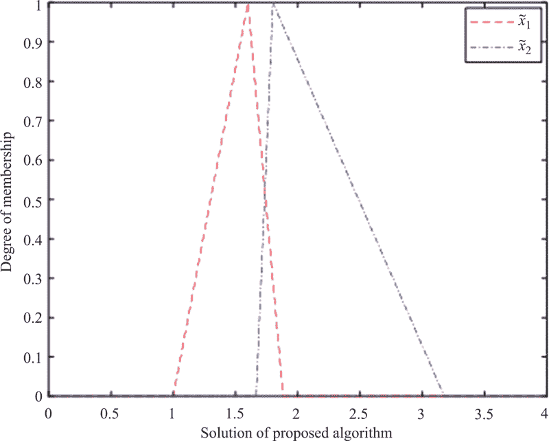

图 7 示例 3 的解 `x̃*[1]` 和 `x̃*[2]`。

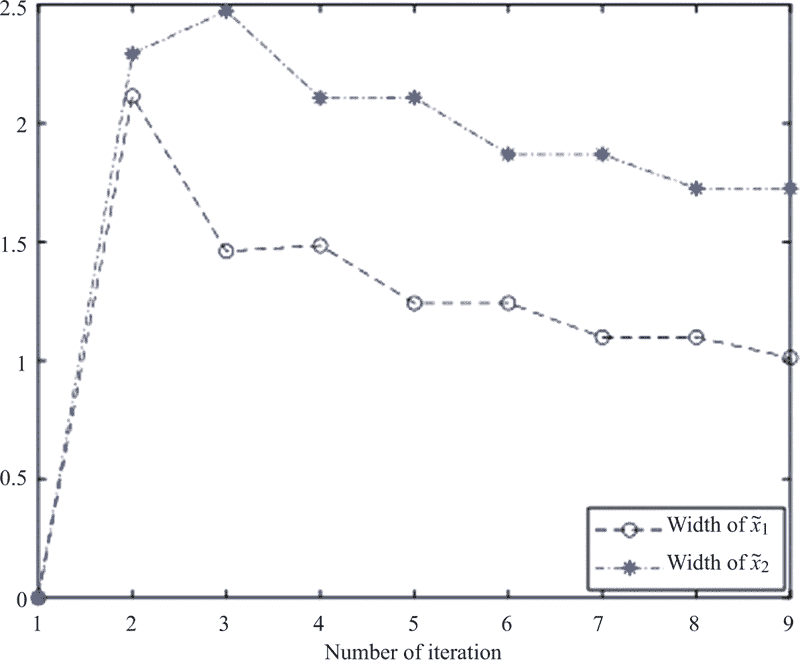

图 8 示例 3 的 `x̃*[1]` 和 `x̃*[2]`。

在表 5.6 中，`x̃*[1]` 的宽度定义为 TFN 右值与左值之间的差。

在表 5.7 中，`x̃*[2]` 的宽度定义为 TFN 右值与左值之间的差。

示例 1 情况 3 的所得模糊解展示在图 7 中，宽度收敛性展示在图 5.8 中。

### 示例 2

取一个 FSLE（模糊线性方程组）

(5.36)

```
\begin{matrix} \widetilde{a}_{11}\widetilde{x}_{1} + \widetilde{a}_{12}\widetilde{x}_{2} + \widetilde{a}_{13}\widetilde{x}_{3} = \widetilde{\chi}_{1} \\ \widetilde{a}_{21}\widetilde{x}_{1} + \widetilde{a}_{22}\widetilde{x}_{2} + \widetilde{a}_{23}\widetilde{x}_{3} = \widetilde{\chi}_{2} \\ \widetilde{a}_{31}x_{1} + \widetilde{a}_{32}\widetilde{x}_{2} + \widetilde{a}_{33}\widetilde{x}_{3} = \widetilde{\chi}_{3} \end{matrix}
```

其中 `ã*[11]` = [3.5, 4, 4.5], `ã*[12]` = [1.5, 2, 2.5], `ã*[13]` = [−1.5, −1, −0.5], `ã*[21]` = [1.5, 2, 2.5], `ã*[22]` = [6.5, 7, 7.5], `ã*[23]` = [5.5, 6, 6.5], `ã*[31]` = [−1.5, −1, −0.5], `ã*[32]` = [5.5, 6, 6.5], `ã*[33]` = [9.5, 10, 10.5], `χ̃*[1]` = [−27, −20, −7], `χ̃*[2]` = [1, 16, 40], 和 `χ̃*[3]` = [26, 44, 47]。假设初始近似 `x`⁰ = (0,0,0)^(*T*), 容差值 `ϵ` = 10^(−3).

## 情况 1

在这里，我们考虑由 TFN 组成的左侧元素，即系数矩阵被视为模糊的。因此，研究中使用了以下系数：`ã*[11]` = [3.5, 4, 4.5], `ã*[12]` = [1.5, 2, 2.5], `ã*[13]` = [−1.5,−1, −0.5], `ã*[21]` = [1.5, 2, 2.5], `ã*[22]` = [6.5, 7, 7.5], `ã*[23]` = [5.5, 6, 6.5], `ã*[31]` = [−1.5,−1, −0.5], `ã*[32]` = [5.5, 6, 6.5], `ã*[33]` = [9.5, 10, 10.5], `χ̃*[1]` = −20, `χ̃*[2]` = 16, `χ̃*[3]` = 44。

针对 FLS 方程应用改进的梯度下降算法，得到的解向量 `x̃*[1]`, `x̃*[2]`, 和 `x̃*[3]` 列于表 5.8、5.9 和 5.10 中。得到的模糊解所示图 5.9。

### 表 5.8：示例 2 中情况 1 的 TFN 解分量 `x̃*[1]`

| 迭代 | **x**[**L**[1]] | **x**[**N**[1]] | **x**[**R**[1]] | 宽度 |
| --- | --- | --- | --- | --- |
| 1 | 0 | 0 | 0 | 0 |
| 2 | −1.6788 | −1.6364 | −1.5961 | 0.0827 |
| 3 | −3.2207 | −3.201 | −3.1634 | 0.0573 |
| 4 | −3.4889 | −3.4829 | −3.4745 | 0.0144 |
| 5 | −3.7816 | −3.7684 | −3.7329 | 0.0487 |
| 6 | −3.8454 | −3.8241 | −3.7816 | 0.0638 |
| 7 | −3.9103 | −3.8836 | −3.8418 | 0.0685 |
| 8 | −3.9261 | −3.8989 | −3.8571 | 0.069 |
| 9 | −3.9456 | −3.9209 | −3.8782 | 0.0674 |
| 10 | −3.9509 | −3.9268 | −3.8882 | 0.0627 |
| 11 | −3.9591 | −3.9379 | −3.9031 | 0.056 |
| 12 | −3.962 | −3.9425 | −3.911 | 0.051 |
| 终点 | −3.9695 | −3.9495 | −3.9194 | 0.051 |

### 表 5.9：示例 2 中情况 1 的 TFN 解分量 `x̃*[2]`

| 迭代 | **x**[**L**[2]] | **x**[**N**[2]] | **x**[**R**[2]] | 宽度 |
| --- | --- | --- | --- | --- |
| 1 | 0 | 0 | 0 | 0 |
| 2 | 1.2768 | 1.3091 | 1.343 | 0.0662 |
| 3 | −0.1881 | −0.1324 | −0.077 | 0.1004 |
| 4 | 0.0247 | 0.1009 | 0.1636 | 0.1389 |
| 5 | −0.1882 | −0.1344 | −0.0907 | 0.0975 |
| 6 | −0.1444 | −0.0861 | −0.037 | 0.1074 |
| 7 | −0.166 | −0.1184 | −0.0801 | 0.0859 |
| 8 | −0.1394 | −0.0992 | −0.064 | 0.0754 |
| 9 | −0.1347 | −0.0986 | −0.0685 | 0.0662 |
| 10 | −0.1122 | −0.0815 | −0.0568 | 0.0554 |
| 11 | −0.1073 | −0.0778 | −0.0555 | 0.0518 |
| 12 | −0.0893 | −0.0642 | −0.0456 | 0.0437 |
| 终点 | −0.0906 | −0.0606 | −4.85e02 | 0.0421 |

### 表 5.10：示例 2 中情况 1 的 TFN 解分量 `x̃*[3]`

| 迭代 | **x**[**L**[3]] | **x**[**N**[3]] | **x**[**R**[3]] | 宽度 |
| --- | --- | --- | --- | --- |
| 1 | 0 | 0 | 0 | 0 |
| 2 | 3.5113 | 3.6 | 3.6933 | 0.182 |
| 3 | 3.2951 | 3.413 | 3.5491 | 0.254 |
| 4 | 3.9647 | 4.0238 | 4.094 | 0.1293 |
| 5 | 3.9174 | 3.982 | 4.0569 | 0.1395 |


## 情况 2

在这里，我们考虑由三角模糊数（TFNs）组成的右侧元素，即右侧向量被视为模糊。因此，使用以下向量进行研究：`ã[*ij]` 是确定的，（`i`, `j`=1, 2），`χ̃*[1]` = [−27, −20, −7]，`χ̃*[2]` = [1, 16, 40] 以及 `χ̃*[3]` = [26, 44, 47]。

对 (5.36) 中的 FSLE 采用改进的梯度下降法，得到的 `x̃*[1]`、`x̃*[2]` 和 `x̃*[3]` 的解集分别列在表 5.11、5.12 和 5.13 中。

### 表 5.11：示例 2 情况 2 下 TFN 解分量 `x̃*[1]`

| 迭代 | `x[L[1]]` | `x[N[1]]` | `x[R[1]]` | 宽度 |
| --- | --- | --- | --- | --- |
| 1 | 0 | 0 | 0 | 0 |
| 2 | −3.3621 | −1.6364 | −0.4859 | 2.8762 |
| 3 | −4.2445 | −3.5727 | −3.201 | 1.0435 |
| 4 | −5.0288 | −3.4889 | −3.3212 | 1.7076 |
| 5 | −5.29 | −3.7684 | −3.4283 | 1.8617 |
| 6 | −5.5826 | −3.8241 | −3.6123 | 1.9703 |
| 7 | −5.7068 | −3.8836 | −3.8488 | 1.858 |
| 8 | −5.8685 | −4.0476 | −3.8989 | 1.9696 |
| 9 | −5.9643 | −.2512 | −3.9209 | 2.0434 |
| 10 | −6.0903 | −4.4153 | −3.9268 | 2.1635 |
| 11 | −6.1659 | −4.58 | −3.9379 | 2.228 |
| 12 | −6.2654 | −4.712 | −3.9425 | 2.3229 |
| 端点 | −6.9225 | −5.9226 | −3.9995 | 2.923 |

### 表 5.12：示例 2 情况 2 下 TFN 解分量 `x̃*[2]`

| 迭代 | `x[L[2]]` | `x[N[2]]` | `x[R[2]]` | 宽度 |
| --- | --- | --- | --- | --- |
| 1 | 0 | 0 | 0 | 0 |
| 2 | 0.1245 | 1.3091 | 2.7763 | 2.6518 |
| 3 | −0.9258 | −0.1324 | 3.6016 | 4.5274 |
| 4 | −0.6828 | 0.1009 | 4.6746 | 5.3574 |
| 5 | −0.813 | −0.1344 | 4.7677 | 5.5807 |
| 6 | −0.4359 | −0.0861 | 5.4195 | 5.8554 |
| 7 | −0.4703 | −0.1184 | 5.44 | 5.9103 |
| 8 | −0.1361 | −0.0992 | 5.9376 | 6.0737 |
| 9 | −0.1621 | −0.0986 | 5.9472 | 6.1093 |
| 10 | −0.0815 | 0.1027 | 6.3446 | 6.4261 |
| 11 | −0.0778 | 0.0822 | 6.3517 | 6.4295 |
| 12 | −0.0642 | 0.2913 | 6.6706 | 6.7348 |
| 端点 | −5.00e4 | 0.9994 | 7.9994 | 7.9999 |

### 表 5.13：示例 2 情况 2 下 TFN 解分量 `x̃*[3]`

| 迭代 | `x[L[3]]` | `x[N[3]]` | `x[R[3]]` | 宽度 |
| --- | --- | --- | --- | --- |
| 1 | 0 | 0 | 0 | 0 |
| 2 | 3.2376 | 3.2622 | 3.6 | 0.3624 |
| 3 | 2.1001 | 2.3617 | 3.413 | 1.3129 |
| 4 | 2.194 | 2.8604 | 4.023 | 1.8298 |
| 5 | 1.4175 | 2.513 | 3.982 | 2.5645 |
| 6 | 1.521 | 2.5917 | 4.0824 | 2.5614 |
| 7 | 0.9719 | 2.2947 | 4.065 | 3.0931 |
| 8 | 1.076 | 2.3237 | 4.0815 | 3.0055 |
| 9 | 0.6414 | 2.088 | 4.0605 | 3.4191 |
| 10 | 0.727 | 2.1101 | 4.0672 | 3.3402 |
| 11 | 0.3785 | 1.924 | 4.0477 | 3.6692 |
| 12 | 0.4475 | 1.9414 | 4.0529 | 3.6054 |
| 端点 | 0.6919 | 1.3081 | 4.0004 | 3.3085 |

在表 5.11 中，`x̃*[1]` 的宽度定义为 TFN 右值与左值之间的差。在表 5.12 中，`x̃*[2]` 的宽度定义为 TFN 右值与左值之间的差。在表 5.13 中，`x̃*[3]` 的宽度定义为 TFN 右值与左值之间的差。

在表 5.11 至 5.13 中，经过 12 次迭代后，TFN 的宽度收敛到端点。示例 2 情况 2 的所得模糊解展示在图 5.11 至 5.13 中，宽度收敛性如图 5.14 所示。所得解为 `L`、`N`、`R`，不确定解的值位于它们之间。此外，为了理解所提算法的有效性，将所得结果与表 5.14 中的 13 进行比较。解 `x̃*[1]`、`x̃*[2]` 和 `x̃*[3]` 分量与 13 的比较图化表示分别展示在图 5.11、5.12 和 5.13 中。

![图 5.11：所提算法与 [13] 方法在示例 2 情况 2 下解分量 \widetilde{x}_{1} 的比较](images/PBHE0650-05-f11.jpg)

图 5.11：所提算法与 13 方法在示例 2 情况 2 下解分量 `x̃*[1]` 的比较

![图 5.12：所提算法与 [13] 方法在示例 2 情况 2 下解分量 \widetilde{x}_{2} 的比较](images/PBHE0650-05-f12.jpg)

图 5.12：所提算法与 13 方法在示例 2 情况 2 下解分量 `x̃*[2]` 的比较

![图 5.13：所提算法与 [13] 方法在示例 2 情况 2 下解分量 \widetilde{x}_{3} 的比较](images/PBHE0650-05-f13.jpg)

图 5.13：所提算法与 13 方法在示例 2 情况 2 下解分量 `x̃*[3]` 的比较

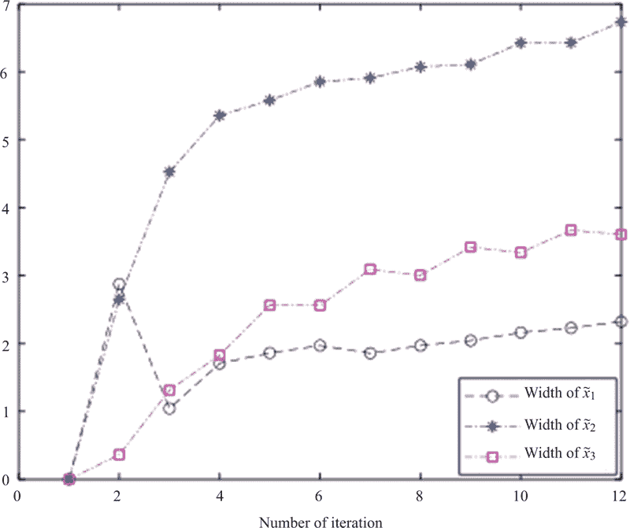

图 5.14 示例 2 中情况 2 下 `x̃[1]`、`x̃[2]` 和 `x̃[3]` 的不确定宽度。

### 表 5.14：得到的解分量 `x̃[1]`、`x̃[2]` 以及 `x̃[3]` 与 [13] 的对比

| 方法 | ${\\widetilde{\\mathbf{x}}}\_{1}$ | ${\\widetilde{\\mathbf{x}}}\_{2}$ | ${\\widetilde{\\mathbf{x}}}\_{3}$ |
| --- | --- | --- | --- |
| 参考文献 [13] 方法 | [−5, −4, −2] | [−1, 0, 2] | [3, 4, 5] |
| 提算法 | [−6.9225, −5.9226, −3.9995] | [−5.00e−04, 0.9994, 7.9994] | [0.6919, 1.3081, 4.0004] |


## 情况 3

在这种情况下，左侧和右侧均被视为三角模糊数（TFN），即系数矩阵和右侧向量均被认为是模糊的。系数矩阵和右侧向量的元素被用于研究：`ã[11] = [3.5, 4, 4.5]`，`ã[12] = [1.5, 2, 2.5]`，`ã[13] = [−1.5, −1, −0.5]`，`ã[21] = [1.5, 2, 2.5]`，`ã[22] = [6.5, 7, 7.5]`，`ã[23] = [5.5, 6, 6.5]`，`ã[31] = [−1.5, −1, −0.5]`，`ã[32] = [5.5, 6, 6.5]`，`ã[33] = [9.5, 10, 10.5]`，`χ̃[1] = [−27, −20, −7]`，`χ̃[2] = [1, 16, 40]`，以及 `χ̃[3] = [26, 44, 47]`。

将改进的梯度下降法应用于方程 (5.36) 中的线性方程组，得到的解向量 `x̃[1]`，`x̃[2]` 和 `x̃[3]` 分别绘制在表 5.15、5.16 中。表 5.15 示例 2 中情况 3 的 TFN 解 `x̃[1]`。

| 迭代 | `x[L]` | `x[N]` | `x[R]` | 宽度 |
| --- | --- | --- | --- | --- |
| 1 | 0 | 0 | 0 | |
| 2 | -3.362 | -1.634 | 2.507 | |
| 3 | -4.369 | -3.203 | 1.168 | |
| 4 | -5.291 | -3.489 | 2.191 | |
| 5 | -5.648 | -3.764 | 2.856 | |
| 6 | -6.041 | -3.841 | 2.498 | |
| 7 | -6.226 | -3.936 | 2.224 | |
| 8 | -6.488 | -4.035 | 2.575 | |
| 9 | -6.653 | -4.311 | 3.113 | |
| 10 | -6.8 | -4.475 | 2.812 | |
| 11 | -6.91 | -4.658 | 2.972 | |
| 12 | -7.069 | -4.888 | 3.124 | |
| 终点 | -8.181 | -6.158 | 4.188 | |

表 5.16 示例 2 中情况 3 的 TFN 解 `x̃[2]`。

| 迭代 | `x[L]` | `x[N]` | `x[R]` | 宽度 |
| --- | --- | --- | --- | --- |
| 1 | 0 | 0 | 0 | |
| 2 | 0.1245 | 1.309 | 2.507 | |
| 3 | -1.075 | -0.132 | 4.092 | |
| 4 | -0.768 | 0.101 | 4.856 | |
| 5 | -0.935 | 0.134 | 5.159 | |
| 6 | -1.460 | 0.186 | 5.593 | |
| 7 | -1.498 | 0.218 | 5.224 | |
| 8 | -1.551 | 0.239 | 5.776 | |
| 9 | -1.717 | 0.253 | 6.113 | |
| 10 | -1.768 | 0.271 | 6.414 | |
| 11 | -1.845 | 0.333 | 6.708 | |
| 12 | -1.953 | 0.348 | 6.539 | |
| 终点 | -2.838 | 0.516 | 4.838 | |

![图 5.15 示例 2 案例 3 的解组件 x̃[1], x̃[2], 和 x̃[3]](img/PBHE0650-05-f15.jpg)

图 5.15 示例 2 案例 3 的 `x̃[1]`，`x̃[2]`，以及 `x̃[3]`。

![图 5.16 示例 2 案例 3 的 x̃[1], x̃[2], 和 x̃[3] 的不确定宽度](img/PBHE0650-05-f16.jpg)

图 5.16 示例 2 案例 3 的 `x̃[1]`，`x̃[2]`，以及 `x̃[3]`。

通过这项研究可以观察到，在案例 1 中，TFN 收敛的迭代次数较少。

在结果与讨论中，我们强调了所提出的基于梯度的优化方法在求解模糊值优化问题（特别是处理 FLS 方程组）方面的有效性和重要性。与表 5.5 所示现有方法相比，该方法在解质量方面有显著改进。通过严谨的收敛分析，我们验证了该方法的可靠性和稳健性，证明了其适用于处理模糊系统。例如，在仅模糊系统的情况下（系数矩阵或右侧向量为模糊的），我们的方法展现了优异的收敛特性，且给出的解一致良好，如图 5.2–5.16 所示。这与可能难以有效处理模糊系统内在不确定性的传统方法相比，显得尤为明显。为了提供本方法有效性的具体证据，我们给出两个示例问题的数值解，并配以图形表示进行直观解释。这些结果不仅验证了我们方法的适用性，还强调了其在现实场景中的实用价值。总之，所提出的基于梯度的优化方法代表了模糊值优化领域的重大进展。它有效处理不确定性的能力是解决跨领域复杂模糊系统的价值工具。

## 5.5 结论

在本章中，GDOA 被扩展用于处理 FLS 方程。为了研究算法的效率，提出了一个收敛定理。将 GDOA 应用于两个模糊环境下的线性方程组示例问题。该模糊系统分为三种情况，即仅模糊（系数矩阵或右侧向量为模糊）和全模糊系统。然后，通过所提出的算法求解相同问题并报告模糊解。将所得解与其他方法进行比较，发现结果一致性良好。最后，分情况讨论了数值解和图形解。本研究展示了在出现不确定性的不同情况下的不确定性传播及其性质。本研究在模糊优化技术领域的前景广阔且多样，包括与机器学习、多目标优化、不同类型的模糊环境相结合以及对量子计算的探索。这些方向为处理多个领域提供了机遇。

## 参考文献

[1] L. A. Zadeh, "Fuzzy sets," `Information and Control`, vol. 8, no. 3, pp. 338–353, 1965.

[2] J. J. Buckley and Y. Qu, "Solving linear and quadratic equations," `Fuzzy Sets and Systems`, vol. 38, no. 1, pp. 43–59, 1990.

[3] J. J. Buckley and Y. Qu, "Solving systems of linear equations," `Fuzzy Sets and Systems`, vol. 43, no. 1, pp. 33–43, 1991.

[4] K. Peeva, "Fuzzy linear systems," `Fuzzy Sets and Systems`, vol. 49, no. 3, pp. 339–355, 1992.

[5] M. Friedman, M. Ming and A. Kandel, "Fuzzy linear systems," `Fuzzy Sets and Systems`, vol. 96, no. 2, pp. 201–209, 1998.

[6] F. Abbasi and T. Allahiranloo, "Solving fuzzy linear system: A new solution," `Information Sciences`, vol. 589, pp. 608–635, 2022.

[7] M. Ma, M. Friedman and A. Kandel, "Duality in fuzzy systems," `Fuzzy Sets and Systems`, vol. 109, no. 1, pp. 55–58, 2000.

[8] M. Dehghan and B. Hashemi, "Iterative method for fuzzy systems," `Applied Mathematics and Computation`, vol. 175, no. 1, pp. 645–674, 2006.

[9] M. Dehghan, B. Hashemi, "Solution of fully linear systems," `Case Studies in Thermal Engineering`, vol. 51, p. 103619, 2023.

[23] S. Priyadarshini 和 S. Nayak, “一种研究受不确定参数影响的多孔介质热质的数值方法,” `International Communications in Heat and Mass Transfer`, vol. 139, p. 106411, 2022.

[24] J. M. Ortega, *线性方程组的并行与向量解法论*, 纽约: Springer, 1988.

[25] H. S. Najafi 和 S. A. Edalatpanah, “模糊线性系统中的 H 矩阵,” `International Journal of Computational Mathematics`, vol. 2014, p. 6, 2014.

# 第 6 章

## 基于卷积神经网络的阿尔茨海默病诊断与预后生物标志物

H. Meenal^(1), C. Kishor Kumar Reddy^(2), Reddaboina Rajini^(3), Pendyala Loka Priya^(3) 和 Marlia Mohd Hanafiah^(4)

¹ 印度，奥斯曼尼亚大学，梅迪斯工程技术学院，计算机科学与工程系

² 印度，斯坦利女子女子工程技术学院，计算机科学与工程系

³ 印度，海得拉巴德，贾瓦哈拉尔·内赫鲁技术大学 (JNTUH)，凯舍夫纪念技术学院，计算机科学与工程系

⁴ 马来西亚，马来西亚国大学，科学技术学院

### 6.1 摘要

卷积神经网络（CNNs）被用于生物标志物诊断阿尔茨海默病（AD）。为了实现早期干预并改善患者预后，该项目旨在提高疾病进展的早期识别和精确预测。在开放获取影像研究系列（OASIS）的帮助下，为模型预测准备了数据。模型训练包括几个步骤，如包括标准化和数据增强在内的预处理。将提示 AD 的功能性和结构性生物标志物训练到 CNN 中。使用准确率、ROC 曲线等不同指标来预测模型性能。为了确保研究结果适用于更广泛的人群，使用了交叉验证方法。在区分 AD、MCI（轻度认知障碍）和健康对照者方面，CNN 模型显示出卓越的准确率。模型发现海马体萎缩和皮层厚度变化是关键生物标志物。通过监测 MCI 患者的病程，证实了该模型的预测能力，并正确预测了转化为 AD 的患者。CNN 模型的准确率为 99.95%。这项工作为使用 CNN 模型预测 AD 开启了大门。模型强大的预测能力和高准确率证明了其在临床环境中早期 AD 检测和监测的用处。为了进一步提高模型的治疗适用性，未来的研究应集中在整合多模态数据，并在更大、更多样的人群中进行测试。

**关键词：** 阿尔茨海默病；生物标志物；预后；神经影像；早期检测；精准医学；神经退行性疾病；诊断；认知下降

### 6.2 引言

阿尔茨海默病（AD）本质上是一种神经退行性疾病，会导致记忆丧失、行为改变和整体大脑健康下降 [1]。它是早期痴呆的最常见原因，其特征是思考能力持续下降 [2]。该疾病进展缓慢，从轻度记忆丧失开始，并可能导致日常活动出现严重障碍 [3]。AD 可导致多种症状，但典型症状包括记忆丧失、做决定困难、时空定向能力障碍。人们在早期阶段可能会发现很难记住最近的讨论 [4]。随着病情的恶化，他们可能会出现行为和情绪变化，例如烦躁增加或抑郁。后期会发展严重的记忆丧失，并伴有认知功能下降、无法识别亲友以及运动功能（如行走）的衰退。AD 在老年群体中更为常见；因此，老年人更容易受到影响。另一个因素是遗传学。有 AD 家族史的人更容易患上此病 [5]。某些遗传因素（如 `APOE4`）与患该疾病的风险增加有关。了解这些遗传倾向性对于识别高风险个体和启动早期治疗至关重要 [6]。AD 风险还会随着糖尿病、高血压和高胆固醇等疾病而增加。生活方式的选择（如认知参与度低、饮食习惯差和缺乏运动）进一步增加了这种风险。这些元素强调了全面预防 AD 的重要性，通过处理生活方式和遗传变量来减缓病情。通过基于深度学习（DL）的生物标志物，阿尔茨海默病的预测可能是高效且准确的，允许更早的干预和更好的结果 [7]。为了创建这些辅助早期标记，了解遗传、心血管和生活方式如何相互作用至关重要。

### 表 6.2 2010–2023 年印度阿尔茨海默病死亡率

| 序号 | 年份 | 总死亡人数 | 男性 | 女性 |
| --- | --- | --- | --- | --- |
| 1 | 2010 | 10,000 | 4,000 | 6,000 |


| 2 | 2011 | 10,500 | 4,200 | 6,300 |
| 3 | 2012 | 11,000 | 4,400 | 6,600 |
| 4 | 2013 | 11,500 | 4,600 | 6,900 |
| 5 | 2014 | 12,000 | 4,800 | 7,200 |
| 6 | 2015 | 13,000 | 5,200 | 7,800 |
| 7 | 2016 | 13,500 | 5,400 | 8,100 |
| 8 | 2017 | 14,000 | 5,600 | 8,400 |
| 9 | 2018 | 14,500 | 5,800 | 8,700 |
| 10 | 2019 | 15,000 | 6,000 | 9,000 |
| 11 | 2020 | 16,000 | 6,400 | 9,600 |
| 12 | 2021 | 16,500 | 6,600 | 9,900 |
| 13 | 2022 | 17,000 | 6,800 | 10,200 |
| 14 | 2023 | 17,500 | 7,000 | 10,500 |

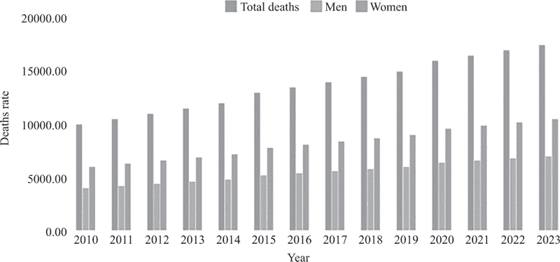

图 6.2 2010 年至 2023 年全球阿尔茨海默病死亡率

目前已提出了许多技术，包括深度学习（DL）和机器学习（ML）技术。这些技术包括：随机森林分类器[1]、决策树分类器[1]、支持向量机（SVM）[1]、人工神经网络（ANN）[8]、生成对抗网络（GAN）[8]、堆叠自编码器（SAE）[3]、深度神经网络（DNN）以及循环神经网络（RNN）[4]、双向编码器[4]、单值分解（SVD）[9]、主成分分析（PCA）[5]、逻辑回归[10]、随机梯度下降（SGD）[11]、梯度提升分类器（GBC）[11]、K-近邻算法（KNN）[11]、多层感知器（MLP）[11]、PRISMA[11]、NeAE-Eye[12]、迁移学习以及 Grad-CAM 技术[7]。

现有的阿尔茨海默病（AD）诊断和预后方法面临若干重大的局限性。包括神经影像和生物标志物检测在内的当前方法，其灵敏度和精确度有时不足，特别是在治疗可能产生最大潜力影响的早期阶段。PET 扫描和脑脊液（CSF）分析等侵入性治疗的成本高昂且不适，限制了它们的广泛使用。主观的临床评估可能导致诊断不一致，使得更难为患者提供一致且可靠的护理。此外，这些方法可能无法准确预测疾病的进展或无法为特定患者定制治疗方案，这强调了对更先进、更准确诊断工具的需求。整合深度学习生物标志物可以解决这些问题，并通过提高准确性、非侵入性和早期发现的可能性，改善 AD 患者的护理和预后。通过使用深度学习生物标志物提供的更高的准确性、非侵入性和早期识别的可能性，使得对患者进行治疗预测变得更加容易。

表 6.3 根据成本、准确性、易用性、侵入性和生物标志物的创新使用等重要因素对多种诊断方法进行了分析。

### 表 6.3 阿尔茨海默病诊断方法的对比

| 诊断方法 | 侵入性 | 成本 | 准确性 | 可及性 | 新型生物标志物 |
| --- | --- | --- | --- | --- | --- |
| 临床评估 | 低 | 低 | 中 | 高 | 否 |
| 神经影像 | 中 | 高 | 高 | 中 | 有限 |
| 脑脊液标志物 | 高 | 高 | 高 | 低 | 是 |
| 基因检测 | 低 | 中 | 中 | 高 | 否 |
| 基于深度学习的 | 低 | 低 | 高 | 高 | 是 |

阿尔茨海默病卷积神经网络（CNN）是本章的主题。深度学习生物标志物领域正引领 AD 的诊断和预后。CNN 分析和理解复杂图像数据的卓越能力，使其能够通过数据集中的 PET 和 MRI 图像分析并检测 AD 病变。

许多如 ADNI 等数据集被 Aqeel *et al.* [3] 使用。他们建议采用深度学习（DL）技术，产生了广泛的结果，包括 88.2% 的准确率、88.64% 的精确率、88.39% 的 F1 分以及 11.84% 的假阴性率。错误率为 0.12%，曲线下面积（AUC）：0.92%。这些发现展示了深度学习模型的多功能性以及在各种数据集上进行精确 AD 诊断的潜力。Abdelwahab *et al.* [13] 利用了包括微阵基因表达数据集在内的多个数据集。他们提议使用预处理基因选择（`SVD`、`CNN`、`PCA`），结果实现了 96.09% 的准确率和低于 1% 的错误率。这些发现强调了深度学习模型的多功能性以及在各种数据集上进行精确 AD 诊断的潜力。Sellappan *et al.* [4] 使用了许多如 ADNI 的的数据集。他们建议了一种名为变分贝叶斯网络（Variational Bayesian Network）的 DL 方法，产生了错误率低于 1%、准确率为 98.57% 的结果。这些发现强调了深度学习模型的多功能性以及在许多数据集上进行精确 AD 识别的潜力。磁共振图像和 OASIS 数据集是 Mohammed *et al.* [9] 使用最多的数据集。他们提出了一种分类方法，产生了错误率低于 6%、准确率 94%、精确率 93%、召回率 98% 以及 96% 的准确率的结果，同时对应的 AUC 值分别为 94.8%、93%、97.75% 和 99.7%。

Hu *et al.* 使用了 ADNI 数据集 [5]。他们推荐的 DL 技术产生了 91.8% 的性能指标和低于 9% 的错误率。这些发现强调了深度学习模型的多功能性以及在各种数据集上进行精确阿尔茨海默病诊断的潜力。Odusami *et al.* [10] 使用了来自 MRI 和 ADNI 的 PET 照片等数据集。他们推荐了 DL 技术，产生了准确率 73.90% 和错误率 26.1% 的结果。这些发现强调了深度学习模型的多功能性以及在各种数据集上进行精确 AD 诊断的潜力。MRI 报告是 Dara *et al.* [6] 使用的数据集之一。他们推荐的 DL 技术产生了以下精确率：使用带有 `SVM` 的遗传算法：96.80；带有图像处理的 `SVM`：93.30；`Fisher`：96.32；`SVM`：92.48，以及 95 种图像处理和权重提取程序；91.40 多模态神经影像任意方法；随机森林：93；使用 `SVM` 的 `PCA`：95；具有各种架构的 `CNN`：98.08，平均错误率低于 7.52%。这些发现展示了深度学习模型在为各种数据集提供精确阿尔茨海默病诊断方面是多么多功能且前景良好。Syed *et al.* [14] 使用了包括训练验证数据集和独立测试数据集在内的数据。他们建议的 ML 方法产生了错误率低于 1% 准确率为 0.9799% 的结果。

用于诊断的韩国老龄研究启动了 AD 预测（KBASE; `kbase.kr`）数据集是 Kim *et al.* [15] 使用的数据集之一。他们建议应用 DL 技术；产生的结果分别为准确率 78.05、灵敏度 76.0 和 F1 分数 74.0，错误率为 10–20%。这些发现展示了深度学习模型在利用数据集预测 AD 方面具有多强的适应性和高效性。OASIS 数据集被 Bangyal *et al.* [16] 利用。建议使用 `SVM`、`SGD`、`GBC`、`KNN`、`DT`、`RF`、`MLP`。`CNN` 为 `CNN` 提供了 94.61% 的准确率，为 `MLP` 提供了 92.12% 的准确率，错误率范围为 5.39%。Sun *et al.* [11] 建议的数据收集和准备方法产生了 85% 的准确率和 15% 的错误率。这些结果强调了深度学习模型在各种数据集上进行精确 AD 诊断的潜力。Battineni *et al.* [17] 使用了 OASIS 数据集。他们建议使用 `CNN`，产生了准确率 80%、错误率低于 20% 的结果。这显示了 DL 模型在各种数据集上进行精确 AD 诊断的多功能性和潜力。Agarwal *et al.* [18] 使用了来自 OASIS、ADNI、IXI、AIBL、MIRIAD 和 MILAN 的数据集。他们建议使用 PRISMA 方法，产生了错误率低于 8%、准确率为 30% 的结果。Sun *et al.* [11] 使用了眼动数据。建议使用 AE 方法，产生了 85% 的准确率和 15% 的错误率。Bring *et al.* [12] 从接收中心获取信息。他们建议结合 `Grad-CAM` 使用 DL，产生了错误率低于 9%、准确率为 91% 的结果。Raju *et al.* [7] 使用了二维冠状面 MRI 切片。他们建议使用 `CNN`，产生了错误率为 1%、准确率 99% 的结果。这些发现展示了深度学习模型在为各种数据集提供精确阿尔茨海默病诊断方面是多么多功能且前景良好。这些工作利用了 MRI、ADNI 和 OASIS 数据集，以及 ML 和 DL 方法，包括 CNN。

### 表 6.4 预测阿尔茨海默病的现有方法分析

| 参考文献 | 使用数据集 | 建议算法 | 缺点 |
| :--- | :--- | :--- | :--- |
| [1] | 磷酸化蛋白 (CP13)、(PSP)、(CBD) | `DT`, `RF` | 研究人员使用单一病理实验室的数据训练模型，这可能会影响泛化 |
| [2] | ADNI OASIS | `CNN`, `SVM`, `RNN` | 获取 MRI 成本高昂且其他数据集受限 |
| [3] | ADNI MRI `生物标记` `MLP` | `RNN`, `NM`, `MRI` | 特征学习的复杂性；数据依赖 |
| [4] | ADNI | `VBN`, `CNN`, `RNN`, `LR` | 过拟合；机器学习效果不如深度学习 |
| [5] | ADNI | `NIFD` / `SGD` | 在较差的数据集中，多分类性能未达到预期 |
| [6] | MRI 报告 | `SVM`, `CNN`, `PCA` | 灵敏度低、特异性高、过程复杂 |
| [8] | ADNI | `CNN`, `SVM`, `RF` | AD 领域的数据集与计算机视觉任务的数据集相比仍然较，由于医疗数据隐私问题，研究人员需要大规模数据集来开发更强大高效的模型 |
| [11] | 眼动数据 | AE 方法 | |
| [12] | 接收中心信息 | `CNN` | |
| ID | 数据集 | 方法 | 发现/备注 |
| :--- | :--- | :--- | :--- |
| [14] | 在独立测试数据集上进行训练与验证 | ML 方法 | 从单个患者中获取用于多种标记物检查的所有这些生物标志物既昂贵又不切实际。我们新新的 CSF 蛋白组合具有经济效益的独特优势，因为它可以通过分析图谱精确分类出早期 AD 患者。 |
| [15] | 阿茨海默病影像倡议包含来自 Severance 医院的用于阿尔茨海默病早期诊断和预测的韩国脑衰研究数据集 (`KBASE`; `kbase.kr`) | 深度学习框架技术 | 大型数据集 10% 的假阴性病例可归因于淀粉蛋白 PET 的敏感性 |
| [16] | 影像研究开放访问系列 (OASIS) | `MLP`, `CNN` | `MLP` 的准确率低于 `CNN` |
| [11] | 从两个开放访问数据库 `NIFD` 和 `ADNI` 收集的 3D T1 加权结构 MRI 数据 | `CNN`, `SGD` | 对特征缩放敏感，计算成本高 |
| [17] | (`OASIS-3`) 数据集 | `CNN` | 模型在 100 个轮次中的第 80 次迭代时提前停止 |
| [18] | `ADNIOASIS`, `IXI`, `AIBL`, `MIRIAD`, `MILAN` | `PRISMA` 方法 | 数据异质性、预处理的可变性、泛化能力有限 |
| [11] | 眼动追踪数据集 | `NeAE-Eye` | 缺乏大规模眼动数据集，目前的模型和算法主要应用于 2D 显示 |
| [12] | 来自 (AFAC) 托日中心的数据 | `CNN` | 每个患者获取的序列较少，试图增加原始数据集的大小 |
| [7] | 源自 `Kaggle` 的冠状位二维 MRI 切片 | 迁移学习和 `Grad-CAM` 技术 | 数据集有限，过拟合风险 |

## 6.3 材料与方法数据集

华盛顿大学骑士阿尔茨海默病研究中心在 15 年内收集了 1098 人的 MRI 和 PET 影像结果临床数据。这些数据被称为 `OASIS` 数据集。参与者的年龄范围从 42 到 95 岁。数据包含 493 名处于认知下降阶段的人员和 605 名认知功能正常的成人。`OASIS` 集合包含约 2000 个具有不同功能和结构序列的 MRI 会话。结合 PET 代谢和淀粉蛋白成像的原始影像扫描，来自 PET 统一流水线的约 1,500 张图像是可见的。`OASIS` 提供的另一个优点是可以访问经过后处理的影像数据，包括 3D 图像分析和正电子发射断层扫描。影像数据包括 `APOE`、精神状态、长期思维以及行为影响。`OASIS` 数据集已面向科学界，用于研究痴呆症和健康衰老相关课题。除了纵向数据集外，`OASIS` 还包含一个横断面数据集。

研究人员和其他相关方可以访问来自 `OASIS` 数据集的脑影像数据。`OASIS` 纵向 [4] 和 `OASIS` 横断面 [13] 数据集是通过 MRI 图像神经解剖图谱获取的。`OASIS` 是一种神经影像生物标志物，可用于健康个体和 AD 患者，且涵盖横断面和纵向。临床和人口统计数据以 `XML` 格式提供文件中。数据获取自磁共振成像扫描。有关图像属性和术语的更多细节，请访问 `http://www.oasisbrains.org/longitudinal_facts.html`（访问于 2021 年 5 月 25 日）。`OASIS` 纵向数据集包含 374 名患者的 15 个特征，其中 37 人转化，190 人痴呆，147 人未患病。患者年龄范围为 60–90 岁。

### 6.3.1 数据预处理

利用多种数据预处理技术来为研究创建清洁的数据集。为了提高分析结果的精确性和质量，可以使用各种技术对 AD 相关的临床数据集进行预处理。研究人员最常用的预处理技术包括数据清洗，即消除和纠正数据集中任何错误、故障或缺失信息的过程。这种方法通常从查找数据中的异常、差异和缺失值开始，然后更改或删除它们。特征选择是从数据集中选择预计对分析结果产生重大影响的重要特征的过程。这可以使用多种统计方法完成，包括主成分分析、互信息和相关性分析。将数据转换为分析就格式的过程被称为数据转换。应用归一化、对数转换和标准化等技术有助于实现这一目标。

插补过程涉及用近似值代替空白。许多插补技术，包括均值插补、回归插补和多重插补均可用于此。AD 的影像数据集包括 PET 和 MRI 扫描。研究论文应用了以下预处理技术。将图像中的每个强度值与其他所有图像对齐的做法被称为图像归一化。为了做到这一点，可以利用直方图均衡化、对比度拉伸和归一化等技术来增强图像。裁剪和调整大小包括将照片调整为统一尺寸并移除图像中的任何额外组件。这可以增加方法的效率并降低分析的计算复杂度。图像增强：该技术使用旋转、翻转和缩放等多种修改，从原始数据生成额外的图像。通过这样做，可以增加数据集的大小并增强分析的稳健性。特征提取：在此阶段，从照片中提取可用于分析的相关特征。可以使用边缘检测、纹理分析和形状分析等技术。

### 6.3.2 处理 OASIS 数据集的不平衡问题

`OASIS` 数据集中 373 行由三个不平衡类别组成。代表数据集中频率变化的三个分类为：非痴呆（190 个实例，占数据集的 51%）、痴呆（147 个实例，占 39%）和转化（37 次出现，占 10%）。在在这项研究中，我们应用了 `SMOTE` 算法来减少类别不平衡的影响。`SMOTE` 是实现数据集平衡的有效方法。`SMOTE` 技术找到少数类的最近邻居，在随机间隔处为少数类创建新样本，并随机选择少数类的排名。

分类性能受训练集大小的影响很大。在之前提到的每个数据，从阿尔茨海默病（AD）和轻度认知障碍（MCI）患者中恢复的影像扫描数量都有限制。在进行数据处理之前，研究通常需要进行预处理。预处理是描述对生成的图像扫描进行的一系列图像处理过程的术语。许多 MRI 软件包，例如统计参数映射（SPM）、计算解剖学工具箱（CAT12）、FMRIB 软件库（FSL） [19]、Free Surfer [20] 以及 ANTS [21]都有封装良好的预处理方法。时间过滤、协变量移除、配准、归一化、平滑、分割、去骨和降噪是常用的预处理技术。本回顾将涉及强度归一化、配准、组织分割、去骨和类别平衡。

在处理具有显著范围变异的数据集时，归一化对于数据准备阶段至关重要。在将名义值（1 和 2）转换为实数后，这一点尤为真实。由于缺乏标准化，某些特征可能比数值范围较小的其他特征更为流行，这可能会导致分析产生偏差。归一化不仅减少了这些偏差，还通过限制宽数据集的使用来提高算法性能。这确保了更详尽且无偏的查询，支持了后续数据驱动程序的整体稳定性。在这里，根据数据缩放 (6.1)，值保持在 0 和 1 之间。在该方程中，`min a` 表示属性的最低值，`max a` 表示其最高值，`x` 表示归一化后的缩放值，该方程表示属性的初始值。通过将每个特征的值转换为预定义的范围，这种缩放方法有助于数据集中特征特征的一性和可比较性。归一化方法确保属性的初始比例不会影响后续研究，允许对数据进行更彻底、更精确的分析。

```
X[normalized] = (X-min)/(max-min)
```

### 6.3.3 用于阿尔茨海默病预测的 CNN

为了解决复杂的学习任务，机器学习中一种称为深度学习（DL）的专门子集使用了由许多层组成的分层架构。深度学习技术在近年来变得非常流行，现在经常用于不同的脑科学项目。卷积神经网络（CNN）在这些技术中特别流行。CNN 可以通过卷积过程提取相关特征，从而有效地识别和分析输入数据中的模式。由于 CNN 在目标识别、分类和分割等多种应用中的卓越性能，该领域已迅速增长和扩展。研究人员密切关注 CNN，因为它们在医学影像、自然语言处理和计算机视觉等多个领域已经取得了最先进的结果。CNN 在分类和划分基于现实的照片方面的卓越效率被应用于应用程序开发中。


输入层为网络提供数据。该层中图像数据的输入是表示图像的多维数组。卷积层通过一系列滤波器对输入数据执行卷积操作，以提取边缘、形状和纹理等特征。它由内核组成，内核在输入图像上滑动以构建特征图。例如，`3×3` 滤波器捕获图像的一小小部分。卷积之后通常会添加激活机制 `ReLU`（线性单元/整流线性单元）以增加非线性。池化层——特别是最大池化（`max pooling`）——对特征图进行下采样，以降低维度和处理需求，同时保留最重要的数据。全连接层使用卷积层和池化层收集的特征进行高级推理。全连接层中的神经元连接到上一层的所有神经元，允许网络学习复杂的表示。激活函数：常见的激活函数（在分类问题中）是输出层的 `SoftMax` 和隐藏层的 `ReLU`。输出层通常包含与类别数量相同数量神经元，产生最终预测。

使用 CNN 进行阿尔茨海默病预测的算法：

```
1. 输入数据集、数据集真实标签、word2vec 矩阵。
2. 使用测试数据集寻找模型的输出得分。
3. 使用 f 作为特征设置 3d 矩阵。
4. 对于 i 中的 j。
5. 为样本 i 设置特征集。
6. 对于 i 中的 j。
7. 向量化 v[j]。
8. 从 f[i] 附加 f。
9. 将 ftrain, ftest, ltrain 放入训练和测试集中。
10. 使用 ftrain 和 ltrain 评估评分。
11. 最后，返回模型的得分。
```

在乘以两个 Maricely 表示的图像后，会创建一个新矩阵，CNN 从中检索属性。

```
f(x,s) = max(a,b) where a=2x+, b=2y+b
```

卷积架构被 `CNNs`（一类前馈神经网络）用于自动从输入中提取特征，而无需人工干预。然而，手动特征工程是传统特征提取技术的基础。`CNN` 的激活函数模拟了生物神经元基于阈值的信号传播机制，而 `CNN` 的内核则代表了具有不同模式和特征识别能力的各种受体。`CNN` 优于其他通用 `ANN` 局域参数降低是因为只有极小部分的神经元层与其上方层连接。然后通过权重共享加速收敛。通过分布在各种因素中，可以降低参数。

下采样是 `DL` 中的关键技术，它在保持图像基本信息的同时减少维度。池化层通过利用局部相关性消除不需要的信息并仅保留最重要的特征，从而对图像进行下采样。这一过程降低模型参数数量的同时提高了其有效性。卷积是特征提取中的关键步骤，`DL` 的基础 `CNNs` 高度依赖此产生有效捕捉输入图像本质的特征图。然而，卷积核的大小仔细考虑，因为可能会导致边缘信息的丢失，这凸显了明智选择内核的必要性。不同研究人员提出了使用 `DL` 诊断阿尔茨海默病 [22–26]。

## 6.4 结果与讨论

准确率是诊断测试正确发现或排除某种疾病的程度。高真阳性率表示测试是准确；高真阴性率表示其在识别未患病者方面准确。这对于精确诊断和治疗是必要的。影响准确性的少数因素包括测试质量、使用的技术以及医疗保健人员的经验。在医学中实现高准确率对于患者安全和有效结果至关重要。当前几个模型的准确率显示在表 6.4。表 6.5 说明了准确率。当前模型准确率的图表表示所示图 6.3。

`Accuracy = (TP + TN) / (TP + TN + FP + FN)`

### 表 6.5 拟提模型与现有模型的准确率比较

| 序号 | 模型名称 | 准确率 (%) |
| --- | --- | --- |
| 1 | `CNN` | 99.95 |
| 2 | `DTRF` | 95 |
| 3 | `SVM` | 85.71 |
| 4 | `RF` | 90.3 |
| 5 | `RNN` | 88.24 |
| 6 | `Preprocessing Gene Selection (SVD)` | 96.09 |
| 7 | `VBN` | 98.57 |
| 8 | `KNN` | 99.7 |
| 9 | `SGD` | 91.83 |
| 10 | `DL methods` | 73.9 |
| 11 | `PCA` | 95 |
| 12 | `ML methods` | 97 |
| 13 | `Deep learning model technique` | 75 |
| 14 | `MLP` | 92.12 |
| 15 | `SGD` | 85 |
| 16 | `GBC` | 80 |
| 17 | `PRISMA methodology` | 91.30 |
| 18 | `NeAE-Eye` | 85 |
| 19 | `PCA` | 90.91 |
| 20 | `Transfer learning and the Grad-CAM technique` | 99 |

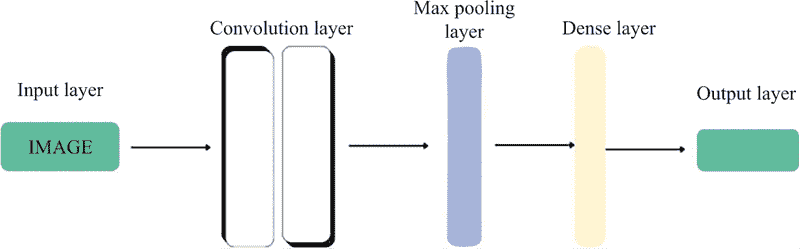

图 6.3 用于预测阿尔茨海默症的卷积神经网络

表 6.5 显示了现有模型与拟提模型的准确率对比。从表 6.5 可以看出，`CNN` 与其他模型相比具有高准确率，即 99.95%。不同模型准确率的图表表示所示图 6.4。

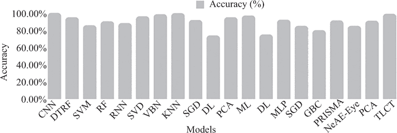

图 6.4 拟提模型与现有模型的准确率比较

`ML` 中用于评估分类模型性能的一个重要统计量是错误率。它显示了模型在所有预测中产生错误预测的百分比。模型预测的频率与数据集中的实际标签不匹配，这通过错误率直接测量。理解错误率对于确定 `ML` 模型有多有效至关重要。较低的错误率表示性能更好或模型犯的错误更少。然而，如果错误率较高，则模型预测是不准确的。

```
Rate = Number of incorrect prediction / Total number of prediction
```

另一个评估模型性能的流行指标是准确率，它与错误率有紧密联系。所有预测中准确预测的百分比被称为准确率。准确率与错误率之间存在明显的相关性。表 6.6 显示了各种模型的错误率。从表 6.6 得出结论，与其他模型相比，错误率最低的模型是 `CNN`。现有模型错误率的图表表示所示图 6.5。

### 表 6.6 拟提模型与现有模型的错误率比较

| 序号 | 模型名称 | 错误率 (%) |
| --- | --- | --- |
| 1 | `CNN` | 0.05 |
| 2 | `DTRF` | 5 |
| 3 | `SVM` | 14.26 |
| 4 | `RF` | 9.7 |
| 5 | `RNN` | 11.76 |
| 6 | `Preprocessing gene selection (SVD)` | 3.91 |
| 7 | `VBN` | 1.43 |
| 8 | `KNN` | 0.3 |
| 9 | `SGD` | 8.17 |
| 10 | `DL methods` | 26.1 |
| 11 | `PCA` | 5 |
| 12 | `ML methods` | 3 |
| 13 | `Deep learning model technique` | 25 |
| 14 | `MLP` | 7.88 |
| 15 | `SGD` | 15 |
| 16 | `GBC` | 20 |
| 17 | `PRISMA methodology` | 8.7 |
| 18 | `NeAE-Eye` | 15 |
| 19 | `PCA` | 9.09 |
| 20 | `Transfer learning and the Grad-CAM technique` | 1 |

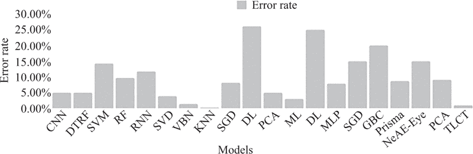

图 6.5 拟提模型与现有模型的错误率比较

如(6.6)所示，当模型具有较低的假阳性值时，我们说正预测是准确的。召回率通常为了精确率而牺牲。精确率是创建适用于各种现实世界的可靠且可信的分类模型的关键因素。表 6.7 显示了现有模型在现有模型上的精确率。图 6.6 显示了现有模型召回值的图表表示。

```
Precision = TP / (TP + FP)
```

图 6.6 各种现有模型召回率的图形化表示。表 6.7 显示了各种模型的精确率值。从表 6.7 可以得出，`CNN` 模型具有较高的精确率值，在其他现有模型中为 93.80%。模型精确率值的图形化表示见图 6.7。

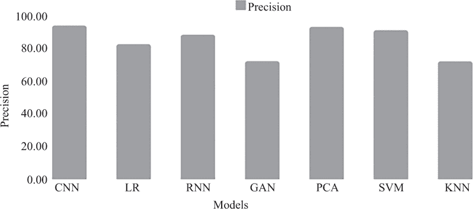

图 6.7 所提模型的精确率与其他几种模型的精确率对比

#### 6.5 结论

阿尔茨海默病（AD）是一种危险的神经系统疾病，会随着时间的推移而逐渐恶化，影响认知功能，导致严重的记忆丧失并无法执行最基础的任务。它是痴呆的常见原因，影响着全球数百万人，尤其是老年人。AD 给所有相关人员（包括家庭成员和护理人员）带来了巨大的压力。在研究中，我们专注于应用顶尖的 `ML` 方法来增强 AD 的诊断和预后。具体来说，我们使用 `CNN` 结合来自 OASIS 的广泛脑成像数据集来发现和检查相关的生物标志物。利用该数据集，我们训练了 `CNN` 并将其结果与其他可用方法进行了比较。

研究利用了一系列评估标准，包括准确率、召回率、错误率、精确率以及评估诊断模型性能的关键要素。全面的测试和分析显示，`CNN` 在这些特征的每一个方面都优于传统方法。`CNN` 模型作为早期诊断和预后的强大工具显示出巨大的潜力，因为它已被证明是识别与痴呆相关生物标志物的高度准确且可靠的方法。及时诊断 AD 的有效方法可以改进管理和治疗策略，从而缩短病程并提高患者的生活质量。此外，在医学成像和诊断中使用 `CNNs` 为临床和研究应用创造了新机会，这使其成为医学领域的一项重大进展。研究最后证明了 `CNN` 扫描诊断和预后 AD 的良好效果。我们的工作通过利用 OASIS 数据集展示 `CNNs` 优于传统方法的优越性，凸显了这些 `ML` 技术在对抗 AD 中的可能应用。

## 参考文献

[1] Shunsuke Koga, Akihiro Ikeda, and Dennis W. Dickson, “基于深度学习的阿尔茨海默病和 tau 蛋白病的诊断模型”, *Neuropathol Appl Neurobiol*. 2022;48(1):e12759. [`doi.org/10.1111/nan.12759`](https://doi.org/10.1111/nan.12759).

[2] Akhilesh Deep Arya, Sourabh Singh Verma, Prasun Chakarabarti, *et al.*, “有效诊断阿尔茨海默病中机器学习和深度学习技术的的性综述”, *Brain Inf*. 2023;10:17. [`doi.org/10.1186/s40708-023-00195-7`](https://doi.org/10.1186/s40708-023-00195-7).

[3] Anza Aqeel, Ali Hassan, Muhammad Attique Khan, *et al.*, “基于长短期记忆生物标志物的阿尔茨海默病预测框架”, *Sensors*. 2022;22(4):1475. [`doi.org/10.3390/s22041475`](https://doi.org/10.3390/s22041475).

[4] Suganyadevi Sellappan, Shiny Pershiya Anand, Finney Daniel Shadrach, Balasamy Krishnasamy, Renu Karra, Umamaheshwari Annamalai, “使用深度学习方法进行阿尔茨海默病诊断的综述”, *J Autonom Intell*. 2024;7(3). [`doi.org/10.32629/jai.v7i3.660`](https://doi.org/10.32629/jai.v7i3.660).

[5] Jingjing Hu, Zhao Qing, Renyuan Liu, *et al.*, “基于深度学习的分类”, *Front Neurosci*. 2021;14:626154. [`doi.org/10.3389/fnins.2020.626154`](https://doi.org/10.3389/fnins.2020.626154).

[6] Omer Asghar Dara, Jose Manuel Lopez-Guede, Hasan Issa Raheem, Javad Rahebi, Ekaitz Zulueta, and Unai Fernandez-Gamiz, “使用机器学习诊断阿尔茨海默病”, *Appl Sci*. 2023;13(14):8298. [`doi.org/10.3390/app13148298`](https://doi.org/10.3390/app13148298).

[7] Manu Raju, M Thirupalani, S. Vidhyabharathi and S. Thilagavathi, “基于深度学习的利用 MRI 扫描阿尔茨海默病多级分类”, *IOP Conf Ser: Mater Sci Eng*. 2021;1084:012017. [`doi.org/10.1088/1757-899X/1084/1/012017`](https://doi.org/10.1088/1757-899X/1084/1/012017).

[8] Zhen Zhao, Joon Huang Chuah, Khin Wee Lai, *et al.*, “利用神经成像进行阿尔茨海默病诊断的传统机器学习和深度学习：综述”, *Front Comput Neurosci*.

[19] Vijeeta Patil, Manohar Madgi 和 Ajmeera Kiran, “Early prediction of Alzheimer's disease using convolutional neural network”, *Egypt J Neurol Psychiatry Neurosurg*. 2022;58:130. [`doi.org/10.1186/s41983-022-00571-w`](https://doi.org/10.1186/s41983-022-00571-w).

[20] Tausifa Jan Saleem, Syed Rameem Zahra, Fan Wu, *et al.*, “Deep learning-based diagnosis of Alzheimer's disease”, *J Pers Med*. 2022;12(5):815. [`doi.org/10.3390/jpm1205815`](https://doi.org/10.3390/jpm1205815).

[21] Changxing Qu, Yinxi Zou, Yingqiao Ma, *et al.*, “Diagnostic performance of generative adversarial network-based deep learning methods for Alzheimer's disease”, *Front Aging Neurosci*. 2022;14:841696. [`doi.org/10.3389/fnagi.2022.841696`](https://doi.org/10.3389/fnagi.2022.841696).

[22] Deevyankar Agarwal, Manuel Berís, Antonio Luna, Vivian Lipari, Julien Ballester 和 Isabel de Torre, “Automated medical diagnosis of Alzheimer's disease using an efficient net convolutional network”, *J Med Syst*. 2023;47(1):57. [`doi.org/10.1007/s10916-023-0941-4`](https://doi.org/10.1007/s10916-023-0941-4).

[23] Avinash Bhagat, Syed Immamul Ansar, *et al.*, “A novel framework for classification of different Alzheimer's disease stages using CNN model”, *Electronics*. 2023;12(2):469. [`doi.org/10.3390/electronics1202469`](https://doi.org/10.3390/electronics1202469).

[24] Mark Jenkinson, Christian F Beckmann, Timothy E Behrens 和 Stephen M Smith, “FSL”, *Neuroimage*. 2012;62(2):782–790. [`doi.org/10.1016/j.neuroimage.2011.09015`](https://doi.org/10.1016/j.neuroimage.2011.09015).

[25] Bruce Fischl, “FreeSurfer”, *Neuroimage*. 2012;62(2):774–781. [`doi.org/10.1016/j.neuroimage.2012.0121`](https://doi.org/10.1016/j.neuroimage.2012.0121).


[26] Brian B Avants, Nicholas J Tustison, Gang Song, Philip A Cook, Arno Klein 和 James C Gee, “A reproducible evaluation of ANTs similarity metric performance in brain image registration”, *Neuroimage*. 2011;54(3):2033–2044. [`doi.org/10.1016/j.neuroimage.2010.09025`](https://doi.org/10.1016/j.neuroimage.010).

# 第 7 章：一种基于 EEG 的癫痫起始检测自适应方法

G. Yogarajan, V. Angayarkanni 和 Ben Othman Soufiane

¹ 印度技术系，Mepco Schlenk 工程学院，印度

² 计算技术系，工程与技术学院，SRM 科学技术学院，印度

³ 沙特阿拉伯金法萨尔大学应用学院，计算机科学系

## 摘要

癫痫是一种严重的脑疾病，在排除由酒精或血糖水平等已知医学状况引起的两次发作后即可进行诊断。癫痫患者会经历不受控的运动和意识丧失，从而导致严重的受伤风险和潜在的死亡。为了减轻这些危险，开发一种计算机癫痫检测技术至关重要，以便在癫痫患者发作期间保护其安全并在检测到时及时提醒护理人员。本章讨论了一种基于脑电图（`EEG`）数据的癫痫起始检测方法。它利用一个预处理单元，负责通过带通滤波器进行带限制、放大、电压水平检测以及自适应信号抑制算法。该自适应算法识别癫痫起始时 `EEG` 信号中的异常（通常表现为超同步脉冲），并使用自适应技术去除不需要的脉冲。一旦检测到癫痫起始，系统将通知医人员进行立即干预。与现有先进方法相比，该方法表现出更高的准确性、敏感性和特异性。这种方法适用于开发利用医疗健康平台内制造技术的可穿戴设备，实现快速癫痫检测，并可能拯救危重患者的生命。

**关键词：** 医疗健康；癫痫起始检测；`EEG` 信号处理；超同步脉冲

## 7.1 引言

智能医疗系统的基础是医疗物联网（`IoMT`）和健康物联网。提供基于 `IoMT` 的智能医疗来检测脑电图（`EEG`）信号中的异常（癫痫），有助于在癫痫发作前进行检测。严重的癫痫不仅会对人体造成不可逆的伤害，还具有威胁生命的风险。因此，基于癫痫诊断和管理的研究是必要的。

本章其余部分的安排如下：第 7.2 节 讨论了使用 EEG 信号处理进行异常检测的相关工作。第 7.3 节 阐了基于自适应阈值方法的发作起始检测系统架构。结果与讨论见于第 7.4 节，而第 7.5 节 提供了结论和未来的工作方向。

## 7.2 文献综述

开发了一种使用低功耗植入式集成设备和 `CMOS` 来检测癫痫发作的实时系统 `[5]` 癫痫发作检测，它利用了独特的发作起始特征和算法。`[6]` 中描述的方法使用小波分解算法生成了一个封装了 `EEG` 历期形态和空间分布的特征向量。随后，使用支持向量机分类方法对该向量进行检查，以确定它描述的是患者的发作还是非发作 `EEG` 信号。为了识别发作，该系统使用了 `SRA` 并结合超同步信号检测电路。它监控 `EEG` 信号，消除不需要的脉冲，并确定发作起始时间。在伯恩-巴塞罗那 EEG 数据库上的测试表明，这种高效的算法在各种数据集上均具有准确性 `[7]`。

`[8]` 描述了系统中一种植入式 `CMOS` 集成设备用于识别部分起始发作（即癫痫发作的开始）。通过从脑脉冲中获取发作起始的信息并在预定持续内对其进行追踪，改进了癫痫的管理。

采用非侵入性方法测量脑电活动，利用 `EEG` 信号检测发作并对显著特征分类。它从 `CHB-MIT EEG` 数据集中选择受影响的通道，提取相关特征，并使用机器学习技术评估了七种分类器以实现高效输出，如 `[9]` 所示。

本章提出了一种用于 `IoMT` 边缘系统中基于 `EEG` 发作检测的软硬件协同设计方法，解决了高延迟和隐私等问题。这种硬件友好的方法使用 `EMA-GHE` 用于发期和期期 `EEG` 特征提取的 `RF` 分类器，并使用 `SMOTE` 进行二分类 `[10]`。

一项研究 `[11]` 提出了一种实时发作检测模型，应用标准克里金技术对患者 `EEG` 信号的分形特征进行分类。一篇文章介绍了用于智能医疗的可穿戴技术、基于物联网 (`IoT`) 的 `EEG` 发作检测、离散小波变换 (`DWT`)、Hjorth 参数 (`HPs`)、统计特征和机器学习分类器 `[12]`。

深度神经网络和二元蜻龙算法被用于基于 `EEG` 的发作检测系统，以提高发作识别的精度和有效性 `[13]`。通过使用从小波分解 `EEG` 信号中获得的各种统计和 `Hjorth` 参数，深度神经网络能够理解 `EEG` 信号的基本属性。进行了一项详细研究以弥补边缘计算与医疗健康解决方案之间的差距 `[14]`，并讨论了各种相关挑战和未来趋势。

`EEG` 信号结合 `ECG` 信号已用于研究睡眠对驾驶员的影响 `[15]`。基于深度学习的数据融合方法被用于处理 `EEG` 和 `ECG` 信号以检测嗜睡，从而提高驾驶员的安全。基于 `IoT` 的监测系统被用于监控多通道 `EEG` 信号并检测发作，用于研究会导致言语混乱和幻觉的疾病 `[16]`。卷积神经网络 (`CNN`) 和时间卷积网络被用于开发智能医疗框架。使用多种派生特征 `CNN` 进行发作检测，准确率达到 98.48% `[17]`。

使用高空间频率的实时发作起始检测方法被开发用于 `[18]`。但这种方法没有显式揭示底层动力学，且需要更大的数据集。一种智能系统被开发用于颅内记录 `[19]`。

使用相空间表示的单通道发作检测和优化模型 (`ONASNet`) 被用于分析。它关注于限制多通道数据的利用 `[20]`。

## 7.3 提出的系统

发作是由于脑电脉冲爆发导致的脑活动突然中断，会导致意识丧失。患者往往因为忽视这些发作而导致死亡。因此，早期检测有助于识别患者并在紧急情况下通知医疗团队。

本节代表了所系统的逻辑和原理，以及通过 `CHB-MIT EEG` 数据库实现的系统工作流程 `[21]`。

### 7.3.1 系统架构

图 7.1 展示了所系统涉及的各种过程。所系统通过 `EEG` 设备持续监测神经元发射的脑信号，帮助识别患者的发作起始。首先，提取 `EEG` 信号并通过带通滤波器 (`BPF`)，随后放大并传递到 `VLD`，最后由 `SRA` 进行处理以判断患者是否存在发作。患者的 `EEG` 信号被记录并随后从数据库中提取。这一过程被称为数据采集。滤波过程主要关注消除 `EEG` 信号中不需要的信号和噪声，将其过滤到所需的范围或频率。

```
![图 7.1 系统架构
```

放大过程通过调增益放大器完成，将信号放大到特定范围，然后传递给 `VLD`。它负责将放大后的信号转换为同步脉冲，从而将这些脉冲提交给 `SRA`。该架构的主要目标是从 `VLD` 获取的脉冲经过精细滤波（通过消除杂散和不需要的噪声），从这些同步脉冲中检测发作。

### 7.3.2 系统设计

所系统由三个单元组成：传感器单元、传输与存储单元以及访问单元。

### 7.3.2.1 传感器单元

预处理单元检查输入的 EEG 信号。癫痫检测器会持续监测癫痫发作，这些信息会自动无线传输到远程存储位置。

### 7.3.2.2 传输与存储单元

由于存储单元的任务是保存和管理每位患者的数据，因此首选云存储。在这里，传输单元充当访问单元与传感器单元之间的接口，便于将数据传输到目标位置。

### 7.3.2.3 访问单元

访问单元负责允许相关人员访问存储在云端的数据和信息。通过此规定，医疗团队可以随时查看患者的药史，并帮助检查患者治疗癫痫所需的所需的剂量和药物。

### 7.3.2.4 预处理单元

该单元负责从患者/数据获取数据，然后通过 `BPF` 对其进行处理，以消除 EEG 信号中所有由到货缺陷（`DOA`）或其他影响引起的非必要噪声。由儿童受试者的 EEG 记录组成的 CHB-MIT 头皮 EEG 数据库作为输入输入 `BPF`。本工作中使用的 `BPF` 具有理想的频率范围，该范围为：

1. EEG 最小频率：3 Hz

2. EEG 最大频率：29 Hz

`BPF` 还有助于平滑随后传递到放大单元的剧烈过渡信号。

### 7.3.2.5 放大单元

信号从过滤过程外包后（即在对 EEG 信号应用 `BPF` 方法后），它们将通过放大单元。从预处理单元检索的信号是低幅幅的神经信号，在分析之前需要进行放大。此处的放大方法旨在增强从过滤过程中获得的信号。调制后的信号通过可调或可变增益放大器进行放大。可变增益放大器可用于放大到所需的所需的值。在该系统中，低功率神经信号通过可调增益放大器放大了五个单位。

### 7.3.2.6 电压水平检测

获取放大后的信号并传递到 `VLD` 以产生超同步脉冲。`VLD` 的最大和最小电压用于检测这些超同步信号。超同步脉冲根据对放大信号的启发式分析确定，并借助 (7.1)–(7.4) 计算。

最小和最大电压已经预定义，平均最大电压值为 450 mV，平均最小电压值为 150 mV。最优值通过试错法获得，然后应用于未知的癫痫和非癫痫实例。因此，放大后的信号现在被修改为超同步脉冲，并进入信号拒绝模块。

使用以下方程进行检测：

```
(7.1)$V_{\mathit{VLD}}\left( n \right) = \left\{ \begin{matrix} {1\ \mathit{for}\ V\max > V{mod}\left( n \right) > V\min} \\ {0,\mathit{otherwise}} \\ \end{matrix} \right.$
```

### 7.3.2.7 信号拒绝算法

从 `VLD` 单元获得的超同步信号现在使用 `SRA` 进行分析。癫痫检测器持续监测神经信号并检测超同步脉冲。由于大量良好信号也会通过 `VLD` 阶段，因此去除外部因素引起的不需要且的噪声和信号，因此应用了该算法。如果不需要的脉冲低于定义的阈值，则将其移除。阈值的选择应根据 EEG 信号的特征和癫痫检测算法所需的敏感度进行仔细调优。

EEG 信号的统计量用于计算一个自适应值，有助于去除不需要的超同步脉冲。使用 `Z-score` 进行癫痫发生检测的自适应阈值公式如下：

```
(7.2)$Z_{Score} = \frac{DP - MV}{SD}$
```

其中 `DP` 指最近的 EEG 数据点，`MV` 指 EEG 信号的当前平均值，`SD` 指当前的标准差。

通过将 `Z-score` 的绝对值与阈值水平比较，可以检测到癫痫发生：

```
(7.3)Seizure_Onset  =  ∣ Z[score]|   > Threshold
```

## 7.4 结果与讨论

### 7.4.1 性能指标

与所考虑的其他现有系统相比，性能分析是基于所提系统中起重要作用的参数进行的：

1. 敏感性

2. 特异性

3. 准确率

这些指标使用以下方程进行分析和计算：

```
(7.4)$mathit{Sensitivity} = \frac{\textit{True\ positive}}{\textit{True\ positive} + \textit{True\ negative}}$
```

敏感性定义为任何读取或测量中发生的最小和最少的变化。

```
(7.5)$textit{Specificity} = \frac{\textit{True\ negative}}{\textit{True\ negative} + \textit{True\ negative}}$
```

特异性定义为系统的特定性或本质性。

```
(7.6)$textit{Accuracy} = \frac{\textit{True\ positive} + \textit{True\ negative}}{\textit{True\ positive} + \textit{False\ negative}}$
```

准确率定义为产生的结果的精确性。上述方程使用的术语为：

* 真阳

* 真阴

* 假阴

### 7.4.2 仿真结果

在该工作中，数据集由儿童受试者的记录组成，约有 23 个。EEG 记录每秒 256 个样本。7.2(a) 和 (b) 显示了 EEG 数据的瞬态分析。每个 EEG 数据由 23 个通道组成，每个通道包含 921600 个样本。*x*-轴表示通道数，*y*-轴表示 EEG 样本的幅度。

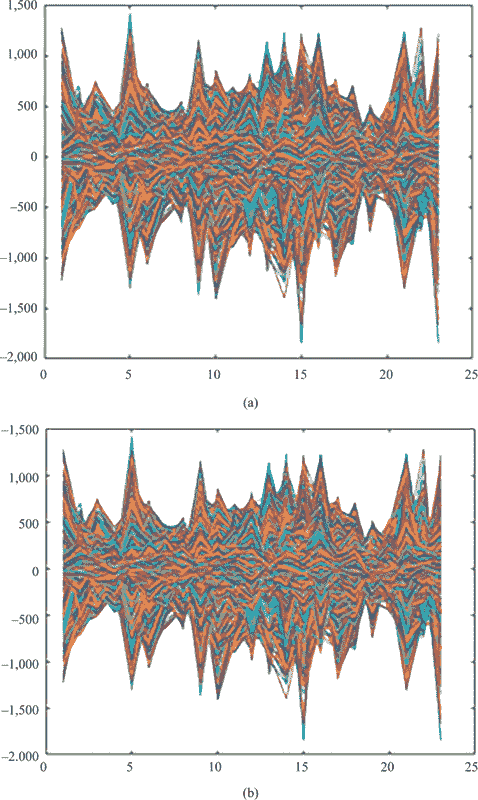

图 7.2 (a) chb01_03.edf 的瞬态分析，以及 (b) chb11_82.edf 的瞬态分析

不同对象的特定时间间隔脑活动变化的 EEG 样本分段如图 7.3(a) 和 (b) 所示。7.3(a) 描绘了从 chb01_03.edf 文件中记录的 2800 秒到 3200 秒之间的输入 EEG 信号。该片段捕捉了一个特定的脑活动时期，对于理解患者神经模式的时间动态至关重要。7.3(b) 显示了从 chb11_82.edf 中记录的 290 秒到 310 秒之间的输入 EEG 信号。该片段提供了不同的时间快照，允许检查不同对象之间脑活动的变化。

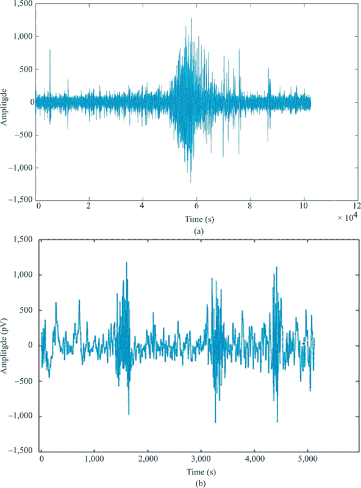

图 7.3 (a) chb01_03.edf 中 2800-3200 秒的输入 EEG 信号，以及 (b) chb11_82.edf 中 290–310 秒的输入 EEG 信号。

经过 `BPF` 过滤后的不同 EEG 信号及其滤波器特性如图图 7.4(a) 和 (b) 所示。

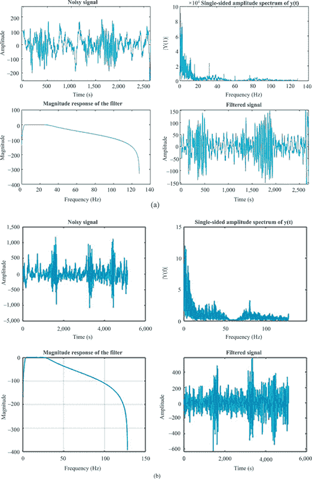

图 7.4 (a) 信号提取后使用带通滤波器过滤的 chb01_03.edf，以及 (b) 信号提取后使用带通滤波器过滤的 chb11_82.edf。

两个不同 EEG 段使用可变增益放大器放大后的滤波信号如图图 7.5(a) 和 (b) 所示。`x`-轴表示时间点，`y`-轴表示 EEG 样本的振幅。

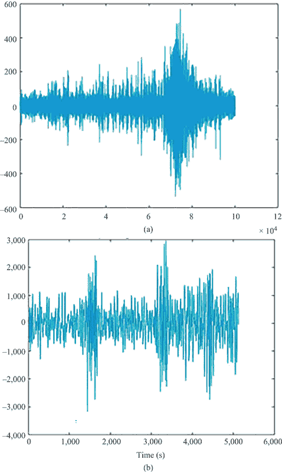

图 7.5 使用可变增益放大器对 (a) chb01_03.edf 和 (b) chb11_82.edf 进行放大。

不同 EEG 段通过 `VLD` 生成的超同步脉冲如图图 7.6(a) 和 (b) 所示。

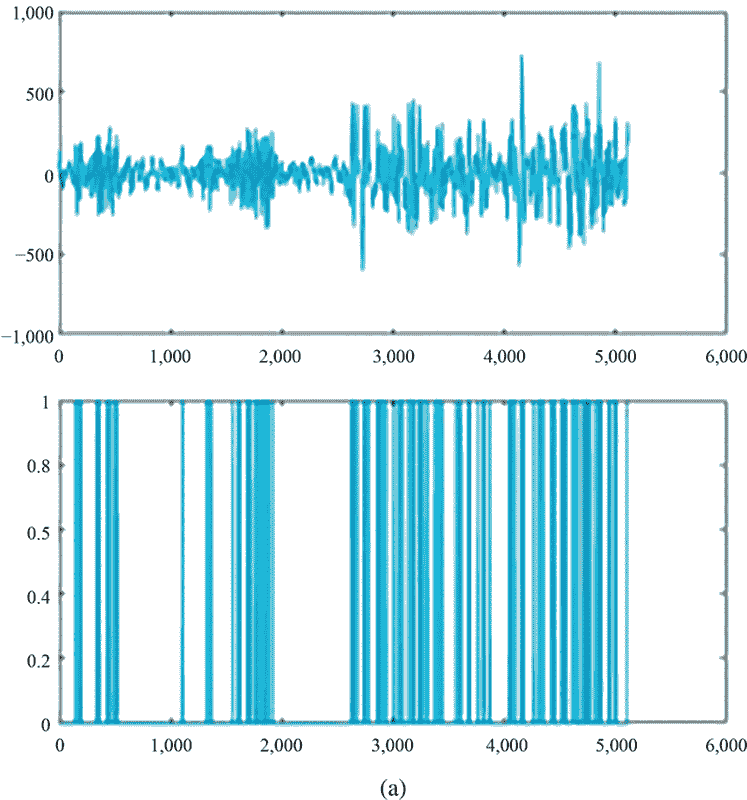

图 7.6 超同步脉冲生成：(a) chb01_03.edf 和 (b) chb11_82.edf。

使用 `VLD` 检测到的两个不同 EEG 段的癫作发作，以及基于两个不同 EEG 段的自适应阈值方案的 `SRA` 如图图 7.7(a) 和 (b) 所示。

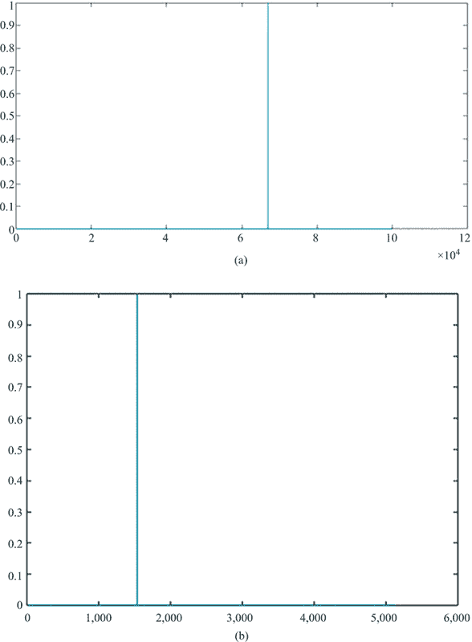

图 7.7 (a) chb01_03.edf 的癫作发作检测，以及 (b) chb11_82.edf 的癫作发作检测。

### 7.4.3 性能比较分析

将所提算法与 `SRA` 以及一种名为模拟前端端线性支持向量机（Analog Front End Linear Support Vector Machine）的现有算法进行了比较。`SRA` 算法实现了 93% 的敏感性、96% 的特异性和 96% 的准确率，而所提方法实现了 98.5% 的平均准确率、96% 的敏感性和 97% 的特异性，优于其他现有算法。这一点在图 7.8 中所示。所提算法性能的提升归功于几个因素。首先，算法结合了先进的信号处理技术和基于 `Z-score` 的自适应阈值，能够更精确地检测发作起始。其次，所提方法利用启发式分析和试错法来确定最佳参数值，增强了在区分发作和非发作实例方面的有效性。

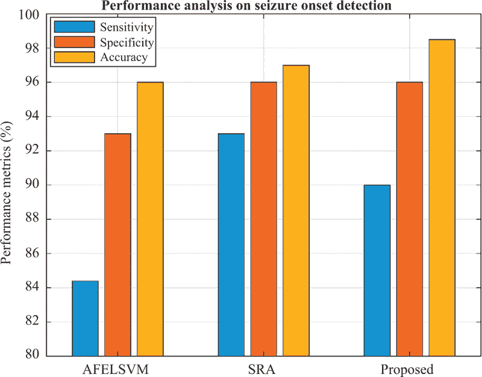

图 7.8 性能分析。

## 7.5 结论与未来工作

提出了一种自动发作检测系统，通过持续监测 EEG 信号并使用基于 `Z-score` 的自适应阈值消除不需要的超同步脉冲来检测发作发作。该方法通过首先对信号进行滤波和放大，然后应用 `VLD` 和 `SRA` 技术，在发作变得恶化之前将其识别出来。与现有算法相比，所提系统具有更高的准确率、敏感性和特异性。因此，该检测系统可以在任何严重事故发生前识别并通知医护人员发作情况，防止意外事故发生。

在未来，所提系统可以使用最新的集成电路和更新的技术进一步实现。这将增强其在医疗物联网环境的可穿戴设备中的应用，实现对发作和癫痫的高效及时检测。进行广泛的临床试验将验证系统在不同患者群体中的有效性，确保其在现实环境中的可靠性和实用性。

## 参考文献

[1] Sun, Y., and Chen, X. “使用变分模式分解和改进灰狼算法进行癫痫 EEG 信号检测。” *Sensors* 23, no. 19 (2023): 8078.

[2] Jaishankar, B., Ashwini, A. M., Vidyabharathi, D., and Raja, L. “使用深度学习和分类的新型癫痫发作预测模型。” *Healthcare Analytics* 4 (2023): 100222.


# 参考文献

[3] Yuen, A. W. C., Keezer, M. R., and Sander, J. W. “癫痫是一种神经性和系统性疾病。” *Epilepsy & Behavior* 78 (2018): 57–61.

[4] Benbadis, R., and Heriaud, L. “理解发作与癫痫。” *Comprehensive Epilepsy Program* Tampa. Available: `https://health.usf.edu/medicine/neurology/Files/Epilepsy/20Program` (访问日期：2023 年 12 月 17 日)。

[18] Maheshwari, J., Joshi, S. D. and Gandhi, T. K., “通过分析时变高空间频率震荡进行实时自动癫痫发作检测，”*IEEE Transactions on Instrumentation and Measurement* 71 (2022): 1–8, Art no. 4002608

[19] Peterson V., Kokkinos V., Ferrante E., *等.*, “响应性神经刺激中电图痫模式的深度网络检测和起始预测，”*Epilepsia* 64, no. 8 (2023): 2056–2069.

[20] Song. Z., Deng, B., Wang, J., Yi, G., and Yue, W. “使用脑节律循环生物标志物基于 ONASNet 的迁移学习进行癫痫发作检测，”*IEEE Transactions on Neural Systems and Rehabilitation Engineering* 30 (2022): 979–989.

[21] Guttag J. *CHB-MIT 头皮脑电图数据库（版本 1.0.0)*。 PhysioNet。2010. 可自：[`doi.org/10.13026/C2K01R`](https://doi.org/10.13026/C2K01R)（访问于 2023 年 12 月 17 日）。

# 第 8 章 眼部疾病预测模型

Ankita Saha, Rajdeep Kabiraj, Riddhi Sekhar Dwibedi, Shibakali Gupta, Chayan Paul, Korhan Cengiz and Nikola Ivković

¹ 印度斯瓦米·维韦卡南德大学计算机科学与工程系

² 印度 ABS 科学技术管理学院科学与管理系

³ 印度 ABS 管理与健康科学学院视光学科

⁴ 印度布尔德万大学技术学院学院计算机科学与工程系

⁵ 沙特阿拉伯普林王子穆哈默德·本·法赫德大学电气工程系

⁶ 克罗地亚亚格勒布布大学组织与信息学学院

## 摘要

通过人工智能和软计算，根据相应的手机照片评估儿童眼部状况，可以在家庭环境中促进对眼部疾病进行适当且初步的检测。本章对视网膜相关疾病预测模型及相关标志物发现的各种研究项目进行了全面综述。文中描述了最近提出的利用机器学习方法基于眼前节特征的各种年龄预测模型，以及一种用于从眼底图像预测年龄（即视网膜年龄）的深度学习模型。年龄相关性黄斑变性（ARMD）是一种双侧眼部疾病，会影响视网膜的中心区域。研究利用包含 453 个视网膜样本和 167 个纤维母细胞样本的转录组数据集开发了另一种用于眼睛（视网膜）的回归生物年龄钟。这 453 个视网膜样本被分为明尼苏达分级系统（MGS）1-4 级，其中包含 105 个 MGS 样本（1 级）、175 个 MGS 样本（2 级）、112 个 MGS 样本（3 级）和 61 个 MGS 样本（4 级）。生物回归模型证明了在严重程度增加（MGS1-4）的 ARMD 样本之间具有有效的区分能力。多种基于预测模型的标志物基因检测与 AMD 研究相关。已识别的预测模型可以作为研究 ARMD 进展以及寻找支持性治疗药物的潜在标志物。

**关键词：** 视网膜疾病；预测模型；回归；基因表达；标志物

## 8.1 引言

在初步阶段确定儿童眼部疾病/障碍是一个全球性关注的问题。传统的筛选技术依赖于养老院/医院和光学诊断中心，这些机构既昂贵又耗时。通过人工智能和软计算，根据相应的手机照片评估儿童眼部状况，可以在家庭环境中促进对眼部疾病进行适当且初步的检测。

在全球范围内，预计 60 岁及以上的人口将在 2050 年达到 21 亿。人口老龄化给医疗保健系统带来了压力。学年龄基本上是衰弱、年龄相关发病以及年龄相关死亡的重要风险因素。相同学龄的个体之间健康结果存在巨大差异，这基本上指的是个体实际的衰老速率，而这种速率是完全变化的。在医学科学中，生物年龄比传统的学年龄是更好的健康状况和疾病预测指标。准确预测相应的生物年龄对于风险分层和干预具有重要价值。

年龄相关性黄斑变性（ARMD）是一种进展性眼部疾病，影响黄斑，黄斑是负责中心视觉和精细细节感知的视网膜中心区域，是眼睛后部的光敏感组织。这会导致 50 岁及以上个体的中心视觉障碍 [[1]–[3]]。在 ARMD 的严重病例中，黄斑功能受损可能导致中心视觉模糊或变暗，使得阅读、写作或手工制作等日常活动变得极具挑战性或无法进行。尽管 ARMD 会导致中心视觉丧失，但它通常不影响外周视觉，全盲罕见。许多患此病的人仍然能够独立生活。老龄化的加剧导致了 ARMD 病例的增加，成为一个主要的全球健康问题。估计显示，2020 年全球有 1.96 亿受 ARMD 影响，预计到 2040 年将显著增加到 2.88 亿。ARMD 通常分为两种不同的形式：“干性”ARMD 和“湿性”ARMD。非渗出性非血管性“干性”ARMD 影响了约 85% 的 ARMD 患者。在这种情况下，黄斑逐渐变薄，导致功能在长时间（通常是几十年）内逐渐丧失。而渗出性血管性晚期“湿性”ARMD 影响了约 15% 的ARMD 患者。这种情况相对罕见，其特征是视力迅速下降；“湿性”ARMD 是晚期 ARMD 的一种较常见变体。它是由眼后节不规则血管的生长引发的，随后会损害黄斑。虽然血管性 ARMD 的治疗已显示出令人满意的结果，但干性 ARMD 仍然面临着巨大挑战。干性 ARMD 的进展以三个阶段为特征：早期和中期，特征为玻璃体下沉积物沉积和视网膜色素上皮（RPE）色素变化，导致轻度视力障碍；以及干性 ARMD 的晚期，特征为关键视网膜结构的变性，导致严重的视力缺失 [[4]]。ARMD 被广泛认为是一种受多种因素影响的多因素性疾病 [[5]]。尽管在识别与 ARMD 风险相关的基因和分子通路方面已取得进展，但特定基因变异影响疾病进展的精确机制尚不清楚（20–27）。遗传分析已确定了超过 35 种与患 ARMD 风险增加相关的遗传变异，其中大部分变异集中在补体系统中。此外，遗传变异表明脂质生物学、细胞外基质或细胞间基质重塑以及炎症可能是 ARMD 发病的关键因素。与 ARMD 相关的其他遗传变异涉及纤维细胞生长因子 2、载脂蛋白 E、年龄相关黄斑变性易感蛋白 2 和 DNA 切除修复蛋白等基因。

表观遗传钟作为表观遗传生物标志物的一种，基于对多种表观基因组特征（如 `DNA methylation`、`mRNAs`、`microRNAs`）的测量来估计生物年龄。表观遗传钟对于识别衰老过程中的环境和遗传因素、识别疾病诊断的新型生物标志物，以及追踪回衰效果和治疗评估具有重要意义。研究人员采用了一种全面的多组学方法进行生物标志物发现和生物年龄预测，整合了来自 `DNA methylation`、转录组学、衰弱评估、微生物组分析、蛋白质组学和神经影像的数据。表观遗传变化（包括 `DNA methylation` 和 `RNA expression alterations`）会产生重的下游效应，并发挥至关重要的调节作用，特别是在老化背景下，此时 `RNA abundance changes` 尤为显著。这些与年龄相关的改变为衰老的潜在新型生物标志物提供了丰富的来源。例如，`DNA methylation age`（`DNAm age`）最初是基于通过 `elastic net penalized regression analysis` 发现的一组年龄预测 CpG 位点提出的。个体的表观遗传年龄加速（无论正负）决定了其生物学年龄是比实际年龄年轻还是更老。通过评估生物年龄，科学家能够检测出生物年龄与实际年龄之间存在显著差异的个体，从而揭示了生物学衰老加速与癌症、糖尿病、衰弱、痴呆和其他疾病等多种健康问题之间的关系。表观遗传年龄加速为正的个体在表观遗传上比实际年龄更老（正加速），或更年轻（负加速）。

尽管各种模型已成功将基因表达和甲基化模式与年龄联系起来 [6]，但表观遗传钟在年龄相关性黄斑变性（ARMD）和 *in vitro* 神经元分化中的应用仍然是一个相对探索的研究领域 [7]。Hunter *et al.* [8] 的研究发现，与对照样本相比，来自 ARMD 供体眼睛的 RPE 细胞中 `GSTM1`（谷胱肽 S-转移酶异型 mu1）和 `GSTM5`（mu5）的启动子表现出高甲基化。Wei *et al.* [9] 和 Oliver *et al.* [10] 的研究关于 ARMD 患者外周血单核细胞（PBMCs）中 `IL17RC` 基因的甲基化水平报告了矛盾的结果，凸显了进一步调查的必要性。对 ARMD 的全基因组表观遗传分析确定了显著的甲基化变化，特别是 `ARMS2/HTRA1` 位点的低甲基化和 `PRSS50`（丝氨蛋白酶 50）位点的高甲基化，将 ARMD 与对照样本区分开来 [11,12]。Wang *et al.* [13] 进行的 `ATAC-Seq` 分析显示，ARMD 患者 RPE 细胞内的染色质可及性广泛降低，为该疾病的表观遗传图谱提供了宝贵的见解。Vallée *et al.* [14] 进行的全面调查强调了节律紊乱在渗出性（湿性）ARMD 发病机制中的意义，特别关注了经典 `WNT/β-catenin signaling pathway` 的异常激活。Ratnapriya *et al.* [15] 表征了 ARMD 的遗传结构，并开发了 `EyeGEx`（眼基因表达）数据库，这是解释全基因组关联研究（GWAS）后眼部特征遗传基础的宝贵资源。da Costa *et al.* [16] 通过识别视网膜器官发育所需的调节信号对该领域做出了重大贡献，并成功在 *in vitro* 生成了成熟视网膜，从而推动疾病建模和治疗策略的进展。

在 [17] 中，开发了特定的视年龄钟并进一步探讨了其在 ARMD 进展和确定疾病严重程度方面的应用。他们的研究表明，年龄钟可以有效区分不同程度的 ARMD 样本（通过 `MGS scores` 1–4 评估），无论训练数据集源自皮肤成纤维细胞样本、视网膜样本还是两者。

Ma *et al.* [18] 通过机器学习方法引入了一种依赖于眼前节段 276 个特征的年龄预测模型。Zhu *et al.* [19] 提出了一种基于深度学习的模型，可以从眼底图像预测年龄（即视网膜年龄），并进一步研究视网膜年龄差（即预测年龄减实际年龄）与死亡风险之间的联系。

总之，本综述为眼疾病的各种预测模型及其相应的治疗标志物提供了新见解，为相关领域和问题的新研究人员提供了详尽的指南。

## 8.2 材料与方法

### 8.2.1 数据集

在 [17] 中，作者最初分析了可用的人类视网膜基因表达数据（NCBI Gene Omnibus Reference ID: `GSE115828`）[14,15]。基因表达的综合数据矩阵包含 18,053 个不同基因和使用明尼苏达评分系统（`MGS`）分级的 453 个样本。453 个 `MGS` 样本被分为四个等级：105 个 `MGS` 1 级（健康）样本、175 个 `MGS` 2 级（受影响）样本、112 个 `MGS` 3 级（受影响）样本和 61 个 `MGS` 4 级（受影响）样本。`MGS` 评分量化了 ARMD 的严重程度。`MGS1` 评分的供体视网膜没有 ARMD 特征，作为对照。相反，`MGS2-MGS4` 样本代表了疾病严重程度进展。此外，他们的分析还整合了三个额外数据集：神经元分化数据集、原成纤维细胞数据集和皮肤成纤维细胞数据集。神经元分化数据集（`GSE56796`）基因数量最多，最初包含 44,562 个基因和 24 个样本。原成纤维细胞数据集（`GSE97265`）较小，有 6,732 个基因和 14 个样本。皮肤成纤维细胞数据集（`GSE113957`）在 143 个样本中总共有 27,142 个基因。

### 8.2.2 噪声去除步骤

使用初始基因向量，作者应用了 `DBSCAN`（基于密度的噪声聚类）算法来去除噪声并聚类数据点（50, 51）。该方法检测到的离群特征已从后续分析中移除。

为了确定最优的 epsilon (`eps`) 值，利用 k-最近邻 (KNN) 距离图来估计拐点，并将其作为 eps 邻域值。所有其他参数均设置为默认值。基于密度的聚类算法生成了多个簇，每个簇由核心特征、边界特征和噪声特征组成。随后，删除了噪声特征以精炼数据集。然后对无噪声数据集进行回归分析和交叉验证，从而识别显著的模式和相关性。对 DBSCAN 聚类得到的聚类图进行评估，以评价聚类技术的有效性。

实现 DBSCAN 聚类算法需要两个关键的用户指定参数：epsilon (`eps`)，它定义了簇内点之间的最大距离；以及最小点数 (`MinPts`)，它决定了形成稠密区域所需的最小点数。epsilon (`eps`) 值代表每个点周围区域的半径，定义了 epsilon 邻域 (e-neighborhood)，而 `MinPts` 则规定了该半径内邻点的最小数量。

如果一个点的邻居计数得分大于或等于 `MinPts` 阈值，则该点被分类为核心点。如果一个点的邻居计数少于 `MinPts`，但它位于核心点的 epsilon 邻域 (e-neighborhood) 内，则该点被分类为边界点。任何无法满足核心点或边界点标准的点都被分类为噪声点或离群点。我们的目标是通过分析靠近特定参考点的点或对象的数量，识别可以近似的稠密区域。最初，作者通过 KNN 距离图识别了最优拐点。计算 KNN 距离并进行升序排列和分析，以确定拐点值，该值标记了数据的显著转变 [20]。随后，将这些值归一化到 0 到 1 的范围内，并计算导数以分析变化率。作者将拐点识别为导数超过预定值（例如 1）的第一个点。e 邻域值被设置为所识别拐点的缩放后距离分，作为一个关键参数。

为了使用完整特征集分析视网膜数据，生成了 kNN 距离图，其中 `k` 的值通过样本量 453 加 1 确定，结果为 `k`=454。在图中，高度参数 `h` 设置为 5,000 以利于确定拐点。识别出的拐点随后用于 DBSCAN 聚类算法中的 `eps` 值，以检测并隔离数据集中的离群特征。通过应用 DBSCAN 聚类算法，识别出 75 个被分类为离群值的噪声特征，并将其排除在进一步分析之外。移除噪声特征后，剩余 17,978 个无噪声特征用于开发钟模型。使用 DBSCAN 聚类，作者在真皮成纤维细胞数据识别出 58 个表现出噪声行为的特征，并在后续分析中将其移除。丢弃噪声特征后，作者利用现有的 14,825 个无噪声特征开发了钟模型，确保了结果更加准确可靠。

## 8.3 寻找预测模型

在使用 DBSCAN 识别并移除离群值后，准备了精炼后的数据集用于后续分析。为了评估模型的稳健性，作者对选定的数据集（包括视网膜组织样本）实施了留一交叉验证 (LOOCV)，从而将数据分为训练集和测试集。在 LOOCV 方法中，单个样本被指定为测试集，其余样本组成训练集。该过程对每个剩余样本重复进行，确保每个样本恰好作为测试集使用一次。从表达数据中，作者提取了一个仅包含训练样本的子集，并与从临床数据集获取的相应样本年龄数据配对。同时，作者选择了表达数据的不同子集（仅包含测试样本），并将其与临床数据中相应的年龄信息配对。

使用 LOOCV 将数据分为训练集和测试集后，作者采用 R 语言中的 `glmnet` 包执行回归分析 [21,22]。具体而言，作者将训练表达数据对响应变量以及经过对数转换的年龄数据（预测变量）进行回归，并通过通过使分类误差与最小二乘误差 (LSE) 相等获得了最优的 lambda (`λ`) 值。在使用多线性模型的 `glmnet` 回归技术背景下，目标函数 (`T`) 通常公式化为单目标函数，旨在优化特定标准。生成的模型产生了一组优化后的系数，对应于一组共同最小化目标函数 `T` 值的具信息特征特征或基因。目标函数 `T` 的公式如下：

```
T = \frac{1}{2m}\sum\limits_{i = 1}^{m}\left( {y_{i} - \sum\limits_{j = 1}^{n}{\beta_{i}x_{\mathit{ij}} - \beta_{0}}} \right)^{2} + \lambda\left( {\frac{1 - \alpha}{2}\sum\limits_{j = 1}^{n}\beta_{j}^{2} + \alpha\sum\limits_{j = 1}^{n}\left| \beta_{j} \right|} \right)
```


在这里，变量 `m` 和 `n` 分别代表样本总数和特征总数。在这种表示法中，变量 `x[*ij*]` 表示第 `i` 个样本中第 `j` 个特征的基因表达水平，而 `y[*i*]` 表示第 `i` 个样本经过对数转换的实际年龄。为了对预测变量的系数引入额外的约束，采用了一种结合 lasso 和岭回归（ridge）正则化的混合方法，并对两者均给予同等偏。在此背景下，`λ` (> 0) 作为调优参数，控制施加在特定系数上的整体惩罚，而 `α`（另一个调优参数）从 0 到 1（0 < `α` < 1）决定了岭回归 (`α`=0) 与 lasso (`α`=1) 技术之间的平衡。作者将 `α` 设置为 0.5，并 LOOCV 确定了 `λ` 的最佳值，这等同于 `m`-折交叉验证，其中 `m` 代表样本总数，作者选择了能够产生最小误差加一个标准差结果的 `λ` 值。一旦确定了最佳 `λ`，作者继续选择最相关的特征，并根据所选的 `λ` 值估计它们相应的系数。随后，系数为零的特征被省略，从而有效地从模型中消除了无信息的预测因子。然后作者使用简化后的非零特征集开发了年龄预测模型。

利用源自视网膜数据的综合特征集，作者使用 MGS 1 级样本（作为对照样本）开发了年龄钟模型。为了评估模型的性能，作者采用 LOOCV 将特定数据分为测试集和训练集，其中单个样本被指定为测试集，其余部分为训练集。

在我们年龄钟模型中识别出的非零系数基因，为视网膜老化和年龄相关黄斑斑变性（ARMD）的潜在学机制提供了宝贵的见解。本研究识别出的基因与此前涉及 ARMD 和衰老研究的基因存在显著重叠，这支持了我们方法的有效性。他们的研究强调了表观遗传钟作为监测 ARMD 进展和识别潜在治疗靶点的生物标志物的潜力。

Ma *等人* [18] 通过机器学习方法引入了一种依赖于眼前节段 276 个特征的年龄预测模型。Zhu *等人* [19] 提出了一种基于深度学习的模型，可以根据眼底图像预测年龄（即视网膜年龄），并进一步开展研究以寻找视网膜年龄差距（预测年龄减去实际年龄）与死亡风险之间的联系。

## 8.6 结论

总之，这项综述工作展示了利用人类视网膜样本的转录组数据进行视网膜年龄模型的开发与验证。结果强调了这些年龄钟作为监测 ARMD/其他视网膜疾病进展以及识别潜在治疗靶点的生物标志物的潜力。未来的研究可以在我们发现的基础上，探索视网膜年龄钟在 ARMD/其他视网膜疾病诊断和治疗中的临床应用。

## 致谢

我们感谢印度加尔各答斯瓦米·维韦韦南德大学（Swami Vivekananda University）、印度布尔德万布尔万大学技术学院、印度杜尔加普尔 ABS 科学、技术与管理学院以及印度杜尔加普尔 ABS 管理与健康科学学院的所有研究人员。

## 参考文献

[1] Awh CC, Lane AM, Hawken S, Zanke B, and Kim IK. `CFH` 和 `ARMS2` 遗传多态性预测年龄相关黄斑斑变性患者对抗氧化剂和锌的反应。*Ophthalmology* (2013) 120:2317–23.

[2] Hernandez-Zimbron LF, Zamora-Alvarado R, Ochoa-De la Paz L, et al. 年龄相关黄斑斑变性：AMD 治疗和管理的新范式。*Oxid Med Cell Longev* (2018) 2018:8374647. doi:10.1155/2018/8374647.

[3] Miller JW, D’Anieri LL, Husain D, Miller JB, and Vavvas DG. 年龄相关黄斑斑变性 (AMD)：展望未来。*J Clin Med* (2021) 10:1124. doi:10.3390/jcm10051124.

[4] Fleckenstein M, Mitchell P, Freund KB, et al. 年龄相关黄斑斑变性继发性地理萎缩的进展。*Ophthalmology*. (2018) 125:369–90.

[5] Schaal KB, Rosenfeld PJ, Gregori G, et al. 非渗性年龄相关黄斑斑变性的解剖临床试验终点。*Ophthalmology* (2016) 123:1060–79.

[6] Horvath S. 人类组织和细胞类型的 DNA 甲基化年龄。*Genome Biol* (2013) 14:R115.

[7] Schick T, Lores-Motta L, Altay L, Fritsche LG, den Hollander AI, and Fauser S. 与年龄相关黄斑斑变性相关的遗传变异的影响随年龄变化。*Invest Ophthalmol Sci* (2020) 61:17. doi:10.1167/iovs.61.17.

[8] Hunter A, Spechler PA, Cwanger A, et al. DNA 甲基化与 AMD 中的基因表达改变有关。*Invest Ophthalmol Sci* (2012) 53:2089–105. doi:10.1167/iovs.1849.

[9] Wei L, Liu B, Tuo J, et al. `IL17RC` 启动子低甲基化与年龄相关黄斑斑变性相关。*Cell Rep* (2012) 2:51–8. doi:10.1016/j.celrep.2013.

[10] Oliver VF, Franchina M, Jaffe AE, et al. 外周血中 `IL17RC` 启动子低甲基化不是年龄相关黄斑斑变性的标志。*Cell Rep* (2013) 5:227–35. doi:10.1016/j.celrep.342.

[11] Sobrin L, and Seddon JM. 基因和环境预测黄斑斑变性的发生。*Prog Retin Eye Res* (2014)40:115.

[12] Muthiah MN, Keane PA, Zhong J, et al. 自适应光学成像显示黄斑光感受细胞恢复。*Ophthalmol Times* (2014) 121 (5):430–31.

[13] Wang J, Zibetti C, Shang P, et al. `ATAC-Seq` 分析揭示年龄相关黄斑斑变性中染色质可及性的广泛下降。*Nat Commun* (2018) 9:1364. doi:10.1038/s41467-018-0356.

[14] Vallée A, Lecarpier Y, Valle R, Guillevin R, and Valle JN. 渗性年龄相关黄斑斑变性的昼夜节律：`WNT/beta-catenin` 通路的关键作用。*Int J Mol Sci* (2020) 21:820. doi:10.3390/ijms210302.

[15] Ratnapriya R, Sosina OA, Starostik MR, et al. 作者修正：视网膜转录组和 `eQTL` 分析识别与年龄相关黄斑斑变性相关的基因。*Nat Genet* (2019) 51:1067. doi:10.1038/s41588-019-0430-y.

[16] da Costa JP, Vitorino R, Silva, GM, Vogel C, Duarte AC, Rocha-Santos, T. 老衰综述：理论、机制与展望。*Ageing Res* (2016) 29:90–112.

[17] Mallik S, Grodstein F, Bennett DA, et al. 年龄相关黄斑斑变性的新型表观遗传钟生物标志物。*Front Med (Lausanne)* (2022) 9:856853. doi:10.3389/fmed.2022.856853. PMID: 35783640; PMCID: PMC9244395.

[18] Ma J, Xu X., Li M, et al. 基于眼前节形态的人眼眼衰老预测模型。*J Biomed Inform* (2021) 120:103855, https://doi.org/10.1016/j.jbi.2021.103855.

[19] Zhu Z, Shi D, Guankai P, et al. 视网膜年龄差距作为死亡风险的预测生物标志物。*Br J Ophthalmol* (2023) 107:547–554, https://doi.org/10.1136/bjophthalmol-2021-319807

[20] Bandyopadhyay S, Mallik S, and Mukhopadhyay A. 用于微列数据识别差异表达的统计方法的综述与比较。*IEEE/ACM Trans Comput Biol Bioinform* (2014) 11:95–115. doi:10.1109/TCBB.2013.147.

[21] Hahsler M, Piekenbrock M, and Doran D. `DBSCAN`: 基于 `R` 的快速密度聚类。*J Stat Softw* (2019) 91:1–30.

[22] Sharma NK, Sharma SK, Gupta A, Prabhakar S, Singh R, and Anand A. 疑似年龄相关黄斑斑变性早期诊断的预测模型。*DNA Cell Biol* (2013) 32:549–55. doi: 10.1089/dna.2013.2072.

[23] Davis, MD, Gangnon RE, Lee LY, et al. 年龄相关黄斑斑变性的年龄相关疾病严重量表：AREDS 报告。*Arch Ophthalmol* (2005) 123(17):1484–98.

[24] Reich NG, Lessler J, Sakrejda K, Lauer SA, Iamsirithaworn S, and Cummings DA. 使用平均绝对误差评估时间序列预测模型的案例研究。*Am Stat* (2016) 70:285–92. doi:10.1080/00031305.2016.1148631.

# 9. 白障及其主要原因

人工智能（AI）的发展为医疗多个领域带来了改进。基于人工智能的应用在白障管理的效率和质量方面提供了显著增强。在全球范围内，白障是导致视力障碍的主要原因。在老年人口中，这种视力障碍预计会大幅增加。在目前的医疗体系中，解决这一问题变得非常复杂。通常情况下，许多因素（如手术频率、老龄化和早期干预）决定了白障发生的频率。在资源有限的情况下，白障管理对于许多国家来说是一项复杂的任务。因此，随着人口老龄化和技术的发展，AI 系统在白障的分期和治疗中变得日益重要。这在白障诊断和治疗方面具有意义。通过对白障管理的关注，AI 系统在检测白障方面提供了有效的结果。基于人工智能的技术可以提取高级特征，并在白障诊断中获得更好的性能。

**关键词：** 白障；深度学习；CNN；早期检测；SVM；眼科

## 9.1 白障及其主要原因

通常，晶状体位于眼睛后方的彩色区域，被称为虹膜之后。晶状体帮助眼睛聚焦光线。光线通过眼睛处理并产生清晰的图像，随着年龄增长，这种现象被称为白障。当人达到某些年龄后，位于眼睛中的晶状体开始变得浑浊，视力变得模糊。这导致晶状体浑浊的情况。导致白障的原因有很多，一些主要原因定义如下：

*   白障由于眼睛晶状体浑浊形成，这是由于晶状体中的蛋白质聚集。通常情况下，眼睛的晶状体是透明的，允许光线通过。晶状体将光聚焦到眼睛上。
*   白障导致视力下降，因为光线无法容易通过晶状体中的聚集。最近，聚集变厚、变大，导致视觉变得困难。在某些情况下，晶状体颜色变为棕色或黄色，这会改变你的视觉。
*   40 岁后，眼睛晶状体中蛋白质开始自然分解。在大多数情况下，白障是由这些自然变化形成的。在某些情况下，受伤或事故会改变组织并导致眼睛晶状体变差。在这里，晶状体中的纤维和蛋白质开始分解导致视浑浊。
*   遗传的其他健康问题也有可能影响晶状体并增加白障风险。同样，糖尿病等医疗状况也会导致白障问题。长期使用类固醇药物也会导致白障的发展。

当白障开始生长时，浑浊加重，视力变差。白障阻塞并散射光进入晶状体，导致视力变得更加模糊。它通常发生在双眼中，但发生的速率并不相同。在某些情况下，一只眼睛的情况比另一只严重。这导致了双眼视差异。除了年龄因素外，导致白障的一些常见因素包括：

*   糖尿病
*   眼睛治疗或手术
*   癌症和其他疾病的放射治疗
*   过量饮酒
*   白障家族遗传
*   眼睛严重
*   因健康问题服用类固醇药物
*   吸烟
*   长时间晒

## 9.2 白障的类型

白障是晶状体中的浑浊区域。大多数白障与年龄有关。这些由于随着年龄增长，眼睛发生了正常变化而产生。然而，白障可能由于其他原因发生。白障主要有五种类型，解释如下：

*   **年龄相关白障**：当患者变老时发生这种白障。在这种情况下，白障由于患者眼睛晶状体的自然变化而产生。这种类型是最常见的。年龄相关白障的一些原因包括：
    *   糖尿病
    *   过量饮酒
    *   吸烟
    *   有白障家族史
    *   用于治疗过敏或关节炎等多种健康问题的类固醇药物
*   **外伤性白障**：严重的眼睛损伤会影响患者的晶状体并导致白障。白障可以在损伤后立即形成，也可以在几年后形成。
*   **儿童白障**：这种白障也可能儿童身上。这种儿童白障罕见且是遗传性的。这种白障也由于怀孕期间的严重问题或儿童期的虹光炎、眼肿瘤引起。儿童可能因为类固醇、辐射或眼睛受伤等原因患白障。
*   **继性白障**：在进行白障手术后，眼睛可能会生长瘢组织。这会导致视力浑浊。这被称为继性白障。

## 9.3 白障治疗模式

白障治疗有多种模式，如影像、手术和成像模式。

*   **医疗模式**：如果视力是 6/24 或更好，瞳孔扩大或使用 2.5%苯太酚的眼镜足以进行无需手术的定期活动。白障在溶解白障的方面也有尝试。
*   **手术模式**：如果视力低于 6/24 或白障由于医疗状况影响眼睛健康，则需要手术。一些手术策略包括：
    *   `超声波乳化术`：使用 2.8 mm 的切口来乳化白障。
    *   `微切口白障手术`：在角膜上形成小口以消除受的晶状体。
    *   `小切口缝合白障手术`：在巩膜而非角膜上形成口。
*   **成像模式**：成像模式在白障手术中用于术前验证白障、术中为专家提供实时回顾，并培训实习医生。一些成像模式包括：
    *   `术中光学相干断层 (iOCT)`：这是一种使眼科专家能够实时确定手术操作影响的机制。
    *   `前节光学相干断层 (ASOCT)`：支持对多种肿瘤性、退行性和变性眼表进行光学活检。它使专家能够检测眼疾病。
    *   `人工人工晶状体`：用于白内障手术，以治疗眼睛自然晶状体的浑浊，并在不需要眼镜的情况下提供远距离和近处的清晰视野。
    *   `飞秒激光`：用于白内障手术，在该手术通过计算机引导的激光对眼部进行精确切割，以消除浑浊的晶状体并将其替换为人工晶状体。
    *   `其他模式`：无缝手术/无注射、先进提取方法、用于晶状体植入的超声和激光测量方法，以及囊膜染色和囊膜环等辅助方法。

## 9.4 当前模型的局限性

许多人受到白内障的影响。在达到特定年龄后，还有导致白内障的其他原因。使用开发的模型进行测试有助于判断患者是否存在白内障。尽管如此，白内障检测研究中仍存在一些不明挑战。早期模型中的一些复杂性定义如下。

*   开发了许多检测白内障的自动化模型。某些模型仅限于核性白内障，且仅适用于裂隙灯。这种针对皮质性白内障的分级模型仍然无法实现，因为很难确定浑浊形成的成熟状态。
*   在目前，已经开发了基于手机的裂隙灯图像筛选来识别白内障。然而，这些方法包含了瞳孔散大，这在最终检查中是一个复杂的过程。
*   在机器学习技术中，仅使用高质量成像来训练模型。然而，算法对于偏向或不具代表性的群体效果并不理想。这使得参数选择变差，并导致检测准确率下降。


- 机器学习模型缺乏透明度，使得理解诊断过程变得困难。此外，它对大量的处理能力和存储要求更高。这可能导致确定眼底图像时产生复杂性。

- 对于白内障诊断，采用了基于裂隙灯成像的卷积神经网络（`CNN`）和支持向量机（`SVM`）组合方法。这一过程需要高质量的医学图像进行检测；否则会导致误报。

- 深度学习模型，如具有三步序列的残差网络被用于诊断过程中识别白内障。在这里，模型从裂隙灯摄影中识别多幅图像并判断瞳孔为非散大或散大。此外，还进行了严重分级以评估病情。该方法在检测前需要预处理程序以获得准确结果。

- 基于 `CNN` 的集成优化用于根据输入的眼底图像对白内障进行分级，从而实现准确的白内障诊断。在这里，前段成像被替换为眼底照片以实现检测。此外，该模型仍然存在解释性问题。

## 9.5 白内障的筛选与诊断

白内障筛选是由眼科专家通过诊断过程判断是否存在白内障的过程。白内障是眼睛自然晶状体中出现的浑浊，会导致视力下降 [6]。筛选是检查眼睛的标准程序，包括瞳孔散大确定、裂隙灯检查和视力测试，这些定义在图 9.1。

- `视力`：此测试确定特定距离下的视力质量。在这里，专业人员要求患者从远处图表上识别不同大小的字母。对人的双眼进行单独测试并结合起来计算不同距离下的视力准确度。这种方法是诊断白内障最简单且无痛的方法。

- `对比敏感度`：与视力更相似。在这里，通过放置对比色来确定视力。在这里，确定由白内障产生的眩光和光散射导致的图像对比度下降。

- `裂隙灯`：一种用于评估眼睛的先进显微镜。在这里，医生通过检查晶状体来检测白内障。要求患者将下巴放在裂隙灯上。光线通过眼睛。通过裂隙灯观察，检查晶状体的浑浊程度。

- `瞳孔散大`：这是诊断白内障最常用的方法之一。在散大发生时，瞳孔扩大并提供整个晶状体的视野。专业人员根据视力质量检查晶状体是否受白内障影响。

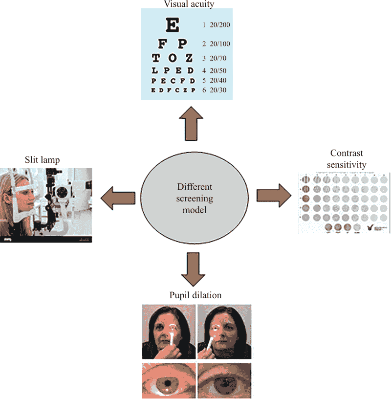

图 9.1 检测白内障的不同筛选方法

如今，人工智能（AI）对眼科领域产生了巨大影响。该领域已从执行眼科图像在内的手动工作自动化，发展到了深度学习和机器学习。`Machine learning` 是人工智能的一个分支，它使自动化设备能够通过在 `random forests` 或 `SVM` 等常规技术中寻找最佳权重和参数，从现有数据中学习。然而，深度学习是机器学习的一个分支，包含了深度神经网络（`DNN`）。大量的网络神经元进行特征提取，使该技术能够以增量的方式学习细微特征。这种能力在眼科领域多种图像分类操作的功能上取得了重要突破。

在眼科领域，白内障是可治愈盲的主要原因，导致严重或中度视力损害。由于人口高度老龄化，这种困难预计将更具持续性。然而，眼科保健服务未能同步扩大，导致了一个日益日益复杂的问题。白内障手术已被证明可以改善痴呆患者和阿尔茨海默患者的认知功能。包括人口老龄化、眼科手术频率增加和及时识别在内的某些因素导致白内障手术频率的提高。时间成本和资源有限导致了白内障管理中的主要问题。

一些 AI 模型已用于支持白内障管理的多个方面。AI 辅助模型在患者护理的某些学科中显示了强大的能力。在数字革命的支持下，AI 技术已应用于社会的模块。因此，随着发展地区的增强和普通人口的老龄化，`AI` 模型可以成为筛查、眼病治疗和分期的重要部分。由于其内化海量数据和评估大量参数的特殊能力，AI 在这一领域看起来很有前景。迄为止，AI 技术已应用于筛查和白内障筛查操作、风险预测、手术时间预测以调整手术室工作流，以及白内障手术的分类阶段。AI 在白内障中的这些作用解释如下：

*   **早期检测**：AI 比传统方法更早地识别疾病症状。早期识别可以实现及时治疗并极大提高患者的解决方案。AI 基于机器学习或深度学习为白内障早期识别处理的标准模型做出了贡献。

*   **疾病预防**：AI 可以通过方式支持白内障疾病的预防，包括实施预防措施、实施个性化治疗方案、及时疾病识别和疾病追踪。AI 还帮助减少医疗错误，增强医疗卫生部门。

*   **白内障的筛查与诊断**：`AI` 模型为白内障的筛查和诊断提供了有前景的解决方案。经 AI 的技术采用某些算法和通过可记录便携设备实现的视频录制为白内障诊断提供了高特异性和敏感性。通过这一自动过程，手动任务被降至最低，并减少了对经验操作员的需求。

*   **人工晶体力数估计和生物测量**：通过深度学习，人工晶体（`IOL`）公式正在利用 AI 的优势来改进预测方案。在此过程中实施的新公式是 AI 辅助的或采用了包含 AI 的因素。这些 `AI` 公式具有巨大的前景，因为许多公式已显示出更好的预测准确性。除了 `IOL`，由于生物测量极限，接受手术的患者也面临着更高的屈光风险。AI 在估计角膜力和为手术患者提供准确解决方案方面得到了高度支持。

*   **儿童白内障的筛查与诊断**：为了防止不可逆转的弱视，必须正确治疗儿童白内障。对于无法方便接触医生的患者，诊断通常是延迟的。儿童白内障治疗的时间敏感性突显了及时识别和预防的重要性。AI 最近的改进显示了卓越的解决方案并支持纠正这些问题。

*   **术中**：AI 有助于增强白内障手术的培训和术中决策，并提供术后评估以改进手术机制。虚拟现实和 AI 被联合使用，以实施用于白内障手术的智能教学模型。

## 9.7 AI 的出现及其在眼科中的应用

为了使许多机构的工作理想化，大多数机构近期一直关注 AI 系统，特别是深度学习和机器学习领域。深度学习是一个不断增强的 AI 领域，是机器学习的一个分支。它包括了人工神经网络（`ANN`）的应用，该网络包含许多人工神经元层以模拟人类大脑的生理功能。深度学习设备经过训练用于提取和执行文本及图像中的数据，并识别语音。如今，AI 模型在医学领域的应用在狭义操作中（如肺癌检测和结肠镜息肉的实时识别）显示了满意的结果。在眼科领域，拥有大量的患者数据和图像，AI 系统在自动识别年龄相关的眼部疾病（包括青光眼、年龄相关性黄斑变性和糖尿病视网膜病变）方面显示了满意的解决方案。计算能力和基础设施的发展促进了 AI 实现中深度学习模型的快速增强。由于其从海量数据中提取未识别模式和高层属性的巨大潜力，深度学习模型现在的功能已比临床医生和人类评分员更好。

在临床领域使用 AI 设备可以极大提高工作场所的生产力，并协助患者沟通操作和临床决策。利用 AI 进行医疗诊断验证可以对影像进行自动评估。在眼科领域，大多数 AI 领域正被地用于多种眼疾病的治疗、监测和检测。然而，应该进行大部分的实验阶段和验证，以确认这些模型是否适用于临床任务。AI 在眼科的几个主要应用解释如下：

*   **青光眼**：许多深度学习模型在检测青光性视神经的变化方面提供了高特异性和高敏感性。这些 AI 实验基于诊断特征，或者通常由专家通过大量的图像发现和测量进行验证。

-   **眼肿瘤学**：模仿决策树技术，实现了一种机器学习模型，用于预测基底细胞癌手术期间的眼周重建过程。此外，某些机器学习模型通过利用 `ANN`，在验证肿瘤史和人口统计学数据，预测脉络膜黑色瘤的治疗方案。

-   **白内**：已经实施了机器学习方法来识别和对白内分级。作者尝试使用名为 `ResNet` 的 AI 技术来识别需要参考的白内。近年来，还实施了用于先天性白内验证的深度学习方法。

-   **儿眼科**：在儿童群体中，适当的眼部管理对于保护视是复杂的。在治疗和筛选实践中使用 AI 可以支持在眼科获得最佳护理。机器学习模型有能力支持在其他屈光异常中筛选高近视，并对易感儿童进行分类以观察障碍。

-   **视网膜**：AI 已用于识别视网膜相关疾病。`AU` 模型比传统模型具有更高的敏感性。

-   **眼整形**：在该领域，AI 有能力支持面部尺寸的自动测量和处理，以支持术前和术后估计。语义分割模型经过训练，可以执行与专家功能相当的自动估计。

## 9.8 AI 在白内检测和严重程度分级中的应用

基于 AI 模型在多种眼疾病中极具前景的解决方案，还实施了一些基于机器学习或深度学习技术的 AI 模型，用于白内的自动分级和检测 `[14]`。除了 AI 不同的框架外，这些从传统实验改进后的模型还根据采用的输入图像类型而异。

### 机器学习模型

机器学习模型利用多种方法来预测方案。分类是构建在半监督和监督学习之上的一种机制。这种模型能够对方案进行具体的分类。当不提供训练数据的标签或类别时，无监督机器学习仍然能够对相似输入进行聚类，即使它无法对独立的簇进行分类。机器学习架构可以使用神经网络进行其他方法，包括遗传编程、树辅助分类、统计回归、随机森林等。某些用于执行白内分类和分割的机器学习方法解释例如下：

-   **支持向量机 (SVM)**：这是一种传统的监督机器学习方法，已广泛用于分类和分割。该模型很大程度上被用于不同的白内眼科图像以对白内进行分类。它为任何眼科图像提供了良好的解决方案。

-   **线性回归**：它是用于纠正不同学习操作的著名机器学习模型之一。线性回归的思想对于其他开发的模型仍然是基础性的。该模型有助于分割和诊断白内，并执行白内分级。

-   **K-近邻 (KNN)**：这是一种简单的方法，而且开发这种技术非常容易。它利用相似性因素根据存储的实例对新病例进行分类。这是一种非参数方法，利用邻近性对特定数据点进行预测。

-   **集成学习方法**：它利用多种机器学习策略来纠正同一个问题，通常可以获得更好的分类和分割方案。某些用于分类过程的集成模型包括投票、袋（bagging）、堆叠（stacking）等。

机器学习在医疗领域的优势如下：

-   **增强诊断**：它被医疗保健专业人员用于实施更好的诊断组件来验证诊断图像。

-   **成本最小化**：机构采用的机器学习模型增加了医疗部门的效率，并最小化了成本使用。此外，机器学习模型可以帮助减少在医疗模型中持续操作所浪费的资源和时间。

-   **数据隐私与安全**：随着健康记录数字化的增强，保护患者数据是一个复杂的问题。机器学习模型可以通过实时识别和响应网络攻击来提高数据安全。

### 深度学习

深度学习模型是神经模型，在输出层和输入层之间具有大量的大量的通信层。这种机器学习包含了带有标记数据源的监督学习。`CNN` 从初始层巨大的输入矩阵开始，进一步导致一个作为序列中后续层输入的方案。层与层之间的连接解释了卷积传播的局部数据。每一层的评估都给给整个网络，直到最后一层生成方案。某些用于执行白内分类和分割的深度学习方法解释例如下：

-   **卷积神经网络**：它在眼科图像处理领域被高度利用，并获得了卓越的性能率。它通过卷积层和池化层进行进展，从给定图像中提取显著特征。设计的模型保持了较高的准确率。

-   **循环神经网络 (RNN)**：这是一种普通的前馈神经网络，其中连接生成无向图或有向图。这种技术能够高效地处理顺序数据。它降低了模型的错误率，并且对于大小大小的数据源都表现良好。

-   **长短期记忆 (LSTM)**：它是一种 `RNN`，利用门控来处理和获取多个时间序列的数据。`LSTM` 开发用于学习时间序列数据中的长期依赖，并用于分类和处理给定的图像。该模型产生了高度准确的方案。

-   **混合神经网络**：它描述了神经网络整合到两个以上的深度网络。专家正利用混合神经网络来纠正不同的学习操作。这种模型有效地改进了特征提取、分割和分类过程。

深度学习在医疗领域的优势如下：

-   **创新药物发现**：深度学习支持药物发现及其开发。

-   **医学影像评估**：包括 `CT`、`MRI` 和 `EEG` 在内的医学影像方法用于识别危险疾病，包括脑肿瘤和癌症心脏疾病。因此，深度学习支持医生更好地验证疾病并为患者提供更好的治疗。

-   **发现疾病解决方案**：深度学习技术通过实时从输入数据或图像中提取显著特征自动识别解决方案。

-   **实现全面的解释**：深度学习模型用于理解基因组，并帮助患者对可能困扰他们的疾病获得想法。

## 9.9 挑战与未来方向

AI 有能力成为白内障管理中的辅助性组件。然而，为了实现其广阔前景，仍需解决一些疑虑和困难。所利用的数据源必须具有异质性，以获得准确的泛化能力。如今，医疗数据往往是入侵者的目标。对抗性威胁也存在于这些技术中，通过更改输入图像或在训练过程中注入数据，导致 AI 技术出现大规模的错误分类。此外，患者和医生等终端用户对这些技术的信任，对于获得临床应用上的成功转化至关重要。这要求增强 AI 技术的解释性，例如对决策任务进行详细演示。

目前已开发出多种技术来纠正上述问题。最初，联邦学习被广泛应用于在不共享数据的情况下，实现跨国或跨机构的 AI 训练。这是一种隐私保护机制，使技术能够处理异质且非独立的数据 [15]。一种改进被称为群体学习（swarm learning），它允许对 AI 技术参数进行调整，从而帮助增强技术的泛化能力。此外，通过使用生成网络扩大这些数据源，特别是针对罕见病。为了提高 AI 模型的解释性，这些技术包含了代表感兴趣区域的热力图，并对包含的不确定性进行了验证，同时也包含了特征提取或预定义技术。

除了特定的白内障和生物测量模型外，大多数 AI 技术尚未达到临床可接受的高准确率水平，因此需要进一步增强。此外，大多数术中 AI 工作集中在不断增长的技术上，缺乏适当的临床应用，其大部分应用仍处于假设阶段。尽管如此，新兴的增强措施仍可能提供尚未显现的实际应用。此外，AI 的发展仍面临重要问题，特别是在实施这些国家，由于数据可用性不足、基础设施落后、技术专家匮乏以及资金有限。还需要最初开发准确的训练应用，以确认受试者的规模。眼科领域遇到的 AI 的主要复杂性在图 9.3 中形象所示。

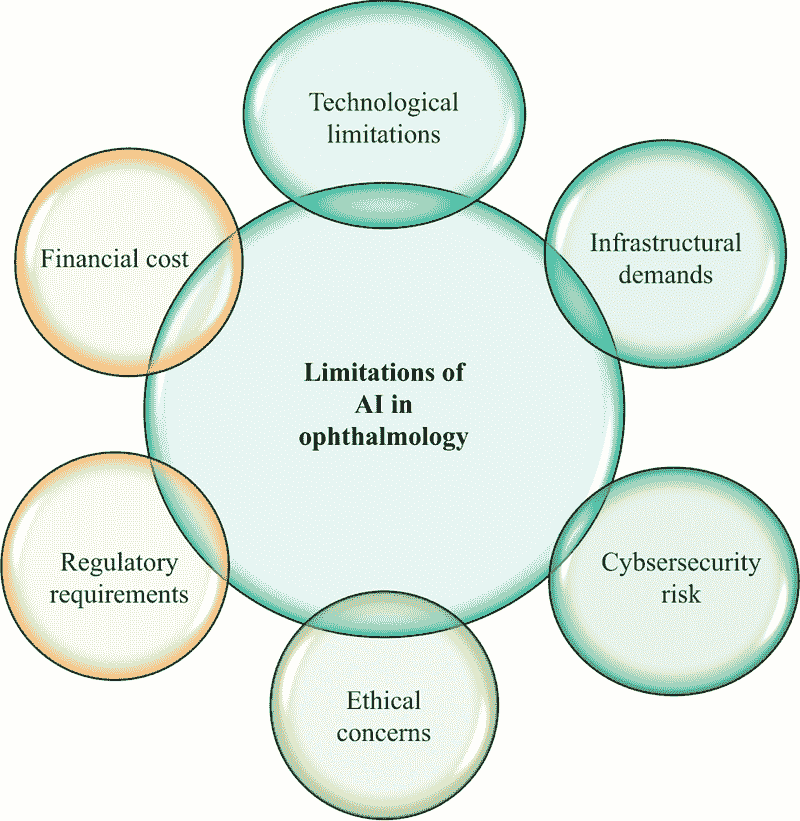

图 9.3 AI 在眼科中的局限性

大多数传统工作显示了有效的解决方案，但必须考虑到，没有任何传统工作在实时测试用例中进一步验证其相应的模型。此外，这些模型在现实环境中的实际应用仍有待评估。在基于 AI 的眼睛公式选择和人工晶体（IOL）功率估计方面还需要进一步发展。具有屈光性手术史的患者以及使用公式估算 IOL 功率也增加了复杂性。这是由于传统公式开发得并不。与西方国家相比，这种复杂性在亚洲国家更为突出。由于亚洲社区的老龄化趋势，预计未来几年需要白内障手术但曾有屈光性手术史的患者数量将增加。最后，新模型的实施或传统 AI 模型的完善，以及良好标注、稳健且大规模的数据源维护仍然是一个复杂问题。此外，新技术需要符合透明标准，以确保完整性和透明度。

## 9.10 结论

本章详细解释了 AI 及其在白内障诊断中的意义。首先，章节解释了白内障及其成因。然后，章节分析了当前模型在白内障诊断中的局限性。此外，还解释了 AI 模型及其出现、研究空白和未来方向。

## 参考文献

[1] Lu, Q., Wei, L., He, W., *et al.*, “Lens Opacities Classification System III–based artificial intelligence program for automatic cataract grading”, *Journal of Cataract & Refractive Surgery*, vol. 48, pp. 528–534, 2022.

[2] Lindegger, D.J., Wawrzynski, J. and Saleh, G.M., “Evolution and applications of artificial intelligence to cataract surgery”, *Ophthalmology Science*, vol. 2, p. 100164, 2022.

[3] Keenan, T.D., Chen, Q., Agrón, E., *et al.*, “DeepLensNet: deep learning automated diagnosis and quantitative classification of cataract type and severity”, *Ophthalmology*, vol. 129, pp. 571–584, 2022.

[4] Abbas, Q., Qureshi, I., Yan, J. and Shaheed, K., “Machine learning methods for diagnosis of eye-related diseases: a systematic review study based on ophthalmic imaging modalities”, *Archives of Computational Methods in Engineering*, vol. 29, pp. 3861–3918, 2022.

[5] Long, E., Chen, J., Wu, X., *et al.*, “Artificial intelligence manages congenital cataract with individualized prediction and telehealth computing”, *NPJ Digital Medicine*, vol. 3, p.112, 2020.

[6] Shimizu, E., Yazu, H., Aketa, N., *et al.*, “Innovative artificial intelligence-based cataract diagnostic method uses a slit-lamp video recording device and multiple machine-learning”, *Investigative Ophthalmology & Visual Science*, vol. 62, p. 1031, 2021.

[7] Xue, W., Zhang, J., Ma, Y., *et al.*, “Deep learning-based analysis of infrared fundus photography for automated diagnosis of diabetic retinopathy with cataracts”, *Journal of Cataract & Refractive Surgery*, vol. 49, pp. 1043–1048, 2023.


[8] Ueno, Y., Oda, M., Yamaguchi, T., *et al.*, “Deep learning model for extensive-based diagnosis and triage”, *British Journal of Ophthalmology*, vol. 108, pp. 1406–1413, 2024.

[9] Rampat, R., Deshmukh, R., Chen, X., *et al.*, “Artificial intelligence in cornea, refractive surgery, and cataract: basic principles, clinical applications, and future directions”, *The Asia-Pacific Journal of Ophthalmology*, vol. 10, pp. 268–281, 2021.

[10] Gutierrez, L., Lim, J.S., Foo, L.L., *et al.*, “Application of artificial intelligence in cataract management: current and future directions”, *Eye and Vision*, vol. 9, p. 3, 2022.

[11] Ting, D.S.J., Foo, V.H., Yang, L.W., *et al.*, “Artificial intelligence for anterior segment diseases: emerging applications in ophthalmology”, *British Journal of Ophthalmology*, vol. 105, pp. 158–168, 2021.

[12] Muchibwa, C., Eldaw, M.H., and Agyeman, M., “An assessment of contemporary methods and data-enabled approaches for early cataract detection”, *F1000 Research*, vol. 12, p. 998, 2023.

[13] Sung, J., Inomata, T., Akasaki, Y., *et al.*, “Development and validation of artificial intelligence-driven cataract detection model using smartphone-captured images”, *Investigative Ophthalmology & Visual Science*, vol. 65, p. 3715, 2024.

[14] Tham, Y.C., Goh, J.H.L., Anees, A., *et al.*, “Detecting visually significant cataract using retinal photograph-based deep learning”, *Nature Aging*, vol. 2, pp. 264–271, 2022.

[15] Junayed, M.S., Islam, M.B., Sadeghzadeh, A. and Rahman, S., “CataractNet: an automated cataract detection system using deep learning for fundus images”, *IEEE Access*, vol. 9, pp. 128799–128808, 2021.

¹ 印度，AJ 工程与技术学院，计算机科学与工程系

² 印度，Velammal 工程与技术学院，电子与通信工程系

³ 突尼斯的，麦尼尼省，计算机科学高等学院，计算机科学系

⁴ 印度，维特博帕尔理工大学（VIT Bhopal University），计算机科学与工程学院

## 摘要

将机器学习与区块链加密相结合为图像伪造检测提供了一种极具前景的方法，确保了数据的完整性。区块链技术使得图像数据能够安全地存储在去中心化且防篡改的账本上。每幅图像都被分配一个哈希值，该值被存储在区块链上，使得未经授权的修改难以被察觉。机器学习技术被用于从图像中提取相关特征，捕捉有助于检测伪造的独特特性。训练后的机器学习模型，如极端学习机（`ELM`）或深度学习模型，能够从真实和伪造图像的标记数据集中学习模式和特征。提取的特征、哈希值以及两幅图像在区块链上的时间戳确保了透明度和不可篡改性。当有一幅新图像出现时，其特征将与真实图像的特征进行比较，分类算法根据学习到的模式确定其真实性。这种混合方法可以与区块链技术相结合，利用提取的特征值以及从每幅图像生成的时间戳和哈希值，为验证图像的真实性提供了一种不可篡改的去中心化解决方案。在图像伪造检测的背景下，从图像中提取时间戳和哈希值时，共识机制可以提供额外的安全可靠性。这种去中心化降低了恶意篡改的风险。如果节点试图操纵提取的值，它将被共识算法拒绝，从而确保数据的完整性。

**关键词：** 皮肤癌图像；极端学习机（`ELM`）；监督分类器；区块链方法；时间标记；图像哈希化

## 10.1 引言

公有区块链对所有用户开放且是无需许可的。私有区块链（有时被称为监管区块链）由单个人管理。权威机构决定谁可以连接网络以及他们拥有什么权利。由于访问限制，私有区块链不是中心化的。区块链混合模型结合了两种网络（如公共网络和私有网络）的元素。除了公共网络外，企业还可以安装基于许可的私有系统。它们在保持对其他数据公共访问的同时，限制了对区块链中包含特定数据的访问。公共端通过使用智能合约检查私有交易是否完成。所有比特币交易都归档在公共账本上，其副本存储在世界各地的服务器上。成员在开放的比特币网络上通过解决数学题来产生新区块，从而进行比特币挖掘。每笔新交易都由系统跨网络从节点到节点进行共享，并向公众广播。区块链作为比特币的官方账本，通过矿工每隔 10 分钟编译一次的新区块进行永久更新 [1]。

在涉及医学影像时，为什么区块链理念是必要的：因为它提供了灵活性、连通性、可问责性和数据输入确认。出于各种原因，健康记录必须保持远程并受到保护。区块链有助于避免某些威胁，并支持医疗保健行业的分布式事实和数据防御 [2]。

在处理数字照片时，为什么区块链理念至关重要：图像分发（包括患者的直接图像）、植入式医疗设备的追踪、调查、远程放射和人工智能是与医学影像特别相关的区块链潜在用例 [3]。

区块链技术的底层原理是它们分布式账本技术（`DLT`）的一个分支。通过拆解 `DLT`，我们可以通过建立节点（或计算机）的对等网络来实现分布式化；这些节点共同构成了一个分布式网络。每个节点都处理客户端提交的交易。这些交易作为已提交的数据记录在所有节点的可复制数据库中，该数据库被称为账本。账本中的记录被组织成区块，且不可被更改 [4]。

什么是共识算法以及目前仍在使用的所有变体：共识算法的分类包括非拜占庭的、拜占庭的、基于 `DAG` 的以及混合型 [56]。

将机器学习与区块链加密相结合为图像伪造检测提供了一种有效的方法，确保了数据的完整性。区块链技术使得图像数据能够安全地存储在去中心化且防篡改的账本上。每幅图像都被分配一个哈希值，该值被存储在区块链上，使得未经授权的修改难以被察觉。机器学习技术被用于从图像中提取相关特征，捕捉有助于检测伪造的独特特性。训练后的机器学习模型，如极端学习机（`ELM`）或深度学习模型，能够从真实和伪造图像的标记数据集中学习模式和特征。提取的特征、哈希值以及两幅图像在区块链上的时间戳确保了透明度和不可篡改性。当有一幅新图像出现时，其特征将与真实图像的特征进行比较，分类算法根据学习到的模式确定其真实性。这种混合方法可以与区块链技术相结合，利用提取的特征值以及从每幅图像生成的时间戳和哈希值，为验证图像的真实性提供了一种不可篡改的去中心化解决方案。在图像伪造检测的背景下，从图像中提取时间戳和哈希值时，共识机制可以提供额外的安全可靠性。这种去中心化降低了恶意篡改的风险。如果节点试图操纵提取的值，它将被共识算法拒绝，从而确保数据的完整性。

我们在这里处理的数字图像是皮肤癌健康和健康图像，用于显示这些图像的完整性。数字图像伪造的主要问题是证明其真实性。为了证明这种真实性，结合区块链技术将帮助我们在这里发挥有效作用。正如你所知，区块链在意义上提供了基于哈希的安全性，从而确保了图像的真实性。

为了证明网络安全服务，我们收集了时间戳、`hash`、`nonce` 和证明值等安全特征。本文处理了皮肤癌图像伪造。皮肤癌图像的微小伪造可能导致患者诊断错误，并使患者在初始阶段就陷入麻烦。因此，需要一个身份验证系统。这里的身份验证系统是机器学习与区块链技术的混合。因此，该系统最初将处理预训练的卷积神经网络（`CNN`）模型以及 `ELM`，随后系统将使用区块链修改版本来生成安全特征。

## 10.2 问题定义

图像真实性以及图像真实性之间的相关性用于检测伪造图像。哈希算法的结果在图像发生微小变化时显示不同的结果。图像伪造预测将帮助你理解被篡改的区域，提供如“是”或“否”之类的测量值。但我们无法识别图像是真实的还是修改过的。因此，需要一个验证框架来检查（`hash`、`timestamp`、`nonce`、`proof values`）以确保数据完整性。数据完整性无非确保我们手中的数据没有被修改过。

## 10.3 提议系统及其框图

图 10.1

图 10.1 基于无线传感器网络场景的提议图

比较结果将被记录，特征列表文件将输入分类器，以检查分类准确性，检测图像是真实的还是经过操纵的。对于真实和操纵图像，我们使用标签 `Yes/No`。无线传感器网络（`WSN`）图像被重新绘制，以无线节点的形式显示人类。人类在这里代表医疗保健人员和患者。这里，使用了混合机器学习和区块链技术来提供完整性和真实性。

图像伪造或篡改可能在报告或图像传输到医院或保险代理的过程中发生。他们可能会操纵图像或操纵提取的特征。分类器用于检查真实性预测。此外，增加了共识机制来检查真实数据以确保数据完整性。有一个名为 `Authenticator` 的模块用于检查每个图像的（`hash values`、`timestamp`）以及（`hash values`、`timestamp`、`nonce`、`proof values`）。`Nonce` 只是仅使用一次的数字，用于提供安全性。它将同时对原始图像和伪造图像进行处理，以确定图像应被拒绝还是接受。

去中心化共识是指网络中的一组分布式实体或参与者在不依赖中央权威的情况下达成一致或共识的过程。它涉及通过网络中多个节点的协作和协调，对共享状态或决策达成一致。去中心化共识机制（如区块链技术）允许参与者在不需要信任的中央实体的情况下验证并同意交易或数据。共识协议由 `proof of work`（`PoW`）/`proof of stake`（`PoS`）组成，这些被用于确保去中心化网络中的一致性和安全性。

`WSNs` 是一种小型、低功耗无线设备网络，被称为传感器，用于监控和从物理环境中收集有意义的数据。这些传感器可以分布在很大区域，并通过无线通信将信息中继到网络中的中心位置/或其他节点。`WSNs` 常用于多个应用，包括环境监测、工业自动化、智能城市和医疗保健。它们能够从物理世界收集实时数据，这些数据主要用于分析、决策和控制。

在 `WSN` 中，人们通常参与网络的设置、配置和管理，而不是直接传输数据。

### 1. WSN 中的数据传输

在 `WSN` 中，标记为 `nodes` 的传感器可以从周围区域收集数据，并使用无线技术连接到网络中的中心基站或其他传感器节点。

### 2. 数据收集

如 `nodes` 之类的传感器根据应用从其各自的传感能力收集原始事实，例如温度、湿度或运动传感器。收集的数据存储在节点本地。

### 3. 数据聚合

为了节省能量和减少网络流量，传感器节点通常会执行数据聚合。它们在将收集的数据传输到基站之前对其进行组合或总结。聚合可能涉及统计计算、过滤或融合技术。

### 4. 路由

传感器节点确定将收集的数据传输到基站或其他目标节点的最优路径。有许多类型的路由器的处理协议可用，其中低能耗自适应聚类层次结构（`LEACH`）常用于在网络内建立高效的通信路由。

### 5. 数据传输

一旦确定了路由，传感器节点使用射频通信无线传输聚合数据。基站或目标节点接收并处理传输的数据。

### 正常和操纵的数据传输

在 `WSN` 中，传感器节点传输的数据通常被认为是真实且准确的。然而，数据传输可能会被操纵或破坏，导致潜在的安全或完整性问题。

#### 1. 数据完整性攻击

恶意个人或对手可能尝试操纵 `WSN` 内部传输的数据。这可能涉及更改传感器读数、注入假数据或篡改聚合过程。此类攻击会导致基站或其他节点接收到不准确或误导的信息。

#### 2. 安全数据传输

为了减轻数据操纵风险，可以实施安全措施。例如，可以应用加密技术来确保传输过程中数据的机性和完整性。还可以采用认证机制来验证传感节点的身份，确保只有可靠的传感器节点参与网络。

上述网络可管理数字图像并促进医院员工之间的通信。在医疗保健环境中，`WSNs` 可用于捕捉和传输来自 X 光机、超声波扫描仪或内镜系统等医疗设备的数字图像。`WSNs` 可以设计为将这些图像安全无线传输到中央服务器或存储系统，用于进一步的分析、诊断或存档目的。`WSN` 可以由配备图像传感器的传感器节点组成，这些传感器捕捉图像并将其传输到此类网络中的指定节点。从那里开始，图像可以被处理、存储并供医疗保健人员访问进行审查和分析。

`WSNs` 还可以促进医院员工之间的通信和信息共享。例如，配备无线传感器的可穿戴设备可监控医院员工的健康状况，如心率、温度或位置。这些数据可以在 `WSN` 内部无线传输到中心监控系统，允许主管或辅助医疗人员监控员工的健康和安全。云平台提供了扩展且安全的存储解决方案，可以管理大量的医疗图像。此外，云端处理能力可用于图像分析、特征提取或应用机器学习算法等任务。

## 10.4 共识算法的类型

`Validation-based consensus algorithms`（基于验证的共识算法）是分布式系统中参与者根据特定规则和标准验证交易或区块的一种共识算法。这些算法通常依赖参与者的专业知识、声誉或投票权来达成表 10.1 所示的共识细节。以下是一些示例：

### 表 10.1 共识算法类型及其综述 [7–19]

| 序号 | 共识算法类型 | 类型 | 文章摘要 |
| --- | --- | --- | --- |
| 1 | 实用拜占庭容错 (`PBFT`) | `PBFT` 是一种旨在抵御拜庭故障的基于验证的共识算法。在 `PBFT` 中，从节点中选出一个领导者，并通过一系列轮的消息交换和投票对交易的有效性达成共识。节点对提议的交易进行授权和投票，必须达到票数阈值才能达成共识。<br><br>`PBFT` 是一种可以应用于医疗保健区块链系统的共识算法，以确保多个参与者之间的数据完整性和共识。 | “Secure and Efficient Data Sharing Framework for Healthcare Using Consortium Blockchain” (2019): 该综述探索了使用基于 `PBFT` 的联盟链在医疗保健领域进行安全、高效数据共享。它强调了 `PBFT` 共识在可扩展性、容错性和抗攻击能力方面的优势，这些都是医疗领域的关键需求。<br><br>“A Review of Blockchain Consensus Algorithms and Their Application in Healthcare” (2020): 该综述概述了各种共识算法（包括 `PBFT`）及其在医疗保健区块链系统中的应用。它讨论了在医疗保健中使用 `PBFT` 的优势和挑战，例如其处理拜占庭故障和维护数据一致性的能力。<br><br>“Blockchain-based Electronic Health Record System for Healthcare Data Sharing” (2020): 该综述研究了在基于区块链的电子健康记录（`EHR`）系统中使用 `PBFT` 共识的情况。它讨论了 `PBFT` 的优势，例如快速共识和容错性，在确保医疗保健数据共享场景中的数据完整性和隐私方面的作用。<br><br>“A Survey on Blockchain Technology for Secure IoT-based Healthcare Applications” (2021): 该综述探索了区块链与物联网在医疗应用中的整合，重点关注基于 `PBFT` 的共识算法。它讨论了 `PBFT` 在实现物联网医疗保健系统中信任、安全和透明度方面的优势。 |


| 序号 | 共识算法 | 描述 | 相关文献 |
| :--- | :--- | :--- | :--- |
| 2 | Ripple 共识算法 (`RCA`) | `RCA` 是用于 Ripple 支付协议的共识算法。它信任受信权威机构网络来验证并同意交易顺序。验证者由 Ripple 网络选择，并参与投票过程以确定交易的有效性和顺序。<br><br>`RCA` 是一种用于 Ripple 网络（一种去中心化支付协议和加密货币）的共识算法。 | “Blockchain Technology for Healthcare Data Management: A Review” (2019): 该综述概述了医疗保健领域的区块链技术，包括对在医疗保健区块链系统中使用 `RCA` 的讨论。它探索了应用 `RCA` 进行安全高效的医疗数据管理的优势和挑战。<br><br>“Blockchain-Based Healthcare Information Exchange: A Survey” (2020): 该综述研究了区块链在医疗信息交换中的应用，重点关注不同的共识算法（包括 `RCA`）。它讨论了 `RCA` 在确保医疗信息交换场景中数据完整性、互操作性和隐私性方面的潜力。<br><br>“A Review of Blockchain Consensus Algorithms and Their Applications in Health Information Exchange” (2020): 该综述复述了各种共识算法（包括 `RCA`）及其在健康信息交换中的应用。它讨论了 `RCA` 在医疗数据共享方面的可扩展性、安全性和交易速度方面的优势和局限性。<br><br>“A Comprehensive Study on Blockchain Technology for Healthcare: A Review” (2021): 该综述对医疗保健领域的区块链技术进行了全面研究，涵盖了包括共识算法在内的多个方面。它探索了 `RCA` 在医疗区块链系统中实现医疗提供者之间安全且互操作数据交换的潜力。 |
| 3 | Stellar 共识协议 (`SCP`) | `SCP` 是用于 Stellar 区块链网络的共识算法。它是一种联邦拜占庭协议协议，依赖一组被称为“法定人数切片”（quorum slices）的受信节点来验证并同意网络状态。法定人数切片是网络的子集，包含了足够的受信节点以达成共识。 | “Stellar Consensus Protocol: A Review and Potential Applications in Healthcare” (2020): 该综述概述了 Stellar 共识协议及其在医疗保健领域的潜在应用。它讨论了 `SCP` 在医疗保健区块链系统可扩展性、安全性和共识算法效率方面的优势。<br><br>“Exploring Stellar Consensus Protocol for Secure and Interoperable Healthcare Data Exchange” (2021): 该综述探索了使用 Stellar 共识协议进行安全且互操作的医疗保健数据交换。它讨论了 `SCP` 在确保医疗保健区块链网络中数据完整性、隐私性和互操作性方面的优势。<br><br>“A Comparative Study of Consensus Algorithms in Healthcare Blockchain Networks: Stellar Consensus Protocol vs. Proof of Authority” (2019): 该综述比较了医疗保健区块链网络中的 Stellar 共识协议与权威证明（Proof of Authority）共识算法。它评估了它们在医疗数据管理中的性能、安全性和可扩展性。<br><br>“Enhancing Healthcare Data Security with Stellar Consensus Protocol-based Blockchain” (2020): 该综述探索了基于 Stellar 共识协议的区块链如何增强医疗数据安全。它讨论了 `SCP` 在确保医疗数据安全存储和防篡方面的特征。 |
| 4 | 多签名 (`Multisig`) | `Multisig` 是一种用于区块链系统的基于验证的共识机制，需要多个方对交易进行签名才能被视为有效。该机制通常用于加密货币钱包或智能合约，在多个方共同批准交易后才能执行。 | |
| 5 | 基于投票的共识算法 | 依赖分布式系统中参与者之间的投票过程对交易的有效性或顺序达成共识。 | 权益证明 (`PoS`) [20]: 虽然 `PoS` 主要是一种基于验证的算法，但也包含了投票。在 `PoS` 中，持有并“质押”一定加密货币的参与者被选中验证交易并创建新区块。 |
| 6 | 基于认证的共识算法 | 是一种共识算法，依赖参与者证明其身份或身份凭据来参与共识过程。这些算法确保只有经过身份验证和授权的参与者才能贡献共识机制。 | 权威证明 (`PoA`): `PoA` 是一种基于认证的共识算法，预定义的一组批准验证者或权威负责验证交易并向区块链添加区块 [20]。<br><br>实用拜占庭容错 (`PBFT`): `PBFT` 虽然主要是一种基于验证的算法，但也包含了认证。 |

### 基于身份的共识 [21]

基于身份的共识算法使用参与者的唯一身份作为认证的基础。阈值签名方案：阈值签名方案涉及一组参与者共同创建签名或加密证明。

## 10.5 实验与结果

工作主要基于图像篡改伪造检测，并进一步利用共识算法证明网络服务的真实性和完整性。`ALEXNET` 预训练 CNN 模型与全连接层的最后一层连接，并将所有提取的特征用于机器学习分类器，以获得分类率结果和伪造定位。在第一章中详细解释了图像篡改。在本章中，我们记录了一些安全参数以获取哈希（hash）、时间戳、随机数（nonce）和证明值。图 10.1 描述了图像路径及其名称、哈希值和时间戳。所有图像均用于以下用例的测试：

*   在检查篡改之前，利用共识算法提取图 10.1 和图 10.2 的值。
*   在检查篡改后，利用共识算法提取图 10.1 和图 10.2 的值。

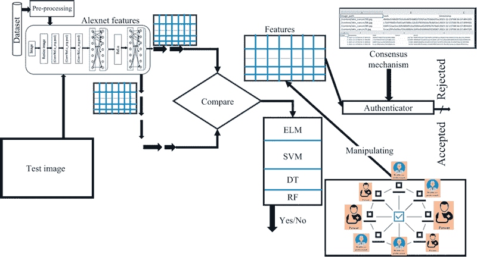

图 10.2 基于去中心化共识场景的拟议图

图像篡改基于 `MIASDBv1` 数据集处理。我们使用了了自己的手动绘制工具来创建和收集原始及伪造图像（图 10.3 和图 10.4；表 10.2）。

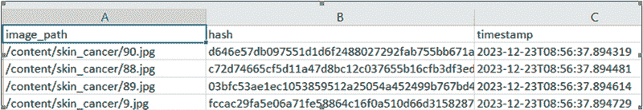

图 10.3 哈希和时间戳的提取

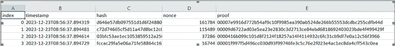

图 10.4 时间戳、哈希、随机数、证明值的提取

表 10.2 基于 TensorFlow Hub URL 的用于 COVERAGE、CoMoFoD 数据集检测预训练 CNN 模型

| 序号 | 模型 | 迭代次数 (Epochs) | 数据集 | 验证准确率 |
| :--- | :--- | :--- | :--- | :--- |
| 1 | `RESNET` | 5 | 小数据集 | 58% |
| 2 | `ALEXNET` | 5 | 大数据集 | 62% |
| 3 | `RESNET 50` | 5 | 小数据集 | 60% |
| 4 | `VGG16` | 5 | 小数据集 | 61% |

在图 10.5 中，使用 CNN `ALEXNET` 预训练模型提取特征，其全连接最后一层考虑了所有特征的 csv 文件，并获得了 96.50% 的分类准确率。实现的分类准确率较低，是因为我们自己的手动绘制工具不像 `photoshop` 或 `gimp` 或其他图像编辑工具那样有效。该工具仅用于研究级测试过程中创建伪造图像。在四个模型中，`ALEXNET` 表现良好，优于其他预训练 CNN 模型（表 10.3）。

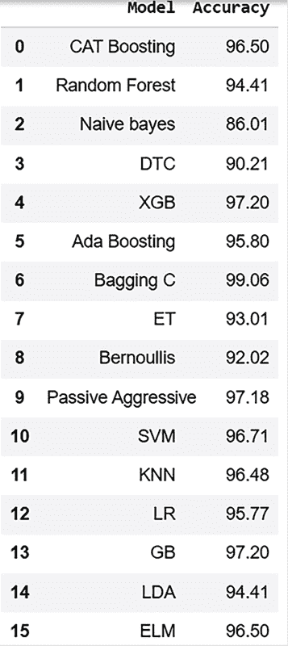

图 10.5 使用 ML 方法对拟议方法的性能评估

表 10.3 基于大小数据集的用于乳腺癌伪造（复制移动）检测的 CNN 预训练 TensorFlow 模型 TensorFlow Hub URL (`MIASDBv1`[13])

| 序号 | 模型 | 迭代次数 (Epochs) | 验证准确率 |
| :--- | :--- | :--- | :--- |
| 1 | `RESNET` | 5 | 60% |
| 2 | `ALEXNET` | 5 | 67% |
| 3 | `RESNET 50` | 5 | 66% |
| 4 | `VGG16` | 5 | 61% |

## 10.6 结论与未来工作

检测图像伪造和维护数据完整性的一种可能方法是将区块链加密与机器学习相结合。区块链技术使得在去中心化、不可渗透的账本上安全存储图像数据成为可能。每个图像都有唯一的哈希值，该值在区块链上进行验证，这使得非法更改更难以被察觉。从标记的真实和虚假照片集中，训练过的机器学习模型（如深度学习模型或 `ELM`）学习模式和特征。区块链通过保留两张照片提取的特征哈希值和时间戳来确保透明性和不可篡改性。这种去中心化降低了恶意操控的可能性。共识机制通过拒绝任何节点修改检索值的尝试来确保数据完整性。在四个模型中，`ALEXNET` 表现良好，优于其他预训练 CNN 模型。此外，真实性已根据实验和结果部分添加的一些安全措施和细节得到了证明。

## 参考文献

[1] 什么是区块链技术，可用：[`aws.amazon.com/what-is/blockchain/?aws-products-all.sort-by=item.additionalFields.productNameLowercase&aws-products-all.sort-order=asc`](https://aws.amazon.com/what-is/blockchain/?aws-products-all.sort-by=item.additionalFields.productNameLowercase&aws-products-all.sort-order=asc)。

[2] A. Haleem, M. Javaid, R. P. Singh, R. Suman, and S. Rab, “区块链技术在医疗保健中的应用：概述”, *International Journal of Intelligent Networks*, 2021;2:130–139. [`doi.org/10.1016/j.ijin.2021.09.005`](https://doi.org/10.1016/j.ijin.2021.09.005)。

[3] M. P. McBee, “ACTION-EHR: 以患者为中心的基于区块链的电子健康记录数据管理用于癌症”, *Journal of Medical Internet Research*, 2020;22:13598 [`doi.org/10.2196/13598`](https://doi.org/10.2196/13598)。

[4] 智能合约开发，Hyperledger。

[5] Z. Hussein, M. A. Salama, and S. A., “区块链的演进：关于最新进展”, *Blockchain (Basel)*, 2023;6:30. [`doi.org/10.1186/s4240-y`](https://doi.org/10.1186/s4240-y)。

[6] J. Yusoff, Z. Mohamad, and M. Anuar, “共识算法”, *Journal of Computer and Communications*, 2022;10(9):37–50. [`doi.org/10.4236/jcc.2022.109`](https://doi.org/10.4236/jcc.2022.109)。

[7] A. Ali, H. Ali, A. Saeed, and et., “基于区块链的物联网医疗保健：应用、研究问题和挑战”, *Sensors (Basel)*, 2023;23(18):7740. [`doi.org/10.3390/s2318740`](https://doi.org/10.3390/s2318740)。

[8] J. Yusoff, Z. Mohamad, and M. Anuar, “共识算法”, *Journal of Computer and Communications*, 2022;10(9):37–50. [`doi.org/10.4236/jcc.2022.109`](https://doi.org/10.4236/jcc.2022.109).

[9] M. S. Rahman, M. A. Islam, M. A. Uddin, and G. Stea, “基于区块链的物联网医疗保健综述”, *Journal of Healthcare*, 2022;19:100551. [`doi.org/10.1016/j.iot.2022.100551`](https://doi.org/10.1016/j.iot.2022.100551).

[12] Y. Zhuang, L. R. Sheets, Y. W. Chen, Z. Y. Shae, J. J. P. Tsai, and C. R. Shyu, “基于区块链技术的以患者为中心的健康信息交换框架”, *IEEE Journal of Biomedical and Health Informatics*, 2020;24(8):2169–2176. [`doi.org/10.1109/JBHI.2020.2993072`](https://doi.org/10.1109/JBHI.2020.2993072).

[13] A. Tandon, A. Dhir, A. K. M. N. Islam, and M. Mäntymäki, “医疗健康区块链：系统性文献综述、综合框架与未来研究议程”, *Computers in Industry*, 2020;122:103290. [`doi.org/10.1016/j.compind.2020.103290`](https://doi.org/10.1016/j.compind.2020.103290).

[14] A. Haleem, M. Javaid, R. P. Singh, R. Suman, and S. Rab, “区块链技术在医疗领域的应用: 概述”, *International Journal of Intelligent Networks*, 2021;2:130–139. [`doi.org/10.1016/j.ijin.2021.09.005`](https://doi.org/10.1016/j.ijin.2021.09.005).

[15] D. Mazieres, “恒星共识协议”, *Stellar White Paper.* [Online]. Available: [`stellar.org/papers/stellar-consensus-protocol`](https://stellar.org/papers/stellar-consensus-protocol).

[16] W. Y. Ng, T. E. Tan, P. V. H. Movva, *等.*, “用于新冠肺炎及未来的医疗区块链应用：系统性综述”, *The Lancet Digital Health*, 2021;3(12):e819–e829. [`doi.org/10.1016/S2589-7500(21)00210-7`](https://doi.org/10.1016/S2589-7500(21)00210-7).

[17] X. Zhu, “区块链中的共识算法：为区块链应用创建决策树的综述”, *瑞典皇家理工学院*. [Online]. Available: [`kth.diva-portal.org/smash/get/diva2:1772618/FULLTEXT01.pdf`](https://kth.diva-portal.org/smash/get/diva2:1772618/FULLTEXT01.pdf).

[18] N. Badri, L. Nasraoui, and L. A. Saïdane, “电子健康远程患者监测中区块链集成的全面综述”, *International Journal of Network Management*, 2024;34(2):e2254. [`doi.org/10.1002/nem.2254`](https://doi.org/10.1002/nem.2254).

[19] J. Suckling, J. Parker, D. Dance, *等.* (2015) *乳腺影像分析协会 (MIAS) 数据库 v1.21. Apollo – 剑桥大学数据库*. [`doi.org/10.17863/CAM.105113`](https://doi.org/10.17863/CAM.105113).

[20] M. Kaur, M. Z. Khan, S. Gupta, A. Noorwali, C. Chakraborty, and S. K. Pani “MBCP: 大规模主流区块链共识协议的性能分析”, *IEEE Access*, 2021;9:80931–80944. [`doi.org/10.1109/ACCESS.2021.3085187`](https://doi.org/10.1109/ACCESS.2021.3085187).

[21] M. A. Bouras, Q. Lu, S. Dhelim, and H. Ning “一种基于轻级区块链的物联网身份管理方法”, *Future Internet*, 2021;13(2):24. [`doi.org/10.3390/fi13020024`](https://doi.org/10.3390/fi13020024).

# 第 11 章

## 用于可穿戴健康监测设备的 RF 能量采集系统


Mounira Ben Yamna^(1), Nabil Dakhli^(2), Hedi Sakli^(^(1,)3)

摘要：本章介绍了一种用于可穿戴设备的射频（RF）能量采集系统，该系统通过矩形贴片天线实现，能够收集周围能量供电。通过 `ADS` 可视化的可穿戴设备显示了卓越的性能。本研究提出了一种新型天线优化方法，在 `ADS` 和 `CST` 方面取得了显著结果，同时 `CST` 确保了良好的直流（DC）输出电压。该研究展示了在增强整流器 WHM 可靠性方面的潜力，从而减少对传统电池的依赖。

**关键词：** RF 能量采集；天线；整流器；可穿戴健康监测设备

## 11.1 引言

在过去几年，低功耗嵌入式系统和传感器的需求指数级增长 [1]，广泛应用于健康监测、交通和环境监测等多个领域 [2]。在医疗健康领域，传感器在远程监测患者状况并将健康信号传输给医生、护士等相关实体起着至关重要的作用。

无线身体网络测量并记录各种健康参数，包括体温、血压、心率、心电图、汗率和皮电活动。可穿戴健康监测（WHM）和智能医疗植入物（IMI）（如图 11.1 所示）预计在未来十年内成为日常生活中不可或缺的一部分，与手机和笔记本电脑相比具有独特的扫描和传感功能 [3]。这些设备通常配备通信链路，允许用户访问在线信息。该技术也适用于携带可穿戴设备的医生，方便在医院环境中进行联系和身份识别。

无线技术处理并分析收集到的医疗系统数据，这些数据可以存储在本地或传输到医疗中心进行进一步分析。传感器在收集供医疗软件分析的数据方面发挥关键作用，并在紧急情况下触发报警。可穿戴监测设备（WDM）是医疗中心监测活动和配件的重要工具，有助于各种机构运营和监测。其功能性还协助管理糖尿病、哮喘、癫痫和阿尔茨海默症等疾病患者。可穿戴设备在解决睡眠障碍、肥胖和心血管疾病等常见健康问题方面也显示出前景，为临床研究试验和研究收集价值数据发挥了重要作用 [4]。

¹ 突尼斯国立工程学院，突尼斯大学

² MACS 实验室，突尼斯大学

³ EITA 咨询，法国

链路传感系统的快速普及导致了健康维护中物联网（IoT）的出现 [5]。然而，IoT 传感器面临的一个重大挑战在于其固有的低功率能力，通常仅在电池供电时工作。最近的研究工作侧重于提高 IoT 传感器网络的能量效率和通信可靠性，以延长其运行寿命，并将能量收集视为一种有前景的解决方案。能量收集涉及从空气中捕捉周围能量并转换为直流（DC）电以供应用使用。能量收集采用多种方法，包括太阳能、热能和射频（RF）功率。太阳能具有局限性，例如在夜间无法使用，限制了其在医院和智能家居等室内环境中的应用 [6]。`RF` 能量对于便携式和体内医疗设备至关重要，它能显著延长电池寿命，而无需频繁更换或充电。

射频能量收集被认为是从环境中提取能量的最最合适且以用户为中心的方法之一 [7]。射频能量收集的关键要素是`整流天线 (rectenna)`。`rectenna` 是天线和整流电路的集成 [8]。这一过程涉及使用天线采集射频波，并通过整流电路将其转换为直流电，通常采用贴片天线以实现最佳能量捕获。

## 11.2 相关工作

Alkhalaf *等人* [9] 引入了一种在 `2.45 GHz` 下工作的`rectenna` 概念，专为无线功率传输医疗传感器设计。在人体上引入了贴片以改善无线功率传输（WPT）。Hosain *等人* [10] 创建了一种新型`rectenna`，包含一个 `PIFAntenna` 和利用两个肖特基二极管的倍压整流器，工作频率为 `0.915 MHz`。在发射天线和接收天线距离 `2 cm` 处，使用 `20 kΩ` 电阻，得到的峰值直流电压为 `7.5 V`。产生的直流能用于控制深脑刺激（DBS）的脉冲发生器。`DBS` 是治疗神经精神疾病的一种极具前景的方法，需要紧凑的无线设备。`DBS` 系统由三个部分组成：植入式脉冲发生器（IPG）、导电终端和程序编码器。`IPG` 植入在锁骨下或胸部，作为治疗的中心信号发生器。实验结果表明设计的`rectenna` 运行成功。所提`rectenna` 的优势在于使 `DBS` 系统能够在无电池驱动的情况下运行，因此有助于降低 `DBS` 手术的成本。

DeLong *等人* [11] 开发了一个工作在 `2.4 GHz` 下的`rectenna` 和源。获得了 `47.7%` 的 `PCE`。它在从发射天线到接收天线的 `42 cm` 跨度内提供了 `1.2 mW` 的功率。该系统为医疗领域常用的线圈位置传感器提供了稳健的替代方案。未来的前景涉及整流器进一步的小型化，以便进行皮下植入。该`rectenna` 随后可能会集成到胰岛素泵中。

Yang *等人* [12] 开发了一种自供电的可穿传感器网络，其特征是三频`rectenna`、存储单元、微控制器和通信单元。三频整流电路将采集的射频功率转换为直流电，在 `-10 dBm` 输入功率下，达到的 `PCE` 峰值为 `59%`。这种紧凑的可穿传感器非常适合监测人体健康。Lin *等人* [13] 提出了一种为医疗设备供电的可穿戴`rectenna`。选择 Cordura 织料作为可穿应用的纺织材料。该系统设计为工作在 `2.45 GHz`。该`rectenna` 在 `40dB` 的输入功率（`-40 dBm` 到 `0 dBm`）范围内实现了 `2.2 V` 的输出直流电压，证明了用于为可戴人体传感器供电时的卓越性能。Bouchoucha *等人* [14] 开发了工作在 `2.45 GHz` 下的`rectenna`。整流电路在 `0 dBm` 下显示出 `72%` 的 `PCE`。该`rectenna` 特别设计为植入和连接医疗设备供电。Abdi 和 Aliakbarian (2019) [15] 开发了一种具有 `PIFAntenna` 和单个肖特基二极管的新型`rectenna`。对于 `-20 dBm`，在 `10 kΩ` 负载电阻得到的直流输出电压为 `0.2V`。实现的 `PCE` 约为 `40%`。该`rectenna` 设计为植入式医疗设备供电。

## 11.3 健康监测设备中的 rectenna 性能

随着物联网设备在医疗保健领域的应用（包括 WHM 和植入式医疗传感器）不断增加，对持续电源的需求日益增长。然而，射频能量收集提供了一个可能的解决方案，通过捕捉电磁（EM）波并将其转换为射频信号再转换为直流信号来弥补能量缺口。

图 11.2 概述了所提射频能量收集器的核心元件。它通常由天线、整流电路、能量控制模块和存储设备组成。该系统在健康监测应用中的主要功能包括：

*   **远程监控**：通过物联网可穿设备将患者状态、工具有效性和电池状态的数据传输给医疗人员。它实现了远程监控，并在出现异常时便于进行医疗处理。
*   **告警和应急响应**：在紧急情况下（如检测到异常或工具问题），物联网可穿设备会向医疗人员发送警告。这种能力实现了快速反应并可能采取救生措施。
*   **自动数据传输**：具有物联网能力的医疗设备无需患者参与即可向医疗人员发送数据。这种简化的流程确保了数据的持续采集，有助于改进评估和干预决策。
*   **患者舒适度**：物联网 WMH 设备通过消除反复现场咨询的需求提高了患者的舒适度，在提供便利的同时确保了对健康状况的有效控制。
*   **预防性维护**：物联网技术能够对连接的医疗穿戴设备及其性能进行持续监测。通过分析数据模式，医疗人员可以预防性地检测预见的问题，或预判维修和更换设备的必要性。这种方法减少了意外缺陷的可能性。

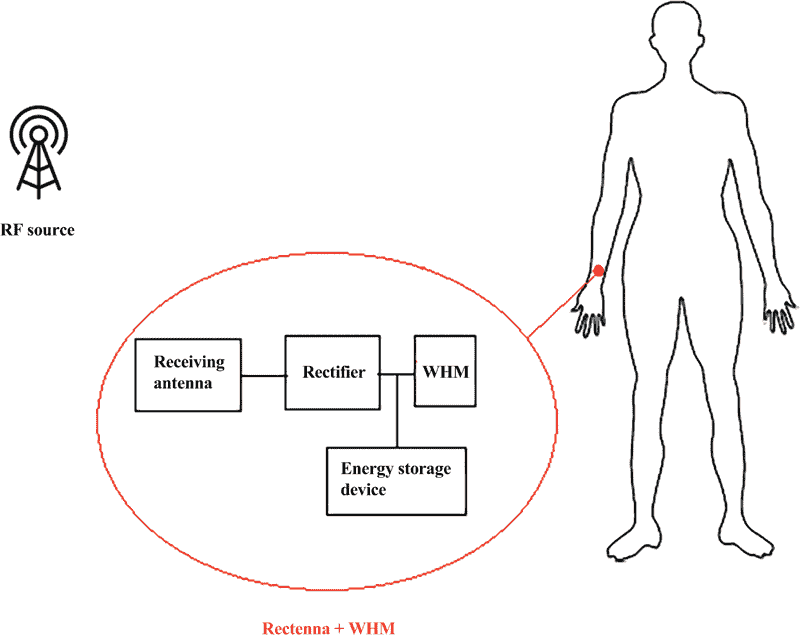

图 11.2 所提的射频能量收集器

## 11.4 rectenna 设计

整流天线是电场（E 场）和磁场（H 场）（EH）系统中的主要组件。它包含一个天线和一个整流电路。天线捕捉环境空气中的电磁波并将其转换为 RF 信号。整流器将该 RF 信号转换为 DC 信号。整流器由高频（HF）滤波器、如肖特基二极管或晶体管等的整流电路、直流滤波器以及存储/负载元件组成（图 11.3）。

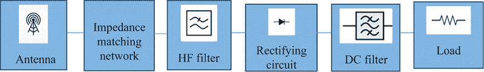

图 11.3 整流天线的结构

### 11.4.1 天线设计

建议的天线如图 11.4 所示，其尺寸为 40 × 40 mm²，工作频率为 3.5 GHz。它位于 FR4 基板上。天线由一个方形配置的辐射元件、一个完整的接地平面以及 50 Ω 的微带馈线组成。贴片尺寸为 26 × 20 mm²。嵌入长度为 5 mm，嵌入间隙为 1.5 mm。馈线的长度和宽度分别为 10 mm 和 3 mm。

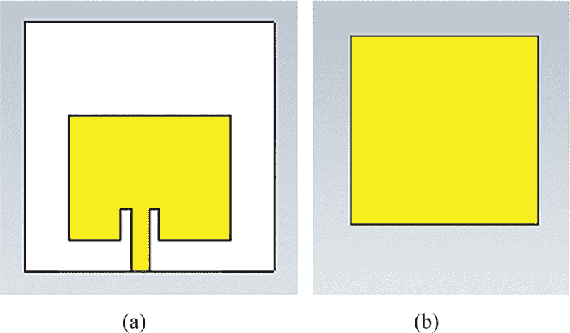

图 11.4 提议天线在 (a) 正视图视角和 (b) 背视图视角下的结构

该天线使用计算机仿真技术（CST）仿真器进行仿真，该器采用有限积分法（Finite Integral Technique）。反射系数 `S11` 如图 11.5 所示，使我们能够可视化该天线在目标谐振频率下的匹配水平和带宽。在 `CST` 中，优化工具（通常称为“Optimizer”）利用数值优化算法调整模型参数，以最小化或最大化预定义的目标函数。`CST` 提供了几种优化方法，每种方法都针对特定类型的问题定制。本例使用的是梯度下降法；它使我们能够选择之前提到的最优尺寸。

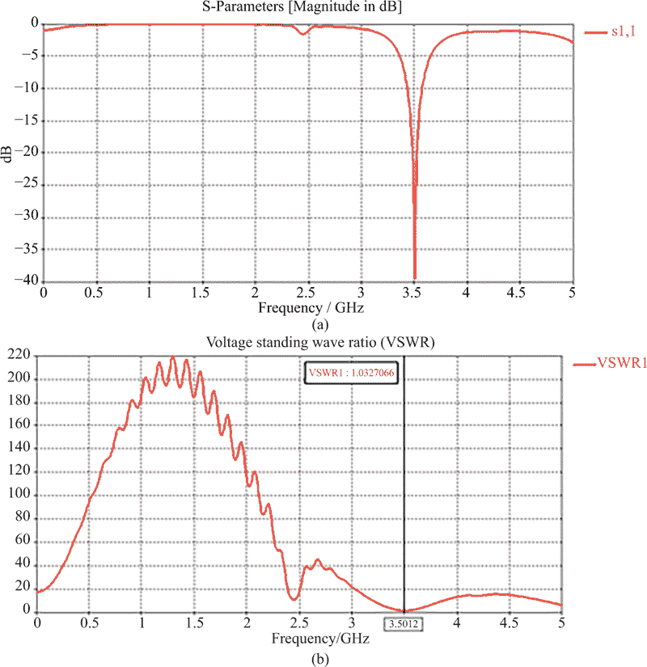

图 11.5 (a) `S11` 系数和 (b) VSWR。

3.5 GHz 处的反射系数等于 −40 dB，如图 11.5 所示，表明匹配良好。VSWR（电压驻波比）量化了天线与传输线（TL）之间的功率传输效率，最优值为低于 1.2，在我们天线的案例中，VSWR 等于 1.03。根据图 11.6，我们观察到使用 `CST` 仿真的天线的 3D 辐射图和极坐标图几乎是全向的。

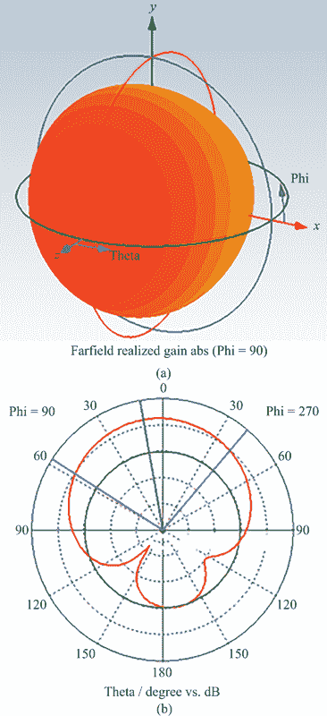

图 11.6 天线的辐射方向图：(a) 3D 表示和 (b) 极坐标表示

### 11.4.2 整流器设计

提出了一种简单的串联整流器，通过微带技术实现，工作频率为 3.5 GHz（图 11.7）。选用的基板由 FR4 基板组成，厚度（`h`）为 1.6 mm，介电特性 `ε` = 4.4，tan`δ` = 0.02。结构包括阻抗匹配网络（IMN）、高频滤波器、肖特基二极管、直流滤波器以及存储/负载组件。能量收集电路的设计和仿真（特别是关于 RF 输入功率和频率的 PCE 和反射系数）使用 Keysight Advanced Design System (`ADS`) 软件完成。

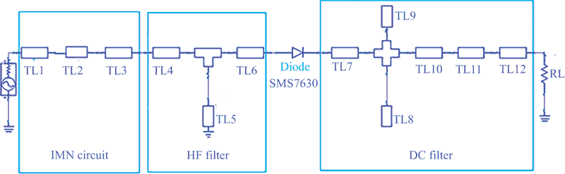

图 11.7 整流器设计

在本节中，我们说明了利用 `ADS` 内的优化功能来实现电路最优阻抗和性能重要性。这一过程涉及进行迭代仿真，采用试错法来满足预定义的性能标准。这些目标包括实现最优阻抗匹配、使直流电压最大化以及提高 PCE。通过迭代优化系统地完善我们的电路设计，我们的目标是获得卓越的性能特性，确保我们的系统以其全部潜力运行。

`ADS` 软件采用迭代优化算法方法来微调 `TL1`、`TL2` 和 `TL3` 的长度，系统地改变它们并评估产生的 DC 输出功率。这一迭代过程不断调整参数，直到它们收敛到产生最佳反射系数的最优组合。通过连续的迭代不断精炼数值，算法有效地遍历参数空间，以识别使系统性能最大化的配置。这种方法确保了整流天线电路实现最优效率和输出功率，增强了其在无线功率采集应用中的整体有效性。

对于整流器设计，`TLs` 的最优尺寸列在表 11.1 中。

### 表 11.1 整流器中的传输线

| TL | 宽度 (mm) | 长度 (mm) |
| :--- | :--- | :--- |
| TL1 | 4.7 | 9.4 |
| TL2 | 4.7 | 8.5 |
| TL3 | 3.0 | 2.4 |
| TL4 | 3.0 | 11.5 |
| TL5 | 3.0 | 5.1 |
| TL6 | 3.0 | 12.0 |
| TL7 | 3.0 | 2.9 |
| TL8 | 3.0 | 17.3 |
| TL9 | 3.0 | 11.5 |
| TL10 | 3.0 | 5.0 |
| TL11 | 3.0 | 3 |
| TL12 | 3.0 | 3 |

整流器性能通过其 PCE 定义评估：

```
PCE = P_DC / P_in
```

其中 `P_DC` 和 `P_in` 分别是直流功率和 RF 功率。

如图 11.8 所示，当 RF 输入为 0 dBm 时 PCE 达到 63.5%，在 −5 dBm 到 8 dBm 之间大于 50%。

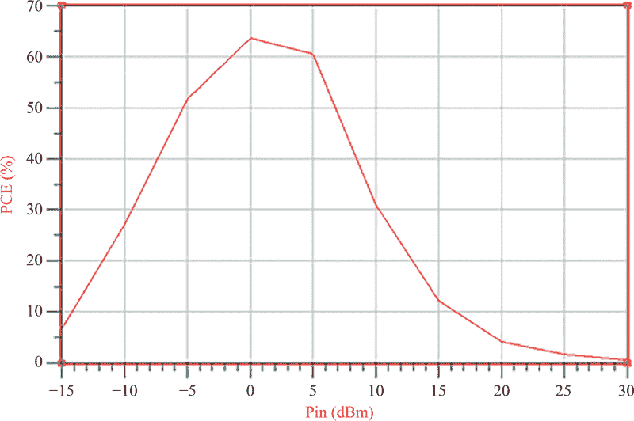

图 11.8 提议系统的效率 vs. 输入功率

#### 11.4.2.1 高频输入滤波器

它作为带通滤波器位于二极管之前，以抑制整流器反射天线的谐波。高频滤波器由一个接地的 `λ/4` 线组成（`TL5`）。

#### 11.4.2.2 直流输出滤波器

它作为低通滤波器，旨在阻止基波和谐波，仅允许直流成分通过。提议的直流滤波器结构如图 11.2 所示，包含了四条微带线（`TL8`、`TL9`、`TL10`、`TL11`）。`TL8` 配置为 `λ/4` 传输线，末端开路。这种设计确保了在基波和奇次谐波处的良好的短路特性。`TL9` 配置为 `λ/8` 线，开路。可以推断 `TL9` 有效地阻止了 2 次、6 次、10 次和 14 次谐波。`TL10` 作为 `λ/16` 线，设计用于阻止 4 次谐波。同时，`TL11` 作为四分之一波线且结构较宽，功能类似于并联电容，有助于平滑电压。

#### 11.4.2.3 肖特基二极管的选择

肖特基二极管在整流器中起着至关重要的作用，在射频转换电路和整体整流器性能中发挥关键作用。因此，仔细选择二极管是必须的。肖特基二极管的相应表示如图 11.9 所示。

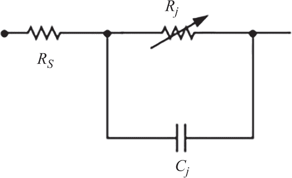

图 11.9 肖特基二极管的等效电路模型

肖特基二极管的特征取决于击穿电压 `Bv`、串联电阻 `Rs`、零偏置结电容 `Cj0` 以及结电阻 `Rj`。考虑到整流器的功率水平，二极管的最大功率容量 `Pc_max` 受击穿电压 `Bv` 和负载 `RL` 的影响。

```
Pc_max = Bv^2 / (4 * RL)
```

超过此功率水平 `Pc_max`，整流器将易发生击穿，导致性能大幅下降。根据图 11.10 中的观察结果，可以推断出对于低功率整流器，低击穿电压高负载的肖特基二极管更为理想。相反，对于高功率整流器，高击穿电压和低负载电阻的肖特基二极管更为合适 [17]。在案例中，选择了 Skyworks 的 SMS-7630 肖特基二极管，其击穿电压为 2V。该二极管与 1,600 Ω 的电阻负载配合，以满足低功率需求。


图 11.10 (a) Bv 和 (b) 负载对整流效率的影响

#### 11.4.2.4 阻抗匹配网络

IMN 由三条传输线（`TL1`、`TL2`、`TL3`）组成，以确保能量从天线到整流系统的优化传输。通过图 11.11 可视化整流器在 3.5 GHz 下的反射系数 `S11`，可以看出电路匹配良好，即 `S11 < −35 dB`。

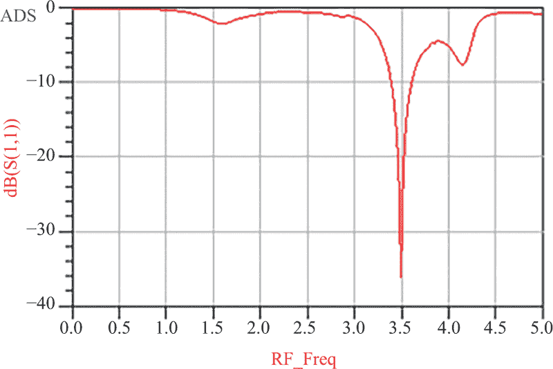

图 11.11 所提整流器的反射系数

### 11.5 整天线性能

本节专门研究整天线在效率和直流电压方面的能力。理解整天线的效率对于评估其将接收到的电磁波转换为可用电能的性能至关重要。整天线的效率是接收天线获取的射频功率与所产生的直流功率之间的比例。

为了评估接收天线处的接收功率，我们采用了 Friis 传输方程。通过在发射和接收场景中使用前述相同的天线配置，并保持 100 mm 的固定间距，实现了一致的对比分析。通过应用如图 11.12 所示的 Friis 方程（该方程考虑了距离和天线特性等因素），我们对系统的功率传输效率有了全面的理解。这种方法确保了标准条件下整天线性能的严谨评估，便于准确评估和有意义的比较。

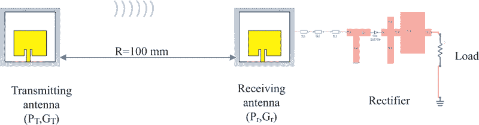

图 11.12 Friis 传输模型

Friis 传输方程写如下：

```
P_r = (P_T * G_T * G_r * λ_0^2) / (4 * π * R)^2
```

其中（`P_T`、`G_T`）分别代表发射功率和发射天线的增益；（`P_r`、`G_r`）代表接收功率和接收天线的增益；`R` 是两个天线之间的距离，`λ_0` 是波长。

`ADS` 仿真结果显示，在 3.5 GHz 下，0 dBm 处的最大 PCE 达到 51.7%（图 11.13），直流电压为 2.4 V，足以为低功率 WM 设备供电。

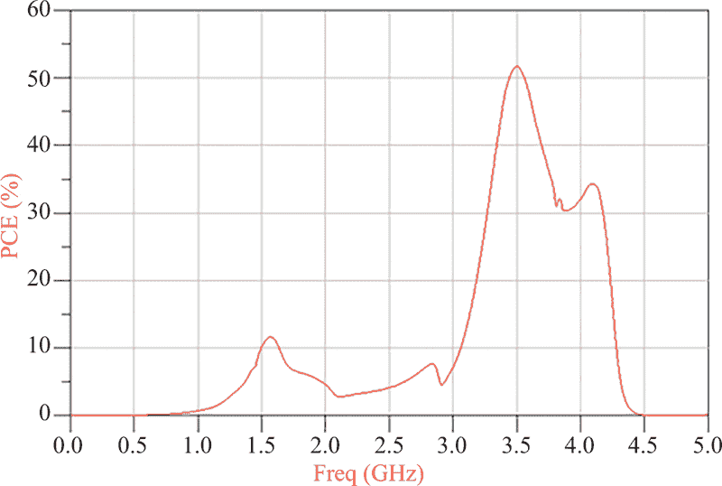

图 11.13 所提整天线的 PCE 与频率的关系

## 11.6 结论

本研究介绍了一种为无需电池的可穿戴健康监测设计的改进型整天线。使用整天线收集能量似乎是为这些无电池设备供电的好方法，长远来看有助于患者。这种新型整天线设计在 3.5 GHz 下表现良好。它包含一个增益为 2.49 dB 且回波损耗（`S11`）等于 −35 dB 的矩形贴片天线。

## 参考文献

（根据指令省略参考文献列表）


[13] Lin, C. H., Chiu, C. W., and Gong, J. Y., “一种用于无线医疗应用的低功率 RF 能量采集的可穿戴整流天”。 *2018 11th International Congress on Image and Signal Processing, BioMedical Engineering and Informatics (CISP-BMEI)* (pp. 1–5). IEEE, 2018.

[14] Bouchoucha, Y., Omri, D., and Aguili, T., “用于物联网医疗设备 RF 能量采集的高效 ISM 频整流天”。 *2023 International Conference on Communications, Computing, Cybersecurity, and Informatics (CCCI)* (pp. 1–8). IEEE, 2023.

[15] Abdi, A., and Aliakbarian, H., “一种用于深体植入设备功率传输的小型 UHF 频整流天”, *IEEE Journal of Translational Engineering in Health and Medicine*, 7, 1–11, 2019.

[16] Wu, P., Chen, Y. D., Zhou, W., Ren, Z. H., and Huang, S. Y., “一种基于自动输入功率分配技术的宽动态范围整流器阵”, *IEEE Microwave and Wireless Components Letters*, 30(4), 437–440, 2020.

[17] Halimi, M. A., Khan, T., Kishk, A. A., and Antar, Y. M., “用于 RF 能量采集和无线功率传输应用的整流电路：基于工作条件的综述”, *IEEE Microwave Magazine*, 24(1), 46–61, 2022.

# 第 12 章

## AI 时代的远程医疗与远程患者监控

Anita Mohanty^(1), Ambarish G. Mohapatra^(1) 和 Subrat Kumar Mohanty^(2)

¹ 印度 Silicon University 电子工程系

² 印度 Templecity Institute of Technology and Engineering IQAC &学术部

### 摘要

在本章中，我们深入审视了人工智能（AI）对远程医疗和远程患者监控领域的影响，这种影响正催生医疗交付格局的革命性变革。通过详尽分析，我们揭示了 AI 技术在这些领域的整合在改善患者预后、增加医疗可及性以及资源有效利用最大化方面的潜力。我们还探索了广泛的 AI 驱动应用，包括智能远程会诊、先进远程健康监控和预测分析。作为变革推动者，这些应用对于提高诊断精确性、制定个性化治疗方案以及提高医疗程序的整体有效性至关重要。本章旨在通过澄清 AI 与医疗健康之间复杂的相互作用，强调技术带到患者护理和福祉前沿的变革性潜力。

**关键词：** 远程医疗；远程患者监控；人工智能；预测分析；虚拟会诊；可穿戴设备；患者参与

## 12.1 引言

近期，在技术进步和人工智能（AI）引入医疗实践的推动下，医疗格局发生了变革性的转变 [1])。远程医疗作为这一演进的基石，实现了医疗服务的远程交付，跨越了地理障碍并有助于及时获取医学知识。利用视频会议和安全消息平台等通信技术，远程医疗不仅增强了患者的便利性，而且在难以提供即时面对面护理的情况下证明了其巨大价值。这种新发现的可及性使患者能够无缝与医疗专家建立联系，减少了面对面预约的必要性并确保了护理的持续交付。图 12.1 展示了未来医学的洞察以及 AI 在提供智能医疗解决方案中的作用。疾病的早期检测、决策制定、连接医疗实践和更好的用户体验等主要方面在图 12.1 中所示。

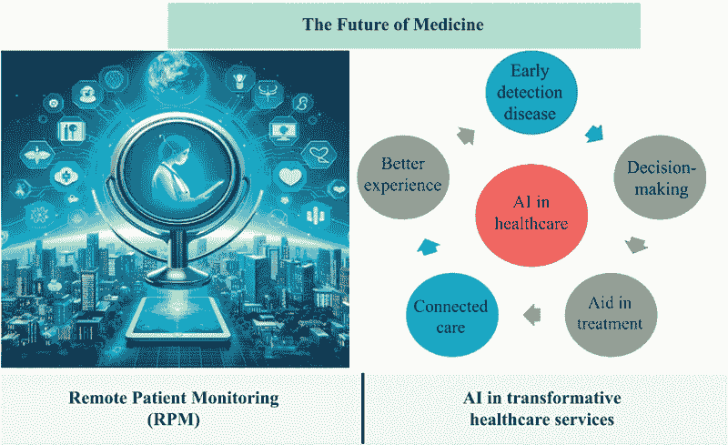

图 12.1 AI 驱动的医疗健康与医学未来

### (a) 远程患者监控：患者健康的实时洞察

远程患者监控（RPM）通过使用可穿戴设备和传感器获取实时健康数据（例如生命征）来补充远程医疗。RPM 实现了早期异常检测、及时干预和个性化治疗，并由 AI 进行高级分析和预测模型进行增强。这种整合促进了整体医疗保健和患者参与 [2]。

### (b) AI 在转型性医疗服务中的协同

远程医疗、RPM 和 AI 的融合彻底改变了医疗交付。AI 算法分析大量的远程监控数据集用于用于早期检测和治疗优化 [3]。AI 驱动的虚拟助手简化了行政任务并增强了患者与服务人员之间的沟通。在提供更好的结果和成本效益的同时，这些技术也带来了数据安全和监管挑战，需要平衡创新与隐私保护。

### 12.1.1 远程医疗与远程患者监控概述

近年来，医疗行业随着远程医疗和 RPM 的发展发生了显著转型。这些技术已成为提供可访问、高效且以患者为中心的医疗服务的至经之路。远程医疗 [4]通过通过电信技术进行远程医疗交付（包括虚拟会诊和安全消息），打破了地理障碍，这在流行病期间或医疗基础设施有限的农村地区至关重要。RPM 通过提供实时健康洞察的连接设备和传感器补充远程医疗，实现了远程监控、早期异常检测和定制化治疗 [5]。这对于管理慢性病、术后恢复和预防性护理特别有价值。此外，AI 通过分析大数据集、预测疾病进展和辅助个性化治疗增强了这些技术。AI 驱动的虚拟助手简化了任务并改进了患者沟通 [6]。尽管在提高效率和以患者为中心的护理方面前景良好，但必须解决数据安全、合监管和公平获取等挑战。

### 12.1.2 数字健康时代日益增长的重要性

数字健康的兴起以远程医疗和 RPM 角色的扩大为标志，它们正在重塑传统的医疗模式，并开启一个以患者为中心、可访问且高效的医疗服务的新时代。远程医疗在通过克服地理障碍、促进虚拟会诊以及通过安全平台确保实时通信来提高医疗可及性方面起着关键作用 [7]。它在远程诊断和治疗中起着关键作用，在公共卫生危机期间特别有价值，同时通过让患者从家中获取医疗建议和随访来增强患者护理。

RPM 通过利用可穿戴设备和传感器持续跟踪生命体征和慢性状况，赋予患者管理健康的能力，提供了实时健康数据洞察 [8]。这种能力支持了早期检测和个性化干预，使医疗保健人员能够优化治疗策略并提供主动的预防性护理措施。

人工智能与数据分析的结合放大了远程医疗和远程监测（RPM）的影响，使 AI 能够分析监控数据以提供预测性洞察和个性化治疗。AI 驱动的虚拟助手进一步增强了患者参与度和运营效率，预示着一个技术先进且以患者为中心的数字医疗环境 [9]。

## 12.2 远程会诊中的 AI

人工智能正在改变远程会诊，通过提高效率、准确性和个性化患者护理来增强医疗交付。AI 在远程会诊中的整合赋予了医疗专业人员并增强了患者体验，了一个更加复杂且易于获取的医疗生态系统。AI 通过分析医疗数据和症状改进诊断和决策支持，减少错误，确保及时干预，并在远程期间提供精确的诊断和治疗建议。AI 驱动的虚拟健康助手提供个性化支持，回答问题、提供药物详情并提供诊后指导。这些助手使用自然语言处理（`NLP`）和机器学习（`ML`）来提高患者参与度和治疗依从性 [10,11]。此外，AI 利用预测分析分析患者数据和生活方式因素，预测健康风险并实现主动的、个性化的预防策略。然而，必须解决数据隐私、伦理和监管合规等挑战。安全的数据处理、解决 AI 偏见以及透明的患者沟通对于平衡创新与伦理责任至关重要。

### 12.2.1 AI 驱动的智能虚拟会诊

AI 融入医疗健康标志着智能虚拟会诊新元的到来，预示着个性化、高效且全球可访问的医疗服务 [12,13]。这种变革性的方法利用先进的 AI 提供不受限制的在线医疗访问，让专家建议触手可及。智能虚拟会诊利用 AI 增强医疗提供者的诊断准确性和决策制定。通过快速分析症状和诊断数据，AI 减少了虚拟期间的错误并增强了治疗效果，从而提高了整体患者护理。

AI 驱动的虚拟健康助手使用`NLP`和`ML`与患者直接互动，提供医疗信息、回答查询并支持根据个人需求定制的诊后护理。这种互动增强了虚拟环境下的患者参与度、治疗依从性和健康结果。将预测分析整合到这些会诊中实现了主动医疗管理，根据患者数据和生活方式因素预测风险并建议预防措施。

然而，解决患者隐私保护、最小化 AI 偏见和确保透明通信等伦理挑战至关重要。平衡创新与伦理考虑，确保了这些进步在增强医疗可及性的同时培养了患者的信任。AI 驱动的发展预示了一个个性化、高效且以患者为中心的医疗未来，跨越地理障碍，获得专家医疗指导。

### 12.2.2 用于增强通信的自然语言处理

在不断演变的技术领域，`NLP`已成为一种革命性的工具，改变了我们与信息通信和互动的方式。`NLP`作为 AI 的一个分支，侧重于使机器理解、解释和生成类人语言 [14]。它的应用涵盖多个领域，深刻地增强了人机之间的通信。

`NLP`通过使计算机理解并响应自然语言，实现了无缝的人机交互。语音识别和语言理解的进步带来了智能虚拟助手、聊天机器人和语音激活系统，通过直观的通信方法使技术更易于获取。此外，`NLP`通过打破通信障碍并理解多样的语言表达、口音和语音模式，提高了可及性和包容性。在医疗、教育和客户服务等领域，`NLP`驱动的应用创建了以用户为中心的工具，满足不同语言能力和障碍的需求。通过掌握语境、情感和用户意图，`NLP`增强了推荐系统、定向广告和内容定制的个性化。尽管取得了巨大进步，`NLP`仍面临偏见、隐私问题和上下文细微差别等挑战，需要负责任的发展以实现一个拥有精炼语言模型和先进对话代理的未来。

### 12.2.3 成功的 AI 驱动远程医疗平台案例研究

#### 1. Babylon Health：AI 增强的症状检查器和虚拟会诊

**概述**：Babylon Health 是一家位于英国的远程医疗平台，将 AI 整合到其服务中提供复杂的症状检查和虚拟会诊。AI 驱动的症状检查器利用`NLP`理解用户对症状的输入。它提供个性化的健康评估，建议适当的行动，并引导用户获取相关资源。此外，Babylon Health 提供与医疗专业人员的虚拟会诊，AI 通过分析患者数据、病史和相关文献来协助医生做出决策 [15]。

**成功因素**：

* **增强的分诊**：Babylon AI 驱动的症状检查器帮助用户确定健康问题的紧急性，促进了高效的分诊并减少了不必要的急诊室访问。

* **高效的会诊**：AI 在虚拟会诊中的整合有助于医疗提供者快速获取相关的患者信息，导致更专注和高效的互动。

* **改善医疗可及性**：通过提供 24/7 的 AI 驱动症状检查和虚拟会诊，Babylon Health 增强了医疗获取能力，特别是对于偏远或服务不足地区的用户。

#### 2. Ada Health：AI 驱动的健康评估与导航

**概述**：Ada Health 是一家位于柏林的远程医疗平台，利用 AI 为用户提供个性化的健康评估和导航。该平台的 AI 驱动聊天机器人与用户互动，询问有关其症状、病史和生活方式的详细问题。AI 分析这些信息以生成全面的健康评估，并对潜在状况、预防措施和适当的后续提供指导 [16]。Ada Health 对用户教育和赋能的强调使其成为用于知决策的 AI 驱动平台。

**成功因素**：

* **用户赋能**：Ada Health AI 驱动的聊天机器人通过提供健康的详细见解赋能用户，培养了自主感和知情决策。

* **预防性健康指导**：AI 系统不仅协助识别现有的健康问题，还为预防措施和生活方式改变提供个性化建议。

* **与医疗提供者的无缝整合**：Ada Health 平台促进了用户与医疗提供者之间的无缝通信，简化了共享健康评估的过程并在必要时促进虚拟会诊。

#### 3. TytoCare：AI 集成远程检查工具

**概述**

`TytoCare` 是一个结合硬件与 AI 的远程医疗平台，旨在实现远程检查。该平台为用户提供了一个配备多种传感器的手持检查设备，使其能够采集生命体征以及喉部、耳朵、皮肤和肺音图像。收集的数据随后由 AI 算法进行分析，以协助医疗提供人员远程诊断和治疗各种疾病 [17]。TytoCare 的 AI 集成提高了远程检查的精确性和可靠性。

**成功因素**

* **全面的远程检查**：TytoCare 的 AI 驱动检查设备使用户能够进行彻底远程检查，有助于提供更全面的虚拟医疗体验。

* **增强诊断功能**：AI 的集成辅助医疗提供人员判读检查数据，从而做出更准确的诊断和更科学的治疗决策。

* **减少面诊需求**：TytoCare 平台减少了面对面诊的必要性，特别是对于常规检查，允许了及时干预并提高了医疗保健的可及性。

## 12.3 远程健康监控的预测性分析

远程健康监控整合了预测性分析，通过主动、个性化的护理彻底改变了医疗保健。`Philips eCareCoordinator` 和 `Current Health` 等平台利用可穿戴设备和健康记录的分析来检测趋势和恶化的早期信号，从而实现及时干预。这些模型增强了个性化护理并优化了资源配置，改善了慢性病管理、预防住院和心理健康支持的结果 [18]。

### 12.3.1 AI 在预测健康结果中的应用

AI 已成为医疗各个领域预测健康结果的强大工具 [19]。一些著名的应用包括：

1. **疾病诊断与预后**：AI 算法可以分析包括症状、病史和测试结果在内的医疗数据，准确诊断疾病并预测其进展。例如，AI 系统可以辅助诊断癌症、心血管疾病和神经系统疾病等状况，实现早期干预和更好的管理。

2. **个性化治疗计划**：通过分析患者数据（如遗传信息、生活方式因素和治疗史），AI 可以为个体患者推荐定制的个性化治疗计划。这种方法增强了治疗疗效，减少了副作用，并改善了患者预后。

3. **风险分层与预防**：AI 模型可以根据人口统计学数据、生活方式因素和病史评估个人发生某些健康状况的风险。通过识别高风险个体，医疗提供人员可以实施针对性的预防措施和干预，以降低疾病发生的风险。

4. **远程患者监控**：支持 AI 的远程监控设备可以实时收集并分析患者数据，如生命体征、活动水平和药物依从性。这允许医疗提供人员远程监控患者的健康状况，检测恶化的预警信号，并及时干预以防止不良结果。

5. **药物发现与开发**：AI 算法可以分析海量生物数据以识别潜在药物靶点、预测药效并优化药物设计。这加速了药物的发现和开发过程，为各种疾病开发新型疗法。

6. **医疗运营中的预测性分析**：AI 驱动的预测性分析通过预测患者入院、资源利用和人员需求来优化医疗运营。通过预测需求和优化工作流，医疗机构可以提高效率、缩短等待时间并增强患者满意度。

7. **医疗运营中的预测性分析**：AI 驱动的预测性分析通过预测患者入院、资源利用和人员需求来优化医疗运营。通过预测需求和优化工作流，医疗机构可以提高效率、缩短等待时间并增强患者满意度。

图 12.2 描述了 AI 在远程监控中的多种应用。在`AI 在预测健康结果中的应用`中，它整合了疾病诊断、个性化治疗计划、风险分层、远程监控、药物发现和医疗运营。虽然 AI 为医疗保健带来了巨大的收益，但持续的研究、验证和整合对于最大化其潜力和改善患者预后至关重要。

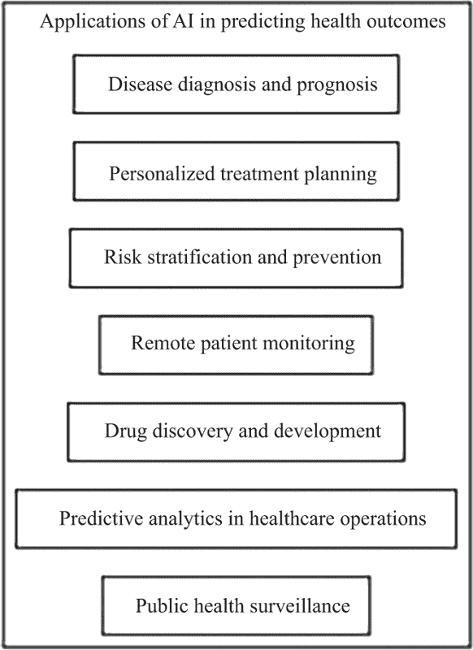

### 12.3.2 通过预测建模监控慢性状况

通过预测建模监控慢性状况涉及利用数据和算法预测疾病的进展、恶化和相关结果 [20]。图 12.3 显示了预测建模工作的不同步骤。其典型工作原理如下：

1. **数据收集**：相关数据源包括电子健康记录 (`EHRs`)、医学影像、实验室结果、患者报告的结局、可穿戴设备和环境因素。这些数据点提供了患者健康状况和风险因素的全面视图。

2. **特征选择**：应用数据预处理技术对数据进行清洗和预处理。然后使用特征选择方法识别对预测结果贡献最大的变量或特征。这些特征可能包括人口统计信息、病史、生物标志物和生活方式因素。

3. **模型开发**：使用历史数据训练预测模型（如 `ML algorithms`），以学习所选特征与健康结果之间的模式和关系。常用算法包括`逻辑回归`、`随机森林`、`支持向量机`和`神经网络`。算法的选择取决于数据的特定特征和预测任务。

4. **模型验证**：使用交叉验证、留出验证或自助自助法（`bootstrapping`）等验证技术评估预测模型的性能。这确保了模型能够良好地泛化到新的未知数据，且不会对训练数据产生过拟合或欠拟合。

5. **预测与监控**：预测模型经过验证后，即可部署以预测个体患者的未来健康结果。可以及早识别疾病进展或不良事件风险较高的患者，允许医疗提供人员主动进行个性化干预，如调整药物、改变生活方式或护理管理计划。

6. **反馈闭环**：持续监控和评估预测模型的性能对于确保其随时间推移的准确性和相关性至关重要。来自医疗提供人员和患者的反馈可用于完善模型并提高其预测能力。

### 7. 临床决策支持：预测模型的结果可以集成到临床工作流中，为医疗保健人员提供决策支持。可以生成警报和通知以标记高风险患者，提示及时的干预和预防措施。

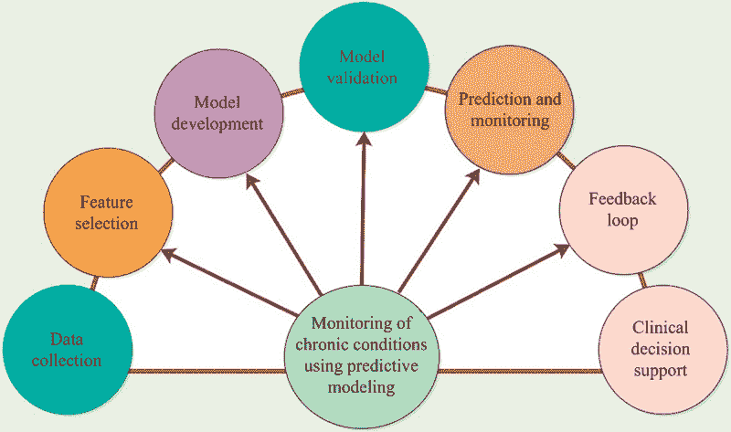

图 12.3 预测模型监测慢性病遵循的不同步骤

### 12.3.3 用于早期干预的实时数据分析

实时数据分析对于慢性病的早期干预至关重要，它利用先进的预测模型技术持续监测患者数据。这种方法允许医疗保健人员迅速检测偏离基准健康参数的情况，可能表明病情正在恶化 [21]。对生命体征、症状和健康参数的持续监测提供了患者健康的视图，能够及时发现异常。预测模型识别实时数据中指示潜在健康并发症的模式，从而提示及时的干预。基于个体患者特征的自定义警报会在超过特定阈值时通知提供者，促进主动护理。`ML` 算法预测未来的健康结果，识别高风险患者以防止不良事件。与远程监测设备的集成实现了实时数据的采集和分析，支持无论位于何地进行持续监测。来自实时分析的可操作见解指导临床决策，例如药物调整、生活方式改变或专家转诊，最终改善患者结果、减少住院次数并提高慢性病患者的生活质量。

## 12.4 可穿戴设备与 AI


可穿戴设备与 AI 的集成通过持续、实时的健康数据增强个性化护理，正在改变远程医疗和 RPM。智能手表等可穿戴设备跟踪生命体征、活动和睡眠模式，将这些数据发送给 `AI` 算法进行健康状态分析 [22]。`AI` 检测指标的细微变化，能够及早识别心律不齐或睡眠中断等健康问题，提示及时的干预。通过分析可穿戴数据，`AI` 提供个性化的健康建议，根据个人健康状况建议生活方式改变、药物调整或转诊。`AI` 驱动的远程医疗平台促进远程诊断和咨询，协助诊断疾病、解释医学影像并建议治疗方案。对于慢性病管理，可穿戴设备和 `AI` 监测糖尿病和高血压等状况，分析数据趋势、预测并发症并优化治疗计划。这些技术还通过个性化反馈、提醒和激励增强了患者的参与度和依从性，提高了对护理的投入。此外，`AI` 驱动的远程医疗扩大了医疗服务的范围，特别是在偏远地区，减少了对面诊的依赖并提高了医疗公平。

## 12.4.1 AI 算法在可穿戴健康技术中的集成

`AI` 算法在可穿戴健康技术中的集成彻底改变了 RPM 和医疗交付。配备 AI 的穿戴设备实时分析心率和活动水平等生理数据，及早检测异常并提供及时健康见解 [23]。这些算法根据用户数据提供个性化建议，考虑了年龄、病史和生活方式等因素。通过分析可穿戴数据的趋势，`AI` 在风险出现前预测健康结果并识别风险。配备 AI 的穿戴设备充当虚拟健康教练，就保持活跃、改善睡眠和遵循医嘱提供个性化指导。它们实现了慢性病的远程监测，向医疗保健人员警报变化并在无需面诊的情况下促进及时干预。`AI` 从用户数据中学习以随时间提高准确性，精炼预测和建议，同时通过加密和匿名化确保数据安全。

## 12.4.2 生命体征和健康指标的远程监测

生命体征和健康指标的远程监测对于管理慢性病和实现及时干预至关重要 [24]。可穿戴传感器等设备持续收集心率、血压、血糖、血氧饱和度和活动水平等生命体征。这些数据通过无线传输到安全的云平台或医疗系统，允许医疗保健人员远程访问。专门软件和 `AI` 算法分析患者数据，检测趋势或异常，并向提供人员警报潜在健康问题。这实现了及时响应，例如药物调整或远程咨询。患者通过访问健康数据、跟踪进度并与提供者做出明智决策来参与。研究表明，远程监测改善了健康结果、减少了住院并优化了慢性病管理，通过减少门诊和住院次数证明了其成本效益。

## 12.4.3 AI 在解释和语境化可穿戴数据中的作用

`AI` 在解释和语境化可穿戴数据中的作用对于提取有意义的见解和促进个性化医疗干预至关重要 [25]。表 12.1 显示了 AI 如何增强这一过程：

表 12.1 AI 在解释和语境化可穿戴数据中的作用

| 步骤 | 角色 | 说明 |
| --- | --- | --- |
| 1 | 数据分析 | `AI` 算法分析来自穿戴设备的数据——生命体征、活动、睡眠——以检测指示健康状况变化的模式和异常。 |
| 2 | 模式识别 | `AI` 算法擅长识别可穿戴数据的模式，区分正常的生理变化与异常趋势（例如指示心脏问题的心律不齐）。 |
| 3 | 语境理解 | `AI` 算法通过结合佩戴者的人口特征、病史、环境和生活方式对可穿戴数据进行语境化。这增强了个性化的健康见解和准确性。 |
| 4 | 预测分析 | `AI` 驱动的穿戴设备使用预测分析来预测健康结果，例如根据睡眠模式、活动水平和环境因素预测偏头痛。 |
| 5 | 个性化建议 | `AI` 算法分析可穿戴数据以提供个性化建议，如根据佩戴者的健康需求和目标定制的生活方式改变、药物调整或行为干预。 |
| 6 | 持续学习 | `AI` 算法通过从新数据中持续学习不断演进，精炼解释和预测。这种迭代过程增强了对健康模式的理解并提高了结果预报的准确性。 |
| 7 | 临床决策支持 | `AI` 驱动的可穿戴数据分析协助医疗保健中的临床决策，指导诊断、治疗和慢性病管理，实现个性化和主动的护理交付。 |
| 8 | 数据集成 | `AI` 将可穿戴数据与 `EHRs`、遗传数据和患者报告的结果合并，形成全面的健康视图，增强医疗保健人员的明智决策。 |

## 12.5 提高诊断准确性

AI 通过先进算法和数据分析改变了各个医疗领域的诊断准确性。它能够快速解释 X 光和 MRI 扫描等医学图像，辅助精确诊断。通过检测患者数据中的细微模式，AI 能够识别疾病的早期迹象并预测进展，从而提示及时干预。AI 驱动的临床决策支持提供了根据患者数据定制的循证建议，为医疗提供者赋能。它根据风险对患者进行分层，以进行针对性的筛查和预防 [26]。AI 还根据个人特征定制基因分析和治疗，增强了精度。NLP 从临床数据中提取见解，而可穿戴数据实现了远程监控。AI 整合数据集，推动了全面诊断并改善了患者预后。

### 12.5.1 远程医疗中的 AI 辅助诊断

远程医疗中的 AI 辅助诊断正在利用先进算法和数据分析来提高诊断的准确性和效率 [27]。AI 算法远程分析患者数据，包括病史、症状和诊断测试，在无需面对面咨询的情况下提供见解。它们根据严重程度对病例进行优先级排序，确保紧急病例获得及时关注，并优化资源配置。AI 帮助生成全面的鉴别诊断，即使在复杂病例中也能提高准确性，并根据患者数据和循证指南建议个性化治疗方案。从新数据输入中持续学习可以精炼 AI 的诊断能力，使其与不断演变的医学知识保持同步。这种方法通过将患者与远程诊断支持连接起来，扩大了专业医疗服务的范围，特别是在医疗匮乏或偏远地区。

### 12.5.2 用于准确远程诊断的图像和信号处理

图像和信号处理在远程诊断中起着关键作用，特别是在远程医疗 [28]。图像处理技术提高了远程传输过程中医学图像的质量，采用降噪和对比增强等方法进行精确解释。算法从图像中提取关键特征，帮助医疗提供者关注病变或解剖结构等关键区域，提高评估准确性。模式识别算法通过分析像素强度和空间关系检测细微异常，其诊断精度超过了人类能力。信号处理技术过滤掉心电图（ECG）和脑电图（EEG）等生理信号中的噪声，确保在信号质量可能下降的远程环境中保持清晰度。实时监控能力允许及时识别异常，支持及时干预和更好的患者预后。这些技术与 AI 算法无缝集成，实现了诊断任务自动化并增强了决策制定，进一步增强了远程医疗场景下的准确性。

### 12.5.3 通过机器学习算法减少诊断错误

ML 算法在医疗保健中起着关键作用，可以减少诊断错误 [29]。它们分析海量的患者数据——病史、症状、测试结果和影像资料——以识别指示疾病的模式。ML 在复杂模式识别方面表现出色，能够检测人类遗漏的细微疾病指标。它能预测患者患疾病或不良结果的风险，指导预防性干预。ML 驱动的临床决策支持系统提供循证建议，整合患者数据和指南以实现准确诊断。通过从新数据中持续学习，ML 算法随时间推移提高了诊断准确性，改进了错误预防。这种进步通过为临床医生提供强大的工具来做出明智且精确的诊断决策，增强了医疗服务的交付。

## 12.6 个性化治疗计划

个性化治疗计划是个体化的医疗策略，满足每个患者的特定需求、偏好和特征 [30]。它们始于彻底的患者评估，考虑病史、健康状况、遗传因素、生活方式和个人偏好。医疗提供者根据风险对患者进行分层，以做出符合循证指南的治疗决策。从药物选择到生活方式改变，治疗根据个人特征选择。持续监控允许调整治疗计划以获得最佳结果，强调患者的参与和教育。协作方法涉及一个医疗专业人员团队，以全面解决健康需求。

### 12.6.1 基于 AI 驱动见解定制治疗策略

使用 AI 为个人定制医疗干预涉及采用先进的算法和分析 [31]。表 12.2 详细说明了用于患者监测的 AI 驱动治疗策略。

表 12.2 基于 AI 驱动见解的患者监测某些治疗策略

| 序号 | 治疗策略 | 解释 |
| --- | --- | --- |
| 1 | 数据分析 | AI 算法处理海量患者数据——医疗记录、遗传信息、诊断测试和治疗结果——以识别对治疗反应至关重要的模式和预测因子。 |
| 2 | 预测分析 | AI 预测治疗结果并识别可能对干预产生良好反应的患者，定制策略以实现最大疗效和最小副作用。 |
| 3 | 精准医学 | AI 通过准确定位与治疗反应相关的生物标志物和基因变异实现了精准医学，能够根据个人分子特征实现定制疗法。 |
| 4 | 个性化风险分层 | AI 根据治疗并发症风险对患者分类，使医疗提供者能够进行针对性的风险缓解并对高风险个体进行更密切的监控。 |
| 5 | 治疗优化 | AI 根据患者数据进化治疗策略，通过分析反应并随时间适应个人需求来精炼计划并优化结果。 |
| 6 | 临床决策支持 | AI 驱动的临床决策支持系统根据患者数据和医学文献提供循证的治疗建议，帮助医疗提供者做出明智的治疗决策、剂量调整和监测。 |
| 7 | 与电子健康记录 (EHRs) 集成 | AI 与 EHR 系统无缝集成，通过根据患者数据和临床史提供个性化治疗建议，提供实时见解并支持临床决策。 |

### 12.6.2 远程患者护理中的精准医学

远程患者护理中的精准医疗 [32] 无论患者位于何处，都能根据其独特的遗传组成、生活方式、环境和健康史提供个性化的医疗保健干预。基因分谱分析可以识别影响治疗反应和预后的与疾病相关的变异。整合遗传、医疗、可穿戴设备和患者报告的数据可以提供全面的健康洞察，并指导个性化治疗策略。AI 驱动的风险评估根据疾病易感性对个人进行分类，优化了资源配置和干预优先级。定制化的治疗方案结合了患者特定的数据，推荐针对性疗法、生活方式调整和预防措施。通过可穿戴设备进行远程监控可以实时追踪体征和药物依从性，促进主动护理。AI 驱动的临床决策支持系统通过提供基于证据的建议，提高了诊断准确性和治疗效果。通过远程平台进行患者参与使患者能够积极参与护理，提供教育、自我管理工具和支持小组，以促进对个性化治疗的依从性。

### 12.6.3 为了获得更好结果的患者特定建议

患者特定建议是个性化的医疗保健策略，旨在满足个体患者独特的需求、偏好和特征 [33]，旨在全面优化健康结果。这些建议包括制定考虑到患者病史、遗传图谱、生活方式选择和个人偏好的定制化治疗方案，从而在最大化治疗效果的同时最大限度地减少潜在的副作用。通过定制干预以解决特定的患者需求和根本原因，医疗保健提供者可以显著改善治疗结果并促进长期健康和福祉。此外，患者特定建议侧重于通过个体风险因素（如遗传倾向、生活习惯和共存疾病）来降低并发症风险。它们还包括定制的患者教育和指导，以增强对病情和治疗方案的理解，使患者能够积极参与护理。定期监测和随访是不可或缺的一部分，确保对进展进行持续评估、根据需要调整治疗策略并早期干预以预防并发症。此外，这些建议整合了可穿戴设备和移动健康应用等技术进行远程监控，促进了患者参与、治疗方案依从性，并通过先进的集成医疗保健解决方案提高了结果。

## 12.7 挑战与考虑

实施患者特定建议涉及解决关键挑战和考虑 [34] 以确保有效性。数据隐私和安全是至关重要的，需要强健的措施来保护敏感健康数据，并遵守美国的 `HIPAA`（健康保险流通性与责任法案）或欧洲的 `GDPR`（通用数据保护条例）等法规。确保 `EHRs`、可穿戴设备和患者报告结果之间的数据质量和互操作性对于获得准确洞察至关重要。伦理问题包括获取知情同意、尊重患者自主权以及避免决策过程中的偏见。解决健康差异和促进公平的医疗机会至关重要，需要努力缓解可能加剧不平等的算法偏见。提高健康素养和患者参与对于理解和遵循个性化治疗方案至关重要。医疗保健提供者需要充分的培训和支持，以便在成本和资源限制下将这些建议无缝集成到临床工作流中。持续的评估和改进是必要的，以评估对结果、护理质量和成本的影响，确保个性化医疗保健干预的可持续交付。

### 12.7.1 AI 驱动的远程医疗中的伦理考虑

伦理考虑在 AI 驱动的远程医疗中至关重要，以维护患者的安全、隐私和自主权 [35]。关键问题包括确保知情同意，即患者必须充分了解 AI 算法的使用，并同意将其数据用于分析和治疗建议。透明度和问责制至关重要；医疗保健提供者需要公开讨论 AI 算法及其功能、局限性和偏见，对基于 AI 生成的洞察所做的决策负责。解决偏见并促进公平对于防止由于带偏见的 AI 算法导致的护理差异至关重要。保护患者隐私和数据安全是重中之重，需要采取强有力措施防止未经授权访问。确保公平性和获取性涉及克服社会经济差异和技术素养等障碍。在结合人类判断解释 AI 生成的建议时，临床监督至关重要。对 AI 算法进行持续评估和改进是必要的，以维持效力、准确性和安全标准。维护患者自主意味着让患者参与涉及 AI 建议的决策过程，尊重他们选择护理路径的权利。

### 12.7.2 解决隐私和安全担忧

在 AI 驱动的远程医疗中解决隐私和安全担忧对于维持患者机密性和信任至关重要 [36]。强健的措施如传输期间的数据加密、严格的访问控制以及在 AI 分析之前对患者数据进行匿名化或去标识化是关键步骤。尽量减少数据收集到必要的元素、将数据安全地存储在加密数据库中，并进行定期审计和监控以及时检测和缓解漏洞。获取患者同意并确保数据使用的透明度对于建立信任至关重要。遵守 `HIPAA` 和 `GDPR` 等法规是不可逾越的，需要持续的更新和遵循。对隐私和安全实践进行全面的员工培训对于培养意识和问责文化至关重要。这些努力共同确保了患者数据的机密和安全，增强了对 AI 驱动的远程医疗系统的信心。

### 12.7.3 在远程医疗中平衡技术与人文关怀

在远程医疗中，实现技术与人文互动之间的平衡，对于提供全面且以患者为中心的护理至关重要 [37]。通过远程医疗进行的个性化医患沟通应利用技术，同时强调共情、积极倾听和人际技巧，以有效应对情感和心理需求。将技术驱动的评估与人类洞察相结合，可以确保考虑到社会因素和偏好的彻底患者评估，从而形成全面的治疗方案。在通过技术为患者提供教育资源、自我管理工具和远程监测能力的同时，医疗提供者必须提供个性化指导，以增强患者决策和参与护理的能力。人类临床判断在解释 `AI` 建议并将其与个体患者需求对齐方面仍然至关重要，有助于培养批判性思维和伦理实践。文化敏感性至关重要，在远程咨询期间调整沟通方法以尊重不同的背景。通过虚拟咨询维持持久的医患关系，确保护理的连续性，在提供持续支持、随访和协作护理的同时，维护伦理标准、患者隐私、自主权和保密性。

## 12.8 未来趋势与创新

远程医疗的未来趋势和创新将彻底改变医疗服务的交付，提高可及性、效率和患者预后。`AI` 和 `ML` 的进步将驱动更准确的诊断、个性化的治疗建议和预测分析。`AI` 驱动的虚拟助手和机器人将增强患者参与度，并支持医疗提供者进行临床决策，开启精准和效率的新时代。

远程监测和 `RPM` 将利用可穿戴设备和 `IoT` 传感器实时监测生命体征和对治疗计划的依从情况。这种主动方法能够早期发现健康问题，减少医院再次入院率并提高患者整体健康水平。虚拟现实 (`VR`) 和增强现实 (`AR`) 技术将改变医学教育、培训和患者互动，通过沉浸式模拟和将医疗信息叠加到真实世界环境中来增强远程咨询。

`Blockchain` 技术将增强数据安全和透明度，在确保医疗记录安全共享的同时保护患者隐私。集成的远程医疗平台和生态系统将简化医疗提供者与患者之间的通信和数据交换，支持广泛的远程医疗服务。`Genomics` 和精准医学将进一步个性化治疗策略，而对健康社会决定因素 (`SDOH`) 的认识将推动解决全球医疗差异和提高医疗公平性的努力。

监管改革和政策变化将为远程医疗服务的扩展提供支持，促进标准和指南的制定，以确保质量、安全和公平获取。拥抱这些创新有望改变医疗交付，在数字时代满足全球患者的多样化需求。

### 12.8.1 塑造远程医疗未来的新兴技术

新兴技术正在塑造远程医疗的未来，彻底改变医疗服务的交付并改善患者获取医疗服务的机会 [38]。表 12.3 显示了驱动这一转型的一些关键技术：

表 12.3 塑造远程医疗未来的新兴技术

| 序号 | 新兴技术 | 对远程医疗的贡献 |
| --- | --- | --- |
| 1 | 人工智能 (`AI`) 和机器学习 | 远程医疗中的 `AI` 驱动算法分析患者数据以进行精确诊断、个性化治疗计划和预测分析。`ML` 支持虚拟助手、机器人和临床决策工具，增强医疗水平和结果。 |
| 2 | 远程患者监测 (`RPM`) | `RPM` 技术（如可穿戴设备、`IoT` 传感器和移动健康应用）监测生命体征和症状，增强远程患者管理并实现健康问题的早期检测，从而改善结果。 |
| 3 | 远程咨询平台 | 集成的远程咨询平台和远程医疗应用实现了诊断、治疗和随访护理的虚拟咨询，确保患者与提供者之间安全的通信与协作。 |
| 4 | 远程医疗支持的诊断 | 远程医疗支持的诊断工具（如数字听诊器和高分辨率摄像头）允许远程检查，通过医疗状况的实时可视化辅助准确诊断和治疗计划。 |
| 5 | 虚拟现实 (`VR`) 和增强现实 (`AR`) | `VR` 和 `AR` 技术正在改变远程医疗中的医学教育、培训和患者参与。`VR` 提供沉浸式学习体验，而 `AR` 在虚拟咨询期间叠加医疗信息以增强视觉效果。 |
| 6 | 区块链技术 | `Blockchain` 技术通过患者记录和交易的去中心化，提高了远程医疗的安全性、互操作性和透明度，确保数据隐私、完整性以及利益相关者之间的安全共享。 |
| 7 | 5G 连接 | `5G` 技术支持高速、低延迟的通信网络，通过远程地区的实时视频会议、远程监测和数据密集型应用提升了远程医疗的质量。 |
| 8 | 基因组学和精准医学 | `Genomics` 和精准医学的进步使得根据遗传组成、生活方式和环境因素定制个性化治疗成为可能，并整合到远程医疗平台中以优化远程患者护理。 |

### 12.8.2 AI 进展及其对远程患者监测的潜在影响

`AI` 的进步将通过显著提高 `RPM` [39] 的准确性、有效性而彻底变革。通过预测分析，`AI` 算法可以分析从可穿戴传感器和移动应用中收集的海量数据集，识别健康状况恶化的模式和早期指标。这种能力使医疗提供者能够进行预防性干预，可能在不良结果恶化之前避免它们。此外，`AI` 可以根据风险概况对患者进行分层，利用生命体征和病史等数据确定患有某些疾病或发生并发症风险较高的个体。这允许进行针对性的干预和个性化的预防措施，优化远程环境下的患者护理。


此外，`AI` 驱动的决策支持系统会根据临床指南和个体患者数据生成个性化的警报和建议。这些警报促成了及时干预和治疗计划调整，增强了远程管理患者健康的响应能力和效率。`AI` 从新数据输入和患者结果中持续学习的能力确保了诊断准确性和预测能力的不断改进。通过与 `EHRs` 集成，`AI` 驱动的 `RPM` 系统提供全面的患者数据，支持医疗提供者的整体评估和知情决策。最终，`AI` 在优化资源配置、简化工作流以及提供主动的、数据驱动护理方面具有巨大前景，这种护理可以改善 `RPM` 项目的患者结果并降低成本。

### 12.8.3 数字医疗中进一步整合与协作的机遇

1. **互操作性标准**：标准化医疗保健系统、设备和数据交换，可确保全面患者护理和医疗提供者之间的协作实现无缝集成。

2. **整合健康平台**：整合来自 `EHRs`、远程医疗、远程监控和患者应用程序的数据，以支持整体性的护理协调，并增强跨护理场景的环境的协作。

3. **远程医疗网络**：连接医疗提供者、专家和患者，促进协作式护理交付、虚拟会诊以及对专业服务的获取。

4. **数据共享与分析**：利用先进分析技术和共享数据，促进从临床和运营数据中获取洞察，驱动患者护理的持续改进。

5. **数字健康生态系统**：汇聚利益相关者，促进创新、知识共享以及应对医疗挑战的协作解决方案。

6. **跨学科护理团队**：由医疗专业人员组成的协作团队利用数字工具提供跨学科的以患者为中心的护理。

7. **公私合作伙伴关系**：跨部门协作加强了资源共享、技术采用和政策制定，以提高医疗服务的普及性和质量。

8. **患者参与**：通过健康信息、工具和决策支持赋能患者，促进其积极参与并改善健康结果。

这些机会凸显了数字医疗在转型护理交付、增强协作以及驱动医疗服务普及和质量改进方面的潜力。

`图 12.4` 插明了数字医疗集成与协作的关键机会，侧重于增强患者护理、简化工作流和改进结果。这些包括建立互操作性标准和促进患者参与，以优化医疗服务的交付并构建一个凝聚的生态系统。

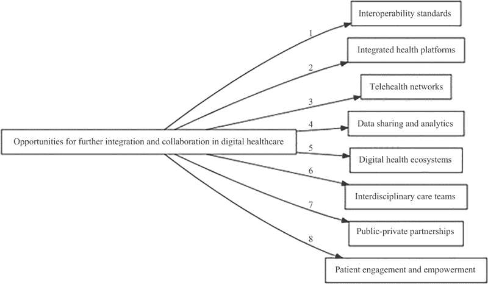

图 12.4 数字医疗领域进一步集成与协作的关键机会

## 12.9 结论

`AI` 与远程医疗及 `RPM` 的整合正在彻底改变医疗服务的交付模式。`AI` 通过分析患者数据以获取预测性洞察和个性化建议，增强了远程监控，扩展了医疗服务的获取范围并改善了结果。这种协同效应有望重塑医疗保健，通过高效、准确和个性化的健康干预，驱动创新并推进以患者为中心的护理。

### 12.9.1 总结 AI 在远程医疗和远程患者监控中的变革性作用

`AI` 在远程医疗和 `RPM` 中的关键作用转变了医疗服务的交付。它利用先进算法精炼诊断、定制了治疗方案并预测结果。`AI` 分析来自 `wearables` 和 `IoT` 的海量患者数据，实现了主动护理和问题的早期检测。决策支持系统提供个性化警报，确保了干预的及时性。`AI` 的整合有望增强护理的获取性、改善结果，并彻底改变医疗模式。

### 12.9.2 预期的未来发展及 AI 驱动医疗的持续演进

展望未来，`AI` 驱动的医疗有望在交付和患者体验方面发生深刻变革。预期的关键进展包括 `AI` 算法的进步，侧重于提高准确性、扩展性和可解释性。`deep learning` 和 `NLP` 的创新将使 `AI` 系统能够分析复杂的医疗数据，提供精确的预测和可操作的建议。

个性化医疗将扩大，`AI` 将根据基因谱、生活方式因素和患者偏好定制治疗方案。精准医疗和生物标志物的发现将优化治疗方案，平衡疗效并最大限度地减少副作用。由 `AI` 驱动的预测性分析将预见并预防健康危机，完善风险分层和早期预警系统。这种主动方法将加强个性化健康指导和人群健康管理，驱动更好的结果并降低成本。

`AI` 集成到临床工作流中将简化决策、诊断和治疗计划。临床决策支持系统将简化决策、诊断和治疗计划。临床决策支持系统将为患者提供个性化警报。

总而言之，`AI` 的能力具有彻底改变医疗保健的所未有的潜力。

[11] F. L. Segui, R. Ander Egg Aguilar, G. de Maeztu, *et al.*., “加泰罗尼亚初级保健中患者与医疗专业人员之间的远程会诊：使用监督机器学习对文本分类算法进行评估”，《环境研究与公共健康国际杂志》，vol. 17, no. 3, pp. 1–24, 2020.

[12] M. Mekhi, “基于人工智能的对话对话代理虚拟助手”，《软件工程与应用杂志》，vol. 14, no. 9, pp. 455–473, 2021.

[13] N. Villafuerte, S. Manzano, P. Ayala, and M. V. Garcia, “虚拟远程医疗分诊中的人工智能：一种带有电子测量设备的呼吸道感染诊断工具”，《未来互联网》，vol. 15, no. 7, pp. 1–29, 2023.

[14] D. Khurana, A. Koli, K. Khatter, and S. Singh, “自然语言处理：现状、当前趋势与挑战”，《多媒体工具与应用》，vol. 82, pp. 3713–3744, 2023.

[15] A. Baker, Y. Perov, K. Middleton, *et al.*., “人工智能与人类医生在分诊和诊断方面的比较”，《人工智能前沿》，vol. 3, pp. 1–9, 2020.

[16] G. Sun, and Y. Zhou, “医疗保健中的 AI：应对数字通信中的机遇与挑战”，《数字健康前沿》，vol. 5, pp. 1–5, 2023.

[17] R. Wagner, T. C. Lima, M. R. T. da Silva, *et al.*., “使用移动医疗设备进行远程体格检查的儿科远程医疗评估”，《JAMA Network Open》，vol. 6, no. 2, pp. 1–11, 2023.

[18] G. Castelyn, L. Laranjo, G. Schreier, and B. Gallego, “慢性病远程监控中算法的预测性能和影响：系统综述和荟萃分析”，《国际医学信息杂志》，vol. 156, pp. 1–12, 2021.

[19] O. Ali, W. Abdelbaki, A. Shrestha, E. Elbasi, M. A. A. Alryalat, and Y. K. Dwivedi, “医疗领域人工智能的系统性文献综述：优势、挑战、方法论和功能”，《创新与知识杂志》，vol. 8, no. 1, pp. 1–19, 2023.

[20] I. Preethi, and K. Dharmarajan, “使用机器学习算法的预测模型进行慢性疾病诊断”，《2020 计算、电气和电子智能技术国际会议 (ICSTCEE)》，IEEE, pp. 1–6, 印度班加尔尔鲁，2020.

[21] E. Nimy, M. Mosia, and C. Chibaya, “识别需要早期干预的风险学生——一种概率机器学习方法”，《应用科学》，vol. 13, no. 6, pp. 1–13, 2023.

[22] W. Wang, and W. Hsu, “长期护理环境中集成人工智能和可穿戴式 IoT 系统》，《传感器》，vol. 23, no. 13, p. 5913, 2023.

[23] S. Shajari, K. Kuruvinashetti, A. Komeili, and U. Sundaraj, “数字健康技术中 AI 可穿戴传感器的出现”，《传感器》，vol. 23, no. 23, p. 9498, 2023.

[24] S. T. Creavin, M. Garg, and A. D. Hay, “远程生命体征监测对急性呼吸道感染和慢性呼吸道疾病恶化健康结果的影响：系统综述和荟萃分析”，《ERJ Open Research》，vol. 9, no. 2, pp. 1–13, 2023.

[25] A. T. Shumba, T. Montanaro, I. Sergi, *et al.*., “慢性心力衰竭预防与管理的边缘可穿戴技术与 AI：系统综述与展望”，《传感器》，vol. 23, no. 15, pp. 1–26, 2023.

[26] T. Habuza, A. N. Navaz, F. Hashim, *et al.*., “机器人、诊断图像分析和精准医学中的 AI 应用：当前局限性、未来趋势、医学 CAD 系统指南》，《医学信息学解锁》，vol. 24, pp. 1–31, 2021.

[27] J. Choi, S. Woo, and A. Ferrell, “护理的人工智能辅助远程医疗：范围综述”，《远程医疗与远程护理杂志》，vol. 31, no. 1, pp. 140–149, 2023.

[28] X. Yang, “电气控制的远程诊断与检测技术》，《科学编程与数字孪生》，vol. 2022.

[29] I. Scott, “使用信息技术减少诊断错误”，《内科杂志》，vol. 52, no. 6, pp. 908.

[30] D. Stefan-Wojtas, and D. Kurpas, “实施到医疗系统的个性化医疗》，《个性化医学杂志》，vol. 13, no. 3, pp. 1–10, 2023.

[31] A. Tiwari, “针对特定业务定制 AI 模型》，《计算机、信息与技术杂志》，vol. 4, no. 2, 2024.

[32] K. B. Johnson, W. Wei, D. Weeratne, *et al.*., “精准医学”，《临床转化科学》，vol. 14.

[33] D. Bhati, M. Deogade, and D. Kanyal, “通过 IoT 改善患者结果”，《Cureus》，，2023.

[34] A. Khh, S. Tong, R. Longo, “参与决策和行为改变》，《健康研究杂志》，vol. 240, 2017.

[35] H. Siala, and Y. Wang, “医疗保健中人工智能的责任转型：系统综述》，《社会科学与医学》，vol. 296.

[36] B. Murdoch, “新时代的健康隐私与人工智能》，《BMC 伦理》，vol. 22.

[37] A. Halbig, S. Babu, M. Gatter, K. Brukamp, “虚拟现实在医疗保健中的机遇与挑战》，《虚拟现实前沿》，vol. 3, 2022.

[38] R. Damasevicius and O. Abayomi-Alli, “远程医疗的未来：新兴技术与挑战”，见 L. Gaur 和 N. Z. Jhanhi，《元宇宙应用于智能医疗保健》，IGI Scientific Publishing, pp. 306–338, 2024. [`doi.org/10.4018/978-16684-9823-1.ch010`](https://doi.org/10.4018/978-16684-9823-1.ch010).

[39] T. Shaik, X. Tao, N. Higgins, *et al.*., “使用人工智能进行远程患者监控：现状、应用与挑战”，《WIRE 数据挖掘与知识发现》，vol. 13, no. 2, pp. 1–31, 2023.

[40] Q. Wang, M. Su, M. Zhang, and R. Li, “数字技术与公共卫生相结合应对新冠肺炎：数字医疗的关键技术、应用与展望”，《环境研究与公共健康国际杂志》，vol. 18, no. 11, pp. 1–12, 2021.

本章讨论了如何利用物联网（`IoT`）技术构建家庭医疗监控系统。物联网在对患者基本健康参数进行远程、实时且便捷的监测方面的可行性具有巨大的优势，特别是在 `COVID-19` 等大流行的背景下。医疗保健系统负担过重，而采用这种范式可以使医疗提供者的接触风险降至最低。本文回顾了各种可用技术和平台，以强调开发具有成本效益、可扩展且易于使用的物联网健康监控系统的最新趋势、问题和可能方向。文中还提供了一个案例研究，以展示此类系统的真实世界实现，重点介绍了硬件、服务器端基础设施和 Web 接口在远程患者监控中的集成。

**关键词：** 物联网；医疗设备网络；患者监测；智能健康系统

## 13.1 引言

`COVID-19` 大流行使得在任何可能的情况下保持物理距离成为一种迫切需求。这种预防措施对于那些有传染疾病症状的人来说尤为重要。医疗专业人员——如医生、护士和支持人员——经常与患者密切接触，因此是风险最高的群体之一。尽管已经有了使用个人防护装备、持续手部卫生和每日症状检查等方案，但患者仍会前往医院并长时间留院，增加了疾病传播的风险。

减少传播风险的一种务实解决方案是减少医护人员与可能感染患者之间不必要的接触。在大多数情况下，在医院进行首次检查就足够，随后患者可以留在家，而医生远程跟踪他们的生命体征。这种方法具有多个优势：医疗工作人员受到感染的风险减少，患者与其他人的接触点减少，医院的床位资源可以留给更严重的病例。

物联网（`IoT`）的最新发展证明了其在金融、商业、教育和治理等不同行业的有效性。然而，它在实时医疗健康监测中的应用仍然有限。目前大多数患者监测系统要么仅将数据发送到手机，要么本地存储在设备上。尽管有些系统会将数据发送到中央服务器，但许多系统缺乏可扩展性或受到硬件限制。

一种便携且可靠的健康监测设备允许患者留在家，同时让医疗提供者能够立即访问这些患者的生命体征，这将极大增强医疗监测，特别是在 `COVID-19` 期间。大多数患者住院只是为了观察，如果存在合适的监控系统，这些观察可以在远程完成。通过使用物联网和组合数据库，临床医生将远程访问患者信息并使患者能够在家中康复。此外，系统可以提供自动警报或干预建议，例如根据生命体征趋势（如异常心律）进行药物剂量调整或手术转诊建议。如果患者状况没有改善，可以快速转诊进行面对评估。

本章致力于开发和部署基于物联网的健康监测系统，旨在造福医疗部门。这些系统必须具有成本效益、轻量化、易用性并大众化，同时具备足够的准确性，使医疗专业人员能够根据数据做出明决策。

物联网通过互联网连接物理对象，允许它们收集和交换数据。物联网的概念随着嵌入系统、传感器技术、算法开发和数据分析的进步而演变。在医疗领域，这一愿景催了“智能医院”的想法，设备通过有线或无线网络连接到远程患者监测。

### 13.1.1 范围

物联网可以将实时患者健康监测投影到现实的日常应用中。在治疗 `COVID-19` 住员期间，物联网可以通过允许所有相关医疗信息的电子存储和远程检索来克服当前的问题。可用技术的融合可以极大增强医疗服务的交付，从而使医生和医疗从业人员更广泛地使用。

### 13.1.2 研究必要性

在 `COVID-19` 大流行期间，医疗行业面临的主要问题之一是缺乏能够实时处理和分析大量患者数据的强有力数字基础设施。`IoT` 的使用证明是一种潜在的解决方案，它提供了可扩展且高效的数据获取和监测功能。为了达到更高水平的性能和可靠性，医疗专业人员需要采用集成 `IoT` 硬件和智能软件平台的系统。由于 `IoT` 具有活性并能简化数据收集和分析过程，它能够应对许多医疗挑战，特别是在像 `COVID-19` 大流行期间被加剧的挑战。

## 13.2 文献综述

### 13.2.1 文献评估总结

本文拟探讨的假设设定了这类受影响人员追踪设备的布局，它利用 `IoT` 技术策略在科学领域取得成果。该设备应该是价格低廉、便于携带、且足够简单，让非专业人士也能使用并安全校正，以便医疗提供者能够信赖。

我们首先查看提供的两个百科全书记录来源。然后，我们将研究扩展到如何利用文献来评估科学和医学研究的进展。我通常采用学术技术来比较合作水平。随后，使用多种方法评估科学报告的关联性。随后可能会评估常见的局部协作能力的主题。

Aggarwal *et al.* [9] 提出了一种可扩展且灵活的个性化无线局域网（`WLAN`）无线设备，强调了其将不同网络方法用于医疗监测系统的潜力。另一项工作关注了 `IoT` 促进的半导体、电子和电信等行业中协同系统的出现。同样，Senthamilarasi *et al.* [10] 讨论了基于 `IoT` 框架的移动心脏监测系统，说明了智能手机如何实现无线健康监测解决方案。

Shin 和 Mao 深入研究了 `IoT` 环境下的数据共享，旨在促进连接设备之间的信息交换。Tartarisco 和 Paniclo 改进了大型无线传感器网络（`WSNs`）中保持传感器覆盖和连接性的技术，这对于医疗 `IoT` 系统的优化部署至关重要。他们的技术涉及在组织设置中结合科学建模、并行计算、移动通信和分布式数据挖掘 [10]。

Eileen Elena Turcua 分析了利用 `IoT` 增加医疗服务获取并增强社会福利交付。她进行了关于电力身份、多代理系统和 `IoT` 技术结合的研究，以构建一个实现以患者为中心的护理整体框架。Senthamilarasi *et al.* [10] 也强调了基于 `IoT` 的系统在利用增强连接和自动化提供高效健康服务的必要性。Haleem 和 Javaid [11] 对 `IoT` 给出了前瞻性的概述，强调了在医疗等不同部门开发和部署 `IoT` 的关键考量。作者强调，应该开发支持传感和监控设备无处不在和嵌入的基础。根据作者观点，移动设备将作为数据读取和传输的主要访问点，作为分布式 `IoT` 设置中协调通信的基础。J.L. Kalju 帮助设计了可以检测多个生物标志物的系统，这些标志物在频率响应心起搏等应用中起着至关重要的作用。在生物医学工程中，Schwiebert、Sharma 和 Weinmann 测试了由混合半导体传感器组成的便携式健康监测系统。他们的结果证明了使用不同传感器材料获取实时健康信息的实用性 [12]。

Gentili G.B. 提出了一种基于激光的方法，通过通过身体的调制波幅度变化来检测无线心室活动。该方法说明了未来的传感技术如何用于无侵入监测。`WLAN` 和微传感器网络也被研究用于实时监测和记录护理环境的状态 [10]。

Dilmaghani 提出了一种基于传感器的网络，用于远程监测健康状况，特别是家中。该系统可以使用嵌入在紧凑便携设备中的传感器监测参数。Senthamilarasi *et al.* [10] 也强调了可穿戴 `IoT` 设备的便利性，这些设备可以持续监测并将其发送到中央健康系统进行分析和决策。


Kietzmann 和 Prpic 提出了“万物互联”术语，这是对 `IoT` 基础概念的扩展，不仅带来了设备，还将人员、数据和流程带入集体数字环境。作者强调了将手机、平板电脑和可穿戴传感器等日常物品融入能够交换和转换信息的系统中。这种融合创造了“人网”，机器与人类和谐共存。

Gupta 提出了一种基于微控制器的移动医疗监测系统，即基于 `Raspbian` 操作系统的小型 CPU 板，这是一个基于 `Linux` 的桌面环境。该系统实现在 `Raspberry Pi` 上，通过人体传感器采集信号。使用了两个主要传感器：一个用于心肌心率检测（ECG），另一个监测体温。从每个传感器读取的数据存储在 `MySQL` 数据库中，随后显示在网络界面上以便实时观察。这种配置让医生能够监测患者的健康状况。此外，该系统使用 `GSM` 移动通信技术，当患者脉率低于或高于指定水平时会自动通知医疗专家。该应用协助医疗专业人员更有效地监测患者，并对任何异常做出快速反应（见图 13.1 和 13.2）。

Ghosh 提出了一种基于物联网的远程患者健康监测系统，该系统可以从患者身体以及环境中收集信息。所监测的生理参数包括心电图（ECG）读数、体温、姿态以及房间温度和湿度等环境数据。所有这些信息都存储在一个中央仓库中，并与患者年龄、性别和入院时间等个人数据存储在一起。该系统涉及三层访问控制：患者、医疗执业人员和家庭成员。这种多访问架构允许医生和家属通过经过验证的通道实时查看患者的健康状况（图 13.3）。


图 13.3 网站设计

Park *et al.* \[13\] 将“食物物联网（Food-IoT）”和“健康物联网（Health-IoT）”术语引入了健康与医疗领域的物联网技术整体背景中。论文强调了将传统的现实世界组织系统映射到基于物联网的系统时的困难，开发者往往发现很难将物联网能力转化为有效且可扩展的解决方案。该研究强调了商业开发人员与物联网研究人员之间加强合作以弥补这一差距的重要性。Pang 估计，在未来的 10 到 15 年内，物联网将带来全球性的巨大变化，远程医疗（家庭健康监测）是主要的影响领域。作者设想了一个完全连接的系统，医疗设备和健康监测仪器通过物联网无缝地相互通信。同时，食物物联网的目标是实现食品加工厂的自动化和数字化，通过物联网集成来提高卫生和营养质量。研究深入调查了支持这两个应用（食物物联网和健康物联网）的促进性技术，证明了这些技术如何帮助支持生活质量的提高（图 13.4） \[10,14\]。


图 13.4 业务模式与物联网之间的差距

Sowirelessc 论述了波斯尼亚和塞尔哥维尼亚市场对物联网技术的采用，强调了必须拥有协调的技术框架和业务模式，以实现该国的数字化。研究强调，该地区的电信部门继续使用传统的业务方案和服务。为了成功进入物联网市场，确定了三条主要途径：基于 IP 的连接解决方案、物联网设备和硬件制造商，以及物联网数据管理平台。根据分析，该地区的物联网产品可以细分为不同的消费者细分，如家庭自动化、生活方式、无线系统、移动性等。该研究的主要目标是明确确保在波斯尼亚和塞尔哥维尼亚妥善实施物联网所需的通信标准和架构规范 \[15\]。

为了在低资源物联网设置环境中促进安全通信，Maleh 引入了一种新的链路层接口，该接口设计用于优化针对具有受限应用协议（`CoAP`）的低功耗设备的数据报文传输层安全（`DTLS`）协议。混合通信架构的创建是增强物联网网络上基于 `DTLS` 传输的可靠性和质量的关键。基于此，Sikder *et al.* 和 Maleh *et al.* 等研究者的额外贡献强调了针对资源受限的医疗物联网设备的轻量级安全加密技术的重要性。同时，Nasri *et al.* \[16\] 讨论了无线传感器网络（WSNs）和如三星物联网环境等平台在促进自主医疗运营方面的应用。这些系统证明能够无缝集成操作系统和医疗物联网基础设施，以改进数据捕获（图 13.5）。


图 13.5 用于无线传感器的平台

一种用于健康监测的标准协议被提出并应用于移动设备，实现了对脉率、氧饱和度和心电信号等生理参数的监测。这些生物读数被传输到医疗中心进行集中存储、维护和诊断分析。这种方法促进了患者与医生之间的数据流，支持了更好的医疗护理和及时干预（图 13.6） \[16\]。


图 13.6 手机健康系统

Ray 对与物联网相关的最新云计算技术进行了教程综述。这项研究结合 Maleh *et al.* 和 Ray *et al.* 的工作，建立在物联网概念的基础知识之上，特别是针对物联网系统的关键研究问题——主要是安全漏洞和网络响应。这些问题仍然是医疗和其他数据敏感背景下物联网开发和可靠应用的核心。事实访问：现代健康系统采用部署在患者身上的固定传感器。这些传感器收集重要的生物和环境数据，然后通过无线方式传输到中央处理器。有三种传感器系统：体域传感器、区域传感器和 Web 服务器传感器。传感器与其他设备之间的连接通过蓝牙或 Zigbee 等短程射电实现。

1. 最小设备的参考。
2. 安全与安全。
3. 商品与策略。
4. 分析。
5. 软件。

Bedi 讨论了物联网设备部署和管理的关键问题，特别是在能源系统中。尽管物联网技术提供了广泛的机会，但也引发了重要的关注，特别是用户直观性、数据隐私和安全。数据的安全获取、传输和存储仍然是最关键的挑战之一。Bedi *et al.* 提供了为了在大规模应用中高效部署物联网必须克服的若干局限。

在另一项相关工作中，Luzuriaga *et al.* 讨论了使用 `MQTT` 协议作为物联网网络中设备移动管理的解决方案。`MQTT` 以及其他如 `CoAP` 和 `LWM2M` 等协议在机器通信和物联网通信中具有显著重要性。这些协议由 `TCP/IP` 协议族支持，并针对低功耗、高效率和实时响应至关的应用进行了优化设计。研究强调了 `MQTT` 轻量级广播机制的优点，它是公开、经济且易于实施的，非常适合动态和移动物联网应用。

Ullah 展示了物联网技术在临床和可持续医疗系统中的成功集成。在本文中，作者提出了一种名为 `S_n` 的系统模型，专门设计用于临床目的。该模型中的 `C_d` 结构通过四层架构实现，支持医疗物联网环境中的系统化数据采集、处理和通信。这种多级设计提供了高效的患者数据处理能力，并为医疗机构实现了扩展性部署（图 13.7）。


图 13.7 物联网的挑战

1. 感知层
2. 机器实现层
3. 互联网完整性层
4. 服务层

根据 Ullah *et al.* 以及 Stankovic 的见解，多层系统架构为利用移动设备采集患者健康信息提供了高效且有效的平台。分层架构提供了结构化的数据流，并提高了真实场景下医疗监控系统的可靠性。

在另一项研究中，Rajavi *et al.* 提出了一种专为健康服务互联网设计的超能量采集收发器。该系统整合了高效率能量数字器，用于存储能量供医疗设备长时间运行。通过时分双工，该收发器实现了 1.85 GHz 下的双语全双工语音通信。测得的数据率为传输为 7.2 Mbps，接收为 1.8 Mbps，而相应的能耗率为发送为 55 µW，接收为 9.4 µW。这一创新是低功耗、高性能、面向医疗的物联网系统通信技术的重大改进（图 13.8）。


图 13.8 K-医疗系统

Stankovic 在连接的“智能星球”这一大概念下，映射了学术界对深入智能环境（如智能建筑、智能交通系统和智能汽车）根源日益增长的兴趣。研究了穿戴技术、智能物体、无线传感器网络（WSNs）以及新型信息安全系统如何在物联网平台中相互作用。这项工作识别出的一些最重要的研究挑战包括：大规模网络的可扩展性、数据结构的复杂性、实时响应、系统的开放性、鲁棒性、安全性、隐私以及人机交互，其中每一个仍然都是物联网开发的重点领域。

Marsico 基于现实应用，提出了一个将基于物联网的基础设施与公共云计算范式协调起来的工作原型。该平台被设计为实用的商业级模型，用于监测电力消耗和生产，将物联网技术与 CC 架构集成。为了实现这一目标，需要三个关键构建元素，提供物理传感器与云服务之间的实时数据可视化和流畅通信。

1. 传感器和执行器：从现实世界获取数据，随后启动运动。
2. 物联网接入点：它连接了物联网的核心与远程应用。

`Microsoft Azure` 等云平台已成为基于物联网的医疗系统中计算和存储需求的有力解决方案。这些平台为数据处理和管理提供了可扩展的基础设施，促进了仓库系统和计算框架在健康监控应用中的有效集成 [17]。

在类似的贡献中，Liu *et al.* [18] 开发了一种远程自适应医疗监控系统，旨在从患者处收集生理参数并将数据发送到中央监控中心。该系统通过使用智能物联网技术远程监控患者状况，实现了实时、智能健康监控。这种方法大大增加了获得医疗服务的途径，同时减少了面对面咨询的必要性 [18]。

Rathore *et al.* [17] 提出了一种基于 `Hadoop Distributed File System`（Hadoop 分布式文件系统）开发的物联网急救医疗框架。该系统用于大规模医疗紧急情况，利用从系在患者身上的成千甚至数百万个传感器的设备收集的数据。这些数据分散在整个网络中，并通过自适应计算机制进行处理，以提供安全且可扩展的访问。该架构利用高性能硬件，如四核 Intel 微控制器（`HPUs`）以及用于统计计算和候选数据分析的专用设备。软件层包含 `Apache Kafka`，它运行在带有 `Debian 14.04 LTS` 的 `TMi5` 平板上，在移动医疗环境中提供有效的消息队列和实时数据流 [17]。

Wang 提出了一种专为泛在医疗应用设计的穿戴式物联网节点。该设备具有裸钛外壳，集成了 `6LoWPAN`（低功耗无线个人区域网上的 IPv6）接口，实现了体域网络中的低功耗无线连接。这种设计促进了生理数据的无缝持续监控，允许医疗服务提供者远程实时访问患者信息。`6LoWPAN` 的集成确保了与现代物联网基础设施的互操作性，同时保持了穿戴医疗技术至关重要的能量效率和紧凑性（图 13.9）。


图 13.9 6LoWPAN 概述

### 13.2.1.1 物联网在医疗领域的实施

物联网在医疗领域的应用显示了利用高技术增加医疗服务的巨大潜力。这些平台为数据处理和管理提供了可扩展的基础设施，促进了仓库系统和计算框架在健康监控应用中的有效集成。

### 13.2.1.2 新冠肺炎期间医疗的物联网技术

`IoT` 技术将机器、系统和光谱仪结合在一起，以形成针对每个 COVID-19 患者特定医疗需求的详细数据结构。这是根据一项跨学科议程完成的，旨在增强诊断水平、治疗质量以及对可能疾病的通用认知。这些系统可以识别患者关键数据中的偏差，并为临床分析定义相关信息 [22]。在整个 COVID-19 疫情期间，多种基于 `IoT` 的解决方案对改善医疗服务产生了巨大影响。来自医疗传感器的数据可以通过 `IoT` 平台自动检索、存储和处理。所有用于研究的数据均以电子方式保存，患者的人口统计学数据可以通过基于网络的系统进行有效传输。这种能力在危机时期特别有用，能够快速获取关键信息，并让医疗专业人员和研究人员恰当地且协同地做出反应。

Sun *等人* [23] 强调了智能传感器在监测和管理体温、胰岛素水平和脉率等基本临床参数，以及监测 COVID-19 感染者功能状态变化方面的巨大潜力。此类技术允许实时监测并支持更精确的患者评估。正如 Li *等人* [24] 所指出，软件对于增强通信协议和有效监督系统运行至关重要。所有记录的医疗数据都经过加密以保护患者隐私，同时便于长期护理规划。人工智能（AI）的集成还提高了医疗决策的准确性、可靠性并降低了成本，有助于医疗专业人员更有效地治疗和诊断患者。基于 AI 的系统可以减少患者的不适，并实现对骨变等疾病的早期检测，从而及时干预。多种执行器还允许对医疗设备进行物理控制，响应系统命令以根据需要修改或激活部件。高质量的 `IoT` 解决方案（特别是计算机模拟的支持）对于增强医疗实践中的程序精确数据保真具有重要作用。

### 13.2.1.3 IoT 在 COVID-19 疫情期间的助力作用

`IoT` 对临床医疗产生了深远且积极的影响，提高了许多人的生活质量。除了疾病监测外，`IoT` 还允许从医疗设备稳定采集数据，并利用智能健康管理系统促进个性化护理。当代技术可以监测日常活动、安排提醒、跟踪身体活动、记录卡路里消耗、测量脉率并调节疾病状态——这些功能已被证明对应对 COVID-19 疫情特别有用 [25,26]。在疫情期间，人们开展了许多高优先 `IoT` 研究项目，通过自动化和远程监控增强了响应性和可及的医疗服务。

`IoT` 为医疗行业带来了软件驱动创新的新时代，特别是在 COVID-19 疫情之后。它是确保患者与医护人员之间实时协调的有用技术，极大减少了等待时间并提高了运营效率。通过提供多种智能医疗解决方案，`IoT` 让环境对患者来说更加舒适、更有保障。通过引入血浆分析仪、温度控制系统、智能枕头、血糖计、MRI 机和 X 射线设备等尖端技术，住院治疗得到了显著增强。此外，`IoT` 还被用于生物系统的改变以及医疗干预中无机材料的替代 [27,28]。

`IoT` 系统的一些主要特征是其在手术设备、网络化诊断设备中的应用以及对临床研究的促进。这些技术允许医疗专业人员通过药物分配、患者监测、血液分析和基础医疗，提供顶尖护理，满足了 COVID-19 疫情期间特别强调的重要需求 [29,30]。

在医疗机构中，`IoT` 系统提供了集成分析平台，可以以数字方式记录和分析每个患者与其健康相关的活动。这些系统利用复杂的数据分析为决策提供信息，并可能帮助管理未来的潜在公共卫生紧急情况（如 COVID-19 疫情）。通过分析复杂的数据集，此类工具能够识别生命危急医疗状况下的最佳行动方案，并不中断地报告患者状态 [11,31,32,33]。通过实时监测患者的健康状况，系统可以识别潜在疾病的早期症状并建议预防性治疗。此外，它还方便了诊断性检测——例如过敏检测——并作为用药的良好提醒系统。

## 13.3 未来工作

在极不久的将来，`IoT` 将在智能医疗场景中实时监测患者的生命体征。早期和精确的数据收集将促进及时干预，避免与 COVID-19 患者处方和治疗相关的并发症。使用高级数据库可以通过使临床医生做出更明智、更优的选择来极大提高医疗交付。作为一个不断扩展的数字平台，`IoT` 为提供定制化医院护理以及实现对医疗数据、诊断和测试的复杂检查提供了巨大潜力。

`IoT` 技术还被用于简化医疗供应链，在正确的时间和地点提供正确的资源。智能系统在功能运行方面日益自治，利用公有和私有云基础设施的数据存储能力。这些创新实现了疾病识别和分布式健康数据库集成，减少了对手动记录的依赖，并使信息更易获取。

这种数字化转型提高了医疗系统的效率并促进了基于证据的决策，特别是在紧迫的情况下。生物医学技术在 COVID-19 疫情期间进展得更快，使护理更具可持续性和有效性。这些技术可能会影响以患者为中心的医疗未来，让人们过上健康的生活，并使系统更好地应对未来的危机。这些技术还促进了 Med 4.0 框架更广泛的目标，使医疗生态系统智能化。

## 13.4 讨论

`IoT` 对医疗领域产生了变革性影响，在整个 COVID-19 疫情期间增强了基础设施并加强了安全框架。它促进了医疗治理的改善，并推动了选择性手术程序的数字化。

在流行期间，物联网通过传输经过验证的医疗数据在简化医疗运营方面发挥了关键作用，从而支持了药物和治疗方案的准确监督。由物联网驱动的智能系统还改进了基本设备和药物的交付，确保它们高效地到达正确的患者。通过支持数据驱动的资源管理，这些技术有助于减少医院浪费并防止潜在的医疗错误或设备误用。此外，物联网系统通过实时跟踪和警报帮助防止高价值医疗设备的盗窃。

物联网在医疗领域的主要优势之一是能够为医疗专业人员提供相关、及时且安全的信息，从而减少了对患者进行高风险实验程序的需求。将创新技术整合到复杂的医疗环境中，增强了对 COVID-19 疫情等危机的响应能力。物联网不仅促进了先进医疗工具的发展，还通过支持关键监护交付和紧急干预发挥了拯救生命的作用。最终，由于其效率、适应性和广泛的用途，物联网 推动了现代医学的巨大进步。

## 13.5 结论

所推广的人体健身监测设备在紧急情况下被证明是高效的，因为它可以被追踪、存储并保存为每日数据库。未来，物联网设备和云技术可能会实际结合，使所有医院共享一个用于监护和治疗的数据库。

尽管互联网时代仍处于年轻阶段，但它对人类护理部门和各种组织能够产生顶尖的效果。由于快速的网络和尖端的传感设备，追踪人类和各种物体变得轻而易举。研究人员开始列举健康设备的技术进步。本文对基于要素的全面医疗方案提供了更深层次的理解，使技术能够应对医疗领域面临的挑战和问题。

COVID-19 的全球传播继续影响着每天数千万的人，构成了严重的公共健康问题。早期和适当的治疗对于防止死亡至关重要。为了援助有效服务的交付，已经实施了许多预防措施，如持续体温检查、脉搏氧饱和度和心率监测。COVID-19 患者的主要问题之一是血氧水平突然下降，如果不立即治疗，可能是致命的。

为了克服这一挑战，创建了一种利用物联网技术的智能健康监测系统。该系统通过移动应用程序运行，允许患者和医疗专业人员发送和接收实时通知。它的便携性和远程访问能力使其能够在几乎任何地点使用。作为一个基于物联网的平台，该系统具有可扩展性，未来有可能添加更复杂的功能。

它包含多个硬件和软件元素，每个元素都发挥着对其功能做出贡献的作用。它还提供了实际实施方案，因此成为处理医疗问题的很有前景的工具。该系统不仅旨在帮助患有 COVID-19 的患者，还包括患有慢阻肺（COPD）和流感等慢性呼吸疾病的患者。它的可用性、灵活性和性价比使其能够跨地理距离跟踪患者健康，包括在服务不足或偏远地区。


通过向患者和医疗人员发送早期健康通知，该系统允许在危险情况发生之前进行干预。此类智能健康监测技术的普遍采用可能会显著减少医院率率，特别是在孟加拉国等医疗护理可能有限的国家。更早地检测到即将面临的健康危险将使人能够采取最终拯救其生命的措施。

总结来说，基于物联网的医疗技术可以彻底改变临床实践并增加全球的人类寿命。它在增强患者安全性、优化治疗效率以及特别是在流行病期间援助医疗基础设施方面的价值，使其成为未来医学不可或缺的一部分。

## 参考文献

[1] Nasajpour, M, S Pouriyeh, R M Parizi, M Dorodchi, M Valero, and H R Arabnia. 2020. “Internet of Things for current COVID-19 and future pandemics: An exploratory study.” *Journal of Healthcare Informatics Research*. 4 (4): 325364.

[2] Bai, L. 2020. “Chinese experts’ consensus on the Internet of Things-aided diagnosis and treatment of coronavirus disease 2019 (COVID-19).” *Clinical eHealth* 3:7–15.

[3] Singh, R P, M Javaid, A Haleem, and R Suman. 2020. “Internet of things (IoT) applications to fight against COVID-19 pandemic.” *Diabetes & Metabolic Syndrome* 14 (4): 521.

[4] Alqahtani, F H. 2018. “The application of the Internet of Things in healthcare.” *International Journal of Computer Applications* 180 (18): 1923.

[5] Vafea, M T, et al. 2020. “Emerging technologies for use in the study, diagnosis, and treatment of patients with COVID-19.” *Cellular and Molecular Bioengineering* 13 (4): 249–257.

[6] Singh, S, A Bansal, R Sandhu, and J Sidhu. 2018. “Fog computing and IoT based health-care support service for dengue fever.” *International Journal of Pervasive Computing and Communications* 14 (2): 197207.

[7] Lai, Y L, Y H Chou, and L C Chang. 2018. “An intelligent IoT emergency vehicle warning system using RFID and Wi-Fi technologies for emergency medical services.” *Technology and Health Care* 26 (1): 43–55.

[8] Rath, M, and B Pattanayak. 2019. “Technological improvement in modern health care applications using Internet of Things (IoT) and proposal of novel health care approach.” *International Journal of Human Rights* 12 (2):148162.

[9] Aggarwal, K, K R Joshi, and Y Rajavi, et al. 2017. “A millimeter-wave digital link for wireless MRI.” *IEEE Transactions on Medical Imaging*. 36 (2): 574583.

[10] Senthamilarasi, C, J J Rani, B Vidhya, et al. 2018. “Predicting students yearly performance using neural network: a case study of BSMRSTU.” In *2016 5th International Conference on Informatics, Electronics and Vision (ICIEV)*, p. 2016.

[11] Haleem, A, and M. Javaid. 2019. “Industry 5.0 and its applications in orthopaedics.” *Journal of Clinical Orthopaedics* 10 (4): 807808.

[12] Suresh, M, C Ravisankar, Swayamsiddha, S, et al. 2018. “Integrated performance evaluation of the smart body area networks physical layer for future medical and healthcare IoT.” *Sensors* 19 (1): 30.

[13] Park, A, H Chang, and K J Lee. 2018. “How to sustain smart hospital services: an experience from a pilot project on IoT-based healthcare services.” *Healthcare Informatics Research* 24 (4): 387–393.

[14] Javaid, M, A Haleem, R Vaishya, S Bahl, R Suman, and A Vaish. “Industry 4.0 technologies and their applications in fighting COVID-19 pandemic.” *Diabetes & Metabolic Syndrome*.

[15] Sofić, A, and J B Husić, and J A Stankovic. 2016. “Research directions for the Internet of Things.” *IEEE Internet of Things Journal* 1 (1): 39.

[16] Nasri, F, N Moussa, A Mtibaa, et al. 2020. “IoT in the wake of COVID-19: A survey on contributions, challenges and evolution.” *IEEE Access* 8:186821.

[17] Rathore, M M, A Ahmad, A Paul, Ray, S, Y Jin, and A Raychowdhury. 2016. “The changing computing paradigm with internet of things: a tutorial introduction.” *IEEE Design & Test* 33 (2): 76–96.

[18] Liu, Y, B Dong, B Guo, J Yang, and W Peng. 2015. “Combination of cloud computing and internet of things (IOT) in medical monitoring systems.” *International Journal of Hybrid Information Technology* 8(12): 3673376.

[19] Azizy, A, M Fayaz, and M Agirbasli. 2020. “COVID-19 时期不要忘记富汗：远程医疗和物联网以加强星球健康系统。”Omics: a Journal of Integrative Biology, 24.

[20] Haleem, A, and M Javaid. 2019. “医疗领域的 3D 扫描应用：基于文献的综述。”Clinical Epidemiology and Global Health 7 (2): 199–210.

[21] Ruiz-Fernández, D, D Marcos-Jorquera, V Gilart-Iglesias, et al. 2017. “用于患者远程监测的物联网驱动医疗保健系统。”International Journal for Modern Trends in Science and Technology 3 (6): 100–103.

[22] Končar, J, A Grubor, R Marić, S Vučenović, and G Vukmirović. 2020. “COVID-19 疫情期间快速消费品供应链可持续性功能对物联网实施的阻碍。”Sustainability 12(18): 7391.

[23] Sun, E, X Zhang, and Z Li. 2012. “基于物联网（IOT）和云计算（CC）的矿山尾坝监测与预警系统。”Safety Science 50 (4): 811–815.

[24] Li, C T, T Y Wu, C L Chen, C C Lee, and C M Chen. 2017. “一种基于物联网的医疗系统的可证明安全的用户认证和用户匿名方案。”Sensors 17 (7): 1482.

[25] Janeh, O., O Fründt, B Schönwald, A Gulberti, C Buhmann, and C Gerloff. 2019. “虚拟现实中的步态训练：帕金森病中不同虚拟操纵技巧的短期效果。”Cells 8 (5): 419.

[26] Khan, R, J Plahouras, B C Johnston, M A Scaffidi, S C Grover, and C M Walsh. 2019. “内镜检查中的虚拟现实模拟训练：Cochrane 综述与荟萃分析。”Endoscopy 51 (7): 653664.

[27] Farahani, B, F Firouzi, V Chang, M Badaroglu, N Constant, and K Mankodiya. 2018. “迈雾驱动的物联网电子健康：物联网在医学和医疗保健中的承诺与挑战。”Future Generation Computer Systems 78 (2): 659676.

[28] Ma, Y, C Wu, K Ping, et al. 2019. “医疗中的物联网：实现物联网医疗设备获取的高质量数据互操作性。”Sensors 19 (9): 1978.

[29] Deng, Y Y, C L Chen, W J Tsaur, Y W Tang, and J H Chen. 2017. “基于物联网（IoT）的安全轻量级体域网络（BAN）医疗系统设计。”Sensors 17 (12): 2919.

[30] Sivathanu, B. 2018. “基于物联网（IOT）的老年人医疗可穿戴设备采用：行为推理理论（BRT）方法。”Journal of Enabling Technologies 12 (4): 169185.

[31] Hossam, A, A Magdy, A Fawzy, et al. 2017. “医院物联网服务开发与应用的行动研究。”Healthcare Informatics Research 23 (1): 25–34.

[32] Janet, B, P Raj, Javaid, M, and A Haleem. 2019. “医疗领域的工业 4.0 应用：简要综述。”Current Medicine Research and Practice 9 (3): 102–109.

[33] Yang, Z, Q Zhou, L Lei, K Zheng, and W Xiang. 2016. “用于智能医疗的物联网-云可穿戴 ECG 监测系统。”Journal of Medical Systems 40 (12): 1–11.

# 第 14 章

## ChatGPT 在医学应用中的潜力与挑战：全面综述

V. Aravindan(1), P. Anirudh(1), Rajkanwar Singh(1), Patil Krishna Reddy(1), Chandan Vishwas(2) 和 Sukanta Nayak(3)

¹ VIT-AP 大学 计算机科学与工程学院

² VIT-AP 大学 社会科学与人文学院

³ VIT-AP 大学 高级科学学院数学系

### 摘要

本章深入探讨了 `ChatGPT` 令人振奋的应用，探索了其在变革诊断、治疗和患者互动方面的巨大潜力。通过这项研究，我们开启了一段寻找差距并应对伦理关注的旅程。由 OpenAI 开发的 `ChatGPT` 等自然语言模型具有变革未来医疗保健的巨大潜力。本章广泛检查了 `ChatGPT` 的进展及其在医学中的应用，同时也强调了其目前实施中存在的重要差距和伦理问题。

本章探索了 `ChatGPT` 在医疗领域的使用可能性，同时也强调了重要的差距和伦理问题。文中介绍了一个将 `ChatGPT` 整合到医疗环境中的建议框架，并辅以独特的视觉图表，同时对比当前的研究以突出进展。其章节结构如下：

- 第 14.1 节：介绍主题主题的基础知识。
- 第 14.2 节：解释 `ChatGPT` 的机制和功能。
- 第 14.3 节：描述了研究方法。
- 第 14.4 节：提供了文献综述。
- 第 14.5 节：展示了提出的系统。
- 第 14.6 节：讨论了结果。
- 第 14.7 节：概述主要贡献和组织结构。
- 第 14.8 节：讨论了局限性和未来方向。
- 第 14.9 节：包含了结语。

## 14.1 引言

`ChatGPT` 作为 OpenAI 著名的语言模型的一个迭代，其性能在多年来经历了显著的演变。从早期的 `GPT-2` 一直到 `GPT-3` 及之后的版本，每一次迭代在语言理解、连贯性和响应生成方面都带来了显著的改进。

`GPT-2` 出于 2019 年。它标志着自然语言处理（NLP）能力的重大飞跃。它通过在广泛的话题上生成连贯且上下文相关的文本，展示了大规模语言模型的潜力。然而，模型规模和训练数据的局限性导致了偶尔的不一致性以及缺乏深度理解的问题。而 `GPT-3` 于 2020 年发布，它在语言生成方面带来了突破。它拥有 1750 亿参数，在规模和性能上都超越了其前身。`GPT-3` 证明了增强的上下文理解能力、改进的连贯性以及生成更类人类响应的能力。它的多功能使其适用于从聊天机器人到内容生成甚至代码补全的各种应用。虽然可能无法获得如 `GPT-4` 等未来版本的具体细节，但预计其性能将进一步提升是合理的。随着 NLP 领域的持续研究，`ChatGPT` 的未来版本可能会展现更强大的语言理解、上下文推理和生成能力。

`ChatGPT` 的演进为其整合到不同领域的各种工业和当前应用中铺平了道路。一些显著进展包括：

*   客户支持聊天机器人：`ChatGPT` 驱动客户支持聊天机器人，使企业能够对客户查询提供即时响应。它理解自然语言的能力允许个性化交互，提高了客户满意度，并缩短了响应时间和人工干预。
*   内容创作：内容创作者利用 `ChatGPT` 生成文章、博客帖子、产品描述等。通过提供提示词或大纲，用户可以利用 `ChatGPT` 制作连贯且相关的内容，在内容创作过程中节省了和精力。
*   语言翻译：`ChatGPT` 通过提供实时翻译服务促进了语言翻译。它理解和生成多种语言文本的能力使其在克服交流中的语言障碍方面具有价值。
*   个人助手：`ChatGPT` 作为个人助手的骨干，为用户提供安排预约、设置提醒、回答问题以及根据用户偏好提供建议等任务的帮助。
*   教育工具：在教育领域，`ChatGPT` 被用作语言学习、论文写作和辅导的教育工具。它可以提供解释、回答问题，并根据学生的个人需求提供学习资源。
*   医疗应用：在医疗保健领域，`ChatGPT` 用于患者参与、虚拟健康助手以及回答医疗咨询。它通过向患者提供相关信息和指导来帮助医疗专业人员。
*   创意写作和故事讲述：作家和故事讲述者使用 `ChatGPT` 进行创意灵感、角色开发和情节生成。通过与 `ChatGPT` 交互，作家可以克服创作瓶颈并探索新的叙事可能性。

## 14.2 ChatGPT 及其机制与用途

由 OpenAI 开发的 `ChatGPT` 代表了 NLP 领域的巨大飞跃。作为一种人工智能（AI）驱动的语言模型，它将机器学习的精端技术与人类对话的细微差别相结合。让我们深入探讨使 `ChatGPT` 非凡的特质。

*   ChatGPT 的诞生：`ChatGPT` 的核心是一个基于 transformer 的神经网络。它建立在其前身 `GPT-3.5` 奠的基础之上，后者本身就是语言建模的一个奇迹。`GPT` 代表生成式预训练器（Generative Pre-trained Transformer），强调了其生成连贯且上下文相关文本的能力。
*   微调与适应性：`ChatGPT` 的历程始于对海量文本数据的预训练。在这一阶段，它学习了语法、语义和世界知识。但让 `ChatGPT` 脱颖而出的是微调过程。与静态模型不同，`ChatGPT` 能适应特定的任务和上下文。


*   基于人类反馈的强化学习（RLHF）：为了提炼 `ChatGPT` 的对话能力，OpenAI 采用了 `RLHF`。它按照以下步骤工作：第一步：`ChatGPT` 从人类专家提供的示例中学习。这些演示引导其产生理想的行为。第二步：用户对不同的响应进行排序，让 `ChatGPT` 从他们的偏好中学习。

*   对话灵活性：`ChatGPT` 不限于僵硬的脚本或模板。它可以跨越不同主题进行开放式对话。无论你是在寻找冷知识、解释还是创意内容，`ChatGPT` 都能做出调整。

*   用例和应用：主要用途包括：(i) 它的对话流非常像人类；(ii) `ChatGPT` 给出简洁的回答；(iii) 它是一个多能助手；以及 (iv) 学生可以使用 `ChatGPT` 进行解释，扩展他们对复杂概念的理解。

*   AI 交互的未来：`ChatGPT` 是向更自然、更直观的 AI 交互迈一步。随着模型的演进，我们将看到更复杂的语言理解和生成。

## 14.3 方法论

下文将讨论方法的通用框架。在图 14.1 中，展示了涉及过程的流程图。


图 14.1 方法示意图

`ChatGPT` 在医疗领域的实施为增强供应链运营提供了一种极具前景的方法。需要一种结构化的回顾方法来对当前医疗领域 `ChatGPT` 的知识现状提供全面概述。该研究方法旨在通过系统文献综述来检查 `ChatGPT` 在医疗领域的现有应用。

### 14.3.1 研究问题

本研究通过提出三个基础研究问题来调查 `ChatGPT` 的复杂作用。首先，旨在展示并调查 `ChatGPT` 在医疗实践中的应用，关注诊断、患者参与和医学教育。其次，研究将调查使用 `ChatGPT` 的主要问题，如准确性、伦理考量和数据保护。最后，研究旨在寻找未来的探究方向，并提出提高 `ChatGPT` 在医疗环境中有效性的方法。该研究的目标是通过深入调查帮助人们理解 `ChatGPT`。

### 14.3.2 文献综述

文献综述将使用 `Scopus` 数据库进行，它是同行评审科学文献最大的数据库之一，并与 `Web of Science` 和 `Google Scholar` 等数据库有显著重叠。将使用检索词 `ChatGPT's`、`Medical ChatGPT` 和 `Generative Pre-trained Transformers` 来检索 2017 年至 2022 年间的相关论文。

### 14.3.3 纳入和排除标准

纳入标准如下：

*   文献应为英文。
*   文献应与医疗领域的 `ChatGPT` 相关。
*   文献应在 2017 年至 2022 年之间出版。

排除标准如下：

*   文献与 `ChatGPT` 或医疗领域的 `ChatGPT` 无关。
*   文献不是英文。
*   文献没有全文。

### 14.3.4 数据提取

在应用纳入排除标准后，相关的文献将被下载，并开始数据提取过程。将从每篇文献中提取以下数据点：

*   文献标题
*   作者姓名
*   出版年份
*   使用的研究方法
*   主要发现
*   局限性

### 14.3.5 数据分析

数据分析方法将结合定量和定性方法。首先，将进行描述性分析，以检查发表频率、研究方法和主要发现。然后，将进行主题分析，以寻找所有文章中的共同主题和模式。医疗 `ChatGPT` 的主要局限性和限制，以及进一步调查的潜在领域将根据数据分析的结果来确定。

### 14.3.6 结

本研究方法旨在对 `ChatGPT` 在医学领域的当前应用提供全面的理解，找出空白和局限性，并为未来制定研究议程。该方法涉及系统性的文献综述，具有明确的纳入和排除标准、数据提取，并结合定量和定性方法进行数据分析。通过开展这项研究，研究结果可以用于洞察 `ChatGPT` 医疗应用领域的知识现状，发现主要的挑战和局限性，并为该领域的未来研究提供指导。

## 14.4 文献综述

基于综合综述的方法，收集了以下重要文章进行研究。

*   Wang *et al.* [1] 讨论了大型 AI 模型（如 `ChatGPT`）集成到生物医学研究和医疗保健中。他们回顾了 AI 增强医疗保健质量的潜力，包括诊断、患者监测和个性化护理，并检查了大型 AI 模型及其复杂性以及 GPU 编程的进展，这些进展可能使它们在医疗领域更易于获取。他们探索了某些大型 AI 模型如何表现出涌现能力，随着模型尺寸的增加提升了任务性能。文中强调了其在医疗保健中的潜在应用，例如病历摘要和 AI 辅助诊断，同时也承认了实施这些模型面临的挑战，强调了与人类价值观和目标对齐的必要性。最后，他们建议未来的研究应该关注在医疗保健中部署这些 AI 模型，以改善患者疗并减轻工作量。

*   Yanagita *et al.* [2] 评估了 `ChatGPT` 在回答日本国家医师执业考试医学问题方面的准确性，包含了 2022 年考试的全部 400 个问题（排除了包含图表的问题），通过输入日语问题测试 `ChatGPT` 版本 `GPT-3.5` 和 `GPT-4`，并由两名全科医生评估回答的正确性。`GPT-4` 达到了 81.5% 的正确回答率，超过了考试通过标准，而 `GPT-3.5` 的正确率较低，为 42.8%，这表明随着 AI 模型不断学习，它们可能成为医疗专业人员价值的决策支持系统。

*   Haupt and Marks [3] 探索了 AI 工具（特别是放射学和皮肤科）在某些特定任务中可能优于医生，引发了对某些医学专科未来的质疑。他们还探讨了关于 AI 伦理使用的担忧，例如医生在不完全理解的情况下使用 AI 是否合良心，以及 AI 被视为标准护理的可能。他们强调了 AI 的局限性，包括无法取代医学中的人文关怀，以及人类判断在临床决策中的重要性，并建议未来的 AI 工具可以通过过滤低质量信息源来改进，增强 AI 生成的医学建议的准确性和可靠性。

*   Roos *et al.* [4] 讨论了 AI 在医学教育中的使用，特别是比较了 `ChatGPT`、`Bing` 和德国医学生在 2022 年德国国家医学考试中的表现。Gilson *et al.* 通过对 2022 年考试的 630 个问题进行测试 [26]，评估并比较了三个大语言模型 (LLMs) 和医生的表现，使用 `ANOVA` 和 `t-tests` 等统计方法评估其正确回答的能力进行比较。

*   Cheng *et al.* [5] 讨论了 AI（特别是 `GPT-4`）在运动医学中的作用，强调 `GPT-4` 不会取代人类医生，而是作为价值的助手。作者进行了在线调查并回顾了文献，以探索 `GPT-4` 在运动医学中的应用，并列出了在诊断成像、运动处方、医疗监督、手术治疗、运动营养和科学研究方面的潜在用途。`GPT-4` 被视为未来运动医学不可或缺的工具，能够辅助而非取代人类能力。

*   Johnson *et al.* [6] 讨论了 AI 生成医学回答的评估，专门评估了 `Chat-GPT` 模型的准确性和可靠性。来自 17 个科别的 33 名医生回答了 284 个不同难度（易、中、难）的医学问题。医生使用 6 点 Likert 量表对 `Chat-GPT` 回答的准确性评分，并使用 3 点 Likert 量表对完整性评分。准确性中位分为 5.5，说明大部分大部分正确的。完整性中位分为 3，表明回答完整且全面。请求的问题显示准确性随时间显著提高。

*   Caruccio *et al.* [7] 旨在通过分析在医疗保健中使用 `ChatGPT` 等 AI 工具的优势、局限性和影响，定义一个新的医学诊断机器人。他们讨论了 AI 在医学诊断中的使用，将 `ChatGPT` 与传统的机器学习模型和其他 LLMs 进行比较，以根据症状诊断疾病。他们使用不同的引擎和为精确诊断定制的新提示词工程方法评估了 `ChatGPT` 的性能，并将这些结果与传统的预测模型、`Google BARD` 以及两个特定领域的模型进行了比较。使用两个医学数据集进行了疾病预测实验，包含了与各种诊断相关的 100 多种症状，并根据研究中表现最好的提出了一个新的交互式机器人。

*   Nori *et al.* [8] 展示了 `GPT-4` 在医学背景下能力的评估。他们观察到 `GPT-4` 超过了美国执医考试 (USMLE) 的通过分数，它优于 `GPT-3.5` 等通用模型以及专业的医学模型。`GPT-4` 显示出改进的概率校准，可以预测其回答正确的可能性，这对于医学应用至关重要。他们讨论了 `GPT-4` 在医学教育、评估和临床实践中的潜在用途，强调了准确性和安全性挑战。

*   Wang *et al.* [1] 使用中国国家医师执业考试和中国研究生入学考试综合能力的数据集评估了 `ChatGPT` 的表现。它还测试了 `ChatGPT` 生成出院摘要以及在问题导向学习背景下促进小组学习的能力。`GPT-4` 相比 `GPT-3.5` 有显著提高，特别是在理解中国医学任务方面。`GPT-4` 在医学中取得了很高的准确率，并在出院摘要生成和小组学习方面展现了良好的潜力。

*   Wang *et al.* [1] 看到 `ChatGPT` 在这些医学问题上达到了惊人的 81.5% 的正确回答率。这项研究表明，尽管 `ChatGPT` 等 AI 系统在医学应用中具有潜力，但仍存在需要克服的障碍，特别是在确保准确性和解决伦理担忧方面。

*   Balas *et al.* [9] 得出结论，`GPT-4` 在解决医学伦理问题方面具有前景，但在临床环境中实际应用之前，还需要进一步开发以有效处理细微的困境。一项针对六位伦理学者的评估了 `GPT-4` 对八个伦理案例描述的回答。`GPT-4` 在技术和非技术清晰度方面表现良好，但缺乏深度和接受度。尽管它发现了关键的伦理问题，但在处理困境的细微方面显得较为吃力，这表明在临床使用前需要进一步完善。使用 `ChatGPT` 可能会加速诊断速度，但所有结果必须由从业人员进行交叉验证。

*   Garg *et al.* [10] 遵循 PRISMA 系统评价指南考察了 `ChatGPT` 在患者护理和医学研究中的作用。结果表明，`ChatGPT` 有助于患者咨询、病历记录、决策制定、试验招募研究支持，但引发了对准确性、偏见和作者身份合法性的担忧。结论认为，虽然 `ChatGPT` 在临床和研究背景中很有价值，但人类判断仍然至关重要，伦理挑战依然存在。

*   Liu *et al.* [11] 发现 `ChatGPT` 有助于生成鉴别诊断列表、支持临床决策以及完善临床决策支持系统。它对常见症状显示出很高的诊断准确性，并有助于癌症筛查决策。`ChatGPT` 在创建患者临床信、放射学报告、医学笔记和出院摘要方面有效，提高了医疗保健提供者的效率和准确性。它提供了有关疾病和医学查询的可靠信息，尽管重要的是，`ChatGPT` 的回答可能会随时间推移而变化并存在偏见。

*   Waisberg *et al.* [12] 观察到 `GPT-4` 增强了解决问题的能力更广泛的知识库，特别是在医学领域。该方法涉及测试 `GPT-4` 的各种功能（如生成出院摘要和总结临床试验）以评估其有效性。在总结任务方面，`GPT-4` 证明在生成完整出院摘要和提供临床试验相关信息（特别是间质性肺疾病）方面是成功的。然而，在图像分析方面，`GPT-4` 的新功能显示出了局限性。`GPT-4` 错误地发现了眼底照片，将其误认为 CRISPR-Cas 示意图，显示出在该领域有改进空间。

*   Gilson *et al.* [13] 讨论了 `ChatGPT` 在 USMLE 题目上的表现，并与 `GPT-3` 和 `instruct` 进行对比。使用 AMBOSS 和 NBME 题目，`ChatGPT` 的准确率达到了 42–64.4%，超过了 `Instruct`，并在与 `GPT-3` 的比较中优于随机猜测。然而，其准确性随着问题难度的增加而下降。定性评估赞了 `ChatGPT` 的逻辑和信息传递。研究结果提出 `ChatGPT` 是医学教育和评估领域极有前景的工具，强调了其在增强医学领域知识获取和评估方面的潜在效用。

*   Ali *et al.* [14] 提到使用 AI（特别是 OpenAI 的 `ChatGPT`）来提高给患者临床信的效率和质量。对 `ChatGPT` 生成的临床信的评估显示，其可读性、事实正确性和人化程度有所提高，表明其具有现实世界的应用潜力。该研究旨在产生适合广泛受众阅读水平的临床信，遵循美国建议的六年年级阅读水平。

*   Tangadulrat *et al.* [15] 显示，医学生通常对 `ChatGPT` 在治疗指导和教育方面有积极感受，而毕业医生则更为谨慎，尽管两组人都认为使用 `ChatGPT` 创建患者教育材料具有价值。

*   Eysenbach [16] 探索了 `ChatGPT` 在医学教育中的潜力。值得注意的是，它的表现水平堪比大三医学生。`ChatGPT` 生成栩如生的患者场景和个性化学习材料的能力增强了医学教科书和研究总结。此外，论文还讨论了检测机器生成文本对于维护医学教育学术诚信的重要性。

*   Ashraf and Ashfaq [17] 批判性地检查了 `ChatGPT` 等 AI 语言模型在医学领域的能力和局限性。它强调，虽然 `ChatGPT` 可以提供基础指导并澄清概念，但它缺乏访问最新科学信息和原始医学数据库的能力，而这对于实时更新至关重要。作者警告不要在复杂任务中过度依赖 `ChatGPT`，因为 AI 生成的内容无法替代人类经验。

*   Haze *et al.* [18] 使用日本医学考试对 `ChatGPT` 模型（`GPT-3.5` 和 `GPT-4`）进行了评估。与 `GPT-3.5` 相比，`GPT-4` 证明具有更高的更高的准确性（81%）和一致性（88.8%）。注意到，准确性与可用信息正相关。然而，需要多个答案或计算的问题构成了准确性风险。尽管 `GPT-4` 有进展，但仍警告在研究较少的领域使用需谨慎。

*   Chintagunta *et al.* [19] 引入了一种利用 `GPT-3` 总结医学对话的创新策略。关键组件包括用于合成数据生成的新算法，以及将 `GPT-3` 作为基础元素，有效扩展了人工标记的示例。通过结合少样本学习（low shot learning）和集成方法，该方法增强了合成训练数据的质量。结果证明，当与人工标记数据相结合时，该方法生成的摘要与仅基于人工数据训练的摘要相比，显示出更高的医学准确性和贯性。因此，研究建议大幅减少医学总结中对大量标记数据的需求。

*   Tian *et al.* [20] 调查了大语言模型（LLMs）通过增强信息检索和文本总结等任务在变革生物医学方面展现出的广阔前景。这篇文献综述进行了广泛调查，揭示了文本生成的重大进展。尽管 LLMs 在加速发现和改进医疗方面具有潜力，但错误信息传播和隐私担忧等挑战仍然存在。尽管尚未完全转型该领域，但持续的研究对于完善 LLMs 的优势和减轻相关风险至关重要。

*   Wang *et al.* [1] 评估了 `ChatGPT` 在中国医学背景下的表现，对比了 `GPT-3.5` 和 `GPT-4`。利用中国国家医师执业资格考试和研究生临床医学数据集，评估了其准确性、口语流利度和幻觉分类。`GPT-4` 在所有数据集上的准确性相比 `GPT-3.5` 有显著提高，分别达到了 84%、86% 和 82% 的准确率。口语流利度超过 95%，显示出高可读性。`GPT-4` 还减少了幻觉，特别是在开放领域的错误中。研究结果表明 `GPT-4` 在辅助医学任务和教育方面具有潜力，标志着 AI 在医疗领域角色的进展。

*   Arif *et al.* [21] 指出在学术环境中使用 `ChatGPT` 引发了对原创性和医疗查询批判性思维的担忧，但它主要依赖于截至 2021 年 9 月之前现有文献中的通用信息。尽管它承认了在医学领域的局限性并能从过去的交互中学习，但注意到其响应中存在错误。因此，它可以作为医疗专业人员的叙述性 AI 聊天机器人，但建议谨慎使用，并根据局限性进行事实检查。

*   Li *et al.* [24] 提供了关于医疗保健领域 `ChatGPT` 的早期系统综述和分类之一，为相关文献提供了一个全面的分类体系。它批判了当前 `ChatGPT` 在医学应用中的现状，指出其在各种测试中表现中等，且由于其原始设计并非用于此类目的，因此不适用于临床部署。该综述强调了在生物医学数据集上训练的专门 NLP 模型对于关键临床应用具有具有必要性，并警告说尽管 `ChatGPT` 有潜力，但不要在医疗保健中盲目采纳。作者强调了在 AI 热潮中保持谨慎的重要性，主张人类监督并开发专门为医疗保健应用定制的更专业的工具。

*   Souza *et al.* [25] 讨论了 `ChatGPT` 变革医学领域的潜力。他们认为 `ChatGPT` 可以分析临床试验和医学研究以寻找有效的治疗方法。它为学生和专业人士提供个性化的学习体验。`ChatGPT` 辅助诊断、治疗决策，并提供快速访问医学知识。该模型旨在减少诊断错误并改进沟通，从而优化治疗计划。此外，与医生/护理人员交流特定患者的相关病例，以帮助他们进行诊断。

## 14.5 医疗 ChatGPT

`ChatGPT` 是由 OpenAI 开发的一种先进语言模型。利用深度学习技术，它对自然语言输入产生类人类的响应。它属于生成式预训练变换（GPT）模型家族，是目前最大的可用语言模型之一。使用此类模型的优势在于对情境语境的记忆。它可以轻松地回忆和理解对话中主题的引用，而当个人有大量的创伤事件历史且必须在紧急情况下处理其病例时，这可能是困难的。它可以极大地提高医疗系统的效率和工作水平，并进一步为医生提供可能性。此外，大量病例的集中收集可以进一步帮助这些模型随着时间的推移变得更好，为患者提供更准确的建议和指导，并与医生/护理人员沟通特定患者的相关病例以帮助他们进行诊断。

### 14.5.1 在医学中的应用

*   **临床辅助**：`ChatGPT` [27,28] 可以帮助医疗专业人员进行临床和实验室诊断。通过分析患者数据，它可以提供见解和建议。这种诊断可以确保提供更快且针对良好的非依赖建议。这确保了更好的护理并可以缩短患者的康复时间。此外，更容易找到更好的解决方案，从而在未来带来更好的医疗实践。

*   **研究课题**：它通过处理大量的医学文献来确定潜在的研究课题。它还可以用于开发新的方法，涉及结合来自不同文化的不同医疗程序的技术。这可以带来新技术，进一步改进医疗实践。


## 健康更新
医学学生、医生、护士和其他医疗专业人员可以随时了解各自领域的更新和新进展。此外，如果患者因药物出现过敏，它可以用于处方不同的药物。

## 虚拟助手
开发由 `ChatGPT` 驱动的虚拟助手有助于患者管理健康。

## 治疗性聊天机器人
使用 `ChatGPT`，可以开发对话代理，这些程序旨在为应对抑郁症等医疗状况的受影响者提供治疗支持。这些聊天机器人可以根据海量数据进行部署和持续训练，以提供更好的治疗。

## 情绪追踪与分析
通过与个人定期互动，医疗 GPT 可以帮助跟踪情绪模式，并发现医疗健康问题的潜在触发因素。这种分析对于需要密切观察情绪以进行特殊分析的双相情感障碍患者来说可能是关键的。

## 虚拟治疗课程
通过使用 `ChatGPT`，患者可以在某些场景下进行长时间的治疗课程，在这种情况下，分配的导师可以经过训练来模拟各自的导师，以便患者即使在奇怪的时间点也能持续获得支持，使他们的治疗更有效。

## 个性化心理健康教育
`ChatGPT` 可用于解决包括因各种原因（如考试或亲属去世）承受压力的人的问题。它还可以通过诸如非政府组织运营的休闲中心等计划获得帮助，回答那些难以向他人表达的棘手问题，因为那是个人的情感感受。

## 医疗决策的第二意见
患者可以使用 `ChatGPT` 进行进一步咨询并理解他们的问题，它还可以被用于训练以澄清一些执业人员/医生在咨询期间无法回答的常见问题和实践。

## 危机干预与自杀预防
心理健康支持热线或危机干预服务，聊天机器人可以为困境中的个人提供即时帮助。它可以提供情感支持，并引导个体走向正确的资源和支持网络，例如自杀预防热线。

使用此类模型相比传统电话的优势在于可以处理大量的场景，并根据陈述的情绪立即采取行动以判断场景的严重程度。

### 14.5.2 优势

*   **细致的响应**：`ChatGPT` 捕捉了人类语言的复杂性，生成与上下文相关的答案。
*   **效率**：它能够处理广泛的提示词，使其在各种医疗任务中具有多功能性。
*   **教育**：医学生可以从它的回复中学习，增强他们的知识储备。
*   **可用性**：`ChatGPT` 可以全天候运行，为医疗专业人员和患者提供支持。这确保了在紧急情况下能够快速获取信息。
*   **多语言支持**：`ChatGPT` 可以在多样化的语言数据集上进行训练，提供多种语言的支持。
*   **隐私与机密性**：在集成此类模型时，我们可以对某些个人信息进行脱敏，以保护个人隐私。通过与患者沟通具体使用了哪些信息进行训练，可以进一步增强患者对此类系统的信任。

### 14.5.3 伦理考量

*   **著作权法**：使用 `ChatGPT` 进行医学写作时必须考虑版权侵权问题。
*   **透明度**：AI 生成的内容应该是透明的，以维持信任。
*   **医学法律问题**：法律影响需要审慎处理。

### 14.5.4 展望

*   **改进的应用**：尽管存在局限性，但进一步的改进可以提高 `ChatGPT` 在医学中的实用性。
*   **协作**：研究人员、开发人员和医疗专业人员应该合作，探索其全部潜力。

### 14.5.5 此项研究的影响

可以通过应用程序左侧菜单中的客户维护部分向系统添加新客户。随着由 `OpenAI` 开发的 `GPT-3`（生成式预训练变换 3）的出现，我们看到了一场潜在的革命——一场可能重新定义患者护理、研究和诊断的革命。让我们探讨 `GPT-3` 在医学背景下的影响。

#### 14.5.5.1 医疗任务自动化

`GPT-3` 先进的 NLP 能力使其能够理解和解释医学信息。这种能力为自动化以往依赖人类的任务开启了大门。利用 `GPT` 作为初步诊断手段可以实现更快、更准确的评估，从而产生影响。想象一下 `GPT-3` 处理病历维护、数据分析甚至诊断。自动化常规任务有助于简化行政工作，提高医疗护理的效率和精准度，医疗专业人员可以专注于关键决策，从而带来更快、更准确的诊断和治疗。例如，在 `GPT` 的帮助下，医生可以在手术完成后测试他们的手术记录单。

#### 14.5.5.2 个性化医疗

医学知识量呈指数级增长。通过分析和解释医学信息，它可以提供个性化的医疗健康解决方案、治疗方案和咨询。这些解决方案包括：

*   **基因组信息**：基于某些因素，可以对某些疾病进行早期诊断、预防措施、对药物的潜在反应以及整体健康风险。
*   **生活方式因素**：考虑人们的饮食、运动和压力水平，有助于根据疾病制定建议和药物。
*   **患者偏好**：个人是否具有某些偏好，例如药物是糖浆形式还是片剂形式。根据患者的生活目标制定计划并进行调整。
*   **预测性分析**：使用数据驱动的洞察力，对潜在健康风险进行预测，并建议主动的预防或早期干预措施。
*   **持续监测**：定期观察患者的健康有助于诊断疾病的根源，并相应地调整治疗方案。

#### 14.5.5.3 诊断与患者结果

`GPT-3` 对医学诊断的影响不言而喻。它可以分析患者数据、关联症状并做出预测。配备了 `GPT-3` 的医生可以做出明智的决策，可能拯救生命。此外，更准确的诊断会导致更好的患者结果——减轻痛苦并提高生活质量。它充当诊断的验证器，可以跟踪患者健康状况是否有稳定改善。

#### 14.5.5.4 医学研究与假设生成

在医学研究领域，`GPT-3` 已成为一个强大的盟友。它可以根据患者数据生成假设，为探索提供新途径。假设提供给患者的药物未能改善其健康，可以更换提供的药物并帮助其获得更好的药物，并将这些发现考虑在内。研究人员可以利用 `GPT` 加速发现，改进资源利用并推进医学科学。无论是药物开发、疾病建模还是流行病学研究，`GPT-3` 都能提供新鲜视角，尝试在整个研究期间将其纳入其中。

#### 14.5.5.5 挑战与伦理考量

在医疗保健领域实施 `GPT-3` 并非没有障碍。准确性仍然至关重要。医学建议中的错误可能导致致命的后果。此外，`GPT-3` 在诊断疾病方面处于“不支持使用”的状态强调了谨慎的必要性。平衡自动化与人类监督至关重要。一名医生需要大约 4.5 年的学习、1 年的实习和 3 年的住院才能成为合格的医生。在这里，`GPT` 没有可靠的信息来源，而且试验次数也没有医生那么多，因此，需要合格的人员来使用它，以免对患者健康造成伤害。

#### 14.5.5.6 诊断之外：教育与研究

除了临床环境，`GPT-3` 还是医学教育的交互百科全书。它可以模拟患者互动，帮助学生练习病史采集技巧。在研究中，`GPT-3` 帮助科学家制定问题、开发研究方案和总结数据。它的潜力延伸至诊断。

在文献 [13] 中，作者测试了 `ChatGPT` 在 USMLE Step 1 和 Step 2 考试中的表现。NLP 模型在提供的数据集上执行任务的阈值超过 60%。这些是根据所提供答案的逻辑和信息背景评估的。研究还指出，这些模型与医科三年级学生的水平相当。这证明了 `ChatGPT` 可用于教育和研究目的。

#### 14.5.5.7 未来的道路

随着 `GPT-3` 的演进，其影响将波及整个医疗行业。我们必须谨慎行事，确保严格的验证、伦理指南和透明度。AI 与医疗专业人员之间的协作将塑造这段变革性之旅。

### 14.5.6 挑战

挑战如下所示。

#### 14.5.6.1 数据隐私与安全

`GPT-3` 需要访问大量患者数据进行准确预测。然而，处理敏感健康信息引发了对数据泄露和未经授权使用的担忧。在数据可用性和隐私保护之间取得平衡至关重要。

#### 14.5.6.2 偏见与公平

AI 算法包括 `GPT-3` 可能会延续训练数据中存在的偏见。在医疗领域，这可能导致某些患者群体的治疗不平等。确保公平并解决偏见对于避免加剧健康差距非常重要。

#### 14.5.6.3 临床验证与准确性

`GPT-3` 的预测必须经过严格的临床验证。医学建议中的错误可能产生深刻的影响。在广泛应用之前，实现高准确性和可靠性是首要任务。

#### 14.5.6.4 动态交互与错误纠正

`GPT-3` 在发生错误时无法纠正的能力构成了挑战。在动态变化的医疗交互中，实时调整至关重要。处理意外情况并从错误中优雅地恢复是必需的。

#### 14.5.6.5 人机协作

`GPT-3` 应当补充人类能力，而非完全取代。在自动化与人工监督之间取得正确的平衡是复杂的。将 AI 洞察与临床判断相结合的协作模型具有广阔前景。

#### 14.5.6.6 高风险情况

`GPT-3` 无法在急诊等关键情况下取代医疗保健人员。其在长对话中的连贯性局限性以及潜在的矛盾必须被承认。了解何时依赖 `GPT-3` 以及何时引入人类专家至关重要。

#### 14.5.6.7 伦理考量

透明度、问责和知情同意至关重要。患者和医疗专业人员需要了解 `GPT-3` 的作用和局限性。平衡创新与伦理保障是一项持续的挑战。

*   **缺口识别与伦理考量**：想象医学中的 `ChatGPT` 就像一场寻宝游戏，寻找我们知识不足的地方。它就像是医学领域的一个朋友，但我们需要检查它是否擅长处理现实情况，而不仅仅是在纸面上。我们正在找出它可能遇到困难的地方。
*   **现在，伦理问题非常重要**，比如确保它尊重隐私并且没有不公平的偏见。想象成 `ChatGPT` 加入医疗团队，但每个人都需要达成共识。
*   **在医生与患者的对话中**，`ChatGPT` 可能会改变现状。这像是一场冒险，看看 `ChatGPT` 在医学世界哪些地方有用，哪些地方可能会遇到一点麻烦。

#### 14.5.6.8 洞察与未来方向

AI 目前的状态非常令人印象深刻。AI 通常被用作中介，而不是取代专业的医学专家，而且不能一直信任它，因为它在某些场景下可能会产生假阳性。但部署 AI 无疑对未来的医学诊断有所帮助，并帮助为大众提供负担得起的医疗服务，同时大幅缩短沟通时间。它还能让参与了不当行为的医疗机构具有更好的透明度，并被视为一种可靠的替代方案。政府也可以将这些技术用于公共福利，使其更易信任。

目前，AI 正在做一些很酷的事情，它像是一个助手，而不是接管人类医学专家。但问题在于，不能总是完全信任它。它可能会出错，特别是在复杂的情况下，提供错误的信息。所以，尽管 AI 很神奇，但有人类专家在身边对于确保一切都在正轨上至关重要。

我们正致力于理解 `ChatGPT` 在医学世界的实用性和兼容性。我们想知道 `ChatGPT` 在当今科技领域中表现得如何，以及它是如何改变患者护理游戏规则的。将其看作是试图弄清 `ChatGPT` 是否会颠覆医疗行业。

#### 14.5.6.9 相关方的指导

一旦我们解开了这些谜团，我们不会把它们留给自己。我们将我们的发现转化为针对医生、规则制定者和智力研究者的实用建议。我们不仅指出了优点，还关注困难的部分，并为医生和规则制定者提供实践建议，以使运行得更顺畅。

#### 14.5.6.10 意义

这篇回顾对于评估 `ChatGPT` 在医学领域的影响至关重要。我们的目标是为将 `ChatGPT` 整合到实践中的优势和潜在挑战提供见解。通过这种方式，我们旨在对医疗领域有效使用 AI 的讨论做出贡献，这将塑造政策、增强患者护理并推动研究。

## 14.6 未来前景

### 14.6.1 ChatGPT 的演进

目前，本文使用的 `ChatGPT` 版本是 `GPT-3.5`，自 2024 年 3 月起向公众免费。该模型有一系列局限性，可能会改变。即将推出的 `GPT-4o`（o 代表 omni，全能）模型已经带来了许多变化，包括对视觉、音频和文本的实时访问。这可能会发生巨大变化并进一步影响虚拟助理的实现，使过程更加无缝流畅。随着我们向更复杂的模型演进，实施将变得容易得多，从而推动公众适应并更舒适地使用这项技术。

### 14.6.2 通过语音交互

虽然 `ChatGPT` 可能能够回答患者的问题并使用文本传递答案，但它能以愉快或热切的语气与患者进行语音交互的前景可能有助于更好地理解情况的严重性并采取相应的行动。在很多情况下，人们可能会根据提供的信息做出仓促决定，而 `ChatGPT` 作为聊天机器人，除非被提示否则无法立即回复。但在开启语音功能后，可以提供快速反馈以保持冷静或立即采取步骤挽救患者。

### 14.6.3 更容易的病例记录

`ChatGPT` 可以加快行政任务的速度，例如文档记录、医疗机构的任务分配，并积极协助跟踪重要数据，这可以显著降低关键机构出现错误的概率。此类系统的实施将发生变化，并取决于模型及其演进。随着未来模型不再要求用户进行指定并使用某些唤醒词，管理过程可能会发生显著变化，更小的工作可以轻松由此类模型承担，从而可能导致更好的包容性以及管理得更好且信息充分的行政任务。

### 14.6.4 准确识别药物药物

传统药物是在经过大量的试验、错误和测试后制造的。这花费了时间和精力，如果有一个工具能比人类快得多地进行这些试验，这些精力就可以被有效利用。`ChatGPT` 就是那个解决方案，它可以研究提供给它的包含过去结果的文档，结合当前知识制造出可以治疗疾病的独特药物。因此，我们使用该药物并成功进行测试的准确性将高得多，并迅速推广到患者手中。

### 14.6.5 先进的软件驱动诊断工具

目前的诊断工具往往过时，许多任务需要协助医生处理和分析病例，这是一项耗时且枯燥的任务，需要多年的经验。有时某些元素会被忽视，导致诊断不准确。通过像 `GPT Vision` 这样的模型，这些任务可以被翻新并整合到医学软件中，帮助医生以比以前快得多的速度进行诊断。预计未来会看到更多变化，随着此类模型变得更便宜、更容易部署，我们可以期待在正确分类和协助医生进行更无缝、高效诊断方面获得更好的结果。

## 14.7 局限性

### 14.7.1 临床环境中的精度与验证

在临床环境中彻底验证 `GPT-3` 的预测至关重要，以保证真实世界的应用场景并确认其可靠性和错误。在部署此类解决方案时，必须在仔细指导下在有限阶段进行，除非经过许多案例测试，否则此类系统无法部署。

### 14.7.2 缺乏活跃部署的大案例研究

由于技术最近出现，缺乏现实驱动的测试仍有待观察和研究。随着这些 AI 模型不断演进和成熟，错误空间预计将显著减少，但有时它们会产生幻觉，导致错误结果。此类情况必须经过彻底研究。

### 14.7.3 缺乏对偏差数据集的研究

通常用于训练这些模型的数据往往带有社会偏见，导致偏颇的预测和推荐。如果训练数据主要包含特定的人口统计，模型对少数群体可能效果不佳，从而导致健康结果的差异。为了降低这种风险，对训练这些模型中使用的数据进行彻底研究至关重要，找出任何偏见并评估它们如何影响预测。

### 14.7.4 关键场景下的部署

在关键医疗情况下实施 `GPT-3` 等 AI 模型需要细致的准备和彻底的验证，因为在急诊医疗或重症监护等紧急环境中，容错空间极小，不准确的预测可能导致威胁生命的后果。确保安全性和有效性是一个渐进的过程，从在人类监督的监控环境中进行小规模实施，以确认建议并采取必要的行动。在广泛采用之前，在各种现实情况下进行彻底测试至关重要。

### 14.7.5 源技术

尽管 `OpenAI` 的 `ChatGPT` 支持第三方扩展，但目前驱动此类系统的技术仍然闭源，因此无法评估某些场景下的某些边缘案例应用。很难理解模型的工作原理，以及为了生成正确的机器人而所需的后续训练。

## 14.8 结语

本章提供了关于 `ChatGPT` 如何纳入应用中的系统性方法，特别是在医学领域。我们识别了差距、伦理考量以及对未来方向的一些想法。在讨论中，我们表明，尽管 `ChatGPT` 在诊断、患者参与和医学教育的应用方面对于增强医疗实践具有前景，但要实现高效实施，还需要解决几个问题。

为了应对挑战，应该关注的关键点是数据隐私和安全，因为 `GPT-3` 及其模型需要大量的患者数据，这使得数据容易受到泄露和未经授权使用的影响。偏见和公平性是一个重要问题，因为 AI 算法存在延续源数据中相同类型偏见的风险，可能导致对患者群体的不平等对待。临床验证和准确性至关重要，因为医学建议中的错误可能是严重的。动态交互和错误纠正也是一个巨大的障碍，`GPT-3` 缺乏自我纠正能力，可能在医疗保健的实时场景中产生严重错误。

AI 与人类能力协作而非取代的前景非常广阔，但有必要以平衡的方式进行。人机协作可能会增强医疗实践的决策，但必须达到适当的自动化水平和人类监督。透明度、问责和知情同意等伦理问题是将 AI 整合到医疗保健中的核心。

## References

[1] Wang, H., Wu, W., Dou, Z., He, L., and Yang, L. (2023). Performance and exploration of `ChatGPT` in medical examination, records and education in Chinese: Pave the way for medical AI. *International Journal of Medical Informatics*, 177, 105173. [`doi.org/10.1016/j.ijmedinf.2023.105173`](https://doi.org/10.1016/j.ijmedinf.2023.105173).

[2] Yanagita, Y., Yokokawa, D., Uchida, S., Tawara, J., and Ikusaka, M. (2023). Accuracy of `ChatGPT` on medical questions in the National Medical Licensing Examination in Japan: Evaluation study. *JMIR Formative Research*, 7, e48023. [`doi.org/10.2196/48023`](https://doi.org/10.2196/48023).

[3] Haupt, C. E., and Marks, M. (2023). AI-generated medical advice—`GPT` and beyond. *JAMA*, 329(16), 1349–1350. [`doi.org/10.1001/jama.2023.5321`](https://doi.org/10.1001/jama.2023.5321).


[4] Roos, J., Kasapovic, A., Jansen, T., and Kaczmarczyk, R. (2023). Artificial intelligence in medical education: Comparative analysis of `ChatGPT`, `Bing`, and medical students in Germany. *JMIR Medical Education*, 9(1), e46482. [`doi.org/10.2196/46482`](https://doi.org/10.2196/46482).

[5] Cheng, K., Guo, Q., He, Y., et al. (2023). Artificial intelligence in sports medicine: Could `GPT-4` make human doctors obsolete? *Annals of Biomedical Engineering*, 51(8), 1658–1662. [`doi.org/10.1007/s10439-023-03213-1`](https://doi.org/10.1007/s10439-023-03213-1).

[6] Johnson, D., Goodman, R., Patrinely, J., et al. (2023). Assessing the accuracy and reliability of AI-generated medical responses: An evaluation of the `Chat-GPT` model. *Research Square, rs.3.rs-2566942*. [`doi.org/10.21203/rs.3.rs-2566942/v1`](https://doi.org/10.21203/rs.3.rs-2566942/v1).

[7] Caruccio, L., Cirillo, S., Polese, G., Sundaramthy, S., and Tortora, G. (2024). Can `ChatGPT` provide intelligent diagnoses? A comparative study between predictive models and `ChatGPT` to define a new diagnostic bot. *Expert Systems with Applications*, 235, 121186. [`doi.org/10.1016/eswa.2023.121186`](https://doi.org/10.1016/eswa.2023.121186).

[8] Nori, H., King, N., McKinney, M., Carignan, D., and Horvitz, E. (2023). Capabilities of `GPT-4` on medical challenge (arXiv:2303.1375). arXiv. [`doi.org/10.48850/arXiv.2303.1375`](https://doi.org/10.48850/arXiv.2303.1375).

[9] Balas, M., Wadden, J., Hébert, P., et al. (2024). Exploring the potential of AI: An expert panel. *Journal of Medical Ethics*, 50. [`doi.org/10.1136/mme-2023`](https://doi.org/10.1136/mme-2023).

[10] Garg, R., Uz, L., Agarwal, S., Paliwal, V., and Kar, S. (2023). Exploring the role of `ChatGPT` in patient care. *Health Promotion*, 13(3), 183–191. [`doi.org/10.3472/hpp.2023`](https://doi.org/10.3472/hpp.2023).

[11] Liu, J., Wang, C., and Liu, S. (2023). Utility of `ChatGPT` in clinical practice. *Journal of Internet Research*, 25(1), e4568. [`doi.org/10.2196/45568`](https://doi.org/10.2196/45568).

[12] Waisberg, E., Ong, J., Masalkhi, M., et al. (2023). A new era of artificial intelligence in medicine. *Irish Journal of Medical Science*, 192(6), 3197–3200. [`doi.org/10.1007/s11839-023-377`](https://doi.org/10.1007/s11845-003-3-8).

[13] Gilson, A., Safranek, C., Huang, T., et al. (2023). How does `ChatGPT` perform on the United States Medical Examination? The implications of large language models for medical education. *JMIR Medical Education*, 9(1), e4512.

[14] Ali, S. R., Dobbs, T. D., Hutchings, H., and Whitaker, I. S. (2023). Using `ChatGPT` to write patient letters. *The Lancet Digital Health*, 5(4), e179–e181. [`doi.org/10.1016/S2589-7500(23)0048-1`](https://doi.org/10.1016/S2589-7500(23)0048-1).

[18] Haze, T., Kawano, R., Takase, H., Suzuki, S., Hirawa, N., and Tamura, K. (2023). ChatGPT 对准确性的影响：不同医学领域的信息差异。*International Journal of Medical Informatics*, 180, 105283. [`doi.org/10.1016/j.ijmedinf.2023.105283`](https://doi.org/10.1016/j.ijmedinf.2023.105283).

[19] Chintagunta, B., Katariya, N., Amatriain, X., and Kannan, A. (2021). 具有医学感知的 GPT-3 作为医学对话摘要的数据生成器。*Proceedings of the 6th Machine Learning for Healthcare Conference*, 354–372. [`proceedings.mlr.press/v149/chintagunta21a.html`](https://proceedings.mlr.press/v149/chintagunta21a.html).

[20] Tian, S., Jin, Q., Yeganova, L., et al. (2024). ChatGPT 和大语言模型在生物医学和健康领域中的机遇与挑战。*Briefings in Bioinformatics*, 25(1), bbad493. [`doi.org/10.1093/bib/bbad493`](https://doi.org/10.1093/bib/bbad493).

[21] Arif, T., Munaf, U., and Ul-Haque, I. (2023). 医学教育与研究的未来：ChatGPT 是祝福还是伪装？*Medical Education Online*, 28(1), 218052. [`doi.org/10.1080/10872981.2023.218052`](https://doi.org/10.1080/10872981.2023.218052).

[22] Biswas, S. S. (2023). GPT 在公共卫生中的作用。*Annals of Biomedical Engineering*, 51(5), 868–869. [`doi.org/10.1007/s10439-023-03172-7`](https://doi.org/10.1007/s10439-023-03172-7).

[23] Vaishya, R., Misra, A., and Vaish, A. (2023). ChatGPT：这个版本适用于医疗保健和研究吗？*Diabetes & Metabolic Syndrome: Clinical Research*, 17(4), 102744. [`doi.org/10.1016/j.dsx.2023.102744`](https://doi.org/10.1016/j102744).

[24] Li, J., Dada, A., Puladi, B., Kleesiek, J., and Egger, J. (2024). 医疗保健中的 ChatGPT：分类法与系统综述。*Computer Methods and Programs in Biomedicine*, 245, 108013. [`doi.org/10.1016/j.cmpb.2024.108013`](https://doi.org/10.1016/j.cmpb.2024.108013).

[25] Souza, L. L. de, Fonseca, F. P., Martins, A., et al. (2023). ChatGPT 在医疗保健中的应用：一种分类与系统综述。*Journal of Medical Systems*, 47. [`doi.org/10.1016/j1270`](https://doi.org/10.1016/j1270).

“物联网”（`IoT`）是指由联网的物品、设备或“事物”组成的网络，这些物品配备了传感器、执行器和软件，以实现自主的数据收集、共享和分析 [1,2]。通过基于互联网的通信，这些设备创建了一个物理实体的无缝网络，它们可以相互以及与中央系统进行实时数据共享和交互 [3]。`IoT` 旨在提高各个行业的自动化、效率和连接性，包括制造业、运输、家居自动化、医疗保健和农业 [4,5]。通过利用 `IoT` 技术，个人和组织都可以监控、监管和优化操作。这可以提高决策能力，并开发出创造性的解决方案来解决挑战性问题并提高整体生活质量。

考虑到架构（图 15.1），通常情况下 `IoT` 遵循四层架构 [4,6]。第一层是感知或设备层，即数据采集层。该层配备了传感器和执行器，用于检测环境或设备状态的变化。第二层是网络层，负责数据传输。它由网关和连接介质组成，建立连接以交换从传感器收集的数据与中央系统的数据。下一层是数据处理层，在其中进行数据分析和决策。通过最后一层应用层，从数据处理层接收的处理后的信息通过移动应用和仪表板等各种接口传输给用户。


图 15.1 物联网架构

医疗保健是 `IoT` 迅速从未来概念变为影响现实的众多领域之一。它的触角延伸到医院运营、医学研究和患者护理，为连接健康的新时代铺平了道路 [7]。这种转型带来了重大变化，包括更快的研究、精简流程以及通过数据驱动的洞察赋能患者。

可穿戴技术和远程监控工具在 20 世纪 10 代日益流行，人们能够追踪自己的健康并为长期疾病提供持续护理。通过与电子健康记录（`EHRs`）和远程医疗的无缝集成，这显著增强了连接性和数据交换 [8]。`IoT` 数据与高级分析及机器学习的融合为预测性分析和人群健康管理开启了大门。未来看起来更加充满前景。区块链、5G 网络和边缘计算是新兴技术的示例，可以扩展 `IoT` 在医疗保健领域的能力和用途 [9]。

## 15.2 物联网在医疗保健中的意义

`IoT` 技术在医疗保健中的整合代表了一项关键进展，对患者护理、医疗交付和医学研究具有深远影响 [10]。

### 15.2.1 改善治疗效果

医疗团队可以使用传感器持续监控患者，并尽早发现异常或变化。

### 15.2.2 定制化关注

`IoT` 能够收集大量数据，并通过分析这些数据获取洞察。

### 15.2.3 远程管理

远程医疗在如今发挥着重要作用。医疗专业人员可以通过使用监控设备远程监控患者。

### 15.2.4 早期筛查与行动

通过利用预测性分析，机器学习算法被用于识别模式、趋势和风险因素。

### 15.2.5 患者参与与依从性

通过使用联网设备、移动应用程序和在线患者门户，人们现在可以以前所未有的方式获取个人健康数据、健康相关教育资源，并与医疗执业人员建立直接沟通渠道 [11]。

### 15.2.6 提高运营效率

传感器和射频识别（`RFID`）标签提供了对药品、医疗用品和设备的实时审计。基于 `IoT` 的系统会自动触发必需物资的补货订单，简化了采购流程并确保了供应 [12]。这些设备可以预先或实时预测设备故障，从而进行预防性维护，而不是导致昂贵的停机和维修 [13]。

创新的一个关键领域在于利用技术提供远程护理选择。远程医疗和虚拟护理解决方案使医疗机构能够触及服务不足地区的患者，缩短等待时间，并提供更大的便利性。这种可及性的提升促进了一个更具包容性的医疗保健格局。

此外，将人工智能（`AI`）和机器学习集成到临床工作流中蕴含巨大的潜力。通过分析海量的医疗数据，`AI` 可以识别模式、预测可能的结果并制定个性化的治疗方案。这意味着诊断准确性的提高、定制化治疗方案的实施以及患者安全性的增强。

创新还扩展到改进医疗生态系统内部的沟通与协作。安全消息平台、`EHRs`（电子健康记录）和互操作的健康信息交换实现了医疗服务提供者、患者和护理人员之间无缝的信息共享。这减少了重复性劳动，促进了护理协调，并最终改善了护理的连续性。

除了改进护理交付流程外，促进以患者为中心的设计和参与对于增强整体护理体验至关重要。易用的移动应用程序、患者门户网站和互动式健康教育工具赋予了患者积极参与管理自身健康与福祉的能力，提高满意度并获得更好的健康结果。

最后，通过人口健康管理计划和预测分析工具等创新解决方案促进预防性护理和健康，使医疗专业人员能够在潜在风险演变为严重疾病之前识别并解决它们。这种对主动预防的关注可以显著减轻可预防慢性疾病的负担，使整体人群变得更加健康。

通过拥抱这些多样化的创新途径，医疗行业可以创造这样一个未来：技术无缝地增强护理交付，赋予患者和医疗专业人员以实现更好的健康结果和更积极的医疗体验。

## 15.3 IoT 在医疗保健中的关键组件

通过建立一个设备、传感器和软件的互联网络，医疗行业正经历着 `IoT` 带来的变革。该网络旨在收集、分析和交换数据，以增强患者护理、医学研究和医院运营。接下来的章节阐述了促进这一革命性现象的底层因素。

当 `IoT` 用于医疗领域时，其核心是传感器和支持 `IoT` 的设备。这些设备就像永不疲倦的助手。疾病或患者的生命体征、用药情况、活动水平和环境状况被持续监测和收集。这种实时数据流为医疗服务提供者提供了对个人和集体健康的更深层次理解。

编织这一生态系统的无形线条是连接解决方案。考虑蜂窝技术、无线网络和 `Bluetooth`。它们保证了中心系统、医疗服务提供者和设备之间流畅的数据传输和通信。这使得这些重要信息能够在适当的时间传递给适当的人员，并实现及时的干预和决策。

然而，仅有数据是不够的。数据分析和洞察平台充当组织的大脑。它们使用 `AI` 和机器学习等尖方法对大量数据进行分析。这些发现通过突出模式、趋势和可能的问题，为人口健康管理、个性化医疗和预测分析开启了大门。这些大规模数据操作的基础设施由云和边缘计算提供。基于云的解决方案提供了强大的计算资源和集中式存储。边缘计算则通过在中间将这些数据传输到处理设备，实现了实时分析。它确保数据得到有效的处理和分析，以满足医疗生态系统的各种需求。

`EHR` 集成至关重要。因此，来自多个来源的患者数据可以在当前的工作流中被无中断地访问。开放数据库及其推断生成了患者健康的统一视图。这有助于改善协调、护理和明智决策。保护敏感数据至关重要。访问限制、身份验证和加密是关键安全和隐私保护的示例。

## 15.4 IoT 在医疗保健中的应用

### 15.4.1 远程患者管理

远程患者监控（`RPM`）是医疗领域一个快速发展的领域。它的使命是允许医疗专业人员在临床环境之外远程跟踪患者的健康状况。`IoT` 被用于此。首要数据收集通过包含传感器的可穿戴设备完成。这些工具收集实时健康体征（如血糖水平、睡眠模式、活动水平），并通过移动应用程序传输到云平台。这些应用程序不仅安全地传输健康数据，还提供了教育资源、用药提醒和与医疗服务提供者的安全消息等额外功能。云平台作为一个安全的中心枢纽，允许医疗专业人员存储患者数据。最终，医疗服务提供者利用这些数据、网络界面或移动应用程序远程监控患者健康、识别问题、定制治疗方案并减少面对面访问的需求。在多个传感器收集并传输数据到云平台的环境中可以使用网关进行额外的保护。


# 物联网在医疗保健中的应用

`RPM` 通过从四个方面发力改善患者福祉和医疗效率，正在改变医疗行业。首先，`RPM` 使早期健康变化检测成为可能。通过持续收集实时健康数据，医疗服务提供者可以通过早期识别潜在异常和及时干预，可能减少并发症。其次，`RPM` 解决了日益增长的医疗费用问题。远程监控减少了可以避免的急诊和住院，为医疗系统节省了大量资金。第三，`RPM` 鼓励个人采取更主动的方法管理健康。通过获得有关状况的实时数据和洞察，患者被赋予掌控健康的能力。最后，`RPM` 改进了护理协调。患者、医生和其他医疗专业人员之间更好的沟通与合作，确保了更全面、更有凝聚力的护理方法。总而言之，`IoT` 促进了一个连接的医疗系统，赋予患者和医疗专业人员数据驱动的洞察，最终实现更健康的未来。

## 15.4.2 医院资产管理

医院管理着大量的关键设备，追踪所有设备可能是一场后勤上的噩梦。这正是 `IoT` 介入并彻底改变医院资产管理之处。在医疗保健行业中实施 `IoT` 技术，使得设备的位置感知和实时追踪变得更加简单。安装在轮椅或输液泵等设备和器具上的 `IoT` 标签和传感器可以传输实时位置数据，消除手动搜索的需要，并确保资源的高效利用 [8,12,13]。此外，通过对设备性能提供预测性见解，`IoT` 有助于改进维护方法。主动维护减少了停机时间并保证了业务持续运行。自动化维护报警（包括低电量水平或校准过期的报警）能够实现快速响应，最大限度地减少干扰并提高设备性能。例如，管理存储在血库或疫苗冰箱中的温度敏感物品，对于维持其效力和安全性至关重要。通过使用基于 `IoT` 的医院资产管理系统提供的实时温度监控，医疗机构可以确保这些存储单元维持在接受范围内，以获得最佳存储条件 [14,15]。

基于 `IoT` 的医院资产管理具有许多值得关注的优点。首先，它通过减少员工寻找设备花费的时间提高了生产力，使他们能够更多地专注于患者护理。通过提高设备利用率、减少丢失或盗窃以及促进预防性维护程序，它有助于降低成本。此外，基于 `IoT` 的资产管理系统通过确保设备随时可用、促进护理的及时交付以及缩短患者等待时间，改善了患者护理。此外，通过对紧急情况下的关键设备进行实时追踪，并通过预防性维护程序确保设备功能正常，这些系统提高了安全性，并最终为患者的健康做出贡献。

## 15.4.3 患者安全与康复

`IoT` 技术在医疗保健领域提供了多层解决方案，其中一些包括跌倒检测与预防、药物管理、防走失和感染控制。配备跌倒检测功能的体穿戴设备作为老年患者或易跌倒患者的救命工具，它们通过感知运动的突然变化并及时提醒看护人员或医疗提供人员，从而最大限度地减少跌倒相关的伤害。智能药瓶和分发器通过提醒患者服药、追踪依从性以及在漏服时发出警报来辅助药物管理，从而增强了药物依从性并降低错误风险。对于患有痴呆或阿尔茨海默症的患者，具有地理围栏功能的穿戴式追踪设备可以在患者离开指定安全区域时触发警报，防止走失事件发生，方便看护人员快速定位 [16,17]。此外，嵌入医院设备和环境监测系统中的 `IoT` 传感器通过监控清洁水平和检测病原体有助于感染控制，确保卫生环境并降低医疗相关感染的风险。

`IoT` 技术在康复领域对患者和医疗专业人员都有许多优点。通过使用穿戴设备和传感器，物理治疗师可以远程监控患者的康复进展 [18]。通过分析活动范围、运动表现和疼痛水平的数据，他们可以定制康复计划并提供指导。当 `IoT` 传感器与虚拟现实（`VR`）治疗相结合时，会创造出沉浸式的康复环境，患者可以在其中虚拟地执行练习，同时接收关于姿势和进展的反馈。这对于事故或中风后的运动技能恢复特别有益。此外，支持 `IoT` 的药丸分发器在结合物理治疗练习的同时确保了药物依从性，培养出最佳的治疗方案。此外，穿戴设备和传感器收集的信息使得数据驱动的康复策略成为可能，使医疗人员能够客观地监控患者的进展并定制康复计划。

## 15.4.4 远程医疗与虚拟护理

`IoT` 技术与远程医疗及虚拟护理的整合，彻底改变了医疗保健领域的远程通信和咨询。远程医疗平台利用视频会议技术促进患者与医疗提供人员之间的虚拟咨询，使医生在咨询期间能够访问存储在云平台上的实时健康数据，以做出明智决策 [19]。`IoT` 驱动的远程医疗和虚拟护理的益包括：提高可访问性、通过消除旅行需求增强便利性、由实时健康数据支持的数据驱动决策、通过持续监控进行早期干预，以及对糖尿病或心脏病等慢性病的有效管理。例如，在术后护理中，配备 `IoT` 传感器的穿戴设备能够远程监控患者的恢复进展，允许医疗提供人员追踪愈合情况并及发现并发症，确保最佳的患者结果。

## 15.4.5 临床试验与研究

医学进步的骨柱是测试新药和新治疗安全性和有效的临床试验。传统上，这些试验中的数据收集依赖于自我报告和稀疏的临床信息。然而，在这个新时代，`IoT` 通过实现更全面、实时的数据收集正在变革临床研究 [20]。这使得实验更快、更具洞察力。它还为药物的有效性以及相关的决策提供了见解。

让我们讨论一下 `IoT` 如何以多种方式赋能临床试验。第一次，穿戴设备和传感器被用于从多个个人身上收集连续数据。这些全面数据包括每个人的心率、血压、睡眠模式、活动水平、药物使用情况和副作用，以及特定疾病的生物标志物（如糖尿病试验中的血糖水平）。

此外，`IoT` 通过穿戴式反馈机制以及提供药物提醒和教育资源的移动应用程序，使参与者能够积极为试验做出贡献，从而增强了患者参与度，提高了依从性和投入度。此外，`IoT` 促进了来自穿戴设备的真实世界数据（`RWD`）的使用，这些数据反映了参与者的日常生活，并为真实场景下的治疗有效性提供了宝贵的见解。

利用 `RWD` 可以更快完成试验，因为它允许研究人员实时识别趋势和潜在问题，从而可能缩短试验周期。此外，通过 `IoT` 设备实现的自动化数据收集通过减少人为错误确保了数据质量，从而增强了试验数据的准确性和可靠性。总而言，`IoT` 驱动的临床试验进展有望通过变革研究格局，实现更高效、更具洞察力且以患者为中心的试验 [20–22]。

## 15.5 挑战

物联网（IoT）具有彻底变革医疗保健的潜力，但在广泛应用之前，必须解决许多重要问题 [23,24]。现在我们来讨论这些问题。

### 15.5.1 安全与数据隐私

安全和数据治理是物联网医疗领域面临的主要困难领域。由于脆弱设备的安全措施薄弱，敏感的患者健康信息可能会暴露给黑客并导致数据泄露。此外，从不同来源收集的患者数据其所有权和管理带来了监管和合规性问题，因此需要制定明确的准则来管理数据隐私法 [25]。为了保护患者隐私并维持对支持物联网的医疗保健系统的信任，解决这些问题至关重要。

### 15.5.2 互操作性与集成

物联网医疗领域缺乏标准化构成了一项重大挑战，因为它影响了设备与医疗系统之间的互操作性。在没有标准通信协议和数据格式的情况下，整合不同制造商的设备变得非常繁琐，难以无缝交换数据并建立患者健康的全面视图 [26]。解决这个问题对于使物联网设备无缝集成到医疗保健生态系统中、实现高效数据交换以及改善患者护理至关重要。

### 15.5.3 可扩展性与基础设施

医疗保健领域物联网设备的普及带来了数据管理和网络连接方面的挑战 [27]。随着大量数据的产生，医疗保健 IT 基础设施面临着稳健存储、管理和分析这些信息的任务，以便有效地利用它们。此外，`RPM` 严重依赖稳定的互联网连接，但某些地区有限或不可靠的互联网访问限制了物联网医疗解决方案的有效性。应对这些挑战对于确保物联网应用在医疗领域的顺畅运行和有效性至关重要。

### 15.5.4 成本与报销

医疗机构在实施物联网基础设施相关的投资成本和报销模型方面面临挑战。设备采购、数据存储和平台集成的成本构成了采用的重大障碍 [28]。此外，医疗系统内部不确定的报销模型可能无法完全覆盖基于物联网的远程监控和干预成本。

### 15.5.5 伦理考量

在物联网医疗解决方案领域，维护患者的自主性和数据收集同意至关重要。关于数据如何使用和保护的透明度对于建立信任至关重要 [29]。此外，迫切需要解决分析医疗物联网数据的 `AI` 算法中的算法偏见问题。避免偏见的措施对于维持医疗保健的公平性和伦理标准至关重要。

### 15.5.6 员工培训与采用

将物联网集成到医疗系统中的两个关键方面是提升员工技能以及确保用户的接受与采用。医疗专业人员需要接受培训，以有效解释和使用来自物联网设备的数据做出临床决策。这包括理解如何分析和利用这些设备提供的丰富信息。此外，患者和医疗提供者都需要熟悉物联网技术，并相信这些技术可以无缝集成到医疗工作流中。患者的接受和提供者的信任是物联网解决方案在医疗领域成功实施的关键 [30]。

## 15.6 医疗物联网的进展

医疗物联网的世界充满创新，不断推测可能的边界。以下是医疗物联网领域一些令人兴奋的新趋势和新兴技术的展望。

### 15.6.1 人工智能 (AI) 的集成

`IoT` 与 `AI` 的融合正在彻底改变医疗保健行业的患者护理和管理 [31]。物联网设备正在收集大量数据，并通过人工智能分析进行实时处理。通过趋势检测、风险评估和个性化治疗建议，这些算法改进了治疗结果和诊断精准度。人工智能驱动的聊天机器人也可以作为虚拟健康助手；它们可以回答常见的医疗问题、诊断症状、甚至提供心理支持。这种 `AI` 与 `IoT` 的整合有望提高患者参与度并简化医疗交付。主动预防正在取代反应性医疗。`AI` 和 `IoT` 数据可识别患病的人群，实现早期干预和个性化预防措施。

### 15.6.2 高级可穿戴设备与传感器

可穿戴技术的下一个前沿涉及微侵入或植入式的先进传感器 [32]。生物相性传感器正在开发用于植入皮肤，以实现对生命体征、血糖甚至脑电活动的持续监测。此外，嵌入集成传感器的智能服装正成为一种新型医疗监测方法。这些服装追踪心率、呼吸和活动水平等关键健康指标，为收集价值健康数据提供了无缝无干扰的方法。可穿戴设备和传感器的进步对于增强医疗监测、早期发现健康问题以及促进慢性病管理具有前景。

### 15.6.3 用于健康数据管理的区块链

医疗公司利用区块链技术可以确保患者数据在授权的医疗提供者之间安全存储和共享。去中心化账本系统对非法访问和篡改的强大防御提高了数据安全性和完整性 [9]。患者可以处理并安全访问来自不同医疗提供者的医疗记录，由于区块链的不可变性和透明性，医疗数据管理变得更加可靠和负责任，这促进了各利益相关者之间的合作和互操作性。

## 15.7 医疗物联网的未来展望

未来医疗保健领域的物联网（IoT）拥有大量迷人的机会，这可能会彻底改变我们提供和接受医疗服务的方式 [34]。以下是一些可能真正改变格局的因素。

### 15.7.1 超个性化医疗

想象未来，医疗护理完全根据你的个人需求定制。尖端的可穿戴设备和传感器结合 AI 驱动的分析，可以构建你健康的完整画像。这些信息可以根据你独特的反应定制治疗方案，预测可能的健康问题，并建议个性化的预防措施 [35]。

### 15.7.2 AI 驱动的诊断和治疗决策

未来的医疗不仅将整合 AI 算法作为强大的诊断工具，还将利用来自可穿戴设备、传感器和电子健康记录（EHR）的海量患者数据。AI 评估这些数据使得早期识别疾病、根据个体情况提供治疗建议以及预测这些方案的可能结果成为可能。通过提高患者效果、治疗决策和准确性，这种方法正在改变医疗保健行业。

### 15.7.3 用于整体健康管理的智能家居

智能家居提供的不仅仅是便利；通过在墙壁或家具上安装传感器，它们可以作为全面的健康中心，监测药物依从性、活动水平和睡眠模式，特别是对于老年人和卧床患者 [36]。结合可穿戴设备的信息，这些数据提供了患者健康状况的全面视图，能够改进远程监测（RPM）并早期干预。通过提供促进福祉和改善整体健康结果的主动环境，这种尖端的家庭健康护理方法正在改变家庭。

### 15.7.4 生物打印与植入式传感器

再生医学和生物打印领域代表了通过创建生物打印组织或器官来治疗损伤和器官衰竭的充满前景的路径。医疗保健可能会向该技术实现的创新疗法转变。此外，随着生物兼容植入式传感器的发展，增加了一个新维度，允许持续监测人体的生命功能和健康指标 [37]。来自这些传感器的实时数据可用于制定主动健康管理策略。

### 15.7.5 关注心理和行为健康

心理健康领域变得越来越重要，可穿戴设备和 AI 是早期检测和监测至关重要的。通过分析生理反应、活动水平和睡眠模式，这些技术使得检测压力、焦虑或抑郁的迹成为可能。在数字治疗干预和远程医疗咨询的帮助下，可以早期识别心理障碍并定期启动改善心理健康的措施 [38,39]。

## 15.8 结论

总结来说，物联网通过连接设备、传感器和软件来改进患者护理、医疗研究和医院运营，正在改变医疗保健。物联网允许实时监测、持续数据收集和高级分析以提供个性化医疗、远程管理患者、优化医院资产管理并彻底临床试验。医疗物联网领域面临许多挑战，如安全性、数据隐私、互操作性和扩展性问题、基础设施扩展性和局限性、成本/报销模型、伦理考虑以及员工采纳。然而，医疗物联网的进步为解决这些挑战提供了充满前景的解决方案。AI、先进可穿戴设备、传感器、区块链技术、远程医疗和数字治疗（DTx）的整合，为改善医疗交付、提高患者预后、增强患者参与度和促进主动医疗管理方法开启了新大门。展望未来，医疗物联网有望创建一个更互联、更高效且以患者为中心的医疗保健系统，最终将为每个人带来更好的健康结果。随着持续的创新和合作，物联网具有改变医疗交付并提高全球个人生活质量的潜力。

## References

[1] M. Afzal, K. Fatima, P. Khalid, *et al.* (2018). Internet of things its environmental applications and challenges. *Environmental Contaminants Reviews (ECR)* 1(2), 1–3.

[2] Z. H. Ali, H. A. Ali, and M. M. Badawy (2015). Internet of Things (IoT): Definitions, challenges and recent research directions. *International Journal of Computer Applications*, 128(1), 37–43.

[3] `IoT Architecture`, `https://www.interviewbit.com/iot-architecture/` (assessed 2023-10-27).

[4] P. Gokhale, S. N. Panda and D. Nagpal (2018). Introduction to IoT. *International Advanced Research in Science, Engineering and Technology*, 5.

[5] R. A. Rayan, C. Ttsagis and R. Bryna (2021). Internet of Things (IoT): Selected cases, 15.

[6] `IoT Architecture – Detailed Explanation`, `https://www.interviewbit.com/iot-architecture/` (assessed 2023-10-27).

[7] K. H. Almotairi (2023). Application of Internet of Things in healthcare. *Journal of Umm-Qura for Engineering and Architecture*, 14.

[8] B. Farahani, F. Firouzi, V. Chang, M. Constant, and K. Mankodi (2018). Toward fog-driven IoT eHealth: Promises and challenges. *Future Generation Computer Systems*, 78, 659–676.

[9] `10.3390/electronics12050`, `https://doi.org/10.3390/electronics12050`.

[10] H. Bhatia (2020). Internet of Things and its applications: A survey. In *2020 IEEE 8th International Conference on Reliability, Infocom Technologies and Optimization (Trends and Future Directions) (ICRITO)* (pp. 305–310).

`10.1109/ICRITO48877.2020.919816`, `https://doi.org/10.1109/ICRITO48877.2020.919816`.

[11] D. N. Nasser, (2018). Augmented reality in education learning and training. In *2018 JCCO Joint International Conference on ICT in Education and Training, International Conference on Computing in Arabic, and International Conference on Geocomputing (JCCO: TICET-ICCA-GECO)* (pp. 1–7).

[12] P. S. Saarika, K. Sandhya and T. Sudha (2017). Smart transportation system using IoT. In *2017 International Conference on Smart Technologies for Smart Nation (SmartTechCon)* (pp. 1104–1107).

[13] R. Sarmah, M. Bhuyan and M. H. Bhuyan (2019). SURE-H: A secure IoT enabled smart home system. In *2019 IEEE 5th World Forum on Internet of Things (WF-IoT)* (pp. 59–63).


## 参考文献

[14] J. Xiao, J. Xie, X. Chen, K. Yu, Z. Chen and Z. Li (2017). Energy cost reduction robust optimization for meeting scheduling in smart commercial buildings. In *2017 IEEE Conference on Energy Internet and Energy System Integration (EI2)* (pp. 1–5).

[15] M. Challa, K. Shreya Reddy, M. Jacob and N. S. Varna (2023). 基于物联网的教室智能能源管理。在*2023 年智能数据通信技术与物联网国际会议 (IDCIoT)* (pp. 81–83)。印度，班加罗尔。

[16] T. Ueda and Y. Ikeda (2017). 利用可穿戴设备辅助学生健康意识。在*2017 年 IEEE 第 1 区会议 – TENCON 2017* (pp. 2083–2087)。马来西亚，槟城，2017。

[17] S. Neogi, R. Mukherjee, S. Mukherjee, U. Chaudhuri and T. K. Rana (2021). 带有通知警告的个人健康监测系统。在*2021 年第 5 届电子、材料工程与纳米技术国际会议 (IEMENTech)* (pp. 1–4)。印度，加尔各答。

[18] S. Joshi and S. Joshi (2019). 医疗保健中物联网的研究综述。《国际应用科学与技术工程杂志》，4(1), 49–53。

[19] “物联网能为医疗保健带来什么”，[`www.wipro.com/business-process/what-can-iot-do-for-healthcare-/`](https://www.wipro.com/business-process/what-can-iot-do-for-healthcare-/)（2018 年 7 月评估）。

[20] S. Agnihotri and K. R. Ramkumar (2021). 物联网与医疗保健：综述。在*新兴技术国际会议：用于科学与技术应用的 AI、物联网和信息物理系统*中。

[21] S. Badugu, K. Srikanth, and L. N. Inampudi (2016). 用于医疗保健的物联网。《国际科学与研究杂志》，5(2), 2319–7064。

[22] K. Aryan Nakhale, A. Tiwari, C. Choudhary, and V. Garg (2023). 基于物联网的健康监测系统。《应用科学与工程技术研究杂志 (IJRASET)》，11(1), 482–488。可用：[`doi.org/10.22214/ijraset.2023.48608`](https://doi.org/10.22214/ijraset.2023.48608)。

[23] S. Selvaraj, and S. Sundaravaradhan (2020). 物联网医疗系统中的挑战与机遇：系统性综述。《SN 应用科学》，2(1), 139。

[24] M. S. Sharbaf (2022). 物联网驱动的新业务模式，以及物联网安全、隐私与意识挑战。在*2022 年 IEEE 第 8 届世界物联网论坛 (WF-IoT)*中 (pp. 1–4)。日本，横滨。

[25] R. Sivapriyan, S. V. Sushmitha, K. Pooja and N. Sakshi (2021). 物联网的智能家居中的安全挑战与问题分析。在*2021 年 IEEE 可持续解决方案计算系统与信息技术国际会议 (CSITSS)*中中 (pp. 1–6)。印度，班加罗尔。

[26] R. Somasundaram, and M. Thirugnanam (2021). 医疗保健物联网中的安全挑战综述。《无线网络》，27(8), 5503–5509。

[27] M. Shamila, K. Vinuthna, and A. K. Tyagi (2019). 基于物联网的电子医疗系统中若干关键问题与挑战的综述。在*2019 年智能计算与控制系统国际会议 (ICCS)*中 (pp. 1036–1043)。IEEE。

[28] 物联网在医疗保健分析中的集成“物联网对医疗成本和资源利用率的影响”，[`iotbusinessnews.com/2023/02/17/26547-the-impact-of-iot-on-healthcare-costs-and-resource-utilization/`](https://iotbusinessnews.com/2023/02/17/26547-the-impact-of-iot-on-healthcare-costs-and-resource-utilization/)。

[29] N. Zainuddin, M. Daud, S. Ahmad, M. Maslizan and S. A. L. Abdullah (2021). 物联网(IoT)隐私问题研究。在*2021 年 IEEE 第 5 届密码学、安全与隐私国际会议 (CSP)*中 (pp. 96–100)。中国，深圳。

[30] S. Anand, and S. K. Routray (2017). 医疗保健窄带物联网中的问题与挑战。在*2017 年发明性通信与计算技术国际会议 (ICICCT)*中 (pp. 486–489)。IEEE。

[31] M. Mamun-Ibn-Abdullah, and M. H. Kabir (2021). 一种用于物联网(IoT)应用的医疗保健系统：基于机器学习的方法。《物联网杂志》，5(1), 1–15。

[32] S. Ag.-Agnihotri and K. R. Ramkumar (2021). 物联网与医疗保健：综述。在*新兴技术国际会议：用于科学与技术应用的 AI、物联网和信息物理系统*中。

[33] S. Badugu, K. Srikanth, and L. N. Inampudi (2016). 用于医疗保健的物联网。《国际科学与研究杂志》，5(2), 2319–7064。

[34] K. Aryan Nakhale, A. Tiwari, C. Choudhary, and V. Garg (2023). 基于物联网的健康监测系统。《应用科学与工程技术研究杂志 (IJRASET)》，11(1), 482–488。可用：[`doi.org/10.22214/ijraset.2023.48608`](https://doi.org/10.22214/ijraset.2023.48608)。

[35] S. Selvaraj, and S. Sundaravaradhan (2020). 物联网医疗系统中的挑战与机遇：系统性综述。《SN 应用科学》，2(1), 139。

[36] M. S. Sharbaf (2022). 物联网驱动的新业务模式，以及物联网安全、隐私与意识挑战。在*2022 年 IEEE 第 8 届世界物联网论坛 (WF-IoT)*中 (pp. 1–4)。日本，横滨。

[37] R. Sivapriyan, S. V. Sushmitha, K. Pooja and N. Sakshi (2021). 物联网的智能家居中的安全挑战与问题分析。在*2021 年 IEEE 可持续解决方案计算系统与信息技术国际会议 (CSITSS)*中中 (pp. 1–6)。印度，班加罗尔。

[38] R. Somasundaram, and M. Thirugnanam (2021). 医疗保健物联网中的安全挑战综述。《无线网络》，27(8), 5503–5509。

[39] M. Shamila, K. Vinuthna, and A. K. Tyagi (2019). 基于物联网的电子医疗系统中若干关键问题与挑战的综述。在*2019 年智能计算与控制系统国际会议 (ICCS)*中 (pp. 1036–1043)。IEEE。

[40] 物联网在医疗保健分析中的集成“物联网对医疗成本和资源利用率的影响”，[`iotbusinessnews.com/2023/02/17/26547-the-impact-of-iot-on-healthcare-costs-and-resource-utilization/`](https://iotbusinessnews.com/2023/02/17/26547-the-impact-of-iot-on-healthcare-costs-and-resource-utilization/)。

[41] N. Zainuddin, M. Daud, S. Ahmad, M. Maslizan and S. A. L. Abdullah (2021). 物联网(IoT)隐私问题研究。在*2021 年 IEEE 第 5 届密码学、安全与隐私国际会议 (CSP)*中 (pp. 96–100)。中国，深圳。

[42] S. Anand, and S. K. Routray (2017). 医疗保健窄带物联网中的问题与挑战。在*2017 年发明性通信与计算技术国际会议 (ICICCT)*中 (pp. 486–489)。IEEE。

[43] M. Mamun-Ibn-Abdullah, and M. H. Kabir (2021). 一种用于物联网(IoT)应用的医疗保健系统：基于机器学习的方法。《物联网杂志》，5(1), 1–15。

## 肺癌概述与机器学习应用

肺癌是全球最大的公共卫生挑战之一，是全球癌症死亡的首要原因。它具有很强的侵略性和致命性，死亡率极高，这主要归因于其诊断较晚。早期发现对于提高生存率至关重要，因为该疾病在早期阶段更易于管理和治疗。然而，传统的个体化方法如病剖检、X 射线检查和计算机断层扫描（CT）回顾存在着本质的局限性，包括灵敏度、特异性和可及性。这些挑战为机器学习（ML）等先进技术整合到医学诊断领域铺平了道路。

机器学习作为人工智能（AI）的一个分支，已经改变了多个学科，其在医疗保健领域的运行模式尤其具有变革性。

机器学习算法在处理大型、复杂数据集以及提取模式方面表现出色，即使这些模式微小到在人类肉眼面前无法察觉也能被发现。在肺癌发现方面，对于提高个体水平的精度和有效性具有巨大潜力。通过使用成像数据和其他相关输入，机器学习模型将提高早期发现能力，并在很大程度上降低与该疾病相关的死亡率。本章将介绍肺癌的类型、传统发现方法的挑战以及其革命性作用。机器学习在解决此类挑战方面发挥了作用，同时讨论了该技术在临床环境中的未来方向以及更广泛的争议。

### 肺癌的类型与诊断

在了解肺癌及其挑战时，肺癌在分类上被分为两种主要类型：小细胞肺癌（SCLC）和非小细胞肺癌（NSCLC）。

每种类型都有不同的自然特征和治疗方法。SCLC 更具侵略性，病例占比较小；而 NSCLC（包括腺癌、鳞细胞癌和大细胞癌）更为常见，但在进展和对治疗的反应方面有所不同。

无论何种类型，早期诊断都是有效治疗的基石，因为预后会随着疾病的进展而急剧恶化。诊断肺癌的主要成像技术包括胸部 X 射线、CT 和正电子发射层扫描（PET），此外还包括病剖检等侵入性程序。尽管这些技术在一定范围内是有效的，但它们有许多缺点。成像技术通常提供模糊的结果，需要专家解读，从而导致延迟或误诊。此外，病剖检等侵入性方法带有风险、耗资源，且可能不适用于所有的病例。

这些挑战强调了对既准确又易及的创新个体化结果的需求。

### 机器学习在肺癌检测中的作用

机器学习在肺癌检测中的应用已成为现代医学中一种重要工具，肿瘤学就是其中一个领域。重用和分析海量数据的能力结合其预测能力，使其非常适合处理肺癌的复杂性。机器学习可以分解各种形式的数据，如成像回顾、临床记录和基因组数据，以检测代表癌症的模式。机器学习在肺癌发现中一些最具影响力的操作涉及医学成像方法（如 CT 和 PET 回顾），通过生成肺癌的详细图像，并可以使用机器学习算法进行解剖、描述异常、分类结节并区分良性与恶性生长。

深度学习模型，尤其是卷积神经网络（CNN），在图像分析中表现出卓越的性能，包括以高灵敏度和高特异性自动发现肺结节。用于训练的数据质量对于这些机器学习模型的有效性至关重要。如`LUNA16`和`NSCLC Radiomics`等可用数据集在推进该领域的探索方面发挥了关键作用。这些数据集提供了标记的成像数据，机器学习模型利用这些数据来学习并改进其个体能力。然而，数据预处理对于确保这些模型的有效性至关重要，类似于加法、归一化和分割被用于准备分析数据，以应对类似于类别不平衡和噪声的挑战。

## 16.2 背景与相关工作

肺癌是全球癌症相关死亡的首要原因，每年导致数百万人死亡。由于缺乏明显症状或存在模拟较轻微状况的症状，该疾病在早期往往难以检测，导致诊断延误。它通常被分为两类：SCLC 和 NSCLC，其中 NSCLC 更为常见。吸烟、遗传因素以及接触放射性气体和石棉等有害物质是主要风险因素。早期检测对于提高生存率至关重要，因为治疗效果在后期会降低。成像方法（如 CT 扫描和 X 射线）的进步提高了检测肺部异常的能力。然而，对这些图像的手动分析通常缓慢且容易出错，特别是在检测细微或早期异常时。为了解决这些挑战，机器学习和图像处理技术正越来越多地应用于增强肺癌检测的准确性和效率。

得益于人工智能的一个子领域机器学习，无需显式编程，计算机现在就可以分析数据并根据模式做出判断或预测。图像的分析和修改以提高其质量或提取有用信息是图像处理的重点。这些技术结合在一起，通过提供自动化、准确且有效的肺癌检测方案，彻底改变了诊断技术。本研究通过检查机器学习和图像处理在肺癌诊断中的应用，强调了该领域的发展、方法和困难。

它每年在世界上夺走数百万生命。为了防止这种情况，早期检测是必不可少的，因为它可以提高生存率并增加治愈该疾病的机会。研究人员显示，早期肺癌患者对治疗的反应比晚期疾病患者更积极。通过机器学习和医学影像的进步，此类诊断技术已显著发展。通过这些计算机辅助诊断（CAD）系统自动识别和分类肺癌，它正成为医疗从业者支持的宝贵资源。此类系统利用图像处理和机器学习的强大技术分析通常用于检测肺癌的胸部 CT 扫描。图像处理技术是 CAD 系统运行的基础。该过程从预处理开始，通过减少噪声和强调重要特征来提高医学图像的质量。几何平均滤波器等技术应用于 CT 图像以减少噪声，从而获得更清晰、更详细的肺结构视觉效果。预处理之后是分割，用于识别图像中的特定区域。`K-means 聚类`和`模糊 C-均聚类`等方法被用于区分癌组织和健康组织，根据纹理和强度对图像进行分割。为了提高结节检测的准确性，已经开发了先进的分割技术，包括主动轮模型和选择性二值高斯滤波。这些方法有助于勾勒肺结节和其他异常，这对于准确可靠的诊断至关重要。

机器学习（ML）算法在肺癌的发现和分类中有许多应用。常用的有人工神经网络（`ANN`）、K 近邻（`KNN`）和随机森林（`RF`）。研究发现 `ANNs` 通过模拟人脑的功能在预测肺癌方面非常有效。通过从标记数据集中学习学习，可以将 `CT` 图像归类为癌症或非癌症。`KNN` 是一种监督学习算法，因其在分类任务中的简单性和有效性而受到青睐，因为它根据特征空间中数据点的邻近性进行预测。然而，`KNN` 的计算开销较大，在处理高维数据时效率较低。`Random Forest` 是一种集成方法，使用多个决策树来做出更可靠、准确的预测。研究表明，在肺癌分类方面，`ANNs` 的准确性、敏感性和特异性通常优于 `KNN` 和 `RF`。研究人员在使用计算技术开发创新方法，以提高肺癌检测系统的准确性和可靠性方面取得了良好进展。具体而言，Palani 和 Venkatalakshmi [1] 引入了一种预测建模系统。他们将基于 `IoT` 的健康监测、模糊聚类和机器学习算法与分类相结合。他们的流程利用 `fuzzy C-means` 对医学图像进行分割，然后利用各种机器学习算法对癌症分进行分类。该系统增强了分割的准确性以及状况的实时监测。因此，它对患者的早期检测和持续管理也有很有帮助。

Sood *et al.* [2] 也开发了一种深度学习流水线，涉及 `UNet` 和 `ResNet` 模型组合以从 `CT` 扫描中提取特征。这种集成系统结合了如 `XGBoost` 和 `RF` 等分类器，增强了恶性结节识别的准确性。与传统方法相比，他们的方法产生了更好的结果，并证明使用多个模型进行稳健检测是可能的。Talukdar 和 Sarma [3] 也针对手动放射科中的假阳性和假阴性问题做出了贡献。他们提出了使用 `CNNs` 的自动化系统，以尽量地减少对放射科医生输入的依赖，并最大限度地提高检测效率。

这里的一个显著贡献是 Lakshmanaprabu *et al.* [4] 提出的最优深度神经网络，它确定了需要处理的图像特征的最佳数量，以提高分类准确率。他们的模型达到了 96.2% 的准确率，表明深度学习模型中的特征优化将是肺癌检测的一大资产。此外，Joon *et al.* [5] 使用主动样条模型对 `X-ray` 图像进行肺癌区域分割。他们的方法结合了 `K-means` 和 `fuzzy C-means` 特征提取技术，并采用 `SVMs` 进行分类。这种多阶段方法确保了病变区域的正确分割和分类。Nithila 和 Kumar [6] 使用带有变分水平集函数的活动轮廓模型来勾勒肺实质的边界，这对于肺疾病的诊断至关重要。

机器学习的进展也辅助了组织病理学分析。Yu *et al.* [7] 应用了苏木精和伊红染色的肺癌全切片图像来预测患者预后。从这些图像中提取了数千个定量特征，然后使用机器学习算法将患者分为生存结果显著不同的组。这种病理学与计算技术的整合，阐明了基于预测分析开发个性化治疗方案的范围。

新的方法已被开发出来，其快速进展促成了自动化检测系统。Kurkure 和 Thakare [8] 使用基于遗传算法的系统识别了 `CT` 图像中的肺结节。他们的方法是 `Naive Bayes` 分类器与遗传算法的结合，最终在癌症分期分类中的准确率达到了 80%。Choudhary 和 Singh [9] 强调需要一种涉及预处理、分割和特征提取的整体多步方法，以更准确的准确性识别肺癌阶段。


尽管有了这些改进，但在提高检测系统的敏感性和特异性方面仍面临挑战，特别是在处理直径小于 10 mm 的病变时。减少假阳性和假阴性对于增强 `CAD` 系统的可靠性至关重要。放射组学等方法受到了高度关注，它们涉及从医学图像中提取高维数据。例如，Westaway *et al.* [10] 利用放射组学方法分析 `CT` 扫描的三维属性并预测肺癌结果。他们的发现凸显了影像表型在提高诊断准确性和理解疾病进展方面的潜力。

另一种减少对放射科医生手动输入依赖整合是机器学习和图像处理。通过这种方式，极少人工干预的自动化系统可以减少噪声、提取特征并分类。已经开发了先进的神经集成检测方法，结合了复杂的特征提取技术和稳健的分类模型，以提高活检结果的准确性。这些方法对癌症组织提供了更强的识别，并在现代肺癌检测系统中占有一席之地。

总之，通过深度学习、模糊聚类、遗传算法和放射组学等先进的计算技术，肺癌的检测发生了革命性的变化。由于分割准确性、小病变检测和错误分类等挑战，这些系统正在开启早期诊断、个性化治疗和改善患者预后的大门。因此，进一步微调这些方法以适应临床环境非常重要。

## 16.3 文献综述

Javed *et al.* [11] 在《肺癌检测的深度学习：综述》（2024）中讨论了深度卷积神经网络（`DCNN`）在肺癌诊断中的应用，强调了成像模态和系统研究。它突出了 `DCNN` 的精密度、准确性和 `AUC`，使其成为多成像模态领域的规则改变者。另一篇论文是 Gayap 和 Akhloufi [12] 于 2024 年写的《医学诊断深度机器学习：肺癌检测的应用：综述》。它针对先进模型，包括 `2D/3D CNNs`、双路径网络和视觉 Transformer。引用的挑战包括对用数据的依赖和可解释性，但它对 `LIDC` 和 `LUNA16` 等数据集非常敏感。

Wan *et al.* [13] 于 2024 年的作品将可解释人工智能（`XAI`）与深度学习相结合，以增加模型的透明度并增强对医疗 AI 系统的信任。同年，Tan *et al.* [14] 根据 PRISMA 指南检查了 `CAD` 系统的 AI 架构和方法。该研究回顾了 119 项研究，对 AI 技术进行了分类并确定了未来的研究方向，这些研究均被 Scopus 和 WoS 收录。

Quasar *et al.* [15] 的另一项显著贡献是通过结合 `BEiT`、`DenseNet` 和 `Sequential CNN` 模型，采用了 `Boosting` 和 `Weighted Box Fusion` 等集成技术。该方法在胸部 `CT` 扫描数据集上实现了 98% 的准确率，性能优于单一模型。同样，Obayya *et al.* [16] 在其工作中应用了 Gabor 滤波、用于特征提取的 `GhostNet`，以及通过 `echo state network (ESN)` 分类器优化的 `tuna swarm algorithm (TSA)`，达到了 99.33% 的最高准确率，在癌症早期检测中非常有效。

一种基于深度学习支持向量网络进行肺癌诊断的有效方法，Shafi *et al.* [17] 在分析肺结节时将深度学习与 `SVM` 结合，利用 `LIDC/IDRI` 数据集达到了 94% 的准确率，且在早期诊断中具有可靠性。同样，Sori *et al.* [18] 在 2020 年引入了 `DFD-Net`，它结合了用于降噪的 `DR-Net` 和用于局部和全局特征提取的双路径 `CNN`，在 `CT` 扫描数据集上取得了平衡且具有竞争力的结果。

2022 年，Shimazaki *et al.* [19] 在胸部 X 光上发表了五折交叉验证，实现了 0.73 的敏感性和 0.13 的低 `mFPI`，在非重叠类别中优于竞争对手。最后，但同样重要的是，Rehman *et al.* [20] 在 2021 年利用 `LBP` 和 `DCT` 通过 `SVM` 和 `KNN` 分类器提取特征，准确率分别达到 93% 和 91%，超过了其他基于胸部 `CT` 扫描图像的最先进技术。

| 序号 | 年份 | 作者 | 关键技术方法 | 使用的数据集 |
| --- | --- | --- | --- | --- |
| 1 | 2024 | Javed *et al.* [11] | 探索了深度学习，重点关注深层卷积神经网络 (`DCNN`）；回顾了成像模态和系统性研究。 | 多种成像模态 |
| 2 | 2024 | Gayap and Akhloufi [12] | 关注如 `2D/3D CNNs`、双路径网络和视觉 Transformer 等先进模型 | `LIDC`, `LUNA16` |
| 3 | 2024 | Wani *et al.* [13] | 将可解释 AI 与深度学习结合，以提高诊断的可解释性 | N/A |
| 4 | 2024 | Tan *et al.* [14] | 使用 PRISMA 指南分析 `CAD` 系统的 AI 架构和方法论 | 索引研究 (Scopus, WoS) |
| 5 | 2024 | Quasar *et al.* [15] | 使用 `Boosting` 和 `Weighted Box Fusion` 等集成方法结合 `BEiT`、`DenseNet` 和 `Sequential CNN` | 胸部 `CT` 扫描数据集 |
| 6 | 2021 | Obayya *et al.* [16] | 用于预处理的 Gabor 滤波、用于特征提取的 `GhostNet`、ESN 分类器优化的 `TSA` | N/A |
| 7 | 2022 | Shafi *et al.* [17] | 将深度学习与 `SVM` 结合，基于生理变化检测肺结节 | `LIDC/IDRI` 数据集 |
| 8 | 2020 | Sori *et al.* [18] | 引入 `DFD-Net`，结合用于降噪的 `DR-Net` 和用于局部和全局特征提取的双路径 `CNN` | `CT` 扫描数据集 |
| 9 | 2022 | Shimazaki *et al.* [19] | 使用五折交叉验证对胸部 X 光开发了基于分割的 DL 模型 | 2006–2018 年的胸部 X 光 |
| 10 | 2021 | Rehman *et al.* [20] | 使用 `LBP` 和 `DCT` 提取特征，通过 `SVM` 和 `KNN` 进行分类 | 胸部 `CT` 扫描图像 |

## 16.4 研究缺口

尽管深度学习在肺癌检测方面取得了良好的进展，但仍有几个研究缺口待解决。挑战之一是对大型、良好标记数据集的依赖（如 `LIDC` 和 `LUNA16`），这些数据集无法代表临床环境中遇到的多样性 [11,12]。

该数据集用于训练期间调整超参数并防止过拟合。

### 16.5.3.3 测试集

该数据集被单独保留，用于评估模型在新的未见数据上的性能，以评估其泛化能力。

### 16.5.4 模型架构

#### 16.5.4.1 模型设计

开发用于肺癌检测的机器学习或深度学习模型。这通常涉及构建神经网络如 `CNNs`，它们非常适用于图像处理任务。架构通常包括用于特征提取的卷积层和池化层，随后是分类的全连接层。

### 16.5.5 训练

#### 16.5.5.1 模型学习

通过输入标注数据来训练模型，使其学习区分肺癌和非癌图像。训练过程通过应用优化算法（如 `stochastic gradient descent` 或 `Adam`）来减少误差。在此阶段，特征提取是关键，因为模型学习识别肺结节的大小、形状和纹理等重要模式。

### 16.5.6 最终型模型

完成训练过程后，模型即可用于评估。它应该能够根据已学习的特征做出准确预测。

### 16.5.7 性能评估

在验证集上测试模型性能，以计算关键指标如 `accuracy`、`sensitivity`、`specificity` 和 `F1-score`。这些指标用于评估模型的有效性，并确定其在临床环境中的应用潜力。

## 16.6 肺癌流行病学

肺癌是全球第二常见的癌症，仅次于乳腺癌。由于其侵袭性，它导致了全球最多的癌症相关死亡。肺癌的诊断通常发生在晚期，使其致命率极高。该疾病受环境、遗传和社会经济因素复杂相互作用的影响。

2020 年，世界卫生组织报告了约有 220 万例肺癌新病例，占全球所有癌症诊断总数的 11.4%。同年，肺癌导致了约 180 万人死亡，占所有癌症相关死亡人数的 18%。历史上，由于吸烟率较高，肺癌在男性中更为常见，但随着女性吸烟率的增加和环境暴露的增加，性别之间的流行差异正在缩小。

高收入国家（如美国和欧洲）的肺癌发病率较高，这在很大程度上归于吸烟和人口老龄化。相比之下，亚洲和非洲的发展中国家由于空气污染增加和职业暴露等因素，面临肺癌发病率上升的挑战。

根据组织学特征，肺癌分为两种主要类型：

### 16.6.1 非小细胞肺癌

此类类型占肺癌病例的约 85%。它包括：

### 16.6.1.1 腺癌

常见于非吸烟者和女性，起源于腺体细胞。

### 16.6.1.2 鳞状细胞

通常与吸烟史有关，起源于支气管上皮。

### 16.6.1.3 大细胞癌

一种罕见且进展迅速的癌症形式。

### 16.6.2 小细胞肺癌

占肺癌病例的约 15%，此类类型具有高度侵袭性。

## 16.7 风险因素与成因

肺癌有多种原因。吸烟是最显著的因素，但暴露于二手烟、空气污染以及 `石棉`、`硅` 和 `放射气` 等职业危害也会增加风险。环境因素、年龄和遗传也起着作用，特定的突变如 `EGFR`、`ALK` 和 `人类乳头病毒` 会影响该疾病。慢性疾病如 `COPD` 和 `肺纤维化` 也使个体更容易易感。

## 16.8 社会经济影响

肺癌具有深远的社会经济影响，影响着个人和社会。财务负担是巨大的，诊断、治疗和姑息治疗的成本很高。除了直接支出外，生产力的损失和过早死亡也放大了经济影响。

## 16.9 目前诊断方法

肺癌的诊断依赖于成像技术、实验室检测和病理检查。这些方法旨在识别肺异常、确认恶性程度并确定分期。

### 16.9.1 成像技术

成像技术在诊断肺癌、辅助活检跟踪治疗效果方面至关重要。

### 16.9.1.1 胸部 X 光

作为诊断的第一步，胸部 X 光有助于发现肺异常。然而，尽管成本低且易于获得，它们在识别小结节或早期肺癌方面的效果并不理想。

### 16.9.1.2 CT 扫描

低剂量 `CT` 扫描对重吸烟者等高风险人群特别有益，因为它们可以发现 X 光无法显示的微结节。这些扫描产生肺部的横截面图像，有助于肿瘤检测和分期，尽管有时会导致假阳性。

### 16.9.1.3 正电子发射断层扫描

`PET` 扫描使用放射性示踪剂识别活跃的癌症区域，有助于评估癌症的扩散并确定分期。与 `CT` 扫描结合形成 `PET-CT` 时，它们提供了功能性和结构信息，从而获得更精确的诊断结果。

### 16.9.1.4 磁共振成像

虽然 `MRI`（磁共振）不常用于直接检测肺癌，但在评估癌症是否扩散到大脑或脊髓方面非常有价值，为治疗方案提供关键信息。

### 16.9.2 活检与组织病理学


肺癌的明确诊断通常需要活检，这涉及收集组织样本进行显微镜检查以识别癌细胞。这一过程对于确定癌症类型和分期至关重要，有助于选择最有效的治疗方案。

### 16.9.2.1 气管镜

支气镜是一种用于获取组织样本进行活检的方法。在此过程中，将一根带有摄像头和灯光的柔性管通过鼻子或嘴部插入，并引导进入气道。它允许医生直接检查肺部，并从可疑区域收集组织或液体样本进行进一步检测。

### 16.9.2.2 穿刺活检

针吸活检涉及将细针穿过胸壁进入肿瘤，以获取组织样本进行检查。使用`CT` 或超声等成像技术来引导操作过程并确保准确性。这种方法对于位于肺部外围区域的肿瘤特别有效。

### 16.9.2.3 内支气管超声

内支气管超声是一种结合了支气镜和超声的技术，用于定位和活检肺部附近的淋巴结肿瘤。它为传统的`纵隔镜检查`等外科手术方法提供了一种微创的替代方案，使其成为这些区域组织取样的首选方案。

### 16.9.2.4 胸腔镜和视频辅助胸外科手术

当微创方法无法提供充分的肺部或胸膜活检时，会使用胸腔镜和视频辅助胸外科手术。将小型摄像头插入胸腔，允许对目标区域进行直接观察，并实现精确的组织采集。这些方法对于挑战性病例特别有用。

活检样本的组织学检查允许病理学家将肺癌分为其主要亚型（`NSCLC` 和 `SCLC`），并进一步表征肿瘤标志物，这些可以指导治疗决策。

### 16.9.3 血检和生物标志物

血检正成为检测和监测肺癌的非侵入性方法。虽然它们目前还不是独立的诊断工具，但它们提供了有关肿瘤生物学和进展的有用信息。

### 16.9.4 循环肿瘤细胞

循环肿瘤细胞是从原肿瘤脱离并进入血液的癌细胞。它们的检测可以指示肺癌的存在并提供有关转移的信息，有助于疾病管理。

### 16.9.5 用于筛选和诊断的生物标志物

#### 16.9.5.1 EGFR 突变

`EGFR` 突变在肺腺癌中常见，特别是在非烟民中。检测这些突变有助于识别可能从靶向治疗中获益的患者 [25]。

#### 16.9.5.2 ALK 重排

这种遗传变异常见于 `NSCLC`，并可以使用`crizotinib` 等靶向治疗进行治疗。

#### 16.9.5.3 PD-L1 表达

程序死亡配体 1（`PD-L1`）的水平用于评估是否符合`pembrolizumab` 等免疫治疗的条件，这些治疗可以增强免疫系统攻击癌细胞的能力。

### 16.9.6 血浆肿瘤 DNA（液体活检）

液体活检是一种检测血液中循环肿瘤 DNA（`ctDNA`）的技术。它提供了有关基因突变、肿瘤变化治疗反应的实时信息。该方法用于筛选、监测疾病复发以及评估微小残留疾病。

### 16.9.7 其他生物标志物

`CYFRA 21-1`、`CEA` 和 `NSE` 等生物标志物正在被研究其支持成像和活检方法的能力。然而，它们的常规临床应用受到敏感性和特异性问题的限制。

### 16.9.8 基因组和分子检测

理解肺癌的遗传特征对于开发靶向治疗和个性化治疗至关重要，这对于开发靶向治疗和个性化治疗是关键。

#### 16.9.8.1 下代测序

下代测序（`NGS`）允许对肿瘤基因进行详细分析，识别突变、拷贝数变化和基因融合。它用于分类肿瘤并指导治疗决策。

#### 16.9.8.2 突变谱分析

对 `EGFR`、`KRAS` 和 `BRAF` 等突变进行谱分析用于为肺腺癌定制治疗。

#### 16.9.8.3 基因表达

这种方法通过评估基因表达模式来预测预后和治疗反应，有助于识别癌症的治疗类型。

## 16.9.10 对比表

| 序号 | 作者/年份 | 主要发现 | 优点 | 缺点 |
| :--- | :--- | :--- | :--- | :--- |
| 1 | Javed 等 (2024) | 使用卷积神经网络（`DCNN`）检测肺癌。 | 准确率高、精确度高。 | 计算量大。 |
| 2 | Gayap 和 Akhloufi (2024) | 使用双路神经网络和视觉 Transformer 进行诊断，基于 `LIDC` 数据集。 | 敏感性高，增强了检测率。 | 取决于数据集质量。 |
| 3 | Wani 等 (2024) | 应用可解释性人工智能（`XAI`）结合深度学习增强透明度和信任。 | 增强临床应用和决策。 | 难以实现高准确率。 |
| 4 | Tan 等 (2024) | 对 119 项 AI 研究进行了综述并确定了空白。 | 提供了全面的趋势和未来展望。 | 缺乏现实验证。 |
| 5 | Quasar 等 (2024) | 应用集成学习（`Boosting`、加权融合）结合 `BEiT`、`DenseNet` 和序列 `CNN`，对肺癌分类准确率为 98%。 | 优于单模型，增强了分类性能。 | 计算复杂性高限制了实时使用。 |
| 6 | Obayya 等 (2023) | 应用 Gabor 滤波、`GhostNet`、`TSA` 和 `ESN` 分类器，早期肺癌检测准确率达到 99.33%。将深度学习与 `SVM` 用于肺结节分类，准确率为 94%。 | 非常准确，适用于早期检测。 | 需要高质量输入图像，这限制了其获取性。 |
| 7 | Shafi 等 (2022) | 将深度学习与 `SVM` 用于结节分类，准确率为 94%。 对于小结节检测有效，提高了早期诊断。 | 取决于所选数据集和特征提取。 |
| 8 | Sori 等 (2020) | 创建了 `DFD-Net`（`DR-Net + 双路 CNN`）用于肺癌 CT 扫描的分割和去噪。 | 减少了图像噪声，提高了检测准确率。 | 对硬件要求成本高。 |
| 9 | Shimazaki 等 (2022) | 将基于分割的深度学习通过五折交叉应用于胸片，敏感性为 0.73，误报较少。 | 对于大肺病变可靠，提高了检测准确性。 | 在识别微小重叠病变方面准确率较低。 |
| 10 | Rehman 等 (2021) | 利用特征提取（`LBP`、`DCT`）结合分类（`SVM`、`KNN`），`SVM` 准确率为 93%，`KNN` 为 91%。 | 具有竞争力的性能，有利于结构化 CT 扫描分析。 | 因为耗时较长，不利实时检测。 |

上表展示了应用于肺癌检测的各种深度学习方法的对比研究，分析了 2020 年至 2024 年间进行的研究。它强调了关键技术，如 `DCNNs`、`2D/3D CNNs`、`dual 路 networks`、`vision transformers` 以及 `boosting` 和 `weighted box fusion` 等集成学习方法。若干研究整合了 `XAI` 以增强模型的透明度和临床信任，而另一些研究则探索了结合深度学习与 `SVM` 和 `KNN` 等传统分类器的混合模型。

该分析涵盖了多个数据集，包括 `LIDC`、`LUNA16`、胸部 CT 扫描和 X 线片，评估了模型在准确性、敏感性和精确率方面的性能。虽然某些模型（如使用 `BEiT` 和 `DenseNet` 的模型）分类准确率达到 98% 以上，但研究也强调了主要的局限性。这些包括高昂的计算成本、对大规模高质量数据集的依赖以及实现实时性能面临的挑战。此外，专注于使用 `AI` 框架的 `CAD` 系统的研究识别了诊断 AI 研究中的空白，要求进行进一步的实验验证并提高模型的可解释性。研究结果强调了平衡模型准确性与解释性及现实适用性的性，以推进 AI 驱动的肺癌诊断。

## 16.11 讨论

`AI` 和 `ML` 正在通过提高准确性和减少对人工分析的依赖来彻底改变肺癌的诊断。传统技术（如 `CT scans` 和 `X-rays`）涉及医生解读图像，这有时会导致误诊或延迟。基于 `AI` 的方法，特别是如 `CNNs` 和 `Ensemble Learning` 等深度学习模型，已证明具有高准确性，有时超过 98%。这些模型允许早期检测，这对于治疗的成功率和改善患者预后至关重要。此外，`AI` 加快了诊断过程并提供了可重复的结果，减少了人为错误。尽管存在这些优势，但基于 `AI` 的肺癌检测仍面临几项关注。

最大的挑战是对某些数据集的依赖，即 `LIDC` 和 `LUNA16`，这些数据集可能无法准确反映多样化的患者群体。这在不同的临床环境中使用时可能会导致结果偏差。另一个问题是不可解释性——大多数 `AI` 模型给出预测，而不解释它们是如何得出这些结论的，因此医生不能总是完全信任结果。深度学习方法还需要大量的计算能力，这使得它们对于资源受限的医院来说可行性较低。与在医疗决策中使用 `AI` 相关的隐私和伦理问题也必须得到解决。为了使 `AI` 在肺癌检测中更有用，未来的进展应致力于开发可以跨多个数据集泛化的模型，使医疗从业人员的 `AI` 选择更加明确，并最大化计算性能以使其变得可用。解决这些挑战将实现 `AI` 在实际医疗环境中的实施，使肺癌诊断更强大、更高效。

## 16.12 未来研究方向

肺癌检测未来的研究应关注先进 `ML` 技术的持续开发和完善，以提高准确性、可解释性和临床可用性。`XAI` 对于确保临床医生和患者理解诊断决策是如何产生的至关重要，而深度学习模型（特别是 `CNNs`）应进一步增强，以提高检测早期肺癌的敏感性和特异性。从医学影像中提取定量特征的 `Radiomics` 在提高早期检测和预测肿瘤行为方面具有巨大潜力。将 `radiomics` 与其他形式的数据（如基因组谱、电子健康记录和患者生活方式因素）相结合，将实现更精确的诊断和个性化治疗计划。`Liquid biopsy` 技术也提供了极具前景的研究方向，特别是增强检测体液中 `ctDNA` 和其他生物标志物的敏感性。努力应集中在标准化这些技术以供一致的临床应用，并探索它们在监测治疗效果和检测残余疾病方面的潜力。同样，由 `NGS` 促进的分子和基因组谱分析应扩大，以识别罕见基因突变并引导精准医学。这种方法将有助于为个体患者量身定制治疗，特别是通过靶向治疗和免疫治疗策略。成本效益的诊断方案对于使这些进展在资源匮乏地区普及至关重要。开发基于 `AI` 的诊断、`liquid biopsies` 和分子检测的负担技术，可以实现更广泛的人口范围筛查计划，特别是在服务欠缺的地区。解决伦理挑战和偏见同样重要，需要多样化的数据集来训练 `ML` 模型，并确保 `AI` 决策过程的透明度。进一步的研究还应优先考虑小病变的检测，这些病变在早期诊断阶段经常被遗漏。增强的成像算法和混合成像技术（如将 `CT` 与 `PET` 或 `MRI` 结合）可以提高敏感性和准确性。诊断工作流的自动化，集成基于 `AI` 和 `IoT` 的系统进行实时监控不仅将简化流程还将减少人为错误。最后，通过国际数据共享、诊断方案标准化以及对先进技术的公平获取来促进全球合作至关重要。这些努力有助于解决医疗服务中的差异，并通过更早发现和改善治疗结果来减轻全球肺癌的负担。

## 16.13 结论

关于肺癌检测的章节总结认为，技术的重大进步（如 `AI`、`ML` 和 `radiomics`）正在改变早期肺癌诊断的格局。这些创新解决了传统方法的局限性，包括敏感性、特异性、普及性和成本，实现了更早、更准确的检测。成像技术、数据分析和 `ML` 模型的整合显著增强了诊断精度、自动化工作流和个性化治疗计划。尽管取得了这些成就，挑战仍然，例如确保数据质量、处理假阳性和假阴性、克服先进工具的高昂成本以及管理与医疗保健中 `AI` 相关的伦理问题。该章节强调了全球合作和公平获取这些技术的迫切需求，以最大化地其益处并改善患者预后。通过利用技术进步和促进国际合作，医疗系统可以更好地应对肺癌这一全球最紧迫的健康挑战之一。

## 参考文献

[1] Palani, D., and Venkatalakshmi, K. (2019). An IoT based predictive modelling for predicting lung cancer using fuzzy cluster based segmentation and classification. *Journal of Medical Systems*, *43*(2), 21.

[2] Sood, T., Bhatia, R., and Khandnor, P. (2023). Cancer detection based on medical image analysis with the help of machine learning and deep learning techniques: a systematic literature review. *Current Medical Imaging*, *19*(13), 1487–1522.

[3] Talukdar, J., and Sarma, P. (2018). A survey on lung cancer detection in CT scans images using image processing techniques. *International Journal of Current Trends in Science and Technology*, *8*(3), 20181–20186.

[4] Lakshmanaprabu, S. K., Mohanty, S. N., Shankar, K., Arunkumar, N., and Ramirez, G. (2019). Optimal deep learning model for classification of lung cancer on CT images. *Future Generation Computer Systems*, *92*, 374–382.

[5] Joon, P., Bajaj, S. B., and Jatain, A. (2019). 使用图像处理和聚类技术进行肺癌分割与检测。收于 *Progress in Advanced Computing and Intelligent Engineering: Proceedings of ICACIE 2017*, *Volume 1* (pp. 13–23). Springer Singapore.

[6] Nithila, E. E., and Kumar, S. S. (2019). 使用各种活动轮廓模型从 CT 进行肺部分割。*Biomedical Signal Processing and Control*, *47*, 57–62.

[7] Yu, K. H., Zhang, C., Berry, G. J., et al. (2016). 通过全自动微观病理图像特征预测非细胞肺癌预后。*Nature Communications*, *7*(1), 12474.

[8] Kurkure, M., and Thakare, A. (2016). 使用遗传候选组搜索方法对肺癌分期分类。*IOSR Journal of Computer Engineering*, *18*(05), 7–13.

[9] Chaudhary, A., and Singh, S. S. (2012, September). 使用图像处理进行 CT 图像肺癌检测。收于 *2012 International Conference on Computing Sciences* (pp. 142–146). IEEE.

[10] Westaway, D. D., Toon, C. W., Farzin, M., et al. (2013). 国际肺癌研究协会/美国胸病学会/欧洲呼吸学会分级系统在晚期切除性肺腺癌中的预后意义有限。*Pathology*, *45*(6), 553–558.

[11] Javed, R., Abbas, T., Khan, A. H., Daud, A., Bukhari, A., and Alharbey, R. (2024). 深度学习用于肺癌检测：综述。*Artificial Intelligence Review*, *57*(8), 197.

[12] Gayap, H. T., and Akhloufi, M. A. (2024). 深度机器学习用于医学诊断，在肺癌检测中的应用：综述。*BioMedInformatics*, *4*(1), 236–284.

[13] Wani, N. A., Kumar, R., and Bedi, J. (2024). DeepXplainer：一种基于可解释人工智能的肺癌检测深度深度学习方法。*Computer Methods and Programs in Biomedicine*, *243*, 107879.

[14] Tan, S. L., Selvachandran, G., Paramesran, R., and Ding, W. (2024). 应用于医学图像的肺癌检测系统：先进综述。*Archives of Computational Methods in Engineering*, *32*, 1–38.

[15] Quasar, S. R., Sharma, R., Mittal, A., Sharma, M., Agarwal, D., and de La Torre Díez, I. (2024). 用于 CT 扫描图像的集成方法以改进肺癌检测与分类。*Multimedia Tools and Applications*, *83*(17), 52867–52897.

[16] Obayya, M., Arasi, M., Alruwais, N., Mohamed, A., and Yaseen, I. (2023). 使用金枪鱼群算法用于结肠和肺癌检测的医学图像分析。*IEEE Access*, *11*, 94705–94712.

[17] Shafi, I., Din, S., Khan, A., et al. (2022). 基于深度学习的支持网络通过 CT 扫描诊断肺癌的有效方法。*Cancers*, *14*(21), 5457.

[18] Sori, W., Feng, J., Godana, A., Liu, S., and Gelmecha, D. (2021). DFD-Net：基于深度学习的去噪 CT 肺癌检测。*Frontiers of Computer Science*, *15*, 1–13.


## 参考文献

[19] Shimazaki, A., Ueda, D., Choppin, A., et al. (2022). 基于深度学习的胸片肺癌检测算法。*Scientific Reports*, *12*(1), 727.

[20] Rehman, A., Kashif, M., Abunadi, I., and Ayesha, N. (2021). 使用机器学习技术进行胸片肺癌检测与分类。收于 *2021 1st International Conference on Artificial Intelligence and Data Analytics (CAIDA)* (pp. 101–104).

[21] Reddy, N. S., and Khanaa, V. (2023). 用于肺癌检测的智能深度学习算法。*Bulletin of Electrical Engineering and Informatics*, *12*(3), 1747–1754.

[22] Abdullah, D., Abdulazee, A. M., and Sallow, A. (2021). 基于机器学习的肺癌预测与分类。*Q Academic Journal*, *5*(2), 141–149.

[23] Pacurari, A. C., Bhattarai, S., Muhammad, A., et al. (2023). 肺癌检测与分类中的机器学习架构准确性。*Diagnostics*, *13*(13), 2145.

[24] Kaur, C., and Garg, U. (2023). 医学图像处理中的人工智能技术综述。*Materials Today*, *81*, 806–809.

[25] Lin, L. P., and Tan, M. T. (2023). 用于肺癌生物标志物的生物传感器：转导技术与近期石墨烯基的应用综述。*Biosensors and Bioelectronics*, *237*, 11542.

## 索引

加速度计 90

访问控制 64, 67, 88

问责制 248

准确率 (`ACC`) 18, 21, 148, 162, 291

激活函数 147

激活层 4

Ada Health 237–8

腺癌 327

先进设计系统 (`ADS`) 软件 225

对抗威胁 196

年龄加速 (`AA`) 180

年龄相关白内障 187

年龄相关性黄斑变性 (`ARMD`) 174–5,

数据集 176–7

评估指标 180

去噪步骤 177–8

预测模型 178–80

AI 辅助模型 192

基于 AI 的系统 270

AI 集成工具 238

AI 驱动的临床支持 247

AI 驱动的诊断与治疗 311

AI 驱动的虚拟助手 236

阿尔茨海默症 (`AD`) 136, 152, 218

诊断方法的比较 139

死亡率 137

文献综述 140–3

材料与方法 144,

CNN 用于阿尔茨海默症 146–8

数据预处理 144–5

处理不平衡 OASIS 数据集 145–6

死亡率 137

阿尔茨海默症神经影像计划 (`ADNI`) 140

环境温度 261

放大过程 159

模拟前端线性向量机 167

间变性淋巴瘤酶 (`ALK`) 327

天线设计 222–4

前段光学相干层扫描 (`ASOCT`) 188

Apache Kafka 268

应用程序编程接口 (`APIs`) 88

Arduino 90

Arduino 兼容传感器 81

Arduino 传感器 81

Arduino Uno 80–1

### 处理隐私与安全问题 248

### 在远程医疗中平衡技术与人文关怀 249

### AI 驱动的远程医疗中的伦理考量 248

### 在数字医疗中 235

#### 提高诊断准确性 244

- 远程医疗中的 AI 辅助诊断 244–5
- 用于准确远程诊断的图像和信号处理 245
- 通过机器学习算法减少诊断错误 245

### 集成 309

#### 在解释和语化可穿设备数据方面 243

### 远程医疗与远程患者监测概述 235

#### 个性化治疗计划 245

- 针对患者的特定结果建议 7, 246

#### 远程患者护理中的精准医疗 247

- 基于 AI 驱动的洞察定制治疗策略 246

### 远程健康监测的预测性分析 238–42

### 远程患者监测 234

### AI 在转型医疗服务中的协同作用 234

#### 在远程会诊中 235

- 展示成功的 AI 驱动远程医疗平台的案例研究 237–8
- 由 236 驱动的智能虚拟咨询
- 用于增强通信的自然语言处理 236–7
- 可穿戴设备与 242–4

### 人工神经网络 (`ANNs`) 138, 193, 320

- 可审计性 64
- 增强现实 (`AR`) 96, 249–50
- 身份验证 46
- 自动数据传输 221
- 自动化 324

### Babylon Health 237

- 带通滤波器 (`BPF`) 159
- 偏见 291
- BigchainDB 63
- 生物标志 330
- 测定 139
- 用于筛选和诊断 330
- 生物测量模型 197
- 生物打印 311
- Bitcoin 34
- Bitcoin 交易 202
- 区块链技术 34, 56, 58, 249–50
- 应用 35, 75
- 背景与相关工作 37–41
- 临床试验管理 42–5
- 假药检测与供应链管理 45–7
- 分布式账本与去中心化 35–6
- 实验与结果 210–13
- 未来研究方向 50–1
- 基础设施 63
- 账本 57–9
- 网络 73
- 医药供应链 47–50
- 隐私保护与协作健康数据分析 65–8

### 问题定义 203

- 提议模型 41–2
- 提议系统与框图 204–6
- 用于远程患者监测与护理 68–72
- 用于安全且互操作的健康数据交换 72–4
- 用于安全的健康数据管理 310
- 智能合约 36–7

### 变革潜力 61

- 共识算法类型 206–10
- 血糖 70
- 血氧 70
- 血液检查 330
- 低功蓝牙 222
- 身体传感器 70
- 支气镜 329

### 购买 48

- 基于摄像的图像攻击 6
- 心脏停动 259
- 白内障 185, 194

### AI 在眼科领域的应用 193

- 用于检测和程度评估的 AI 194–6
- 挑战与未来方向 196–8
- ChatGPT 在诊断中的作用 191

### 前行之路 291

### 方法论 280

- 数据分析 281
- 数据提取 281
- 入选与排除标准 281
- 文献综述 280–1
- 研究问题 280

### 个人助理 279

### 胸部 X 光片 328

### 慢性病管理 82

### 生理年龄 174

### 循环肿瘤细胞 330

### 循环肿瘤 DNA (`ctDNA`) 330, 334

### 家族更新操作符 (`CUO`) 12, 15–16

### 临床决策 261

### 临床决策支持 244

### 临床试验管理 45

### 临床试验 307–8

### 临床验证 291

### 云端数据存储与处理 87

### 彩色图像攻击 6

### 计算机层扫描 (`CT`) 318, 328

### 计算机辅助诊断 (`CAD`) 系统 320

### 计算机模拟技术 (`CST`) 222

### 共识算法 202, 211,

- 类型 206–10

### 同意管理 64

### 受限应用协议 (`CoAP`) 264

### 持续学习 244

### 持续监控 47, 65, 71

### 对比敏感度 189

### 卷积层 4

### 卷积神经网络 (`CNNs`) 4, 139, 152, 158, 189, 196, 203, 319,

- 用于阿尔茨海默症预测 146–8

### 复制粘贴伪造 (`CMFs`) 3, 5

### Cordura 面料 220

### COVID-19 疫情 62, 257–60,

### 物联网辅助医疗在期间有所帮助 270–1

- 期间用于医疗的物联网技术 269–70

### 创意写作 279

### 加密货币 34

### 加密技术 58

### 客户服务 48

### 可定制性 324

### 网络攻击 58

### 数据采集 159

### 数据聚合 75, 205

### 数据分析 281

### 数据分析 82, 251

### 数据收集 66, 205, 240

### 数据通信 87

### 数据驱动决策 61

### 数据交换 64

### 数据提取 281

### 数据报传输层安全 (`DTLS`) 264

### 数据集成 244

### 数据完整性 47, 203

### 数据挖掘 145

### 数据预处理 144–5

### 数据隐私 291

### 数据安全 291

### 数据集 176–7

### 数据共享 67, 251

### 数据传输 87, 205–6

### DC 滤波器 227

### 去中心化 35–6

### 去中心化共识机制 205

### 深度脑模拟 (`DBS`) 220

### 深度卷积神经网络 (`DCNN`) 322

### 深度学习 (`DL`) 4, 136, 189, 191, 195, 203, 319

### 深度神经网络 (`DNN`) 138, 157, 191

### 到达故障 (`DOA`) 160

### 稠密层 147

### DenseNet 322

### 基于密度的聚类应用 (`DBSCAN`) 177–8

### 卫生部 59

### 部署 67, 71

### 糖尿病 259

### 数字医疗 235

### 数字健康生态系统 251

### 数字身份创建 63

### 数字影像 2, 203

### 数字疗法 (`DTx`) 310, 312

### 数字化 61

### 离散小波变换 (`DWT`) 157

### 疾病诊断 239

### 分布账账 35–6, 56

### 分布账账技术 (`DLT`) 202

### DNA 甲基化年龄 (`DNAm age`) 175

### 药物开发 239

### 药物发现 239

### 干性年龄性黄斑变性 (`ARMD`) 174

### 动态交互 292

### 回声状态网络 (`ESN`) 分类器 322

### 边缘计算 301

### 电场 (`E-field`) 222

### 心电图 (`ECG`) 70, 262

### 脑图 (`EEG`) 156

### 性能比较分析 167–70

### 性能指标 161–2

### 模拟结果 162–7

### 系统架构 158–9

### 系统设计 159

### 接入单元 160

### 放大单元 160

### 预处理单元 160

### 传感器单元 159

### 信号抑制算法 161

### 传输与存储单元 159

### 电压电检测 160–1

### 电磁波 (`EM waves`) 222

### 电子健康记录 (`EHRs`) 35, 40, 57, 61, 75, 88, 301

### 象群优化算法 (`EHO`) 算法 11, 15–17

### 支气管超声 329

### 能量采集 218

### 集成学习方法 195

### 上皮生长因子受体 (`EGFR`) 327

### 表观遗传钟 175

### 癫痫 156

### 错误纠正 292

### 评估指标 180

### 可解释人工智能 (`XAI`) 322, 334

### 外部系统 73

### 细胞外质 175

### 极学习机 (`ELM`) 5, 203, 213

### 眼部疾病 174

### 眼部基因型表达 (`EyeGEx`) 数据库 176

### F1 分数 18, 22

### 公平性 291

### 跌倒检测系统 89,

- 方法框图 90
- 方法论 90
- 工作原理 91–2

### 假阳性率 (`FPR`) 18

### 特征提取 191, 324

### 特征选择 11, 144, 240–1

### 联邦学习 (`FL`) 74, 197,

- 用于隐私保护和协作健康数据分析 65–8

### 反馈循环 47

### 飞秒激光 188

### 5G 网络 301

### FMRIB 软件库 (`FSL`) 145

### Friis 传输方程 229–30

### 全连接层 4

### 模糊 C 均聚类 320

### 模糊梯度下降算法 111–32

### 模糊线性系统 (`FLS`) 方程 106, 108–9

### 模糊逻辑 98

### 模糊数 108

### 模糊集 106

### 模糊方程组 (`FSE`) 109

### 模糊线性方程 (`FSLE`) 106

### Gabor 局部描述符 8

### 基因表达谱 331

### 通用数据保护条例 (`GDPR`) 42

### 生成对抗网络 (`GAN`) 138

### 遗传分析 175

### 遗传编程 195

### 基因组关联研究 (`GWAS`) 176

### 基因组学 250

### 青光眼 194

### glmnet 回归 179–80

### GPS 模块 90

### Grad-CAM 方法 141

### 基于梯度的优化方法 106

### 梯度提升分类器 (`GBC`) 138

### 梯度下降优化 107, 132

### FSLE FGDO 方法 109–32

- 模糊线性系统 108
- 前元 107–8

### 灰度共现矩阵 (`GLCM`) 3, 8

### 灰度依赖矩阵 (`GLDM`) 9

### 灰度局部方差 (`GLL`) 9

### 灰度运行长度矩阵 (`GLRL`) 9

### 灰度空间相关 (`GLSC`) 9

### GSM 模块 90

### Hadoop 分布式系统 268

### 哈希算法 203

### 医疗保健 71, 82–300

### 行业 58

### 提供者 73

### 部门 87

### 系统 35

### 医疗健康 4.0 63

### 医疗物联网 (`HIoT`) 系统 86

### Healthify 38

### 健康信息交换 (`HIE`) 网络 63, 65

### 健康保险流动性与责任法 (`HIPAA`) 42, 56, 61, 87

### 心率监测 70

### 高频 (`HF`) 输入滤波器 226

### 高风险情况 292

### 方向梯度直图 (`HOG`) 算法 3–4

### Hjorth 参数 (`HPs`) 157–8

### 同态加密 40

### 医院资产管理 305–6

### 人机 AI 协作 292

### 混合神经网络 196

### Hyperledger Fabric 63

### 超个性化医疗 311

### 高血压 259

### 身份管理 58

### 图像真实性 203

### 图像分布 202

### 图像伪造攻击 7, 204

### 图像操改 211

### 图像归一化 145

### 图像拼接攻击 6

### 成像模态 188

### 成像技术 318, 328,

- 胸部 X 光射线 328
- CT 扫描 328
- 磁共振成像 329
- 正电子发射断扫描 329

### 阻抗匹配网络 (`IMN`) 225, 228

### 植入式起搏器 (`IPG`) 220

### 植入式传感器 311

### 炎症 175

### 信息增 (`IG`) 10, 19

### 智能植入物 (`IMI`) 218

### 细胞间基质 175

### 万物互联 (`Everything`) 261

### 医疗物联网 (`IoMT`) 83, 156

### 人互联 261

### 物联网 (`IoT`) 41, 69, 80, 157, 218, 258, 300

### 医疗领域的进展 309,

- 高级可穿戴设备和传感器 310
- 人工智能 (`AI`) 集成 309
- 用于安全数据管理的区块链 310
- 远程呈现机器人和数字疗法 310

### 应用 305,

- 临床试验与研究 307–8
- 医院资产管理 305–6
- 患者安全与康复 306–7
- 远程患者监测 305
- 远程医疗与虚拟护理 307

### 跌倒检测

#### 使用 89–92 进行跌倒检测

### 310 的未来

- AI 驱动的诊断和治疗决策 311
- 生物打印与可植入传感器 311
- 关注心理和行为健康 311
- 超个性化医疗 311
- 用于整体健康管理的智能家居 311

### 未来研究方向 100–1

### 未来工作 271

#### 在医疗领域 82–3, 301

- 推进医疗提供的创新 303
- 早期筛查与行动 302
- 提高运营效率 302–3
- 改善患者预后 301

### 304 的关键组件

- 患者参与与依从性 302
- 远程患者管理 302
- 定制关注 301–2

### 在 COVID-19 疫情期间的医疗保健 269–70

- 在医学领域的实施 268–9
- 物联网医疗保健在 COVID-19 疫情期间的帮助 270–1

### 259–60 的需求

- 动力智能床 92–6
- 提议模型 87–9
- 用于远程患者监测和护理协调 68–72

### 结果与分析 100

### 范围 259

- 传感器与 Arduino Uno 80–1
- 互操作性 64, 76
- 星际文件系统 (`IPFS`) 38, 40, 63
- 术中光学相干层扫描 (`iOCT`) 188
- 创新性身份管理 (`IdM`) 59–60
- 低功耗无线个人区域网上的 IPv6 (`6LoWPAN`) 268–9
- 发布者 60
- IWLD 8
- JSON Web Token (`JWT`) 59
- k-means 聚类 320
- k 近邻 (`KNN`) 138, 177, 195, 320
- 大细胞癌 327
- 大语言模型 (`LLMs`) 283, 286
- 最小平方误差 (`LSE`) 178
- 留一交叉验证 (`LOOCV`) 178–9
- 线性回归 195
- 局部二进制模式 (`LBP`) 3, 8
- 逻辑回归 138
- 物流学 48
- 长短期记忆 (`LSTM`) 196
- 低能自适应聚类 (`LEACH`) 205–6
- 肺癌 317
- 对比表 331–3
- 当前诊断方法 328
- 活检与病理学 329
- 血液检测与生物标志物 330
- 循环肿瘤细胞 330
- 影像技术 328–9
- 数据分区 225, 测试集 226
- 训练集 226
- 验证集 226
- 流行病学 326
- 非小细胞癌 327
- 小细胞癌 327
- 最终确定模型 326
- 基因组与分子检测 330
- 文献综述 322–3
- 肺部数据集 324, 图像采集 324
- 标记 324
- 肺分割 325
- 洪水填充与空掩码创建 325
- 肺区域提取 325
- CT 伪影去除 325
- 阈值化 325
- 模型架构 326
- 其他生物标志物 330
- 性能评估 326
- 血浆肿瘤 DNA 330
- 研究缺口 323–4
- 风险因素与原因 327–8
- 社会经济影响 328
- 训练 326
- 机器学习 (`ML`) 83, 85, 101, 137, 191, 194, 203, 236, 250, 318
- 磁共振成像 (`MRI`) 329, 334
- 中间人攻击 83


- 族长 14, 15
- 最大池化 146
- Med 4.0 框架 271
- 中值绝对误差 (MAE) 180
- 医疗数据存储 70
- 医疗设备 87
- 医学影像 146, 196
- 医学学模态 187
- MediLink 60–1
- 指标 161
- MIAS 数据库 2
- MIASv1 数据集 18, 211
- 微控制器 81, 83
- 微软 Azure 268
- 明尼苏分级系统 (MGS) 176
- 移动应用 88
- 移动设备 261
- 模型反馈 71
- 模型验证 71
- MongoDB 63
- 多层感知器 (MLP) 138
- 突变谱分析 331
- MySQL 数据库 84, 261
- 自然语言处理 (NLP) 146, 236–7, 278
- 尸检 318
- 针吸活检 329
- 邻域灰度矩阵 (NGLDM) 9
- 神经影像 139
- 新型纹理识别技术 3
- 护理委员会 59
- 眼科肿瘤学 194
- 眼科整形 194
- 开放获取影像研究系列 (OASIS) 140, 144
- 眼科医学 191–2

# 用于隐私保护和协作健康数据分析的区块链与联邦学习 65–8
# 用于远程患者监测和护理协调的区块链与物联网 68–72
# 用于安全且具互操作性的健康数据交换的区块链与智能合约 72–4
# 区块链账本 57–9
# 未来研究方向 74–5
# 提议模型 63–5
# 小儿白内障 187
# 小儿眼科 194
# 性能评估 326
# 性能指标 20–1, 161–2
# 外周血单核细胞 (PBMCs) 176
# 个人助理 279
# 个性化医疗 290
# 个性化治疗计划 239
# 制药行业 45
# 药品医药供应链 47–50
# 光度法 2
# 影像合成攻击 5
# 血浆肿瘤 DNA 330
# 池化层 4
- 正定定矩阵 (PDM) 113
- 正电子发射断层 (PET) 318, 329, 334
- 试验后活动 44
- 精密度 18, 21, 150
- 精准医疗 247
- 预测分析 88,
- 在医疗保健运营中 239
- 用于远程健康监测 238–42
- 预测诊断 85
- 预测模型 178–80
- 高级内膜镜 188
- 预处理技术 144
- 预防性健康指导 238
- 预防性维护 222
- 主成分分析 (PCA) 138, 144
- 私有区块链 202
- 采购 48
- 预后 239
- 程序性死亡配 1 (PD-L1) 330
- 权益证明 (PoS) 205
- 工作量证明 (PoW) 205
- 蛋白酶丝 50 (PRSS50) 176
- 公有区块链 202
- 公共卫生监测 239
- 公私合作伙伴关系 252
- 瞳孔散 189
- 二次函数 109, 113
- 定性评估 285
- 多数派片 209
- 射频 (RF) 218
- 射频识别 (RFID) 86, 302
- 随机森林 (RF) 137, 320
- 树莓派 4B 83
- 实时医疗监测 258
- 实时发作检测 158
- 召回率 18, 21, 150
- 受试者工作特征 (ROC) 曲线 18, 22
- 修正线性单元 (ReLU) 4, 146
- 整流器设计 225
- DC 输出滤波器 227
- HF 输入滤波器 226
- 阻抗匹配网络 228
- 肖基二极管 227–8
- 循环神经网络 (RNN) 138, 196
- 反射系数 222
- 监管合性 47
- 人类反馈的强化学习 (RLHF) 279
- 远程监测 88, 301
- 远程患者监测 (RPM) 68–72, 82, 234, 239, 250, 302, 305,
- 用于生命体征和健康指标的预测分析 238243
- 调整大小攻击 6
- ResNet 4, 320
- 呼吸道疾病 259
- 视网膜 186, 194
- 视网膜色素上皮 (RPE) 174
- 路由 205–6
- 可扩展性 324
- 尺度不变特征变换 (SIFT) 2–3
- 肖基二极管 220, 227–8
- 二次白内障 187
- 安全数据存储 64
- 癫痫症 156
- 自动执行协议 72
- 自动执行合约 37, 75
- 自供电可穿戴网络 220
- 自报告设备 82
- 半监督学习 194
- 特异性 162
- 传感器 88, 205, 302, 310
- 传感器技术 87
- 分离操作器 (SO) 12, 14, 16
- 信号抑制 (RA) 156, 161
- 简单整流器 225
- 奇异值分解 (SVD) 3, 138
- 滑动窗口引导 (SWLD) 8
- 裂隙灯 189
- 小细胞肺癌 (SCLC) 318–19, 327
- 智能床 93, 101
- 用于安全且具互操作性的健康数据交换的智能合约 34, 36, 43, 47, 58, 68
- 用于整体管理的智能家居 311
- 智能医院 258
- 智能 IoT 设备 259
- 智能系统 271
- SMOTE 技术 145
- 社会经济影响 328
- 太阳能 218
- 特异性 18, 22, 162
- 加速鲁棒特征 (SURF) 2
- 鳞状细胞癌 327
- 堆叠自动编码器 (SAE) 138
- 统计参数映射 (SPM) 145
- 随机梯度下降 (SGD) 138
- 故事故事 279
- 监督学习 194
- 供应链管理 (SCM) 34, 47–8
- 支持向量机 (SVM) 138, 189, 195
- 手术模态 187
- 对称正定矩阵 (SPDM) 109
- 远程医疗网络 251
- 远程医疗 82, 233, 235, 301, 307
- 远程监控 221
- 远程存在机器人 310
- 温度监控系统 70
- 热能 218
- 胸腔镜 329
- 可追溯性 47
- 传输线 (TL) 224
- 透明度 47, 248
- 创伤性白内障 187
- 三角形模糊数 (TFN) 107, 118
- 真阳性率 (TPR) 18
- 金枪鱼群算法 (TSA) 322
- TytoCare 238
- 超声波传感器 97
- UNet 320
- 唯一标识符 (UID) 80, 82
- 美国医学执业考试 (USMLE) 283
- 用户赋能 238
- 用户界面 61
- 基于验证的共识算法 206
- 变分贝叶斯网络 140
- VGG16 4
- 视频辅助胸腔手术 329
- 虚拟护理 307
- 虚拟机 (VM) 61
- 虚拟现实 (VR) 249–50, 306
- 视力 189
- 电平检测器 (VLD) 156, 159–61, 170
- 可穿戴设备 73, 88
- 可穿戴健康监控 (WHM) 218
- 整天线设计 222
- 天线设计 222–4
- 整流器设计 225–9
- 整天线性能 220–2, 229–30
- 可穿戴健康监控系统 (WHMS) 84
- 可穿戴监控设备 (WDM) 218
- 可穿戴传感器 85, 218, 243
- 可穿戴技术 82, 301
- 韦伯律 8
- 韦伯局部描述方向 (WLD-ORI) 8
- 韦伯局部描述符 (WLDs) 7
- 变体及 GL 变体 8–9
- 加权局部描述方差 (WLDV) 8
- 湿性年龄性黄斑变性 (wet ARMD) 174
- 无线局域网 (WLAN) 260
- 无线功率传输 (WPT) 219
- 无线传感器网络 (WSNs) 204–6, 260
- XGBoost 320
- X 光 318–19, 333
- 零知识证明 40
- Zigbee 222, 265
