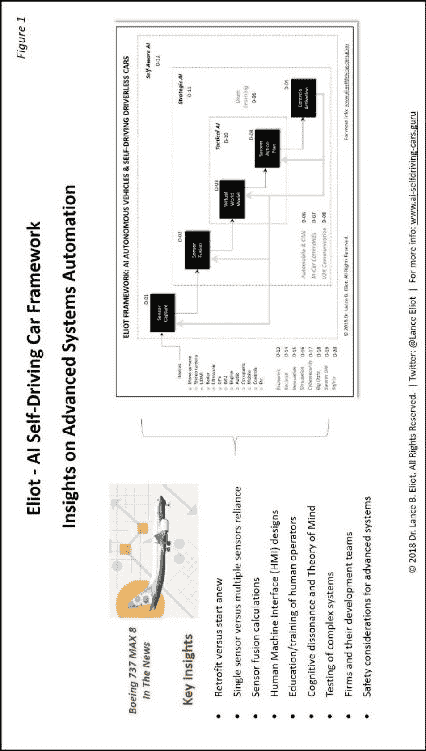
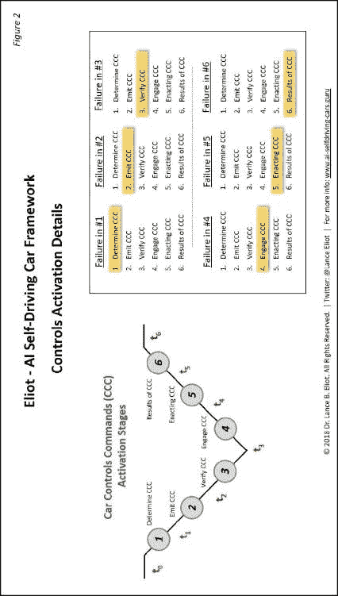
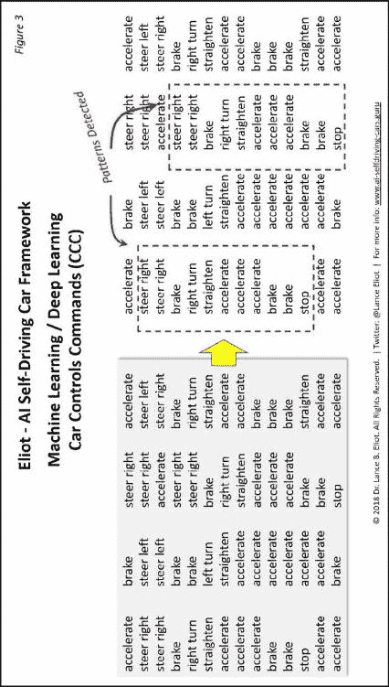
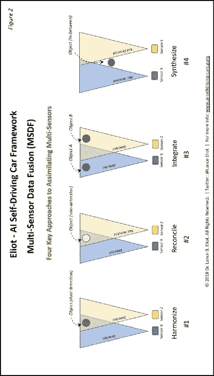

# AI 自驾驶汽车演进：人工智能与机器学习的实践进展

## 演进

### 人工智能与机器学习的实际进展

**Lance B. Eliot 博士，MBA，PhD**

## 献辞

献给我了不起的儿子 Michael 和我了不起的女儿 Lauren。

*Forest fortuna adiuvat*（拉丁语：幸运女神青睐勇者）。

## 致谢

我受益于许多朋友、同事、家人、投资者以及其他人的建议和指导。我要感谢在职业生涯中帮助过我的每一个人。我发自内心也理智地写下这些文字，因为我亲身体会过在顺境和逆境身边有支持的人意味着什么。

向 Warren Bennis（我的博士导师之一，也是我的同事）表示最深切的谢意和感谢，特别感谢他冷静且富有洞见的智慧和支持。

感谢 Mark Stevens 为南加州大学 Stevens 创新中心提供资金和支持所做的慷慨努力。

感谢 Lloyd Greif 和 USC Lloyd Greif 创业研究中心对创始人和创业者的持续鼓励。

感谢 Peter Drucker、William Wang、Aaron Levie、Peter Kim、Jon Kraft、Cindy Crawford、Jenny Ming、Steve Milligan、Chis Underwood、Frank Gehry、Buzz Aldrin、Steve Forbes、Bill Thompson、Dave Dillon、Alan Fuerstman、Larry Ellison、Jim Sinegal、John Sperling、Mark Stevenson、Anand Nallathambi、Thomas Barrack, Jr. 以及我遇到并从中受益许多创新者和领导。

感谢 Ed Trainor、Kevin Anderson、James Hickey、Wendell Jones、Ken Harris、DuWayne Peterson、Mike Brown、Jim Thornton、Abhi Beniwal、Al Biland、John Nomura、Eliot Weinman、John Desmond 以及许多人在我职业生涯中的坚定支持。

最一如既往地感谢 Michael 和 Lauren，感谢他们的持续支持，并在写作的这几个月里见证了我的创作并听取了书中大部分内容。感谢他们的耐心和乐于倾听。

## 引言

本书提供了关于新兴 AI 汽车的最新创新和人工智能（`AI`）最新进展。通过人工智能（`AI`）和机器学习（`ML`）的发展，我们正接近不需要或依赖人类干预的时代。

对于那些可能在其他地方看到过的文章，我将它们更新并整合到了书中，形成了一个完整的包。我正处于自动驾驶汽车的前沿。

“自动车辆”一词通常指任何类型的自动驾驶汽车，无论是地面、空中还是海洋。对于对我写的书籍感兴趣的人，标题如下：

*   `无驾驶汽车导论`
*   `自动驾驶`
*   `AI 之母`
*   `无驾驶汽车的思想领导力`
*   `自动车辆无驾驶汽车`
*   `变革性人工智能自动驾驶汽车`
*   `颠覆性人工智能与自动驾驶汽车`
*   `尖端无驾驶汽车`
*   `自动驾驶汽车顶级趋势`
*   `AI 创新与自动驾驶汽车`
*   `无驾驶汽车的关键进展`
*   `社会技术洞察与无驾驶汽车`
*   `无驾驶汽车的先驱进展`
*   `无驾驶汽车的领先趋势`
*   `AI 自动汽车的前沿`
*   `自动驾驶汽车的下波浪`
*   `自动驾驶汽车的革命性创新`
*   `AI 自动驾驶汽车突破`
*   `自动驾驶汽车的开拓趋势`
*   `无驾驶汽车的巧妙步履`
*   `AI 自动驾驶汽车的创造力`
*   `无驾驶汽车的愿景秘密`
*   `引领 AI 自动驾驶汽车`
*   `促进 AI 自动驾驶汽车`
*   `先锋无驾驶汽车`
*   `AI 自动驾驶汽车演进`

均可通过 `附录 A` 获取。本书的引言我将借用那些书籍中的引言，因为它很好地勾勒了自动驾驶汽车的格局。书的其余部分都是未出现在那些书籍中的新内容。

这里有一条真实新闻：我们距离真正的自动驾驶汽车还有很一段距离。要实现这一目标还需要几年的时间。

为什么是这样？因为真正的自动驾驶汽车无异于一次“登月计划”。正如将人类送上月球是一项不可思议的壮举，实现真正的自动驾驶汽车也是如此。任何建议甚至鲁莽地声称真正的自动驾驶汽车近在咫尺的人，都应该引起人们极大的怀疑。事实上，你会发现，当我评估许多关于自动驾驶汽车的明显假新闻时，我往往倾向于使用“胡说（hogwash）”或“鬼扯（crock）”这类词。我们内部人士知道，经常对外报道的内容往往是一派之言。内部人士很少有人愿意直说。但我没有这种犹豫。

事实上，我一直在写关于自动驾驶汽车的热门博客，并严厉抨击那些试图挥挥手、假装我们正处于真正的自动驾驶汽车边缘的人。多年来，我一直被称为`AI Insider`（AI 内部人士）。除了撰写关于`AI`的文章外，我也开发 `AI` 软件。我言行一致。这让我能够洞察到其他在做 `AI` 的人究竟在做什么，与他们声称在做什么之间的区别。

许多忠实的读者请求我将那些富有见地的短文汇编在一起，放入另一本书，而你现在手里拿的正是这本书。

对于多年来一直阅读我文章的人来说，这个合集不仅将它们整合在一个方便的书中，我还更新了文章并添加了新材料。对于那些对自动驾驶汽车和`AI`领域还不熟悉的读者，我希望你们觉得这些文章通俗易懂且信息丰富。我的写作风格通常带有一种个人色彩，所以你会发现我有时会带着冷幽的幽默感，并讽刺随从主义。

作为前教授和 `AI` 研究实验室的创始人，多年来我一直用学术写作的正式语言进行写作。我在引用期刊上发表过文章，并担任过几份 `AI`杂志的编辑。这里的写作并非那种性质，我为这些文章采用了更不同、更非正式的风格。尽管如此，我偶尔也会提到关于`AI`的更严谨的内容，并鼓励大家如果感兴趣，去研究那些更深入、更正式的材料。

我还是一名 `AI` 实践者。这意味着我以编写 `AI` 软件为生。目前，我领导着`Cybernetics Self-Driving Car Institute`（控制论自动驾驶研究所），我们在那里为自动驾驶汽车开发 `AI` 软件。我很高兴报告，我的儿子（也是一名软件工程师）领导着我们的`Cybernetics Self-Driving Car Lab`（控制论自动驾驶实验室）。我帮助创立的、他不可或缺的一部分，最终在我退休后将带向远远的未来。我的女儿是一个营销天才，作为我们`Marketing group`的负责人，也是我们工作中不可或缺的。她也将继续这项正在制定的事业。

对于正在读这本书并热爱编写代码的人，你们可以考虑看看自动驾驶汽车的开源代码。这是学习如何为自动驾驶汽车开发 `AI` 的良好起点。目前也有许多新的教育课程层涌而出。想要学习和开发自动驾驶汽车的人群正在扩大，大学、实验室和其他可以让你学习自动驾驶汽车的途径也在不断增加。

这本书将提供一些基础内容，我认为这些内容将为你以后参加那些更高级的培训机会做好准备。如果你已经上过那些课程，可能会发现这些文章特别有趣，因为它们提供了一个我打赌很少其他老师或教职员工带给你的视角。这些都是挑战性的文章，要求你超越对自动驾驶汽车的常规进行思考。

2017 年 6 月，苹果公司首席执行官`Tim Cook` 出面并最终承认苹果一直在研发自动驾驶汽车。正如你们在我的文章中所看到的，苹果在自动驾驶汽车方面的努力一直处于高度保密状态。我们只能通过字里旁义来猜测苹果在做什么。`iCar` 的概念已经流传了相当长，自动驾驶工程师和研究人员签署了严密的非保密协议（`NDA’s`），在苹果公司参与项目，而这些项目的神秘程度不亚于任何军事入侵计划。

`Tim Cook` 说了一些在人工智能（`AI`）领域许多其他人也说过的话，即：制造自动驾驶汽车必须是所有 `AI` 项目之母。换句话说，这实际上是 `AI` 领域的一项巨大的登月计划。如果能够制造出自动驾驶汽车并且 `AI` 像我们预期的的那样工作，那就意味着我们在 `AI` 方面取得了巨大的进步，因此它开启了 `AI` 可以解决的许多其他潜在突破性成就的大门。

这是夸张其辞吗？我只是试图让 `AI` 看起来像一个奇迹创造者，从而为我们这些编写 `AI` 软件的人提供一些自我陶醉的陈述吗？如果自动驾驶汽车可以被制造出来并且 `AI` 如我们所希望的那样，这并不是夸张。开发自动驾驶汽车是非常、非常困难的。让我花点时间解释为什么。顺带一句，我意识到苹果 CEO 有时会发表夸张的言论，他曾表示 2012 年是“所有年份之母”，iOS 10 的发布是“所有发布之母”——这一切都表明他喜欢使用“……之母”的表达。但向你们保证，在自动驾驶汽车方面，他确实切中了要害。

当你思考登月计划以及我们如何到达月球时，有一些可识别的特征，这些特征同样适用于自动驾驶汽车。你会注意到我经常在自动驾驶汽车的表达前加上“真正的”一词。我这样做是因为根据我关于自动驾驶汽车各种等级的文章，有些自动驾驶汽车只是某种程度的自动驾驶。那些程度的版本需要人类驾驶员干预。在我看来，那不是真正的自动驾驶汽车。真正的自动驾驶汽车是完全不需要人类驾驶员干预的。它是一种可以通过自动化完全承担驾驶任务的汽车。这就是所谓的 `Level 5` 驾驶汽车的本质。我们目前处于 `Level 2` 和 `Level 3` 阶段，还没有达到 `Level 5`。

到达月球涉及诸许多方面，例如巨大的目标、渐进的过程、实验、创新等。让我们回顾这些方面如何应用于过去的登月计划，以及它们如何应用于今天的自动驾驶汽车登月计划。

## 巨大的目标

## 渐进的过程

登上月球并非一蹴而就。这需要多年年累积的渐进式进展才能到达那里。自动驾驶汽车也是如此。Google 众所周知一直在努力实现 `Level 5`，并且基本上愿意放弃处理中间的级别，但大多数其他自动驾驶汽车制造商采取的是渐进式路线。让我们先实现一个良好的 `Level 2` 并达到某种程度 `Level 3`。然后，让我们改进 `Level 3` 并达到某种程度 `Level 4`。接着，让我们改进 `Level 4` 并最终到达 `Level 5`。这似乎是我们实现真正的自动驾驶汽车的主流方式。

## 实验

你可能知道，在完善前往月球的方法和技术过程中，涉及了各种实验。按照渐进式进展的方法，我们首先尝试看是否能让火箭进入太空并安全返回，然后放了一只猴子进去，接着是人类，然后我们一直到了月球但没有着陆，最后我们实现了真正着陆月球的任务。自动驾驶汽车也是如此。我们正在对自动驾驶汽车进行仿真。我们在私有土地的受控情况下对自动驾驶汽车进行测试。我们在公共道路上对自动驾驶汽车进行测试，通常需要满足监管要求，例如在车内配备一名工程师或同等人员以便在需要时接管控制权。等等。需要各种大小的实验来找出哪些方法有效，哪些行不通。

## 创新

AI 领域已经取得了一些进展，让我们朝着自动驾驶汽车迈进。我们需要更多的进展。要实现真正的自动驾驶汽车，需要技术方方面面的创新。我们绝不是已经掌握了到达那里所需的一切。预计会有新发明、新方法、新算法等不断出现。

## 挫折

大多数专家都在避而不谈论自动驾驶汽车进展过程中的潜在挫折。登上月球涉及许多挫折，其中一些你是从未听过的，而且它们在当时由于被掩盖了，以防打击人们对登月的热情和资金投入。我包含的许多文章中反复出现的主题是，在我们尝试实现真正的自动驾驶汽车时，将会遇到挫折。深吸一口气，做好准备。我只希望挫折不会完全停止进展。我确定它会导致进展以一种我们在自动驾驶汽车领域尚未见过的方式发生改变。我将今天的自动驾驶汽车比作大家对 `Uber` 刚起时的那种兴奋。今天，我们对 `Uber` 有了不同的看法，随着时间的推移，共享出行业务的监管越来越多，引发的担忧也越来越多。宠儿只有一直一直是宠儿，直到那个孩子最终闹起脾来。自动驾驶汽车也将如此。

## 自动驾驶汽车的挑战

但你可能会问，究竟是什么让拥有真正的自动驾驶汽车如此困难。你已经看了多年年的巡航控制。你最近看到了可以并排停车的汽车。你看到过 `Tesla` 驾驶员的 YouTube 视频，他们在汽车在公路上疾驰时把手伸出窗外，因此看到他们坐在一辆自动驾驶汽车中。我们不是只需要在车上再安装几个传感器，就能拥有真正的自动驾驶汽车了吗？并不是的。

请考虑一下驾驶任务的本质。我们并不会让任何年龄段的人开车。在全球范围内，大多数国家在 18 岁之前不会颁发驾照，尽管许多国家允许在 15 岁或 16 岁获得学习许可。有人建议年龄较小身体太小，无法触及汽车的控制装置。尽管可能如此，但我们可以轻松调整控制装置以适应更小、因此身材更矮的人。重要的不是他们的身体尺寸，而是他们的认知发展。

要开车，你需要能够对汽车进行推理，了解汽车能做什么不能做什么。你需要知道如何操作汽车。你需要了解道路上其他汽车是如何行驶的。你需要了解驾驶中的允许行为，例如限速和在标记好的车道内行驶。你需要能够对情况做出反应，并能够避免发生事故。你需要确定何时刹车，何时避让行人，以及如何避免撞上那辆刚刚横插你车道的摩托车手手。

我们中的许多人曾上过驾驶课程。我们学习过驾驶并接受过驾驶培训。我们必须参加考试并通过才能开车。这一点在于，尽管大多数成年人认为驾驶任务是理所当然的，而且我们经常“心不在焉”地开车，但开车过程中投入了大量的认知努力。过段时间，它就变成了本能。你不会特意考虑你是如何开车的，你只是那样做。但是，如果你观察一个新手司机，比如一个正在学驾驶的青少年，你会突然发现复杂性比我们意识到的要大得多。

此外，驾驶是一项非常严肃的任务。我记得我的女儿和儿子第一次学开车时。他们都是非常负责任的人。他们希望确保无论他们做什么，都能做好，并且不伤害任何人。每天当你坐进一辆车里，那可能是一个大约 4,000 磅沉重的金属和塑料（约两吨），它是一件致命武器。想想看。你驾驶着一个重两吨的物体在街道上行驶，有了引擎它可以加速并撞击任何东西。

人类的一项细微认知任务仍然让 AI 感到困扰。你一定知道 AI 已经能够击败国际象棋高手，并擅长其他类型的游戏。这种狭义认知并不是驾驶的本质。驾驶要广泛得多。它需要对世界的认知，而一个国际象棋 AI 系统并不需要知道这些。驾驶的认知方面一方面看似简单，但同时又需要关于汽车、人、道路、规则以及无数其他“常识”方面层层累积的知识。我们现在没有任何 AI 系统具备这种同等广度和深度的认知与知识。

正如我的文章中所揭的，如今的自动驾驶汽车正在使用“技巧”来完成特定任务。它们在操作上非常狭窄。此外，它们目前假设人类驾驶员随时准备好介入。这就像我们教一个孩子叠积木，但当孩子叠得太高并开始倒塌时，我们需要在旁边守着。今天的 AI 是脆弱的、是狭隘的，它并没有触及人类的认知能力。这就是为什么真正的自动驾驶汽车还在未来的未来。

驾驶任务的另一个方面是，它不仅仅是一种脑力体操。你确实需要使用感官来开车。你使用眼睛，即视觉传感器来观察前方的道路。你的视觉能力就像一段流视频，你的大脑在驾驶时需要不断分析它。路在哪里？路上有行人吗？你前面还有别的车吗？你的感官正向大脑汇入大量信息。自动驾驶汽车正试图通过摄像头、雷达、超声波和激光来做同样的事情。这是对模仿人类感官和感官器官的尝试。

因此，驾驶任务是脑力与体力的结合。你使用感官，使用手脚操作汽车的控制装置，并使用大脑评估感官信息并指导你的肢体作用于汽车控制装置。这一切都是瞬间发生的。如果你曾经可能眼睛里进过异物，只能用一只眼睛开车，你会突然意识到自己对视觉有多么依赖。如果你脚骨折了打着石膏，你会突然意识到控制刹车板和加速板有多难。如果你服了药，大脑可能很迟钝，你会突然意识到开车需要多大的精神压力。

一个下国际象棋的 AI 系统只需要专注于下棋即可。物理方面并不重要，因为通常是由人类移动棋子，或者棋盘显示在电子屏幕上。将 AI 用于更关乎生死的任务，例如分析患者的 MRI 图像，这同样不需要体力能力，而是通过检查位图图像完成的。

开车是一项真正的关乎死的任务。它是 AI 的一种应用，很容易且在任何时候导致死亡。对于那些正在开发这种 AI 的同事来说（我也是其中之一），我们需要记住这方面的严峻性。我们正在生产的软件，其虚拟手中掌握着车内乘客的生命、周围其他车内人员的生命，以及附近行人的生命等。国际象棋通常不是关乎生死的问题。

驾驶无处不在。汽车随处可见。今天大多数的 AI 应用只涉及少数人。或者，它们处于幕后，如果 AI 搞砸了，我们人类还有其他补救措施。在公路上以每小时 80 英里速度行驶汽车的 AI 最好不要出差。后果是严重的。将这个数字乘以汽车数量，如果我们能神奇般地将自动驾驶引入全美每一辆汽车中，我们会有 2.63 亿辆汽车在运行 AI。那是分布在各处的大量的 AI。这是我们目前尚未做的大规模 AI 应用，它既充满了希望，也潜藏着潜在的危险。

有些人想要为自动驾驶汽车使用 AI，因为他们憧憬一个没有任何交通事故的世界。他们憧憬一个没有交通拥堵且所有汽车都相互协作的世界。这些是美好的乌托邦愿景。

但这些具有误导性。自动驾驶汽车的普及将是渐进的，而不是一夜之间完成。我们无法在经济上抛弃所有旧汽车。我们也无法负担改装旧汽车的。更有可能的情况是自动驾驶汽车将制造在新车中，在许多年的逐步替换过程中，我们将看到新旧汽车并存。

## 本书提供的价值

这本书为你提供了什么？它介绍了关于自动驾驶汽车的许多元素，并从 AI 的视角进行介绍。我将技术和非技术方面交织在一起，从驾驶任务的认知能力以及技术如何将其融入自动驾驶汽车出发，紧接着又讨论了社会和经济方面。

## 为什么要写这本书

我写这本书是为了试图向公众介绍许多似乎没有人讨论过的关于自动驾驶汽车的方面。对于那些参与制造自动驾驶汽车或将利用自动驾驶汽车的业务负责人，我希望这本书能让你们了解涉及的风险，以及你们应该如何制定策略应对这些风险。对于想要进入自动驾驶汽车市场的企业家、初创公司和其他企业，我希望这本书能激发他们的兴趣，并对可能值得追求的方向提供一些感。对于研究自动驾驶汽车的研究人员，我希望这本书能激发他们对风险和安全问题的兴趣。对于计算机科学或相关专业的学生，我希望这本书能为他们提供有趣且新的观点。

对于任何选择将本书用于教学目的读者，请参阅我在附录中关于如何使用的建议。我发现这些材料在我教过的课程中非常实用，其他其他教职员工也告诉我，他们发现这些材料很有用，在某些情况下作为扩展阅读材料，在另一些情况下作为其课程的核心部分（取决于课程的性质）。

在本书的写作中，我努力仔细地结合了实务者和学术人员的写作风格。它不像典型的学术期刊文章那样密集，但同时通过深入探讨各种实践的细微差别和权衡，提供了深度。


“deep（深入）”一词在今天非常流行，意味着深入研究某个学科或主题；“unpack（解析/拆解）”一词同样流行，意味着梳理出一个学科或主题的底层特征。我力求提供通过相对深入的探讨来解决某个问题或主题的内容，并确保其得到了充分的拆解。

最后，在任何关于人工智能（AI）的书中，很难在使用我们的日常词汇而不避免其中某些词汇被误解。具体来说，很容易对 AI 进行拟人化。当我说一个 AI 系统“知道（knows）”某事时，我并不希望你理解为该 AI 系统具有感知，并以与人类相同的方式“知道”。它们目前还没有那样。我尝试偶尔对这类词汇加引号，以强调我所使用的词汇不应被误解为将我们今天所知的 AI 系统赋予了真实的人类智能。如果我对所有此类词汇都加引号，这本书将变得非常难读，因此我是在审慎地这样做。请在阅读这些材料时记住这一点，谢谢。

# 伴侣读物

如果你对这些材料感兴趣，你可能也会喜欢这些：

1. 《无人驾驶自动驾驶汽车简介》——Lance Eliot 博士
2. 《自动驾驶无人汽车的创新与思想领导力》——Lance Eliot 博士
3. 《人工智能与自动驾驶汽车的进展：控制论自动驾驶汽车》——Lance Eliot 博士
4. 《自动驾驶汽车：所有人工智能项目之母体》——Lance Eliot 博士
5. 《人工智能自动驾驶无人自动驾驶汽车的新进展》——Lance Eliot 博士
6. 《自动驾驶无人自动驾驶汽车与人工智能》——Lance Eliot 博士与 Michael B. Eliot
7. 《变革性人工智能无人驾驶自动驾驶汽车》——Lance Eliot 博士
8. 《颠覆性人工智能与无人驾驶自动驾驶汽车》——Lance Eliot 博士
9. 《尖端人工智能无人驾驶自动驾驶汽车》——Lance Eliot 博士
10. 《人工智能自动驾驶汽车顶级趋势》——Lance Eliot 博士
11. 《人工智能创新与自动驾驶汽车》——Lance Eliot 博士
12. 《人工智能无人汽车的关键进展》——Lance Eliot 博士
13. 《社会技术洞察与人工智能无人汽车》——Lance Eliot 博士
14. 《人工智能无人汽车的先驱性进展》——Lance Eliot 博士
15. 《人工智能无人汽车的前沿趋势》——Lance Eliot 博士
16. 《人工智能无人汽车的最前沿》——Lance Eliot 博士
17. 《下一波自动驾驶浪潮》——Lance Eliot 博士
18. 《革命性人工智能无人汽车》——Lance Eliot 博士
19. 《自动驾驶汽车的开创性趋势》——Lance Eliot 博士
20. 《人工智能无人汽车的奇妙进步》——Lance Eliot 博士
21. 《自动驾驶汽车的创新性》——Lance Eliot 博士
22. 《人工智能无人汽车的视觉秘密》——Lance Eliot 博士
23. 《人工智能无人汽车的远见秘密》——Lance Eliot 博士
24. 《领军自动驾驶汽车》——Lance Eliot 博士
25. 《引领自动驾驶汽车》——Lance Eliot 博士
26. 《前卫人工智能无人汽车》——Lance Eliot 博士
27. 《自动驾驶汽车的演进》——Lance Eliot 博士

这些书籍在亚马逊上有售。

# 第一章：自动驾驶汽车的框架

这一章是核心部分，一旦你读完这一章，就准备好阅读后续内容了。在控制论自动驾驶汽车学院，我们使用该框架来跟踪我们正在的工作，以及我们如何实现 L5 自动驾驶汽车。

当我介绍框架时，我发现通过图表来说明其意图非常有帮助。框架需要足够简单以传达元素，同时又不至于简单到掩盖了真实的复杂性。图中的元素经过了编号以便参考。每个元素都至关重要。对于某些自动驾驶汽车，某个元素可能更重要，或者与其他元素有所不同。我将逐一描述每个元素。随后将讨论它们如何相互作用。

## D01：传感器捕获

让我们从关于自动驾驶汽车媒体中最受关注的元素开始，即自动驾驶汽车的传感器设备。

在框架中，标记为`D01`的框表示“传感器捕获（Sensor Capture）”，指的是自动驾驶汽车从各种传感器收集数据的过程。通常涉及的设备类型包括单目、双目摄像头、`LIDAR`、雷达系统、声波设备、`GPS`、`IMU`等。

这些设备负责获取有关自动驾驶汽车及其周围环境的数据。某些设备持续提供更新，而其他设备则等待自动驾驶汽车的信号以收集数据。数据可能会先由设备本身以某种方式进行转换，或者直接作为原始数据馈到传感器捕获。

## D02：传感器融合

想象一下，你的眼睛接收视觉图像，鼻子接收气味，耳朵接收声音，本质上你的每种不同感官设备都在接收某种形式的输入。输入符合设备的性质。同样，对于自动驾驶汽车，摄像头提供视觉图像，雷达返回雷达反射，以此此类推。每个设备提供的数据都符合其功能。

在某个时刻，如果用人类来类比的话，你需要将眼睛看到的、鼻子闻到的、耳朵听到的融合在一起，并将它们全部组合成一个更宏大的感知，以理解世界的面貌以及你周围正在发生什么。传感器融合（Sensor fusion）是指从每个设备中提取单一方面的信息，并将它们组合成一个更大的拼图的过程。

传感器融合是一项艰巨的任务。某些设备在传感器采集时可能没有正常工作。或者，可能某些设备无法很好地报告它们检测到的内容。同样用人类来类比，假设你正处于一个黑暗的房间里，你的眼睛看不清东西。在这种情况下，你可能需要更多地依靠你的耳朵和听到的声音。自动驾驶汽车也是如此。如果摄像头由于雪和雨夹被遮挡，雷达可能能够提供关于外部状况更准确的指示。

在自动驾驶汽车的情况下，会有大量的这类传感器设备。每个设备都在报告它们所能报告的信息。每个设备都可能有自己的困难。每个设备都可能有其局限性，例如它能探测前方物体的距离。在传感器融合任务期间，需要考虑所有这些局限性。

## D-03：虚拟世界模型

对于人类来说，假设我们在开车时，脑海中会保留一个关于周围世界的模型。在你的脑海中，你知道汽车正以每小时 60 英里的速度行驶，而且你正在高速公路上。你的脑海中有一个模型：你的汽车被其他汽车包围，高速公路上有很多车道。你的模型不仅基于你所看到的、听到的等信息，还基于你对世界本质的认知。你知道在任何时刻，前面的车都可能猛踩刹车，或者你后面的车可能会撞上你的车，又邻近车道的卡车可能会切入到你的车道。

自动驾驶汽车的 AI 需要一个虚拟世界模型，它根据从传感器融合接收到的任何信息不断更新该模型，而传感器融合的输入来自于传感器采集和传感器设备。

## D-04：系统行动计划

通过虚拟世界模型，自动驾驶汽车的 AI 能够跟踪汽车的位置以及周围正在发生的事情。此外，AI 还需要决定下一步做什么。自动驾驶汽车应该刹车吗？自动驾驶汽车应该留在自己的车道内，还是切入左侧的车道？自动驾驶汽车应该加速还是减速？

自动驾驶汽车的 AI 需要准备一份系统行动计划。行动计划规定了应该采取哪些行动。这些行动需要与虚拟世界模型的状态相关。此外，行动必须是可行的。

这种可行性意味着 AI 不能仅仅断言自动驾驶汽车应该突然长出翅膀飞起来。相反，AI 必须受限于自动驾驶汽车实际上能做的事情，例如在`X`英尺的距离内以每小时`Y`英里的速度停下，而不是可能断言自动驾驶汽车在运动时可以在`0`英尺内停下，仿佛它能瞬间停下一样。

## D-05：控制器激活

系统行动计划通过激活汽车的控制器来实现，按照计划规定执行。这可能意味着命令加速器控制器增加汽车速度。或者，命令转向控制器向左或向右转方向盘 30 度。

产生了一个问题：控制器是否按照指令执行了操作？换句话说，假设 AI 已命令加速器增加速度，但由于某种原因它没有这样做。或者，也许它尝试这样做，但汽车速度并没有增加。控制器的激活会反馈到虚拟世界模型中，同时虚拟世界模型也会从传感器、传感器采集和传感器融合中获取更新。这允许 AI 确定由于命令执行执行某种行动而发生了什么。

顺便说一下，请记住，尽管图表看起来有线性的进展，但事实是，这些都是自动驾驶汽车并行且同时发生的方面。传感器正在采集数据，与此同时，传感器融合正在进行，与此同时，虚拟模型正在更新，与此同时，系统行动计划正在制定和重新制定，与此同时，控制器正在被激活。

这与开车的人类是一样的。他们观察着路面，与此同时，他们在脑海中融合视觉、听觉等信息，与此同时，他们的大脑正在更新对周围世界的模型，与此同时，他们正在制定做什么的行动计划，与此同时，他们的脚正踩在踏板上并操控汽车。在正常的汽车驾驶过程中，你是同时完成所有这些事情的。我提到这一点是为了当你看图表时，会将这些框看作是同时发生的过程，而不是一个发生完才发生下一个。

它们以简化的方式以图表展示，有助于理解正在发生的事情。但你也应该意识到，它们之间是并行且同时运行的。这是一个困难的方面，因为元素之间的通信涉及延迟和其他必须考虑的因素。在某一个元素更新并与其他元素共享其最新状态时，可能会存在延迟。

## D-06：汽车与 CAN

现代汽车使用各种汽车电子设备和控制器区域网络（`CAN`）作为支撑汽车驾驶方面的组件。有电子控制单元（`ECU’s`）控制汽车的子系统，例如发动机、刹车、门、窗户等。

`D-01`、`D-02`、`D-03`、`D-04`、`D-05`等元素位于`D-06`之上，并且必须意识到`D-06`能够和不能做的本质。

## D-07：车内指令

人类将是自动驾驶汽车的乘客。在 5 级自动驾驶汽车中，人类与自动驾驶汽车之间存在某种形式的通信。例如，我进入一辆自动驾驶汽车，告诉它我想去迪士尼，并在途中停在 In-and-Out 汉堡。自动驾驶汽车现在解析我说的话，并尝试建立执行我意愿的方法。

车内指令可以在旅程中的任何时候发生。虽然我的例子是我第一次进入自动驾驶汽车时的车内指令，但可能在自动驾驶汽车执行旅程时，我改变了主意。也许在堵车后，我告诉自动驾驶汽车忘记买汉堡，直接去主题公园即可。自动驾驶汽车在整个旅程中都需要警惕车内指令。

## D-08：V2X 通信

我们最终将会有自动驾驶汽车之间相互通信，通过`V2V`（车对车）通信来实现。我们还将自动驾驶汽车与道路以及交通基础设施的其他部分进行通信，通过`V2I`（车对基础设施）通信来实现。

自动驾驶汽车与其他汽车及基础设施进行通信的各种方式被称为`V2X`，其中字母`X`意味着我们识别出的任何汽车应该或想要与之通信的其他对象。`2X`通信将与图表上的所有其他内容同时发生，而其他元素需要整合从这些`V2X`通信中获取的任何信息。

## D-09：深度学习

深度学习的使用渗透到自动驾驶汽车的所有其他方面。自动驾驶汽车的`AI`将使用深度学习，在`systems action plan`、控制激活以及传感器融合等方面完成更好的工作。

目前，人工神经网络的使用是深度学习最流行的形式。基于海量数据，神经网络尝试从数据中“学习”，并相应地引导自动驾驶汽车的行动方向。

## D-10：战术 AI (Tactical AI)

战术 AI 是处理自动驾驶汽车瞬时驾驶状况的要素。自动驾驶汽车是否保持在高速公路的车道内？汽车是否对控制命令做出恰当响应？传感器设备是否正常工作？

对于人类驾驶员来说，观察一个新手司机（比如第一次开车的青少年）就能看到战术层面的的情况。他们专注于驾驶任务的机械操作，在盯着道路的同时，试图正确地控制车辆。

## D-11：战略 AI (Strategic AI)

自动驾驶汽车的战略 AI 方面处理自动驾驶汽车试图实现的大局目标。如果我要求自动驾驶汽车带我去迪士尼，那么就需要一张需要保留和维护的整体路线图。

战略 AI 与战术 AI 之间存在交互。战略 AI 想要维持驾驶任务，而战术 AI 则专注于驾驶过程中正在进行的具体细节。如果战术 AI 似乎偏离了宏观任务，战略 AI 想要知道原因并将其带回正轨。如果战术 AI 意识到自动驾驶汽车出现了问题，它需要相应地提醒战略 AI，对正在进行的宏观任务进行调整。

## D-12：自感知 AI (Self-Aware AI)

在正在开发的自动驾驶汽车中，极少数包含了自感知 AI 元素，而我们控制论自动驾驶汽车研究所（Cybernetic Self-Driving Car Institute）认为这对于 5 级自动驾驶汽车至关重要。

自感知 AI 要素旨在监控自身，即`AI`确保`AI`按照预期工作。假设你有一个人类在开车，而他们开始开得毫无章。希望他们自己的自我意识能让他们意识到自己驾驶得不好，例如在连续驾驶了几个小时后可能开始睡睡。如果你车里有一个乘客，当驾驶员开始做不对劲时，他们可能会提醒驾驶员。这正是自感知 AI 元素尝试做的：它成为`AI`的监督者，试图检测`AI`何时变得故障或困惑，然后找到克服问题的方法。

## D-13：经济 (Economic)

自动驾驶汽车的经济方面本身并不是自动驾驶汽车的技术性方面，但经济因素确实影响着自动驾驶汽车的本质。例如，为自动驾驶汽车配备各种可能的传感器设备的成本是令人昂贵的，因此需要对使用哪些设备做出选择。而且，对于选定的传感器设备，还需要决定它们是具有全套功能还是更有限的功能集。

我们将拥有消费成本处于低端的自动驾驶汽车，以及处于高端的，以此类推。

## D-14：社会 (Societal)

自动驾驶汽车的经济方面本身并不是自动驾驶汽车的技术性方面，但经济因素确实影响着自动驾驶汽车的本质。例如，为自动驾驶汽车配备各种可能的传感器设备的成本是令人昂贵的，因此需要对使用哪些设备做出选择。

## D-15：创新 (Innovation)

自动驾驶汽车的经济方面本身并不是自动驾驶汽车的技术性方面，但经济因素确实影响着自动驾驶汽车的本质。例如，为自动驾驶汽车配备各种可能的传感器设备的成本是令人昂贵的，因此需要对使用哪些设备做出选择。

我也非常担心那些没有设立合适的首席安全官（Chief Safety Officer）的机构，他们不仅在危及使用其 AI 自动驾驶汽车的人的生命，还可能危及整个 AI 自动驾驶汽车的发展。

从本质上说，对 AI 自动驾驶汽车系统的安全性仅口头承诺，或者在无意中未能给予安全足够的关注的公司，很可能会在我们的道路上引发负面安全事件。公众和监管机构对此的反应将不仅针对那家违规公司，此类事件将引发公众抗议，并成为任何 AI 自动驾驶汽车进一步发展的首要障碍。

简单来说，对于 AI 自动驾驶汽车而言，“坏苹果坏了一池汤”的可能性非常高，这是我们行业内每个人都每天如履薄冰的。

在最近于硅谷举行的一个自动驾驶汽车活动上，与`Zoox`的首席安全创新官 Mark Rosekind 交流时，他强调了安全考量在 AI 自动驾驶汽车领域是至关重要的。他在美国高速交通安全局（`NHTSA`）担任管理者的多年经历，以及在国家运输安全委员会（`NTSB`）董事会的任职，为他的职位提供了非常切的技能组合和经验基础。对于对`Zoox`所追求的整体安全方法感兴趣的各位，可以查看他们发布的报告：`https://zoox.com/safety/`

那些密切关注我发布内容的朋友会记得，我之前提到过`Chris Hart`在 AI 自动驾驶汽车安全方面的努力。作为`NTSB`的前主席，他为汽车制造商和科技公司在安全方面需要做的事情带来了关键见解，并提供了可以帮助制定法规和监管行动的重要观点（参见他的网站：`https://hartsolutionsllc.com/`）。

你可能对他最近的一篇关于航空自动化与 AI 自动驾驶汽车差异的博客文章感兴趣，这与我对同一主题的观点不谋而合。关于`Chris Hart`最近的博客文章，请访问：`http://www.thedrive.com/tech/26896/self-driving-safety-steps-into-the-unknown`

`Waymo`作为`Google/Alphabet`旗下在 AI 自动驾驶行业闻盛名的实体，也聘请了一位首席安全官，即`Debbie Hersman`。除了她曾任于`NTSB`并担任过其主席外，她还是国家安全委员会的 CEO 和总裁。她的加入`Waymo`令人倍感欣慰，因为这向其他 AI 自动驾驶制造商传递了一个信号：这是一个至关重要的职位，如果他们还没有这样做，他们也需要确保拥抱这一角色。

`Uber`最近聘请了`Nat Beuse`来领导他们的安全工作。他曾任职于美国交通部，多年负责该部门车辆的安全工作。对于对`Uber`去年产的安全报告（在其内部审查`Uber`自动驾驶汽车事故之后）感兴趣的各位，您可以在此处找到该报告：`https://www.uber.com/info/atg/safety/`

我还想提到国家安全委员会（`NSC`）交通部主任`Alex Epstein`的努力。我们在一次关于 AI 自动驾驶汽车安全的首届会议上相识，他对行业现状以及未来需要向何处发展的见解和言论是切中要害的。在`NSC`，他领导着他们的先进汽车安全技术倡议。他的公共外展工作值得关注，`MyCarDoesWhat`公共活动就是一个我们如何帮助公众理解汽车自动化各个方面的例子：`https://mycardoeswhat.org/`

## 首席安全官角色的定义

我发现，在基于 AI 的公司背景下，明确我所说的首席安全官角色是有用的。我发现，首席安全官需要确保安全元素能够得到培养，特别是在涉及 AI 系统的领域。

如下所示，这些元素是相互交织的，不应该是孤立的。如果首席安全官忽视或低估这些元素，让它们处于边缘状态，很可能会损害公司的完整性。

首席安全官的核心元素包括：

* 安全策略 (Strategy)
* 安全文化 (Company Culture)
* 安全政策 (Policies)
* 安全教育 (Education)
* 安全意识 (Awareness)
* 外部安全 (External)
* 安全生命周期 (SDLC)
* 安全报告 (Reporting)
* 安全危机管理 (Crisis Management)

我将对每个元素进行说明。

### 安全策略

首席安全官制定如何将安全纳入 AI 系统的整体策略，并与其他高管紧密合作。必须通过协作完成，因为整个高管团队必须认同这一策略，并愿意且能够执行它。安全不是孤立存在的。公司的每个职能部门都必须参与其中，并确保安全策略得到实施。

### 安全文化

首席安全官需要帮助塑造“安全优先”的企业文化。很多时候，AI 开发人员和其他技术人员并不精通安全，他们可能来自大学环境，在那里 AI 系统是以原型形式存在的，安全并不是一个特别紧迫的话。


有些人甚至可能认为“安全是创新的敌人”，这有时是一种根深蒂固的错误。这需要巨大的努力，并且必须与领导层相结合，以有意义的方式而非轻率或表面的方式进行。

## 安全政策

首席安全官应该制定一套安全政策，说明 AI 系统在构思、设计、构建、测试和部署方面如何体现关键的安全原则。

这些政策必须易于理解，并且有明确的手段来遵守。如果政策过于抽象、晦涩或不切实际，很可能会产生一种“只是为了免责（CYA）”的感觉，导致公司其他人倾向于忽视这些政策。

## 安全教育

首席安全官应该识别可以在公司范围内提供的各种教育手段，以增加对开发和部署 AI 系统背景下安全定义的理解。

这可以是内部编写的 AI 安全课程和外部提供的课程的结合。高管也应该参与这些教育计划，以展示他们对教育方面的信念和支持，并与首席安全官合作，安排并确保团队和员工参加课程，同时进行跟进以确保教育内容投入实际使用。

首席安全官（Chief Safety Officer）应致力于让安全意识成为一项持续的活动，这通常通过在公司内网发布与 AI 安全相关的方面来培养，并提供其他讨论和鼓励 AI 安全的渠道，例如午餐研讨会（brown bag lunch sessions）、分享公司内部的 AI 安全技巧和建议。

这需要是一项持续的努力，而不是让一次性的安全推行在之后衰减或被遗忘。

## 安全外部（Safety External）

首席安全官应主动向外部利益相关者代表公司及其 AI 安全方面的努力。这包括向监管机构进行此类工作，在适当的情况下参与监管工作或审查，以及在行业活动上演讲正在开展的安全相关工作，并与媒体进行交流。

作为公司的外部形象，CSO 还可能获得来自外部利益相关者的反馈，这些反馈应反馈到公司内部，并特别与高层管理团队进行讨论。

## 安全开发生命周期（Safety SDLC）

首席安全官应帮助确保系统开发生命周期（`SDLC`）在每个阶段都包含安全。

这包括 `SDLC` 是敏捷型、瀑布型，还是以正在采用的任何方法或方式进行。检查点和审查需要包含安全方面并具有“强制力”（teeth），这意味着如果安全没有被包含或被忽视，这将成为一个无法被掩盖的努力停止标准（effort stopping criteria）。在开发压力下，很容易以“继续进行真实编码”为借口将安全部分和编码推到一边，但对于涉及生死系统后果的 AI 系统来说，这是行不通的。

## 安全报告（Safety Reporting）

首席安全官需要建立一种机制来跟踪正在被考虑和包含在 AI 系统中的安全方面。这通常是一个在线跟踪和报告系统。从跟踪系统中，需要定期提供报告。

这包括仪表板（dashboards）和闪电报告（flash reporting），这至关重要，因为如果报告过度延迟或难以获取或解释，将“太晚无法处理”，而进行安全相关纠正或添加的成本或精力将处于次要。

## 安全危机管理（Safety Crisis Management）

首席安全官应建立危机管理方法，以处理任何出现的与 AI 安全相关的故障或问题。当公司的 AI 自驱动汽车伤害他人时，公司往往显得手忙脚乱，但这本是可以预见到的可能性，并且可以提前做好准备。

对 AI 安全负面行为的响应需要仔细协调，公司可能会被认为对事件做出了真诚的努力，或者如果准备不足，可能会导致事态恶化并损害公司以及其他 AI 自驱动汽车制造商的努力。

在图 1 中，我还包含了我的 AI 自驱动汽车框架。

我刚刚描述的九个元素中的每一个都可以应用于框架的每一个方面。例如，安全是如何包含在传感器的设计、开发、测试和部署中的？安全是如何包含在传感器融合的设计、开发、测试和部署中的？安全是如何包含在虚拟世界模型的设计、开发、测试和部署中的？

如果公司没有一种认为安全至关重要的整体信念，那么在传感器等领域，你不太会有许多安全相关的考量，而这种信念通过设立首席安全官、拥有一个拥抱安全的公司文化以及通过对进行开发的团队进行 AI 安全教育等来展示。这凸显了我之前的观点，即每个元素都必须作为一个整合的整体发挥作用。

假设公司实际上执行了八个元素，但没有对如何将 AI 安全整合到 `SDLC` 中采取任何措施。结果怎样？

这意味着 AI 开发者只能靠自己尝试设计如何将安全纳入他们的开发工作中。他们可能会在这样做时摸索乱撞，或者进行真正的尝试，尽管它是碎片化的并且与开发方法论的其他部分脱节。

此外，更糟糕的是，由于 `SDLC` 很可能没有考虑安全，AI 自驱动汽车的安全考量概率很小。这里的关键点是，这九个元素需要共同工作。

我列出了一些公开文档，这些文档是快速上手 AI 自动驾驶汽车安全非常有用的基石。

美国交通部（`DOT`）国家高速交通安全局（NHTSA）提供了两份关于 AI 自动驾驶汽车安全基础的报告，我认为这些报告非常有帮助。除了提供背景信息外，这些文件还指出了任何汽车制造商或科技公司在工作中需要考虑的监管因素。这两份报告都是在 `DOT` 部长赵美（Elaine Chao）的主持下发布的。

2.0 版本的报告在这里：

`https://www.nhtsa.gov/sites/nhtsa.dot.gov/files/documents/13069a-ads2.0_090617_v9a_tag.pdf`

3.0 版本的报告在这里：

`https://www.transportation.gov/sites/dot.gov/files/docs/policy-initiatives/automated-vehicles/320711/preparing-future-transportation-automated-vehicle-30.pdf`

我之前提到过 Uber 的安全报告，在这里：`https://www.uber.com/info/atg/safety/`

我还提到过 Zoox 的安全报告，在这里：`https://zoox.com/safety/`

你可能也会对 Waymo 的安全报告感兴趣，在这里：`https://waymo.com/safety/`

我还想特别感谢 Philip Koopman 博士，他是 `CMU`（卡内基隆大学）的教授，进行了大量的 AI 安全相关研究，你可以在他的 `CMU` 网站或这个公司网站找到：`https://edge-case-research.com/`

作为一名大学教授，我也曾在大学期间进行过研究，也通过外部公司进行过研究。这是一种很好的方法，可以将你通常在大学环境中进行的核心基础研究，与你在工业界从事更具应用性的工作结合起来。

我发现这种组合非常实用。Philip 和我似乎经常参加许多相同的 AI 自动驾驶汽车会议，并以演讲者、小组小组或感兴趣的参与者的身份出席。

## 结论

对于我在文中未提到的 AI 自动驾驶汽车公司的首席安全官（Chief Safety Officers），欢迎随时告诉我你们希望被包含在我未来关于该主题的更新中。此外，如果你有与我列出的类似的安全报告，欢迎提供给我审阅，我很乐意也提及它们。

关于 AI 自动驾驶汽车行业的一个担忧是，安全问题是否正以一种秘密的方式进行，这导致每个汽车制造商或科技公司对其他公司在做什么一无所知。当你观察汽车行业时，显然汽车制造商传统上在安全记录上进行竞争，并以此作为优势，试图广告并销售他们的产品。

批评者认为，如果 AI 自动驾驶汽车行业认为自己也在安全方面进行相互竞争，那么自然会有理由刻意避免共享有关安全方面的信息。

你似乎无法兼兼得，因为如果你在安全方面进行竞争，那么这被假定是一个零和博弈，安全表现更好的人将比表现不好的人卖得更多，为什么要帮助竞争对手领先呢？

这种心态需要被克服。正如之前提到的，只需要少数与安全相关的负面结果，就可能扼杀整个 AI 自动驾驶汽车领域。如果发生公众抗议，你可以预计这将给汽车制造商和科技公司带来压力。

很有可能，监管机构将选择以更强硬的手段介入行业。AI 自动驾驶汽车事业的资金可能会枯竭。驱动 AI 自动驾驶追求的引擎可能会停滞。

目前正出现一些努力，试图看看 AI 安全是否能成为 AI 自动驾驶汽车行业中更广泛的话题。

然而，要克服所有这些 `NDA`（保密协议）以及对专利事项可能泄露的担忧是很困难的。遗憾的是，可能需要一场灾难才能获得足够的关注度让事态变得更加活跃，但我希望不会沦到那种地步。

在追求 AI 自动驾驶汽车的众多汽车制造商和科技公司中引入首席安全官，是一个健康的信号，表明安全的重要性正在提高。

这些公司必须认真地对待这些职位，并意识到他们不能仅仅设立一个角色来以此作为一种勾选。

为了让首席安全官履行他们的职责，他们必须处于高管决策层，并被视为领导团队不可或缺的一部分。我也希望这些首席安全官能够团结在一起，成为一个跨行业的“俱乐部”，这个俱乐部可以拥抱安全共享准则，并利用他们的职位和分量，推动安全进一步渗透到 AI 自动驾驶汽车的各个方面。让我们将其变为现实。

## 第 3 章：边界体积与 AI 自动驾驶汽车

在高速公路上，我前方的一辆中型车顶部系着几根长杆子，晃动的杆子远远悬在飞驰汽车的尾部之外。在加州，法律规定任何超出尾灯后四英尺的悬空或突出物品必须装饰有红布或荧光橙旗。而且，如果发生在晚上，还必须在突出物上安装两盏灯（根据加州车辆法典 `CVC` 第 `35410` 节）。

司机没有满足所有这些法律要求。目前是白天。大约一小时后就是黄昏，然后很快就会天黑。啧，啧，无视法律。

无论如何，紧迫的问题是其他驾驶员是否会意识到杆子是伸出的。考虑到时间、逐渐减弱的阳光，以及南加州许多人开车非常疯狂且不注意路况，我不怀疑某些疯狂的司机可能会离汽车非常近，以至于杆子可能会撞击挡风玻璃。

根据杆子的性质以及它们系在车上的方式，我判断杆子不太可能刺破挡风玻璃，除了几处划痕和凹痕外，可能不会造成太大损坏，但真正的问题将是撞上杆子的驾驶者的反应。

撞上杆子的驾驶员会突然感到震惊和惊讶，并在那种心理状态下选择鲁莽的动作吗？以每小时 65 英里的速度这样做注定会造成混乱。只需要一个驾驶员做一些不妥当的事，就会对其他驾驶员造成连锁影响。另一个考虑是，那些杆子可能会在撞击挡风玻璃后摇晃，然后掉到高速公路上，这可能也会导致一系列车辆穿梭和躲避那些杆子，增加车辆之间碰撞的概率。

把杆子放在车顶的司机是否意识到了他们行为内在的问题？他们是因为懒惰而没有挂红旗或橙旗吗，还是认为不需要，或者可能是觉得太麻烦而认为杆子伸出来是“显而易见”的？或者，也许司机认为没有其他车会离他们的车近到以至于突出部分会产生影响。

我与那辆车保持了距离。

然而，这样做仅仅导致了其他汽车决定挤进我和前方的车辆之间。我们这里高速公路上的不成文是一个弱肉强食的世界，任何可用的间隙都会立即被视为可以供侵入的空间。事实上，这里的某些司机坚信，他们通过挤压交通为我们所有人人都尽了巨大的贡献。在他们看来，车辆之间任何未被使用的间隙都是难看的浪费空间，只会加剧高速公路上的交通困扰。

当其他车辆进入我的车道时，有些似乎注意到了那些杆子，而另一些则没有。我看到一辆车开始进入我的车道，随后发现杆子伸了出来，司机便退回了原来的车道。另一辆车——是一辆离地面较近的小型跑车——平稳地穿过了杆子下方，此时变换车道的司机正利用我的车道切到右侧的下一条车道。这是跑车驾驶者的典型动作。既然可以像 NASCAR 赛车那样进行多车道的快速切换，为什么要一次只换一条车道呢？

最后，那个炫耀着杆子的司机决定他们快要到出口了，开始向出口车道移动。当司机每次变换车道时，他们似乎误判了安全所需的距离。我怀疑该司机在计算车辆额外长度时，并没有把伸出的杆子的长度也算进去。这个司机不仅没有标记这些杆子，似乎还不在意这些杆子如何改变驾驶任务的动态。令人遗憾，但并不令人意外。

### 汽车尺寸的熟悉程度

我们大多数人可能不会太考虑汽车的整体尺寸，至少在主观上并不如此。一旦你习惯了汽车的尺寸或规格，你基本上对它了如指掌。如果你每天都开同一辆车，你几乎可以感觉到汽车的外边缘。你会直能地知道是否能通过那个狭弯，或者能否将车挤进你看中的那个停车位。

相比之下，当你租车时，假设它和你平时开的车品牌和型号不同，可能需要几几分钟才能适应汽车的尺寸。

我记得有一次露营租了一辆大型 SUV，起初很难感觉到汽车的四个角在哪里。我把它停在房子前面，突然发现这辆 SUV 伸出了我平时停普通车的位置之外。等我去商场买东西时，商店附近出现了一个停车位，但当我缓慢将车挪入车位时，我意识到试图把这头巨兽停进一个紧凑型停车位并不是个好主意。

问你一个简单的问题。花点时间在脑海中想象一下你平时开的那辆车。车的长度是多少？宽度是多少？大多数人无法立刻用英尺或英寸说出长度和宽度是多少。他们只是“知道”自己的车有多大。他们在开车时能感觉到它。当你尝试平行停车时，你通常会敏锐地察觉到尺寸，因为你正试图把它挤进一个往往恰好能容下它的位置。

你的车的高度呢？大多数人并不确定自己汽车的精确高度。他们可以猜。他们通常也能辨别自己的汽车是否能够通过道路标志牌或桥梁。不过，当你通过速餐店，且那里贴着警告高度限制的标志牌时，这是可以测试的。我见过一些司机小心翼翼向前挪，不确定车顶是否会撞到东西，特别是如果他们的车顶安装了雪板架或冲浪板架。

### 金发女孩类比

在估算某物的尺寸方面，我想起了孩子很小时的一件趣事。我们去了一家陶瓷店，那里允许我们购买各种陶瓷制品并在店里为它们上绘画。这是一项有趣的活动。画完物品后，你把它们留在店里一天左右，让店里进行固化，然后我们再来取回现在亮晶晶的彩绘陶瓷制品。

在画完物品几天后回到店里，那里有一个陶瓷兔子和一个陶瓷蛋（为了复活节准备的！），我们带着极大的喜悦和自豪看着它们。它们看起来极极了，就像专业人士画过的一样。我让孩子们去店的另一侧拿两个纸箱，这样我们就能把每个陶瓷制品放进盒子里安全地运送。

其中一个孩子带回的盒子太小了，兔子和蛋都放不下。另一个孩子带回的盒子很大，在搬运盒子时可能会无意中让兔子或蛋在里面滚动并可能损坏。我指出了这些差异，并礼貌地要求他们找一个更合适的盒子。你可能会称之为“金发女孩尺寸”的盒子，既不小，也不过大。

他们很快就做到了。然后我们把兔子和蛋分别放入它们各自的子里。这是一次成功的尝试，直到今天它依然陈列在我的壁炉架，特别是在复活节期间，将这些物品展示出来，作为制作它们时投入的爱与快乐的象征。

### 虚拟容器

陶瓷复活节蛋和兔子与高速公路上带着伸出杆子的汽车有什么关系呢？好问题，答案如下：判断完全容纳一个复活节蛋或兔子的盒子尺寸，就像在想象一种可能环绕你汽车尺寸的虚拟盒子。

我想让你再次思考一下你平时开的那辆车。这次，不要尝试说出尺寸，而是尝试想象一个可以装下你汽车的盒子。当我说“盒子”这个词时，我想你可以更多地看作是一个容器，比如集装箱。如果我们把你的车运到某处，你需要什么尺寸的容器（或盒子）？

你可以大胆猜测并选择一个比汽车大倍的容器或盒子。在这种情况下，你确定汽车能放进去。但是，假设我告诉你容器或盒子的尺寸增加会有额外成本。因此，目标越高，成本越高。

我很确定你会调整猜测，目标一个较小的容器或盒子。如果容器或盒子太小了呢？那就不行，因为你需要确保汽车的每一寸都能进入容器或盒子。你不能让任何部分超出容器或盒子。理想情况下，你希望容器或盒子恰好合适，确保汽车的所有方面都包含在内，而不是大得多，因为尺寸增加的额外成本是你试图避免的。

想象容器最简单的方法就是假设它是一个长方体形状。诚然，取决于你汽车的形状，这可能不是一个非常高效的容器。如果我们使用其他形状，比如球体或金字塔之类的规则形状，也许会更合适。或者，如果我们可以自己创建整个容器的设计，我们可能会将其设计成不规则的形状，随处弯曲以与你的汽车严丝合缝地贴合。

在尝试将你的车放入某种容器中时，让我们将其称为边界体积（Bounded Volume，简称 BV）。我希望你帮助我把车放入容器中，这个容器将包含一定量的体积，并由我们使用的形状所限定。

BV 可以是一个规则形状，比如相对简单的立方体或长方体。或者，你可能会想象另一种不那么常见的形状，例如锥体或金字塔，或者设计出一种相当不规则的形状，以其他更紧凑的方式符合你的汽车。

## 这与 AI 自动驾驶汽车有什么关系？

在网络自动驾驶汽车研究所（Cybernetic AI Self-Driving Car Institute），我们正在为自动驾驶汽车开发 AI 软件。AI 自动驾驶汽车的一个引人入胜的方面，也是一个经常不被讨论的方面，涉及到 AI 需要能够检测物体，并本质上在这些检测到的物体周围构建一个边界体积（一个虚拟容器）。这是整个 AI 驾驶系统，特别是虚拟世界建模方面的关键工作。

请允许我详细说明一下。

我想先澄清并介绍这样一个概念：AI 自动驾驶汽车有不同的级别。最高级别被认为是 5 级。5 级自动驾驶汽车是由 AI 驾驶的，没有人类驾驶员参与。对于 5 级自动驾驶汽车的设计，汽车制造商甚至去掉了油门踏、刹车板和方向盘，因为这些都是人类驾驶员使用的装置。5 级自动驾驶汽车不是由人类驾驶的，也不预期人类驾驶员会出现在自动驾驶汽车内。驾驶汽车完全由 AI 承担。

对于低于 5 级的自动驾驶汽车，车内必须有人类驾驶员。人类驾驶员目前被认为是汽车行为的责任方。AI 和人类驾驶员共同承担驾驶任务。尽管有这种共同共享，人类应该保持完全沉浸在驾驶任务中，并随时准备执行驾驶任务。我多次警告过这种共同共享安排的危险性，并预测它会产生许多不愉快的结果。

让我们在这里关注真正的 5 级自动驾驶汽车。许多评论也适用于低于 5 级的自动驾驶汽车，但在讨论中，完全自动的 AI 自动驾驶汽车将获得最多的关注。

以下是 AI 驾驶任务涉及的通常步骤：

* 传感器数据收集与解释
* 传感器融合
* 虚拟世界模型更新
* AI 动作规划
* 汽车控制指令发布

AI 自动驾驶汽车的另一个关键方面是，它们将在人类驾驶汽车中在我们的道路上行驶。有一些 AI 自动驾驶汽车的专家不断提到乌托邦世界，公共道路上只有 AI 自动驾驶汽车。目前，光美国就有 2.5 亿多辆传统汽车，这些汽车不会一夜之间神奇地消失或变成真正的 5 级 AI 自动驾驶汽车。

事实上，人类驾驶汽车的使用将持续多年，可能是几十年，而 AI 自动驾驶汽车的出现现在道路上仍有人类驾驶汽车的情况下。这是一个关键点，因为这意味着自动驾驶汽车的 AI 不仅需要与其他 AI 自动驾驶汽车竞争，还要与人类驾驶汽车竞争。

很容易想象一个简单且不现实的世界，在那里所有的 AI 自动驾驶汽车彼此之间礼貌地互动，并在道路交互中保持文明。在可预见的未来，情况并非如此。AI 自动驾驶汽车和人类驾驶汽车需要能够相互应对。

## 边界体积的重要性

回到边界体积的话，让我们考虑为什么这对于 AI 自动驾驶汽车是一个如此重要的事情。


自动驾驶汽车的 AI 系统将拥有各种传感器设备，包括摄像头、雷达、超声波、激光雷达（LIDAR）等。我们目前关注摄像头。

当 AI 自动驾驶汽车行驶时，摄像头正在捕捉自动驾驶汽车周围的视觉图像。这些图像流入摄像头。在自动驾驶汽车上，有计算机处理器负责分析这些图像。图像处理正在查看是否有交通标志、附近是否有行人、附近是否有汽车等。这必须实时发生。时间至关重要。

图像处理没有这种心不在焉行动的奢侈。当一辆汽车以每小时 65 英里的速度在高速公路上行驶时，其他汽车以相同或更快的速度飞驰而过，确认交通状况时没有多少时间可以浪费。图像处理有责任尽可能地解析图像并识别正在发生什么。

人类驾驶员理所当然地认为他们可以看到周围的环境。他们通常不会在这方面想太多，因为这看起来显而易见且在预料之中。当然，我可以看到街对面的那个行人。当然，我可以看到那个限速标志。但是，如果我在这种情况中加入浓雾，人类驾驶员将被提醒，有时看到周围的环境是多么困难。

由于我们在驾驶时可能看到的物体具有某种可预测性，因此可以使用机器学习或深度学习来尝试准备图像处理，以便能够检测摄像头观察到的物体。我们可以将成百上千、甚至成上万的行人图像输入到深度或大规模多层神经网络中，并尝试让它对这些图像进行模式匹配。你希望这种模式匹配具有通用性，能够检测到广泛的变化，而不是固定在特定的形状或尺寸上。

一旦图像处理完成训练，我们就会将其放入自动驾驶汽车的车载 AI 系统中，并可能已经对图像处理进行了调优，使其能够快速运行。回想我之前强调过时间与处理速度的重要性。如果有一个基于深度学习的优秀图像处理系统，但识别一个潜在威胁生命的物体需要花费 5 秒钟，那么它将毫无用处，因为在这 5 秒内，自动驾驶汽车已经毫无阻碍地向前行驶并撞上了该物体。

流向自动驾驶汽车摄像头的图像可能包含许多物体。想象一下你在高峰时段在市中心驾驶的场景，例如纽约市或洛洛矶矶市中心。你可能会遇到几十个行人。可能会有动物，比如遛狗的人。你的左边有车，右边有车，身后有车，前面也有车。一名送货员可能推着一辆装有包裹的小车。

这简直是混乱！

你不仅需要识别这些物体，还需要识别建筑物在哪里、街道的路路缘在哪里等等。路边可能有树。可能有消防栓。该场景中有一系列复杂的物体。如果你曾经和过一个新手青少年驾驶员在一起，看着他们第一次在繁忙的市中心区域开车，你几乎能看到他们试图注意并跟踪数以计的物体时眼睛睁得快掉出来，头快要炸了。

自动驾驶汽车的车载 AI 系统必须做同样的事情。

## 物体分类与虚拟建模

应对场景复杂性的一种方法是对物体进行分类。图像处理试图确定站在街角的物体是否是人类（即行人），并将该物体归类此类。这会被发布到一个关于周围环境组成部分的整体模型中。该模型是现实世界的虚拟模型，提供了一种关于存在哪些物体的映射，以及它们是什么、以及它们可能会做什么。

基于这个虚拟世界模型，车载系统的 AI 动作规划部分将评估状况，并尝试确定自动驾驶汽车应该采取哪些动作。如果虚拟世界模型显示一辆车正位于自动驾驶汽车正前方，且刹灯亮起，前面的车正在刹车，而 AI 自动驾驶汽车正快速向刹车车辆驶，那么 AI 动作规划器必须确定该怎么办。

AI 动作规划器检查虚拟世界模型，试图确定启动什么动作最好。也许自动驾驶汽车可以绕过那辆正在停止的车。这需要检查虚拟世界模型，查看前方车的右侧和左侧是什么。那里有行人吗？那里有挡路吗？这些以及各种“假设”场景需要被快速探索。

## 时间的关键作用

时间再次至关重要。如果 AI 动作规划器查看二十种不同的“假设”场景，可能会花费大量时间，导致绕障的机会已经消失。请记住，AI 动作规划器需要向自动驾驶汽车控制系统发出指令，而控制系统需要接收指令并执行指示的物理动作，例如踩油门或转方向盘。这需要时间。假设开始绕障需要 3 秒，但在此期间决定绕障动作花费了 2 秒，那么再进一步考虑绕障是否可行可能已经太晚了。

想象一下，骑行者也参与了这一场景：必须决定对一辆前方意外停下的汽车采取什么措施。也许 AI 的一个选择是让自动驾驶汽车转向自行车道，挤在停止的汽车和自行车道内的骑行者之间。那个狭窄的空间有足够的空间让它进去吗？

## 边界体积（Bounded Volumes）

这让我们回到了之前关于边界体积（Bounded Volumes）的讨论。

图像处理的建立通常不仅是为了寻找场景中的物体，还为了对这些物体进行分类，并为物体分配一个边界体积或虚拟容器。前方停止的汽车将根据其尺寸和大小被分配一个与该车相关的边界体积。同样，自行车和骑行者（我们称其为一个由两个部分组成的物体）将被分配一个涵盖该骑行者和自行车的边界体积或虚拟容器。

为什么要给物体分配这些虚构的容器呢？正如前面提到的，假设 AI 必须尝试决定是否穿行在前方停止的汽车和自行车道内的骑行者之间。自动驾驶汽车本身有自己的边界体积，它应该已经熟悉了这个体积，并且它需要尝试计算自动驾驶汽车的边界体积是否能够放入前方汽车边界体积和骑行者边界体积之间。

为了视觉化这一点，请为这些每个物体考虑立方体或长方体。我们有一个代表自动驾驶汽车的长方体。我们有一个代表前方汽车的长方体。我们有一个代表骑行者的长方体。通过摄像头，假设我们可以测量从前方汽车右侧到骑行者左边缘的距离。自动驾驶汽车的宽度必须能够放入这段距离，如果还有机会滑到停止车辆的右侧的话。

在虚拟世界模型中，我们已经表示了汽车、骑行者和自动驾驶汽车的边界体积。基于虚拟世界模型的特征，AI 试图确定自动驾驶汽车是否可以进入前方汽车边界体积和骑行者边界体积之间的间隙。

在这种情况下，骑车者想要转向前方的汽车似乎并不符合逻辑。真是个愚蠢的行为！但我们并不知道这是否真的是一个愚蠢的行为，因为可能发生了其他与骑车者相关的其他情况。假设一个牵着牵引绳狗的行人不小心放跑了狗，狗正向马路冲去。骑车者看到飞冲而来的狗，决定尝试向狗的左侧避让，但可能没有意识到旁边的汽车正在停止，并可能选择切入其车道。

在虚拟世界模型中，AI 系统是否对行人和狗进行了建模？也许图像处理无法检测到这些物体，又或许行人和狗被灯柱等其他物体遮挡了。在这种情况下，AI 动作规划器处于“盲目”，无法感知那里站着一个带着狗的行人，以及狗已经跑脱了绳。

请注意，这涉及了关于`Bounded Volumes`（边界体积）和虚拟世界模型的多个方面。

如果虚拟模型中没有真实世界对象的表示，是因为这些真实对象没有被图像处理检测到，这意味着 AI 系统必须应对一个无法准确描述真实世界的虚拟世界。AI 动作规划器可能会根据这些遗漏的信息做出关乎生死的驾驶决策，从而导致灾难。

假设图像处理不确定转角处的团块是什么，而它是由一个遛狗的人组成的（这个人可以在灯柱的另一侧被检测到），且图像处理可以察觉到那里有东西，一种无法识别的斑块。图像处理可能无法对其进行分类，但至少可以在虚拟世界模型中标记那里有一个物体，并赋予一个封装该斑块的`Bounded Volume`。

一旦狗跑脱，希望这能被摄像头检测到，此时图像处理现在能够识别出那里有一个行人和一只狗（两个独立的物体），而它们是之前在该位置发布的整体斑块。虚拟世界模型随后会相应进行更新。

为什么狗现在成为一个独立的`Bounded Volume`这很重要？作为一种分类，“狗”意味着你可以预测其行为的多个各个方面。狗可以以特定的方式、特定的速度移动。人类也可以以特定的方式、特定的速度移动。物体的分类有助于预测物体可能会做什么。它辅助 AI 动作规划器决定要采取的行动。

让我们暂时想象一下，那只狗变成了行人放掉并正向马路滚动的滑板。我之所以这么说，是因为我即将提出的建议。如果 AI 动作规划器必须计算为了救骑车者的生命需要撞击什么，我认为我们都会同意撞击滑板是更优的方案。这凸显了 AI 系统需要实时做出的这类伦理选择。

你构建用于表示物体的`Bounded Volume`需要足够大以容纳整个物体，但又不能大到不必要地膨胀实际物体的尺寸。在尝试从自动驾驶汽车与前方的骑车者之间穿过的情况下，如果骑车者的`BV`过大，它可能会否定在骑车者和前方的汽车之间穿行的可能性，尽管在现实中这可能是可行的。

另一方面，如果`BV`过于紧贴，可能会因为离真实世界物体太近而产生撞击物体的误判。这回到了之前的观点，即在表示真实世界对象方面，`BV`应该达到一个合适的“金太湖尺寸”（Goldilocks size）。

虚拟世界模型最核心的方面之一涉及判断两个或多个`Bounded Volumes`是否会交叉。例如，如果代表自动驾驶汽车的`Bounded Volume`或虚拟容器将与骑车者的`Bounded Volume`或虚拟容器相交，这需要由 AI 动作规划器进行预测并处理。

如果预计两个或多个`Bounded Volumes`会交叉，就会产生碰撞的可能性。我使用“碰撞”（collision）一词是指两个物体在物理意义上实际擦过或撞击彼此。当我使用“交叉”（intersecting）一词时，意味着存在实际碰撞的可能，尽管其本身并不一定是碰撞。这取决于我们为涉及的`Bounded Volumes`的膨胀尺寸。

假设骑车者由一个是其实尺寸两倍的`BV`表示。这意味着了一种虚拟缓冲区或缓冲，允许真实世界对象在我们构思的虚拟容器内有活动余地。

自动驾驶汽车进入骑车者的`Bounded Volume`可能实际上不会撞到骑车者，因为虚拟容器内有额外的空间。从某种意义上说，`BV`的膨胀尺寸可以为另一个`BV`提供误差空间而不实际触及其中的真实物体。

我确定你可能以同样的方式看待你自己的汽车。你往往觉得在汽车实际尺寸之外还有几英寸的外部边界。当你试图将车停在一个狭窄的停车位上时，你潜意识里知道自己有一点空间缓冲。当你越来越靠近另一辆停好的汽车时，你开始担心自己是否破坏了那种缓冲，并靠得太近而擦到或划伤另一辆车。

这也提到了之前关于汽车悬悬或突出部分的话题。

如果你的汽车有一根高出车顶几英尺的天线，你往往倾向于忽略天线不属于`Bounded Volume`的一部分，认为如果它撞到东西，它只会轻微碰撞并弹回。另一方面，你的后视镜通常必须包含在`Bounded Volume`的感知中，因为在停车时如果擦到后视镜可能会导致损坏（如今许多汽车重新设计了后视镜，使其在触碰时可以向内折叠，增加了位置灵活性）。

还记得那辆车顶垂着杆子的汽车吗？你认为那辆汽车的`Bounded Volume`应该是？你可以让`Bounded Volume`只包含汽车而不包含垂挂杆的额外部分，但这意味着 AI 自动驾驶汽车可能不会计算碰撞这些垂挂杆的可能性。如果你让`Bounded Volume`包含这些垂挂杆，其整体尺寸就会更大，并排除 AI 意识到它可能穿过这些杆子的机会，回想起我故事中的那辆跑车正是做到这一点的。

沿着此类思路，另一个方面是`Bounded Volume`是立方体或长方体等规则形状，还是你希望它是不规则形状。通过使用不规则形状，你可能同时包含带有垂杆的汽车，同时也包含那些垂杆，而不是用一个试图涵盖这些者的单一立方体或长方体。形状将根据实际物体的轮廓量身定制。

具有不规则形状轮廓的问题在于，在处理虚拟世界模型中的`BV`（边界体积）时，会增加额外的数学和计算工作。时间是至关重要的，将`BV`变为不规则形状将以额外的计算机处理时间为代价。在计算计算开销较低的简单形状与使用消耗大量计算处理时间的复杂形状之间，存在着权衡。

在尝试让虚拟世界模型尽可能快的时候，你需要采用的各种算法技巧。例如，在尝试确定两个或多个`Bounded Volumes`（包围体）是否会发生相交时，你可以使用`分离轴定理`（`SAT`），这是一种快速确定涉及两个`BV`之间最小穿透向量的方法。本质上，你是在数学上尝试判断是否有一条直线或平面可以穿过两个`Bounded Volumes`之间，如果是，则这两者尚未相交。

我在会议上经常被问到的一个问题是，虚拟世界模型及其使用`Bounded Volumes`作为代表现实世界对象的虚拟容器，是否可以在自动驾驶汽车之外进行计算，例如在汽车制造商或科技公司的云端。你通常会预料所有这些计算必须在自动驾驶汽车的车载 AI 系统中进行，因为时机方面至关重要。这就是为什么 AI 自动驾驶汽车装满了最快的处理器，并倾向于在车载大量的计算机内存。

尝试将虚拟世界模型置于云端的关键问题是，AI 自动驾驶汽车与云端之间传输事项时涉及的延迟。

将来自传感器的传感器的数据推送到云端的时间，以及将结果回传到自动驾驶汽车的时间，消耗了太多时间，以至于你可能无法让 AI 自动驾驶汽车做出及时反应。

通常，AI 自动驾驶汽车的任何`OTA`（空中下载技术）方面都是针对本身并非时间关键的事务完成的。例如，在一天驾驶结束后，AI 自动驾驶汽车可能会向云端推送一整天的收集数据，同时云端可能会向自动驾驶汽车推送最新的补丁和更新。

人们寄希望于随着`5G`的出现以及边缘计算，也许这些方面可以以更实时的方式发生，尽管目前看来其发生速度仍然快到无法在实际驾驶活动中实现环路控制。

有人提出了一种混合方法，即在车载系统中拥有虚拟世界模型，并在云端拥有一个镜像版本。基于云的版本将用于探索 AI 自动驾驶汽车“长期”时间线的操作，例如检查自动驾驶汽车前方某距离正在发生的情况。同时，车载 AI 系统专注于更紧迫的战术方面。

这种精力的分工允许利用云端的百亿级超级计算能力，并为车载 AI 能够承担的任务提供额外助力。

关于虚拟世界模型的另一个方面涉及`机器学习`或`深度学习`的使用。

大部分虚拟世界模型的工作主要是基于逻辑的，涉及对来自虚拟世界模型的计算和预测进行编码。

有趣的是，通过`深度学习`识别驾驶模式是可能的。

## 结论

具有不规则形状轮廓的问题在于在处理虚拟世界模型中的`BV`时，会增加额外的数学和计算工作。时间是至关重要的，将`BV`变为不规则形状将以额外的计算机处理时间为代价。在计算计算开销较低的简单形状与使用消耗大量计算处理时间的复杂形状之间，存在着权衡。

在尝试让虚拟世界模型尽可能快的时候，你需要采用的各种算法技巧。例如，在尝试确定两个或多个`Bounded Volumes`是否会发生相交时，你可以使用`分离轴定理`（`SAT`），这是一种快速确定涉及两个`BV`之间最小穿透向量的方法。本质上，你是在数学上尝试判断是否有一条直线或平面可以穿过两个`Bounded Volumes`之间，如果是，则这两者尚未相交。

我在会议上经常被问到的一个问题是，虚拟世界模型及其使用`Bounded Volumes`作为代表现实世界的对象的容器，是否可以在自动驾驶汽车之外进行计算，例如在汽车制造商或科技公司的云端。你通常会预料所有这些计算必须在自动驾驶汽车的车载 AI 系统中进行，因为时机方面至关重要。这就是为什么 AI 自动驾驶汽车装满了最快的处理器，并倾向于在车载大量的计算机内存。

尝试将虚拟世界模型置于云端的关键问题是，AI 自动驾驶汽车与云端之间传输事项时涉及的延迟。

将来自传感器的传感器的数据推送到云端的时间，以及将结果回传到自动驾驶汽车的时间，消耗了太多时间，以至于你可能无法让 AI 自动驾驶汽车做出及时反应。

通常，AI 自动驾驶汽车的任何`OTA`（空中下载技术）方面都是针对本身并非时间关键的事务完成的。例如，在一天驾驶结束后，AI 自动驾驶汽车可能会向云端推送一整天的收集数据，同时云端可能会向自动驾驶汽车推送最新的补丁和更新。

人们寄希望于随着`5G`的出现以及边缘计算，也许这些方面可以以更实时的方式发生，尽管目前看来其发生速度仍然快到无法在实际驾驶活动中实现环路控制。

有人提出了一种混合方法，即在车载系统中拥有虚拟世界模型，并在云端拥有一个镜像版本。基于云的版本将用于探索 AI 自动驾驶汽车“长期”时间线的操作，例如检查自动驾驶汽车前方某距离正在发生的情况。同时，车载 AI 系统专注于更紧迫的战术方面。

这种精力的分工允许利用云端的百亿级超级计算能力，并为车载 AI 能够承担的任务提供额外助力。

关于虚拟世界模型的另一个方面涉及`机器学习`或`深度学习`的使用。

大部分虚拟世界模型的工作主要是基于逻辑的，涉及对来自虚拟世界模型的计算和预测进行编码。

有趣的是，通过`深度学习`识别驾驶模式是可能的。

故事可能就此结束了。我想，如果只发生了这些，那么它或许并不值一谈，除非还有一个微小却非常重要的事实。当时有一辆车停在我后面，同样在红灯前等待，司机显然寄希望于他能像我一样一起右转。那辆车已经一点点挪到了我的后保险杠处，正诚恳地催促我迅速右转。我确信你也遇到过这种急不可待的后车主。他们会紧贴你的脖子呼吸，如果你没有在红灯处做出一个极其迅速的右转，他们就会变得烦躁和不安。

好吧，另一位司机认为，既然我正轰油引擎并向前冲刺，他们也可以这样做。我想，我们当时就像是两个听到了发令枪的冲刺赛跑，演变成了一场争启动的比赛。当我决定踩刹车，而且动作非常突然时，我后面的司机大吃一惊。

请让我抱怨一下那个司机几句。在我看来，如果他们要跟在我后面，而且之间几乎没有留任何空间，那么那名司机就有责任完全做好准备，对前方驾驶员的任何动作做出反应。这是汽车驾驶中“跟随者”的一条神圣金律。任何想要玩“跟随者”游戏且不留安全缓冲的人，都需要镜像模仿领导者的动作，并且动作要和领导者的任何尝试一样敏捷。任何做不到这一点的人都不应该参与这种游戏。我只是想把这些话说出来。

总之，我后面的那辆车几乎撞上了我的车。谢天谢地，只是差一点点，并没有真的撞上。司机为了避免撞到我的车后部而猛打方向盘，撞在了右转路口的路缘上。我从后视镜里看到那个司机非常生气——针对我，他显然在一边咒骂，一边比着不可言喻的手势，表达他对我行为的不满。

我通常在采取任何驾驶动作时，都会计算后方车辆的动向，很可能已经意识到另一位司机离我的车只有一英寸之差，因此不会猛冲出去；但在这种情况下，我很赶，认为另一位司机足够聪明，考虑到由于`PCH`丘山路的地形可能会发生急刹车。对他们来说糟糕的是他们算错了。看起来，他们的车似乎没有任何实际损坏，所以我继续右转，赶往我即将到来的约会。

我心里确实担心这位司机可能会陷入路怒症（road rage）中。你知道在这些情况下会发生这种事。那个司机对我很生气。他们很赶。我完全预料到那个司机现在也会右转，然后试图追上我，并靠在我的车身旁，对我做出更多不可理指的姿势。或者，甚至可能试图将我挤出马路。你永远不知道人们会做出些什么疯狂的事情。

当你回想那个情况时，我可能只加速了几分之一秒左右。我的车看起来像豹子一样向前跃出。移动的总距离只有几英尺。幸运的是我的刹车非常好，当我脚用力踩在刹车板上时，车以一种惊人的精准停了下来。你几乎可以说，这一切都发生在眨眼之间。


我不确定周围的其他司机是否注意到发生了什么。那辆正飞速驶过`PCH`、我原本想要避免撞上的车，可能只是庆幸我的车没有挡他们的路。

十字路口其他等待出发的车辆可能正盯着红灯，预计它很快就会变绿灯。总而言之，我打赌只有我和我后面的那辆车知道我们两人上演的那场“舞蹈”。

## 微动作概念（The Concept of Micro-movements）

我告诉你们这个故事是为了引入一个非常重要但在人类驾驶行为中经常被忽视的方面，即驾驶过程中的“微动作”。

微动作被认为是一种相当微妙的驾驶动作，存在于显而易见的驾驶操作与完全没有可察觉的驾驶操作之间的灰色地带。

有些人类驾驶员对微动作的本质一无所知。这些司机对观察微动作是盲目的，无法立刻告诉你微动作看起来像什么样。他们对驾驶任务的注意力基于整体的动作和操作，那些动作像铜管乐队一样显眼，如此明显以至于除非你真的瞎了才会漏掉它们。除了车辆直接的动作，一切对他们来说完全不存在。

## 道路观察（Observations on the Road）

我记得工作的一位同事，以前周五会带我们几个人出去吃午餐。他开车就像在开一辆谢尔曼坦克。他是道路的主人，没人敢挡他的路。这在一次事件中表现得非常明显，那次涉及他和一辆似乎是由由于迷路且对当地街道不熟悉的人驾驶的汽车。

我们前面的司机开得相对缓慢，仅比限速稍微低一点。那辆车好几次向路缘靠拢，好像司机在考虑停止或停车，但司机又继续向前。在我和车上其他其他人看来，我的同事的开车方式表明，另一位司机正试图弄清楚自己在哪里，并可能想在某个地址停车。

我那毫无所措的同事并没有注意到那辆车的举动。他像个从不留情的坦克指挥官一样开车，当那辆车试图向路缘做几次潜在的尝试时，他差点直接压了那辆车。如果是我来开午餐路程，我会给那辆车留出更多的空间。此外，我会切入左车道绕过那辆车，从而完全避免与那辆车打交道的情况。

还记得那辆之前超过过我的车吗？它变成了一头蛰伏的猛兽。司机似乎很担心会被困在拥堵的交通中。我能看到那辆车正向自行车道略微挤压。起初，这仅仅是一次轻微的侵入。我直觉认为司机是在试探，看他是否可以直接进入自行车道，以此作为逃离停滞交通的手段，并超过那些被困在车群中的其他“羊群”之辈。

我移动到自行车道的最右侧，几乎贴着路缘。这是我采取的防御性准备动作。我的双手稳稳地按在自行车的刹车手上，准备在需要时刹车。我观察着那辆正慢慢挪入自行车道的轮胎，看到司机在向自行车道倾斜角度时变得变得越来越果断。

果不其然，他随后完全驶入了自行车道，这不仅对我很危险，而且道里还有其他骑行者。那个鲁莽的司机完全扰乱了所有的骑行者，并不是因为汽车真的撞击了他们，而是因为所有的骑行者为了躲避这辆闯入的汽车，像保龄球道上的球瓶一样向左向右地闪避。你看过法国的电视自行车赛吗？见过那些骑行者似乎同时倒地并碰撞的时刻，这里的情况大同小。老天啊（Sacre Bleu）！

有时候，微动作可以通过汽车本身以外的东西来信号。

例如，人类司机会将手臂伸出驾驶员侧窗外示意让你绕过他们，或者他们可能会指向前方的某个地方，警告你路上有一个大坑。然而，手部动作可能会让人困惑，有时并不意味着汽车移动的指示。

前几天，我目睹一个司机将手和手臂完全伸出窗外，似乎在非常疯狂地上下挥动着肢体，我不确定这可能预示着什么。也许是地球裂开了一个巨大的沉陷坑，前面的路仅仅是一个巨大的深沟？当我选择绕过那辆车，心想着我需要保持警惕并应对可能遇到的任何情况时，我听到车内扬声器里放着响亮的音乐——我推测那些手部和手臂动作只是他随音乐节拍的方式。

司机的头部可以是关于驾驶行为的另一种线索。我确定你也有过在开车时能看到前面那辆车里司机头部的情况。司机可能向右转头，你就能预测出司机将尝试切入右侧车道或开始向右转。

另一种头部信号是点头，通常用在四路路口，当另一位司机借此示意你可以该先走，或者他们想先行。

让我们关注由实际汽车所证明的汽车微动作，暂时搁开人类自身可能通过自己的身体采取的那些微动作。

以下是微动作出现的一些关键方式：

* 汽车车轮的倾斜
* 车辆向左倾斜
* 车辆向右倾斜
* 车辆的断续动作（突然的动作）
* 车辆俯冲
* 点刹车
* 等等

某些微动作是细微的，但另一些则更明显。有时候，微动作可以通过汽车本身以外的东西来信号。例如，人类司机会将手臂伸出驾驶员侧窗外示意让你绕过他们，或者他们可能会指向前方的某个地方，警告你路上有一个大坑。然而，手部动作可能会让人困惑，有时并不意味着汽车移动的指示。

前几天，我目睹一个司机将手和手臂完全伸出窗外，似乎在非常疯狂地上下挥动着肢体，我不确定这可能预示着什么。也许是地球裂开了一个巨大的沉陷坑，前面的路仅仅是一个巨大的深沟？当我选择绕过那辆车，心想着我需要保持警惕并应对可能遇到的任何情况时，我听到车内扬声器里放着响亮的音乐——我推测那些手部和手臂动作只是他随音乐节拍的方式。

司机的头部可以是关于驾驶行为的另一种线索。我确定你也有过在开车时能看到前面那辆车里司机头部的情况。司机可能向右转头，你就能预测出司机将尝试切入右侧车道或开始向右转。

另一种头部信号是点头，通常用在四路路口，当另一位司机借此示意你可以该先走，或者他们想先行。

某些微动作可能是微妙的，但另一些则更明显。有时候，微动作可以通过汽车本身以外的东西来信号。例如，人类司机会将手臂伸出驾驶员侧窗外示意让你绕过他们，或者他们可能会指向前方的某个地方，警告你路上有一个大坑。然而，手部动作可能会让人困惑，有时并不意味着汽车移动的指示。

这强调了我之前关于微动作的观点。有些人能注意到它们，有些人则不能。它还强调了另一个重要点。你无法对微动作做出断的判断，因为无法保证它最终会变成一个完整的动作。并不是所有的线索都会显现。你需要评估每一个动作，结合具体情况，并确定该微动作是否具有实质性意义。

让我们也明确哪些**不是**微动作。如果有人完全转动方向盘来完成一个转弯，我认为我们不能真的将其视为微动作。只有当司机只是略微倾斜了车轮，也许是为了给转弯做准备，或者他们只是潜意识地开始转弯时，这些才是微动作的情况。

研究微动作的方法之一通常涉及观察青少年新手司机。有些新手司机会把他们做的每一个驾驶动作都夸张。当他们被告诉要在前方拐角转弯时，他们提前四分之一英里就开始转弯了。当他们看到停止牌时，即使距离一个足球场那么远，新手司机通常也会开始点刹车，让车慢下来，非常慢，真的非常慢。

那些往往是夸张的微动作。大多数老练的司机倾向于做出更微妙的微动作。那些经验丰富的司机，这些动作已经根植骨子里。他们并不一定意识到自己正在使用微动作。

就像我之前关于那个玩扑克的朋友最终利用了他的线索的故事一样，有些精明的司机喜欢以剥削的方式来使用他们的微动作。这些司机通常认为其他司机会注意到微动作，然后退让或以其他方式让给使用微动作的司机。

这种情况在停车场里经常发生。当汽车来来转去试图寻找停车位时，这可能会变成一场关于谁先提议自己发现了空位的“心理博弈”。你可能见过两辆车同时发现了一个空位，而且它们面对面停着。哪辆车能抢到车位？如果一个驾驶员调整了车轮，这可以被视为一种宣告，表示他们已经锁定了车位，并将准备激进地入。

这有时产生的问题比解决的还要多。

假设你有两辆车面对面争夺一个停车位，每辆车都做出了调整车轮的微动作。这是一个平局吗？其中一个驾驶员会因为另一位驾驶员似乎在主张车位而生气吗？

我们还需要考虑那些甚至没有注意到另一辆车正在调整车轮的迷糊司机。

或者，你也可以遇到那种看到了微动作却选择忽略它的驾驶员，假装没看到，这样他们就可以在进入车位时显得得若无知（事后还声称他们并没有意识到另一辆车想进去）。这是一个阴招。

除了展示微动作的青少年新手驾驶员外，还有另一类司机也会这样做，即醉酒或酒驾（DUI）司机。当某人处于部分醉酒时，他们往往表现出许多微动作。他们这样做是因为他们不确定要采取哪种行驶路线，或者是因为他们的心理能力不足，正在不稳定地应对车辆控制。

如果你是一个会留意醉酒司机的老练司机，我确定你见过许多这样的微动作。尽管如此，一旦醉酒或酒驾司机完全受到其改变精神物质的影响，他们的车辆操控动作将注定变成微动作的反面。驾驶员会做出显性且极其夸张的动作。他们驾驶中的任何细微之处现在都完全消失了。

## 这与 AI 自动驾驶汽车有什么关系？

在控制论 AI 自动驾驶汽车学院，我们正在为自动驾驶汽车开发 AI 软件。一个尚未得到足够关注的方面涉及司机行为的微动作，一些人将其视为边缘案例或极端情况问题。

请允许我详细说明一下。

我想先澄清并引入 AI 自动驾驶汽车不同等级的概念。最高级别被认为是`Level 5`。`Level 5`自动驾驶汽车是由 AI 驾驶的，没有人类驾驶员参与。为了设计`Level 5`自动驾驶汽车，汽车制造商甚至掉了油门、刹车板和方向盘，因为这些都是人类驾驶员使用的装置。

`Level 5`自动驾驶汽车不是由人类驾驶的，也不预期人类驾驶员出现在自动驾驶汽车内。驾驶汽车完全由 AI 肩任。

对于低于`Level 5`的自动驾驶汽车，车内必须有人类驾驶员。目前人类驾驶员被认为是汽车行为的责任方。AI 和人类驾驶员共同承担驾驶任务。尽管有这种共享，人类应该保持完全沉浸在驾驶任务中，并随时准备执行。

## AI 开发中微动作的挑战

尽管有这种共享，人类应该保持完全沉浸在驾驶任务中，并随时准备执行。（等等，原文在这里结束了还是重复了？让我们重新读一下提供的文本）。

让我们关注这些 AI 驾驶汽车。通常涉及的步骤如下：

* 传感器采集与解释
* 传感器融合与虚拟模型更新
* 发出车辆控制指令

自动驾驶汽车的另一个关键方面是它们将在道路上运行多年、甚至几十年。目前，仅美国就有约 2.5 亿辆汽车，自动驾驶汽车的出现不会一蹴而就。这意味着自动驾驶汽车的 AI 需要能够应对其他情况。

很容易设想一个所有自动驾驶汽车之间都礼貌地交互的简单世界。这在可预见的未来并不会发生。AI 驾驶汽车和人类汽车需要能够相互应对。

## 司机行为分析的未来展望

回到司机行为微动作的话题，让我们考虑这些动作如何在 AI 驾驶汽车的设计和开发中发挥作用。当我在行业会议上演讲时，通常会被问到关于这个主题的两个问题。

首先，开发自动驾驶汽车使其能够检测到他人的微动作是否重要？我的简短回答是，是的，很重要，汽车制造商和科技公司的 AI 开发者应该将这种能力纳入到他们的自动驾驶汽车中。

大多数汽车制造商和科技公司尚未涵盖对微动作的检测。对这一话题的关注不足由于几个原因。一些汽车制造商和科技公司对微动作的本质无所知，因此这甚至没有进入他们采取行动的意识范围。在那些意识到这一点的人中，他们已经忙于处理直接的驾驶任务，因此试图加入对微动作的评估和使用来决定 AI 如何驾驶，对他们来说是过载的。

事实上，许多 AI 开发者会认为，分析微动作并将这些分析用于 AI 的驾驶行为是一个边缘案例或极端情况。在 AI 领域的术语中，任何被判定为边缘案例或极端情况的情况都是可以延后处理的。因此，他们可能认为微动作很有趣，但还没有重要到足以列入紧迫的待办清单。

一些 AI 开发者可能会说，在一个全 AI 自动驾驶汽车的世界里，检测微动作将无关紧要，因为 AI 自动驾驶汽车可能都会通过`V2V`（车车通信）进行电子化互联。如此，在我那个在红灯前并转弯的例子中，如果我坐在一辆 AI 自动驾驶汽车里，它在理论上会向我后面那辆急切的 AI 自动驾驶汽车发送信息，并警告它我的 AI 自动驾驶汽车可能会选择冲出去，但随后又可能会刹车，这一切都是为了试图判断交通状况。

是的，希望在 AI 自动驾驶汽车的世界里，我们会看到这种`V2V`的发生，但与此同时，我们都生活在现实世界中。正如我之前指出的，在未来的很长一段时间内，我们将面临人类驾驶汽车与 AI 自动驾驶汽车并存的情况。而且可能会持续很长时间。

我们现在不能决定不具备与人类驾驶员应对的能力。假装一旦我们进入全 AI 自动驾驶汽车的世界（如果我们真的能进入的话），一切都会好起来，那是生活在梦幻世界。AI 自动驾驶汽车必须现实，并处理一个由人类驾驶汽车组成的世界。

### 微动作的重要性

如果你观察今天在我们的道路上测试的许多 AI 自动驾驶汽车，你经常会发现它们并没有利用微动作来增强优势。AI 驾驶那种生硬的本质揭示了 AI 并不擅长检测、分析和利用人类驾驶员做出微动作时表现出的“破绽”（tell）。在某种意义上，这类似于一个尚未学会如何“读懂”其他汽车和其他驾驶员驾驶行为的青少年新手司机。

现在，有一些 AI 开发者声称，他们担心如果他们真的包含了对人类驾驶员微动作的检测和利用，AI 可能会因此陷入困惑或做出糟糕的决策。

### 实现中的挑战

嗯，这实际上更多取决于这项功能的 AI 开发执行得好还是坏。当然，如果你在尝试利用微动作检测时只做了半吊子的工作，那么你的 AI 自动驾驶汽车表现可能确实比你按正确方法做要差。在我看来，对于你可能选择纳入 AI 系统的任何功能，这似乎都是事实。组装不当的能力可能会成为负担和问题，而不是辅助和解决方案。

我并没有说添加这项功能会很容易。事实上，我会直言不讳地表示它是困难的。

试图使用 AI 自动驾驶汽车的传感器来检测前方汽车的轮子略微倾斜是不容易的，你需要非常好的传感器和非常出色的传感器处理软件。检测几乎任何典型的微动作的发生也是如此。从定义上说，这些动作是细微的。捕捉其他汽车的信号或破绽对其他人类驾驶员来说很困难，诚然，对 AI 系统来说也很困难。

### 利用机器学习和深度学习

幸运的是，你可以利用`机器学习`（Machine Learning）和`深度学习`（Deep Learning）来获得优势。通过收集海量的驾驶相关数据，基于人类驾驶汽车在常规人类交通中的行驶情况，训练深层或大规模多层人工神经网络，可以训练出针对微动作驾驶的特定模式。

这些预先训练好的`机器学习`和`深度学习`算法随后可以包含在自动驾驶汽车的车载 AI 系统中。在许多方面，这实际上是那些能力的深层形式。很有可能，`机器学习`和`深度学习`已经被用于分析传感器数据，以检查路标、行人的存在等等方面。微动作本质上是这种分析的更深的一层。

### 技术限制

正如前面提到的，有些困难在于关于 AI 能够处理微动作是否具有足够的视觉检测。摄像头能提供足够的检测吗？雷达能提供足够的检测吗？激光雷达（LIDAR）能提供足够的检测吗？此外，即使你获取了传感器数据，如果 AI 规划器忽略了微动作，整个努力就白费了。

当我帮助孩子们学习开车时，我确保特意指出了微动作（micro-movements）的方面。我确信很多家长没有考虑到这一点，也没有意识到要向他们新手驾驶员的孩子提到这些，并假设孩子们会以某种方式自己学会。有些 AI 开发者似乎认为同样的情况会发生在 AI 自动驾驶汽车上，即他们并不试图显式地训练 AI 注意微动作，而是希望或假设这些动作会通过 AI 自身的“神性”自然产生。我怀疑这不会发生。

我曾尝试回答第一个问题，即 AI 自动驾驶汽车应该具有检测、分析和利用人类驾驶员所做的微动作的能力。当然，我是肯定的。

我收到的第二个问题是，AI 自动驾驶汽车是否应该利用微动作，以类似于人类驾驶员使用微动作的方式。

我的答案是定的，AI 也应该利用微动作。原因如下。

人类驾驶员通常习惯于检测其他车辆的微动作。我我也注意到有些人类驾驶员似乎对检测微动作毫无察觉，但那些驾驶员占的比例很小。

我还会认为，许多驾驶员可能并没有意识到自己正受到其他驾驶员微动作的影响，但他们确实确实了影响。你可能用余光捕捉到另一辆车细微的微动作。这样做，你可能会在没有任何可识别或或说出的理由的情况下做出反应，并对该微动作做出回应。人类非常擅长模式匹配。他们即使在没有显式思考要这样做时，往往也能找到模式。

AI 自动驾驶汽车应该向人类驾驶员发送同样的细微“信号”，采取与其他人类驾驶员类似的行为。这符合我的核心观点：如果 AI 自动驾驶汽车要在人类驾驶员中行驶（我们知道事实如此），那些 AI 驾驶员就需要执行人类驾驶员执行的动作。

如果 AI 缺乏微动作展示能力，意味着 AI 自动驾驶汽车周围的人类驾驶员将失去可以预测 AI 自动驾驶汽车将做什么的关键“线索”（tell）。没有了线索，人类驾驶员将措手不及。“什么，那该死的 AI 自动驾驶汽车转右弯了，我完全没料到，”将成为常见的抱怨。

在某种意义上，我认为那些人类驾驶员是正确的。他们的抱怨是有理的。谁想要其他驾驶员（无论是人类还是 AI）在做事情时，似乎没有我们已经习惯看到的通常警告（或线索）？这简直是灾难的根源。

你愿意在我们的道路上投入大量不按照惯例驾驶的驾驶员吗？这不是一个明智之举。

如果你真的这样做，就像是将交通分成了两类驾驶员。再加上此，如果人类驾驶员无法轻易判断 AI 驾驶员将要做什么，而且 AI 驾驶员也不精长读取微动作，因此不知道人类将要做什么，这简直是灾难的根源。

## 结论

你愿意在我们的道路上投入大量不按照惯例驾驶的驾驶员吗？这不是一个明智之举。

如果你真的这样做，就如同是将交通分成了两类驾驶员。再加上此，如果人类驾驶员无法轻易判断 AI 驾驶员将要做什么，而且 AI 驾驶员也不精长读取微动作，因此不知道人类将要做什么，这简直是灾难的根源。

## 发现总结

这再次体现了我的核心观点：如果 AI 自动驾驶汽车要在人类驾驶员中行驶（我们知道事实如此），那些 AI 驾驶员就需要执行人类驾驶员执行的动作。

如果 AI 缺乏微动作展示能力，意味着 AI 自动驾驶汽车周围的人类驾驶员将失去可以预测 AI 自动驾驶汽车将做什么的关键“线索”。没有了线索，人类驾驶员将措手不及。“什么，那该死的 AI 自动驾驶汽车转右弯了，我完全没料到，”将成为常见的抱怨。

在某种意义上，我认为那些人类驾驶员是正确的。他们的抱怨是有理的。谁想要其他驾驶员（无论是人类还是 AI）在做事情时，似乎没有了我们已经习惯看到的通常警告（或线索）？这简直是灾难的根源。

## 技术分析

波音 737 MAX 8 最近出现在新闻中，遗憾的是，这是由于 2019 年 3 月 10 日涉及埃塞俄俄航空 302 航班的致命性坠机。新闻报告显示，2018 年 10 月 29 日狮子航空 610 航班发生的另一起波音 737 MAX 8 致命性坠机可能相似。值得注意的是，狮子航空的事故仍在调查中，而埃塞俄俄航空的事故（在写作时）才刚刚开始。我想在理解的这一阶段，考虑我们是否可以初步识别出对人工智能（AI）系统的设计、开发和部署具有指导意义的方面。


尽管波音 737 MAX 8 不包含可能被视为 AI 范畴的元素，但显然飞机的底层系统可以类比自动化的利用方式。现代飞机配备了各种需要实时运行的复杂自动化系统。在飞行过程中，从飞机在地面准备起飞开始，有无数系统必须对飞机的运动和安全各发挥作用。此外，这些系统有时受人类飞行员控制，或者在某种程度上与人类飞行员共同承担飞行操作。人机界面（HMI）是这种共享安排的关键。

但请不要假设此处提到的见解或教训仅适用于 AI 自动驾驶汽车。我断言，这些观点对于其他实时 AI 系统同样重要，例如在工厂或仓库中工作的机器人，当然还有其他 AI 自主载具，如无人机和潜水器。

我想在这里明确说明的一个核心方面是，这场讨论并不是关于波音 737 MAX 8 飞机的实际法律依据以及坠机事故。我并不是试图解决那些坠机事故中发生了什么。我也没有试图分析波音 737 MAX 8 的细节。这类分析仍在进行中，并由精通飞机细节且严密调查这些事件的专家进行。这并不是本文讨论的主题。

相反，我将试图从各种媒体报道中理出某些人认为可能发生的情况。。这些媒体的推测可能是正确的，也可能是错误的，时间会给出答案。我想做的是看看我们是否能将这种模糊性转化为某些内容，为 AI 系统正在发生、可能发生或已经发生的情况提供有用的提示和建议。

我意识到，你们中可能有人会认为，现在就“拆解”这些事件为太早了。我们难道不应该等到最终报告发布吗？再次，我并不想对实际发生或未发生的事件做出断言。在许多且多样的理论和假设中，我相信蕴了丰富的见解现在就可以应用于我们处理 AI 系统的设计、开发、测试和部署的方法。我还要认为时间至关重要，这意味着那些已经在进行的 AI 工作应该考虑我将提出的这些观点。

请允许我热诚地澄清，我将提出的观点并不取决于对波音 737 MAX 8 坠机事故的调查结果。相反，我的观点处于抽象层面，无论最终报告对坠机事故如何描述，它们对于 AI 系统工作都是有用的。尽管如此，坠机事故调查很可能会发现其他和额外有用的观点，所有这些观点都可以进一步应用到我们思考和处理 AI 系统的方式中。

当你们阅读这里关于坠机事故和飞机的简要回顾时，请允许自己留出余地，即我们还不知道到底发生了什么。因此，这场讨论在很大程度上是假设性的。

新事实可能会出现。观点可能会随着时间而改变。无论如何，我都会尝试反复强调，所描述的方面是假设性的，你们应该避免对这些方面做出判断，让注意力集中在如何利用这些观点来增强 AI 系统上。

即使是那些坠机事故中被证明不是事实的事物，仍然可能提供某种发生过的可能性，我们可以利用这种理解来有利于 AI 系统的采用。

所以，不要因为你发现对飞机和/或事件的描述有任何不妥就践踏这场讨论。忽略任何此类越规。考虑这些提出的观点是否对 AI 开发人员以及那些着构建 AI 系统的组织有帮助。这正是本文的意义。

# 波音 737 MAX 8 背景介绍

波音 737 起于 20 世纪 60 年代后期首次飞行，并在多年后产生了许多变体，包括 20 世纪 90 年代推出的波音 737 NG（下一代）系列。作为商业飞行最畅销的飞机，去年波音 737 型号的销量突破了 10,000 架。

在狮子航空空难事故中，一种理论是：在起飞后不久，`MCAS` 可能试图压低机头，而人类飞行员同时正试图拉起机头，他们可能并没有意识到 `MCAS` 正在试图压低机头。这似乎解释了飞机所经历的这种像过山车一样起伏不定的运动。有人指出，人类飞行员可能认为他们遇到了稳定面配平调节问题（被称为配平操纵失控或配平调节失控），并误读了 `MCAS` 介入并作用于稳定面配平调节的状况。

基于该理论的推测是，人类飞行员并没有意识到他们在某种意义上正在与 `MCAS` 斗争以控制飞机；如果飞行员意识到实际上发生了什么，关闭 `MCAS` 并接管飞机控制权将是容易的，而不再处于共享模式。已有记录显示，其他飞行员在认为 `MCAS` 正在与他们控制`波音 737 MAX 8`的努力作对时关闭了`MCAS`。

根据新闻报道，一个较为模糊的方面涉及狮子航空事件中的`AOA`传感器。有人建议飞机上只有一个`AOA`传感器，它向`MCAS`馈送了错误数据，导致`MCAS`压低机头，尽管显然或推测这种压低机头的动作并非实际。

其他报告称，有两个`AOA`传感器，一个在飞机的驾驶员一侧，另一个在另一侧。驾驶员侧的`AOA`生成了错误读数，而另一侧的生成了正确的读数，`MCAS`显然忽略了运行正常的`AOA`，转而接受了来自驾驶员侧的错误读数。

`AOA`传感器有时会出现故障是有记录的。另一个方面是环境条件会影响`AOA`传感器。如果`AOA`传感器上积聚了水或冰，就会影响传感器。请记住，`AOA`传感器在品牌和型号上有多种，因此，并非所有的`AOA`传感器都具有相同的能力和限制。

`波音 737 MAX 8`的首批商业飞行于 2017 年 5 月进行。`波音 737 MAX`系列还有其他型号，包括已有的和构想中的，如`MAX 7`、`MAX 8`、`MAX 9`等。在 2018 年 10 月发生的狮子航空事件中，这是`波音 737 MAX`系列的首起致命性事故。

关于`波音 737 MAX 8`和这些事故还有许多其他方面，如果你感兴趣，可以很容易在网上找到此类信息。我提供的回顾并没有涵盖所有侧面——我重点关注了我想希望接下来就 AI 系统方面进行讨论的关键要素。

## 话题切换到 AI 自动驾驶汽车

让我们暂时切换一下，讨论一些关于 AI 自动驾驶汽车的背景。等我完成完这些，我将把从`波音 737 MAX 8`方面可能获得的见解结合起来，并探讨这在设计、构建、测试和部署 AI 自动驾驶汽车时如何可能有用。

在`赛论 AI 自动驾驶汽车研究所`，我们正在为自动驾驶汽车开发 AI 软件。因此，我们对从其他先进自动化开发工作中可以汲取的任何教训都感兴趣，并寻求将这些教训应用到我们的工作中，我相信同样开发 AI 自动驾驶汽车系统的汽车制造商和科技公司也对此感兴趣。

我想首先澄清并引入这样一个概念：AI 自动驾驶汽车有不同的级别。最高级别认为是`Level 5`。`Level 5`自动驾驶汽车是由 AI 驾驶的，没有人类驾驶员参与。对于`Level 5`自动驾驶汽车的设计，汽车甚至去掉了油门、刹车板和方向盘，因为这些是人类驾驶员使用的装置。`Level 5`自动驾驶汽车不是由人类驾驶，也不预期人类驾驶员会在自动驾驶汽车内。驾驶汽车完全由由 AI 来肩任。

对于低于`Level 5`的自动驾驶汽车，车内必须有人类驾驶员。人类驾驶员目前被认为是汽车行为的责任方。AI 和人类驾驶员共同承担驾驶任务。尽管有这种共享，人类仍应该保持完全沉浸在驾驶任务中，并随时准备执行驾驶任务。

我反复警告过这种共享安排的危险性，并预测它会产生许多意外的结果。

让我们在这里重点关注真正的`Level 5`自动驾驶汽车。大部分评论也适用于低于`Level 5`的自动驾驶汽车，但在这次讨论中，完全自动的 AI 自动驾驶汽车将获得最多的关注。

以下是 AI 驾驶任务涉及的通常步骤：

- 传感器数据采集与解释
- 传感器融合
- 虚拟世界模型更新
- AI 动作规划
- 汽车控制指令发布

AI 自动驾驶汽车的另一个关键方面是，它们在我们的道路上行驶时也会处于人类驾驶汽车之中。有些 AI 自动驾驶汽车的专家提到一个只有 AI 自动驾驶汽车的乌托邦世界。光美国就有 2.5 亿辆传统汽车，这些汽车不会一夜之间消失或变成真正的`Level 5` AI 自动驾驶汽车。

事实上，人类驾驶汽车的使用将持续很多，可能是几十年，而 AI 自动驾驶汽车的出现，道路上仍有这些汽车。这是一个关键点，因为这意味着自动驾驶汽车的 AI 不仅需要与其他 AI 自动驾驶汽车应对，还需要与人类驾驶汽车应对。

回到`波音 737 MAX 8`的问题，让我们考虑从新闻报道中可以汲取的一些潜在见解。

以下是我将涵盖的观点列表：

- 旧如翻新还是从零开始
- 对单一传感器的依赖还是多个传感器的
- 传感器融合计算
- 人机界面（HMI）设计
- 人类操作员的教育/培训
- 认知失调与心理理论
- 复杂系统的测试
- 公司及其开发团队
- 先进系统的安全考虑

我将涵盖每个观点，做法是首先提醒我对`波音 737 MAX 8`的回顾以及其与该观点的联系，然后针对该观点转向 AI 系统，特别是 AI 自动驾驶汽车。

我选择对观点进行编号，以便作为观点序列进行引用，但顺序编号并不表示一个观点比另一个更重要的优先顺序。它们都是值得讨论的观点。

请看图 1。



## 关键点 #1：旧如翻新还是从零开始

请记住，波音 737 MAX 8 是对波音 737 早期设计的改装。有人建议，`MCAS` 试图解决的“问题”其实是一个根本不应该存在的问题，也就是说，与其通过增加更强力的引擎并将其放置在更靠前、更高的位置来制造问题，或许飞机应该完全从零进行重新设计。提出这种建议的人实际上假设了`MCAS`的失速预防功能是多需要的，那么它就不会被安装在飞机上，也就永远不会导致人类飞行员在驾驶飞机时本质上与其共用并发生斗争。

我不知道。也许无论如何都需要`MCAS`吗？无论如何，我们在此不要纠结于波音 737 MAX 8 的这一方面。

相反，请思考 AI 系统，以及是对现有的 AI 系统进行改装还是从头开始的问题。

你可能会倾向于认为 AI 自动驾驶汽车是非常新颖，以至于它们完全是一个全新的设计。这并不完全正确。有些 AI 自动驾驶汽车项目建立在之前的设计之上，并不断地对先前的设计进行“改装”，通过扩展、增强或其他方式利用先有的基础来实现。

这是有其道理的，因为从零开始将是一项巨大的工程。如果你已经拥有看起来可以运行的东西，如果你可以通过调整来使其变得更好，你可能会以更低的成本和更快的开发速度来实现。

一个考虑因素是，先前的设计可能存在你未意识的问题，而你可能将这些问题带入改装后的版本。那是不好的。

另一个考虑因素是，改装工作所需的更改是否会引入先前的设计中不存在的新问题。这强调了改装变更并不一定总是积极的。你所做的修改可能会导致新问题的产生，这可能需要你构思新的解决方案，而这些新解决方案是“新”的，因此没有通过先前的设计进行过良好测试。

我经常警告 AI 自动驾驶汽车制造商和科技公司，在继续基于先前的设计进行构建时要保持谨慎。这并不一定是没有痛苦的。

## 核心要点 #2：对单一传感器与多个传感器的依赖

对于波音 737 MAX 8，我提到过存在`AOA`（迎角）传感器，它们在`MCAS`系统中起着至关重要的作用。目前还不完全清楚涉及到一个还是两个`AOA`传感器，但无论如何，`AOA`似乎是该特定用途涉及唯一传感器类型，尽管推测还会有其他传感器（如记录飞机的高度和速度）包含在`MCAS`的数据流中。

不过，让我们暂时假设`AOA`是飞机上实现其功能的唯一传感器，即确定飞机的迎角。请随我的这个假设，尽管我不确定这是否完全正确。

我提到这一点的原因是，如果你有一个先进系统，仅依赖于一种传感器来提供关于系统物理特性的关键指示，你可能会让自己陷入尴尬的境地。在 AI 自动驾驶汽车的情况下，假设我们只使用摄像头来检测自动驾驶汽车的周围环境。这意味着 AI 自动驾驶汽车系统的其余部分完全取决于摄像头是否工作正常以及视觉处理系统是否运行正确。

如果我们为 AI 自动驾驶汽车增加另一种功能，例如雷达传感器，我们现在就有了双检摄像头的手段。我们可以增加另一种如`LIDAR`的功能，这样就涉及三重检查。我们还可以添加超声传感器，以此此类推。

现在，我们必须意识到，增加的传感器越多，成本就越高，系统的复杂性也会随之增加。

对于每增加一种传感器类型，你都需要围绕它构建一整套功能，包括传感器的位置、如何将其连接到系统的其他部分，以及拥有能够收集和解释传感器数据的软件。自动驾驶汽车增加了重量，消耗了更多电能，传感器产生了更多热量等。此外，所需的计算机处理量也会之增加，包括处理器的数量、所需的内存等。

你不能仅仅因为认为在自动驾驶汽车上拥有它们很方便就开始包含更多传感器。每增加一个传感器都涉及到`ROI`（投资回报率）问题。

如前所述，有一种理论认为狮空航空事故中的波音 737 MAX 8 有两个迎角（AOA）传感器，其中一个传感器发生故障，而另一个传感器仍然正常，但`MCAS`却似乎忽略了正常的传感器，转而依赖发生故障的传感器。

在 AI 自动驾驶汽车的情况下，一个重要方面涉及进行某种传感器融合，以确定自动驾驶汽车正在发生情况的更大整体概念。传感器融合子系统需要从无数传感器中收集感官数据或感官解释，并尝试对它们进行协调。这样做很有用，因为每种类型的传感器可能从特定的视角观察世界，通过对各种传感器进行“三角测量”，AI 系统可以对自动驾驶汽车周围的交通状况获得更全面的理解。

AI 自动驾驶汽车是否可能选择依赖故障传感器，同时忽略或低估功能完全正常的传感器？是的，绝对有可能，这种情况可能会发生。

这完全取决于传感器融合是如何设计和开发工作的。如果 AI 开发者认为，例如前置摄像头总体比前置雷达更可靠，他们可能会开发软件，使其倾向于赋予摄像头的权重高于雷达。这意味着，当传感器融合试图决定选择哪个传感器提供当时的正确指示时，它可能会默认选择摄像头而不是雷达，即使摄像头正处于故障模式。

也许传感器融合并不知道摄像头正在故障，因此它对摄像头采取了疑点从无的态度。或者，也许传感器融合意识到摄像头正在故障，但它被设置为无论对错，都将选择摄像头而不是雷达。

AI 开发者做出的决定将很大程度上决定传感器融合期间发生什么。如果设计没有完全完善，或者如果设计没有按照预期实施，你完全可能会陷入从逻辑角度来看很奇怪的情况。

这一点突显了设计传感器融合的重要性，即要以最能利用各种传感器的方式进行设计，并进行广泛的错误检查和纠正，同时能够处理好传感器和坏传感器。这包括传感器那些令人头疼且有时难以捉摸的间歇性故障。

## 关键点 #4：人机界面（HMI）设计

根据新闻报道，`MCAS` 总是自动激活的，并试图确定是否应该介入共享飞行控制的操作。似乎该飞机的一些飞行员可能没有意识到这一点。也许某些人不知道`MCAS`，或者也许某些人知道`MCAS`，但认为它只会在他们的人类飞行指令下才会介入。

除了这种始终开启的特性之外，也许某些人类飞行员不知道如何关闭该功能，或者他们曾经知道过但忘记了如何操作。或者，也许在危机时刻，他们没有在考虑`MCAS`是否会错误地与他们作斗，因此他们没有完全断开它的念头。

他们在危机期间可能还会在试图考虑飞机正在发生的各种可能性。从事后观点来看，也许很容易将`MCAS`孤离开来并让某人说是罪魁祸首，但在飞机与你作斗的时刻，你的心理精力都集中在努力纠正飞机上，并寻找飞机出现问题的原因。人类飞行员必须分析一个巨大的潜在心理搜索空间，而这是在实时发生的，并涉及明显的严重和生死攸关的后果。

让这种情况在`MCAS`情况下似乎更加微妙的是，由于它显然在飞行员使用操纵杆开关时会暂时断开，但`MCAS`在当它计算出有需要这样做时会重新介入。人类飞行员最初可能认为他们已经完全断开了`MCAS`，但实际上它只是暂时断开了。当`MCAS`重新介入时，人类飞行员可能会对为什么控制再次出现问题感到困惑。

## 引言

人类驾驶员会理解 L3 级的能力吗？人类驾驶员知道 AI 正在尝试驾驶汽车吗？AI 会意识到人类何时选择驾驶吗？AI 会意识到人类驾驶员实际上准备好并能够驾驶吗？当危机时刻发生时，例如 AI 正以每小时 60 英里的速度行驶，突然判断已到达人类驾驶员应该接管控制权的界点，这是一个棘手的命题。人类驾驶员是否为此做好了准备？他们知道 AI 为什么认为现在该由人类开车了？

这其中的很大一部分涉及人机交互（`HMI`）方面。

当你们共同驾驶时，双方都必须准确且及时地告知对方正在做什么、想做什么，或希望对方做什么。对于汽车来说，这可以通过仪表盘上亮起的指示灯来实现，或者可能是 AI 系统向驾驶员说话。

然而，这在所有情况下都不是容易安排的方面。

例如，如果 AI 向驾驶员说话并解释驾驶员需要接管方向盘，想象一下说话需要多长时间，加上驾驶员必须确保自己正在听、听清了 AI 说的话，并理解了 AI 说的内容。

这还需要人类花时间考虑他们应该采取什么行动，然后采取该行动。在危机时刻，驾驶决策需要迅速做出并执行，这些都是宝贵的时间。

## 关键要点 #5：人类操作员的教育/培训

关于波音 737 MAX 8 情况提出的一个问题涉及应该向人类飞行员提供多少教育或培训，特别是与`MCAS`相关的，以及人类飞行员过去或现在如何被告知`MCAS`的各个方面。

在 AI 自驾驶汽车的情况下，开车和飞飞机之间的一个明显区别是，飞机飞行员是以专业身份工作的，而人类驾驶汽车通常是以一种更非正式的方式进行的（我暂时排除赛车手、出租车司机、班班车司机等专业驾驶员）。

商业航空公司飞行员受各种关于教育、培训、飞行小时、认证、重新认证等规则的约束。我将不再深入探讨`MCAS`的教育和培训方面，我们只需考虑，对于应对与你共同驾驶任务的先进自动化系统，你可能接受什么样的教育或培训。

对于今天普通的汽车执照驾驶员来说，我认为我们都能同意，他们接受的关于汽车的教育和培训相当少。尽管这似乎运行得相对还可以，因为大多数驾驶员在大多数时候似乎都能充分操作一辆普通汽车。

我们之所以能够保持驾驶教育和培训量在较低水平，部分原因是驾驶传统汽车具有惊人的简单性。你需要知道如何操作刹车、油门、方向盘以及如何将汽车入挡。其余的驾驶任务是确定你开向哪里，然后执行驾驶的战术方面，如加速、减速和向某个方向转向。

当你买一辆车时，通常有一本解释如何使用各项功能的说明书，但大多数人并不读它。（注：原文中存在大量重复段落，已根据要求进行去重处理）。

同样的认知失调在 L3 级汽车上会更加明显。人类驾驶员在使用其 L3 级汽车的“心理理论”（Theory of Mind）方面面临着更大的障碍和负担，而且这些人类驾驶员很可能没有意识到这些功能，或者对它们感到困惑。这是一个潜在的灾难根源。

## 关键点 #7：复杂系统的测试

媒体上关于`MCAS`是如何进行测试的讨论一直在进行。我并不打算探究这方面的细节。无论如何，这确实引发了关于如何测试先进自动化系统的思考。

假设我们对一个先进自动化系统进行测试，以确保它的运行看起来符合设计初衷。也许你对其进行了仿真。也许对于航空航电子系统，你可能会在风洞中对其进行测试；或者对于 AI 自驾驶汽车，你可能会将其带到试验场或封闭式赛道。


如果测试仅仅关于系统是否按预期执行，那么它可能会以高分通过。然而，测试中是否包含了当出现故障时会发生什么呢？

假设某个传感器发生故障，会发生什么？我确实遇到工程师告诉我，规范中根本没有提到关于传感器发生故障的内容，因此他们没有开发任何处理该方面的方案；因此，测试故障传感器是没有意义的，因为他们可以明确告诉你，系统在设计和编程时并没有考虑到要处理这种情况。

另一种类型的测试涉及`HMI`（人机交互）方面和人类操作员。

如果先进自动化系统旨在与人类操作员协同工作，你就应该进行测试，观察这是否真的如预期那样运作。我经常看到的一个笑话是：对人类操作员进行培训，然后立即让该操作员对系统进行测试。这很方便，但如果一周后人类操作员忘记了某些培训内容怎么办？另外，对于那些接受过很少或完全没有培训的人类操作员怎么办？工程师告诉我，他们不会测试这种情况，因为他们事先被告知所有人类操作员都将获得必要的培训。

## 关键点 #8：公司与开发团队

通常，先进自动化系统的设计、开发、测试和部署是大型团队的一部分，并在整体组织内完成，这些组织塑造了这些工作的开展方式。

关于设计性质的关键决策通常不是由一个人做出的。这是一项集体努力。在这个过程中可能会出现妥协。关于设计是什么或将要做什么，可能会出现误解。这种情况在开发期间可能发生，在测试期间可能发生，在部署期间也可能发生。

我的观点是，很容易陷入一种心理陷阱，只关注技术本身，无论它是飞机还是自驾驶汽车。你还需要考虑该产物产生的更广泛的背景。这种努力是一个信息充分且深思熟虑的方法，还是说这种方法本身导致了问题或缺陷引入到了最终结果中？

## 关键点 #9：先进系统的安全考量

当你仔细考虑时，今天飞机的安全记录确实非常惊人。

这并非偶然。人们对飞行安全有着极高的重视。它被融入到飞机设计、开发、测试和部署的每一个步骤中，并贯穿于其日常运营之中。尽管人们时刻将安全放在首位，事情有时仍然会出问题。

在 AI 自驾驶汽车方面，我建议目前的安全意识还没有那么强，我们需要进一步推力，以变得更强的安全意识。

我曾敦促汽车制造商和科技公司设立“首席安全官”（`Chief Safety Officer`），负责确保在 AI 自驾驶汽车的设计、制造、测试和部署过程中发生的一切事中，安全都是核心关注点。

AI 自驾驶汽车中有许多需要融入的步骤可以提高其安全性，如果没有这些步骤，我预言我们将看到事态变得糟糕，AI 自驾驶汽车的梦想可能会推迟或破灭。

## 结论

当你仔细考虑时，今天飞机的安全记录确实非常惊人。

这并非偶然。人们对飞行安全有着极高的重视。它被融入到飞机设计、开发、测试和部署的每一个步骤中，并贯穿于其日常运营之中。尽管人们时刻将安全放在首位，事情有时仍然会出问题。

在 AI 自驾驶汽车方面，我建议目前的安全意识还没有那么强，我们需要进一步推力，以变得更强的安全意识。

我曾敦促汽车制造商和科技公司设立“首席安全官”（`Chief Safety Officer`），负责确保在 AI 自驾驶汽车的设计、制造、测试和部署过程中发生的一切事中，安全都是核心关注点。

AI 自驾驶汽车中有许多需要融入的步骤可以提高其安全性，如果没有这些步骤，我预言我们将看到事态变得糟糕，AI 自驾驶汽车的梦想可能会推迟或破灭。

在提到车辆控制时，最简单的方法是集中在刹车、加速和方向盘上。当然，这些并不是你处理的全部车辆控制装置。你需要启动汽车。你需要将汽车挂挡，也许是使用`reverse`（倒车）从车库倒出来，然后将汽车挂入`drive`（前进）驶向你居住的街道。

除了挡位，你可能还使用过你的`parking brake`（手刹）。我发誓，至少一个月会有一次，我以某种方式忘记了我用过`parking brake`，然后当从车库倒出来，发现汽车移动得非常缓慢时，我羞愧地意识到我忘记了松开`parking brake`。希望这不是痴呆症发作的征兆。

你可能会认为你的`indicators`（转向灯）或`blinkers`（闪光灯）也是车辆控制的一部分。它们可能不会导致车辆运动上产生任何变化，但它们是告知其他司机人和行人你要往哪里去的重要手段。我猜你很久以前也学会了可以使用手势信号，将手伸出驾驶员侧窗外作为`turn indicator`（转向指示灯）。现在这样做已经很罕见了。

当我看到有人这样用他们的手臂时，我经常会对这种使用如此古老方式的魅力付之一笑（另外，这意味着他们的`blinkers`坏了，还是说他们只是想做一个友好的司机，或者这到底是怎么回事）。

你会说你的`headlamps`（大灯）是车辆控制的一部分吗？这似乎有点牵强。但你可以辩称，它们对于看清前方的道路非常重要，特别是在深夜。它们还能预警其他司机你的存在。`headlamps`（大灯）和`fog lamps`（雾灯）可以是驾驶中的重要元素。尽管如此，我们仍然可以讨论你是否将它们视为车辆控制，因为`headlamps`并不直接控制汽车的移动。

我在此将集中在`brakes`（刹车）、`accelerator`（加速）和`steering`（转向）上，声称这些汽车的核心控制。我提到与其他控制相关的方面是为了确保没有人指责我忘记了其他控制汽车的方法。是的，`parking brake`可能非常重要。是的，为汽车选择`gear`（挡位）非常重要。以此类推。请假设我承认并欣赏它们在驾驶任务中的作用。

说起`parking brake`（手刹），我在大学时期疯狂开车时，从一个大学哥们儿那里学了一个实用的技巧。

有一天，他正在开车，我坐在副驾驶座。我们正飞速行驶，从洛杉矶开往`Bay Area`（湾区），去那里参加一场大学橄榄球赛。诚承认，他的速度超过了限速。我们错了。但你必须意识到，有一条很长的高速公路被标记为`5 freeway`（5 号公路），从南加州出发大约需要 6 到 7 小时的车程才能到达`Bay Area`（湾区），我敢说在这条公路上行驶的每个人都超过了限速（好吧，也许不是卡车司机）。如果你愿意稍微超过标出的限速，你可以将车程缩短到 5 小时左右（可能不止是一点点）。

突然，我的朋友伸手去拉`parking brake`（手刹）并开始使用。这对我来说完全没有意义。`parking brake`（手刹）是供停车时使用的，至少我是这么想的。老天爷，他为什么在摆弄`parking brake`呢？他疯了吗？在我们出发之前他是不是喝了一些啤酒，在到达目的地之前进行了些“预热”？我希望没有。

看到我困惑的表情，他解释说有一辆`California Highway Patrol (CHP)`（加州公路巡逻队）警车上了高速公路，现在就在我们后面，大约四分之一英里远。

总的来说，在一种达尔文式的进化过程中，我们获得了一套似乎对所有人都行的汽车控制方法。我们已经让汽车进化到了普通人都能驾驶的程度。而且，他们可以一次又一次地开车。这几乎像骑自行车一样简单。有些人可能会说这更简单，因为骑自行车时，你首先需要学习如何平衡身体。

这一切都简化为了：一个让汽车停下的踏板，一个让汽车前进的踏板，以及一个你可以扭动和转向来控制汽车方向的方向盘。这已经是最基础或最核心的操作了。我们本可以演化出汽车仪表盘上的一个负责制动的装置和一个负责加速的装置，或者可能在转向柱上安装旋钮来实现。我们也可以演变为通过旋钮或其他装置来改变汽车行驶方向，而不是使用方向盘。

踏板和方向盘的美之处在于它们的简单性。它们很容易学会使用。它们不仅易于操作，而且设计初衷是为了及时响应。当你需要突然转弯汽车时，你可以抓住并扭动方向盘，这种动作几乎是本能的，并在过程中手臂和手部动作非常流畅。

控制汽车的物理动作至关重要。如果转向非常笨拙，想象一下当你陷入恐慌情况时情况会变得多糟糕。当你只有几秒钟的时间来转向时，物理上执行所需的任何额外努力都会导致更多的伤亡和破坏。人类需要一种快速利用控制装置的能力。这就是为什么控制装置被放置在现在的位置。

你可能感兴趣的是，已经有关于移动或改变驾驶控制方式的研究。我已经提到了一些可以在物理上重新放置这些装置的方法。有些人建议，也许我们应该直接通过语音与汽车控制系统对话，而不需要用肢体进行任何物理操作。正如你所猜的，这既有优点也有缺点（假设你失声了，假设你无意中发出了命令等）。

关于使用汽车控制装置需要多久，有很多研究。调用汽车控制装置的时间可能关乎生死。

想一下，当你看到一只狗在你的车面前横穿马路会发生什么。你必须先看到这只狗这样做，因此你的眼睛需要观察路面。你的大脑需要处理狗可能会被撞到的这一点。你的头脑需要决定做什么，决定是避让、刹车，还是加速绕过这只狗。一旦你的大脑决定了做什么，你的身体就需要从物理上执行所需的动作。

即使你已经抓住了方向盘或猛踩刹车，汽车也需要额外的时间来做出反应。在你调用汽车控制命令到汽车执行你的意图之间并不是瞬时反应。当你转动方向盘时，这个信号会传递给汽车的轮子，而这些轮子需要物理地转动，这一切都需要时间。刹车也是类似的延迟时间因素，意味着一旦你踩下刹车，这需要通过轮胎和制动系统来执行，并且考虑到汽车物理上停下所需的时间。

在我们的脑海中，我们往往模糊了“操作汽车控制装置”与“汽车执行这些控制动作”之间的区别。只有当你处于危险境地时，偶尔才会意识到这种区别。在你的大脑中，你可能认为汽车可以瞬间停下，但从你移动身体让脚压下刹车板，到刹车真正启动，再到刹车咬合轮胎，再到道路和轮胎的物理特性让汽车停下，这段时间比你想象的要长得多。

如果你曾经在你以为可以在碰撞前刹车的情况下滑入某个物体，你就明白我所说的这种时间延迟反应的了。

你另一种可能意识到使用汽车控制装置的间接方面并观察汽车反应的情况，是在潮湿雨淋的道路上滑行或在雪地上行驶时。你将方向盘转向一个方向。但汽车却决定向另一个方向滑行。你再次转向方向盘，希望能让轮胎抓牢路面。你尝试加速，但也许轮胎只是空转而没有获得牵引。以此类推。

你是否有过这样一个时刻，你对汽车控制装置做了一个动作并感到后悔，因此立即尝试撤销该动作？

我当时坐在红灯前等右转，决定现在过去是安全的，于是踩下加速踏板前进。突然，另一辆车从街上飞驰而过来，进入了我正转入的那条车道。我意识到最好的办法是停止右转。我迅速将脚从加速踏板移到刹车板上。

幸运的是，我停了下来，避免了与那辆横冲而来的汽车碰撞。但我想，我的汽车对我的动作会想什么。假设汽车实际上是活的，可能像宠物一样，比如你的狗。你猛拽狗（或汽车）让它向前，但紧又同样地猛拽狗（或汽车）让它停下。你是个什么样的糟糕主人？无法决定该做什么，导致狗（或汽车）承受了拉伸和压力，如果你能更好地计划自己的行动，这些是可以没必要的。

这引出了关于使用汽车控制装置的另一点观点。激活和使用控制装置有战术层面，例如将脚放在踏板上并用手转动方向盘。你通常也会以更宏观的方式使用控制装置，至少希望你是这样做的。


我知道你们中的大多数人可能都是老练的司机，或许认为不仅使用车辆控制装置是易事，而且将它们整合成一系列努力以实现更大的目标（例如在街道上行驶并转弯）也是理所当然的。正如之前提到的，我认为每天都有数亿人做着这件事，这简直是一个奇迹，而我们还没有陷入完全的混乱和骚乱。你们能让这么多人去做诸如平衡支票之的事情吗？开车要困难得多，令人惊讶的是，我们已经让每个人在大多数时候都做得相当不错。

## 这与 AI 自动驾驶汽车有什么关系？

在网络人工智能自动驾驶汽车研究所（Cybernetic AI Self-Driving Car Institute），我们正在为自动驾驶汽车开发 AI 软件。AI 自动驾驶汽车的一个核心方面是 AI 系统对车辆控制的使用。这比表面看到的要复杂得多。

允许我详细说明。

我想先澄清并介绍 AI 自动驾驶汽车分为不同等级的概念。最高级别被认为是 `Level 5`。`Level 5` 自动驾驶汽车是由 AI 驾驶的，没有人类驾驶员参与。为了设计 `Level 5` 自动驾驶汽车，汽车制造商甚至去掉了油门、刹车板和方向盘，因为这些都是人类驾驶员使用的装置。`Level 5` 自动驾驶汽车不是由人类驾驶的，也不预期人类驾驶员出现在自动驾驶汽车内。驾驶汽车完全由 AI 承担任。

对于低于 `Level 5` 的自动驾驶汽车，车内必须有人类驾驶员。目前，人类驾驶员被认为是车辆行为的责任方。AI 和人类驾驶员共同承担驾驶任务。尽管有这种共享，人类仍应该保持完全沉浸在驾驶任务中，并随时准备执行驾驶任务。我多次警告过这种共享安排的危险性，并预测它将产生许多意外的结果。

让我们在这里关注真正的 `Level 5` 自动驾驶汽车。

许多评论也适用于低于 `Level 5` 的自动驾驶汽车，但全自动 AI 自动驾驶汽车将在讨论中获得最多的关注。

### 以下是 AI 驾驶任务涉及的通常步骤：

*   传感器数据采集与解释
*   传感器融合
*   虚拟世界模型更新
*   AI 动作规划
*   车辆控制指令发布

AI 自动驾驶汽车的另一个关键方面是，它们也将在人类驾驶汽车中穿行。一些 AI 自动驾驶汽车的专家不断提到一个公共道路上只有 AI 自动驾驶汽车的乌托邦世界。目前，仅美国就有约 2.5 亿辆传统汽车，这些汽车不会一夜之间神奇地消失或变成真正的 `Level 5` AI 自动驾驶汽车。

事实上，人类驾驶汽车的使用将持续多年，可能持续几十年，而 AI 自动驾驶汽车的出现将在道路上仍有人类驾驶汽车的情况下。

这是一个关键点，因为这意味着自动驾驶汽车的 AI 不仅需要与其他的 AI 自动驾驶汽车竞争，还需要与人类驾驶汽车竞争。想象一个公共道路上只有 AI 自动驾驶汽车的乌托邦世界很容易，但那并非现实。

通常，大多数汽车使用控制区域网络（CAN）车辆总线作为车内以及众多子系统之间电子通信的标准。这种基于消息的协议既备受青睐，也备受诟病。

该协议最早于 20 世纪 80 年代中期构想并作为正式协议发布，多年来不断扩展和适应。随后出现了许多互补协议，以处理诸如设备地址问题、流控能力等方面的问题。弱点和疑虑通常集中在 CAN 缺乏健壮的安全特性，以及在对 CAN 相关问题进行故障排除时可能出现的困难。

通常，最好的做法是尽量让 AI 系统处于 `CAN` 网络的纠纷之外，但对于消息进入 `CAN` 网络并流遍整个自动驾驶汽车后会发生什么，AI 内部需要建立起一种健康的怀疑态度。AI 不能假设消息将会得到完美的传输。AI 也不能假设传输一定能像通常所预期的那样及时。无论 AI 将如何预期车辆控制指令的执行，都需要将现实世界的局限性考虑在。

事实上，让我们简要观察六个主要步骤中的每一个，并考虑可能出现的错误类型或问题。



请图 2。

### 步骤 1：确定指令

在第一步中，确定要发射的车辆控制指令，可以想象 AI 可能无法得出一组它想要执行的车辆控制指令。也许 AI 在尝试决定使用何种车辆控制指令时卡住了。也许 AI 在处理过程中遇到了障碍，或者系统存在 Bug，又或者可能是自动驾驶汽车的状态状况让 AI 感到了困惑。

这些显然都是糟糕的可能性。这就是为什么我的 AI 自动驾驶汽车框架包含了 AI 需要具备自我感知能力的需求，以双重检查 AI 系统本身正在做什么。还需要故障安全特性。一些人正在追求的更有趣的方面之一是使用“AI 争论机器”来尝试捕捉这些 AI 似乎没有完成任务的时刻。

### 步骤 2：发射指令

在发射车辆控制指令的第二步中，指令可能会因为格式化方式或在传输到 `ECU` 的过程中而乱码。这构成了一个相当危险的局面。如果指令在到达 `ECU` 时万一无法理解，`ECU` 很可能意识到出出了问题；但如果指令万一是可理解的，`ECU` 可能会尝试对其执行，尽管这些指令并不是最初发射的。从本质上说，接收一组错误的指令注定比接收那些完全无法理解、明显错误且不当的指令要糟糕。

### 步骤 3：检查点（Checkpointing）

第三步是尝试检查车辆控制指令确实已接收，并尝试验证它们确实是实际意图的内容。这是防止执行并非发射要执行的车辆控制指令的最后时刻防御层。但请注意，这个检查点并不是在质疑前两个步骤，因为即使步骤提供的指令可能导致车辆陷入不利的交通状况，那也不是第三步试图确认的重点。

### 步骤 4：翻译

在第四步中，车辆控制指令被翻译成无数种必须通过 `CAN` 发送到自动驾驶汽车子系统的其他电子消息。此时，正根据第一步和第二步提供的并在第三步中验证的车辆控制指令，建立物理操作活动。在这个节点上，有很多机会出现问题。想象在一条有许多支流的河流上派遣船只，任何一艘船都可能偏离方向。

### 步骤 5：执行

在第五步中，操作活动现在正在执行，例如刹车施于轮胎导致车辆开始减速，或者施加加速导致车辆开始加速。假设车辆控制指令在第四步中实际上到达了子系统，那么第五步就是这些指令的实际执行。事情可能会出错。假设刹车工作不正常呢？假设引擎没有响应呢？

### 步骤 6：验证

在第六步中，需要确定车辆控制指令已执行。作为一名人类驾驶员，当你用力向右猛打方向盘时，你可以感觉到感觉到车辆发生了向右的剧烈动作。这是你确认你的指令（方向盘移动）已转化为实际的操作和物理结果的方式。AI 系统必须进行同样的感知，以判断车辆控制指令是否已执行，这需要使用如摄像头、雷达、`LIDAR` 以及内部关注的传感器（如 `IMU`）。

六个主要步骤中的每一个都需要时间完成。AI 系统在行动规划部分必须估计每个步骤可能需要多长时间，并利用该估值来决定做什么是可行的。例如，如果刹车所需超过了 AI 在减速或停止自动驾驶汽车的必要性方面想要的时间，AI 就需要确定可以采取什么替代方案。例如，如果无法及时刹车，是否可能及时转动方向盘以避免即将发生的任何碰撞？

正如显而易见的，AI 系统不能仅仅发射车辆控制指令就置之不管。AI 必须确定车辆控制指令是否被正确且恰当地传播和执行。这不仅包括指令本身被遵守，还包括执行行动的时机也符合计划。AI 必须准备好应对突发情况，以防指令传输不当、执行不当或延迟执行等。作为人类驾驶员，你可能有时在开车时会改变主意，并突然做一些与你之前所做相反的事，例如我之前的例子，从加速突然转为减速。AI 能不能在选择做与它已经开始做的不同的事情方面“改变主意”？答案是肯定的，AI 可以选择尝试改变它正试图做的事情。这在执行上可能会有问题。如果 AI 能在 `ECU` 开始将指令推向自动驾驶汽车子系统之前捕捉到发射的指令，这些指令就可以被抑制。这是一种“撤销”操作。如果指令已经在由自动驾驶汽车的物理元件执行的过程中，那么没有太大撤销的机会，相反 AI 可能需要发射一组新的车辆控制指令，寻求立即执行这些指令（例如在刚完成加速动作后立即刹车）。

假设 AI 发射了极其剧烈的转向方向盘指令，这会导致自动驾驶汽车翻倒并底朝地。哪一个步骤应该捕捉到这一点？即使被捕捉到了，行为本身是否意味着它永远不应该被执行？也许 AI 已经确定进行如此剧烈的转弯是值得冒险的，即让自动驾驶汽车转向并翻滚，比撞上一辆装满汽油并在碰撞时会爆炸的卡车要“好”。

可能会发出某些车辆控制命令，但这些命令是车辆的物理性能无法实现的。请记住我之前提到过在 3 秒内从 0 运行到 60 英里的概念。如果 AI 系统发出了基于这种能力的命令，而自动驾驶汽车又无法达到那种速度，就会导致一种危险的脱节或混乱。其中一个可以进行最终双检的地方是在这六个主要步骤中的第三步。

不过，更好的做法是让此类命令永远不要进入数据流，AI 不应该寄希望于那种微茫的可能，即认为不可行或不可能的命令会被检测到并在下游被拒绝。

### 传统工程与 AI

当你深入到这些步骤各自的细节时，这些步骤中的大部分都变得非常复杂且繁琐。它们涉及到各种实时编程，而且在开发整个自动驾驶系统的这些部分内容时，它们并不特别基于 AI。它们更接近于传统的汽车工程和系统开发。

你可能在好奇 AI 是否能为这些看似与非 AI 相关的部分提供帮助。是的，我们确实可以通过一些方法可以将 AI 应用到这些元素中。

### 基于机器学习的模式识别

其中一个方面涉及使用机器学习或深度学习来挖掘车辆控制命令动作的模式。如果能发现模式，可能会让 AI 系统和对自动驾驶汽车的控制变得更容易。

我们获取了大量的发射车辆控制命令的数据集，并将其输入到大规模的多层人工神经网络。这是寻找模式的一种手段。也有其他方法可以实现，包括使用其他流行技术。通常，使用深度学习技术的集成会是明智的。这样做可以识别出广泛的可能有用的模式。

为了解释为什么车辆控制命令的模式可能很有用，请考虑一下你作为人类驾驶员所做的事情。假设你每天早上都把车从车库里倒出来，是倒车行驶，缓慢移动，并边倒车边进入街道。当你进入街道足够远时，你将方向盘转向街道尽头并开始加速。你朝街区尽头加速一小段，然后通常会右转。这一切都是你每天早上都会做的一系列动作，几乎像闹钟一样精准。

事实上，你很有可能是在有些无意识的情况下完成这个驾驶序列的。你可能在考虑工作和其他事情，而不是专注于驾驶任务。你已经执行了太多次这个序列了，以至于它已经成了机械记忆或肌肉记忆，几乎在没有意识到自己在这样做的情况下就在行动了。我承认我也是这样。有些早上，当我到达街区尽头时突然感到一惊，惊讶于自己竟然完成了整套倒车和前进的序列，而我的大脑却游移到了其他话题上。

### AI 驱动的驾驶

让我们把 AI 驾驶位上。在通常情况下，AI 需要计算每一个特定的动作并确定该做什么。从一个原始的、未处理的空白状态开始，AI 将确定自动驾驶汽车需要从车库里倒出来。那些车辆控制命令将是为了此而新鲜生成的。AI 将确定自动驾驶汽车需要沿着街道行驶。那些车辆控制命令也将是新鲜生成的。依此类推。

但是，假设 AI 自动驾驶汽车使用了机器学习或深度学习来检查自动驾驶汽车随时间积累的大量驾驶动作。这种每天早上执行相同驾驶例程的模式有可能被机器学习或深度学习发现。如果这些类的驾驶模式是可以识别的，AI 就可以将这些集合或子集整合到已知驾驶模式的集合或库中。然后，这些模式可以在需要时被调用。



请看图 3。

调用这些驾驶模式意味着 AI 可以以某种方式入睡并仅仅允许这些集合被执行吗？并不是。正如人类驾驶员不能（不应该）盲目地执行相同的驾驶模式一样，AI 也不能。

# 驾驶中的传感器融合

这一切自然而然。我们通过一种自动化的过程进行传感器融合，这种过程从我们出生起就根根于我们与生和学会融合感官输入的能力。在某些情况下，如果情况引起了我们的注意力，我们可能会思考自己的传感器融合能力。

## 市中心体验

前几天，我正开车在洛杉矶市中心区域。那里总是人车如龙，包括汽车、自行车、摩托车、滑板车和倾向于乱闯马路的行人。有很多需要注意的地方。那个骑自行车的人会待在自行车道上，还是决定切入车道？那个紧盯着我车的行人会决定跳入马路并横穿马街，从而成为一个碰撞目标并导致我踩刹车吗？这简直是一场大混乱。

我正开着收音机听新闻报道，这时我开始隐约地听到警报声，似乎在远方。也许是在车外，也可能是在车内——警报声实际上可能是广播节目的一部分，报道今天早晨在高速公路上发生的一地车祸；或者，它其实是我车外某处的警报声？我调小了收音机音量，迅速降下了驾驶员侧的车窗。

当我努力想要听到警报声时，我也时刻睁大眼睛，预感到如果警报声出现在附近，可能会有一辆警车、救护车或消防车很快就会飞驰而过。最近这些天，大多数司机似乎并不在乎紧急车辆，未能靠边停车让它们快速通过。我是那些仍然认为我们应该通过避开救援人员的路来提供帮助的司机之一（而且，在加利福尼亚州和其他大多数州一样，这是法律规定）。

当然，无论如何，让路开车驾驶是有意义的，因为否则你就是在渴求与一辆快速行驶的车辆发生碰撞，这对任何人来说都不是个好主意。

几年前，我目睹了一辆轿车和一辆救护车碰撞后的现场。两者发生了巨大的撞击。救护车最终侧翻在地上。我恰好开车经过发生事故的那条街道，当时救援小组正在清理现场。那看起来简直非常惊人。

## 辨别警报声

无论如何，在洛杉矶市中心开车时，我都在专注听，试图判断附近是否有紧急车辆，并提醒自己要警惕。我几乎听不到警报声。我猜它一定离我几个街之远。它是听起来越来越大、越来越靠近我，还是在变小并变得越来越远？

我决定警报声绝对变得越来越清晰响亮。街道和建筑的回声给判断警报声的来源带来了一些困难。我无法确定警报声是在我身后还是在我前方。我甚至无法判断警报声是在我的左侧还是右侧。我似乎只能猜到它无论从哪个方向都在越来越近。

## 融合过程

在这样的时刻，你对传感器融合的需求至关重要。你的眼睛在寻找紧急车辆的任何迹象。也许闪烁的灯光从远处就能看到。也许其他交通流开始为紧急车辆让路，那是车辆来自特定方向的视觉线索。你的耳朵被用于对紧急车辆进行类似蝙蝠的回声定位，利用声音来判断这个高速物体的方向、速度和位置。

我非常意识到，我必须将警报声与对交通和街道的视觉搜索结合起来。者相互促进。我看到前方的交通正在停下，尽管他们有绿灯。这促使我降下了另一侧的车窗，即乘客侧的车窗，希望能辅助我对警报声的探测。

果不如此，警报声从车右侧传得很明显，比左侧明显得多。我向右转头，片刻看到了那辆救护车从一条交叉路冲出并进入前方的车道。

## 多传感器数据融合

这就是多传感器数据融合的核心。我拥有一种传感器，我的眼睛，为大脑提供视觉输入。我拥有另一种传感器，我的耳朵，为大脑提供声学输入。我的大脑设法将这两种输入结合在一起。这些输入不仅被汇在一起，还被用于一种方式。

而且，尽管我以为自己可以穿过大雾开车，但那些在不关注路面的情况下也开行的其他白痴司机才是真正令人担忧的因素。只要有任何一个傻蛋撞上我，或者选择突然刹车，对我们所有人来说都可能演变成一个糟糕的夜晚。

以下是发生的情况。我坐在副驾驶座的朋友提议要全神投入观察我右侧的任何情况。坐在后座的两个朋友可以转身向后窗外张望。我突然拥有了额外六只眼睛的权力，它们都在寻找任何其他交通流量。他们开始口头报告各自的状态。“我什么都没看到，”其中一个人说。另一个人大喊道有一辆车从我的右侧驶来并正朝我们走来。我转过头并转向了车辆，以避开可能发生的碰撞。

与此同时，后座的两个朋友都大喊道有一辆车正快速向车后方驶来。他们推测司机在雾中没有看到我们的车，正要直接撞上来。我踩下油门向前加速，以此增加我与后方车辆之间的距离。我看到正前方没有车，因此向前冲是一个避免被后方撞击的合理策略。

总之，我们完好无损地到达篮球比赛现场。虽然这有点惊险，但这是一个我将永远记得的情况。我们就在那里，像一个团队一样工作，由我坐在方向开车。我必须进行一些真正的传感器融合。我正在接收来自自己眼睛的数据，同时听取朋友们的汇报，并且必须在脑中将他们告诉我的信息与我实际看到的东西结合起来。

当你开车时，你通常在进行`多目标跟踪 (MTT)`。这涉及到识别你正试图关注的特定物体或“目标”。在洛杉矶市中心开车时，我的“目标”包括许多汽车、自行车骑行者行人。在雾气弥罩的夜晚开车时，我们有车从右侧和后方驶来。

你的`视野 (FOV)` 是开车和使用感官装置的另一个重要方面。在雾中，我自己的 `FOV` 被缩小到我能在驾驶员一侧看到的内容，我看不到车后方的任何东西。幸运的是，我的朋友们提供了额外的 `FOV`。我的前排朋友能够通过告诉我车右侧看到的情况来增强我的 `FOV`。后座的两个朋友拥有车后方的 `FOV`。

我讲述的那两个故事说明了我们人类开车时是如何进行传感器融合的。正如我之前提到的，我们似乎经常并没有对这个问题投入任何意识的思考。通过观察一个青少年新手司机，你有时可以观察到他们在努力进行传感器融合时的挣扎。他们是驾驶的新手，正试图应对需要处理的无数细节。这需要处理大量信息，例如要保持手放在方向盘上，双脚踩在踏板上，眼睛盯着路面，同时还要在脑中实时处理正在发生的一切事。

这可能会让人不知所措。老练的司机习惯了。但老练司机也会发现自己处于某些情况下，传感器融合成为一种绝对的需要，并涉及非常刻意的注意和思考。我的大雾故事与那种情况相似，同样，我听警报声的故事是另一个例子。

最近的新中有一则关于`波音 737 MAX 8` 飞机的报道，特别是两次恐怖的致命坠机。一些人认为，飞机上的传感器是导致事故的重要因素。尽管这些问题仍在调查中，但它是`多传感器数据融合`重要性的一种潜在案例，并具有可以应用于汽车以及用于此的高级自动化的教训。

## AI 自动驾驶汽车的多传感器数据融合

### 这与 AI 自动驾驶汽车有什么关系？

在洛杉矶市中心开车时，我的“目标”包括许多汽车、自行车骑行者和行人。在雾气弥罩的夜晚开车，我们有车从右侧和后方驶来。

你的`视野 (FOV)` 是开车和使用感官装置的另一个重要方面。在雾中，我自己的 `FOV` 被缩小到我能在驾驶员一侧看到的内容，我看不到车后方的任何东西。幸运的是，我的朋友们提供了额外的 `FOV`。我的前排朋友能够通过告诉我车右侧看到的情况来增强我的 `FOV`。后座的两个朋友拥有车后方的 `FOV`。

我讲述的那两个故事说明了我们人类开车时是如何进行传感器融合的。正如我之前提到的，我们似乎经常并没有对这个问题投入任何意识的思考。通过观察一个青少年新手司机，你有时可以观察他们在努力进行传感器融合时的挣扎。他们是驾驶的新手，正试图应对需要处理的无数细节。这需要处理大量信息，例如要保持手放在方向盘上，双脚踩在踏板上，眼睛盯着路面，同时还要在脑中实时处理正在发生的一切事。

这可能会让人不知所措。老练的司机习惯了。但老练司机也会发现自己处于某些情况下，传感器融合成为一种绝对的需要，并涉及非常刻意的注意和思考。我的大雾故事与那种情况相似，同样，我听警报声的故事是另一个例子。


最近的新闻中有一则关于`波音 737 MAX 8`飞机的报道，特别是两次恐怖的致命坠机。一些人认为，飞机上的传感器是导致事故的重要因素。尽管这些问题仍在调查中，但它是`多传感器数据融合`重要性的一种潜在案例，并具有可以应用于汽车以及用于此的高级自动化的教训。

## AI 自动驾驶汽车的多传感器数据融合

### 这与 AI 自动驾驶汽车有什么关系？

而且，尽管我以为自己可以穿过大雾开车，但那些在不关注路面的情况下也开行的其他白痴司机才是真正令人担忧的因素。只要有任何一个傻蛋撞上我，或者选择突然刹车，对我们所有人来说都可能演变成一个糟糕的夜晚。

以下是发生的情况。我坐在副驾驶座的朋友提议要全神投入观察我右侧的任何情况。坐在后座的两个朋友可以转身向后窗外张望。我突然拥有了额外六只眼睛的权力，它们都在寻找任何交通流量。他们开始口头报告各自的状态。“我什么都没看到，”其中一个人说。另一个人大喊道有一辆车从我的右侧驶来并正朝我们走来。我转过头并转向了车辆，以避开可能发生的碰撞。

与此同时，后座的两个朋友都大喊道有一辆车正快速向车后方驶来。他们推测司机在雾中没有看到我们的车，正要直接撞上来。我踩下油门向前加速，以此增加我与后方车辆之间的距离。我看到正前方没有车，因此向前冲是一个避免被后方撞击的合理策略。

总之，我们完好无损地到达篮球比赛现场。虽然这有点惊险，但我将永远记得的情况。我们就在那里，像一个团队一样工作，由我坐在方向开车。我必须进行一些真正的传感器融合。我正在接收来自自己眼睛的数据，同时听取朋友们的汇报，并且必须在脑中将他们告诉我的信息与我实际看到的东西结合起来。

当你开车时，你通常在进行`多目标跟踪 (MTT)`。这涉及到识别你正试图关注的特定物体或“目标”。在洛杉矶市中心开车时，我的“目标”包括许多汽车、自行车骑行者和行人。在雾气弥罩的夜晚开车，我们有车从右侧和后方驶来。

你的`视野 (FOV)`是开车和使用感官装置的另一个重要方面。在雾中，我自己的`FOV`被缩小到我能在驾驶员一侧看到的内容，我看不到车后方的任何东西。幸运的是，我的朋友们提供了额外的`FOV`。我的前排朋友能够通过告诉我车右侧看到的情况来增强我的`FOV`。后座的两个朋友拥有车后方的`FOV`。

我讲述的那两个故事说明了我们人类开车时是如何进行传感器融合的。正如我之前提到的，我们似乎经常并没有对这个问题投入任何意识的思考。通过观察一个青少年新手司机，你有时可以观察到他们在努力进行传感器融合时的挣扎。他们是驾驶的新手，正试图应对需要处理的无数细节。这需要处理大量信息，例如要保持手放在方向盘上，双脚踩在踏板上，眼睛盯着路面，同时还要在脑中实时处理正在发生的一切事。

这可能会让人不知所措。老练的司机习惯了。但老练司机也会发现自己处于某些情况下，传感器融合成为一种绝对的需要，并涉及非常刻意的注意和思考。我的大雾故事与那种情况相似，同样，我听警报声的故事是另一个例子。

你将获得通过摄像头收集的视觉数据，这些数据可能来自安装在自动驾驶汽车前、后、侧面的多个摄像头。还有通过安装在自动驾驶汽车上的多个雷达传感器收集的雷达数据。可能还有超声波传感器。可能会激光雷达（LIDAR），这是一种结合了光和雷达的特殊传感器。此外可能还有其他传感器，例如声学传感器、嗅觉传感器等。

因此，你必须将相同类型传感器的数据（例如来自各种摄像头的数据）拼接在一起。此外，你还需要将不同类型传感器的数据拼接在一起，这意味着你需要对摄像头、雷达、激光雷达、超声波等进行某种比较和对比。

每种不同类型的传感器都对现实世界提供不同类型的潜在指示。它们感知世界的方式并不尽相同。这既是优势也是劣势。

优势的一面是，通过使用不同类型的传感器，你可能会实现一种全面的平衡。摄像头和视觉处理在指示物体速度方面，通常不如雷达或激光雷达灵敏。

通过利用每种传感器的优点，你能够对现实世界的构成获得更丰富的纹理描述。

如果传感器融合子系统设计不当，可能会损害这种不同传感器固有的提供的互补三角测量优势。这很遗憾。设计薄弱或简陋的传感器融合通常会丢弃可以更好判断环境的重要信息。通过合理构建的互补视角，AI 动作规划部分将更有机会做出更好的驾驶决策，因为它对自动驾驶汽车周围的现实世界有了充分了解。

尽管如此，我们必须承认，对众多传感器进行的处理越多，所需的计算机处理能力就越高，这意味着你必须在自动驾驶汽车上放置更多的计算机处理器和内存。这增加了成本，增加了汽车重量，消耗了电能，产生了热量，并有其他缺点。此外，尝试整合所有数据和解释将消耗处理时间，正如本文多次强调的，在驾驶汽车时 AI 的时间限制是非常严苛的。

## 同化 MSDF 的四种关键方法

让我们考虑整合来自多个传感器的感觉数据的基本方法。

请看图 2。

```

```

我将简述这四种方法，分别是协调（harmonize）、调和（reconcile）、集成（integrate）和合成（synthesize）。

### 1. 协调 (Harmonize)

假设你有两种不同的传感器，我称它们为`sensor X`和`sensor Z`。它们都能感知自动驾驶汽车外的世界。我们暂时不考虑它们各自的优缺点，我将在后文中介绍这些。

现实世界中有一个物体，`sensor X`和`sensor Z`都能检测到该物体。这可能是街道上的行人，也可能是狗，或者可能是一辆汽车。无论何种情况，我将把问题简化为考虑检测物体的整体概念。

这种双重检测意味着两种不同类型的传感器对该物体都有报告。我们对该物体进行了双重检测。现在，我们想弄清楚由于有了两个视角，我们对该物体能额外分辨多少。

这涉及到对两个检测结果进行协调。假设两个传感器都检测到了物体的距离。`sensor X`指示物体高 6 英尺，宽约 2 英尺。同时，`sensor Z`报告物体正向自动驾驶汽车移动，速度为每秒`N`英尺。我们可以将这两个传感器报告结合，并更新虚拟世界模型：有一个高 6 英尺、宽 2 英尺的物体正以速度`N`向自动驾驶汽车移动。

假设我们只依赖`sensor X`。也许是因为我们只有`sensor X`，而这辆自动驾驶汽车上没有`sensor Z`。或者`sensor Z`损坏了。或者，因为传感器上堆满了泥，`sensor Z`暂时无法工作。

在这种情况下，我们只知道物体的高度、重量和大致位置，但没有关于速度和行驶方向的读数。这意味着 AI 动作规划器对物体的视角可能并不理想。

顺便提一下，这还涉及到关于 AI 自动驾驶汽车应配备何种传感器的持续争论。例如，最激烈的争论之一涉及特斯拉和埃隆·马斯克选择不在特斯拉汽车上安装激光雷达的问题。马斯克表示，他不认为通过他的`Autopilot`系统实现真正的 AI 第 5 级驾驶不需要激光雷达，尽管他也承认这一假设最终可能被证明是错误的。

某些人会声称，通过激光雷达获得的感知输入无法通过其他类型的传感器完全设计，因此从这个意义上说，特斯拉将无法拥有配备激光雷达的自动驾驶汽车那样的互补或三角测量。而那些不青睐激光雷达的人则声称，激光雷达传感器数据不值得增加成本，不值得增加处理精力，也不值得增加处理所需的额外认知时间。

我已经指出，这不仅仅是一个技术或工程问题。我敢打赌，一旦 AI 自动驾驶汽车发生严重的交通事故，我们将看到诉讼，试图对汽车制造商和科技公司在自动驾驶汽车设计中做出的传感器选择追究责任。

如果汽车制造商或科技公司选择不使用激光雷达，诉讼可能会主张，省略激光雷达是 AI 自动驾驶汽车能力的重大缺陷，且汽车制造商或科技公司知道或应该知道他们削弱了自动驾驶汽车的性能，使其安全性降低。这将会是一个相对“容易”发起的指控，特别是考虑到大多数 AI 自动驾驶汽车都配备了激光雷达。

如果汽车制造商或科技公司选择使用激光雷达，诉讼可能会主张，AI 系统处理激光雷达的额外努力是导致车祸的原因之一，且汽车制造商或科技公司知道或应该知道额外的处理和处理时间可能导致 AI 自动驾驶汽车安全性降低。这一指控将更难提出和支持，因为这违背了大多数 AI 自动驾驶汽车配备激光雷达的大趋势。

### 2. 调和 (Reconcile)

我想从物体检测的角度重新回顾`sensor X`和`sensor Z`的使用。

假设`sensor X`检测到了一个物体，而`sensor Z`没有检测到，尽管`sensor Z`本来可以。换句话说，物体在`sensor Z`的视野（FOV）内，但`sensor Z`却没有检测到它。请注意，这与物体完全位于`sensor Z`的视野之外完全不同，在那种情况下，我们不会预期`sensor Z`能检测到该物体。

我们面临着需要调和的困境。

`sensor X`显示物体在`FOV`中。`sensor Z`则说在相同的`FOV`交叉区域内没有该物体。糟糕！这可能是`sensor X`是正确的，而`sensor Z`是错误的。也许是`sensor Z`故障了、被遮挡了，或者遇到了其他某种困难。另一方面，也可能是`sensor X`是错误的，即那里并没有物体，而传感器`X`产生了误报，报告了某种“幻影”之类——某种并不真实存在的东西，而`sensor Z`准确地报告了那里什么也没有。

这里有多种方法可以尝试调和这些看似相互矛盾的报告。我很快就会介绍这些方法。

### 集成 (Integrate)

假设我们有两个物体。其中一个物体在`sensor X`的`FOV`内。另一个在`sensor Z`的`FOV`内。`sensor X`无法检测到`sensor Z`检测到的物体，这是合理的，因为该物体确实不在`sensor X`的`FOV`内。`sensor Z`也无法直接检测到`sensor X`检测到的物体，这同样是合理的，因为该物体不在`sensor Z`的`FOV`内。

一切都很正常，因为`sensor X`和`sensor Z`都在按照预期工作。我们想要做的是将`sensor X`和`sensor Z`的报告整合在一起，它们各自在各自的`FOV`中发现了物体。可能是`sensor Z`的`FOV`内的物体正朝`sensor X`的`FOV`驶来，因此可能通知`sensor X`注意该物体。同样，对于`sensor X`目前检测到的物体也可以告知`sensor Z`。我之前关于在雾中开车的故事就是一个类似的例子，即将我的乘客和坐在后座的人所看到的数据整合到我自己的驾驶场景中。

### 综合 (Synthesize)

在这类同化感官数据的方法中，你可能会遇到这样的情况：`sensor X`和`sensor Z`在它们各自的`FOV`内都没有物体。在这种情况下，假设是两者都不知道该物体的存在。

在雾中驾驶的案例中，假设有一位骑车者在我的盲区，由于大雾的影响，我的两个哥们儿都没有看到那名骑车者。我们没有人知道那个骑车者就在附近。我们对那名骑车者都是盲目的。然而，在自动驾驶汽车上（这表明 AI 规划器的传感器`FOV`有时会出现其并不会察觉的空隙），你有时有机会通过对`FOV`内物体的已知信息进行插值，来推测那些不在传感器`FOV`内的物体。这被称为综合（synthesis）或综合传感器融合。记得我提到过当我听到警报声时，看到其他汽车在靠边吗？我没有看到那辆紧急车辆，幸运的是我有关于该车辆的线索，因为我能听见它。在你的`FOV`内，发生了一些事情为你提供了关于`FOV`之外事物的线索。你能够综合你所知的，并用它来预测你所不知道的。如果周围的汽车都在靠边，这暗示有一辆紧急车辆驶来，这是一个合理的猜测。这可能意味着火星外星人降临了，而你因为只盯着其他车而没有注意到，但我怀疑那些外星生物降临这里的可能性。所以，你可以利用传感器数据尝试间接判断你范围之外的`FOV`内可能正在发生什么。考虑到这是一个实时系统，且自动驾驶汽车正在行驶中，可能在片刻之后，你猜测的在范围`FOV`之外的东西就会进入你的`FOV`范围，希望你已经做好了准备，就像我对那辆擦肩而过的救护车一样。

### 多传感器融合的投票方法 (Voting Methods of Multi-Sensor Fusion)

当你有多个传感器并希望以某种凝聚的方式汇总各自的报告时，有多种方法可以使用。再次查看图 1。我将简要每种投票方法。

### 绝对排名法 (Absolute Ranking Method)

在这种方法中，你预先决定传感器的排名。你可能会宣布摄像头的排名高于雷达。你可能决定雷达的排名高于激光，以此此类推。在传感器融合期间，子系统将使用该预定义的排名。

例如，假设你进入了调和的情况，比如我之前描述的实例：`sensor X`在其`FOV`内检测到一个物体，但交叉`FOV`中的`sensor Z`并没有检测到。如果`sensor X`是相机而`sensor Z`是激光，你可能简单地使用预定义的排名，算法会假设由于相机排名较高，因此`sensor Z`未检测到该物体是“没问题”的。

这种方法存在权衡。它倾向于快速、易于实现且简单。然而，它倾向于进行我警告过的那种对整体不利的“丢弃”行为。

### 情况排名法 (Circumstances Ranking Method)

这与绝对排名法类似，但不同之处在于排名根据当前情况而改变。例如，我们可能会设定：如果是下雨天气，相机就不是老大了，而是雷达获得最高排名，因为它受雨水不利影响的可能性较小。

这种方法也有权衡。它倾向于相对快速、易于实现且简单。然而，它再次倾向于进行我警告过的那种对整体不利的“丢弃”行为。

### 等权投票/共识法 (Equal Votes / Consensus Method)

在这种方法中，你允许每个传感器进行投票。它们在投票能力上被认为是平等的。然后你使用计数算法进行共识投票。如果某些比例的传感器对某个物体达成一致，而另一些没有，你允许通过共识决定 AI 系统应该相信什么。与其他方法一样，这种方法存在权衡。

### 加权投票/预定义 (Weighted Voting / Predetermined)

这种方法与等权投票法相似，但它增加了一个转折，即假设某些投票者比其他投票者更重要。我们可能认为相机比雷达更可靠，因此给相机更高的权重。以此此类推。与其他方法一样，这种方法存在权衡。

### 概率投票 (Probabilities Voting)

你可以将概率的使用引入传感器报告中。传感器有多大把握？它可能有自己的控制子系统可以确定传感器是否获取了真实的读取，或者无法获取。然后将概率整合到多传感器投票方法中。与其他方法一样，这种方法存在权衡。

#### 辩论法 (Arguing / Your Case Method)

一种新颖的方法是让每个传感器为为什么其报告是合适的进行辩论。这是一个有趣的想法。我们需要观察这是否能证明其价值足以值得积极使用。研究和实验正在进行中。与其他方法一样，这种方法存在权衡。

### 先到法 (First-to-Arrive Method)

这种方法涉及声明一种“胜者制”，即第一个提供报告的传感器就是你将采用的传感器。其优点是，从时间角度来看，你可能不需要等待其他传感器的报告，从而加快了传感器融合的进度。另一方面，你无法知道在几秒钟后，其他传感器是否会报告性质相反的信息，或者可能预示着第一个传感器未检测到的即将来临的危险。

与其他方法一样，这种做事方式也存在权衡。

### 最可靠方法

在这种方法中，你通过跟踪自动驾驶汽车上无数种传感器的可靠性。当发生传感器相关数据争议时，最可靠的传感器将获得票权。

与其他方法一样，这种做事方式也存在权衡。

### 幸存者方法

AI 自动驾驶汽车可能在传感器上遇到了麻烦。也许这辆自动驾驶汽车正行驶在暴风雨中。几个传感器可能无法提供任何有效的报告。或者，自动驾驶汽车被另一辆车侧撞，导致许多传感器损坏。这种方法涉及根据传感器的存活情况来选择传感器。

与其他方法一样，这种做事方式也存在权衡。

### 随机选择法（最坏情况）

一种显然具有争议的方法是仅在传感器融合选择中进行随机选择。如果多个传感器对于它们检测到或未检测到的内容存在分歧，且似乎没有其他更系统化的方法来做出选择，就采用这种方法。

与其他方法一样，这种做事方式也存在权衡。

### 其他

你可以在传感器融合子系统中使用这些方法中的几种几种。当子系统判断某种方法可能比另一种方法更好时，每种方法都可以发挥作用。

传感器融合还有其他的安排方式。

## 多个传感器的差异非常重要

你的听力与视觉是不一样的。当我听到警报声时，我正在使用我的感官之一——耳朵。它们与我的眼睛不同。我的眼睛不能听听，至少我不相信它们可以。这强调了将会有不同类型的传感器。

多传感器数据融合的总目标或结构涉及试图利用每种传感器的优势，同时尽可能地减少或缓解每种传感器的缺点。

每种类型传感器的显著特征之一是其潜在探测目标的距离。这是传感器的许多关键特征之一。

传感器探测距离越远，AI 驾驶任务获得的先导时间和优势就越大。遗憾的是，通常越远的探测范围也伴随着限制，例如远端的数据可能乏味或令人疑。传感器融合需要根据涉及的距离来建立其优劣。

以下是现代传感器的典型距离，但请记住，传感器技术每天都在改进，这些数字正随之快速变化。

*   主前摄像头：通常为 150 米（约 492 英尺），取决于环境状况
*   广角前摄像头：通常为 60 米（约 197 英尺），取决于环境状况
*   窄角前摄像头：通常为 250 米（约 820 英尺），取决于环境状况
*   前视侧摄像头：通常为 80 米（约 262 英尺），取决于环境状况
*   后视摄像头：通常为 50 米（约 164 英尺），取决于环境状况
*   后视侧摄像头：通常为 100 米（约 328 英尺），取决于环境状况
*   雷达：通常为 160 米（约 524 英尺），取决于环境状况
*   超声波：通常为 8 米（约 26 英尺），取决于环境状况
*   激光雷达 (LIDAR)：通常为 200 米（约 656 英尺），取决于环境状况


有许多图表试图描绘比较各种传感器类型时的优缺点。

在比较各种传感器类型时，有许多图表尝试描绘其优缺点。

# 课程作业

a) **基础人工智能研究课题作业**：针对深度人工智能、机器学习、人工神经网络（`ANN`）等特定领域进行研究，并准备一份论文和演示报告。论文应至少引用 3 个信誉良好的来源。与书中陈述的内容进行对比分析。

b) **自动驾驶汽车主题作业**：对自动驾驶汽车进行研究并准备论文。引用至少 3 个信誉良好的来源并对其特征进行分析。与书中陈述的内容进行对比分析。

c) **商业主题作业**：针对商业与先进技术进行研究，并准备一份论文和演示报告。哪些是热门的，哪些不是？引用至少 3 个信誉良好的来源。与书中的描描写进行对比分析。

d) **创业作业**：让学生准备一份关于他们可能如何在该领域创业的论文。他们必须提交一份合理的创业计划书。他们还可能被要求展示他们的创业计划书，因此也应该准备配套的演示文稿片。

## 教师备注

你完全根据自己的特定需求和课堂结构调整上述作业。你会发现，对于基于论文写作的作业，我要求引用 3 个信誉良好的来源。我通常引导学生选择“信誉良好”的出版物，否则他们会引用一些古怪的来源，这些来源除了碰巧写了东西并发布到网上之外没有任何依据。你可以根据喜好定义“信誉良好”，例如，某些教员认为维基百科是不可靠的，而另一些人认为它是可靠的并允许学生引用。

我通常要求至少引用 3 次的句是，如果学生只引用一或两个，他们通常会就他们找到的最快的内容。通过要求三次引用，通常会迫使他们寻找、探索，最终可能会找到 5 个或更多，然后精简到他们真正使用的 3 个。

我没有规定论文的长度，这由你告诉学生你的偏好。对于每项作业，你最终可能会得到一到两页的短文，也可以是一篇论文长度的文章。请根据最适合你课程的情况，以及该作业在课程其他评分标准中的学分分值来决定长度。

我在作业中提到他们要写论文并准备演示。我通常尝试让学生展示他们的成果。这对于他们未来在商界的工作是一个很好的实践。大多数情况下，他们将被要求准备一份分析并进行展示。如果你没有课堂时间或倾向让学生进行演示，你当然可以删掉他们制作演示文稿的部分。

## 顶级 AI 期刊

如果你想引导学生关注人工智能领域的高排名期刊，这里是根据各种引用计数来源报告的顶级期刊列表（列表每年变化）：

- `Communications of the ACM`
- `Artificial Intelligence`（人工智能）
- `Cognitive Science`（认知科学）
- `IEEE Transactions on Pattern Analysis and Machine Intelligence`（模式分析与机器智能汇刊）
- `Foundations and Trends in Machine Learning`（机器学习的基础与趋势）
- `Journal of Memory and Language`（记忆与语言杂志）
- `Cognitive Psychology`（认知心理学）
- `Neural Networks`（神经网络）
- `IEEE Transactions on Neural Networks`（神经网络神经网络汇刊）
- `Intelligent Systems`（智能系统）
- `Knowledge-based Systems`（知识的系统）

# 作业指南

对于每项作业，你最终可能会得到一到两页的短文，也可以是一篇论文长度的文章。请根据最适合你课程的情况，以及该作业在课程其他评分标准中的学分分值来决定长度。

我在作业中提到他们要写论文并准备演示。我通常尝试让学生展示他们的成果。这对于他们未来在商界的工作是一个很好的实践。大多数情况下，他们将被要求准备一份分析并进行展示。如果你没有课堂时间或倾向让学生进行演示，你当然可以删掉他们制作演示文稿的部分。

## 演示要求

如果你想引导学生关注人工智能领域的高排名期刊，这里是根据各种引用计数来源报告的顶级期刊列表（列表每年变化）：

- `Communications of the ACM`
- `Artificial Intelligence`
- `Cognitive Science`
- `IEEE Transactions on Pattern Analysis and Machine Intelligence`
- `Foundations and Trends in Machine Learning`
- `Journal of Memory and Language`
- `Cognitive Psychology`
- `Neural Networks`
- `IEEE Transactions on Neural Networks`
- `Intelligent Systems`
- `Knowledge-based Systems`

# 章节使用指南

对于每项作业，你最终可能会得到一到两页的短文，也可以是一篇论文长度的文章。请根据最适合你课程的情况，以及该作业在课程其他评分标准中的学分分值来决定长度。

## 作业任务

a) 本章节的核心观点是什么？

b) 描述本章节的意义。

c) 识别本章节中你同意的至少两个方面，通过提供至少一个外部研究来源来支持你的观点，并对该章节进行解释。

d) 识别本章节中你不同意的至少两个方面，通过提供至少一个外部研究来源来支持你的观点，并对该章节进行解释。

e) 采访一位该主题的行业专家，收集他们的想法，并通过引用来源重新审视该章节。

f) 采访一位该主题的相关教授或研究人员，收集他们的想法，并通过引用来源重新审视该章节。

g) 尝试更新章节，找出该问题已经解决还是仍在处理中。

你完全根据自己的特定需求和课堂结构调整上述作业。你会发现，对于基于论文写作的作业，我要求引用 3 个信誉良好的来源。我通常引导学生选择“信誉良好”的出版物，否则他们会引用一些古怪的来源，这些来源除了碰巧写了东西并发布到网上之外没有任何依据。你可以根据喜好定义“信誉良好”，例如，某些教员认为维基百科是不可靠的，而另一些人认为它是可靠的并允许学生引用。

我通常要求至少引用 3 次的句是，如果学生只引用一或两个，他们通常会就他们找到的最快的内容。通过要求三次引用，通常会迫使他们寻找、探索，最终可能会找到 5 个或更多，然后精简到他们真正使用的 3 个。

# 为什么我们需要将它们称为自动驾驶汽车

## 自动驾驶汽车等级的里氏级

## 激光雷达是自动驾驶汽车的秘密武器

## 自动驾驶汽车跟驰的“吹哨者”方法

## AI 自动驾驶汽车炒作的宣传片技巧

## 公众对自动驾驶汽车的过山车认知

## 无脑自动驾驶穿梭并不等于自动驾驶汽车

## 针对缺陷自动驾驶汽车的首轮集体诉讼

## 关于自动驾驶汽车的 AI 假新闻

## 充满火气的自动驾驶汽车排名

## 自动驾驶汽车的产品责任

## 人类与自动驾驶汽车的碰撞

## 老人的福音还是毁灭

## 自动驾驶汽车的仿真：机器学习

## 自动驾驶汽车的醉驾

## 人类驾驶的十大缺点：深度学习

## 防御性驾驶艺术是自动驾驶的关键

## AI 自动驾驶汽车的独眼法是短视的

## 方向盘引起了自动驾驶汽车的注意力

## 远程驾驶是自动驾驶汽车的拐杖

## 自动驾驶汽车：零死亡，零机会

## 淘金热：即将到来的自动驾驶汽车诉讼盛宴

## 自动驾驶卡车和汽车的公路旅行技巧

## 伦理模糊的自动驾驶汽车

本书可通过亚马逊及其他书店购买。

作者其他配套书籍

# Lance B. Eliot 博士（MBA，博士）著：自动驾驶无人汽车的创新与思想领导力

## 章节标题

1. 自动驾驶汽车的传感器融合
2. 自动驾驶汽车的街道场景空间检测
3. 自动驾驶汽车的自我意识
4. 自动驾驶汽车的地图权衡
5. 自动驾驶汽车的收费道路穿越
6. 自动驾驶汽车的预测场景建模
7. 自动驾驶汽车的自私性
8. 自动驾驶的跳跃驾驶
9. 自动驾驶汽车的本体感知 `IMU`
10. 自动驾驶汽车的机器人劫持
11. 自动驾驶汽车的月球计划与 AI 项目之母
12. 自动驾驶汽车的营销
13. 飞机自动驾驶等于自动驾驶汽车吗
14. 精明的自动驾驶汽车监管者：马克·伯曼
15. 自动驾驶汽车的事件数据记录器（`EDR`）
16. 自动驾驶汽车的后顾
17. 自动驾驶汽车的车内语音命令自然语言处理（`NLP`）
18. 当自动驾驶汽车被警察拦下时
19. 大脑劫持神经假体自动驾驶汽车

本书可通过亚马逊及其他书店购买。

作者其他配套书籍

# Lance B. Eliot 博士（MBA，博士）著：AI 自动无人自动驾驶汽车的新进展

## 章节标题

1. `AI` 自动驾驶汽车的 Eliot 框架
2. 自动驾驶汽车学习自动驾驶汽车
3. 作为深度学习的自动驾驶汽车模仿
4. 自动驾驶汽车的联邦法规评估
5. 自动驾驶汽车的从众效应
6. 自动驾驶汽车的 AI 后门安全
7. 自动驾驶汽车的 AI 去偏置
8. 自动驾驶汽车的算法透明度
9. 自动驾驶汽车的摩托车解耦
10. 自动驾驶汽车的优雅降级处理
11. 自动驾驶汽车家庭停车的 AI
12. 自动驾驶汽车的动机非理性
13. 作为认知的自动驾驶汽车好奇心
14. 自动驾驶汽车的汽车召回
15. 自动驾驶汽车 AI 的国际化
16. 作为 AI 机制的自动驾驶睡眠
17. 汽车保险诈骗与自动驾驶汽车
18. 自动驾驶汽车的 U 型穿越 AI
19. 自动驾驶汽车的软件忽略

本书可通过亚马逊及其他书店购买。

作者其他配套书籍

# Lance B. Eliot 博士（MBA，博士）著：无人自动驾驶汽车简介

## 章节标题

1. 自动驾驶汽车的月球计划：所有 AI 项目之母
2. 大汇聚通向自动驾驶汽车
3. 为什么它们应该被称为自动驾驶汽车
4. 自动驾驶汽车等级的里氏级
5. 自动驾驶汽车的激光雷达
6. 自动驾驶汽车的整体框架
7. 传感器融合是自动驾驶汽车的关键
8. 人类的速度对于自动驾驶汽车来说不够快
9. 解决自动驾驶汽车的边缘问题
10. 故障自动驾驶汽车的优雅降级
11. 自动驾驶汽车的遗传算法
12. 自动驾驶汽车的区块链
13. 自动驾驶汽车的机器学习与数据
14. 自动驾驶汽车的网络攻击
15. 自动驾驶汽车的传感器故障
16. 当自动驾驶汽车发生事故时
17. 自动驾驶汽车的后门安全漏洞
18. 自动驾驶汽车的未来大脑劫持
19. 自动驾驶汽车的国际化
20. 航空自动驾驶等于自动驾驶汽车吗
21. 自动驾驶汽车的营销
22. 关于自动驾驶汽车的假新闻
23. 自动驾驶汽车的产品责任
24. 自动驾驶汽车的零死亡、零机会
25. 自动驾驶汽车的公路旅行技巧
26. 自动驾驶汽车的伦理问题
27. 自动驾驶汽车的排名
28. 自动驾驶汽车引发的诱需求

本书可通过亚马逊及其他书店购买。

作者其他配套书籍

# Lance B. Eliot 博士（MBA，博士）著：自动驾驶无人自动驾驶汽车与人工智能

## 章节标题

1. `AI` 自动驾驶汽车的 Eliot 框架
2. 自动驾驶汽车学习自动驾驶汽车
3. 深度学习的自动驾驶汽车模仿
4. 自动驾驶汽车的同步定位与地图构建（`SLAM`）
5. 自动驾驶的群体智能
6. 仿生与机器人仿真
7. 自动驾驶汽车的深度压缩/剪枝
8. 自动驾驶汽车的环境感知
9. 自动驾驶汽车的入侵曲线
10. 自动驾驶汽车的偏差正常化
11. 自动驾驶汽车的群体思维困境
12. 自动驾驶汽车引发的诱需求
13. 自动驾驶汽车的压缩感知
14. 自动驾驶汽车的神经层解释
15. 自动驾驶汽车的自适应韧性
16. 自动驾驶汽车的囚徒困境
17. 自动驾驶汽车的图灵测试
18. 自动驾驶汽车的支持向量机
19. Michael 著：自动驾驶汽车的专家系统与 AI

# Lance B. Eliot 博士（MBA，博士）著：变革性 AI 无人自动驾驶汽车

## 章节标题

1. `AI` 自动驾驶汽车的 Eliot 框架
2. 自动驾驶汽车的晕动症防范
3. 自动驾驶汽车的雨天驾驶
4. 自动驾驶汽车的边缘计算
5. AI 自动驾驶摩托车
6. 自动驾驶汽车的 `CAPTCHA` 网络攻击
7. 自动驾驶汽车的概率推理
8. 自动驾驶汽车的测试场
9. 弗兰肯斯坦与自动驾驶汽车
10. 自动驾驶汽车的无处不在
11. 自动驾驶汽车的后顾
12. 自动驾驶汽车的空中更新（`OTA`）
13. 自动驾驶汽车的雪地驾驶
14. 自动驾驶汽车的人类辅助
15. 自动驾驶汽车的隐私
16. 自动驾驶汽车的转导脆弱性
17. 自动驾驶汽车的对话计算
18. 自动驾驶汽车的飞行碎片
19. 自动驾驶汽车的公民 AI

本书可通过亚马逊及其他书店购买。

作者其他配套书籍

# Lance B. Eliot 博士（MBA，博士）著：颠覆性 AI 与自动驾驶汽车

## 章节标题

1. `AI` 自动驾驶汽车的 Eliot 框架
2. 自动驾驶汽车的机动性
3. 自动驾驶汽车的常识推理
4. 自动驾驶汽车的认知计时
5. 自动驾驶车辆的限速
6. 自动驾驶汽车的人类备份司机

# Uber 与自动驾驶汽车的法医分析

# 能源消耗与自动驾驶汽车

# 路怒与自动驾驶汽车

# 阴谋论与自动驾驶汽车

# 恐惧景观与自动驾驶汽车

# 事前验与自动驾驶汽车

# 套件与自动驾驶汽车

该书可通过 Amazon 及其他书店购买。

作者其他读物

# 尖端水平

## AI 自动驾驶汽车

作者 Lance B. Eliot 博士，MBA，PhD

### 章节标题

1. 用于 `AI` 自动驾驶汽车的 `Eliot Framework`
2. 版本控制与自动驾驶
3. 拖引与自动驾驶
4. 驾驶风格与自动驾驶
5. 自行车手与自动驾驶车辆
6. 后视摄像头与自动驾驶
7. 交通混合流与自动驾驶
8. 车内死亡事故与自动驾驶
9. 机器学习性能与自动驾驶
10. 感官幻觉与自动驾驶
11. 联邦机器学习与自动驾驶
12. 不可重复性与自动驾驶
13. 车内交付与自动驾驶

该书可通过 Amazon 及其他书店购买。

作者其他读物

# 顶级趋势

## AI 自动驾驶汽车

作者 Lance B. Eliot 博士，MBA，PhD

### 章节标题

1. 用于 `AI` 自动驾驶汽车的 `Eliot Framework`
2. 责任与自动驾驶
3. 换道与自动驾驶
4. 拖延症与自动驾驶
5. `NTSB 报告` 与特斯拉车祸
6. 重新开始 `AI` 与自动驾驶
7. 机器人冻结问题与自动驾驶
8. 金丝雀测试法与自动驾驶
9. 夜间驾驶与自动驾驶
10. 僵尸车税与自动驾驶
11. 交通灯与自动驾驶
12. 逆向工程与自动驾驶
13. 奇点 `AI` 与自动驾驶

该书可通过 Amazon 及其他书店购买。

作者其他读物

# AI 创新与自动驾驶汽车

作者 Lance B. Eliot 博士，MBA，PhD

### 章节标题

1. 用于 `AI` 自动驾驶汽车的 `Eliot Framework`
2. `API’s` 与自动驾驶
3. 以自我中心的设计与自动驾驶
4. 家庭自驾游与自动驾驶
5. `AI 开发者倦怠` 与特斯拉车祸
6. 窃取自动驾驶汽车的秘密
7. 负担能力与自动驾驶
8. 跨越卢比孔河与自动驾驶
9. 沉迷自动驾驶
10. 超声波伤害与自动驾驶
11. 事故传染与自动驾驶
12. 不间断的 `24x7` 与自动驾驶
13. 人类寿命与自动驾驶

该书可通过 Amazon 及其他书店购买。

作者其他读物

# AI 自动驾驶的关键进展

## AI 驾驶

作者 Lance B. Eliot 博士，MBA，PhD

### 章节标题

1. 用于 `AI` 自动驾驶汽车的 `Eliot Framework`
2. 集成学习与 `AI` 自动驾驶
3. `AI` 自动驾驶汽车中的幽灵
4. `AI` 自动驾驶的公开羞辱
5. 物联网（`IoT`）与 `AI` 自动驾驶
6. 个人快速交通（`RPT`）与自动驾驶
7. 最终一致性与 `AI` 自动驾驶
8. 大众交通未来与 `AI` 自动驾驶
9. 竞合与 `AI` 自动驾驶
10. 电动汽车（`EVs`）与 `AI` 自动驾驶
11. 行驶中 `AI` 自动驾驶的危险
12. 跑车与 `AI` 自动驾驶
13. 游戏理论与 `AI` 自动驾驶

该书可通过 Amazon 及其他书店购买。

作者其他读物

# 社会技术洞察

## AI 无人汽车

作者 Lance B. Eliot 博士，MBA，PhD

### 章节标题

1. 用于 `AI` 自动驾驶汽车的 `Eliot Framework`
2. 初创公司与 `AI` 自动驾驶
3. 代码混淆与 `AI` 自动驾驶
4. 超车道与 `AI` 自动驾驶
5. `AI` 自动驾驶内部的乘客恐慌
6. 技术斯德哥尔摩综合征与自动驾驶
7. 瘫痪与 `AI` 自动驾驶
8. 丑陋区域与 `AI` 自动驾驶
9. 共享出行与 `AI` 自动驾驶
10. 多方隐私与 `AI` 自动驾驶
11. 干扰虫程序与 `AI` 自动驾驶
12. 社会互惠与 `AI` 自动驾驶
13. 自动驾驶

该书可通过 Amazon 及其他书店购买。

作者其他读物

# 先驱性

## AI 无驾驶

作者 Lance B. Eliot 博士，MBA，PhD

### 章节标题

1. 用于 `AI` 自动驾驶汽车的 `Eliot Framework`
2. 初创公司与 `AI` 自动驾驶
3. 代码混淆与 `AI` 自动驾驶
4. 超车道与 `AI` 自动驾驶
5. `AI` 自动驾驶内部的乘客恐慌
6. 技术斯德哥尔摩综合征与自动驾驶
7. 瘫痪与 `AI` 自动驾驶
8. 丑陋区域与 `AI` 自动驾驶
9. 共享出行与 `AI` 自动驾驶
10. 多方隐私与 `AI` 自动驾驶
11. 干扰虫程序与 `AI` 自动驾驶
12. 社会互惠与 `AI` 自动驾驶
13. 自动驾驶

该书可通过 Amazon 及其他书店购买。

作者其他读物

# 领先边缘

## AI 无人驾驶

作者 Lance B. Eliot 博士，MBA，PhD

### 章节标题


# 作者其他读物

1. 用于 `AI` 自动驾驶汽车的 `Eliot Framework`
2. 驾驶控制与自动驾驶
3. 拖延与自动驾驶
4. 机器人冻结问题与自动驾驶
5. 持续计算与自动驾驶
6. 系统负载均衡与自动驾驶
7. 自动驾驶
8. 华丽迷彩伪装与自动驾驶
9. 野性化与自动驾驶
10. 暴力算法与自动驾驶
11. 闲置时刻与自动驾驶
12. 飓风与自动驾驶
13. 移植

该书可通过 Amazon 及其他书店购买。

# 尖端技术

## 无人汽车

作者 Lance B. Eliot 博士，MBA，PhD

### 章节标题

1. 用于 `AI` 自动驾驶汽车的 `Eliot Framework`
2. 驾驶控制与自动驾驶
3. 漏洞赏金与自动驾驶
4. 分道行驶与自动驾驶
5. 醉酒司机与自动驾驶
6. 内部反对者与自动驾驶
7. 调试与自动驾驶
8. 伦理委员会与自动驾驶
9. 道路饮食与自动驾驶
10. 逆行驾驶与自动驾驶
11. 世界安全峰会与自动驾驶

> 注：此处由于原始文本中存在部分章节重复与译文逻辑的细微偏差，已根据指令要求进行了内容对齐翻译。

# 下一波浪

## AI 自动驾驶汽车

作者 Lance B. Eliot 博士，MBA，PhD

### 章节标题

1. 用于 `AI` 自动驾驶汽车的 `Eliot Framework`
2. 生产力与自动驾驶
3. 盲人行人与自动驾驶
4. 故障安全 `AI` 与自动驾驶
5. 异常检测与自动驾驶
6. 燃料耗尽与自动驾驶
7. 深度个性化与自动驾驶
8. 重新定义自动驾驶等级
9. 挖矿劫持与自动驾驶

该书可通过 Amazon 及其他书店购买。

作者其他读物

# 革命性创新

## AI 自动驾驶汽车

作者 Lance B. Eliot 博士，MBA，PhD

### 章节标题

1. 用于 `AI` 自动驾驶汽车的 `Eliot Framework`
2. 亿亿级超级计算机与自动驾驶
3. 超人类 `AI` 与自动驾驶
4. 嗅觉 `电子-鼻子传感器`与自动驾驶
5. 持续计算与自动驾驶
6. 雅斯庭将领问题与自动驾驶
7. 驾驶交通守护者与自动驾驶
8. 反拥堵法与自动驾驶
9. 会争论的机器与自动驾驶

# AI 自动驾驶汽车

## 突破

作者 Lance B. Eliot 博士，MBA，PhD

### 章节标题

1. 用于 `AI` 自动驾驶汽车的 `Eliot Framework`

# AI 自动驾驶汽车的先锋趋势

作者 Lance B. Eliot 博士，MBA，PhD

## 章节目录

1. `AI` 自动驾驶汽车的 `Eliot` 框架
2. 越野与 `AI` 自动驾驶汽车
3. 并行车辆与 `AI` 自动驾驶汽车
4. 痴呆症司机与 `AI` 自动驾驶汽车
5. 增强现实 (`AR`) 与 `AI` 自动驾驶汽车
6. 在 `AI` 自动驾驶汽车内睡觉
7. 流行检测与 `AI` 自动驾驶汽车
8. 超智能 `AI` 与 `AI` 自动驾驶汽车
9. 车队与 `AI` 自动驾驶汽车

# AI 无人驾驶卓越进步

作者 Lance B. Eliot 博士，MBA，PhD

## 章节目录

1. `AI` 自动驾驶汽车的 `Eliot` 框架
2. 策略性 `AI` 比喻与 `AI` 自动驾驶汽车
3. 仅应急 `AI` 与 `AI` 自动驾驶汽车
4. 动物牵引车辆与 `AI` 自动驾驶汽车
5. 国际象棋与 `AI` 自动驾驶汽车
6. 协作机器人外骨骼与 `AI` 自动驾驶汽车
7. 经济商品与 `AI` 自动驾驶汽车
8. 道路竞赛与 `AI` 自动驾驶汽车

# AI 自动驾驶汽车的创造性

作者 Lance B. Eliot 博士，MBA，PhD

## 章节目录

1. `AI` 自动驾驶汽车的 `Eliot` 框架
2. 可塑性与 `AI` 自动驾驶汽车
3. NIMBY（邻避效应）对阵 YIMBY（在我家后院）与 `AI` 自动驾驶汽车
4. 2019 年顶级趋势与 `AI` 自动驾驶汽车
5. 农村地区与 `AI` 自动驾驶汽车
6. 自我限制与 `AI` 自动驾驶汽车
7. 异性肢综合征与 `AI` 自动驾驶汽车
8. 横穿马路与 `AI` 自动驾驶汽车

# AI 无人驾驶汽车远见秘密

作者 Lance B. Eliot 博士，MBA，PhD

## 章节目录

1. `AI` 自动驾驶汽车的 `Eliot` 框架
2. 破旧的基础设施与 `AI` 自动驾驶汽车
3. 电子广告牌与 `AI` 自动驾驶汽车
4. 亲缘与 `AI` 自动驾驶汽车
5. 机器孩子学习与 `AI` 自动驾驶汽车
6. 车内安全提示与 `AI` 自动驾驶汽车
7. 警车追逐与 `AI` 自动驾驶汽车
8. 单次学习与 `AI` 自动驾驶汽车

# AI 自动驾驶汽车的演变

作者 Lance B. Eliot 博士，MBA，PhD

## 章节目录

1. `AI` 自动驾驶汽车的 `Eliot` 框架
2. 安全带与 `AI` 自动驾驶汽车
3. 超微型电动汽车与 `AI` 自动驾驶汽车
4. 共情计算与 `AI` 自动驾驶汽车
5. 伦理全球差异与 `AI` 自动驾驶汽车
6. 计算潜望镜与 `AI` 自动驾驶汽车
7. 优越认知与 `AI` 自动驾驶汽车
8. 合并运行设计域 (`ODD`) 与 `AI` 自动驾驶汽车

# 领军 AI 自动驾驶汽车

作者 Lance B. Eliot 博士，MBA，PhD

## 章节目录

1. `AI` 自动驾驶汽车的 `Eliot` 框架
2. 人工疼痛与 `AI` 自动驾驶汽车
3. 拦截搜查与 `AI` 自动驾驶汽车
4. 剧行与 `AI` 自动驾驶汽车
5. 辨别噪音与 `AI` 自动驾驶汽车
6. 无限速高速公路与 `AI` 自动驾驶汽车
7. 高贵的腐败与 `AI` 自动驾驶汽车
8. `AI` 摇滚明星与 `AI` 自动驾驶汽车

# 促进 AI 自动驾驶汽车

作者 Lance B. Eliot 博士，MBA，PhD

## 章节目录

1. `AI` 自动驾驶汽车的 `Eliot` 框架
2. 三脑脑理论与 `AI` 自动驾驶汽车
3. 零件盗窃与 `AI` 自动驾驶汽车
4. 目标 Bug 与 `AI` 自动驾驶汽车
5. 拼字游戏理解与 `AI` 自动驾驶汽车
6. 认知障碍与 `AI` 自动驾驶汽车
7. 污染治理与 `AI` 自动驾驶汽车

# 前卫 AI 无人驾驶汽车

作者 Lance B. Eliot 博士，MBA，PhD

## 章节目录

1. `AI` 自动驾驶汽车的 `Eliot` 框架
2. 线性非阈值与 `AI` 自动驾驶汽车
3. 预测方程与 `AI` 自动驾驶汽车
4. 模块化自主系统与 `AI` 自动驾驶汽车
5. 驾驶执照与 `AI` 自动驾驶汽车
6. 分支与衍生与 `AI` 自动驾驶汽车
7. 去个性化与 `AI` 自动驾驶汽车

# 关于作者

Lance B. Eliot 博士拥有 MBA 和 PhD 学位，是 `Techbruim, Inc.` 的 CEO 以及 `Cybernetic AI Self-Driving Car Institute` 的执行。他拥有二十多年的行业经验，包括在一家十亿美元级的公司担任高管，并曾是一家大型执行服务公司的合伙人。他还是一个连续创业者，曾创立、运营并出售了多家与高科技相关的业务。他曾主持过受欢迎的广播节目 `Technotrends`，该节目还通过美国航空的机上音频节目播放。作为十多本书和 400 多篇文章的作者或合著者，他曾出现在 CNN 上，并经常在行业会议上演讲。

作为南加州大学 (`USC`) 前教授，他创立并领导了一个商业人工智能创新实验室。他被称为“AI 业内人士”，关于 AI 进展和趋势的著作被广泛阅读和引用。他此前曾在洛杉矶加分校 (`UCLA`) 担任教职，并在其他主要大学担任访问教授。他被选为信息管理学会 (`SIM`) 的国际董事会成员，该学会是由全球 3000 多名科技高管组成的权威组织。

他从事广泛的社区服务，包括担任国会科学技术委员会副主席的科学顾问。他曾在橙县科学工程博览会 (`OCSEF`) 董事会工作，并担任大奖评审，同样担任英特尔国际科学博览会 (`ISEF`) 的评审。他曾担任计算机器协会 (`ACM`) 分会的副主席，这是一个由计算机科学家组成的权威组织。Eliot 博士曾担任 `USC Mark Stevens 创新中心` 创业路演的鲨池评委，并担任硅谷和硅谷海滩几家孵化器和加速器的导师。他曾在 `USC` 的多个董事会和委员会工作，包括担任南加州马歇尔校友会 (`MAA`) 董事会。

Eliot 博士拥有 `USC` 的博士学位、MBA 学位以及计算机学士学位，并获得了 `CDP`、`CCP`、`CSP`、`CDE` 和 `CISA` 认证。他出生并成长于南加州，并在国际旅行和生活，他喜欢潜水、冲浪和航海。

# 附录

## AI 自动驾驶汽车演变

### 人工智能 (`AI`) 与机器学习的实用进展

作者 Lance B. Eliot 博士，MBA，PhD

如需本书的补充材料，请访问：

`www.ai-self-driving-cars.guru`

如需特订本书，请联系：

LBE 出版

邮箱：`LBE.Press.Publishing@gmail.com`
