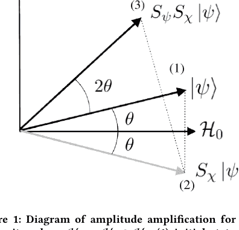

# AIES '21：AAAI/ACM 人工智能、伦理与社会会议论文集 | 量子公平机器学习

## 摘要

本文首次开创了量子公平机器学习领域。我们对经典与量子公平机器学习算法之间的差异和相似性进行了比较分析，说明量子计算的独特特性如何改变在量子算法受公平性约束时所使用的度量、指标和补救策略。我们通过展示使用 `Grover` 搜索算法来满足施加于量子算法的统计平价约束，呈现了量子公平机器学习中的首批结果。我们提供了在 `ε`-容差范围内实现此类统计平价所需的迭代次数的下界。我们使用量子度量将经典的 `Lipschitz` 条件个体公平性标准扩展到量子设定。我们考察了当涉及量子信息处理和量子数据时，机器学习背景下典型公平性度量的后果。最后，我们提出了该新领域的研究开放问题和研究计划，该领域引起了计算机科学、伦理学和量子计算研究人员的兴趣。

## CCS 概念

- 计算方法学 → 机器学习；机器学习算法。

## 关键词

量子计算，公平机器学习

## ACM 参考格式

Elija Perrier. 2021. 量子公平机器学习. In Proceedings of the 2021 AAAI/ACM Conference on AI, Ethics, and Society (AIES ’21), May 19–21, 2021, Virtual Event, USA. ACM, New York, NY, USA, 11 pages. https://doi.org/10.1145/3461702.3462611

## 1 引言

量子计算和机器学习代表了过去半个世纪以来出现的两个最重要的计算科学领域。过去十年中，特别关注机器学习技术的伦理影响 [9, 10, 14]，推动了公平机器学习的发展。尽管量子计算和量子信息处理取得了重大进展 [5]，且量子设备的重要性日益增长，但对量子计算伦理的直接研究却很少，对量子计算的道德和哲学讨论有限 [1, 2]，或关于“量子霸权”一词是否恰当的争论 [21]。

尽管完全可扩展的容错 [23] 量子计算尚未实现，但中间尺度噪声可扩展量子计算设备的可用性意味着使用量子算法在量子设备上进行近期的计算正在成为现实。量子计算机的潜在能力在于 (i) 解决经典上不可处理的难题，以及更实际地 (ii) 解决虽然可处理但因资源限制而在经典上不可行的难题，这推动了其在机器学习中的应用。量子计算机可执行的任务范围广泛，如求解优化问题、模拟经典或复杂系统或建模高度复杂的系统，例如多智能体交互系统，这意味着涉及量子计算机的机器学习（和计算）很可能产生（并受制于）伦理考量。许多此类问题对经典计算而言是不可行的（即使可处理），因此在伦理上无问题。然而，由于量子计算提供的增强计算潜力，这些计算可能变得可行，从而拓展了可通过提供超越经典计算约束的计算能力而得以求解的优化问题的前沿。如果经典上不可行的优化问题在量子计算机上变得计算可行，那么此类计算的伦理就变得相关，且此类伦理必须在量子计算的性质下加以考虑。因此，对量子计算机上的公平机器学习和公平计算的研究是合理且必要的。

公平机器学习是最成熟的领域，旨在解决在受伦理（公平）约束条件下进行经典计算的理论和技术挑战。然而，迄今为止，尚未开展同等的研究来探讨伦理约束对量子计算的技术影响。本文旨在通过阐述量子公平机器学习来填补这一空白（另见关于一般伦理量子计算的同期工作 [22]）。正如我们下面所详述的，量子计算的独特方面（包括其固有的基于测量的概率性、相干叠加态的可用性、计算动力学限于幺正演化、无克隆定理等）意味着计算方式与经典情形不同。因此，在量子计算机上为公平目标进行约束优化时所使用的度量、衡量、电路以及方式表现出重要差异。

例如，与经典数据不同，量子数据表示为希尔伯特空间 `ℋ` 上的向量。经典数据原则上可以直接访问和操作。量子数据在叠加态下不能直接访问，而必须间接操纵。与经典计算动力学不同，量子计算必须根据薛定谔方程幺正演化。量子态不是由直接概率表征，而是由复值振幅表征，这些振幅决定了测量量子态 `|ψ⟩` 时获得某一结果的概率。与经典计算不同，量子情境下操作的顺序很重要，由非对易算符（或李括号）`[A, B] ≠ 0` 表示。量子计算中的距离度量也不同。量子计算还拥有重要的非经典资源，如纠缠，经典上没有对应物。因此，公平量子机器学习的理论研究和实际实现要求研究人员理解这些计算差异的含义，进而理解这些差异如何影响 (a) 公平机器学习技术适用于公平量子计算的程度以及 (b) 开发新的量子特定技术以解决伦理量子优化问题的必要性。

### 1.1 结果与贡献

本文的结果和贡献如下。

- (1) 我们提出了首批表征公平机器学习在量子设备上进行与经典对应物相比的差异或相似性的结果。
- (2) 我们提供了公平机器学习在预处理、在线处理和后处理阶段的一系列关键结果的量子类比，如公平性标准和衡量以及满足公平性约束的补救策略。
- (3) 我们提出了量子公平机器学习中的首批技术结果，展示了使用 `Grover` 量子搜索算法使量子算法在 `ε`-容差内实现统计平价。
- (4) 我们提出了 `Lipschitz` 条件个体公平性标准的量子类比，以量子度量和希尔伯特空间中量子向量上的幺正算符表示。
- (5) 我们列出了量子信息处理、机器学习和伦理 [22] 研究人员应在其研究计划中考虑的开放性问题。

### 1.2 结构

本文的结构如下。第一部分总结了与公平机器学习相关的量子信息处理的关键特征，包括量子公设、密度矩阵形式、测量统计、无克隆定理和开放系统。一般而言，量子与经典计算的接口可根据数据和处理被归类为量子 (Q) 或经典 (C) 的量子-经典象限来有用地分类 [3, 25]。我们关注 CQ 情形，即经典数据输入受量子信息处理。我们回顾了使用基、振幅、样本和动态编码策略将经典数据编码到量子态 `|ψ⟩` 的方法。我们考察了使用量子算法求解受公平性约束的优化问题，以及这些计算中特有的量子方面（如果有的话）对典型公平机器学习公平性标准的影响。第二部分，我们对典型公平机器学习特征在计算在量子设备上进行时如何不同进行了比较分析。我们明确考察了 FML 算法的一系列关键特征的量子类比，包括基于群的公平性度量（平价、混淆矩阵度量、校准等）、个体公平性度量（例如 `Lipschitz` 条件 [14] 问题）和补救策略（如删改、盲化、采样、数据转换、重标记、扰动和约束优化）。我们讨论量子信息处理如何使 FML 中的现有技术相同、不同以及需要修改。我们讨论了独特量子公平计算的类型，并提出了机器学习算法的 `Lipschitz` 条件个体公平性约束的量子类比。第三部分，我们给出了如何使用 `Grover` 著名的量子搜索算法 [16] 的改编（振幅放大）来满足公平统计平价标准的明确示例，并给出了为此所需幺正算法应用次数的下界。第四部分，我们讨论开放性问题并为量子 FML 提供研究计划建议。

## 2 第一部分：量子信息处理

在本节中，我们回顾了量子信息与其经典对应物在公平机器学习典型问题相关方面的关键区别特征。我们关注与理解量子情境下的公平机器学习相关的量子信息处理方面，如叠加态、量子纠缠、量子计算固有的概率性和基于测量的性质。我们首先概述主要量子公设。

### 2.1 公设

量子信息处理的特点是信息表示和处理上的约束，这些约束源于量子力学的奠基性公设，我们按如下方式列出 [20]：

- (1) **状态空间**：量子系统完全由复值向量空间希尔伯特空间 `ℋ` 内的（单位）态向量描述。通常对于我们的表述，我们将处理任意两能级量子系统（二维状态空间）的量子比特，具有正交归一基 `{|0⟩, |1⟩}` 的任意态向量：

```
|ψ⟩ = a |0⟩ + b |1⟩   (1)
```

具有单位向量上的通常归一化条件 `⟨ψ|ψ⟩ = 1`（即 `|a|² + |b|² = 1`），其中 `a, b ∈ ℂ` 是测量 `|0⟩`、`|1⟩` 结果的振幅（其中 `⟨ψ|ψ′⟩` 表示量子态 `|ψ⟩`、`|ψ′⟩` 的内积）。在密度算符形式中，系统通过作用于系统的状态空间（使得如果系统以概率 `p_i` 处于状态 `ρ_i`，则 `ρ = Σ_i p_i ρ_i`）。在本文中，我们假设标准正交计算基 `{|0⟩, |1⟩}`，使得 `⟨1|0⟩ = ⟨0|1⟩ = 0` 且 `⟨1|1⟩ = ⟨0|0⟩ = 1`。

- (2) **演化**：封闭量子系统（为简单起见，本文重点关注）在时间 `Δt = t₁ − t₀` 上通过幺正变换 `U(t) = exp(−iH(t))` 演化，即其中此类幺正算符代表描述演化的含时薛定谔方程的解：`iℏ d|ψ(t)⟩/dt = H(t) |ψ(t)⟩` (2)，其中为方便起见 `ℏ` 设为 1，且 `H(t)` 表示封闭系统的线性厄米算符（哈密顿量）。量子系统的动力学完全由作用于态 `|ψ⟩` 的哈密顿量算符描述，使得 `|ψ(t)⟩ = U(t) |ψ(t = 0)⟩`。在密度算符表述中，这表示为 `ρ(t) = U(t) ρ(t₀) U(t)†`。通常求解薛定谔方程的连续形式是难以处理或不可行的，因此使用离散近似作为离散量子线路（其中每个门 `U_i` 在足够小的步长 `Δt` 下运行），例如通过 `Trotter-Suzuki` 分解。

系统的哈密顿量 `H(t)` 是在数学上表征系统动力学的最重要的工具，编码了编码到量子态中的数据的计算处理，并指定量子计算如何被控制。在计算过程或结果对伦理标准重要程度上（例如，了解导致偏见或歧视性结果的动力学，或确保量子环境中的公平表示学习），它们通常必须编码在量子系统的哈密顿量中。幺正演化是保持量子相干性和概率的必要条件（它们产生了量子系统的增强计算能力）。因此，量子计算中计算子程序的修改必须间接进行，通过对哈密顿量的调整来引导量子系统使用幺正演化朝向目标态。

- (3) **测量**：量子测量被表述为测量算符集合 `{M_m}`，其中 `m` 索引测量的结果（例如能量级或状态指示符）。测量 `|ψ⟩` 时结果 `m` 的概率 `p(m)` 由此类算符作用于态表示，使得 `p(m) = ⟨ψ|M_m† M_m|ψ⟩`（另选地，`p(m) = tr(M_m† M_m ρ)`），其中后测量态 `|ψ′⟩` 给出为：`|ψ′⟩ = M_m |ψ⟩ / √⟨ψ|M_m† M_m|ψ⟩` (3)。测量算符集合 `Σ_m M_m† M_m = I`，反映了测量结果的概率性。在更高级的处理中，`POVM` 形式主义更完整地描述了系统的测量统计和后测量态。在那里我们定义一组正算符 `{E_m} = {M_m† M_m}` 满足 `Σ_m E_m = 𝕀`，以一种方式给出我们一组完整的正算符（此类形式主义比单纯依赖投影算符更一般）。

由于我们对概率分布而不是单次测量中的单个概率感兴趣，我们通过 `Born` 规则使用迹计算结果的概率分布 `p(E_i) = tr(E_i ρ)`。该表述对于下面讨论的量子公平度量很重要。

- (4) **复合系统**：希尔伯特空间中的态 `|ψ⟩` 可以是复合系统，描述为各组成部分物理系统的态空间的张量积，即 `|ψ⟩ = ⊗_i |ψ_i⟩`。我们在这里也提到开放量子系统的重要性，其中总系统哈密顿量 `H` 可以分解为 `H = H_S + H_E + H_I`，由封闭量子系统哈密顿量 `H_S`、环境哈密顿量 `H_E`、相互作用哈密顿量 `H_I` 组成，这通常是在量子背景下建模噪声的方式。开放量子系统通常由主方程建模（超出本入门论文的范围），但它们与量子公平机器学习特别相关，因为对系统/环境相互作用的耗散效应的建模，或工程耗散以模拟神经网络的耗散特性（见 [25]）在某些情况下将需要开放系统的表述。

理解下面形式主义所需的其他关键概念包括：
- (a) **相对相位**，对于量子比特系统，其中振幅 `a` 和 `b` 因相对相位而不同，如果 `a = exp(iθ)b`，`θ ∈ ℝ`（如下所述，经典信息通常编码在基态例如 `|0⟩`、`|1⟩` 以及相对相位中）；
- (b) **纠缠**，某些复合态（称为 `EPR` 或 `Bell` 态）可能纠缠。例如，对于两量子比特态：`|ψ⟩ = (|00⟩ + |11⟩)/√2` (4)，对第一个量子比特测量 0 必然意味着对第二个量子比特的测量将导致后测量态 `|0⟩`，即每个量子比特的测量统计相关。纠缠态不能写成组成部分态的张量积，即 `|ψ⟩ ≠ |ψ₁⟩|ψ₂⟩`；
- (c) **期望**，算符 `A`（例如测量）的期望值可以写成 `E(A) = tr(ρA)`；
- (d) **混合态和纯态**，量子系统其态精确已知为 `|ψ⟩`，即其中 `ψ = |ψ⟩⟨ψ|` 为纯态，而当对系统处于何种态存在（认识论）不确定性时，我们将其表示为混合态，即 `ρ = Σ_i p_i ρ_i`，其中 `tr(ρ²) < 1`（因为所有 `p_i < 1`）；
- (e) **可交换性**，当对系统执行两次测量时，结果与经典情况不同，如果它们不可交换则为顺序依赖的，即如果 `[A, B] ≠ 0`；
- (f) **不克隆**，与经典数据不同，量子数据不能被复制（为此需要测量，这会坍缩态，破坏编码在振幅中的信息的相干叠加）。

我们省略了与量子公平机器学习相关的其他大量特征，包括纠错码（设计用于限制或自校正错误以实现容错量子计算的编码机制），虽然相关，但超出了本文的范围。

## 2.2 量子度量

度量在公平机器学习中发挥核心技术作用，从根本上是构建公平技术定义的基石。量子信息处理的度量与经典对应物相关但不同。这意味着将公平机器学习度量翻译到量子领域需要不同（尽管相关）的度量形式主义。如 [9, 11, 12] 中所述，经典公平度量根据特定目标、优化目标和数据源而变化。度量和距离度量是量子信息处理的重要特征，根据上下文部署多种度量。对于经典比特串，一般使用多种经典信息距离度量 [20]。对于量子背景下的公平机器学习，其中输入或输出与函数的相似性对公平度量很重要（例如下面 `Lipschitz` 条件公平度量），经典距离的量子推广适用。由于信息编码在量子态中，因此量子距离度量适用。

- (1) **汉明距离**：两个比特串不相等的位置数。汉明距离在纠错背景下很重要（与 FML 相关，因为量子 FML 将需要将数据编码在码中以实现容错）。
- (2) **迹距离或 L1-Kolmogorov 距离**：给定两个概率分布 `{p_x}`、`{q_x}`，我们有 `D(p_x, q_x) = ½ Σ_x |p_x − q_x|`（用于 [14]，由于满足度量公理而是有效距离。对于由密度矩阵 `ρ`、`σ` 表示的量子态 [20]，其迹距离由下式给出：`D(ρ, σ) = ½ tr|ρ − σ|` (5)，其中 `|ρ| = √ρ†ρ` 取为正平方根。迹距离具有在幺正变换下保持不变的有益特性。
- (3) **保真度**：是评估态或算符相似性的常用度量，给定为 `F(ρ, σ) = tr√[ρ^{1/2} σ ρ^{1/2}]`。与迹距离一起，它是量子计算中相似性最重要的度量之一。保真度可通过例如计算角度 `ζ = arccos F(ρ, σ)` 解释为度量。它与迹距离相关 via `D(ρ, σ) = √[1 − F(ρ, σ)²]`。
- (4) **量子相对熵**：它是香农熵的量子类比，给定为 `S(ρ) = −tr(ρ log ρ)`，其中（二元）交叉熵的量子类比为：`S(ρ||σ) = tr(ρ log ρ) − tr(ρ log σ)` (6)。这两个度量提供了进一步的相似性度量基础，用于确定量子背景下是否满足公平标准。

## 2.3 在量子系统中编码数据

将量子算法应用于求解涉及量子数据的优化问题的一步是把此类经典数据编码到量子系统中，这一过程称为 **状态制备**。编码数据属于典型 FML 分类法中的预处理阶段。标准编码方法包括 [25]：(a) 基编码，(b) 振幅编码，(c) `qsample` 编码和 (d) 动态编码。

- **基编码**：编码经典信息，通常涉及将数据转换为经典二进制比特串 `(x1, ..., xd)`，`b_i ∈ {0,1}`，然后将每个比特串映射到复合系统的一组量子比特的基态。例如，对于 `x ∈ ℝ^N`，例如一组小数，被转换为 `d` 维比特串（例如 `0.1 → 00001...`，`−0.6 → 11001..`）适当归一化使得 `x = Σ_k^d (1/2^k) x_k`。序列 `x` 然后通过 `|ψ⟩ = |00000111001⟩` 表示（见 [25]）。
- **振幅编码**：将归一化经典信息关联，例如对于 `n` 量子比特系统（具有 `2^n` 个不同的可能（基）态 `|j⟩`），归一化经典序列 `x ∈ ℂ^{2^n}`，`Σ_k |x_k|² = 1`（可能仅有实部）与量子振幅 `x = (x1, ..., x2^n)` 可以编码为 `|ψ_x⟩ = Σ_j^{2^n} x_j |j⟩`。

其他基于样本的编码示例（例如 `Qsample` 和 **动态** 编码也相关但此处未涉及。从经典机器学习角度看，此类编码方案还使特征和标签都能编码到量子系统中。

## 2.4 量子测量与学习

### 量子测量


量子测量是任何伦理量子计算计划不可或缺的部分。量子系统不能直接访问。相反，有关量子系统的信息取决于测量，其结果是测量结果的概率分布。对于机器学习背景，第一个关键区别是量子计算中的测量结果本质上是`概率性的`。与经典计算不同，经典计算中可模拟随机过程，量子计算是`必然地`随机的，使得测量结果表示为使用`POVM`获得的概率分布。其次，通常只能采样`ℋ`的子空间，因此高阶量子系统的完整概率分布可能无法获得，增加额外不确定性。第三，当基态不正交时，可以证明这些态无法可靠区分（见[20]），这会影响例如以测量其度量距离所必需的方式区分态的能力，从而是否满足公平约束。

## 量子学习

量子算法的第二个不同特征在于量子`学习`的本质。人们如何学习关于量子系统并将学习策略作为对量子系统的测量或查询的一部分部署。映射经典`FML`到量子计算的挑战之一出现在机器学习背景下。量子信息（包括编码在量子态中的经典信息）的性质意味着典型的学习协议，例如`反向传播`，并不直接适用，因为量子信息不能像神经网络权重算符那样直接更新。例如，经典`反向传播`算法的使用需要经典参数化，例如幺正`U(θ)`（其中`θ ∈ ℝ`），其中测量结果与演化这些参数的经典输入之间的在线或离线反馈，从而幺正算符以及系统的量子态被实现[25, 29]。更广泛地，量子算法形式主义通常关注于找到求解一个目标，然而算法或量子系统‘学习’或‘更新’的方式不同（例如，参见基于量子退火的`QAOA`[15]）。在本文中，我们将此类量子学习算法纳入`QFML`的含义中，尽管其理论和实现细节与混合经典-量子电路不同。

## 3 第二部分：量子情境中的经典公平性度量

在本节中，我们比较量子计算的独特特征如何影响经典公平机器学习技术在量子环境中的适用性。为方便起见，我们采用了`Caton`等人[9]和`del Barrio`等人[12]近期综述中提出的分类法。

### 3.1 公平性度量

公平性的定义在`FML`文献中多种多样。在此，我们在介绍量子公平的量子类比之前，先简要回顾经典公平（针对机器学习）的主要类别。遵循[9]，公平性定义可分为平价公平、基于混淆矩阵的公平、校准公平。

- (1) 平价指标。在分类情境中，平价指标比较不同群体间正例率`P(Y = 1)`的平价。其包括：（a）统计平价，即正向分类的相等（因此）概率`P(Y = 1|g_i) = P(Y = 1|g_j)`，不考虑群体差异；（b）差异影响，被归类为正标签的概率，通常考虑群体间的比率，即`P(Y = 1|g_i)/P(Y = 1|g_j)`，其中公平要求比率高于阈值（例如80%）。

- (2) 基于混淆矩阵的指标。基于混淆矩阵的指标考虑其他典型度量，如真正率（`TPR`）、真负率（`TNR`）、假正率（`FPR`）和假负率（`FNR`），提供更丰富的公平性和歧视分析。关键指标包括：（a）机会均等，其中各组间的`TPR`相同`P(Y = 1|y = 1, g_i) = P(Y = 1|y = 1, g_j)`；（b）均等化几率（条件程序准确性相等），其中也考虑`FPR`，要求在组`g_i`、`g_j`条件下的假正率和真正率的概率相等；（c）整体准确性相等关注正确（真正例`TP`和真负例`TN`）的整体百分比`(TN + TP)/(P + N)`，其中公平性度量[4]被相对化以要求组内准确性相等；（d）条件使用准确性相等通过要求在正/负预测下（正/负）分类的概率相等来评估预测值，即`P(y = 1|Y = 1, g_i) = P(y = 1|Y = 1, g_j)`，且`y = 0`情况类似；（e）处理平等，每个组上条件的`FNR`与`FPR`的比率应相等；（f）均等化威慑，要求组条件下的`TPR`与`FPR`之差相等；以及（g）条件机会均等，适用于数据从分布`y ~ D`中抽取的情况，此类公平性度量要求在组条件、`y`低于阈值`τ`且数据满足属性`A = a`时，预测高于某阈值`τ`的概率相等（形式为`P(ŷ > τ|g, y < τ, A = a)`）。

- (3) 校准。第三种方法考虑预测概率分数`S`。此类方法包括：（a）测试公平性/校准，其中对于不同组的成员，相同的预测概率分数应产生相同的实际被分类概率，即`P(y = 1|S = s, g_i) = P(y = 1|S = s, g_j)`；（b）良好校准，与测试公平性校准相同，但分类概率必须等于`s`本身。

- (4) 基于分数的指标。最后，基于期望值的基于分数的指标也是文献中的一个特征：（a）正/负类平衡，其中公平性被表征为期望预测分数的相等性，该相等性应在预测分数和组条件下成立；以及（b）贝叶斯公平性度量。

此类公平性定义通常基于概率分布之间的等价性或相等性，其差异在于此类概率的条件是什么。在量子情境中，测量结果产生所选测量算符上的（本征值）概率分布。这些进而被抽象为量子态`|ψ⟩`，其位于希尔伯特空间的子空间中`|ψ⟩ ∈ H_i ⊆ H`。量子公平机器学习中的公平性标准必须体现在可实现此类公平性标准的可用测量算符（或`POVM`）集合中。这促使我们提出第一个量子公平定义。

**Definition 1: Quantum Fairness.** Given a suitable `POVM {E_m} = {M_m† M_m}`, vectors in `H` and quantum state `|ψ⟩ ∈ H` (i.e. `ρ`), the `POVM` partitions `H` (and states) into (possibly disjoint) subspaces `H_m ∈ H_m`. A state `|ψ⟩` satisfies quantum fairness with respect to operators `E_m` that partition the Hilbert space if `|ψ⟩` is equally likely to reside in each subspace `H_m`, that is:

```
⟨ψ|M_m† M_m|ψ⟩ = ⟨ψ|M_n† M_n|ψ⟩   m ≠ n
tr(ρ M_m† M_m) = tr(ρ M_n† M_n)
```

请注意，我们假设`ρ = Σ_i ρ_i`，其中`ρ_i`在量子态中编码个体数据。此一般公平性定义规定`|ψ⟩`位于每个子空间`H_m`内的概率相等。满足分类`m`等价于`|ψ⟩`位于与产生测量（分类）`m`的测量`POVM`算符`E_m`相关的划分`H_m`中。

条件概率，其中例如跨多个分类的平价（公平性），如上所述的类型，被重新表述为算符对`|ψ⟩`的测量序列。例如，关于分类器`{G_i}`、`{Y_k}`的`n`个组之间的基本统计平价，分类结果（可能是二元或多元的）分别为`g_i`和`y_k`，首先需要测量`G_i`，其结果`g_i`可解释为组成员`|ψ⟩ ∈ H_{g_i}`，随后是测量算符`Y_k`，其实现`y_k`表示分类。此类测量的结果将产生联合概率分布（与经典情况相同），从而可以评估是否满足多分类公平性标准。然而请注意，独特于量子情况而不同于经典情况，算符的对易关系（以及其应用顺序）很重要：如果算符对易`[G_i, Y_k] = 0`，测量顺序无关紧要，而如果`[G_i, Y_k] ≠ 0`，则会相关。在后一种情况下，这意味着获得的联合分布将取决于`G_i`或`Y_k`先应用。在本文中，为简单起见，我们假设测量算符可对易。我们在下文第三部分中应用的公平性定义即为此。

### 3.2 个体与反事实公平

个体公平的定量度量已进行了数十年的广泛研究。其中包括：（a）`Lipschitz`条件公平[14]通过施加个体统计平价，要求由某个函数或算法`f : X → Y`对相似个体`x1, x2 ∈ X`产生的输出`f(x1), f(x2) ∈ Y`（通常以分布表示）之间的差值（通过度量距离`d_Y`衡量）是有界函数（例如常数倍`K`），该函数取决于这些个体本身的度量距离`d_X`，即`d_Y(f(x1), f(x2)) ≤ K d_X(x1, x2)`。该条件通常以优化问题中的约束形式表达；（b）反事实公平，其中给定因果模型`(U, V, F)`（`U`为潜在背景变量，`V = S ∪ X`为可观测变量，`S`为敏感变量，`F`为结构方程模型），公平要求如果敏感变量发生变化，个体结果是等价的；（c）广义熵比较个体化预测与平均预测准确性（参见[26]，其中公平性度量源自经济学中的公理化方法）。在量子设定中，结果也是概率分布，但可用度量更有限，其中度量必须比较量子输入态（`d_X(x1, x2)`的量子类比）的相似性以及最终输出态。与公平性的经典`Lipschitz`条件[14]不同，我们无法在态演化`U |ψ(t = 0)⟩`在`t = 0`时之前测量同一量子态（以确定编码在量子态中的个体数据的度量相似性），然后再测量，因为`|ψ⟩`将坍缩为后测量态(3)。通过相同的态制备过程，我们可以初始测量，然后依赖于创建可演化的相同态。这促使了第二个定义。

**Definition: Quantum Lipschitz Fairness.** We are given a set of input states `ρ_i = ρ_i(t = 0)` and unitary quantum algorithm `𝒜(t)` evolving the state to output state after time `t` given by `ρ_i' = 𝒜(t)† ρ_i 𝒜(t)`. The quantum equivalent of input metrics `d_X` and output metrics `d_Y` are quantum metrics `D_X, D_Y` such as trace distance `D(ρ_i, ρ_j) = ½|tr|ρ_i - ρ_j|`, which is a way to measure state similarity. The quantum analogue of individual fairness (similar output classification/measurement for similar input classification/measurement) is then expressed as a Lipschitz constraint: `D_Y(ρ_i', ρ_j') ≤ K(D_X(ρ_i, ρ_j))` (9) where `D` is a quantum metric described above, such as trace distance, `0 < K ≤ 1` and `ρ' = 𝒜† ρ 𝒜` i.e. the state after application of the algorithm `𝒜`. Alternatively, one can compare the distance between sets of inputs and sets of outputs via an entropy-based measure such as quantum relative entropy above such that the quantum Lipschitz condition becomes:

```
|tr(ρ_i log ρ_i) − tr(ρ_i log ρ_j)| ≤ K |tr(ρ_i' log ρ_i') − tr(ρ_i' log ρ_j')| (10)
```

A third alternative is to specify two `POVMs` (i) `{S_s}` which measure input states after preparation but before application of `𝒜` and (ii) `{E_m}` which measures outputs and compare probability distributions for states `ρ_i, ρ_j` and `ρ_i', ρ_j'` with respect to those `POVMs`. For convenience, the `POVMs` give rise to a distribution over output measurements of both inputs and outputs (one must repeatedly prepare identical input states for this process). In each case, one must select an appropriate quantum metric to compare distances between input states `ρ_i` and output states `ρ_i'`.

### 3.3 缓解不公平

`FML`文献中用于缓解或补救不公平的典型技术多种多样。经典与量子`FML`之间的关键差异之一在于可以采用的不同缓解策略。我们在下面更全面地探讨这些（以二元分类为例），包括预处理、模型处理和结果后处理以缓解偏差。典型方法包括以下

- (1) 盲法。首先，（a）盲法，其中分类器（和算法）对受保护属性‘盲’，这些属性不是计算中的直接输入或特征，要么通过‘免疫’（针对/对敏感变量）要么通过省略（这可能降低模型准确性）。一个挑战是敏感变量的代理可能仍然存在（或被重建），导致偏差增加或歧视被掩盖。无法直接访问量子过程的信息将使在量子环境中应用类似技术变得困难。其次，（b）因果方法，其中敏感变量和非敏感变量之间存在因果模型（如图形或概率模型），包括添加或改变训练数据以满足特定公平性标准或去偏，尽管其有效性各不相同。量子因果模型提供了一个可能适用的量子类比。

- (2) 采样与子群。第三种方法是（c）采样和子群分析，重点关注（i）改变训练数据以消除不公平或偏差的采样策略（如在决策边界附近过采样或在远离此类边界的数据上进行稀疏化）以及（ii）通过子群分析等方法识别被分类器歧视的群体或子群。采样理论和策略对量子计算至关重要，因为人们很少甚至从未有能力查询整个希尔伯特空间`ℋ`。我们在本工作中假设在简化设定中我们确实有这种访问，然而，了解量子计算中的采样技术如何用于满足公平性标准是一个开放且重要的研究方向。

- (3) 其他技术。其他缓解技术，其在量子环境中的适用性促使进一步研究，包括：（a）重新标记和扰动，将扰动噪声纳入数据集以改善泛化[13]；（b）重新加权，其中实现公平性满足occurs通过调整量子振幅（我们在下文第三部分探讨此问题）；（c）正则化与约束优化。关于约束优化已有大量文献，例如在量子控制背景下[24]，其中特别是公平性约束（以及正则化项）被编码在哈密顿量`H`中，以便将量子系统的可控部分引导向期望的目标态。

## 4 第三部分：通过振幅放大实现统计均等

在本节中，我们演示如何使用`Grover`量子搜索算法的振幅放大来实现组（或子组）之间统计均等的一种度量。该示例旨在说明特定量子算法技术如何用于特定的`FML`目标或优化。实际上，正如上文所述，统计均等很可能仍意味着结果在其他某些度量下仍然不公平。虽然统计均等作为公平性度量的适当性在文献中本身存在争议，但在许多背景下，包括法理学[8]，它仍然是一个相关的度量。

### 4.1 数据集与统计均等

我们首先考虑一个包含两个个体数据组的数据集，二值化为长度为`m`的比特串，即`(x1,...,xk,...,xm)`，对应于指示特征`k ∈ M`的集合`M`，其中`|M| = m`。每个比特编码个体是否具有特定属性，即指示特征（对于此简单情况，我们可以考虑编码为指示变量的有序或连续变量，例如年龄50意味着年龄范围50至69年的指示变量为1，而所有其他年龄区间指示符为0）。设其中一个特征，`k = s`，指示个体具有特征（属性）`s`，从而成为受保护类别（或子组）`S`的成员。为简单起见，设数据集`D`可划分为不相交的子集，使得`D = S ⊕ G`，其中`G`包含不具有受保护属性`s`的个体。优化问题是对`S`和`G`的成员进行分类，以实现统计均等，而不移除受保护变量（原因如上所述，包括准确率下降）。

为说明目的，设`m = 3`，其中第一个比特在`x1 = 1`时指定受保护类别`S`的成员资格，另外两个特征为非受保护属性。个体的可能组合（以`i`索引）列于表1。

我们假设存在一个量子算法，我们将其（遵循[7]）指定为`A`作为函数`f(x)`作用，旨在解决特定优化问题，例如对哪些个体提供某种福利，如住房贷款进行分类。使用量子（而非经典）算法的动机在此示例中并不重要（可能是量子算法更易于解决感兴趣的优化问题）。原始优化问题本身并未提及统计均等或其他均等度量的衡量。应用`A`的唯一目标是通过最优分类最大化效用。`A`可能是什么的具体细节，以及对于量子方法而言，什么类型的量子算法可能实现此类函数保持抽象，不过我们假设（a）量子算法`A`不使用量子测量且（b）此类问题的经典输入数据即`(x1, x2, x3)`（`i`）编码在态`|x_i^n>`中（注：当在ket中使用时，`x_i^n`索引三量子比特态，其中`n = 3`，不应与我们通过数值下标`x1`、`x2`、`x3`等指定的单个量子比特混淆）然后（`ii`）置于叠加态。示例可能包括使用量子变分本征求解器的典型量子算法学习混合模型，例如参见[27]。

| i（索引） | x1（受保护） | x2 | x3 | \|x_i^n> |
|---|---|---|---|---|
| 1 | 1 | 1 | 1 | \|111> |
| 2 | 1 | 1 | 0 | \|110> |
| 3 | 1 | 0 | 1 | \|101> |
| 4 | 1 | 0 | 0 | \|100> |
| 5 | 0 | 1 | 1 | \|011> |
| 6 | 0 | 1 | 0 | \|010> |
| 7 | 0 | 0 | 1 | \|001> |
| 8 | 0 | 0 | 0 | \|000> |

表1：个体特征`b_k`的基编码到量子态`|x^n>`

### 4.2 特征编码

第一步是将经典数据按表1所列进行基编码，映射输入`(x1, x2, x3) → c |x1 x2 x3>`，`x ∈ {0,1}`。这里`c`表示态的振幅（当对全部三个量子比特进行测量时，使该态以概率`|c|^2`作为输出）。在将数据集`D`基编码到量子比特并置于等叠加后，系统的态`|ψ>`将为：

```
|ψ> = 1/2^n Σ_{i=1}^{2^n} |x_i^n> (11)
```

其中任意态的振幅为`1/2^n`。下一步是应用量子优化算法`A`，其必须是不带测量的幺正算法。应用`A`后，`|ψ>`的形式为：

```
|ψ'> = Σ_{i=1}^{2^n} c_i |x_i^n> (12)
```


其中 $c_i \in C$ 表示态 $|x_i^n\rangle$ 的振幅，受概率测度约束 $\Sigma_i |c_i|^2 = 1$。算法 $\mathcal{A}$ 通过调整振幅 $c_i$ 使其不再相等来优化某个目标。为了优化特定目标，然后在计算基中对每个量子比特进行测量。如果算法 $\mathcal{A}$ 确实最优，则从对 $|\psi'\rangle$ 重复测量获得的最可能测量结果将是振幅最高（从而测量概率最高）的那些，反映了满足所讨论目标的最优态选择以及由此产生的个体。然而这样做不太可能满足受保护类别个体（$x_1 = 1$）与非受保护类别个体（$x_1 = 0$）之间的统计均等公平性约束。

如果我们假设存在一个（oracle）函数，可在测量前指示态 $|x_i^n\rangle$ 是否处于受保护类别（即第一个量子比特 $x_1 = 1$ 或 $0$），定义为：

$$\chi(|x_i^n\rangle) = \begin{cases} 1 & x_1 = 1 \\ 0 & x_1 = 0 \end{cases} \tag{13}$$

则为实现统计均等，我们希望近似相等化测量受保护子类别 $(x_1 = 1)$ 中的态与未受保护子类别 $(x_1 = 0)$ 中的态的条件概率，即：

$$Pr(|\psi\rangle \mid x_1 = 0) \approx Pr(|\psi\rangle \mid x_1 = 1) \tag{14}$$

一种方法是简单地通过后处理随机相等化结果，但这忽略了具有 $x_1 = 1$ 的某些态组合会比其他组合更能最小化 $\mathcal{A}$ 中嵌入的损失函数这一事实（即，具有 $x_1 = 1$ 的某些态选择会比其他选择更优）。因此我们的问题是一个典型的约束优化问题，在此情况下是在某些伦理强制的公平性标准背景下（这里是近似统计均等）。我们假设优化算法 $\mathcal{A}$ 以忽略公平性的方式运行，已将振幅设置为满足优化问题。然后我们应用振幅放大以在 $\mathcal{H}$ 中演化具有 $x_1 = 1$ 的初始态，以最小化目标损失（相对于 $\mathcal{A}$），通过与实现统计均等的其他手段进行比较，例如忽略 $x_1$ 并在两个分类之间随机相等化结果，这与通过 $\mathcal{A}$ 进行优化的目标不一致。

### 4.3 振幅放大

为解决约束优化问题，我们应用来自文献 [6, 7, 16, 17, 25, 28] 的振幅放大方法，部分采用文献 [20] 中的表述。振幅放大是用于产生二次加速的技术的一种推广，其中 Grover 算法 [16, 18]（理论量子算法设计中的开创性成果之一）是最著名的例子。该方法（详见文献 [7]）由一系列量子数据变换组成，可放大满足某些优化标准（如搜索标准）的量子态的振幅。通过放大期望量子态的振幅，此类态被测量的概率因此增加。

对于振幅放大，我们假设存在一个分类器（oracle），它不相交地划分（分类）我们希尔伯特空间中的量子向量 $|\psi\rangle \in \mathcal{H}$ 为相互正交子空间 $\mathcal{H}_1$ 的直和，$\mathcal{H}_1$ 为被分类为 1 的量子态空间，$\mathcal{H}_0$ 为被分类为 0 的量子态空间。此类态的划分取决于该分类器，即 oracle $\chi$，其形式为幺正算子。oracle 指示我们搜索问题 $f(x_1) = 1$ 的解。找到 $x_1 = 1$ 可表示为：

$$\chi : \mathcal{H} \to \mathcal{H}_1 \tag{15}$$

$$|x\rangle \mapsto (-1)^{f(x)} |x\rangle \tag{16}$$

$x_1 = 1$ 以及 $x_0 = 0$ 的另一个。我们根据其所在的子空间如下表示 $|\psi\rangle$：

$$\{|\psi_1\rangle\} = \{|\psi\rangle \mid |\psi\rangle \in \mathcal{H}_1\} \tag{17}$$

$$\{|\psi_0\rangle\} = \{|\psi\rangle \mid |\psi\rangle \in \mathcal{H}_0\} \tag{18}$$

统计均等 (14) 然后在测量 $|\psi\rangle \in \mathcal{H}_1$ 与 $|\psi\rangle \in \mathcal{H}_0$ 的概率相等时实现。也就是说，在量子公平机器学习中，子组间的统计均等由 $|\psi\rangle$ 以相等概率占据由适用公平性标准分类（并划分）的希尔伯特空间区域来表示。这是一般不相交子组间统计均等的结果。在典型的振幅放大设置中，如应用 Grover 算法，基态初始化为均匀叠加，使得其振幅初始相同，这意味着在任一子空间中测量态的概率相等。我们的方法不同。我们希望在没有每个态均匀振幅的情况下将 $|\psi\rangle$ 演化到这种等概率态。

### 4.4 Grover 算法

了解此过程的更简单形式是有启发的，如文献 [20] 中所述。首先，我们将满足搜索标准的所有态的空间，即 $x_1 = 1$ 的态和 $x_1 = 0$ 的所有态表示为两个不同的和 $\sum_{x_1=1} |x^m\rangle$ 和 $\sum_{x_1=0} |x^m\rangle$。然后我们定义归一化态：

$$|\psi_1\rangle = \frac{1}{\sqrt{M}} \sum_{x_1=1} |x^m\rangle \tag{19}$$

$$|\psi_0\rangle = \frac{1}{\sqrt{N - M}} \sum_{x_1=0} |x^m\rangle \tag{20}$$

我们的态 $|\psi\rangle$ 可使用这两个态作为基表示为：

$$|\psi\rangle = \sqrt{\frac{M}{N}} |\psi_1\rangle + \sqrt{\frac{N - M}{N}} |\psi_0\rangle \tag{21}$$

为通过 $\theta$ 的旋转实现所寻求的放大，我们定义一个幺正算子（以保持量子相干性和概率测度） $Q(\psi, P) = S_\psi S_\chi$，使用算子：

$$S_\psi = 2 |\psi\rangle \langle\psi| - I \tag{22}$$

$$S_\chi = 2O - I \tag{23}$$



图 1：统计均等振幅放大的示意图，其中 $\mathcal{H} = \mathcal{H}_0 \oplus \mathcal{H}_1$。(1) 初始态 $|\psi\rangle$ 更接近 $\mathcal{H}_0$，目标是将向量旋转到两个子空间之间 $\pi/4$ 角。(2) $S_\chi$ 算符将 $|\psi\rangle$ 关于 $\mathcal{H}_0$ 轴反射：$|\psi\rangle \to S_\chi |\psi\rangle$。(3) 应用 $Q|\psi\rangle$ 使原始 $|\psi\rangle$ 向量旋转 $2\theta$。量子 $\varepsilon$-统计均等在 $Q = S_\psi S_\chi$ 的 $m = \lfloor \arcsin \sqrt{0.5 - \varepsilon} / (2\theta - \varepsilon) \rfloor$ 次迭代后实现。

### 4.5 通过振幅放大实现统计均等

在 $\mathcal{H}_1$ 中测量一个态的概率（即 $|\psi\rangle \equiv |\psi_1\rangle$ 的概率）为：

$$Pr(|\psi_1\rangle) = \sin^2((2k + 1)/2 \theta) \tag{26}$$

通过足够多次应用 $Q$，测量 $\mathcal{H}_0$ 和 $\mathcal{H}_1$ 中态的概率可以近似相等，使得：

$$\sin^2((2k + 1)/2 \theta) \approx \cos^2((2k + 1)/2 \theta) \tag{27}$$

Grover 算法放大振幅，使得测量 $|\psi\rangle \in \mathcal{H}_1$ 的态的概率显著增加。我们的方法略有不同：在我们的情况下，我们没有均匀叠加，因为我们假设算法 $\mathcal{A}$ 已根据某些优化标准加权了每个基态的振幅 $c_i$。在两个组之间实现统计均等意味着获得测量 $\mathcal{H}_1$ 或 $\mathcal{H}_0$ 中态的近似相等平均概率。然而，我们可以使用相同的技术来提升 $\mathcal{H}_1$ 的振幅，而不需要 $\mathcal{H}_1$ 中每个态的等概率。我们将在下面详细阐述示例，以阐明算法工作原理的技术细节。

为了放大振幅，我们定义投影算符，当应用于 $\mathcal{H}$ 时，它们通过以下方式投影出（保留）仅 $\mathcal{H}_1$ 中的那些态：

$$P = |1\rangle\langle 1| \otimes I \otimes I \tag{28}$$

正如使用密度矩阵形式所能看到的，该算符作用于第一个量子比特（其余部分未测量，如张量积中的恒等式所象征），当应用于 $|\psi\rangle$ 时仅产生 $x_1 = 1$ 的态。投影算符并未直接应用于态（因为它不是幺正的），而是与其它算符线性组合使用（见下文），以构造 oracle 幺正算符和期望的放大幺正算符。回顾上面描述的测量的基本原理，如果对 $|\psi\rangle$ 进行测量，则 $|\psi\rangle$ 处于 $x_1 = 1$ 的态的概率由振幅平方给出：

$$Pr(|\psi_1\rangle) = |c_{100}|^2 + |c_{101}|^2 + |c_{111}|^2 + |c_{110}|^2 \tag{29}$$

在我们的示例中，初始概率不会为 50%，因为 $|\psi\rangle$ 已事先受到 $\mathcal{A}$ 的作用，$\mathcal{A}$ 已调整了振幅。测量后的态 $|\psi'\rangle$ 为：

$$|\psi_1\rangle = (c_{100}|100\rangle + c_{101}|101\rangle + c_{111}|111\rangle + c_{110}|110\rangle) / \sqrt{|c_{100}|^2 + |c_{101}|^2 + |c_{111}|^2 + |c_{110}|^2} \tag{30}$$

放大算符 $Q(\psi,P) = S_\psi S_\chi$ 然后被描述为以下两个算符的乘积：

$$S_\psi = 2|\psi\rangle\langle\psi| - I \tag{31}$$

$$S_\chi = 2P - I \tag{32}$$

即等价于 (23)，其中 $O = P$。$Q$ 的幺正性意味着 $\mathcal{H}$ 具有由 $Q$ 的两个特征向量给出的标准正交基，我们可以用它将 $|\psi\rangle$ 分解为：

$$|\psi_\pm\rangle = 1/\sqrt{2} (|\psi_1\rangle \pm i |\psi_0\rangle) \tag{33}$$

请注意，与文献 [7] 相比，我们为了方便省略了 $|\psi_1\rangle$ 的 $1/\sqrt{a}$ 和 $|\psi_0\rangle$ 的 $1/\sqrt{1-a}$ 的预因子，将它们分别包含在态 $|\psi_1\rangle$ 和 $|\psi_0\rangle$ 的定义中。在该工作中，这样的 $a$ 被指定为测量 $|\psi_1\rangle$ 的概率，$1-a$ 为测量态 $|\psi_0\rangle$ 的概率。文献 [7] 中这些预因子的包含可以被认为取了 (30) 的分子。为了代数地展示幺正的旋转效应，我们注意到 (33) 的特征值由下式给出：

$$\lambda_\pm = e^{\pm i 2\theta} \tag{34}$$

利用它，我们可以将 $|\psi\rangle$ 表示为：

$$|\psi\rangle = - i/\sqrt{2} ( e^{i\theta}|\psi_+\rangle - e^{-i\theta}|\psi_-\rangle ) \tag{35}$$

这在形式上等价于 (24)，其中 $\theta \in [0,\pi/2]$。对 $|\psi\rangle$ 迭代应用 $Q$ $m$ 次得到：

$$Q^m|\psi\rangle = - i/\sqrt{2} ( e^{i(2m+1)\theta}|\psi_+\rangle - e^{-i(2m+1)\theta}|\psi_-\rangle ) \tag{36}$$

$$= \sin((2m+1)\theta) |\psi_1\rangle + \cos((2m+1)\theta) |\psi_0\rangle \tag{37}$$

每次应用 $Q$ 都使 $|\psi\rangle$ 旋转 $2\theta$ 角，从而将更多态投影到 $\mathcal{H}_1$ 中。$|\psi\rangle \in \mathcal{H}_1$ 的概率随后为 $\sin^2((2m+1)\theta)$，与 (26) 一致。每次 $2\theta$ 的旋转都会调整测量 $|\psi\rangle \in \mathcal{H}_1$ 和 $|\psi\rangle \in \mathcal{H}_0$ 的振幅。该过程的示意图在图 1 中给出。旋转有效地在每次幺正步骤中更新量子权重（振幅）。通过足够多次应用 $Q$，我们可以实现我们所称的（量子）$\varepsilon$-统计均等（即在 $\varepsilon$ 内的相等概率），使得：

$$|\langle\psi_1|\psi|\psi_1\rangle - \langle\psi_0|\psi|\psi_0\rangle| = \varepsilon \tag{38}$$

可以表示为：

$$|0.5 - \varepsilon| = \sin^2((2m + 1)\theta) \tag{39}$$

这种统计均等可以通过迭代应用振幅放大算符 $Q$ $m$ 次来近似，其中 $m$ 由下式给出：

$$m = \lfloor \arcsin \sqrt{|0.5 - \varepsilon|} / (2\theta) - \theta \rfloor \tag{40}$$

$\mathcal{H}_1$ 中态的振幅的成比例放大伴随着 $\mathcal{H}_0$ 中态的振幅的成比例减小，保持整体概率测度。由于 $Q$ 的幺正性，振幅的调整以测量并在测量后经典调整概率的方式保持量子相干性。

**子群均等**。我们上面描述的量子 $\varepsilon$-统计均等方法可以部署以实现任意数量的 $n$ 个不相交子群之间的统计均等，只要存在一个幺正算符 $O$ 将希尔伯特空间 $\mathcal{H}$ 分区为子空间的直和，使得：

$$O\mathcal{H} \mapsto \bigoplus_i^n \mathcal{H}_i = \mathcal{H}_1 \oplus \dots \oplus \mathcal{H}_n \tag{41}$$

在我们上面的工作示例中，只需将投影算符 $P$ 设置为投影到一个或多个量子比特的特定态，即可通过 $2P - \mathbb{I}$ 实现这样的算符。然而，与经典子群均等（见文献 [19]）一样，对一个子群集合进行析取分区可能会导致其他子群的统计差异。例如，将投影算符集合 $P$ 定义为：

$$P_{ab} = \mathbb{I} \otimes |a\rangle\langle a| \otimes |b\rangle\langle b| \tag{42}$$

其中 $a, b \in \{0, 1\}$ 将 $\mathcal{H}$ 分区为四个子空间，可以通过振幅放大实现统计均等。然而，这并不能保证对第一个量子比特的测量保持统计均等。

## 5 结论与未来工作

在本篇关于量子公平机器学习的首篇论文中，我们研究了涉及量子系统的公平机器学习的基础特征。我们列出了量子与经典技术之间（绝非详尽）的比较，这些技术与量子系统上的 FML 相关，阐明了 FML 技术在量子 FML 中是否可以直接转移的方式。我们提供了一些可在量子 FML 语境中使用的量子类比。作为实际示例，我们展示了使用 Grover 振幅放大算法实现子群统计均等，并列出了量子公平和量子 Lipschitz 条件（个体）公平的定义。作为一个新兴的跨学科领域，我们的工作延伸出众多开放性问题和潜在研究计划，包括：

- 形式化 FML 中现有技术的量子类比，
- 在噪声环境中探索 QFML，尤其是在耗散开放量子系统中，
- 研究使用量子特有资源（如纠缠）导致公平结果和计算如何不同以及
- 密码学和差分隐私的量子类比在满足量子计算公平性标准中的作用。

## 致谢

这项工作是作者在澳大利亚国立大学人文机器智能项目和悉尼科技大学量子软件与信息中心关于量子伦理研究的组成部分。作者感谢两所机构的同事提出的建设性意见和反馈。

## 参考文献

[1] Scott Aaronson. 2011. 为什么哲学家应该关心计算复杂性。 (Aug. 2011). arXiv:quant-ph/1108.1791

[2] Scott Aaronson. 2019. 观点 | 为什么谷歌的量子霸权里程碑很重要。 The New York Times (Oct. 2019). https://www.nytimes.com/2019/10/30/opinion/google-quantum-computer-sycamore.html

[3] Esma Aimeur, Gilles Brassard, and Sébastien Gambs. 2006. 量子世界中的机器学习。 In Advances in Artificial Intelligence (Lecture Notes in Computer Science). Luc Lamontagne and Mario Marchand (Eds.). Springer, Berlin, Heidelberg, 431–442. https://doi.org/10.1007/11766247_37

[4] Richard Berk, Hoda Heidari, Shahin Jabbari, Michael Kearns, and Aaron Roth. 2017. 犯罪司法风险评估中的公平性：现状。 Sociological Methods & Research (2017), 1–42. https://doi.org/10.1177/0049124121875233

[5] Sergio Boixo, Sergei V. Isakov, Vadim N. Smelyanskiy, Ryan Babbush, Nan Ding, Zhang Jiang, Michael J. Bremner, John M. Martinis, and Hartmut Neven. 2018. 表征近期设备的量子霸权。 Nature Physics 14 (June 2018), 595–600. https://doi.org/10.1038/s41567-018-0124-x

[6] Gilles Brassard and Peter Hoyer. 1997. Simon 问题的一个精确量子多项式时间算法。 Proceedings of the Fifth Israeli Symposium on Theory of Computing and Systems (1997), 12–23. https://doi.org/10.1109/ISTCS.1997.595153

[7] Gilles Brassard, Peter Hoyer, Michele Mosca, and Alain Tapp. 2000. 量子振幅放大与估计。 (May 2000). arXiv:quant-ph/0005055

[8] Michelle M. Burtis, Jonah B. Gelbach, and Bruce H. Kobayashi. 2017. 错误成本、法律证明标准与统计显著性。 Supreme Court Economic Review 25 (Jan. 2017), 1–57. https://doi.org/10.1086/694607

[9] Simon Caton and Christian Haas. 2020. 机器学习中的公平性：综述。 (Oct. 2020). arXiv:cs/2010.04053

[10] Alexandra Chouldechova and Aaron Roth. 2018. 机器学习公平性的前沿。 (Oct. 2018). arXiv:cs/1810.08810

[11] Sam Corbett-Davies and Sharad Goel. 2018. 公平性的度量与误度量：公平机器学习批判性回顾。 (July 2018). arXiv:cs/1808.00023

[12] Eustasio del Barrio, Paula Gordaliza, and Jean-Michel Loubes. 2020. 机器学习公平性的数学框架综述。 (May 2020). arXiv:cs/2005.13755

[13] Yuxuan Du, Min-Hsiu Hsieh, Tongliang Liu, Dacheng Tao, and Nana Liu. 2020. 量子噪声保护量子分类器免受对抗攻击。 (March 2020). arXiv:quant-ph/2003.09416


### 参考文献

[14] Cynthia Dwork, Moritz Hardt, Toniann Pitassi, Omer Reingold, and Richard Zemel. 2012. 通过意识实现公平。 In *Proceedings of the 3rd Innovations in Theoretical Computer Science Conference (ITCS ’12)*. Association for Computing Machinery, New York, NY, USA, 214–226. https://doi.org/10.1145/2090236.2090255

[15] Edward Farhi, Jeffrey Goldstone, Sam Gutmann, and Michael Sipser. 2000. 通过绝热演化进行量子计算。 (Jan 2000). arXiv:quant-ph/0001106

[16] Lov K. Grover. 1996. 数据库搜索的快速量子力学算法。 In *Proceedings of the twenty-eighth annual ACM symposium on Theory of Computing (STOC ’96)*. Association for Computing Machinery, New York, NY, USA, 212–219. https://doi.org/10.1145/237814.237866

[17] Lov K. Grover. 1997. 量子力学有助于在干草堆中寻找针。 *Physical Review Letters* 79, 2 (July 1997), 325–328. https://doi.org/10.1103/PhysRevLett.79.325

[18] Lov K. Grover. 1998. 量子计算机可以通过几乎任何变换快速搜索。 *Physical Review Letters* 80, 19 (May 1998), 4329–4332. https://doi.org/10.1103/PhysRevLett.80.4329

[19] Michael Kearns, Seth Neel, Aaron Roth, and Zhiwei Steven Wu. 2019. 机器学习丰富子群公平性的实证研究。 In *Proceedings of the Conference on Fairness, Accountability, and Transparency (FAT* ’19)*. 美国计算机学会，纽约，纽约州，美国，100–109. https://doi.org/10.1145/3287560.3287592

[20] M.A. Nielsen 和 I.L. Chuang. *量子计算与量子信息：十周年纪念版.* 剑桥大学出版社.

[21] Carmen Palacios-Berraquero, Leonie Mueck, 和 Divya M. Persaud. 2019. 代替“至上”使用“量子优势”。 *Nature* 576, 7786 (2019年12月), 213–213. https://doi.org/10.1038/d41586-019-03781-0

[22] Elija Perrier. 2021. 道德量子计算：路线图. (2021). arXiv:quant-ph/2102.00759

[23] John Preskill. 1997. 容错量子计算. (1997年12月). arXiv:quant-ph/9712048

[24] Yu. L. Sachkov. 2009. 李群上的控制理论. *数学科学杂志* 156, 3 (2009年1月), 381. https://doi.org/10.1007/s10958-008-9275-0

[25] Maria Schuld 和 Francesco Petruccione. 2018. 使用量子计算机的监督学习. 在 *使用量子计算机的监督学习* 中, Maria Schuld 和 Francesco Petruccione (编). Springer International Publishing, Cham, 1–19. https://doi.org/10.1007/978-3-319-96424-9_1

[26] Till Speicher, Hoda Heidari, Nina Grgic-Hlaca, Krishna P. Gummadi, Adish Singla, Adrian Weller, 和 Muhammad Bilal Zafar. 2018. 量化算法不公平性的统一方法. 在 *第24届ACM SIGKDD国际知识发现与数据挖掘会议论文集 - KDD '18* 中. 2239–2248.

[27] Dave Wecker, Matthew B. Hastings, 和 Matthias Troyer. 2015. 迈向实用量子变分算法的进展. *物理评论A* 92, 4 (2015年10月), 042303. https://doi.org/10.1103/PhysRevA.92.042303

[28] Nathan Wiebe, Ashish Kapoor, 和 Krysta M Svore. 2016. 量子感知器模型. 在 *第30届神经信息处理系统国际会议论文集 (NIPS'16)* 中. Curran Associates Inc., Red Hook, 纽约州, 美国, 4006–4014.

[29] Akram Youssry, Gerardo A. Paz-Silva, 和 Christopher Ferrie. 2020. 超越量子噪声谱学：用量子特征工程建模和缓解噪声. (2020年3月). arXiv:quant-ph/2003.06827
