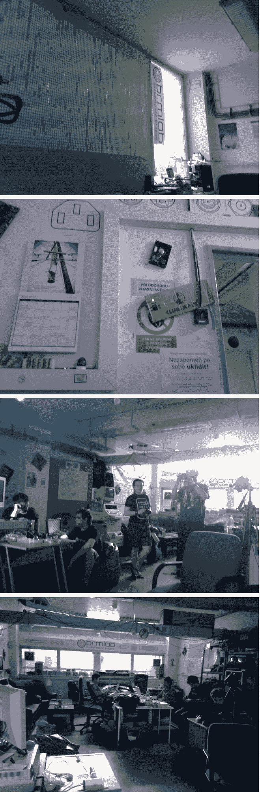
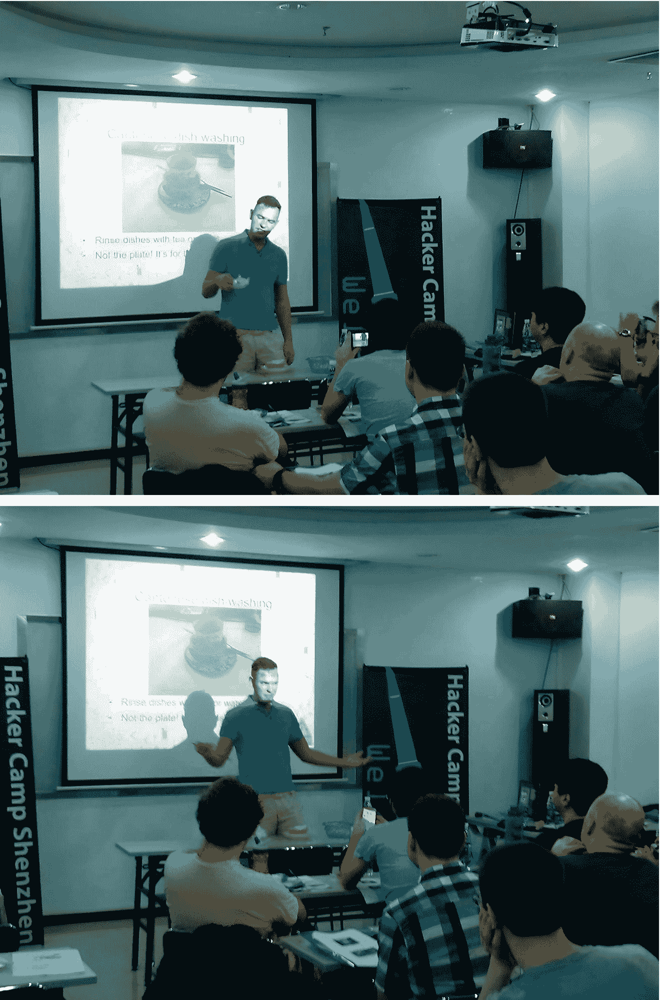

# 算法与自动化：对仪式、机器与原型的治理，从日晷到区块链

致 Tsipi 和 Yair，我在这广阔空间和漫长时间中的喜悦

# 致谢

封面设计图，以及由许多同时也是卓越研究人员和学者的创作者们完成的。我还要感谢许多亲密的朋友：Amy Sapan，感谢作为首批读者之一；Marketa Dolejska，研究伙伴；Silvia Lindner，感谢持续的讨论和慷慨评论；Lior Zalmanson，提供了新的视角和完成这本书的动力；Petr Šourek，担任我在文本中的引导者和同路者；Andrej Boleslavsky，合作开发了服务于思想理论而非初创企业的原型；Anetta Mona Chisa 和 Hugo，为我创造了家外的家，并让我参与了用新材料探索挑战性想法的创作过程。

这本书与其内容直接相关的独特社区：世界各地的黑客空间、公民实验室和创客空间，如 `Hackteria.org`、`HONF`（天然纤维之家）、`Lifepatch.org`、`Brmlab.cz` 和特拉维夫黑客空间。极客、黑客和创作者激励我重新思考学术机构和知识的角色，并模糊了朋友与研究、全球南北、过去与未来对工艺和原型的参与之间的界限。在这个通俗国际的匠人共和国中，我想向 JB 感谢，他是一位连接许多世界、学科和环境的真正的极客外交官；Marc Dusseiller（`dusagr`），展示了游牧科学的可能；Urs Gaudens，感谢所有打破隔阂的开源硬件魔法；Sachiko Hirosue，感谢你作为科学家在不同环境中实现民主化的勇气；Paula Pin，感谢我一直关注并钦佩的疯狂探索；Irene Agrivine，你独特的项目和网络改变了许多人的生活并持续带来启发。我也受到了更广泛开源科学硬件社区的影响，包括开源科学硬件聚会 (`GOSH`)，以及许多同时也是卓越研究人员和学者的创作者——Stefania Druga, Jenny Molloy, Tincuta Heinzel, Hannah Perner-Wilson 和 Andrew Quitmeyer。如果没有 Tsipi, Yair, Rumi 和 Esther，我向你们表达最深切谢意。没有你们的慷慨和善良，这本书是不可能的，你们是其中的一部分。

如果没有瑞士 `CreaLab` 的 Julie Harboe 的持续支持，我的工作将无法完成，她教会了我如何通过创新的参与和形式来连接不同的利益相关者；感谢 Zohar Messeca-Fara，他的 `Idiots.io` 教会了我玩转电路的乐趣，以及寻找创造性方法来反抗技术官僚统治。感谢 Hermes Huang 和 Justyna Ausareny，他们对开放、公民和去中心化科学早期工作的支持，这在重新思考治理的尝试中发挥了核心作用。另一个重要的催化剂是策展人兼艺术家 Honor Hager，她继续证明了艺术如何帮助我们理解科技的发展。我非常感谢那些让我一直与科学民主化努力保持联系的朋友们：Clarissa Reche，她在全球南方科学参与方面的创造性工作彻底改变了 `iGEM`；Michal Jordan，我有幸指导他在马尔他大学关于去中心化科学的区块链解决方案的探索性工作；来自维茨曼科学研究所的 Vojtěch Jeremiáš Kundrát，他继续用在纳米领域令人印象深刻的工作带给我启发，并帮助我想象我们下世纪将使用的技术。

特别感谢布拉格创客展（Maker Faire Prague）团队和普萨设计（Prusa Design），亲爱的同事和朋友 Jasna Sykorova 和 Josef Průša，支持我在布拉格的工作；感谢 Angelika Dudová 和 Linette Manuel 对新兴技术的创造性用例；感谢来自布拉格市大学的 Branislava Kuburovic 和 Petr Knobloch，探索并测试了教学设计与艺术的不同想法。我很荣幸能成为 `Uroboros.design` 节的一部分，在这里我想感谢 Michal Kučerák 和 Lenka Hámošová 让参与了他们的艺术与设计挑衅。我还要感谢 Pavlina Schultz 和 Misha Sidenberg，他们不断找到新方法将我的祖国捷克与新家以色列联系起来。

这本书得到了学术机构的慷慨支持，这些机构对黑客空间、创客空间以及科学技术民主化努力持开放态度。我想对位于柏林的魏森 鲍姆研究所（Weizenbaum Institute）表示诚挚的感谢，他们通过奖学金支持了本书的创作，特别是 Gesche Joost 教授和她优秀的团队——Michelle Christensen 博士、Florian Conradi 博士和 Bianca Herlo 博士。我将永远感谢萨拉曼卡大学 `BISITE` 提供的独特机会，那里举办了我的玛丽·居里奖学金，特别是 Juan M. Corchado 教授，他成为了我真正的导师和榜样。我有幸与来自马尔他大学分布式账本技术中心的 Joshua Ellul 博士和 Ioannis Revolidis 博士合作，他们帮助我测试了关于未来监管和实验性治理的想法，并期待我们未来的合作。

在此，我想感谢网络社会动态中心（Center for Cyber-Social Dynamics）那些受启示的同事，以及与堪萨斯大学数字人文研究所的 John Symons 教授、Ramón Alvarado 博士和 Brian Rosenblum 的合作。我们持续的对话激发了书中许多主题。同样关键的还有亚利桑那州立大学社会创新未来学院（`SFIS`）的访问教授职位，以及 David Guston 教授和 Cynthia Selin 博士的工作，他们的影响贯穿全书。我深对新加坡国立大学“科学、技术与社会”研究集群（Science, Technology, and Society Research Cluster）的同事们以及我参与其中的各项倡议表示感激，特别是 Gregory Clancey 教授、Mohan Dutta 教授、Michael Fischer 教授和 Lonce Wyse 博士。感谢他们对我愿景的持续支持和信任。

这带我回目前的学术家园——巴伊兰大学（Bar Ilan University）的科学、技术与社会专业，我跨越学科和大学的奥德赛在此终结，我在这里找到了合适的环境来创建一个设计与政策实验室，探索原型的未来参与和治理。我非常幸运拥有极好的导师和同事，他们的反馈和建议激励我完成了这本书，特别是 Noah Efron 教授和 Ido Hartogsohn 博士。我还要感谢 Dana Gordon，她的 `Speculative Futures Tel Aviv` 以及关于推测性设计的课程持续启发着我的工作，并为项目带来了新思路。这部分还应该包括我身处的新家园以色列的艺术家、学者和朋友们，我钦佩他们的作品，他们也继续激励我在科学、技术与社会研究中探索新课题和新方法：Shira Ansky, Tsila Hassine, Carmel Vaisman, Mushon Zer-Aviv, Amnon Dekel, Galit Wellner, Liat Segal 和 Yoav Wald。

我对比母校布拉格查尔斯大学（Charles University）的独特环境深怀感激，特别是 Miroslav Petříček 教授和 Rudolf Vlasák 教授的指导，他们支持我在布拉格新媒体研究项目中的早期项目。特别感谢 Pavel Sedlák，他在艺术、科学和技术领域的项目启发了我的早期研究，感谢他的父母 Milca 和 Bohous，他们仍是我在布拉格的第二个家人。最后，我们总是对早期的老师心怀感激，我想提到并向 Smilja Marjanović 表示特别的谢意，她是我在科索沃（一个有着复杂历史和现状的地方）的第一位任教老师。她教我识字数数，更重要的是，她教我如何克服分歧，在最复杂的环境和时期也敢于不对未来失去希望。最后的记录和感谢给 Routledge 的编辑 Aakash Chakrabarty 和 Brinda Sen，他们的辛勤工作和支持了一切。

## 第一部分 引言

### 1 引言

在我们试图为本质上复杂且不定的世界带来秩序和预测性的过程中，我们创造了一个由自动化治理的强大乌托邦和神话。自动化神话作为一种对时间和未来的控制形式出现了。通过从古代日晷到现代 `区块链` 和机器学习 (`ML`) 算法等工具实施，它试图消除自然界和人类社会中的不确定性。它利用仪式、仪器和基础设施不仅是为了控制和预测，更是为了向自然和社会施加周期、模式和数据。

虽然自动化神话承诺优化生活的各个方面，但它无意中延续了现有的不平等和偏见，导致了对政治和社会能力的放弃。它通过对控制和预测的承诺，回避了转型社会价值观、意义和实践的需求。与其说将社会生活视为一种代理体验和对人类尊严的追求，治理和社会变成了一个宇宙论或本体论问题。过去产生日历和钟表的周期，结合仪器捕捉的模式，直接导致了现在给生活的各个方面施加稳定性和可预测性的数据模型。

为了讨论自动化的伦理、哲学和实践意义，我们需要捕捉这一神话的根源——这种神话将治理简化为对模式、信号、周期，以及近年来的数据的控制。我们将使用古希腊神话中时间的两个化身：`Chronos` 和 `Kairos`，来考察治理与宇宙论概念中代理性（agency）与结构之间的张力。`Chronos` 代表了自然循环和宇宙现象中可衡量的、线性和量化的时间，这些现象“治理”着世界，如昼夜交替或季节变化。这些循环将稳定性和可预测视为社会和治理的理想。相比之下，`Kairos` 代表了政治、社会和自然过程中属于代理性、偶然和机会的“不可控”时间，而我们将试图恢复这种时间的价值。

自动化的神话将人类行动和治理简化为由宇宙论洞见或新基础设施设计驱动的决策。我们并没有面对定义人类代理性的（作为行动、开放未来以及作为 `Kairos` 的时间体验）的不确定性、偶然和机会，而是将 `Chronos` 线性、可量化且可预测的时间作为治理的基础。`Chronos` 与 `Kairos` 的二元对立总结了自动化神话的核心问题——我们对自然规律的洞察（发现与创新）与对社会规范的经验（价值观）之间的平衡、结构与代理性、以及技术工具与治理目标之间的平衡。

为了解决技术与治理之间的各种二元对立和张力，我们将强调原型设计（prototyping）的重要性。我们将探索原型设计如何支持一种针对技术以及治理（创新与社会）的实验参与方法。反对自动化神话带来的进步与毁灭的目的论，我们将强调开放的社会和技术转型及过程的重要性。我们并不是对齐或嵌入任何支持社会和创新目的论观的预设价值观和目标，而是倡导依赖参与和协商的实验实践与环境。我们将其定义为激进开放且政治的，并将其描述为治理的原型和沙箱。这些实践和环境并不是支持或拒绝某些预定义的末日论或进步主义议程，而是促进代理性与结构、事实与价值、`Chronos` 与 `Kairos` 之间的协商、平衡与整合。虽然书的开头遵循了自动化谱系中治理对仪式和工具的使用，但后续章节重点关注区块链和机器学习基础设施，作为自动化治理的更近期尝试。通过这些示例，我们将展示如何超越自动化神话，并在治理（社会）中像在技术（创新）中一样保留 `Kairos` 的重要。

## 自动化的幻想与焦虑

抵抗自动化的尝试与自动化神话本身一样古老，正如第 2 章、第 3 章和第 4 章中讨论的那样，涵盖了公元前 6 世纪关于橄榄压榨“预测性分析”的轶事、公元前 4 世纪对无情水钟的抱怨，以及著名的日晷诅咒。这些关于控制时间和未来的经典场所，捕捉了自动化的幻想如何演变为对偏见、不稳定以及代理权和主权丧失的焦虑。为了绘制自动化的幻想与焦虑地图，我们将从早期计时工具开始，引向治理作为创新与进步的技术理想，见第 5 章、第 6 章和第 7 章。通过仪器、原型和实验性机构（早期的科学院和后来的黑客空间）的示例，我们将反思连接治理与技术的不同项目。这些示例将启发在第 12 章、第 13 章和第 14 章中的沙箱提案，反对治理作为创新和自动化的理想。

治理简化为创新的理想源于弗朗西斯·培根的技术与科学“恢复”计划（`Instauratio`），该计划在第 6 章和第 7 章中讨论。培根假设创新和发现将自动恢复人类在堕落后失去的创造能力，并带来道德上的“恢复”。这些目的论和神学理想对于发明、发现和原型设计的实际过程并无大益，但它们捕捉了公众的想象力，我们在谈论进步和创新时仍使用它们。自从培根的 `Instauratio` 以来，治理变成了对机械天神（`deus ex machina`）技巧、奇特装置和魔鬼之桥的不懈搜索。它们通过像古代戏剧中起重机般的装置送来全能的“神”和（技术性的）奇迹，以“自动”解决人类问题。

因此，自动化神话随着每一个声称能改进和社会治理的新仪器和基础设施而出现。从用于预测性 AI 中声誉和评分系统的仪式、日历和时钟，到去信任区块链账本上的智能合约开始，自动化的理想承诺了一个无摩擦、基于证据且政治中立的未来。现在的计算机时则放大并让这种对时间和未来的控制变得无处不在。我们不再测量社会所适应或定义新关系的外部事物，而是通过计算机钟直接生成信号和周期。通过它们，我们同步了跨计算机和网络的数据，并间接地地同步了社会中所有的过程，并将权力集中在少数决定这些过程的人手中。为了夺回代理性并在治理中像在技术中一样恢复作为 `Kairos` 的机会和时间，我们需要开始质疑治理何时以及为何变成了周期、模式和数据的问题，以及为什么它被简化为自动化的神话。

## 仪式、仪器与原型

在第 3 章、第 4 章和第 5 章中讨论的早期时钟和仪器的历史中，隐藏着一个被遗忘的制造角色，这个角色定义了抵抗自动化神化的治理（第 6 章、第 7 章和第 8 章）。机械工匠（如康内利斯·德雷伯）的治理实验和愿景拥了原型设计过程，并将时间视为人类代理性和转化的体验或 `Kairos`。这些原型并不是恢复理想的过去或强加进步的目的论，而是改变了对未来和社会的预期。不再镜像将时间还原为 `Chronos` 模式和周期的宇宙论洞见（第 5 章），未来和治理变成了个人和社会代理性的问题。

被遗忘的仪器史定义了我们在第 5 章、第 6 章和第 7 章中将探索的基于原型的治理。在在第 8 章中定义了原型对治理的关键作用后，我们将利用黑客空间、创客空间和公民科学中的“边缘”原型案例（第 9 章、第 10 章和第 11 章），在第 12 章、第 13 章和第 14 章中提出一种针对沙箱的治理模型。治理的原型化并非将治理还原为创新，而是强调时间作为一种能动性和“适时性（Kairos）”，这反对了将治理还原为本体论、宇宙论或自动化问题的倾向。

服务于治理的原型和随后的沙箱支持了科学、技术和时间的具身化、阈限性、个人化和社会化，这挑战了技术作为进步或恢复的非历史性、目的论和普遍主义观念（第 7 章和第 8 章）。与治理和技术的目的论观念（第 5 章和第 6 章）相反，服务于治理的原型和作为适时性的时间强调了务实且混合的参与，这种参与保持开放性和参与性。第 9 章、第 10 章和第 11 章中开源科学硬件项目中描述的原型实践和努力，证明了原型是一种反对技术控制和自动化的个人和社会能动性的媒介。

在黑客空间和阈限环境中与技术及治理的参与式互动培养了原型管理的个人和社会能动性。它们为新兴技术和基础设施的治理提供了一种新颖模型，我们将其称为探索性沙箱的治理（来自第 12 章、第 13 章、第 14 章和第 15 章）。原型不再是自动化和无的控制，而是协作学习、测试、修补和谈判新兴技术及未来的机会。开放、阈限和边缘原型支持了将时间与未来定义为“适时性”的实践，并为沙箱提供了一个明确将未来作为公共利益、“公地”以及利益相关者谈判挑战性的模型。

## 沙箱

从早期的仪器和原型开始，就存在一种抵抗自动化神话的治理愿景。对时被遗忘的焦虑（第 3 章、第 4 章和第 5 章）结合第 6 章和第 7 章中原型与仪器制造的历史谱，为将治理还原为进步的颠覆性创新提供了替代方案。原型将治理定义为需求和机会。


# 从早期的仪器和原型开始

从早期的仪器和原型开始，就存在一种抵抗自动化神话的治理愿景。对时被遗忘的焦虑（第 3 章、第 4 章和第 5 章）结合第 6 章和第 7 章中原型与仪器制造的历史谱，为将治理还原为进步的颠覆性创新提供了替代方案。原型将治理定义为需求和机会。

探索性沙盒是体验自动化和算法规则替代方案的阈限环境。在书中，我们探索了这种原型作为一种物质和政治参与的谱系起源，这种参与为创造抵抗自动化的探索性和参与性未来创造了可能。治理原型的谱系始于作为一种工具的时钟，它执行了早期对时间控制的幻想和焦虑，包括通过预测对未来的垄断（参见第 3 章）。为了挑战自动化理想及其时间控制的目的论，我们随后考察了古希腊和文艺复兴时期的仪器史（第 6 章和第 7 章）。结合黑客空间制造的仪器民族志（第 8 章）以及其他阈限环境（第 9 章和第 10 章），我们提供了支持时间公共使用和对未来代理权的原型示例。民族志与谱学的结合随后为将沙盒作为技术未来探索性治理的参与性环境提供了建议（第 12 章）。

从第 3 章中关于日晷的轶事开始，我们将绘制技术如何成为一种仪式和神话，并将治理简化为一种没有政治主体且在历史之外运行的基础设施的警示故事。早期的钟定义了治理的梦想，即一种忽视个人和社会时间、生活经验、历史和开放未来的自动化。所有新兴技术都是仿照时钟进行建模的。它们像魔鬼之桥和与魔鬼的契约，承诺提供不受限制的绝对权力，并包含一个关于未来的隐藏条款。新兴技术和基础设施强制了没有参与且没有未来代理权的自动化。无论它们声称有多民主，将永远成为基于自动化神话的压迫和极权统治工具。通过垄断未来，钟像魔鬼之桥夺走了我们的“长子”、我们的代理权以及改变和变革的可能性。此类治理机器和基础设施总是支持监控、加剧不平等并创造新的脆弱性。

在科学仪器或基础设施变成嵌入技术标准、市场预期和其他官僚结构的治理机器之前（第 3 章、第 4 章和第 5 章），它们是支持个人和社区承诺的原型。正是在这个阈限且开放的阶段，我们寻求扩展参与。第 8 章中描述的黑客空间中用于原型的阈限和实验环境，提供了此类在市场力量、行业标准、专利或其他权力结构之外的参与示例。与第 6 章中的历史案例或早期仪器相结合，这些边缘原型展示了作为自动化的治理的替代方案。在第 12 章中，我们将谱系学教训和案例推导出一个实验性沙盒的建议，该沙盒将原型设计与治理相结合，并支持对未来的个人和社会行动或代理。

# 媒介考古学作为驱魔

将时间与未来视为原型与自动化问题的讨论，是向西格里德·齐尔林斯基的“时间媒体”和“时间机器”项目致敬。我们将他的核心问题“谁拥有时间？”扩展为一个挑战：如何让时间成为一种让公民参与塑造未来的公共资源？我们并不是在考察过去被遗忘和忽视的未来，而是关注在第 3 章中描述的作为治理机器的主导性时间和未来控制仪器。虽然作为治理机器，原型将治理简化为自动化，但作为探索工具，它们具有支持公共参与和实现公共利益的潜力。所有原型都有可能成为社会行动的形式，通过这种形式，我们可以体验对未来和时间的个人及集体力量。

第 3 章中自动化的谱系遵循了齐林斯基对媒介史的修正，但并非他通过艺术和媒介考古学复活过去“死去的”和被遗忘的未来的目标。我们将“想象与计算”的动态捕捉为一个行动与结构（知识）的问题，专注于我们如何使未来制造和原型设计民主化。早期通过原型治理的尝试（第 3 章，特别是第 6 章和第 7 章）随后成为我们谱系的材料，旨在在其余章节中从治理（以及原型）中“驱逐”自动化（第 3 章、第 4 章、第 5 章、第 6 章、第 7 章和第 8 章）。

我们称这一过程为驱魔，因为它利用谱系学来识别并消除那些“占有我们私人和公共生活”的承诺性基础设施和新仪器中的任意权力行使。通过识别与政治、代理权和未来相关的消极时刻，我们创造了一个重新思考原型在治理中作用的机会（第 8 章和第 12 章）。从文艺复兴时期（第 6 章和第 7 章）到今天的仪器史、黑客空间、制造空间和公民科学实验室（第 8 章），说明了与仪器和未来制造进行替代参与的重要性。

为了探索支持未来代理权而非控制的原型，我们提出了探索性沙盒（第 12 章），它们将扩展在被遗忘的仪器史中识别的（第 3 章）以及在阈限空间中观察到的实践（第 8 章和 9）。在仪器或算法变成任何人拥有和监管的基础设施之前，它们是表达对社会冲突的想法、价值观和愿景的原型和探索。在这个早期、模糊且实验性的阶段，我们需要增加参与并重新定义公共利益。与其仅仅对齐和嵌入价值观及政治目标，或教育公众霸权基础设施，黑客空间和沙盒的阈限环境支持直接参与和代理。

阈限和探索性原型设计使公民能够定义他们在未来的利益，防止算法规则和自动化的过度。作为未来的利益相关者，公民理解时间是共同财富，是必须维护甚至斗争的公共资源。公民需要的不仅仅是未来基础设施的用户或哀叹被遗忘未来消失的媒介考古学家，而是通过原型表达他们的代理和愿景。他们需要与其他人协商他们的未来，而不是关闭它或声称某种理想适用于所有人。

因此，第 3 章中自动化的谱系展示了原型设计在定义随时间和未来的代理性方面的重要性。结合第 8 章中黑客空间和边缘环境的民族志，它将原型设计定位为一个治理问题。由于服务于垄断的每一个新工具和基础设施的扰动，我们的社会似乎屈从了被简化为自动化承诺的政治。我们总是倾向于用社会和个人代理性的不确定性，去换取科学技术所承诺的、那种关于宇宙论或本体论的确定性（正如我们在第 5 章中所展示的）。为了防止政治和治理将未来作为一种政治和社会项目和行动事务而抛弃（并将其外包给新的机器和基础设施），我们需要重新思考原型支持我们代理性的不同方式，并将未来和时间定义为治理的目标。

# 作为自动化条件的时间

对于每一个承诺自动化和算法控制的基础设施来说，时间都是一种战略性资源。区块链、`IoT`以及各种云服务（`SaaS`、`IaaS`、`PaaS` 和 `CaaS` 软件；作为服务的设施、平台和容器）所做的仅仅是同步跨网络的节点、过程和数据。从卫星导航到算法交易，时间通过计算机和原子钟作为商品被交易、测量和量化。它甚至在区块链和去中心化区块链账本上被“铸造”和“盖章”，将时间定义为字面的货币媒介。作为一种资源，时间量化并控制着机器和网络中的过程；但作为一种个人或社会体验，它是控制的对立面。它使人类变得独特、不可重复、神圣且“自目的”，其本身具有意义和目的。本书的目的是重新思考原型设计和设计，将未来和时间作为个人和社会代理性的自目的媒介（`Kairos`），而不是将其还原为资源和宇宙论（`Chronos`）。

为了防止失去对未来和时间的代理性，我们将从“揭示……那些彰显异质性的动态时刻……”开始，并“与各种当下的时刻建立紧张关系，将它们相对化并使其变得更具决定性”。原型可以帮助我们识别不仅是过去错失的机会（第 5 章和第 6 章），还有现在的变革与转型“动态时刻”。它们定义了行动的可能性，而非本体论或宇宙论的确定性和屈从。为了捕捉原型设计作为对未来和时间代理权的体验，我们将使用`Kairos`与`Chronos`的二分法（第 5 章、第 6 章和第 8 章），并将时间定义为行动和政治的媒介，而非本体论或宇宙论的问题。作为政治主体和公民，我们将未来和时间视为`Kairos`，即一个转型的机会。作为用户和消费者，我们受到新基础设施承诺的控制，这些基础设施基于对`Chronos`和宇宙论的洞察，将时间代表为对未来的控制。

因此，第 3 章中的谱系是对自动化的“深层时间的探险”，它揭示了作为`Kairos`（偶然、不确定性和机会的体验）的时间与`Chronos`（宇宙论现象）之间的张力。通过“扩张当下”并“放慢”原始的控制基础设施——时，我们将意识到对未来和时间的个人和社会代理性丧失的时刻。通过遵循第 3 章中自动化的谱系，以及第 9 章中黑客空间的实践，我们将质疑技术与治理、结构与代理性、以及作为`Chronos`的时间与`Kairos`之间的界限。我们将强调增加我们对未来和时间代理性的混合实践和边缘环境。这些由`Kairos`驱动的实践为治理机器以及它们将未来还原为算法统治、自动化和`Chronos`的机器提供了一种替代方案。

与作为自动化手段的时间相反，本书中的时间概念是一个个人和社会代理性的问题，包含了不可预测性和偶然。作为个人和社会行动机会的时间等同于存在、意义和创造，这些包含了失败和跌落，并抵抗时钟、仪器和基础设施对未来的垄断。仪器和基础设施的量化且受控的时间（`Chronos`）与生活的不可预测且具体验性的时间（`Kairos`）之间的二分法，定义了本书的核心问题：我们如何设计支持随时间和未来的代理性而非剥夺它的仪器和基础设施？如何在原型设计中（第 8 章）支持个人和社会行动？如何在开发基础设施而不成为它们的受害者、奴隶和寄生虫（第 3 章和第 12 章）？

## 2 自动化神话

自动化梦想和恐惧随着每一个承诺通过算法和相关官僚结构（如标准）普及控制时间的新仪器和基础设施而出现。它们侵蚀了作为代理性的时间体验——即去发现、决定、扰动或与其协商未来。为了讨论这种作为强加自动化神话的理想治理形式，我们将从一个问题开始：公共生活事务如何变成没有偶然性或行动空间的仪式和自动化服务？治理变成自动化问题的形而上学、政治和物质条件是什么？

对算法治理的反思提供了一些指导，但它们通常关注负责自动化的算法和数据的监管和所有权、Larsson, 2018）、Micheli et al., 2020）、Saurwein et al., 2015）、Shorey & Howard, 2016）。算法治理的研究通常讨论客观性和准确性的广泛认识论问题，包括批判数据研究中算法和数据的社会、政治和经济影响、Boyd & Crawford, 2012）、Kitchin, 2017），甚至是能源和矿物消耗的问题、Parikka, 2015）。这些见解将为我们的批判提供参考，但重点仍放在时间和未来作为自动化条件的使用上。

治理中自动化的讨论将时间和代理性的形而上学问题与权力的政治问题结合在一起（第 3 章）：在一个扰动并控制公民公共甚至私人生活、往往缺乏明确授权的原型时代，什么是良好治理？我们如何确保算法对未来和时间的巨大权力尊重我们在机构和政治过程中所珍视的价值观，如人权、法治、政治多元主义、合法性或问责制？

主体与结构、或行动与知识的二元对立，以及作为 `Chronos`（计时）和 `Kairos`（时机/择时）的时间体验，将帮助我们理解原型设计是如何定义治理的。我们不会将治理简化为自动化（第 3 章），而是将遵循那些使未来和时间的权力民主化的原型（第 8 章和第 12 章）。原型具有潜力让未来面向公众参与，并将政治和技术代表性定义为一种实践问题。因此，它将“拯救”时间的尝试定义为公共利益，并拒绝将具有破坏性基础设施的自动化神话视为现代的“魔鬼之桥”（第 12 章）。

# 公共时间与开放未来的设计


有很多设计和政策建议强调空间的公共用途（Carmona 2015; Mitchell 1995; Crawford 2016; Jacobs 1962），但极少有认为在时间和未来方面存在类似的需求。我们应该如何将时间管理为一种公共资源，以防止城市空间设计中常见的垄断过度现象？对商业化城市并将其变为伪公共空间的城市设计过度的批评者（Mac Síthigh, 2012; Wang & Wang, 2019）为讨论未来和时间的垄断提供了一个模型。在应对新基础设施的算法规则时，我们需要防止对时间和未来的伪公共式滥用，这种滥用导致了私人和公共生活的垄断和商品化。

每一个原型、平台和基础设施对未来的垄断，将生活体验转化为算法和数据，导致我们在个人和社会层面上对这些失去了控制。虽然城市规划在历史上一直敦促开发者抵制伪公共空间，但没有人要求 IT 开发人员重新思考他们对时间的控制。自动化以其创新和进步的承诺主导着我们的私人和生活，关闭了由创新者及其投资者设计并拥有的技术通往未来的道路。为了挑战这一现状，我们必须识别出放弃时间作为公共资源的时刻（第 3 章），并寻找支持开放未来和时间作为公地的实践（第 8 章和第 12 章）。第 12 章沙盒中“公共”时间和开放未来的蓝图，随后是基于自动化的谱系（第 3 章），该谱系定义了通过原型设计商品化的时间和未来问题（第 8 章）。

一旦我们识别出被遗忘的公共资源时间和 `Kairos`，包括边界环境——黑客空间（第 8 章），我们就可以为设计师、政策制定者定义工具……

## 时钟、时间协议与时间戳

算法治理是试图利用工具控制时间并组织公民的社会、私人甚至生物生活的长期尝试的一部分。我们将此类工具称为“治理机器”，因为它们将个人和社会现象还原为非人类尺度的自动化。

为了捕捉时间如何成为一种普遍控制的资源，我们将时间作为 `Chronos` 与 `Kairos` 的经典二元对立（Sipiora & Baumlin, 2002; Smith, 1969）应用于来自第 4 章、第 5 章、第 6 章、第 7 章和第 8 章的各种仪器和原型。作为一种线性的、可衡量的和外部实体，`Chronos` 是一种由自然或社会中的模式和循环定义的数学抽象。作为 `Kairos`，它表达了机会——即个人和社会能动性与行动。`Chronos` 是一种逃避任何个人或社会行动的抽象结构；它是一种语言（`langue`）而非个人的言语（`parole`）（Sanders, 2004），是一种策略（机构、权力结构）而非战术（个人使用、采用或征用）（de Certeau, 2011）。

`Chronos` 是所有算法、仪式和机器的核心原则。它将个人生活和社会过程简化为预设计的系统，忽略了对表达 `Kairos` 的个人或集体项目的承诺（Kahn, 2019）。在本书中，我们将使用古希腊的 `Chronos` 与 `Kairos` 的二元对立（Sipiora & Baumlin, 2002; Smith, 1969）来总结结构与能动性之间的紧张关系，以及算法治理中的合法性问题（Ananny, 2016; Kitchin, 2017; Ledford, 2010; Mittelstadt et al., 2016; Susskind, 2018）。作为自动化、算法和 `Chronos` 之事的治理导致了对未来个人和社会能动性的丧失。与导致治理机器和自动化的受控的 `Chronos` 时间相反，在临界环境和沙箱中进行公共原型设计的目标（第 8 章和第 12 章），这包含了创新与发现。作为能动性媒介的时间意味着战术干预，即通过原型探索治理与技术的政治和个人项目（第 12 章、第 13 章、第 14 章和第 15 章）。与其将每个决策外包给本体论或宇宙论，不如让治理的原型设计成为 `Kairos` 的问题。它等同于对未来负责，承担风险，甚至失败，但作为个人和社区做出选择，而不是将它们外包给宇宙力量。虽然作为 `Chronos` 的时间会导致施加于社会的系统和模型，这些模型声称对公民历史和生活之外的循环与现象拥有优越知识；作为 `Kairos` 的时间支持个人和社会能动性，以及保罗·W·卡恩在他法律秩序起源中作为“项目”所讨论的内容（Kahn, 2019）——政治和社会承诺，对未来的投入。

## 胜利者书写的历史

西方哲学的起源故事——米老泰勒斯对橄榄收获的预测（Mansfeld, 1985）将成为我们谱系研究的起点（第 4 章）。它展示了 `Chronos` 如何成为一种治理工具，承诺了预测和控制。泰勒斯公元前 6 世纪对橄榄油榨机进行的“预测性分析”创造了自动化的神话，将治理美化为对未来的控制。然而，它也对自动化神话提出了首次批判，这后来在公元前 4 世纪德摩斯底和伊索克底的文章中得到回应，他们对水钟（`clepsydra`）时间测量的抱怨（Landels, 1979）以及普劳塔斯对日晷著名的哀叹（Gratwick, 1979; Landels, 1979; Henderson, n.d -b），这些在第 5 章、第 6 章和第 7 章中讨论过。

关于早期时钟的轶事和故事总结了算法统治下偏见、不稳定性和缺乏能动性的问题。它们暗示了民主化创新、发现和未来创造，以抵抗对治理机器和新基础设施的垄断。治理机器将人类行动、审量和决策外包给时钟、日历，或如今的区块链共识机制、机器学习算法和其他技术。作为 `Kairos` 表达的谈判、抗议和政治，在这些新基础设施的自动化治理下变得不再可能。

治理机器总是声称将更高的本体论和宇宙论真理作为社会的理想，同时将政治还原为数据、模式和代码的形而上学——这些都是 `Chronos` 的现代表达。它们自动地实施预设目标，而不是通过寻求共同商量和行动的自由公民之间的共识。从这个意义上说，算法治理只不过是一种利用自动化控制由对新基础设施拥有权的利益相关者定义的未来的现代仪式。这种自动化理想主导了当前的技术统治愿景，例如“受预测市场引导和启发的政府政策”（Buterin, 2014）、政府中受安全评估和渗透启启发的强大认知技术”（Cummings, 2019），或 O'Reilly Media 创始人兼首席执行官蒂姆·奥赖里构想的像“精益创业公司”一样运行的政府（Brantley, 2014）。

类似的自动化治理愿景将政治决策简化为对未来和时间的控制问题，并将社会和政治过程转化为嘲讽民主统治的算法。政治不再是作为 `Kairos` 时间的一种种通过政治行动转型社会的历史性机会，而是变成了本体论、循环和 `Chronos` 的问题——一个由单一预设未来愿景投资驱动的预测市场，一种改进预设要求的渗透测试方法，或一个为投资者服务的精益创业公司。

因此，技术统治治理使得“胜利者”不仅能书写历史，还能“编写”未来。治理和技术不再是个人和社区行动的机会（`Kairos`），而是变成了 `Chronos` 的问题——一种可测量且可编程的时间，拥有由算法控制的预设未来。因此，`Chronos` 代表了一种政治放弃，它将宇宙确定性作为治理模型，为一小部分创新者和投资者保证稳定和利润。

治理作为一种设计良好、预设且自动化的系统的理想是霍布斯社会契约论和“利维坦”比喻的核心（Schmitt, 1996）。在第 8 章中，我们将讨论霍布斯对理想政府的想象，一种由人类设计的、人工且超人的机制，旨在独立于人类运行，同时要求无条件的服从。卡尔·施密特 1938 年的解释说明了利维坦与技术的亲缘，因为两者都履行了绝对（神性的）权威理想的宇宙论和宗教承诺：

> 从技术上完备的、人造的杰作——一种仅在自身（即通过其性能和功能）中实现“正确”与“真理”的机器，最早被霍布斯掌握，并由他系统地构建成一个清晰的概念。事实上，技术中立性的最高程度与最高权威之间的联系，对于 17 世纪的精辟思想家来说并不陌生。在坎帕内拉对“太阳国家”的愿景末尾，出现了一艘没有舵和帆的巨轮，但它由一种被“绝对权威”所有者所指挥和引导的机制所驱动。
>
> (Schmitt, 1996)

虽然第 3 章和第 4 章中关于钟的早期轶事捕捉了算法统治的技术治国梦想，但是《利维坦》将技术治国统治施加为一个普遍且理想的目标。在霍布斯之后，自动化的“合同”成为应对受 `Kairos` 作为“自然状态”和“所有人对所有人的战争”的不确定性威胁的社会唯一希望。要理解 `Chronos` 和宇宙学如何成为治理的理想，我们需要重新审视这些关于创新的修辞、比喻和轶事。它们捕捉了将治理技术化还原为当今预测市场、精益创业，以及通过 `RegTech` 尝试将社会规范整合到各种“隐私、价值、设计即政策”的代码、指南和约束 (Cavoukian, 2009; Friedman & Kahn, 2002) 以及“人机回路社会”项目 (Rahwan, 2018)。现有的治理机器将对未来和时间的控制从钟表扩展到了破坏个人和社会生活各个方面的自动化社会合同和基础设施。为了重新获得对未来和时间的控制，我们需要理解原型设计如何成为一种目的论的形式，然后恢复被遗忘的原型设计历史，将其视为一种社会和个人主体性。

## 算法的 Chronos 与原型的 Kairos

承诺自动化、区块链或 AI 驱动未来的治理机器，将时间体验还原为作为社会模型的非个人化和宇宙学测量（`Chronos`）。规则不再是个体或集体行动、愿望和愿景，而是形式化、翻译并嵌入到代码或设计过程中。作为仪式、自动化机器和《利维坦》的治理，使作为 `Chronos` 的时间成为默认值。它将历史和未来还原为目标恢复（`Instauratio`）以及在第 5 章、第 6 章和第 7 章中的进步。

`Chronos` 通过施加个人或社区都无法质疑的反历史性和普遍性理想来主导社会。这些理想变成了“中立”的基础设施——客观、非个人化且“公正”的机器，使用由专家开发并所有人服从的模型、算法和数据。作为变革机会的时间（`Kairos`）变成了新基础设施创新的资源。必须有人设计并维护这些所谓的“中立”的 `Chronos` 规则，例如账本、计算机钟、时间日志或数据模式。为了将未来重新收为公地和公共资源，我们必须拒绝那些个人或社区都无法质疑的反历史性和普遍性理想。

算法并非历史终头我们必须服从的神秘实体。为了将未来重新收为公地和公共资源，我们必须拒绝那些个人或社区都无法质疑的反历史性和普遍性理想。

原型化治理意味着在发现与创新中，将个人和社会的时间用途重新思考为 `Kairos`（时机）。这意味着要抵制设计师及其赞助者那种非民主且任意的统治，并坚持在原型设计的早期阶段让公众参与。算法变得越来越自动化和自主化，并承诺提供受监管和受控的未来，我们作为公民和社区失去的自主性和主体性也越多。受到第 6 章](#ch6.xhtml)和第 7 章](#ch7.xhtml)中工人和自然哲学家制造仪器的被遗忘历史的启发，我们将识别出自动化的替代方案，反抗具有进步、恢复或奇点目的论的 `Chronos`（线性时间）观。

在目前的黑客空间和边缘环境（第 8 章）中，我们看到一种支持 `Kairos` 的原型模式，将其作为即兴体验和即时参与，以服务于各种需求、目标和价值观。我们将在第 12 章](#ch12.xhtml)关于公共和探索性沙盒的提案中扩展这一模型。沙盒中的原型化并非强制执行每项新基础设施的现状（这种现状将社会划分为早期采用者（开发者和投资者）和用户（赞助者和寄生虫）），而是一场定义公共利益的斗争。这是一场持续的斗争，旨在保护时间作为一种开放且共享的资源，服务于嵌入治理基础设施中的各种规范理想。

为了保持对未来的社会和个人主体性，我们必须像对待技术一样，关注治理中作为 `Kairos` 的时间。这意味着挑战政治与技术基础设施的融合，这种融合将时间还原为宇宙学模式、数据、自然法则，或将时间表达为 `Chronos` 的本体论。为了使沙盒中的未来制造变得民主化，我们必须坚持让公民参与到他们的未来中，这被视为一种 `Kairos` 事务，即一个改变而非服从预定义结构和命令的机会。在原型时代，公民是自己未来的利益相关者，而不仅仅是未来基础设施的消费者。

## 第二部分：对仪式与机器的治理

### 3 算法统治的谱系

自动化神话的起源可以追溯到公元前 6 世纪关于米提斯的泰勒斯（Thales of Miletus）的轶事。这些记录捕捉了泰勒斯天文观测的模糊描述，不仅值得赞誉，也值得批判。根据一个轶事，泰勒斯变成了一个百万翁，他将天文学和气象学知识转化为对橄榄收成的预测。根据另一个说法，他是一个失败者，对天空的兴趣导致他掉进了沟里。在其中一个记录中，他对作为 `Chronos` 的时间（自然中可测量周期和模式）的知识带来了预测和好运；在另一个记录中，这导致泰勒斯反对一个由此类预测主导的社会，这种社会支持那些嘲笑他坠落的商人和贵族的统治。

柏拉图和亚里士多德关于泰勒斯的这两个描述捕捉了西方哲学的起源，体现了“仰望星”既导致预测也导致坠落的悖论。它将泰勒斯对天文周期和作为 `Chronos` 的时间的知识与其闲暇联系起来，我们将其解释为 `Kairos`。`Kairos` 意味着时间作为一种发现、挑战和行动的机会，而无受预期结果和可预测未来的确定性影响。它是与行动的自由以及发现、创新和变革的主体性同义的时间。成功的预测和掉进沟里都是探索、原型化和质疑一切的自由与时间所带来的合法结果。泰勒斯的预测和坠落捕捉了时间作为 `Kairos` 的体验——一个成功与失败的机会，或者正如我们后将看到的，是发现与闲暇的机会。

关于泰勒斯的轶事捕捉了一个自由雅典公民的一个本质特质——他对时间的主体性，即利用宇宙学洞察来影响社会。泰勒斯自由开发一种新的预测工具，并根据对时间（和空间）结构——即宇宙学的洞察来挑战社会中的权力结构。在两种情况下，他都利用自己的闲暇（`Kairos`）来发现和使用时间的知识（`Chronos`），要么将其作为商业机会变现，要么批判那些忽视使这种知识成为可能的条件（闲暇和自主性）的社会。泰勒斯对宇宙学以及循环、模式和数据（`Chronos`）本体论的洞察，与他的主体性和行动自由（`Kairos`）并行，后者被描述为探索和失败的自由（关注无人关心的事物）。

泰勒斯的预测、坠落和批判将科学、技术与社会（治理）问题设定为对时间和未来的控制问题。从日晷和水钟（第 4 章中进一步讨论），每一个新工具、仪器和基础设施都承诺对未来的控制，同时模糊了这种控制的来源——作为 `Kairos` 的时间。新工具和仪器对未来的权力掩盖并让我们忘记了使它们可能的愿望（泰勒斯对嘲笑他坠落社会的批判）。利用 `Chronos` 洞察的仪器和工具通常将政治还原为循环、模式和数据的宇宙学和本体论。它们支持自动化和算法统治的幻想（第 5 章）。然而，它们也具有批判的潜力，可以揭示政治（第 6 章）或治理技术中 `Chronos` 和宇宙学的意外起源、愿望和应用。

泰勒斯的预测工具以及对时钟的早期描述（第 4 章）时，它们支持 `Kairos` 的时间体验。与其让未来被垄断，不如仪器（第 6 章）和制度（第 7 章）的早期原型为个人和社会项目开放了未来。

早期仪器的谱系将帮助我们重新思考技术与治理之间的关系，将其视为一个对未来的控制问题。早期原型中作为 `Kairos` 的时间是对技术和治理的一种实验性参与，它将未来定义为一种公共利益，以及一个向个人和社会行动开放的项目。为了将未来视为一种公共利益，我们将探索被遗忘的文艺复兴时期仪器的历史（第 6 章和第 7 章），并将其与第 8 章中黑客空间中的原型制作联系起来。在第 2 章和第 3 章中，作为 `Kairos` 和主体性表达的原型制作历史，将为第 12 章中探索性和公共沙盒的提议支持。早期文艺复兴的原型以及对技术和治理的实验，强化了个人和社会对未来和时间的权力。它们展示了我们如何防止政治冷淡——这种冷淡会将社会主体性简化为算法、模型以及 `Chronos` 的其他表现。

## 算法对橄榄油榨的统治

根据亚里士多德的描述，泰勒斯创造了第一个破坏性原型，或“一种用于获取财富的设备（κατανόημά χρηματιστικόν——赚钱工具）”，字面上也被描述为“一种确保垄断的设备（μονοπωλία）”（亚里士多德，《政治学》，第一卷，第 1259a，1944a）。这种“巧妙设计的”（ἐτέχνασαν）工具是最早的预测分析工具之一，也是破坏性创新的范例（Johnson et al., 2008）。它利用宇宙级“大数据”（`Chronos`）的知识来垄断未来，同时展示了用于研究和设计的自由时间（`Kairos`）的价值。

在泰勒斯的轶事中，`Chronos` 的知识是将信号、模式和数据货币化并挑战社会。泰勒斯通过设计一种破坏社会的垄断工具来控制未来和时间。他还通过行使作为 `Kairos` 的个人自主权和主权来“控制”未来，拥有时间去探索、发现、跌倒，甚至挑战社会。因此，在亚里士多德版本中，行动与知识之间的关系导致了对橄榄油榨的垄断，因此“当季节到来时，人们突然需要几台压榨机，通过以他（泰勒斯）喜欢的条件租借出去，他获得了巨额财富”（同上）。

泰勒斯成为一个意外的万富翁，他的目标是展示哲学家们如果选择（他们愿意）变得富有是多么容易（βούλωνται——如果他们意愿），而且“这并不是他们关心的（σπουδάζουσιν——指勤奋、忙碌、渴望做某事、对某事投入且热忱、严肃地检查或研究某事）”。这种将新知识货币化的破坏性创新，其目的并不是为了让某人富有强大，而是为了履行一个自由的雅典公民和哲学家的主体性和利益。作为 `spudazusin`（σπουδάζουσιν）的“关注”表达了哲学家的主体性——这是一种通过将宇宙洞察与政治行动或社会影响相结合来影响未来的能力。

对作为 `Chronos` 的时间的洞察使得预测和自动化成为可能，但它并不规定哲学家和自由雅典公民的决策。泰勒斯的选择表达了他探索、煽动政治变革，甚至因沉迷观星和闲暇而失败的主体性。他的个人时间是 `Kairos` 的一种体验；它是对探索和干预技术（以及社会）的行动与自由。在柏拉图和亚里士多德那里，作为 `Kairos` 的自由且非结构化的时间——一个成功与失败的机会、严肃研究与闲暇的机会——是获得 `Chronos` 知识的前提。

泰勒斯对时间的主体性凌驾于对时间、天文和天气数据、模式和算法之上，导致了垄断和财富。因此，将 `Chronos` 的时间货币化只是作为一个自由雅典公民的一种结果，他们有时间观察星空、设计预测分析工具、垄断橄榄油榨，或者掉进沟沟里。对宇宙（天文和天气）数据及 `Chronos` 其他现象的洞察，仍然与作为 `Kairos` 的时间体验同样重要，后者定义了泰勒斯的个人主体性。

## 用大数据嘲讽富人


# 亚里士多德关于泰勒的文字捕捉到了作为 `Kairos` 的时间如何使 `Chronos` 的知识成为可能

亚里士多德关于泰勒的文字捕捉到了作为 `Kairos` 的时间如何使 `Chronos` 的知识成为可能——即用于预测和垄断的宇宙模式与周期的发现。在柏拉图版本的《泰德篇》中，观星的自由非结构化时间也定义了泰勒的自主性和主体性（Plato, Theaetetus, Section 174a, n.d.）。柏拉图版本的泰勒拒绝用他的垄断工具给雅典富有的公民留下印象。相反，他利用他对 `Chronos` 的洞察来嘲讽政治、社会和经济精英，并重新定义了治理与创新（发现）之间的关系。

在柏拉图版本的轶事中，雅典精英对泰勒观星和掉进沟里的行为大大笑。这促使苏格拉德发表了一个关于我们的价值观与知识、或治理（政治）与发现（创新）之间关系的重要演讲，提供了一个我们在此处将讨论的利用技术治理未来和社会的早期示例。在苏格拉德关于泰勒的演讲中，知识与行动、`Chronos` 与 `Kairos` 之间的紧张关系，说明了原型作为如 `Kairos` 表达的主题。它表达了对时间和未来的主体性，这种主体性导致了关于 `Chronos` 的知识和洞察，而不被还原为它。

大多数评论者将《泰德篇》（从 174a 开始）中泰勒的文字解释为对普罗塔戈拉斯“人是万物的尺度”格言的批判。他们将其视为对专家知识和科学的防御。虽然这些对《泰德篇》的解读支持了亚里士多德眼中泰勒作为天文周期专家和强大工具设计者的形象，但他们忽略了泰勒不服和主体性中更激进的一面。泰勒的跌倒促使苏格拉底明确断言，治理是一种创造未来和主体性的体验。他由于泰勒独特的洞察和对现状的批判，将他描述为未来的“专家”。

泰勒被其天文观测分散了太多精力，以至于在“一个整洁且机灵的特拉西女仆”面前掉进了一个水沟里（同上）。这段文字描述他的“心不在焉”是一种闲暇，以及对无人关心的天文现象等晦涩兴趣的沉溺：“他太想知道天空中的事物，以至于看不见脚面前的东西”（同上）。天文学作为在非人类层面上发生的 `Chronos`、模式和数据的知识，使哲学家变得不胜任走路和赚钱等世俗活动，但赋予了他一个独特的时间视角。他容易遇到事故和 `Kairos` 现象，也渴望批评后文提到的政治和社会现状（从 174e 到 175b）。在那儿，苏格拉底利用泰勒的跌倒来解释宇宙学知识如何挑战同时代人财富和祖先的幻象。

## 引言

在这一版本的泰勒斯中，苏格拉底对大数据 `Chronos` 和宇宙学进行了一种“哲学式”的运用。泰勒斯对 `Chronos` 的洞察揭示了商人和贵族对于他们在宇宙中的社会经济重要性持着天真的看法，而这种观点被哲学家揭穿了伪装。与泰勒斯所研究的时空大尺度现象相比，财富和血缘是微不足道的：‘……当他（泰勒斯）听到有人因为拥有一万英亩或更多土地而富得惊人时，对于习惯于思考整个地球的他来说，这似乎是微不足道的’（同上）。 柏拉图笔下的泰勒斯并没有通过一种能够维持财富重要性的垄断工具来给商人留下印象，而是利用他的知识来嘲讽这些商人。

文章继续对贵族阶层提出了类似的批判。泰勒斯嘲讽贵族无法计算祖先的巨大数量也无法理解时间的尺度。赞美某人的高贵出身“因为他能展示出七个富有的祖先”是一种“愚钝且狭隘的眼光”。这是“愚蠢头脑”和“虚荣”的标志——更糟，是缺乏教育的表现，因为“他们无法将目光固定在整体上，无法计算出每个人都有数以万计的祖先和起源，其中既有富有穷，有国王有奴隶，有蛮人和希腊人”（同上）。泰勒斯对本体论和宇宙学的知识并没有支持维持现状，而是挑战了商人和贵族的统治，并引发了对社会规范的批判。

### 宇宙学洞察与整体

泰勒斯对作为 `Chronos` 的时间的宇宙学洞察，是柏拉图所描述的对“整体”（ὅλον-holon）的洞察的一部分。这种洞察在政治和本体论上都是激进的，它揭示了代际随时间推移的指数级增长，或者是超出人类想象和规范的地球巨大尺寸。通过对“整体”的认知，泰勒斯跨越了政治与宇宙学（或本体论）之间的鸿沟。`Chronos` 的知识并没有引入一种新的基础设施来维持垄断和财富，而是嘲讽了财富和血缘作为决定权力的价值观。

在柏拉图的作品中，泰勒斯展示了破坏社会政治秩序的宇宙学和本体论 (`Chronos`)。

### 对社会规范的批判

#### 社会与政治秩序

泰勒斯的宇宙学和本体论 (`Chronos`)破坏了社会政治秩序。

#### 财富与血缘的作用

泰勒斯对作为 `Chronos` 的时间的宇宙学洞察，是柏拉图所描述的对“整体”（ὅlon-holon）的洞察的一部分。这种洞察在政治和本体论上都是激进的，它揭示了代际随时间推移的指数级增长，或者是超出人类想象和规范的地球巨大尺寸。通过对“整体”的认知，泰勒斯跨越了政治与宇宙学（或本体论）之间的鸿沟。`Chronos` 的知识并没有引入一种新的基础设施来维持垄断和财富，而是嘲讽了财富和血缘作为决定权力的价值观。

在柏拉图的作品中，泰勒斯展示了破坏社会政治秩序的宇宙学和本体论 (`Chronos`)。

### 未来与治理

#### 未来的概念

未来是通过泰勒斯洞察的视角被探索的。

#### 治理的重要性

治理与整体和时间的理解相关联。

时间作为控制与关怀（包括鉴赏与创造）的二元对立——`Chronos` 与 `Kairos`、垄断与宴会，有助于我们解释自动化神话的起源。它的起源包括原型设计、发现和创造新事物的问题，是对某种从未被关注过的事物的关注。我们认为，原型设计是一种实践，它要么控制未来并对其封闭预测，要么将未来释放为一种公共且开放的事物，包容我们对可能存在之物的这种激进兴趣的能动性。

在接下来的章节中，我们将通过早期时钟和仪器的例子（第 5 章）来进一步阐述源于泰勒斯轶闻的二元对立。与那些将未来还原为 `Chronos` 控制的垄断工具和治理机器不同，我们将 `Kairos` 视为一种对未来的激进参与（这通常会导致批判）。当未来作为一种专家知识（`Chronos`）导致了预测性分析（垄断工具和治理机器），而作为一种鉴赏与创造的体验（`Kairos`），它支持了个人和社会的能动性。

#### 有益的装置

泰勒斯的轶闻将西方哲学的起源定义为通过科学技术对未来和时间控制的问题。亚里士多德的版本描述了第一个“私有化”未来和时间的垄工具，导致了如今的算法统治；而柏拉图的描述则引入了未来作为对治理和立法的关注的概念。在柏拉图看来，泰勒斯既不是先知者也不是企业家，而是一个关注未来的哲学家和自由公民，未来被描述为一场宴会或一种艺术。

泰勒斯通过两种方式作为控制未来和时间的知识（`Chronos`）来行使他的认知和政治自主权。他利用他的空闲时间作为机会（`Kairos`），来开发一种通过预测（`Chronos`）来控制未来的垄断工具。同时，他坚持未来是一个立法问题和对现状的批判（`Kairos`）。

在亚里士多德和柏拉图的轶闻中，治理作为对未来控制的问题仍然是一个挑战。尽管在 `Chronos` 统治下的未来是由本体论和宇宙论的承诺定义的，但作为 `Kairos` 的问题，它变成了政治能动性的媒介。在这两种情况下，泰勒斯仍然是终极立法者和“建模者”，坚持他对时间（`Kairos`）的权力与他对时间和“大”宇宙数据（`Chronos`）的知识一样重要。虽然他在橄油榨机上的垄断工具加强了社会现有的权力结构，但他的批判挑战了一种理想，即橄油榨机成为唯一的价值。

泰勒斯对橄油榨机的垄断暗示了算法统治作为一种时间控制的可能性，将政治还原为模式和数据的本体论。然而，对 `Chronos` 的同样洞察也挑战了那种“快速解决方案”的逻辑，这种逻辑将未来定义为一种优势和可能的垄断。在柏拉图那里，泰勒斯将未来的真实体验定义为超越“有益”垄断的良好治理问题：

> ……如果他没有让他的学生相信，既没有先知也没有其他人能比他更好地判断未来将是什么样、看起来像什么……那么，立法和有益的都与未来有关，每个人都会同意，一个正在立法的国家往往无法获得最大的利益？
>
> (柏拉图，《泰阿德斯篇》179a-c)

未来不再是宇宙秩序的反映，而是成为一种挑战社会平衡和现状的判断与决策行为。它是一个通过试图监管算法和援引法律而定义的未来，这些法律将塑造各种“利益相关者”、现任商人和贵族们的利益。从这个意义上说，泰勒斯的轶闻展示了自动化和时间在我们理解治理中的核心作用。反对将治理还原为自动化和 `Chronos` 问题的倾向，我们强调了那些被遗忘的、替代性的且极少研究的治理叙述——即将治理视为一种 `Kairos` 的体验。我们将探索的那种将政治还原为宇宙论的治理机器的统治，而是探索通过原型进行治理的可能性，将政治保留为一种开放未来的事务，并将时间定义为一种公有物。

因此，西方哲学的起源故事预言了政治即自动化和算法统治，但它也是一个关于仰望、能动性以及探索和质疑一切的自由的故事。自从泰勒斯的垄断装置和他那著名的坠落以来，作为 `Chronos` 的时间知识挑战了我们作为 `Kairos` 的时间的能动性。一方面，时间的知识将机会（`Kairos`）的体验还原为干扰和创新，并还原为通过各种垄断、计算机时钟和算法（现代橄油榨机）以及治理机器来私有化未来控制权的知识。另一方面，作为 `Kairos` 的时间仍然是一个原型设计和决定如何将知识应用于社会的机会。正如泰勒在柏拉图轶闻中所做的，通过发现和创新来批判和改变社会，我们可以探索垄断承诺之外的未来。

在后续章节中，我们将利用早期钟和文艺复兴仪器的例子来解释未来制造和原型设计如何既还原又保留了能性和 `Kairos` 的体验（第 6 章 和 第 7 章）。我们将讨论 `Chronos` 与 `Kairos`、计时与时机、或基础设施与治理之间的关系，将其视为对未来和时间的原型设计与控制问题。

### 作为算法统治首批害者的饥饿寄虫

> 我们到了这样：这个镇上到处是日�——而大多数市民在空虚中萎缩着。普劳斯，波奥提亚的夫人
>
> (Jacobus, 2014)

虽然泰勒斯的轶闻讨论了治理社会的宇宙论周期，但下一个片段识别了一种实际的时间和社会控制工具——日晷。这是一个归于罗马剧作家普劳斯的片段，被引用在奥古斯·盖利乌（Aulus Gellius，约 125-180 年）的拉丁语“格言集”《记夜中》，该书由关于著名作者及其陈词的百科全书条目组成（同上）。这段引用开头是对雅典日晷神话发明者帕拉梅德斯的诅咒，结束于对一个满是日晷导致其市民变成“饥饿寄虫”的城市的哀叹。

这个片段是对工具——时钟——的任意“算法”式统治的显性谴责。它诅咒这种工具将时间还原为计时，并建立了基础设施作为对新旧太阳神崇拜的规则。虽然泰勒斯垄断装置（基于天文数据的“模型”）的早期描述仍然模棱两可，但日晷害者的哀叹是明确且具有警示意义的。对自动化作为任意统治的抱怨会在每一项声称成为更好治理工具的基础设施中重复。我们将此类基础设施称为“治理机器”，因为它们不仅测量时间或自然界的模式（`Chronos`），还将将它们作为治理的理想强制执行。

克洛诺斯（`Chronos`）统治的首批受害者是那些被剥夺了行动自由（饿了吃饭）并被迫服从一种非人格化时间控制工具——时表的公民。在遍布日��表的城市里，他们空空的肚子勾起了一个在当前对“智慧城市”治理批判中反复出现的熟悉陈调（Karvonen et al., 2018）。承诺透明和高效的新型基础设施加剧了城市居民不稳定的生活。尽管治理机器声称对每个人、每物拥有普遍且平等的控制，但它们隐藏了带给少数人的权力。在新基础设施下，大多数公民成为了在未来自动化社会中毫无作用的“寄生虫”。

雅典和罗马的“寄生虫”是一类在受日��表和新旧基础设施统治的社会中失去了目标和主体性的剩余阶级公民。文学来源将他们描述为“闲的穷人”，即既没有收入也没有工作的自由公民（Barbiero, 2018）。他们被迫流荡在公共场所，诱惑并款待富有赞助人，以在人家的桌上获得免费晚餐。这种游荡行为让他们赢得了名字 `parasitos`，字面意思是“在别人桌子上吃饭的人”（希腊语 `para` 意为“旁边”，`sitos` 意为“食物”）。作为社会和经济底层，寄生虫预言了未来的“不稳定无产者”（Standing, 2019）以及在人类过时的自动化世界中失去主体性的命运。

“寄生虫”一词的原意（寻求免费晚餐的人）早于其生物学用法（后者指寄生在另一个生物上的有机体）。原意中，寄生虫表达了与宿主之间缺乏关系，这是一种贬低甚至是去人性化的状态。寄生虫不是功能单元、社会或政治共同体的一部分，而仅仅是易越越的剩余物。寄生虫与其“宿主”（赞助人）之间既没有关系也没有斗争，只有由精确的新表控制的偶尔且随机安排的晚餐。

因此，自动化的受害者和赞助人并没有形成任何共同的政治或未来。寄生虫对未来和时间的主体性丧失，预示了未来自动化社会中失业以及权利和主体性的普遍丧失。正如罗马或雅典公共广场上的寄生虫一样，如今的社交媒体用户将时间浪费在垄断他们注意力和时间的半公共平台上。他们等待着……

“饥饿的寄生虫”这一陈调描述的既不是英雄也不是悲剧性人物，而是小丑。作为经济不平等的受害者，寄生虫面临着不稳定无产者的类似挑战。在自动化时代，寄生虫表达主体性的唯一方式是完全依赖于赞助人的仁慈。

## 自动化政治下的越越性主体

在日��表统治下、失去主体性的剩余公民既不是政治主体，也不是奴隶。这些“寄生虫”在自动化社会中挣扎生存，并讽刺了系统。文中还暗示了在治理机器中存在的虚假稀缺、紧迫性以及监控资本主义。


在日晷统治下这些“寄生虫”并不作为社会中平等的成员进行协调（Harvey, 2007；Jagendorf, 1990），它们是……的剩余物。在受日晷控制的自动化和全球化社会中，这些寄生虫没有目标。一旦引入日晷，虚假稀缺就变成了一种标准的控制形式，导致了算法系统和基础设施……

为了捕捉实现算法治理并导致寄生现象的柯罗诺斯（Chronos）统治，我们将密切观察仪器如何成为治理工具的过程。我们将讨论本体论、宇宙论与政治之间的收敛，这种收敛导致了自动化治理的理想以及治理机器的出现。虽然之前的章节描述了日晷如何引入了对公民私人生活和代谢（作为寄生者）的控制，但下一章将重点关注水钟（clepsydra）和普遍奴隶这一主题。水钟将时间控制从私人生活扩展到公共机构，进一步削弱了公民对其未来和时间的权力。

为了防止治理机器和柯罗诺斯的统治，我们必须捕捉这种对代理性以及个人和社会行动可能性的放弃的谱系（在接下来的章节中，这在治理和技术中均被称为 `Kairos`）。对自然界中循环和数据模式的本体论和宇宙论探索，为柯罗诺斯、数据和算法对社会的无处不在的铺平了道路。在讨论了自动化神话的持续性和治理机器的统治后（第 5 章 和 第 6 章），我们将观察一些被遗忘的仪器示例，这些仪器在“优势”垄断和柯罗诺斯之外，在治理中引入了原型思想。我们将使用文艺复兴时期的仪器（第 6 章 和 第 7 章）以及后来的开放科学硬件（第 8 章）来捕捉对治理机器普遍控制的替代方案。作为一种连接技术与治理问题的实验性实践，为 `Kairos` 服务的原型设计将在 第 12 章 中的探索沙箱中定义一种技术未来的实验性治理模型。

### 4 从仪式到仪器

自从橄榄压榨和日晷以来，自动化神话将理想治理定义为 `Chronos` 的统治。这是一种基于非人类尺度应用于社会的模式、循环和洞察的统治。对测量 `Chronos` 的仪器的控制，边缘化了“政治体”中各“部分”之间统一、分配和层级的政治问题，并将治理定义为一个设计问题。政治不再是机会和谈判审议的“正确”时机（`Kairos`）的问题，而是变成了无不在的时间测量和“计时”（`Chronos`），导致了对新仪器的控制。尽管这些仪器承诺优化公民的私人和公共生活，但它们只是将他们分为新基础设施的寄生者和赞助者。

关于日晷和水钟的轶事显示了自然界可测量和可预测的现象（如太阳周期）如何成为社会的优越模型。循环和模式承诺了非人类尺度的中立、稳定和预测性，作为解决政治中权力任意行使和其他问题的解决方案。在利用 `AI`、`区块链` 和 `物联网` 技术的各种时钟和自动化基础设施下，改变和转变的可能性（`Kairos`）变得限于科技。`Kairos` 仍然是一种发现和创新的体验，而不是社会或政治改变或决策的。在 `Chronos` 的统治下，公民变成了垄断他们时间并剥夺其行动或影响未来可能性的系统中的剩余物。

仪器向治理机器的转化标志着算法治理的诞生，此处被定义为 `Chronos` 的统治和自动化神话。这种持续的神话将政治还原为本体论和宇宙论，并将治理定义为构建新基础设施原型的问题。当创新和发现表达了时间作为 `Kairos` 的体验时，人类的行动和治理却变成了新基础设施和 `Chronos` 的结果。作为 `Kairos` 的时间不再包含社会实践、政治过程或决策。相反，`Kairos` 作为政治和社会代理性以及对社会批判机会的例子，变成了循环、模式和 `Chronos` 任意权力的结果，而这种力量极少数人能对其质疑、反抗或改变。

通过将仪器转化为治理机器，我们使奥林匹斯古代神灵的力量和他们天上的“自动化”世俗化了。我们应用宇宙论和本体论的知识来规范人类行为，并维护那些设计仪器的人以及成为寄生者的其他人的现状。仪式向治理机器的转化随后强化了自动化神话，并进一步将治理还原为洞察、专家知识或确保控制的技术问题。

虽然过去是神话、传说和仪式对社会行使着这样的绝对权力，但在泰勒斯之后，是时钟和新兴的基础设施（包括今天的算法服务）。尽管过去变反复无常的神灵偶尔会违规并脱离正轨，但仪器执行的是绝对控制。它们履行了自动化神话的承诺，即对某些自称自然且必要的事物的绝对控制。虽然神灵会做出冲动决定或在冒险中失败（都是 `Kairos` 的例子），但没有任何人类或非人类能逃脱作为控制手段的机器和算法的力量。

日晷作为治理机器的例子比任何太阳神都严格，包括经常背叛其他神灵或凡人的利俄斯（Helios）。根据其设计，作为治理机器的日晷本质上无法做出不可预测的决策、发生悲剧性的丑闻，或生下私生子。通过其循环和可预测的模式，它控制着富人和穷人、凡人和神乃至整个宇宙的行为。在掩盖其第一个行为的任意性（即在自然中发现循环和模式）的同时，仪器重新定义了治理的理想。治理不再是机会和 `Kairos` 的统治，而是通过作为自动化祭司的开发者和工程师设计的仪器来执行 `Chronos` 理想的机会。

治理机器通过新的仪式将政治还原，设计者、建模者、开发者和创新者通过这些仪式统治并执行 `Chronos` 对自然和社会的普遍主权。时钟作为算法统治的早期例子，将时间定义为垄断和控制的问题，强加了自动化神话及其古老教派的逻辑。亏了 `Chronos`，政治变成了一种仪式和对算法、模型、模式和规则的崇拜，尽管 `Chronos` 及其仪器最初并不是为了成为治理机器。

如果我们回顾关于泰勒斯装置的早期轶事（第 3 章），它们证明了垄断可以作为批判和挑战社会现状的理由。治理从未梦想过一种能够同步账本数据的、去信任且去中心化的区块链算法，或一个能够感知并预测关于每个人一切事情的 AI 算法；它始终是一种关于主体性的体验，这种体验无法保证认识论、本体论或政治上的确定性。为了捕捉治理还原为技术后所丧失的 `Kairos` 体验，我们必须关注早期对计时的批判，这些批判强调了 `Chronos` 的任意统治所导致的问题，即现代算法进一步加剧了不稳定性和奴役制。

## 日晷的任意权力

当普劳图斯（Plautus）戏中寄生虫指责计时将苦难的一天“切碎”并量化（`comminuit misero articulatim diem`）为充满痛苦的小部分（`horas`）时（Henderson, n.d.-b; Jacobus, 2014），他表达了一种非常现代的情感。他描述了一种监控基础设施，剥夺了公民在饥饿时吃饭的快乐。这种基础设施创造了一种虚假的稀缺性，以至于即使有食物，也不允许任何人吃：

> 我小时候的时候，我唯一的日晷（`solarium`）就是我的肚子，它无疑是所有计时中最最好、最可靠的。当它提醒你时，你就吃，除非没有食物；现在，如果有食物也不吃，除非它符合老太阳神（Sol）的意愿。
>
> (Henderson, n.d.-b)

通过将一天划分为任意的部分（`hours`），时钟为今天算法将人工稀缺和无差别控制延伸到我们生活和社会每一个方面创造了条件。

通过 `Chronos` 或后期算法对任意划分和测量的统治，与任何其他任意权力行使具有相同的效果。它服务于从新工具中受益的少数人的利益，同时剥夺了大多数人挑战和限制新权力的能力。`Chronos` 是一种被任意定义的、可预测的线性的时间，它控制着每个人和万物。无论富有贫穷，肚子、行星或星辰，都必须遵守作为治理基础设施的时钟规则。时钟由被诅咒的发明者（`ut il di perdant, primus qui horas repperit quique adeo primus statuit hie solarium`）（同上）——一位古代的马克·扎克伯格设计，它同步了大众在用餐时间的行为。它使所有公民在太阳及其周期的这一任意但普遍的规则下处于稀缺状态。

在日晷下，大多数公民不再是现有或未来政治统一和社会的主体。他们变成了受代谢控制的肚子，而他们对代谢没有权力。这种在饥饿时吃饭自由的丧失，预示了未来在新兴基础设施下主体性的丧失。日晷作为算法治理的起源，展示了作为 `Chronos` 的时间如何剥夺公民对作为 `Kairos` 体验的时间主体性。基于对太阳轨道的宇宙论观察或后期的数据模式，`Chronos` 统治着私人和公共生活，甚至包括饥饿等生理需求。它定义了没有政治统一、没有目的、甚至没有主体的治理。政治变成了历史之外或任何社会背景之外的纯过程，是对太阳统治或其他 `Chronos` 现象的带有新仪式和器具的崇拜。

关于日晷、水钟和泰勒斯装置的轶事，描述了作为治理机器的工具对社会进行的各种控制形式。作为 `Kairos` 的效果，所有工具都是承诺一个更好、更负责任、更透明未来的原型。这是一个基于独立测量的未来，避免了易错且腐败的人类和机构。设计治理的梦想承诺了基于工具的安全、可预测性和优化，但掩盖了其发明时的任意时刻，而那个时刻肯定了行动、主体性和时间（如 `Kairos`）的重要性。

`Kairos` 作为发现和创新的体验，导致了时钟和未来的基础设施将公民分为赢家和输家：一方是发明者，另一方是受害者、小丑和饥饿的寄生虫。作为寄生虫，公民必须遵守定义他们的虚假稀缺和时间量化——这把他们定义为多余的肚子，后来还操纵了他们的模式、数据以及对未来没有影响的主体。政治与其协商权力关系以及应对机会和风险（所有 `Kairos` 的现象）不同，而是变成了科学和技术中断的结果。这种中断建立了一种由强大的发明者和企业家建立的规则，他们的协议和工具通过新的仪式进一步扩大了自动的神话。

## 水钟带来的自动化不公

关于泰勒斯的橄榄压、普劳图斯对日晷的诅咒或饥饿寄生虫的哀叹的轶事都描述了 `Kairos` 如何向 `Chronos` 屈服。政治变成了一个关于设计的脆弱性和虚假稀缺领域，而这些工具的原始目的是探索。日晷作为一种消除了寄生虫肚子自主权和主体性的技术，这种“空心表面的受光装置”（Gratwick, 1979）最初是一个科学玩具，支持着 `Kairos` 的体验——游戏、探索和参与。即使在公元前 5 世纪，它也是希腊贵族用来讨论宇宙论和哲学的流行娱乐，直到公元前 4 世纪后期，它才变成了一个“钟”——一种调节用餐时间的仪器。

控制通过水钟（`clepsydra`）得到进一步加强，它不仅影响了公民的私人生活（用餐时间），还通过测量法庭听证的演讲长度影响了公共机构（MacDowell, 1985）或会议（Rosenzweig 2004）。自然现象的线性的、可测量的非个人的 `Chronos` 时间成为管理公共和私人事务的主导模型，进一步削弱了 `Kairos` 作为机会、偶然和复杂性的体验。日晷建立了虚假稀缺作为一种控制手段，而水钟提供了一个早期示例，即支持今天数据聚合用于预测分析的内在偏见的工具。

水钟引入了演讲计时和量化，其效果与今天对社会现象的统计分析相似——偏见和缺乏公正：“即使双倍的水（在钟里）……也不够”（Demosthenes, 53.4, n.d.）来防止这种自动化基础设施产生的不公。公元前 4 世纪演讲长度的自动化和标准化引发了对社会现象量化中偏见的常见投诉（Mennicken & Espeland, 2019）。虽然新的基础设施承诺了效率和透明，但它执行了自身的议程，在水钟案例中，这意味着更短的预写演讲对内容是不公正的。简短的“自动化”演讲取代了即兴演讲，使早期采用者——智者们——能够击败毫无准备的、通常是年长的主张者和政治对手。

在阿里斯托芬的剧作《阿卡尼亚人》中，捕捉了公元前 5 世纪希腊发生的“算法”丑闻。他指责水钟损害了一个和平主义者和伯罗奔尼战争反对者的尊严，因为这个人由于受测量的演讲而无法自我辩护：

> “这难道不是一种丑闻吗？”什么！水钟竟然要杀死一位白发苍苍的老兵，他在激烈的战斗中曾无数次挥洒荣耀的汗水，他在马拉拉松战役中的英勇曾拯救了国家！
>
> (阿里斯托芬，《阿卡尼亚人》，第 692 行，无日期)

水钟并没有支持正义，而是让正义变得“机械化”。它将正义简化为一种可控的自动化的“算法”（定义演讲的长度），服务于柏拉图所描述的辩士家这一新型职业演说阶层。

水钟的预设演讲为当今“预设”智能合约奠定了基础，这些合约不仅自动化了决策过程，还自动化了“判决”的执行，不留任何疑虑、错误或歧义的空间。因此，区块链智能合约或预设的水钟演讲将个案转化为由算法分析的模式，以支持高效且“快速”的正义。这两者都符合早期采用者和设计者的利益，但削弱了公民对正义、良治或非任意程序的预期。在柏拉图的对话录《泰阿德德篇》中，苏格拉底进一步描述了这种“机械式”的正义——旨在执行而非“获得真理”，如同奴隶一般(Plat. Theaet. 174a）。

在这段著名的文字中，苏格拉底指责水钟剥夺了公民的自由、主体性，以及我们在此描述为时间和生命现象的 Kairos（机缘）。水钟成为了哲学家的敌人，哲学家是泰勒斯那样典型的自由公民，其主体性和自主性与 Kairos 是同一的。在水钟的统治下，公民失去了行动自由和对时间（包括闲暇）的主体性，他们在演讲长度和主题的实验中选择了放弃。

对柯罗斯（时间）的崇拜导致了垄断装置、自动（不）正义，甚至是审查。它建立了辩士的统治，即那些定义新仪式和协议的开发者和设计者，他们充当着新神的祭司。因此，基础设施的规则既没有被反映也没有经过协商，而是由“被诅咒的发明者”强制执行的。审判中标准化且经过衡量的演讲为今日的算法下了先例，产生了一个病态社会，在其中公民成为苏格拉底所说的“育种的奴隶”（同上 172d）。

辩士们自愿让自己的演讲的极端量化，这导致他们只关心“你的演讲长短”，而不是寻求真理或对整体（holon）的洞察：

> 后者（自由人、哲学家）总是拥有你刚才说的那些东西，即闲暇，他们平静随意地谈论；正如我们现在一个接一个地进行辩论，已经开始第三个了，他们也可以这样做，如果像我们这种情况一样，新的话题比他们正在进行的那个更好；而且他们完全不在乎谈话是长是短，只要他们能获得真理即可。
>
> (Plat. Theaet. 172a)

当算法和时间测量主宰了公民的行动时，作为 Kairos 的政治就变成了一种被遗忘的实践。柯罗斯将政治简化为设计新工具、基础设施和平台的事务，正如那句老话所说，“如果不被邀请上餐桌，你就是菜谱上的食物”。在一个工具或基础设施成为一种控制柯罗斯式时间的压迫性治理机器之前，在技术和治理中，始终存在着一种 Kairos 的模糊影响。正是发现、创新，甚至是颠覆，能够服务于未来和社会的不同愿景。正是在这种原型的早期阶段，我们必须恢复政治主体性和 Kairos 的重要性，并使未来的创造民主化。

## 水钟的奴隶

当日晷以虚假的稀缺进行统治时，水钟引入了虚假的紧迫感和奴隶制，将一切水平为生存问题，削弱了人类的主体性和自由。日晷创造了寄生虫和赞助者，但水钟将所有公民变成了救命而“赛跑”的奴隶：

> 但另一类人总是很匆忙——因为流过水钟的水在催促他们，而诉讼的另一方不允许他们谈论任何自己喜欢的话题，而是站在他们面前，通过阅读法庭摘要（不许偏离）来行使法律的强制力（这被称为宣词书）；他们的论述总是关于另一个奴隶，并面对一个坐在那里手里拿着某个案件的主人；比赛从不无限期进行，而是始终指向争议点，而且比赛往往是为了被告的生命。
>
> (Plat. Theaet. 172d)

计时工具作为算法治理的前身，将所有公共生活简化为生存问题，简化为审判和以结果为导向的活动，苏格拉底称之为奴隶。这些工具并没有改善知识或治理，而是创造了一个自动化社会，剥夺了每个人对未来做出决策的能力。即使是辩士，作为水钟的朋友，在《泰阿德德篇》讨论水钟发明的段落中，最终也变成了自己发明的奴隶和“论点的仆人”：

> 我喜欢你所说的，即我们这些属于这个圈子的（哲学家）并不是论点的奴隶，相反，论点恰恰是我们的奴隶，每一个论点都必须等待我们的意愿才能结束；因为我们既没有法官，也没有像诗人那样被安排在我们上面的观众来监察和统治我们。
>
> (Plat. Theaet. 173c)

为了拯救作为 Kairos 经验的自主性和主体性——即行动和改变未来的可能性，柏拉图（通过苏格拉底和泰勒斯）拒绝了水钟，并探索了柯罗斯更激进的用法。他展示的不是产生更多辩士和奴隶的装置，而是柯罗斯如何赋能公民讨论社会中不同的价值（(第 3 章）。

## 仪式、科学仪器与治理机器

日晷和水钟作为原始的治理机器，将个人和社会生活转化为可预测和可控的模式，决定了吃饭的正确时间或法庭会议的时长。今天的基础设施通过机器学习算法和共识机制，进一步加强了对公民私人和公共生活的控制。作为克罗诺斯（Chronos）的工具，它们根据非人类的数据尺度模型化了所有的社会互动、决策、愿望和机会（凯洛斯，Kairos）。当任意模型成为“事实性”的和“基于证据的”政策时，它们进一步将公民还原为可控的模式、寄生虫、腹囊和奴隶，而这些系统在没有他们的情况下依然运行良好。

为了讨论工具向治理机器的转变，我们追溯了“自动化身体政治”理念的谱系，从古老的仪式和时钟开始，通向目前“编码”治理的尝试。虽然这回答了这种变化何时发生的问题，但尚不清楚，为什么我们将决策和能动性还原为不可避免但任意构建的克罗诺斯？为什么政治变成了一个关于循环、模式、模型和数据的问题？对优于人类主体性的结构的信仰，是古老仪式信仰的一部分，这种信仰直接导致了目前对不可腐败算法治理的幻象：“对于传教者来说，区块链不仅是一个促进决策过程的工具，它本身成为了政治过程的代表。这是‘设计治理’，其中加密协议不仅具有政治性，而且就是算法治理时代的政治”（O’Dwyer, n.d.）。正如 Rachel O’Dwyer 在关于区块链治理性的著作中（同上）指出的，算法和数据模式的确定性思想促进了政治控制的理想。

算法将政治过程（凯洛斯）还原为描述为事件链（克罗诺斯）的逻辑结论，强制执行一种超越人类控制的任意认识论确定性。它们成为治理的模式，O’Dwyer 将其描述为“算法生产”，而非对“现实”的描述，后者没有留下任何“偶然性或供干扰、批判或救济的空间”（同上），这在书中被讨论为作为凯洛斯的时间体验。治理机器掩盖了能动性的丧失，通过施加自动化神话来实施一种不可腐败且非任意的控制。工具强化了对模式和结构的魔幻信仰，认为这些结构是不可避免的且“真实”的，因为算法“裁决了它们”（同上）。它们将治理中作为凯洛斯的时间体验，替换为通过工具捕捉的宇宙论所定义的通过克罗诺斯的自动化。自动化神话随后将所有工具转化为仪式和崇拜克罗诺斯的手段，将克罗诺斯视为凌于个人和社会之上的可预测、预定义的和逻辑结构。

在关于水钟、日晷和泰勒装置的轶事中，我们可以读到自动化系统带来的不稳定性、虚假稀缺和奴隶制的早期警告。它们捕获了对能动性、自主性和自决权的放弃，这种放弃发生在治理和政治丧失之前（后者在此被描述为克罗诺斯的统治）。将社会和个人的时间体验（凯洛斯）还原为宇宙论和本体论（克罗诺斯），维持了各赞助人及其时钟和图表的现状。虽然日晷和水钟的历史记录了工具变成治理机器的时刻，但也存在一种被遗忘的工具制造历史，作为一种实践，在个人和公共事务中保留时间作为凯洛斯。


文艺复兴时期工人的工具继承了泰勒项目的关键方面，该项目强调将治理作为未来创造和立法的开放视角，这在柏拉图的轶事中有所讨论。泰勒的装置和对`Chronos`的认知使得算法统治成为可能，但它们也强调了理论与实践、洞察（对整体或`Chronos`的洞察）与行动（`Kairos`）、技术与治理之间的差距。在泰勒那里，作为`Chronos`洞察的时间和作为`Kairos`的体验不仅导致了垄断和预测，仍然是一个跌倒、失败和重新审视社会价值的机会。

产生橄榄榨机垄断的相同知识和数据支持了泰勒对社会的批判。亚里士多德钦佩泰勒关于控制未来的预测，而柏拉图则警告我们提惕这种将未来还原为社会既有偏见（财富和出身）的权力。柏拉图在《泰阿德篇》中关于泰勒的段落引入了未来作为治理和立法事务的理念，这种理念保护了能动性和作为`Kairos`的时间体验。柏拉图将治理定义为对时间、未来和能动性的真实体验的追求，更接近与同伴宴会或创作新音乐，而不是垄断现有的政治经济权力或实施绝对控制。

文艺复兴的工匠（第 6 章和第 7 章），像今天的开放科学硬件开发者（第 9 章），继续延续泰勒模糊“装置”和知识的传统。他们通过原型设计展示了个人和社会行动的重要性，这种设计支持技术和治理中的`Kairos`。第 3 章中原型设计的谱系，以及在第 9 章中开放和公民科学项目中直接参与科技的民族志，将展示原型设计如何拯救作为`Kairos`的时间体验。它将帮助我们为探索性沙盒中技术未来的实验性治理制定建议，并在第 12 章中将技术工作与治理显式地联系起来。

### 5 从工具到治理机器：宇宙论、本体论与政治

治理中对`Kairos`的放弃随着每一个工具和技术的出现而重复。对数据、模式和循环的优越知识承诺实现机器人的治理，但掩盖了它在饥饿的寄生虫和赞助人之间创造的分。在对算法治理的批判中，Evgeny Morozov 用熟悉的稀缺和紧迫性修辞捕捉了对新（算法）基础设施的奴役化。他指责硅谷的“诡辩家”和“赞助人”在确保其对新治理基础设施利润的同时，对剥夺了能动性的寄生虫实施紧缩政策：

> 算法监管非常适合执行紧缩议程，同时让那些对财政危机负责的人脱身。要理解此类系统是否按预期运行，我们需要修改奥莱利的问题：它们在为谁工作？如果仅仅是为了逃税的富豪、对平衡国家预算感兴趣的全球金融机构，以及开发收入追踪软件的公司，那么这很难说是一个民主的成功……算法监管，无论其直接收益如何，都将带给我们一个由技术公司和政府官僚主宰一切的政权。
>
> (Morozov, 2014a)

根据莫罗佐夫（Morozov）的观点，试图“自动化”监管会导致“设计上的”奴隶化，从而防止政治审议和变革。这些干预措施阻止了对危机原因的讨论，或对背景、价值观和诉求的反思。算法监管仅仅是强加了自称通用的决策和价值观，进一步削弱了个人主体性和社会行动的重要性。在莫罗佐夫的例子中，作为金融危机解决方案的算法监管忽略了危机的成因。它实施了“自动的”紧缩措施，而只有那些设计了系统和规则的人受益。这种批判呼应了柏图关于隐性奴隶的主题，以及亚里士多德对未来的垄断，包括对紧迫感和稀缺性的控制（第 4 章），这导致了社会分裂为赞助者和寄虫。

当我们把算法应用于治理时，我们将政治问题简化为数据、模式和`Chronos`的宇宙论和本体论，这承诺了一种理想的、透明且通用的规则，有利于早期采用者、设计者和投资者。我们讲述了一个关于魔鬼基础设施的现代故事，它运作就像一座魔鬼桥。它承诺了全能，但隐藏了关于未来的警告：我们需要牺牲我们的“长子”，即我们行动和定义未来的能力。关于魔鬼桥的传说总是包含人类祭品，隐性地描绘了主体性的丧失。我们被新基础设施所迷住，将个人自主权交给了自动化。我们没有成为将时间视为`Kairos`的公民——即将其视为质疑、谈判和决定未来的机遇——而是变成了`Chronos`及其垄断性基础设施的奴隶。

算法声称自然和社会中存在通用的模式，但它们在政治中的应用既不是通用的，也不是公正的；它是任意的，缺乏明确的授权。从水钟、日晷到区块链技术，所有的算法、模式和周期为少数人创造了可预测且有利的未来，同时排斥了大多数人的机会。算法并没有让公民能够协商竞争性的利益和未来，而是导致了对共同未来（或未来）的放弃。`Chronos`将决策和审议外包给区块链共识机制、机器学习（`ML`）算法和其他魔术基础设施，剥夺了所有人的主体性。它产生了依赖新基础设施的寄生虫，为了进步或恢复的理想（下一章将讨论 Instauratio），牺牲了他们的主体性和开放的未来。

治理机器带来了新赞助者和创新者带来的自动化偏见、隐性奴隶制、机械不公和时间控制。我们没有将`Chronos`的本体论和宇宙论与服务`Kairos`的政治和治理（被讨论为结构与行动、或计时与时机的二元对立）调和，而是这些工具强加了一个统治一切的未来。为了抵抗对时间和未来的控制，我们强调“创造”、设计和对技术做出决策的行为，正如强调治理一样。我们不应该成为寄生虫，而应该努力像柏图笔鉴赏家和艺术家那样，沉浸于经验的独特性而非通用的控制承诺。与其过度控制和自动化，我们在接下来几章中描述的原型将支持创造共同公共未来的努力。

## Kairos 与 Chronos：时机与计时

将政治还原为宇宙论和本体论，是基于对时间作为`Chronos`的发现，这掩盖了时间作为`Kairos`的重要性。`Chronos`提供了对超越人类生活和社会模式和现象的洞察，并将它们作为自动化的治理理想予以强加。亚里士多德和柏图中关于泰勒斯的轶事捕捉了这种对`Chronos`崇拜的起源，导致了对未来的预测和控制。在亚里士多德那里，泰勒斯根据自然中可见的周期和模式预测未来，体现了哲学家利用时间进行创造性活动和研究的能力。在柏图那里，泰勒斯利用同样的洞察公开拒绝了由财富和血缘价值观主导的社会现状。

计时工具从泰勒斯的装置和各种时钟开始，量化并稳定了自然界中的现象。间接地，时钟随后通过规定公民的行为来稳定社会，例如何时进餐或在法庭上说话多长时间（第 5 章）。在`Chronos`的统治下，治理变成了一种基础设施设计上的问题，这种设计承诺通过算法（如共识机制或`ML`）实现未来进一步的自动化和控制。为了保护开放和公共未来的个人和社会主体性，我们需要让`Kairos`可见化，以及与发现、创新、谈判和决策相关的行动。机遇、洞察和正确的时机对治理而言与对创新和技术至关重要（且在这两种情况下都伴随着风险和不确定性）。

两个时间概念——`Kairos`与`Chronos`、时机与计时之间的张力，定义了治理原型的核心挑战。一方面，时间关于机遇、正确的时机以及发生在技术和政治中的行动。另一方面，时间是一个由我们强加于社会的自然和宇宙模式决定的线性过程。为了在政治中将公共时间和未来保留为`Kairos`，而不仅仅是在技术中，我们需要增加对创新和发现的参与，防止将公民还原为系统中的剩余。

`Chronos`与`Kairos`的二元对立是模糊的；它是流动的且互补的。它表达了自然系统与政治项目之间、语言（langue）与言语（parole）之间，或结构与行动之间的张力。最初，这两个时间概念是可以互换的，因此`Kairos`意味着正确的时机，也意味着“恰当尺度”或“适当比例”，指的是宇宙不可动摇的法则，例如赫西俄作品中的季节，或毕达哥拉斯著作中的日子和数字（Sipiora & Baumlin, 2002）。作为行动、表达脆弱性甚至死亡的机机时刻（例如在《伊利亚马史》中），`Kairos`逐渐与`Chronos`形成对比，后者变成了一个描述本体论或宇宙论的外部结构（同上）。`Kairos`变成了一个关于语境、偶然和行动的问题，正如我们主张主体性是变革、挑战、不从、探索和实验的能力。

虽然在科学和技术中，我们把`Kairos`视为发现和创新的事务，但在治理中，我们似乎放弃了作为`Kairos`的时间。科学技术中作为转型机遇的时间（`Kairos`）带来了新的知识、原型和基础设施。在治理中，它是政治过程的核心，包含了不从、抗议、审议和谈判。

正如克罗诺斯（`Chronos`）所承诺的控制、建模和预测自然界和社会现象一样，时间削弱了社会和政治主体性以及行动的重要性，将其视为机会或偶然事件（即“凯洛斯” `Kairos` 现象）。它并不是支持公民对未来做出决策，而是强调受隐藏模式引导的人类行为控制。在克罗诺斯的统治下治理退化为神话、魔法和魔鬼之桥，它们承诺了用代码或 `RegTech` 解决方案表达的普遍规则（Maupin, 2017）。克罗诺斯的本体论和宇宙论的确定性掩盖了新赞助人在平台、基础设施和表格中的利益和权利，而这些东西将其余变成了饥饿的寄生虫。

## 对技术神话与仪式的治理

过去的许多哲学家曾指责科学及其工具削弱甚至摧毁了公共生活与政治(Arendt, 2013)、人类经验与意识的基本结构（Husserl, 1970)），甚至是存在本身（Heidegger, 1977）。他们指责工具将非人类的视角以及行星和原子的尺度引入人类事务，使地球上或社会中的个人和社交斗争变得相对化。通过工具和基础设施实现的自动化进一步加剧了这一问题，因为它将政治外包给了一个完全无视“存在”的本体论和宇宙论（Patočka, 1996)）或改变历史与政治的行动（Arendt, 2013）。

当轨道、模式或数据的可预测性成为社会的模型时，我们在行动和决策中就顺从了凯洛斯 `Kairos`。对自然和宇宙中克罗诺斯 `Chronos` 的知识成为一种理想，承诺将社会中的偶然现象转化为稳定、可预测且自然的东西。正如之前的仪式和魔法一样，新的工具和基础设施抑制了任何异见，甚至惩罚质疑“自然”且必要秩序的政治行动、主体性、愿景或价值观。

罗兰·巴特将这种政治现象的“自然化”描述为所有现代媒体和技术中内在固有的神话。神话和仪式使人类的行动和言语去语境化和去政治化。它们将其还原为基于非人类尺度的绝对真理与确定性的纯真与安全感：

> 神话并不否定事物；相反，它的功能是论述它们；简单来说，它纯化了它们，让它们变得纯洁，给它们一种自然且永恒的辩护，给它们一种并非解释性的清晰度，而是一种事实陈述的清晰度。
>
> (Barthes, 1993)

在一个人工智能、区块链和各种形式的自动化通过提供“自然且永恒的辩护（以及）清晰度”（同上）来预测并控制每一种情感、行动和想法的世界，我们受神话和仪式治理。个人或社区都无法质疑或改变那些声称代表自然和普遍秩序的隐藏模式所拥有的绝对控制权威：

> 从历史转向自然，神话[我们还可以加上代码]以经济方式发挥作用：它取消了人类行为的复杂性，赋予它们本质的简单性，它消除了所有的辩证法，拒绝任何超越直观可见之物的回归，它组织了一个没有矛盾的世界，因为它没有深度，一个全球开放且沉溺于显而易见之物的世界，它确立了幸福的清晰度：事物本身似乎就意味着某种意义。
>
> (同上)

当我们把治理简化为基于克罗诺斯 `Chronos`（自然周期、算法、数据）的仪式时，我们忽视了“人类行动的复杂性”（或我们所说的凯洛斯 `Kairos`），并强加了自动化神话的统治。算法变成某种技术民俗，没有人负责，但每个人都服从并复制，因为它代表了社会和自然中的隐藏秩序。正如过去的民俗和神话一样，现在的算法假装是某种从初初就存在的东西，在一个没有矛盾的世界中存在的……没有深度，一个全球开放且沉溺于显而易见之物的世界，它确立了幸福的清晰度：事物本身似乎就意味着某种意义。

克罗诺斯 `Chronos` 作为自动化神话的本质，将治理转化为一种技术仪式，将社会分裂为赞助人和饥饿的寄生虫。克罗诺斯定义了时间的量化，它取消了历史，但也取消了“人类行动的复杂性”，并强制执行大数据模式的奴隶和“幸福的清晰度”。这使得那些新的发明者及其剥夺每个人主体性的治理机器变得无法抵抗。通过承认凯洛斯 `Kairos` 使原型成为可能，我们可以恢复政治主体性并定义治理的替代方案。作为治理工具的原使个人和社区应对技术和治理的选择变得可见且可争议。

为了拯救民主，我们必须保护凯洛斯 `Kairos` 的重要性，将其作为行动和决策的机会。针对公共和开放未来的原型设计（见第三部分）反对自动化算法统治以及将公民变成依赖赞助人的表格和平台的这种神话和仪式。反对克罗诺斯 `Chronos` 在微观和宏观尺度上强加模式和周期的奴役，作为凯洛斯的时间支持参与、反思、社交和个人互动。通过拒绝自动化神话，原型设计拥抱技术和治理中克罗诺斯 `Chronos` 与凯洛斯 `Kairos` 的悖论，并拯救作为公共利益的未来。

## 异议或弯曲日影指针

技术官僚试图将政治和治理简化为自动化和控制控制，这使得原型设计成为拯救民主的核心关注。原型设计将治理中的凯洛斯 `Kairos` 恢复为主体性问题，反对克罗诺斯 `Chronos` 作为模式和周期的确定性和可预测性。原型设计不是将价值观、愿景和治理还原为代码表达的预设模式，而是将它们“翻译”为对未来的创造性投入。它支持对价值观和代码的谈判、探索和测试。因此，原型设计将未来恢复为个人和社会主体性或凯洛斯 `Kairos`，汉娜·阿伦特将其描述为“积极生活”（`vita active`）以及开启事物且无法控制甚至预言其结果的能力（不，不是）开放未来是个人和社会主体性对时间产生的结果，定义了民主统治作为凯洛斯 `Kairos` 体验的条件。当我们放弃治理中的凯洛斯 `Kairos` 时，我们接受了克罗诺斯统治下希腊或罗马寄生虫的命运。正如阿尔西丰《寄生虫书集》第三册中的人物（Barbiero, 2018）——“追餐者”（Trechedeipnus）和“菜肴狂魔”（Lopadecthambusa）——我们停止了对日影规则的质疑，试图通过欺骗“讨厌时钟”的指针来欺骗赞助人的奴隶。

阿尔西丰时钟下的寄生虫对自身主体性的放弃到了这种程度：他们甚至以自杀开玩笑，通过附在日影上并弯曲钟指针来让它运行得更快。他们不像普劳斯故事中的寄生虫那样（第 5 章）诅咒时钟及其发明者，在阿尔西丰那里，他们退化为漫画形象，并对那些正在杀死他们的工具进行戏性的破解尝试。

日淙声称体现宇宙真理和法则的基础设施，同时强化了赞助者的权力、僵化以及对社会中克罗诺斯（`Chronos`）绝对且普遍规则（及真理）的固执。在正确的时间消费食物代表了寄生者的屈服，这成为了未来所有监控和控制的蓝图。新的消费和行为仪式标志着一种“精英式的时间观念”，即将日淙本身视为满足生理饥饿的不可移动的障碍。这种冲突增强了寄生者与其主人人之间巨大差异的印象（Barbiero, 2018）。

对时钟作为公共基础设施甚至是服务于所有人的公共物品的坚持，只会加强赞助者的统治。虽然日淙可见且“透明”的指针表达了关于自然、宇宙学和数学的高级真理，它也维护了赞助者对寄生者的权力。赞助者、日淙和太阳共同履行对时间和未来的权力，将古代仪式、神话与现代技术连接起来。

神话和仪式是自动化的起源，它们展示了太阳周期或自然中类似模式的确定性和稳定性如何成为精英治理的首选模型。时间作为克罗诺斯的普遍权力，统治着个体作为“凯洛斯”（`Kairos`）的时间的使用和体验。时间成为一种治理的“公共”基础设施，声称组织并保护公民免受凯洛斯式的偶然和任意现象的影响。然而，作为克罗诺斯的时间也通过服务于赞助者利益的仪器，强加了任意定义的周期和模式。

作为治理机器的仪器拥抱了关于公共利益基础设施的叙事。它们崇拜“客观”的测量和算法，尽管这些仍然服务于赞助者的私人利益，例如由他们的硅谷赞助者、以太坊发明者维塔·布特林（Vitalik Buterin）提出的去中心化自治组织（DAOs），作为治理的未来。布特林将这种新的“时钟”描述为所有人可见且透明的东西，一种在结构上使其无法作弊的基础设施。这种新“时钟”的指针——其代码和交易对所有人可见的去中心化公共账本——不仅“让每个人在开始作弊时显而易见，而且组织大脑（智能合约集合）根本无法作弊”（Buterin, 2015）。

以太坊机器“不可弯曲”的指针，就像 Alciphrone 段落中的日淙指针一样，代表了赞助者对寄生者的权力。以太坊为例，赞助者是开发者，他们有权对同步新“时钟”中节点的公共（开源）算法进行弯曲和决策。这些开发者修改甚至分叉“公共”基础设施并弯曲新指针的任意权力，只有在 2016 年 DAO 攻击后才变得可见。它揭示了所有的时钟、计算机、网络和基础设施（包括区块链账本）都夸大了它们作为抵抗“弯曲”和黑客的公共利益功能。尽管“指针”执行着计时和克罗诺斯功能（即网络和账本中数据同步的时间），但它们的设计既不是通用透明，也不是真正公共且不可弯曲或不可破解的。

仪器和原型往往掩盖了它们的脆弱性和任意起源（凯洛斯）。它们作为代表公共利益的基础设施强加于我们。它们利用自然中的普遍模式或网络的可测量状态来定义新的治理机器。作为思想、机会和创新的示例（凯洛斯），它们声称代表某些普遍、确定且可测量的东西（克罗诺斯）。然而，它们的设计既不通用，也不自然或必要。它是原型设计、知识和凯洛斯的任意结果，表达了发明者和赞助者为寄生者封锁未来的代理权。

作为克罗诺斯的时间通过时钟和去中心化账本控制晚餐、交易和其他社交互动，掩盖了作为凯洛斯的行动——即对新基础设施负责的设计和治理决策。总有人有权力弯曲指针或分叉账本，并定义数据如何同步或资源如何共享。另一个问题是大多数新兴技术依赖于先于存在并使它们能够运行的基础设施。即使我们继续通过不同的共识机制使账本上的过程去中心化，我们也永远无法完全去中心化实际计算机时钟。

时钟的设计决定了账本的同步，无论这种新基础设施声称有多民主化：

> 时间本质上是宇宙当前全球状态的表示。这意味着对于任何给定的时刻，每一个实体必须共享完全相同的值。这对计算机来说显然是一个巨大的问题：让我们假设宇宙中心有一个巨大的、高精度的原子钟，通过互联网传输时间数据。有一个小问题：数据传输本身就需要时间。当设备通过互联网接收时间数据并将其应用到自己的系统时，宇宙全球状态（时间）已经发生了变化。换句话说，网络设备无法完美地与实际的全球时间值同步。
>
> (Hong, 2020)

简而言之，时间定义了代理权和权力。时钟、区块链账本和其他“公共”基础设施代表了赞助者和设计者在新乐器上定义未来的权力。为了抵抗那些因新时钟而失去权力的饥饿寄生者和奴隶的命运，我们必须在治理以及技术中恢复对原型和凯洛斯的代理权和控制权。

## 对原型的治理

作为治理机器的仪器承诺对时间和未来进行绝对且普遍的控制。它们是泰勒斯垄断装置的后代，这种装置将宇宙学和仪式恢复为治理手段。它们还重新引入了宇宙周期和自然中的其他模式，作为限制公民代理权的手段。

原型设计作为一种转化未来的机会（凯洛斯），被赞助者和发明者夺取的，他们对未参与新表格、平台、机器、网络或账本设计创造的寄生者或公民施加克罗诺斯。为了避免饥饿寄生者的命运并拯救开放的未来和作为公共物品，我们需要重新思考与原型的实践和互动。这些互动应该包括让未来更不可预测但更开放、更多元的凯洛斯和原型。


设计新基础设施的发明者经常将他们的权力作为公共利益来展示，同时服务于通过机器、算法和数据实现自动化控制的技术官僚梦想。他们的基础设施将治理中作为凯洛斯的时间体验减少为统治公民并将其转化为剩余和寄生者的垄断装置和仪器。为了拯救对时间和未来的代理权，我们需要保留凯洛斯的“动力”，并使技术更加“民主”且对干预开放，而不是将民主“技术化”和自动化。

在接下来的章节中，我们将探索那些被遗忘的原型案例，这些案例支持开放未来的理想，以及治理与技术中作为 `Kairos` 的时间。我们将首先讨论文艺复兴时期仪器（第 6 章）和制度（第 7 章）的谱系，这些制度将“创造未来”引入了一种公共努力和目标。文艺复兴时期的仪器原型不仅导致了进步理想，还开启了黑客空间（第 9 章）中的未来和探索性原型实践，为沙箱提供了治理与技术汇聚的环境的模型（第 12 章）。

我们将利用文艺复兴工艺仪器（第 6 章 和 第 7 章）以及 DIY 和开源科学硬件（`OSH`）实践（第 9 章）的案例，说明原型如何为参与和审议开启未来。工艺仪器重演了治理与技术中 `Kairos` 的体验，这些器体现了不同的知识创造实践，这些实践更接近哲学概念 `paradigms`（范式）、`exempla`（范例）和 `regula`（规则）（第 6 章），它们将“生活”与“认知”以及 `Kairos` 与 `Chronos` 联系起来。

文艺复兴仪器和黑客空间中的 `OSH` 原型（分别对应第 6 章 和第 9 章）复兴了泰斯的最初使命。他利用他作为 `Kairos` 的时间和主体性来定义 `Chronos`（时间测量和循环预测），同时批判它的绝对和普遍控制。他的行动表达了探索无人关注之事以及抵抗自动化和垄断危险的自由。`Chronos` 的模糊知识创造了垄断，但也嘲弄了现有的权力结构。

文艺复兴时期的工人和如今的极客、黑客和制造者复兴了泰斯项目的模糊性，这为公众参与科学、技术和治理提供了一个模型。这个模型挑战了对未来和时间或 `Chronos` 进行绝对且普遍控制的观点，因为它允许自由设计新原型并产生新知识。自动化的理想将历史定义为进步或恢复（`Instauratio`，在第 6 章 和第 7 章 中讨论），这把治理还原为仪式和垄断。为了避免将治理还原为自动化问题，我们应该遵循泰斯，坚持 `Kairos` 的价值，即发现自然界中质疑政治现状的新现象的能力。

泰斯的轶事故事捕捉了西方科学、技术和哲学作为时间控制（通过 `Kairos` 和 `Chronos`）的模糊起源。为了回答为什么以及何时 `Kairos` 被还原为技术，我们使用了时钟的谱系（第 5 章），并展示了它如何将 `Chronos` 作为一种治理手段。在接下来的章节中，我们将描述工艺仪器（第 6 章）和如今的开源科学硬件原型 `OSH`（第 9 章），它们强调了 `Kairos` 在治理中而非仅仅是重要性。这些支持治理中 `Kairos` 的仪器示例将启发第 12 章中探索性和公共沙箱的建议。它们展示了个人和社交对未来及时间参与的重要性，而原型仅仅是测试和探索关于技术、社会或作为 `Kairos` 和 `Chronos` 的时间的不同观点。

使用算法、模型和去中心化账本的治理重演了自动化的神话。这是一个将政治还原为宇宙论和本体论的神话，并强加了仪式规则、（计时）仪器（第 4 章 和第 5 章）以及服务赞助人的基础设施。反对治理作为对 `Chronos` 模式和循环的控制和自动化的概念，我们强调时间作为 `Kairos` 的体验。它将治理定义为一个涉及个人和社会主体性的问题，涉及激进的不确定性、即兴发挥和对未来的谈判。在接下来的章节中，我们将讨论文艺复兴（工艺）仪器原型如何支持也质疑了作为自动化、垄断和对未来控制的治理理想。

## 6 作为范式、宇宙仪和活体仪器的原型

DOI: [10.4324/9781003189411-8](https://dx.doi.org/10.4324/9781003189411-8)

在关于泰斯的轶事中出现的两种与未来参与的治理概念定义了下一章中讨论的原型实践。一方面，文艺复兴仪器的原型肯定了泰斯的垄断理想。它们成为弗朗西斯·培根科学项目的手段，服务于恢复自然和社会中被承诺的秩序（`Instauratio` 或后来的（拉丁语）进步）。另一方面，文艺复兴原型也呼应了泰斯利用宇宙论和 `Chronos` 知识挑战社会的姿态。这些仪器拒绝了进步或恢复（`Instauratio`）的目的论理想，并强调了被忽视的、支持个人和社会主体性的意义创造实践，这些在 ways 被称为 `paradigms`（范式）、`analogies`（类比）和 `models`（模型）（Agamben, 2009b）。

原型将良好的治理定义为对自动化和 `Chronos` 的追求，或者是描述为 `Kairos` 体验的变革、转型和代理的机会。我们使用 `Chronos` 和 `Kairos` 的二元对立来讨论治理还原为模式、循环、算法、数据或账本，这些定义了治理的承诺性基础设施（第 3 章、第 4 章 和第 5 章）。反对此类将政治还原为宇宙论的“治理机器”基础设施的统治，我们现在将调查让未来和技术面对个人和社会参与型的。

从泰斯预测橄榄收获开始，仪器开始将作为 `Kairos` 的时间体验还原为垄断未来的颠覆性创新。这种将政治还原为宇宙论的做法支持了赞助人和饥饿寄生者的现状（第 4 章 和第 5 章），并让公民的未来封闭在量化、虚假稀缺、主体性缺失和奴隶之中。在弗朗西斯·培根 16 世纪 `Instauratio Magna`（大复兴）项目下，`Chronos` 和治理机器的统治甚至延伸到完全致力于将未来视为进步的机构中。

培根的科学学院建议将现代治理定义为一个支持科学技术的项目，服务于 `Chronos` 作为对未来和时间控制的理想。循环知识（`Chronos`）使得垄断成为可能成为支持新赞助人并进一步奴役寄生者的颠覆性创新模型。根据培根的，只有强大的赞助人才能保证 `Instauratio` 项目，即履行上帝对人类统治自然的承诺的恢复（Iliffe, 2000；Whitney, 1989）。理想的未来基于恢复的目的论承诺，这些承诺后来演变成了启蒙运动的进步项目。这是一个不断用新的手段和基础设施重演关于赞助人及其寄生者轶事的未来。

恢复与进步将仪器和基础设施的原型定义为新赞助者的桌案。它们假装成中立的公共基础设施，向寄生者承诺免费大餐，同时将他们奴化。作为 `Instauratio`（恢复）和进步的理想未来，将所有治理问题简化为对创新、发现和颠覆的控制问题。通过将对时间和未来的控制从仪器和基础设施扩展到机构（`Academy of Sciences`科学院），培根进一步强化了创新和发现作为治理的唯一目标。

在下文中，我们将考察一种抵抗目的论理想的原型制作——这种理想认为仪器服务于新的垄断，并将未来封闭在单一目标之中。文艺复兴时期的机械艺术家和自然哲学家探索了各种个人和社会项目，他们将时间的价值作为 `Kairos`（时机）保留下来，以对抗对 `Chronos`（线性时间）的迷恋。

从古代时钟到区块链技术和模型，原型从未来和良好治理的角度定义了社会对科学技术的预期。它们承诺科学技术的进步，这使得治理问题简化为对未来的控制和垄断。然而，同样的这些仪器也引发了关于社会价值观的新问题、定义社区边界的新尝试以及共同目标。此类实践没有将治理简化为控制、技术和自动化问题，而是质疑了知识、原型制作和创新的目的。发现和仪器制造成为批判性探究的手段，为未来开启新的理想和价值观。

文艺复兴的仪器揭示了一种替代性的原型制作历史，这与当今黑客空间和其他边缘地带的实践相似（第 9 章、第 10 章和第 11 章）。作为一种公共参与的形式，仪器的原型制作有助于具有各种（通常是冲突或游戏性的）议程的新社区的形成。服务于 `Kairos` 的原型制作让未来面向公民，而不是为了支持投资者、发明者、早期采用者和神之人而颠覆任何事物。在第 9 章、第 10 章和第 11 章中讨论的边缘空间中的原型保留了未来作为谈判和实验的开放。它们提供了支持治理和技术中 `Kairos` 的参与，并作为第 12 章中讨论的创新与政策沙箱模型的范例，后者让未来面向公共参与。

## 工匠仪器对比 `Instauratio` 工具

在描述作为 `Instauratio`（恢复）项目的未来时，弗朗西斯·培根使用了仪器，但没有提到他们的设计者（Colie, 1955; Keller, 2013），例如 17 世纪的工匠和自然哲学家科内利斯·德雷贝尔。培根利用德雷贝尔的仪器来说明作为治理项目的恢复人类对造物之力量的工作。他将此类仪器的实际设计者称为骗子和魔术师，认为他们不理解发明的真正目的，即上帝对人类的计划。培根随后提出了一个机构——`Academy of Sciences`科学院，它将定义服务于创造性的目的论和神学目标的“正确”原型制作(Faulkner, 1993; Keller, 2012; McCarthy, 1995)

培根的整个项目被定义为对德雷贝尔这类工匠的对立。他甚至指责这些工匠仅仅是骗术士，操纵富有的赞助者和公众，而不推进将引导人类在造物中实现其目的的治理和技术的唯一真实目标。`Instauratio` 项目重演了泰勒斯之间专家知识和时间的两种用途（`Chronos` 和 `Kairos`）的原始冲突。培根坚持原型制作应该只服务于恢复的目标，而不是探索任何表达对“整体”（holon）的关注或作为可能存在的“开放”未来的新价值观。从泰勒斯到来的培根，开放且不可预测的未来愿景与自动化或后期算法统治的议程发生冲突，后者将未来限制在类似的目的论项目中，如 `Instauratio`。

仪器的原型表达了发明、发现和将时间作为 `Kairos` 的能动性和自由，它转化了自然、技术和社会。被简化为“技术性” `Kairos` 手段后，破坏性的仪器原型支持了对未来的控制和垄断——即 `Instauratio` 项目或后来的启蒙运动进步思想。此类仪器重演了泰勒斯中垄断装置的原始使命（第 4 章）：在关闭未来的同时，支持赞助者对失去所有政治能动性的寄生者的统治。创新的设计者和投资者成为现代赞助者，将不稳定的客体作为新基础设施的受害者奴化。他们将目的论项目控制为“进步”，而其余只能等待在桌案上作为寄生者被拯救或服务。

文艺复兴的工匠对培根的这种未来愿景提出了问题。他们展示了在在技术和治理中同样保留 `Kairos` 的原型示例。这些实践并没有追求自动化的理想和进步的目的论承诺，而是通过对泰勒斯发明的批判性使用以及对 `Chronos` 的专家知识来改造社会及其价值观。16 世纪的工匠、炼金术士和机械哲学家（如科内利斯·德雷贝尔、雅各布·博尼茨等）探索了超越 `Instauratio` 目的论承诺的未来（们）。他们与新仪器原型的游戏性参与是开放的，并同样关注科学、技术和社会（治理）的转型。这些仪器并不是支持 `Instauratio` 或进一步巩固任何人对未来的权力，而是鼓励同仁工匠实验、发现、创作并想象一个未来的社会。

因此，文艺复兴的仪器为承诺进步的颠覆性创新铺了道路，同时也为执行 `Kairos`、治理和技术中的能动性的原型制作提供了舞台。德雷贝尔手工仪器在这里被描述为 `cosmoscopes`（Keller, 2010），将关于宇宙如何运作的表达性和创意思想与对社会的反思融合在一起。德雷贝尔仪器没有保护或恢复任何计划、权力或承诺，而是将未来定义为所有公民开放的实践。仪器成为研究和探索可能未来的邀请，而不是在社会上强加本体论、神学或宇宙学的议程。德雷贝尔的原型有一个明确的目标，让公民参与对自然的理解和对社会可能性的想象。仪器制造成为重新思考和转化人类对造物体验的方式，并定义了人类的新角色、未来的愿景以及与公众的互动。虽然德雷贝尔用产生“奇迹”的仪器娱乐赞助者和皇帝，但他从未承诺过任何通过新赞助者、桌案、自动化或某种 `Instauratio` 目的论来奴化公民的永恒统治或进步。

德雷贝尔（Drebbel）并非在断言上帝对人类的计划（第 7 章），他的创造性仪器是将宇宙视为一个工匠的作品进行研究和模拟，并将同胞视为伙伴。今天的“科学工匠们”（第 9 章）通过开源硬件原型扩展了德雷贝尔的这一原始使命。作为德雷贝尔“活态仪器”的原型，体现了泰勒斯最初的理想：拥有空闲时间去从事无人关注的研究。过去和现在的工匠们将个人见解、知识与独特的未来创造方式相结合，将未来保持为开放且公共的事物。他们的仪器支持了个人和社会行动，将其视为一种 `Kairos` 的体验，用以对抗目的论、自动化以及 `Chronos` 对未来 `Instauratio`（恢复）的封闭性统治。

### 作为恢复（Instauratio）与愿望清单的未来创造

文艺复兴时期的工匠仪器以及如今的开源科学硬件，展示了原型如何作为个人和社区对未来的探测。为了解释原型如何支持时间和未来作为开放公共利益的理想（即时间作为 `Kairos` 的体验），我们将从阿甘本对（专家）知识和见解的替代观点开始，这些观点捕捉于对范式、模型和类比等晦涩概念的讨论中。阿甘本使用这些概念来描述一种知识和实践，它们是一个意义创造的开放过程，抵抗任何最终的本体论、宇宙论或目标（Agamben, 2009a, 2009b）。

语言中的范式就像新仪器的原型。它们体现了创造的过程，而不声称任何终极性或普遍性。通过范式和原型支持意义创造与解释的实践，作为 `Kairos` 的时间是一个变革的机会，而不声称任何终极真理、目标或进步或恢复的承诺。作为阿甘本范式的体现，原型使个人和社区能够重新夺回自动化之外的未来，治理治理为一种 `Kairos` 的体验，用以对抗 `Chronos` 的权力、目的论、宇宙论和本体论。

培根的仪器支持恢复（`Instauratio`）和进步的目的论，而德雷贝尔的工匠仪器则探索了更接近阿甘本范式的模糊且开放的目标。正如泰勒斯的发现（第 9 章）一样，工匠仪器用新的思想和见解娱乐、惊喜并启发同胞，将未来和时间保持为激进的开放。它们并没有促进垄断，上帝或赞助人对作为 `Chronos` 的未来和时间的控制毫无立场。它们既不是供养饥饿寄生者的桌子，也不是作为宇宙论和本体论必然性来强加政治秩序的目的论手段。正如阿甘本的范式或后来的开源科学硬件原型（第 9 章），文艺复兴的原型表达了独特的创造性实验、个人探索和社会行动。

工匠仪器为培根的技术统治主义愿景提供了一种替代方案——该愿景将科学技术视为 `Instauratio` 的工具，强化并制度化了对未来的控制。培根的新机构（皇家学会）确保了赞助人作为上帝未来和时间计划代表的权力。服务研发（`R&D`）议程原型只会强化社会中的权力结构，同时削弱了任何作为 `Kairos` 的个人和集体能动性。`Instauratio` 或后来的进步将科学技术还原为神圣计划的手段，其中包括赞助人对寄生者的统治。新仪器充当控制未来的仪式。

培根将 `Instauratio` 的目的论和神学承诺转化为一份可操作的、渴望与丢失的发明清单（desiderata），赞助人支持这些发明以推进上帝的计划（Keller, 2012, 2018）。有了愿望清单，未来变成了对创新的投资，维护了赞助人的统治并进一步奴役了寄生者。`Instauratio` 和愿望清单都使原型成为一种塑造未来以服务政治现状的行动。它们将知识、技术和机构转化为基础设施和赞助人“寄养”新寄生者的桌子。

为了描述这种通过科学技术对时间和未来的这种神话式控制，培根从字面上提到了“时间的男性的出生”（`temporis partus masculus`）（Iliffe, 2000）。服务于创新的原型是一种“时间的男性的出生”行为（后来被定义为 `experimenta lucifera`），它与通过偶然带来创新的时间自然流（`experimenta fructifera`）形成对比。这种行动让人想起古代神话君王对时间的统治仪式。对时间和未来的仪式化控制随后随着每一个新仪器和基础设施的出现而重复，包括今天的算法。

# 时间的男性的出生

时间的“男性”出生是自动化的同义词。通过代表这种出生的破坏性原型和知识，人类被承诺效率、计划和对未来的控制。对 `Chronos` 的新知识和见解将时间控制为某种具有生成属性（`Kairos`）的、投资者和赞助人可用的事物。对作为 `Kairos` 的时间的生成属性的控制，使赞助人变成了“世界变形者”（Iliffe, 2000），他们带来了新世界，并在字面上行使对生命的权力（作为创造和出生）。

当普劳塔斯诅咒日表发明者限制了公民对时间的能动性和控制时，培根却庆祝新发明者恢复了对时间和未来的帝国主权力。新的赞助人是世界变形者，通过新仪器“分娩”时间，将所有政治、社会和个人决策简化为一。他们恢复了皇帝对日历和时间的古老仪式，并将宇宙论、本体论和政治联系起来，以服务恢复的目的论目标：

> 这种如雅努斯般的 `instauro`（建立/恢复）感顺应了这种强大的互补悖论，强调地暗示了对时间本身的男性的帝国权力。在这里，`Instauro` 与对历史的循环观念联系在一起，将历史视为一种繁荣与衰落的反复模式，这种观念统治了罗马人的历史意识。在此之前，祭司或公共官员有权通过法令宣布“Insturation”或其重复来延长公共宗教节日的期限（如李维和西西罗所记载），而在这里，是整个社会和世界可以由最高官员——被神化的皇帝——通过节日仪式重新焕发生机。
>
> （同上）

培根的“男性”出生和 `Instauratio` 仅仅是 16 世纪和 17 世纪描述科学技术政治用途的许多竞争愿景中的两个。对于培根来说，原型是“时间男性的出生”的工具，其目的是赋能投资科学技术的赞助人。此类原型并没有探索宇宙论、政治和社会知识价值的各种用途，它们只有一个目标：劫持上帝的程序并服务于赞助人。原型为算法统治铺了道路，并将所有政治简化为对研发过程和创新的控制。

为了反对将政治还原为宇宙论以及自动化的神话，这些被遗忘的工匠项目带来了关于科学、技术与社会关系的替代性愿景。他们抵制培根关于“男性化诞生”的隐喻，以及认为通过“恢复”（`Instauratio`）对未来进行垄断的治理。目的论式的进步，工具的原型化支持了实验价值，并产生了一类被称为工匠、机械师、自然哲学家或炼金术士的新公民阶层，他们拥有各种临时且开放的目标。


# 第 7 章中描述的德雷布尔仪器及相关项目

第 7 章中描述的德雷布尔仪器及相关项目将未来展示为一个开放的项目，强调公众的参与和实验，这种实验打破了科学、哲学和政治隐喻之间的界限。目的论以及 `Instauratio` 或自动化的普遍规则仍然占据主导地位，但它们不仅是仪器和基础设施在社会中所扮演角色的愿景。这些边缘化的原型明确地拒绝了这些基于仪式、机器和算法的自动化与治理愿景。这些原型并没有成为新的“恶魔之桥”，而是作为对多元政治、审美和社会价值观及愿景的探针和实验。

作为对科学、技术和治理的物质与概念上的参与，原型化在历史上一直服务于各种务实、教学甚至是解放的目的。它将愿景、概念和词汇与人类行动以及人类主体之外的事物联系起来。为了解释工匠仪器原型如何转型社会而不落入目的论的陷阱，我们对原型的定义基于乔乔·阿甘本（Giorgio Agamben）对范式、模型和范例（`exempla`）的讨论（Agamben, 2009b）。

阿甘本捕捉了知识，也捕捉了实践（原型化），这种实践结合了本体论、宇宙论和政治，而不支持任何关于终点的目的论概念。范式或 `exempla` 既强调知识，也强调参与（政治和社会主体性），并将意义定义为必须保持对迭代开放的东西（在此处讨论为需要将时间和未来视为公共资源或共有资源）。阿甘本利用这一被遗忘的“范式”概念，质疑了历史和哲学的规范概念及其解释，而这些概念已经失去了它们的解放力量（相对于未来和行动）。

## 作为范式的原型

在《万物之签名》（Agamben, 2009b）中，阿甘本提醒我们，范式的原始含义是“单一的对象，它们与同类的所有其他对象处于平等地位，定义了其所属群体的可理解性，并且同时它构成了该群体”。范式在创造的同时也揭示了许多东西，因此强调了参与未来的读者或解释者的主体性：

> 范式……通过展示自身的独特性，使一个由其自身构成的新整体变得可理解。也就是说，给例子是一个复杂的行为，它假设作为范式的术语已从其正常用途中被激活，不是为了移动到另一个语境，而是为了展示该使用的规范——规则——这种规则无法通过任何其他方式展示。
>
> （同上）

作为意义创造的实践，范式拒绝了任何在时间末端预定或预期的终性（例如引导科学技术领域大多数现代原型项目的恢复或进步）。作为意义创造的实践，范式不仅创造了新概念，还创造了制度和价值观，而不坚持它们的普遍性。阿甘本在亚里士多德关于类比和模型的讨论中追溯这一概念的起源，这导致了后来中世纪 `exempla` 和 `regula` 的概念（Agamben, 2009b）。所有这些概念（范式、类比和 `exempla`）表达了作为先例产生新知识、愿景或制度的实践，而不坚持它们的终性。在 `regulae` 的情况下，存在修道会的指导原则，描述了遵循基督或圣人“典范式”生活的实践，而不声称只有一种可能的完美形式。

作为原型化实践的范式保留了人类对未来的主体性以及作为 `Kairos` 的时间体验。它们变成了转型意义、制度和社会的机会，而不寻求任何洞察或 `Chronos` 的确定性或终性。与其将公民变成 `Chronos` 循环和模式的本体论或宇宙论的顺从臣民，范式作为“生命的形态”（同上）使公民能够保留他们的主体性。当公民制作原型或参与新范式时，他们自由地将认知与生活联系起来，而不被强制适应任何普遍真理、价值观或未来目标。

## 作为规则（Regulae）与生命形式（Formae Vitae）的原型

原型将科学、技术与社会的关系定义为一种超越垄的转型与变革机会。它们表达的是 `Kairos`（机遇）而非 `Chronos`（线性时间），即导致“一个新组合”（Agamben, 2009b）和“异质现象”的干预：

> 范式不仅遵循隐喻转换的逻辑，还遵循示例的比逻辑。在这里，我们处理的并非通过相同的语义结构延伸以指示异质现象的符号；范式更像是寓言而非隐喻，它是一个孤例，之所以与其背景分离，是因为它通过展示自身的独特性，使得一个新的组合变得可见，而这个组合的同质性是由自身定义的。
>
> （同上）

异质的干预和先例将未来定义为个人和社会主体性的问题，而非自动化社会的循环和模式。作为“物质性”范式和 `exampla`（范例），原型开启了体验世界和社会的新方式，同时保持了未来的开放性和公共性。新的意义、现实或体验成为支持进一步迭代的思想和行动模型。从这个意义上说，原型是在阐述和执行，而非代表某种预设的、理想且完美的东西。它们创造了新的工具、基础设施以及治理与技术的理念，将其视为在 `Kairos` 时间（即变革的机遇）中发生的独特性和行动。它们邀请每个人加入并转化他们的语言、技术和制度。

将未来开放给参与的原型，将已有的与“可能存在”（将来完成时）联系起来，而不坚持 `Chronos` 或 `Instauratio`（恢复/重建）的目的论。可能存在的是由行动驱动的过程，而非由洞察驱动；未来的理想是作为对个人和社会主体性、新参与和机会（`Kairos`）的领域领域是开放的。通过让其他人决定是复制、迭代还是完全改变实践、技术和规则，这种实践使未来成为公共事务和共同的事题。那些被遗忘、压抑、忽视或想象的未来（们），变得与通向自动化、`Chronos`、本体论或宇宙论的未来同样重要。因此，在技术、治理和语言中，超越范式和原型而去服务 `Kairos`，本质是将时间保留为一种开放的公共资源。

Agamben 的范式捕捉到了原型在治理和技术中恢复作为 `Kairos` 的时间的重要性。原型将反思与行动联系起来，在 Agamben 所说的“生命形式”（`forma vitae`）中，这种形式转化了制度、文化和语言。修道会的例子展示了范式如何超越理想意义或规章的呈现来组织社区。修道会的 `regulae`（规则）将创始人的生活方式（`forma vitae`）呈现为对圣徒生活的解释，并适应社区的背景。直到中世纪后期，`regula` 才成为修道院的成文规则，这使其失去了这种灵活性：

> 至少在圣本尼迪特之前，规则指示的不是一种普遍准则，而是由示例产生的、生生的社区（koinos bios, cenobio），在这个社区中，每位僧侣的生活在极限上趋于成为范式的，即它自身构成了了一种生命形式（forma vitae）。
>
> （同上）

`regula` 将修道院定义为一个生活社区，成员在其中重新发明并适应规则，而非简单地复制它们。规则表达的不仅是对宇宙论、本体论和 `Chronos`（或修道会中的圣徒）的形而上学承诺，还表达了 `Kairos`、语境和变革的机会。它们不是要求服从的永恒结构，而是根据社区的新愿景和洞察来改变生活和实践的邀请：

> 范式包含一种从独特性到独特性的运动，并在不离开独特性的情况下，将每一个独特性案例转化为一般规则的范例，而这种规则是无法预先陈述的。
>
> （同上）

黑客空间（hackerspaces）和创客空间（makerspaces）中的当前原型遵循 Agamben `regula` 和修道会的逻辑，要求表现而非知识、洞察和技巧的重复。我们将在第 9 章、第 10 章和第 11 章中讨论的黑客空间原型化，探索了 `Instauration` 项目和愿望之外的未来。原型不再遵循预定义的关键性能指标（KPIs）、进步或恢复的理想，以及进一步自动化和算法规则的现代愿望，而是保持开放式的探索。参与原型开发的社区类似于过去的修道会。我们将在第 9 章中通过黑客空间以及类似的边缘社区示例来讨论它们，这些社区将时间定义为对开放未来的个人和协作工作。

黑客空间的 `regula` 可能是他们的 wiki 页面，将社区项目和工具描述为启动、资助和维护黑客空间模型。与其通过套件、对某些知识的垄断或专利来经营一个机构或基础设施，作为 `regulae` 的原型化支持了即兴发挥。`regulae` 或原型和套件成为加入、体验、改变、重新思考，甚至是误用技术的邀请。在 `regulae`、示例和范式的逻辑下，每个制度都成为了一个原型，不需要目的论或 `Instauratio`。

黑客空间中的原型探索了作为 `Kairos` 的自由与机遇，以及转化技术和社区的力量。它们将治理定义为一个开放的过程，一种表演，而非为了某种理想知识、洞察（`Chronos`）、`Instauratio` 或进步的重复。黑客空间的成员不是将预设的、目的论的概念或现代 KPI 具象化，而是作为个人和社区创建原型实例，并探索新的规范、抱负或未来。

## 对未来的关注与好奇

以康尼利斯·德雷伯（Cornelius Drebbel）和类似的匠人为代表的文艺复兴仪器制造，履行了 Agamben 范式、`exempla` 和 `regulae` 矛盾的时间性，即那些“可能存在”（将来完成时）。它们是创造未来的示例，拥抱变革的可能性，但不坚持其必要性或某种进步的目的论。作为范式的原型支持个人和社会主体性、行动和意义创造，而不重复或声称最终目标。它们将时间保留为一种公共财富以及发明、发现和自我决定的媒介。

Agamben 的范式和 `regulae` 因此展示了个人和集体如何从过去（圣徒的生活）重新解释未来，并利用它来定义新的愿景和实践。它们在特定语境下参与并创造新的思想和洞察（`Chronos`）的同时，保持了连续性和意义。原型不再是对一个规定理想未来的外部结构的重复和服从，而是变成了变革的机会和 `Kairos`。唯一的目标是增加参与度，这将帮助个人和社区通过实践定义新的目标和价值。

无论是过去的修道会还是今天的黑客空间，知识和技巧的分享都是一种尝试新事的邀请，而不强加社区或技术的目的论理想。根据不同的需求和想法调整创始人的生活方式（`forma vitae`）或现有的原型和技术，可以使遗产焕发生机，同时在不损害生者主体性的情况下实现。

黑客空间和临界环境中的原型在这一意义上与阿甘本（Agamben）的范式相似。它们是通往可能未来的道具和探测，并不强加完美性和终结性。它们将时间解释为对“可能存在物”的一种特殊“关怀”，以及一种能动性的表达。通过这种关怀，公民将未来修改为多元的、想象的且可能的，但绝非终结的。阿甘本将其描述为“未来完成时”（the future anterior），这是一个借用自福柯的概念，用于描述对一种没有明确目标和议程（如进步）的未来的好奇（Agamben, 2009b）。

未来完成时解释了该范式的悖论时间性——它是对可能存在物的关怀，包括过去中被遗忘的未来。它是一个不通过重建或打破过去的关系来完成某种终极或原始目标的目的论的未来。它仅仅将好奇心表达为能动性或 `Kairos`，引发了福柯对“未来完成时”一词的使用，如下：

> 对存在和可能存在之所付出的关怀；一种现实的敏锐感知，但这种感知永不会在现实面前停滞；一种发现我们周围事物是奇异和古怪的准备；一种抛弃熟悉思维方式并以不同方式看待同一事物的坚定决心；对捕捉正在发生和正在消逝之事的热情；对重要和基础事物的传统层级制度缺乏尊重。我梦想着一个好奇心的新时代。
>
> (Foucault, 2000)

作为一种开放未来体验的好奇心违背了宇宙论或本体论的确定性与真理（`Chronos`）。它将人类能动性表达为转化和改变条件、社会和环境的能力。由好奇心引导的原型制作并非破坏或揭示技术、社会或历史的真实意义和目的，而是履行了未来完成时悖论的且偶然的功能。作为对可能存在物的关怀，它是时间作为 `Kairos` 体验的一部分，或是“对捕捉正在发生和正在消逝之事的热情”（同上）。福柯坚持好奇心和梦想作为这种悖论时间性的范例，定义了权力和目的论之外的知识可能性。结合阿甘本的范式和示例，福柯的好奇心将原型制作解释为一种解放未来时间的实践。未来完成时使个人和社会行动成为对抗垄断以及其他赞助者对寄生者进行控制形式的替代方案。

表达 `Kairos` 的原型制作引入了由好奇心驱动的隐喻、悖论和对技术的意想不到用途。它支持一种拒绝创新修辞或社区目的论观点的未来创造。坚持将时间视为开放且公共资源的原型制作绝不会被单一目标控制或封闭，无论这个目标听起来多么重要和令人向往。思考、愿景和原型制作意味着体验了“未来中的过去”的悖论，将其视为“升起的时刻”，这些时刻可以“将未实现的转变为实现的，将已实现的变为未实现的”（Agamben, 2009b），或者让熟悉的事变得陌生（福柯引言：发现我们周围事物是奇异和古怪的准备；一种抛弃熟悉思维方式并以不同方式看待同一事物的坚定决心）。

未来完成时和 `Kairos` 将原型制作中的时间使用与 `Instauratio`（恢复）、自动化和 `Chronos` 的目标形成对比。它们向我们展示了如何“第一次进入当下，跨越记忆与遗忘，或者说在它们漠的门槛上”（同上），并将原型作为对可能存在物的关怀。将时间和未来理解为开放的公共资源，意味着坚持维护人类的能动性、好奇心、创造力和梦想。它们是反对算法规则以及对 `Chronos`、`Instauratio` 以及其他技术与治理目的论概念控制的唯一替代方案。

## 值得费力的未来

作为范式、示例（`exempla`）和规则（`regulae`）的原型是由好奇心和梦想驱动，或将时间作为 `Kairos` 使用的对未来的技术性、社会和政治探测。它们通过连接知识与生活、结构与行动、以及 `Chronos` 与 `Kairos`，探索了科学、技术与社会之间的关系。它们并不代表预定义的知识或规范体系，而是将未来具体化为梦幻作品、机会和挑战，而这些对干预保持开放状态：

> 梦想的核心点不在于它复活了过去，而在于它预告了未来。它预言并宣布了病人最终向分析师揭示（他或她）尚未知的秘密的时刻，尽管这是（他或她）当下最重的负担……梦想预示了自由的时刻。它成了历史的先驱，在成为创伤性过去的强制性重复之前。
>
> (Foucault in Agamben, 2009b)

梦想作品和原型将个人和社会行动从 `Chronos` 的约束中解放出来，如历史、被遗忘的创伤或恢复与进步的目的论（第 7 章）。它们拒绝了 `Chronos` 的规则，这种规则将治理和技术都还原为 `Instauratio` 项目以及自动化神话的其他体现。文艺复兴时期的仪器（第 7 章），包括今天的开源科学硬件（第 3 章），与原型作为梦幻作品反对 `Chronos` 的末世论、目的论和乌托邦。它们支持开放公共未来的理想以及时间作为 `Kairos` 的体验。

为了抵抗对作为 `Chronos` 的未来的目的论和形而上学控制，我们必须重新定义设计师和立法者的角色，以及技术与治理之间的联系。福柯的好奇心和梦想提供了一个模型，通过明确拒绝那些困扰我们未来想象的智者、先知和立法者的角色。为了将时间以及原型制作从末世论和目的论中解放出来，我们必须超越这三个角色，并探索时间中的悖论和断裂（时间作为 `Kairos` 而非 `Chronos` 的另一种同义词）：“希腊智者、犹太先知和罗马立法者仍然是那些扰扰今日从事言说和写作职业的人的模型”（同上）。

福柯的公共知识分子抵抗这三种创造未来的角色和模型，并拥抱治理和技术中 `Kairos` 的悖论和体验：

> 我梦想着那种破坏证据和概括的知识分子，那种在当下的惯性和约束中定位并标记弱点、缺口、力线的人，他不断地移动，并不确切知道要去哪里，也不知道明天会想什么，因为他对当下过于关注；无论他移动到哪里，都有助于提出这样一个问题：革命是否值得费力，是什么样的革命（我的意思是什么样的革命和什么样的麻烦），并且理解为这个问题只有那些愿意为之而付出生命的人才能回答。
>
> (Foucault, 1977)

在不知道我们要去何处以及明天会想什么的情况下移动，这种体验被描述为 `Kairos`（时机）。它强调了个人和社会在时间中的能动性。时间变成了一个开放未来的问题，以及对 `Chronos`、`telos` 或自动化的任何权力和控制的积极抵抗。将认知与原型设计视为“在未知中移动”，并抵抗 `Instauratio`（复兴）和 `Chronos`（由智者、先知和立法者代表）的目的论，意味着超越“当下时间的惯性与限制”（同上），并识别出变革的“弱点与缺口”。这些时刻是技术与治理、个人与公共生活中 `Kairos` 的契机，我们需要通过原型设计来拥抱它们。

没有目的论的原型设计变成了对能动性和自由的诉求。它为公民保留了开放的未来和公共时间，让他们决定什么类型的未来是“值得付出的代价”（同上）。与其接受自动化的确定性和恢复预言（`Instauratio`），为 `Kairos` 服务的原型设计参与了福柯所描述的“动荡”（troubles）。“动荡”所描述的未来的激进不确定性对个人和集体干预保持开放（“无论他走到哪里，都将引发关于革命是否值得付出代价以及什么样的革命（我的意思是什么样的革命和什么样的动荡）的问题，而这个问题只有那些愿意冒生命危险来实现它的人才能回答。”）（同上）。

用于治理的原型设计意味着探索“值得付出代价”的不确定未来，这些未来表达了个人和集体的愿望，既不是终性的，不受任何赞助人或神的控制。作为服务 `Kairos` 的手段的原型遵循了福柯的谱系学和考古计划、阿甘本的范式以及齐林斯基的“深度媒体”。它们定义了超越任何目的论的未来创造。


# 自泰勒以来，科学技术一直支持作为 `Chronos` 和 `Kairos` 的时间体验

一方面作为控制和自动化，另一方面作为抵抗、能动性、转型和探索。通过文艺复兴时期仪器（第 6 章 和 第 7 章）以及当前的开放科学硬件（第 9 章）的例子，我们将说明这种对参与和投入开放的激进未来创造。自泰勒以来，我们看到同样的仪器和原型往往在社会中服务于相反的目标：一方面是目的论和建制，另一方面是培根在工匠和机械哲学家案例中批评的所谓经验主义的愚蠢（在接下来的章节中讨论）。

## 作为活仪器和宇宙仪的原型

17 世纪的仪器将“经验主义的愚蠢”说明为原型，它们将未来开放给多个目标，而不是将其封闭为单一目标：`Instauratio`。它们是阿甘本范式的例子，将未来探索为可能存在的、或值得付出代价的东西，以反对必要的、预定的且封闭的 `telos` 观点。例如，由自然哲学家和工匠科内利斯·德雷布尔（Cornelius Drebbel）制造的原型被描述为“宇宙仪”或“活仪器”，它们代表了这样一种开放式的探索，将艺术、政治和科学目标结合在一起，而没有明确的议程。

德雷布尔孵化器或他带有时钟的气循环模拟器，是对哲学、科学和社会的物质和创造性参与，没有一个最终的目标（Keller, 2010, 2013）。它们是宇宙的形而上学模型和哲学思考，矛盾地支持实际用途。它们是“值得付出代价”的探索，向被称为“兄弟”的同胞展示自然的奥秘（Keller, 2011）。虽然培根利用这些仪器来支持他的官僚权力夺取，但对德雷布尔来说，这些仪器仍然是对宇宙以及我们所处位置的好奇驱动的探索。

在培根那里，科学仪器帮助精英夺取 `Instauratio` 的宗教计划，支持对科学和技术的投资，以恢复人类对造物的支配权力（Colie, 1955）。通过他的 `Instauratio` 项目，培根将政治现状作为一种形而上学和神学的必然性。仪器变成了垄断装置，代表了神对人类的计划，最终为赞助人服务。相比之下，德雷布尔创造了服务于各种审美和哲学目标的原型，没有单一的政治议程。正如研究德雷布尔等机械艺术家的科学历史学家薇拉·凯勒（Vera Keller）所描述的，它们是“活仪器”（Keller, 2010），是“宇宙以及我们所处位置的探索”。

德雷布尔的手并没有支持赞助人，而是赋予了每个人成为工匠的能力：

```
他为自己能够通过物质而非文字传递身体知识感到自豪。他将其编写成对宇宙的“去知识化”。德雷布尔希望将他的读者变成哲学家，这样所有人都能平等地参与知识和神。
```

(Keller, 2011)

例如，德雷布尔带有时钟的气候模拟器（`阿基米德球`）鼓励公民参与关于活力论的哲学讨论，并想象未来不同的用途。（Keller, 2010）。这件仪器桥越了活力论和机械论关于生命与机器的分歧（接近我们 `Kairos` 与 `Chronos` 的二分法）。德雷布尔的阿基米德球矛盾地通过化学（活力论的例子）模拟一个“微观世界”来驱动机械钟，创造了一个连接对立价值和分的先例。

通过基于相反哲学和价值系统的仪器，德雷布尔调和了作为 `Kairos` 的时间（一种作为活力化学过程的创造行为）与 `Chronos`（基于机械装置的控制）。这种`基于非机械自然哲学的机器`（Keller, 2010）克服了 `Kairos` 和 `Chronos` 之间的张力，定义了新的知识以及关于宇宙和社会的价值观和观点。作为活仪器，它利用化学过程来驱动机械钟，执行 `Chronos` 而不坚持其统治。这件仪器重复了泰勒装置的教训，该装置也利用时间作为 `Chronos` 来执行作为能动性的 `Kairos`。它创造了油榨机的垄断，挑战了社会现状和对有用知识的普遍看法。

德雷贝尔（Drebbel）通过类似的原型，展现了他的才华与主动性，即通过双手和直接经验来设计和理解自然与世界的自由，这种做法公开反对了他所时代的划分。他个人的直接参与服务于知识民主化的目标，将其视为一种激进的未来创造：

> 宇宙仪暗示了一个全知的手工工艺哲学家，他通过亲手构建一个运行的微观世界来建立知识基础，并验证他所有的理论。这种模型意味着工人的身体与其封装在个人设备中的自然哲学内容之间存在紧密联系。相比之下，温度计/温度计作为一种专门的测量仪器而非通用的演示工具，暗示了多样化的个体和同样广泛的实验。仪器本身并非实验，而是用于许多实验的工具。不同的人可以为使用者制造这种仪器，记录观察结果并整理这些观察结果。
>
> （同上）

## 经验主义反对自动化规则的谬误

德雷贝尔的原型并没有建立任何像培根的 `Instauratio` 项目那样的普遍规则或理想未来。它们的目的是探索和展示哲学、美学、甚至是政治的探索，让同胞参与科学技术的民主化。相反，德雷贝尔的原型并没有用每一个新钟或仪器对未来施加普遍绝对的控制，而是探索了自动化算法规则的替代方案。

它们是梦想和表演，表达了福柯对可能存在物的“关怀”以及“将来完成时”（the future anterior），或者是泰勒那些无人“关心”的事物。从这种意义上说，仪器将关怀定义为一种时间体验，即 `Kairos`，一种跨越共同鸿沟的机会，例如活力论与机械哲学之间、或治理与技术之间的差异。

对可能存在物的关怀（或泰勒对“无人关心”的现象的兴趣）定义了像德雷贝尔这样的工人的主动性。这是一个创造、发明和想象未来而不服务于任何赞助人或神的主动性。德雷贝尔的仪器并没有自动化或控制时间，也没有将治理简化为技术和单一目标，而是服务于各种实用和非实用的功能。例如，钟甚至是一件乐器，表演了柏拉图关于未来是“从未播放过的音乐”的思想（`Plato, Theaetetus, Section 174a, n.d.]`）。简而言之，原型是宇宙模型，在支持人类主动性的同时执行着创造过程。

德雷贝尔利用仪器将各种哲学见解、知识和创造力联系起来，作为对未来的某种关怀形式。原型也成为了手工操作的直接且真实的体验，同时与他人分享知识和窍门。它们既没有自动化政治现状，也没有体现任何理想的未来，而是将其作为一种关于 `Kairos`、梦想和好奇心的问题开启开来，赋予了工人们体验宇宙的能力：

> 同样与埃尔塔姆（Eltham）的机器相关联的是一个在太阳阳光照射时会自动演奏的键盘。因此，德雷贝尔最著名的运动装置被嫁接到机械物体（如时钟或弦乐器）上。它不仅仅像经典的阿基米德球仪那样显示天体运动的玻璃球，也不是一个在蒸馏瓶内显示元素轮（`rota elementorum`）的纯炼金术“元素玻璃”。然而，在他的文字，德雷贝尔声称他可以用玻璃建造一个化学微观世界，并且如上述，他本人将自己的球体与阿基米德球仪相比。
>
> (`Keller, 2010]`)

薇拉·凯勒（Vera Keller）对 16 和 17 世纪机械工人的研究将这些仪器描述为一种结合了各种本体论和政治承诺的开放式修补（`Keller, 2013]`）。虽然弗朗西斯·培根的 `Instauratio` 仪器只有一个目的：知识的制度化和赞助人的规则，但德雷贝尔的仪器重新利用了各种科学、宇宙论、政治、美学和社会承诺，并将这些承诺物质化为原型。尽管德雷贝尔的仪器激发了培根的 `desiderata`、愿望清单和投资计划（同上），但它们仍然是折衷的、整体的和开放的探索——作为对“将来完成时”可能存在物的关怀的愿望性。

活态仪器将原型定义为对可能未来的实验，而不恢复或自动化任何东西。相反，它们支持个人和社会的主动性，作为 `Kairos` 的体验，而没有恢复人类对自然的支配或将未来封闭在单一项目中的目的论目标。活态仪器并没有承诺创新是所有社会政治问题的万能药，而是平衡了科学、技术和社会中的转型（作为 `Kairos`）。

罗伯特·弗拉德（Robert Fludd）是一位著名的医生，德雷贝尔的同时代，他将此类原型描述为“演示机器”和“实验性仪器或精神性武器”，用于“证明（他的）哲学论证的真实性”（同上）。

服务于手工艺科学的表演性和演示性原型帮助炼金术士和哲学家表达他们的好奇心、想象力和梦想。通过他们的原型，工人们保留了时间作为 `Kairos` 的体验，即一个迭代、实验和重新开始的机会，在没有任何成功、终结性或普遍性保证的情况下进行创造。

作为活态仪器的原型是一种开放式的实践，捕捉了一种“被遗忘的幻想，一个封装、证明并毫不费力地传递自然普遍知识的单一活态机器”（`Keller, 2010]`）。这种老的幻想表达在泰勒对 `Chronos`（代表对自然的普遍知识）的发现和知识中，这种知识支持了垄断和控制，以及他对社会、质疑商人和贵族价值观的新颖且具有挑战性的愿景（`Chapter 4]`）。

`Chronos` 统治下未来目的论的替代方案是将时间和未来作为开放式转型的体验（`Kairos`）。虽然培根的原型（`desiderata`）作为科学技术的目的论理想，即发现和创新的愿望清单以实现 `Instauratio` 的目标，但手工原型探索的是“无人能想象的奇迹”（`Keller, 2010]`）。手工仪器是愿望性的，是“尚未被发现的东西”，以我们无法想象的方式改变社会，反对培根进步的千禧年理想。德雷贝尔或后来的博尼茨（Bornitz）的项目接受了“愿望性”（有时也被描述为欲望），作为创造性且具有挑战性的原型，将活态仪器的活力论和机械比喻与全知的“活果树”结合在一起（`Keller, 2015]`）。

### 未来作为恢复或转型：所罗门之家、游戏与享乐学院以及黑客空间

DOI: 10.4324/9781003189411-9

16 世纪和 17 世纪的仪器原型设计启发了致力于科学技术的不同项目和机构，例如培根的科学学院、莱布尼茨的游戏与享乐学院，以及德雷伯尔（Drebbel）或伯尼茨（Bornitz）较不为人知的建议（Keller, 2015）。培根的学院将科学技术定义为 `Instauratio`（恢复）的手段。该学院的目的是恢复人类在原罪和堕落后失去的对创造的知识和权力。培根相信，科学技术将恢复人类对自然中本体和预设秩序的控制。这种对创造的知识和权的恢复将自动带来社会道德和政治的进步，后来的启蒙运动将其解读为进步。

学院作为恢复目的论项目的服务的想法，与德雷伯尔的“经验主义的疯狂”（Keller, 2015）以及他的手工仪器（第 6 章）形成鲜明对比。德雷伯尔的仪器支持对科学、技术和社会开放式探索。与培根的学院不同，德雷伯尔这种所谓的“友谊之”（alba amicorum）的非正式网络（类似于文艺复兴时代的 Facebook）没有固定的议程，也没有自然（或社会）中神学和目的论秩序的理想。这些原型极客的非正式网络将科学技术视为友谊以及物质、诗意和社会探索的分享，类似于下一章讨论的黑客空间（hackerspace）项目。

德雷伯尔的原型是非正式网络并非强加任何目的论的未来，而是支持对可能存在物的奇。它们将机械艺术、自然哲学和“宫廷”（政治）相结合，以探索激进的愿景，例如伯尼茨的跨性别政治体（Keller, 2015）。对于德雷伯尔这样的文艺时代匠来说，自然和社会都在以我们无法预测或完全控制的方式不断变化。目标不是恢复 `Chronos`（时间）的预设秩序，而是拥抱 `Kairos`（时机）的奇奇、开放和机会：

> 这个想法巧妙地封装在一部遗作图解书中，书中通过一个变性者的形象阐述了伯尼茨的核心思想。拉丁语标签警告道：“通过自然的奇迹，一个男性出现在女性的位置，而你原来的妻子现在将成为你的丈夫（Mir a naturae vice faemina nasculus [*sic*] extat,/Et quae sponsa fuit, jam tibi sponsus erit）。”奇迹的记录者提供了许多关于性别突然变化的描述，戏剧性地说明了自然不断带来惊喜的能力。正如德国语图解所示，这种转化无法根据理性预先预测的，“自然经常产生新事物/ 理性认为这是不可能的（Offt die Natur was newes bringt/ So die Vernunfft unm o glich findt）”。
>
> (Keller, 2015)

匠人的非正式网络将与科学技术的艺术和创作参与定义为迭代和开放的实践。这些原型并非自动化和算法规则，而是表达对可能存在物的奇。它们是由没有预设议程的非正式临时朋友网络探索的“愿望”。

在“经验主义的疯狂”及其“友谊之书”下，科学、技术和社会保持着混合且矛盾的实验，通向激进的变革。`Instauratio` 将社会进步简化为科学技术创新，而德雷伯尔和伯尼茨的炼金术和匠人项目将其推向了激进的挑战。德雷伯尔和伯尼茨趣味且创造性的项目结合了社会、政治和神话图像及隐喻，定义了一个无人的未来。

对个人能动性和动手制作实践的强调（在书中被解读为对 `Kairos` 作为时间的体验），意味着一个转型科学、技术和社会的机会。原型不再服务于恢复、神圣计划、本体和政治确定性，或 `Chronos` 的秩序，而是为未来开启了梦想和好奇。不同于培根带来 `Instauratio` 的“阳刚之时间”，原型作为愿望和渴求物（想象和渴望的项目）支持了“过去完成时”。这些在这里被讨论的作为匠人原型的与科学、技术和社会被遗忘的参与，解释了第 9 章中黑客空间内开放硬件原型的当前功能。我们将它们作为一种模型，在第 12 章中定义支持未来能动性的沙盒中的公共原型。

## 匠人共和国或所罗门之家

培根对所罗门之家的比喻（Colie, 1955; Whitney, 1989）描述了他对科学学院的建议。该学院以神话中的国王命名，服务于 `Instauratio` 项目并履行了神对人类的承诺。科学和技术作为专家知识以及作为 `Chronos` 时间的经验，成为人类在神话式堕落后恢复权力的手段。与培根作为所罗门之家的学院不同，德雷伯尔的经验主义的疯狂或伯尼茨的跨性别政治体利用仪器和原型，将未来表现为对参与和激进愿景的开放。由于这些项目强调公众参与和民主化，它们梦想着建立一种类似于匠人共和国的社会（Keller, 2015）。

德雷伯尔或伯尼茨的匠人项目比培根的学院更接近莱布尼茨的游戏与享乐学院的愿景（Wiener, 1940）。莱布尼茨的学院，如德雷伯尔的经验主义的疯狂或伯尼茨的跨性别政治体，展示了不将未来还原为专家知识和 `Chronos` 的原型设计。这些项目代表了可控和自动化未来（恢复与进步）被遗忘的替代方案，并强调了作为 `Kairos` 体验的时间，即新思想和愿景的机会。

培根学院的作用是确保支持 `Instauratio`（复兴）计划的仪器和原型具有正确且符合目的论的用途。它结合了实验室与宫廷的功能，旨在定义并控制科学技术的主要目的，即服务于政治和社会精英——如那些被上帝选中的君王，如所罗门（Salomon）。那些服务于恢复人类对自然控制权的仪器和原型被描述为“光之实验”（experimenta lucifera）（[Bacon, Novum Organum, n.d.)），这与工匠的“实效实验”（experimenta fructifera）形成对比。`experimenta lucifera` 的主要功能并非仅仅产生效果（果实），而是产生关于科学技术真实目的的光明和知识。这种目的确保了对时间与未来的控制（以及支持该项目的赞助者对社会的控制）。

培根“光性的”仪器和作为控制手段的知识，与工匠和自然哲学家所描述的 `fructifera`（产生效果和果实的实验）的修补和开放实验形成了对比；后者是那些无法提供可控知识的偶然探索，以及服务于精英的创新。产生效果和果实的原型（`fructifera`）并不能将科学、宗教和政治目标统一在一个声称要恢复人类对造物之权的项目之下（[Perez-Ramos, 1988)）。它们提供的只是许多人享之的随机“果实”，而没有带来任何光明、统一性，以及 `Instauratio` 和进步的目的论意义。（同上）。

培根厌恶那些不遵循任何对 `Instauratio` 承诺的偶然性 `experimenta fructifera`（[Jardine, 1974)），也不显式地支持赞助者绝对统治的实验。工匠原型并没有控制公众，而只是取人们之乐并让他们参与（使科学技术民主化）。为了遏制这些强大但虚幻的实验和仪器的影响，培根提出了能够控制知识和技术目的的 `experimenta lucifera`。它们支持了赞助者和政治精英对 `Instauratio` 宗教项目的权力，而根据培根的观点，这是科学技术和社会唯一的合法目标。

所罗门学院的首要目的是利用科学技术支持复兴的神学项目。培根拒绝了 `experimenta fructifera`——那些狂野、诗意且往往具有创造性的实验和社会愿景，它们质疑了预设且封闭未来的理想。在培根看来，在没有预设的政治和宗教愿景的情况下，制造服务于代表地上上帝秩序的赞助者的机构的原型是不负责任的。他希望避免关于科学、技术和新机构为谁的利益服务的任何不确定性。他明确将新机构以神话中的所罗门王命名，以信号其保守的议程，即维护科学技术的目的论（及君主制）目标，作为恢复宗教、神话和仪式的工具。

自培根以来，科学技术一直遵循 `Instauratio` 这一宗教和目的论项目的保守、社会和政治议程。在启蒙运动时期，复兴被重新定义为进步的理想，随后演变为由专家驱动的技术官僚治理理想。上帝对人类计划的目的论告知了后世所有的治理概念，将其视为一个关于科学技术既发现又重新演绎的某种理想预设秩序的自动化和算法统治问题。未来对于镜像本体论或宇宙论确定性的理想社会观念封闭，将治理问题简化为 `Chronos`（时间），并为“寄生者”关闭了未来。

我们可以在现代科学理想中追溯类似的作为复兴和进步的目的论治理观念，例如波兰尼（Polanyi）的“探索者社区”（[Polanyi, 2009)）或控制论中的各种技术官僚建议以及当前关于奇点的超人类主义思想。与所罗门学院的培根科学家一样，波兰尼的探索者只有在社会和政治上保持保守、顺从政治现状的情况下才被允许对科学技术进行实验。波兰尼意义上的自然是“不服从的”，挑战着“探索者社区”去寻找、发现和实验。然而，作为公民，科学家必须遵循预设的目标（尽管是民主的）。波兰尼拒绝任何“道德”不服从以及对治理、社会或政治的实验（我们关于将时间作为 `Kairos`（时机）使用的例子），这些实验会导致“试图将科学严谨性应用于人性和社会问题”的存在主义和虚无主义哲学（同上）。不服从在科学技术中等同于自由，这种自由将治理简化为了 `Chronos` 的规则（服务于赞助者的知识、自动化、算法）。

## 实效实验与带有活果实的树


# 自文艺复兴时期以来，原型制造和仪器制作结合了形而上学、宗教和社会追求，服务于关于未来的不同思想

哲学家和工匠，如康内利斯·德雷贝尔（Cornelius Drebbel）、雅各布·波尔尼茨（Jakob Bornitz）或罗伯特·弗卢德（Robert Fludd），利用原型模仿自然的生成性和不可预测的属性（`Kairos`），并探索社会中的新价值。他们相信，通过他们对服务于各种政治和社会理想的仪器工作，他们可以改变世界、社会甚至工匠的身体。

原型的制造使宇宙论和本体论（作为 `Chronos` 的表达）成为个人和政治项目的一部分，成为一个 `Kairos` 和开放未来的问题。圣经中的“堕落”就像泰勒斯之前的“坠落”一样，变成了一个质疑现状的机会（[第 4 章]）并进行转化而非恢复任何东西。相比之下，培根笔下的“堕落”是一种隐喻，代表目的论和神学的 `Instauratio` 声称要修复的劣化。

工匠的宇宙仪和活仪器（[第 6 章]）并没有在社会中恢复任何东西，而是超越任何人预测甚至想象的能力转化了社会甚至自然。作为“活”或“泛哲”的原型，仪器将真知定义为“活”宇宙的一部分，康梅（Comenius）将其描述为一棵带有活果实的树，独立于任何机构或政治权力以及权威来源（[Keller, 2015]）。仪器和原型的目的是超越任何想象和控制来转化社会：

> 这个活的宇宙不仅能确定地提供关于所有自然的知识，还将展示如何产生那些尚不存在的事物，作为无限思想和发明的源泉。噢，这是多么令人渴望！这个活的宇宙将成为比操作它的个体更伟大的智慧工具，因此它不会被个人工匠的手（‘artifi cis manum’）所误导。
>
> （同上）

德雷贝尔的活仪器或康梅的知识之树反对了自动化神话和预设的复兴目标（`Instauratio`）。作为隐喻、原型和范式，活仪器在治理和技术中发挥着 `Kairos` 的力量。它们支持了工匠的主动性，工匠抵抗饥饿寄生者的命运，并在未来行使他们的主动性。他们的仪器和原型使未来变得不可预测且开放，邀请每个人学习并参与知识，将其作为创造性生活和“泛哲学”的一部分，即对整体的洞察（类似于第 4 章中讨论的柏拉图整体论）。

知识与原型作为一种 `Kairos` 而非 `Chronos` 的体验，这种开放且变革性的角色，被 17 世纪的学术难民康缅纽斯做了精辟的总结：

> 他清楚地意识到许多组织完备百科全书，它们被设计成一系列优雅交织的机制链条，看起来像自动机器。这些精心排列的木堆看起来像一棵树，根部从自身出发，通过其内在精神的力量展开成树枝、叶子和可口的果实。然而，它们并非真正活着。我们渴望艺术与科学的活根、一棵活树和活的果实。我说，博雅主义是一个世界的生动的形象，它自我凝聚，赋予自身能量并使其结实。知识真正的运动需要更少的机制和更多的活力与自发性。
>
> （同上）

德雷贝尔的机械钟或康缅纽斯的活树与果实，展示了生命论比喻如何与机械装置和理念混合在一起。它们总结了原型与非正式网络（或科学家与工匠）之间混合且矛盾的角色，这些网络形成于朋友相册集（`album amicorum`）中的游记和个人铭文中，提醒着我们当下的黑客空间。

17 世纪的炼金术士、工匠和哲学家捕捉了一种非系统但开放且具实验性的知识，这与培根制度化的科学以及 `Instauratio` 的目的论目标形成对比。他们的工匠原型并没有支持镜像人类堕落前理想状态的任何政治现状，也没有将社会进步还原为技术和科学进步，而是强调时间作为允许修补和网络连接的 `Kairos`。

工匠的科学机构（包括莱布尼对“游戏与快乐学院”的建议）总结了原型和作为 `Kairos` 的时间这种开放且流动的体验。我们将讨论炼金术士和科学家（如雅各布·伯尼茨和约翰·约阿希姆·贝歇）的作品中对此类混合实践和机构的若干描述。他们为第 9 章中对黑客空间的讨论提供了背景，并为第 12 章中作为原型治理模型的沙盒中原型的作用提供了背景。

# 复兴与变革之间的未来

培根的所罗门宫（科学学院）定义了我们对服务科学、技术和社会的机构的期望。学院变成了一个将政治还原为本体论和宇宙论的机构，并将治理定义为追求将自动解决所有社会和政治问题的知识(Perez-Ramos, 1988）。在培根的愿景下，科学和技术会自动带来一种道德复兴，履行神对人类统治自然的承诺。启蒙运动的科学进步理想挪用了这种认为追随自然知识而来的道德进步的信念。它导致了当今算法治理的理想，这种治理通过强加机器和算法，将治理还原为一种新型（去信任且自动化的）基础设施问题。

体现控制论和技术官僚主义治理理念的治理机器（包括算法治理）都是 `Instauratio` 的继任者。它们遵循了将治理还原为本体论（及宗教）正当性的神学还原。培根通过 `Instauratio` 实现的这种能够自动带来道德确定性并提供社会政治稳定与进步的知识，仍然是科学技术中进行原型设计的主导原因。

`Instauratio` 的目的论愿景与伯尼茨、德雷贝尔或康缅纽斯的工匠项目形成对比，后者利用炼金术转化自然与社会的比喻，来强调治理、科学和技术中的主体性、机会和 `Kairos`。约翰·贝歇(Smith, 2004）和康内利乌斯·德雷贝尔（Keller, 2010, 2013）明确声称，这种变革包含了“内在”的和个人的工作，即我们所说的个人和社会主体性。

科学实验和原型增加了对自然的认知以及对 `Chronos` 模式和循环的理解，但它们也将人类主体性表达为一种变革的机会（在此总结为作为 `Kairos` 的时间体验）。在文艺复兴的背景下，原型将实验室的工作与社会以及工匠的私生活联系起来。工匠们并不是要求复兴，而是坚持一种强调个人和社会主体性的炼金术变革。炼金术士没有接受 `Chronos`、本体论或宇宙论中预定义的确定性和稳定性，而是接受时间作为 `Kairos`。他们的实验具有社会、政治和个人影响（P. H. Smith, 2004），定义了时间与未来对于个人干预是开放的。

经验主义作为 `Instauratio` 项目替代方案的愚行，包含了一个复杂的审美、神学和政治比喻及图象网络。它们将炼金工作和变革描述为一种由好奇心和梦想驱动、并处于疯狂与越界边缘的事物。这些自然和社会的变革并不是恢复任何预定义的乐园理想，而是拥抱了矛盾与越界，例如伯尼茨的跨性别政治体。工匠式的、推测的和创造性的原型随后将知识和社会行动都定义为探索新和社会本体论安排的范式（第 6 章）。

对炼金术的近期研究(Newman, 2005; Nummedal, 2011)）明确描述修补和创业是文艺复兴时期工匠和商业文化的一部分。由符号、伦理、神学甚至个人的图像与比喻构成的复杂系统是对解释开放的，而不是为了任何目的论。原型诱发了矛盾和挑衅，在不牺牲其主体性的情况下转化了他们的读者、追随者和实践者：

> 随着实践问题日益受到关注，炼金术现在似乎是那些研究的合适符号，这些研究旨在将广泛的实践者和自然知识形式纳入关于早期“新科学”兴起的叙事中。炼金术同时是书面的、经验的和实验的，它顽固地拒绝任何将阅读、写作、制造和执行的历史隔离开来的尝试。事实上，它要求在任何历史描述中都必须保留这些与自然的各种互动、它们之间的关系以及创造它们的所有社会阶层的人。从这个意义上说，炼金术为更广泛地思考早期科学提供了一个模型，特别是考虑到近期探索了学术、工匠和创业形式知识交叉领域的工作。
>
> (Nummedal, 2011)

> 伯恩尼茨声称他改造政体的方法是基于自然的。正如博特罗的情况，以及后来的威廉·佩蒂和约翰·约阿姆·贝切尔等经济思想家那样，伯恩尼茨更创新的想法源于他从物质角度对社会的思考。这种关于自然完美性的炼金术思想，促使伯恩尼茨产生了所谓的重商主义思想：国家不应出口原材料，而应通过艺术改进自然，以生产更有价值的商品。（同上）

乔瓦尼·博特罗关于政治匠或类似的将治理视为艺术的理念（同上），展示了原型制作与炼金术实践之间密切的相似之处。治理是一种由生命主义隐喻引导的转化工作，这种隐喻接近我们对 `Kairos` 的概念，而非由 `Chronos` 定义的恢复。它是一个在预设秩序之外的学习、失败和实验的开放过程。在这些独特且乌托邦的项目中对科学、政治甚至商业的琢磨为未来提供了一种开放的定义，即未来是由愿望和机会组成的，这些机会总是具体且个人化的。虽然 `Instauratio` 将未来视为进步和对时间的控制，但对于工匠人来说，未来是多个尺度上的转化。虽然恢复工程强加了作为 `Chronos` 的时间与知识逻辑，但炼金术式的转化接受了作为 `Kairos` 的时间——一个开放且混合的过程。

为了总结这些对立概念，我们将以莱布尼茨的科学院作为案例，该学院强调琢磨和实验，这催生了现在的黑客空间（hackerspaces）和创客空间（makerspaces）。如今黑客空间和创客空间中的琢磨复活了个人能动性与知识、或科学、社区、商业、甚至艺术与娱乐之间的复杂关系。原型支持了创造性和想象力的汇聚，使科学和社会向多元化的用途、价值和未来开放，以对抗自动化和算法统治。

# 游戏与享乐学院

莱布尼茨在 1675 年写了他的《关于一种新类型展览（或称一种新科学院）的奇想》（`Wiener, 1940`），这在培根构想的所罗门之家一个世纪之后。在文章中，莱布尼茨将科学、技术与公众之间的互动描述为一种转化，没有提到任何对预设秩序的恢复（`Instauratio`）或进步。莱布尼茨挑衅地停止了从形而上学和哲学的真理问题、人类思维极限、现实本质或上帝计划来讨论科学技术的进步。他将科学和技术定义为其产生新的利益和影响“生态系统”、新机构、网络以及不同行为者和利益相关者之间关系的能力。

莱布尼茨、伯恩尼茨或德雷贝尔的文艺复兴时期原型和仪器既不表达 `Chronos` 的宇宙真理，也不是上帝的计划。它们是利用工具和机构进行实验的机会，作为创造性集体思考共同未来的形式。莱布尼茨的“科学院”被称为“游戏与享乐学院”，它通过发明让每个人参与到向贵族、宫廷甚至普通大众筹资并支持其项目来（同上）。莱布尼茨并没有坚持某些最终目的的目的论，而是比较了不同国家的技术进步，并展示了替代性的未来和价值。

为了描述“游戏与享乐学院”，莱布尼茨将赌场比作与公众互动的模式。该学院是一个机构，它诱骗天真的公众参与赌博并沉迷于科学家设计的复杂机械玩具，以此为项目筹资金并提供支持。不像所罗门之家那样服务于贵族，莱布尼茨的学院吸引公众，并为科学技术奇迹创造了一个空间，执行从娱乐到国家监控的各种功能。莱布尼茨将其描述为“自然与艺术剧场”，将表演和歌剧与科学实验、机械玩具展览、各种新媒体、异域植物和动物物种混合在一起。

科学赌场的目标是支持公众对未来的兴趣，并汇聚不同的“利益相关者”启动各种项目，而非仅仅是一个 `Instauratio`。莱布尼茨将这一机构描述为“发明的总清算中心”，将潜在投资者与发明者和科学家相匹配。结合以“一切可以想象的万物博物馆”、“奇珍馆”、奇兽园、天文台、解剖剧场，它提供娱乐、教育，并带给人震撼。莱布尼茨用来描述这种混合复杂研发机构的案例构成了一个独特的 17 世纪政治和社会实验，而非一个神学项目。

该学院介于商业孵化器、科技园区、科学博物馆、表演空间甚至旅游景点之间。莱布尼茨对这种“新类型展览”（`nouvelle sorte de representations`）的“奇想”（`drôle de pensée`）是对我们现今开始观察到的组织类型的预言性愿景。初创孵化器、各种科学博物馆和节日促进了创新，但黑客空间和创客空间更明确地复活了莱布尼茨学院的目标。这种公共参与的新形式不仅连接了科学、技术、商业甚至艺术以支持科学技术研究，还连接了商业机会和娱乐。它们展示了科学技术汇聚新行为者并创造新经济、新机构和政治的神奇能力。

莱布尼茨赌场的进步并不遵循上帝的计划，而是遵循金钱的流动、关注的强度和公众的支持水平。它汇聚了不同的行为者和利益相关者来想象新的未来，而不是从过去恢复一个理想化的未来。受 16、17 世纪奇珍室（`Kunstkammer`、`Wunderkammer`）及其自然和人工奇珍（`rerum naturalium`, `curiosa`）的启发，莱布尼茨的学院通过科学技术的奇迹动员政治和经济精英，并吸引了普通公众。它的主要功能是实现基于型的未来制造民主化，而不坚持任何预设的理想。

从这个意义上说，莱布尼茨的学院探索了自动化和 `Instauratio` 或当前算法治理的替代愿景。科学院是一个边界环境，更接近第 9 章、第 10 章和第 11 章讨论的黑客空间，在那里原型产生了新的利益和影响生态系统。这种混合环境支持了在各种宏观、中观尺度上出现新的机构、网络和关系。

# 从学院到黑客空间

莱布尼茨的学院是一个先例，为开放和民主化的未来创造提供了模型。它使用了今天孵化器、社区实验室和黑客空间常见的自下而上的参与和原型。莱布尼茨设想的基于原型的参与对于保护未来和时间这一公共利益仍然至关重要。正如下一章所述，我们使用原型来实验研究的社会组织，正如我们实验科学技术一样。在莱布尼茨及随后的思想中，原型制作将个人和社会价值利益与对自然的知识结合起来。它充当了通过实验协商的共享未来的探针。

莱布尼茨在以下段落中明确总结了个人和社会参与科学技术的重要性：

> 这一机构对公众和个人的用途将远超人们的想象。对于公众而言，它将开辟人们的眼界，激发发明，呈现美丽的景观，并用无数实用或精巧的新颖事物教导人们。所有生产新发明或精巧设计的人都可以来这里寻找一个让自己的发明为人知的媒介，并从中获得一些利润。它将成为所有发明的通用结算中心，并成为一个可以想象的任何事物的博物馆。
>
> (莱尼茨，见于 Wiener, 1940)

他不仅预言了黑客空间（hackerspaces）常见的会员费模式，还预言了在一个空间内托管不同创新项目的协作模式：“最好像同一栋房子里像宫殿商店一样的不同房间，租赁这些房间的私人派可以展示他们的稀奇珍宝”（同上）。

在另一篇笔记中，莱尼茨强调了新机构财务自主性的性，该机构将作为一个开放的公共项目致力于未来：“拥有一笔资金，将从利息和其他来源（例如成立新制造业的公司）获得持续的收入”（同上）。简而言之，莱尼茨的学院并非作为上帝对人类的计划来支持科技，而是动员公民参与一个让未来面向多种目标和想法的创意项目。这是一种未来创造环境的愿景，将不同背景的人聚集在一起共同目标，以便那些擅长“支付费用”的人能够帮助那些“不断发明新事物”的人（同上）。

这种将学院作为原型设计和未来创造环境的愿景，引人入胜之处在于强调了科学、技术、商业甚至艺术之间混合且实验性的关系。所有的参与都取决于强调“时机”（Kairos）、机会、能动性，甚至是遭遇转瞬即逝的活动和表演。该机构并不依赖线性的或循环的修复，或通往终点的进步承诺，而是取决于开放的、瞬态的、时间的、世俗的务实的参与。

莱尼茨的学院将时间视为“时机”，并向泰勒斯所描述的那种开放未来——即研究无人关心的现象的空闲时间。对娱乐性活动的生动描述，如“马的芭蕾。绕环跑的赛马和土耳其人头。我在德国见过的人工机器。镜子点火的力量”（莱尼茨，见于 Wiener, 1940），捕捉了时间性和瞬逝性的方面。莱尼茨的学院将娱乐与更有结构性的形式相结合，让我们联想起 TEDx 会议：

> 各种风格的喜剧，各国的辩论，印度喜剧、土耳其喜剧、波斯喜剧等。职业喜剧，每种职业一个，将展示他们的技能、特色、笑话、杰作、独特且荒诞的风格。在其他喜剧中，意大利和法国的小丑将表演他们的滑稽（同上）以及“有趣且通俗的争论”。
>
> （同上）

活动和表演激发了公众对科技的兴趣，并吸引投资来支持实验。它们在当地和全球参与者之间创造了一个利益和相互连接的复杂生态系统。作为新网络的混合和边缘空间，学院变成了宇宙和社会的单子（monad），新的关系在那里不断地被培养。它重申了柏拉图关于整体的愿景，我们在 第 4 章 中讨论过，这种愿景是早期对未来创造作为一种立法和治理形式的描述之一。

单子作为一种整体的（政治和本体论的）参与模型，在本文中通过莱尼茨描述其 1675 年 9 月的《关于一种新类型展览的奇思想（或者说是一个科学院）》变成了一个机构。这是一个探索自然与社会之间多样互动的机构，且没有目的论和等级之分，“物质的最小微粒就是一个生物的世界，生命体、动物、形式实现、灵魂”（(Lebniz, 1898）。这个递归花园的花或池塘探索了不同参与者之间的关系，而不为某一个参与者、项目、工具或垄断而关闭未来。在这一描述未来学院的“奇思想”中，莱尼茨甚至没有试图将他狂野的本体论和活力论与目的论调和（正如他在《单子论》最后几段中所的那样）。

虽然弗朗西斯·培根的《新》（Instauratio）将政治还原为支持赞助人主宰未来的本体论和宇宙论，但莱尼茨的学院和其他手工匠级原型一样，将未来民主化，并向混合和开放的参与开放。泰勒斯、德雷贝尔和莱尼茨等匠人复兴了时间作为“时机”的价值，认为其对科学、技术和治理至关重要。他们开放、多元和手工的探索为《新》提供了一种替代方案，并强调了高于技术和治理目的论的个人和社会能动性。

从乔治·阿甘本对范式以及中世纪范例（exempla）和规则（regula）的讨论（(Agamben, 2009a），到薇拉·凯勒的文艺复兴宇宙仪、活机器和渴望（(Keller, 2010, 2013, 2015)），或莱尼茨的学院，原型进行着混合的、政治的和本体论实验。它们将线性时间（Chronos）与时机（Kairos）相结合，以支持科学、技术和治理的想象力和开放的未来。通过将自动化的这一独特谱系作为原型设计的众多目标之一，我们希望勾勒出对原型进行治理实验的可能性。

从日晷到区块链到人工智能，票据工具和基础设施将治理定义为对未来和时间的控制。这是对 `Chronos` 稳定性和预测性的控制，`Chronos` 是自然界的外部循环和模式，它们成为社会的模板。对 `Chronos` 的痴迷取代了作为 `Kairos` 的时间体验，后者将治理定义为个人和社会行动的机会（第 4 章）。在 `Chronos` 作为控制和自动化的理想下，政治变成了宇宙论和本体论的一部分（第 5 章）。`Chronos` 向社会施加了仪式、工具和基础设施的规则。治理不再是行动、谈判或审议的结果，而是设计和原型化支持进一步自动化的基础设施的问题。我们在第二部分（第 3 章、第 4 章、第 5 章、第 6 章 和 第 7 章）将其描述为治理机器的规则，这种规则通过对“颠覆性技术与创新（DTI）”的承诺强化了自动化的神话（Brennan et al., 2019）、智能城市（Cugurullo, 2020；Gabrys, 2020）、工业 4.0（Wofford et al., 2020）、监管科技（Arner et al., 2017）以及算法规则（Atzori & Ulieru, 2017；Just & Latzer, 2017）。


在之前的第二部分，我们讨论了早期时钟轶事中自动化神话谱系，以及文艺复兴时期科学仪的案例。对新工具控制的承诺迅速演变为科学技术恢复（`Instauratio`）的目的论理想，以及启蒙运动的进步理想。这些承诺导致了在个人和公共生活中放弃作为 `Kairos` 的行动代理权。随着每一个承诺自动化或进步的新工具的出现，公民们放弃了他们对时间以及未来的代理权。时间不再是行动和变革的机会（`Kairos`），而是变成了一种线性的、可预测的 `Chronos`，一种实现进步目的论以及恢复预设秩序与目标的手段。

`Chronos` 从非人类的尺度施加了规律性、确定性和稳定性，并作为社会的理想。它将社会还原为模型、数据和算法的副产品。为了拯救政治和作为 `Kairos` 的时间（即行动和决策的正确时刻），我们需要重新思考技术和治理中原型化的作用，这将是下一个第三部分的目标。

自泰勒斯以来的工具原型化（第 3 章 和 第 4 章）在社会中发挥了两个功能。一方面，新工具和思想将政治还原为宇宙论和本体论（第 4 章），这对自然界的任意模式和循环施加了垄断，将其作为规范理想。另一方面，原型引发了挑战既有价值观和权力结构的社会愿景。这些概念，如阿甘本著作中的范式、类比、模型和 `exempla`（Agamben, 2009b），或文艺复兴时期对渴望、活体工具和宇宙仪的愿景（Keller, 2015），如我们在第 6 章和第 7 章中讨论的那样，阐明了反对垄断性装置和恢复理想的解放性原型。

作为 `Chronos` 的宇宙论时间使得预测、时钟和治理机器成为可能（第 5 章），但作为 `Kairos` 的时间引导我们挑战垄断以及恢复与进步的理想（第 6 章）。`Kairos` 意味着未来对干预保持开放。支持 `Kairos` 体验的原型强调了好奇心、梦想以及“前瞻性未来”的理念（第 6 章）。与其预设目标，支持 `Kairos` 的原型结合了宇宙论、政治和社会思想。为了反思我们为何进行原型化以及科学技术的目的，我们将讨论黑客空间和创客空间中的案例，这些空间正在恢复被遗忘的工具制造实践。

将 `Kairos` 作为治理的一部分而非仅仅是技术的未来制造和原型化，将未来定义为一种需要科学技术民主化的公共利益。与其支持基于算法、`code` 或票据基础设施的治理，边缘实践和空间支持了与科学技术的个人和社会互动。我们将利用第 9 章中的开源科学硬件案例以及第 10 章中的深圳开源硬件生态系统，展示维持作为 `Kairos` 时间体验的干预。它们代表了被遗忘的工具制造和原型化历史（第 6 章 和第 7 章），为我们在第 12 章中提出的探索性沙箱提供了参考。

## 从活体工具到开源科学硬件

现代科学仪的目标是复制并扩大泰勒斯在榨油机上的原始成功，同时忽略了他的原始目标。与其说是预测性的控制，他的垄断性装置是对现状和社会价值观的批判。泰勒斯对循环和 `Chronos` 的知识体现了他作为 `Kairos` 的个人时间。他的目标是证明个人时间的价值，以进行研究并制定挑战社会价值观和权力结构的见解（第 3 章 和第 4 章）。他利用 `Chronos` 的知识（可衡量的轨道、模式和循环）表达他在政治以及我们现在所说的科学技术的 `Kairos` 代理权。

泰勒斯对榨油机的垄断是西方哲学、技术和治理的奠基行为。它描述了对自然界模式和循环（`Chronos`）的控制，这定义了后来关于进步和恢复的所有目的论承诺（第 6 章）。虽然泰勒斯的见解促成了垄断，但其目的是自律的：为了增强泰勒斯对未来和时间的代理权，而非体现一个理想的未来。

泰勒斯对 `Chronos` 的见解本应赋予公民力量，让他们意识到去做无人关心的事情的重要性，并拥有作为 `Kairos` 的时间代理权——即一个发现和质疑的机会。相反，作为 `Chronos` 见解产物的时钟，将公民变成了未来基础设施和垄断的寄生虫。这与初衷背道，初衷是质疑商人和贵族的社会价值观和现状，并为一种社会和未来的替代愿景创造机会。

我们将服务于 `Kairos` 的原型设计的“自目的性”理念追溯到泰勒斯（第 5 章），以及文艺复兴时期的活体仪器和 `cosmosscopes` 概念（第 6 章），这些概念导致了我们在第三部分中讨论的开源科学硬件实验。通过技术创新和颠覆，原型改变了社会，同时也探索了关于治理的激进思想。原型不仅将 `Kairos` 简化为创新，还拥抱了实验与参与未来的自由，将其视为能动性（agency）的同样重要的表达。我们将通过目前创者空间、黑客空间和公民实验室的基层运动证明这一点，这些运动正在实验治理与技术。在这些空间中，原型支持了个人和社区对科学技术的参与，这些参与成为重新思考未来机会，并在不服从 `Chronos` 或预设目标的目的论的情况下体验时间。

社区驱动和自助式（DIY）仪器复兴了工匠和自然哲学家的实践，我们曾将这些实践视为经验主义的愚行和 `experimenta fructifera`（第 6 章）。过去和现在的工匠重新定义了科学、技术与社会的关系，将其视为一个不设定任何最终目标的开放未来。要求 `算法主权`（Roio, 2018）、平台合作主义（Sandoval, 2019; Schneider & Scholz, 2016）、各种数据合作社（Micheli et al., 2020; Staub, 2016）以及其他自我治理实验表明，原型设计的意义不仅是一种技术行动，更是一种政治行动。它们代表了在治理中拯救能动性和 `Kairos` 的努力，并强调了通过原型设计实现参与和赋权。

使未来民主化的原型支持开放未来的理想，使科学、技术和时间成为个人和政治问题，而非宇宙论或本体论的洞察。基于原型设计的示例，例如在第 9 章中支持个人和社会能动性的 `Kairos`，我们将在第 12 章的沙盒中提出一种新兴科学技术基础设施的探索性治理环境。

## 自目的性原型

作为行动和转化的能动性（`Kairos`）与必须遵守的循环和模式（`Chronos`）之间的张力，对于我们定义原型设计至关重要。虽然 `Chronos` 是线性、规律且可测量的时间，预测非人类标准的现象和事件，而 `Kairos` 等同于我们的生活体验和能动性。它是改变、转化并定义个人及共同目标与未来的能力。

我们利用 `Kairos` 和 `Chronos` 的二分法定义了自动化问题和治理机器规则。反对这种对个人和社会对时间和未来控制的消命主义，我们提出了在治理和技术领域同样支持 `Kairos` 的原型实验。对治理中 `Kairos` 的坚持，意味着拒绝任何将未来简化为服务赞助人的可预测和预设目标，同时将剩余部分定义为寄生者。芭芭拉·卡辛对古希腊哲学中两个时间概念的解释（Cassin, 2014）去自然化了固定时间线的观点。`Kairos` 和 `Chronos` 的二分法允许对时间的理解不仅仅仅是测量，而是一种生活体验。

卡辛将城市视为 `Kairos` 的空间，它是能动性和机会的表达，与 `cosmos` 的静态理想理念形成对比。城市的“自目的性”原型强调了政治能动性，而非将城市还原为 `Chronos` 和本体论。

保护 `Kairos` 的价值对于原型设计至关重要，因为它允许城市成为一个自目的的结构。作为原始原型的城市是积极生活（`vita activa`）的结果和能动性的表达，它不还原为 `cosmos` 或 `Chronos`。这一观点是解构 `Kairos` 的核心（2014）。

卡辛对 `Chronos` 和 `Kairos` 的讨论涉及汉娜·阿伦特对 `vita activa`（Arendt, 2013）的坚持，即城市是一个开放空间。本书中的原型和基础设施体现了卡辛将城市视为 `Kairos` 的观点，即一个开放社会和社会基础设施。

`Kairos` 并非将公民的选择还原为本体论或宇宙论，而是表达了个人和社会的能动性。

如果我们将政治和 Kairos 还原为本体论、宇宙论、Chronos 或其他自动化的理想，我们只是将未来封闭在了一种规则之下。我们强加了某种东西，正如哲学家芭芭罗拉·卡辛（Barbora Cassin）和汉娜·阿伦特（Hannah Arendt）描述为狄奥哲格斯著名的奴役柏拉图之后的“`叙拉古综合征`”。这意味着将 `cosmos` 或 `Chronos` 视为 `bios theoretikos` 沉思生活的理想目标，而非行动。对此，我们必须坚持，对微观和宏观领域的哲学和科学洞察不应定义政治生活，即“bios politikos”，“政治的生活方式”（Arendt 在 Cassin, 2014 中）。对 `bios theoretikos`（以及 `Chronos`）的洞察和知识，包括工具和治理机器，导致了个人和社会主体以及改变、行动和转型机会的缺失。

治理机器并没有为未来开启各种干预，而是将未来封闭在理想化 `cosmos` 和 `Chronos` 的单一规则之下。这种规则将公民定义为一个不需要他们也能运行的系统中的剩余、寄生虫、不稳定者和失业大众。就像罗马时钟下饥饿的寄生虫一样（第 4 章），公民适应了那些假装没有政治议程、利益以及与 `Kairos` 关系的新工具和算法。算法、自动化和预测分析控制着他们的个人和公共生活，包括为那些新的受诅咒的发明及其赞助者服务的日常活动和公共机构。

## 在创造未来中拯救主体性和 Kairos

所有的治理机器都始于原型，将从非人类尺度的洞察扩展到人类社会。它们成为工具，利用关于行星运行、天气循环或自然界其他任意模式和现象的宇宙学知识来支持垄断。科学工具从支持好奇心的原型向施加控制的治理机器的转变，总结了自动化的问题。这是一种作为仪式或魔鬼之桥（第 5 章）的基础设施规则，它将 `Kairos` 的体验还原为一种承诺模式、模型和其他 `Chronos` 形式的技术变革。`Chronos` 的模式和结构用算法取代了社会行动和政治，这些算法声称对未来的权力和控制是必然。

为了拯救主体性和 `Kairos`，我们需要支持公民进行过渡性和开放式干预及审议的原型。与其将公民的选择限制在创新者及其赞助者所决策上，他们需要增加与科学、技术和社会的接触。为了防止每个新的治理机器都通过商品化和量化个人和社会主体以及时间来对未来拥有任意权力，自目的原型（autotelic prototypes）使创造未来民主化。它们支持开放未来的理想，即新基础设施和政策的实验、思考与行动（行动、制造）、理论与实践理性。

`Kairos` 作为对创造未来的原型设计的参与，为表现为自动化和算法统治的 `Chronos` 提供了一种替代方案。作为实践、概念和产品的原型让公民形成新的身份、机构和未来愿景。为了讨论仪器和工具如何在治理中支持 `Kairos` 而不仅仅是技术，我们将引入开放科学工具的案例，这些工具拯救了对科学未来的个人和社会主体性。结合边缘地带的案例，例如深圳（第 11 节），它们将帮助我们定义一个参与式创造未来的沙箱模型。沙箱将定义超越自动化、预测和算法统治呼声的技术与治理接触（第 12 章）。

## 原型与演示的时代

原型与演示（demos）的时代挑战了我们对公共利益的理解。原型与演示的时代通过未来的技术和原型将 20 世纪延伸到 21 世纪.

原型的时代是将沃尔特·本雅雅明（Walter Benjamin）1936 年的原始论文（Benjamin, 2018）的大规模生产引入 21 世纪的时代。本雅雅明将“`机械复制时代`”描述为一种使大规模运动和工厂内新颖生产实践成为可能的自动化。20 世纪的媒体，如电影和摄影。20 世纪的媒体和工厂所代表的机械复制改变了政治主体的概念。它将公民定义为电影院中无形的大众观众、流水线上的工人或大众产品的消费者。

我们正在见证的不是大规模运动和集体身份，而是对任意分子和数据的普遍微观管理，这些数据服务于新的赞助者及其基础设施。虽然 20 世纪的机械复制支持了声称各阶级和国家历史使命的集体幻想，但 21 世纪的自动化服务于一种数据和算法的政治神学。它将公民还原为寄生虫和威胁现状的危险细菌库。

“主体”在各种 IT 基础设施下被原子化，最近在新冠肺炎期间还遭受了对 PCR 机器的极端生物控制。各种控制模式和自动化的融合支持了一种关于纯洁、神圣和牺牲的政治神学（Kahn, 2012），并带有极权主义和倒退的色彩。

## 黑客空间与创客空间中的原型

为了保护历史和政治免受自动化和算法统治的支配，我们必须在治理中坚持 `Kairos`（时机），而不仅仅是技术。我们将 `Kairos` 定义为参与原型制作的社会和个人主体，并在第 6 章和第 7 章中通过文艺复兴仪器制造的示例进行了描述。那些定义了进步目的论项目和 `Instauratio`（复兴）的仪器，同时也定义了由炼金士和自然哲学家（如 `Drebbel` 或 `Bornitz`）所代表的多元和变革性社会愿景的可能性。黑客空间和创客空间中的极客、手工爱好者、业余科学家和活动人士复兴了这一传统。他们探索了 `Instauratio` 目的论使命的替代方案，代表了对 `Chronos`（线性时间）和未来的控制。官方研发实验室、工业界和大学中心之外的实践和原型支持了多元化的目标和价值观，通过与社区、治理和机构的实验来保护开放的未来。

当专业设计师使用原型收集对未来服务和产品的反馈时，黑客空间的极客和创客使用原型制作来探索各种工具的替代用途和未来。他们是未来的利益相关者，也是要求创新民主化和对基础设施控制权的同伴。黑客空间和创客空间周围的极客和手工爱好者创造的工具没有明确的议程，但往往具有令人惊讶的功能。他们经常解决了基础设施缺失和昂贵的问题，但也表达了他们制作的快乐，正如 `Gabriella Coleman` (Coleman, 2013) 和 `Sarah Davies` (Davies, 2017) 在这些社区的关键反思中所提到的那样。

黑客空间和创客空间原型通常是具有创造性但失败的探索，执行着黑客的技能，这些黑客围绕被描述为工具包或开源项目的工具形成社区，而这些项目从未变成真正的产品或服务。它们往往只是反抗的表达以及对不同（误）用法的探索，为个人主体性开启了时间和未来的可能。我们将此类原型描述为自律目的和参与性的。它们支持艺术家、哲学家和其他意外之外的“用户”作为未来的利益相关者，他们通过实验工具来探索个人和社区的未来。黑客和创客塑造了一种全球性的替代知识生产和共享网络文化，服务于多元且有时冲突的需求和目标，这在第 9 章、第 10 章和第 11 章中进一步讨论。

一方面，黑客、制作和 DIY 活动支持韧性和自给自足。我们在一些项目中看到了这一点，例如开源盖革计数器帮助日本的草根放射性监测（`Tokyo Hackerspace` 和 `Safecast`）。黑客空间中的原型是激发而非解决世界问题。它们是休闲活动和“溢着快乐的实践”（(Davies, 2017)），提醒着我们 `Thales` 对橄榄榨机垄的原始目的（第 4 章）。制作和手工制作是个人反思的形式，往往带有艺术表演色彩。它们支持晦涩的利益和抱负，例如通过集体和开放的手工实现的自我治理和自主，或者是打破禁忌的纯粹快乐，例如黑客空间 `Brmlab` 中的神经调节器。

## 制造者与黑客的治理

黑客空间作为原型制作的边缘环境，保留了技术和治理中作为 `Kairos` 的时间体验。为了探索超越 `Chronos`、自动化和算法统治承诺的未来，这些环境依赖于批判性的实践和探究，包括对技术、科学和社会进行创造性实验。DIY 套件、工作坊和各种新颖参与形式支持了个人和集体利益在新兴技术中的探索和表达。

支持公共参与的原型利用治理与技术之间的张力，在原型时代寻找共同思考和生活的新方法。它们拥抱作为 `Kairos` 的时间，将其视为一种社会和个人主体性的机会，抵抗任何目的论，或寻找用于思考、说话、制作的基础和共同点。从这种意义上说，原型是第 6 章中讨论的活仪器，质疑了实践与理论理性之间的划分 (Taylor, 2016)、知识与技术之间的划分 (Parry, 2020)，以及理论与实践的划分 (Bénatou & Bonazzi, 2012)。

黑客空间作为原型制作的边缘环境，与治理以及技术保持着模糊的关系，这使其成为重新思考对 `Chronos` 和未来控制的重要场所。

在 2010 年到 2016 年间，我们追踪了各地新兴的黑客空间（hackerspaces）、创客空间（makerspaces）、制造实验室和公民实验室，以了解他们如何利用原型并实验科学技术来进行（自我）治理。多年来，我们记录了全球范围内 20 多个项目，这些项目捕捉了原型在动员不同社会、政治和审美议程方面的作用（Kera, 2012b, 2012c, 2014a; Kera et al., 2013）。主要的见解是，许多原型嘲讽并颠覆了技术乌托主义的议程，为个人和社区对未来的主动权创造了机会。它们将学习研究与审议、艺术及哲学思考相结合。

这项民族志研究绘制了这些网络，并识别出一种非正式的“极客外交”（Kera, 2015, 2017），它结合了私人与公共、甚至是政治和地缘政治的议程。2012 年后，我们通过加入印度尼西亚雅加达的 Hackteria 生黑客网络直接参与了这项运动。这个由科学家、艺术家和设计师组成的全球网络，其目标是向缺乏基础设施的各个全球南方大学引入开源生物硬件仪器。Hackteria 通过摄像头改装的显微镜、塑料瓶中的生物反应器、旧扫描仪改装的带紫外线灯灭菌室等，支持了公民科学和开放科学项目。

我们在 2012 年初的一个项目中使用了所有这些原型，将一种常见的印度尼移动食物小餐车（称为 `angkringan`）变成了一个科学实验室。这个移动的 angkringan 实验室允许在雅加达的街头以科学参与活动的形式进行分子烹饪实验。它配备了 DIY 灭菌室、显微镜和生物反应器，支持了在雅加达街头进行科学传播和与公众互动。通过执行分子烹饪球化技术，它不仅质疑了高档料理与街头食物之间的划分，还质疑了科学工作独立于文化、日常生活和兴趣的观点。

在雅加达打破实验室、厨房和街头之间的隔阂，开启了科学与社会之间互动的新形式。通过在街头实现科学民主化，我们将当地的食物实践和材料与科学实验联系起来，并调整了方案和仪器，将西米珍珠甜点解读为从当地果酒制成的“球化”葡萄酒珍珠。这些项目刻意地将科学与日常生活实践（如烹饪或游戏）联系起来，并探索了个人在想象（社区）科学不同未来时主动权的局限。


为了记录此类边缘实践和参与，我们经常结合使用设计小说电影、场景和模型。最初的 `angkringan` 项目后来发展变为关于合成生物学和发酵的场景。它在 2012 年亚利桑那州立大学举办的制作与原型设计 EMERGE 节上进行了展示。该项目还启发了几个探索新加坡食物共性的性的原型（Kera & Sulaiman, 2014）、营养基因组学晚餐（Kera, 2012a; Kera & Storni, 2011）以及发酵过程下的公民科学实验（Kera, 2013, Kera & Sulaiman, 2014）。

2014 年和 2015 年，通过与特拉维夫创者空间 TAMI 的合作，我们还使用定制电路来探索蚀刻的媒介考古学。它成为了一种连接发现与创新的过去与现在功能、连接印刷文化起源（铁蚀刻）与现代电子设备及微机电系统 `MEMS` 的技术 (Kera, 2014b)。打印电路板反映了早期文艺复兴的版画，也反映了探索微观和宏观尺度上人类与非人类关系的炼金术图象。通过将阿尔布雷希特·丢勒（Albrecht Dürer）的原始蚀刻图像（《带大炮风景》）叠加在行为科学研究中常见的 `lickometer` 电路开放科学硬件板上，我们探索了仪器的不同功能。该项目是对 `Durer` 的致敬，也是对战争机器与电路、循环和触发器理念之间联系的探测。从丢勒教授贵族如何防御城市的早期版画，到控制论和行为电路，我们看到创新如何服务于权力和战争，同时也服务于艺术和对可能性的开放探索。

与那些将社会分为赞助者寄生者的原型相反，我们通过重新思考多尺度上相互作用的项目，探索了连接宇宙、人体和社会的原型。例如，我们使用了设计成电路的魔法阵和护符，并将电子设备与微流控以及 21 世纪的塔罗牌结合。

## Notes

1. 网站： [`blog.safecast.org/2012/03/safecast-geiger-counter/`](http://blog.safecast.org)
2. 网站： [`hackerspaces.org/wiki/OccuCopter`](http://hackerspaces.org)
3. 网站： [`www.natural-fiber.com/`](http://www.natural-fiber.com)
4. 网站： [`www.lifepatch.org/`](http://www.lifepatch.org)
5. 网站： [`wiki.london.hackspace.org.uk/view/Project:PizzaPrinter`](http://wiki.london.hackspace.org.uk)
6. 网站： [`www.lvl1.org/2012/02/15/mother/`](http://www.lvl1.org)
7. 网站： [`brmlab.cz/project/brain_hacking/tdcs`](http://brmlab.cz)
8. 网站： [`www.hackerfleet.org/hackership.en.html`](http://www.hackerfleet.org)
9. 未来之厅, 2017 [`github.com/anonette/futures`](https://github.com)

### 9 开放科学硬件的草根治理 ¹

DOI: [`10.4324/9781003189411-12`](https://dx.doi.org/10.4324/9781003189411-12)

开放科学硬件 (`OSH`) 仪器的原型不仅挑战了科学技术的认识论理想（改进关于自然的知识），还挑战了规范性理想（改进社会）。它们强调了仪器在个人和公共生活中开放探索以及各种（误）用。`OSH` 仪器复活了在第 5 章](#ch5.xhtml)和第 6 章](#ch6.xhtml)中讨论的混合文艺复兴实践，并为自动化作为治理理想提供了替代方案。它们在各种解放性、审美和探索性项目中支持了治理和技术中的 `Kairos` 体验。

“公共”科学仪器经常探索意料之外的功能，例如政治行动主义。

DIY 仪器探索不仅是自然中定义 `Chronos` 确定性和预测性的隐藏力量，还探索了 `Kairos`，作为一种个人和集体的代理性。

（注：原文中存在大量重复段落，此处已按要求仅翻译核心内容。）

治理的原型化通过增加参与，而非坚持专家知识和愿景，来回应科技争议。它为未来开辟了新的愿景，正如我们在另一个例子“开源雌激素”（Open Source Estrogen）中看到的那样。

## 开放科学硬件

治理的原型化将时间视为一种个人和社会主能动性的体验，即 `Kairos`。它服务于开放未来的理想，连接了各种行动者和议程，弥合了当下的鸿沟。治理变成了物质和社会的参与与实践，将未来定义为任何愿意摆弄和研究工具的人都是开放的。我们可以在 `Hackteria` 的 `OpenDrop` 电润润平台上看到这一点。

`OpenDrop` 是一种 DIY 工具，通过一个支持科学与艺术实验的游戏类控制台，在电场中移动分子和细胞。该工具周围的社区利用它进行游戏设计、分子的艺术表演，以及严肃的追求——为药物发现提供更廉价的实验工具。同样，“开源雌激素”项目中的反渗透过滤系统和 DIY 谱仪连接了科学、政治与艺术。监测环境中异源雌激素污染的 DIY 传感器成为实施“雌激素”政治的媒介，允许公众重新思考（跨）性别。

大多数来自黑客空间和公民未来实验室的 DIY 原型都支持这种与科学、政治和艺术的创造性参与，这些参与将不同的行动者和议程汇聚，并将未来定义为 `Kairos` 的体验，而非自动化和 `Chronos`。西班牙集体“GYNEpunk: Autonomous gynecologyLAB”在孵化器、显微镜和 3D 打印工具上的工作。

## HONF 的工作

总结这些开放且模糊的科学仪器用途目的和价值的文件是 OSH 宣言——全球开放科学硬件 (GOSH) 宣言，该宣言于 2016 年在欧洲核研究中心（CERN）举首次 OSH 极客、制造者和公民科学家会议期间制定。在这次会议上，我们定义了 OSH 原型化的挑战，它既服务于研究，也服务研究的“技术透明度和公众监督”（全球开放科学硬件 (GOSH) 宣言, 2016）。OSH 成为连接科学、技术与治理的原型化的明确示例。它不仅改进了对科学的监督和公众认知，还吸引了公民，使能够在各种语境下“创建、获取、研究、修改、传播、使用和共享（科学仪器）设计”（同上）。OSH 原型不是动员公民接受新实体（如空气泵中的真空）或新的权威来源（如专家科学家），而是支持在各种正式和非正式场合与朋友一起分享、协作和反思科技。

## 作为现代泰勒斯的科学工匠

开放科学和 DIY 仪器的原型化复兴了强调 `Kairos` 的科学技术手工艺方法（artisanal approach）。它弥合了不同知识领域（工程、人文、艺术、科学）与公民美德（自由的 DIY 制造与自力更生 vs 协作的伙伴文化与社区主义价值观）之间的差距。通过直接接触仪器和政策讨论，公民获得了主动性并分散了权力的不对称。他们通过将原型化与治理结合，积极地定义自己的未来。

公民并不是将未来封闭在预定义的创新项目或社会的进一步自动化中，而是将时间与未来视为开放的公共资源进行互动。为了给这种开放的未来提供背景，我们将使用 Zilsel 的理论来描述原型化如何跨越不同的学科分歧并转型社会。原型化成为个人和社会主动性的手段，以及汉娜·阿伦特“积极生活”（active life）的范例。为了捕捉原型化在一方面创造垄断、在另一方面探索开放未来的这种模糊性，我们将使用阿伦特关于行动（action, 闲暇）、劳动（labor）和工作（work）的划分（2013 年）。这些原型将 `Kairos` 表达为一种影响未来的个人和社会主动性。它们不仅带来了新发现，还带来了误用和创造性项目。这种对科学工匠的强调回应了阿伦特对“仪器视为对政治和社会放弃”的批判，并复兴了 Zilsel 的理论。

DIY 制造者、黑客和当下的工匠使用原型来在变化的社会技术环境中互动、定义并执行“共同生活”的含义。他们使用工具定义自己的未来，同时面对各种风险和挑战，例如雌激素污染、抗生素危机、新兴和颠覆性技术。他们没有将社会还原为自动化、创新或颠覆的 `Chronos` 统治，也没有将人类主动性还原为阿伦特描述的劳动和工作（2013），科学家们拥抱了“行动”和积极生活（vita activa）（Arendt, 2013）。他们敢于承担个人风险，挑衅并让普通公众参与新兴科学。他们在仪器上的工作履行了作为治理中的 `Kairos` 时间体验，而不仅仅是技术。科学工匠不是在传播科学或对科学知识本质和现实深层结构（Chronos）进行哲学讨论，而是执行所谓的“小科学”（Price, 1986）。他们将科学作为一种“生活方式”（同上），这种方式取决于主动性和 `Kairos`。在实践中，这意味着与朋友一起摆弄，同时构建提醒我们阿甘本规则（`regulae`）和早期僧侣秩序的仪器（第 7 章](#ch7.xhtml））。

DIY 科学的混合和小型项目共享了 17 世纪“隐形学院”的价值观，在那里，论文（和仪器）仍然是“社会设备”（同上），为替代性的炼金术士网络以及社会和世界的转型项目服务。仪器是建立社区的手段，而非保护“大科学”机构权力的引证堡垒（同上）。它们为通过 DIY 仪器打破科学的成本障碍提供了务实且解放的理由。因此，OSH 使得研究不仅可以在非正式空间（黑客空间、艺术廊等）进行，还可以在全球南方进行，同时支持非功利性的创造性探索和反思。我们将描述一些原型，以讨论它们如何通过构建工具和基础设施让公民定义共同和个人未来。

## 特原型

支持私人和公共利益及愿的仪器原型，简单地表达了时间作为 `Kairos` 的体验。它们让作为科学工匠的公民在沉浸科技争议的时代重新获得主权、尊严和自由。

支持 Kairos 的原型机使得一种“公民身份”或科学与混合公共领域得以实现，这种领域将科学协议和仪器视为一种社会行动，例如在监测污染方面。科学工匠们制造仪器不仅是因为需要（寻找低成本、可定制的解决方案），还为了表达他们的自由、好奇心和创造力。关于共同未来的决策中蕴含的歧义和可能发生的冲突，已成为 OSH（职业健康与安全）技术治理中不可或缺的一部分。我们从公民科学网络 `Hackteria` 协作设计的仪器中看到这一点。

为了追踪仪器在社区建设中的混合用途，我们还启动了 `OCSDNET` 项目——“理解开源硬件与公民科学”。

目前的 `DIYbio`（[Delgado, 2013; Landrain et al., 2013; Meyer, 2015)）以及以及用于科学奖学金的开源硬件（[Delgado, 2013; Landrain et al., 2013; Meyer, 2015; Pearce, 2012, 2014]）往往反映了对原型仪器的科学的、行动的、艺术的有时是个人化的用途。研究人员关注此类实践如何改变（科学）博物馆和科学传播的角色（[Davies et al., 2015; Selin, 2015; Selin et al., 2016)），它们如何使独立科学（`DIYbio`）机构的新基础设施成为可能([Delfanti, 2013; Kera, 2011)），或者它们如何支持全球黑客空间（hackerspaces）和创客空间（makerspaces）的运动（[Kera, 2012b; Moilanen, 2012; Seyfried et al., 2014]）。

社会、政治、科学和技术过程之间的汇聚是实验室研究的重要课题（[Galison, 1997; Knorr-Cetina, 1995; Latour & Woolgar, 1986]），以及科学史对仪器的描述（Keller, 2013a; Ratcliff, 2007; Schaffer, 1987]）。虽然它们仅在事后反思汇聚，但我们追踪了仪器的实际设计和制造，将其视为理解治理与原型制作汇聚的重要时刻。从这个意义上说，原型机成为了技术和治理中 `Kairos` 的媒介。在建造过程中，开发者和工匠也重新思考了仪器在社会中的功能。原型机成为（自）治理和创造未来的工具，为目的论项目（如进步或现行的算法治理）提供了替代方案。

## 解放与探索性原型机

`Hackteria` 微流控原型机（如 `OpenDrop` 电润）捕获了治理与技术中对 `Kairos` 的混合和工匠式参与。原型机是 `Kairos` 的结果，是一种机会和偶然，因为正如我们在 `OpenDrop` 工具示例中看到的，它实际上是在维也纳的一次开放科学和 `DIYbio` 会议期间，在餐巾上被构思出来的。随后，它在意大利、芬兰和瑞士通过的一系列工作坊得到了开发，早期参与者之一 Eugenio Battaglia 描述了这一过程，他后来在此基础上设计了一个区块链治理和资金模型：

> 从 2014 年维也纳 Biofiction 活动起我就一直在关注整件事，那时我们都遇到了 Mirela。那天晚上在咖啡馆里，Rudi 和 Mirela 已经在餐巾纸上画第一批原型了……然后我们去了赫尔辛基，为 Pia 的学生进行小组教学。就在那时，我们偷偷“溜”了一个正在使用 `DropBot` 的实验室……接着在春天，我带了一些意大利人去 `GaudiLabs`，我们开展了黑客/涂层/艺术冲刺活动……非常有趣。随后我在意大利南部的 `RuralHub` 组织了生物共享资源会议，许多不同方对这项技术产生了兴趣。因此，我想，开始认真考虑战略和治理将为这个项目提供价值。
>
> (E. Battaglia，个人信函，2016 年 7 月 26 日)

关于 `OpenDrop` 历史的偶然性叙述展示了原型机的工匠起源。它也解释了工作坊的重要性，即不同的人群在此聚在一起定义未来的应用。作为一种仪器的原型，同时也是一个未来的社区，`OpenDrop` 汇聚了各种的人士、领域、学科和兴趣。它创造了一个比制度化科学更接近文艺复兴时期朋友网络的非正式网络。它是 `Hackteria` 网络中与微流控偶然且创造性相遇的直接结果，其主要硬件开发者 Urs Gaudenz 描述了该网络悠久的历史和各种目标：

> Rüdiger 和我多年来一直在讨论一个紧凑集成型桌面生物实验室的想法。我们希望该设备能够进行寡聚物合成、不同的生物分析、PCR、光谱分析，以及所有生物合成的疯狂尝试，更像是一个长期愿景……技术实现的第一个想法是使用激光阱（或我们称之为激光镊），一种利用光束移动微小塑料颗粒或细胞的设备。在经历了多次尝试（包括在洛桑与 Sachiko 的黑客松，以及在 `HackteriaLab` 上海和 `GaudiLabs`）后，我们让设备运行了。然后 Rüdiger 提出了这种电润技术，我们放弃了激光镊，投入到这项更有前景的技术中……我们首先在赫尔辛基阿尔托大学与 Eugenio、Miri 和 Pieter 会面，探讨可能性，并查看了多伦多 `Wheeler Labs` 的 `DropBot`，它是开源的，也是我们的灵感来源……Waag Society、Rüdiger 和 Miri（访问韩国）的其他尝试和黑客活动推动了项目进展。随后我制造了 `OpenDrop V1`，它首次在机构研究领域引起了兴趣。
>
> (U. Gaudenz，个人信函，2016 年 7 月 24 日)

廉价诊断工具和新药开发平台的解放性目标紧随其后的是各种非功利性的探索。自 2015 年以来，`OpenDrop` 支持了对新表达媒介的艺术追求（Alice Grassi 的电润猫表演同名迷因），

从这个意义上说，`OpenDrop` 并不是另一个 18 世纪专家用来理解和操纵自然或启蒙教育公众的空气泵。它挑战了我们思考科学、技术和社会的传统方式，在这些方式下，仪器（技术）、实验（科学）和治理（政治、国家目标、政策和监督）是严格分离的。在 `OpenDrop` 的案例中，微流控协议直接与科学研究之外的多元实践和兴趣融合。它们包括对科学治理模式和经济条件的推测，对研究涉及的社会政治目标的反思，以及对生物和电子学的美学、宇宙论和形而上学的兴趣。从这个意义上说，它展示了服务 `Kairos` 和 `Chronos`、治理与技术的原型机混合参与模式。

OpenDrop 展示了参与者如何连接不同的知识与行动领域、自然与文化，以定义未来场景并参与开放式探索。他们将自己的时间视为 `Kairos`（契机），以此拒绝科学、技术与治理之间的新关系。参与者随后在社交媒体（而非官方期刊）上记录他们的想法、黑客行为和场景，并将其作为博物馆和画廊展览的一部分（而非会议）进行展示。`GaudiLabs` YouTube 频道记录了各种奇特的用途，从对微重力下空间研究的推测，到通过所谓的`智能合约`和其他区块链投机与实验室自动化参与的“按需付费”型娱乐形式。

从 `Hackteria` 网站和社交媒体上的可用文档来看，常见的动机似乎是连接生物学与电子学的纯粹快乐。将湿态生物体与电子设备连接的兴趣可以追溯到 2009 年网络起源——在马德里 `Medialab` 举办的 `Science` 研讨会。对微生物和细胞进行奇异游戏和表演的兴趣促成了第一个微流控原型机，这些原型已成为正式的研究工具。`OpenDrop` 只是在与朋友和成员共同追求生物电子实验这一过程中的最新工具。

## 针对机构黑客的治理

`OSH` 跨越鸿沟的原型混合功能，在它连接实验室工作与环境（如艺术工作室、画廊和 `hackerspaces`）的方式中同样可见。在这些阈限空间中，我们可以遵循个人、社交、政治和艺术的实践，这些实践不仅涉及解放性的，还涉及探索性的（设计与艺术）目标（生物电子项目往往挑战主要服务工业和利润的通用生物伦理和生物安全标准。它们在某种意义上是自由的，正如阿伦特所描述的 `vita activa`（积极生活），意味着“能够开始某些事物且无法控制它”（2013）。

这种制造仪器和进行实验的自由，将能动性转化为一种影响未来的能力，而非服从预设目标。对于黑客和创制者来说，使用仪器的实践接近日常行动和愿望，他们对他个人类和其他机构承担直接的个人责任。原型机将实验室中以严格遵守生物安全协议为特征的匿名劳动，转化为具有政治或其他后果的“工匠科学”“行动”。`OpenDrop` 让公民能够直接体验和操纵自然的某些方面（疏水表面、电毛细作用、生物之间的相互作用），并与同伴讨论伦理困境或其他方面。定义原型和工匠科学的，正是这些超越普通实验室工作的用途。它们不仅形成了真实的行动，还构成了创造性的误用。

`OpenDrop` 的开发者 Urs Gaudenz 总结了原型背后这些显而易见和不明显的用途，包括他所谓的“机构黑客”以及正式与非正式机构、严肃与探索性项目之间的协作：


> 人们想的应用非常多样，从单细胞分离到芯片上的多器官，再到人类生物群项目中的自动化等。尽管 `OSH` 已经存在了近 20 年，但人们对这种自动化的兴趣似乎很大，而设备却不可得。专利情况相当棘手，因为似乎有很多专利，最重要的可能属于 Illumina，他们也在一年前发布了第一件相关产品……所以，对我来说，这个项目在“机构黑客”方面也很有趣——之前我们试图说服传统的研究实验室与我们合作，使用我们的网络和技能进行快速原型制作，但他们从未认真对待过我们。现在突然之间，他们联系了我们，并渴望合作，甚至开始更开放地分享他们研究项目的信息。我认为我们应该多做这类 `hackteria` 网络项目，就像现在的 gyne-punk 和开放雌激素项目。我们甚至收到了罗氏诊断公司技术评估主管和首席技术官的联系；他惊讶地看到一个横空出的新进展，并且与 `Wheeler Lab` 或 `MIT` 有联系。

> (U Gaudenz，个人访谈，2016 年 7 月 5 日)

尽管价格器具的经济和教育效益支持了包容和公正的价值观，但它们维持了“大科学”的现状。它们没有挑战实验室的现状，即实验室通过技术评估、研发转化办公室或其他中介与社会互动。Urs Gaudenz 描述的“机构黑客”和“网络项目”挑战了这种“大科学”（Price, 1986）（注：此处原文可能有引用标注笔误，重复了两次 Price, 1986）的权力动态和现状（Price, 1986）。它们展示了仪器工作如何直接支持由研讨会参与者定义的社会和政治议程，甚至催生新的组织和倡议。从这个意义上说，原型制作既是治理中 `Kairos` 的手段，也是开启未来并使控制民主的技术。

## 针对非正式存储库的治理

`Hackteria` 仪器并非通过廉价工具复制专业（“大尺度”）科学的目标。它们将科学带到专业实验室之外的新场所，以测试科学、技术与社会之间的新关系（被称为“小科学”或“工匠科学”）。这意味着提高了行动者和利益相关者对科学的参与度，并将科学连接到新的知识和行动领域。不仅在研讨会和 `hackerspaces` 中，而且在全球南方（Hirosue et al., 2015；Kera, 2015)）发生的多元复杂的仪器用途支持了好奇和灵感的价值观。它们驱动了涉及治理和技术的艺术及探索性实验。仪器的民主化为科学连接公民的日常生活和兴趣创造了条件。它将对知识追求转化为具有政治、美学甚至形而上挑战的独特认知冒险。

目前的 `OSH` 原型库主要强调降低科学成本的实用和解放功能。它们桥接了各种技术和科学鸿沟，以支持教育、研究和创业（Joshua Pearce 的 `OSAT` 条目，以及 Bryan Bishop 的项目，

与典型的科学项目记录良好的的原型示例相比，例如 Joshua M. Pearce 的 `Open Sustainability Lab`

## 针对闲暇（Otium）和积极生活的原型制作

在 `OSH` 原型制作之外的多元用途和“行动”对于保持开放的未来和 `Kairos` 体验至关重要。它们表明没有人应该对事实、价值观和时间拥有绝对的控制权。当一个科学工匠制作原型时，她或他“永远无法成为其行动的主人，因为人类自由这一不可否认的事实使得人类主权是可能的”（(Arendt, 2013)）。原型机实现了独特的协作和互动，支持了开放未来和无担保自由的理想。

科学匠人（Science artisans）不仅相互互动并激发灵感，还让其他各种行动者和利益相关者（如研究人员、艺术家、农民等）参与到对未来的思考中。他们重新定义了科技在各种背景和社区中的意义。原型不再仅仅支持专业科学家进行交流或用更廉价的工具帮助“大科学”，而是让科学匠人能够拥抱探索性科学“行动”的自由与多元。他们成为劳动和工作之外的政治生活（vita activa）或闲暇生活（otium）的媒介。他们将时间视为 `Kairos`（时机），即建立独特网络和社区的机会，而非 `Chronos`（线性时间），即对新基础设施进行控制和算法统治的号召。

为了阐述作为劳动和工作之外的真正科学形式的“行动”或对原型的非功利性、探索性和艺术性用途，我们将提到几个项目示例。通过这些，我们可以展示它们不仅让科学民主化，还让关于激素以及胰岛素和雌激素问题相关的政治决策实现了民主化。

激素在男性不不育、糖尿病、（跨）性别身份、患者权利等社会、医疗和经济问题中起着至关重要的作用。这两个胰岛素项目（Hypodiabetic 博客）

生物黑客和极客 Timothy Omer 制作了一个被“黑掉”的胰岛素泵，他在自己的 `Hypodiabetic blog` 上记录了对气泵进行拆改的过程，这展示了个人对原型的赋能。Omer 重用了几种医疗设备创建了自己的“人工胰腺”，这是一种使用他设计的算法来管理糖尿病的胰岛素泵。这种个性化且破坏性的设备实时监测患者的胰岛素水平和微剂量。通过这种方式，他改变了传统的上传数据并等待专家胰岛素摄建议的模式。他通过原型让患者能够过更加自立的生活。

来自奥克兰 Counter Culture Labs 的一组生物黑客通过另一个“开放胰岛素项目”也探索了胰岛素“代理”的局限。他们试图不仅让胰岛素的管理民主化，还让其生产民主化。众筹活动

这个自我失败的项目展示了科学是如何深度嵌入到社会、经济和政治过程中的。原型不再是一个廉价、快速且具有破坏性的解决方案，而是对当前药物生产模式的批判。在此，它提醒我们泰勒斯（Thales）破坏性知识和原型的原始功能：揭示社会治理和价值观的局限性。胰岛素项目定义了一个解放性的场景（任何人在任何地方生产胰岛素），但如果不进行政策变革，通过技术手段无法实现。这接近第三次“民主化”激素尝试（开放雌激素项目 Open Estrogen Project），该项目直接将社会技术困境视为一个科学问题，也是一个艺术和政治问题。

## 开放激素公众（Public）中的矛盾

在“开放雌激素项目”中，原型的非功利性、艺术性和探索性用途是公开模糊的。该项目背后的两个生物黑客和艺术家（Marry Magic 和 Byron Rich）将异源雌激素（xenoestrogen）污染视为性别政治、患者权利和未来跨性别场景的问题。雌激素分子的本体状态与政治决策直接相关；这是一个 `Kairos` 的问题，而不仅仅是知识和洞察。此外，用于合成和监测雌激素的开源工具既用于对雌激素问题的个人探索，同时也动员公众重新思考集体行动可能性的工具。

该项目中的原型支持了表演和工作坊，这些工作坊追踪我们环境和身体中的雌激素分子，并捕捉与这种分子“入侵”相关的态度、恐惧和希望。艺术家们拒绝将他们的项目视为某个特定问题的解决方案：“我们对技术解决方案主义不感兴趣。对我们来说，项目更多是一个批判围绕雌激素和雌激素化合物的系统性问题（环境或生物政治方面）的媒介，它们是强大的、具有‘社会共鸣’的生物分子（B. Rich，个人交流，2016 年 7 月 25 日）。”他们的目标是让每个人体验雌激素问题的复杂性，以及工业污染、性别身份、DIY 自我实验和激素获取之间的关系。

工作坊和实验探索了雌激素在社会中，以及在我们身体和自然界中的模糊状态。原型展示了这种激素如何让女性自由决定何时以及是否怀孕，也让跨性别和变性个体能够获得他们想要的的性征。它也是一个模糊的工具，展示了不受控的工业污染，异源雌激素导致通过水摄入动物和人类产生长期突变。除了设计一种检测雌激素的廉价酵母生物传感器之外，其务实和解放性的目标在支持“入侵”的同时也防止了它。

“开源雌激素”项目因此探索了雌激素在公众想象、物种演化和自然中的矛盾。它没有定义雌激素的理想未来，而是将其留给政治、社会和个人行动的干预和 `Kairos`。原型不仅可以作为“分子殖民化”和男性人口“女性化”的形式，也可以作为防止这种现象的尝试。它们指出环境毒性，或执行“身体和性别主权”，并作为“生物技术公民不抗”来“增加生物酷儿（bioqueer）选择”。

## 开放激素公众仪式

围绕工作坊形成的公众利用原型来反思、质疑并享受雌激素“入侵”的模糊性，而不是寻找解决方案。尽管胰岛素“公众”要求一种破坏性的解决方案来赋能患者并提供更好更廉价的药物获取，但雌激素“公众”仍然保持多元且充满冲突。实验室工作、公共讨论和科学展览的结合导致了不抗行为以及作为 `Kairos` 的时间体验。在雌激素项目中执行科学方案的劳动服务于艺术和探索性目标，重新思考了雌激素在我们历史、演化和未来中的地位。

工作坊甚至嘲讽了建立雌激素特殊“崇拜”或仪式的可能性，雌激素是我们“最古老的分子”，展示了地球上所有生命的统一性，并提醒我们这个与环境互动的“最古老”通道。在这些工作坊中，原型将仪式理念、公民行动和公民科学项目连接起来，定义了多元的未来和雌激素政治场景。科学与政治、实验与仪式、理论与行动、沟通与仪器直接参与的独特结合，展示了原型如何实施不同的政治。

三个激素黑客项目中的原型支持了寻求探索自然、文化、技术与政治之间新颖关系的社区。它们将开放技术标准与解放性的、政治的和美学的议程，甚至是哲学和形而上学的关怀（雌激素崇拜、生命统一性、末日后的未来、跨性别反乌托邦）相结合，并引发了挑衅。一方面，原型支持了更廉价、更好的工具来管理人体及环境中胰岛素或雌激素（用于监测水污染或胰岛素水平的生物传感器）。另一方面，原型变成了批判性和解放性的工具，质疑了我们身体、社会和自然中对激素的决策和管理。它们成为重新思考胰岛素和雌激素获取途径、激素提取与合成、个人与集体责任以及风险的手段。它们开启了关于分子创造政治的哲学和本体论问题。

这些项目中的原型帮助公民研究自然现象，并探索了科学之外的社会和政治过程，作为在争议中协商决策的手段。他们将 `Chronos` 作为新知识、将 `Kairos` 作为行动，引入到技术和治理中。原型上的实践工作将“创造未来”与研讨会中所体验的替代方案定义紧密连接在一起。尽管原型让更多人能够从事科学，但它们也定义了公众参与和与科学互动的新形式，其中对知识的追求支持了审议和创造性探索。这为公众的想象和好奇开启了未来，这种好奇变成了一种物质性的、概念性的，也是具有开放未来的政治实践。

这些混合且独特的原型支持了这种作为 `Kairos` 的时间体验——即一种由个人和社区发起的社会政治变革与能动性的机会。我们利用解放性与探索性项目的二分法，来捕捉公共及开放科学硬件参与的模糊性，这类似于在第 6 章和第 7 章中描述的文艺复兴仪器制造案例。这些示例证实并扩展了关于实验室研究中器械的经典反思（Galison, 1987, 1997）；K. Knorr-Cetina, 1995；Knorr-Cetina, 1983；Latour & Woolgar, 1986)），科学史（Heilbron, 1989；Ratcliff, 2007；Schaffer, 1987；Shapin & Schaffer, 2011；Werrett, 2001)），以及近期的 DIYbio 学术（Delgado, 2013；Meyer, 2015)）。我们认为这些混合参与是关于如何通过原型控制时间和与未来的长期讨论的一部分。它们展示了自动化理想和进步目的论的替代方案。通过原型与科学技术的参与支持了开放的未来，并将对时间的控制视为一种个人和社会的能动性问题。

## Notes

1. 开放公共实验室工具 `https://publiclab.org/`

2. Hackteria 维 `https://hackteria.org/wiki/DIYscopy`

3. Hackteria 维 `http://hackteria.org/wiki/Wild_openQCM`

4. OpenDrop 平台网站 `http://www.gaudi.ch/OpenDrop/`

5. 开源雌激素官方文档 `http://maggic.ooo/Open-Source-Estrogen-2015`

6. Hackteria wiki 上 GYpunk 项目文档 `http://hackteria.org/wiki/BIO-research`

7. 微型国家/大型国家官方文档 `http://www.natural-fiber.com/index.php?option=com&layout=category&id=63&Itemid=65`

8. 来自 Raitong Organics Farm 的 Bryan Huggil 2016 年采访。Raitong Organics 官方网站：`https://www.facebook.com/RaitongOrganicsFarm`

9. 关注 Karkhana 俱乐部 DIY 项目的博客 `http://www.karkhana.asia/stories/satellite/`

10. Hackteria 官方网站 `http://hackteria.org/`

11. Pecheblenda 官方网站 `http://pecheblenda.hotglue.me/`

12. Lifepatch 官方网站 `http://lifepatch.org/`

13. OCSDNET 项目“开放硬件与公民科学”网站 `http://ocsdnet.org/projects/`

14. YouTube 上的 Alice Grass 实验 `https://www.youtube.com/v9Df5mf`

15. Git 上的 BioCommons 项目 `github.com/OpenSourceEstrogen`

16. Git 上的 BioStrike 项目 `github.com/DennisAng/BioStrike`

17. YouTube 上的 OpenDrop 使用方法 `https://www.youtube.com/v=r6Id5bn`

18. Bitie 栖生物账号 `https://onename.com/bittie`

19. 2016 年 3 月](#ch9.xhtml#R_en9_19)，我们设计了一个用于 `Bitie` 栖生物的方案。

20. Hackteria 上的文档 `http://hackteria.org/wiki/Bioelectronix`

21. Bryan Bishop 官方网站 `http://heybryan.org/`

22. 开源生态维 `http://opensourceecology.org/wiki/`

23. 开放制造官方网站 `http://openmanufacturing.net/`

24. Tekla Lab 设计库 `http://www.teklalabs.org/`

25. GaudiLab 官方网站 `http://www.gaudi.ch/`

26. Biodesign 官方网站 `http://biodesign.cc/`

27. 开放可持续实验室网站 `http://www.mse.mtu.edu/~pearce/People.html`

28. OSAT 项目仓库维 `http://www.appropedia.org/Category:Open_source_scientific_hardware`

29. 通用实验室设备文档网站 `http://www.gaudi.ch/GaudiLabs/?page_id=328`

30. GynePunk 官方文档网站 `http://gynepunk.tumblr.com/`

31. Pecheblenda 官方文档 `https://pechblenda.hotglue.me/diwo`

32. Hypodiabetic 博客: [`www.hypodiabetic.co.uk/`](http://www.hypodiabetic.co.uk)

33. Open Insulin Project 官方网站: [`openinsulin.org/`](http://openinsulin.org)

34. Open Insulin 项目实验官方众筹网站: [`experiment.com/projects/open-insulin`](https://experiment.com)

35. Open Insulin Project 官方网站: [`www.openinsulin.org/`](http://www.openinsulin.org)

36. Marry Magic 和 Byron 关于项目的 YouTube : [`www.youtube.com/watch?v=urbm8e3gunE`](https://www.youtube.com)

### 10 劳动、行动与休闲之间的公共与开放未来

DOI: [10.4324/9781000189411-13](https://dx.doi.org/10.4324/9781003189411-13)

自 16 世纪以来，哲学、宗教、政治和商业一直影响着科学仪器的发展。它们将仪器变成了基础设施和治理机器，其中包括将治理目标定义为自动化和控制的科学机构。仪器通过将各种现象还原为模式和循环，将时间控制为 `Chronos`（时序时间）（见第二部分）。它们将未来定义为一种 `Instauratio`（恢复）的问题，即一个正如上帝所承诺的、恢复人类对自然权力的目的论项目。

并非所有仪器都遵循这种治理机器逻辑。某些早期原型表达了活仪器的生命论隐喻，以及替代愿望清单、诉求和期许（第 7 章），保留了时间作为一种公共和开放资源的理念。结合近期的开放科学硬件 `OSH` 示例（第 9 章），它们拒绝了目的论，并坚持仪器的混合功能，拒绝将科学与其他者界限。原型制作并不是将科学与其他者区分，或承诺进步与恢复，而是使科学和技术民主化，以探索未来制造过程中的矛盾。当前黑客空间项目中的手工艺原型支持将时间用作 `Kairos`（契机时间）——这是一种实现个人和社会能动性的机会，通向混合型和实验性的未来。它们为自动化和 `Instauratio` 的目的论提供了替代方案，包括算法治理。

虽然在工业中，原型仍然服务于我们所描述的垄断装置（第 3 章）以及进步与恢复的目的论（第 5 章），但在黑客空间、创客空间和类似的边缘环境中，它们展示了通过原型制作实现个人和社会能动性的可能性（第 7 章 和 9 章）。黑客空间和创客空间中的原型复兴了文艺复兴未来制造的一个重要方面，是 `Zilsel`（Zilsel, 2000）所描述的在设计和制造新工具的过程中跨越学科和社会鸿沟。


Edgar Zilsel 关于原型如何跨越各种划分并转型社会的论文（Zilsel, 2000）被 `Pamela H. Smith`（Smith, 2004）和 `Vera Keller`（Keller, 2010）进一步阐述。Keller 明确展示了手工艺实践如何代表作者和科学家的能动性和具身经验，他们通过知识民主化开放对治理目标的讨论来转化自然和社会。在 `Smith (2004)`（#reference.xhtml#refbm_276）的研究中，正是佛兰斯画家及其观察和透视的手工艺技术定义了现代科学“方法”。科学知识是模仿用透视“仪器”捕捉世界的艺术体验而建立的。绘画不仅是艺术，更是对自然知识的表演。它们通过仪器组织感知，表演了艺术家模仿自然的能力。这种原始的“手工艺认识论”定义了后来的实验知识以及科学社会的组织。

Smith 和 Keller 的手工艺仪器验证了 Zilsel 的论点，即跨越新手匠的经验知识与大学中进行的优越、演绎和理论性推理之间鸿沟的重要性（Zilsel, 2000）。将知识视为对打破社会和其他障碍及鸿沟的仪器和原型的摆弄，这一观点被 `Peter Galison` 和 `Pamela O. Long` 的“交易区”概念进一步推演（Galison, 1997; Long, 2015），我们将此作为第 12 章中公共沙箱提案的隐喻。

科学仪器的原型制作在参与未来制造的现代公共领域的形成起着至关重要的作用。它将公众对科技的期望不仅是个人和社会能动性的问题，而且是一种超越个人的形而上学目的论。它桥接了不同时期和环境和社会及学科划分，包括当前的黑客空间和创客空间（第 3 章 和 7 章 和 9 章），这些空间展示了我们在第 12 章中将作为沙箱讨论的边缘和实验空间及格式的重要性。

虽然科学社会学和实验室研究强调历史、社会、政治和文化背景的作用，但 DIYbio 学关注的是与仪器互动如何转型社会。过去现在的科学匠将其仪器与各种议程联系起来。他们不仅将科学带入公共生活，还带来了通过 `vita activa`（活跃生活）与 `otium`（闲暇）二分法（Arendt, 2013）在此讨论的私人探索——解放性和探索性的用途。作为科学、技术和治理之间的媒介，原型中直接且往往偶然的互动利用科学劳动和工作来执行自由的“行动”。

仪器的解放性和探索性用途使得了一种主动的科学“公民身份”，坚持时间是 `Kairos` 而非承诺控制的 `Chronos` 知识。正如我们从开放激素（第 10 章）和其他 `OSH` 工具中看到的，科学匠创造了自己的公共领域和技术-社会组织，对现状提出了质疑。科学匠的公共领域在其议程上仍然模糊，并提醒我们西方科学和哲学的起源故事——泰勒斯的垄断与衰落。

即使原型处理公共问题（如污染测量或寻找能源），它们对科学或整个社会的影响也很少。公共原型制作作为一种行动、休闲和未来制造的社会技术“入门”的局限性，在批判性制作以及设计与政治交叉的研究（Dantec & DiSalvo, 2013; Ratto, 2011; Ratto & Boler, 2014）、各种面向客体的政治的呼吁（Marres, 2012; Weibel & Latour, 2005），或后续章节讨论的 DIYbio 学术中（Delgado, 2013; Kaiying & Lindtner, 2016; Meyer, 2015; Seyfried et al., 2014）中进行了讨论。

这些矛盾正是我们声称能够使政治和主体性免受 `Chronos` 统治以及 `Instauratio` 目的论侵蚀的关键。我们需要实验性和参与性的实践来民主化未来，并弥合各种鸿沟，以支持好奇心和梦想，对抗自动化那种对时间和未来进行全面控制的愿景。

## 划分科学技术与社会的界限

实验室研究和科学史表明，所有的科学仪器都深植于社会、政治和宗教项目之中，而这些项目往往具有争议性和模糊性。从这个意义上说，`OSH` 原型的解放性和探索性用途使得这一过程对公众可见且可及。这种对科学中原型功能和用途的“扩展”，将宗教、哲学、商业、政治和艺术视为常态而非例外。向同行提供可控且共享的数据总是辅以诸类活动，例如展示哲学主张、支持宗教概念、动员赞助人和麦凯纳投资研究，或发起新的机构和权力关系（第 7 章）。

科学仪器的原型也定义了各种（尽管失败的）尝试，试图将科学从宗教、学院派哲学、政治以及手工艺中划分出来。关于原型的政治、艺术、经济及其他（误）用法的复杂历史，在罗伯特·博伊尔空气泵的著名研究中有详尽记载（Schaffer, 1987；Shapin & Schaffer, 2011）、塞缪尔·莫兰德的计算机器（Ratcliff, 2007）、勒内·笛卡尔的园林机械和自动喷泉（Werrett, 2001）、康内利斯·德雷布尔的孵化器和恒温器（Keller, 2010, 2013)），以及炼金术和机械艺术中仪器的各种审美、形而上学、诗意和其他用途（Keller, 2013；Newman, 2005；Nummedal, 2011）。

例如，莫兰德的计算器从未仅仅是研究仪器，而是一项跨越伦敦、巴黎和佛罗伦萨地缘政治障碍，以及宫廷与工匠及工作室之间社会划分的商业活动。笛卡尔产生人工彩虹的园林机械和喷泉自动执行了他哲学的洞见和天才，而不仅仅是测试一个假设（Werrett, 2001）。笛卡尔利用原型展示了他的自然哲学方法优于工人和早期工程师的实证技能和经验。与笛卡尔以及培根不同，德雷布尔的孵化器沿着非常实用的用途充当宇宙模型，例如孵蛋或通过给皇帝印象获得资金支持。这种“活的仪器”或“一个可以封装、证明并毫不费力传递自然通用知识的单一活机器”（Keller, 2010）根据德雷布尔对宇宙的洞察发挥了卓越的手工艺知识，以实现知识和未来的民主化（第 6 章）。

所有仪器原型都履行了发明者和科学家各种艺术、哲学和宗教倾向及兴趣，这包括当代的黑客空间和创客空间。我们在著名的空气泵案例中关于冲突和矛盾用法的描述中看到了这一点，这些用途定义了仪器在科学传播中的现代功能。最初，空气泵服务于原子论的激进哲学议程和一种相当保守的灵性概念（Schaffer, 1987）。它执行了关于变化的这一涉及原子、真空和偶然过程的新哲学和科学理论，这种理论挑战了基于与亚里士多德“真空恐惧”（即自然害怕空虚）的乏味辩论而建立的标准自然目的论解释（van Helden, 1991）。这种激进的仪器执行了原子论，但它支持了对灵的保守（且活力论的）信仰，灵被理解为表达上帝力量的非物质力量（Brundtland, 2011；Heilbron, 1989；Shapin & Schaffer, 2011）。

西蒙·Schaffer (1987 的空气泵]展示了新的实验和认识论实践与方法如何挑战同时也帮助保护了灵和灵魂的神学主题。空气泵甚至创造了一个专门致力于气动学和气灵学作为对这些灵的研究的新学科。弗朗西斯·培根、罗伯特·博伊尔，以及罗伯特·胡克，后来艾萨克·牛顿，将自己的角色更多视为“自然的祭司”而非科学家，并相信科学必须通过证明神圣力量和计划的权威保持虔诚（同上）。在第 6 章和第 7 章中，我们解释了这如何导致了 `Instauratio` 的目的论和神学议程，主张支持赞助人和上帝对未来统治的科学技术。

仪器与它们各种政治、社会和宗教议程之间的复杂联系，是许多科学社会学和实验室研究的核心课题，这些研究讨论了仪器如何深植于当今经济、社会和政治秩序之中（Ackermann, 2014）。

黑客空间（hackerspaces）和创客空间（makerspaces）中仪器制造的复兴，挑战了由约瑟夫·莱特（Joseph Wright）18 世纪经典画作《气泵中的鸟类实验》所界定的公众科学认知。这幅画描绘了实验室设备不仅为科学家提供数据，还形成了公众对科学的观点和反应 (Baudot, 2012; van Helden, 1991)）。在画中，一位据认为是罗伯特·鲍义（Robert Boyle）的科学家在包括妇女和儿童在内的普通观众面前，利用新仪器在真空环境中杀死了一只鸟。这种恐怖而直观的体验不仅揭示了自然界隐藏的力量，还通过恐惧和敬畏形成了科学的公众意见。真空泵不仅服务于科学，也服务于某些政治，形成了一个顺从的公众，他们支持进步计划或恢复人类对生命、死亡以及整个“创造”权力的复兴（Instauratio）。

18 世纪的形象代表了公众在面对新科学发现和技术创新时的顺从。在这幅画中，作为“时机”（Kairos）之结果的科学与技术，将政治缩小为新知识和仪器对生死的支配。它们服务于进步的目的论议程以及其他“复兴”的变体，支持了新仪器的政治现状。

与 18 世纪代表对时间和未来控制权的空气气泵形成鲜明对比的是，现在的气泵是各种网站和社交媒体上描绘的日常平凡活动的一部分，支持着修补、自我制作（DIY）以及共同制作（DIWO）实践。诸如 Instructables 等服务，

与其通过专家产生的新仪器和受挑战的科学假设来拉拢或恐吓公众，这些低技术、数字化制造和再利用的气泵支持了将时间作为“时机”（Kairos）的个人和社会化用途，即个人探索、家庭活动和社区项目。虽然 18 世纪气泵的主要结果是等待科学技术拯救的顺从公众，但如今气泵已成为汽水瓶和鱼缸的一部分，甚至是更严肃的、可持续能源项目以及藻类生物燃料反应器的实验。

这些社会技术成年礼中的黑客、创客和极客提醒着我们泰勒斯（Thales）以及他对仪器和时间的使用。正如他通过空闲时间和开放的未来行使新知识的力量一样，现在的原型正在探索、重新思考并修补自然、政治、社会和技术。通过私人的实验和创造性的探索，开源硬件仪器定义了科学的公众诉求，即一种通过原型制作恢复积极公民身份和公共领域的活动。

## 从水的公民和独立监测开始

对未来的创造不再局限于专业科学、政策制定和科学传播，而是成为对任何试图定义自己在世界和未来中位置的人的开放实验。关于生物燃料和藻类生物反应器中 3D 打印 DIY 泵的工作，

无论是作为爱好物品、教育工具、新形式的抗议，还是对未来的探测，DIY 气泵和原型重新思考了仪器在公共生活中的角色。这些工具由公民自己设计制造，而非受 ISO 标准保护的行业专业人士，这些不精确且未校准的工具支持了介于科学“货物崇拜”与民主化及参与多元公众真实尝试之间的尝试。罗伯特·鲍义气泵从一种通往自然乃至政治权力的特权访问工具，转变为无数爱好物品、公民科学项目以及艺术和设计实验，捕捉了原型制作在定义治理中的作用。

原型在治理中探索着与技术同样的“时机”（Kairos），并支持了多样性、悖论、混合性甚至是临界性，例如我们在 DIY 气泵示例中看到的。工具表达了各种私人和公共利益以及对时间的利用，使未来对拯救和社会个人能动性的干预保持开放。建造 DIY 仪器（如气泵）是一种社会技术的启入，而不是对任何目的论以及将时间视为复兴或进步的屈服。创客和极客并没有复制任何工业、学术或政策标准，而是通过体验每项技术及其与社会关系中固有的模糊性，来对自己的个人和集体未来做出决策。

## 混合、共生与承诺型原型

原型使得对理解自然的追求变得与创建新机构以及对社会、工业、学术等表达不同观点的能力同样重要，这在这里被描述为“时机”（Kairos）和转化的现象。文艺复兴的仪器（第 6 章、第 7 章 和 第 10 章）以及现在的开源硬件（OSH）（第 9 章 和 第 10 章）展示了跨越各种分歧的社会技术混合体。这些仪器表达了作为未来的个人和社会能动性，并坚持认为时间是“时机”（Kairos）——一种行动和转化的机会，而非时间（Chronos）的目的论——即知识服务的复兴和进步。

目前的 DIYbio 学术讨论了原型和开源硬件仪器跨越分歧并改变社会的模糊能力。像气泵这样的 DIY 仪器是“边界对象”，在进行科学研究的同时执行“社会政治工作”，协调冲突的目标（坚固/脆弱、物质/数字、业余/专业）(Meyer, 2015)。这些仪器是“共生的物质工具”（同上），不仅支持跨平台、数字与模拟、物质与非物质的知识生产，还支持去中心化、平等和开放的使用，导致了科学的“去机构化”（同上）。

尽管科学史和实验室研究显示，仪器的混合用途和背景往往未被承认、隐藏甚至被压制，但 DIYbio 学术拥抱了跨越此类分歧的能力。仪器不完美和正在进行中的特性（例如 `OpenDrop` 以及“开源雌激素”项目的自我失败策略（第 9 章））——强调了过程和参与，而非仪器产生的结果。开源硬件仪器是 Delgado 所描述的“具有承诺意义且唤发灵性的物体”（(2013)），灵活地将物质实验与话语、协商和反思联系起来，或将“物质实践”与“道德愿景”联系起来(Meyer, 2015)）。仪器的“朋克、不守驯、家庭化和未完成的特征……赞颂了异质性和脆弱性”(Delgado, 2013)），从而在日常组合和重构实践中创造“平凡的未来”（同上）。它们的不完美和瞬时性允许公民定义并测试他们在科学、技术和社会中的未来预期和利益。正如 Delgado 所示，它们通过跨越科学、政治和设计之间的分歧，支持了治理作为“人、技术和自然实体的临时关联，本为异质元素的临时相遇”（同上）。

### 引言

Delgrado 和 Meyer 对 DIYbio 原型的开创性工作说明了阈限（liminal）和混合环境以及原型的价值。我们认为，这些价值和环境应该成为原型和探索沙箱（第 12 章）的治理模型，支持替代性的社区、议程以及关于未来的想法。Delgrado 受海德格尔“物性”（thinginess of the thing）概念的启发的工作特别重要，因为它阐明了制造工具的时间维度，将其与我们在此描述的“契机”（Kairos）生活体验联系起来。

Delgrado 的工具通过修补实践（tinkering practices）揭示了它们在日常生活中的起源，这些实践探索了参与开发者的个人和社会能动性。与工具接触的经验在于理解它们与不同日常活动的联系（Delgrado 提到了食物黑客项目），而不是由于模式和信号导致的与 `Chronos`（线性时间）或 `Instauratio`（恢复）产生宗教或宇宙论交流的“高级真理”。DIY 原型并非为了那种通过基础设施“仪式化”科学技术并关闭个人和社区能动性机会的自动化神话服务，而是允许公民想象并探索科学与社会的不同未来。

Delgrado 对此类 DIY 工具的赋权仍持模糊态度，她将其视为危机的迹象而非希望：“当前的公众呼应了西方社会制度性危机的局面，并揭示了对公共机构及其创造未来能力的普遍不信任”（同上）。为了恢复这种对未来的能动性，公众需要在我们定义价值和创建新基础设施的过程中拥有话语权。第 9 章 中描述的科学工匠制作的原型，或文艺复兴早期仪器制造的例子（第 6 章 和 第 7 章），通过将 Delgrado 所描述的 DIY 实践和工具中的“某种公民定位”（具有承诺和启发性的物体）与 Meyer 的“承诺性设备”联系起来，支持了新兴基础设施的治理。

Delgrado 将 DIYbio 工具（`OSH`）的公民追求定义为一种“通过做事来创造未来的‘自我’愿景”（同上），我们认为这对于任何挽救对时间和未来控制权的能动性的尝试都是至关重要的。公众通过工具表达的抱负、私人且往往矛盾的目标被 Meyer 进一步阐述。他利用列维-斯劳斯的“拼贴”（bricolage）概念以及伊万·伊利肖的“共融工具”，通过 `OpenPRC` 和 `Open Gel Box` 的案例，捕捉了为了未来而制造和使用 DIY 工具的过程（Meyer, 2015）。

在 Meyer 看来，科学仪器的民主化在原型的社区与商业目标之间创造了强烈的紧张，这往往导致失望而非成功。在我们看来，所有原型制作必须保持类似的竞争性（agonistic），以保护活跃的生活（`vita activa`）和能动性。创业与以社区为导向的抱负相结合定义了 Meyer 所说的对“公民生物技术经济”的追求（同上），一方面，它们促进了“物质再分配、民主化和对既有科学的替代”，另一方面，它们助长了初创公司和技术决定论幻想的新自由主义议程。“承诺性设备”陷入了物化与社区目标之间的紧张之中，Meyer 将其描述为“物质实践与道德愿景之间的汇聚、科学对象的重新设计与政治目标的表达之间的汇聚”（同上）。

## 服务于劳动、工作、行动和闲暇的原型

尽管我们认同 Delgrado 和 Meyer 的观点，即通过原型实现的民主化和赋权努力被描述为解放性（实用性）与探索性（承诺性）用途（面向社区和工业的应用）之间的紧张，但我们认为这种不确定性对于保护开放未来和时间作为公共资源的价值至关重要。这些实践的不确定性和模糊性定义了科学工匠的“公民身份”，即发生在 `Kairos` 时间中发生的 `vita activa`，是表达能动性的机会，以及关于科学和社会未来的冲突性想法。

作为社会技术行动的原型必须保持模糊性和竞争性，以保护将科学与各种目标相结合的政治和个人自由。这意味着将时间作为 `Kairos` 来自由地探索新知识，或作为 `Chronos` 来展望超越现状或 `Instauratio` 目的论的未来。对显微镜、气泵等的混合的、有时甚至是愚蠢且微不足道的用途可能没有太大的科学或政治价值，但它们赋予了公民组织工作坊和形成新网络的自由与创造力。

对雌激素的黑客行为或使用电润技术打破生物学与电子探针之间的障碍，在一个不仅受社会、政治和经济影响，还受技术和科学影响和利益复杂环境中，探索了关于我们共同未来的幻想、话和场景。它们以 Zilsel 描述 16 世纪科学的方式，桥接了业余（DIY）与专业科学、自由意志主义与社区主义价值观之间的鸿沟。活体工具和范式的干预通过 `Kairos` 定义未来，通过个人和社区实践探索而非还原为 `Chronos` 和 `Instauratio` 的目的论。

原型问题化并桥接了实验室中执行的工作与劳动，与定义自由公民为 `Thales` 的实践与行动之间的鸿沟。设计和建造原型的现代科学工匠履行他们的公民身份，深植于各种科学争议和共同利益的愿景之中。他们将设计、科学和政治相结合，表达对健康和环境的关注，探索规范理想（更好、更易获取的科学或激素），反思可能的未来（`Open Estrogen` 项目对跨性别身份的看法），或参与区块链技术的形而上学、审美和探索性价值（`OpenDrop`）。


从这种意义上说，原型支持了研究实验室之外单调工作和劳动的活动，这些活动服务于经济、政治和社会现状。它们定义了公民科学家行动的可能性，他们拒绝成为 `homo faber` 或 `homo laborans`（Arendt, 2013），成为他人桌子或实验台上的寄生虫和奴隶，在没有机会质疑或定义新目标的情况下完成目标。原型制作拥抱了作为 `vita activa` 的自由价值，以及对空闲时间的纯粹享受，阿伦特将其描述为 `otium`。我们讨论了这种将空闲时间作为 `Kairos` 使用的方式，它定义了原始 `Thales` 原型是挑战第 3 章 中讨论的政治现状的黑客行为。

`OSH` 工具（第 9 章）探索了雌激素公众的审美和政治价值，打破了禁忌以及追求知识与新价值之间的划分。它们将科学协议上的劳动和工作与叙事、个人视频、社区行动和工作坊联系起来。

新兴且混合的科学工匠（science artisans）群体复兴了基于“修补”的知识的重要性，这种修补在治理和技术中拥抱 `Kairos` 而非 `Chronos`，并拥抱开放的未来而非 `Instauratio` 项目。由此产生的混合实践和工具通过个人和社区的能动性定义了积极公民身份，这种能动性将时间不仅用于闲暇或 `otium`，还用于政治和“行动生活”（`vita activa` (Arendt, 2013)）。

## 斯多葛与伊壁鸠派技术

黑客空间（hackerspaces）中当前的制作和原型设计支持了将时间视为 `Kairos` 的体验——这是一种公共且开放的资源，用于在实验科学技术的同时定义个人和社区的项目与未来。时间成为公民、社区以及私人和闲暇干预的机会，去质疑并抵抗那些封闭和自动化化未来的基础设施。技术不再是对 `Chronos` 的控制，而是变成了对所谓 DIY “工具包”的个人和集体行动形式，这些工具包用于学习、定制工具以及与他人交流。

在技术和治理中坚持 `Kairos` 意味着时间是一个谈判不同未来愿景、价值观和诉求的过程，而不是一种被某人垄断和控制的资源。原型不再服务于恢复、进步和预设目标的项目，而是成为一种具有不可预测和模糊结果的 `Kairos` 工具。`OSH` 宣言的示例（全球开源科学硬件 (GOSH) 宣言, 2016）或对承诺性和愿景性工具的讨论（Delgado, 2013; Meyer, 2015)）抵抗了对未来和时间的垄断，但其影响仍处于愿景性阶段。

`OSH` 作为黑客空间运动、公民科学实验室和创客空间的一部分，为超越自动化、算法治理或“大科学”现状的公众参与创造了条件。它抵抗了工业和机构对未来的垄断，这些机构通过期刊、大学排名系统、政府资助或企业投资，维持着科学技术获取上的各种鸿沟。反对赞助者与寄生者之间古代与现代的鸿沟（这种鸿沟从时钟开始在每个基础设施中复制问题），与原型的直接参与支持了个人和社会的能动性，将其视为对未来的创造和 `Kairos`。

科学工匠利用工具进行集体行动和不抗行为，例如对各种物质进行自我实验，或对社会技术问题进行嘲讽（如雌激素公共项目）。“开源雌激素”或“OpenDrop”项目中的边缘原型不仅支持了解放性的未来，还支持了具有想象力和意料之外的未来。他们模糊甚至带有风险的参与定义了 `vita activa` 和公民创造未来的可能性，作为对垄断的替代方案。

从使用更好、更便宜的工具对科学协议进行枯燥劳动，到对工具更具艺术性、戏性和闲闲的误用，科学工匠展示了技术和治理中的 `Kairos`。新工具原型探索了自然，也探测了机构、意识形态以及我们对科学的看法。它们支持了汉娜·阿伦特（Hannah Arendt）对 `vita activa` 和 `otium` 的呼召 (Arendt, 2013)，同时挑战了她对科学仪的批判，例如 `望远镜` 破坏了公共生活和私人想象力的潜力。

阿伦特（同上）谴责科学及其工具，因为它们在人类行动和审量之外对确定性和能动性产生了强大的媒介作用。在她看来，科学仪器（如具有客观宇宙视角的`望远镜`）破坏了政治性的 `vita activa` 以及在地球上不确定世界中行动或创造意义的自由。根据阿伦特的观点，工具标志着公共领域的消失。自由公民变成了“制造者”（`homo faber`），注定要在不同的时钟下工作，或者更糟的是，顺“劳动者”（`homo laborans`）的纯生物过程。

科学工匠，包括泰勒斯（第 3 章和 4 章）以及文艺复兴时期的炼金术士（第 6 章和 7 章），显示出事实并非如此。技术和治理中服务于 `Kairos` 的原型支持了具有野心且复杂的科学和社会功能的工具。科学工匠将沉思与行动、知识与政治、控制与偶然性和风险结合，使用原型创造了一个应对风险和不确定性的社区。在这方面，他们让我们想起了第 6 章中讨论的早期修道院规则（`regula`）以及阿甘本（Agamben）关于范式（`paradigm`）和范例（`exempla`）的概念。反对自动化和进步理想 DIY 工具包、工作坊和开源开发模型不仅主张自由、自主（接近斯多葛派的价值观），还具有独特的“伊壁鸠派”艺术探索。它们类似于柯内利斯·德雷贝尔（Cornelius Drebbel）和罗伯特·弗卢德（Robert Fludd）用于转型社会的工具（第 6 章），以及莱布尼茨（第 7 章）描述的早期科学学院愿景。他们的目标是让未来对于结合科学、技术和社会想象力开放，而不是将它们还原为服务于恢复和进步的垄断。

解放性的（斯多葛式）和探索性的（伊壁鸠派式）原型用途显示了对支持现有科学、社会或政治现状、“创新”目标以及其他恢复与进步目的的蔑视。它们扩展了阿伦特对公共领域的主张，使其超越生产性关注和生命的生理需求，包含了开放风险和行动。

## 设计开放未来的科学工匠

开源科学硬件工具支持对自然和社会的个人社区实验。极客和创客利用工具定义他们对科学技术的社会期望，并平衡了新的知识与基础设施（我们通过阿伦特的 `vita activa` 和 `otium` 概念解释了这一点）。公民不再屈于 `Chronos` 基于各种现象的循环和模式的宇宙论确定性和秩序，而是将原型作为行动和闲暇的 `Kairos`表达。

作为科学工匠的公民在各种创意和活动项目中表达了他们的能动性。他们正在寻找技术统治愿景的替代方案，在这种愿景下，所有公共问题将通过正确的应用程序、技术或科学发现来解决。这类愿景是弗朗西斯·培根（Francis Bacon）坚持 `Instauratio` 的遗留，他构想技术科学进步会自动保证道德和政治进步。我们在第 7 章中将 `Instauratio` 与那些保持开放和混合的炼金术和机械艺术实验进行了对比。反对某种预设理想状态的恢复目的论，替代愿景强调了宇宙、社会乃至工匠自身的转化。

科学匠人（Science artisans）嘲讽硅谷的陈词滥调和解决方案，将其视为文艺复兴时期渴望的变体，这些变体关闭了通往技术治国和培根的《复兴工程》的未来。科学匠人的干预和实验强调 `Kairos`（时机）是治理中一种开放的未来，也是一种政治行动和主体性的表达。要将原型设计定义为对未来（们）的民主、公共且物质的参与，我们必须拒绝对治理中 `Chronos`（线性时间）和自动化的坚持。我们需要重新思考做出未来决策的实践以及空间和场所，并要求议会、公共空间、实验室和大学之间建立更具流动性的关系。正如第 12 章中讨论的，黑客空间、创造空间或公共沙盒作为界限参与，支持了这种个人能动性和行动。

在流动和界限的空间与项目中对 `Kairos`的强调，使得事实与价值的利益能够相互挑战。对新技术或基础设施的参与并不会损害个人和社会能动性，即使此类干预的影响是有限的。我们讨论了开放科学和公民科学项目，将其作为斯多葛主义和伊壁鸠学派式回到私人利益和朋友圈的形式。然而，它们恢复了一种自主性，这种自主挑战了技术治国和目的论的项目。这些项目是先例，质疑了将技术和治理简化为自动化和`Chronos`统治的做法，后者强加了一种对未来的理想化。通过支持个人能动性和集体努力，黑客空间和创造空间项目将监管与价值观的工作直接与技术和创新联系起来。

第 6 章,第 7 章、第 9 章和第 10 章中描述的仪器原型，其作用与 16 世纪宗教改革运动中的新德路语圣经相似。它将复杂的术语和实践转化为工具和套件，让每个人都能与定义他们现状的重要机构和现实进行互动。原型不再是赋予专家以服务现状的获取真理和权力的特权手段，而是变成了个人和社区与自然、事实、科学机构以及未来互动的手段。

个人和群体使用开源科学硬件（OSH）监测他们的环境和身体，并将此类实践带来的各种社会、技术和文化挑战及影响引起公众关注。设计、建造和使用原型是一种与自然互动的方式，也是与机构和经济模型（如开源开发、区块链技术承诺、数据合作等）互动的方式。原型让科学技术更接近闲暇、艺术和日常活动（otium），同时也接近公民行动和公共生活，即 `vita activa` (Arendt, 2013)。它们支持了将未来和时间作为 `Kairos`——即机会、风险和行动——的实验。

我们追踪了打破实验室、公共空间、画廊和政策机构之间划分的 OSH 原型。它们扩展了 Zilsel 的理论（Zilsel, 2000），该理论认为 16 世纪的仪器通过在原型上的手工工作定义了现代科学和社会。原型打破了 16 世纪工匠（高级匠人）、大学学者（经院学者）和新兴人文主义者之间的障碍，这些群体代表了社会不同的权力形式组织形式。今天，黑客空间中的原型探测了科学、技术与社会之间的现实关系，这种关系具有类似的参与、转化和启发的潜力。

当 16 世纪对仪器的摆弄将农村和封建领地转变为现代“资本主义”社会时，现在的原型则参与了连接设计、政策、商业和技术的新政治和社会参与者。通过对 OSH、公民实验室和黑客空间的示例，我们讨论了改变科学和社会理解的混合和模糊网络。为了进一步思考原型在治理中的作用，我们将关注经济特区（SEZs）的全球实验，那里的原型促进了被描述为“极客外交”（D. Kera, 2015: [`www.instructables.com/`](http://www.instructables.com)

2. Instructables 文档: [`www.instructables.com/id/Solar-powered-algae-bioreactor/`](http://www.instructables.com)

3. Reddit 关于微剂量自我实验文档的小组: [`www.reddit.com/r/microdosing/`](https://www.reddit.com/r/microdosing/)

4. wetPONG 网站文档: [`wetpong.net/`](http://wetpong.net)

5. 固定传感器 wiki 文档: [`wiki.biodesign.cc/wiki/Fixed_Sensor`](http://wiki.biodesign.cc)

6. Smart Citizen Science 平台官方网站: [`smartcitizen.me/`](https://smartcitizen.me); Safecast 辐射监测设备列表官方网站：[`blog.safecast.org/devices/`](http://blog.safecast.org)

7. CocoMake7 的 Git（一个用于数字交互的临时且低成本教育平台）: [`cocomake7.github.io/`](https://cocomake7.github.io)

8. Lifepatch YouTube 视频文档: [https://www.youtube.com/watch?v=wE5oiwCA8]

9. 用于艺术探索的凝胶电泳仪: [http://hackteria.org]

10. 石英晶微天平官方网站: [`openqcm.com/`](http://openqcm.com)

11. Amino One 桌面生物实验室官方网站: [`www.amino.bio/`](http://www.amino.bio)

12. Instructable 文档: [`www.instructables.com/id/How-To-Make-A-PVC-Water-Air-Vacuum-Pump/`](http://www.instructables.com)

## 13. 生物反应器与黑客访问搜索 (#ch10.xhtml#R_en10_13)

[`Google.com`](http://Google.com) 提供了约 3,000 个不同完成程度的项目结果，例如这个 Instructables 文档：[`www.instructables.com/id/Make-Biodiesel/`](http://www.instructables.com)。甚至还举办过关于此类太空生物反应器的竞赛：[`www.spacegambit.org/open-bioreactor/`](http://www.spacegambit.org)

## 14. Thingiverse 文档 (#ch10.xhtml#R_en10_14): [`www.thingiverse.com/thing:29623`](http://www.thingiverse.com)

> 此物品（空气泵）的设计文件已被删除，以抗议 Stratasys 对 Microboards Technology 提起专利侵权诉讼的决定。他们的这一决定极具破坏性，同时也凸显了专利制度已经过时，因为它不再为社会进步产生任何作用。它的主要作用是成为既得者用来阻碍创新的钝器。我完全没有理由继续向 Thingiverse 提供免费内容来间接支持 Stratasys。

### 11 面向本地未来的全球原型 ²

DOI: [10.4324/9781003189411-14](https://dx.doi.org/10.4324/9781003189411-14)

开放科学硬件（OSH）原型将公民的日常生活和兴趣与探索自然的工具和仪器连接起来。它们使公民通过物质实践表达对未来的个人和公共愿景，这些实践挑战了思考理性与实用理性之间传统的二元对立，以及与之相关的劳动、工作、行动和闲暇（otium）概念。作为对社会、政治机构以及自然的实验，仪器原型使科学民主化，并让社会对于务实、解放性以及模糊且个性的项目（在上一章中被描述为探索性和悠闲的闲暇）变得越发“开放”的。

原型作为公民行动（vita activa）的工具或退回到科学闲暇（与朋友一起进行的悠闲活动），既体现了伊壁鲁派的快乐价值观，也体现了斯多学派对个人自主和韧性的坚持。我们讨论它们作为治理和技术中“契机”（Kairos）的例子，支持个人和集体对未来的投入，包括我们现在将描述的跨国和非正式“极客外交”。多年来，我们追踪了一些协作，这些协作在动手做（DIY）生物项目中开发了这样的全球网络（Kera, 2014a, 2015）、日本的辐射监测包（Kera et al., 2013）、在印度尼西亚或尼泊尔使热循环和显微镜民主化的尝试（Kera et al., 2019）以及食品黑客项目（Dolejšová & Kera, 2016）。

极客、作者和黑客的非正式临时网络往往忽略了共同的学科和地缘政治分歧。

Coleman 对自由和开源软件运动的描述促使我们思考，原型是“表达了言论自由的自由传统、对基于共同生活形式的社区的向往，还是对自我创造和激进自主的某种浪漫幻觉？”（Kera, 2013）。Coleman 的叙述强调了这些社区中对原型模糊且处于边缘的治理，我们认为这种治理体现了治理与技术中的 `Kairos`。她的叙述不同于 Lindtner 对创客运动中目前原型设计与治理尝试的描述（Lindtner, 2020)），后者加强了新自由主义秩序和各种剥削。

对于 Lindtner 来说，原型制作是一种承诺性技术的范例，服务于现代主义的殖民计划和不公义。原型承诺通过技术改善“不平等、剥削和不公义的制度结构”，但它们进一步推进了新自由主义“个人自我升级和经济发展”的议程（同上）。Lindtner 对美国和中国创客运动的民族志描述展示了各种案例，说明原型如何通过“对未来制造的技术梦想”支持殖民化和现代化，而这种梦想仅仅加强了“对某种特定未来的需求”（同上）。

承诺性原型所产生的技术变化使得“以创新之名进行的暴力和控制行为……变得不再容易察觉，被现代技术进步的承诺及其与美好生活的关联所掩盖——即被承诺从殖民和种族“他者化”中解脱出来的的承诺”（同上）。当 Coleman 审视自由和开源软件项目中社群主义与自由主义（甚至是自由意志主义）理想之间的张力时，将其视为理解治理与技术如何混合的挑战；而 Lindtner 则展示了对原型设计修辞的愤世嫉俗的误用，以支持进一步的暴力和排斥。

在 Lindtner 看来，创客运动坚持将原型视为治理工具，这是一个“矛盾的联盟和始终（已经）部分被妥协的理想”的案例，具有“包容多样化的、往往是相互矛盾的希望和焦虑的能力”（同上）。在我们看来（并在某种程度上得到了 Coleman 对开源运动分析的支持），这种模糊性和悖论是深入研究社会中基础设施和原型作用的原因，而非拒绝原型治理这一整个理念的理由。关于创客和黑客对原型进行隐性、显性及失败尝试的辩论，在意义上重复了 17 世纪和 18 世纪经典的政治哲学争论，即基于自然哲学或无神论的国家是否可能存在(Devellennes, 2017; Schulman, 2009)）。随着动荡、承诺和威胁，原型和新基础设施似乎在挑战我们对身体政治、公共利益或将国家视为某种在意义和目的上预先定义且清晰的事物的认知（如 17 世纪和 18 世纪基督徒的理想社区）。

在边缘环境中的原型制作促使我们去“想象一种基于宗教、身体政治或对完美且自然统一的愿景之外事物的国家（社区）”（Kera, 2013）。原型所支持的不是一个包含无阶级社会或社会正义的乌托邦在内的理想社区，而是通过实践和物质参与支持了激进开放、竞争性和不确定的未来。它们对层级化和封闭的世界（以及时间）提供了批判，但没有为未来设定明确的计划。未来变成了 `Kairos` 的效应，带回了原子主义的理想——“一个完全全新的世界，一个我们目前对其一无所知的事物的集合”（Warman, 2020）。


从这个意义上说，原型共享了这种超越我们想象和控制的未来原子主义和唯物主义计划。我们将这种对 `Kairos` 的坚持描述为技术和治理中的一种机会和机缘，这种机会应该是保持开放、竞争性、甚至是不可预测的。这种对原型的治理概念重新表述了皮埃尔·贝（Pierre Bayle）、丹尼·狄德罗（Denis Diderot）或霍尔巴赫男爵（Baron d’Holbach）的激进唯物主义(Devellennes, 2017; 2021)并坚持反对恢复和进步的目的论议程的务实且开放的参与。

作为技术和治理中 `Kairos` 的时间，坚持了与时间、历史和未来的务实且开放的参与。这正是我们不同意 Lindtner 对原型制作评估的原因。在我们看来，促进新自由主义秩序、流离或对修辞的误用是原型所服务的众多功能之一。Lindtner 对承诺性原型及其不平等分配的“未来”的警告有效，但我们将其视为政治力量的证明而非弱点。“包容多样化的、往往是相互矛盾的希望和焦虑的能力”（Lindtner, 2020)是定义治理与技术中 `Kairos` 的关键。这正是我们拥抱原型政治维度，而不是因为担心不符合社会正义主计划而放弃此类参与的原因。

将未来制造作为 `Kairos` 之事的竞争性理想，服务于开放甚至是冲突的政治目标，这些目标对于保护政治生活的代理性、多元性和自由至关重要。将时间、历史和未来封闭在单一的目的论项目中（如恢复、进步或无阶级社会乃至社会正义），会将政治问题还原为宇宙论、本体论和对柯洛斯（Chronos）的统治。它使得治理变成了为了满足预定义的理想目标并服务于定义这些目标的自动化和效率问题。

无论是否有原型，政治行动都不是某种预定义的未来或集体版本的副产品，这种版本是根据某些周期、模式和见解所决定的高级真理或价值建立的模型。原型是具体个体在 `Kairos` 时间中发生的个人和社会机会及参与的“自为目的”表达，这种时间是一种对人类代理性、实验和转型开放的媒介。原型和人类代理性的自为目的性质意味着，我们必须将治理与技术中的 `Kairos` 视为个人和社会代理性的机会，而不施加任何目的论。

## 特殊经济区的原型制作

为了说明我们治理中的 `Kairos` 如何创造混合和实验性的未来的论点，我们将使用被描述为“极客外交”的国际和非正式原型协作案例（Kera, 2015）。在黑客空间及类似的边缘环境中的协作，使创新作为“采纳周期”的线性理想变得复杂。

黑客空间（hackerspaces）中关于原型设计的边缘参与（liminal engagements）展示了一种不同的、更去中心化的、开放且全球化的未来创造过程，结果具有模糊性和不确定性。原型很少成为产品，往往作为 `Github` 或类似平台上的文档存在，邀请他人改编、转化并为这些努力做出贡献。与其镜像某些宇宙论、本体论和价值体系（包括后殖民乌托邦）的理想治理技术或基础设施，对硬件的摆弄融合了各种悖论，我们将其描述为“边缘性”（[Turner, 1985）。技术与原原型治理中的 `Kairos`（时机）在边缘环境中蓬勃，例如黑客空间，以及包括中国经济特区（SEZ）深圳等城市在内的创客空间，我们在 2012 年至 2015 年间关注了这些（图 III.12, 图 III.13, 图 III.14, 图 III.15, 图 III.16, 图 III.17, 图 III.18, 图 III.19, 图 III.20, 图 III.21, 图 III.22, 图 III.23, 图 III.24, 图 III.25 以及 图 III.26）。



图 III.12–III.15 捷拉格的黑客空间，Brmlab.cz


图 III.16 深圳 1 – 庆祝深圳作为农民工人和工厂城市的海报


图 III.17–III.21 “危险原型”：用于重植的 DIY 工具包（一种用于手机维修的焊接技术），为 2014 年深圳黑客营设计



图 III.22 和 III.23 2014 年深圳黑客营焊接工作坊


图 III.24 和 III.25 2014 年深圳硬件市场


图 III.26 在深圳制造的“山寨手机”，与热门品牌模型的仿制或模仿相关，支持 DIY 制作，2013 年

在那期间，深圳是原型设计和黑客梦想的圣话之地，是一个围绕开源硬件的全球黑客空间和创客空间网络的枢（Ames et al., 2014; Mellis & Buechley, 2011; Weiss, 2008）以及 DIY 实践（Lindtner et al., 2016; Ratto & Boler, 2014）。在引导自动化和分布式制造的承诺（Gershenfeld et al., 2004; Ratto & Ree, 2012）的同时，它产生了一种模糊的政治和设计幻想，这种幻想最终成为其自身成功的受品。开源硬件的热潮引发了美国、中国、新加坡、台湾以及欧盟对所谓创客运动的政府和政策兴趣的激增，直接导致了“让（XYZ）再次伟大”的民族主义呼声。

这些小众、探索性和非正式的原型和网络（Kaiying & Lindtner, 2016; Vertesi et al., 2011）在此被描述为“极客外交”（Kera, 2015），被不同政府吸收以服务民族主义议程。它们变成了 Lindtner 所描述的“位移”和“承诺性”原型（Lindtner, 2020），与它们仅仅处于“边缘”的早期阶段形成鲜明对比。通过“边缘”，我们定义了保留个人主义与集体主义、局部与全球利益之间模糊性的原型。在服务民族主义议程之前，这些原型并未成为真正的基础设施，但保留了作为开放未来和 `Kairos` 表达的价值。

许多开源硬件套件和创客项目都符合这种对 `Kairos` 机会与机遇的描述，而非政府的计划。

## 原型设计的卡比华：深圳

位于中国南方的深圳体现了开源硬件原型和创新的悖论与边缘性。这座全球电子制造中心是一个特区（Gopinath, 2009; Liu et al., 2007），其特点是税收优惠以及靠近香港和台湾的相对自主性（Longyi & Lihua, 2009; Ng, 2003; Zacharias & Tang, 2010）。深圳独特的创新生态系统既纳了大型跨国公司和专利技术，也接纳了拥有盗版（所谓的山寨）产品并声称是硅谷梦想一部分的小企业以及开源硬件初创公司。特区的工厂为发达国家和发展中国家制造产品，为小规模开源硬件初创公司和大公司制造产品，包括专利产品以及盗版、山寨和 gon 寨（B. Huang, 2013）产品。

回到 2010 年代，山寨模仿产品吸引了一群访问深圳的极客网络，他们质疑中国的地缘政治刻板印象，并探索“如何在中国（或通过中国）创造”的新模式（Lindtner & Lee, 2012）。在 2015 年中国将创客运动重新定义为其官方公关策略之前，深圳某种程度上是迈克尔·库瑞兹执导的著名黑色电影中卡比华的技术版（Sennett, 2009）。它是一个相对中立的区域，每个人都可以通过参与局部和全球的网络、参与者和愿景，在这里进行原型设计并扩大生产。

参与这一界限原型社区（liminal prototyping communitas）的极客网络包含了第一个硬件加速器 `HAXL8R`。自 2011 年以来，它在黑客空间成员和独立开发者中广受欢迎，将深圳推为启动和扩展黑客项目的地方。另一个重要网络是由开源硬件黑客兼开发者 `Bunnie Huang` 发起的，他带着 `MIT`（麻理工学院）的学生来深圳开展项目，并在驻留期间探索与当地制造商的联系。虽然 `HAXL8R/HAX` 孵化了许多消费品，但 `Bunnie` 的网络支持了独特且创新的想法，例如改变我们思考方式以及与世界互动方式的电路贴纸，或者第一台开源笔记本 `Novena`（B. Huang, 2014），以及类似的“主权”基础设施的理念。

宽松的知识产权政策和相对的自主性为硬件项目的快速扩展提供了机会，支持了意料之外的地缘政治网络和新市场。它变成了一个开源硬件的“卡萨布兰卡”，创作者、手工爱好者和开发者——不仅来自湾区和东海岸，还来自伊朗、`EU`（欧盟）、`以色列`和南美——可以聚集在一起协作开发产品并面向全球市场。`Seeed Studio` 的执行官 `Eric Pan` 曾将深圳描述为“硬件产品的好莱坞”（Gomba, 2013），一个打破障碍的地方。他还在产品上贴上了“与中国一同创新”的宣言。

`Seeed Studio` 于 2008 年成立，是一家针对 `EU` 和 `US`（美国）市场的全球开源硬件促进公司。2013 年后，它甚至接待了来自印尼尼`或尼泊尔等发展中国家的极客，并支持了开源显微镜套件、`DIY` 声音合成器和机器人项目。`Seeed Studio` 的原型成为了非正式科学外交的工具（Burns, 2013）。它们促进了独特的南南合作和出于教育及娱乐目的的项目，但间接地将政治与设计联系起来，并为手工爱好者群体创造了条件，使他们能够从健康、环境监测、勘探或构建独立基础设施等新挑战（Huang, 2015; Kera et al., 2019）。

以一种趣味性的方式，在深圳制造的开源硬件套件允许用户和开发者创造性地思考他们的能动性，并扩大他们的非正式项目规模。大多数项目从未成为解决社会、政治和经济问题的方案，但构建一种人们可以修改的技术基础设施的经验，支持了跨越各种领域的独特协作。对“手工制作”（tinkering）而非解决方案的强调，支持了黑客和创作者定义新兴技术（可穿戴设备、无人机和机器人）的各种未来。

## 专利、开源以及其之间

2013 年前后的深圳作为开源硬件套件和项目的“卡萨布兰卡”或“好莱坞”，展示了打破发达国家与发展中国家之间常见划分，或设计与制造之间其他常见（柏拉图式）二分法的原型。它们体现了 `Zilsel` 关于仪器制造和原型设计的理论，即这是一个打破社会（我们可以加上地缘政治）划分并转型社会的过程。我们在第 6 章和 7 章通过文艺复兴仪器的例子讨论了混合实践的价值，忽略了沉思理性与理论理性之间的常见划分。

很好说明 `Zilsel` 理论的例子是 `Safecast`，它桥接了开源与行业之间的鸿沟。

```
Safecast ` ` ` ` ` ` ` ` ` ` ` ` ` ` ` ` ` 
` ` ` ` ` ` ` ` ` ` ` ` ` ` ` ` ` ` ` of a community.
```

2011 年，`Safecast`是一个国际社区（Kera et al., 2013）。在`Fukushima`（福岛）灾难不久后，许多极客设想了一种独立的测量工具。结果是一个在深圳制造的众筹 `DIY` 套件，后来发展成为一个改进行业标准的非盈利组织。

在两年的时间里，最初的辐射监测和志愿者网络变成了一个全球组织。虽然原始原型通过与监管机构和参与者的合作支持了开放测量和数据，但 `Safecast` 成为了“人道主义”硬件的先驱（Akiba, 2011），展示了技术与治理之间混合且界限的可能性。

从社区来源项目到 `Medcom` 产品，该套件探索了开源愿景与专利技术之间的张力。它为 `Lindtner` 讨论的 `MakerBot` 3D 打印机传奇（Lindtner, 2020）提供了一个警示性的反例：

> 被收编黑客运动（通过制造或投资）的故事进一步强化了观点：即先存在一个无辜的反文化主体位置（黑客活动分子），它最终（不可避免地）会被扭曲以产生经济价值。如果我们而是从这种理解开始，即不存在无辜和理想的位置，而且我们所拥有的总是部分妥协的，会怎样？那么，我们可能能够从看似无尽的成功与失败、抵抗与收编循环中侧向并跳出来……深圳，它的规模经济、它的全球供应链和工厂被包含在这个“推销”中，抵抗能力通过开源技术和承诺实现了民主化。在这里，激进的抵抗发挥了推销的功能：被置入创新者工具箱中的“颠覆”后，它变成了一种吸引情感并服务于投资预期逻辑的市场设备。
>
> （同上）

与 `Lindtner` 将倾向于产生承诺和幻灭的“部分妥协”原型视为观点相反，我们将它们的不稳定性和不确定性视为在治理和技术中使 `Kairos` 能动性的条件。原型需要保持界限模糊和模糊的体验，以挑战我们应对能动性与结构、社区与技术、政治与本体论，或 `Chronos`（线性时间）与 `Kairos`（时机）之间冲突与张力的方式。

Safecast 的案例展示了原型设计的模糊性甚至“阈限性”（liminality）是如何加强而非削弱投入到类似开源项目中的个人和社会能性的。Safecast 起始于一个原型，随后发展成为通过众筹和工作坊让公民参与的工具包，公民在这些中学习如何使用和校准该工具。该工具包逐渐转变为产品，在符合行业标准的同时提高了质量，并保留了与原始创作者社区的联系。这种 DIY 盖计数器贯穿了原型、测试和迭代周期，使公民能够收集并共享关于辐射的独立数据，并积极参与有关核能未来的政策讨论（Kera et al., 2013）。

展现这种阈限混合原型力量的时刻，是 Safecast 决定将一项专利技术集成到其开源工具包中时。Safecast 没有像 `MakerBot` 那样对开源设计申请专利，也没有拒绝与行业接触，而是创建了一个能同时服务于极客社区和工业的更好工具。在这个过程中，双方都必须质疑自己的意识形态偏见以及对专利或开源理想的固执，并定义一个更混合、更开放的未来。该工具跨越了意识形态、经济和其他障碍与分歧，正如 Zilsel 在描述文艺复兴仪器时描述的那样。与“友好”专利所有者的合作使双方受益，且没有在技术民主化和重新利用技术的原始目标上做出妥协。在 第 12 章 中，我们将这种对原型的实践性阈限参与描述为一种支持我们所说的“实验性政策”和“通过不一致进行监管”的活动。

最终的 `bGeigieNano` 盖计数器是由在深圳组织旅游的知名创作者 Bunnie Huang 开发的，他也是活跃的开源硬件黑客和活动家。Bunnie 与 Safecast 周围的社区紧密合作，将来自 `Medcom` 的专利部分集成到最终工具中（带有“前端”的用于处理盖管管信号的 `iRover` 高压电源）（Huang, 2012）。尽管它由辐射监测领域的全球领先者 `Medcom` 生产分发，但该工具仍然是一个 DIY 开源硬件工具包。

开源与专利技术的混合，在治理和技术方面体现了捕捉 `Kairos`（时机/契机）机会的含义。它意味着超越开源与专利意识形态、技术、乃至场所（如黑客空间与工业界、西方与深圳）之间常见的分歧。它意味着创建既利用技术又利用治理来实现新目标的复杂且具有韧性的网络。

尽管深圳的硬件创新将始终包含剥削性的“快乐劳动”和愤世嫉俗的马克思主义说（正如 Lindtner 精妙描述的那样），它也是一个复杂且具有实验性的地缘政治场所，这些实验说明了我们在书中说的 `Kairos` 的重要性。技术和政治的原型设计并不是为了实现任何社会主义、共产主义或新自由主义的梦想，而是为了表现我们与原型以及时间互动的临时性。它不是为了创造一个超越历史和政治的理想化“想象共同体”，也不是为了理想的技术和自动化。这种阈限原型通过策略性地探索各种网络、概念、政治和经济政权以及议程，赋能了非常具体的社区、个人和项目，例如最终的盖计数器及其在类似工具上实现去中心化环境监测的想法。

深圳作为一个原型设计的阈限场所，支持了专利化、开源和山寨生产（`shanzhai`）之间复杂的联系，并激发了对创新的各种预期。它体现了 `Kairos` 在治理和技术中的潜力：

> 基于“山寨”创新，中国的黑客空间主张一种替代性的“中国制造”版本。他们并不是提议为了知识而制造，而是提供了一种观点：中国现有的基础设施可以用于在实践中解决并非靠近富裕市场的巨大问题。
>
> (Lindtner & Lee, 2012)

## 车库共和国的梦想工厂

2015 年以前，在深圳周围围绕开源硬件社区（communitas）的独特地缘政治实验结合了各种意识形态和利益，产生了关于原型治理的模糊想法。治理和技术中的 `Kairos` 意味着接受风险和不确定性，即使在项目失败时（如 `Solar Factory` 案例所示）也能确保一个开放的未来。自称为“工作坊和车库网络”的黑客精神与新的众筹模式以及传统商业实践（如专利和几乎在嘲笑企业全球结构的网络化分支）相结合。车库网络的目标是生产具有破坏性的、低技术的原型，在能源效率方面为发达国家和发展中国家提供解决方案（例如用于手机的小型太阳能电池板或其他跨越式案例）。

MIT 毕业生 Alex Hornstein 和 Shawn Frayne 设想将车库网络与发展中国家中对未来清洁技术设计感兴趣的当地修理者团队合作（Frayne, n.d.），例如低技术的太阳能电池板和风力涡轮机。这些绿色能源原型将为环境监测的无线传感器节点供电，并改善缺乏能源基础设施地区的用电接入。围绕原型构想的迭代过程和复杂网络将连接技术和社会的变化：

> 我们正在开发这个网络，因为我相信范式转移的、破坏性的、汇流的（此处插入专家言论）技术源于一种与传统上作为进步引擎不同的创新机器。这些新发明并非由爱迪生在 1876 年创建的“发明工厂”产出的，在那里，数百名工程师在同一栋屋檐下对着同一块打卡机工作 20 小时。如今，最大的问题并非靠近富裕市场，而创造力跨国界分布得太散了。
>
> (Hornstein, n.d.)

原型周围的细胞（车库网络）旨在创造一个“全球发明有机体——海洋发明网络”(LeCompte, 2013)。这些细胞被构想为来自贫富悬殊双方的四到五人小团队，其目的是测试一种新的制造、研发和商业模式。跨越鸿沟的细胞执行了我们所说的原型的“阈限特性”（liminal qualities），并强调了治理和技术中“契机”（Kairos）的机会。他们试图复制并扩展深圳模式，以支持南南合作，这种合作涉及来自 MIT 毕业生的原型设计与全球南方开发者之间的原始网络，同时探索新的商业模式。


该公司总部位于香港和深圳，但主要针对泰国和菲律宾，并坚持包容性创新以及对专利技术和开源技术的实验。Shawn Frayne 和 Alex Hornstein 将他们的汇流技术描述为“当发展中国家面临的挑战与富有国家面临的挑战相遇时发生的技术魔法”(Frayne, n.d.; Hornstein, n.d.)。社会与技术机会的汇流，即我们在此处说的原型的“契机”，将在应对治理和技术挑战的同时，支持不同地区个人和社会能动性以对抗垄断。

> 根据他们的原始文件，资源的匮乏将迫使创新者开发出具有韧性的原创解决方案，从而在创新和采用中产生“跨越式”效应：当开发出新产品来服务价格点完全不同的新客户时，神奇的事情发生了，一种断裂打破了现状，现有行业巨头产生的增量创新被一次飞跃所抹去……这些汇流技术的开发是为了解决新兴市场的某些挑战，其所面临的成本压力与硅谷的限制完全不同。新兴市场是颠覆行业的新创新的摇篮，这不是因为它们的限制，而是因为这些限制。第一次，在海地的博尔尼（La Borgne）小村庄，电力缺乏、净水稀缺以及对医疗诊断的迫切需求，可以迫使新方案诞生，这些方案有力量打破东京、旧金山等富裕城市的经济跨越的数十亿美元帝国。这就是海洋发明网络的核心所在，从汇流中提炼出伟大的发明，并在此过程中制造一些麻烦。
>
> (Frayne, n.d.)

将创新视为一种“打破现状的断裂”或跨越式发展，描述了原型在支持开放未来时所引发的转型类型。它们可以改变发达国家与发展中国家、创新与社会之间的关系。此类项目并非为了让未来自动化和垄断化，而是支持了“值得付出的努力的未来”这一理念，我们在第 7 章中以此描述治理和技术中的契机（Kairos）。Frayne 的引言定义了来自深圳的阈限原型是如何打破地缘政治和其他鸿沟的，并挑战我们去想象新的未来。

深圳的设计师和发明者像现代的泰勒斯（Thales）一样，制作原型来质疑现状以及当前社会政治鸿沟所施加的限制。他们的汇流原型（如 dreamworks）使得相互冲突的愿望和公众能够围绕未来工具的设计团结在一起。显式使用无意识以及生物过程中的交叉授粉与共生隐喻，其驱动力是机会和“契机”，而非定义良好的系统理想或产品发布模式、IPO、许可或通过专利将创新扩散到全球南方。

该项目虽然失败了，但它让设计和生产的物质条件及其在政治中的作用得到了关注。那些独立的、临时的、移动的研发中心，德里、深圳和马尼拉的车库，以及世界各地的实验室（fablabs）、黑客空间（hackerspaces）和其他机构，仍然我们可以梦想和体验阈限原型的场所，例如非涡轮风力发电机（香港/夏威夷），

## 社会技术通过礼

Solar Pocket 工厂和其他深圳案例说明了我们所描述的、针对原型的进行的“实验性治理”，这种治理带来了阈限性和混合性。这些项目中的原型设计并非为了理想社会、技术或未来的进步与恢复，而是一种“通过礼”。它是技术与政治中不同的、往往是冲突的愿望与规模之间的一种过渡。虽然它维持了“创业生活的不稳定性状态……灵活工作和投机劳动的情感及基础设施条件”(Lindtner, 2020)，但它也支持了对未来的个人和社会能动性，这包括失败让我们想起泰勒斯掉进沟子的轶事，他在时间中作为“契机”发挥了他的能动性（第 4 章）。

对原型的时间和未来的激进参与动员了行动者和力量，揭示了新的技术和政治挑战，而不施加任何目的论目标。深圳原型带有其基于冲突但解放性的、半专利的、几乎盗版但仍开源的工具等模糊属性，在当下“仪式化了社会（我们还应该加上技术）和文化转型”(Turner, 1969)。它们代表了原型时代我们技术和社会的转型与模糊性。对于某些人来说，这种转型是变革性的，对技术现状的挑战不亚于治理；但对许多人来说，原型用新的手段保留了旧的等级和权力关系。我们这本书的目标不是寻找政治与设计的理想融合来解决这些紧张和模糊性，而是利用原型来挑战政治和技术。

### 开源硬件 3D 打印案例

从过期的专利到开源技术，再回到新专利的转变，在 3D 打印周围创造了许多不同“色调”的商业模式和社区，这些仍在进化中。一些是开源倡导者，但另一些将他们的设计与专利相结合，创造了 3D 打印并行且多元的未来(Pettis, 2014)。

MakerBot 的争议例证了连接技术与原型治理的阈限体验和通过礼。3D 打印经历了了 所描述的某种“无状态的中间状态”(Turner, 1969)，包含了当下政治和技术中所有的“高与低、同质化与差异化、平等与不平等”（同上）。

开放硬件的原型体验是阈限的（liminal），因为它们“既在此处也不在彼处；它们处于法律、惯例和仪式所界定的位置之间”（同上）。这种“震荡”而非全球硬件的辩证法，不仅开启了 3D 打印的未来，也开启了各种技术的未来。与其他技术相比，开放硬件凭借其坚持原型制作和基于社区的创新，揭示了我们政治和治理理念的谱系根源——这种理念是效仿雅典“自由”公民活动模式的，而这些公民“有时间”去参与无人关心的项目（第 3 章）。极客、黑客和制造者将始终坚持通过原型制作来保留一种开放未来的可能，并将个人和集体对时间的控制权视为一种公共利益。

### 开放硬件共同体（Communitas）的悖论

深圳作为一个原型制作的阈限环境，支持了技术与治理中的“契机”（Kairos）体验。它促进了在我们正试图描述的全球性“成年礼”或开放硬件共同体中，对技术和治理进行既游戏化又严肃的参与。在这个环境中，极客、制造者和黑客探索开源许可以及专利，以创造出复杂的地缘政治关系和愿景。深圳的捣鼓者（tinkering public）在不同的全球和局部项目中体验了治理与技术中的“契机”。他们形成了我们在此处描述的“自发性共同体”（Turner, 1969），一种实验性的、阈限的，而非反思性的、递归性的（Kelty, 2008）公众。我们声称，这种阈限公众保留了时间作为治理和技术中“契机”的价值，而非仅仅体现社会、技术或历史中预设的目标。

深圳并没有定义一个参与创新的理想国际社区，其案例保持着阈限性、过渡性，且往往走向极端。原型案例支持了 Turner (1969) 定义的“共同体”（communitas），即一种替代性的、暂时的模糊、混沌和反结构，它们探测了治理、能动性和技术的边界。深圳周围的原型共同体探索了不仅是原型制作和设计的阈限性与悖论，还包括规模化生产的悖论，且并不坚持任何理想化的国家、社区、公民或技术。它体现了 Gabriella Coleman 在对参与开源软件的极客和黑客的研究中描述的极客政治与外交的悖论，即融合且富有生产性的（Coleman, 2013）。

至少在 2015 年之前，深圳代表了一个沉浸在治理与技术“契机”或开放硬件共同体中的制造者公众，用于体验开放与封闭技术以及治理模式之间的成年礼。作为世界制造之都，许多开放硬件项目汇聚于此，使其成为 DIY 制造和创新的重要场所（Lindtner, 2014; Lindtner & Lee, 2012）。尽管它没有通过此类实践实现赋权的预期（Lindtner et al., 2016），但它让每个人都能体验政治和技术的各种可能性和未来。

深圳举办了跨国开放硬件加速器，试图定义创新的未来；同时也存在手机的“山寨”复制生产以及支持官方（专利）电子工业的工厂。解放的开放硬件、山寨与受监管的 Apple、三星等消费品之间的平衡，总结了这一阈限经济特区（SEZ）满足发达国家和发展中家双方的需求（Liu, 2010; Longyi & Lihua, 2009）。曾几何时，工厂里的移民和从事冲突矿产工作的矿工可以与初创场景所探索的承诺性未来进行互动，包括硅谷、MIT 实验室以及黑客空间和制造空间的理想主义网络。

深圳的原型共同体体现了“捣鼓”与“制造”的阈限方面，这盗版、专利和开源技术及行业的悖论。更重要的是，这个“制造者共和国”质疑了那种贬低制造者（Demiurgoi）作为政治参与者的治理观点。原型制作仍然是一种开启启蒙者、哲学家或技术所定义的正确未来的模糊努力。

柏拉图关于治理的两个重要对话阐述了治理原型化面临的悖论与挑战。这些对话体现了“阈限环境”（liminal environments）在参与和实验治理、基础设施、政治和未来不同概念（以及工具）方面的价值。它们解释了为什么我们需要保护此类环境的质量，因为这些环境预留了治理与技术、荒野与驯化之间的悖论与张力。为了支持这种阈限性以及设计与原型制作中的“共同体”（communitas）特质，我们在第 12 章中提出了针对原型治理的探索性与公共沙盒模型。

与柏拉图的对话一样，本章讨论的创新阈限场所，或在下一第 12 章中讨论的混合沙盒，将时间视为 `Kairos`（时机），一个通过实验转化治理和基础设施的机会。混合和阈限环境让未来对变化和机会保持开放，使个人和社区能够通过自己的工具定义自己的目标。从这个意义上说，原型实践和环境反对所有预设的目的论目标和见解，例如对某种天堂的恢复、无级社会，以及关于封闭且预定义未来的类似构想。

#### 使用原型解释并改变世界

当哲人王通过反映其完美灵魂和理想宇宙论的见解进行统治时，造物主（demiurge）通过对世界进行原型制作，并在时间和未来中行使代理权进行统治。在治理和技术中对 `Kairos` 的坚持，意味着坚持一个开放的、不受进步与恢复等目的论理想束缚的未来。这是一个在自然和历史中都没有理想化主体、社区或目标的未来，它对探索、谈判和临时平衡保持开放。无论是宇宙论还是本体论，无法定义那些将时间视为宝贵资源或 `Kairos` 的社区和个人的未来。

通过这一对原型治理的提议，我们公开挑战对历史的目的论解释，包括历史唯物主义的社会正义理想，或其他受马克思启发的其他概念。分工和生产结构的概念（Fuchs & Dyer-Witheford, 2012; Miller 1991）仅仅是重复了进步的目的论理想。它们将未来封闭在基于对历史或自然之某种“正确”见解的单一项目上，而这种见解决定了治理（以及技术）的目标。作为一种阈限实践的原型并没有将任何行动还原为见解，而是将两者结合，并强调了 `Kairos` 在治理和技术中的重要性。因此，原型治理不服务于任何理想的社会、技术或基础设施。它体现了时间与未来作为对个人和社会代理权开放的可能性的体验。

虽然马克思和恩格尔对意识和唯心主义的批判（Marx & Engels, 1998）接近于这种对结合认知（见解）与制造（行动）的原型的强调，但这里的重点在于保持而非解决它们的张力。我们拒绝在定义治理时使用循环与模式的宇宙论与本体论，或者心理学（需求的心理学）。在这种对用于治理的原型化的强调中，既没有基础也没有上层建筑。我们将这些概念视为柏拉图灵魂三分理论的残余，该理论曾启发了《理想国》中由理性见解驱动的治理理想。反对这种灵魂的三分观（理性、意志和欲望）及其不同版本（真实需求与肤浅欲望、基础与上层建筑）——我们认为这些观点导致了阶级森严和静态的社会观——我们将“对时间和未来的代理权”作为政治的首要目标。

人们倾向于将马克思著名的《关于费尔巴哈的哲学提纲十一》（同上）读为一种制造者的宣言，宣称政治与设计的汇合。哲学家们仅仅只是以各种方式解释了世界，而设计师们终于意识到我们必须改变它。同样引人注目的是，将《德意志意识形态》中的名句应用于我们在生产和制造过程中变得更加反思时，“批判性制造”概念所表达的 DIY 公民权情感，或其他在创造一个公正社会的信念中：

> 在共产社会中，没有人占有一个特定的活动领域，但每个人都可以在他希望的任何领域变得完通。社会调节总生产，从而使我今天能做一件事，明天做另一件事：早晨狩猎，下午钓鱼，晚上养牛，晚后批判，完全随心所欲，而永远不会成为狩猎者、渔民、牧人或批评家。
>
> （同上）

马克思这些段落以及类似的制造者文化和原型化反思的问题在于，对社区及其主体的理想化（或魔化和异化）概念。治理原型并不服务于任何解放性的或理想化的社会与技术概念，而是一种阈限实践，允许在现有与新的权力、资源、主观性、恐惧或幻想的配置之间进行转换、转型和开放式实验。表达 `Kairos`（作为一种转型机会）的原型，反对了基于 `Chronos`（线性时间）的政治，后者具有理想本体论或宇宙论状态及历史的概念，包括集体和个人“灵魂”与需求的心理学。公民作为造物主，质疑为什么制造和修补应该被排除在政治之外。

用于治理的原型化反对马克思和恩格尔关于通普遍性和集体性的修辞（Marx & Engels, 1998），也反对关于设计与政治汇合的现有文献（Dantec & DiSalvo, 2013; Marres & Lezaun, 2011](#reference.xhtml#refbm_206); Ratto, 2011; Ratto & Ree, 2012）。原型治理是对阈限的、开放的、多元的，在最好的情况下是与物质性和时间（历史与未来）、私人与公共生活具有复杂关系的实验性过程的防御。作为 `Kairos` 表达的原型不服务于任何理想政治或社区，而是将代理定义为跳出现状的能力，并像泰勒斯一样，对未来行使知识和技术的力量。

#### 作为沙盒模型的原型化

围绕黑客空间、创空间、硬件加速器、创意展和深圳的开源硬件项目的制造者和爱好者形成了一个目标和议程冲突的异质且复杂的网络。例如，DIY 空泵（第 9 章）、3D 打印机和 Safcast 盖格计数器捕捉了原型化的阈限性（Turner, 1969），这种实践将专利产品和开源产品与个人及社区的反抗、接受甚至是投机行为连接起来，正如我们在著名的 MakerBot 丑闻中看到的那（Molitch-Hou, 2014）。

作为通过仪式的原型支持了阈限性，以及具有多元政治和设计利益及议程的异质社区的形成。我们将这些议程描述为 `Kairos` 的效果，即改变治理而非仅仅改变技术的机会。它们是改进工具的机会，开源许可成为支持协作创新的治理形式。

原型是我们近期政治与设计幻想中混乱、复杂且模糊的对象，它们仅划定了技术与治理的界限和条件（见第 10 章）。它们并没有赋予主体或社区这些理想化概念权力，而是处于永久的过渡与转型中，创造出悖论且诡异的网络（共同体/communitas），这些网络难以描述，更不用说去判断。治理原型拥抱开源修辞，同时又保持着部分专利化、盗版化和混合状态。它们在动员全球南方希望的同时，表演着硅谷的陈词滥调，并剥削中国和非洲冲突矿产地区的移民奴工。

即使是最具标志性的开源硬件项目，例如“TV-B-Gone Kit”、在第 9 章和第 10 章中讨论的 `OSH` 仪器，或本章中来自深圳的开源硬件项目，展示了一种将时间视为 `Kairos`（时机）的原型制作——这是一种针对任何治理或技术最终目标进行变革和转型的机会。这种原型制作并不像批判性工程（Oliver et al., n.d.）那样带有夸大的“剥削”修辞，也不像那些对争议性和“对抗性”设计感兴趣（DiSalvo, 2012）那样，声称通过启蒙设计师、艺术家、工程师或黑客的工作来解放和教育大众关于基础设施。

我们强调原型制作的阈限属性，因为它们包容了甚至是对立的目标和价值观。虽然它们与媒介考古对被遗忘和被忽视的未来的兴趣背后的某些情感相似，但它们仍然保持平庸，并接近某些批判性制作实验（DiSalvo, 2014）；Ratto, 2011），这些实验强调协作和参与工作。它们支持开放式的个人和社区项目，这些项目并不一定是“批判性的”，也不一定非要将制造者动员为被赋权的 DIY 公民（Ratto & Boler, 2014）。它们支持具体个人和社区的代理性，让他们决定围绕原型构建什么样的“小”未来或“大”未来及项目，而无需放弃政治。

尽管许多人将近期连接政治与设计的潮流批评为“解决方案主义”（Morozov, 2014b），即旧技术官治统治的重新构想和软化版本（Feenberg, 1994）；Habermas, 1989），或是对承诺性未来的新自由主义动员（Lindtner, 2020），但我们不同于这些评估。它们将技术还原为一种不完美的社会行动形式，这种形式需要反映对理想社区、“灵魂”或其他公民和社会特征的洞察。

原型作为技术、法律、地缘政治甚至地质实验，其复杂且阈限的本质运作在每一个电子组件、服务构想或新兴基础设施之后。混合、阈限和开放的干预将时间视为 `Kairos`，并给了我们一个理由去重新思考“制造”和材料如何实施政治，而不是坚持任何预设的关于社区或公民的价值观或理想。原型在治理和技术中表达了 `Kairos`，而不服务于任何关于自由民主、社区主义或其他政治理想的预设观念。它们仍然……

`home ludens` 作为创造者的俏皮形象，与工程师的理想形成对立，后者正如关于第一个 `homo faber` 的轶事中所描述的，控制着世界的未来命运。关于古罗马伟大道路和桥梁建造者 `Appius Claudius Caecus` (Macbain, 1980; McClintock, 2019) 的轶事经常强调，他的名字（`Caesus`）字面意思是“盲”，其原因尚不清楚，但似乎暗示他在没有政治共识或程序的情况下，强行实施技术变革所使用的暴力手段。作为 `homo faber` 的 `Caecus` 是作为决策者的工程师模型，通过对基础设施（道路）的投资和创新来转型社会。在此过程中，他滥用了权力，并将技术强加于治理，以腐败政治价值观来代价拯救那个宏大的基础设施项目。

`Appius Caesus` 体现了这样一个形象：一个“反抗”宇宙中变化的本质和偶然（`Kairos` 的一个例子），并设计了一种承诺解决所有人类问题的技术进步。在这一点上，他先于 `Francis Bacon` 及其 `Instauratio` 项目，或者说中世纪的理想——将人视为上帝的特权形象（`Imago Dei`），拥有在创造物上创造和行使自身意志的能力。这种 `homo faber` 的形象启发了培根改进社会的技术计划，以及后来的“启蒙”式科学和工业革命。它直接导致了 20 世纪共产主义、法西斯主义和资本主义技术官僚的过度，以及近期在奇点和超人类主义梦想中的回响，即一个（后）人类/AI 通过创建新的集体和单体制的极极权主义政治来控制世界（Bostrom, 2006）。


作为控制世界未来的创造者和修补者的 `homo faber`，与早期 `Thales` 的挑衅以及文艺复兴时期匠人的作品所体现的 `homo ludens` 理想发生冲突。创造者、极客和黑客通过他们轻率的项目，恢复了被遗忘的俏皮的 `homo ludens` 隐喻和开放式修补，这种修补保留了作为无最终目标之自由时间的 `Kairos`。愚者和骗子为唯我主义的“世界创造者”（`Artifex` 和 `homo faber`）提供了另一种选择。保持自由以产生关于人类如何与其宇宙起源以及“后代”和“原型”关系的各种形而上学和宇宙论观点是关键的。需要的不是由世界救主、毁灭者和转型者将未来封闭为单一规则的奇点或启末日，我们需要欢迎那些将科学、技术和社会作为个性化目标游乐场的修补者。

过去和现在有很多此类骗子和俏皮创造者的例子，包括在前章节中讨论的修补者社区，但我们将在结尾提到一个：由 `PechBlenda (ES)` 集体的 `Paula Pin` 和 `Klau Kinky` 组织的无政府女性主义和跨黑客女性主义 `GynePunk Mobile Labs and BioAutonomy`。他们的项目通过研究生物学、艺术和酷儿科学的前沿，将未来拯救为开放的。通过民主化和“解放”产科和妇科使用的仪器和协议，该集体支持在缺乏仪器的地方使用低成本诊断的实际用途，并对人类性性和“生物”自由进行实验，为此他们创造了一个术语 `BioAutonomy`。

跨黑客女性主义的实验和原型公开挑战了制度化的女性健康政策，使用的工具包括用于分析各种体体的 `GynePunkFuge`，或与第 9 章中提到的另一位开源硬件极客 `Urs Gaudenz` 合作设计的 3D 可打印阴道镜。

像 `PechBlenda` 和 `Hackteria` 这样的艺术家和匠人，为硅谷创业者通过其“退出”和“奇点”来修复地球的神话提供了另一种选择，这种神话封闭了未来和历史。现代黑客空间的极客和修补者就像 16 世纪的匠人，将科学与艺术、文学甚至民间传说相结合，为具有晦涩兴趣和政治的小众社区服务。就像过去的机械哲学家和炼金术士一样，他们执行独特的宇宙论和政治，而不声称要拯救、救赎或为世界末日提供解决方案。他们质疑科学、技术和政治中当前的目标和价值观：现在的科学技术和机构足够民主吗？它们是否创造了膨胀的预期和新的奴隶形式？在我们对时间和未来的代理权方面，它们足够包容吗？它们是否俏皮、迷人且富有诗意？它们是否赋能并启示了个人和不同的社区？它们是为我们的个人和社会代理开放了未来，还是将其封闭了？

在技术和治理中将时间视为 `Kairos` 的极客和修补者并没有遭受归于 `homo faber` 或 `Appius Caecus` 向社会强加工程技术解决方案的神秘“盲目”。关于 `homo faber` 盲目的轶事为我们讨论 `Kairos` 作为俏皮且反思性的修补以及设计未来的自由增加了重要内容。`Appius Caecus` 被指控不尊重寺庙的传统仪式，并在元老院与“平民”（腐败）勾结以夺取权力并建造他传奇的道路和基础设施。他的基础设施仍然定义了罗马对世界的帝国权力，以及由于滥用资金和缺乏良好治理最终导致了罗马的衰落。他的工程项目摧毁了使其成为可能的制度和社区，这正是`柏图`和`亚里士德德`在关于`Thales` 的轶事中（第 3 章）捕捉到的警告。关于这个盲目“原型”的轶事总结了所有承诺进步但牺牲文化、政治和社会制度的问题，或者用一句话来说，牺牲了我们的代理权。

过去的伟大工程项目 `Via Appia` 以 `Appius` 命名，其资金源于滥用的公款，这在实现罗马共和国帝国目的的同时，破坏了良好治理的目标。这一腐败案件仍然困扰着我们，因为它展示了创新（科学和技术）如何破坏良好治理，而良好治理完全取决于个人和社会的代理权。

- 4. ‘Windcell’，访问于 12 月 12 日，[`www.haddockinvention.com/projects/clean-energy/windcell174`](http://www.haddockinvention.com/projects/clean-energy/windcell174)
- 5. ‘Octo23’，访问于 12 月 12 日，[`www.octo23.com/about/`](http://www.octo23.com/about/)
- 6. ‘MakerBot’，访问于 2014 年 12 月 12 日，[`www.makerbot.com/`](http://www.makerbot.com/)
- 7. 美国责任矿产贸易公私联盟 (PPA)，电子行业公民权联盟 (EICC)，“GeSI 搜索”中的冲突自由溯源倡议 (CFSI)，访问于 2014 年 12 月 12 日，[`gesi.org/search/?recent=2417`](http://gesi.org)
- 8. ‘OLINUXINO - 单板 Linux 计算机’，访问于 2014 年 12 月 12 日，[`github.com/OLIMEX/OLINUXINO/`](https://github.com/OLIMEX/OLINUXINO/)
- 9. ‘Hackteria: DIY 生物学、使用生物、生命科学、生物技术的开源艺术项目 Wiki 集合’，访问于 2014 年 12 月 12 日，[`hackteria.org/wiki/`](http://hackteria.org/wiki/)
- 10. ‘智能公民套件: 用于公民参与更智能城市政治参与的开源技术’，访问于 2014 年 12 月 12 日，[`www.smartcitizen.me/`](https://www.smartcitizen.me/)
- 11. ‘TV-B-Gone 套件’，访问于 2014 年 12 月 12 日，[`www.ladyada.net/make/tvbgone/`](http://www.ladyada.net/make/tvbgone/)
- 12. ’Tweet-a-Watt 套件’，访问于 2014 年 12 月 12 日，[`www.ladyada.net/make/tweetawatt/`](http://www.ladyada.net/make/tweetawatt/)
- 13. BioAutonomy [`hackteria.org/wiki/BioAutonomy`](http://hackteria.org/wiki/BioAutonomy)
- 14. 3D 可打印扩阴器 [`www.thingiverse.com/thing:865593`](http://www.thingiverse.com/thing:865593)

## 第四部分 探索性沙盒的治理

### 12 隐喻、原型与沙盒的实验性治理³

DOI: [10.4324/9781003189411-16](https://dx.doi.org/10.4324/9781003189411-16)

在之前的章节中，我们使用了代理性（agency）与结构、政治与宇宙论，以及作为 Kairos（时机）与 Chronos（线性时间）的时间对立法，定义了原型设计在治理中的各种用途。自古代时钟以来，原型设计设定了一种对知识和工具进行控制与自动化的治理理想。这种控制是基于各种现象中的宇宙论循环和模式（Chronos）的控制，它掩盖了其发现和利用的任意性（Kairos），特别是在治理领域中。

我们已经通过对“Chronos 视为一种自动化神话”的洞察，讨论了这种治理理想（第 2 章和第 5 章）。这种神话将进步与恢复的终极视为某种必要的、自然且永恒的事物，并定义了社会的意义（第 5 章、第 6 章和第 7 章）。治理被简化为自动化，从而关闭了未来作为一个由洞察、工具和 Chronos 驱动的项目，这把社会划分为未来基础设施的赞助者和寄生虫。

Chronos 作为一种可量、可控且可预测的自然或其他非人类现象的循环与模式，定义了对宇宙论或本体论的洞察（第 5 章），将政治还原为控制和自动化。通过仪器测量的模式和循环变成了一种治理模型，因为它们承诺了预测性、进步以及将社会恢复到理想平衡或状态。那些测量并强加 Chronos 规则的基础设施剥夺了公民影响未来的代理性，以及作为 Kairos 的时间代理性——而 Kairos 是一种转型技术以及治理的机会。

尽管所有原型都体现了人类的智慧、代理性以及作为 Kairos（一种创新和发现的机会）的时间使用，它们却执行了社会中 Chronos 的统治。这是一种本体论和宇宙论作为治理理想的统治，削弱了对未来和时间的代理性。新的基础设施和机器使治理自动化，并将社会的决策外包给了算法和模式，这些都是 Chronos 规则的表现。

为了恢复时间作为 Kairos 的价值（包括开放的未来），我们重新审视了第 6 章和第 7 章中的早期仪器制作，以及在第 9、10 和 11 章中的黑客空间、制作空间和公民实验室中的原型设计。这些被遗忘的边缘原型实践服务于各种冲突议程，将时间转化为一种 Kairos 的体验（第 5 章）。

在第 9 和 11 章中讨论的个人和社区原型支持了作为行动媒介的时间体验。对未来以及作为开放公共资源的个人和社会控制的体验，对于维护民主治理的价值至关重要。与其将未来封闭在一个承诺揭示历史、自然或人类意义的进步终极性工程中，“工人式”原型设计就像语言中的隐喻。为了解释服务于个人和社会体验的原型的生成功能，我们在第 6 章应用了阿甘本对范式和范例的定义。像语言中的隐喻这样的范式提供了一种思考、交流或（正如我们所说的）原型设计的新模型，这些都是 Kairos 的表达。工人原型使用技术的方式正如隐喻使用语言可能的方式一样。今天在第 9、10 和 11 章中的黑客、制作人和极客正参与原型设计，动摇了技术的常用用途以及我们对科学和技术的预期，以支持作为个人和社会代理性的 Kairos。

在接下来的内容，我们将提出一种在阈限环境中扩展原型体验的方法，这种方法将设计与政策过程相结合，通过所谓的“探索性沙盒”支持技术与治理中的 `Kairos`（时机）与代理性（agency）。这些沙盒扩展了原型在治理中的应用，这种应用使未来开放而非封闭。与其说在政治上强加一种本体论或宇宙论，不如沙盒中的原型成为个人能动性和社会行动的手段。它们将 `Kairos` 转化为治理和技术的一种可能性条件，支持公民在测试不同未来愿景的同时体验其能动性，而不受限于最终目标和原始目标的目的论束缚。

### 中调理论理性与实践理性二元对性的原型

许多设计理论，如“设计虚构”和“批判性设计”（Dunne, 2008; Dunne & Raby, 2013; Savransky et al., 2017; Wilkie & Ward, 2009）、“对抗性设计”（DiSalvo, 2012）、“批判性制造”（DiSalvo, 2014; Ratto, 2011）以及“DIY 公民”（Ratto & Boler, 2014），都阐明了公共参与原型制作重要性。它们捕捉了原型如何服务或背叛不同的价值观和系统，例如新自由主义、反消费主义、不服从、韧性和团结，但尽管如此，它们假设这些价值观在某种程度上是预先定的。原型并没有定义或协商这些价值观和未来目标，而仅仅执行并嵌入了代表不同阶级、历史斗争或其他条件的预设政治。

自 `episteme`（知识论）与 `techne`（技艺）、理论理性与实践理性的二元对立以来（Parry, 2020），我们通过将行动、实践和原型从于理论理性的洞察和理想来定义治理。这种脱离了我们身体、社会、自然或历史的理性，对于物质和社会世界的实践和偶然性具有政治优先权。它肯定了时间作为 `Chronos`（线性时间）、模式与循环、本体论和宇宙论的理想，代表了永恒且可预测的真理。

理论理性的洞察甚至超越了人类和社会生活、实践和历史。它们将个人或社会行动简化为对本体论或宇宙论的确认，将其视为集体“身体”、“灵魂”、“行星”或其他政治统一理念的最终预设目标。理论理性的洞察将所有制造和原型过程定义为本体论、宇宙论的单纯执行，或是 `Chronos` 在社会中的统治。治理不再是增强人类能动性和行动、想象和影响未来的能力，而是变成了自动化和技术来执行 `Chronos` 统治的问题。

接受时间作为 `Kairos` 意味着原型制作拒绝在各种“表现”以及知识与实践（行动）或技术与治理的二元性对立中，将实践理性从于理论洞察。我们定义的对原型的治理是一个关于转型社会和技术的能动性和自由的问题，而不是服务或背叛预设的洞察、理想和价值观。虽然将 `Chronos` 强加于治理的原型制作会导致自动化神话，但作为 `Kairos`，它支持一个保持不可预测和不可控的开放未来的理想。这种原型制作拒绝将本体论和宇宙论知识作为政治的理想。它拒绝了导致社会和技术垄断的进步与恢复的承诺，正如第 3 章–5 章中所讨论的。

为了防止每一个重申自动化神话的新工具和基础设施对未来和时间进行非民主且任意的接管，我们需要支持时间作为公共资源以及个人和社会能动性之物的原型。坚持开放未来意味着保留时间作为 `Kairos` 的体验，这既是技术中的一种行动、发现和创新，也是治理中的如此。我们讨论了文艺复兴时期支持 `Kairos` 的此类原型案例（第 6 章和第 7 章），并在第 9 章、第 10 章和第 11 章中引入了黑客空间和其他阈限环境。这些示例为我们目前关于公共和探索性沙盒治理的提案提供了参考，其中原型成为开放未来的治理手段。

### 实验性治理：从活体工具到探索性沙盒

支持实验性治理的原型制作强调政治和技术未来是作为 `Kairos` 体验中的一种能动性和参与性问题。探索性和公共沙盒的主要目的是防止未来被封闭在某个愿景、价值观或目标上。通过强调时间作为 `Kairos`，未来在它产生的价值观和知识方面保持着实验性。通过允许与原型直接接触，沙盒使得这些个人和社区的承诺及价值观在技术和社会中变得可见。与技术和社会进行实验甚至是创造性的参与提供了一种协商和定义临时且多元未来的方法。

在作为设计和政策干预阈限空间的探索性沙盒中，参与者不遵循任何 `KPIs`、创新目标或其他预设目标。他们沉浸在一种竞争性的、自律的和探索性的实践中，通过原型支持协作和表演性的行动。他们探索自动化统治的替代方案，并抵抗第 3 章、第 4 章、第 5 章和第 6 章中描述的治理机器的需求。第 6 章和 9 章中描述的工人和黑客的趣味实践表明，我们可以通过原型制作表达我们的私有利益和社会愿景。在沙盒的结构环境中，目标是在每一个应用了新知识、技术或洞察的新原型之外，反思治理和技术挑战。

泰勒斯对橄榄压机的垄断（第 3 章和第 10 章）使用了汉娜·阿伦特 1958 年对 `homo laborans`（劳动人）和 `homo faber`（制造者）的批判（Arendt, 2013）。第 10 章和第 11 章中讨论的将公民科学家和黑客作为趣味 `homo ludens`（游戏人）的原型制作拒绝了恢复或进步的目的论计划。它展示了积极公民和 `vita activa`（积极生活）作为未来能动性的可能性。这是一种探索了完全自动化社会和治理之外目标的公民权。

在公共和探索性沙盒中进行原型设计遵循了文艺复兴时期工匠、当代黑客空间或公民科学项目的边缘案例。它们允许公民在科学劳动和工作之外，参与公民活跃生活（vita activa）和闲暇的沉思（otium）（同上）。沙盒中的原型探索了科学实践、公共行动与私人利益（包括休闲）之间的联系，这在一个沉浸在科技中的时代，关乎主权、尊严和自由。通过抵抗自动化的过度和任何理想的预设未来，沙盒提供了一种保护代理性、集体行动和政治作为“机机”（Kairos）现象的策略。它们让公民与开放的未来和作为公共资源的时间进行互动。

受第 3 章中原型设计谱系以及第 9 章中黑客空间民族志的启发，我们在第 10 章和第 11 章中将沙盒视为治理与原型设计相遇的环境。作为一种阈限环境，它们支持了对原型治理的物质、社会和技术条件的探索。为了阐述沙盒作为社会创新与治理的模型，我们首先讨论计算领域中被忽视的隐喻功能，这些功能引导了定义当前算法治理理想的原始算法。

我们将展示原型和隐喻如何动摇（词汇或技术）的共同含义和用途，从而开启新的可能性（和未来）。在讨论了计算机隐喻的示例后，我们将探索将算法误用为治理隐喻的现象。这些现象捕捉了当算法被用作社会隐喻时，治理被简化为技术和自动化的倾向。针对这种将算法用作理想治理隐喻的“自动化新神话”，我们将这项工作置于监管沙盒和探索性沙盒中。关于隐喻的章节展示了探索性沙盒如何扩展隐喻的功能，以支持对原型的实验性治理。

### 参与机机（Kairos）：隐喻与沙盒

原型引导公民接触技术与治理的方式类似于隐喻引导我们接触语言的方式。隐喻和原型都创造了瞬时的、易逝的、往往不完美且脆弱的对象和意义，这类似于我们在第 6 章中描述的范式（paradigms）、范例（exempla）和类比（analogies）。它们捕捉了语言或技术中个人且特有的幻想；在原型案例中，这些幻想探索了各种创业、教育和政治愿景。它们还将词汇和技术的个人意义与公共或共享意义相结合，促进新颖、独特且“范式化”的体验。

原型和隐喻将我们的代理性表达为一种“机机”（Kairos）体验——一种转化意义与实践、打破规则、变得不服或创造的机会。虽然隐喻通过我们的语言表达想象力和代理性，但原型则利用技术和知识来实现同样的目的。为了说明原型支持代理性和机机的这种功能，我们提出了受计算历史中隐喻功能启发的公共或探索性沙盒。

我们将展示隐喻如何定义了技术与治理的新可能性，又在当它们与算法的关系发生反转时如何失去了这种优势。例如，“共识”和“协议”等政治隐喻导致计算机科学家将网络视为共享“资源”的问题，或在异构甚至易产生冲突的环境（外交）中进行通信。然而，计算概念和算法（如 `consensus algorithm` 共识算法）却削弱而非增强我们对良好治理的理念。

隐喻启发了定义现代基础设施（带有外围设备的早期计算机以及分布式计算）的强大算法。在定义在作为“柯时”（Chronos）的网络中共享资源和同步数据的新方法之前，“共识”和“协议”表达了我们的代理性和作为“机机”（Kairos）的时间——一个实验和发展想法的机会。作为隐喻，早期算法促使我们想象并重新思考网络中共享资源意味着什么，以及如何编写节点之间的协议。


因此，隐喻向算法的转化在计算范式的发展和当代算法治理理想中起着至关重要的作用。例如，`concurrent programming`（并发编程，共享处理器功率并同步进程）或 `distributed computing`（分布式计算，访问和同步数据）都是著名的隐喻驱动思维实验的结果。隐喻先于算法，并表达了作为“机机”（Kairos）的时间体验——一个产生想法、构建原型的机会。当原型成为基础设施时，算法与隐喻的关系发生了变化。由此产生的计算概念，如 `consensus mechanism` 共识机制、`smart contract` 智能合约、加密货币或 `blockchain protocols` 区块链协议，矛盾地成为了我们思考实际治理的主导隐喻。这种将算法误用为治理隐喻的行为，捕捉了政治被简化为本体论（宇宙论），并将代理性和作为“机机”（Kairos）的时间体验简化为“柯时”（Chronos）。

隐喻与算法关系的反转定义了现代计算和我们的算法治理理想：作为隐喻的产物的算法已成为治理的隐喻。它定义了自动化神话（第 3 章）以及治理作为未来和时间另一种垄断的理想，将“机机”（Kairos）的体验简化为“柯时”（Chronos）的洞察。新的算法不再由具有启发性的社会政治隐喻驱动，而是声称是治理的隐喻，将所有决策简化为自动化。示例包括区块链协议中的 `consensus mechanism` 共识机制、`trustless networks` 无信任网络、`automated smart contracts` 自动化智能合约，以及对 `RegTech`（监管科技）、`LegalTech`（法律科技）和去中心化自治组织（DAO）的需求。这些算法示例用特定的代码取代了政治决策以及经济、社会和政治制度（法律、货币、投票）。

公共且探索性沙盒的功能是保留治理问题与计算、隐喻与算法、软件与寓言之间的差异。我们需要混合且临界的环境，在对隐喻和算法进行实验的同时，防止其被还原为其中一方。沙盒通过政策和设计的迭代，在支持对代理性（能动性，隐喻）和结构（代码、规则）体验的同时，恢复了个人和社会代理能动性以及时间作为公共开放资源的重要性。它们不仅展示了用算法进行治理的局限性，也展示了“伦理化”设计某些事物的局限性。任何基础设施永远无法体现理想的（去信任的）治理，任何监管或伦理框架也无法让技术“民主化”。

算法和法规都是不同的利益相关者就共同目标和共同未来达成一致的机会。沙盒允许利益相关者在他们对基础设施的利益和能动性之间取得平衡，并为治理制定务实目标。在沙盒中，利益相关者将原型设计与审议、算法与隐喻、代码与法法相结合，以便在他们的利益、需求、愿景和价值观之间找到一种务实且暂时的平衡。这项关于探索性沙盒的提议，仅仅是将已有的（监管）沙盒模型规模化，让公众和公民参与到新兴基础设施的早期决策中（在第 13 章中进行了更详细讨论）。

### 使用隐喻和算法保留代理性与集体行动

社会和政治隐喻在许多算法和网络基础设施的发展中发挥了重要作用。自 20 世纪 60 年代末以来，它们定义了诸许多挑战，如资源共享（并发计算）、容错性，以及节点之间的协调与同步（分布式计算）。著名的思想实验，如“哲学家就餐”、“两军大战”和“拜占庭将军”攻击，以及“流动、接住/掷”的隐喻（Leppälä, 2007），启发了一代代计算机科学家设计新算法。它们有时被描述为“统一隐喻”（同上），支持了研究社区中的“集体性”行动和能动性。我们认为，良好隐喻提供“统一”环境的功能需要扩展到沙盒中，使沙盒成为让公众参与新兴基础设施的设计及治理的环境。

作为统一“体验”的隐喻在“技术转移的导向阶段”（同上）中起着至关重要的作用。Leppälä 通过并行计算和转换器的例子，展示了隐喻如何动员研究社区的集体努力。它们对技术的可能性和挑战创造了共同且连贯的理解。通过像模型和“原型”一样运作，它们启发了研究社区的成员去定义未来的产品：

> 特别是在技术转移过程的导向阶段，创建一个对技术特征和可能性的共同且连贯的理解是至关重要的。一个强大或公认的概念让研究人员和工程师能够以相似的方式感知对象，并集中精力解决问题或创建高效的技术产物。这需要强大的隐喻结构。
>
> （同上）

“强大的隐喻结构”和寓言定义了计算中的共同问题，使一组研究人员能够对未来产品进行谈判，即“以相似的方式感知对象”（同上）。它们帮助社区对共同目标达成一致，同时保留了实现这些目标所需的手段和工具。公共和探索性沙盒将这种良好隐喻或寓言的功能扩展到政策和治理问题上。通过使利益相关者的技术、社会和政治承诺变得可见，沙盒使得定义共同目标的决策和实验成为可能。作为隐喻或混合环境，它们支持“范式转移”（Colburn & Shute, 2008）并扩展了认识论承诺，“以考虑到对现有现实的新知识（观察猫和雾的新方法）”（同上）。

隐喻或沙盒都不是描述已经存在的技术或社会。相反，它们动员参与者在技术、治理和监管方面创造新事物。从这个意义上说，沙盒将原型作为自目的的催化剂，诱发出新的体验。

晶体管、计算机和编程语言是工程师和设计师原型设计和概念化的产物。这种概念化并不包含对旧现实的新知识，而是一种寻求定位自身的概念框架的新现实（同上）。从这个意义上说，沙盒中的原型是作为对“机”（Kairos）的生成性体验，而非对“时刻”（Chronos）统治的描述。我们在关于通过范式和活体工具创造未来的第 6 章中讨论了这些原型的自目的性和生成性功能，并将其扩展到治理问题。

为了解释我们如何将原型作为沙盒中的生成性隐喻或混合实践，我们将彼特·加利森（Peter Galison）的“交易区”（Galison, 1997）概念引入（第 13 章）。这种支持即时互动和共同目标构建的临界环境概念解释了探索性沙盒的目的。它表明，监管不仅可以通过发现和创新，也可以通过“差异”（第 13 章）。

沙盒、隐喻和复杂的寓言从不描述或复制已经存在的事物，相反，它们刺激不同行动者和群体之间建立新的联系，创造“接触”而非共同语言，通过协作而非统一来刺激变革。此类环境培养了对技术和治理、算法以及决策的新观察和想象方式。作为“交易区”的沙盒中的混合和对抗过程，将原型设计定义为创造未来，一种保留了已存在与可能存在之间紧张关系的临界体验（在第 6 章中讨论过）。

作为良好隐喻或探索性沙盒的产物，算法和基础设施永远不会成为谜题的解决方案，或目的论和宇宙学的手段。它们体现了一种理解技术与社会关系的新方式，这种方式保留了开放未来的价值和时间中的主体性，正如 `Kairos`（时机）和 `Chronos`（线性时间）一样。探索性和公共沙盒仅仅放大了计算中良好隐喻的效果，强调将主体性视为治理和技术中对 `Kairos` 的体验。像混合和临界环境一样，沙盒支持对技术和治理的实验，同时防止了未来的任何还原或封闭。它们让主体性与结构、算法与监管之间的遭遇，成为历史、审议和社会互动的结果，而这些互动仍然对 `Kairos` 保持开放。

我们认为，隐喻、寓言以及沙盒产生了新的算法、技术和治理概念，这些概念超越了自动化以及控制论或技术官僚式控制的理想，包括算法治理。尽管早期计算的隐喻和寓言对现代计算机网络的发展起了至关重要的作用，但当代算法的问题在于它们反转了这种逻辑。它们已成为算法治理的隐喻甚至是模型。这种反转忽略了隐喻与算法之间的生产性张力，并将治理问题还原为技术。通过这样做，它只是重复了泰勒斯关于 `Chronos` 洞察故事中的原始“罪孽”——这种洞察创造了对社会的垄断而非改革它，而这才是其初衷（第 3 章 和 第 4 章）。

我们正在证的不是促进新算法发展的隐喻，而是声称是治理隐喻的算法。`Blockchain` 协议、共识机制和预测分析是算法成为良好、去信任、基于证据和自动化治理隐喻的例子。它们不再是分享资源或治理社区的挑战性和挑衅性隐喻的结果，而是试图将社会还原为一种洞察和技术。算法与隐喻之间关系的悖论性反转导致了治理向技术的还原，以及算法和治理都缺乏新的挑战。

### 哲学家晚餐与拜占庭将

尽管计算中的隐喻具有认知和教学功能，但它们也启发了新的算法和计算愿景。例如，隐喻在与计算机交流新类型交互方面发挥了重要作用，并支持了这些交互的采用，例如更好的 `GUIs` 或“图形用户界面”（Izwaini, 2003; Jingfang & Rong, 2013; Lombard, 2005; Ratzan, n.d.; Wang & Huang, 2000）。它们为开发者想象计算的未来定义了激进的挑战，例如“哲学家晚餐”的寓言，该寓言通过描述哲学家从同一个盘子里思考和吃饭，总结了现代计算：在处理器和内存中使用公共资源的程序。

大多数现代算法源于 20 世纪 60 年代和 70 年代的思想实验或寓言。这些寓言定义了分布式计算的挑战，导致了现在的 `blockchain` 协议反转了隐喻与其产物之间的关系。我们拥不是引导技术未来发展的隐喻，而是将我们的治理观念封闭在自动化和算法规则中的技术。它们限制了对治理的预期，也限制了技术。它们将治理和技术还原为自动的神话，一种关闭了变革可能的现状。这些算法不是使用原型来实验治理，而是将治理机器作为良好治理的目标。

上世纪两个著名的思想实验——“哲学家晚餐”（Dijkstra, 1971）和“拜占庭将”（Lamport et al., 1982）——不仅定义了现代计算，还证明了将隐喻与算法分离的重要性。它们对“一起吃饭”或“协调攻击”意义的挑衅，启发了个人电脑和早期互联网背后强大算法的发展。作为协作和决策的原始隐喻，它们启发了所有现代算法的未来设计，导致了今天的 `blockchain` 技术。今天的技术已经忘记了它们的隐喻起源，并将算法强加为自动化、不信任和“智能”治理的隐喻。

隐喻与算法关系的反转也限制了我们对治理和技术的理想。技术被标准化为具有微小差异的单一算法，而治理问题被还原为自动化。治理不再是对愿景的协商和审议，而是变成一种表达 `CPU` 或代币质押以及节点管理的共识机制。为了抵抗将社会现象还原为算法和模型的倾向，我们需要维持隐喻与算法、`Kairos` 与 `Chronos`，以及最终是治理与技术之间的张力。探索性沙盒的主要目的是保留这种转化技术和治理的能力。

为了阐明这一论点，我们可以使用 1965 年的“哲学家晚餐”寓言。这个思想实验由传奇计算机科学家 Edsger Dijkstra（Dijkstra, 1971）提出，旨在挑战学生和同事开发原始算法并解决计算中的时分共享问题。Dijkstra 需要一种挑衅来启发人们寻找让进程和外设“共享”访问公共处理器的不同方法。哲学家晚餐寓言帮助他定义了使所有现代计算机成为可能的“并发”编程算法。这是一个卓越的思想实验，影响了随后所有分布式计算网络中关于同步和协调的挑战。它还定义了所有的治理问题为对时间未来的未来的控制。

计算机或网络中进程和节点的同步与协调在 20 世纪 70 年代从食物共享问题变成了战斗和战争，例如 1975 年的黑帮场景（Akkoyunlu et al., 1975）。1975 年之后，分布式计算的思想实验包含了黑帮故事和“两个将”问题（Gray, 1978），直接导致了著名的 1982 年“拜占庭将问题”（Lamport et al., 1982）。这些思想实验引导几代计算机科学家将网络挑战定义为不可靠和故障节点的问题，这也指导了 `blockchain` 协议的设计。

我们是否应该将这些思想实验视为随机的灵感，还是它们重现了 20 世纪 70 年代和 80 年代冷战期间对博弈论的某种痴迷？食物共性的其他方面，例如对陌生人的好客、社会纽带、社会化仪式以及仪式性交流中的等级制度，是否会为现代计算机产生不同的算法？如果我们使用舞蹈和编舞的隐喻而非战斗，我们的网络会是什么样子？深入阅读卡尔·冯·克劳塞关于战争中偶然性和确定性的主题是否会改变我们对节点同步的理解？我们是否还需要具有挑战性的思想实验和隐喻来促进未来的技术变革？探索性和公共沙盒是支持此类问题和探索的环境，使得概念、隐喻与算法、治理与技术之间产生丰富且复杂的关系。

### 节点、用户与公民的区块链治理

共享资源或协调攻击的隐喻影响了早期计算机和网络的设计，这些设计在矛盾中成为了自动化的治理理想。当今使用的隐喻并非定义新的计算挑战，而是利用 `blockchain protocols` 和 `machine learning algorithms` 将治理简化为代码。作为治理的隐喻，算法通常承诺透明性、效率和可预测性。然而，它们将治理还原为一种自动化神话和仪式（第 1 章和第 2 章），使得任意的现象、思想和技术（算法）看起来是自然的、必要的，甚至优于政治或社会过程。

定义计算机网络和协议的算法，矛盾地成为了治理的标准隐喻，例如 `blockchain`、`artificial intelligence` 以及其他“智能”技术的自动化。它们将 `DAOs`、`smart contracts`、`consensus mechanisms`（Nakamoto, 2008）、`trustless networks` 和 `distributed ledgers`（Filippi & Hassan, 2016; Filippi & Loveluck, 2016; Wright & De Filippi, 2015]）作为我们机构和政治过程的更好替代品。作为隐喻的现代算法承诺了自动化和去中心化的治理（Atzori & Ulieru, 2017; Hassan & De Filippi, 2017]），同时将公民还原为不可靠的节点，需要一个去信任系统来对他们“同步”：

> 多方计算理论通过使私密的虚拟中介成为可能，在理论上对所有类型的约关系具有重大影响。这在谈判领域表现得最为清楚。经济学中的“机制”是机构的抽象模型，它通过信息与参与者通信，其规则可以通过算法进行指定。这些机构可以是拍卖会、交易所、投票等。它们通常实施某种谈判或决策过程。
>
> (Szabo, 1997b)

作为良好治理隐喻的算法，对社会施加了非民主的规则，重新恢复了赞助者与寄生虫之间的划分，并将政治还原为宇宙学、本体论及其仪式。这是一种系统中的自动化规则，在该系统中，公民被视为不可靠且不受信任的行动者，容易背叛和遭受外部攻击（当前对虚假信息以及在政治中使用模型的痴迷）。这种将公民视为算法控制对象的观点忽视了异议或不服作为人类能动性表达的重要性，以及像技术改变治理的能力。

人类能动性通过对时间 `Kairos` 的体验来定义，即成功与失败、垄断与批判的机会。机会是政治的本质条件，是相对于任何预定义的和谐与同步（自动化神话）的一种开放未来的事务。

`consensus mechanisms` 和 `smart contracts` 作为治理的隐喻，用自动化的承诺取代了民主社会中不服、异议和审议的重要性。它们将自由意志和能动性的表达还原为减缓预定义过程的摩擦或“中间者”问题，并声称我们需要用编程的 `CPU cycles`（`proof of work` 等）来取代政治和社会过程及机构（嵌入合同条款、权利划分等……硬件和软件中）(Szabo, 1997a).

在这种自动化神话下，整个社会像一台复杂的自动售卖机或有限自动机，没有独立的机构，没有权力分层，也没有跳出预设脚本并改变一切的可能。

### 从隐喻和思想实验到算法寓言

启发革命性算法的早期思想实验和隐喻在没有历史或政治参考的情况下模拟了社会互动。例如，“哲学家晚餐”忽略了食物共性的丰富的学背景或关于感官的哲学问题。相反，这种隐喻提供了一个幽默的挑战：我们被要求协调坐在盘子周围无法同时吃饭和思考的哲学家。然而，一种创新且突破性的算法从这种极端荒诞的场景产生了。它解决了并发计算问题，但没有人会称这种算法将成为真实的用餐体验。这种荒诞思想实验的目的是将挑战建立在日常体验中并释放想象力。它解决了技术挑战，而没有声称优的用餐体验。

最初的计算隐喻使用了夸张的场景，以免将技术问题与社会问题混淆。尽管隐喻启发了算法，但没有人声称算法解决了或优化了政治和社会挑战。为什么算法隐喻在 20 世纪 80 年代和 90 年代缓慢发生了作用变化，并导致了目前对算法治理的困惑和痴迷，这是一个谜团。

尽管拜占庭将问题在计算领域已成为一种文学陈调，但 `Paxos` 却是一个复杂的寓言。它假装在描述一种可能的治理模式，尽管这只是一个讽刺，并无意将治理问题简化为算法。这一思想实验的主要问题在于，它模糊了隐喻与算法、历史过程与抽象、以及 `Kairos`（时机）体验与对 `Chronos`（线性时间）搜寻之间的区别。这种扭曲重新定义了我们对技术相关治理的思考方式，导致了如今对通过区块链技术和自学习 AI 优化的无信任社会的承诺。Lamport 在 20 世纪 70 年代提出的故障、不可靠甚至恶意节点的分布式网络算法，在现代计算中发挥了至关重要的作用，并部分导致了这种要求算法治理的新自动化神话。

Lamport 的算法不仅定义了现代密码学（数字签名）和区块链技术（共识机制），还开启了作为治理隐喻的算法潘多拉魔盒。根据 Lamport 本人的叙述，他的目标是普及算法挑战并让社区感到有趣。他明确提到哲学家就餐问题的流行是发明这些故事的原因：

> 我一直觉得，因为这个问题被设定为一个关于坐在桌子旁的哲学者的可爱问题，狄克斯特的哲学家就餐问题获得的关注比它应得得多。（例如，它在理论社区中受到的关注可能比读写问题更多，后者说明了相同的原理且具有更大的实践意义。）
>
> (Lamport et al., 1982)

通过 `Paxos` 算法，Lamport 试图复制他的拜占庭将领问题的成功，但失败了，这种虚构与现实的混合为治理和计算创造了一个危险的先例。该论文在 1990 年被拒绝，直到 1998 年才发表，并于 2012 年才获得名之其实的奖励。在 1990 年代的论文中，Lamport 描述了一个古希腊岛屿上失踪的议会，甚至用分布式计算领域著名的计算机科学家命名了那些古希腊立法者。随后，他装扮成寻找新算法的印第纳·琼斯式考古学家进行演讲：

> 我试图在这个主题中加入一些幽默的尝试是一场惨败失败。参加我演讲的人记得印第纳·琼斯，但不记得那个算法。读论文的人显然被那个希腊寓言分散了注意力，以至于他们并不理解算法。
>
>
> (Lamport, 2022)

Lamport 的寓言之所以失败甚至减缓了算法研究（更不用说对后期算法治理的还原论理想负有部分责任），恰是因为他对一种可能的历史现实和治理挑战提供了过于丰富的细节。丰富的描述分散了读者解决谜题的注意力，并让 `Paxos Parliament`（帕克斯斯议会）的挑战变得太真实。它缺乏早期思想实验那种简单的挑衅性——那些实验通过使用悖论但平凡的经历来激发研究人员提出关于计算或网络的新构想。


尽管早期的隐喻和思想实验激发了算法的新灵感，但 `Paxos` 寓言是一个高保真原型，没有给想象或能动性留留空间。它在历史和地理背景下太具体且具有欺骗性，因此它不是在进行交流和挑衅，而是假装成一个考古挑战而非计算挑战。同样，区块链算法在解决技术问题的同时，往往声称它们也在解决治理挑战。

## 宣告算法治理的算法手册

`Paxos` 寓言展示了声称定义治理的算法的危险性。将历史还原为算法是自动化以及“设计治理”理念（Mulligan & Bamberger, 2018）的主要问题。这种将治理还原为代码的做法为开发者而非公民的任意决策创造了空间，在声称普遍性和完美的同时，从政治定义的本质中退缩。

因此，原始的区块链算法（`Bitcoin`）是一种关于新形式自动化治理的传单，它完全消除了隐喻、寓言和技术之间的划分。从诞生以来，`Bitcoin` 协议一直声称算法治理是一种优越的治理形式。`Bitcoin` 协议不再是一个社会和计算挑战，而是变成了一个宪法；未来的治理变成了原始区块中一个嘲讽传统治理形式的传单。比特币 0 号创世区块中著名的隐藏信息是一条关于其声称要解决的危机期间金融系统崩溃的报纸标题：`2009 年 1 月 3 日泰晤士报正处于第二次银行援助的边缘` (Blockchain.Com Explorer | BTC | ETH | BCH, n.d.)。

启发早期计算算法的隐喻和寓言，成就了我们今天使用的具有韧性的网络和基础设施。例如，分布式计算和在节点间具有容错协议的区块链协议，直接是“拜占庭将军问题”的结果，这是一种关于在将军阶级中存在潜在叛徒的情况下进行协调攻击的寓言。将军们根据他们交换的消息决定何时进攻或撤退，但由于他们之中存在发送假信息的叛徒，他们需要一种机制来投票并决定信任哪些信息。为了让忠诚的将军能够协调，算法使用不同节点的数据，根据 50% 节点的声称做出决策。

用于设计算法的战争隐喻和寓言，没有任何一个声称能提供治理社会的模型。它们仅仅启发了算法，并允许现代计算机网络作为节点的“军队”（将军）实现同步，以面对不可靠且可能被黑客攻击的组件。令人惊讶的是，产生的区块链协议变成了设计良好的良好治理的实际隐喻，其声称将政治和社会价值观嵌入代码中。尽管 20 世纪 70 年代和 80 年代的原始算法将 `Kairos` 体验的隐喻效果与实际算法的效果（`Chronos`）分离开来，但在 2009 年之后，我们看到了诸如 `proof-of-work` 协议等声称是良好治理隐喻的算法。

`Chronos` 与 `Kairos`、算法与隐喻的区分，对于理解个人和社区主体性对时间和未来的重要性至关重要。我们在之前的章节中讨论过这一点，即自决权以及发现、创新，最重要的是对未来做出政治决定的自由。只有将个人和社交生活从本体论或宇宙学的体验（被讨论为 `Kairos` 和 `Chronos`、主体性和结构）中分离开来，我们才能从技术和治理事务上转化这两者。

如果没有这种分离，治理很容易塌变为一种技术治主义的梦想，即一种全能的技术，它将未来封闭在一个由赞助人团体设计的单一项目和规则中，将其他人降格为寄生虫（第 3 章）。这种关于进步和恢复的目的论项目进一步减少了政治、发现和创新的可能性（第 6 章 和 第 7 章）。目前的 `ML`（机器学习）和 `DLT`（分布式账本技术）算法往往忽略了它们的历史、偶然和隐喻性起源，并声称提供更好的治理。它们似乎完全没有意识到治理的主要挑战不是自动化，而是权力的分配和对任意规则的防止。基于预测性 AI、共识机制或用于同步账本数据的去信任协议而建立的算法规则幻象，它们声称是绝对的公共利益。它们将治理问题简化为对由共识机制同步并由模型预测的节点的管理。这种从隐喻到算法的还原，遵循了我们将 `Kairos` 还原为 `Chronos` 以及将治理还原为仪式和技术的还原，这正如我们在 第 1 章、第 2 章 和 第 3 章 中讨论过的那样。这种还原声称算法不仅能解决技术挑战，还能解决社会和政治问题。

将隐喻还原为算法，或将主体性问题还原为技术基础设施，就是我们在书中所说的**自动化的神话**（第 2 章 和 第 4 章）。这是一个神话，它将治理和技术从机会（`Kairos`）还原为一种理想结构和 `Chronos`（解决所有政治挑战或承诺进步与恢复的理想算法和技术）。一切都塌陷为节点和参与者的一种优越同步，这种同步基于预定义的协议和价值观模型，而对实际代码或参数及权重的治理却存在疑点。在 `Chronos` 作为时间、周期、模式和算法背景下的同步，导致了单一基础设施和价值体系的垄断，关闭了许多被降格为单纯寄生虫的人的未来。公民作为管理和预测他们行为的基础设施的用户，变成了预期执行预先约定和预设代码、价值观或模型的节点，而没有改变它们的主体性。

因此，那些声称是优越治理隐喻的算法，为设计系统并把 `Chronos` 规则作为一种带有仪式的新的本体论或宇宙学的施加个人和团体提供了便利。他们施加了一种声称是公共利益的垄断，正如我们在早期钟表示例中所描述的（第 3 章）。无论是更好的监管还是代码，都无法解决这种将未来封闭在一种规则和一个目标中的垄断问题，即使它是“去中心化的”且所谓的“伦理的”。

自动化神话的核心问题在于，它在不讨论谁“拥有”时间以及谁对未来拥有洞察力或决策权的情况下，将宇宙论或本体论强加于政治。政治不再是主体性、正义、自决、自由等问题，而是变成了遵守各种法规、法律以及机构行为准则或行业标准的问题，这些标准维持现状并服务于新的基础设施。

为了使设计新基础设施和政策的过程更加民主和开放，我们需要让公众参与创新和治理的整个周期，从原型设计到实施和监管。我们需要工具和环境，让公民能够在设计、实施和监控的早期与原型及法规互动。通过支持主体性、新隐喻以及作为 `Kairos` 的时间体验，我们可以遏制自动化的神话和未来的目的论。

受第 II 部分 和第 III 部分 中讨论的边界环境和被遗忘的原型历史的启发，我们提出了探索性和公共沙盒，支持新兴基础设施和未来的设计、测试和迭代。公共和探索性沙盒的主要功能是允许公民通过对技术和治理的决策，体验对未来和时间的自主性。沙盒允许利益相关者和参与者表达对未来的预期和利益，协商潜在的冲突和价值观，并定义新的成功标准。

## 13 治理“交易区”探索性沙盒⁴

DOI: [10.4324/978103189411-17](https://dx.doi.org/10.4324/978103189411-17)

对于公共沙盒的建议强调，原型是任何公共政策参与技术治理的必要组成。它扩展了金融科技领域监管沙盒的功能，该领域开创了治理新兴区块链服务的实验性方法（Bromberg et al., 2017; Maupin, 2017）。作为一种实验性方法，沙盒支持与“颠覆性”技术监管相结合的技术创新，例如点对点和去中心化保险方案、微支付、土地登记以及基于区块链的其他行业（Atzori & Ulieru, 2017; Hacker et al., 2019; Hassan & De Filippi, 2017）。通过创建一个受控环境，监管沙盒已经允许初创公司、金融行业和公共机构在设计和政策上进行迭代并定义共同目标。

监管沙盒帮助利益相关者在市场或社会之外的安全、受控且暂时的环境中协商未来的服务和法规，但它们很少让公众参与。为了弥补这一缺陷，我们认为公众不仅应该作为这些未来服务的用户参与其中（如监管沙盒所示），还应该作为决定未来的公民参与其中。由于监管沙盒缺乏公民的参与，整个过程面临着“算法洗白”（algowashing）的风险，并进一步剥夺了公民对未来的自主权。

### 实验环境与治理

沙盒提供了一个实验性环境，不仅可以改进代码，还可以改进法规。它们是作为由理论理性、见解和（良好的）意图驱动的政治规范性理想的替代方案。沙盒并非仅仅在区块链项目中表达 AI 伦理原则和各种乌托邦价值观，而是让参与者测试并迭代此类服务在实践中如何运作，而无需做出不可逆且不民主的决策。它们使利益相关者能够测试区块链应用服务的承诺，例如 `bitcoin` 货币、自律且匿名的去中心化自治组织 (`DAOs`) 或 `smart contracts`，这些服务声称能保证更高效、透明和去中心化的治理 (Atzori, 2015; Filippi & Loveluck, 2016)。

沙盒并没有通过极端的自由主义 (Flood & Robb, 2017) 和社群主义 (Atzori & Ulieru, 2017) 诉求来破坏现有制度（例如“可信的中立” (Buterin, 2020) 或“奥斯特姆公地管理八项原则” (Rozas et al., 2021)），而是允许对价值和代码做出战术性和混合性的决策。它们使得关于在代码中实现哪些价值和利益的决策，成为必须在实施协议或 `smart contract` 之前由利益相关者（而不仅仅是开发者）进行协商的事情。

与任何软件或技术一样，区块链需要维护和升级，以应对安全漏洞以及与变化、机会和时机（Kairos）相关的其他挑战。关于这些变化的决策往往是任意且不民主的，并导致原始“社区”的分裂，产生所谓的 `fork`。虽然民主机构有一套流程来协商和实施变化并应对类似的挑战，但新兴的技术基础设施声称拥有优越的治理，却仍然不透明且“天真”。决策往往不是协调 `developers`、`miners` 和 `users` 等利益相关者，而是由一组掌握 `source code` 或数字资产权的少数精英开发者做出。

### 治理悖论

这导致了一个危险的悖论：承诺要打破所有治理机构的技术，在涉及自身的维护、扩展或安全性时，却面临着严重的治理缺陷。不同利益相关者对 `source code` 缺乏治理，会导致不同派分裂并创建自己的账本版本，或者在发生重大安全漏洞和欺诈后，引发信任危机。

许多人对这种区块链治理的缺乏以及关于算法和共识机制可以取代现有制度的乌托邦主张表示批评 (Hassan & De Filippi, 2017; Maupin, 2017; Trump et al., 2018)。


图 IV.3–IV.5 Lithopy 智能村庄的生活；代表婚姻的合同示例 *制作：* Lithopy，一部笛卡尔多屏电影，© 2019：摄影 Jan Hrdý | 视觉、剪辑 Eva Holá | 剧本、导演 Petr Šourek

### 实验性治理的监管沙盒

区块链沙盒模型由英国金融行为监管局（FCA）于 2015 年在金融科技领域开创，作为其“创新”计划的一部分（监管沙盒, 2022）。其目标是创建一个“金融科技生态系统”，利益相关者可以在其中通过谈判和互动来定义他们的共同利益。在沙盒中，创新者、现有金融机构代表以及政府监管机构在实验新服务的同时，还结合了多种议程：监管合规、创新，以及包容性和多样性。

在软件开发和安全领域，沙盒通常是指一个虚拟服务器或隔离且受控的环境，在其中我们可以测试一段代码如何与给定的操作系统及各种程序相互作用。监管沙盒将软件开发和计算机安全中常用的测试环境概念扩展到新兴服务的监管和治理中。它支持了新兴技术与社会、法规以及代码之间的互动，用以预判并应对潜在问题。在监管沙盒中，多个监管机构通过“放松”规则，在有限的用户样本上对新兴技术进行“现场测试”，从而建立了一个环境。

监管沙盒代表了一种应对代码与法律之间困境的实验性且务实的方法，这在 20 世纪 90 年代后期关于代码（新兴技术平台或“架构”）的“隐形监管”问题得到了很好的描述。劳伦斯·莱辛（Lawrence Lessig）将其普及为“怜点理论”（Lessig, 2006），该理论讨论了代码与法规（法律）之间的困境，将其视为代理与结构的问题（或我们在此称为的时间二元性：柯罗诺 `Chronos` 与机遇 `Kairos`）。根据莱辛的观点，人作为“怜点”受四种监管力量（法律、社会规范、市场和架构，或技术基础设施）的影响，这些力量既不是可见的，也不是可谈判的。莱辛提供了许多此类监管（不）可见的例子，以寻找一种弥越代码与法律鸿沟的方法。他没有制定“更好”的代码或更严格的法规，而是提出了一种混合倡议，将这四种力量连接起来，使它们对利益相关者可见且可谈判。

虽然大多数监管沙盒只整合了莱辛所定义的两种监管力量（Lessig, 2006）——市场和技术，但我们在 2019 年提出的探索性沙盒试图整合所有四种监管力量：法律、社会规范、市场技术基础设施。沙盒支持个人和社区对新兴未来的代理权，将其视为一个平衡技术与治理、代理与结构、以及机遇（`Kairos`）体验与时间（`Chronos`）的问题。在此，该提议延续了莱辛 2001 年的作品，该项工作催生了知识共享（Creative Commons）许可系列。知识共享（CC）是由独立非营利组织支持的简单工具和平台，支持利益相关者就这四种监管力量进行谈判，同时在许可方面的决策上提供了灵活性。

CC 之在沙盒讨论中变得重要，是因为它具有原型与监管的混合性质：它既是一个关于数字内容监管的提案，也是包含在各种网站上的一个可重用“代码”。它提供了一种用于共享和管理知识产权的模型（和许可）。从这个意义上说，CC 许可创建了适用于数字内容的严格版权模式的替代方案，但同时也为强大的违规代码（如当时的 Napster 和种子站）带来的停滞和无法律状态提供了替代方案。通过这种允许定制的代码与许可的优雅混合解决方案，CC 为数字内容创造了一个没有“中间人”（代表版权所有者的组织）的新市场，以及围绕艺术家和创作者分享在线内容的新社会规范。

监管与代码的这种简单但混合的结构改变了现有的围绕技术使用的和社会和法律习俗，并使公民和利益相关者通过一个简单的图标参与监管、市场、文化和技术的互动，这个图标代表“代码”并定义了特定项目（如图像、文本或数据）的合理使用。从这个意义上说，它提供了一个参与技术治理的成功模型。

监管沙盒延续了莱辛开创的混合努力。它们使不同监管力量之间的互动对于参与区块链服务采用问题的利益相关者变得可见且可谈判。因此，沙盒的价值直接取决于它在多大程度上让所有四种力量（监管、市场、技术和文化）对各种利益相关者可见且可谈判。探索性沙盒不是将影响缩小到单一领域（更好的技术或市场），而是支持可能性、领域和利益相关者的全。

监管沙盒的主要目的是缓解并分利益相关者之间的风险，预判挑战并支持在没有中断或不确定性的情况下采用。作为治理与开发的混合模型，它连接了监管与代码的工作，同时避免了区块链治理的悖论（Lehdonvirta, 2016）或“设计治理”的极端承诺（Mulligan & Bamberger, 2018）以及监管停滞。探索性沙盒为这一过程增加了一种可能性，即任何组织或公民群体（甚至是个人）都可以建立这样一个边界环境并测试技术，以观察其如何符合个人需求以及如何服务不同的社区。

### 探索性与公共沙盒

监管沙盒成功的要标准之一是将其创新转化为市场，而探索性沙盒将其扩展到了公共利益。FCA 将此描述为创造一个“安全空间，企业可以在其中测试创新产品、服务、商业模式和交付机制，而无需立即承担参与相关活动的所有正常监管后果”（Liao, 2020）。对成功的狭隘定义——市场，将监管力量减少为仅两种（技术和市场）。这并没有解决各种利益相关者之间的潜在冲突，而是在“安全空间”内在没有（或极少）监管的情况下对服务洗白或“算法洗白”。

与其坚持将代码视为绝对法则或通过阻止某些代码并使其在“设计上”合规来限制创新的神圣法律，探索性沙盒（atory sandbox）的目的是支持参与和实验。作为一个公共环境，它促进了代码与监管、平台与机构、技术问题与治理之间的共生关系。作为一种阈限且混合的环境，它为 `ex ante`（事前）或 `ex post`（事后）监管提供了务实的替代方案，后者往往追赶技术丑闻或滥用（如 Facebook、Cambridge Analytica 以及各种 Google 服务）。

探索性沙盒与监管沙盒之间的主要区别在于对塑造未来服务及其交互的四种力量可见性的。探索性沙盒邀请所有直接和间接利益相关者参与决策过程，并支持他们对监管和技术的理解。最重要的是，主要目标是使社区拥有对未来的代理权，而非仅仅是市场采纳。实验性安排并非为服务提供最终解决方案或决策，而是支持临时决策，为重新评估和谈判创造额外机会。沙盒并非通过“算法洗白”（algowashing）来规避监管，而是在共享风险和机会的利益相关者之间产生信任，以创造一个没有垄断的未来。

### “通过不和谐监管”的交易区

为了定义公共、开放且混合沙盒的评估标准，我们使用了“交易区”（trading zones）和“边界交叉”（border crossings）的隐喻（Galison, 1997; Lewis & Usher, 2016）。交易区是支持不同甚至对立的参与者之间知识与资源协调交换的环境。针对区块链、人工智能等新兴技术的探索性沙盒必须作为代码与监管之间的此类交易区发挥作用，而不是没有监管的创新安全空间，或是支持扼杀任何创新的禁令的理由。

Peter Galison 在 1997 的开创性著作《图像与逻辑：微观物理的文化》中所捕捉到的，交易区中的关键作用扮演着他所谓的“接触语言”（contact language）的角色。他将接触语言定义为一种通信系统和工具，使参与者能够在不改变其核心“信念”或身份的情况下采取“行动”。Galison 对这种缺乏统一的行动社会技术空间的经典案例是 20 世纪粒子物理学的实验室和工具。他描述了实验室作为此类“交易区”如何服务于不同科学家和其他利益相关者的利益和议程，以改革粒子物理学。取得的成就从未基于任何统一的理论、实践、价值或机构，而是基于通常对立的科学家和利益相关者群体之间的“交易”，他们因为需要使用设备而被迫一起工作。

对立利益相关者之间的交易是混乱且无序的，因为它既不受单一参与者、目标或工具的组织或控制。所有的交换都是开放过程的一部分，在这个过程中，“设备部件碎片、理论片段和语言碎片将迥异的从业者群体联系起来，即使这些从业者对它们的全球意义意见不一”（Galison, 1997）。对于 Galison 所描述的这种开放和混合过程的成功，尤为重要的是“重用”（`cannibalization`）的可能性，即工具或想法是演化出来的，而非简单地遵循某些理想：


> 实验者喜欢将他们的提取式行为称为对设备的“吞噬”。电视、炸弹、计算机、收音机，都被拆解、重新排列并焊接成物理学家的工具。而且这个过程是可以反转的：物理学的仪器变成了医疗器械、生物探针和通信设备。盖格-米勒计数器被吞噬以制造计算机的首个电子逻辑单元，但计算机的部件很快又被剥离用于粒子探测器。这里没有独特的方向，没有要求这种移动必须是从技术通过实验再到理论的缥缈境界的柏拉图式运动。
>
> （同上）

拥有允许对工具和想法进行“吞噬”的接触语言的交易区是探索性沙盒的良好隐喻，因为它允许“通过不和谐进行创新”（Stark, 2011）。我们将这种对创新的描述应用于探索性沙盒，并将其定义为支持“通过不和谐监管”的交易区。沙盒允许不同的利益相关者以临时方式工作，并以临时的方式将治理问题与新服务和算法相结合，从而产生足够好的解决方案。作为一个实验环境，沙盒支持对监管与代码、机构行为准则与算法的“吞噬”与重用，并创造临时平衡以支持利益相关者之间的进一步谈判。

沙盒引入了没有共同目标和信念的利益相关者，并创造了转型四种力量（新市场、服务、监管和技术）的机会。为了说明这种“通过不和谐监管”在沙盒中可能是什么，我们将使用我们在 2019 年至 2021 年作为试点项目的 `Lithopy` 项目。它展示了监管与代码之间的混合交换作为一种临时和即兴的过程，这种过程开启了对使用卫星和无人机数据的面向公众未来区块链服务的决策过程。

#### 极端算法生命的 Lithopy 沙盒

受“通过不和谐创新”和“交易区”概念的启发，`Lithopy` 被设计为针对新兴区块链服务的探索性沙盒，这些服务使用卫星数据自动处理与成为或拥有物业相关的智能合约。它将工作坊参与者置于虚拟的“智能村庄”，那里有智能合约的功能原型和模板，并引导参与者作为一个虚拟社区对共同的未来进行决策。在工作坊中，参与者测试了如何将他们用自然语言表达的期望与监管及代码联系起来，而不优先考虑任何监管力量（市场、文化、技术或法律）。沙盒支持了不同力量之间游戏性的“通过不和谐监管”，并在 `Tableau` 上可视化了谈判结果。

`Lithopy` 起于 2019 年，作为一个近未来模拟，旨在探索使用卫星和无人机数据触发智能合约的未来区块链基础设施的前瞻性治理。在 2019 年和 2020 年的工作坊期间，它逐渐变成一个强调利益相关者参与智能合约的沙盒，而不是一种将自然语言、代码和监管相互翻译的方法。村庄以服务器（`testnet`）上模拟账本的形式存在，参与者在为期两到四小时的工作坊中居住，在此期间他们学习了基础知识，熟悉了不同的工具，并测试了不同监管工具的可能性。

在测试网代码的修改期间，参与者通过投票和审议对未来服务的监管类型做出了决定。2019 年，大多数参与者不仅对代码与监管的混合、链上与链外结合表现出浓厚兴趣，还抱怨缺乏实现这些目标的技能和工具。2019 年研讨会最重要的成果是提出了一个环境或服务的提案，支持参与者以其自然语言对监管和代码提供反馈。

这引发了关于“混合沙盒”的设，该沙盒利用监管沙盒模型，以在算法服务和治理的具体场景中支持更具参与性和公共性的参与。参与者所要求的不是一套让 `Lithopy` 的生活变得安全且无摩擦的特定法规、价值观或代码，而是对他们个人社会地位和代理（agency）的尊重。我们将这种需求描述为对“实验性算法公民身份”的呼唤，并在 2020 年以一种接近这一探索性公共沙盒提议的格式对其进行了探索。实验性算法公民身份涉及对区块链服务的持续审议、原型制作和测试。

为了展示生活在极端区块链自动化合约下的是什么感受，我们创作了一部设计虚构电影，讲述了村庄里的典型一天：人们与 3D 打印机一起唱歌，围绕巨大的硬币移动，并执行卫星和无人机可见的各种活动。该项目的艺术维度创造了一种刻意的模糊性，以支持与代码和监管的创造性参与。作为一个功能性的许可制区块链平台，成为公民、结婚和拥有财产的合约管理着 `Lithopy` 虚构“智能村庄”的生活。在观看了一部关于村庄生活的的设计虚构电影，并通过在 `GitHub` 上记录的仪表板和模板与区块链服务进行交互后，参与者目睹了歧视性代码，并对他们社区的未来做出决定。

作为可以随处建立的沙盒中的村民，参与者们探索了与区块链基础设施交互的界面、仪表板（`Node RED` 环境），然后使用智能合约模板（包括监管工具）对区块链和卫星服务的可能监管进行审议。参与者明确要求提供一个能将他们的意见、经验和知识转化为代码或监管的界面。正如其中一名参与者评论的那样，这种模拟让他觉得自己被排斥在未来的决策过程之外，而这些过程被“外包给了硅谷的代码和欧盟委员会精英的监管”。

基于这些反馈，我们在 2020 年重新设计了 `Lithopy`，使其成为通过自然语言进行编程和监管的“接触语言”或“交易区”。我们让监管与代码之间的交换变得更加易懂。通过对决策和设计过程的记录，我们创造了持续重新评估的可能性，我们认为这就是沙盒体验的总结。在 `Lithopy` 对卫星和无人机数据的极端监控和自动化治理的体验，引发了导致研讨会上投票和决策过程的讨论。我们使用的问卷同时也培训材料，解释了新兴技术的各种监管工具（从设计即治理到市场激励、行为准则、ISO 标准、服务提供、法律、延期法等）以及区块链和卫星服务的架构和应用层。

#### 代码与法律之间的接触语言

自然语言、编程语言（代码）与官僚机构（监管、认证流程等）之间权力不对等带来的挫败感，激发了“通过不协调进行监管”的沙盒环境的想法。我们利用代码中的极端歧视场景通过引入偏见来营造谈判的紧迫感，这种偏见使得任何捷克人无法在 `Lithopy` 拥有财产。我们测试了沙盒中何种干预措施会让具有各种技能和议程的参与者感到舒适并继续在那里生活。

事实证明，具体的挑战是诱导参与“交易区”的理想方式，在区内，每个人都可以保留自己的身份、议程甚至语言，但仍能舒适地交互并影响区块链和卫星服务的监管与代码。在第二阶段，建立一个用于学习、交换和交互的接触语言或环境被证明是至关重要的。这并不是为了设计一个将卫星智能合约的代码或规则翻译并形式化为自然语言的界面，而是为了增加参与者之间互动和谈判的动力。在作为交易区的沙盒中，参与者不仅经历了冲突，还经历了谈判的民主过程，并了寻找务实解决方案的过程，而不是强迫任何人达成某一个目标（更好的监管、更好的代码或市场采用）。

`Lithopy` 探索性沙盒帮助公民（村民）在脱离语境的各种共识机制博弈论（区块链治理）或在技术平台上众包公民数据或态度的提案之外（Awad et al., 2018），决定了一个集体的未来。`Lithopy` 变成了一个混合且边缘的空间，用于体验算法生活和监管的极端，从而引发了对务实解决方案的寻找。权力不对等和决策的体验无法通过更好的沟通或知识（例如学习代码或拥有理想的翻译官）来解决，而是作为一种本质的政治体验，即通过各种可用工具与他人协商共同的未来。

我们没有采取最初设定的对区块链未来进行前瞻性治理，而是转向了一种更为谦虚的临时提议：将代码片段与法规结合起来，将其视为在特定情况下对“足够好”解决方案的限时体验。那个阻止向任何捷克人出售财产的偏见智能合约，就是这种“接触语言”和解决方案的用例与机会。在工作会中，目睹了这种歧视后，大多数参与者倾向于基于原则的治理，而非基于规则的治理。他们强调了基于公私合作伙伴关系对代码和数据进行审计的重要性，这将确保未来的治理基础设施中保持代码开源。与其特定的规则、代码、工具或法规，他们更倾向于对服务进行审计。该提议的范围涵盖了从强调独立机构“阅读代码”并与程序员合作，到更具技术性的测试网，以向所有人测试并沟通服务（以便每个人在代码实施前都能看到并测试它）。

参与者还强调了未来区块链服务中愿景和原则的重要性，但并未坚持将它们“硬编码”到法律或软件中。他们拥抱这一过程，或者我们在此称之为 `Kairos`（时机），作为决定和体验代理性和决策的机会。村庄的基础设施和法规保持对通过政治和利益相关者审议与参与的历史及背景过程进行未来解释和干预开放，而不是被专家硬编码或过度监管。沙盒模型中参与者之间的互动提供了一个理想的环境，通过结合不同的工具（自然语言、法规和代码）共同设计并决定未来，而不优先考虑任何一种监管力量或领域（市场、文化、技术或法律）。

探索性沙盒将未来视为一种通过集体协商、体验和原型化的产物，而不是通过进步和恢复的目的论强加的。在沙盒中，利益相关者进行互动，并没有一个声称能拯救或毁灭人类的最终且统一的理论、洞察或政策目标。他们以一种务实且迭代的方式将代码与法规、价值观相结合，让每个人在共同寻找临时解决方案的过程中表达自己的期望和担忧。虽然是以这种临时方式应对挑战（作为 `Kairos` 的机会），但参与者对“足够好”的解决方案达成一致，而不坚持一种理想且最终的技术干预或强监管。

这就是为什么我们将这一过程描述为“通过不和谐进行监管”（regulation through dissonance），其中不和谐是产生监管需求的必要条件，以便在下一次迭代之前就如何最佳进展做出决策并达成临时协议。这是一个自足的、甚至是竞争性的过程，它将作为 `Kairos` 的时间体验——一种无担保行动的机会——推向治理和技术的前沿。

通过沙盒治理技术未来也从一种接触语言或环境开始，在这个环境中，任何愿意参与的人都能体验代码向法规或自然语言的翻译。为了测试这种方法，我们创建了一个虚拟的智能村庄 `Lithopy`，并引入了一个偏见服务（区块链上的智能合约），迫使村民（即我们的工作会参与者）面对做出与治理和技术相关的决策的需求。工作会参与者首先通过在我们在 `Hyperledger Fabric` 上设计的概念验证区块链服务上注册他们的虚拟名称、财产甚至合作伙伴关系，来成为村民，这种设计方式允许使用来自 `Sentinel 2A` 和 `B` 欧盟服务的开放卫星数据。

在了解了技术层和不同的监管工具后，`Lithopy` 的村民将对如何进行做出决策。工作会作为沙盒体验，支持了村庄利益相关者之间对技术和治理的不同解决方案和想法（审计、行业标准、软监管和硬监管等）的共享、实验和协商。在此过程中，他们学习了监管的四个领域（市场、文化、技术和治理），这些领域作为不同的工具和选项呈现出来。

我们感兴趣测试的这种混合且边缘治理形式成功的标准之一是利益相关者互动的质量。沙盒能够容纳多少个具有不同议程、“语言”和利益（即使是对立的）利益相关者，这如何影响监管的四个领域？我们不得不放弃这个标准，因为大多数参与者不想承担任何角色，由于他们对所讨论的问题有强烈的观点，并保持他们作为普通公民的“角色”(Reshef Kera, 2020)。

然而，主要的挑战在于平衡自动化服务的奇颖性和效率与民主价值（如权力分立、政治审议或决策中的包容性）之间的关系，我们在一定程度上实现了这一点 (Kera & Kalvas, 2022)。基于对设计此类环境的有限经验，我们认为，公共和探索性沙盒的治理意味着对决策过程进行实验和背景化，而不是坚持一种理想的监管或基础设施。在这方面，探索性沙盒接近第 9 章](#ch9.xhtml)、第 10 章](#ch10.xhtml)和第 11 章](#ch11.xhtml)中描述的黑客空间和经济特区，这些章节启发了我们关于原型治理的论点。

#### Note

1. 监管科技未来: 如何监管算法？] Tableau 可视化：[`public.tableau.com/app/profile/denisa.kera/viz/BookLithopy/FutureofRegTechHowtoRegulateAlgorithms`](https://public.tableau.com)

### 14 实验性算法公民 ⁵

DOI: [10.4324/9781003189411-18](https://dx.doi.org/10.4324/9781003189411-18)

公共和探索性沙盒作为对立利益相关者和公民的“交易区”，有两个主要功能，解释了我们为什么需要在治理中使用原型的原因。第一个是支持在原型过程中对共同未来的体验和谈判，这意味着理解代码的不同变化和设计决策在价值观和影响方面意味着什么。第二个是防止一组利益和价值观对未来的垄断。与仪式和机器治理不同（后者导致了进步的目的论（(第 6 章 和 第 7 章)），沙盒治理为多元社区支持临时甚至是多元的未来。这种临时的、混合的甚至是边缘的治理强调了 `Kairos` 的体验、代理性和转型能力，甚至是异见。

探索性沙盒将未来视为一种集体协商、体验和原型化的成果，而不是通过进步和恢复的目的论强加的。在沙盒中，利益相关者进行互动，并没有一个声称能拯救或毁灭人类的最终且统一的理论、洞察或政策目标。他们以一种务实且迭代的方式将代码与法规、价值观相结合，让每个人在共同寻找临时解决方案的过程中表达自己的期望和担忧。虽然是以这种临时方式应对挑战（作为 `Kairos` 的机会），但参与者对“足够好”的解决方案达成一致，而不坚持一种理想且最终的技术干预或强监管。

这就是为什么我们将这一过程描述为“通过不和谐进行监管”（regulation through dissonance），其中不和谐是产生监管需求的必要条件，以便在下一次迭代之前就如何最佳进展做出决策并达成临时协议。这是一个自足的、甚至是竞争性的过程，它将作为 `Kairos` 的时间体验——一种无担保行动的机会——推向治理和技术的前沿。

通过沙盒治理技术未来也从一种接触语言或环境开始，在这个环境中，任何愿意参与的人都能体验代码向法规或自然语言的翻译。为了测试这种方法，我们创建了一个虚拟的智能村庄 `Lithopy`，并引入了一个偏见服务（区块链上的智能合约），迫使村民（即我们的工作会参与者）面对做出与治理和技术相关的决策的需求。工作会参与者首先通过在我们在 `Hyperledger Fabric` 上设计的概念验证区块链服务上注册他们的虚拟名称、财产甚至合作伙伴关系，来成为村民，这种设计方式允许使用来自 `Sentinel 2A` 和 `B` 欧盟服务的开放卫星数据。

在了解了技术层和不同的监管工具后，`Lithopy` 的村民将对如何进行做出决策。工作会作为沙盒体验，支持了村庄利益相关者之间对技术和治理的不同解决方案和想法（审计、行业标准、软监管和硬监管等）的共享、实验和协商。在此过程中，他们学习了监管的四个领域（市场、文化、技术和治理），这些领域作为不同的工具和选项呈现出来。

我们感兴趣测试的这种混合且边缘治理形式成功的标准之一是利益相关者互动的质量。沙盒能够容纳多少个具有不同议程、“语言”和利益（即使是对立的）利益相关者，这如何影响监管的四个领域？我们不得不放弃这个标准，因为大多数参与者不想承担任何角色，由于他们对所讨论的问题有强烈的观点，并保持他们作为普通公民的“角色”(Reshef Kera, 2020)。

然而，主要的挑战在于平衡自动化服务的奇颖性和效率与民主价值（如权力分立、政治审议或决策中的包容性）之间的关系，我们在一定程度上实现了这一点 (Kera & Kalvas, 2022)。基于对设计此类环境的有限经验，我们认为，公共和探索性沙盒的治理意味着对决策过程进行实验和背景化，而不是坚持一种理想的监管或基础设施。在这方面，探索性沙盒接近第 9 章](#ch9.xhtml)、第 10 章](#ch10.xhtml)和第 11 章](#ch11.xhtml)中描述的黑客空间和经济特区，这些章节启发了我们关于原型治理的论点。

探索性沙盒作为一种环境，提供了一种务实且迭代的替代方案，以取代目前尝试将预定义的文化、和社会法律规范（伦理、价值观等）“通过设计”嵌入设计规范或机器读取的代码。`Lithopy` 沙盒中实验性算法公民的意外结果是，大多数参与者倾向于通过审计和行业标准来监管代码，而不是政府干预或自由市场机制，并且信任这个并不的过程 (Kera, 2021)。我们将首先讨论选择探索性沙盒而非其他监管工具的原因，然后从沙盒实验性治理未来议程的角度总结 `Lithopy` 试点结果。

在大多数作为未来智能城市和算法治理基础的自动化决策服务中，都存在着民主赤字。这些协议和基础设施并没有支持定义我们线下、非数字化机构（规范、法律和法规）的民主制度和程序，而是用效率取代了合法性。被强化的偏见和不公转化为算法导致了“问责鸿沟”（(Crawford & Schultz, 2019)）和“人类行动者的去责任化”（(Mittelstadt et al., 2016)）。为了挑战这一点，并在新基础设施中支持合法性高于效率，我们需要将治理考量嵌入到原型设计过程中，并允许就权力、利害、利益和所有权等问题发生冲突。

探索性沙盒在创新、颠覆和技术变革的呼声与参与、审议和合法性之间取得了平衡。它解决了在治理和决策中使用算法和新服务时面临的结构性挑战，这不同于各种声称增加透明度（Introna, 2016; Kroll et al., 2016; Lee et al., 2019a)）、监督（Burk, 2019; Shneiderman, 2016)）、问责（Binns, 2018; Diakopoulos, 2016; Kroll et al., 2016)）以及基于算法和数据的参与（Lee et al., 2019b; Sloane et al., 2020)）的干预和框架。

除了这些监管人工智能、机器学习（ML）算法和区块链系统的干预和框架外，我们识别出两种策略。一种策略是将价值观和法规转化为代码和数据（Hildebrandt, 2018)），例如设计即隐私（Cavoukian, 2009)）、社会环路（Rahwan, 2018)）以及对抗性公共人工智能系统提案（Elkin-Koren, 2020)）。而“治理设计”策略则不同于那些试图将法规与代码分离的伦理框架和战术。它们坚持通过法律、监管审查、审计和行业标准由平台和基础设施之外的公共机构或独立实体进行监督（Edwards & Veale, 2018; Wirtz et al., 2019)），或通过“社会许可”（Mulligan & Bamberger, 2018)）。

#### 作为用户、利益相关者和公民的未来构建

设计治理（代码）和基于风险的方法（通过法规）的极端导致了权力的任意行使和合法性的丧。为了在未来的服务中支持更民主的决策，我们创建了一个让公众参与代码和法规的环境。2019 年和 2020 年的 `Lithopy` 沙盒展示了能够影响基础设施治理和原型设计的公众参与模式。

目前对算法治理伦理框架的关注往往只支持愿景性的价值观和原则，但在规则的实施和设计方面表现不足。自矛盾的是，这导致了技术官主义者坚持在代码层面解决所有政策问题，从而将一切都简化为强调效率。这种过程支持了自动化的神话。

沙盒解决了算法和数据的结构性挑战（Danaher et al., 2017)）。我们相信沙盒创造了一个将愿景价值和原则与务实选择相结合的环境。


# 算法治理的未来

算法治理的未来既不是发明理想的共识机制、预测性人工智能，也不在于严格的保护法律和无休止的自律。我们在 2019 年和 2020 年研讨会中识别出的挑战，是创建一个`算法`与`监管`的公共空间，让公民可以在其中并行地体验、理解、测试并改进此类未来的基础设施和政策。

探索性公共沙箱作为一种环境，使利益相关者和公民能够影响代码和法规的创建与实施。我们并不需要坚持加强安全性、渗透测试或制定更严厉的法律（这些法律往往无法实施），而是需要增加对法规和代码的直接且公共参与，并寻找实施权力分立的新方法。混合公共沙箱的目的是支持算法公民的实验形式，并创造新的权力分立形式。只有当我们为不同的利益相关者和公民参与代码和法规提供公平平台时，我们才能形成一个社区和一个真正的未来“智能村庄”，在那里，公民不再是未来服务的消费者，而是未来的利益相关者。

## 作为利维坦设计的算法治理

在 `Lithopy` 这种算法“地狱”中，实验性公民揭示了代码和法规中权力的不对称性，这种不对称性产生了当今无法实现的权力分立和监督的需求。将其定义为公共和探索性沙箱的主要挑战，这成为了一种对新“利维坦”（`Leviathan(s)`）的提议。在通过账本、模型和数据形成的算法`利维坦`之下，如何维护民主治理？在算法`利维坦`下的公民是否仍然是社会和政治体的成员，还是仅仅是由新的仁慈赞助者托管的剩余物和寄生虫？如何在保留对未来（以及治理）代理权的同时，将合同、规范和法律“翻译”为算法？

跨各种平台和协议的技术“共同体”在权力不对称方面似乎已经超越了`利维坦`作为绝对主权的原始隐喻。新兴基础设施实施的治理模式，以更激进的方式剥夺了公民的代理权，远超社会契约论所能想象的(Reijers et al., 2016)）。霍布斯人工超人治理隐喻的原始意图是作为中世纪王国救赎模型的替代方案。现代国家并不是在第二次降临的末世期待下寻求与基督的属统一（这种期待承诺缓解“自然状态”下的痛苦、战争和混乱），而是提供了前所未有的安全和效率（(Schmitt, 1996)）。

`利维坦`承诺为基督教王国的混乱提供替代方案，同时仍符合“神秘之体”（`corpus mysticum`）——一个等待第二次降临的基督信徒体的愿景（同上）。霍布斯并没有为了哪个国家代表理想的基督教社区而争斗，而是提出了一种解决方案，用人工的统一（以及关于谁更接近上帝的持续战争）取代了精神上的统一。这为后来所有关于技术官僚和控制论治理的管理思想创造了条件，这些思想声称能够设计稳定的系统，无论这些系统是由动物、机器还是人类组成的。

`利维坦`并非承诺第二次降临历史使命的宇宙论或神学化身，而是由寻求稳定和可预测的人所设计的，这种设计悖论地定义了算法治理的所有愿景。它是一种“命令机制”，一种要求无条件服从运行的技术装置。受卡尔·施密特将现代国家视为“技术性的、官僚的和‘魔幻的’`利维坦`”解释的启发——在这种情况下没有真相，只有“一切都是命令”——我们声称算法治理是`利维坦`的必然结果。它是我们对未来和时间的绝对控制理想的体现，这种控制通过某种工具、知识和机制实现，始于泰勒斯的垄断装置。

算法治理不仅结束了工具制造和原型开发的漫长历史，还结束了霍布斯社会契约论中最关键的方面：强调自动权威作为自然状态的唯一替代方案。算法`利维坦`（如区块链“智能合约”和机器学习算法）承诺优化社会现象，但期望公民支持、信任并遵守作为“奇迹”的新兴基础设施。我们被要求放弃我们的代理权、政治性以及作为`Kairos`（时机）的时间体验，因为新兴的“恶魔之桥”承诺作为技术基础设施的主权，以及由开发者创造的奇迹。它们承诺为接受其绝对权威的公民提供基本服务和绝对保护（这种权威有时被定义为预测模型、智能城市、COVID-19 期间的智能追踪系统以及类似的构想）。

算法`利维坦`将公民的代理权和主权外包给超人机构、平台和协议，这些机构承诺和平、稳定、健康和效率是现代算法国家的唯一目标。放弃代理权和作为`Kairos`的时间体验成为所有自动化系统运行的必要条件。悖论的是，我们将此定义为理性、自由和平平等的公民之间的“协议”，他们放弃主权以避免“自然”状态。`利维坦`作为社会契约和算法的结果，支持了一个人工构建的“主权”的绝对权力，这使得公民不仅安全，而且是多余的——一种剩余物和寄生虫。

## 利维坦与草偶人之间的技术共同体

公民之间将现代国家定义为主权和人工`利维坦`的“理性”协议，悖论地支持了自动化的神话，并将公民还原为托管在各种赞助者桌子上的寄生虫。它支持了默认自动化和机械化的非理性且绝对权力的理想。因此，`利维坦`是算法治理的原型，它声称作为自动化正义和安全的工具，而这种工具只有在我们放弃质问或更改协议的权利时才成为可能。

算法治理揭示了`利维坦`原始隐喻和理念存在的问题：理性生物可以同意一种非理性和绝对的控制，作为无法律状态（自然状态）的唯一替代方案。在书中，我们在第 3 章中通过`Kairos`和`Chronos`的对立法捕捉了同样的悖论：我们放弃对未来的代理权和作为`Kairos`体验的时间体验，以根据我们发现或原型化后的结构（`Chronos`）来建模治理。此类解决方案并非理性的控制，而是执行着一种绝对且任意的权力。

对“新兴”基础设施（如区块链或机器学习技术）的算法主权，因此放大了一个旧有的讨论：`利维坦`到底是一个真正保护公民免受混乱的机构，还是将他们牺牲给它的邪恶孪胎——草偶人（Wicker Man）。Aylett Sammes 在 1676 年的草偶人图像总结了对`利维坦`的批判，认为它是朱利斯·凯撒描述的古代异教人祭仪式的强化(Duggett, 2007)）。它总结了仪式、机器和基础设施之间的联系，这些元素创造了一个超人的、神灵般的形象，以及一种我们将活人置于其中并焚毁的权力。

这张图像讽刺了社会契约，将其表现为一种对人类能动性之上魔法力量的异教信仰。它是一种具有视觉冲击力的批判，批判了公民团体（政治主体）如何对待那些放弃自身能动性、放弃将使用时间或定义未来视为任何宇宙论或本体论问题之外之机会的个体。这种由“利维坦”式的承诺以及超人或元人类结构与算法所驱动的政治，最终会导致奴隶化。它吞噬、囚禁并摧毁了那些放弃影响未来能力、放弃对自身时间掌控权的公民。

对`利维坦`最著名的批判出现在洛克 1690 年的《民政府论论》（第 VII 章/93 页）（Lock, n.d.）中，在书中，洛克将绝对主权描述为一种灾难性的判断和治理缺失，而非解决方案。为了描述这种自动化和机械化权力的恐怖，他使用了一个寓言：一个社会为了躲避野猫的攻击，却让狮子统治并吞噬所有人：

> 询问在最有力的一只手可以保护你的一侧应如何免受伤害或侵害，目前正是派系和反叛的声音：仿佛当人们离开自然状态进入社会时，他们同意除了其中一个人之外，所有人人都应该受到法律的约束，但那个人仍应保留自然状态的所有自由，这种自由随着权力的增加而增强并因不受惩罚而变得放纵。这种想法认为人是如此愚蠢，以至于他们担心躲避貂鼬或狐狸可能带给他们的祸害；但却满足于、甚至认为被狮子吞噬是安全的。
>
> （同上）

算法治理中“法律即代码”的问题，呼应了这些关于强权与正义、或关于主权、权力与法律作为能动性、本体论和宇宙论经验的讨论，以及作为`Chronos`（时性时间）和`Kairos`（时机性时间）的时间讨论。尽管霍布斯意义上的“绝对权威”是法律存在的必要条件，但洛克将其批评为危险的先例，使法律变得不再可能。没有人类监督的、硬编码的自动化决策是这种绝对权威理想以及机械化或自动化主权的继承者。它使我们面临与同样的不受约束和不受控制的权力问题——这种权力最终由某人设计，而不让其他人参与，除非他们放弃自己的能动性和主权。我们该如何与代码的权威以及新算法主权者（作为洛克式狮子的技术平台）的自动化控制互动并反抗它们的权力？如何让公民参与到作为狮子的算法利维坦的形成中，而不让算法猛兽吞噬自主性，同时承诺保护我们免受小规模危险（野猫）的侵害？

## 作为算法统治预言的政治隐喻

治理机器和算法治理作为`利维坦`承诺效率的化身，在利用公民数据、自由和能动性的同时，体现了这一点。这些人造系统（契约、机制）对那些用主权和自然权利换取安全的公民拥有绝对权威。在施密特对`利维坦`的分析中，他明确地将此描述为“国家作为机制”和“人造产品”理想的出现（Schmitt, 1996），这种理想既不是神圣的理想，而是高效的：“将利维坦视为公正或不公正国家的伟大命令机制，最终等同于对公正或不公正机器进行‘歧视’”（同上）。

对于施密特来说，正是这种将现代国家视为人为且机械而非精神性统一的思想，使得后来所有形式的工业国家能够利用新技术作为主权的工具。国家作为一种技术装置的思想（或我们所说的算法治理）是伴随着`利维坦`的隐喻而生的：

> 人造人工产品“国家”的内在逻辑并非终结于某个人，而是终于于一台机器。国家的本质不在于人的代表，而在于对真实保护的事实、当前的完成。如果不是“临在保护”（*tutela praesens*），那么代表就毫无意义。然而，这只能通过有效运行的命令机制来实现。17 世纪产生并于欧洲大陆盛行的国家，实际上是人类的产物，与所有早期的政治单位都不同[……]。
>
> （同上）

霍布斯式的现代国家直接导致了现在的算法（或技术）治理和治理机器，我们正试图在沙盒中寻找能够使治理民主化的原型型。它是绝对和专断权力的原始原型，没有任何东西可以抵抗它，因为每个人都愿意服从它：“该国家的建立不仅为随后的技术工业时代提供了必要的智或社会学前提，而且是新技术时代典型的、甚至是原型的产物，是国家本身的发展”（同上）。施密特作为“人类计算产物”的国家必然导致自动化——一种在技术上完美的完美的机制，与执行其结构的绝对权威等同：

> 但将国家视为一个技术上已完备的、人造的宏大杰作（*magnum-artificium*），一个仅在自身内部（即在它的性能和功能中）实现“正义”和“真理”的机器，这种思想最早被霍布斯捕捉到，并由他系统性地构建成一个清晰的概念。最高程度的技术中立与最高权威之间的联系，事实上对于 17 世纪才华横溢的思想者来说并不陌生。在坎帕内拉“太阳国家”愿景的末尾，出现了一艘没有舵和帆的大船，但由一个由拥有“绝对权威”的所有者命令和引导的机制驱动着[……]。
>
> （同上）

算法治理作为现代`利维坦`，因此是一个“为确保被统治者物理保护而服务的巨大机制”，它直接导致了过去（坎帕内拉）和现在的网络及军事战舰愿景。施密特引用了恩斯特·于格尔对战舰的愿景，以解释坎帕内拉“太阳国家”的愿景如何变为现实：“一个技术上完美的巨轮机制，掌握在决定航向的绝对权威手中”（同上）。

## 支持战术和参与式自动化的探索性沙盒

对于现代国家作为一种算法机器的绝对胜利——即一种通过其结构和代码执行主权，同时声称保证生存而非正义或任何价值的控制战舰——是否还有任何替代方案？除了`利维坦`及其影子“草人人”（Wicker Man）的意象之外，我们该如何重新思考算法主权？与其坚持其中某一个神话人物，我们提议通过沙盒来增加它们。在这些“危险”算法的动物园中，参与者（利益相关者）可以实验逐渐“驯化”算法的过程。沙盒中决策过程的模拟将智能合约与现有的政策监管工具相结合。它平衡了算法“荒野”与通过监管实现的驯化，这正如我们在第 11 章讨论柏拉图底术作为治理原型模型时讨论的那样。

这种对沙盒中原型进行治理的愿景，是参与并支持而非剥夺公民的主动性（agency）。沙盒并非将权力让位于一个超级平台（洛克的狮子或霍布斯斯的利维坦），而是教公民如何与野性动物（算法）共处并逐渐驯化它们。针对算法服务的探索性及公共沙盒提供了一种如何让自动化更具“代表性”和参与性的模式，使得我们在每一步中都清楚自己牺牲了什么以及将什么外给了 `code`。

我们在虚构的 `Lithopy` 智能村的未来服务案例中，测试了这种算法驯化与参与的渐进过程。工作坊的格式使参与者能够理解技术并影响智能合约的设计，同时引入各种形式的监管。在探索如何将技术与现有制度相结合时，参与者测试了他们超越利维坦式和“草人人”式自动化的算法主权水平。

`Lithopy` 沙盒作为一个“带有代码的童话”和设计虚构小说电影，支持了对技术未来和算法治理的参与。作为一个使用卫星数据触发交易的社区服务功能性原型，它明确了此类未来中的核心利益。公民作为工作坊的参与者，体验了不同程度的自动化和监管，以定义算法治理下个人自主性的水平。该环境帮助他们在研究技术的同时，通过监管来约束算法，理解其主动性的不同可能性。从这个意义上说，它实现了战术性的、情境化的“参与式”自动化的目标，将社会和个人的主动性嵌入到算法设计过程中。沙盒作为一个用于“通过不和谐进行监管”的交易区，将“二元状态（是与否）的逻辑转化为‘可能与也许可能’的模糊状态”（Galison, 1997）。

这种具有趣味性且边缘的环境支持将监管和代码作为战术，以寻求抵抗算法治理结构的方法（de Certeau, 2011）。作为一种参与式且边缘的“战术性”“情境化”自动化环境，沙盒让公民作为个人和临时小组直接参与其中：

> 这些工作坊通过让人类参与者直接参与技术的创造来支持对自动化的参与；这些技术在策略上被用于通过主导社会技术秩序控制他们的日常实践，但从战术意图的角度来看，这些参与式工作坊使板的实际物理生产，这是社区联系体验中枯燥的一部分，这种体验支持同伴经济和解放，而非劳动异化。
>
> (Hee-jeong Choi et al., 2020)

因此，探索性沙盒扩展了第九章中描述的边缘环境的功能，或者是文章关于情境化和参与式自动化中描述的工作坊的功能（同上）。它让公民在参与对其进行微调和开发的同时，能够直接理解 `code` 和监管所涉及的利益。在 `Lithopy` 沙盒的案例中，参与者使用服务器上的 `Hyperledger Fabric` 区块链作为“测试网”，在该网络上，可以检查使用开放卫星数据（来自 `Sentinel 2A` 和 `2B`）进行各种服务和自动化的智能合约原（型（prototypes）。作为村民，他们在目睹了排除某些国籍人士在村内购买物业的歧视性合同后，协商了干预措施和变更。

`Lithopy` 沙盒为一个具体的社区提供了对 `code` 和监管的主动性体验。它支持将实验性治理作为一个谈判和共识建立过程的目标（Sabel & Zeitlin, 2012）。尽管大多数沙盒坚持创新，但 `Lithopy` 沙盒始终是一个“交易区”，一个让不同利益相关者能够保留个人和社会主动性的性的多产性环境。

在沙盒中探索的算法主权类型是战术性的、情境化的，并将个人和社会的主动性体验视为 `Kairos`。`Lithopy` 沙盒的结果既不是理想的 `code` 也不是监管，而是一个用于讨论、体验和决策的开放空间，类似于作为我们原始原型的城市体验（第八章）。它服务于那些希望体验当给定基础设施支持自动化和算法治理时，他们的未来所涉及利益的公民。探索性沙盒邀请参与者成为他们未来的利益相关者，以战术和情境化的方式（“不和谐”）来“交易”并定义他们的期望、欲望和需求。

# 15 结论

DOI: `10.4324/9781003189411-19`

## 未来的主动性与治理

社会中的原型调解了人们对未来的时间和主动性的不同预期和体验。一方面，它们支持了人类主动性的开放式探索和繁荣；另一方面，它们将创新承诺为对未来的控制和治理。古代时钟、文艺复兴时期带来光的科学仪器愿景（`experimenta lucifera`）或自动化的基础设施，将未来封闭在预设的进步和神学恢复的目标中。作为文艺复兴时代的宇宙仪、活体仪器以及经验主义愚蠢的范例（包括目前的开放科学硬件），原型为人类的主动性和行动开启了未来，尽管这没有任何保证。

与进步和恢复的目的论预期不同，被遗忘和边缘化的原型设计实践想象了在微观、中观和宏观多个层面的激进变革。在之前的章节中，我们对比了强化自动化神话的原型与支持作为 `Kairos` 时间体验的自目的（autotelic）原型可能性（第六章和第九章）。我们不再顺从具有预设目标和未来目的论的 `Chronos` 时间洞察，作为 `Kairos` 时间的体验则是关于对未来和时间的主动。

社区驱动和自助式（DIY）乐器（第 9 章）复兴了工匠和自然哲学者的实践。批评家如弗朗西斯·培根将其描述为一种无政府的`经验主义愚蠢`，其富有成果的实验对任何人都没有处（第 6 章中的`experimenta fructifera`）。这些开放的、被遗忘的边缘边缘文艺复兴项目，包括现代工匠、黑客、极客和制造者的摆弄，将原型设计定义为一种参与和赋权的事。原型设计并非支持由“利维坦”和“草人人”等人物所代表的治理自动化神话与理想，而是提供了一种代理性、愿景以及超越任何通用方案和绝对统治的实验机会。从这个意义上说，原型设计定义了未来民主化的需求，这种民主化将时间视为`Kairos`（契机），视为一种维护我们代理性机会的公共资源和公地基础设施。

支持开放未来的边缘和被遗忘的原型案例，使科学、技术和社会变得个人化和政治化，而非一种宇宙论或本体论项目。在第 2 章和第 3 章中，支持`Kairos`作为跨越时间的个人和社会代理的原型，为第 12 章中对沙箱新兴基础设施的探索性治理提供了模型。沙箱不再依赖于总是符合预设目标的`人造`(homo faber）干预，而是支持公民和`游戏人`(homo ludens）。公民共同设计并制作原型，以产生全新的、临时的社区愿景。他们创造工具来参与、理解、摆弄、定制并揭秘每一次科学技术颠覆背后的力量。

### 科学与技术作为平凡实践

作为日常实践的科学与技术抵制自动化作为治理理想的神话。制造者、极客和摆弄者模仿泰勒斯这一模糊的人物——典型的`游戏人`，他们珍惜空闲时间，将其探索和质疑（甚至是反对）治理与技术的机会。他们的原型是`宇宙镜`（cosmoscopes），即利用科学洞察进行社会实验并仔细平衡知识与权力的活乐器（第 6 章）。从这个意义上说，他们体现了沃尔特·本雅明的希望，本雅明在他《单行道论文》中描述了形上上学、宇宙论与技术的联系对于定义新世纪的个人和社会代理至关重要：

> “没有什么能把古代人与现代人的区别，胜过前者对一种宇宙体验的服从，而后者几乎无法意识到这种体验。”
>
> (Benjamin, 2009)

本雅明对于宇宙论还原为新技术（`光学仪器`）的态度持模糊态度，这些技术的形而上学自动化导致了绝对的政治统一和机械复制。他将这些经历描述为我们从仪式中熟知的某种陶醉类型，这些仪式基于超越性（光环）创造了社区感和政治感：

> “陶醉，无疑是唯一一种让我们同时把握极其直接和极其遥远的体验，且两者不可分割。然而，这意味着与宇宙进行这种狂喜式的交流是人类只能以集体形式才能做到的事”
>
> （同上）


为了中和这种陶醉感，他主张在科学技术中更具反思性地使用宇宙论和形而上学。他表明，宇宙论（或我们在此所说的`Chronos`时间体验）并没有带来解放，而是带来了第一次世界大战和`创造人`的恐怖：“与宇宙力量发生了全新且前所未有的结合……技术背叛了人类，将婚床变成了血海”（同上）。

### 寻找真实的技术

科学与技术不仅是对自然、历史或未来的控制问题，更是对与宇宙建立新关系的寻求，包括新集体的形成（本雅明在 20 世纪 20、30 年代使用了`无产阶级`这一常用指代）。这是在工具之外寻求更真实的技术、社区和宇宙论，同时也支持了个人和集体的时间与代理体验。我们将此类工具描述为治理原型，并提议将边界和探索性的沙箱作为环境，让这种体验得以实现。为了重新思考人类面对通过新工具和知识所动员各种力量和规模时的角色，我们需要“狂喜地”、游戏性地和创造性地与外部世界进行原型设计和交流。这意味着接受科学技术工具作为对新集体和网络的探测，同时对它们作为承诺维持现状的自动化的解决方案保持怀疑态度。

通过技术实现的“与宇宙力量的全新且前所未有的结合”（同上），在军事和工业滥用方面支持不可想象的控制，同时也我们在黑客空间或乐器制造替代历史中看到的游戏性。这种控制带来了全面战争的可能性，另一位 20 世纪的作者在“越南项目”中精辟地描述了这一点（Coetzee, 1996）。

### 宇宙雄心与越南项目

J.M. 库特齐在描述一种将未来封闭在某个宏大项目之中的偏执症时，反思了技术与宇宙论之间那种诡异的关系。库特齐故事的开头总结了用于战争宣传的各种技术滥用形式。他探索了技术作为军事装置的极端观点，这种装置打破了`母地`的规则和限制，呼应了培根所构想的‘时间的男性化诞生’（第 6 章）。在每种军事技术背后，库特齐识别出了地球“天体之子”（人类及其火箭）的宇宙雄心，他们想要摧毁旧神话，并离开“母大地”去与新世界结合创造新神话：

> “但历史的主神话是否已经过时了天地的虚构？我们不再通过耕作土地生存，而是通过吞噬土地及其废弃物。我们通过飞向新的天爱签署了对她的拒绝。在印度支，我们上演了陆地终结以及天神与其同生女皇婚姻的戏剧。如果这场戏很糟糕，是因为我们在睡梦中在舞台上踉跄，不知道我们行为的意义。现在，我在这种上升的元历史意识的闪光时刻中揭明了它们的意义。”
>
> （同上）

库特齐的“越南项目”捕捉了对自动化和技术的兴趣如何与作为对时间、未来和世界终极控制的战争幻想密切联系。离开“母大地”与新的天体情人结合的形象，歌颂了能够征服和统治全人类乃至整个宇宙的技术和军事力量。这是一种无所不能的绝对权力的物化幻想。为了避免自动化神话导致毁灭、战争和灭绝的极端情况，我们需要抵制进步、复兴或启示日目的论的原型和环境。我们需要服务于游戏性摆弄者的原型，而不是那些拥有关于时间男性化诞生（`Instauratio`）或属于星辰之未来的宏大计划的`创造人`。

> 多年来，我们一直在攻击地球，显性地体现在作物和丛林的除草，隐性地体现在随机炮击和轰炸。让我们在上述意识升华的过程中，承认我们行为的意义……他们深知我们破坏地球的罪恶感，也知道我们在打击瞬间，针对受击点处那 0.058% 人类目标的虚构是一个充满罪感的谎言。回击这种原始的罪恶感！我们的未来不属于地球，而属于星空。让我们让敌人看到他赤赤裸裸站在一片死亡景观之中。
>
> （同上）

对原型的治理尝试重新思考与科学技术的关系，超越那种自动化神话——这种神话导致了绝对控制和毁灭的目的论幻想。书中描述的原型并非支持垄断、战争和灭绝，而是将时间和未来视为 `Kairos`，即改变的世俗机会，也是不可控的偶然。它意味着时间是个人能动性对抗“元历史意识”极权主义理想的表达，这种理想带有其目的论项目、天堂之子和末日未来。为了支持原型设计中的个人和集体能动性，我们提出将沙盒作为实验性治理的公共空间，帮助公民定义自己的利益并协商共同的未来。

探索性沙盒支持公民参与设计和决定未来“利维坦”（`Leviathans`）的全过程。它们支持战术性和情境化的自动化，平衡了 `code` 的力量与个人及社会能动性。在每一步，公民都有权决定为了那些承诺无摩擦且更高效未来的自动化，愿意牺牲多少能动性，以及他们希望如何“驯化”算法和 `code`。这种战术性和实验性的参与帮助我们避免极端情况，即未来的治理被简化为“草人”（`Wicker Man`）的隐喻（第 14 章）。沙盒提供的不是一个让公民及其能动性过时的理想化国家（`Leviathan`），甚至不是为了优化系统而牺牲他们（`Wicker Man`），而是提供了一个为共同未来做出决策的交易区。更重要的是，它们挑战了关于颠覆性技术的叙事，强调了通过原型设计、审议和合作进行的日常体验。

将探索性和公共沙盒作为“交易区”（第 13 章 和 第 14 章）的提议，灵感来自彼得·加利森（Peter Galison）的隐喻，他描述了 20 世纪粒子物理领域的创新、发现和监管是如何发生的（Galison, 1997）。加利森证明，利益利益（科学家以及政策制定人和商人）之间的成功交换取决于保持他们的身份和多样性，甚至是潜在的冲突。创新（我们声称监管也是如此）并不取决于单一统一的理论、实践、价值或制度，而是取决于 `Kairos` 体验的多元性和异议。定义共同算法未来的并非 `code` 的绝对权力或某些预定义的价值观，而是与我们不理解或不同意的群体及利益相关者进行“交易”的能力：

> 但在这里，我们可以从那些经常研究互动但不同文化的人类学家那里学习，最著名的通过贸易。两个群体可以达成交换规则，即使他们对交换对象赋予了完全不同的意义；他们甚至可能对交换过程本身的意义产生分歧。尽管如此，交易伙伴仍能在巨大的全球差异中敲定局部协调。以一种更复杂的方式，互动中的文化经常建立接触语言，这种话语系统可以从最特定功能的术语，到半特定的皮钦语（pidgins），再到足以支持诗歌和元语言反射等复杂活动的完整克里奥语（creoles）。
>
> （同上）

在作为交易区的探索性沙盒中，我们可以在编程与自然语言、`code` 与监管、现有机构与未来基础设施、当下体验与未来愿景之间建立接触语言。我们不再期待救赎或某种灾难的奇点，而是协作设计新的 `利维坦`，实现战术性和情境化的决策，其主要目标是保护时间和未来的个人和社会能动性。

## 后记

> *缅怀 David Conz 和 Tommy Surya，这第十或十一位手工灵感的创造者、酿酒师和朋友。*

“我们将未来主义、构造主义和现代主义视为西方文化的一部分，但在 1930 年的印度尼西亚和其他前殖民地，你会发现更激进的科学、技术和社会乌托邦式的未来案例。在这里时就开始学习印尼语（Bahasa）吧。它会让你大眼界。”这句 2008 年会议休息期间用捷克语对我说的随口评论，事实证明是一个尚未实现的预言，但蕴含着更深层的真理。我曾以为鲁道尔夫·米拉泽克（Rudolf Mrázek）这位著名的科技史学家和印度尼西亚专家是在取笑我对比东南亚知识的匮乏，当时我刚搬到那里加入新加坡国立大学。我从未预到，认识寥少的印度尼西亚，会深刻地改变我对哲学、科学和技术的看法。

我从未学习印尼语是为了实现那个预言，但在 2009 年到 2015 年间，雅加达成了我的知识和精神家园。每当我需要对开始关注的全球新兴黑客空间（hackspaces）、创空间（makerspaces）和公民实验室寻求清晰时，就会去那里。在这些替代研发社区中的原型设计让我意识到，专利科学、大学排名系统和期刊发表并没有多大的实际影响。它们激发了我在雅加达构想科学技术的不同未来。印度尼西亚让我为科学技术中失去的自由、美和激情感到哀悼，而这些特质我仍从深受影响我观点的科学家史学家——俄勒冈大学 Vera·Keller 教授对文艺复兴科学的描述中找到。

当我 2010 年访问美国研究消费者基因组和 DIY 生物（`DIYbio`）运动时，黑客空间让我想起了在雅加达了解的公民科学和艺术项目。当世界赞叹 MIT 实验室、柏林黑客空间和新兴的创客市（Maker Fairs）时，我的使命变成了证明印度尼西亚的 DIY 文化和社区科学实际上先于西方将科学民主化的尝试。米拉泽克是对的吗？是否还需要一个世纪才能意识到更激进、更具实验性的事物正在意想不到的地方发生？在近十年里，我一直在各种研究项目中探索他关于印度尼西亚的洞见。

雅加达作为东南亚的文化和精神中心，始终将艺术、科学、技术和工艺结合在一起，消除了科学与“非科学”（价值观、文化）、知识与行动、学科与友谊之间的界限。在这个地方，街道随处可见 `DIY` 标志，因为这代表了该地区“雅加达特设区”（Daerah Istimewa Yogyakarta）的特殊地位；与朋友一起原型设计挑战了关于颠覆性创新、创业型国家以及拯救人类免于下一次人为末日的解决方案的叙事。

雅万加达的科技仍然是一场关于流动、时间和能动性的独特体验，揭示了人类处境的某些本质。在西方，原型设计和设计思维拥抱的是初创企业颠覆和技术进步的空洞辞藻；而在雅万加达，我体验到了探索和想象科学技术与世界不同关系的自由。与其说是拯救、颠覆和进步的叙事，对未来的投入更像是与朋友共晚餐或家庭聚会，是一个享受完全临场感和自由的机会。

我对印度尼西亚这些社区科学和创造性技术的独特体验仅触了浅表。在我之后进入学术一代的学者们，如 `Dr. Stefanie Wuschitz` 和 `Dr. Cindy Lin`，捕捉到了科学、技术与社区之间互动的全貌。他们的词典中包含了许多将摆弄、技术、科学与日常生活连接起来的词汇，将这些体验定义为一种集体且创造性的“闲逛”或 `gotong-royong`（互助），即一种包含工具、新思想和基础设施的非正式工作。

作为一种闲逛和聚会的体验，科学技术使得流动和机会比各种项目和探索的 `telos`（目标）更为重要。这些聚会不仅激发了通过开源科学硬件建立独立基础设施和能力建设黑客行动主义幻想，还激发了关于社区科学的众多愿景。

### 雅万加达的原型设计

雅万加达的原型设计一直是一场关于开放未来的持续集体实验，而非“社会行动”或为创业路演做做的准备。摆弄、讨论和权衡不同的社会、政治和技术问题意味着在玩艺术构思。它始终是具体的，服务于具体的个人和集体，让他们在生活中参与并整合新技术和思想，而不是为了实现社会或技术进步的预设目标，或是为了弥合不同鸿沟的抽象号召。

被成为我全球家人的朋友包围，我将原型设计体验为一个开放的、甚至是越界的过程，它能够轻松吸纳工艺、艺术、流行文化和神话。在各种创造者和黑客社区中，友谊、摆弄、探索以及字面上的烹饪体验，引导我走向本书的核心论点：原型设计是某种“做”哲学和政治的形式；它是一种我试图在探索性沙盒中重建的创造社区和治理社会的活动。原型设计让我们意识到，我们对未来和时间的能动性对于政治是至关重要的。

### 社区拓展与赋能

由 `House of Natural Fiber` (`HONF`) 发起、随后由 `Lifepatch`（艺术、科学与技术公民倡议）发起的艺术和公民科学活动，以及与全球众多集体的互动，改变了我对将新技术和知识融入我们生活、文化和社会的看法。我受到了来自 `Gadjah Mada University`（加加马达大学）同行学者的启发，特别是 `Irfan D. Prijambada` 教授，社区拓展一直是他研究的一部分；以及 `Mohan Dutta` 教授和他的`以文化为中心的研究与评估中心` (`CARE`)，他们让我意识到这种研究是一个更大赋能运动的一部分。他们激励我去想象一种科学、技术和社会未来，这种未来超越了任何进步目的论和对最终及理想化目标的夸大预期，支持个人和社会行动。

在世界各地极客、创造者和黑客的非正式网络中，原型设计很少产生产成品。它始终是一项社区工作，培养着人际关系和世界愿景。原型设计的流动和过程通过强调时间作为 `Kairos`（契机）的独特体验，消除了文化和地缘政治的划分，让未来对新的参与开放，而不是痴迷于结果和产品。正如 `Yair Reshef`——我的“（原型设计）犯罪合伙伴”以及 `Tel Aviv hackerspace` 的创始人——在 2014 年的一次聊天中所总结的：

> 我告诉人们，在黑客空间里，我们并不*开始*任何事情。我们来这里是为了失败。如果可能的话，优雅地失败。完成的项目往往变成一种展示。人们总是寻找产品，寻找一个寄托在物体中的目标。它应该是毫不费力的。一种毫不费力的技术。

2011 年在亚洲太平洋举办的 DIYbio 和生物艺术会议“实验室民主化”让我意识到，技术和科学进步的步伐并不非要超越我们的道德和社会成熟度，正如我们一直被告知的那样。黑客空间和创造者空间展示了相反的。摆弄科学技术是定义我们的价值观、协商愿景并塑造符合我们需求和欲望的未来的直接方式。参与这些聚会的极客、艺术家、设计师和学者以意想不到的方式将他们的科学、艺术、个人和社会实践、价值观和想法相结合。此外，雅万加达的大学始终与当地社区、村庄、艺术家组织和其他集体连接在一起，他们利用原型来加强关系并协商共同的未来。

### 激进愿景与实验项目

丰富的文化传统以及环境和经济挑战为 `Mrázek` 教授在那个随口中提到的激进愿景创造了条件。直到 2010 年我才意识到他是的。我们不需要访问硅谷、`NASA` 或火星殖民地就能体验到通过拥抱新技术来适应极端条件的未来社区。自 2012 年 `HONF` 基金启动 `Micro/Macro Nation` 项目以来，雅万加达的艺术家、科学家和农民群体一直在利用原型研究爪爪拉皮火山周围的气候变化。他们将一个发酵垃圾的乙醇反应器原型连接到水培系统，并从这些实验中收集数据用于艺术表演。他们甚至破解了印度尼西亚政府的卫星，以获取预测气候变化所需的环境数据，为基于开放数据的未来治理开立了先例。这一切并不是任何官方计划、意识形态或项目的一部分，而是一种表达未来作为开放、激进和实验性能动性的机遇工作。

原型设计始终是这些探索个人和社会能动性活动的核心。它将研究与社区行动主义、黑客行动主义、艺术感以及质疑理论与实践、社区与工具（基础设施）、科学、技术与艺术之间对立的愿景相结合。无论是作为 `Hackteria` 为印度尼西亚工匠制作的显微镜改装摄像头，还是用 `IKEA` 保鲜盒制成的凝胶电泳槽来玩食物染料，甚至是用 `tick-tock` 盒子制成的光密度和浊度传感器，这些原型都结合了类似于 16 世纪仪器的审美、批判和哲学参与。

在印度尼西亚、瑞士和新加坡之间工作和生活期间，我参与了类似的仪器、工具和原型，它们用于科学教育和研究，也用于 VJ 和 DJ 活动甚至是科学外交。这些工具创造了一个“想象的社区”或跨全球、跨学科的协作，定义了一个全新的地缘政治秩序和未来愿景。

我从未想过日惹加在我作为科学家、设计师和哲学家的身份中会扮演着如此重要的角色，我认为米拉泽克（Mrázek）教授预测了一些更具普遍性的东西。这座“DIY 之都”启发了我们重新思考文化和学科边界，甚至是关于什么是家庭、什么是友谊的观点。我仍然觉得自己这个游牧家庭的一部分，这个家庭是在与来自不同大陆、文化和思想的朋友们在全球范围内进行原型设计时形成的。

鲁道尔夫·米拉泽克的预言是真实的，因为它表达了一种对我们所有人都有意义的挑衅。印度尼西亚以及既有文化和技术中心之外的地方，以及不同文化中被遗忘的古代工艺，定义了社会、文化和技术实践之间新型且意料之外的联系。我们需要探索这些独特的网络、连接和历史，因为它们定义了我们在过去和未来的能动性与权力——在当具有榨取性数据的模型和算法再次试图封闭未来并将我们划分为寄生者和赞助者的时刻，这一点是至关重要的。

# 参考文献

*   Ackermann, R. J. (2014). 数据、仪器与理论：理解科学的辩证法。普林斯顿大学出版社。

*   Adam, B. (2000). 时间视角：转基因食品背景下社会理论面临的挑战。《英国社会学杂志》，*51*(1), 125–142. [`doi.org/10.1111/j.1468-4446.2000.00125.x`](https://doi.org/10.1111/j.1468-4446.2000.00125.x)

*   Agamben, G. (2009a). 什么是范式？Filozofski Vestnik, *30*(1), 107–125.

*   Agamben, G. (2009b). 万物的签名。Zone Books. ISBN 1890951986.

*   Aitken, M., Toreini, E., Carmichael, P., Coopamootoo, K., Elliott, K., & van Moorsel, A. (2020). 为金融科技建立社会许可：对私营部门在追求伦理数据实践中作用的反思。《数据与社会》，*7*(1), 2053951720908892. [`doi.org/10.1177/2053951720908892`](https://doi.org/10.1177/2053951720908892)

*   Akiba. (2011). 和服灯笼与人文主义开源硬件。[`www.freaklabs.org/index.php/Blog/Misc/Kimono-Lantern-and-Humanitarian-Open-Source-Hardware.html`](http://www.freaklabs.org)

*   Akkoyunlu, E. A., Ekanadham, K., & Huber, R. V. (1975). 网络通信设计中的某些约束与权衡。《ACM SIGOPS 操作系统评论》，*9*(5), 67–74. [`doi.org/10.1145/1067629.806523`](https://doi.org/10.1145/1067629.806523)

*   Allen, H. J. (2019). 监管沙盒。[`ssrn.com/abstract=3056993`](https://ssrn.com)

*   Ames, M. G., Bardzell, J., Bardzell, S., Lindtner, S., Mellis, D. A., Rosner, D. K., Ames, M. G., Bardzell, J., Lindtner, S., Mellis, D. A., Rosner, D. K. (2014). 创造文化。《第 32 届 ACM 人类人机交互年会会议扩展摘要 - CHI EA ’14》， 1087–1092. [`doi.org/10.1145/255920.27405`](https://doi.org/10.1145/255920.27405)


# 参考文献

*   Ananny, M. (2016). 迈向算法伦理：观察、概率与及时性。《科学与价值》，*41*(1), 93–117. [`doi.org/10.1177/01624315023`](https://doi.org/10.1177/01624315023)

*   Ananny, M., & Crawford, K. (2018). 看见而不知：透明度理想及其应用。《新媒体与社会》，*20*(3)。 [`doi.org/10.1177/146144468765`](https://doi.org/10.1177/146144468765)

*   Arendt, H. (2013). 状况。芝加哥大学出版社。

*   Aristophanes, Acharnians, line 692.. 于 2023 年 7 月 6 日检索自 https://www.perseus.tufts.edu/hopper/text?doc=Perseus%3Atext%3A1999.01.2406](#ch4.xhtml#R_refbm_13)

*   Aristotle (1933). 第一卷，第 981 节。《形而上学》。23 卷，第 17、18 卷，Hugh Trednick 译。马萨诸塞大学出版社，Heinemann 出版社。1989。于 2023 年 6 月 26 日检索自 https://www.perseus.tufts.edu/hopper/text?doc=Perseus%3Atext%3A1999.01.0522%3Abook%3D1%3Asection%3D981a

*   Aristotle (1944a). 第一卷，第 1259 节和第 1260 节。《政治学》，23 卷，第 21 卷，Rackham 译。马萨诸塞大学出版社，Heinemann 出版社。1944。于 2023 年 6 月 26 日检索自 http://www.perseus.tufts.edu/hopper/text?doc=Perseus%3Atext%3A1999.01.0058%3Abook%3D1%3Asection%3D1260

*   Aristotle (1944b). 第七卷。《政治学》，23 卷，第 21 卷，Rackham 译。马萨诸塞大学出版社，Heinemann 出版社。1944。于 2023 年 6 月 26 日检索自 http://www.perseus.tufts.edu/hopper/text?doc=Perseus%3Atext%3A1999.01.0058%3Abook%3D1%3Asection%3D1260

*   Arner, D. W., Barberis, J. N., & Buckley, R. P. (2017). 概述金融科技、监管科技以及沙盒中的未来。《SSRN 电子期刊》。https://doi.org/10.2139/ssrn.308803](https://doi.org/10.2139/ssrn.308803)

*   Atlas, R. M., & Dando, M. (2006). 生命科学的双重用途困境：视角、难题与全球解决方案。《生物安全与生物恐怖主义：生物防御策略、实践与科学》，*4*(3), 276–286. [`doi.org/10.1089/bsp.2006.4.276`](https://doi.org/10.1089/bsp.2006.4.276)

*   Atzori, M. (2015). 区块链技术与去中心治理：国家还需要吗？（SSRN 学术论文 2709713）。https://doi.org/10.2139/ssrn.2709713](https://doi.org/10.2139/ssrn.2709713)

*   Atzori, M., & Ulieru, M. (2017). 电子社会的架构：对自然的挑衅。《社会科学研究》。https://doi.org/10.2139/ssrn.299715](https://doi.org/10.2139/ssrn.299715)

*   Ausareny, J., Kera, D., Druga, S., & Reshef, Y. (2014). 开源硬件（OSHW）支持传统工艺与新兴科学之间的交互。SIGGRAPH ASIA ’14, 1087–1092. https://doi.org/10.1145/255920.27405](https://doi.org/10.1145/255920.27405)

*   Awad, E., Dsouza, S., Kim, R., Schulz, J., Shariff, A., & Rahwan, I. (2018). 道德机器实验。《自然》，*563*(7729), Article 7729. https://doi.org/10.1038/s41586-018-037](https://doi.org/10.1038/s41586-018-037)

*   Bacon, Francis. Novum Organum. (n.d.). 新工具论；或对自然的正确建议。于 2023 年 8 月 14 日检索自 https://www.gutenberg.org/ebooks/45988/pg45988-images.html.utf8](https://www.gutenberg.org)

*   Barbiero, E. A. (2018). 进时间：阿尔西丰《寄生者信集》中的时间联系（第 42-58 页）。Brill. https://doi.org/10.1163/9789004383388_004](https://doi.org/10.1163/9789004383388_004)

*   Barthes, R. (1993). 神话。Vintage。

*   Bassett, C., & Roberts, B. (2020). 现在的与过去的自动化：狂热、焦虑与乌托邦。《新形态》，*98*(98), 9–28. https://doi.org/10.3898/newf:98.02.2019](https://doi.org/10.3898/newf:98.02.2019)

*   Bastani, A. (2020). 《全自动奢侈共产主义：一份宣言》。Verso 出版。

*   Baudot, L. (2012). 历史的气：约瑟夫·莱特与罗伯特·波义的空气泵叙事。《18 世纪研究》，*46*(1), 1–28。 [`doi.org/10.1353/ecs.2012.0075`](https://doi.org/10.1353/ecs.2012.0075)

*   Bénatouïl, T., & Bonazzi, M. (2012). 从前苏拉底时期到古代末期的“理论”（ Θεωρια）与“生命理论”（Βιοσ Θεωρητικοσ）：概述。收 T. Bénatouïl & M. Bonazzi (编)，《柏拉图与亚里士多德之后的理论、实践与沉思生活》。BRILL 出版。 [`doi.org/10.1163/9789004230040`](https://doi.org/10.1163/9789004230040)

*   Benjamin, W. (2009). 《单行道与其他著作》。第 278 页。

*   Benjamin, W. (2018). 机械复制时代的艺术品。收于《遗产的博物馆研究方法》（第 226–243 页）。Fontana 出版。 [`doi.org/10.4324/9781351226387-29`](https://doi.org/10.4324/9781351226387-29)

*   Bigger, C. P. (2004). 在“场所”（chora）与善之间：隐喻的形而学邻域。收于《在场所与善之间：隐喻的形而学邻域》。福特汉大学出版社。

*   Binns, R. (2018). 算法问责与公共理性。《哲学与技术》，*31*(4), 543–556。 [`doi.org/10.1007/s13347-017-0263-5`](https://doi.org/10.1007/s13347-017-0263-5)

*   `Blockchain.com Explorer | BTC | ETH | BCH`。（无日期）。2022 年 7 月 6 日检索于 `www.blockchain.com/explorer`

*   Boyd, D., & Crawford, K. (2012). 大数据的批判性问题：对一种文化、技术和学术现象的挑衅。《信息通信与社会》，*15*(5), 662–679。 [`doi.org/10.1080/1369118X.2012.678878`](https://doi.org/10.1080/1369118X.2012.678878)

*   Brantley, B. (2014). 《精益创业：改变政府服务和机构以更好地服务公民》。Digital.Gov。[`digital.gov/2014/07/11/lean-startup-changing-government-services-and-agencies-to-better-serve-the-citizens/`](https://digital.gov)

*   Brennan, N. M., Subramaniam, N., & van Staden, C. J. (2019). 颠覆性技术对公司治理的影响。《英国会计评论》，*51*(6)。[`doi.org/10.1016/j.bar.2019.100860`](https://doi.org/10.1016/j.bar.2019.100860)

*   Bromberg, L., Godwin, A., & Ramsay, I. (2017). 金融科技沙盒：在监管与创新之间取得平衡（SSRN 学术论文编号 3090844）。[`papers.ssrn.com/abstract=3090844`](https://papers.ssrn.com)

*   Brundtland, T. (2011). 波义与利维坦之后：第二代英国式空气泵。《科学年史》，*68*(1), 93–124。

*   Burk, D. L. (2019). 算法公平使用。《芝加哥大学法评论》，*86*, 283。

*   Burns, W. (2013). 科学散民的潜力 | 科学与外交。科学外交博客。2014 年 12 月 15 日检索于 [`www.sciencediplomacy.org/perspective/2013/potential-science-diasporas`](http://www.sciencediplomacy.org)

*   Buterin, V. (2014). 《预测市场导论》（Futarchy）。

*   Buterin, V. (2020). 作为指导原则的可信中立性。[`messari.io`](https://messari.io)

*   Buterin, V. Vitalik E. (2015). 超理性与 DAO。[[`blog.ethereum.org/2015/01/23/superrationality-daos/`](https://blog.ethereum.org/2015/01/23/superrationality-daos/)

*   Caragliu, A., Del Bo, C., & Nijkamp, P. (2011). 欧洲城市。《城市技术》，*18*(2), 65–82。

*   Carmona, M. (2015). 重新定义当代空间：一种新的叙事。《城市主义》，*8*(4), 373–405。[`doi.org/10.1080/1754175.2014.90918`](https://doi.org/10.1080/1754175.2014.90918)

*   Cassin, B. (2014). 《精致实践：迈向一致的相对主义》。福特汉大学出版社。[`doi.org/10.1515/978032542`](https://doi.org/10.1515/978032542)

*   Cavoukian, A. (2009). 设计隐私：七项原则。《安大略隐私专员办公室》，*5*。

*   Coetzee, J. (1996). 《暮色之地》。Penguin 出版。

*   Colburn, T. & Shute, G. M. (2008). 计算机科学中的隐喻。《应用逻辑杂志》，*6*(4)。[`doi.org/10.1016/j.jal.2008.0905`](https://doi.org/10.1016/j.jal.2008.0905)

*   Coleman, E. (2013). 《编码自由：伦理与黑客》。普林斯大学出版社。

*   Colie, R. (1955). 康内利·德雷贝尔与萨洛门：萨罗门的两个雅各式模型。《亨廷顿季刊》，*18*(3), 245–260。[`doi.org/10.2307/381645`](https://doi.org/10.2307/381645)

*   Crawford, K. (2013). 《AI 术：权力、政治与行星成本》。收于《AI 术》（第 53 卷，第 9 期，1689–1699 页）。耶鲁大学出版社。

*   Crawford, K. (2016). 算法具有竞争性吗？计算公众生活的十个场景。《科学、技术与人类价值》，*41*(1), 77–92。[`doi.org/10.1177/01622439155865`](https://doi.org/10.1177/01622439155865)

*   Crawford, K., & Schultz, J. (2019). 作为国家主者的 AI 系统。《哥伦比亚法学评论》，*119*(7), 1941–1972。

*   Cugurullo, F. (2020). 城市人工智能：从自动化到自治。《可持续城市前沿》，*2*。[`doi.org/10.3389/frsc.2020.0038`](https://doi.org/10.3389/frsc.2020.0038)

*   Cummings, D. (2019). 高性能政府，“认知技术”。博客。[`dominiccummings.com/2019/06/26/on-the-referendum-33-high-performance-government-cognitive-technologies-michael-nielsen-bret-victor-seeing-rooms/`](https://dominiccummings.com)

*   Danaher, J. (2016). 算法统治的威胁：现实、抵抗与适应。《哲学与技术》，*29*(3), 245–268。[`doi.org/10.1007/s13347-015-0211-1`](https://doi.org/10.1007/s13347-015-0211-1)

*   Danaher, J., Hogan, M. J., Noone, C., Kennedy, R., Behan, A., De Paor, A., Felzmann, H., Haklay, M., Khoo, S.-M., Morison, J., Murphy, M. H., O’Brolchain, N., Schafer, B., & Shankar, K. (2017). 算法治理：通过集体智能的力量制定研究议程。《大数据与社会》，*4*(2), 2053951717726554。[`doi.org/10.1177/2053951717726554`](https://doi.org/10.1177/2053951717726554)

*   Dantec, C. & DiSalvo, C. (2013). 基础设施化与参与式设计中的公众形成。《科学研究》，*43*(2), 241–264。[`doi.org/10.1177/03063127124758`](https://doi.org/10.1177/03063127124758)

*   Davies, S. R. (2017). 《黑客空间：制造创客运动》。Polity 出版。

*   Davies, S. R., Tybjerg, K., Whiteley, L., & Söderqvist, T. (2015). 共同策展即黑客：哥本哈根医学博物馆的生物黑客者。《Curator：博物馆杂志》，*58*(1), 117–131。[`doi.org/10.1111/cura.12102`](https://doi.org/10.1111/cura.12102)

*   de Certeau, M. (2011). 《生活的实践》（S. Rendall 译；第 3 版）。加州大学出版社。

*   [de Price, D. J. S. (Derek J. de S.) (1986). 《小科学、大科学——以及》。哥伦比亚大学出版社。

*   Delfanti, A. (2013). 生物黑客：开放科学的政治，Delfanti. Pluto Press.

*   Delgado, A. (2013). DIYbio：创造事物与创造未来。Futures, *48*, 65–73.

*   Devellennes, C. (2017). 无神论、世俗主义与宽容：走向政治无神论。当代政治理论, *16*(2), 228–247. [`doi.org/10.1057/cpt.2016.13`](https://doi.org/10.1057/cpt.2016.13)

*   Devellennes, C. (2021). 引言。积极无神论，1–28。

*   Diakopoulos, N. (2016). 算法决策中的问责制。Communications of the ACM, *59*(2), 56–62. [`doi.org/10.1145/2844110`](https://doi.org/10.1145/2844110)


## 参考文献

*   Dickel, S., Ferdinand, J.-P., & Petschow, U. (2014). 作为现实实验室的共享工作坊。Journal of Peer Production. [`peerproduction.net/issues/issue-5-shared-machine-shops/peer-reviewed-articles/shared-machine-shops-as-real-life-laboratories/`](http://peerproduction.net)

*   Dijkstra, E. W. (1971). 顺序过程的层次级排序。Acta Informatica, `1`(2), 115–138. [`doi.org/10.1007/BF00289519`](https://doi.org/10.1007/BF00289519)

*   DiSalvo, C. (2012). 对抗性设计。MIT Press.

*   DiSalvo, C. (2014). 批判性制造作为设计政治的物质化。The Information Society, `30`(2), 96–105. [`doi.org/10.1080/01972243.2014.875770`](https://doi.org/10.1080/01972243.2014.875770)

*   Dolejšová, M., & Kera, D. (2016). 发酵 GutHub：为新加坡食品可持续性设计。*Proceedings of the 2nd International Conference in HCI and UX Indonesia 2016*, 69–76. [`doi.org/10.1145/2898459.2898470`](https://doi.org/10.1145/2898459.2898470)

*   Dolejšová, M., & Kera, D. (2017). Soylent 饮食自我实验。*Proceedings of the 2017 ACM Conference on Computer Supported Cooperative Work and Social Computing - CSCW ’17*, 2112–2123. [`doi.org/10.1145/2998181.2998365`](https://doi.org/10.1145/2998181.2998365)

*   Duggett, T. (2007). 凯尔特之夜与哥特式宏伟：华兹华索尔伯平中的政治与古董主义。Romanticism, `13`, 164–176. [`doi.org/10.3366/rom.2007.13.2.164`](https://doi.org/10.3366/rom.2007.13.2.164)

*   Dunne, A. (2008). 赫兹波故事：电子产品、审美体验与批判性设计。The MIT Press.

*   Dunne, A., & Raby, F. (2013). 推测性一切：设计、虚构与社会梦幻（第 22 卷）。MIT Press.

*   Edwards, L., & Veale, M. (2018). 算法奴化：从“解释权”到“更好决策的权利”。IEEE Security & Privacy, `16`(3), 46–54. [`doi.org/10.1109/MSP.2018.270152`](https://doi.org/10.1109/MSP.2018.270152)

*   Elkin-Koren, N. (2020). 抗抗算法：恢复人工智能过滤的公共利益。Big Data & Society, `7`(2), 205395172026. [`doi.org/10.1177/205395172026`](https://doi.org/10.1177/205395172026)

*   Esses, D. (2018). 世界的图像：柏拉图《游国篇》与《法篇》中的宇宙论与修辞。加利福尼亚大学。[`escholarship.org/item/4pj15s`](https://escholarship.org/item/4pj15s)

*   Faulkner, R. K. (1993). 弗朗·培根与进步计划。Rowman & Littlefield.

*   Feenberg, A. (1991). 技术批判理论。Oxford University Press.

*   Feenberg, A. (1994). 技术统治再审视：对权力的批判。Inquiry, `37`(1), 85–102. [`doi.org/10.1080/00207494086241`](https://doi.org/10.1080/00207494086241)

*   Filippi, P. D., & Hassan, S. (2016). 作为一种监管技术的区块链技术：从“代码即法律”到“法律即代码”。First Monday.[`doi.org/10.5210/fm.v21i.7113`](https://doi.org/10.5210/fm.v21i.7113)

*   Filippi, P. D., & Loveluck, B. (2016). 比特币的隐形政治：去中心化基础设施的治理危机。Internet Policy Review, `5`(3). [`policyreview.info/articles/invisible-politics-bitcoin-governance-crisis-decentralised-infrastructure`](https://policyreview.info)

*   Fjeld, J., Achten, N., Hilligoss, H., Nagy, A., & Srikumar, M. (2020). 有原则的人工智能：AI 原则伦理与权利方法的共识。Berkman Klein Center Research Publication, `2020–1`.

*   Flood, J., & Robb, L. (2017). 信任、无政府资本主义、区块链与首次币发行。Griffith University Law School Research Paper, 17–23. [`doi.org/10.2139/ssrn.307423`](https://doi.org/10.2139/ssrn.307423)

*   Foucault, M. (1977). 权力与性：米歇尔·福柯的访谈。Telos: Critical Theory of the Contemporary, `32`, 154–161. [`journal.telospress.com/content/1974/19/154.full.pdf+html`](http://journal.telospress.com)

*   Foucault, M. (2000). 伦理、主体性与真理；米歇尔·福柯选集，1954–1984。Penguin Classics.

*   Frayne, S. (n.d.). 螳螂虾——融合。螳雀虾发明博客。检索于 2014 年 12 月 15 日，取自[`web.archive.org/web/20130210092328/http://manilamantis.com/tag/confluence/`](https://web.archive.org)

*   Friedman, B., & Kahn, P. (2002). 价值敏感设计。华盛顿大学，`76–8`. [`doi.org/10.1177/20539517`](https://doi.org/10.1177/20539517)

*   Fuchs, C., & Dyer-Witheford, N. (2012). 凯尔·马克思@互联网。New Media & Society, `15`(5), 782.

*   Gabrys, J. (2020). 智能森林与数据实践。Big Data & Society, `7`(1), 205395172026. [`doi.org/10.1177/205395172026`](https://doi.org/10.1177/205395172026)

*   Galison, P. (1987). 实验。芝加哥大学。

*   Galison, P. (1988). 实验室哲学。Journal of Philosophy, `85`(10), 525–527.

*   Galison, P. (1997). 图像与逻辑：微物理学的物质文化。芝加哥大学。

*   Gardiner, M. E. (2017). 加速主义批判。Theory, Culture and Society, `34`(1). [`doi.org/10.1177/0263276416657`](https://doi.org/10.1177/0263276416657)

*   Gardiner, M. E. (2020). 为人类自动化的？控制论与左加速主义。Constellations.[`doi.org/10.5210/fm.v21i.7113`](https://doi.org/10.5210/fm.v21i.7113)

*   Gershenfeld, N., Krikorian, R., & Cohen, D. (2004). 物物网。Scientific American, `291`(4), 76–81. [`doi.org/10.1038/scientificamerican1004-76`](https://doi.org/10.1038/scientificamerican1004-76)

*   *全球开放科学硬件 (GOSH) 宣言* (2016)。

*   Gomba, D. (2013). Arduino 博客 » 博客存档 » Arduino 进入深圳：硬件产品的好莱坞。检索于 2014 年 12 月 15 日，取自[`blog.arduino.cc/2013/04/11/arduino-goes-shenzen/`](http://blog.arduino.cc)

*   Gopinath, D. (2009). 经济发展的当代方法：经济特区计划。Local Economy, `24`(6), 448–455. [`doi.org/10.1080/02690940903319018`](https://doi.org/10.1080/02690940903319018)

*   Gratwick, A. S. (1979). 日晷、寄生虫与波奥提亚的女孩。在 A. Long 和 R.M. Ogilvie (编), The Classical Quarterly (第 29 卷，页 308–323). 剑桥大学出版社。古典协会。 [`doi.org/10.2307/638098`](https://doi.org/10.2307/638098)

*   Grau, Oliver. (编). (2007). 媒体艺术史。在 O. Grau (编), 媒体艺术史. MIT 出社,.

*   Gray, J. N. (1978). 数据库操作系统笔记。在 R. Bayer, R. M. Graham, & G. Seegmüller (编), 操作系统 (第 60 卷，页 393–481). 斯普林格柏林海德堡。 [`doi.org/10.1007/3-540-08755-9_9`](https://doi.org/10.1007/3-540-08755-9_9)

*   Gromova, E. (2020). 金砖国家数字创新的监管沙盒（实验性法律机制) (SSRN 学术论文编号 3700256)。 [`papers.ssrn.com/abstract=3700256`](https://papers.ssrn.com)

*   Habermas, J. (1989). 公共领域的结构性转型：对资产阶级社会范畴的探究 (T. Burger 译). MIT 出。

*   Hacker, P., Lianos, I., Dimitropoulos, G., & Eich, S. (编). (2019). 监管区块链：技术社会与法律挑战。牛津大学出版社。 [`doi.org/10.1093/oso/9780198842187.001.0001`](https://doi.org/10.1093/oso/9780198842187.001.0001)

*   Hagendorff, T. (2020). AI 伦理的伦理：指南的评估。Minds and Machines, `30`(1), 99–120. [`doi.org/10.1007/s11023-020-09517-8`](https://doi.org/10.1007/s11023-020-09517-8)

*   Harvey, A. D. (2007). 政治身体：政治隐喻与政治暴力。剑桥学者出版社。

*   Hassan, S., & De Filippi, P. (2017). 算法治理的扩张：从代码即法律到法律即代码。Field Actions Science Reports. The Journal of Field Actions, 特刊, `17`, 88–90.

*   Hee-Jeong Choi, J., Forlano, L., & Kera, D. (2020). 情境化自动化：参与式设计中的算法生物。第 16 届参与式设计 2020 - 参与(s) 其他 - 第 `2` 卷, 5–9. [`doi.org/10.1145/3384772.3385`](https://doi.org/10.1145/3384772.3385)

*   Heidegger, M. (1977). 技术问题及其他论文。Harper & Row.

*   Heilbron, J. (1989). 利维坦与气泵：霍布斯、波义的实验生活。医学史, `33`(2), 256–

*   Henderson, J. (n.d.-a). 书 III：第 24 。Loeb 经典丛。2022 年 7 月 6 日访问 [`www.loebclassics.com/view/alciphron-letters_iii/1949/pb_L383.209`](https://www.loebclassics.com/view/alciphron-letters_iii/1949/pb_L383.209)

*   Henderson, J. (n.d.-b). 劳斯，《Amphion》。驴的喜剧。金罐。巴克斯斯。Loeb 经典丛。2022 年 7 月 6 日访问 [`www.loebclassics.com/view/LCL060/2011/pb_L60.i`](https://www.loebclassics.com/view/LCL060/2011/pb_L60.i)

*   Hildebrandt, M. (2018). 算法监管与法律规则。皇家学会哲学交易 A：数学、物理与工程科学, `376`(2128), 2017355.

*   Hirosue, S., Kera, D., & Huang, H. (2015). 开源开发技术的承诺与风险：“底层”研究与创新吗？在 S. Hostetter, E. Hazboun & J.-C. Bolay (编), 开发技术 - 7 (页 73–80). 斯普林格国际出版社。 [`doi.org/10.1007/978-319-16247-8`](https://doi.org/10.1007/978-319-16247-8)

*   Hong, D. (2020, 11 月 28 日). 去中心化时：时间如何成为区块链最大的威胁。Medium。 [`blog.unifiedh.com/on-decentralized-clocks-how-time-became-the-security-threat-on-blockchain-systems-8a7e136bb0`](https://blog.unifiedh.com/on-decentralized-clocks-how-time-became-the-security-threat-on-blockchain-systems-8a7e136bb0)

*   Hornstein, A. (n.d.). Kickstarter >> Alex Hornstein 发明的太阳能口袋工厂：发明冒险博客。2014 年 12 月 15 日访问 [`www.kickstarter.com/projects/alex9000/the-solar-pocket-factory-an-invention-adventure/posts?page=3`](https://www.kickstarter.com/projects/alex9000/the-solar-pocket-factory-an-invention-adventure/posts?page=3)

*   Huang, B. (2012). Safecast 盖计数器参考。bunnie 的博客。 [`www.bunniestudios.com/blog/?p=2218`](http://www.bunniestudios.com/blog/?p=2218)

*   Huang, B. (2013). $12 公开手机。bunnie 的博客。 [`www.bunniestudios.com/blog/?p=3040`](http://www.bunniestudios.com/blog/?p=3040)

*   Huang, B. (2014). 诺娜。bunnie 的博客。 [`www.bunniestudios.com/blog/?tag=novena`](http://www.bunniestudios.com/blog/?tag=novena)

*   Huang, H. (2015). 开放科学周围的实践网络：印度尼西亚雅加达天然纤维基金会案例研究。曼谷大学，曼谷。


## 参考文献

- Hurley, D. (2016, 4 月). 人工胰腺厂商进入市场。Discovery Magazine。 [`www.discovermagazine.com/technology/artificial-pancreas-makers-race-to-market`](https://www.discovermagazine.com/technology/artificial-pancreas-makers-race-to-market)

- Husserl, E. (1970). 欧洲科学的危机与超越性现象学：现象学哲学导论。西北大学出版社。

- Iliffe, R. (2000). 时间的男性化诞生：近现代自然哲学的时间框架。英国科学史杂志, *33*(4), 427–453.

- Introna, L. D. (2016). 算法、治理与治术：学术写作的治理。Science, Technology, & Human Values, *41*(1), 17–49.

- Izwaini, S. (2003). 基于语料的信息技术隐喻研究。 [`www.researchgate.net/publication/228576452_A_corpus-based-study_of_metaphor_in_information_technology`](https://www.researchgate.net/publication/228576452_A_corpus-based-study_of_metaphor_in_information_technology)

- Jacobs, J. (1962). 美国城市的死与生。(null 编). 现代图书馆硬装本。纽约：随机房屋。

- Jacobus, H. R. (2014). 4 以诺之座与希腊-罗马日晷（页 344–388）。布鲁尔出版社。 [`doi.org/10.1163/978900428467_006`](https://doi.org/10.1163/978900428467_006)

- Jagendorf, Z. (1990). 科里奥兰斯：政治身体与私密部分。莎士比亚季, *41*(4), 455–469. [`doi.org/10.2307/2870776`](https://doi.org/10.2307/2870776)

- Jardine, L. (1974). 弗朗西斯·培根：发现与论述的艺术。剑桥大学出版社。

- Jingfang, W., & Rong, C. (2013). 计算机和互联网术语中无处不在的隐喻。艺术与人文期刊, *2*(10), 文章 10。 [`doi.org/10.18533/journal.v2i10.261`](https://doi.org/10.18533/journal.v2i10.261)

- Johnson, M. W., Christensen, C. M., & Kagermann, H. (2008, 12 月 1 日). 重塑你的业务模式。《哈佛商业评论》。[`hbr.org/2008/12/reinventing-your-business-model`](https://hbr.org)

- Just, N., & Latzer, M. (2017). 算法治理：互联网上基于算法选择的现实构建。《媒体、文化与社会》，*39*(2), 238–258。[`doi.org/10.1177/0163443716643157`](https://doi.org/10.1177/0163443716643157)

- Kahn, P. W. (2012). 政治神学：关于主权概念的四个新章节。哥伦比亚大学出版社。

- Kahn, P. W. (2019). 秩序的起源。耶尔大学出版社。

- Kaiying, C. L., & Lindtner, S. (2016). 跨国 DIY 生物学中的合法性、边界对象与参与。《第 14 次参与式设计会议全文论文集 - PDC ’16》，171–180。[`doi.org/10.1145/2940299.2940307`](https://doi.org/10.1145/2940299.2940307)

- Karvonen, A., Cugurullo, F., & Caprotti, F. (2018). 智能城市内部：场所、政治与城市创新。[`doi.org/10.4324/9781351166201`](https://doi.org/10.4324/9781351166201)

- Keller, V. (2010). 德雷伯的活乐器、哈特曼的微观世界与利巴维乌斯的 thelesmos：笛卡尔之前的认知机器。《科学史》，*48*，39–74。

- Keller, V. (2011). 如何成为 17 世纪的自然哲学家：科内利斯·德雷伯的案例。收于《沉默的信使：早期低地国家知识对象的循环》（低地国家自然知识循环研究，1），第 1 卷。

- Keller, V. (2012). “科学的新世界”。研究议程的时间性与科学无止境的雄心。《西西：科学史及其影响国际评论杂志》，*103*(4), 727–734。[`doi.org/10.1086/66947`](https://doi.org/10.1086/66947)

- Keller, V. (2013). 重新缠绕温度计：科内利斯·德雷伯对其自我调节炉、火之军的描述以及温度的早期历史。《使报》，*28*(2), 243–275。[`doi.org/10.1163/1825391102801`](https://doi.org/10.1163/1825391102801)

- Keller, V. (2015). 知识与公共利益，157–1725。剑桥大学出版社。

- Keller, V. (2018). 去培根主义：18 世纪的渴望物。《笔记与记录：英国皇家学会科学杂志》，*72*(2), 119–137。[`doi.org/10.1093/rs/rr008`](https://doi.org/10.1093/rs/rr008)

- Kelty, C. M. (2008). 两个比特：自由软件的文化意义。杜克大学出版社。

- Kera, D. (2011). 创业者、占屋者与低技术：欧盟与美国之间的 DIY 生物与黑客空间。收于 L. Aceti 编，《第 17 次国际研讨会 ISEA2011》。萨班奇大学。

- Kera, D. (2012a). 营养基因学的设计探测：从数据到用户体验。收于 T. Kido & K. Takadama 编，《个人健康与集体智能：AAAI 春季研讨会》（第 26–30 页）。

- Kera, D. (2012b). 亚洲的黑客空间与 DIY 生物：通过开放数据、工具和协议连接科学与社区。《同行生产杂志》，6 月，1–8。[http://peerproduction.net/issues/2/peer-reviewed-papers/](http://peerproduction.net/issues/2/peer-reviewed-papers/)

- Kera, D. (2012c). 位于卢布布尔雅纳的 NanoLab：黑客空间的破坏性原型与实验性治理。《科学传播》，*11*(04)。[http://peerproduction.net/issues/2/peer-reviewed-papers/](http://peerproduction.net/issues/2/peer-reviewed-papers/)

- Kera, D. (2013). 存在程序员的共和国吗？编码自由的审美、伦理与形而上学。《思想动员》。https://mobilizingideas.wordpress.com/2013/07/01/can-there-be-a-republic-of-coders-the-aesthetics-and-metaphysics-of-coding-freedom/

- Kera, D. (2014a). 基于协作与全球修补的创新范式：黑客空间中的合成生物学与纳米技术。《社会技术》，*37*(1), 28–37。[`doi.org/10.1016/j.techsoc.2013.07.004`](https://doi.org/10.1016/j.techsoc.2013.07.004)

- Kera, D. (2014b). 怪异的微电子设备：电路板的凹版与审美。《Das SUPER PAPER》。https://swarmmag.com/words/eternal-circuits/

- Kera, D. (2015). 全球南方开放科学的开源硬件 (OSHW)：极客外交？收于 S. Albagli, L. Maciel, & H. A. Abdo 编，《开放科学，开放问题》（133–157 页）。巴西科学技术学院。

- Kera, D. (2017). 创造文化的临界性：与其做出任何伟大的东西，不如继续实验！收于第 3 次智能医疗应用国际研讨会 (SmartHealth'1)，*13*(1)。https://doi.org/10.1113/1//11015

- Kera, D., Huang, H., & Surya, T. (2019). 用于开发的开源硬件 (OSHW)：跨国网络与本地修补。收于《开放性的背景化》。渥太华大学。[`doi.org/10.1007/978-3-019-9022-8`](https://doi.org/10.1007/978-3-019-9222-8)

- Kera, D, Rod, J., & Peterova, R. (2013). 末日公民身份。收于 Hindmarsh, R. A. 编，《福岛核灾难：社会、政治与环境问题》（97–116 页）。R Routledge。

- Kera, D., & Storni, C. (2011). 营养基因学的接口：连接参与式设计与公民科学项目。收于 K. Rocker, M. Ziefle, A. Hansen, & K. McGee 编，《SmartHealth’11：第三次智能医疗应用国际研讨会扩展摘要》（第 14–22 页）。亚琛大学。

- Kera, D., & Sulaiman, N. L. (2014). FridgeMatch：对未来食物共餐的设计探测。《未来》，*62*，194–201。[`doi.org/10.1016/j.futures.2014.04.004`](https://doi.org/10.1016/j.futures.2014.04.004)

- Kera, D. R. (2021). 探索性监管技术：通过算法监管与监管自动化来支持信任。收于 M. H. Ur Rehman, D. Svetinovic, K. Salah, & E. Damiani 编，《下一代区块链生态系统的信任模型》（第 67–84 页）。Springer 国际出版社。[`doi.org/10.1007/978-3-030-75107-4`](https://doi.org/10.1007/978-3-030-75107-4)

- Kera, D. R., & Kalvas, F. (2022). 没有代表性就没有算法化：探索性沙盒中监管实验的试点研究。《数字社会》，*1*(2), 8。[`doi.org/10.1007/s44206-022-00002-6`](https://doi.org/10.1007/s44206-022-00002-6)

- Kirby, D. (2009). 未来已来：叙事性原型与流行电影在产生现实世界技术发展中的作用。《科学社会研究》，*40*(1), 41–70. [`doi.org/10.1177/0306312709338325`](https://doi.org/10.1177/0306312709338325)

- Kitchin, R. (2017). 对算法进行批判性思考与研究。《信息、通信与社会》，*20*(1), 14–29. [`doi.org/10.1080/1369118X.2016.1154087`](https://doi.org/10.1080/1369118X.2016.1154087)

- Kluitenberg, Eric. (2006). 虚构媒体书籍：挖掘终极媒介的梦想。De Balie 出版社。

- Knorr-Cetina, K. (1995). 实验室研究：科学研究的文化方法。在《科学与技术研究手册》（pp. 140–166）。SAGE Publications, Inc. [`doi.org/10.4135/9781412990127.n7`](https://doi.org/10.4135/9781412990127.n7)

- Knorr-Cetina, K. D. (1983). 一项科学工作的民族志研究：迈向科学的构造主义解释。《科学观察：科学社会研究的视角》，*1913*, 115–140.

- Krohn, R., Latour, B., & Woolgar, S. (1981). 实验室生活。《当代社会学》，10(3), 433). [`doi.org/10.2307/2067378`](https://doi.org/10.2307/2067378)

- Kroll, J. A., Huey, J., Barocas, S., Felten, E. W., Reidenberg, J. R., Robinson, D. G., & Yu, H. (2016). 可问责算法 (SSRN 学术论文编号 2765268)。 [`papers.ssrn.com/abstract=2765268`](https://papers.ssrn.com)

- Lamport, L. (2022). 我的写作。[`lamport.azurewebsites.net/pubs/pubs.html`](https://lamport.azurewebsites.net)

- Lamport, L., Shostak, R., & Pease, M. (1982). 拜占庭将领问题。《ACM 编程语言与系统事务》，*4*(3), 20.

- Landels, J. G. (1979). 古典古代的水水钟与时间测量。《探索精神》，*3*(1), 32–37. [`doi.org/10.1016/0160-9327(79)90007-3`](https://doi.org/10.1016/0160-9327%2879%2990007-3)

- Landrain, T., Meyer, M., Perez, A. M., & Sussan, R. (2013). 自行其事生物学：开放科技运动的挑战与承诺。《系统与合成生物学》，*7*(3), 115–126. [`doi.org/10.1007/s11693-013-9116-4`](https://doi.org/10.1007/s11693-013-9116-4)

- Larsson, S. (2018). 算法治理与数据驱动市场中消费者赋能的需要。《网络政策评论》，*7*(2), 1–13. [`doi.org/10.14763/2018.2.791`](https://doi.org/10.14763/2018.2.791)

- Latour, B. (1993). 我们已经现代。哈佛大学出版社。

- Latour, B., & Woolgar, S. (1986). 实验室生活：事实的构造。普林斯大学出版社。

- Lebniz, Gottfried. (1898). 单子论。[`www.plato-philosophy.org/wp-content/uploads/2016/07/The-Monadology-1714-by-Gottfried-Wilhelm-LEIZ-1646.pdf`](https://www.plato-philosophy.org)

- Conte, C. (2013). 介绍海洋网络：一个拯救世界的超级实验室。《技术与分析》。Gigaom，2014 年 12 月 15 日，自 [`gigaom.com/2013/07/introducing-the-ocean-a-super-lab-trying-to-world/`](https://gigaom.com)

- Ledford, H. (2010). 车库生物学。《自然科学》。

- Lee, M., Jain, A., Cha, H., Ojha, S., & Kusbit, D. (2019). 算法公平中的程序正义：利用透明度和结果控制进行公平调解。《ACM 人机交互论文》，*3*(CSCW), 1–26. [`dl.acm.org/doi/10.1145/3359284`](https://dl.acm.org)

- AI：参与式框架 (Lee, M., Kusbit, D., Kahng, A., Kim, J. T., Yuan, X., Chan, A., See, D., Noothigattu, R., Lee, S., & Procaccia, A. D.) (2019b).《ACM 人机交互论文》，*3*(CSCW), 1–35. [`doi.org/10.1145/3359283`](https://doi.org/10.1145/3359283)

- Lehdonvirta, V. (2016). 区块链悖论：为什么分布式账本技术对经济的影响有限。[`www.oii.ac.uk/news-events/news/the-blockchain-paradox-why-distributed-ledger-technologies-may-do-little-to-transform-the-economy`](https://www.oii.ac.uk)


## 参考文献

*   Leppälä, K. (2007). 并行计算概念的扩散：统一隐喻的尝试。[`www.researchgate.net/publication/228894045_Diffusion_of_parallel_computing_and_transputing_concepts_A_trial_for_unifying_metaphors`](https://www.researchgate.net)

*   Lessig, L. (2006). 代码（版本 2.0）。Basic Books 出版社。

*   Lewenstein, B. V. (2003). 科学与技术的传播模型。在 B. Schiele（编），《科学的公众理解》（第 25 卷，第 3 期，pp. 288–293）。传播与科技研究系。[`www.dgdc.unam.mx/Assets/pdfs/sem_feb04.pdf`](http://www.dgdc.unam.mx)

*   Lewis, S. C., & Usher, N. (2016). 交易区、边界对象与新闻创新的追求：记者与程序员的案例研究。《融合》，*22*(5), 543–560. [`doi.org/10.1177/1354856515623865`](https://doi.org/10.1177/1354856515623865)

*   Liao, F. (2020). 中国需要监管沙盒吗？对其作为监管中国金融科技的适当机制可行性的初步分析。在《法律、商业与创新的视角》（pp. 81–95）。Springer 出版社。[`ideas.repc.info`](https://ideas.repc.info)

*   Lim, B., Low, C. (2019). 监管沙盒。在 Mad, J（编），《金融科技：法律与监管》（pp. 302–325）。EE 出版社。[`www.elgar.com/display/ed/978-1-785819-74-html`](https://www.elgar.com)

*   Lindtner, S. (2014). 黑客空间与物联网：制造者如何重新定义生产、创新与自我。《中国信息》，*28*(2), 145–167。

*   Lindtner, S., Bardzell, S., & Bardzell, J. (2016). 重构制造的乌托邦愿景。《2016 年人机交互因素会议 - CHI ’16》，1390–1402。

*   Lock, J. (n.d.). 宪政政府：约翰·洛克，《第二政府论》，§ 89—94, 134—42, 212。检索于 2022 年 7 月 8 日，来自 [`press-pubs.uchicago.edu/founders/documents/v1ch17s5.html`](https://press-pubs.uchicago.edu)

*   Lombard, C. G. (2005). 计算机网络术语中的概念隐喻。《南非语言学与应用语言研究》，*23*(2), 177–185. [`doi.org/10.2989/16073610509486382`](https://doi.org/10.2989/16073610509486382)

*   Long, P. O. (2015). 现代早期欧洲的贸易区。《伊西斯杂志》，*106*(4), 840–847。

*   Longyi, L., & Lihua, T. (2009). 中国深圳电子信息行业开放创新的研究。《论文集 - 管理与服务科学国际会议，MASS 2009》。

*   Mac Síthigh, D. (2012). 虚拟墙？伪公共空间的法律。《国际法律背景杂志》，*8*(3), 394–412. [`doi.org/10.1017/S1744552312000262`](https://doi.org/10.1017/S1744552312000262)

*   Macbain, B. (1980). 阿庇乌斯·克劳狄乌斯·卡埃库斯与阿庇亚之路。《古典季度》，*30*(2)。 [`doi.org/10.1017/S0009838800042294`](https://doi.org/10.1017/S0009838800042294)

*   MacDowell, D. M. (1985). 雅典法庭中刑罚评估演说的长度。《古典季度》，*35*(02), 525. [`doi.org/10.1017/S0009838800040386`](https://doi.org/10.1017/S0009838800040386)

*   Madir, J. (2019). 金融科技：法律与监管。EE 出版。 [`search.ebscohost.com/login.aspx?direct=true&scope=site&db=nlebk&db=nlabk&AN=2248595`](https://search.ebscohost.com)

*   Mansfeld, J. (1985). 亚士士德及其他人关于泰勒斯，或自然哲学的开端。《记忆》，*38*(1–2), 109–129. [`doi.org/10.1163/15685258X0041`](https://doi.org/10.1163/15685258X0041)

*   Marres, N. (2012). 物质参与：技术、环境与日常大众。Palgrave Macmillan。

*   Marres, N., & Lezaun, J. (2011). 公共性的物质与设备：引言。《经济与社会》。https://www.tandfonline.com/doi/abs/10.1080/03085147.2011.602293](https://www.tandfonline.com/doi/abs/10.1080/03085147.2011.602293)

*   Marx, K., & Engels, F. (1998). 德国意识形态：关于费尔巴哈的论述及政治经济学批判。光明出版社。

*   Maupin, J. (2017). 区块链与其他分布式账技术的全球法律格局。*149*。

*   McCarthy, J. (1995). 弗朗西斯·培根与进步计划。《形而学评论》，*49*(1), 129–131. [`revmetaph199549110`](https://revmetaphaph195599110)

*   McClintock, A. (2019). 阿庇乌斯·克劳狄斯·卡埃库斯与罗马法。《古代史百科全书》。https://doi.org/10.1002/97814433886.wah306](https://doi.org/10.1002/97814433886.wah306)

*   McQuillan, D. (2018). 伦理机器学习的人民委员会。《社交媒体+社会》，*4*(2)。

*   Mellis, D. A., & Buechley, L. (2011). 用开源硬件支架创意。《第 8 届 ACM 创意与认知会议集，C'11》，373. [`doi.org/10.1145/20696182072`](https://doi.org/10.1145/20696182072)

*   Mennicken, A., & Espeland, W. (2019). 数字有什么新？量化研究的社会学方法。《年度社会学评论》，*45*。https://doi.org/10.1146/annurev-soc-073117-04133](https://doi.org/10.1146/annurev-soc-073117-04133)

*   Meyer, M. (2015). 生物学中的业余化与再物质化：开放科学设备。在 Wienroth M. 和 Rodrigues E. (编辑)，《了解新生物技术：技术融合的社会方面》（第 142–157 页）。Routledge。

*   Micheli, M., Ponti, M., Craglia, M., & Berti Suman, A. (2020). 数据化数据治理的新兴模型。《大数据与社会》，*7*(2), 205395172094087. https://doi.org/10.1177/205395172094087](https://doi.org/10.1177/205395172094087)

*   Mitchell, D. (1995). 公共空间的终结？人民公园、公共性的定义与民主。《美国地理学家学会杂志》，*85*(1), 108–133. https://doi.org/10.1111/j.1467-8306.1995.tb01797.xa](https://doi.org/10.1111/j.1467-8306.1995.tb01797.xa)

*   Mittelstadt, B. D., Allo, P., Taddeo, M., Wachter, S., & Floridi, L. (2016). 算法的伦理。《数据与社会》，*3*(2), 205395172094087. https://doi.org/10.1177/205395172094087](https://doi.org/10.1177/205395172094087)

*   Moilanen, J. (2012). 生成黑客空间——同伴生产。《IFIP 信息与通信技术进展，AICT》，94–111. [`doi.org/10.1163/978-3-642-9`](https://doi.org/10.1163/978-3-642-9)

*   Parry, R. (2020). 认识论与技——斯坦福哲学百科书。收于《斯坦福哲学百科书》（2010 秋版）。

*   Patočka, J. (1996). 历史哲学中的异端论文。Open Court 出社。

*   Pearce, J. M. (2012). 使用自由、开源硬件构建研究设备。《科学》，*337* (6100), 1303–1304)。

*   Pearce, J. M. (2014). 开源实验室。收于《开源实验室》。爱思尔出版社。[`doi.org/10.1016/B978-0-12-410462-4.00006-8`](https://doi.org/10.1016/B978-0-12-410462-4.00006-8)

*   Perez-Ramos, A. (1988). 弗西斯·培根的科学思想与制造者的知识传统。牛津大学出版社。

*   德摩底尼. (无日期). 演说。*Dem. 53.4*。检索于 2022 年 7 月 6 日，[`anastrophe.uchicago.edu/cgi-bin/perseus/citequery3.pl?dbname=GreekNov21&getid=1&query=Dem.%2053.4`](https://anastrophe.uchicago.edu)

*   Pettis, B. (2014). 我们再试一次。MakerBot 博客。[`www.makerbot.com/blog/2012/09/24/lets-try-that-again/`](http://www.makerbot.com)

*   柏拉图. (1871). 《泰马欧篇》。检索于 2022 年 7 月 6 日，来自[`www.gutenberg.org/files/1572/1572-h/1572-h.htm`](https://www.gutenberg.org)

*   柏拉图. (1925). 第 236d-e 节。收于《美尼德墨篇》。《柏拉图十二卷》，第 9 卷，W.R.M. Lamb 译。。马萨诸塞州剑桥市，哈佛大学出版社；伦敦，William Heinemann 有限。1925。检索于 2022 年 6 月 26 日，来自[`www.perseus.tufts.edu/hopper/text?doc=Perseus%3Atext%3A1999.0180%3Atext%3DMenex.%3Asection%3D26d`](http://www.perseus.tufts.edu)

*   [柏拉图，《泰阿德德篇》，第 174a 节]。 (无日期). 《柏拉图十二卷》，第 12 卷，Harold N. Fowler 译。。马萨诸塞州剑桥市，哈佛大学出版社；伦敦，William Heinemann 有限。1921。检索于 2022 年 6 月 26 日，来自 http://www.perseus.tufts.edu/hopper/text?doc=plat.thea.+174a](#ch3.xhtml#R_refbm_240)

*   波兰尼, M. (2009). 缄默的维度》。芝加哥大学出版社。

*   Rahwan, I. (2018). 环中社会：算法合约编程。《伦理与信息技术》，*20* (1)。[`doi.org/10.1007/s10676-017-9430`](https://doi.org/10.1007/s10676-017-9430)

*   Ratcliff, J. R. (2007). 塞缪尔·莫兰德与他的计算机器。1666：复辟时期宫廷廷发明家的早期生涯。《英国科学史杂志》，*40* (02)。[`doi.org/10.1017/S00070874070946`](https://doi.org/10.1017/S00070874070946)

*   Ratto, M. (2011). 批判性制造：技术与社会生活中的概念与材料研究。《信息社会》，*27* (4), 252–260。[`doi.org/10.1080/01972243.2011.5819`](https://doi.org/10.1080/01972243.2011.5819)

*   Ratto, M., & Boler, M. (2014). DIY 公民：批判性制造与社交媒体（M. Ratto & M. Boler 编）。MIT Press。

*   Ratto, M., & Ree, R. (2012). 信息物质化：3D 打印与社会变革。《周一》，17(7)。[`firstmonday.org/ojs/index.php/fm/article/view/3968`](https://firstmonday.org/ojs/index.php/fm/article/view/3968)

*   Ratzan, L. (无日期). 理解网络：一种隐喻方法。《信息研究》。检索于 2022 年 7 月 6 日，来自 http://informationr.net/6-1/paper85](http://informationr.net/6-1/paper85)

*   [监管沙盒]。(2022，3 月)。FCA。`www.fca.org.uk/firms/regulatory-sandbox`

*   Reij, W., Brouáin, F., & Haynes, P. (2016). 区块链技术与社会契约治理。《Ledger》，*1*, 134–151。[`doi.org/10.5195/ledger.2016.62`](https://doi.org/10.5195/ledger.2016.62)

*   Reshef Kera, D. (2020). 沙盒与测试网作为区块链治理的“交易区”。收于 J. Prieto, A. Pinto, A. K. Das & S. Ferretti (编)，《区块链及其应用》（pp. 3–12）。Springer International Publishing。[`doi.org/10.1007/978-3-030-52535_4`](https://doi.org/10.1007/978-3-030-52535_4)

*   Rheinberger, H.-J. (2010). 具体的认识论：二十世纪的生活史》。杜克大学出版社。

*   Roio, D. (2018). 算法主权[论文，普利茅斯大学]。https://pearl.plymouth.ac.uk/handle/10026/11101](https://pearl.plymouth.ac.uk/handle/10026/11101)

*   Rosen, S. (2005). 《柏拉图理想国：研究》。耶鲁大学出版社。

*   Rouvroy, A. (无日期). 自主计算时代的时代、虚拟性与治理性。收于 Milleille Hildebrandt and A. Rouvroy (编)，《自主计算与人类代理的转变》。Routledge。检索于 2022 年 8 月 17 日，来自 www.academia.edu/781596/Virtuality_and_Governmentality_in_Age_of_Autonomic_Computing](https://www.academia.edu/781596/Virtuality_and_Governmentality_in_Age_of_Autonomic_Computing)

*   Rozas, D., Tenorio-Fornés, A., Díaz-Molina, S., & Hassan, S. (2021). 当奥斯特姆遇到区块链：探索区块链对公地的潜力。《Sage Open》，*11* (1),[`journals.sagepub.com/full/10.1177/215824402100256`](https://journals.sagepub.com/full/10.1177/215824402100256)

*   Sabel, C. F., & Zeitlin, J. (2012，3 月 29 日). 实验性治理。《牛津治理手册》。https://doi.org/10.1093/oxfordhb/9780199560530.013.012](https://doi.org/10.1093/oxfordhb/9780199560530.013.012)

*   Salkever, S. (1992). 柏拉图的实践：“实践”与《理想国》。波士会议。

*   Sanders, Carol (2004). 苏格拉底柏拉图，《苏格拉底手册》。https://doi.org/10.1017/CCOL05218](https://doi.org/10.1017/CCOL05218)


## 参考文献

*   Sandoval, M. (2019). 创业者活动？平台合作主义的颠覆与收编。《批判社会学》。https://doi.org/10.1177/0896217
*   Selin, C. (2015). 预见学中的艺术与设计的融合：理解涌现。Futures, 70, 24–35. [`doi.org/10.1016/j.futures.2014.12.006`](https://doi.org/10.1016/j.futures.2014.12.006)
*   Selin, C., Rawlings, K. C., de Ridder-Vignone, K., Sadowski, J., Altamirano Allende, C., Gano, G., Davies, S. R., & Guston, D. H. (2016). 参与的实验：为能力建设设计科学与技术的公众参与。Public Understanding of Science, 0963662515620970. [`doi.org/10.1177/0963662515620970`](https://doi.org/10.1177/0963662515620970)
*   Sennett, A. (2009). 再来一次，萨姆叔：卡萨布兰卡与美国外交。Journal of Popular Film and Television, 37(1), 2–8.
*   Seyfried, G., Pei, L., & Schmidt, M. (2014). 欧洲自助实践（DIY）生物学：超越希望、炒作与恐惧。BioEssays, 36(6), 548–551. [`doi.org/10.1002/bies.201300149`](https://doi.org/10.1002/bies.201300149)
*   Shapin, Steven., & Schaffer, S. (2011). 利维坦与气泵：霍布斯、波义以及与实验性生活：作者新序。普林斯顿大学出版社。
*   Shneiderman, B. (2016). 错误、偏见或恶意算法的危险需要独立的监督。美国国家科学院院报, 113(48), 13538–13540. [`doi.org/10.1073/pnas.1618211113`](https://doi.org/10.1073/pnas.1618211113)
*   Shorey, S., & Howard, P. N. (2016). 自动化、大数据与政治：研究综述。International Journal of Communication, 10, 5032–5055.
*   Sipiora, Phillip., & Baumlin, J. S. (2002). 修辞与时机：历史、理论与实践论文集。纽约州立大学。
*   Sloane, M., Moss, E., Awomolo, O., & Forlano, L. (2020). 参与并非机器学习的设计解决方案。ArXiv 预印本:2007.0423。
*   Smith, J. E. (1969). 时间、时代与“正确时机”。Chronos. Monist, 53(1), 1–13. [`doi.org/10.5840/monist19695315`](https://doi.org/10.5840/monist19695315)
*   Smith, P. H. (2004). 工匠之躯：科学革命中的艺术与经验。芝加哥大学出版社。
*   Standing, G. (2019). 不稳定阶级：当今的转型阶级。Development, 61. [`doi.org/10.1057/s41301-018-2`](https://doi.org/10.1057/s41301-018-2)
*   Stark, D. (2011). 不协调感：经济生活中的价值叙述。收录《不协调感》。普林斯顿大学出版社。 [`doi.org/10.1515/9781400831005`](https://doi.org/10.1515/9781400831005)
*   Staub, A. (2016). 共享经济与合作主义。伯尔尼大学经济与社会科学学院。
*   Sturgis, P., & Allum, N. (2004). 社会中的科学：重新评估公众态度模型。Public Understanding of Science, 13(1), 55–74. [`doi.org/10.1177/0963662515620970`](https://doi.org/10.1177/0963662515620970)
*   Susskind, J. (2018). 未来政治：技术改变的世界中生活。牛津大学出版社，516。
*   Szabo, N. (1997a). Nick Szabo——智能合约的概念。[`www.fon.hum.uva.nl/rob/Courses/CDROM/winterschool2006/szabo.best.vwh.net/idea.html`](https://www.fon.hum.uva.nl/rob/Courses/CDROM/winterschool2006/szabo.best.vwh.net/idea.html)
*   Szabo, N. (1997b). 公共网络的形式化与安全化。周一。[`doi.org/10.5210/fm.v2i9.548`](https://doi.org/10.5210/fm.v2i9.548)
*   Taylor, C. W. (2016). 亚里士多德与实践理性（卷 1）。牛津大学出版社。[`doi.org/10.1093/oxfordhb/9780199935314.013.52`](https://doi.org/10.1093/oxfordhb/9780199935314.013.52)
*   Miller, Richard W. 1991. 社会与政治理论：阶级、国家、革命。收录 T. Carver（编），马克思剑桥手册（卷 11，第 1 期，第 55–105 页）。剑桥大学出版社。[`doi.org/10.1017/CCOL052136629.003`](https://doi.org/10.1017/CCOL052136629.003)
*   Trump, B. D., Wells, E., Trump, J., & Linkov, I. (2018). 加密货币：本该治理。Environment, 38(3), 426–430. [`doi.org/10.1007/s10669-018-9`](https://doi.org/10.1007/s10669-018-9)
*   Turner, V. (1969). 仪式过程：结构。Aldine。
*   Turner, V. (1985). 临界性与之间。芝加哥大学。
*   Weiss, A., Lindner, S. (2011). 开源硬件。BioEssays, 36(6), 548–551. （等待，检查来源：提供文本）[`doi.org/10.1002/bies.201300149`](https://doi.org/10.1002/bies.201300149)
*   Weibel, P., Latour, B. (2001). 奇迹永无停止：笛卡尔的《气》与彩虹。英国科学史杂志, 34(2), 129–147.
*   Bostrom, N. (2006). 什么是单一性者（Singleton）？语言与哲学调查, 5(2), 48–54。2022 年 7 月 12 日检索自 [`nickbostrom.com/fut/singleton`](https://nickbostrom.com)
*   Whitney, C. (1989). 弗朗西斯·培根的《新工具》：对人类及其自身的统治。Journal of the History of Ideas, 50(3), 371–390.
*   Wiener, P. P. (1940). 莱布尼茨的科学发明公开计划。思想史杂志, 1(1/4), 232. [`doi.org/10.2307/2707335`](https://doi.org/10.2307/2707335)
*   Wilkie, A. (2010). 设计中的原型：未来的物质化。ARC Studio。
*   Wilkie, A., & Ward, M. (2009). 在批判之地制造：设计关注的事项。*Networks of Design: Proceedings of the 2008 Annual International Conference of the Design History Society*, 118–123. [`research.gold.ac.uk/id/eprint/4657/`](https://research.gold.ac.uk)
*   Williams, R. (2019). “魔法与技术的这种闪耀交汇”: 太阳能朋克、能量想象与太阳性基础设施。人文学开放图书馆，*5*(1)。 [`doi.org/10.16995/olh.329`](https://doi.org/10.16995/olh.329)
*   Wirtz, B. W., Weyerer, J. C., & Geyer, C. (2019). 人工智能与公共部门——应用与挑战。国际公共行政杂志，*42*(7), 596–615。
*   Wofford, L., Wyman, D., & Starr, C. W. (2020). 你是否有一个对未来的真的预测模型？房产投资与金融杂志，*38*(4)。 [`doi.org/10.1108/JPIF-12-2019-0154`](https://doi.org/10.1108/JPIF-12-2019-0154)
*   Rosenzweig, R. (2004). 崇拜阿芙洛德。密歇根大学出版社。
*   Wright, A., & De Filippi, P. (2015). 去中心化区块链技术与加密法学的兴起。*Available at SSRN* 2580664。
*   Zacharias, J., & Tang, Y. (2010). 重构与重新定位深圳：中国的新超级城市。规划进展（Progress in Planning），*73*(4), 209–249。
*   Zielinski, Siegfried. (2006). 媒体的深度时间：通向技术手段的听视考古。麻省理工出版社。
*   Zilsel, E. (2000). 现代科学的社会起源。在 D. Raven, W. Krohn, & R. S. Cohen (编)，*波士顿科学哲学研究* (第 200 期)。Kluwer 学术出版社。
*   Zuboff, S. (2018). 监控资本主义时代：在权力新前沿争夺人类的未来。Profile Books。

## 索引

*斜体*页码指代图表。

*   学院：游戏与享乐学院 75, 80, 83; 科学学院 56–58, 83, 86; 作为自然的剧场 83
*   问责差距 205
*   行动 见 `Index.xhtml#ie12`
*   行动者 83, 86, 108, 130, 154, 197; 政治的 142, 156
*   阿甘本，乔尔乔 59–60, 62–67, 70, 86, 137
*   代理性与自由，为了 69
*   代理性：做决策的能力 43; 公民科学家 106; 社区黑客 138; 定义 159; 努力的 93; 经历 3, 33, 39, 87, 179, 213; 时间的 108; 作为权力 227; 作为转化 203
*   空气泵 106, 108–109, 113, 128–130, 132
*   炼金术士 见 `Index.xhtml#ie24`
*   炼金术 81–82, 128
*   算法治理：作为命令机制 208, 210–211; 作为利维坦 19, 207–208; 起源 39
*   算法规则 14, 17–18, 38, 50, 68, 72, 99, 210; 幻想 179, 190; 谱系 25, 27; 哲学家 43; 防止过度的 10; 受害者 33
*   算法 见 `Index.xhtml#ie36`
*   算法 38–39, 44, 117, 178, 212, 231–232; 以及自动化 183, 185; 可控制的 41; 危险 186–190
*   寓言 64, 179–182, 186, 189, 209
*   歧义 111, 155–156; 民主化与赋能 134; 影响 144; 原型 120, 134, 149; 泰勒项目的 54
*   类比 见 `Index.xhtml#ie83`
*   焦虑 4, 144; 被忘记 6–7
*   阿基米德螺旋 71, 73
*   阿伦特，汉娜 16, 49, 51, 94–95, 109, 114, 117, 127, 135–139, 177, 228
*   亚里士多德 25, 27–28, 30–32, 45–47, 63, 99–100, 129, 164, 174
*   作为思维文物 见 `Index.xhtml#ie755`
*   手工艺科学 114, 116
*   手工知识 见 `Index.xhtml#ie53`
*   手工艺 58, 66, 80, 107; 实践 93, 176, 218; 文艺复兴 54, 87, 153; 共和国 76–77; 科学 109–111, 117, 127, 135–138
*   手工艺者：卓越的 107, 139
*   抱负价值与原则 206
*   抱负：公民生物技术经济 134; DIY 生物 134; 被忘记 8; 开源 149; 公共 131; 沙盒的 7
*   天文学 见 `Index.xhtml#ie127`
*   原子论 129, 144
*   真实性 31–32, 45, 71, 73, 220
*   权威，自动 30
*   自动机器 80, 102, 128–129
*   自动化与去中心化治理 见 `Index.xhtml#ie25`
*   自动化的神话 3–4, 13, 44, 55, 68, 185, 221; 柯罗斯 173, 175
*   自我目的（autotelic）见 `原型; `时间`
*   培根，弗朗西（Bacon, Francis） 56–58, 60–61, 70, 72–73, 75–80, 138, 162
*   培根科学学院 75, 80
*   巴特，罗兰（Barthes, Roland） 49
*   苯雅明，瓦尔特（Benjamin, Walter） 97, 219–220
*   生物学与电子学 113, 135; 另见生命论`](Index.xhtml#ie1074)
*   比特币协议见 `算法治理`
*   比特币驱动的科学投资见 `OpenDrop`
*   区块链期货见 `Lithopy`
*   区块链协议 178–179, 182, 184, 189
*   区块链服务见 `Lithopy`
*   区块链：账本 5, 11, 15, 52–53, 55–56, 185, 190
*   区块链：早期采用者与设计者 41
*   政治体：自动化的 35–36, 44; 古典统一 35; 以及寄生虫 207; 跨性别 75
*   鲍尔空气泵 128
*   塔林，维塔（Buterin, Vitalik） 52
*   拜占庭将军 173, 180, 182–183, 186–187
*   凯库斯，阿庇乌斯·克劳狄斯（Caecus, Appius Claudius） 162, 164
*   坎帕内拉（Campanella） 18, 211
*   同类吞噬：作为重用 198; 以及沙盒 198; 以及交易区 198
*   赌场见 `莱尼茨`
*   凯辛，芭芭拉（Cassin, Barbara） 94–95
*   机会 3; 以及原子论 129; 实验性的 60; 以及设计 71; 以及时机 48–49
*   化学的微观世界 71, 73
*   化学过程过程 71
*   柯洛斯 3–5, 8, 11–12, 14, 16–21, 25–34, 36–40, 42–45, 173–176, 178–179, 181–183, 186, 189–190, 195, 209–210, 218–219, 243; 奴役 50, 95; 预定义的政治行动 145; 统治 175; 模型社会 91
*   电影与工厂见 `本雅明`
*   电路板，印刷的 102
*   电路 16, 102
*   市民科学 101, 111; DIY 工具 108; 项目 119, 138, 142, 177
*   市民：算法公民身份 199, 204; 未来的实验性赌注 192; 以及利维坦 18, 19, 207–212, 218, 221; 实验室 10, 223
*   公民身份，恢复活跃的 131
*   城市 33–34, 94–95, 157, 165, 213
*   水钟见 `时钟`
*   时钟：原子 11, 53; 计算机 5, 16, 33, 53; 水钟 17, 36, 40–45, 47; 日混 3, 8, 17, 33–37, 44, 47, 51, 91
*   代码向监管或自然语言的翻译 204
*   库齐，约翰·马克斯韦（Coetzee, John Maxwell） 220
*   合作 101–102, 109, 115, 141, 145, 150, 152, 163, 181, 183; 独特的 117, 148, 226
*   殖民项目 143; 另见 `垄断`
*   康孟纽斯，约翰（Comenius, John） 79–81
*   商品化见 `隐喻`


* `宇宙学` 3, 5–6, 8, 10–11, 16, 18, 20, 25–26, 28–32, 36–38, 40, 44–49, 51, 53, 55–56, 59–63, 65, 79–81, 86, 91–92, 94–95, 97, 107, 142–143, 145, 157–158, 173–176, 178, 181, 185, 189–190, 209–210, 219–220

* `工艺` 102, 128, 224, 227

* `知识共享协议` 195

* `危机，症状的` 133

* `批判性数据研究` 13

* `批判性制造` 158, 160, 175

* `评判` 30, 43

* `好奇心` 66–68, 111, 116, 128; 重要性 92

* `周期` 126, 142; 天体的 15, 25; 天体的 28; 宇宙论的 30, 33, 53, 100, 173; CPU 185; 知识 56, 92, 143; 存在论的 25, 138, 158; 力量 38; 规则 33; 天气 70, 96

* `数据` 27–29, 50, 109; 天体的 33; 集合 119; 基础设施的 35; 知识 46; 存在论和 198; 形而上学的 17; 模型 3; 宇宙论和 47; 开源卫星 204, 213; 统计分析 15; 天气 27

* `决策` 32; 算法治理 205–206; 自动化的 210; 自动化 161, 174; 区块链和机器学习 (ML) 47, 198; 公民 107, 181; 在 Linux 143; 存在论 198; 政治 17, 179; 过程 41, 44, 194, 197, 204

* `决策` 193; 专家制造 194; 战术和混合的 193

* `Delgado, Ana` 133

* `156–157](#ch11.xhtml#p156), 159; 治理模型 212

* `柏拉图中的悖论` 查看 悖论

* `民主化：未来制造 84, 93, 96; 知识 78; 科学 92, 134

* `设计` 46, 49, 135, 160; 区块链协议 184; 批判性的 160, 175; 幻想 175; 电子电子探索 113; 电影 101, 199, 212; 自由 72; 游戏 108; 治理 40, 44, 188–190, 193, 196, 200, 205–206; 实验室 149; 临限空间 176; 开源未来 14, 153, 164; 开源 150; 3D 打印机 131; 公共时间 14; 理论 175; 战争 188

* `餐桌哲学家` 173, 180, 182–183, 186–187; 也参见 `比喻`

* `不服从` 28, 48, 136, 175, 185; 生技术公民 119; 道德 78–79

* `颠覆性技术` 91, 221; 监管 192

* `颠覆性技术与创新 (DTI)` 91

* `划分：桥` 126; 技术和科学的 116

* `DIY：仪器` 106–111, 132; 制作者 110; 工具 133–134, 148

* `DIYbio` 103, 111–112, 120, 225; 机构 111, 134; 仪器 134; 会议 103, 112; 运动 223; 现在 128; 科学 92; 协议 98; 原型 133

* `领域` 14, 15, 17, 20

- 电子制造资本 *参见* 深圳

- 解放 62, 92, 106, 108, 110, 112–114, 116–120, 127–128, 134, 136–137, 141, 159–160

- Emerge 节 101

- 具身 26, 51, 54, 59, 73, 81, 93, 95, 107, 143, 155–156, 179, 181, 208, 210, 219

- 赋权 93, 117, 133–134, 155, 218, 225

- 制定 3, 7–9, 15, 18, 35, 68, 71, 97, 108, 117, 119, 141–142, 161, 174–175

- 百科书 80, 239–240

- 启蒙 57–58, 75, 78, 81, 91

- 参与 *参见* Kairos

- 工程学，批判性的 160

- 奴役 46, 50, 56–60, 95, 209, 232; *另参见* Chronos

- 环境，受控的 192, 194; 性的 192, 198; 混合与临界的 157, 179, 182; *另参见* 沙盒

- 创业者 32, 40, 81–82, 116, 131, 134, 151, 154, 163, 178, 236, 242

- 瞬即性 85–86, 133, 177

- 享乐主义 136–138, 141

- 认知式 99, 175, 240

- 认识论 32, 39, 44, 106, 116, 129–130, 235

- 平等 35, 154

- 均衡 156–158, 173, 198

- 德 100

- 末世论 68–69, 207

- 雌激素 108, 110, 115, 117–120, 124, 133, 135–137

- 以太坊 52

- 伦理 192, 204

- 民族志：与技术的直接参与 45; 黑客空间 10, 177; 临界环境 10

- 过剩 10, 14–15, 26, 37, 155, 163, 177, 194, 206

- 交换 185, 197–198, 200, 213, 222

- 示例 54, 66, 92, 137, 174, 177; *另参见* 原型

- 丰硕的实验 60, 77–79, 93, 218

- 光明实验 60, 77–78, 218

- 实验性治理：与谈判 213; 跨沙盒 175–176, 194; 原型 142, 153, 177; 公共空间 221; 深圳 153; 太阳工厂 151; 技术未来 36, 45

- 实验性实践 61

- 实验性价值

- 实验性价值（无页码）

- 实验：炼金术士与艺术 138; 与 BioAutonomy 163; 生物电子 113; 公共行动 111; 社区 137; 创造性 60, 78; 性别与科学 108; 地缘政治站点 150; 全球 139; 混合、政治与本体论的 86; 个人与社区 137; 微流体 131; 分子美食学 101; 开放 7, 77; 开放未来 96; 开放式 161; 参与式 4; 私有 131; 科学与艺术 108; 匠人 138; 自治 93; 社会与政治机构 141; 思想 179–180, 182–184

- 探索：非功利性的 113, 117–118; *另参见* Kairos

- 探索性用途 7, 116, 118, 127–128

- 伪稀缺 35, 39–40, 42, 44, 56

- 幻想 4, 26, 73–74, 146, 221

- 费恩伯·安德鲁 160, 174, 232

- 发酵 101, 103, 226, 232

- 恋物 134, 221

- 金融科技 192, 194

- 垄断工具 31

- 灵活性 65, 188, 195

- 分叉公共基础设施 52

- 福柯，米歇尔 63, 67–70, 72

- 自由 25–28, 32, 41–42, 66–69, 114, 117, 161, 189–190, 210, 223–224, 236; 生物的 163; 设计未来 164; 科学中的 79; 价值的 135

- 摩擦（设计中） 5, 157, 199, 221

- 福岛核事故 148

- 未来将来 64–68, 72–73, 76, 92, 107

- 值得付出的未来 153

- 未来：有利的 30; 照顾 30–31, 72;  139; 主体性丧失 4, 11, 34, 39; 开放且公开 48, 64, 68; 可预测的 25, 30, 47; 治理与主体性问题 30; 由胜利者编写 17–18; 改变了 15, 53, 96

- 创造未来 33, 45, 59, 67, 92, 131, 206; 竞争性理想 145; 矛盾 126; 民主化的 84, 93, 189; DIY 工具 134; 示例 66; 开启 128; 关键时刻 (Kairos) 96; 模型 69; 愿景 85

- 盖利森、彼得· (Galison, Peter) 127, 136, 181, 197–198, 222

- 戈登斯、乌尔斯 (Gaudens, Urs) 115

- 极客精神 163

- 极客看黑客 (hackers)

- 性别性别 118, 120; 雌激素 108, 135; 跨性别朋克 (GynePunk) 108, 116, 124, 163; 身份 118; 政治 108; 主权 119

- 谱系：算法治理的 19, 25; 自动化 8, 20, 87; 钟钟 54; 早期仪器 26; 治理 20; 原型制作 177; 文艺复兴时仪器 54

- 生成性体验看原型

- 普通实验室 (Generic Lab) 116, 124

- 全球南方 101–102, 106, 108–111, 116, 146, 152–153, 159–161

- 上主的计划 58–60, 70, 83–85, 95

- 贡凯 (gonkai) 147

- 治理机器：作为基础设施 9, 33; 作为橄榄压机 33; 问题 35; 作为科学仪器 44

- 治理，良好的 13, 100, 164; 算法作为隐喻 185; 条件 156; 定义的 32, 56, 99; 缺乏 164

- 治理：实验性的与实验者看关键时刻 (Kairos)

- 治理：算法的 15, 43, 46, 97, 161, 178, 186; 基于自动化的 188; 隐喻 177–179, 182, 184–185, 190; 原始原型 94; 问题 183; 技术官治的 18; 以及技术 54, 64, 93, 95, 142, 152, 183, 206; 技术未来 204, 212; 神学的还原 81; 缺乏政治统一 39

- 治理术 44, 235, 242

- 基层的 9, 98, 106–107, 109, 111, 113, 115, 117, 119, 123, 125, 142

- GutHub 101, 103, 232

- 跨性别朋克 (GynePunk) 108, 116, 124, 163

- 黑客 87, 98–100, 106–107; 营地 167; 精神 151; 治理 99, 143; 制作者的传统降解 142; 实践 114

- 黑客空间 75, 83–84, 146; 中国 151; 协作 145; 极客 98; 全球运动 111; 仪器制作 130; 临界环境 10, 99; 布拉格 121, 123; 项目 126; 原型 65–67, 97–100, 136; 新加坡 103, 东京 148

- Hackteria 101, 108, 112, 116; 仪器 115; 项目 131; 网站 114

- 硬件产品，好莱坞的 147

- 亨德森、J (Henderson, J) 17, 35, 39

- 霍布斯、托马斯 (Hobbes, Thomas) 18, 207–208, 210–211

- 匠人 (homo faber) 135, 137, 161–164, 177, 219, 221

- 游戏人 (homo ludens) 161–164, 177, 219

- 饥饿的 35

- 饥饿的寄生虫 33, 46, 49, 53, 60, 79, 95

- 混合 6, 11, 15, 19, 20, 25, 30, 30, 33, 34, 35, 39, 43, 44, 46, 48, 49, 53, 54, 56, 58, 60, 64, 68, 69, 72, 79, 81, 83, 84, 85, 87, 92, 93, 95, 97, 98, 99, 100, 101–102, 106, 108–111, 111, 112, 113, 115, 116, 117, 118, 119, 120, 124, 125, 126, 128, 131, 134, 135, 136, 137, 139, 142, 143, 145, 146, 147, 148, 149–150, 151, 152–153, 156, 157, 159–161, 161–164, 163, 167, 171, 174, 177, 178, 179–182, 183, 186, 189, 190, 193, 197–198, 199, 201, 203, 204, 206, 207–208, 210–211, 212, 219, 221, 222

*   想象力 29, 73, 144, 153; 未来的 69; 私有的 136; 公共 97, 119–120

*   不可变性 48, 51, 65, 67

*   即兴发挥 13, 21, 55, 66, 100

*   不完美 94, 133, 160, 177, 204

*   即兴创作 13, 21, 55, 66, 100, 143

*   孵化器 70, 84, 106, 108, 128–129, 149

*   印度尼西亚 98, 111, 141, 147, 223–224, 226

*   印度尼西亚移动食物餐车 101

*   工业 4.0 91

*   非正式网络 75–76, 80, 142, 225

*   基础设施 7, 10–12, 181; 算法的 36; 自动化 37; 通过...实现的自动化 49; 区块链 199; 破坏性的 14; 强制自动化 8, 218; 未来的 21, 40, 93, 222; 治理 21, 100, 207; IT 97; 魔法的 47; 奇迹 208; ML 4; 网络 180; 中性的 19; 政治的 60; 承诺的 9, 56–57, 91–92; 原型制作 91; 公共 14, 51, 53, 162; 对...的抵抗 136; 仪式 209; 压制 49; 技术的 193; 技术 94

*   创造力 72, 173

*   创新 28, 37; 协作的 159; 破坏性的 27, 56; 示例 52, 96; 政策 142; 推动者 84; ...的修辞 67; 性的 93, 130

*   见解 *见* `Chronos`

*   建立 5, 19, 56, 77, 221; 以及渴望 59, 63; 目的论的目标 80; 神学的 79; ...的工具 57–58, 60

*   机构 60, 64, 75; 工匠 80; 企业的 142; 民主的 193, 205; 与...的实验 83; 财务的 194; 政策 139; 政治的 141, 179; 维护开放未来 98; 公共 36, 40, 96, 133, 192, 206; 科学 126; 社会的 10, 141

*   仪器 5, 26, 37, 39, 41, 43–47, 49, 51–53, 55–57, 59, 61, 63, 65, 67, 69–71, 73, 91–93, 95, 97, 99, 101, `103`, 105, 133, 176, 228

*   素 117–120, 124–125

*   接口 182, 200–201, 236

*   中间人 115, 127, 185

*   干预 15–16, 46, 53, 64, 68–69, 81, 92, 95–96, 111, 119, 132, 135–136, 138, 142, 161, 176, 201–202, 205, 213, 219

*   苏格拉底 17

*   迭代的与开放的实践 76

*   制作的喜悦 98

*   正义 5, 7, 35, 41–42, 115, 144–145, 158, 162, 190, 209, 211, 238

*   凯洛斯 3–12, 82, 91, 130–136, 138–139, 141–146, 149–164, 173–179, 181–183, 185–191, 193, 195, 201, 203, 208–210, 213, 218–219, 221–222, 225; 恰好的 94; 目的性的 82; 二元对法 94; Chronos 的经验 63, 73, 80; 制作未来的 96; 对...提的问题 47; 个人与社会支持 99; 在技术的 94; 转型的 164

*   账本 (ledgers) *参见* 区块链

*   莱尼茨，戈特弗里德·威廉 (Leibniz, Gottfried Wilhelm) 77, 80, 83–86, 137

*   莱尼茨学院 75, 77

*   闲暇 (Leisure) 126, 134, 141, 149

*   莱西，劳伦斯 (Lessig, Lawrence) 195–196

*   利维坦 (Leviathan) 18–19, 203, 207–212, 218, 221

*   解放 (liberation) 31, 67–69, 101, 156, 163, 213, 219

*   自由意志主义 (libertarianism) 109, 135, 143, 193–194

*   许可：知识共享 (Creative Commons) 195; 开源 155, 159; 专利 155

*   日常生活 (life, everyday) 63, 101, 116, 133, 200

*   LifePatch 98, 111, 124, 139–140, 225

*   临界环境 (liminal environments) 67, 99, 142, 144, 157, 177, 213; 概念 181; 宗教之外 144; 潜力 151; 原型制作 161–162; 作为沙盒 193

*   临界站点 (liminal site) *参见* 共同体 (communitas)

*   临界性 (liminality) 132, 145, 149, 153, 155; 原型制作 149; 深圳 155


*   林特纳，西尔维娅 (Lindtner, Silvia) 102, 143, 146, 149
*   Lithopy 194, 198–201, 204, 206–207, 212–213, 214
*   小科学 (little science) 110, 116
*   亲历体验 (lived experiences) 14, 94, 133
*   活体社区 (living community) 65
*   洛克，约翰 (Locke, John) 209
*   认识论机器 (machines, epistemic) 129–130
*   魔法 (magic) 47, 49, 58, 102, 118, 125, 209, 243
*   制造者 (makers) 87, 99, 107, 142, 148, 159; 作为造世主 156; DIY 110
*   制造者共和国 (makers, republic of) 142, 156, 161
*   制造空间 (makerspaces) 6, 10, 15, 19, 64–65, 83–84, 92–93, 97–98, 100, 102, 104, 111, 126–127, 129–130, 136–138, 142, 146, 149, 156, 159, 174, 223, 225
*   MakerBot 149–150, 154, 159, 170, 240–241
*   男性化的出生 (masculine birth) 60, 76, 220–221
*   物质性参与 (material and creative engagement) 70
*   物质主义 (materialism) 144, 158
*   测量 (measurements) 3, 16–19, 25, 37, 39–40, 42, 52, 54, 93–94, 128, 148, 173
*   机制 (mechanism) 185, 210, 238; 共识 208, 211; 指令 44, 47, 53, 178; 自由 71, 194
*   机械的 (mechanical) 5, 41, 47, 58, 70, 83, 97, 107, 128, 138, 164, 209–210, 230, 242
*   媒体 (media) 148
*   考古学 (mediaology) 9, 20, 102
*   Mrázek, Rudolf 223–224, 226
*   神话：自动化 30; 对时间的控制 60; 政治现象的自然化 49
*   中本聪 185–188, 240
*   纳米技术 106, 236
*   Napster 195
*   叙事 19–20, 52, 82, 116, 135, 162, 206, 221, 224, 229–230
*   民族主义 146, 151, 213
*   自然哲学家 21, 57, 61, 77, 93, 98, 218
*   自然与文化 113
*   自然，隐藏的力量 106, 130
*   必要性 60, 66, 70, 111, 137, 142, 160, 211, 229
*   谈判 20, 158, 185, 198–200
*   新自由主义 134, 143–144, 150, 160, 175
*   中立 18, 37, 193, 211
*   规范性理想 21, 92, 135, 192
*   营养基因组学 101, 236
*   服从 18, 63, 65–66, 78, 130, 208
*   OCSD 111, 124
*   本体论 3, 6, 8, 10–11, 16–18, 20–21, 25, 29, 31–32, 36–39, 45–49, 55, 59–65, 67, 73, 75–76, 78–81, 86, 91–95, 97, 107, 118, 120, 138, 142–143, 145, 149, 158–159, 173, 175–176, 178, 181, 185, 189–190, 209–210, 219; 另见 Chronos
*   开放激素项目 118, 135
*   开放未来 见 未来
*   开放卡布萨克 见 深圳
*   开放硬件项目 154–155, 160
*   OpenDrop 108, 112–115, 124, 133, 135–137
*   开放激素公共 118–119
*   开放胰岛素项目 117–118, 124–125
*   开放科学 83, 141; 仪器 96; 项目 101; 原型制作 109
*   开放科学硬件 (OSH) 59–60, 92, 102, 106, 108, 137; 原型 141
*   开放科学硬件 (OSH)，改进关于自然的知识 106
*   OpenDrop 108, 112–115, 124, 133, 135–137
*   开放式过程 见 Kairos
*   时机时刻 48, 185
*   机会 见 kairo
*   优化性 64, 73–74, 76, 82, 107, 126, 149, 242
*   优化 3, 15, 34, 36–37, 40, 186, 221
*   轨道 20, 39, 49, 73, 93
*   有机体 34, 95, 102, 114, 152
*   组织 52, 84–85, 115, 127, 137, 139, 148–149, 179, 193, 195–196, 225
*   Organum 77, 229
*   OSAT 项目 124
*   OSH 原型 116
*   监督 109, 113, 194, 205–207, 210, 243
*   Palamedes 33
*   百科博学 72, 74, 79–80
*   范式 56, 62, 152, 161, 174, 177–178, 180–181, 228; 阿甘宾的 60, 62, 64–67, 70, 137; 定义未来 135; 民主社会的 95; 物质 54; 概念 59; 原型 62, 68; 社会行动 81
*   悖论 67, 82; 关于区块链的治理 196; 关于 Chronos 的 50; 开放硬件社区 143, 155; 公共黑客 141
*   参与 6, 8–10, 14–15, 20, 48, 50, 62, 66, 70, 84, 93, 96, 99, 108, 113, 116, 120, 160, 164, 170, 175–176, 192, 196, 199, 201–202, 205–206, 211–212, 218, 221, 234–235, 238–239, 243
*   粒子 86, 197–198, 222
*   专利 9, 16, 66, 115, 118, 131, 140, 146–156, 159–161, 164, 223
*   可怜的点理论 95；参见 沙盒
*   赞助人 参见 寄生虫
*   模式 参见 柯洛斯
*   帕托奇·扬 (Patočka Jan) 49, 240
*   赞助人 20–21, 34–37, 42, 45–47, 49–53, 55–61, 67, 70–73, 77–79, 86–87, 94, 96–97, 102, 107, 128–129, 136, 173, 185, 189, 207, 209, 227
*   帕克斯算法寓言 187–188
*   佩切布伦达 (Pecheblenda) 116, 124
*   表演性 18, 63, 65–66, 72–73, 83–86, 94, 99, 101, 106, 108, 114, 116, 118, 127, 131, 142, 176, 211, 226, 231
*   个人与协作工作 66
*   个人探索 60, 118, 131
*   个人时间 20, 27, 92
*   柏拉图 29, 31, 41, 43, 63, 95；轶事 45, 民主者 156–157, 212；《理想国》 99, 三元制 158
*   普劳提斯 17, 33–34, 39–40, 51, 61
*   多元未来 119, 135, 154, 176, 203
*   多元性与异见 222
*   波兰尼 78
*   政策 7, 14, 131, 151, 162, 188, 222；参见 治理
*   政治冷漠 参见 算法治理
*   政治现象，自然化 49
*   政治学 5, 27, 29, 35, 40, 46, 78, 99, 145, 209–210, 229, 231–232, 234–236, 242–243；参见 凯洛斯
*   后殖民乌托邦 145
*   权力：古老神灵 38; 不对称性 200; 冲突 205; 集体 9; 宇宙的 220; 循环的 38; 去神秘化 219; 开发者 193; 经济的 45; 机器 38; 魔法 209; 机械的 209; 军事的 221; 赞助人的 52–53, 60; 随着推移 61; 分离 210; 未控制的
*   日常实践 219
*   实用与解放性功能 116
*   不稳定无产阶级 参见 不稳定性
*   不稳定性 4, 34–36, 58, 95, 133, 149, 154；算法 17, 39
*   先例 15, 42, 63–64, 71, 84, 138, 146, 187, 210, 226
*   `prototypes` 13–16, 19–21, 26, 31–32, 36, 40, 47–48, 50, 52–87, 89, 91–112, 114–120, 122, 124, 126–170, 173–179, 181, 183, 185, 187, 189, 191–192, 194, 198, 203–204, 206, 211–213, 218–221, 224–226, 236–237, 244; 作为炼金术的实践 82; 定义治理 4–11; 边缘 6, 9, 62, 136; 功能性的 212; 开放科学硬件参与 120; l 文艺复兴 26, 55–56, 60
*   `prototyping` 4–12, 14–16, 19–21, 26, 28, 31, 33, 36–37, 42, 45, 48, 50–54, 56–70, 73, 75–77, 79, 81–82, 85, 87, 91–94, 96–101, 107–109, 111, 115, 117, 120, 126–128, 130–132, 134–136, 138, 142–161, 164, 173–177, 179, 181, 190–191, 199, 203, 205–206, 208, 218–219, 221, 223–226
*   `productivity` 98, 137, 149, 155, 182, 213
*   `prophecy` 32, 69, 84, 226
*   `protocols` 15–16, 40, 42, 44, 98, 101, 106, 111, 113–114, 135–136, 163, 178–179, 182, 184, 188–190, 193, 200, 205, 207–209, 226, 236
*   `provocations` 74, 82, 108, 120, 163, 179, 181–184, 186, 226, 229–230
*   `public good` 14, 117, 190, 193–194; 未来作为 26; 结构用于 52
*   `public participation` 14, 84, 113, 120, 160, 164, 175, 206
*   `public space` 139, 206
*   `quantification` 3–4, 7, 11, 20, 39–43, 48, 50, 56, 96, 101, 173, 239
*   `radiation monitoring kit` 148
*   `reason` 76, 175, 243
*   `receptacle` 14, 157
*   `reconciling` 6, 8, 47, 71, 86
*   `redemption` 164, 207
*   `reduction` 6, 11, 32, 36, 45, 47, 54, 56, 58, 61, 81, 94, 108, 138, 142, 177–179, 182, 183–184, 188–190, 193–194, 219
*   `reenactment` 54, 57, 78
*   `reflection` 14, 32, 46, 50, 59, 70, 98, 100, 113, 120, 133, 137, 157, 159, 189, 222, 228
*   `Reg` 14, 49, 91, 179
*   `regula` 54, 63, 65, 86
*   `regulations` 148, 177, 179, 202, 213, 228, 230, 232, 234, 237
*   修复 5–7, 19, 21, 26, 47, 54, 56–62, 66, 68–69, 75–83, 85, 87, 91–92, 126, 132, 136–138, 142, 144–145, 153, 157–158, 173–174, 176–177, 189–190, 203, 218, 221, 241–242
*   革命 16, 69, 96, 119–120, 163, 170, 186, 243
*   修辞 28, 67, 131, 144, 146, 159–160, 224
*   成年礼 153–155, 157
*   仪式 3–5, 7–8, 13, 19, 23, 26, 28, 30, 32, 34, 58, 60–62, 64, 66, 68, 70, 72, 74, 76, 78, 80, 82, 84, 86, 93, 95–97, 99, 101, 103, 105, 119, 184–185, 190, 203, 209, 44, 51, `Chronos` 作为 16 的核心，公共 119 的 55 规则，向治理机器的 38
*   Rouvroy, Antoinette 35
*   规则 25, 27, 29, 31, 33, 35, 72, 173, 210，另见 `Chronos`
*   安全 98, 105, 139, 148–150, 159, 234
*   安全 118, 157, 210
*   Salomon 的房子 75–78, 80, 83
*   Samuel Morland 的机器 128
*   沙盒：算法治理 205，自目标催化剂 181，同类化 198，民主未来 189，强调代理权 182，使决策 180 可能，环境 8，探索性 133, 162, 175–176, 180–181, 203, 211，为了治理 4，目标 8，混合型 199，Lithopy 194, 198, 204, 206, 212，以及隐喻 177，模型 57, 96，参与式 128, 142, 160, 199, 212，原型制作 177，公共 127, 138, 157, 159, 196，监管 192, 194–195，保护 15，治理解决方案 193，以及利益相关者 179，价值的 199
*   卫星 10, 109, 124, 数据 198, 204, 212–213
*   场景 101, 113, 118, 124, 186, 200
*   Schmitt, Carl 10, 18, 109, 124, 194, 204, 207–210, 213, 216, 242
*   科学 59, 106, 109–111, 117, 127, 134
*   科学仪器 70, 96, 106, 109, 126–129, 137
*   科学比特币驱动的投资 113
*   科学 84
*   科学实验室 101
*   自主 16, 45, 66, 179, 190
*   偶然的遭遇 112
*   偶然的实验 78
*   深圳 103, 148, 150, 153–156, 165–169; 作为临界地 151，原型制作 146
*   硅谷 156, 200, 226；陈词调和解决方案 138, 146, 160；智者和赞助者 46, 52
*   太阳能工厂 151, 153, 170
*   解决方案主义 160, 174
*   智者学 30, 41–43, 46, 94
*   主权 4, 27, 93, 110, 117, 119, 147, 157, 159, 177, 181, 203, 207–213, 235, 241
*   经济特区 (SEZs) 129, 146–147, 156, 204
*   光谱仪 108–109, 112
*   利益利益者 32, 193, 206; 对敌的 203; 在区块链服务中 196; 公民作为 161; 代码决策 193; 金融科技生态系统 194; 在未来 10, 15, 21, 84, 98, 213; 发起项目 84; 政治的 180; 盒箱 179, 191–192, 197, 203; 在科学中 116, 130
*   标准化 41–42, 118, 183
*   斯多葛学派 136–138, 141
*   太阳国家 18, 211
*   日淙看到 `clocks`
*   剩余 34–37, 40, 48, 95, 208
*   监控基础设施 39
*   系统看到 `automation`
*   技艺 99, 175, 240


## 索引

*   **技术** 4–8, 10–11, 15–16, 18–21, 26–28, 31, 36–40, 42, 45–48, 50, 53–70, 72–81, 83–87, 91–97, 99–100, 102, 106–113, 115–117, 120, 124, 126–133, 135–146, 149–155, 157–164, 170, 173–186, 188–199, 202–204, 206, 212, 219–221, 223–226, 228–232, 234–244

*   **技术治** 17–18, 51, 53, 60, 71, 78, 81, 138, 160–161, 163, 174, 182, 189, 194, 206, 208, 232

*   **特拉夫创空间** 102

*   **望远镜** 136–137

*   **终极** 19, 69–70, 95, 224, 233; 参见 `teleology` (Index.xhtml#ie83)

*   **泰勒斯** 25–27, 79; 轶事 2, 31–33, 54; 天文观测 28, 装置 38, 40, 48, 208; 继承者 87, 174; 现代泰勒斯 109, 153; 橄榄榨机垄 32, 40; 西方科学起源 54; 原创作品 164; 个人主体性 28, 预测的未来 47, 挑衅 163; 自然与艺术剧场 83

*   **泰策德** 28, 30, 41, 43, 45, 72, 241

*   **神学** 5, 58–60, 70, 75–79, 81–82, 84, 97, 107, 129, 208, 218, 235

*   **理论** 18, 45, 95–96, 99–101, 107, 119, 127, 148, 158, 175, 184–185, 187, 192, 195, 197–198, 203, 206–208, 222, 226, 230–233, 242–243

*   **热循环器** 140

*   **温度计** 71–72, 128, 241

*   **思想** 178–180, 182–184

*   `tinkering` **摆修** 6, 58, 73, 76–77, 80–83, 98–100, 102, 106, 108, 110, 117, 127, 130–131, 133, 135–136, 139, 141–142, 145, 147–148, 152, 155–156, 159, 163–164, 218–219, 221, 223–225, 236

*   **工具** *参见* 仪器

*   `trading zones` **交易区** 127, 181, 192–193, 195, 199, 201, 222; Galison 198; 沙箱 197

*   `tradition` **传统**：商业实践 151, 154; 手艺 102; 制造者的退化 142; 不尊重礼仪 164; 自由主义 143, 161

*   `transformation` **转化** 3–5, 9, 11, 15–18, 20, 25, 33, 37–38, 41, 44, 46, 48–49, 53, 56, 58–60, 62–67, 70–71, 79–83, 85, 87, 91, 94–96, 107, 110, 114, 127, 132, 137–139, 142, 145, 153, 157, 159–160, 162, 173–176, 178–179, 181, 183, 185, 189, 198, 203, 218, 233, 238, 242

*   `transgressions` **越界**：Bornitz 81, 神灵 38; 生生虫 34; 3D 打印 149; 主体 34

*   `transactions` **交易** 52, 212, 234, 237

*   `transgender` **跨性别** 75–77, 81, 118–120, 135

*   `transfeminist` **跨性别女主义者** 163

*   `transitory` **瞬即逝的** 96, 133, 154–155, 157, 162

*   transitory associations *另参见* Delgado

*   `tricksters` **诡计者** 58, 163

*   `TV-B-Gone Kit` 160, 170

*   `Tweet-a-Watt kit` 170

*   `universal control` **通用控制** 47, 53–54

*   `universal patterns` **通用模式** 47, 52

*   `unpredictability` **不可预测性** 11–12, 38, 58, 79, 136, 144

*   `urgency` **紧急性** 35, 42, 46, 200

*   `utopia` **乌托邦** 3, 6, 68, 82, 100, 144, 192–194, 223

*   `values` **价值**：复杂的 188, 不同的未来 174, 4, 期望 161; 实验性想法 174; 政治 135; 预定的 161; 乌托邦的 192

*   `variety` **多变性** 15, 86, 109, 150, 213

*   `victims` **受害者** 12, 15, 33, 40, 58, 146

*   `victors` **胜利者** 17–18

*   `villagers` **村民** 200–201, 204, 213; *另见* Lithopy

*   `visions` **愿景** 5–6, 10, 17–19, 29, 31, 42, 49, 51, 58–63, 65–66, 74–75, 77–78, 81, 83–87, 92–93, 96, 98, 100, 108, 112, 128, 133–138, 141–142, 144, 147, 151, 155–156, 175–176, 179, 182–183, 207, 211–212, 218–219, 222, 224–226

*   `vitalism` **活力主义** 71–72, 74, 80, 82, 107, 126, 129

*   `vulnerability` **脆弱性** 5, 54

*   `wealth` **财富** 15, 34, 45, 48, 58

*   `weather` **天气** 15, 70–71, 96

*   `Western philosophy` **西方哲学** 31

*   `Western philosophy` **西方哲学** 207, 211–212, 218–219, 222, 224–226

*   `workshops` **工作坊** 100, 106, 108

---

## 参考文献

1.  Kera, Denisa. 《作为 21 世纪怪兽谱的博物馆：生物技术、纳米技术与协议与宣言之间的艺术》。收于 Filippoupoliti, Anastasia (编)《科学展览：策展与设计》，爱丁堡：MuseumsEtc (2010):210–237，链接 ISBN: 978-1-907697-03-6。 ↩

2.  本节使用了已出版文章的内容：Kera, Denisa.《创客文化的局限性与开源（科学）硬件：与其让任何事物再次伟大，不如继续实验！ | A Liminaridade Da Cultura Maker E O Hardware de Fonte (Na Ciência): Em Vez de Fazer Algo Ser Grande De Novo, Continue Experimentando.》Liinc em Revista (Laboratório Interdisciplinar em Inofrmação e Conhecimento) 13.1 (2017): 无页。网页。2017 年 6 月 25 日 DOI: [`10.18617/liinc.v13i1.3875`](https://dx.doi.org/10.18617/liinc.v13i1.3875)。

    Kera, Denisa. (2015, 12 月 14 日). Hackteria: 开放科学原型。《数字文化杂志》。[`www.digitalmcd.com/hackteria/`](https://www.digitalmcd.com) ↩

3.  本节使用了已出版文章的内容：Kera, D. R. (2019).《哲学家就餐、拜占庭将军以及区块链规则下的各种节点、用户和公民》(SSRN 学术论文编号为 3543889)。[`papers.ssrn.com/abstract=3543889`](https://papers.ssrn.com) ↩

4.  本节使用了已出版文章的内容：Reshef Kera, D. (2020).《沙盒与测试网作为区块链治理的“交易区”。》收于 J. Prieto, A. Pinto, A. K. Das, & S. Ferretti (编)《区块链与应用》(第 3–12 页)。Springer International Publishing。[`doi.org/10.1007/978-3-030-52535-4_1`](https://doi.org/10.1007/978-3-030-52535-4_1) ↩

5.  本节使用了已出版文章的内容：Kera, D. (2021).《超越利维坦与木草人的算法主权》。》收于《超越利维坦与木草人的算法主权》(第 69–90 页)。transcript Verlag。[`doi.org/10.1515/9783839457603-004`](https://doi.org/10.1515/9783839457603-004) ↩
