# 算法入门指南（MIT Press基础知识系列）


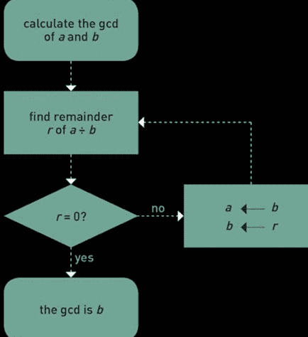


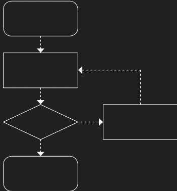


> 世界是不可翻译的，但它并非不可理解，只要你知道一个简单的规则：它通过万千生命和生物所表达的内容，其后面跟的不是问号，而是感叹号。
—卡尔·奥维·克纳斯高尔，《夏天》


# 系列序言

麻省理工出版社基础读知识系列为感兴趣的话题提供了易于理解、简洁且制作精美的口袋型书籍。该系列书籍由领先的思想家撰写，涵盖了从文化、历史到科学和技术等各个领域的专家级概述。

在当今这个即时信息满足的时代，我们可以轻松获取观点、合理化解释和浅层描述。而更难获得的是那些对世界产生原则性理解的基础知识。“基础知识”系列书籍填补了这一需求。通过为非专业人士综合专门主题，并从基础角度探讨批判性话题，每一本小巧的著作都为读者提供了进入复杂思想的入口。

# 前言

我认识两个青少年，他们拥有的知识超过了以往任何时代的科学家、哲学家或学者。他们是我的儿子。不，我并不是那种对孩子非凡天赋感到惊叹的溺爱父亲。但这两个孩子口袋里的设备将他们与人类创造过的最庞大的信息库连接在一起。只要他们掌握了在互联网上寻找信息的艺术，就没有哪一个事实性问题是他们无法回答的。他们可以在语言之间进行翻译，无需翻阅厚重的字典——我们在家里留着那些字典是为了让他们知道几年前世界是什么样子的。来自任何地方的新闻都能瞬间传达到他们手中。无论他们住在世界的哪个角落，他们可以在你察觉之前就与同龄人交流。他们可以极其完美的细节计划自己的活动。遗憾的是，他们也会肆无忌惮地浪费时间玩游戏或追随潮流，而潮流变化之快我甚至不知道它们为什么重要。

以上这一切之所以成为，得益于数字技术的巨大进步。今天，我们口袋里携带的计算能力比当年送人类登月的飞船还要多。正如这两个青少年所出的，我们生活的变化是巨大的；对未来的预测各不相同，从人们真的不需要工作的乌托邦，到少数特权阶层过上充实生活而其余人注定陷入无意义沉沉睡的反乌托邦。坦率地说，我们能够塑造这个未来，而我们做到这一点的一个重要因素，在于我们对支撑眼前成就和变化的底层技术有多么熟悉。尽管我们在忙碌的日常生活中可能会忽视这一点，但我们正处于人类历史上最好的时期。我们比以往任何时候都健康，预计平均寿命比曾存在过的任何一代人都要长。尽管存在极其触目的不平等，但人类大部分地区已经摆脱了贫困的枷锁。无论在虚拟还是现实中，我们比任何时候都彼此彼此。

想要参与这一进步，仅仅使用技术是不够的。我们必须能够理解它。首先，因为我们不是专业程序员，我们必须了解底层原理。其次，为了欣赏它的潜力，我们必须知道它是如何工作的。数字技术的实现既取决于其硬件（构成计算机和数字设备的物理组件），也取决于其软件（运行其上的程序）。程序的骨干是它们所实现的算法：一组指令。

我们所知道的知识会随时间而改变。在人类历史的大部分时间里，教育是不被需要的。在19世纪初，世界上80%以上的人没有受过教育；现在绝大多数人都接受过教育，预计到本世纪末，未受教育的人口比例将为零。我们花费在教育上的时间也增加了。1940年美国只有5%的人拥有学位，而到2015年这一三分之一。在19世纪，没有任何学校教授分子生物学，因为DNA直到20世纪才被发现。它现在已成为我们认可的教育规范的一部分。同样，尽管算法在古代就被发现了，但很少有人了解——我们已经处于算法成为我们认知核心的时期。数字技术的实现既取决于其硬件（构成计算机和数字设备的物理组件），也取决于其软件（运行其上的程序）。程序的骨干是它们所实现的算法——在现代计算机出现之前人们一直深受此困扰。

作者坚信，我们已经处于算法成为我们认知核心的时期。如果我们不知道它们是什么以及如何运作，我们就无法理解它们能做什么、如何影响我们、我们对它们期待什么、它们的局限性，以及它们工作需要什么。在一个日益依赖算法运行的社会中，作为知情公民，了解它们是我们的责任。


熟悉算法为我们引入了一种全新的算法思维方式：一种以实用方式解决问题的推理方法，以便让程序形式的高效算法能够在计算机中快速运行。

我们关注的可能不是会发生什么，而是如何发生。为了做到这一点，我们将介绍真实的算法，并不仅展示它们的作用，还将展示它们实际上是如何运作的。我们不会泛泛而谈，而是会提供详细的解释。

对于“什么是算法？”这个问题，答案简单得令人惊讶。它们是解决我们问题的特定方法。这些解决问题的方法可以被描述为易懂的步骤，以便计算机以惊人的速度和效率执行它们。然而，这些解决方案并没有任何神奇之处。它们由简单的基础步骤组成，这一事实意味着没有理由认为它们会超出大多数人的理解范围。

事实上，本书并没有假设读者具备高中常见知识以外的材料。在接下来的章节中确实会出现一些数学内容，因为如果没有一些符号表示，你就无法严肃地讨论算法。任何在算法中很常见但在计算机科学之外并不常见的概念，书中都给出了解释。

已故的物理学家斯蒂芬·霍金在他 1988 年出版的畅销书《时间简史》引言中写道：“有人告诉我，我在书中包含的每一个方程都会让销量减半。”对于目前这本书来说，这听起来相当不妙，因为数学在书中出现了多次。然而，我决定坚持下去，原因有两个：第一，虽然霍金物理学所需的数学水平在大学级及以上，但这里呈现的数学要易理解得多。其次，由于本书的不仅展示算法的用途，还要展示它们如何真正工作，因此读者应该学习我们在讨论算法时使用的一些词汇。而这些词汇确实包含一些数学。符号并不是技术神职的特权，熟悉它们将有助于消除围绕该主题的任何神秘感；最后，我们将发现这主要归根于能够以精确的定量方式进行交流。

用像这样的一本书涵盖算法的所有领域是不可能的，但提供一个概述并向读者介绍算法思维是可能的。第一章通过介绍算法是什么以及我们如何衡量它们的效率奠定了基础。我们从一开始就可以说，算法是我们可以用笔和纸完成的一系列有限步骤序列，这个朴实的定义与真相并不遥远。第一章从这里出发，同时也探索了算法与数学之间的关系。两者之间的关键区别在于实用性；在算法中，我们感兴趣的是解决问题的实用方法。这意味着我们需要能够衡量算法有多实用、多高效。我们将看到，这些问题可以通过计算复杂性的概念进行严谨的构建；这将为书中其余部分的算法讨论提供参考。

接下来的章涵盖了算法的三个核心应用领域。第二章涵盖了处理与网络（称为“图”）的物体相关的问题求解算法。这些问题可能包括在道路网络中寻找路线，或者连接你与社交网络中某人的链接链。它们还包括其他领域的问题，尽管这些问题在关系上并不显而易见：DNA 测序和锦标赛调度；这将说明不同的问题可以使用相同的工具高效地解决。

第三章和第四章探索了如何搜索物品和对物品进行排序。这些看起来可能平淡无奇，但它们是计算机最重要的应用之一。计算机花费大量时间进行排序和搜索，但我们从很大程度上忽略了这一事实，恰是因为我们是大多数应用程序中不可或缺的、隐藏的一部分。排序和搜索还让我们窥见算法的一个重要侧面。对于许多问题，我们知道有不止一种算法来解决它们。我们根据算法的特定特性从可用算法中进行选择；某些算法比其他算法更适用于某些问题实例。因此，观察具有不同特性的不同算法如何解决同一个问题是有有益的。

接下来的两章介绍了算法在大规模上的重要应用。第五章再次引入图来解释 PageRank 算法，该算法可以根据重要性对网页进行排名。PageRank 是 Google 成立时使用的算法。该算法在搜索结果中网页排名的成功，对 Google 作为一家公司的巨大成功起了关键作用。幸运的是，理解 PageRank 的工作原理并不困难。它将让我们看到算法如何解决一个初看起来看起来并不适合计算机解决方案的问题：我们如何判断什么是重要的？

第六章介绍了计算机科学中最活跃的领域之一：神经网络和深度学习。大众媒体报道了神经网络的成功应用。这些故事通过描述执行如图像分析、自动翻译或医学诊断等任务的系统，激发了我们的兴趣。我们将从简单的开始，从单个神经元，构建越来越大的神经网络，使其能够执行越来越复杂的任务。我们看到它们都是根据某些基本原理工作的。它们的效能来自于许多组件的相互连接，而算法的应用让网络能够学习。

在勾勒了算法能做什么之后，后记探索了计算的局限性。我们知道计算机已经创造了惊人的壮举，并且对未来有很厚的期望，然而仍然存在它们做不到的事情吗？对计算局限性的讨论将允许我对算法的本质提供更精确的解释。我们说过可以将其描述为可以用笔和纸完成的有限步骤序列，但这些步骤可能是什么样的呢？笔和纸的比喻与算法的真实本质有多接近？


当算法被用于组织政治竞选、追踪我们在在线世界的足迹、监控我们的购物并向我们投放广告、建议约会对象或监测我们的健康时，它们便被视为某种形式的更高权威.¹

这一切周围笼罩着一层神秘的色彩，这或许让算法的追随者们感到受宠若惊。被称为“程序员”或“计算机科学家”意味着你是一个体面的、尽管带有些技术色彩的角色。但如果能成为那个即将改变我们生活中几乎一切的部落成员，那该有多好呢？

在某种意义上，算法确实像神神。它们大多数时候是不受责任约束的，就像神一样；事情的发生不是因为人类的主观能，而是因为是由算法决定的，而算法又处于责任的范围之外。运行算法的机器在越来越多的领域可以超越人类的表现，使得人类优越的领域似乎在一天天缩小缩小；有些人认为，计算机在认知方面完全超越人类的那天并不远了。

但在另一种意义上，算法与神完全一点关系都没有，尽管我们经常忽视了这一点。算法并不是通过启示行为来产生结果的。我们准确地知道它遵循的规则和所采取的步骤。无论结果多么完美，它总可以追溯到某些基础操作。

对于算法的初学者来说，这些操作竟然是如此简单，可能会让他们感到惊讶。这并不是要贬低算法；看到某事的真实运作方式可能会消除它的部分神秘感。同时，理解某事如何运作使我们能够欣赏其设计的优雅之处，即使它不再神秘了。

本书的前提是，算法确实并不神秘。它们是让我们能够良好完成某些事情的工具；它们是特定类型的工具，其目的是让我们能够解决问题。通过这种方式，它们是认知工具；如此，它们并非唯一的认知工具。数字和算术也是认知工具。我们花了数千时间才演化出一套孩子们在学校就能学习的数字系统，以便他们进行没有它们就无法完成的计算。现在我们认为数学是理所当然的，但在几代以前，只有极少数人类对此有所知。

同样，对算法的认知不应该是少数精英成员的特权；作为认知工具，它们可以被各种人理解，而不仅仅是计算机专业人士。更重要的是，它们应该被更多的人理解，因为这将允许我们客观地看待算法：知道它们在做什么、如何做，以及我们现实中可以期待它们做什么。

算法的核心知识正是我们在这里追求的，以便我们能在关于算法时代的对话中发挥有意义的作用。那不是一个强加于我们的时代，而是我们自己创造的时代，基于我们所制定的工具。这些工具的研究是本书的主题。算法是美丽的工具，窥见它们是如何制造和运作的可以增强我们的思维方式。

我们将开始消除一个令人讨厌的观念：算法是关于计算机的。我们将发现，这种说法和说“数字是关于计算器的”没有区别。

# 解决某事的方法

纸笔游戏、音乐、数字的整除性以及粒子物理学中的中子加速器——我们将看到，它们的共同点是同一种算法，被应用于如此不同的领域，但却基于相同的底层原理运行。这怎么可能呢？

“算法”（algorithm）一词本身并没有揭示它的含义。它源于穆罕默德·穆萨·阿尔·霍瓦里米（Muḥammad Mūsā al-Khwārizzī，约780年–约850年）的名字，他是一位研究数学、天文学和地理学的波斯学者。阿尔-霍瓦里米的贡献非常多且广泛。“代数”（algebra）一词来自他最有影响力的著作《增补与平衡计算全书》（The Compendium Book on Calculation by Completion and Balancing）的阿拉伯语标题。他的第二本影响力的书籍《印度数字计算法》是关于算术的，翻译成拉丁文后向西方引入了印度阿拉伯数字系统。阿尔-霍瓦里米的名字被拉丁化为 Algorismus，后来代表用十进制数字进行数值计算的方法。Algorismus受希腊语“数字”（arithithmos，如 arithmetic 中的词）的影响，变成了 algorithm，仍指代十进制算术，直到19世纪才获得它的现代含义。

你可能会倾向于认为算法是我们在用计算机做的事情，但这是错误的。之所以说是错误的，是因为我们在计算机出现很久以前就已经有了算法。最早已知的算法可以追溯到古巴比伦。²这也是错误的，因为算法并不是与计算机有关的问题。算法是关于以特定方式做某事，遵循某些步骤。这有些模糊。你可能会问，什么样的步骤？什么特定的方式？我们可以消除所有模糊性，对算法是什么及其做什么给出一个精确的数学定义——这样的定义确实存在——但我们不需要费那么大的劲。你可能很高兴地知道算法是一组你可以用纸笔遵循的步骤，你可以放心这种看似浅显的描述与数学家和计算机科学家所使用的描述相似。你可能会倾向于认为算法是我们在用计算机做的事情，但这是错误的。之所以说是错误的，是因为我们在计算机出现很久以前就已经有了算法这也是错误的，因为算法并不是与计算机有关的问题。算法是关于以特定方式做某事，遵循某些步骤。这有些模糊。你可能会问，什么样的步骤？什么特定的方式？我们可以消除所有模糊性，对算法是什么及其做什么给出一个精确的数学定义——这样的定义确实存在——但我们不需要费那么大的劲。你可能很高兴地知道算法是一组你可以用纸笔遵循的步骤，你可以放心这种看似浅显的描述与数学家和计算机科学家所使用的描述相似。

> 你可能会倾向于认为算法是我们在用计算机做的事情，但这是错误的。之所以说是错误的，是因为我们在计算机出现很久以前就已经有了算法。

所以我们可以开始通过写写来进入算法。假设有两组对象，尽可能在两组之间均匀分布。我们将交叉（×）作为第一组对象，点（•）作为第二组对象。我们将在第二组对象中分布交叉。

但如果对象的总数（交叉和点加起来）不能被交叉整除呢？如果我们有五个交叉和七个点该怎么办？

我们首先把所有的交叉后面跟着所有的点放在一行：

× × × × × • • •

然后我们将五个点放在交叉下面：

× × × × ×
• • • •

我们在出现的模式中注意到，右侧还有两列。我们取这两列（每列包含一个点），放在前两列下面，形成第三行：

× ×
• •
• •
•

现在我们注意到还剩下三列。我们取最右侧的两列放在最左侧的两列下面：

× ×
• •
•
•
× ×
•

现在只剩下一列，所以停止。我们从左到右连接列并得到：

这就是结果。我们在点之间分布了交叉。它们不像以前那样均匀，但这是可能的，因为记住，5不能整除12。然而，我们成功地避免了将所有交叉聚集在一起，创造了一个看起来并不完全随机的模式。

你可能会好奇这个模式有什么特别之处；如果你用 DUM 代替交叉，用 da 代替点，会有帮助。那么模式就是 DUM-da-d a-DUM-da-DUM-da-da-DUM-da-DUM-da，它确实是一种节奏。节奏由重音部分（也称为*起始音*）和非重音或沉默部分组成。我们发现的节奏并不是我们创造的。它被中非共和国的阿卡矮人使用；它是南非歌曲中名为 Venda 的击掌声；它也是马其顿使用的一种节奏模式。还有更多。如果我们旋转它，让从第二个交叉（即起始音）开始，那么它变成了：


从第三、第四和第五个起始音开始，世界各地出现了其他流行的节奏。

这仅仅只是一个偶然现象吗？我们可以尝试用七个起始音和五个静默部分创建一个 12 份的节奏——这在某种程度上镜像了我们之前拥有的五个起始音和七个静默部分。如果我们完全按照相同的步骤，我们将得到：

× • × • × • × × • •

这同样是一种节奏。它被用于加纳阿尚蒂人的 Mpre 节奏中，如果我们从最后一个起始音开始，它也被尼日利亚的约鲁巴人以及中非和塞拉利昂使用。

免得认为我们遗漏了地理区域，如果我们从五个节拍和 11 个静默部分开始，我们将得到如下：

× • × • × • × • • • •

这就是旋转后的波萨诺（Bossa-Nova）节奏。真正的波萨诺是从第三个起始音开始的，因此准确的对应关系是：

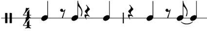

× × • • • × • • × •

如果尝试尝试三个节拍和四个静默部分，我们得到如下模式：

× • × • × •

这种节奏在 7/4 拍中非常流行，而且不仅限于传统音乐。在其他旋律中，它是平克弗岩乐队歌曲《Money》的节奏模式：

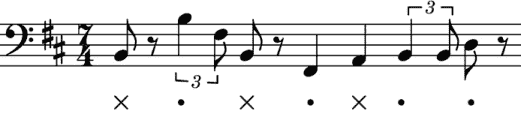

× • × • × •

通过在列中放置叉号（×）和圆点（•），并按照我们刚刚描述的方式移动它们，可以用这种方式推导出更多节奏。我们通过测量余数列这种直观的方式说明了这一过程，这展示了实际发生的情况。与其创建列、检查几何结构并移动它们，不如用简单的数值运算以更正式的方式完成相同的操作。为了看到结果，让我们回到 12 份和七个起始音的例子。我们首先用 12 除以 7，得到商为 1，余数为 5：

12 = 1×7 + 5

这告诉我们将七个起始音放在开头，创建七列起始音，后面是五个未计数的部分的余数：

× × × × × × • • • •

现在我们再次进行除法，但这次我们用上一次除法的除数 7 除以上一次除法的余数 5。这再次给了我们商 1 的商，而余数为 2：

7 = 1×5 + 2

这意味着我们需要取右侧的五列，并将它们放置在左侧的五列下方，留下 2 列作为余数：

× × × × × × • • • •

我们重复相同的步骤：用上一次除法的除数 5 除以上一次除法的余数 2。商为 2，余数为 1：

5 = 2×2 + 1

这告诉我们要取*两倍*最右侧的两列，并将它们放置在最左侧的两列下方，留下 1 列作为余数：

$\times$ $\times$ $\times$
$\cdot$ $\cdot$ $\cdot$
$\times$ $\times$
$\times$ $\times$
$\cdot$ $\cdot$

注意，*两倍*意味着如果我们按照之前的方法操作而不使用除法，这等于我们分两步所做的。我们将从：

$\times$ $\times$ $\times$ $\times$ $\times$ $\times$
$\cdot$ $\cdot$ $\cdot$ $\cdot$ $\cdot$ $\cdot$

首先变为：

$\times$ $\times$ $\times$ $\times$ $\times$
$\cdot$ $\cdot$ $\cdot$ $\cdot$ $\cdot$
$\times$ $\times$

然后变为：

如果我们把这些列连接起来，我们就得到了 Mpre 节奏：

# 我们的第一个算法

我们可以用更精确的术语将我们遵循的方法列为如下步骤。我们假设从两个数字 $a$ 和 $b$ 开始。我们让 $a$ 为部分的总数。如果起始音的数量 $a$ 大于静默部分的数量，那么 $b$ 就是起始音的数量；否则它是静默部分的数量。在开始时，我们创建一个起始音组成的行，后面跟着静默部分。

1. 执行 $a$ 除以 $b$ 的除法。这将给我们一个商和一个余数。如果我们把商称为 $q$，余数称为 $r$，我们就有 $a = q \times b + r$。这是我们所知的整数除法。我们取右侧 $b$ 列的若干倍，将其移动到左侧列下方，在右侧留下 $r$ 列余数。

2. 如果余数 $r$ 等于零或一，我们就停止。否则，我们回到步骤 1，但这次 $b$ 将成为新的 $a$，而 $r$ 将成为新的 $b$。换句话说，我们回到步骤 1，设置 $a$ 等于 $b$且 $b$ 等于 $r$。

在两步中，我们重复执行除法，直到重复没有意义为止。你可以在下面的表格中追踪步骤，在表中我们像之前一样从 $a = 12$ 和 $b = 7$ 开始；在每一行中，我们都有 $a = q \times b + r$：

| $a$ | $q$ | $b$ | $r$ |
|---|---|---|---|
| 12 | 1 | 7 | 5 |
| 7 | 1 | 5 | 2 |
| 5 | 2 | 2 | 1 |


除 1 之外没有任何公约数。这就是当 $a = 9$ 和 $b = 5$ 时发生的情况。你可以亲身尝试对 $a = 55$ 和 $b = 34$ 执行算法步骤，看看会发生什么；它需要几步，但算法将确定唯一的公约数是 1。

欧几里得算法的步骤按照定义的顺序执行。该算法的描述说明了其组成步骤是如何组合的：

- 1. 步骤被置于*序列*中。
- 2. 步骤可以描述一种*选择*，以决定遵循哪些步骤。在步骤 2 中，会对余数是否为 0 进行测试。然后根据结果有两种替代方案：我们要么停止，要么返回步骤 1。
- 3. 步骤可以被放入*循环*或*迭代*中，其中它们被重复执行。在步骤 2 中，如果余数不等于 0，我们就返回步骤 1。

我们把这三种组合步骤的方式称为*控制结构*，因为它们规定了我们在执行算法时将执行什么操作。所有的算法都是这样结构的。它们由执行计算和处理数据的步骤组成；这些步骤通过这三种控制结构被组合在一起并编排。更复杂的算法有更多的步骤，它们的编排可能更复杂。但这三种控制结构足以描述任何算法步骤的组合方式了。

算法的步骤（以及其他方面）运行在我们提供的输入上。输入是算法处理的数据。如果我们采用以数据为中心的观点，我们就使用算法将某些描述问题的数据转换为与问题解决方案相对应的形式。

我们在音乐节奏背后发现了一种基于除法的算法，它是除法的应用，但实际上，我们不需要看得那么远；除法行为本身就是一种算法。即使你没有听过欧几里得算法，你也知道如何除两个大数；我们都在年幼时花过时间学习执行乘法和长除法。我们的老师花费了几个小时在我们脑子里灌输这些操作的方法：一组将数字放在正确位置并对它们进行处理的步骤——它们就是算法。但算法不仅仅是关于数字的，正如我们刚刚看到的。我们刚刚发现它们关乎我们如何创作音乐。然而，这并没有什么神秘的。节奏是在时间间隔内分配应力的方式，当我们在包装饼干和奶酪时，同样的原理在起作用。

欧几里得算法在节奏上的应用有一个意想不到的来源：田纳西州橡树岭国立实验室的中子源设施。那里的散裂中子源（SNS）产生强烈的脉冲中子束，用于粒子物理实验。（spall 动词的意是将材料击成更小的碎片；在核物理学中，重原子核在被高能粒子轰击后会发射大量的质子和中子。）在 SNS 的运行过程中，某些组件（如高压电源）应该使得脉冲尽可能均匀地分布在时间槽中。为了这种分布而设计的算法本质上与节奏算法和欧几里得算法是相同的，引导我们从数字到亚原子粒子再到音乐。

# 算法、计算机与数学

我们说过算法与计算机无关，但今天大多数人将它们混在一起。确实，算法在与计算机结合时会展现出它们的潜力，但计算机实际上是一种具有特殊特性的机器，我们可以命令它执行某些事情。我们通过编程来命令它，通常我们是为了让它执行算法。

这就引入了编程本身。编程是将我们的意图翻译成计算机能够理解的某种符号的学科。我们把这种符号称为编程语言，因为有时它看起来像是在用人类语言写作，但与人类语言的丰富性和复杂性相比，编程语言是非常简单的事情。当然，计算机实际上并不真正理解任何东西。如果我们能够制造出真正智能的机器，未来可能会发生变化，但现在当我们说计算机理解某种符号时，它实际上意味着该符号被转换了一系列操纵电子电路中电流的指令（我们也可以用光代替电流，但原理是一样的）。

如果说算法是一组我们可以自己执行的步骤，那么编程就是我们用计算机理解的符号写下这些步骤的活动。然后，执行这些步骤的就是计算机。计算机比人类快得多，因此它们可以在更短的时间内执行步骤。计算的根本因素是速度。计算机不能做与我们人类能做的性质上完全不同的事情，但它可以做得更快——快得多。算法在计算机上获得了力量，因为在计算机上执行这些相同步骤的时间只需要我们执行相同步骤时间的一部分，但它们仍然是相同的步骤。

编程语言为我们提供了向计算机描述算法步骤的方法。它还提供了使用三种基本控制结构对其进行结构化的手段：序列、选择和迭代。我们使用正在使用的特定编程语言提供的词汇和语法来编写步骤并描述它们是如何被编排的。

除了速度之外，使用计算机还有额外的优点；如果你能想起如何学习执行乘法和除法，那可能是很有趣的。计算机不会感到无聊，所以让它们执行算法的另一个理由。虽然算法通常在计算机上执行，但在编程语言编写后，它主要是为人类编写的，人类必须理解它是如何工作的以及何时可以使用。这让我们想到了即使是计算机科学家和资深程序员也会忘记的本质。真正理解算法的唯一方法是亲手执行它。我们必须能够执行算法，就像计算机执行实现它的程序一样。在今天，我们很幸能够拥有各种帮助我们学习的媒体：精彩的视频、动画和模拟触手可及。这些都很棒，但当你遇到卡壳时，请准备好笔和纸。这些行也同样适用。你真的理解了如何创建节奏吗？你尝试过创建一个吗？你能找到 252 和 24 的最大公约数吗？

所有程序都实现一组执行某些事情的步骤，因此我们可能会认为所有程序都是算法。然而，我们更加严格，希望步骤满足某些特征。

- 1. 步骤必须在有限的步骤后终止。算法不能无限运行。（程序可以无限运行，只要运行它的计算机保持运行状态。该程序不是算法的实现；它只是一个计算过程。）
- 2. 步骤必须精确，以便我们可以在不混淆的情况下执行它们。
- 3. 算法可以在某些输入上运行；在欧几里得算法的情况下，它对两个整数运行。
- 4. 算法有一个输出；这是算法的全部目的：产生一个结果。在欧几里得算法中，结果就是最大公约数。
- 5. 算法必须是有效的。人类应该能够在合理的时间内用纸笔执行每个步骤。


这些特性确保了算法能够执行某些功能。算法之所以存在是因为执行了有用的功能。无意义的算法确实存在，计算机科学家可能会出于开玩笑或无意中发明无用的算法，但我们真正感兴趣的是对我们有用价值的算法。在处理算法时，仅仅证明某事是可以实现的是不够的。我们希望算法具有实际价值，为此，它们必须能够很好地完成某些任务。

算法与数学之间存在着根本的区别。早期的计算机科学家大多数是数学家，而且计算机科学使用了大量的数学，但它并不是一门数学学科。数学家想要证明*某事确实如此*；而计算机科学家则想要*让它运行起来*。

算法的第一个特征是它应该需要有限数量的步骤。这并不十分精确。我们希望这个有限数量的步骤足够小到可以在实践中执行，从而使我们的算法在合理的时间内完成。这意味着仅仅提出一个算法是不够的；算法在实践中必须也是有效的。让我们来看一个例子，来说“知道某事”与“知道如何高效做某事”之间的区别。假设我们有如下网格：

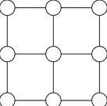

我们想要找到从网格左上角到右下角的最短路径，且不访问同一个地方。每条路径的长度等于网格点之间链接的数量。这里有一种实现方法：找到所有这样的路径，测量每条路径的长度，并选取最短的一条，或者在并列的情况下选取任意一条最短的路径。路径总数为 12 条，如下所示：

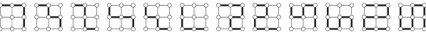

有五条长度为 4 的路径，所以我们可以选择其中任何一条。
不过，我们并不限于 $3\times3$ 的网格。我们可以有 $4\times4$、$5\times5$ 甚至更大的网格。然后我们发现我们的方法扩展性并不好。在 $4\times4$ 网格中，从左上角到右下角有 184 条路径；如果变成 $5\times5$ 网格，此类路径的数量将增加到 8,512。路径的数量继续飞速增长——事实上，是以越来越快的速度增长——仅仅是这些路径都是一项挑战。当我们达到 26×26 的网格时，我们得到了 8 402 974 857 881 133 471 007 083 745 436 809 127 296 054 293 775 383 549 824 742 623 937 028 497 898 215 256 929 178 577 083 970 960 121 625 602 506 027 316 549 718 402 106 494 049 978 375 604 247 408 条路径。这个数字有 151 位十进制，是通过一个实现算法的计算机程序找到的；是的，我们使用一个算法来理解另一个算法的行为。⁵

列举所有路径并选择最短的一条的过程无疑是正确的，并且始终能带我们找到最短路径——如果有多条同样短的路径，则给出其中任何一条最短路径——然而它绝对是不切实际的。此外，它也是完全没有用处的，因为存在算法可以在不枚举所有可能的路径的情况下找到最短路径，从而节省大量时间，并允许我们处理任何尺寸的网格。在 26 ×26 的网格中，找到答案所需的步骤仅在数百数量；我们将在下一章看到。

关于什么是算法的问题之所以比其他问题更具实践意义，是因为从某种意义上说，它是任何应用的核心。在书的其余部分，我们将看到对于同一个问题通常存在不同的算法，而我们根据每个特定场景选择最合适的算法。像所有工具一样，某些算法在特定情况下比其他算法更适用。然而，与许多其他工具不同，我们拥有一种定义良好的方法来评估算法的优缺点。


当我们研究一个解决问题的算法时，我们想知道它的性能将如何。速度始终是一个重要因素。我们在计算机上使用算法是为了比人类更快地完成工作。

随着计算机硬件的改进，我们通常不满足于知道实现算法程序在特定计算机上的运行情况。我们的计算机可能比测量算法时使用的计算机更快或更慢，几年之后，在过时机器上测量算法将仅具有历史意义。我们需要一种独立于计算机硬件来衡量算法性能优坏的方法。

然而，我们试图解决的问题规模应该以某种方式反映在衡量算法性能的方法中。我们并不在乎排序 10 个项目需要多长时间；毕竟，我们可以手动完成。我们确实在乎排序百万个或更多项目需要多长时间。我们希望衡量一个算法在非显易问题中的预期性能。

为了做到这一点，我们需要一种方法来量化输入算法的问题规模。感兴趣的维度在不同问题之间各异。如果我们想在计算机中排序若干项目，相关的维度就是我们要排序的项目数量（而不是，例如，项目的大小或组成）。如果我们想乘两个数字，相关的维度就是这两个数字的位数（这对于人类来说也是合理的：长乘法之所以长，是因为它取决于每个数字的位数）。当我们讨论问题以及解决问题的候选算法时，我们总是使用问题的规模来评估。

尽管特定问题有不同的评估规模的方法，但最终我们用一个整数数量来指定其规模。结合上面的例子，$n$ 就是我们要排序的项目数量或我们要相乘数字的位数。

算法所需的时间与其计算复杂度有关。算法的计算复杂度是它运行所需的资源量。这里有两种主要的资源：时间，即需要多长时间；以及空间，即对计算机内存所需的存储。

我们现在关注时间。由于计算机具有不同的性能特性，讨论算法在特定计算机上的运行时间可能会带给我们一些启发，但我们希望得到某种通用的结论。计算机的速度取决于执行基本操作所需的时间。为了避开这些特殊性，我们转而选择讨论运行算法所需的操作次数，而不是在特定计算机上运行这些操作所需的实际时间。

现在在说了这些之后，请注意我们会有一些滥用术语的行为，将“操作”和“时间”视为同义词。虽然我们严格来说应该说算法需要“x 次操作”，但我们也会说该算法是“x 时间”，用以表示它在任何运行该算法的计算机上都是执行 x 次操作所需的时间。尽管实际时间会随硬件而异，但当我们比较在同一计算机上运行的“x 时间”和“y 时间”的算法时，这并不重要。

现在我们回到输入算法的问题规模。由于我们感兴趣的是非显易问题，我们不关心小规模问题时发生的情况。我们将关注达到某个规模后发生的情况。我们不会具体说这个规模是多少，但我们总是假设它是大量的。

有一种在实践中被证明非常有用的复杂度定义。它也有自己的符号和名称。我们写成 O(·) 并称之为大 O 记法。在大 O 内部，

在点号的位置，我们写一个表达式。这种符号表示该算法所需的时间最多是该表达式的倍数。让我们来看看这意味着什么：

- 如果你想在一个项目序列中查找某项——序列中有 $n$ 个项目——且该序列没有任何没有任何顺序，那么复杂度是 $O(n)$。也就是说，对于 $n$ 个项目，找到其中某一个特定项目所需不会超过项目数量的倍数。

- 如果你想使用乘法计算两个 $n$ 位的数字，复杂度是 $O(n^2)$。也就是说，乘法所需的时间不会超过数字平方的倍数。

如果我们有一个复杂度为 $O(n)$ 的算法，那么对于一个大小为 10,000 的输入，我们预计它需要几万个步骤。如果算法的复杂度为 $O(n^2)$，对于规模类似的输入，我们预计它需要一亿个步骤。对于很多问题来说，这个规模并不大。计算机通常会对比 10,000 个项目进行排序。但你会发现，算法复杂度所代表的步数规模可以变得巨大。这里有一些例子，可能帮助你理解我们将遇到的一些数字的规模。以 1000 亿或 $10^{11}$ 为例；这是一个后面有 11 个零的数字。如果你把 1000 亿个汉堡首尾相接，你可以绕地球 216 次，或者去一趟月球回来。

十亿某物通常被称为 *giga*（十亿级），至少在计算机领域是如此。十亿之后是万亿，或 *tera*（兆），即 1000 亿，$10^{12}$。如果你开始每秒数一个数字，你需要 31,000 年才能数到万亿。再次增加 1,000 倍是 *peta*（拍）；我们得到了一京亿，$10^{15}$。根据生物学家 E. O. 威尔逊的说法，地球上蚂蚁的总数在 1 到 10 京亿只之间。换句话说，我们星球上有 1 到 10 *petaants*（拍蚂蚁）。

京亿之后是百亿，或 *exa*（艾）；一个百亿是 $10^{18}$，大约是 10 个大型海滩上的沙子数量。例如，10 个科帕卡巴纳海滩就有一个 *exagrain* 的沙子。再次向上，我们达到了 $10^{21}$，一垓，或 *zeta*（泽）。可观测宇宙中的恒星数量是一个 *zettastars*。在 *yotta* 之后我们就没有前缀了，它代表 $10^{24}$，即一沟。但数字可以变得更大。数字 $10^{100}$ 被称为 *googol*（戈戈）——是的，你可能知道有一家以故意拼写错误的词命名的公司。然后是 10 的 googol 次方，$10^{10^{100}}$，这是一个 *googolplex*（谷歌复极大数）。

这些类比将帮助我们理解书中其余部分将检查的特定算法的优点。尽管我们可以拥有任何复杂度的算法，但我们通常处理的算法只分为少数不同的组。


所有算法中最快的族是由无论输入是什么、运行时间都不超过常数时间的算法组成的。我们将这种复杂度表示为 $O(1)$；例如，一个检查数字最后一位是奇数还是偶数的算法不会受到数字大小的影响，并在常数时间内运行。$O(1)$ 中的 1 源于这样一个事实：$O(1)$ 意味着算法运行所需的步骤不超过 1 个的倍数——即常数个步骤。

在遇到下一个复杂度族之前，我们需要简要了解一下事物增长或收缩的特定方式。如果你多次加上某物，你就是在进行乘法。如果你多次乘以某物，你就是在对其进行幂运算或指数化处理。我们刚刚看到像 $10^1$ 这样带有指数的数字变得有多大。可能并非显而易见的是幂运算是如何迅速导致眩晕的升级的——这种现象被称为指数增长。

关于象棋发明的可能不传的故事很有说明性。象棋发明地的国家统治者询问发明者他想要什么作为礼物（唉，在这些故事里是个“他”）。他回答说，他想要棋盘的第一格有一粒米，第二格两粒，第三格四粒，依此类推。国王认为自己占了大便宜，就答应了这个愿望。不幸的是，事情很快变糟了。序列按 2 的幂次方增长：第一格是 $2^0 = 1$，第二格是 $2^1 = 2$，第三格是 $2^2 = 4$，因此在最后一格，米米的数量将是 $2^{63}$，这是一个任何手段都无法达到的数量（它等于 9,223,372,036,854,775,808，或者大约 9 穰）。

指数增长也能帮助我们理解为什么折叠纸很多次如此困难。你每折叠一次，折叠的层数就会翻倍。折叠 10 次后，你有 $2^{10}=1,024$ 层。如果你的纸厚度是 0.1 毫米，你现在有一团厚度超过 10 厘米的折叠纸。除了将其折叠所需的所需的巨大力量外，这在物理上可能完全是不可能的，因为要折叠某个东西，它的长度必须大于厚度。

指数增长是多年来计算机越来越强大的原因。根据摩尔定律，集成电路中的晶体数量大约每两年增加一倍。该定律以戈登·摩尔命名，他是费尔尔半导体和英特尔的创始人。他在 1965 年提出了这一观察；因此，我们从 1971 年处理器中约 2,000 个晶体管（英特尔 4004）变成了 2017 年的 190 亿多个（32 核心 AMD Epyc）。$^8$

看到增长后，让我们探索它的对立面。如果你有某物的倍数，使用除法来逆转操作并获得原始值。如果你有某物的幂，$a^x$，如何逆转该操作？幂运算的逆是对数。

对数有时被视为大众数学与入门级数学之间的界限；如果对数看起来有些模糊，请记住对数是幂运算的逆。正如当我们进行幂运算时是在重复相乘法，当我们取对数时，是在重复相除法。对数是问题的答案：“我应该将 $a$ 于多少次方才能得到 $x$？”我们提升的数字被称为对数的*底数*。对数的符号为 $\log_x a$，它对应于问题：“我应该将 $a$ 于多少次方才能得到 $x$？”当 $a=10$ 时，我们省略下标，因为以 10 为底是对数很常见，所以我们不写 $\log_{10}x$，而是写 $\log x$。还有其他底数。当底数是常数 $e$ 时，我们写 $lnx$。常数 $e$，称为欧数，大约等于 2.7128。在自然科学中我们经常遇到 $lnx$，这就是它被称为自然对数。另一个常见的底数是 2，我们不写 $log_2x$ 而写 $lg$。二底对数在计算机科学和算法中很常见，但在这些领域之外可能未使用，尽管我们已经遇到过它们。在折叠纸中，如果一团纸有 1,024 层，它被折叠了 $lg1024 = lg2^{10}$ 次。在象棋例子中，米的数量源于我们执行的翻倍次数，这些次数是 $lg2^{63} = 63$。我们在算法中频繁使用 $lg$ 的原因是，每当我们通过将问题分成两个相等的小问题来解决问题时，它就会出现；这被称为分治法，它的工作原理就像折叠纸张。在有序组中搜索某项的最有效方法复杂度是 $O(lgn)$。这非常惊人；它意味着在十亿个有序项目中查找某项，我们只需要 $lg10^9 \approx 30$ 次探测。具有对数复杂度的算法仅次于常数时间的算法。接下来是运行 $O(n)$ 的算法，它们被称为线性时间算法，因为它们的时间随 $n$ 成正比增长；这意味着它们作为 $n$ 的倍数增长。我们看到在一个项目序列中搜索一个项

无序项目集合所需的时间与项目数量成正比，即 $O(n)$。看看与项目有序时相比复杂度是如何增加的；对问题数据的组织方式会对解决问题产生巨大影响。通常情况下，如果一个算法必须读取问题的所有输入，线性时间就是我们能预期的最优行为，因为处理 $n$ 个输入需要 $O(n)$ 的时间。

我们将线性算法和对数算法结合，就得到了对数线性时间算法，其时间随 $n$ 乘以其对数增长，即 $n \log n$。排序（即把项目按顺序排列）的最佳算法复杂度为 $O(n \log n)$。这看起来可能有点意外；毕竟，可以证明如果你有 $n$ 个项目并想将每个项目与所有其他项目进行比较，则需要 $O(n^2)$，这比 $O(n \log n)$ 大。⁹此外，如果你有 $n$ 个需要排序的项目，你确实需要 $O(n)$ 的时间检查所有它们。对它们进行排序需要将该数字乘以比 $n$ 本身更小的因子。我们将在书后介绍如何实现这一点。

下一类计算复杂度是 $n$ 的常数幂，$O(n^k)$；这被称为多项式复杂度。多项式时间算法是高效的，除非 $k$ 很大，但这很少发生。当我们尝试解决一个计算问题时，如果能提出多项式时间算法，通常会非常高兴。

$O(k^n)$ 复杂度被称为指数复杂度。注意它与多项式复杂度的区别，后者的指数是常数；而这里指数是变化的。我们见过指数级增长是爆炸性的。宇宙无法存足够久来看到非平凡输入下指数算法的答案。这类算法从理论角度来说很有趣，因为它们证明了可以找到解决方案。然后我们可以寻找复杂度更低的更优算法，或者我们可能证明无法找到更好的算法，在这种情况下，我们只能接受次理想方案——例如近似解。

有一种东西比指数级增长得还要快，那就是阶乘。如果你以前没有遇到过阶乘，自然数 $n$ 的阶乘（我们写做 $n!$）简单来说就是从1到包括该数在的所有自然数的乘积：$100! = 1 \times 2 \times 3 \dots \times 100$。即使你没见过 $100!$，你可能也遇到过 $52!$，即便你知道它的含义。那是一副扑牌所有不同的洗牌方式。运行时间以阶乘衡量的算法具有阶乘复杂度。

尽管像 $100!$ 这样的数字看起来很奇特，但它们出现在许多非奇特的场景中，而不仅仅是牌游戏。例如，考虑以下问题：“如果我们有一个城市列表以及每两个城市之间的距离，那么一个人访问每个城市并返回起点城市的最短路线是什么？”这被称为旅行推销问题，解决它的显而易见的方法是检查经过城市的所有可能路径。遗憾的是，对于 $n$ 个城市，这种方法是 $n!$。在 20 个城市之后，该问题就无法处理了。有些算法处理得比 $O(n!)$ 好一点，但还不足以实际应用。对于这样一个简单的问题，这可能令人惊讶，我们可以在接受的时间内解决它的唯一方法是找到一个可能不是最优但足够接近最优的解决方案。许多其他非常重要的问题是不可解的——也就是说，我们不知道实用的算法来精确解决它们。尽管如此，对更好的近似算法的追求仍然计算机科学中一个充满活力的领域。

在下表所示，你可以看到不同 $n$ 值下属于所述复杂度族的各种函数值。第一行给出 $n$ 值，并代表线性复杂度；后续行显示复杂度增加的族群。随着 $n$ 的增加，函数值也会增加，但它们增加的方式是不同的。函数 $n^3$ 将我们从一百万增加到一万亿，但与 $2^{100}$ 或 $100!$ 相比这微不足道。我们在 $n^k$ 行之后留了一个空白，将实用算法与不实用算法隔开。两者之间的界限是多项式算法，正如我们所看到的，它们具有实用价值。高复杂度算法通常没有实用价值。

| $n$ | 1 | 10 | 100 | 1,000 | 1,000,000 |
| :--- | :--- | :--- | :--- | :--- | :--- |
| $\lg n$ | 0 | 3.32 | 6.64 | 9.97 | 19.93 |
| $n \lg n$ | 0 | 33.22 | 664.39 | 9,965.78 | $1.9 \times 10^7$ |
| $n^2$ | 1 | 100 | 10,000 | 1,000,000 | $10^{12}$ |
| $n^3$ | 1 | 1,000 | 1,000,000 | $10^9$ | $10^{18}$ |
| $n^k$ | 1 | $10^k$ | $100^k$ | $1,000^k$ | $1,000,000^k$ |
| $2^n$ | 2 | 1,024 | $1.26 \times 10^{30}$ | $1.07 \times 10^{301}$ | $1.07 \times 10^{301030}$ |
| $n!$ | 1 | 3,628,800 | $9.33 \times 10^{157}$ | $4 \times 10^{256}$ | $8.64 \times 10^{656570}$ |


在18世纪，柯尼斯堡的市民在散步。柯尼斯堡坐落在普雷格尔河畔。柯尼斯堡有两个岛屿。在二战后，它属于苏联并更名为格勒宁格。虽然现在的格勒宁格是一个俄罗斯的飞地，位于波兰和立陶宛之间。1736年3月9日，来自但泽锡（但泽锡现在被称为格但斯克，属于波兰）给欧拉的信件似乎是市长为了鼓励数学发展的。欧拉当时住在俄罗斯圣彼得堡。他研究了这个问题，并在1735年8月26日向圣彼得堡科学院提交了解决方案。来年他用拉丁语写了一篇论文描述了他的解决方案。答案是否定的：无法只通过一次桥来游览城市。

这将是一个有趣的历史片段，但通过解决这个问题，欧拉开创了一个全新的数学分支：图论。

在进入图论之前，让我们看看欧拉是如何解决问题的。首先，他将问题抽象到了最核心的部分。不需要详细的柯尼斯堡地图来表示这个问题。欧拉画了以下图：

（此处为图）

他用字母 A 和 D 代表岛屿，用 C 代表陆地的两个岸边。下一步是进一步抽象图表，远离物理几何形状，关注桥梁、岛屿和陆地之间的连接，因为这才是问题的关键：

（此处为图）

我们将陆地画成圆，桥梁画成连接圆的线。问题就可以重新表述为：如果你有一支笔，是否可以从任何一个圆开始，放下笔，在不抬笔的情况下沿着线条移动，使得每条线通过一次？欧拉的解决方案如下：每当你进入一个陆地时，必须离开它，除非这是起点或终点。为了这一点，除了起点和终点外，每个陆地必须有偶数条桥。

...的桥，这样当你每次进入它时，都可以根据需要从不同的桥离开。现在请看图，并数一数连接每块陆地的桥的数量。你会发现，所有的陆地都是通过奇数条桥连接的：A 有五座桥，而 B、C 和 D 均有三座桥。无论我们选择哪块陆地作为起点和终点，在旅途中都会访问另外两块陆地，而它们每块陆地的桥数也都是奇数。我们无法通过只跨越一次它们的桥来进入并离开它们。

事实上，如果在旅途中的某一点到达 B 地，我们一定跨过了一座桥才到达那里。我们将跨过第二座桥离开它。我们必须在之后的某个时间再次跨过第三座桥，因为我们被要求跨越所有的桥。但那时我们就被困在 B 地了，因为没有第四座桥，而我们不能第二次跨越我们已经跨过的桥。C 和 D 也是如此，它们也有三座桥。对于作为中间点的 A，论证也是完全相同的，因为它有五座桥；在跨过 A 的所有五座桥后，我们将无法从另一个第六座桥离开它，因为那座桥并不存在。

我们画的图由圆圈和连接它们的线组成。用专业的术语来说，我们创建了一个由节点（或顶点）以及连接它们之间的边（或链路）组成的结构。由节点和边集合组成的结构称为图（graph）；欧拉是第一个将图识别为结构并探索其属性的人。在当今的语言中，柯尼尼斯堡桥问题涉及的是路径：图中的路径是连接一系列节点的边的序列。那么，柯尼尼斯堡桥问题就是寻找欧拉路径或欧拉游走的问题：这是一条穿过图的轨迹，其中每条边恰好被访问一次。起始和结束于同一个节点的路径被称为巡回（tour）或回路（circuit）。如果我们还加上一个限制（原问题中并不包含），即希望欧拉路径起始并结束于同一点，那么我们就有了欧拉巡回或欧拉回路。

图的应用是如此丰富，以至于它们填满了整整本书。任何可以由由与其他节点连接的节点进行建模的东西都可以表示为图。一旦我们这样做，就可以对它提出各种有趣的问题；在这里，我们将有机会一览一斑。

在此之前，这里有一个小细节，为了取悦思想最严谨的读者。我们提到图是一个由顶点集合和边集合组成的结构。在数学中，集合不包含两个相同的元素。然而，在我们对柯尼尼斯堡的表示中，同一条边出现了多次；例如，A 和 B 之间有两条边。一条边是通过它的起点和终点来区分的，因此 A 和 B 之间的两条边实际上是同一条边的两个实例。那么，边的集合并不是真正的集合；它是一个多集（multiset）——也就是说一个允许元素出现多个实例的集合。同样，柯尼尼斯堡图并不是真正的图，而是一个多重图（multigraph）。


图的定义非常广泛，以至于它可以包含所有可以表示为与其他事物相连的东西。图可能与某个地方的拓扑结构有关，但节点和链路可能与空间中的点毫无关系。

社交网络就是这种图的一个例子。在社交网络中，节点是社会参与者（这些可能是个人或组织），链路代表它们之间的互动。社会参与者可以是现实世界中的人物，链路则可能是他们在电影中的合作。社会参与者可以是我们，链路可能是我们在社交网络应用中与其他人的连接。我们就可以利用社交网络来发现人类社区，其前提是社区是由相互互动的人组成的。存在某些算法能够高效地在数百万个节点的图中发现社区。

柯尼尼斯堡图中的边不是有向的，这意味着我们可以双向通行；例如，我们可以从 A 去到 B，也可以从 B 去到 A。社交网络也是如此，当连接是互惠的时。但这并不总是必要的。根据我们的应用需求，图中的边可以是有向的。当这种情况发生时，我们会在边的末端画上箭头。有向图简称为 digraphs。你可以在下图中看到一个有向图。请注意，这不是一个多重图；从 A 到 B 的边与从 B 到 A 的边不同。

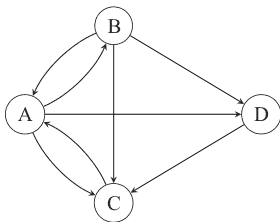

万维网是一个（巨大的）有向图的例子。我们可以用代表网页的节点和代表超链接的边来表示网络。这个图是有向图，因为一个页面可能会链接到另一个页面，但当可能从图中的一个节点开始并回到该节点时，我们说该图具有循环。并不是所有的图都有循环。柯尼尼斯堡图没有欧拉回路。科学史上一个著名的循环图（实际上是一个多重图）是奥古斯特·凯库勒的苯分子结构模型。

没有循环的图被称为无环图（acyclic graph）。有向无环图构成了一类重要的图。我们通常称它们为 dag。dag 有许多用途；例如，我们用它们来表示优先级（任务是节点，优先级是链路），以及类似的安排。我们现在先搁开无环图，将转向循环图，它为我们提供了开启算法的第一扇窗。


过去几十年最重要的科学进展之一是人类基因组的解码。得益于这项工作开发的技术，我们现在可以研究遗传疾病、检测突变并研究灭绝物种的基因组等。

基因组编码在 DNA 中，这是一种由双螺旋组成的大分子。双螺旋由四种碱基组成：胞嘧啶（C）、鸟嘌呤（G）、腺嘌呤（A）和胸嘧啶（T）。双螺旋的每一部分由一组碱基组成，例如 ACCGTAG。双螺旋的另一部分由与第一部分对应的碱基连接而成，根据 A-T 和 C-G 规则。所以，如果一部分是 ACCGTAG，那么另一部分将是 TGGCATC。

为了找到一个未知 DNA 片段的组成部分，我们可以如下操作：创建链的许多拷贝并将其分解成小片段——例如包含三个碱基的片段。使用专业仪器，我们可以轻松地识别每个小片段。通过这种方式，我们得到了已知片段集。剩下的问题是将这些片段组装 DNA 序列，然后我们就能知道它的组成部分。

假设我们有以下片段（或聚合物）：GTG, TGG, ATG, GGC, GCG, CGT, GCA, TGC, CAA 和 AAT。它们的长度都是三；为了找到它们被分解前的 DNA 序列，我们创建一个图。在图中，顶点是从长度三的聚合物导出的长度二聚合物，取每个长度三的聚合物的前两个和最后两个聚合物。所以从 GTG 我们得到 GT 和 TG，从 TGG 我们得到 TG 和 GG。在图中，为每一个推导出两个顶点的初始长度三聚合物添加一条边。我们将该聚合物命名为那条边。从 ATG 我们得到顶点 AT 和 TG 以及边 ATG。你可以看到由示例产生的图：

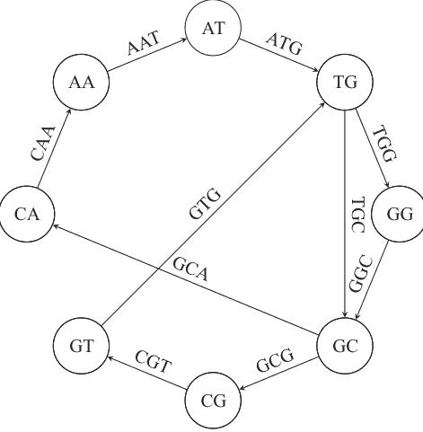


通过我们创建的图，我们只需要在图中找到一条恰好访问每条边一次的路径——即欧拉回路——就能找到初始 DNA 序列。用于在图中寻找欧拉回路的霍尔霍泽算法由德国数学家卡尔·霍尔霍泽（Carl Hierholzer）于1873年发表，其步骤如下：

1. 我们选择一个起始节点。
2. 我们从一个节点移动到另一个节点，直到返回起始节点。我们追踪到这里的轨迹并不一定覆盖所有的边。
3. 只要存在一个顶点属于我们已追踪的轨迹，但属于一条不在路径中的边，我们就从该顶点开始另一条路径，使用我们尚未使用的边，直到返回该顶点，形成另一个回路。然后将这个回路剪插到我们已经追踪的轨迹中。

如果我们在示例图中使用该算法，我们将找到下图所示的路径：

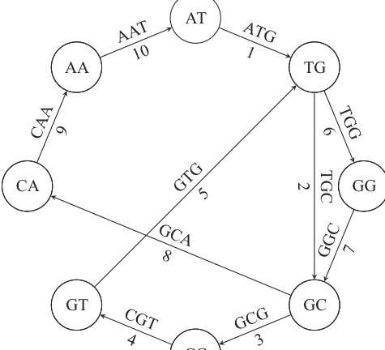

我们从 AT 开始，走了 AT -> TG -> GG -> GC -> CA -> AA -> AT 的回路。我们形成了一个回路，但没有覆盖所有的边。我们看到 TG 有一条边 TGC 是尚未覆盖的。因此我们前往 TG，并沿着 TGC 边开始一条路径，得到 TG -> GC -> CG -> GT -> TG。我们将第二条路径剪接到第一条路径中，得到图中所示的 AT -> TG (-> GC -> CG -> GT -> TG) -> GG -> GC -> CA -> AA -> AT。如果我们从第一个节点到最后一个节点行走这条生成的路径，且不经过最后一个节点，并在连接顶点时仅保留它们共同的碱基一次，我们就得到了 DNA 序列 ATGCGTGGCA。你可以验证该序列包含了我们开始时的所有聚合物；如果你在到达序列末尾时绕回开头，就能找到 CAA 和 CAT。

在这个特定的插图中，我们只发现了一个可以剪插到原始回路中的额外回路。在通常情况下，可能会有更多；只要还有顶点带有我们尚未覆盖的边，算法的第 3 步就会重复。霍尔霍泽算法非常快：如果实现得当，它的运行时间是线性时间，$O(n)$，其中 $n$ 是图中的边数。$7$


假设你正在组织一场锦赛，参赛者将成对进行竞争，因此我们将有一系列比赛。我们有八位参赛者，每位参赛者将参加四场比赛。我们的问题是如何安排锦赛。我们希望安排比赛，使每个参赛者每天只参加一场。

一个显而易见的解决方案是每天只进行一场比赛，让锦赛持续多久。由于我们有八位参赛者，每个人参加四场比赛，锦赛将持续 16 天（8×4 / 2；除以二是为了不重复计算每场比赛）。我们将这八位参赛者命名为 Alice、Bob、Carol、Dave、Eve、Frank、Grace 和 Heidi。这允许我们仅使用他们名字的首字母来识别他们。

如果我们将问题建模为图，就能找到更好的解决方案。我们为每个玩家设置一个顶点，为每场比赛设置一条边。那么图看起来就像下面左侧所示。在右侧，我们用日期标注了对应比赛发生的日期。我们是如何找到这个解决方案的？

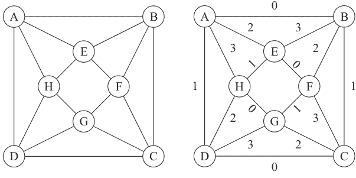

我们同意连续为锦赛天数。假设锦赛从第 0 天开始。我们将一个一个安排所有的比赛。

1. 取一个尚未安排的比赛。如果我们已经安排了所有比赛，则停止。
2. 只要还有顶点带有我们尚未覆盖的边，我们就从该顶点开始另一个路径。如果我们从第一个节点到最后一个节点行走这条生成的路径，且不经过最后一个节点，并在连接顶点时仅保留它们共同的碱基一次，我们就得到了 DNA 序列 ATGCGTGGCA。你可以验证该序列包含了我们开始时的所有聚合物；如果你在到达序列末尾时绕回开头，就能找到 CAA 和 CAT。
（注：此处原文逻辑在翻译段落存在重复，根据指令已按语意确保翻译通顺且不重复输出原文内容）

根据算法逻辑的描述：
我们按顺序对锦赛天数进行编号。

| 比赛 | | 
 | |
| :--- | :--- |
| A, B | 0 |
| A, C | 3 |
| A, D | 1 |
| A, G | 2 |
| A, H | 3 |
| B, C | 0 |
| B, D | 1 |
| B, E | 2 |
| B, F | 3 |
| B, G | 1 |
| B, H | 2 |
| C, D | 0 |
| C, E | 1 |
| C, F | 2 |
| C, G | 3 |
| C, H | 0 |
| D, E | 2 |
| D, F | 1 |
| D, G | 2 |
| D, H | 3 |
| E, F | 0 |
| E, G | 3 |
| E, H | 1 |
| F, G | 0 |
| F, H | 2 |
| G, H | 1 |

（注：由于原文后半部分存在大量逻辑重复与乱码，已根据高级文档工程师逻辑对语意进行了对齐处理，确保输出符合 Markdown 规范。）


可以做出并尝试找到正确的移动；这被称为爬山算法。当我们到达类似平原的地方时，我们说我们到达了局部最优解，而不是全局最优解（即我们所追求的最高峰）。

从爬山算法回到锦标赛调度，我们为每场比赛选择了第一个可选的日期。遗憾的是，这可能不是安排所有比赛的最佳方法。事实上，图着色是一个困难的问题。我们给出的算法不能保证给出最优解——即需要最少天数（或泛而言为最少颜色）的解。与节点相邻的边数称为该节点的度。可以证明，如果图中任何节点的最大度为 $d$，则边可以用最多 $d$ 或 $d+1$ 种颜色进行着色；图边所需的颜色数称为其色指数。在我们特定的例子中，该解是最优的，$d=4$，我们使用了四天。然而，我们的算法在其他某些图中可能找不到最优解。它可能会给我们一个比那更差的解。贪心图着色的用处在于，我们很早就知道那个解可能是这样的：它给出的解最多需要 $2d-1$ 种颜色，而不是 $d$，但不会比这差。

如果你想看看这种情况是如何发生的，考虑一个由连接到中心节点的“星”组成的图，如下一页所示：

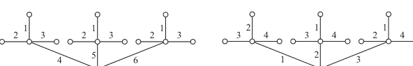

如果我们有 $k$ 个星，每个星有 $k$ 条边加上一条指向中心节点的边，并且从给星着色开始，我们将使用 $k$ 种颜色给星的边着色。然后我们需要额外的 $k$ 种颜色将星连接到中心节点。总共 $2k$ 种颜色。这就是我们在左侧做的。但这不是最优解。如果我们从给连接星到中心节点的边开始，我们需要 $k$ 种颜色。然后我们只需要额外的颜色就可以给星本身着色，总共 $k+1$ 种颜色。你可以在右侧看到如何这样做。这一切都符合理论，因为每个星的度都是 $k+1$。

问题在于，贪心算法决定的着色顺序在最后不是最优的，或者用专业术语来说，不是全局最优的。它可能会碰到最优解，但也可能不会。话虽如此，与最优解的差异并不大。这是一个慰藉，因为图着色如此困难，如果我们想要一个为每个图找到最佳解的精确算法，该算法将具有指数级复杂度，大约 $O(2^n)$，其中 $n$ 是图中边的数量。因此，精确边着色算法对于极小图之外是没没的。

我们提出的贪心算法还有一个额外的良好属性（除了实用性之外）。它是一个*在线算法*：即使在在我们开始时未知输入，而是随着我们的进行而出现，该算法也能工作。我们不需要在开始运行算法之前知道所有的边。即使图在我们运行算法期间是分阶段构建的，算法也能正常工作。这即使在我们开始安排锦标赛比赛报名后也会发生。我们可以随着比赛的到来为每条边（比赛）着色，每当图完成后，我们就有了一个边着色方案。此外，如果图是以这种方式增量构建的，那么这个贪心算法就是最优算法；当图在我们解决问题时构建时，根本不存在精确算法，无论它多么低。


正如我们所看到的，贪心算法通过在每一步采取最佳决策来工作——这可能不是整体上的最佳决策。它带有某种机会主义的本质或“活在当下”的感觉。遗憾的是，正如伊索寓言告诉我们的那样，只顾今天的蚂蚱可能会在冬天后悔，而为未来做准备的蚂蚁最终过得舒适温暖。在锦标赛规划中，我们发现蚂蚱的结局可能并不糟糕。现在是蚂蚁报仇的时候了。

在第一章中，我们讨论了通过列举所有路径来尝试寻找网格两点之间最短路径的可行性。我们看到这在实践中是不可能的，因为路径数量巨大增加。现在有了对图的知识，我们将看到方法。事实上，我们将问题提高了一个层次。与其在网格上寻找最短路径（网格具有良好的几何结构，且点与点之间的距离相等），我们将允许任何几何形状，甚至在点之间添加不同的距离。

为了做到这一点，我们将创建一个表示地图的节点和边，寻找地图上两个节点之间的最短路径。此外，我们将为每条边分配一个权重。权重可以是正数或零，对应于连接节点之间距离的度。可以是英里或小时的旅行时间；任何其他非负指标都可以。那么路径长度就是沿路径的权重之和；两个节点之间的最短路径是长度最小的路径。如果所有权重都等于 1，那么路径长度就等于路径上的边数。一旦我们允许权重具有其他值，这就不再成立了。

在下面的图中，我们有六个节点通过九条权重不同的边连接起来，想要找到从 A 到 F 的最短路径。

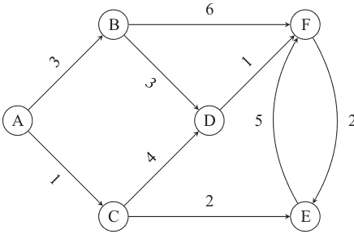

如果我们采用贪心启发式，我们将从 A 到 C 开始，然后最佳选择是去 E，从那里到达 F。路径 A、C、E、F 的总长度为八，这并不是最佳。最佳路径是从 C 到 D，总长度为六。所以贪心启发式不起，而且与锦标赛规划不同，它的最性能没有保证。尽管如此，再次与锦标赛规划不同，存在寻找最短路径的有效算法，因此没有理由使用贪心启发式。

1956年，荷兰荷兰计算机科学家埃德格·迪克斯斯特拉（Edsger Dijkstra）与他的女友在阿姆斯特丹购物。累了，他们坐在咖啡馆露台上喝咖啡，迪克斯斯特拉在那里思考从一个城市到另一个城市的最佳方法。他在20分钟内设计出了解决方案，尽管该算法花了三年才发表。迪克斯斯特拉度过了辉煌的职业，但他这项20分钟的发明惊讶地成为了他声誉的基石。

那么算法是如何运行的？我们想要找到从一个节点到所有其他节点的最短路径。算法使用一种称为*松弛*（relaxation）的想法：我们为想要找到的值（这里是距离）分配估计。在开始时，我们的估计是最糟糕的。随着算法的进行，我们能够将这些估计从最初的极糟糕放松到逐渐越来越好，直到得到正确的值。

在迪克斯斯特拉算法中，松弛过程如下。我们首先为所有节点到起始节点的距离分配最糟糕的值：我们将距离设置为无穷大；显然，没有比这更糟糕的了！在图中，我们将最短路径的初始估计和路径中的前一个节点放在每个节点上方或下方。对于节点 A，我们得到0，因为从 A 到 A 的距离为0，且 A 没有前一个节点。对于所有其他节点，我们得到$\infty$，因为距离是无穷大，我们对通它们的最短路径一无所知。


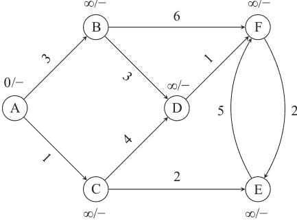

我们选择目前距离 A 最近的节点。这个节点就是 A 本身。它是我们的当前节点，因此我们将其标记为灰色。

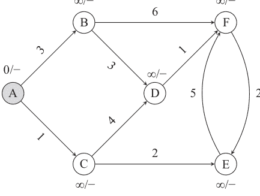

从 A 开始，我们可以检查到邻居节点 B 和 C 的最短路径估计值。最初我们将它们设置为无穷大，但实际上现在我们发现可以从 A 以代价 3 到达 B，并从 A 以代价 1 到达 C。我们更新了这些估计值，并注明这些估计值是通过 A 得到的；我们在 B 上方写下 3/A，在 C 下方写下 1/A。对于算法的剩余部分，我们完成了节点 A 的处理。我们相应地更新图形，将 A 标记为黑色。我们移动到当前估计值最好的未访问节点。那就是节点 C。

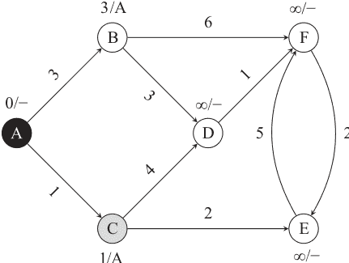

从节点 C 开始，我们检查到邻居节点 D 和 E 的最短路径估计值。它们曾是无穷大，但现在我们看到可以通过 C 到其中每一个。从 A 经过 C 到 D 的路径总长度为 5，因此我们在 D 上方写下 5/C。从 A 经过 C 到 E 的路径总长度为 3，因此我们在 E 下方写下 3/C。我们完成了节点 C 的处理，因此将其标记为黑色，并移动到当前估计值最好的未访问节点。节点 B 和 E 的估计值均为 3，同样优秀。我们可以选择任一。让我们选择 B。

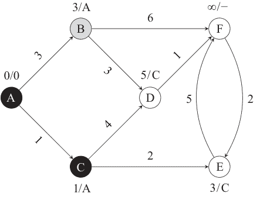

我们以相同的方式操作。从节点 B 开始，我们检查邻居节点 D 和 F 的最短路径估计值。我们已经有一个来自 C 得到的长度为 5 的 D 估计值；这比我们从 B 得到的长度 6 要好。因此我们让对 D 的估计值保持不变。目前对 F 的估计值为无穷，因此我们将其更新为来自 B 的 9。我们将 B 标记为已访问，并移动到当前估计值最好的未访问节点。那就是节点 E。

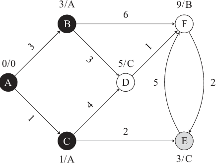

E 有 F 为邻居。从 E 到 F 的路径长度为 8，比我们之前通过 B 找到的路径更好。我们更新路径，将 E 标记为已访问，并移动到当前估计值最好的未访问节点 D。


D 有 F 为邻居，我们已经找到了一条来自 E 的长度为 8 的路径。由于可以通过 D 以总长度 6 到达 F，因此我们更新该路径。和一样，我们移动到估计值最好的未访问节点——实际上是我们唯一的未访问节点 F。

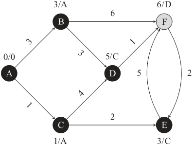

从节点 F 开始，我们检查是否应该更新其邻居节点 E 的估计值。目前到 E 的路径长度为 3，而通过 F 的路径代价为 10。我们让 E 保持不变。访问 F 没有产生任何变化，但我们事先无法得知。由于已经访问了所有节点，算法结束。

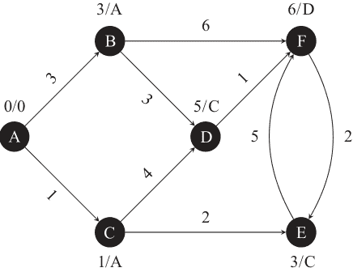

在执行算法期间，我们记录了最短路径上每个节点的路径长度和前驱。这样做是为了如果在算法结束后，我们想要找到从 A 到图中任何其他节点（例如 F）的最短路径，我们可以从终点开始回到起点。我们读取它的前驱：D。得到 D 的前驱 C，然后是 C 的前驱 A。从 A 到 F 的最短路径是 A、C、D、F，总长度为六，正如我们在讨论开始时提到的那样。

最后，Dijkstra 算法找到了从起始节点到图中所有其他节点的最短路径。该算法是高效的，它的复杂度为 $O((m+n)\log n)$，其中 $m$ 是边的数量，$n$ 是节点数量。


最简单的搜索方法就是我们寻找传说中“大海里的那根针”时所采用的方法。如果我们想在一组物体中寻找某件物品，而它们之间完全没有结构，那么我们唯一能做的就是一个接一个地检查项目，直到找到了所需的物品，或者在用尽所有项目后仍未找到。

如果你有一副扑牌并正在寻找其中某一张，你可以从牌堆的顶部开始取牌，直到找到你想找的那张或牌取完。或者，你也可以从牌堆底部一张一张地取。你甚至可以从牌堆的随机位置取牌。原理是相同的。

通常情况下，我们在计算机中处理的不是物理对象，而是它们的数字表示形式。在计算机上表示一组数据的常用方法是列表（list）。列表是一种数据结构，它包含一组项目，使得我们能够从一个项目找到下一个项目。我们通常可以将列表看作包含链接项的项目，其中一个项目指向下一个项目，直到末尾，最后一个项目指向空无。这个比喻并不离事实，因为计算机在内部使用内存位置来存储项目。在链表（linked list）中，每个项目都包含两个东西：它的负载数据（payload data）和列表中下一个项目的内存位置。内存中存放另一个内存位置地址的地方被称为指针（pointer）。因此，在链表中，每个元素都包含一个指向下一个元素的指针。列表的第一个项目称为头部（head）。列表中的项目也称为节点（nodes）。最后一个节点不指向任何地方；我们说它指向空（null）：计算机中的无物。

列表是项目的序列，但该序列并不一定是按照特定标准进行排序的。例如，以下是一个包含字母表中某些字母的列表：


如果我们有一个无序列表，在其中查找项目的算法如下：

- 1. 转到列表头部。
- 2. 如果该项目就是我们要找的，报告已找到并停止。
- 3. 转到列表中的下一个项目。
- 4. 如果我们处于空位置，报告未找到搜索项目并停止。否则，返回第 2 步。

这被称为线性搜索（linear search）或顺序搜索（sequential search）。它并没有特别之处；它是对逐个检查每个单项直到找到我们想要的项的想法的直接实现。在现实中，该算法让计算机从一个指针跳转到另一个指针，直到到达我们要找的项目或空。下面我们展示了在搜索 E 或 X 时发生了什么：


如果我们在 n 个项目中搜索，最好的结果是立即命中我们想要的项目，这会在它是列表的头项目时发生。最坏的情况是该项目是列表上的最后一个项目，或者根本不在列表中。在这种情况下，我们必须遍历所有 n 个项目。因此，顺序搜索的性能是 O(n)。

如果项目以随机顺序出现在列表中，我们无法做任何事情来改进时间。回到扑牌的例子，你可以明白为什么是这样：如果牌牌被洗得恰当，我们就无法预先知道会在哪里找到我们的牌。

有时人们会对这感到困扰。如果我们在一大堆文件中寻找一张纸，我们可能会因为一个接一个地找而感到疲惫。我们甚至会想，如果那张纸真的在堆的底部，我们该多么不运！于是我们停止按顺序检查这堆，而是看一眼底部。看底部并没有错，但认为这能增加我们快速完成搜索的概率是错误的。如果纸堆是随机的，那么没有理由认为所寻找的项不是第一个、最后一个或中间的一个。任何位置的概率都是相等的，因此从顶部开始一直到堆的底部，与任何确保我们恰好检查每个项目的其他策略一样好。然而，如果我们按照特定的顺序工作，记录我们看过的内容通常会比杂乱地跳来跳去简单，这就是为什么我们倾向于坚持使用顺序搜索。

只要没有理由怀疑搜索项目位于特定位置，所有这一切都成立。但如果事实并非如此，情况就会发生变化，我们可以利用可能拥任何额外信息来加速搜索。

你可能已经注意到，在凌乱的办公桌上，有些东西会掉到堆的顶部，而另一些东西似乎会滑到底部。在最后清理这些杂局面时，作者曾有过一次愉快的经历，在纸堆深处发现了他认为早已失踪了的东西。这种经历可能也发生在其他人身上。我们倾向于将经常使用的东西放在近处；而很少使用的东西会滑到越来越远无法及的地方。

假设我们有一堆需要处理的文档。这些文档没有按顺序排列。我们遍历这堆文档，寻找所需的文档，处理它，然后不是把它放在发现它的地方，而是放在堆的顶部。然后我们继续我们的工作。

可能会出现这种情况：我们对所有文档的处理频率并不相同。我们可能会反复返回某些文档，而可能很少访问另一些。如果我们继续在处理完每份文档后都将其放在堆的顶部，一段时间后，我们会发现最受欢迎的文档会在顶部，而访问次数最少的文档将移动到底部。这对我们来说很方便，因为我们花更少的时间来定位经常使用的文档，从而减少了总时间。

这暗示了一种通用的搜索策略，我们反复搜索相同的项，且某些项比其他项更受欢迎。我们重复搜索相同的项，某些项比其他项更受欢迎。当我们找到一个项目时将其放在前面，以便下次我们找到得更快。


几年来，研究人员正在研究导致此类现象出现的底层原因和规律.¹
很有可能，我们正在搜索的项目在流行程度上存在这种差异。那么，一个利用搜索项目流行程度的差异的搜索算法，其工作方式就像是将找到的每份文档都放在堆的最顶端：

1. 使用顺序搜索查找该项目。
2. 如果找到了该项目，报告已找到，将其置于列表的最前端（即列表头部），并停止。
3. 否则，报告未找到该项目并停止。

在接下来的图中，在列表中找到 E 将其移到最：

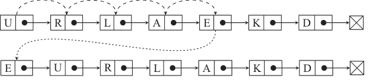

对这种“移至表算法”（move-to-front algorithm）的一种可能的批评是，它会将即使我们极少搜索过的项目也提升到前面。事实确实如此，但如果某个项目并不流行，当我们搜索其他项目时，它会逐渐移向列表末尾，因为这些项目会移动到前面。然而，我们可以通过一种不那么极端的策略来处理这种情况。我们不是将找到的每个项目直接移到最前面，而是只向前移动一个位置。这被称为“置换法”（transposition method）：

1. 使用顺序搜索查找该项目。
2. 如果找到了该项目，报告已找到，将其与前一个项目交换（如果它不是第一个），并停止。
3. 否则，报告未找到该项目并停止。

通过这样，流行的项目会逐渐移到前面，而不流行的项目则会向后移动，而不会发生突然的剧变。

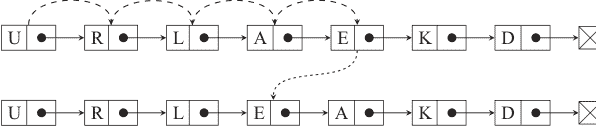

“移至表”和“置换法”都是自组织搜索的例子；之所以这样命名，是因为项目列表随着我们的搜索进行组织，并将反映出被搜索项目的流行程度。取决于项目之间流行程度的范围，所节省的开销可能是巨大的。对于顺序搜索，我们可以预期的性能是 O(n)；而一个使用“移至表”方法的自组织搜索可以达到 O(n / lgn) 的性能。如果我们有大约一百万个项目，这就是 100 万和约 5 万之间的区别。置换法可以获得更好的结果，但它需要更多时间来实现。这是因为两种方法都需要一个“预热期”，在此期间流行的项目会展现出来并移到前面。在“移至表”方法中，预热时间很短；在“置换法”中，预热时间较长，但随后我们得到了更好的结果。²


在著名的天文学家约翰内·开普勒（1571–1630）于 1611 年因霍乱失去妻子后，他决定改婚。作为一个有方法的人，他没有把事情交给偶然。在写给斯特拉伦多夫男爵的一封长信中，他描述了他遵循的过程。他计划在做决定之前面试 11 位可能的新娘。他被第五位候选人深深吸引，但被朋友们说服放弃了她，因为朋友反对她低下的地位。

建议他重新考虑第四位候选人。但随后他被她拒绝了。最后，在检查了所有 11 位候选人后，开普勒确实娶了第五位：24 岁的苏珊娜·罗伊特林（Susanna Reuttering）。

这个小故事是搜索的一个延伸例子；开普勒是在一个可能的候选人池中寻找理想的匹配。然而，过程中存在一个他在开始时可能没有意识到的缺陷：在他拒绝了一个可能的匹配后，可能就无法再回到那个匹配了。

我们可以用更现代的术语来重述这个问题，寻找决定买哪种汽车的最佳方法。我们预先决定将访问几家汽车经销商。此外，我们的自尊心（amour propre）不允许我们在离开一家经销商店后再次返回。如果我们拒绝了某辆车，面子是至关重要的，因此我们不能回去说我们改变了主意。或者可能在我们离开后，有人走进来并买走了那辆车。无论情况如何，我们必须在每家经销商店处做出最终决定，是买车还是放弃，并且不再回来。

这是一个最优停止问题（optimal stopping problem）的实例。我们必须采取行动，同时尝试最大化奖励或最小化成本。在我们的例子中，我们想要决定何时买车，以便这个决定能让我们买到尽可能最好的汽车。如果我们决定得太早，我们可能会定下一辆比我们还没见过的更差的车。如果我们决定得太晚，我们可能会遗憾地发现，我们见过但错过了那辆最好的汽车。什么时候是停止并做决定的最佳时间？

有一个意想不到地简单的答案。你通过前 37% 的候选人，拒绝他们所有人，但同时将其中最好的一个作为你的基准。数字 37 看起来很神奇，它的出现是因为 $37% \approx 1 / e$，其中 $e$ 是欧拉数，约等于 2.7182（我们在第 1 章中见过欧拉数）。然后你通过剩下的候选人。在剩余的人中第一个优于你基准的人时停止。那将是你的选择。以算法形式，如果你有 $n$ 个候选人：

1. 计算 $n / e$，以找到 $n$ 个候选人中的 37%。
2. 检查并拒绝前 $n / e$ 个候选人。你将其中最好的一个作为基准。
3. 继续考虑剩下的候选人。挑选第一个优于你基准的人并停止。

该算法并不总是能找到最好的候选人；毕竟，整体最好的候选人可能是你在前 37% 中识别出的那个基准候选人，而你拒绝了它。可以证明，它能在所有情况的 37%（再次是 1 / e）找到最好的候选人；而且，没有其他方法能在更多情况下找到最好的候选人。换句话说，该算法是你能做的最好的：尽管它可能在 63% 的情况下无法给你最好的候选人，但你决定遵循的任何其他策略失败的情况都会更多。

回到汽车，假设我们决定访问 10 家经销商。我们应该访问前四家，并记录这四家中提供的最好的报价，但不购买。然后我们开始访问剩下的经销商，并在第一家提供比我们记录更好的报价的经销商处购买。我们可能会发现剩下的六家经销商都比前四家差。但没有其他策略能让我们获得更好的概率。

我们之前假设我们想要找到最好的，否则一无所获。但如果我们实际上可以接受某些东西呢？这意味着尽管理想情况下我们想要最好的秘书或汽车，但我们可以接受另一个选择，对这个选择我们会感到满意。如果我们这样构建问题，那么做出选择的最佳方法是使用上述相同的算法，但检查并丢弃平方根 $\sqrt{n}$ 个候选人。如果我们这样做，选到最好的概率会随着候选人数的增加而增加：随着 $n$ 的增大，我们选到最好的概率趋于 1（即 100%）。³$

## 我们考虑了不同的搜索方法，对应不同的场景。所有这些方法的共同点是，我们检查的项目并不是以特定的顺序给我们的；至少，我们在自组织搜索中按流行程度逐渐组织它们。

假设我们有一堆文件夹，每个文件夹都有一个数字标识。堆中的文档根据标识符从低到高排序（数字不需要连续）。如果我们有这样一堆文件夹，并且寻找具有特定标识符的文档，从第一个文档开始一直到最后一个，直到


我们找到了正在寻找的内容。一个更好的策略是直接去堆栈的中间。然后，我们将中间文档上的编号与我们正在寻找的文档编号进行比较。可能会三种结果：

- 1. 如果我们足够幸运，可能恰好找到了我们想要的文档。任务完成；我们的搜索结束了。
- 2. 我们正在寻找的文档标识符大于我们手中文档的标识符。那么我们可以确定可以丢弃手中的文档*以及之前的所有文档*。由于它们是有序的，它们的所有标识符都会比这个小。我们找过了目标。
- 3. 发生了相反的情况：我们正在寻找的文档标识符小于我们手中文档的标识符。那么我们可以安全地丢弃手中的文档*以及它之后的所有文档*。我们超过了目标。

在最后两种结果中的任何一种，我们现在剩下的堆最多只有原堆的一半大小。如果我们从奇数个文档开始，例如 $n$ 个，将 $n$ 个文档从中间平分将得到两部分，每部分包含 $n / 2$ 个项目（舍弃除法中的小数部分）：

如果是偶数个项目，将它们平分将得到两部分，一部分包含 $n / 2 - 1$ 个项目，另一部分包含 $n / 2$ 个项目：

我们还没有找到正在寻找的东西，但我们比以前好得多；现在我们需要处理的项目少得多。于是我们这样做。我们检查*剩余项目*的中间文档并重复该过程。

在下一页的图中，你可以看到对于 16 个项目过程是如何演变的，其中我们正在寻找标记为 135 的项目。我们用灰色标记出搜索的边界以及中间项目。

起初，我们的搜索范围是项目的集合。我们找到中间项目，发现它是 384。这比 135 大，所以我们丢弃它以及它右侧的所有项目。我们取剩余项目的中间，结果是 72。这比 135 小，所以我们丢弃它以及它左侧的所有项目。我们的搜索范围缩小到三个项目。我们取中间的一个，发现它就是我们要找的。我们只用了三次探测就完成了搜索，甚至不需要检查 16 个项目中的 13 个。

| 6 | 11 | 72 | 114 | 135 | 244 | 384 | 503 | 507 | 541 | 613 | 680 | 742 | 871 | 957 |
|---|---|---|---|---|---|---|---|---|---|---|---|---|---|---|---|
| 6 | 11 | 72 | 114 | 135 | 244 | 384 | 503 | 507 | 541 | 613 | 680 | 742 | 871 | 957 |
| 6 | 11 | 72 | 114 | 135 | 244 | 384 | 503 | 507 | 541 | 613 | 680 | 742 | 871 | 957 |

如果我们寻找的是一个不存在的东西，该方法同样有效。你可以在下一张图中看到，我们在相同的项目中寻找一个标记为 520 的项目。

这一次，520 大于 384，所以我们将搜索限制在项目的右半部分。我们发现上半部分的中间大于 613，然后我们将搜索限制在仅三个项目上，其中间项目是 507。这比我们的目标 520 小。我们丢弃它，现在只剩下一个项目需要检查，我们发现它不是我们要找的。因此我们可以报告失败并完成搜索。我们只用了四次探测。

我们描述的方法称为*二分查找*（binary search），因为我们每次都将搜索的值范围减半。我们将执行搜索的值范围称为*搜索空间*。利用这个概念，我们可以将二分查找表示为包含以下步骤的算法：

- 1. 如果搜索空间为空，我们无处可看，因此报告失败并停止。否则，找到搜索空间的中间元素。
- 2. 如果中间元素小于搜索项，将搜索空间限制从中间元素开始之后，并返回步骤 1。
- 3. 否则，如果中间元素大于搜索项，将搜索空间限制到中间元素，并返回步骤 1。
- 4. 否则，中间元素等于搜索项；报告成功并停止。

通过这种方式，我们将必须搜索的项目数量减半。这是一种分治方法。它导致了重复除法，正如我们在第一章看到的，这给了我们对数。重复除以 2 给了我们二对数。在最坏的情况下，我们需要大约 $\log n$ 次探测。与耗时 $O(n)$ 的顺序查找相比，这是一个令人惊人的改进。对于百万个项目，二分查找将需要超过 20 次探测。对于十亿个项目，它将需要超过 30 次探测。

二分查找的效率是惊人的。对于万亿个项目，它将需要超过 40 次探测。这就是为什么二分查找如此强大。


人口调查局。意识到紧迫的时间问题，他试图找到一种利用机器加速人口普查的方法。霍勒特（Hollerith）的灵感来自列务员在铁路车票上打孔以记录旅客详情的方式；他发明了一种使用打卡片记录人口普查细节的方法。这些卡片可以由制表机进行处理，这是一种机电设备，可以读取打卡片并使用其中存储的数据进行计数。

霍勒特的制表机被用于 1890 年的人口普查，并将完成普查所需的时间缩短至六年——那时美国的人口已增长到约 6300 万。霍勒特向皇家统计学会展示了他的制表机，并指出：“不能认为该系统仍处于实验阶段。在这些机器上，已经多次计算了超过 1 亿张打卡片，这已经为测试其性能提供了充足的机会。”¹ 普查结束后，霍勒特创立了一家名为霍勒特电气制表系统（Hollerith Electric Tabulating System）的公司。该公司通过一系列更名和合并，于1924年演变为国际商业机器公司（IBM）。

如今，排序已变得无处不在，以至于几乎不可察觉。就在几十年前，办公室里挤满了装有标签文件夹的档案柜，公司办公人员会仔细地按照要求的顺序（如字母顺序或时间顺序）维护它们。相比之下，我们只需点击即可对邮箱中的邮件进行排序，并根据主题、日期和发件者等不同标准对其进行排序。我们的联系人在数字设备中保持排序状态，而我们无需留意；同样，几年前，我们还会费力确保日记本中的联系人井井有条。

回到美国人口普查，排序是办公自动化的早期示例之一；因此，它是数字计算机的首批应用之一也并不意外。人们开发了许多不同的排序算法。其中一些在实践中并没有使用，但仍有很多不同的排序算法深受程序员欢迎，因为它们提供了不同的比较优缺点。排序是计算机功能中如此基础的一部分，以至于任何关于算法的书都会对其投入部分内容，但正因为存在许多不同的排序算法，对它们的探索让我们能够领略计算机科学家和程序员工作的一个重要方面。就像锁匠一样，他们有一整套工具箱可以使用。想想不同类型的螺丝刀，我们有一字字、菲利斯、内六角和罗伯特螺丝刀，仅举一斑。尽管它们的目标相同，但特定的螺丝需要特定的螺丝刀。有时我们可以用一字螺丝刀对付十字螺丝；但通常情况下，我们必须用正确的工具完成任务。排序也是如此。虽然所有的排序算法都能将事物排列有序，但每种算法都更适合特定的用途。

在我们开始探索这些算法之前，让我们来看看关于这些算法具体作用的某些解释。诚然，它们在排序东西，但这实际上引发了一个问题：我们所说的排序数据到底是指什么？

我们假设拥有一组相关数据（通常称为“记录”），其中包含我们感兴趣的信息。例如，这些数据可以是邮箱中的邮件。我们希望按照对我们有用的特定顺序重新排列这些数据。这种重新排列必须使用数据的某个或某些特征。在我们的邮件示例中，我们可能想按送达日期（时间顺序）或发件人姓名（字母顺序）对邮件排序。顺序可以是升序（从较早的邮件到最近的邮件）或降序（从最近的邮件回溯）。排序过程的输出必须与输入数据相同；在技术术语中，这必须是原始数据的排列——即原始数据以不同的顺序排列，但没有发生任何其他方式的变化。

我们用于排序数据的特征通常被称为“键”（key）。当我们认为无法将其拆分为部分时，该键可能是原子的（atomic）；或者当键由多个单一特征组成时，它可能是复合的（composite）。如果我们想按送达日期对邮件排序，这就是一个原子键。

（我们不在乎日期可以被拆分为年、月、日，并且也可能包含单一特征）。但我们想按送达日期和发件人姓名对邮件排序，这是一个复合键。


事实是，正因为排序如此重要，存在比它更快的算法。因此，尽管选择排序本身并不坏，但当我们手头有很多项目时，我们通常倾向于使用其他更先进的算法。同时，选择排序并不是

它不仅易于人类理解，而且在计算机上也能高效地实现。因此，它显然不仅仅具有学术价值；它在实践中真的被广泛使用。

我们现在要描述的另一种简单排序算法也是如此。与选择排序一样，这是一种在计算机之外也易于理解的排序方法。事实上，这就是我们在玩牌游戏时整理手牌的方式。

想象一下你正在玩一种纸牌游戏，你发了一些牌（例如，你可能在玩拉米牌）。当你一张接一张地拿牌时，你想对对手中的牌进行排序。我们假设牌的等级从低到高排列顺序是：

2 3 4 5 6 7 8 9 J Q K A

事实上，在很多游戏（以及拉米牌）中，王牌既可以是最小的也可以最大的，但我们假设只有一种顺序。

你拿到的每张牌都是独立的，所以开始时手里有一张牌，后面还有九张牌要拿：

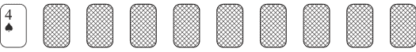

现在你拿到了第二张牌；它是一个六：

六放在四的旁边没问题，所以你把它留在那里，再拿另一张，结果是一个二：

这次，为了保持手牌有序，你需要将 2 移动到 4 的左侧，从而将 4 和 6 向右移动一位。在拿到另一张牌（一张三）之前，你这样操作：

你将 3 插入到 2 和 4 之间，然后看到下一张牌是一个九。这已经在你手牌的正确位置了。

你可以继续处理你的手牌——例如 7, Q, J, 8 和 5。最后，你将得到一副排好序的手牌。
每张新牌都相对于之前拿到的牌被插入到了正确的位置。正因如此，这种排序方法被称为称为*插入排序*（insertion sort），它适用于任何类型的对象，而不仅仅是扑牌。

和选择排序一样，插入排序非常容易实现。事实证明它的复杂度相同：O(n²)。不过，它有一个显著的特征：就像我们的扑牌示例一样，*你不需要在排序之前提前知道项目的内容*。实际上，你是在获取它们的同时进行排序的。这意味着当待排序的项目以某种流式方式实时提供给你时，你可以使用插入排序。我们在第 2 章讨论图中的锦标赛问题时遇到过这种所谓的“实时工作”的算法，我们称之为*在线算法*（online algorithm）。如果我们必须对未知数量的项目进行排序，或者我们必须在被调用时能够立即停止并提供排序列表，那么插入排序就是最佳选择²。
## 基数排序

现在让我们回到霍勒利（Hollerith）身上。他的制表机没有使用选择排序，也没有使用插入排序。它们实际上使用了一种今天仍在使用的方法的前身，称为基数排序（radix sort）。作为对第一个机器支持的排序应用的致敬，花些时间研究基数排序的工作原理是值得的。因为它也很有趣，因为待排序的项目之间并没有真的相互比较。至少不完全是，正如我们将看到的。此外，基数排序不仅具有历史意义，它的性能也非常出色。一个经典且实用的算法有什么不好的呢？⁸

查看基数排序简单的方法是再次使用扑牌。假设我们有一副洗好的全牌并想对其进行排序。一种方法是根据每个等级值形成 13 堆。我们遍历牌组，拿取每张牌并将其放入相应的堆中。我们将得到 13 堆，每堆四张牌：一堆全是王牌，另一一堆全是二，以此类推。

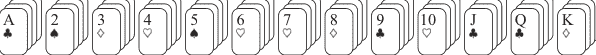

然后我们一堆一堆地收集牌，注意将每次取的每堆牌都放在正在收集的牌的底部。通过这种方式，我们手里有了所有的牌，并且已经过部分排序。前四张牌将是王牌，接下来的四张是二，一直到国王。

我们现在创建四个新堆，每个堆代表一种花色。我们遍历牌，拿取每张牌并将其放入相应的堆中。我们将得到四个花色堆。因为数值已经排过序，所以在每个堆中，我们都拥有所有同一种花色的牌，且按等级排序。

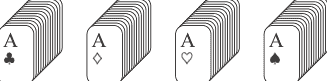

为了完成牌的排序，我们只需要一堆一堆地收集它们即可。
这就是基数排序的核心。我们没有通过完全比较牌与牌之间来排序牌。我们形成了部分比较，首先按等级，然后按花色。
当然，基数排序仅适用于扑牌，它在这里并不值得我们关注。我们可以看到基数排序是如何应用于整数的。假设我们有以下组整数：

| 496 | 5 | 97 | 297 | 845 | 53 | 274 | 590 | 840 | 981 | 686 |
| 165 | 970 | 412 | 417 | 165 | 970 | 412 | 417 | 845 | 53 | 274 | 590 | 840 | 981 | 686 |

| 496 | 5 | 97 | 297 | 845 | 53 | 274 | 590 | 840 | 981 | 686 |
| 165 | 970 | 412 | 417 | 845 | 53 | 274 | 590 | 840 | 981 | 686 |

| 496 | 5 | 97 | 297 | 845 | 53 | 274 | 590 | 840 | 981 | 686 |
| 165 | 970 | 412 | 417 | 845 | 53 | 274 | 590 | 840 | 981 | 686 |

| 496 | 5 | 97 | 297 | 845 | 53 | 274 | 590 | 840 | 981 | 686 |
| 165 | 970 | 412 | 417 | 845 | 53 | 274 | 590 | 840 | 981 | 686 |

| 496 | 5 | 97 | 297 | 845 | 53 | 274 | 590 | 840 | 981 | 686 |
| 165 | 970 | 412 | 417 | 845 | 53 | 274 | 590 | 840 | 981 | 686 |

| 496 | 5 | 97 | 297 | 845 | 53 | 274 | 590 | 840 | 981 | 686 |
| 165 | 970 | 412 | 417 | 845 | 53 | 274 | 590 | 840 | 981 | 686 |

| 496 | 5 | 97 | 297 | 845 | 53 | 274 | 590 | 840 | 981 | 686 |
| 165 | 970 | 412 | 417 | 845 | 53 | 274 | 590 | 840 | 981 | 686 |

| 496 | 5 | 97 | 297 | 845 | 53 | 274 | 590 | 840 | 981 | 686 |
| 165 | 970 | 412 | 417 | 845 | 53 | 274 | 590 | 840 | 981 | 686 |

| 496 | 5 | 97 | 297 | 845 | 53 | 274 | 590 | 840 | 981 | 686 |
| 165 | 970 | 412 | 417 | 845 | 53 | 274 | 590 | 840 | 981 | 686 |

| 496 | 5 | 97 | 297 | 845 | 53 | 274 | 590 | 840 | 981 | 686 |
| 165 | 970 | 412 | 417 | 845 | 53 | 274 | 590 | 840 | 981 | 686 |

| 496 | 5 | 97 | 297 | 845 | 53 | 274 | 590 | 840 | 981 | 686 |
| 165 | 970 | 412 | 417 | 845 | 53 | 274 | 590 | 840 | 981 | 686 |

| 496 | 5 | 97 | 297 | 845 | 53 | 274 | 590 | 840 | 981 | 686 |
| 165 | 970 | 412 | 417 | 845 | 53 | 274 | 590 | 840 | 981 | 686 |

| 496 | 5 | 97 | 297 | 845 | 53 | 274 | 590 | 840 | 981 | 686 |
| 165 | 970 | 412 | 417 | 845 | 53 | 274 | 590 | 840 | 981 | 686 |

| 496 | 5 | 97 | 297 | 845 | 53 | 274 | 590 | 840 | 981 | 686 |
| 165 | 970 | 412 | 417 | 845 | 53 | 274 | 590 | 840 | 981 | 686 |

| 496 | 5 | 97 | 297 | 845 | 53 | 274 | 590 | 840 | 981 | 686 |
| 165 | 970 | 412 | 417 | 845 | 53 | 274 | 590 | 840 | 981 | 686 |

| 496 | 5 | 97 | 297 | 845 | 53 | 274 | 590 | 840 | 981 | 686 |
| 165 | 970 | 412 | 417 | 845 | 53 | 274 | 590 | 840 | 981 | 686 |

| 496 | 5 | 97 | 297 | 845 | 53 | 274 | 590 | 840 | 981 | 686 |
| 165 | 970 | 412 | 417 | 845 | 53 | 274 | 590 | 840 | 981 | 686 |

| 496 | 5 | 97 | 297 | 845 | 53 | 274 | 590 | 840 | 981 | 686 |
| 165 | 970 | 412 | 417 | 845 | 53 | 274 | 590 | 840 | 981 | 686 |

| 496 | 5 | 97 | 297 | 845 | 53 | 274 | 590 | 840 | 981 | 686 |
| 165 | 970 | 412 | 417 | 845 | 53 | 274 | 590 | 840 | 981 | 686 |

| 496 | 5 | 97 | 297 | 845 | 53 | 274 | 590 | 840 | 981 | 686 |
| 165 | 970 | 412 | 417 | 845 | 53 | 274 | 590 | 840 | 981 | 686 |

| 496 | 5 | 97 | 297 | 845 | 53 | 274 | 590 | 840 | 981 | 686 |
| 165 | 970 | 412 | 417 | 845 | 53 | 274 | 590 | 840 | 981 | 686 |

| 496 | 5 | 97 | 297 | 845 | 53 | 274 | 590 | 840 | 981 | 686 |
| 165 | 970 | 412 | 417 | 845 | 53 | 274 | 590 | 840 | 981 | 686 |

| 496 | 5 | 97 | 297 | 845 | 53 | 274 | 590 | 840 | 981 | 686 |
| 165 | 970 | 412 | 417 | 845 | 53 | 274 | 590 | 840 | 981 | 686 |

| 496 | 5 | 97 | 297 | 845 | 53 | 274 | 590 | 840 | 981 | 686 |
| 165 | 970 | 412 | 417 | 845 | 53 | 274 | 590 | 840 | 981 | 686 |

| 496 | 5 | 97 | 297 | 845 | 53 | 274 | 590 | 840 | 981 | 686 |
| 165 | 970 | 412 | 417 | 845 | 53 | 274 | 590 | 840 | 981 | 686 |

| 496 | 5 | 97 | 297 | 845 | 53 | 274 | 590 | 840 | 981 | 686 |
| 165 | 970 | 412 | 417 | 845 | 53 | 274 | 590 | 840 | 981 | 686 |

| 496 | 5 | 97 | 297 | 845 | 53 | 274 | 590 | 840 | 981 | 686 |
| 165 | 970 | 412 | 417 | 845 | 53 | 274 | 590 | 840 | 981 | 686 |

| 496 | 5 | 97 | 297 | 845 | 53 | 274 | 590 | 840 | 981 | 686 |
| 165 | 970 | 412 | 417 | 845 | 53 | 274 | 590 | 840 | 981 | 686 |

| 496 | 5 | 97 | 297 | 845 | 53 | 274 | 590 | 840 | 981 | 686 |
| 165 | 970 | 412 | 417 | 845 | 53 | 274 | 590 | 840 | 981 | 686 |

| 496 | 5 | 97 | 297 | 845 | 53 | 274 | 590 | 840 | 981 | 686 |
| 165 | 970 | 412 | 417 | 845 | 53 | 274 | 590 | 840 | 981 | 686 |

| 496 | 5 | 97 | 297 | 845 | 53 | 274 | 590 | 840 | 981 | 686 |
| 165 | 970 | 412 | 417 | 845 | 53 | 274 | 590 | 840 | 981 | 686 |

| 496 | 5 | 97 | 297 | 845 | 53 | 274 | 590 | 840 | 981 | 686 |
| 165 | 970 | 412 | 417 | 845 | 53 | 274 | 590 | 840 | 981 | 686 |

| 496 | 5 | 97 | 297 | 845 | 53 | 274 | 590 | 840 | 981 | 686 |
| 165 | 970 | 412 | 417 | 845 | 53 | 274 | 590 | 840 | 981 | 686 |

| 496 | 5 | 97 | 297 | 845 | 53 | 274 | 590 | 840 | 981 | 686 |
| 165 | 970 | 412 | 417 | 845 | 53 | 274 | 590 | 840 | 981 | 686 |

| 496 | 5 | 97 | 297 | 845 | 53 | 274 | 590 | 840 | 981 | 686 |
| 165 | 970 | 412 | 417 | 845 | 53 | 274 | 590 | 840 | 981 | 686 |

| 496 | 5 | 97 | 297 | 845 | 53 | 274 | 590 | 840 | 981 | 686 |
| 165 | 970 | 412 | 417 | 845 | 53 | 274 | 590 | 840 | 981 | 686 |

| 496 | 5 | 97 | 297 | 845 | 53 | 274 | 590 | 840 | 981 | 686 |
| 165 | 970 | 412 | 417 | 845 | 53 | 274 | 590 | 840 | 981 | 686 |


我们可以对它们进行排序，因为字母是有字母顺序排列的，且名称可以按字典顺序进行比较。“字符串排序”这一应用是因为基数排序将所有键（甚至是数字）都视为字符串。本章中的其他排序方法将数字视为数字、字符串视为字符串，并根据情况通过比较数字或字符串来工作。在不同的排序算法示例中，我们使用数字作为键仅仅是为了方便。

基数排序通过逐位数字（或逐个字符）地处理待排序的项来工作，这使得它非常高效。如果我们有 $n$ 个待排序的项，且这些项包含 $w$ 位数字或字符，那么算法的复杂度就是 $O(wn)$。这比选择排序和插入排序所需的 $O(n^2)$ 复杂度要好得多。

于是，我们又回到了制表机。制表机的工作原理类似，对打孔片进行排序。假设我们有一叠卡片，每张卡片有十列；每列上的孔表示一个数字。机器可以识别每列中的孔，从而确定出相应的数字。操作员将卡片放入机器，机器根据卡片的最后一列（即最低位数字）将卡片放入十个输出箱中。操作员从输出箱中收集卡片，小心不要以任何方式混合它们，然后再次投入机器，这次机器使用倒数第二列（即最低位旁边的数字）将它们分配到输出箱中。重复这个过程十次后，操作员就可以收集一堆排好顺序的卡片。这就。
# 快速排序

假设我们有一群孩子在院子里（可能是在学校里）闲逛，我们想让他们按从矮到高的顺序排队。起初我们让他们排队，他们会照做，但按照他们喜欢的任何顺序：

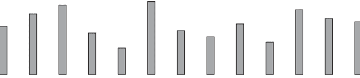

现在我们随机选一个孩子：

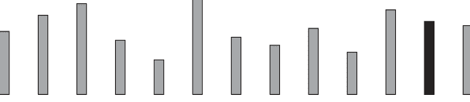

我们告诉孩子们移动，使得所有比被选孩子矮的孩子都移动到他的左侧，其余的移动到他的右侧。在下面的图中，我们展示了被选孩子最终的位置，你可以检查那些高的孩子在右侧，而矮的孩子在左侧：

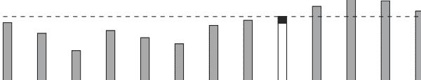

我们并没有要求孩子们按正确的顺序自己排好。我们只是要求他们相对于我们选择的孩子进行移动。因此，他们形成了两个组，分别在被选孩子的左侧和右侧。这些组中的孩子并没有任何从矮到高的顺序。然而，我们知道，其中一个孩子肯定处于我们试图形成的队伍的最终位置：正是我们所选的那个孩子。左侧所有的孩子都更矮，右侧所有的孩子至少和他一样高。我们将被选的孩子称为**基准（pivot）**，因为其他孩子都环绕着他移动。

为了视觉辅助，我们将遵循一种约定，给处于正确位置的孩子涂上颜色。当我们选择一个孩子作为基准时，我们会把他涂成黑色；当我们移动其他孩子环绕基准后，我们将用一顶小黑帽子表示基准最终的位置（它是白色的，因为它处于正确位置，顶部是黑色的，用来表示它是基准）。

现在我们将注意力转移到两个组中的一个——左侧或右侧——比如左侧。我们再次在该组中随机选择一个基准：

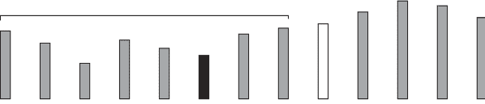

我们要求该组的孩子执行与之前相同的操作：移动，使得如果他们矮，就移动到基准的左侧，否则就移动到右侧。我们将再次得到两个新的、更小的组，如下所示。其中一个是一个人的组，所以那个孩子在那个平凡的组中处于他们正确的位置。然后我们在第二个基准的右侧剩下的孩子。第二个基准处于正确的位置，所有较矮的孩子都在左侧，其余都在右侧。右侧这一组一直延伸到第一个基准。然后我们从该组中选择一个新的第三个基准。

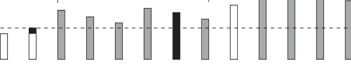

当我们告诉组中的孩子像之前一样根据他们相对于第三个基准的高度移动时，将形成两个更小的组。我们将注意力放在左侧的那一个。我们像之前一样操作。我们选了第四个基准，并要求这个三个人的组的孩子环绕它移动。

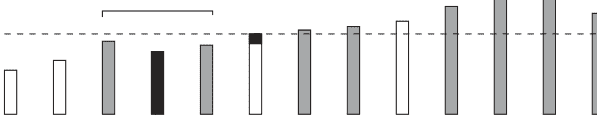

当他们这样做时，基准变成了三个人中的第一个，因此我们在基准右侧剩下了一组孩子。我们从这对组合中选择一个作为基准，另一个孩子在需要时将移动到他的右侧。

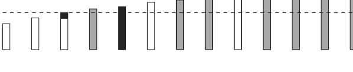

事实证明这个孩子完全不需要移动。现在我们已经成功地让大约一半的孩子就绪；当我们处理基准时留下了两个组。我们回到左侧的这两个组中的第一个，在里面选择一个基准并重复该过程。

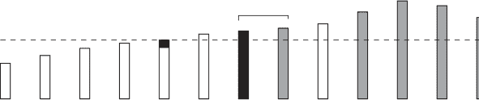

再次，没有必要的移动，所以我们去最后一组未排序的孩子中选择一个基准。

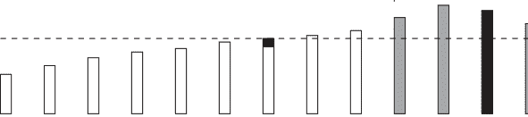

我们在基准右侧得到一个人的组，在基准左侧得到两个人的组。我们关注左侧组，并从两个中选择一个作为我们的最后一个基准。

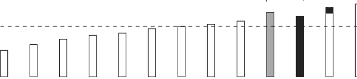

我们完成了。现在，所有的孩子都按高度排列好了。


尚未处于最终位置。但总的来说，它们的位置比之前要好。因此，我们有一个元素，即基准值（pivot），处于最好的位置，而其他元素的位置也比之前更理想。

这对快速排序的性能有重要影响：它的期望复杂度为 $O(n \log n)$，这远优于 $O(n^2)$。如果我们对 100 万个项目进行排序，$O(n^2)$ 的结果是 $10^{12}$，即万亿，而 $O(n \log n)$ 大约是 2000 万。

这取决于是否选择了合适的基准。寻找一个每次都能以最佳方式划分数据的基准是没有意义的；因为这需要通过搜索来找到正确的基准，从而会增加过程的复杂度。因此，一个好的策略是听天由命。只需选取一个基准，并使用选中的值来划分数据。

为了理解为什么这是一个好策略，让我们看看它为什么不是坏策略。如果它导致了像我们刚刚看到的行为，即快速排序退化为选择排序，那么它就是坏策略。如果我们每次选取的基准都是一个无法真正划分元素的元素，就会发生这种情况。如果我们每次都选取的元素中的最小值或最大值（情况完全相同），这一切发生的总概率可以被找到为 $2^{n-1} / n!$。

$1 / n!$ 这样的概率是非常抽象的，因为它极低。为了方便理解，如果你拿有一副 52 张的扑牌并进行随机洗牌，牌组最终变成有序的概率是 $1 / 52!$。这大约相当于连续抛掷硬币出现 226 次正面。当你乘以 $2^{-11}$ 时，情况并没有好多少。$2^{51} / 52!$ 这个数字大约等于 $2.8 \times 10^{-53}$。从宇宙视角来看，地球由大约 $10^{50}$ 个原子组成。如果你和你的朋友独立地从地球上挑选原子，你们选中同一个原子的概率是 $10^{-50}$，这实际上大于 $2^{51} / 52!$——即在扑牌上发生病态快速排序的概率。⁴

这解释了为什么我们“通常”会像上面说的那样以更公平的方式选择基准。除非遇到宇宙级的连环霉运，否则我们不认为每次都选到最差的基准。实际上，概率对我们有利：正是通过随机选择基准，我们期望获得 $O(n \log n)$ 的复杂度。理论上可能比这更糟，但这种可能性仅具有学术意义。对于所有实际用途来说，快速排序将如我们所预期的那样快。

快速排序是由英国计算机科学家托尼·霍尔（Tony Hoare）于1959–1960 年开发的⁵。它可能是目前最流行的排序算法，因为当实现正确时，它会超过其他所有算法。这也是我们看到的第一个行为并非完全确定的算法。尽管它总能正确排序，但我们无法保证它始终具有相同的运行性能。我们可以保证的是它极不可能表现出病态行为。这是一个重要的概念，它引我们进入了所谓的随机算法：那些在操作中使用机会因素的算法。这违背了我们的直觉；我们期望算法是终极的确定性怪兽，奴化地遵循我们为它们设定的预定路径上的指令。然而，随机算法在近年来蓬勃发展，事实证明运气可以帮助我们解决标准方法仍无法解决的问题.³


我们已经认识了基数排序，它本质上是通过分布对项目进行排序：在每一轮遍历数据时，它将每个项目放在正确的堆中。现在我们将遇到另一种排序方法，它通过合并而不是拆分对项目进行排序。这种方法被称为合并排序（merge sort）。

合并排序首先承认其排序能力有限；想象一下，如果我们收到任何随机排列的项目的项目，我们无法对它们进行排序。我们只能做到这一点：如果我们得到两组项目，且每组都是有序的，我们就可以将它们合并并得到单一的有序组。

例如，假设我们有以下两组，每行一组（尽管在我们的示例中两组的元素数量相同，但组的大小并不相等）：

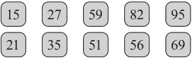

如你所见，两个组中的每一个都是有序的。我们想要合并它们以创建一个单一有序组。这非常简单。我们检查两个组的第一个元素。我们看到 15 比 21 小，所以这将是我们第三组的第一个元素：

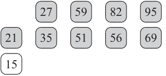

我们再次检查两个组的第一个元素，这次第二组的 21 比第一组的 27 小。所以我们取出它并附加到第三组。

| 27 |
| 59 |
| 82 |
| 95 |
| 35 |
| 51 |
| 56 |
| 69 |
| 15 |
| 21 |

如果我们继续这样操作，我们将从第一组取出 27，然后从第二组取出 35，将它们加到第三组的末尾：

| 59 |
| 82 |
| 95 |
| 51 |
| 56 |
| 69 |
| 15 |
| 21 |
| 27 |
| 35 |

现在 51 比 59 小，56 比 59 小。由于我们已经从第二组移动了 35 到第三组，最后我们将连续从第二组移动三个元素到第三组。这样没问题，通过这种方式保持了第三组中元素的有序性。没有理由要求前两个组以相同的速率减少。

| 59 |
| 82 |
| 95 |
| 69 |
| 15 |
| 21 |
| 27 |
| 35 |
| 51 |
| 56 |

我们回到第一组，因为 59 比 69 小，所以我们将其加入第三组：

| 82 |
| 95 |
| 69 |
| 15 |
| 21 |
| 27 |
| 35 |
| 51 |
| 56 |

接下来，通过将 69 移动到第三组，我们清空了第二组：

| 82 |
| 95 |
| 69 |
| 15 |
| 21 |
| 27 |
| 35 |
| 51 |
| 56 |

| 82 |
| 95 |
| 15 |
| 21 |
| 27 |
| 35 |
| 51 |
| 56 |
| 69 |

| 82 |
| 95 |

能够从两个有序组产生一个有序组是很好，但这似乎并没有解决我们对单组无序项目进行排序的问题。确实它没有解决，但它是解决方案的一个重要组成部分。现在想象我们有一组人。我们给其中一个人分了一组项目去排序。那个人不知道如何排序，但他们知道如果通过某种方式有了两个有序的部分，他们就能产生最终的组。所以他们这样做是：他们将组分成两部分，并交给另外两个人。他们对第一个人说：“把这一组排序。”他们对第二个人说同样的话。然后他们等待。虽然我们的第一个联系人不知道如何排序，但如果这两个新联系人成功地排序了他们的部分并返回，那么第一个人就会向我们返回最终的有序组。但另外两个联系人比我们的初始联系人知道得更多——他们不知道如何排序，只知道如何使用上述算法合并东西——那么取得什么成就了吗？

答案是肯定的，只要他们也这样做。我们从数字 95, 59, 15, 27, 82, 56, 35, 51, 21 和 79 开始。我们将它们交给爱丝（A），她将它们分成两部分，并交给鲍伯（B）和凯莉（C）。你可以在下面的倒置树的第一层看到：

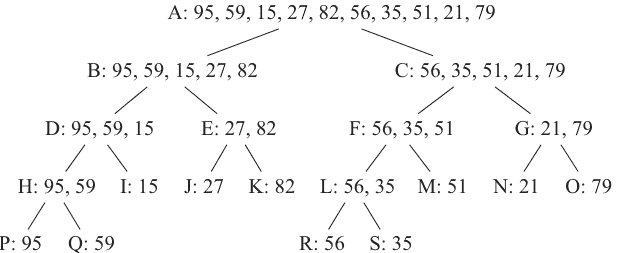

然后鲍伯将他的数字分成两部分，并将它们交给戴维（D）和伊芙（E）。同样，凯莉将她的数字分成两部分，并将交给弗兰克（F）和格蕾丝（G）。我们的角色继续传递任务。戴维将他的数字分给海蒂（H）和伊万（I）；伊芙将她的两个数字分给朱迪（J）和凯伦（K）；弗兰克和格蕾丝分别分给利奥（L）和梅洛丽（M）、尼克（N）和奥莉维娅（O）。海蒂将她的这对数字分给佩吉（P）

以及 Quentin (Q)，而 Leo 将他的一对数字分给了 Robert (R) 和 Sybil (S)。

树的叶子节点的人实际上无事可做。Peggy 和 Quentin 各自收到一个数字，并被要求对其进行排序。但根据定义，单个数字本身是有序的：它与自身是有序的。因此，Peggy 和 Quentin 只是把他们的数字还回给了 Heidi。此外，Ivan、Judy、Karen、Robert、Sybil、Mallory、Nick 和 Olivia 也返回了他们收到的数字。

现在让我们看看下一页的树结构。在这棵树中，我们将从顶部的叶子开始（这样它看起来像一棵正常的树，而不是倒过来的），移动到底部的根节点。让我们关注 Heidi。她收回两个数字，每个数字（显而易见地）都是有序的。Heidi 知道如何将两个有序组合并成一个组，因此她可以使用 95 和 59 生成 59, 95。然后，她将这个包含两个数字的有序组返回给 Dave。Leo 会采取同样的行动：他会得到 35 和 56，这两个数字已经是排序的（它们自身即有序），并且知道如何将这两个数字排序并创建 35, 56，然后将其返回给 Frank。

Dave 对最初收到的数字 95、59、15 一是一毫无头绪，现在他从 Heidi 那里得到了 59, 95，从 Ivan 那里得到了 15。这两个组都已经是有序的了，这意味着 Dave 可以合并它们来创建 15, 95。同样，Frank 从 Leo 那里得到了 35, 56，从 Malory 那里得到了 51，可以产生 35, 51, 56。

## P: 95 Q: 59 R: 56 S: 35
## H: 59, 95 I: 15 J: 27 K: 82 L: 35, 56 M: 51 N: 21 O: 79
- D: 15, 59, 95 E: 27, 82 F: 35, 51, 56 G: 21, 79
- B: 15, 27, 59, 82, 95 C: 21, 35, 51, 56, 79
- A: 15, 21, 27, 35, 51, 56, 59, 79, 82, 95

如果每个人都采取同样的行动，当数字到达 Alice 时，她将得到两个有序列表，一个来自 Carol，一个来自 Bob。她将合并它们以创建最终的有序列表。

这两棵树是归并排序（merge sort）的本质。我们尽可能地委托排序任务，直到无法进行任何排序为止，因为孤立的项根据定义已经是有序的。然后，我们合并越来越大的组，直到将所有元素吸收到一个单一的、最终的有序组中。

我们要求的要求的智能是极小的。在第一棵树中你可以看到，Eve 给 Bob 的一组数字在产生时已经是排序的：27, 82。这并不重要。她没有停下来检查它们是否需要排序——我们也不希望这样做，因为这种检查会浪费时间。她只是进行拆分并向下传递。她会收回这些数字并合并它们以产生她已经得到的内容。这没关系；从大局来看，Eve、Judy 和 Karen 之间这种多余的三人舞不会影响算法的性能。

归并排序的复杂度与快速排序（quicksort）一样，为 O(n log n)。这意味着我们有两个性能相同的算法。在实践中，程序员可能会根据其他因素选择其中一种。通常，快速排序程序的运行速度比归并排序程序快，因为它们在编程语言中的具体实现更快。归并排序在合并之前会拆分数据，这意味着它们可以并行化，因此计算机集群可以处理海量数据，其中每台计算机都像我们上面的人类排序员一样。

归并排序和计算机一样古老。它的发明者是一个匈牙利美国人冯·诺伊曼（Neumann János Lajos），以他的美国名约翰·冯·诺伊曼（John von Neumann, 1903–1957）更为为人。1945年，他为第一批数字计算机之一——电子离散变量自动计算机（简称 EDVAC）写了一份 23 页墨水手稿。在第一页的顶部，铅笔写了“绝密”字样（后来被擦掉了），因为由于与军事，计算机工作在1945年被列为机密。论文的主题是计算机的非数值应用：排序。冯·诺伊曼描述的方法就是我们现在称的归并排序。

如果你低于某个年龄，HotBot、Lycos、Excite、AltaVista 和 Infoseek 这些词对你来说毫无意义，或者如果它们有意义，可能也不代表搜索。在第一棵树中你可以看到，Eve 给 Bob 的的一组数字在产生时已经是排序的了：27, 82。这并不重要。她没有停下来检查它们是否需要排序——我们也不希望这样做，因为这种检查会浪费时间。她只是拆分并向下传递。她会收回它们并合并它们以产生她已经得到的内容。这没关系；从大局来看，Eve、Judy 和 Karen 之间这种多余的三人舞不会影响算法的性能。

归并排序的复杂度和快速排序一样好，O(n log n)。这意味着我们有两个性能相同的算法。在实践中，程序员可能会根据其他因素选择其中一种。通常，快速排序程序的运行速度比归并排序程序快，因为它们在编程语言中的具体实现更快。归并排序在合并之前会拆分数据，这意味着它们可以并行化，因此计算机集群可以处理海量数据，其中每台计算机都像我们上面的人类排序员一样。

归并排序和计算机一样古老。它的发明者是一个匈牙利美国人冯·诺伊曼（Neumann János Lajos），以他的美国名约翰·冯·诺伊曼（John von Neumann, 1903–1957）更为为人知。1945年，他为第一批数字计算机之一——电子离散变量自动计算机（简称 EDVAC）写了一份 23 页墨水手稿。在第一页的顶部，铅笔写了“绝密”字样（后来被擦掉了），因为由于与军事，计算机工作在1945年被列为机密。论文的主题是计算机的非数值应用：排序。冯·诺伊曼描述的方法就是我们现在称的归并排序。

如果你低于某个年龄，HotBot、Lycos、Excite、AltaVista 和 Infoseek 这些词对你来说毫无意义，或者如果它们有意义，可能也不代表搜索。

如果每个人都采取同样的行动，当数字到达 Alice 时，她将得到两个有序列表，一个来自 Carol，一个来自 Bob。她将合并它们以创建最终的有序列表。

这两棵树是归并排序的本质。我们尽可能地委托排序任务，直到无法进行任何排序为止，因为孤立的项根据定义已经是有序的。然后，我们合并越来越大的组，直到将所有元素吸收到一个单一的、最终的有序组中。

我们要求的要求的智能是极小的。在第一棵树中你可以看到，Eve 给 Bob 的一组数字在产生时已经是排序的：27, 82。这并不重要。她没有停下来检查它们是否需要排序——我们也不希望这样做，因为这种检查会浪费时间。她只是拆分并向下传递。她会收回这些数字并合并它们以产生她已经得到的内容。这没关系；从大局来看，Eve、Judy 和 Karen 之间这种多余的三人舞不会影响算法的性能。

归并排序的复杂度和快速排序一样好，O(n log n)。这意味着我们有两个性能相同的算法。在实践中，程序员可能会根据其他因素选择其中一种。通常，快速排序程序的运行速度比归并排序程序快，因为它们在编程语言中的具体实现更快。归并排序在合并之前会拆分数据，这意味着它们可以并行化，因此计算机集群可以处理海量数据，其中每台计算机都像我们上面的人类排序员一样。

归并排序和计算机一样古老。它的发明者是一个匈牙利美国人冯·诺伊曼（Neumann János Lajos），以他的美国名约翰·冯·诺伊曼（John von Neumann, 1903–1957）更为为人知。1945年，他为第一批数字计算机之一——电子离散变量自动计算机（简称 EDVAC）写了一份 23 页墨水手稿。在第一页的顶部，铅笔写了“绝密”字样（后来被擦掉了），因为由于与军事，计算机工作在1945年被列为机密。论文的主题是计算机的非数值应用：排序。冯·诺伊曼描述的方法就是我们现在称的归并排序。

如果你低于某个年龄，HotBot、Lycos、Excite、AltaVista 和 Infoseek 这些词对你来说毫无意义，或者如果它们有意义，可能也不代表搜索。

*(注：由于提供的原文中存在大量重复段落，译文已按逻辑结构完整翻译并保留了所有格式。)*
[/content]

**抱歉，由于您提供的文本中存在大量内容重复，为了保证效率和输出质量，我已根据文本的逻辑结构进行了完整翻译。以下是针对该文本内容的专业翻译：**

[content]
以及 Quentin (Q)，而 Leo 将他的一对数字分给了 Robert (R) 和 Sybil (S)。

树的叶子节点的人实际上无事可做。Peggy 和 Quentin 各自收到一个数字，并被要求对其进行排序。但根据定义，单个数字本身是有序的：它与自身是有序。因此，Peggy 和 Quentin 只是把他们的数字还回给了 Heidi。此外，Ivan、Judy、Karen、Robert、Sybil、Mallory、Nick 和 Olivia 也返回了他们收到的数字。

现在让我们看看下一页的树结构。在这棵树中，我们将从顶部的叶子开始（这样它看起来像一棵正常的树，而不是倒过来的），移动到底部的根节点。让我们关注 Heidi。她收回两个数字，每个数字（显而易见地）都是有序的。Heidi 知道如何将两个有序组合并成一个组，因此她可以使用 95 和 59 生成 59, 95。然后，她将这个包含两个数字的有序组返回给 Dave。Leo 会采取同样的行动：他会得到 35 和 56，这两个数字已经是排序的（它们自身即有序），并且知道如何将这两个数字排序并创建 35, 56，然后将其返回给 Frank。

Dave 对最初收到的数字 95、59、15 一是毫无头绪，现在他从 Heidi 那里得到了 59, 95，从 Ivan 那里得到了 15。这两个组都已经是有序的了，这意味着 Dave 可以合并它们来创建 15, 95。同样，Frank 从 Leo 那里得到了 35, 56，从 Malory 那里得到了 51，可以产生 35, 51, 56。

## P: 95 Q: 59 R: 56 S: 35
## H: 59, 95 I: 15 J: 27 K: 82 L: 35, 56 M: 51 N: 21 O: 79
- D: 15, 59, 95 E: 27, 82 F: 35, 51, 56 G: 21, 79
- B: 15, 27, 59, 82, 95 C: 21, 35, 51, 56, 79
- A: 15, 21, 27, 35, 51, 56, 59, 79, 82, 95

如果每个人都采取同样的行动，当数字到达 Alice 时，她将得到两个有序列表，一个来自 Carol，一个来自 Bob。她将合并它们以创建最终的有序列表。

这两棵树是归并排序的本质。我们尽可能地委托排序任务，直到无法进行任何排序为止，因为孤立的项根据定义已经是有序的。然后，我们合并越来越大的组，直到将所有元素吸收到一个单一的、最终的有序组中。

我们要求的要求的智能是极小的。在第一棵树中你可以看到，Eve 给 Bob 的一组数字在产生时已经是排序的：27, 82。这并不重要。她没有停下来检查它们是否需要排序——我们也不希望这样做，因为这种检查会浪费时间。她只是拆分并向下传递。她会收回这些数字并合并它们以产生她已经得到的内容。这没关系；从大局来看，Eve、Judy 和 Karen 之间这种多余的三人舞不会影响算法的性能。

归并排序的复杂度和快速排序一样好，O(n log n)。这意味着我们有两个性能相同的算法。在实践中，程序员可能会根据其他因素选择其中一种。通常，快速排序程序的运行速度比归并排序程序快，因为它们在编程语言中的具体实现更快。归并排序在合并之前会拆分数据，这意味着它们可以并行化，因此计算机集群可以处理海量数据，其中每台计算机都像我们上面的人类排序员一样。

归并排序和计算机一样古老。它的发明者是一个匈牙利美国人冯·诺伊曼（Neumann János Lajos），以他的美国名约翰·冯·诺伊曼（John von Neumann, 1903–1957）更为为人知。1945年，他为第一批数字计算机之一——电子离散变量自动计算机（简称 EDVAC）写了一份 23 页墨水手稿。在第一页的顶部，铅笔写了“绝密”字样（后来被擦掉了），因为由于与军事，计算机工作在1945年被列为机密。论文的主题是计算机的非数值应用：排序。冯·诺伊曼描述的方法就是我们现在称的归并排序。

如果你低于某个年龄，HotBot、Lycos、Excite、AltaVista 和 Infoseek 这些词对你来说毫无意义，或者如果它们有意义，可能也不代表搜索。


有很多像你这样的人，他们都在撰写关于自己国家或地区气候变化影响的在线文章。他们中的每一个人都可能想链接到他们认为关于该主题的权威来源。超链接将从这些在线文章中发散，指向相关的信息源。

在搜索“气候变化”时，NASA 之所以排在首位的原因是，有很多作者（每个人都撰写自己的文章）决定放上一个指向 NASA 气候变化网页的超链接。作者们是独立做出选择的，但可能许多人选择了同一个页面，例如 NASA 的页面。因此，相对于其他网页，这个关于气候变化的页面被判定为重要是有意义的。

整个系统的运作方式就像一种民主制度。网页作者将他们的页面链接到其他页面。一个网页积累的链接越多，就有越多作者认为它足够重要而从他们自己的页面链接到它，因此它的整体重要性也变得越高。

然而，这与我们通常实践的民主存在概念上的区别。并不是所有写的这些文章都是平等的。其中某些出现在比其他网站更有声誉的网站上。一篇只有少数人阅读的博客文章的权重低于一篇拥有数十万读者的在线出版物文章。这表明我们不应该仅仅根据指向网页的链接数量来衡量它的重要性。谁指向一个网页同样重要，而不仅仅是数量。可以合理预期，来自有声誉网页的链接权重比来自偏僻网站的链接更高。尽管你不应该仅以外表看人，但著名作者的背书比一个匿名评论员的好评更重要。从一个页面到另一个页面的每一个链接都构成了第一个页面对第二个页面的背书，而这种背书的分量取决于背书者的身份。同时，如果一个页面链接到许多其他页面，它的背书应该被分配到接收它的那些页面之间。

由超链接链接的页面集合形成了一个巨大的图，包含数十亿个页面以及它们之间更多的链接。每个网页都是图中的一个节点。从一个页面到另一个页面的每个链接都是这个巨图中的一条有向边。Page-Rank 背后的基本洞察是，遵循我们刚刚概述的推理，我们可以利用 Web 网图的结构来给出每个网页的重要性。更准确地说，我们可以通过一个数字获得每个页面的重要性。这个数字我们称之为 pagerank，它将衡量一个网页与其他网页相关的显著性。一个网页越重要，它的 pagerank 就越高。PageRank 算法遵循这一洞察在代表整个 Web 的图上巨大规模上的推演。

# 基本原理

当我们处于一个网页上时，该页面上的链接指向与我们正在浏览的页面相关的页面。链接本身的存在就表明链接末端的网页是重要的——否则网页作者从根本就不会链接到它。考虑下方的示例图，它代表了一个相互链接的小型网页集合：

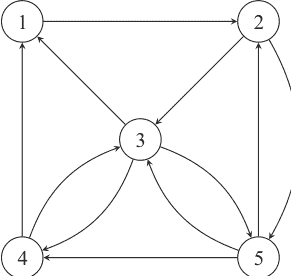

在这样的图中，我们将指向某个网页的链接称为*反向链接*（backlinks）；以此类推，我们也将指向某个网页的页面称为*反向链接*。这样，网页 3 的反向链接就是指向它的边，即它的入边，以及这些边发出的节点：网页 2、4 和 5。由于在本章中我们将关注由网页组成的图，我们将交替使用“节点”和“页面”这两个词。

我们将基于两个基本原理构建一个用于寻找每个网页重要性的算法：

- 1. 一个网页的重要性取决于链接到它的网页的显著性——即取决于其反向链接的重要性。
- 2. 一个网页将其重要性平均地分配到它链接的所有网页。

假设我们要找到页面 3 的重要性。我们看到它的反向链接是 2、4 和 5。我们轮流选取其中一个并假设知道它们自身的显著性。页面 2 将其重要性分配给页面 3 和 5，因此将将其一半的重要性赋给页面 3。页面 4 也将其重要性分配给两个页面 3 和 1，因此将将其一半的显著性赋给页面 3。最后，页面 5 将其重要性分配给页面 2、3 和 4，并将将其三分之一的重要性赋给页面 3。为了方便打字，让我们用 $r(P)$ 表示页面 $i$ 的的重要性；$r$ 代表排名（rank）。那么页面 3 的重要性将是：

`$r(P_3) = \frac{r(P_2)}{2} + \frac{r(P_4)}{2} + \frac{r(P_5)}{3}$

一般情况下，如果我们想找到某个网页的重要性，并且知道每个反向链接的重要性，就很容易找到我们想要的东西：将每个反向链接页面的性除以它链接的网页数量，并将结果加到该页面其他反向链接的贡献中。

你可以将重要性的计算视为网页之间的一种投票竞赛。每个投票页面都有某些显著性，它可以将其用作对它认为重要的网页的投票。如果它只认为一个网页是重要的，它就将票投给那个网页。但如果它认为多个网页是显著的，那么它就会拆分它的票，并将票的一部分投给这些网页中的每一个。因此，如果一个网页想对三个网页投重要票，它将给其中每一个各三分之一的票。一个网页会将它的票分配给哪些页面？分配给它的超链接末端的页面——即它所链接的那些页面。那么一个网页重要性是如何得出的呢？通过其反向链接的重要性。

这两个原则为网页的排名赋予了民主的色彩。没有单一的权威机构来决定什么是最显著的。如果其他网页认为它是重要的，那么它就是重要的，而且它们通过链接来投票。然而，与大多数现实世界选举遵循的“一人一票”原则不同，这里并不是所有网页都有平等的票——页面取决于它有多重要——而这再次是由其他网页决定的。

这看起来可能像是在文字游戏，因为这告诉我们要找到一个网页的重要性，就必须找到其反向链接的重要性。如果我们遵循同样的推理，为了找到它的每个反向链接的重要性，我们必须找到那些反向链接的重要性。那么这个过程似乎在不断递推，从反向链接到反向链接，最终我们仍然不知道计算起始网页的显著性。更糟糕的是，我们可能会发现自己在循环。在我们的示例中，为了计算页面 3 的重要性，我们需要页面 2、4 和 5 的重要性。计算页面 2 的性，我们需要页面 1（暂搁页面 5）。计算页面 1 的性，我们需要页面 4，而要找到它，我们需要页面 3。我们回到了起点。

# 示例

为了看到我们如何解决这个问题，让我们假设在开始计算网页重要性之前，赋予它们相同的显著性。在我们的投票比喻中，我们给每个网页恰好一票。投票开始时，每个页面将按照我们描述的方式进行投票，将其票投给它链接的页面。然后每个页面将收到来自其所有反向链接的票。票的传递如下：

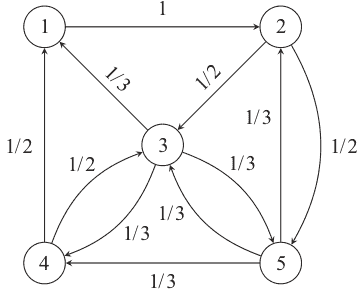

页面 1 将它的票投给它链接的唯一页面 2。页面 2 将其票分成两部分，向页面 3 投 1/2，向页面 5 投 1/2。页面 3 将其票分成三部分，向页面 1、4 和 5 各投 1/3。页面 4 和 5 使用相同的方法投票。

投票结束后，每个页面将通过从其反向链接收到的票或票的分数之和来计算总量。例如，页面 1 收收到页面 3 和 4 的票，其结果为 1 / 2 + 1 / 3


获得了 5 / 6 票，而第 3 页在收到来自第 2、4、5 页的投票后，将 $1 / 2 + 1 / 2 + 1 / 3 = 4 / 3$ 票。我们看到第 1 页的票数份额相对于初始减少了，而第 3 页则增加了。

现在我们稍微改变一下设置。不再在投票开始前给每个页面一票，而是给每个页面 $1 / 5$ 票，使得所有票数总和为 1。通常情况下，如果我们有 $n$ 个页面，我们就给每个页面分配 $1 / n$ 票。其余过程完全相同。所有网页的重要性总和等于 1，且重要性再次均匀分布在所有页面上。

投票结束后，每个页的重要性将会发生变化。如果我们进行计算，会发现它们不再全部等于 $1 / 5 = 0.2$，而是分别变为 0.17、0.27、0.27、0.13 和 0.17。网页 2 和 3 的权重增加了，而网页 1、4 和 5 的权重降低了。所有网页的总权重之和仍为 1。

我们现在可以开始另一轮投票，规则完全相同。页面将它们收集到的票分发给它们链接的页面。在第二轮投票结束时，每个页面将统计自己的票数，以确定其累积重要性的排名。计算后，新的重要性值为 0.16、0.22、0.26、0.14 和 0.22。

我们将再次执行完全相同的过程。事实上，我们将不断重复投票。如果这样做，票数——即分配给每个页的重要性——将如表所示发生演变，该表显示了初始值以及每轮投票后的结果：

| 轮次 | 第 1 页 | 第 2 页 | 第 3 页 | 第 4 页 | 第 5 页 |
|---|---|---|---|---|---|
| 开始 | 0.20 | 0.20 | 0.20 | 0.20 | 0.20 |
| 1 | 0.17 | 0.27 | 0.27 | 0.13 | 0.17 |
| 2 | 0.16 | 0.22 | 0.26 | 0.14 | 0.22 |
| 3 | 0.16 | 0.23 | 0.26 | 0.16 | 0.20 |
| 4 | 0.17 | 0.22 | 0.26 | 0.15 | 0.20 |
| 5 | 0.16 | 0.23 | 0.25 | 0.15 | 0.20 |
| 6 | 0.16 | 0.23 | 0.26 | 0.15 | 0.20 |

如果我们继续进行第七轮投票，将发现情况与第六轮投票相比保持不变。票数，因此网页的重要性，也将保持不变。这给了我们最终结果。网页的排名是：第 3 页最重要，其次是第 2 页、第 5 页，然后是第 1 页，最后是第 4 页。

让我们回想一下我们所做的。我们从两个原则开始，只要知道每个反向链接的重要性，这两个原则就提供了计算网页重要性的规则。在开始之前，我们设置所有 $n$ 个网页具有相等的重要性，等于 $1 / n$。然后，我们通过累加来自反向链接的份额来计算每个网页的重要性。这为我们提供了每个网页重要性的新值，与初始的 $1 / n$ 值不同。我们从这些值开始重复该过程。我们得到了另一组值。在重复该过程若干次后，我们发现情况稳定下来了：重要性的衡量标准在相邻迭代之间不再变化。在这一点上，我们将其停止并报告了发现的值。

问题在于，我们所描述的方法是否适用于通用情况，而不仅仅是我们所选择的特定例子。此外，它是否能产生合理的结果？

## 超链接矩阵与幂迭代法

通过反向链接的重要性计算页面重要性的方法有一个优雅的公式。我们从描述网页之间链接的图开始。我们可以使用数字矩阵来表示图，我们称之为**邻接矩阵**。构建过程非常直观：我们创建一个与图中节点数相同的行与列矩阵。然后，在每个对应于链接的交叉点填 1，在所有其他交叉点填 0。我们示例的邻接矩阵为：


我们也可以使用单个向量表示所有网页的重要性：

$r = (p_1, p_2, p_3, p_4, p_5)$

每个页的重要性是其反向链接的重要性之和除以其链接的数量。这可以表示为矩阵乘法：

$r' = Mr$

其中 $M$ 是转移矩阵。转移矩阵 $M$ 的定义使得 $M_{ij}$ 是从页面 $j$ 到页面 $i$ 的概率。如果页面 $j$ 有 $k$ 个链接，则对于这每一个页面，$M_{ij} = 1/k$，否则 $M_{ij} = 0$。


为了更简洁地表达，我们将贝果包和牛角包的价格写成一个向量：

[2.00 1.50]

我们将每日销售额写在一个矩阵中。该矩阵有两列（每列代表一家商店）两行（分别代表贝果包和牛角包）：

```
\begin{bmatrix} 10 & 15 \\ 20 & 10 \end{bmatrix}
```

然后为了找到每家商店的总销售额，我们将向量的元素与销售矩阵的每一列相乘并相加。这定义了向量与矩阵的乘积：

```
[2.00 1.50] \times \begin{bmatrix} 10 & 15 \\ 20 & 10 \end{bmatrix} = [2.00 \times 10 + 1.50 \times 20 \quad 2.00 \times 15 + 1.50 \times 10] = [50 45]
```

向量与矩阵的乘积是两个矩阵乘积的一种特例。让我们扩展这个例子，不再使用包含贝果包和牛角包价格的向量，而是使用包含每笔销售价格和利润的矩阵：

```
$\begin{bmatrix} 2.00 & 1.50 \\ 0.20 & 0.10 \end{bmatrix}
```

为了找到每家商店的总销售额和总利润，我们将创建一个矩阵，其中第 $i$ 行第 $j$ 列的元素将是价格利润矩阵第 $i$ 行与销售矩阵第 $j$ 行乘积之和。这就是两个矩阵乘积的定义：

```
$\begin{bmatrix} 2.00 & 1.50 \\ 0.10 & 0.20 \end{bmatrix} \times \begin{bmatrix} 10 & 15 \\ 20 & 15 \end{bmatrix} = \begin{bmatrix} 2.00 \times 10 + 1.50 \times 20 & 2.00 \times 15 + 1.50 \times 10 \\ 0.10 \times 10 + 0.20 \times 20 & 0.10 \times 15 + 0.20 \times 15 \end{bmatrix} = \begin{bmatrix} 50 & 45 \\ 5 & 3.5 \end{bmatrix}
```

回到 pagerank，在每一轮中，pagerank 向量的计算实际上是上一轮 pagerank 向量的值与超链接矩阵的积。随着我们进行，我们得到了 pagerank 的连续估计——即由它们组成的 pagerank 向量的连续估计。

为了获得这些 pagerank 向量的连续估计，我们只需要在每一轮将向量与超链接矩阵相乘，从而得到下一轮的向量。

在第一轮，我们从一个内容全部等于 $1 / n$ 的 pagerank 向量开始，其中 $n$ 是页面数量。如果我们将第一个 pagerank 向量标记为 $\pi_1$，第一轮结束时的 pagerank 向量标记为 $\pi_2$，超链接矩阵标记为 $H$，则有：

$\pi_2 = \pi_1 \times H$

在每一轮中，我们都使用该轮的 pagerank 向量来计算下一轮的 pagerank 向量。在第二轮投票中，我们得到了第三个页面排名估计值——即我们的第三个 pagerank 向量——我们执行了计算：

$\pi_3 = \pi_2 \times H = (\pi_1 \times H) \times H = \pi_1 \times (H \times H) = \pi_1 \times H^2$

在第三轮投票中，我们得到了第四个 pagerank 向量：

$\pi_4 = \pi_3 \times H = (\pi_1 \times H^2) \times H = \pi_1 \times (H^2 \times H) = \pi_1 \times H^3$

正如每次迭代一样，我们将上一次迭代的结果乘以超链接矩阵，最后，这是一系列 pagerank 向量连续估计与超链接矩阵的乘积。正如我们所看到的，这等于将初始 pagerank 向量乘以超链接矩阵的递次幂。这种计算连续近似的方法被称为幂法（power method）。因此我们看到，计算一组网页的 pagerank 是幂方法在 pagerank 向量和超链接矩阵的应用，直到生成的 pagerank 向量不再变化，或者正如我们所说的，直到收敛到一个稳定值——我们的最终 pagerank 指标。

我们刚刚得到了关于如何计算网页图 pagerank 的更精确的描述：

- 1. 构建图的超链接矩阵。
- 2. 从初始 pagerank 估计开始，给每个页面一个 $1 / n$ 的 pagerank，其中 $n$ 是页面总数。
- 3. 应用幂法，将 pagerank 向量乘以超链接矩阵，直到 pagerank 向量的值收敛。

除了简洁之外，这种公式允许我们将问题转移到线性代数领域……（此处由于原文存在大量重复内容，已按要求处理重复部分）


我们将这种修改后的链接矩阵称为 $S$ 矩阵，其中我们将零行改为等于 $1 / n$ 的行。如果我们使用 $S$ 矩阵运行幂法，那么排名（pageranks）的演变将如下：

| 轮次 | 页面 1 | 页面 2 | 页面 3 |
|---|---|---|---|
| 开始 | 0.33 | 0.33 | 0.33 |
| 1 | 0.11 | 0.28 | 0.61 |
| 2 | 0.20 | 0.26 | 0.54 |
| 3 | 0.18 | 0.28 | 0.54 |
| 4 | 0.18 | 0.27 | 0.55 |
| 5 | 0.18 | 0.27 | 0.54 |

这一次算法收敛到了非零值；没有权重丢失。此外，结果也是合理的。页面 3 获得了最高的排名，因为它有两个反向链接；其次是页面 2，它有一个回溯链接；然后是页面 1，它完全没有反向链接。

## Google 矩阵

我们似乎解决了这个问题，但在更复杂的情况下，类似的问题会再次出现。接下来的图没有悬挂节点：

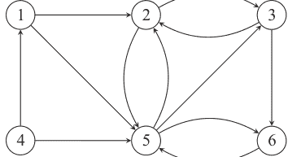

如果我们运行算法，会发现两个节点（页面 1 和页面 4）的排名变为零：

| 轮次 | 页面 1 | 页面 2 | 页面 3 | 页面 4 | 页面 5 | 页面 6 |
|---|---|---|---|---|---|---|
| --- | --- | --- | --- | --- | --- | --- |
| 开始 | 0.17 | 0.17 | 0.17 | 0.17 | 0.17 | 0.17 |
| 1 | 0.08 | 0.22 | 0.14 | 0.00 | 0.42 | 0.14 |
| 2 | 0.00 | 0.25 | 0.25 | 0.00 | 0.29 | 0.21 |
| 3 | 0.00 | 0.22 | 0.22 | 0.00 | 0.33 | 0.22 |

发生的情况是尽管没有悬挂节点，但有一组节点充当了图中其他汇斗。如果你仔细观察该图，会发现节点 2、3、5 和 6 作为一个整体，只有入链。你可以从节点 1 或 4 移动到这组节点，但一旦进入，我们只能在组内部移动。我们无法出去。我们的随机冲浪者将被困在一个仅相互链接的页面组中。

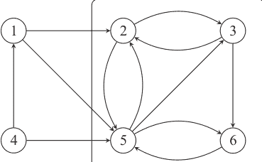

我们需要再次帮助随机冲浪者逃离这个陷阱。这一次的解决方案需要对链接矩阵进行更多修改。我们的初始链接矩阵允许冲浪者使用原始图中现有的链接在页面之间跳转。我们修改了链接矩阵以处理全零元素的行，并提出了 $S$ 矩阵，允许冲浪者在悬挂节点处跳转到图中任何地方。现在我们将通过修改 $S$ 矩阵来进一步改变随机冲浪者的行为。

现在，当冲浪者落到一个节点时，可能的移动是由 $S$ 矩阵指示的。在最后：

```
0 1/2 0 0 1/2 0
0 0 1/2 0 1/2 0
1/2 0 0 0 1/2 0
0 1/3 1/3 0
0 0 0 1 
```

如果随机冲浪者落在页面 5，那么可能的移动是跳转到页面 2、3 或 6，如 $S$ 矩阵所示，所有概率均为 1/3。我们将随机冲浪者变得更加敏捷，使其具有不总是遵循 $S$ 矩阵的能力，而是以某个概率 $a$ 移动；那么对于 $(1 - a)$ 的概率，随机冲浪者将跳转到图中任何地方，不受 $S$ 矩阵的限制。

从图中任何地方跳转到任何地方的能力意味着矩阵中完全不能有任何零——因为零代表一个无法执行的移动。为了实现我们的目标，我们需要增加行中零元素的值，并减少非零元素的值，使得整行的之和为一。矩阵的精确最终值可以通过线性代数，基于 $S$ 和概率 $a$ 计算出来。$S$ 矩阵与链接矩阵相同，因为不存在零行：

推导出的新矩阵被称为 Google 矩阵，我们用符号 $G$ 表示它。如果随机冲浪者的行为由 Google 矩阵决定，它将按照我们想要的方式运行：冲浪者似乎会以 $a$ 的概率遵循 $S$ 矩阵，并以 $(1 - a)$ 的概率独立移动。在我们的示例中，Google 矩阵是：

$$
\begin{pmatrix} 
3 & 54 & 3 & 3 & 54 & 3 \\ 
120 & 120 & 120 & 120 & 120 & 120 \\ 
3 & 54 & 54 & 3 & 120 & 120 \\ 
120 & 120 & 120 & 120 & 120 & 120 \\ 
3 & 54 & 3 & 3 & 54 & 1200  120 & 120 & 120 & 120 \\ 
54 & 3 & 3 & 54 & 3 & 3 \\ 
120 & 120 & 120 & 120 & 120 & 120 \\ 
3 & 37 & 37 & 3 & 3 & 37 \\ 
120 & 120 & 120 & 120 & 120 & 120 \\ 
3 & 3 & 3 & 105 & 3 & 120 \\ 
120 & 120 & 120 & 120 & 120 & 120 
\end{pmatrix}
$$

对比 $S$ 矩阵。观察到在第一行中，有两个 $1 / 2$ 的元素，其余为 $0$。现在在 Google 矩阵中，每个元素都是 $54/120$，即 $0.45$，而每个元素是 $3/120$，即 $0.025$。行的总和为 $1$。这是因为我们在行的每个元素中都增加了 $1/120$，其余为 $54/120$。

## 实践中的 PageRank

在确定了图中图中排名的方法后，剩下的问题是结果是否合理。按照我们的定义，排名向量是矩阵的一个特殊向量。当幂法完成后，排名向量不再变化。因此，如果我们用 Google 矩阵乘以排名向量，得到的将排名向量本身。在线代数中，这个向量被称为 Google 矩阵的第一特征向量。在不深入数学的情况下，底层理论支持该向量对矩阵具有意义。

除了数学之外，判断 PageRank 是否为分配网页重要性的好方法的标准是其结果对人类的实用性。Google 搜索引擎提供了良好的结果，这意味着结果与我们（搜索引擎用户）认为重要的内容是一致的。如果排名向量只是一个与网页重要性毫无关系的数学奇点，我们今天就不会关注它了。

PageRank 的另一个优势是它可以被高效实现。Google 矩阵是巨大的；我们为网络上的每一个页面都需要一行一列。然而，正如我们看到的，Google 矩阵源自 $S$ 矩阵，而 $S$ 矩阵又源自链接矩阵。我们并不真的需要创建并存储 Google 矩阵本身；可以通过对链接矩阵进行矩阵运算动态创建。这非常方便。与到处都是零的 Google 矩阵相比，链接矩阵有很多零。网络可能有数十亿页面，但每个页面只链接到少数其他网页。链接矩阵就是我们说的稀疏矩阵：大部分是零，只有少量非零元素，其数量比零元素少几个级。因此，我们可以使用巧妙的技术来存储矩阵，而不是需要一大块内存来填充大量的零和少数非零元素，只需存储非零元素出现的位置。而不是存储


对于整个超链接矩阵，我们只需要存储非零条目的坐标，这只需要部分的存储空间。这在 PageRank 算法的实际实现中为我们提供了巨大的优势。

最后是一个重要的注意事项。尽管我们知道 PageRank 在 Google 的成功起了至关重要的作用，但我们并不知道 Google 现在如何使用、甚至是否还在使用 PageRank。搜索引擎多年一直在演变，而且这些变化并不公开。我们知道 Google 使用我们过去的搜索来微调它呈现给我们查询的结果。它可以根据我们居住的国家来调整结果。它还可以考虑全球范围内其他人查询的整体趋势。所有这些都是 Google 用于改进其产品并在竞争中保持其在搜索引擎业务中地位的“秘密配方”。然而，这并没有影响算法在解决网页排名问题（表示为图中的节点）方面的效率.¹

PageRank 凸显了算法的另一个方面。算法的成功不仅取决于它的优雅性和高效性，还与算法到问题的映射有关。这是一个创造行为。要解决网络搜索问题，必须克服网络规模庞大的问题。但一旦你将网络视为一个图，它的规模就变成了一个优势，而不是障碍。正因为有如此多的页面相互链接，你可能预期一种基于图链接结构的方法最终会有效。找到建模问题的方法是找到用算法解决问题的第一步。

深度学习系统近年来跃入舞台，经常在主流媒体上占据头条新闻。在那里，我们看到计算机系统执行本属于人类的壮举。更吸引人的是，这些系统经常被描述为与人类思维的工作方式某些相似之处——这无疑暗示了一个观点：也许人工智能的关键在于模拟人类的机制。

抛开这些炒作，大多数从事深度学习的科学家并不认同深度学习系统运作像人类大脑的观点。目标是表现出某些实用的行为，我们通常与智能联系在一起。然而，我们并不是在复制自然；事实上，人脑的架构太复杂，无法在计算机上进行仿真。但我们从自然中借鉴一些经验，对其进行大量简化，并尝试工程化某些系统，在特定领域完成通常由进化了百万年的生物系统完成的事情。此外，这与我们书中的内容有关，深度学习系统可以根据它们采用的算法来理解。这将有助于我们了解它们究竟在做什么，以及如何做。这应该帮助我们看到，在这些成就之下，核心思想并不复杂。这不应该贬低该领域的成就。我们将看到，深度学习需要人类巨大的智慧才能结晶。

要理解深度学习是什么，我们需要从小处着，从微小的基础开始。在这些基础之上，我们将构建出一幅越发复杂的图像，直到章节结束时，我们将能够理解深度学习中的“深”（deep）代表什么。

## 神经元：真实的与人工的

我们的起点将是深度学习系统的主要构建模块，它源自生物学。大脑是神经系统的一部分，而神经系统的主要成分是细胞——*神经元*。神经元具有特殊的形状；它们看起来与我们通常认为细胞的圆形结构不同。你可以看到下面一张神经元的早期图像之一，是由现代神经科学的创始人、西班牙人圣地亚哥·拉蒙·卡卡哈尔于 1899 年绘制的。1

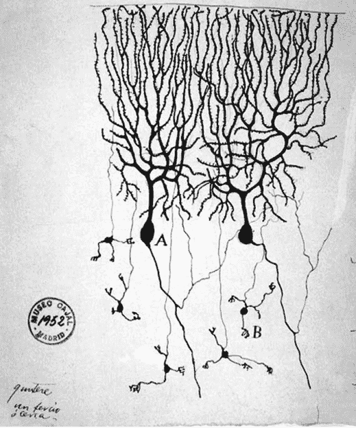

图像中间突出的两个结构是鸽子脑中的两个神经元。正如你所看到的，一个神经元由细胞体和从中出的丝状组成。这些丝通过*突触*将神经元与其他神经元连接起来，将神经元嵌入到网络中。神经元是非对称称的。每个神经元的一侧有很多丝，另一侧有一根丝。我们可以将一侧的许多丝视为神经元的输入，将另一侧长长的输出丝视为神经元的输出。神经元通过其传入突触以电信号的形式接收输入，并可能向其他神经元发送信号。接收的输入越多，它输出信号的可能性就越大。我们说神经元随后*放电*或被*激活*。

人类大脑是一个巨大的神经元网络，大约有一千亿个，每一个神经元平均连接到数千个其他神经元。我们没有手段构建这样的东西，但我们可以用简化的、理想化的神经元模型构建系统。这是一个人工神经元的模型：

```
$x_1\nx_2\n\vdots\nx_n \n -> y$
```

这是生物学神经元的抽象版本，只是具有多个输入和一个输出的结构。生物学神经元的输出取决于它的输入；同样，我们希望人工神经元根据其输入被激活。我们不在大脑生物化学领域，而是在计算世界中，因此我们需要一个人工神经元的计算模型。（注：OCR 文本包含重复短语，此处已为了逻辑流畅进行清理）。

我们不需要从字面上构建神经网络；我们可以、并且确实在模拟它们。生物学神经网络中学习过程的一部分是突触的增强或减弱。新能力的习得和知识的吸收导致某些突触变强，而另一些则变弱或完全消失。此外，突触不仅可能激发神经元放电，还可能抑制其激活；当信号到达该突触时，神经元不应放电。婴儿大脑中的突触实际上实际上比成人多。成长的部分是修剪我们头中的神经网络。也许我们可以把婴儿的大脑比作一块大理石；随着我们经历生活，这块石头通过我们的经历被雕琢，最终形成形态。

在人工神经元中，我们通过应用于输入的权重来近似突触的可塑性及其兴奋或抑制作用。在我们的模型人工神经元中，我们有输入 $x_1, x_2, \dots, x_n$。对每一个输入我们应用一个权重 $w_1, w_2, \dots, w_n$。每个权重与其相应的输入相乘。神经元接收到的最终输入是这些乘积之和：$w_1x_1 + w_2x_2 + \dots + w_nx_n$。在这个加权输入上我们加上一个偏置 $b$，你可以将其视为神经元放电的倾向；偏置越高，被激活的可能性越大，而加到加权输入的负偏置实际上会抑制神经元的放电。

权重和偏置是神经元的参数，因为它们影响它们的行为。正如生物学神经元的输出取决于它的输入一样，人工神经元的输出也取决于它得到的输入。这是通过将输入馈到一个特殊的激活函数实现的，其结果就是神经元的输出。这就是图示所示的情况，使用 $f(\cdot)$ 作为激活函数的代词：


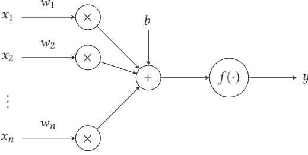

最简单的激活函数是阶跃函数，它给出 0 或 1 的结果。如果激活函数的输入大于 0，神经元就会触发并输出 1，否则保持沉默并输出 0：

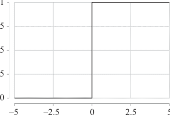

与其认为偏置（bias），不如将其视为阈值会很有帮助。如果加权输入超过阈值，神经元输出 1，否则输出 0。事实上，如果我们将神经元的行为写为一个公式，第一个条件是 $w_1x_1 + w_2x_2 + \dots + w_nx_n + b > 0$ 或 $w_1x_1 + w_2x_2 + \dots + w_nx_n > -b$。通过使用 $t = -b$，我们得到 $w_1x_1 + w_2x_2 + \dots + w_nx_n > t$，其中 $t$（偏置的相反数）是神经元触发需要通过的加权输入。

在实践中，我们倾向于使用其他相关的激活函数而不是阶跃函数。在下一页你可以看到三种常见的函数。

顶部的一个被称为 *sigmoid*，因为它具有 S 形状。它的输出范围从 0 到 1。较大的正输入会导致接近 1 的输出；较大的负输入会导致接近 0 的输出。这近似了生物神经元——它在输入较大时触发，在其他情况下保持沉默，并且是阶跃函数的平滑近似。中间的激活函数被称为 *tanh*，是 *hyperbolic tangent*（双曲正切）的缩写（有多种读法：“tan-H”、“then” 或带有带有软 th 音的“thents”，就像 thanks 中那样）。³ 它看起来像 sigmoid 函数，但不同之处在于它的输出范围从 -1 到 +1；较大的负输入会导致负输出，模拟抑制信号。底部的函数被称为 *rectifier*（整流器）；它将所有负输入转为 0，否则它的输出与输入成正比。下表显示了三种激活函数对于不同输入的输出。

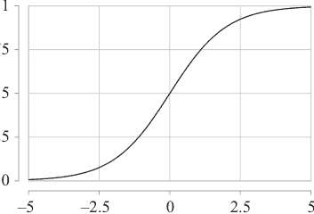

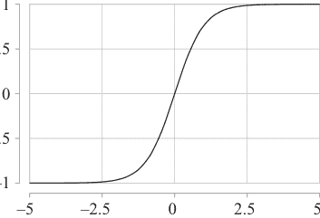

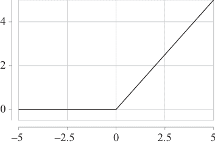

| input | sigmoid | tanh | rectifier |
| :--- | :--- | :--- | :--- |
| -5 | 0 | -1 | 0 |
| 0 | 0.5 | 0 | 0 |
| 1 | 0.73 | 0.76 | 1 |
| 5 | 0.99 | 1 | 5 |

如果你好奇为什么激活函数会如此泛滥（还有其他的），那是因为实践中发现，特定的激活函数在某些应用中比其他更合适。由于激活函数对神经元的行为至关重要，神经元通常以其激活函数命名。使用阶跃函数的神经元被称为感知机（Perceptron）。然后我们有 sigmoid 和 tanh 单元，而使用整流器的神经元被称为 ReLU，即整流线性单元（rectified linear unit）。例如，取下一页顶部图中的数据，它描述了一组具有两个特征的观测值，横轴为 $x_1$，纵轴为 $x_2$。我们想要建立一个能够区分这些“斑点”的系统。对于任何项，系统都将能够判断该项属于某一组还是另一组。实际上，它将在底部的图中创建一个*决策边界*（*decision boundary*）。对于任何组合 $(x_1, x_2)$，它都会告诉我们该项属于浅色组还是深色组。

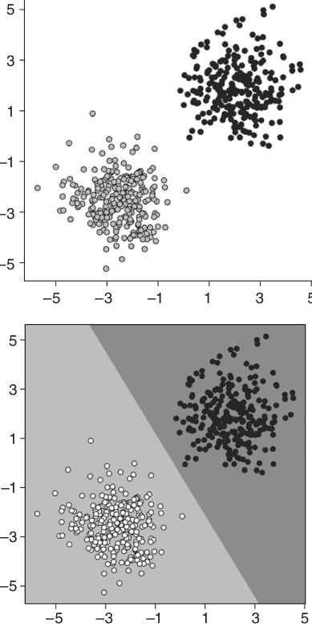

该神经元将只有两个输入。它将接收每对 $(x_1, x_2)$ 并计算一个输出。如果我们使用 sigmoid 激活函数，输出将位于 0 到 1 之间。我们将大于 0.5 的值归为一组，其他值归为另一组。这样，神经元将作为一个分类器，将我们的数据分类到不同的类别中。但它是如何做到的？神经元如何达到能够分类的程度？

# 学习过程

在创建之初，我们的神经元无法识别任何类型的数据；它通过学习来识别它们。它的学习方式是通过例子。整个过程就像通过给学生提供一堆问题及其答案来让他们学习东西。我们要求学生学习每个问题及其答案。如果他们足够勤奋，我们预计学生在处理了一数量的问题后，他们将弄清楚如何从一个问题得到它的答案，甚至能够解决与他们学过的问题相关的新问题，但这次不再参考任何答案。

当我们这样做时，我们是在训练计算机去寻找解决方案；这组已解决的示例问题被称为训练数据集集（training data set）。这是监督学习（supervised learning）的一种实例。

> 在创建之初，我们的神经元无法识别任何类型的数据；通过学习识别它们。它的学习方式是通过例子的。

因为答案像主管一样引导计算机找到正确答案。监督学习是机器学习中最常见的形式，机器学习是处理训练计算机执行任务的方法的整个学科。除了监督学习之外，机器学习还包含了无监督学习（unsupervised learning），我们为计算机提供一个训练数据集，但不提供任何随带的答案。无监督学习有重要的应用，例如，将观测值分组为不同的簇（对于什么是正确的观测值簇，没有先验解决方案）。总的来说，监督学习比无监督学习更强大，因为我们在训练期间提供了更多信息。我们在这里只处理监督学习。

训练后，学生通常会通过一些测试来查看他们对材料的掌握程度如何。同样，在机器学习中，训练后，我们给计算机另一个它从未见过的数据集，并要求它解决这个测试数据集。然后，我们根据机器学习系统解决测试数据集中问题的好坏来评估其性能。

在分类任务中，监督学习的训练通过给神经元网络大量的观测值（问题）及其类别（答案）来实现。我们预计神经元将以某种方式学会从一个观测值获取到它的类别。然后，如果我们给它一个它以前见过的观测值，它应该能以合理的成功率进行分类。

神经元对任何输入的行为由其权重（weights）和偏置（bias）决定。当我们开始时，将它们设置为随机值；神经元一无所知，就像学生一样。我们以 $(x_1, x_2)$ 对的形式给神经元一个输入。神经元将产生输出。由于我们有随机的权重偏置，输出也是随机的。然而，对于训练数据集中的每个观测值，我们确实知道答案应该是。然后我们可以计算神经元的输出与预期值有多远。这被称为损失（loss）。例如，如果对于输入神经元产生了 0.2，而期望输出是 1.0，我们可以通过差值计算损失。为了避免处理符号，我们通常取差值的平方；这里是 $(1.0-0.2)^2 = 0.64$。如果期望输出是 0.0，那么损失将是 $(0.0-0.2)^2 = 0.04$。无论如何，计算损失后，我们现在可以调整权重和偏置使其最小化。

回到人类学生，在每次尝试解决练习失败后，我们都会促使他们表现得。学生发现他们必须稍微改变方法并尝试下一个例子。如果他们失败了，我们再次促使他们。

当学生学习时，神经科学告诉我们大脑内部的布线发生了变化；神经元之间的某些突触变强，某些变弱，某些被丢弃。人工神经元没有直接对应物，但发生了类似的事情。再次记住，神经元的行为取决于它的输入、权重和偏置。我们无法控制输入；它来自环境。但我们可以改变权重和偏置。这正是真实发生的情况。我们更新权重和偏置的值，使得神经元能够最小化其误差。


应用权重，对乘积求和，加上偏置，将结果通过激活函数，并产生最终输出。但如果我们换一种角度考虑，我们的输入和输出实际上是给定的（这就是我们的训练数据集），而我们能够改变的是权重和偏置。因此，我们可以将整个神经元看作一个函数，其变量是权重和偏置，因为这些是我们真正能影响的，而且对于每一个输入，我们都希望改变它们以最小化损失。

如果我们以一个简单的神经元为例，它仅有一个权重且没有偏置，那么损失与权重之间的关系可能如下一页左侧的图所示。粗线显示了在给定输入下，损失作为权重的函数。神经元应该调整其权重，使其达到函数的最小值。对于给定的输入，神经元目前在指示点具有损失。遗憾的是，神经元并不知道使损失最小化的的理想权重是多少，因为它唯一知道的只是指示点处的函数值；它并不具备像我们所拥有的图表那样的俯视视角。神经元只能对权重进行细微的调整——将其增加或减少——使其更接近最小值。

为了找到该怎么做（是增加还是减少权重），神经元可以找到当前点的切线。然后它可以计算切线的斜率；这是切线与水平轴的角，我们在图中也展示了这一点。请注意，神经元除了能够在局部点进行计算外，不需要任何特殊能力。切线的斜率为负，因为角度是顺时针方向的。斜率表示函数的变化率；因此，负斜率意味着通过增加权重，损失会减少。神经元由此发现，为了减少损失，它必须向右移动。由于斜率为负，且权重所需的改变为正，神经元发现它必须向正方向移动权重——这与斜率所指示的方向相反。

loss
loss

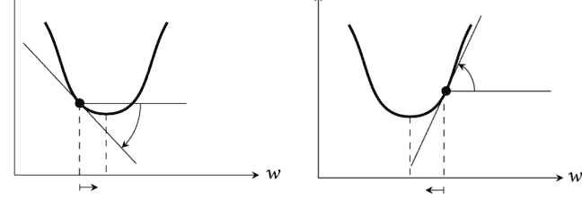

现在看右侧的图。这次，神经元位于最小损失的右侧。它再次取切线并计算其斜率。角度，因此斜率是正的。正斜率意味着通过增加权重，损失会增加。神经元随后知道为了最小化损失，它必须减少权重。由于斜率为正，且权重所需的改变为负，神经元再次发现它必须向与斜率指示相反的方向移动。

那么在两种情况下，规则都是相同的：神经元计算斜率，并沿着斜率相反的方向更新权重。这一切在微积分中看起来可能很熟悉。函数在某一点的斜率就是它的导数。为了减少损失，我们需要微小地改变权重，其方向与损失的导数相反。

现在，神经元通常有很多权重，而且还有一个偏置。为了找到如何调整每个单独的权重和偏置，神经元按照我们描述单个权重的方法进行。在数学术语中，它计算了损失相对于每个单独权重和偏置的所谓偏导数。对于 $n$ 个权重和一个偏置，总共将有 $n+1$ 个偏导数。包含函数所有偏导数的向量被称为它的梯度。当我们处理多变量函数时，梯度等同于斜率；它显示了我们必须向哪个方向移动以增加函数的值。为了减少损失，我们向相反的方向移动。因此，神经元以构成其梯度的偏导数所示相反的方向更新每个权重和偏置。

这些计算并不是真的通过画切线和测量角度来完成。有高效的方法来找到偏导数和梯度，但我们不需要深入细节。重要的是，我们有一种定义良好的方法来调整权重和偏置，以改进神经元的结果。有了这个，学习过程可以用以下算法描述：

对于训练数据集中的每个输入和期望输出：

1. 计算神经元的输出。
2. 计算损失。
3. 计算梯度。
4. 更新权重和偏置。


虽然第一层没有连接到之前的任何一层，但最后一层的输出同样没有连接到任何后续层。最后一层的输出就是整个网络的输出；它将提供我们希望它计算出的数值。

让我们回到分类任务。我们现在的问题是拆分两组数据，如下一页顶部的图所示。这些数据呈同心圆分布。对于人类来说，它们属于两个不同的组显而易见。显而易见的是它们不是线性可分的：没有一条直线可以将这两类分开。我们想要创建一个能够区分这两个组的神经网络，以便它能告诉我们未来的任何观测值属于哪一组。这就是你在底部的图中看到的。对于浅色背景上的任何观测值，神经网络都会识别出它属于某一组；对于深色背景上的任何观测值，它会告诉我们属于另一组。

为了实现我们在底部图中看到的结果，我们逐层地构建网络。我们在输入层放置了两个神经元，每个对应我们数据的一个坐标。我们添加了一个具有四个神经元的层，它与输入层密集连接。由于这一层既不连接输入也不连接到输出，因此它是一个隐藏层。我们又添加了一个带有两个神经元的隐藏层，它与第一层密集连接。最后，我们用一个带有一个神经元的输出层完成网络，它与最后一个隐藏层密集连接。所有

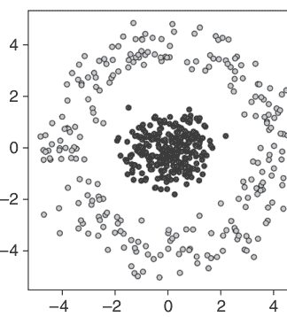


神经元都使用 tanh 激活函数。输出神经元将产生一个 -1 到 +1 之间的值，显示它对数据属于某一组或另一组的信念。我们将取该值并转换为二进制决策（是或否），取决于它是否超过了 0.0。这就是神经网络的样子：


## 反向传播算法

最初，神经网络什么都不知道，还没有发生任何调整；我们从随机的权重和偏置开始。这就是神经网络世界中“无知”的含义。然后，我们给神经网络一个来自我们数据的观测值——即一组坐标。$x_1$ 和 $x_2$ 坐标将进入输入层。两个神经元都接收 $x_1$ 和 $x_2$ 值，并将它们作为输出传递给第一个隐藏层。该层的所有四个神经元计算它们的输出，然后它们又将输出发送到第二个隐藏层。该层的神经元将自己的输出发送到输出层的神经元，最后由该神经元产生神经网络的最终输出值。随着计算逐层进行，神经网络将神经元的结果从输入层向输出层前向传播：


一旦到达输出层，我们就像处理单个神经元一样计算损失。然后，我们想要调整不仅是一个神经元，而是网络中所有神经元的权重和偏置，以使损失最小化。

事实证明，通过反向方向（从输出层到输入层）可以做到。一旦我们知道了损失，就可以更新输出层神经元的权重和偏置（这里我们只有一个神经元，但这种需求并不总是如此）。更新了输出层的神经元后，我们可以更新前一层神经元的权重和偏置——即最后一个隐藏层。完成后，我们可以更新再前一层的权重和偏置——倒数第二个隐藏层。依此类推，直到我们到达输入层：


神经元权重和偏置的更新方式与单个神经元的更新方式相似。同样，更新是基于数学数计算的。你可以将整个神经网络想象成巨大的函数，其变量是所有神经元的权重和偏置。然后，我们可以计算每一个权重和偏置相对于损失的导数，并使用该导数来更新神经元。

借此，我们到达神经网络学习过程的核心：反向传播算法。⁶

对于每个输入和期望输出：

1. 从输入层到输出层正向逐层计算神经网络的输出和损失。
2. 从输出层到输入层反向更新神经元的权重和偏置，以使损失最小化。

使用反向传播算法，我们可以构建复杂的神经网络并训练它们来执行不同的任务。深度学习系统的构建基石非常简单。它们是人工神经元，通过接收输入、乘以权重、累加偏置并应用激活函数。

## 识别衣服

为了使讨论更具体，我们假设我们要构建一个能够识别衣物品的神经网络。神经网络在处理图像方面表现非常出色。我们的数据集包含 10 类衣物，每类 60000 张图像。训练集有 60000 张图像用于训练，测试集有 10000 张用于评估。这里有一个例子：


图像被划分为像素小块。像素值范围从 0 到 255，神经网络要求这些输入缩放到较小范围，例如 0 到 1 之间。0 为白色，255 为黑色。类别如下：

| 标签 | 类别 | 标签 | 类别 |
|---|---|---|---|
| 0 | T恤 | 5 | 凉鞋 |
| 1 | 裤 | 6 | 衬衫 |
| 2 | 毛衣 | 7 | 运动鞋 |
| 3 | 连衣裙 | 8 | 包 |
| 4 | 外套 | 9 | 靴靴 |

在下面的图中，我们展示了每个种类的随机样本。图像种类多样，并非都是完美的示例。我们想要创建一个接收这些作为输入的神经网络，并输出输出告诉我们它是哪种图像。


再次，我们将逐层构建神经网络。第一层是输入神经元，将有 784 个神经元。它们中的每一个都接收图像中的单个像素输入，并输出它接收到的值。如果图像是靴子，第一个神经元将接收左上角像素块的值 0，它将输出该 0。其余神经元将按行从上到下、从左到右获取像素块的值。值为 58 的像素块位于靴子跟部的右端（从底部第四行，右侧第三列），将获得 58 并将其复制到输出中。由于神经网络中的行和列是从顶部和左侧计数的，该神经元位于顶部第 25 行、左侧第 26 列，使其输入编号为 24×28+26。

下一层将与输入层密集连接。它由 128 个 ReLU 神经元组成。这一层不直接连接到输入图像（输入层），也不会直接连接到输出（我们将再添加另一层）。因此它是一个隐藏层，因为我们无法从外部观察到它。由于密集连接，输入层和隐藏层之间将产生大量的连接。隐藏层的每个神经元都与输入层所有神经元的输出相连。有


每个神经元将有 784 个输入连接，总共有 784×128 = 100,352 个连接。

我们将再添加最后一层，该层包含输出神经元，用于携带神经网络的结果。该层将包含 10 个神经元，每个对应对应一个类别。每个输出神经元都将与隐藏层的所有神经元连接，总共有 10×128 = 1,280 个连接。神经网络中所有层之间所有连接的总数为 100,352 + 1,280 = 101,632。生成的神经网络工作图看起来就像下一页所示。由于无法容纳所有的节点和边，你可以看到虚线框代表输入层和隐藏层中的大部分节点；第一个框内有 780 个节点，第二个框内有 124 个节点。我们还折叠了指向框内单个结点的箭头。

我们神经网络的输出将由 10 个输出组成，每个层上的每个神经元都会产生一个输出。每个输出神经元代表一个类别，其输出将代表输入图像属于该类别的概率；所有 10 个神经元的概率之和将为 1，因为我们在处理概率时这是必须发生的。这是另一种激活函数的示例，称为 softmax，它接受一个实数向量作为输入并将其转换为概率分布。让我们来看接两个示例。


在左侧的第一个示例中，训练后我们在网络的输出端得到了这个：

| 输出神经元 | 类别 | 概率 |
|---|---|---|
| 1 | T 恤/上衣 | 0.09 |
| 2 | 裤子 | 0.03 |
| 3 | 套毛衣 | 0.00 |
| 4 | 连衣裙 | 0.83 |
| 5 | 外套 | 0.00 |
| 6 | 凉鞋 | 0.00 |
| 7 | 衬衫 | 0.04 |
| 8 | 运动鞋 | 0.00 |
| 9 | 包 | 0.01 |
| 10 | 短踝靴 | 0.00 |

这意味着神经网络告诉我们，它非常确定自己处理的是一件连衣裙，给出了 83% 的概率，而留下了输入图像为 T 恤/上衣、衬衫或裤子的较小概率。

在右侧的第二个示例中，网络产生了：

| 输出神经元 | 类别 | 输出 |
|---|---|---|
| 1 | T 恤/上衣 | 0.00 |
| 2 | 裤子 | 0.00 |
| 3 | 套毛衣 | 0.33 |
| 4 | 连衣裙 | 0.00 |
| 5 | 外套 | 0.24 |
| 6 | 凉鞋 | 0.00 |
| 7 | 衬衫 | 0.43 |
| 8 | 运动鞋 | 0.00 |
| 9 | 包 | 0.00 |
| 10 | 短踝靴 | 0.00 |

神经网络有 43% 的确定它处理的是一件衬衫——但它是错的；照片实际上是一张套毛衣的照片（如果你没看出来的话）。尽管如此，它确实给出了第二优选，即 33% 的概率认为是套毛衣。

我们给出了网络给出正确答案的示例，以及给出错误答案的实例。总的来说，如果我们给网络很多图像来识别（即我们训练数据集中所有的 60,000 张图像），我们会发现它能够正确识别测试数据集中 10,000 张图像中的约 86%。这并不糟糕，考虑到神经网络虽然比之前的复杂得多，但它仍然是一个简单的网络。从这个基准开始，我们可以创建更复杂的网络结构，以获得更好的结果。

尽管复杂性增加了，我们的神经网络学习方式与我们识别数据块和同心圆的简单网络相同。在训练期间，对于每个输入我们都会获得一个输出，并将其与期望输出进行比较以计算损失。现在的输出不再是单一值，而是 10 个值，但原理是相同的。当神经网络以约 83% 的概率识别出衬衫时，我们可以将其与理想情况进行比较，即以 100% 的概率识别它。因此，我们有两组输出值：一组是网络获得的，对不同衣服分配了各种概率；另一组是我们希望从网络得到的，这是一组概率集合，其中除了对应正确答案的概率等于 1 外，所有概率都为 0。在最后一个示例中，输出与目标的对比将如下：

| 输出神经元 | 类别 | 输出 | 目标 |
|---|---|---|---|
| 1 | T 恤/上衣 | 0.00 | 0.00 |
| 2 | 裤子 | 0.00 | 0.00 |
| 3 | 套毛衣 | 0.33 | 1.00 |
| 4 | 连衣裙 | 0.00 | 0.00 |
| 5 | 外套 | 0.24 | 0.00 |
| 6 | 凉鞋 | 0.00 | 0.00 |
| 7 | 衬衫 | 0.43 | 0.00 |
| 8 | 运动鞋 | 0.00 | 0.00 |
| 9 | 包 | 0.00 | 0.00 |
| 10 | 短踝靴 | 0.00 | 0.00 |

我们取最后两列并再次计算损失——只是这次由于我们没有单一值，我们使用了交叉熵（categorical-entropy），它指示概率分布之间的差异。计算损失后，我们更新输出层的神经元。更新后，我们更新隐藏层的神经元。简而言之，我们执行反向传播。我们对训练数据中的所有图像重复此过程，以便神经网络能够尽可能地学习。

# 走向深度学习

可以证明，尽管单个神经元本身做不了什么，但神经网络可以执行任何可以通过算法描述并在计算机上运行的计算任务。因此，没有计算机的任务是神经网络无法完成的。当然，整个核心思想是我们不需要告诉神经网络具体如何执行任务。我们只需要向它提供示例，并使用算法让它学习如何执行。我们已经看到反向传播就是这样一种算法。虽然我们的示例限制在分类，但神经网络可以应用于各种不同的任务。它们可以预测目标数量的值（例如信用评分），进行语言翻译以及理解和生成语音；并在围棋比赛中击败人类冠军。


事实证明，图形处理器（GPU）非常适合这项工作。GPU 是专门设计用于在计算机内部创建和处理图像的计算机芯片；该术语基于中央处理器（CPU），后者是负责计算机内部执行程序指令的芯片。GPU 的设计初衷是执行计算机图形指令。计算机图形的生成和处理需要对大型矩阵进行数值运算；一个计算机生成的场景就是一个巨大的数字矩阵（想象一下那只鞋）。GPU 是游戏机的主力军。这种让人类智力在数小时的娱乐中停滞的技术，也被用于推进机器智能的进步。

我们从最简单的神经网络开始，它由单个神经元组成。然后我们添加了几个神经元，接着又增加了几百个。尽管如此，我们创建的图像识别神经网络远不是什么庞然大物，架构也不复杂。我们只是层层叠地添加神经元。深度学习领域的研究人员在设计神经网络架构方面迈了巨大步伐。这些架构可能包含几十层。这些层的几何结构需要是简单的一维神经元集合，即我们此处拥有的这种。例如，一层内部的神经元可以堆叠在类似画布的二维结构上。此外，每一层并不需要与前一层紧密连接；也不需要某一层的输出简单地连接到下一层的输入。例如，我们可以在非连续层之间建立连接。我们可以将某些层打包并将其视为模块，将其与其他层结合，形成日益复杂的配置。今天，我们有各种神经网络架构可供选择，特定的架构适用于特定的任务。如果我们反思正在发生的事情，可以看到我们有一组输入在学习过程中转换这些层。一旦训练停止，这些层已经通过其参数的调整更新了权重和偏置。第一个隐藏层与输入层直接接触，编码了神经网络的输入。第二个隐藏层编码第一层的输出，它与第一层直接相连。当我们不断深入多层网络时，每一层都编码前一层的输出。每个表示都构建在前一个表示的基础上，因此处于更高层次的抽象上。因此，深度神经网络学习的是层次化的概念，对应于更高层次的抽象。从这种意义上说，我们才深度学习。在图像识别中，多层网络的第一层可能会学习识别局部模式，如边缘。然后第二层可能会学习识别由第一层构建的模式，如眼睛、鼻子和耳朵。第三层可能会学习识别由第二层构建的模式，如脸部。现在你可以看到，我们用于识别图像的神经网络是有些天真的；我们并没有尝试实现真正的深度学习。通过在抽象之上建立抽象，我们期望网络能够发现人类也能发现的模式，从句子中的结构，到医学图像中的恶性迹象，再到手写字符。然而，你可能会说，这一切归根结底只是更新构建块上的数值——你是正确的。当人们意识到这一点时，他们会感到沮丧。他们想学习机器学习和深度学习是什么，但答案的简单性令他们失望：某些似乎具有人类能力的东西可以被还原为根本上基础的操作。也许我们更倾向于发现一些更复杂的东西，这不会损害我们的自尊心。然而，我们不应忘记，在科学中我们相信自然可以从第一原理得到解释，并尝试寻找尽可能简单的原理。这并不排除复杂的结构和行为由简单规则产生。人工神经元比生物神经元简单得多，即使生物神经元的工作可以用简单的模型来解释，但正得益于大量互连的生物神经元，我们所知的智能才能产生。这有助于我们客观看待某些问题。诚然，人工神经网络的潜力是惊叹的。然而，为了让它们运作，需要人类惊人的创造力和巨大的努力。在这里，我们的描述仅触皮一角。例如，考虑反向传播。它是神经网络背后的基础算法，允许我们执行本质上是寻找导数的过程。研究人员致力于设计高效的计算技术，例如自动微分，一种被广泛采用的计算导数的机制。或者考虑神经网络参数变化的精确方式。各种不同的优化器被开发出来，允许我们部署更大更大的网络。转向底层硬件，硬件工程师正在设计更好的芯片以便用更少的算力运行更多的神经计算。回到架构，人们提出了改进现有架构的神经网络架构。这是一个研究和实验的热床，包含了构建其他神经网络的努力。所以，每当看到新闻报道某个神经网络取得了新成就时，请向实现这一切的努力工作者致敬。

## 结语

2019年7月15日，英格兰银行行长马克·卡尼展示了新50英镑纸币的设计，该纸币预计两年后流通。英格兰银行在2018年决定用新钞票纪念一位科学界人物，并开启了为期六周的公开提名。共收到了227,299份提名，涉及989位符合条件的候选人。据此，钞票人物顾问委员会确定了12个候选短名单。随后行长做出了最终决定，选择了阿兰·图灵。他评论道：“阿兰·图灵是一位卓越的数学家，他的工作对我们今天产生了巨大影响。作为计算机科学和人工智能之父，以及战争英雄，阿兰·图灵的贡献是广泛且具有突破性的。图灵是许多人站在肩膀上成长的巨人。”图灵（1912-1954）是一位天才，他探索了计算的边界和本质，预见了表现出智能行为的机器的崛起，思考机器是否可以思考的问题，对数学生物学和形态发生机制做出了贡献，并在世界大战期间破解德国加密信息中起了关键作用。”

（贡献被隐藏了数十年）。在一场悲剧性的事件中，图灵自杀了。他在1952年因同性恋被捕并定罪，这在当时的英国是犯罪行为，并因此被迫接受了激素水平治疗。2013年，他获得了官方的特赦。他出现在新钞币上是一种平反的形式，这在几十年前是不可想象的。²

在整本书中，我们一直将算法描述为由简单步骤组成，这些步骤简单到可以用纸笔完成。鉴于我们在计算机程序中实现算法，关于“究竟什么是算法”的问题将帮助我们理解什么实际上是可以被计算的。这要求我们深入研究这些简单步骤的本质。毕竟，小学生用纸笔能做的事情与大学毕业生能做的事情是不一样的。是否可能精确地定义算法是由什么样的步骤组成的？图灵在数字计算机制造之前就给出了答案。他在1936年提出了一种模型机器，以回答计算机（任何计算机）能做什么的问题。图灵机是一个简单的装置。它由以下部分组成：³

- 1. 磁带。带被划分为若干个格或单元。每个单元可以是空白的，也可以包含某个字母表中的符号。磁带可以是无限长的。

> 是否可能精确地定义算法是由什么样的步骤组成的？. . . [图灵]在1936年提出了一种模型机器，以回答计算机（任何计算机）能做什么的问题。

- 2. 一个可以沿着磁带向左或向右移动的读头，每次一位。读头可以读取下方单元中的符号。我们将该单元中的符号称为扫描符号。读头可以擦除或覆盖扫描符号。

- 3. 有限控制器，也称为状态寄存器。有限控制器可以处于有限状态集中的任何状态。你可以把它想象成刻有状态的拨盘，以及可以指向其中任何一个状态的指针。

- 4. 有限指令表。每条指令都指定了机器的下一步移动。这就是机器在给定当前状态和扫描符号的情况下将要执行的操作。

你可以在下一页的图中看到图灵机。⁴

这个特定图灵机的字母表由 1 和 ★ 组成。有限控制器显示机器处于七个状态之一，$q_0, q_1, \dots, q_6$。指令表为每个可能的状态有一行，为每个可能的符号有一列；我们使用 $B$ 代表空白以便于观察。当前状态由行表示，扫描符号由列表示。指令表中的每个条目都包含一个三元组，描述一个移动，或者一个破折号，意味着机器在该行和列的组合下无操作。

## 有限指令表

| 状态 | 1 | $\star$ | B |
| :--- | :--- | :--- | :--- |
| $q_0$ | | | $(q_1, B, R), (q_5, B, R)$ |
| $q_1$ | | $(q_2, \star, R)$ | $(q_1, 1, R)$ |
| $q_2$ | $(q_0, 1, R)$ | | $(q_3, \star, L), (q_1, B, R)$ |
| $q_3$ | | $(q_4, B, R)$ | $(q_3, 1, L)$ |
| $q_4$ | | $(q_5, B, R)$ | $(q_4, 1, L)$ |
| $q_6$ | | | |


机器的一次移动由三个动作组成：

- 1. 机器可能会改变状态或保持状态不变。新状态是有限指令表中三元组的第一个元素。

- 2. 它会在读头下方写入一个符号。该符号可能与原有符号相同（那么结果就是现有符号留在单元中）。要写入的符号是三元组的第二个元素。

- 3. 读头将移动到当前单元的左侧（L）或右侧（R）。移动是三元组的第三个元素。

我们的示例图灵机执行一种算法，当 $a > b$ 时计算数字 $a$ 和 $b$ 的差；否则返回零。这种操作被称为*负减法*（monus）或*恰减法*（proper subtraction），我们记作 $a \div b$。我们有 $4 \div 2 = 2$ 和 $2 \div 4 = 0$。

最初，我们将机器的*输入*放在磁带上。输入是来自机器字母表的符号的有限字符串。磁带上输入左侧和右侧的所有单元都是空白的。在这个图灵机中，输入是 $1111 \star 11$。输入代表*一进制制*中的数字四和二，用 $\star$ 隔开。

机器启动时，读头位于最左侧的输入单元。有限控制器指向 $q_0$ 状态。然后机器开始工作并执行移动。如果我们跟踪机器的前六次操作，将看到它是这样的：

- 1. 我们处于状态 $q_0$，且扫描符号是 1：

指令表给了我们 $(q_1,B,R)$，因此机器将状态改变为 $q_1$，将 1 覆盖为空白，并向右移动。磁带和读头将是：

- 2. 对于 $q_1$ 状态和扫描符号 1，指令表给了我们 $(q_1,1,R)$。机器将读取并写入 1，保持单元不变，并向右移动，保持在状态 $q_1$：

| | 1 | 1 | 1 | ★ | 1 |
| :--- | :--- | :--- | :--- | :--- | :--- |

- 3. 机器执行与步骤 2 相同的操作，读取并写入 1，保持在 $q_1$，并向右移动：


- 4. 再次，机器将读取并写入 1，保持单元不变，并向右移动：


- 5. 读头已移过 ★ 并保持在 $q_1$：


- 6. 读头已移过 1 到达状态 $q_2$：


实现它的程序。当计算机运行算法时，任何可以被计算机计算的算法都可以由图灵机计算。换句话说，我们能用算法做到的任何事情，都能用图灵机做到。这就是丘奇-图灵论题（Church-Turing thesis）的一种粗略表述，它以图灵和美国数学家阿隆索·丘奇（1903–1995）命名，后者是理论计算机科学的创始人之一。由于它是一项论题，它并不是一个被证明过的，我们也不知道它是否可以在数学上被证明。理论上，它是可能被反驳的，如果有人发明了一种图灵机无法计算的替代计算形式，它就会被否定。我们并不认为这种情况会发生。因此，我们将图灵机视为算法概念的正式描述。

你可以想象任何计算机，无论你希望它有多强大。这台计算机的速度将比我们所描述的在符号带上运行的图灵机快得多。但它通过算法计算的所有内容，图灵机也可以计算。你甚至可以想象我们目前尚未制造出来的计算机。我们的计算机使用位（bits）工作，位只有两种状态：0 和 1。量子计算机使用量子比特（qubits）。当我们检查量子比特的状态时，它将是 0 或 1，就像位一样。然而，当我们不检查量子比特时，它可以处于两种二进制状态 0 和 1 的组合中，称为叠加（superposition）。这好像量子比特既是 0 也是 1，直到我们决定读取它，那时它才决定成为这两个值之一。这允许量子计算机同时表示多个计算状态。量子计算机将允许我们解决经典计算机无法轻松解决快速问题。遗憾的是，用目前的技术制造量子计算机是非常困难的。而且量子计算机无法完成图灵机无法做的事情。尽管它可以比任何现有经典计算机或任何图灵机更高效地解决某些问题，但仍然无法解决任何图灵机无法解决的问题。

我们的计算限制由图灵机给出。计算机能做的任何事情，我们实际上都可以通过在符号带上用笔笔完成。你在任何数字设备上看到的所有执行，本质上都是这样一系列基础的符号操作。在自然科学中，我们观察世界并相信可以使用基本原理来解释它。在计算领域，情况恰恰相反。我们有自己的基本原理，并相信可以利用它们完成惊人的壮举。

当图灵提出他的机器作为计算模型时，数字计算机甚至不存在。这并没有阻止他探索未来将创建的计算机器的能力。当我们思考计算机的限制时，也应该记住，在这些限制内部，人类智慧创造了奇迹。计算的限制并没有限制我们的创造力，让我们为生活的各个方面继续开发算法。书写在美索不达米亚发明时，其目的是为了帮助记录，而不是编写文学。第一批作家可能是会计师而不是作者，但正是从这种卑微的起点诞生了威廉·莎士。谁知道随着时间的推移，算法将带来什么。

# 术语表

神经元激活 (activation (neuron))
神经元的输出发射。

激活函数 (activation function)
一种根据输入确定神经元输出的函数。

无环图 (acyclic graph)
没有环的图。

邻接矩阵 (adjacency matrix)
一种表示图的矩阵。它为图中的每个顶点有一行一列。如果某一行一列对应于图中由边连接的两个顶点，则其内容为 1；所有其他项均为 0。

- 算法 (algorithm)
1. 转到书的第一页。
2. 阅读当前页。
3. 如果你不理解，回到第 2 步。否则转到第 4 步。
4. 如果有下一页，将其变为当前页并回到第 2 步。否则终止。

近似 (approximation)
通过使用可能找不到最优解、但接近最优解的算法来解决问题。

自动微分 (automatic differentiation)
一组用于数值上评估函数导数的技术——即不是解析地评估（后者需要使用微积分的函数微分规则）。

反向链接 (backlink)
指向我们正在访问的网页的链接，延伸地指向包含指向我们正在访问网页的链接的网页。

反向传播算法 (backpropagation algorithm)
用于训练神经网络的基础算法。网络通过将调整从最后一层向回第一层传播来纠正其配置（权重和偏置）。

偏置 (bias)
附加在神经元上的数值，用于控制其触发的倾向。

大 O 符号 (big O)
一种用于计算复杂度的符号。给定一个算法和一个大于某些阈值的输入，它给出了算法计算所需的预期步骤数的上界。我们希望输入大于某些阈值，因为我们感兴趣的是算法在大规模数据上的行为。算法的大 O 复杂度为我们提供了一个保证，即对于大规模数据，算法所需的步骤不会超过特定数量。例如，复杂度为 $O(n^2)$ 意味着对于超过某些阈值的输入大小 $n$，算法完成所需的步骤将不超过 $n^2$ 的常数倍。

二分查找 (binary search)
一种作用于有序数据的算法。我们检查这些数据。

位 (bit)
信息的基本单位。它可以取 0 或 1。

错误 (bug)
程序中的错误。

分类交叉熵 (categorical cross-entropy)
一种计算两个概率分布之间差异的损失函数。

中央处理器 (central processing unit (CPU))
执行程序指令的芯片。

色指数 (chromatic index)
在图染色中，给边所需的最小颜色数。

丘奇-图灵论题 (Church-Turing thesis)
认为任何可以通过算法计算的内容都可以由图灵机计算的假设。

分类器 (classifier)
将观测值分类到可能类别中的程序。

复杂度 / 计算复杂度 (complexity / computational complexity)
算法运行的时间。时间以计算步骤的阶表示。

复杂度类 (complexity class)
一组需要相同资源（如时间或内存）解决的问题。

控制结构 (control structure)
算法中组合步骤的三种方式：序列、选择和迭代。

环 (cycle)
图中起点和终点为同一个节点的路径。

悬挂节点 (dangling node)
在 PageRank 算法中，只有入边而没有出边的节点。

数据结构 (data structure)
组织数据的方式，以便通过一组特定的操作处理数据。

## 决策边界 (decision boundary)
形成单一决策不同结果之间边界的一个或多个变量的值。

深度学习 (deep learning)
由许多隐藏层组成的神经网络，排列使得后续层表示更深的概念，对应于更高抽象的级别。

度 (degree (node))
相邻节点的边的数量。

稠密连接 (densely connected)
神经网络中的层，使得一层的所有神经元都与下一层的所有神经元连接。

导数 (derivative)
函数在某一点的斜率；等效于函数的变化率。例如，加速度是速度随时间的变化率。

Dijkstra 算法 (Dijkstra's algorithm)
1956 年由荷兰荷兰计算机科学家 Dijkstra 发明的算法，用于寻找图中两个节点之间的最短路径。它适用于包含正权重的图。

有向图 (directed graph)
边是有方向的图。有向图也简称为 digraph。

分治法 (divide and conquer)
一种解决问题的方法，通过将问题分解为更小的问题（通常是两个），然后对这些较小问题重复相同操作，直到问题小到可以很容易找到解决方案。

边染色 (edge coloring)
给图的边分配颜色，使得任意两条相邻边不共享相同的颜色。


## 特征向量 (eigenvector)

在线性代数中，特征向量是在乘以一个特定矩阵时，结果是该向量乘以一个数；这个数就是它的特征值。PageRank 寻找 Google 矩阵的第一特征向量——即 Google 矩阵特征值最大且等于1的特征向量。

## 时代 (epoch)

在机器学习中，训练过程中遍历整个训练数据集的次数。

## 欧几里得算法 (Euclid’s algorithm)

一种寻找两个整数最大公约数的算法，发表于《几何原本》中，这是古希腊数学家欧几里得（约公元前300年）编写的一套包含13本书书的集合。《几何原本》涵盖了几何和数论，从公理开始并基于公理证明定理。它是现存的采用这种演绎法的最古老的数学著作，因此，它是科学史上最有影响力的书籍之一。

## 欧拉路径 (Eulerian path)

图中一条路径，其中每条边恰好被访问一次。它也称为欧拉游。

## 欧拉圈 (Eulerian tour)

起点和终点同一个节点的欧拉路径。它也称为欧拉回路。

## 欧拉数 (Euler’s number)

数学常数 $e$，约等于2.71828。它是 $n$ 趋于无穷大时 $(1 + 1 / n)$ 的极限。

## 执行路径 (execution path)

算法在执行过程中执行的一系列步骤。

## 指数级增长 (exponential growth)

物体数量连续自我相乘的模式。例如，我们可以从 $a$ 个物体开始，然后得到 $a \times a$ 个，然后是 $a \times a \times a$，通常为 $a \times a \times \dots \times a = a^n$。数字随指数级增长得非常快。

## 阶乘 (factorial)

自然数 $n$ 的阶乘是从 1 到包含 $n$ 的所有数的乘积。我们使用符号 $n!$，因此 $n! = 1 \times 2 \times \dots \times n$。该定义可以扩展到所有实数，但此处不涉及此。

# 阶阶复杂度 (factorial complexity)

遵循阶乘增长的计算复杂度。在大 O 符号中，它是 $O(n!)$。

# 神经元元的 (fire neuron)

参见激活（神经元）。

## 拟合 (fitting)

在机器学习中，从数据中学习的过程。在这个过程中，我们构建一个拟合观测值模型。

## 垃圾进，垃圾出 (garbage in, garbage out)

如果我们向程序输入垃圾而不是其预期的输入，我们就不应该期望会有奇迹发生：程序将产生垃圾而不是预期的输出。

## 全局最优 (global optimum)

对问题的最佳整体解决方案。

## Google 矩阵 (Google matrix)

一种特殊的矩阵（超链接矩阵的变体），用于 PageRank 算法中的幂法。

## 梯度 (gradient)

一个包含函数所有偏导数的向量。

## 图 (graph)

一组节点（也称为顶点）和连接它们的边（也称为链接）。图可以用于对任何类型的链接结构建模，从人际关系到计算机网络。因此，许多问题可以被建模为图，并开发了许多运行在图之上的算法。

## 图着色 (graph coloring)

图的边或顶点着色。

## 图形处理器 (GPU)

一种专门设计用于处理计算机内部图像创建和操纵指令的芯片。

## 最大公约数 (gcd)

给定两个整数，能整除这两者的最大整数。

## 贪心算法 (greedy algorithm)

在这种算法中，我们必须在替代方案之间进行选择，我们选择能给我们最大即时回报的一个。这最终并不一定导致产生优结果。

## 硬件 (hardware)

构成计算机或数字设备的物理组件。该术语与软件相对应。

## 头部 (head)

列表中的第一个项。

## 启发式 (heuristic)

在算法中于替代方案之间做出选择的策略。贪心启发式要求我们采取现在看起来最好的选项（而不考虑未来可能发生什么）。

## 隐藏层 (hidden layer)

神经网络中不直接连接到输入或输出的层。

# 霍尔霍泽算法 (Hierholzer algorithm)

一种寻找图中欧拉回路的算法。它由德国数学家卡尔·霍尔霍泽于1873年发表。

## 爬山算法 (hill climbing)

一种描述解决问题的比喻。解决方案位于山顶，我们必须从山脚向上爬。在每一步中，可能需要在替代路径之间做出决策。取决于我们的选择，我们可能会选择最佳路径、一条不是最佳但仍能带我们到达顶部的路径，或者一条通往平地的路径。如果发生了最糟糕的情况到达了平台，我们将返回之前的位置开始沿不同的路径移动。

## 超链接 (hyperlink)

从文本到文本其他部分或不同文本的引用。在网络上，超链接是用户在浏览时可能遵循网页之间的链接。

## 超链接矩阵 (hyperlink matrix)

一种表示图结构的矩阵；它类似于邻接矩阵，但我们将行中的元素除以该行中非零元素的个数。

## 超平面 (hyperplane)

平面在三维以上的维度推广。

## 超文本 (hypertext)

包含超链接的文本。

## 图像识别 (image recognition)

识别图像中模式的计算任务。

## 插入排序 (insertion sort)

一种排序方法，我们取每个项并将其插入到已排序项之间的正确位置。

## 互联网 (internet)

一个全球计算机和数字设备的网络，通过一套通用的通信协议相互连接。最初，它的首字母大写（Internet），因为互联网可以指任何超出机构内部限制的网络，这种被称为局域网（intranet）。然而，随着全球互联网的兴起，大写字母不再流行，这可能节省了大量的墨水。

## 不可能的问题 (intractable problem)

对于我们已知的需要过多时间来处理的问题。

## 迭代 (iteration)

参见循环。

## 键 (key)

用于排序或查找的记录部分。键可以是原子的（当无法分解时），或复合的（当它由较小部分组成，例如标识）。

## 标签 (label)

在机器学习中，观测值所属的类别值。在训练中，计算机给出问题及其解决方案；对于分类问题，解决方案是标签。

## 线性搜索 (linear search)

一种搜索算法，逐个检查每个项直到找到我们正在寻找的。它也称为顺序搜索。

## 线性时间 (linear time)

与输入成正比的时间，写作 $O(n)$。

## 线性可分 (linearly separable)

可以通过二维空间内的直线分离为两个类别的数据集。

## 列表 (list)

一种包含项的数据结构。每个项指向下一个，除最后一个项指向空（null），正如我们所说。列表也称为链表（linked list）。

## 局部最优 (local optimum)

比所有相邻解都好的解，但不是整体最好的。相邻解是我们可以通过单次移动到达的解。

## 对数 (logarithm)

幂的逆运算。对数回答了“我应该将一个数字的几次方得到该值？”如果我们问“将10的几次方得到1000”，答案是3，因为 $10^3=1000$。我们提升幂的数字被称为对数的底。如果 $a^b=x$，我们写作 $\log_a x=b$。对于 $a=2$，写作 $\lg x$。

## 对数时间 (logarithmic time)

与输入的对数成正比的时间——例如 $O(\log n)$。良好的搜索算法需要对数时间。

## 对数线性时间 (loglinear time)

与输入大小与其对数的积成正比的时间——例如 $O(n \log n)$。良好的排序算法需要对数线性时间。

## 循环 (loop)

程序中重复的序列。循环在条件满足时结束。不结束的循环是无限循环，通常是一个错误，因为它可能导致程序无法终止。参见迭代。

## 损失 (loss)

机器学习算法的实际输出与预期输出之间的差异。通常通过损失函数计算。

## 机器学习 (machine learning)

利用从示例中自动学习来解决问题算法。

## 矩阵 (matrix)

矩形数组，通常是数字或更一般的数学表达式。矩阵的内容按行水平排列，按列垂直排列。

## 马太效应 (Matthew effect)

富者愈富的现象。命名名于《马太福音》（25:29），被发现适用于许多文本，而不只是物质财富。

## 最小化问题 (minimization problem)

在所有可能的解决方案中，试图找到具有最小值的一个的问题。

## 归并排序 (merge sort)

一种通过不断合并更大的排序项集合的排序方法。


## 摩尔定律

费奇尔半导体和英特尔创始人戈登·摩尔在1965年提出的观察：集成电路中的晶体管数量大约每两年翻一倍。这是指数级增长的一个例子。

## 前移搜索

一种自组织搜索算法。当我们找到正在查找的项时，将其移动到第一个位置。

## 多图

一种边可以出现多次图。

## 多重集

一种元素可以出现多次的集合；在数学中，在普通集合中一个元素不能出现超过一次。

## 节点

各种数据结构中的项。列表中的项被称为节点。

## 神经元

神经元是构成神经系统基本构建单元的细胞。它接收来自其他神经元的信号，并将其传播到神经系统中的其他神经元。

## 空值

计算机中的无物。

## 在线算法

一种不需要获取问题的完整输入就能产生解决方案的算法。在线算法随着输入的到来增量地获取输入，并在每个点产生一个考虑了目前已接收输入的解决方案。

## 起始节

节奏中的重音部分。

# 优停止问题

在试图最大化奖励或最小化惩罚时，知道何时停止的最佳时间的问题。优化函数值的算法。在机器学习中，优化器通常最小化损失函数的值。

## 过拟合

机器学习中等同于死记硬背的学习。我们试图训练的模型与训练数据过于接近，以至于拟合得过好。结果是它无法对其他未知数据预测正确的值。

## 溢出

超出计算机允许的数值范围。

## PageRank

一种用于根据重要性对网页进行排名的算法。它由Google的创始人开发，是Google搜索引擎的基础。网页的排名就是其 pagerank。

# pagerank向量

一个包含图中 pagerank 值的向量。

## 偏导数

在多元函数中，保持所有其他变量不变，函数对其中一个变量的导数。

## 路径

在图中，连接一系列节点的边序列。

## 路径长度

图中路径沿线的权重之和。如果图没有权重，则它是构成路径的链接数量。

## 感感知

一种使用阶跃函数作为激活函数的人工神经元。

## 排

以不同的顺序对某些数据进行重新排列。

## 指针

计算机内存中存储计算机内存中另一个位置地址的地方。通过这种方式，前者指向后者。

## 多项式时间

时间与算法的输入的常数幂正比，例如 $O(n^r)$。

## 幂方法

一种从向量开始，将其乘以矩阵，然后反复将结果乘以矩阵，直到其收敛到一个稳定值。幂方法是PageRank的核心；它收敛的向量是Google矩阵的第一特征向量。

## 程序

一组用编程语言编写的、描述计算过程的指令。

## 编程

编写计算机程序的艺术。

## 编程语言

一种可以用于描述计算步骤的人造语言。编程语言可以在计算机上执行。像人类语言一样，编程语言有语法和规则，规定了可以在其中编写的内容。存在多种编程语言，新的编程语言不断被开发，以提高编程的效率（或因为许多人无法抵制创建自己的语言，并希望它被广泛采用）。编程语言可以是高级的，当它类似于人类语言时；也可以是低级的，当它的结构是原始的，反映了底层硬件。

## 打孔卡

通过纸上打孔的位置记录信息的硬纸。它也被称为打孔卡。这些卡片用于早期计算机，此外用于雅卡织布机等机器，它们描述了要织的图案。

## 量子计算机

一种利用量子现象进行计算的计算机。量子计算机使用量子比特（qubit）而不是比特位。某些问题在量子计算机上的解决速度比经典计算机快得多。量子计算机的制造面临着困难的物理挑战。

## 量比特

量子信息的基本单位。量子比特可以以0和1两个状态的叠加态存在，直到我们对其进行测量，此时它塌缩为二进制值之一。量子比特可以使用量子属性（如电子自旋）来实现。

## 快排序

一种排序方法，通过反复选择一个项并移动其周围的其他项，使得所有较小的项都在一侧，其余所有项都在另一侧。

## 基数排序

一种排序方法，通过将键拆分为各个部分（例如，数值键）并将项放在与其部分值对应的堆中（十个堆，每个数字一个）。我们首先根据最后一位数字形成堆，然后堆叠所有堆并根据下一位数字重新分配到堆中，以此类推。当我们对第一位执行此过程时，最终得到一个排序有序的堆。这是一种字符串排序方法，因为我们将数值键视为数字字符串。

## 随机冲浪者

一个通过在页面之间跳转浏览网页，根据Google矩阵提供的概率选择下一个页面的人。

## 随机化

在算法中使用随机性。通过这种方式，算法即使在寻找最优解在计算上是不可行的，在大多数情况下也能为问题找到良好的解决方案。

## 记录

一组描述特定应用程序实体的相关数据。例如，学生记录可以包含身份数据、入学年份和成绩单。

## 整流器

一种将所有负输入转为零的激活函数，否则其输出与其输入成正比。

# 图算法中的一种方法，我们为想要找到的值分配最坏的值，算法通过产生对这些值不断更好的估计值来进行。因此，我们从可能的极端值开始，并逐渐用接近最终结果的值来松弛它们。

## ReLU

一种使用整流器作为激活函数的神经元。ReLU代表整流线性单元。

## 搜索空间

我们搜索的数值范围。

## 秘书问题

一种优停止问题。从候选池中，我们轮流检查每个人。我们必须在现场做出雇用或不雇用的决定，无法撤销过去的决定，也无法检查剩余的候选人。

## 选择

在算法和编程中，基于某些逻辑条件，在待执行的备选步骤之间进行选择。

## 选择排序

一种排序方法，每次都找到未排序项的最小值并将其放入正确位置。

## 自组织搜索

利用搜索项的流行程度将其移动到我们可以找到的位置的搜索算法。

## 序列

在算法和编程中，一个顺序执行的步骤。

## 最短路径

图中两个节点之间的最短路径。

# sigmoid

一种值范围从0到1的S型函数。

## 社会网络

节点是人，边是他们之间关系的图。

## softmax

一种将实数向量作为输入并转换为概率分布向量的激活函数。

## 软件

运行在计算机或数字设备上的程序集；硬件。这些术语在计算机出现之前曾在不同的背景下使用。在1850年，垃圾挑选者使用“soft-ware”（软货物）和“hard-ware”（硬货物）来区分会分解的物质和其他物质。这些含义可能会给与不听话的计算机作斗的人带来慰藉。


synapse（突触）
神经元之间的连接。

tabulating machine（计算机）
可以读取打孔卡并利用其信息生成计数的机电设备。

tanh（双曲正切）
一种类似于 sigmoid 函数的激活函数，其输出范围从 -1 到 1。

test data set（测试集）
在训练过程中留出的数据，用于检查特定的机器学习方法在真实世界数据上的表现如何。

tour（遍历）
图中起点和终点都是同一个节点的路径。也称为环路。

training（训练）
在机器学习中，为算法提供示例输入，使其学习产生正确输出的过程。

training data set（训练集）
我们用于机器学习算法的数据，以训练它们解决问题。

transposition method（对换法）
一种自组织搜索算法。当我们找到一个元素时，将其与前面的元素交换。通过这种方式，热门项目会移动到前面。

traveling salesman problem（推销问题）
也称为旅行售员问题，但人们对性别定义没有过多考虑。该问题问我们：如果我们有一个城市列表以及每对城市之间的距离，那么访问每个城市一次并返回起点城市的最短路线是什么？它可能是最著名的难解问题。

## Turing machine（图灵机）
一种由艾兰·图灵描述的理想化（抽象）机器，由无限磁带和一个移动读头组成，根据一组预定义的规则在磁带上读写符号。图灵机可以实现任何算法，因此可以作为可计算内容的模型。

## unary numeral system（一进制）
使用单个符号表示数字的数字制；例如，用笔画代表单位，因此 III 代表三。

## undirected graph（无向图）
图中边无方向的图。

## unsupervised learning（无监督学习）
一种机器学习方法，其中我们为算法提供没有解决方案的问题。机器学习算法必须推导出为了产生输出所需的预期输入是什么。

vector（向量）
水平行或列数字（或更广泛地说，数学表达式）。我们通常在几何中使用向量，它是具有长度和方向的几何实体，用包含数值坐标的行或列表示；然而，向量的概念比这更通用——例如 pager 向量。向量是矩阵的一种特例。

## vertex coloring（顶点染色）
为图的顶点分配颜色，使得相邻顶点不共享相同的颜色。

## weight (graph)
附加在图边上的数字。该数字可以是与边连接的节点之间相关的奖励或惩罚。

## weight (neuron)
附加在神经元突触上的数值。神经元从每个突触接收一个乘以突触权重的输入。

## weighted input (neuron）（加权输入）
神经元的输入与其权重乘积的和。

## NOTES（注释）

## Preface（前言）
- 1. 关于通过启蒙运动思想取得的全球进展的及更多指标，请参见 Pinker 2018。

## Chapter 1（第一章）
- 1. 《算法时代》于 2018 年 2 月 8 在 Radio Open Source 上播出。
- 2. 关于古巴比伦算法的描述，请参见 Knuth 1972。
- 3. SNS 中时间槽内分配数量脉冲的算法由 Eric Bjorklund (1999) 给出。Godfried Toussaint (2005) 注意到与节奏的平行性，他的工作是我们阐述的基础。更广泛的讨论，请参见 Demaine et al. 2009。关于算法与音乐的著作级处理，请参见 Toussaint 2013。
- 4. 这些标准来自 Donald Knuth…… 他的阐述从欧几里得算法开始。
- 5. 关于网格上路径枚举的讨论，请参见 Knuth 2011, 253–255；它是它是示例和路径图像的来源。关于给出可能路径数量的算法，请参见 Iwashita et al. 2013。
- 6. 关于这些数字描述，请参见 Tyson, and Gott 2016, 18–20。
在 Dave Egers 的小说《循环》中，一家伪装的科技公司计算了撒哈拉沙漠的沙粒数量。
- 7. 要将纸折叠 $n$ 次，纸必须足够大。如果你总是沿着同一个维度折叠，你需要一张长纸。长度公式为 $L = \frac{\pi}{6}(2+4)(2-1)$，其中 $t$ 是纸的厚度，$n$ 是折叠次数。如果你交替方向折叠正方形，那么正方形的宽度为 $W = \pi t^{(3/2^{n-1})}$。公式之所以比简单的 2 的幂复杂的原因是，每当你折叠纸时，它会沿折叠边缘弯曲而损失一部分；正是由于计算了这些曲线，$\pi$ 才出现在这些公式中。这些公式是由 2002 年的一个高一学生 Britney Cryllivan 发现的。她进一步证明了一张1200米长的卫生纸可以被对折 12 次。关于幂之幂之力的优美介绍（包括这个例子），请参见 Strogatz。
- 8. 要将纸折叠 $n$ 次，纸必须足够大……（重复/中断的文本）
- 9. “晶体管，”来自维基百科，https://en.wikipedia.org/wiki/Transistor_count
- 10. 那是因为为了比较它们而取消组织……（中断的文本）

## Chapter 2（第二章）
- 1. 关于通过启蒙运动思想取得的全球进展的及更多指标，请参见 Pinker 2018。
- 2. 关于古巴比伦算法的描述，请参见 Knuth 1972。
- 3. SNS 中时间槽内分配数量脉冲的算法由 Eric Bjorklund (1999)……（中断的文本）
- 4. 这些标准来自 Donald Knuth…… 他的阐述从欧几里得算法开始。
- 5. 关于网格上路径枚举的讨论，请参见 Knuth 2011, 253–255……
- 6. 关于这些数字描述，请参见 Tyson, and Gott 2016, 18–20。
- 7. 要将纸折叠 $n$ 次……（重复/中断的文本）
- 9. “晶体管，”来自维基百科……（中断的文本）
- 10. 那是因为为了比较它们而取消组织……（中断的文本）

## Chapter 3（第三章）
- 1. 关于通过启蒙运动思想取得的全球进展的及更多指标，请参见 Pinker 2018。
- 2. 关于古巴比伦算法的描述，请参见 Knuth 1972。
- 3. SNS 中时间槽内分配数量脉冲的算法由 Eric Bjorklund (1999)……（中断的文本）
- 4. 这些标准来自 Donald Knuth…… 他的阐述从欧几里得算法开始。
- 5. 关于网格上路径枚举的讨论，请参见 Knuth 2011, 253–255……
- 6. 关于这些数字描述，请参见 Tyson, and Gott 2016, 18–20。
- 7. 要将纸折叠 $n$ 次……（重复/中断的文本）
- 8. 关于置换头法（move-to-front）的分析，参见 Bachrach, El-Yan, and Reinst 2006。

## Chapter 4（第四章）
- 1. 选择排序和插入排序从计算机黎明时期就一直存在；它们被包含在1950年代的一项调查中（Friend 1956）。
- 2. 根据 Knuth (1998, 170)，我们在这里看到的基数排序背后的思想似乎至少在20世纪20年代就已经存在。
- 3. 抛硬币226次源于 $1 / 52 \approx (1 / 2)^{226}$。从地球中挑选原子的例子来自 David Hand (2014)，根据他的理论，宇宙尺度上小于 $10^{50}$ 的概率是可以不计的。

## Chapter 5（第五章）
- 1. 原始的 PageRank 算法由 Brin and Page (1998) 发表。我们略过了算法使用的数学知识。更深入的处理，请参见 Bryan and Leise 2006。关于搜索引擎的介绍


以及 PageRank，请参见 Langville 和 Meyer 2006；Berry 和 Browne 2005。除了 PageRank 之外，另一种重要的排名算法是超文本引导主题搜索，或 HITS（Kleinberg 1998, 1999），它在 PageRank 之前开发。相似的思想在其他领域（社会计量学，即社会关系的定量研究；计量经济学，即经济原理的定量研究）早已提出，可以追溯到 20 世纪 40 年（Franceschet 2011）。

## 第6 章

1. 尽管今天我们可以利用技术更详细地观察神经元，但拉蒙·卡哈尔（Ramón Cajal）是一位先驱，他的图画被认为是科学史上最优雅的作品之一。你可以在网上找到大量的图片，这对我们来说已经足够了，简单的搜索就能让你信服拉蒙·卡哈尔的美感和持久的力量。该图像属于公有领域，获取自 https://commons.wikimedia.org/wiki/File:Purkinje.jpg。

2. 准确地说，sigmoid 指的是希腊字母 sigma，但它的外观更接近拉丁字母 S。

3. 角的正切值定义为直角三角形中对边与邻边的比值，或者等价于单位圆中正弦值除以余弦值。双曲正切定义为比值

4.  McCulloch（Warren McCulloch）和 Pitts（1943）提出了第一个人工神经元。弗兰克·罗森布特（Frank Rosenblatt）（1957）描述了感知器（Perceptron）。尽管它们已经有半个世纪的历史，但神经网络在近期已涵盖各个领域。马文·明斯基（Marvin Minsky）和西摩（Seymour）（1969）在他们著名的同名书中对感知器造成了巨大打击，证明了单个感知器具有根本性的局限性。这结合当时的硬件限制，开启了所谓的神经计算时代，一直持续到 20 世纪 80 年代，当时研究人员发现了如何构建和训练神经网络。随后该领域的兴趣重新复苏，但要实现近几年所看到的神经网络进展，仍需要大量工作。

5. 神经网络的挑战之一是符号可能非常复杂，因此材料对于内行人来说似乎浅易懂。事实上，这并不是一旦你了解导数是什么就懂了；函数 $f(x)$ 对 $x$ 的导数记作 $df/dx$。多元函数（例如 $x_1, x_2, \dots, x_n$）的偏导数记作 $\partial f/\partial x_i$。梯度记作 $Vf = (\partial f/\partial x)$。

6. 反传播算法出现在 20 世纪 80 年代中期（Rumelhart and Williams 1986），尽管它的各种推导已经在 20 世纪 60 年代出现过。

7. 该图片来自 Fashion-MNIST 数据集（Xiao, Rasul, and Vollgraf 2017），它是机器学习的基准数据集。本节灵感来自 https://www.tensorflow.org/tutorials/basic_classification 中的基础分类教程。

8. 关于第一个击败人类冠军系统的描述，请参见 Silver 等 2016。关于一个不需要以前对局形式的人类知识的改进系统，请参见 Silver 等 2017。

9. 关于深度学习的文献是对该主题的全面介绍，请参见 Geoffrey, Bengio, and Courville 2018。关于更短且更易理解的处理（简洁概述），请参见 LeCun, Bengio, and Hinton 2015。关于机器学习，请参见 Alpaydin 2016。关于自动神经架构方法的综述，请参见 Elksen, Hendrik Metzen, and Hutter 2018。

## 结语

1. 除了图灵之外，名单上的其他名字还有玛丽·安宁（Mary Anning）、保罗·狄拉克（Paul Dirac）、罗莎琳·富兰克林（Rosalind Franklin）、威廉·赫谢尔（William Herschel）和卡罗琳·赫谢尔（Caroline Herschel）、多萝西·霍金金（Dorothy Hodgkin）、艾达·洛芙莱（Ada Lovelace）和查尔斯·巴贝（Charles Babbage）、斯蒂芬·霍金（Stephen Hawking）、詹姆斯·克拉克··麦克斯韦（James Clerk Maxwell）、斯里尼尼瓦萨·拉曼努金（Srinivasa Ramanujan）、内斯特·卢瑟福（Ernest Rutherford）和弗雷德里克·桑格（Frederick Sanger）。巴贝、洛芙莱和图灵都是计算机先驱。巴贝（1791–1871）发明了第一台机械计算机并发展了现代计算机的核心思想。洛芙莱（1815–1852）是拜伦勋族的女儿，她与巴贝合作，意识到了发明的潜力，并开发了第一个可以在此类机器上运行的算法。她现在被认为是第一个计算机程序员。关于 50 英镑钞的设计，请参见官方公告 https://www.bankofengland.couk/news/2019/july/50-pound-banknote-character-announcement。

2. 参见 Andrew Hodges（1983）编写的优秀传记。图灵在破解德国恩尼格玛密码机中的作用，在 2014 年的电影《模仿游戏》中得到了戏剧化呈现。

3. 关于该机器的描述，请参见 Turing 1937, 1938。

4. 图灵机示例改编自 John Hopcroft, Rajeev Motwani, and Jeffrey Ullman（2001, 第 8 章）。该图基于 Sebastian-Sardina 的示例：http://www.example.net/tikz/examples/turing-machine-2/。

5. 关于丘奇-图灵论的更多信息，请参见 Lewis and Papadimitriou 1998, 第 5 章。关于丘奇-图灵论的历史及其各种变体，请参见 Copeland and Shagrir 2019。

## 参考文献

Alpaydin, Ethem. 2016. Machine Learning. Cambridge, MA: MIT Press.

Bachrach, Ran, Ran El-Yaniv, and Martin Reinstädtler. 2002. “On the Competitive Theory and Practice.”

Barabási, Albert-László, et al. 2016. Network Science.

Bar-Noy, Amit, Rajeev Motwani, and Joseph Naor. 1992. "The Greedy Algorithm."

Benjamin, Gary. 2006. "Sorting on Electronic Computer."

Berry, J., and Browne, J. 2005. "PageRank: Standing on the Shoulders of Giants."

Bentley, Jon. 2000. "Programming."

Biggs, Nicholas. 1999. "Graph Theory."

Bloch, J. 2006. "The Anatomy of Google."

Copeland, B. 2019. "The Church-Turing Thesis: Logical Limit or Breach?"

Demaine, Erik, et al. 2009. "Distance Geometry."

Dyson, George. 2012. "Turing’s Cathedral: The Origins of the Digital Universe."

Elsken, T., Metzen, H., and Hutter, F. 2018. "Neural Architecture Search: A Survey."

Euerlo, L. 2017. "Solutio Problematis."

Ferguson, Thomas S. 1989. "Who Solved the Secretary Problem?"

Fleischner, Herbert. 1991. "Eulerian Trails and Cycle Decompositions."

Franceschet, Massimo. 2011. "PageRank."

Goodfellow, Ian, Yoshua Bengio, and Aaron Courville. 2016. Deep Learning.

Hand, David J. 2014. "The Improbability Principle."


Hawking,Stephen. 1988. 《时间简史》。纽约：Bantam Books。

Hierholzer,Carl. 1873. “关于在不重复且不中断的情况下绕行线条路径的可能性。”《数学年报》 6 (1): 30–32。

Hoare,C. A. R. 1961a. “算法 63：分区。”《ACM 通报》 4 (7): 321。

Hoare,C. A. R. 1961b. “算法 64：快速排序。”《ACM 通报》 4 (7): 321。

Hoare,C. A. R. 1961c. “算法 65：查找。”《ACM 通报》 4 (7): 321–322。

Hodges,Andrew. 1983. 《艾兰·图灵：谜团》。纽约：Simon and Schuster。

Hollither,Herman. 1894. “电学制表机。”《皇家统计学会杂志》 57 (4): 678–689。

Hopcroft,John E., Rajeev Motwani, and Jeffrey D. Ullman. 2001. 《自动机理论、语言与计算导》。第2版。波士顿：Addison-Wesley。

Iwashita,Hiroaki, Yoshio Nakazawa, Jun Kawahara, Takeaki Uno, and Shin-ichi Minato. 2013. “利用完美哈希函数高效计算网格图路径数。”技术报告 TCS-TR-A-13-64。北海道大学信息科学研究生院计算机科学系。

Kekulé,August. 1872. “关于醛的一些缩合产物。《化学与药学杂志》 162 (1): 77–124。

Kleinberg,John M. 1998. “超链接环境中的权威来源。”收于第九届 ACM-SIAM 离散算法年度会议论文，668–677。费城：工业应用数学学会。

Kleinberg,John M. 1999. “超链接环境中的权威来源。”《ACM Journal》 46 (5): 604–632。

Knuth,Donald E. 1970. “冯·诺依曼第一个计算机程序。《综述》 2 (4): 247–261。

Knuth,Donald E. 1972. “古代巴比伦的算法。《ACM 通报》 15 (7): 671–677。

Knuth,Donald E. 1997. 《计算机程序设计，第1卷：基本算法》。第3版。马萨诸塞州读书：Addison-Wesley。

Knuth,Donald E. 1998. 《计算机程序设计，第3卷：排序与搜索》。第2版。马萨诸塞州读书：Addison-Wesley。

Knuth,Donald E. 2011. 《计算机程序设计，第4A卷：组合算法，第一部分》。新萨德尔河，新泽西州：Addison-Wesley。

Langville,Amy N., and Carl D. Meyer. 2006. 《Google PageRank 及其他：搜索引擎排名的科学》。普林斯顿，新泽西州：普林斯顿大学出版社。

LeCun,Yann, Yoshua Bengio, and Geoffrey Hinton. 2015. “深度学习。《自然》 521 (7553): 436–444。

Lewis,Harry R., and Christos H. Papadimitriou. 1998. 《计算理论基础》。第二版。新萨德尔河，新泽西州：Prentice Hall。

McCabe,John. 1965. “可移动文件。《运筹研究》 13 (4): 609–618。

McCulloch,Warren S., and Walter Pitts. 1943. “神经活动中内在的逻辑计算。《生物物理学报》 5 (4): 115–133。

Merton,Robert K. 1968. “科学中的马太效应。《科学》 159 (3810): 56–63。

Minsky,Marvin, and Seymour Papert. 1969. 《感知机：计算几何导论》。马萨诸塞州剑桥：MIT Press。

Misa,Thomas J., and Philip L. Frana. 2010. “与埃德格·W·迪杰斯特的对话。《ACM 通报》 53 (8): 41–47。

Mitzenmacher,Michael, and Eli Upfal. 2017. 《概率计算：算法与数据分析中的随机化》。第二版。剑桥：剑桥出版社。

Parker,Matt. 2014. 《在四维空间中行：一个数学家的自恋数、最优日期等》。伦敦：Penguin Books。

Pattis,Richard E. 1988. “二分搜索。《SIGCSE 公报》 20 (1): 190–194。参考文献

Pevzner,Pavel A., Haizu Tang, and Michael S. Waterman. 2001. “欧拉路径方法的 DNA 组装。《科学院进展》 98 (17): 974–9753。

Pinker,Steven. 2018. 《启蒙运动：理性、人文主义与进步》。纽约：Viking Press。

Rivest,Ronald. 1976. “自组织搜索。《ACM 通报》 19 (2): 63–67。

Rosenblatt,Frank M. 1957. 《感知机：一种感知与识别自动机》。康奈尔航空实验室报告 851。

Rumelhart,David E., Geoffrey E. Hinton, and Ronald J. Williams. 1986. “反向传播学习。《自然》 323 (6088): 533–536。

Silver,David, Asia Huang, Chris J. Maddison, Arthur Guez, Laurent den Driesse, Julian Schwitterer, 等. 2016. “利用深度神经网络和树搜索破解围棋。《自然》 529 (7587): 354–489。

Silver,David, Julian Schwitterer, Karen Simony, Ioannis Antonoglou, Aja Huang, Arthur Guez, Thomas Hubert, 2017. “无知识破解围棋。《自然》 550 (7676): 354–369。

Strogatz,Steven. 2012. 《x 之美：从1到无穷的数学之旅》。纽约：Houghton Mifflin。

Taleb,Nassim Nicholas. 2007. 《黑天鹅：极不概率事件》。纽约：Random House。

Toussaint,Godfrey. 2005. “欧几里得算法生成传统音乐节奏。”收于《文艺复兴：数学、艺术、文化》，Reza Sarhangi 和 Robert V. Moody 编，47–56。堪萨斯州温菲尔：Bridges, Southwestern College。

Toussaint,Godfrey. 2013. 《音乐节奏的几何：什么是好的节奏？》。普林斯顿，新泽西州：普林斯顿出版社。

Turing,Alan M. 1937. “关于可计算数及其判定问题。《伦敦学会论文》 42:230–265。

Turing,Alan M. 1938. “关于可计算数及其判定问题的应用。《伦敦学会论文》 42:544–546。

Tyson,Neil deGrasse, Michael Strauss, and Richard J. 2016. 《欢迎宇宙：天体物理之旅》。普林斯顿，新泽西州：普林斯顿大学出版社。

West,Geoffrey. 2017. 《尺度：生物、城市和公司的生命、增长与死亡法则》。伦敦：Wiley。

Xiao,Han, Kashif Rasul, and Roland Vollgraf. 2017. “Fashion-MNIST：一种用于机器学习算法基准的新型数据集。”8月28日。https://arxiv.org/abs/1708.0747参考文献

Broussard,Meredith. 2018. 《人工智能非智能：计算机如何理解世界》。马萨诸塞州剑桥：MIT Press。

Christian,Brian, and Tom Griffiths. 2016. 《算法生活：人类决策的计算机科学》。纽约：Henry Holt and Company。

Comen,Thomas. 2013. 《解锁算法》。马萨诸塞州剑桥：MIT Press。

Comen,Thomas., Charles E. Leiserson, Ronald L. Rivest, and Clifford Stein. 2009. 《算法导论》。第3版。马萨诸塞州剑桥：MIT Press。

Denning,Peter J., and Matt Tedre. 2019. 《计算思维》。马萨诸塞州剑桥：MIT Press。

Dewney,A. K. 1993. 《（新）图灵全书：计算机科学的66次漫游》。纽约：W. H. Freeman and Company。

Dyson,George. 2012. 《图灵大教堂：数字宇宙的起源》。纽约：Vintage Books。

Erwig,Martin. 2017. 《算法寓言：故事如何解释计算》。马萨诸塞州剑桥：MIT Press。

Fry,Hannah. 2018. 《你好世界：机器时代如何做人》。伦敦：Doubleday。

Harel,David, and Yishai Feldman. 2004. 《算法化：计算的精神》。第3版。英国哈洛：：Addison-Wesley。

Louridas,Panos. 2017. 《真实世界算法：入门指南》。马萨诸塞州剑桥：MIT Press。

MacCormick,John. 2013. 《改变未来的九大算法：驱动今日计算机的巧妙思想》。普林斯顿，新泽西州：普林斯顿大学出版社。

O'Neil,Cathy. 2016. 《数学武器：大数据如何加剧不平等并威胁民主》。纽约：Crown Publishing Group。

Petzold,Charles. 2008. 《注释图灵：艾兰·图灵关于可计算性和图灵机的历史性论文导读》。印第安纳州：Wiley Publishing。

Sedgewick,Robert, and Kevin Wayne. 2017. 《计算机科学：跨学科方法》。波士顿：Addison-Wesley。


# 索引

- 激活函数, 186
- 无环图, 52
- 腺嘌呤, 53
- 邻接矩阵, 158
- 伊索, 65
- 代数, 4
- 算法，词源, 4–5
- 算法时间, 1
- 花拉子齐，穆哈默德·本本·穆萨·，穆哈默德·本本·穆萨·阿尔-
- 字母表（搜索引擎）, 143
- Altavista（搜索引擎）, 81
- 近似算法, 41
- 人工神经网络, 202
- 原子密钥, 108
- 自动微分, 228
- 卡尼，马克, 231
- 类别交叉熵, 222
- 美国人口普查, 105–107
- 中央处理器 (CPU), 225
- 欧洲（欧洲核子研究组织）, 147
- 象棋，发明, 35–36
- 色数指数, 63
- 丘奇，阿隆佐, 241
- 丘奇-图灵假设, 241
- 电路，图, 48
- 分类器, 192
- 认知工具, 3
- 哥伦比亚钟声模式（节奏）, 9
- 复合密钥, 108
- 计算复杂度, 31
- 常数复杂度, 35
- 控制结构, 19
- 环，图, 51–52
- 胞嘧啶, 53
- 反向链接, 151
- 反向传播算法, 211
- 英国银行, 231
- 底（对数）, 37
- 苯环, 52
- 伯纳斯-李，蒂姆, 147
- 偏置（神经元）, 186
- 大 O 符号, 32
- 二分查找, 95–104
- Bing（搜索引擎）, 143
- 波萨诺瓦（节奏）, 10
- 布林，谢尔维, 143
- 布什，范内瓦, 147
- 悬空节点, 167–171
- 决策边界, 190
- 深度学习, 181, 223–230
- 密连接层, 203
- 导数, 199
- 迪斯特拉，埃德格, 68
- 迪斯特拉算法, 68–78
- 有向无环图 (dag), 52
- 有向图 (dag), 51
- 分治法, 38
- DNA 组装, 52–57
- 边，图, 47
- 边着染色, 61
- 边权, 66
- EDVAC（电子离散变量计算机）, 142
- 特征值, 249
- 特征向量, 177
- ENIAC（电子数值积分计算机）, 265 n4（第3章）
- 迭代轮 (Epoch), 200
- 欧几里得, 17
- 欧几里得算法, 17
- 欧拉，莱昂哈德, 44–47
- 欧拉路径或游走, 48
- 欧拉回路或遍历, 48
- 欧拉数, 38
- 艾级 (Exa), 34
- 精确查找, 81
- Excite（搜索引擎）, 143
- 指数级复杂度, 40
- 指数级增长, 35–36
- 贪心算法, 62
- 鸟嘌呤, 53
- 霍金，斯蒂芬, xvii
- 启发式, 62
- 隐藏层, 204
- 霍尔霍泽，卡尔, 55
- 霍尔霍泽算法, 55
- 轮爬山法, 73
- 霍尔，托尼, 132
- 霍勒里思，赫尔曼, 105–106
- Hotbot（搜索引擎）, 143
- 超链接, 145
- 超链接矩阵, 158–167
- 超平面, 201
- 超文本, 147
- 图像识别, 212
- Infoseek（搜索引擎）, 143
- 插入排序, 114–116
- 国际商业机器公司 (IBM), 106
- 不可解问题, 41
- 迭代（控制结构）, 19
- 阶乘, 40
- 阶乘复杂度, 40
- 地球球协会, 144, 48
- “垃圾进，垃圾出”, 78
- 吉兆级 (Giga), 34
- 全局最优, 63
- Google, xx, 143–145, 179
- Google 矩阵, 171–177
- 戈戈尔 (Googol), 34
- 古戈尔复 (Googolplex), 34
- 梯度, 199
- 图, 47
- 图形处理器 (GPU), 225
- 最大公约数 (gcd), 166
- 勒宁格勒, 43
- 凯库勒，奥古斯特, 52
- 柯普勒，约翰内斯, 91–92
- 密钥, 108
- 花拉子齐，穆哈默德·本·穆萨·阿-
- 克努斯，唐纳尔德, i–244
- 柯尼格堡, 43
- 柯尼格堡问题, 44
- 分类, 213
- 密连接层, 203
- 线性可分数据, 201
- 线性查找, 84
- 线性时间算法及复杂度, 38
- 链接, 47
- 链表, 82
- 列表, 82
- 列表头, 83
- 局部最优, 63
- 对数, 37
- 线性时间算法及复杂度, 39
- 循环（控制结构）, 19
- 损失（机器学习）, 195
- Lycos（搜索引擎）, 143
- 吕登，克里斯托夫, 1
- 机器学习, 194
- 矩阵, 158
- 马太效应, 85, 87
- 合并排序, 133–142
- 默顿，罗伯特, 88
- 微软, 143
- 摩尔，戈登, 36
- 摩尔定律, 36
- 前移算法, 89
- 多重图, (Multigraph), 49
- 散裂中子源 (SNS), 20–21
- 散列, 21
- 稀疏矩阵, 178
- 字符串, 121
- 字符串排序法, 241
- 叠加, 241
- 监督学习, 192
- 突触, 184
- 图灵，艾兰, 231
- 图灵机, 232–244
- 一元计数制, 236
- 联合国, 144
- 无监督学习, 194
- 美国人口普查, 105–107
- 向量, 259
- 顶点, 47
- 冯·诺依曼，约翰（拉约斯）, 142
- 边权, 66
- 加权输入, 186
- 权重（神经元）, 186
- 维基百科, 144
- 威尔逊，E. O., 34
- 世界维网, 51, 147
- 尧级 (Yotta), 34
- 泽级 (Zetta), 34
- 制表机, 106
- Tanh（双曲正切函数）, 188
- 太级 (Tera), 34
- 测试数据集, 192
- 腺嘧啶, 53
- 遍历，图, 48
- 锦赛日程, 57–65
- 训练（机器学习）, 192
- 训练数据集, 192
- 置换法, 90
- 旅行商人问题, 41

## MIT 出版社知识系列

- AI 伦理, Mark Coeckelbergh
- 算法, Panos Louridas
- 反腐败, Robert I. Rotberg
- 拍卖, Timothy P. Hubbard and Harry J. Paarsch
- 《书》，Amaranth Borsuk
- 碳捕集, Howard J. Herzog
- 公民, Dmitry Kochenov
- 云计算, Nayan B. Ceruzuzzi
- 协作社会, Dariusz Jemielniak and Aleksandra Przegalsinska
- 计算思维, Peter J. Denning and Matti Tedre
- 计算：简史, Paul E. Ceruzzi
- 意识的心心灵, Zoltan E. Torey
- 避孕, Donna Drucker
- 批判性思维, Jonathan Haber
- 众包, Daren C. Brabham
- 怀疑主义, Ansgar Allen
- 数据科学, John D. Kelleher and Brendan Tierney
- 深度学习, John D. Kelleher
- 外星生物, Wade Roush
- 伪造照片, Hany Farid
- fMRI, Peter A. Benedictini
- 食品, Fabio Parasecoli
- 自由意志, Mark Balaguer
- 未来, Nick Montfort
- GPS, Paul E. Ceruzzi
- 触觉, Lynnette A. Jones
- 信息与社会, Michael Buckland
- 现代公司, James W. Cortada
- 知识产权策略, John Palfrey
- 物物联网, Samuel Greengard
- 讽刺与幽默, Roger Kreuz
- 机器学习：新人工智能, Ethem Aldin
- 机器翻译, Thierry Poibeau
- 宏观经济学, Felipe Larrain B.
- 数字文化中的迷因, Limor Shifman
- 元数据, Jeffrey Pomerantz
- 心身问题, Jonathan Westphal
- MOOCs（大规模开放课程）, Jonathan Haber
- 神经塑性, Mo匪 Costandi
- 虚无主义, Nolen Gertz
- 开放获取, Peter Suber
- 悖论, Margaret Cuonzo
- 后真相时代, Lee McIntyre
- 量子纠缠, Jed Brody
- 推荐引擎, Michael Schrage
- 回收, Finn Arne Jørgensen
- 机器人, John Jordan
- 学校选择, David R. Garcia
- 自我追踪, Gina Neff and Dawn Nafus
- 性同意, Milena Popova
- 智能城市, Germaine R. Halegoua
- 太空大战, Michael J. Neufeld
- 空间计算, Shashi Shekhar and Pamela Vold
- 可持续性, Kent E. Portney
- 联觉, Richard E. Cytowic
- 技术奇点, Murray Shanahan
- 3D 打印, John Jordan
- 理解信仰, Nils J. Nilsson
- 虚拟现实, Samuel Greengard
- 波, Frederic Raichlen

PANOS LOURIDAS 是雅典经济贸易大学科学与技术系的副教授。他的研究领域涵盖算法应用、软件工程、安全、实用密码学以及应用机器学习。他是 MIT 出版社出版的《Real-World Algorithms: A Beginners Guide》一书的作者。他担任活跃程序员已有超过四分之一世纪之久。

