# Alice 和 Bob 学习应用安全

## 用户许可协议

## 引言

### 系统开发生命周期 (SDLC)

### 左移/向左推

## 第 1 章

### 图 1-1：CIA 三要素模型是 IT 安全团队存在的理由

### 图 1-2：机密性：保持信息安全

### 图 1-3：完整性意味着准确

### 图 1-4：韧性*提升了*可用性

### 图 1-5：应用程序的三层安全防护；深度防御示例

### 图 1-6：Bob 的娃娃屋一种可能的供应链

### 图 1-7：应用程序调用 API 的示例以及何时进行身份验证

## 第 2 章

### 图 2-1：系统开发生命周期 (SDLC)

### 图 2-2：Bob 在工作中使用的数据分类

### 图 2-3：忘记密码流程图

### 图 2-4：网络代理拦截网络流量的插图

## 第 3 章

### 图 3-1：系统开发生命周期 (SDLC)

### 图 3-2：缺陷 (Flaws) 与漏洞 (Bugs)

### 图 3-3：SDLC 期间修复安全漏洞和缺陷的近似成本

### 图 3-4：左移 (Pushing left)

### 图 3-5：使用网络代理绕过 JavaScript 验证

### 图 3-6：运行追踪移动 App 的极简攻击树示例

## 第 4 章

### 图 4-1：不可信数据的输入验证流程图

### 图 4-2：会话管理流程示例

## 第 5 章

### 图 5-1：CRSF 流程图

### 图 5-2：SSRF 流程图

## 第 6 章

### 图 6-1：持续集成/持续交付 (CI/CD)

## 第 7 章

### 图 7-1：添加到 SDLC 中的安全活动

## 第 8 章

### 图 8-1：简化的微服务架构

### 图 8-2：带有 API 网关的微服务架构

### 图 8-3：基础设施即代码 (IaC) 工作流

### 图 8-4：文件完整性监控和应用控制工具的工作...

## 指南

### 封面

### 开始阅读

## 页码

i, iii, xxi, xxii, xxiii, xxiv, xxv, xxvi, 1, 3, 4, 5, 6, 7, 8, 9, 10, 11, 12, 13, 14, 15, 16, 17, 18, 19, 20, 21, 22, 23, 24, 25, 26, 27, 28, 29, 30, 31, 32, 33, 34, 35, 36, 37, 38, 39, 40, 41, 42, 43, 44, 45, 46, 47, 48, 49, 50, 51, 52, 53, 54, 55, 56, 57, 58, 59, 60, 61, 62, 63, 65, 66, 67, 68, 69, 70, 71, 72, 73, 74, 75, 76, 77, 78, 79, 80, 81, 82, 83, 84, 85, 86, 87, 88, 89, 90, 91, 92, 93, 94, 95, 96, 97, 98, 99, 100, 101, 102, 103, 104, 105, 106, 107, 108, 109, 110, 111, 112, 113, 114, 115, 116, 117, 118, 119, 120, 121, 122, 123, 124, 125, 126, 127, 128, 129, 130, 131, 132, 133, 134, 135, 136, 137, 138, 139, 140, 141, 142, 143, 144, 145, 146, 147, 148, 149, 150, 151, 152, 153, 154, 155, 156, 157, 158, 159, 160, 161, 162, 163, 164, 165, 166, 167, 168, 169, 170, 171, 172, 173, 174, 175, 176, 177, 178, 179, 180, 181, 182, 183, 184, 185, 186, 187, 188, 189, 190, 191, 193, 195, 196, 197, 198, 199, 200, 201, 202, 203, 204, 205, 206, 207, 208, 209, 210, 211, 212, 213, 214, 215, 216, 217, 218, 219, 220, 221, 222, 223, 225, 226, 227, 228, 229, 230, 231, 233, 234, 235, 236, 237, 238, 239, 240, 241, 242, 243, 244, 245, 246, 247, 248, 249, 250, 251, 252, 253, 254, 255, 256, 257, 258, 259, 260, 261, 262, 258

## 对《Alice & Bob 学习安全》的早期评价

“Tanya 非常懂行。她在应用安全、DevSecOps 和云安全方面拥有丰富的经验和专业知识。我们从 Tanya 那那里可以学到很多，所以你应该读读这本书！”

**Dafydd Stuttard**，《Web Hacker's Handbook》畅销合著者，`Burp Suite` 创建者

“我从这本书中学到了非常多！信息安全真的是每个人的责任——这本书为开发者、安全专业人员等所有人所需的知识提供了一个极佳的概述。我喜欢这些构建真实问题的故事，涵盖了从设计、迁移问题性框架到缓解风险的方方面，以及每个现代开发者都需要了解的内容。”

**Gene Kim**，《The Unicorn Project》畅销作者，《The Phoenix Project, DevOps Handbook, Accelerate》合著者

“针对现代的的实用指南；Tanya 擅长用我们都能理解的语言来传达关于 AppSec 的思维。”

**Troy Hunt**，《Have I Been Pwned?` 创建者

## 前言

过去几年，应用安全领域取得了巨大的进展，许多因素正迫使组织关注软件安全：不安全软件导致的安全事件增加、迫使公司关注信息安全的法规越来越多，以及对联网软件日益的依赖。

各种规模和行业的商业及政府机构都经历过数据泄露以及随之来的损失。然而，这些越来越多的信息安全事件也带来了意识，帮助组织及其开发者构建更安全的软件。

虽然对不安全软件成本的意识有所提高，但还不够。我们需要精准的建议和清晰的工程策略来构建安全的软件。希望构建安全软件的企业转向转向工程方法，包括对人员、流程和技术这黄金三要素的改变。

这就是 Alice 和 Bob 登场的地方。

Tanya 的书以清晰简洁的方式介绍了应用安全主题，让读者在阅读过程中应用所学知识。章节中穿插了 Alice 和 Bob 的故事，以及我们所做的安全决策如何影响真实的人。这本书首先解释了这个主题的重要性，然后教授了我们我们似乎在某个地方学过的主要安全概念，但从未完全确定是如何发生的。

从 Web 应用的安全需求到安全设计概念，从安全编码指南到常见陷阱，书中点满了故事、Alice 或 Bob 的示例以及图表。它还涵盖了测试和部署，但这绝不是一本关于“黑客攻击”的书，它是关于如何确保你的应用程序坚固、粗壮且安全的。这本书描述了如何创建一个 `AppSec` 计划、如何确保现代技术和系统的安全、开发者（或任何人）保持自己和系统安全的习惯，甚至在最后还包含了一份学习计划！有了技巧、窍门甚至是幽默，这可不是一本普通的教科书。

## 引言

为什么需要应用安全？你为什么要读这本书？为什么安全很重要？为什么它是*困难的*？

如果你拿了这本书，你可能已经知道了这个问题的答案。你见过那些公司被“黑客攻击”、数据泄露、身份被盗、业务和生活被毁的新闻头条。然而，你可能不知道数据泄露的首要原因是不安全的软件，它导致了 26% 到 40% 的泄露和被盗取的记录（《Verizon Breach Report, 2019》）。¹ 然而，当我们看大多数公司的预算时，分配用于确保其软件安全的金额通常要低得多。

目前，大多数组织已经非常擅长保护其网络边界（通过防火墙）、企业安全（阻止恶意软件并不给大多数用户管理员权限）以及物理安全（在安全区域内出通行）。尽管如此，可靠地创建安全的软件对于当今大多数组织来说仍然是一个难以实现的目标。为什么呢？

现在大学和学院正在教学生如何编码，但没有教他们如何确保自己写的代码是安全的，也没有教他们基础的信息安全知识。大多数涵盖安全的后继课程仅仅触及应用安全，而是集中在身份、网络安全和基础设施上。

转向新的工程方法，包括对人员、流程和技术这黄金三要素的改变。

Tanya 的书以清晰简洁的方式介绍了应用安全主题，让读者在翻阅书籍的过程中应用所学知识。章节中穿插了 Alice 和 Bob 的故事，以及我们所做的安全决策如何影响真实的人。这本书首先解释了这个主题的重要性，然后教授了我们我们似乎在某个地方学过的主要安全概念，但从未完全确定是如何发生的。

从 Web 应用的安全需求到安全设计概念，从安全编码指南到常见陷阱，书中点满了故事、Alice 或 Bob 的示例以及图表。它还涵盖了测试和部署，但这绝不是一本关于“黑客攻击”的书，它是关于如何确保你的应用程序坚固、粗壮且安全的。这本书描述了如何创建一个 `AppSec` 计划、如何确保现代技术和系统的安全、开发者（或任何人）保持自己和系统安全的习惯，甚至在最后还包含了一份学习计划！有了技巧、窍门甚至是幽默，这可不是一本普通的教科书。

想象一下，如果有人去学校成为一名电工，但从未学习过安全知识。那么房子会经常发生火灾，因为这些电工不知道如何确保他们所的工作是安全的。让工程和计算机科学专业的学生在安全培训不足的情况下毕业也是同样危险的，因为他们创建了银行软件、运行起搏器的软件、保护政府机密的软件，以及我们社会所依赖的许多软件。

这只是问题的一个部分。

问题的另一个部分是（英语类）培训通常非常昂贵，使得许多人无法负担。目前还没有一条清晰的职业路径或培训计划，可以帮助一个人成为安全编码员、安全架构师、事件响应人员或 `application security engineer`（应用安全工程师）。大多数人都是在职培训，这意味着我们每个人对如何做事情的想法完全不同，且结果也各不相同。

增加这个问题的是，在互联网上犯罪的利润非常丰厚，由于溯源（确定是谁的犯罪）如此困难，任何托管在互联网上的应用程序都面临着许多威胁。系统或其内部的数据越重要，面临的威胁就越多。

这个等式的最后一部分是，应用安全非常困难。与基础设施安全不同（每个版本的 `Microsoft Windows Server 2008 R2 PS2` 都是完全相同的），每一件定制软件都是雪花；在设计上是独一无二的。当你家的后院建造一个木平台，去五金店买 8 英尺长的 `2x4` 木板时，你去的每家店买到的都是样的，这意味着你可以做出安全的假设和计算。但在软件领域，几乎从非如此；你绝不能做出任何假设，必须验证每一个事实。这意味着硬记硬背、自动化工具和其他一刀切的解决方案很少奏效。这使得应用安全作为一个领域变得极具挑战性。

### 向左倾移 (Pushing Left)

如果你查看图 I-1 中的`系统开发生命周期 (SDLC)`，你会看到各个阶段正向页面右侧移动。需求在`Design`（设计）之前，设计在`Coding`（编码）之前。无论你采用的是 `Agile`（敏捷）、`Waterfall`（瀑布流）、`DevOps` 还是任何其他软件开发方法，你总是需要知道你在构建什么（需求）、制定计划（设计）、构建它（编码）、验证它是否完成了所有该做的事且没有多余（测试），然后发布并维护它（部署）。


**图 I-1**：系统开发生命周期 (SDLC)

安全活动通常在发布或测试阶段开始，即非常靠右，且处于项目的后期。这样做的问题在于，在过程中越晚发现并修复缺陷（设计问题）或漏洞（实现问题），成本就越高，操作也越困难。

让我换一种方式来解释。想象 `Alice` 和 `Bob` 正在盖房子。他们为这个项目存了多年钱，承包商正在通过贴壁纸和给柜子上装把手进行最后的装饰。`Alice` 转向 `Bob` 说：“亲爱的，我们有两个孩子但只有一个浴室！这怎么行？”如果他们告诉承包商停止工作，房子无法准时完工。如果他们要求增加第二个浴室，该放在哪里？会花费多少钱？在项目后期才发现这个问题将是灾难性的。然而，如果他们在需求阶段或设计阶段就发现了这一点，那么花很小的代价增加更多的浴室就很容易。解决安全问题也是如此。

这就是“向左倾移（shifting left）”发挥作用的地方：在软件开发项目中，越早开始进行安全活动，结果就会越好。图 I-2 中的箭头显示了在项目中越早开始安全活动的演进过程。

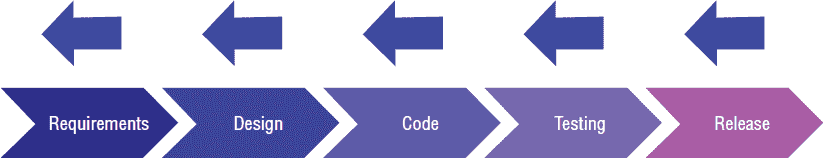

**图 I-2**：**向左倾移/向左推**

### 关于本书

本书将教你应用安全（简称为 `AppSec`）的基础知识；即如何创建安全的软件。本书面向软件开发者、想要进一步了解软件安全的信息安全专业人士，以及任何想在应用安全领域工作的人（包括渗透测试，又称“道德黑客”）。

如果你是一名软件开发者，你的工作就是制造出你所知能制造的最安全的软件。你这里的责任不容小觑；领域内每一名 `AppSec` 工程师对应着数百名程序员，没有你们，我们无法完成工作。阅读本书是通往正确道路的第一步。读完之后，你应该掌握足够的知识来制作安全的软件，并在遇到困难时知道去哪里寻找答案。

在学习如何创建安全软件之前，你首先理解几个关键的安全概念。如果你不理解何时以及为何需要某项概念，那么死记它的如何实现它是没有意义的。学习这些原则将确保你做出安全的项目决策，并在面对反对时能够为更好的安全性提供论据并辩护。此外，了解安全规则背后的原因会让这些规则变得更容易被接受。

### 安全使命：CIA

每个 IT 安全团队的使命和目的都是保护他们所所属的公司、政府或机构的系统和数据的`机密性`（confidentiality）、`完整性`（integrity）和`可用性`（availability）。这就是为什么安全团队会因为你在工作机器上拥有不必要的管理员权限而找你找麻烦，不让你将未知设备接入网络，并要求你做所有其他让你感到不便的体；因为他们想要保护的就是这三点。我们将其简称为“CIA 三要素模型”（图 1-1）。

让我们通过朋友 Alice 和 Bob 来看这个问题。Alice 患有 1 型糖尿病，使用植入手臂的微型设备每天检查几次胰素；而 Bob 有一个“智能”心脏起搏器来调节他的心脏，他通过手机上的移动 App 访问。这两个设备在我们的行业中被称为 IoT 医疗设备植入物。

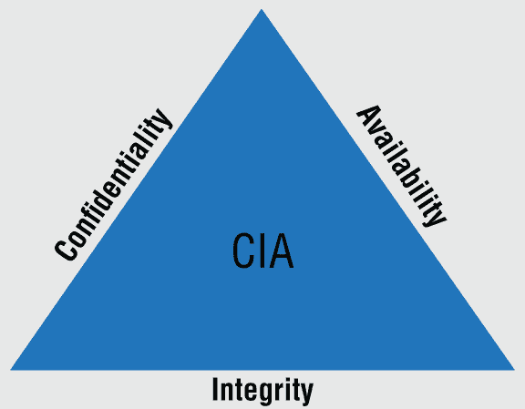

**图 1-1**: CIA 三要素是 IT 安全团队存在的理由。

#### 机密性

Alice 是某大型财富 500 强公司的 CEO，尽管她并不为自己是 1 型糖尿病患者而感到羞，但她不希望这些信息公开。她经常接受媒体采访并进行公开演讲，是她行业内许多其他女性的榜样。Alice 努力保持她的个人生活`私密`，这包括她的健康状况。她认为组织内部的一些人觊觎她的职位，并会不择一切试图将她描绘成“弱者”，以削弱她的权威。如果她的设备意外泄露了信息，在公共网络上显示，或者她的账户信息成为数据泄露的一部分，这对她来说将是极其尴尬的，并可能对她的职业造成潜在损害。保持个人生活的私密对 Alice 来说非常重要。


另一方面，Bob 对自己的心脏状况很开放，并乐意告诉任何人他有一个心脏起搏器。他与联邦政府有一份非常好的保险计划，并非常感激尽管有既往病，他在退休后可以继续执行该计划。在这方面，机密性并不是 Bob 的首要任务（图 1-2）。

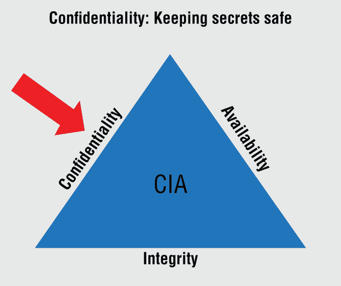

**图 1-2**: 机密性：保持内容安全

### 完整性

数据的完整性（图 1-3）意味着数据是实时的、正确且准确的。完整性还意味着你的数据在传输过程中没有被篡改；在传输必须保持正确的值。计算机系统中的完整性意味着它给出的结果是精确且符合事实的。对于 Bob 和 Alice 来说，可能是 CIA 因素中最关键的一项：如果他们的任何一个系统给出了错误的治疗，可能会导致死亡。对于人类来说（相对于公司或国家），没有比生命终结更严重的后果了。他们健康系统的完整性对于确保他们两人保持良好健康至关重要。

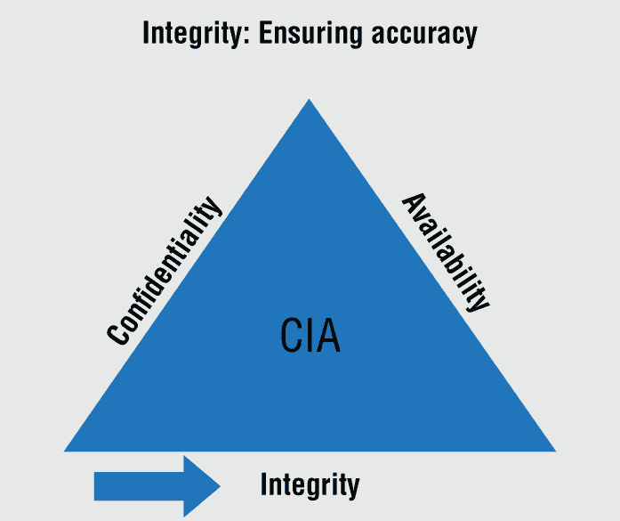

**图 1-3**: 完整性意味着准确性。

CIA 是我们整个行业的核心。如果不理解这些基础概念，就无法构建安全的软件。

### 可用性

如果某个系统由于故障、篡改或电池耗尽而无法使用，那么可用性就无法保障。如果 Alice 的设备由于故障、篡改或电池耗尽而无法使用，这对她来说将非常不便。另一方面，Bob 经常心律不齐，他不知道他的心脏起搏器何时会出问题。如果心脏起搏器在紧急情况下无法使用，这可能是致命的威胁。为了确保他的心脏起搏器在紧急情况下可以使用，这是至关重要的。许多系统也会监控行为变化或异常以检测潜在的泄露。这意味着提前为最坏的情况做好准备，以减少损害、检测时间和修复工作。

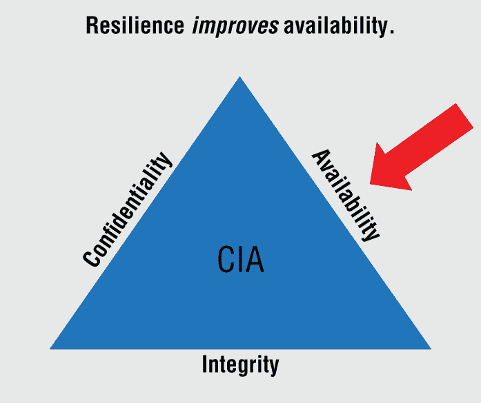

**图 1-4**: 韧性提高了可用性。

以下是安全行业内广知的安全概念。为了理解书的其余部分，良好掌握这些理念是至关重要的。如果你已经是安全从业人员，可能不需要阅读这一章。

## 假设已入侵

“世界上只有两类公司：已经被入侵的公司，以及不知道自己已经被入侵的公司。”[b01.xhtml#c01-note-0002] 这在信息安全行业是一句著名的名言，以至于我们不知道归功于谁。听起来可能很悲观，但对于我们这些从事事件响应、取证或其他调查领域的人来说，我们知道这都是事实。

`假设已入侵`的概念意味着通过准备和设计考虑，以确保如果有人获得了对你的网络、应用程序、数据或其他系统的未经授权的访问，将是困难、耗时、昂贵且危险的，并且你能够快速检测并响应这种情况。它还意味着对你的系统进行监控和记录，以确保如果在泄露发生后才注意到，至少可以发现发生了什么。许多系统还会监控行为变化或异常以检测潜在的入侵。这意味着提前为最坏的情况做好准备，以最小化损害、检测时间和修复工作。

让我们来看两个应用这一原则的例子：一个消费者示例和一个专业人士示例。

作为一个消费者，Alice 开通了一个在线文档共享账户。如果她要“假设已入侵”，她就不会在那里上传任何敏感或有价值的内容（例如，未注册的知识产权、可能损害其职业或个人生活的照片、商业机密、政府机密等）。她还会对账户进行监控，并在当文档被盗取、更改、删除、公开共享或以其他未经授权的方式访问时有一套计划。最后，她会监控整个互联网，以防这些文件在某处泄露。对于普通消费者来说，期望这种责任量是不现实的；本书并不建议普通消费者在生活中“假设已入侵”，尽管偶尔对自己进行在线搜索是个好主意，而且不要上传敏感文档绝对是有建议的。

作为一名专业人员，Bob 管理着机密和绝密文档。Bob 所在的部门绝不会考虑使用在线文件共享服务来共享文档；他们控制着这些价值信息的每一个方面。在创建管理这些文档的网络和软件系统时，他们在设计系统及其流程时遵循`假设已入侵`（`assuming breach`）。他们在网络中搜寻威胁，使用零信任架构设计网络，监控互联网上的数据泄露迹象，在连接之前对 API 进行身份验证，验证来自数据库和内部 API 的数据，进行红队演练（生产环境的安全测试），并密切监控其网络和应用程序以发现异常或其他入侵迹象。他们针对常见的攻击模式编写了自动化响应方案，建立了随时应对罕见攻击的流程，并分析行为模式以寻找入侵迹象。他们的运营理念是：数据可能已经泄露，或者可能随时会发生泄露。

另一个例子是，当通过你的负责任披露或漏洞赏金计划公布严重漏洞时，启动你的事件响应流程，假设其他人可能已经在你的系统中发现并利用了该漏洞。

根据维基百科，“**协调披露**”（`coordinated disclosure`）是一种漏洞披露模型，只有在允许对漏洞或问题进行修复或修复的一段时间后，才会披露该漏洞或问题。

漏洞赏金计划由许多组织运行。它们为报告漏洞（特别是涉及漏洞漏洞）的安全人员提供认可和补偿。

## 内部威胁

内部威胁意味着拥有你的系统、网络和数据批准访问权限的人（通常是员工或顾问）对你的系统、数据和/或网络的 CIA（机密性、完整性和可用性）方面产生了不利影响。这可能是恶意的（故意），也可能是无意的。

以下是一些恶意威胁的示例以及它们影响的 CIA 三要素部分：

*   员工将知识产权下载到便携驱动器并离开建筑，然后将信息卖给你的竞争对手（机密性）
*   员工在工作的最后一天删除了数据库及其备份，因为他们对被解雇感到愤怒（可用性）
*   员工在系统中编写了后门，以便他们从你的公司偷取财物（完整性和机密性）
*   员工从其他同事的电脑上下载敏感文件并将其用于勒索（机密性）
*   员工不小心删除文件，然后修改日志以掩盖错误（完整性和可用性）
*   员工为了避免修复漏洞的工作而不向管理层报告漏洞（取决于漏洞的类型，可能影响所有三个方面）

以下是一些无意威胁的示例以及它们影响的 CIA 三要素部分：

*   员工不当使用软件，导致其进入未知状态（可能影响所有三个方面）
*   员工不小心删除了重要数据、文件甚至整个系统（可用性）
*   员工不小心错误配置软件、网络或其他软件，导致引入安全漏洞（可能影响所有三个方面）
*   缺乏经验的员工将 Web 代理/动态应用安全测试（DAST）工具指向你的内部应用程序之一，导致应用程序崩溃（可用性）或污染你的数据库（完整性）

我们将在后面的章节中介绍如何避免这些情况，以确保你所有的安全测试都能安全进行。

## 深度防御

“深度防御”（`Defense in depth`）是在当单层防御不足时，拥有多层安全措施的想法（图 1-5）。尽管这样简单解释这似乎是显而易见的，但决定需要多少层以及使用哪些层可能是困难的（特别是当你的安全预算有限时）。

安全的“层”可以是流程（在给某人递邮件之前检查其身份证明、在软件发布前必须通过安全测试）、物理、软件或硬件系统（门锁、网络防火墙、硬件加密）、内置设计选择（为应用程序中处理更敏感任务的代码编写单独的函数、确保大楼里的每个人必须通过一个门进入）等。

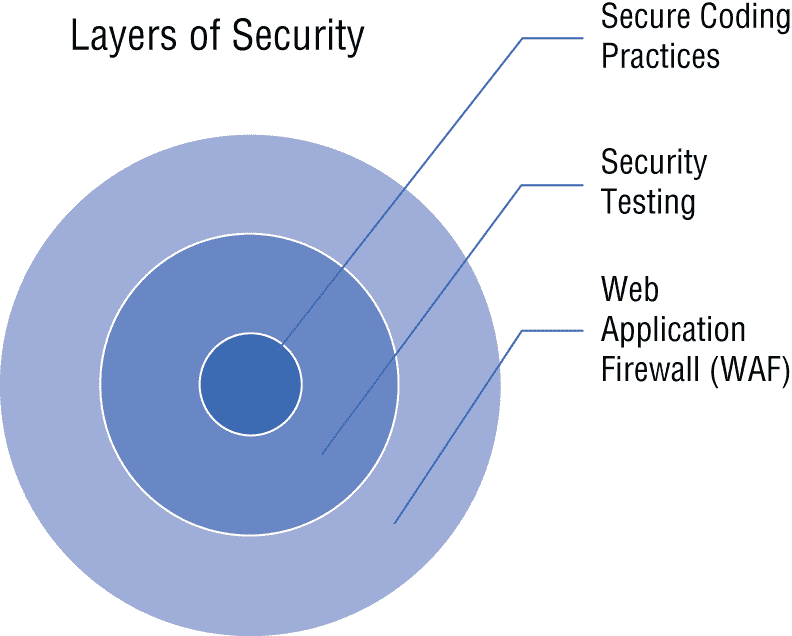

`图 1-5`: 应用程序的三层安全防护；深度防御的示例

以下是使用多层防御的某些示例：

*   **在创建软件时**：制定安全需求、进行威胁建模、确保使用安全设计概念、确保使用安全编码策略、进行安全测试、使用多种工具以多种方式进行测试等。每一种都提供了另一种形式的防御，使你的应用程序更安全。
*   **网络安全**：开启监控、部署 SIEM（安全信息和事件管理，用于实时查看潜在安全事件的仪表板）、部署 IPS/IDS（入侵防御/检测系统，用于发现并阻止网络上的入侵者的工具）、防火墙等。每一项新设备都增强了你的防御。
*   **物理安全**：锁、铁丝网、栅栏、大门、摄像头、保镖、警犬、运动传感器、报警器等。

在倡导安全时，最困难的事情往往是说服某人防御是不够的。在做出这些决策时，请考虑你保护对象的价值（声誉、货币价值、国家安全等）。虽然花费百万美元来保护价值一千美元的东西在业务上几乎没有意义，但我们行业最常见的例子通常是相反。

### 最小权限

为用户提供完成工作所需的精确访问权限和控制，但不更多，这就是“最小权限”（`least privilege`）的概念。最小权限的原理是，如果有人能够接管你的账户，他们将无法走远。如果你是一个软件开发者，拥有代码的访问权限以及对你正在工作的单个数据库的读写权限，这意味着如果有人接管了你的账户，他们只能访问该数据库、你的代码、电子邮件以及你访问的其他其他内容。然而，如果你是所有数据库的拥有者（`owner`），入侵者可能会删除所有内容。虽然放弃在桌面、网络或其他系统上的“超级权限”可能并不愉快，但通过这样做你显著降低了这些系统的风险。

最小权限的示例：

*   访问具有更高安全等级的实验室或大楼区域时需要额外的安全审批。
*   在工作站电脑上没有管理员权限。
*   **对你团队的所有代码只有读取权限，对你的项目有读写权限，但没有访问其他团队代码库的权限。
*   为你的应用程序创建一个访问数据库的服务账户，并仅赋予其读写权限，而不是数据库所有者（`DBO`）。如果应用程序只需要读取访问，则仅赋予其正常运行所需的权限。仅具有数据库读取权限的服务账户无法用于更改或删除任何数据，即使它可以被用于提取数据副本。这大大降低了风险。

## 供应链安全

你用于创建产品的每一件物品都被视为你“供应链”的一部分，该链包含了每个物品的实体（供应商）（如制造商、商店、农场、个人等）。它之所以被称为“链”，是因为它的每一个部分都依赖于前一部分以创建出最终产品。它可能包括人员、公司、自然或人工资源、信息、许可或其他制作你最终产品所需的任何其他物品（产品在本质上并不一定是物理性的）。

让我们通过一个例子来更清楚地解释一下。如果 Bob 要为他的孙子们建造一个娃娃屋，他可能会买一套在工厂制造的套件。该工厂需要木材、纸张、用于上色的墨水、胶水、切割机器、运行和维护机器的工人，以及驱动机器的能量。为了获得木材，工厂会从木材公司订购，木材公司会从其拥有或许可进入的森林中砍木。纸张、墨水和胶水可能都是在不同的工厂制造的。工人可以直接为工厂工作，也可以是临时承包商。能量最可能来自能源公司，但也可能来自太阳能、风能，或者在紧急情况下来自发电机。图 1-6 显示了 Bob 为了今年圣诞节为孩子们建造娃娃屋而购买的套件的（假设）供应链。

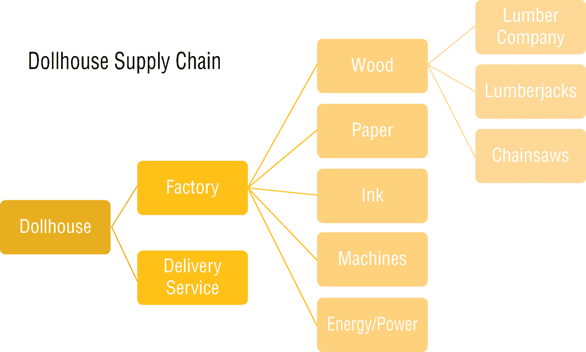

`图 1-6`](#c01.xhtml#R_c01-fig-0006): Bob 娃娃屋可能的供应链

这种情况下存在哪些潜在的安全（健康安全）问题？该套件中提供的胶水可能是毒的，或者用于装饰部件的墨水可能含有毒性。娃娃屋可能在一个也处理坚果的设施中制造，这可能会导致包装盒产生交叉污染，从而导致某些儿童产生过敏反应。可能会包含错误的零件，例如尖锐组件，这对于年幼儿童是不合适的。这些情况对工厂来说可能都是无意的。

在创建软件时，我们也使用供应链：我们用于编写代码的框架、我们为了向屏幕写入、进行高级数学计算或绘制按钮而调用的库、我们为了代表应用程序执行操作而调用的应用程序编程接口（API）等。糟糕糟糕，这些每一个部分通常都依赖于其他软件部分，而且所有它们都可能由不同的小组、公司和/或人员维护。现代应用程序通常由 20–40% 的原始代码[³](#b01.xhtml#c01-note-0003)（你和你团队成员编写的代码）组成，其余由这些第三方组件组成，通常被称为“依赖项”。当你将依赖项接入你的应用程序中时，你就接受了它们所包含的代码对你的应用程序可能带来的风险。例如，如果你在应用程序中添加了用于处理图像的组件而不是自己编写，但它存在一个严重的安全漏洞，那么你的应用程序现在也有了严重的安全漏洞。

这并不是说你可以自己编写每一行代码。

### 隐性安全（Security by Obscurity）

`security by obscurity`（隐性安全）的概念意味着如果某物被隐藏起来，它就会更安全。`security by obscurity` 的另一个例子是混淆代码，使其更难以或无法理解。虽然单用 `security by obscurity` 很难算作一种优秀的防御，但作为“深度防御”安全策略的一层，它无疑非常有帮助。

### 减少攻击面（Attack Surface Reduction）

你软件的每一个部分都可能受到攻击；每个功能、输入、页面或按钮都是如此。你的应用程序越小，攻击面就越小。如果你有 4 个页面和 10 个功能，对比 20 个页面和 100 个功能，后者的攻击面更小。你的应用程序中每一个可能暴露给攻击者的部分都被视为攻击面。

减少攻击面意味着从你的应用程序中移除任何不需要的内容。例如，一个尚未完全实现但你将按钮设为灰色的功能，对于恶意攻击者来说是一个理想的突破点，因为它没有经过充分的测试或加固。相反，你应该在发布到生产环境之前移除这些代码。

硬编码（Hard coding）是指将值直接写在代码中，而不是有机地获取这些值（来自用户、数据库、API 等）。例如，如果你创建了一个计算器应用程序，用户输入 `4 + 4` 并按下回车，然后屏幕显示 `8`，你可能会认为计算器工作正常。然而，如果你输入 `5 + 5` 并按下回车，屏幕仍然显示 `8`，那么你可能就遭遇了硬编码的情况。

为什么硬编码是一个潜在的安全问题呢？原因有两点：你无法信任应用程序的输出，而且被硬编码的值通常具有敏感性（如密码、API 密钥、哈希值等），因此任何可以访问源代码的人都可以访问这些硬编码的值。我们总是希望保持机密安全，而将它们硬编码到源代码中远不是安全的做法。

硬编码通常被认为是软件开发水平低下的征兆（尽管也有一些例外）。如果你遇到了这种情况，你应该在整个应用程序中搜索硬编码，因为你发现的这一个实例不太可能是孤例。

## 永远不要信任，始终验证

如果你只能从这本书中学到一个教训，那应该是：永远不要信任你应用程序之外的任何东西。如果你的应用程序与 API 通信，请验证它是正确的 API，并且它有权限执行它正尝试做的事情。如果你的应用程序接受来自*任何来源*的数据，请对数据进行验证（确保它是你所预期的且是适当的；如果不符合，则拒绝它）。即使是来自你自己数据库的数据也可能包含恶意输入或其他污染。如果用户尝试访问你应用程序中需要特殊权限的区域，请重新验证他们对使用的每一个页面或功能都拥有权限。如果用户已通过你的应用程序身份验证（证明了他们是他们所称的人），请确保他们在页面之间移动时，你处理的仍然是同一个用户（这被称为*会话管理*）。永远不要因为你检查过一次就认为从那以后一切都是没问题的；你必须*始终*进行验证和重新验证。

开发者经常会忘记这一教训，并由于上下文而假设信任。例如，你有一个面向公众的 Web 应用程序，并且对该 Web 应用采取了极其严密的安全措施。该 Web 应用经常调用你网络内部（防火墙后）的 API（`#1`），然后该 API 再调用另一个 API（`#2`）来更改相关数据库中的数据。通常开发者并不懒得对第一个 API 进行身份验证（证明身份），或者让 API（#1`）验证该应用是否有权调用其正在调用的 API 任何部分。然而，即使他们这样做，在这种情况下，他们通常只对 API `#1` 执行安全措施，然后跳过对 API `#2` 的执行。这导致网络内的任何人都可以调用 API `#2`，包括不应出现在那里的恶意攻击者、内部威胁，甚至是无意的用户（图 1-7`）。

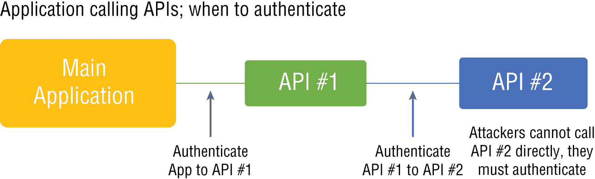

图 1-7:应用程序调用 API 的示例以及何时进行身份验证

以下是一些例子：

*   网站容易受到存储型跨站脚本攻击，攻击者利用此在数据库中存储攻击。如果 Web 应用程序验证来自数据库的数据，那么存储的攻击在触发时将无法成功。
*   某个网站对某些从 API 获取的数据进行收费。如果用户知道该 API 暴露在互联网上，且 API 未验证调用者是否有权使用它（身份验证和授权），则用户可以直接调用 API 获取数据而无需付费（这属于对网站的恶意使用），这是一种盗窃。
*   你应用程序的普通用户感到沮丧并反复敲击键盘，无意中向你的应用程序输入了比应输入的多得数据。如果你的应用程序正确验证了输入，如果数据过多，它将会拒绝。然而，如果应用程序没有验证数据，可能会导致你的变量过载，或被提交到数据库并导致其崩溃。当我们不验证获取的数据是否是我们所预期的（数字字段中的数字、日期字段中的日期、适当长度的文本等）时，我们的应用程序可能会陷入未知状态，而这正是我们发现许多安全漏洞的地方。我们永远不希望应用程序陷入未知状态。

## 可用安全

如果安全功能让你的应用程序难以使用，用户将找到绕过它的办法或去你的竞争对手那里。网上上有无数用户创造性地规避不便安全功能的例子；人类非常擅长解决问题，我们不希望安全成为问题所在。

解决此问题的答案是创建*易用*的安全功能。虽然显而易见，如果我们关掉互联网，所有的应用程序都会变得更安全，但那对于保护任何人免受互联网威胁显然是一个无效的解决方案。我们需要自己发挥创意，找到一种方法，让执行某事最简单的方法同时也成为最安全的方法。

可用安全的示例包括：

*   允许使用指纹、人脸识别或图案解锁你的个人设备，而不是长而复杂的密码。
*   教用户创建密码短语（易于记忆和输入的句子或短语），而不是设定复杂性规则（确保使用特殊字符、数字、大小写字母等）。这会增加熵，使恶意攻击者更难破解密码，同时也让使用变得更简单。
*   教用户使用密码管理器，而不是让他们为所有账户创建 100 多个唯一的密码。

用户绕过安全措施的例子包括：

*   用户在安全入口处跟门（紧跟他人进入建筑，这样他们就不需要刷卡了）。
*   用户关闭手机进入旨在检测传输设备的扫描区域，然后在禁止手机的区域区域重新打开手机。
*   使用代理服务访问被工作网络拦截的网站。
*   拍摄屏幕照片以将版权图像或敏感数据带回家。
*   反复使用同一个密码，但通过增加最后一个数字来方便记忆。如果你的公司强制用户每 90 天重置一次密码，很有可能你组织中的密码遵循 `当前季节 _ 年份` 的格式。

## 身份验证因素

身份验证是向计算机证明你确实是真实的、*真正的*你。身份验证的“因素”是向计算机证明你是谁的方法。目前只有三种不同的因素：你*拥有的*、你*具备的*以及你*知道的*：

*   你*拥有的*可以是手机、计算机、令牌或你的工作证。这些东西应该只由*你*持有。
*   你*具备的*可以是指纹、虹膜扫描、步态（走路的方式）或你的 DNA。这些是物理上独你特有的。


## 认证因素与多因素认证

你*知道的*可以是密码、密码短语、模式或多个信息的组合（通常称为安全问题），例如你母亲的姓、你的出生日期和社会安全号。其理念是它是只有*你*才知道的。

当我们仅使用用户名和密码登录在线账户时，我们只使用了身份验证的其中一个“因素”，这比使用两个或多个因素的安全性要低得多。当账户被破解或数据被盗取时，通常是因为某人只使用了一个身份验证因素来保护账户。使用多个身份验证因素通常被称为多因素身份认证（`MFA`）、双因子身份认证（`2FA`）或两步登录。在本书的后续内容中，我们将称为 `MFA`。

当凭据（用户名及相应的密码）被盗取并被恶意用于破解账户时，拥有第二个身份验证因素的用户将受到保护；攻击者将没有第二个身份验证因素，因此无法进入。当有人尝试对一个启用了 `MFA` 的系统或账户进行暴力破解（使用脚本快速地尝试所有可能的选项）时，即使他们最终获得了密码，他们仍然没有第二个因素来进入系统。使用第二个身份验证因素会让你的在线账户变得极难攻破。

### MFA 示例

* **多因素**：输入你的用户名和密码，然后必须使用第二个设备或物理令牌接收代码进行身份验证。用户名和密码是一个因素（你知道的东西），使用第二个设备是第二个因素（你拥有的东西）。
* **非多因素**：用户名*和*密码。这是*相同*因素的两个例子；它们都是你知道的东西。多因素身份认证意味着你拥有多种或多种不同类型的身份验证因素，而不是一个或多个同一种因素。
* **非多因素**：使用用户名和密码，然后回答安全问题。这是两个*相同*的事实，都是你知道的东西。
* **多因素**：用户名和密码，然后使用你的指纹。

## 练习

这些练习旨在帮助你理解本章的概念。写下答案并看看你会在哪些问题上卡住。如果你在回答某些问题时遇到困难，你可能需要重读该章节。每个章节的末尾都有这样的练习。如果你有不熟悉的术语，可以在书末的术语表中查找；这可能有助于你的理解。

如果你有一个可以一起讨论答案的同事或专业导师，那是发现你对错错以及原因的最好方法。某些答案不是布尔值（`true/false`），只是为了让你思考一下这些问题。

1. Bob 将他的心脏起搏器的 Wi-Fi 设置为不广播 Wi-Fi 名称。这种防御策略称为什么？
2. 列举一个可以硬编码的值的示例并说明原因。（程序员这样做的动机是什么？）
3. `captcha`（验证码）是*可用的*安全措施吗？为什么是或为什么不是？
4. 给出一个可用安全良好的实现示例。
5. 在使用来自 `URL` 参数的信息时，你需要对数据进行验证吗？为什么需要或为什么不需要？
6. 如果员工在工作中获知了商业秘密并将其卖给竞争对手，这破坏了 `CIA` 的哪些部分？
7. 如果你买了一个“智能”冰箱并将其连接到家庭网络，然后恶意攻击者连接到它并更改设置使其温度略高导致你的牛奶变质，他们破坏了 `CIA` 的哪些部分？
8. 如果有人黑了你的智能恒温器并关闭了暖气，他们破坏了 `CIA` 的哪些部分？
9. 如果程序员添加了一个彩蛋（具有未记录功能的的额外代码，作为给用户的“惊喜”，管理层和安全团队并情情），这是否被视为内部威胁？如果是，为什么？如果不是，为什么？
10. 连接到公共 Wi-Fi 时，你可以采取哪些预防措施来确保你正在进行“安全操作”？
11. 如果你有多个同一种因素，这是否意味着你拥有“多因素认证”？

# 引言

`Cryptography`（密码学）是一种可以应用于信息的数学，使其价值不再易于理解；它用于隐藏秘密并确保通信的隐私性。`Encryption`（加密）是双向的，你可以将信息弄乱成不可读的混乱，然后将其“解密”回原始形式。`Hashing`（哈希）是单向的；原始值无法恢复。

加密经常用于保护秘密或传输数据，因为系统以后需要这些数据。价值在于数据本身。哈希最常用于证明身份、向系统身份验证、验证你的数据完整性，或进行某种挑战或验证；例如，没有人关心你的密码实际上是什么，他们只想知道是否应该让你进入系统。数据本身不是价值；证明你的身份才是（你知道原始值，即密码，它证明了你的身份）。对值进行哈希也意味着如果该值泄露，它将是无法使用的；泄露的密码（以修改和哈希格式存储）对小偷没有用处，因为当你将其输入系统时，它们不会被识别为你的密码。

## 数据保护策略

为了确保数据的机密性，数据应该在传输过程中（在通往和离开用户、数据库、API 等途中）以及静态（在数据库中时）进行加密。需要注意的是，这确保了没有人会获取你的秘密；如果有人未经授权访问了你的数据或使用嗅探工具拦截了你的流量，他们将无法理解他们发现了什么。然而，这不能保护数据的可用性或完整性。某些人仍然删除或更改数据库中的数据（被更改或删除是显而易见的，但如果你的备份和回滚不是完美无缝，那将非常不便）。恶意者可能会拦截你的流量并更改或阻塞你的消息，这同样会引发问题。尽管如此，保护你的秘密（`CIA` 中的“C”）是至关重要的，因此无论你创建什么系统，你都希望确保数据在传输和静态状态下都是加密的（而不是哈希的）。

有些人可能认为数据在使用过程中（在内存中）也应该被加密，但除非你处理的是极其敏感的数据，否则通常不被认为是项目需求。为了保护高度敏感的数据，建议在程序退出、注销或其他结束时刷新内存。

## 永远不要信任系统输入

你系统的任何输入都可能被篡改，或导致你的应用程序发生故障或失败。无论此输入是否是有意的恶意的，只要它导致你的应用程序进入未知状态（一个你没有计划或编写处理逻辑的状态），这都是一个非常危险的。当你的应用程序陷入未知状态时，恶意者就能强制你的程序执行你梦都未想过的事情，包括破坏一个或多个 `CIA` 因素。你的程序必须能够`优雅`地处理每类型的输入，即使是错误的输入。

你应用程序的输入字面上意味着任何不是应用程序一部分的内容，或者可以在你的应用程序之外被操纵的所有内容。

以下是应用程序的输入示例：

* 屏幕上的用户输入（例如，在字段中输入搜索短语）
* 来自数据库的信息（即使是你为应用设计的数据库）
* 来自 API 的信息
* 来自 `URL` 参数的值
* 来自配置文件的数据
* 来自 Cookie 的数据
* 来自脚本的数据
* 来自存储的数据
* 来自其他网站的数据
* 来自头部的数据
* 来自 JavaScript 的数据

为了有效应用“永远不要信任系统输入”这一概念，你必须在使用所有输入之前始终对其进行验证。我所说的“验证”是指你进行测试以确保输入是适当且符合你预期的，如果不是，则拒绝它。在某些情况下，你应该对输入进行清洗。输入验证的示例包括：

* 你预期一个生日，因此你验证收到的值确实是日期格式，并且在过去的 100 年之内：

```
age > current year – 100 && age < current year
```

如果它不是正确的日期格式（例如“aaaaaaaa”），你就拒绝它。如果显示该人是 5000 岁，你就拒绝它。如果该人的年龄尚未出生，就拒绝它。发布一条正确的错误消息，说明格式错误以及正确的格式是什么。或者，如果它不在你的 100 年年龄范围内，发布一条错误消息说明年龄不正确。

* 字段是人的名字，你为该字段分配了 80 个字符。验证你收到的输入是否为 80 个字符或少，并且字符是否适合姓名。例如，如果包含 `%`、`[`、`<` 或 `|`，它不太可能是真实的姓名，你应该通过适当的错误消息拒绝此输入。然而，由于许多英语名字（如 O’Connor）包含撇号（’），你需要确保接受此类输入但要谨慎处理。对于非英语名字，你需要接受重音符号（é, å 等）、除英语使用的希腊字母以外的其他字母表、连字符等。

* 字段是电子邮件地址；网上有用于验证电子邮件地址的正则表达式，你的框架中也有验证器。我建议你使用框架中经过尝试、测试且可靠的验证函数，这些函数非常复杂但运行完美。

* 你的程序在数据库中进行搜索，并将找到的记录中的字符串显示在屏幕上。验证此输入是否是你所预期的，就像它来自用户一样。确保它不存储跨站脚本攻击（XSS）或其他潜在的恶意内容。在显示到屏幕之前，始终对其进行输出编码。

* 你调用了一个 API；发送了一个邮政编码，它返回了地址的其他部分。验证该地址格式是否正确以及是否符合你的预期。如果它有数千个字符，那可能是不正确的；500 个字符应该足够调用任何 API 了。如果全都是数字，那可能是不正确的。如果它包含代码中常见的字符（``、`{`、`<`、`/` 等），那可能是不正确的。只有当输入通过你的验证时，才将其进入你的程序。最后，在应用程序和 API 之间流动的数据应该加密，以保护你的用户隐私。加密可以在应用程序内部强制、通过服务网格（service mesh）或任何其他可靠机制实现。

* 一个应用程序调用你的应用程序并在参数中传递一个 `URL`。从安全的角度来看，这是一个危险的操作，通常被称为 `open redirect`（开放定向）。只要可能，你的应用程序应该只通过安全通道（`TLS`）接收其他应用程序的信息，并且你也应该验证它们发送给你的数据。最好是找到其他方法来传递此类值，因为攻击者可能会更改 `URL` 并可能将你的用户引导到危险网站。但是，如果这是唯一的选择，你应该翻到[第 4 章“安全代码”，该章节解释了如何处理这种情况。

* 如果你正在使用非内存安全的语言（例如 `C`/`C++`）编写应用程序，你需要进行一种称为 `bounds checking`（边界检查）的操作，以确保输入不会溢出你的变量类型。在 `C`/`C++` 中，输入超过整数的最大值会导致其“溢回”为负数，这显然是一个问题。字符串也可能溢出，导致著名的名为 `buffer overflow`（缓冲区溢出）的漏洞，其中攻击者可以覆盖内存的某些。在缓冲区溢出的理想情况下，你的应用程序崩溃，崩溃触发警报，你的应急响应团队阻止攻击者进一步行动。在最坏的情况下，攻击者利用崩溃信息来精炼和改进他们的攻击，直到他们能够接管你的 Web 服务器并渗透你的网络。在讨论溢出漏洞时，其风险不言而喻；请认真对待这类漏洞类别。

让应用程序首先验证输入，然后使用它，是至关重要的。在使用数据*之后*再对数据进行验证是没有意义的。这必须是你在应用程序接收输入后执行的第一件事。

### 编码与转义

Web 应用中最常见的安全漏洞是 `cross-site scripting`（`XSS`）；据估计，截至本文，互联网上超过三分之二的 Web 应用存在这种漏洞。这种风险有多种缓解方法：内容安全策略头部（`CSP`）、输入验证和输出编码（本要求）。输出编码之所以之所以之所以是为了防止 `XSS`，由于这种风险非常普遍且这种错误极易发生，因此在你的*所有*应用程序中添加这*所有三项*防御绝对是值得的。

转义（Escaping）一个字符或值意味着移除它在被当作代码执行时可能拥有的特殊功能，而不是将其视为数据（正如它应该的那样）。这通常通过在相关的特殊字符之前添加一个反斜杠（`\`）来实现。

编码（Encoding）是将一个值从它的任何格式转换为你正在编码的格式（`URL 编码`、`base64 编码`、`HTML 编码`）。编码很容易反转，不能被误认为或替代加密。编码的目的不是为了保护你正在编码的值，而是将其转换为你想要使用的格式。例如，如果你要向屏幕输出某些内容，你必须使用框架中相应的功能对其进行 `output encode`（所有现代框架都有此功能）。输出编码将确保如果你输出到屏幕的值包含代码（如 `JavaScript`），它不会在浏览器中执行，只会输出文本。

这里的指令是显而易见的：对所有输出进行编码和转义。

### 第三方组件

如前所述，包含来自库、框架、插件或其他第三方组件的每一行代码都是你接受的风险；即使组件中的代码没有被你的应用程序使用，根据情况，它仍然可能你的应用程序变得脆弱。验证第三方组件是否存在已知漏洞是确保应用程序安全的快速见效。修复发现的问题可能并不快速简单，但始终建议这样做。

市场上存在许多工具可以验证第三方组件是否存在已知漏洞。本书不会推荐特定的工具或供应商，而是提供策略性的用法。第一个策略是，如果你负担得起，使用两个工具而不是一个。它们检查不同的数据库和方式，因此可能无法捕捉相同的内容。第二个策略是，你应该定期扫描你的仓库（每天或至少每周），以及在每次发布代码时进行扫描。你应该扫描仓库，因为你的一些应用程序很少发布，但新的漏洞一直在被发现。你包含在代码中的组件越旧，安全研究人员和恶意攻击者对其审查的时间越长，并可能从中发现漏洞。将此构建到你的 `CI/CD 流线`（或你使用的任何其他发布代码的流程）中可以防止你或你的同事无意中添加新组件或将组件升级到已知漏洞版本。

注意，这一步是扫描第三方代码的已知漏洞。可能存在更多未知的漏洞。检查已知漏洞是创建安全软件的底线。

对于第三方组件的最佳实践是只包含你需要的，而不是包含互联网上看到的每一个酷东西。虽然这对于开发人员来说可能很难推销（面对吧，新技术既兴奋又有趣），但如果你能解释涉及的风险并提出替代方案或解决方案，而不是仅仅说不，你更有可能获得积极的结果。

### 安全头部：Web 应用的安全带

安全头部（Security headers）是告诉浏览器和服务器如何处理你 Web 应用各种事务的设置；它们仅适用于使用浏览器的网络资源（Web 应用以及通过浏览器访问的即服务服务或 SaaS 产品）。它们不适用于你安装在计算机上的软件、操作系统或如固件之类的嵌入式系统。安全头部就像安全带；它们并不酷炫或刺激，使用起来并不困难也不耗费时间，但如果你养了使用它们的习惯，在紧急情况下它们可以救你的命（分别对应汽车事故或针对你 Web 应用的攻击）。安全头部通常可以在 Web 服务器或你的代码中应用。要应用它们，你通常只需要添加一行代码或勾选一个框来配置你的 Web 服务器；这并不是一项困难的任务。你可以做到的；我相信你。

现在让我们来谈论每个头部的作用、你为什么需要或不需要使用哪一个，以及你应该选择哪些设置。如果你觉得这些设置有帮助，可以随时将这些设置复制并粘贴到你的应用程序中；但在推送到生产环境（prod）之前务必进行测试。

## 安全头部的应用

对于 OWASP DevSlop 项目，我的朋友 Franziska Bühler 和我制作了一些关于在我们的网站上添加安全头部的视频和博客文章。以下是一个你可以用于 ASP.Net 的潜在代码示例：

```
<! - Start ASP.Net Security Headers ->
<httpProtocol>
<customHeaders>
<add name="X-XSS-Protection" value="1; mode=block"/>
<add name="Content-Security-Policy" value="default-src 'self'"/>
<add name="X-frame-options" value="SAMEORIGIN"/>
<add name="X-Content-Type-Options" value="nosniff"/>
<add name="Referrer-Policy" value="strict-origin-when-cross-origin"/>
<remove name="X-Powered-By"/>
</customHeaders>
</httpProtocol>
<! - End Security Headers ->
```

## X-XSS-Protection

此头部已弃用。不仅现代浏览器不再支持它，而且多位行业专家建议由于它可能导致漏洞，不应该再使用它了。尽管它在*某些*情况下对*某些*非常老旧的浏览器有所帮助，但它弊大于利，因此在本文编写时不应再被使用。

## Content-Security-Policy (CSP)

恶意攻击者在意识到网站存在 XSS 攻击漏洞时做的第一件事就是调用他们自己的脚本，该脚本位于互联网的其他地方，通常比受攻击应用允许的长度长得多，否则会被检测到并拦截。大多数应用程序对大多数字段只允许 20–100 个字符，这意味着攻击者无法安装完整的恶意软件或造成他们所想的巨大损害，因此他们会调用互联网上的其他地方，那里的有害代码已经准备好待命。

内容安全策略（Content Security Policy）允许你列出网站将使用的所有来自域之外的内容来源（脚本、图像、帧、字体等），这可以防止易受攻击的 Web 应用调用并运行攻击的次部分。它极大地降低了此类攻击的风险和潜在损害。尽管如此，开发者往往认为跟踪这些来源非常耗时，因此这在开发者中并不是一个流行的安全头部。观点是，如果开发者理解了风险以及 CSP 为应对这些风险提供的保护，它会被使用得更频繁。如果你在说服开发者应用此头部方面遇到困难，可以考虑把这本书借他们；希望他们以后会感谢你。

最简单的设置就是阻止所有内容，如果你的网站是静态的且/或很无聊（不从任何地方调用任何内容），这是一个很好的选择。相应的设置如下：

```
Content-Security-Policy: default-src 'self'; block-all-mixed-content;
```

但老实说，很少有现代网站如此简单。没关系，我们可以处理。

这是一个由 OWASP 提供的列表

* `default-src`：正如你预期的，这是默认设置。它类似于一个“全捕”。如果有任何内容尝试加载且在策略的其他部分没有明确定义，则将应用此设置。它通常被设置为“self”，表示如果我们没有在策略的其他地方显式允许，答案就是“不要加载它”。如果你不确定，始终将其设置为“self”。
* `script-src`：允许作为你网站一部分运行的域名列表（脚本所在地）或脚本的精确 `URL`。除了你域名中的脚本以及你在此处列出的脚本外，来自互联网任何其他地方的任何其他脚本都不会运行。这可以防止 XSS 攻击。

接下来的每个项目都遵循此模式：如果你列出了它，那么该资源就可以作为你 Web 应用的一部分被使用或加载，加上你自己域内的资源。在使用 CSP 头部时，未列出的任何其他类型的资源都将被拦截。

* `object-src` = plugins (`<object>`, `<embed>`, 和 `<applet>` 元素的有效来源)
* `style-src` = styles (级联样式表，或 CSS)
* `img-src` = images
* `media-src` = video and audio


## 安全响应头部指令

*   `frame-src = frames`
*   `font-src = fonts`
*   `plugin-types = limits types of plugins`

*   `script-nonce`: 这是一个复杂的项，但值得注意。nonce 是为了单次使用而创建的字符串，用来证明脚本是你想要调用的。这是 CSP 安全头部中一种额外的安全级别。使用此设置意味着你需要 nonce 来运行脚本。

*   `report-uri`: CSP 将就其拦截的内容为你生成报告。此 URI 用于告诉它将报告发送到哪里。在本文编写时，只有四个安全头部提供报告功能，坦率地说，这非常酷。拥有有关网站接收到的攻击类型的指标和信息是一种礼物。

这无疑是所有安全头部中最复杂的。关于此主题的更多信息，请访问 `csp-evaluator.with.com`（来自 Google）和 `scotthelme.co.uk`。

例如：

```
Content-Security-Policy: default-src 'self'; img-src https://*.wehack.com; media-src https://*.wehack.com;
```

允许浏览器从 *.wehack.com 加载图像、视频和音频。

```
Content-Security-Policy: default-src 'self'; style-src https://*.jquery.com; script-src https://*.google.com;
```

允许浏览器从 jquery.com 加载样式从 google.com 加载脚本。

## X-Frame-Options

此头部有助于防止点击劫持，即恶意网站框架你的合法网站，并能够获取信息或“点击”。虽然你可能在特定情况下希望你的网站被一个或多个站点框架，但允许任何站点框架你的网站可能是一个坏主意，因为这可能导致用户认为自己在你的网站上，而实际上他们正在点击一个极可能是恶意的站点（这被称为“点击劫持”）。这可能导致键记录和窃取用户凭据。为了利用这种漏洞，用户必须参与（点击钓鱼链接或恶意站点上的链接），这意味着它在野外发生不像其他攻击那样频繁，但一旦发生，损害是巨大的。

要允许网站使用你自己域内的帧，将 `X-Frame-Options` 设置为 "sameorigin"：

```
X-Frame-Options: SAMEORIGIN
```

要不允许任何地方的帧，将 `X-Frame-Options` 设置为 "deny"：

```
X-Frame-Options: DENY
```

## X-Content-Type-Options

编写软件的美感之处在于可以发挥创意，并在使用编程语言时进行“诗意的许可”，寻找新颖且富有想象力的方式使用你的语言和框架。然而，有时这会导致歧义，如果应用程序不确定下一条指令，就可能导致安全漏洞。这被称为“进入未知状态”，而我们绝不希望我们的应用程序进入未知状态。除非你是一个渗透测试员或安全研究人员；如果是那样的话，那里就是你世界上最喜欢去的地方，因为你几乎肯定能在那里发现软件漏洞。

此安全响应头部指示浏览器不要“嗅探”（推断/猜测）Web 应用中使用的媒体内容类型，而是完全依赖于应用程序指定的类型。浏览器喜欢认为它们可以预测其正在提供的内容类型以试图提供帮助，但遗憾的是，这已经变成了一个已知的可以利用的漏洞，从而损害你网站的利益。此安全响应头部只有一种可能的设置：

```
X-Content-Type-Options: nosniff
```

## Referrer-Policy（引用来源策略）

当你在互联网上的不同站点之间跳转时，每个站点都会向下一个站点发送一个名为“引用来源”（referrer）的值，这意味着指向你来源页面的链接。这对于分析流量的人来说非常有帮助，因为他们知道用户从哪里来。然而，如果你正在访问一个敏感性质的站点（例如，贷款申请或详细介绍特定医疗状况的网站），你可能不希望将细节发送到你访问的下一个页面。为了保护用户的隐私，作为网站创建者，你可以将引用来源值设置为仅传递域名而不传递用户所处的具体页面（`wehackpurple.com` 对比 `wehackpurple.com/embarrassing-blog-post-title`），或者完全不传递任何值。你还可以根据是否正在从 HTTPS “降级”到 HTTP 来更改引用来源的值。

为了只传递协议和域名信息，请将引用来源设置为“origin”。没有其他上下文可以更改此设置。

```
Referrer-Policy: origin
```

例如，位于 `https://wehackpurple.com/page.html` 的文档将发送引用来源 `https://wehackpurple.com/`。

如果用户离开你的域名，此设置将仅发送协议和域名。在你的域名内部，它会传递整个路径。这适用于大多数非敏感网站的情况：

```
Referrer-Policy: strict-origin-when-cross-origin
```

如果引用来源字段中没有值，上下文并不重要：

```
Referrer-Policy: no-referrer
```

如果你有需要，此设置可以变得非常复杂，但通常只在离开你的域名时发送源域名将符合大多数业务场景，并充分保护你用户的隐私。如果有疑问，你始终可以发送空内容，以确保尊重你用户的隐私。

欲需更多信息，Mozilla 是该领域的领导者，始终提供卓越的建议和技术指导：`developer.mozilla.org/en-US/docs/Web/HTTP/Headers/Referrer-Policy`

额外资源：Scott Helme 是一位在安全响应头部方面分享信息和工具的安全研究员，他是学习此主题的绝佳资源：`scotthelme.co.uk`

## Strict-Transport-Security (HSTS，严格传输安全)

此安全响应头部强制连接使用 HTTPS（加密），即使用户尝试通过 HTTP 连接到网站。这意味着往返数据将通过强制加密。用户（包括攻击者）无法降级到 HTTP（未加密）；浏览器将在加载任何数据之前强制其切换到 HTTPS。

为了使此安全响应头部正常工作，你需要一个由证书颁发机构（CA）颁发的证书，并将其安装在你的 Web 服务器、PaaS、容器或任何托管应用程序的地方。此证书将作为加密过程的一部分，没有你无法开启 HSTS。如果你有子域名，你可能想要获得一个“通配符”证书。你还会想要一个尽可能持久的证书（一年而不是三个月），这样你就不必频繁花时间“轮换证书”。

然后，你需要确定你的证书有效期，以秒为单位。不，我不是在开玩笑，他们决定用秒来计时。提示：一年是 31,536,000 秒：

```
Strict-Transport-Security: max-age=31536000; includeSubDomains
```

## Feature-Policy（功能策略）

截至本文，这是现代浏览器支持的最新的安全响应头部。随着 HTML 5 的出现以及更现代浏览器中许多酷的新功能，此安全响应头部允许或禁止你的 Web 使用这些新类型的功能。

设置选项为：

- `none`: 不允许
- `self`: 允许，但只有你自己的域名可以使用/调用此功能
- `src` (仅限 iframes): 加载到 iframe 中的文档必须与 iframe 的 `src` 属性中的 URL 同源
- `*`: 任何域名都可以使用/调用此功能
- `<origin(s)>`: 特定 URL 此功能

这是一个示例，仅允许你自己的扬声器和全屏在你的网站上运行：

```
Feature-Policy: camera 'none'; microphone 'none'; speaker 'self'; vibrate 'none'; geolocation 'none'; accelerometer 'none'; ambient-light-sensor 'none'; autoplay 'none'; encrypted-media 'none'; gyroscope 'none'; magnetometer 'none'; midi 'none'; payment 'none'; picture-in-picture 'none'; usb 'none'; vr 'none'; fullscreen
```

这些设置用于 OWASP DevSlop 网站。我们禁止了几乎所有功能；只允许从自己的站点调用扬声器。我们还允许任何域名设置全屏。如果有疑问，要采取更多的限制。你的用户会感谢你的。

## X-Permitted-Cross-Domain-Policies（允许的跨域策略）

此安全响应头部专门适用于应用程序中的 Adobe 产品（Reader 和 Flash）。Adobe Flash 非常不安全且不再受 Adobe 支持，因此不应在现代网站或应用程序中使用。

此响应头的目的是确保来自你域名的文件允许（或不允许）被其他站点的 Adobe 产品访问。如果你打算让托管在域名之外地方的 Adobe Reader 访问你的站点，你可能需要指定域名。否则，将其设置为“none”，以确保没有其他域名允许使用 Adobe 产品访问你的文档：

```
X-Permitted-Cross-Domain-Policies: none
```

## Expect-CT（预期透明度）

“CT”指的是证书透明度（Certification Transparency），这是一个为证书颁发机构（CA）提供监督的开放框架。CA 有时会意外向不理想的站点颁发证书，甚至是明显的恶意站点。整个证书颁发系统的设计是为了建立信任，并验证证书持有者是一个被浏览器和用户信任的站点。如果 CA 向恶意站点提供证书，无论是由于错误、疏忽还是合谋，都是不可接受的。证书透明度框架记录了有关各种交易的细节，以跟踪 CA 何不当颁发的情况。

如果 CA 在颁发证书时多次“错误判断”，浏览器或组织可能会选择不再“信任”它们颁发的证书。

你可能会好奇这和你作为软件开发人员、应用支持人员或安全人员有什么关系。为了帮助维护整个证书机构（Certificate Authority）系统的完整性，我们必须将证书记录到在线 CT 注册表中。如果网站的证书不在注册表中，现代网络浏览器将向用户发出警告，称你的网站是不可信的。你公司中没有人希望浏览器告诉用户他们的网站是不安全的。

当你开启此安全标头时：

1. 你的用户的浏览器将检查 CT 日志，以查看你的证书是否存在（无论结果好坏）。
2. 如果设置为“enforce（强制）”，你的用户的浏览器将执行证书透明度，这意味着如果你的证书不在注册表中或由于其他原因“不符合 CT 规范”，它将终止你的网站与用户之间的连接。如果不是强制模式，则会将报告发送到报告 URL。

建议起初以“reporting only（仅报告）”模式进行部署，一旦你确定证书是可以接受的且已正确注册，再升级到“enforce”模式。

`max-age` 字段（以秒为单位）是浏览器应用此设置的时间（该设置将在浏览器中缓存此长度）。

以下是 `Expect-CT` 标头实现的两个示例：

**仅报告：**

```
Expect-CT: max-age=86400, report-uri="https://wehackpurple.com/report"
```

**报告与阻塞：**

```
Expect-CT: max-age=86400, enforce, report-uri="https://wehackpurple.com/report"
```

以下是来自 OWASP DevSlop 项目的另一个示例，这次针对 .Net CORE 应用。根据示例的第一行，该示例要求向你的项目添加额外的 Nuget 包（`Nwebsec.AspNetCore.Middleware`）：

```
<PackageReference Include="Nwebsec.AspNetCore.Middleware" Version="2.0.0"/>
 
//Security headers .Net CORE, not the same as ASP.net
app.UseHsts(hsts => hsts.MaxAge(365).IncludeSubdomains());
app.UseXContentTypeOptions();
app.UseReferrerPolicy(opts => opts.NoReferrer());
app.UseXXssProtection(options => options.EnabledWithBlockMode());
app.UseXfo(options => options.Deny());
app.UseCsp(opts => opts
.BlockAllMixedContent()
.StyleSources(s => s.Self())
.StyleSources(s => s.UnsafeInline())
.FontSources(s => s.Self())
.FormActions(s => s.Self())
.FrameAncestors(s => s.Self())
.ImageSources(s => s.Self())
.ScriptSources(s => s.Self())
);
//End Security Headers
```

## HTTP 公钥固定扩展 (HPKP)

公钥固定（Public Key Pinning）是一种为了防止欺诈证书而创建的系统。该系统的理念是对于特定的 URL/网站，只信任一两个证书机构。最初它是通过静态固定实现的（直接并手动构建在浏览器中，特别是 Chrome 和 Firefox），但后来其他网站所有者也想要“固定”证书，这由网站所有者动态完成。证书将被固定一段时间（通常为一年）并对应特定的加密身份（密钥）。然而，如果你丢失了密钥，意味着你将失去对网站长达一年，因为没有密钥它无法运行。在此期间，你实际上“废掉”了你的网站 URL（使其无法使用），因此你的安全功能造成了灾难性的业务损失。这种情况被称为“HPKP 自杀”。

尽管此安全标头的潜在益处巨大，但风险使得使用此安全功能是不可取的，除非你需要极高水平的保证，并且拥有一对在该领域非常熟悉并准备好接受这种业务风险的团队。

## 保护你的 Cookies

HTTP 协议从未设计用于处理用户会话（跟踪某人已登录，或购物车中有物品；跟踪用户在网站内页面间移动时的任何信息，统称为“状态”）。Cookies 用于在浏览器和你的 Web 服务器之间传递用户会话信息，并可以保存供以后使用，为用户提供更个性化的体验（例如，它可以记住他们的语言偏好）。尽管许多网站使用 Cookie 存储营销和跟踪信息，并将信息出售给其他公司，但关于 Cookie 中存储的数据隐私的伦理方面不是我们在这里深入探讨的话题。

当你在应用程序中设置 Cookie 时，你将需要某些设置来确保 Cookie 中的数据保持安全，这些设置将在后续节中讨论。

请注意：有时开发者决定使用本地存储（local storage）而不是 Cookie。保护本地存储需要采取一套完全不同的措施，本节将不再涵盖这些。此外，你的会话应该通过会话 Cookie 传递（而不是持久性 Cookie，且永远不要保存到本地存储中）。始终为会话使用会话 Cookie。

此外，以防你忘记，始终验证你放入 Cookie 中的输入内容。如果获取的数据不符合逻辑，请拒绝并重试。你的 Cookie 数据非常宝贵，你必须始终保护你的会话（在后续章节中会有更多介绍）。

### Secure 标记

`secure` 标记确保你的 Cookie 仅通过加密（`HTTPS`）通道发送。如果攻击者尝试将你的会话降级为 HTTP，你的 Web 应用将拒绝发送 Cookie。你应该始终开启此设置：

```
Set-Cookie: Secure;
```

### HttpOnly 标记

此标记的命名并不直观，因为它与强制连接不加密（`HTTP`）无关，因此让程序员感到困惑。当 Cookie 上设置此标记时，意味着无法通过 JavaScript 访问；只能在服务器端更改。在 Cookie 中使用此设置是为了防止 `XSS 攻击`。你始终要在所有 Cookie 中设置此值：

```
Set-Cookie: HttpOnly;
```

### 持久性 (Persistence)

如果你正在收集敏感用户数据或管理会话，你的 Cookie 不应该是持久的；它应该在会话结束时自毁以保护数据。在会话结束时自毁的 Cookie 称为“会话 Cookie”。如果 Cookie 在会话结束时不自毁，被称为“持久 Cookie”或“跟踪 Cookie”。与隐私团队和业务分析师讨论，确定你是否希望 Cookie 持久。

对于持久性 Cookie，你可以通过 `expires` 属性设置过期时间，或者通过 `max-age` 设置设置 Cookie 可持续的最大年龄。

**过期时间：2021 年 1 月 1 日**

```
Set-Cookie: Expires=Mon, 1st Jan 2021 00:00:00 GMT;
```

**1 小时的最大年龄**

```
Set-Cookie: Max-Age=3600;
```

### Domain

如果你希望 Cookie 能被你以外的域名访问，必须使用 `domain` 属性明确地将它们列为信任域名。否则，浏览器将假设你的 Cookie 是“仅主机”，这意味着只有你的域名可以访问它们，它将阻止所有其他访问。这种内置保护被认为是“默认安全”的；如果所有软件设置都是这样就好了！

```
Set-Cookie: Domain=app.NOTwehackpurple.com;
```

### Path

Web 许多 URL 实际上是许多独立的应用程序，都列在不同的路径和子域名下。对于用户来说，它们看起来像一个巨大的网页，但实际上，它们可能是成千上万个应用程序。如果你正处于这种情况，你可能应该将 cookie 的访问限制在你的应用程序所在的特定区域——其“路径（path）”。你通过设置 `path` 属性来限制 cookie 的范围：

```
Set-Cookie: path=/YourApplicationsPath; (plus all of your other settings)
```

## Same-Site


## `same-site` 属性

`same-site` 属性是由 Google 创建的，用于对抗跨站请求伪造（`CSRF`）漏洞。`CSRF` 被亲切地称为“海浪攻击”，是一种针对已登录合法网站的用户的攻击，攻击者试图在未经过用户同意或知情的情况下代表用户执行操作。这种攻击通常通过钓鱼邮件实施。

想象一下 Alice 即将参加一个电视节目并介绍她工作的公司。Alice 想要在节目中表现得漂亮，于是她决定在网上买一套全新的衣服。Alice 登录她最喜欢的服装网站，正在浏览他们所有的新品时，她注意到收到了一封邮件。这封邮件是钓鱼邮件，其中包含指向她当前登录网站的链接，该链接包含了代码指令，让网站购买产品并发送给攻击者，而不是给 Alice。如果 Alice 点击了该链接，且网站没有适当的防御，整个攻击可能在她甚至没有察觉的情况下就会发生。只有当 Alice 当前正登录了钓鱼邮件中的网站时，攻击才会生效。

你可能认为这听起来很不可谱，但回想一下你经常使用的任何网站。你总是按“注销（Log Out）”按钮吗？你是否有时会让一个网站开启几天？没有人是完美的，保护我们网站的用户是我们的工作，即使他们犯了点击钓鱼链接之类的错误。

考虑到这一点，此 cookie 属性强制执行一项规则：cookie 只能来自同一站点。cookie 不能来自跨站（不是你的站点）源。选项值有“None”（cookie 可以从任何地方发送）、“Strict”（仅来自你的域名）和“Lax”（如果你希望在从链接或另一个页面跳转过来时发送 cookie，则仅在这些 cookie 中发送非敏感信息）。如果你没有在 cookie 中设置此值，现代浏览器的默认值是 `lax`，而在旧版浏览器中是 `none`。

`Lax` 意味着用户可以保持登录并浏览到其他站点，然后返回，此时你的 cookie 仍然有效。Lax 通常用于导航以及你的应用程序在用户登录*之前*执行的其他功能。它会阻止明显的 CSRF 攻击（`POST` 请求）。虽然它并非万无一药，但如果你无法说服他们使用“strict”，那么这是一个很好的折中方案。

```
Set-Cookie: same-site=Strict; (plus all of your other settings)
Set-Cookie: same-site=Lax; //only blocks POST requests, allows links
```

## Cookie 前缀

Cookie 前缀是新的功能，且并非所有浏览器都接受；然而，在你的应用程序不小心处理 cookie 的情况下，这是一种深度防御措施（额外层）。例如，如果一个子域名被破解，而你的 cookie 在“Path”设置中被设置为整个域名，那么被破解的域名可能会尝试访问你的 cookie。前缀包含在 cookie 的名称中，因此无论是否加密，服务器都能看到它。可以使用“host”前缀确保你的 cookie 仅在特定的子域名内访问。关于此主题的更多信息可以在 Mozilla 和 Chrome 网站上找到。

## 数据隐私

大多数网站现在都有隐私政策，规定网站必须说明它们收集了哪些数据以及如何使用这些数据。如果你的公司有此类政策，请确保你遵循它。如果你的公司没有，也许你需要一个。值得深思。

## 数据分类

你的应用程序收集、使用或创建的所有数据都必须进行分类和标记，以确保任何从事你项目工作的人都知道如何处理这些数据。根据你所在的国家和工作地点（私营公司或政府机构），你使用的分类系统可能会不同。如果你需要指导，请咨询你的隐私或安全团队。

让我们来看一些关于为什么以及如何对数据分类的例子。

Bob 在联邦政府工作，他们有自己的数据分类系统。在目前的职位上，他处理的是机密、秘密和绝密数据，有一套严格的系统来识别这些文件和数据类型，Bob 总是遵循这一标准。在 Bob 国家加拿大，机密、秘密和绝密意味着如果泄露，将对加拿大这个国家造成损害，而不是针对特定个人。在他之前的职位上，Bob 处理的数据敏感性低得多，那些数据分类是公开的（任何人都可以看到）、受保护 A（可能对个人造成损害或尴尬）、受保护 B（会对个人或若干个人造成损害）以及受保护 C（可能导致一个或多个人的死亡或其他不可挽回的损害）。

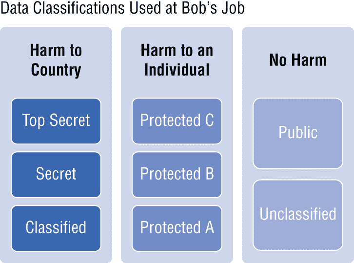

**图 2.2**: Bob 工作时使用的数据分类

通过始终对他收集的数据进行分类（决定其敏感性级别）和标记，Bob 确保了团队中的每个人都知道如何正确处理数据。如果没有标记，人们可能会犯错，在无意中泄露或留下未受保护的非常有价值和/或敏感的数据。许多数据库系统允许你在数据字段或表格上添加分类级别（例如 `Microsoft SQL Server`）。如果你使用的工具没有原生提供此功能，你可以手动为表中添加一个字段来标记（或者如果敏感度不同，为每个字段添加一个）。即使数据是“未分类的”或“公开的”，也应该被标记。

请始终根据你的数据分类遵循规则和法规。如果你不知道规则或法规是什么，请询问。如果你工作的地方没有规则，你可以采用并遵循国家政府发布的标准或 NIST 的《信息类型和信息系统映射到安全类别的指南》。

## 密码、存储和其他重要决策

Alice 在工作、家庭和爱好方面有多个账户。Bob 也处于相同的情况——他在工作和个人生活之间似乎需要记住几百个密码。为了记住所有密码，Alice 使用了密码管理器，而 Bob 只是反复使用相同的某几个密码（这被安全专业人员称为“密码重用”）。

密码管理器是一种安全存储用户密码并帮助他们创建独特、长且复杂的密码的软件。人们使用密码管理器是为了不需要记住多个密码，只需要记住一个进入管理器的单一密码（加上无法存储在其中的的密码，例如你的手机或电脑密码）。

大多数密码管理器都有浏览器插件，这样你只需要登录一次密码管理器，只需点击一个按钮即可登录你正在访问的任何网站。它会将你的用户名和密码复制到浏览器中，这意味着避免了输入错误。非常优秀的密码管理器还会提醒你：是否在多个地方使用了相同的密码、你的用户名和密码是否曾出现在数据泄露事件中泄露、你是否选择了弱密码（在使用密码器时，你仍然可以创建自己的密码），以及你拥有账户的网站是否提供了 MFA（多因素身份验证）以便你开启 MFA 功能。

密码管理器通常还有一个用于存储安全记记的区域（你可以在那里保存你的社会安全号码 SIN、信用卡信息等）。我建议所有热衷的计算机用户都使用密码管理器，这不仅是为了它为你的生活提供的额外的安全性，还为了节省你在重置和忘记密码方面的时间。密码管理器是给终端用户使用的，而不是给计算机使用的。

使用密码管理器并在各处使用唯一密码的巨大优点之一是：如果你使用的某个网站发生了数据泄露，导致其用户的用户名和密码（即所谓的“凭据”）泄露到互联网或落入恶意攻击者手中，它只会影响你的一个账户，而不是你所有的账户。很多时候当凭据作为数据泄露的一部分被盗时，它们会被用于 `credential stuffing attack`（凭据撞库攻击），这意味着攻击者获取被盗凭据并对一个或多个其他网站进行自动化攻击，查看哪些网站被重复使用了，从而允许攻击者访问其他网站的账户。某些攻击者甚至会对密码编写脚本“调整”，例如将“Password1”更改为“Password2”、“Password3”等，以尝试密码的变体。使用被盗密码的变体被称为 `rainbow credential stuffing attack`（彩虹凭据撞库攻击）。

如果 Alice 和 Bob 都使用同一个发生过数据泄露的网站，由于 Alice 在各处都使用唯一密码，她只需要重置那一个密码并担心那一个账户即可。而 Bob 则将会有大量的工作和担忧需要处理！Alice 和 Bob 保护自己免受此类攻击的另一种方法是为对他们有价值或可能造成损害的账户（银行、工作、电子邮件、绑定了信用卡的账户、非常私人的账户、健康账户等）开启 MFA。

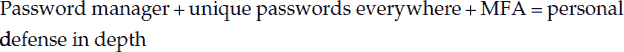

软件开发者和技术人员在工作中需要记住无法数量的密码，他们应该始终能够访问工作场所提供的密码管理器。

`Secret stores`（密钥存储）与密码管理器类似，但它们是为计算机系统设计的，而不是人类。密钥存储是一个加密秘密的软件保险箱，然后允许你的应用程序通过程序方式访问它们（通过应用中的代码或 CI/CD 流水线构建过程）。你可以存储证书、凭据（用户名和密码）、连接字符串、哈希值以及任何你认为应用程序将使用的“秘密”内容。

`Service accounts`（服务账户）是计算机使用的账户，而不是人类使用的。它是你网络上计算机系统的身份，区别于个人。当你创建一个应用程序并它需要访问数据库时，你应该为你的应用程序创建一个服务账户来连接数据库，而不是使用你自己的账户。这有许多原因，最明显的一点是如果你离职去其他地方工作，他们在你离开后仍然需要所有软件继续运行。其他原因包括监控（如果每个应用都有自己的账户，那么你的监控团队就能看到应用程序在做什么，而不是*你*在做什么）、事件调查（我们想知道谁做了什么，如果你的用户名无处可见，这可能看起来像是你采取了不当行为）、最小权限（你的账户可能在各处都有很多权限，如果有人进入了你的账户，他们就可以接管所有权限）。

用户的密码呢？它们应该存储在哪里？它们应该存储在数据库（或其他集中位置，如身份提供程序）中，并以 `salted`（加盐）和 `hashed`（哈希）格式存储。如果你还记得的话，哈希意味着一个单向加密过程，它是不可逆的。加盐（salting）的过程是在哈希处理之前向数值添加一个唯一的、长值，以增加熵并使攻击者破解变得更加困难。这意味着当你的应用程序进行用户登录时，它将对输入的值运行哈希和加盐函数，然后将结果与数据库中存储的内容进行比较。如果用户名和密码被盗，它们对攻击者来说是无用的，因为如果他们在应用程序中输入哈希加盐后的值，它将与数据库不再匹配。

你的盐至少应该是 28 个字符（最好更长），由安全的随机生成器生成，并且对每个用户都是唯一的。将盐值与每个用户的盐+密码的哈希值一起存储在数据库中。盐并不是秘密。

工作因子意味着你重复执行哈希算法 X 次，X 就是工作因子。你的工作因子至少为 2，但根据需要可以增加（基于行业硬件改进、你的数据和/或账户的敏感程度或应用程序变化的威胁格局中的任何因素）。

`Peppering`（加胡椒）或加密胡椒与盐类似，因为它在密码被哈希处理之前添加到密码中，并且应该由安全的随机生成器生成。然而，胡椒是一个秘密，不应该像盐一样存储在数据库中（它应该存储在密钥存储中，因为它是一个秘密），它应该很长（至少 32 个字符，最好为 128），且胡椒对于每个应用程序是唯一的，但对于该应用程序的所有用户都是相同的。

你可以同时对密码加盐和胡椒；但通常大多数系统只需要加盐。请与你的安全团队决定这一点。

确保应用程序用户的密码足够长，但不一定需要复杂；包含大写字母、小写字母、数字和特殊字符是好事，但要求每种字符必须包含多少个会让用户感到沮丧。对于“复杂度”要求，只需要求每类字符包含一个即可。允许用户输入最多 64 个字符的密码。越长越好；鼓励使用密码短语。不要强制用户在一段时间后更改密码，除非怀疑发生了泄露。通过使用 `HaveIBeenPwned` 等服务，通过比较范围内的 `sha1` 哈希值，验证新用户的密码是否曾泄露过。

在向用户发送登录失败提示时，永远不要验证是用户名还是密码错误。提供此类信息会导致潜在的攻击者收集用户名（验证某个用户是否在使用你的系统）。

`忘记密码功能` 应在通过电子邮件或短信发送密码重置链接之前验证用户的身份，这可以通过使用另一种形式的身份验证或安全问题来实现。如果用户身份验证失败，永远不要揭露哪部分失败了。不要允许用户直接在你的系统中重置密码；始终使用“带外”通信方式（通过电子邮件或短信链接）将其作为第二种身份验证形式发送。重置链接应只能使用一次，并在未使用的情况下 1 小时内过期。始终记录密码已重置（如果用户未成功，则记录尝试），并向该账户列出的电子邮件或短信确认密码已重置。如果用户在 24 小时内尝试重置密码失败 10 次，则锁定其请求来源 IP 地址的账户，记录情况并触发警报。如果某个 IP 地址尝试为不存在的账户重置密码，将该 IP 视为账户已存在，以防止攻击者枚举（收集）有效的用户名。查看图 2-3 以安全的忘记密码流程图。

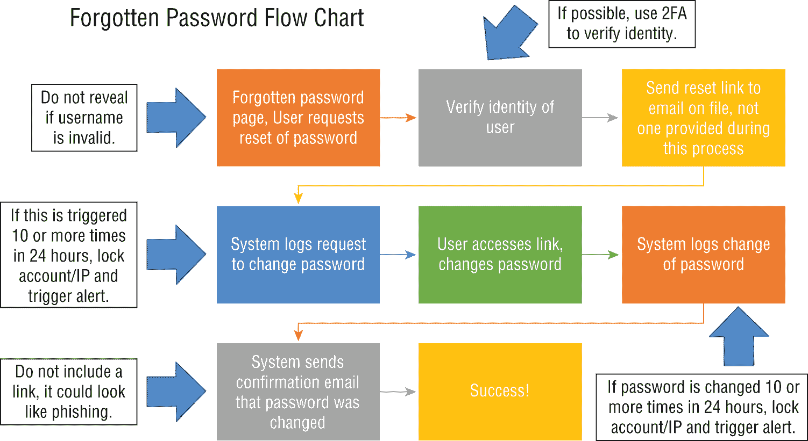

**图 2-3**: 忘记密码流程图

### 密码规则

*   对所有用户密码进行哈希和加盐。盐的长度至少为 28 个字符。
*   所有应用程序密钥必须存储在密钥存储器中。
*   应用程序内使用的账户必须是服务账户（而非人类账户）。它们对于每个应用程序必须是唯一的，并应遵循最小权限原则。
*   让团队中的所有人都使用由贵组织管理的密码管理器，并制定一项政策，要求他们绝不重复使用密码，包括相同密码的变体。
*   在工作和家里对所有重要账户开启 MFA（多因素身份认证）。尽可能使用身份验证器应用或设备而不是短信作为第二种身份验证因素。
*   不要按计划强制更改密码，仅在发生泄露或可疑活动后更改。
*   始终使用 `modern` 哈希算法。
*   如有疑问，请遵循你政府关于密码存储的策略；如果没有，则遵循 `NIST` 的密码策略。该策略由专家团队创建并经过行业审查，提供了尽可能好的建议。

## 全处使用 HTTPS

当互联网最初创建时，没有人预料到它会变成现在的样子：每天数十亿用户、数万亿网站，成为世界上大多数地区主要的通信方式。因此，这并不是计划之中的。安全、隐私、如何转账等等并未构建在协议中，从那时起我们一直在创建各种变通方案。最初互联网上的所有内容都是未加密的（明文），因为设计人员从未梦想过我们会拥有今天这样的工具，可以监控和读取网络及互联网上的流量（被称为“嗅探”网络流量），甚至可以中断这些流量、修改它们，然后发送到目的地，而接收者毫无察觉。这就是为什么我们现在需要加密所有互联网上的流量。然而，并不是所有人人都同意这一观点，所以让我们在讨论“如何做”之前讨论“为什么”。

当用户通过互联网访问你的网站时，你不知道他们来自哪里。他们可能在带有开放 Wi-Fi 的咖啡馆，可能在大酒店的会议上，可能在家里与邻居共享的网络上。

有人嗅探流量的情况比你想象的要常见得多。当有人嗅探流量时，他们不仅可以看到用户看到的内容（侵犯隐私），还可以更改发送给他们的信息。另一个例子是向网站注入恶意软件、恶意脚本或虚假信息。

既然我们已经坚信始终使用 HTTPS，让我们定义规则：

仅允许你的网站通过 HTTPS 访问。从 HTTP 重定向到 HTTPS。如果有人尝试降级连接，请将其重定向。这可以通过代码中的安全标头或服务器上的设置来实现。

### TLS 设置

确保你使用最新版本的 `TLS` 进行加密（目前为 `1.3`，但如果你的提供商不支持 `1.3`，在目前 `1.2` 仍然适用）。因为这变化频繁，建议你在网上搜索当前的最佳实践。该领域的更多最佳实践在第 3 章“安全设计”中讨论。

### 注释

开发者编写注释（在代码中不执行的说明，仅为文本）是为了帮助自己或未来的开发者理解程序正在发生什么。然而，有时开发者会将不应包含的内容放入注释中，例如数据库密码或其他密钥、不应共享的公司或用户信息，或其他敏感信息。当注释被放在前端代码（`JavaScript`、`HTML`、`CSS`）中，它们在打包时并不总是会被删除，反向工程人员如果寻找，通常可以找到这些注释。因此，我们绝不能在注释中放置敏感信息。

你的应用程序使用、创建或存储的所有数据都必须定期备份（根据你组织的数据分类策略），并应设置一个地理位置不同的第二个地点进行每周备份。在万万一的情况下，系统必须具备数据回滚的能力，以应对恶意软件、安全事件或勒索软件。你的备份和恢复程序必须经过测试和练习。

### 框架安全特性

编程框架由专家团队维护，并定期由成百上千名开发者进行测试。此外，也有黑客（包括白帽和黑帽黑客）在测试框架的安全特性。这意味着，与你自己编写的安全特性相比，框架中的安全特性背后有更多的人员、经验、时间和测试支持，这使得框架安全特性几乎可以保证比你为执行某项安全活动而自己编写的代码更安全。因此，你应该使用框架提供的安全特性，而不是自己写写。

经验丰富的 Web 应用程序渗透测试人员和应用安全工程师都经历过一个或多个关于软件开发者决定“自创加密”的故事；这些开发者没有使用框架中的加密功能，而是决定要对值进行 base64 编码（有时是多次编码），或者编写自己的函数来打乱数值。对于这些开发者来说，遗憾的是，夺旗赛（CTF）比赛中最容易的挑战通常涉及发现此类简单且不充分的安全尝试，这意味着此类“防御”通常很容易被发现和绕过。

其他例子还包括编写自己的输出编码函数、尝试手动管理会话、将会话数据保存到本地存储（local storage）而不是安全的 cookie 等。如果你的框架提供了某种安全特性，请使用它。如果如果没有，考虑为你的应用程序添加一个额外的框架或组件，该组件应包含执行你所需活动的功能，只有在绝对需要时才自己编写。

## 技术债 = 安全欠债

> 技术债是软件开发中的一个概念，反映了由于现在选择一个简单（有限）的解决方案，而不是使用耗时更长的更好方法而导致额外工作的隐含成本。
>
> —维基百科 22


# 技术债与安全

技术债可能包括硬编码、长时间不升级服务器或框架、不打补丁、为了“先让东西跑起来”而选择捷径等。技术债通常会导致组织在应对变化时反应缓慢，意味着它们在事件发生或其他安全威胁面前无法及时做出响应。这两种情况都会导致防御削弱，并使组织无法有效地保护自己。

Bob 已经习惯了处理他以前工作过的某个政府部门的大量技术债。他们有太多的流程和审批，有时他甚至不知道如何发布一个更改。他们需要通过 `CAB`（变更审批委员会）和 `TAG`（技术架构小组），但首先他必须让他老板的老板的老板的老板批准他的更改。对 Bob 来说，让比他高四级的人来批准更改完全不合逻辑。如果批准更改的人是一个总局长（director general），那个人如何理解他的更改是否会与他们的其他技术产生冲突呢？那个人并不写代码。他经常感到沮丧，觉得管理层根本不信任他完成工作，让事情变得比必要的慢更慢，而且没有真正的额外收益。

当 Bob 在该部门工作时，发生了一次非常严重的安全事件。他无听到软件开发者告诉安全团队，他们新功能的发布周期长达 16 个月，如果他们想要紧急发布，至少需要 4 个月。安全人员的脸部说明了一切：这对于该部门来说将是极其糟糕的一天。当 Bob 获得一个拥有更现代软件开发实践的新部门的工作机会时，他抓住了这个机会；以前部门那瘫痪的技术债对他的日常工作造成了巨大的负担，他想在一个让他感到管理团队信任他完成工作的地方工作。

当组织无法在不经过长期前置时间或艰巨努力的情况下做出更改时，这就是技术债在阻碍它们的生产力。当组织的大部分时间都花在试图维持运行、不断地灭火时，这无疑也会导致安全问题。

# 文件上传

如果需要执行文件上传，只要可能，请找到一个专门为此目的设计的声誉良好的第三方组件用于你应用程序的这部分，而不是自己编写。这将降低风险，因为其已经经过了广泛的测试（仅在符合此类情况下才选择第三方组件）。允许公众（而不是你所在组织内部的授权用户）上传文件是普通应用程序所执行的风险最高的软件功能。通常，用户输入被认为是应用程序最危险的部分，但允许用户上传文件（可能具有恶意）将“危险的用户输入”推向了潜在风险的完全新高度。

Alice 记得有一次不小心带了一个病毒去公司；那真是太尴尬了。她在家里用的是 Mac，但在公司用的是 Windows。她带了一个装满音乐的 USB 闪盘，那是她在家里下载并听了很久的。当她把它插在公司的 Windows 机器上时，她没有注意到的 `EXE` 文件开始运行，然后……安全团队很快就出现在她的办公桌前。

Alice 是一个非常聪明的人，但她并不是安全专业人员，每个人都可能出错。你的程序需要考虑到恶意攻击者，以及向你的应用程序上传文件类型出错的人。

当从用户接收上传的文件时，假设最坏的情况。验证其类型和大小，重命名文件，不要允许用户设置存储路径，将其存储在远离应用程序和其他 Web 服务器的安全区域。一旦接受了文件，使用至少一个工具对其进行扫描以检查是否可疑。如果你的业务部门允许，将文件限制在特定的类型内。例如，接受 `JPG`、`TXT` 和 `PNG`，但不接受 `PDF` 或 `EXE` 类型。

OWASP 速表系列（开放 Web 应用安全项目旗下的一个开源项目）为允许文件上传提供了一系列精彩且详尽的预防措施。如果你必须从头编写此功能，请熟悉它：`cheatsheetseries.owasp.org/cheatsheets/Protect_FileUpload_Against_Malicious_File.html`。

恶意文件上传是一个如此严重且关键的话题，以至于加拿大政府的安全机构加拿大通信安全局（CSE）创建并开源了一个用于检查上传文件的免费工具；它被称为 `AssemblyLine` (`cyber.gc.ca/en/assemblyline`)。它不会像许多其他在线免费工具那样将信息回传给加拿大政府。

# 错误与日志

所有的错误都应该被捕获并优雅地处理；屏幕上不应出现堆栈跟踪或数据库错误。这不仅是为了让你的应用程序看起来更专业并为用户提供良好的体验，更是为了防止攻击者在创建攻击时获得可用于攻击你应用程序的额外信息。当错误发生时，应用程序绝不应进入未知状态。它应该始终回滚正在执行的任何事务，并“关闭”它可能打开的任何内容（这被称为“失败关闭”，即 `fail-closed`）。这种情况也应该始终被记录，这样如果发生事件，事件响应人员在调查时就有据可查，并且审计人员可以验证系统当前及过去一直运行正常。

你的安全团队可能有一个被称为 `SIEM`（安全信息和事件管理）系统，它可以摄取来自你所有网络工具的所有日志文件。它也可以摄取你应用程序的日志。与团队沟通，了解他们希望接收日志的格式，并确保你的应用程序日志符合该格式，然后确保当应用程序迁移到生产环境时，`SIEM` 访问你的日志。

永远不要记录敏感信息，例如密码、社会保障码、完整的信用卡号（保留后 4 位可以）、出生日期加上个人的姓和名等。任何组合后会构成个人身份识别信息 (`PII`) 的信息组合都不应被记录。如有疑问，请咨询你的隐私团队和业务分析师。

如果你的应用程序内部发生了看似是安全事件或事故的活动，你的程序不仅应该记录这种情况，应该触发警报。警报可以是发送给安全团队的邮件、运维团队值班人员，或你组织认为合适的任何方式。请在需求阶段提前决定此项。此外，不要将邮件发送给个人的账户；要发送到团队或服务账户，这样如果该人员离职，警报就不会发送到空处。定期测试此功能以确保它仍然有效；未触发或未接收的警报对任何人都没有帮助。

可能触发安全警报的事件包括：进入未知状态、访问功能或文档被拒绝、尝试绕过工作流、用户超过使用配额（例如，1 秒内尝试登录 10 次，或一小时内尝试 100 次——人类的行为并非这样）、应用程序崩溃、用户使用特定（大量的）带宽、CPU 或存储空间、调用你已阻塞的 HTTP 谓词等。你需要与业务分析师和安全团队一起决定对于你的组织和应用程序来说什么是合适的。

## 输入验证与清理

JavaScript 是一种特殊的编程语言，因为它运行在浏览器中（通常称为客户端），因为使用我们 Web 应用的用户（客户端）必须使用浏览器来访问，而浏览器位于*他们*的计算机上，而不是*我们的*服务器上。所有其他编程语言运行在服务器端；在你的 Web 服务器、`PaaS`（来自云提供者的平台服务）或容器上（稍后详细介绍容器）。

当有人对 Web 应用使用 Web 代理时，该代理位于应用程序 JavaScript 运行*之后*，但在请求通过网络发送到 Web 服务器*之前*。使用 Web 代理的人可以在请求离开网络到达你的 Web 服务器之前轻松更改 `HTTP` 请求。（注：原文此处有重复句，翻译已按逻辑处理）。


## 授权与身份验证

如果你的应用程序对不同用户有不同类型的访问（通常称为基于角色的访问控制 (`RBAC`）），那么你必须在需求阶段定义所有内容。你不希望这些内容在开发过程中发生变化，这会增加你的工作难度。这是授权 (`AuthZ`) 的一部分。

此时，你还应该定义使用何种身份验证 (`AuthN`) 方法/系统：你的系统如何验证身份？你如何在跨系统或仅在网站上跟踪它？现在决定所有系统是理想的，但在设计阶段决定也是接受的。

## 参数化查询

当应用程序调用数据库时，应用程序是在指示数据库代表它执行操作。这可能是读取、写入、更新或删除请求，但点在于你的应用程序正在*直接*与数据库通信。除了你的应用程序、你的软件开发团队或你的数据库管理员之外，任何人员或应用程序都不应能够直接与*你的*数据库通信。当攻击者对应用程序执行 `SQL` 或 `NOSQL` 攻击时，他们试图直接与数据库通信，尝试发送命令来执行他们的意愿，而不是你编写供其遵循的指令。这被称为注入攻击，是任何 Web 风险最高的攻击（根据 OWASP 前十，将在 `Chapter 5.xhtml` 中详细介绍）。

当我们使用参数化查询（在 SQL 中被称为存储过程）时，我们将参数和想要运行的查询名称发送到数据库，而不是通过拼接用户输入来创建字符串并将其作为命令发送到数据库。区别在于，使用参数化查询时，如果攻击者尝试通过用户输入添加他们自己的代码，应用程序将将其作为参数之一发送，而它将不起作用。这是因为参数被数据库解释为数据，而永远不是代码，这使得注入攻击几乎是不可能的。

当应用程序拼接用户输入的字符串并直接作为命令发送到数据库时，这在 SQL 语言中被称为“内联 SQL”（inline SQL）。编写内联 SQL 会产生潜在的 SQL 注入漏洞。只有使用参数化查询才能可靠地缓解这种漏洞。请始终使用参数化查询。

### URL 参数

用户可以访问浏览器中的地址栏，攻击者也是如此。不要在 URL 参数中放置任何对你的应用程序至重要的变量。ID 编号可以被递增，如果你的应用程序没有针对这种情况进行编程，用户可能会看到他人的账户。如果 URL 参数中包含敏感值，它将被记录下来，这也是一个问题。某人操纵 URL 参数中的值是非常简单的，而“他们本不应该那样做”这种借口在你的事件响应团队面前是行不通的。只在 URL 参数中传递无关紧要的值，例如用户想要查看页面的语言。永远不要在 URL 参数中传递任何重要或敏感的内容。

## 最小权限

确保你的应用程序执行了最小权限原则，特别是在访问数据库或 API 方面。你的应用程序还应该仅使用服务账户调用 API、使用参数化查询或任何其他需要账户的调用。

以下是应用最小权限的一些示例：

- 从你的应用程序调用数据库的服务账户应仅具有 CRUD 权限，绝不能是数据库所有者 (`DBO`)。
- 理想情况下，一个服务账户应具有针对“select”调用的只读权限，而另一个账户在需要插入、更新或删除时具有 CRUD 访问权限。尽可能使用只读账户。
- 为你的应用程序使用的每个 API 创建不同的服务账户，每个账户仅具有所需的最大权限（例如，如果仅预期返回数据而不修改数据，则仅具有“select”或“read”权限）。
- 仅允许你的团队成员对你代码库中的项目进行读写访问，而其他人仅具有读取权限，或者如果你的代码在本质上非常敏感或有价值，则完全没有访问权限。

# 要求检查清单

下面是一个你可以用于所有 Web 应用程序项目的清单。所有这些要求都适用于任何 Web 应用程序，我建议你至少包含所有内容，并根据你独特的业务需求添加自己的要求。

- 对所有静态数据进行加密（在数据库中）。
- 对所有传输中的数据进行加密（在往返用户、数据库、API 等的传输过程中）。
- 不信任任何人：验证（并在特殊情况下进行清洗处理）所有数据，即使是来自你自己的数据库的数据。
- 对所有输出进行编码（必要时进行转义）。
- 在使用前扫描所有库和第三方组件的已知漏洞，并在使用后定期扫描（新的漏洞和版本不断发布）。
- 使用所有适用的安全标头。
- 使用适当的安全 Cookie 设置。
- 分类并标记你的应用程序将存储、收集或创建的所有数据。
- 对所有用户密码进行哈希和加盐。盐的长度至少为 28 个字符。
- 将所有应用程序密钥存储在密钥库中。
- 确保应用程序内部使用的所有账户都是服务账户而非人类账户。
- 让你团队中的所有人都使用密码管理器，绝不重复使用密码。
- 为所有重要账户开启多因素身份验证 (MFA)。
- 不要强制定期更改密码，仅在发生泄露或可疑活动后更改。
- 仅允许面向公共网的站点通过 HTTPS 访问。从 HTTP 重定向到 HTTPS。理想情况下，这应适用于内部和外部应用程序。
- 确保你使用最新版本的 `TLS` 进行加密（目前为 1.3）。
- 永远不要硬编码任何内容。永远不要。
- 永远不要在注释中放置敏感信息。这包括连接字符串和密码；这些属于密钥库。
- 使用框架内的安全功能；例如，密码学/加密、会话管理功能或输入清洗函数。如果你的框架提供了这些功能，绝不要自己编写。
- 仅使用框架的最新版本（或上一个版本）并保持更新。技术债 = 安全债。
- 如果执行文件上传，确保你遵循了 `OWASP` 对于这种高风险活动的建议。这包括使用扫描器（如 `AssemblyLine`）扫描所有已上传的文件，该工具由加拿大安全安全局 (`CSE`) 免费提供。
- 确保记录所有错误（但不记录敏感信息），如果发生任何安全错误，则触发告警。
- 确保所有的输入验证（以及清洗）都在服务器端执行，使用批准列表或接受列表（而不是黑名单）的方法。
- 确保在发布之前对你的应用程序进行安全测试（更多内容见后续章节）。
- 在发布之前对你的应用程序进行威胁建模。在“威胁建模”章节第 3 章中了解更多。
- 在发布之前对你的应用程序进行代码审查（特别是安全函数）。
- 确保应用程序捕获所有错误并实现安全失败或关闭失败（绝不要进入未知状态）。
- 确保所有错误都向用户提供通用信息，绝不提供来自堆栈跟踪、查询失败或其他技术特定的信息。
- 在项目需求中定义基于角色的访问细节。
- 确保在项目需求中定义身份验证方法和身份系统的细节。
- 仅使用参数化查询，绝不使用内联 `SQL/NOSQL`。
- 不要在 URL 参数中传递任何重要的变量。
- 确保应用程序执行最小权限原则，特别是在访问数据库和 API 方面。
- 尽可能减少你的攻击面。
- 允许用户在密码字段中剪贴，以便使用密码管理器。禁用浏览器的密码自动填充功能，以确保用户不会将密码保存到浏览器中。
- 禁用包含敏感信息的页面缓存。虽然 `Cache` HTTP 标头技术上不是安全标头，但可以用于强制此操作。
- 确保应用程序用户的密码足够长，但不一定复杂。越长越好；鼓励使用密码短语。
- 不要强制用户在一段时间后更改密码，除非怀疑发生了泄露。
- 使用专为此任务设计的服务验证新用户的密码没有在之前的泄露中出现过。

根据你的应用程序的功能，你可能想要添加更多要求或删除其中一些。本章的目的是让你在编写项目需求时考虑安全问题。如果开发者从一开始就知道他们需要遵守这些要求，你已经在迈向创建更安全的软件的道路上了。

# 练习

1. 为 Web 应用程序列出另外两个潜在的安全要求（是尚未列出的）。
2. 为汽车中的操作系统列出另外两个潜在的安全要求。
3. 为“智能烤面包机”列出另外两个潜在的安全要求。
4. 为处理信用卡卡的应用程序列出另外两个潜在的安全要求。
5. 哪项安全要求最有价值？为什么它对你和或你的组织最有价值？
6. 如果你必须从 Web 应用程序项目中删除本章的某个要求，你会删除哪一个？为什么？

# 图 3-1: 软件开发生命周期 (SDLC)

在设计软件应用程序时，软件架构师不仅需要考虑业务需求（客户的要求）和功能性需求（用户需求、调度、系统需求），还需要考虑通常被视为所当然的非功能性需求，例如可用性、质量以及本书的关注重点：安全性。

> 软件工程中的“设计安全”（Secure by design）意味着软件从底层开始设计就是为了安全。恶意行为被认为是必然存在的，在发现安全漏洞或遇到无效用户输入时，会采取措施以尽可能地减少影响。
>
> —Wikipedia²³

当我们谈论设计软件时，有几种不同的解释方式，所以让我们在这里对其进行定义。

软件设计是规划你将如何构建软件，以及它将如何与其他任何部分连接或工作。这可以是一个非常高层的文档，显示每个部分是如何组合在一起的；例如，这个前端连接到该数据库并调用此 API。

设计文档可以非常正式且详细，精确到写出将定义哪些类以及如何定义，或者只需要几个图和数据流图。设计文档的目的是让团队了解如何构建该应用程序。

为了确保你有足够的安全团队的信息，请*询问他们*。首先确保你的开发团队认为设计文档已经足够了，然后与安全团队的成员一起进行评审。

## 设计缺陷 vs. 安全漏洞

`design flaw`（设计缺陷）是应用程序设计中的错误，允许用户执行他们不应被允许执行的操作（恶意或破坏性操作）。这是一个缺陷，即设计上的问题。我们尝试通过使用安全设计概念、安全项目需求和威胁建模，来避免或减少设计缺陷出现的机会。

`security bug`（安全漏洞）是一个实现问题，即代码上的问题，它允许用户以恶意或其他不正确的方式使用应用程序。我们通过代码审查、进行安全测试（在项目不同阶段进行多种类型的测试）、提供安全编码培训，并使用安全编码概念和准则来防范安全漏洞。查看图 3-2 以了解缺陷和漏洞是在 SDLC 的哪个阶段引入的。

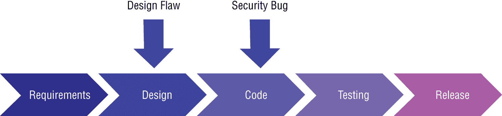

# 图 3-2: 缺陷与漏洞

### 延迟发现缺陷

在 SDLC 中修复问题的时间越晚，成本就越高。在线杂志 Slashdot 的文章指出，在 SDLC 阶段发现的漏洞修复可能花费 1 美元，而在设计阶段可能花费 10 美元，编码阶段可能花费 100 美元，测试阶段可能花费 1000 美元，发布后则更高。²⁴ 互联网上有许多不同的成本估算，但与其使用臆测来尝试解释这个观点，不如我们咨询一下 Bob。查看图 3-3 以查看在 SDLC 每个阶段修复安全问题不断增加的成本。

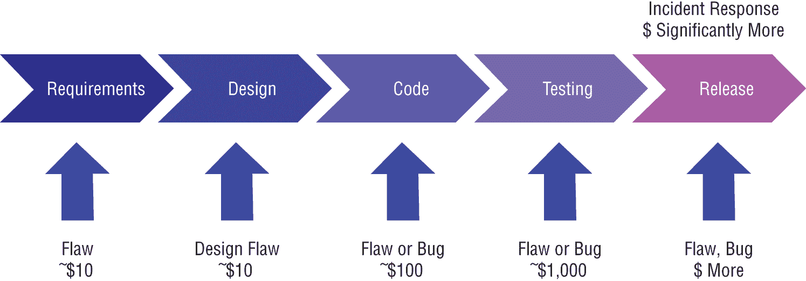

# 图 3-3: 在 SDLC 期间修复安全漏洞和缺陷的近似成本

年前，Bob 和他的妻子建造了他们的梦想家；他们为此存了多年钱。当几乎完工时，当他们正在为橱柜安装把手并铺地毯时，Bob 发现不对劲。在他们的整个规划过程中，他们从未想过要超过一个卫生间。当他们开始攒钱和规划时，他们只有一个孩子，但到了这一步，他们已经有两个孩子，并且正在考虑第三个。他们确实需要另一个卫生间。

Bob 知道在施工的后期增加一个卫生间会花费昂巨资金而且非常困难。Bob 知道在施工后期增加一个卫生间会花费昂巨资金而且非常困难。Bob 知道在施工后期增加一个卫生间会花费昂巨资金而且非常困难。Bob 知道在施工后期增加一个卫生间会花费昂巨资金而且非常困难。Bob 知道在施工后期增加一个卫生间会花费昂巨资金而且非常困难。

### 左移 (Pushing Left)

“卫生间不够”的问题是威胁建模本可以发现的，我们将在本章末讨论。如果你看图 3-4，它显示了带有指向左侧箭头的 SDLC。理念是：安全活动开始得越靠“左”，你就开始得越早。一些安全从业人员称之为“左移”（shifting left），另人称之为“左推”（pushing left），但无论你如何称呼它，都是确保你创建安全软件的最有效方法。

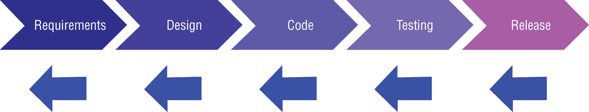

## 安全设计概念

### 保护敏感数据


在处理任何数据时，我们希望确保维护其 `CIA`（机密性、完整性和可用性）。

考虑到这一点，让我们谈谈设计软件应用程序时应该应用（或至少考虑）的几种安全设计概念。

当数据敏感时，你需要确定你的应用程序需要存储这些数据多长时间，并制定一个在生命周期结束时处理它的计划。例如，如果你必须在收到数据后将其保留 7 年，那么你的系统必须在 7 年后自动销毁每条数据记录。将此设计整合到你的应用程序中；不要假设用户会记得稍后处理数据（他们绝对不会的）。你还必须设计一种验证机制，以确保数据已成功且完全地销毁。此外，不要忘记计划如何将数据从你的备份系统中移除，包括可能存在的任何备份系统副本。

随着许多公司将数据迁移到公有云，决定是否将各种类型和分类的信息放入云端至关重要。根据你所在的国家，可能有你需要遵循的法律指南和/或要求。如果针对你的情况没有法律指南，而你决定为此目的使用公有云，那么对于你的高度敏感的信息，你应该使用“自带密钥”（bring your own keys）选项。这意味着你将自己管理加密和解密数据的密钥，而不是让你的服务提供商代表你操作。

对于地理分布的系统，你需要决定哪些区域允许访问你的数据，以及你的备份存储在哪里。同样，可能来自你政府的法律指南和/或要求；确保你符合所在国家的法律。

如果你的数据极其敏感，你可以选择使用令牌化系统，这通常由第三方提供。令牌（`Tokens`）替换数据，然后在数据使用时由第三方软件进行解密。这将增加额外的安全层。

如果你的系统和/或其数据非常敏感，你的用户的密码应该经过哈希（`hash`）、加盐（`salt`）*以及*加胡椒（`pepper`），正如第 2 章中所讨论。在撰写本文时，大多数应用程序对密码进行加盐和哈希处理，但没有加胡椒。

由于加密标准不断变化（并改进），此处不会规定特定的密码算法、密钥长度和算法。请使用你喜欢的搜索引擎查询当前标准，并确保在新项目中再次验证当前标准（情况可能已经发生了变化）。

如果可能，当网上出现任何与你的数据相似的数据泄露时，设置警报。你不希望通过读报纸来发现这类信息；你希望在发生之前就收到通知。你可以手动设置此类警报，也可以使用安全供应商提供的专业服务。你还可以通过在各种社交媒体、搜索引擎和数据共享平台上针对关键词设置警报来获取价值（这将导致假性报警，所以要准备好应对“噪音”）。一些政府组织会协助该国企业进行此类工作；询问你的政府他们可以提供什么类型的服务或协助。在加拿大，这个小组被称为“加拿大网络安全中心”（`cyber.gc.ca`25），之前被称为加拿大网络事件响应中心（CCIRC）。

以下是更多国家的资源：

*   **卢森堡**：`www.circl.lu`26
*   **日本**：`www.jpcert.or.jp/english/at/2020.html`27
*   **英国（威胁报告）**：`www.ncsc.gov.uk`28
*   **美国**：`www.us-cert.gov/ncas/alerts`29
*   **新西兰（建议书）**：`www.cert.govt.nz/it-specialists`30

如果你不确定政府能提供什么，请查询 `CIRT`（网络事件响应小组）并询问他们。

### 永不信任，务必验证/零信任/假设已遭入侵

我们在第 1 章中讨论了零信任和假设已遭入侵的概念，但在设计应用程序时如何应用这些概念呢？除了与安全专业人员一起审查设计并进行讨论（你绝对应该这样做）之外，以下是几条坚定的规则：

*   仅使用服务器端信任数据（经过妥善验证的数据）来做出访问控制决策。
*   默认拒绝——所有功能在继续之前都应该检查用户是否已授权。
*   始终保持失败关闭或失败安全状态，永远不要失败到开放或未知状态。如果事务未正确完成，务必始终执行回滚。
*   验证身份（身份验证），*然后*授权（访问控制）。
*   在应用程序的每个页面和功能上重新验证访问权限，即使在刷新页面时也是如此。
*   对 `API` 进行身份验证（`AuthN`）和授权（`AuthZ`），双向（`API` ➪ 应用 ➪ `API`）。
*   阻止访问任何协议、端口、`HTTP` 动词/方法，以及你的服务器、`PaaS` 或容器上你的应用程序未使用的任何其他内容。
*   根据你的部署模型并在预算允许，每个服务器、`PaaS` 或容器运行一个应用程序。

花时间与安全专业人员或另一位并非你团队成员的技术人员（因此是无偏倚的）一起审查你的设计。寻找你设计中存在隐含信任的地方，然后移除该信任并对其进行更改。

### 备份与回滚

几个月前，`Alice` 的公司遭受了勒索软件攻击。有人点击了网络钓鱼邮件中的链接，意外感染了整个网络。幸运的是，`Alice` 一直在她的个人笔记本上保留了重要文件的副本，以便她可以在家里工作；这违反了公司规定，但她已经这样做多年了。对于公司的其他人来说，不幸的是，勒索软件加密了公司所有的文件，导致无人能够工作；员工在手机上回复了一个月的邮件，有些文件从未恢复。`Alice` 从未得知事件的全部成本，但她很感激他们没有像她听过的其他公司那样倒闭。

*如果不能高效地回滚，备份将毫无价值*。如果回滚需要一个月，那么就损失了一个月的工作。对于你的应用程序来说，不仅要有备份，快速回滚数据和恢复系统至关重要：

*   备份必须存储在与数据库和 `Web` 服务器不同的地理位置。
*   备份必须存储在安全的地方（物理和数字上），其保护方式与你保护生产数据库或 `Web` 服务器相同。
*   至少每年进行一次回滚练习。当生产系统发生重大变更时，确保已制作并测试了回滚脚本。
*   你的数据库、配置*以及*你的应用程序代码都必须备份。
*   对备份的访问必须进行监控、记录并触发警报。
*   备份的删除应设置延迟，以防其作为攻击的一部分被删除。某些云提供商默认执行此操作。建议时间：在请求删除任何生产数据库备份 14 天后执行删除。
*   练习你的回滚。认真的！

### 服务端安全验证

在执行 `Web` 应用安全测试（如渗透测试）时，大多数测试人员会使用所谓的 `Web` 代理（`web proxy`）或拦截代理（有时会与 `Web` 应用扫描器结合使用，以便允许你进行自动化测试）。顾名思义，`Web` 代理位于你的浏览器和 `Web` 服务器之间，拦截你的流量。这类工具用于直接与应用程序进行通信，在你的 `JavaScript` 在前端（用户的计算机/浏览器）运行完毕之后，直接向你的 `Web` 服务器发送和接收请求与响应。这意味着，如果你在 `JavaScript` 中编写了验证代码以确保用户输入对你的应用程序是安全的，那么任何使用此类工具的用户都可以向你的应用输入有效数据，然后在你的 `JavaScript` 完成数据验证后将其暂停（拦截请求），并将其更改为恶意数据（编辑请求并发送）。如果你的应用程序在服务器端再次对数据进行验证，那么这没问题；你可能选择在 `JavaScript` 中执行非常基础的数据验证以节省时间。然而，如果你的应用程序没有在服务器端对数据进行验证，攻击者可以轻而易举地使用 `Web` 代理向你的应用程序发送恶意请求。查看图 3-5 以查看使用 `Web` 代理时 `HTTP` 请求的流程。

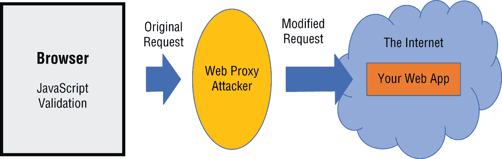

`图 3-5`: 使用 `Web` 代理绕过 `JavaScript` 验证

对于 `Web` 应用设计者来说的是，我们应用程序的用户拥有很大的权限。他们可以使用不安全或过时的浏览器，从感染了恶意软件的计算机访问我们的网站，更改浏览器设置，编辑 `URL` 中的参数，甚至拦截与我们创建的应用程序之间的请求和响应。用户还可以掩盖自己的位置、`IP` 地址、使用的操作系统类型和浏览器，甚至包括他们来源的网页；互联网的设计初衷就是为了赋予用户很大的权力，无论结果好坏。

尽管将每项验证都发送回服务器端可能看起来很昂贵，但它保证比让攻击者成功利用你的 `Web` 要廉价得多。

### 框架安全特性

当 `Bob` 年轻时，他短暂地做过一名程序员，在他决定编程不适合他之前。起初，他认为可以编写自己的函数，而不是使用框架提供的函数。他认为自己做得会更好，并向老板展示他作为员工的价值。当他向老板展示时，`Bob` 的老板解释说，编写自己的安全特性是危险的。“有几位专业人士工作过这个框架，他们深入研究过这个问题并拥有多年经验。`Bob`，你真的认为我们有钱付钱让你重造轮子吗？你认为我们的项目有时间进行测试以确保你所写的东西运行得完美吗？你真的觉得，作为一个在该领域没有特殊专知识的单个人，你能比一整个专家团队做得更好吗？”这让 `Bob` 感到很卑微，但当他回想时，他意识到老板是对的；他应该使用框架中的安全功能，而永远不要编写自己的。

这适用于我们所有人；如果框架中已经存在安全功能，我们永远不应该编写自己的。如果框架中不存在，在决定自己编写一个之前，我们应该进行仔细评估。如果有商用的、负担得起且可信的选项，我们可能在编写自己的之前应该使用它。

例如，有很多不同的密钥存储库是免费的，或者价格在大多数组织可以承受的范围内。如何存储密钥而不将其存储在代码中是一个非常复杂的问题，因此使用预制解决方案几乎总是明智的。话虽如此，如果你有非常特殊且独特的情况，有时除了编写自定义代码别无选择。在做出此类决定之前，执行选项分析活动。

### 安全功能隔离

尽可能将安全功能与应用程序中的其他功能隔离开来（这也适用于硬件设计）。这意味着，如果有人破坏了非安全功能，将不会影响你的安全功能（并可能导致漏洞）。这项建议不仅是加拿大政府 `ITSG-33`^(31) 的一部分，也是 `NIST` 特别出版 `800-53 S-3`^(32) 的一部分；这些是安全建议的两个非常可靠来源。

我们如何实现这一点？对于每个安全控制，我们都分离代码或功能。我们可以通过将其放入单独的对象或类中、放在应用程序或系统内的不同页面或仪表板上，以及/或完全独立的应用程序来实现。为了执行这一项要求，我们可能还会强制用户/应用程序在访问安全功能之前重新身份验证。示例包括：

*   将输入验证放在单独的对象或类中
*   将身份验证和/或授权放在单独的应用程序中
*   由你的云提供商或其他外部系统执行身份管理

隔离的程度取决于你创建的应用程序的敏感性以及安全功能的强度。

安全函数的代码可以存储在单独的 `Web` 服务器/`PaaS`/容器或文件系统中。在极端情况下，两个应用程序之间可能存在防火墙，或者完全隔离的网络。

确保你的身份/身份验证系统位于单独的服务器并遵循加固指南。务必这样做，没有任何例外。

应该隔离的安全功能示例包括（安全相关的）日志和监控、入侵防御和/或检测、`Web` 应用防火墙 (`WAF`)、应用程序控制、文件完整性监控、告警或拦截。

### 应用程序分区

尽可能将系统管理（管理）功能与应用程序中的其他功能隔离。这意味着如果有人破坏了非安全功能，将不会影响你的系统管理（访问控制）功能。这项建议不仅是政府 `ITSG-33`^(31) 的一部分，也是 `NIST` 特别出版 `800-53 S-2`^(33) 的一部分。

与上一项类似，这是关于功能的分离，只不过这仅适用于管理能力。如果应用程序有管理部分，该功能应位于单独的对象/类中、不同的页面或仪表板上，以及/或在独立的应用程序中。理想情况下，用户需要使用一组单独凭据（启用 `MFA`）来管理你的应用程序。

### 密钥管理

在讨论密钥管理之前，让我们定义软件范围的密钥。当我们讨论密钥和密钥管理时，指的不是用户存储在我们构建的软件内部的密钥，而是*我们的软件*为了正常运行而使用的密钥。如果用户有一个用于登录我们应用程序的用户名和密码（凭据），那是用户密钥，那不是我们在这一节讨论的内容。我们讨论的是*计算机系统之间*进行通信时使用的密钥。

当应用程序登录到数据库时，它使用的连接字符串是一个密钥。当 `Web` 服务器拥有用于启用 `Web` 应用程序 `HTTPS`（加密）的证书和密钥对时，用于该证书的密钥对的私钥也是一个密钥。私钥、`API` 密钥、哈希值、密码以及其他由应用程序（而非人员或用户）使用的机密信息，都被视为 `secret`。

手动进行密钥管理是极其糟糕的。它耗时、复杂且容易出错。这就是为什么我们行业创建了密钥存储（`secret stores`）——这种软件可以为你管理密钥，并允许你的应用程序、`CI/CD` 流水线或服务账户进行程序化访问。除非在首次存入、更新密钥或发生紧急情况下，否则人类永远不应该访问你密钥存储中的密钥。对密钥存储的访问应该经过严格的保护、监控、记录并在发生时触发告警。

一个良好的密钥存储应该在证书到期时提供警告，并提供密钥最后轮转的细节。有些工具甚至拥有更多功能。充分利用你可以使用的所有功能；这总比手动操作要好。

### 交易重身份验证（防止 CSRF）

跨站请求伪造（`CSRF`）是一种漏洞，攻击者诱导受害者点击链接或访问恶意网站。该链接/网站会触发应用程序内的某个交易（例如购买一台昂贵的新电视，并寄送到攻击者处），由于用户已经登录了该账户（谁会连续几天不关闭浏览器呢？），脆弱的 `Web` 应用程序会完成交易（购买），而用户对此毫无所知，直到账单寄达。但那时已经为时已晚。

防御这种攻击的最佳方法是在每个重要的应用程序操作（购买、注销账户、更改密码等）之前，要求用户提供只有该用户才能提供的内容。这可以是要求用户重新输入密码、完成验证码，或者提供只有用户才拥有的密钥令牌。最常见的方法是密钥令牌（通常称为反 `CSRF` 令牌）。在本文期间，这种方法非常常见，因此许多现代框架（如 `.Net`、`Java` 和 `Ruby on Rails`）会代表程序员执行此操作，因此你不需要自己编写此功能。检查你的框架是否已经为你执行了该操作，如果没有，请确保在框架中开启了它。

### 生产数据隔离

你的生产数据不应用于测试、开发或业务意图之外的任何用途。这意味着应该使用掩敏（匿名化）的数据集进行所有的开发和测试，只有你的“真实”数据处于生产环境中。

生产数据隔离意味着更少的系统（从而意味着更少的人）可以访问你的数据。这减少了攻击面，减少了潜在内部威胁的机会。

这也意味着更少的员工窥探个人数据。想象一下，如果你一直在使用一个流行的即时通讯平台，结果发现员工正在阅读你认为是私密的信息。这将是对你隐私的侵犯，而且极可能也违反了用户协议。生产数据隔离将消除大多数此类威胁的机会，并且意味着如果真的发生了此类事件，它也是可追溯的。

### 源代码保护

你为组织编写的代码具有货币价值，并可能具有其他类型的价值（如竞争优势、政府机密等）。你的组织很可能出于知识产权考虑想要保护你编写的代码；然而，有些公司会将代码发布在互联网上供所有人查看（称为开源）。这两种决策各有优劣；然而，我在这里认为，选择不在网上分享代码是更安全的选项。

许多人会迅速辩称“通过隐蔽实现安全”并不是有效的防御策略，但我并不认同。隐藏你的代码（闭源而非开源）绝不应该是你唯一的防御，但如果分享代码的收益无法超过闭源所提供的保护，那么将其作为许多防御层之一是一个好主意。许多公司不将代码放在公共仓库中，是为了让竞争公司尝试复制其产品的难度增加。是的，攻击者可以尝试对流行软件进行反向工程，但谁有那种时间呢？

开源社区的许多人认为，如果代码是公开的，人们会在开源项目中更快、更频繁地发现漏洞。然而，数据告诉了另一个故事；研究表明，专有（闭源）应用程序的漏洞数量与开源项目相当。这个论点似乎是有缺陷的，因为很少有安全工程师“出于好玩”对开源项目进行免费的代码审查；那种工作很枯燥，需要专家，而且非常耗时。由于目前执行此类工作的人才短缺，且这项工作薪水很高，很少有人愿意免费执行这项工作；显然不足以保护所有的开源项目。

反之，如果攻击者正针对你，且你的代码是开源的，这意味着他们有无限的时间来审查漏洞。

这种防御并不是无坚不摧的；它只是你用来保护应用程序的许多潜在防御层之一。

### 威胁建模

遗憾的是，当我们设计软件时，往往只关注确保它执行了客户要求的所有功能，而不是确保它*仅*以此方式运行。这就是威胁建模的用场——识别对你业务的潜在威胁并确保已采取适当缓解措施的过程。

威胁建模（亲切地被称为“恶意的脑风暴”）其最简单的形式是一场脑风暴会议，旨在定义你的业务、应用程序、系统或产品可能面临的所有威胁。人们会尝试拦截你的数据并卖给你的竞争对手吗？如果他们这样做，会有价值吗？如果发生这种情况会造成什么伤害？我们如何防止这种情况？这些都是你在会议期间可能会问的问题类型。然后你将测试应用程序并审查代码和设计，以确保你已正确规避了这些威胁，并确保它们包含在项目的安全需求中。

风险接受必须以书面形式由具有权限的人员（通常是管理层、高管和/或项目利益相关者）签署。它还必须清晰地解释接受的理由。

接下来，小组将讨论系统面临的风险是什么。“什么让你彻夜不眠？”“如果你要攻击你的应用程序，你会怎么做？”“我们应该注意哪些威胁者？我们应该为他们做准备？”等等。你需要从攻击者的视角来看待系统。可能会出现什么问题？系统可能如何被滥用？我们如何确保保护了用户（包括免受我们自己的伤害）？最坏的情况是什么？这个环节可以非常正式（例如创建攻击树），也可以非常非正式（如果你从未做过，我建议你从非正式的方式开始）。

一个非常好的起点是将项目的用户故事（`user stories`）转变为“滥用故事”（`abuse stories`）或负面用例。如果你的应用程序是 `supposed` 要执行 `X`，那么如果它转而执行 `Y` 会发生什么？从这个故事列表开始可以为你提供很多工作素材。

威胁建模方法有多种，但最流行的是攻击树、`STRIDE` 和 `PASTA`。`STRIDE` 关注围绕身份验证、授权、`CIA` 和否认性（能够证明某人做了或未做某事）的问题。`PASTA` 则关注业务需求、用户故事、数据图等等，使得它更费精力。攻击树被描绘成“树”的形式，攻击目标（例如偷取金钱）位于顶端，树的叶子是攻击者实现该目标的可能方式（请参见 `Figure 3-6` 以查看攻击树示例）。

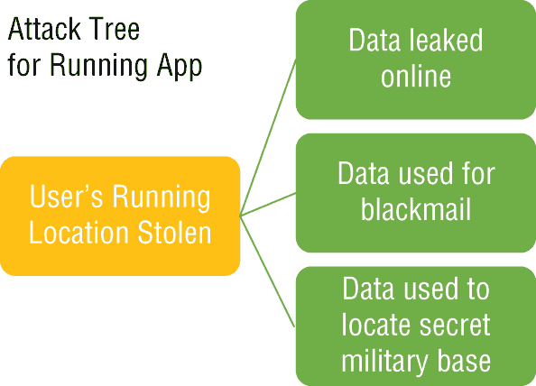

`Figure 3-6`: 跑步跟踪移动应用程序的极基础攻击树示例

所有方法的核心在于，它们能帮助你提出有价值的问题，并确保你对可能出现的问题都有良好的覆盖。对于非正式的威胁模型，只需思考你的应用程序中哪些是有价值的，以及有人可能想要窃取它（金钱、数据等）、操纵它（为了尴尬、拒绝访问、炫耀等）、破坏它、滥用它等。写下所有问题和答案；这将成为你的关注点列表。它们尚未被验证为风险。


# 威胁建模与风险管理

一旦你有了关注点列表，你就需要评估哪些风险的可能性更大（或更小），哪些风险可能需要对你的应用程序进行安全测试（以查看其是否有漏洞）。你还需要评估哪些更重要或更不重要；并非所有风险都是同等的。消除任何看起来不可能或对你的公司或应用程序不会造成损害的关注点。有时在头脑风暴过程中，人们会提出一些并不适用的情况。这没关系，但那些不会进入最终的威胁列表。

根据剩余项目发生的概率以及如果发生会造成的损害程度，将它们全部评为高、中、低。现在你有了一个威胁列表（经过验证的关注点列表）和风险列表（高/中/低评分）。

> **注意**：你也可以使用通用漏洞枚举（`CVE`）评分系统，或 `1–10`。只要你和你的团队使用相同的系统，任何对你们有效的方法都可以。

当你有了风险列表以及每个风险的重要性（评分）后，你需要制定计划。你会缓解（修复/移除）某些问题吗？你会通过记录它们并监控它们以观察是否会恶化来管理某些风险吗？你会接受某些风险（记录你将不采取行动并对此接受）吗？也许某些风险极不可能发生或仅构成微小威胁？为什么要为令人担忧的事情花费资金呢？在做出所有决策后，你可能需要为你的项目添加安全需求列表。这是你必须与业务部门和风险管理团队讨论的内容。

整个威胁建模过程都应该记录，特别是你在最后做出的决策，并获得管理层的签字。这些决策必须由管理层或具有此类重大决策权限的人做出。软件开发人员无法“接受风险”，作为安全工程师可能也无法；你可能需要 C 级执行官来接受高于 `medium` 或 `low` 级别的风险。确保你获得了该文档的签名。如果未来发生安全事件，或者当你要求其他团队工作以缓解问题而他们拒绝了你的请求时，可以使用它。

如果你正在进行迭代设计，你可能需要进行多次较短的威胁建模会议，针对新功能或现有功能的大型更改。如果你采用的是大型瀑布式方法，一次彻底的会议就足够了（假设之后没有重大变更）。你需要为你和你的组织做出决定。

如果你是一名安全工程师，邀请 `Dev` 和 `Ops` 参加威胁建模会议将提高他们对安全的意识，而且他们会产生最奇妙的想法。这也有助于你与这些团队建立良好关系，不要错，你需要良好的关系才能很好好工作。

如果你是软件开发人员、`DevOps` 或运维人员，参与威胁建模将让你对应用程序的所有可能威胁大开眼界，而且会很有趣。这种方式发挥创意出奇地有趣，是一次极佳的学习体验。它还可能诱导你以后加入安全团队。

## 练习

1. 数据在什么时候应该加密？（选择所有适用项。）
   - 当一个 `API` 向另一个 `API` 发送数据时
   - 在关掉的虚拟机上
   - 存储在数据库中
   - 当从服务器发送到浏览器时

2. 我们可以通过哪些可能的方法确保我们使用的第三方组件是安全的？我们如何降低这一领域的风险？

3. 你应该将应用程序的密钥存储在哪里？你的应用程序应该如何访问这些密钥？

4. 列出三种类型的“密钥”。

5. 移动银行应用程序可能面临哪些潜在威胁？列出三种威胁，并根据低、中、高量级对其可能性和损害程度进行评分。

6. 列出三种可能适用于“智能”汽车的威胁。根据可能性和潜在损害对威胁进行评分（低、中或高）。

7. 列出现代框架中可能提供的五种不同类型的安全功能。

# 编程语言与框架选择

我们经常在这样的环境中工作：我们的编程语言和/或框架已经由别人选好了。我们在“DotNet 公司”或“Java 公司”工作，在短期内不太可能有人会进行任何重大变更。尽管如此，你所拥有的灵活性影响力可能比你想象的要大。让我们来看看 Alice 和 Bob 对此怎么看。

Alice 并不是技术人员，但她*确实*是一位高层高管。当她的 IT 部门告诉她，他们想将所有应用程序从 `Java Struts` 框架缓慢迁移到 `Java` 的 `Spring Framework`时，她立刻问：“这要花费多少钱？为什么？”高管关心的是底线，但 IT 部门已经做好了准备；在 Alice 加入公司之前，他们曾询问过该职位的上任高管，由于对方对这些问题没有给出满意的答复，前任就拒绝了。

IT 主管随后向 Alice 演示了关于该决策的投资回报率（ROI）的完整报告，以及一个在 18 个月内安全迁移的计划。

首先，IT 经理解释说，2016 年 `Struts` 框架中存在三个严重的零日漏洞，这给公司带来了非常高昂的代价。结果，他们发生了一次严重的安全事件，花费了超过 25 万美元，非常令人脸脸。这非常耗时间，在他们清理烂子时，项目资源被重新调配了数周。此外，当事件响应小组评估损失时，客户几乎有一周时间无法访问网站，这让客户感到非常不悦。另外两个 `Struts` 漏洞虽然没有导致数据泄露或其他类型的安全事件，但为 Web 应用防火墙（`WAF`）产品调查并创建新的自定义签名仍然成本巨大，而且他们的项目最终再次被延误。他们估计，仅在 2016 年一年，`Struts` 就让他们损失了至少百万美元，并损害了他们作为客户可信赖品牌的的声誉。他不知道如何计算声誉损害的成本。

这三个漏洞都专门与 `Struts` 框架有关，与 `Java` 编程语言无关。经过仔细的方案分析过程后，IT 部门认为 `Spring` 比 `Struts` 更安全、维护更好且更现代，他们认为从财务角度来看，将 100% 的应用程序迁移到它是值得的。

他向 Alice 汇报了他的计划：每当他们为其中一个旧应用程序添加新功能时，他们就会为项目增加三周时间将其迁移到 `Struts`。此外，所有新开发都将在 `Spring` 中进行。他们将通过聘请一位精通 `Spring` *且*安全的培训师来启动项目，以确保有一个良好的开始。他们还将为他们的新框架创建一套安全编码标准，并进行代码审查以确保其执行。

他的计划将花费 55 万美元，他估计在实施后的第一年里，通过减少安全事件和事故，可以节省下这笔费用。这也是一项极佳的投资；它将大幅减少他们的技术债。

面对眼前的这些研究结果和证据，Alice 能做什么呢？她当场批准了该项目。

当你为项目选择编程语言或框架时，你需要考虑的不仅仅是安全。尽管如此，我相信在必要时，安全部门应该有权否决某项选择（尽管他们会被要求提供替代方案）。让我们和朋友 Bob 看看更多编程语言和框架的例子。

### 示例 #1

Bob 在加拿大政府工作期间在许多 IT 公司待过。其中一些相当现代，而另一些似乎落后了，随着时间的推移积累了越来越多的技术债。当他开始第一份项目管理工作时，他所在的地方使用一种他从未听过的编程语言；即使他在网上搜索，也几乎什么都搜不到。他们还使用 `.Net`，公司在两种语言之间分 split。

当一个新软件产品项目出现时，Bob 原本认为他们会使用最新的 `.Net` 框架版本，并使用 `VB.net` 或 `C#` 作为编程语言。在与项目的技术负责人交流时，他被告知他们将使用那种奇怪而古老的编程语言，因为他们“需要确保那些程序员有活干”。他被告诉，有些程序员对工作不安全，因为他们不懂 `.Net`。

Bob 震惊了。为什么要故意制造技术债呢？那种语言甚至不受支持。Bob 与高层进行了了沟通并提出了一个折中方案：他们将使用 `.Net`，并让他们与其他已经熟悉该语言的程序员配合。前期投入有点贵，但从长远来看，这是一项伟大的投资。Bob 对项目的进展感到非常自豪。

### 示例 #2

Bob 在另一家 IT 公司工作，再次负责项目管理，发现每个应用程序都使用不同版本的 `.Net`。有些是 `4.5` 版本，而有些只有 `2`。他们必须管理这么多不同的 `SDKs`，导致运维人员对开发人员感到非常沮丧。Bob 聘请了一位顾问来看某个应用程序的安全性，顾问用一种名为 `SCA` 的工具扫描了整个代码库。顾问发现 `.Net` 的几个旧版本存在关键漏洞。Bob 最终创建了一个列出所有不安全框架版本的表格，并启动了一个新项目将它们全部升级到不含关键漏洞的版本，还制定了一项持续计划以确保它们保持在框架三个小版本之内。项目结束时，安全团队将 Bob 评为“安全冠军”，并给了他一张小证书让他贴在办公桌上。Bob 特别自豪！

### 示例 #3

Bob 曾短暂参与过一个机密项目，带领一个团队制作一种供内部分析师拆解恶意软件的工具。团队想用 `C` 语言编写，而不是 `Rust`。Bob 听过 `Rust` 更安全，因为它是内存安全的。他辩论他们应该使用 `Rust`。团队向他解释说，作为他们“买、借、建”新技术信条的一部分，他们正在重新利用来自另一个关系良好的政府的工具。那个工具已经用 `C` 编写了；如果他们的工具用 `Rust`，他们就得从头开始。他们还解释说，由于该工具仅供内部（他们自己的专家）使用，因此它是不受外部攻击者安全的。最后，他们解释说，员工中没有具有 `Rust` 经验的人，因此需要进行培训。在权衡了所有因素后，Bob 同意继续使用 `C` 而不是 `Rust`，并将决定作为项目设计的一部分进行了记录。

在选择编程语言和框架时，请确保选择的是一个受支持且可能在长期内持续受支持的。使用最新或次新的版本作为你的版本；绝不要从旧版本开始。评估它提供的安全性功能，并尝试选择一个包含你产品中所需所有安全特性的框架。永远不要选择众名的不安全、不再维护、不受支持或其他存在问题的框架。

使用 `SCA`（软件成分分析）工具验证你所选择的版本不包含任何已知严重漏洞。使用 `SCA` 工具每周扫描你的存储库，并在流水线中的每次构建中都进行扫描，以确保你不会无意中将已知漏洞引入产品中。

# 不可信的数据

在之前的章节中，我们讨论了各种类型的用户输入，以及为什么我们永远不应该信任这些输入。现在让我们来看看我们应该采取什么措施，作为今后对每种类型输入的处理计划：

1.  当你接收到来自任何来源的输入时，你将验证它是否符合你的预期——类型、大小、格式、来源——以及它是否“恰当”。我们所说的“恰当”是指根据你的业务背景它是合理的。只有你以及参与你业务的其他相关者才能根据你独特的业务背景判断输入是否恰当。
    1.  验证将在服务器端执行，而不是在你的 `JavaScript` 或客户端的其他地方执行。
    2.  如果此输入不符合你的要求，请拒绝它并发布一条错误消息，向用户清晰说明你预期什么（而不是他们做错了什么）。示例：社会保障号码格式：`999 999 999`
        1.  如果有人输入了数字以外的任何字符，拒绝它。
        2.  如果有人输入的数字过多，拒绝它。
        3.  如果有人输入的数字不足，拒绝它。
        4.  如果有人输入了特殊字符，拒绝它并作为潜在安全问题进行记录。
    3.  如果在这种必须接受特殊字符的罕见情况下，你必须对它们进行转义（escape）。务必非常小心地执行，如果可能，使用你编程框架内的函数，或为此目的目的专用的第三方组件，例如 `OWASP Java Encoder` (`github.com/OWASP/owasp-java-encoder`)。如果你的框架未提供转义功能，请仔细、彻底地测试你的自定义转义功能。

2.  如果此输入触发了事务（添加、删除、更新、购买等），你将通过检查是否传递了正确的令牌、是否填写了验证码 (`captcha`) 或用户是否通过其他方式重新进行了身份验证，来验证这不是 `CSRF` 攻击。

3.  如果此输入将输出到屏幕上，请执行输出编码，详见第 3 章。如果适用，确保你应用了正确的输出编码上下文。

4.  如果此输入将用于查询数据库，你必须使用参数化查询（使用 `MS SQL` 时称为 `存储过程`）。你绝不能将其与其他文本拼接并作为单个命令发送到数据库（有时被称为“内联 SQL”）。将输入放置在相应的参数中，然后调用`存储过程`；这种方法将中和大多数与数据库相关的注入攻击。

5.  如果用户输入将用于将应用程序引导到另一个网站，这被称为重定向（redirect）或转发（forward）。这通常被认为是不安全的。（注：原文此处存在大量重复文本，已按要求进行翻译并保留核心含义）。

# 身份验证与会话管理

如果你的系统有用户，你就必须弄清楚如何识别他们。如果是网络内部的系统，你**不应该**编写自己的身份验证功能；你应该使用网络中现有的系统（除非你有非常特殊的业务需求）。最常见的网络身份系统是微软的 `Active Directory`。然而，一些公有云提供商也提供自己的身份系统，市场上还有许多其他身份系统也可以执行此类功能。我不会建议使用某个特定的系统；你应该选择最适合你业务和技术要求的系统。其中任何一个系统都比你自己编写的要好得多（除非你从事的是这类业务，即你是一家身份或云提供商公司）。

各种身份系统之间的差异以及它们的优缺点很容易写满一本书。本节的目的是传达一个观点：你永远不要为身份创建自己的系统。始终购买现成的系统，除非你有特殊的业务需求迫使你创建自己的系统——在这种情况下，请使用成熟的协议，如 `OAUTH`。

## 会话管理

如前所述，HTTP 协议和 Web 从来并不是为了管理会话而设计的。页面的设计目标是静态的（不变的）：人们访问它们，阅读信息然后离开。正如我们所知道的，事实并非如此。当用户登录应用程序，当他们在页面之间移动时，这就是一个需要跟踪的会话。本节将讨论会话管理的策略。

会话的管理通过在浏览器和 Web 服务器之间来回发送某些（通常称为 `session token`）来重新验证它是同一个用户和同一个会话。无论用户是否登录，会话都会被跟踪，但当用户登录或注销时，该会话会被销毁并创建一个。我们使用 `session ID` 或 `session token` 来跟踪会话，并在每次请求中来回传递（参见图 4-2）。

`Session ID` 和 `session token` 在行业中通用。Session ID 传递在安全的 cookie 中（使用之前在第 3 章中详细说明的设置），并且不会通过 URL 参数传递。Session ID 仅用于管理会话；为了效率，请不要将它们用于其他信息（如账户 ）。代码是免费的；多写点即可。

以下是来自 OWASP Cheat Sheets 团队关于会话管理的更多指导：

*   `Session IDs` 长度至少应 128 个字符。
*   `session ID` 应该是不可预测的（随机的），以防止猜解攻击。使用广泛认可的随机数生成器；不要为此编写自定义代码。用户每次登录时都应该接收一个新的 `session ID`。

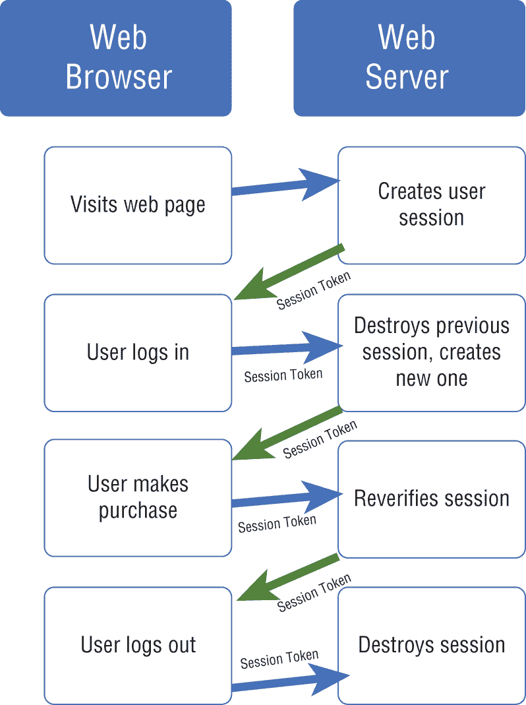

**图 4-2**: 会话管理流程示例

*   如果你的框架中存在内建的会话管理实现，请使用它。
*   `session ID` 应该有一个过期日期和或时间；它不能永远存在。

## 边界检查

在 1996 年，Aleph 编写了一篇名为《为了乐趣和利润破坏栈》的论文，详细描述了攻击者如何利用此注入 shell 代码，这被称为远程代码执行。

随着编程语言的演进，所有新的编程语言的创建都是为了内存安全；然而，许多非内存安全的语言仍在生产环境中使用。你可能会奇怪为什么。如今的许多生产系统都是巨大、复杂且脆弱的。这通常被称为技术债；然而，在没有更多细节的情况下，我们无法预判每种情况。替换这样一个复杂系统的成本可能超过其价值，此类大型项目的风险将非常高，有时业务部门会决定“接受这种风险”。其他时候，业务部门并不完全理解风险，在这种情况下，安全团队必须向高层进行清晰的沟通。

尽管如此，如果你正在使用非内存安全的语言，无论情况如何，我们都有遵循一些硬性规则：

1.  对每一个输入、每一次都进行边界检查。非常仔细且反复地测试此功能。
2.  如果你的语言有可用的框架覆盖或依赖项可以为你测试边界，请使用它。
3.  对每一个输入、每一次都进行类型检查。也要仔细地测试此功能。
4.  如果可能，为你的边界检查创建单元测试，创建一个在每次新检查运行时的回归测试系统。
5.  如果可能，进行代码审查并验证每个输入都经过了适当的测试。
6.  如果可能，聘请渗透测试并让他们留出充足的时间测试你的系统输入边界。
7.  如果可用，添加编译选项来检测此类问题。

一种更高级、额外的保护层是添加运行时保护，例如地址空间布局随机化 (`ASLR`)、数据执行保护 (`DEP`)、栈保护 (`Stack Canary`) 等。这些都是通过改变内存使用方式以防止此类攻击的保护措施。

如果你正处于为新项目选择编程语言的情况下，我敦促始终选择内存安全的语言，如果可用的话。

## 身份验证 (AuthN)

如前所述，认证是确保你的用户确实是你认为的那个个人。而不是另一个与 Alice 同名或长得像 Alice 的人，而是由你的系统识别的*那个* Alice。认证和授权通常作为一项活动结合在一起，但需要注意的是，认证总是*首先*执行的。我们这样做是为了确保在允许他们访问系统中的任何内容（`AuthZ`）之前，我们知道正在处理的对象是谁。

在第 1 章中，我们讨论了认证的三个不同因素（你拥有的、你所是的以及你所知道的）。现在，你需要弄如何在你的应用程序中使用这些因素来验证用户的身份。

你有几种选择：

1.  使用来自第三方的预现有在线互联网身份服务来验证你的用户。加拿大税务局在加拿大的人报税时，使用银行登录身份来验证他们的身份。许多在线社交网站允许用户使用其 Twitter、LinkedIn、Facebook、Google 或 Microsoft 账号凭据进行验证。

    **优点：**
    *   实现速度非常快。
    *   你不需要负责维护或测试代码。
    *   构建这些系统的团队可能有更多的时间和资源来确保这些系统的高度安全性。
    *   某些用户可能更信任这种方法或认为它更方便。

    **缺点：**
    *   某些用户不想在公司之间共享数据，倾向于为每个网站创建一个单独的登录。
    *   某些用户可能不属于这些第三方网站中的任何一个。
    *   使用此类服务可能涉及费用。
    *   这些服务可能会从你的用户那里收集个人信息和元数据。
    *   如果第三方系统发生泄露，将影响到你的网站。

2.  购买或寻找一个免费库或软件系统作为你系统的一部分，为你执行身份功能。

    **优点：**
    *   比自己编写实现得更快。
    *   你不需要负责自己设计系统，只需负责实现。


* 构建这些系统的团队可能有更多的时间和资源来确保这些系统的高度安全性。
* 你托管数据，这可能被某些客户偏好的。

**缺点：**

* 使用此类系统可能涉及费用。
* 如果在第三方系统中发现漏洞，将影响到你的网站，并且当补丁可用时，你需要用补丁更新你的系统。
* 你托管数据，这意味着你对此负责。

### 3. 从零开始编写自己的认证系统

如之前所述，这通常不建议这样做。公司会创建一个产品来执行此功能；项目团队中的单个软件开发人员应该始终使用已经存在的、可靠的系统。

## 授权 (AuthZ)

授权是确定用户在你的系统中可以访问或不能访问的内容，而访问控制则授予（或拒绝）该访问。Alice 被允许查看另一个团队的文档吗？Bob 可以删除他管理的系统上的另一个用户吗？这类问题通过授权和访问控制来回答。

确定访问的最流行方法是基于角色的访问控制，简称 `RBAC`。它的意思是“根据某人在你的系统中被分配的角色来决定其访问权限”。在工作中，你可能是某人的老板，但在计算机系统中，你可能只有普通系统访问权限，而你的员工可能有管理员权限，因为那是他们在系统中执行的角色（他们是管理员）。

让我们通过 Alice 和 Bob 的例子更深入地了解这一点。

当 Alice 第一次晋升为管理层时，她对在工作中拥有更多特权权力感到非常兴奋。她有一个报销账户、50,000 美元的签字权限，以及位于办公大楼顶层的一间办公室。然而，有一天，Alice 正在使用公司的文档管理系统，她发现了一个她无权访问的文档目录。她感到困惑和恼怒。她拨了 IT 部门的电话，他们解释说在该目录下保留了风险清单，只有 IT 安全团队和首席信息安全官（`CISO`）有访问权限。甚至 CEO 也没有权限；她只接收来自 `CISO` 的简报。他们解释说，Alice 不仅没有*知情需求*，她在文档管理系统中的账户也没有被分配“安全运营”的角色，因此他们无法授予她访问权限。由于她处于安全组织之外，她需要获得 `CISO` 的许可才能添加该角色。Alice 说她对这个答案很满意。她只是想了解为什么系统的某部分会被限制。这个解释对她很有效；她告诉他们不用再为她创建工单了。

去年，Bob 管理了一个创建新会计软件的项目。他的团队成员有 Sarah（软件测试员）、Emily（软件开发人员）和 Jennifer（数据库管理员，`DBA`）。他们在项目和公司内部扮演不同的角色，因此需要不同的权限集和访问权限。Emily 作为软件开发人员，不需要数据库所有者（`DBO`）权限，但 `DBA` 确实需要。Bob 作为项目经理，从不需要访问 Web 服务器或数据库，因此他没有在系统中申请这些权限。

当需要请求访问权限时，Bob 要求只给他普通用户访问权限，以便他看到应用程序的运行，同时他为团队请求了以下权限：

* **软件测试员 (Sarah)：** 应用程序的普通访问权限，以及在她的 PC 上运行所有测试自动化工具的能力。她还需要 DevOps 流水线软件的写入权限，以便她能向流水线添加测试。
* **软件开发人员 (Emily)：** 应用程序访问权限、开发环境的访问权限、在开发数据库中创建和运行存储过程的能力，以及运行 DevOps 流水线的权限，但不能对其进行更改。
* **数据库管理员 (Jennifer)：** 以所有者级别访问数据库服务器。无法访问 Web 服务器、流水线，甚至无法访问代码。Jennifer 不需要这些，因此没有提出请求。

在项目开始时，Emily 希望获得数据库服务器、Web 服务器和流水线的更多权限，因为她是一个软件开发人员，谁不想访问所有内容呢？但安全团队根据她在项目中的角色拒绝了她。安全人员向她解释说，通过限制仅访问她需要的系统，如果她的机器上发生任何泄露、勒索软件或其他类型的恶意软件，影响将局限在她拥有的角色和访问范围内。Emily 不情愿地同意了。

这种项目情况是 `RBAC` 极其有用的地方。系统管理员可以轻松地为 Bob 的每个项目成员分配正确的角色，以确保他们仅获得完成工作所需的授权访问。系统管理员只需进入目录系统，为每个团队成员分配角色，并将其应用于项目资源上。

## 基于权限的访问控制 (PBAC)

`酌量访问控制 (DAC)` 意味着信息/系统/资源的所有者可以根据自己的意愿，向相同身份系统的他人授予或移除访问权限（例如在同一个网络上、同一个照片共享网站的成员等）。

当鲍勃第一个孙子出生时，他拍了数百张照片，并将它们全部添加到他的在线云存储账户。当时，系统为他提供了选项，可以授予系统上的特定用户访问其照片的权限，或者不授予。鲍勃给了整个家族访问权限，通过他们的用户名（电子邮件地址）逐个添加。鲍勃的整个家人开始使用该文件夹共享他们所有的家庭照片。几年后，家里发生了离婚，鲍勃记得他曾给每个人开启了该文件夹的读/写权限。为了防起见，他主动决定取消了那位前家庭成员的访问权限。

与鲍勃工作中基于角色的访问控制不同，当某人更改角色时，DAC 系统不会进行更新。它们基于系统身份，而不是基于角色。

`强制访问控制 (MAC)` 根据资源的敏感性级别和尝试访问的用户的批准，授予对信息和系统的访问权限。

例如，莉丝没有特机密权限，但鲍勃有，因此在这样的系统中，鲍勃将能够访问包括特机密内的所有系统和数据。莉丝则不会获得此类访问。她只有公共访问权限，这意味着她只能访问公共记录。

MAC 通常用于需要极高水平安全保障的系统；例如，政府军事系统或数据集。

`基于权限的访问控制 (PBAC)` 基于权限。用户被授予对信息和系统的某些权限，当用户尝试访问系统内的某些内容时，访问控制机制会在提供访问之前验证他们是否已获得权限。权限类型可能包括 `READ`、`WRITE`、`CREATE`、`UPDATE`、`DELETE`、`PRINT`、`REBOOT` 等。

在鲍勃家里离婚后，他决定更改照片的访问控制系统；他授予了每个人 `READ` 和 `WRITE` 权限，但之后只有他拥有 `DELETE` 和 `UPDATE` 权限。

# 错误处理、日志记录与监控

所有的应用程序错误都应该被捕获并优雅地处理；屏幕上永远不应该出现堆栈跟踪或数据库错误。这不仅是为了看起来专业人士，也是为了防止攻击者在创建攻击时获得可用于对我们的额外信息。

当错误发生时，应用程序永远不应进入未知状态；它应该始终回滚任何正在执行的事务，并关闭它可能打开的任何内容。这种情况也应该始终记录日志，这样如果发生事件，响应人员在调查时就有东西可以处理，并且审计人员可以验证系统当前及过去一直运行正常。如果错误是无法解释的或其他具有潜在恶性的，你还应该触发安全警报。

当我们说“进入未知状态”时，我们的意思是异常（程序错误）没有被捕获，导致程序无处可去，或者不确定自己应该做什么。当错误发生时，我们在 `try/catch` 块中“捕获”（catch）它，然后通过采取特定行动来“处理”它。可能的处理方式包括发布错误信息、记录错误、发布警报、回滚事务或将用户注销系统。在你的每个应用程序中，都应该有一个通用的或全局的错误处理器，来捕获任何未被处理（捕获）的内容。

## 错误规则

以下错误处理规则列表。遵循这些规则以确保你的应用程序永远进入未知状态。

* 所有的应用程序错误都必须被捕获并处理；它们永远不能处于未处理或未捕获的状态。
* 强烈建议建立全捕获机制（全局异常处理），以确保意外错误始终能得到妥善处理。
* 内部信息、堆栈跟踪或其他崩溃信息绝不应向用户或潜在攻击者泄露。
* 错误信息应尽可能少地显示。确保它们不会“泄露”信息，例如关于服务器版本或补丁水平的细节。
* 如果发生登录错误，不要显示是用户名还是密码错误，因为这允许用户名枚举。
* 始终确保“安全失败”（fail safe）或“关闭式失败”（fail closed），不要不要“开放式失败”（fail open）或进入未知状态。如果发生错误，不要授予访问权限或完成事务；始终回滚。
* 与安全相关的错误（登录失败、访问控制失败、服务器端输入验证失败）应发布系统警报。理想情况下，日志文件将馈入入侵防御/检测系统或应用程序 SIEM。这可以通过对你的应用程序运行漏洞扫描器来测试；它应该导致触发记录的事件。
* 当你使用来自外部来源（外部系统/用户输入，而非来自应用程序本身）的信息记录错误时，请保护你的日志免受攻击：
    * 对来自外部来源的内容进行编码
    * 移除所有不可打印字符（CR、LF、TAB 等）
    * 限制记录信息的最大长度，以防止溢出攻击。

## 日志记录

日志记录是你的应用程序将内部发生事件的详细信息写入一个非常非常长的文档（称为日志文件）。它几乎报告的所有内容都会非常无聊，这就是为什么大多数人不会坐在那里直接读取日志。“在此时间为此用户将此记录写入数据库”和“此用户在此时间成功登录”并不是什么动人的故事。日志文件通常以 GB 和 TB 为单位，因此人类无法跟上；这就是为什么行业发明了日志读取器、SIEM 和正则表达式。

日志读取软件打开巨大的文件并允许你进行搜索。Unix 操作系统允许使用 `grep` 命令通过正则表达式（regular expressions）搜索你的日志。这在发生事件且你正在查看特定时间段或非常特定的事件时很有帮助。这并不适合日常使用。

安全信息和事件管理 (SIEM) 系统是一种软件，它会收集你所有的日志，然后尝试将其转换为人类可读的形式，并向你安全运营中心 (SOC) 的安全工程师报告它认为他们应该调查的任何情况。大多数公司都有这样的系统。如果你的公司有一个，你的应用程序日志应该是 SIEM 可以读取的。

## 监控

监控既是指关注系统中正在发生的行为，也是使用 IT 工具自动化的检查故障、减速、崩溃以及任何被认为潜在危险或问题的异常的过程。当我们在书中说“监控”时，指的是使用监控工具。

你的应用程序应该被监控，就像你的网络也应该被监控一样。如果你的应用程序崩溃了，你希望工具能立即通知你；你不希望通过社交媒体通知来发现应用程序的重大问题。

## 何时以及记录什么

* 系统日志不得包含敏感数据或个人身份信息 (PII)。
* 登录失败和错误应当被记录，成功登录也应当记录。
* 暴力破解尝试应当被记录（在本书定义为在 1 分钟内连续登录失败 10 次或以上，或在 1 小时内失败登录 100 次或以上）。
* 所有与安全相关的事件，例如用户身份验证、用户在多次登录尝试失败后被锁定、未说明的错误或输入验证错误。
* 你的日志应该能够被 SIEM 消费，并自动传输到那里。

你的日志中必须包含以下信息：

* 发生了什么类型的事件（为什么该事件与安全相关/事件名称）
* 事件发生的时间（时间戳）
* 事件发生的地点（URL，包括子域名）
* 事件的源头（IP 地址）
    * 如果 IP 来自 `X-Forwarded-For` 头部，不要忘记对其进行适当的验证；它可能被篡改过。
* 事件的结果
* （如果可能）与事件相关的任何个人、用户或主体的身份

当然，你可以记录比这里列出的内容更多的日志。

### 使用和保护你的日志

* 日志文件和审计跟踪必须受到保护，备份也是如此。
* 理想情况下，所有日志都保存在相同的空间、相同的格式中，以便 SIEM 或其他安全工具轻松消费。
* 只有授权人员应该有访问日志的权限。
* 对日志的所有访问（如果有人打开它们、编辑它们等）也应该记录记录在你的网络日志中。
* 日志应当被监控。
* 日志应当以加密格式存储。
* 日志应当允许你的应急响应团队访问，且该团队应该验证保留的日志历史，以确保他们在需要对事件进行调查时能够获得预期的数据。
* 日志应当存储在安全服务器或其他安全区域。
* 日志文件必须纳入你组织的整体备份策略中。
* 日志文件和介质必须以你处理任何敏感信息的方式进行删除和处置。

## 练习题

1. 你什么时候应该在网络上使用自己的身份（用户账户）而不是服务账户？为每种情况给出两个例子并解释你的理由。
2. 解释为什么在存在 `RUST`（一种内存安全的语言）的情况下，`C` 和 `C++` 在我们的行业中仍然被广泛使用的可能原因或情况。尝试思考两个或更多。
3. 你最喜欢的编程语言和/或框架是什么？为什么？
4. 你认为哪种编程语言和/或框架是最安全的？为什么？
5. 我们为什么需要保护用户会话？
6. 如果攻击者在他人登录在线银行时获取了其用户会话，攻击者可以做什么？
7. 如果你要向一位非技术性的同事解释“身份验证”（authentication）与“授权”（authorization）之间的区别，你会如何解释？
8. C 级高管是否应该在你的网络和其他计算机系统中拥有特殊权限？如果是，为什么？如果不是，为什么？如果你给他们任何权限，你会给他们什么类型的权限？
9. 网络系统管理员是否应该在你的网络和其他计算机系统中拥有特殊权限？如果是，为什么？如果不是，为什么？如果你给他们任何权限，你会给他们什么类型的权限？
10. 帮助服务台员工是否应该在你的网络和其他计算机系统中拥有特殊权限？如果是，为什么？如果不是，为什么？如果你给他们任何权限，你会给他们什么类型的权限？
11. 你的老板告诉你开启日志记录和监控成本太高了。你如何从安全的角度解释它的价值和重要性？写一段话来说服你的老板。记住要确保你用你老板能理解的方式解释对业务的潜在风险（他是一个聪明但不过分技术的人）。如果你说话得太深奥，让对方听不懂，你将无法通过这一题，也无法说服你的老板。

# 第 5 章：常见陷阱

本章将涵盖前面的章节未涉及的常见陷阱。我深信，当我们试图学习如何保护软件时，记忆许多类型的漏洞或破解统计数据并不是利用时间最有效的方式；相反，我们需要学习如何防御所有问题。

尽管如此，尽管我们在第 1 章到第 4 章中学习了所有的防御措施，但仍有一些特定情况需要特别注意：常见且具有破坏性的漏洞，但我们尚未学习特定的防御方法。这就是我们在本章中涵盖的内容。

## OWASP

开放 Web 应用安全项目，通常称为 `OWASP`，是一个致力于帮助每个人创建更安全软件的全球社区，可以在 `OWASP.org` 找到。他们在全球范围内有 300 个分会，举办免费的每月活动来教授应用程序安全和其他有用的话题。他们每年举办多次国际和区域性会议、提供深入且独特的培训机会、项目峰会，并且他们是 100 多个开源项目的创建者，推动了应用程序安全行业的发展。他们是 `Zed Attack Proxy`（最常用的 Web 应用代理和安全扫描器）以及其他几个工具、文档甚至自己的书籍的创建者。OWASP 前十（OWASP Top Ten）是一个最关键 Web 应用漏洞列表，每隔几年更新一次。它详细说明了每种漏洞、风险和缓解措施。它不是标准，也不是所有 Web 漏洞的完整列表。它由一个志愿者团队创建，利用专业经验和行业提供的数据来寻找危害最大且最普遍的 Web 应用漏洞。如果你想开始成为渗透测试员的之旅、作为程序员学习针对这些漏洞的防御方法，或者在工作中提高网络安全意识，这是一份非常有帮助的文档；它内容非常丰富。某些漏洞可以通过自动化工具发现，而另一些则需要人类参与。

### 措施

需要代码审查 (`SAST`) 和测试 (`DAST` 和/or `IAST`)。

### 3. 敏感数据泄露

**定义**

敏感或私有数据被暴露或泄露给本不应访问的用户或系统。这是由于保护措施失效、标记错误或其他对数据的处理不当引起的。

**缓解措施**

对您的数据敏感级进行标记。遵循第 3 章 中“保护敏感数据”章节中所述的最佳实践。

**措施**

需要代码审查 (`SAST`) 和测试 (`DAST` 和/or `IAST`)。您的组织可能还要求审计，以验证您是否符合相关法规，如 `GDPR`（欧盟）或 `ISTG`（加拿大）。

### 4. XML 外部实体 (XXE)

**定义**

某些 XML 解析器允许加载文档外部定义的实体（即外部实体）。攻击者利用这一点，通过其构造的恶意 XML 文件指示脆弱的 XML 解析器向内部或外部系统发送请求（例如 `HTTP/FTP/...`），以执行操作或读取数据。

本质上，这是 XML 解析器的配置错误，但它是如此普遍且具有破坏性，以至于获得了一个独立的类别。

**缓解措施**

不要使用 XML（使用 `JSON` 或其他更现代的）。如果可选，请在所有 XML 解析器上禁用这些功能（XML 外部实体和 DTD 处理）。

**措施**

审计所有 XML 解析器以检查此问题。添加专门的安全单元测试套件，以确保实例化的任何 XML 解析器都经过正确配置。

针对此问题进行手动测试。更多细节将在本章的“反序列化”章节以及第 6 章“测试与部署”中提供。

### 5. 访问控制失效

**定义**

访问控制和/或授权 (`AuthZ`) 实现中的错误，导致对系统和/或数据的不当访问或权限授予。

**缓解措施**

遵循第 4 章 中“身份”和“授权”章节列出的最佳实践。

**措施**

需要代码审查 (`SAST`) 和测试 (`DAST` 和/or `IAST`)。

### 6. 安全配置错误

**定义**

任何配置不当并导致安全漏洞的系统。

**缓解措施**

遵循您网络中每个产品的加固指南。实施深度防御策略，以在遗漏某些项时最小化损失。如果可能，聘请对每个系统都有经验的人进行实施和/或审计。

**措施**

需要配置审计和变更管理（最好是自文档记录的），以及测试 (`DAST` 和/or `IAST`)。

### 7. 跨站脚本 (XSS)

**定义**

欺骗应用程序在用户的浏览器中运行攻击者的 JavaScript。

**缓解措施**

输入验证、输出编码、内容安全策略 (`CSP`) + `x-xss-protection` 安全头部。如第 2 章、3 章 和 4 章 中涵盖的内容。

**措施**

需要代码审查 (`SAST`) 和测试 (`DAST` 和/or `IAST`)。

### 8. 不安全反序列化

**定义**

攻击者将序列化对象替换为自己的恶意的序列化对象。在执行攻击时，该对象会被反序列化。

**缓解措施**

尽可能避免使用序列化。如果不可避免，请勿接受来自未知源的对象，或仅使用来自批准/接受列表的原始（不可变/基础）数据类。

**措施**

此列表很长，将在本章的“反序列化”章节中进行详尽讨论。至少需要代码审查 (`SAST`) 和测试 (`DAST` 和/or `IAST`)。

### 9. 使用已知漏洞的组件

**定义**


在应用程序中包含含有已知安全漏洞的库、依赖项或组件，可能在您的应用程序中创建相同的漏洞。

## 缓解措施

正如我们在第 6 章“软件成分分析 (`SCA`)”中将讨论的那样，使用软件成分分析 (`SCA`) 工具来验证您的组件是否已知漏洞。

## 措施

在您的代码库和构建流水线/过程中使用 `SCA`。

## 10. 日志记录与监控不足

### 定义

由于日志和/或监控系统不当、配置错误或缺失，导致攻击和其他安全事件或事故未被检测/防止/记录。

### 缓解措施

遵循第 4 章中“错误处理、日志记录与监控”章节中的最佳实践。

### 措施

需要对这些系统进行审计和测试，以确保事件得到适当及时的检测。

## 之前未涵盖的防御与漏洞

以下是针对书中之前未涵盖的常见漏洞的特定防御。我们将涵盖：

* `CSRF`
* `SSRF`
* 反序列化
* 竞态条件

### 跨站请求伪造

跨站请求伪造 (`CSRF`)，被亲切地称为“Sea Surf”，在书的前面简要讨论过，但它是一个重要问题，遗憾的是仍然相当常见，因此我们将更详细地回顾它。在几个编程框架在较新版本中直接构建了自动化防御之后，`CSRF` 才最近从“十大漏洞”中移除。这充分说明行业已经调整了一些框架来帮助消除这种漏洞。

与 `XSS` 不同，`CSRF` 的目标是欺骗用户点击链接，从而针对用户已登录的 Web 应用执行攻击者的请求。

`CSRF` 与 `XSS` 不同，其目标是欺骗用户点击链接，从而针对用户已登录的 Web 应用执行攻击者的请求。它利用的是应用程序本身，而不是攻击者的代码。它被称为“生存”是因为攻击者正在利用凭据。

尽管如此，`CSRF` 有时会与跨站脚本 (`XSS`) 混淆，因为它们都使用了“跨”字。让我们讨论一下异同以确保你理解。

*XSS 攻击* 是欺骗应用程序在用户浏览器（客户端）中执行*攻击者的代码*。它只适用于 `JavaScript`，并且可以反射到 Web 服务器、存储在 DOM 中或存储在数据库中。虽然 `CSRF` 的目标与 `XSS` 攻击相似，都是为了攻击者的利益控制应用程序，但在 `CSRF` 中，攻击利用应用程序自身的功能来执行。这两种攻击毫无关联，尽管名称中都使用了“跨”字。`CSRF` 流程图见图 5-1。

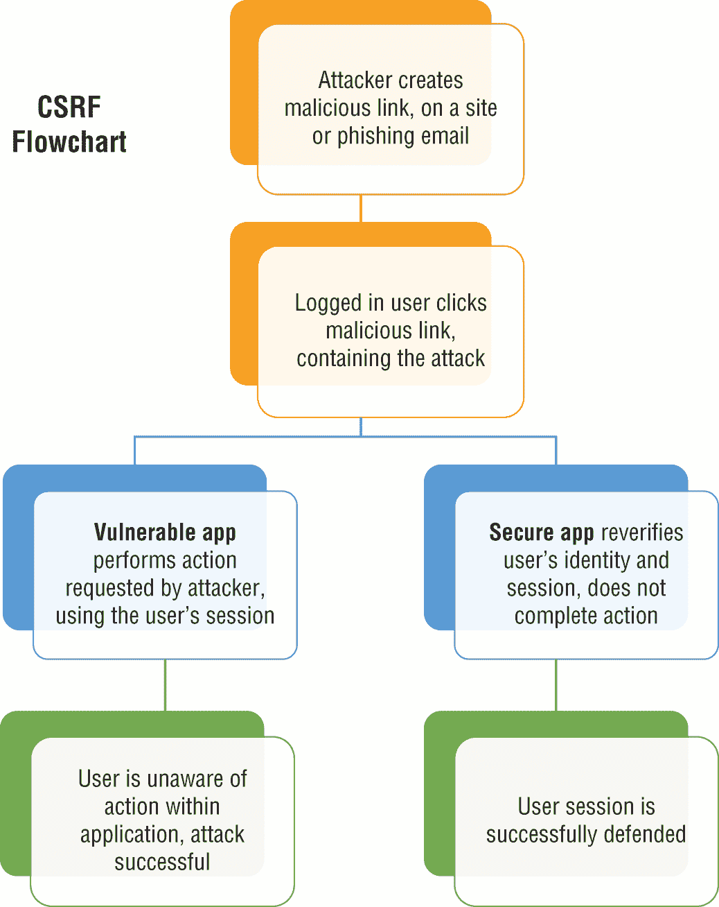

**图 5-1**: CRSF 流程图

如果你记得在第 2 章（`c02.xhtml`）讨论 Alice 登录她喜爱的服装网站时，我们提到过有很多情况会让用户保持登录状态很长时间（几小时甚至几天或几个月），这正是 `CSRF` 试图利用的情况。尽管我们在第 4 章（`c04.xhtml`）“会话管理”章节中讨论了重新生成会话，用户仍随心所欲，而我们在后台刷新或销毁会话，以确保他们在线使用应用程序时的安全。

`CSRF` 攻击是攻击者欺骗用户点击包含攻击的链接，或者攻击包含在恶意网站中。攻击尝试在用户不知情或许可的情况下针对 Web 应用执行操作。如果用户已登录该网站（如 Alice 在线购物），且该网站容易受到此类攻击，网站将执行交易（通常是某种盗窃）。

许多现代框架会自动为你传递令牌（`token`），以防御此类攻击（Java、.Net、Ruby on Rails），而另一些框架将其作为一种功能提供，但作为开发者，你必须选择使用它。有关如何实现它的详细信息，请访问该主题的 OWASP 释义表（Cheat Sheet）。

尽管如此，在防御此类攻击方面，你拥有的选项比只有令牌更多；任何能够重新验证用户并确保他们意识到正在发生的操作的方法都是可以接受的；除了使用令牌之外，重新登录或填写验证码是最常用的选项。

防御此类攻击的次要防御层是在执行某操作之前，验证 `referrer` 请求头是否来自你的网站，而不是其他网站或电子邮件。建议同时执行两种防御措施。

## 服务端请求伪造 (SSRF)

服务器端请求伪造（`SSRF`）攻击涉及恶意攻击者添加或更改 URL 参数，导致能够指令服务器，或获取他们不应拥有的信息或访问权限。攻击者可以利用此调用内部 API 或访问数据库。易受到此类攻击的应用程序就像一扇直通你边界防御之后网络的窗户；这是非常恐怖的。

这种类型的攻击通常与其他漏洞结合使用以造成更大的损害，这意味着我们不仅要努力直接防御它，还要添加其他缓解措施在受到漏洞时减少损害。SSRF 流程图如图 5-2 所示。

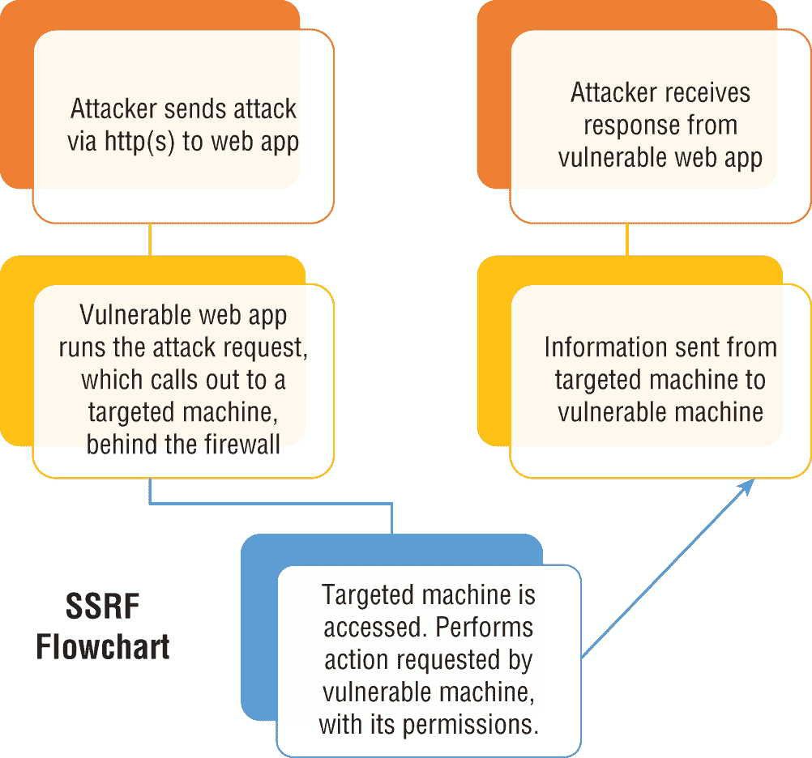

**图 5-2**: SSRF 流程图

此类攻击的防御（预防）和缓解（攻击发生时的损害减少）是分层的：

### 防御措施

1. 不要使用 URL 参数构建应用程序或网络内的调用，因为它们很容易被操纵。如果可能，完全避免使用它们。
2. 如前面的章节，进行输入验证（使用批准或接受的列表）。
3. 如果你的应用程序必须调用其他网站，请创建一个允许的域名批准列表。拒绝所有其他请求。
4. 如果你的技术栈支持请求过滤，请使用它。就像输出编码一样，这项技术可以确保你的 `HTTP` 响应不包含任何有害内容（如 SSRF 攻击）。如果你的技术栈不可用，请确保你的响应不包含请求中发送的内容（用户输入）。在将其添加到响应之前应对数据进行验证；没有必要原封且未经验证地反射该信息。
5. 禁用未使用的 URL 方案，如 `file://`、`dict://`、`ftp://` 和 `gopher://`。如果不使用它们，请禁用它们。
6. 为此漏洞创建自定义的单元测试。
7. 聘请专业的安全测试人员对你所有的应用程序进行该漏洞的测试。

### 缓解措施

1. 在网络和应用程序上采用零信任设计，以确保应用程序对网络和其他区域及应用程序的访问受到限制。
2. 对 Web 服务器和应用程序服务帐户的访问应用最小权限原则，确保即使应用程序被控制，它对资源的访问也会减少。
3. 遵循托管 Web 应用的每个 Web 服务器、PaaS 或容器的加固指南。始终遵循所有加固指南。
4. 像处理其他错误输入一样处理尝试攻击：发布模糊的错误信息。永远不要在屏幕或响应中反射攻击信息。
5. 确保所有内部服务都需要身份验证（例如，旧版本的 `MongoDB` 访问数据库不需要身份验证或授权）。

现有的商业产品可以帮助进一步防御此类攻击。如果你担心其他防御不足、需要极高的安全保证，或者你认为自己正被高级对手针对此类攻击时，请与你的安全团队联系。

随着关于它的信息越来越多，这种攻击在过去几年中变得越来越常见。尽管它没有列入“十大”名单，但它足够常见且危险，值得专门提及。

## 反序列化

序列化是将数据从内存（对象）转换为文件或流的过程，通常是为了进行传输或存储。反序列化是在数据传输后或再次需要时将其恢复到原始状态（内存/对象）。这通常发生在 `XML`、`JSON` 和 `Java` 中，但在其他几种情况和技术中也可能发生。

如果攻击者可以将数据的序列化版本替换为恶意内容，可能会导致毁灭性的攻击。这种情况被称为不安全反序列化。

避免此问题最简单的方法是不使用此功能。如果你不序列化任何内容，就不需要反序列化它。这听起来像是一种简化，确实如此。这并不总是可能的，但如果你可以，请避免任何潜在的风险情况。

如果你无法避免序列化需求，请不要对数据进行对象序列化；而是使用数据解析格式（`JSON`、`XML`、`YAML`）将数据加载到对象图中。

如果你必须接受序列化对象，仅接受来自受信源的对象，并且仅接受包含原始类型（定义为编程语言部分的类型，如 `int` 和 `char`）。

以下是针对序列化对象的注意事项：

* 永远不要从不可信的发送者接收序列化对象。该发送者应在潜在发送者的批准列表中。永远不要从用户接收序列化对象。
* 使用带有严格类列表的预读对象流进行防御性反序列化。
* 仅反序列化签名对象并验证校验和，或使用带有 `SHA256` 哈希的 `HMAC`。
* 仅接受原始（不可更改）数据类型。

`OWASP.org` 解释了如何安全处理来自不可信源的序列化对象的步骤；然而，由于这是一个不断变化的领域，这里将不再概述。

这里的核心教训是尽可能避免序列化/反序列化。如果你必须接受序列化对象，仅接受来自受信源的对象。如果你无法遵循此建议，请极其谨慎。

## 竞态条件

竞态条件发生在软件操作取决于时机，线程应该是同步设置的，但事实并非如此。或者应该锁定资源，但并没有。或者它应该在执行下一步之前等待其他事情发生，但程序员忘记添加该检查。

想象 Alice 想要编辑公司共享驱动器上的一个文件。她打开了文件，文字处理软件在她打开时对其进行了锁定。如果稍后 Bob 想打开它，它将允许他以只读格式查看文档，这样他就不会覆盖同事的更改。

但如果文字处理软件没有对文件锁定呢？这种情况发生的情况比你想象的要得多。

例如，假设在下班回家的路上，你去超市买晚饭的食物。在你离开公司之前，你检查了储蓄账户，发现里面有 60 美元。当你正在买东西时，你的配偶支付了几笔账单，导致账户里只剩下 10 美元。当你去超市结账时，你的账户已更新为新余额 10 美元，而你的卡被拒绝了。虽然这种情况显然不尽理想，但它是合逻辑的。

现在想象一下有人故意试图创建一个竞态条件（`race condition`）。他们使用一张在线购物卡，充值了资金，就在他们点击“购买”按钮的同时，他们也尝试将钱转到另一个账户。理想情况下，银行软件应该对账户进行锁定，直到交易 #1 完成，然后再尝试交易 #2。交易的顺序将根据先接收到哪一个请求来决定。

银行已经预到了这种情况；自从货币发明以来，人们一直试图偷钱。然而，竞态条件适用于系统中任何依赖于其他操作的更改：

* 竞争资源（编辑文档）
* 更新数值（银行余额）
* 任何一项活动的时间取决于另一个条件的情况

最简单的缓解措施是对任何将要更改的记录使用锁，直到操作完成为止。如果一个交易依赖于另一个交易，请在启动下一个交易之前验证上一个交易已完成。在编程时考虑你的依赖关系；使其成为你设计的一部分。如果交易未完成，则回滚该交易，在适当的情况下发布错误，并执行“失败关闭”（`fail closed`，相对于“失败开放”或进入未知状态）。

竞态条件的主要原因是设计中遗漏了某个更改对另一个更改的依赖关系。威胁建模可以帮助你发现竞态条件，并在它们变成问题之前防止它们。在设计应用程序和其他系统时，请务必映射出任何依赖关系。

## 结语

除非你正在为该主题准备演示稿，或者要去参加异常激烈的职位面试，否则没有必要背诵 OWASP 前十。然而，从现在起创建软件时，必须遵循书中列出的防御措施。

现在我们已经涵盖了基础知识，在接下来的章节中，我们将介绍正式的应用安全活动、创建 AppSec 程序，以及如何保护更现代软件、技术栈和技术。

## 练习

1. 你项目团队中的某人想要接受来自不可信源的序列化对象。你知道这是一个坏主意。你如何 `effectively`（有效地）向你的同事解释风险？写下你的答案。要有说服力且清晰。
2. OWASP 前十是一个标准吗：是或否。
3. 列出在 第 5 章 之前书中已经涵盖的 OWASP 前十中的三个。
4. XXE 漏洞适用于 JSON 吗？适用于 YAML 吗？如果是，为什么？如果不是，为什么不？
5. 举出一个竞态条件的例子（不需要与计算机相关）。
6. 我们为什么要回滚未完成的交易？这为什么重要？举一个不回滚未完成交易会导致产生问题的例子。

# 第二部分：为了创建优秀代码你应该做的事情

## 本部分

* **第 6 章**：测试与部署
* **第 7 章**：AppSec 程序
* **第 8 章**：保护现代应用程序和系统的安全

## 第 6 章：测试与部署

本章将关注你的应用程序以及应用程序所依赖的系统的测试和部署。这包括 API、基础设施、你的数据库等。

本书认为，“测试”的定义是验证软件的质量、可靠性和安全性。这意味着检查你的软件是否执行了客户要求和项目需求文档列出的所有内容，并且它 `only` 只做了这些事情。测试还应该确保你的系统及其数据的机密性（`confidentiality`）、完整性（`integrity`）和可用性（`availability`，即 `CIA`）得到适当的保护和维护。

本书认为，部署的定义意味着“为了将应用程序发布到生产环境而采取的行动”。这可能意味着右键 ➪ 发布、手动复制粘贴代码到服务器、创建正式的操作手册（`run books`）发送给运维团队执行，亦或创建一个完整的自动化持续集成/持续交付（`CI/CD`）系统。

本章 `is not`（不是）关于如何成为渗透测试员。有很多专门针对该主题的高书籍；本书并不是之一。

## 测试你的代码

应用程序中的代码是你发送给解释器或编译器的编写指令。本节将涵盖如何测试这些编写指令。这种测试有时被称为 `static testing`（静态测试），因为在你查看代码时，代码没有在改变或运行；它只是文本。此相反的是 `dynamic testing`（动态测试），通常指的是当你的应用程序在 Web 服务器或其他平台上运行时，测试人员可以与应用程序进行实时交互。本节将涵盖静态测试。

### 代码审查

我们对代码可以进行的第一种测试是审查其是否存在安全问题。这有时被称为“安全代码审查”（`secure code review`），它涉及通读执行所有安全功能（通常称为“安全控制”）的全部代码部分，以及所有集成点（因为集成点 `always`（始终）应该具有安全控制）。集成点是系统不同部分相互契合的地方——例如，Web 应用前端调用 `API`、`API` 调用数据库中的存储过程，或应用程序将错误记录到单独服务器上的日志文件中。

在执行安全代码审查时，你不一定需要阅读整个应用程序中的每一行代码；通常范围只涉及安全控制/功能。每次交互都是不同的，因此在开始之前明确需求是重要的。尽管如此，安全控制将 `always`（始终）在范围内。

你需要审查哪些类型的安全功能？

* 身份验证（`Authentication`）
* 授权（`Authorization`）
* 安全配置（加密细节，如密钥长度或算法，以及安全标头设置）
* 身份管理/系统
* 会话管理（`Session management`）
* 输入验证（`Input validation`）
* 输出编码（`Output encoding`）

我们在之前的章节中讨论的所有内容都需要审查，以验证它们是否已正确实现。

你在审查什么？首先，确保在所有应该有的地方都有安全控制。其次，确保根据上下文实现了正确的安全控制，第三，确保其实现和配置正确。

你可能在想“哪些地方应该有控制？”除了寻找书中提到的项目外，还要审查你的威胁模型（本章稍后讨论）、你的需求列表以及任何与安全相关的用户故事。

代码审查可以在系统开发生命周期（`SDLC`）的编码、测试或发布/维护阶段的许多不同情况下进行；它可以在每段新代码合并到主分支之前进行，可以在你发布应用程序的 `1.0` 版本之前进行，甚至可以在事故调查期间在数据泄露发生后进行。尽管如此，如果你处于瀑布流式的软件开发环境中，通常会在发送代码进行质量测试后进行安全代码审查；而在敏捷环境中，则会在发布每个新功能之前进行审查（仅审查新代码）。在 DevOps 环境中，有几个不同的时间点可以用于代码审查：在每次提交代码之前（将你的更改集成到主代码库中），在每次大发布之前，以及对于每一次代码推送——这取决于你团队的需求。

要启动安全代码审查，请一位同事或朋友审查你的代码，并提议审查他们的代码。如果你没有人可以帮助你，就审查自己的代码；为这项活动留出专门的时间，并提醒自己你正在寻找应用程序安全控制和业务逻辑中的问题。如果你对某些内容不确定，可以请教安全团队、朋友，或在互联网上查找。

网上有很多关于如何进行代码审查的实用指南，包括针对特定语言的建议。使用知名指南中的清单或创建你自己的清单将帮助你提供一致的结果。

如果你在开始时不知道自己在做什么，那没关系；这是一项你会随着时间推移而变得越来越擅长的活动。你每次审查应用程序都会学到更多代码审查知识，并成为更好的程序员。你发现的每一个新错误都会教给你一个新教训。你可能觉得代码审查并不是所有测试类型中最令人兴奋的，但它是很容易开始的地方，你可以安全且立即地为团队提供价值。

### 静态应用安全测试 (SAST)

`SAST` 代表静态应用安全测试（`Static Application Security Testing`），但它通常用来代替 `SAST` 工具，而不是执行静态类型软件测试的行为。`SAST` 工具可以分析代码、二进制文件甚至字节码以寻找潜在的安全问题。每种工具的功能不同，因此在决定购买之前请尝试任何工具。在评估代码时，`SAST` 工具会像编译器一样解析代码，但它不是将其拆分为在服务器上运行的字节码，而是寻找潜在的安全风险。这可以是任何内容，从识别已知的漏洞类或函数，到告警安全控制似乎缺失或实现不当、内存泄漏、未使用的变量或函数、糟糕的代码质量等。

`SAST` 工具的奇妙之处在于它们可以从函数到函数进行多层深度分析；远超过大多数人类能够手动审查的程度。它们能够并且确实发现了许多人类会漏掉的漏洞，结果可能非常令人印象深刻。

尽管如此，大多数 `SAST` 工具会产生大量的结果，这些结果在经过调查后被证明是误报。

是的，你没读错。在所有类型的应用程序安全测试工具中，`SAST` 工具产生的误报数量最多，甚至比手动代码审查还要多。这是为什么呢？

第一个原因是，当你配置 `SAST` 工具时，你可以选择将其设置得非常严格，仅让它显示它认为是真阳性的结果。这意味着除非几乎确定它是一个漏洞，否则它将不会向你显示任何内容。如果你将你的 `SAST` 工具设置为此设置，你将错过大部分发现结果；会有很多很多漏报。这意味着工具会看到它怀疑是问题的东西，但不会告诉你。你很可能会漏掉应用程序中的大部分问题。如果你正试图确保软件是安全的，这远非理想状态。

你的 `SAST` 工具的发现结果应该更多地看作一份你需要进行代码审查的“提示”列表，而不是一份确认的漏洞列表。如果你这样看待 `SAST` 结果，你将从工具中获得更多的价值，而且就像手动代码审查一样，这是你通过耐心和实践会变得越来越擅长的事情。

`SAST` 工具无法取代手动代码审查；它们提供不同的分析和结果。自动化代码分析通常无法识别业务逻辑缺陷；它无法理解此类上下文。建议结合这两种方法（自动化加手动审查），以增加覆盖范围并发现最大数量的漏洞。


`SAST` 工具必须根据你的技术栈进行配置，以便提供可能的结果。例如，配置适当的 `SAST` 工具会识别安全相关的函数，如输入验证或输出转义。有效性根据支持的技术而异很大；在购买工具之前请仔细评估。

在 `owasp.org/www-community/Code_Analysis_Tools` 可以找到免费和付费现有工具列表。

## 软件成分分析 (SCA)

正如我们在之前的章节中讨论过的，大多数现代应用程序包含许多由第三方代码（你的团队没有编写的代码）组成的库、框架和组件，当你将它们包含在软件中时，你也包含了它们可能具有任何漏洞。最佳实践是尽可能限制第三方代码以减少你的攻击面，尽管在实践中这不是一项简单的任务。

确保第三方代码安全的最好方法是进行 SCA。软件成分分析是自动化对开源软件（OSS）使用可见性的过程，用于风险管理、安全和许可证合规性。然而，`SCA` 工具也会报告专有（闭源）库和框架，因此这个定义并不完全。

大多数拥有多个开发团队的大型公司没有完整的 Web 资产清单（它们创建的所有软件列表），也没有这些资产对应的相应的软件物料清单（SBoM）（所有组件以及每个组件的版本）。SCA 工具可以为你的软件创建一个 SBoM，并可以自动化保持 SBoM 更新的过程。我们需要 SBoM 是为了了解我们的各种组件以及如何保护自己。如果框架 `Y` 的版本 `X` 存在正在被野外利用的漏洞，我们希望尽可能快地知道我们在生产环境中是否任何地方使用了框架 `Y`，以及是否有任何一个实例是版本 `X`。这是 SBoM 可以立即告诉你的事情。

SCA 工具根据“已知漏洞”组件列表工作。它们可以通过许多方式在工具中创建使用的列表：从公共列表中收集信息、从其他公司购买列表、聘请安全研究人员审查流行的框架和组件、使用自动化工具分析组件，以及订阅组件创建者提供的安全馈送。某些公司允许其他工具制造商、政府或大型公司直接订阅它们的列表（通常需要付费）。

## SCA 工具自动化与集成

SCA 工具可以实现自动化，既可以指向你的代码库（你存储所有源代码的地方），也可以在你部署新代码时运行（理想情况下是在 CI/CD 流水线中自动运行）。对你的代码库进行定期扫描需要只读权限，这可以帮助你确保所有的应用程序（包括较旧的遗留应用程序）都得到了安全关注。即使你已经很久没有发布过应用程序，你应用程序中的组件仍然可能受到恶意攻击者的审查，并且可能已经从列为“正常”变为“已知漏洞”。这就是为什么即使我们很久没有更改代码，但使用 SCA 工具对其进行扫描也是至关重要的；如果它目前运行在生产环境中，它仍然需要是安全的。

我们还应该在发布代码之前对其扫描。我们可能更新了某个组件或添加了新组件，即使该特定版本非常新，也可能是“已知漏洞”。当任何东西的新版本发布时，安全研究人员和恶意攻击者通常会对其进行安全审查，因此发布后的前几天通常是产品、补丁和框架发现新漏洞的时期。当我们使用 SCA 工具检查即使是新组件时，我们就了更安全的软件。

某些 SCA 工具还提供与编程 IDE（集成开发环境，你编写代码的地方）的集成。这种集成通过代理 IDE 来确保开发者只能从其预先批准的包库中下载包。如果这是你们公司购买的 SCA 工具提供的功能，请利用这项服务；它允许你防止安全漏洞（这比发现并修复它们更好）。

要查看各种 SCA 工具的在线列表（有些是免费，有些是付费的），请访问 `owasp.org/www-community/Component_Analysis#tools-listing`。

## 单元测试

单元测试是软件测试的一个级别，对软件的单个单元/组件进行测试。其目的是验证软件的每个单元执行情况都符合设计。单元是任何软件中最小的可测试部分。它通常有一个或几个输入，并且通常只有一个输出。

单元测试通常在你的 IDE 中编写，并与代码一起存储在代码库中；它们价值几乎与你的代码等价值。理想情况下，开发者在提交代码之前会运行所有单元测试，如果他们的代码未通过测试，开发者必须 1) 修复代码或 2) 针对新的代码更改调整测试。他们不允许提交未通过单元测试的损坏代码。

单元测试通常是 `positive`（正向）测试；它们验证代码每次都执行它 `supposed` 执行的任务。然而，单元测试也可以是 `negative`（负向的）；即验证你的应用程序在接收到坏输入时能够 `fails gracefully`（优雅失败）。负向单元测试通常不仅用于验证应用程序的质量，还验证安全性。

为了制作负向单元测试，请与你工作处的开发者交流，确保你有权限接触他们的代码。然后创建他们几个单元测试的副本，在末尾添加内容以表示它是相同测试的负向版本（例如 `_abuse`），并添加适当的负载（可能存在问题的代码）。运行负向单元测试并找出哪些代码通过了，哪些代码失败了。

例如，如果有代码将显示在屏幕上，尝试添加一个 `<script>` 标签，然后验证代码是否正确对其进行了编码，并且 `<script>` 标签没有执行。这是一个相当极端的例子；如果它执行了，你就有麻烦了。OWASP Cheat Sheet 团队创建了一份实用的“XSS 过滤器绕过备忘表”，这绝对是寻找负载（添加到你负向单元测试中的坏代码）的极佳起点。你可以添加逻辑测试、坏输入、手动安全测试期间发现的问题的测试，以及针对你所有威胁模型的测试。

单元测试（无论是负向还是正向）提供的主要价值是回归测试。回归测试是重新运行功能和非功能测试，以确保之前开发和测试过的软件在更改后仍然运行良好。负向单元测试提供了自动化安全回归测试，这在 SDLC（软件开发生命周期）早期具有高价值。它们需要前期的工作和维护，但从安全的角度来看，结果是非常有利的。

## 基础设施即代码 (IaC) 和 安全即代码 (SaC)

在很久以前，当 Bob 真的在做技术工作，而不是像现在这样管理技术项目时，他们以前用电视节目中的角色给服务器起可爱的名字。每台服务器都是独立的物理机器，他记得必须把它们装进机架里，以及它们有多重、有多响。他记得当需要更新操作系统时必须在机器之间走动，手里拿着带有更新程序的 CD（光盘）。最后，他们可以通过互联网获取更新，这让生活变得更容易，但他仍然得走来走去，点击“下一步”按钮的次数比他愿意记得要多得多。

随着时间的推移，他们切换到了虚拟机 (VM)，多个操作系统可以共同运行在一个服务器上。到那时，一切都连接了网络，他们从互联网获取更新而不是通过 CD。他们开始使用自动化系统部署补丁，这意味着不再需要在晚上点击“下一步”或物理性地在机器之间走动。Bob 对这种进展感到非常兴奋。他现在意识到他们有 DevOps 和站点可靠性工程师 (SRE) 在做一种被称为“基础设施即代码”的工作，但这远高于 Bob 的理解水平，所以他坚持只负责项目管理，让他们处理技术细节。

> **基础设施即代码 (IaC) 是通过机器可读的定义文件来管理和配置计算机数据中心的过程，而不是通过硬件配置或交互式配置工具。**

**基础设施即代码** (IaC)，有时被称为*配置即代码*，使用编写的代码来定义你的基础设施，而不是系统镜像或安装文件。这些代码可以运行以创建、替换或更新你的基础设施。代码可以存储在你的代码库中和/或通过 CI/CD 流水线发布，就像你的应用程序代码一样。

使用 IaC 会导致更统一的结果，如果你将代码存储在代码库中，这意味着你可以轻松跟踪（并审计）任何更改（并在必要时回滚）。这也意味着你可以对它应用安全测试，就像对任何其他代码一样。

> **安全即代码** (SaC) 是将安全性构建到 DevOps 工具和工作流中的实践，通过规划出代码和基础设施更改的方式，*并且*找到添加安全检查、测试和关卡的地方，同时不会引入不必要的成本或延迟。

如果开发者正在自动化一切，甚至是基础设施，那么我们必须同样自动化安全。尽管实现 SaC 概念有许多方法，但在在本节中，我们将关注如何测试 IaC 的安全问题。我们将在未来的章节讨论 DevOps 和 DevSecOps 时，涵盖自动化安全检查的想法。

为 IaC（基础设施即代码）编写的代码可以像其他代码一样进行问题扫描，并且应该在发布到生产环境之前（最晚）进行扫描。专门针对 IaC，我们希望通过扫描不仅确保其内部没有漏洞，还需要确保编写基础设施定义的人还为每个基础设施定义启用了理想的安全特性功能和配置。这可能意味着为 Web 服务器虚拟机强制使用 `HTTPS`、指定使用哪个版本的 `TLS`、关闭端口、将容器放在网络中特定的 `V-LAN` 中等。

## 测试你的应用程序

一旦你的代码被编译为字节码或被解释为动态运行的软件部分，你就可以对你的 `application` 进行测试了。工具和测试人员可以与你的软件交互，以了解它的响应情况（无论好坏），从而验证你的应用程序的真实安全性有多高。这通常被称为动态应用程序安全测试 (`DAST`)。

在测试你的 `application` 时，你既要寻找安全漏洞（实现错误），也要寻找缺陷（设计错误）。你想要测试它在机密性、完整性和可用性 (`CIA`) 方面的处理方式（包括其数据以及它连接和依赖的其他系统）。你想要根据其符合任何适用的策略、标准或法律要求，以及行业最佳实践和常见问题进行测试。你将仔细检查每一个安全特性和每一个集成点，以寻找潜在的弱点、配置错误或故障。最后，你想要确保无论你对其施加多么糟糕的处理，它都能始终安全且优雅地失败。

在执行测试时，尽力避免“弄乱一团”是非常重要的。小心不要破坏事物、破坏数据或导致系统崩溃。即使你能够利用漏洞或获得“战利品”，这并不总是必要的；你来这里是为了验证 `application` 的安全性，而不是为了展示你的技能。无论受到什么诱惑，都要确保你始终处于测试协议的范围内。随着经验的增加，你将更容易控制自己的精力，并使行动更加精确。

在测试 `application` 之前，如果你没有自动化部署系统，请对数据以及 `application` 本身进行备份。对于为他人测试的任何 `applications`，请索要书面许可，并确保给予许可的人有权这样做。隔壁工位的人实际上被授权为你的安全测试“接受风险”的情况是非常罕见的，因此在开始任何测试任务之前，务必确保你在法律角度上受到保护。

尽可能，在专用的测试环境中测试 `application`，而不是在生产环境中直接测试。使用专用测试环境将允许你在不对生产系统和数据产生风险的情况下进行测试。

### 手动测试

尽管我们行业的许多注意力往往集中在自动化上，但到今天，手动安全测试是最准确的安全测试类型（由专家执行时）。虽然自动化工具发现问题的速度明显比手动操作快得多，但有很多类型的安全漏洞和缺陷只有经过训练的人员才能检测出来。结合手动和自动化测试的方法可以获得最佳结果。

### 浏览器

现代 Web `browser` 是 Web `application` 最好的安全测试工具，因为使用 `browser` 是我们与 Web 应用程序通信的方式。经过训练的攻击者可以使用 `browser` 发现 `application` 甚至你的网络中的各种问题。绝大多数业务逻辑问题（通常是设计缺陷）仅需使用 `browser` 就能被发现。

### 开发者工具

现代 Web `browser` 是 Web `application` 最好的安全测试工具，因为使用 `browser` 是我们与 Web 应用程序通信的方式。经过训练的攻击者可以使用 `browser` 发现 `application` 甚至你的网络中的各种问题。绝大多数业务逻辑问题（通常是设计缺陷）仅需使用 `browser` 就能被发现。

### Web 代理

现代 Web `browser` 是 Web `application` 最好的安全测试工具，因为使用 `browser` 是我们与 Web 应用程序通信的方式。经过训练的攻击者可以使用 `browser` 发现 `application` 甚至你的网络中的各种问题。绝大多数业务逻辑问题（通常是设计缺陷）仅需使用 `browser` 就能被发现。

通俗地说，模糊测试（fuzzing）就是向应用程序不断输入各种数据，直到某些问题出现为止。

想象你的应用程序中有一个输入字段，你在里面输入一个“a”，然后点击提交按钮。应用程序以某种方式运行；即预期的方式运行。然后你提交了“aa”，结果依然良好。接着你提交了 100 个“a”，然后是 200 个、1000 个、10000 个，以此此类推。然后你提交了 `<script>` 标签、单引号和 Shell 代码（shell code），看看你的应用程序是否会崩溃或表现异常。在使用模糊测试工具时，你可以增加更多线程并将其放在后台运行以加速这一过程。

自动化工具通常在这方面非常擅长；与人类相比，它们非常有耐心。一旦工具发现任何不寻常之处或响应略有不同，就是人类介入的时候了。每一个异常都需要经过彻底调查，以验证其是否为漏洞。请记住，当应用程序进入未知状态时，这通常就是漏洞所在的地方。

模糊测试可以发生在应用程序的任何输入上，包括 URL（API）、输入字段、文件/文件夹、Cookies、标头、隐藏字段的发现以及 HTTP 方法中。

## 动态应用程序安全测试 (DAST)

本节涵盖了对你的系统进行分类（列出其正在查看的内容列表，有时被称为“爬取”或“蜘蛛”）的自动化工具，然后通过与运行中的系统交互来尝试执行自动化安全分析。你可能也将其称为漏洞扫描、VA 扫描或 Web 应用扫描。本节包含两类：基础设施（副本）和自定义应用程序（独特）。

### 基础设施

如果你和你的朋友都有一份 Windows 10 操作系统的副本，并且都运行了相同的更新，那么你们运行的是相同的操作系统副本。如果你们中没有人应用某个可以解决特定安全问题的补丁，那么你们都存在同一个安全问题。

当有人说“运行 VA 扫描”时，他们通常意味着对某些基础设施运行自动化漏洞扫描。这些工具得出的结果往往比其他工具准确；如果你缺少某项更新或选择了不当的配置，这与在该类型基础设施的任何其他版本副本上出现的问题是的一样的。Windows 10 就是 Windows 10。你可能开启了不同的设置，但它们都拥有相同的设置、补丁和其他可用组件。这与自定义软件有很大不同。

基础设施和框架中报告的漏洞通常会在集中存储库中报告和记录，并附带查找和修复它们的方法。自动化 VA（漏洞评估）工具使用此类存储中的信息来确定要寻找的内容。

### 自定义应用程序

自定义应用程序则是不同的；每一个都是独特的。正如之前讨论的，这意味着工具必须寻找可能是漏洞的模式，而不是精确匹配。这意味着无论在报告的结果中还是在未报告的项目中，其准确性都较低。

如果有人要求你扫描 Web 应用程序或要求你使用 DAST 工具，他们通常指的是使用一种模式匹配工具，在应用程序中寻找漏洞。此类工具通常执行分类和模糊测试，而不是模式匹配和脚本化攻击。

应用程序中使用的编程框架与基础设施类似，因为它们被广泛使用，且漏洞可以报告到集中存储库中。它们也具有版本控制，如果你下载了带有已知漏洞的特定框架版本，自动化工具将识别出它。尽管如此，仅仅因为你使用了已知漏洞的第三方组件或框架，并不意味着你的应用程序就存在漏洞。你可能没有调用包含漏洞的部分，而该部分可能需要被调用才能被利用。你可能还有其他代码防止漏洞被利用。即使这些结果来自受信任的 SCA（软件成分分析）工具，你也需要验证这些类型的结果。

## VA/安全评估/渗透测试

当客户要求渗透测试时，他们实际上想要的是安全评估或漏洞评估（这两个术语经常互换；在本书的其余部分我们将称为“安全评估”）。让我们来探讨一下。

安全评估涉及安全专业人员尝试寻找可能的安全漏洞或问题，检查每个安全控制是否已正确实施，验证你的系统不受你的威胁模型的影响，确保所有不同的角色和访问设置正常工作，确保你的业务逻辑无法被操纵等。其目的是试图发现所有真实和潜在的安全问题，报告它们，并提供修复它们的信息。报告中通常还包含每个问题给业务和你的系统带来的风险信息。

由于所报告的漏洞尚未被利用，因此它们没有经过完全验证。这意味着可能存在误报。测试活动带来的即时风险较小（没有利用意味着潜在的混乱较少），但这也意味着结果的准确性较低。尽管如此，如果有需要，软件开发人员通常可以自己验证问题。

另一方面，渗透测试略有不同。渗透测试员试图渗透（侵入/利用）你的系统，以证明真实而非理论的风险。一些渗透测试要求测试员获得“战利品”（例如密码或截图），或让测试员留下利用的证据以证明他们成功了，例如留下一个文件或图像。分配给此类测试的大部分时间用于开发利用程序，这通常会导致项目周期较长。渗透测试通常简称为“pen testing”或“伦理黑客”。

渗透测试尝试尝试安全评估涉及的所有工作，并增加了对漏洞进行利用，以证明其有效性。

渗透测试比任何其他应用程序安全活动都广为人知，这既是因为媒体对“黑客”的关注，也是因为坦率地说，利用系统确实非常刺激。当你为了一个目标工作了几个小时，然后数据从系统中溢出时，会让你感到强大、聪明和成功。在工作中还有比这更好的感觉吗？这绝对比填写变更请求表单要好得多。

渗透测试有时用于“震慑”管理层或其他不认可安全团队试图实现目标的团队。没有什么比向他们展示你已经攻入了他们的系统之一能更快地获得某人的支持了。

尽管如此，这并不总是建立结交朋友和盟友的好方法。如果你在某处全职工作，最好的做法通常是向其他团队展示你发现的漏洞，并提议帮助他们修复，而不是向管理层炫耀攻破他们的系统后它是有多不安全。蜜比醋更容易招来苍蝇，如果你是员工而不是顾问，这对于你的职业发展和组织内的人际关系至关重要。

现在我们已经了解了差异，让我们来看看评估和渗透测试的相似之处。

回到我们本节的开头，客户如何在这两种类型的活动之间进行选择？这就是你作为受信任的专家为他们提供建议的地方。询问他们正尝试实现的目标以及他们的风险承受能力，然后提出建议。务必提前解释你将要做什么（评估还是渗透测试），并将其以书面形式记录下来。如既往，无论他们选择哪种方案，都要确保他们在测试测试之前已经对所有系统进行了备份。

## 安全卫生

验证你的应用程序是否遵循了你们关于加密和其他安全配置的策略和标准，是一项高价值且易于自动化的安全测试。

在本节中，我们将首先查看加密。市上有多种免费和付费的工具可以分析你的应用程序所在平台的加密设置，以及数据在互联网上传输时的加密方式。这包括你正在使用的协议和算法、密钥的长度、密码器的强度等。如果你使用的是公有云，不太可能发现任何你认为是严重的问题，但你会发现一些本可以执行得更严格（因此更安全）的策略。如果你在扫描旧数据中心内的系统，你可能会对某些发现的结果感到非常惊讶。


## 验证安全响应头与 Cookie 设置

本节的第二类分析是验证安全响应头和 Cookie 设置。如之前讨论过的，这些配置就像是你软件的安全带；在紧急情况下，它们可以通过提供另一层防御来救你的命（但大多数时候它们并不会被实际调用或使用）。你应该始终添加所有适用的安全响应头，并在这一步骤中验证你已正确执行。

有时这两类测试会结合使用和/或被其他工具涵盖。在选择测试软件的工具集时，必须有一件或多个工具验证你的加密、安全响应头和 Cookie 设置。

运行这些测试有几种方法：

*   访问其中一个测试此类内容的免费网站，手动输入你的 URL，保存报告，然后启动一个项目来跟进结果。这对于学生、应届毕业生或初级员工来说是一个极好的夏季项目，并且能带来很好的的效果。一些免费且高质量的网站包括 `securityheaders.com`、`hardenize.io` 和 `SSL labs`。
*   将此类测试添加到你的 `CI/CD` 流水线中。有多种免费或付费的产品可以实现这一点。这些测试速度快，结果准确。
*   针对代码库使用 `SAST` 工具来验证 Cookie 和安全响应头设置。
*   使用 `VA` 扫描工具测试你基础设施上的传输层安全（`TLS`）设置（传输过程中信息的加密）。
*   执行手动代码审查以验证 Cookie 和安全响应头。
*   使用 Web 代理或 `DAST` 工具测试 Cookie 和安全响应头；大多数工具都提供这些功能。

安全响应头、安全的 Cookie 配置以及确保加密遵循最佳实践是容易实现的应用安全（AppSec）胜利。

## 压力与性能测试

压力测试是找出应用程序可以承受多少压力（用户数量、流量等）并仍能正常工作。其目的是确定系统的上限是否符合系统的 `requirements`（根据你的设计和业务需求）。你希望确保系统能够处理预期的最大负载，甚至超出。

性能测试是衡量在特定工作负载下的响应能力、可靠性和质量。例如，如果你知道有 20,000 名员工将同时参加网络研讨会，你希望用略高于该数量的负载进行测试，以验证在这些情况下性能是否达到了可接受的水平。

有些公司提供拒绝服务测试，这是性能测试和压力测试的结合，他们将确保击你的系统并向你展示此类攻击的结果。

通过正确的工具，完全可以在公司内部自行进行压力和性能测试。但你必须非常非常小心，因为这可能会导致其他系统崩溃。你应该使用预发布环境而不是生产环境。

如果你回想我们保护组织系统和数据机密性、完整性和可用性（`CIA`）的使命，很显然，这些测试验证了我们系统的 `availability`。

对于任何将公开的系统，进行压力和/或性能测试至关重要。这包括 `APIs`。

## 集成测试

集成测试意味着将应用程序的两个或多个不同部分结合，并确保它们运行正常。它还意味着将新代码提交到剩余代码中，确保一切仍然运行。它意味着将整个系统连接到另一个整个系统并确保它们协同工作。所有这些情况都需要经过测试。当我们连接两个更改的部分时，会有产生漏洞的机会，包括安全漏洞。

组件和系统之间的集成点通常具有安全功能，你可以通过代码进行审查，或使用本章之前解释的任何测试类型进行测试。集成测试点是确保两个或多个部分在共同工作时不会产生（安全）漏洞。

集成测试可以手动进行，也可以自动化。

手动集成测试更多见于瀑布型（Waterfall）和敏捷（Agile）开发公司。在瀑布模型中，集成发生在项目生命周期的后期，即测试阶段。在敏捷模型中，可以在每个新功能或冲刺（Sprint）中完成，但并非总是如此。每个执行手动集成测试的公司都不同；没有统一的标准。

在 DevOps 环境中通过持续集成/持续交付/部署（`CI/CD`）流水线来部署软件。`CI/CD` 流水线是为你集成、测试和部署软件的软件。通常，在 DevOps 环境中，开发者和运维人员会创建自己的集成测试添加到流水线，以确保新代码与所有代码良好配合。

我们将在章的“部署”部分进一步讨论 `CI/CD`。

### 交互式安全测试

交互式应用安全测试，简称为 `IAST`，是由多家应用安全公司创建的新型自动化工具。`IAST` 作为部署在你的应用程序内部的代理工作，监控你的应用程序并在其在使用过程中报告它发现的漏洞。`IAST` 可以在手动测试、自动化测试和日常使用期间收集信息，实时发现并报告漏洞（在漏洞发生时）。

`IAST` 只测试代码库中实际被使用的部分，这意味着你必须进行其他测试并使用应用程序，它才能发挥全部价值。在 QA 测试轮次和安全评估期间运行 `IAST` 是理想的。

`IAST` 始终在运行，这意味着它可以在在使用或更新时持续发现漏洞。它还结合了查看代码（静态）和运行中的应用（动态）。`IAST` 通常指代工具本身，而不是人员可以执行的操作。

与 `SAST` 一样，`IAST` 工具对所使用的目标技术有很强的依赖，因为它是基于代理的。适用于 `SAST` 的规则，选择支持你正在使用的技术栈（编程语言、框架和协议）的 `IAST` 工具。你的应用程序栈必须被支持，以便将 `IAST` 集成到应用程序的运行时，并发现尽可能多的漏洞。

## 回归测试

编程领域有一个类似这样的笑话：

问题：你的应用程序有 10 个漏洞（bug），你提交了 10 个漏洞修复。你现在还有多少个漏洞？

答案：1 个或更多

之所以的原因是，每当我们进行更改（包括修复漏洞）时，都有可能产生新问题。正如本章前面讨论的，回归测试是重新运行你的测试，以确保软件在进行更改后仍然能够通过测试。

如果对你的应用程序进行了重大更改，你不仅需要对功能进行回归测试，还需要对安全性进行回归测试。让某人进行安全评估并修复问题，然后在你继续进行更改时再也不测试该应用程序，这是导致应用程序不安全的“配方”。如果应用程序持续变化，我们的工作就没没有完成，这就是我们进行回归测试的原因。

尽可能对任何必须重复的测试进行自动化。通常使用单元测试来达到此目的。

## 测试你的基础设施

你的应用程序运行在基础设施上；物理服务器、虚拟机（VM）、容器，甚至无服务器应用程序在自毁之前也会短暂地运行在容器中。虽然应用程序安全专业人员或软件开发人员通常不负责补丁他们的系统，但如果你的应用程序因为基础设施不安全而受到攻击，你仍然面临问题。此书不会建议你运行自己的基础设施或进行网络安全评估，但执行基础检查会非常有帮助。

所有三类基础设施（物理服务器、虚拟机和容器）都运行操作系统，这些操作系统可以扫描是否存在遗漏的补丁、配置不当以及可能需要你（或运维团队）注意的异常。

如果你有一个发布基础设施的自动化发布流水线，请添加适当的扫描软件。与你的运维人员合作，确保他们能够及时收到结果并能够采取行动。

例如，如果你使用容器来托管你的应用程序，可以利用互联网安全中心（CIS）基准指南来加固你的容器。你还可以使用几种不同类型的工具扫描容器，以确保其配置符合相应的 CIS 基准（`github.com/dev-sec/cis-docker-benchmark`）。

如果你是手动发布软件，请询问你的运维和安全团队，他们需要你提供什么来确保平台是安全的。他们可能会说什么都没有，但他们可能对你有一些很棒的主意。如果你能做任何事情来提高基础设施方面的安全性，那么这样做对你是有益的。

## 测试你的数据库

数据库既是基础设施*又*管理你的数据。这意味着它们应该像其他服务器一样被加固，但我们还需要保护数据本身。

你需要定期使用 VA（漏洞）扫描器扫描基础设施。

你还想要验证以下内容：

*   每个账户只能访问它应该能够访问的区域和数据库
*   你无法在没有账户的情况下连接到服务器的任何部分
*   除了运行所需的端口外，所有端口均已关闭
*   服务器网络采用零信任模型（除了它提供的应用程序外，一切都已关闭/阻塞）
*   服务器上除了数据库服务器操作系统外没有其他软件
*   所有数据都已分类并标记，一直精确到字段级（这是机密、绝密还是未分类？）
*   生产数据未在生产环境之外的任何环境中使用；客户数据绝不用于测试或开发
*   访问正在被监控和审计，以防止敏感数据暴露和不当访问（例如，员工不应在数据库中搜索其个人生活中他人的信息）
*   每个应用程序都使用了唯一的服务账户，且没有一个账户被授予 `DBO`（数据库所有者）或其他任何过度权限
*   在可能的情况下，根据操作类型使用子服务账户：一个账户专门用于 `READ`（读取）操作，另一个账户用于 `CREATE/UPDATE/DELETE`（创建/更新/删除）操作，以防止 `READ` 用户被破解时数据被篡改
*   定期进行了备份，并练习了回滚
*   数据在传输过程中（往返数据库时）和静态时已加密（整个数据库整体加密）
*   敏感数据字段在数据库内部也进行了加密（第二层加密）
*   根据加固指南启用了所有可能的安全控制和功能，除非有记录在案的业务理由不支持
*   错误信息没有过于冗长
*   DNS 解析设置为仅限内部
*   你能想到的任何其他事项。此列表不是详尽的。

你还可以使用 CIS 的指南，除了数据库供应商提供的安全最佳实践之外，识别你可以在数据库上应用哪些额外的加固措施。

## 测试你的 API 和 Web 服务

Web 应用程序使用 API 来与 Web 服务通信，这两者都没有图形用户界面（GUI）。它们仍然需要普通 Web 应用程序的所有测试，与 GUI 相关的部分除外。尽管如此，由于几个原因，API 和 Web 服务非常棘手。

首先，API 通常是隐藏的。它们没有前端，意味着只有当应用程序对其进行调用时你才能看到 API（你必须使用 Web 代理来查看调用）。这意味着你必须手动尝试枚举它们（找到所有的 API），然后尝试弄明所有不同的函数，*然后*你就可以测试它们了。这是一大量的工作。理想情况下，要求你执行测试的人也会向你提供尽可能多的细节（例如 API 定义文件）。然而，你仍然想自己进行枚举，因为 API 的数量通常比人们意识到的要多。

其次，在编写本书时，市场上很少有针对 API 的自动化安全测试工具，我还没有发现任何工作效果能像市上的 Web 应用扫描器（DAST）那样的工具。只需少少培训，就可以让 DAST 工具指向 Web 应用并发现漏洞，但对于 API，你通常需要使用 Web 代理和或可以为你调用 API 的工具进行手动测试。新的工具可以搜索你的 API 定义文件以简化测试，但目前似乎没有发现 API 漏洞的完全自动化解决方案。这意味着你需要经过培训的人来执行此任务，这使得该任务更加昂贵。

要测试 API，请构造一个 API 请求以调用函数。如果你看到应用程序调用了 API，只需复制该 API 调用即可。如果你是在执行枚举时偶然发现 API，可能需要一段时间才能正确格式化第一个请求。如果你能找到定义文件，它将有助于你构建请求。

就像任何手动测试一样，这里讨论的内容远不止于此，这是一个随着时间推移而发展的技能。这里最有价值的教训是，你需要像测试任何 Web 应用程序一样彻底地测试 API，因为它们是同样有价值的目标。

## 测试你的集成

在任何两个系统连接的地方，都应该存在安全函数或安全控制，这意味着你需要验证它的存在，然后测试它运行运行正常。如果你的应用程序调用了 API，该 API 触发了一个无服务器应用，随后更新了数据库，那么每一个集成都需要测试。

首先，验证连接之间是否存在安全控制（至少应该先进行认证*后*进行授权），然后验证其配置是否正确。

其次，如果可能，连接到第二个系统并与之“对话”。如果它是 API，调用该 API 并遵循本章之前的建议。如果它是无服务器应用，通过它的逻辑应用（logic app，如果有）触发它，或者由你自己调用它，发送不同的值，并尽可能对其进行实验。

如果你有逻辑应用，请亲自触发所有它们（如果可能），以确保它们能被触发，然后确保任何应该触发它们的操作每次都能实际触发。确保它们在不应该触发时不会触发。

总结：测试你应用程序的每个部分及其依赖的系统，以及它们之间的安全控制。

## 测试你的网络

作为一名软件开发人员或应用程序安全专业人员，测试组织的网络完全超出了你的职责范围。尽管如此，你也可以、也应该确保你的系统符合组织的网络安全策略。

如果你的组织使用分区（即在网络不同区域之间设置防火墙，假设每个区域内部是受信任的），你需要确保如果你的应用位于一个区域，API 位于另一个区域，数据库位于第三个区域，你的应用程序架构能够正常工作。与运营和网络团队沟通，确保他们了解你应用程序的需求，将使未来的部署变得不那么痛苦。

如果你的组织对网络采用零信任模型，你将希望确保你应用程序的所有组件都遵循此策略和指导。

除了你的应用程序所需的端口外，所有端口都应该关闭。API、无服务器调用、数据库调用等应仅由专门用于你系统的服务账户执行（绝禁使用共享账户或员工账户）。访问控制列表（ACL）应仅包含正确的服务账户（s）和管理员（s），所有其他账户均应被拦截，且连接尝试应被记录并触发警报。

你的系统设计应始终遵循网络安全团队的策略。如果你不确定策略是什么，请询问。从开始就与其他团队合作，将确保你不需要在项目后期对架构进行更改。

总结，你不应该亲自执行网络安全测试，但*你应该*验证你的系统是否符合网络安全策略，并且你的设计遵循行业最佳实践。如果你遵循行业最佳实践并比你工作单位的现行策略更“严格”，可能会受到欢迎；不要担心你是在“过度追求安全”。只要你的应用程序运行正常且你没有干扰其他系统，你就没问题。

## 部署

部署与测试安排在同一个章节中，是因为部署提供了多次测试机会；软件开发生命周期（SDLC）中的这两个阶段是紧密相的。

部署意味着“将你的系统发布到环境中的行为”，通常是生产环境。“推出”（roll out）“发布”（release）“上架”（publish）“上线”（go live）以及许多其他术语经常被用来代替“部署”（deploy），但它们的意思都是相同的：将所有东西放在正确的位置，开启它们，并向世界展示你的应用程序。

部署应用程序有多种不同的方法。让我们来看一下。

### 在服务器上实时编辑代码

你可能不相信，但许多系统仍然在服务器上直接进行实时编辑。这是极其危险的；所有手动操作都容易出错，这意味着你的代码当前版本没有备份。如果你犯了错误，没有机会先进行测试，因为它已经在运行了。这意味着随着时间的推移，你的应用程序将发生变化，如果由于某种原因你的服务器崩溃，或者有人删除了文件或格式化了机器，你的应用程序就消失了。想象一下瞬间丢失多年的工作。

使用代码存储库（有时称为代码库、版本控制、源码控制或简称为“repo”）是行业最佳实践。它是你存储所有代码的地方，包括你所做的每一处更改。它记录了谁在何时更改了什么，并允许你随时回滚到之前的任何版本。某些代码存储库还将作为额外功能为你部署代码，并记录 Bug 等信息。代码存储库是软件开发人员的好朋友，作为一名应用程序安全工程师，你也想要了解它们。

如果你发现组织中的任何人习惯性地在服务器上实时编辑代码，这就是一起安全事件。代码没有备份、他们拥有生产服务器的写权限、在执行该操作时没有触发安全警报，以及他们没有遵循组织的政策，这些每一个事实都足以导致一起安全事件。

### 从 IDE 中发布

许多类型的 IDE 允许软件开发人员直接从编写代码的地方发布到各种环境。这个过程有时被亲切地称为“右键➪发布”，因为这些通常是用于执行此操作的命令。如果开发人员已经运行了单元测试，并且他们正在发布到开发环境或测试环境，且应用程序只是一个大系统的一部分，那么这种方法运行得非常良好。这通常是瀑布型或敏捷型公司在执行 Bug 修复或开发人员将代码推送到开发环境以便测试的流程，随后遵循后续流程将其移动到 QA（质量保证）、UAT（用户验收测试环境）、Pre-prod（预发布环境，生产环境的副本，通常用于压力和/或性能测试），最后到达 prod（生产环境）。该过程中也可能包含其他环境。

如果可能的话，你将希望确保你的开发人员在任何地方推送任何代码之前都运行单元测试。如果把代码推送到开发环境运行一堆测试，然后发现了一半的单元测试失败了且必须重头来，那是没有意义的。如果你在一个这种方式推送代码的组织中工作，你需要非常努力获得许可并争取添加关注你安全目标的单元测试。

你还应该根据你的时间和以及其他团队的容忍程度，在其他环境和测试阶段添加安全测试活动。

当然，尽可能自动化你的测试。

### “自制”部署系统

由于开发人员本身就是开发人员，很多公司创建了自己的自定义部署系统。这些系统在不同环境之间同步更改，确保获得各种批准，并自动记录一切。如果你能说服他们在这些步骤的任何一步添加安全测试，这对你的团队来说将巨大的胜利。例如，让第一个环境触发软件成分分析（SCA）扫描，如果有任何“高”或“中”风险发现，则将其退回给开发人员。只要你能获得支持，你就可以在此类系统中完成你的工作。

尽管如此，你应该针对他们的自定义部署系统进行安全测试。如果有人能够操纵该系统，他们可能会发布他们想要的任何内容，或污染你的代码库。这套自定义部署系统应该被视为你组织的任务关键应用程序。

你还应该确保他们遵循了通常会遵循的所有开发最佳实践；有时开发者会忘记，他们为了工作而制作的工具具有巨大的业务价值。所有代码都应该保存到代码仓库中，系统经过备份、记录、测试、遵循安全的软件开发生命周期（SDLC）等，就像组织内的任何其他高价值应用一样。

### 运行手册

运行手册是开发团队编写的指令（包含截图和脚本），用于交付给运维团队，以便运维团队为他们部署应用程序。这听起来很棒，但在实践中，这个过程可能会相当混乱。很多时候应用程序在开发者的机器上运行良好，但一旦部署后就无法运行，随后就开始互相推责。手动按照书面说明进行进行极其复杂的部署是容易出错、缓慢且枯燥的。

尽管如此，如果你的开发人员和运维团队遵循这一流程，你也必须这样做。确保运行手册中包含了所有安全功能及其配置的说明，并包含每一个可能的细节。

## 持续集成/持续交付/持续部署

持续集成/持续交付，也称为 `CI/CD`，实际上代表了一个系统中的三个不同概念，如图 6-1 所示。

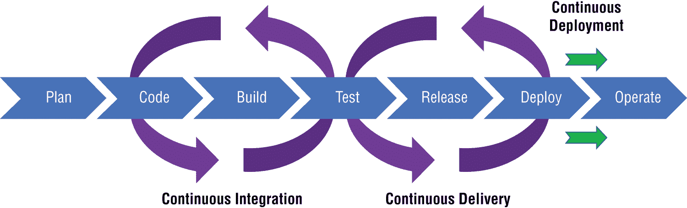

`持续集成`（Contiguous integration/Continuous integration）是定期将所有开发者的更改合并回代码主分支的实践，并进行测试以确保一切仍然正常——理想情况下是每天进行多次。这可以通过手动完成，但通常会使用工具。


# 持续交付与持续部署

`持续交付`（Continuous delivery）是确保能够非常快速发布更改。系统应该始终准备好部署，使用自动化技术（包括从持续集成到更多测试的一切）。它要求使用自动化工具（通常称为 `pipeline`，流水线）来执行持续集成的操作。自动化这一过程使其速度更快，消除人为错误，并允许添加自动化测试，从而提高质量。这种软件通常被称为 `CI/CD pipeline` 或 `DevOps pipeline`，每次新发布被称为一次 `build`（构建）。

`持续部署`（Continuous deployment）是允许 `CI/CD pipeline` 在没有人工批准步骤将新更改发布到生产环境的实践。自动化测试的结果决定是否发布更改，如果测试失败，部署将停止，通常被称为“破坏构建（breaking the build）”。使用 `CI/CD` 并不强制，它通常被认为是高级 DevOps 组织的标志。

`CI/CD pipelines` 是 DevOps 环境中最广为人知的特征，其使用目标与我们相同：减少人为的（安全）错误、更快的（安全）反馈、更快速地实现（安全）漏洞修复的能力、（安全）测试的自动化，以及通过定期发布许多小更改而不是偶尔发布大更改来降低风险。

如果你在一个使用 `CI/CD` 的开发组织中工作，你希望向该 `CI/CD` 中添加安全活动。尽管如此，你需要小心尊重开发人员和运维人员的意愿，仅使用他们留给你的分配时间和空间。如果他们告诉你每次构建可以进行 8 分钟的测试，那么你就应该确保你的测试只耗时 8 分钟。

以下是开始 `CI/CD pipeline` 的一些想法：

*   扫描新提交的代码，查看其是否包含类似于密钥（secret）的内容。这种测试非常快，因为它只检查增量（更改或新的代码），如果你捕到了真实的密钥，你将通过防止安全灾难为你的组织提供巨大的价值。理想情况下，如果发现密钥，则阻止提交。如果无法实现，请触发安全事件并立即更换该密钥。

*   进行 `SCA` 扫描，以验证已知漏洞的新组件是否已添加到你的应用程序中。这也是非常快速的检查；它只需查看应用程序的包列表，然后将其与已“坏”列表进行交叉引用。这种类型的测试也具有极高的准确性，使其非常适合流水线测试。

这不是一本关于 DevOps 的书，但尽管如此，如果你的组织正在使用 DevOps，那么如果你想完成使命，就必须加入。如果他们正在进行冲刺（sprinting），你必须以冲刺模式工作。如果他们正在使用 `pipeline`，你希望在每个流水线中至少至少一个安全测试。如果你不按照开发和运维的工作方式工作，`你会被淘汰`。

## 练习题

1.  如果你只能为你的应用程序选择执行一种类型的测试，会是哪种？为什么？

2.  你认为哪种类型的测试最快？为什么？

3.  你认为哪种类型的测试最慢？为什么？

4.  在回归测试中你想寻找哪些类型的漏洞？至少列出两个，并说明你为什么选择每一个。

5.  你的工作场所有零信任网络设计吗？如果你不知道答案，你的作业是查明。

6.  你的工作场所允许使用 `CI/CD pipeline` 吗？如果你不知道答案，你的作业是查明。

7.  在 `CI/CD` 环境中，你是否应该实施静态应用测试 (`SAST`) 工具并在每次构建对所有代码进行扫描？为什么？为什么不？

8.  为什么将所有更改放入代码仓库是关键的？

9.  为什么我们要测试系统之间的集成点？这比测试系统的其他部分更有还是更有价值？

10. 为什么我们要测试数据库，即使它们不是公开的？

11. 为什么我们要测试 API，即使它们不是公开的？（这可能是一个陷阱题。）

12. 与系统评估相比，何时进行渗透测试是合理的？解释你的答案。

---

# 第 7 章：应用安全程序

本章将讨论应用安全程序，它是应用安全活动在软件开发生命周期（SDLC）中的形式化。应用安全程序不是一个软件，而是具有特定长期目标的一系列相关活动。

在这种情况下，我们的目标是确保我们创建和维护的软件是安全的。我们的目标借此减少组织以及我们服务对象（客户、员工、公民等）的风险。我们努力保护并维护我们负责的系统和数据的机密性、完整性、可用性。

我们创建正式的应用安全程序是为了提高安全态势，确保我们的*所有*应用程序都得到防御（而不仅仅是部分），并向他人证明我们已经尽力保护了组织。

## 应用安全计划要求

- 理想情况下由专门负责此项工作的团队运行，但至少由一名专人负责。
- 将安全活动整合到软件开发生命周期（SDLC）中。
- 应用安全（AppSec）团队为开发者提供资源、工具、教育、策略、指南以及他们所需的任何支持。
- AppSec 团队验证是否遵循了安全的 SDLC，并确保软件是安全的（通过测试和工具）。

## 应用安全计划目标

目前业界还没有公认的标准来规定如何构成一个应用安全计划；几乎所有人都在凭经验摸索。虽然有很多活动是常见的，但并不意味着它们对你的组织或计划来说是最好的。有些组织使用 `OWASP SAMM` 或 `BSIMM` 来帮助确定最适合其组织的活动，而另一些组织则自行决定。在现实中，应用安全计划的差异很大；有些计划深度很深，包含许多活动；另一些则仅仅为了满足法规或法律而进行的浅层检查；还有一些拥有充满活力安全文化的优秀企业，每个人都将其视为首要任务。

在构建自己的计划时，尽可能高效且有效非常重要，因为你永远没有足够的资源、预算或时间来完成所有你想做的事情。除非你处于极高风险或特殊情况下，否则业务需求总是会优先于安全，这意味着你和你的团队将面临局限。

在选择将哪些活动加入你的应用安全计划时，你应该先列出你想要达成的目标列表，然后根据你的目标以及在组织现有系统中运行效果最好的方案来选择你的活动和工具。基于你组织的优先级来设定目标，以确保你投入了最大的精力去保护对业务最重要的部分。

考虑到这些，让我们审视一些我们可能设定并努力实现的高层级计划目标。

### 创建和维护应用程序清单

如果你不知道自己拥有什么，你就无法保护它。这就是为什么我们对对所有的应用程序和其他资产（包括 `APIs` 和数据库）建立清单。大多数大公司都有许多他们未曾察觉的应用程序，这意味着这些程序没有获得安全关注，因此很可能成为薄弱环节。

你可能会惊讶地发现，创建和维护应用程序清单是极难做的 IT 任务之一；开发者经常在没有文档的情况下发布更新或 `APIs`，旧应用程序丢失了踪迹，业务部门聘用了不遵守你任何安全规则的“影子 IT”，软件即服务（`SaaS`）产品在你的不知情的情况下在网络上运行等。当你读到这段文字时，数量多到你可能认为非常安全的组织目前仍在通过 `Microsoft Excel` 表格手动跟踪它们的应用程序。

对你（作为 AppSec 专业人员）来说，对软件资产进行最重要的重要的是确保每个应用程序都能获得安全关注。如果你的所有程序在上线前都必须进行安全代码审查，那么你就需要了解所有的程序，以便正确实施该规则。

恶意攻击者总是盯着你最薄弱的环节。没有受到任何安全关注的应用程序极可能是你的薄弱环节。

> *在大型组织中，影子 IT 指由中央 IT 部门以外的部门部署的信息技术（IT）系统，通常是为了绕过中央信息系统和/或 IT 部门的缺点。*
>
> —维基百科

### 在编写的、运行的和第三方代码中发现漏洞的能力

如果你仔细观察，所有类型的安全验证工具归根结底都属于 `DAST` 或 `SAST`。

`DAST` 意味着动态应用程序安全测试。这意味着在应用程序运行的同时对其进行交互。

`SAST` 意味着静态应用程序安全测试。这意味着检查编写的代码——即编写或编译形式的编程语言。

当我们（AppSec 工程师和程序员）在第三方代码中发现漏洞时，通常使用软件成分分析（`SCA`）工具，该工具分析库、框架和依赖项列表，查看它们是否在预定义的“已知漏洞”软件列表中。这被认为是静态分析，因为 `SCA` 工具会检查从我们编写的代码内部调用的库（具体是项目描述文件）。

`SAST` 工具发现你和你的团队编写的自定义代码中的漏洞。`SCA` 发现你应用程序中所有非你团队编写的代码（库、包、框架等）中的已知漏洞，这些通常统称为“第三方库”。我们必须同时执行这两者，以便发现你应用程序中所有编写代码的漏洞。

当我们讨论 `SCA` 或在第三方代码中发现漏洞时，我们将从消费者的角度（即程序员或 AppSec 工程师）出发。因此，我们经常将其与剩余的 `SAST`（静态应用程序安全测试）归为类。

`DAST` 工具测试整个应用程序，包括你团队编写和未编写的部分，因为它们作为一个整体运行。

在寻找漏洞方面，我们也希望进行手动分析。自动化工具永远无法发现所有问题，熟练的测试人员或代码审查人员通常可以让任何工具相形见绌。业务逻辑漏洞是自动化工具最容易遗漏的，但它们会导致同样的损害。这意味着我们需要在项目进度中增加时间，并聘用合格的安全专业人员，以确保我们能发现尽可能多的漏洞。

回到目标：在编写的、运行的和第三方代码中发现漏洞的能力。能够通过这三种不同的方式发现缺陷而非仅通过一种方式，意味着你将对应用程序的安全态势有一个更全面的认识。公司通常只依赖这三个支柱中的一种，这可能是由于预算限制、人员不足或缺乏管理层的支持。如果这是你的情况，请选择一种为你提供最佳投资回报且符合你当前流程的方法。

### 修复漏洞的知识和资源

如果你有机会与经验丰富的渗透测试员坐在一起，他们最终会向你透露，他们工作中最令人沮丧的部分是以后回到同一个地方，在相同的系统中发现相同的漏洞。什么都没有修复。年年一年。他们聘请渗透员是为了满足法规要求（通常是 `PCI`），但他们只是想打差；他们并不关心让应用程序更安全。

如果费力发现漏洞但不修复它们，那么就毫无意义。这个目标是确保你的组织拥有有足够的时间、技能和知识来修复你发现的问题员。拥有大量时间但没有编程经验的人需要大量的指导和资源。高技能、经过培训但工作过量且已经精疲力竭的人也可能没有时间修复漏洞。

### 教育和参考资料

软件开发者在安全方面需要支持；他们在编程训练营、学院和大学中接受的培训是不够的。如果你对组织有标准、策略或指南，你将需要将这些教给你的开发者，以便他们能够创建符合你要求的代码。

教育可以是工作讨会、午餐学习会、基于计算机的培训、在全员会议上进行 5 分钟的演讲、请讲师等。要点在于，如果你期望你的开发者了解特定的安全控制、防御或编码方法，你就必须教给他们。如果你不这样做，他们中的一些人会知道而另一些人则不会，你的产品中肯定会有更多的安全漏洞。

参考资料可能意味着如果你的开发者大量使用 `Java`，就购买一本 `Java` 安全书籍。它可能意味着内容订阅、视频、博客、安全代码示例，或者他们为了帮助他们了解如何更安全地工作的任何其他请求。

### 为开发者提供安全工具

如果你还记得第一章的内容，我们在软件开发生命周期（SDLC）中越早发现安全漏洞或缺陷，修复它就越廉价、越容易且快速。在 SDLC 的更早阶段引入安全被称为“左移”或“向左推”。当我们给开发者提供安全工具时，这意味着他们将在编码阶段发现并修复某些安全问题，这是在测试阶段`before`（我们最可能被邀请执行安全活动的时候）。这是一个巨大的胜利！

我们想要给软件开发者提供安全工具的另一个原因是数据；平均每 1 名安全专业人员就有 100 名或更多软件开发者。这意味着他们有更多的时间，但通常（安全相关的）技能较少。教你团队中的所有开发者使用仅仅一种工具就能产生惊人的效果，而且不会给开发团队造成过大负担。

如果我们能培养开发者对安全的兴趣，我们可能将他们转变为安全冠军（security champions），让他们承担更多的责任。为安全冠军提供额外的培训，以便他们执行安全代码审查、编写负向单元测试、执行更高级的安全测试等，是对你的时间和资源极有价值的利用。这在任何人看来都是双赢的。

软件开发者是构建者，他们大多数人对自己的工作感到非常自豪；他们`want`创建安全的应用程序。为他们提供工具、如何使用这些工具的培训以及一个安全的操作场所，可以让他们构建出他们努力创造的高质量软件。

### 在 SDLC 的每个阶段进行一个或多个安全活动

有必要正式化（强制/创建策略以支持）你希望成为你 SDLC 组成部分的安全活动。如果你希望每个新项目都包含你创建的安全需求，请编写一项策略来支持这一点。在你的项目进度表中也必须为这些活动留出时间，否则将无法完成。

以下是在 SDLC 的每个阶段可以执行的活动示例（无论你使用哪种方法论）。在 SDLC 的每个阶段选择其中任何一项都将提高你最终产品的安全性。

*   **需求**：根据本书第 2 章定义的安全需求、安全用户故事、对提议技术栈的安全评估和批准
*   **设计**：威胁建模、通过白板设计来寻找架构中的安全缺陷、根据本书第 3 章进行安全设计评估
*   **编码**：代码检查工具（Linters）、编写安全单元测试、`SAST` 或 `SCA` 扫描、根据本书第 4 章进行安全编码、使用 `IDE` 插件或 web hooks 修正不安全的编码、使用已知的模板和/或库
*   **测试**：`DAST`、`SAST` 和/或 `SCA` 扫描、安全评估或渗透测试、安全代码审查练习（包括 `SAST` 工具）、密钥扫描，以及本书第 6 章中的任何内容
*   **部署/发布/维护**：`DAST`、`RASP` 或 `WAF`、监控、日志、安全告警、经过培训并准备就绪的事件响应团队以及建立的流程

此列表并非详尽；可能的活动列表几乎是无限的。这里的关键在于你决定你的活动是什么，并且它们`每次`都会发生。

### 实现有用且有效的工具

选择、采购和实施安全工具需要时间、精力和专业知识；你不希望将此责任交给开发者。并不是每个工具都能为你的组织创造等价值的价值，每个产品都有独特的优缺点。本书不会建议特定的产品或品牌；最好的方法是对工具进行概念验证（`POC`）并亲自进行测试。如果可能，将开发者纳入 `POC` 过程中，以确保他们也想使用该工具。毕竟，他们是我们努力的客户。

尽可能确保你的工具工作流是自动化的（通常 `CI/CD` 可以帮助实现这一点）。手动工作意味着错误、不必要的时间浪费和无聊。如果这个工具将运行几十、数百次或数千次，它就不应该手动运行。

### 一支知道何时该找你的事件响应团队

安全事件是发现你的应用程序之一漏洞的最昂贵、破坏性最大且最尴尬的方式。安全事件意味着有人攻击了你的某个应用程序。它也可能意味着数据泄露、系统故障、系统不可用、数据完整性受影响、未经授权的访问或攻击导致的任何其他负面后果。作为 IT 专业人员，我们希望尽可能防止所有类型的 IT 安全事件。我们还希望在被要求协助响应事件时做好准备。响应安全事件被称为 `incident response`（`IR`），它涉及管理局势和通信、调查发生了什么、减少损失和成本、消除问题以及恢复你的系统和数据。它还应该包括事后总结练习和对发生情况的记录。

大多数大型组织都有经过培训的事件响应团队，而许多较小的组织没有。如果你只有五个人的初创公司，你不需要事件响应团队，但如果你是一个企业组织，这是必须的。

这可能让你感到惊讶，但在本书编写时，检测到数据泄露发生的平均时间为 197 天。这意味着你现在可能发生一个或多个数据泄露或事件，而你却不知道。如果你不主动寻找问题，你就不太可能发现它们。

如果事件响应团队中没有人理解应用程序安全，或者通用的软件，那么响应和调查此类事件将不可避免地成为你的责任。理想情况下，你会去向 `IR` 团队介绍自己，告诉他们你的 `AppSec` 技能，并提供帮助和培训。

如果你能教 IR 团队检测与你的应用程序相关的事件，以及何时该找你，你将处于更有利的帮助他们。

### 根据指标、实验和反馈不断改进你的计划

最后一个目标可能看起来显而易见，没必要特意写成目标，但如果我们不对事情进行形式化，往往就会忘记。我们有一个必须完成的大截止日期，然后是一个新功能，然后……我们已经六个月没有和开发团队会面了，他们觉得被忽视了；或者我们已经一年没有看我们的指标了，结果发现我们没有把精力放在最有效的活动上。如果不为它的发生做好计划，它就会从我们手中溜走。

让我们把这个计划目标拆解一下。

#### 指标

指标是衡量某事物的方法，或者是从中获得的结果。

我们需要衡量各项活动的有效性。我们没有足够去做我们想要的每一项活动或任务；我们必须选择那些产生最大影响的活动，以建立一个成功的 AppSec 计划。

你可以通过许多不同的方式进行测量：你可以使用漏洞管理系统、数据库、商业智能 SaaS，甚至仅仅使用 `MS Excel`。

以下是收集指标最重要的部分：

- 你必须坚持持续地进行测量。你不能只是“偶尔”测量一下——否则你的数据将是不完整的。
- 你必须有一套一致的测量方法。如果你同时使用 `DAST` 工具和 `SAST` 工具，那么你需要在所有的应用上都使用这两个工具。如果你想对比所有应用程序和团队的结果，就不能对一半的应用进行 `DAST` 而对另一半进行 `SAST`。拥有部分测量是可以接受的（例如，如果你测量了某个特定工具的覆盖率，即 `SAST` 覆盖率为 20%，`DAST` 覆盖率为 80%），但前提是你在分析数据时要考虑到这一点。在那个例子中，这意味着要单独比较所有的 `SAST` 结果和 `DAST` 结果，或者使用你的覆盖率统计来帮助你调整数据集中的值。
- 你必须有一套一致的测量标尺。你不能拿苹果和橘子作比较。如果一个工具按 1–10 分对漏洞评分，而另一个使用低/中/高/严重，那么你需要决定如何将一种测量结果转换为另一种形式。例如：`low = 2`，`medium = 4`，`high = 8`，`critical = 10`。
- 你需要衡量的是`重要`的指标，而不是虚荣指标。

`虚荣指标`（Vanity metrics）通常是容易衡量的东西，但没有太大价值。`重要指标`的一个例子是衡量你朝着目标实现的进度。也许你正在使用两种不同的活动或工具来帮助你实现目标；如果你可以衡量这两者并看到哪一个更有效，你可能会决定放弃表现较差的，并加倍投入表现更好的那一个。但如果没有指标，你永远不会。

可能对你有意义的指标示例：

- 你是否发生了反复发生的事件（相同的原因）？
- 修复漏洞（回滚、打补丁或修复）需要多长时间？
- 检测事件需要多长时间？
- 你有多少次不符合政策规范的实例？
- 事件处理中是否存在错误？
- 你距离安全态势目标还有多近？
- 安全团队是否满足了他们的 `SLAs`，还是其他团队一直在等待你？


- 如果你针对特定漏洞进行了教育培训，它们的数量是否减少了？
- 事件响应流程是否每次都得到了遵循执行？
- 你是否看到报告的漏洞增加了？这是因为你有了一个新工具（好事），还是因为你有了未经过培训的新员工（坏事）？

你可以选择衡量的类型列表非常长；选择那些能帮助你实现计划目标的，而不是那些让你看起来很面面的。

### 实验

当你初看中一个目标时，你可能不知道如何实现它。这就是实验发挥用场的地方。它可以是创建一个证明。`运行时应用保护 (RASP)`。如果你正在同时使用 `DAST` 工具和 `SAST` 工具，那么你需要在所有的应用上都使用这两个工具。如果你想能够对比所有应用程序和团队的结果，就不能对一半的应用进行 `DAST` 而对另一半进行 `SAST`。拥有部分测量是可以接受的（例如，如果你测量了某个特定工具的覆盖率，即 `SAST` 覆盖率为 20%，`DAST` 覆盖率为 80%），但前提是你在分析数据时要考虑到这一点。这种方法可以节省你很多时间和精力。`DevOps` 和创业公司文化非常重视实验、学习并不断追求改进。考虑到这一点，我强烈推荐以下两本书：

- [The DevOps Handbook: How to Create World-Class Agility, Reliability, & Security in Technology Organizations](https://www.itrevolution.com/book/the-devops-handbook) 作者为 Gene Kim, Jez Humble, John Willis 和 Patrick Debois
- [The Lean Startup: How Today's Entrepreneurs Use Continuous Innovation to Create Radically Successful Businesses](https://theleanstartup.com/book) 作者为 Eric Ries

### 来自所有利益相关者的反馈

`所有的反馈都很重要`。软件开发人员、产品所有者、项目经理、其他团队以及 IT 其他部门都是你的客户；他们消费你的安全计划和服务。他们的反馈`很有意义`。

获取反馈至关重要，这并不意味着每年进行一次自动调查。定期与你的安全冠军会面，在项目会议期间询问他们需要什么，让他们告诉他们喜欢什么、不喜欢什么，并且总是告诉他们你搞坏了什么。

如果你要发布一项标准或政策，请举行咨询。询问开发者需要什么支持来符合标准。询问他们是否理解、同意或反对某些部分。即使只有极少数人参加，这些人通常也是话最多的人。你甚至可以举行多次。

在接收反馈时，努力不要针对个人；并不是每个人都能圆滑地表达他们对某事的感受。如果你对反馈反应不好，人们可能不会再次向你透露，那时你就是在盲目地计划。

- `运行漏洞 (VA) 扫描` 可能是最常见的应用安全（AppSec）活动；即运行自动化工具进行 DAST（`动态`应用程序测试）。它可以快速且以相当的准确性发现许多问题，尽管它也会遗掉很多内容。它可以被自动化运行，以便在流水线中运行、按计划独立运行，或手动运行。
- `安全/漏洞评估` 通常用于高价值或具有重要性的应用程序，以发现尽可能多的漏洞。
- `威胁建模` 的范围很广，从“恶意的头脑风暴”会议到更正式的追求，例如开发攻击树或遵循 STRIDE 或 PASTA 模型。识别系统所有可能受到的威胁并对其进行缓解是一个人工操作的过程。

  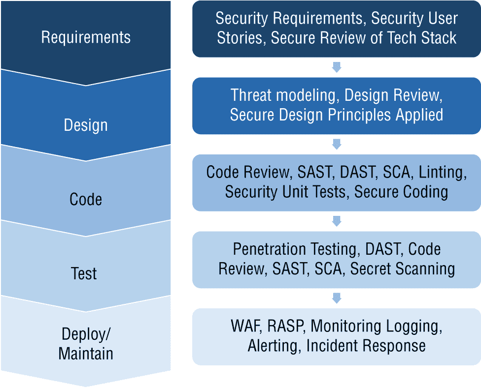

  图 7-1: 添加到 SDLC 的安全活动

- `安全代码审计`是对代码内的安全控制进行审查，以寻找错误。它们可以手动进行，也可以在 SAST 工具（`静态`应用程序安全测试）的帮助下进行。
- `软件成分分析 (SCA)` 是验证你的第三方组件（你没有编写的代码）的安全状况，使用工具或预先批准的列表执行最为简单。手动执行此类任务将是一项极其巨大的工程，除非开发者被限制在极少数的潜在组件子集中。
- `渗透测试 (PenTests)` 通常由外部资源执行，用于密集的安全测试和/或引起管理层的关注。发现并利用漏洞是获得那些尚未加入 AppSec 团队认同的绝佳方法。
- `负责任/协调披露` 是一个允许安全研究人员和其他人员安全地向你报告其产品安全问题的过程。目前，Google 和其他少数大型软件公司正在推动一项行业标准，要求信息在 90 天内公开，假设 3 个月的时间足够缓解问题并交付补丁。遗憾的是，这一过程的实际时间在不同组织之间差异很大。这一过程最初被称为“负责任”披露，随着这一行业认可流程的成熟，正稳步地向“协调”披露转变。
- `赏金计划` 是安全研究人员与公司之间预先计划、管理的活动，允许任何研究人员或经过批准/受邀的研究人员对产品进行安全测试。赏金的理念是只有发现独特且有效漏洞的研究人员才能获得奖励，这创造了竞争。
- `开发者教育和倡导计划` 旨在通过教学和其他支持，教授并使能够能够安全的软件。有些公司拥有非常复杂的计划，而另一些公司可能仅满足于把这本书扔给你看。
- `策略、指南和标准` 是你可以创建的工具，用于强制、引导和引领开发者走向更安全的路径。在编写这些内容时要小心，确保它们是易理解的、合理的且准确的。让你喜欢的开发者审阅总是是一个好主意。
- `为开发者提供安全工具`（如之前讨论过的）是扩展团队规模的绝佳方法。只需确保你培训了他们，并给他们一个使用这些工具的地方（例如带有测试数据的虚拟化环境）。
- `红队测试`允许经过训练的渗透测试人员团队攻击你的生产系统（谨慎地），以发现漏洞并测试系统应对攻击的优雅程度。
- `审查`开发者想要批准的所有新工具、框架、组件、平台和其他技术，并对这些工具的使用提供安全指导。这可能会消耗你大量的时间，但是一项高价值的活动。
- `提供 IDE 工具`以确保/强化安全编码和包管理。
- 在开发者的 CI/CD 流水线中添加安全工具。

### 应用安全工具

就像 AppSec 活动列表一样，这个工具列表永远是不可能的。人们会构建自己的工具并将其开源或共享。目前有无数初创公司在发明酷炫的新技术，而老牌安全公司在不断重塑自身及其产品。永远会有。尽管如此，这里有一个你可能感兴趣的工具列表。

### 标准

- `DAST`（动态应用程序安全测试）。
- `SAST`（静态应用程序安全分析）。
- `软件成分分析 (SCA)`——验证你的第三方依赖项是否已知漏洞。
- `Web 代理`用于对应用程序和 API 进行手动测试。
- `模糊测试 (Fuzzers)` 用于发现输入验证中的漏洞。
- `Web 应用程序防火墙 (WAFs)` 是一层用于验证用户输入的正则表达式盾牌。它们根据允许/阻止列表和正则表达式拦截进出 Web 应用程序的 HTTP(S) 流量。某些 WAF 还使用人工智能/机器学习 (AI/ML)。

### 更新的工具

- `RASP`（运行时应用程序安全保护；也称为反向代理）是放置应用程序内部的运行时存根（二进制文件），作为防止应用程序攻击的盾牌。它通常使用人工智能和机器学习来检测威胁，而不仅仅是正则表达式和允许/阻止列表。
- `漏洞管理工具`用于收集指标并衡量你的进度。
- `IDE 工具和钩子`帮助开发者纠正不安全的编码决策。
- `交互式应用程序安全测试 (IAST)` 是一种放置在应用程序内部的二进制工具，在用户与程序交互时实时执行 `SAST` 和 `DAST` 的混合。
- `服务网 (Service mesh)` 是一种加密和管理 API 通信的基础设施层。
- `合并工具 (Amalgamation tools)` 允许你仅向流水线添加一个安全工具，将多个安全工具插入合并工具，然后在一个仪表板中接收所有工具的结果。它为你并发运行多个工具。
- `API 网关`处理 API 的身份验证和授权，防止未经授权的调用和其他滥用。
- `最小权限自动化工具`验证哪些权限是所需的，然后删除其余，从而最小化攻击面。这也被称为“策略自动化”。
- `标准 AppSec 工具`针对流水线进行了优化。在使用这些工具时要小心——许多供应商声称它们已适用于流水线，但实际上仍是旧工具。始终进行概念验证以确认其是否符合你的需求。
- `包管理代理`，仅供开发者下载安全的包。
- `应用程序和资产清单工具`帮助你创建面向 Web 的资产的清单。
- `创建自定义工具`，用于当你需要非常特定的功能且它尚不存在时。

### 你的应用安全程序

如果你处于能够对应用安全程序方向做出决策的情况下，请设定目标。然后选择有助于你实现这些目标的活动和工具。不断衡量你实现目标的进度，并努力不断改进。这不仅会带来更安全的软件，还将带来一个高效的程序。

## 练习题

1. 说明为什么维护最新的应用程序清单对任何组织都有价值。
2. 举一个你的应用程序可能给出的警报示例。什么样的行为会导致这种警报？为什么这是一个问题？
3. 测试是应用安全程序最重要的部分吗？如果是，为什么？如果不是，为什么？
4. 购买 RASP 或 WAF 工具（应用程序的护盾）与将这些钱花在确保代码安全上哪个价值？请解释你的选择。
5. 描述一种需要开发者协助的安全事件类型。开发者需要做什么？
6. 如果你可以给软件开发者提供一种工具来帮助他们，那是什么？请解释你的选择。
7. 如果你可以给开发者提供一种学习资源，那是什么？请解释你的选择。
8. SAST 和 SCA 之间有什么区别？
9. SAST 和 DAST 之间有什么区别？
10. 为你的办公室、学校项目或你希望未来工作的某个虚拟地方设定一个应用程序安全计划的潜在目标。你设定了什么目标？为什么选择这个？你将如何衡量你的进展？
11. 你目前是否有任何阻碍你在工作的地方启动第一个应用安全（AppSec）计划的障碍？如果有，它们是什么？更好的是，你如何如何克服它们？

# 第 8 章：保护现代应用程序和系统

随着开发者和运维人员不断将新技术引入你的 IT 部门，你必须使你的策略和战术现代化以跟上节奏。本章为以下内容提供了安全战术的高级解释：

* API 和微服务
* 在线存储
* 容器与编排
* 云端工作流
* 无服务器 (Serverless)
* 基础设施代码 (IaC)
* 安全即代码 (SaC)
* 平台即服务 (PaaS)
* 基础设施即服务 (IaaS)
* CI/CD
* DevSecOps
* 云
* 云工作流

本章介绍了现代和新型应用程序安全工具，以及应用安全的现代和新型战术。

出于某种原因，每当新类型的技术出现时，我们往往会将安全抛诸脑后。我们急于发布新颖的东西，并且由于某种方式，我们忘记了已经知道的所有教训。当我们生产环境中引入新且令人兴奋的技术，确保它们已经过适当的安全保护至关重要。在沙箱中（与生产环境和互联网隔离的环境），你可以自由地运行新工具和实验，而无需保护任何东西。然而，当技术推送到生产环境时，必须首先对其安全漏洞进行评估并进行适当加固。*每一次*。

## API 与微服务

API 代表 `application programming interface`（应用程序编程接口）；然而，这个描述并不完全有用或准确。它听起来像是你用于编写应用程序代码（程序）的软件（接口），但那是集成开发环境（`IDE`），而不是 API。

API 是两个软件之间的代码，允许它们进行通信；它还定义了协议（它们通信的`方式` ）。API 永远没有前端，因为它们只是两个应用程序中间的代码。API 允许应用程序之间相互发送和接收请求及数据。

Web API 通常返回数据，其功能就像没有前端的 Web 应用程序。它们提供数据且没有图形用户界面（GUI）。它们由运行在服务器上的代码组成，用户在浏览器中看不到任何内容。

移动应用程序和 Web 应用程序经常调用 API 来请求数据或为它们执行/启动操作。在 Windows 操作系统中有 `Windows APIs` 在后台进行通信并执行服务。API 有多种类型，但我们在本节中讨论的是 `web APIs`。

当人们说“微服务”时，他们通常是指“微服务架构”，即由许多小型服务组成的应用程序，从同一个前端调用。图 8-1 显示了一个简化的微服务架构。拥有一套所有独立运行的服务，意味着如果其中一个宕机，你的应用程序其他部分（大部分）仍然可以运行。服务像 API 一样没有前端。

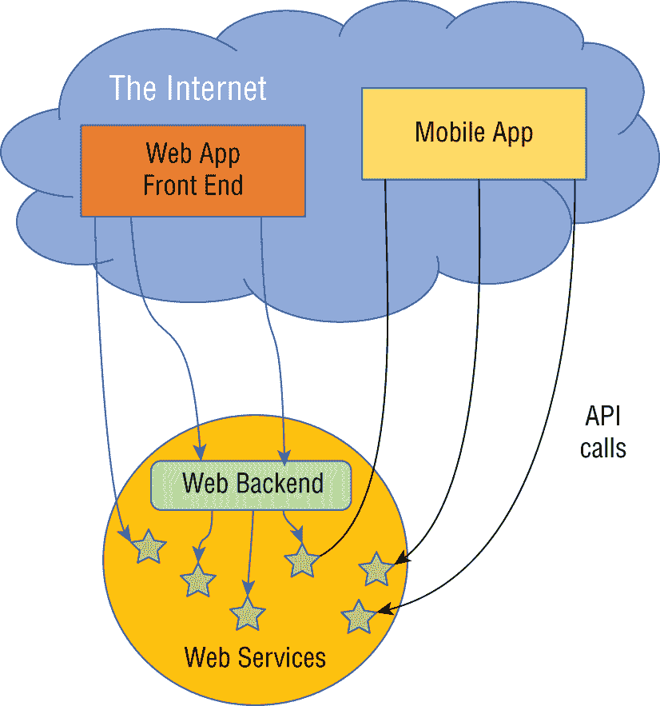

图 8-1: 简化的微服务架构

API 和微服务架构往往不可分，因此我们将共同讨论它们的安全性。它们通常都由 Web 应用程序、移动应用或其他 API 或无服务器应用程序调用。它们都需要保护。

API 应该使用 `API gateway`（API 网关）来保护它们免受 DOS 类型的滥用（资源被过度请求、过度消耗或不当调用导致强制产生错误），并执行授权、身份验证甚至输入验证的安全功能。`gateways` 还提供限流和资源配额功能，这对于保护你的 API 免受滥用非常有帮助。如果你的 API 是面向公众的，这两个功能都应该始终开启，并且通常也会内部使用也会开启。请参见 图 8-2 关于有问题的微服务架构示例。如果某个调用没有通过网关或应用程序后端；该调用应该强制通过网关进行。

如前所述，尽管我们在使用新技术，但实践应用程序安全最佳实践仍然至关重要。在 API 和微服务的情况下，继续编写出色的输入验证、使用参数化查询以及我们通常使用的所有其他安全编码最佳实践是至关重要的。

保护微服务的优秀工具是 `service mesh`（服务网格）。服务网格是一种基础设施层，帮助微服务之间快速、可靠地通信。服务网格仅在云端和微服务架构中需要。想象你的应用程序有数千个不同的服务，然后每个服务同时有数百个实例在运行。这需要组织、速度和可靠性。这就是服务网格管理的。

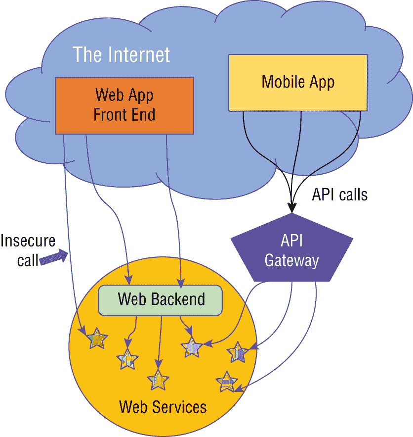

图 8.2: 带有网关的微服务架构

使用服务网格不需要修改代码；它是一个基础设施层。所有公共云提供商都有自己的服务网格产品，但市场上也有与其无关的服务网格产品。

在创建任何类型的 API 或服务时，每个组织都有必要对编写方式制定标准——团队不应该重复轮子。这也确保了测试不会那么困难。应尽可能为新接触 API 和服务的团队提供模板以确保他们遵循标准。

API 的另一种防御方法是确保它们尽可能遵守 API 的协议和定义（通过验证）。这确保了 API 调用不会有歧义，并且 API 不会由于调用方式进入未知状态。

在创建 API（以及所有应用程序）时，我们必须先对用户进行身份验证，然后进行授权。这样做的原因是，当你验证某人的身份时，你正在确定他们在网络上的身份（他们的身份是什么）。如果他们在你的网络上没有适当的身份，他们可能是危险的。如果你先授权（给他们访问权限），然后再进行身份验证（确定他们是谁），这从访问角度来看让你陷入了糟糕的境地。

在为 API 创建错误消息时，至关的一点是你不要分享任何绝对不需要额外信息。计算机与 API 通信，而不是人类，而且计算机不会出现拼写错误。如果出现格式不正确的请求，通常这是一种攻击尝试。如果你返回了详尽的错误信息，帮助攻击者创建出格式正确的你的 API 请求，这将使你、你的应用程序以及你的组织处于危险之中。确保你的错误消息不会暴露任何可能帮助攻击者学习如何调用你的 API 的信息，例如关于如何正确调用 API 的指令。

最后，另一项适用于所有应用程序的项目是只允许调用你的应用程序所使用的 HTTP 方法。在你的服务器上拦截所有未使用的 `HTTP` 方法。

## 在线存储

数据是你的组织拥有的最有价值的技术资产。你的组织应该为在线存储创建安全默认，以确保每个使用在线存储的人都必须遵守安全措施。没有例外。

当你将数据放入在线存储时，对数据的敏感性级别进行分类至关重要。事实上，你所有的数据都应该始终进行分类和标记。当事件响应人员遇到数据泄露时，如果这些信息被标记为“未分类”与“秘密”，其触发的协议将完全不同。当数据没有根据敏感性级别进行标记或分类时，事件响应人员不知道从何处开始，不幸的是必须假设最坏的情况。这本质上是一场事件响应的噩梦。

在线存储的进一步安全层包括监控对你在线存储的访问、文件完整性监控、端口嗅探监控、在监控中添加警报通知安全操作中心 (SOC)，以及通过云工作流进行自定义的自动化响应。

在线存储容器必须在提供多方明确授权后方可由 IT 人员访问。在线存储通常只应由服务账户访问，服务账户是为计算机之间通信而创建的网络账户。这样，如果有警报显示 `Alice` 在半夜访问在线存储，我们就知道这极有可能是她的凭据被破解了，我们需要立即启动事件调查。

你也可以使用云安全控制措施来保护你的在线存储，包括流量分析工具、访问和身份管理 (AIM) 以及最小权限自动化工具，以确保你的存储没有过度权限。

最后，保护你的云管理仪表板至关重要。任何具有更改你的在线存储权限能力的云账户都应该启用多因素身份验证 (MFA)，并存储在密码管理器中长且唯一的密码。

## 容器与编排

当数据中心刚开始时，我们使用的是 `servers`。服务器占用大量空间并需要大量电力；它们噪音很大且需要持续空调。每台服务器只能运行一个应用程序。

最终虚拟化被创造了。这允许我们在同一台物理机器上运行多个操作系统，使用 `virtual machines` (VMs)。这意味着我们第一次可以在同一台机器上托管多个应用程序。

接下来是的是 `containers`（容器）。容器比虚拟机小得多；它们不是托管整个操作系统，而是只托管运行你的应用程序所需的操作系统部分。这使得容器的大小只有虚拟机的几分之一，允许它们在单台服务器上以数百个容器。这是效率的巨大提升，这也是为什么容器被如此迅速地采用的原因。

容器通常伴随着一种被称为 `orchestration`（编排）的东西。编排是对容器的管理。编排系统可以对其管理范围内的任何容器启动、停止、添加或删除内存等。编排的想法是，手动管理成百上千个容器太费力了，因此你使用管理系统来完成所有工作。

话虽如此，新技术带来了新的风险。在网络安全和/或云安全方面，你必须遵循与对待虚拟机或裸机时相同的最佳实践，包括在设计时考虑到“假设已攻破”和“零信任”，这是至关重要的。

限制容器的资源并在资源达到特定配额时设置警报是关键的，以确保我们在受到攻击时能够察觉。


我们不以“root”身份运行容器是至关重要的。`root` 用户可以做任何事情，因此如果有人能够以 `root` 身份接管我们的容器，这意味着他们对我们的资源拥有无限权力。虽然作为软件开发人员或任何 IT 人员，在执行职责时拥有超级能力会让生活更容易，但这几乎绝没有必要。禁止容器使用 `root` 是最小权限概念应用于容器的实现。

容器镜像通常存储在注册表中，这些注册表必须经过安全保护。如果你的组织有自己的注册表，仔细守护其权限至关重要。如果恶意者能够上传一个故意不安全的镜像，你的同事可能会在不知情的情况下下载它、将其安装到生产环境中，并创建一个供该恶意者利用的漏洞。

你的软件开发人员不要从任何地方下载镜像至关重要；他们应该只从信任源下载。你应该创建一个策略，禁止从不可信源下载镜像，除非是下载到沙箱环境中，该环境与你组织的其余网络和资源隔离开。

容器和编排意味着我们需要学习新的配置规则、新类型的扫描工具，并学习它们所面临的新类型漏洞和风险。在此基础上，我们必须保护那些能够创建或编辑容器以及用于编排系统的账户，因为那些账户对于恶意者来说是最有价值的账户。这些账户应该始终拥有长、唯一的、随机密码，存储在密码管理器中，并启用多因素身份验证。但与虚拟机类似，我们应该扫描所有可以扫描的内容，使用检查器根据供应商提供的指南验证我们的配置已经过加固，定期修补或用更安全的更新容器替换我们的容器，并在我们所有的设计中应用零信任。

Serverless（无服务器）是一种 `not` 始终在服务器上托管/运行的软件；它仅在被调用时可用。当一个 serverless 应用被调用时，它会打开容器，运行代码直到完成，然后自毁，将所有资源释放回生态系统中供其他进程使用。瞬态（短寿命）意味着 serverless 软件创建了更小的攻击面，因为它很少处于运行状态（这通常是攻击的必要条件），而且没有可供攻击的服务器。使用 serverless 应用的主要优势是，除非它们正在运行，否则你不需要为此付费，这意味着成本可能比普通应用程序便宜得多。如果你每月只需为九分钟的运行时间付费，这可以大大减少你的云账单。然而，应用安全原则仍然适用于任何其他应用程序，此外还有几点。让我们深入探讨吧？

## 监控与日志

与任何其他应用程序一样，你仍然需要对 serverless 应用进行监控和日志记录。理想情况下，这些日志应该输入到你的安全信息事件管理系统（`SIEM`）中，这样你的 SOC（安全中心）就能看到告警并在必要时采取行动。

## 安全编码最佳实践

正如你可能怀疑的那样，你熟悉并喜爱的安全编码要求和最佳实践仍然适用；你仍然需要验证输入，仍然需要进行身份验证和授权。你的数据必须继续在传输和存储时进行加密。这不会因为应用程序是短寿命的而改变。

## Serverless 安全

保护 serverless 的一些区别包括可能使用 `API gateway` 作为安全屏障。`API gateway` 强制执行身份验证和授权，确保没有人在通过其安全层的情况下无法调用或访问你的 serverless 应用。`API gateway` 还可以用于实施限流（减慢请求）和资源配额（在达到一定请求数后断开用户），这对于保护 serverless 应用免受 DOS 式滥用至关重要。

### 粒度与架构

Serverless 应用还应该以最小粒度进行部署，我们的意思是它们应该只做一件事并将其做好。serverless 应用不应该是一个整个全尺寸应用程序，否则它作为 serverless 就没有意义了。如果一个 serverless 应用被调用的频率使其几乎处于处于运行，那么它应该更改为托管在服务器或 `PaaS` 上的普通应用程序。

### 隔离与信任

在创建 serverless 应用时，保持隔离参数是非常关键的。我们指的是每个 serverless 应用都需要对每个其他 serverless 应用进行身份验证和授权；不存在隐含的信任。通常，当使用微服务架构创建应用程序时，软件开发人员不会采用对于普通应用程序所使用的全部安全防御措施，而是假设其服务、serverless 以及其他应用程序之间存在信任。千万不要这样做，因为恶意攻击者将能够通过调用他们不应调用的 serverless 应用来利用这一点。此时没有身份验证来阻止他们。

## 密钥管理与基础设施

尽管这适用于每个应用程序，但将 serverless 应用的密钥存储在密钥库（secret store）中是至关重要的。它们不应该保存在你的代码库或数据库中。

由于 serverless 应用也是基础设施，因此在配置你的 serverless 应用并将其置于网络中时，必须确保遵循最小权限原则。

如果你正在使用 `CI/CD pipeline`，请考虑添加安全扫描以验证 serverless 应用的配置。

最后，尽管这适用于所有应用程序，但确保你的 serverless 应用所依赖的所有依赖都已修补和/或经过验证已知是不安全的是非常关键的。

## 代码即基础设施 (IaC)

基础设施即代码（`IaC`），有时被称为配置即代码，是创建以代码形式编写的脚本或配置文件，以实现部署的自动化。使用 `IaC` 是 DevOps 的一部分，以确保你可以通过 `CI/CD pipeline` 发布你的基础设施。从安全的角度来看，这意味着我们能够以代码格式为基础设施添加安全加固，确保由这些脚本创建的所有新基础设施在创建时就已经过加固。这也意味着我们可以在基础设施即代码在整个发布流水线移动过程中对其进行安全扫描以测试。`IaC` 不仅允许更快地部署补丁和基础设施更改，还允许向生产系统更快地部署安全修复和基础设施加固更改。赢了！工作流如图 8-3 所示。

在 `IaC` 发明之前，运维工程师的任务是手动安装应用程序和操作系统。他们必须坐在多台机器前点击“下一步”按钮，通过 CD（光盘）安装软件，或使用可以帮助他们自动化这部分过程的软件（如 `system center`）。这种工作的扩展性不好，而且经常出现错误。这种工作做起来也不愉快。这种工作——缺乏持久价值、按线性扩展、可自动化的工作——通常被称为 `toil`（琐事工作）。

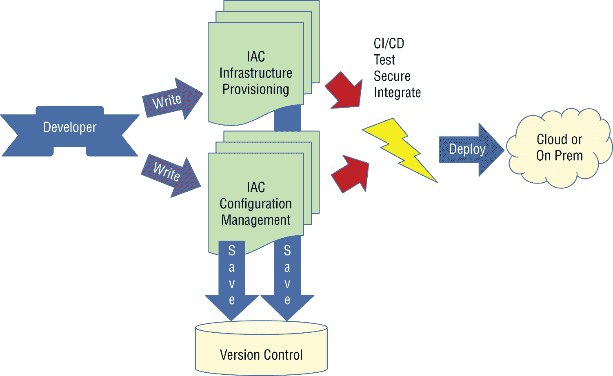

**图 8-3**: 基础设施即代码工作流

## IaC 的优势

`IaC` 的最大优势之一是可重复性。当我们手动执行任务时，可能会出错，如果我们执行任务次数足够多，从统计学上来说，我们会出错。当我们使用基础设施即代码时，我们可以保证将继续创建完美的副本，如果我们创建了支持确保基础设施即代码安全的流程和策略，那么这对于应用安全团队和整个组织来说都是巨大的胜利。

基础设施即代码的另一个大优势是，当你将新版本提交到代码仓库时，它会自我记录。通常，大多数组织对配置设置的变化记录得不好，或者根本不记录。通过在每次进行更改时将所有的基础设施即代码提交到代码仓库，然后在 `CI/CD pipeline` 中对其进行安全测试和其他测试，然后将其推送到生产环境，你不仅自动化了文档工作，还自动化了变更管理流程。这是一件美妙的事。

在处理基础设施即代码时，绝对必须确保所有更改都通过你的 `IaC` 过程完成。你不能登录到生产机器并手动进行大量的配置更改，因为那样就会破坏整个流程。这意味着你更有可能无意中向基础设施中引入错误、漏洞或弱点，因为你没有运行 `CI/CD pipeline` 中的所有安全测试和其他必要的测试。

在基础设施即代码（Infrastructure as Code）方面，另一个需要讨论的项是 `不可变基础设施`（immutable infrastructure）。不可变意味着你不会在运行时对其进行补丁或更改；它意味着用一个新实例来替换它，而新实例已经包含了新的配置、安全更新或任何你想要应用的更改。这种方法的优势是，你不会在生产环境中意外损坏你的基础设施镜像或破坏某些功能。通过用新实例替换基础设施，你必须已经通过 `CI/CD` 测试确保了它的正常工作。偶尔，并不是所有的补丁在部署时都能正常生效，这也是如果你使用 `不可变基础设施` 就可以避免的问题。总之，它降低了风险。

## 安全即代码 (SaC)

安全即代码是将安全织入 DevOps，具体来说就是使用代码。虽然有人认为 SaC 与 DevSecOps 相同，但大多数人认为它们是不同的：DevSecOps 涵盖了 DevOps `SDLC` 中发生的所有安全活动，而安全即代码仅指代码化的部分。

SoC 的示例包括：在基础设施即代码中添加代码以执行安全策略、编写代码以实现和/或自动化安全需求、创建负面单元测试（确保能够优雅失败的单元测试，称为安全回归测试）以及在流水线中添加安全测试脚本。

本节中另一个需要注意的是“安全用户故事”。如果你在工作中创建了用户故事，那么也应该针对安全情况创建故事，例如 XSS、暴力破解或注入攻击。创建安全用户故事可以确保所有基于用户故事的其他测试工作都包含安全因素。

用户安全故事应基于：确保你的 `CIA`（机密性、完整性和可用性）完整、预防威胁模型、执行任何安全相关的标准或策略以及实施项目的安全需求。

用户故事示例：

| 用户故事 (USER STORY) | 验收标准 (ACCEPTANCE CRITERIA) |
| --- | --- |
| 当产品 XYZ 的用户向系统输入隐私信息时，该信息受其他用户和公众的保护。（机密性） | <ul><li>经过测试，确保用户无法查看其他用户的数据</li><li>产品实现了强密码策略并允许 MFA</li><li>*在此处粘贴所有其他适用要求*</li></ul> |
| 根据 `SLA` 规定，产品 XYZ 的用户能够在 99.9% 的时间内使用该产品。（可用性） | <ul><li>对产品进行了压力和性能测试</li><li>产品托管在保证 99.99% 运行时间的云实例中</li><li>*在此处粘贴所有其他适用要求*</li></ul> |
| 产品 XYZ 的用户向系统输入数据，这些数据无法被管理员或其他任何用户更改。（完整性） | <ul><li>验证所有更改均已记录</li><li>在每次更改前验证授权</li><li>*在此处粘贴所有其他适用要求*</li></ul> |

## 平台即服务 (PaaS)

平台即服务是由公共云供应商创建并提供的、用于托管应用程序和 API 的基础设施。云提供商负责保护平台，包括补丁和大多数配置设置。要使用平台即服务，你需要购买一个 `PaaS`，选择所需的尺寸、操作系统 (`OS`) 等，然后将你的应用程序部署在其上方。你可以将容器或代码放在平台即服务上，它就会直接运行。平台即服务的伟大之处在于，维护工作和大部分安全不是你的问题；然而，`某些`安全仍然是你的责任。确保你意识到 `PaaS` 安全配置中的哪些部分是你的责任，并据此进行加固。

所有面向公众的 Web 资产应仅通过加密通道可用，这意味着 `TLS/HTTPS`。确保你的安全标头到位，并且任何其他受你控制的安全配置都已启用并正确配置也是至关重要的。最后，作为 `PaaS` 的消费者，创建托管在该平台上的安全软件完全是你的（100%）责任。`PaaS` 和公有云使用责任共担模型并不重要；如果你创建了一个不安全的应用程序并托管在他们的云中，云提供商不对任何由此导致的损害或损失负责。那是你的责任。

## 基础设施即服务 (IaaS)

基础设施即服务是公共云供应商提供的另一种服务。本质上，你选择所需的操作系统、硬件以及任何你需要的规格，然后他们会在你的云实例中自动为你创建。例如，如果你想创建一个具有 4GB 硬盘空间和 8GB 内存的 Linux 虚拟机，只需填写 Web 表单并点击购买按钮，很快你就会拥有一个符合该描述的虚拟机。

与平台即服务 (`PaaS`) 一样，基础设施即服务 (`IaaS`) 遵循遵循责任共担模型。与 `PaaS` 不同，`IaaS` 要求最终用户（即你）对他们提供的基础设施进行所有的补丁和其他维护。云提供商将保护物理数据中心，并确保你虚拟机背后的物理机器得到良好维护，但他们不会维护他们为你提供的虚拟机。这是理解 `PaaS` 和 `IaaS` 之间区别至关重要的。

保护 `IaaS` 的最佳实践与所有基础设施资源类似：应用最小权限原则、使用强身份验证、认证和授权、通过零信任和假设被攻的设计将其作为网络的一部分添加、定期打补丁、遵循加固指南，并执行你通常为保护基础设施会做的任何其他工作。

## 持续集成/交付/部署

`持续集成` (Continuous integration) 是基于主干的开发。这意味着你不断（定期地）将你的代码与同事编写的其他代码一起提交回代码仓库，以便将其整合到整个项目/产品中。这意味着不断验证你创建的代码不会破坏他人的代码。持续集成通过更频繁地进行更小的更改来降低风险。`持续交付` (Continuous delivery) 是使用自动化系统来执行你的持续集成，而不是手动执行（这将极其耗时且容易出错）。持续交付通常被认为是使用流水线软件在整个 `SDLC` 中集成和部署代码的行为。流水线软件（也称为 `CI/CD`）将你的代码集成到代码库的主干中，验证其编译情况，将其发布到各种测试环境，执行各种自动化测试，并在每一步都为你提供反馈。持续交付系统对于效率、可重复性和质量来说极佳。如果你每天要提交 10 次代码，那么每次都运行数百次手动测试是不可能的。`CI/CD` 流水线软件让这一切成为可能。`持续部署` (Continuous deployment) 是允许你的 `CI/CD` 流水线软件将代码发布到生产环境，而无需人工干预或批准。当你针对质量、安全、可靠性等有足够的测试，以至于你足够信任结果，不再认为需要人类干预时，就会发生持续部署。虽然持续部署是许多软件开发商店的目标，但在实践中并不多见。它是一项高级活动，并不是非如此就可以说你在进行 DevOps 或使用 `CI/CD` 流水线。

## Dev(Sec)Ops

要讨论 DevSecOps，我们首先必须讨论 `DevOps`。

尽管我们的行业中对 `DevOps` 有许多定义，但我始终遵循《DevOps 手册》（DevOps Handbook）（在本书的第 7 章中已引用）和《凤凰项目》中所述的定义。

`DevOps` 既是一种创建软件的方法论，也是一种存在于软件开发团队中的特定文化。它需要流程和产品的混合，并由人员使用，用以创建健壮的软件。`DevOps` 是开发和运维职责的结合，由同一团队执行，并打破了以前存在的孤岛状态。它也是一种创建可靠、高质量软件的更有效、更高效的方法。年前，我们在学校教授瀑布式 SDLC（软件开发生命周期）方法，然后是敏捷开发，现在我们转向教授 `DevOps`，因为结果要好得多，项目成功率也更高。

为了在你的工作环境中“实施” `DevOps`，你必须遵循《凤凰项目》中所述的 `DevOps` “法则”。

`DevOps` 的`第一种法则`是确保整个系统的效率。这意味着不仅要关注你所在的系统部分，还要将整个 SDLC 视为一个整体，并对其进行改进，以确保快速、可靠的结果。这通常意味着使用自动化（包括 `CI/CD` 软件）以及其他流程和工具，确保你能够快速地发布代码。

`DevOps` 的`第二种法则`是快速反馈。瀑布法的缺陷在于，你可能几个月内都得不到反馈，这往往导致项目团队走上错误的道路，创建一个客户实际上并不需要或无法满足其需求的项目。它还导致安全测试和其他安全反馈被延迟到 SDLC 的非常晚阶段，那时修复问题的成本最高、最最困难，且可用的时间最少。快速反馈意味着各种类型测试（包括安全测试）的自动化。这也是 `CI/CD` 流水线软件非常有用的。然而，即使你没有使用流水线软件，任何对安全测试或反馈过程的自动化都能满足`第二种法则`的要求。

`DevOps` 的`第三种法则`是持续学习、实验和承担风险。`第三种法则`强调通过定期工作来提高日常工作的质量和效率。这包括获取指标和其他衡量数据，以确保你正朝着正确的方向移动。你可以通过午餐学习会（lunch and learn sessions）、正式培训、书籍以及其他向你的软件开发者教授安全的方法，让你和团队跟上技术趋势。在各种工具或技术上运行原型演示（`POC`）活动，找出哪一个最符合你组织的需求，是确保你正在使用最合适工具工作的一种方法。每周或每月预留一定的时间来改进你的日常工作是至关重要的，以确保你满足了`第三种法则`。

有专门的书籍仅用于解释 `DevOps`；与此相比，这个定义非常快速且非常简短。在上述解释中，无疑缺少了一些想法、流程和概念，关于这个主题还有非常、非常多的内容需要学习。请阅读第 7 章中建议的读读物，以了解更多关于 `DevOps` 的知识。

### DevSecOps

在 `DevOps` 环境中工作时，安全专业人员必须调整他们的活动，以适应 DevOps 工程师正在遵循的流程。如果 DevOps 团队以冲刺（sprints）模式工作，那么我们（安全团队）必须将我们的工作和项目融入到冲刺中。如果他们使用 `CI/CD` 流水线来自动化测试，那么我们希望将一些安全测试集成到他们的流水线。无论他们以何种方式执行 SDLC 功能，我们都希望将我们和安全目标贯穿其中。对此有几种策略，同样也有整个书籍专门讨论这个主题，我们无法涵盖所有，但让我们讨论几个。

安全团队在尝试在 `DevOps` 环境中工作时，要关注的最关键的任务是确保开发团队和运维团队不需要等待他们。我们（安全团队）不能成为瓶颈。这意味着只有在真正的紧急情况下或极其危险的情况下，我们才能中断构建。这意味着我们不再担任守门员；我们变成了促进者。

所有应用安全专业人员的另一个非常值得注意的项目是，我们必须调整工具，以确保它们不会产生误报。很多时候，验证 `AppSec` 工具结果的责任被推给软件开发团队，因为他们人数更多。然而，他们并没有同样的专业知识、经验或授权，这种情况不太可能产生高质量的结果。

我们在这里将提到的最后一点是，在 `DevOps` 环境中工作时，你必须向软件开发和运维团队提供快速且及时的反馈。你必须从这些团队获取有关你工作的反馈，然后将这些反馈集成到你的流程、项目和策略中，以获得最佳结果。

### 云

许多人对`云安全`有不同的定义，但在书中我们将讨论云原生（`native`）安全。在讨论云安全时，人们可能认为几乎等同于数据中心安全或网络安全，但那并不是我们的意思。我们特指利用云端提供的所有新功能、服务、工具和机会。

### 云计算

让我们剖析这个定义。云计算是“按需可用性”：你可以随时请求他们提供的任何服务，包括基础设施、平台即服务、云原生安全工具等。你可以随时增加，这既是神奇的也具有潜在危险。


假设你是一个软件开发者，你正对 Web 应用程序的基础设施进行扩展。假设你认为流量会很小，所以注册了云提供商提供的最小方案。然而，你理解网站可能会随着时间的推移而增长，随着业务的成功会有更多客户，因此你勾选了允许自动扩展。三个月后，你遭受了拒绝服务攻击（`DOS`），这产生了一份你未预到的巨额账单。这是这种方案的一种潜在风险。

然而，如果你已经提前考虑到并意识到这是一个潜在风险，你会勾选自动扩展按钮，但还会添加最大值（资源配额）和/或告警。另一种防御这种情况的方法是添加拒绝服务防护，这通常是大多数公共云提供商提供的服务。

对于技术人员来说，能够在需要或想要时随时请求资源是非常方便的。能够一次自动部署数百台机器，或利用云强大的处理能力处理海量数据，为 IT 专业人员提供了比以往任何时候都更多的可能性。这就是我们所说的云资源按需可用。

让我们回到云计算的定义，并重新检查定义的结尾：“在没有用户直接主动管理的情况下”。

当我们几页前谈到“平台即服务”（PaaS）时，这是一个允许你的云服务商接管你的系统管理的示例。通过信任你的云服务商来应用补丁并加固你的 PaaS，你无需主动管理它，从而为你留出更多时间执行其他工作。

对于云，你不需要配置额外的服务器，无须担心空调或安装软件。云服务商会为你处理这一切；无需直接管理。这就是云计算。

### 云原生 (Cloud Native)

这个定义是通过结合许多不同定义的最佳部分创建的。我们一起来剖析它吗？

让我们从“应用程序和服务”开始。这里我们指的是由云服务商提供的任何服务或软件（包括 `APIs`），以及你购买的任何第三方服务。这本质上意味着你在云实例中可用的所有基础设施、服务和软件。这包括软件即服务（`SaaS`）。

接下来的定义是“自动化与集成”。云的核心在于自动化；减少 IT 专业人员的手工工作并确保准确性。云不仅自动化每种可能的活动，还确保各种服务、软件和网络能够良好地协同工作并集成，否则你的云实例将会变得混乱且昂贵。

现在我们理解了要确保所有软件和服务良好地工作且尽可能实现自动化，我们添加了以下元素：`CI/CD`、`DevOps`、微服务、无服务器（serverless）以及容器（我们在本书中已经定义过）。

所有这些特性共同创建了一个云原生环境。拥有云服务商提供的这些工具和服务，一个能够支持这些概念的环境，添加额外的第三方工具并在良好的架构下维护，为安全团队创造了巨大的可能性。然而，如果没有考虑到安全进行规划和设计（遵循我们在书中之前定义的概念），可能会为恶意攻击者创建一个不安全的目标。

## 云原生安全 (Cloud Native Security)

正如本章许多其他主题一样，云安全已经在书中涵盖了。这只是在云工作时需要考虑的重要主题概述。

在为云设计或构建架构时，必须根据“零信任”（zero trust）和“假设已遭入侵”（assume breach）的理念进行设计。为终端用户提供安全默认至关重要。确保执行某事的“最安全的方法”始终“简单的方法”。提供安全的模板（如配置、代码等，如果可能）是实现此点的绝佳方法。始终使用云服务商包含的安全功能；例如，如果带有安全功能的仪表板，请充分利用它。当你已经在为云服务的其他部分付费时，何不充分利用它们呢？

与所有网络和应用程序一样，监控所有可以监控的内容，扫描所有可以扫描的内容，并对你想掌控的任何设置报警。开启日志，并通过访问控制和报警保护这些日志免受恶意攻击。

在云中，许多人说“身份是新的边界”。无论你是否同意这一观点，在云环境中使用身份（当然基于角色的访问控制）是保护云内资源和服务极极方法。

云的关键在于提前规划、确保为用户提供清晰的指导，并尽可能自动化安全默认、策略执行和其他安全功能。如果你允许开发或运营团队在你有机会创建安全默认之前开始云，你将会遇到问题。相反，请尝试通过提供可能的指导和支持来引导。

## 云工作流 (Cloud Workflows)

云工作流也被“步骤函数”（step functions）、“逻辑应用”（logic apps）和“云数据流”（cloud dataflows），取决于你喜欢哪种公共云服务商。云工作流由云事件触发，然后运行预定义的工作流（一组操作）。逻辑应用是公共云实例的一部分，每个云供应商都有不同的名称，但它们执行的是相同的事情：根据云中的事件触发工作流。云工作流可以在以下情况下触发：有人尝试多次登录应用程序、似乎有人在扫描你的端口、拥有员工账户的人尝试访问策略规定他们不应访问的内容等。你设置触发逻辑应用的事件，由它来执行相应的工作流。

云工作流需要经过测试，以确保它们在应该触发时触发，并且*仅*执行你编程它们执行的操作。由于它们的功能与其他应用程序不同，你在对其进行安全测试时可能会遇到困难，但正如你可能猜到的，尽管如此这样做非常重要。

## 现代工具 (Modern Tooling)

应用程序安全工具随着时间发生了变化，许多相同的概念通过新类型的工具被重新发明或重新审视。在本节中，我们将讨论截至本文的新类型安全工具。此列表并非详尽的；它的目的是让你了解作为应用程序安全专业人员可以使用的许多不同工具。

### IAST 交互式应用程序安全测试 (Interactive Application Security Testing)

`IAST` 是静态和动态应用程序安全测试的结合，在应用程序在使用时从程序内部运行。这些工具通过应用程序内部的二进制文件安装，该文件实时运行并交付近实时的结果。这些工具只有在你使用应用程序时才起作用；你不能只是开启它们让它们产生结果——你必须与应用程序进行交互，即使是自动化测试工具。这些工具只测试用户交互的代码部分或应用程序部分，因此得名“交互式”。这意味着它们没有提供完整的代码覆盖，即使它们涵盖了终端用户的所有应用程序部分。

理想的使用场景是质量保证测试期间、渗透测试或安全评估期间、使用 `DAST` 自动化扫描工具时，以及在你认为可以接受产生的延迟水平时的生产环境。延迟取决于产品和应用程序。

### 运行时应用程序安全防护 (Runtime Application Security Protection)

运行时应用程序安全防护（`RASP`）工具也是安装在应用程序中的二进制文件；但它们通常只安装在生产环境中。它们作为应用程序的护盾，分析应用程序的所有输入以识别潜在的恶意活动。许多工具声称使用人工智能（`AI`）和机器学习（`ML`）来分析应用程序的输入，识别格式错误或潜在恶意请求，从而在坏输入到达应用程序之前进行拦截。

`RASP` 也经常被称为“反向代理”或“下一代 WAF”。WAF 代表 Web 应用防火墙，是另一种应用防护工具。

延迟因产品和应用程序而异。所有为你的应用程序提供防护的工具都会产生某种程度的延迟。

### 文件完整性监控

文件完整性监控（图 8-4） 确保你的系统文件不会被其他源修改，除非经过管理员批准。文件完整性监控的目的是确保软件或其他恶意程序不会重命名为与系统文件相同的名称，以绕过应用控制工具。

### 应用控制工具（批准软件列表）

应用控制工具用于确保只有批准列表上的软件（加上操作系统软件）才能在服务器或主机计算机上运行。应用控制工具用于为组织创建一份批准软件列表，它们可以用于整个企业范围的所有主机计算机，也可以仅用于你的服务器机器。所有不在批准列表上的软件都将被阻止。如果你的组织没有预先批准在你的服务器或主机机器上使用的软件，这可能会非常不便。

当恶意软件下载到计算机上时，它做的第一件事就是尝试启动自己。如果你安装了应用控制工具，它会立即发现恶意软件不在批准列表中并阻止其运行。恶意软件做的下一件事是尝试将自己重命名为与系统文件相同的名称，以欺骗应用控制工具。如果你使用文件完整性监控（在前节中已解释），这也会阻止恶意软件的行动。结合使用文件完整性监控和应用控制工具将确保你的系统免受最先进类型恶意软件的侵害。

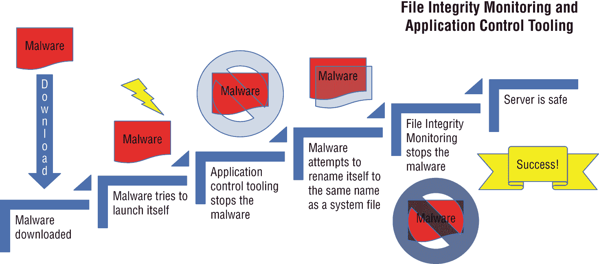

**图 8-4**: 文件完整性监控和应用控制工具的工作

### 为 DevOps 流水线创建的安全工具

目前有几种新型安全工具正在开发中或已上市，专门且仅用于 `CI/CD` 流水线工作。其中一些工具是对原始理念（如 `SAST` 和 `DAST`）的重新包装，但另一些是完全全新的且具有创新性的。

全新的工具类型包括：将多种工具合并并同时运行，以缩短流水线执行安全任务所需的时间；合并你所有结果的工具，以便你只需在一个仪表板中查看所有应用程序的安全信息；与流水线集成的密钥存储器；以及使用 `AI/ML` 跨应用程序分析测试结果，并为你创建风险预测和/或优先级列表的工具。

### 应用清单工具

对于任何应用安全专业人员来说，创建并维护一份所有应用程序、`API` 和 `SaaS` 软件的完整列表是一项艰巨的任务。在本文编写时，已有新产品问世，可以帮助你在整个网络和/或跨互联网查找你的应用程序。手动执行这项工作将确保你永远无法拥有完整的列表，而且你的列表几乎永远是最新的。这些新型应用清单工具对于我们这些试图确保能够（以及我们的事件响应人员）获取网络内运行的所有软件的完整视图的人来说非常令人兴奋。

### 最小权限和其他策略自动化

能够在云环境中自动执行策略的执行、审计和验证，可以让策略执行工作更准确、更具扩展性，甚至（可能）更有趣。这是通过在环境中设置代理来实现，这些代理监控系统以确保其符合你的策略。这通常只在云环境中进行，很少在本地（遗留）数据中心进行。

自动化最小权限的工具会监控你的实例以查看它们使用了哪些权限，然后移除长时间未使用的权限，以便在不破坏任何东西的情况下实现最小权限概念。其他类型的策略自动化包括：强制执行安全通信协议（例如仅限 `HTTPS`）；强制使用安全标头；强制开启日志记录、监控、审计和/或其它防御工具；当某些类型的账户尝试提升权限或访问它们不应访问的网络区域时发出警报；确保所有者账户都开启多因素身份验证等。在加固你的云实例时，策略自动化非常有用。

以前，审计人员必须根据问卷和诚实度试图找出你的系统是否遵循了你的策略，这对于效率或准确性来说从不是良好的配方。手动尝试验证和执行策略往往是不准确、耗时且容易出错的（称为“琐事工作”）。在确保人员确实遵循你所设立的安全策略（也称为“合规性”）方面，策略执行的自动化是改变规则的。

## 现代战术

多家公司、政府和非营利组织已通过会议、书籍、白皮书和开源项目分享了他们实现安全活动现代化的获胜策略和战术。这个非常漫长的名单包括 Netflix、微软、Intuit 和加拿大通信安全建立局（CSEC）。

不幸的是，在我们行业中，*不*分享好主意要得多，因为某些团体认为公开成功安全计划的方法对他们没有有利。这导致许多技术人员不得不依靠试错，而不是从他人的成功和失败中学习，这损害了我们的行业。在本节中，我们将讨论一些通过社交媒体、会议演讲和非正式对话分享的观点。

虽然将安全工具添加到你的 `DevOps` 流水线是我们行业中广为人知的想法，但一些人已经创建了异步流水线并在其中运行长时间的测试，以防中断构建过程。这种方式，你可以将关键的安全测试放在发布流水线中，但那些你将在代码推送到生产环境很久之后才会查看结果的漫长、缓慢且密集的测试，可以在异步流水线中运行。

几位技术人员已将渗透测试或安全评估的结果转换为单元测试，以确保同样的编码错误在测试任务完成后不会再次出现。为了获得进一步的收益，你还可以在其他应用程序中寻找相同的测试结果。在应用程序 A 中犯了该错误的软件开发者，可能在应用程序 B 或 C 中也犯了同样的错误。通过获取这些测试结果并对你的其他应用程序进行对比评估，你可以从测试任务中获得更多价值，而这项任务很可能并不是一项便宜的投资。

另一项不经常谈论但具有巨大效率机会的活动是在你的代码仓库上运行自动扫描，而不仅仅是对发送到发布的流水线中的代码进行扫描。你可以创建 `pre-commit hooks` 来运行各种安全测试，如果需要，它可以阻塞流水线发布。然而，你*也可以*针对你的整个仓库运行不阻塞流水线发布的测试，例如每周一次 `SCA` 或 `SAST` 扫描。你仓库中的代码就静静待在那里，不如利用它们。

通过模板和已知的良好代码创建一个安全代码库，供软件开发人员调用，是提高创建安全代码效率的另一种方法。虽然这个想法看起来可能非常简单，但由于维护它需要巨大的精力，这种方法很少被实施。然而，如果你能找到一位既是软件开发者又是安全冠军（Security Champion）的人，你可以任命他们为“安全代码管理员”，并指派他们维护和扩展安全代码库的职责。这项活动需要时间才能产生效果，但随着时间的推移，结果可能会是非常惊人的。

随着越来越多的组织变得勇敢并分享它们内部使用的最佳实践，你将会有越来越多惊人的想法供你评估，并考虑是否在你的工作场所采纳。考虑参加会议、观看会议录像、关注在网上分享想法的各种信息安全社区成员，以及其他用以跟上我们行业创新的新型应用安全策略和战术的方法。

## 总结

在本章中，我们涵盖了大量内容；我们做得是面广但深度较浅。本章的核心收获是：在使用书中之前介绍过的新技术时，继续应用之前所有的应用安全（AppSec）课程。无论是汽车还是网络应用程序，所有的软件输入都需要经过验证。所有技术都需要进行安全测试，因为保护用户、数据和系统是我们的职责。新技术可能有新的潜在漏洞，但它们肯定会涉及到这里详细说明的几个概念。

## 练习题

1. “共责任模型”一词是什么意思？

2. 基础设施即服务（IaaS）和平台即服务（PaaS）之间有什么区别？哪些需要你自己进行补丁和维护？

3. 为什么在线存储的风险更大（或更大）？CIA 三要素（CIA Triad）中的哪些项适用于在线存储？

4. 列举云端具有的一个传统或本地数据中心没有的新风险。

5. 容器、虚拟机和物理服务器之间有什么区别？

6. 列举基础设施即代码（IaC）的一个优点。

7. 列举 DevOps 相比瀑布式软件开发生命周期（SDLC）的一个优点。

8. 现代工具选项中哪一个听起来让你感兴趣？为什么？

9. 现代战术中哪一个听起来让你感兴趣？为什么？

10. 阅读本章后，你认为你的组织缺少了什么？你可以改进哪些？如何改进？

# 第三部分

关于如何继续编写优秀代码的有用信息

### 本部分内容

- `第九章:` 良好习惯

- `第 10 章:` 持续学习

- `第 11 章:` 总结

# 第九章：良好习惯

软件开发者、系统管理员、帮助台专业人员以及所有在技术系统中拥有特殊权限的 IT 专业人员都是恶意攻击者的首要目标。你在网络和系统上拥有的超级能力是那些想要伤害你组织的人梦寐以求的，尽力保护好这些能力是你的责任。在本章中，我们将讨论确保你的数据、代码和系统安全的良好习惯。

你可能想要形成的第一个习惯听起来可能像标题党，但它并非如此。每当你在网上搜索如何编写代码时，都要寻找`最安全的方法`来完成你需要的操作，你的代码质量将立即提高。通常，当人们在网上搜索如何做某事时，他们会去同样的几个网站，并选择投票排名最高的项目。他们直接从该顶热门帖子中复制并粘贴到他们的应用程序中，尝试编译，如果编译通过，他们就会继续工作，而不会仔细考虑是否刚刚将一个漏洞粘贴到了自己的应用程序中。

遗憾的是，最热门帖子中的内容通常也是你正在尝试的操作中最不安全的方法。这是因为移除安全功能（也称为`去加固`，`unhardening`）通常会让程序“正常工作”，因为一切都被设为“开放”。对于那些在不评估其行为安全影响的情况下就进行复制粘贴的人来说，这是极其危险的。从现在起，当你在网上搜索如何做某事时，确保你搜索的是`尽可能安全的方法`。如果你在每一步都优先考虑安全性，你**将**创建出更安全的软件。

## 密码管理

信息技术专业人员被要求记住绝对不可能数量的密码。此外，网络安全行业推崇密码复杂度（使用特殊字符、数字和大小写字母）已经很久久，以至于普通消费者已经跟不上。这导致人们制定各种策略来记住所有密码，包括将它们写下来、保存在电脑里、保存到浏览器中，以及反复使用同一个密码。

## 移除复杂度规则

非常短的密码极易在使用密码破解软件在短时间内破解。密码破解软件根据字典单词进行猜测，然后不断尝试变体直到匹配。密码越短，匹配速度越快。由于普通人对记忆复杂密码有困难，这导致了密码长度过小，因此安全性更低。这意味着当我们创建软件时，实际上降低了大多数密码的安全性。

确保密码极难被自动破解的关键是`熵`（entropy）和`长度`（length）。密码越长，破解工具破解所需的时间越长，因此使用密码字段通常允许的最大 64 个字符意味着你让它变得最难破解。注意：`如果你反复使用同一个字符，你的 64 位密码将变得不安全`。

熵意味着随机性。使用计算机系统创建随机值实际上非常困难；这是一个计算机科学家挣扎了数十年的问题。尽管如此，计算机在处理这方面比人类强得多。

如果你用于密码的数值是你自己想出来的，那么它们很可能并不随机。这就是为什么使用从密码管理器随机生成的值可以确保你的密码**更加**安全。

### 使用密码管理器

密码管理器是种你为你管理、加密和保护所有密码的软件。它们与大多数现代浏览器集成，并可以在手机、电脑、平板电脑和其他大多数设备上使用。当你将密码保存到浏览器中时，你并没有在使用密码管理器——密码管理器是一种专门为保护密码这一目的而设计的独立软件。

密码管理器不仅可以跟踪你所有在线账户的凭据（用户名和密码组合），但大多数密码管理器还能通过自动生成代码来为你处理多因素身份验证挑战。它们可以保存你的备份代码、敏感信息（如社会安全号码、信用卡号）以及你任何想要保持保密的其他内容。当你不小心点击了钓鱼链接并进入一个旨在窃取你凭据的仿冒网站时，密码管理器也非常有用。当你访问一个你没有保存密码的网站时，你的密码管理器会显示为空，这应该提醒你并保护你免受此类攻击的影响。

密码管理器还会创建随机生成的、极长且复杂的密码。如果你为每个网站都设置长度为 64 字符的唯一密码，这意味着如果有人尝试破解你的密码，将花费极长的时间。它还能确保，如果你拥有账户的某个网站发生了数据泄露（且凭据在泄露范围内），也只有该网站上的这一个账户会受到破坏，因为攻击者只拥有这一组凭据。你所有其他在线账户都将保持安全。

对于大多数人来说，记住 100 个或更多在线网站的 64 字符随机密码是不可能的，但对于密码管理器来说这非常简单。你只需要记住用于进入密码管理器的那个密码即可。

接下来让我们谈谈那个你进入密码管理器的唯一密码：短语（passphrase）。

### 短语

计算机系统的密码最早于 20 世纪 60 年代在马萨诸塞理工学院和贝尔实验室创建，用于访问 Unix 系统。那时，密码是单个单词；他们是在边用边发明安全措施。


短语是一个句子；一个易于记忆、很长且没有人能猜到的句子。通常情况下，如果你打算使用密码管理器，你会使用一个短语来访问管理器。这是为了确保你可以在不写下的情况下记住它。

有效的短语示例包括：

* 歌曲歌词
* 笑话或诗歌中的某句
* 表达对你来说有特殊意义的句子：
    * 我有两个女儿，我深爱着她们。
    * 我的狗叫 Spotty，它非常可爱！
    * 这里是地面控制中心呼叫大卫汤姆。你真的表现得很出色。
    * 为什么我有这么多密码？真的太多了！

大多数密码管理器都允许你使用极长的短语，这意味着你不需要像前面的示例那样将其限制在 64 个字符以内。为你的密码管理器设置尽可能长的短语越越好。

### 不要重复使用密码

许多终端用户为了简单而重复使用密码；这确实让管理这么多账户变得更容易，这也是人们这样做的原因。然而，当威胁行为者执行撞库攻击时，密码重复会被利用。

在线犯罪分子以每个账户几分钱的价格购买泄露的凭据，然后使用脚本在各种热门在线平台上尝试这些凭据。这被称为 `credential stuffing attack`（撞库攻击）。当一组凭据有效时，他们就会从那里窃取。这可能表现为为自己订购商品、购买东西后再退回现金或信用卡、盗取在线数据或图像然后向账户所有者索要赎金等。当有人拥有你的凭据，且这些凭据在许多不同的网站上有效（密码重复使用）时，这个人对你和你的在线身份就有了很大的权力。

### 不要实施密码轮换

许多组织仍然实施密码轮换策略，强制用户每 90 天更改密码。这导致许多用户在密码末尾添加数字以便于记忆同时符合策略（例如“Password1”、“Password2”、“Password3”）。

如果你将当前季节的名称加上年份组合成密码，那么在那个特定时刻，这很可能是地球上最常见的密码（例如“Winter2021”）。

遗憾的是，对于普通用户来说，有组织的犯罪在利用技术进行在线盗窃和其他非法活动方面正变得越来越先进，他们已经发现了如何利用密码轮换策略来对付普通用户。`Rainbow credential stuffing attacks`（彩虹撞库攻击）涉及使用脚本不仅在热门平台上测试你已知的凭据，还会增加密码开头或结尾的值，然后利用这些变体获取你在线账户的访问。

例如，许多用户创建如“Fall2020”或“MyPassword6”之类的密码。同一个用户的下一个密码很可能是“Winter2021”或“MyPassword7”。彩虹撞库攻击考虑到了这一点并利用其获得优势。

### 多因素身份验证

使用多因素身份验证（MFA）是终端用户保护在线账户的首要方法。正如第 1 章所述，身份验证因素包括你拥有的、你特征的以及你知道的。使用两个因素意味着攻击者必须同时攻破两者才能进入你的账户。这是一项巨大的工程。

作为终端用户，在在线平台上创建账户时，你无法控制用户名和密码是如何存储的。理想情况下，所有密码都应该使用密码哈希函数（PHF）存储，该函数通过添加盐值并将结果创建哈希来增加密码的熵。遗憾的是，情况并非总是如此，并不是每家公司在创建自定义软件时都会遵循最佳实践。任何简单的网络搜索都会发现，你可以在暗网上几分钱买到泄露的凭据，无数文章详细说明了终端用户收到通知需要多久。有些终端用户永远不知道他们的凭据已被泄露。

如果你在一个未妥善保护用户的网站上有账户，如果该网站发生数据泄露，恶意行为者将获得你访问该网站的明文凭据。如果你开启了第二因素身份验证，恶意行为者将无法进入你的账户。除非有人专门针对你进行鱼叉式钓鱼，否则攻击者极不可能花时间尝试破解你的任何第二因素身份验证。双因素身份验证通常能阻止与凭据相关的犯罪。

你应该在对你或你的雇主有价值的每个账户上开启 MFA。

### 应急响应

即使你不是组织应急响应小组的成员，了解在发生事件期间的职责也是至关重要的。你不希望在紧急情况发生时才学习这些；最好提前了解这些事情并做好准备。向安全团队介绍你自己，并询问他们在发生事件时需要你知道什么，他们可能对听到你的消息会感到非常惊讶和高兴。安全团队经常忘记传达他们对组织内其他人的期望。

如果你是安全团队的成员，那就更好。你应该为你工作的每一个人举办一次简短的培训课程。可以在全体员工会议期间花 5 分钟时间向大家解释你需要他们提供什么以及什么是安全事件。

* 谁可能需要随时待命，以及谁应该值班。
* 当发生安全事件时，你有权占用他们的时间，即使他们正在处理其他任务或正面临最后截止日。
* 安全事件是 `emergencies`（紧急情况）。安全团队为了尽职尽责并保护你的组织，需要他们的帮助。
* 然后要感谢他们。

这不需要非常复杂，但你需要让他们知道他们应该做什么和不该做什么。告诉他们会比假设他们知道要好得多的结果。广泛传播这一观点不仅有助于确保“安全是每个人的责任”，还能帮助人们在紧急情况下保持更加冷静，因为他们知道该做什么以及该给谁打电话。

## 消防应急演习

对其他关键业务活动进行安全事件模拟是非常利用时间的做法；就像举行火灾演习以备火灾一样，安全模拟可以为你应对 IT 安全紧急情况做好准备。它有助于突出你在流程中可能存在的问题，而不是在实际发生时才发现。如果你在事件响应过程中存在问题，在事件实际发生 `before` 发现是最理想的，这样你就可以提前修复。其他类型的演习包括红蓝对抗、测试你的防御和警报系统以确保它们仍然活跃且运行正常、测试你对不常用的各种系统的访问权限仍然有效、测试你的灾难恢复计划、验证业务连续性计划是否有效等。如果你有某些依赖的东西，你应该定期对其进行测试，以确保它一直存在。

## 持续扫描

持续扫描是许多产品做出的承诺，但很少有能够实现。这一部分并不是为了指示你购买工具，而是告诉你应该 `continue`（继续）扫描一切。

如果你能够对你的基础设施、网络、数据库和/或应用程序设置自动化扫描，那太棒了。如果你无法调度或自动化此类活动，请确保你尽可能 `on a regular basis`（定期）手动进行。

如果你是一个软件开发者（并且你无法实现自动化），你应该使用 `DAST` 工具发现尽可能多的问题，然后在发送给质量保证（QA）或下游的任何其他团队之前将其修复。

虽然扫描工具并不完美，但它们发现的任何内容恶意攻击者也很容易发现，这意味着你绝对应该花时间修复它们。

这里的关键点是，你应该 `continue`（继续）扫描；不要停止。

### 技术债

技术债是一个决策。这是一个将升级、修复和改进放在最后的决策。虽然管理层通常是这些决策的制定者，如果你不在管理层，你仍然可以影响。升级框架、确保所有环境都是完美的副本/镜像、重构看似危险或不可靠的旧代码、掩盖在其他环境中使用的生产数据，这些都可以向管理层加入即将到来的项目、计划或在其他任务之间的事情。

尽管我们已经在书中讨论过，`technical debt is security debt`（技术债就是安全债）。即使你的组织不愿全面防止技术债，你也可以尝试通过将其作为个人重点，在自己的项目中尽可能做到这一点。

## 清单

有时作为“应用程序组合管理”的一部分，创建所有应用程序的列表是至关重要的。没有清单，你将无法快速有效地做出响应。将你的个人信息与互联网隔离开是非常重要的，因为你在互联网上分享的信息可能会被用来对付你。

以下你不应该在网上分享的各种个人信息列表：

* 你母亲的姓氏
* 你的出生日期
* 你的工作 `ID/pass` 照片
* 你的家庭地址
* 你的家庭电话号码
* 你的驾照、出生证明或其他任何形式身份识别的照片
* 你的社会安全号码
* 与你的银行账户或信用卡号相关的任何信息
* 你用于创建密码或回答在线账户安全问题的任何信息
* 你的车牌照片
* 你家房子正面的照片（这将暴露你的家庭地址）
* 办公室内部的照片，特别是那些包含任何所有权或知识产权的照片

## 其他良好习惯

以下是你应该考虑的几个良好习惯：

### 政策

尽管这不言而喻，你不应该违反 `policies`（政策）。如果 `policies` 存在问题，你应该向你的经理报告。

### 下载与设备

不要从互联网下载随机的软件、音乐或其他文件并将它们放在你的工作电脑上。只有经过批准的设备、软件和其他一切物品才能进入你的网络。

### 锁定电脑

如果你在私人办公室以外的任何地方工作，离开桌子时务必锁定电脑。你不应该在登录所有系统后，在离开时让任何人看到。

### 隐私

随着社交媒体的出现，许多人说隐私已经死去；然而，事实并非如此。

# 第 10 章

## 持续学习

紧跟安全行业的变化和趋势将使你在项目中的时间利用得更高效。这能为你的简历增添一些极具吸引力的内容，同时给你的老板和同事留下深刻印象，并让你持续创造出更高质量、更安全的产品。自学新知识既有趣又充满挑战，会让你的工作生活变得更有意思。持续学习只有积极的结果。

如果你是一名经理并正在为员工制定培训计划，你会高兴地发现，定期的培训会带来更好的员工留存率和高员工满意度。他们不仅会产出更好的工作，还会继续为你工作！

## 学习什么

既然你已经在读一本关于应用安全的书了，所以我假设你想学习更多关于这里的内容。在学习时，专注于精力至关重要，因为资源多到你永远无法消耗完（consume）它们。

首先，你是否已经决定应用安全的哪个领域你最感兴趣？威胁建模？安全测试？开发者教育？这些都将决定你在学习计划中选择关注的重点。

### 进攻 = 防御

我们的行业往往倾向于关注进攻性安全。你可以找到无数关于如何“黑入这个”或“破解那个”的课程。考虑到防御性岗位远多于进攻性岗位，这很奇怪。在选择学习内容时请记住这一点。除非你专门从事安全测试、安全研究或漏洞挖掘（bug hunting），否则你不需要记忆所有类型的漏洞，或如何进行多种类型的利用。如果你想学习这些，那太棒了！但是，为了完成应用安全领域的大多数工作，并没有必要记忆如何利用 100 种不同的安全缺陷。

如果你对其中一种比另一种更感兴趣，你可以将你的职业和学习多或少地专注于防御或进攻技术。偏向你喜欢的方向没有坏处。尽管如此，一个优秀的应用安全（AppSec）计划应该彻底地涵盖这两个方面。

### 不要忘记软技能

如果你打算从事应用安全工作，确保你是至关重要的。

## 总结

谨慎管理别人的 `passwords` 非常重要（在我们完全消除密码之前）。良好的实践包括使用 `password manager`（密码管理器，只需一个口令即可访问所有 `passwords`）、移除复杂度规则和更换要求，以及绝不复用 `passwords`。

对你或你雇主的每个重要账户开启 `multi-factor authentication`（多因素认证）。这第二层防御绝对值得付出额外的努力。与公司的应急响应小组联系，询问他们是否需要任何帮助。针对任何情况练习 `fire drills`（消防演习），例如服务器崩溃或恢复备份需要多久。

尽力防止团队积累过多的 `technical debt`（技术债），即使你必须将其转入后续项目。保持你的 `inventory`（清单）更新状态，这样你就知道自己在保护什么。离开座位时锁定电脑，像照顾自己的设备一样照顾你的设备。此外，尊重你的在线隐私，因为你永远不知道这何时会反噬你。在发布之前考虑两次。养成良好的习惯不需要花费太大精力，但将产生巨大的成果。通过改变你的日常习惯，成为安全倡导者。

## 练习

1. 哪些属于 `technical debt`？
2. 如果你只有朋友关注，你应该在社交媒体上发布私人信息吗？
3. 为什么 `multi-factor authentication` 的采用率如此低？列举三种我们可以增加采用率的方法。
4. 你使用哪种 `password manager`？（注意：“我没用过”在这里是错误的答案。）
5. 你办公室的哪项安全策略让你难以完成工作？你是否和安全团队谈过更新它？是否存在一种可能发生的妥协风险？
6. 列举一项你认为可以作为良好 `fire drill` 的活动。

* 在线观看会议演讲，完全免费。
* 加入你感兴趣的话题的 `discord` 或 `slack` 频道。
* 在社交媒体上关注信息安全领域的杰出领袖，例如本书的作者（`@shehackspurple`）。
* 重新进行你认为有效的之前的技术培训；重复过程可能会让你学到几件你遗忘或错过的新知识。
* 完成来自如 `Coursera`、`Udemy` 和 `WeHackPurple.com` 等学习平台的课程。
* 创建你自己的内容（博客、视频、工作讨会）；巩固对某个主题理解的最佳方法就是教别人。
* 使用 `#CyberMentoringMonday` 寻找专业导师。
* 志愿者协助会议，从而获得免费入场。
* 订阅你感兴趣的话题的免费时通讯。
* 订阅付费内容会员平台（如 `safari books online`、`pluralsight`、`lynda.com` 和 `wehackpurple.com`）。
* 使用 `#AskInfoSec` 从社区寻找答案。
* 不要忘记你的软技能！

## 你在工作中可以做或向老板申请的活动

* 通过工作场所的正式培训接受特定工作的培训。
* 在工作中创建一个知识库，包含所有你想与他人分享的技巧和窍门，要求大家共同贡献。
* 参加会议，请老板买单。
* 通过教所有新加入团队的人员来学习。
* 志愿者向你的团队就某个你想要学习的内容进行演讲，这样你就*必须*去学习它。教学会让你从内到外地彻底掌握。设定一个日期会给你带来压力。有些人真的需要这种压力。
* 从你的办公室培训预算中申请你需要的学习资源，如书籍、订阅和在线课程。
* 在日历中安排固定的自学习区块，例如每周两小时，然后尝试遵守这段时间并将其用于学习。获得老板的许可。
* 制定你自己的学习计划并提交给老板。请他们对你负责。
* 如果你的办公室有“安全冠军（Security Champions）”计划，申请成为一名冠军。
* 志愿者承担工作任务，以获得你感兴趣的技术和活动的经验。
* 询问是否允许你在办公室内对你感兴趣的角色进行影子观察，或者向你想要学习的同岗位人员学习。
* 在公司启动一个“午餐学习（lunch and learn）”计划，邀请了解你好奇的话题的专家。
* 加入导师计划或发起一个计划，你将在做学生和当导师的过程中都获益。
* 始终提问。总是。

## 你可以为你的员工做的活动

* 与你的工作团队就各种技术或技术决策进行开放讨论或辩论。
* 为学习设立奖励——将其纳入绩效考核的一部分。
* 申请开展线下团队建设活动，以便共同学习。
* 当你解决了一个难题或学到新知识时，与团队其他成员分享。
* 有些工作场所有计划允许员工在其他地方工作一段时间，带着学到的新教训回来。如果你有这样的计划，去报名吧！
* 公开地鼓励你的员工和同事学习更多，并在他们做到时给予祝贺/赞扬。
* 如果你是经理/可以这样做，为员工购买他们想要的学习资源。
* 与员工一起制定学习计划，鼓励他们并在每季度检查他们的进度。
* 创建一个专门供员工或你的团队聊天群，讨论他们正在进行的学习并互相鼓励。
* 如果你的办公室没有学习管理系统，请实施你们自己的学习管理系统（`LMS`）。
* 根据你们的政策、标准、指南和业务创建一个培训团队和计划。
* 为新员工或团队成员创建入职培训。

### 责任机制

许多人在学习时面临的一个大障碍是动力。只有你自己知道什么在激励你以及你决定学习的原因。尽管如此，给自己设定一些责任机制绝对有助于确保你保持轨道，以实现对你重要的目标。

确保你有责任机制的选项包括：

* 寻找专业导师。这将使你的职业提升一个水平。如果可能，找多几个。
* 请一个朋友同意成为你的责任伙伴，让他们提醒你并询问你的学习情况。
* 将其作为工作正式学习计划的一部分，这样你就*知道*自己必须完成。
* 请求你的老板对你负责并监督你。
* 在达到里程碑时给自己奖励——例如，“如果我今天读完书的`第 10 章`，我今晚就可以吃冰淇淋。”
* 如果没有达到里程碑，为自己设定惩罚——例如，“如果我在本周末前没有读完`第 10 章`，我将向慈善机构捐赠 50 美元。”
* 添加自动提醒——例如在日历中添加提醒来“催促”你完成工作。

你的想法要有创意。只要对你有效，任何方法都可以。

### 制定你的计划

制定学习计划时最关键的一步是预留时间定期进行。如果你在第一周就挤进所有能学的内容，那么到第二周你可能会感到疲惫且动力不足，到第三周可能完全不感兴趣。规划现实且定期的学习课程将确保你的成功。如果你有日历，就把它放进去！

你*如何*学习得最好？有几种学习风格，但最明显的是阅读、听力、观看和实践。是否有某一种（或多种）让你脱颖而出，是适合你的“正确”方式？根据最适合你的方式规划你的培训资源。

识别你已经知道的以及你哪里需要改进。这也有助于设定你的方向。

本章最后有一个学习计划，你可以反复使用。

## 采取行动

现在你对学习有了很多了解，是时候采取*行动*了。从本章的下一个章节开始，*实际*复印并填写学习计划。然后*执行*学习计划。

打印学习计划的副本并签字，然后展示给一个会对你的结果负责的人。

你永远不会为学习新技能而后悔。如果你达到了目标，你永远不会觉得浪费了时间。如果你拿起这本书并读到这里，说明你对学习非常认真。填写学习计划并现在就开始。

## 练习

1. 为自己准备一份明年的学习计划。
    * 你将读哪些书？
    * 你会参加会议吗？写你想参加的。
    * 你会加入专业组织或其他专业社区吗？写下。
    * 你会听哪些播客？
    * 参加哪些聚会？
    * 你会创建自己的学习项目或参加 CTF 或其他实践活动吗？
    * 你会参加正式培训吗？
2. 你将如何在生活中为此留出时间？老板会给你时间吗？你会挤出个人时间吗？你在生活中给予它的优先级是多少？
3. 列出今年想学的三个新事物以及原因。
4. 列出三件学了之后能让你工作变得更好的事情。
5. 你如何学习得最好？阅读？听力？实践？观看？其他方式？尽力解释你的学习风格。


6. 什么激励你学习？奖励？认可？额外的休闲时间？甜点？思考什么激励你，以及你如何利用它来确保全年持续学习。

7. 什么格式最适合你吸收信息？课堂学习？工作观察？导师辅导？竞赛？列出你最喜欢的格式。

8. 你将在哪里进行学习？家里？公司？周六在房子附近的咖啡馆？你会使用工作用 laptop 的笔记本电脑还是家用电脑？你需要什么设备？你会在哪里辟出空间来学习？你需要明确自己将在何时、何地进行学习。

9. 你将如何获取学习所需的资源？它们是免费的（如播客）吗？你能说服你的公司买单吗？有办法自己付钱吗？在学习计划的末尾创建一个预算（下一页）。

## 学习计划

姓名：______________________________________

要学习的主题/课题/参加的活动：______________________________________

所需资源：______________________________________________________________

学习时间/日程：__________________________________________________________

学习格式：______________________________________________________________

所需预算及获取方式：__________________________________________________

问责计划：______________________________________________________________

我，_______________（你的姓名），承诺在 ________________________________（达成目标的日期）之前学会该主题/课题。

________________________________________（签名）

# 第 11 章：结语

> “安全是每个人的责任。”
>
> —Tanya Janca

以自己所知最安全的方式履行工作职责是每个人的责任；否则，我们就是违背了雇主的信任。如果我们的工作场所有安全政策，就像组织的任何其他政策一样，我们`must` 遵守它们。当我们被雇佣时，雇主信任我们会诚实地尽力完成最好的工作，这包括与安全相关的工作。

如果你在安全岗位上工作，你比任何人都清楚，我们不可能代表组织中的每一个人完成所有的安全工作。在需要执行安全工作的每一个时刻，我们无法在场。例如，当员工决定是否允许某人跟班进入大楼（尾随）时，我们无法在场；当他们选择弱密码或强密码时，我们无法在场；当他们编写代码时，我们无法在旁边监督确保他们遵循我们的指南。无论我们如何努力，都不可能验证每一项涉及安全的行动。这意味着我们必须先教育员工，然后信任他们具有诚实的意图，并会尽力以最安全、最可靠的方式完成工作。我们信任他们能帮助保护我们的组织、系统、数据、客户和员工。

有人认为“如果安全是每个人的责任，那么它就不是别人的责任”，但这完全不是事实。安全团队的某人会制作办公室工卡、实施 `SCA` 工具或编写安全策略。普通员工则负责相应的安全工作：使用工卡进入大楼、根据 `SCA` 扫描结果修复代码、遵守安全策略。安全团队提供领导、指导和工具；员工则利用这些工具安全地完成工作。安全团队有时还必须负责补缺（帮助完成安全工作）、对反馈做出反应（调整策略或流程），并尽力确保他们支持整个组织符合政策和指南。这是一场团队协作。

在编写软件时，这一规则变得更加极端。每位开发者都被寄予希望写出最好的代码，在需要时参与安全活动，根据各种工具的结果采取行动，并向安全团队报告他们发现的问题（这些问题是他们自己永远无法发现的）。如果你的代码不是组织保护工作的一部分，那么它很可能是一个危及组织的弱点。

保护你机构的工作体于所有员工的日常决策和行动中，而不仅仅是安全团队成员的职责。我们共同努力保护组织；安全团队只是为了这一目标提供工具、资源和领导力，赋能其他人。

除非大多数或所有员工都加入，否则我们无法成功；我们`must` 共同努力。采取“安全是每个人的责任也是每个人工作的一部分”的态度是实现这一点的最佳方式。

## 遗留问题

读完这本书后，你可能会留下一些令人困扰的问题：

*   你什么时候做得才算`足够`？
*   你如何让管理层加入？
*   你如何让开发者加入？
*   你从哪里开始？
*   你从哪里获得帮助？

在我们开始应对安全斗争之前，让我们逐一分析这些问题。

### 你什么时候做得才算足够？

如果你在一个没有安全计划或安全卫生较差的组织中工作，你所做的任何事情都是改进。这在老板面前会表现很好，因为有无数进步的机会。

当你处于拥有先进安全计划、大家已加入多年且流程运行良好的组织时，情况又是如何？如何知道何时停止？

最不令人满意但最正确的答案是“取决于”。

这取决于你所保护的资产的价值；你可能不想花费百万美元去保护价值十万的东西。

这取决于组织所接受的风险水平。他们是否接受重大的技术变革，还是等行业其他人都采用？他们的决策是快是慢？他们是有层层审批的繁琐流程，还是基于信任的文化？这些及其他问题的答案可以帮助你理解他们接受多少风险。

这取决于你所保护的数据和系统的敏感性。例如，如果系统包含价值的知识产权或政府机密，或者系统本身维持着人的生命（例如鲍勃起搏器）。

这取决于预算。任何公司都可以在网站上写“我们重视安全”，但如果他们只给你极小的预算和人员，那么他们对安全的优先级排序并不严肃。

这取决于你获得高层和其他团队领导的支持程度。如果高层说他们想符合 `PCI` 标准，那么你需要引导他们实现目标。如果他们说希望你为启动新的应用安全计划制定计划和预算，那么你需要阅读第 7 章。

首先，尝试用蜂蜜来吸引蜜蜂。举办午餐学习会（`lunch and learns`），进行演示，并分享你的组织正面临的安全问题报告。教育他人吸引人们加入你事业的极佳方式。此外，参加会议并仅仅“在那里”就能让人们知道在他们需要时可以获得帮助。无论你是否是有意为之，你都会为讨论增加价值。

其次，用任何人都能理解的方式来解释风险。不要说“这是一个风险分值最高的 `CVE`！”而要说：“`Java Struts` 框架中的这个漏洞允许攻击者在存在漏洞的情况下，仅需一行代码即可接管 Web 服务器。这意味着恶意行为者已经进入了我们的网络，绕过了防火墙，并能够直接攻击我们的资源。我们*确实*面临漏洞风险，我检查过了。我需要权限使用我们的 `RASP` 创建一个虚拟补丁来阻止此类攻击，并且需要你的帮助来对其测试，以确保我的操作无误。你愿意支持吗？”谁能拒绝这呢？如果你觉得天要塌了，但得不到共识，这通常是一个沟通问题。

获得共识的另一个选择是为你所担心的问题创建一个概念证明（`POC`）。没有使用安全响应头？让我给你看我们的网站是如何被嵌套（framed）的，这让攻击者窃取用户凭据变得简单。为一个无人想要修复的漏洞创建漏洞概念证明，是让这些问题重新回到 Bug 跟踪列表顶端的绝佳方法。尽管如此，这种方法相当耗时，你需要在执行之前确保已获得批准，因此要谨慎使用。

我们在这里介绍的最后一个主意是“风险签署表”（Risk Sign Off Sheet），这是我因为我的渗透测试（`PenTest`）报告没有得到采取而沮丧发明的。风险签署文档详细列出了安全测试任务中所有待解决的漏洞以及相关的业务风险，然后要求组织中级别最高的安全主管——通常是`首席信息安全官`（`CISO`）或`首席安全官`（`CSO`）——签署他们“接受该风险”。该文件的目的是让他们明确他们已经知道了正在发生的情况，并且他们的不采取行动就是对这些风险的接受。如果发生泄露，你不需要背锅，他们会承担。或者，他们也可以给你授权，强制其他团队修复问题。

据我所知，还没有签署过这样的文件；我认识的所有使用这种策略的人总是会授予推进所需变更的权限。

### 如何让开发人员加入？

软件开发者是构建者；他们每天 literal 都在从无中创造。他们中的大多数人对自己创造的东西感到自豪，并且他们*想要*自己的应用是安全的。开发者并不会故意编写不安全的代码；他们要么不知道更好的方法，要么没有获得足够的时间和资源来正确完成工作。

由于程序员想要创建高质量的软件，而如果应用程序是不安全的，就无法拥有高质量，因此让他们参与进来并不困难。你需要解决三个领域——知识、理解和资源：

*   **知识**：正如之前讨论的，大多数编程课程和培训并没有教开发者如何创建安全的软件。这正是你大显身手的地方；去教教他们吧！教育他们为了工作工作所需的知识。送他们去参加培训。给他们买书（比如这本，是的，给他们买这本）。尽你所能的一切为他们提供创建最安全软件所需的全部知识。

*   **理解**：整个 IT 部门都需要理解安全的优先事项、需求和使命。如果软件开发者理解了你所要求事项的重要性，他们更有可能将其作为自己的优先事项之一。不要告诉他们要做什么，要向他们展示为什么必要的，然后教他们怎么做。

*   **资源**：Bug 不会在调度真空中被修复。软件开发者需要在项目计划中分配时间来执行安全活动，否则他们就无法完成。他们还需要工具、参考资料，有时还需要额外的人手。你的工作是让开发者能够创建安全的软件，有时这意味着你得卷起袖子，花几天时间修复安全 Bug，以帮助他们赶上期限。给他们他们需要的，然后坐在一旁看着他们完成转型。

### 从哪里开始？

你刚刚读了一本关于应用程序安全的书，所以你已经踏上了通往更安全软件的道路。

如果你是一名软件开发者，到此时你可能想在工作中开始做出改变，实施你所学到的知识。将安全编码指南、安全设计和安全需求应用到未来的每一个项目中。向安全团队介绍你自己，并询问他们是否需要一位新的倡导者。始终搜索如何以最安全的方式编写代码，而不是复制粘贴搜索结果的第一条。

如果你是一名应用安全专业人员，请利用你学到的知识重新评估你当前的 `AppSec` 程序。你的目标是什么？你正在实现它们吗？你想要添加哪些新活动或工具？你是否在定期衡量？如果没有，从现在开始，并更新你的程序。此外，将你学到的分享给你的安全倡导者；他们可能很感谢你提供的新课程。

如果你希望从事应用安全，这是你旅程的开始。为了帮助你确定我们在该领域最感兴趣的具体职位以及到达那里的步骤，我创建了一个持续的直播系列，每周四太平洋标准时间晚上 6 点在 YouTube 上直播，名为“We Hack Purple：寻找你的信息安全职业”。所有章节都永久保存在 We Hack Purple YouTube 频道。根据你可能感兴趣的职位名称观看任何一集，观看行业专家关于那份工作的感受、所需的教育以及如何开始的采访。

你可能还会查看各种社区，结交朋友并加入其中。总有新东西要学，而信息安全（`InfoSec`）社区一直需要新成员。

### 你从哪里获得帮助？

当你遇到困境时，信息安全领域有几种选择。

首先，你想要尝试自己解决问题。在问别人之前，总是先问你喜欢的搜索引擎。接着问你工作团队的同事问题是否与工作有关。你总是应该尝试先处理问题；对你所有的想法进行排查。

第二步是将搜索范围扩大到更大的圈。询问你的专业导师和/或你网络中你认识并信任的人。如果你参加了聚会（`meetup`），给小组中的某人发消息或在下次活动期间提问。你还应该尝试用新的方式询问你喜欢的搜索引擎，因为那时你可能有了更多信息。

第三步是通过询问社区进一步扩大搜索范围。在 Twitter 上使用 `#askinfosec` 发布问题，或者在 LinkedIn 上发布帖子并标记你信任的朋友以扩大你的影响力。联系如 `OWASP`、`We Hack Purple`、`DevOpsDays` 等运行在线聊天和其他供你学习或建立人脉的活动的社区。

如果你仍然找不到答案，到此时它可能变成一个研究项目。如果你最终找到了答案，请确保在网上将这些信息分享给其他人。这对每个人都有帮助。

## 结论

感谢你阅读此书；你现在准备好迎接这场正义的战斗了。你所学到的所有课程都将确保你从现在起能够编写出比以往安全得多的软件。花费时间吸收书中的知识表明了你对学习的投入，以及你对这一主题的重视。请利用这些信息来帮助他人，这样我们才能生活在一个更安全的世界里。

> *我们安全团队正依赖于你们每一个人。不要让我们失望。*

# 附录 A

## 资源

# 引言

1. 1.  Verizon 2016、2017、2018 年度数据泄露报告。

## 第 1 章：安全基础

1. 2.  “公司分为两类：已经被攻破的公司和那些还不知道自己已经被攻破的公司。”`time.com/3404330/home-depot-hack`

2. 3.  “应用程序中 30% 到 70% 的代码来自第三方。”`www.infoworld.com/article/2626167/third-party-code-putting-companies-at-risk.html`

3. 4. 供应链攻击示例：`www.trendmicro.com/vinfo/hk-en/security/news/cybercrime-and-digital-threats/hacker-infects-node-js-package-to-steal-from-bitcoin-wallets`

## 第 2 章：安全需求

1. 5.  “注入”漏洞，被安全专业人士广泛认为是对安全软件的首要威胁：

   `www.owasp.org/index.php/Top_10-2017_A1-Injection`

   `www.owasp.org/index.php/Top_10_2013-A1-Injection`

   `www.owasp.org/index.php/Top_10_2010-A1-Injection`

2. 6.  输出编码与防止 XSS：`portswigger.net/web-security/cross-site-scripting/preventing`

3. 7.  边界检查：`en.wikipedia.org/wiki/Bounds_checking`

4. 8.  整数溢出：`en.wikipedia.org/wiki/Integer_overflow`

5. 9.  缓冲区溢出：`en.wikipedia.org/wiki/Buffer_overflow`

6. 10. XSS 预防速查表：`owasp.org/www-project-cheat-sheets/cheatsheets/Cross_Site_Scripting_Prevention_Cheat_Sheet.html`

7. 11.  Rust 是内存安全的：`acks.mozilla.org/2019/02/rewriting-a-browser-component-in-rust`

8. 12.  OWASP 前十大 2017：77% 的应用程序存在 XSS。`www.ptsecurity.com/ww-en/analytics/web-application-vulnerabilities-statistics-2019`

9. 13.  Mitre 的 CVE 数据库：`cve.mitre.org`

10. 14. POST 请求仍然容易受到此类攻击的影响，尽管利用难度要大得多：`developer.mozilla.org/en-US/docs/Web/HTTP/Headers/X-XSS-Protection`

11. 15.  点击劫持：`portswigger.net/web-security/clickjacking`

12. 16.  预加载 HSTS 后缀：`developer.mozilla.org/en-US/docs/Web/HTTP/Headers/Strict-Transport-Security#Preloading_Strict_Transport_Security`

13. 17.  Feature-Policy 白名单：`developer.mozilla.org/en-US/docs/Web/HTTP/Headers/Feature-Policy`

14. 18.  NuGet 包：`www.nuget.org/packages/AspNetCore.Middleware`

15. 19.  Same-Site 'lax' 默认值：

    `web.dev/samesite-explained/#changes-to-the-behavior-without-samesite`

    `tools.ietf.org/html/draft-cookie-incremental`

16. 20.  工作因子 (Salt) 与 盐值：`cheatsheetseries.owasp.org/cheatsheets/Password_Storage_Cheat_Sheet.html#work_factors`

17. 21.  深层包检测：`en.wikipedia.org/wiki/packet_inspection`

18. 22.  技术债：`en.wikipedia.org/wiki/Technical_debt`

## 第 3 章：安全设计

1. 23.  “设计安全”：`Wikipedia.org`

2. 24.  来自 Slash 的文章；在设计阶段修复花费 $1，在测试阶段修复花费 $1000：`developers.slash.org/story/03/21/01425/software-defects-do-late-cost`

3. 25.  加拿大安全中心：`cyber.gc.ca`

4. 26.  卢森堡：`www.cir.lu`

5. 27.  日本：`www.jpcert.or.jp/english/at/2020.html`

6. 28.  英国（威胁报告）：`www.ncsc.gov.uk`

7. 29.  美国：`www.us-cert.gov/ncas/alerts`

8. 30.  新西兰（公告）：`www.cert.govt.nz/it-specialists`

9. 31. `ITSG-33:`：`www.cse-cst.gc.ca/sites/default/files/itsg33-ann4a-eng.xls`


# 附录 A

## 参考文献

### 第 3 章：安全设计

10. NIST 特别出版物 800-53 S-3：`nvd.nist.gov/800-53/Rev4/control/SC-3`

11. NIST 特别出版物 800-53 S-2：`nvd.nist.gov/800-53/Rev4/control/SC-2`

12. 跨站请求伪造 (CSRF)：`www.owasp.org/index.php/Cross-Site_Request_Forgery_(CSRF)`

13. 开源对比 闭源：`www.researchgate.net/publication/220891308_Security_of_Open_Source:and_Closed_Source:Software_An_Empirical_Comparison_of_Published_Vulnerabilities`

14. 信息安全人才短缺：`www.infosecurity-magazine.com/news/cybersecurity-skills-shortage-tops`

15. 高薪职位：`www.mondo.com/blog-highest-paid-cybersecurity-jobs`

16. 攻击树：`en.wikipedia.org/wiki/Attack_tree`

17. STRIDE：`en.wikipedia.org/wiki/STRIDE`

18. PASTA：`www.owasp.org/www-`

### 第 4 章：安全代码

1. Struts 2016：`www.securitymetrics.com/blog/what-you-should`

2. 会管理：`Microsoft.AspNetCore.Session`

3. “捣毁栈”：`www-inst.eecs.berkeley.edu/~cs161/fa08/papers/stack_smashing`

4. 访问控制速查表：`cheatsheetseries.owasp.org/cheatsheets/Access_Control_Cheat_Sheet`

5. 日志（3 个来源）：

   1. `owasp.org/www-community/attacks/Log_Injection`

   2. `www.sans.org/blog/what-works-in-appsec-logging`

   3. `github.com/votd/vulnerability-of-the-day/wiki/Log-Overflow`

6. OWASP 错误处理速查表：`cheatsheetseries.owasp.org/cheatsheets/Error_Handling_Cheat_Sheet`

7. OWASP 日志速查表：`cheatsheetseries.owasp.org/cheatsheets/Logging_Cheat_Sheet`

8. X-Forwarded-For 头部：Dominique Righetto 提供

9. PII（个人身份信息）：`en.wikipedia.org/wiki/Personal_data`

### 第 5 章：常见陷阱

1. OWASP CSRF 速查表：`cheatsheetseries.owasp.org/cheatsheets/Cross-Site_Request_Forgery_Prevention_Cheat_Sheet.html`

2. SSRF：

   * `owasp.org/www-community/attacks/Server_Side_Request_Forgery`

   * `portswigger.net/web-security/ssrf`

3. SSRF：`www.darkreading.com/edge/theedge/ssrf-101-how-server-side-request-forgery-sneaks-past-your-web-apps-/b/d-id/1337121`

4. [53] SSRF（服务端请求伪造）：`www.acunetix.com/blog/articles/server-side-request-forgery-vulnerability`

5. [54] 反序列化：`cheatsheetseries.owasp.org/cheatsheets/Deserialization_Cheat_Sheet.html`

6. [55] HMAC SHA256：`cryptobook.nakov.com/mac-and-key-derivation`

### 第 6 章：测试与部署

1. [56] 符号执行：`en.wikipedia.org/wiki/Symbolic_execution`

2. [57] SCA 定义：`www.flexerasoftware.com/blog/what-is-software-composition-analysis`

3. [58] 单元测试：`softwaretestingfundamentals.com/unit-testing`

4. [59] XSS 规避备查表：`owasp.org/www-community/xss-filter-evasion-cheatsheet`

5. [60] IaC（基础即代码）：`en.wikipedia.org/wiki/Infrastructure_as_code`

6. [61] SaC（安全即代码）：`www.oreilly.com/library/view/devopssec/9781491971413/ch04.html`

7. [62] 模糊测试：`en.wikipedia.org/wiki/Fuzzing`

8. [63] IAST（交互式应用测试）：

    1. `www.veracode.com/security/interactive-application-security-testing-iast`

    2. `www.contrastsecurity.com/knowledge-hub/glossary/interactive-application-security-testing`

9. [64] 回归测试：`en.wikipedia.org/wiki/Regression_testing`

### 第 7 章：应用安全计划

1. [65] 影子 IT：`en.wikipedia.org/wiki/Shadow_IT`

2. [66] 破解泄露检测时间：`www.varonis.com/blog/data-breach-response-times`

3. [67] 指标定义：`www.lexico.com/en/definition/metrics`

4. [68] DevOps 手册，直接向作者处购买：`itrevolution.com/book/the-devops-handbook`

5. [69] 精益创业：`theleanstartup.com/book`

### 第 8 章：保障现代应用程序与系统的安全

1. [70] 孤隔离的函数边界：参考 Snyk：`snyk.io/blog/10-serverless-security-best-practices`

2. [71] 在无服务器配置中应用最小权限原则：`www.serverless.com/blog/serverless-deployment-best-practices`

3. [72] CI/CD 扫描：`blog.checkpoint.com/2020/04/29/9-serverless-security-best-practices-you-must-read`

4. [73] 流量分析工具：`www.esecurityplanet.com/cloud/data-storage-security.html`

5. [74] 容器的资源限制与告警：`kubernetes.io/docs/concepts/policy/resource-quotas`

6. [75] 不要以 root 身份运行容器：`resources.whitesoftware.com/blog-whitesource/container-security-challenges-and-best-practices`

7. [76] “琐事”（Toil）的定义：Steven Murawski 在 Microsoft Ignite the Tour 2019 演讲“基础即代码”

8. [77] 代码是单一事实来源：`stackify.com/what-is-infrastructure-as-code-how-it-works-best-practices`

9. [78] 小心你允许谁创建 IaC：`techbeacon.com/enterprise/infrastructure-code-engine-devops`

10. [79] 不变性：`www.thorntech.com/2018/02/infrastructure-as-code-best-practices`

11. [80] 安全即代码：`www.bmc.com/blogs/security-as-code`

12. [81] CI/CD 定义：Steven Murawski，Microsoft Ignite the Tour 2019

13. [82] DevOps 的三条道路：`itrevolution.com/wp-content/uploads/files/PhoenixExcerpt.pdf`

14. [83] 封装库：Justine Osborne, Zane Lackey, Clint Gibler 和 Doug DePerry 在 DevSecCon 2020 面板上的讨论。Justine 的“ThisIsWeCantHaveThings”。

15. [84] DevSecOps 定义：DevSecOps 的 Imran A Mohammed

16. [85] 云计算：`en.wikipedia.org/wiki/Cloud_computing`

17. [86] 云原生定义的一部分：`www.infoworld.com/article/3281046/what-is-cloud-native-the-modern-way-to-develop.html`

18. [87] 云原生定义的一部分：`thenewstack.io/10-key-attributes-of-cloud-native-applications`

19. [88] 云原生定义的一部分：David Blank-Edelman & Jennifer Davis, Microsoft Ignite the Tour 2019

### 第 9 章：良好习惯

1. [89] 得票最高的解决方案安全性最低：示例 `stackoverflow.com/a/1496272/451455`

2. [90] 长度与熵：`en.wikibooks.org/wiki/Cryptography/Lengths`

3. [91] 密码的起源：`theconversation.com/the-long-history-and-short-future-of-password-76690`

### 第 10 章：持续学习

1. [92] 持续学习定义 1：`www.ispringsolutions.com/blog/continuous-learning`

2. [93] 持续学习定义 2：`www.learnupon.com/blog/continuous-learning`

3. [94] 来自 @shehackspurple

# 附录 B

## 答案

你可以参与在线讨论或观看视频以讨论书中的所有练习。我们不希望让你感到困惑！

订阅 Shehackspurple Newsletter 获取邀请 `newsletter.shehackspurple.ca`，并订阅 Shehackspurple YouTube 频道观看视频：`youtube.com/shehackspurple`。

## 第 1 章：安全基础

1. 鲍将他的 Wi-Fi 设置为不广播其 Wi-Fi 名称。这种防御策略称为什么？

   隐性安全 (Security by obscurity)

2. 举例说明可以硬编码的值并说明原因。（程序员这样做动机是什么？）

   在过去，作者曾硬编码开发、测试和生产环境的连接字符串，以便在测试时切换。她当时不知道自己作为开发者造成了哪些安全问题。

3. 验证码是可用安全吗？为什么是或为什么不是？

   不是。验证码对于视觉残障的人来说非常难以使用，即使对于身体健康的人有时也是如此。它们既烦人又麻烦；用户非常讨厌它们。

4. 请给出一个可用安全的良好实现示例。

   名为 1Password 的密码管理器也可以用作 MFA 验证器，这意味着它可以生成你获取并输入到网站作为 MFA 挑战的代码。在你输入用户名和密码后，它会自动将其复制到剪贴板，这样你可以直接粘贴。当你粘贴并成功登录网站后，它会替换剪贴板中之前的内容，以防你需要它。这就是可用安全。他们正在尝试（在作者看来是成功的）让 MFA 挑战更少费时间、更不愉快且不易出错。它仍然非常安全，但对用户来说容易得多。

5. 在使用 URL 参数中的信息时，你需要验证这些数据吗？为什么是或为什么不是？

   URL 参数中的数据可以被用户轻易更改，因此是不可信的。如果用户恰好在公共咖啡馆，且你的网站未通过 HTTPS 访问，攻击者就可以在 MITM 攻击（中间人攻击或操控者攻击）中轻松更改参数。还有许多其他可能导致这些输入被恶意甚至无意更改的情况，这可能导致这些值对你的应用程序产生危险。务必验证 `all` 输入。

6. 如果一名员工在工作中获知了商业秘密并将其卖给竞争对手，这违反了 CIA 的哪个部分？

   机密性（Confidentiality）。他们肯定违反了雇佣条款、签署的任何保密文件，并且极可能违反了法律。

7. 如果你买了一台“智能”冰箱并将其连接到家庭网络，然后有恶意者连接到它并更改设置，使其温度稍高导致你的牛奶变质，这他们破坏了 CIA 的哪个部分？

   完整性（Integrity），因为数据仍然可用，且数据可能仍然保持机密性（且该设置可能不被视为秘密），但将设置更改为错误/破坏性的设置破坏了完整性支柱。

8. 如果有人入侵了你的智能恒温器并关闭了暖气，他们破坏了 CIA 的哪个部分？

   可用性（Availability），因为你无法使用暖气了。希望你不是住在加拿渥太华，如果你住在那里，就希望现在不是二月！

9. 如果程序员添加了一个“彩蛋”（即具有未记录功能的的额外代码，作为给用户的“惊喜”，管理层和安全团队对此无所知），这是否算作内部威胁？如果是，为什么？如果不是，又为什么不是？

   是的，这是一个内部威胁。发生在公司内部且仅影响那里的员工的内部恶作剧可以是有趣且风趣的。未经批准的功能或“惊喜”功能是安全团队最的噩梦。

10. 连接到公共 Wi-Fi 时，你可以采取哪些预防措施来确保你正在进行“深度防御”？

    你可以确保只通过 HTTPS 访问网站，这样你的流量就会被加密。你可以使用 VPN（虚拟专用网络），它会创建一个到安全网络或你的工作网络（通常情况下）的“隧道”。你可以在机器上安装防病毒软件或反恶意软件。如果你觉得要加入的网络可能特别危险（例如，如果该咖啡馆是在 Def Con 大期间位于拉斯维加斯），你可以决定直接使用手机流量。

11. 如果你住在一个有几个合租伙伴的公寓，你们都有门钥匙，那么其中一把钥匙被视为“身份验证因素”吗？

    不是。钥匙将你识别为住在公寓的人，但无法识别你是其中的哪一个。身份验证需要识别个人，而不是群体成员。

## 第 2 章：安全需求

1. 列出 Web 应用程序另外两个潜在的安全需求（尚未列出的）。

   1) 用户重置密码的操作在 24 小时内不能超过一次。

   2) 每个 `API` 必须使用自己的服务账户进行连接；它们不能共享。

2. 列出汽车操作系统另外两个潜在的安全需求。

   1) 如果制动器器、安全气囊或任何引擎功能被篡改，立即向用户及其指定的修理厂发送警报。在授权技师发布覆盖命令之前，不要允许汽车行驶。

   2) 汽车的每位驾驶员必须有自己的钥匙来识别身份，加上另一个身份验证因素（具体为指纹）才能启动汽车。所有其他潜在驾驶员将被拒绝。

3. 列出“智能”烤面包机另外两个潜在的安全需求。

   1) 烤面包机温度不能超过 `X` 度，如果是，则发出警报并执行关闭覆盖命令。

   2) 烤面包机管理模块需要双身份验证才能将温度设置更改到制造商建议指南之上。

4. 列出处理信用卡的应用程序另外两个潜在的安全需求。

   1) 应用程序必须符合 `PCI`（支付卡行业）标准。

   2) 包含信用卡信息的数据库必须标记为“机密”，只有一个服务账户（应用程序的账户）可以访问它，未经授权的访问尝试会被记录并报警，且每月对该数据库的访问进行人工审计。

5. 哪个安全需求最有价值？为什么它对你和/或你的组织来说最有价值？

   我会选择`不要信任任何人：验证（并在特殊情况下进行清理）所有数据，即使是来自你自己的数据库。`我坚信，如果每个应用程序都执行严格的输入验证，互联网将立即变成一个更安全的地方。

6. 如果你必须从 Web 项目中移除本章的一个需求，你会移除哪一个？为什么？

   我会移除 HTTPS，因为我知道业务部门会把它装回来。浏览器会阻止用户访问不带 HTTPS 的网站，从业务角度来看，这将是不可接受的。因此，我会选择那一个。

## 第 3 章：安全设计

1. 应该何时加密数据？（选择所有适用项。）

   1. 当一个 `API` 向另一个 `API` 发送数据时

   2. 在关闭的虚拟机上

   3. 存储在数据库中时

   4. 从服务器发送到浏览器时

   以上都是

2. 我们可以通过哪些可能的方法确保我们使用的第三方组件是安全的？我们如何降低这方面的风险？

   我们可以手动审查其中某一个，或者使用软件分析工具。

3. 你应该将应用程序的密钥存储在哪里？你的应用程序应该如何访问密钥？


# 使用密钥库（secret store）来安全地访问和存储应用程序密钥（凭据、密码、哈希值、连接字符串等）是方法。

## 4. 列出三种类型的“密钥”。

凭据（用户名和密码）、连接字符串、密码、哈希值。

## 5. 移动银行应用程序可能面临哪些潜在威胁？列出三个威胁，并根据低、中、高标准对它们发生的可能性和破坏性进行评分。

1) 人会尝试通过破解凭据来冒充他人登录。

   - 可能性：高
   - 风险：高
   - 降低风险的缓解措施：尝试 10 次后锁定。

2) 凭据填充攻击（使用被盗取/泄露的凭据）。

   - 可能性：高
   - 风险：严重
   - 缓解措施：对用户强制 `MFA`（多因素身份验证），订阅一种当用户在其他网站上的凭据泄露时会提醒你们的服务以便你可以强制重置，允许使用密码管理器并在密码字段中使用“复制和粘贴”，不强制旋转密码或安全问题。

3) 用户尝试创建竞态条件以“倍增”资金。

   - 可能性：低
   - 风险：中
   - 缓解措施：彻底测试竞态条件并在执行此类交易时对余额进行“锁定”。

## 6. 列出三个可能适用于“智能”汽车的威胁。根据发生可能的潜在破坏对威胁进行评分（低、中或高）。

1) 汽车操作系统崩溃，导致所有主无法使用汽车。对可用性的威胁。

   - 可能性：低
   - 潜在破坏：对于需要去某处但无法移动的用户来说，非常糟糕。这会损害公司的声誉。

2) 汽车操作系统感染了病毒或恶意软件。

   - 可能性：低
   - 潜在破坏：对于需要去某处但无法移动的用户来说，非常糟糕。可能会尝试向用户索要汽车控制权。这会损害公司的声誉。

3) 汽车 GPS 数据和其他数据被盗取。对机密性的威胁。

   - 可能性：低
   - 潜在损害：对公司声誉造成损害，对用户可能造成巨大危害。如果车主前往秘密军事基地，或者有跟踪者，他们的行踪可能是非常敏感的信息。

## 7. 列举现代框架可能提供的五种不同类型的安全功能。

1) `Authorization`（授权）
2) `Authentication`（身份验证）
3) `Access Control`（访问控制）
4) `Anti-CSRF token passing`（反 CSRF 令牌传递）
5) `Input validation functions`（输入验证函数）

# 第 4 章：安全代码

## 1. 你在何时应该使用自己的网络身份（用户账户）而不是服务账户？给出两个例子并解释你的理由。

**用户账户：**

1) 读取邮件
2) 访问公司文件并登录系统作为员工使用

**服务账户：**

1) 从 Web 访问数据库
2) 从 API 访问在线存储

## 2. 解释为什么在存在 `Rust`（一种内存安全的语言）的情况下，`C` 和 `C++` 在我们的行业中仍被广泛使用的可能原因或情况。尝试考虑两个或更多。

1) 公司没有资金仅仅为了安全性就把所有内容重写为一种全新的语言。预算的存在是有原因的。
2) 招聘 `Rust` 程序员可能比招聘 `C/C++` 更困难。
3) 并不是所有人都听过 `Rust` 及其优点。
4) “因为我们一直都是这么做的。”无论问题是什么，这永远是错误的答案。

## 3. 你喜欢的编程语言和/或框架是什么？为什么？

我更喜欢 `.Net`，因为我对它的经验最丰富，它支持良好，有大量的文档可用，而且是一个非常安全的框架。

## 4. 你认为哪种编程语言和/或框架最安全？为什么？

我会选择 `.Net`，因为：1) 我曾在 `Microsoft` 工作过，亲身了解了他们对安全的重视程度如何；2) 因为它是由公司（而不是志愿者）维护的，会有更多的时间精力投入其中，而且它永远不会被“抛弃”或处于无人维护状态；3) 因为它是专有的，这意味着除了 `Microsoft` 员工外，没人可以进行开发，这与开源框架不同。每位员工都会通过背景检查，并定期接受伦理和安全培训，以确保获得最好的结果。参与开源项目的人在获得代码访问权限之前，很少受到此类审查。

话虽如此，你仍然可以使用大量的开源资源。

## 5. 为什么我们需要保护用户会话（session）？

未受保护的用户会话被“劫持”，这意味着恶意攻击者可以接管它并像你本人一样使用系统。有了这种权力，他们可以清空你的银行账户，订购你不认可的丑鞋，或者使用你的 `Twitter` 账户向人们索要比特币（但当然，比特币钱包是他们的，不是你的）。可能性是无限的。

## 6. 如果攻击者能够在某人登录其网上银行时获取其用户会话，攻击者可以做什么？

他们可以将你的钱发送到他们想去的的任何地方，包括发送给恐怖组织以便陷害你犯罪。一个创意的恶意攻击者利用你的用户会话可以在短时间内造成相当大的破坏。

## 7. 如果你要向一位非技术性的同事解释身份验证（authentication）和授权（authorization）之间的区别，你会如何解释？

`Authentication` 是计算机验证你确实是你自己（而不是冒充成你的人）。`Authorization` 是计算机决定在它的系统中你可以做什么和不能做什么。

## 8. C 级高管是否应该在你的网络和其他计算机系统中拥有特权？如果是，为什么？如果不是，为什么不是？如果你给他们任何权限，你会给他们什么类型的权限？

C 级高管经常会辩称他们“值得”特殊的系统和网络访问权限，但通常没有技术理由说明他们需要这些。由于他们经常是鱼叉式钓鱼攻击的目标，因此对他们的访问应用最小权限原则至关重要。话虽如此，他们有权解雇你，所以请尽所努力保护你的组织，同时不要被解雇。向他们解释风险绝对会有帮助。

## 9. 网络系统管理员是否应该在你的网络和其他计算机系统中拥有特权？如果是，为什么？如果不是，为什么不是？如果你给他们任何权限，你会给他们什么类型的权限？

C 级高管经常会辩称他们“值得”特殊的系统和网络访问权限，但通常没有技术理由说明他们需要这些。由于他们经常是鱼叉式钓鱼攻击的目标，因此对他们的访问应用最小权限原则至关重要。话虽如此，他们有权解雇你，所以请尽所努力保护你的组织，同时不要被解雇。向他们解释风险绝对会有帮助。

## 10. 帮助台员工是否应该在你的网络和其他计算机系统中拥有特权？如果是，为什么？如果不是，为什么不是？如果你给他们任何权限，你会给他们什么类型的权限？

C 级高管经常会辩称他们“值得”特殊的系统和网络访问权限，但通常没有技术理由说明他们需要这些。由于他们经常是鱼叉式钓鱼攻击的目标，因此对他们的访问应用最小权限原则至关重要。话虽如此，他们有权解雇你，所以请尽所努力保护你的组织，同时不要被解雇。向他们解释风险绝对会有帮助。

## 11. 你的老板告诉你开启日志和监控成本太高了。你如何从安全的角度解释其价值和重要性？写一段话来说服你的老板。记住要确保你解释了对业务的潜在风险，并使用你的老板能够理解的方式（他是一个聪明但不过度通技术的人）。

# 第 5 章：常见陷阱

## 1. 你项目团队中的某人想要从不可信源接受序列化对象。你知道这是一个坏主意。你如何有效地向你的队友解释这个风险？写下你的答案。要有说服力清晰。

亲爱的同事，

我正在审阅你的设计文档，注意到你准备从公共端接受序列化对象，从安全角度来看，这让我很担心。通常当我们从公共端接受数据或任何内容时，我们会对其进行验证、扫描，并将其视为放射性物质，直到证明它是安全的为止。如果某个东西处于序列化状态，意味着我们需要对其进行反序列化才能开始该过程。当我们反序列化一个对象时，它很容易包含攻击，而我们就会让它们直接进入了我们的网络。不安全的反序列化是非常恐怖，以至于它出现在 `OWASP Top Ten` 中；非常严重。我们能安排一次会议，寻找一种风险较低的方法来获取你所需的数据吗？我确定我们能找到一个双方都行的折中方案。

此好，

AppSec 团队

## 2. `OWASP Top Ten` 是一个标准吗？是或否。

不是。它是一个非常好的意识文档，一个起点，也是一个极好的教材，但它不是一个标准。

## 3. 列出书中 `第 5 章` 之前已经涵盖的三个 `OWASP Top Ten` 项目。

跨站脚本（Cross-Site Scripting）、注入（Injection）和日志记录（Logging）。（不止三个。）

## 4. `XXE` 漏洞适用于 `JSON` 吗？适用于 `YAML` 吗？如果是，为什么？如果不是，为什么？

不是，它只适用于 `XML`。尽管如此，反序列化确实适用于 `JSON`、`YAML` 甚至我喜爱的 `.Net`。

## 5. 举一个竞态态的例子（不需要与计算机相关）。

星巴克在其漏洞赏金计划中报告了一个非常棒的竞态条件。安全研究人员 (`Egor Homakov`) 可以在几乎同一时间从一张卡向另一张卡进行多次转账，从而获得无限的咖啡。验证过程没有对账户余额创建“锁”，所以当他们同时进行检查时，钱还没有从 `card #1` 中移除，导致尽管第一张卡的余额为零，但仍然发生了多次转账。

## 6. 为什么我们要回滚未完成的事务？这为什么重要？举一个不回滚未完成事务会导致问题的例子。

Alice 正在尝试在手机 App 上买咖啡，但进行到一半时，她的信号断了。步骤是：她点击“购买”，系统从她的账户中扣款，将订单发送到当地咖啡店，然后向她发送确认信息。如果她在扣款后、发送订单前失去了信号，Alice 已经付了钱，但 1) 没有得到咖啡且 2) 不知道他们收了她的钱。她只知道自己没有拿到咖啡。回滚一切意味着 App 可以告诉 Alice 重新下单，她只会被收取一次费用。

# 第 6 章：测试与部署

## 1. 如果你只能为你的应用程序选择一种测试类型，你会选择哪种？为什么？

`用户验收测试 (User Acceptance Testing)`，因为它确保了应用程序确实满足了用户需求。

## 2. 你认为哪种类型的测试最快？

`单元测试 (Unit testing)`，因为它是孤立地测试小代码段。

## 3. 你认为哪种类型的测试最慢？

`渗透测试 (Penetration testing)`，因为它需要人工操作和深度专业知识来模拟攻击。

## 4. 你想要寻找哪些类型的漏洞？

`注入 (Injection)`、`XSS` 和 `访问失效 (Broken Access Control)`。

## 5. 你的工作场所有 `CI/CD` 吗？

是的，我们使用 `CI/CD` 来自动化我们的构建和部署流程。

## 6. 购买 `RASP` 或 `WAF` 工具（应用程序的护盾）还是花这些钱确保你的代码安全更有价值？

确保代码安全始终是第一优先的。`WAF` 或 `RASP` 是额外的防御层。

## 7. 描述一种需要开发者协助的安全事件类型。开发者需要做什么？

如果一个应用程序遭受了 `SQL 注入` 攻击，我们需要开发者帮助我们修复漏洞、获取正确的日志，并理解发生了什么。

## 8. 如果你可以给软件开发人员一个工具来帮助他们，你会提供什么？解释你的选择。

`DAST`，因为它易于使用并能发现显而易见的问题。具体来说，我会选择 `OWASP Zap`，因为它是免费的且非常棒的工具。

## 9. 书中以下内容的目的是？

`SCA` (静态代码分析) 用于发现第三方库中的漏洞。

## 10. 为什么维护更新的应用程序清单很重要？

它让团队能够确切知道哪些资产存在漏洞并需要保护。

## 11. 举一个你的应用程序可能提供的警报示例。什么样的行为会引起此类警报，为什么这是一个一个问题？

如果对 `API` 的调用中包含 `<script>` 标签，你就会发出警报，因为有人正尝试向你的系统注入代码。

## 12. 什么时候进行渗透测试比安全评估更合理？

如果你时间较少，进行安全评估更合理。如果你需要引起关注，渗透测试更好。

## 7. 如果你可以给开发者提供一种学习资源，你会提供什么？解释你的选择理由。

我会给他们这这本书！ ;-D

## 8. SAST 和 SCA 之间有什么区别？

`SAST` 分析你的团队编写的代码以寻找安全问题。`SCA` 则仅查看第三方组件（你没有编写的代码）。

## 9. SAST 和 DAST 之间有什么区别？

`SAST` 是对你的 `code` 进行静态分析，而 `DAST` 是对你运行中的 `application` 进行动态分析。

## 10. 为你的办公室、学校项目或你希望将来工作的某个虚拟地方为你的应用程序安全计划设定一个潜在目标。你设定了什么目标？为什么选择这个？你将如何衡量你的进展？

只有你才能回答这个问题。

# 第 8 章：保护现代应用程序和系统

## 1. `shared responsibility`（共同责任）这个术语是什么意思？

这意味着确保你的云实例安全的责任有一部分属于你，另一部分属于你的提供商/供应商。这关乎谁必须做什么，以确保没有工作被遗漏。

## 2. 基础设施即服务 (IaaS) 和平台即服务 (PaaS) 之间有什么区别？哪一个需要你自己进行补丁和维护？

`IaaS` 是云提供商提供的 `VM`（虚拟机），你需要对其进行补丁和维护。`PaaS` 是云提供商提供的托管你应用程序的平台，你不需要对其进行补丁。

## 3. 为什么在线存储风险更高（或风险更高）？CIA 三要素（CIA Triad）中的哪些项适用于在线存储？

如果你使用在线存储，它可能始终是 `Available`（可用性，`CIA`）。但如果它是在线的，更大的风险在于如果配置不当，可能更容易被发现并被入侵。

## 4. 请列出云拥有的、而传统或本地数据中心没有的一种新风险。

你面临的风险是外部资源访问和/或控制你的系统（云提供商员工）。

## 5. 容器、虚拟机和物理服务器之间有什么区别？

容器是用于运行单个应用程序的虚拟化、极简的操作系统。虚拟机是一个完整的、虚拟化的操作系统，用于运行一个或多个应用程序。物理服务器是一个可以容载一个操作系统、多个操作系统（通过虚拟化）或多个容器的机器。

## 6. 列出基础设施即代码（Infrastructure as Code）的一种优点。

如果发生机械服务器故障，你可以在几秒钟重新部署服务器操作系统！此外，你可以使用版本控制进行变更管理。它有很多优点；你可以尝试自己再想几个。

## 7. 列出 DevOps 相比瀑布式软件开发生命周期（Waterfall SDLC）的一种优点。

频繁发布小更改意味着你可以非常快速地修复安全漏洞。赢！

## 8. 现代工具选项中哪一个听起来对你最感兴趣？为什么？

只有你才能回答这个问题。

## 9. 现代策略哪一个听起来对你最感兴趣？为什么？

只有你才能回答这个问题。

## 10. 在读完这一章后，你认为你的组织缺少了什么？你可以改进什么，如何做？

只有你才能回答这个问题。

# 第 9 章：良好的习惯

## 1. 技术债有哪些一些风险？

1) 你的框架版本落后太远，导致你需要重写整个应用程序才能进行升级。
2) 所有内容都落后太远，导致几乎无法发布漏洞修复。
3) 你的编程语言在 `prod` 环境中发布了 11 个不同版本的同一框架，出现了一个零日漏洞，而你不知道哪些版本是有漏洞的。

## 2. 如果你只有朋友关注你，你应该在社交媒体上发布私人信息吗？

任何可能让你或你的亲人尴尬、伤害、导致你丢工作或可被用来对付你的都不应该发布在互联网上。数据可能会泄露或破解，错误可能会发生，朋友可能证明是不可靠。此外：互联网永不忘记。

## 3. 为什么多因素身份认证的采用率这么低？列举三种增加采用率的方法。

采用率低是因为这增加了额外工作，而且人们很懒，并且大多数人并不理解在将信息发布到网上时这能保护他们多少，以及他们接受了多少风险。

我们可以通过以下方式增加 `MFA` 的采用率：

1) 降低实施的复杂性；
2) 在工作中强制执行；
3) 提供关于其价值和使用方法的用户培训。

## 4. 你使用哪种密码管理器？（注意：“我没有使用”在这里是错误的答案。）

我使用 `1Password`，但任何密码管理器都比没有要好。

## 5. 你办公室的哪项安全策略让你很难完成工作？你和安全团队讨论过更新它吗？是否存在潜在的妥协可能？

这是你必须自己回答的问题。然而，一个例子可以是密码轮换。这让普通用户很难记住，所以他们经常写下来。

## 6. 列举一种你认为可以作为“演习”的活动。

回滚数据库或应用程序，测试你的业务连续性计划 (`BCP`) 或灾难恢复计划 (`DR`）。

# 第 10 章：持续学习

第 10 章的所有问题都已解答。

# 索引

- `2FA`（双因子身份认证），19
- `A`
- `DAC`（自主访问控制），98
- `MAC`（强制性访问控制），98
- `PBAC`（基于权限的访问控制），98
- 敏捷（Agile）, DevOps，16
- 应用程序清单，142
- 应用程序工具，187
- 应用程序分区，75
- 应用程序测试，29
- 浏览器，31
- `DAST`（动态应用程序安全），33
- 开发者工具，31
- 模糊测试（fuzzing），33
- 黑客，招聘，36
- 渗透测试，35
- 安全评估，35
- `VA`（漏洞扫描），35
- Web 代理，32
- 批准软件列表，187
- AppSec 活动，162
    - 漏洞赏金计划，163
    - 开发者教育/倡导计划，164
    - 指南，164
    - IDE 工具，164
    - 渗透测试（PenTests），163
    - 策略，164
    - 红队（red teaming），164
    - 负责任/协调披露，163
    - 运行漏洞（VA）扫描，162
    - `SCA`（软件成分分析），163
    - 安全代码审查，163
    - 安全工具，164
    - 安全/漏洞评估，162
    - 标准，164
    - 威胁建模，162
- AppSec 程序，151
    - 活动、阶段，156
- 应用程序清单，153
- DAST（动态应用安全测试），153–154
- 教育与参考资料，155
- 实验，161
- 反馈，161–162
- IR（应急响应），157–158
- 指标，159–161
    - 虚荣指标，160
- 需求，152
- 安全工具，155–156
- 漏洞，153–155
- AppSec 工具，164–165
- ASCII，14


# 索引

## A

- **ASLR**（地址空间布局随机化），94
- **假设已攻破**，7–8
    - 设计与，70–71
- **ASVS**（OWASP 应用安全验证标准），220
- **攻击面削减**，14–15
- **身份认证**，18–19, 59
    - **2FA**（双因子身份验证），19
    - **AuthN**，94–96
    - **DAC**（自主性访问控制），98
    - **数据库管理员**，97
    - **MAC**（强制性访问控制），98
    - **MFA**（多因子身份验证），199–200
    - **MFA**（多因素身份验证），19
    - **PBAC**（基于权限的访问控制），98
    - **风险注册表**，96
    - **软件开发者**，97
    - **软件测试员**，97
    - **你所拥有的**，18
    - **你所具备的**，18
    - **你所知的**，18
    - **AuthN**，59, 94
    - **授权**，59
    - **AuthZ**，96–98
    - **AuthZ**，59, 96
    - **可用性**，CIA 三要素模型，5–6
    - **韧性与**，6

## B

- **反斜杠** (`\`)，29
- **备份**，54
    - 设计与，71–72
- **Base64**，14
- **BCP**（业务连续性计划），201–202
- **最佳实践**
    - **持续扫描**，202
    - **设备**，204
    - **下载**，204
    - **消防演练**，201–202
    - **应急响应**，200–201
    - **清单与**，203
    - **锁机**，204–205
    - **MFA**（多因子身份验证），199–200
    - **密码管理**，196–199
        - **复杂度规则**，196–197
        - **密码短**，198
        - **密码管理器**，197–198
        - **密码重复使用**，198–199
        - **密码轮换**，199
    - **策略**，204
    - **隐私**，205
    - **技术债**，202
- **边界检查**，27, 93
- **破损假设**，7–8
- **浏览器手动测试**，131
- **缓冲区溢出**，27, 93

## C

- **CA**（证书权威），38, 39
- **CAB**（变更审批委员会），55
- **加拿大安全中心**，70
- **CCIRC**（加拿大网络应急中心），70
- **Web 应用清单**，61–63
- **CI/CD**（持续集成/持续交付），148–149, 180
- **CIA 三要素**（机密性、完整性、可用性），3
    - **可用性**，5–6
    - **机密性**，4–5
    - **内部威胁**，8–9
    - **完整性**，5
- **CIS**（互联网安全中心）基础设施测试，141
- **CISO**（首席信息官），96
- **公共分类**，68
- **云计算**，183–184
- **云原生**，184–185
- **云原生安全**，185
- **云安全**，183
- **云工作流**，25, 185
- **CMDB**（配置管理数据库），153
- **代码**
    - **服务器上的实时编辑**，146
    - **原始代码**，13
    - **代码测试覆盖率**，127
    - **代码审查**，122–123
- **注释**，54
- **机密性**，CIA 三要素，4–5
- **配置即代码**（Configuration as Code），175
- **容器**，172–173
- **持续集成**，148–149, 180
- **持续交付**，148–149, 180
- **持续部署**，148–149, 180
- **持续学习**，207–208
    - **责制**，212–213
    - **活动**，210–212
    - **领导力**，209
    - **管理**，209
    - **攻防对战**，208
    - **规划**，213–214
    - **软技能**，208–209
- **持续扫描**，202
- **Cookie**
    - **数据分类**，45–46
    - **数据隐私**，45
    - **域名**，43
    - **HttpOnly 标记**，42–43
    - **路径**，44
    - **持久性**，43
    - **前缀**，45
    - **Same-site 属性**，44–45
    - **Secure 标记**，42
    - **会话 Cookie**，42
- **协调披露**，8
- **COTS**（商业/可定制/可配置现成软件），30
- **凭据撞库攻击**，47
- **凭据**
    - **凭据撞库攻击**，48
    - **彩虹撞据撞库攻击**，48
    - **被盗的凭据**，19
- **加密学**，23–24
- **加拿大通信安全局**（CSE），56–57
- **CSP**（内容安全策略头部），28
- **CSP**（内容安全策略），安全头部，32–33
- **CSRF**（跨站请求伪造），44, 110–112
- **`DAST`**（动态应用安全测试），9, 133, 143
    - **AppSec 计划**，153–154
- **数据分类**，cookies，45–46
- **数据隐私**，cookies，45
- **数据库**，测试，141–142
- **`DBA`**（数据库管理员），97
- **`DBO`**（数据库所有者），11, 97
- **`DDOS`**（分布式拒绝服务攻击），35
- **深度防御**，9–10
- **`DEP`**（数据执行防护），94
- **部署**，145–146
    - **`CI/CD`**（持续集成/持续交付），148–149
    - **代码**，在服务器上直接编辑，146
    - **持续部署**，148–149
    - **自制系统**，147
    - **运行手册**（run books），148
- **反序列化**，114–115
- **设计**
    - **应用分区**，75
    - **假设已入侵**（assume breach），70–71
    - **备份**，71–72
    - **绕过策略**，72
    - **设计缺陷对比安全漏洞**，66–68
    - **缺陷**
        - **修复成本**，67
        - **晚期发现**，67
    - **框架**，74
    - **功能隔离**，74–75
    - **永不信任，始终验证以及**，70–71
    - **回滚**，71–72
    - **密钥管理**，76
    - **隔离生产数据**，77–78
    - **敏感数据保护**，68–70
    - **威胁建模**，78–82
    - **事务重认证**，76–77
    - **零信任**，70–71
- **设计缺陷对比安全漏洞**，66–68
- **开发者工具**，手动测试，131
- **开发者**，221–222
- **设备**，204
- **DevOps**
    - **敏捷与**，162
    - **流水线工具**，188
- **DevSecOps**，177–178, 180–182
    - **第一条路**，181
    - **第二条路**，181
    - **第三条路**，181
- **`DOM`**（文档对象模型），110
- **域名**，cookies，43
- **`DOS`**（拒绝服务攻击），35
- **下载**，204
- **`DR`**（灾难恢复），201–202
- **动态测试**，122

## E

- **`EFF`**（电子基金会），38
- **编码**，28–29
    - **输出编码**，29
- **加密**，23–24
    - **`TLS` 设置**，53
- **错误处理**，99
    - **规则**，100
- **错误**，57–58
- **转义**（escaping），28–29
- **恶意脑暴**，78
- **`Expect-CT`**，头部，39–40
- **实验**，AppSec，161

## F

- **人脸识别**，对密码，17
- **认证因子**，18–19
- **失败关闭**（fail-closed），57
- **文件完整性监控**，187
- **文件上传**，56–57
- **指纹**，对密码，17
- **消防演习**，201–202
- **忘记密码功能**，50–51
- **框架**，54–55
    - **设计**，74
    - **选择**，83
- **功能隔离**，74–75
- **模糊测试**（fuzzing），手动测试，133

## G

- **良好习惯**。查看最佳实践
- **`GUI`**（图形用户界面），API 测试，142–143

## H

- **黑客**，招聘，136–137
- **硬编码**，15
- **哈希**，23, 48
- **`Hex`**，14
- **自制部署系统**，148
- **`HTTP` 动词**，89–90
- **`HttpOnly` 标记**，42–43
- **`HTTPS`**，52–53

## I

- **`IaaS`**（基础设施即服务），179
- **`IaC`**（基础设施即代码），128–129, 175–177
- **`IAST`**（交互应用安全测试），140, 186–187
- **`IDE`**（集成开发环境），发布自，146–147
- **身份**，90–91
- **不变基础设施**，177
- **应急响应**，200–201
- **基础设施**
    - **`DAST`**（动态应用安全测试），133–134
    - **测试**，141
- **输入**
    - **清洗**，58–59
    - **验证**，89–90
- **不安全反序列化**，115
- **内部威胁**，9
- **集成测试**，139
- **集成**，测试，143
- **完整性**，5
- **库存**，203
- **`IPS/IDS`**（入侵防御/检测），10

## K

- **关键词**，34
- **已漏洞**，30

## L

- **安全层**，9
- **最小权限**，11
    - **应用**，60
    - **工具**，189
- **`Let's Encrypt`**，38
- **隔离层**，75
- **日志**，57, 99
- **敏感信息**，57

## M

- **管理**，220–222
- **手动测试**
    - **浏览器**，131
    - **`DAST`**（动态应用安全测试），133
        - **自定义应用**，134
        - **基础设施**，133
    - **开发者工具**，131
    - **模糊测试**，133
    - **黑客**，招聘，136–137
    - **`IAST`**（交互应用安全测试），140
    - **集成测试**，139
    - **渗透测试**，135–136
    - **性能测试**，138–139
    - **回归测试**，140
    - **安全评估**，135
    - **安全卫生**，137–138
    - **压力测试**，138–139
    - **`VA`**，135
    - **Web 代理**，132
- **`MASVS`**（OWASP 移动 ASVS），220
- **医疗设备**，6
- **指标**，159–161
    - **虚荣指标**，160
- **`MFA`**（多因素身份认证），19, 47, 199–200
- **`microservices`**（微服务），`APIs` 和，168–171
- **`monitoring`**（监控），99, 101–103
- **`MSTG`**（WSTG 的移动版），220

## N

- **`network security`**（网络安全），10
- **`networks, testing`**（网络，测试），144–145
- **`never trust, always verify, design and`**（永不信任，始终验证，设计以及），70–71
- **`Node.JS`**，`NPM` 包管理器，13
- **`nonces`**（随机数），34
- **`NPM`**，13

## O

- **`obfuscation`**（混淆），14
- **`obscurity`**（模糊性），13–14
- **`online storage`**（在线存储），171–172
- **`open redirect`**（开放重定向），27
- **`orchestration`**（编排），172–173
- **`original code`**（原始代码），13
- **`output encoding`**（输出编码），29
- **`overwriting stack`**（栈溢出），93
- **`OWASP`**（开放 Web 应用安全项目），33, 105–109
- **`OWASP Cheat Sheet`**（OWASP 备忘清单），56–57
- **`OWASP DevSlop Project`**，安全标头，32
- **`OWASP SAMM`**（安全自评估成熟度模型），152
- **`OWASP Top Ten`**（OWASP 十大），106
    - **`broken access control`**（越权访问控制），108
    - **`broken authentication`**（身份认证失效），107
    - **`components with known vulnerabilities`**（已知漏洞组件），109
    - **`injection`**（注入），107
    - **`insecure deserialization`**（不安全反序列化），109
    - **`insufficient logging & monitoring`**（日志与监控不足），109
    - **`security misconfiguration`**（安全配置错误），108
    - **`sensitive data exposure`**（敏感数据泄露），107
    - **`XSS`**（跨站脚本），108
    - **`XXE`**（XML 外部实体），107–108
- **`OWASP XXS Prevention Cheat Sheet`**（OWASP XSS 预防备忘清单），28

## P

- **`PaaS`**（平台即服务），37, 58, 178–179
- **`parameterized queries`**（参数化查询），59–60
- **`parameters, URL parameters`**（参数，URL 参数），60
- **`partitioning, application partitioning`**（分区，应用分区），75
- **`partnership model`**（合作伙伴模型），22
- **`passphrases`**（口令），17
- **`password management`**（密码管理）
    - **`complexity rules`**（复杂度规则），196–197
    - **`passphrases`**（口令），198
    - **`password managers`**（密码管理器），197–198
    - **`password reuse`**（密码复用），198–199
    - **`password rotation`**（密码轮），199
    - **`PHF`**（密码哈希函数），200
- **`password managers`**（密码管理器），18, 47
    - **`secret stores`**（密钥存储），48
    - **`service accounts`**（服务账户），48
- **`passwords`**（密码），46–54
    - **`facial recognition`**（人脸识别），17
    - **`fingerprints`**（指纹），17
    - **`forgotten password flowchart`**（忘记密码流程图），51
    - **`forgotten passwords feature`**（忘记密码功能），50–51
    - **`hashing`**（哈希），49
    - **`salting`**（加盐），49
    - **`rules`**（规则），51–52
    - **`salted`**（已加盐），49
    - **`work factor`**（工作因子），49
- **`PASTA threat modeling`**（PASTA 威胁建模），79
- **`path, cookies`**（路径，Cookie），44
- **`pen testing`**（渗透测试），135–136
- **`salting, passwords`**（加盐，密码），49
- **`performance testing`**（性能测试），138–139
- **`persistence, cookies`**（持久性，Cookie），43
- **`PHF`**（密码哈希函数），200
- **`physical security`**（物理安全），10
- **`PII`**（个人身份信息），57
- **`policies`**（策略）
    - **`best practices`**（最佳实践），204
    - **`circumventing`**（绕过），72
    - **`prefixes, cookies`**（前缀，Cookie），45


*   `privilege, least privilege` (权限，最小权限), 11, 60–61
*   `programming language` (编程语言)
    *   `memory safe` (内存安全), 93
    *   `selecting` (选择), 83–87
    *   `project kickoff` (项目启动), 22
    *   `public classification` (公开分类), 68
*   `pushing left, design flaws` (左移，设计缺陷), 68

# Q

*   `QA` (质量保证), 147
*   `queries, parameterized` (查询，参数化), 59–60

# R

*   `race conditions` (竞态条件), 115–116
*   `rainbow credential stuffing` (彩虹撞库), 48, 199
*   `RBAC` (基于角色的访问控制), 59, 96
*   `RCE` (远程代码执行), 93
*   `re-authentication, CSRF and` (重认证，CSRF 以及), 76–77
*   `Referrer-Policy, security headers` (Referrer 策略，安全标头), 36–37
*   `Regex` (正则表达式), 59
*   `regression testing` (回归测试), 140
*   `resilience, availability and` (韧性，可用性以及), 6
*   `resources` (资源)
    *   `AppSec program` (应用安全计划), 229
    *   `best practices` (最佳实践), 231
    *   `continuous learning` (持续学习), 231
    *   `deployment` (部署), 229
    *   `modern applications and systems` (现代应用与系统), 230–231
    *   `pitfalls` (陷阱), 228–229
    *   `secure code` (安全代码), 228
    *   `secure design` (安全设计), 227
    *   `security fundamentals` (安全基础), 225
    *   `security requirements` (安全需求), 226
*   `risk acceptance` (风险接受), 79
*   `risk adverse` (风险风险), 219
*   `risk appetite` (风险胃口), 219
*   `risk Register` (风险注册表), 96
*   `rollbacks` (回滚), 54
*   `run` (运行), 148
*   `Rust`, 28

# S

*   `SaaS` (软件即服务), 31
*   `SaC` (代码即安全), 128–129, 177–178
*   `same-site attribute, cookies` (SameSite 属性，Cookie), 44
*   `SAMM` (安全自评估成熟度模型), 152
*   `sanitization` (清洗), 58–59
*   `SAST` (静态应用安全测试), 123–125
    *   `symbolic execution` (符号执行), 124
*   `SBoM` (软件材料清单), 125
*   `SCA` (软件成分分析), 125–126
*   `SCA` (软件成分分析) 工具, 86
*   `SDLC` (系统开发生命周期)
    *   `AppSec activities` (应用安全活动), 151
    *   `Code phase` (编码阶段), 21
    *   `Design phase` (设计阶段), 21
    *   `Release phase` (发布阶段), 21
    *   `Requirements phase` (需求阶段), 21
    *   `Testing phase` (测试阶段), 21
*   `secret management` (密钥管理), 76
*   `secret stores` (密钥存储), 48
*   `security` (安全)
    *   `layers`, 9–10
    *   `usable`, 17–18
*   `security assessment` (安全评估), 135
*   `security bug` (安全漏洞)
    *   `versus* design flaw`, 66–68
    *   `fix costs`, 67
*   `security by obscurity` (通过模糊性安全), 13–14
*   `security headers` (安全标头), 31–32
    *   `CSP` (内容安全策略), 32–33
    *   `default-src`, 33
    *   `feature-policy`, 38–39
    *   `HPKP` (HTTP 公钥密钥固定), 41
    *   `OWASP DevSlop Project`, 32
    *   `Referrer-Policy`, 36–37
    *   `report-uri`, 34
    *   `script-nonce`, 34
    *   `script-src`, 33–34
    *   `strict-transport-security` (HSTS), 37
    *   `X-Content-Type-Options`, 36
    *   `X-Frame-Options`, 35–36
    *   `X-Permitted-Cross-Domain-Policies`, 39
    *   `X-XSS and`, 32
*   安全卫生, 137–138
*   安全策略。参阅 policies
*   安全用户故事, 178
*   生产数据隔离, 77–78
*   敏感数据, 68–70
*   分离级别, 75
*   序列化，反序列化, 114–115
*   服务端安全验证, 73–74
*   无服务器应用, 25, 174–175
*   服务账户, 48
*   服务网格, 169
*   会话 ID, 91–92
*   会话管理, 16, 91–92
*   会话令牌, 91–92
*   共同责任制, 179
*   `SIEM` (安全信息和事件管理), 10, 57
*   `SLA` (服务水平协议), 22
*   `SOC` (安全运营中心), 158
*   软件，批准软件列表, 187–188
*   软件设计。参阅 design
*   软件开发生命周期, 21。参阅 `SDLC (系统开发生命周期)`#b03.xhtml#ind461)
*   软件项目需求, [22–23
*   源代码，保护, 77–78
*   `SQL 注入攻击`, 58
*   `SREs` (站点可靠性工程师), 128
*   `SSRF` (服务端请求伪造), 113–114
*   栈，覆盖, 93
*   静态测试, 122
*   存储, 46–54
    *   在线存储, 171–172
*   压力测试, 138–139
*   `STRIDE` 威胁建模, 79
*   供应链安全, 11–13, 173
    *   攻击示例, 13
*   符号执行, 124
*   系统输入
    *   云工作流, 25
    *   示例, 24–25
    *   无服务器应用, 25
    *   信任, 24–28
    *   验证, 26
*   `TAG` (技术架构组), 55
*   尾随入侵, 18
*   技术债, 55–56, 202
*   测试, 121–122
    *   `APIs`, 142–143
    *   代码审查, 122–123
    *   数据库, 141–122
    *   动态测试, 122
    *   `IaC` (基础设施即代码), 128–129
    *   基础设施, 141
    *   集成, 143–144
    *   网络, 144
    *   `SaC` (安全即代码), 128–129
    *   `SAST` (静态应用测试), 123–125
    *   `SCA` (软件成分分析), 125–126
    *   静态测试, 122
    *   单元测试, 126–128
    *   Web 服务, 142–143
    *   第三方组件, 29–31
    *   威胁建模, 10, 162
    *   设计, 78–82
    *   `PASTA`, 79
    *   风险接受, 79
    *   `STRIDE`, 79
    *   `TLS` 设置, 53
    *   工具
        *   应用控制, 187–188
        *   应用清单, 188–189
        *   批准软件列表, 187–188
        *   文件完整性监控, 187
        *   `IAST` (交互式应用测试), 186–187
        *   最小权限, 189
        *   策略自动化, 189
        *   `RASP` (运行时应用保护), 187
*   交易，重身份验证，CSRF, 76–77
*   `UAT` (用户验收测试), 147
*   `unclassified`, 68
*   未加固, 195
*   单元测试, 126–128
*   不安全的在线关键词, 34
*   不可信的数据, 87–89
*   上传，文件上传, 56–57
*   `URL 参数`, 60
*   可用性, 17–18
*   用户密钥, 76
*   用户安全故事, 178
*   `VA` 测试, 135
*   验证
    *   输入, 26, 58–59
    *   输入验证流程图, 89
    *   服务端, 73–74
*   虚荣指标, 160
*   验证数据, 15–17
*   `VMs` (虚拟机), 128
*   漏洞, 8
    *   已知漏洞, 30
*   `WAF` (Web 应用防火墙), 84
*   Web APIs, 168
*   Web 应用，项目清单, 61–63
*   Web 代理, 58
    *   手动测试, 132
*   Web 服务，测试, 142–143
*   通配符证书, 38
*   工作因子, 49
*   `WSTG` (OWASP Web 安全测试指南), 220
*   `X-Content-Type-Options`, 安全头部, 36
*   `X-Frame-Options`, 安全头部, 35–36
*   `XSS` (跨站脚本), 16–17, 27, 28–29
    *   安全头部, 32
*   XSS 攻击, 110
*   `Zed Attack Proxy`, 105–106
*   零信任，设计与, 70–71

本出版物的任何部分均不得复制、存储在检索系统中或以任何形式或通过任何手段（电子、机械、复印、录音、扫描或其他）传输，除非根据 1976 年《美国版权法》第 107 节或第 108 节的允许，未经出版者的事先书面许可，或通过向版权许可中心支付相应的每份费用获得授权（222 Rosewood Drive, Danvers, MA 01923, (978) 750-8400，传真 (978) 646-8600）。向出版者申请许可，请咨询：Permissions Department, John Wiley & Sons, Inc., 111 River Street, Hoboken, NJ 07030, (201) 748-6011，传真 (201) 748-6008，或访问在线 `www.wiley.com/go/permissions`。

**责任限制/免责声明：** 出版商和作者对本书内容的准确性或完整性不作任何陈述或保证，并特别辞弃所有保证，包括但不限于对特定用途的适用性的保证。销售或促销材料不得创建或扩大任何保证。本书中包含的建议和策略可能并不适用于所有情况。本书的销售基于以下理解：即出版商并不从事法律、会计或其他专业服务。如果需要专业协助，应寻求能力任的专业人士的服务。出版商和作者均对由此产生的损害不承担责任。本书中提及的某个机构或网站作为引文和/或进一步信息的潜在来源，并不意味着作者或出版商认可该机构或网站可能提供的信息或其可能做出的建议。此外，读者应注意，书中列出的互联网网站在本书编写期间和阅读期间可能已经发生了变化或消失。

有关我们其他产品和服务的通用信息，请联系我们的美国客户服务部门，电话 (877) 762-2974；美国境外请拨打 (317) 572-3993 或传真 (317) 572-4002。

Wiley 以多种印刷和电子格式以及按需打印的形式出版。本书标准印刷质版包含的部分材料可能未包含在电子书或按需打印版中。如果本书提到的媒体（如 CD 或 DVD）未包含在购买的版本中，您可以在 `booksupport.wiley.com` 下载这些材料。更多有关 Wiley 产品的信息，请访问 `www.wiley.com`。

**美国国会图书馆控制号：** 2020945323

**商标:** Wiley 和 Wiley Logo 是 John Wiley & Sons, Inc. 及其附属公司在美国和其他国家的商标或注册商标，未经书面许可不得使用。所有其他商标均为其所有者的财产。John Wiley & Sons, Inc. 与书中提到的任何产品或供应商均无关联。

我将这本书献给我我不倦的后援团：Lexy、Matteus、Ash 和 Vane。你们持续的支持、鼓励和对每个里程碑的庆祝让我坚持了下去。此外，感谢你们没有在我编辑期间对我吃的冰淇淋数量进行判断。

# 关于作者

**Tanya Janca**，又名 SheHacksPurple，是 We Hack Purple 的创始人，这是一个在线学习学院、社区和播客，围绕教每个人创建安全软件展开。她还是 WoSEC: Women of Security 的联合创始人，是 OWASP DevSlop 的项目负责人，以及 OWASP Victoria 的章节负责人。Tanya 编程和从事 IT 工作已二十多年，获得过众多奖项，足迹遍及初创公司、公共服务科技巨头（微软、Adobe 和内核）。她担任过许多角色：初创公司创始人、渗透测试员、CISO、应用安全工程师和软件开发人员。她是一位获奖的演讲演讲者、活跃的博客作者和主播，在六大洲进行过数百场演讲和培训。她重视多样性、包容性和友善，这在她无数的倡议中得到了体现。

# 关于技术编辑

**Dominique Righetto** 在软件开发领域开始职业，八年后转向安全领域，同时继续生活在两个世界的边界上。Dominique 对应用安全的攻击和防御方面有浓厚兴趣。当他进入安全领域时，他的目标是（且一直是）用务实的观点帮助开发团队将安全性集成到他们的项目中。Dominique 自 2011 年以来一直是 OWASP 基金会的活跃成员，在不同的项目上做出贡献，主要涉及网络和移动领域的（这是他的专业领域）。他精通开源哲学，并在空余时间为各种开源项目做出贡献。他的主页是 `righettod.eu`。

**Elie Saad** 是一位在银行业的丰富信息安全官。他领导并参与了 OWASP 的各种标准化计划，并定期发表相关主题的文章。他的主要动力是为软件开发人员提供指导，让他们拥有并主导安全。他进行过多次本地演讲，让安全更贴近新人，并曾担任 Security Journey 的播客嘉宾，提高各种 AppSec 项目的意识。他是打破应用安全领域碎片化文化的倡导者。此外，Elie 喜欢花时间欣赏生活中简单的事物，在山中进行良好的呼吸，以及一杯有品味的威士忌（当然是单麦芽威士忌）。你可以在 Twitter (`@7hunderSon`) 和 GitHub (`thunderson`) 上找到他。你也可以通过电子邮件 `eliesaad7@gmail.com` 与他联系。

# 致谢

感谢我的出版商 Jim Minatel，帮助我决定我已准备好写书，以及应该写什么类型的书。感谢我的编辑 Adaobi Obi Tulton 无限的耐心、指导和非常有用的跟进，让我在这职业生涯中最大的项目中保持正轨。感谢我的技术编辑 Dominique Righetto 和 Elie Saad。我无法报答你们为确保我没有犯任何严重的技术错误所付出的努力。我无法用言语表达对你们的时间、专业知识和支持的感激。感谢大家与我共同走这段旅程。

# **WILEY 用户许可协议**

访问 `www.wiley.com/go/eula` 获取 Wiley 电子书用户许可协议 (EULA)。
