# 电子战入门指南

# 前言

雷达与电子战（EW）系统之间旷日持久的对决是一个发人深省的话题，但这一领域通常仅受该专业领域的专家熟知。然而，为雷达和电子战系统开发的技术已应用于通信、交通管制、烹饪（没错，微波炉正是由一位雷达工程师意外发明的）等众多领域，从而塑造了我们的日常生活。此外，雷达与电子战工程师如何试图在智力上压倒对方的历史，也是一段引人入胜的阅读。本书的主要目的，是以技术读者和非技术读者都能理解的方式，介绍雷达和电子战系统的基本概念。全书中，作者利用历史事件来阐述雷达/电子战技术是如何发展和演变的。作者刻意限制了公式的使用；然而，本书呈现的内容旨在自成体系，作者的愿望是，无论读者的教育背景如何，他们都能获得原本未知的有趣信息，并觉得阅读本书的时间没有白费。

本书分为11章。第一章涵盖了无线电频谱中尚未涉及雷达的早期战争阶段，这可被视为电子战的前奏。第二章介绍了雷达的基本概念及其早期发展的一些历史。第三章和第四章分别提供了电子战的概述和电子战系统的介绍。美国空军研究实验室（AFRL）的退休工程师Joseph Caschera先生为第四章中关于电子战处理器的章节提供了宝贵的信息。第五章专门讨论了电子战系统和雷达所采取的对抗措施与反对抗措施。本书中涵盖的电子战系统的主要目的是防止飞机被引导导弹的敌方雷达锁定。第六章重点介绍了导弹发射后的探测与防御。箔条、红外干扰弹和诱饵可被视为被动式电子战对抗措施，因为它们不发射干扰信号。这些内容在第七章中介绍。电子战系统旨在实施对抗措施以干扰雷达运行。如果飞机对雷达不可见，那么就没有必要采取此类对抗措施，因为在这种场景下，雷达不构成威胁，而第八章中介绍的隐身飞机正是为此目的而开发的。同样，低概率截获（LPI）雷达的构想是为了规避被电子战系统探测到，从而使其运行不会中断。第九章重点介绍了LPI雷达。机器学习已成为科技领域和非科技领域人们都想要尝试的工具，第十章概述了机器学习在电子战领域的一些应用。第十一章作为本书的结语。

两位作者对在美国空军研究实验室（AFRL）的同事和合作伙伴深表感激，他们为我们提供了在电子战领域发展专长的独特机会。我们不可能列出所有帮助我们在职业生涯中成长的名字，但我们深深感谢他们的支持。本书的大部分内容是在成炽皓（Chi-Hao Cheng）的学术休假期间完成的，他希望借此机会表达对迈阿密大学支持的感谢。程姗姗（Shannou Cheng）小姐协助绘制了本书的插图，我们真诚地感谢她的付出。我们还想感谢River Publishers的Nicki Dennis女士和Junko Nakajima女士提供的协助。没有她们的帮助，这本书将永远无法变成现实。最后，但同样重要的是，我们要感谢我们的配偶，她们都叫Susan，感谢她们对我们的鼓励，以及对我们花费大量时间编写本书的理解。

# 成炽皓的笔记

本书源于我和James Tsui博士于2017年启动的一个项目。最初的计划是写一本关于雷达和电子战系统的“故事书”，其中一些故事将来自Tsui博士在美国空军长期职业生涯中的亲身经历。尽管Tsui博士邀请我与他联手，但他慷慨地坚持担任第二作者。后来，我们决定增加更多技术内容并完成了几个章节。然而，当我们联系潜在的出版商时，收到的反馈是，我们应该改为编写一本供实践工程师使用的高级电子战系统教科书。因此，我们推迟了该项目。不幸的是，由于Tsui博士的健康状况迅速恶化，并于2019年去世，我们最终未能启动另一本书的项目。此后，我决定扩展并完成我们未完成的项目，Nicki Dennis女士 kindly 建议我将此作品交由River Publishers出版。我希望这本书能达到她的期望。Tsui博士通常将他的书献给他的父母和/或妻子，但这本书应是对他的纪念。能共同撰写Tsui博士的最后一本书，我深感谦逊并感到无比荣幸，正是他15年前将我引入了电子战领域。

# 图目录

- 图 1.1 赫兹实验的电路图。 . . . . 2
- 图 1.2 洛伦兹系统图示。 . . . . . . . . . . . 5
- 图 1.3 说明尼科尔贝因（Knickerbein）系统的示意图。 . . . . . . 6
- 图 1.4 说明X-Gerät系统的示意图。 . . . . . . . . . 8
- 图 2.1 雷达方程的图示。 . . . . . . . 17
- 图 2.2 电磁波的波速、频率和波长之间的关系。 . . . . 18
- 图 2.3 布鲁姆莱因（Blumlein）传输线路示意图。 . . 21
- 图 2.4 磁控管的结构。 . . . . . . . . . . . . . 22
- 图 2.5 脉冲雷达信号。 . . . . . . . . . . . . . 23
- 图 2.6 基本雷达示意图。 . . . . . . . . . . . . . 25
- 图 2.7 定向天线的辐射方向图。 . . . . 26
- 图 2.8 产生垂直扇形波束的天线。 . . . . 27
- 图 2.9 雷达屏幕。 . . . . . . . . . . . . . . . . 28
- 图 2.10 矩形喇叭天线。 . . . . . . . . . . . 28
- 图 2.11 圆锥扫描图示。 . . . . . . . . . . . . . . 29
- 图 2.12 双天线单脉冲雷达（用于解释）。 . . . . . . . . . . . . . . . . . . . . 30
- 图 2.13 四天线单脉冲雷达。 . . . . . . . . . . . . . . 30
- 图 2.14 角度对使用多普勒频移测量速度的影响。 . . . . . . . . . . . . . . . . . . . . . . . . . . 32
- 图 2.15 下视雷达的多普勒频移。 . . . . . . . . . . . . 34
- 图 2.16 半主动雷达制导。 . . . . . . . . . . . . . . . 35
- 图 3.1 电子战操作的四个层面。 . . . 40
- 图 4.1 截获接收机测量的参数（未画出到达角）。 . . . . . . . . . . . 53
- 图 4.2 仰角和方位角。 . . . . . . . . . . . . . . . . . 54
- 图 4.3 晶体收音机示意图。 . . . . . . . . . . . . . . . . . . . . 56
- 图 4.4 AN/ALR-46 系统 . . . . . . . . . . . . . . . . . 57
- 图 4.5 晶体视频接收机示意图。 . . . . . . . . 57
- 图 4.6 超外差（superhet）接收机示意图。 . . . . . . . . . . . . . . . . . . . . . 59
- 图 4.7 ALR-69 系统。 ............................ 60
- 图 4.8 由三个雷达生成的三个脉冲串的综合信号。上方三个图：三个雷达各自的脉冲串，下方图：综合脉冲串。时间单位为任意单位。 ............................ 64
- 图 5.1 螺旋形行波管的照片。 ............................ 73
- 图 5.2 被干扰噪声掩盖的雷达屏幕。 ............................ 75
- 图 5.3 烧穿效应的演示。(a) 上：一个信号，中：一个噪声，下：上图和中图的总和。(b) 上：五个信号的总和，中：五个噪声的总和，下：上图和中图的总和。 ............................ 78
- 图 5.4 脉冲雷达的工作原理。 ............................ 79
- 图 5.5 距离门拖引。 ............................ 80
- 图 5.6 雷达天线方向图。 ............................ 82
- 图 5.7 副瓣对消方案。 ............................ 84
- 图 5.8 交叉眼干扰机的实现概念。 ............................ 86
- 图 5.9 数字射频存储器（DRFM）示意图。 ............................ 88
- 图 5.10 (a) 自卫式干扰和伴随式干扰。(b) 远距干扰和近距干扰。 ............................ 88
- 图 5.11 AN-ALQ 101 电子对抗吊舱。 ............................ 89
- 图 6.1 红外光谱。 ............................ 97
- 图 6.2 到达接收机的红外辐射。 ............................ 98
- 图 6.3 不同目标的光谱辐射能谱。 ............................ 100
- 图 6.4 近炸引信。 ............................ 103
- 图 6.5 基本红外制导系统。 ............................ 105
- 图 6.6 分划板图案。 ............................ 106
- 图 6.7 分划板A和B的工作原理。 ............................ 106
- 图 6.8 圆锥扫描系统及其输出。 ............................ 108
- 图 8.1 绝望菱形（Hopeless diamond，一种战术机动）。 ............................ 123
- 图 8.2 塞尔维亚海报。 ............................ 125
- 图 9.1 短脉冲信号。上：发射信号。中：来自单个目标的反射接收信号。下：发射信号和接收信号之间的互相关。 ............................ 133
- 图 9.2 BPSK信号。上：发射信号。中：来自单个目标的反射接收信号。下：发射信号和接收信号之间的互相关。 ............................ 135

**图 9.3** 短脉冲信号。上：发射信号。中：由两个目标反射的接收信号。下：发射信号与接收信号之间的互相关。…… 136

**图 9.4** BPSK 信号。上：发射信号。中：由两个目标反射的接收信号。下：发射信号与接收信号之间的互相关。…… 137

**图 9.5** 调频信号示例。…… 138

**图 9.6** 调频信号。上：发射信号。中：由一个目标反射的接收信号。下：发射信号与接收信号之间的互相关。…… 139

**图 9.7** 调频信号。上：发射信号。中：由两个目标反射的接收信号。下：发射信号与接收信号之间的互相关。…… 139

**图 9.8** 锯齿波 FMCW 雷达信号。…… 140

**图 9.9** FMCW 雷达示意图。…… 140

**图 10.1** 不同信号的频谱图。(a) 短脉冲。(b) FMCW。(c) BPSK。(d) FSK。…… 147

**图 10.2** 卷积的图示。…… 148

**图 10.3** 常见的激活函数。…… 149

**图 10.4** 最大池化的图示。…… 150

**图 10.5** 神经网络。顶部展示了一个人工神经元。…… 151

**图 10.6** 卷积神经网络。…… 152

**图 10.7** 循环神经网络。…… 153

**图 10.8** 长短期记忆。…… 154

**图 10.9** 马尔可夫决策过程。…… 156

**图 10.10** 简化的深度 Q 学习。…… 157

# 缩略语列表

| 缩略语 | 描述 |
| :--- | :--- |
| ARH | 主动雷达导引 |
| AM | 幅度调制 |
| AFRL | 空军研究实验室 |
| AWT&T | 美国无线电话与电报公司 |
| AAA | 防空炮 |
| BPSK | 二进制相移键控 |
| CM | 进位存储器 |
| CWD | Choi-Williams 分布 |
| CW | 连续波 |
| CNN | 卷积神经网络 |
| COSRO | 仅接收锥形扫描 |
| CRS | 截面 |
| dB | 分贝 |
| DRFM | 数字射频存储器 |
| DIRCM | 定向红外对抗 |
| EA | 电子攻击 |
| ECCM | 电子抗干扰 |
| ECM | 电子对抗 |
| ELINT | 电子情报 |
| EP | 电子防护 |
| ESM | 电子支援措施 |
| EW | 电子战 |
| FM | 频率调制 |
| FMCW | 调频连续波 |
| FSK | 频移键控 |
| HARM | 高速反辐射导弹 |
| IR | 红外 |
| IF | 中频 |
| J/S | 干扰与信号比 |
| LFM | 线性调频 |
| LSTM | 长短期记忆 |
| LORO | 仅接收瓣 |
| LPI | 低截获概率 |
| MANPADS | 便携式防空系统 |
| MALD | 微型空射诱饵 |
| PLAAF | 中国人民解放军空军 |
| PRF | 脉冲重复频率 |
| PRI | 脉冲重复间隔 |
| PW | 脉冲宽度 |
| QPSK | 正交相移键控 |
| Q-Value | 质量值 |
| RAM | 雷达吸波材料 |
| RF | 射频 |
| RNN | 循环神经网络 |
| ROCAF | 中华民国空军 |
| RAF | 皇家空军 |
| SARH | 半主动雷达导引 |
| Superhet | 超外差 |
| SAM | 地对空导弹 |
| TALD | 战术空射诱饵 |
| TOA | 到达时间 |
| TR | 发射/接收 |
| TWT | 行波管 |
| UV | 紫外 |
| VHF | 甚高频 |
| VOA | 美国之音 |
| WVD | 维格纳-维勒分布 |

# 引言：从第一次干扰到波束之战

# 1.1 第一次干扰 [1–6]

1901 年，第 11 届美洲杯国际帆船赛在纽约市举行。由于总统威廉·麦金莱在 9 月遇刺身亡，比赛被迫推迟了数周。该年的比赛在卫冕冠军纽约帆船俱乐部的“哥伦比亚号”（*Columbia*）与挑战者皇家阿尔斯特帆船俱乐部的“四叶草二号”（*Shamrock II*）之间进行。古列尔莫·马可尼（Guglielmo Marconi）的马可尼公司和利·德·福雷斯特（Lee de Forest）的无线电报公司在这项活动中租用的船上安装了无线发射器，用于向岸上的记者传输消息。马可尼与美联社签订了合同，而利·德·福雷斯特为出版商新闻协会工作。1899 年，马可尼成功利用其无线设备报道了第 10 届美洲杯，这一成功极大地提升了其公司的价值 [1]。这一次，德·福雷斯特旨在通过直接与马可尼竞争来获得类似的宣传效果。

当这两家公司开始传输信号时，它们的信息被第三家公司——美国无线电话与电报公司（American Wireless Telephone and Telegraph Co，简称 AWT&T）所破坏。据记载，在没有获得任何新闻机构合同的情况下，AWT&T 制定了一个计划，在传输其自己关于帆船赛更新的同时干扰马可尼和德·福雷斯特发射器的信号 [2, 3]。配备有比竞争对手更强大发射器的 AWT&T 工程师约翰·皮卡德（John Pickard）使用了一种简单的编码来提供比赛的实时更新：当“哥伦比亚号”领先时，重复一次 10 秒的长划（长时间音调）；当“四叶草二号”领先时，重复两次 10 秒的长划；当并驾齐驱时，重复三次 10 秒的长划，等等。在这些长划期间，无法正确接收其他发射器的信号。因此，无论是马可尼还是德·福雷斯特的公司，都无法提供准确的帆船赛报道。然而，AWT&T 也未能报道帆船赛（顺便说一句，*Columbia* 赢得了比赛）。有些人认为这一事件是无线电通信史上第一次故意的干扰。但是，根据其他记载，AWT&T 造成的干扰并非有意为之，且“干扰”并不成功。在这个版本的故事中，第一次故意的（且成功的）干扰发生在 1903 年的美洲杯，当时有三个相同的参与者：马可尼、德·福雷斯特以及国际无线电报电话公司（International Wireless Telegraph & Telephone Company，它是 AWT&T 的继任者）[4, 5]。在这个版本的故事中，第三方参与者 Wireless Telegraph & Telephone Company 依然是反派。

1887 年，德国物理学家海因里希·鲁道夫·赫兹（Heinrich Rudolf Hertz）证明了苏格兰科学家詹姆斯·克拉克·麦克斯韦（James Clerk Maxwell）所预测的电磁波的存在。詹姆斯·克拉克·麦克斯韦著名的麦克斯韦方程组提供了一个描述电场、磁场及其相互作用的框架。麦克斯韦预测了以光速传播的振荡电场和磁场波的存在，并声称光与电磁波具有相同的本质。利用图 1.1 所示的装置，赫兹证明当通过线圈施加高压时，可以产生无线电波，并且可以被同一图中所示的接收器接收。

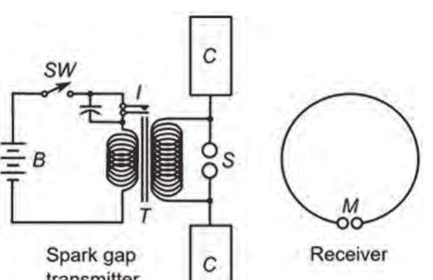

图 1.1 赫兹实验的电路图 (https://upload.wikimedia.org/wikipedia/commons/8/83/Hertz_transmitter_and_receiver_-_English.svg)。

在确认电磁波存在后不久，人们开始基于这一发现开发应用。对于一些工程师来说，电磁波可以成为一种有用的通信手段。利用通过导线的电场来传输信息的有线电报发明于 1830 年代。许多发明家独立开发了有线电报，其中一位是美国发明家塞缪尔·莫尔斯（Samuel Morse）。塞缪尔·莫尔斯构思了著名的莫尔斯电码，该电码使用短音调（称为点）、长音调（称为划）以及静默期的组合来表示拉丁字母和阿拉伯数字（静默期的长度取决于它是用于分隔划/点、单词还是句子）。如果通过导线的电场可以用来传输信息，那么人们试图开发利用空气中的电磁波进行无线电报也就顺理成章了。赫兹对电磁波的演示为无线电报开发者提供了巨大的启示，而首先展示这种系统可行性的是意大利发明家古列尔莫·马可尼（Guglielmo Marconi）。马可尼首先演示了他可以用无线电波在房间远程让铃响；然后他继续努力延长传输距离。马可尼于 1896 年首次向英国政府演示了他的无线电报，并于 1909 年与卡尔·费迪南德·布朗（Karl Ferdinand Braun）共同获得诺贝尔物理学奖，“以表彰他们在发展无线电话术方面的贡献”。在他那个时代所有杰出的电气工程师中，包括托马斯·爱迪生和尼古拉·特斯拉，只有马可尼获得了这一殊荣。

自无线电通信发明以来，其价值很快就被军方认识到。马可尼于 1901 年演示了首次跨大西洋无线通信后不久，无线电通信就成为全球海军的常见做法。干扰敌方无线电通信的做法很快就出现在军事演习中。1904 年 2 月 8 日，日俄战争爆发，旅顺口（现称旅顺港）于 1904 年 5 月被围困。在旅顺口围城期间，俄罗斯无线电操作员意识到日本进攻前无线电通信强度的增加，并将其用作早期预警信号。1904 年 3 月 8 日，日本装甲巡洋舰*浪速*（*Kasuga*）和*日进*（*Nishin*）炮击了旅顺口。一艘靠近海岸的日本小型驱逐舰作为前沿观察员，探测炮弹落点位置，并将炮击修正信息通过无线电传回两艘巡洋舰。注意到这种无线电通信并理解其重要性后，一名俄罗斯无线电操作员干扰了该通信。由于这一努力，炮击造成的损害显著减少。

该事件通常被视为电子干扰在真实战斗中的首次应用 [5]。

由于俄远东舰队遭受了重大损失，俄波罗的海舰队被派遣进行增援。由于波罗的海舰队的舰船数量较少，且航速低于日本联合舰队的舰船，波罗的海舰队的优先任务是在未被察觉的情况下抵达俄港口符拉迪沃斯托克（旅顺于 1905 年 1 月 2 日陷落）。1905 年 5 月 27 日，当波罗的海舰队接近对马海峡时，被一艘日本武装商船巡洋舰——*信浓丸*号发现。*信浓丸*号通过无线电将这一消息报告给了日本东乡平八郎大将的旗舰。有趣的是，尽管波罗的海舰队配备了能够干扰日本无线电通信的无线电发射机，且俄军在战争初期曾进行过无线电干扰演练，但俄国海军上将齐诺维·罗杰斯特文斯基在军官们的建议下，仍决定不对日本无线电进行干扰。结果，联合舰队得以定位波罗的海舰队，并在对马海战中取得了决定性的胜利。

# 1.2 用于导航的无线电与“波束之战” [6–8]

除了通信，无线电波还可以用作导航工具。自然而然地，无线电导航很快被用于战争中，不出所料，对抗措施与反制措施也随之产生。最早的例子就是第二次世界大战中所谓的“波束之战”（Battle of the Beams）。

第二次世界大战爆发后，纳粹德国迅速占领了西欧的大部分地区。鉴于凭借大英帝国强大的海上力量从海上入侵英国十分困难，纳粹德国计划通过海陆封锁与空袭相结合的方式，迫使英国接受和平谈判。*Luftwaffe*（德国空军）的轰炸机被派遣去摧毁英国的军事和经济目标，包括港口、机场、工业等。与战斗机相比，轰炸机体积更大、重量更重，因此更容易被战斗机击落。在执行轰炸任务时，*Luftwaffe* 轰炸机需要战斗机的护航，以保护其免受英国皇家空军（RAF）战斗机的攻击。然而，由于 *Luftwaffe* 在不列颠之战中无法对 RAF 取得制空权，其轰炸行动不得不在夜间进行。在夜间，RAF 战斗机看不见 *Luftwaffe* 轰炸机；因此它们是安全的。另一方面，*Luftwaffe* 轰炸机在黑暗中难以定位目标。为了在夜间找到特定目标，轰炸机必须在黑暗中知道其相对于目标的方向和距离，因此需要某种非视觉导航方法。

帮助飞行员找到正确方向的一种简单方法是使用信标无线电信号作为向导。飞行员可以像一个人沿着手电筒照亮的道路行走一样，沿着无线电波束指示的方向驾驶飞机飞行。然而，这种方法存在技术难题。如果无线电波束很窄，而飞行员偏离了航路，他们将很难修正方向。如果无线电波束很宽，由于波束总是从发射源发散，方向准确性将会受到影响。

为了解决这个问题，二战前开发了一种名为洛伦兹系统（Lorenz system）的双无线电波束导航系统。洛伦兹系统使用两个邻近的无线电发射机传输无线电信号，一个发射划杠（dash）信号，另一个发射点（dot）信号，如图 1.2 所示。这两个无线电发射机是同步的，使得划杠信号的空闲期传输点信号，反之亦然。这两个无线电波束也略有重叠；因此，当飞行员在发射机指示的重叠区域内飞行时，他们会听到连续的音调。这个重叠区域被称为“等信号区”（equi-signal area）。如果飞行员偏离了航路，他们会根据听到的无线电信号知道如何修正。二战前，这种方法已用于引导飞机在夜间降落，大多数飞机都已配备接收 30 MHz 洛伦兹信号的接收机。为了将这种方法用于引导飞往英国的 *Luftwaffe* 轰炸机，需要更强大的无线电发射机来生成发散角较窄的无线电波束，因为洛伦兹系统原本设计用于引导飞往发射机的飞机，而这一军事应用要求轰炸机远离发射机飞向目标。然而，德国成功完成了这一任务，在被占领的法国建造了若干此类发射机，向英国发射无线电信号。用于指示方向的无线电波束被称为进近波束（approach beam）。

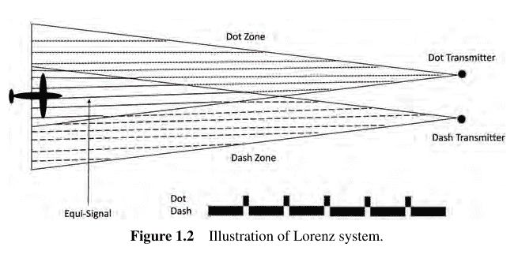

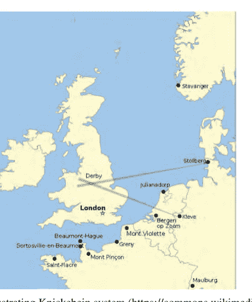

**图 1.3** 展示 Knichebein 系统的地图 (https://commons.wikimedia.org/wiki/File:Map_of_Knickebein_transmitters.svg)。

除了正确的方向，飞行员还需要知道在哪里投弹。因此，使用了第二条称为交叉波束（crossbeam）的无线电波束。德国建立了另一组发射机，发出交叉波束，使其在目标处与进近波束相交，如图 1.3 所示，轰炸机将在交汇区域投弹。德国人将这套系统命名为 Knichebein（也拼写为 Knickebein）。

英国人怀疑德国人正在使用无线电导航系统，皇家空军情报局科学家 R. V. Jones 博士推测德国正在使用类似洛伦兹系统的导航系统。因此，他命令一架飞机搜索 30 MHz 左右的任何无线电信号。一些英国科学家对这种长距离 30 MHz 无线电导航波束的可行性持非常怀疑的态度，因为他们不相信 30 MHz 的无线电波会沿地球曲率弯曲。但是，在几次失败的搜索后，德国的无线电进近波束还是被找到了。一旦识别出这些信号，就需要采取对抗措施。一种解决方案是用强噪声干扰德国的信标无线电信号。然而，这种做法会向德国人泄露其系统正受到干扰的事实。因此，采取了另一种对抗措施。英国军方设计了一种名为“Aspirin”（阿司匹林）的发射机（英国军方给 Knichebein 起的绰号是“头痛”），该发射机使用定向天线发射与 Knichebein 系统相似的划杠信号。原则上，如果将干扰信号瞄准 Knichebein 的点信号区，英国军方既可以创建另一个他们选择的等信号区，也可以使德国飞行员误以为他们处于划杠区，从而误导德国轰炸机。此外，如果德国飞行员听到两个划杠信号，他们会忽略真实的划杠音调，因为由 Aspirin 产生的划杠音调功率更高。由于德国飞行员受过遵循进近波束并在进近波束与交叉波束交汇处投弹的训练，当 Knichebein 受到干扰时，许多德国轰炸机偏离目标很远的距离才投弹。一些英国人认为他们的工程师能够将德国轰炸机引向任何方向，并在他们选择的地方投弹，以至于当德国炸弹落在温莎城堡时，乔治六世的家政官向英国政府提出了投诉。

德国 Knichebein 系统是基于二战前用于民用航空的洛伦兹系统发展而来的。Knichebein 和洛伦兹系统都使用 30 MHz 的无线电波。还开发了一种名为 X-Gerät 的类似系统。X-Gerät 系统的进近波束工作原理与 Knichebein 相同，但 X-Gerät 系统使用 74 MHz 的无线电信号，且其“等信号区”比 Knichebein 系统小得多，从而实现了更精确的轰炸。X-Gerät 狭窄的进近波束被命名为 Weser（威悉）。

Knichebein 和 X-Gerät 系统的主要区别在于，X-Gerät 系统使用三条交叉波束而不是一条，这些波束在不同位置与进近波束相交，如图 1.4 所示。当轰炸机距离目标 30 英里时，投弹手会听到第一条交叉波束（代号 Rhine，莱茵河）产生的声音，并知道他们已接近目标。一旦轰炸机越过第二条交叉波束（代号 Oder，奥得河），该波束在距离目标 12 英里处与进近波束相交，投弹手会听到另一个警告信号，然后启动一个专用秒表。第三条交叉波束（代号 Elbe，易北河）在距离目标 3 英里处与进近波束相交，投弹手在那里再次按下同一个按钮。根据跨越第二条和第三条交叉波束之间经过的时间，可以确定飞机的速度。因此，如果轰炸机用 30 秒飞完第二条和第三条交叉波束之间 9 英里的距离，那么炸弹将在按钮第二次被按下后自动延迟 10 秒投放。

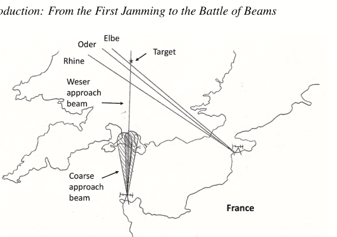

**图 1.4** 示X-Gerät系统的地图（改编自 https://www.oocities.org/pentagon/2833/general/tactics/xgeraet/xgeraet.html 中的地图）。

从原则上讲，X-Gerät系统的接近波束可以像干扰Knickebein系统那样被干扰。然而，英国干扰器的滴答信号频率为 1500 Hz，而X-Gerät系统的滴答信号频率为 2000 Hz。因此，X-Gerät系统的滤波器能够滤除英国的干扰信号。最终，英军生成了一条假交叉波束，以便在德国轰炸机穿过第二条交叉波束后很快被其探测到。因此，德国轰炸机在到达目标之前就投下了炸弹。由于X-Gerät系统使用的射频与Lorenz系统的频率不同，并非每架德国轰炸机都配备了X-Gerät系统。在每次任务中，少数配备X-Gerät系统的德国轰炸机充当领航机，其他德国轰炸机随后跟随。因此，如果领航机被欺骗，整个机群的轰炸精度就会受到影响。

在英国干扰了Knickebein和X-Gerät系统后，德国开发了另一种导航系统，即Y-Gerät。Y-Gerät系统的地面站发送一条指向目标的接近波束供轰炸机跟随，就像之前的Knickebein和X-Gerät系统一样。然而，与从其他地面站发送交叉波束不同，同一个地面站还发送了一个独立的测距信号，由轰炸机接收。在接收到测距信号后，轰炸机会立即将该信号重传回地面站。通过比较接收和发送信号的相位，地面站可以准确确定轰炸机的位置，并在轰炸机到达其目标时发送投弹信号。

英军通过接收轰炸机发送的测距信号并将其重传回德国地面站，简单地干扰了Y-Gerät系统，从而使地面站无法精确确定轰炸机的位置。在Y-Gerät系统被成功干扰后，德国人开始将其轰炸机转移到东欧，以应对即将对苏联的进攻，波束战由此结束。

从这段早期的电子战（EW）历史中，人们可以掌握一些重要的EW原则。第一点是，除非必要，不要发射信号，因为对手始终在战场上搜寻信号。德国人在执行轰炸任务很久之前，甚至在系统未使用时都开启了它们的系统。如果它们在使用不忙时不发射信号，英国人可能需要更长的时间来发现德国的制导信号（起初一些英国专家甚至不相信这些信号的存在）。此外，关于对手信号的任何知识都至关重要。R. V. Jones博士正确猜测了德国导航系统的信号频率，并对此进行了搜寻。如果对德国无线电信号的任何搜寻失败，都会让琼斯博士陷入困境，因为他不顾一些同事的反对，下令进行针对德国导航信号的搜寻飞行。基于对感兴趣信号特性的零知识或极少知识开发反制措施，将是一项艰巨且耗时的任务，而在任何竞争中，响应速度往往决定了最终的竞争结果。此外，在进行干扰时，最佳实践是在不引起被干扰的怀疑的情况下误导敌人。这可能就是英军没有简单地使用噪声来干扰德国导航信号的原因。最后，应考虑如何对抗干扰信号。这一领域通常被称为电子对抗反制措施（ECCM）。在波束战中，德国人从未尝试过对英军干扰机采取任何ECCM措施。

# 1.3 本书的范围

无线通信和雷达是电磁波的两种早期应用，在当今世界仍发挥着重要作用。与飞机等其他一些技术一样，无线通信和雷达从一开始就被用于军事用途。本书的重点是雷达及其反制措施，即空中战争中的EW系统。

雷达的目的是从远处探测物体，而EW技术旨在探测雷达的存在并采取适当行动以干扰雷达信号。如果雷达得出其信号已被妥协的结论，可能会采取对抗反制措施。本章前面描述的干扰示例展示了在开发出工具以获取商业或军事优势后，人们如何迅速且富有创意地构思相应的反制措施。虽然本章给出的例子不是关于雷达的，但它们通常被视为EW的前身。

有一部16世纪的中文小说，*《封神榜》*（Investiture of the Gods），讲述的是发生在约公元前1100年的中国商朝与周朝之间的战争。在这部小说中，交战双方都使用了神和魔，其中许多拥有特殊能力，例如能够聆听敌人的对话，或在1000里外观察敌人的机动。拥有特殊听觉的恶魔被称为千里眼（Qianliyan），而视力远优于20/20视力的恶魔被称为顺风耳（Shunfenger）。通常，一种特殊能力会遇到其对应的反制措施，就像雷达和EW一样。在这个故事中，商朝在战争中使用了千里眼和顺风耳，给周军造成了巨大的破坏。起初，周朝的前线元帅无法查明他的作战计划和行动是如何泄露给敌人的，直到他的情报来源揭示了这两个恶魔的特殊能力。一旦周朝的前线元帅了解了这两种特殊能力，反制措施随之产生：一组1000名鼓手击鼓以让顺风耳失聪，并在战前准备中使用2000面红旗阻挡千里眼的视野。因此，这两种特殊能力被中和了，千里眼和顺风耳在下一场战斗中被消灭。有趣的是，这部16世纪小说中描述的技术与EW技术具有一些相似的特征。用鼓手让顺风耳失聪类似于用强噪声干扰雷达，使雷达无法接收反射的雷达信号；我们可以几乎将用2000面红旗阻挡千里眼视为箔条的前身，箔条用于在雷达屏幕上诱导大量虚假回波，从而阻挡雷达的“视野”。

通过这本书，如果有条件，将使用历史事件来展示雷达和EW技术。然而，本书的目的是介绍基本的雷达和EW工作原理，而不是作为雷达或EW的历史。除了需要一些高中或大学一年级水平的数学和物理知识外，理解本书的内容不需要高级技术背景。本书的主题是雷达与EW系统之间的测量与反制。

我们认为，关于雷达和EW技术发展的一段历史，像*《封神榜》*这样的好小说一样有趣，理解这些技术的原理将带来对人类创造力的更深层欣赏。我们希望读者在读完这本书后与我们达成共识。

## 参考文献

- 1. Orrin E. Dunlap, *Marconi: the Man and His Wireless*（马可尼：其人与无线电信号）, the MacMillan Company, 1937.
- 2. Alfred Price, *The History of US Electronic Warfare*（美国电子战史）, vol. I, The Association of Old Crows, 1984.
- 3. R. Schroer, “Electronic Warfare. [A century of powered flight: 1903–2003]”（电子战。[动力飞行世纪：1903–2003]”），IEEE Aerospace and Electronic Systems Magazine, vol. 18, no. 7, pp. 49–54, July 2003.
- 4. Thomas H. White, “Pioneering U.S. Radio Activities (1897–1917)”（美国无线电活动的先驱（1897–1917）），United States Early Radio History, http://earlyradiohistory.us/sec007.htm.
- 5. Adrian M. Peterson, “World’s First Jamming Transmissions”（世界上第一次干扰传输）Wavescan, October 7, 2012, http://www.ontheshortwaves.com/Wavescan/wavescan121007.html.
- 6. Mario de Arcangelis, *Electronic Warfare: From the Battle of Tsushima to the Falklands and Lebanon Conflicts*（电子战：从对马海战到福克兰和黎巴嫩冲突）, Blandford Press, 1985.
- 7. Alfred Price, *Instruments of Darkness: the History of Electronic Warfare 1939–1945*（黑暗的工具：1939–1945年电子战史）, Frontline Books, 2017.
- 8. Carlo Kopp, “Battle of the Beams”（波束之战）, Defence Today, pp. 76–77, January/February 2007.
- 9. R. V. Jones, *Most Secret War*（最秘密的战争）, Wordsworth, 1978.

# 2 雷达基础及其早期发展

## 2.1 引言

无线电检测与测距（RADAR）最初是作为军事行动中的发明，用于从远处探测物体的位置和速度。如今，有许多种雷达用于民用目的。例如，天气雷达利用云层反射的电磁波来监测天气状况。在机场，空中交通管制雷达被用来探测天空中的飞机，以便进行空中交通监测/控制。警察使用雷达测速枪来检查驾驶员的速度。虽然人们可能并不喜欢雷达测速枪，但它们在某种程度上确实有助于保持驾驶安全。此外，还有许多专为不同应用设计的雷达，例如用于测绘地下特征（如树木根系等）的探地雷达等。

电子战最初被视为针对军事雷达的反制措施。在军用雷达发明和部署之前，如第一章所述，电磁波已用于军事通信和导航，并伴随着相应的干扰实践。尽管如此，这些干扰实践应被视为电子战的前身，而电子战不应被视为一个独立的研究领域。电子战是对雷达在军事应用中的一种回应，只有当雷达被发明且其应用扩展到所有军事领域时，针对雷达的反制措施（即电子战）才成为一个重要议题，电子战研究才开始蓬勃发展。

中文里“矛盾”一词的发音为 mao-dun（矛盾）。其中“矛”（Mao）意为矛（标枪），而“盾”（dun）意为盾。这是中国古代哲学家韩非（公元前 280 年–前 233 年）记载的一个故事。故事说，一个商人在市场上同时售卖矛和盾。他声称自己的矛锋利得能刺穿任何东西，没有任何东西能阻挡它。接着他又拿出自己的盾，声称它能量任何武器。这时一个旁观者问他，如果用他的矛去刺他的盾会发生什么，商人却无法回答。

很可能，韩非编造了这个故事来解释自相矛盾的说法这一概念。在当今的国防工业中，一家公司同时制造雷达和电子战系统并不罕见，但可能没有任何一家公司会在任何军事装备展览中做出像这位中国古代商人那样大胆的声明。尽管如此，从这个故事中仍可以吸取一些教训。矛匠的目标，当然是制作出足够锋利的矛以刺穿任何盾牌，为了实现这一目标，对盾牌的了解是必不可少的。同样的原则也适用于盾匠。基于同样的原因，要理解电子战技术，关于雷达的知识是必不可少的。

本章将介绍雷达的基本概念和简短的历史。要从概念变为现实，雷达必须首先解决许多困难的工程问题。本章将探讨其中一些关键问题。由于本书的主题是电子战，因此只讨论军用雷达。

## 2.2 测距的难度

从技术角度来看，测量远处物体的距离是困难的。一个人可能通过目测物体的大小来估算自己与物体之间的距离。如果一个人看起来很小，那么这个人应该离得较远。有时，距离是通过背景来估算的，例如说“一个人离这里大约两个街区远”。然而，这种目测并不总是准确的。有一句中国谚语：“骑马拉山，马会累死”，意思是骑马拉着马一直朝山上跑，而山看起来比实际距离近得多，马可能会因此精疲力竭。一些越野跑者可能会同意这一说法。

第一章描述了一些德军开发的夜间空袭技术，使用无线电波束来估算飞行距离，这一技术应用于不列颠之战期间。虽然这些方法的原理是正确的，但由于用于指示距离的无线电波束宽度太宽，因此准确性无法很高。

雷达的发明解决了至少两个重要问题。一是探测远处目标。在雷达发明之前，士兵使用双筒望远镜在天空中搜索飞机。如果听不到引擎声，这就是一项艰巨的任务。一些飞机机翼上装有灯泡。这些灯光会降低飞机被探测到的概率，因为它们会与明亮的阳光混合在一起。雷达解决的另一个问题是确定飞机的距离和速度。如果一个人看着一架飞机直接朝自己飞来，该飞机在天空中可能看起来像是一个静止的物体。在这种情况下，既无法估算飞机的距离，也无法估算其速度。

## 2.3 蝙蝠与雷达

James Tsui 刚进入青少年时期时，他的家人搬到了台湾台北。他住在一所靠近城市边缘的房子里。周围有稻田，许多蝙蝠也住在他所住的房子里。他的家人住在天花板下面，而蝙蝠住在天花板上面。由于中国人认为蝙蝠是带来好运的生物，Tsui 家族与蝙蝠相处得非常融洽。后来，当 James Tsui 在 20 世纪 50 年代上大学时，他被告知人们是从蝙蝠的灵感中发明了雷达。蝙蝠在黑暗中飞行，它们在黑暗中看不见。每只蝙蝠都会发出一个声波信号。当信号遇到物体时，信号会从物体上反射回来。蝙蝠接收回声，并利用回声来引导其活动。每只蝙蝠都通过这种过程在黑暗中导航并捕捉昆虫。工程师们借鉴了这一想法，用电磁波取代声波来制造雷达。一些在线视频显示成千上万的蝙蝠在黑暗中飞行。这些蝙蝠似乎都在以随机模式飞行而互不碰撞，并且它们能在飞行中在空中捕捉猎物。不过，蝙蝠只能在相对较短的距离内工作。另一方面，雷达被设计用于探测数百公里外的飞机。然而，如果在有限的空域内有许多快速移动的飞机，碰撞可能是不可避免的，地面雷达也可能难以将它们区分开来。

## 2.4 雷达的早期发展 [1, 2]

利用反射的电磁波来探测物体是雷达的基本原理。在 20 世纪 30 年代，包括美国、英国、德国、法国、苏联、意大利、荷兰和日本在内的多个国家正在基于相似的原理开发雷达。RADAR 这一缩写词是由美国海军在 1940 年创造的。开发雷达并非易事。雷达的工作原理很容易理解，其目的也非常明确；然而，直到 20 世纪 30 年代末和 40 年代初，许多技术问题仍未得到解决。值得一提的是，即使雷达被开发出来并投入运营，并非所有人都信任这种新设备。1941 年 12 月 7 日，当新部署的位于夏威夷奥帕纳雷达站的美国 SCR-270 雷达探测到 132 英里外一大群接近的日本轰炸机时，这一警告被忽视了 [3]。正如我们所知，日本随后轰炸了珍珠港，这是美国历史上最大的军事灾难之一。虽然人们可以不断猜测如果雷达警告信号没有被忽视会发生什么，但需要注意的是，由于雷达确实探测到了来袭的日本飞机，在第二次世界大战剩余时间里，美国雷达项目获得了非常雄厚的资金。它获得的资金甚至超过了曼哈顿计划，后者当然制造了原子弹，结束了第二次世界大战。二战期间参与美国雷达计划的人常说：“原子弹可能结束了战争，但雷达赢得了战争。”在接下来的章节中，我们将讨论建造雷达的需求，并介绍一些使雷达成为可能的技术。

## 2.5 雷达原理与雷达方程

雷达旨在探测目标并确定其距离。基本概念是发射电磁信号并探测其从目标反射回来的信号。尽管雷达旨在即时探测所有方向的目标，但这很难实现。该问题可以解释如下。假设雷达同时向所有方向发射信号，来自该源头的电磁信号将以球体的形式扩散。球体的表面积可以计算为 $4\pi r^{2}$，其中 $r$ 是球体的半径，也是源与目标之间的距离。因此，到达目标的能量是发射能量乘以目标截面积再除以 $4\pi r^{2}$。如果 $r$ 很大，则只有极小部分的发射能量到达目标。假设来自目标的反射（也称为表面回波）也不是方向性的，同样以球体形式扩散。那么，到达雷达的能量密度是反射信号能量的 $1/4\pi r^{2}$。结果，反射回源头的总能量与 $1/(4\pi r^{2})^{2}$ 成正比。这通常是发射信号能量中非常小的一部分。即使使用定向天线（即信号不是向所有方向发射），信号功率仍然与 $r^{4}$ 成反比。雷达发射信号功率与接收信号功率之间的关系可以表示为

在下式所示的雷达方程中

$$P_{rec}=P_{t}G\frac{\sigma}{4\pi r^{2}}\left(\frac{G}{4\pi}\left(\frac{c}{f}\right)\right)^{2}=P_{t}G^{2}\frac{\sigma}{(4\pi)^{3}r^{4}}\left(\frac{c}{f}\right)^{2}\tag{2.1}$$

其中 $P_{rec}$ 是接收信号的功率，$P_{t}$ 是发射信号的功率，$\sigma$ 是目标的截面积（即反射雷达信号的面积），$G$ 是天线增益，$\frac{G}{4\pi}\left(\frac{c}{f}\right)^{2}$ 项是接收天线的有效面积，$c$ 是光速，$f$ 是信号频率，$r$ 是雷达与其目标之间的距离。

$1/4\pi r^{2}$ 和 $(1/4\pi^{2})^{2}$ 这两项对于电子战应用都非常重要。在设计雷达接收机时，信号的某些特性（如预期的频率范围和信号持续时间）是已知的。因此，雷达接收机可以滤除不需要的信号，并设计得具有较高的灵敏度，但其接收到的信号能量与发射信号能量的 $(1/4\pi r^{2})^{2}$ 成正比。目标飞机上也装有接收机，称为电子战接收机，用于探测未知的雷达信号。由于目标飞机上的电子战接收机没有雷达信号的信息，它需要覆盖宽带宽，以免错过潜在的敌方雷达信号。结果，与雷达接收机相比，电子战接收机的灵敏度充其量只是一般。然而，到达电子战接收机的雷达信号能量与发射能量的 $1/4\pi r^{2}$ 成正比，这比雷达接收机接收到的反射雷达信号的能量要强烈得多。此外，电子战接收机在雷达接收到反射的雷达信号之前就截获了雷达信号。图 2.1 展示了这种关系。同样的推理也适用于

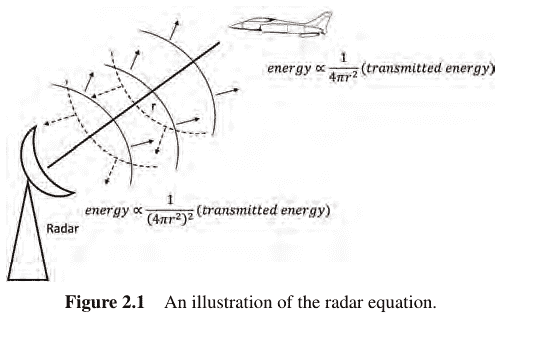

干扰。如果目标飞机希望向雷达接收机发送干扰信号以扰乱雷达工作，那么到达雷达的干扰信号能量与发射的干扰信号能量的 $1/4\pi r^2$ 成正比。因此，干扰机可以使用比雷达信号弱得多的信号来干扰雷达。电子战接收机的主题将在第 3 章中讨论。

### 2.6 高频源的需求

电磁波的波长和频率概念可以解释如下。假设电磁波是一个以光速传输的正弦信号，如图 2.2 所示。波长是信号一个周期的长度，频率是每秒钟通过固定点的信号周期数。波长和频率之间的关系可以写为

$$f\lambda = c \tag{2.2}$$

其中 $f$ 是信号频率（单位：Hz），$\lambda$ 是对应的波长，$c = 299,792,458 \text{ m/s}$（米/秒）是真空中的光速。从这个方程可以看出，频率越高，波长越短。这可以直观地解释为：如果信号的传播速度保持不变（在这种情况下是光速）；波长越短，在给定的时间框架内通过固定点的信号周期就越多。

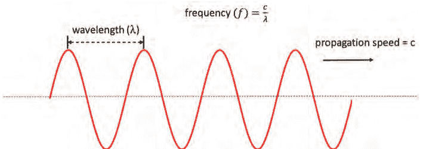

图 2.2 电磁波的速度、频率和波长之间的关系。

为了使用电磁波探测物体，信号的波长必须远小于物体。因此，信号波长不能非常长。为了探测返回的微弱信号，可以增加接收天线的增益。作为天线形状设计的一部分，天线的物理尺寸必须是几个波长长。战场中使用的可移动天线不能太大。例如，如果将雷达目标的直径限制在 1 米左右，信号波长必须比这个小几倍，而 1 米的波长大致对应 300 MHz 的频率。因此，通用的军用雷达信号频率在 2 到 18 GHz 之间，对应的波长为 $0.15 - 0.0167$ 米。虽然较高的频率可以提高雷达的分辨率，但高频信号伴随一些技术问题。首先，当信号频率低于 20 GHz 时，微波信号在空气中经历的衰减（损耗）相当低。超过 20 GHz，损耗可能过高。通过查看方程 (2.1)，可以发现当信号频率增加时，接收到的信号强度按信号频率的平方比例减小。此外，当信号频率增加时，为了保持相同的增益，天线孔径（天线接收截面积）的尺寸需要减小。当信号频率加倍时，孔径需要减小为原来的四分之一。结果，频率更高的信号将具有较窄的信号波束宽度，可能难以找到目标（用棒球棒击中某人比用长针更容易）。在 20 世纪 30 年代，当雷达正在开发时，高频信号的生成是一项重大的技术挑战。

### 2.7 极短脉冲的需求

当雷达发出信号以探测物体时，信号的持续时间（称为脉宽，PW）是有限的。雷达先发出信号，然后试图在发出下一个雷达信号之前捕获反射信号。根据雷达接收到反射信号的时间，雷达可以确定该物体的距离。雷达测距的分辨率取决于雷达信号的脉宽，这种关系可以写为

$$\Delta d = \tau c/2 \tag{2.3}$$

其中 $\Delta d$ 是距离分辨率，$\tau$ 是脉宽，$c$ 是光速。这个方程可以解释如下。一个脉宽为 $\tau$ 的雷达信号，由于电磁信号的速度与光速相同，将覆盖 $\tau c$ 的距离。如果两个物体之间的距离短于 $\tau c/2$，它们的反射信号将重叠。在这种情况下，雷达将难以使用反射信号将它们分开。如果脉宽是 1 $\mu s$（微秒），即一百万分之一秒，那么距离分辨率约为 150 米。这并不是一种很高的距离分辨率。此外，雷达不仅使用一个脉冲来测量距离，而是使用许多脉冲。脉冲之间的间隔取决于雷达的最大测量范围。如果最大距离是 150 公里，发射的信号可能往返两次于接收机，即 300 公里。发射信号到达雷达工作范围内最远的物体并反射回雷达接收机大约需要 1/1000 秒。因此，雷达必须在发射下一个脉冲之前至少等待 1 毫秒（毫秒）。这段时间称为脉冲重复间隔（PRI），其倒数称为脉冲重复频率（PRF）。在这种特定情况下，PRF 的值为 1 kHz。如果 PRI 短于 1 毫秒，雷达可能会在发出第二个脉冲后接收到由 150 公里外物体反射的信号。结果，雷达可能会错误地将该物体识别为非常近的东西。接收到的脉冲序列可以在示波器上显示。PW 与 PRI 之间的比率被称为占空比，这意味着雷达传输开启的时间比率。对于一个脉宽为 1 $\mu s$ 且 PRI 为 1 ms 的雷达系统，其占空比为 0.001。

产生如 1 $\mu s$ 这样短脉宽的信号并非易事。显然，机械开关是不行的。1937 年，英国工程师 Alan Blumlein 发明了一种电路来产生短脉冲，他的设计后来被称为 Blumlein 传输线 [4, 5]。它利用电荷通过传输线的传播来产生短脉冲。一个概念性的 Blumlein 传输线如图 2.3 所示。最初，开关断开，整个传输线的电压为 $V_{0}$，负载两端的电压为零。负载电阻（Rload）是传输线特征阻抗的两倍。当开关闭合时，负电荷从开关向负载（Rload）传播，一半的电荷反射回开关，另一半向开路端传播，负载电阻两端的电压变为 $V_{0}$。当电荷从开路端反射回开关时，负载两端的电压降为零。电荷从负载电阻到开路端完成往返所需的时间即为脉宽。传输线中电流的速度约为空气中光速的 60%。为了产生

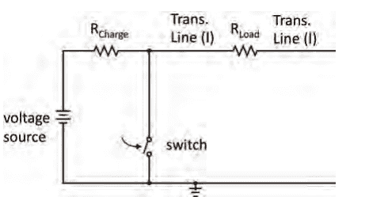

图 2.3 Blumlein 传输线示意图。

对于 1 µs 的脉冲，传输距离约为 180 m。由于这种方法要求信号往返传输，因此传输线的长度约为 90 m。需要澄清的是，为了产生周期性短脉冲，该电路的开关频率并不像脉冲重复频率（PRF）那样高，而是相当适中（在前述例子中仅为 1 kHz）。这种巧妙的方法解决了短脉冲生成问题，类似的电路至今仍在使用。

第 2.6 节和第 2.7 节描述了雷达的一个主要需求：生成具有短脉冲宽度的高频信号。为了满足这一需求，需要开发专门的硬件。

#### 2.8 高功率微波源：腔体磁控管 [6, 7]

正如第 2.5 节所述，雷达仅接收发射能量的一小部分。能量等于信号功率乘以脉冲持续时间。由于脉冲非常短，即使平均功率在千瓦量级，微波源也必须生成极高的峰值功率，甚至达到兆瓦级别。腔体磁控管（一种特殊的真空管）用于生成高功率、短持续时间的微波雷达信号。图 2.4 所示磁控管的工作原理是：在磁场中使电子束通过腔体的开口，并通过电子与磁场之间的相互作用产生电磁波。电磁波的频率取决于腔体的尺寸。从某种意义上说，腔体磁控管生成不同频率微波信号的方式，类似于吹奏管乐器时通过吹气生成特定音符。美国工程师 Albert W. Hull 提出了利用磁场控制电子电流的概念，并在 20 世纪 20 年代左右发明了磁控管。然而，Hull 的发明直到 1940 年才变得实用，当时在战争的压力下，两位英国工程师 John Randall 和 Henry Boot 对 Hull 的设计进行了重大改进。第二次世界大战爆发后，认识到美国援助对英国赢得战争的重要性，英国首相温斯顿·丘吉尔决定于 1940 年 9 月派遣一组英国特使（即 Tizard 使团）前往美国，分享包括雷达、喷气发动机、近炸引信以及原子弹构想在内的英国技术秘密，希望美国能帮助完善这些技术并支持英国的战争努力。无法生成高功率电磁信号是美国雷达项目的主要问题，直到英国政府与美国分享其腔体磁控管发明后才得到解决。Randall 和 Boot 的腔体磁控管可以生成功率为 10 kW、波长为 10 cm（即频率为 3 GHz）的微波信号，而当时美国的雷达工作在 1 米或 2 米的波长上（即频率为 300 到 150 MHz）。如第 2.6 节所述，波长更短的微波信号可以支持更高的分辨率并减小天线尺寸。从英国学习如何生成高功率和高频微波信号是美国雷达项目在二战中成功的关键。对本部分历史感兴趣的读者可以参考 Jennet Conant 的著作 *Tuxedo Park*。磁控管是一项非常重要的发明。截至本书撰写之时（2020 年），它仍然是最强大的微波发生器。尽管固态器件已被用于生成微波，但腔体磁控管在生成高功率电磁信号方面仍具有优势。

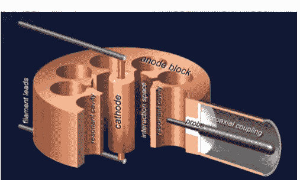

**图 2.4** 磁控管结构。© 2018 Christian Wolff (https://www.radartutorial.eu/08.transmitters/Magnetron.en.html)。

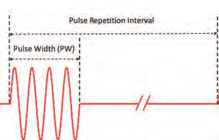

**图 2.5** 脉冲雷达信号。

一旦生成高压短脉冲，该脉冲便可施加到腔体磁控管上。随后，磁控管生成高功率微波信号。输出脉冲序列如图 2.5 所示。每个脉冲都很短，并被高频（RF）调制。所需的峰值功率可高达数百万瓦特。这是一个令人难以置信的数值。微波烤箱的平均微波功率为 700 W。即使微波烤箱的平均功率为 1000 W，脉冲峰值功率也相当于 1000 台微波烤箱的总功率。然而，如果考虑到脉冲宽度和脉冲重复间隔，雷达的平均功率是相当合理的。例如，如果脉冲峰值功率为 1 MW，脉冲宽度为 1 μs，脉冲重复间隔为 1 ms，则雷达平均功率仅为 1 kW，即 1 MW 除以 1000，因为雷达在每 1 ms 中仅传输 1 μs 的信号。

#### 2.9 一个插曲：从雷达到微波炉 [8, 9]

Percy L. Spencer 是美国马萨诸塞州沃尔瑟姆 Raytheon 公司的一名研究员。他未完成小学学业，但通过自学成为无线电技术专家。一天，他在一台雷达前工作，口袋里的花生簇融化了。这不是第一次发生这样的事，但他第一个决定对此进行调查。于是，他将鸡蛋和玉米粒等食物放在磁控管下。鸡蛋爆炸了，他的脸上沾满了鸡蛋，但他还是能和办公室里的同事分享爆米花。

大家都知道雷达束拥有巨大的能量。人们甚至担心当鸟飞入雷达时可能会受伤。但没有人想到微波可以用于烹饪。即使有人想到了，这种方法也不切实际，因为生成微波能量并不容易且成本高昂。Spencer 致力于这个想法，并于 1946 年发明了微波炉。当然，当时的微波炉非常昂贵，应用范围也很有限。

Litton 在 1960 年接管微波炉生产，并投入大量精力将其开发成一种普及的厨房产品。到了 20 世纪 70 年代，它已成为常见的厨房电器。微波炉是一个微波在其中振荡的腔体。不能将金属放入其中，因为金属会发热并变得发红发烫。James Tsui 曾亲身体验过这种效应。有一次，James Tsui 制作了一个鱼饵并将其涂成银色。为了快速干燥鱼饵，James Tsui 用微波炉烘干钩子，却忘记了钩子是由金属制成的。当 James Tsui 打开烤箱时，钩子变红了，烤箱底部表面烧出了一个小洞。幸运的是，微波炉没有损坏。另一方面，某些微波炉内部有金属支架。必须仔细分析这些烤箱中的微波分布，以确保金属支架不会发热。如今，每个现代厨房都有一台微波炉。甚至许多汽车旅馆的房间也配备了一台。从最初发明到成为流行的商业产品，工程师们花了 30 多年时间才完善微波炉设计。

许多发明源于意外发现，如青霉素和黑色橡胶（在橡胶中添加碳）。好的研究者会注意到异常现象，并且凭借一些运气，由好奇心驱动可能发明出有用的产品。

#### 2.10 基本雷达系统

雷达可以被认为由四个主要部分组成。微波功率源生成脉冲调制的微波信号。天线用于将信号发射到空气中。同一副天线也接收来自目标的反射信号。第三部分是雷达接收机，用于接收来自天线的信号（使用环行器将接收信号传送到接收机，而不是发射机），并将微波信号转换为视频信号。最后一部分是显示单元。通常使用阴极射线管来显示发射和接收的信号。发射信号和接收信号之间的时间差可用于计算目标的距离。基本雷达原理图如图 2.6 所示。

需要强调的是，该图中省略了许多细节。例如，天线可能不会同时用于发射和接收信号。它可能在发射和接收之间分时复用。发射/接收开关（称为 TR 开关）用于此操作。

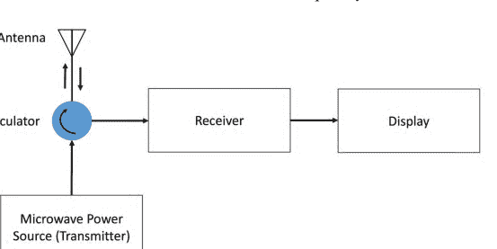

**图 2.6** 基本雷达原理图。

### 2.11 调频雷达

微波通常通过波导传输，波导是矩形的金属管道。由于微波在空气中传播时损耗很小，大功率微波会导致波导内的空气发生击穿，这相当于短路。为避免这一问题，可以使用不同种类的气体而非空气，甚至使用液体来填充波导。无论采用哪种方式，这种系统都难以维护，因为防止气体或液体从波导中泄漏是另一个需要解决的问题。

解决此问题的另一种方案是降低发射微波的峰值功率，并增加脉冲宽度以维持总能量。实现这一目标的一种方法是使用调频（FM）信号。调频信号的频率可以从低频开始，以高频结束。在接收端，使用一种称为色散延迟线的设备来处理调频信号。色散延迟线的延迟时间取决于频率。在这种情况下，低频的延迟时间长，而高频的延迟时间短。如果调频信号通过该线路，信号会被压缩成短脉冲，因为低频部分耗时较长，高频部分耗时较短，它们同时从线路中输出。因此，可以克服生成和传输大功率短脉冲信号的困难。起始频率和结束频率之间的差值（称为带宽）和脉冲宽度可用于计算处理增益。如果脉冲宽度为 $100 \mu s$，频率带宽为 $100 MHz$，这两个量的乘积为 $100 \times 10^{-6} \times 100 \times 10^{-6} = 10^4$，这个数值即为处理增益。这个量也被称为时宽带宽积。由于连续波（即具有固定频率的微波）的带宽为零，因此它没有处理增益。

这种雷达必须具有宽带宽来处理信号，而这正是人们必须付出的代价。

### 2.12 搜索雷达

如第 2.5 节所述，与发射信号相比，来自皮肤的反射回波可能非常微弱，因此雷达天线必须具有很高的增益以增加接收信号的强度。此外，如第 2.10 节所述，雷达使用同一副天线来发射和接收信号。

如果天线是全向的，它可以立即检测所有方向的目标。然而，这种天线的增益为 1（或者我们可以说它在各个方向的增益相同）。天线增益通常用分贝（dB）表示，分贝值计算如下：

$$dB = 10\log_{10}(Gain) \quad (2.4)$$

如果天线增益为 1，我们也可以说其增益为 0 dB。当天线是全向时，如果检测到目标，由于反射信号可能来自任何方向，无法确定目标的方向。

为了解决这种模糊性，可以使用定向天线代替全向天线。具有主波束（主瓣）和副瓣的定向天线的辐射方向图如图 2.7 所示。天线的主波束是发射/接收信号获得最大放大的区域。当定向天线用于雷达系统时，雷达主要在主波束中搜索物体。副瓣是信号仍然被发射或接收的区域，但信号获得的放大作用要弱得多。

人们可能希望为雷达系统使用高增益定向天线。如果检测到目标，由于目标位于天线主波束的方向上，可以很容易地确定目标的位置。然而，这种布置在检测目标时可能难以使用，因为天线增益和主波束的大小有关，更高的增益意味着更窄的主波束。当然，使用主波束非常窄的微波信号击中目标的概率是很小的。

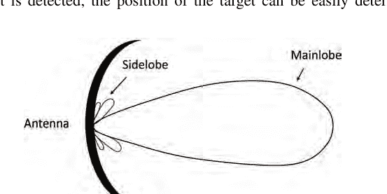

**图 2.7** 定向天线的辐射方向图。

折中的方法是使用具有中等增益并覆盖合理角度的天线。例如，一种常见的方法是创建垂直扇形波束。该波束在方位方向上较窄，在仰角方向上较宽。为了形成这种波束，天线在水平方向上较宽，但在仰角方向上较短，如图 2.8 所示。图 2.8 中显示的波束称为扇形波束，而在方位和仰角方向上都较窄的波束被称为铅笔波束。该天线将在水平方向上旋转。如果检测到目标，则已知方位角。仰角可以通过指向所需方位方向的另一副天线找到。

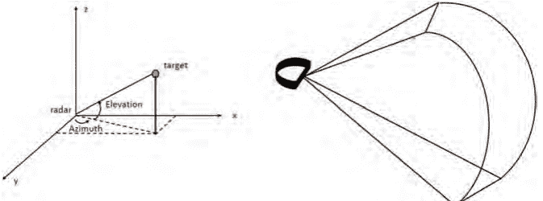

**图 2.8** 产生垂直扇形波束的天线。

返回信号在阴极射线管上以极坐标显示。雷达的位置位于中心。一条辐射线绕中心旋转。检测到的目标显示为显示屏上的亮点。目标的方位角和距离可以通过其在显示屏上的坐标确定。图 2.9 显示了显示屏的一个示例。

### 2.13 圆锥扫描雷达 [10]

一旦找到目标，就需要其详细信息，包括目标的位置和速度。收集此类信息的雷达类型可称为跟踪雷达。第 2.12 节中描述的搜索雷达可以提供目标的位置。目标的速度可以从反射信号的历史记录中确定。例如，可以通过将两次特定扫描之间目标位置的变化除以这两次扫描之间的时间间隔来估算目标的速度。可以使用不同的方法来提高测量精度，其中一些将在以下章节中介绍。首先，让我们讨论圆锥扫描雷达。

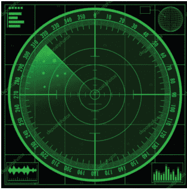

**图 2.9** 雷达屏幕。(https://static5.depositphotos.com/1000134/471/i/950/depositphotos_4713955-stock-photo-radar-screen.jpg)。

圆锥扫描雷达用于确定目标的精确方向并持续跟踪它。其天线通常是喇叭形状的。它们由矩形波导制成，波导的尺寸逐渐增加成为矩形喇叭，如图 2.10 所示。圆锥扫描雷达的信号波束略微偏离天线中心线，并围绕其连续旋转（扫描）。如果目标大致位于圆锥扫描雷达天线的轴线上，则来自天线的信号波束围绕目标形成一个圆锥面，如图 2.11 所示。如果目标位于圆锥中心，反射信号强，且在旋转期间幅度保持恒定。如果接收到的信号在旋转期间幅度不恒定，则目标不在圆锥中心。此时会生成误差信号来调整天线的方向。这种方法可以提高方向测量的精度。

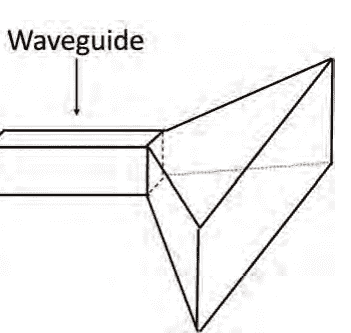

**图 2.10** 矩形喇叭天线。

### 2.14 单脉冲雷达

这种雷达通常使用四个喇叭天线来发射和接收四个信号。为了解释这一概念，这里使用一个包含两天线的系统进行说明。在这种特定情况下，两个天线发射两个信号。两个天线指向略微不同的方向。反射信号相加以获得和通道。它们的差值也被获取作为差通道。如果目标位于这两个波束的中间，和通道将具有最大输出，而差通道应具有最小输出。和通道与差通道的输出如图 2.12 所示。和通道提供目标方向的粗略信息，差通道提供精细信息。差通道的输出可用于控制天线的方向。

在两天线系统中，差通道只能用于在一个方向（例如方位方向）上调整两天线。如果使用四个通道，天线可以在方位和仰角两个方向上移动。图 2.13 显示了四个喇叭天线的布置。通道 A 和 C 可以相加，B 和 D 可以相加。它们的输出 (A+C) 和 (B+D) 可以被视为两个用于移动天线的通道

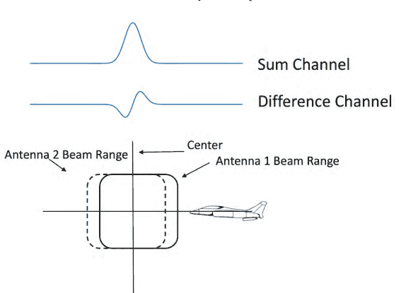

图 2.12 双天线单脉冲雷达（用于说明原理）。

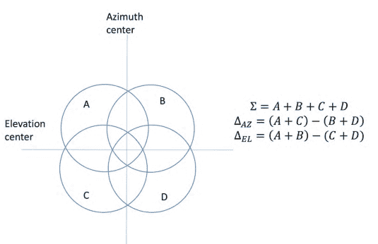

图 2.13 四天线单脉冲雷达。

在方位方向上。类似地，输出 \((A+B)\) 和 \((C+D)\) 可以被视为两个通道，用于在俯仰方向上移动天线。两个差通道，即方位差通道 \((\Delta_{AZ} = (A+C) - (B+D))\) 和俯仰差通道 \((\Delta_{EL} = (A+B) - (C+D))\)，可用于精确定位目标。

比较圆锥扫描雷达和单脉冲雷达；它们的主要区别在于，前者使用单个天线在旋转过程中寻找最大反射信号和恒定信号幅度。后一种方法使用四个天线寻找最大回波信号，并利用差通道引导天线跟踪物体。由于四个天线都在单脉冲上工作，因此该系统被称为单脉冲雷达。单脉冲雷达比圆锥扫描雷达更流行，因为它更不易受干扰。干扰的话题将在第 5 章中讨论。

### 2.15 多普勒雷达

除了目标位置外，测量目标的速度也是期望的。从理论上讲，可以通过计算一定时间内测量的目标位置之差来计算目标速度。通过这种方式获得的速度估计较为粗略且非实时（因为接收器需要时间来获取两个距离测量值）。测量物体速度的另一种方法是利用多普勒效应。在日常生活中可以体验到多普勒效应。例如，人们可能会听到开着警笛的消防车或警车。当卡车或汽车接近时，可以听到音调较高；当它远离时，音调较低。这个例子展示了声波的多普勒效应。同样的原理也适用于电磁波。

警察雷达利用多普勒效应测量汽车速度，军用雷达则利用相同原理测量飞机速度。如果飞机正接近雷达，接收到的信号频率将高于发射信号。如果飞机远离雷达，接收到的信号频率将低于发射信号。通过测量发射信号和接收信号之间的频率差（也称为多普勒频率），可以获得目标的速度，公式如下：

$$s = \frac{ \Delta f c }{ 2f } \tag{2.5}$$

其中 $s$ 是目标朝向雷达的速度，$\Delta f$ 是发射信号和接收信号的频率差，$c$ 是光速，$f$ 是发射信号的频率。方程中的系数 2 是因为信号在目标和雷达之间往返传播了两倍的距离。

如果目标直接朝向或远离雷达行进，通过公式 (2.5) 获得的速度即为目标的速度。如果目标在其他方向上行进，则必须考虑指向雷达的视线与目标行进方向之间的夹角。

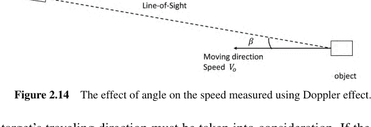

图 2.14 角度对使用多普勒效应测量的速度的影响。

以及目标行进方向。如果目标沿切线方向行进，测量速度为零，如图 2.14 所示。换句话说，如果有一辆超速车辆侧面对着警察雷达，雷达枪将无法测量汽车的速度。

人们可能会认为搜索雷达可以发送射频脉冲串来测量距离，并利用多普勒频率来测量目标速度。然而，这种方法存在一个根本性的限制。根据海森堡不确定性原理，无法同时精确测量位置和速度（或动量）。为了测量远处的目标，脉冲间隔必须较长（即脉冲重复频率较低），以消除距离模糊性，如第 2.7 节所述。这种设计降低了雷达在频域内的测量能力，而多普勒雷达基于多普勒效应引起的频移来确定目标速度。为了提高频率测量能力，脉冲间隔必须较短（即脉冲重复频率较高）。因此，多普勒雷达具有高或中等脉冲重复频率。

### 2.16 连续波雷达

本书中考虑的大多数雷达是脉冲雷达，但连续波（CW）雷达也适用于某些场景。CW 指的是具有固定频率的连续微波信号。人们可以将 CW 信号想象为正弦波。与第 2.7 节中描述的脉冲雷达（发送短脉冲并等待其回波后再发送下一个短脉冲）不同，CW 雷达连续发射 CW 信号。如果物体在移动，反射信号的频率会发生变化，如第 2.15 节所述，CW 雷达然后可以基于多普勒效应检测该物体。CW 雷达的主要优势在于其实现简单，因为它不需要生成强短脉冲信号。此外，由于 CW 雷达不需要将所有能量集中在短脉冲中，因此 CW 雷达可以使用低功率信号，与脉冲雷达的信号相比，这种信号更难被截获。尽管 CW 雷达在检测静止或缓慢移动的物体方面存在困难，且无法确定物体的距离，但它非常适合检测快速移动的物体，例如喷气式战斗机。它还应用于测速枪中。

### 2.17 动目标显示（MTI）

大多数时候，雷达指向天空，任何反射信号都被假设是由目标反射的。如果雷达正在寻找低仰角目标，而该方向有一座高山，山体的反射可能会掩盖真实目标。这种不需要的反射信号被称为杂波。杂波可能比真实目标的回波更大，因为山体远大于目标。然而，山体是静止的，因此反射发生在固定点。可以使用延迟线来延迟接收到的反射信号。可以调整延迟信号的幅度和极性，以抵消来自山脉等静止物体的反射回波信号。

现代雷达使用相干信号，这意味着发射信号的相位可以受控，且接收信号的相位可以由接收器确定。在此场景下，对于固定目标，发射信号和接收信号相位之间的关系是常数；但对于移动目标，这种相位关系不断变化。通过比较每次发射和反射信号之间的相位关系，雷达屏幕可以仅显示移动目标。在噪声条件下，这种方法比幅度抵消方法效果更好。

### 2.18 下视/下射雷达

前面几节讨论的所有雷达都是陆基或海基雷达，看向天空。下视/下射雷达是一种机载雷达。它是一种武器雷达，其目标是向下看地面并寻找飞机下方的移动目标。一旦下视雷达识别出移动目标，它就可以对其进行射击（下射），如图 2.15 所示。由于雷达在移动，即使是静止目标（如山脉）也会变成移动物体。第 2.17 节描述的动目标显示概念在这里不再适用。相反，下视雷达通过比较移动物体和静止物体反射的雷达信号的不同多普勒频移来区分移动目标和静止物体。

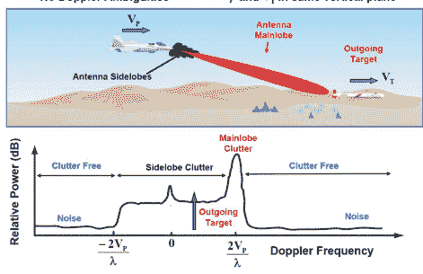

**图 2.15** 下视雷达的多普勒频移 (https://doeplayer.net/51967130-Radar-systems-engineering-lecture-14-airborne-pulse-doppler-radar.html)。

物体 [11]。由于飞机速度已知，静止物体的多普勒频移可以轻松确定，并且可以利用此信息将移动目标与静止物体分离开来。

雷达前方的地面会产生大量反射回雷达。因此，杂波可能会掩盖目标。由于地面包含各种物体（例如建筑物、山丘和植物），杂波是不可预测的。必须使用信号处理来减少杂波，以提高目标反射信号的信噪比并识别它们。这种雷达的构建相当困难。

### 2.19 武器制导信号

在战场上，雷达的最终目标是发现敌方目标并摧毁它们。一旦雷达发现目标（假设是一架飞机）并获得关于它的所有信息（如位置和速度），导弹可能会被发射向目标以摧毁它。导弹必须被引导向目标，因为目标可能不会以可预测的模式移动。特别是，当目标发现导弹接近时，它会机动以躲避攻击，而导弹必须追击目标。导弹和目标飞机之间是一场艰难的博弈。导弹被引导向目标飞机有许多不同的方式，它们将在本书的后半部分讨论。一种方法是使用跟踪雷达，向目标飞机发送制导信号，雷达的信号将被反射回来以引导导弹。然后导弹跟随反射回来的

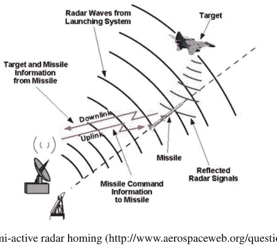

图 2.16 半主动雷达制导（http://www.aerospaceweb.org/question/weapons/q0187.shtml）。

指向飞机的制导信号。这一概念如图 2.16 所示。在图 2.16 所示的系统中，导弹检测由外部雷达生成并由目标反射的信号。这种导弹制导方法被称为半主动雷达寻的（SARH）。某些导弹可能配备自己的雷达收发器以发出制导信号。这种配置被称为主动雷达寻的（ARH）。

### 2.20 雷达模式

本书中考虑的三种雷达模式为：*搜索*、*捕获*和*跟踪*。在搜索阶段，雷达扫描空中区域，寻找潜在目标。一旦检测到物体，在捕获阶段，雷达会扫描被检测物体周围的区域，以确定该物体的位置和速度。获取这些信息后，雷达进入跟踪模式以主动跟踪该物体。值得指出的是，现代雷达能够同时应对多个目标；因此，雷达可能会同时执行搜索和跟踪等多个任务。

### 2.21 结论

本章讨论了雷达原理以及构建雷达所需的基本技术。还介绍了具有不同目标和操作的不同类型军用雷达。同时探讨了雷达的工作原理及其局限性。然而，所有讨论都非常基础。雷达性能取决于飞机的发展。例如，具有小雷达截面积的隐身飞机的发展降低了雷达的有效性。尽管如此，隐身飞机并不能吸收所有雷达信号，尽管该领域的研究已持续多年。雷达与飞机的雷达截面积问题，就像本章开头提到的矛与盾的问题。这是一个没有尽头的问题。

如果雷达的目标（飞机）截获了雷达信号，它将试图对抗雷达，飞机采取的行动被称为对抗措施。随后，雷达必须采取行动以保护自身免受敌方操作的影响，雷达的这种响应被称为反对抗措施。通常，军用雷达产生的信号是保密的。除非必要，军用雷达不会发射信号。即使在和平时期，也有情报收集行动来收集军用雷达信息。如果了解敌方的军用雷达信号，雷达的效果就会降低。当我们讨论后面章节中的一些真实战斗实例时，这一点会更加清晰。

许多关于电子战的书籍侧重于旨在击败或保护脉冲雷达的电子战技术。近年来，低截获概率（LPI）雷达——旨在避免被电子战系统探测——变得更加流行，其中一些是连续波（CW）雷达的变体或具有长占空比的脉冲雷达。LPI 雷达将在第 9 章中介绍。

## 参考文献

- [1] Oskar Bluntritt, Hartmut Petzold, 和 William Aspray (编), *追踪雷达历史*, IEEE-新泽西州电气工程历史中心, 1994.
- [2] Massimo Guarnieri, “雷达的早期历史,” IEEE 工业电子杂志, 第 36 卷, 第 4 期, 第 36–42 页. 2010 年 9 月.
- [3] Patrick Hindle, Richard Mumford 和 Gary Lerude, “臭名昭著的珍珠港雷达,” 微波杂志, 2017 年 5 月 12 日.
- [4] Andrea de Angelis, Jurgen Kolb, Luigi Zeni, 和 Karl H Schoenbach, “具有可变脉冲宽度和极性的千伏 Bleun 脉冲发生器,” 科学仪器评论, 第 79 卷. 第 4 期, 2008 年 4 月
- [5] S. J. Voeten, *匹配高压脉冲功率技术*, 埃因霍温理工大学, 2013.
- [6] Y. Blanchard, G. Galati, 和 P. van Genders, “腔体磁控管：不仅仅是一项英国发明 [历史角落],” IEEE 天线与传播杂志, 第 55 卷, 第 5 期, 第 244–254 页, 2013 年 10 月.
- [7] Samuel Y. Liao, 微波器件与电路, 第 3 版, 普伦蒂斯霍尔, 1990.
- [8] J. M. Osepchuk, “微波加热应用的历史,” IEEE 微波理论与技术杂志, 第 32 卷, 第 9 期, 第 1200–1224 页, 1984 年 9 月.
- [9] Matt Blitz, “微波炉如何意外发明的惊人真实故事,” 大众机械, 2016 年 2 月 24 日 (http://www.popularmechanics.com/technology/gadgets/a19567/how-the-microwave-was-invented-by-accident/).
- [10] J. Litva, 低角度跟踪圆锥扫描雷达理论, 国防技术信息中心, 1980.
- [11] W. H. Long, D. H. Mooney, 和 W. A. Skillman, “脉冲多普勒雷达,” 载于 M. I. Skolnik 编著的《雷达手册》, 麦格劳-希尔, 1990.
- [12] Jennet Conant, 塔克索公园：一位华尔街大亨和改变二战进程的隐秘科学宫殿, 西蒙与舒斯特, 2003.

## 3

## 电子战总体概览

### 3.1 引言

雷达是一种探测飞机的强大设备。当然，用肉眼在天空中寻找飞机的日子早已过去。在空战中，在大多数场景下，喷气式战斗机通过机载雷达在相对较远的距离定位敌方喷气式战斗机并对其开火。电影中描绘的喷气式战斗机短距离空中缠斗可能会越来越少，因为那些能够在更远距离探测并锁定敌人的战斗机可能会在敌人看到他们之前消灭他们。因此，可以安全地断言，雷达是飞机的主要威胁。它发现飞机、跟踪它们，并且通常引导导弹摧毁它们。雷达可以被视为军事行动的眼睛。本书的主要主题是电子战。单独的雷达并不构成电子战，但它可以被视为电子战的起源，或电子战的第一层。

电子战操作可分为四个层次，如图 3.1 所示。第一层是第 2 章中讨论的雷达搜索和跟踪操作。电子战的第二层是接收机的雷达信号截获和雷达分类操作。在识别雷达信号后，第三层操作——对抗措施——可能被用于使敌方雷达失效。电子战的最后一层是雷达的反对抗措施以保护自身。第一层已在第 2 章中涵盖，本章简要介绍第 2–4 层操作的工作原理。更多细节将在后续章节中提供。人们可能会对这些操作赋予不同的名称，且没有普遍接受的定义。不同的技术术语可能指代略有不同的相似操作，而这些不同名称可能仅电子战专业人士熟悉。在本书中，四层操作的名称仅仅是作者的偏好。如果在讨论中使用其他技术术语，将会进行解释。

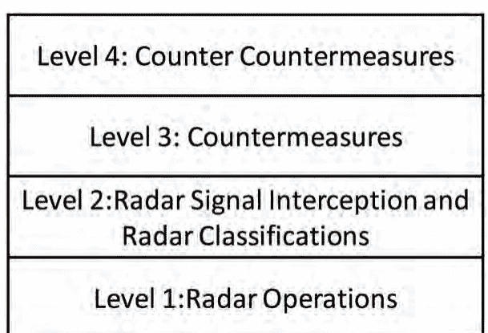

**图 3.1** 电子战操作的四个层次。

电子战操作的第二层和第三层都是在目标飞机上执行的。某些研究者将第二层操作称为电子支援措施（ESM）。它们也被称为被动电子战，因为这些操作不发射信号。雷达是一种主动设备，因为它发射信号以查找物体，从而使被动电子战成为可能。值得一提的是，存在一些依赖电视和无线电等机会信号来探测物体而不发射信号的被动雷达，但据作者所知，它们无法引导导弹造成损害，因此本书仅简要讨论。目标飞机必须确定其是否正被敌方雷达照射。如果确实被敌方雷达照射，希望雷达无法看到它。如公式 (2.1) 所示，反射回雷达的信号能量与目标的截面积成正比；因此，雷达只能探测截面积足够大的目标。应强调的是，目标的截面积不一定与其物理尺寸成正比。用于降低目标被雷达探测概率的技术，例如通过特殊设计的机身形状或使用特殊油漆吸收雷达信号来减小飞机的截面积，被称为隐身技术。虽然隐身技术是飞机设计的重要组成部分，但它不能归为电子战四个层次操作之一。

由于隐身技术尚未发展到能够探测雷达信号的存在或对雷达实施干扰的程度，换言之，除了本文描述的四个电子战层级外，还有其他值得讨论的相关技术，例如隐身技术，这些将在第8章中讨论。

电子战操作的第三层是通过干扰雷达运行来保护目标飞机。这些操作包括发送噪声以掩盖雷达的目标（干扰）或发送虚假信号以误导雷达操作员（欺骗）。由于在此操作中会传输信号，因此有时也被称为主动电子战。这种操作也可能被称为电子攻击（EA）。一种更具攻击性的方法是物理摧毁雷达。

操作的第四层是雷达对自身所遭受的目标飞机敌对操作进行自卫反应。其目的是减轻目标飞机发出的干扰信号的影响。

## 3.2 第二层操作：在飞机上执行的雷达信号截获

被雷达跟踪但不知晓雷达正在运行的飞机可能处于极大危险中。因此，雷达目标飞机的操作员必须开发防御技术来保护自身。首先，必须确定自己的飞机是否正被雷达照射。需要一种接收器来接收所有不同的雷达信号，这种接收器被称为电子战接收器或截获接收器。

截获接收器与第2.10节中讨论的雷达接收器的主要区别在于，雷达接收器能够区分它正在寻找的雷达信号，而截获接收器可能假设对雷达信号没有任何先验知识。雷达接收器只需接收一个信号，但截获接收器需要接收战场上的所有雷达信号。更糟糕的是，有些雷达被设计为避开被截获接收器检测到，它们被称为低截获概率（LPI）雷达。一些LPI雷达的工作原理将在第3.8节和第9章中讨论。

由于截获接收器需要覆盖宽阔的带宽，它会从广泛频段接收噪声/干扰，因此灵敏度远低于雷达接收器。灵敏度更高的接收器可以检测到更弱的信号。然而，截获接收器接收到的信号比第2.5节中描述的天线表面反射（skin return）强得多；因此，灵敏度低于雷达接收器的截获接收器仍然可以实现其设计目标。这就是为什么有些人可能会声称电子战基于第2.5节中那个单一公式，即公式(2.1)。

虽然电子战是一个专业领域，但人们实际上可以在日常生活中找到类似的产品。某些驾驶员用来避免超速罚单的测速雷达探测器是一种截获接收器或雷达告警接收器。其目标是在警察测量车辆速度之前检测到警车雷达测速枪的存在。有人开玩笑说，设计糟糕的交通雷达探测器只能给驾驶员提供额外的时间来掏钱夹，因为当雷达探测器检测到雷达时，警察已经获得了车辆的速度。

## 3.3 第二层操作：在飞机上进行的信号分类与识别

在战场上，可能存在许多不同类型的雷达。有些是友方的，有些是敌方的。截获接收器被设计用来接收到达飞机的所有信号。如果截获接收器处于高空，它将被多种类型的雷达照射。有时，截获接收器每秒可以接收数万甚至上百万个信号。然而，只有威胁信号才值得关注。电子战处理器进行的信号分类始于将来自特定雷达的所有信号分组。一旦收集到一个雷达的所有信号，就可以提取这些信号的参数，即频率、脉宽和脉冲间隔。然后，这些参数将用于借助雷达数据库识别雷达类型。如果雷达是威胁雷达，必须采取一些行动。如果信号正在引导导弹飞向飞机，响应时间以秒计。另一方面，如果雷达不是即时威胁，可能不需要采取行动。

当然，必须建立一个雷达信号库，该库必须包含所有敌方雷达的信息。这不是一个轻松的工作。信号收集可能非常困难且耗时。这种军事行动被称为ELINT（电子情报）收集。ELINT收集意味着从各种来源收集所有雷达信号、通信信号和电子信号。收集可以从陆地、船舶、飞机甚至卫星进行。将收集和处理大量数据以获取有用信息。这可能类似于黄金开采：从大量的沙子、砾石和岩石中提取少量的黄金。没有关于敌方雷达的信息可能会带来巨大的代价。在越南战争期间，每当北越从苏联获得一种配备新雷达的导弹类型时，美军飞机的损失就会激增[1]。只有在美军更多地了解了北越的新雷达之后，损失才减少。

正如人们可以想象的那样，雷达的开发需要严格保密，并且在军事行动中，除非绝对必要，否则不应传输雷达信号，特别是当新的雷达正在使用时。在某些情况下，雷达天线可能被假负载替代，在演习或测试期间，发射的信号被负载吸收。当然，这种实践在为新雷达开发收集实验数据方面有其局限性。尽管如此，这使得潜在敌人收集关于新武器雷达信息的任务变得更加困难。

## 3.4 第三层操作：电子对抗措施（ECM）

一旦目标飞机在战场上检测到威胁，可以采取几种操作来保护飞机。这些对抗措施可能不全是电子措施。例如，如果一枚热寻导弹向飞机发射，飞行员可以发射热源以分散导弹的注意力。这些热源被称为热焰弹（flares）。如果导弹是由无线电波信号引导的，可以释放箔条（chaffs）。箔条是由非常薄的铝箔切成非常窄的条状制成的。条的长度各不相同，但通常只有几英寸长，与威胁雷达信号的波长相当。箔条将在空中悬浮一段时间，并将雷达信号反射回雷达。箔条的目的是在雷达显示中围绕真实目标创建大量虚假目标，从而使雷达失去准确的目标位置测量。这两种方法被认为是被动对抗措施，因为它们不发射信号。它们是非常重要的技术，将在第7章中讨论。

为了跟踪飞机并最终将其击落，雷达将经过几个步骤，如搜索、捕获、跟踪，最后发射导弹。如果其中任何一步被打断，雷达可能无法到达向目标射击的最后一步。在早期阶段针对雷达采取行动并阻止其获取关于飞机情况的信息会好得多。如果雷达正在向目标发射导弹，局势就是生死攸关。

可以使用许多方法来干扰敌方雷达运行。一种常见方法是重新传输雷达信号以干扰雷达操作，使其分心。由于反射信号强度

由于雷达方程公式 (2.1) 中的 $1/r^4$ 项，来自目标飞机的信号相当微弱，因此干扰信号可能远强于反射的雷达信号。另一个显而易见的解决方案是发射噪声以掩盖雷达屏幕上的真实信号。然而，由于噪声覆盖的带宽很宽，进入雷达接收机的噪声能量受限于接收机的带宽。干扰雷达的方法多种多样，针对特定雷达需要采用特定的技术。

所有使用信号来中断雷达运行的方法被称为电子攻击，因为它们发射电磁波以破坏雷达操作。

### 3.5 第三层作战：被雷达跟踪的飞机可以向雷达发射导弹以摧毁它

被敌方雷达跟踪的飞机必须保护自己免于被摧毁。如果雷达是陆基的，飞机可能会发射空对地导弹来摧毁雷达。导弹可以利用雷达信号作为制导（信标）。这种导弹被称为高速反辐射导弹（HARM）。因此，雷达也处于易受攻击的状态。如果一个雷达只关心进攻，即摧毁敌方飞机而忽视自身防护，它很容易被反辐射导弹消灭。为了保护自身，雷达必须限制其发射时间。长时间运行可能使雷达处于危险境地。因此，雷达只应在必要时发射信号。

任何军事行动的一般规则是，必须同时考虑进攻和防御。在许多竞技游戏如象棋和围棋中，每一步棋都应通过考虑双方局势来下。对于竞技选手而言，决定胜负往往取决于他们能否比对手领先一步。雷达和目标飞机处于类似的情况。领先一步的一方可以摧毁另一方，而不是像美国空军歌曲中描绘的那样“要么活在荣耀中，要么葬身在烈焰里。嘿！”那样被摧毁。

### 3.6 关于第二层和第三层作战的一般讨论

电子战的第二层和第三层作战包括截获雷达信号、识别信号、通过电子手段或导弹攻击雷达等。需要指出的是，用于第二层和第三层作战的所有设备都位于飞机上。这些操作对于飞机的生存能力几乎同等重要。这里将讨论这些操作及其关系。

首先，让我们考虑雷达信号截获与分类。在所有截获的雷达信号中，威胁雷达是最优先关注的对象。一旦识别出威胁信号，将应用主动电子战技术来干扰雷达运行。被干扰的威胁信号并不引起截获接收机的兴趣。此外，由于以下段落将要讨论的原因，截获接收机无法接收被干扰的雷达信号。然而，这并不意味着被干扰的威胁雷达信号不再到达截获接收机。电子战处理器只是忽略这些信号并专注于发现新的威胁。换句话说，截获接收机仍应接收并识别其他雷达信号以寻找额外的威胁雷达。

由于干扰机和截获接收机位于同一飞机上，当干扰信号开启时，它会掩盖截获接收机。如果干扰信号是噪声，它具有很高的频谱宽度，可以阻塞截获接收机工作带宽的很大一部分。即使截获接收机具有很宽的工作带宽（这将在第4章中讨论），窄带干扰信号仍有可能阻塞所有接收机操作。因此，一旦雷达信号被干扰，由于同机干扰机的干扰信号牺牲了接收机接收该信号的能力，截获接收机再也无法“看到”它。

另一方面，只要雷达仍在运行，干扰机就不能停止干扰。如果干扰信号停止，雷达将以正常模式运行，这可能会对飞机构成威胁。当干扰机开启时，截获接收机无法接收被干扰的雷达信号，也无法确定雷达是否仍在运行。如果雷达停止发射而干扰机仍发出干扰信号，干扰机就浪费其干扰功率。更糟糕的是，雷达发射的导弹可以利用飞机上的干扰信号作为信标信号。这种操作被称为“归向干扰”。如前几节所述，任何发射信号的设备都可能暴露自身于危险之中。因此，当雷达关闭时，干扰机必须停止干扰。

为了检查威胁雷达是否仍在发射，干扰机必须周期性停止，以便让截获接收机判断雷达的状况。由于所有关于雷达的信息已知，这种操作相对简单。描述这种操作的术语被称为截获接收机的“透视窗口”。如果飞机没有干扰目标雷达，其截获接收机可以全功能运行。因为接收机是被动设备，它不会暴露飞机。如果干扰机开启，截获接收机将具有有限的操作能力。

干扰目标雷达的方式多种多样。如果雷达被噪声干扰，雷达操作员会意识到雷达已被干扰，因为噪声会清除雷达显示。也有欺骗性干扰，向雷达操作员提供错误信息。在这种情况下，雷达操作员可能意识到也可能没意识到正在被干扰。后一种操作有时被称为欺骗。

### 3.7 电子战飞机

之前所有的讨论都假设雷达用于对抗飞机，且飞机可能会攻击雷达。战斗机的主要任务是攻击敌方飞机或地面目标。其用于对抗敌方雷达的设备相当有限，仅用于自我保护。

由于雷达是飞机的主要威胁，有些飞机专门建造用于对抗敌方雷达，它们被称为电子战飞机。这些飞机上的设备可能非常先进。因此，在干扰雷达运行方面更有效。这些飞机可以进入战场并执行本章目前讨论的所有操作，除了向雷达发射导弹。这种做法更有效，因为敌方雷达直接照射电子战飞机，它们可以通过雷达天线的主瓣检测和干扰雷达信号。电子战飞机在战场上的主要风险是它们毫无防御，敌人可以轻松攻击它们。

另一种作战方式是让电子战飞机远离战场，停留在敌方导弹射程之外。电子战飞机可以在安全区内以特定模式飞行。在这种情况下，敌方雷达可能无法检测到电子战飞机。例如，如果雷达的射程为 150 公里，电子战飞机可以在雷达射程之外（例如在 150 到 300 公里之间的某处）检测到敌方雷达信号而不被发现（请记住第 2.5 节的讨论）。此外，飞机可能不在雷达天线的主瓣内。因为天线可能有多个旁瓣，雷达仍可以从旁瓣接收信号。尽管如此，为了检测雷达旁瓣中的雷达信号，截获接收机的灵敏度必须很高。出于同样的原因，强大的干扰信号对于通过雷达天线的旁瓣进入雷达接收机也是必要的。

## 3.8 电子对抗第四层：雷达反反制措施

在军用雷达设计中，必须考虑到目标所采取的所有电子对抗措施。雷达必须检测到干扰信号，以避免提供关于目标的虚假情报。雷达可以拥有不同的工作模式，例如改变其工作频率、改变脉冲重复间隔等。这些方法使得截获接收机和电子对抗处理器识别敌方雷达的任务变得更加复杂。雷达必须最大限度地减少对目标的照射时间。这对于避免被反辐射导弹攻击尤为重要。

虽然功率更高的雷达可以覆盖更长的距离，但高信号功率也使雷达变得脆弱，因为截获接收机可以方便地检测到发射强信号的雷达。避免被检测的一种明显方法是辐射更少的功率。这类低截获概率（LPI）雷达仅施加恰好能实现其工作目标的功率。当它们追踪近距离目标时，会减少其发射能量。另一种降低被检测概率的方法是像第 2.11 节中解释的那样，使用较长的低功率脉冲，例如调频（FM）信号。通过这样做，总发射能量保持不变，但峰值功率降低，从而使雷达更难被检测到。其他 LPI 方法包括改变信号频率、降低天线旁瓣、使用类噪声雷达信号等。第 9 章将介绍一些类型的 LPI 雷达。

雷达还可以发射归因于干扰的导弹来攻击目标。如果目标正在对雷达进行干扰，导弹可以跟随干扰信号。因此，干扰信号可能会给干扰机带来危险。雷达为抵消其目标反制措施而采取的电子对抗操作被称为电子反反制措施（ECCM），也称为电子保护（EP）。

## 3.9 电子对抗案例研究：黑猫中队

1960 年 U-2 事件，美国飞行员弗朗西斯·加里·鲍尔斯在飞越苏联期间于科苏利诺附近被击落，在艾森豪威尔总统任期内引发了一场重大的外交危机，英语世界读者对此众所周知。鲜为人知的历史是，从 1961 年到 1974 年，美国向台湾中华民国空军（ROCAF）提供 U-2 飞机，以对中国大陆进行侦察任务。ROCAF 为此组建了黑猫中队。由于在 20 世纪 60 年代初，中国人民解放军空军（PLAAF）只有少量能够到达 U-2 作战高度（约 70,000 英尺）的地空导弹（SAM），黑猫中队最初完成了多项任务而无任何损失。黑猫中队甚至飞越北京进行了照相侦察。直到 1962 年 9 月，陈怀少校驾驶的 U-2 飞机才被 PLAAF 的 SA-2 导弹击落。此后，ROCAF 的 U-2 装备了雷达告警接收机，以检测 SA-2 制导雷达信号（由于担心将其传给中国，美国最初直到 1964 年在任务中损失了三架 U-2 之前，未给 ROCAF 的 U-2 安装针对 SA-2 的干扰器）。PLAAF 很快注意到，一旦 SA-2 雷达开启超过 10 秒，ROCAF 的 U-2 就会改变方向。根据中文公开来源的资料，为了应对这种情况，PLAAF 使用了苏联的用于防空炮的 SON-9 火控雷达来粗略跟踪 U-2。U-2 的截获接收机并未设计用于检测 SON-9 雷达（防空炮肯定无法击落高空飞行器）。SA-2 的雷达保持关闭，直到 U-2 非常接近其射击范围，然后在雷达开启后迅速发射 SA-2（在 8 秒内）。到那时，U-2 已无法进行任何机动。使用这种战术（PLAAF 称之为*近快战法*），PLAAF 击落了更多的 U-2 飞机。在 PLAAF 拥有更多 SA-2 导弹后，黑猫中队停止了越境侦察任务，随着美国与中国关系正常化，整个行动被终止。PLAAF 总共击落了 ROCAF 的五架 U-2 飞机。

从这一系列事件中，可以得出一些关于电子对抗的经验教训。首先，正如前面提到的，为了避免被检测到，雷达应最小化其照射时间，PLAAF 确实将这一原则推向了极致。值得一提的是，U-2 是一架没有自卫能力的侦察机；因此，PLAAF 导弹部队无需担心自身安全，从而可以在最后一刻（甚至最后一秒）才开启导弹制导雷达。这段电子对抗历史也展示了电子干扰（ECM）的重要性。没有干扰器，U-2 一旦被导弹制导雷达锁定就陷入绝望境地。在损失了几架 U-2 之后，台湾确实要求安装雷达干扰器，并在随后的任务中应用了干扰。最后，关于敌方雷达信号的知识的重要性怎么强调都不为过。PLAAF 使用了 SON-9 和 SA-2 的制导雷达两种雷达来完成击落 U-2 的任务。不知 PLAAF 使用 SON-9 进行远程跟踪，大大减少了 U-2 的反应时间。

## 3.10 结论

电子对抗操作的一般规则是限制信号传输。如果获得了足够的信息，发射机应保持静默，因为发射信号可能会暴露发射机，甚至吸引攻击性武器。特别是对于新的军用雷达，信号必须保持机密。新雷达可以令敌方飞机感到意外并造成巨大损害。情报收集设备一直在工作。如果新的雷达信号被竞争对手的情报人员捕获，雷达的效果可能会被大幅削弱。

为了在保护自己的同时对抗敌人，电子对抗操作的四个层次需要不断改进。电子对抗领域技术性强且不断演变。因此，它对一些研究人员来说可能是一个非常有趣的领域。在接下来的章节中，将详细讨论第 2、3 和 4 层的工作原理。

## 参考文献

- [1] Mario de Arcangelis, *《电子战：从对马海战到 Falklands 和黎巴嫩冲突》*, Blandford Press, 1985.
- [2] Bob Bergen, “The Growth of China’s Air Defenses: Responding to Covert Overflights, 1949–1974,” *Studies in Intelligence* vol. 57, no. 2 pp. 19–28, Jun. 2013.
- [3] Hsichun Mike Hua, “The Black Cat Squadron,” *Air Power History*, vol. 49, no. 1, pp. 4–19, Spring 2002.
- [4] Chris Pocock, *The Black Bats: CIA Spy Flights over China from Taiwan 1951–1969*, Schiffer Publishing, 2010.
- [5] Lockheed U-2, https://military.wikia.org/wiki/Lockheed_U-2.
- [6] *《角逐超高空——空军一支绝密部队的战史第三集近快战法》*, 叶聊导演，CCTV9 纪录片, 2018 (https://www.youtube.com/watch?v=-M9TsEpIKw)

## 4 截获接收机与电子对抗处理器

### 4.1 简介

在战场上，飞机可能会受到来自双方许多类型雷达的照射。大多数雷达本质上是无害的。然而，存在威胁雷达，其目的是击落敌机。本章描述了如何根据其发射信号来区分威胁雷达和其他雷达。所有雷达产生的脉冲数量级为每秒数万次甚至数百万次。从这个拥挤的电磁环境中，必须找到威胁雷达。不仅要找到它们，还要及时找到，即在几秒内完成。如果需要更长的时间，例如几分钟来识别威胁雷达，战局可能已经结束了。为了实现这一目标，需要截获接收机和电子对抗处理器。

### 4.2 截获接收机的要求

截获接收机的频率范围必须覆盖所有雷达频率。不同类型的雷达使用不同的频率。通常，军用雷达的频率范围是从 2 到 18 GHz。整个带宽为 16 GHz。让我们用一个例子来展示这个带宽有多宽。所有调频（FM）广播站的频率范围是从 88 到 108 MHz，覆盖 20 MHz 或 0.02 GHz。因此，16 GHz 覆盖了 800 个 FM 频段。在这个宽泛的带宽内，可能存在来自武器雷达的信号。这些雷达可以在几秒钟内引导导弹飞向飞机。截获接收机、电子对抗处理器和干扰机必须检测雷达信号，对它们进行排序，识别威胁类型，并使用正确的干扰技术对雷达进行干扰。所有这些操作都必须在雷达向飞机发射导弹之前完成。在冷战期间，飞越中国大陆执行侦察任务的台湾 U-2 飞行员被告知

这意味着，如果 U-2 上的雷达预警系统发现中国的威胁雷达，且他们能在一分钟内逃脱，将是安全的。然而，在现实中，他们逃脱的时间窗口只有几秒，一些勇敢的飞行员最终以生命为代价付出了极大的牺牲。

除了需要覆盖广泛频谱外，截收接收机还应具有高灵敏度。高灵敏度接收机可以接收微弱信号；因此，它可以探测远处的雷达。另一个关键指标是动态范围，它决定了接收机同时接收强信号和弱信号的能力。高动态范围意味着接收机可以同时检测到强信号和弱信号。不幸的是，接收机无法同时具备高灵敏度和高动态范围。在基本的接收机设计中，提高其中一个值会降低另一个值。设计师必须做出折中决定。

在 20 世纪 70 年代，沃特金斯-约翰逊公司（Watkins Johnson）的一位销售工程师举了一个例子来说明电子对抗措施的要求。他说，在某个城市的某一天，当报纸刊登了一则有趣的新闻报道时，某个广播电台会就此播放一个简短的问题。如果听众听到了这个问题，他/她必须立即呼叫广播电台并回答这个问题。如果回答正确，听众将赢得大奖。但是，广播电台和播放时间并未公布。为了赢得奖品，听众必须购买许多收音机，并将每一台都调谐到某个广播电台。每台收音机必须由一个人操作，此人从一天开始就持续监听。收音机和操作员的数量必须等于该城市所有广播电台的数量。如果问题被播出，听众必须立即呼叫该电台。如果回答正确，他/她将获得大奖。如果听众未能提供正确答案，他/她仍然无法赢得大奖。显然，这是一项艰巨的任务，还需要一些运气。这是电子战操作的一个很好的类比。大奖就是拯救操作员和飞机。

截收接收机有一个非常独特的要求，即接收机必须能够接收多个信号。这被称为同时信号接收能力。在大多数通信接收机中，一台接收机只要求接收一个信号。然而，在战场上，可能存在许多不同的威胁雷达。截收接收机必须接收所有雷达信号。这是一个极其困难的问题，特别是当某些信号较弱而某些信号较强时。一些现代截收接收机需要能够同时接收多达四个信号。

根据这一要求，上一段中关于广播电台的例子应修改如下：可能会有多个广播电台同时广播。将广播类似但略有不同的信息的电台数量未知，但数量在 1 到 4 之间。各电台提出的问题也不同。为了赢得大奖，必须接收所有信号并提供所有正确答案。这肯定比单一广播电台的情况更具挑战性。

## 4.3 截收接收机测量的参数

截收接收机需要提供哪些信息？通常有五个可测量的量。它们是频率、脉冲宽度、到达时间（TOA）、脉冲幅度和到达角。前四个参数如图 4.1 所示。前三个量是由雷达确定的，后两个参数是由雷达和接收机的位置决定的。以下简要讨论这些参数。

频率指的是用于调制脉冲的雷达信号频率。该参数有助于识别雷达类型，并为干扰机提供有关应干扰哪个频率范围指导。脉冲宽度是雷达脉冲信号的时间持续时间。通常以微秒（$\mu$s $=10^{-6}$ s）为单位进行测量。该参数可用于确定雷达类型，并为干扰提供有用信息。通常，武器雷达信号具有短的脉冲宽度，即 $1 \mu$s 或更短。TOA 是截收接收机分配给脉冲被接收时的时间戳。这个时间不关联任何实际时间，而是由接收机生成的内部时间。该信息用于测量相邻脉冲之间的时间差。两个连续脉冲 TOA 之间的差值即为脉冲重复间隔。该参数有助于将单个脉冲分组为脉冲串，并提供干扰信息。

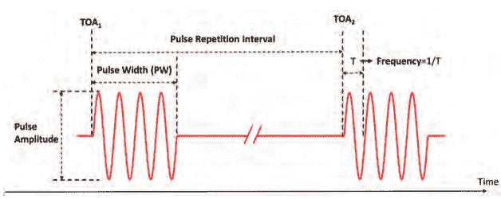

**图 4.1** 截收接收机测量的参数（未描绘到达角）。

脉冲幅度表示接收到的脉冲强度。如果接收机靠近雷达且位于雷达天线的主瓣内，则信号较强。该参数对于干扰也具有价值。到达角是相对于接收机而言雷达的方向。该参数对于将单个脉冲排序为脉冲串以及进行干扰极其有用。由于现代雷达可以在脉冲与脉冲之间改变频率、脉冲宽度和到达时间，但到达角通常保持相对恒定，因此到达角可被视为信号排序中最重要信息。即使是机载雷达，也无法非常迅速地改变到达角。截收接收机可能会接收到来自多个雷达的信号，到达角可用于分离来自不同雷达的信号。将来自不同源的信号分离的过程称为信号排序。到达角还为干扰机提供干扰方向。到达角通常仅在方位角方向上进行测量。如果也测量仰角，并且雷达是地面基站的，则可以通过仰角和飞机高度估算雷达的距离。方位角和仰角如图 4.2 所示。到达角是最难获取的参数，因为测量它需要多个天线和接收机。

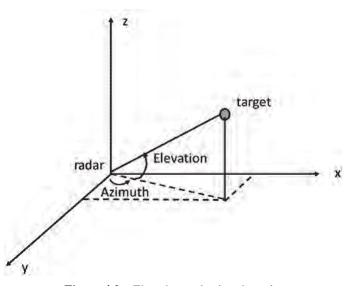

现代截收接收机的输出是数字字。这些字包含基于脉冲到脉冲测量的所有信息。通常，字的长度为 128 位。如果飞机在战场上空飞行，脉冲密度非常高。有时，每秒处理一百万个脉冲的能力被用作设计截收接收机的目标。

## 4.4 晶体收音接收机

第一款用于野外的电子战接收机是晶体视频接收机。晶体视频接收机与一些读者可能曾作为科学项目制作的晶体收音机密切相关，这里将对其引入作详细介绍。

当詹姆斯·崔（James Tsui）在中国青岛（以啤酒闻名的港口城市）上六年级时，他的一个同学教他如何制作晶体收音机。他的同学是从他的哥哥那里获得这些知识的。当时，只有使用真空管制造的商业 AM 收音机，但崔家并没有一台。詹姆斯·崔迷上了这个晶体收音机项目，并把他所有的课后时间和零花钱都投入其中。

晶体收音机有四个主要部件。两个昂贵的部件是在旧模拟收音机中使用的可调电容器和一副耳机。这两个部件可以很容易地从跳蚤市场买到，那里以合理的价格出售大量旧的美国军用电子部件。当时，美国海军和海军陆战队驻扎在青岛（青岛在 1945 年至 1949 年间是美军西太平洋舰队的总部，直到中国共产主义者接管中国）。另外两个部件是一个线圈和一个晶体探测器。詹姆斯和他的同学从跳蚤市场购买旧变压器来获取绝缘铜线。然后他们将绝缘铜线缠绕在一根竹节上制作线圈。他们使用的晶体是从一家中药店购买的天然铜（native copper，一种传统中药材）。天然铜是一种天然矿物，具有不同的尺寸和形状。他们购买的天然铜大致是一个立方体，每边小于 1 厘米。颜色呈暗棕色。敲开后，会出现光亮的金属表面。詹姆斯从朋友那里学会了所有这些技巧。

晶体收音机的线圈和可调电容器用作收音调谐器，调谐到某个 AM 电台的频率。可调电容器用于改变接收频率。晶体用于检测射频信号的幅度，并将音频信号输出到耳机。如今，通常使用二极管来替代晶体。当詹姆斯·崔

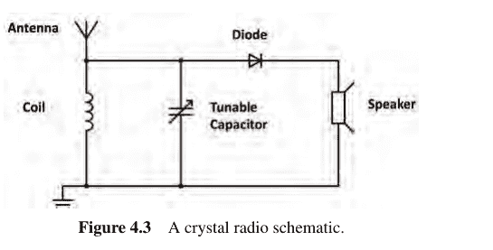

当他第一次带着自制的无线电接收器到朋友家进行测试时，他们能听到几个电台的声音，音质相当好，因为他的同学哥哥安装了一根不错的天线。但是，在詹姆斯的家里，晶体收音机只能接收到极少数电台的信号，而且由于詹姆斯家里没有好的天线，这些信号微弱得几乎听不清。后来，詹姆斯在美国从事电子战接收器的工作长达 30 多年。1983 年他终于回到青岛探望时，他寻找那位朋友，却悲哀地发现这位儿时挚友已经搬家，再也找不到他的下落了。

图 4.3 展示了晶体收音机的示意图。请注意，在这种设计中，二极管被用来代替晶体（在詹姆斯的案例中，是原生铜）。

## 4.5 电子战晶体视频接收器

现代电子战可以认为始于越南战争。北越军队从苏联获得了防空装备。其中，地对空导弹（SAM）SA-2  arguably 是最著名的。用于对抗 SA-2 雷达系统的雷达警戒接收器是 AN/ALR-46，如图 4.4 所示，它包含一个晶体视频接收器。晶体视频接收器可以被视为最简单的接收器。图 4.5 给出了一个简单的晶体视频接收器框图。天线接收到的输入信号通过带通滤波器，滤波后的微波信号随后被馈送到晶体探测器，将微波信号转换为视频信号，放大器再放大视频信号。

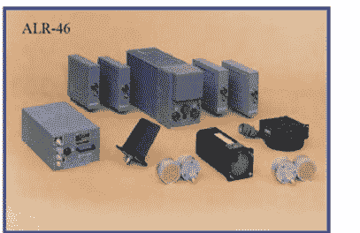

**图 4.4** AN/ALR-46 系统
(https://www.aef.se/Avionik/Artiklar/Motmedel/Nya_hotbildet/RadarWarnStory.pdf).

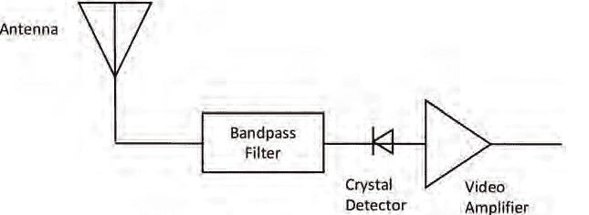

**图 4.5** 晶体视频接收器框图。

微波频率可以根据用于发射/接收信号的波导尺寸划分为不同的波段。每个波段的带宽可以非常宽。传统的波段划分涵盖了从 2 GHz 到 18 GHz 的频谱，分为四个波段：S 波段 (2–4 GHz)、C 波段 (4–8 GHz)、X 波段 (8–12 GHz) 和 Ku 波段 (12–18 GHz)。可以为每个波段制造一个晶体视频接收器，因此四个接收器即可覆盖整个雷达信号频谱。如果存在四个雷达信号，且每个信号分别落入这四个波段中的一个，接收器就可以检测到四个同时存在的信号。如果在每个象限中有四个接收器来覆盖整个雷达频谱，则可以通过比较每个象限中接收器视频输出的幅度来测量到达角。这种配置总共需要 16 个接收器。如果两个频率不同但处于同一波段的雷达信号同时到达接收器，接收器可能会产生错误的数据。接收器只能以非常粗略的分辨率测量频率，即每个波段的带宽。

晶体视频接收器的主要缺陷是其测量精度较差。它可以测量频率和到达角，但检测同时信号的能力有限。其灵敏度和动态范围较低。由于其基本设计中的问题，这些缺陷很难甚至无法改进。其主要优点是体积小、成本低和工作带宽宽，这导致了较高的截获概率。由于这些接收器轻便紧凑，它们很容易装入喷气式战斗机。在越南战争期间，这些接收器由包括 F-4 和 F-16 在内的美国喷气式战斗机携带，并配有干扰器和其他电子战设备。由于当时电子战仍处于早期阶段（ALR-46 是第一个在现场使用的软件控制的雷达警戒接收器），战场上的雷达类型较少，这些接收器实现了其设计目标并保护了飞机。在当今的环境中，它们大多已过时。

在越南战争中，美国喷气式战斗机/轰炸机的主要威胁之一是 SA-2，而美国用于检测 SA-2 雷达信号的主要雷达警戒接收器是 ALR-46。这两个系统在越南进行了较量。SA-2 阵地向美国战机发射 SA-2 导弹，而美国战机也可以向 SA-2 雷达阵地发射导弹。双方都遭受了损失。

## 4.6 超外差（Superhet）接收器

超外差接收器由美国工程师爱德华·霍华·阿姆斯特朗于 1918 年第一次世界大战期间发明。阿姆斯特朗还发明了调频（FM）广播。超外差接收器是接收器技术中最重要的发明之一。所有现代接收器都采用这项技术。用于通信的电信号频率相对较高，而在早期，没有针对该频段可用的放大器。因此，接收器的灵敏度较低。超外差接收器的想法是将射频（RF）转换为比射频低的中频（IF）。图 4.6 描绘了一个简单的超外差接收器框图。输入射频信号与本地振荡器产生的不同频率信号相乘（混频），从而可以将其频率移到一个较低的频段。阿姆斯特朗的贡献是创建了一个混频器电路，使得这种操作成为可能。混频器的操作可以很容易地通过基于托勒密恒等式的以下方程来解释。

$$\begin{gathered} \sin \left(2 \pi f_{1} t\right) \sin \left(2 \pi f_{2} t\right) \\ =1 / 2\left(cos 2 \pi\left(\left(f_{1}-f_{2}\right) t\right)-cos 2 \pi\left(\left(f_{1}+f_{2}\right) t\right)\right)\end{gathered} \quad \quad (4.1)$$

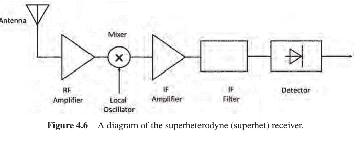

如公式 4.1 所示，如果一个器件相乘两个频率分别为 $f_1$ 和 $f_2$ 的正弦波，它将产生两个正弦波：一个是频率较高的 $f_1 + f_2$，另一个是频率较低（即中频）的 $f_1 - f_2$。具有较高频率的输出项可以被滤除，且不能被设计用于放大该中频的中频放大器放大。这种设计之美在于，只要混频器能够将不同的射频下调到相同的中频范围，针对不同带宽的接收器就可以拥有针对相同中频优化的相同组件。

由于在中频范围内有可用的放大器，可以使用放大器来放大微弱信号，从而改善接收器的灵敏度。超外差接收器的频率覆盖范围为数百 MHz。这种较窄的频率覆盖（晶体视频接收器的带宽是 GHz 量级）带来了三个问题。尽管超外差接收器可以通过持续改变本振信号的频率来覆盖整个雷达频谱，但它一次只能覆盖相对狭窄的频谱。因此，超外差接收器截获雷达信号的概率较低。好的一面是，如果超外差接收器检测到信号，其频率测量相当准确。与晶体视频接收器相比，超外差接收器更昂贵，因为它需要本地振荡器等额外组件。此外，由于超外差接收器只有一个通道，它不能接收同时信号。值得注意的是，尽管其技术优势，超外差无线电接收器最初因成本和使用难度而未取得商业成功。

超外差接收器已被用于美国雷达警戒系统，如 ALR-69（如图 4.7 所示），该系统结合了晶体视频和超外差接收器。由于超外差接收器不覆盖宽频率范围，它无法被用于或在所有可能的雷达信号频率上拦截信号时耗时较长。需要关于雷达信号的*先验*信息才能使用它们。虽然雷达频率范围是从 2 GHz 到 18 GHz，但这并不意味着威胁雷达使用整个带宽。如果威胁雷达的频率可以预先知道，截获接收器只需搜索预先分配的频率范围即可。

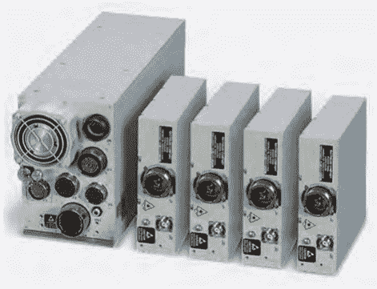

图 4.7 ALR-69 系统 (https://www.radartutorial.eu/19.kartei/12.ecm/karte003.en.html).

## 4.7 分信道接收器

分信道接收器的想法相当直接。由于高灵敏度的超外差接收器只能覆盖窄带宽，因此构建许多超外差接收器，每个接收器覆盖雷达信号频谱的一小部分（信道），从而覆盖整个雷达信号频段，听起来非常合理。显然，这种接收器可能非常昂贵，体积大且重量重。这种方法解决了大多数截获接收器的问题吗？答案是有，也是否。这种复杂的方案带来了许多技术难题，且难以解决。例如，安装在美国 B-1B 上的防御性航空电子系统 ALQ-161A 使用了分信道接收器 [1]。该项目并不十分成功，主要原因是接收器和电子战处理器的问题。ALQ-161A 的原始合同金额为 25 亿美元（按 1982 年的价值计算），且“这是有史以来签署的最大电子战合同。”然而，该项目经历了许多技术困难。结果，系统被延误，合同不得不修改，额外预算被花费，最终产品未能达到最初承诺的规格。对于工程师来说，一些解决方案

看起来显而易见且易于实现。然而，当人们实际着手处理时，可能会遇到压倒性的问题，而解决方案也不再那么显然。正如人们常说的，“魔鬼藏在细节里。”

## 4.8 截获接收机的常见问题

在实际应用中，截获接收机由于具有独特的需求，存在许多潜在问题。这些问题几乎出现在所有类型的截获接收机上。例如，如果一个截获接收机被设计为拦截特定频率和功率范围内的信号，那么位于这些指定频率和功率范围内的信号都应被正确检测。如果只有一个输入信号，大多数截获接收机都能产生正确的结果。然而，即使只有两个输入信号，也可能发生各种错误。当两个功率不同的信号在不同时间被接收，但它们的脉冲重叠或频率接近时，可能会发生检测错误。产生错误数据的可能性有无数种，这里给出两个例子：

- 信号丢失：接收机可能会漏掉其中一个或两个信号。
- 产生虚假信号：当接收机输入端没有此类信号时，接收机可能会报告有该信号。

人们可能称第一种情况为“假阴性”，第二种情况为“假阳性”。

电子战系统的一般准则是：宁可让接收机漏掉信号，也不要产生虚假警报。漏掉的信号可能在稍后的时间被检测到，但虚假信息可能会误导电子战处理器。电子战处理器会获取由截获接收机生成的数据，并试图从中推导雷达的信息。如果数据无法解释，电子战处理器将花费宝贵的时间和资源去弄清楚它们。更糟糕的是，有时电子战处理器可能会基于错误数据产生错误的雷达信息，并启动反制措施，从而暴露飞机。本章的其余部分将重点讨论电子战处理器。

## 4.9 人类电子战处理器与“SAM歌声”

当 James Tsui 于 1973 年开始在美国空军研究实验室（AFRL）工作时，他的同事是一位名叫 Chris 的中尉。Chris 是一位电子战军官。James 工作的研究实验室在他任职期间多次更名，这里使用的名称是一个通用名称，也是其当前的名称。起初，James 正在申请安全许可。因此，尽管 Chris 和 James 成为了朋友，Chris 从未讨论过他的工作。Chris 告诉 James 他的一些在越南的经历，其中大部分是他下班后的生活故事。

一天，James 在实验室里发现了一个带有电线的黑色盒子。他记得盒子的尺寸约为 12"×12"×4"。盒子的表面有许多拨动开关。一位老员工告诉 James 把电线插到墙上的插座里，然后打开一个开关。当 James 这样做时，盒子发出了一个非常短的音频脉冲。当 James 打开另一个开关时，发出了不同的声音。老员工说，那是晶体检波器（crystal receiver）在输出连接到扬声器时发出的声音。他听到了一个音频输出，并说这可能是搜索雷达的信号。当听到某种特定声音时，他说，如果一名电子战军官听到这个声音，他会吓得尿裤子，因为这是跟踪雷达的信号，威胁可能迫在眉睫。James 不知道老员工说的是真是假。然而，在越南战争中，当 SA-2 导弹的制导雷达“方颂”（Fang Song）雷达从“搜索”阶段变为“锁定”阶段时，美国飞行员可以通过耳机听到一个特定的音调，这种声音被称为“SAM 歌声”（SAM Song）。当听到“SAM 歌声”时，导弹已经在途中，飞行员需要迅速做出规避机动。James 当时听到的可能是那个著名的“SAM 歌声”。

在 James 获得安全许可并开始从事电子战接收机工作后，有一天他想起了那个黑色盒子，并想向他的电子战军官同事 Chris 询问关于那个盒子的事。但是，James 再也找不到那个盒子了，因为实验室定期清理。也许盒子被转移到了其他地方或被丢弃了。那个盒子可能是旧的教学设备。在越南战争电子战的初期，威胁是有限的；因此，人类可能在处理信号以识别威胁雷达方面发挥了一定作用，而 James 玩耍的那个盒子可能是那个时代的一件老式设备。

## 4.10 电子战处理器的目标

Joseph Caschera 是美国空军研究实验室（AFRL）的一名工程师。James Tsui 在 AFRL 工作的第一天见到了 Joe，他们成为了亲密的朋友。Joe 是一位非常安静且出色的工程师，当时正在从事电子战处理器的工作。直到 James 在 2004 年退休（Joe 于 1998 年退休），他们每周一起吃一次午餐。即使 James 搬到拉斯维加斯后，他们仍保持联系，Joe 提供了大量关于以下各节中介绍的电子战处理器的信息。

电子战处理器将截获接收机的输出作为输入，并对它们进行梳理。如第 4.3 节所述，雷达脉冲密度可达每秒一百万个脉冲。如果每个脉冲生成 128 位数据，需要处理的信息量将非常巨大。接收到的脉冲可能来自许多不同类型的雷达，且接收时刻不同。电子战处理器的一项重要要求是在几秒钟内识别出威胁雷达。如果为电子战处理器开发的技术无法满足这些要求，它将仅仅是一个学术理论。

## 4.11 信号排序

仅从单个脉冲的信息很难识别雷达的类型。它需要来自同一雷达的许多脉冲来确定雷达类型。首先，电子战处理器必须将以时间顺序排列的由某个特定雷达发出的所有脉冲归类。这个过程被称为去交错（de-interleaving）。为了实现这一目标，处理器可以比较脉冲频率、脉冲宽度和脉冲重复间隔。这些可以被视为雷达的固有属性。这种方法假设雷达产生的雷达信号的频率和脉冲宽度在脉冲之间保持不变，并且脉冲之间的间隔是固定的。因此，具有相同频率和脉冲宽度并以恒定速率接收的雷达脉冲可以被识别为来自同一雷达。然而，并非所有雷达都遵循此规则。有些雷达可以在脉冲之间改变信号频率，它们被称为跳频雷达或频率敏捷雷达。脉冲宽度也可以随脉冲变化。这些做法可以被视为电子对抗措施（ECCM）。虽然这些雷达可以被截获接收机检测到，但很难对它们进行排序。对于这些雷达，到达角数据是最可靠的信息。到达角不是雷达的固有特征；因此，雷达无法控制它。

关于某一雷达脉冲的所有信息，如频率、脉冲宽度或到达角，都需要整理到一组数据中。从连续脉冲之间的到达时间差中，可以找到脉冲重复间隔（PRI）。脉冲重复间隔（PRI）和脉冲重复频率（PRF）都在本书中使用。它们指的是同一种雷达特征，且 PRI=1/PRF。如果雷达只有一个 PRI，测量值应该只是一个值。如果雷达脉冲重复时间是交错（staggered）的，该雷达就有几个 PRI。测量值应据此指示。还有一些雷达具有敏捷 PRI，即连续脉冲之间的时间是一个随机数。从这些测量值（频率、脉冲宽度和 PRI/PRF）中，可以识别雷达。

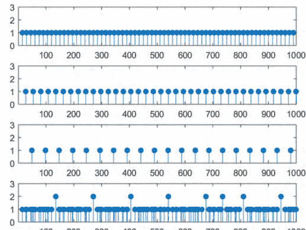

**图 4.8** 由三个雷达生成的三个脉冲列的复合信号。上面三幅图：三个雷达各自的脉冲列，下面一幅图：复合脉冲列。时间单位是任意的。

图 4.8 展示了三个脉冲列的复合信号，每个脉冲列具有常数但不同的 PRI，以说明信号排序的难度。只有少数具有恒定 PRI 的雷达信号才能产生如此令人困惑的结果。许多具有各种 PRI 的雷达类型的结果将极其令人困惑。如果信号去交错没有正确完成，电子战处理器将无法提取正确的雷达特征用于识别。如前所述，错误的雷达识别可能导致无效的反制措施，这可能危及飞行员的生存。

## 4.12 雷达脉冲的模式识别

当 James Tsui 刚加入 AFRL 时，一位老员工告诉他，一些经验丰富的电子战军官可以通过观察脉冲波形来确定它们属于哪个脉冲列。当时，截获接收机无法显示任何射频信号。唯一可以显示的信号是视频信号，即所谓的脉冲波形。他声称每个磁控管都有特殊的脉冲波形，并甚至声称

从脉冲波形来看，磁控管的寿命可以估计出来，因为老化的磁控管会产生一些特殊的脉冲前沿和拖尾边缘。如果这种情况属实，模式识别将成为识别雷达的一种重要技术。雷达脉冲的模式识别一直是电子战研究者感兴趣的课题，被称为脉冲指纹。如今，人们将类似的思想称为射频指纹。

如今，脉冲是通过数字化射频信号来采集的。所有详细信息都得以保留。此外，在过去几年中，模式识别技术以惊人的速度进步。智能手机可以轻松识别人类指纹，甚至据说在中国，街边的摊贩都可以通过面部识别进行金钱交易，更不用说中国基于面部识别普遍存在的安防系统了。在作者看来，人脸比射频脉冲复杂得多。如果射频脉冲可以通过磁控管、天线等射频组件的固有特性来识别，那么电子战将发生革命性的变化。雷达可以在脉冲之间改变频率和脉冲重复间隔（PRI），这种做法使得信号分选任务比以往任何时候都更加复杂。然而，雷达将使用相同的射频组件来生成和发射信号，因此这种射频特征可用于对雷达脉冲进行分组。结果，只要射频组件的固有特性在操作期间不发生变化，频率跳变和改变 PRI 就不会影响分选过程。

这种射频特征识别技术的可行性还将影响电子战接收机的设计。未来截获接收机用于识别雷达的信号参数可能与当今使用的完全不同。这种变化甚至可能影响反反制措施。雷达操作员可以轻松区分干扰信号和反射的雷达信号，因为它们具有不同的射频特征。

## 4.13 查阅表格以识别雷达类型

一旦识别出雷达发出的脉冲串，数据将与现有的雷达文件进行比对。雷达文件包括雷达的类型及其频率、脉冲宽度和 PRI。该文件应包含战场上可能遇到的所有雷达。关于新威胁雷达的不准确信息可能导致潜在的灾难。如果能够获得关于战场上可能出现何种雷达的良好情报，则可以减少文件中的雷达数量。换言之，如果事先了解战场上所有可能的雷达，则文件中只需包含这些雷达。较少的雷达数量可以缩短搜索时间。尽管像 Google 这样的商业搜索引擎拥有海量数据且搜索速度极快，但电子战处理器必须拥有自己独特的搜索方法，以从具有缺失数据和可能错误的雷达脉冲序列中识别最可能的雷达（并且不要忘记，这些脉冲由书中未列出的雷达发出的可能性并非不存在）。在电子战处理器开发的早期阶段，搜索算法是研究人员关注的领域之一。

### 4.14 电子战处理器中的跟踪器

电子战处理器应将大部分精力用于处理新信号。如果脉冲串被识别为由威胁雷达发出，则应立即干扰该雷达。如果雷达不是威胁雷达，则可以忽略该雷达。来自这些非威胁雷达的信号仍会被接收机截获，但会被电子战处理器忽略。它们的频率、脉冲宽度和到达角数据存储在内存中。如果新截获的信号属于这些类别，它们将被忽略，以便处理器能够专注于潜在危险的新信号。

专门执行此类功能的处理器称为跟踪器。一旦数据进入跟踪器，这些数据将不会发送到电子战处理器。因此，电子战处理器只处理截获接收机新接收到的未知雷达的数据。通常有多个跟踪器。

### 4.15 重新访问正在被干扰的信号

如果飞机正在干扰某个信号，由于干扰信号非常强，截获接收机无法接收到相同的信号，从而阻止接收该雷达信号。如果截获接收机是频道接收机，理论上接收机可以截获频率远离干扰频率的信号。实际上，强干扰信号加上短脉冲宽度仍可能阻塞接收机。如果威胁雷达停止发射，但干扰机仍针对其工作，干扰机将浪费有用的干扰能量。更糟糕的是，发射任何射频信号都可能是危险的，因为敌方导弹可以通过跟踪干扰信号进行制导；这被称为“向干扰源归航”（homing on jamming）。

为了避免这种情况，截获接收机必须重新访问正在被干扰的雷达信号。如果雷达信号消失，干扰机应停止干扰。如果信号仍然存在，干扰机将继续工作。为了使接收机能够重新访问信号，干扰机必须暂时停止工作。此操作称为接收机的“时间窥视”（looking through time of the receiver）。由于威胁雷达应始终受到干扰，时间窥视需要非常短暂。因为重新访问信号的频率是已知的，接收机可以直接调谐到所需频率。因此，检测重新访问信号的概率应该很高，短暂的窥视时间就足够了。人们不应混淆已知信号的高检测概率（在此情况下为重新访问信号）与高截获概率，后者意味着截获新信号。重新访问的时间由电子战处理器确定。

### 4.16 预测脉冲到达时间

一种有效的干扰方法称为脉冲覆盖。这种方法是将干扰脉冲信号发送到与雷达的一个回波脉冲相匹配。由于干扰脉冲比回波信号强，雷达操作员可能无法将接收到的信号识别为干扰信号。为了掩盖返回的雷达信号，必须知道雷达脉冲到达飞机的时间。该时间只能由处理器预测而非测量，干扰信号在预测的脉冲到达时间发出。一旦信号被接收机截获，发射干扰信号就为时已晚。

脉冲的到达时间（TOA）由截获接收机的内部时钟测量。如果雷达具有恒定的脉冲重复间隔，下一个 TOA 相对容易计算。如果脉冲是交错的，必须计算所有脉冲重复间隔，以便预测下一个脉冲的到达时间。如果雷达具有随机脉冲重复间隔，脉冲到达时间更难预测。

一旦干扰脉冲覆盖了真实的皮肤回波，就可以应用许多干扰技术。一种简单的方法是缓慢改变干扰脉冲的回波时间，从而分离干扰脉冲和真实的返回雷达脉冲。由于雷达跟随干扰脉冲，这种方法将为雷达提供错误的距离数据。下一章将讨论更多的干扰技术。

### 4.17 计算雷达晶体频率

在所有现代雷达中，都有一个晶体振荡器用于产生时间基准。雷达的信号频率、脉冲宽度和脉冲重复频率都参考同一个晶体频率。民用雷达通常具有稳定的频率、恒定的脉冲重复频率（PRF）和固定的脉冲宽度。一些军用雷达可以在脉冲间改变这三个参数中的一个或多个，使截获接收机难以截获信号，使电子战处理器难以分选雷达脉冲。一些例子包括频率捷变雷达、交错脉冲重复频率雷达和随机脉冲重复间隔雷达。然而，这些参数变化都不是完全随机的。这些变化基于雷达的晶体频率。所有脉冲宽度和脉冲重复间隔都应是晶体周期的整数倍（=1/频率）。因此，可以从随机脉冲重复间隔入手，开发基于测得的到达时间捷变性的计算机程序，以获得雷达晶体频率。虽然随机和交错的脉冲重复频率使电子战处理器的任务更具挑战性，但它也为电子战处理器提供了额外信息。处理器可以利用这种额外信息来确定雷达的晶体频率。由于不同类型的雷达使用不同频率的晶体，晶体频率可以提供用于分选雷达脉冲的补充信息，并有助于识别雷达类型。这是一个非常有趣的现象。雷达可以采用某些技术来降低其被探测的概率，但另一方面，这些技巧可能会为电子战处理器提供识别雷达的新信息。

为了获得雷达晶体的频率，截获接收机必须具备精细的到达时间（TOA）分辨率。常规截获接收机的时间分辨率约为 50–100 ns（10⁻⁹ s）。为了估计雷达晶体频率，时间分辨率应改进到 1–10 ns。

### 4.18 电子战处理器性能评估

评估截获接收机相对容易。通常有一信号和两信号测试。流程是使用一个或双信号发生器生成测试信号，并改变信号频率、脉冲宽度和脉冲幅度。然后读取每种测试场景下接收机的输出，并将结果与输入进行对比。该方法应能提供

关于接收机性能（例如频率误差、幅度误差、脉宽误差、截获概率（通过计数缺失脉冲）、虚警率（通过计数多余脉冲，即不存在的脉冲）等）的好点子。

评估电子对抗处理器是一项复杂得多的任务。由于输入是雷达信号，因此必须使用截获接收机向电子对抗处理器提供数字字。换句话说，电子对抗处理器不能单独测试，而必须与截获接收机组合在一起进行测试。结果是，如果截获接收机性能不佳，测试结果也会不理想。因此，截获接收机必须具备得体的性能，在此条件下，才能进行合理的电子对抗处理器测试。

电子对抗处理器旨在复杂的战场环境中工作，因此几个信号发生器不会产生任何有意义的结果。可以使用模拟器来测试电子对抗处理器，该模拟器可生成某种战场信号环境。模拟雷达信号被截获接收机截获，接收机的输出随后被输入到待测的电子对抗处理器中。在测试期间，处理器报告检测到的雷达类型以及执行检测所需的时间。

评估截获接收机和电子对抗处理器的一种略有不同的方法是将测试分为两部分。第一步是记录截获接收机的输出并存储结果。由于截获接收机的输出是数字字，因此可以对其进行记录。可以使用通用计算机离线分析这些数据，以评估截获接收机的性能。第二步是将这些数据输入到电子对抗处理器中，并近乎实时地评估结果。这种方法可以分别评估两种设备并预测整体性能。如果整体系统性能令人不满意，这种类型的测试可以隔离出需要修复的问题。

## 4.19 摘要

本章讨论了截获接收机和电子对抗处理器。大多数商用接收机与截获接收机之间的主要区别在于，截获接收机必须同时接收许多信号，并且可能事先不知道要截获的信号的特性。介绍了几种截获接收机。还讨论了截获接收机的输出。这些输出数据可以输入通用计算机，以评估截获接收机的性能。

如果截获接收机的输出源自复杂的战场电磁环境，那么被截获信号的参数（如频率、脉宽和到达角）可以发送到电子对抗处理器，处理器需要将其梳理成脉冲串，并将其与不同雷达参数库进行比较，以识别威胁雷达。雷达库是通过电子情报收集行动收集的。填充该库需要大量的时间和许多不同的行动，例如从飞机、情报收集舰等收集信息。

由于模式识别的进步，雷达信号脉冲可以通过检查雷达脉冲的射频特征进行梳理。如果这种方法成功，整个电子对抗领域将发生革命性的变化。不仅需要新的电子对抗处理器，截获接收机的需求也将发生改变。因此，新的电子对抗接收机可能会出现。此外，模式识别也可被雷达用作反反制措施，以提高雷达对抗干扰的性能。电子对抗系统与雷达之间的较量可能永远不会结束，任何可用的新技术都可能被双方用来提高其生存几率。

## 参考文献

- [1] Alfred Price, *《四维战争》*, p. 74 和 p. 175, Greenhill Books, 2001.
- [2] Alfred Price, *《美国电子对抗史》*, vol. 3, The Association of Old Crowes, 1984.
- [3] Edgar O’Ballance, “The impact of European Armies of the United States Vietnam Experience;” in the Proc. of the 1982 International Military History Symposium: The Impact of Unsuccessful Military Campaigns on Military Institutions, 1860–1980.
- [4] Mario de Angelis, *《电子对抗：从对马海战到福克兰和黎巴嫩冲突》*, Blandford Press, 1985.
- [5] James Tsui, *《宽带接收机的数字技术》*, 2nd edition, SciTech Publishing, 2004.

# 5 干扰与反反制措施

## 5.1 引言

一旦检测到威胁雷达发出的信号，为了保护飞机，必须立即对威胁雷达采取行动。所需的响应时间约为几秒钟。针对雷达所需的行动通常称为干扰。干扰是一个通用术语，针对不同种类的雷达应用不同的干扰技术。

通常，使用一个截获接收机来接收来自所有不同类型雷达的信号，供电子对抗处理器识别。当电子对抗处理器识别出雷达类型时，此信息会被发送到技术生成器，技术生成器将产生相应的干扰信号。干扰信号必须被放大并发送到威胁雷达。有些雷达很容易被干扰，但有些则更难中断。在某些情况下，单一的干扰源可能无法单独实现干扰目标。可能需要几个干扰器同时协同工作，且这些干扰器可以位于不同的位置。这一事实表明执行有效干扰的难度。

由于干扰实践是将信号/噪声发回雷达，因此也称为主动电子对抗操作，以区别于用于截获信号的被动电子对抗。用于这种实践的另一个常用术语是电子攻击（EA）。专门用于主动电子对抗的飞机也被称为电子攻击飞机。不熟悉电子对抗的人可能会将电子攻击与电影中某些虚构武器联系起来，但这并不是电子攻击所代表的含义。也许，“EA”这个短语是因为军方对“攻击”一词的渴望而创造的。

干扰的主要目标是保护飞机。因此，武器雷达是主要目标。武器雷达必须先锁定目标飞机以获得必要信息，然后才能对其发射导弹。

当目标飞机被武器雷达锁定时，攻击可能是迫在眉睫的。干扰的目标是打破锁定。当雷达断开锁定时，它不再能提供有关飞机的信息，因此无法攻击它。武器雷达必须尝试再次锁定目标飞机。此操作耗时较长，雷达可能无法重新锁定目标。

针对干扰的行动，称为电子反反制措施（ECCM），可以包含在单独的章节中。然而，正如许多干扰方案是针对特定雷达设计的一样，许多 ECCM 也是针对某些干扰方法开发的。在本书中，介绍了选定的干扰技术及其优缺点。在作者看来，与其专门开辟一章讨论 ECCM，不如在讨论某些干扰技术的缺点时引入相应的 ECCM 技术。否则，如果 ECCM 在单独的章节中讨论，就必须再次提及这些干扰技术以唤起读者的记忆。因此，本章也将讨论 ECCM。

电子对抗系统相对于雷达的一个主要优势是，干扰信号传播到雷达的距离只有雷达反射信号传播距离的一半。为了成功干扰或欺骗雷达，希望当两者都到达雷达时，干扰信号强于雷达反射信号。因此，尽管传输距离较短，干扰信号仍需进行适当放大。我们生活在一个固态器件的世界里，它们几乎用于每种电子设备。然而，虽然固态微波发生器在实验室中广泛使用，但它们通常无法提供雷达所需的功率。因此，磁控管在许多情况下仍被用于产生雷达信号。在类似的情况下，虽然固态微波放大器已被广泛用于不同应用，但它们通常仍无法为干扰机产生足够的功率。为了提供高微波功率，20世纪40年代发明的行波管放大器（TWT）仍在使用中。因此，下一节将对 TWT 进行简要介绍。

### 5.2 行波管 (TWT) [1, 2]

行波管（TWT）是一种用于放大微波信号的特殊真空管。第一种与 TWT 相关的设备是由安德烈·“安迪”·海夫（Andrei "Andy" Haeff）在 1931 年发明的，但鲁道夫·孔普弗纳（Rudolf Kompfner）通常被认为是在 1942 年发明了 TWT。TWT 是一项非常成熟的技术，其基本电路具有

## 5.2 TWT（行波管）

自20世纪40年代以来，TWT 几乎没有发生变化。虽然固态器件已在几乎每一种应用中取代了真空管，但 TWT 由于具有宽工作带宽、高效率、巨大的放大增益（典型值：60dB，即 1,000,000）以及小占地面积，仍常用于卫星通信、雷达和电子战应用。

图 5.1 展示了一个 TWT 的示意图。TWT 由三部分组成：电子束、慢波结构和磁屏蔽。电子由加热的阴极发射，并受到阴极和阳极之间所施加电压的加速，向真空管的远端移动。真空管外部有一个磁屏蔽，其中包含电子束。磁屏蔽的作用是将电子聚焦成电子束，并使束流保持在管的中心位置。电子束外部是微波慢波结构。慢波结构有两种类型：螺旋线型和腔体型。图 5.1 所示的 TWT 是一种螺旋线型 TWT。进入慢波结构的微波信号会被减速，使其沿电子束传播方向的速度与电子束速度相当。因此，电子束和减速后的微波可以相互作用，通过这种相互作用，电子束的能量转移到微波信号中，从而对微波进行放大。

TWT 的构建似乎是一项相当艰巨的技术挑战；然而，其应用局限于少数专门领域。如果在固态微波器件上取得突破，TWT 可能会步其他类型真空管的后尘，成为历史的一部分。尽管如此，军方目前仍然需要这些真空管。因此，偶尔，James Tsui 会听到空军同事之间的以下对话。在 TWT 领域培训新的技术人员或工程师是非常困难的。在这一个专业化且成熟的领域中，一个人需要花费很长时间才能学会所有的技巧。因此，James 的同事开玩笑说，应该设立一个特别计划，招募人员学习如何制造 TWT，并给他们终身职位，即使有一天不再需要这种真空管。这种谈话表明了 TWT 对军队的重要性。

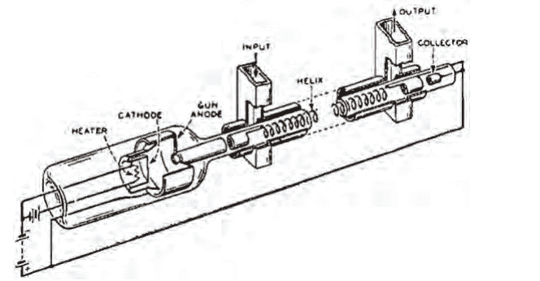

图 5.1 螺旋线行波管图片 ([https://en.wikipedia.org/wiki/Traveling-wave_tube#/media/File:Traveling_wave_tube_diagram.png](https://en.wikipedia.org/wiki/Traveling-wave_tube#/media/File:Traveling_wave_tube_diagram.png))。

### 5.3 噪声干扰

噪声干扰是日常生活中常见的体验。大多数情况下，噪声并非故意产生的。例如，当有人在电话上通话时，如果线路上有显著的噪声，人们通常会挂断重新拨打，甚至要求另一方挂断再打回来。希望通过这种做法噪声会消失。背景噪声是通信中最困难的问题之一。在各种条件下，噪声被用来防止听者获取信息。例如，如果某个外国政府不希望其民众收听美国之音（VOA），它可以在特定的频率范围内产生噪声以中断广播，使得 VOA 广播难以识别。

要使用噪声干扰雷达，干扰机需要产生一个频谱覆盖雷达工作频率的噪声信号，并将其发送至雷达。如果雷达接收机接收到的噪声功率足够强，噪声就会使雷达屏幕变得模糊，反射的雷达信号将被隐藏在下方的噪声之下。如果一切顺利，这种操作将使雷达失去对目标的锁定。图 5.2 展示了被噪声干扰遮蔽的雷达屏幕。

### 5.4 噪声干扰与“烧穿”技术的优缺点

噪声干扰的优势在于其简单性。它不需要关于雷达信号的详细信息。为了使噪声干扰有效，干扰机需要确保雷达接收到的干扰噪声比反射的雷达信号携带更多的能量。因此，如果可能，干扰机应将其能量集中在雷达工作频率附近的窄频谱上，因为超出雷达接收机工作频谱的噪声将被过滤掉，从而没有干扰效果。如果已知雷达信号的频率，干扰机可以在相同的频率范围内产生噪声信号并发送至雷达。除了雷达的工作频率外，不需要雷达信号的其他信息。

按定义，噪声是一个覆盖宽带宽的宽频信号。^1 为了限制噪声频谱，可以使用中心位于特定频率的带通滤波器，以过滤掉由噪声发生器产生的超出期望带宽的噪声部分，从而产生带限噪声。或者，低频噪声可以调制无线电波，产生的噪声将以无线电波的频率为中心，且噪声带宽等同于原始噪声带宽。带限噪声通常被称为有色噪声。这一术语源于光学频谱。当所有频率（或波长，即频率的倒数）的光都存在时，光的颜色是白色的。如果只有特定频带的光存在，光就具有特定的颜色。白色噪声这一术语，意指噪声频谱从零到无穷，已被广泛认知，甚至被用作 2005 年一部恐怖片的标题。为了干扰雷达，干扰机产生有色噪声，对其进行放大，然后将其发送至雷达以扰乱雷达的操作。不仅噪声干扰的理念很简单，操作也很简单。有几种类型的噪声干扰，其中一些将在下文介绍。

*全覆盖干扰（Barrage Jamming）。* 全覆盖干扰在宽频带上应用噪声以干扰雷达。由于使用了宽带噪声，全覆盖干扰能够同时干扰多台雷达，每台雷达可能具有不同的工作频率，并且干扰机不一定知道被干扰雷达的确切工作频率。全覆盖干扰的主要缺点是，由于它覆盖宽频谱，雷达只能接收到一部分噪声。因此，为了压倒反射的雷达信号，干扰机需要发出非常强的干扰噪声。

*点干扰（Spot Jamming）。* 与全覆盖干扰不同，点干扰将所有噪声能量集中在窄频谱内。这种方法需要知道雷达的工作频率。如果该信息可用，那么干扰信号可以很容易地压倒反射的雷达信号，因为干扰信号的能量与 $\left( 1/R^{2} \right)$ 成正比，而反射雷达信号的能量与 $\left( 1/R^{4} \right)$ 成正比，其中 $R$ 是目标与雷达之间的距离。由于点干扰机将其所有能量集中在窄带宽内，要干扰多台雷达，需要多台干扰机。如果雷达的频率未知，点干扰机成功干扰雷达的机会很小。

*扫描点干扰（Sweep Spot Jamming）。* 全覆盖干扰覆盖宽带宽，因此其干扰雷达的机会较高，但大部分干扰功率会被浪费。因此，除非使用非常高功率的干扰机，否则其干扰可能并不有效。另一方面，如果干扰噪声的频谱与雷达的工作带宽匹配，点干扰可以非常节能。然而，对于频率未知的雷达，成功干扰的机会较小。扫描点干扰试图通过发送频率在宽频谱中扫描的窄带干扰噪声来解决这个问题。因此，机会在于许多雷达将被

^1 噪声的频谱是一个高级工程话题。在大多数本科工程课程中，噪声的频谱/带宽通常直到高年级才涉及。粗略地说，噪声的频谱是根据一个人在多大程度上能够根据当前噪声值来估计未来/过去噪声值而确定的。如果当前噪声值不能揭示任何关于未来/过去噪声值的信息，那么这种噪声就是白噪声，其频谱是无限的。本部分关于噪声的描述当然在理论上并不严谨，但关于有色噪声实现的描述在技术上是可靠的。

在某些时刻会出现信号拥堵，尽管并非总是如此。希望扫掠点干扰机造成的频繁干扰足以让雷达丢失其目标。

简单的操作通常存在一些局限性。噪声干扰的一个缺点是雷达操作员会知道雷达正在被干扰。仅从显示屏幕上，雷达操作员就能识别出雷达已被噪声源干扰。这一信息对于操作员做出正确决策非常重要。使用噪声干扰雷达操作的效果不如干扰通信系统那么有效。通信信号并不重复，但许多脉冲雷达会持续发送相同的信号，因此反射的雷达信号是重复的。雷达屏幕上的显示是许多回波信号的积分结果。基于单个回波信号提取有用信息是非常困难的，甚至是不可能的。

返回的雷达信号是相干的（即信号相位是固定的），而噪声是非相干的。如果我们相加相干信号，总信号强度会增加。当然，如果我们相加噪声，组合噪声的幅度也会增加。然而，信号和噪声的增加速率是不同的。为了解释这一现象，考虑将同相位的正弦波相加；在这种情况下，波峰与波峰相加，波谷与波谷相加。结果，我们会得到一个幅度更大的正弦波。现在，考虑将许多噪声相加。由于噪声是非相干的，噪声之间没有固定的相位关系；因此我们不会总是将波峰加到波峰，波谷加到波谷。因此，在这个过程中，总信号强度的增加速度快于总噪声强度的增加速度。因此，如果雷达操作员持续累加回波信号，回波信号可能会再次出现在雷达屏幕上。这种操作有时被称为“烧穿”（burning through）。图 5.3 展示了烧穿现象。图 5.3 的左侧显示正弦波被噪声严重污染，很难从受污染的信号中看出正弦波。然而，在将五个受污染的信号相加后，结果显示出非常明显的正弦波，如图 5.3 右侧所示。

需要指出的是，许多电子战（EW）专业人士将烧穿定义为反射雷达信号能量大于雷达接收到的干扰信号能量的距离。由于雷达信号通常比干扰信号具有更高的能量，尽管反射雷达信号能量与 $1 / R^{4}$ 成正比，而接收到的干扰信号能量与 $1 / R^{2}$ 成正比，但如果距离 R 足够小，反射雷达信号能量将大于干扰信号能量。在烧穿范围内，噪声干扰将不再有效。

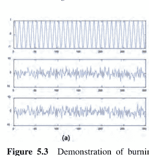
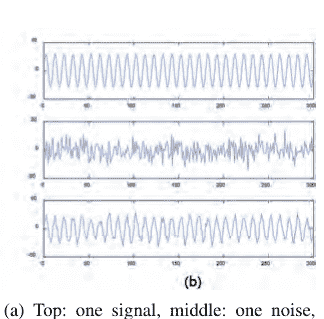

### 图 5.3
烧穿现象的演示。(a) 顶部：一个信号，中间：一个噪声，底部：顶部图和中间图之和。(b) 顶部：五个信号之和，中间：五个噪声之和，底部：顶部图和中间图之和。

#### 5.5 欺骗性干扰与覆盖脉冲操作
欺骗性干扰（也称为伪装干扰）的目标是用错误信息欺骗雷达。希望雷达操作员没有注意到雷达正在被干扰，并基于错误信息做出错误决策。当然，其逻辑是操作员的错误决策将为被跟踪的飞机提供更好的完成其任务的机会。伪装干扰的一个明显优点是，干扰机所需的功率要求不像噪声干扰机那样高。然而，这种技术更加复杂。执行伪装的主要设备是脉冲模拟器（technique generator）。它用于生成所需的干扰信号。

雷达可以测量其目标飞机的三个主要参数：目标距离、目标相对于雷达的角度以及目标速度。让我们快速回顾一下雷达如何确定这三个参数。脉冲雷达周期性发射短促的微波脉冲信号，然后监听反射的雷达信号（皮层回波）以寻找其目标。根据雷达接收反射信号的时间，雷达可以确定物体的距离。在最简单的实现中，每个发射脉冲都是具有固定频率的短微波。由于第 2 章中讨论的多普勒效应，反射信号的频率可能与发射信号的频率不同。利用这种频率差，雷达随后可以确定目标的速度。在搜索物体时，雷达天线将扫描天空，雷达接收到强反射信号的方向告知雷达物体的角度。此操作在图 5.4 中有所说明。

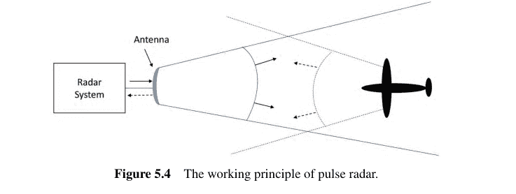

成功的伪装需要在不引起雷达操作员警觉的情况下干扰雷达。为了实现这一目标，干扰机需要让雷达操作员将干扰信号误认为是真实的皮层回波脉冲。首先，干扰信号必须在雷达屏幕上不引起明显变化的情况下接管雷达的回波信号。为此，干扰机需要生成与雷达信号匹配的干扰信号。发射干扰信号的时机也很重要。如果干扰机接收到雷达信号并立即发送干扰信号，这种伪装将不会成功，因为在截获雷达信号和生成干扰信号之间始终存在时间延迟。为了在正确的时刻发送干扰信号，干扰机必须预测下一个雷达脉冲的到达时间，并在此时刻发送持续时间覆盖雷达脉冲持续时间的干扰信号，以便雷达接收机同时接收到皮层回波和干扰信号。脉冲预测是脉冲模拟器（technique generator）的任务。由于覆盖雷达回波信号的干扰脉冲具有相似的特性，雷达操作员可能不会注意到干扰脉冲的存在，而干扰脉冲随后接管雷达的操作。一旦完成这一任务，雷达对物体距离、速度和角度的估计就可以被干扰机误导。

值得注意的是，噪声干扰有一种变体，使用噪声脉冲来覆盖雷达的皮层回波脉冲。采用这种方法，噪声干扰机可能会干扰多部雷达，并且对干扰机功率的要求可以降低。这种干扰方法被称为覆盖噪声干扰。覆盖噪声干扰不是欺骗性干扰，因为它没有向雷达提供错误信息。在以下章节中，我们将讨论用于改变雷达三个测量值中一个或多个以及雷达反制措施的一些欺骗性干扰技术。

#### 5.6 距离和速度欺骗：距离门拖引和速度门拖引
当脉冲雷达通过反射雷达信号检测到物体时，它会在接收到皮层回波脉冲的时间周围设置一个距离门（range gate），并将窗口外接收到的所有信号置零。这种做法的原因是为了拒绝不需要的噪声（以及在错误时间发出的干扰信号）。当然，随着反射信号接收时间的确定取决于物体的距离，这个距离门将随着反射雷达信号移动。当目标飞机的电子战（EW）接收机截获此雷达信号时，它需要确定信号的频率、脉冲宽度和脉冲重复间隔。一旦确定了雷达脉冲重复间隔，它就可以发送一个脉冲宽度和频率与雷达脉冲相似的干扰信号（此任务可以通过采样截获的雷达信号然后复制它来完成），时间大约在下一个雷达脉冲到达目标飞机的时候。最初，干扰信号和反射雷达信号大致重叠，但逐渐地，干扰信号与皮层回波分离。通常，干扰信号比真实的雷达回波信号更强，因此距离门将跟随干扰信号而不是真实回波信号，最终距离门仅接收到干扰信号而不是真实的反射信号。如果干扰信号逐渐改变其发射时间，例如移动到雷达脉冲之前，雷达将显示目标正在接近。如果发射时间移动到雷达脉冲之后，雷达将显示目标正在远离。这种欺骗性干扰技术称为距离门拖引（Range Gate Pull-off）。此操作在图 5.5 中有所说明。

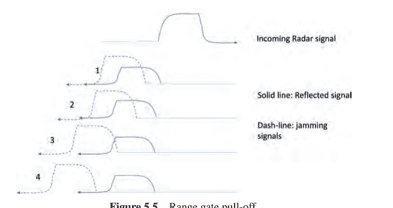

类似地，干扰信号的频率也可以逐渐变化。频率的微小变化可以提供错误的速度信息，因为雷达通过测量回波脉冲的频率偏移来确定多普勒频率和 target 的速度。这种方法称为**速度门拖引**。雷达可能会围绕其皮肤回波频率使用一个带通滤波器（速度门）来跟踪目标速度并滤除噪声。干扰机最初发送与皮肤回波雷达信号频率相同的强干扰信号，然后逐渐改变干扰信号的频率，以移动雷达的速度门，使其滤除实际的皮肤回波雷达信号。在成功将雷达的距离门或速度门移动足够远，使这些门滤除实际的皮肤回波雷达信号后，干扰机可以停止发送干扰信号，随后雷达将丢失对目标的跟踪，并需要重新搜索该目标。值得注意的是，速度门拖引可用于对抗脉冲雷达和连续波雷达。

### 5.7 电子反反制措施：频率捷变和脉冲捷变雷达

如前所述，拦截接收机测量雷达脉冲的五个参数：频率、到达时间、脉冲宽度、脉冲幅度和到达角。前三个参数是雷达可以控制的固有雷达信号参数。为了增加雷达灵敏度，雷达基于接收到的多个皮肤回波脉冲来检测其目标。民用雷达通常保持这三个参数恒定，这样更容易对接收到的皮肤回波脉冲进行积分。

另一方面，由于抗干扰的考虑，对于军用雷达，其频率、脉冲宽度和到达时间可以在脉冲与脉冲之间发生改变。当然，这些修改会复杂化雷达设计。例如，如果雷达在逐脉冲的基础上改变其信号频率，不仅发射机设计困难，接收机设计也会变得复杂。发射不同频率信号的雷达被称为**频率捷变雷达**。雷达还可以具有许多不同的脉冲重复间隔（交错PRI），这将在拦截接收机端产生不同的到达时间间隔。具有交错PRI的雷达具备PRI捷变能力。类似的运算也可以在脉冲宽度上执行。

如上一节所述，欺骗性干扰的第一步是用干扰信号覆盖雷达脉冲，以便干扰机可以接管雷达的操作。为了覆盖脉冲，技术发生器必须能够预测下一个雷达脉冲的频率、脉冲宽度和到达时间。如果某些雷达固有参数在逐脉冲的基础上改变，则预测下一个脉冲的参数变得困难。当所有这些参数不断变化时，对于拦截接收机和电子战处理器来说，测量和去交织雷达脉冲具有挑战性，更不用说预测下一个雷达脉冲了。因此，许多军用雷达本质上是参数捷变的，以对抗欺骗性干扰。

### 5.8 角度欺骗：副瓣干扰机和副瓣取消方案

干扰还可以在角度测量上欺骗雷达操作员。与所有天线一样，雷达天线有一个主瓣和许多副瓣，如图 5.6 所示。在搜索其目标时，雷达发射雷达脉冲，其大部分能量通过主瓣发射。当检测到反射的雷达脉冲时，雷达接收机假设其接收到的能量是通过天线的主瓣，且主瓣的方向就是目标的方向。为了用错误的角度信息欺骗雷达，干扰机在雷达主束照射目标时避免发送干扰信号。当主束不指向目标时，干扰信号通过其天线的副瓣发送到雷达。由于副瓣的天线增益远弱于主瓣，干扰信号必须相当强。

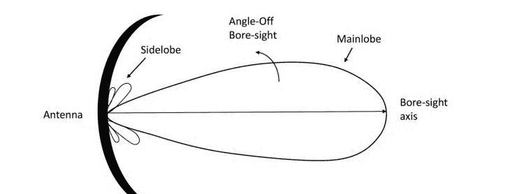

**图 5.6** 雷达天线方向图。

雷达通常认为所有信号都来自主瓣。如果雷达判定干扰信号是真实的皮肤回波，它将决定目标在主瓣方向，即错误的方向。因此，雷达可能会提供错误的角度信息。

通过天线副瓣接收信号的问题是一个通用的天线问题，并非雷达独有。拦截接收机也有同样的问题。拦截接收机需要测量的一个重要雷达参数是信号的到达角。这不是一个固有的雷达参数，雷达操作员无法控制它。因此，这是拦截接收机测量的最关键参数。对于电子战接收机，角度信息可用于两个重要操作。第一个是雷达脉冲排序。由于雷达无法控制其到达角，到达角是排序雷达脉冲最可靠的参数。在这个操作中，只要测量值具有一致性并且可以用于将来自不同雷达的雷达脉冲分开，到达角的真实值就不那么关键。到达角信息的第二种用途是指定干扰方向。在这个操作中，需要正确的到达角值。如果角度测量错误，干扰机将指向错误的方向进行干扰。拦截接收机使用其天线测量到达角，该天线也有主瓣和副瓣。雷达天线通常设计良好，以增加其方向性增益，使得通过副瓣发射/接收的信号远弱于通过主瓣发射/接收的信号。另一方面，拦截接收机的天线简单、轻便且小巧，以便可以安装在喷气式战斗机上。结果，这种天线具有相对较高的副瓣。虽然没有人试图构建一个干扰机来干扰拦截接收机，但接收机本身由于其简单天线设计的缺陷，可能会产生错误的到达角信息。

雷达消除从天线副瓣产生错误角度信息的可能性的一种常见方法是使用图 5.7 中说明的副瓣取消方案。同样的概念可以应用于雷达和拦截接收机系统。其思想是引入另一个天线和接收机。第二个天线的方向图是全向的，这意味着天线在所有方向上具有相同的增益。对第二天线的要求是，其来自所有方向的增益强于主天线的副瓣增益，但弱于主天线的主瓣增益。当主接收机的输出强于第二个接收机的输出时，确定信号来自主天线的主瓣，且测量的角度是正确的。否则，信号来自主天线的副瓣。通过这种设计，雷达操作员知道雷达是否正在被错误的角度信息进行欺骗性干扰。

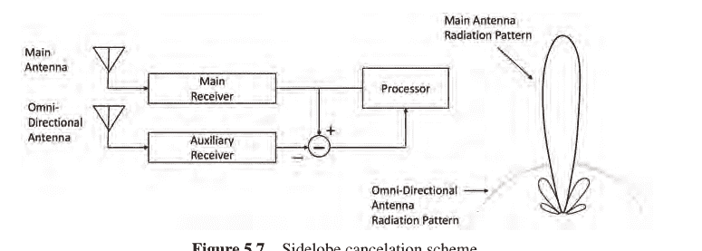

### 5.9 角度欺骗：反增益干扰

从名称中，人们可以猜测这种干扰是基于测量到的信号强度进行的。拦截接收机测量截获的雷达脉冲幅度，并使用该参数控制技术发生器。当然，干扰机必须具备正确的频率和到达时间。换句话说，干扰机已经覆盖了雷达脉冲。

反增益干扰背后的思想是，当雷达天线的主瓣指向目标时，拦截接收机接收到强信号。当天线的主瓣指向其他地方，而其副瓣指向目标时，截获的雷达信号能量弱得多。为了利用这种现象，当测量的脉冲幅度高时，向雷达发送弱干扰信号。当测量的脉冲幅度弱时，向雷达发送较强的干扰信号。这就是“反增益”名称的由来。因此，反增益干扰可以干扰雷达的角度测量，因为雷达随后会在较宽的角度范围内接收到强回波信号。如果干扰信号接管了雷达，则回波信号的强度由干扰机控制，而不是由真实的雷达回波信号控制。

这种干扰方案对 2.13 节中介绍的圆锥扫描雷达非常有效。由于天线的主瓣相对较宽，测量到的方向并不准确。圆锥扫描雷达通过使天线进行锥形扫描，将目标置于扫描中心，从而克服了这个问题。这种技术手段通过

### 5.9 圆锥扫描干扰：反向增益
*（注：OCR输入中缺少5.9的标题，但文本明显延续了关于圆锥扫描干扰的讨论。根据上下文“比较输出……”，这很可能是关于反向增益章节的结尾。我将按照提供的文本格式进行整理，合并页面。）*

比较天线的输出。当扫描天线的输出在整个扫描过程中幅度大致相同时，目标位于圆锥的中心。如果并非如此，雷达可以调整圆锥扫描的中心以定位目标。反向增益干扰会扰乱这种操作。结果导致天线无法将目标定位在圆锥扫描天线的中心。

反向增益方法的设计逻辑在于，在圆锥扫描期间，雷达天线在扫描时发出信号，并利用扫描过程中雷达脉冲表面回波能量的波动来精确定位其目标；因此，反向增益旨在“均衡”这种能量变化。所以，相应的雷达反制措施（反干扰措施）是使用一个固定的雷达天线指向一个方向，并让另一个独立的天线执行圆锥扫描。这样，截接接收机无法观察到扫描过程中的能量变化，反向增益干扰也就失效了。这种电子对抗措施被称为COSRO（仅接收圆锥扫描）或LORO（仅接收瓣）。

### 5.10 角度欺骗：交叉眼干扰 [3, 4]

如第2.14节所述，单脉冲雷达使用4个天线来发射/接收信号，并依靠这些天线接收信号的和与差来定位目标。因此，它能够用单个脉冲定位目标，这也是该雷达名称的由来。单脉冲雷达的优势在于难以对其进行干扰。例如，前文描述的反向增益干扰实际上有助于单脉冲雷达提高其灵敏度，因为它可以利用所有天线接收到的强干扰信号来定位目标。

一种旨在干扰单脉冲雷达的方法是交叉眼干扰。交叉眼干扰的基本概念是在不同位置使用两个间隔开的干扰机，发送相位差为180°的干扰信号。通常，这两个干扰机可以安装在飞机的机翼尖端，因为这是飞机上间隔最远的位置。在理想情况下，这两个干扰信号被单脉冲雷达的不同天线接收。由于它们相位相反，当它们相加时，相互抵消，雷达看不到任何信号；而当一个接收信号减去另一个时，雷达看到最大输出。虽然理想情况不太可能实现，但交叉眼干扰可能导致和信号输出小于差信号输出。结果，雷达会将其角度调整到偏离目标的方向，最终失去对目标的锁定。

从这个简单的描述可以看出，这种操作相当困难，因为需要在宽带宽上仔细控制两个干扰信号的相位差。一种直接的实现方式是在每个机翼尖端放置两个干扰机，每个干扰机有一个接收器和一个发射器，如图5.8所示。每个干扰机的发射器重播来自另一个干扰机接收器的接收雷达信号，其中一个干扰信号被延迟以产生180°的相位差。然而，延迟量取决于信号频率（对于2 GHz的信号，延迟需要为0.25 ns；对于1 GHz的信号，延迟为0.5 ns），而干扰机无法控制雷达的频率。为了使交叉眼干扰有效，这个延迟（相位差）需要准确。这是一项极具挑战性的任务。交叉眼干扰的原始概念于1958年申请了专利（US4117484A和US4006478A），但直到1970年代才实际部署（这两项专利申请分别于1978年和1977年获得授权）。这种巧妙方法的复杂性可能是其延迟部署的主要原因。

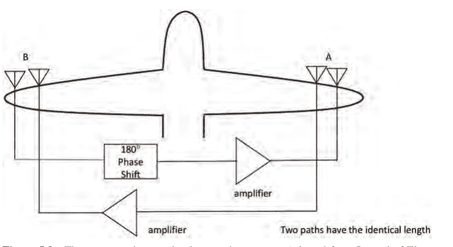
*交叉眼干扰机的实现概念（改编自《电子防御杂志》，2010年4月，第50页）。*

### 5.11 数字射频存储器（DRFM）

从之前对不同欺骗式干扰技术的描述中可以看出，为了欺骗雷达，干扰机需要生成与雷达信号非常相似的干扰信号。随着雷达的进步，由于存在众多可能的雷达波形，这项任务变得越来越困难。即使雷达仅在不同频率下发送脉冲信号，干扰机在短时间内合成虚假的雷达表面回波仍然很困难，更不用说雷达可能会逐脉冲改变其脉冲宽度、脉冲重复间隔（PRI）和频率。解决此问题的一种方法是记录截接接收机接收到的有用雷达脉冲，将它们存储在内存中，并在必要时重新生成这些脉冲。数字射频存储器（DRFM）就是为此目的而开发的。

DRFM的最早引用可追溯到1975年，它已成为干扰的标准设备。DRFM的基本想法非常简单；它将接收到的射频信号下变频到较低的频率，然后使用高速模数转换器对由此产生的低频信号进行采样。将信号下变频的原理与第4.6节中介绍的超外差（Superhet）接收机的工作原理相同。如果采样率足够高且接收机带宽足够宽，则可以获得接收雷达脉冲的高保真副本并存储在内存中。DRFM可以重新生成内存中存储的雷达脉冲，或为欺骗式干扰目的修改它们，然后利用下变频的相同原理（即将信号乘以本振产生的无线电波）将这些脉冲上变频回射频进行传输。DRFM的简单示意图可参见图5.9。DRFM甚至能够存储具有不同脉冲宽度和PRI的雷达脉冲序列，从而可以干扰具有脉冲捷变频的雷达。随着数字设备的快速进步，DRFM在未来只会变得更加通用，并在很长一段时间内成为电子战行业中不可或缺的设备。

### 5.12 电子战飞机

本章涵盖的干扰技术可以由目标飞机执行（自卫干扰）或由护航的电子攻击飞机执行（支援干扰）。支援干扰可进一步分为抵近干扰和近距干扰。抵近干扰是由位于目标飞机后方的电子攻击飞机执行的，而近距干扰则是由位于目标飞机与雷达之间的干扰飞机（可能是遥控的）执行的。自卫干扰与护航干扰以及抵近干扰与近距干扰之间的关系在图5.10中进行了说明。对于自卫干扰，目标飞机可以携带电子对抗（ECM）吊舱。图5.11是ECM吊舱AN-ALQ 101的照片。诸如诺斯罗普·格鲁曼EA-6B“徘徊者”和波音EA-18G“咆哮者”等电子攻击飞机的主要任务是干扰雷达操作和通信，这些飞机通常配备所有必要的电子战设备以执行有效的干扰。

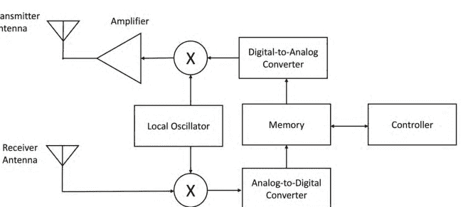
**图 5.9** DRFM示意图。

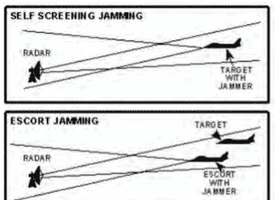
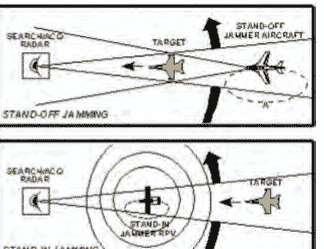
**图 5.10** (a) 自卫干扰和护航干扰。(b) 抵近干扰和近距干扰 [5, 6]。

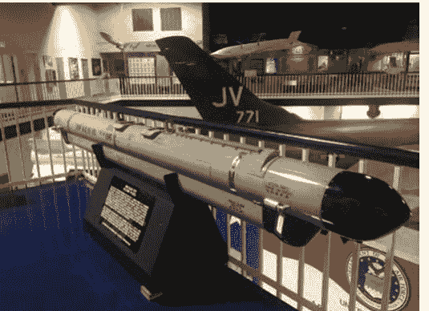
**图 5.11** AN-ALQ 101 ECM吊舱。

在战斗中，有时配备电子战（EW）系统的飞机会先飞出去，以吸引敌方雷达发现或射击它们。例如，在越南战争中，在因北越SA-2导弹损失飞机但无法定位SA-2导弹发射阵地并将其摧毁后，“野鼬鼠”概念应运而生。其想法是让由配备雷达告警接收机的飞机组成的“野鼬鼠”单元引导其他飞机执行任务。“野鼬鼠”单元的功能是吸引敌方雷达锁定“野鼬鼠”单元，然后“野鼬鼠”飞机可以使用反辐射导弹摧毁敌方雷达阵地，这些导弹可以跟踪雷达信号。当然，这是一项风险极高的任务。从1966年6月到1966年8月，在10架改装为“野鼬鼠”的F-105F飞机（第二批“野鼬鼠”）中，有5架损失。

在现代战争中，没有有效的雷达，军队实际上就是盲人。另一方面，没有有效的电子对抗（ECM），飞机就成了活靶子。在战争中，电子攻击飞机的主要任务是保护所有友军飞机。它们通常以某种模式飞离直接战场，并能在远距离干扰敌方雷达。由于配备了更好的电子战设备，它们可以专注于干扰。一个例子是，在1972年12月18日攻击河内的任务中，除了执行实际攻击任务的飞机外，还部署了31架EA飞机进行抵近干扰。

支持性干扰具有明显的优势。当EA（电子攻击）飞机通过提供虚假角度信息对雷达进行欺骗性干扰时，雷达将极难区分真实的皮肤回波（即雷达希望看到的皮肤回波）和干扰信号，因为干扰信号实际上提供了EA飞机正确的角度信息。然而，雷达无法看到来自其正在搜寻的目标飞机反射的皮肤回波泵浦脉冲。另一个明显的优势是，EA飞机远离战场，因此免于被干扰导弹追踪。因此，干扰机面临的敌方威胁很小甚至没有。

### 5.13 干扰的危险性

所有主动电子战操作本质上都是危险的，因为发射无线电信号可能会暴露自身，干扰也不例外，尤其是自卫干扰。一些导弹制导模式被设计用于跟随干扰信号。这被称为对干扰的追踪（Homing on Jamming）。导弹可以由制导雷达或其自身的雷达引导。当导弹由雷达引导时，雷达发送指向目标飞机的引导信号，导弹跟随反射的雷达信号接近目标。

如果导弹配备有自身雷达，它将向目标飞机发射信号并跟随皮肤回波雷达信号。当飞机对雷达或导弹进行干扰后，导弹可以改变其工作模式。代替跟随其自身的引导信号，导弹可以切换模式以对干扰信号进行追踪，并使用干扰信号作为引导。反辐射导弹使用相同的原则来攻击雷达。

### 5.14 战例：赎罪日战争和1982年黎巴嫩战争中的电子战 [11–14]

1973年10月6日，犹太赎罪日（Yom Kippur，犹太教一年中最神圣的日子），埃及和叙利亚对以色列发动了协调一致的突然袭击。在南方，埃及空军攻击了以色列在占领的西奈半岛上的空军基地，而叙利亚空军则攻击了北方戈兰高地上的以色列防御设施。在进攻前，阿拉伯国家干扰了以色列的无线电通信，导致以色列指挥链陷入混乱和困惑。尽管如此，在最初的混乱阶段之后，以色列进行了反击，派遣幻影战机和鹞式战机攻击埃及。由于在与埃及的先前冲突中积累了经验，以色列军方对其空中优势充满信心。然而，以色列空军并不知道，埃及在战争前已从苏联获得了新的导弹系统SA-6。与西方世界熟悉的基于脉冲雷达的SA-2和SA-3系统不同，SA-6使用低功率*直波束连续波（Straight Flush CW）*雷达照射目标飞机。安装在以色列喷气式战斗机上的截收接收机是设计用于截收脉冲雷达的，因此未能捕获低功率连续波雷达信号，更不用说进行干扰了。此外，用于控制埃及高射炮的*枪盘（Gun Dish）*雷达也将其雷达信号频率更改为高得多的频率。结果，以色列在一周内损失了100架喷气飞机，并向美国求助。美国交付了ALQ-119干扰吊舱，该吊舱使用第5.6节中介绍的基于速度门拉偏（velocity gate pull-off）方法对抗连续波雷达。然而，由于对SA-6知之甚少，美国和以色列都不知道ALQ-119是否能提供承诺的性能。因此，以色列仅将ALQ-119用于对抗SA-2和SA-3，而未用于对抗SA-6。

尽管其空军遭受了重大损失，以色列地面部队仍能在两个战线上坚守阵地甚至前进。随后，1973年10月24日宣布停火。从这一代价高昂的教训中，1982年，当以色列与巴勒斯坦解放军/叙利亚之间的另一场冲突在黎巴嫩爆发时（被称为1982年黎巴嫩战争），叙利亚位于贝卡谷地的SA-6阵地是以色列的主要目标。在使用电子战飞机收集关于叙利亚雷达操作参数的情报后，以色列使用高速无人机作为诱饵来引诱叙利亚导弹。在这些无人机上安装了电子战设备，能够生成与喷气式战斗机类似的、针对叙利亚雷达的响应。随后，叙利亚雷达开始搜索这些无人机，以色列携带干扰吊舱的喷气式战斗机跟随叙利亚雷达的信号，对叙利亚导弹发射阵地发起攻击。以色列声称，在15分钟内，19个叙利亚SA-6阵地中有17个被摧毁。

从这两个历史事件中，我们可以吸取几个教训。首先，不同的雷达需要不同的干扰技术，且关于雷达的情报的重要性怎么强调都不为过。主动发射信号可能是危险的。被以色列的无人机所欺骗，叙利亚的SA-6雷达开启很长时间以搜索这些无人机，最终导致其被摧毁。本章介绍的大多数干扰技术是针对脉冲雷达开发的，但低功率连续波雷达（它可以在较长时间内扩散能量）难以检测且可能有效。关于连续波雷达的一种变体（FMCW雷达）的更详细介绍将在第9章给出。

### 5.15 结论

本章讨论了几种干扰技术，其优缺点以及相应的反反制措施。使用一些真实的战例来演示重要的电子战原则。干扰的重要性在于，飞机的电子战系统花费在干扰上的时间比接收更多。这就是为什么截收接收机具有“时间看穿”（look through time）功能的原因。时间看穿时间是设计用于让干扰机停止干扰非常短的时间，以便截收接收机检查被干扰的信号是否仍在空中。由于干扰信号可能暴露飞机并被敌人用作导弹引导信号，一旦被干扰的雷达信号消失，干扰信号也应停止。

欺骗性干扰优于噪声干扰。如果操作顺利，雷达操作员可能在雷达失去目标追踪之前都无法意识到雷达已被干扰。欺骗性干扰的主要要求是了解要被干扰的雷达信号。欺骗性干扰始于用干扰信号覆盖雷达的回波信号。如果雷达信号设计具有一些参数敏捷性，干扰机将难以覆盖雷达的脉冲。一些雷达很难被干扰，需要特殊的干扰技术。近年来，数字射频存储（DRFM）成为一种主要的电子战设备，使电子战系统能够干扰复杂的雷达。

如果目标飞机未能干扰雷达，且导弹向该飞机发射，它需要机动规避导弹或误导导弹以生存。这将是下一章的主题。

## 参考文献

- [1] Samuel Liao, *Microwave Devices and Circuits*, 3rd edition, Prentice-Hall, 1990.
- [2] Damien Minenna, Frédéric André, Yves Elskens, Jean-François Auboin, and Fabrice Doveil, “The Traveling-Wave Tube in the History of Telecommunication,” the European Physical Journal H, Springer, vol. 44, no. 1, pp. 1–36, 2019.
- [3] Warren P. du Plessis, “Practical Implications of Recent Cross-Eye Jamming Research,” in the Proc. of Defense Oper. Appl. Symp. (SIGE), São José dos Campos, Brazil, 2012, pp. 167–174.
- [4] L. Falk, “Cross-Eye Jamming of Monopulse Radar,” in the Proc. of 2007 International Waveform Diversity and Design Conference, Pisa, 2007, pp. 209–213.
- [5] Electronic Warfare Fundamentals, U.S. Department Of Defense, 2000.
- [6] Electronic Warfare and Radar Systems Engineering Handbook, 4th edition. Naval Air Warfare Center Weapons Division, 2013.
- [7] David L. Adamy, EW 104: EW Against a New Generation of Threats, Artech House, 2015.
- [8] Andrea De Martino, Introduction to Modern EW Systems, 2nd Edition, Artech House, 2018.
- [9] S. J. Roome, “Digital Radio Frequency Memory,” Electronics & Communication Engineering Journal, vol. 2, no. 4, pp. 147–153, Aug. 1990.
- [10] Shelden C. Spector, “A Coherent Microwave Memory Using Digital Storage: The Loopless Memory Loop,” the Journal of Electronic Defense, Jan./Feb., 1975.
- [11] Alfred Price, War in the Fourth Dimension, Greenhill Books, 2001.
- [12] Alfred Price, History of US Electronic Warfare, vol. 3, The Association of Old Crows, 2000.
- [13] Mario de Arcangelis, Electronic Warfare: From the Battle of Tsushima to the Falklands and Lebanon Conflicts, Blandford Press, 1985.
- [14] David Eshel, “EW in Yom Kippur War,” the Journal of Electronic Defense, pp. 49–55, Oct. 2007.

## 6.1 引言

第 4 章的主要重点是拦截方法，用于确定飞机是否被威胁雷达照射。一旦检测到威胁雷达，必须立即对该雷达进行干扰，而第 5 章则专注于干扰措施及雷达的反反制措施。在现代战场上，每秒有数十万个脉冲。因此，威胁雷达始终有可能被拦截接收机和电子战处理器漏掉。此外，一些导弹可以在不使用雷达的情况下发射。结果就是，导弹朝飞机发射，飞行员需要立即采取行动以保命。在本章中，我们将重点介绍导弹探测方案和防御手段。

值得注意的是，导弹并非对飞机的唯一威胁。防空火炮（AAA）也可能构成重大威胁。事实上，在越南战争期间，美国因防空火炮损失的喷气式战斗机多于因地对空导弹（SAM）损失的。甚至在沙漠风暴行动中，美国因防空火炮损失了 9 架飞机，而因雷达制导地对空导弹损失 10 架，因红外（IR）制导地对空导弹损失 13 架。许多防空火炮由雷达控制；因此，前两章中介绍的拦截和干扰方法可以提高飞行员对抗防空火炮的生存能力。尽管如此，在炮弹或火箭发射后，由于其是无制导的，其运动受其动量和重力支配。由于炮弹的方向无法改变（但其引信可能会被干扰），躲避炮弹的最佳（也许也是唯一）方法是飞离它；因此，关于如何防御飞机免受防空火炮攻击的内容并不多，本章将重点介绍如何探测和拦截导弹。

根据定义，导弹和火箭的主要区别在于导弹是有制导的，而火箭是无制导的。然而，并非每枚导弹都需要雷达进行制导。例如，一些热寻的导弹（如红外制导地对空导弹）可以由步兵通过目视引导发射，导弹通过飞机辐射的热量来追踪飞机。在这种情况下，用于探测雷达信号的传统被动电子战技术无法探测到导弹并警告飞行员。因此，雷达防御系统无法解决关于探测导弹的所有问题。如果导弹已发射并正飞向目标飞机，而飞行员和该机的电子战军官并未意识到这一紧急危险，那么可以想象这种情况将是多么灾难性的。

鉴于这种可能性，需要一种不基于拦截雷达信号的导弹接近预警系统。本章将介绍两种探测飞行中导弹的方法。第一种是被动方法，第二种是主动方法。

被动方法是探测导弹的尾焰。当导弹在空中飞行时，其发动机需要推动其前进。发动机是热的，其后方有排气尾焰。理论上，如果能探测到尾焰，就能探测到导弹。由于尾焰的光谱位于红外波段，这种导弹接近预警系统被称为基于红外的导弹接近预警系统。当然，红外制导导弹也应用同样的原理来追踪其目标飞机。主动导弹接近预警系统是一种用于探测接近物体的简单雷达。在所有威胁中，从飞机尾部接近的导弹可能是最危险的一种。因此，这种雷达从飞机尾部向后观察，以寻找任何接近的物体。因此，这种雷达被称为尾部预警雷达。

被动方法相对简单且成本效益高。基于红外的导弹接近预警系统可以安装在许多不同类型的飞机上，包括直升机。另一方面，主动方法更复杂，成本也相对较高。这种方法可能仅适用于大型飞机，如轰炸机。

## 6.2 红外接收器的基本概念

红外是波长在 0.7 到 1000 $\mu$m（$10^{-6}$m）之间的电磁波。其光谱位于可见光和微波之间。红外光谱可进一步分为五个波段：近红外（0.75--1.4 $\mu$m）、短波红外（1.4--3 $\mu$m）、中波红外（3--8 $\mu$m）、长波红外（8--15 $\mu$m）和远红外（15--1000 $\mu$m）。红外光谱如图 6.1 所示。基于斯特藩--玻尔兹曼定律，任何温度（$T$）高于绝对零度的物体都会发射辐射，且总辐射量与 $T^4$ 成正比。

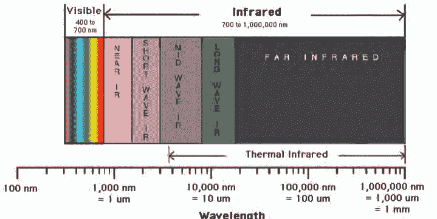

**图 6.1** 红外光谱（(https://sites.google.com/a/globalsystems science.org/digital-earth-watch/key-messages/near-infrared-and-the-electromagnetic-spectrum)）。

由于 99% 的热辐射位于红外光谱范围内，来自具有热源（如导弹或飞机）的物体的红外辐射是探测这些物体的一个重要特征。这就是为什么红外制导导弹通常被称为热寻的导弹。导弹明显的红外辐射源是其排气尾焰和高温发动机，但高速飞行的导弹会加热其周围空气；因此，这种气动加热也会产生红外辐射。

基于红外的导弹接近预警接收器通常放置在飞机尾部以探测接近的导弹，但对于直升机，基于红外的导弹接近预警接收器可能安装在其四个象限位置。当导弹发射时，其排气尾焰非常强烈。如果在导弹发射阶段就能探测到导弹，飞行员就能获得最大的反应时间。对于“冷”发射的导弹，这意味着导弹首先被弹出空中，然后其发动机才点燃，目标飞机的反应时间可能会缩短。在探测到导弹后，基于红外的导弹接近预警系统可以跟踪其轨迹。

理论上，基于红外的导弹接近预警系统是一个很好的构想，其工作原理简单得不能再简单。然而，这种方法的一个主要问题是环境中的其他红外辐射，特别是来自太阳的辐射。太阳比地球上大多数热源都要热得多。不仅太阳更亮，而且它照耀着许多地方。阳光可以从不同地方反射到红外接收器，接收器可能会因这种自然热辐射而报告有导弹接近。此外，红外辐射可以在大气层中被吸收，这取决于天气情况。这种情况如图 6.2 所示。因此，制造可靠的基于红外的导弹接近预警系统是一项工程挑战，基于红外的导弹接近预警系统的问题将在下一节中讨论。

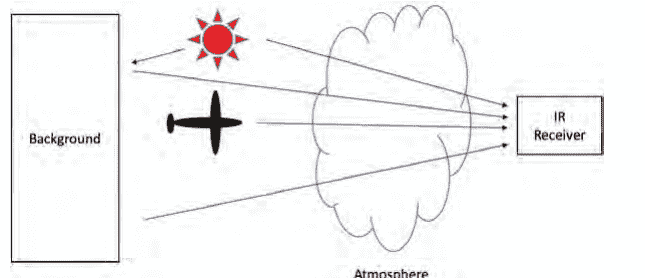

**图 6.2** 到达接收器的红外辐射。

## 6.3 基于红外的导弹接近预警系统的虚警问题及其他问题

基于红外的导弹接近预警系统的主要问题之一是虚警。与安装在导弹中用于追踪大型物体（如飞机）的红外传感器不同，基于红外的导弹接近预警系统旨在短时间内探测小型物体。因此，它需要具有高灵敏度。另一方面，高灵敏度会导致高虚警率。在实验室中测试的红外接收器可能运行得非常令人满意，但在实际飞行测试中，它可能产生许多虚警。很久以前，有人曾向 James Tsui 描述过基于红外的导弹接近预警系统的性能。他说飞行员做的第一件事就是关闭预警系统，因为它产生了许多警告信号，而飞行员不知道如何处理它们。因此，对于飞行员来说，应对此问题的最佳方法就是关闭预警系统。当然，这段对话发生在很久以前，随着技术的进步，这个说法可能不再正确。尽管如此，与其他导弹接近预警系统相比，基于红外的预警系统的高虚警率仍然是其主要缺点之一。

大多数人都有过朝着太阳方向驾驶的体验。对于某些驾驶员来说，阳光可能令人难以忍受。太阳方向的一切事物都很难看清。在早期的空中格斗中，飞行员常用的一种战术就是从太阳的方向发起攻击。在红外空空导弹被广泛部署之后，如何利用太阳或其反射来迷惑红外导弹，是一项需要学习的重要机动技术。与太阳相比，导弹尾焰的辐射较弱，尤其是在导弹飞行过程中。James Tsui 与他从事红外接收器工作的同事讨论了红外接收器的误报问题后，开始关注太阳的反射现象。他在飞机上旅行时，总是向下看地面太阳的反射，可以看到各种反射，例如来自小池塘、建筑物等的反射。大多数时候，他甚至不知道反射来自哪里，但其中许多非常明亮。

截至本章，本书中讨论的所有接收器都是无线电接收器。对于从事无线电频率截获接收器工作的人来说，他们的主要努力在于提高接收器的性能，而误报并不是一个严重的问题。在对无线电接收器进行测试时，误报很少成为一个问题，因为雷达信号是专门生成的，它们并不存在于自然界中。

尽管太阳产生大量的热量，从而产生红外辐射，但导弹尾焰的红外辐射具有特殊的光谱。不同的热源可能具有不同的红外辐射，如图 6.3 所示。这些信息可用于区分来自导弹与其他物体的红外辐射。此外，即使不同类型的导弹也可能具有不同的红外光谱。例如，一些数据显示，车辆发射的地面防空导弹的红外辐射位于近红外或短波红外范围内，而所有地面防空导弹和空空导弹的红外辐射都可以在中波红外范围内找到。导弹的红外特征对于降低红外接收器的误报率非常有用。一些方法使用滤波器来过滤掉红外光谱的某些部分。如果这些光学滤波器的输出与导弹的红外辐射光谱匹配，则检测到导弹。一些方法通过检查两个不同的红外子光谱来寻找导弹。实际上，测量和识别每一种可能的空中威胁的整个尾焰光谱是困难的。为了开发红外导弹接近预警系统，需要大量的尾焰数据，James Tsui 的同事朋友进行了许多旅行来收集这些数据。所有这些努力都是为了减少

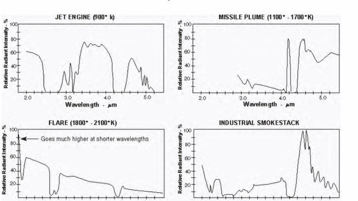

**注：** 这些图表显示的是每个特征的相对辐照强度，而非绝对辐照强度。因此，一个特征的“幅度”不能与另一个特征的“幅度”进行比较。

### 图 6.3 不同目标的红外辐射光谱 [7]。

红外导弹接近预警系统的误报，以便它可以用于检测真正来袭的导弹。

除了高误报率之外，红外导弹接近预警系统的另一个问题是大气对红外辐射的吸收。如图 6.2 所示，在任何红外辐射到达接收器之前，它都会穿过大气层，并且红外辐射在传播过程中会被吸收。更复杂的是，这种吸收取决于空气成分。不同类型的分子吸收不同波长的红外辐射，并且空气成分随高度而变化。因此，当测量红外光谱并用于检测接近的导弹时，需要考虑两件事：辐射光谱和大气吸收光谱。此外，水是极强的红外吸收剂，因此红外接收器在恶劣或多雾的天气中表现不佳。

由于这些问题，一些研究人员研究了不同波长的光用于导弹检测，紫外线（UV）辐射也被用于检测接近的导弹。对于此类系统，其光探测器仅设计用于检测较短波长侧的紫外线辐射，以避免来自太阳的紫外线辐射（被称为盲太阳紫外线）。波长小于 280 nm 的大部分太阳光紫外线被

地球大气层吸收。由于基于紫外线和红外线的导弹接近预警系统是基于相同原理设计的，并且它们之间的主要区别在于波长；因此，本书将不讨论紫外线接收器。

## 6.4 尾部预警雷达

尾部预警雷达设计用于检测从后方接近飞机的导弹。雷达的要求相对简单，但必须轻便且小型。另一个设计挑战是，接近的导弹通常很小，且具有非常小的雷达截面积（RCS），RCS 是反射雷达信号的区域，这使得检测变得困难。导弹可能很长，但通常直径很小。当导弹飞向雷达时，面向雷达的截面可能非常小，并且在导弹飞行路径上，其头部可能始终面向尾部预警雷达。如果导弹和雷达不在同一条直线上对齐，导弹的 RCS 可能会更大。

尾部预警雷达的距离取决于导弹可能从何处发射。导弹可以从地面基地或飞机上发射。因此，尾部预警雷达应覆盖相对较大的角度，而不仅仅是直接向后看。

基于雷达的导弹接近预警系统相对于基于红外线的系统的一个主要优点是，它不会像基于红外线的导弹接近预警系统那样频繁地产生误报。尾部预警雷达还可以估算来袭导弹的速度和距离。另一方面，尾部预警雷达发出信号，这会暴露飞机，从而增加飞机的脆弱性。尾部预警雷达也可能无法检测到具有小 RCS 的导弹，直到为时已晚。为了降低基于红外线的导弹接近预警系统的误报率，已经考虑了将尾部预警雷达与红外接收器结合使用，但这可能不是所有类型飞机都可行的选择。

## 6.5 近炸引信和干扰

James Tsui 第一次听说近炸引信的概念是在他上大学时。他的教授谈到了德国防空炮的炮弹，并强调了炮弹中使用的两项技术。第一项是炮弹的壁是蓄电池的一部分，但没有电解液。电解液存在于炮弹中的一个小瓶子里，而不是在电池中。当炮弹发射时，小瓶子因冲击而破碎，炮弹旋转，离心力将液体推入电池，然后电池被激活。电池用于为简单的雷达供电。当电池激活时，雷达调通。如果接收到的信号幅度高，意味着物体接近，炮弹爆炸。James Tsui 完全忘记了他的教授为什么谈论这个主题。虽然描述了近炸引信的概念，但从未提到“近炸”这个词。那时，James 在想炮弹有多贵。后来，他意识到军事行动可能极其昂贵。

实际上，近炸引信在第二次世界大战前后是几个国家积极研究的课题（现在可能仍然是）。基于无线电的近炸引信最初由英国工程师设计，并在二战初期与美国共享（在同一次访问中，英国人向美国人展示了如何制造产生雷达信号的磁控管）。美国努力完善引信设计，上一段描述的巧妙电池激活方案是一项美国发明（尽管实现方式不同；炮弹壁不是电池的一部分，电池是一个独立组件）。发射器发出连续波信号，同一个天线既用于发射又用于接收，接收器检测通过组合反射信号和本地振荡器电压产生的多普勒信号。工作原理与 4.6 节中介绍的超外差接收器相同。多普勒信号的频率是由炮弹和目标之间的速度差异引起的多普勒频移。多普勒信号的频率远低于发射信号的频率，其幅度与反射信号的幅度成正比。当目标接近时，反射信号的幅度增加。如果多普勒信号的幅度超过阈值，引信将引爆炮弹。这种引信被称为 VT 引信，其中 VT 代表可变时间（Variable Time）。近炸引信的示意图见图 6.4。虽然相同的原理可用于炸弹和其他火炮，但这种引信最初仅用于军舰的防空火炮，因为防空炮弹直接击中飞机的几率很小，而且在此实践中，近炸引信落入敌手中的几率也有限。直到 1944 年，VT 引信才获准用于地面作战，乔治·S·巴顿将军在看到其在突出部战役中的使用后印象深刻。至于引信的成本，1942 年引信的成本为 732 美元（2020 年价值：11,617 美元），1945 年为 18 美元（2020 年价值：258.68 美元）。

现代导弹的近炸引信工作原理与上述相似，尽管其雷达供电机制

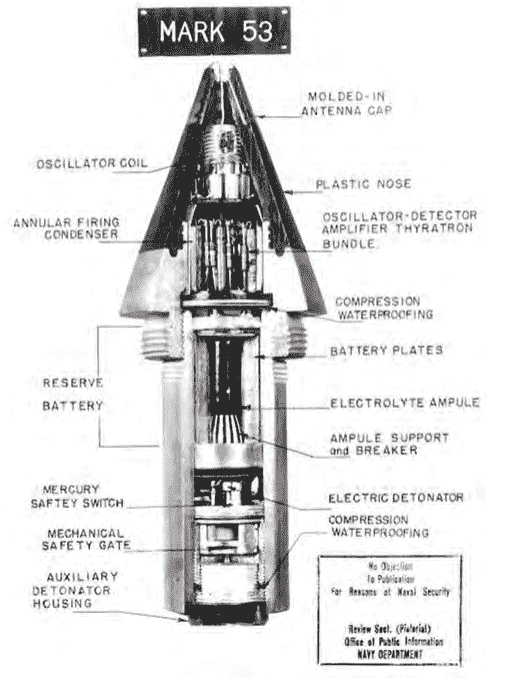

**图 6.4** 近炸引信 ([https://commons.wikimedia.org/wiki/File:MK53_fuze.jpg](https://commons.wikimedia.org/wiki/File:MK53_fuze.jpg))。

情况可能有所不同。由于近炸引信使用雷达系统，因此它容易受到干扰。干扰的目的是使导弹在距离目标飞机还很远时就发生过早引爆。干扰近炸引信的一种简单方法是放大接收到的雷达信号并重新发射它，使得如果近炸引信是基于多普勒信号的幅度触发的，那么干扰信号就会导致过早引爆。为了对抗这种转发式干扰方法，某些引信仅当多普勒信号的幅度高于阈值且多普勒信号的频率快速变化时才引爆弹头。增加第二个条件是基于这样一个物理现象：当导弹飞向目标时，多普勒频移为正；当导弹远离目标时，多普勒频移为负。不同的雷达信号已被用作近炸引信雷达的反干扰措施。正如我们所知，要有效干扰任何雷达，关于雷达信号知识的重要性怎么强调都不为过。

## 6.6 导弹制导系统

常见的导弹制导系统有两种：射频制导和红外制导。射频制导系统可进一步分为两种类型：一种是从导弹本身发出的射频制导信号（称为主动制导），另一种是从雷达发出的射频制导信号（称为半主动制导）。要干扰主动制导或半主动制导导弹，必须知道其制导信号。如果不知道导弹的制导信号，可能会在战场上受到惊吓并遭受重大损失，如第 5.14 节中描述的赎罪日战争的例子所示，当时以色列空军因一种当时对其未知的新导弹萨姆-6（SA-6）在一周内损失了一百架飞机。一旦知道了制导信号，损失就可以显著减少，如第 5.14 节中也介绍的 1982 年黎巴嫩战争的例子所示。

另一种流行的导弹制导方法是通过红外传感器。导弹被设计为追踪飞机散发热量所产生的红外辐射。飞机的红外辐射可能来自 (1) 其尾喷流，(2) 其发动机热量，以及 (3) 飞机机身（太阳反射或通过气动加热产生的热量）。早期的红外导弹被设计用于锁定热发动机部件（近红外波段），而后来的热追踪导弹则追踪发动机尾喷流（中红外波段）。红外制导系统是一种被动制导系统，导弹不发射信号。利用飞机的干扰信号进行制导的干扰锁定也是一种被动制导系统。一些红外导弹被设计为无需任何雷达制导即可发射。操作员可以用肉眼瞄准红外防空导弹对准飞机并发射导弹。一个例子是美国的“毒刺”导弹，它是许多便携式防空导弹（MANPADS）之一。这种导弹制导也称为“发射后不管”，因为导弹只需要有人发射它。一旦导弹发射，就不需要制导信号；因此，发射者可以离开/隐藏，而导弹会自动搜索并追踪目标。

红外制导系统是一个带有红外检测器的光子系统，用于检测来自目标的红外辐射。其工作原理类似于基于红外线的导弹接近告警系统。制导系统需要区分目标和其他红外辐射源，并覆盖大范围角度。其跟踪角度也需要准确。图 6.5 展示了一个制导系统的示意图。在该系统中，红外光穿过红外罩，由主镜反射，然后由副镜反射，穿过一个旋转分划板（其功能稍后将详细解释），最后到达红外指示器，该指示器根据辐射强度产生电压。分划板可以被视为具有特定透明和不透明区域模式的圆形透镜。其目的是帮助制导系统区分目标和其他背景红外辐射源（如云或沙子），并提供关于目标的准确角度信息。为了实现这些目标，使用了不同的分划板模式，其中一些在图 6.6 中展示。分划板 A 称为全辐条分划板，它具有交替排列的透明/不透明辐条。全辐条分划板可以区分背景辐射和目标辐射。假设目标尺寸很小，且云等背景红外源很大，当分划板旋转时，背景红外源在接收端产生相对恒定的电压，而目标红外源在接收端产生周期性电压（类似周期性脉冲信号）。此外，当目标更接近分划板中心时，由于目标区域更频繁地被不透明辐条阻挡，产生电压的平均幅度会降低。图 6.6 中的分划板 B 可用于根据检测器开始检测辐射的时间来确定目标的角度。当目标位于中间时，红外检测器应检测到恒定的辐射。图 6.7 说明了这两种分划板的工作原理。分划板 C 是分划板 A 和 B 的组合；它的一半是 50% 透明，另一半是辐条分划板。因此，它可以确定物体位置并区分目标与其他背景红外源。

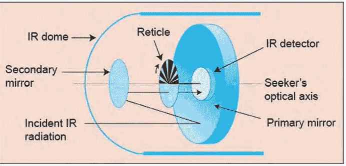

**图 6.5** 基本红外制导系统 ([https://www.electronicsforu.com/technology-trends/precision-guided-munitions-infra-red-guided-weapons-part-3-4/2/](https://www.electronicsforu.com/technology-trends/precision-guided-munitions-infra-red-guided-weapons-part-3-4/2/))。

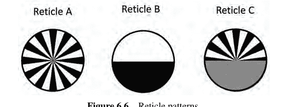

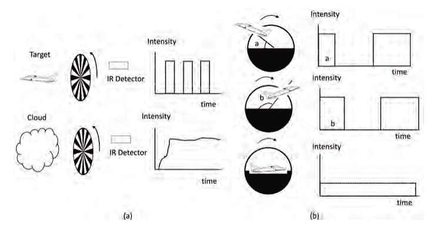

分划板 C 的模式被称为旭日分划板，使用分划板 C 的导弹制导系统的目标是将目标锁定在分划板的中心。当目标锁定在分划板中心时，红外检测器产生恒定的小电压。如果不在中心，可以基于脉冲的幅度和脉冲的起始时间（相位）来确定目标的位置。这种扫描系统被称为旋扫系统，用于苏联的 SA-7 红外防空导弹。由于旋扫系统直接观察飞机，它更容易受到干扰，因此开发了一种红外圆锥扫描系统来解决此问题。

红外圆锥扫描系统使用与第 2.13 节中介绍的圆锥扫描雷达相同的原理。圆锥扫描系统的工作原理在图 6.8 中说明。在红外圆锥扫描系统中，副镜围绕导弹的滚转轴摆动，位于轴上的目标始终位于旋转副镜视场的边缘。这是通过倾斜副镜并使其旋转来完成的。副镜反射的图像穿过固定的全辐条分划板，圆锥扫描中心的目标映射到分划板的边缘。由于分划板是固定的而副镜在旋转，位于中心的目标将围绕分划板中心“画圈”，从而在红外接收器输出端产生类似恒定脉冲宽度的周期性脉冲的周期性电压变化。如果目标偏离中心，脉冲宽度将会变化，并且可以利用此信息来校正导弹的方向。可以将圆锥扫描系统视为一种频率调制系统，它基于频率（脉冲宽度）的变化来确定目标位置；而将旋扫系统视为一种幅度调制系统，它基于信号的幅度和相位来确定目标位置。由于视场并非固定在中心目标上，而是围绕目标旋转，圆锥扫描系统覆盖的区域更大。因此，与旋扫系统相比，圆锥扫描系统失去目标的可能性更小。苏联的 SA-14 红外防空导弹使用圆锥旋扫系统来解决 SA-7 遇到的干扰问题。

值得注意的是，红外检测器不提供距离信息。这信息并不关键，因为假设一旦导弹接近目标，近炸引信就会使其爆炸。本节描述的分划板系统仅使用一个检测器。整个图像的能量由一个红外检测器接收，所有跟踪都基于该量随时间的变化（一维信号）。在后续发展中，检测器阵列（如焦平面阵列）被用于生成用于跟踪的图像（二维信号）。

## 6.7 干扰红外跟踪系统 [9, 15]

由于红外跟踪是被动的，没有制导信号可供探测。因此，一旦飞机检测到逼近的导弹，即使不知道导弹的制导系统，也必须立即应用红外对抗措施。

由于红外导弹追踪热量，其对抗措施基于创建亮点或将辐射引导至导弹以欺骗导弹的制导系统。红外干扰器可以是全向的或定向的。全向干扰器使用高功率红外光源，例如

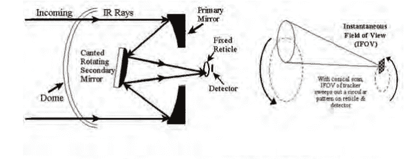

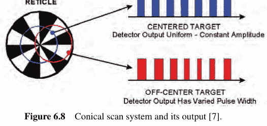

图 6.8 圆锥扫描系统及其输出 [7]。

加热的碳化硅块可辐射出强烈的红外能量，并且可以使用快门来创建与红外导弹制导系统瞄准镜图案和转速相匹配的脉冲模式。由于干扰机的辐射强度大于飞机的辐射强度，希望导弹制导系统会被干扰机的辐射所迷惑，从而丢失目标。一旦导弹对飞机的锁定被破坏，导弹重新锁定目标的可能性就很小。由于不同的红外导弹可能使用不同的红外波长，因此干扰机的光源需要覆盖宽光谱，以应对各种红外导弹。这种方法的有效性取决于干扰辐射的波长和调制模式是否匹配红外导弹的工作波长及其瞄准镜的扫描模式。此外，干扰机的辐射能量需要足够高于飞机的辐射能量（即干扰与信号比，J/S 比）才能有效。在干扰旋转扫描系统时，更容易满足这一要求，因为红外导弹直接指向飞机。然而，要干扰圆锥旋转系统，所需的 J/S 比要高得多，因为导弹并不直接指向飞机。

为了解决全向干扰机的干扰功率问题，定向红外对抗系统（DIRCM）已被提出并研发。DIRCM 与前面提到的导弹接近告警系统集成在一起。在识别并跟踪来袭导弹后，DIRCM 被启动。其红外源将是多波段红外激光器。一旦导弹被跟踪，这些信息就可以用于将激光输出光束直接对准来袭导弹。激光输出将以不同的图案顺序进行调制，以便它可以规避多种红外导弹。由于 DIRCM 将其能量直接投射到导弹上，且激光光束宽度较窄（不同于向每个方向辐射能量的全向光源），DIRCM 可以实现高得多的 J/S 比。

针对红外制导导弹的其他有效对抗措施方法是通过发射干扰弹（即高温燃烧物体）或发射模拟真实飞机的诱饵来制造假目标。该主题将在下一章中讨论。

## 6.8 结论

本章重点讨论如何保护目标飞机免受来袭导弹的攻击，而检测来袭导弹是第一步。有些导弹不需要雷达的制导信号来引导攻击。在这种情况下，设计用于拦截无线电信号的被动电子战接收器无济于事。

介绍了两种导弹检测方法：一种是检测导弹红外辐射的红外导弹接近告警系统，另一种是使用无线电信号检测来袭导弹的尾告雷达。红外告警接收器是一种相对简单的方法。然而，由于自然界中存在大量热源以及太阳反射，红外接收器存在较高的虚警率。在减少虚警数量的同时仍能检测incoming导弹是一个非常具有挑战性的技术课题。使用覆盖不同红外子谱段的多个传感器来区分导弹尾迹/发动机热量与阳光。这些方法增加了接收器设计的复杂性，但可能降低系统的虚警率。安装在飞机尾部的完整雷达系统用于检测接近物体是发现来袭导弹的另一种方式。这种设备更适合大型飞机，如运输机和轰炸机。这种系统的危险在于它会因持续发射无线电信号而暴露飞机的位置。

除非导弹或高炮炮弹被设计为始终直接命中目标飞机，否则近炸引信是必要的。本章涵盖了近炸引信简要历史和工作原理，以及设计用于干扰近炸引信的方法。

由于导弹是致命武器，一旦检测到，必须立即应用干扰技术。本章解释了红外导弹制导原理和可能的干扰方法。正如干扰雷达一样，关于导弹制导系统的情报对于干扰机的成功至关重要。然而，这种知识并不总是可用。如果未知来袭导弹的制导系统，应使用所有可能的干扰技术。要干扰红外导弹，既可以使用红外干扰机，也可以使用干扰弹（将在下一章讨论）。显然，飞行员可能通过机动来智取导弹（可能需要借助太阳），但这一主题超出了本书的范围。

## 参考文献

- [1] Alfred Price, *History of US Electronic Warfare*（《美国电子战历史》）, vol. 3, The Association of Old Crows, 2000.

- [2] *Operation Desert Storm: Evaluation of Air Campaign*（《沙漠风暴行动：空袭战役评估》）, United State General Accounting Office, June 1997.

- [3] Anil K. Maini, *Handbook of Defence Electronics and Optronics: Fundamentals, Technologies, and Systems*（《国防电子与光电学手册：基础、技术与系统》）, John Wiley & Sons, 2018

- [4] J. F. Milthorpe, and P. J. P. Lynn, “Effect of Aerodynamic Heating on Infrared Guided Missiles”（“气动加热对红外制导导弹的影响”）, in: Z. Jiang (eds) *Shock Waves*（《激波》）, Springer, pp. 227–232, 2015.

- [5] Joseph Trevithick, “US Army Hits Setbacks Trying to Add New Infrared Countermeasures to Its Helicopters”（“美国陆军试图在直升机上添加新的红外对抗措施遭遇挫折”）, the WarZone, January 25, 2018. (https://www.thedrive.com/the-war-zone/17969/us-army-hits-setbacks-trying-to-add-new-infrared-countermeasures-to-its-helicopters).

- [6] Robert L. Shaw, *Fighter Combat: Tactics and Maneuvering*（《战斗机作战：战术与机动》）, 7th edition Naval Institute Press, 1985.

- [7] *Electronic Warfare and Radar Systems Engineering Handbook*（《电子战与雷达系统工程手册》）, Naval Air Warfare Center Weapons Division, 2013.

- [8] Sungho Kim, Sun-Gu Sun, and Kyung-Tae Kim, “Analysis of Infrared Signature Variation and Robust Filter-Based Supersonic Target Detection”（“红外特征变化分析及基于鲁棒滤波的超音速目标探测”）, Scientific World Journal, vol. 2014, Article ID 140930, 2014.

- [9] G. Kim, B. Kim, T. Bae, Y. Kim, S. Ahn, and K. Sohn, “Implementation of a Reticle Seeker Missile Simulator for Jamming Effect Analysis”（“用于干扰效果分析的瞄准镜制导导弹模拟器实现”）, in the Proc. of the 2nd International Conference on Image Processing Theory, Tools and Applications, Paris, 2010, pp. 539–542.

- [10] Edward A. Sharpe, “The Radio Proximity Fuze - A Survey”（“无线电近炸引信 - 综述”）, Vintoge Electrics, vol. 2, no. 1, https://www.smecc.org/radio_proximity_fuzes.htm

- [11] Richard E. Marinaccio and Ward M. Meier, “Proximity fuze jammer”（“近炸引信干扰器”）, US Patent # US4121214A, 1969.

- [12] John W. Lyons. E. A. Brown, and B. Fonoroff, “Radio Proximity Fuzes”（“无线电近炸引信”）, https://nvlpubs.nist.gov/nistpubs/sp958-lide/059-062.pdf.

- [13] W. S. Hinman and C. Brunetti, “Radio Proximity-Fuze Development”（“无线电近炸引信的发展”）, in Proceedings of the IRE, vol. 34, no. 12, pp. 976–986, Dec. 1946.

- [14] Graham Warwick, “Blinding with Science”（“以科学致盲”）, Flight International, 10 January 2000 (https://www.flightglobal.com/blinding-with-science/30120.article)

- [15] C. Kopp, “Heat-Seeking Missile Guidance”（“热寻的导弹制导”）, Australian Aviation, 1982

- [16] Tae-Wuk Bae, Byoung-Ik Kim, Young-Choon Kim, and Sang-Ho Ahn, “Jamming Effect Analysis of Infrared Reticle Seeker for Directed Infrared Countermeasures”（“定向红外对抗措施的红外瞄准镜干扰效果分析”）, Infrared Physics and Technology, vol. 55, no. 5, pp. 431–441, Sep. 2012.

- [17] T. M. Malatji, W. P. du Plessis, and C. J. Willers, “Analysis of the Jam Signal Effect against the Conical-scan Seeker”（“针对圆锥扫描制导头的干扰信号效果分析”）, Optical Engineering, vol. 58, no. 2, Article ID 025101, 2019.

- [18] C. J. Willers, J. P. Delport, and Maria Susanna Willers, “C3IR Optronic Scene Simulator Finds Real Application in Self-protection Mechanisms of the South African Air Force”（“C3IR 光电场景模拟器在南非空军自卫机制中的实际应用”）, in the Proc. of Science Real and Relevant Conference, 2010.

- [19] Sam Goldberg, “Infrared Countermeasures: the Systems That Cool the Threat from Heat-seeking Missiles”（“红外对抗措施：冷却热寻的导弹威胁的系统”）, Air and Space Magazine, July 2003. (https://www.airspacemag.com/how-things-work/infrared-countermeasures-4739633/).

- [20] J. Heikell, Electronic Warfare Self-protection of Battlefield Helicopters: a Holistic View（《战场直升机电子战自卫：整体视角》）, Helsinki University of Technology, Applied Electronics Laboratory Series E: Electronics Publications E18, Espoo-Finland, 2005

- [21] Jack R. White, Aircraft Infrared Principles, Signatures, Threats, and Countermeasures（《飞机红外原理、特征、威胁与对抗措施》）, Naval Air Warfare Center Weapons Division, Sep. 2012.

- [22] Electronic Warfare Fundamentals（《电子战基础》）, U.S. Department of Defense, November 2000.

# 7 箔条、诱饵弹与假目标

## 7.1 引言

我们已经介绍了雷达和电子战的基本原理。干扰的主要目的是防止雷达或导弹制导系统获取关于目标的准确位置/速度信息。如前几章所述，这一任务可以通过发射无线电波（针对雷达）或红外辐射（针对红外导弹）来完成。在本章中，我们将介绍几种不基于电子设备的对抗措施。本章涵盖的方法不是发射无线电波或红外光，而是使用物理物体在雷达屏幕上产生虚假目标，或使用热源来吸引红外导弹。虽然其中一些对抗措施的历史仅比雷达稍短，但它们至今仍在使用，我们将首先介绍历史最悠久的一种——箔条。

## 7.2 箔条及其对抗措施

在所有干扰技术中，箔条的历史最悠久，但至今仍在服役。在早期，箔条是金属线圈的条状物，而现在的箔条由涂有金属的尼龙或玻璃纤维制成，且一个弹头可以容纳大量的箔条。箔条的工作原理很简单。由于雷达发出无线电波并基于反射信号来确定目标的位置，如果一次性散布许多能将雷达信号反射回雷达的物体，它们可以在雷达屏幕上形成一片虚假目标的云雾，雷达操作员将难以判断如何应对。箔条被设计用来反射雷达信号，从而制造这种混乱。由于箔条在其长度两倍的波长处产生共振（换句话说，箔条长度应为其受害雷达信号波长的一半），因此可以一起散布几种经过精心选择长度的箔条，以确保最大的频率覆盖和反射效果。箔条的整个目的是制造虚假目标图像，人们开发了不同的箔条散布方法来达成这一目标。例如，支援飞机可以在一段时间内大量投放箔条，以形成一条箔条走廊来掩护后续飞机。这种做法被称为流式箔条。箔条的散布速度取决于雷达分辨单元的体积（雷达区分目标所需的最小空间体积）。在小空间内散布过多的箔条无助于提高干扰效果，且这种实践可能是浪费的。另一方面，在一个分辨单元内投放过少的箔条可能不足以产生足够强的反射雷达信号以被检测到。由于这些箔条散布技术需要经常演练，箔条对环境的影响引起了关注。关于此事的一些研究已经进行，发现其对环境和人类/动物健康没有显著的负面影响。

一旦箔条被散布，它会迅速减速，因此能够检测目标速度的多普勒雷达可以根据速度差异区分箔条及其目标。在这种情况下，飞行员可能会沿雷达波束的切线方向飞行，使得基于多普勒频移测量的飞机速度接近于零，从而箔条可以提供保护。

## 7.3 战例：1943年7月24日的不莱梅轰炸

1943年7月24日晚，面向北海的德国雷达检测到成千上万架接近的飞机，这些飞机似乎能够“自我复制”。被呼叫拦截来袭轰炸机的德国夜间战斗机跟随雷达操作员的指令，但找不到敌方飞机。后来，汉堡的所有雷达都停止工作，因为整个雷达屏幕都被闪烁遮蔽，因此无法为防空炮兵指挥官提供任何有用的制导。于是，雷达操作员报告其雷达故障。尽管德国雷达检测到了数千个假目标，但791架英国轰炸机仍然飞往汉堡进行轰炸。由于缺乏有效的德国防空，英国飞行员几乎未受干扰就完成了任务，仅损失了12架轰炸机。此次任务的损失率为1.5%，而之前六次对汉堡轰炸的损失率为6.1%。

德国雷达在那晚检测到的是由英国皇家空军投放的锡箔条，即箔条。英国对箔条的代号是“窗户”（Window），而密语“打开窗户”意味着散布箔条。那晚对汉堡的轰炸是箔条在战斗中的首次成功使用。关于箔条有一个有趣的事实，即其基本概念非常简单，以至于英国和德国科学家在1943年之前都想过这一概念（一位英国漫画家杰克·蒙克提出了纳粹使用金属框架风筝来迷惑英国雷达的想法，并在《每日镜报》上发表了关于这一想法的漫画条，从而引发了参与“窗户”项目的英国官员的严重担忧）。德国对箔条的代号是“杜佩尔”（Düpel）。在得知杜佩尔的干扰效果后，赫尔曼·戈林下令立即停止其开发，并销毁了相关的研究文件，担心如此简单的技术会落入敌手。英国政府也出于同样的原因犹豫是否引入“窗户”，最终使用箔条的批准是由温斯顿·丘吉尔给出的，他拒绝在战争内阁中讨论此事，因为技术性太强。

过了一段时间，德国雷达操作员开发了区分箔条和真实目标的技术，包括使用速度分离它们，以及在存在箔条时改变雷达频率。德国也在其反击中使用了杜佩尔。

## 7.4 诱饵弹及其对抗措施

牛津学习者词典对“flare”（火焰/闪光）的定义是“明亮但不稳定的光或火焰，持续时间不长”。这对于电子战中使用的大口径诱饵弹来说也是一个相当准确的描述，因为在这种情况下，诱饵弹是从飞机上抛出的非常热的物体，其热量或亮度持续很短的时间（几秒）。就像箔条被设计成对雷达表现为真实目标一样，诱饵弹被设计成产生红外辐射，使红外导弹的制导系统误将其视为真实目标。为了实现这一目标，诱饵弹必须（1）在抛出后几乎立即达到峰值强度，（2）产生比飞机热源（如排气羽流和发动机）发出的辐射更强的红外辐射，以及（3）具有比红外导弹追踪的飞机更诱人的红外光谱。诱饵弹可以由产生高可见度白光的火药材料或一旦暴露于氧气立即点燃并产生红外辐射的自燃材料制成。

在理想场景下（当然是对目标飞机而言），一旦诱饵弹被抛出，红外导弹的热寻的头开始追踪火焰并失去对飞机的锁定。诱饵弹可以是对使用旋转扫描系统的红外导弹非常有效的对抗措施。就像箔条一样，诱饵弹在抛出后立即开始减速。为了区分诱饵弹和真实目标，红外导弹制导系统可以使用速度将诱饵弹从真实目标中分离出来，就像雷达使用速度来区分飞机和箔条一样。

对于围绕其目标旋转的锥扫系统，由于诱饵弹减速过快，导致锥扫系统无法追踪，诱饵弹可能会掉出锥扫系统的视场。红外导弹还可以通过比较诱饵弹和目标的红外光谱，或通过两个红外源（即诱饵弹和飞机）的突然分离来检测诱饵弹突然增加的红外辐射。当检测到诱饵弹时，导弹的跟踪系统可能会等待诱饵弹移出视场后再重新追踪其目标。

为了反制红外导弹制导系统的反反制措施，诱饵弹应具有与其设计保护的飞机接近的红外光谱，并且可以连续抛出多个诱饵弹，因为如果诱饵弹在其视场中停留时间过长，红外导弹的跟踪精度就会牺牲。先进的诱饵弹甚至被设计为在飞机后方推进一段时间，以便红外导弹无法通过其相对于飞机的突然分离或其减速来识别诱饵弹。这种诱饵弹被称为动能诱饵弹。有人可以争辩说，带有自推进机制的诱饵弹类似于滑翔机或假目标，这将是下一节的主题。

## 7.5 假目标

与箔条类似，假目标被设计用来迷惑雷达，使雷达将其误认为目标飞机。主要区别在于假目标要复杂得多。它可以被认为是一架微型飞机，一些假目标是有动力的并携带干扰机。为了最大化欺骗雷达的机会，假目标被设计为增加其雷达截面，以便小的假目标在雷达屏幕上表现为大型喷气式战斗机或轰炸机。

假目标在几个方面都非常有用。根据其用途，它们可能分为消耗型假目标、拖曳型假目标或饱和型假目标。消耗型假目标是从飞机上抛出的，用于分散导弹的注意力。消耗型假目标上的电子设备可以生成大的雷达图像来引诱导弹，从而保护飞机。先进的消耗型假目标，如BriteCloud系列，配备了数字射频存储器（DRFM），以捕获并重新发射雷达信号来引诱导弹偏离飞机。消耗型假目标的一个问题是，虽然消耗型假目标的电子设备可以欺骗雷达，但与箔条一样，消耗型假目标没有发动机，因此它就像滑翔机，无法在空中停留很长时间。这个问题可以通过拖曳型假目标来解决。从名称来看，可以想象拖曳型假目标是附着在飞机上的，以便可以在后方飞行。现代拖曳型假目标通过光缆与飞机连接，它可以传输由飞机上的干扰机产生的干扰信号。如果干扰不起作用，最后

该系统将让被牵引的诱饵成为导弹的目标。在任务成功完成后，如果诱饵未被摧毁，牵引式诱饵可以被收回以供重复使用。牵引式诱饵的一个例子是用于 F-18 战机的 AN/ALE-55 光纤牵引诱饵。

饱和诱饵的主要功能与上述两种诱饵不同。饱和诱饵不是用于保护飞机，而是用于触发敌方雷达启动。为了实现这一目的，像美国空军的 ADM-160B 微型空射诱饵（MALD）这类新型饱和诱饵配备了发动机，使其能够飞行较远的距离（数百英里）并具有较长的滞空时间（45 分钟）。这种诱饵也被称为诱饵导弹。由于饱和诱饵拥有与真实飞机相似的雷达散射截面和飞行特性，它可以引导第一波攻击以引诱敌方雷达开启，从而消耗敌方用于追踪真实攻击飞机的资源，并暴露敌方雷达的位置。无人机也可以实现饱和诱饵的功能。如第 5.14 节所述，在 1982 年的黎巴嫩战争中，以色列空军使用无人机触发叙利亚雷达启动，以便以色列空军能够在 15 分钟内精确定位并摧毁 19 个叙利亚 SA-6 导弹阵地中的 17 个。在“沙漠风暴”行动的第一夜，无人机和美国海军的无动力战术空射诱饵（TALD）¹被用来迷惑伊拉克的高射炮、导弹和雷达使其启动。随后，许多伊拉克防空设施被摧毁，伊拉克的防空能力在第一场海湾战争开始时就被大幅削弱。

## 7.6 结论

本章介绍了三种非电子对抗措施：箔条、热诱饵和诱饵。到目前为止，我们已经将电子战的循环描述如下：雷达发出无线电波以探测目标，红外导弹则利用目标发出的红外辐射进行追踪。对抗措施旨在为雷达或红外导弹的追踪系统制造混乱，随后会构思相应的反措施以拒绝这些对抗措施。每种对抗措施都会遇到其反措施，而每种反措施又会触发更先进对抗措施的开发。这就是永无止境的电子战循环。赢得这场竞赛的另一种方式是阻止其开始。如果飞机可以被设计成从根本上不被雷达看到，那么就没有必要使用电子和/或非电子干扰方法来欺骗雷达，从而避免随后的所有麻烦。这种飞机通常被称为隐身飞机，这将是下一章的主题。

## 参考文献

- [1] George W. Stimson, *Introduction to Airborne Radar*（机载雷达导论）, 2nd edition（第二版）, SciTech Publishing, 1998.
- [2] Anil K. Maini, *Handbook of Defence Electronics and Optronics: Fundamentals, Technologies, and Systems*（国防电子与光电子学手册：基础、技术与系统）, John Wiley & Sons, 2018.
- [3] *Electronic Warfare and Radar Systems Engineering Handbook*（电子战与雷达系统工程手册）, Naval Air Warfare Center Weapons Division, 2013.
- [4] *Electronic Warfare Fundamentals*（电子战基础）, U.S. Department of Defense（美国国防部）, November 2000.
- [5] Richard E. Farrell and Steven D. Siciliano, *Effects of Radio Frequency (RF) Chaff Released during Military Training Exercises: A Review of the Literature*（军事训练演习中释放的射频箔条的影响：文献综述）, (https://www.gov.nl.ca/ecc/files/env-assessment-projects-y2004-1159-environmental-effects-of-radio-frequency-chaff.pdf), March 2004.
- [6] R. V. Jones, *Most Secret War*（最机密之战）, Wordsworth, 1978.
- [7] Alfred Price, *Instruments of Darkness: the History of Electronic Warfare 1939–1945*（黑暗的工具：1939–1945 年电子战史）, Frontline Books, 2017.
- [8] Mario de Arcangelis, *Electronic Warfare: From the Battle of Tushima to the Falklands and Lebanon Conflicts*（电子战：从硫磺岛之战到福克兰和黎巴嫩冲突）, Blandford Press, 1985.
- [9] Grant Turnbull, "Can New Spoofing Tech Give US Aircraft a Shroud in the Clouds?"（新的欺骗技术能为美国飞机在云层中提供伪装吗？）, Defense News, (https://www.defensenews.com/electronic-warfare/2019/05/15/can-new-spoofing-tech-give-us-aircraft-a-shroud-in-the-clouds/), May 15, 2019.
- [10] John Keller, "Navy asks BAE Systems to Build T-1687/ALE-70(V) Electronic Warfare (EW) Towed Decoys for F-35,"（海军要求英国宇航系统公司为 F-35 制造 T-1687/ALE-70(V) 电子战（EW）牵引诱饵）, Military and Aerospace Electronics, (https://www.militaryaerospace.com/unmanned/article/16726515/navy-asks-bae-systems-to-build-tl687ale70v-electronic-warfare-ew-towed-decoys-for-f35), Aug. 17, 2018.
- [11] Tyler Rogoway, "Recent MALD-X Advanced Air Launched Decoy Test Is A Much Bigger Deal Than It Sounds Like,"（最近的 MALD-X 先进空射诱饵测试比听起来重要得多）, The War Zone, (https://www.thedrive.com/the-war-zone/23126/recent-mald-x-advanced-air-launched-decoy-test-is-a-much-bigger-deal-than-it-sounds-like), Aug. 24, 2018.
- [12] Carlo Kopp, “Operation Desert Storm: The Electronic Battle Parts 1–3,”（“沙漠风暴”行动：电子战第 1–3 部分）, Australian Aviation (http://www.ausairpower.net/Analysis-ODS-EW.html), June/July/August, 1993.
- [13] Eliot A. Cohen, *Gulf War Air Power Survey: Gulf War Air Power Survey: Weapons, Tactics, and Training and Space Operations*（海湾战争空中力量调查：海湾战争空中力量调查：武器、战术、训练和太空行动）, Office of the Secretary of the Air Force（美国空军参谋长办公室）, 1993.

# 8 隐身飞机

## 8.1 引言

关于隐身飞机的一条未经证实的传闻如下。曾经，一名雷达操作员被告知要对一台雷达进行外场测试，他照做了。在测试雷达的过程中，他听到了飞机喷气引擎的轰鸣声。他望向引擎噪音传来的方向，发现一架正在接近的飞机。然而，当他检查雷达屏幕时，却什么都没有发现。于是，他开始进行调整，但他所做的任何改变都没有效果，直到飞机消失在水平线上，他的雷达仍然无法发现这架飞机。这名雷达操作员开始认为他拿到了一台有缺陷的雷达。“真走运！”他自言自语道，然后准备把雷达拿回去维修。他没有意识到的是，他实际上成功完成了一项测试，这项测试并非针对雷达，而是针对他所看到的隐身飞机。

蔡浩（Chi-Hao Cheng）从他的同事那里听到了这个故事，但无法验证它。因此，这个故事很可能只是另一个都市传说。尽管如此，它确实捕捉到了隐身飞机设计的目的。隐身飞机旨在不被雷达探测到，尤其是火控雷达。雷达需要干扰技术，因为雷达可以探测飞机，而飞机需要保护以免被敌方雷达锁定。因此，原则上，隐身飞机不需要进行干扰。当然，正如我们将看到的，隐身飞机并不是隐形飞机。在以下章节中，我们将介绍隐身飞机的工作原理及其可能被探测的方式。

## 8.2 隐身技术

为了避免被雷达探测到，一种直接的想法是用专门设计的雷达吸波材料（RAM）覆盖飞机，以减少反射雷达信号的能量。美国的 F-117 使用铁球涂料吸波剂，而 F-35 使用“纤维垫”材料。其他材料包括泡沫吸波剂、裘曼（Jaumann）吸波剂等。吸波材料的成分和使用方法可以进行分类，并作为机密严格保密。当洛克希德·马丁公司宣布其为 F-35 使用纤维垫时，它拒绝提供有关这项技术的细节，因为它属于机密。1999 年，一架 F-117 在南斯拉夫被击落，据报道，部分残骸被送往中国和俄罗斯，以帮助开发他们的隐身技术。当被问及俄罗斯和中国是否可能通过 F-117 的残骸获得关于美国隐身技术的知识时，美军准将 Bruce Carlson 回应道：“我只想告诉你：制造低可探测性飞机的科学并不是秘密。它涉及外形设计和雷达吸波材料。制造雷达吸波材料所需的技术在许多地方都可以获得。” [3]

Carlson 将军可能说的是实话。毕竟，某些吸波材料，如掺 CNT（碳纳米管）的纤维材料，已获得美国专利（专利号 US20100271253A1），任何人都可以在网上搜索这些专利。然而，避免雷达探测是一回事，而在战斗环境中使用则是另一回事。喷气式战斗机的涂层应当轻便、坚固、耐用且易于修复。但某些吸波材料，如铁球涂料，可能成本高昂、沉重且难以维护。每次任务后，都需要仔细检查隐身飞机的表面。James Tsui 的一位曾从事隐身技术工作的朋友告诉他，隐身飞机需要频繁重新涂漆。不难想象这种做法有多么昂贵和不方便。尽管如此，这个问题现在可能已经得到解决，因为洛克希德·马丁公司声称其基于纤维的隐身技术是一种“耐用且低维护的隐身技术”。

与吸波材料相比，另一种避免雷达探测的方法要复杂得多。很长一段时间以来，常识认为，飞机越大，其雷达散射截面就越大。因此，大型飞机在雷达屏幕上应显示为大物体，而诱饵的设计就是模拟飞机较大的雷达散射截面。1962 年，苏联物理学家 Pyotr Ufimtsev 发表了他关于电磁波散射的研究，这项工作被称为物理衍射理论。在这项工作中，Ufimtsev 通过仔细设计陡峭的表面不连续性或尖锐边缘，为散射入射雷达电磁波奠定了基础，从而将反射回雷达的信号降至最低 [4, 5]。换句话说，经过精心设计的飞机可以拥有非常小的雷达散射截面。尽管苏联认为这种方法不切实际，因此未将 Ufimtsev 的工作列为机密，但美国认识到其重要性，并开始

测试这一概念。乌菲姆采夫（Ufimtsev）的研究成果已被翻译成英文，如今可以从互联网上免费下载 [5]。

隐身飞机的一个问题是，它给飞机设计增加了额外的约束。正如我们在 RAM（雷达吸波材料）案例中所见，设计一架能够散射雷达信号从而让雷达无法探测到飞机的飞机是一回事；而设计一架具有适合空战的操控性和机动性的机框则是另一回事。当美国开始测试乌菲姆采夫的理论时，洛克希德·马丁公司将其原型机称为“绝望钻石”（Hopeless Diamond），如 8.1 图所示。这个名字是对著名的“希望钻石”（Hope Diamond）的双关。从图中可以看出，“钻石”这一昵称指的是飞机的形状。“绝望”部分则是对伴随隐身要求的设计挑战的致敬。即使在美国制造隐身飞机四十多年之后，在 2018 年，洛克希德·马丁公司的管理层表示，F-35 一半的缺陷源于其隐身特性。在一定程度上，设计隐身飞机就像设计一辆无声的赛车去赢得 F1 大奖赛。当然，隐身飞机的哲学在于，如果敌方的雷达无法探测到该飞机，那么战斗在开始之前就已经结束了，因为隐身飞机可以在对手意识到其存在之前方便地摧毁它们。这就像赛车手驾驶一辆无声的赛车，在其他赛车手意识到比赛开始之前就已经完成了比赛。

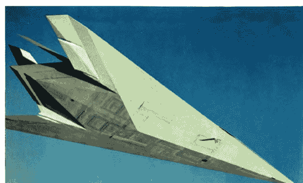

**图 8.1** 绝望钻石 ([https://en.wikipedia.org/wiki/Lockheed_Have_Blue#/media/File:Have_Blue_bottom_view.jpg](https://en.wikipedia.org/wiki/Lockheed_Have_Blue#/media/File:Have_Blue_bottom_view.jpg))。

除了降低飞机被雷达探测到的概率外，隐身飞机还应减少其热辐射、肉眼可见度等。由于本书主要涉及雷达和电子战（EW）系统，这些主题在此不作探讨。

## 8.3 针对隐身飞机的被动雷达？

隐身飞机被设计为对许多雷达隐身，但如果受到频率较低的无线电波照射，例如广播电视信号（其频率低于隐身技术所针对的雷达频率），它可能就不会那么隐身了。原因是频率较低的无线电波具有较长的波长（波长 = 光速除以频率），对于长波长的无线电波，整架飞机就像一根天线，将信号反射回去。被动雷达不发射信号以主动搜索目标。相反，它依赖于其他源（如广播电台和电视台）发出的信号以及从飞机反射回来的信号。通过比较从已知位置（如电视塔）直接发射的信号和从物体反射的信号，被动雷达可以定位其目标。2019 年，德国雷达制造商亨索尔特（Hensoldt）声称使用其被动雷达跟踪了参加 2018 年德国柏林航展的两架 F-35，距离达 150 公里，这一消息引发了一些讨论 [7]。

那么，使用波长较长的雷达来跟踪隐身飞机的问题是什么？答案是精度。波长较长的雷达分辨率较粗。仅仅知道飞机在大概范围内，对于引导导弹或高炮对其进行攻击来说是不够的。亨索尔特也承认，他们的雷达精度（目前）不足以引导导弹。另一方面，就像商业 GPS 接收机使用来自多颗卫星和固定参考站网络的信号来提高精度一样，也可以利用多个发射机，通过被动雷达网络来提高精度。雷达与隐身飞机之间的博弈肯定会持续下去。

## 8.4 战例：1999 年击落 F-117A

1999 年 3 月 27 日，北约开始轰炸南斯拉夫以迫使南斯拉夫（主要是塞尔维亚）军队从科索沃撤军三天后，南斯拉夫军队成就了一件此前或此后没有任何其他国家做到的壮举：击落了一架隐身战斗机。更令人震惊的是，南斯拉夫军队使用了苏联在 20 世纪 60 年代设计的 SA-3 地空导弹（SAM）击落了美国 F-117，而 F-117 在 1990–1991 年的“沙漠风暴”行动中曾成功使用。很快，塞尔维亚政府制作了反北约海报，口号为“抱歉，我们不知道它是隐身的”（见图 8.2）。那么，这是如何可能的？关于这一事件的官方报告可能在很长一段时间内对公众保密，但基于美国空军航空航天工程师克里斯·莫豪斯（Chris Morehouse）在线帖子的解释是相当可信的。

鉴于美国的电子战（EW）能力，塞尔维亚军队不断转移其导弹阵地；因此，与在“沙漠风暴”初期失去防空能力的伊拉克军队不同，塞尔维亚的 SA-3 在轰炸开始后基本完好无损，并且可以快速部署导弹阵地进行攻击。也许由于美国对其空中优势过于自信，美国的 F-117 被设定为走同一条路线进行打击，这种做法给了塞尔维亚军队沿路线设置伏击的机会。塞尔维亚 SA-3

图 8.2 塞尔维亚海报 ([https://www.reddit.com/r/dragonutopia/comments/d6fom6/ sorry_we_didnt_know_it_was_invisible_propaganda/](https://www.reddit.com/r/dragonutopia/comments/d6fom6/ sorry_we_didnt_know_it_was_invisible_propaganda/))。

系统使用了两部雷达：P-18 预警雷达和 SNR-125 火控雷达。P-18 的频率为 VHF（30–300 MHz）。VHF 频谱的一部分在美国用于调频广播和电视广播。塞尔维亚军队发现，如果使用 P-18 的最低工作频率，他们可以探测到 F-117（就像被动雷达可能利用 FM/TV 信号来探测隐身飞机一样）。然而，低频雷达精度不高，P-18 在此设置下的探测距离仅为 15 英里（约 24 公里）。尽管如此，如果预期飞行路线，这已足够提供预警。

1999 年 3 月 27 日，由于天气原因，美国的电子战飞机停飞，塞尔维亚的线报人员让塞尔维亚政府知晓了这一情况。因此，当 F-117 当天飞近时，塞尔维亚的 SNR-125 火控雷达可以大胆尝试几次，而不用担心被跟踪和瞄准。在尝试过程中，一架 F-117 正准备投掷弹药并打开了武器舱。如第 8.2 节所述，隐身飞机的形状经过精心设计以减小其雷达截面积（RCS），且其机身覆盖有 RAM 以吸收雷达信号。当武器舱打开时，飞机不再保持其魔法般的形状，其内部结构会反射雷达信号。结果，SNR-125 锁定了 F-117，向其发射了两枚 SA-3 导弹，其中一枚击落了这架“隐身”的 F-117。F-117 飞行员、中校戴尔·泽尔克（Dale Zelko）弹射逃生，随后获救。

在战争中，突然性至关重要。美国 F-117 和台湾 U-2 被击落（第 3.9 节）的主要原因之一是它们的飞行路线被正确预测。它们在被击落时都没有适当的电子支援。当然，在正常情况下，隐身飞机不应该被 20 世纪 60 年代的火控雷达锁定；因此，泽尔克被击落时其飞机处于最脆弱（或最不隐身）的模式，这确实是他的不幸。尽管如此，这次美国军事行动中的尴尬事件本可避免。

## 8.5 结论

隐身飞机是基于这样一个理念开发的：如果飞机无法被雷达探测到，那么它对雷达的威胁就免疫了。同样的理念也可以应用于雷达。如果雷达可以在不被截获接收机探测到的情况下发送探测信号，那么除非干扰机愿意通过发射干扰信号来暴露自己，否则它不会受到干扰。即使在这种情况下，干扰可能也不会

# 9 低截获概率雷达

## 9.1 引言

在电子战领域，雷达被设计用来探测由其发射随后被飞机反射回来的信号。因此，雷达知道要寻找哪种信号。另一方面，电子战（EW）系统可能不具备关于到达飞机的雷达信号的*先验*知识，因此它需要在宽频谱范围内和各个方向上搜索信号。然而，EW系统的截获接收机可以探测来自雷达的信号，而雷达则是设计用来探测由飞机反射并在雷达与目标飞机之间往返传输的信号。因此，从理论上讲，截获接收机可以在雷达接收到反射信号之前探测到雷达信号。如果我们假设截获接收机和雷达接收机具有相同的灵敏度，那么电子战系统可以在雷达发现飞机之前识别出雷达的存在。在这种情况下，雷达处于不利地位。正如我们在1982年黎巴嫩战争和沙漠风暴行动中看到的例子一样，夺取制空权的策略之一就是诱使敌方雷达搜索诱饵，并通过追踪雷达信号来摧毁敌方雷达。

为了弥补这一劣势，一些雷达被设计得难以截获，这类雷达被称为低截获概率（LPI）雷达，这也是本章的主题。在介绍LPI雷达的方法之前，从LPI雷达的角度重新审视一些雷达概念可能会很有益处。

## 9.2 雷达概念回顾

到目前为止，本书中讨论的雷达主要是脉冲雷达。脉冲雷达周期性地发出脉冲。根据接收到反射信号的时间，可以确定目标的位置。为了保证良好的距离分辨率（公式(2.3)），脉冲宽度（PW）需要很短，且发射脉冲的能量需要足够高，以保证在雷达工作范围内探测到反射回来的信号。因此，脉冲的功率需要较高，因为功率是通过能量除以PW计算得出的。由于脉冲是周期性发出的，如果反射脉冲在下一个脉冲发出之后才接收到，则无法准确定位目标。因此，脉冲重复间隔决定了雷达的工作距离。由于多普勒效应，反射信号的频率可能会发生改变，这一信息可用于确定目标的速度。为了搜索其目标，雷达需要不断扫描天空，在第2.12至2.14章中介绍了一些扫描模式。雷达天线具有主瓣和副瓣，如图2.7所示，雷达天线通过主瓣和副瓣发射和接收信号，但当雷达检测到信号时，假设信号是通过主瓣传来的，因为天线的主瓣增益远高于其副瓣增益。

正如我们在本书中反复提到的，原则上，EW系统相对于雷达的一个主要优势在于，截获接收机直接从雷达截获信号。在第2章中，给出了一个关联雷达发射信号功率和接收信号功率的方程，此处重新列出以供参考：

$$P_{\text {rec }}=P_{t} G \frac{\sigma}{4 \pi r^{2}} \frac{\frac{G}{4 \pi}\left(\frac{c}{f}\right)^{2}}{4 \pi r^{2}}=P_{t} G^{2} \frac{\sigma}{(4 \pi)^{3} r^{4}}\left(\frac{c}{f}\right)^{2}$$ (9.1)

其中 $P_{\text {rec }}$ 是接收信号的功率，$P_{t}$ 是发射信号的功率，$\sigma$ 是目标的截面积（即反射雷达信号的面积，这也是隐身飞机旨在减小的面积），$G$ 是雷达天线增益，项 $\frac{G}{4 \pi}\left(\frac{c}{f}\right)^{2}$ 是接收天线的有效面积，$c$ 是光速，$f$ 是信号频率，$r$ 是雷达与其目标之间的距离。对于截获接收机，其截获信号功率与发射信号功率之间的关系可以写为：

$$\widetilde{P}_{\text {rec }}=P_{t} G \frac{1}{4 \pi r^{2}} \frac{\widetilde{G}}{4 \pi}\left(\frac{c}{f}\right)^{2}$$ (9.2)

其中 $\widetilde{P}_{\text {rec }}$ 是截获信号的功率，$\widetilde{G}$ 是截获接收机的天线增益，项 $\frac{\widetilde{G}}{4 \pi}\left(\frac{c}{f}\right)^{2}$ 是截获接收机天线的有效面积。因此，对于距离雷达为 $r$ 的目标，EW系统与雷达接收信号功率之比可以通过将公式(9.2)除以公式(9.1)得到，我们得到：

$$\frac{\widetilde{P}_{\text {rec }}}{P_{\text {rec }}} = \frac{\widetilde{G}}{G \sigma} \frac{1}{4 \pi r^{2}} A \qquad\qquad\qquad\qquad\qquad (9.3)$$

因此，如果公式(9.3)中的每个参数除了 $r$ 之外都固定不变，如果我们增加 $r$，在某个时刻，EW系统的接收信号功率将高于反射回雷达的信号功率。结果是，EW系统可以在雷达探测到超过此距离的飞机之前检测到雷达的存在，**前提是EW系统知道在哪里以及如何寻找雷达信号**。当然，问题在于，EW系统需要知道它要找的是什么，而LPI雷达的设计方式使得EW系统可能会错过就在眼前的雷达信号，直到为时已晚。

## 9.3 LPI雷达技术概述

LPI雷达的主要目标是避免被探测到，或者至少在被飞机上的截获接收机探测到之前先探测到飞机。为了实现这一目标，可以采用许多方法。在本节中，将介绍一些LPI雷达技术，随后的两个小节将重点介绍两种特定的LPI雷达。

- **最小化天线副瓣。** 当雷达发射信号时，信号旨在通过天线的主瓣发送，而通过天线副瓣发射的信号可被视为泄漏。通过副瓣发射的信号不仅会暴露雷达，而且如果副瓣反射的雷达信号被检测到，还会使雷达混淆，因为它假设接收到的信号是通过天线的主瓣传来的。因此，EW系统可以将干扰信号指向雷达天线的副瓣来干扰雷达。因此，LPI雷达应具有小的天线副瓣和非常低的副瓣增益。

- **使用复杂的搜索模式。** 雷达按照特定的模式扫描天空以寻找其目标。一旦这种模式被识别出来，就可以设计相应的干扰方法。一个例子是第5.9节中涵盖的反增益干扰。使用的扫描模式越复杂，EW系统越难欺骗雷达。随着相控阵雷达的进步，它使用静止天线阵列通过改变每个天线发射信号的相位来电子地引导雷达信号到所需方向，编程变得更容易

## 参考文献

- [1] Bahman Zohuri, *Radar Energy Warfare and the Challenges of Stealth Technology*, Springer 2020.
- [2] Tom Hundley, “Serbs Sell Secrets of Downed Fighter;” Chicago Tribune, November 22, 2001.
- [3] Relly Victoria Petrescu and Florian Ion Petrescu, *Lockheed Martin Color*, Florian Ion Petrescu, 2013.
- [4] Konstantinos Zikidis, Alexios Skondras, and Charisios Tokas, “Low Observable Principles, Stealth Aircraft and Anti-Stealth Technologies,” Journal of Computations & Modelling, vol. 4, no. 1, pp. 129–165, Jan. 2014.
- [5] P. Ya. Ufimtsev, *Method of Edge Waves in the Physical Theory of Diffraction*, 1962 (https://apps.dtic.mil/sti/pdfs/AD0733203.pdf).
- [6] Valerie Insinna, “Stealth Features Responsible for Half of F-35 Defects, Lockheed Program Head States,” Defense News, March 5, 2018 (https://www.defensenews.com/air/2018/03/06/stealth-features-responsible-for-half-of-f-35-defects-lockheed-program-head-states/).
- [7] Sebastien Prenger, “Stealthy No More? A German Radar Vendor Says it Tracked the F-35 Jet in 2018 – from a Pony Farm,” September 29, 2019 (https://www.c4isrnet.com/intel-geojnt/sensors/2019/09/30/stealthy-no-more-a-german-radar-vendor-says-it-tracked-the-f-35-jet-in-2018-from-a-pony-farm/).
- [8] Dan Katz, “Stealth - Part 2 - Physics And Progress Of Low-Frequency Counterstealth Technology,” Aviation Week & Space Technology, August 25, 2016.
- [9] W. Lei, W. Jun and X. Long, “Passive Location and Precision Analysis Based on Multiple CDMA Base Stations,” in the Proc. of 2009 IET International Radar Conference, Guilin, 2009, pp. 1–4.
- [10] Dario Leone, “An-in-Depth Analysis of How Serbs Were Able to Shoot Down an F-117 Stealth Fighter during Operation Allied Force,” The Aviation Geek Club, March 26, 2020 (https://theaviationgeekclub.com/an-in-depth-analysis-of-how-serbs-were-able-to-shoot-down-an-f-117-stealth-fighter-during-operation-allied-force/).

一种精密的扫描模式。值得注意的是，相控阵雷达还能更好地控制其总副瓣。

- **频率跳跃。** 雷达可以通过频繁改变其发射频率来降低被探测到的概率，甚至可以在脉冲对脉冲的层面上进行改变。这种做法会增加电子战（EW）系统对雷达信号进行分类识别的难度。

- **功率管理。** 为了降低被截获的概率，雷达信号的功率不应高于必要水平。因此，一旦发现目标，根据反射雷达信号的功率，雷达可能会将发射信号的功率降低至仅足以保持对目标跟踪的程度。

- **脉冲压缩。** 迄今介绍的隐身（LPI）雷达技术并未解决方程(9.1)至(9.3)中总结的根本问题，即截收机之所以能在远处截获雷达信号，是因为反射雷达信号传播的距离是两倍，因此到达雷达时受到的损耗更大。然而，与电子战系统相比，雷达拥有一个巨大的优势：雷达知晓自身发射的信号。因此，隐身雷达设计的关键概念之一是通过对信号能量在更长的时间内进行扩展来降低发射信号功率；这样一来，雷达信号的功率将低到不足以引起截收机的警报。雷达可以对反射信号的能量在更长的时间内进行积分，从而获得足够的能量来检测目标。另一方面，由于截收机不知道应保持“监听”多长时间才能检测到传入信号，且可能缺乏关于信号特征的信息以恢复信号，因此它很可能会漏掉雷达信号。如果截收机仅对接收信号的能量进行短时间的积分，尽管被截获雷达信号的功率可能远高于雷达接收到的反射信号功率，但其输出结果可能太弱而无法被检测。此外，简单地积分接收信号并不能提供足够的信息来干扰雷达。这种情况可以类比为间谍试图窃听两个人在播放嘈杂音乐时低声交流加密信息的情景。声音音量非常低，间谍可能根本注意不到正在进行的对话，而仅仅知道有对话发生还不足以窃取秘密。

当然，关于这种方法，一个直接的担忧是，长脉冲会牺牲距离分辨率，其值等于光速乘以脉冲雷达的脉冲宽度再除以2（公式2.3）。此外，对于脉冲雷达而言，一旦发出一个脉冲，在发出下一个脉冲之前，雷达需要保持沉默一段时间以等待反射信号。例如，某雷达的脉冲重复间隔（PRI）为1 ms，脉冲宽度（PW）为1 μs。在这种情况下，在每毫秒内，雷达仅发射1 μs（即1 ms的1/1000）的信号，并等待999 μs（即1 ms的999/1000）以接收反射信号。如果使用长脉冲，雷达则需要等待更长的时间来接收从飞机反射回来的信号。结果是，雷达的响应时间可能过长。为了解决这些问题，需要应用脉冲压缩技术。在接下来的两个章节中，将解释两种基于脉冲压缩原理的流行隐身雷达：相位编码雷达和调频连续波（FMCW）雷达。

### 9.4 隐身雷达示例1：相位编码雷达

在介绍两个隐身雷达示例之前，首先需要解释互相关（cross-correlation）的概念。互相关用于测量信号之间的相似度，我们将以雷达信号为例说明其计算方法。假设雷达发送一个周期的正弦波，其周期为20 ns（PW = 20 ns），并等待其反射。图9.1顶部的曲线显示了发射信号。在实际应用中，雷达在脉冲期间会发送多个周期的正弦信号，且正弦信号的周期应该短得多。然而，为了使图形更易于理解，让我们假设这种不切实际的情况仅用于演示目的。假设在发射信号开始100 ns后，雷达开始接收反射信号。反射信号显示在图9.1中间的曲线中。

**图9.1** 短脉冲信号。顶部：发射信号。中间：来自单一目标的接收反射信号。底部：发射信号与接收信号之间的互相关。

假设雷达每600 ns发射一个脉冲（PRI = 600 ns）。图9.1顶部和中间的曲线在600 ns的窗口内展示了发射信号和接收信号。雷达当然知道其发射的信号，因此它可以计算发射信号与反射信号之间的互相关，以判断是否确实存在反射信号。计算互相关的方法是先逐点相乘发射信号和接收信号，然后将乘积求和以得到互相关的一个点。接着，将接收信号移动一个采样点（在本例中，假设每纳秒测量一个数据点），并重复相乘-求和过程以获取下一个点。以图9.1为例，在此过程中，发射信号保持静止，而接收信号向右或向左移动（图中箭头指示向右为正方向，向左为负方向）。当顶部曲线的第一个点与中间曲线的最后一个点重叠时，计算互相关的第一点。当这两条曲线不再重叠时，该过程结束。通过这样做，我们得到了图9.1底部曲线所示的发射信号与反射信号之间的互相关。如图9.1所示，该互相关的中心索引为零，在-100 ns处观察到一个峰值，这意味着接收信号看起来像是延迟了100 ns的发射信号。如果雷达是静止的，我们可以假设发射信号需要50 ns才能到达目标。由于无线电波的传播速度为299,792,458米/秒，目标距离大约为15米。当然，在这个演示示例中，该目标极其接近，这在现实中并不切实际。对于移动的雷达或目标，可以通过多普勒频移估算雷达与目标之间的相对速度，并且在确定目标距离时需要考虑速度因素。如果在雷达探测范围内存在目标，互相关图中应出现一个幅度高于检测阈值的清晰峰值。

从上述互相关示例中我们可以看到，互相关的幅度由发射信号与反射信号乘积的总和决定，当发射信号和反射信号对齐时会出现清晰的峰值。因此，为了降低发射信号的功率，使截收机无法察觉雷达的存在，可以使用低功率但长脉冲宽度（PW）的雷达信号。由于信号的总能量保持不变，雷达仍可通过互相关检测目标。然而，这种方法存在一个问题。如果雷达的脉冲宽度很长，则来自两个目标的反射信号可能会重叠，从而无法区分。因此，如果我们希望发射低功率且长脉冲宽度的信号，就需要使用特殊的雷达波形。这种技术被称为脉冲压缩，使用这类波形的雷达被称为脉冲压缩雷达。本章将介绍相位编码雷达和调频连续波雷达，我们将首先从相位编码雷达开始。

最简单的相位编码雷达仅使用两种类型的雷达波形，它们是具有相同频率和幅度但相位差为180°的正弦信号。令其中一种代表1，另一种代表0。该信号被称为二进制相移键控（BPSK）。BPSK信号从0变为1或反之的速度被称为码片速率。相位编码雷达不是发送一个非常长的正弦信号，而是发送级联的短正弦信号，这些信号可能伴随相位变化。例如，雷达可以使用上述两种正弦信号发射一串BPSK信号序列，如[1, 1, 1, 1, 1, -1, -1, 1, 1, -1, 1, -1, 1]。这是一个13位的巴克（Barker）码。巴克码的设计旨在最小化两个信号未对齐时自相关（即信号与其自身的互相关）的幅度。为了测试这种设计，我们将单周期雷达信号替换为13周期的巴克编码雷达信号（PW = 260 ns）。长雷达信号的幅度被降低，使得长、短雷达信号具有相同的能量，结果如图9.2所示。

从图9.2中可以得出几点结论。首先，尽管幅度小得多，但巴克编码雷达信号与其反射信号的互相关峰值幅度显示出与之前相同的峰值

位于相同的索引位置。因此，尽管使用低功率信号，该雷达信号仍能定位目标，其灵敏度与脉冲雷达相似。其次，雷达在未完成信号传输之前便已接收到反射信号。因此，与前面讨论的脉冲雷达不同，这种低可探测性（LPI）雷达需要使用独立的天线，一个用于发射，一个用于接收。由于两个天线放置得非常紧密（以便接收天线能够接收反射信号），该雷达的发射功率不能太高，且天线的旁瓣增益必须远小于其主瓣增益。否则，接收天线将受到发射信号的干扰。因此，LPI 雷达的作用距离通常不会很长。最后，在此示例中，尽管使用的信号脉冲宽度（PW）远长于脉冲雷达信号的脉冲宽度（260 对 20 ns），LPI 雷达信号的互相关显示的峰值看起来与图 9.1 中所示的峰值一样尖锐。尖锐的峰值意味着，尽管脉冲宽度较长，使用这种雷达信号仍能实现良好的分辨率以分离目标。

为了测试相位编码雷达能否像使用短脉冲的雷达那样有效地分离两个目标，进行了另一次模拟。需要检测两个目标。对于脉冲雷达，第一个目标反射的信号在发射开始 100 ns 后到达雷达，第二个反射信号在再晚 50 ns 时到达雷达。该模拟结果包含在图 9.3 中。对于使用脉冲宽度为 20 ns 信号的雷达，接收器可以清晰地看到两个回波以及发射信号与接收信号互相关中显示的两个峰值。对于脉冲宽度为

**图 9.3** 短脉冲信号。顶部：发射信号。中部：由两个目标反射的接收信号。底部：发射信号与接收信号之间的互相关。

**图 9.4** BPSK 信号。顶部：发射信号。中部：由两个目标反射的接收信号。底部：发射信号与接收信号之间的互相关。

260 ns 的编码雷达，两个反射信号发生重叠，如图 9.4 所示。然而，在互相关图中可以观察到两个位于正确位置的清晰峰值。这两个简单的模拟表明，使用功率较低但长度大得多的信号的编码雷达可以实现与短脉冲雷达相同的距离分辨率和灵敏度。

对于电子战（EW）系统而言，相位编码雷达信号带来了巨大挑战。试图通过检测接收信号功率的突然跳变来截获雷达信号的方法行不通。原则上，如果接收方知道发射的雷达信号，它就可以应用相同的互相关原理来检测该信号，并且其收集到的能量可能大于雷达接收到的信号能量。然而，这种情况不太可能发生。

本节标题为相位编码雷达，而相位编码雷达的类型不止一种。在本节中，我们仅讨论使用两种波形编码的 BPSK 雷达信号。还存在使用两种以上波形的其他相位编码雷达信号。例如，正交相移键控（QPSK）信号使用四种波形，相位偏移分别为 ($0^{\circ}$, $90^{\circ}$, $180^{\circ}$, $270^{\circ}$)。BPSK 信号的一个问题是其对多普勒频移的脆弱性，多普勒频移会改变返回信号的相位。在下一节中，将介绍另一种对多普勒效应更具免疫性的 LPI 雷达波形，即调频连续波（FMCW）。

## 9.5 LPI 雷达示例 2：FMCW 雷达

在第 2 章中，介绍了调频雷达（第 2.11 节）和连续波雷达（第 2.16 节）的概念。连续波雷达发出一个不间断的正弦信号，并基于反射信号的频率变化来检测移动目标。连续波雷达的问题在于它无法测定目标距离，并且如果目标与雷达之间的相对速度为零，由于没有频率变化，连续波雷达无法检测目标。调频雷达是一种脉冲压缩雷达。调频雷达并不发射强而短的正弦脉冲，而是发射低功率、长脉冲宽度的调频信号。在接收端，长反射信号可以被压缩以达到良好的距离精度，如第 2.11 节所述，或者可以通过计算发射信号和反射信号之间的互相关来获得相同的效果。图 9.5 展示了一种频率在 0.25 μs 内从 25 MHz 变化到 125 MHz 的调频信号波形。频率变化的速率被称为啁声速率（chirp rate）。图 9.5 中展示的调频信号是线性调频（LFM）信号，因为信号频率随时间线性变化。其他类型的调频信号也有使用。为了演示如何利用互相关检测调频雷达信号的目标，我们重复了上一节的两个模拟。使用图 9.5 中展示的调频信号来检测一个和两个目标。在单目标情况下，雷达接收器在开始发射雷达信号后 100 ns 接收到反射信号。在双目标情况下，接收到两个反射信号，分别在开始发射信号后 100 ns 和 150 ns。两个模拟的发射信号、反射信号以及发射信号与反射信号之间的互相关分别如图 9.6 和图 9.7 所示。结果表明，低功率、长脉冲宽度的调频信号可以成功地测定目标距离，正如 BPSK 信号一样。

**图 9.5** 调频信号示例。

FMCW 雷达通过连续发射调频信号，将连续波雷达和调频雷达结合在一起。FMCW 信号有多种，其中

**图 9.6** 调频信号。顶部：发射信号。中部：由一个目标反射的接收信号。底部：发射信号与接收信号之间的互相关。

**图 9.7** 调频信号。顶部：发射信号。中部：由两个目标反射的接收信号。底部：发射信号与接收信号之间的互相关。

时频关系如图 9.8 所示的信号被称为锯齿波信号，其频率线性增加直到达到最大值，然后信号频率重置为起始频率。由于信号的往返传播时间 ($t_d$) 和多普勒频移 ($F_{IF}$)，回波信号的频率与发射信号的频率不同。因此，如果接收器计算发射信号和接收信号频率之间的差值，在每个脉冲期间，将出现两个频率差值。根据这两个数值，可以确定目标的距离和速度。

在 FMCW 雷达的情况下，互相关操作也可以用于测定目标距离。然而，我们将介绍一种广泛使用的 FMCW 雷达框图，这是一种非常巧妙的设计。该 FMCW 雷达框图描绘在图 9.9 中。FMCW 雷达同时具有发射和接收天线。在接收器生成的 FMCW 信号被发送到发射天线和连接到接收天线的混频器。FMCW

雷达接收器是一个超外差（Superhet）接收器，这在第 4.6 节中有介绍。混频器的输入是接收信号和发射信号，它输出两个信号，其频率分别是接收信号和发射信号频率之和以及接收信号和发射信号频率之差。高频分量通过低通滤波器被滤除。因此，产生的信号将是两个级联的正弦信号，其频率可用于定位目标并确定其速度，如前一段所述。

得益于其易于实现，FMCW 雷达已被用于广泛的应用领域。除了军事应用外，它还用于安保系统、测速仪、汽车雷达等。本节讨论的锯齿波信号可能是最简单的 FMCW 信号。其他 FMCW 信号包括三角波信号（其频率线性增加到最大值，然后线性减小回起始频率）、频移键控（FSK）（其脉冲由几个短脉冲组成，每个脉冲具有不同的恒定频率）等。感兴趣的读者可以从本章末尾的参考文献 [4] 中找到专门关于 FMCW 雷达的书籍，但我们在此停止对该主题的相关讨论。

## 9.6 LPI 雷达的反制措施

LPI 雷达的低信号功率使得其检测变得困难，尤其是通过分析截获的雷达信号短片段的方式。此外，LPI 雷达的高占空比（对于 FMCW，占空比为 100%）和低功率降低了截获接收器观察到信号功率波动的机会。因此，为了检测和分类 LPI 雷达，截获接收器需要使用更先进的信号处理算法分析更长片段的接收信号。一些用于检测 LPI 雷达的流行方法，如 Wigner-Ville 分布（WVD）或 Choi-Williams 分布（CWD），旨在分析信号频率分量随时间的变化，它们属于时频分析的范畴。由于本书侧重于基本原理，且这些方法需要先进的数学概念来解释，因此本书未涵盖这些方法。

LPI 雷达不仅难以检测，而且难以进行干扰。噪声干扰效果不佳，原因有两点。像 FMCW 雷达这样的 LPI 雷达使用带宽更宽的信号，因此干扰噪声需要覆盖较宽的带宽。此外，LPI 雷达通常在接收端使用互相关，而干扰噪声与

## 9.7 结论

LPI（低概率截获）雷达理所当然地成为电子战工程师关注的主要对象。由于该雷达的设计初衷是避免被截获，因此雷达可能会在机载截获机收到雷达信号之前，先探测到飞机。本章介绍了LPI雷达的基本原理以及两种流行的LPI雷达波形：BPSK（二进制相移键控）和FMCW（调频连续波）。数字射频存储器（DRFM）可以作为一种有效的电子攻击（EA）工具来对抗LPI雷达，但这仅发生在电子战系统意识到其存在之后。下一章将讨论机器学习在电子战中的潜在应用。随着机器学习的迅速发展，它或许能成为电子战工程师应对LPI雷达的解决方案。

## 参考文献

- [1] James Genova, *Electronic Warfare Signal Processing*, Artech House, 2017.
- [2] R. M. Davis, R. L. Fante, R. P. and Perry, "Phase-Coded Waveforms for Radar," *IEEE Transactions on Aerospace and Electronic Systems*, vol. 43, no. 1, pp. 401-408, Jan. 2007.
- [3] Aytug Denk, *Detection and Jamming Low Probability of Intercept (LPI) Radars*, Master Thesis, Naval Postgraduate School, 2006.
- [4] M. Jankiraman, *FMCW Radar Design*, Artech House, 2018.
- [5] Jau-Jr Lin, Yuan-Ping Li, Wei-Chiang Hsu, and Ta-Sung Lee, "Design of an FMCW Radar Baseband Signal Processing System for Automotive Application," *Springer Plus*, vol. 5, Article number: 42, 2016.
- [6] Youn-Sik Son, Hyuk-Kee Sung, and Seo Weon Heo, "Automotive Frequency Modulated Continuous Wave Radar Interference Reduction Using Per-Vehicle Chirp Sequences," *Sensors*, vol. 18, no. 9, Aug. 2018.
- [7] Daniel L. Stevens, and Stephanie A. Schuckers, “Low Probability of Intercept Frequency Hopping Signal Characterization Comparison using the Spectrogram and the Scalogram,” *Global Journal of Researches in Engineering: J General Engineering*, vol. 16, no. 2, 2016.
- [8] Danel L. Stevens, and Stephanie A. Schuckers, “Analysis of Low Probability of Intercept Radar Signals Using the Reassignment Method,” *American Journal of Engineering and Applied Sciences*, vol. 8, no. 1, pp. 26–47, 2015.
- [9] K. M. Wong, T. Davidson, and S. Abalkader, “Detection of Low Probability of Intercept Radar Signals,” *Defence R&D Canada – Ottawa Contract Report*, DRDC Ottawa CR 2009-142, 2009.
- [10] Hung-Ruei Chen, *$FM CW Radar Jamming Techniques and Analysis$*, Master Thesis, Naval Postgraduate School, 2013.

# 10 机器学习及其在电子战中的潜力

## 10.1 引言

要找到一个尚未有人尝试应用机器学习的技术领域，是困难甚至不可能的。早在机器学习进入我们的日常词汇之前，智能机器人在战争中的应用就已经在电影和电视节目中得到过描绘。当一项技术开始吸引人们的注意力时，其能力往往会被高估，机器学习也不例外。本章将介绍机器学习在电子战中的一些可能应用。与人们脑海中那些（或非常可怕的）精美画面不同，尽管有一些成功的应用案例，但机器学习在电子战中的应用仍有许多问题需要克服，其中一些问题将在本章中讨论。然而，在深入探讨这些具体应用之前，首先给出一个非常宽松且非正式的机器学习定义将会很有帮助。

我们可能会天真地将机器学习定义为一种使机器（即计算机）能够通过从数据中学习来完成技术的任务的技术。在这个定义中，机器通过分析数据而不是推理来学习如何解决问题。这就是为什么机器学习和统计学习高度相关的原因。机器学习得有多好，取决于人类最初设置的结构、人类如何呈现数据，以及人类希望机器如何“学习”。根据“学习风格”，可以将机器学习分为不同的类别：监督学习、无监督学习、半监督学习和强化学习。监督学习意味着在学习过程中提供指导。例如，人们可能会使用1000张狗的照片和1000张猫的照片来训练计算机区分狗和猫。每张图片都标记为“猫”或“狗”，机器的任务是通过提供的图片学习这两个物种之间的区别，这样当一张新照片出现时，机器就能确定它是狗还是猫。与监督学习相反，在无监督学习中，提供给机器的训练图像是没有标签的。以猫狗问题为例，我们可以将1000张狗的照片和1000张猫的照片输入机器，而不告诉机器哪张是狗哪张是猫。然后，机器的任务是将图像分成两组，比如A组和B组。训练结束后，机器可以将一张新图片标记为A组图片还是B组图片。人们可以希望机器创建的两个组是基于主体的物种，但这并不保证；机器完全可能基于动物的可爱程度来区分它们。从这个简单的解释中，可以说监督学习和无监督学习的区别在于训练数据是否有标签。半监督学习介于监督学习和无监督学习之间。它的训练数据由一小部分有标签的数据和一大组无标签的数据组成。强化学习不同于之前的学习风格。它不通过训练数据来学习。相反，它通过多次模拟来最大化累积奖励，从而学习如何在环境中行动。强化学习的应用包括下棋、电子游戏等。在本章中，我们主要基于个人经验从监督学习和强化学习中选取例子，因此这种选择不应被解释为无监督学习或半监督学习在电子战中没有任何地位。此外，本章假设在训练完成后，机器的设置保持不变。

## 10.2 用于信号分类的机器学习

目前，机器学习在电子战应用中最为成功的应用之一是信号分类。随着雷达技术的快速发展，越来越多的雷达信号被开发出来，而为了对抗先进的雷达，正确的雷达信号分类至关重要。信号分类并不是一个新的领域。它可以用于军事或民用应用。工程师们已经开发了基于信号特征或复杂假设检验方法的信号分类方法。然而，基于机器学习的信号分类方法优于这些传统技术。因此，这是我们首先讨论的机器学习技术。

有多种机器学习技术可用于信号分类。本章介绍的是卷积神经网络（CNN）。选择它的原因是，CNN已被应用于对LPI雷达信号进行分类——这对电子战系统构成重大威胁——并取得了良好的结果。此外，CNN经常被用作入门级机器学习研讨会中的第一个实践示例，因此它是我们讨论机器学习的自然起点。由于CNN通常用于图像分类，要应用CNN对LPI信号进行分类，第一个任务是将一维信号转换为图像。时频信号处理技术可用于分析信号的频率分量如何随时间变化，其结果可以显示为一种称为频谱图的图像。不同的信号具有不同的频谱图，图10.1中提供了一些示例。在图10.1中，频谱图的两个轴是时间和频率，颜色代表强度。在噪声水平、信号强度、到达时间等不同条件下，可以获得相同信号的多个频谱图，这些图像可用于训练CNN。经过这种转换，信号分类问题与区分不同动物的图像相比并没有太大区别。

**图 10.1** 不同信号的频谱图。(a) 短脉冲。 (b) FMCW。 (c) BPSK。 (d) FSK。

**图 10.2** 卷积示意图。

### 卷积

为了介绍 CNN，首先必须引入卷积的概念。在图像处理中，卷积可以被视为在一个大图像上方移动一个小图像掩模，例如一个 3 像素乘以 3 像素（3 × 3）的图像。这个图像掩模被称为卷积核。在每个位置，卷积核与大图像重叠部分之间进行逐像素乘法运算，并将所有乘积（在这种情况下，共有九个）相加，以生成结果图像中的一个像素。然后，卷积核移动到下一个位置以重复相同的操作。卷积核每次移动的像素数（称为步长）决定了结果图像的大小。如果步长为 1，并且在输入图像的边缘填充零，使得每个像素都参与卷积计算，那么结果图像的大小将与输入图像相同。卷积的原理如图 10.2 所示。

卷积的目的是提取图像的特定特征。如果我们想在图像中寻找十字图案，可以使用以下所示的重建十字的卷积核进行卷积。

| 0 | 1 | 0 |
|---|---|---|
| 1 | 1 | 1 |
| 0 | 1 | 0 |

当这个卷积核与图像中看似十字的部分重叠时，结果的乘积幅度将很大。在 CNN 中，在每个阶段，可能会并行使用许多卷积核来提取不同的图像特征。至于机器应该寻找哪种特征，这是机器需要学习的内容，我们将在后文中讨论这一学习过程。

**图 10.3** 常见的激活函数。

### 激活

卷积完成后，可以对结果图像的每个像素应用非线性函数，以在神经网络中引入非线性。该函数被称为激活函数，一些类型的激活函数可以在图 10.3 中找到。

### 归一化（偏置）

在激活之后，可以对结果图像应用归一化以限制其像素值的范围。执行归一化的一种简单方法是将像素除以其邻域内的平均像素值。

### 下采样（池化）

之后，结果图像需要缩小为更小的图像以供进一步处理。为了完成此任务，可以将图像划分为许多微小的子区域，例如一个 2 × 2 的子图像，并用一个像素替换它们，该像素的值可以是这四个像素的平均值或最大值。该层称为池化层，最大池化的示例如图 10.4 所示。

**图 10.4** 最大池化示意图。

上述描述的四个层：卷积、激活、归一化和池化，可能会重复多次（某些层在某些迭代中可能被跳过），这个过程被称为特征学习。特征学习阶段生成许多代表图像不同特征的小图像。特征学习完成后，所有图像的所有像素被级联成一维数组（这个过程称为展平），这是用于分类的神经网络的输入。

### 人工神经元和神经网络

神经网络的名称来源于其基本操作单元，即人工神经元。人工神经元和神经网络的示意图如图 10.5 所示。人工神经元的操作可以分为两个阶段。在第一阶段，其输入乘以权重，然后求和。权重的值是机器需要学习的内容。然后，总和用作激活函数的输入，激活函数的值即为人工神经元的输出。如图 10.5 所示，神经网络的第一层是输入层，最后一层是输出层，中间的剩余层称为隐藏层，以人工神经元作为其处理单元。神经网络可以有很多隐藏层。“深度神经网络”一词指具有两个以上隐藏层的神经网络。输入层的大小取决于特征学习生成的像素数量。输出层的大小由信号类别的数量决定。如果 CNN 的任务是区分三种雷达信号，例如脉冲 CW、一种特定类型的 FMCW 和一种特定类型的 PBSK，那么输出层的大小为 3。隐藏层的数量以及每个隐藏层中人工神经元的数量由程序员决定。对于分类问题，输出层的值通常在 0 和 1 之间。以下定义的 Softmax 函数是输出层操作的流行选择：

$$
Out_{i} = \frac{e^{z_{i}}}{\sum_{j=1}^{k} e^{z_{j}}} \tag{10.1}
$$

其中 $z_{i}$ 是人工神经元最后一层的输出。基于公式 (10.1)，输出值必须小于 1。假设

**图 10.5** 神经网络。顶部展示了一个人工神经元。

Out$_{1}$ 代表输入信号是脉冲 CW 信号的概率，Out$_{2}$ 代表输入信号是 FMCW 信号的概率，Out$_{3}$ 代表输入信号是 BPSK 信号的概率。在理想情况下，当输入是 FMCW 信号时，完美的 CNN 应生成以下结果：Out$_{1}$ = 0，Out$_{2}$ = 1，Out$_{3}$ = 0。完整的 CNN 图可以在图 10.6 中找到。

值得一提的是，将接收信号转换为图像进行分类并非绝对必要。接收的输入信号可以直接输入神经网络进行分类。在这种情况下，CNN 的特征学习部分不被使用，且神经网络的输入层大小等于采样接收数据的长度。

### 反向传播

我们已经完成了对 CNN 的描述。在 CNN 结构固定后，该网络的性能取决于卷积核的值和每个神经元的权重。这些值在训练阶段确定。标记的训练数据有助于机器确定这些系数。例如，假设使用脉冲 CW 作为训练数据

### **图 10.6** 卷积神经网络。

且 CNN 网络的输出为 $\text{Out}_1 = 0.3$，$\text{Out}_2 = 0.6$，$\text{Out}_3 = 0.1$，而正确结果应为 $\text{Out}_1 = 1$，$\text{Out}_2 = 0$，$\text{Out}_3 = 0$。需要基于此信息更改 CNN 的系数以减少误差。反向传播是一种允许机器更改神经网络系数以减少误差的算法，它从最后一层向第一层利用链式法则和偏导数进行传播。在此过程中，误差以反向传播来更新 CNN 的系数，这也是该算法被称为反向传播的原因。调整的幅度基于误差幅度和学习率，学习率是由程序员设定的参数。希望的是，在向 CNN 输入足够的训练数据后，CNN 将学习到一个能够进行准确信号分类的配置。对于从事信号分类工作的工程师来说，一个仍然具有挑战性的任务是识别以不同时间到达、具有不同功率且部分时间重叠的多个信号。处理此场景的一种方式是用尽可能多的 EW 接收机可能遇到的场景来训练 CNN，但这种方法可能很耗时。因此，需要更高效的解决方案。

如前所述，神经网络的层数、卷积核的大小/数量、神经元数量、学习率等都可能影响 CNN 的性能，这些设置被称为超参数，由人类决定。此外，数据预处理的程度对 CNN 的性能也有重大影响。一句老话，“垃圾进，垃圾出”，准确地概括了神经网络的本质。不出所料，使用机器学习来确定神经网络的超参数是一个非常活跃的研究领域。至少，在确定之前

机器学习中的超参数和数据预处理完全可以由机器来完成，但即使在机器学习占主导地位的领域，人类依然不可或缺。

## 10.3 利用机器学习预测多功能雷达的下一个信号

多功能雷达可以根据预定规则，在逐脉冲的基础上改变其扫描模式和信号特性。为了正确干扰此类雷达，电子战（EW）系统需要能够预测雷达的下一步动作。在某种程度上，这项任务类似于补全一个未完成的句子或未完成的乐曲。机器学习可用于此任务，但前一节中提到的神经网络并不适用于此。信号分类与该项任务之间的区别在于，后者中接收到的信号之间存在时间依赖性。卷积神经网络（CNN）将接收到的信号视为一个整体以判断其类型。另一方面，为了预测多功能雷达的下一个信号，EW系统按顺序接收信号，并旨在确定下一个信号的类型。为了处理数据序列，循环神经网络（RNN）比 CNN 更合适，RNN 的示意图如图 10.7 所示。

如图 10.7 所示，RNN 具有反馈路径。为了展示目的，我们可以沿时间轴展开这一过程，如图 10.7 所示。RNN 的输出是基于其当前输入、先前输入和先前输出生成的。解释这种依赖性有一个有用的概念，即“状态”。对于这种结构，有一个非常宽泛的类比如下。将一个人周五收到的钱视为输入，状态是他们的储蓄，输出是他们在接下来一周将花费的金额。输出和下一个状态取决于输入和当前状态。在这个例子中，状态（储蓄）由前一状态、输入（收入）和输出（支出）决定。RNN 的目标是基于当前输入和状态来预测输出。

那么，如何训练 RNN 呢？与 CNN 类似，RNN 模型由多层神经元组成，其结构由程序员设定，并使用训练数据来确定这些系数。使用包含输入和期望输出的训练数据，输入序列被送入 RNN，生成输出序列。然后可以从比较最后一个 RNN 输出（展开的 RNN 中最右侧的部分，如图 10.7 所示）与其对应的期望输出开始，向第一个 RNN 输出（展开的 RNN 中最左侧）移动，从而修改 RNN 系数。这个过程称为通过时间的反向传播（back propagation through time）。

RNN 的一个问题是，随着状态不断演变，RNN 会“遗忘”某些事情。尽管状态是所有过去历史的累积，但近期事件具有更大的权重。另一方面，某些长期记忆对于处理可能是有用的。再次使用前面的例子，支出在很大程度上由储蓄和收入决定。然而，一个年轻时就中了彩票的人与一个年轻时被裁员的人，其消费习惯可能截然不同。为了解决这个问题，可以使用一种特殊的 RNN，即长短期记忆（LSTM）。LSTM 的示意图如图 10.8 所示。LSTM 有一个额外的携带记忆（CM）单元，它可以维持长期记忆并塑造状态。LSTM 的输出使用状态、携带记忆和输入来计算。这种修改使 LSTM 具有更大的灵活性。

RNN 已被广泛应用于自然语言处理。在某种程度上，如果我们把多功能雷达使用的每种不同信号视为一个特定的词，那么被截获并正确分类的雷达信号序列就像一句话（不同的词可以分配给不同的信号），而预测下一个信号就像根据特定语法的知识猜测半完成句子的下一个词。对于这类应用，LSTM 可能是一个有价值的工具。

## 10.4 用于电子战行动的强化学习

2016 年，一家英国公司 DeepMind 实现了许多人怀疑还需一代人才能做到的事情：开发了一个名为 AlphaGo 的计算机程序，在五局系列赛中击败了世界级的围棋棋手、18 次世界冠军李世石。古老的棋盘游戏围棋是一种战略游戏，占据更多领地的玩家获胜。由于围棋中可能的棋局配置超过 $10^{170}$ 种，使用计算机进行穷举搜索以找到最佳着法在当时还不可能。DeepMind 使用强化学习开发了 AlphaGo，机器学习使得机器无需先学习规则就能学会如何玩游戏并获胜。如果强化学习能够在战略游戏中击败人类最佳棋手，那么理所当然地假设这项技术可以用于 EW 系统与雷达的对抗。在本节中，将介绍强化学习的一些基本概念，并将讨论在 EW 中应用强化学习可能存在的问题。然而，在开始之前，需要定义一些术语。

-   *智能体（Agent）*：在游戏中采取行动的实体。
-   *行动（Action）*：智能体做出的决定。
-   *状态（State）*：智能体在环境中的状态。智能体可能对其所在的状态拥有完全知识（如围棋）或部分知识（如二十一点）。
-   *奖励/惩罚（Reward/Penalty）*：由程序员定义的量化指标。它可以是围棋一步棋帮助获得的领地数量（奖励），也可以是二十一点玩家损失的资金金额（惩罚）。
-   *策略（Policy）*：智能体用于选择其行动的算法。强化学习的目的是确定最优策略以最大化奖励。
-   *质量值（Q-value，或 Q 值）*：在特定状态下采取特定行动后的期望折扣奖励（减去惩罚）。它可以写为 $Q(s, a)$，其中 $s$ 是状态，$a$ 是行动。奖励（和惩罚）根据在采取行动后多久接收到而进行缩减。例如，三步后的奖励将乘以 $\gamma^{3}$，其中 $\gamma$ 是折扣因子，其值小于 1。换句话说，在采取行动后很快获得的结果具有较高的权重。

假设一个智能体处于具有多个状态的环境中，并有几个行动选项。智能体在开始时不需要知道游戏规则。因此，它最初可能会采取随机行动，通过多次模拟（也称为回合）来确定每个状态和行动的数值。通常假设智能体的下一个状态仅取决于它当前所处的状态、智能体采取的行动以及概率。这种设置被称为马尔可夫决策过程（Markov decision process），其中一个例子可以在图 10.9 中找到。在图 10.9 中，大圆圈代表状态，小圆圈代表行动，线条旁边的数字是状态转移概率。在这个例子中，从状态 $S_{0}$ 开始，如果智能体采取行动 $a_{0}$，它有 $50\%$ 的概率保持在 $S_{0}$，$50\%$ 的概率移动到状态 $S_{2}$。对于处于状态 $S_{2}$ 的智能体，如果它采取行动 $a_{1}$，有 $20\%$ 的概率其状态会回到 $S_{0}$，当这种情况发生时，智能体将收到 2 个奖励。

需要许多模拟来确定每个状态和行动组合的 Q 值。在获得 Q 值的准确估计后，最优策略将简单地是选择产生最高 Q 值的行动。然而，这种方法要求在训练过程中访问每种状态和行动的组合。当存在大量状态时，这一要求是不现实的。为了解决这个问题，提出了深度 Q 学习（deep-Q learning）。

图 10.10 展示了一个简化的深度 Q 学习示意图。神经网络以状态为输入，以每个可能行动的 Q 值为输出。当采取一个行动时，它生成的奖励用于更新 Q 值并训练神经网络。在网络训练充分后，在任何状态下，具有最高 Q 值的行动将被推荐。尽管深度 Q 学习的这个概念很直接，但它有一个固有的问题：神经网络在追逐一个移动的目标。当神经网络更新时，Q 值的计算也随之改变。因此，深度 Q 学习并不总是产生稳定的结果，需要一些修改。修复深度 Q 学习是 DeepMind 的主要贡献之一。但是，在一本入门书籍中，我们将在此处停止关于深度 Q 学习的讨论，以免变得过于复杂。

策略可以是确定性的，也可以是随机的。确定性策略意味着智能体始终采取理应产生最大奖励的行动。随机策略意味着智能体根据预定概率采取行动。例如，智能体在 95% 的时间里采取具有最高 Q 值的行动，采取其他行动的概率为 5%。采用随机策略的原因是为了探索新的行动，以便机器可以学到一些新技巧。

**图 10.9** 马尔可夫决策过程。

**图 10.10** 简化的深度 Q 学习。

尽管强化学习通过击败人类玩家赢得围棋比赛而震惊世界，但围棋与电子战（EW）之间仍存在显著差异。在围棋中，关于当前局势的所有信息都是可用的，且对手所有可能的着法也是已知的。相比之下，对于电子战系统而言，并非所有信息都是确定的；敌方可能会隐藏其意图，最糟糕的是，电子战系统不一定知道对手能采取的所有行动，且可能缺乏相应的反制措施。例如，新型导弹可能被秘密部署。一个在操作过程中持续学习（就像飞行员或电子战军官那样）的强化学习系统可能会缓解这一问题。然而，这样的系统可能需要大量的计算资源，且将系统落入敌方的风险可能大得难以承受。在这种情况下，能够远程处理计算的云计算可能是一个可行的解决方案。

## 10.5 在电子战中应用机器学习可能存在的问题

机器学习在许多领域和企业中展现了巨大的潜力和价值，使得像英伟达（NVIDIA）这样早期投资于机器学习的公司，凭借其前瞻性布局，从向军用雷达领域的进军中获益良多。得益于计算机处理能力和固态器件的快速发展，军用雷达变得比以往任何时候都更加复杂。低截获概率（LPI）雷达的发展可能会彻底消除电子战系统相对于雷达的主要优势，因为电子战系统可能不再能在被探测之前探测到雷达。低成本软件定义无线电（SDR）类型设备的普及和无处不在的无线通信网络，使得更强大且更经济的被动式和网络化雷达成为可能。在极其拥挤的电磁频谱中，面对数量庞大且各不相同的对手赢得战争，对于电子战工程师来说将是一项艰巨的任务。可以毫不夸张地猜测，数字射频存储（DRFM）和机器学习将在这场激烈的电磁频谱战争中扮演重要角色。

鉴于作者的研究经验，本书中关于电子战的讨论仅限于涉及飞机和导弹的空中作战（即空中电子战）。海上电子战和地面电子战都是许多优秀工程师关注的有趣领域。旨在保护卫星的空间电子战已成为一个活跃的研究领域，这也是有充分理由的。然而，正如路德维希·维特根斯坦所说：“凡是不可言说的，必须保持沉默。”由于我们在这些领域缺乏知识，本书未涵盖这些主题。

本书旨在介绍基本的电子战概念以及一些战例。因此，方程的使用被有意限制在最小范围。对电子战历史感兴趣的读者，可以阅读阿尔弗雷德·普莱斯（Alfred Price）关于这一主题的大量著作。希望了解更多电子战技术细节或考虑从事该领域职业的读者，可以在Artech House出版的一系列雷达/电子战工程书中找到丰富的资源。本书的作者还通过IET出版了一本大学水平的电子战教科书。最后，本书以一句归因于韦格蒂乌斯（Vegetius）的拉丁格言结束：Si vis pacem, para bellum（如果你想要和平，请准备战争）。

# 索引

1982年黎巴嫩战争 90, 104, 117, 129

## A

- 激活 102, 117, 149
- 主动雷达制导（ARH） 35
- 艾伦·布鲁姆莱恩 20
- 阿尔伯特·W·赫尔 21
- 阿尔弗雷德·普莱斯 161
- AlphaGo 155
- ALQ-119 91
- ALQ-161A 60
- ALR-69 59, 60
- 安德烈·“安迪”·海夫 72
- AN/ALE-55 117
- AN/ALR-46 56, 57
- AN-ALQ 101 88, 89
- 到达角 53, 54
- 天线 7, 30, 82
  - 全向天线 26
  - 定向天线 7, 16, 26
  - 主瓣 54, 82
  - 旁瓣 82, 130
- 高炮（AAA） 102
- 人工神经元 150, 151
- 方位角 27, 29, 54

## B

- B-1B 60
- 信标 5, 44, 45
- 偏置 149
- 二进制相移键控（BPSK） 135
- 黑猫中队 47, 49
- 布鲁姆莱恩传输线 20, 21
- 汉堡轰炸 114
- BriteCloud 116
- 布鲁斯·卡尔森 122
- 穿透 74, 77, 78

## C

- 存算记忆单元（CM） 154
- 腔体磁控管 21, 22, 37
- 箔条 43, 113
- 信道化接收机 60
- 陈怀 48
- 乔伊-威廉姆斯分布（CWD） 141
- 克里斯·莫豪斯 125
- 连续波（CW） 32
- 卷积 146, 148, 152, 159
- 卷积神经网络（CNN） 146, 152, 159
- COSRO（仅接收圆锥扫描） 85
- 截面积（CRS） 16, 17, 19, 36, 101
- 互相关 133, 135, 136, 137, 138, 139
- 晶体收音机 55, 56

## D

- 戴尔·泽尔科 126
- 诱饵 113, 116, 118, 129
- DeepMind 155
- 深度Q学习 157
- 去交织 63, 64
- 数字射频存储器（DRFM） 87, 93
- 定向红外对抗措施（DIRCM） 108
- 多普勒频移 33, 34, 102, 114, 137

## E

- EA-18G 88
- EA-6B 88
- 电子攻击（EA） 41, 71, 87, 89
- 电子反反制措施（ECCM） 9, 47, 63, 81

# 164 索引

- 电子对抗措施 (ECM) 43, 47, 117
- 电子防护 (EP) 47
- 电子支援措施 (ESM) 40
- 电子战 (EW) 9, 47, 51, 56, 61, 87, 129
- 电子战飞机 164
- 电子战处理器 45, 51, 61, 66, 68

### F

- F-105F 89
- F-117 121, 124, 126
- F-16 58
- F-18 117
- F-35 118, 122, 124, 127
- F-4 58
- 热诱饵 43, 109, 110, 113, 115
- 弗兰西斯·加里·鲍尔斯 47
- 跳频 63, 65, 132, 142
- 调频 (FM) 25, 133, 137, 142
- 频移键控 (FSK) 141

### G

- 乔治·S. 巴顿 102
- 古列尔莫·马可尼 1, 3

### H

- 海因里希·鲁道夫·赫兹 2
- 亨利·布特 22
- 赫尔曼·戈林 115
- 高速反辐射导弹 (HARM) 44
- 希望钻石 123

### I

- 红外 (IR) 96, 97, 100, 107, 113
- 红外制导系统 105
- 红外制导 (IR) 110
- 红外接收机 96, 99
- 截获接收机 41, 45, 51, 53, 61
- 中频 (IF) 58

### J

- 杰克·蒙克 115
- 詹姆斯·崔 15, 24, 55, 61, 98, 122
- 干扰 1, 8, 18, 47, 51, 71, 85, 113
    - 噪声干扰 74, 77
    - 阻塞干扰 76
    - 点压式干扰 76
    - 扫描式点压干扰 76
    - 欺骗式干扰 46, 78, 82
    - 旁瓣干扰机 82
    - 负增益干扰 84, 131
    - 交叉眼干扰 85, 86
    - 红外干扰机 107
- 珍妮特·康安特 22
- 约翰·兰德尔 22

### K

- 尼克贝因 6, 7

### L

- 李世乭 155
- 线性调频 (LFM) 138
- 长短期记忆网络 (LSTM) 154
- 透过窗口 45
- 透过时间 67
- 洛伦兹系统 5, 7
- 仅接收副瓣 (LORO) 85
- 低概率被截获 (LPI) 36, 41, 59, 107

### M

- 便携式防空武器系统 (MANPADS) 104
- 马尔可夫决策 156
- 马克斯韦尔·詹姆斯·克拉克 2
- 微型空投诱饵 (MALD) 117
- 导弹逼近告警系统 96, 97, 98
- 导弹制导系统 104
- 混频器 58, 140

### O

- 沙漠风暴行动 110, 117, 119

### P

- P-18 126
- 无源对抗措施 43
- 珀西·L. 斯宾塞 23
- 池化 149, 150
- 功率管理 132
- 近炸引信 101, 102, 103
- 脉冲压缩 132, 135, 138
- 脉冲重复频率 (PRF) 20, 32, 63
- 脉冲重复间隔 (PRI) 20, 23, 63
- 脉冲宽度 (PW) 19, 23, 42, 80, 107
- 彼得·乌菲姆采夫 122

### Q

- 正交相移键控 (QPSK) 137
- 质量值 (Q值) 155

### R

- R. V. 琼斯 6, 9
- 雷达 13, 15, 24, 33, 41, 64, 101, 124
    - 雷达方程 16, 17
    - 基本雷达系统 24
    - 脉冲雷达信号 23, 136
        - 调频雷达 25, 107, 135
        - 搜索雷达 26, 27, 62
    - 圆锥扫描雷达 27, 28, 37, 84, 107
    - 单脉冲雷达 29, 30
    - 多普勒雷达 31, 32
    - 连续波雷达 22
    - 下视/下射雷达 33
    - 调频连续波 (FMCW) 雷达 133, 137, 142
    - 低概率被截获 (LPI) 雷达 41
    - 频率捷变雷达 63, 81
    - 直线全距连续波雷达 91
    - 尾部告警雷达 96, 101, 109
    - 相位编码雷达 133, 135, 137
- 距离门拖拽 80
- 循环神经网络 (RNN) 153
- 强化学习 145, 155
- 十字准线 105, 106, 107
- 鲁道夫·康普纳 72

### S

- S (2-4 GHz), C (4-8 GHz), X (8-12 GHz), 和 Ku (12-18 GHz) 57
- SA-14 107
- SA-2 48, 56, 62
- SA-3 91, 125, 126
- SA-6 91, 104, 117
- SA-7 106, 107
- SAM-sonic 61
- 塞缪尔·莫尔斯 3
- 半主动雷达制导 (SARH) 35
- 旁瓣对消 82, 84
- 信号分类 42, 146
- 信号分选 54, 63
- 蒙皮回波 16, 26, 33
- SNR-125 126
- SON-9 48
- 欺骗 41, 46, 78, 118
- 超外差 (Superhet) 接收机 58, 59, 87
- 地对空导弹 (SAM) 48, 95, 99

### T

- 战术空投诱饵 (TALD) 117
- 蒂扎德任务 22
- 收发 (TR) 24, 56, 85
- 行波管 (TWT) 72, 73, 92

### U

- U-2 47, 48, 51, 52
- 紫外 (UV) 100

### V

- 速度门拖拽 80, 81, 91
- 近炸引信 102

### W

- 温斯顿·丘吉尔 22, 155
- 维格纳-威勒分布 (WVD) 141
- 野鼬 89

### X

- X-Gerät 7

### Y

- Y-Gerät 8, 9
- 赎罪日战争 90, 93, 104

# 作者简介

**陈智豪 (Chi-Hao Cheng)** 是美国俄亥俄州牛津市迈阿密大学电气与计算机工程系的教授。在加入迈阿密大学之前，他在光通信行业工作了五年。他的主要专业兴趣在于光通信、数字信号处理和电子战接收机开发。他的研究工作已导致发表超过 50 篇学术文章，其研究项目由 AFRL、DARPA、NAVAIR、NSF 等机构资助。他是三项美国专利的共同发明人。

**詹姆斯·崔 (James Tsui)** 曾是电子战 (EW) 接收机技术领域的世界领先权威。他的开创性工作获得了超过 50 项专利授权，并被授予美国空军研究实验室 (AFRL) 和电气电子工程师学会 (IEEE) 会士称号。在他 90 篇出版物中，崔博士撰写了七本关于接收机的书籍：两本关于模拟电子战接收机，三本关于数字电子战接收机，两本关于软件 GPS 接收机。这些书籍被工程师和科学家用作开发先进接收机技术的主要参考资料，广泛应用于多种多样的传感应用，包括电子战、雷达以及通信和导航系统。这些书籍已成为大学研究生课程的基础，并被开发成高度受欢迎的短期课程，面向所有美国国防部军种及国际国防工业企业进行教学。崔博士于 2019 年去世。

# 电子战入门
从早期干扰到
机器学习技术

陈智豪，詹姆斯·崔

自二战初期发明以来，雷达永远改变了现代战争的实践。电子战系统针对雷达实施的对抗措施以及雷达对应的反制措施的演变，是一个引人入胜的技术主题。本书为广泛的雷达和电子战技术提供了非常易于理解的入门介绍。本书涵盖的主题从早期的雷达发展延伸到后来的技术，如隐身技术、低概率被截获雷达和机器学习。书中使用了历史事件来说明电子战原理，并帮助读者理解雷达及其相应的电子战技术是在何种背景下开发的。

