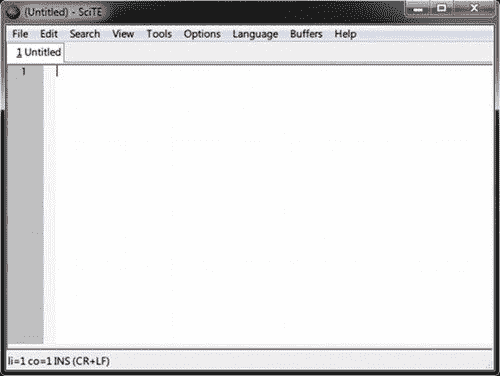
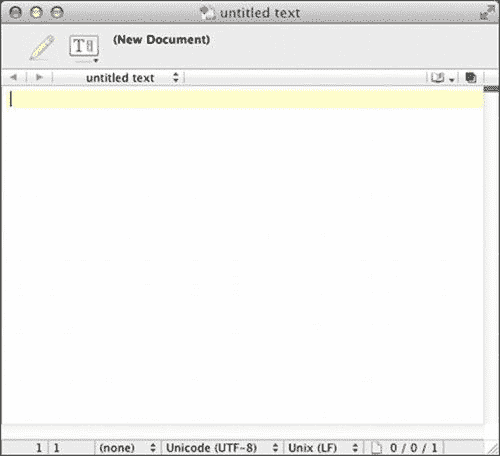
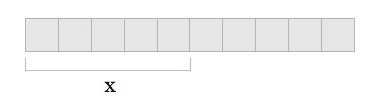
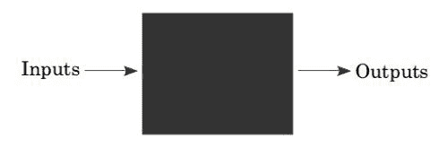
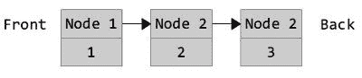

# Go 编程入门指南

## 入门指南

计算机编程是编写定义计算机运行方式程序的艺术、技巧和科学。这本书将教你如何使用一种由 Google 设计的名为 `Go` 的编程语言来编写计算机程序。

`Go` 是一种通用编程语言，具有高级特性和简洁的语法。由于它在各种平台上的广泛可用性、健壮且文档良好的公共库，以及对良好软件工程原则的关注，`Go` 是学习第一门编程语言的理想人选。

我们使用 `Go`（以及大多数编程语言）编写软件的过程非常直观：

- 收集需求
- 寻找解决方案
- 编写源代码以实现解决方案
- 将源代码编译为可执行文件
- 运行并测试程序以确保其正常工作

这个过程是迭代的（意味着会执行多次），而且步骤通常会重叠。但在用 `Go` 编写第一个程序之前，我们有几个先备概念需要理解。

### 文件与文件夹

文件是以名称命名的单位存储的数据集合。现代操作系统（如 `Windows` 或 `Mac OSX`）包含数百万个文件，存储了各种类型的信息——从文本文档、可执行程序到多媒体文件等等。

所有文件在计算机中的存储方式都是相同的：它们都有名称、确定的大小（以字节为单位）和关联类型。通常文件的类型由扩展名标识。文件夹是用于组织文件的集合。

在 `Windows` 中，路径通过 `\` 分隔，而在 `OSX` 中则通过 `/` 分隔。例如，一个文件可能位于 `/Users/name/documents/file.txt` 或 `C:\Users\name\Documents\file.txt`。

#### Windows

在 `Windows` 中导航目录时，你使用 `cd` 命令。要查看目录的内容，请使用 `dir`。

对于 Windows 系统，安装程序将安装 `Scite` 文本编辑器。你可以通过点击开始 → 所有程序 → Go → `Scite` 来打开它。你会看到类似的内容：



文本编辑器包含一个较大的白色文本区域，可以在其中输入文本。在该文本区域的左侧可以看到行号。窗口底部是状态栏，显示有关文件的信息以及你在文件中的当前位置（现在显示我们在第 1 行第 1 列，正在正常插入文本，并且使用的是 Windows 风格的换行符）。

你可以通过“文件 → 打开”并浏览你想要的文件打开文件。可以通过“文件 → 保存”或“文件 → 另存为”保存文件。

在文本编辑器中工作时，学习快捷键非常有用。菜单的右侧列出了相应的快捷键。以下是最常用的几个：

- `Ctrl + S` – 保存当前文件
- `Ctrl + X` – 剪切当前选中文本（删除并放入剪贴板，以便稍后粘贴）
- `Ctrl + C` – 复制当前选中文本
- `Ctrl + V` – 粘贴当前剪贴板中的文本
- 使用方向键进行导航，`Home` 回到行首，`End` 回到行尾
- 使用方向键时按住 `shift`（或使用 `Home` 和 `End`）可以不使用鼠标选择文本
- `Ctrl + F` – 调出文件查找对话框，你可以用它搜索文件内容

### OSX

对于 OSX，安装程序会安装 `Text Wrangler` 文本编辑器：



与 Windows 上的 Scite 一样，Text Wrangler 包含一个输入文本的大白色区域。可以通过“文件 → 打开”打开文件。可以通过“文件 → 保存”或“文件 → 另存为”保存文件。这里是一些实用的快捷键（Command 是 ⌘ 键）：

- `Command + S` – 保存当前文件
- `Command + X` – 剪切当前选中文本（删除并放入剪贴板，以便稍后粘贴）
- `Command + C` – 复制当前选中文本
- `Command + V` – 粘贴当前剪贴板中的文本
- 使用方向键进行导航
- `Command + F` – 调出文件查找对话框，你可以用它搜索文件内容

### Go 工具

Go 是一种编译型编程语言，这意味着源代码（你编写的代码）会被翻译成计算机可以理解的语言。因此，在我们编写 Go 程序之前，我们需要 Go 编译器。

安装程序将自动为你设置好 Go。我们将使用该语言的第 1 版本。（更多信息可以在 [`www.golang.org`](http://www.golang.org) 找到）

让我们确保一切都运行正常。打开终端并输入以下内容：

```
go version
```

你应该能看到以下内容：

```
go version go1.0.2
```

你的版本号可能略有不同。如果你收到关于命令 `go` 未被识别的错误，请尝试重启电脑。

Go 工具套件由多个不同的命令和子命令组成。输入以下命令可以获取这些命令列表：

```
go help
```

我们将在后续章节中介绍如何使用它们。

## 你的第一个程序

传统上，你在任何编程语言中编写的第一个程序被称为“Hello World”程序——一个简单地向你的终端输出 `Hello World` 的程序。让我们用 Go 写一个。

首先，创建一个新文件夹来存储我们的程序。你在第 1 章中使用的安装程序在你的主目录下创建名为 `Go` 的文件夹。创建一个名为 `~/Go/src/golang-book/chapter2` 的文件夹（其中 `~` 表示你的主目录）。在终端中你可以通过输入以下命令来实现：

```
mkdir Go/src/golang-book
mkdir Go/src/golang-book/chapter2
```

使用你的文本编辑器输入以下内容：

```go
package main

import "fmt"

// 这是一个注释

func main() {
    fmt.Println("Hello World")
}
```

确保你的文件与此处显示的完全一致，并将其保存为 `main.go` 到我们刚刚创建的文件夹中。打开一个新终端并输入以下内容：

```
cd Go/src/golang-book/chapter2
go run main.go
```

你应该能在终端中看到显示 `Hello World`。`go run` 命令会获取随后的文件（用空格分隔），将它们编译为保存存在临时目录中的可执行文件，然后运行程序。如果你没有看到显示 `Hello World`，可能是你在输入程序时出了错。Go 编译器会给出关于错误所在位置的提示。像大多数编译器一样，Go 编译器极其严谨，对错误零容忍。

### 如何阅读 Go 程序

让我们更详细地查看这个程序。Go 程序是从上到下、从左到右读取的（像书一样）。第一行写道：

```
package main
```

这被称为“包声明”。每个 Go 程序都必须以包声明开始。包是 Go 组织和重用代码的方式。Go 程序有两种类型：可执行文件和库。可执行应用程序我们可以直接从终端运行的程序类型（在 Windows 中它们以 `.exe` 结尾）。库是我们打包在一起的代码集合，以便在其他程序中使用它们。我们稍后会详细探讨库，现在只需确保在你编写的程序中包含这一行。

下一行是一个空行。换行符、空格和制表符被称为空白字符（因为你看不见它们）。Go 并不关心空白字符，你可以删除这一行。

然后我们看到了：

```
import "fmt"
```

`import` 关键字是我们引入其他包代码的方式。`fmt` 包（format 的缩写）实现了输入输出格式。根据我们刚刚学到的关于包的知识，你认为 `fmt` 包的文件顶部会包含什么？

注意上面的 `fmt` 被双引号包围。这种双引号的使用被称为“字符串字面量”，它是“表达式”的一种类型。在 Go 中，字符串表示固定长度的字符序列（字母、数字、符号等）。字符串将在下一章中详细描述，但现在要记住的关键是，一个起始 `"` 字符最终会被另一个 `"` 字符跟随，两者之间的内容都包含在字符串中。（`"` 字符本身不是字符串的一部分）

以 `//` 开头的行是注释。注释会被 Go 编译器忽略，是为了你自己（或任何获取你程序源码的人）。Go 支持两种不同的注释样式：`//` 注释（`//` 到行尾之间的所有文本都是注释）以及 `/* */` 注释（`*` 之间的所有内容都是注释，并且可以包含多行）。

之后你看到了函数声明：

```go
func main() {
    fmt.Println("Hello World")
}
```

函数是 Go 程序的构建块。它们有输入、输出和一组按顺序执行的语句。所有函数都以 `func` 关键字开头，后面是函数名（在本例中为 `main`）、括号包围的零或多个“参数”、可选的返回类型以及花括号包围的“函数体”。这个函数没有参数，没有返回值，只有一条语句。`main` 这个名字是特殊的，因为它是执行程序时被调用的函数。

我们程序的最后一部分是这一行：

```go
    fmt.Println("Hello World")
```

此语句由三个部分组成。首先，我们访问 `fmt` 包内部的另一个名为 `Println` 的函数（这就是 `fmt.Println` 的部分，`Println` 的意思是“打印行”）。然后，我们创建一个包含 `Hello World` 的新字符串，并调用（也称为调用或执行）该函数，将该字符串作为第一个也是唯一的参数。

到此为止，我们已经看到了许多新术语，你可能会感到有些无从从。有时候，刻意地大声读出你的程序是有帮助的。我们刚刚编写的程序的读法可能如下：

创建一个新的可执行程序，它引用了 `fmt` 库并包含一个名为 `main` 的函数。该函数不接受任何参数，没有返回值，并执行以下操作：访问 `fmt` 包内部的 `Println` 函数，并使用一个参数——字符串 `Hello World` 来调用它。

`Println` 函数在程序程序中执行了实际工作。你可以在终端中输入以下内容了解更多关于它的信息：

```
godoc fmt Println
```

除了其他之外，你应该看到这个：

```
Println 使用默认格式对其操作数进行格式化并写入标准输出。操作数之间总是会添加空格并在末尾附加换行符。它返回写入的字节数和遇到的任何写入错误。
```

Go 是一门文档非常良好的编程语言，除非你已经熟悉编程语言，否则这些文档可能很难理解。尽管如此，`godoc` 命令非常有用，每当你有疑问时，它都是很好的起点。

回到当前处理的函数，这段文档告诉我们，`Println` 函数会将你传递给它的任何内容发送到标准输出——这是你正在工作的终端输出的名称。这个函数导致了 `Hello World` 的显示。

在下一章中，我们将通过学习类型来探索 Go 如何存储和表示像 `Hello World` 这样的东西。

### 问题

- 什么是空白字符？
- 什么是注释？写注释两种方式是什么？
- 我们的程序以 `package main` 开始。`fmt` 包中的文件会什么开头？
- 我们使用了 `fmt` 包中定义的 `Println` 函数。如果我们想使用 `os` 包中的 `Exit` 函数，我们需要做什么？
- 修改我们写的程序，让它不再打印 `Hello World`，而是打印 `Hello, my name is` 后面跟着你的名字。

## 类型

在上一章中，我们使用数据类型 `string` 来存储 `Hello World`。数据类型将一组相关值分类，描述了可以对这些值执行的操作并定义了它们的存储方式。由于类型是一个很难掌握的概念，在看到它们在 Go 中如何实现之前，我们将从几个不同的角度来看它们。

哲学家有时会将类型（types）和标记（tokens）区分开。例如，假设你有一只名叫 Max 的狗。Max 是标记（特定的实例或成员），而狗是类型（通用概念）。“狗”或“狗性”描述了所有狗共同拥的一组属性。虽然过于简单，但我们可能会这样推理：所有的狗都有 4 条腿，Max 是一只狗，因此 Max 有 4 条腿。

由于类型是一个很难掌握的概念，在看到它们在 Go 中如何实现之前，我们将从几个不同的角度来看它们。


注意，这个程序与我们在第 2 章编写的程序非常相似。它包含了相同的 `package` 行、相同的 `import` 行、函数声明，并使用了相同的 `Println` 函数。这次我们不再打印字符串 `Hello World`，而是打印字符串 `1 + 1 =`，后面跟着表达式 `1 + 1` 的结果。这个表达式由三部分组成：数字字面量 `1`（类型为 `int`）、`+` 运算符（表示加法）以及另一个数字字面量 `1`。让我们尝试使用浮点数完成相同的操作：

```go
fmt.Println("1 + 1 =", 1.0 + 1.0)
```

注意，我们使用 `.0` 是告诉 Go 这是一个浮点数而不是整数。运行此程序将得到与之前相同的结果。

除了加法，Go 还有其他几个运算符：

| 运算符 | 含义 |
| --- | --- |
| `+` | 加法 |
| `-` | 减法 |
| `*` | 乘法 |
| `/` | 除法 |
| `%` | 余数 |

### Strings

正如我们在第 2 章看到的，字符串是具有确定长度的字符序列，用于表示文本。Go 字符串由单个字节组成，通常每个字符一个字节。（其他语言的字符如中文由多个字节表示）

字符串字面量可以使用双引号 `"Hello World"` 或反引号 `` `Hello World` `` 创建。它们之间的区别是，双引号字符串不能包含换行符，并且允许特殊的转义序列。例如，`\n` 被替换为换行符，`\t` 被替换为制表符。

字符串的几个常用操作包括获取字符串的长度：`len("Hello World")`、访问字符串中的单个字符：`"Hello World"[1]` 以及拼接两个字符串：`"Hello " + "World"`。让我们修改之前创建的程序来测试这些内容：

```go
package main

import "fmt"

func main() {
    fmt.Println(len("Hello World"))
    fmt.Println("Hello World"[1])
    fmt.Println("Hello " + "World")
}
```

几点需要注意：

* 空格也被视为一个字符，因此字符串的长度是 11 而不是 10，第 3 行是 `"Hello "` 而不是 `"Hello"`。

* 字符串的“索引”从 0 开始而不是 1。`[1]` 给你第 2 个元素而不是第 1 个。另外注意，当你运行此程序时，看到的是 `101` 而不是 `e`。这是因为字符是用字节表示的（记住字节是一个整数）。

  关于索引的一种思考方式是像这样显示：`"Hello World"[1]`。你可以将其读作“字符串 Hello World 索引为 1”、“位于 1 处的字符串 Hello World”或“字符串 Hello World 的第二个第二个字符”。

* 拼接使用了与加法相同的符号。Go 编译器会根据参数的类型判断该如何操作。由于 `+` 的两边都是字符串，编译器假设你的意思是拼接而不是加法。（对于字符串来说，加法是没有意义的）。

### Booleans

布尔值（以乔治·布尔命名）是一种特殊的 1 位整数类型，用于表示真（true）和假（false）（或开启和关闭）。布尔值使用了三个逻辑运算符：

| 运算符 | 含义 |
| --- | --- |
| `&&` | 与 |
| `||` | 或 |
| `!` | 非 |

这是一个展示如何使用它们的示例程序：

```go
func main() {
    fmt.Println(true && true)
    fmt.Println(true && false)
    fmt.Println(true || true)
    fmt.Println(true || false)
    fmt.Println(!true)
}
```

运行此程序应该会得到：

```text
$ go run main.go
true
false
true
true
false
```

我们通常使用真值表来定义这些运算符的工作原理：

| 表达式 | 值 |
| --- | --- |
| `true && true` | `true` |
| `true && false` | `false` |
| `false && true` | `false` |
| `false && false` | `false` |

| 表达式 | 值 |
| --- | --- |
| `true || true` | `true` |
| `true || false` | `true` |
| `false || true` | `true` |
| `false || false` | `false` |

| 表达式 | 值 |
| --- | --- |
| `!true` | `false` |
| `!false` | `true` |

这些是 Go 中包含的最简单类型，构成了后续所有类型构建的基础。

#### Problems

* 整数在计算机上是如何存储的？

* 我们知道（在十进制中）最大的 1 位数是 9，最大的 2 位数是 99。鉴于在二进制中最大的 2 位数是 11 (3)，最大的 3 位数是 111 (7)，最大的 4 位数是 1111 (15)，那么最大的 8 位数是多少？（提示：$10¹-1=9$ 且 $10²-1=99$）

* 虽然对于任务来说大材小用，但你可以把 Go 当作计算器。编写一个程序计算 `32132 × 42452` 并将其打印到终端。（使用 `*` 运算符进行乘法）

### Variables

到为止我们只看到过字面量，但我们需要变量。变量是一个带有名称的存储位置。这一章将探索变量。

```go
package main

import "fmt"

func main() {
    var x string = "Hello World"
    fmt.Println(x)
}
```

`var` 关键字用于声明变量。你也可以提供初始值：

```go
package main

import "fmt"

func main() {
    var x int = 10
    fmt.Println(x)
}
```

变量可以在程序过程中改变它的值：

```go
package main

import "fmt"

func main() {
    var x int = 10
    fmt.Println(x)
    x = 20
    fmt.Println(x)
}
```

你也可以声明一个没有初始值的变量：

```go
package main

import "fmt"

func main() {
    var x int
    fmt.Println(x)
}
```

当你声明一个没有初始值的变量时，Go 会给它一个“零值”。对于 `int` 它是 `0`，对于 `string` 它是 `""`，而对于 `bool` 它是 `false`。

```go
package main

import "fmt"

func main() {
    var x int
    fmt.Println(x)
    var y string
    fmt.Println(y)
    var z bool
    fmt.Println(z)
}
```

有一种更短的方法使用 `:=` 运算符来声明并初始化变量：

```go
package main

import "fmt"

func main() {
    x := 10
    fmt.Println(x)
    y := "Hello World"
    fmt.Println(y)
}
```

`:=` 运算符只能在函数内部使用。在函数外部，你必须使用 `var` 关键字。

`var` 和 `:=` 的另一个区别是 `var` 允许指定类型，而 `:=` 从值中推导出类型。

```go
package main

import "fmt"

func main() {
    var x int = 10
    fmt.Println(x)
    y := 10
    fmt.Println(y)
}
```

你也可以使用 `:=` 来重新初始化一个现有的变量（注：在 Go 中这通常指在同一作用域内重新声明新变量）。

```go
x := "Hello World"
```

注意 `=` 前面有一个冒号 `:`，并且没有指定类型。指定类型并不是必要的，因为 Go 编译器能够根据你赋值给变量的字面量值推断出类型。（由于你赋值的是一个字符串字面量，`x` 被赋予了 `string` 类型）。编译器也可以在 `var` 语句中进行类型推断：

```go
var x = "Hello World"
```

其他类型也同样适用：

```go
x := 5
fmt.Println(x)
```

通常情况下，你应该尽可能使用这种更短的形式。

#### 如何为变量命名

正确地命名变量是软件开发的一个重要部分。名称必须以字母开头，可以包含字母、数字或 `_`（下划线）符号。Go 编译器并不关心你给变量起什么名字，因此名字是为了你（以及他人）方便。请选择能清晰描述变量用途的名字。假设我们有以下代码：

```go
x := "Max"
fmt.Println("My dog's name is", x)
```

在这种情况下，`x` 不是一个很好的变量名。更好的名字应该是：

```go
name := "Max"
fmt.Println("My dog's name is", name)
```

或者：

```go
dogsName := "Max"
fmt.Println("My dog's name is", dogsName)
```

在最后一种情况下，我们使用了一种特殊方式在变量名中表示多个单词，称为小驼峰命名（lower camel case，也称为混合 Case、bumpy caps、camel back 或 hump back）。第一个单词的首字母小写，后续每个单词的首字母大写，所有其他字母均为小写。

#### 作用域

回到章节开头看到的程序：

```go
package main

import "fmt"

func main() {
    var x string = "Hello World"
    fmt.Println(x)
}
```

编写这个程序的另一种方式如下：

```go
package main

import "fmt"

var x string = "Hello World"

func main() {
    fmt.Println(x)
}
```

注意我们将变量移动到了 `main` 函数外部。这意味着其他函数可以访问这个变量：

```go
var x string = "Hello World"

func main() {
    fmt.Println(x)
}

func f() {
    fmt.Println(x)
}
```

`f` 函数现在可以访问变量 `x`。现在假设我们写的是下面的代码：

```go
func main() {
    var x string = "Hello World"
    fmt.Println(x)
}

func f() {
    fmt.Println(x)
}
```

如果你运行这个程序，你应该看到一个错误：

```text
.\main.go:11: undefined: x
```

编译器告诉你在 `f` 函数内部的 `x` 变量不存在。它只存在于 `main` 函数内部。你允许使用 `x` 的范围被称为变量的作用域（scope）。根据语言规范，“Go 使用块进行词法作用域划分”。基本上，这意味着变量存在于最近的大括号 `{` `}`（一个块）内，包括任何嵌套的大括号（块），但不在它们之外。作用域起初可能会让人有一点困惑；随着我们看到更多的 Go 示例，它应该变得更加清晰。

#### 常量

Go 也支持常量。常量基本上是值在之后不能被更改的变量。它们的创建方式与创建变量相同，但我们不使用 `var` 关键字，而是使用 `const` 关键字：

```go
package main

import "fmt"

func main() {
    const x string = "Hello World"
    fmt.Println(x)
}
```

如下：

```go
const x string = "Hello World"
x = "Some other string"
```

会导致编译错误：

```text
.\main.go:7: cannot assign to x
```

常量是在程序中复用常用值的好方法，无需每次都编写它们。例如 `math` 包中的 `Pi` 被定义为一个常量。

#### 定义多个变量

当你需要定义多个变量时，Go 还有另一种简写：

```go
var (
    a = 5
    b = 10
    c = 15
)
```

使用关键字 `var`（或 `const`）后跟括号，每个变量单独占一行。

#### 示例程序

这是一个示例程序，它接收用户输入的数字并将其翻倍：

```go
package main

import "fmt"

func main() {
    fmt.Print("Enter a number: ")
    var input float64
    fmt.Scanf("%f", &input)
    
    output := input * 2
    
    fmt.Println(output)    
}
```

我们使用了 `fmt` 包中的另一个函数来读取用户输入（`Scanf`）。`&input` 将在后面的章节中解释，目前我们只需要知道 `Scanf` 会用我们输入的数字填充输入。

### 问题

* 创建新变量的两种方法是什么？

* 在运行 `x := 5; x += 1` 之后 `x` 的值是多少？

* 什么是作用域？在 Go 中如何确定变量的作用域？

* `var` 和 `const` 之间有什么区别？

#### 控制结构

其他编程语言有许多不同类型的循环（while, do, until, foreach, …），但 Go 只有一种循环可以以多种方式使用。之前的程序也可以写成：

```go
func main() {
    for i := 1; i <= 10; i++ {
        fmt.Println(i)
    }
}
```

现在条件表达式也包含了另外两个用分号隔开的语句。首先是变量初始化，然后是每次检查的条件，最后我们“递增”变量。（给变量加 1 是非常常见的的操作，以至于我们有一个特殊的运算符：`++`。同样，减 1 可以通过 `--` 完成）

我们将在后面的章节中看到 `for` 循环的更多用法。

##### For

`for` 语句允许我们多次执行某些操作。根据目前为止我们学到的，可以写：

```go
package main

import "fmt"

func main() {
    i := 1
    for i <= 10 {
        fmt.Println(i)
        i = i + 1
    }
}
```

但这两个程序写起来很繁琐。我们需要一种多次执行某事的方法。使用示例：

```go
package main

import "fmt"

func main() {
    const x string = "Hello World"
    fmt.Println(x)
}
```

等等，让我重新排列一下 `for` 循环的工作原理：

* 我们评估（运行）表达式 `i <= 10`（“i 小于或等于 10”）。如果评估结果为真，则运行块内部的语句。否则，我们跳转到程序中块之后的下一行（在这种情况下，块之后没有内容，所以我们退出）。

`i = i + 1` 这一行极其重要，因为如果没有它，`i <= 10` 将始终评估为 `true`，我们的程序永远不会停止。（当这种情况发生时，被称为死循环）

作为一个练习，让我们像计算机一样运行程序：

* 创建一个名为 `i` 的变量，值为 1
* `i <= 10` 吗？
* 打印 `i`
* 将 `i` 设置为 `i + 1`（`i` 现在等于 2）
* `i <= 10` 吗？
* 打印 `i`
* 将 `i` 设置为 `i + 1`（`i` 现在等于 3）
* …
* 将 `i` 设置为 `i + 1`（`i` 现在等于 11）
* `i <= 10` 吗？
* 没有剩余可以的操作了，所以退出。

让我们修改一下刚才写的程序，让它不仅仅是每行打印数字 1-10，还能够指定该数字是偶数还是奇数。像下面所示：

```text
1 odd
2 even
3 odd
4 even
5 odd
6 even
7 odd
8 even
9 odd
10 even
```

首先，我们需要一种判断一个数字是偶数还是奇数的方法。一种简单的方法是将数字除以 2。如果没有余数，则该数字是偶数，否则是奇数。那么在 Go 中如何找到除法的余数呢？我们使用 `%` 运算符。`1 % 2` 等于 `1`，`2 % 2` 等于 `0`，`3 % 2` 等于 `1`，依此类推。

接下来，我们需要一种根据条件执行不同操作的方法。为此，我们使用 `if` 语句：

```go
if i % 2 == 0 {
  // even
} else {
  // odd
}
```

`if` 语句与 `for` 语句类似，因为它包含一个条件，后面跟着一个代码块。`if` 语句还有一个可选的 `else` 部分。如果条件求值为 `true`，则执行条件后面的代码块；否则，跳过该代码块，或者如果存在 `else` 块，则执行该块。

`if` 语句还可以有 `else if` 部分：

```go
if i % 2 == 0 {
    // divisible by 2
} else if i % 3 == 0 {
    // divisible by 3
} else if i % 4 == 0 {
    // divisible by 4
}
```


条件是从上往下检查的，第一个结果为 `true` 的条件将执行其关联的代码块。其他任何代码块都不会执行，即使它们的条件也通过了。（例如，数字 8 既能被 4 整除也能被 2 整除，但 `// divisible by 4` 永远不会执行，因为 `// divisible by 2` 先执行了。）

将所有内容整合在一起，我们得到了：

```go
func main() {
    for i := 1; i <= 10; i++ {
        if i%2 == 0 {
            fmt.Println(i, "even")
        } else {
            fmt.Println(i, "odd")
        }
    }
}
```

让我们过一遍这个程序：

- 创建一个类型为 `int` 的变量 `i` 并赋值为 `1`。
- `i` 是否小于或等于 `10`？是：跳转到代码块。
- `i` ÷ `2` 的余数等于 `0` 吗？否：跳转到 `else` 块。
- 打印 `i` 以及 `odd`。
- 递增 `i`（条件后的语句）。
- `i` 是否小于或等于 `10`？是：跳转到代码块。
- `i` ÷ `2` 的余数等于 `0` 吗？是：跳转到 `if` 块。
- 打印 `i` 以及 `even`。
- ……

取余运算符在小学之外很少见到，但在编程时被证明非常有用。你会发现它出现在各个地方，从表格到数据分区。

## Switch

假设我们想写一个打印数字英文名称的程序。使用我们目前所学的内容，可能会从这里开始：

```go
if i == 0 {
    fmt.Println("Zero")
} else if i == 1 {
    fmt.Println("One")
} else if i == 2 {
    fmt.Println("Two")
} else if i == 3 {
    fmt.Println("Three")
} else if i == 4 {
    fmt.Println("Four")
} else if i == 5 {
    fmt.Println("Five")
}
```

由于用这种方式编写程序非常繁琐，Go 提供了另一个语句让这变得更容易：`switch` 语句。我们可以重写程序使其像这样：

```go
switch i {
case 0:
    fmt.Println("Zero")
case 1:
    fmt.Println("One")
case 2:
    fmt.Println("Two")
case 3:
    fmt.Println("Three")
case 4:
    fmt.Println("Four")
case 5:
    fmt.Println("Five")
default:
    fmt.Println("Unknown")
}
```

`switch` 语句以关键字 `switch` 开始，后面跟着一个表达式（在本例中为 `i`），然后是一系列 `case`。表达式的值与每个 `case` 之后的表达式进行比较。如果它们等价，则执行冒号 `:` 之后的语句。和 `if` 语句一样，每个 `case` 都会从上到下检查，并选择第一个成功的那个。`switch` 还支持 `default` 情况，当没有任何 `case` 匹配该值时会发生该情况（类似于 `if` 语句中的 `else`）。这些是主流程语句。额外的语句将在稍后介绍。

### Problems

- 下面程序会打印什么：

```go
i := 10
if i > 10 {
    fmt.Println("Big")
} else {
    fmt.Println("Small")
}
```

- 编写一个程序，打印 1 到 100 之间所有被 3 整除的数字。（3, 6, 9 等）
- 编写一个程序，打印 1 到 100 的数字。但对于 3 的倍数打印 `"Fizz"` 而不是数字，对于 5 的倍数打印 `"Buzz"`。

## Arrays, Slices and Maps

（注：原文文本似乎在此处出现了重复或截断，但根据指令我将继续翻译提供的剩余部分。）

（翻译说明：由于您提供的原始文本在 `"Arrays, Slices and Maps"` 之后的段落似乎存在大量重复和逻辑混乱，我将严格按照您提供的原文内容进行翻译，以保持格式一致。）

### Arrays, Slices and Maps

（注：原文文本在此处出现了大量重复的描述，此处已根据原文翻译。）

Go 还提供了一种创建数组的简短语法：

```go
x := [5]float64{98, 93, 77, 82, 83}
```

我们不再需要指定类型，因为 Go 可以推断出类型。有时这样的数组太长，无法在一行内显示，因此 Go 允许你这样拆分：

```go
x := [5]float64{
    98,
    93,
    77,
    82,
    83,
}
```

注意 `83` 后面额外的末尾逗号 `,`。这是 Go 要求的，它允许我们通过注释掉该行来轻松地从数组中删除元素：

```go
x := [4]float64{
    98,
    93,
    77,
    82,
    // 83,
}
```

### 切片（Slices）

切片是数组的一部分。和数组一样，切片可以索引且具有长度。与数组不同，切片的长度是允许改变的。这里有一个切片的示例：

```go
var x []float64
```

这与数组的唯一区别在于括号之间缺少长度。在这种情况下，`x` 创建时的长度为 `0`。

如果你想创建一个切片，应该使用内置的 `make` 函数：

```go
x := make([]float64, 5)
```

这创建了一个与长度为 5 的底层 `float64` 数组关联的切片。切片始终与某个数组关联，尽管它们永远不会大于数组，但可以比数组小。`make` 函数还允许第三个参数：

```go
x := make([]float64, 5, 10)
```

`10` 代表切片指向的底层数组的容量：



另一种创建切片的方法是使用 `[low : high]` 表达式：

```go
arr := [5]float64{1, 2, 3, 4, 5}
x := arr[0:5]
```

`low` 是切片开始的索引，`high` 是切片结束的索引（但不包括索引本身）。例如，虽然 `arr[0:5]` 返回 `[1,2,3,4,5]`，但 `arr[1:4]` 返回 `[2,3,4]`。

为了方便，我们还允许省略 `low`、`high` 或同时省略 `low` 和 `high`。`arr[0:]` 等于 `arr[0:len(arr)]`，`arr[:5]` 等于 `arr[0:5]`，而 `arr[:]` 等于 `arr[0:len(arr)]`。

### 切片函数（Slice Functions）

Go 包含了两个辅助切片的内置函数：`append` 和 `copy`。这里是 `append` 的示例：

```go
func main() {
    slice1 := []int{1, 2, 3}
    slice2 := append(slice1, 4, 5)
    fmt.Println(slice1, slice2)
}
```

运行此程序后，`slice1` 拥有 `[1,2,3]`，`slice2` 拥有 `[1,2,3,4,5]`。`append` 通过获取现有切片（第一个参数）并将所有后续参数追加其后，创建一个新切片。这里是 `copy` 的示例：

```go
func main() {
    slice1 := []int{1, 2, 3}
    slice2 := make([]int, 2)
    copy(slice2, slice1)
    fmt.Println(slice1, slice2)
}
```

运行此程序后，`slice1` 拥有 `[1,2,3]`，`slice2` 拥有 `[1,2]`。`slice1` 的内容被复制到 `slice2` 中，但由于 `slice2` 只能容纳两个元素，因此复制了 `slice1` 的前两个元素。

### Map（Maps）

map 是键值对的无序集合。map 也称为关联数组、哈希表或字典，用于通过键查找值。这里是 Go 中 map 的示例：

```go
var x map[string]int
```

该类型由 `map` 表示，后面跟着括号中的键类型，最后是值类型。如果你大声读出来，你会说“`x` 是一个从 `string` 到 `int` 的 map”。

和数组和切片一样，map 可以使用括号访问。尝试以下程序：

```go
var x map[string]int
x["key"] = 10
fmt.Println(x)
```

你应该会看到类似这样的错误：

```text
panic: runtime error: assignment to entry in nil map

goroutine 1 [running]:
main.main()
  main.go:7

goroutine 2 [syscall]:
created by runtime.main
        C:/Users/ADMIN~1/AppData/Temp/2/proc.c:221
exit status 2
```

到目前为止我们只看到了编译时错误。这是一个运行时错误的示例。正如其名所示，运行时错误发生在运行程序时，而编译时错误发生在尝试编译它时。我们的程序的问题是 map 在使用之前必须经过初始化。我们应该这样写：

```go
x := make(map[string]int)
```

```go
func main() {
    elements := map[string]map[string]string{
        "H": {
            "name":  "Hydrogen",
            "state": "gas",
        },
        "He": {
            "name":  "Helium",
            "state": "gas",
        },
        "Li": {
            "name":  "Lithium",
            "state": "solid",
        },
        "Be": {
            "name":  "Beryllium",
            "state": "solid",
        },
        "B": {
            "name":  "Boron",
            "state": "solid",
        },
        "C": {
            "name":  "Carbon",
            "state": "solid",
        },
        "N": {
            "name":  "Nitrogen",
            "state": "gas",
        },
        "O": {
            "name":  "Oxygen",
            "state": "gas",
        },
        "F": {
            "name":  "Fluorine",
            "state": "gas",
        },
        "Ne": {
            "name":  "Neon",
            "state": "gas",
        },
    }

    if el, ok := elements["Li"]; ok {
        fmt.Println(el["name"], el["state"])
    }
}
```

注意我们 map 的类型已经从 `map[string]string` 变为 `map[string]map[string]string`。我们现在拥有一个从字符串到“字符串到字符串映射”的 map。外层 map 用作基于元素符号的查找表，而内层 map 用于存储有关元素的通用信息。虽然 map 经常这样使用，但在第 9 章中我们将看到存储结构化信息的更好方法。

### 问题

- 你如何访问数组或切片的第 4 个元素？
- 使用 `make([]int, 3, 9)` 创建的切片长度是多少？
- 给定数组：

```go
x := [6]string{"a", "b", "c", "d", "e", "f"}
```

`x[2:5]` 会给你什么？

- 编写一个程序找到列表中最小的数字：

```go
x := []int{
    48, 96, 86, 68,
    57, 82, 63, 70,
    37, 34, 83, 27,
    19, 97, 9, 17,
}
```

## 函数

函数是一个独立的代码段，它将零或多个输入参数映射到零或多个输出参数。函数（也称为过程或子程序）通常被表示为一个黑盒：

（黑盒代表函数）



到目前为止，我们在 Go 中编写的程序只使用了一个函数：

```go
func main() {}
```

现在我们将开始编写使用多个函数的程序。

### 你的第二个函数

记得第 6 章中的这个程序：

```go
func main() {
    xs := []float64{98, 93, 77, 82, 83}

    total := 0.0
    for _, v := range xs {
        total += v
    }
    fmt.Println(total / float64(len(xs)))
}
```

这个程序计算了一系列数字的平均值。这样寻找平均值是一个非常通用的问题，因此它是定义为函数的理想候选者。

`average` 函数需要接收一个 `float64` 切片并返回一个 `float64`。在 `main` 函数之前插入这个：

```go
func average(xs []float64) float64 {
    panic("Implemented")
}
```

函数以 `func` 关键字开始，后面是函数名。参数（输入）定义如下：`name type, name type`。我们将参数命名为 `xs`。在参数之后是返回类型。参数和返回类型统称为函数的签名。

最后我们有函数体，即大括号之间的系列语句。在这个体中调用了一个名为 `panic` 的内置函数，这会导致运行时错误。（稍后我们会看到更多关于 `panic` 的内容）。编写函数可能困难，因此将过程拆分为可管理的块是一个好主意，而不是在一个大的步骤中实现所有内容。

现在从我们的 `main` 函数取出代码并将其放入 `average` 函数：

```go
func average(xs []float64) float64 {
    total := 0.0
    for _, v := range xs {
        total += v
    }
    return total / float64(len(xs))
}
```

注意到我们将 `fmt.Println` 改为了 `return`。`return` 语句会导致函数立即停止并将值返回给调用它的函数。将 `main` 修改成这样：

```go
func main() {
    xs := []float64{98, 93, 77, 82, 83}
    fmt.Println(average(xs))
}
```

运行这个程序将给你与原始相同的结果。有几点需要注意：

- 调用函数中的参数名称不需要匹配。例如，我们可以这样做：

```go
func main() {
    someOtherName := []float64{98, 93, 77, 82, 83}
    fmt.Println(average(someOtherName))
}
```

- 函数无法访问调用函数中的任何内容。这不起作用：

```go
func main() {
    x := 5
    f()
}

func f(x int) {
    fmt.Println(x)
}
```

- 函数在栈中构建。假设我们有：

```go
func main() {
    f()
}

var x int = 5

func f() {
    fmt.Println(x)
}
```

这就是为什么第一次调用 `increment`（此处示例逻辑对应）时看到的是 `1`，但第二次调用时看到的是 `2`。

- 我们也可以命名返回类型：

```go
func f2() int {
    return 1
}
```

- Go 还能返回多个值：

```go
func main() {
    x, y := f()
}

func f() (int, int) {
    return 5, 6
}
```

- 多值通常用于返回结果的同时返回错误值：

```go
func f() (int, error) {
    return 0, nil
}
```

### 变长函数

函数的最后一个参数有一个特殊形式：

```go
func add(args ...int) int {
    total := 0
    for _, v := range args {
        total += v
    }
    return total
}

func main() {
    fmt.Println(add(1, 2, 3))
}
```


通过在最后一个参数的类型名称之前使用 `...`，你可以指示它接收零或多个。在这种情况下，我们接收零或多个 `int`。我们像调用其他函数一样调用它，只是我们可以传递任意数量的 `int`。

这正是 `fmt.Println` 函数的实现方式：

```go
func Println(a ...interface{}) (n int, err error)
```

`Println` 函数接收任意类型的任意数量。（特殊的 `interface{}` 类型将在详细讨论。）我们也可以通过在切片后加上 `...` 来传递一个 `int` 切片：

```go
func main() {
    xs := []int{1,2,3}
    fmt.Println(add(xs...))
}
```

### 闭包

在函数内部创建函数是可能的：

```go
func main() {
    add := func(x, y int) int {
        return x + y
    }
    fmt.Println(add(1,1))
}
```

`add` 是一个类型为 `func(int, int) int` 的局部变量（接受两个 `int` 并返回一个 `int` 的函数）。当你这样创建一个局部函数时，它也可以访问其他局部变量（记得第 4 章的作用域）：

```go
func main() {
    x := 0
    increment := func() int {
        x++
        return x
    }
    fmt.Println(increment())
    fmt.Println(increment())
}
```

`increment` 给定义在 `main` 函数作用内的变量 `x` 加 1。这个变量 `x` 可以被 `increment` 函数访问和修改。

像这样的函数加上它引用的非局部变量，被称为闭包（closure）。在这种情况下，`increment` 和变量 `x` 构成了闭包。

使用闭包的一种方法是编写一个返回另一个函数的函数，该函数在被调用时可以生成一个数字序列。例如，这里是我们可以生成所有偶数的方法：

```go
func makeEvenGenerator() func() uint {
    i := uint(0)
    return func() (ret uint) {
        ret = i
        i += 2
        return
    }
}
func main() {
    nextEven := makeEvenGenerator()
    fmt.Println(nextEven()) // 0
    fmt.Println(nextEven()) // 2
    fmt.Println(nextEven()) // 4
}
```

`makeEvenGenerator` 返回一个生成偶数的函数。每次调用它时，都会局部变量 `i` 加 2，与普通的局部变量不同，它在调用之间会持久存在。

### 递归

最后，函数可以调用自己。这里是计算数字阶乘的一种方法：

```go
func factorial(x uint) uint {
    if x == 0 {
        return 1
    }

    return x * factorial(x-1)
}
```

`factorial` 调用了自己，这使得该函数是递归的。为了更好地理解这个函数是如何工作的，让我们执行一下 `factorial(2)`：

- `x == 0` 吗？不是。（`x` 是 2）
- 找到 `x – 1` 的阶乘
  - `x == 0` 吗？不是。（`x` 是 1）
  - 找到 `x – 1` 的 `factorial`
    - `x == 0` 吗？是的，返回 1。
  - 返回 `1 * 1`
- 返回 `2 * 1`

闭包和递归是强大的编程技术，是函数式编程范式的基础。大多数人会发现函数式编程比基于 `for` 循环、`if` 语句、变量和简单函数的方法难以理解。

### Defer、Panic 与 Recover

Go 有一种称为 `defer` 的特殊语句，它可以调度函数调用以便在函数完成后运行。考虑以下示例：

```go
package main

import "fmt"

func first() {
    fmt.Println("1st")
}
func second() {
    fmt.Println("2nd")
}
func main() {
    defer second()
    first()
}
```

该程序打印 `1st`，然后是 `2nd`。基本上，`defer` 将对 `second` 的调用移动到了函数的末尾：

```go
func main() {
    first()
    second()
}
```

当需要以某种方式释放资源时，经常使用 `defer`。例如，当我们打开一个文件时，我们需要确保稍后关闭它。使用 `defer`：

```go
f, _ := os.Open(filename)
defer f.Close()
```

这有 3 个优点：(1) 它让我们的 `Close` 调用靠近 `Open` 调用，更容易理解；(2) 如果我们的函数有多个返回语句（可能一个在 `if` 中，一个在 `else` 中），`Close` 将在它们两者之前发生；以及 (3) 即使发生了运行时 `panic`，延迟执行的函数也会运行。

### Panic 与 Recover

早些时候我们创建一个调用 `panic` 函数来导致运行时错误的函数。我们可以使用内置的 `recover` 函数处理运行时 `panic`。`recover` 会停止 `panic` 并返回传递给 `panic` 用的值。我们可能会倾向于这样使用它：

```go
package main

import "fmt"

func main() {
    panic("PANIC")
    str := recover()
    fmt.Println(str)
}
```

但在这种情况下，`recover` 的调用永远不会发生，因为对 `panic` 的调用会立即停止函数的执行。相反，我们必须将其与 `defer` 配合使用：

```go
package main

import "fmt"

func main() {
    defer func() {
        str := recover()
        fmt.Println(str)
    }()
    panic("PANIC")
}
```

`panic` 通常表示程序错误（例如尝试访问越界的数组索引、忘记初始化 map 等）或没有简单方法可以从中恢复的异常状况。（因此名为“panic”。）

### 习

- `sum` 是一个接收数字切片并将它们相加的函数。它在 Go 中的函数签名看起来是什么样的？
- 编写一个函数接收一个整数并将其减半，如果是偶数则返回 `true`，如果是奇数则返回 `false`。例如 `half(1)` 应该返回 `(0, false)`，`half(2)` 应该返回 `(1, true)`。
- 编写一个带变长参数的函数，找到列表中最大的数。
- 使用 `makeEvenGenerator` 编写一个生成奇数的 `makeOddGenerator` 函数。
- 斐波那契序列定义为：`fib(0) = 0`，`fib(1) = 1`，`fib(n) = fib(n-1) + fib(n-2)`。写一个可以调用 `fib(n)` 的递归函数。
- `defer`、`panic` 和 `recover` 是什么？如何从运行时 `panic` 中恢复？

### 指针

当我们调用函数时，Go 按值传递所有参数。如果我们想修改变量的原始值，必须传递它的指针。考虑以下示例：

```go
func increment(x *int) {
    *x = *x + 1
}

func main() {
    i := 0
    increment(&i)
    fmt.Println(i) // 1
}
```

指针引用内存中的位置而不是值本身。

### `*` 和 `&` 运算符

在 Go 中，指针使用 `*` 字符后跟存储值的类型来表示。当我们写下 `*x = 0` 时，我们是在说“存储在内存位置”。`*` 也用于解引用指针。解引用指针让我们访问它所指向的值。最后，我们使用 `&` 运算符找到变量的地址。`&x` 返回一个指向 `int` 的指针。这允许我们修改原始变量。

### `new`

获取指针的另一种方法是使用内置的 `new` 函数：

```go
func one(xPtr *int) {
    *xPtr = 1
}

func main() {
    xPtr := new(int)
    one(xPtr)
    fmt.Println(*xPtr) // 1
}
```

`new` 接收一个类型作为参数，分配足够该类型的内存并返回其指针。在某些编程语言中，使用 `new` 和 `&` 存在显著差异，并且即使发生了运行时 `panic`，延迟执行的函数也会运行。Go 不是这样的，它是一种垃圾回收语言，当不再有引用它时，内存会被清理。

#### 习

- 如何获取变量的内存地址？
- 如何给指针赋值？
- 如何创建一个新指针？
- 运行此程序后 `x` 的值是多少？

```go
func square(x *float64) {
    *x = *x * *x
}
func main() {
    x := 1.5
    square(&x)
}
```

### 结构体与接口

虽然我们可以只使用 Go 的内置数据类型来编写程序，但在某些时刻这会变得非常繁琐。考虑一个与形状交互的程序：

```go
package main

import ("fmt"; "math")

func distance(x1, y1, x2, y2 float64) float64 {
    a := x2 – x1
    b := y2 – y1
    return math.Sqrt(a*a + b*b)
}
func rectangleArea(x1, y1, x2, y2 float64) float64 {
    l := distance(x1, y1, x1, y2)
    w := distance(x1, y1, x2, y1)
    return l * w
}
func circleArea(x, y, r float64) float64 {
    return math.Pi * r*r
}
func main() {
    var rx1, ry1 float64 = 0, 0
    var rx2, ry2 float64 = 10, 10
    var cx, cy, cr float64 = 0, 0, 5

    fmt.Println(rectangleArea(rx1, ry1, rx2, ry2))
    fmt.Println(circleArea(cx, cy, cr))
}
```

跟踪所有的坐标让我们很难看出程序在做什么，并且可能会导致错误。

### 结构体（Structs）

改进此程序的一种简单方法是使用 `struct`。`struct` 是一种包含命名字段的类型。例如，我们可以这样表示一个 `Circle`（圆形）：

```go
type Circle struct {
    x float64
    y float64
    r float64
}
```

`type` 关键字引入了一个新类型。它后面跟着类型名称（`Circle`）、`struct` 关键字（表示我们正在定义一个 `struct` 类型）以及大括号内的字段列表。每个字段都有一个名称和一个类型。和函数一样，我们可以合并相同类型的字段：

```go
type Circle struct {
    x, y, r float64
}
```

#### 初始化（Initialization）

我们可以通过多种方式创建新类型 `Circle` 的实例：

```go
var c Circle
```

与其他数据类型一样，这将创建一个本地的 `Circle` 变量，其默认值设置为零。对于 `struct` 来说，零意味着每个字段都被设置为它们对应的零值（`int` 为 `0`，`float` 为 `0.0`，`string` 为 `""`，指针为 `nil` 等……）。我们还可以使用 `new` 函数：

```go
c := new(Circle)
```

这会为所有字段分配内存，将它们中的每一个都设置为零值，并返回一个指针（`*Circle`）。我们通常更想给每个字段赋值。可以通过两种方式实现这一点，如下所示：

```go
c := Circle{x: 0, y: 0, r: 5}
```

或者，如果我们知道它们定义的顺序，可以省略字段名称：

```go
c := Circle{0, 0, 5}
```

#### 字段（Fields）

我们可以使用 `.` 运算符来访问字段：

```go
fmt.Println(c.x, c.y, c.r)
c.x = 10
c.y = 5
```

让我们修改 `circleArea` 函数，使其使用 `Circle` 类型：

```go
func circleArea(c Circle) float64 {
    return math.Pi * c.r*c.r
}
```

在 `main` 中我们有：

```go
c := Circle{0, 0, 5}
fmt.Println(circleArea(c))
```

需要记住的一点是，在 Go 中参数总是被复制的。如果我们尝试修改 `circleArea` 函数内部的其中一个字段，它不会修改原始变量。正如此，我们通常会这样写函数：

```go
func circleArea(c *Circle) float64 {
    return math.Pi * c.r*c.r
}
```

并修改 `main`：

```go
c := Circle{0, 0, 5}
fmt.Println(circleArea(&c))
```

### 方法（Methods）

虽然这比代码的版本要好，但我们可以通过使用一种特殊的函数类型——方法（method）来显著改进它：

```go
func (c *Circle) area() float64 {
    return math.Pi * c.r*c.r
}
```

在 `func` 关键字和函数名称之间我们添加了一个“接收者”（receiver）。接收者就像参数——它有名称和类型——但通过这种方式创建函数，允许我们使用 `.` 运算符来调用函数：

```go
fmt.Println(c.area())
```

这易读得多，我们不再需要 `&` 运算符（Go 自动知道为该方法传递指向圆形的指针），并且由于此函数只能与 `Circle` 使用，我们可以将函数重命名为简单的 `area`。

对矩形（rectangle）执行同样的操作：

```go
type Rectangle struct {
    x1, y1, x2, y2 float64
}
func (r *Rectangle) area() float64 {
    l := distance(r.x1, r.y1, r.x1, r.y2)
    w := distance(r.x1, r.y1, r.x2, r.y1)
    return l * w
}
```

`main` 中有：

```go
r := Rectangle{0, 0, 10, 10}
fmt.Println(r.area())
```

该程序包含两个 goroutine（协程）。第一个 goroutine 是隐式的，即 `main` 函数本身。第二个 goroutine 在我们调用 `go f(0)` 时被创建。通常情况下，当我们调用一个函数时，程序会执行函数中的所有语句，然后返回到调用位置的下一行。使用 goroutine 时，我们会立即返回到下一行，而不需要等待函数完成。这就是为什么代码中包含了对 `Scanln` 函数的调用；如果没有包含它，程序将在获得机会打印所有数字之前就会退出。

Goroutine 是轻量级的，我们可以轻松地创建成千上万个它们。我们可以通过以下方式修改程序来运行 10 个 goroutine：

```go
func main() {
    for i := 0; i < 10; i++ {
        go f(i)
    }
    var input string
    fmt.Scanln(&input)
}
```

你可能已经注意到，当你运行这个程序时，goroutine 似乎是按顺序运行的，而不是同时运行。让我们使用 `time.Sleep` 和 `rand.Intn` 给函数添加一些延迟：

```go
package main

import (
    "fmt"
    "time"
    "math/rand"
)

func f(n int) {
    for i := 0; i < 10; i++ {
        fmt.Println(n, ":", i)
        amt := time.Duration(rand.Intn(250))
        time.Sleep(time.Millisecond * amt)
    }
}
func main() {
    for i := 0; i < 10; i++ {
        go f(i)
    }
    var input string
    fmt.Scanln(&input)
}
```

`f` 打印从 0 到 10 的数字，在每个数字之间等待 0 到 250 毫秒。现在 goroutine 应该是同时运行的。

### 通道（Channels）

通道为两个 goroutine 之间提供了通信和同步执行的方法。这里是一个使用通道的示例程序：


```
package main

import (
    "fmt"
    "time"
)

func pinger(c chan string) {
    for i := 0; ; i++ {
        c <- "ping"
    }
}
func printer(c chan string) {
    for {
        msg := <- c
        fmt.Println(msg)
        time.Sleep(time.Second * 1)
    }
}
func main() {
    var c chan string = make(chan string)
    
    go pinger(c)
    go printer(c)
    
    var input string
    fmt.Scanln(&input)
}
```

这个程序将无限打印“ping”（按回车键停止）。通道类型用关键字`chan`表示，后面跟着通道上传递的数据类型（在本例中我们传递的是字符串）。`<-`（左箭头）运算符用于在通道上发送和接收消息。`c <- "ping"`意味着发送`"ping"`。`msg := <- c`意味着接收消息并存储在`msg`中。`fmt`那行也可以写成这样：`fmt.Println(<-c)`，那样我们就可以去掉之前的那行。

使用像这样的通道可以同步两个 goroutine。当`pinger`尝试在通道上发送消息时，它将等待直到`printer`准备好接收消息（这被称为阻塞）。让我们向程序中添加另一个发送者并看看发生了什么。

```
func ponger(c chan string) {
    for i := 0; ; i++ {
        c <- "pong"
    }
}
```

并修改`main`：

```
func main() {
    var c chan string = make(chan string)
    
    go pinger(c)
    go ponger(c)
    go printer(c)
    
    var input string
    fmt.Scanln(&input)
}
```

程序现在会交替打印“ping”和“pong”。

## 通道方向 (Channel Direction)

我们可以在创建通道时指定通道的方向，限制其只能发送或接收。例如，`pinger`的签名可以更改为：

```
func pinger(c chan<- string)
```

这样通道只能用于发送。尝试从该通道接收将导致错误。同样，可以将`printer`更改为：

```go
func printer(c <-chan string)
```

## Select 语句 (Select)

Go 有一个特殊的`select`语句，它的工作方式类似于`switch`，但专门用于通道操作。它会阻塞，直到其中一个`case`可以被执行。例如：

```go
func main() {
    c := make(chan string)
    go pinger(c)
    go ponger(c)

    select {
    case msg := <-c:
        fmt.Println(msg)
    }
}
```

`select`语句允许同时等待多个通道操作。如果多个通道都准备就绪，它会随机选择一个来执行。它还可以配合`default`使用，以便在没有通道准备就绪时执行特定代码：

```go
select {
case msg := <-c:
    fmt.Println(msg)
default:
    fmt.Println("没有通道就绪")
}
```

```
package math

func Average(xs []float64) float64 {
    total := float64(0)
    for _, x := range xs {
        total += x
    }
    return total / float64(len(xs))
}
```

在你刚刚创建的`math`文件夹中使用终端运行`go install`。这将编译`math.go`程序并创建一个可链接的符号文件：`~/Go/pkg/os_arch/golang-book/chapter11/math.a`。（其中`os`是类似`windows`的内容，`arch`是类似`amd64`的内容）

现在回到`chapter11`文件夹并运行`go run main.go`。你应该看到`2.5`。需要注意的几点：

- `math`是 Go 标准分发中一个包的名称，但由于 Go 包是可以分级的，因此我们可以安全地为自己的包使用相同的名称。（真正的`math`包仅仅是`math`，而我们的是`golang-book/chapter11/math`）
- 当我们导入自己的 math 库时，使用它的完整名称（`import "golang-book/chapter11/math"`），但在`math.go`文件内部，我们只使用名称的最后部分（`package math`）。
- 在引用库中的函数时，我们也只使用短名称`math`。如果我们想在同一个程序中使用两个库，Go 允许我们使用别名：

```
import m "golang-book/chapter11/math"

func main() {
    xs := []float64{1,2,3,4}
    avg := m.Average(xs)
    fmt.Println(avg)
}
```

`m`就是别名。

- 你可能已经注意到，我们过的包中的每个函数都以大字母开头。在 Go 中，如果某个东西以大字母开头，意味着其他包（以及程序）能够看到它。如果我们把函数命名为`average`而不是`Average`，那么我们的`main`程序将无法看到它。一种良好的做法是只暴露我们希望其他包使用的包部分，并隐藏所有其他内容。这允许我们以后自由地更改这些部分，而不必担心破坏其他程序，并让我们的包更易用。
- 包名与它们所属的文件夹匹配。虽然有方法绕过这一点，但如果保持这种模式会要简单得多。

## 文档

Go 能够为我们编写的包自动生成文档，方式与标准包文档类似。在终端中运行此命令：

```
godoc golang-book/chapter11/math Average
```

你应该能看到为我们刚刚写的函数显示的信息。我们可以通过在函数之前添加注释来改进此文档：

```
// Find 一系列数字的平均值
func Average(xs []float64) float64 {
```

如果你在`math`文件夹中运行`go install`，然后重新运行`godoc`命令，你应该会在函数定义下方看到我们的注释。此文档也可以通过运行此命令以 Web 形式可用：

```
godoc -http=":6060"
```

并在你的浏览器中输入此 URL：

```
http://localhost:6060/pkg/
```

你应该能够浏览系统上安装的所有包。

## 练习

- 我们为什么要使用包？
- 以大字母开头的标识符与不以大字母开头的标识符有什么区别？（`Average` vs `average`）
- 什么是包别名？如何创建一个？
- 我们从第 7 章将平均函数复制到新包中。创建`Min`和`Max`函数，寻找`float64`切片中的最小值和最大值。
- 你会如何为第 3 步创建的函数编写文档？

## 测试

编程并不是容易的；即使是最好的程序员也无法编写出每次都完全按照预期运行的程序。因此，测试是软件开发过程的重要部分。为我们的代码编写测试是确保质量和提高可靠性的良好方法。

Go 包含了一个让编写测试变得特殊的程序，让我们为上一章创建的包创建一些测试。在`chapter11`的`math`文件夹中，创建一个名为`math_test.go`的文件，内容如下：

```
package math

import "testing"

func TestAverage(t *testing.T) {
    var v float64
    v = Average([]float64{1,2})
    if v != 1.5 {
        t.Error("Expected 1.5, got ", v)
    }
}
```

现在运行此命令：

```
go test
```

你应该看到：

```
$ go test
PASS
ok      golang-book/chapter11/math      0.032s
```

`go test`命令将查找当前文件夹中任何文件的任何测试并运行它们。测试通过以单词`Test`开头的函数并接受一个类型为`*testing.T`的参数来识别。在我们案例中，由于我们正在测试`Average`函数，因此我们将测试函数命名为`TestAverage`。

一旦设置好测试函数，我们就编写使用被测试代码的测试。在这种情况下，我们知道`[1,2]`的平均值应该是`1.5`，所以我们检查这一点。

```
package math

import "testing"

type testpair struct {
    values []float64
    average float64
}

var tests = []testpair{
    {[]float64{1,2}, 1.5},
}

func TestAverage(t *testing.T) {
    for _, pair := range tests {
        v := Average(pair.values)
        if v != pair.average {
            t.Error(
                "For %v, expected %v, got %v",
                pair.values,
                pair.average,
                v,
            )
        }
    }
}
```

## 练习

- 编写良好的测试套并不总是容易。
- 传递空列表`[]float64{}`会发生什么？
- 为你上一章编写的`Min`和`Max`函数编写系列测试。

## 核心包

与其从零开始编写，现实世界的编程依赖于连接现有库。本章将查看一些常用的包。

首先警告：尽管这些库显而易见（或在之前的章节中解释过），但 Go 包含许多库需要专业的领域知识（例如：密码学）。解释这些底层技术超出了本书的范围。

### 字符串

Go 在`strings`包中包含了大量处理字符串的函数：

```
package main

import (
    "fmt"
    "strings"
)

func main() {
    fmt.Println(    
        // true
        strings.Contains("test", "es"), 

        // 2
        strings.Count("test", "t"),

        // true
        strings.HasPrefix("test", "te"), 

        // true
        strings.HasSuffix("test", "st"), 

        // 1
        strings.Index("test", "e"),

        // "a-b"
        strings.Join([]string{"a","b"}, "-"),

        // "aaaaa"
        strings.Repeat("a", 5), 

        // "bbaa"
        strings.Replace("aaaa", "a", "b", 2),

        // []string{"a","b","c","d","e"}
        strings.Split("a-b-c-d-e", "-"), 

        // "test"
        strings.ToLower("TEST"), 

        // "TEST"
        strings.ToUpper("TEST"), 

    )
}
```

有时我们需要将字符串作为二进制数据处理。要将字符串转换为字节切片（反之），请这样做：

```
arr := []byte("test")
str := string([]byte{'t','e','s','t'})
```

### 输入 / 输出

在我们查看文件之前，我们需要先理解 Go 的`io`包。`io`包包含了一些函数，但更多的是在其他包中使用的接口。其中两个主要的接口是`Reader`和`Writer`。`Reader`支持通过`Read`方法进行读取。`Writer`支持通过`Write`方法进行写入。Go 中的许多函数接受`Reader`或`Writer`作为参数。例如，`io`包中有一个`Copy`函数，它可以将数据从`Reader`拷贝到`Writer`：

```
func Copy(dst Writer, src Reader) (written int64, err error)
```

若要对`[]byte`或`string`进行读写，你可以使用在`bytes`包中找到`Buffer`结构体：

```
var buf bytes.Buffer
buf.Write([]byte("test"))
```

`Buffer`不需要手动初始化，并且同时支持`Reader`和`Writer`接口。你可以通过调用`buf.Bytes()`将其转换为`[]byte`。如果你只需要从字符串读取，也可以使用`strings.NewReader`函数，它比使用缓冲区更高效。

### 文件与文件夹

在 Go 中打开文件请使用`os`包中的`Open`函数。以下是一个读取文件内容并在终端上显示的示例：

```
package main

import (
    "fmt"
    "os"
)

func main() {
    file, err := os.Open("test.txt")
    if err != nil {
        // 在此处处理错误
        return
    }
    defer file.Close()
    
    // 获取文件大小
    stat, err := file.Stat()
    if err != nil {
        return
    }
    // 读取文件
    bs := make([]byte, stat.Size())
    _, err = file.Read(bs)
    if err != nil {
        return
    }

    str := string(bs)
    fmt.Println(str)
}
```

我们在打开文件后紧接着使用`defer file.Close()`，以确保文件在函数完成后立即关闭。读取文件非常常见，因此有一种更短的方法：

```
package main

import (
    "fmt"
    "io/ioutil"
)

func main() {
    bs, err := ioutil.ReadFile("test.txt")
    if err != nil {
        return
    }
    str := string(bs)
    fmt.Println(str)
}
```

以下是如何创建一个文件：

```go
package main

import (
    "os"
)

func main() {
    file, err := os.Create("test.txt")
    if err != nil {
        // 在此处处理错误
        return
    }
    defer file.Close()

    file.WriteString("test")
}
```

若要获取目录的内容，我们使用相同的`os.Open`函数，但给的是目录路径而不是文件名。然后我们调用`Readdir`方法：

```go
package main

import (
    "fmt"
    "os"
)

func main() {
    dir, err := os.Open(".")
    if err != nil {
        return
    }
    defer dir.Close()

    fileInfos, err := dir.Readdir(-1)
    if err != nil {
        return
    }
    for _, fi := range fileInfos {
        fmt.Println(fi.Name())
    }
}
```

我们通常想要递归地遍历文件夹（读取文件夹的内容、所有子文件夹、所有子子文件夹……）。为了方便这种操作，`path/filepath`包提供了一个`Walk`函数：


```go
package main

import (
    "fmt"
    "os"
    "path/filepath"
)

func main() {
    filepath.Walk(".", func(path string, info os.FileInfo, err error) error {
        fmt.Println(path)
        return nil
    })
}
```

你传递给`Walk`的函数会在根文件夹（在本例中为`.`）中的每个文件和文件夹中调用。

### 错误

Go 有一个内置的错误类型，我们已经见过（`error`类型）。我们可以通过使用`errors`包中的`New`函数来创建自己的错误：

```go
package main

import "errors"

func main() {
    err := errors.New("error message")
}
```

### 容器与排序

除了列表和 map，Go 在`container`包下还提供了几种集合。我们将以`container/list`包为例。

#### 列表

`container/list`包实现了双向链表。链表是一种看起来如下所示的数据结构：



列表的每个节点包含一个值（在此例中为 1、2 或 3）和一个指向下一个节点的指针。由于这是双向链表，每个节点还会有一个指向上一个节点的指针。此列表可以通过以下程序创建：

```go
package main

import ("fmt" ; "container/list")

func main() {
    var x list.List
    x.PushBack(1)
    x.PushBack(2)
    x.PushBack(3)

    for e := x.Front(); e != nil; e = e.Next() {
        fmt.Println(e.Value)
    }
}
```

```go
package main

import (
    "fmt"
    "crypto/sha1"
)

func main() {
    h := sha1.New()
    h.Write([]byte("test"))
    bs := h.Sum([]byte{})
    fmt.Println(bs)
}
```

这个示例与`crc32`的示例非常相似，因为`crc32`和`sha1`都实现了`hash.Hash`接口。主要的区别在于，`crc32`计算的是 32 位的哈希，而`sha1`计算的是 160 位的哈希。原生类型中没有表示 160 位数字的类型，因此我们使用一个 20 字节的切片来代替。

## Servers

在 Go 中编写网络服务器非常简单。我们首先来看下如何创建一个 TCP 服务器：

```go
package main

import (
    "encoding/gob"
    "fmt"
    "net"
)

func server() {
    // 监听一个端口
    ln, err := net.Listen("tcp", ":9999")
    if err != nil {
        fmt.Println(err)
        return
    }
    for {
        // 接受连接
        c, err := ln.Accept()
        if err != nil {
            fmt.Println(err)
            continue
        }
        // 处理连接
        go handleServerConnection(c)
    }
}

func handleServerConnection(c net.Conn) {
    // 接收消息
    var msg string
    err := gob.NewDecoder(c).Decode(&msg)
    if err != nil {
        fmt.Println(err)
    } else {
        fmt.Println("Received", msg)
    }
    
    c.Close()
}

func client() {
    // 连接到服务器
    c, err := net.Dial("tcp", "127.0.0.1:9999")
    if err != nil {
        fmt.Println(err)
        return
    }

    // 发送消息
    msg := "Hello World"
    fmt.Println("Sending", msg)
    err = gob.NewEncoder(c).Encode(msg)
    if err != nil {
        fmt.Println(err)
    }

    c.Close()
}

func main() {
    go server()
    go client()
    
    var input string
    fmt.Scanln(&input)
}
```

这个示例使用了`encoding/gob`包，它使得 Go 值的编码变得简单，以便其他 Go 程序（在本例中是同一个 Go 程序）可以读取它们。`encoding`目录下的其他包（如`encoding/json`）以及第三方包也提供了额外的编码。（例如，我们可以使用`labix.org/v2/mgo/bson`来支持 bson）。

### HTTP

HTTP 服务器的设置和使用更加简单：

```go
package main

import ("net/http" ; "io")

func hello(res http.ResponseWriter, req *http.Request) {
    res.Header().Set(
        "Content-Type", 
        "text/html",
    )
    io.WriteString(
        res, 
        `<doctype html>
<html>
    <head>
        <title>Hello World</title>
    </head>
    <body>
        Hello World!
    </body>
</html>`,
    )
}
func main() {
    http.HandleFunc("/hello", hello)
    http.ListenAndServe(":9000", nil)
}
```

`HandleFunc`通过调用指定的函数来处理 URL 路由（`/hello`）。我们也可以通过使用`FileServer`来处理静态文件：

```go
http.Handle(
    "/assets/", 
    http.StripPrefix(
        "/assets/", 
        http.FileServer(http.Dir("assets")),
    ),
)
```

### RPC

`net/rpc`（远程过程调用）和`net/rpc/jsonrpc`包提供了一种简单暴露的方法，使其可以在网络上调用（而不仅仅是在运行它们的程序内部调用）。

```go
package main

import (
    "fmt"
    "net"
    "net/rpc"
)

type Server struct {}
func (this *Server) Negate(i int64, reply *int64) error {
    *reply = -i
    return nil
}

func server() {
    rpc.Register(new(Server))
    ln, err := net.Listen("tcp", ":9999")
    if err != nil {
        fmt.Println(err)
        return
    }
    for {
        c, err := ln.Accept()
        if err != nil {
            continue
        }
        go rpc.ServeConn(c)
    }
}
func client() {
    c, err := rpc.Dial("tcp", "127.0.0.1:9999")
    if err != nil {
        fmt.Println(err)
        return
    }
    var result int64
    err = c.Call("Server.Negate", int64(999), &result)
    if err != nil {
        fmt.Println(err)
    } else {
        fmt.Println("Server.Negate(999) =", result)
    }
}
func main() {
    go server()
    go client()
    
    var input string
    fmt.Scanln(&input)
}
```

[http://golang.org/src/pkg/]

# 动手实践

磨练技能的最佳方法之一就是练习编程。有很多方法可以实现：你可以解决来自 Project Euler（[`projecteuler.net/`](http://projecteuler.net/)）等网站的挑战性编程问题，或者尝试做一个更大的项目。也许可以尝试实现一个 Web 服务器或编写一个简单的游戏。

# 团队协作

大多数现实世界的软件项目都是由团队完成的，因此学习如何在团队中工作至关重要。如果可以的话，找一个朋友（也许是同学）一起合作一个项目。学习如何将一个项目拆分成你们可以同时处理的部分。

另一个选项是参与开源项目。找一个第三方库，编写一些代码（修复修复 bug），并将其提交给维护者。Go 拥有一个不断发展的社区，可以通过邮件列表（[`groups.google.com/group/golang-nuts`](http://groups.google.com/group/golang-nuts)）与其联系。
