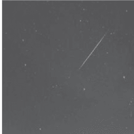
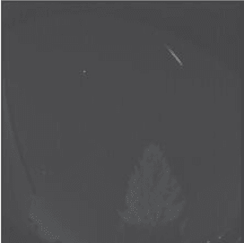
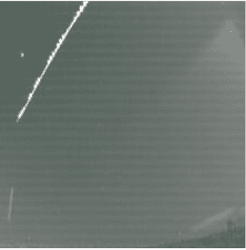
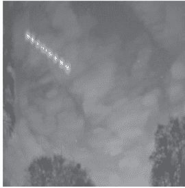
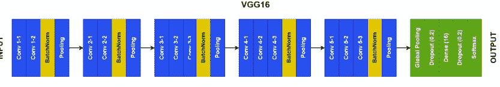
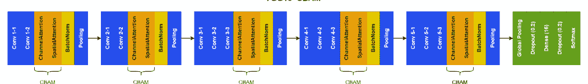
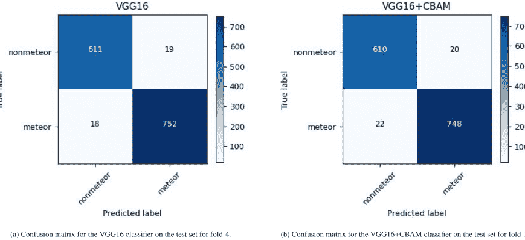
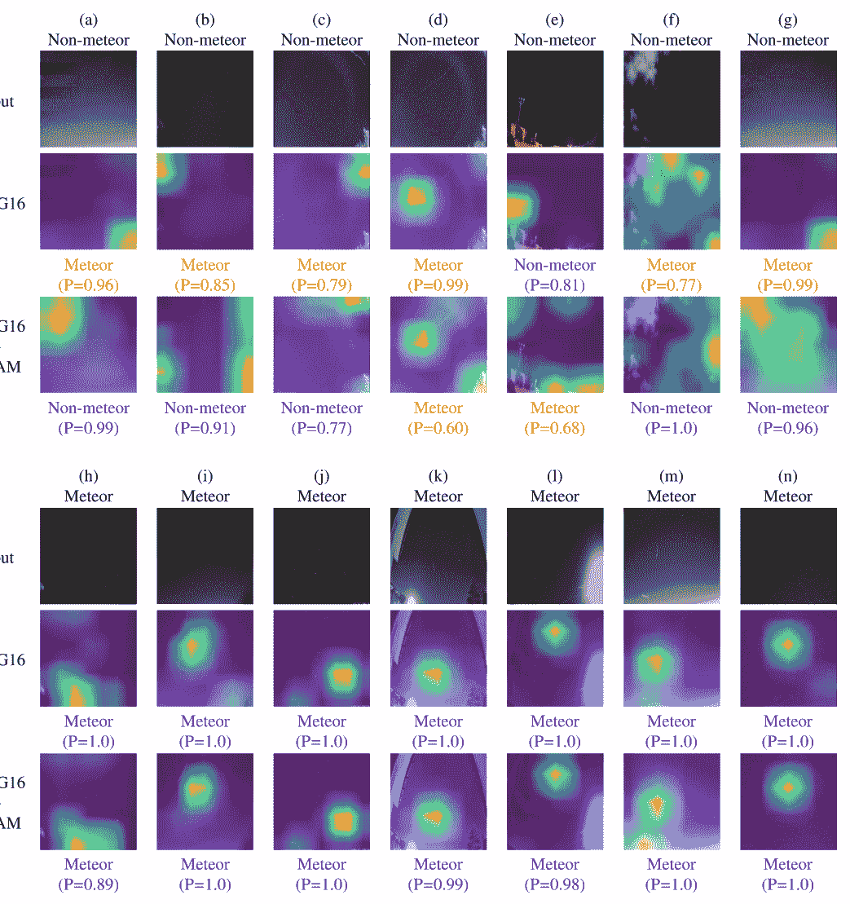

# 有限数据上流星检测的带注意力机制优化训练方法以提升鲁棒性


全长文章

## 摘要

研究人员广泛使用卷积神经网络来探测地球上的流星坠落。然而，在处理有限可用数据时，这些网络可能缺乏足够的鲁棒性来正确分类新的现实世界图像。本研究提出了一种带有注意力机制的预训练模型优化训练方法，以在此类场景下获得更好的泛化结果。我们比较了两种架构，一种是优化的基础模型，另一种是带有注意力机制的版本。此外，我们呈现了一个新的、公开可用的光学流星数据集，该数据集合并了多个公开数据源。我们使用合并的数据集训练分类模型，并结合分层五倍交叉验证策略来确定预测的可靠性。两种架构的实验结果都显示出良好且相似的性能。为了进一步确定最佳架构，我们在新观测中进行了带有视觉解释的附加分析。带有注意力机制的架构是最佳模型，实现了2.6%的误报率和97%的准确率。

## 1. 引言

当太空中的流星体进入地球高层大气并开始发光时，它们就成为流星。当流星坠落时，空气分子的激发会产生其轨迹的光和颜色。流星在围绕太阳的不同轨道上运行，并可以从任何角度撞击地球。与天文学中的其他观测活动不同，流星观测者不需要昂贵的设备来发现它们（Lunsford, 2009）。

探测流星坠落在理解太阳系形成方面起着关键作用，因为我们可以从流星观测中获取大量相关信息，例如方向、速度和质量（Koschny et al., 2019）。

随着公民科学家的帮助，全球有地理分布广泛的流星网络观测社区。巴西流星观测网络（BRAMON）是世界上最大的流星监测网络之一，考虑到站点数量和覆盖面积（Betzler, 2022）。然而，摄像机不可避免地会捕捉到类似流星的事件，例如飞机、卫星、云朵、闪光灯和大气事件，这对人工或系统的探测构成了挑战。因此，建立一个强大的分类器来正确区分流星和其他类型的对象至关重要。

* 通讯作者。
E-mail addresses: victor.shirasuna@gmail.com (V.Y. Shirasuna), gradvohl@unicamp.br (A.L.S. Gradvohl)。

卷积神经网络（CNN）在计算机视觉领域取得了显著成果，在对象识别等应用中超越了人类（He et al., 2015）。因此，我们可以将注意力机制附加到CNN上以选择相关特征。以前的研究已采用CNN分类模型来预测光学观测的“流星”或“非流星”类别。虽然这种方法能产生引人注目的结果，但由于估计过程中需要包含的参数数量，它对数据的需求量要大得多（Yamashita et al., 2018）。这种情况在处理有限训练数据时，由于过拟合，可能导致缺乏鲁棒性。

本研究调查了将注意力机制与优化的CNN架构训练相结合的使用，以便在探测天空图像中的流星时获得更好的泛化结果。我们表明，这种方法有潜力克服对大量数据的需求，并提高流星探测应用中的预测鲁棒性。此外，我们通过合并三个公开数据源，呈现了一个新的、公开可用的光学观测数据集，包含7000张平衡的流星和非流星图像，以辅助未来工作。我们还使用Grad-CAM算法对新图像进行了视觉解释分析，通过分析分类器更关注的特征来确定最佳架构。

本文其余部分的组织安排如下。第2节介绍相关工作。然后，第3节描述本研究中采用的方法。第4节展示并讨论了本研究中进行的实验结果。第5节对本工作提出了最终意见。

## 2. 相关工作

**表 1** 构成流星数据集所用数据源汇总。

| 类别 | 来源 | 图像数 | 总计 |
| :--- | :--- | :--- | :--- |
| 流星 | BRAMON | 2520 | |
| 流星 | UKMON | 665 | 3850 |
| 流星 | BOAM | 665 | |
| 非流星 | BRAMON | 2750 | |
| 非流星 | UKMON | 400 | 3150 |

随着天文学家采用机器学习方法，自动流星探测受到越来越多的关注。研究人员提出了多种基于不同数据量和来源的方法，并取得了成功。例如，Cicco et al. (2017) 探索了将随机森林（RF）、长短期记忆网络（LSTM）和CNN应用于全天摄影流星监测（CAMS）数据集中的机器学习深度学习算法的应用。他们的工作声称，深度学习技术能够实现最先进的结果，而无需像机器学习那样进行手动特征选择。

然而，同样数量的标记数据并不总是容易获得。因此，本节讨论了我们在研究中用于实现VGG16模型优化的方法，该模型附带CBAM注意力机制，以基于7000张图像数据的数据集提高泛化能力。

同样，Gural (2019) 执行了一个循环神经网络（RNN）和一个名为MeteorNet的CNN，以自动化CAMS流程中潜在流星轨迹的后探测筛选。他从视频成像中获得了100,000个流星和100,000个非流星，没有数据增强，用于训练和评估算法。由于CNN适合处理空间信息，MeteorNet利用这一特性捕获了99.94%的流星坠落。相比之下，处理时间或序列数据的RNN实现了98.1%的流星正样图像。由于本研究可用的训练数据要小得多，我们专注于通过优化CNN架构及其训练来实现可比的结果。

同样，Cecil和Campbell-Brown (2020) 提出了一个带有最佳18个CNN筛选阶段的自定义流星探测流程。他们的最佳模型可以以99.8%的准确率筛选5485个未见样本。因此，为了实现这些结果，他们从加拿大自动流星天文台通过视频成像手动标记了22,444张流星图像和33,786张非流星图像。

### 3.1. 计算环境

我们使用Python版本3.8.10及以下库完成了所有实现和实验：Tensorflow版本2.11，Scikit-learn版本1.2.2，Numpy版本1.23.4，Pandas版本2.0.0，Matplotlib版本3.6.2。高性能智能决策系统研究小组支持了这项工作。它提供了一台2.9 GHz Intel Core i7 16核处理器，配备16 GB RAM和NVIDIA TITAN Xp，运行在Rocky Linux 8.6操作系统上。

### 3.2. 流星图像数据集

更近期，Al-Owais et al. (2023) 介绍了使用YOLO算法对流星和非流星对象进行目标检测，达到了98.5%的召回率。他们通过使用阿联酋流星监测网络的16,965张不平衡图像实现了这一结果。尽管可以轻松地将两项工作集成到探测系统中运行，但当前研究专注于在有限标记数据的场景下改进流星探测阶段。

我们使用的流星图像数据集包含7000张独特的天空照片，记录了流星坠落的发生或不发生。这些图像由不同仪器在2014年至2023年期间记录。因此，我们以55:45的比例平衡了流星和非流星数据集，以防止模型偏向某一类别。表1展示了数据集的摘要统计数据。

与我们的工作密切相关，Galindo和Lorena (2018) 介绍了预训练模型的应用，并利用了不同的方法。他们在一个包含1000张流星图像和660张非流星图像的数据集上进行了实验。他们将该数据集与帕拉伊巴河谷大学和EXOSS网站的数据合并。Marsola和Lorena (2019) 也使用相同的数据源，在更小的数据集上应用了迁移学习。两项工作都表明，微调是提高性能准确性的关键技术。然而，Galindo和Lorena (2018) 证明了数据增强在其结果中会降低性能准确性，即使使用少量增强数据。

三个不同的数据源提供了多样的天空场景集，如图1所示。仪器主要在夜间捕捉图像，并存在其他事件，例如飞机灯光、卫星、云朵、闪光灯、图像错误和大气事件。

在我们的工作中，我们执行了微调，并未将数据增强作为提升模型性能的关键要素。尽管这里提到的其他工作取得了成功的准确率结果，但其鲁棒性是否足以正确区分流星和其他事件（如飞机灯光或其他大气现象）尚不清楚。在我们的工作中，我们专注于通过注意力机制专注于相关特征，以实现与鲁棒性相关的相同结果。

在我们的实验中，我们将数据集中的所有图像调整大小为224 × 224像素，在RGB颜色空间中，然后使用数据生成器将每个图像按1/255的比例重新缩放。我们没有执行任何数据增强，因为它可能会降低性能准确性（Galindo和Lorena, 2018）。我们还从每个图像的下方裁剪了24个像素以删除标题，这些标题可能被用作预测任务中的特征。

#### 3.2.1. 数据来源

本文使用的流星数据集源自三个主要数据源：巴西流星观测网络（BRAMON, 2023）、英国流星网络（UKMON, 2023）和业余流星观测基础数据库（BOAM, 2023）存储库。由于观测者可以根据地点从不同角度发现流星，他们被鼓励通过搭建自己的站点来贡献，这些站点提供了关于流星坠落的宝贵科学数据。

有利用深度神经网络的成功尝试，通过利用大量数据，因为许多流星监测站每天都会产生大量天空视频数据。

BRAMON拥有约130个站点和巴西领土上1.3 × 10^6 km^2的覆盖面积。根据所述因素（Betzler, 2022），BRAMON被认为是世界上最大的流星监测网络之一。因此，我们数据集中来自BRAMON的图像约占流星的66%和非流星的87%。此外，大多数原始图像具有多样的特征，例如分辨率、宽高比、亮度和颜色。






Meteor (BRAMON)
Meteor (UKMON)
Meteor (BOAM)





Non-meteor (BRAMON)
Non-meteor (UKMON)

Fig. 1. Examples of meteor and non-meteor images from different data sources.

同样，UKMON 在英国拥有广泛的网络，有 195 台运行中的摄像头。一个标准检测套件，包括 IMX291 POE 摄像头、4 毫米相机镜头和其他配件，出售用于连接到其系统。因此，来自 UKMON 的许多原始图像是灰度图，分辨率和长宽比相似。为了利用这些特征，我们从此来源收集了大约 17% 的流星图像和 13% 的非流星图像。

同样，BOAM 有 12 个活跃的运营站，覆盖法国几乎整个领土。研究人员可以从 BOAM 存储库收集各种数据，例如图像、视频和元数据。在这里，我们只提取了包含流星发生的图像文件，因为只注册了流星，代表数据集中流星类的大约 17%。

#### 3.3.1. 模型架构

在我们的实现中，我们使用了在 ImageNet 数据集上训练的 VGG16 模型（Simonyan and Zisserman, 2015）的学习权重。对于 7000 图像的数据集，VGG 系列优于其他 CNN 架构，如 DenseNet、Inception-V3 和 ResNet（Dawson et al., 2023）。

基于该网络，我们构建了 VGG16 架构的两个修改版本，如图 2 所示。首先，我们使用批量归一化（BN）（Ioffe and Szegedy, 2015）和 Dropout 层（Srivastava et al., 2014）定制了 VGG16。我们清楚，由于方差偏移（Li et al., 2019），将它们结合使用在许多现代神经网络（包括 CNN）中可能导致性能下降。然而，这些是减少计算时间和防止模型过拟合的必要技术。

#### 3.2.2. 数据集划分

在我们的研究中，我们考虑了 Dawson et al. (2023) 执行的数据集划分方法。他们的工作也应用 CNN 架构来分类与流星数据集尺寸相同但用于碳酸盐岩问题的图像。因此，我们将数据集分为 80% 的训练数据和 20% 的测试数据。最后，我们使用分层交叉验证的训练数据来创建 80% 训练数据的五个折叠，并使用 20% 的验证数据来评估预测的可靠性。训练集和验证集分别占总数据集的 64% 和 16%。

因此，正如 Li et al. (2019) 建议的那样，我们在 softmax 层之前只添加了一个 Dropout 层，并将丢弃比率设置为 0.2。接下来，我们在每个最大池化层之前放置了一个 BN 层，并在 16 个单位的单个密集层之前放置了第二个 Dropout 层，丢弃比率为 0.2。我们还用全局平均池化 2D 层替换了展平层，以减少特征图，使其易于被单个分类层理解。

### 3.3. 实现细节

注意力机制的基本理念是利用人类注意力的概念，专注于基本特征并抑制不必要的特征。因此，注意力还改善了对感兴趣特征的表达（Woo et al., 2018）。从这个意义上说，它可以通过在有限数据上正确选择关键特征来区分流星与其他事件，从而提高模型的泛化能力。

在本节中，我们介绍了所提方法的实现细节。我们描述了 VGG16 网络的两个对比模型架构和优化的训练设置。

第二个架构使用前一模型来研究该策略，但添加了卷积块注意力模块（CBAM）注意力机制（Woo et al., 2018）。我们将此架构命名为 VGG16+CBAM。Woo et al. (2018) 专门设计了 CBAM 注意力机制以增强 CNN 的表示能力，由





Fig. 2. 所用 VGG16 和 VGG16+CBAM 模型的架构。

| 训练策略 | 时代数 | 批次大小 | 学习率 | 权重衰减 |
|---|---|---|---|---|
| 训练 | 10 | 8 | 10^-5 | 5 x 10^-4 |
| 微调 | 50 | 32 | 10^-4 | 5 x 10^-4 |

两个按顺序排列的模块组成。第一个模块是通道注意力，关注给定输入图像中什么是“有意义”的。第二个模块是空间注意力，关注在“哪里”存在与通道注意力互补的信息部分。然后，如图 2 所示，我们将 CBAM 注意力机制附加到每个 BN 层之前。在此过程结束时，两个架构都有 14,728,818 个学习参数，因为通道和空间注意力模块不会产生额外参数。

#### 3.3.2. 模型训练

随后，我们执行了一种优化训练方法，以利用所有添加的架构技术。我们使用了两种训练策略。首先，一个训练阶段保持除分类层外的所有层冻结，并对两个模型训练十个时代。最后，我们解冻所有层，然后使用不同的批次大小和学习率值对所有模型进行 50 个时代的微调训练。

对于两种训练策略，我们都考虑了带有 5 x 10^-4 解耦权重衰减的 AdamW 优化器算法。与带有 L2 正则化的常见 Adam 实现（Loshchilov and Hutter, 2019）相比，AdamW 是一种更好的泛化方法。

最后，我们为训练和微调使用了最优的批次大小和学习率值。从这个意义上说，与衰减学习率相比，增加批次大小通常能获得相同的结果，通过显著减少参数更新次数来实现大批次大小的高效使用（Smith et al., 2018）。此外，更高的学习率也需要更大的批次大小（Kandel and Castelli, 2020）。

然后，我们从较小的批次大小和学习率值开始。接下来，我们为微调采用了两者的较高值。Masters and Luschi (2018) 表明，2 到 32 之间的小批次大小可提高泛化性能。因此，我们为训练任意使用了批次大小 8 和学习率 10^-5。接下来，如表 2 所示，微调使用批次大小 32 和学习率 10^-4。

### 3.4. 评估

我们的工作通过五个统计指标评估了所提方法论的性能。从混淆矩阵中，我们使用了准确率（Acc）、灵敏度（Sn）、特异度（Sp）、真技能统计量（TSS）和误报率（FAR）来评估流星数据集的每个训练、验证和测试折叠。我们应用了公式 (1)、(2)、(3)、(4) 和 (5) 进行分类评估：

```
Acc = \frac{TP + TN}{TP + FP + FN + TN} (1)
Sn = \frac{TP}{TP + FN} (2)
Sp = \frac{TN}{TN + FP} (3)
TSS = \frac{TP}{TP + FN} - \frac{FP}{FP + TN} (4)
FAR = \frac{FP}{FP + TP} (5)
```

其中 TP 和 TN 分别是真阳性和真阴性的数量；FP 和 FN 分别是假阳性和假阴性的数量。

我们使用 Acc 评估了分类器的整体性能，Acc 是分类任务中常用的指标，用于总结分类模型的性能。由于 Acc 指标不区分类别，我们无法评估分类器正确区分流星与其他类型对象的性能。因此，我们采用了另外四个指标（Sn、Sp、TSS 和 FAR）来进一步衡量模型的鲁棒性。

我们强调，在计算机视觉中，鲁棒性一词有多种解释（Drenkow et al., 2022）。在我们的情况中，鲁棒性性能是分类模型在流星检测领域内泛化的能力。

在这里，Sn 和 Sp 指标成反比，分别表示真阳性率和真阴性率（Parikh et al., 2008）。此外，我们还使用 TSS 作为评估鲁棒性的合适指标，因为它可以衡量模型是否正确区分数据的存在和不存在（Costa et al., 2023）。此外，FAR 衡量假警报数量除以预测事件数量，表示未发生的流星预测所占比例（Barnes et al., 2009）。

为了确定架构的最佳鲁棒性，我们使用基于梯度的类激活映射（Grad-CAM）算法（Selvaraju et al., 2017）分析了预测的可视化解释。Grad-CAM 使用流入最终卷积层的梯度生成粗略定位图，突出图像中用于预测概念的关键区域。这种方法对于理解特征至关重要


| 模型 | 数据集 | ACC | Sn | Sp | TSS | FAR |
| :--- | :--- | :--- | :--- | :--- | :--- | :--- |
| VGG16 | 训练集 | 0.9949 (±0.0028) | 0.9959 (±0.0033) | 0.9937 (±0.0047) | 0.9896 (±0.0058) | 0.0051 (±0.0038) |
| | 验证集 | 0.9607 (±0.0065) | 0.9675 (±0.0117) | 0.9524 (±0.0122) | 0.9199 (±0.0130) | 0.0386 (±0.0093) |
| | 测试集 | 0.9647 (±0.0054) | 0.9683 (±0.0062) | 0.9603 (±0.0104) | 0.9286 (±0.0114) | 0.0324 (±0.0081) |
| VGG16 + CBAM | 训练集 | 0.9967 (±0.0018) | 0.9966 (±0.0030) | 0.9967 (±0.0023) | 0.9933 (±0.0035) | 0.0027 (±0.0019) |
| | 验证集 | 0.9632 (±0.0028) | 0.9653 (±0.0063) | 0.9607 (±0.0048) | 0.9260 (±0.0052) | 0.0322 (±0.0037) |
| | 测试集 | 0.9626 (±0.0052) | 0.9639 (±0.0081) | 0.9610 (±0.0076) | 0.9248 (±0.0102) | 0.0320 (±0.0059) |



分类器更加关注的对象，并验证其与光学观测中流星或非流星发生的一致性。

| 模型 | Acc | Sn | Sp | TSS | FAR |
| :--- | :--- | :--- | :--- | :--- | :--- |
| VGG16 | 0.9736 | 0.9766 | 0.9698 | 0.9465 | 0.0246 |
| VGG16 + CBAM | 0.9700 | 0.9714 | 0.9683 | 0.9397 | 0.0260 |

## 4. 结果与讨论

我们对 VGG16 和带有 CBAM 注意力机制的 VGG16 模型所得结果进行了比较分析。表 3 显示了训练、验证和测试结果。我们强调，两个模型的指标差异仅出现在第三位小数。这一结果表明，两个分类器的性能非常相似。然而，我们观察到 VGG16 模型的指标存在相当大的波动。这种波动可能表明，没有 CBAM 注意力机制的模型在不同折叠中泛化时更不稳定。

随后，我们通过比较指标值，从交叉验证过程中选出了最终模型。因此，我们考虑 Acc、Sn、Sp、TSS 的较高值以及 FAR 的较低值。表 4 显示了 VGG16 和 VGG16+CBAM 架构中最佳分类器的评估指标。最终模型的结果也很接近，Acc 分别为 0.9736 和 0.97。尽管如此，TSS 和 FAR 指标可能表明，最终的 VGG16 模型将流星与其他事件区分开的能力略优于带有 CBAM 注意力机制的最终 VGG16 模型。

另一方面，VGG16+CBAM 模型的 Sn 和 Sp 值之差低于 VGG16 网络。由于这些指标成反比，两者之间较小的差异可能表明鲁棒性有所提高。总体而言，我们未观察到任何显著统计结果来判断两个模型之间的性能哪个更好。

确实，如图 3 所示，最终模型的混淆矩阵结果相似。尽管 VGG16 模型在评估指标上略好一些，但 VGG16+CBAM 网络实现了低于 FN 的 FP 值。这一结果是可取的，因为流星是偶尔发生的事件。因此，我们必须更多地减少被错误分类为流星的非流星图像，而不是反之。

为进一步验证模型性能，我们使用 100 张新的现实世界图像进行了可视化解释分析。这组新图像包含来自 BRAMON、UKMON 和 BOAM 的 50 张非流星和 50 张流星光学观测图像。随后，我们将图像输入最佳选定的分类器，并用它们生成预测和热力图。因此，图 4 显示了最相关的可视化结果，包括相应的预测类别和属于该类别的预测概率（P）。

在这些结果中，VGG16 模型在预测非流星类别上 50 次中有 39 次命中。相比之下，VGG16+CBAM 模型正确预测了 50 张非流星图像中的 45 张。有趣的是，带有 CBAM 的模型的可视化解释捕捉了表征预测类别的最相关特征。另一方面，VGG16 模型有时关注图像右下角和左上角的更具体区域，表明模型通过学习数据噪声而过拟合。

对于流星图像，VGG16 模型正确分类了 50 张图像中的 46 张。相比之下，VGG16+CBAM 模型在 50 张流星图像中只错误预测了一张。



图 4. 使用 Grad-CAM 可视化进行的额外分析结果。

在图 4 所示的子集中，VGG16 模型对其所有预测都很有信心（P = 1.0），但关注的是观测中不表征流星的无关区域。添加 CBAM 注意力机制为一些不确定是否发生流星的图像带来了不确定性。此外，在大多数情况下，CBAM 改善了 VGG16 网络的感兴趣特征表示，如可视化结果所示。

我们强调，使用图像分类模型的提出方法存在局限性。在我们的计算设置中，VGG16 和 VGG16+CBAM 模型每张图像的平均推理时间分别为 51 ms 和 52 ms。因此，系统可能无法运行实时推理。该方法及所描述技术的添加增加了模型复杂度，这需要高昂的计算成本。

例如，BRAMON 拥有大量监测站尚未分析的数据。那么，人工分析无法以与数据采集相同的速度处理数据。因此，我们的方法可以用作过滤阶段，帮助专家快速审查模型建议并减少人工分析所花费的时间。

关于所得模型的可部署性，将其纳入流星检测系统很容易。每个模型生成一个包含网络权重的单一文件，该文件可以存储和加载以运行新的推理。生成的文件很轻量，每个约 173 MB。此外，我们建议对图像缩放算法使用最近邻插值方法，以达到相同的结果。

## 5. 结论

本研究试图改进在流星检测应用中有限标签数据场景下的鲁棒性。基于注意力机制可能对此至关重要的假设，我们研究了将 CBAM 注意力机制与 VGG16 架构的优化训练方法相结合以改进泛化能力。根据我们的实验，使用此方法可以预期显著减少 91% 的数据。因此，我们可以使用生成的模型采用自动化缩减流程，过滤前一夜的可疑流星列表，如 Al-Owais 等人（2022）所提议。这一方法将节省人工分析所花费的时间和所需的存储空间。

我们的优化训练方法达到了与先前研究相媲美的最先进的结果。鉴于 VGG16 网络正确预测了 50 张流星图像中的 46 张，但在预测非流星类别时出现了 50 次中的 11 次错误。该模型在预测中更不稳定，通过学习流星类图像的噪声而遭受过拟合。尽管 VGG16+CBAM 模型在评估指标上有所下降，但 CBAM 提高了 VGG16 网络的表示能力。该方法关注更关键的特征并抑制不必要的特征，如可视化解释所示。

尽管需要进一步调查来在更大范围的新现实世界图像集中验证所提方法，但我们的发现为处理流星检测领域有限可用标签数据提供了一个有希望的方向。同样，其他工作可以使用不同的批量大小和学习率来验证改进。最后，我们的实现很容易与其他类型的注意力机制集成以进行测试。本研究中使用的数据集和主要源代码可在 Zenodo 上获得（Shirasuna 和 Gradvohl，2023）。未来的研究可以使用提出的 7000 个平衡流星数据集来在流星检测应用中获得其他发现。

## CRediT 作者贡献声明

**V.Y. Shirasuna:** 概念化，方法论，软件，验证，正式分析，调查，数据整理，撰写 – 原始草稿，可视化。**A.L.S. Gradvohl:** 概念化，方法论，验证，正式分析，调查，资源，数据整理，撰写 – 原始草稿，撰写 – 审阅与编辑，可视化，监督，项目管理。

## 竞争利益声明

作者声明没有已知的竞争性财务利益或个人关系可能影响本文报道的工作。

## 数据可用性

数据应要求提供。

用于创建自动流星落下检测系统的图像数据集（原始数据）（Mendeley Data）

## 参考文献

- Al-Owais, A., Darya, A.M., Sharif, M.E., Suhail, S., Fernini, I., 2022. 基于卷积神经网络的流星缩减自动化。收录于：2022 年国际流星大会论文集。国际流星大会，第 16–21 页。
- Al-Owais, A., Sharif, M.E., Ghali, S., Abu Serdaneh, M., Belal, O., Fernini, I., 2023. 使用 YOLOV3 和 YOLOV4 进行流星检测与定位。Neural Comput. Appl. doi:10.1007/s00521-023-08575-0.
- Barnes, L.R., Schultz, D.M., Gruntfest, E.C., Hayden, M.H., Benight, C.C., 2009. 勘误：误报率还是误报比？Weather Forecast. 24 (5), 1452–1454. doi:10.1175/2009waf2222300.1.
- Betzler, A.S. 2022. BRAMON 于 2014 年至 2021 年间观测到的零散流星体轨道中的彗星-类星体分类。Res. Not. AAS 6 (2), 34. doi:10.3847/2515-5172/ac545c.
- BOAM. 2023. 业余流星观测员数据库。URL http://boam.fr.
- BRAMON. 2023. 巴西流星观测网络。URL http://www.bramonmeteor.org.
- Cecili, D., Campbell-Brown, M., 2020. 卷积神经网络在流星检测流程自动化中的应用。Planet. Space Sci. 186, 104920. doi:10.1016/j.pss.2020.104920.
- Cicco, M.D., Žoghib, S., Stapper, A.P., Ordenez, A.J., Collison, J., Gural, P.S., Ganju, S., Galache, J.L., Jenniskens, P., 2017. 用于自动化 CAMS 处理流程以引导长周期彗星搜索的人工智能技术。收录于：国际流星大会论文集。国际流星组织，佩特尼察，第 65–70 页。
- Costa, E.F.S., Encarnação, J., Teodósio, M.A., Morais, P., 2023. 水生物种在原生区和非原生区呈不对称分布范围转移。Front. Mar. Sci. 10, 1158206. doi:10.3389/fmars.2023.1158206.
- Dawson, H.L., Dubrule, O., John, C.M., 2023. 数据集大小和卷积神经网络架构对碳酸盐岩分类迁移学习的影响。Comput. Geosci. 171, 105284. doi:10.1016/j.cageo.2022.105284.
- Drenkow, N., Sani, N., Shpitser, I., Unberath, M., 2022. 计算机视觉深度学习中鲁棒性的系统综述：注意差距？doi:10.48550/ARXIV.2112.00639.
- Galindo, Y., Lorena, A.C., 2018. 用于流星检测的深度迁移学习。收录于：第十五届全国人工智能与计算智能会议（ENIAC 2018）论文集。巴西计算机协会 - SBC，圣保罗，第 528–537 页。doi:10.5753/enicb.2018.4445.
- Gural, P.S., 2019. 应用于视频流星检测分类的深度学习算法。Mon. Not. R. Astron. Soc. doi:10.1093/mnras/stz2456.
- He, K., Zhang, X., Ren, S., Sun, J., 2015. 深入探讨整流单元：在 ImageNet 分类中超越人类水平的性能。收录于：2015 年 IEEE 国际计算机视觉会议（ICCV）。IEEE，智利圣地亚哥，第 1026–1034 页。doi:10.1109/iccv.2015.123.
- Ioffe, S., Szegedy, C., 2015. 批归一化：通过减少内部协变量偏移加速深度网络训练。doi:10.48550/ARXIV.1502.03167.
- Kandel, I., Castelli, M., 2020. 批量大小对卷积神经网络在病理数据集上泛化能力的影响。ICT Express 6 (4), 312–315. doi:10.1016/j.icte.2020.04.010.
- Koschny, D., Soja, R.H., Engrand, C., Flynn, G.J., Lasue, J., Levasseur-Regourd, A.-C., Malaspina, D., Nakamura, T., Poppe, A.R., Sterken, V.J., Trigo-Rodríguez, J.M., 2019. 行星间尘埃、流星体、流星和陨石。Space Sci. Rev. 215 (4), 34. doi:10.1007/s11214-019-0597-7.
- Li, X., Chen, S., Hu, X., Yang, J., 2019. 通过方差移理解脱落与批归一化之间的不协调。收录于：2019 年 IEEE/CVF 计算机视觉与模式识别会议（CVPR）。IEEE，美国加州长滩，第 2677–2685 页。doi:10.1109/cvpr.2019.00279.
- Loshchilov, I., Hutter, F., 2019. 解耦权重衰减正则化。doi:10.48550/ARXIV.1711.05101.
- Lunsford, R. (编), 2009. 流星及其观测方法。收录于：天文家观测指南。Springer New York, doi:10.1007/978-0-387-09461-8.
- Marolda, T.C., Lorena, A.C., 2019. 使用深度卷积神经网络进行流星检测。收录于：第 14 届巴西智能自动化研讨会论文集。果阿，第 19–24 页。doi:10.17648/sbai-2019-112456.
- Masters, D., Luschi, C., 2018. 重新审视深度神经网络的小批量训练。doi:10.48550/ARXIV.1804.07612.
- Parikh, R., Mathai, A., Parikh, S., Sekhar, G.C., Thomas, R., 2008. 理解和使用敏感性、特异性和预测值。Indian J. Ophthalmol. 56 (1), 45. doi:10.4103/0301-4738.37595.
- Selvaraju, R.R., Cogswell, M., Das, A., Vedantam, R., Parikh, D., Batra, D., 2017. Grad-CAM：基于梯度定位的深度网络可视化解释。收录于：2017 年 IEEE 国际计算机视觉会议（ICCV）。IEEE，威尼斯，第 618–626 页。doi:10.1109/iccv.2017.74.
- Shirasuna, V.Y., Gradvohl, A.L.S., 2023. 用于创建自动流星落下检测系统的图像数据集。doi:10.5281/zenodo.7830132.
- Simonyan, K., Zisserman, A., 2015. 用于大规模图像识别的非常深层卷积网络。doi:10.48550/ARXIV.1409.1556.


Smith, S.L., Kindermans, P.-J., Ying, C., Le, Q.V., 2018. 不要衰减学习率，增大批量大小。doi:10.48550/ARXIV.1711.00489.

Srivastava, N., Hinton, G., Krizhevsky, A., Sutskever, I., Salakhutdinov, R., 2014. Dropout：防止神经网络过拟合的一种简单方法。J. Mach. Learn. Res. 15 (56), 1929–1958. doi:10.5555/2627435.2670313.

UKMON, 2023. 英国流星网络。URL https://ukmeteornetwork.co.uk.

Woo, S., Park, J., Lee, J.-Y., Kweon, I.S., 2018. CBAM：卷积块注意力模块。In: Ferrari, V., Hebert, M., Sminchisescu, C., Weiss, Y. (Eds.), 计算机视觉 - ECCV 2018, Vol. 11211. Springer International Publishing, Cham. pp. 3–19. doi:10.1007/978-3-030-01234-2_1.

Yamashita, R., Nishio, M., Do, R.K.G., Togashi, K., 2018. 卷积神经网络：放射学概述与应用。Insights Imaging 9 (4), 611–629. doi:10.1007/s13244-018-0639-9.
