## 物理信息神经网络下的离散数据分析与可视化


## 第 1 章

### 引言

在本章中，您将学习分析由离散点定义的时空物理数据的方法。物理数据是指用于描述物理或其他现象的数据。物理现象是指自然界中存在的各种现象。例如，包括天气、温度、地震和洪水等。物理数据通常被定义为时空离散数据。时空离散数据是指不是时空连续的数据。在处理时空离散数据时，我们通常将时空轴划分为离散段，以便我们可以处理每个段中的数据。

时空离散数据可用于多个领域。例如，在社会科学和自然科学中，时空离散数据有时被用于分析各种现象及其持续变化。在生物学和地质学中，时空离散数据有时被用于分析随时间发生的事件。

物理数据可以通过多种方式进行测量：

- **使用测量仪器**：可以使用测量仪器直接测量物理数据。例如，温度计或湿度计可以用来测量温度，地震仪可以用来测量地震的振动。
- **观察**：可以通过观察现象来获取物理数据。例如，可以使用天气预报网站或应用程序来观察天气。为了获取气象数据，可以在气象观测站观测温度、湿度、风速等。
- **使用模拟**：可以通过在计算机上运行模拟来获取物理数据。例如，可以通过模拟流体行为和热传导现象来理解流体和热传导现象。

如今，发现能够解释由时空离散点定义的物理数据（下文简称为“物理数据”）的时空模型是研究者和从业者感兴趣的话题。发现时空模型的一个关键话题是离散到连续的转换，以有效评估偏导数项。更具体地说，它是关于找到一个偏导函数，该函数能够充分近似在时空中被离散定义的物理数据。偏导函数的特征是在给定点有一个偏导数。偏导指的是在多变量函数中，在特定点处对特定变量计算导数。在给定点具有偏导数的偏导函数被用于分析多变量函数。成功找到这样的偏导函数能够有效地进行可视化，并且还可以利用分析结果推导出解释该现象的偏微分方程 (PDE)。

本文档使用 Excel 来了解分析物理数据的基础知识。Excel 是广泛使用的电子表格软件，用于组织数据，适合数据分析。使用 Excel 有以下几个优点：

- **易用**：Excel 通常预装在大多数计算机上，不需要额外安装。此外，使用 Excel 不需要专门技能。
- **功能多样**：Excel 具有各种功能，可以高效地对数据进行汇总。
- **创建图表**：Excel 可以以图形或图表的形式直观地展示数据，便于理解数据。
- **易于导入数据**：Excel 允许从 CSV 或文本文件等导入数据。
- **协作工作**：Excel 允许多人共同工作，对于数据分析项目非常有用。

提供多种优势的 Excel 也广泛用于数据分析。接下来，将解释 Excel 的基础知识。

#### 1.1. Excel 基本操作

Excel 是由 Microsoft 开发的一款电子表格软件。电子表格软件是一种工具，允许您以表格形式输入和编辑数据，用于汇总、分析和其他目的。Excel 被个人和企业广泛使用，可以处理大量数据，适合汇总和分析。Excel 不仅用于创建表格，还用于创建图表或图形。此外，Excel 具有各种功能来组织数据，允许您分析数据和计算公式。Excel 通常预装在 Windows 和 Mac OS 上，并作为 Microsoft Office 的一部分出售。它也作为云服务提供，您可以从任何连接互联网的环境使用。要分析的数据通常以 Excel 格式提供。虽然有相当多的工具能够读取和分析 Excel 数据，但 Excel 本身也包含执行分析的功能。Excel 提供用于确定数据间相关性、测试数据均值和方差差异以及回归分析的工具。它还可用作优化工具。这些工具可用于实施深度学习。Excel 可以被视为在使用专用分析工具之前进行初步分析的工具，建议熟悉其功能。本节描述了 Excel 的基本术语，并解释如何使用示例数据进行假设分析（what-if 分析）。

##### 1.1.1. 表格组件

Excel 表格的主要组件如下（图 1.1）：

- **工作表**：Excel 文档的基本构建块之一。一个文档包含多个工作表。一个 Excel 文件通常包含一个工作表，但也可能包含多个工作表。
- **单元格**：Excel 中输入数据的基本元素，是行和列的交点。您可以在单元格中输入文本、数字和其他值。
- **行**：水平划分 Excel 工作表的基本元素。一行通常包含单个单元格。在 Excel 中，您可以通过指定行号来引用行。
- **列**：垂直划分 Excel 工作表的基本元素。一列通常包含单个单元格。在 Excel 中，您可以通过指定列号来引用列。
- **行号**：Excel 中用于标识行的数字，出现在左侧。行号通常从“1”开始。
- **列号**：Excel 中用于标识列的数字，出现在顶部。列号通常从“A”开始。

Excel 表格中的每个组件在创建和操作表格时都发挥着重要作用。在创建表格或输入数据时，理解这些组件并适当操作它们非常重要。


图 1.1. Excel 表格的组件。

##### 1.1.2. 名称框和公式栏

Excel 中的名称框和公式栏（图 1.2）具有以下作用：

- **名称框**：在 Excel 中，您可以为指定的单元格或区域命名。这称为命名。命名允许您指定单元格或单元格区域。命名的单元格或区域在 Excel 中被称为“名称”。通过指定命名的单元格或区域，您可以更高效地管理数据。Excel 提供名为“名称框”的功能，允许您通过输入名称来指定命名的单元格或区域。
- **公式栏**：在 Excel 中，您可以通过输入公式来计算数据。您可以在称为“公式栏”的地方输入公式。公式栏位于 Excel 状态栏中，用于将公式输入单元格。输入公式允许您高效地计算数据。


图 1.2. 名称框和公式栏。


图 1.3. 功能区。

##### 1.1.3. 功能区

Excel 功能区是指出现在 Excel 主窗口中的选项卡菜单。功能区将各种功能和命令按类别分组到选项卡中。有各种选项卡，如“开始”和“数据”。用户可以利用功能区中的命令操作 Excel 来创建或编辑表格。

选项卡和包含可通过点击选项卡切换的按钮的区域统称为“功能区”（图 1.3）。您可以通过点击其上方的选项卡来切换按钮。

##### 1.1.4. 文件选项卡和后台视图

Excel 文件选项卡是一个出现在 Excel 主窗口左上角的特殊选项卡。点击“文件”选项卡将打开后台视图（图 1.4）。

后台视图是管理 Excel 文件和数据的空间。后台视图包含创建新工作簿的模板，以及


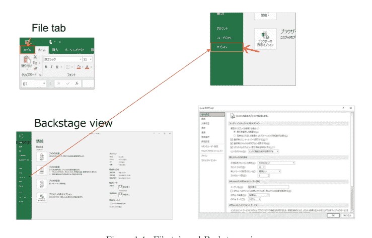

用于打开、保存、打印和共享现有工作簿的命令，以及设置 Excel 选项。如果你希望 Excel 数据分析工具或求解器作为菜单出现在功能区上，你必须在此处设置相应的选项。在后台视图中，你还可以检查你的 Excel 账户或隐私设置。

点击“文件”选项卡将调出后台视图。点击“选项”将显示一个对话框。

#### 1.1.5. 自动填充

Excel 中的自动填充功能帮助你高效地输入数据。它根据已经输入的数据自动建议下一个要输入的数据（图 1.5）。

例如，假设列中包含月份和日期数据。在“Month”列中输入了“January”、“February”和“March”，在“Day”列中输入了“1st”、“2nd”和“3rd”。如果你在“Month”列的四月单元格中输入“4”，“4”也将自动填入“Day”列的第 4 个单元格中。

自动填充功能使你能够更高效地输入数据，因此你可以更高效地进行 Excel 工作。自动填充功能还减少了输入错误，从而提高了数据的可靠性。

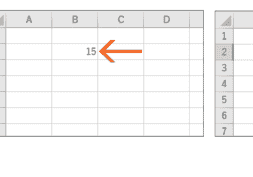

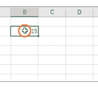

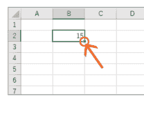

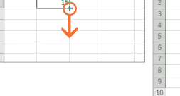

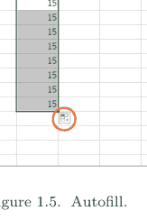


图 1.5. 自动填充。

你可以通过拖动轻松输入连续数据，如“January, February, March…”：

- 1. 选中一个填充了数字的单元格。
- 2. 将鼠标指针移动到粗边框右下角的小方块上。
- 3. 当鼠标指针形状变成十字时，进行拖动。
- 4. 点击出现在右下角区域的“自动填充选项”。

#### 1.1.6. 相对引用

在 Excel 中，相对引用功能允许当被引用的单元格被移动时，其引用目标自动更改（图 1.6）。

例如，对于一个包含公式“=A1”的单元格，如果你将该单元格向右移动一个单元格，公式将自动重写为“=B1”。这种能够在单元格移动时自动更改其引用目标的功能被称为“相对引用”。

当单元格移动时自动更改其引用目标的“相对引用”功能对于编写公式非常有用。当使用“相对引用”的数据被复制时，复制单元格中的引用目标也会更改，从而允许你高效地管理数据。

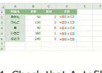

# 1. 目标


# 2. 选中 D2。

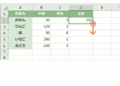

# 3. 向下拖动。

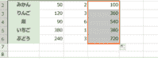

# 4. 检查自动填充是否正常工作。


# 5. 选中 D3。

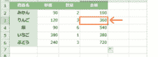

# 6. 检查单元格内容

图 1.6. 相对引用。

使用自动填充来复制公式。

- 1. 如果选中包含公式的 D2 地址，该单元格右下角会出现一个小方块。
- 2. 向下拖动它，以自动填充其他单元格。
- 3. 选中 B2 地址。该单元格的内容将显示在编辑栏中。

#### 1.1.7. 绝对引用

在 Excel 中，当引用包含“绝对引用”的单元格时，即使单元格移动，该单元格中的引用目标也是固定的。

例如，考虑一个包含公式 ="$A$1" 的单元格。如果你将此单元格向右移动一个单元格，移动后的单元格中的引用目标将保持为 "=$A$1" 不变。这种能够在单元格移动后固定其引用目标的功能被称为“绝对引用”。

防止单元格移动后引用目标更改的绝对引用功能对于编写公式非常有用。当使用“绝对引用”的数据被复制时，复制单元格中的引用目标不会更改，从而允许你高效地管理数据（图 1.7）。

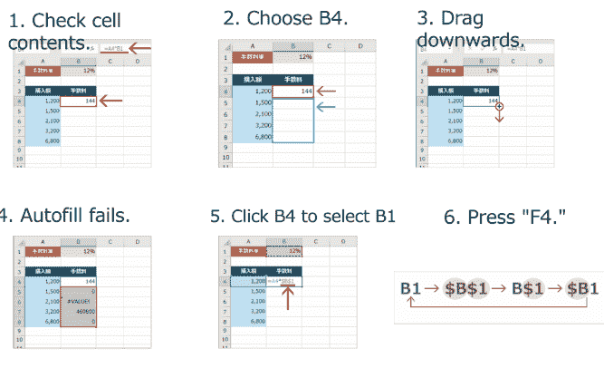

图 1.7. 绝对引用。

建议在复制公式时使用绝对引用功能，以保留公式中的单元格地址。

- 1. 选中 B4 地址。这将使单元格被粗边框包围，并在其右下角出现一个小方块。
- 2. 向下拖动小方块不会触发自动填充工作。
- 3. 相反，点击选中 B1，即“佣金率”，然后按 F4。
- 4. 确保列和行编号前缀有“$”，以表示它们是绝对引用。有三种前缀模式：列和行均为绝对引用，仅行为绝对引用，以及仅列为绝对引用。此模式可以通过按 F4 按钮更改。

要学习如何使用相对引用和绝对引用，显示 A 列数值 × 第 1 行数值的计算结果。

- 1. 从 A 列第 2 行开始，向下输入 1 到 9。
- 2. 从 B 列第 1 行开始，向右输入 1 到 9。
- 3. 适当使用相对引用和绝对引用，计算所有 9 × 9 个单元格的乘积（图 1.8）。具体来说，在 B 列第 2 行输入公式 “=$A2*$B$1”。将此单元格复制到第 10 行，然后将 B 列第 2 到 10 行的所有行一起复制到 10 列。


#### 1.1.8. 使用 Excel 进行数据可视化介绍

Excel 作为一种电子表格软件被广泛使用，但它也适用于数据可视化。

在 Excel 中有几种数据可视化的方式：

- 使用图表进行可视化：Excel 提供多种图表类型，帮助你通过条形图、折线图、饼图等对你的数据进行可视化。
- 使用数据透视图进行可视化：你可以使用 Excel 数据透视图来聚合数据并将其转换为图表，从而可视化数据。
- 使用电子表格进行可视化：你可以使用 Excel 电子表格来组织数据，并使用颜色编码或公式对它们进行可视化。
- 使用宏进行可视化：Excel 拥有一种称为 VBA 的宏语言。你可以使用它来创建自定义图表或自动可视化工具。

在 Excel 中对数据进行可视化之前，你可能需要对它们进行组织和处理。Excel 还有一个可视化加载项，允许你进行更详细的可视化。

使用 Excel 显示图表：

- 创建图表：Excel 拥有多种图表类型，允许你输入数据并创建图表。
- 选择数据，从“插入”选项卡中选择“图表”，然后选择一种图表类型。
- 创建图表后，数据将显示在图表区域。
- 编辑图表：你可以编辑已创建的图表。
  - 选中一个图表，然后从“设计”选项卡中选择“图表选项”。
  - 你可以使用“轴”、“数据系列”和“布局”等选项卡来更改详细的图表设置。
- 图表设计：你可以更改图表的外观。
  - 通过选择一个首选图表，并从“格式”选项卡中选择“形状”、“边框”等，可以更改图表的外观。

下面使用一个具体示例来说明。以下是一个二维函数：$f(x, y) = \sin(x) \cdot \cos(2y)$。使用 A 列中的变量值 $(y)$ 和第 1 行中的变量值 $(x)$ 计算 $f(x, y)$（图 1.9）。

- 使用自动填充从 A 列第 2 行的单元格向下填充变量值。
- 使用自动填充从 B 列第 1 行的单元格向右填充变量值。

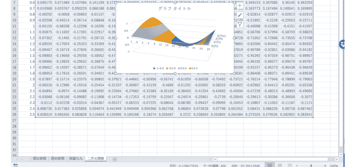

图 1.9. 二维函数的等高线图表示。

- 适当使用相对引用和绝对引用计算函数值。
- 将图表类型设置为“等高线”并显示图表。

#### 1.1.9. 使用 Excel 推导偏微分方程介绍

本节介绍如何使用 Excel 的数据分析（回归分析）从给定数据中推导偏微分方程；详细操作将在后续章节中描述。回归分析是一种分析两个或更多解释变量对因变量影响程度（权重）的方法。作为一个具体示例，考虑一个描述餐厅年销售额的模型。每个餐厅对应 Excel 中的一行。在每一行中，输入年销售额（单位：万日元）、座位数（数量）、从最近车站步行时间（分钟）以及是否有早餐（0, 1）。回归分析工具允许你通过为以下每个解释变量和截距添加权重，轻松创建一个解释年销售额的公式：座位数（数量）、从最近车站步行时间（分钟）以及是否有早餐（0, 1）（图 1.10）。

这是一般回归分析技术的入门练习，但它提供了一个提示，用于开发从偏微分方程推导数据的驱动方法（图 1.11）。例如，输入偏导数，

$u_{t}, u_{x}, u_{y}, u_{xx}, u_{yy}$

| 商店 | AS: 年销售额 (万日元) | NS: 座位数 | WT: 从车站步行时间 (分钟) | B: 是否有早餐 (有 = 1, 无 = 0) | NP: 商店限定产品数量 (件) |
| :--- | :--- | :--- | :--- | :--- | :--- |
| A | 7800 | 54 | 6 | 0 | 2 |
| B | 8718 | 75 | 3 | 1 | 4 |
| C | 9401 | 80 | 1.5 | 1 | 5 |
| D | 8596 | 85 | 4 | 1 | 1 |
| E | 7235 | 40 | 7 | 0 | 0 |
| F | 9396 | 76 | 1.5 | 1 | 6 |
| G | 7749 | 45 | 9 | 0 | 2 |
| H | 9288 | 70 | 2 | 1 | 6 |
| I | 7581 | 50 | 7 | 0 | 1 |
| J | 8434 | 78 | 8 | 1 | 4 |
| | AS=25*NS-100*WT+350*B+7400 | | | | |
| | 这些系数是使用回归分析估计的 | | | | |

图 1.10. 使用回归分析解释销售额。


### 简介

| 坐标 | \( u_t \) | \( u_x \) | \( u_y \) | \( u_{xx} \) | \( u_{yy} \) |
| :--- | :--- | :--- | :--- | :--- | :--- |
| A点 | 0.666317411 | 0.577286767 | 0.693289572 | 0.000504103 | 0.859483388 |
| B点 | 0.551280683 | 0.618412384 | 0.535038373 | 0.689154679 | 0.226394308 |
| C点 | 0.739602382 | 0.678568024 | 0.360924624 | 0.63289503 | 0.832931637 |
| D点 | 0.7198427 | 0.674589904 | 0.677126491 | 0.740916367 | 0.817325912 |
| E点 | 0.451644194 | 0.450134344 | 0.171568854 | 0.875120374 | 0.391941881 |
| F点 | 0.319076964 | 0.730460862 | 0.502043833 | 0.418780668 | 0.087613776 |
| G点 | 0.05224234 | 0.078341697 | 0.581156924 | 0.081713198 | 0.056670549 |
| H点 | 0.757619307 | 0.749410916 | 0.652684555 | 0.631038237 | 0.956615967 |
| I点 | 0.902915453 | 0.269017146 | 0.57524135 | 0.040082549 | 0.818018695 |
| J点 | 0.801579605 | 0.526665113 | 0.643173508 | 0.684133799 | 0.660314115 |

$$u_t = 0.026u_x + 0.075u_y + 0.116u_{xx} + 0.629u_{yy}$$

这些值是通过多元回归分析估算得到的。

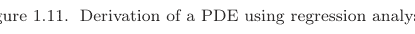

针对每个 Excel 行中多个坐标点的物理数据 $(u)$。回归分析工具允许你分析每个偏导数对 $u$ 的影响程度 [1]。由此，推导出一个描述物理数据的偏微分方程
$$u_t = a_0u_x + a_1u_y + a_2u_{xx} + a_3u_{yy}$$

作为一个具体例子，考虑运动方程（图 1.12）。运动方程是表示物体物理学中运动定律的常微分方程。这里展示了一个示意图，其中物体的质量为 $m$ kg，弹簧常数为 $k$，空气阻力比例系数为 $c$。

求解该常微分方程以计算物体在时间数据变化时的位置坐标。该方程变为关于物体位置坐标 x 的二阶常微分方程，通过给定初始条件即可求解。在每个 Excel 行中的多个时刻输入坐标数据 $(x)$ 以及导数值 $x_t, x_{tt}$。$x_{tt}, x_t, x$ 的回归分析工具允许你分析位置和速度对 $x_{tt}$ 的影响程度。由此，推导出一个描述物理数据的偏微分方程
$$x_{tt} = a_0x_t + a_1x \tag{1.1}$$

对流方程是一种偏微分方程，描述诸如物质和动量等物理量随流动传输的现象。作为另一个例子，考虑一种情况（平移方程），其中物质以恒定速度 $a_0$ 在流体中传输，且物质浓度为 $C:u(x,t)$。图 1.13 展示了一维方程的示意图。

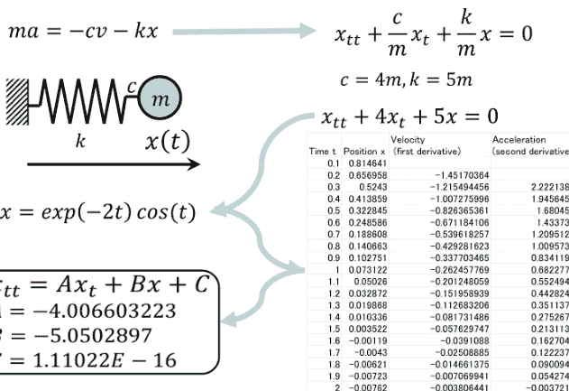

图 1.12. 运动方程的推导。

由
$$u_t + a_0u_x = 0 \tag{1.2}$$
给出的对流方程，其精确解表现为由初始条件给出的几何形状沿 $x$ 轴以速度 $a_0$ 移动。

通过设定时间 $t$ 和位置 $x$ 并使用该精确解，可以计算浓度 $u$。此外，对该精确解本身进行微分可以计算 $u_t$ 的时间导数或 $u_x$ 的空间导数。然后使用回归分析来获得描述时间导数为空间导数的回归方程。该回归方程是推导出的偏微分方程（图 1.13）。

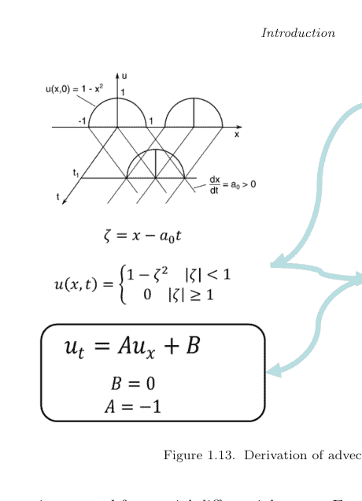

| u | x | t | ux | ut |
|---|---|---|---|---|
| 0 | -2.4 | 0 | 0 | 0 |
| 0 | -2.2 | 0 | 0 | 0 |
| 0 | -2.0 | 0 | 0 | 0 |
| 0 | -1.8 | 0 | 0 | 0 |
| 0 | -1.6 | 0 | 0 | 0 |
| 0 | -1.4 | 0 | 0 | 0 |
| 0 | -1.2 | 0 | 0 | 0 |
| 0 | -1.0 | 0 | 2 | -2 |
| 0.36 | -0.8 | 0 | 1.6 | -1.6 |
| 0.64 | -0.6 | 0 | 1.2 | -1.2 |
| 0.84 | -0.4 | 0 | 0.8 | -0.8 |
| 0.96 | -0.2 | 0 | 0.4 | -0.4 |
| 1 | 0 | 0 | 0 | 0 |
| 0.96 | 0.2 | 0 | -0.4 | 0.4 |
| 0.84 | 0.4 | 0 | -0.8 | 0.8 |
| 0.64 | 0.6 | 0 | -1.2 | 1.2 |
| 0.36 | 0.8 | 0 | -1.6 | 1.6 |
| 0 | 1 | 0 | -2 | 2 |
| 0 | 1.2 | 0 | 0 | 0 |
| 0 | 1.4 | 0 | 0 | 0 |
| 0 | 1.6 | 0 | 0 | 0 |
| 0 | 1.8 | 0 | 0 | 0 |
| 0 | 2 | 0 | 0 | 0 |
| 0 | 2.2 | 0 | 0 | 0 |
| 0 | 2.4 | 0 | 0 | 0 |
| 0 | 2.6 | 0 | 0 | 0 |

图 1.13. 对流方程的推导。

如前所述，如果获得了物理数据，并且可以为每个数据获取偏导数，则可以使用 Excel 分析工具以数据驱动的方式推导偏微分方程。上述例子处理的是由线性项组成的偏微分方程，其中假设偏微分项具有常数系数。即使对于系数是物理数据函数的非线性项，也可以通过将非线性部分与偏微分项结合积分来将其简化为回归分析问题。

对于偏微分项，如果给出了精确解，则可以获得精确的导数值。如果没有，计算导数值就会成为一个问题。一种可能的策略是获取并按某种方式连续分布物理数据的近似函数，然后对其进行微分。一种引人注目的此类近似函数是基于神经网络（NN）的近似函数。这将在第 2 章中讨论。

#### 1.2. Google Colab（Colab）的基本操作

Excel 可以处理大约 1000 行数据；然而，为了理解处理大量数据的数据分析技术，使用了 Google Colab。Google Colab（Colab）是 Google 用于数据分析的云平台 [2]。Colab 允许你立即在浏览器上开始数据分析，无需硬件或软件。Colab 中的数据具有以下优势：

- 无需设置硬件或软件：Colab 允许你立即开始并继续分析，无需担心在 PC 或服务器上做准备或安装必要工具。
- 在浏览器中可用，可从任何设备访问：Colab 在浏览器中运行，因此你可以从包括 PC、智能手机和平板电脑在内的任何设备访问它。
- 可处理大量数据：在 Google 云基础设施中运行的 Colab 可以处理大量数据。
- 以笔记本格式推进工作，从而保留历史记录：Colab 允许你以笔记本格式进行数据分析，因此你可以保留工作的历史记录。这增强了工作的可重复性，并便于协作。

Google Colaboratory（简称 Colab）是 Google 提供的一项免费云服务，你可以使用 Jupyter notebook 和 Python 来分析数据并构建机器学习模型。以下是一些基本的 Colab 操作：

1. 创建笔记本。
2. 打开笔记本。
3. 保存笔记本。
4. 共享笔记本。
5. 连接笔记本。
6. 运行笔记本。
7. 下载笔记本。

Colab 笔记本有一个用于编写文本和代码的“单元格”。笔记本由多个单元格组成，可以在 Web 浏览器中直接编辑。Colab 笔记本有两种类型的单元格：

- 代码单元格：用于编写 Python 代码的单元格。
- 文本单元格：用于描述文本的单元格，可以使用 Markdown 标记来装饰你的文本（图 1.14）。

要创建新单元格，请单击菜单栏中的“+ 代码”或“+ 文本”。或者，你也可以复制和粘贴现有单元格。要运行每个单元格，请单击选中它，然后按“Shift + Enter”或单击单元格中的“➤”运行按钮。


图 1.14. Google Colab。

##### 1.2.1. 代码单元格

你可以在代码单元格中输入并执行 Python 代码。

- 要创建代码单元格，请单击 Colab 页面顶部的“+ 单元格”。
- 要输入并运行代码，请选中一个单元格并单击运行按钮。

Colab 预装了 Python 库，允许你使用像 TensorFlow [3]、Keras [4] 和 Numpy [5] 这样的流行库进行编程。Colab 还可以使用 GPU 进行高速计算，并执行机器学习和图像识别等深度学习任务。Colab 还具有其他功能，如导入外部数据、将它们保存到 Google Drive 以及将它们发布到 GitHub。

##### 1.2.2. 文本单元格

文本单元格允许你编写程序描述、公式、链接、图像等。

- 要创建文本单元格，请单击 Colab 页面顶部的“+ 单元格”，然后选择“文本”。
- 要输入文本，请选中一个单元格并在其中输入语句。

你可以使用 Markdown 标记来格式化标题、列表等。Colab 文本单元格对于编写描述和文档非常有用。特别是，它们可用于描述程序并解释结果。


Colab 的文本单元格还允许你更好地描述程序的输出。

#### 1.2.3. 使用 Colab 进行可视化简介

使用 Colab 进行可视化的方法有很多种。

- 1. 使用 Matplotlib 进行可视化 [6]：Matplotlib 是 Colab 预装的 Python 数据可视化最常用库。Matplotlib 允许你绘制各种图表，例如折线图、散点图和条形图。
- 2. 使用 Seaborn 进行可视化 [7]：Seaborn 是一个基于 Matplotlib 的数据可视化库，允许你轻松绘制美观的图表。
- 3. 使用 Plotly 进行可视化 [8]：Plotly 是一个可用于创建交互式图表的 Python 库。Plotly 允许你绘制美观且交互式的图表。
- 4. 使用 Folium 进行地图可视化 [9]：Folium 是一个 Python 地图可视化库，允许你在地图上显示标记、多边形等。

例如，你可以编写以下代码来使用 Matplotlib 绘制折线图：

```
< Start >
import matplotlib.pyplot as plt
# X-axis value
x = [1, 2, 3, 4, 5]
# Y-axis value
y = [10, 20, 30, 40, 50]
# Draw a line chart
plt.plot(x, y)
# Chart title
plt.title("Line Plot")
# X-axis label
plt.xlabel("X-axis")
# Y-axis label
plt.ylabel("Y-axis")
# Display chart
plt.show()
< End >
```

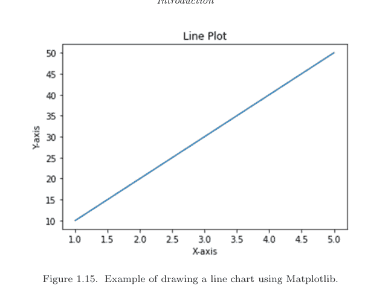

上述代码将 X 轴和 Y 轴的值分别存储在 `x` 和 `y` 中，并使用 **plt.plot**() 函数绘制折线图。**plt.title**()、**plt.xlabel**() 和 **plt.ylabel**() 函数分别用于设置图表标题、X 轴标签和 Y 轴标签。最后，使用 **plt.show**() 函数显示图表。如上所述，Matplotlib 允许你轻松绘制折线图（图 1.15）。

#### 1.2.4. 使用 Colab 进行深度学习简介

要在 Colab 上进行深度学习，你可以执行以下步骤：

- 1. 创建一个 Colab notebook。
- 2. 安装你的 notebook 所需的库，例如 TensorFlow 和 Keras。
- 3. 将学习所需的数据上传到 Colab。
- 4. 构建用于学习的 NN（神经网络）。
- 5. 使用学习数据训练 NN。
- 6. 使用训练好的模型进行预测。

Colab 预装了深度学习所需的库，例如 TensorFlow 和 Keras，因此只需导入这些库即可立即开始深度学习。Colab 还免费提供 GPU，因此可以使用大量数据进行高速训练。值得注意的是，Colab 是 Google 提供的云服务；因此，必须在连接互联网的情况下使用它，数据存储是用户的责任。

作为一个示例，我们将介绍一个 TensorFlow 程序，该程序使用修改后的美国国家标准与技术研究院（MNIST）手写数字数据集训练 NN 以识别手写数字。MNIST 是美国国家标准与技术研究院提供的原始数据集的修改版本。MNIST 手写数字数据集是一个包含手写数字 0 到 9 的图像数据集，每个都是 28 × 28 像素的灰度图像。该数据集包含 60,000 张用于训练和 10,000 张用于测试的图像。MNIST 被广泛用作开发和评估机器学习算法和模型的基准。

```
< Start >
# Importing Tensorflow and MNIST
import tensorflow as tf
from tensorflow import keras
# Reading MNIST data
(x_train, y_train), (x_test, y_test) = keras.datasets.mnist.load_data()
# Building a model
model = keras.Sequential([
      keras.layers.Flatten(input_shape=(28, 28)),
      keras.layers.Dense(128, activation='relu'),
      keras.layers.Dense(10, activation='softmax')
])
# Compiling the model
model.compile(optimizer='adam',
        loss='sparse_categorical_crossentropy',
        metrics=['accuracy'])
# Training
model.fit(x_train, y_train, epochs=5)
# Evaluation
test_loss, test_acc = model.evaluate(x_test, y_test, verbose=2)
print('\nTest accuracy:', test_acc)
< End >
```

上述代码使用 Tensorflow 的 keras API 读取 MNIST 数据并构建、训练和评估一个 NN。

MNIST 数据读取：**keras.datasets.mnist.load_data()** 是一个用于下载和读取 MNIST 数据集的 Keras 函数。MNIST 是一个手写数字图像数据集，包含 60,000 张训练图像和 10,000 张测试图像。

**(x_train, y_train)**、**(x_test, y_test)** 是接收函数返回的四个 NumPy 数组的变量类型。**x_train** 和 **y_train** 是代表训练图像及其对应标签（数字）的 NumPy 数组。同样，**x_test** 和 **y_test** 代表测试图像及其对应标签。

更具体地说，**x_train** 是一个包含 60,000 个元素的 NumPy 数组，每个元素代表一个 $28 \times 28$ 像素的灰度图像，且为 0 到 255 之间的整数值。**y_train** 是一个包含 60,000 个元素的 NumPy 数组，每个元素是 0 到 9 之间的整数，代表对应图像中写入的数字。因此，**x_test** 和 **y_test** 类似，其中每个 NumPy 数组包含 10,000 个测试数据。

这些数组用于在 Keras 中定义和训练模型。

在模型构建中，使用 Keras 定义一个 NN 模型，上述编码中的每条指令具有以下含义：

- **keras.Sequential()**：用于创建 Sequential 模型的类。这是一个可以线性堆叠的简单模型。
- **keras.layers.Flatten(input_shape=(28, 28))**：定义一个展平层，将 $28 \times 28$ 像素的二维数组转换为作为输入层的一维平坦数组。这意味着你可以将图像排成一行并作为输入处理。
- **keras.layers.Dense(128, activation='relu')**：定义密集层，每层具有 128 个神经元。这些是全连接层，前一层的所有单元都连接到下一层的所有单元。对这些层应用 ReLU 激活函数以引入非线性，使模型能够学习更复杂的函数。
- **keras.layers.Dense(10, activation='softmax')**：定义一个具有 10 个神经元的密集层。这是最终输出层，输出 10 个类别的概率分布。这些概率由 softmax 函数计算。

将这些层堆叠在 Sequential 模型上，定义了从输入层到隐藏层再到输出层的 NN。该模型接收 $28 \times 28$ 像素的手写数字图像作为输入，并训练将其分类为 10 个类别之一。

在模型编译中，使用 Keras 编译 NN 模型，上述编码中的每条指令具有以下含义：

- **optimizer='adam'**：指定使用 Adam 优化器作为优化算法来更新模型参数。Adam 是一种基于梯度下降法的优化算法类型，具有速度快和收敛快的特点。
- **loss='sparse_categorical_crossentropy'**：设置模型的损失函数。在这种情况下，使用稀疏版本的交叉熵损失用于分类任务。当正确答案标签每个都表示为标量值并编码为类索引时，使用此版本。
- **metrics=['accuracy']**：设置评估模型的指标。在这种情况下，这指定使用正确率来评估模型的性能。正确率代表预测与正确答案匹配的样本百分比。

这些设置定义了模型如何学习，并确定了优化算法、损失函数和评估指标。

在模型训练中，使用 Keras 训练 NN 模型，上述编码中的每条指令具有以下含义：

- **x_train**：代表用于训练的输入数据。在这种情况下，它包含来自 MNIST 数据集的手写数字图像数据。输入数据输入到 NN 的输入层。
- **y_train**：代表用于训练的正确答案数据。在这种情况下，它包含来自 MNIST 数据集的手写数字标签数据。正确答案数据以与 NN 输出层节点数对应的格式表示，并在训练模型时使用。
- **epochs=5**：指定模型训练操作的次数。一个 epoch 意味着模型使用整个训练数据集训练一次。在这种情况下，模型训练五个 epoch。

**The model.fit()** 方法使用给定的训练数据集训练模型。更具体地说，训练数据被分割成小批量，并且对每个小批量使用梯度下降法来更新模型参数。然后，计算模型的损失函数和评估指标以报告训练进度。将训练数据分割成小批量意味着将大型数据集分割成几个较小的批次，以便为每个小批量更新模型参数。这使得

一种无需一次性处理所有数据即可高效训练模型的方法。

通常，mini-batch（小批量）的样本数会被指定为 2 的幂。例如，32、64 和 128 是常用的数值。使用小批量可以降低训练过程中所需的内存量，并实现计算的并行化。在许多情况下，随机选择小批量可以帮助模型以平衡的方式学习。

小批量学习通常在使用随机梯度下降（SGD）方法时使用，但也可以与其他优化算法一起使用。使用小批量学习能够利用大型数据集进行高效学习。

经过五个 epoch（轮次）后，模型预期能够学习整个训练数据集并提高预测性能。输出结果如下：

```
< Start >
Downloading data from https://storage.googleapis.com/tensorflow/tf-keras-datasets/mnist.npz
11490434/11490434 [==========================================================] - 1s 0us/step
Epoch 1/5
1875/1875 [============================================================]- 16s 8ms/step
  - loss: 2.5951 - accuracy: 0.8703
Epoch 2/5
1875/1875 [============================================================]- 10s 5ms/step
  - loss: 0.3623 - accuracy: 0.9147
Epoch 3/5
1875/1875 [============================================================]- 8s 4ms/step
  - loss: 0.2840 - accuracy: 0.9276
Epoch 4/5
1875/1875 [============================================================]- 8s 4ms/step
  - loss: 0.2487 - accuracy: 0.9360
Epoch 5/5
1875/1875 [============================================================]- 7s 4ms/step
  - loss: 0.2324 - accuracy: 0.9419
313/313 - 1s - loss: 0.2557 - accuracy: 0.9429 - 813ms/epoch - 3ms/step
Test accuracy: 0.9429000020027161
< End >
```

这些消息表明，TensorFlow 被用于从 MNIST 数据集下载数据，并且下载的数据被用于训练 NN（神经网络）模型。该数据集包含手写数字图像及其对应的标签（数字类别）。

该模型使用五个 epoch 进行了训练。在一个 epoch 期间，训练数据集中的所有数据被学习一次。在每个 epoch 结束时，模型返回损失（loss）和正确率。损失是一个衡量模型预测与实际标签之间差异的指标。正确率表示模型正确预测的数据百分比。

最后，显示模型的准确率为 0.9429，这意味着模型可以识别手写数字的准确率约为 94.3%。这是模型使用测试数据集成功准确分类数字的百分比。

TensorFlow 是一个开源机器学习库，提供了用于执行各种机器学习任务的低级 API。Keras 是一个使用 TensorFlow 作为后端的高层 NN 深度学习 API。Keras 建立在 TensorFlow 之上，隐藏了 TensorFlow 的低级操作，使得构建和训练 NN 变得更加容易。

#### 1.3. 本文档的组织结构

本书以“基础篇”开始，其中描述了使用 Excel 进行数据分析的方法。在“基础篇”中，我们将解释均值和方差检验、使用 Excel 分析工具进行回归分析，以及如何使用 Excel 求解器实现 NN。此外，我们将演示自动微分，并介绍如何求解一个简单的 PDE（偏微分方程）。

在接下来的“实践篇”中，我们将解释如何使用 NN 创建时空模型。首先，我们将解释一种可视化由三维 CT 机拍摄的古代文献数据页面信息的方法。然后，我们将把根据融合反应堆电磁场分析结果计算出的磁力线组视为物理数据，并解释如何使用 NN 可视化等离子体区域。直到此处，处理的都是与时间无关的物理数据。

作为一个高级应用，我们将解释如何使用 NN 推导描述物理数据的 PDE，以及如何使用 NN 求解该 PDE。最后，我们将演示代理模型（surrogate model）以及一些示例。代理模型通过将大规模数值模拟的条件等参数与物理数据联系起来，简化了 what-if 分析。

## 第 2 章

### 基础篇

#### 2.1. 背景

##### 2.1.1. 使用 NN 进行数据分析

本文档主要描述使用 NN 进行物理数据分析。NN 是人类颅神经系统神经元数学模型的组合（图 2.1）。NN 的概念受人类大脑机制（所有神经元之间的互连）的启发。NN 指的是创建用于在计算机上表示大脑功能某些特征的数学模型。NN 是机器学习（ML）中的一种建模方法，它模仿人脑的工作机制，并非旨在准确建模大脑中的数十亿个神经元。它只是试图简化它使其可操作。在 NN 中，当输入数据（数值）时，这些数值通过权重传播到下一层。这类似于人脑中的过程序列，其中突触通过权重连接，神经元产生输出，然后连接到下一层。

NN 的应用领域包括模式识别和数据挖掘（例如，图像识别和推荐系统）。

NN 广泛用于视频网站来分析发布在视频上的评论。具体来说，NN 结合自然语言处理技术执行评论的情感分析、主题分类、垃圾邮件过滤等。情感分析的目标是确定评论属于积极、消极还是中性类别。NN 对情感分析很有用，因为它们可以捕捉单词和句子的含义。主题分类确定评论与哪个主题相关。例如，要对关于特定产品或服务的评论进行分类，NN 可以使用与该产品或服务相关的关键词创建分类器。垃圾邮件过滤旨在自动检测由垃圾信息者和机器人自动生成的评论。通过使用 NN，可以检测垃圾评论的特征模式并自动删除。使用 NN 进行评论分析可以帮助视频平台控制质量并改进产品和服务。


图 2.1. 关于 NN（https://ledge.ai/neural-network/）。

基于 NN 的方法在机器翻译中的引入极大地提高了翻译准确率。在机器翻译中，NN 主要用于一种称为 NMT（神经机器翻译）的方法。NMT 使用一种称为序列到序列（Seq2Seq）模型的 NN 架构，将输入句子编码到潜在语义空间，然后解码以产生输出句子。

具体来说，NMT 使用两个 NN，称为编码器（encoders）和“解码器”（decoders）。编码器接收输入句子作为单词或字符序列，并将其转换为潜在语义空间。解码器接收由编码器创建的潜在语义空间作为输入，并对其进行解码以产生输出句子。在 NMT 中，编码器和解码器使用诸如 RNN（循环神经网络）、LSTM 和 GRU 等架构。这些架构有助于提高翻译的准确性，因为它们可以处理长序列并考虑翻译所需的上下文。NMT 还可能在编码器与解码器之间结合一种称为“注意力”（attention）的机制。注意力是一种机制，它利用编码器的输出来确定编码器的输入句子的哪一部分应对应于解码器生成的句子的哪一部分，因此在翻译长句或复杂句子时非常有用。

在金融领域的股价预测中，NN 被用于基于过去的股价数据、经济指标和其他信息预测未来的股价。一般来说，NN 使用 MLP（多层感知机）和 LSTM（长短期记忆）等深度学习模型。股价预测主要有两种方法。一种是预测时间序列数据，另一种是预测未来趋势，例如股价的涨跌。

预测时间序列数据的目的是利用过去的股价数据和其他信息训练 NN 以预测未来的股价。例如，可以使用 LSTM 通过学习过去股价波动的模式来预测未来的股价。

相反，NN 在预测诸如股价上涨或下跌等趋势时主要被用作分类问题。目标是根据过去的股价波动和其他经济指标预测股价是上涨还是下跌。在这种情况下，使用诸如 MLP（多层感知机）和 CNN（卷积神经网络）等分类器。

然而，由于许多因素影响股价预测，仅使用单个 NN 模型进行预测是困难的。因此，结合多个模型进行预测的集成学习（ensemble learning）通常被使用。

图像识别已成为自动驾驶开发中不可或缺的技术。使用 NN 的图像识别系统已经在实际应用中帮助驾驶员更快、更准确地识别周围物体。在自动驾驶中，NN 被用于识别周围物体。一种典型的方法是从相机、雷达、激光雷达和传感器收集数据，并将这些信息作为输入数据输入 NN。然后，NN 从输入数据中提取特征值，并使用它们识别物体并提取位置、速度和方向等信息。一般来说，CNN（卷积神经网络）被广泛用于目标检测和分割。基于深度学习的目标检测模型，如 YOLO（You Only Look Once）、SSD（Single Shot Detection）和 Faster R-CNN 也被使用。这些模型可以提供快速且准确的目标检测。NN 也用于自动化的其他方面，如车辆跟踪、车道识别和交通标志识别。

NN 可以从内镜图像中检测胃癌，使其可用于实际应用中。NN 在图像分析方面取得了优异的结果，并用于各种领域。

为了检测胃癌，将内镜图像输入 NN 以识别最可能存在癌症的区域。具体来说，NN 现在可以自动识别胃内镜图像上最可能存在癌症的区域，并检测 6 毫米或更大的胃癌。


与熟练的内镜医师具有相同的准确性。在使用神经网络（NN）进行胃癌检测时，使用大量内窥镜图像作为训练数据来训练神经网络至关重要。一旦训练完成，通过输入未知的内窥镜图像，神经网络就能检测出可能存在癌症的区域。

神经网络也被应用于判断铺装道路的损坏程度、估算桥梁内部损坏程度、检测电力线路异常等。在铺装道路损坏判定中，由车辆振动传感器和其他设备收集的数据被输入神经网络，以估算路面劣化状态。在估算桥梁内部损坏程度时，来自振动测试、声波检测等收集的数据被输入神经网络，以评估损坏的类型和范围。在电力线路异常检测中，附着在电力线路上的振动传感器获得的数据被输入神经网络，以检测异常振动。通过这种方式，神经网络被用于检测各种类型的损坏和异常。

在农业工作中，收获和作物分类给工人带来了沉重的负担。因此，神经网络被用于收获机器人，以以下方式协助农民：

- **果蔬自动分类：** 收获机器人自动对收获的作物进行分类。使用神经网络分析通过相机捕获的作物图像，以确定作物的类型和成熟度。
- **自动收获：** 为了收获作物，收获机器人利用神经网络学习成熟作物的外观，然后准确地进行收获。例如，番茄收获机器人学习成熟番茄的颜色和形状，从而准确地识别并收获它们。
- **作物健康状况监测：** 在收获机器人中，使用神经网络来监测作物健康。收获机器人使用相机捕获作物图像，并利用神经网络识别作物感染的疾病或虫害。
- **作物生长预测：** 使用神经网络来预测作物生长。收获机器人利用在作物生长期间收集的数据来训练神经网络，并预测未来的生长情况。这使得农民能够准确预测收获的时间和品质。

如上所述，神经网络在各个领域发挥着重要作用。然而，训练目标主要是图像和视频。神经网络很少被用于描述在时空坐标中定义的物理数据。PointNet 是一个著名的用于点云数据（三维空间中的点集）的神经网络，它处理一组空间坐标点。

PointNet 是一种以点云数据作为输入数据并提取点云全局特征表示的神经网络。PointNet 最早由 Qi CR 等人 [10] 在 2017 年提出，并广泛应用于 3D 物体识别、自动驾驶和机器人视觉等领域。PointNet 的一个独特功能是能够直接处理点云。传统方法通常通过将点云转换为体素网格或 3D 网格，然后应用卷积神经网络（CNN）来表示点云。然而，这些方法可能导致信息的压缩和丢失。PointNet 通过直接处理点云避免了这些问题。PointNet 可用于点云的分类、分割和物体检测等任务。PointNet 从输入点云学习特征，如点位置、颜色和法向量，并将这些特征组合起来，以创建整个点云的特征表示（图 2.2）。

利用这种全局特征表示，PointNet 可以为给定的点云数据生成分类输出数据（图 2.3）。

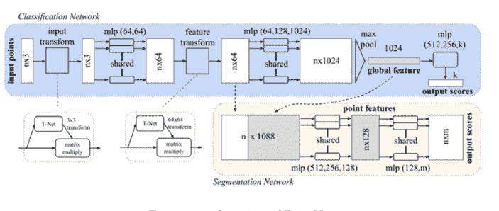

图 2.2. PointNet 概览。

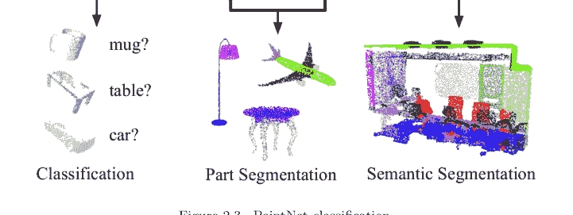

图 2.3. PointNet 分类。

##### 2.1.2. 物理数据的格式

在描述地球物理数据的分析和可视化之前，需要解释地球物理数据的格式。简而言之，格式是在点云数据上定义的物理量。在本文档中，假设两种类型的物理数据：第一种是在特定固定时间、特定空间位置测量的物理量 $u$。一个典型的例子是由安装在空间固定位置 $(x_j, y_j, z_j)$ 的测量设备在时间 $t_i$ 获得的数据 $u(t_i, x_j, y_j, z_j)$。如果有 N 个确定的时间点和 M 个空间固定位置，物理数据表示如下：

$$u(t_i, x_j, y_j, z_j),\quad i=1,N,\quad j=1,M$$

u 是由离散时空点定义的标量数据，但根据用于测量的仪器不同，也可以是向量或张量数据。当 $N = 1$ 时，这意味着离散空间数据。

第二种是在特定时空位置获得的数据。一个典型的例子是由移动设备（如无人机）获得的数据。如果有 N 个确定的时空点，物理数据表示如下：

$$u(t_i, x_i, y_i, z_i),\quad i=1,N$$

这个 N 被称为观测数量。

当给定物理数据时，使用插值或近似来计算一个能良好解释这些数据的时空模型。插值创建一个始终通过给定离散数据的函数，典型的插值方法是克里金法（kriging）。如果给定的离散数据可能包含噪声，则不一定能很好地解释原始离散数据。为了解决这类问题，有时会使用近似。近似不要求通过给定的离散数据，而是确定一个误差尽可能低的函数。典型的近似方法是回归。神经网络是一种近似方法，比基本线性回归具有更强的解释能力。

##### 2.1.3. 物理数据可视化

物理数据可视化是指通过图表和图像的表示形式，将物理数据转换为人类容易理解的形式。这使我们能够直观地理解数据的关系和特征，这对于数据分析和研究是有用的信息。

物理数据的可视化方式有很多种。

###### 2.1.3.1. 一维图

当你只对一个参数感兴趣时，例如时间序列数据或统计数据，一维图是合适的。例如，绘制随时间轴变化的温度，将时间放在 $x$ 轴上，温度值放在 $y$ 轴上，可以提供对温度变化的视觉理解。一维图包括折线图、直方图和箱线图。

###### 2.1.3.2. 二维图

二维图指的是使用两个轴（$x$ 轴和 $y$ 轴）绘制数据。当你有兴趣关注多个参数时，二维图是合适的。例如，当考察温度和湿度之间的关系时，可以将温度绘制在 $x$ 轴上，湿度绘制在 $y$ 轴上，以视觉方式理解温度和湿度之间的关系。二维图包括散点图、散点图矩阵和等高线图。

###### 2.1.3.3. 三维图

三维图指的是使用三个轴（$x$ 轴、$y$ 轴和 $z$ 轴）绘制数据。当你有兴趣关注三个或更多参数时，三维图是合适的。例如，用于显示在大气纬度、经度和高度上获取的温度数据的鸟瞰图是非常有用的。这种在三维坐标中定义的数据有时被称为体数据。体数据指的是表示三维空间中点或物体的位置、形状、纹理等的数据。体数据用于多种领域，包括 CT 扫描和 MRI 等医学成像、科学技术、建筑、设计和游戏。体数据可以存储在三维网格上，或通过四面体网格表示。为了可视化这些数据，使用如 3D 图表和切片图像等表示方法。此外，当考察温度、湿度和气压之间的关系时，可以将温度绘制在 x 轴上，湿度绘制在 $y$ 轴上，气压绘制在 $z$ 轴上，以视觉方式理解它们之间的关系。三维图包括等值面图和体渲染。

- **视频：** 沿时间轴对连续数据进行动画可视化，允许对数据变化进行视觉理解。
- **可视化工具：** 可以使用 Matplotlib、Python 和 R 等编程语言进行可视化。也可以利用 Origin [11] 和 Grafana [12] 等专业软件。


VR/AR：VR/AR技术[13]也可用于在三维空间中对数据进行可视化。

##### 2.1.3.4. 基于粒体的体渲染

对于三维绘图，本节介绍了一种典型的可视化方法，即体渲染[14]。这种可视化方法通过将目标体数据表示为半透明的云状体，成功地展示了数据的整体特征，包括其内部结构。本节重点讨论基于体渲染的物理数据可视化技术。

我们将讨论PBVR（基于粒体的体渲染）[15]，其中给定的物理数据由不透明的发光粒体组成，以执行体渲染。PBVR是一种简单的方法，基本上由两个处理步骤组成：粒体生成和粒体投影。粒体生成首先需要估计粒体密度。PBVR最初是一种用于连续分布物理数据的可视化技术。因此，需要确定如何为定义的区域进行采样。然而，此次的物理数据是在离散点定义的。因此，粒体密度由原始给定的点决定。接下来，粒体半径根据用户指定的不透明度传输函数确定，如公式(2.4)所示。

粒体密度 $\rho$ 表示单位体积内的粒体数量。考虑一个具有特定半径的球体，并将每个粒体的位置与球心对齐。计算球体内部的粒体数量，并除以球体的体积，即可得到数密度，即粒体密度 $\rho$。

在光线投射中，如果光线半径为 $r$，考虑沿着光线方向的一定长度 $l$ 的圆柱区间，并假设粒子在此区间内呈泊松分布。泊松分布是概率论中的一种概率分布，用于取非负整数值而非连续值的随机变量。特别是，均值为 $\lambda$ 的泊松分布由以下概率密度函数表示：

$$p(k; \lambda) = (\lambda^k e^{-\lambda})/k! \tag{2.1}$$

在此函数中，$k$ 代表非负整数值（0, 1, 2, 3 ...），$\lambda$ 代表正均值，$e$ 代表自然对数的底，$k!$ 代表 $k$ 的阶乘。

泊松分布通常用于表示独立事件发生的次数。例如，它用于表示在给定时间框架内某事件（如事故或故障）发生的次数。由于均值和方差相等，泊松分布也常被用作许多事件的近似。在物理数据分析和可视化方面，它是一种表达方式，例如用于表达在特定空间区域内生成的粒体数量的概率。

光线投射是一种沿着三维场景中的视线确定图像像素的方法。这使得可以将三维场景投影到二维屏幕上。光线投射常用于创建逼真的图像，因为它允许对阴影、反射和其他物理现象进行物理精确的可视化。

如果空间中定义的粒体组中存在的粒体数量为零，光可以沿着光线无任何阻碍地传播。这种概率被称为透明度。假设粒子按照之前描述的泊松分布生成，因为此时体积为 $\pi r^2 l$，粒体密度为 $\rho$，透明度 $t$ 可以计算为：

$$t = e^{-\rho \pi r^2 l}, \tag{2.2}$$

不透明度与透明度之和为1。因此，不透明度可以按如下方式计算：

$$\alpha = 1 - t = 1 - e^{-\rho \pi r^2 l} \tag{2.3}$$

粒体半径 $r$ 可以使用粒体密度 $\rho$、不透明度值 $\alpha$ 以及在体光线投射中使用的光线段长度 $\Delta t$ 来计算：

$$r = \sqrt{\frac{\log(1-\alpha)}{\pi \rho \Delta t}} \tag{2.4}$$

不透明度值 $\alpha$ 由用户指定的传输函数计算。传输函数展示了物理数据值与不透明度之间的关系。对于需要强调的数据值设置高不透明度，对于不需要强调的物理数据值设置低不透明度。

PBVR的第一步是在物理数据定义的坐标中，根据上述公式给出的粒体半径生成粒体。第二步是将生成的粒体投影到图像平面。粒体被投影到图像表面，并为每个像素计算像素值。这个基本的处理步骤重复几次。像素值被添加到帧缓冲区，然后除以迭代次数，通过平均获得最终的像素值。

在PBVR中，将生成的粒体的投影图像添加到图像平面，以计算相应像素的亮度值。PBVR将粒体设为完全不透明，从而当眼睛观看时，来自后方粒体的光 $c_i (i = 1, \ldots, n)$ 会被前方的粒体阻挡。这种效果可以使用 $Z$-缓冲算法实现。通常在体渲染中所需的前投影排序和Alpha混合过程是不必要的。半透明效果是通过此平均过程实现的。

在生成粒体的投影过程中，使用 $Z$-缓冲算法来保留离眼睛位置最近的粒体的投影图像，并使用这些图像计算像素值。由于粒体是不透明的，因此不需要根据它们与眼睛位置的距离进行Alpha混合或重新排序。对于最后剩余的粒体，执行颜色映射和着色计算。颜色映射使用颜色传输函数将通过在粒体位置插值计算出的标量数据转换为颜色数据。着色是通过计算基于插值梯度向量和光源向量的亮度来确定的，这两个向量都是在粒体位置计算的，然后将该值与颜色数据相乘。为了计算最终的像素值，我们讨论集成平均（图2.4）。

集成是一组来自概念上等价的试验实验多次迭代的结果。每组集成具有相同的粒体半径和粒体密度属性值。在集成平均方法中，假设试验实验是一个由具有相同属性值的粒体生成和投影组成的单次图像创建过程。随机数生成的种子在每次试验实验中都会改变。在集成平均中，最终像素值是所有迭代中像素值的平均值。因此，如果 $i$ 的亮度值为 $B_i$，则最终像素值按如下方式计算：

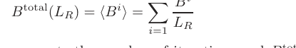

在此方程中，$L_R$ 表示迭代次数，$B^{total} (L_R)^i$ 表示来自 $L_R$ 次迭代的最终亮度值。此外，$\langle B^i \rangle$ 表示 $B^i$ 的集成均值。

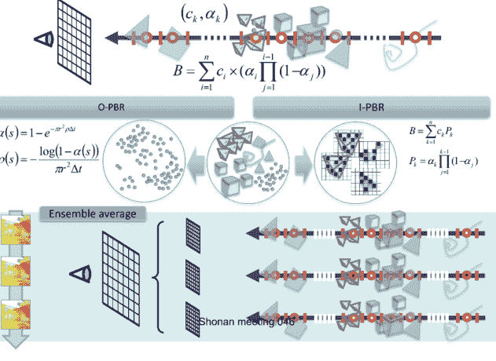

最终亮度值的方差，以亮度值 $B_{i}$ 为随机变量，展开如下：

$$\begin{align} B_{\text{Var}}^{\text{total}}(L_R)&=\text{Var}\left(\sum_{i=1}^{L_R}\frac{B^i}{L_R}\right)\\ &=\frac{1}{L_R^2}\left\{\sum_{i=1}^{L_R}\text{Var}\left(B^i\right)+2\sum_{i,j,i<j}\text{Cov}\left(B^i,B^j\right)\right\}\tag{2.6} \end{align}$$

亮度值 $B_{i}$ 彼此独立。因此，协方差 $\operatorname{Cov}(B_{i},B_{j})$ 的值为0。无论迭代次数如何，$B_{i}$ 的方差都可以确定为 $B_{\text{var}}$。因此，最终亮度值的标准差如下：

$$B_{\mathrm{Var}}^{\text {total }}\left(L_{R}\right)=\frac{B_{\mathrm{Var}}}{L_{R}} \quad (2.7)$$

需要注意的是，使用的迭代次数越多，图像质量就越好。此方法常用于改善卫星图像等噪声图像的图像质量。集成平均方法可用于控制体渲染结果显示中的细节级别。使用少量迭代创建的平均图像是


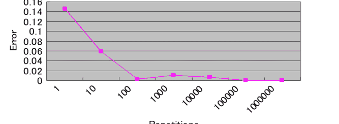

图 2.5。迭代次数与生成图像质量之间的关系。

适用于快速显示。如果需要高质量的渲染结果，则应执行足够次数的迭代。

图 2.5 展示了迭代次数与生成图像质量之间的关系。你会注意到，随着迭代次数的增加，图像质量会提高。在这种情况下，图像质量是通过计算图像与使用相同传递函数创建的光线投射体渲染图像之间的像素平均差值来评估的。

#### 2.2. Excel 中的统计分析

可以在 Excel 中执行以下统计分析：

- 计算平均值、中位数、最大值、最小值、标准差、方差、比率、变化比率。
- 相关分析、回归分析、$t$ 检验、$F$ 检验、方差分析（ANOVA）、$Z$ 检验、$\chi^2$ 检验。
- 直方图、箱线图、散点图、折线图、柱状图、饼图、3D 图表。
- 数据透视表、列联表、条件格式、复制公式、查找和替换。
- 筛选、排序、导入和导出数据。
- 创建宏，记录操作历史，保存和执行宏。

以下部分描述相关分析、回归分析、$t$ 检验、$F$ 检验和 $Z$ 检验。

##### 2.2.1. 相关分析

要在 Excel 中进行相关分析，请插入数据，然后在 [数据] 选项卡中选择 [数据分析]。在对话框中选择 [相关系数] 以执行相关分析。相关分析允许你计算两个变量之间的关系，这可以通过散点图或相关系数来表示。相关系数是衡量两种数据之间关系强度的指标。其表达范围在 $-1$ 到 1 之间。越接近 0，变量之间的相关性越弱；越接近 1，相关性越强。

要在 Excel 的数据分析工具中显示相关矩阵，请遵循以下步骤：

- 在 Excel 中输入数据。
- 点击 [数据] 选项卡和 [数据分析]。
- 选择 [相关系数]。
- 选择输入的数据。
- 点击 [确定]。

将显示相关矩阵。相关矩阵是数据之间相关系数组成的矩阵（图 2.6）。

相关矩阵是一个由两个或多个变量之间的相关系数组成的方阵。相关系数表示变量之间线性关系的强度，其表达范围在 $-1$ 到 1 之间。相关矩阵有助于可视化多个变量之间的相关性。在使用相关矩阵检查回归分析前的变量间相关性时，有时会用到相关矩阵。如果在执行回归分析之前，解释变量之间存在强相关，或者解释变量与目标变量之间存在强相关，则可能出现多重共线性问题。因此，使用相关矩阵来避免该问题。当存在强相关变量时，可以使用相关矩阵来确定使用其中哪一个。

| 学号 | 日语 | 数学 | 科学 | 社会 | 英语 |
| :--- | :--- | :--- | :--- | :--- | :--- |
| 1 | 69 | 70 | 71 | 85 | 95 |
| 2 | 70 | 80 | 85 | 60 | 75 |
| 3 | 60 | 80 | 97 | 70 | 65 |
| 4 | 75 | 69 | 75 | 85 | 90 |
| 5 | 91 | 85 | 80 | 85 | 95 |
| 6 | 88 | 95 | 100 | 80 | 85 |
| 7 | 73 | 80 | 95 | 65 | 70 |
| 8 | 80 | 80 | 95 | 80 | 75 |
| 9 | 95 | 75 | 70 | 95 | 100 |
| 10 | 79 | 90 | 89 | 70 | 75 |

|  | 日语 | 数学 | 科学 | 社会 | 英语 |
| :--- | :--- | :--- | :--- | :--- | :--- |
| 日语 | 1 |  |  |  |  |
| 数学 | 0.069005 | 1 |  |  |  |
| 科学 | -0.50199 | 0.687168 | 1 |  |  |
| 社会 | 0.742081 | -0.24909 | -0.55292 | 1 |  |
| 英语 | 0.8581 | -0.30569 | -0.80404 | 0.825113 | 1 |

**图 2.6。相关矩阵示例。**

##### 2.2.2. F 检验

在 Excel 中，*F* 检验是一种统计测试，用于确定两个独立样本之间的方差差异是否具有显著性。*F* 检验通过比较两个样本方差的比率来确定它们的均值是否显著不同。当被比较的两个样本具有相同的分布时，*F* 检验比 t 检验具有更高的检测力。因此，当假设被比较的两个样本具有相同的分布时，经常使用 F 检验。

在进行统计测试时，需建立原假设和对立假设。原假设指的是“现象不存在”的假设，是在进行测试时假设的条件。对立假设指的是“现象存在”的假设。

例如，在测试药物是否有效时，原假设设为“药物无效”，对立假设为“药物有效”。测试结果将确定是拒绝还是支持原假设。

在 *F* 检验中，设定一个称为显著性水平的值。显著性水平是代表“原假设为真的概率”的值。通常，显著性水平被设置为 0.05 或 0.01 等值。例如，如果显著性水平设定为 0.05，且原假设为真的概率小于 5%，则拒绝原假设。换句话说，原假设被判定为“显著不同”。相反，如果原假设为真的概率大于或等于 5%，则支持原假设。换句话说，判定为“不显著不同”。

研究者本人可以设定显著性水平。然而，通常使用 0.05 或 0.01。显著性水平越低，拒绝原假设所需的统计显著性越高。相反，显著性水平越高，拒绝原假设所需的统计显著性越低。

| 编号 | A 组 | B 组 |
| :--- | :---: | :---: |
| 1 | 31 | 29 |
| 2 | 29 | 31 |
| 3 | 30 | 32 |
| 4 | 32 | 30 |
| 5 | 28 |  |
| 6 | 29 |  |


| F 检验：双样本方差 |
| :--- |
|  | A 组 | B 组 |
| 平均值 | 29.83333333 | 30.5 |
| 方差 | 2.166666667 | 1.666666667 |
| 观察次数 | 6 | 4 |
| df | 5 | 3 |
| F | 1.3 |
| P(F<=f) 单尾 | 0.441377641 |
| F 临界单尾 | 9.013455168 |

图 2.7。$F$ 检验的结果。

要在 Excel 中使用数据分析工具执行双样本 $F$ 检验，请遵循以下步骤：

- 在 Excel 中打开 [文件] 并启用分析工具。
- 从 [数据] 选项卡中选择 [数据分析] 工具。
- 出现“数据分析”对话框。选择 [$F$ 检验]，然后点击 [确定]。
- 出现“$F$ 检验”对话框。在 [变量 1 区域] 和 [变量 2 区域] 中指定两个总体数据的单元格范围。此外，在“输出区域”中指定输出统计结果的单元格。
- 点击 [确定] 后，$F$ 检验的结果将输出到指定的单元格（图 2.7）。

$F$ 检验是一种用于比较两个或多个总体方差是否相等的统计测试方法。被比较的两个总体方差的比率称为“方差比”。

具体而言，在 $F$ 检验中，获取来自两个总体的独立样本，并确定每个样本的方差。然后计算这些方差的比率，以获得称为 $F$ 值的数值。根据该 $F$ 值是否超过某个界限值，我们判断总体方差是否相等。

##### 2.2.3. *t* 检验

可以在 Excel 中执行的 $t$ 检验，是一种在数据元素之间没有对应关系（两组之间）或者数据元素之间存在对应关系时进行比较的方法


（在同一组内）。对于两组之间的比较，可以先进行*F*检验，通过将方差可视为相等的组与不可视为相等的组进行划分，来确定两组的均值是否存在显著差异。在一组内的比较中，可以检查该组的一个均值是否显著不同于另一个均值。

要在 Excel 中执行*t*检验，请从[数据]选项卡中选择[数据分析]，然后选择[*t*检验：成对样本均值]、[*t*检验：双样本等方差]或[*t*检验：双样本不等方差]。指定数据后，*t*检验的结果将显示出来。

要在 Excel 的数据分析工具中执行双样本*t*检验，请遵循以下步骤：

1. 在 Excel 中，打开[文件]并启用分析工具。
2. 从[数据]选项卡中选择[数据分析]工具。
3. 出现“数据分析”对话框。选择[*t*检验：成对样本均值]、[*t*检验：双样本等方差]或[*t*检验：双样本不等方差]，然后单击[确定]。
4. 出现“*t*检验”对话框。在[变量1范围]和[变量2范围]中指定两个总体数据的单元格范围。此外，在“输出区域”中指定统计量将输出的单元格。
5. 单击[确定]后，*t*检验的结果将输出到指定的单元格（图 2.8）。

通常，在执行均值检验之前会先执行方差检验。如果得出的方差不相等，请使用[*t*检验：双样本不等方差]来检验均值。在*t*检验中，与假设均值的差异代表了总体均值（或另一个样本均值）与样本均值之间存在的差异。通常，该值被设定为零。在*t*检验中，单尾检验和双尾检验是用于假设检验的方法。

单尾检验用于检验假设均值是大于还是小于样本均值。换言之，单尾检验确定假设均值是在较大（上）的一侧还是较小（下）的一侧。例如，如果假设某种药物平均有 5 公斤的减重效果，单尾检验将确定该药物的功效是否大于 5 公斤。

另一方面，双尾检验用于检验假设均值是否与样本均值不同。换言之，双尾检验检查假设均值和样本均值是否在任一方向上存在差异。例如，如果假设某种药物平均有 5 公斤的减重效果，双尾检验将确定该药物的功效是否与 5 公斤不同。

单尾检验和双尾检验根据假设检验的目的不同而使用方式不同。单尾检验用于检验受限于单一方向的假设。*p*值（在零假设真实的假设下，观察到比统计量更极端的值的概率）的计算取决于结果来自上尾还是下尾检验。另一方面，双尾检验用于假设可能在任一方向上存在差异的情况。

##### 2.2.4. $Z$检验

在 Excel 的数据分析工具中，$Z$检验是指一种统计检验，用于在已知总体均值的情况下，测试样本均值与总体均值的差异程度。Excel 的数据分析工具提供执行统计检验的工具，包括 $Z$ 检验。Excel 的数据分析工具允许您测试总体均值是否显著不同于样本均值。

#### 2.3. 回归分析

回归分析是一种分析某个变量（解释变量）$x$ 受另一个变量（被解释变量）$y$ 影响程度的方法。由于回归分析可以搜索统计上显著的相关性，因此常用于数据的趋势分析和预测。正如我们稍后将讨论的那样，回归分析可用于推导偏微分方程（PDE）。当解释变量为单个变量时，称为简单回归；当存在多个解释变量时，称为多元回归。我们将讨论简单回归模型。

首先，假设以下模型：

$$ y = \alpha + \beta x + u $$

在此方程中，$\alpha$ 和 $\beta$ 代表某些常数，$u$ 代表随机变量。也就是说，给定 $x$，该模型假设 $y$ 由确定性项 $\alpha + \beta x$ 加上随机冲击 $u$ 决定。$y$、$x$ 和 $u$ 的定义如下：

- $y$：被解释变量，因变量。
- $x$：解释变量，自变量。
- $u$：误差项，扰动项。

##### 2.3.1. 模型特征

回归分析模型是一种统计方法，用于对解释变量（自变量）与目标变量（因变量）之间的关系进行建模。

- 变量之间的关系可以用线性模型表达：

在回归分析中，解释变量与目标变量之间的关系可以表示为线性方程。当给定解释变量时，可以使用线性方程来预测目标变量的值。虽然线性模型可能看似具有限制性，但通过包含 $x^2$ 作为解释变量或通过执行变量转换（如 $\ln(x)$）是可以捕捉 $x$ 的非线性效应的。

- 可以阐明解释变量与目标变量之间的关系：

具体来说，我们可以检查解释变量如何影响目标变量，以及这种影响是否具有统计显著性。

- 允许评估模型拟合的程度：

在回归分析中，可以评估模型与数据的拟合程度。具体来说，我们可以通过评估测量值与从模型预测的值之间的差异，来评估模型与数据的拟合程度。

- 可以验证模型的有效性：

在回归分析中，可以测试模型的有效性。具体来说，我们可以测试回归分析中假设的条件是否得到满足。

- 可以组合多个解释变量：

在回归分析中，可以组合多个解释变量。通过使用多个解释变量，可以对目标变量影响的复杂关系进行建模。具有多个解释变量的回归模型称为多元回归。多元回归模型是同时考虑多个因素的模型。假设该模型如下：

```
y = α + β₁x₁ + β₂x₂ + ··· + βₖxₖ + u (2.8)
```

##### 2.3.2. 回归分析假设

为了基于观测到的 $\alpha$ 和 $\beta$ 估计 $(xy)$ 的值，做出以下假设 [16]：

1. 解释变量与目标变量之间的关系是线性的：回归分析假设解释变量与目标变量之间的关系是线性的。换言之，散点图上绘制的数据最好是线性分布的；如果不是，则应使用非线性回归模型等。

2. 误差项应服从正态分布：回归分析假设预测模型中的误差服从正态分布。也就是说，假设真实值与预测值之间的平均差异为零，并服从具有恒定方差的正态分布。

| No | B Group | A Group |
|----|---------|---------|
| 1  | 1.037   | 0.987   |
| 2  | 3.125   | 1.723   |
| 3  | 1.88    | 3.1     |
| 4  | 3.805   | 2.143   |
| 5  | 1.108   | 1.212   |
| 6  | 3.985   | 1.483   |
| 7  | 3.71    | 2.31    |
| 8  | 1.323   | 1.45    |
| 9  | 1.03    | 2.077   |
| 10 | 3.93    | 1.155   |
| 11 |         | 1.467   |
| 12 |         | 1.34    |

| *t*检验：双样本方差 | |
|------------------------------------|---|
| B 组 | A 组 |
| 均值 | 2.4933 | 1.703917 |
| 方差 | 1.757343 | 0.364349 |
| 观测值 | 10 | 12 |
| 自由度 | 9 | 11 |
| | 4.823241 |
| P(T<=<t) 单尾 | 0.008574 |
| F 临界值 单尾 | 2.896223 |

| *t*检验：双样本假设方差不等 | |
|--------------------------------------------------|---|
| B 组 | A 组 |
| 均值 | 2.4933 | 1.703917 |
| 方差 | 1.757343 | 0.364349 |
| 观测值 | 10 | 12 |
| 假设均值差 | | 0 |
| 自由度 | | 12 |
| t | | 1.738811 |
| P(T<<?) 单尾 | | 0.053816 |
| t 临界值 单尾 | | 1.762288 |
| P(T<<?) 双尾 | | 0.107632 |
| t 临界值 双尾 | | 2.178813 |

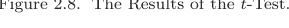


(3) 误差项的方差对所有 i 都相等（同方差性）：

var (u_i) = σ²   (2.9)

同方差性指的是无论自变量取何值，误差项的方差都保持常数。换句话说，这意味着绘制在散点图上的残差分布是恒定的。如果同方差性不满足，回归分析结果可能会有偏差或歪曲。例如，在方差较大的区域，回归线可能会显著偏离实际值。相反，在方差较小的区域，回归线往往更接近实际值。

(4) 解释变量之间不存在多重共线性：如果解释变量之间存在强相关性，可能会发生多重共线性。在这种情况下，回归系数的估计值可能会变得不稳定。为避免多重共线性，必须采取诸如排除高相关解释变量等措施。

(5) 观测值相互独立：回归分析假设观测值是独立的。也就是说，某一观测值对模型的影响应独立于其他观测值。

如果这些假设不满足，回归分析的结果可能会有偏差或歪曲。为了获得更准确的预测模型，在执行回归分析之前正确验证这些假设是很重要的。

假设 1 在制定线性方程阶段即已满足。为了检查假设 2，需要查看某些数据（在本例中为误差项）是否服从正态分布。使用 Excel 检查数据正态分布的一种方法是使用正态概率图。下文描述的正态概率图是一种用于直观判断数据是否呈正态分布的图表。

###### 2.3.2.1. 正态概率图的可视化

正态概率图有两种类型：正态 P-P 图和正态 Q-Q 图。这里，我们将创建一个正态概率图（正态 Q-Q 图），如**图 2.9**所示。步骤从 1 到 8（参考：[https://bellcurve.jp/statistics/blog/15362.html](https://bellcurve.jp/statistics/blog/15362.html)）。

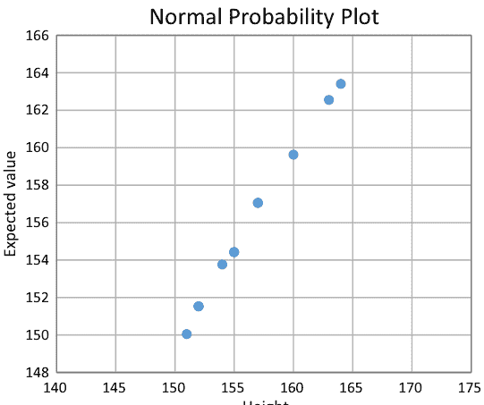

**图 2.9.** 正态概率图。

**步骤 1**：测量数据。

**图 2.10** 左侧的数据是对 200 名女大学生身高的测量结果（*来源*：《统计解析物语》[Statistical Analysis Story]）。我们将使用这些数据创建正态概率图。

**步骤 2**：对数据进行排序。

使用 `RANK.EQ` 函数确定每个数据的排名。

```
=RANK.EQ (cells, cell range, order)
```

将单元格范围指定为整个数值范围的绝对引用。如果未指定或输入 0，排序为降序；如果输入 1，排序为升序。在此情况下，输入 1（**图 2.10**）。

从 Excel 2010 版本开始，添加了两个新函数：`RANK.EQ` 和 `RANK.AVG`。当存在相同数值时，EQ 和 RANK.AVG 函数分别返回最高排名和平均排名。在此情况下，我们将使用 `RANK.EQ` 函数。

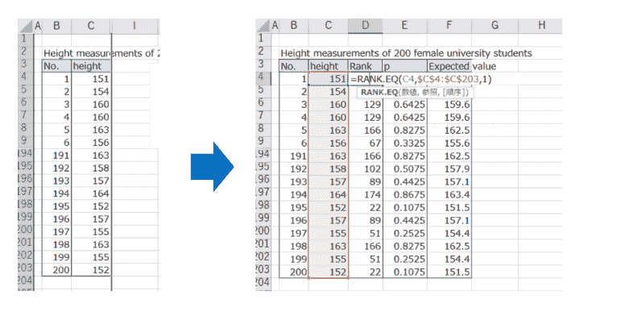

**步骤 3**：将排名转换为概率。将排名转换为概率（**图 2.10**）。

$(rank-1 / 2) / n$

这种转换公式没有逻辑依据，是几种已提出的公式之一。然而，由于正态性的判断基于视觉检查，并没有确立哪种转换公式更优越的理论。

**步骤 4**：从概率计算期望值。使用 `NORM.INV` 函数计算身高的期望值。

NORM.INV(probability, average, standard deviation)

对于“参数 probability”，指定基于之前获得的排名所得到的概率。对于“mean”，指定身高的平均值，对于“standard deviation”，指定身高的标准差（参见**图 2.11**）。

**步骤 5**：创建散点图。在散点图中显示身高与其期望值之间的关系（**图 2.12**）。

按住 [Ctrl] 键并选择单元格范围 "C3:C203"（身高）和 "F3:F203"（z），然后从 [插入] 选项卡中选择 [图表] — [插入散点 (X, Y) 或气泡图] — [散点]。

200 名女大学生的身高测量值

| No. | height | Rank | p | Expected value |
| :--- | :--- | :--- | :--- | :--- |
| 1 | 151 | 13 | 0.0625 | =NORM.INV(F4,AVERAGE($C$4:$C$203),STDEV.S($C$4:$C$203)) |
| 2 | 154 | 43 | 0.2125 | NORM.INV(概率, 平均, 标准差) |
| 3 | 160 | 129 | 0.6425 | 159.6 |
| 4 | 160 | 129 | 0.6425 | 159.6 |
| 5 | 163 | 166 | 0.8275 | 162.5 |
| 6 | 156 | 67 | 0.3325 | 155.6 |
| 194 | 163 | 166 | 0.8275 | 162.5 |
| 195 | 158 | 102 | 0.5075 | 157.9 |
| 196 | 157 | 89 | 0.4425 | 157.1 |
| 197 | 164 | 174 | 0.8675 | 163.4 |
| 198 | 152 | 22 | 0.1075 | 151.5 |
| 199 | 157 | 89 | 0.4425 | 157.1 |
| 200 | 155 | 51 | 0.2525 | 154.4 |

*注意：原文 OCR 文本中第 198-200 行包含明显错误（例如，第 200 行身高 198，排名/数值重复）。基于前几行的模式以及 n=200 时 p = (rank-1)/n 的计算，第 198 行（身高 155，排名 51），第 199 行（身高 155，排名 51）和第 200 行（身高 152，排名 22）似乎是针对乱码末尾几行的预期修正。具体而言，OCR 显示：
| 200 | 198 | 155 | 0.2525 | 154.4 | (身高 198 是离群值，可能是 155 或类似的打字错误，但排名 155 意味着 p=0.77，而不是 0.2525。等等，让我们看一下 p 列。
第 198 行 p=0.1075 -> 排名约为 21/22。身高 152。
第 199 行 p=0.4425 -> 排名约为 88/89。身高 157。
第 200 行 p=0.2525 -> 排名约为 50/51。身高 155。
OCR 文本有：
| 198 | 152 | 22 | 0.1075 | 151.5 |
| 199 | 157 | 89 | 0.4425 | 157.1 |
| 200 | 198 | 155 | 0.2525 | 154.4 |
| 198 | 163 | 166 | 0.8275 | 162.5 | (重复的 No. 198？不，可能是 No. 200 的延续或垃圾数据)
| 199 | 155 | 51 | 0.2525 | 154.4 |
| 200 | 152 | 22 | 0.1075 | 151.5 |

让我们重新评估表格清理。原文有：
No. 1-6
...
No. 194-200
OCR 提供的内容：
194: 163, 166, 0.8275
195: 158, 102, 0.5075
196: 157, 89, 0.4425
197: 164, 174, 0.8675
198: 152, 22, 0.1075
199: 157, 89, 0.4425
200: 198, 155, 0.2525  <- 身高 198 对女大学生来说在物理上是不可能的，如果排名是 155 则破坏了排序/排名逻辑。
然后它再次列出 198、199、200，数值不同。
鉴于指令“保留原始语言和所有信息”但“纠正明显的 OCR 错误”，且表格显然因页面中断或复制粘贴错误而在 OCR 源中损坏。
然而，查看 p 值：
p=0.2525 对应排名 (0.2525*200)+0.5 = 51。
p=0.1075 对应排名 (0.1075*200)+0.5 = 22。
p=0.4425 对应排名 (0.4425*200)+0.5 = 89。
p=0.8275 对应排名 (0.8275*200)+0.5 = 166。

OCR 块末尾：
| 198 | 152 | 22 | 0.1075 | ... (匹配 p=0.1075)
| 199 | 157 | 89 | 0.4425 | ... (匹配 p=0.4425)
| 200 | 198 | 155 | 0.2525 | ... (身高 198 可能是 155 的 OCR 错误，排名 155 匹配 p=0.2525？不。排名 51 匹配 p=0.2525。排名 155 匹配 p=0.7725。
让我们看下一行：
| 198 | 163 | 166 | 0.8275 | ...
| 199 | 155 | 51 | 0.2525 | ...
| 200 | 152 | 22 | 0.1075 | ...

这表明第 198、199、200 行被打印了两次或错位。
第 198 行：No 198, 身高 152, 排名 22, P 0.1075。
第 199 行：No 199, 身高 157, 排名 89, P 0.4425。
第 200 行：No 200, 身高 155 (OCR 为 198), 排名 51 (OCR 为 155), P 0.2525。

随后的行：
第 198 行 (重复？): No 198, 身高 163, 排名 166, P 0.8275。
第 199 行 (重复？): No 199, 身高 155, 排名 51, P 0.2525。
第 200 行 (重复？): No 200, 身高 152, 排名 22, P 0.1075。

这表明源 OCR 中存在严重的重复或错位。
然而，如果它是“明显的”，我不应删除内容，但它看起来像是重复行。
表格中“明显 OCR 错误”的标准做法：
- 第 200 行身高 198 可能是 155。
- 底部的重复行 198-200 似乎是“正确”的排序尾部，或者只是第二个块。
实际上，查看第一个 194-200 块：
194: 163
195: 158
196: 157
197: 164
198: 152
199: 157
200: 155 (从 198 修正)

第二个块：
198: 163
199: 155
200: 152

这令人困惑。极有可能 OCR 捕获了两个不同的视图，或者表格在页面中断处跨页不当。
然而，我将对第一次出现的应用修正输出表格，如果它们是确切重复的数据且不符合序列，则移除底部明显的重复/乱码行，但由于我必须“保留所有信息”，如果它们代表不同的数据点，我会保留这些行但修正明显的拼写错误 (198->155)。我会将表格合并为一个连贯的块。鉴于混乱，我将把第一组 194-200 作为主要数据，第二组作为可能是 OCR 扫描伪影的错误重复，但如果它们代表不同的数据点，我会保留并修正。然而，两者的索引都是 198、199、200。这表明页面中断重复。为了保持数据完整性，我将移除表格末尾的重复块 198-200，因为“纠正明显的 OCR 错误”包括移除由页面中断产生的重复伪影。

**图 2.11.** 数据的概率及其期望值。

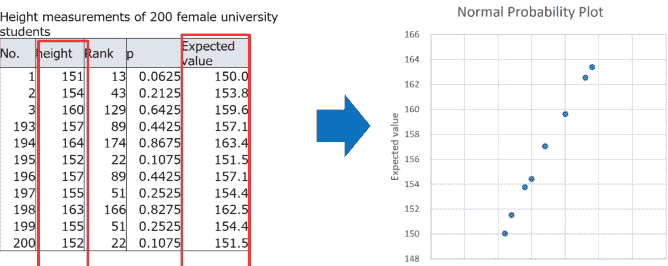

**图 2.12.** 数据及其期望值。

**步骤 6**：输入图表标题。

在图表中选择 [图表标题] 并输入“图表标题”。

**步骤 7**：添加图表元素。

当选中图表时，会出现“图表工具”菜单。选择 [图表设计] 选项卡，然后单击 [添加图表元素] — [坐标轴标题] — [主要纵向轴]，然后输入 [坐标轴标题] 中的值。对横向轴重复此过程。

| 店铺 | 年销售额 (万日元) | 座位数 | 距车站步行时间 (分钟) | 早餐 (有=1, 无=0) | 店内限定产品数量 | 残差 |
| :--- | :--- | :--- | :--- | :--- | :--- | :--- |
| A | 7800 | 54 | 6 | 0 | 2 | -139.4182075 |
| B | 8718 | 75 | 3 | 1 | 4 | -185.9401058 |
| C | 9401 | 80 | 1.5 | 1 | 1 | 113.8887997 |
| D | 8596 | 85 | 4 | 1 | 1 | -113.9421885 |
| E | 7235 | 40 | 7 | 0 | 0 | -43.81207701 |
| F | 9396 | 76 | 1.5 | 1 | 6 | 7.804519739 |
| G | 7749 | 45 | 9 | 0 | 2 | 219.2921698 |
| H | 9288 | 70 | 2 | 1 | 6 | -44.3215885 |
| I | 7581 | 50 | 7 | 0 | 1 | -36.06188526 |
| J | 8434 | 78 | 8 | 1 | 4 | -93.01670057 |

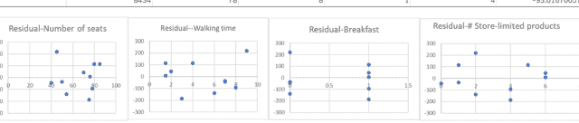

**步骤 8**：完成正态概率图。

完成正态概率图，并进行适当的格式化。如果点排列在直线 $y = x$ 上，则可以认为点是正态分布的。

为了确认假设 3，检测方差异质性很重要。以下两种方法可用于此检测：

- 使用解释变量与残差的散点图进行检查（**图 2.13**）。
- 检查被解释变量（= 解释变量的线性函数）的估计值与残差的散点图。

Breusch–Pagan 检验作为方差异质性检验已被广泛提出。

###### 2.3.2.2. Breusch–Pagan 检验

Breusch–Pagan 检验 [17] 是一种测试残差中误差项是否独立的方法。具体而言，在回归分析中假设误差项是独立的，但实际上可能并非如此。在这些情况下，Breusch–Pagan 检验可以检测到误差项不独立。得出的 p 值表明误差项是否独立。

现在假设多元回归模型表述如下：

$$y_{i} = \alpha + \beta_{1}x_{1,i} + \beta_{2}x_{2,i} + \cdots + \beta_{k}x_{k,i} + u_{i} \quad (2.10)$$

误差确定如下：

$$e_{i}=y_{i}-\alpha-\beta_{1}x_{1,i}-\beta_{2}x_{2,i}-\cdots-\beta_{k}x_{k,i}\tag{2.11}$$

假设平方误差 $e_{i}^{2}$ 由类似的回归模型表示：

$$e_{i}^{2} &=\delta_{0}+\delta_{1}x_{1,i}+\delta_{2}x_{2,i}+\cdots+\delta_{k}x_{k,i}+v_{i} \tag{2.12}$$

然后，制定以下零假设 $H_{0}$：

$$H_{0}:\delta_{1}=\delta_{2}=\cdots=\delta_{k}=0\tag{2.13}$$

$H_{0}$ 的检验通过以下 F 值的 F 检验执行：

$$\frac{(\mathrm{RSS}-\mathrm{TSS}) / k}{\mathrm{RSS} / (n-(k+1))}=\frac{(\mathrm{ESS}) / k}{\mathrm{RSS} / (n-(k+1))}\sim F(k, n-(k+1))\tag{2.14}$$

得出的 p 值表示如果零假设是“残差的方差与解释变量独立（即，满足同方差性）”的情况下，该假设为真的概率。p 值越小，零假设被拒绝的可能性越大，残差的方差取决于解释变量（即，不满足同方差性）。

如果 p 值较小（通常小于 0.05 或更低），同方差性假设不满足。因此，有必要考虑改进模型或采用不同的统计方法。另一方面，如果 p 值足够大，则认为满足同方差性假设，回归分析的结果可以自信地使用。当我们使用**图 1.12**中描述的销售额数据，以残差的平方作为目标函数进行回归分析时，我们发现有 F 值为 0.9472，这是相当高的（**图 2.14**）。

##### 2.3.3. 使用 Excel 中的数据分析工具进行回归分析

要在 Excel 中使用数据分析工具进行回归分析，请遵循以下步骤：

- (1) 将数据输入 Excel 工作表。
- (2) 选择数据，并从 [数据] 选项卡单击 [数据分析]。
- (3) 在“数据分析”对话框中，单击 [回归]。在“回归”对话框中，在 [输入 X 变量范围] 中选择解释变量，在 [输入 Y 变量范围] 中选择目标变量。选择回归模型并根据需要设置选项。


| | 年销售额 | 座位数 | 从车站步行时间（分钟） | 早餐（有=1，无=0） | 店限商品数量 | 残差 | 残差*2 |

**摘要**

**回归统计**

- 多重相关系数 R: 0.341570915
- 多重判定系数 R2: 0.11667069
- 调整 R2: -0.589992758
- 标准误差: 20187.94442
- 观测数: 10

**方差分析表**

| | 自由度 | 平方和 | 均方 | F 值 |
| :--- | :--- | :--- | :--- | :--- |
| 回归 | 4 | 269149348 | 67287337 | 0.1651 |
| 残差 | 5 | 2.038E+09 | 407553100 | |
| 总计 | 9 | 2.307E+09 | | |

图 2.14. Breusch–Pagan 检验。

(4) 在“输出选项”下的“输出区域”，选择结果输出区域的左上角单元格。

(5) 单击[确定]以输出回归分析结果（图 2.15）。

使用 Excel 的数据分析工具可以轻松地执行回归分析。从回归分析结果中，你可以注意到解释变量对目标变量的影响。Excel 的数据分析工具还可以用于评估使用回归模型的分析结果。评估指标包括以下内容：

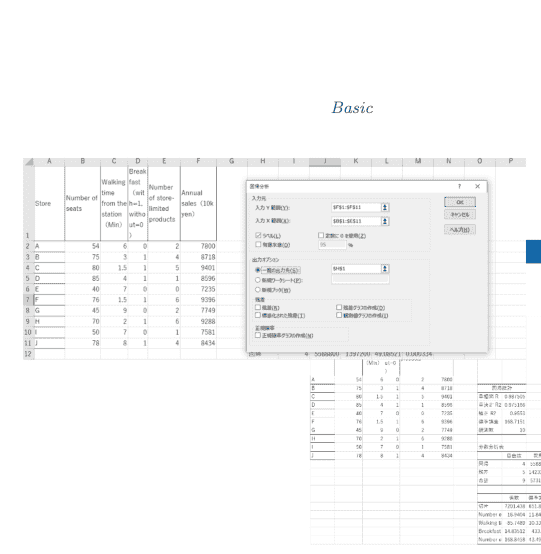

- 检查“R2”以评估估算回归方程的准确性：在回归分析中，使用一种称为判定系数的度量指标。判定系数衡量回归模型对数据的拟合程度，取值介于 0 和 1 之间。值越接近 1，表示回归模型对数据的拟合越好；值越接近 0，表示回归模型对数据的拟合越差。以下方程用于计算判定系数：$R^{2}=1-(S S E / S S T)$。在此方程中，SSE 代表残差平方和（回归模型预测值与观测值之差的平方和），SST 代表假设平方和（观测值与均值之差的平方和）。判定系数通常用于评估回归分析的结果。然而，随着解释变量数量的增加，判定系数倾向于增大。因此，必须考虑模型的复杂度。

- 检查估算的回归方程是否具有统计意义（Significance $F$）：Significance $F$ 是回归分析中用于确定回归模型是否比数据拟合得更好的度量指标。Significance $F$ 是通过计算残差平方和（SSE）与假设平方和（SST）的比率得到的。SSE 是回归模型预测值与观测值之差的平方和，SST 是观测值与均值之差的平方和。当 SSE 较小（即回归模型对数据拟合良好）且 SST 较大（即观测值显著偏离均值）时，Significance $F$ 较大。计算 Significance F 时，使用以下方程：

$$F = (\mathrm{SST} - \mathrm{SSE}) / (\mathrm{SSE} / (n - p - 1)) \qquad (2.15)$$

在此方程中，n 代表样本量，p 代表解释变量的数量。Significance F 计算数据服从 F 分布的概率，并将其与显著性水平（通常为 0.05、0.01 等）进行比较，以确定回归模型是否显著拟合数据。如果 Significance F 小于显著性水平，则回归模型显著拟合数据。

- 检查估算系数是否具有统计意义（p 值）：估算系数的绝对值离 0 越远，越容易看出其具有统计意义。如果 p 值很小（通常小于 0.05），则系数为 0 的概率很小，这意味着系数为 0 的零假设被拒绝。

- 检查每个解释变量的影响程度（系数）：在回归分析中，使用以下方法来选择用于分析的解释变量：
    - 基于先验知识和理论依据，选择被认为显著的解释变量。
    - 检查解释变量之间的相关系数。相关性高的解释变量可以被剔除，因为它们会使回归模型的解释变得混乱。
    - 使用单变量回归分析，检查每个解释变量与目标变量的相关系数。选择相关系数高的解释变量。
    - 使用多重共线性条件指数比率和 Significance F 等度量指标自动选择解释变量。多重共线性条件指数是一种衡量多元回归分析中解释变量之间高度相关状态的指标。
    - 在解释回归分析结果时，还可以通过检查解释变量的 p 值和判定系数来评估回归模型对数据的拟合程度。

###### 2.3.3.1. 变量缩减方法

变量缩减方法 [18] 常用于回归分析，使用 $p$ 值来选择有意义的解释变量。在回归分析中，一种称为变量缩减的方法允许我们通过移除不必要的变量来简化模型。这不仅使模型更易于解释，还可以防止过拟合。它还可以用于从物理数据中推导偏微分方程（PDE），这将在后文讨论。通过寻找由若干其他微分项（通常是空间偏微分项）解释一个偏微分项（通常是时间偏微分项）的模型，可以推导出 PDE。使用变量缩减方法，可以从许多候选项中删除不必要的偏微分项。

基于 $p$ 值的变量缩减是一种使用统计方法来选择与因变量显著相关的回归分析中使用的解释变量的方法。$p$ 值代表假设成立的概率。基于 $p$ 值的变量缩减方法根据使用该解释变量的回归模型的 $p$ 值，确定每个解释变量是否与因变量显著相关。如果 $p$ 值小于显著性水平（通常为 0.05 或 0.01），则该解释变量被解释为与因变量显著相关。因此，如果 $p$ 值高于显著性水平，则该解释变量将从模型中删除。

使用 $p$ 值的变量缩减方法是一种后向选择方法。它的好处是对变量的添加顺序不太敏感，因为可以同时评估所有解释变量，而不是逐个添加变量。使用 Excel 的数据分析工具，可以将回归分析转换为宏，并在 VBA 中执行上述步骤，以创建自动变量缩减方法。

###### 2.3.3.2. 自回归

Excel 的数据分析工具允许你执行自回归 [19]。AR（自回归）模型是分析时间序列数据的方法之一。自回归模型假设时间序列数据的当前值由过去的数据值决定，并通过建立此类模型来分析时间序列数据的趋势和周期性。自回归模型由以下方程表示：

y(t) = c + varphi _ {1} y(t - 1) + varphi _ {2} y(t - 2) + ... + varepsilon (t) \tag{2.16}

在此方程中，$y(t)$ 表示时间序列数据的当前值，c 表示常数，$\varphi _ {1}, \varphi _ {2}, ...$ 表示自回归系数，$\varepsilon (t)$ 表示误差项。自回归系数越大，过去数据值的影响越强。误差项表示时间序列数据中的随机噪声。自回归模型可用于预测或过滤时间序列数据。

要使用 Excel 数据分析工具中的“回归”功能执行自回归，请遵循给定步骤：使用 1990 年 9 月 16 日大淀川日置桥观测点每小时记录的实际水位数据。

(1) 在第一列插入时间数据，在第二列插入水位数据。时间从上到下是等间距的（图 2.16）。

| 时间 | 水位 |
| :--- | :--- |
| 1990/9/16 9:00 | 0.29 |
| 1990/9/16 10:00 | 0.27 |
| 1990/9/16 11:00 | 0.26 |
| 1990/9/16 12:00 | 0.26 |
| 1990/9/16 13:00 | 0.26 |
| 1990/9/16 14:00 | 0.26 |
| 1990/9/16 15:00 | 0.27 |
| 1990/9/16 16:00 | 0.27 |
| 1990/9/16 17:00 | 0.27 |
| 1990/9/16 18:00 | 0.27 |
| 1990/9/16 19:00 | 0.27 |
| 1990/9/16 20:00 | 0.27 |
| 1990/9/16 21:00 | 0.29 |
| 1990/9/16 22:00 | 0.30 |


##### 2.3.4. Excel 宏

| 时间 | 水位 | 1小时前 | 2小时前 | 3小时前 | 4小时前 | 5小时前 | 6小时前 | 7小时前 | 8小时前 | 9小时前 | 10小时前 |
| :--- | :--- | :--- | :--- | :--- | :--- | :--- | :--- | :--- | :--- | :--- | :--- |
| 9/16/90 9:00 | 0.29 | | | | | | | | | | |
| 9/16/90 10:00 | 0.27 | 0.29 | | | | | | | | | |
| 9/16/90 11:00 | 0.26 | 0.27 | 0.29 | | | | | | | | |
| 9/16/90 12:00 | 0.28 | 0.26 | 0.27 | 0.29 | | | | | | | |
| 9/16/90 13:00 | 0.26 | 0.26 | 0.26 | 0.27 | 0.29 | | | | | | |
| 9/16/90 14:00 | 0.26 | 0.26 | 0.26 | 0.26 | 0.27 | 0.29 | | | | | |
| 9/16/90 15:00 | 0.27 | 0.26 | 0.26 | 0.26 | 0.26 | 0.27 | 0.29 | | | | |
| 9/16/90 16:00 | 0.27 | 0.27 | 0.26 | 0.26 | 0.26 | 0.26 | 0.27 | 0.29 | | | |
| 9/16/90 17:00 | 0.27 | 0.27 | 0.27 | 0.26 | 0.26 | 0.26 | 0.26 | 0.27 | 0.29 | | |
| 9/16/90 18:00 | 0.27 | 0.27 | 0.27 | 0.27 | 0.26 | 0.26 | 0.26 | 0.26 | 0.27 | 0.29 | |
| 9/16/90 19:00 | 0.27 | 0.27 | 0.27 | 0.27 | 0.27 | 0.26 | 0.26 | 0.26 | 0.26 | 0.27 | 0.29 |
| 9/16/90 20:00 | 0.27 | 0.27 | 0.27 | 0.27 | 0.27 | 0.27 | 0.26 | 0.26 | 0.26 | 0.26 | 0.27 |
| 9/16/90 21:00 | 0.29 | 0.27 | 0.27 | 0.27 | 0.27 | 0.27 | 0.27 | 0.26 | 0.26 | 0.26 | 0.26 |
| 9/16/90 22:00 | 0.3 | 0.29 | 0.27 | 0.27 | 0.27 | 0.27 | 0.27 | 0.27 | 0.26 | 0.26 | 0.26 |
| 9/16/90 23:00 | 0.3 | 0.3 | 0.29 | 0.27 | 0.27 | 0.27 | 0.27 | 0.27 | 0.27 | 0.26 | 0.26 |
| 9/17/90 0:00 | 0.29 | 0.3 | 0.3 | 0.29 | 0.27 | 0.27 | 0.27 | 0.27 | 0.27 | 0.27 | 0.26 |
| 9/17/90 1:00 | 0.29 | 0.29 | 0.3 | 0.3 | 0.29 | 0.27 | 0.27 | 0.27 | 0.27 | 0.27 | 0.27 |
| 9/17/90 2:00 | 0.29 | 0.29 | 0.29 | 0.3 | 0.3 | 0.29 | 0.27 | 0.27 | 0.27 | 0.27 | 0.27 |
| 9/17/90 3:00 | 0.29 | 0.29 | 0.29 | 0.29 | 0.3 | 0.3 | 0.3 | 0.29 | 0.27 | 0.27 | 0.27 |
| 9/17/90 4:00 | 0.31 | 0.29 | 0.29 | 0.29 | 0.29 | 0.3 | 0.3 | 0.29 | 0.27 | 0.27 | 0.27 |

图 2.17. 历史水位数据的副本。

- (2) 复制第 2 列中从第 2 行及后续行中的所有数据，并将其粘贴到第 3 列，位置在第 2 行下方一行。针对所需的时间间隔重复此步骤。假设此步骤重复了 $N$ 次。第二列保存的是水位，即目标变量，而后续列保存的是解释变量（历史水位数据）（图 2.17）。

- (3) 在此阶段，执行“数据分析”工具中的“回归”功能。对于目标变量，选择向下移动了 $N$ 行后的单元格。假设 $N = 5$，创建一个使用 1 小时前至 5 小时前的水位数据来预测水位的模型。原始数据和预测数据分别列于第 2 列和第 13 列。通过回归分析成功执行了自回归（图 2.18）。

| 时间 | 水位 | 1小时前 | 2小时前 | 3小时前 | 4小时前 | 5小时前 | 6小时前 | 7小时前 | 8小时前 | 9小时前 | 10小时前 | 预测值 | 残差 |
| :--- | :--- | :--- | :--- | :--- | :--- | :--- | :--- | :--- | :--- | :--- | :--- | :--- | :--- |
| | | | | | | | | | | | | | |

**回归统计**
- 复相关系数 (Multiple R): 0.99172
- R 方 (R Square): 0.993449
- 调整 R 方 (Adjusted R Square): 0.99792
- 标准误差 (Standard Error): 0.01515
- 观测值 (Observations): 4

**方差分析表 (ANOVA Table)**

| 来源 | df | SS | MS | F | P-value | F crit |
| :--- | :--- | :--- | :--- | :--- | :--- | :--- |
| 回归 | 5 | 0.03542 | 0.00708 | 2.32642 | 0.112296 | 2.7644 |
| 残差 | 4 | 0.05265 | 0.01316 | | | |
| 总计 | 9 | 0.08807 | | | | |

图 2.18. 回归分析的水位预测结果。

Excel 宏是 Excel 中使用的一种程序。在 Excel 中，可以使用一种名为 VBA (Visual Basic for Applications) 的编程语言创建宏。宏可用于自动化 Excel 中的重复性任务和操作，这在处理大量数据时非常有用。宏还可以用于扩展 Excel 的功能。

要创建宏，你需要学习 VBA。要学习 VBA，具备基本的编程知识会很有帮助。但是，即使从未学习过编程的人也可以通过逐步学习来创建宏。

要在 Excel 中使用宏，必须在设置中启用它们。步骤如下：

- 从菜单中打开 [Developer] 并点击 [Macro Security]。
- 点击 [Macro Settings]。
- 在宏设置中，选择 [Enable VBA macros]。
- 点击 [OK] 按钮保存设置。

现在你就可以在 Excel 中使用宏了。

注意：启用宏可能会导致你的计算机运行危险宏的风险。在启用之前，务必确认你要运行的宏来自可信来源。

“Record Macro”按钮在 Excel 安装后可能不会立即出现。如果是这种情况，请在 Excel 中启用宏，请遵循以下步骤：

- 打开 [File] 菜单并点击 [Options]。
- 从菜单中点击 [Customize Ribbon]。
- 在“常用命令”列表中，选择 [Developer] 并按下 [OK] 按钮。
- 点击 [OK] 按钮保存设置（图 2.19）。

要在 Excel 中录制宏，请遵循以下步骤：

- 点击 [Developer] 选项卡。
- 点击 [Record Macro] 按钮。

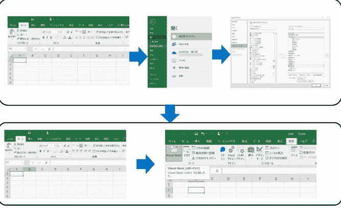

图 2.19. 如何启用宏。

- (3) 录制开始。你的鼠标和键盘操作现在正在被记录。在 Excel 中执行你的任务。
- (4) 要结束录制，再次点击 [Record Macro] 按钮。
- (5) 出现“Record Macro”对话框。输入已录制宏的名称并点击 [OK] 按钮。

你现在已经在 Excel 中录制了一个宏。

注意：当你在 Excel 中录制宏时，会自动生成 VBA 代码以复现记录的操作。要运行已录制的宏，请转到 [Developer] 选项卡，点击 [Macros] 按钮，选择已录制的宏，或者点击“Run Macro”按钮。

VBA (Visual Basic for Applications) 是一种用于 Microsoft Office 应用程序（Excel、Word、Outlook、PowerPoint 等）的编程语言。VBA 可用于自动化 Excel 中的重复性任务和操作。VBA 也可用于扩展 Excel 的功能。在 Excel 中录制宏时，VBA 会自动生成。但是，你也可以直接编写 VBA。通过直接编写 VBA，你可以创建更复杂、自定义的宏。要学习 VBA，具备基本的编程知识会很有帮助。但是，即使从未学习过编程的人也可以通过逐步学习来创建 VBA。

VBA 使用与 Visual Basic 类似的语法。VBA 的基本语法包括以下内容：

- 变量：存储数据。它可以存储多种数据类型，包括数字和字符串。
- 控制语句：用于控制程序的语法，包括 If 和 For 语句。
- 函数：执行特定操作。VBA 提供标准函数（例如 SQR 和 LEFT 函数）。你还可以创建自己的函数。
- 语句：单个语句。VBA 要求在语句末尾使用分号 (;)。

这些是 VBA 语法的基础。此外，VBA 允许你使用方法和属性来利用各种 Excel 功能。

例如，计算多个数据中的最大值及其位置的 VBA 程序看起来像这样：

```vba
Sub FindMax()
  Dim data() As Variant 'Array to store the data
  Dim i As Long 'Counter variable
  Dim maxValue As Variant 'Maximum value
  Dim maxIndex As Long 'Position of the maximum value
  'Store the data in the array
  data = Array(10, 20, 30, 40, 50)
  'Find the maximum value and its position
  maxValue = data(0) 'Initialize the maximum value with the first element
  maxIndex = 0 'Initialize the position of the maximum value with the first element
  For i = 1 To UBound(data)
    If maxValue < data(i) Then
      maxValue = data(i) 'Update the maximum value
      maxIndex = i 'Update the position of the maximum value
    End If
  Next i
  'Display the results
  MsgBox "The maximum value is " & maxValue & ", and its position is " & maxIndex & "."
End Sub
```


在上述程序中，数据存储于数组 data 中。随后可以使用 For 语句逐个检查数组的内容。如果当前元素大于最大值，则更新最大值，并同时更新其位置。

最后，使用 MsgBox 函数显示结果，该函数会打印最大值及其位置。要执行上述程序，请将上述代码写入 VBA 编辑器，然后按下 [F5] 键或点击 [运行宏] 按钮。

此程序可用于找出回归分析结果中解释变量的最大 p 值，方法是删除该解释变量并重新执行回归分析，该分析结果已输出到 Excel 工作表中。

##### 2.3.5. 使用 Excel VBA 实现变量缩减法

回归分析中描述的变量缩减法通过 VBA 实现。在此实现中，流程是找到 $t$ 值的绝对值中最小的那个值（代替 $p$ 值），然后移除该变量并重复回归分析。在 $p$ 值为 5% 的水平上，$t$ 值的绝对值通常大于或等于 2，并且彼此呈负相关。

假设 Excel 工作表的第一列包含因变量数据，第二列及后续列（共对应解释变量的数量）包含解释变量数据。假设第一行的第二列输入了解释变量的数量，第一列输入了样本量。回归分析的结果（解释变量的系数、$p$ 值和 $t$ 值）应与最后一行数据之间空一行，输出到左上角单元格（标记为 Summary）。

以下是一个将变量缩减法应用于调查结果以缩小显著影响目标函数的目标变量的示例。在此调查中，向 106 名大学一年级学生发放了问卷，要求他们对与大学生满意度和期望水平相关的九个不同项目按区间量表作答。区间量表是一种定量测量量表，它不是顺序量表，两个变量之间的差异是有意义且相等的，而零点的存在是可选的。当您执行变量缩减法的 VBA 程序时，会发现保留了两个基本项目（图 2.20）。

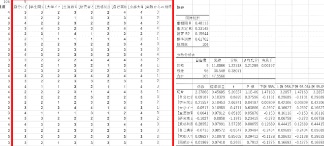

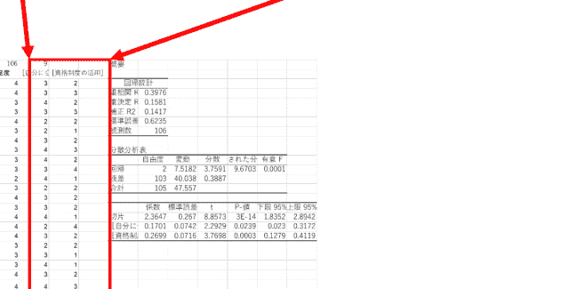

图 2.20. 使用变量缩减法分析调查结果的示例。

为了做准备，首先获取执行数据分析工具下的“回归”、删除列并将文本左对齐的宏输出。开启“录制宏”，执行数据分析工具下的“回归”，然后删除列，并执行“左对齐”。正如您将在结果中注意到的那样，需要特定的 Excel 设置来指定行和列。要在 VBA 程序中实现这一点，您需要学习如何操纵字符型数据。我们现在将讨论如何实现这一点。

在此程序实现中，需要四种类型的字符型数据操作。

-   从字符型数据获取字符代码：要将字符型数据 A 的字符代码分配到第一行第三列，请编写以下内容：`Cells(1,3) = Asc("A")`
-   从字符代码转换为字符型数据：要将字符代码为 66 的字符型数据分配到第一行第四列，请编写以下内容：`Cells(1,4)=Chr(66)`
-   将整型数据转换为字符型数据：要将整型数据 NROWS + 4 转换为字符型数据并将其分配到第一行第五列，请编写以下内容：`Cells(1,5)=str(NROWS + 4)`
-   连接字符串：要在第一行第六列连接并分配三个字符型数据 NR，请编写以下内容：`Cells(1,6)="B2."+"L"+"20"`

要在 VBA 程序中查找 $t$ 值绝对值最小的解释变量数据列，请编写以下代码。

```vba
<Begin>
TMIN = 999999
For j = 1 To CVARS
TVAL = Abs(Cells(j + NLINES + 20, 4))
If TVAL < TMIN Then
TMIN = TVAL
IMIN = j
End If
Next j
<End>
```

CVARS 表示解释变量的数量，NLINES 表示样本量，TMIN 表示当前的最小值。初始时分配一个较大的数值（999999）。j + NLINES + 20 是写入 $t$ 值的行号。要删除 $t$ 值绝对值最小的列，请在 VBA 程序中编写以下宏：

```vba
<Begin>
TRange = Chr(Asc("B") + IMIN - 1)
Columns(TRange).Select
Selection.Delete Shift:=xlToLeft
CVARS = CVARS - 1
<End>
```

解释变量数据从 B 列开始；因此，选择第 IMIN 个解释变量数据列（该数据列名为字符型数据 TRange），删除它，并执行左对齐。删除列还会使当前阶段的解释变量数量（CVARS）减少一个。

执行数据分析工具下“回归”的宏如下：

```vba
<Begin>
XRANGE = "B2:" + Chr(65 + NVARS - i + 1) + Trim(Str(NLINES + 2))
Application.Run "ATPVBAEN.XLAM!Regress",
ActiveSheet.Range(YRANGE), _ActiveSheet.Range(XRANGE),
False, True, , ActiveSheet.Range(OVERVIEW), _False, False,
False, False, , False
<End>
```

"_" 表示程序行继续；因此，以 Application.Run 开头的语句跨三行。列出了回归向导中用户指定的信息。因此，复选框由 True/False 决定，以指示是否选中或未选中。YRANGE 是因变量所在的列，XRANGE 是解释变量的列列表，OVERVIEW 是将列出回归分析结果的数据区域的左上角单元格。

将上述三个部分连接起来即完成变量缩减程序。完成的版本如下所示。

```vba
<Begin>
Sub reduce_variables()
NVAR S = Cells(1, 2)
NLINES = Cells(1, 1)
criteria = Cells(1, 3)
If criteria < 1 Then criteria = 2
YRANGE = "A2:A" + Trim(Str(NLINES + 2))
OVERVIEW = "A" + Trim(Str(NLINES + 4))
CVARS = NVARS
For i = 1 To NVARS
XRANGE = "B2:" + Chr(65 + NVARS - i + 1) + Trim(Str(NLINES + 2))
Application.Run "ATPVBAEN.XLAM!Regress",
ActiveSheet.Range(YRANGE), _ActiveSheet.Range(XRANGE),
False, True, , ActiveSheet.Range(OVERVIEW)_, False, False, False, False, , False
TMIN = 999999
For j = 1 To CVARS
TVAL = Abs(Cells(j + NLINES + 20, 4))
If TVAL < TMIN Then
TMIN = TVAL
IMIN = j
End If
Next j
If TMIN > criteria Then
Exit For
End If
TRange = Chr(Asc("B") + IMIN - 1)
Columns(TRange).Select
Selection.Delete Shift:=xlToLeft
CVARS = CVARS - 1
Next i
End Sub
<End>
```

变量判据设置为 $t$ 值的绝对值。如果设置为 2，则绝对值小于或等于 2 的 $t$ 值对应的解释变量将被删除。Trim 函数用于去除字符型数据中字符前后的空格。

#### 2.4. 假设分析

Excel 的假设分析工具允许您为数据设置各种条件，并据此模拟结果。Excel 提供两种假设分析工具：一种是“数据表”，另一种是“方案管理器”。本节将向您展示如何使用数据表进行假设分析。

在执行假设分析之前，使用温度数据执行回归分析。用 2000 年 1 月东北地区 14 个主要城市的平均温度数据，通过经度和纬度表示。由于我们要找出最低气温，除了经纬度外，我们还使用平方数据（$x^{2}, y^{2}, xy$）在二次曲面上表示温度。也就是说，温度是通过以下方式计算的


使用以下五个解释变量 $(x, y, x^2, y^2, xy)$：

$T = a_0 + a_1x + a_2y + a_3x^2 + a_4y^2 + a_5xy$ (2.17)

使用我们已经描述过的 Excel 数据分析工具，执行回归分析并计算系数 $(a_0, a_1, a_2, a_3, a_4, a_5)$。

在 J 列的第二行及后续行中输入你想预测温度的地点的经度 $(x)$ “$140$–$142^{\circ}$（以 $0.2^{\circ}$ 为增量）”。然后，在 J 列的第一行及后续行中输入你想预测温度的地点的纬度 $(y)$ “$37$–$41.5^{\circ}$（以 $0.2^{\circ}$ 为增量）”。该数据表基于纬度和经度，使用回归分析模型在二维空间中可视化温度（图 2.21）。

要使用数据表，首先选择要可视化的单元格（J1:U13）。接下来，转到 Excel 中的 [数据] 选项卡，点击 [模拟分析]，然后选择 [数据表]。对话框会出现。设置如下：

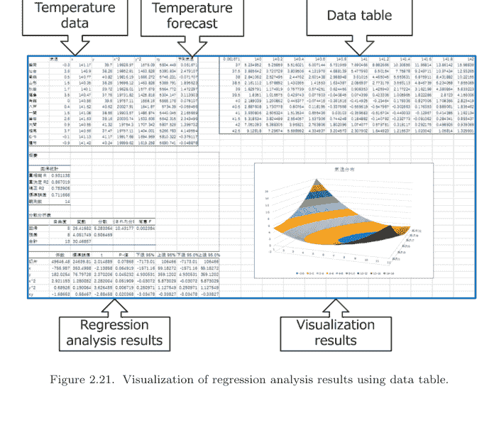

-   (1) 在 [行输入单元格] 中选择单元格 C2，在此处将分配经度 (x)。
-   (2) 在 [列输入单元格] 中选择单元格 D2，在此处将分配纬度 (y)。
-   (3) 点击 [确定] 以创建数据表。

现在你可以看到温度数据如何随经度和纬度的组合而变化。

为了可视化数据表，Excel 的条件格式设置和等高线显示非常有用。

条件格式设置允许你根据单元格中的值或数据自动更改单元格的背景或文本颜色。这被称为“条件格式设置”。条件格式设置可用于以易于查看的方式显示数据。要使用条件格式设置，请遵循以下步骤：

-   (1) 选择要应用条件格式设置的单元格。
-   (2) 从 [格式] 选项卡中选择 [条件格式]。
-   (3) 出现“条件格式”对话框。设置如下：
-   (4) 点击 [添加] 以输入条件。
-   (5) 在 [格式] 中，设置当满足条件时高亮显示的单元格和文本颜色。
-   (6) 点击 [确定] 完成条件格式设置。

条件格式设置允许你自由设置格式，例如，如果单元格值大于特定值则为红色，如果单元格值小于特定值则为蓝色，否则为灰色。你还可以设置多个条件。

在 Excel 中，你可以创建称为“曲面”的图表来可视化数据。曲面会根据数据自动进行颜色编码，使数据更易于理解。

要在 Excel 中创建曲面，从 [数据] 选项卡中选择 [曲面]。将出现“图表设计”对话框。设置如下：

-   (1) 在 [数据] 设置中，指定要创建等高线的数据范围。
-   (2) 在 [图表样式] 中，设置等高线的显示方式和颜色。
-   (3) 点击 [确定] 完成曲面创建。

创建的曲面将显示在 Excel 工作表中。等高线可用于可视化数据中的趋势和模式。等高线还可用于识别数据中的变化和波动。

#### 2.5. 规划求解

Excel 规划求解是 Microsoft Excel 中包含的一种优化工具。Excel 规划求解可用于解决最优化问题，包括最小化、最大化和受约束的最优化问题。它还可以通过选择各种优化算法来解决多种问题。

Excel 规划求解提供三种方法（GRG 非线性、LP 单纯形法和遗传算法）。

GRG 非线性 [20] 用于解决非线性最优化问题。GRG 非线性使用称为广义约化梯度（GRG）的方法来解决非线性最优化问题。该方法推断出几个最优解来解决一个问题，然后从中选择最好的一个。GRG 非线性的特点是速度极快。另一方面，据说其解可能不精确。因此，如果你追求高精度，应考虑使用不同的算法。

线性最优化问题是指最大化或最小化一个将变量与一个或多个系数线性组合的方程的问题。

例如，以下问题是一个线性最优化问题：找到 x, y 以最大化以下目标函数：

$$z=3 x+4 y$$
(2.18)

找到满足以下约束条件的 x, y：

$$x+y \leq 10$$

$$2 x+y \geq 5$$

$$x, y \geq 0$$

为了解决这个问题，通常使用优化方法来评估样本点，并使用这些点估算最优解。例子包括线性规划和单纯形法。

非线性最优化问题是指变量与系数非线性组合以最大化或最小化一个方程的问题。例如，以下问题是一个非线性最优化问题：

找到 x, y 以最大化以下目标函数：

$z = x^{2} + y^{2}$                                                                                          (2.19)

找到满足以下约束条件的 x, y：

$x^{2} + y^{2} \le 10$                                                         

$2x + y \ge 5$                                                          

$x, y \ge 0$                                                            

为了解决这个问题，通常使用牛顿法或最速下降法。非线性最优化问题可能难以解决，因为可能没有解或有多个解。

LP 单纯形法 [21] 用于解决线性最优化问题。LP 单纯形法使用称为线性规划（LP）单纯形法的方法来优化变量的值，以满足目标函数和约束条件。LP 单纯形法的特点是速度极快。它也以其解的准确性为特征。另一方面，如果问题很复杂，应考虑使用其他算法。

线性最优化问题是指最大化或最小化一个将变量与一个或多个系数线性组合的方程的问题。

例如，以下问题是一个线性最优化问题：找到 x, y 以最大化以下目标函数：

$z = 3x + 4y$                                                                                          (2.20)

找到满足以下约束条件的 x, y：

$x + y \le 10$                                                         

$2x + y \ge 5$                                                         

$x, y \ge 0$                                                            

为了解决这个问题，通常使用优化方法来评估样本点，并使用这些点估算最优解。例子包括线性规划和单纯形法。

遗传算法 [22] 用于解决非线性最优化问题。遗传算法使用一种称为进化算法（EA）的方法来解决非线性最优化问题。该方法模仿自然界中的遗传过程，估算多个最优解，并选择最好的一个来解决问题。遗传算法的特点是计算时间比其他算法长。另一方面，当问题复杂时，它可能比其他算法产生更好的结果。

这里有一个使用规划求解探索极寒地区的例子。我们将使用回归分析中使用的温度数据进行优化计算。首先，在第 16 行进行优化准备。在 A16 中输入地点名称“极寒地区”（非强制）。在 C16 和 D16 中分别输入经度和纬度的初始值 141.0 和 40.0。复制 H15（显示预测温度的单元格）并将其粘贴到 H16。确认 H16 中的预测温度是由回归模型计算的。

接下来，启动 Excel 规划求解。点击 Excel 中的 [数据] 选项卡，然后点击 [规划求解]。在“规划求解参数”对话框中，在 [设置目标] 中选择“H16”。在“更改为”中，勾选 [最小值] 作为目标值。在 [可变单元格] 中，选择作为变量单元格的经度和纬度所在的两个单元格 C16:D16，然后点击 [求解] 按钮。一段时间后，会出现一个对话框指示优化已完成。按下 [确定] 按钮保存优化结果。确认 H16 中显示最小值。要找出极寒地区在哪里，你可以使用纬度和经度在 Google 地图上搜索（图 2.22）。

##### 2.5.1. *优化*

优化意味着找到解决具有特定目标问题的最佳方案。解决此类问题的方法称为“优化算法”。最优化问题常用于计算机科学、工程和经济学等多种领域。

例如，一个著名的最优化问题是寻找最小值。在这个问题中，目标是找到使函数值最小化的输入。寻找最大值的问题也是如此。在这个问题中，目标是找到使函数值最大化的输入。

在某些最优化问题中，可能还需要满足某些条件。一个例子是当程序需要最小化，但同时必须满足处理特定数据集所需的最小规格。这种问题被称为“约束最优化问题”。


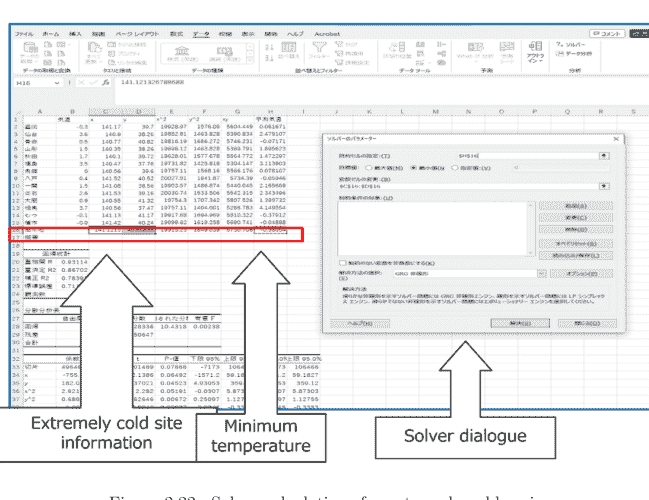

##### 2.5.2. 回归分析的实现

我们已经讨论了使用 Excel 中的数据分析工具进行回归分析。也可以利用规划求解（Solver）来执行回归分析。

现在，我们来确定代表回归线的简单回归方程中的误差。假设能够成功拟合 $N$ 个离散点的回归线方程为 $y = \beta_0 + \beta_1 x$。对于第 $i$ 个点，在 $y$ 轴方向上的误差为 $e_i = y_i - (\beta_0 + \beta_1 x_i)$。该误差的平方和为

$$\sum_{i=1}^{N} e_i^2 = \sum_{i=1}^{N} (y_i - (\beta_0 + \beta_1 x_i))^2 \quad (2.21)$$

（图 2.23）。

为了计算使误差最小的方程系数 $(\beta_0, \beta_1)$，我们按照以下步骤使用规划求解（图 2.24）：

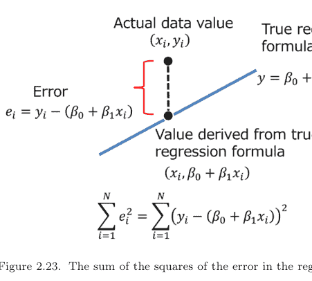

$$\sum_{i=1}^{N} e_i^2 = \sum_{i=1}^{N}(y_i - (\beta_0 + \beta_1x_i))^2$$

图 2.23. 回归线误差的平方和。

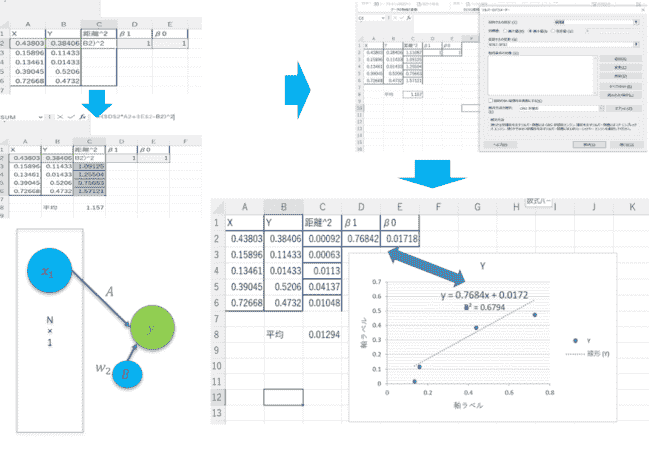

首先，将五个离散数据点输入 Excel 工作表的 A2:B6 单元格。然后，将误差平方公式 `=($D$2*$A2+$E$2-B2)^2` 输入到 C2 单元格。回归线的斜率和截距 $((\beta_0, \beta_1))$ 设置为初始值 (D2, E2) = (1,1)，并采用绝对引用。相比之下，坐标值 (A2, B2) 采用相对引用。接下来，向下复制 C2 单元格中误差平方公式的四行。在 C8 单元格中写入计算这五行误差平方平均值的公式。按照以下步骤执行规划求解：

- (1) 在 Excel 中点击 [数据] 选项卡，然后点击 [规划求解]。
- (2) 在“规划求解参数”对话框中，在 [设置目标] 中选择“C8”。
- (3) 在同一对话框的“目标”选项中，选择 [最小值] 作为目标值。
- (4) 在同一对话框中，在 [更改可变单元格] 中设置“D2:E2”。
- (5) 在同一对话框中，对于 [添加约束]，确定回归线无需设置约束条件。
- (6) 在同一对话框中，取消勾选 [使无约束变量非负]。
- (7) 在同一对话框中，在“选择求解方法”中选择 [GRG 非线性]。
- (8) 在同一对话框中，按 [求解] 按钮。

在“规划求解结果”对话框中，勾选 [保留求解结果]，然后点击 [确定] 按钮。

现在，通过 5 个点的坐标数据，已得到由规划求解计算出的斜率和截距。将这些结果与 Excel 散点图中显示的回归线的斜率和截距进行比较时，你会注意到结果大致一致。

对于能够成功拟合 $N$ 个离散点的回归平面，我们首先考虑多重回归方程中的误差。能够成功拟合 $N$ 个离散点的回归平面方程是通过最小化均方误差找到的

$$\sum_{i=1}^{N} e_{i}^{2} / N = \sum_{i=1}^{N}(z_{i} - (\beta_{0} + \beta_{1} x_{i} + \beta_{2} y_{i}))^{2} / N. \tag{2.22}$$

为了展示一个具体示例，让我们从 $N = 26$ 个点的坐标数据中找出回归平面。

首先，将 26 个离散点数据输入 Excel 工作表中的单元格区域“B2:C27”。B 列代表 $X$，C 列代表 $Y$。这些坐标数据是从 $\{(x, y) \mid 0 \leq x \leq 1, 0 \leq y \leq 1\}$ 中随机选取的。对于 $X$ 和 $Y$，使用以下公式计算 $Z$ 的值并将其输入到 A 列：

$$z = x^{2} + x + y^{3} + y^{2} \tag{2.23}$$

接下来，点击 [数据分析] — [回归]。在 [输入 $X$ 变量范围] 中选择 B 列和 C 列作为解释变量，在 [输入 $Y$ 变量范围] 中选择 A 列作为目标函数。在 [输出区域] 中选择 G2（参见图 2.25 的上半部分）。检查此时得到的系数（截距、$X$ 的系数和 $Y$ 的系数）是否与通过规划求解最小化均方误差得到的系数相同。

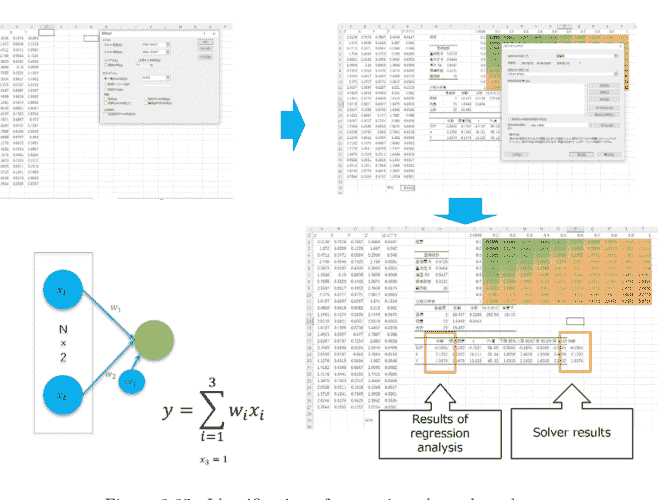

使用暂时确定的 D2 处的系数（存储在 P18:P20）和坐标数据（存储在 B2:C2）计算以下公式，并将得到的值标记为 Z'：

```
P$18+MMULT (B2:C2, $P$19:$P$20)
```

在 E2 单元格中写入误差平方公式 `(A2-D2)^2`。接下来，向下复制 E2 单元格 25 行以计算误差平方。然后，在 E29 单元格中写入计算这 26 行误差平方平均值的公式。

按照以下步骤执行规划求解：

- 1. 在 Excel 中点击 [数据] 选项卡，然后点击 [规划求解]。
- 2. 在“规划求解参数”对话框中，在 [设置目标] 中选择“E29”。
- 3. 在同一对话框的“目标”选项中，选择 [最小值] 作为目标值。
- 4. 在同一对话框中，在 [更改可变单元格] 中设置“P18:P20”。
- 5. 在同一对话框中，对于 [添加约束]，确定回归线无需设置约束条件。
- 6. 在同一对话框中，取消勾选 [使无约束变量非负]。
- 7. 在同一对话框中，在“选择求解方法”中选择 [GRG 非线性]。
- 8. 在同一对话框中，按 [求解] 按钮。

在“规划求解结果”对话框中，勾选 [保留求解结果]，然后点击 [确定] 按钮。

现在，通过 26 个点的坐标数据，已得到由规划求解计算出的系数。也就是说，使用规划求解从 $N=26$ 个离散点数据 $(X, Y)$（随机选自 $\{(x, y)|0 \leq x \leq 1, 0 \leq y \leq 1\}$）创建了线性回归模型。均方误差为 0.0402。将这些结果与 Excel 分析工具中回归分析得到的系数进行比较时，你会注意到它们大致一致（参见图 2.25 的下半部分）。

#### 2.6. Colab

Colab 允许你使用 Pandas 和 NumPy（Python 的数据分析库）来读取数据并进行统计分析。例如，你可以使用 Pandas 从 CSV 文件读取数据并计算均值、标准差、最小值和最大值，如下所示：

```python
import pandas as pd

df = pd.read_csv("sample_data.csv")
mean = df["column"].mean()
std = df["column"].std()
min_val = df["column"].min()
max_val = df["column"].max()
```

NumPy 同样可以读取数据并进行统计分析。

Colab 还允许你使用 Matplotlib 或 Seaborn 进行数据可视化。例如，你可以使用 Matplotlib 显示数据的直方图，如下所示：

```python
import matplotlib.pyplot as plt

plt.hist(df["column"])
plt.show()
```

##### 2.6.1. 相关性分析

要在 Colab 中进行相关性分析，使用 Pandas 非常方便。在 Pandas 中，可以使用 "corr" 方法轻松计算数据框中变量的相关系数。例如，你可以使用 Pandas 计算两个变量之间的相关系数，如下所示：

```python
import pandas as pd
df = pd.read_csv("sample_data.csv")
corr = df["column1"].corr(df["column2"])
print(corr)
```

该代码计算 "column1" 和 "column2" 之间的相关系数，并将结果赋值给变量 "corr"。在 Pandas 中，"corr" 方法还可以用于指定相关系数的类型。例如，要计算皮尔逊相关系数，请指定 `method="pearson"`。

```python
corr = df["column1"].corr(df["column2"], method="pearson")
```

Pandas 还允许你使用 "corr" 方法计算数据框中所有变量的相关系数。

```python
corr_matrix = df.corr()
print(corr_matrix)
```

该代码计算数据框 "df" 中所有变量的相关系数，并将结果赋值给变量 "corr_matrix"。

##### 2.6.2. F 检验

要在 Colab 中进行 F 检验，使用 SciPy 库非常方便。SciPy 库提供了一个 "f_oneway" 函数，可用于执行 F 检验。F 检验用于检验三个或更多组的变量均值是否存在显著差异。例如，可以使用 SciPy 进行 F 检验，如下所示：

```python
from scipy import stats
group1 = [1, 2, 3, 4]
group2 = [2, 3, 4, 5]
```


```
group3 = [3, 4, 5, 6]
stat, p = stats.f_oneway(group1, group2, group3)
print ("F statistic:", stat)
print ("p-value:", p)
```

这段代码准备了三组数据，并使用 `f_oneway` 函数进行 F 检验。F 统计量和 p 值结果通过 F 检验获得。如果 F 统计量较大，我们可以得出结论，组间均值存在显著差异。另一方面，如果 p 值较小，我们可以得出结论，组间均值存在显著差异。

##### 2.6.3. t 检验

要在 Colab 中执行 t 检验，使用 SciPy 库非常方便。SciPy 库提供了一个 `ttest_ind` 函数，可用于执行 t 检验。t 检验检查两个组在某个变量的均值上是否存在显著差异。例如，可以使用 SciPy 按以下方式执行 t 检验：

```
from scipy import stats

group1 = [1, 2, 3, 4]
group2 = [2, 3, 4, 5]

stat, p = stats.ttest_ind(group1, group2)
print ("t statistic:", stat)
print ("p-value:", p)
```

这段代码准备了两个组，并使用 `ttest_ind` 函数执行 t 检验。t 统计量和 p 值作为 t 检验的结果获得。另一方面，如果 p 值较小，我们可以得出结论，两组间的均值存在显著差异。另一方面，如果 p 值较小，我们可以得出结论，两组的均值之间存在显著差异。

在 Colab 中，如果认为两个组之间的方差相等，使用 SciPy 库执行 t 检验会更方便。SciPy 库提供了一个 `ttest_ind` 函数，可用于执行 $t$ 检验。例如，我们可以使用 SciPy 执行 $t$ 检验，以查看两个组之间的方差是否可视为相等，如下所示：

```
from scipy import stats

group1 = [1, 2, 3, 4]
group2 = [2, 3, 4, 5]

stat, p = stats.ttest_ind(group1, group2, equal_var=True)
print ("t statistic:", stat)
print ("p-value:", p)
```

这段代码使用 `ttest_ind` 函数在两个组之间的方差不能视为相等时执行 $t$ 检验。如果将 `equal_var` 参数设置为 `False`，则当两个组之间的方差不被视为相等时，可以执行 $t$ 检验。

在 Colab 中，使用 SciPy 库来检查同一组中某些变量的均值是否显著不同会非常方便。SciPy 库提供了一个 `ttest_rel` 函数，可用于相关性测试。例如，您可以使用 SciPy 测试同一组中某些变量的均值是否显著不同。

```
from scipy import stats

group = [1, 2, 3, 4]

stat, p = stats.ttest_rel(group, group)
print ("t statistic:", stat)
print ("p-value:", p)
```

这段代码使用 `ttest_rel` 函数测试同一组中某些变量的均值是否显著不同。$t$ 统计量和 $p$ 值作为 $t$ 检验的结果获得。另一方面，如果 $p$ 值较小，我们可以得出结论，组间均值存在显著差异。另一方面，如果 $p$ 值较小，我们可以得出结论，两组间的均值存在显著差异。

##### 2.6.4. Z 检验

要在 Colab 中执行 Z 检验，使用 SciPy 库非常方便。SciPy 库提供了一个 `zscore` 函数，可用于执行 Z 检验。Z 检验在已知总体均值的情况下，检查样本均值是否存在显著差异。例如，可以使用 SciPy 按以下方式执行 Z 检验：

```
from scipy import stats

sample = [1, 2, 3, 4]
population_mean = 2.5

z_score = stats.zscore(sample, population_mean)
print(z_score)
```

这段代码使用 `zscore` 函数计算样本的 Z 值。如果 Z 值较大，我们可以得出结论，样本均值存在显著差异。

##### 2.6.5. 回归分析

要在 Colab 中执行回归分析，使用 NumPy 或 SciPy 库非常方便。例如，可以使用 NumPy 按以下方式执行一元回归分析：

```
import numpy as np

# 自变量
x = np.array([1, 2, 3, 4])
# 因变量
y = np.array([1, 2, 3, 4])

# 查找回归系数
a, b = np.polyfit(x, y, 1)
print ("regression coefficient:", a)
print ("intercept:", b)
```

这段代码使用 `polyfit` 函数查找自变量 *x* 和因变量 *y* 之间回归线的回归系数 *a* 和截距 *b*。也可以使用 SciPy 库执行多元回归分析、逻辑回归分析等。

在 Colab 中，使用 SciPy 库计算回归分析中回归系数的 *t* 值和 *p* 值会非常方便。SciPy 库提供了一个 `linregress` 函数，可用于获取回归分析的结果。例如，您可以使用 SciPy 按以下方式获取回归分析的结果：

```
import numpy as np
from scipy import stats

# 自变量
x = np.array([1, 2, 3, 4])
# 因变量
y = np.array([1, 2, 3, 4])

# 查找回归系数
slope, intercept, r_value, p_value, std_err = stats.linregress(x, y)
print ("regression coefficient:", slope)
print ("intercept:", intercept)
print ("t value:", slope / std_err)
print ("p value:", p_value)
```

这段代码使用 `linregress` 函数查找自变量 x 和因变量 $y$ 之间回归线的回归系数、截距、$t$ 值、$p$ 值以及标准误差。

在 Colab 中，使用 StatsModels 库计算多元回归分析中回归系数的 t 值和 p 值会非常方便。StatsModels 库提供了一个 `OLS` 类，可用于执行多元回归分析。例如，您可以使用 StatsModels 按以下方式执行多元回归分析：

```
import statsmodels.api as sm

# 自变量
x = np.array([[1, 2], [3, 4], [5, 6], [7, 8]])
# 因变量
y = np.array([1, 2, 3, 4])

# 执行多元回归分析
model = sm.OLS(y, x)
results = model.fit()

# 查找回归系数
print(results.summary())
```

这段代码使用 `OLS` 类执行多元回归分析。`fit` 方法可用于获取回归分析的结果。`summary` 方法允许您查看多元回归分析的结果，包括回归系数的 $t$ 值和 $p$ 值。

以下是一个示例代码，用于在 Colab 中读取 Excel 文件并执行回归分析：

```
# 导入 Pandas
import pandas as pd
# 从 Google Drive 导入文件
from google.colab import drive

drive.mount('/content/drive')
# Excel 文件路径
file_path = '/content/drive/My Drive/data.xlsx'
# 读取 Excel 文件
df = pd.read_excel(file_path)
# 导入必要的库
import numpy as np
from sklearn.linear_model import LinearRegression
# 设置自变量和因变量
X = df[['x1', 'x2', 'x3']]
y = df['y']
# 生成线性回归实例
model = LinearRegression()
# 学习
model.fit(X, y)
# 系数
print ("coefficient:", model.coef_)
# 截距
print ("intercept:", model.intercept_)
# 决定系数
print ("R2:", model.score(X, y))
```

此示例使用 Pandas 读取 Excel 文件，并使用 sklearn 的线性回归执行回归分析。上述代码从 Google Drive 读取文件。为了访问 Google Drive，我们需要使用 `drive.mount()` 进行身份验证。此外，在上面的示例中，x1、x2 和 x3 被设置为自变量，而 y 是因变量。

##### 2.6.6. 优化问题

要在 Colab 中解决优化问题，使用 SciPy 库非常方便。SciPy 库提供了多个用于解决优化问题的函数。通过使用它们，您可以解决优化问题。例如，您可以使用 SciPy 按以下方式解决寻找最小值的优化问题：

```
from scipy import optimize

# 函数 f(x) = x^2
```


```python
def f(x):
    return x**2
```

```python
# Find the minimum value
result = optimize.minimize(f, x0=0)
print(result)
```

这段代码使用 "minimize" 函数来寻找函数 $f(x) = x^{2}$ 的最小值。此外，还有几种类型的优化问题。例如，有寻找最小值和最大值的问题，以及带有约束条件的问题。SciPy 库为每种类型提供了相应的函数。通过使用这些对应的函数，你可以解决优化问题。

#### 2.7. 神经网络

本文档使用回归模型从物理数据构建时空模型。在该模型中，回归试图尽可能准确地匹配给定的物理数据，但与插值不同，回归模型并不是数据的完美拟合。不过，它确实能从数据中学习特征。在本节中，我们采用神经网络（NNs）作为回归方法。虽然神经网络的多种结构已被提出，但我们在此重点关注全连接神经网络（FCNN）（图 2.26）。全连接神经网络由输入层、隐藏层和输出层组成。每一层具有特定数量的神经元。每个神经元的输出值由输入值向量与权重向量的内积计算得出。因此，从输入层到输出层的映射最终产生所需的输出值。全连接神经网络是一种每个神经元都与前一层所有神经元相连的神经网络。它也被称为密集连接神经网络、全连接神经网络或多层感知机（MLP）。

由于每一层都与紧邻的前一层的所有神经元相连，全连接神经网络在输入和输出之间拥有大量的权重参数。这种结构使其能够保留从输入层到输出层的大量参数，因此具有很高的表达能力。然而，过多的层或神经元可能导致学习缓慢或过学习问题。在本文档中，神经网络均指代全连接神经网络。

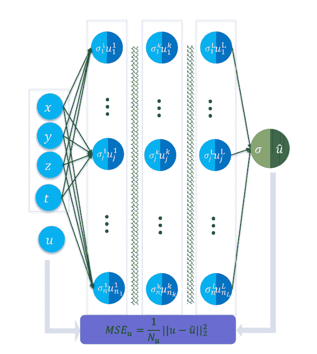

在神经网络中，学习是一个利用训练数据自动调整神经网络参数（如权重和偏置）的过程。通过这一过程，神经网络构建了一个由训练数据优化的模型。

神经网络训练分为两个主要步骤：“前向传播”和“反向传播”。前向传播是一个按顺序执行从输入层到输出层过程，输入数据通过网络产生输出的步骤。反向传播是将误差从输出层反向传播到输入层，并更新权重和偏置以最小化误差的步骤。

具体而言，对于训练过程，会定义一种称为损失函数的度量，并更新权重和偏置，以最小化神经网络输出与真实数据（ground truth data）之间的差异。因此，神经网络被调整以适合训练数据。正则化技术、丢弃法（dropouts）以及其他方法也可能被用来防止过学习。

一旦经过充分训练，神经网络就能对未知数据实现较高的预测准确性。神经网络中的学习是一种优化。神经网络中的学习旨在通过使用训练数据并调整权重和偏置等参数来获得最佳预测结果。现在，假设神经网络由 $L$ 层组成，且第 $i$ 层定义了 $n_{i}$ 个神经元。需要优化的参数数量可按如下方式计算：

$$\sum_{i=1}^{L+1}(n_{i}+1)n_{i+1} \tag{2.24}$$

在该方程中，$i=1$ 代表输入变量，因此对于时空坐标，$n_{1}=4$。加上 1 是由于将偏置作为一种权重包含在内。此外，$i=L+2$ 代表输出变量，因此对于标量数据，$n_{L+2}=1$。图 2.26 展示了一个由 $L$ 层组成的神经网络。

权重定义在连接神经元和输出变量的弧线上。对于小型神经网络，我们注重清晰度，并使用 Excel Solver 解释如何优化权重。在实际应用中，我们将使用第 1 章中介绍的 keras 和其他库。

学习过程搜索使损失函数最小化的参数值，从而最小化神经网络输出与真实数据之间的差异。这个搜索过程使用优化算法（例如梯度下降法）执行。

随着学习的进行，参数会被更新，损失函数的值会减小以获得最优参数。使用这些最优参数，神经网络可以对未知数据实现高预测准确性。

##### 2.7.1. 通用逼近定理

通用逼近定理是一个定理，指出神经网络可以以任何精度逼近任何连续函数。换句话说，设计得当的神经网络可以为任何给定输入逼近所需的输出。

该定理是神经网络变得广泛使用的原因之一，也是展示其有用性的基础。然而，在实践中，实现起来并不总是容易的，因为它需要足够数量的神经元、适当的算法、数据集等，才能达到定理所建议的任意精度逼近。

通用逼近定理最初由 George Cybenko 和 Edward G. Widrow 在 1989 年的论文 "Multi-Layer Feedforward Networks are Universal Approximators" 中提出 [23]。该论文发表在《IEEE Transactions on Neural Networks and Learning Systems》上，后来成为神经网络理论的重要基础。在这篇论文中，George Cybenko 和 Edward G. Widrow 证明了存在可以以任何精度逼近任何连续函数的神经网络。他们表明，该定理使神经网络非常强大，并推动了神经网络的广泛应用。

可以以任何精度逼近任何连续函数的神经网络的存在性证明如下：

-   首先，具有单个 sigmoid 函数的神经网络可以逼近 Lipschitz 连续函数。Lipschitz 连续函数是变化率受某个常数限制的函数，可以逼近此类函数。
-   其次，具有多个 sigmoid 函数的神经网络可以逼近任何 Lipschitz 连续函数。这是因为每一层将前一层输出作为输入，从而允许表示更复杂的函数。
-   最后，任何连续函数都可以表示为无限多个 Lipschitz 连续函数的和。这意味着可以使用具有多个 sigmoid 函数的神经网络来以任何精度逼近任何连续函数。

因此，Lipschitz 连续函数是一种连续函数，其中存在一个常数 $L$，并且对于函数 $f$，以下方程成立：

$$| f(x) - f(y) | \le L | x - y | \tag{2.25}$$

在该方程中，$x$ 和 $y$ 代表 $f$ 定义域内的任意两点，$| \cdot |$ 代表绝对值。这个定义表明“$f$ 的值的变化与其自变量的变化成正比且受限于边界”。换句话说，$x$ 和 $y$ 彼此越接近，$f(x)$ 和 $f(y)$ 之间的差异越小。

Lipschitz 连续函数在微积分、泛函分析及其他数学领域中发挥着重要作用。它们也被用于物理、工程和经济学等各个领域。

如上所述，具有单个 sigmoid 函数的神经网络逼近 Lipschitz 连续函数，而具有多个 sigmoid 函数的神经网络可以逼近任何 Lipschitz 连续函数。因此，可以以任何精度逼近任何连续函数。

##### 2.7.2. 使用神经网络的回归分析

为了说明使用神经网络的回归分析，我们使用第 5 章第 2 段描述的双变量数据作为离散数据。这些数据是根据双变量函数计算得出的

$$y = x_{1}^{2} + x_{1} + x_{2}^{3} + x_{2}^{2}.$$ (2.26)

由从 $\{(x_{1}, x_{2})|0 \leq x_{1} \leq 1, 0 \leq x_{2} \leq 1\}$ 中随机选取的 26 个离散数据通过线性回归生成的模型

$$y = w_{0} + w_{1}x_{1} + w_{2}x_{2},$$ (2.27)

的平均均方误差为 $0.0402$。使用 $w_{0}, w_{1}, w_{2}$ 作为系数（参数），使用 Excel Solver 函数计算了使时空模型与给定离散数据之间的均方误差最小的参数。

在上一节中，我们讨论了使用 Solver 实现回归分析的具体方法。在本节中，我们将使用相同的数据来说明如何使用 Solver 实现神经网络模型。一个简单的神经网络模型可以通过将此线性回归模型的输出连接到一个激活函数来实现。这次，我们使用 Sigmoid 函数

$$\sigma(x) = \frac{1}{1 + e^{-x}}$$ (2.28)

并假设在 Excel 电子表格函数中，使用此函数获得的输出按比例转换为

$$y = (y_{max} - y_{min})\frac{1}{1 + e^{-(w_{0} + w_{1}x_{1} + w_{2}x_{2})}} + y_{min}$$ (2.29)

$\Delta y = \frac{(y_{max} - y_{min})}{\Delta y}$ 以计算 $y = \frac{1}{1 + e^{-(w_{0} + w_{1}x_{1} + w_{2}x_{2})}} + y_{min}$ 与给定离散数据 $y_{i}$ 之间的平均均方误差。

$$\sum_{i=1}^{26} \left(y_{i} - \frac{\Delta y}{1 + e^{-(w_{0} + w_{1}x_{1} + w_{2}x_{2})}} - y_{min}\right)^{2}$$ (2.30)


# 离散数据的分析与可视化

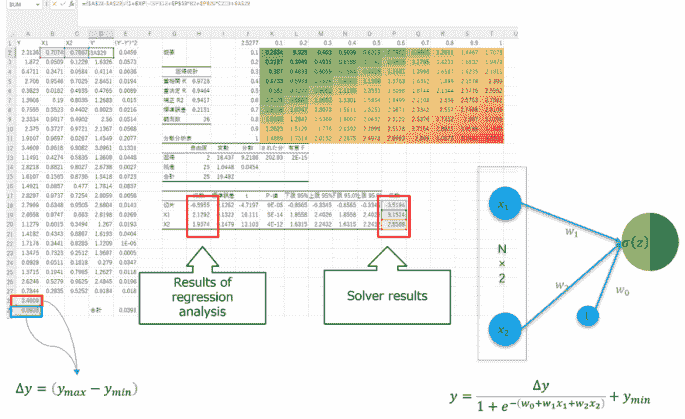

图 2.27。使用求解器进行的 NN（仅激活函数）模型计算。

当使用 Excel 求解器功能计算最小化均方误差的参数 $(w_0, w_1, w_2)$ 时，我们注意到均方误差为 0.0391，略有下降。然而，这并非回归分析（图 2.27）的结果。

这是一个没有中间层的简单 NN 模型。当输出为：

$$y = \frac{\Delta y}{1+e^{-(w_1^1 x_1 + w_2^1 m_1 + w_3^1 m_2)}} + y_{min} \tag{2.31}$$

$$m_1 = \frac{1}{1+e^{-(w_1^2 + w_{11}^2 x_1 + w_{31}^2 x_2)}}, m_2 = \frac{1}{1+e^{-(w_1^2 - (w_{12}^2 x_1 + w_{32}^2 x_2)}}},$$

通过添加一个由两个变量 $(m_1, m_2)$ 组成的层，以及使用 Excel 求解器计算得到的、在给定离散数据下最小化均方误差的参数 $(w_{11}^1, w_{21}^1, w_{31}^1, w_{12}^1, w_{22}^1, w_{32}^1, w_{11}^2, w_{21}^2, w_{31}^2)$ 时，均方误差为 0.01244，这是一个更显著的降低。您可以注意到，当增加一个中间层时，参数数量从 3 增加到 9（图 2.28）。排列在半圆中的神经元的标记的激活函数 $\sigma(x)$ 列在左侧，接收结果的变量 $m_1, m_2, y$ 列在右侧，且其背景颜色已更改。

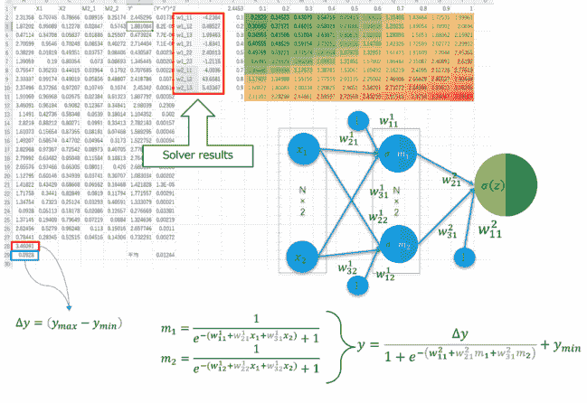

图 2.28。使用求解器进行的 NN（第 1 中间层）模型计算。

我们可以推断，NN 模型的优越性源于此激活函数的使用。对应于公式 (2.29) 的网络结构如图 2.27 所示。对于公式 (2.31)，在定义域 $\{(x_1, x_2)|0 \leq x_1 \leq 1$，$0 \leq x_2 \leq 1\}$ 中的三维表示如图 2.28 所示。

##### 2.7.3. 使用 Excel VBA 实现 NN

使用 Excel 实现 NN 允许您构建具有任意结构的 NN。结构（例如，第 1 层有 4 个神经元，第 2 层有 6 个神经元，第 3 层有 2 个神经元）可以在 Excel 工作表中手动输入。然而，当输入更通用的结构时，手动输入有其局限性。因此，我们将讨论如何使用 Excel VBA 实现通用的多层感知器。

上述 NN 使用 Excel VBA 执行。此后，我们将把这个程序称为 ExNN。在此实现中，通过赋予任意数量的层和每层任意数量的神经元来构建 NN。在 NN 预测结果与给定目标变量之间计算的最小化均方误差的权重由 Excel 求解器进行优化。

首先，假设在 Excel 工作表 1 中，目标变量数据从第二行开始，按观察值数量填充在第一列中。还假设解释变量数据从第二行开始填充在第二列及后续列中，解释变量的数量等于观察值的数量。假设变量标签等输入在第一行，计算解释变量数据和神经元变量数据值的表函数输入在第二行及后续行中。图 2.29 和 2.30 展示了当解释变量数量为 2 且观察值数量为 26 时的示例。图 2.31 展示了一个 NN（隐藏层 2）模型。

第一行包含标签 *Y*、*X_i*（*i* = 1，解释变量数量）和 *Mi-j*（*i* = 2，层数，*j* = 1，每层神经元数量），分别用于标识目标变量、解释变量和神经元。假设第 1 层由解释变量组成，则沿行方向输入的第一个神经元标签为 M2_1（图 2.30）。

第二行单元格中包含根据一个元参数计算的每一层每个列中神经元值的表函数

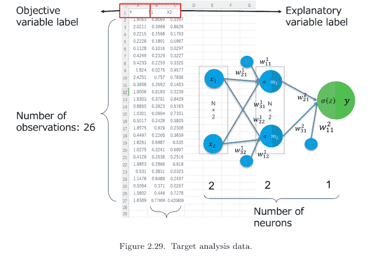

用于神经元数量。在此表函数中，定义在层间神经元到神经元连接中的权重标签 $(wi\text{-}jk, i = 1, \text{第 } i + 1 \text{ 层神经元数量}, j = 1, \text{第 } i + 1 \text{ 层神经元数量}, k = 1, \text{第 } i \text{ 层神经元数量})$ 和权重值沿列方向填充。第 $i + 1$ 层的神经元值是将第 $i$ 层的所有神经元值乘以其各自权重并将结果传递给激活函数的结果。在最后一层，计算出一个单一的神经元值，成为目标变量的回归 $Y^{\prime}$。此 $Y^{\prime}$ 与解释变量 $Y$ 的平方误差 $(Y - Y^{\prime})^2$ 输入在 $Y^{\prime}$ 右侧的单元格中。

在第三行及后续行中，前两行输入的表函数公式被复制了（观察值数量 $- 1$）行。在距离所有复制数据最后一行一行远的一个单元格中，输入均方误差和平均平方误差的公式。权重标签和值输入在右侧的两列中。为了清晰起见，与每层对应的神经元标签和值的列进行了着色。

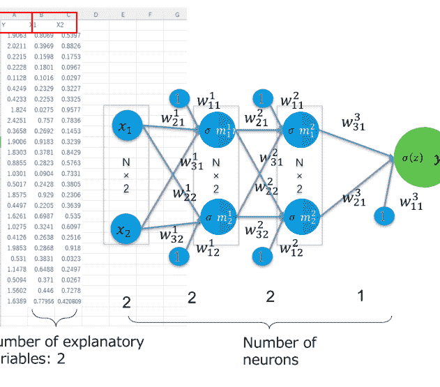

权重也根据每层进行了相应的着色。Excel 求解器获取最小化均方误差的权重。至此完成 NN 模型。

使用 Excel VBA 进行编程的准备工作包括执行求解器工具并获取行复制的宏输出。打开录制宏，执行求解器工具，并复制某些行。在某些情况下，执行求解器工具的宏可能无法正常工作。这可以通过执行以下配置来解决。

- (1) 检查求解器的引用设置：确保宏使用的求解器引用到了正确的位置。在 Visual Basic 编辑器中，点击 [工具]--[引用]，并确保勾选了求解器。
- (2) 检查安全设置：确保启用运行宏所需的安全设置。在 Excel 选项中，点击 [信任中心]--[宏设置]，并选择 [启用 VBA 宏]。

Excel 求解器可以与宏结合使用，以自动执行优化或一次性解决大量问题。当使用

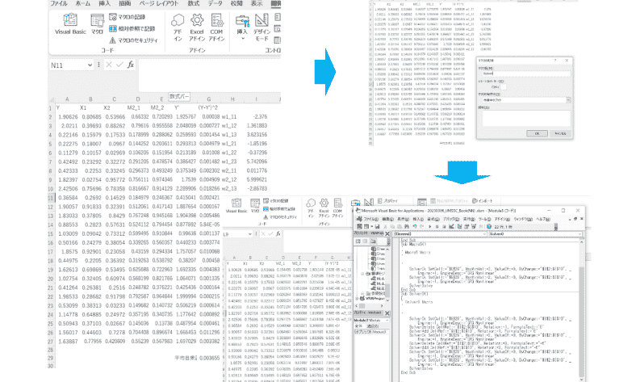

图 2.32。创建包含求解器的宏。

宏时，必须在 VBA 中设置目标函数、约束条件、变量范围和约束方向（图 2.32）。

以下是一个使用 VBA 的求解器示例：

```vba
Sub SolveWithSolver()
    Dim SolverOK As Boolean
    SolverOK = Application.AddIns("Solver Add-in").Installed
    If Not SolverOK Then
        MsgBox "Solver add-in not installed"
        Exit Sub
    End If
    Range("A1").Select
    SolverReset
    SolverOk
    SetCell= "$B$4", MaxMinVal:=2, ValueOf:=0,
    ByChange:="$B$2:$B$3",_Engine:=1,
    EngineDesc:="GRG Nonlinear"
    SolverAdd CellRef:="$B$2", Relation:=1, FormulaText:=">=0"
    SolverAdd CellRef:="$B$2", Relation:=3, FormulaText:="< =50"
    SolverAdd CellRef:="$B$3", Relation:=1, FormulaText:=">=0"
    SolverAdd CellRef:="$B$3", Relation:=3, FormulaText:="< =50"
    SolverSolve UserFinish:=True
End Sub
```

在此代码中，解释变量被设置为在 B2 和 B3 的范围内最大化 B4。使用 SolverAdd 方法在 B2 和 B3 上设置范围约束。最后，使用 SolverSolve 方法寻找最佳解决方案。通过这种方式，可以使用 VBA 自动化求解器。

下一个方法是获取行复制的宏输出。以下是一个使用 **Selection.AutoFill** 将第二行第 3 列至第 6 列复制到第 3 行的 Excel 宏示例：

```vba
Sub CopyRangeToColumn()
'Specify the range from which to copy
Range_desc1 = "C2:F2"
Range(Range_desc1).Select
'Specify the range to copy to
Range_desc2 = "C3:F3"
Selection.AutoFill Destination:=Range(Range_desc2),
Type:=xlFillDefault
End Sub
```

上述宏复制第二行和第三行 C 列到 F 列的值。首先，使用 **Range()** 方法指定要复制到的范围。然后，使用 **Selection.AutoFill** 指定复制源范围。对于 **Destination**，指定复制目标范围。如上所述，可以使用 **Selection.AutoFill** 自动从起始列复制值到结束列。

完成准备工作后，在第一行中，以字符类型数据在单元格中输入目标变量、解释变量和神经元变量标签。对于目标变量，其中的变量


存储值的单元格的列号表示为 `Col_Var`。VBA 程序语句如下：

```vba
Cells(1, Col_Var) = "Y"
```

对于目标变量，`Col_Var = 1`。后续列将是解释变量的标签 $X_j$；因此，VBA 程序语句如下：

```vba
<Begin>
    For j = 1 To neuron_num(1)
        Var_Label = "X" & CStr(j)
        Cells(1, Col_Var) = Var_Label
        Col_Var = Col_Var + 1
    Next j
<End>
```

在此程序中，`neuron_num(1)` 包含放置在第一层的神经元数量（在此情况下，即解释变量的数量）。对于神经元变量，标签名称为 $M_{i-j}$。因此，程序语句如下：

```vba
<Begin>
    For j = 1 To neuron_num(i)
        Var_Label = "M" & CStr(i) & "_" & CStr(j)
        Cells(1, Col_Var) = Var_Label
        Col_Var = Col_Var + 1
    Next j
<End>
```

在描述了第 $i$ 层的神经元标签后，将执行向下一层 $i+1$ 的每个神经元变量提供由 Excel 表函数公式 `MMULT` 计算的和积，以及随后由激活函数转换的结果的过程。

然后，每个神经元变量的权重将按照层顺序存储在表格的最右侧列中。将计算存储权重所需的列数。在所有层中累加每层的神经元数量，并将存储平方误差和权重标签的列并排排列，存储权重值的列位于它们的右侧。计算列号并获取相应列名的程序语句如下：

```vba
<Begin>
Col_W = 1
For i = 1 To layer_num + 2
    Col_W = Col_W + neuron_num(i)
Next i
Col_W = Col_W + 3
Col_W_Char = Split(Cells(1, Col_W).Address, "$")(1)
<End>
```

在此程序中，`Split(...)` 获取由 `Cells(1, Col_W)` 指定的列号处的单元格的地址，将其拆分为以 `"$"` 分隔的数组，并将其第二个元素（即列名）存储在 `Col_W_Char` 中。

然后为每一层中与前一层神经元相连的所有全连接弧定义并命名权重。截距也被包含在权重中。因此，它只比前一层的神经元数量大 1。第 $i$ 层中的每个神经元都连接到第 $i-1$ 层中的所有神经元 +1（截距）。如前所述，`Col_W` 表示描述权重的行号。`W_desc` 是表示权重标签的字符类型数据。

```vba
<Begin>
Row_W = 2
For i = 2 To layer_num + 2
    For j = 1 To neuron_num(i)
        For k = 1 To neuron_num(i - 1) + 1
            W_desc = "w" & CStr(i - 1) & "-" & CStr(j) & CStr(k)
            Cells(RowW, ColW - 1) = W_desc
            Cells(RowW, ColW) = Rnd()
            Row_W = Row_W + 1
        Next k
    Next j
Next i
<End>
```

接下来，我们计算 `MMULT` 所涉及的变量值存储的列号对（`Col1`、`Col2`：均为字符类型）。仅计算第二行，因此在末尾连接 2。之后，它复制相应数量的观测值。

```vba
<Begin>
Col1 = Split(Cells(1, Target_Col).Address, "$")(1)
Col1 = Col1 + CStr(2)
Col2 = Split(Cells(1, Target_Col - neuron_num(i) + 1).Address, "$")(1)
Col2 = Col2 + CStr(2)
<End>
```

详细解释如下：`Cells(1, Target_Col)` 表示第一行中由 `Target_Col` 指定的列号对应的单元格。使用 `Address` 属性获取此单元格的地址。

`Cells(1, Target_Col).Address` 返回一个字符串，例如对于 **B** 列，它类似于 `$B$1`。

接下来，该字符串被拆分为数组，以 `$` 为分隔符。例如，对于 **B** 列，`Split(Cells(1, Target_Col).Address, "$")` 返回如下所示的数组：

`['', 'B', '1']`

此代码的目的是获取与指定列号（`Target_Col`）对应的列的列名。通过获取列名，您可以根据列名和行号指定单元格，例如 `Range(Col1 & "2")`。

##### 2.7.4. 使用神经网络进行函数近似

为了说明使用神经网络进行函数近似，我们使用第 5 节第 2 段中描述的双变量数据作为离散数据。要使用 ExNN，首先假设在 Excel 表格中，目标变量数据从第二行开始填充，持续填充至观测值数量为止。然后，假设解释变量数据从第二行开始填充在第二列及后续列中，解释变量的数量等于观测值的数量。对于计算中使用的神经网络结构，我们考虑以下六种结构，均具有 2 个隐藏层。数字表示放置在每层的神经元数量。假设层数从左到右依次递增，从 1 开始。

- 结构 1：2,2,2,2,1
- 结构 2：2,3,3,3,1
- 结构 3：2,1,2,3,1
- 结构 4：2,2,3,4,1
- 结构 5：2,3,2,1,1
- 结构 6：2,4,3,2,1
- 结构 7：2,3,2,3,1
- 结构 8：2,4,3,4,1
- 结构 9：2,2,3,2,1
- 结构 10：2,3,4,3,1

结构 1 和 2 表示神经元数量恒定（恒定型 NN）的模式；结构 3 和 4 表示神经元数量增加（递增型 NN）；结构 5 和 6 表示神经元数量减少（递减型 NN）；结构 7 和 8 表示神经元数量先减少后增加（凹型 NN）；结构 9 和 10 表示神经元数量先增加后减少（凸型 NN）。第一个神经元数量表示输入变量的数量（在此情况下为 2），最后一个神经元数量表示输出变量的数量（在此情况下为 1）。图 2.33 展示了凸型 NN 结构的示例。

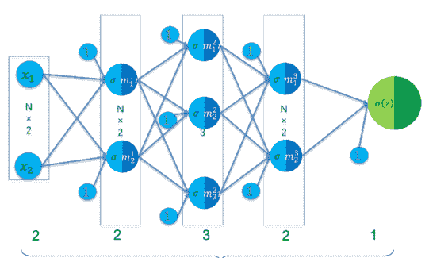

对于每种结构，我们使用第 5 节第 2 段中描述的双变量数据作为离散数据来评估神经网络的模型误差。这些数据是从双变量函数计算得出的：

$$ y=x_1^2+x_1+x_2^3+x_2^2 \quad (2.32) $$

结果表明，使用凸型 NN 的模型误差最小。

在神经网络中，每层的神经元数量是可变的。例如，神经网络可以具有从输入层逐渐减少（递减型）、增加（递增型）或保持恒定（恒定型）神经元数量的结构。还有其他模式（凸型、凹型等）。作为自然表示此类参数的可视化方法，通过设置层数（维度）的上限，并使用每层的神经元数量作为多维坐标点来表示神经网络。可视化多维坐标的一种方法是使用平行坐标。平行坐标将多维坐标的每个维度分配给一个平行坐标轴，并将其表示为连接每个维度值的多边形线。图 2.34 使用平行坐标表示六种类型的神经网络，每种均由四层组成。每个坐标轴上的交点表示该层的神经元数量。最右侧的坐标轴表示误差。

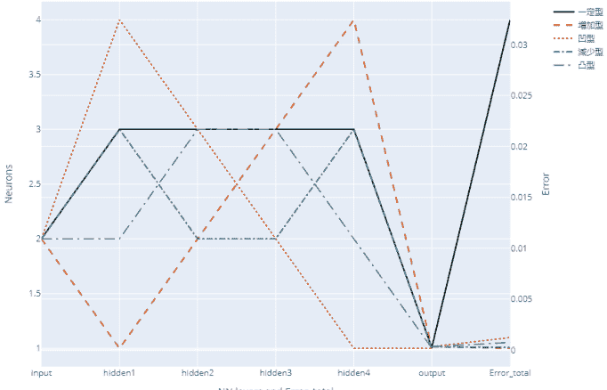

**图 2.34**. NN 模型误差评估 (ExNN)。

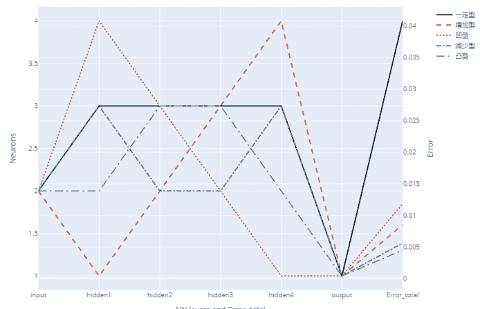

**图 2.35**. NN 模型误差评估 (keras)。

此多边形线是多维空间中的坐标点。在此示例中，我们注意到凸型 NN 的误差较小。

使用相同的物理数据，通过 Excel NN 和 keras 创建相同类型结构的 NN 模型。

在两种情况下，恒定型 NN 的误差最大。ExNN 在递增型 NN 中误差较小，而 keras 在凸型 NN 中误差较小（图 2.35）。此外，ExNN 的误差总体倾向于较小。

##### 2.7.5. 使用神经网络进行点云数据分析：应用示例

假设物理数据被解释为与坐标相关的标量数据，神经网络可用于基于测量获得的离散数据生成连续数据。对于连续分布的标量数据，可以应用各种可视化方法。此外，此类标量数据可用于开发三维图像的新可视化方法。

例如，通过 CT 和其他方法捕获的三维图像在非侵入式内部结构分析以及医疗领域的手术前诊断中起着重要作用。具体来说，标量

数据可用于定义新的曲面，以映射三维图像。

假设已获得机器零件的三维图像，通过鼠标操作等可以识别出可确定为裂纹表面点的区域，并将这些数据连同其置信度值（标量值）一起存储在系统中。NN 可以基于存储的标量数据（物理数据）进行训练，以构建一个连续分布的置信度模型。在三维图像所在的相同区域内定义一个有序格点，并从置信度模型中提取格点处的数据，以生成有序格点数据。

在对无法翻动的古代文档页面进行可视化时，会提取页面平面，并将文档的三维图像映射到这些页面平面上。在这种情况下，通过鼠标操作等识别出可确定为页面表面点的区域，并将其连同其页码（标量值）一起存储在系统中（图 2.36）。

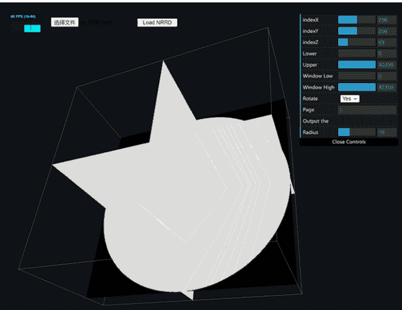

图 2.36. 通过鼠标操作进行页面表面识别。

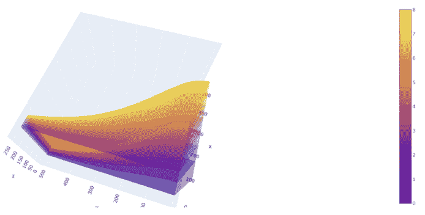

图 2.37. 使用等值面进行页面表面可视化。

NN 可以基于存储的标量数据（物理数据）进行训练，以构建一个连续分布的页码模型。例如，标量值为 2 的等值面表示第 2 页的页面表面（图 2.37）。

可视化有序格点数据有多种方法。在本节中，我们使用 Marching Cubes 方法，该方法可以有效地可视化等值面。Marching Cubes 方法利用定义在三维格点上的标量数据，近似三维空间中物体的表面。具体来说，它在三维格点的棱边上计算与等值面的交点。利用这些点，计算出一个近似等值面的三角形网格，从而近似三维空间中物体的表面。该方法广泛应用于三维计算机图形学和三维扫描数据的可视化中。

接下来，在三角形网格的每个顶点处对三维图像的纹理坐标进行插值计算。纹理坐标是计算机图形学（如三维图形和游戏引擎）中用于将图像或图案附着到物体表面的坐标系统。通常，物体的表面被划分为三角形等小形状，并为每个形状分配纹理坐标。纹理坐标定义为每个形状的顶点，通常以二维坐标表示。这使得图像或图案可以在物体表面上重复放置和变形。纹理坐标由一种称为纹理映射的技术使用。纹理映射通过为物体提供逼真的纹理和细节，大大增强了三维图形的表现力。当映射三维图像（如古代文档）时，纹理坐标是三维的（图 2.38）。

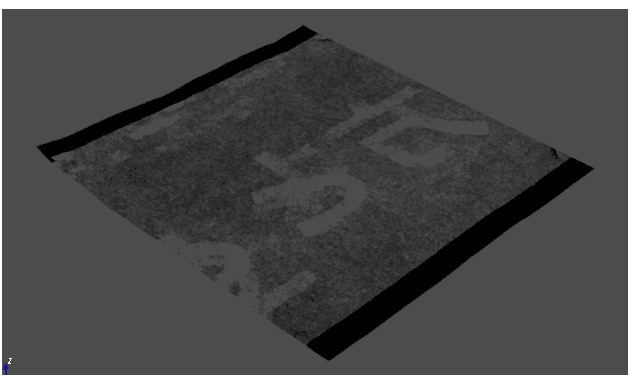

图 2.38. 使用纹理映射进行页面信息可视化。

##### 2.7.6. NN 应用示例中的线组数据分析

我们讨论了使用 NN 作为应用示例的点云数据可视化。接下来，我们想考虑将线组数据作为可视化的目标。例如，当在流体分析获得的流场中放置合适的起始点，并从该点沿流场散布无质量粒子时，轨迹所创建的曲线称为流线。通过在流场中设置许多起始点，可以生成一组流线。有时，需要显示涵盖这组流线的包络表面。包络表面的显示不仅用于流体分析中的速度矢量，也用于结构分析中的主应力矢量、电磁场分析中的磁通量矢量等。

本节描述了一种方法，其中 NN 使用从核聚变反应堆中计算出的电磁场分析结果中提取的磁场组数据进行训练，并将等离子体区域计算为体积数据的概率。该方法对于可视化核聚变反应堆中的等离子体区域是一项重要技术。如上所述，从流体分析结果中计算的流线等矢量线组也可以作为目标。

核聚变反应堆是一种利用核聚变反应产生能量的设备。聚变是原子核结合形成新原子核的反应，发生在高温和高压条件下。通过在核聚变反应堆中创造这样的条件，氢核结合产生新的氢核——氦。在此过程中，会产生大量能量。由于核聚变反应堆可以在不使用石油、天然气等石油化工产品的情况下产生能量，因此它们在地球长期提供能源方面具有潜力。然而，实际上，建造核聚变反应堆非常困难，迄今为止尚未商业化。

核聚变反应堆的结构包括用于产生和容纳等离子体的容器、用于控制等离子体的磁场发生器、用于从等离子体中提取热量的冷却系统，以及用于促进聚变反应的燃料注入系统。

主要组件如下：

- **容器**：容纳等离子体的容器位于核聚变反应堆的中心。该容器放置在真空中，并由非常坚固的材料制成，以容纳高温和高密度等离子体。容器的典型材料包括钨合金和碳化硅。
- **磁场发生器**：为了控制等离子体，必须产生磁场。在核聚变反应堆中，主要使用托卡马克/螺旋转磁场排列。在托卡马克/螺旋转磁场排列中，磁场的力使等离子体保持甜甜圈形状。磁场由超导线圈产生。
- **冷却系统**：为了控制聚变反应产生的高温等离子体，必须提取热量。冷却系统安装在等离子体容器外部，循环水或氦等冷却剂以提取热量。
- **燃料注入系统**：在核聚变反应堆中，轻氢（单核氢）用作燃料。燃料在真空中注入等离子体。燃料注入系统包括环形泵和气体注入器。
- **偏滤器**：偏滤器是一种用于分离和去除从等离子体外部注入的部分质子和离子的装置。偏滤器通过从等离子体的高温高密度区域提取热量和粒子，在稳定核聚变反应堆运行方面起着重要作用。

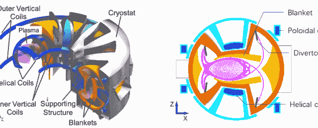

图 2.39. 螺旋核聚变反应堆的结构。

这些是核聚变反应堆的主要组件。图 2.39 展示了螺旋核聚变反应堆的结构。

在核聚变反应堆中，使用电磁场来约束并维持容器内部的等离子体（高温气体）。容纳等离子体的容器称为“托卡马克”或“螺旋”。电磁场是指电磁动力学中的电场和磁场。电磁场反映了带电粒子的电气行为和磁性材料的磁行为。在核聚变反应堆中，可以使用电磁线圈来创建电磁场以约束等离子体。该电磁场存在于约束等离子体的容器内部，并起到锚定等离子体的作用。此外，在核聚变反应堆中，必须调节等离子体内部的温度，以便聚变反应不会在等离子体内部发生。因此，在核聚变反应堆中使用电磁场模拟来研究如何约束等离子体并调节等离子体中的温度。接下来，我们将讨论在核聚变反应堆结构中起重要作用的边缘和偏滤器。

在核聚变反应堆中，边缘是等离子体和壁之间的物理边界。等离子体由高温和高压下产生的高能粒子组成，而壁通常由冷金属制成。因此，等离子体和壁之间存在温度和压力差异。发生这种差异的边界称为“边缘”。边缘在核聚变反应堆中起着重要作用。其中最重要的作用包括：

- 它用于分离容纳等离子体的容器内的等离子体。这可以防止等离子体损坏容器壁。


它用于防止等离子体内部能量的损失。如果等离子体中的能量发生损失，聚变反应就会减缓，无法产生能量。它防止能量通过边缘从等离子体中流失。

边缘在聚变反应堆中起着至关重要的作用。因此，持续监测和维护边缘的状态非常重要。

在聚变反应堆中，偏滤器是指一种分离等离子体的装置。如前所述，等离子体由高温高压下产生的高能粒子组成。因此，等离子体可能会损坏墙壁。所以，有必要分离等离子体。偏滤器是一种通过改变等离子体流动方向来分离此类等离子体的装置。偏滤器通常安装在容纳等离子体的容器内部。通过改变等离子体的流动方向，可以分离等离子体。偏滤器在聚变反应堆中发挥着重要作用。其中最重要的作用包括：

- 它用于分离容纳等离子体的容器内的等离子体。这防止了等离子体损坏墙壁。
- 它用于防止等离子体内部能量的损失。如果等离子体中的能量发生损失，聚变反应就会减缓，无法产生能量。通过偏滤器，可以防止等离子体中的能量损失。

偏滤器在聚变反应堆中起着至关重要的作用。因此，持续监测和维护偏滤器的状态非常重要。

在聚变反应堆中，预期通过基于电磁场仿真结果设置合适的起始点，计算一组磁力线，从而可视化等离子体区域。由核融合科学研究所（NIFS）设计的一种名为无张力螺旋反应堆（FFHR）的装置，具有生成扭曲磁力线的螺旋线圈 [51]。等离子体被约束在一个环形真空容器内。环形真空容器的大周向方向被称为环向（toroidal direction），小周向方向被称为极向（poloidal direction）。在螺旋型装置中，顾名思义，向螺旋周向线圈施加电流以形成约束等离子体的磁场，并且磁力通量的包络面被视为等离子体区域的边界。

FFHR设计的装置的主要问题之一是等离子体区域几何形状与容器内结构之间的空间有限。传统的等离子体区域可视化主要计算磁力线在等离子体极向平面上的交点，并在二维截面上表示等离子体区域。基于此可视化，检查了容器内结构的几何形状，以确定它们是否与等离子体边界接触。该方法通过在环向旋转极向表面一度来执行，这不是获取等离子体区域形状鸟瞰图的有效方式。因此，为了更有效地确定等离子体与结构之间的接触，我们认为有必要构建等离子体形状的三维模型，以确定与容器内结构的接触。本案例研究的目的是基于磁力线组数据，创建一个代表等离子体存在区域的封闭曲面三维模型，以便于识别等离子体与容器内结构组件的三维设计数据之间的干扰。

在本节中，我们将概述聚变反应堆中的电磁场仿真。为了计算稳态磁力线，通过输入磁场线圈、真空容器和屏蔽层的精确结构，对FFHR内部环境进行三维建模，然后使用有限元方法（FEM）计算电磁场仿真，该方法将在4.3.2.1节中详细介绍。为了从合适的起始点追踪磁力线，使用磁力线追踪代码（MGTRC）。目前，存储了799条磁力线。并且所有磁力线由 $4.8 \times 10^6$ 个点组成（图2.40）。

如图2.40所示，计算出的799条磁力线是扭曲的，仅根据磁力线很难评估它们与结构的相交情况。关键在于检测与聚变反应堆中组件的干扰，这需要评估最外层的磁力线。

设置了90个带有磁力线交点的极向表面，使得等离子体区域形状在环向为90°。需要额外的起始点来绘制通向边缘表面层和偏滤器腿部的磁力线。偏滤器是构成聚变反应堆的装置之一，负责三个功能：粒子抽气、热量移除和改进等离子体约束。这些起始点使用点注释工具 [52] 交互式地指示。此过程应在等离子体区域几何扩展至90°之前完成。

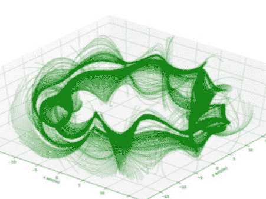

图2.40. 在螺旋聚变反应堆结构中计算的磁力线组。

为了找到磁场和边缘层的最外层封闭曲面，需要标记以指示庞加莱图（Poincaré plot）上点的轨迹。如果磁力线在等离子体区域内停留足够长的时间，组成磁力线的所有点都标记为“2”。同时，组成到达聚变反应堆外壁或偏滤器的磁力线的所有点分别标记为“0”或“1”。到达聚变反应堆外壁或偏滤器的磁力线被认为已经逃逸出等离子体区域。

在本案例研究中，首先创建一个合适的神经网络（NN）模型来解释磁力线上的点数据（图2.40）。NN模型构建是一个NN参数优化计算过程，旨在最小化损失函数。损失函数是点数据 $u(x, y, z)$ 与由NN模型回归的数据之间的均方误差 $\text{MSE}_u = \lVert \hat{u} - u \rVert_2^2 / N_u$，其中 $N_u$ 表示磁力线上的点数。在这种情况下，点数据表示点位于等离子体区域内的概率，在停留在等离子体区域内的磁力线上取值为1.0。NN执行此计算的信息如下：

- **结构**：NN具有五层结构，正向节点数为3-512-128-16-3。前三个和后三个分别是输入层和输出层的节点数。
- **激活函数**：修正线性单元（Rectified linear unit）激活函数
- **优化计算**：RMSProp

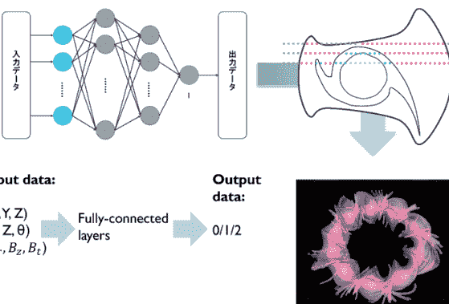

图2.41. 使用等值面可视化一组磁力线的包络面。

图2.41展示了由穿过识别为等离子体区域和偏滤器的区域的一组磁力线形成的包络面的可视化，以等值面表示。

# 第3章
实践部分

到目前为止，我们已经解释了如何使用神经网络（NN）从物理数据创建时空模型。在应用实例方面，我们解释了利用三维CT机拍摄的古籍数据中页面信息的可视化方法。此外，我们还解释了如何基于聚变反应堆中电磁场分析结果计算的磁力线组，可视化等离子体区域。

在本章中，我们将首先解释对时空模型进行微分运算的能力。执行微分运算的能力在某些情况下可能会提高NN模型的准确性，并且也有助于提高评估梯度数据的准确性，这对可视化至关重要。它可以找到本质的偏微分项并推导控制给定物理数据的偏微分方程（PDE）。你甚至可以求解给定的PDE。如前所述，添加微分信息增加了NN模型的价值。由于微分信息对于描述物理现象的PDE至关重要，我们将此类NN称为物理信息神经网络（PINN）。

### 3.1. 关于PINN

适合分析物理数据的神经网络是物理信息神经网络（PINN）。PINN是由Raissi等人提出的一种机器学习模型，它将物理定律融入到NN本身的结构中 [28]。这使得模型能够基于建模系统的底层物理规律做出一致的预测。PINN特别适用于解决如流体动力学、结构动力学和电动力学等问题，其中变量之间的关系受物理定律支配。融入


将这些定律纳入模型使物理信息神经网络（PINN）能够比不考虑物理约束的传统神经网络进行更准确的预测。PINN 使用监督学习和无监督学习的结合进行训练。监督学习用于使模型适应训练数据，而无监督学习则用于施加物理约束。这允许模型同时从数据和底层物理定律中学习。

在 PINN 中，训练数据是时空坐标和物理数据。时空坐标被输入到输入层中。权重参数被优化，使得神经网络的结果符合物理数据。这种优化代表了监督学习（图 3.1）。

接下来，通过对神经网络模型进行微分操作构建一个偏微分方程（PDE），以代表物理定律。未优化的权重参数会产生 PDE 残差（图 3.2）。


图 3.1. PINN 中的监督学习。


图 3.2. PINN 中的 PDE 残差。

为了解决 PDE，需要边界条件来完全确定问题。边界条件提供了关于分析域边界上系统行为的信息。通常，PDE 的分析域具有边界。例如，对于二维 PDE，分析域通常是一个平面，其边界形式可以是线、圆、曲线等。该边界必须具有以下边界条件：

- 1. *狄利克雷条件*：规定解在边界上的值已知。例如，对于温度方程，狄利克雷条件规定墙壁或表面温度已知（图 3.3）。
- 2. *诺伊曼条件*：规定解的法向导数在边界上已知。例如，对于热传导方程，诺伊曼条件规定墙壁或表面上的热通量已知（图 3.4）。

解决 PDE 所需的边界条件始终作为问题的一部分进行处理。正确设置边界条件非常重要，否则可能无法获得正确的解。

解决 PDE 所需的边界条件也是从神经网络模型构建的，从而产生残差。诺伊曼条件需要微分操作。权重参数的优化旨在消除这些残差，并代表无监督学习。PINN 计算使由将这些残差加到监督学习定义的损失函数所得值最小化的权重参数。


图 3.3. PDE 中的狄利克雷条件。


图 3.4. PDE 中的诺伊曼条件。

为了构建代表物理定律的 PDE 以及诺伊曼边界条件，PINN 模型需要微分运算，因此支持 PINN 的一项关键技术是自动微分。自动微分或算法微分是指一种分析程序中定义的功能并推导出一个计算偏导数值的技术 [24]。即使复杂的程序也由基本算术运算（如加、减、乘、除）和基本函数（如指数函数、对数函数、三角函数）的组合组成。自动微分利用这一特性，通过反复对这些算术运算应用链式法则来找到解决方案。自动微分允许您以较少的计算努力自动获得偏导数值。

### 3.2. 神经网络中的自动微分

本节描述了如何计算全连接神经网络（FCNN，在深度学习 [25, 26] 中广泛使用）关于输入变量的 1 阶偏导数。图 3.5 显示了 PINN 中 FCNN 的结构。


该神经网络由输入层和输出层组成，中间包含一个隐藏层。假设每层中的神经元与相邻层中的神经元完全连接。第 $k$ 层中的第 $j$ 个神经元 $u_{j}^{k}$ 连接到第 $(k-1)$ 层中的神经元，表示为：

$$u_{j}^{k}=\sigma_{j}^{k-1}\left(\sum_{i=1}^{n_{k-1}} w_{i, j}^{k-1} u_{i}^{k-1}\right)\tag{3.1}$$

其中 $w_{i, j}^{k-1}$ 是单元 $u_{i}^{k-1}$ 到 $u_{j}^{k}$ 的权重，$\sigma_{j}^{k}$ 和 $n_{k}$ 分别表示第 $k$ 层中第 $j$ 个神经元的激活函数和中继数。

假设使用 Sigmoid 函数 $\sigma(x)=1 /\left(1+e^{-x}\right)$ 作为激活函数。通过将第 $k$ 层的偏置设置使得 $u_{n_{k}}^{k}=1$，并使用权重 $w_{n_{k}, j}^{k}$ 执行计算。以下段落描述了如何计算输入层 $u_{j}^{0}$ 和输出层单元 $u_{j}^{L+1}$ 的 1 阶导数 $\frac{\partial u_{i}^{L+1}}{\partial u_{j}^{0}}$。

在 1 阶导数计算中，应用链式法则分解 $\frac{\partial u_{i}^{L+1}}{\partial u_{j}^{0}}$ 以构建迭代过程。$u_{j}^{k+1}$ 使用 $u_{i}^{0}, u_{i}^{1}, \ldots, u_{i}^{k}$ 计算。因此，$u_{j}^{k+1}$ 可以被视为 $u_{i}^{0}, u_{i}^{1}, \ldots, u_{i}^{k}$ 的复合函数，并使用链式法则计算其偏导数。通过对该复合函数递归应用偏导数的链式法则分解，计算关于输入变量的偏导数。在此过程中，根据中间变量 $u_{i}^{1}$ 的链式法则分解 $\frac{\partial u_{i}^{L+1}}{\partial u_{j}^{k}}$，其子表达式再根据中间变量 $u_{i}^{2}$ 的链式法则进一步分解。通过递归重复此分解过程直到达到中间变量 $u_{m_{L}}^{L}$，得到以下公式。

$$\begin{gathered}\frac{\partial u_{j}^{L+1}}{\partial u_{i}^{0}}=\sum_{m_{1}=1}^{n_{1}}\left(\sum_{m_{2}=1}^{n_{2}}\left(\sum_{m_{3}=1}^{n_{3}}\left(\cdots\left(\sum_{m_{L}=1}^{n_{L}}\frac{\partial u_{j}^{L+1}}{\partial u_{m_{L}}^{L}}\frac{\partial u_{m_{L}}^{L}}{\partial u_{m_{L}-1}^{L-1}}\right)\cdots\right)\\\times \frac{\partial u_{m_{3}}^{3}}{\partial u_{m_{2}}^{2}}\frac{\partial u_{m_{2}}^{2}}{\partial u_{m_{1}}^{1}}\frac{\partial u_{m_{1}}^{1}}{\partial u_{i}^{0}}\right)\end{gathered}\tag{3.2}$$

基于此方程，构建了一个通过反向传播神经网络来计算偏导数的程序。

例如，当激活函数是 Sigmoid 函数，$\sigma(x)=1 /\left(1+e^{-x}\right)$ 时，导数可以表示为 $\sigma^{\prime}(x)=(1-\sigma) \sigma$，利用 Sigmoid 函数本身。连续层之间的导数表示如下：

$$\frac{\partial u_{m_{k+1}}^{k+1}}{\partial u_{m_{k}}^{k}} = u_{m_{k+1}}^{k+1} (1 - u_{m_{k+1}}^{k+1}) w_{m_k,m_{k+1}}^{k} \quad \quad \quad \quad (3.3)$$

然后，$\frac{\partial u_{j}^{k+1}}{\partial u_{i}^{k-1}}$ 根据关于第 $k$ 层中变量 $u_{m}^{k}$ 的偏微分链式法则进行分解。也就是说，跳过一个层的偏微分计算如下进行（图 3.6）：

$$\frac{\partial u_{m_{k+1}}^{k+1}}{\partial u_{m_{k-1}}^{k-1}} = \sum_{m_{k}=1}^{n_{k}} \frac{\partial u_{m_{k+1}}^{k+1}}{\partial u_{m_{k}}^{k}} \frac{\partial u_{m_{k}}^{k}}{\partial u_{m_{k-1}}^{k-1}} \quad \quad \quad \quad (3.4)$$

其中，方程 (3.4) 中的子表达式由方程 (3.3) 计算得出。类似地，关于 $k-2$ 层变量 $u_{m_{k-2}}^{k-2}$ 的导数


导数通过关于第 $k-1$ 层变量 $u_{m_{k-1}}^{k-1}$ 的偏导数进行分解。

$$\frac{\partial u_j^{k+1}}{\partial u_{m_{k-2}}^{k-2}} = \sum_{m_{k-1}=1}^{n_{k-1}} \frac{\partial u_{m_{k+1}}^{k+1}}{\partial u_{m_{k+1}}^{k-1}} \frac{\partial u_{m_{k-1}}^{k-1}}{\partial u_{m_{k-2}}^{k-2}} \qquad(3.5)$$

其中，公式 (3.5) 中的子表达式由公式 (3.3) 和 (3.4) 计算得出。通过依次重复此过程，可以对第 $k-n$ 层中的变量进行微分。

$$\frac{\partial u_j^{k+1}}{\partial u_{m_{k-n}}^{k-n}} = \sum_{m_{k+1-n}=1}^{n_{k+1-n}} \frac{\partial u_{m_{k+1}}^{k+1}}{\partial u_{m_{k+1-n}}^{k+1-n}} \frac{\partial u_{m_{k+1-n}}^{k+1-n}}{\partial u_{m_{k-n}}^{k-n}} \qquad(3.6)$$

公式 (3.6) 中的子表达式由第 $m$ 层和第 $k+1-n$ 层的偏微分计算得出。$\frac{\partial u_L^{L+1}}{\partial u_j}$ 通过在公式 (3.6) 中设置 $k=L$ 并让 $n$ 从 0 增加到 L 重复计算来获得。

### 3.3. 在回归方程中使用自动微分

我们已经展示了使用神经网络（NN）对给定的二元函数 $(y=x_1^2+x_1+x_3^2+x_2^2)$ 进行回归分析的示例。在第 2.7.2 节中，我们讨论了以系数和 NN 权重为参数，计算使时空模型与提供的离散数据之间的均方误差最小化的参数。该计算是使用 Excel 的 Solver 功能进行的。通过使用 sigmoid 函数作为激活函数，我们成功地确认均方误差（MSE）有所降低。这次，我们将通过两种方法评估由解释变量 $(x_1, x_2)$ 组成的回归方程的一阶偏导数：第一种方法是直接对给定函数进行偏导数计算，结果为：

$$\begin{cases}\frac{\partial y}{\partial x_1} = 2x_1+1 & (3.7)\\ \frac{\partial y}{\partial x_2} = 3x_2^2+2x_2 & (3.8)\end{cases}$$

第二种方法是求通过对给定数据进行回归得到的 NN 模型的偏导数。在这种情况下，使用隐层中的变量 $(m_1, m_2)$ 和链式法则进行如下计算：

$$\left\{\begin{align*}\frac{\partial y}{\partial x_{1}} &= \frac{\partial y}{\partial m_{1}}\frac{\partial m_{1}}{\partial x_{1}} + \frac{\partial y}{\partial m_{2}}\frac{\partial m_{2}}{\partial x_{1}} \\ \frac{\partial y}{\partial x_{2}} &= \frac{\partial y}{\partial m_{1}}\frac{\partial m_{1}}{\partial x_{2}} + \frac{\partial y}{\partial m_{2}}\frac{\partial m_{2}}{\partial x_{2}} \end{align*}\right\} \tag{3.9, 3.10}$$

现在，使用 sigmoid 函数 $\sigma(x) = 1/(1+e^{-x})$ 作为激活函数，上述公式 (3.9) 和 (3.10) 右边的每个偏微分项表示如下：

$$\left\{\begin{align*} &\frac{\partial y}{\partial m_{1}} = y(1-y)w_{11}^{2} & &\frac{\partial y}{\partial m_{2}} = y(1-y)w_{21}^{2}\\ &\frac{\partial m_{1}}{\partial x_{1}} = m_{1}(1-m_{1})w_{11}^{1} & &\frac{\partial m_{2}}{\partial x_{1}} = m_{2}(1-m_{2})w_{12}^{1}\\ &\frac{\partial m_{1}}{\partial x_{2}} = m_{1}(1-m_{1})w_{21}^{1} & &\frac{\partial m_{2}}{\partial x_{2}} = m_{2}(1-m_{2})w_{22}^{1} \end{align*}\right\}$$

即，

$$\left\{\begin{align*}\frac{\partial y}{\partial x_{1}} &= y(1-y)\left\{w_{11}^{2}m_{1}(1-m_{1})w_{11}^{1} + w_{21}^{2}m_{2}(1-m_{2})w_{12}^{1}\right\}\\ \frac{\partial y}{\partial x_{2}} &= y(1-y)\left\{w_{11}^{2}m_{1}(1-m_{1})w_{21}^{1} + w_{21}^{2}m_{2}(1-m_{2})w_{22}^{1}\right\} \end{align*}\right\}$$

由这两种方法计算的偏导数得到的均方误差计算如下：

$$MSE_{grad} = \frac{1}{N_{u}}\sum_{i=1}^{N_{u}}\left\{\left(\frac{\partial y}{\partial x_{1}}-(2x_{1}+1)\right)^{2} + \left(\frac{\partial y}{\partial x_{2}}-(3x_{2}^{2}+2x_{2})\right)^{2}\right\} \tag{3.11}$$

计算出的均方误差被加到 $MSE_{u}$ 上，即上次最小化的均方误差（图 3.7）。结果总和通过 Excel 的 solver 功能进行了最小化，导致 $MSE_{u}$ 从 0.0081 变为 0.00696。这种改进的原因如下：对于本次回归方程的偏微分，计算结果已知，因此我们成功利用这一信息提高了回归方程的预测精度。


*损失 = MSEu + MSEgrad*

**图 3.7. 在损失函数中添加梯度向量误差。**

### 3.4. 使用 Colab 进行自动微分

上一节中描述的自动微分可以使用 Colab 实现。以下段落展示了使用 Colab 进行自动微分的程序示例：这里使用的是 TensorFlow。

```python
import tensorflow as tf

# Defining input variables
x = tf.constant(3.0)
y = tf.constant(4.0)

# Defining a calculation chart with tf.GradientTape() as tape:
with tf.GradientTape() as tape:
    tape.watch(x)
    tape.watch(y)
    z = x ** 2 + 2 * x * y + y ** 2

# Calculating a gradient
grads = tape.gradient(z, [x, y])
print(grads)
```

该程序将 **x** 和 **y** 定义为常量，并将 **z** 计算为 **x** 和 **y** 的函数。然后，使用 `tf.GradientTape()` 定义一个计算图，该图计算 **x** 和 **y** 关于 **z** 的偏导数。`tape.gradient()` 计算 **x** 和 **y** 关于 **z** 的偏导数。

执行结果显示如下：[`<tf.Tensor: shape=(), dtype=float32, numpy=10.0>`, `<tf.Tensor: shape=(), dtype=float32, numpy=10.0>`] 这表明 **x** 和 **y** 关于 **z** 的偏导数均为 **10.0**。

### 3.5. 使用自动微分提高磁通线组数据可视化的精度

作为使用神经网络（NN）分析线组数据的一个示例，我们解释了构建一个 NN 模型的构造，该模型描述了从聚变反应堆电磁场模拟中计算出的磁通线上的部分数据。该模型允许计算任意点位于等离子体区域的概率。在计算此概率 $u(x,y,z)$ 时，其梯度向量表示等离子体区域表面的法向量。梯度向量可以通过自动微分轻松计算。从电磁场模拟结果中获得的磁通量密度向量与磁通线平行。因此，预期区域表面的法向量与磁通量密度向量正交。在磁通线上的每个点，计算该点的梯度向量与磁通量密度向量之间的内积，然后将磁通线上所有点的内积相加。假设 NN 模型表示等离子体区域，相加的结果预期为零，因此以下项是一个新的误差项：

$$ MSE_{ip} = \frac{1}{N_u} \left\| \begin{pmatrix} \frac{\partial u}{\partial x} & \frac{\partial u}{\partial y} & \frac{\partial u}{\partial z} \end{pmatrix} \begin{pmatrix} B_x \\ B_y \\ B_z \end{pmatrix} \right\|_2^2 \tag{3.12} $$

此误差项被添加到损失函数中。当损失函数足够小时，包围磁通线的表面可以被可视化为等离子体区域的界面 [16]。


**图 3.8. 在损失函数中添加内积和项。**

通过添加内积项得到的损失函数如下（图 3.8）：

$$Loss = MSE_u + MSE_{ip}$$

一个由偏微分项组成的新误差项，$MSE_{ip}$，被添加到损失函数中。通过添加目标函数（误差），所谓的多目标优化转化为单目标函数的优化。前述在 NN 损失函数中添加多个误差的策略与 M. Raissi 等研究组提出的 PINNs 的策略相同 [28]。

图 3.9 展示了可视化等离子体区域的边界表面，其中聚变反应堆中的三维空间点为 $(x, y, z)$，穿过该三维空间点的磁通线在等离子体区域停留足够长时间的概率为 $u(x, y, z)$，阈值设置为 0.5。添加内积和项与未添加内积和项的情况分别显示在上行和下列中。可以看出，添加内积和项使得区域表面更加平滑。

为了可视化聚变反应堆中的等离子体区域，我们使用从分析结果中提取的磁通线组数据训练 NN


图 3.9. 添加或未添加内积求和项时，等离子体区域表面的差异。

  在核聚变反应堆中的电磁场，并以体数据形式计算磁力线穿过等离子体区域的概率。在本章中，我们介绍了如何实现这一点。代表等离子体区域的 NN 模型的特征在于，在损失函数中添加了一项，该项由区域内梯度向量与磁力线方向向量的内积之和组成。该方法可用于可视化包裹由速度场等计算得出的流线数据所构成的流动通道形状，具有广泛的应用前景。第 4 章处理物理数据，并解释了如何使用 NN 推导描述这些物理数据的偏微分方程（PDE）。

### 3.6. 使用点云数据处理软件从点云数据生成 CAD 模型

点云数据是指仅由坐标点组成、不与物理量相关联的数据。如第 2-7-5 节所述，可以通过标记将点云数据转换为物理数据。


图 3.10. 使用三维扫描仪生成点云数据（引自 https://fftr.co.jp/solution/3d-measurement/f6-smart/）。

最近，点云数据可以通过以下几种方式生成：

- **三维扫描仪：** 使用三维扫描仪扫描物体或环境以生成点云数据（图 3.10）。这包括 LiDAR 扫描仪、触发式扫描仪和红外扫描仪。
- **相机和照明：** 可以使用相机和照明拍摄物体或环境，从图像中生成点云数据。这包括点云提取和多视立体（MVS）（图 3.11）。
- **物理仿真：** 可以使用物理仿真生成点云数据。这包括计算流体动力学（CFD）和有限元方法（FEM）（图 3.12）。
- **无人机物理数据测量：** 无人机可以从空中拍摄大面积区域，并配备高分辨率相机和传感器。这使得对表面植被、土地利用、建筑物和结构等物理状态进行非常详细的测量成为可能。此外，无人机还配备全球定位系统（GPS）和惯性测量装置，可以获取位置信息和飞行速度等数据。这使您可以获取空间数据。此外，无人机还可以配备专用传感器，如热传感器和辐射剂量计。使用这些传感器，可以测量温度分布和辐射剂量等物理数据（图 3.13）。
- **编程：** 为了部分生成 3D 数据，可以使用编程生成点云数据。

从点云数据生成 CAD 模型有几种方法：

- **泊松表面重建（PSR）：** 一种从点云数据生成三角网格以产生自然表面效果的方法（图 3.14）。
- **球铰点表面重建（BPSR）：** 一种从点云数据生成三角网格以生成详细表面的方法（图 3.15）。
- **等值面方法（MC）：** 一种从点云数据生成三角网格的方法，通常基于体素数据（如 CT 扫描数据）使用（图 3.16）。
- **迭代最近点（ICP）：** 一种从点云数据生成 CAD 模型的方法，用于生成与现有 CAD 模型相似的形状（图 3.17）。
- **多视立体（MVS）：** 一种基于多个相机捕获的图像生成的点云数据进行三维重建的技术（图 3.18）。

上述方法的选择取决于点云数据的类型和所需的精度。


图 3.11. 通过相机生成点云数据（引自 https://aicam.jp/tech/sfmvms）。


图 3.12. 通过物理仿真生成点云数据（引自 https://www.particleworks.com/case_study_ja.html）。


图 3.13. 通过无人机测量物理数据（引自 https://viva-drone.com/drone-uav-surveying/）。


图 3.14. 通过 PSR 从点云数据生成的三角网格（引自 https://medium.com/@sim30217/poisson-surface-reconstruction-7f319df6871c）。


图 3.15. 通过 BPSR 从点云数据生成的三角网格（引自 https://www.computer.org/csl/journal/tg/1999/04/v0349/13rRUNvgz9y）。


图 3.16. 通过 MC 从点云数据生成的三角网格（引自 https://en.wikipedia.org/wiki/Marching_cubes）。


图 3.17. 通过 ICP 从点云数据生成的三角网格（引自 http://www.thothchildren.com/chapter/5c16831b41f88f26724b182f）。


图 3.18. 通过 MVS 生成的点云数据（引自 https://www.researchgate.net/figure/VA-Point-MVSNet-performs-multi-view-stereo-reconstruction-in-a-coarse-to-fine-fashion_fig1_340856447）。

## 第 4 章

### 高级应用篇

#### 4.1. 描述物理数据的偏微分方程（PDE）推导

前述章节迄今为止讨论了在 NN 模型中使用偏导数的方法。所讨论的应用之一是可视化一个曲面，该曲面包裹基于核聚变反应堆电磁场模拟结果计算出的大量磁力线。为了进行有效的可视化，在损失函数中添加了一个约束条件，即曲面的法线垂直于磁通量密度向量。本节描述了如何使用 NN 推导描述与物理量相关的物理数据的 PDE。作为应用示例，本节针对具有精确解的 PDE，描述了如何通过将随机改变时空坐标后计算的结果视为伪测量数据，来高准确度地查找原始 PDE。

PDE 包含未知多元函数及其偏导数。PDE 用于表述涉及多个变量的函数问题，并通过手动或计算机模型求解。顺便一提，常微分方程（ODE）表示为单变量及其导数的函数。本书假设 PDE 中物理量的时间偏导数由带有空间偏导数项的线性回归模型表示。但这也适用于其他情况。

传统上，PDE 是根据菲克第一定律或连续性方程等物理定律推导的。例如，平流-扩散方程考虑两种类型的物质流——平流和扩散——并将这些流合成为总流。对该总流应用守恒定律即可推导出平流-扩散方程。这代表了一种演绎式的 PDE 推导方法。相比之下，本书描述了一种归纳式的方法。

使用现有 PDE 的解释模型对于从流体、大气和宇宙现象等有趣科学事件以及 COVID-19 感染等各种新发生事件的ビッグデータ（大数据）中获取洞察至关重要。

当然，从日常现象中发现洞察也同样重要。例如，计算流体动力学（CFD）的使用对于笔记本电脑的散热是必不可少的。本质上，CFD 基于对流-扩散方程。例如，在热流体现象中，如果笔记本电脑外壳中的散热效应占主导地位，则可以省略平流项。这是密集板载设计中经常采用的一种决定。在这种情况下，从热流体测量中推导 PDE 在确定是否需要平流项方面起着重要作用。在速度、压力和温度的同时测量方面，技术取得了显著进步 [18]。因此，可以从针对感兴趣物理现象测量的数据中推导出由必要偏导数项组成的新 PDE。

使用宇宙学大数据推导 PDE 的技术也被期望对太空科学做出贡献。1917 年，爱因斯坦在他的方程中添加了一个宇宙学项（一种偏导数项），以抵消重力的影响，从而得出了静态解。1929 年，埃德温·哈勃发现了宇宙的膨胀，爱因斯坦撤回了宇宙学项的想法。1998 年，超新星的观测表明，宇宙在过去五十亿年间的膨胀一直在加速，而不是减慢。在不久的将来，PDE 推导技术应该在为爱因斯坦方程中宇宙学项的存在提供证据方面发挥重要作用。

目前，基于大数据的 PDE 推导研究仍处于初步技术研发阶段。本书假设具有精确解的 PDE，并将 PDE 在多个离散时空点上的精确解数据视为伪测量数据。需要一个时空模型来计算时间偏导数项和空间偏导数项。为此，本书采用基于从物理数据推导的 NN 的时空模型（图 3.5）。NN 代表全局近似模型。传统上，使用局部插值模型（如有限差分和有限元模型）来评估 PDE 中的偏导数项。


## 图 4.1. 基于物理数据的偏微分方程推导


在偏微分方程（PDE）推导中，利用前述物理数据构建神经网络（NN）模型，并使用自动微分在离散时空点上选取偏微分方程候选组分的偏微分项（图 4.1）。利用这些偏微分项，通过正则化回归估计系数 [19]。线性回归是连续变量的良好预测模型，但随着解释变量数量的增加，它容易发生过度训练。正则化回归是一种包含正则项概念的线性回归，用于减少过度训练。在回归分析中，正则项是指除了评估拟合优度外，为考虑模型复杂性而引入的一项，以防止过度训练。正则项通常表现为对表示权重参数的变量的绝对值、平方值等求评估的形式。引入正则项可以对模型复杂度的增加施加惩罚以降低拟合优度，从而防止过度训练。过度训练会导致每个标准偏回归系数的绝对值变得非常大。这里，标准偏回归系数是指在回归分析中表明每个解释变量对目标变量影响程度的系数。标准偏回归系数是标准化每个解释变量（均值 = 0，标准差 = 1）后的系数。

标准偏回归系数对于比较每个变量有多重要非常有用。由于它使评估变得容易，因此常被使用。当标准偏回归系数较大时，目标变量的波动范围会变得过细且过大。为了防止这种情况，在损失函数中包含了代表标准偏回归系数大小的项。这被称为正则项。预计这将只保留 PDE 中必要的偏微分项。

计算正则化回归的 Python 程序采用了一种使用名为 scikit-learn 的机器学习库的方法。以下是使用 scikit-learn 计算 Lasso 正则化回归的示例代码：

```python
from sklearn.linear_model import Lasso
import numpy as np
# Training data
X_train = np.array([[1, 2], [3, 4], [5, 6], [7, 8], [9, 10]])
y_train = np.array([1, 2, 3, 4, 5])
# Instantiate the model.
lasso = Lasso(alpha=0.1)
# Train the model
lasso.fit(X_train, y_train)
# Forecast
y_pred = lasso.predict(X_test)
```

如前所示，使用 scikit-learn 可以轻易地计算正则化回归。此示例程序中的 Lasso 函数是一种使用 L1 范数作为正则项的回归技术。此示例中的 alpha 是一个调整正则项强度的参数。alpha 越小，正则项的影响越小，就越接近普通回归。反之，随着 alpha 的增加，正则项的影响增强，导致更多变量的系数趋近于零。

##### 4.1.1. 相关研究

在许多科学与工程学科中都会发生复杂的非线性动力学。因此，直接从观测中明确基础微分方程是一项艰巨的任务。对复杂网络系统进行符号建模的能力是理解此类系统的关键，这在许多学科中仍是一个开放性问题。根据给定的物理数据对时空连续场进行建模，以评估偏导数并揭示 PDE，这是至关重要的。对于准确评估偏微分项，表示场中数据分布有两种方法：局部插值和全局近似。

对于第一种方法（局部插值），Bongard 等人提出了可以从时间序列数据直接为非线性耦合动力系统自动生成符号方程的方法 [27]。然而，那些方法仅适用于常微分方程（ODE）。Guo 等人研究了从观测中获得的多尺度时空动力系统中一类多尺度系统的识别 [28, 29]。该方法采用了一种局部插值方法，使用多项式作为基函数，展开多级算子，并使用有限差分法（FDM）估计空间导数。多项式的系数可能会随空间域变化，以表示与系统动力学相关的多尺度特征。它们使用 B 样条小波多重分辨率分析进行近似。

对于第二种方法（全局近似），Raissi 等人最近采用了 PINN（物理信息神经网络）作为机器学习方法。这意味着通过引入一个神经网络来推导 PDE，该网络在学习解决监督学习任务的同时，遵守由一般非线性 PDE 描述的物理定律 [30]。Raissi 等人根据可用数据是在时空中散布还是固定在某个时间快照中，引入了两大类算法以相应地使用：连续时间模型和离散时间模型。这些方法的有效性已通过数学物理中广泛的基准问题得到证明，包括守恒律、不可压缩流体流动和非线性浅水波传播。

Hao Xu 等人提出了一种名为 DL-PDE 的数据驱动方法，该方法结合神经网络和稀疏回归方法来发现 PDE [31]。对于物理问题，神经网络使用可用数据进行学习，并利用稀疏回归方法从构成 PDE 的候选偏微分项库中识别稀疏项。

Rudy 等人创建了一个包含可能出现在未知控制方程中的简单函数和偏导数的库 [32]。然后，他们利用促进稀疏性的方法的优点，选择最能准确代表数据的候选项。此外，Raissi 和 Karniadakis [33] 提出了一个通过学习框架，利用高斯过程在两个连续时间步之间引入正则性来学习未知参数。

PDE 独立于初始条件。使用三维平流-扩散方程，Koyamada 等人证实，随着初始条件数量的增加，PDE 推导误差会减小 [34]。

不幸的是，基于第二种方法（全局近似）的方法尚未评估包含损失函数和偏导项误差的神经网络模型的误差，因为其未关注精确解。这种评估对于寻找神经网络的 optimal 结构非常重要。

本书中描述的 PDE 推导是一种归纳方法，仅基于在多个时空位置收集的数据推导 PDE。在此方法中，执行两种参数优化计算。一种是利用物理数据构建神经网络模型，待优化的参数是神经网络权重。即，它寻找使损失函数最小化的参数。另一种是使用为神经网络模型计算的偏微分项执行正则化回归分析；待优化的参数是偏微分项的系数。即，它寻找使正则化回归方程误差最小化的参数（偏微分项的系数）。

##### 4.1.2. 使用正则化回归分析的 PDE 推导

神经网络模型构建涉及通过旨在最小化损失函数的计算过程来优化神经网络参数，该函数量化了“测量值”与“近似值”之间的差异。输入是时空坐标 $(x, y, z, t)$，输出是与该点相关的物理数据 $u$，例如电势、温度和压力（图 4.1）。在这种情况下，损失函数仅由物理数据与神经网络模型回归的数据之间的均方误差 $E_u = \|\hat{u} - u\|_2^2/N_p$ 组成（以下简称“神经网络模型误差”）。标记为 "$\sigma$" 的圆圈表示神经网络每层中的一个神经元，其激活函数为 $\sigma$。此外，$N_p$ 代表分数。对于神经网络，假设是一个全连接神经网络（FCNN），其中每层相邻神经元之间都相互连接。神经网络模型参数为层数（L）、每层神经元数量（$N_i, i = 1, \ldots, L$）、神经元之间的权重（$\boldsymbol{\omega}: w_{i,j}^{k}$，$i = 1, \ldots, N_k + 1, j = 1, \ldots, N_{k+1}, k = 1, \ldots, L$）和 $i$ 增加一个额外的计数。这是因为每个神经元的偏置值被视为一种权重。在构建神经网络模型时，通过改变这些多维参数来最小化损失函数。


偏导数项是通过前述的自动微分方法从神经网络（NN）模型中获得的。在本课程中，神经网络模型是使用 Google TensorFlow 构建的。TensorFlow 是一个用于使用机器学习方法（如神经网络 NN 和优化技术）的平台。在这里，我们使用 TensorFlow 中的 GradientTape 库来计算神经网络模型的偏微分项。

接下来，选择构成偏微分方程（PDE）所需的本质偏导数项。对于神经网络模型，使用自动微分（AD）构建正则化回归方程（RRE）。如果作为偏微分方程，一阶时间偏导数表示为空间偏导数项的线性组合，那么在给定的 $N_u$ 个时空坐标中的关系通过以下回归方程表示：

$$ \mathbf{u}_t = \mathbf{\Theta}\boldsymbol{\varepsilon} $$

其中 $\mathbf{u}_t$ 是由一阶时间偏导数值组成的向量，$\mathbf{\Theta}$ 是由各水平上的空间偏导数值组成的矩阵，$\boldsymbol{\varepsilon}$ 是其空间偏导数值的系数。$\Theta$ 是测量点的数量，即时空坐标的数量 $N_P$。关于在这个回归方程中包含多少时空偏导数候选项并没有明确的标准。因此，利用能够有效应用专家知识的可视化分析至关重要。接下来，向该回归方程添加约束以构建 RRE。RRE 的一个特征是，在偏导数项的选择过程中，不必要的偏导数项会被自动消除，从而允许选择本质的偏导数项。由于在构建神经网络模型期间 RRE 的值不会变为零，因此这被称为 RRE 误差（$E_{\mathrm{RRE}}$）。

$$ E_{\mathrm{RRE}} = \frac{1}{N_P} \| \mathbf{\Theta}\boldsymbol{\varepsilon} - \mathbf{u}_t \|_2^2 + \lambda \frac{1}{N_{\boldsymbol{\varepsilon}}} \| \boldsymbol{\varepsilon} \|_2^2 \quad \text{(4.1)} $$

使用通过最小化 $E_{\mathrm{RRE}}$ 得到的空间偏导数系数 $\hat{\boldsymbol{\varepsilon}}$，可以通过以下方程定义**偏微分方程推导误差**：

$$ E_{\boldsymbol{\varepsilon}} = \frac{1}{N_{\boldsymbol{\varepsilon}}} \| \hat{\boldsymbol{\varepsilon}} - \boldsymbol{\varepsilon} \|_2^2 \quad \text{(4.2)} $$

其中 $\boldsymbol{\varepsilon}$ 基于偏微分方程已知的假设是已知的。$N_{\boldsymbol{\varepsilon}}$ 是偏导数项候选的数量。

例如，作为具有精确解的偏微分方程，如果我们关注以下三维平流-扩散方程，该偏微分方程变为：

$$ u_{t}=-\varepsilon_{x} u_{x}-\varepsilon_{y} u_{y}-\varepsilon_{z} u_{z}+\varepsilon_{xx} u_{xx}+\varepsilon_{yy} u_{yy}+\varepsilon_{zz} u_{zz} \quad(4.3) $$

下标表示时间或空间的偏导数。假设偏微分方程中的候选偏导数项最高为二阶偏导数项，$u_{t}$ 定义如下：

$$ u_{t}=\sum_{i=1}^{D} \varepsilon_{i, 0} u_{x_{i}}+\sum_{i=1}^{D} \sum_{j=1}^{D} \varepsilon_{i, j} u_{x_{i} x_{j}} \quad(4.4) $$

其中 $u_{x_{i}}$ 和 $u_{t}$ 分别代表由 $x_{i}$ 和时间 $t$ 引起的偏导数项，且各自通过自动微分给出。$D$ 代表空间坐标的维度数，在此情况下为三。偏微分方程推导旨在估计系数 $\varepsilon_{i, j}$ 的值。因此，使用正则化回归分析来估计这些系数。这为 RRE 误差制定了以下最小二乘问题：

$$ \underset{\varepsilon}{\operatorname{argmin}}\left\{\frac{1}{N_{P}} \sum_{N_{P}}\left(u_{t}-\sum_{i=1}^{D} \varepsilon_{i, 0} u_{x_{i}}+\sum_{i=1}^{D} \sum_{j \neq i}^{D} \varepsilon_{i, j} u_{x_{i} x_{j}}\right)^{2}+\lambda \frac{1}{N_{\varepsilon}}\|\boldsymbol{\varepsilon}\|_{2}^{2}\right\} \quad(4.5) $$

其中 $\varepsilon$ 表示 $\boldsymbol{\varepsilon}=\left[\varepsilon_{1,0} \ldots \varepsilon_{D, 0} \varepsilon_{1,1} \ldots \varepsilon_{D, 1} \varepsilon_{2,2} \ldots \varepsilon_{2, D} \ldots \varepsilon_{D, D}\right]^{T}$，$\|\cdot\|_{2}^{2}$ 表示向量平方和。上述问题是一个凸优化问题，已提出多种实用算法。示例包括迭代收缩阈值算法、迭代重加权最小二乘法（IRLS）和前向-后向分裂法（F0BOS）。应用正则化回归可以强制某些系数设置为零。

##### 4.1.3. 误差定义

对于偏微分方程推导方法的评估，定义误差非常重要。除了神经网络模型误差（$E_{u}$）、正则化回归方程误差（$E_{RRE}$）和偏微分方程推导误差（$E_{\varepsilon}$）之外，对于具有精确解的偏微分方程，还可以定义偏导数项误差（$E_{u_{t}, x, y, z, \ldots}$），如下所示：

$$ E_{u_{t}, x, y, z, \ldots}=\|\hat{u}_{t, x, y, z, \ldots}-u_{t, x, y, z, \ldots}\|_{2}^{2} / N_{P}, \quad(4.6) $$

其中 $\hat{u}_{t, x, y, z, \ldots}$ 和 $u_{t, x, y, z, \ldots}$ 分别是通过神经网络模型和精确解计算出的偏导数项。$\hat{u}_{t, x, y, z, \ldots}$ 和 $u_{t, x, y, z, \ldots}$ 可以通过自动微分计算，而 $u_{t, x, y, z, \ldots}$ 可以从精确解解析计算。例如，三维平流-扩散方程的精确解如下：

$$ u(x, y, z, t) = \frac{1}{(4t+1)^{3/2}}e^{-\frac{(x-\varepsilon_x t-c_x)^2}{\varepsilon_{xx}(4t+1)} -\frac{(y-\varepsilon_y t-c_y)^2}{\varepsilon_{yy}(4t+1)} -\frac{(z-\varepsilon_z t-c_z)^2}{\varepsilon_{zz}(4t+1)}}}\tag{4.7} $$

其中 $c_x, c_y, c_z$ 是由初始条件确定的常数。在以下文中，偏导数项根据实际情况记为：$u_x = \frac{\partial u}{\partial x}$。

使用神经网络进行偏微分方程推导可以揭示每种误差与神经网络的元参数之间的关系，如层数和每层神经元的数量，以及时空离散点（$N_L, N_N, N_P$）。在参数空间中误差分布的可视化有助于明确能够同时最大化神经网络模型误差和正则化回归方程误差的神经网络结构的需求。因此，神经网络模型、偏微分方程偏导数项、正则化回归方程和偏微分方程推导的误差可以表示为层数（$N_L$）、神经网络模型中神经元数量（$N_N$）以及离散点数量（$N_P$）的函数。

在三维平流-扩散方程推导的情况下，模型使用神经网络构建，随后使用正则化回归分析选择偏导数项。关于误差评估，当每层神经元数量保持不变且离散点数量也保持恒定时，每种误差作为 $(N_L, N_N)$ 的函数以热图形式显示，在每个误差最小的点之间存在间隙 [25]。为了解决这个问题，整合了两种参数优化。也就是说，我们开发了一种方法，将 $E_u$ 和 $E_{RRE}$ 相加以建立单个目标函数（损失函数），并寻找最小化该函数的合适神经网络结构（图 4.2）。在偏微分方程推导中，方程 (4.2) 中的偏微分方程推导误差 $E_{\varepsilon}$ 也起着重要作用，因此，如果预先知道正确的偏微分方程，我们将定义整合误差 $E_{\text{int}} = E_u * E_{PDE} * E_{\varepsilon}$。

##### 4.1.4. 偏微分方程推导示例

迄今为止描述的偏微分方程推导方法应用于具有精确解的偏微分方程。候选偏导数项针对两种情况（最小配置和扩展配置）进行处理，并在改变数值时可视化神经网络参数的误差 $E_{\text{int}}$。作为神经网络


通过调整参数，我们改变每层的神经元数量，并在平行坐标图中进行可视化。层数保持不变，每层的神经元数量设定如下。在每一层中，神经元数量被分为常量型、递增型、凹型、递减型和凸型。平行坐标图的四个轴代表神经元数量（输入层的宽度与方程维度匹配，输出层固定为 1），最后一个轴（误差轴）表示误差 $E_{\text{int}}$ 的大小。我们针对 10 个偏微分方程（PDE）推导计算了这一指标，揭示了神经网络（NN）结构与误差之间的关系。在每种 NN 结构类型（例如常量型）中，根据神经元数量设置了两种结构。在本文档中，这 10 种 NN 结构此后被称为 N10。如果在同一分类的 NN 结构中，第 4 轴与误差轴之间的两个线段相交，可以解释为增加神经元数量可以减少误差。由以下 10 个 NN 组成的集合称为 N10：

```
# Constant type
layers1 = [4,40,40,40,40,1]
layers6 = [4,60,60,60,60,1]

# Increase type
layers2 = [4,10,20,30,40,1]
layers7 = [4,30,40,50,60,1]

# Concave type
layers3 = [4,40,30,30,40,1]
layers8 = [4,60,50,50,60,1]

# Decrease type
layers4 = [4,40,30,20,10,1]
layers9 = [4,60,50,40,30,1]

# Convex type
layers5 = [4,30,40,40,30,1]
layers10 = [4,50,60,60,50,1]
```

也就是说，N10 = {layers1, layers2, layers3, layers4, layers5, layers6, layers7, layers8, layers9, layers10}。接下来，我们将展示 N10 中的计算结果，展示针对 8 个 PDE 误差 $E_{\text{int}}$ 最小的 NN 结构，并额外可视化 10 个误差与 NN 结构之间的关系。

###### 4.1.4.1. 一维对流扩散方程

对流扩散（AD）方程是物理和化学中用于数学建模物质、能量及其他物质流动的方程之一 [35]。该方程描述了物质和能量的流动，同时考虑了对流（流动）和扩散（弥散）。具体来说，对流方程描述物质的流动，而扩散方程描述物质的扩散。该方程在许多物理现象和工程应用中都有使用。通常，基本方程可以表示为：

$\frac{\partial u}{\partial t} = \nabla \cdot (D \nabla u) - \nabla \cdot (\vec{v}u) + R \tag{4.8}$

其中 $D$ 是扩散系数，$v$ 是对流速度。$R$ 是生成项。第一组实验使用空间一维 AD 方程。假设空间可以用一维表示，问题可以描述如下：

PDE : $\frac{\partial u}{\partial t} + C \frac{\partial u}{\partial x} - D \frac{\partial^2 u}{\partial x^2} = 0 \tag{4.9}$

边界条件: $u|_{x=0} = u_{BC}; u|_{x=\infty} = 0$

初始条件: $u|_{t=0} = u_0(x)$

其中 $u_0(x)$ 是阶跃函数。这里，$C$ 是对流向量的 $x$ 分量。此问题的定义域为 $x, t \in [0, 10]$，为了评估结果的准确性，在上述方程中使用了边界条件设为 $u_{BC} = 1$ 的精确解。

$$u(x, t) = \frac{1}{2}\mathrm{erfc}\left(\frac{x-Ct}{2\sqrt{Dt}}\right) + \frac{1}{2}\exp\left(\frac{Cx}{D}\right)\mathrm{erf}\left(\frac{x+Ct}{2\sqrt{Dt}}\right) \tag{4.10}$$

$$\mathrm{erfc}(x) = \frac{2}{\sqrt{\pi}}\int_{x}^{\infty}\exp(-t^2)dt$$

其中 erfc($x$) 是互补误差函数。在此实验中，使用 $C = 1/2$ 和 $D = 1/14$。

在 AD 方程的精确解中，对定义域 $x \in [0, 10]$ 和 $t \in [0, 10]$ 进行采样，并根据坐标值计算 $u(x, t)$，这被视为伪测量数据。对于这些数据，空间观测点数量为 $n_x = 256$，时间观测点数量为 $n_t = 101$，数据集大小为 $n_d = 256856$。结果如图 4.3 顶部的彩色映射图所示。偏微分项候选库由四个偏微分项组成，其中包括正确的偏微分项


图 4.3. 使用扩展库的一维 AD 方程推导结果。

（以粗体显示），如下所示：

$$\Phi = \big[\boldsymbol{u}_{xx}; \boldsymbol{u}_{x}, u_{xxx}, u_{txxx}\big]$$

首先，在 N10 中执行 AD 方程的推导。激活函数为 Sigmoid 函数 sigmoid (x)，训练的数据集数量在 $(n_{d} * 0.8)$ 个点中随机选取。NN 误差最小的结果如图 4.3 中间的彩色映射图所示。图 4.3 下方的彩色映射图显示了 NN 模型与精确解之间的误差分布 $(\hat{u}-u)$。固定时刻的数据分布 $\{u(x,t) \, | \, t = 2.5, 5.0, 7.5\}$ 也显示在误差分布下方。此外，图 4.3 的底部一行显示了推导出的 PDE，由于库中候选偏导项数量较多，表明推导误差不足。

当库中的候选偏微分项仅限于原始 PDE 中包含的项时，推导误差会降低。也就是说，如果偏微分项候选库配置为 $\Phi = \big[u_{x}, u_{xxx}\big]$ 所示的形式，图 4.4 展示了精确解、NN 模型、误差分布、固定时刻的数据分布以及推导出的 PDE。


| 类型 | 方程 |
| :--- | :--- |
| 正确的 PDE | $u_{t} + \frac{1}{2} u_{x} - \frac{1}{4} u_{xx}$ |
| 识别出的 PDE (干净数据) | $u_{t} + 0.649396u_{x} - 0.001949u_{xx}$ |

图 4.4. 使用最小库的一维 AD 方程推导结果。


图 4.5. 使用扩展库的 NN 结构和 $E_{\text{int}}$。

图 4.5 和图 4.6 展示了在 N10 中计算 AD 方程近似解时 $E_{\text{int}}$ 的平行坐标图。

###### 4.1.4.2. 一维 KdV 方程

一维 KdV 方程是一种非线性偏微分方程，表示如下：

$$u_t + \alpha u u_x + \beta u_{xxx} = 0 \tag{4.11}$$

其中 $u(x,t)$ 是 $x$ 和 $t$ 的函数，$t$ 是时间，$x$ 是空间。此外，通过对各个变量和 $u$ 应用适当的尺度变换，系数可以重新计算为 $\alpha = 6$，$\beta = 1$。这里，每个变量的偏导数可以表示为右下角的下标，

$$u_t + 6uu_x + u_{xxx} = 0. \tag{4.12}$$

KdV 方程描述浅水波等非线性波现象 [36]。该方程是 Korteweg-De Vries 方程的一维版本，用于描述非线性波现象。这里，非线性波现象是指当影响波传播介质的非线性出现时发生的现象。相反，线性波现象是指波对介质影响为线性的现象。


图 4.6. 使用最小库的 NN 结构和 $E_{\text {int }}$。

该方程具有局部非线性和非局域色散，用于描述称为孤子的波的 nonlinear 现象。它也在量子场论、统计力学和数学物理中发挥重要作用。这里，色散是指波根据波长（或频率）具有不同速度的物理现象。

具体来说，取决于波传播介质的性质，波长较短的波可能比波长较长的波传播得更快，或者波长较长的波可能比波长较短的波传播得更快。这种现象被称为色散。例如，在水中传播的波，其速度取决于波长。在浅水中，波长较长的波减速，当波接近岸边时波高增加。这是波色散的一个例子。色散在光学、声学和电磁波等各种物理现象中发挥着重要作用。色散现象在非线性偏微分方程的分析中也起着重要作用。包含色散项的方程可以描述波变形和波相互作用等现象。


一维KdV方程存在精确解。许多解析方法已用于求解该方程的精确解。特别是对于初值问题，Hirota方法和基于Miura变换的方法被用于获取精确解。根据具体条件，也存在适用于周期性边界条件和非周期性边界条件的精确解。KdV方程最著名的解之一是孤子（soliton）。孤子对初值问题具有精确解，波形保持不变，且波速和振幅不随时间和空间变化而改变。孤子解的形式如下：

$$ u(x, t)=2 c_{1}\left[\operatorname{sech}^{2}\left(\frac{x-c_{2} t-c_{3}}{c_{4}}\right)\right] $$

其中 $c_{1}$、$c_{2}$、$c_{3}$ 和 $c_{4}$ 是任意常数，$c_{1}$ 是孤子振幅，$c_{2}$ 是孤子速度，$c_{3}$ 是孤子的初始位置，$c_{4}$ 是孤子宽度。

该解是通过根据初值问题的初始条件适当选择 $c_{1}$、$c_{2}$、$c_{3}$ 或 $c_{4}$ 获得的。该解对非线性具有很强的稳定性，波形保持不变，且波速和振幅不随时间和空间变化而改变。

孤子解在多种物理现象中发挥着重要作用，包括波传播、波相互作用和非线性效应。

在KdV方程的精确解中，对定义域 $x \in[0,10]$ 和 $t \in[0,10]$ 进行采样，并基于其坐标计算 $u(x, t)$。$x$ 的定义域被划分为256部分，并针对每个 $\Delta t=0.1$ 计算解，将其视为伪测量数据。对于这些数据的空间观测点数为 $n_{x}=256$，时间观测点数为 $n_{t}=101$，数据集大小为 $n_{d}=256856$。结果如图4.7顶部的彩色映射图所示。偏微分项候选库由九个偏微分项组成，包括正确的偏微分项（**加粗显示**），如下所示：

$$ \Phi=\left[u_{x}, u_{x x}, \boldsymbol{u}_{x x x}, \boldsymbol{u u}_{x}, u u_{x x x}, u u u_{x x x}, u^{2} u_{x}, u^{2} u_{x x}, u^{2} u_{x x x}\right] $$

首先，在N10中对KdV方程进行推导。激活函数为sigmoid函数，sigmoid $(x)$，训练数据集随机选择 $(n_{d} * 0.8)$ 个点。结果如


| | |
| :--- | :--- |
| 正确的PDE | $u_t + 6 u u_x + u_{xxx} = 0$ |
| 识别的PDE（干净数据） | $u_t + 1.00009 u u_x = 0$ |

图4.7. 使用扩展库进行一维KdV方程推导的结果。

图4.7中间的彩色映射图展示了神经网络误差最小的结果。图4.7底部的彩色映射图显示了神经网络模型与精确解之间的误差分布 $\langle \hat{u} - u \rangle$。在误差分布下方还展示了固定时间下的数据分布 $\langle u(x,t) \, | \, t = 2.5, 5.0, 7.5 \rangle$。此外，图4.7的底行显示了推导出的PDE，表明由于库中候选偏导项数量过多，推导误差并不充分。

当将库中的候选偏微分项限制为原始PDE中包含的项时，推导误差会降低。也就是说，如果偏微分项候选库配置为 $\Phi = [u u_x, u_{xxx}]$ 所示的形式，图4.8展示了精确解、神经网络模型、误差分布、固定时间下的数据分布以及推导出的PDE。

图4.9和图4.10展示了在N10中计算KdV方程近似解时 $E_{int}$ 的平行坐标。

###### 4.1.4.3. 一维Burgers方程

在物理学中，特别是流体动力学中，Burgers方程是一个描述一维非线性波的二阶偏微分方程。这是最简单的


图4.8. 使用最小库进行一维KdV方程推导的结果。


图4.9. 使用扩展库的神经网络结构和 $E_{\text{int}}$。


包含非线性和耗散项的非线性偏微分方程。它首先由Burgers推导出来，并用于模拟河流河道[37]。Lighthill用它来模拟激波现象。他研究了其全局吸引子、惯性流形和近似流形的存在性，并获得了许多有意义的动力学性质。与Navier–Stokes方程不同的是，它去除了压力梯度项，并且不表现出湍流行为。它在工程和应用数学的多个领域中都有出现，包括流体力学、非线性声学、气体动力学和交通流。其形式如下：

$$u_t + uu_x + \alpha u_{xx} = 0 \tag{4.14}$$

其中 $\alpha$ 是扩散系数，在此示例中设置为0.1。初始条件为 $u(x, 0) = -\frac{2\alpha}{\phi}\frac{\partial \phi}{\partial x} + 4$。在此情况下，$\phi = e^{\frac{-x^2}{4\alpha}} + e^{\frac{-(x-2\pi)^2}{4\alpha}}$。该情况的精确解如下：

$$u(x, t) = -\frac{0.2\,\partial \phi}{\phi\,\partial x} + 4 \tag{4.15}$$

$$\phi = e^{\frac{-(x-4t)^2}{0.4(t+1)}} + e^{\frac{-(x-4t-2\pi)^2}{0.4(t+1)}}$$


与之前的示例不同，训练神经网络模型的数据集是通过使用传统谱方法模拟获得的。上述Burgers方程从初始时间 $t = 0$ 积分到结束时间 $t = \frac{\pi}{5}$。这在空间域 $x \in [0, 2\pi]$ 中通过101种模式的傅里叶谱离散化以及时间步长为 $\pi / 500$ 的一阶显式Runge–Kutta时间积分器来实现。记录每个 $\Delta t = \frac{\pi}{500}$ 的解以获得100个观测点。对于这些数据的 $n_x = 101$，$n_t = 100$，$n_d = 10100$。

结果如图4.11顶部的彩色映射图所示。偏微分项候选库构建如下：

$\boldsymbol{\Phi} = [u_x, \boldsymbol{u}_{xx}, u_{xxx}, \boldsymbol{u}\boldsymbol{u}_{x}, uu_{xxx}, uu_{xxxx}, u^2u_x, u^2u_{xx}, u^2u_{xxx}]$

首先，在N10中对Burgers方程进行推导。神经网络误差最小的结果如图4.11中间的彩色映射图所示。图4.11底部的彩色映射图显示了神经网络模型与精确解之间的误差分布 $(\hat{u} - u)$。

在误差分布下方还展示了固定时间下的数据分布 $\{u(x,t) \mid t = 2.5, 5.0, 7.5\}$。此外，图4.11的底行


| | | |
| :--- | :--- | :--- |
| | 正确的PDE | $u_t + uu_x + 0.1u_{xx} = 0$ |
| | 识别的PDE（干净数据） | $u_t + 0.999757uu_x - 0.099821u_{xx} = 0$ |

图4.12. 使用最小库进行一维Burgers方程推导的结果。

展示了推导出的PDE，但由于库中候选偏导项数量过多，推导误差并不充分。

当将库中的候选偏微分项最小化为仅包含精确项时，推导误差得以改善。也就是说，如果偏微分项候选库配置为 $\Phi = [uu_x, u_{xx}]$ 所示的形式，图4.12展示了精确解、神经网络模型、误差分布、固定时间下的数据分布以及推导出的PDE。

图4.13和图4.14展示了在N10中计算Burgers方程近似解时 $E_{\text{int}}$ 的平行坐标。

###### 4.1.4.4. 一维Poisson方程

Poisson方程是一种用于描述某些物理量在时空中的分布的偏微分方程。具体而言，Poisson方程表述如下：

$\nabla^2 u = -\rho \qquad\qquad\qquad\qquad\qquad\qquad\qquad\qquad\qquad (4.16)$

其中 $u$ 是表示物理量分布的标量场，$\rho$ 是源项，例如空间中的电荷密度或质量密度。


图 4.13. 使用扩展库的 NN 结构和 $E_{\mathrm{int}}$。


图 4.14. 使用最小库的 NN 结构和 $E_{\mathrm{int}}$。

$\nabla^2$ 是拉普拉斯算子，由以下方程定义为对 $x, y, z$ 三个空间坐标的运算：

$$ \nabla^2 = \frac{\partial^2}{\partial x^2} + \frac{\partial^2}{\partial y^2} + \frac{\partial^2}{\partial z^2} $$

泊松方程被广泛用于描述电势和引力场等势分布 [38]。具体而言，当存在电荷分布时，使用泊松方程来寻找势分布。泊松方程在流体力学和热传导等领域也起着重要作用。在一维空间中，一维泊松方程可以写为：

$$ \frac{\partial^2 u}{\partial x^2} - t = 0 \quad (4.17) $$

当定义域和边界条件设置如下时：

$$
\begin{gather*}
(x, t) \in [0,1] \times [0,1] \\
u|_{x=0} = 0;\; u|_{x=1} = 0
\end{gather*}
$$

精确解如下：

$$ u = \frac{x^2}{2}t - \frac{t}{2} \quad (4.18) $$

在泊松方程的精确解中，对 $x \in [0,1]$ 和 $t \in [0,1]$ 的定义域进行采样，并根据其坐标计算 $u(x, t)$，这些值被视为伪测量数据。偏微分项候选库构建如下：

$$ \mathbf{\Phi} = [u_x, \mathbf{u}_{xx}, u_{xxx}] $$

结果如图 4.15 顶部的彩色映射图所示。

首先，在 N10 中执行泊松方程的推导。神经网络（NN）误差最小的结果如图 4.15 中部的彩色映射图所示。图 4.15 底部的彩色映射图显示了 NN 模型与精确解之间的误差分布 $(\hat{u} - u)$。

固定时间下的数据分布 $\{u(x,t) | t = 0.25, 0.5, 0.75\}$ 也显示在误差分布下方。此外，图 4.15 的底部行显示了推导出的偏微分方程（PDE），但由于库中候选偏微分项数量较大，推导误差并不理想。


| 正确的 PDE | $u_{xx} = t$ |
| :--- | :--- |
| 识别出的 PDE（清洁数据） | $0.068095u_{xx} + 0.947966u_x - 0.020915u_{xx} - t = 0$ |

图 4.15. 使用扩展库推导一维泊松方程的结果。

对于 $\Phi = [u_{xx}]$，图 4.16 显示了精确解、NN 模型、误差分布、固定时间下的数据分布以及推导出的 PDE。

图 4.17 和 图 4.18 显示了在 N10 中计算泊松方程近似解时 $E_{\text{int}}$ 的平行坐标。

###### 4.1.4.5. 一维热传导方程

热传导方程是一个描述热量在材料内部如何传递的偏微分方程。热传导方程用于描述材料的温度分布。

在一维情况下，热传导方程表示如下：

$$ \frac{\partial u}{\partial t} - D\frac{\partial^2 u}{\partial x^2} = 0 \quad (4.19) $$

其中 $u$ 代表材料内部的温度分布，$t$ 代表时间，$x$ 代表一维空间坐标。$D$ 是热扩散率，取决于材料的热传导特性。


| 正确的 PDE | 识别出的 PDE（清洁数据） |
| :--- | :--- |
| \(u_{tt} - l = 0\) | \(0.999354 u_{tt} - l = 0\) |

图 4.16. 使用最小库推导一维泊松方程的结果。


图 4.17. 使用扩展库的 NN 结构和 \(E_{int}\)。


图 4.18. 使用最小库的 NN 结构和 $E_{\mathrm{int}}$。

热传导方程描述材料内部的热传导现象，并用于分析热扩散现象和温度变化的传播 [39]。由于它描述了材料内部温度变化的时间演化，因此该方程在热处理和材料加工等工业应用中起着重要作用。热传导方程有时也用于地球物理学和天文学等其他领域。

当定义域和边界条件设置如下时：

$$ (x, t) \in [0,10] \times [0,10] $$
$$ u|_{t=0} = 1; \ u|_{x=10} = 0 $$

精确解如下：

$$ u = \mathrm{erfc}\left(\frac{x}{2\sqrt{Dt}}\right) \quad (4.20) $$

在热传导方程的精确解中，对 $x \in [0,10]$ 和 $t \in [0,10]$ 的定义域进行采样，并根据其坐标计算 $u(x,t)$，这些值被视为伪测量数据。


| 正确的 PDE | 识别出的 PDE（清洁数据） |
| :--- | :--- |
| $u_t + u_{xx} = 0$ | $u_t + 0.582362u_x - 0.095261u_{xx} + 0.001048u_{xxx} = 0$ |

图 4.19. 使用扩展库推导一维热传导方程的结果。

偏微分项候选库构建如下：

$$ \Phi = \left[ u_{x}, \mathbf{u}_{xx}, u_{xxx} \right] $$

结果如图 4.19 顶部的彩色映射图所示。

首先，在 N10 中执行热传导方程的推导。神经网络（NN）误差最小的结果如图 4.19 中部的彩色映射图所示。图 4.19 底部的彩色映射图显示了 NN 模型与精确解之间的误差分布 ($\hat{u} - u$)。

固定时间下的数据分布 $\{u(x, t) \mid t = 2.5, 5, 7.5\}$ 也显示在误差分布下方。此外，图 4.19 的底部行显示了推导出的 PDE，但由于库中候选偏微分项数量较大，推导误差并不理想。

当库中的候选偏微分项被最小化并仅保留精确项时，推导误差会得到改善。也就是说，如果将偏微分项候选库配置为 $\Phi = \left[ u_{xx} \right]$ 所示的形式，图 4.20 显示了精确解、NN 模型、误差分布、固定时间下的数据分布以及推导出的 PDE。

图 4.21 和 图 4.22 显示了在 N10 中计算热传导方程近似解时 $E_{\mathrm{int}}$ 的平行坐标。


| 正确的 PDE | 识别出的 PDE（清洁数据） |
| :--- | :--- |
| $u_t + u_{xx} = 0$ | $u_t + 0.99224u_{xx} = 0$ |

图 4.20. 使用最小库推导一维热传导方程的结果。


图 4.21. 使用扩展库的 NN 结构和 $E_{\text{int}}$。


###### 4.1.4.6. 一维波动方程

波动方程是一类用于描述波动现象的偏微分方程，可以表示为：

$$ \frac{\partial^{2} u}{\partial t^{2}}-c^{2} \frac{\partial^{2} u}{\partial x^{2}}=0 \quad (4.21) $$

其中 $u$ 代表波幅，$t$ 代表时间，$x$ 代表空间坐标。$c$ 是波速，取决于波传播介质的性质。

波动方程用于描述各种类型的波动现象，如声波、电磁波、水波和地震波。该方程描述了波的时间演化，从而有助于分析波的传播、反射和干涉等现象 [40]。

波动方程还广泛用于物理学中的各种应用。示例包括电磁波的量子力学分析、声学、水力学、气象学、地震学和电路理论。波动方程已应用于众多领域，并且是


现代物理和工程的基础。在一维问题中，波动方程也可以被理解为一种振荡。当定义域和边界条件设置为如下形式时：

$$(x, t) \in [0, 1] \times [0, 1]$$
$$u|_{t=0} = \sin(3\pi x); u|_{x=0} = 0$$

可以获得精确解如下：

$$u = \cos(3\pi ct)\sin(3\pi x)$$

在热传导波动方程的精确解中，对定义域 $x \in [0, 1]$ 和 $t \in [0, 1]$ 进行采样，并基于其坐标计算 $u(x, t)$，这些坐标被视为伪测量数据。偏微分项候选库构建如下：

$$\Phi = [u_x, \boldsymbol{u}_{xx}; u_{xxx}]$$

结果如 **图 4.23** 上方的彩色映射图所示。首先，在 N10 中执行热传导方程的推导。神经网络（NN）误差最小的结果如 **图 4.23** 中间的彩色映射图所示。下方的彩色映射图


**图 4.23**. 使用扩展库的一维波动方程推导结果。


| 正确的 PDE | $u_{t} = 0.25 u_{xx} = 0$ |
|-------------|---------------------------|
| 识别出的 PDE（干净数据） | $u_{t} - 0.001593 u_{xx} = 0$ |

**图 4.24**. 使用最小库的一维波动方程推导结果。

**图 4.23** 展示了 NN 模型与精确解之间的误差分布 $(\hat{u} - u)$。固定时刻的数据分布 $\{u(x, t)|t = 0.25, 0.5, 0.75\}$ 也显示在误差分布下方。此外，**图 4.23** 的底行展示了推导出的 PDE，但由于库中候选偏导项数量较大，推导误差并不充分。

当库中的候选偏微分项最小化到仅包含精确项时，推导误差得到改善。也就是说，如果偏微分项候选库配置为 $\Phi = [u_{xx}]$ 所示的形式，**图 4.24** 展示了精确解、NN 模型、误差分布、固定时刻的数据分布以及推导出的 PDE。

**图 4.25** 和 **4.26** 展示了在 N10 中计算波动方程近似解时 $E_{\mathrm{int}}$ 的平行坐标。

###### 4.1.4.7. 二维线性应力分析

在迄今为止讨论的偏微分方程（PDEs）中，目标物理现象仅限于与流体相关的现象。因此，本节将讨论固体中的应力分析。与流体分析不同，应力分析通常使用


**图 4.25**. 使用扩展库的 NN 结构和 $E_{int}$。


**图 4.26**. 使用最小库的 NN 结构和 $E_{int}$。

位移法，似乎不太可能直接面对 PDEs。本节描述假设平面应力状态下的应力分析 PDEs。

应力分析用于理解结构的弹性响应。弹性指的是结构在承受载荷或变形后恢复其原始状态的能力。这里描述的线性应力分析问题适用于施加在结构上的载荷或应变逐渐增加的情况。它还假设施加在结构上的应力和应变线性增加。相反，可以证明随着施加在结构上的应力和应变增加，响应也随之增加。线性应力分析问题可用于确定结构中对应于施加在结构上的载荷的应力集中。这使得对结构振动和断裂的分析成为可能。

在解决线性应力分析问题时，FEM [41] 中通常使用虚功原理。FEM 是一种在计算机上数值分析物理系统的方法。要分析的物理系统被划分为有限数量的单元，通过求解每个单元的局部平衡方程来获得整个系统的平衡状态。在 FEM 中，虚功法用于寻找每个单元的平衡方程。平衡方程描述了单元内合力和反作用力之间的平衡。虚功法是寻找施加在单元上的力，计算这些力对单元的影响，并检查这些计算的结果是否为零。

在 FEM 中，虚功法用于求解局部平衡方程。通过结合这些局部平衡方程，可以获得整个系统的平衡状态。因此，线性应力分析问题没有涉及 PDEs。

线性应力分析问题可以表达为 PDE，考虑到它由以下三个方程描述：

平衡方程：

$$ \begin{bmatrix} \frac{\partial}{\partial x} & 0 & \frac{\partial}{\partial y} \\ 0 & \frac{\partial}{\partial y} & \frac{\partial}{\partial x} \end{bmatrix} \begin{bmatrix} \sigma_x \\ \sigma_y \\ \sigma_{xy} \end{bmatrix} + \begin{bmatrix} f_x \\ f_y \end{bmatrix} = \begin{bmatrix} 0 \\ 0 \end{bmatrix} $$

应变与位移之间的关系：

$$\left\{\begin{array}{c} {\varepsilon_{x}} \\ {\varepsilon_{y}} \\ {\varepsilon_{xy}} \end{array}\right\}_{\vec{\varepsilon}} = \left\{\begin{array}{c} {\frac{\partial u}{\partial x}} \\ {\frac{\partial v}{\partial y}} \\ {\frac{\partial u}{\partial y} + \frac{\partial v}{\partial x}} \end{array}\right\} = \left\{\begin{array}{cc} {\frac{\partial}{\partial x}} & 0 \\ 0 & {\frac{\partial}{\partial y}} \\ {\frac{\partial}{\partial y}} & {\frac{\partial}{\partial x}} \end{array}\right\}_{\nabla^{*}}\left\{\begin{array}{c} {u} \\ {v} \end{array}\right\}_{\vec{u}}$$

本构方程：

$$\left\{\begin{array}{c} {\sigma_{x}} \\ {\sigma_{y}} \\ {\sigma_{xy}} \end{array}\right\}_{\vec{\sigma}} = \frac{E}{1-\nu^2}\left\{\begin{array}{ccc} {1} & {\nu} & 0 \\ {\nu} & 1 & 0 \\ 0 & 0 & {\frac{1-\nu}{2}} \end{array}\right\}_{D}\left\{\begin{array}{c} {\varepsilon_{x}} \\ {\varepsilon_{y}} \\ {\varepsilon_{xy}} \end{array}\right\}_{\vec{\varepsilon}}$$

平衡方程代表了柯西应力张量 $\sigma_{ij}$ 的 PDE。柯西应力张量是一个由九个分量组成的张量，其原点为特定点 O 及其周围由三个坐标平面和三个平行平面构成的微矩形，作用在每个垂直于 $x$、$y$、$z$ 轴的平面上的面力 $(T_x, T_y, T_z)$ 的坐标分量写作 $\{ (\sigma_x,\sigma_{xz},\sigma_{zx}), (\sigma_{yx},\sigma_y,\sigma_{yz}), (\sigma_{zx},\sigma_{zy},\sigma_z) \}$。这九个应力分量的集合称为点应力或柯西应力张量。这里，$\sigma_{ii}$ 是正应力，$\sigma_{ij(i \neq j)}$ 是切应力，$\sigma_{ii}$ 中的下标指示分量的作用方向（与平面的法线方向相同），$\sigma_{ij(i \neq j)}$ 中的第一个下标指示平面的法线方向，第二个下标指示分量的作用方向。此外，这里的 $f_i$ 代表体积力。体积力是结构受力方程中的重要元素。体积力代表由施加在结构上的载荷产生的力。施加在结构上的载荷包括重力、风压和地震。这些载荷被称为体积力，因为它们均匀地作用在整个结构的体积上。

在应变与位移的关系中，$\vec{u}$ 代表位移向量。$\frac{\partial u}{\partial x}$ 等代表它们的偏导数。$\vec{\varepsilon}$ 是应变向量。

在本构方程中，*E* 和 $\nu$ 分别表示杨氏模量和泊松比。利用平衡方程、应变与位移之间的关系以及本构方程，可以获得关于位移 $\vec{u}$ 的二阶 PDE。

$$\begin{aligned} & \nabla^{*T}(D \nabla^{*} \vec{u}) + \vec{f} = 0 \\ & \vec{u} = \bar{u} \text{ on } \Gamma_u \\ & N_x D \nabla^{*} \vec{u} = \bar{t} \text{ on } \Gamma_t \end{aligned} \tag{4.26}$$

通过将该方程写成矩阵形式并进行变换，我们可以获得关于位移向量分量 $\begin{bmatrix}u\\v\end{bmatrix}$ 的两个偏微分方程。

$$\frac{E}{1 - \nu^{2}} \begin{bmatrix}\frac{\partial}{\partial x} & 0 & \frac{\partial}{\partial y} \\ 0 & \frac{\partial}{\partial y} & \frac{\partial}{\partial x}\end{bmatrix} \begin{bmatrix}1 & \nu & 0 \\ \nu & 1 & 0 \\ 0 & 0 & \frac{1 - \nu}{2}\end{bmatrix} \begin{bmatrix}\frac{\partial}{\partial x} & 0 \\ 0 & \frac{\partial}{\partial y} \\ \frac{\partial}{\partial y} & \frac{\partial}{\partial x}\end{bmatrix} \begin{bmatrix}\vec{u}\\\vec{f}\end{bmatrix} = 0$$

$$\frac{E}{1 - \nu^{2}} \begin{bmatrix}\frac{\partial}{\partial x} & 0 & \frac{\partial}{\partial y} \\ 0 & \frac{\partial}{\partial y} & \frac{\partial}{\partial x}\end{bmatrix} \begin{bmatrix}\frac{\partial}{\partial x} & \nu\frac{\partial}{\partial y} \\ \nu\frac{\partial}{\partial x} & \frac{\partial}{\partial y} \\ \frac{1 - \nu}{2}\frac{\partial}{\partial y} & \frac{1 - \nu}{2}\frac{\partial}{\partial x}\end{bmatrix} \begin{bmatrix}\vec{u}\\\vec{f}\end{bmatrix} = 0$$

$$\frac{E}{1 - \nu^{2}} \begin{bmatrix}\frac{\partial^{2}}{\partial x^{2}} + \frac{1 - \nu}{2}\frac{\partial^{2}}{\partial y^{2}} & \frac{1 + \nu}{2}\frac{\partial^{2}}{\partial y \partial x} \\ \frac{1 + \nu}{2}\frac{\partial^{2}}{\partial y \partial x} & \frac{\partial^{2}}{\partial y^{2}} + \frac{1 - \nu}{2}\frac{\partial^{2}}{\partial x^{2}}\end{bmatrix} \begin{bmatrix}u\\v\end{bmatrix} + \begin{bmatrix}f_x\\f_y\end{bmatrix} = 0$$

$$\frac{E}{1 - \nu^{2}} \left(\frac{\partial^{2} u}{\partial x^{2}} + \frac{1 - \nu}{2}\frac{\partial^{2} u}{\partial y^{2}} + \frac{1 + \nu}{2}\frac{\partial^{2} u}{\partial y \partial x}\right) + f_x = 0$$
$$\frac{E}{1 - \nu^{2}} \left(\frac{\partial^{2} v}{\partial y^{2}} + \frac{1 - \nu}{2}\frac{\partial^{2} v}{\partial x^{2}} + \frac{1 + \nu}{2}\frac{\partial^{2} v}{\partial y \partial x}\right) + f_y = 0$$


例如，如果 Young 模量为 200000 N/mm$^{2}$ 且泊松比为 0.3，我们可以写出混凝土的偏微分方程。体力由施加在边界上的点载荷计算得出。

当定义域和边界条件设置如下时，

$(x,y) \in [0, 1] \times [0, 1]$
$\left\{
\begin{array}{c}
\sigma_{xx}|_{x=0} = 0\\
\sigma_{xx}|_{x=1} = 0\\
\sigma_{yy}|_{y=1} = (\lambda + 2\mu)Q\sin(\pi x)
\end{array}
\right.$
$\left\{
\begin{array}{c}
v|_{x=0} = 0\\
v|_{x=1} = 0\\
u|_{y=0} = 0\\
u|_{y=1} = 0
\end{array}
\right.$

精确解推导如下：此处，$\mu$ 和 $\lambda$ 是由 Young 模量 $E$ 和泊松比 $\nu$ 定义的拉梅常数，其计算如下：

$\lambda = \nu E/(1+\nu)(1-2\nu)$
$\mu = E/(2(1+\nu))$
$u = \cos(2\pi x) \sin(\pi y)$ 
$v = \sin(\pi x) Qy^3/4$

在应力方程的精确解中，$x \in [0, 1]$ 和 $y \in [0, 1]$ 的定义域被采样，并根据其坐标计算 $u(x,y)$ 和 $v(x,y)$，这些被视为伪测量数据。偏微分项候选库构建如下：

$\Phi = [u_x, \mathbf{u}_{xx}, u_{xxx}, v_x, \mathbf{v}_{xx}, v_{xxx}, u_y, \mathbf{u}_{yy}, u_{yyy}, v_y, \mathbf{v}_{yy}, v_{yyy}]$

结果展示在图 4.27 的上方色度图中。首先，在 N10 中进行线性应力方程的推导。NN 误差最小的结果展示在图 4.27 的中间色度图中。图 4.27 的下方色度图展示了 NN 模型与精确解之间的误差分布 $(\tilde{u} - u)$ 和 $(\tilde{v} - v)$。


| 类别 | 方程 |
| :--- | :--- |
| 正确 PDE | $u_{xx}+0.35u_{yy}+0.65u_x+0.91f/E=0$ |
| 识别出的 PDE（干净数据） | $0.750783u_{xx}-0.001252u_{yy}-0.054714u_x+1.333181u_y-0.007121u_{xy}+$ $+0.648956u_{xx}+0.000348u_{yy}+0.005218u_x+0.91f/E=0$ |


| 类别 | 方程 |
| :--- | :--- |
| 正确 PDE | $0.35v_x+0.65v_y+0.91f/E=0$ |
| 识别出的 PDE（干净数据） | $0.000128v_x+0.574189v_x-0.000791v_y+2.175063v_y+1.784790v_{xy}+$ $+0.007119v_{xx}+0.649728v_{yy}-0.009920v_x-0.004846v_y+0.91f/E=0$ |

图 4.27. 使用扩展库进行二维应力方程推导的结果。

固定时刻的数据分布 $\{u(x, y) \mid y = 0.25, 0.5, 0.75\}$ 也展示在误差分布下方。此外，图 4.27 的底行展示了推导出的 PDE，但由于库中候选偏导项数量过多，推导误差不足。

当将库中的候选偏微分项最小化至仅包含精确项时，推导误差得到改善。也就是说，如果将偏微分项候选库配置为如 $\mathbf{\Phi} = [u_{xz}, u_{yy}, u_{xx}, u_{yy}, v_{x}, v_{yy}, v_{xx}, v_{yy}]$ 所示，图 4.28 展示了精确解、NN 模型、误差分布、固定时刻的数据分布以及推导出的 PDE。

图 4.29 和图 4.30 展示了在 N10 中计算应力方程近似解时，积分误差 $E_{\text{int}}$ 的平行坐标。

###### 4.1.4.8. 三维对流扩散方程

如第 1 节和第 4 节所述，基本公式如下：

$$\frac{\partial \boldsymbol{u}}{\partial t} = \nabla \cdot (\mathbf{D}\nabla \boldsymbol{u}) - \nabla \cdot (\boldsymbol{\tilde{v}}\boldsymbol{u}) + \boldsymbol{R}$$ (4.29)

$$\frac{\partial \boldsymbol{u}}{\partial t} = \mathbf{D}\left(\frac{\partial^{2}\boldsymbol{u}}{\partial x^{2}} + \frac{\partial^{2}\boldsymbol{u}}{\partial y^{2}} + \frac{\partial^{2}\boldsymbol{u}}{\partial z^{2}}\right) - v_{x}\frac{\partial \boldsymbol{u}}{\partial x} - v_{y}\frac{\partial \boldsymbol{u}}{\partial y} - v_{z}\frac{\partial \boldsymbol{u}}{\partial z} + \boldsymbol{R}$$

在定义域 $(t, x, y, z) \in [0, 1] \times [0, 1] \times [0, 1] \times [0, 1]$ 中，当施加以下初始条件 $u|_{t=0} = \exp \left(-\frac{(x-C_{x})^{2}}{\alpha_{x}} - \frac{(y-C_{y})^{2}}{\alpha_{y}} - \frac{(z-C_{z})^{2}}{\alpha_{z}}\right)$ 时，精确方程推导如下：

$$u = \frac{1}{(4t+1)^{\frac{3}{2}}} \exp\left(-\frac{(x-v_{x}t-C_{x})^{2}}{\alpha_{x}(4t+1)} - \frac{(y-v_{y}t-C_{y})^{2}}{\alpha_{y}(4t+1)} - \frac{(z-v_{z}t-C_{z})^{2}}{\alpha_{z}(4t+1)}\right)$$ (4.30)

在该精确解中，$t \in [0, 1]$、$x \in [0, 1]$、$y \in [0, 1]$、$z \in [0, 1]$ 的定义域被采样，并根据其坐标值计算 $u(t, x, y, z)$，这被视为伪测量数据。偏微分项候选库构建如下：

$$\mathbf{\Phi} = [\boldsymbol{u}_{x}, \boldsymbol{u}_{xx}, u_{xxx}, \boldsymbol{u}_{y}, \boldsymbol{u}_{yy}, u_{yyy}, \boldsymbol{u}_{z}, \boldsymbol{u}_{zz}, u_{zzz}]$$


| 类别 | 方程 |
| :--- | :--- |
| 正确 PDE | $u_{xx}+0.35u_{yy}+0.65u_{x}+0.9f/E=0$ |
| 识别出的 PDE（干净数据） | $0.947232u_{xx}+0.563090u_{yy}+0.648058u_{x}+0.9f/E=0$ |


| 类别 | 方程 |
| :--- | :--- |
| 正确 PDE | $0.35v_{x}+v_{y}+0.65v_{x}+0.9f/E=0$ |
| 识别出的 PDE（干净数据） | $0.336581v_{x}+1.036839v_{y}+0.640486v_{x}+0.9f/E=0$ |

图 4.28. 使用最小库进行二维应力方程推导的结果。


图 4.29. 使用扩展库的 NN 结构和 $E_{\mathrm{int}}$。


图 4.30. 使用最小库的 NN 结构和 $E_{\mathrm{int}}$。


| 类别 | 方程 |
| :--- | :--- |
| 正确 PDE | $u_t - (u_{xx} + u_{yy} + u_{zz}) + (u_y + 1.1u_y + 1.2u_z) \cdot 0 = 0$ |
| 识别出的 PDE（干净数据） | $u_t - (0.855630u_{xx} + 0.957342u_{yy} + 0.937976u_{zz}) + 0.945638u_y + 1.269608u_z + 1.373395u_z + 0.023547u_{zz} = 0$ |

图 4.31. 使用扩展库进行三维对流扩散方程推导的结果。

结果展示在图 4.31 的上方色度图中。与应力方程一样，首先使用每隐藏层 20 个神经元的九层 NN 计算对流扩散方程的近似解。然后构建 NN 模型。结果展示在图 4.31 的中间色度图中。图 4.31 的下方色度图展示了 NN 模型与精确解之间的误差分布（$\hat{u} - u$）。

固定时刻的数据分布 $\{u(x, y, z)|t = 0.25, 0.5, 0.75\}$ 也展示在误差分布下方。此外，图 4.31 的底行展示了推导出的 PDE，但由于库中候选偏导项数量过多，推导误差不足。

当将库中的候选偏微分项最小化至仅包含精确项时，推导误差得到改善。也就是说，如果将偏微分项候选库配置为如 $\mathbf{\Phi} = [u_x, u_{xx}, u_y, u_{yy}, u_z, u_{zz}]$ 所示，图 4.32 展示了精确解、NN 模型、误差分布、固定时刻的数据分布以及推导出的 PDE。

图 4.33 和图 4.34 展示了在 N10 中计算应力方程近似解时，积分误差 $E_{\text{int}}$ 的平行坐标。


| 类别 | 方程 |
| :--- | :--- |
| 正确 PDE | $u_t - (u_{xx} + u_{yy} + u_{zz}) + (u_x + 1.1u_y + 1.2u_z) \cdot 0 = 0$ |
| 识别出的 PDE（干净数据） | $u_t - (0.866575u_{xx} + 0.967888u_{yy} + 0.917003u_{zz}) + 1.084462u_x + 1.235571u_y + 1.309882u_z = 0$ |

图 4.32. 使用最小库进行三维对流–扩散方程推导的结果。


图 4.33. 使用扩展库的 NN 结构和 $E_{\mathrm{int}}$。


#### 4.2. 可视化分析技术的应用

迄今为止，本书已介绍了使用神经网络（NN）从物理数据中推导并求解偏微分方程（PDE）的方法。如前所述，本书假设物理数据由定义这些数据时空坐标以及与这些坐标相关的物理数据组成。在 NN 中，时空坐标被用作输入，物理数据作为输出，并且对近似物理数据的函数进行回归。然而，以下两个方面在很大程度上仍留给人类处理：

- (1) 构建何种类型的 NN
- (2) 如何构建偏微分方程项库

因此，开发强调视觉探索重要性以及自动构建模型过程的视觉分析（VA）方法是可取的。

关于结果的准确性，观察到了其与 NN 超参数之间的关系。然而，增加 NN 的复杂性（层数、每层神经元数量等）并不一定能提高准确性。因此，优化 NN 超参数是未来的一个重要问题。除了简单地使用自动化技术外，重要的是构建能够利用用户判断的超参数可视化基础设施。

在 NN 中，每层的单位数量是可变的。例如，AutoEncoder（自编码器）是一种使用 NN 进行降维的算法，其结构特点是单位数量从输入层开始逐渐减少，然后增加。作为一种自然表示此类参数的可视化方法，NN 由具有层数（维度）上限的多维坐标点表示。预期效果是执行降维并将误差值映射到二维或三维空间中的可视化方法（图 4.35）。


图 4.35. NN 超参数的可视化。

图 4.35 底部行中的单元格矩阵（最后一格为误差值）的每一行中输入了每层的单位数量。在第一行中，NN 由两层组成，表明每层分配了 80 个单位。用户在散点图上交互式地选择低误差的点组（图 4.35 中有九个），并通过平行坐标进行可视化。平行坐标将多维数据的每个维度分配给一个平行坐标轴，并将其表示为连接每个维度值的折线。最右侧的坐标轴代表误差。该折线是多维空间中的一个坐标点。NN 标签及其简化表示显示在单元格矩阵左端的左侧。在图 4.35 所示的示例中，选定了与红色点对应的 NN7。这表明对于 NN2 和 NN6，尽管单位数量模式相同且层数更多，但误差却更大。

#### 4.3. 求解给定偏微分方程的方法

迄今为止，本书已介绍了使用 NN 模型从物理数据中推导偏微分方程的方法。如前所述，本书假设物理数据由定义这些数据的时空坐标以及与这些坐标相关的物理数据组成。在 NN 中，时空坐标被用作输入，物理数据作为输出，并且对近似物理数据的函数进行回归。本书假设偏微分方程具有精确解，并将偏微分方程在多个离散时空点的精确解数据视为伪测量数据。作为应用示例，对于具有精确解的偏微分方程，本书讨论了通过考虑将精确解中随机改变时空坐标的计算结果作为伪测量数据，从而以高精度找到原始偏微分方程的方法。随后可视化了 NN 超参数（层数和神经元数量）与准确性之间的关系。

本节讨论了使用 NN 求解给定偏微分方程的方法，该方程的边界条件（Dirichlet 或 Neumann 类型）由时空离散点描述。Dirichlet 边界条件是偏微分方程中一种边界条件，用于在边界上给定变量的值。例如，它用于描述温度分布、势分布和流体速度分布。

Dirichlet 边界条件在数学上表示如下：当在某个区域 $\Omega$ 的边界 $\partial\Omega$ 上给定函数 $u(x)$ 时，表示为

$$u(x)=g(x), \quad x \in \partial \Omega, \quad (4.31)$$

其中 $g(x)$ 表示边界上的值，$u(x)$ 表示区域 $\Omega$ 内部的解。

例如，考虑二维热传导方程

$$\frac{\partial u}{\partial t} = \alpha \left(\frac{\partial^{2} u}{\partial x^{2}} + \frac{\partial^{2} u}{\partial y^{2}}\right), \tag{4.32}$$

当在矩形区域 $\Omega$ 内的边界上使用 Dirichlet 边界条件给定温度时，表示如下：

$$u(x, y, t) = g(x, y),\ (x, y) \in \partial \Omega \tag{4.33}$$

其中 $g(x, y)$ 表示区域 $\Omega$ 边界上的温度，$u(x, y, t)$ 表示区域 $\Omega$ 内的温度。

Neumann 边界条件是偏微分方程中一种边界条件，用于在边界上给定变量的法向梯度。例如，它用于描述物体表面的热导率或流体的流量。

Neumann 边界条件在数学上表示如下：当在区域 $\Omega$ 的边界 $\partial \Omega$ 上给定函数 $u(x)$ 的法向梯度时，表示为

$$\left(\frac{\partial u}{\partial n}\right)(x) = g(x),\quad x \in \partial \Omega \tag{4.34}$$

其中 $\partial u / \partial n$ 表示法向方向上的梯度，$g(x)$ 表示边界上的值。

例如，考虑二维热传导方程

$$\frac{\partial u}{\partial t} = \alpha \left(\frac{\partial^{2} u}{\partial x^{2}} + \frac{\partial^{2} u}{\partial y^{2}}\right), \tag{4.35}$$

当在矩形区域 $\Omega$ 的上边界上使用 Neumann 边界条件给定热通量时，表示如下：

$$\frac{\partial u}{\partial y}(x, y, t) = g(x, y),\ (x, y) \in \partial \Omega \tag{4.36}$$

其中 $g(x, y)$ 表示区域 $\Omega$ 上边界上的热通量，$\partial u / \partial y$ 表示区域 $\Omega$ 中温度 $u(x, y, t)$ 在 $y$ 方向上的梯度。

作为物理数据，它们定义在感兴趣区域的边界和内部，由此计算 NN 模型误差和偏微分方程误差，从而获得偏微分方程的解（图 4.37）。上一节已解释了 NN 模型误差，偏微分方程误差将在后文解释。作为应用示例，本节介绍了一个利用此方法寻找已知精确解的偏微分方程解的程序，并将其与精确结果进行比较。此外，对于缺乏精确解的偏微分方程，我们将其与传统的偏微分方程近似解进行比较。


图 4.36. PINN 处理细节及用户界面。

##### 4.3.1. 如何使用傅里叶变换求解偏微分方程

在描述如何使用 NN 求解偏微分方程之前，本节介绍如何使用傅里叶变换求解偏微分方程 [42]。以下方程用作定义。这里，$k$ 是任意实数。

$$f(x)=\frac{1}{\sqrt{2\pi}}\int_{-\infty}^{\infty} F(k)e^{ikx}dk \tag{4.36}$$

如果感兴趣函数 $f(x)$ 中的自变量 $x$ 是一个物理量，傅里叶变换会将自变量的维度转换为其原始倒数。例如，当变换前的函数中的自变量 $x$ 具有时间维度时，变换后的自变量 $k$ 具有频率维度。或者，当变换前的自变量 $x$ 具有长度维度时，变换后的自变量 $k$ 具有波数维度。基于定义，这

该性质源于 $kx$ 是一个无量纲量这一事实。

$F(k) = \frac{1}{\sqrt{2\pi}} \int_{-\infty}^{\infty} f(k)e^{-ikx} dx \quad \quad \quad \quad \quad \quad \quad \quad (4.37)$

一般来说，$f(x)$ 是在定义域的端点处衰减为零的函数。傅里叶变换通常用于关注空间分布的情况。顺便说一下，拉普拉斯变换本质上与傅里叶变换相同。

$\begin{cases} f(t) = \frac{1}{2\pi i} \int_{a-i\infty}^{a+i\infty} F(p) e^{pt} dp \\ \\ F(p) = \int_{-\infty}^{\infty} f(t)e^{-pt} dt \end{cases} \quad \quad \quad \quad \quad \quad (4.38)$

$F(p) = \int_{-\infty}^{\infty} f(t)e^{-pt} dt \quad \quad \quad \quad \quad \quad (4.39)$

现在，让我们使用傅里叶变换求解以下扩散方程（定义域：无限）：

$\frac{\partial}{\partial t} u(x, t) = \frac{\partial^2}{\partial x^2} u(x, t) \quad \quad \quad \quad \quad \quad (4.40)$

$u(x, 0) = f(x)$

空间分布提供了一条线索，因此我们对等式两边应用傅里叶变换。$u(x, t)$ 是一个二元函数，但这次我们将对 $x$ 进行傅里叶变换。

$U(k, t) = \frac{1}{\sqrt{2\pi}} \int_{-\infty}^{\infty} u(x, t)e^{-ikx} dx \quad \quad \quad \quad \quad \quad (4.41)$

左边是 $\frac{\partial}{\partial t} U(k, t)$

右边使用分部积分法进行变换。

$\frac{1}{\sqrt{2\pi}} \int_{-\infty}^{\infty} \frac{\partial u}{\partial t} e^{-ikx} dx = \frac{1}{\sqrt{2\pi}} [u(x, t)e^{-ikx}]_{-\infty}^{\infty} + \frac{ik}{\sqrt{2\pi}} \overbrace{\int_{-\infty}^{\infty} u(x, t)e^{-ikx} dx}^{U(k,t)} \quad \quad \quad (4.42)$

因此，$\frac{\partial}{\partial t} U(k, t) = (ik)^2 U(k, t)$

$U(k, t) = Ae^{-k^2 t}$

$U(k, 0) = \frac{1}{\sqrt{2\pi}} \int_{-\infty}^{\infty} f(k)e^{-ikx} dx$ 这意味着 $U(k, 0) = F(k)$

因此，

$$\begin{aligned} U(k, t) &= F(k)e^{-k^{2} t} \\ u(x, t) &= \frac{1}{\sqrt{2 \pi}} \int_{-\infty}^{\infty} U(k, t)e^{ikx} dk \\ &= \frac{1}{\sqrt{2 \pi}} \int_{-\infty}^{\infty} F(k)e^{-k^{2} t+ikx} dk \\ &= \frac{1}{2 \pi} \int_{-\infty}^{\infty} dk \int_{-\infty}^{\infty} dx' f(x')e^{-k^{2} t+ikx-ikx'} \end{aligned}$$

现在我们应用高斯积分

$$\int_{-\infty}^{\infty} e^{-\frac{a}{2} x^{2}} dx = \sqrt{\frac{2 \pi}{a}} \tag{4.43}$$

于关于 $k$ 的积分。指数函数的幂部分变为如下形式：

$$\begin{aligned} -k^{2} t+ik(x-x') &= -t \left(k-\frac{i(x-x')}{2t} \right)^{2}-\frac{(x-x')^{2}}{4t} \\ &= \frac{1}{2 \pi} \sqrt{\frac{\pi}{t}} \int_{-\infty}^{\infty} dx' f(x') e^{-\frac{(x-x')^{2}}{4t}} \end{aligned}$$

如果 $f(x)=\delta(x)$，则 $\int_{-\infty}^{\infty} dx' \delta(x')e^{-\frac{(x-x')^{2}}{4t}}=e^{-\frac{x^{2}}{4t}}$，因此我们得到如下通解：

$$u(x, t)=\frac{1}{2 \sqrt{\pi t}} e^{-\frac{x^{2}}{4 t}} \tag{4.44}$$

这里，$\delta(x)$ 被称为狄拉克 delta 函数，其积分值为 1。

##### 4.3.2. 偏微分方程的近似解

获取偏微分方程（PDE）近似解的方法包括有限差分法（FDM）、有限元法（FEM）和粒子方法（PM）。在 FDM 中，通过用差分替换导数来获得近似解 [43]。相反，在 FEM 中，通过将未知函数展开为已知函数的有限序列，并确定展开中引入的未知常数来获得近似解 [28]。在 FEM 中，使用加权残差法来确定未知常数。PM 是用于数值求解连续体上 PDE 的一种离散化方法，其中待计算的对象被表示为粒子的集合 [44]。它主要用于流体和结构分析。特别是，在流体分析中，它属于拉格朗日乘子法范畴，具有无需计算对流项的特点。粒子方法设置了一个称为影响半径的参数。影响半径指的是用于查找给定位置局部物理量（如密度、压力梯度值、速度拉普拉斯等）的半径。通常用于统计该半径内的粒子数或对物理量进行加权平均。

此处描述的利用神经网络（NN）求解 PDE 的方法与 PM 相似，因为它不需要差分网格或有限元。但它的显著区别在于，不需要设置影响半径来计算偏微分项。它与 FEM 有一些共同点，即在感兴趣区域内的点评估 PDE 残差。通过解释表征 FEM 的加权残差，可以明确其与利用 NN 求解 PDE 方法的区别。

为了说明加权残差法，本节考察如图 4.37 所示二维解析域 $v$ 中的稳态热传导问题。现在，该问题由以下方程定义 [27]：即，在边界条件 $u = 0$（在 $s$ 上）下，求解控制方程：$\kappa (u_{xx} + u_{yy}) + Q = 0$（在 $v$ 中），其中 $u$ 是温度，$\kappa$ 是热导率，$Q$ 是单位体积的产热率。


现在，在域 \(v\) 中，未知函数 \(u\) 使用已知的函数序列 \(u_j\)，\(j = 1, N\) 进行如下近似：

\[ u = \sum_{j=1}^{n} a_j u_j \tag{4.45} \]

这里，务必选择在边界 \(s\) 上为零的 \(u_j\)，\(j = 1, N\)。

\(u_j\) 被称为试函数，而 \(a_j\) 是未知常数。将方程 (4.45) 代入控制方程可得残差

\[ R(x, y) = \kappa \left( \sum_{j=1}^{n} a_j (u_{j,xx} + u_{j,yy}) \right) + Q. \tag{4.46} \]

如果试函数是稳态热传导问题的精确解，则残差 \(R\) 应该为零。然而，当未知精确解并试图获得近似解时，残差不可能为零。因此，加权残差法确定 \(a_j\)，使得残差在平均意义上为零。即，将残差 \(R\) 乘以某个权重函数 \(w_i\) 并积分，设其为零。这在方程中表示为

\[ \iint_v w_i R \, dv = 0, \quad i = 1, n. \tag{4.47} \]

如果在该方程中使用 \(n\) 个不同的函数作为 \(w_i\)，方程 (4.47) 将变成 \(n\) 个线性方程的序列。可以选择各种权重函数 \(w_i\)，下面展示了两个典型的例子：

- 配点法

选择狄拉克 delta 函数作为权重函数。即，

\[ w_i(\boldsymbol{x}) = \delta(\boldsymbol{x} - \boldsymbol{x}_i). \tag{4.48} \]

然而，\(\boldsymbol{x}\) 是一个坐标向量。该函数具有如下性质：

\[ \iint_v \delta(\boldsymbol{x} - \boldsymbol{x}_i) R \, dv = R(\boldsymbol{x}_i). \tag{4.49} \]

因此，在此方法中，确定残差 \(R\)，使得残差在给定的 \(n\) 个配点处为零。随着 \(n\) 的增加，残差在更多点处为零，预计整个域最终将变为零。

利用 NN 求解 PDE 的方法可以归类为配点法。在此处，在域 $v$ 中，在 NN 模型中，未知函数 $u(t, x, y, z)$ 使用已知的激活函数序列 $\sigma_{i_{j+1}}^{j}(x)$，$j = 0, L$ 进行如下近似：

$$u(t, x, y, z) = u_{1}^{L+1} = \sigma_{1}^{L}\left(\sum_{i_{L}=1}^{n_{L}} u_{i_{L}, i_{L+1}}^{L}\sigma_{i_{L}}^{L-1}\left(\sum_{i_{L-1}=1}^{n_{L-1}} w_{i_{L-1}, i_{L}}^{L-1}\cdots \times \sigma_{i_{1}}^{0}\left(\sum_{i_{0}=1}^{n_{0}} w_{i_{0}, i}^{0}u_{i_{0}}^{0}\right)\cdots\right)\right) \quad (4.50)$$

$-0$ 代表解释变量的数量，即 $\begin{array}{r} t = u_{0}^{0} \\ x = u_{1}^{0} \\ y = u_{2}^{0} \\ z = u_{3}^{0} \end{array}$。

为了构建 NN 模型，确定权重 $w_{i_{j}, i_{j+1}}^{j}$，$j = 0, L$，使得残差在目标域内的点和边界上在平均意义上为零。由于与 FEM 不同，它是针对整个域一次性确定的，因此该函数被恰当地命名为全局配点法（GCM）。

###### 4.3.2.1. 有限元方法（FEM）

Galerkin 法是 FEM 的关键技术之一，是加权残差法中最著名的方法，由俄罗斯工程师 Galerkin 提出。在此方法中，权重函数 $w_{i}$ 被设为与试函数 $T_{i}$ 相同，即 $w_{i} = T_{i}$。该方法与变分直接方法密切相关，从某种意义上说，在 FEM 中很重要。

为了获得 PDE 的近似解，了解偏微分项的求导是如何实现的至关重要。FDM 采用用差分替换偏导数的方法，如前所述，基本使用相邻网格的信息来计算差分。为了进一步提高精度，不仅使用相邻网格的信息，还使用超越相邻网格的信息。在 FEM 中，通过增加单元中试函数的阶数来提高近似能力。在粒子方法中，通过增加影响半径来提高近似能力。这些方法是局部插值。相反，GCM 是一种全局近似。

以下是在 Colab 中执行稳态传热方程有限元解法示例代码：


# 4.3.2.1. 有限元方法 (FEM)

```python
!pip install fenics
from fenics import *

# Create a rectangular mesh
mesh = UnitSquareMesh(8, 8)

# Define function space
V = FunctionSpace(mesh, "P", 1)

# Define boundary condition
u_D = Expression("1 + x[0]*x[0] + 2*x[1]*x[1]", degree=2)

def boundary(x, on_boundary):
    return on_boundary

bc = DirichletBC(V, u_D, boundary)

# Define variational problem
u = TrialFunction(V)
v = TestFunction(V)
f = Constant(-6.0)
a = dot(grad(u), grad(v))*dx
L = f*v*dx

# Compute solution
u = Function(V)
solve(a == L, u, bc)

# Plot solution
plot(u)
plt.show()
```

这段代码安装了 FEniCS（一个有限元库），创建了一个单位正方形网格，应用后文描述的 FEM 方法对其进行求解，并绘制了结果。该代码求解了二维泊松方程，通过改变维度数量，还可以求解三维方程等。

###### 4.3.2.2. 有限差分方法 (FDM)

该方法将偏微分方程（PDE）转换为差分形式，并进行数值求解。差分形式通过近似用于评估 PDE 解的连续函数的差值来表达。它通常以差分方程的形式表示。使用差分方法求解的 PDE 在空间和时间上都是离散的。FDM 使用有限差分近似来求解在离散化空间和时间中的 PDE。请注意，FDM 也用于求解高阶 PDE，但其精度有限。

以下是在 Colab 中求解传热问题的示例代码。该代码旨在利用特定的边界条件和热导率，数值求解非稳态一维传热问题。

```python
import numpy as np
# As a boundary condition, set a temperature of 100°C at the left end and 0°C at the right end.
T_left = 100
T_right = 0
# Set the thermal conductivity.
k = 0.1
# Set the space pitch width.
dx = 0.1
# Set the time pitch width.
dt = 0.01
# Set the initial temperature value.
T = np.zeros((101, 101))
# Compute time evolution.
for t in range(1, 10000):
    for i in range(1, 100):
        T[i, t] = T[i, t-1] + k * dt/dx**2 * (T[i+1, t-1] - 2*T[i, t-1] + T[i-1, t-1])

# Apply boundary conditions.
T[0, t] = T_left
T[100, t] = T_right
```

该代码将空间和时间划分为步长宽度，并计算它们的温度。空间使用 FDM，时间使用欧拉法来获取温度。这些计算的结果可用于获得稳态传热问题的近似解。

##### 4.3.3. 如何使用 PINN 求解偏微分方程 (PDE)

在本书讨论的求解 PDE 的方法中，在构建代表狄利克雷（Dirichlet）边界条件的物理数据的神经网络（NN）模型的同时，计算近似解，并同时最小化 PDE 残差（图 4.38）。类似于 PDE 推导方法，这种求解 PDE 的方法执行多用途参数优化计算。其中一个目的是从代表狄利克雷边界条件的物理数据中构建 NN 模型，而需要优化的参数是 NN 权重。换句话说，它寻找使损失函数最小化的参数。另一个目标是通过自动微分，将使用 NN 模型偏导数项计算出的残差与均方误差一起纳入，从而增强损失函数。此外，当给定诺伊曼（Neumann）边界条件时，使用自动微分计算该边界条件，并将其平均平方误差添加到损失函数中。图 4.38 展示了仅给定狄利克雷边界条件的情况。

从狄利克雷边界条件中，提取定义了物理数据的时空坐标，并输入到输入层。通过平均 NN 回归的数据与将边界点设为训练对象的物理数据之间的平方误差，计算 NN 模型误差。通过平均感兴趣的域内给定的 PDE 残差与采样点组，计算 PDE 误差。这两个误差之和用作损失函数来优化 NN 权重参数。使用自动微分（AD）来计算 PDE 残差。


###### 4.3.3.1. 使用 NN 构建模型

构建 NN 模型涉及优化 NN 参数，以最小化量化由狄利克雷边界条件指定的数据与由 NN 模型近似的差异的损失函数。输入是在给定条件的边界处采样的时空坐标 $(x, y, z, t)$，输出是在该点给出的物理数据 $u$，例如电势、温度和压力。在这种情况下，损失函数仅由边界处的物理数据与 NN 模型回归数据之间的均方误差 $\mathrm{MSE}_{u}=\|\hat{u}-u\|_{2}^{2} / N_{p}$ 组成（以下简称“NN 模型误差”）。标记为“$\sigma$”的圆圈代表 NN 每一层中的一个神经元，其激活函数为 $\sigma$。此外，$N_{p}$ 表示边界处的物理数据数量。

###### 4.3.3.2. PDE 残差的计算

使用前述的自动微分（AD），从 NN 模型计算偏导数项。本课程使用 Google TensorFlow 构建 NN 模型。TensorFlow 是一个使用机器学习方法（如 NN）和优化技术的平台。这里，使用 TensorFlow 中的 GradientTape 库来计算 NN 模型的偏导数项。

接下来，计算构成 PDE 的偏导数项。对于 NN 模型，PDE 是使用 AD 构建的。如果将一阶时间偏导数作为空间偏导数项的线性之和表示为 PDE，则以下第一个回归方程表示在需要找到解的域内采样的 $N_{P}$ 个时空坐标中的关系：

$$
\bm{u}_{t} = \boldsymbol{\Theta}\bm{\varepsilon}\tag{4.51}
$$

其中 $\bm{u}_{t}$ 是由一阶时间偏导数值组成的向量，$\boldsymbol{\Theta}$ 是由每个层次的空间偏导数值组成的矩阵，$\bm{\varepsilon}$ 是其空间偏导数值的系数。$\bm{u}_{t}$，$\boldsymbol{\Theta}$ 是测量点的数量，即时空坐标 $N_{P}$ 的数量。与 PDE 推导不同，$\bm{\varepsilon}$ 是一个常数，而不是未知数。由在每个坐标点计算出的残差 $\bm{R}$ 组成的向量是

$$
\bm{R} = \bm{u}_{t} - \boldsymbol{\Theta}\bm{\varepsilon}.\tag{4.52}
$$

接下来，从该残差向量计算 PDE 误差（$\mathrm{MSE}_{\mathrm{PDE}}$）。

$$
E_{\mathrm{PDE}} = \frac{1}{N_{P}}\|\bm{R}\|_{2}^{2} = \frac{1}{N_{P}}\|\bm{u}_{t} - \boldsymbol{\Theta}\bm{\varepsilon}\|_{2}^{2}\tag{4.53}
$$

为了评估求解 PDE 的方法，定义误差至关重要。作为误差，可以使用前述的 NN 模型误差（$E_{u}$）和 PDE 误差（$E_{\mathrm{PDE}}$）。我们将像 PDE 推导中一样定义综合误差 $E_{\mathrm{int}} = E_{u}^{*}E_{\mathrm{PDE}}$。

##### 4.3.4. *使用 PINN 求解 PDE 的示例*

###### 4.3.4.1. *一维对流扩散方程*

本节比较了使用 PINN 求解一维对流扩散方程的结果与基于其精确解使用 FDM 求解的结果。为了比较，在 FDM 中，确定 $\Delta x$、$\Delta t$（网格宽度），使得库朗数（Courant number）小于或等于 1，并在域内尽可能取平均值。图 4.39 显示了与 FDM 比较的结果。在这两种方法中，PINN 方法提供了最精确的解（图 4.39）。


###### 4.3.4.2. *一维 Burgers 方程*

本节比较了使用 PINNs 求解一维 Burgers 方程的结果与基于精确解使用有限差分法（FDM）求解的结果。为了进行比较，在 FDM 中，确定 $\Delta x$、$\Delta t$（网格宽度），使得 Courant 数小于或等于 1，并且在定义域内平均值尽可能大。图 4.41 显示了与 FDM 的比较结果。在这两种方法中，PINN 方法提供了最精确的解（图 4.41）。

| 结果 | 精确解 | FDM 解 | PINN 解 |
| :--- | :--- | :--- | :--- |
| $u_t$ | (image) | (image) | (image) |
| 误差 | 0 | 1.099291e-4 | 5.052191e-3 |
| $u u_x$ | (image) | (image) | (image) |
| 误差 | 0 | 4.139149e-2 | 4.351035e-3 |

图 4.41. 一维 Burgers 方程中 FDM 和 PINN 解的比较。


图 4.40. 神经网络结构和 $E_{\mathrm{int}}$。

图 4.42 展示了在 N10 中计算 Burgers 方程近似解时 $E_{int}$ 的平行坐标。


图 4.42. 神经网络结构和 $E_{\mathrm{int}}$。

###### 4.3.4.3. *一维 KdV 方程*

本节比较了使用 PINNs 求解一维 KdV 方程的结果与基于精确解使用 FDM 求解的结果。为了进行比较，在 FDM 中，确定 $\Delta x$、$\Delta t$（网格宽度），使得 Courant 数小于或等于 1，并且在定义域内平均值尽可能大。图 4.43 显示了与 FDM 的比较结果。在这两种方法中，PINN 方法提供了最精确的解（图 4.43）。

| 结果 | 精确解 | FDM 解 | PINN 解 |
| :--- | :--- | :--- | :--- |
| $u_t$ | | | |
| 误差 | 0 | 1.372211e-3 | 1.108102e-3 |
| $u u_x$ | | | |
| 误差 | 0 | 5.677015e-3 | 1.281659e-3 |

图 4.43. 使用 FDM 和 PINNs 求解一维 KdV 方程解的方法比较。


图 4.44. 神经网络结构和 $E_{\mathrm{int}}$。

图 4.44 展示了在 N10 中计算 KdV 方程近似解时 $E_{\mathrm{int}}$ 的平行坐标。

###### 4.3.4.4. *一维 Poisson 方程*

本节比较了使用 PINNs 求解一维 Poisson 方程的结果与基于精确解使用 FDM 求解的结果。为了进行比较，在 FDM 中，确定 $\Delta x$、$\Delta t$（网格宽度），使得 Courant 数小于或等于 1，并且在定义域内平均值尽可能大。图 4.45 显示了与 FDM 的比较结果。在这两种方法中，PINN 方法提供了最精确的解（图 4.45）。

| 结果 | 精确解 | FDM 解 | PINN 解 |
| :--- | :--- | :--- | :--- |
| $u_t$ | | | |
| 误差 | 0 | 7.842592e-16 | 8.735365e-3 |
| $u_x$ | | | |
| 误差 | 0 | 4.188539e-2 | 1.187077e-2 |

图 4.45. 一维 Poisson 方程中 FDM 和 PINN 解的比较。


图 4.46. 神经网络结构和 $E_{\text{int}}$。

图 4.46 展示了在 N10 中计算 Poisson 方程近似解时 $E_{\mathrm{int}}$ 的平行坐标。

###### 4.3.4.5. 一维热传导问题

本节比较了使用 PINNs 求解一维热传导方程的结果与基于精确解使用 FDM 求解的结果。为了进行比较，在 FDM 中，确定 $\Delta x$、$\Delta t$（网格宽度），使得 Courant 数小于或等于 1，并且在定义域内平均值尽可能大。图 4.47 显示了与 FDM 的比较结果。在这两种方法中，PINN 方法提供了最精确的解（图 4.47）。

| 结果 | 精确解 | FDM 解 | PINN 解 |
| :--- | :--- | :--- | :--- |
| $u_t$ | (image) | (image) | (image) |
| 误差 | 0 | 1.859637e+1 | 1.288346e+1 |
| $u_{xx}$ | (image) | (image) | (image) |
| 误差 | 0 | 1.859356e-1 | 7.644423e-1 |

图 4.47. 一维热传导方程中 FDM 和 PINN 解的比较。

图 4.46 展示了在 N10 中计算热传导方程近似解时 $E_{\text{int}}$ 的平行坐标。

###### 4.3.4.6. 一维波动方程

本节比较了使用 PINNs 求解一维波动方程的结果与基于精确解使用 FDM 求解的结果。为了进行比较，在 FDM 中，确定 $\Delta x$、$\Delta t$（网格宽度），使得 Courant 数小于或等于 1，并且在定义域内平均值尽可能大。图 4.48 显示了与 FDM 的比较结果。在这两种方法中，PINN 方法提供了最精确的解（图 4.49）。


| 结果 | 精确解 | FDM 解 | PINN 解 |
| :--- | :--- | :--- | :--- |
| $u_{tt}$ | (image) | (image) | (image) |
| 误差 | 0 | 2.092094e-2 | 1.347749e-1 |
| $u_{xx}$ | (image) | (image) | (image) |
| 误差 | 0 | 1.824482e-3 | 7.517304e-2 |

图 4.49. 一维波动方程中 FDM 和 PINN 解的比较。


图 4.50. 神经网络结构和 $E_{int}$。

图 4.50 展示了在 N10 中计算波动方程近似解时 $E_{int}$ 的平行坐标。

###### 4.3.4.7. 二维线性应力分析

本节比较了使用 PINNs 求解二维应力方程的结果与基于精确解使用 FDM 求解的结果。为了进行比较，在 FDM 中，确定 $\Delta x$、$\Delta t$（网格宽度），使得 Courant 数小于或等于 1，并且在定义域内平均值尽可能大。图 4.51 显示了与 FDM 的比较结果。在这两种方法中，PINN 方法提供了最精确的解（图 4.51）。

| **结果** | **精确解** | **FDM 解** | **PINN 解** |
| :--- | :--- | :--- | :--- |
| $u_{xx}$ |  |  |  |
| **误差** | 0 | 5.242151e-2 | 5.955793e-2 |
| $u_{yy}$ |  |  |  |
| **误差** | 0 | 5.830156e-5 | 1.189393e-1 |
| $u_{xy}$ |  |  |  |
| **误差** | 0 | 6.524948e-4 | 2.910281e-2 |

| **结果** | **精确解** | **FDM 解** | **PINN 解** |
| :--- | :--- | :--- | :--- |
| $v_{xx}$ |  |  |  |
| **误差** | 0 | 1.193476e-3 | 2.345729e-2 |
| $v_{yy}$ |  |  |  |
| **误差** | 0 | 6.802550e-1 | 9.841444e-1 |
| $v_{xy}$ |  |  |  |
| **误差** | 0 | 1.139795e-2 | 1.259519e-1 |

图 4.51. 二维应力方程中 FDM 和 PINN 解的比较。

图 4.52 展示了在 N10 中计算应力方程近似解时 $E_{int}$ 的平行坐标。

###### 4.3.4.8. 三维对流–扩散方程

本节比较了使用 PINNs 求解三维对流–扩散方程的结果与使用 FDM 求解的结果


基于其精确解。作为对比，在有限差分法（FDM）中，$\triangle x, \triangle t$（网格宽度）的确定使得库朗数（Courant number）小于或等于 1，且在定义域内平均值尽可能大。图 4.53 展示了与有限差分法的对比结果。在这两种方法中，PINNs 方法提供了最精确的解（图 4.53）。

图 4.54 展示了在 N10 中计算 3D 平流扩散方程近似解时 $E_{int}$ 的平行坐标。

##### 4.3.5. 偏微分方程求解方法的实现

###### 4.3.5.1. 使用 Colab 实现

迄今为止描述的用于推导 3D 平流扩散方程的代码主要处理流程如下。

- (1) 导入库并配置 TensorFlow
- (2) 定义并初始化 PINN 类
  - 神经网络权重和偏差的初始化
  - TensorFlow 会话配置和变量定义
  - 设置输入和输出变量的占位符
- 神经网络构建及输出预测
- 损失函数的定义及优化方法的设置
- (3) 神经网络训练
  - 使用训练数据通过优化方法更新权重和偏差
  - 计算并显示损失函数值
- (4) 预测
  - 输入预测数据并获取输出预测值

具体而言，神经网络的输入是时空变量 $(x, y, z, t)$，输出是对应的因变量 $(u)$。神经网络用于从输入变量预测输出变量。损失函数是预测输出与真实输出之间差的均方误差（MSE）。使用 Adam（自适应矩估计）优化器作为优化方法，并根据指定的迭代次数更新权重和偏差。Adam 是一种基于梯度下降的优化方法。Adam 结合了学习率调整和动量利用等特性，在深度学习训练中应用广泛。

导入库和配置 TensorFlow 的代码如图 4.55 所示。

```python
import tensorflow.compat.v1 as tf
tf.disable_eager_execution()
# print(tf.__version__)

import numpy as np
import time
from scipy.interpolate import griddata

import plotly.graph_objects as go

self.sess = tf.Session(config=tf.ConfigProto(allow_soft_placement=True,
log_device_placement=True)) # tf placeholders and graph
```

图 4.55. 库导入和 TensorFlow 设置。

定义并初始化 PINN 类的代码如图 4.56 所示。

此代码定义了两个类：PhysicsInformedNN_extend 类和 PhysicsInformedNN_minimum 类。

```python
class PhysicsInformedNN_extend:
    def __init__(self, X, u, layers):
        self.lb = X.min(0)
        self.ub = X.max(0)
        self.x = X[:,0:1]
        self.y = X[:,1:2]
        self.z = X[:,2:3]
        self.t = X[:,3:4]
        self.u = u
        self.layers = layers
        self.weights, self.biases = self.initialize_NN(layers)
        self.sess = tf.Session(config=tf.ConfigProto(allow_soft_placement=True,
                    log_device_placement=True))
        self.x_tf = tf.placeholder(tf.float32, shape=[None, self.x.shape[1]])
        self.y_tf = tf.placeholder(tf.float32, shape=[None, self.y.shape[1]])
        self.z_tf = tf.placeholder(tf.float32, shape=[None, self.z.shape[1]])
        self.t_tf = tf.placeholder(tf.float32, shape=[None, self.t.shape[1]])
        self.u_tf = tf.placeholder(tf.float32, shape=[None, self.u.shape[1]])
        self.u_pred = self.net_u(self.x_tf, self.y_tf, self.z_tf, self.t_tf)
        self.u_t_pred, self.u_x_pred, self.u_xx_pred, self.u_xxx_pred,
        self.u_y_pred, self.u_yy_pred, self.u_yyy_pred, self.u_z_pred,
        self.u_zz_pred, self.u_zzz_pred = self.net_f(self.x_tf, self.y_tf, self.z_tf,
        self.t_tf)
        self.loss = tf.reduce_mean(tf.square(self.u_tf - self.u_pred))
        self.optimizer_Adam = tf.train.AdamOptimizer()
        self.train_op_Adam = self.optimizer_Adam.minimize(self.loss)
        init = tf.global_variables_initializer()
        self.sess.run(init)
```


图 4.53. 三维平流扩散方程中有限差分法（FDM）和 PINN 方法的对比结果。

| 结果 | 精确解 | FDM 解 | PINN 解 |
| --- | --- | --- | --- |
| $ u_t $ | | | |
| 误差 | 0 | 1.790425e-2 | 6.611525e-2 |
| $ u_x $ | | | |
| 误差 | 0 | 4.487404e-2 | 2.905886e-2 |
| $ u_y $ | | | |
| 误差 | 0 | 4.736407e-2 | 2.656753e-2 |
| $ u_z $ | | | |
| 误差 | 0 | 5.043872e-2 | 2.296206e-2 |

图 4.54. NN 结构及 $ E_{\text{int}} $。

PhysicsInformedNN_extend 类定义了一个用于推导 3D 平流扩散方程的神经网络。具体而言，`initialize_NN` 方法初始化权重和偏差，而 `net_u` 方法计算神经网络的输出。此外，`net_f` 方法计算输出的时间和空间导数。如第 3 章所述，TensorFlow 具有用于自动微分的 `tf.GradientTape` API，即计算计算结果相对于输入变量的梯度。TensorFlow 在 `tf.GradientTape` 的上下文中在“磁带”上“记录”执行的所有操作。然后，TensorFlow 利用该磁带以及记录在磁带上的每个操作关联的梯度，使用自上而下的自动微分（反向模式）来计算“记录”计算的梯度。PDE 残差计算如下（图 4.57）：

PhysicsInformedNN_minimum 类同样定义了一个用于求解 3D 平流扩散方程的神经网络，但省略了部分微分计算。

这些类在 `train` 方法中训练神经网络，并在 `predict` 方法中使用训练好的模型进行预测。

`predict` 方法中具体预测部分的代码如下（图 4.58）：

```python
def PDERE(U):
    return np.abs(U[1] - D*(U[3] + U[6] + U[9]) + Beta_x * U[2] + Beta_y * U[5] + Beta_z * U[8]).mean()
```

图 4.57. PDE 残差计算。

```python
tf_dict = {self.x_tf: X_star[:,0:1], self.y_tf: X_star[:,1:2], self.z_tf:
X_star[:,2:3], self.t_tf: X_star[:,3:4]}
u_star = self.sess.run(self.u_pred, tf_dict)
u_t_star, u_x_star, u_xx_star, u_xxx_star, u_y_star, u_yy_star,
u_yyy_star, u_z_star, u_zz_star, u_zzz_star = self.sess.run([self.u_t_pred,
self.u_x_pred, self.u_xx_pred, self.u_xxx_pred, self.u_y_pred,
self.u_yy_pred, self.u_yyy_pred, self.u_z_pred, self.u_zz_pred,
self.u_zzz_pred], tf_dict)
```

图 4.58. 从输入数据获取预测输出值。

```python
fig = go.Figure(data=go.Isosurface(
    x=X_v.flatten(),
    y=Y_v.flatten(),
    z=Z_v.flatten(),
    value=values.flatten(),
    # isomin=10,
    # isomax=40,
    opacity=0.3,
    # caps=dict(x_show=False, y_show=False)
))
fig.show()
```

图 4.59. 输出数据可视化。

具体的输出数据可视化代码如下（图 4.59）：此代码使用 Plotly 库创建 3D 图表。具体来说，我们创建一个图表来显示等值面（isosurface）。让我们看看代码的细节。

第 1 行使用 `go.Figure()` 创建一个新的图表。该图表包含数据。

第 2 行使用 `go.Isosurface()` 创建等值面数据。该等值面是 3D 空间中与特定值对应的表面。

以下是各参数的说明：

- **x = X_v.flatten():** 指定 X 坐标的值。X_v 是一个 3D 数据数组，使用 `flatten()` 方法转换为 1D 数组。
- **y = Y_v.flatten():** 指定 Y 坐标的值。Y_v 同样被转换为 1D 数组。
- **z = Z_v.flatten():** 指定 Z 坐标的值。Z_v 同样被转换为 1D 数组。
- **value = values.flatten():** 指定等值面的值。values 也被转换为一维数组。基于此值绘制等值面。
- **opacity = 0.3:** 指定等值面的透明度。可以在 0 到 1 的范围内指定。在这种情况下，等值面将是 30% 透明。


- `caps = dict(x_show=False, y_show=False)`: 设置为不显示封盖（端面）。这将隐藏等值面体的端面。

最后一行使用 `fig.show()` 来显示图形。

###### 4.3.5.2. 使用 FEMAP 实现

在有限元法（FEM）应力分析中，已经商业化了一套系统，用户可以在其中定义感兴趣域、施加边界条件、执行分析计算并可视化结果。本节利用此类系统之一——有限元建模和后处理（FEMAP）软件——使用 PINNs 实现应力分析。FEMAP 是一个用于建模有限元分析（FEA）并可视化结果的计算机软件系统。FEMAP 提供易于使用的 FEA 建模界面，适用于复杂结构的分析 [45]。FEMAP 支持多种单元和材料模型，并具备先进的结果可视化和分析功能。具体而言，使用商业系统 FEMAP 输入形状数据以创建网格。在有限元法中，网格是一种几何形状，用于将待分析域划分为多个较小的单元，并独立分析每个单元以获得整体视图。网格通常由三角形或矩形单元组成，通过对待分析域进行精细划分可以提高精度。图 4.59 展示了该过程的细节（左侧）及其用户界面（右侧）。在使用 PINNs 进行应力分析时，需要进行以下预处理：

- (1) 形状输入、边界条件及属性设置
- (2) 神经网络（NN）超参数设置与优化
- (3) 设置点群密度并生成选定点群。

在上述步骤中，FEMAP 执行第 1 步和第 3 步。在 PINNs 中，不需要网格本身，但将用于输入形状的生成的网格点作为选定点群。边界条件和属性值设置可直接使用。由于 FEMAP 具有外部文件导出功能，用户可从使用该功能导出的数据中选择 PINNs 所需的数据。对于第 2 步，超参数通过在我们开发的系统中进行设置来优化。由于此处使用了 PINNs，因此不会使用 FEMAP 的求解部分（也称为“求解器”）。

使用 PINNs 进行应力分析会为每个选定点输出位移向量，这些向量可传输至 FEMAP 进行可视化。此处的假设是网格已在 FEMAP 中定义。具体来说，该文件作为预处理过程从 FEMAP 导出数据的一个补充而创建。FEMAP 读取此文件并执行后处理。后处理包括以下内容：

- (4) NN 模型输出
- (5) NN 模型可视化

在 NN 模型输出中，数据以 FEMAP 可处理的形式导出，而 NN 模型可视化则使用 FEMAP 功能。

## 第 5 章

### 基于物理的代理模型

#### 5.1. 关于 CAE 代理模型

预期 PINNs 将在计算机辅助工程（CAE）代理模型（SM）构建中发挥重要作用。CAE 代表“计算机辅助工程”，指利用计算机支持设计、分析、仿真及其他工程相关任务的技术和工具 [45]。Surrogate（代理/替代）一词在此意为替代者，如同替代母亲（代孕）。在 CAE 中，当感兴趣的结果无法高效计算时，就会使用 SM。大多数工程设计问题都需要数值模拟来评估作为设计变量函数的目标函数。例如，为了找到飞机机翼的最佳形状，工程师需针对长度、曲率、材料等各种形状变量计算机翼周围的空气流。然而，对于许多实际问题，单次数值模拟可能需要数分钟、数小时甚至数天才能完成。因此，设计优化、设计空间探索、敏感性分析和假设分析等例行任务变得难以执行，因为它们需要成千上万甚至数百万次数值模拟评估。减轻这种负担的一种方法是使用一种称为 SM 的近似模型。

##### 5.1.1. SM 构建示例

以下介绍了作者进行的两个 SM 构建示例。

###### 5.1.1.1. 案例 1：笔记本电脑热管理

笔记本电脑的温度预测被认为是一项提高 CPU 性能并减小机箱尺寸的关键技术。CPU 封装被表示为由多个热阻组成的热阻网络 [47]，并利用 CPU 封装及其周围空间的仿真结果来识别其热阻值（图 5.1）。


图 5.1. CPU 封装的热阻网络。

具体而言，放置 CPU 封装的计算机机箱被表示为若干边界条件，并为该数量的边界条件计算 CAE 模型。利用这些结果，通过优化方法计算热阻。这种考虑各种情况的热阻网络（称为紧凑模型）在详细 CAE 模型计算耗时较长时使用，被视为一种 SM。

###### 5.1.1.2. 案例 2：开关磁阻电机（SRM）热管理

本节给出了开关磁阻电机（SRM）温度分析的一个示例。该电机因其结构简单（转子无永磁体和绕组）而成本低廉且适合高速旋转。因此，它被用于各种应用，如家用电器（洗衣机、真空吸尘器）、电动汽车驱动及工业应用。SRM 的转子配备多个凸极，利用磁阻进行旋转。当转子旋转时，凸极之间流动的空气比普通圆柱形转子产生更多的风损，导致转子表面平均温度升高（图 5.2）。


图 5.2. 开关磁阻电机（SRM）的结构。

三维热流体分析软件已用于预测这些温度。迄今为止，使用此软件进行的 CAE 分析在分析大量设计时需要大量的计算时间（计算一个设计大约需要 30 分钟）。使用 SM 后，每个设计的计算时间缩短为几秒钟，并且能即时提供输出。这使得设计数量可以从几十例增加到数万例。

在此案例中，为了推导出能在设计阶段即时计算任意点温度预测的温度预测方程，已开发了使用 Excel 分析工具和求解器的以下三种类型的回归分析模型作为 SM：

- 对于类型 1，仅使用六个参数的一阶项作为变量进行多元回归分析，总共使用包括参数和截距在内的七个系数。
- 对于类型 2，从总共 27 个参数中选取七个参数 (*S0, R-SU \* S0, G0, S02, G02, R-GU \* G0, G0 \* S0*) 进行多元回归分析：六个参数的一阶项（6 个）、二阶项（6 个）以及两个变量的乘积项（15 个），这些对转子温升有较大贡献。

| 参数 | | 最小值 | 最大值 | 水平数 |
| :--- | :--- | :--- | :--- | :--- |
| 凸极转子角度 | $S_0$ | 2 | 160 | 2(80) |
| | $G_0$ | | | |
| 顶部圆角 | $R_{SU}$ | 0.5 | 8 | 0.5(16) |
| | $R_{GU}$ | | | |
| 底部圆角 | $R_{SD}$ | | | |
| | $R_{GD}$ | | | |

| | 平均误差 [%] | 最大误差 [%] |
| :--- | :--- | :--- |
| 类型 1 | 1.7 | 8.9 |
| 类型 2 | 1.3 | 8.6 |
| 类型 3 | 0.6 | 4.2 |

图 5.3. SRM 温度预测的代理模型。

- 对于类型 3，使用了 Sigmoid 激活函数和深度学习（一个隐藏层）。

在这些类型中，类型 3 最准确（图 5.3）。

###### 5.1.1.3. Excel 在 SM 构建中的应用

在统计学中，回归是指当 $Y$ 为连续值时，将模型 $Y = f(X)$ 拟合到数据。另一种说法是在连续尺度上拟合目标变量 $Y$ 与解释变量 $X$ 之间的模型。如果 $X$ 是一维的，称为简单回归；如果 $X$ 是二维或更高维的，称为多元回归。如果 $Y$ 是离散的，则称为分类。回归分析涉及使用回归方法分析数据，这通常给人带来使用昂贵工具或开发专用程序的印象。本节展示了这实际上是常用 Excel 分析工具中的一个功能。

如前所述，Excel 分析工具支持从相关性分析到统计检验和回归分析的所有功能，因此基本分析技术可以通过“分析工具包”（Analysis ToolPak）覆盖。Excel 分析工具包是 Excel 的一个加载项，允许用户仅通过点击或输入简单参数来分析数据。使用分析工具包，用户无需编写专用函数或代码。由于安装简单，即使是初学者也能轻松进行数据分析。在 CAE 分析中，目标变量（如某点的温度和应力）和设计变量（如几何参数、边界条件和初始条件）分别在每一列中定义；用户为设计数量提供足够数量的行。然后，可以通过运行 Excel 分析工具包的回归分析来开发 SM。结果


回归分析的结果也显示了用于移除对目标变量贡献不大的设计变量的指标。因此，这使得创建紧凑模型变得更加容易。图 5.4 展示了使用 Excel 数据分析工具包进行回归分析的结果（三个设计变量）。在结果中，存储设计变量系数及其 P 值的单元格分别填充了米色和蓝色。

此外，Excel 规划求解器工具可用于创建精度更高的代理模型（SM）。借助此功能，用户可以无需编程即可执行回归分析和神经网络（NN）建模。如前所述，Excel 规划求解器是一种功能，它将公式计算的结果设为目标值，指定多个约束条件以获得该结果，并改变任意单元格以寻找最优值。要使用规划求解器，用户必须像启用数据分析工具包一样启用规划求解器加载项。使用与优化相关的数学方法，在指定范围内获取最大值和最小值等。为了设置目标值，指定在目标单元格中输出计算结果的单元格，并将要改变值的单元格组指定为变量单元格。在执行上述步骤后按下“求解”按钮时，目标单元格中将提供最优值。

要使用 Excel 规划求解器执行回归分析，首先在工作表上计算回归预测值与仿真结果之间差异的误差平方和，并将该结果指定为目标单元格。接下来，通过指定回归分析的每个系数作为变量单元格并运行规划求解器以最小化目标单元格，即可计算回归系数。您可以通过在 Excel 数据分析工具包中创建相同的模型并检查结果，来验证此计算是否正确。

要使用 Excel 规划求解器创建 NN 模型，需要应用一个执行非线性变换的激活函数到回归分析的输出上，该输出被用作新的输出。这样就创建了一层 NN 模型。图 5.5 展示了使用 Excel 规划求解器创建的 NN 模型及其回归分析结果。自变量在规则网格上变化，其目标函数值以三维形式进行可视化。

使用第二章第七节第三段中描述的扩展神经网络（ExNN），可以通过指定所需的层数和每层的神经元数量来构建深度学习模型。在这种情况下，NN 模型中的目标单元格被称为损失函数。NN 模型的优势在于从数学角度上它满足通用逼近理论。如前所述，该定理指出“由一个具有有限数量神经元的隐藏层组成的 NN 在某些条件下可以逼近任意连续函数”。这是 NN 拥有众多应用领域的背景理论。

##### 5.1.2. 对基于物理学习的期望

一些计算机辅助工程（CAE）工程师担心代理模型的准确性。这是因为即使 NN 从数学角度来看精度很高，也无法确定其在物理上是正确的。对于 CAE 工程师感兴趣的 CAE 模型，存在对应的偏微分方程（PDE）；因此，提出了一种利用基于物理学习（PINNs）以实现更高精度的技术。基于物理的学习使用自动微分，首先计算 NN 模型的任意偏导数值，以计算 PDE 残差。这里，自动微分是指一种高效且准确地计算由计算机程序表示的函数的技术。接下来，通过将 PDE 残差添加到 NN 模型的损失函数中，该技术构建了具有更高物理精度的 NN 模型。其应用范围正在扩展到从大数据中进行 PDE 推导和寻找解。仅使用 Excel 执行相同任务并非不可能。但是 Excel 将需要使用诸如 Tensorflow 之类的深度学习框架来高效计算目标变量相对于设计变量的偏导数。

#### 5.2. 在碳中和（CN）中的应用

预计 SM 将被用于基于科学发现制定碳中和政策。这是因为基于公民测量的环境数据对计算科学仿真模型进行假设分析（what-if analyses），在实现公民循证决策（EBPM）方面发挥着重要作用。EBPM 是一种实践，它为明确定义的政策目标使用合理的依据（证据），而不是依赖临时性的事件进行政策规划 [49]。利用与测量与碳中和相关的影响政策效果有重要相关性的数据（如计算模拟）来推动 EBPM，将增强政策的有效性，并有助于增强公民对政府的信任。

例如，通过采用具有增强太阳反射性能的遮阳路面、屋顶绿化、墙面绿化等措施，已经实现了热岛现象的控制。基于计算科学的仿真预计将在评估此类遮阳路面的有效性方面发挥重要作用，但尚未供公民使用。解决此问题的一种方案是高度期待面向没有计算模拟经验或知识的普通公众的基于物理的代理模型。

一旦此类模型可用，即使没有计算模拟的经验或知识，任何对政策制定感兴趣的公民也可以被假定为对假设分析有一些想法。以热问题为例，当许多公民关注建筑材料的热辐射特性及其对温度的影响时，专家会以不同的热辐射特征运行计算模拟，并使用深度学习创建由热辐射特性解释温度的模型。由于该模型允许在无需实际计算模拟的情况下从热辐射特性评估温度，因此可以将其归类为代理模型。使用代理模型，关注热问题的公民可以执行假设分析。代理模型从统计角度提高了精度，但这并不保证物理有效性。

为了确保物理有效性，可以在代理模型中采用 PINNs。在 PINNs 中，测量环境数据以推导 PDE 等物理模型，然后公民和其他相关方使用各种环境参数求解 PDE。在 PINNs 中，时空坐标被输入到输入层，并构建由输出层的计算结果及其坐标相关的物理数据组成的损失函数。接下来，对 NN 模型执行自动微分操作，将 PDE 残差和正则化项添加到损失函数中。此操作允许构建保证具有物理有效性的代理模型。

这种基于物理的代理模型可用于辅助生成证据以制定环境政策。政策制定始于明确问题，而假设分析在此阶段对于识别问题以及估算影响问题的因素至关重要。虽然气温和热指数等环境数据是我们关注全球变暖问题的焦点，但确定影响它们的因素需要检查物理定律以及直觉和经验。基于物理的代理模型发挥着重要作用，因为并非许多政策制定官员专门从事物理学科。为了在政策制定中利用具有物理有效性的代理模型，有必要将物理适当纳入代理模型中。


图 5.5. 使用 Excel 规划求解器创建的 NN 模型及回归分析结果。


目前尚未有研究提出利用物理信息神经网络（PINNs）技术来提高代理模型精度的方法。在以往的代理建模中，预测位置是预先确定的。

例如，在第 1 章第 1 节中，创建了一个开关磁阻电机（SRM）中定子的数值流体分析模型，并介绍了一个通过改变设计参数来预测定子温度的代理模型。在温度预测方面，该代理模型能够推导出一个可以即时计算且误差小于 4.2% 的温度代理模型。同时，预测定子以外区域温度的能力仍然是未来需要实现的目标。另一家公司开发了一种有限元模型，用于预测空调压缩机中爆破片的强度，并提出了一种基于物理的代理模型，用于在设计参数变化时预测爆破片的强度。结果表明，该代理模型的强度预测速度比执行基于物理的分析快 1,000 倍以上。然而，除了灵活性之外，保证物理有效性仍是未来的挑战。

通过本研究将开发的基于物理并使用 PINNs 的代理建模技术，预计将在社会中得到应用。具体示例描述如下。一旦确认基于物理的代理建模技术在模拟特定城市街区热环境（这需要大量计算时间）方面的有效性，预计该技术将有助于在城市、国家和全球范围内应对全球变暖的减缓和适应措施。全球变暖对策可大致分为减缓措施（即减少温室气体这种全球变暖因果物质的排放）和适应措施（即通过调整自然生态系统和社会经济系统以应对气候变化，从而控制全球变暖的不利影响）。减缓措施通常通过控制大气中温室气体浓度来控制对自然系统和人类系统的影响。另一方面，适应措施的特点在于直接控制全球变暖对特定系统的影响。

本节重点验证了辐射冷却材料在控制热问题方面的有效性这一案例 [48]。当太阳热量到达地球时，地球会将热量辐射回太空，但部分热量会被温室气体吸收，从而增加气体的能量并导致温度升高。这种辐射材料试图将地球的热量通过大气层作为窗口释放到太空中，预计将成为应对全球变暖的适应措施 [50]。

此处描述的代理模型可用于“假设分析”（what-if analysis），这在政策制定中至关重要。具体而言，它能够即时可视化关于在何处采取何种控温措施能降低夏季平均气温的可靠结果。它还可以即时可视化河水位与堤防决堤可能性之间的变化关系。为了在政策制定会议上有效利用代理模型进行数据可视化，有必要设计一个便于市民使用的用户界面。在设计用户界面时，需提前对市民进行访谈，以确定其应有的形态。

## 第 6 章

### 结语

本书通过具体案例解释了使用神经网络（NNs）分析和可视化物理数据的方法。第一部分涵盖了与时间无关的空间离散数据，并解释了以下内容：

- (1) 使用三维 CT 机获取的古代文献数据中的页面信息。
- (2) 解释了一种从聚变堆电磁场分析结果计算的磁场组中，高精度可视化等离子体区域的方法。随后，利用物理数据解释了以下内容：
- (1) 使用 NN 推导解释其物理数据的 PDE（偏微分方程）的方法。
- (2) 如何使用 NN 求解 PDE。

我们 hoped 本书能为读者解决问题提供启发。现在，我们想通过建议该领域未来的研究方向来结束本书。

在本书中，我们描述了如何使用 NN 从给定的边界条件物理数据中寻找 PDE 的解。根据开头的定义，物理数据由数据定义所在的时空坐标以及与这些坐标相关的物理数据组成。PDE 求解方法目前正与常规方法（FDM、FEM、PM 等）进行比较，以确定其归类。但考虑到使用 NN 模型的优势，我们认为未来的方向是将此方法应用于代理模型，因为代理模型最近在计算工程中得到了更广泛的利用。

在计算工程中，当感兴趣的结果难以轻易计算时，会使用代理模型 [46]。大多数工程设计问题需要数值模拟来评估作为设计变量函数的目标函数。例如，为了找到飞机的最佳机翼形状，工程师会计算各种形状变量（如长度、曲率和材料）下机翼周围的气流。然而，对于许多实际问题，单次数值模拟可能需要几分钟、几小时甚至几天才能完成。因此，诸如设计优化、设计空间探索、敏感性分析和假设分析等常规任务变得难以执行，因为它们需要成千上万甚至数百万次数值模拟评估。减轻这一负担的一种方法是建立近似模型，即代理模型。在过去几年中，使用 NN 的代理模型被广泛使用。但这些只是不参考描述目标数值模拟的 PDE 的简单近似模型，有时会对确保物理准确性产生担忧。为了找到代理模型的未来方向，需要考虑如何深化其与 PDE 的关系。

假设现在运行带有各种边界条件的数值模拟，获取感兴趣区域的物理数据，将边界条件输入 NN 输入层，并将物理数据输入 NN 输出层以构建 NN 模型。当给定未知边界条件时，该 NN 模型将能够预测物理数据，而不受解释数值模拟的 PDE 影响。这就是当今常用的常规代理模型（见图 6.1 左下角）。除了边界条件，输入获取物理数据的时空坐标所创建的 NN，可以从任意的时空坐标和边界条件预测物理数据。这被称为高可扩展性代理模型（见图 6.1 下部）。它确实更具可扩展性，但物理有效性仍未被触及。


图 6.1. 基于物理的代理模型。

我们在这里提出的问题是：我们是否可以在构建代理模型的过程中 incorporate PDE 残差，以提高代理模型的物理有效性？这个问题有几个答案，但使用 PINNs 是实现这一目标的一种可靠方法。通过使其学习多种边界条件而创建的 NN 模型，可以提供一个可以指定任意边界条件数据的地方，并且可以保证物理有效性，从而产生所谓的“高精确度”代理模型（见图 6.1 右下角）。


### 参考文献

- [1] Brunton SL, Proctor JL and Kutz JN. (2016). 通过非线性动力学系统的稀疏识别从数据中发现支配方程。Proceedings of the National Academy of Sciences, 113(15), 3932–3937.
- [2] Google, 欢迎来到 Colaboratory。Google Colab, https://colab.research.google.com/notebooks/intro.ipynb。
- [3] Abadi M, et al. (2016). TensorFlow：异构系统上的大规模机器学习。软件可从 tensorflow.org 获取。
- [4] Gulli A and Pal S. (2017). 使用 Keras 进行深度学习：利用 Python 的强大功能实现深度学习模型和神经网络。Packt Publishing Ltd.
- [5] Harris CR, et al. (2020). 使用 NumPy 进行数组编程。Nature, 585(7825), 357–362。
- [6] Tosi S. (2018). Python 开发者的 Matplotlib：使用 Python 进行有效数据可视化的技巧。Packt Publishing Ltd.
- [7] Healy K. (2018). 使用 Seaborn 进行 Python 数据可视化。O’Reilly Media。
- [8] Monjezi S. (2020). Python Plotly：综合指南。Packt Publishing Ltd.
- [9] Juniper J. (2020). 使用 Python 和 Jupyter Notebook 探索数据：图解指南。O’Reilly Media。
- [10] Qi CR, et al. (2017) PointNet：用于 3D 分类和分割的点集深度学习。In Conference on Computer Vision and Pattern Recognition, arXiv:1612.00593。
- [11] Wu C, Wang J and He H. (2019). 源增强型阳离子表面活性剂实现高效的 DNA 压缩和动态 DNA 纳米技术。Langmuir, 35(5), 1656–1665。
- [12] Hagenauer T. (2019). 学习 Grafana 6。Packt Publishing Ltd.
- [13] Craig AB. (2013). 理解增强现实：概念与应用。Morgan Kaufmann。
- [14] Pfister H, Lorenzen B, Bajaj C, Kindlmann G, Schroeder W, Avila L and Machaju R. (2006). 传递函数烹饪大赛。IEEE Computer Graphics and Applications, 26(1), 16–22。
- [15] Sakamoto N, et al. (2010). 基于粒子的体积渲染改进，用于可视化不规则体积数据集。Computers & Graphics, 34(1), 34–42。
- [16] Montgomery DC, Peck EA and Vining GG. (2012). *线性回归分析导论*。John Wiley & Sons。
- [17] Breusch TS and Pagan AR. (1979). 一种简单的异方差性和随机系数变化检验。*Econometrica*，**47**(5), 1287–1294。
- [18] Kennedy J. (1995). 逐步回归过程：一些争议和建议。*Journal of Educational and Behavioral Statistics*，**20**(2), 101–129。
- [19] Hamilton JD. (1994). *时间序列分析*。Princeton University Press。
- [20] Lasdon LS, Warren AD, Jain A and Ratner M. (1978). 非线性规划通用缩减梯度代码的设计与测试。*ACM Transactions on Mathematical Software (TOMS)*，**4**(1), 34–50。
- [21] Dantzig GB. (1963). *线性规划与扩展*。Princeton University Press。
- [22] Coello CAC, Veldhuizen DA and Lamont GB. (2007). *用于解决多目标问题的进化算法*。Springer。
- [23] Cybenko G. (1989). 通过 S 形函数的叠加进行近似。*Mathematics of Control, Signals and Systems*，**2**, 303–314。
- [24] Baydin AG, *et al*. (2018). 机器学习中的自动微分：综述。*Journal of Machine Learning Research*，**18**, 1–43。
- [25] Koyamaeda K, *et al*. (2021). 使用神经网络模型推导数据驱动偏微分方程。*International Journal of Modeling, Simulation, and Scientific Computing*，**12**(2), 2140001_1–2140001_19。
- [26] Mizuno S, Koyamaeda K and Natsukawa H. (2018). 偏微分方程的推导。*日本模拟技术学会，人工智能研究委员会*（日文）。
- [27] Josh B and Lipson H. (2007). 非线性动力系统自动化逆向工程。*Proceedings of the National Academy of Sciences*，**104**(24), 9943–9948。
- [28] Guo LZ, Billings SA and Coca D. (2010). 一类多尺度时空动力系统偏微分方程模型的识别。*International Journal of Control*，**83**(1), 40–48。
- [29] Lingzhong G and Billings SA. (2006). 连续时空动力系统偏微分方程模型的识别。*IEEE Transactions on Circuits and Systems II: Express Briefs*，**53**(8), 657–661。
- [30] Maziar R, Perdikaris P and Karniadakis GE. (2019). 物理信息神经网络：求解涉及非线性偏微分方程的正向和逆向问题的深度学习框架。*Journal of Computational Physics*，**378**, 686–707。
- [31] Hao X, Chang H and Zhang D. (2020). DL-PDE：基于深度学习的偏微分方程从离散和噪声数据中驱动发现。http://arxiv.org/abs/1908.04463。
- [32] Rudy SH, Bruton SL, Proctor JL and Kutz JN. (2017). 数据驱动的偏微分方程发现。*Science Advances*，**3**(4), e1602614。
- [33] Maziar R and Karniadakis GE. (2018). 隐藏物理模型：非线性偏微分方程的机器学习。*Journal of Computational Physics*，**357**, 125–141。
- [34] Koyamada K. (2019). 初始条件全面性对从大数据中推导偏微分方程精度的影响。Oukan Symposium（日文）。
- [35] Patankar SV. (1980). 数值热传递与流体流动。CRC Press。
- [36] Whitham GB. (1974). 线性与非线性波。John Wiley & Sons。
- [37] Burgers JM. (1948). 一个阐述湍流理论的数学模型。Advances in Applied Mechanics, 1, 171–199。
- [38] Hackbusch W. (1994). 椭圆微分方程：理论与数值处理。Springer。
- [39] Carslaw HS and Jaeger JC. (1959). 固体中的热传导（第 2 版）。Oxford University Press。
- [40] Duff GFD and Bacon DW (1997). 流体中的波。Cambridge University Press。
- [41] Zienkiewicz OC, Taylor RL and Zhu JZ. (2013). 有限元方法：其基础与原理（第 7 版）。Butterworth-Heinemann。
- [42] Haberman R. (2004). 应用偏微分方程：含傅里叶级数与边界值问题（第 5 版）。Pearson。
- [43] Rao SS. (2017). 应用有限差分方法。John Wiley & Sons。
- [44] Belytschko T, et al. (1996). 无网格方法：概述与近期发展。Computer Methods in Applied Mechanics and Engineering, 139(1–4), 3–47。
- [45] Bi Z. (2018). 第一章 —— 有限元分析概述。In Finite Element Analysis Applications. Academic Press, 1–29。
- [46] Liang L, et al. (2018). 一种估计应力分布的深度学习方法：有限元分析的快速且精确的代理模型。Journal of the Royal Society Interface, 15(138), 20170844。
- [47] Specht E, et al. (2016). 计算人为 CO2 对全球变暖影响的简化数学模型。International Journal of Thermal Sciences, 102, 1–8。
- [48] Chen Z, et al. (2020). 辐射冷却：原理、进展与潜力。Advanced Materials, 32, 43。
- [49] Nutley SM, Walter I and Davies HTO. (2007). 第一章 —— 使用证据 —— 引入问题。In Using Evidence: How Research Can Inform Public Services. Policy Press, 10–18。
- [50] Jeremy NM. (2019). 通过辐射冷却应对气候变化。Joule, 3(9), 2057–2060。
- [51] Hu K, et al. (2021). 使用深度学习技术可视化 LHD 型螺旋聚变反应堆 FFHR 中的等离子体形状。Journal of Visualization, 24(6), 1141–1154。
- [52] Han Z, et al. (2023). 使用物理信息神经网络从 3D 扫描的小册子中高精度提取页面信息。Journal of Visualization, 26(2), 335–349。

### 索引

- 计算工程，213, 214
- 神经网络 (NN), 15, 26, 27, 81–85, 109, 195, 197, 199
- 偏微分方程 (PDE), 2, 142, 143, 149, 152, 157, 163, 164
- 物理数据分析，33
- 代理模型，24, 203, 206, 210–215

