# 医疗保健区块链分析：健康科学中区块链技术的适用性与实证证据

## 献给

*湿婆神与我亲爱的家人*

## 关于作者

Aryan Chaudhary 是 Nijji Healthcare Pvt Ltd 发起的研究项目的研究主管和主要成员。他专注于实施人工智能、深度学习、IoT（物联网）、认知技术和区块链等技术，以改善医疗保健领域。他在国际期刊上发表了关于公共卫生和数字健康的学术论文，并多次作为主题演讲嘉宾出席许多国际和全国性会议。他的研究包括通过一次性/动态监测收集生命体征的 IoT 和传感器技术集成，然后利用人工智能和机器学习进行大数据分析，以实现更快的干预、预后追踪，并针对这些海量数据进行研究，为未来治疗、药物、病理检测和供应系统的有效临床研究提供支持。他是许多生物医学科学图书的编辑，也是 CRC 丛书的总编辑。他还担任许多知名期刊多个特刊的客座编辑。他曾被 Business Connect 评为 2022 年 Healthtech 领域最具鼓舞人心的年轻领导者，以及全球教育与企业领导力最佳项目负责人。他是许多国际科学协会的资深会员，也是 Bentham Science 的品牌大使。

Raman Chadha，博士，（计算机科学与工程）在计算机科学与工程领域拥有 23 多年经验，目前在昌迪加尔大学担任计算机科学与工程教授。他是印度计算机学会、工程科学国际研究评论期刊、国际计算机科学与信息技术协会、国际技术与计算期刊的成员，也是《工程设计与分析》杂志的总编辑。他在计算机科学、电子学和机械工程领域申请了约 20 项专利。Chadha 博士在 Scopus、WoS 和 UGC Care 列表上发表了 50 多篇研究论文。他还曾在 NITTTR、昌迪加尔受到表彰，并因其在可持续发展领域的贡献获得杰出研究奖。他还两次被选为黑客马拉松的评委，黑客马拉松通常是为期一天（可为 36 小时、48 小时等）的编程竞赛。他还因其在 IRSD（一个提供最受青睐的跨学科研究平台以解决所有可持续发展领域问题的国际论坛）的研究工作而受到表彰。Chadha 博士还获得了 Coursera 和 LinkedIn 平台的专业证书，这些证书要求极高，认可其在 Python、区块链、全栈 Web 开发、AI 和数据科学方面的能力。许多课程还提供通往行业认可认证的途径。

## 关于审稿人

- Anurag 是 Blockchain Training Alliance 的认证区块链解决方案架构师。他是一位经验丰富的解决方案架构师，在 IT 行业拥有 18 年经验。

他在区块链、医疗保健、网络管理和存储虚拟化等领域处理复杂项目方面拥有丰富经验，与分布于美国、英国、法国、中国和印度的团队协同工作。

他喜欢担任教育工作者，并在业余时间为开源项目做出贡献。他目前在 Reliance Jio 担任高级区块链解决方案架构师。

- Elayabharathi，交付经理，在 IT 行业拥有 15 年经验。对美国医疗保健行业拥有广泛知识和经验。精通技术项目/方案/交付和人员管理。

在大型机等传统技术以及云、区块链等现代技术方面表现出色。他将职业生涯从大型机转型为区块链、云等现代技术。

他从零开始成功组建了一支大型团队，并将其打造为高绩效团队，以交付价值驱动的数字化转型举措。

他对区块链和元宇宙高度感兴趣，因此希望就此进行研究并为此努力。

https://www.linkedin.com/in/elayabharathi-elayaperumal/

## 致谢

> "展示、灵感和动力始终在任何事业的成功中发挥着重要作用。"

首先，我感谢全能的上帝，感谢他的灵感和恩赐，让我有机会设计这本书。

我想感谢所有参与本项目的人员，更具体地说，是参与审稿过程的作者和审稿人。没有他们的支持，本书就不会成为现实。

我向我的妹妹 Tanya Chaudhary 致以诚挚的感谢，她总是告诉我要目标高远，说永远不要目标低；否则，你就会错过目标。我对我的老师 RK Khangar 感激不尽，感谢他们在整个过程中给予的鼓舞人心的启发、鼓励的指导和善意的监督。

我希望感谢 BPB Publications 的官员，感谢他们为本书的成功出版付出的宝贵努力、给予的大力支持和提供的宝贵建议。

我深深感激我的父母，感谢他们对我的学术成就的支持、欣赏、鼓励和浓厚兴趣。

## 前言

本书《在医疗保健中分析区块链》由 Aryan Chaudhary（Nijji HealthCare 研究主管）和 Raman Chadha（昌迪加尔大学教授兼系主任）撰写。本书提供了关于区块链技术应用与采纳最新信息的广泛技术前景，以推动科学进步。每一章阐述了在受监管环境中部署区块链技术，并讨论了人工智能、机器学习、神经网络和深度学习等其他新兴技术如何与 BCT 共同设立基准，以改善医疗保健服务。本书将是第一本包含现实世界实施描述的书籍，以支持基于证据的实践，教育研究人员、hcp、ITPs 和健康科学组织，使其能够提出价值主张并认识区块链的经济价值。

本书是 **10 章** 的概述，为在医疗保健中应用区块链提供了一流知识的综合结构，并提出一种加速对患者友好型自动化的机制，以改善医疗保健。

**第 1 章** 考察了物联网医疗（IoMT）对多种当前基于区块链技术解决方案的技术评估。此外，还详细说明了关于通过 IoMT 实施区块链技术的未解问题。

**第 2 章** 揭示了区块链（BC）技术在医疗保健领域的益处与障碍。

**第 3 章** 涵盖了区块链（BC）技术对医疗保健行业患者参与的影响。本章考察了技术、环境和组织模型。

**第 4 章** 研究分布式账本技术，本章包含的研究提供了一种方法，中央银行和其他主管部门可以使用该方法来检查和评估该技术用于支付、清算和结算目的的可用性。本研究的结果可能对市场参与者以及其他各方有所帮助。该框架的主要目标是帮助理解分布式账本技术（DLT）的应用。

- **第5章** 探讨了医疗物联网（IoMD）和区块链技术如何促进医疗业务的发展并对其产生影响。

- **第6章** 概述了区块链应用如何帮助缓解和应对 Covid-19 大流行带来的挑战。

- **第7章** 旨在了解医疗机构如何采用区块链网络来让患者满意而不遇到任何困难。

- **第8章** 介绍了一项研究的具体目标，旨在确定医疗保健领域区块链技术的用例、针对这些用例创建的示例应用、面向区块链医疗应用的挑战和限制、用于这些应用的当前开发方法以及潜在的未来研究领域。

- **第9章** 旨在对医疗保健中区块链技术的现有和预期用途进行全面评估，以及未来的研究可能性，和

- **第10章** 以使用区块链技术的安全最终用户分析作为结尾。

> — 艾里安·乔杜里
> 研究主管，
> 尼吉医疗私人有限公司

> — 拉曼·查达
> 计算机科学与工程教授，
> 昌迪加尔大学研究主管

## 彩色图片

请按照链接下载本书的彩色图片：

https://rebrand.ly/1b9b4d

我们丰富的图书和视频目录中提供代码包，可在 https://github.com/bppublications 获取。请查看！

## 勘误

我们为 BPB 出版社的工作深感自豪，并遵循最佳实践以确保内容的准确性，为订阅者提供愉悦的阅读体验。我们的读者是我们的镜子，我们利用他们的反馈来反思和改进在出版过程中可能发生的任何人为错误。为了帮助我们保持质量，并联系到可能因任何不可预见的错误而遇到困难的读者，请写信给我们：
errata@bpbonline.com

BPB 出版社家庭高度感谢您的支持、建议和反馈。

> 您知道吗？BPB 为每本出版的图书提供电子书版本，并提供 PDF 和 ePub 文件。您可以在 www.bpbonline.com 升级到电子书版本，作为印刷书籍客户，您有权享受电子书副本的折扣。如需了解更多详情，请通过 business@bpbonline.com 与我们联系。
>
> 在 www.bpbonline.com，您还可以阅读一系列免费技术文章，订阅多种免费通讯，并获得 BPB 图书和电子书的独家折扣和优惠。

## 盗版

如果您在互联网上发现我们任何形式的作品的非法副本，我们将不胜感激如果您能提供位置地址或网站名称。请带上材料链接，通过 **business@bpbonline.com** 与我们联系。

## 如果您有兴趣成为作者

如果您有自己擅长的主题，并有兴趣撰写或参与编写图书，请访问 **www.bpbonline.com**。我们已与成千上万像您一样的开发人员和技术专业人士合作，帮助他们将见解分享给全球技术社区。您可以提交通用申请，申请我们正在招募作者的特定热门主题，或提交您自己的想法。

## 评论

请留下评论。读完并使用本书后，为什么不在您购买的网站上留下评论呢？这样，潜在读者就可以看到并使用您客观公正的意见来做出购买决定。我们在 BPB 可以了解您对我们产品的看法，我们的作者也可以看到您对其图书的反馈。谢谢！

有关 BPB 的更多信息，请访问 **www.bpbonline.com**。

## 第 1 章：医疗物联网-区块链集成

## 摘要

医疗物联网 (IoMT) 是由植入式或可穿戴式医疗设备组成的网络，用于收集患者健康数据。包含敏感信息的大文件需要严格的安全保护。研究人员正在探索基于区块链的解决方案，以增强医疗应用的安全性。然而，由于这两种系统的需求截然不同，此类集成非常复杂且具有挑战性。在本章中，我们对几种利用区块链 (BC) 技术的当前解决方案进行了技术评估。对这些研究进行了分析，并就所提设计如何解决集成问题进行了讨论。此外，本章还详细阐述了通过 IoMT 实施区块链技术的未解问题。

## 引言

研究人员正在对医疗机构进行数字化和去中心化，以满足人类需求。这与可穿戴式、植入式和无线传感器相重叠。医疗记录必须受到保护，防止被篡改，尽管区块链是一个安全的去中心化平台。防篡改、不可更改性、可追溯性、数据完整性、保密性和隐私性是第三方服务。多项研究指出了区块链在医疗保健中的潜力。本章回顾了有关区块链的

用于改善医疗保健中的患者安全。这些努力都没有专注于面向医疗物联网（IoMT）的区块链。在此背景下，我们提供了这本书，它分析了与将区块链技术与医疗物联网集成相关的每项当前研究的技术特征，并评估了相关的过去研究。

## Structure

本章结构包括以下主题：

- 医疗物联网（IoMT）和区块链带来的障碍
- 基于三种不同区块链的物联网（IoT）解决方案
- 辩论与未解决问题
- IoT 市场驱动因素
- 集成到系统中的协议
- 数据过载
- 医院信息管理系统
- 移动医疗

## Objectives

本章考察了多种利用区块链技术的当前解决方案在医疗物联网（IoMT）技术评估方面的应用。除此之外，还详细阐述了通过 IoMT 实施区块链技术的未解问题。

## Obstacles presented by the Internet of Medical Things and blockchain

区块链技术对于医疗互联网安全无疑是有益的。由于两种技术的需求相互对立，合并它们并非易事。

## Processing

区块链挖矿和加密需要大量的计算和能源。资源和能源有限的 IoMT 设备无法执行此操作，因为这需要消耗大量资源。

## Storage

IoT 和移动设备会产生海量数据，为保存和验证这些数据，必须使用区块链，但这很复杂。区块链技术依赖节点提供分布式存储，而由于存储能力有限，IoMT 设备无法承受。

区块链最初是为固定网络架构设计的。植入式和可穿戴医疗设备不断移动，改变拓扑结构。

IoMT 应用程序通常至关重要，需要实时、即时响应。区块生产耗时，比特币区块每 10 分钟产生 1 MB，在对数据流进行分块时，很难实现实时性。

## Substantial overhead traffic

为了同步，区块链中的节点不断相互通信，这会产生大量开销流量。带宽受限的 IoT 设备无法承受此流量。

## Internet of Things solutions founded on three distinct blockchains

在本节中，我们解释了区块链技术在 IoMT 应用方面的最新研究。我们根据在 IoMT 中使用区块链技术的最前沿方式对这项研究进行分类。

## Ethereum-based financial contributions

一项研究建议，采用基于以太坊的私有智能合约架构来处理用户和设备请求，并根据凭证、角色和域来管理访问权限。为管理用户和设备的请求，数据通过 IPFS 保存。星际文件系统（IPFS）是存储医疗数据和设备信息的地方。智能合约管理幕后共识。产品所有权管理系统（PoMS）是权益证明（PoS）的替代方案，作者设计该系统以保护智能合约免受恶意活动的影响。PoMS 使拥有医疗数据代币访问权限的利益相关者能够验证并构建区块。

另一项研究提出了一种基于私有区块链的系统来管理医疗数据。它使用以太坊智能合约来维护患者、医院、医生、研究小组和其他利益相关者之间的数据访问授权。智能合约中包含了带有权限、记录所有权和数据完整性的数字化患者病史。只有医疗记录数据的加密哈希保存在区块链上以保证其有效性。为了简单起见，所提议的技术不包括挖矿。

我们诱导的研究开发了一个基于云的系统，使用 IoMT 传感器监测神经疾病。研究原理将框架描述为用于存储和分析 IoMT 数据。已部署云计算，并创建了基于以太坊的区块链网络，以便医疗用户可以安全地交换数据。智能合约管理用户如何访问云数据，并未解释区块链技术的工作原理。

一项研究描述了一种基于许可区块链的远程患者监护架构。为了分析数据并通知患者和医生，他们使用了以太坊智能合约。他们建议 **实际拜占庭容错 (PBFT)** 作为 PoW 的替代方案。PBFT 建议的方法没有解决 IoMT 和区块链集成的挑战。**面向糖尿病患者监测的安全移动启用辅助设备 (SMEAD)** 使用智能合约来远程监测糖尿病患者，而数据访问由合同管理。

## Protocol for modified consensus

几项研究主张修改共识方法以纳入 IoMT。它描述了一种基于联盟区块链的架构，用于可靠地捕获 IoMT 数据的同时保护患者隐私。**提议的架构 (PA)** 采用患者代理软件，定义区块链功能。它安装在边缘计算网络上以执行轻量级任务，并安装在云服务器上以安全地存储健康数据。

两种部署都提高了系统效率。作者还创建了一种修改后的 PoS 共识，其中为一组节点选出一个领导者来验证和生成区块。此 PoS 共识版本已包含在他们的提交中。智能合约用于过滤临床上无关的健康数据、提供警报、将数据传输到云端、分类数据以及执行其他功能。根据作者的说法，新的 PoS 能耗更低且生成区块的速度比 PoS 更快。

## Improved cryptography method

工程师在交换 IoMT 数据时使用多种区块链技术来保护用户隐私和数据完整性。为保护患者的个人信息和敏感数据，他们使用哈希和专有加密技术。这种方法有可能覆盖大量具有独特身份的医疗商品。低时间复杂度满足了 IoMT 的实时要求。

区块链记录所有医疗服务提供者的交易。在我们过去的研究中，我们提出了一种针对 IoMT 设备的基于区块链的架构。计划中的区块链是保密的，因此要加入网络并提交交易，节点必须获得证书。作者不再使用 POW 共识，为管理 IoMT 设备产生的海量数据，他们在云端的链接区块中存储加密数据。

为保护数据完整性，区块链存储每个区块的加密哈希。使用“一种轻量级隐私保护环签名方法”，一组节点可以参与数据签名。这确保了隐私和真实性。作者除了数字签名外还使用了双重加密，以保护数据在传输和存储过程中的安全。密钥使用接收者的公钥和轻量级 ARX 技术进行加密。

为确保公钥安全，作者建议使用迪菲-赫尔曼密钥交换方法。网络节点聚类增强了可扩展性和速度。集群头节点负责哈希区块验证、存储、数字签名验证和节点交互。除了改进的共识方法外，作者还建议使用环签名代替公钥数字签名，并尊重患者隐私。

## Contributions of Hyperledger

作者提出了一种基于 IoT 区块链的医疗远程监护架构。该结构包含两个区块链：

- 医疗技术（Medtech）使用区块链技术存储医疗设备治疗数据。
- 诊疗医疗机构使用区块链存储患者的病历。背书节点使用拜占庭容错（BFT）来验证智能合约交易（Fabric 中的链码），这些合约验证交易，因此作者为患者健康数据创建了可视化界面。

## A high-level overview of blockchain without specifics

通过区块链保护的 IoT 驱动的远程医疗数据可以用作区块链的防篡改功能，以便与患者和临床医生存储和交换 IoMT 数据。患者的信息以字符串形式存储在区块链区块中，而 IoMT 数据则存储在像 IPFS 这样的链下数据库中。智能合约提高了区块链交易的隐私性和安全性。

一项合作促成了 *MedChain*，这是一个用于成功交换医疗传感器数据流的基于区块链的系统。它涵盖了不断变化和不变的医疗数据，以及时间序列数据流。这包括敏感数据的高效存储和分发。MedChain 网络分为两个去中心化的子网络：

- 一个用于存储不可变数据的区块链网络，例如用户 ID、数据摘要、会话和操作信息等，和，
- 一个用于存储可变数据的 P2P 网络，可简化数据查询并包含会话和数据描述。MedChain 依赖 **拜占庭容错状态机复制项目 (BFT-SMaRt)** 共识。

BIoMT 框架是一个面向 IoMT 安全和隐私的轻量级区块链解决方案。提议的架构分为四个层级：

- 设备层包含实现 **椭圆曲线加密 (ECC)** 的 IoMT 设备
- 密钥建立协议和 **基于身份的凭证 (IBC)** 机制，以提供去中心化的匿名性。
- 云层采用匿名化方法，以实现无身份的数据分析和存储。
- 集群层将医疗设施、服务提供商和云服务器组织成集群。每个集群有一个“集群头”，负责降低网络开销和延迟。这项工作需要技术细节。它尚未部署或评估。一些研究甚至提出了一种基于区块链的架构，以安全地传输和存储 IoMT 大量的敏感数据。

## 辩论与未解决问题

研究描绘了基于区块链的 IoMT 贡献分类法。由于其在为管理相关目的实现智能合约方面的灵活性，此处未予赘述。大多数建议的解决方案构建在私有区块链上，并利用以太坊基础设施。

在将区块链与 IoMT 集成时会出现许多挑战。大多数研究建议将 IoMT 数据存储在链下。由于其去中心化和分布式数据结构，IPFS 已被倡导用于研究。在其他研究中，云计算被用于存储加密数据，而区块链被用于存储其哈希。这些方法无法确保不可变性，这是区块链的关键属性。因为它们的哈希存储在区块链上，对数据的任何更改都会被发现。然而，由于数据仅保存在云端，无法恢复（集中式存储）。其他研究探索了链上存储，但缺乏处理 IoMT 设备生成的海量数据流的技术信息。医疗应用需要实时响应，需要快速的共识机制。IoT 设备受限且会生成大量数据。为了满足 IoMT 标准，所审查的大多数研究都省略了共识程序。

一些作者使用智能合约，这些合约独立验证和执行交易。智能合约受轻量级共识方法的保护。其他人提出了一个简单的共识程序：研究人员为 IoMT 改进了 PoS 方法。其他实验将节点分成集群，并为每个集群分配一个标头来处理交易、验证区块和生成区块。一些早期出版物提出了用于监控和管理医疗安全访问凭证的方法。其中大多数利用智能合约根据 IoMT 生态系统和用户/利益相关者参与情况限制授权用户的访问。这保护了用户隐私，并提供了轻量级隐私保护方法，例如环签名方案，以保护患者信息。

当前的区块链解决方案不具可扩展性，这限制了 IoMT 中更广泛的应用。交易吞吐量是用于分析区块链系统可扩展性的指标。比特币作为最著名的公共区块链之一，每秒处理 7 笔交易 (tps)，而 VISA 和 PayPal 分别为 2000 和 170 tps。IoMT 需要更快的公共区块链来管理其海量交易和实时请求，或使用私有或联盟区块链，这些区块链比公共区块链更具可扩展性。这些是提高区块链可扩展性的主要方法。最近的研究使用了本地化共识机制（如分片）来实现更快的共识。私有和联盟区块链比公共区块链处理交易更快。许可系统可能比公共区块链更快地实现共识，而 IoMT 在私有或联盟区块链上的表现可能更好。

尽管深度学习和 AI 取得了进步，但 AI 模型中的安全和隐私问题继续带来信任挑战。AI 模型可能被盗取、伪造或投毒（或污染）。同时，IoMT 数据处理和分析通常外包给具有更强计算能力的云服务器。云服务器经常由不可信的第三方持有，他们可能会意外或故意泄露关键信息，而结合区块链和 AI 可能能够解决这个问题。

区块链技术可能对在云服务器上检查和允许 IoMT 数据访问有效。在此期间，身份验证和权限程序可应用于云服务器管理，这需要去中心化的区块链身份验证。联邦学习算法的最新进展为解决这一问题提供了新方法。与其将 IoMT 数据传输到云服务器，联邦学习系统可以在靠近用户的基站或 IoT 网关等边缘节点上在本地训练 AI 模型。边缘节点获取 IoMT 数据以训练 AI 模型，然后训练好的 AI 模型可以合并。绝不会将 IoMT 数据发送到云服务器，这些服务器通常由不可信的第三方持有，从而限制了隐私泄露的可能性。未来将联邦学习与区块链相结合将增强 IoMT 系统的信任度。

## IoT 市场驱动因素

物联网是一个快速增长的市场，正在降低硬件成本，其设备部署提供了所需的数据和洞察，以实现流程自动化、简化工作流程、可视化使用模式，并在改变商业格局方面发挥效力。

推动其增长的几个促成因素如下：

### 降低传感器和执行器的成本

传感器是互联设备的必要组件，使其能够与外界通信并监控其周围环境。它们充当数字神经系统，通过 GPS 传感器收集位置数据，通过摄像头和麦克风收集视觉和音频数据，通过传感器收集温度和压力数据。传感器成本在过去十年中已经降低了一半，并继续以稳定的速度下降，使其更容易与物理设备结合。

### 对 IoT 的投资增加

谷歌、三星和 Dell 等公司对 IoT 部门进行了重大投资，并继续从事研发。还发生了一些收购，例如谷歌收购 Nest、Intel 收购 Basis、Microsoft 收购 Solair、Qualcomm 收购 NXP。在数据分析、网络安全、云计算、半导体芯片生产、连接平台能力和服务方面拥有核心专长的公司是最受追捧的收购目标。

### 互联网连接的增加

根据研究，目前世界上 40% 的人口已接入互联网，预计到 2019 年将有 57% 的人口接入。随着物联网变得更加普及，获取 IoT 设备的需求和兴趣将更大。

### 对智能手机、平板手机和平板电脑的大量需求

最终用户使用这些设备来操作和监控 IoT 设备。智能手机现在占所有手机的 70%，并且由于这些设备以合理的价格越来越容易获得，其比例正在稳步上升。

### 无线技术创新

IoT 涉及连接先前未连接的应用程序和对象。高速移动通信标准（如 LTE、4G 和 5G）以及低功耗技术（如 Low-Power Wide-Area Network (LPWAN)、Zigbee、ZLE 和 BLE）正在帮助连接各种硬件设备。允许直接设备到设备连接的对等技术（如 AllSeen、DLNA 和 UPnP）也正在普及。

### 分析

近年来，得益于服务器处理能力的提升、提供无限存储和处理能力的云基础设施的普及、更好的用户界面和可视化方法，大数据分析市场已呈爆炸式增长。为了获得竞争优势，企业正在大力投入以获取洞察并做出主动的数据驱动决策。

### 商业模式转变

IoT 已将产品转变为服务。IoT 允许用户为服务付费而不是为物品付费，使他们可以按需使用产品。使用基于订阅的服务的人数正在稳步增加（例如企业打印机服务），这是一个很好的例子。企业越来越多地订阅基于使用量的打印机服务，而不是购买打印机、碳粉、纸张和维护服务。

### 系统中集成的协议

IoMT 能够连接各种各样的硬件组件。为了使医疗保健行业能够发展灵活的生态系统，有必要使用大量使用各种协议的设备的能力。然而，关于通信协议和标准，没有找到单一答案。作为这一直接结果，IoT 在医疗领域的融合正以相当缓慢和受限的速度进行。如果您正在开发医疗软件，您应该验证您的程序是否符合 HIPAA 和 HITECH

在发布之前。患者个人信息的处理受到一系列包含在这些协议中的法律法规的管辖。

## 数据过载

物联网医疗设备会收集和分析大量数据。因此，医生可能会面临数据过载和准确性问题。在治疗过程中，获取如此庞大的信息量可能会使决策变得困难。

物联网在医疗保健中的主要应用：

## 医院信息管理系统

**健康管理信息系统（HIMS）**负责收集和管理包括病历以及患者和医生信息在内的数据。该系统提供关于预约、病房及其他此类主题的最新信息。医院信息管理系统为医疗保健行业提供了若干重要优势，包括以下内容：

- 简单的文档搜索
- 远程访问患者的医疗数据
- 高级别安全性
- 药物管理
- 提升整体患者体验

电子健康记录有时简称为 EHR。这类系统能够以即时且安全的方式向授权用户提供实时信息。电子健康记录系统不仅仅保存患者信息。它们还能够在众多专业人员之间传递数据，从而可能改善治疗效果。总的来说，电子健康记录系统为医学界提供了多项优势，无论是对患者还是对其治疗医生而言。例如，医疗专业人员能够及时获取患者最新的检验结果，还可以查看患者疾病病史的详尽记录。就患者而言，他们可以随时与医生联系，这对于患有慢性病的人尤其有帮助。

## 移动医疗保健

移动医疗保健中的物联网应用可用于紧急情况或常规治疗。与可穿戴设备连接的应用程序跟踪用户的身体活动和健康状况。可穿戴物联网应用程序可能将健康数据发送到智能手机。文献综述发现了许多研究缺口。在组织成熟并取得成功之前，必须克服多项挑战，这些问题包括：

- **无标准：** 提供保密疗法。它们缺乏适应技术和促进互操作性的既定协议，阻碍了其采用，问题依然存在。为处理最终用户与 IoMT 设备的交互，区块链技术、云计算、平台无关且通用的解决方案至关重要。

- **编程抽象：** IoMT 中的区块链技术为关键医疗应用铺平了道路。区块链-IoMT 部署具有挑战性，需要跨学科的理解。这包括管理 IoMT 设备、配置区块链以满足 IoMT 标准，以及分发、存储和处理 IoMT 数据。鉴于此，提供一个抽象层以隐藏这种复杂性，并为开发者提供新的 API 和中间件以利用 IoMT 设计去中心化和安全的医疗保健应用程序至关重要。

- **应用领域有限：** 大多数发表的文章集中在远程患者监护和 IoMT 数据管理上，包括数据交换和存储。开发监控软件以防止假药销售和医疗错误至关重要。在这方面，将区块链技术与 IoMT 结合使用可能是管理药品供应链和控制医务人员行为的一种有效方法。

缺乏技术细节使得将区块链与 IoMT 集成变得困难。大多数解决方案缺乏技术细节。研究人员必须描述如何将区块链技术集成到 IoMT 中。

## 结论

由于医疗保健领域对安全性的要求苛刻，研究集中于在 IoMT 中采用区块链技术。大多数研究聚焦于身份验证、保密性、数据完整性和隐私性。它们提供了各种用例，包括 RMP 和医疗数据管理。我们的分析和评估发现，将区块链集成到 IoMT 的各种技术缺乏技术细节，其中大多数无法处理资源受限 IoMT 设备提供的大量数据流，也没有就区块链架构提出任何技术修改建议。

在下一章中，我们将揭示健康领域中区块链技术的益处和障碍。

## 关键词

- 医疗保健
- 区块链
- 医疗物联网
- 安全性

# 第 2 章

# 医疗保健系统中区块链采用的障碍与益处

## 摘要

本章旨在揭示健康领域中区块链（BC）技术的益处和障碍。BC 是一种计算机化的经济交易数据库，可以记录几乎所有有价值的事物，而不仅仅是金融交易。本章基本上是关于健康领域中 BC 的文献综述。研究发现，BC 技术允许安全、透明、去中心化的账本、智能合约以及用于供应链管理的环保型可靠网络。发现的障碍包括存储障碍、网络攻击、技术缺陷和信息安全。得出结论：尽管 BC 存在一些局限性，但它对于医疗保健转型仍然至关重要。

## 引言

企业的信息系统是一个重要组成部分，因此必须不断更新以利用最新技术。在世界各地，网络基础设施能力为通信和数据共享开辟了新的可能性。因此，像 BC 这样的分布式架构引起了 IT 社区的兴趣。使用 BC 技术可能会增强透明度和问责制。BC 是活动的公共账本，网络中的任何成员都可以看到一份相同的副本。网络成员验证输入到账本中的数据，一旦数据被输入，就无法更改。对于加密货币，BC 是专门创建的，旨在消除对中介（如银行）的需求，同时防止高风险的欺诈和盗窃。

## 结构

本章结构包括以下主题：

- BC 的定义
- BC
- BC 的类型
- BC 的特性
- 医疗保健中的 BC
- 医疗保健系统中 BC 采用的益处
- 医疗保健系统中 BC 采用的障碍
- 讨论

## 目标

本章揭示了健康领域中区块链技术的益处和障碍。它还专门致力于医疗保健领域区块链的文献综述。由于 BC 是通过安全、透明、去中心化账本提供供应链管理的技术。读者将对本章有深入的了解。

## 区块链概览

由于区块链技术有望改善医疗保健管理和可持续发展目标，因此在全球范围内引起了广泛关注。少数活跃的应用案例（包括食品、医疗保健和物流供应链）凸显了 BC 未开发的潜力。提高效率、透明度和可追溯性，以及数十亿美元的企业财务节省，均可能支持医疗保健问题。尽管前景广阔，但区块链技术多年来一直未能获得广泛采用，尽管一直在推广。为了分析区块链采用的障碍，研究人员使用了技术-组织-环境框架和力场理论。通过几种关于技术、组织实践和可持续性的文献流，对实施 BC 技术来管理可持续健康所面临障碍进行了完整评估。

对于环保型供应链管理，BC 技术能够实现安全、透明、去中心化的账本、智能合约和可信赖的网络。

它有潜力通过消除一些中间商来提高效率。尽管存在潜在的好处，这些技术的采用率并不高。BC 技术已经被早期采用者应用于从供应链管理到医疗记录的方方面面。在本章中，作者探讨了在医疗保健行业实施 BC 技术的优缺点，以及涉及的风险。我们的目标是为医疗保健行业的领导者提供一份关于与 BC 技术相关的挑战和好处的入门指南。

## BC 的定义

存在多种定义，包括：

BC 是指对等网络（Peer-to-Peer Network）的成员可以访问分布式账本。不可更改、防篡改、安全、透明和可审计都是账本条目的属性。账本条目按时间戳链接，任何拥有适当访问权限的人都可以访问。

在企业网络中，借助去中心化、不可更改的账本 BC，可以更轻松地记录和跟踪交易和资产。资产分为两类：有形资产（如房屋或汽车）和无形资产（如资金、土地或知识产权、专利、版权、品牌）。

得益于 BC 技术（一种分布式数字记录），在线活动可以安全且私密地完成。作为可信来源，它消除了整个交易过程中对中间商的需求。该技术对用户进行身份验证的能力提供了信任的一个例证。由此产生广泛的影响。

BC 是一种计算机化的经济交易数据库，可以记录几乎所有有价值的事物，而不仅仅是金融交易。

因此，大多数定义都基于 BC 的特性。

## 区块链

如今，许多人都信赖区块链，因此它被誉为下一项重大颠覆性技术。自诞生以来，它常被与互联网和万维网相提并论。起初，区块链只不过是一种信息存储技术，但由于其能够在无需中央机构监控和管理的情况下促进不同各方之间的资产交互，因此具有强大的潜力。众所周知，区块链作为过去交易的安全存档；它按时间顺序分块组织，并分散在多个服务器上以实现最大可追溯性。作为一种多用途技术，区块链被认为是未来几年在商业和社会领域最重要的趋势之一。区块链已发展成为一种潜在的颠覆性通用技术，供组织和政府用于支持需要信任和身份验证的信息传输和交易。

在当今的现代世界中，企业数据越来越被视为区块链技术的一项潜在收益。医疗数据互操作性在医学领域被视为圣杯。无论医生办公室、医院甚至药房位于世界何处，都将能够相互通信。

它由一串连续链接的安全信息块组成。这些块分布在参与节点中，构成一个不可更改的账本。这些节点运行其上的计算平台与使用它们的人进行通信。

区块链是一种向任何拥有可访问它的应用程序的人分发数据的手段。在读写方面，对该账本的访问可以是无限制的（无许可/‘permissionless’）或受限的（有许可/‘permissioned’）。共享信息受到防篡改保护，这意味着任何更改都会立即被识别。因此，由于具有高度的安全性，存储在区块链上的信息被认为是不可更改的。

## 区块链的类型

由于每个数据块都经过加密，区块链充当其包含的所有数据的按时间顺序排列的单一事实来源。该系统中存在公共、私有、联盟和混合区块链。

### 公共区块链

公共区块链是第一种区块链技术。比特币等加密货币正是由此诞生，帮助推广了分布式账本（DL）的概念。这种区块链技术可以协助基于透明度和信任的组织，例如社会支持团体或非政府组织。它消除了中心化的缺点，例如缺乏安全性和开放性。任何人都可以加入公共区块链网络，并以任何他们认为合适的方式使用区块链账本。比特币和莱特币是使用公共区块链的加密货币示例。公共区块链是无需许可且完全去中心化的，任何人都可以加入。在公共区块链中，所有节点都可以访问区块链、创建新的数据块并验证数据块。迄今为止，公共区块链的主要用途是币种交易和挖矿。任何拥有互联网连接的人都可以成为公共区块链网络上的节点，该网络没有限制且无需许可。可以访问当前和以前的数据，以及验证交易并将其添加到账本所需的复杂计算。当公共区块链建立时，它完全独立于任何单一组织。只要有计算机连接到公共区块链，它就会继续运行。

### 私有区块链

只有获得区块链访问权限的用户才能使用私有区块链。私有区块链（也称为受管理的区块链）是由单一企业运营的有许可的区块链系统。

私有区块链的节点由中央机构选定。如果网络在封闭网络中运行或由单一实体控制，则它是私有区块链。虽然这种区块链利用对等连接和去中心化来像公共区块链网络一样运行，但其规模要小得多。私有区块链通常在企业内部运行，而不是允许所有人加入并贡献计算能力。此外，中央机构不一定赋予每个节点相同的权力来履行职责。由于公共访问受到限制，私有区块链仅提供部分去中心化。Ripple（一种企业对企业的虚拟货币交易网络）和 Hyperledger（一种开源区块链应用伞形项目）是私有区块链的两个示例。控制组织设置权限级别、安全性、授权和可访问性。可以控制谁在私有区块链网络中查看、贡献或修改数据；例如，还可以禁止第三方获取特定数据。

### 混合区块链

为满足特定业务需求，可以使用公共和私有区块链的混合体。实践中展示的大多数供应链用例都使用私有区块链环境，其中只有具有受管控访问权限的已知用户才能交换数据。

混合区块链是由单一公司控制，但也具有公共区块链提供的一定控制级别的区块链，这种控制对于完成某些交易验证是必需的。当企业希望兼顾两者优点时，可以使用混合区块链，这是一种结合私有和公共区块链元素的区块链技术。它使企业能够在基于许可的私有系统旁边设立无需许可的公共系统，从而选择谁可以访问区块链上的哪些数据以及哪些数据被公开。IBM Food Trust 是混合区块链的一个示例，旨在提高整个食品供应链的效率。在本系列的下一部分中，我们将深入探讨 IBM Food Trust。

在混合区块链中，交易和信息通常不会公开，但在必要时可以进行验证，例如通过授予访问权限。

一个智能合约。在网络内部，机密信息被保存，但仍可验证。

尽管混合链由私人实体拥有，但它不允许更改交易。加入混合链的个人可以完全访问网络。用户的身份对其他用户隐藏，直到他们完成一笔交易。然后，对方会被告知他们的身份。混合链的最大好处之一是，它在封闭环境中运行，这意味着外部黑客无法对网络发起 51% 攻击。它也保证隐私，但能够与外部各方通信。它比公共区块链网络更便宜、更快，且更具可扩展性。由于信息可能受到保护，这种区块链无法保证完全透明。说到升级，过程可能会很困难，且网络成员参与或贡献的激励很少。房地产是混合链的众多有力用例之一。使用混合链，公司可以秘密运行系统，同时仍将一些信息（例如挂牌信息）公开。金融等受高度监管的行业，也可能从采用混合链来简化流程中获益。根据一项研究，混合链可用于存储医疗记录。随机第三方无法访问记录，但智能合约使个人能够控制自己的信息。政府也可以使用它来安全地存储和交换关于其人口的私人信息。

## 联盟链

联盟链有时也被称为联邦链，是这里将讨论的第四种也是最后一种区块链类型。相反，组织内的几名成员在去中心化网络上协同工作。与仅由单一公司单独运营的私有 BC 不同，联盟 BC 由一组组织管理。因此，联盟 BC 具有更高的去中心化程度，比私有 BC 更安全。另一方面，建立联盟涉及各种问题，包括后勤问题和反垄断问题的可能性（我们将进一步讨论）。一些供应链成员可能缺乏使用 BC 工具所需的技术或基础设施，而那些拥有这些条件的人可能会认为，数字化其数据并与其他医疗提供者连接的前期成本过高。

需要注意的是，联盟链几乎消除了私有链中由单一组织监管系统所带来的风险。

联盟链中的节点对共识方法拥有权限。验证节点负责在网络上发起、接收和验证交易。成员节点可以发起或接收交易。与公共区块链网络不同，联盟链更安全、可扩展且高效。与私有链和混合链类似，它为用户提供访问控制。与公共链相比，联盟链的透明度较低。如果成员节点被攻破，BC 本身的限制可能会阻碍网络的正常运行。这种形式的区块链也可用于医疗支付。健康诊所和医院可以组成联盟，并决定哪些节点负责验证交易。研究小组和食品追踪组织可能会采用相同的模式。它非常适合食品和医疗供应网络，以及其他供应链操作。

## 区块链特性

分布式共识、安全信息、可追溯性、验证和开放性都是基本特征。许多公司，如沃尔玛，已将 BC 技术纳入其供应链，以提高效率和性能。

## 可审计性

存在关于交易的充足信息记录，以便对交易及其有效性进行任何验证。比特币区块链基于 **未花费交易输出（Unspent Transaction Output, UTXO）** 模型持有关于用户余额的数据：任何交易都必须引用某些先前未花费的交易。当最新数据被记入账本时，所引用的未支出交易的状态会从不可支出变为可支出。因此，交易可以轻松验证和追踪。

## 共识

共识技术再次允许组中的每个成员做出并支持有利于所有成员的决策。需要共识来确保区块链公平和平等。比特币的原始方法，称为 **工作量证明（Proof of Work, PoW）**，要求解决一个复杂的数学难题，一旦解决，就可以在网络的其余节点中轻松复制。虽然 PoW 是一种非常有价值的共识技术，但它需要大量的计算能力（硬件）才能在合理的时间内运行，这使得它在交易率高且交易提交时间短的链上难以实现。因此，人们设计了多种共识算法来降低复杂度，从而减少解决这些问题所需的计算能力和时间，主要使用私有网络。共识程序用于确保在每个新块添加到区块链之前，网络参与者的大多数批准它。

## 去中心化

与传统的集中式交易系统一样，中央可信机构（例如中央银行）必须验证每笔交易，这不可避免地导致主服务器的高成本和性能瓶颈。与集中式选项相反，区块链消除了对第三方的需求。区块链中的共识技术维护分布式网络上的数据一致性。

## 持久性

诚实的矿工不会接受错误的交易，因为它们可以被快速验证。一旦交易在区块链中记录，就几乎不可能将其删除或逆转。无效的交易可以在区块中立即被发现。由于账本的去中心化设计和加密算法的使用，链中保存的数据可以无限期保留，并且在未被发现的情况下无法被修改。

## 匿名性

每个用户都可以通过使用生成的地址匿名地与区块链交互。由于区块链固有的局限性，无法完全保证匿名性。例如，工业废弃物可能涉及知识产权问题，如果废弃物被公开，许多家庭可能会担心隐私。虽然将这些数据存储在区块链上可能并不总是有意义，但隐私与追踪和激励可持续废弃物管理的好处之间的权衡值得进一步探讨。

此外，区块链可以加密，以便只有交易涉及的各方可以看到，审计员可以访问它们，从而追踪和监控资源和废弃物的流动。但如前所述的激励能力将局限于强制审计。根据需要，通过加密函数提供假名化或匿名化，因此 BC 中参与者的真实唯一性不被识别。这是通过使用公钥-私钥加密实现的。

## 安全性

公共账本和内置安全机制使 BC 成为各行各业的热门选择。区块链技术在没有加密的情况下无法运行。因此，保存在区块链中的数据以及网络节点之间交换的数据都是安全的。一个运行中的区块链需要一组合法且最新的非对称密钥才能在该平台上运行。不同 BC 使用的非对称密钥格式不同。区块链中的所有交易均由发行者的私钥签名。

每笔交易都包含一个公钥，可用于验证交易内容，从而实现篡改检测。区块链的安全性依赖于哈希函数。因此，可以通过唯一标识符识别区块。即使内部验证节点不进行串通攻击，也无法保证私有网络的完整性。此外，由于私有链内部的某些节点可能识别用户，因此无法保证匿名性。

得益于这些独特的区块标识符，可以追踪对链的更改。整个节点网络会验证每个区块和交易，确保区块链中存储数据的完整性。为确保数据完整性，节点必须能够检测并拒绝包含数据篡改的交易和区块。使用区块链浏览器，您可以查看所有已执行的操作，从而追溯所有已处理的信息。

## 防伪性
区块链的防伪性确保攻击者无法冒充用户从而破坏网络。为此，基于数据完整性与数字签名交易相结合的区块链固有防伪性已在多项工作中被采用和应用。

## 可追溯性
从审计角度来看，可追溯性是最有趣的特性之一。使用区块链，您可以回溯时间，通过探索链中在特定日期生成的所有区块来评估该日期进行的交易。要审计查询操作，您需要查询区块链，但区块链不保存这些查询。由于此查询未在链中注册，因此每个节点都会响应发送给它的信息请求。因此，不可能知道特定系统中所有节点的所有请求。区块链充当所有这些汇总交易的中央存储库。构成区块链网络的节点存储完整的链，该链在不断扩大。使用区块链浏览器，您可以查看所有已执行的操作，从而追溯所有已处理的信息。

## 隐私
在公共区块链中，地址与管理各个区块链地址的人员的身份不相关联，这一属性表明了这一点。要在公共区块链上工作，必须拥有控制您区块链地址的公钥和私钥对。个人身份无法与地址或密钥绑定，因为生成它们的方法不需要任何个人信息。因此，使用这种生成区块链地址的方法允许用户保持匿名。交易与地址相关联，并使用不包含执行者身份信息的密钥进行签名。

生成整个区块链的一组密钥和地址有多种方法，但最常见的方法是使用比特币或以太坊等区块链解决方案的软件来生成密钥和地址（或利用交易所等公司提供的服务来完成此操作）。

有些发行版不支持区块链，因此不具备此功能。公共区块链的隐私性是其最重要的特性之一，也是其早期成功的主要因素。然而，由于有些人利用这种隐私性从事非法活动，多个国家已拒绝将区块链作为一种支付方式。

## 透明度
通过保留所有修改的审计跟踪来保护文档的完整性，从而建立对资产的信心。发布定义区块链运行的规则是实现加密货币操作透明度的一种方式。通过向公众提供区块链源代码，形成了一个由遵循开源代码理念的节点和BC开发者组成的网络。对于两个互不信任的人在区块链上进行交易，他们必须相信区块链能够正常运行。使用区块链需要一个地址。这个唯一标识符由公钥和哈希函数构建，并具有定义的大小。比特币生成的最大字符数为35个字符的字母数字标识编号。

## 医疗保健中的BC
区块链是一种用于管理电子数据的技术，有望支持透明度和问责制。以下是关键应用列表：

## 监测疫情和疾病
BC的独特特性可以帮助实时疾病报告和疾病模式探索，从而帮助定位疾病的起源和传播机制。

## 确保医疗设备的可用性和安全保管
使用BC可以使药品供应更加安全和可追溯。在供应链生产过程中监控人工成本和碳排放也是可能的。

## 通过健康保险提出的医疗索赔
无法在事后篡改BC上的数据以用于欺诈目的，因此非常适合用于索赔处理行业。

## 保护基因数据隐私
随着越来越多的公司向个人提供DNA测序服务，基因组数据盗窃已成为一个大问题。BC技术可以帮助避免这种情况，甚至可以用于创建一个互联网市场，科学家可以在其中购买基因组数据用于研究。这可能会带来更安全的销售并消除昂贵的中介。医疗保健BC应用尚处于起步阶段。像Hyperledger Fabric和以太坊这样的BC技术框架目前正在小规模使用。可以采用BC服务来改善医疗保健数据的管理，并提高BC安全性以及促进同步交易的系统。

## 医疗保健系统中采用BC的好处
颠覆性BC技术最近受到了大量关注和热议。由于其众多潜在优势，组织现在正在认真考虑实施这项技术。成本节约、可追溯性-透明度以及可持续性改进已被引述为潜在好处。区块链有助于消除可能剥夺小企业和农民社会和财务机会的信息不平等。区块链还可以通过减少不道德、不诚实和假冒活动来为社会供应链可持续性做出贡献。

BC可以提供一个单一的交易层，组织可以在其中通过在BC上保留一组通用标准数据以及指向X光片或其他图像等独立数据的私有加密链接来安全地提交和共享数据。为了应对COVID-19大流行，正在涌现出新的BC支持技术，例如韩国用于允许接触者追踪的身份管理系统，以及支持为研究目的共享数据和软件代码的计划。药品、医疗用品和疫苗的供应链管理也已采用或提出使用BC。

分布式账本技术可以追踪可能对环境生态问题以及他人健康和安全等社会问题构成威胁的社会和环境事件。这种能力可以为社会、环境和经济可持续性做出贡献。

最近发表的绝大多数研究主要关注远程患者监测和医疗/健康数据管理，包括数据共享和存储。开发防止假药和医疗失误的监控系统对于确保患者安全至关重要。使用BC技术结合医疗技术可以有效地监控医生的活动和药品供应链管理。

## 医疗保健系统中采用BC的障碍
尽管BC技术前景广阔，但在其广泛采用的道路上仍面临许多障碍。由于这种持续通信，存在大量的开销流量。受限带宽的物联网设备无法承受此成本。

此外，与传统数据库相比，分布式账本难以搜索特定短语或信息。因此，它们作为临床和研究数据存储库的用途有限。支持BC的账本的用户界面仍处于早期开发阶段，限制了其大规模部署。当BC仍是一项相对较新的技术时，随着技术在更广泛的行业中被更频繁地使用，可能会出现新的技术补救措施。

BC中的复杂加密非常耗费资源，需要进行密集处理和大量能源消耗，资源有限的医疗设备根本无法承担。因此，由于缺乏用于适应和促进异构技术之间互操作性的标准协议，无法实施此类解决方案。医疗设备、BC、云计算和最终用户都需要协同工作，因此提供通用、与平台无关的解决方案至关重要。

此外，虽然BC技术对某些形式的攻击提供了内置保护，但它也容易受到其他攻击的影响。社会工程和零日攻击都有可能发生，原因在于BC代码。因此，信息安全至关重要，尤其是在医疗保健行业。监管是另一个问题。监管机构可能难以信任BC，从而将其批评为一种与资本主义和网络的其他既定机构竞争的新治理技术。

政策制定者和监管机构担心比特币可能被用于洗钱。除此之外，各国规则各不相同，一些政府倾向于谨慎监管新技术，而另一些政府则对其使用持敌对态度。

根据Tenorio (2020)的说法，当私钥丢失时，几乎无法找回，这对持有加密值的任何人来说都是个问题。最后，还有存储障碍。这意味着所需的空间大小

由矿工的计算机用于存储将被纳入待存储区块的不断增加的操作数量，很快就会超过其硬盘的容量。医疗互操作性是指各种健康信息技术系统（无论是在组织之间还是在组织内部）为更好的医疗服务而连接数据的能力。基础性、结构性和语义（词汇/术语）要求，以及组织要求，都构成了互操作性。尽管互操作性标准的使用日益增加，但 BC 技术目前正在被用于协助组织开展互操作性工作。该技术对某些类型的攻击提供了一定防护，但并非完全安全。由于其本质上只是简单编码，它们仍然容易受到零日攻击和技术缺陷的影响。

因此，该系统容易受到社会工程学攻击，而社会工程学是信息技术最严重的威胁之一。因此，该技术（尤其是医疗保健中的 BC）需要像任何其他网络或软件一样接受同等级别的信息安全审查。

与现有系统相比，区块链系统的复杂性以及现有区块链系统之间的差异是有问题的。这项新技术可能无法处理区块链系统的所有复杂和高级方面。区块链似乎能够处理庞大而复杂的数据集。

根据 Prewett 等人（2019）的说法，风险与开发和管理用于管理所有区块链相关连接的合同有关。区块链管理员与所有参与节点的交互必须通过**服务等级协议（SLAs）**来定义和管理，此外还需要管理供应商关系的协议。请记住，区块链参与者的权利和特权可能大相径庭，需要为每次交互单独制定 SLA。有效的 SLA 监控和执行系统对于成功实施区块链至关重要。当高级和中层管理层不投入时，很难完成任务。为了实施区块链技术，他们必须积极支持。

对于担心新技术可能对其运营产生影响的公司而言，会出现这一障碍。此外，如果供应链可持续性是主要目标，管理层也可能不将区块链实施视为公司价值观和使命的核心部分。例如，温度传感器不会直接将其温度信息提供给区块链。决定将哪些数据保存在区块链上的不是区块链本身，而是独立的应用程序。必须定期对传感器进行校准和测试。如果传感器未被正确校准或发生其他故障，发送到区块链的数据可能会在链不参与的情况下被损坏。预言机的数据，与任何其他计算机硬件或应用程序一样，可能会被黑客攻击或擦除。每个连接的设备、每一行代码或与区块链的人类交互都存在风险。

由于缺乏标准化，供应链中的区块链实施面临困难。在区块链和可持续性方面，内部组织变更可能使通过区块链连接企业变得困难，因为系统的架构可能有所不同。就区块链交易而言，匿名性并不意味着隐私或安全性。只有获得区块链访问权限的人才能看到信息。随着访问点数量的增加，对私钥的物理和逻辑访问风险也随之增加。即使是对链上拥有权限的个人，设计区块链以限制对特定数据的访问也有所帮助。尽管数据以哈希格式存储以保护其安全，但网络参与者仍然可以访问某些元数据。通过监控元数据，有可能了解公共地址活动的许多信息。

## 讨论

BC 是一种创造性的广义技术，为各个领域组织交易、事件、认证和所有权提供了新的方式。这种分布式计算的特征在于引入共识机制，从而允许操作发生。与 BC 在私营部门众多应用示例形成对比的是，BC 也有望协助电子政务领域。需要开展超越当前技术驱动型 BC 应用方法的跨学科研究，以更好地了解对政府的影响。本研究详细讨论了可获得的战略、组织、经济、信息和技术优势。

尽管这些益处可能比最初假设的更难实现，但我们认为它们是值得的。此外，基于 BC 的医疗系统在可扩展性方面面临重大挑战，尤其是涉及海量医疗数据时。医疗数据必须存储在链下（即非 BC），以避免因其生成的数据量巨大而导致性能下降。交易处理速度和链下数据负载会导致基于 BC 的系统出现系统延迟。最后，由于 BC 智能合约中代码的不可变性和自动执行性，它们可能会暴露于黑客攻击之下，这是系统的最终缺陷。

## 结论

本章旨在阐述区块链（BC）技术在医疗保健领域的优点和缺点。BC 不仅记录金融交易，实际上几乎记录一切有价值的东西。BC 是一种经济交易的计算机数据库，可用于记录几乎一切有价值的东西，而不仅仅是货币交易。本章大部分内容用于对医疗保健领域 BC 的文献综述。研究人员确定，区块链技术通过安全、透明、去中心化的分类账、智能合约和可靠的网络提供供应链管理，同时还环保。存储障碍、网络攻击、技术弱点和信息安全均被确定为潜在障碍。最终，人们认为，尽管存在不足，BC 对医疗保健系统的改革仍然是必不可少的。

在下一章中，我们将了解区块链（BC）技术对医疗保健行业患者参与度的影响。

## 关键词

- 区块链
- 障碍
- 益处
- 医疗保健
- 区块链（BC）
- 技术

# 第 3 章 医疗保健中使用技术进行的患者参与

## 摘要

本研究旨在探讨区块链（BC）技术对医疗保健行业患者参与度的影响。本章考察了技术、环境和组织（TEO）模型。BC 的关键特征包括非本地化（去中心化）、安全性、适用性、容量、信任、最终性、不可变性、数据可追溯性和智能合约。发现的障碍包括监管障碍、存储障碍、网络攻击、技术缺陷和信息安全。还观察到，BC 的益处在于 BC 确保实时数据完整性，且 BC 技术可以帮助缓解医疗保健中的一些互操作性问题。

## 引言

访问个人健康数据、药品存储日志以及医疗记录或日志只是医疗保健行业每天必须面对的部分挑战。医院和其他医疗设施面临的许多问题包括（但不限于）：医疗保健行业必须在患者护理和保护个人信息之间取得平衡。越来越多的利益相关者和用户呼吁整合和保护医疗数据，防止不想要的访问，并使患者更容易访问自己的记录。

最近的问题和广泛传播的冠状病毒（COVID-19）进一步凸显了建立可靠、有弹性和强大的患者及医疗保健系统的必要性。这些关键问题可以通过区块链技术来解决。区块链在医疗保健信息系统中的应用可能是一种有益的分布式技术，可以处理数据一致性问题、系统兼容性以及医疗记录的可访问性。由于健康数据在系统间难以标准化，因此获取、理解、使用和共享健康数据都很困难。收集的数据来自各种来源，并存储在集中式 IT 系统中，这使得管理和共享这些数据变得困难。患者数据收集耗时较长，且需要投入大量资源。当数据得到正确管理并能安全检索时，医疗保健系统可以全面了解患者情况，提供更好的护理和治疗，增加沟通，并改善健康结果。

## Structure

- 区块链
- 区块链特性
- 医疗保健中的区块链
- 技术-环境-组织
- 区块链在医疗保健领域的优势
- 区块链技术与患者参与
- 讨论
- 贡献

## Objectives

本章探讨了区块链（BC）技术对医疗保健行业患者参与的影响。本章还研究了 TEO 模型如何用于改善技术优化，所有这些主题在本章中都有详细说明。

## Synopsis of chapter

医疗保健从业者之间更好的数据交换有助于实现更准确的诊断、更有效的治疗，以及医疗保健组织提供具有成本效益的护理能力。为了保障数据安全性和完整性，区块链技术可以允许医疗保健价值链中的不同参与者共享对其网络的访问权限，同时跟踪数据来源及任何所做更改。

## Patient engagement

在过去十年中，全球范围内的临床试验中患者参与的使用量激增。**患者参与**（**PE**）有潜力改善研究；由于患者在政府、学术和制药研究中的参与具有诸多优势且广泛应用，该做法日益流行。

尽管其应用越来越广泛，但尚未为参与过程建立标准做法或评估结果的标准。目前，参与度和贡献的程度可以从最低到最高不等。在参与度较低的情况下，组织目标通常在参与前形成和定义。患者对药物研发的影响力有限。另一方面，在更积极且更具目的性的研究中，患者被赋予平等的决策权。在参与度较高的范围内，研究人员与患者合作，确定优先事项、制定议程并设计临床研究。

尽管区块链在金融行业取得了巨大发展，但它正在迅速吸引其他行业（包括医疗保健）的关注。目前，关于区块链在医疗保健中应用的研究还很稀缺。由于患者是健康信息交换中最重要的利益相关者之一，因此人们对其对采用区块链支持技术网络的观点和态度知之甚少。出于这些原因，本研究的目标是了解患者对区块链技术的观点如何影响其在医疗保健行业的参与。本章还探讨了与医疗保健行业相关的 BC 的关键特性。

消费者参与在 2000 年代初成为关系营销研究的焦点。因此，许多组织将营销工作从传统广告转移开，开始利用数字渠道主动与客户沟通。早期的客户参与研究和概念化无法跟上当前的技术突破，而这些突破仍在不断为消费者—企业互动开辟新途径。不过，在过去二十年里，随着数字平台的发展，企业的营销策略导致旨在通过互动媒体环境（尤其是 BC）创造独特品牌体验的投资。为了改善健康状况，患者参与涉及鼓励患者在自身病情和医疗保健管理中发挥积极作用。患者参与需要使用工具和技术与健康信息进行交互。

### Blockchain

密码学技术被用于在分布式公共账本（称为“区块链”）中按时间顺序记录所有数字交易。*区块链创世块*（链中第一个块，没有父块可链接）是在 2009 年 1 月 3 日，中本聪发行首批 50 枚比特币时创建的，该货币也首次被使用。比特币区块链由一系列交易组成，所有交易都可追溯到第一笔交易。值得强调的是，BC 维护了一个透明、去中心化的数据存储，记录从起始之初的每一笔交易。由于其不可更改性，区块链依赖于数据之间的加密链接，随着链长度增长，更改变得更加困难；同时，它还依赖于一个去中心化网络，其中诚实节点的数量预计会多于潜在攻击者。

确实，区块链技术在金融和供应链领域有着众多应用，例如工程和医疗保健系统的维护，以及**物联网**（IoT）。有大量应用可以从区块链技术中受益。它还为开发全新应用提供了平台。正是包括密码学、分布式共识算法、计算机编程、数学和博弈论经济学在内的多个领域的结合，首先促成了这一突破。区块链技术可以以多种方式使用，但在最基本的层面上，它是一种安全存储和交换数据的手段。无需中央权威，各种代理人可以以无可争议的透明度共享资产交易。区块链的加密操作允许参与者在无需中介的情况下安全交易价值，从而建立信任。简而言之，BC 技术是一种存储数据的方式，使得更改、黑客攻击或作弊变得困难或不可能。区块链技术的基本原理很简单，但该技术本身可能难以理解。

### Features of BC

区块链技术的独特属性，例如数据溯源、透明性、**去中心化交易验证（DTV）**和不可更改性，可以帮助临床试验克服严格的数据管理难题（患者招募、持续监测、数据管理以及数据分析和准确报告）。非本地化（去中心化）、安全性、可审计性和智能执行都是区块链技术特有的功能。由于区块链技术的数据不可更改性、数据可追溯性和智能合约等特性，正在创建中介较少的无信任环境。这些是区块链区别于其他系统的基本特性。

### Capacity expansion

使用区块链扩展网络的能力是这项新技术最重要的特性之一。当大量计算机协同工作时，可以获得更多的计算能力。就区块链技术而言，最显著的方面是它能显著提升整个网络的容量。由于许多计算机协同工作，合算力大于少数集中式设备的算力。斯坦福大学创建一台能够模拟蛋白质折叠以用于医学研究的超级计算机，正是这种计算能力提升的绝佳例证。

### Smart contracts

根据“智能合约”这一术语的定义，这些是计算机程序或代码，在满足特定条件时在区块链上运行。这是一种自执行合约，协议条款直接写入代码中。为了避免中介的参与，这些合约允许可能相隔遥远或匿名的两方之间进行交易。IBM 将智能合约的优势描述为速度、效率、准确性、安全性和可信度。

### Automated decision-making

**自动化决策（ADM）**在“算法管理（AM）”形式中包含承担管理职责并支持算法的周围制度装置的软件算法。优化算法评估大数据集以更好地调节流程并优化预设输出（例如支出或收入），从而提高效率。AM 最适合在可预先定义的环境中使用，例如在实验室或工厂中。

### Anonymity

根据 Angelis 等人的说法，匿名性是一种隐藏用户身份并确保其隐私的有效方法。为了保护私密信息的安全，不需要中央权威。因此，无法从交易信息中确定现实世界中的身份，从而保护一定的隐私。然而，在由已知实体运行和管理的系统中，例如私有区块链和许可区块链，身份通常是必不可少的。最终，必须牢记区块链技术具有另一项被称为匿名性的重要属性。

在区块链网络中，参与者的真实身份被隐藏起来。

- 分布式网络的参与者全部通过地址进行标识。
- 该地址而非真实姓名充当实体的标识符。
- 用户的身份由地址保护。

## 透明度

为了拥有完整的交易历史记录，保持公开和诚实至关重要。因为这是一个开放的文件，任何人都可以查看区块链并了解已完成的操作。这些系统中包含的信息和数据往往缺乏透明度。组织正在寻找安全的方式来聚合数据，以及数据如何用于医疗研究、运营和质量保证。可以通过资产的来源来追踪其生命周期。随着区块链这一相对较新的数据管理技术的出现，透明度和问责制可能会得到增强。计算机网络的所有参与者都可以看到同一份BC副本，BC是交易的分布式账本。

## 去中心化交易验证

去中心化交易验证（DTV）指的是网络副本。为了实现去中心化，网络上的所有节点都可以访问包含区块链的同一文件。BC可以被视为特定驱动因素在区块链演进中创造价值的底层逻辑。使用*BC 1.0*将导致较低的交易费用。这不仅仅是财务问题，还涉及更广泛的问题，即消除对中央机构来保障交易安全的必要性。例如，通过去中心化共识消除中介可以降低成本。去中心化应用程序和计算机的概念是在BC 3.0中引入的。为了交付这些产品，必须对通常由主要业务处理的功能进行某种共享或部分外包。由于所提供的服务和所需的底层支持活动不在焦点公司的直接管辖范围内，这会影响更典型的交易结构，并经常需要治理变更。

## 不可更改性

BC的不可更改性表明它不能被更改或篡改。交易在BC中被无限期记录。区块在插入后不能被更改或删除。一旦交易记录在区块链上，撤销交易的难度就会随着后续添加的更多区块而增加。这使得能够以精确的方式跟踪历史事件。因此，交易记录可以被信任。为了保持不可更改性，BC的设计即如此。在区块写入后更改BC区块是不可能的。区块链最大的优势之一是它是一个可以依赖的系统。人们对这些凭证不可更改性和易验证性的信任程度，对其广泛采用和使用至关重要。在涉及不确定性和依赖性的许多社会和经济情境中，信任是必不可少的。出于这些原因，记录在区块链上的数据不可能被损坏：

- 由于区块链的不可更改性，保存在其上的数据永远不会被更改或撤销。
- 区块用于在区块链中存储数据。节点验证这些区块，因此整个网络接受它们。
- 这意味着单个节点无法通过修改单个数据副本来影响整个网络。
- 每个数据块都经过哈希处理并具有加密安全性。每个块的哈希值用于标识它，前一个块的哈希值也是如此。
- 更改的块数据也会更改哈希值，并且由于每个后续块包含其前面块的信息，此哈希不再对应任何先前的块。
- 由于用于保护数据的分布式特性和加密技术，区块链上的数据是不可更改的。
- 一旦交易在块中记录并添加到数据库中，只有节点和区块链才能更改或删除该交易。

## 计算逻辑

区块链交易可以与计算逻辑相关联，换句话说，由于其数字特性，它们可以被编程。因此，客户可以指定影响节点之间交易的规则。

## 信任

BCT架构以信任为前提。**国家证券存管有限公司（NSDL）**在传统交易管理系统中通过间接批准中央银行等机构，充当值得信赖的第三方。通过允许所有利益相关者加入并基于共识批准交易，点对点架构消除了对第三方调解人的需求。应当指出，为了进行无缝且快速的交易，不仅A和B，还包括批准或授权交易的机构都作为对等节点加入网络。信任分散在网络中的对等节点之间，而不是由单一机构持有。

## 安全

虽然受密码保护的网站很容易被攻破，但在区块链中没有数据可被窃取的中心点，因为数据分布在多个节点上。由于使用私钥和公钥进行加密，数据完全安全。使用一串随机生成的字符来生成和分发公钥。私钥用作访问用户数据的密码。该数据库不同于当前的互联网结构，因为它使用加密技术来保护所有数据安全并隐藏单个节点的身份。每个用户都会分配一个私钥和一个公钥。公钥不能用于生成私钥。网络由一组规则管理，而不是由中央机构管理。因此，没有人可以随意更改规则。系统本身强制执行安全性和完整性。

## 可追溯性

区块链提供的可追溯性功能允许追踪产品的来源。可以通过可追溯性来追踪产品的来源和历史。区块链是一个不可更改的数据库，用于追踪任何资产或交易数据。分布式账本是所有交易的来源。例如，供应链可以从这一功能中获益匪浅。

## 分布式账本

分布式账本，通常称为区块链，是一种新兴技术，可能在工业4.0范式中发挥重要作用。自主和网络物理设备生成的交易可以存储在区块链上。区块链技术被描述为一种使用分布式账本安全、可靠地存储和共享数据的手段。可以使用区块链账本连接所有供应链实体。不同类型的供应链交易可以被数字化，例如材料和产品的历史、运输信息、财务文件和协议。通过实施绿色运输和分销实践可以提高组织绩效。由于交易成本降低、效率、安全性和透明度得到改善，供应链正在采用区块链。组织及其供应链面临重大障碍，需要推动者来克服这些障碍，但这些动机本身可能很重要。基于David的观点，使用分布式账本的好处如下：

- 参与：“每个节点都参与维护记录和数据库。每个节点都参与验证过程。”
- 数据不可篡改：“每个节点都有数据副本；单个节点无法篡改过去的数据。任何恶意活动都容易被察觉。”
- 权利平等：“分布式网络中的所有节点都经历相同的交易验证过程。”
- 快速响应：“由于网络是分布式的且没有中央权力，交易所需时间较少。”

## 私有区块链

私有BC服务器由单个医疗机构拥有和运营。如果所有者拥有可信节点网络，则更容易控制这些服务器。

## 公有区块链

此类区块链服务器支持比特币等加密货币。要使用公有区块链，用户必须遵守服务器文档中概述的条款和条件。加密货币区块链吸引那些想要进行交易、挖掘加密货币等的用户。

## 可审计性（溯源）

交易记录在链中。通过提供时间戳，这有助于证明事件序列。区块链充当数据存储库。无限期地，区块只能被读取。因此，系统允许在任何时刻进行审计和溯源。

## 最终性

区块链中只能有一个真实记录。网络中的所有交易都记录在单个账本的同一位置。对于任何有兴趣了解谁拥有某物或分析特定交易的人来说，这是一站式服务。

## 移动性

因此，区块链的设计是为特定网络拓扑工作。另一方面，可植入/可穿戴医疗设备不断移动，改变拓扑。

## 共识

交易涉及的所有各方必须达成一致，交易才能在区块链中被确认和记录。普遍的看法是如此。如果交易违反网络同意的任何一条规则，无效交易将被拒绝。可以信任网络，因为每个参与者都知道，每笔交易都将受到网络成立时商定的规则的约束。

## 网络分布

由于网络本无主，多个用户始终可以保留相同信息的多份副本，这得益于这一点带来的多重好处。因为信息必须由分散网络中的众多成员进行检查，

网络中，几乎没有错误。数据库不是由单一个人所有。在这个系统中，数据被操纵或欺诈的可能性非常小，因为每个人都可以参与。如中本聪所述，如果大多数节点诚实，流氓黑客无法篡改历史记录。参与区块链的各方均可查看整个数据库及其历史记录。其中保存的信息不能由任何单一实体控制。没有中介存在的情况下，各方都可以验证其交易记录。

## 医疗保健中的区块链（BC）

如今，各行各业都在使用区块链技术，以获取该技术在其专业领域中提供的好处。虽然区块链技术已在包括医疗保健在内的不同行业广泛使用，但它在过去几年中获得了大量拥护者。区块链的运行需要远不止技术基础设施。区块链技术为监管数据链接和网络提供了新方式。随着大型国际联盟和大量有趣案例研究的兴起，区块链技术已在医疗保健领域得到应用。

区块链最明显的应用之一在于制药和医疗保健供应链，其中数据可追溯性和透明度是关键组成部分。因此，区块链可以充当经济驱动力和社会效益的载体。患者将能够访问和利用自己的数据，并更好地接触服务不足的社区。

根据 Jahankhani 和 Kendzierskyj 等学术出版物，“区块链可能是医疗保健数字革命的重要驱动力。整个供应链中创造了复杂的关系网络”。然而，信息共享的方式存在不对称，因此，网络利益相关方往往事后才收到变更。由于存在信息孤岛，任务和信息往往重复。根据麦肯锡公司的 Singhal 和 Carlton 所述，由于区块链承诺提高效率，它有可能颠覆医疗保健供应链。为应对疫情产生的特定需求，开发了若干基于区块链的解决方案，而其他解决方案则旨在根据现有需求（如供应链监控）扩展功能。接触者追踪、疫苗护照、公共卫生监测、大流行病供应链及其他用例均已通过基于区块链的解决方案得到解决。

## 技术-环境-组织

本章将考察技术、环境和组织（TEO），探讨这三个因素如何影响 BC 技术的采用与实施。就组织而言，关键在于组织的就绪情况、高层支持和区块链专业知识。组织对新技术的就绪情况可以描述为资源的可用性。

资源或最新技术部署能力有限的组织应牢记，即使是技术最先进的早期采用者在实施更复杂技术时也面临挑战。归根结底，管理层负责确定应采用哪些技术，而非简单地跟随每种新技术周围的营销热潮。更重要的考量是确保所选技术能提供与整体企业计划一致的价值。

在技术语境中，关注的重点是收益、复杂性和兼容性。虽然大量研究集中在技术层面，例如如何利用 BCT 进行点对点程序，或如何重新思考私有领域中的交易和信息交换流程，但仍有很大的改进空间。这体现了人们认为使用系统能帮助其表现更好的程度。最后，组织的业务活动包括其环境影响。受监管的环境和政府支持将被考察。组织和政府政策可以描述为其影响新想法的程度。政府援助可以定义为政府调节其政策以促进机构增长和发展的程度。

## 区块链在医疗保健领域的好处

为满足对透明、去中心化金融系统的需求，区块链技术应运而生。首先，区块链确保数据的实时完整性。随着交易数量的增加，区块链的大小也会增加。由于这种指数级扩张，存储成本正在上升，区块链在网络中分发的速度正在减慢。根据 Pirtle 和 Ehrenfeld 的说法，区块链技术有潜力解决医疗保健的一些互操作性问题，并在将患者置于生态系统中心方面发挥关键作用。

此外，在医疗保健中使用区块链可确保数据的互操作性和安全性。医疗保健中的互操作性是指跨多个系统共享和访问数据的能力。由于这种改进的互操作性，区块链技术有潜力大幅改善医疗服务。

## 区块链技术与患者参与

首先，区块链技术可以完整记录为患者提供的所有医疗服务。例如，如果患者在度假期间访问了另一个国家的医院，其医生可以轻松获取患者信息。患者离开医疗服务提供者后，很可能已经在返回家中（即其初级保健医生所在地）时安排好了随访预约。

交易记录和医疗记录保存在基于以太坊的区块链的区块中。在所有必要数据输入完成后，已完成的区块会附加到先前的区块，并为下一次数据输入生成新区块。全球医疗设备供应商和买家网络可能会使用一种允许无限数量成员的去中心化区块链。随着新区块上传到区块链，现有副本会自动更新并在所有参与者之间同步。“节点”一词是指存储或允许访问区块链副本的计算机或其他设备。区块链网络中的所有参与者都可以访问区块链中的所有记录。在当今的技术时代，移动应用程序和远程监控设备对患者护理至关重要。许多技术可以从使用区块链中受益。例如，失眠的认知行为疗法由一支研究团队开发和测试，作为一款移动健康（mHealth）智能手机应用程序。客户可能能够追踪其购买产品从制造到交付的全过程。患者可以利用此功能确保自己不会获得假药。

通过使用区块链技术进行患者同意和授权，正在改善生物医学研究中的数据共享和访问权限。另一种参与方式是通过远程监控。为了跟踪患者状况，远程患者监控使用移动设备、体域传感器和物联网（IoT）设备收集医疗数据。区块链在远程收集的生物医学数据存储中发挥着重要作用。此外，最近，区块链技术已被用于存储医疗保险单和临床研究。区块链的透明度可实现对假数据的快速检测，且区块链上的智能合约可用于保护临床试验数据。患者可能能够使用区块链技术为其医疗记录的处理和共享设定自己的规则，而这在现有医疗系统中目前是不可能的。例如，患者可以让所有提供者查看其当前药物清单，从而无需随身携带药物清单，或让每位临床医生了解其正在服用的药物。

个人健康数据特别敏感，因此大多数经合组织（OECD）国家都实施了隐私法规。即使记录已去标识化，将其存储在‘链’上，因此会暴露给所有其他网络参与者

将对数据隐私构成重大危险。即使在技术上可行，个人健康数据上的元数据也会引发隐私担忧，因为其能够揭示患者身份，且数据无法删除。药品供应链和健康保险索赔只是区块链用于让患者参与的四个示例。患者可能会使用区块链上的相同信息，通过共享私钥解锁并与其他医生和组织共享其医疗记录。健康信息技术（HIT）可从中受益，使其更具互操作性和协作性。

医生和患者都会签署文件释放表，并加入计划和渠道，以支持患者的治疗入组流程。区块链会随这些交易的详细信息一起更新。保险公司与患者的医疗执业者通过区块链进行即时信息交换。此外，制造商可以直接访问患者数据，从而在应要求时将其纳入支持计划。依赖多学科团队、财务资源和支付方式的医疗系统可以从使用区块链技术中受益。由于密码学、公钥和私钥访问、工作量证明及分布式数据的内在特性，医疗数据现在具有更高的完整性。借助区块链技术，药物从制造商到患者的旅程变得简单得多。因此，供应链可以更高效地追踪，降低药品伪造风险。

个人可以使用其独特凭据和加密密钥，通过区块链安全地与他人共享其个人健康信息。出于直接医疗、研究、统计分析或其他相关参与者（如社工和研究人员）等各种原因，可能会允许访问其医疗记录和其他数据。您可以使用独特密码和加密密钥，为他人提供安全且可审计的个人健康信息访问权限。这部分内容包括允许医疗从业者、服务提供者及其他相关参与者（如研究人员和社工）访问和使用来自您医疗记录和其他来源的信息。

除此之外，区块链被誉为零工经济和共享经济的工具，在其中，消费者越来越成为“产消者”，独立承包商和自由职业者已成为常态，同时也适用于下一代在线劳动力市场。当服务提供者不受中央机构约束时，区块链平台可以允许他们提供更灵活的选项，服务交易可以在开放透明的环境中进行。

## 讨论

尽管 BC 的重要性正在广泛讨论，但实际现实的实施仍在开发中。大量关注点集中在技术本身，而非采用和选择难题。当特定区块链技术满足透明度、不可更改性、账本隐私、可靠性和安全性等要求时，应发生 BC 采用。基于交易的成本可以降低，可新增服务，可定义组织边界，并可使用价值驱动因素实现决策去中心化。

实施区块链技术的优势与价值生成的激励密不可分。例如，去中心化和分布式账本系统无法确保财产登记或个人身份识别的数据不可更改性，因为在后一种情况下，利益相关者可以跟踪所做的更改。提高服务创新和价值生成水平要求管理层选择其公司在区块链技术开发生命周期中的位置。正如所指出的，“在特定市场中价值的创造和获取方面的结构性变化需要时间”。考虑区块链采用的风险，并在将其集成到现有或新流程及产品中时从小处着手。在涉及数字足迹极少的交易时，区块链是最佳选择。在医疗保健业务中实施 BC 可能会增强医疗和制药供应链管理，以及动态患者同意、数据交换和访问权限管理。通过数据的不可更改性、更高的透明度和可追溯性来保护参与者隐私有诸多优势。当一个节点受到攻击时，通过将信息分发到其他节点，分布式数据交换提高了系统抵御任何可想象的网络攻击的能力。

## 贡献

首先，本章通过定义重要元素并确定如何与患者群体互动，为可持续医疗保健中 BC 的成功采用提供了路线图。本章的关键贡献是提供链接区块链采用的制度、技术和环境问题的命题。这些断言受到多种组织理论的启发，如力场理论、利益相关者理论、基于资源的观点以及关系和制度理论，以及 TEO 作为一个整体。将理论基础纳入组织创新采用障碍的考察中，以更好地理解医疗保健管理中区块链技术采用面临的挑战。

## 结论

本章的目的是评估 BC 对医疗保健中患者参与的影响。BC 要求开发一个去中心化系统，以提高彼此可能存在或不存在先前关系的人之间共享数据的可验证性和可信度。目标是去中介化和/或在整个系统中建立信任。区块链技术的优势包括更高的开放性、更好的隐私、单一版本的真相、更好的数据共享、更低的成本和更高的效率。使用区块链需要解决一个问题，如果不使用该技术，该问题将无法解决。预期共识程序将通过确保只有所有各方同意的信息才会被更改来提高信息的可靠性。由于账本的分布式特性，安全性更高。用户是否拥有身份由所做的设计选择决定。总体而言，区块链在医疗保健方面的优势主要归功于其应用特性，如可访问性、质量、透明度、信任、可追溯性、智能合约和去中心化。具体而言，这支持供应链可见性的自动化和信息化等级。区块链技术促进实时分析，并允许多方在同一内容上协作，提供引人注目的。因此，为可持续医疗保健的变革性（基于信息的）特性创造了更好的前景。

在下一章中，我们将研究分布式账本技术，下一章中包含的研究将提供一种方法论，中央银行和其他机构可使用该方法论来检查和评估此技术用于支付、清算和结算目的的可用性。

## 关键词

- 技术
- 区块链
- 医疗保健
- 环境
- 组织

# 第 4 章

# 分布式账本和交易处理

## 摘要

分布式账本技术（通常称为区块链）引起了许多金融行业人员的关注，尤其是那些活跃于支付、清算和结算的人员，因为它承诺比现有系统更高效、更具韧性。在过去几个月发布的各种公告和新闻文章中，已经启动了若干关于分布式账本技术的新举措、合作伙伴关系、投资轮次和白皮书。中央银行也宣布了与**分布式账本技术（DLT）**相关的研究或举措，作为协助在商业领域发展这项技术的努力的一部分。这些努力是协助在商业领域发展这项技术的一部分工作。

## 引言

许多人认为，**分布式账本技术**，又称**DLT**，有潜力在支付、清算和结算流程以及其他相关操作中造成混乱。要运行由一个或多个实体管理的同步账本网络（DLT），该网络支持区块链技术，并使用成熟和较新的技术。各个市场的参与者

已赋予**金融市场基础设施（FMIs）**维护和更新中央账簿以及代表其管理特定风险的责任。这一功能由大量市场执行。分布式账本技术有望减少现金及其他金融资产的存储和转移对由可靠机构管理的集中式账簿的依赖。

## Structure
本章结构包括以下主题：

- 基于分布式账本的技术
- 逻辑调查的有组织框架

## Objectives
本章探讨分布式账本技术，本章包含的研究为中央银行和其他主管部门提供了一种方法论，可用于检查和评估该技术用于支付、清算和结算目的的可用性。本研究的结论可能对市场参与者及其他各方有所帮助。该框架的主要目标是协助理解DLT的应用。

## Synopsis of chapter
本研究提供了一种方法论，可供中央银行和其他主管部门用于检查和评估该技术用于支付、清算和结算目的的可用性。本研究的结论可能对市场参与者及其他各方有所帮助。该框架的主要目标是协助理解DLT的应用。同时，在此过程中，识别将该技术作为金融系统关键组成部分所涉及的潜力和障碍。这一目标将通过使用框架来实现。如果中央银行及其他对该主题感兴趣的各方使用这种技术，将能更好地判断该技术提升金融市场稳健性和韧性并产生运营效益的潜力。

最新进展似乎表明，DLT具有前景，但在该前景得以实现之前，还有很长的路要走。至关重要的是，DLT安排的法律基础必须稳固，治理结构必须强健，技术解决方案必须满足行业要求，并建立监管数据控制措施。预计改进和效率提升将是渐进的，而非革命性的。

自成立以来，**支付与市场基础设施委员会（CPMI）**一直致力于创建创新的支付、清算和结算系统。该委员会通过鼓励技术创新，为降低市场低效率并改进支付、清算和结算系统做出了贡献。已采用了多种不同的方法。CPMI最近发布了关于数字货币和闪电般快速支付系统的最新信息。本章希望为企业如何利用创新来支持具有弹性、高效和安全的支付、清算和结算系统的讨论做出贡献。Klaus Lober和工作组因其对这项技术的分析性和结构化方法而值得感谢。

## The inception of blockchain in distributed ledgers

分布式账户背后的技术可能会改变风险、义务、合同和资产的管理与存储。许多人认为，技术进步将对金融服务和市场产生重大影响：

- 降低复杂性；
- 提高端到端处理速度，从而提高资产和资金的可用性；
- 减少对跨多个记录保存基础设施进行对账的需求；提高交易记录保存的透明度和不可更改性；
- 通过分布式数据管理提高网络韧性，以及
- 减少对跨多个记录保存基础设施进行对账的需求。如果分布式账本技术所包含的信息在市场参与者、监管机构和其他利益相关者中广泛传播，它有可能提高市场透明度。

使用DLT存在一些弊端。无论支付、清算或结算是在中央账簿还是分布式账簿上进行，所涉及的风险都没有区别。即使是同步的账簿也可能被攻破。DLT可能会引入新的或不同的风险，例如与技术本身导致的运营和安全问题相关的风险；与现有流程和基础设施缺乏互操作性；关于结算最终性的歧义；关于DLT实施法律基础有效性的疑问；缺乏有效且强健的治理框架。**分布式账本技术（DLT）**有时也称为DLT，是一种相对较新的技术，尚未在全球范围内得到验证。

本章提出了一种方法论，供中央银行和其他主管部门对概念、实验或运营阶段的DLT安排进行评估和分析，以了解用例并发现任何风险。研究结果也可能有助于市场参与者。该框架关注效率、安全性和金融市场影响。该系统专注于受限账簿上的交易，只有预先批准的用户才能访问。这反映了金融领域产生的关键类型交易，对交易主管部门尤其具有重要意义。

## Technology based upon distributed ledger

术语“分布式账本技术”以各种方式使用，反映了技术、业务和新应用不断变化的特性。在本章中，“分布式账本技术”（或DLT）是指允许网络（或安排）内的节点可靠地提议、验证和记录同步分布式账簿状态变更（或更新）的流程和相关技术。DLT使无需中央机构维护单一“黄金副本”账簿的支付、清算和结算交易成为可能。这通过使用DLT提供的既定程序和协议来实现。

术语“安排”在整篇文档中用于指代基于分布式账本技术构建的任何应用程序或实现。可以通过其技术设计和所具有的机构结构来描述安排。在命名方面，行业只有一定的标准化程度；正在开发的一些安排包括系统、平台和层。自包含系统可以在不需要外部帮助的情况下运行。平台是另一种组织类型，其中程序建立在共同基础上以共享功能。其他技术实现可能作为一个层，促进各设置之间的互连。

## Historical content

中本聪于2008年发表的一篇论文概述了比特币的机制及一种无需已知且受信任的第三方的点对点互联网转账解决方案。该方法允许用户之间进行互联网转账。该解决方案将多种经过验证的技术集成到单一系统中，以验证交易并将其添加到“区块”中。按照预定的一系列程序和规则，该区块（也称为交易批次）会附加到包含交易历史的链上，该链被称为区块链。新创建的区块随后会传播到网络中，以便所有节点可以趋同于相同版本的区块链并更新它们自己的账簿。节点间的这种一致过程称为共识，它涉及在密码学上将新区块与区块链中之前的区块绑定。这有助于确保账簿的完整性得以维护。

自区块链问世以来，行业已探索比特币之外的应用。这些研究始于开发能够在共享账簿上存储和维护记录并转移任何数字资产、工具或信息的系统。由于金融行业传统上依赖多个账簿来跟踪交易信息和余额，这种更通用的用途在该领域引起了大量关注。由于该技术提供了提高生产力的潜力，DLT目前正在被研究用于各种业务流程，特别是涉及支付、清算和结算的流程。

这些潜在好处的一个例子是简化参与者为了参与支付、清算和结算安排而必须经历的结算及相关对账流程。

DLT的实际应用揭示了支付、清算和结算方面的挑战。DLT探索揭示了多项挑战。该行业企业面临的要求之一是提供不仅安全而且可靠且可扩展的系统。安排已为金融领域定制了其DLT实现，以应对这些困难。

对金融行业进步的审查结果表明，进步通常在技术和制度维度上融入了一些相似的设计方面。这些进展可能涉及当前正在使用或正在考虑的安排。有限数量的参与者或系统管理员可能会维持系统信心。

## Technical design element

DLT配置可以支持任何或所有交易组件。此类安排通常涉及几个关键技术设计元素，用于说明账簿信息和更新。这些概念也可以指定信息更新。

## Keeping updated and accurate information on the ledger

在DLT中，账簿用于存储记录和其他信息。分布式账簿在支付处理、清算和结算过程中记录数字资产的所有权或余额。这些记录结束了各种金融交易。原生资产是一种存储在账簿上的数字资产。它们通常被称为原生代币。非原生于区块链的代币是在账簿上以数字形式表示的数字资产。原生资产是一种存储在账簿上的数字资产。它们通常被称为原生代币。特定的记录保存方法因安排而异；

尽管如此，所有标准都需要一个数字账本来汇总参与者的交易或余额。

所有交易以及账户余额都记录在账本中。区块链是一种分布式账本，用于记录已经发生的交易。当使用区块链技术时，交易信息将存储在区块中。在验证区块后，该区块将链接到之前所有账本交易。

一种分布式账本被称为区块链，尽管并非所有分布式账本都使用区块或链式交易。分布式账本有几类。一种替代方案是采用更传统的会计方法，即仅更改账户余额。

根据具体情况，账本中可能记录的不仅仅是资产的所有权。金融合同的条款，或合同本身的副本，可以存储在分布式账本上。

保留原始合同或副本均被允许。某些分布式账本技术使创建“自动合同工具”成为可能。用户可以通过在账本上嵌入代码来自动化其合同承诺，而这些技术使这成为可能。这包括在特定日期支付利息和本金、响应定义的事件收取或分配现金，以及根据此类合同中概述的条款自动终止合同。这种协议在商业世界中被称为“智能合同”。

### 对账本进行必要的更正

几个节点共同负责维护账本的最新版本，这是分布式账本技术最显著的特征之一。这些节点可以分散在大量地点、机构甚至允许这样做的国家中，如下一节所示。

### 验证，以及整体共识

为了使同步的分布式账本保持最新，安排通常会使用几种协议用于节点之间的通信，并促进节点就账本的当前状态及其历史记录达成共识。

这些协议将用于促进节点之间的通信，也将用于促进节点之间的共识。这样做是为了使升级过程更容易完成。

- **密码学**：公钥密码学和公钥基础设施等密码学技术在分布式账本技术中发挥着至关重要的作用。这些工具用于识别和验证授权参与者，验证数据记录，并促成对账本修订达成一致。使用公钥密码学使这一切成为现实。希望对账本进行更改的参与者必须首先通过为其打算进行的更改提交密码学数字签名来验证身份。这是为了更新账本所必需的。验证者将通过使用密码学技术来验证参与者是否拥有执行此操作所需的凭据。验证将被执行。限制数据访问并确保只有被允许的人才能查看信息的另一种方法是使用密码学程序。

- 共识：“共识机制”一词指的是网络中的节点就账本整体状态达成一致的方法。这种一致性可以通过多种方式实现。为了实现其目标，该策略通常会使用密码学方法、编码在协议中的一组规则或程序，以及财务激励（适用于任何网络配置）或治理系统。达成共识的过程通常包含两个步骤，如下所示：

- 验证：每个验证者有责任确定状态更改是否符合安排所建立的标准（即，资产可供发起方使用，且发起方和受益方有权交换资产）。为此，每个验证者需要依赖之前状态的记录。该记录可以采取“最后达成一致的状态”或“前序状态链”的形式。

- 节点：在对账本进行任何更改之前，必须达成共识，以使协议生效。在达成共识的过程中，用于协调账本冲突修改的程序或算法。主要障碍是确保合法的修改只执行一次且仅执行一次，这可以通过确保分布式账本的众多节点同步其各自的状态更新来实现。

## 从技术角度看节点的角色

网络中的节点可以执行广泛的技术功能。以下是这些角色的一些示例，它们彼此并非互斥：

系统管理员是把关人，负责监管对系统的访问并为安排提供特定服务。管理员还负责提供这些服务。这些服务包括公证角色、争议仲裁、标准制定以及监管违规报告。此外，系统管理员还可以提供与安排相关的某些服务。

- 资产发行方：获准发行新资产的节点。
- 提议方：获准提出账本改进建议的节点。
- 验证者：有权验证所提议状态更改正确性的节点。
- 审计员：获准查看账本但无权对其进行任何更改的节点。

此外，特定节点读取账本上维护的记录的能力可能因实例而异。即使拥有查看整个账本的权限，节点可能只能查看其作为交易对方参与的交易，或者其客户有相关利益的交易。即使节点维护整个加密账本的副本并将其本地存储，情况也是如此。这是一个在大量节点中去中心化并支持广泛用户角色和权限的账本示例。

例如，由于安排的去中心化特性，参与者有可能将其拥有的资产转移给另一参与者，同时试图将同一资产转移给第三个参与者。这种情况之所以出现，是因为参与者可能将同一资产转移给第四个参与者。由于安排缺乏确定哪笔交易应记录在账本中的系统，如果实施该安排，参与者将能够“双重支出”资产。

安排中节点和其他参与者的其他潜在角色包括以下内容：

- 钱包提供商，保护私钥并协助资产管理；
- 协议开发者，开发底层技术并可能同时管理技术和协议；以及
- 最终用户使用提议节点提交交易。钱包提供商保护私钥并协助资产管理。账本可能以这种方式加密，即节点只能以解密形式阅读其有权查看的账本部分。

## 流程

可以以多种方式为支付、清算和结算操作构建分布式账本技术，每种方式都可以执行一组独特的功能。它

描述了分布式账本转账系统流程的简化版本。此图表的目的是展示如何将分布式节点、账本和共识的理念应用于支付交易。

下面是说明中交易流程的三个主要阶段：

- 我们将使用加密工具对共享账本的拟议更新进行数字签名，以发起支付。此更新将把资金从账本上实体 A 的账户转移到实体 B 的账户。
- 一旦收到转账请求，其他节点将对实体 A 的身份进行认证，并通过确保实体 A 拥有对相关记录进行更新所需的适当加密凭据来验证交易。验证过程将包括（但不限于）确定实体 A 是否拥有足够的财务资源来支付款项。节点还负责参与就将被纳入账本状态后续更新的付款达成共识的过程。
- 一旦更新经过节点验证，资产的属性将以如下方式更新：所有未来涉及该资产的交易必须使用实体 B 的加密凭据来发起。即使在更新获得批准后，此要求仍然有效。

## 制度设计要素

DLT 架构的制度设计与其技术配置协同工作，共同构成整体。通常，必须就各机构在安排中将扮演的角色做出决定。这些决定可能包括谁将负责其运营以及谁将有权访问它。

## 安排的运作方式

DLT 安排制度设计的一个重要方面是确定哪个实体或哪些实体将负责管理该安排。这包括修改或更新协议和源代码的能力，以及授予其他实体访问权限和分配权限的能力，以便它们可以履行特定角色。在光谱的一端，存在单一实体可能代表参与者托管和运营安排中所有节点的可能性，并且该实体也将是账本维护的唯一负责实体。或者，维护工作可以分散到大量实体中，每个实体都负责持有账本副本并执行规定的职责。

### 对安排配置的访问（无限制或受限）

安排对参与活动的最大参与者数量不施加任何限制。无限制安排是指以这样的方式规划和构建的安排，即对谁可以访问安排或节点在安排中可以扮演什么角色不设限制。这是因为安排的规划和构建不受任何限制。在所有人都可以访问的环境中，负责运行节点的实体彼此相识的可能性非常小。

对这种安排进行控制可能比较困难，用于规范节点之间交互的整套规则需要主要“记在账本上”（编码在计算机协议中）。

另一方面，受限平台使得监督和监控参与者对安排的访问成为可能。这是因为它们防止未经授权的访问。由于访问受限，如果有必要，管理交互的规则可以保存在“链下”。

先前讨论的安排中节点的参与、所有权或运作之间不存在一对一的对应关系。如前所述，该行业正在考虑的安排类型通常由多种多样的制度配置来表征，这些配置将节点及其相关职责映射到组织上。

这些配置以与职责从节点映射到组织的相同方式将节点映射到组织。在 DLT 设置的配置中，受限 DLT 设置的一个示例是，批准交易和发行资产的权限由单一实体持有。在这个特定示例中，实体 A 既充当系统管理员，又充当安排中所有验证器和资产发行节点的运营商。此职责是实体 A 作为系统运营商角色的附加职责。实体 B 和 C 有能力对账本状态提出新的更改，因为它们运行提议者节点；但如果没有实体 A 的同意，它们无法单方面实施这些调整。

这是因为实体 A 控制着单方面投票机制。必须记住，这种特定的节点和实体映射仅仅是公司可能考虑的节点和实体的众多其他替代映射中的一个。安排中节点的参与、所有权或运作不会映射到任何实体。如前所述，企业正在评估的安排类型通常由多种多样的制度配置来表示，这些配置将节点及其相关功能映射到实体上。

DLT 安排是受限 DLT 配置的一个示例，其中验证交易和发行资产的能力由单一组织掌握。

在这个特定示例中，实体 A 负责运营安排中的所有验证器和资产发行节点，此外还担任系统管理员。由于实体 B 和 C 运行提议者节点，它们有权对账本状态提供新的修改；但是，如果没有实体 A 的许可，它们无法单方面实施这些更改。必须记住，这只是企业可能考虑的节点和实体潜在映射的众多可能性之一。

在最基本的层面上，安排必须在无限制和受限资源访问之间取得平衡。使用无限制安排时，可能减少对分层支付、清算和结算流程的需求，因为它们使新类型的参与者能够加入。由于在大量陌生人之间达成协议存在困难，无限制的访问可能会导致可扩展性和安全性问题。为了让参与者保持匿名，安排的设计和立法需要包括适当的安全措施（即，这些问题需要“记在账本上”解决）。这些安全措施应防范任何犯罪活动或网络攻击。由于这些问题，当今绝大多数用于支付、清算和结算的 DLT 实现都基于旨在适应既有法律和监管框架的受限安排。

将某些职责分配给大量事物以及它们之间的连接节点可能会带来额外的挑战。如果仅委派某些节点以获得共识，该过程可能会更加简单且更高效。这些节点中的任何一个都可能会损害账本的完整性。如果仅将一部分节点分配用于达成协议，达成协议可能会更简单（并且耗时更少）。参与者必须承认并接受此组织作为可靠来源。当向网络添加更多节点时，网络的复原力可能会提高，但延迟可能会增加。

DLT 中的职责越分散，治理、结算和运营风险管理就越可能变得困难。验证和共识流程的选择由访问规则以及专门分配给实体和节点的职责决定。

由于 DLT 可能存在大量实现方式，寻找问题的解决方案的方法不足以处理支付、清算和结算方面的困难。

下图描绘了 DLT 安排的潜在配置：

| 安排描述 | 由单个实体维护和更新账本（例如典型的 FMI） | 仅获批实体可使用该服务；实体可被分配不同的受限角色 | 仅获批实体可使用该服务；实体可扮演任何角色 | 任何实体均可使用该服务并扮演任何角色 |
|---|---|---|---|---|
| 安排的运作 | 单个实体 | 多个实体 | 多个实体 | 多个实体 |
| 对安排的访问 | 受限 | 受限 | 受限 | 受限 |
| 对安排的访问 | | | | 不受限 |
| 节点的技术角色 | 已分化 | 已分化 | 已分化 | 未分化 |
| 验证与共识 | 在单个实体内部 | 在单个实体内部或跨多个实体 | 跨多个实体 | 跨多个实体 |

## 图 4.1：DLT 安排的潜在配置

图 4.1 第一列所示的配置代表了逐步推进，并反映了通过单个实体捕获信息的机会，这与当前的运作方式类似。这种转型为未来提供了机会。图 4.1 的最后一列用于涉及加密货币及类加密资产的交易和协议。与集中式模型相比，分散式模型带来了更深远的转变。中间部分由替代安排组成。测试替代设计方案的做法表明，人们正在努力获取 DLT 的部分优势，同时承认特定用例所施加的限制。

## 逻辑调查的组织框架

该框架旨在协助中央银行和其他主管机构更好地了解用于支付、清算和结算业务的 DLT 安排，并提供一种系统的方法来分析使用这些安排所涉及的优势和风险。该结构由以下四个要素组成：

- **范围**：了解安排的功能、服务性质和实施因素
- **效率**：分析安排对效率的影响
- **安全性**：分析安排对安全性的影响
- **更广泛的影响**：分析安排对金融市场更广泛的影响。

建议使用该框架对相关主管机构和其他利益相关方的 DLT 安排进行分析。该框架的开发旨在识别这些问题。该架构并非全面包罗万象，也不详尽无遗；它并不处理分布式账本技术或支付清算与结算的每一个潜在问题。该框架旨在用于处于开发早期阶段的安排，这些安排可能无法针对其面临的某些挑战提供特定解决方案。该框架不包括针对设计要素的任何明确指南或规定。

## 医疗保健用例

在过去十年中，一种被称为区块链的新技术不断发展，并吸引了金融业、政府、能源行业、医疗保健行业等多个行业的高度关注。本文对区块链技术在医疗保健领域的诸多应用进行了全面综述。事实上，该领域正在进行的研究正在取得显著进展。因此，我们在区块链技术的当前最新水平中发现了几个应用用例。这些用例包括共享电子医疗数据、远程患者监测、药品供应链等等。我们还专注于识别已调查技术的局限性。为了总结，我们涵盖了一些开放的研究课题以及未来研究将关注的领域。业务逻辑通过智能合约进行编码，智能合约是区块链框架上的自执行代码，可实现直通处理。这种编码无论使用哪种区块链都会发生。当智能合约被纳入区块链时，它将变得永久且防篡改，因为没有人可以修改已编码的内容。它还变得自我验证，因为可用自动化选项，并且在所有阶段规则都得到满足时，它变得自我强制。

区块链有几个重要特征，包括去中心化，这是通过使所有参与者都能访问账本来实现的；不可更改性，这意味着区块链几乎不可能被篡改且具有抗审查性；可用性，这是通过为所有对等节点提供一份区块链副本来访问所有带时间戳的交易记录来实现的；匿名性，这是通过允许每个用户使用生成的地址与区块链交互而不泄露用户真实身份来实现的。

基于已提供的原型和已开发的应用程序，我们可以识别医疗保健区块链应用程序的某些约束。首先，电子病历系统不解决语义互操作性问题。因此，医学和健康数据领域的专业人员需要手动检查和映射现有的本体。其次，在本层级无法防止临床不当行为的发生。此外，可扩展性和互操作性问题将是当前和未来在这个领域进行的研究的主要焦点。互操作性难题提醒我们，目前还没有为医疗保健行业开发基于区块链的应用程序建立标准。

### 了解协议的组织框架

不同的 DLT 配置具有不同的功能、服务类型、设计、技术和运营方法。采用系统的方法来理解服务的运作和性质，以及有助于其有效执行的主要组成部分，对于分析此处所涉及的各类安排是有用的。

### 安排如何运作？

分布式账本技术要求使用去中心化账本（DL）。在大多数情况下，协议将包括记录保存、资产转移或余额更新，以及使用自动化技术管理账本。此外，该软件包可能包含数据查询、筛选和分析功能。了解安排影响价值链的哪个部分、其构建方式以及它将影响哪些行为者和用户，对于更好地理解服务的运作和性质可能很重要。

### 识别故障、低效或改进机会的过程

要充分理解 DLT 的性质和运作，必须清楚这项技术如何帮助改善服务或流程，以及如何解决问题。该安排可能会带来简化的流程、改进的信息流、更便捷的金融服务准入、降低的运营成本和增加的金融包容性。下一节将解释配置如何通过使用自动化减少人工参与，从而提高生产力和准确性。此任务应识别安排将带来的主要优势、成本和新威胁。为了完成所需工作，布局可能需要在提高鲁棒性和提高效率之间取得更好的平衡。必须清楚地了解所涉及的权衡。

## 价值链受影响组件的识别

确定安排影响价值链的哪一部分（或哪些部分），以及它是否引入了新理念（颠覆性创新）或改进了当前服务，以便深入了解服务的运作和性质（称为渐进式创新）。

- 客户识别，包括数字身份；“了解你的客户”要求；反洗钱和反恐融资限制；以及“了解你的客户”标准。这些是包含在价值链中的众多类别中的一些。
- 验证资产持有情况和整合清算与结算数据是需要完成的两项交易前流程。这些程序与付款、电汇指示及其他职责相关。
- 交易的传输、对账和确认构成了清算过程。清算可能包括交易净额计算和头寸的最终结算。
- 结算过程涉及在底层合同规定下，由金融市场基础设施（FMI）或其参与者转移资产或金融工具，或解除义务。
- 交易后流程包括对账、记录和报告、资产服务（本金和利息支付）以及合同执行（例如智能合约）。

这些安排可能只影响一两个流程。行业正在对各种 DLT 协议的清算条款进行研究。这些协议可能具有交易各方之间独特的信息交换方式；然而，不会达成结算。其他人可能以不同方式处理交易处理。某些 DLT 安排可能要求你在账本上交换信息和价值。此规则有例外。

## 架构、工程和操作流程方面的专业知识

设计、技术和操作流程可能因安排而异。所提供的服务类型、技术进步的演变、安排的组织结构以及当地市场的惯例和结构，都是导致这些差异的因素。有必要充分了解这些特征，以便能够将其与所要解决的问题或改进联系起来。

## 实施中的关键方面

必须区分众多方面，每个方面都有可能影响安排的制定或执行。在某些协议中，只涉及一方或少数几方。对于其他协议，则需要在整个行业采用该技术，才能获得效率提升或其他优势，其中一些可能依赖于网络。该行业可能需要达到一定的最低参与者数量，才能实现更高生产力。实施采用还可能需要改变现有的市场规范和惯例。安排的实施可能受到各种问题的影响，包括与环境、技术和经济相关的问题。

- 环境变量，例如机构采用新技术的速度、市场的规模、结构和惯例；监管和法律情况；以及行业协调努力的程度。
- 技术的发展及其与现有流程和系统的兼容性，是影响技术采用的因素。
- 经济考量：机构和市场更有可能推动能够节省资金、增加收入或同时兼顾两者的举措。在此方面有几种有效的方法。

对 DLT 可能提高市场效率普遍持乐观态度。设计、实用性和资源需求都是效率的方面。在此意义上，效率是指整个资产转移周期的速度和成本，以及安排满足市场需求的程度。当时间和资金是需要考虑的因素时，对账、信用和流动性管理以及自动化的重要性再怎么强调也不为过。

## 从开始到结束的整个处理时间

这是 DLT 的常见卖点，因为它使单一安排中能够更快地解决交易。DLT 有潜力通过降低信息交换相关的障碍来简化工作流程。必须牢记，端到端处理速度的潜在改进正在生态系统层面（跨价值链）进行解决，而基础设施本身内的交易结算可能比预期要慢。这一点应始终牢记。使用 DLT 进行结算可能比使用 RTGS 系统耗时更长。从技术角度来看，使用 DLT 验证交易并达成协议可能比使用集中式组织更加困难。

必须比较维护和更新分布式账本的成本与现有惯例及替代方案相关的成本。商业界正在研究 DLT 协议，以查看它们是否可能降低价值链不同阶段的成本。此外，还需要考虑对社会和整个市场的成本。如果协议基于 DLT，成员之间的费用分摊可能会有所不同。一种分散的安排，即参与者贡献力量来维护和更新共享账本，使参与者能够分担维护成本，而不是由单一组织（例如 FMI）向参与者收取费用。这与由单一组织承担维护账本成本的模式形成对比。分布式系统中的参与者保持账本更新。由于这种分工，安排中运行某些节点的某些成员可能需要承担更大的直接费用。

## 快速且谨慎地进行对账

进行对账时，必须确保所有相关方的内部记录彼此一致。由于该过程需要以多种不同形式捕获和存储信息，并对多个独立账本上的信息进行对账，因此非常费时费力。使用 DLT 可能会降低数据不一致的可能性，加快对账速度，并消除或减少办公室琐事。这是通过所有参与交易的各方以标准方式提供交易信息来实现的。所有对账数据或其中一部分可能会与其他市场参与者共享，以便于报告或促进更大的市场透明度。

## 对金融行业多个方面的影响

如果 DLT 安排继续发展并投入生产，可能会产生市场后果。世界上的金融市场相互关联。一家银行可能是许多支付系统和金融市场基础设施（FMI）的成员。证券结算需要使用多种系统，包括支付系统和专为证券设计的结算系统。金融机构、支付系统和 FMIs 可能同时在多个国家运营。

## 连接性与标准制定

商业界正在研究各种 DLT 安排，并且在不久的将来可能会出现几种，每种都将提供

彼此不同但互为补充的服务。为简化金融流程，技术挑战之一是找到一种方法，使各种安排能够相互通信，并与可能存在的任何遗留系统通信。为技术互操作性制定标准可能会简化此流程并降低安装和集成成本。如果制定了标准，它们可能会导致DLT在金融行业中的使用增加，从而实现网络规模的效率。

## 市场组织结构

DLT安排可能会影响金融部门的架构。该结构是对特定应用中已使用结构的改进；尽管如此，它并没有显著改变业务活动的开展方式。分布式账本技术（通常称为DLT）在某些实现中可能消除对某些中介的需求，例如无约束协议。企业运营的这种变化有可能扰乱金融市场的竞争均衡，并影响其设计方式。此外，它可能吸引新的非银行参与者，这些参与者目前未被现有监管系统涵盖或设想。

## 结论

区块链为公司交易带来了新方式。它们开启了下一代用于注册和交换有形、无形、虚拟和实物资产的应用程序。区块链技术可能改变我们组织经济、社会、政治和科学事业的方式。密码学、去中心化共识和公共账本使这成为可能（其可见性得到适当控制和许可）。在下一章中，我们将探讨医疗物联网如何为医疗保健的发展做出贡献。

## 关键词

- 医疗保健
- 区块链
- 分布式账本技术
- 安全

# 第5章

区块链中的医疗设备实现

## 摘要

“医疗物联网”（IoMT）一词指的是可植入患者体内或由患者佩戴的医疗设备网络，用于持续收集患者当前健康状况的医疗数据。这些设备也可以通过无线连接相互通信。这些文件体积较大，包含敏感信息，并且由于这种组合而需要高度安全性。在临床研究的背景下，区块链技术可以用于建立去中心化账本来收集数据，同时保护患者的个人信息保密权。鉴于区块链技术的最近进步，研究人员正致力于开发基于区块链的解决方案，如果成功，可能为医疗保健行业使用的应用程序提供更高级别的安全性。然而，由于这两种系统的要求截然不同，两者的集成非常困难且具有挑战性。

## 引言

医疗保健行业是一个数据密集型的临床领域，产生大量数据，访问这些数据，并面临由于数据的敏感性以及隐私和安全等限制因素而带来的重大挑战。以安全、可靠、可扩展（SSS）的方式共享数据，在诊断过程中以及在医疗保健行业和临床框架中做出关联临床决策的过程中至关重要。为了使临床医生能够以可接受且尊重患者隐私的方式共享患者的临床数据，数据共享被视为重要。这有助于确保双方参与者都拥有关于其患者健康状况的完整和最新信息。

在本章中，我们将调查医疗物联网（IoMD）和区块链技术如何为医疗保健业务的发展做出贡献并产生影响。

## 结构

本章结构包括以下主题：

- 相关工作（在IoMT中完成）
- 医疗物联网
- 医疗物联网（IoMT）在医疗保健行业中的应用
- 区块链
- 区块链技术在医疗保健行业中的潜在应用
- IoMT和区块链
- IoMT和区块链面临的挑战
- 云计算
- 云IoT的挑战
- 区块链与云计算
- 医疗物联网的无线使能技术
- 未来实现

## 目标

本章探讨了IoMD和区块链技术如何为卫生部门的发展做出贡献并对医疗保健业务产生影响。

## 本章概要

研究人员最近表现出浓厚的兴趣，通过数字化和去中心化医疗设施以及提供连续和远程医疗监测，来响应人类需求改善医疗部门。这种愿望与无线通信以及可植入或可穿戴传感器的快速发展同时出现。新创建的医疗数据非常重要，需要给予极大的关注以防止发生任何形式的数据篡改。在此背景下，区块链技术已成为提供最高安全性的同时也提供最大程度去中心化的平台。仅举几例，无需第三方参与即可访问的重要功能包括：不可篡改性、防篡改性、数据完整性、可追溯性、保密性和隐私性只是几个例子。

*电子健康和远程医疗*是两个积极利用的领域，用于向远程技术人员传输临床数据，例如，请求专家意见。近年来，远程医疗和在线医疗保健在医疗保健行业获得了更显著的地位。这些医疗保健服务通过“存储-转发”方法或使用遥测和遥控等技术进行实时临床监测来传输患者数据。另一种选择是利用“存储-转发”技术。

患者如果使用这些临床服务并使用已发送的临床数据，可以由医学专家远程诊断和操作。由于患者数据的敏感性，数据的安全性、敏感性和隐私性是这些医疗保健系统中需要实现的最重要方面之一。这就是之前提到的机制如此重要的众多原因之一。因此，以安全、可靠和可扩展的方式传输数据的能力对于保持可信的临床通信非常重要，尤其是在涉及远距离患者的情况下。研究人员在过去几年中一直在努力开发用于**机器学习（ML）**、**人工智能（AI）**、**计算机视觉**和**物联网（IoT）**的应用程序。这些应用程序旨在帮助临床执业者和医生诊断和治疗各种已持续相当长时间的疾病。

区块链技术有多种不同的应用，但最近引起关注的一种是其在医疗保健行业中的应用。区块链技术提供了广泛的潜在用途。区块链技术的开发旨在建立信任、问责制、可追溯性和数据交换的完整性，所有这些都是成功医疗保健系统的关键组成部分。

保护在组织内甚至跨国边界传播的数据是使用区块链技术的IoT医疗保健系统的主要目标。医疗保健系统涉及许多不同的组织，包括患者、治疗或设备供应商、医疗保健提供者以及研究或教育机构。由于在医疗保健中使用区块链

systems，使用不同类型的医疗设备和设备存储购买的数据，以及保护个人信息和人员数据合规性，都是所期望的方面。对特定网络感兴趣的各方可能会访问区块链，但可以通过使用适当的安全机制来限制这种访问。

为此，网络必须始终保密。任何未获授权查看区块链上存储信息的人都不应能够访问它。为维护敏感信息的保密性，必须这样做。使用区块链技术以及防止未经授权的数据丢失或篡改，都是在努力保护医疗行业所用数据完整性的关键组成部分。在医疗领域，获取数据所需的时间对业务而言至关重要。因此，使用区块链技术和其他形式的医疗设备的系统也应提供快速响应时间。医疗中使用的设备和技术不应易受攻击，并且必须修改常规程序以防止此类攻击。

因此，该行业目前正在开发各种解决方案。遗憾的是，已有数不清的患者数据未得到保护的案例。

## 相关作品

Alsubaei 等人推荐使用医疗物联网安全评估框架（IoMT-SAF）。与 IoMT 安全和隐私违规相比，大量基于云的应用程序共享私人医疗信息。保护措施只能在计算后才能实施。另一方面，缺乏经验的 IoMT 用户在安全测试过程中选择适当且强大的安全行为方面面临挑战。基于一种新的本体论场景，他们创建了一种在线技术来开发 IoMT-SAF，为 IoMT 提供安全评估。IoMT-SAF 的宏伟性、可扩展性和对新客户的适应性，以及其对技术和医疗标准的符合性，是其独特特征之一。Habib 等人开发了医疗数据保护访问控制（MDPAC），以保护异构 IoMT 系统中基于隐私的医疗数据免受内部威胁。

信息安全是一个影响日常生活方方面面的关键问题。然而，在用药方面，这一点尤其重要，因为关系到健康和生命安全。在 MDPAC 模型中，安全管理员可以将用户职责、角色和操作委派给对象或服务。所建议的范式确保医生与患者之间进行安全、保密且有效的通信。Malamas 等人探讨了基于区块链的医疗设备的取证式设计管理系统。这体现在患者、医生、其他医院员工和产品供应商之间的交互中，他们都对患者的安全和隐私有着不同程度的关注。他们为 IoMT 设备和医疗数据开发了一种具有细粒度控制的创新授权系统（Fine-Grain Authorization Framework (FGAF)）。他们的两个主要设计目标是实现访问粒度和取证设计。为了验证由企业控制的区块链生态系统，使用了适用于医疗应用的共识程序。Alabdulatif 等人开发了一个名为隐私保护边缘事物框架（Privacy-Preserving Edge Of Things Framework (PPEOTF)）的框架，用于智能医疗监控和安全边缘事物。对于物联网云将如何管理数十亿相互连接的物联网设备产生的数据，存在重大担忧。网络边缘计算是连接云和物联网设备之间差距的一种可能解决方案。研究人员提出了一种名为 PPEOTF 的 EoT 框架，以促进智能医疗系统的监控。因此，他们通过分析对患者进行的生物信号数据研究来演示概念过程。在提高回答研究问题的速度和整体性能的同时，该框架保持了高水平的科学严谨性和数据安全性。

Manogaran 和 Lopez 回顾了医疗保健和其他领域中用于大规模数据处理的机器学习技术。这项研究成功地使用当前的大数据架构为特定用例提供了面向应用程序的重要数据架构。

根据调查，在共享和访问健康信息方面存在多种医疗保健环境问题。该研究提出了一种基于区块链辅助安全数据管理框架（BSDMF）的基于互联网的临床信息，用于安全的患者数据交换。基于 IoMT 的安全架构依赖于区块链技术来实现连接节点之间的数据传输和数据管理。

## 医疗物联网

在医疗物联网（IoMT）中，生物传感器、通信和医疗设备被整合在一起。医疗设施和设备可以相互连接，并由此产生大量数据。医学专家可以利用这些信息基于其进行诊断、识别和促进治疗。物联网有三个层次：设备层、网关层和云层。使用这些层，医生和患者可以相互通信。IoMT 设备使用医疗传感器从患者处收集数据。数据被微处理器处理后，转发到用户终端，然后通过 Wi-Fi、Bluetooth 或 Zigbee 发送到智能网关以进行进一步处理和转发到云端。数据分析、数据存储、机器学习任务等均由云端处理。此外，云端还提供面向第三方应用程序和医疗专家的共享服务。

不幸的是，缺乏这些设备所需的安全防护措施使它们易受黑客攻击。威胁可能包括从窃取个人数据和个人信息到体内监测故障的任何事情。它们都对选择使用它们的人构成威胁。由于许多物联网设备的内存存储和处理能力有限，安全系统必须能够适应这些设备上有限的可用空间。然而，这些设备所连接的无线网络面临着日益增加的攻击，包括拒绝服务（DoS）、欺骗和消息注入。这些漏洞的动态性质使它们比设备特定缺陷更难以预见。心率监测仪和血糖仪以及它们提供的信号，都易受可能致命的攻击。由于资源有限，生物医学传感器和其他医疗设备特别容易受到网络攻击和其他形式的滥用。在发生安全妥协的情况下，设备可能会故障、产生误导性信息或允许个人访问其正在捕获的数据。

### 医疗行业中 IoMT 的应用

医疗物联网（IoMT）是当今现代医疗系统的重要组成部分，因为它有助于提高当今电子设备的精度、可靠性和整体有效性。研究人员为医疗系统数字化做出贡献的一种方式是结合许多已可用的医疗资源和服务。

在医疗护理领域，物联网主要关注以下方面：

- 可在计算机或云端显示的机器、人员和数据的标准关键处理和连接；
- 对生命严重风险的关键治疗；
- 患者用药和定期评估；
- 危及生命的紧急情况的标准关键处理

物联网目前以两种不同的方式应用于医疗行业。第一步是定位、检查和维护资产的状况，第二步是提高服务级别的有效性。使用链接到操作系统界面的关键无线解决方案可实现远程监控，从而轻松访问患者的当前健康状况。这允许进行监控

记录并保护健康状态数据的患者。信息使用各种复杂的算法和传感器进行分析，然后将结果无线共享以遵循适当的医疗建议。在临床环境中，非侵入式输入-输出（IO）监测设备用于住院患者。传感器用于此临床管理系统以捕获生理数据，然后将其上传到云端，在那里存储和评估。它提供了一种自动化和持续的信息流系统，除了降低成本外，还提高了医疗护理的整体质量。

## 区块链

区块链计算机网络中发生的每一笔交易都会被记录并存储在名为区块链的数据库中。区块链中的向后引用确保所有块按顺序存储。只要没有“创世”块，区块链上的每个块都包含前一个块的交易数据。前一个块的哈希值也包含在区块链上的每个新块中。每个块还包含时间戳、所有交易的根哈希值以及一个加密（随机）数字。就交易的根哈希值而言，几乎无法进行修改。

只需更改一条数据，就可以完全修改哈希值。去中心化、不可否认性和不可篡改性都是区块链的特征。区块链的不可篡改性得到了妥善保护。使用与每笔交易相关的时间戳和哈希值，区块链使跟踪所有交易成为可能。区块链上的数据无法被质疑，这一事实增强了其不可推导性的可信度。在去中心化系统中，大多数网络对等节点能够授权交易。

## 区块链技术在医疗保健行业的潜在应用

可扩展性、数据隐私和访问安全性是任何医疗区块链的三大支柱。它必须向公众开放。分布式区块链（包含健康信息、文件或照片）将伴随数据存储考量和数据吞吐量限制。例如，从数据存储角度来看，在分布式医疗区块链网络上存储每份健康记录的副本是不可行的。健康记录和数据将由区块链保护。

由于其增强的网络韧性和供应链安全性，区块链已被证明是在各种业务领域中一种可适应的解决方案。医疗行业的一些应用凸显了区块链的重要性。

当多个人需要访问相同信息时，其优势显而易见。例如，治疗师或其他医疗从业者在治疗慢性病患者时，可能会面临IT接口或其他医疗健康记录之间的不一致情况。当出现问题时，可能需要冗长的身份验证程序。因此，分布式数据库在访问相同数据方面可能带来多种好处。使用以太坊区块链技术，一家名为Gem的新创公司建立了Gem健康网络，为专业人士提供便捷的相同数据访问，同时解决其他运营问题。因此，未来由过时信息导致的医疗错误将较少见。此外，医患关系不会被忽视，治疗过程将由开放性定义。

对数据密集型健康应用的需求激发了对基于区块链的医学研究的兴趣，后者提供了多种方法来追踪可能指向健康问题的特征。数据交易以及个人数据的交换方式由一家名为Health Bank的瑞士医疗初创公司处理，使用一个安全存储和控制的平台。Health Bank已成为存储和分析医疗数据的流行工具。通过使用区块链技术增强其应对医疗业务挑战的潜力，Health Bank可以被视为一种象征。

电子健康记录（EHRs）是讨论区块链优势时需要考虑的另一个因素。该系统旨在处理此类记录。使用区块链技术可以解决多个业务合作伙伴之间传输的数据所造成的互操作性问题。由于患者数据的使用增加，出现了安全问题。实施新策略（例如基于区块链技术的策略）可使数据共享获益匪浅。互操作性有潜力改善沟通并减少行政时间。医院和私人诊所从组织良好的医疗保健交付系统中获益最大。由于数据量巨大，汇总所有数据可能是一项挑战。使用区块链技术，所有相关信息均安全存储。这样，医生将更好地了解患者的病史，并能更轻松地访问更大量的数据。除了患者身份外，这项技术还提供另一项好处。公钥基础设施（PKI）用于识别区块链上的交易。

## 医疗物联网与区块链

区块链赋能的IoMT架构有四层。从下到上，这些层如下：

- 医疗设备、传感器、RFID标签、扫描仪及医疗行业使用的其他设备属于设备层，即第一层。
- 安装在IoT接入点的节点使用边缘计算收集数据。区块链网络控制每个层级的各种资源。
- 人工智能、深度学习算法、云计算和数据存储服务器均属于数据分析的示例。
- 由区块链驱动的IoT连接区块链上的所有数据。

## 医疗物联网与区块链面临的挑战

就医疗物联网的安全性而言，使用区块链技术无疑具有优势。尽管如此，合并这两项技术绝非易事，且因两项技术施加的竞争性需求而面临多种困难：

- **处理：** 区块链中的挖矿过程和复杂加密学耗费资源，需要密集计算和高能耗。资源受限的IoMT设备已承受资源短缺和能源限制，无法承担此操作，因为它需要大量资源。
- **存储：** 物联网和移动设备以快速速度产生海量数据。为了保护这些数据并保证其真实性，区块链需要被处理并用于存储它们。这带来了相当大的困难。区块链技术依赖其节点提供分布式存储，但由于IoMT设备的存储容量有限，这超出了其财力承受范围。
- **移动性：** 区块链是为在固定网络架构上运行而构建的。另一方面，植入式和可穿戴医疗设备不断移动，导致拓扑结构持续改变。
- **实时性：** 大多数IoMT应用对时间敏感，需要即时和实时响应。然而，区块生成需要相当长的时间。每十分钟，1兆字节（MB）就会添加到比特币的每个区块中。同时将这些数据流分组为块的同时满足实时标准具有挑战性。
- **开销流量：** 区块链节点必须不断相互交互以保持同步，这会产生大量开销流量。受限的IoT设备

图 5.1 显示基于 IoT 的基础设施如何帮助医疗保健实施：

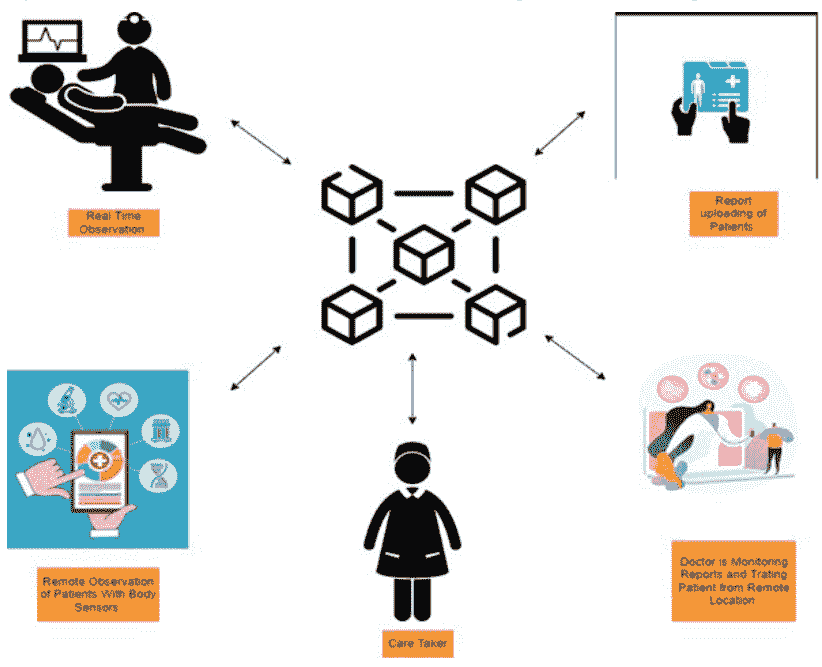

图 5.1: 基于区块链的 IoMT 架构

## 云计算

云计算为用户提供其环境的基于网络的视图，使他们无论身处何地都能共享计算和资源。根据 **美国国家标准与技术研究院** (NIST)，云计算是“一种提供适当且按需访问互联网的模板，可访问可编程网格、存储、服务器、软件和设施的集体池，这些资源可以快速释放，只需很少的提供商通信和监督。”处理器特性包括按需自助服务、高性能网络连接、快速弹性、资源池化和计量服务质量。混合云、社区云、私有云和公有云部署模型增加了三种服务模型：**平台即服务 (PAAS)** 用于平台，**基础设施即服务 (IAAS)** 用于基础设施，以及 **软件即服务 (SAAS)** 用于共享服务。这些共享属性，如虚拟化、同质性、地理分散和服务导向，均在 NIST 对云计算的定义中概述。

图 5.2 显示医疗保健实施中基于云的 IoMT 架构：

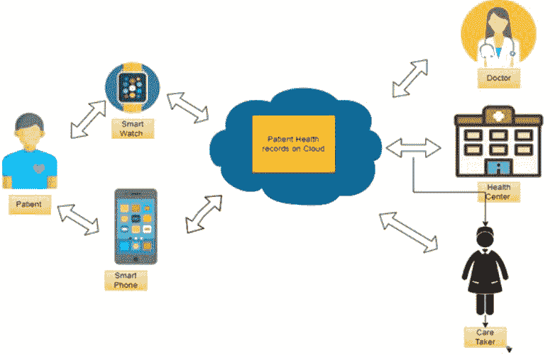

图 5.2: 基于云的 IoMT 架构

## 云 IoT 的挑战

云存储在对象和应用程序之间充当中介，模糊了细节和功能。IoT 是众多设备和应用程序之间的共生关系，我们都知道这一点。每个应用程序都有自己的一组问题，但它们似乎都归入同一大类。它必须更多地关注安全问题，并检查新方法的影响，以找到解决这些问题的方案。云提供商不信任和误解通过各种 IoT 协议提供给云的信息位置，这仍然是一个问题。多租户云存储解决方案引发了几个问题。单个设施存放各种客户数据，使其容易发生数据泄露并削弱隐私的价值。云服务提供商的不信任使这种漏洞成为内部危险，使其成为迄今为止冲击 IT 部门最意外的问题之一。

## 区块链与云计算

尽管该技术有许多优势，但在现有的区块链启用云系统中已发现两个反复出现的问题。首先，在尝试在云应用程序中使用区块链时，它经常会遇到技术问题。

大多数问题是由于区块链的技术特性引起的，其中一些被视为优势。然而，在纯去中心化环境（如公共区块链）中缺乏中央控制，在许多实际场景中也是一个缺点。许多因素，如法律考量或政府责任，阻止完全放弃基于集中化的治理。

另一个主要问题是开发/实施区块链服务模型。当比特币最初向公众展示时，“区块链”一词被用作“比特币”的同义词，尽管区块链技术是在比特币诞生前几年开发的。已经出现了基于区块链的数字货币和金融服务浪潮，但区块链在加密货币中的成功很少在其他领域得到复制。尽管多年来已做出多项努力，缺乏合适的服务模式仍然是限制区块链应用的重要因素。

## 区块链与云安全

由于数据量的指数级增长，常规存储设备的容量已不再足以满足现代生活的要求。在这方面，云存储系统（缩写为 CSS）已得到升级，以容纳更大的数据。基于块的云存储系统 (BCSSs)、基于对象的云存储系统和基于文件的云存储系统是组成 CSS 的三个类别。每个类别根据存储的数据类型与其他类别区分开来。这些云存储系统中最便宜且最容易扩展的是基本云存储服务 (BCSSs)，这就是它们现在最常被使用的原因。由于数据在 BCSS 结构内以块结构保存，资源由多个微小块空间组成。当用户将数据文件传输到 BCSS 时，系统首先将文件分段，然后将每个段转换为属性块。

## 为医疗物联网启用无线技术

可以通过将传感器和设备集成到基于云的生态系统中，并通过模块之间的高速链接将它们连接起来，来创建 IoT 系统。这些设备和传感器收集的所有信息都直接传输到云中，并可无限期存储。数据被清洗，然后分析以获取进一步信息。数据需要借助额外的软件、工具和应用程序进行可视化、分析、处理和管理。

## 电子医学的未来

智能医院的 ICT 基础设施构建在智能自动化和优化模块（可能基于 AI/ML）之上，以增强患者护理操作并提供新功能。远程机器人手术和远程医疗是智能医院的众多用途中的几个例子。非临床医疗保健可以通过远程医疗提供，而临床护理可以通过临床远程医疗提供。通过使用远程机器人手术，外科医生可以在数千英里之外指导医疗机器人进行手术。

## 远程医疗

在大流行病期间，随着患病感染人数增加，社交隔离的需求也在增长。除了大流行病，还有快速老龄化的人口和有限的医疗资源需要应对。特定场所允许进入的人数有限制。因此，必须做出安排，以确保在这些限制下仍能满足所有寻求医疗关注的人的需求。

患者不再需要去医院，因为他们的临床数据可以由第三方系统实时监控和分析，然后发送到云端以供以后使用。

我们必须保护 IoMT 中大量敏感数据，因为它是一个不断扩展的高数据密度领域。区块链是一种经过测试并证明安全的点对点数字账本。得益于区块链，不互信的成员无需中介即可进行通信。

患者和医疗工作者可以从遥远的地方远程参加预约，减少在医生办公室等待的人数。医疗保健提供者可以为患者提供居家或参加医生预约的选择，而无需应对拥挤的候诊室。随着众多配备传感器的 IoMT 可穿戴设备，患者在自己家中就可以参与远程医疗。这项新技术可能会缓解医疗资源的一些压力。

因此，许多医疗保健提供者不愿使用远程系统，因为担心患者机密信息的安全问题。当区块链启用时，患者数据、视频会议和在线药物将受到保护，免受非法访问。借助区块链提供的额外安全性，可以在医生办公室或医院之外提供额外治疗。

## 未来实现

医疗设备在区块链中的未来实现包括多种视角，例如可扩展性、机器学习和深度学习实现、后端即服务等。以下是它们的简要优势：

### 可扩展性

首先，必须解决区块链技术带来的问题。可扩展性是区块链启用设备的主要问题。区块链可扩展性的现状令人震惊。区块链解决方案只能处理其他系统每秒交易量（tps）的一小部分。例如，数百万人随时依赖 VISA 支付系统。该系统的容量为每秒 2,000 笔交易。而比特币只能处理每秒 7 笔交易。医疗记录中包含的海量数据量是区块链存储的一大问题。

通过提高吞吐量，区块链提供的 IoMT 系统可以处理大量交易。

### 机器学习/深度学习与 IoMT

IoMT 收集了大量数据。困难在于从收集的数据中获取可用信息。

可以从 IoMT 设备收集重要且有用的信息，例如分析数据和识别系统问题。另一方面，IoMT 数据的多样性给数据分析带来了困难。这可以通过机器学习 (ML) 方法向深度学习的发展来解决。

### 区块链 IoMT 与云 /后端即服务

在通过网络传输数据时，数据安全是一个关键问题。当 IoMT 应用程序依赖于集中式云时，存在安全问题。存储在云存储中的 IoMT 数据可能能够使用区块链和 AI 进行身份验证和授权。

为了保护数据，还可以使用联邦学习算法开发一种在云服务器之外存储数据的方法。通过这些技术，在边缘节点收集的数据可用于训练 AI 模型。存在 IoT 网关，这些节点可以在用户附近的大致位置被发现。

由于 IoMT 数据不会发送到不可信的第三方云服务器，这些技术降低了隐私和安全漏洞的风险。

云计算和区块链技术结合在一项名为 **区块链即服务 (BaaS)** 的服务中，其主要功能是支持区块链。简单来说，BaaS 提供商会为你处理所有与基础设施相关的琐事，以便你专注于开发和部署区块链应用程序。医疗行业以及其他以安全和保密为主要目标的公司，现在可以将其区块链的创建和使用外包给提供 BaaS 的实体，并专注于其他重要任务。Microsoft Azure、Oracle 和 Amazon Web Services (AWS) 是一些提供 BaaS 系统的主要云服务商。

## Block5GIntell

随着智能手机和 IoT 设备变得越来越普遍，区块链、AI 和 5G 领域取得了进展。存储和产生的数据量以惊人的速度增长，从 TB 到 PB、EB 和 ZB。面对如此庞大的数据，务必找到一种既能快速高效地处理信息，又能同时确保其安全性的技术。一个用于安全数据分析和情报收集的有效框架将充分利用这三种技术。Block5GIntell 由四个层级组成：设备层、接入层、雾层和云层（按此顺序）。术语“设备”指的是构成每个层级的组件。第一层的示例包括“智能家居”、“电子健康系统”、“智能基础设施”和“智能交通”。

该层负责生成机密信息和系统相关信息。从本地区块链获取后，需要受到保护并妥善保存的机密信息会被发送到云层，由 AI 学习模块进行存储和评估。此过程以安全方式进行。利用 AI 的受监督和非受监督机器学习能力，可以在提升用户所获得体验和服务整体质量的同时，降低未来出现错误的可能性。

核心网络、基站和 C-RAN 的状况与状态存储在 Block5GIntell 的接入层中。此外，该层允许基站通过 P2P 通信安全地相互交换状态信息。随后，数据会被发送到云层，供雾层学习模块中的 AI 使用。在此层收集的数据有助于 AI 模块进行网络规划、提升能源效率并增强网络安全性。

雾层是 AI 的行动模块和学习模块的集成所在。学习模块利用存储在云层中的数据执行各种学习算法。最后，行动模块将这些发现应用回其节点网络。成功的发现会被转发到云层，并存储在智能合约中。

前三个层级的数据将在云层的区块链中存储。通过在云层使用 AI，区块链提供了安全且去中心化的数据组织和聚类，以便在雾层中更快速、更有效地使用。

## 结论

医疗设备是数字革命的下一个前沿，而 IoT 是 IoMT 的关键组成部分。底层技术提供的患者实时数据和患者监测系统已改变了当前的医疗系统。然而，由于依赖云存储，IoMT 在数据存储管理、安全性和隐私方面存在重大问题。IoMT 产生的大量医疗数据目前存储在集中式数据库中。另一方面，敏感患者信息的集中化会导致单点故障，并引发隐私和安全问题。

IoMT 用户的安全性和隐私性仍然是关键问题。医疗设备可以通过 IoMT 与 IoT 集成，以提供更好的患者舒适度、降低成本、加快医院治疗速度并提供更个性化的医疗服务。但带宽有限的用户无法负担。所有这些问题都必须在相关领域投入更多关注、探索和创新来解决，以实现更安全、更可靠的未来。

在下一章中，我们将学习区块链应用如何帮助缓解和应对 COVID-19 大流行带来的挑战。

## 关键词

- 医疗保健
- 区块链
- 医疗物联网
- 人工智能
- 深度学习

# 第 6 章

# 基于预测的 COVID-19 解决方案

## 摘要

COVID-19 大流行严重影响了人类生活的方方面面、众多经济领域以及全球各地区。为了防止新冠病毒的传播，全球人类活动在很长一段时间内暂停了数月。这些封锁措施的副作用在世界各地的多个方面都能看到。例如，表现为世界许多地区的经济和政治动荡。与以往的大流行不同，当代世纪的技术创新在保护世界免受伤害方面发挥了关键作用。COVID-19 大流行凸显了技术不足以及安全和隐私挑战等问题，验证了匿名性、用户对记录的控制权，同时充分利用现有记录等等。这些问题可能出现在涉及大量人群的紧急情况或大流行病中。当今数字经济所需的文档不可篡改性、完整性和正确身份验证，使区块链技术成为一种可能的解决方案。在当前的 COVID-19 等大流行条件下，区块链有潜力突破技术障碍，并最大限度地利用现有资源和基础设施。

## 引言

COVID-19 是由世界卫生组织 (WHO) 指定的一种新型冠状病毒疾病，使全世界陷入困境。自2019年底在武汉首次被发现以来，类似肺炎的疾病已在全球迅速传播。由于其传播迅速，每个国家都面临危险，医疗设施不堪重负。为了阻止病毒传播，社交隔离和个人卫生是唯一有效的预防手段。根据世卫组织的建议，与他人保持至少一米的距离，远离公共场所，并始终佩戴口罩。

## 结构

本章结构包括以下主题：

- COVID-19
- 对 COVID-19 期间使用的安全措施的深入考察
- 区块链
- 区块链分类学
- 区块链在医疗保健中的用例
- 将区块链与 COVID-19 结合使用可能带来的好处
- 区块链为 COVID-19 大流行带来的机遇
- 可用于 COVID-19 的基于区块链的应用程序和服务
- 电子政务
- 区块链在抗击 COVID-19 斗争中面临的若干问题

## 目标

本章概述了区块链应用如何帮助缓解和应对 COVID-19 大流行带来的挑战。

## 本章概要

全球多个国家已采取有力措施限制病毒传播，例如对所有感染居民实施强制隔离和旅行限制，以及关闭公共场所以防止大规模聚集等保持社交距离的措施。ICT 在抗击病毒的斗争中发挥了重大作用，并与医疗部门携手减少这种感染的传播。世界各国政府和地方实体开发了移动应用程序，让居民了解病毒的最新进展。此类应用提供有关报告病例数量以及有多少人已从疾病中康复的信息。包括印度和韩国在内的多个政府开发了用于追踪公民及其接触者行程的应用程序。所有与感染者有过任何身体接触的人都被追踪并进行了检测。在开发此类个人信息共享应用程序时，数据安全和用户隐私保护始终是首要任务。由于集中式系统的问题，患者的安全和隐私面临危险。相关政府机构采取了许多措施来解决这一问题。但必须采取更多创新的安全措施来保护人们的个人数据，确保其永远不会落入未经授权的人手中，并且数据在任何时候都不会被滥用。

近年来，区块链已成为一种存储防篡改记录的新颖且安全的技术。在建立信任和可信度方面，区块链已以多种方式被利用和提出。起初，区块链和金融交易是主要关注点，但它也越来越多地应用于医疗保健和治理。

类似于当前由冠状病毒疾病 (COVID-19) 危机引发的全球大流行和大规模不稳定等情况，需要一个基于区块链的信息管理平台，以便跨多个企业和供应链活动监控、存储和管理各种数据集。

在此场景中，比医疗救治更重要的是坚信信息共享。受限社区面临多种挑战，包括合作、监控偏远地区、监控基本医疗包和药品、发现可疑病例和关联以及监控患者。

已推出多种基于 IoT 的智能解决方案来监控和收集患者数据。尽管如此，基于 IoT 的应用和云存储固有的安全漏洞（可通过基于区块链的架构来修复）对采用这些技术构成了重大障碍。

## COVID-19

与严重急性呼吸综合征 (SARS-CoV-2) 相关的冠状病毒是 COVID-19 的病因，该病毒最初于2019年12月在中国湖北省武汉市被发现。这是一种类似肺炎的传染病。世卫组织 (WHO) 于2020年3月11日将 COVID-19 指定为全球大流行。当在同一种病毒内发现新毒株时

在 coronavirus 家族中，术语“新型”通常被使用。根据世界卫生组织（WHO），冠状病毒引起的疾病种类繁多。由于这种病毒的异常传播，引发了多种问题，这引起了人们对现代人类文明未来的担忧。

限制人际身体接触——而社交对人类来说是自然而然的——对于实施封锁和旅行限制的国家来说是一个两难困境。许多基本服务和物资变得更加难以维持，使得越来越不可能满足需求。

许多国家和国际组织以及个人倾向于提供财政援助以满足这些需求。然而，重要问题包括确保有效分发，并向组织和捐助者提供透明度。此外，虚假信息大流行正在加剧大流行病的传播。

对于科技巨头和政府监管组织来说，虚假信息难以检测和应对。许多受 COVID-19 影响的国家正在为这些问题苦苦挣扎，必须迅速采取行动加以解决。当代时代最宝贵的资产无疑是科学和技术的飞速发展。

针对 COVID-19 大流行，可利用基于物联网的 **机器学习与人工智能（ML/AI）**、机器人技术、区块链、纳米技术、合成生物学、 **无人机（UAVs）**、3-D 打印、5G 通信、云和边缘计算以及大数据等新兴技术，来开发智能应急管理策略。

将区块链技术引入医疗健康行业可能会增强信息安全管理；医疗数据可以在保持数据隐私和安全的同时进行评估和共享。由于这场流行病，我们比以往任何时候都更加依赖技术来解决这些问题。在相当长一段时间内，这种病毒都没有治愈方法，但多亏了我们的医学研究人员和科学家，目前市面上已有多种疫苗可供使用。

## COVID-19 期间使用的安全措施考察

流行病迫使多家企业和组织让员工居家办公。由于流行病的突然爆发，大多数企业缺乏可接受的网络安全政策。员工经常使用自己的设备履行职责。由于这一趋势，恶意软件、网络钓鱼和 **拒绝服务（DoS）** 攻击有所上升。在流行病期间，成功的网络攻击频率激增了 600%。此外，医疗企业面临黑客的威胁。流行病期间，医院遭遇了多次以赎金为动机的攻击。

攻击发生后，医院管理层无法访问其计算机系统，这使患者处于危险之中。为了恢复访问，需要支付巨额赎金。

为降低此类网络攻击的可能性，已实施了一些策略，包括但不限于：

### 虚拟私有网络

此类攻击可能会针对通过家庭网络连接的公司计算机；但是，虚拟私有网络（VPN）可以加密这些计算机与企业网络之间的通信。

### 多因素身份验证

这为系统增加了额外的安全级别。除了用户名和密码外，使用多因素身份验证登录还需要发送到手机的一次性验证码。

**员工安全意识：** 为了保障员工安全，公司应提供网络安全程序方面的研讨会，例如，强调安全密码的重要性。

### 系统更新

最容易受到攻击的系统是那些不再维护且不获得安全更新的系统。通过更新过时的系统和固件，可以增加一层安全防护。

### 防病毒软件

保持防病毒数据库的及时更新以应对最新威胁是至关重要的。

### 区块链

值得注意的是，欧洲议会研究服务处将区块链列为可用于应对 COVID-19 的 10 项主要技术之一。多亏了区块链技术，与集中式计算生态系统相关的大多数限制都可以消除，因为它提供了一种去中心化的计算服务架构。区块链由一组以点对点（P2P）方式链接的计算节点组成，并相互验证网络内执行的任何交易。

区块链形成一个基于哈希（加密）的区块链，每个区块以加密方式保护一组先前记录的交易，并与前一个区块相连。区块链是解决医疗健康行业日益增加的数据泄露及其他安全问题（例如供应和供应商验证、在线支付等）的可行方案。区块链是一种新技术，可帮助以去中心化的方式跟踪不可篡改的交易。

得益于这种方法，患者的个人和敏感信息可以以安全可信的方式共享。去中心化、不可篡改性和透明性是区块链最重要的三个方面。关于一方发起并由网络其他成员验证的交易的信息，可以存储在逻辑上相互链接的区块链中。

然后区块链会更新以反映这些交易。随着链的增长，其持有数据的安全性也随之提高。要修改区块内容，攻击者需要知道相关区块的加密哈希值以及下一个区块的哈希值。因此，要发动网络攻击，攻击者将不得不修改链中每个后续区块，这需要花费大量的精力和时间，几乎不可能。

所有网络用户都可以访问区块中包含的数据及其当前状态，但单个用户的身份受到假名保护。为了防止未经授权的用户访问不面向他们的数据，区块链还提供访问控制。例如，使用区块链时，医生只能访问患者的既往病历信息，而区块链还具有数据永久性这一额外功能。所有交易都会被记录，并可以随时由拥有适当权限的人检索。

## 区块链分类学

区块链网络分为四类：公有链、私有链、联盟链和混合链。

### 公有链

这种区块链提供一个完全开放的网络，所有参与者都可以参与共识过程。

### 私有链

该区块链网络的每个成员都必须获得授权才能加入，这类成员被称为“已知参与者”。

### 联盟链

联盟链由多个公司使用。对于成员组织而言，它充当公有链。

### 混合链

混合链结合了私有链和公有链的最佳特性。共识由少量预定义节点达成，类似于私有链，但网络上的每个人都可以查看交易，类似于公有链。

## 区块链在医疗保健中的应用场景

在医疗保健中使用区块链技术是一个明智的主意。区块链应用的一个突出领域是医疗保健。电子健康记录（EHRs）、远程患者监护、疾病/大流行病管理、医药供应链和健康保险都是区块链在医学领域的潜在用途。

COVID-19 是一场大流行危机的示例，可以利用当前的医疗基础设施和区块链技术，实现早期检测和疫苗供应链管理的高效管理。

图 6.1 说明了区块链技术在 COVID-19 中的应用：

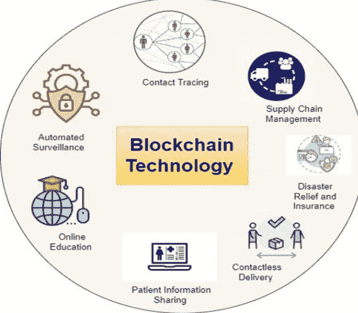

## 使用区块链应对 COVID-19 可能带来的益处

由于区块链技术可应用于多种行业，其受欢迎程度正在不断提升。

医疗专业人员也在探索其可能性，研究人员亦是如此。然而，早在 2011 年，医疗领域就已使用区块链构建了一个面向医生、护士、药剂师及其他行业参与者的共享数据库。由于 COVID-19，全球多个机构和企业已开始在其解决方案空间中采用区块链。此次整合的首要目标是尽可能汇集更多可靠和可信的数据来源。在对抗 COVID-19 的斗争中，区块链即使在实时场景下持续验证数据的独特能力至关重要。

Bell 等人、McGhin 等人和 Kumar 等人指出了以下当前医疗问题：

### 全国范围的互操作性

传统医疗系统通常将患者数据以碎片化方式存储在集中式系统中，这阻碍了利益相关方之间的简单数据交换。

### 医疗数据交换

在多个各方之间共享的患者数据必须有某种保障措施。

### 供应链管理

库存控制和真实性是医疗领域的主要问题，因为及时交付和真实性对治疗效果至关重要。

### 移动性

移动技术使得患者越来越可能要求其医疗记录随之移动，这意味着无论身在何处，都需要能够从任何设备实时访问这些记录。

### 电子资金转账涉及的欺诈交易

在像 COVID-19 这样的大流行期间，重复付款和保险欺诈对医疗系统构成重大威胁。

### 药物追踪

在医疗领域，患者用药混淆很常见，假药的存在也是如此。

区块链为最终用户提供了一个安全的端到端解决方案，可能解决上述问题。

## 区块链为 COVID-19 大流行带来的机遇

区块链是一种前景广阔的新兴技术，具有广泛的潜在应用。我们已经探讨了区块链的独特特性如何帮助我们应对 COVID-19 疫情。

### 去中心化

由于区块链的去中心化点对点架构（P2P），区块链网络中的任何成员都可以查看整个网络并参与交易验证和确认。在 COVID-19 大流行的情况下，这种架构的好处在于它允许独立各方在不将完全权力交给单一机构的前提下工作。此外，其去中心化设计不像集中式系统那样容易受到单点故障的影响。

在去中心化系统中，如果一个节点故障，其他节点不受影响。在这些情况下，一个功能正常的医疗系统至关重要。如果系统无法做到这一点，可能会导致致命后果。由于没有中央机构来监督数据，患者保留对其数据的控制权。作为这种分布式设计的结果，数据使用哈希值而不是真实患者姓名进行保存。

### 容量增加

与少量集中式服务器存储数据不同，P2P 网络中的所有数据均分布在广泛地理分散的计算机网络中。这是 P2P 网络的主要优势。这类网络的容量始终在扩展；一旦新节点加入网络，它就会立即开始增加网络的整体容量。这种额外的容量在对抗这场大流行中可能至关重要，用于存储不断增长的大量患者数据。由于处理能力的提升，验证交易所需的时间可能会缩短，从而允许每秒处理更多数量的交易。通过协助运行时模拟，计算能力还可能有助于开发疫苗来对抗这场大流行。

### 透明度

区块链网络提供的透明度是其他任何网络都无法比拟的。在这类网络中，账本分布在所有成员节点上，任何节点都可以随时访问。

Nugent 等人描述了一个基于区块链的智能合约系统，用于医学临床试验，并部署在以太坊网络上。此类研究通常会因为数据缺失、在机构之间传输导致的数据丢失，或因数据间谍活动导致的数据可信度受质疑而遭遇信誉受挫。此外，在医疗行业，由于矿工可以访问网络中所有信息的完整账本，因此在提供透明度与保护患者隐私之间存在权衡。

### 自主性

由于没有单一的中央机构来管理交易，区块链的所有成员节点都可以访问数据并上传更多数据，而无需任何外部来源监督。由于患者可以访问网络上的数据，并且还可以与世界上任何地方可能患有相同疾病的其他患者联系，这是一个非常有益的资源。患者将能够完全控制自己的数据，并决定与谁共享，该设计保证了这一点。

### 持久性

区块链网络能够快速验证所有交易，并且只允许合法的交易加入网络。一旦交易被接受加入网络，网络就不允许该交易被回滚或删除。这种特性使得决策能够更快速、更准确，这两者对于应对 COVID-19 场景都是必需的。COVID-19 疫苗的供应链管理也可能受益于区块链的特性。

### 不可更改性

一旦记录被添加到区块链网络，就无法将其移除或擦除。此特性保证每一笔交易的记录都将在区块链中无限期保存。使用此策略对抗 COVID-19 疫情的好处之一是，如果患者被转诊给另一位医生，新医生将能够访问患者的完整病史。另一方面，51% 攻击揭示了这一论点的潜在弱点。在这类攻击中，单一各方控制了总节点的 51% 以上，从而完全访问网络并拥有修改能力。

## 可用于 COVID-19 的基于区块链的应用和服务

基于区块链的应用程序包括各种应用程序和服务，例如接触者追踪、保险、救灾、患者健康相关数据共享以及移民和移民程序等。这些在图 6.2 中进行了讨论，该图还展示了全面实施。以下图 6.2 显示了 COVID-19 的区块链应用：

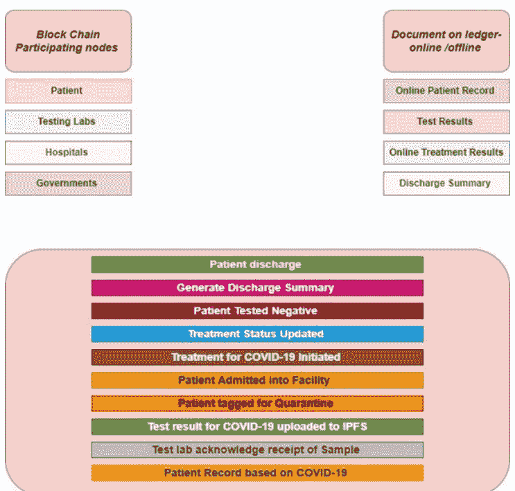

图 6.2: 可用于 COVID-19 的基于区块链的应用和服务

接触者追踪：SARS-CoV-2 感染的症状通常在感染后约 5.5 天开始出现，预计大量病例未被识别。为了限制 COVID-19 的传播，必须快速有效地识别这段传染性潜伏期内发生的所有社交接触。

为此，请使用接触者追踪来监控在一定时间内与感染者密切接触过的人。

当某人被诊断出感染 COVID-19 时，其所有密切朋友和家庭成员都应得到通知。蓝牙低能耗（BLE）技术已被用于开发许多移动接触者追踪应用程序。得益于 BLE，移动电话、可穿戴设备和 IoT 设备之间的密切互动可以被记录。然而，这种策略引发了消费者最严重的数据安全和隐私问题。因此，消费者可能失去对数据的控制，因为其数据存储和处理在集中式云中。

数据安全和隐私问题可以通过区块链技术来解决。区块链可以提供一个去中心化的数据库替代方案，使用户能够完全控制自己的数据。患者和用户可以使用智能合约为其数据设置有时限的访问权限。此外，可以使用假名化来保护患者的隐私。

基于区块链的系统可能允许为每位患者使用唯一的数字指纹（公钥或哈希），而不披露患者的真实身份。

以下图 6.3 描绘了使用区块链技术进行的大规模监控：

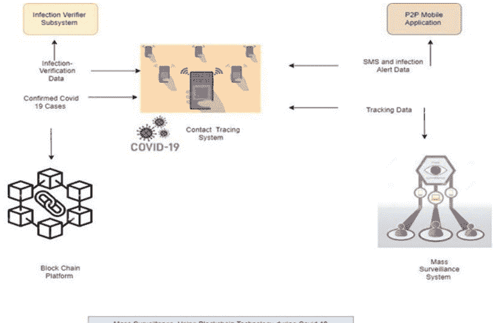

图 6.3: COVID-19 期间使用区块链技术进行的大规模监控

## 保险与灾害救助

全球范围内的封锁和社交距离政策对企业产生巨大的经济影响。

在向企业放贷方面，政府和金融机构有义务提供帮助。然而，传统的基于纸张的技术在帮助大量企业时既耗时又低效。因此，机构正在寻找快速、可靠且可扩展的解决方案。

区块链上的智能合约可用于简化繁琐的贷款和保险申请流程。通过用智能合约取代基于纸张的规则，可以完全避免处理延迟。

因此，区块链可能消除对第三方中介的需求。这种方法有多种优势，包括降低运营风险和加快所有各方的结算。

## 患者健康相关数据的共享

在应对COVID-19大流行病时，医疗同事共享重要数据至关重要。通过在国际研究界共享数据，有可能为COVID-19研究开发出强大的数据集。

使用这些数据共享工具时，必须遵守国家和国际数据共享法规。对患者隐私的担忧阻碍了医疗数据共享，这是其广泛实施和使用的主要障碍。由国家和国际机构执行的《健康保险可携带性和责任法案》(HIPAA)和数据访问标准等控制措施。医疗物联网(MIoT)设备可通过集成策略收集额外的患者数据，例如血氧水平、心率和处方剂量。

医疗数据可以极大地受益于区块链提供的去中心化存储。通过消除以集中式数据库形式存在的昂贵中介，患者和医院将能够更好地控制自己的数据。

因此，区块链可能打破医疗数据的常规孤岛，并使全国乃至全球范围内医院与医学专家之间的数据共享过程大大简化。可以使用区块链技术共享实时数据。如果MIoT数据直接上传到基于区块链的系统，则可以避免数据伪造和篡改。数据收集、存储和共享应更加透明，以确保患者隐私得到保护。

## 移民与出入境程序

由于COVID-19在全球的异常传播，已有多个国家关闭了所有入境口岸。这些限制将在未来某个时间点被放宽或完全取消。因此，移民和出入境在近期和远期都将至关重要。根据政府规定，旅客被期望相互通报其病史、旅行史和实时位置。

此外，跨越国界旅行时，此信息必须与移民官员共享。通过创建由区块链驱动的跨国数据交换系统，可以更高效地处理移民和出入境事务。不可篡改性、控制力、不可否认性和可审计性都是区块链系统的关键方面，这些系统配备严格的智能合约，可用于此类应用。在具备这些关键功能后，可以创建一个安全、去中心化且协作的移民生态系统。

基于区块链的移民系统很快可能在全球普及，连接所有移民检查站。此类系统将能够以特定方式相互通信。

## 供应链管理

由于持续的疫情，全球供应链正在受到严重干扰。无论哪种情况，工业生产运作都因法律规定的封锁而停止，或者因为工厂没有配备和/或建造以适应社交距离和有限物理接触的新模式。进出口限制也产生了影响。今年的COVID-19供需问题非常严重，但无法量化造成了多大损失。

某些物品要么需求强劲，要么某种商品供应过剩。由于恐慌性购买，日用必需品价格大幅上涨。医疗保健组织也在努力跟上医疗用品和药品需求增加的步伐。使用区块链技术可能有助于构建更具韧性的供应链。

区块链可用于在各方不知情的情况下将他们聚集在一起，创建一个不可靠的生态系统。不可更改的日志允许可审计性和可追溯性，而智能合约提供高度自动化和访问限制。我们可以期望在这种特定用例中结合联盟链和公有链技术。

## 安全认证与在线教育

多个国家已关闭其教育机构很长一段时间。无论情况多么严峻，教育——对个人发展和国家进步都至关重要——必须继续。

毫无疑问，在线教育已成为最可行的选择，但支持它的系统仍在开发中，并面临多种障碍。此外，学生和教师的数据面临被盗的风险，还存在缺乏跨平台合作以及难以确保学生凭证（学位、成绩单和其他证书）准确性的问题。

基于区块链的在线教育系统有潜力解决这些问题中的广泛问题。

它们允许安全地跨平台交换在线材料，同时促进教育机构之间的统一性。可以使用智能合约和代币设计基于内容精确使用的支付系统。存储在去中心化区块链上的数据可能更安全，同时仍可供授权用户访问。还可以使用区块链及时、高效、安全地颁发和共享有效的教育证书。

一旦资格证书由机构颁发机构上传到基于区块链的系统，有权学生将对该证书拥有完全管理权。因此，学生有选择性地向招聘人员、教师或大学授予进一步查看权限的选项。

## 无接触配送与自动化监控系统

COVID-19迫使我们养成诸如社交距离、戴口罩以及监测发烧、咳嗽和呼吸困难等症状的行为。然而，这些新习惯似乎很难养成，因为它们不符合人性。

为了让通知挽救许多生命，必须建立一定程度的持续自动化监控。即使在传播率高的地区，当前情况也需要使用无接触（机器人）配送系统向封锁人群提供必需品（食品、药品等）。此用例非常适合**无人驾驶航空器（UAVs）**和由区块链驱动的机器人技术。

许多国家现在使用UAVs用于各种目的，包括公告、监控、医疗诊断（例如测量体温）和货物的无接触配送。尽管无人驾驶航空器UAVs能够自主执行复杂任务，但它们容易受到网络攻击。由于这些攻击，预定功能可能被改变，和/或数据可能被盗。UAVs可以配备区块链和智能合约提供的安全性、有限数据访问、数字支付集成和其他优势，这些功能可针对政府或医疗保健计划定制。

## 制造业管理

随着COVID-19的爆发，对包括洗手液和消毒剂在内的多种关键商品的需求大幅增加。由于内部制造产能不足，许多企业正在转向第三方，以帮助他们跟上需求。

由于这些第三方可能无法满足质量或卫生合规标准，这引发了重大担忧。此外，COVID-19药物和疫苗在未来将成为关键商品。全球需求将需要许多小型工厂和微制造设施同时并协作运行。

鉴于COVID-19病例呈指数级增长，建立冗长的纸质传统合作伙伴关系可能不切实际。因此，制造流程必须由一个集成的、全面的和协作的合规控制监控架构来监督。

可使用区块链支持的物联网技术来验证制造的完整性。借助物联网（IoT），质量可以在生产的多个阶段进行测量，例如收集原材料、制造、存储和运输产品等。工厂的主生产线可以连接到区块链节点。包含区块链技术的物联网解决方案以不可变和去中心化的方式安全地记录生产数据。

为了追踪不合规率，智能合约可以存储审计所需的逻辑。区块链支持的云控制制造网络可用于在全球范围内创建未来的COVID-19疫苗和药品。去中心化生产系统可能从使用智能合约处理版税支付和其他知识产权中受益。

### 电子政务
电子政务，也称为数字政府，是指广泛使用信息和通信技术（ICT）来促进向国家人口提供公共和政府服务。这包括水、煤气、电力、污水处理及其他基本公用事业，以及工资发放、税收征收、婚姻和离婚、土地登记、选举和签证办理等服务。电子政务的理念设想将这些功能全部或部分数字化。

可以通过区块链加强各组织之间的完整性、不可变性、保密性和数据一致性，从而增强电子政务的安全性。此外，使用此技术可减少处理延迟并降低运营成本，从而提高效率。在将电子政务系统中的各种运营方面整合在一起时，区块链的公证、共享数据库和工作流自动化等主要功能非常有用。

使用此类方法可以识别故障和假冒行为。

### 农业和食品分销
农业和食品分销对人类生存至关重要，必须继续高效运作。由于旅行禁令、出口限制和非正式劳动部门关闭等严格的疾病控制措施，这给农民、供应商、制造商、零售商和消费者带来了诸多困难。为了获得合理的作物价格，农民在出售收成方面面临困难，因为生产商无法以满负荷运营其设施。由于获得政府批准的过程冗长，分销商跨越州和国家边界变得更加困难。对于世界粮食计划署（WFP）等人道主义组织，COVID-19引发了重大金融危机，并使维持食品分销周期变得不可能。

在此，区块链可能是一个有用的工具，作为一种实用且敏捷的解决方案。可以用无需信任的数字市场取代基于纸质的长期协议，交易可以在几秒钟内完成，而无需损害商品的所有权。得益于区块链的去中心化特性，生产商可以直接从农民那里购买原材料。农民将从更高的作物价格中受益，食品成本也将相应降低。得益于区块链技术，现在可以远程且安全地帮助有需要的人从当地商人那里获得免费或补贴食品。如果基于区块链的解决方案允许保持透明度和匿名性，捐赠者可能更倾向于向值得信赖的组织捐赠。

COVID-19带来了医疗保健系统中区块链使用的显著增长。不止一位研究人员正在探索如何将区块链网络的优势实施到医疗保健组织的运营体系中。我们已审查并总结了所有相关材料，以帮助我们应对这一挑战。接触者追踪、数据交换、支付、供应链管理和数据安全是其中最重要的方面。

去中心化、开放性和不可变性是区块链最有希望的三个特性，它们已使该省份能够与医疗保健行业成功融合。在审查可用研究后，我们得出结论：这些医疗保健模型所基于的当前集中式系统非常容易受到不必要攻击，不可避免的后果是损害用户的隐私和身份。信息可以在区块链利益相关者之间快速、安全地传输，从而改善决策。作为额外好处，区块链有助于应用程序利益相关者的许可和身份验证，确保传输中共享数据的安全性和完整性。

### 临床试验
在将任何新药物或医疗设备投放市场之前，应经过严格测试以验证其有效性和安全性。在涉及大量志愿者或患者的临床研究中，该过程分为四个部分。临床试验需要一个公平且一致的管理框架才能继续进行。根据立法标准，医学试验必须能够以确保隐私、安全性和不可变性的方式处理数据。

通过使用新技术和新理念，缩短研究时间表可能有助于保护患者隐私。得益于区块链技术，医生和临床医生将能够记录实时和特定位置的健康数据。它提高了记录的准确性，便于信息交换，并确保符合监管要求。此外，它会尽可能跟踪谁访问了数据库，创建数字审计轨迹，有助于保护敏感信息。

### 数据聚合
随着疫情传播，科学家需要收集和组织所需信息，以跟踪疫情爆发、识别趋势并开展研究。对实时数据的验证和永久存储确保了区块链上数据的完整性。区块链网络鼓励公司和组织与研究人员和企业家共享其信息，以开发利用这些情报的新技术和解决方案。借助区块链网络，监管管理、数据所有权和多层审计都可以以灵活的方式处理。与知名科技集团和政府共同开发的全球区块链监控和通信基础设施已创建完成，有助于收集、存储和分析病毒扩散和控制的数据。

### 药品和疫苗供应链
COVID-19的紧急情况导致了大规模供应链中断。越来越多的制造商因缺乏安全和卫生标准而被迫关闭，而对PPE和医疗用品的需求正在超过供应。高需求意味着许多人可能会从不可靠的来源或以高价购买产品。

长供应链造成不必要的不透明，使得估计和预测库存水平变得困难。即使在全球大流行期间，大规模国际跨境交易也可以通过使用区块链技术高效地维持。

一旦最终获得FDA批准的版本可供购买，疫苗的分销将陷入完全混乱。假疫苗、漫天要价和囤积都是不道德商业活动的例子。基于区块链的医疗供应链可以解决这些挑战。

各种区块链安排正在因COVID-19大流行而得到部署。通过消除对第三方和交易延迟的需求，区块链缩短了验证交易所需的时间。区块链技术使快速结算成为可能，因为它能够缩短处理和分发交易所需的时间。

## 涉及的挑战
COVID-19为研究人员提供了为医疗保健行业建立更高效、更安全的数据共享策略的机会。鉴于信息量不断增加，区块链似乎是一个可行的选择。现有研究可能提供答案，但在付诸实践之前，必须解决一些问题和障碍。

## 区块链在抗击 COVID-19 中面临的若干问题，包括以下几点：

- 在医疗保健行业实施区块链技术的主要挑战之一，是医疗专业人员不愿将纸质记录转换为复杂的区块链技术。由于缺乏对新技术的能力和理解，他们将因此面临技术挑战。

- 在医疗保健行业实施新的区块链网络时，可能会出现法律和监管难题。这些问题包括在区块链网络中传输和存储的数据类型、隐私问题、完整性挑战以及版权难题等，仅为几例。

- 在短时间内面对庞大的网络时，很难监督项目的方方面面。因此，由于密钥管理以及密钥被利用的担忧，数据安全性可能受到威胁。

- 区块链网络连接了许多利益相关方，每个相关方都有各自独立的数据库，以共享信息。换句话说，当试图管理分布在众多数据库中的数据时，会出现互操作性挑战。为了确保运行顺畅，所有各方都必须接受开放标准。

- 在短时间内面对庞大的网络时，很难监督项目的方方面面。因此，由于密钥管理以及密钥被利用的担忧，数据安全性可能受到威胁。

- 随着医疗保健中物联网的引入，需要更多的传感器和执行器。运行这些设备还需要电力。当一个人的生命处于危急之中时，电力不足根本不是一个选项。为了确保收集足够且准确的患者和健康数据，必须采取进一步措施。

- 随着电子健康记录和移动录音设备的引入，现在可以随时随地进行读数，从而导致患者记录更新更加频繁。另一方面，区块链是不可更改的。

- 因此，每次出现新读数时都有必要创建一笔新交易，因为之前的记录无法更改。无论如何，这仍然是同一个人。因此可能会出现可扩展性和存储难题。

- 最后，挖矿攻击是与在 COVID-19 中引入区块链相关的最具破坏性的问题和障碍，这类攻击取决于架构，因此存在不同的漏洞。

## 结论

COVID-19 疫情对从医疗保健和银行业到政治、经济和教育的多个领域都产生了影响。后 COVID-19 时代的全球管理可能会从区块链技术中获益匪浅。因此，广泛的用例都可能受益于区块链的核心能力，包括接触者追踪和灾难援助、患者信息共享和电子政务、供应链管理以及在线教育。然而，在区块链能够被适当地用于这些目标之前，必须处理包括法律、安全、隐私、延迟、吞吐量、可扩展性和资源消耗在内的多个障碍。自比特币推出以来，区块链在发展方面已经走得很远。全球的研究人员正在努力发现区块链的众多用途。鉴于需要严格控制和监控数据访问，区块链在医疗保健行业的应用尤其引人注目。现有系统容易发生数据泄露，可能会危及患者隐私。除了不可变性和成功的共享机制之外，区块链还提供许多其他优势。

将区块链与医疗保健相结合以应对 COVID-19 的大多数建议方法目前都处于建模阶段。此外，这些建议集中在 COVID-19 带来的众多问题中的一两个方面，但缺乏综合解决方案。由于冠状病毒突然呈指数级增长，每天都会产生海量数据。区块链在缓解和应对类似 COVID-19 大流行病的挑战方面有着广阔的应用前景。

在下一章中，本研究旨在了解医疗机构如何采用区块链网络来满足患者需求，而不会陷入任何困境。

# CHAPTER 7
面向患者满意度的区块链技术优化

## 摘要

工业革命塑造了区块链网络等新技术。区块链（BC）技术具有保护数据、确保医疗机构数据透明度和公平数据管理的能力。区块链网络已在医疗保健外围领域应用，以提升健康数据的安全性。因此，本研究旨在了解医疗机构如何采用区块链网络来满足患者需求，而不会陷入任何困境。

## 介绍

各行各业已采用区块链网络等新技术来服务客户或应对行业挑战，医疗保健或医疗机构也不例外。近年来，区块链已应用于包括开放式创意企业、制造业、医疗保健等在内的各种场景。在法律、医疗及其他领域，交易存在若干共同前提条件。确定交易相关人员身份、建立信任、确保交易被准确记录且不可更改，以及确保交易所在的基础设施稳定，都是必备要求。

### 结构

本章结构包括以下主题：

- 区块链
- 区块链在医疗保健中的应用
- 医疗保健领域的区块链采用
- 医疗保健领域区块链采用的决定因素
- 嵌入理论的因素
- 技术接受与使用统一理论
- 技术接受模型
- 其他重要因素

### 目标

本章旨在通过研究，了解医疗机构如何采用区块链网络来满足患者需求，而不会陷入任何困境。

### 本章概要

区块链是一种不断新增条目且在未获得广泛共识之前从不修改的分布式存档网络。一种将每个数据块与新添加的信息块记录相关联的加密哈希，决定了区块链哈希的值。医疗保健组织和提供者可以利用区块链技术管理信息交换。对于通常比较分散的医疗系统来说，互操作性是一个难题。区块链被视为一种有吸引力的选择。

许多研究建议在医疗保健行业实施基于区块链的技术，以安全地管理医疗数据。得益于分布式区块链账本架构，数据处理不会在任何集中位置进行，从而对所有网络用户保持透明且可问责。

这种去中心化的系统通过防止单点攻击来增强和保护系统安全。这有助于减少医疗从业者监测和照顾患者所花费的时间，并为医疗机构节约大量资源。通过在区块链上维护自己的健康记录，患者将能够监控其信息的流向。

尽管并非完全可行，“完全基于区块链技术的医疗数据记录保存系统在理论上是可能的。”让基于区块链的系统与当前医疗数据基础设施共存的桥梁概念越来越可行。然而，区块链技术的基础问题仍存在重大挑战。

有人提出，“实施区块链技术及其安全措施也将成为一项重要研究领域，旨在随着云计算性能提升而改进集体数据存储安全网络”。本研究旨在从理论视角审视医疗保健行业使用区块链技术的现有问题。

在区块链出现之前，实现这些目标的唯一方法是创建强大的中央机构来提供这些服务，例如银行、国家和金融机构。每家医院或医疗系统都在健康记录领域充当自己的中央机构，提供记录保存和通信服务。

尽管区块链是一项相对较新的发明，但它已为隐私、稳健性和企业流程效率提供了新视角，正在改变数字世界。区块链是一种由众多用户实体管理而非由单一实体控制的去中心化存档。

根据以往研究，“医疗保健使用区块链网络在医院、诊断实验室、药房公司和医生之间存储和共享患者数据。”在这个技术时代，人们的生活依赖于医疗保健，因此患者确诊并为未来使用保存其数据（病历）变得至关重要。医疗信息最初是从纸质记录艰苦地转换为电子格式。使用这种方法为数据损坏和篡改提供了各种机会。因此，以电子方式保存医疗数据至关重要。

另一方面，医疗数据库存在被永久更改或摧毁的风险，且信息封锁问题难以解决。如果某个人或其他不受欢迎的实体获取了本应仅对患者或医院开放的医疗信息，就会发生数据阻塞。

通过解决资源分配和信息封锁挑战，技术有潜力提高人们的生活质量。在基于云的医疗数据共享中，时机至关重要。区块链技术在包括战略、组织、经济、信息和技术在内的多个领域都有潜在用途。

本章还列出了区块链技术在医疗外围领域的众多潜在和实际应用。技术接受与使用统一理论、用途与满足概念以及技术接受模型（TAM），是一种试图了解用户对在医疗领域将区块链应用于其医疗实践感受的模型。

本章通过聚焦区块链技术，丰富了技术在商业运营中应用的知识体系。该领域已从

对影响技术采用的因素、新观点、成本和效率改进以及安全改进的研究。

## 区块链 (BC)

BC 是指将新交易封装在数据块中，然后附加到先前交易的现有链上的过程。区块链可以描述为一种有组织、稳固、增量且数字化的、以密码学连接的数据块。

这项技术不同于传统模式，传统模式由单个人或实体负责系统的所有数据。从降低成本、提高效率和改善安全性来看，这项技术完全改变了供应链的管理方式。

通过使用基于区块链的技术来保存健康信息，可以提高患者满意度，该技术满足医疗记录保存系统的所有标准要求，同时改善患者对其记录的访问并加强针对隐私侵犯的安全性。BC 也有多项优势。

维护普通医疗信息系统需要许多流程，包括但不限于执行备份存储服务、设置恢复机制以及确保字段具有最新信息。

这就是区块链技术发挥作用的地方。区块链中没有单点故障。因此没有内置的备份方法。此外，每个区块链节点都有相同数据的副本。

结果，医疗生态系统摆脱了系统间交换数据量带来的压力。患者通过成为拥有和控制的平台来掌控自己的医疗数据。患者获取其医疗报告记录副本或将其发送给其他健康提供商（HP）的所有障碍均已通过此措施消除。

由于数据维护在去中心化网络上，单一机构不可能被洗劫或黑客攻击以获取大量患者记录。解密存储在区块链中的数据需要患者的私钥。除了使用防篡改时间戳和帐户 ID 外，数据还通过能够检测数据是否被篡改的机制添加到区块链中。

## 医疗领域中的 BC 应用

正在使用 BC 验证产品身份。验证单个产品标识符要简单和快速得多（例如，在产品发生故障的情况）。各行业已应用区块链来管理产品供应链。区块链正进入医疗行业，用于追踪药品、临床物资、血液和医疗设备的流向。当产品真实性通过 BC 验证时，公共和私营部门能更好地识别可能是假冒、未经授权甚至有害的产品。BC 会对查询发出警报并做出响应。

包含健康信息、文件或照片的分布式区块链将伴随数据存储注意事项和数据吞吐量限制。通过跨机构交换各种医疗设施的数据，临床和研究效率可以显著提高，如果提供商能够持续访问患者信息，则可以在各种医疗设施之间保持护理连续性。

出于这个原因，模仿比特币区块链构建的医疗区块链将包括美国每个人的健康记录副本，从数据存储角度来看这不切实际。

将所有健康记录复制到网络的每个成员将耗费带宽，浪费网络资源，并且由于健康数据的动态性和扩展性，会引发数据吞吐量问题。为了让区块链造福医疗保健，它必须充当健康记录和数据访问权限的管理者。个人和组织（例如，医院、药房、学者和其他研究机构）必须被准确且可验证地识别，才能在医疗领域取得积极成果。

使用区块链可以帮助确保个人身份的完整性和透明度，并解决个人多个身份版本的问题。随着可穿戴医疗设备和物联网（IoT）开始产生更多数据，确保这些数据（例如）适当关联到个人的电子病历将变得越来越重要。

可以通过 IoT 在机构间共享患者生成的数据。可穿戴设备的健康数据可能由区块链 IoT 基础设施管理。BC 技术帮助医疗机构通过“健康信息交换网络、应用程序编程接口和标准的使用”共享医疗数据。

带有 BC 追踪组件的自动化分布式存档可以帮助制造商、分销商和服务提供商验证相关数据。医院中能够从区块链上记录的数据的不可篡改性、公开性和可追溯性中获益的一个领域是健康保险索赔。

关于区块链在医疗保险索赔处理行业的潜力。基于区块链的医疗保险系统通过向保险行业提供加密且不可篡改的医疗保险数据。

远程监控患者。移动设备、体域传感器和 IoT 设备都可用于收集远程监控患者的医疗数据。通过远程方式获得的生物医学数据可以通过区块链技术安全地存储、共享和检索。区块链在制药行业也被证明是有用的。

劣质或假冒药物可能对患者的健康产生严重后果。区块链技术被确定为解决此问题的潜在方案。数据的不可篡改性是基于区块链的初创公司 *Modum.io AG* 的主要目标之一。该公司提供公共访问，以查看药品在运输过程中的温度记录，以检查是否符合质量控制温度标准。

可以使用区块链技术保护和追踪药品供应链。区块链的独特属性可以更快地追踪真实疾病模式及其传播机制，用于疾病追踪和报告。这些材料甚至可以在生产过程中监控劳动成本和二氧化碳排放。

当物品或交易不符合监管要求时，安全系统可以向相关部门发出警报。管理电子病历（EMR）、保护医疗数据、管理个人健康记录（PHR）和管理即时检验基因组学（POCG）及电子健康记录（EHR）是医疗保健中区块链可能发挥作用的五大领域。

## 医疗领域中的 BC 采用

医疗保健部门正在使用 BC 技术来促进医疗数据的共享和使用。医疗行业中的交易，例如手术用品和药物分销网络中的采购和交付操作；以及监控授权和可访问性、医疗信息或其他健康数据，也可能需要透明且不可篡改的记录保存。

凭借其永恒、自主且完全开放的特性，使其成为健康数据保护的可行解决方案，区块链脱颖而出。尽管系统稳固，但人们的个人信息（如身份和医疗记录）将使用区块链保密。在所有网络参与者中复制区块链所带来的限制使区块链不适合高容量数据存档（节点）。

在区块链上存储巨量记录（例如电子病历或基因组数据集）将是时间和金钱的浪费。无法轻松在区块链中搜索数据限制了其在临床、统计和研究方面的实用性。

医疗行业中的区块链项目很少。许多想法仍处于研究和测试阶段。因此，许多医疗机构和专业人士仍不愿将区块链技术作为基础

创新。由于缺乏兴趣，利益相关者对将区块链技术实施到其医疗保健系统中存在严重担忧。

凭借其不可篡改、去中心化且透明的所有患者数据存储于区块链上的日志，它是安全应用的理想平台。尽管区块链是开放的，但它通过使用掩盖任何个人身份的复杂协议来保护医疗数据的机密性。

如今，像去中心化技术这样的新技术使患者、医生和医疗保健专业人员能够迅速且安全地共享相同信息。分布式账本的另一个缺点是，与传统数据库相比，难以搜索特定短语或数据。对于临床和研究目的而言，这限制了其作为信息存储的有用性。由于用户界面仍处于早期开发阶段，基于区块链的账本无法大规模部署。

有可能在区块链被更频繁地使用并应用于更广泛的行业时，会出现新的技术修复方案。在涉及数字足迹极小的交易时，区块链是最佳选择。在医疗保健行业，区块链（BC）可能特别适用于身份验证、供应链管理以及动态患者同意和访问权限。

数据（例如交易记录或医疗记录）被保存在区块链的区块中。已完成的区块被添加到之前的区块中，当所有必要数据都已输入时，会为下一个数据条目形成一个新区块。

在一个全球医疗设备供应商和买家网络中，区块链是去中心化的，可以拥有不限数量的参与者。当新区块上传到区块链时，现有副本会自动更新并在所有参与者之间同步。当计算机或设备可以访问区块链副本时，它被称为节点。区块链网络中的每个人都可以看到记录在区块链中的所有内容。

## 医疗保健中区块链采用的决定因素

区块链为用户提供好处，包括不可逆性、完整性、机密性和快速交互。得益于所获得数据的不可逆性，可以创建一种基于提供交易透明度的新型信任。

此外，区块链提供了成本效益、改进的记录保存机制和安全数字平台等优势。无论在哪个行业使用，区块链都能降低多种成本，包括交易成本和行政费用。

除此之外，去中心化系统消除了中介，使参与者之间能够进行更快速、更有效的交互。在COVID-19大流行期间，人们发现区块链采用和认可受到“期望、努力期望、社会影响（SI）、促进条件、个人创新性和感知脆弱性”等因素的影响，同时也对该领域的最新趋势有了了解，并处理了关于相关性和互操作性的问题。

## 理论中嵌入的因素

我们使用了统一的技术接受与使用理论（UTAUT）、使用与满足理论（UGT）和技术接受模型（TAM）等主要范式，以提供影响医疗保健领域区块链采用的关键因素。

## 统一的技术接受与使用理论

提出了一种统一的技术接受与使用理论（UTAUT）。该理论在众多学科中得到广泛应用，因为它旨在预测使用或采用技术的行为意向。学者通过研究客户购买意图来说明或演示了这一理论，而这种意图受到绩效、努力期望、社会影响等不同因素的预测。本研究旨在强调与医疗保健领域相关的上述因素。

## 绩效期望

借助UTAUT框架的绩效期望（PE），用户期望技术的绩效能够激发他们采用和使用该技术的愿望。现有文献揭示了感知绩效对采用特定媒介的行为意向的影响的确认。研究明显对比指出：“客户采用技术的意图取决于他们如何感知该技术的有用性。”医疗保健行业可以利用此框架，选择一种能够刺激用户光顾其服务的特定媒介。

## 努力期望（EE）

统一的技术接受与使用理论中的努力期待是指技术中的期望，强调用户关于接受何种媒介或技术的感知。在这种方法下，技术使用越容易，消费者就越有可能接受该技术。使用区块链或任何技术都将激发医疗保健部门采用和使用能够满足其需求和愿望的特定媒介的耐心。

## 社会影响

点赞实验看到了**社会影响（SI）**在技术接受或采用中的重要性。UTAUT框架试图理解社会影响如何塑造消费者的购买意向。个人会受到朋友或亲近亲戚的影响而消费某种产品或服务。在医疗保健领域，患者可能会因之前的满意度而受到家人或朋友的影响，从某个医疗机构寻求药物。因此，医疗专业人员可以利用UTAUT框架的社会影响来影响患者寻求其服务的意向。

## 使用与满足理论

*Katz, Haas, 和 Gurevitch*（1973）开发了**使用与满足理论（UGT）**，以确定人们为何会选择消费某种旨在满足其需求的媒介。学者们认为，满足感是当个人的社会心理需求通过消费所述媒介而得到满足时形成的概念。

研究人员进一步将UGT的满足感分为两个不同的部分（即，*所寻求的满足感*和*所获得的满足感*）。UGT的所寻求的满足感是使用特定媒介的相应需求，而所获得的满足感则是预期的结果或附加满足感。研究假设：“_发现个人使用特定媒介所获得的满足感可以深入了解特定媒介的持续使用情况。”_”

研究人员发现，使用特定媒介所获得的满足感因不同的人格类型、成熟度水平和个人社会背景而异。传播文献强调，UGT的所获得的满足感取决于个人使用的媒介。

话虽如此，与杂志（报纸）相比，社交媒体提供了更多样化的满足感，而杂志满足的需求不仅仅是听音乐或看电视。自使用与满足理论被概念化以来，学者们广泛使用该理论来理解个人为何会选择某个媒介而非另一个以满足其需求。

大众传播的范式转变见证了个人电脑和互联网（例如社交媒体、区块链、AI、物联网等）的快速采用，这重新振兴了使用与满足理论的重要性。研究学者本能地将使用与满足理论应用于“区块链、大数据、社交媒体、物联网（IoT）和现代ICT”等平台的研究中。

已有大量研究致力于将使用与满足理论应用于探索在使用特定媒体平台（如*Facebook、Instagram、Twitter、WeChat*和*YouTube*）时所寻求的满足感。基于此

综上所述，毫无疑问，在区块链研究中应用使用与满足理论（UGT）的研究十分有限。

在科学家对使用与满足理论的概念化中，学者们将大众传媒的社会和心理领域划分为五个类别。列表如下：

- 认知需求
- 情感需求
- 个人整合需求
- 社会整合需求
- 紧张释放需求

## 认知需求

UGT的认知需求与获取信息、理解、知识等相关。UGT坚决断言，满足特定需求的“媒体和特定内容的选择”完全取决于用户，并且是用户独立的选择。认知需求旨在影响用户评估并决定选择哪种媒体及其内容，以满足其认知需求。例如，这一需求说明了拥有不同需求和愿望的人们为何选择观看、参与或浏览社交媒体上的任何内容。这表明不同的节目给人们带来不同的满足感，并且吸引力也各不相同。

## 情感需求

根据研究人员的说法，UGT的情感需求与愉悦有关。因此，人们使用不同的媒体来满足不同的目的或地方性需求，例如收看电视上播放的某部特定肥皂剧。当人们沉迷于媒体或电视时，所获得的愉悦或满足感是否来自所消费的节目？为了让组织能够定制营销活动以满足消费者的情感需求，消费者的情感至关重要，因为恰当的情感触达会促使他们选择并坚持使用某款产品或服务。在医疗领域，医护人员可以通过选择能够吸引并满足患者的媒体，来恰当地“触达消费者”，因为我们生活在远程医疗普遍的技术时代。

## 个人身份或互动需求

个人身份或互动需求旨在触达个人内心最深处的感受。UGT的这一需求更关注“自尊、个人稳定性、自尊需求、自信、诚信、社会地位及其他同类范畴”。此外，它还表明，人们出于自我声望或社会阶层（例如使用Twitter、LinkedIn、Reddit等）而决定使用某个特定社交媒体平台。这一观点对意图通过广告吸引消费者的营销组织非常重要，企业可以利用网红或依靠名人代言来满足并激发消费者的兴趣，促使他们购买产品或服务。

## 社交互动与整合需求

研究人员假设，“社交互动下的需求涉及与家人、朋友和亲戚互动，但如今与技术整合有关，而非二十年前那样没有社交媒体互动。”在当今时代，人们选择使用不同的媒体平台来实现其期望的兴趣，尤其是与家人、朋友或熟人互动或沟通。UGT的这一需求旨在将人们聚集在一起消费某种产品或服务。因此，营销人员可以采用具有吸引力的营销策略，例如隐秘营销方式，来吸引同一圈子内的更多人消费商品或服务。以医疗行业为例，医疗从业者可以采用这一策略，说服家庭选择其医疗机构而非其他医疗中心。

## 紧张释放需求（逃避主义）

据说，紧张释放需求或逃避主义正如其名称所示，允许人们或用户逃离某些敌对情境，这促使他们将注意力从困扰他们的问题上转移开。UGT所提供的紧张释放触及并为用户关于消费何种媒体以满足该需求的问题提供了解药。鉴于此，营销人员可以为用户提供空间，让其要么逃避针对用户的某个特定广告。

## 技术接受模型（TAM）

演进型技术接受模型最初在20世纪80年代初开发，旨在探明为何员工对触手可得的IT表现出冷漠态度。为了让员工采用IT，首先要赢得他们对IT的接受度，这可以通过询问个人关于使用IT的即将制定的计划来实现。

根据研究人员的说法，“了解塑造一个人意图的因素，将使组织能够操纵这些因素以促进接受度，从而提高IT的使用率”。TAM研究发现，只需要三个因素即可阐明、预测并看似控制接受度。

技术采用中常用的模型是TAM。在本章中，TAM模型也被用于探讨区块链采用。多位科学家已使用TAM来研究区块链采用的决定因素，并引入外部变量扩展模型。例如，考虑到了不适感和恐惧，同时通过适宜性或复杂性增强了TAM。

有趣的是，TAM认为，个人接受技术的决策受其意图影响。因此，“意图由使用技术的态度及其有用性感知共同决定”。需要注意的是，该模型的主要组成部分是易用性和有用性。

### 易用性

根据学者们的说法，感知易用性被定义为“个人有意使用某个特定系统，或某人认为使用某个特定系统无需付出努力的程度”。因此，这一意图旨在提高或影响组织中IT的使用，尤其是在医疗领域，医护人员面临着保存患者记录和更新的挑战。这表明，区块链的感知易用性有助于并确保患者医疗记录的成功传递。TAM模型与易用性相结合，将促使医疗从业者无后顾之忧地自由使用技术或IT。

### 有用性

从本质上讲，TAM的感知有用性旨在激励员工（尤其是医疗领域的员工）采用技术（区块链），从而简化他们的工作。技术已经减少或消除了医护人员的工作量，尤其是在新兴经济体中，患者记录曾被错置或与其他患者的记录混淆，从而使工作变得繁琐。随着技术的发展，在医疗领域采用TAM将确保人员的有效性和效率，这在很大程度上有助于提高他们的绩效和客户满意度。

### 其他重要因素

还有其他各种因素，例如个人健康记录、隐私与安全以及实践意义等。这些内容将如下讨论：

### 个人健康记录

个人健康记录（PHR）最近已通过可穿戴传感器或医疗物联网（IoT）设备捕获个人终身数据。“实时人工智能（AI）驱动的医疗健康分析将反馈给相关用户，包括患者、医生、制药研究人员和付费方。”这一整个PHR服务轨迹正在成为区块链服务提供商的宝贵数据来源。

在医疗领域，区块链网络涵盖众多“实验室、医院、诊所、社区卫生中心等”。医疗机构需要为患者记录提供区块链系统（即通过电子健康记录/电子病历接口EHR/EMR）；这有助于保护患者数据不被泄露。这个强大的系统可以轻松追踪患者的既往病史、诊断及其他重要信息。有趣的是，我们生活在一个患者对健康信息日益谨慎的时代，他们希望自己的重要信息得到保密处理。因此，它是

健康机构在其服务交付中采用区块链网络是关键，即通过利用区块链解决方案与“患者门户、患者应用、远程医疗应用、慢性病管理应用、EHR、LIS、RIS 等”集成，共同确保患者记录（信息）的安全。

### 隐私与安全

大多数患者都担心其医疗记录的隐私与安全，因此有些人会向医生隐瞒信息。高度安全的信息可以存储在区块链中。授予任何人访问您医疗记录的权限时必须谨慎。与维护数据完整性一样，标准审计也已存在很长时间。区块链提供数据完整性、匿名性、安全存储，并降低数据侵权的可能性。

作为最后一点，“区块链技术的分散性质降低了系统中单点故障的可能性”。本章概述了区块链（BC）技术，该技术可用于改善当前的医疗安全性。分布式账本已被广泛研究作为解决医疗安全问题的潜在方案，从而促成了越来越严格和复杂的安全协议。在存储服务器环境中使用区块链存储敏感和私有数据是该技术的一个众所周知的特性。由于区块链系统中的数据是数字签名的，因此只需保护各自的私钥。

### 对实践的启示

尽管本章具有理论背景，但在管理方面具有一定程度的实际应用。患者必须能够找到医疗服务提供者，认证机构必须能够识别他们，付款人必须能够准确地为他们报销。医院和医生，无论是个人还是组织，都需要继续提供关于其位置及其提供的服务可访问性的精确、可靠且最新的详细信息。通过区块链，有可能提高基本信息的真实性和准确性。

本研究还为理解医疗保健中为患者满意度采用区块链技术的关键因素提供了认识。因此，这项研究启示了卫生专业人员或从业者如何采用区块链网络并将其集成到其卫生系统中，以迅速满足患者需求。也就是说，发展中国家的卫生中心也可以利用本研究成果，将其作为为患者提供高质量卓越服务的蓝图。

### 结论

本手稿的目的是查明发展中国家医疗保健中为患者满意度采用区块链技术的关键因素。从本章中可以看出，如果医疗从业者确实希望满足并提升患者对其服务交付的信心，那么区块链网络就是医疗设施的未来。患者现在要求服务提供商提供迅速和卓越的服务，并希望其健康信息得到保障。

因此，区块链在医疗领域中变得迫在眉睫，可在 EHR 和 PHR 中安全地保存患者的数据或记录。使用 BC 技术连接不同系统可以提供在评估护理价值方面更有用的洞察。基于区块链的电子医疗记录正在发展，以改善患者护理并降低成本。本研究通过揭示区块链网络在医疗领域的某些重要性和用途，为文献做出了贡献。该研究发现，当医疗机构将区块链网络纳入其服务交付时，由于患者的信息安全，这会建立患者的信心并让他们感到高兴。

从实际角度看，本研究主张卫生专业人员利用其服务交付中的区块链网络来满足患者的期望。也就是说，新兴经济体及其他地区的卫生专业人员可以从本研究的成果出发，将其作为保护患者记录和信息安全的框架。尽管本文试图揭示医疗领域（尤其是新兴经济体）中区块链网络应用这一长期被忽视的现象，但该研究在范围和广度方面存在局限性。

在下一章中，我们将阐明本研究的具体目标，以确定医疗保健中区块链技术的应用场景。

### 关键词

- 区块链
- 网络
- 医疗保健
- 患者满意度

# 第 8 章

# 医疗保健中的认知分析

## 摘要

过去十年见证了 **区块链技术 (BCT)** 的出现，它提升了医疗行业的兴趣。这项系统文献综述旨在探讨区块链技术在医疗保健中可能带来的模式转变。基于研究结果，BCT 正在被用于开发前沿疗法，这些疗法具有创新性并增强了处理、传播和处理临床记录及私人医疗数据的协议。

本章将阐明本研究的具体目标，以确定医疗保健中区块链技术的应用场景。

## 引言

借助更好和更高的效率、技术独创性、访问控制、数据隐私和安全性，BCT 概括了医疗领域的基本特征，该领域仍在进行概念性开发。过去十年，区块链技术越来越受欢迎，并引起了包括金融、政府、能源和卫生在内的多个领域的关注。过去十年见证了区块链技术的发展，它吸引了包括金融、政府、能源、卫生等在内的各个行业的广泛关注。医疗机构已采用区块链技术来提供安全数据并安全地维护患者信息。

## 结构

本章结构包括以下主题：

- 区块链
- 不同类别的区块链
- 区块链的应用
- 医疗保健中对区块链的需求
- 区块链技术在医疗行业中的能力
- 区块链在医疗保健中的好处
- 研究挑战与机遇

## 目标

本章旨在调查本研究的具体目标，以确定医疗保健中区块链技术的应用场景、针对这些应用场景创建的示例应用、面向基于区块链的医疗应用面临的挑战和限制、目前用于这些应用的开发方法，以及潜在的未来研究领域。

## 本章概要

通过安全数据交换成功诊断和治疗问题，只是区块链改变传统医疗实践的几种有益方式之一。由于 Covid-19，医疗专业人员和政府在保存和记录个人私人信息方面面临困难。实时患者监测数据、长期电子病历和传感器数据构成了现代医疗这一数据密集型领域。

随着技术的发展，医疗保健中的区块链可以解决许多问题。包括全科医生、医院、医疗服务提供者和保险公司在内的广泛参与者必须能够轻松访问这些数据。为了确保患者隐私，所提供的信息受到控制（包括与谁共享以及如何使用），医疗相关数据必须经过验证、安全维护，并在共享时保持安全。在包括医疗保健在内的各个行业中，区块链已成为分布式身份验证、安全数据存储和自动化数据分析的首选技术栈。

### 区块链

区块链是一个不可更改的去中心化数据库，将支持在企业网络区块链中维护资产和记录交易。有时也被称为 **分布式账本技术 (DLT)**，它采用去中心化和加密哈希来使任何数字资产的存在可识别。DLT 的理念改变了我们解决本领域问题的方式。它使组织能够去中心化职能。自 2008 年 10 月比特币白皮书发布以来，区块链作为一种分布式账本技术而广为人知。此后，区块链技术已在多个 IT 部门得到广泛应用。银行业、供应链、医疗系统、声誉系统等领域，都是区块链创新浪潮将改变数据分发方式的领域。区块链理想地发展为更有效的去中心化业务流程的标准。此外，它推进治理并确认区块链内相关方采取的所有行动，为更高层次的协调奠定了基础。因为它以可扩展的方式最大限度地减少欺诈、消除风险并提高一系列用途的效率。区块链技术尤其具有创新性和广泛性。它是安全地在一个地方存储所有相关文档的理想解决方案。区块链包含 5 个组件，如图 8.1 所示：

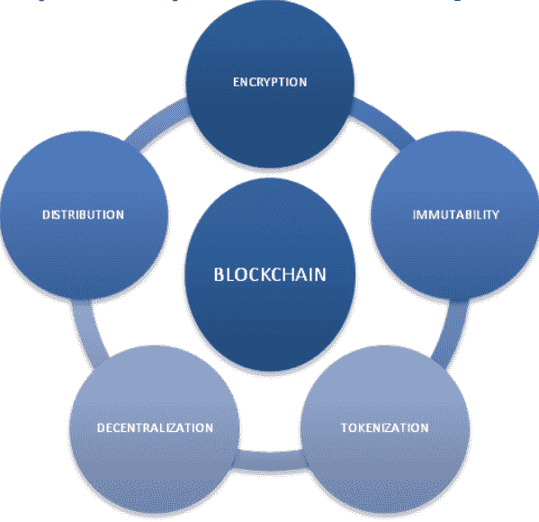

图 8.1：区块链的组件

- **分布式**：在区块链中，参与者在物理上相互分离，但通过网络连接在一起。运行节点的每个用户都持有一份账本副本，该账本会随着新交易的进行而更新。

- **加密**：区块链利用公钥和私钥等技术，安全且半匿名地捕获区块中的信息。参与者可以保持其身份和其他个人信息的私密性，仅披露交易所需的信息。

- **不可篡改性**：首先，已完成的交易会经过加密签名。然后在加密签名之后添加时间戳，最后将其组合到账本中。未经参与者同意，记录不能以任何方式被更改或扭曲。

- **代币化**：这些安全的价值交换发生在区块链中的不同交易及其他必要交互过程中。代币用于表示价值，可以是从无形资产到有形资产的任何东西。代币还赋予用户管理其个人数据的能力，而个人数据管理是区块链的关键组成部分。

- **去中心化**：由于共识机制，去中心化系统中的节点负责维护网络数据以及管理网络运行的规则。去中心化是指没有单个组织控制所有计算机、信息或规则。

## 区块链的运作

任何区块链系统的核心在于其按适当步骤运行和运作。区块链的运作如下图 8.2 所示，步骤也在此讨论：

- 首先，请求交易。
- 创建代表特定交易的区块。
- 为特定交易创建的区块发送给网络中包含的每个节点。
- 节点验证每个交易。
- 之后，节点因其交易证明而收取奖励。
- 将特定区块追加到当前区块链。请参阅下图：

图 8.2：区块链的运作

## 区块链的不同类型

毫无疑问，区块链在过去十年中取得了长足进步。第一种区块链变体确实是公有链，由比特币公开发布。如今，存在各种形式的区块链技术，每种都有特定用途，并解决特定问题或一组问题。

为了最大限度地发挥优势，众多企业正在将其用于运营。虽然分布式技术消除了集中化的负面方面，但也创造了一些新问题，必须在各种环境中使用区块链技术时加以解决。

例如，比特币使用了工作量证明共识机制。该算法效率低下，因为节点必须使用能源来解决数学问题。起初这不是问题，但随着难度增加，解决这些数学方程所需的时间和精力也同样增加。所讨论的低效性使其不适合任何必须始终保持高效的系统，例如银行每天处理多笔交易。因此，这种区块链类型不适合它。区块链类型可以在图 8.3 中看到：

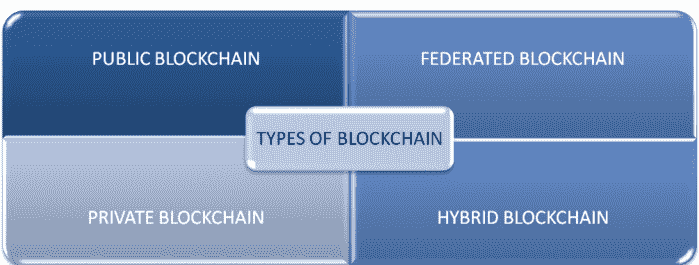

图 8.3：区块链类型

### 公有链

公有链是一种无需许可的分布式账本技术，允许任何人加入并进行交易。它是一种非限制性变体，每个对等节点都会复制一份账本副本。

比特币区块链是最早向公众开放的公有链之一。它使得任何拥有互联网连接的人都可以进行去中心化交易。

由于其去中心化结构，必须使用一些身份验证机制。通过使用共识机制，区块链中的用户可以就账本的当前状态达成一致。为了使公有链正常运行，执行节点必须完成艰苦工作，包括处理交易。如果没有必要的对等节点来解决交易，公有链将停止运行。

公有链中没有限制。任何拥有互联网接入的人都可以访问网络、评估区块，然后提交交易。此类网络通常会向评估区块的用户提供某种奖励。使用公有链架构时，无需任何人的同意即可下载协议。公有链代表了理想范例，使这种区块链如此有利可图。结果，系统完全去中心化，不受任何单一实体的管辖。然而，私有链可以由拥有它的组织修改和更新。

公有链架构具有几个特定特征，如下：

- 账本对每个节点都可读可写。
- 任何人都可以访问和下载网络中的节点。
- 系统在结构上完全去中心化。
- 它提供匿名性，因此无人可以将您的交易相互关联。
- 与私有链相比，速度稍慢。

公有链的一些示例包括 NEO、比特币、莱特币、以太坊等。

### 私有链

私有链由拥有共识算法和挖矿流程的私人公司建立和维护。私人实体确定谁可以访问系统并下载节点。当私营公司或组织希望将区块链用于内部用例时，私有链非常出色。通过这样做，您可以有效地使用区块链并限制对区块链网络的访问。网络的组织可以建立可访问性、授权和其他参数。“许可链”一词经常用来指代私有链。

在这种类型的区块链中，只有交易相关方会知道交易；其他人无法访问，从而使交易保持私密。私有链的用例如下图 8.4 所示：

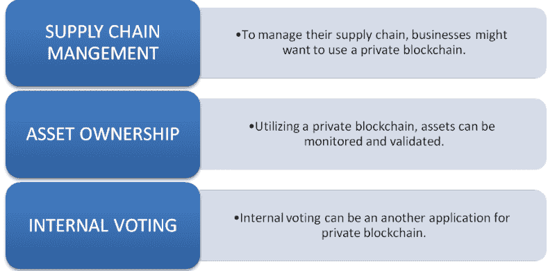

图 8.4：私有链的用例

私有链架构具有几个特定特征，如下：

- 仅允许特定个人或实体查看网络的节点。
- 仅允许某些个人进行审查和审计。
- 允许 P2P 交易，并且是去中心化的。
- 大多数是不可更改的。
- 它专注于隐私问题。
- 当节点在本地分布时性能更快，但账本中涉及的节点也更少。
- 根据需要添加节点和服务的能力对组织可能非常有利。因此确保了可扩展性。

### 混合链

组织有时会使用混合链，这是一种同时包含私有链和公有链组件的区块链技术，以兼顾两者的优点。它使企业能够开发，以便管理由哪些数据公开以及谁拥有其权利。在混合链中，交易和记录通常是私密的，但可以根据需要进行验证，例如通过智能合约授予访问权限。混合链可能由私人组织拥有，但它无法更改交易。Dragonchain、XinFin 的混合链是混合链的一种类型。

混合链架构具有几个特定特征，如下：

- 在封闭循环系统中工作，无需公开任何内容
- 规则可根据情况修改
- 此外，混合网络对 51% 攻击具有抵抗力
- 它在防止未经授权访问的同时，仍是公共网络的一部分
- 它不完全透明
- 升级到混合链可能很困难
- 参与网络和做出贡献不会以任何方式获得奖励

### 联盟链

当组织既需要公有链功能又需要私有链功能时，联盟链（有时也称为联邦链）是解决该问题的一种新方法。这也与混合链类似。联盟链本质上充当私有链，仅向特定群体开放访问，消除了私有链中仅由单一实体控制网络所带来的问题。区块链联盟中的共识过程由预定节点管理。它有一个验证节点，执行交易发起、接收和验证。成员节点有能力发送或接收交易。联盟链架构具有几个特定特征，如下：

- 它提供增强的可定制性和资源管理。
- 联盟链更具可扩展性和安全性。
- 此外，与公有链网络相比，它更有效。
- 它提供访问限制。
- 可见的透明度较低
- 此外，与其他类型的区块链相比，它更不匿名。

## 区块链的应用

除了加密货币，区块链的核心技术目前正被应用于各种应用。我们努力讨论了一些区块链应用，包括加密货币以及区块链已取得进展的其他潜在领域。

### 加密货币

在过去十年中，加密货币不断发展，将出色的技术能力与全球范围内价值数万亿美元的诱人投资相结合。由于其独特的特性和架构，加密货币的底层技术对许多其他应用颇具吸引力。其适应性、有效性和以数据为中心的特性，是其日益普及的原因。比特币等加密货币使用区块链技术通过哈希来保护交易。第一个加密货币是比特币。

### 私有数据存储

交易承载数据排队、存储和共享指令。如今，许多移动应用程序都需要完全访问用户数据，包括联系人、图片、消息和其他关键用户信息。建议将区块链实现与各种离线存储技术相结合，以便对每个数据片段授予权限。区块链上的数据可以通过 LevelDB 或云存储进行绑定。尽管这提供了更具可扩展性的选项，但可能会增加对外部各方的依赖。为了找到更可靠的解决方案来处理需要隐私保护的数据，组织可以升级其技术。

### 声誉管理

私有区块链可用于在无需中介协助账单、审计及任何其他声誉相关任务的情况下，获得来自用户的即时实时响应。由于使用了这项技术，手动收集和发送反馈的情况已有所减少。参与者可以检索此类区块链，如果他们想了解其他参与者的声誉。

### 教育

区块链被提议作为存储教育用途奖项和数据的手段。他们还建议使用教育声誉货币作为一种感谢形式。

此外，它还解释了教育创建者如何使用区块链课程。通过技术，可以跟踪谁报名参加了课程，并确认学生已完成并学习了科目。为了确保学生使用智能合约进行终身学习，可以纳入支付机制。

*Mega 大学* 是学生利用技术制定个人学习策略并与教师联系以获得交互式体验的一个实例。建议实施高等教育学分和评分系统，为学生和机构提供全面的视角。

### 银行业

区块链技术有望用于银行业的多个专业领域的计算机化，包括客户账户整合等等。使用传统银行技术批准贷款或衍生品需要时间，因为有几个后端步骤需要与多方进行合同谈判。通过智能合约，区块链提供所需的速度和透明度。一些机构已经在测试区块链，并使用 *IBM*、*R3* 和 *微软* 等企业公司提供的服务。

### 薪酬与结算

涉及公共服务的交易需要一系列步骤，包括合法化交易实体的合法性、验证交易各方提供的数据、完成交易，然后提供所需服务。整个交易随后被记录。此过程耗时。由于区块链的结构真实性和有效性，区块链可以缩短这段时间。由于许多与终身养老金相关的事件（例如从当前用户接收费用、受益人收到其付款以及养老金税收）本质上是合同控制的付款。*Sestof* 提出采用以太坊，因为该算法应在自监管合约上运行。*Sestof* 提出了一个基于合约的分布式网络，用于自主养老金基金，直接管理基于人寿的养老金基金，无需使用第三方。

### 税收

政府可以使用区块链更高效地征税并更有效地支出税款。区块链可能产生重大影响的一个领域是税收。透明性、溯源性和可追溯性是区块链中四个基本概念，可以整合到税收系统的要求中。区块链技术可用于税务交易、增值税、印花税、预扣税等。通过转移税收，移除了税务官员征税的责任。税收收入的消耗与税收溯源问题同样重要。然而，将主要依赖纸质记录的非数字卖家数字化将是最大的挑战之一。

### 医疗保健

随着更多医院、医生和医疗设备可用于数字记录患者记录，医疗保健正朝着数字化方向发展。医疗数据可以通过数字化轻松共享和检索，以用于决策。然而，这种数字化对患者隐私构成威胁。基于区块链的 **医疗数据网关**（HDG）。为了确保医疗数据无法被任何人（甚至患者或医生）更改，他们使用了私有区块链云。在一个可互操作的基于区块链的 **电子健康记录**（EHR）框架中，提供了重要的可靠性和安全性要求。这使得具有不同内部结构的各种组织能够利用组织现有的 EHR 基础设施相互通信。

MedShare 是一个用于云服务提供商之间传输医疗数据的区块链系统。MedShare 将提供审计、溯源和数据访问控制。在同样的努力中，还建议阻止欺诈用户，并利用智能合约基于数据访问模式识别数据行为。Medchain 提出了一个使用区块链的成功数据共享系统。

### 投票

2014年，一个丹麦政党是第一个采用区块链技术进行投票的政党。“Followmyvote”在线提供一个安全的投票平台，该平台采用区块链技术。本文提出了解决公平投票系统问题的方案，该系统在保护用户投票隐私的同时，使电子系统具有灵活性和开放性。这是一项用于公平电子投票的革命性区块链应用程序，解决了当前方法的一些问题。它特别关注选举程序，从而降低了在全国举行选举的成本。

### 保险

区块链的实施将改变许多保险产品，尤其是健康保险、农业保险、土地和意外险以及旅行保险。可以建立一个殡仪馆、卫生部门和医院保险机构的共享网络。该系统将实现不对外部各方的依赖，加快保险索赔流程，并防止欺诈。

区块链可以高效处理与保险流程相关的交易。为了设计实现，他们使用了名为 Hyperledger fabric 的开源许可区块链平台。

### 智慧城市

区块链在智慧城市中被用于降低交易成本，并确保数据的问责制和完整性。区块链技术用于克服传感器数据管理和存储的问题。区块链提供了一个智能合约，其中维护传感器数据并构建逻辑，以满足可访问性和有效性的请求。

### 物联网（IoT）

物联网（IoT）是一个全球性的物理对象安排，例如联网汽车、家用电器和其他可以提供

借助互联网。智能电网、智能发展、智能交通系统等领域广泛使用物联网。传统集中式网络无法确保敏感数据的安全交换或可靠的设备间通信。由于智能合约有助于自动化、促进资源共享、处理复杂工作流、确保安全性、效率和成本节约，因此区块链与物联网的融合是一项预期的趋势。他们讨论了使用模拟如何降低日常管理物联网设备的成本。他们还介绍了模型中的多种交互机制。

## 医疗保健中区块链的需求

由于医疗保健行业快速采用数字化，产生了大量电子病人数据。这种扩张对医疗保健数据的使用和分布提出了巨大要求，这些数据必须受到保护。区块链技术的出现旨在解决医疗保健行业的问题。

近年来，学术界对区块链技术给予了广泛关注。事实上，与区块链相关的研究和应用每天都在发表。

医疗保健是区块链潜力巨大的行业。为了征集关于区块链技术在医疗保健中潜在应用的白皮书。

国家健康信息技术协调员办公室（ONC）于2016年发起了一个构想倡议。这一举措是在认识到该技术的价值和有效性后实施的。因此，提出了若干基于区块链的医疗保健应用。

在医疗保健领域，发展正以前所未有的速度加速。高质量的现代医疗设施备受追捧，并由尖端技术支持。

在这方面，区块链可能在改变医疗保健行业运作方式中发挥至关重要的作用。以患者为中心的方法优先考虑两个基本要素——随时可用的服务和始终充足的医疗保健资源，这也正在改变医疗保健系统的结构。得益于区块链，医疗机构能够更好地提供优质的患者护理和设施。

在群体健康管理中，数据共享、隐私和互操作性的主要限制一直存在，迄今为止，区块链技术在该场景中是可靠的。该技术改善了访问、实时更新、完整性、安全性和数据传输。数据安全也是一个主要的担忧，特别是在医疗技术和个性化护理方面。因为患者和医疗人员希望通过网络快速、安全地收集、发送和咨询数据，而无需担心安全问题。区块链技术被用于解决这些问题。

医疗保健生态系统的一个示例：近期出版物讨论了区块链技术如何有能力转变医疗保健交付所涉及的流程，包括技术研究、研究论文和咨询论文。

然而，医疗保健行业主要参与者（包括患者、医疗专业人员、药房、资金支持者和保险公司、医疗设备供应商以及研究机构）之间的关系和交互非常复杂。

如图 8.5 所示：

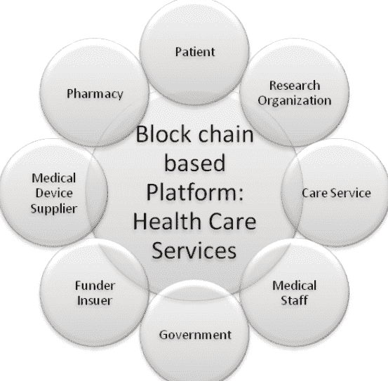

图 8.5：基于区块链的医疗保健服务

区块链技术有能力解决医疗保健行业中的共享、数据安全、隐私和存储问题。医疗保健行业的要求是互操作性。它是指两方（无论是人还是机器）清晰、有效且一致地传达事实或信息的能力。

为了使数据能够在环境中共享并由各种医院系统传播，医疗保健中的互操作性旨在使医疗专业人员、患者和健康相关信息（如**电子健康记录（EHR）**）更容易共享。此外，互操作性使提供商能够安全地交换患者病历，无论提供商的位置或彼此之间的信任程度如何（前提是患者已给予同意）。

考虑到医疗保健数据源的多样性，这一点尤为重要。利用区块链技术，该技术有能力在医疗集团内正确存储、管理和传输电子健康记录，从而解决这一互操作性问题。由于医疗基础设施和软件费用的上升，世界各国经济也面临巨大压力。

区块链技术通过简化业务运营、改善患者结局、更有效地管理患者数据、提升合规性、降低成本并实现对医疗相关数据的更好利用，正在为医疗保健行业中的企业和利益相关方改善医疗结局。

区块链技术影响漫长而复杂的医疗保健供应链中药品和医疗用品流动的能力同样至关重要。面向医疗保健供应链的区块链旨在消除假药影响全球患者的可能性。目前，正在利用区块链技术（医疗物联网，IoMT）调查各种医疗应用，包括数据管理、存储、设备连接以及医疗物联网中的安全性。

位于结构顶部的利益相关方层由从基于区块链的医疗保健应用中受益的各方组成，例如业务用户、研究人员和患者。这一层级的用户主要关注高效地共享、处理和管理数据，同时不危及其安全性和隐私。

区块链技术在上述应用领域中的大多数优势已积极惠及大多数利益相关方和最终用户的**体验质量（QoE）**，包括患者、护理人员、研究人员、制药公司和保险提供商。改善医疗服务质量和患者体验的关键步骤之一是能够共享医疗数据，而无需冒危及用户隐私和数据安全的风险。本文的目的是对区块链技术的医疗应用进行当代分析，包括其对医疗经济、客户体验和新商业潜力的影响。

## 区块链技术在医疗保健行业中的能力

区块链在医学领域拥有多种应用和作用。分布式账本技术通过促进患者病历的安全传输、管理药品供应链以及促进患者病历的安全传输，帮助医学研究人员解读遗传密码。在许多医疗领域及相关领域，它展示了区块链概念的广泛特征和基本推动因素。

用于开发和应用区块链技术的一些值得关注且源于技术的要素包括医疗记录安全、各种基因型管理、电子数据管理、互操作性、数字化追踪以及疫情爆发等。区块链技术的采用很大程度上源于其完全数字化的组件。

可以使用物联网和区块链追踪交通、货运方向及其速度。它提供了战略性安排采购的机会，以防止药房、诊所和其他医疗机构出现延误和药品短缺。

基于区块链构建的数字框架将应用于帮助防止物流数据被未经授权的篡改。它增强信心，并防止试图购买药物的人以未经授权的方式处理数据、资金或药物。在降低成本的同时，技术可以极大地改善患者的情况。它消除了多级身份验证中的所有障碍和挑战。因为它可以维护所有医疗数据的不可变、去中心化且透明的日志，所以区块链非常适合安全应用。

区块链还能保持医疗数据的敏感性，因为它既透明又私密，能在复杂且安全的算法后隐藏任何个人身份。由于信息可以快速且安全地共享，患者、医生和其他医疗专业人员都可以从中受益。

除了提升隐私和安全性外，这还使患者对其个人数据拥有更多控制权。测量、实施和质量管理是复杂的任务。行业中的任何技术问题都可能通过区块链应用来解决。在追踪药品时，监管官员将使用区块链头条来区分真药和假药。这确保所有授权方可以交换数字交易，包括患者信息。通过修改单一同意，更换医生的患者可以交换其所有记录。

越来越多的企业正在探索区块链，包括医疗保健行业。医疗生态系统内的技术早期采用者对其也赞不绝口。为了在未来几年彻底改变医疗保健行业，区块链有一个全面的计划，包括解决影响当前结构的问题。得益于它，医生、患者和药剂师可以随时快速访问所有信息。医疗公司始终在测试、研究和学习区块链技术，以便用于健康记录。除了机器学习和人工智能等其他尖端技术外，区块链技术对医学领域至关重要

行业。该系统旨在使用区块链技术监控医药供应链。

## 区块链在医疗保健中的优势

在前面的章节中，我们也讨论了区块链、医疗保健及其类型、功能等。现在，在本节中我们将讨论区块链在医疗保健中的优势。

- **去中心化：** 根据医疗类型的不同，由于利益相关者分布广泛，医疗保健需要去中心化的管理结构。区块链有可能成为去中心化的健康数据管理基础，使所有利益相关方都能参与，而无需任何机构充当全球健康数据的管理机构。

- **改进的数据安全性与隐私性：** 一旦数据保存到区块链上，就不能被降级、编辑或恢复，区块链的这一特性显著增强了其上存储的健康数据的安全性。区块链上的每一条健康信息都带有时间戳、经过加密，并按时间顺序添加。

- **健康数据所有权：** 患者必须是其数据的所有者，并掌控数据的使用方式。患者应能够发现数据滥用的实例，并确信其健康信息不会被第三方不当使用。区块链强大的加密协议和明确指定的智能合约有助于满足这些需求。

- **可用性与稳健性：** 由于记录在众多节点上复制，保存到区块链上的健康数据可用性得到保障，这使得系统能够抵御数据丢失、数据损坏以及某些针对数据可用性的安全攻击。

- **透明度与信任：** 区块链因其开放性和透明性而被应用于分布式医疗保健应用。这使得医疗保健利益相关者更容易接受此类应用。

- **数据可验证性：** 即使不访问明文，也可以确认保存在区块链上的记录的真实性和完整性。这种功能在需要记录验证的医疗环境中特别有用，例如在保险索赔处理和制药供应链中。

## 区块链与医疗保健的研究领域

本领域中最重要的研究被重点介绍，并按多种用例组织，包括电子病历、远程患者监护、制药供应链和健康保险索赔。

## 电子病历

健康数据应在变革医疗保健的努力中得到优先考虑，因为它可能通过整合不同系统的能力并提高**电子健康记录（EHRs）**的准确性来得到增强。虽然**电子病历（EMRs）**和电子健康记录这两个术语经常混用，但它们含义不同。EMRs是临床医生在办公室保存的纸质病历的较新术语。另一方面，EHRs更强调患者的整体健康，不仅考虑在医生办公室收集的传统临床信息。

根据映射研究，区块链技术有助于管理EHRs。在此背景下，一项与EHR相关的实现提出了一种去中心化策略，用于管理医疗保健利益相关者之间的授权、权限和数据交换。*MedRec*使用以太坊平台，向患者提供谁可以访问其医疗记录的知识和信息。

*快速医疗互操作性记录区块链（FHIRChain）*是另一个融合EHR的应用程序。它是一个专注于医疗记录管理的基于区块链的平台，用于交换临床数据，并使用以太坊实现。患者可以从FHIRChain获得满足ONC标准的解决方案。

同样，*MedShare*是一个以太坊应用，面向那些因披露机密数据内容所带来的负面风险而导致云服务之间数据交换缺乏协作的系统。*MedBlock*和*BlockHIE*是另外两个基于区块链的EMR系统。MedBlock提供了一种搜索记录的方法。该建议方法跟踪按部门或医疗保健提供者组织的患者记录块的地址。每个患者清单都有一个指向相关区块链记录的链接。BlocHIE提出了一个基于区块链技术的医疗保健平台。

*BlocHIE*结合了链外存储（数据保存在外部医院的数据库中）和链上验证，以继续利用现有数据库。以太坊利用智能合约实现数据隐私、安全性、访问控制和EMR互操作性。这是另一个基于区块链的医疗保健系统。

*OmniPHR*是一个分布式范式，将**个人健康记录（PHR）**保存在单一的互操作视角中。此外，OmniPHR评估可能保证PHR在路由覆盖网络中的分发以及PHR分割为数据块。

电子病历管理是区块链在医疗保健（EMRs）中的突出应用之一。EMRs用于以电子方式创建、存储和管理患者个人、医疗或健康相关数据。它们也被称为电子健康记录或**个人健康记录（PHRs）**。事实上，在选定用于评审的65篇出版物中，有32%涉及区块链的EMR用例，使其成为文献中的重要研究主题。一些出版物讨论如何使医疗保健利益相关方（包括提供者、研究人员和保险公司）更容易共享以患者为中心的数据。

根据欧洲通用区块链，广泛推荐使用实用技术来创建一个医疗保健平台，该平台可以让患者控制其数据的共享、处理或使用方式。患者的敏感个人数据可能未按照《通用数据保护条例》（GDPR）进行处理，该条例禁止在未经患者明确同意的情况下进行此类处理。

在其他评估中，Guardtime被指出为区块链技术如何用于处理电子医疗数据的著名示例。Guardtime使用一个基于区块链技术构建的平台，该平台被瑞士数字健康初创公司Healthbank使用，以让患者完全拥有自己的数据。作者讨论了Healthcoin项目，该项目旨在创建一个全球EMR系统，以及Medicalchain项目，其基于区块链的平台将使跨国际医疗机构共享患者医疗记录更加容易。

## 远程患者监护

另一个例子是Gem Health Network（GHN），由美国公司Gem使用以太坊区块链创建。GHN使许多医疗专业人员能够共享对同一数据的访问。瑞士数字健康初创公司Healthbank也在做出类似努力，利用区块链技术让患者完全控制自己的数据。作者讨论了Medicalchain项目，其基于区块链的平台将允许跨国际医疗机构交换患者医疗记录，以及Healthcoin提案，该提案旨在创建全球EMR系统。其他一些参与各种计划和项目的企业基于区块链技术实现的以患者为中心的EMR。在此情况下，研究人员描述了一个用例，其中数据从移动设备传输到Hyperledger Fabric上的基于区块链的应用程序。

作者使用实时患者监护应用程序，展示以太坊智能合约如何在安全环境中提供自动干预。其他建议的方法强调了物联网（IoT）在许多领域（特别是电子健康）中的巨大潜力，以及它如何被大量使用。IoBHealth是一种混合物联网和区块链的数据流架构。

## 制药供应链

制药行业是区块链的另一个公认用例。如果患者收到虚假或劣质药物，可能会遭受严重后果。已确定区块链技术有能力解决这一问题。

初创公司Modum.io AG使用区块链技术来实现数据不可篡改性。该公司使所有药品在运输过程中的记录向公众开放，以便检查是否符合质量控制温度法规。

药品造假已得到承认，为了打击它，已推荐一种基于区块链、安全、不可篡改且可追溯的药品供应链。检测假药存在挑战，因此提出了基于区块链的方法。

尽管计划中的系统仅在论文中部分实现，但一些值得注意的研究涉及药品供应链的问题。

### 健康保险索赔

一个领域是区块链用于保险索赔的存储数据的不可篡改性、开放性和可审计性。

管理医疗保险索赔是区块链技术发挥其重要性的关键领域。然而，这些系统仅在少量原型中实现。医疗保险业务可以通过MIStore访问不可篡改存储的医疗保险数据，MIStore是一个基于区块链的医疗保险系统。

我们观察到，大多数这些系统是使用知名的基于信任的合约创建的，尤其是以太坊以及Hyperledger Fabric。区块链存储记录的开放性、去中心化性、不可篡改性和可审计性，对医疗保健行业的保险索赔处理可能有利。然而，这些系统的原型实现示例不多。MIStore是一个基于区块链并在以太坊区块链上实现的医疗保险数据存储平台，是一个可供利用的很好示例。

### 研究挑战与机遇

通过本研究，我们将发现区块链与医疗保健领域的一些研究挑战。

- 首先，EMR系统未解决语义互操作性问题。因此，医学和健康数据专家必须手动检查和映射指定的本体。
- 第二，在此层面，无法防止临床失范。该领域正在进行和即将开展的研究主要集中在可扩展性和互操作性限制上。互操作性困难表明缺乏创建基于区块链的医疗应用的标准。因此，不同开发应用程序之间可能无法实现互操作性。此外，基于区块链的医疗系统最大的问题之一是可扩展性。因此，考虑到涉及的医疗数据量（尤其是大量数据），不同开发应用程序之间可能无法实现互操作性。由于医疗数据量巨大，将其保存在链上或区块链上并不实际，因为这可能会严重降低性能。此外，在基于区块链的系统中，延迟是由事务处理速度和链下数据负载引起的问题。最后，由于区块链不可篡改性和代码自动执行，智能合约可能会暴露于黑客攻击之下。例如，去中心化自治组织（DAO）攻击，该攻击针对智能合约存储的资金。

## 结论

本研究总结了区块链技术在医疗保健中的应用情况。实际上，由于该技术呈指数级扩张，区块链已被用于提高医疗服务的自动化。

我们的分析表明，医疗保健中使用区块链技术的大部分研究都集中在共享电子健康记录上。区块链研究人员应考虑更多关于保险、药品供应链和生物研究等行业的研究。此外，我们发现论文很少讨论实现细节。

尽管区块链技术提供了引人注目的特性，但该领域仍需要更多研究工作。为了提高利益相关者对该技术的接受度并增强其对使用该技术的信心，正在持续努力解决其可扩展性、安全性和隐私限制。

使用系统文献综述过程，我们绘制了所有相关研究的地图。本章的具体目标是：识别区块链技术在医疗保健中的用例、为这些用例创建的示例应用、基于区块链的医疗应用面临的挑战和限制、用于这些应用的当前开发方法，以及潜在的未来研究领域。电子病历管理、药品和医药供应链管理、生物医学研究与教学、远程患者监测以及健康数据分析，只是本研究揭示的众多医疗保健用例中的一些。基于新兴的区块链概念（包括智能合约、许可型区块链、链下存储等），已创建了若干基于区块链的医疗应用原型。为了更全面地理解、定义和评估区块链技术在医疗保健中的价值，仍需要进一步研究。

在下一章中，我们将学习并对区块链技术在医疗保健中的现有和预期用途进行全面评估。

## 关键词

- 区块链
- 医疗保健
- 电子病历
- 比特币

# 第9章

# 区块链概述分析

## 摘要

区块链是一种记录数据的安排，使得更改、黑客攻击或欺骗系统变得困难或困难。区块链的去中心化交易记录可用于向组织内不同各方注册、确认和发送各种协议。区块链应用的范围扩展到包括健康、金融、汽车、物联网（IoT）和风险管理在内的公共和公共服务。本章对区块链技术进行了全面概述。近年来，区块链技术变得非常流行并渗透到各个领域，这主要归功于加密货币。本研究旨在对医疗保健中区块链技术的现有和预期用途以及未来研究可能性进行全面评估。

## 引言

近年来，互联网信息已包含各种数据库和应用程序的部署，这些应用程序使用相当分布式的技术来评估问题。作为一种分布式技术，区块链引起了医疗行业参与者的兴趣。尽管早期研究从技术、商业或患者护理的角度研究了区块链应用，但很少有研究探讨了医疗保健中区块链的实际用例场景。

## 结构

本章结构包括以下主题：

- 区块链结构
- 区块链与物联网
- 区块链应用

## 目标

本章旨在对医疗保健中区块链技术的现有和预期用途以及未来研究可能性进行全面评估。

## 本章概要

COVID-19疫情的爆发为区块链在医疗实践中的应用带来了几种新颖的想法。区块链技术也可被采用并应用于医疗保健、保险、供应链、物联网等其他领域。尽管它最初是为充当分布式账本（在去中心化系统上）而创建的，但也可用于集中式系统，以确保数据完整性或节省运营费用。一种以惊人频率出现的请求与比特币及其背后的开发源（称为区块链）有关。随着设备和客户端数量的增加，当前架构和通信协议（统一框架）无法对验证、授权和访问管理等系统要求提供足够的响应。尽管安全和隐私是通信中的重要问题，但已为物联网网络中的安全和保护提出了各种方案。一个重要的方案是使用分布式网络而非集中式或去中心化网络。另一种强大的分布式系统是区块链，它由中本聪首次提出，并在2008年因一名神秘个人（或团体）发布介绍比特币（一种基于区块链的数字货币）的白皮书而广受欢迎。区块链是一种包含一些旧概念的技术，例如账本和共识。

### 区块链结构

从计算角度来看，区块链是一种信息结构，其中各部分（也称为块）被存储并相互连接

连续请求。如图 9.1 所示，区块链的思想基本上与链表相同，其中每个节点通过指针连接到下一个节点：

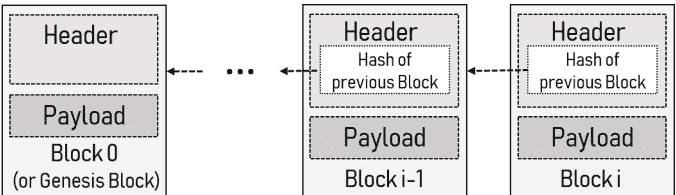

图 9.1：区块链的结构

每个块由头部和数据负载组成。虽然负载主要用于存储区块链用户之间的交易列表，但头部用于传达有关块的有用信息，例如其大小和内容。此外，头部存储前一个块的 32 位 SHA256 哈希值。要理解此语句，首先了解区块链是如何随时间创建和维护的至关重要。

## 协议机制

区块链背后的动机是使能够验证、分组成块并随后存储在分布式账本中的点对点交易。为实现这一目标，区块链由去中心化共识算法管理，这些算法决定一组交易何时以及如何被包含在账本中。具体来说，只有当网络中大多数节点同意新块的内容时，即只有当区块链用户之间达成共识时，每个新块才能附加到区块链上。网络中的每个节点都维护区块链的本地副本。当另一个块达成共识时，它会被广播。

## 计算方面

尽管工作量证明（PoW）是实现共识的成功机制，但它需要消耗大量的能量和计算能力，随着越来越多的矿工和交易被添加到区块链中，这些需求会稳步增加。因此，许多区块链架构中已经考虑了其他共识机制。例如，权益证明（PoS）系统使用基于币量（即权益）的确定性规则，来选择网络中的哪个节点将下一个块附加到区块链上。同样，重要性证明（PoI）也将权益视为重要的度量标准——然而，它还会考虑衡量矿工在网络中参与度的指标，例如交易数量和交易量。

## 安全方面

总体而言，共识算法确保了区块链的可靠性。然而，存在恶意用户利用区块链结构来修改、复制或删除块的情况。具体来说，攻击者控制网络中超过一半的节点就足以接管整个区块链。这种攻击（也称为 51% 攻击）旨在破坏共识机制以控制区块链。这些攻击已被证明对许多小型加密货币（例如 Verge、Bitcoin Gold 和 Zencash）成功；然而，它们也已危害甚至包括比特币在内的广泛加密货币。双重支付（即复制一项或多项交易）是 51% 攻击的主要原因。然而，已经证明，即使不达到 50% 的阈值，也可以实现双重支付。

## 区块链核心架构

服务提供商在企业协会中的合作伙伴需要各种属性。首先也是最重要的属性是确保数据完整性，例如确保在组织内未经共识机制的情况下不会执行、更新或更改任何交易。这通常通过在组织内实施加密组件来确保。

此外，组织需要为所有节点提供公平的机会来创建和更新有效交易，这也称为平等权利。另一个必要元素是建立信任，这可以通过共识更好地实现。共识实际上管理新项目的添加；它包括验证和附加的规则。

图 9.2 展示了从中心化到去中心化的进展：

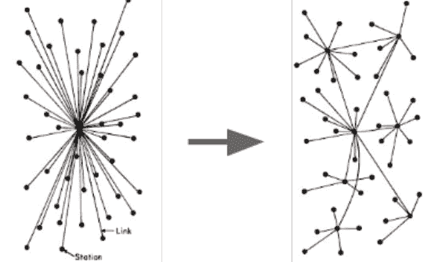

图 9.2：从中心化到去中心化的进展

## 中心化系统

在中心化系统中，用户依赖权威来进行交易。例如，在银行中，客户依赖一个在交易后更新用户账户余额的金融系统。在统一系统中，中央权威可以通过直接更改和更新后端数据库来修改整个系统。中心化服务不允许权力分散，因此是单一服务提供商。在线支付、云系统、政府和法院是中心化系统的其他示例。使用这些系统已建立起利用良好系统基本属性的既定方式，包括完整性、透明度、社区和信任。

## 去中心化系统的必要性

使用去中心化框架背后的基本理念是提供一个容错的分布式计算系统，其中权力可以分散而无需信任中央系统。这保证了信任、透明度、数据完整性等各种属性，以提供一个公开可用的系统并实现互操作性；对区块链的需求正在增长。它使能够为无数不可信的参与者构建去中心化应用程序和分布式软件基础设施。中心化系统的问题在于它容易发生单点故障，并且系统不提供透明度、资源的公平访问、完整性、已执行交易的不可否认性以及数据不可变性。

## 区块链与 IoT

区块链与 IoT 的结合具有颠覆性潜力。毫无疑问，区块链可以通过提供以下关键优势来帮助 IoT 进入我们的社会：

### 匿名性

IoT 实体可以使用公钥/私钥参与区块链，（如果需要）这本身不会揭示实体的真实身份。

### 去中心化

传统中心化系统要求每笔交易都需经过中央权威（例如中央银行）批准——这不可避免地成为性能瓶颈。相反，在区块链中不再需要第三方批准，因为共识算法维护数据一致性。

### 不可否认性

区块链保证：

- 交易可以轻松批准；且
- 无效交易不予采纳——一旦交易被包含在区块链中，几乎不可能删除或回滚交易

## 区块链应用

区块链应用跨越各个行业，利用区块链的优势提供非凡的机会和显著的收益。本节特别关注一个预期具有潜力并可能很快被采用的突出应用子集。当然，还有大量其他应用。

在下图 9.3 中，您可以看到区块链的图形描绘：

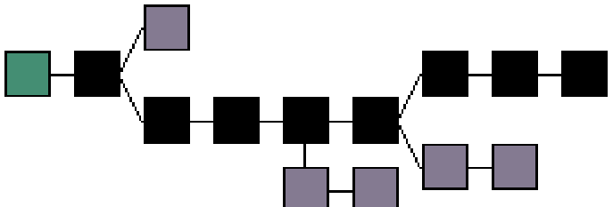

图 9.3：区块链的图形描绘

### 供应链

供应链应用正朝着两个广泛方向发展。首先，通过减少官僚主义和其他障碍来提高效率，并改进运营以使其更具成本效益。其次，它们旨在确保客户购买的材料/物品的真实性、来源和新鲜度。供应链活动主要由基于信用证（成本为 1%–3%）和保理（成本为 5%–10%）的纸质方法主导。这些要求和方法每年使成本增加估计数万亿美元，同时显著减慢交易速度。在下图 9.4 中，您可以看到供应链：

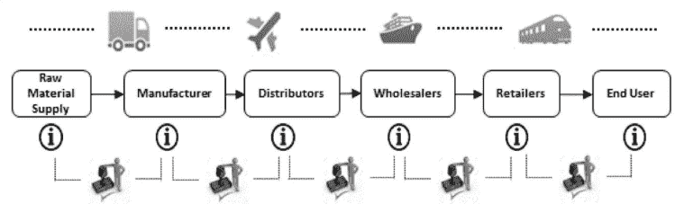

图 9.4：供应链

### IoT

物联网（IoT）正在成为许多日常活动以及智慧城市、智能家居和车辆的主要技术组成部分。同样，可穿戴设备在医学领域开辟了许多机会，例如，监测我们健康、跟踪我们日常锻炼的程序，

并出奇地赋能远程考量。互联设备的数量预计将在2020年达到200亿。区块链与物联网（IoT）的融合可以鼓励许多引人入胜的应用和系统，尤其是利用智能合约进行自主决策。

## 博彩行业

信任一直是博彩行业普遍面临的一项重大挑战。特别是对于互联网博彩服务合作者，人们对所使用的任意周期（即，在赔率计算中）的公平性以及显然参与博彩交易的资产的安全性存在担忧。区块链技术可用于阐明可验证且简单的伪随机生成措施。任何人都可以审计此类周期，而不需要任何外部受托服务或预言机，只需通过观察记录在账本上的公共数据即可。

## 颠覆性区块链

区块链应用今天所处的地位，相当于20世纪90年代的互联网，拥有巨大的颠覆性可能性。在本部分中，我们关注未来十年有望呈指数级增长的一类最突出的区块链应用子集，即智能合约、去中心化自治组织（DAO）和超安全网络，以及它们的融合，这有望从根本上改变人与人、人与企业之间的交易，以及组织的组织和运作方式。

### 去中心化自治组织

与由一国法律体系授权的法律和合法协议所指导的传统协会不同，去中心化自治组织（DAO）可以由一系列在开源协议或智能合约中假设的、经共同商定的规则来代表，这些规则必须通过多数决更改，并由其创始成员商定。DAO的参与者受到组织章程中阐明的激励措施以及编入其管理协议/智能合约的完全透明指南的驱动。网络章程，以及编入其管理协议/智能合约的完全透明规则。

## 在教育组织中使用区块链

该技术可用于更好地管理入学流程、评估课外活动中的合作记录、加强学校和大学中的校友网络，以及管理图书馆和数据服务。它同样有助于为学生和员工提供交通服务。该创新可以通过知识产权保护，惠及学校中的教育工作者和研究人员。

### 入学

根据其培训，大多数教育机构遵循一种模式，即他们控制学生及其认证的记录。这样一来，信息可能被篡改、破坏或删除。通过分散平台运作的分布式账本技术可以安全地与利益相关者共享信息。这同样可以提供防欺诈能力。这将激发学生之间灵活的学习方式，他们可以轻松满足各种全球组织的确认仪式。

### 图书馆和数据服务

图书馆是任何教育机构最基本的职能之一。此前，图书要么通过人工记录保存，要么通过使用条形码的系统分发给学生。目前，分布式账本技术可用于存储和监控所有重要数据，包括图书流通情况以及使用特定图书的学生数量。图书馆中的各种流程可以在学校、学院或大学中使用区块链进行良好规划和管理。

### 课外活动合作

除了学习之外，学生还会在学校、学院或大学中参与各种课外活动。展示学生合作情况并体现其对学术机构承诺的成就证书，可以根据需要维护并分享给利益相关者。随后，分布式组织的完整证据安排将增强教育机构各利益相关方之间的通信网络。

### 校友会

除了作为透明记录保存平台外，该框架通过显著改善与讲座、科目和活动相关的通信，改善了教师、员工、高年级学生和初级学生之间的联系。在安全区块链的帮助下，可以创建所有类型的学生学习以及与学生之间的基本平等。这促进了学生与教职员工之间的坚实长期关系。

### 交通和宿舍设施

通常，学术机构为学生和员工提供交通设施。为有特殊需求的学生和员工提供此类设施，可以利用区块链技术的拼车服务来组织拼车。由于城市地区交通拥堵加剧，这非常必要。学校的此类举措肯定会为学生提供安全舒适的乘车体验，并减轻父母的负担。此外，该系统还可用于为有需要的学生分配宿舍住宿。

表9.1包含了著名科学家进行的各种研究论文分析：

| 创建者姓名 | 论文标题 | 年份 | 结论 |
|---|---|---|---|
| Fazel Ansari | 重新思考工业4.0中的人机学习 | 2018 | 调查并审查主要的物联网安全问题，并根据显而易见的级别、过渡级别和低级别物联网层对这些问题进行分类。 |
| Minhaj Ahmad Khan | 物联网安全视角的区块链解决方案与开放挑战 | 2017 | 定义了机器学习一词，并就TU Wien试点工厂探索了某些用例。 |
| Tim Pack | 利用机器学习自动化口语对话管理设计 | 2008 | 讨论了行业中通常用于对话管理的需求、规范和调制类型。 |

表9.1：建设性分析

### 结论

区块链技术提供一个安全的分布式账本，它提供去中心化、安全、可靠和透明的框架。在教育领域，区块链技术已在有限领域实施。然而，其潜力尚待挖掘。虽然各种应用正在迅速涌现，但进展缓慢。在不解决障碍的情况下，无法成功采用区块链技术。本章通过强调教育系统中区块链的当前发展、优势、挑战、架构、物联网和当前应用，为现有知识体系做出了贡献。区块链在教育管理中的应用仍处于起步阶段，尽管它们在不同领域正在迅速获得动力。

在下一章中，我们将使用区块链技术进行安全终端用户分析作为结尾。

# 第10章

# 使用区块链技术的终端用户计算

## 摘要

COVID-19的非凡影响加速了数年内数字技术的采用，表明这些突破中的许多将长期存在。目前，多种赋能技术正在作为主要解决方案实施，以改进和应对疫情的众多问题，区块链是首选解决方案选项之一。区块链可用于重组流程，从而产生最有效的运营和商业模式，而不是被视为开发新解决方案的独特手段（例如：利用基于先进人工智能的放射组学技术，在印度实现优质癌症检测的民主化）。我们在此假设，尽管人们对利用区块链改善业务能力充满期待，但应该考虑迄今为止从众多试点和概念验证中吸取的教训。然而，基于良好的商业逻辑和对问题流程生命周期的认识，进行结构化、正式的决策过程是至关重要的。区块链是达到目的的手段，而非目的本身。

## 引言

有一些即将出现和新兴的技术，如人工智能和机器学习、物联网、区块链、机器人技术、合成生物学，

纳米技术、5G、云和边缘计算以及大数据，能够有效地在全球范围内支持克服最近大流行病带来的挑战。包括开发智能、快速的应急策略和面向未来复发的导向性结果，并大幅改善公共卫生系统的响应。此外，还有商业领域倡导大流行后整合这些技术。例如，将区块链与多无人机和多机器人集成，以优化高效的端到端链条、监控监测，并识别终端用户计算的关键特征。

## 结构
本章结构包括以下主题：

- 作为推动技术的区块链
- 区块链的未来之路
- 建设性分析

## 目标
本章以使用区块链技术的终端用户安全分析结束。

## 章节概要
根据研究人员的观点，区块链技术是工业4.0体制下众多已彻底颠覆环境的技术之一，最终将彻底改变人们的工作和生活方式。有人为区块链技术进行宣传，将其列为抗击COVID-19的十大技术之一。

1991年，研究人员通过研究详细可视化了现在被称为区块链的事物。他们创建了一个受密码学保护的区块链，作为其首个项目的一部分，防止任何人篡改文档时间戳。

1992年，整个系统被大幅修改以包含默克尔树，这提高了效率，并使他们能够在独立结构上采集更多记录。然而，由于中本聪，区块链技术最终于2008年崭露头角。区块链技术的第一个实现是比特币，创建于2008年。中本聪在其研究中将其描述为一种电子点对点系统。中本聪创建了创世块，并用其来挖掘其他区块，最终形成了一条承载元数据和操作的最强区块链之一。

自比特币出现以来，众多其他系统涌现出来，凸显了数字区块链系统的关键概念和广泛可能性。因此，区块链遗产涵盖了一个体制，其中运动增强了从传统方法向更具应用导向的方法的渐进式改进。

如今，许多印度成功企业已在贴现、贸易支付系统、跨境汇款、供应链管理融资、品牌互动和数字身份转型等领域尝试了区块链。

将公有链和私有链融合为一个生态系统，使企业、客户和供应商能够在安全、可审计且基于Web的环境中共同参与，这将推动区块链的指数级和颠覆性增长。

这是一项探索性研究，旨在对一个备受关注的话题提供更通用的概述，以及解释、开发和优化理念。这里采用了定性方法，具有彻底且系统的程序，包括数据决策、信息选择、精简和演示，包括结果分析，通过统计数据分析导向基于结果的方法，包括分析程序和将数据分类到相关单元。

## 作为推动技术的区块链
区块链技术是一种去中心化的创新，具有独特的特征，例如不可攻破的数据基础设施，以及基于最高安全级别的最高级别内置保密密码学软件。它是一个集成的点对点计算节点网络，这些节点被分配在一起以高效验证金融交易。区块链平台是去中心化的，由于使用了用于验证网络成员身份的密码学基础设施，因此具有抗篡改和防欺诈或不法行为的能力。因此，它可以应用于几乎每个行业。

词典将区块链定义为“由链接连接的区块链”。可识别的合法交易组称为块结构。网络中的任何节点都可以发起交易，随后将其广播到所有连接的节点。

然后，使用旧交易和密码学技术，可以进行验证过程。一旦完成这两个基本步骤，正在进行的交易将上传到已存在的区块链上。每个块内的交易数量各不相同。当中本聪发明比特币时，块大小约为1 MB。到2018年3月，它达到了8 MB。执行更多交易所需的块越大，处理速度越快。

在二进制上下文中，块之间的引用称为哈希，它属于前一个块，即父块。创世块是没有父块的初始块。

在公共区块链上，所有交易也可供拥有适当授权的任何人查看。因此，没有用户或实体可以行使控制权。另一方面，在私有区块链系统中，所有想要加入区块链的人都必须先获得授权。该系统中的交易仅对获准的各方可访问。

尽管联盟链提供灵活的选项，特定数据也可以同时保持私有或公开，这在某些研究中被称为**联盟**。

根据他们的观点，共识协议是允许区块链可靠性、安全性和效率的基本技术。有人提出了众多共识策略，以增强区块链网络的整体可行性或满足特定应用要求，范围从对中本聪共识算法的进一步调整到新颖的替代共识机制。

例如，区块链专家对权益证明、权威证明和经过时间证明等新的提议方法持开放态度，这些方法挖矿计算强度较低，因此浪费的能量更少。

区块链技术包含多种算法。对于交易验证和身份验证，采用非对称加密。为了确保交易环境的最终安全性，使用数字签名验证。

发起交易的初始用户生成数字签名，矿工可以对其进行验证。区块链网络中的每个功能节点都拥有一对公钥和私钥用于这两个系统。

哈希函数、公私钥和数字签名是区块链使用的三种基本算法和功能。哈希函数有效地连接区块链系统中的块，防止任何严重操纵，而数字签名验证身份。

因此可以完全确定，它能确保系统的不可否认性。在疫情期间全球封锁期间，智能合约的延迟导致任何缺乏稳定系统来管理的实物合同无法转换；考虑基于应用程序的系统时，基于纸张的系统也不再高效。

区块链上的智能合约代表了纸质合同的全面替代方案。客户的实体在场并非关键组成部分之一。此外，它消除了对任何第三方中介及其相关处理延迟的需求。因此，参与交易的所有各方都能从更快速、更便宜、更快的结算中受益。区块链是全球企业供应链管理的最佳解决方案之一。首先，它可以通过去中心化的通用网络有效连接所有相关利益相关者，并且由于其透明性属性，可以安全地显示孤岛数据。在任何行业或应用中，区块链技术都允许更快速的数据处理、更快速的处理和较低的运营风险，这可以被大量转型为数字化运营的后疫情企业广泛使用。

区块链使用密码学（计算机科学和数学的一个分支）来对每笔交易进行签名。它包括与将金融资产从一个人转移到另一个人相关的信息，并带有属于发起该交易的用户的唯一数字签名。这些签名被保密，但公开验证。这意味着，如果身份A将资产交付给身份B；任何人都可以验证A转移了资产，但他们无法使用A的签名来进行自己的交易。这种密码学方法建立了完全的安全性和问责制，同时避免任何身份欺诈案例：如果有人在区块链网络上转移资金或更改任何信息，他们稍后不能声称自己不是该交易的一方或免除责任。

区块链被认为是一种推动技术，能够从根本上改变几乎所有企业和经济体的运作方式。预计到2030年，区块链将每年产生3万亿美元的公司价值。根据世界经济论坛（WEF）的报告，到2025年，全球10%的GDP将存储在区块链上，区块链是七种预计将改变我们生活各个部分的技术之一。

2020年7月，国际区块链初创公司BelfricsBT与IIIT Bangalore建立了合作研究项目，以集成和构建印度首个COVID-19区块链平台BelYo，以及在IIITB-IMACX Studios孵化的业务YoSync。像这样的成功实验为该平台带来了积极的反响。

更好的采购和合同管理、提高供应链的可靠性、问责制和质量控制，以及在决策中以去中心化方式传播权力，都是区块链在印度可能带来的优势。例如，区块链有望通过改善eNAM的实用功能、生成所有农产品交易的审计追踪，从而根除农民与mandi中介之间的不信任，彻底改变印度的农业部门。区块链技术还可用于追溯有机农产品的产地，从而提升其在国际市场上的市场竞争力。

在实施方面，基于区块链的技术栈需要与身份识别平台以及可能的激励机制集成。

平台。由于 Aadhaar 和 UPI 的成功，印度在追求商业规模区块链解决方案方面具有固有优势，而其他国家则在开发有效的身份识别代理方面苦苦挣扎，并必须确保加密资产的纯度。智能 RPA 机器人可能会从多个工业生态系统中收集数据，包括库存、仓储、物流、供应商和供应商，并利用该工具的认知能力采取行动，以提高生态系统的整体效率。

即使在供应链金融中，区块链也可以通过让买家实时查看库存并确保与 N 级供应商及时开票和账单来改善信任和透明度。虽然这些是行业特定的趋势，但我们可以预期在 2021 年会看到客户行为和产品开发中出现一些普遍模式。2022 年，概念验证（PoC）和试点主导的合作将让位于企业级部署。全球组织将认识到区块链是一种技术，而不是独立的解决方案。它是答案的一部分，因此每项业务挑战可能都需要与物联网、网络安全、数据和分析以及人工智能/机器学习（AI/ML）等其他下一代技术相结合的设计思维。

去中心化金融（DeFi）通过引入一个对任何人开放且不依赖银行等中介机构的新金融系统，在 2021 年引起了企业技术高管的关注。DeFi 还具有成为比集中式金融系统更可靠、更安全且更少困难的替代方案的潜力。最后，中央银行数字货币（CBDCs）将成为国家用于打击金融犯罪、假冒和逃税企图的强大武器，就像网络安全、物联网（IoT）、数据和分析等一样。

## 区块链的前路

预计到 2025 年，区块链将使企业价值增加 1760 亿美元，到 2030 年将达到 3.1 万亿美元。这些数据表明区块链技术在印度具有巨大潜力。根据加特纳（Gartner）报告，区块链技术将用于构建新的创新企业，利用这种先进技术开发的企业将估值达数十亿美元。自动化海关执法、土地记录交换和合规性、公共服务提供、健康信息、加密货币钱包、电子签名解决方案、数字证书治理、车辆登记、制药供应链、慈善/信托捐赠、农产品分销/供应链、智能电网管理、电子公证服务以及其他领域，都蕴含着区块链技术在印度及区块链开发组织应用的巨大潜力。Digilocker、ePramaan 和 eSign 等现有项目，以及现有基础设施和服务，可以与区块链技术无缝集成。这也将确保州政府不再需要单独启动集成区块链技术的工作，因为这些活动现在将在集中的国家层面合并，点燃下一轮信息技术转型。

除了区块链技术的诸多优势，其实施和保障最终用户计算环境的安全也面临诸多问题。最重大的挑战可能是实施可扩展性，因为交易处理速度目前因各种原因而有所不同。区块链网络的可扩展性和性能将是首要关注点；安全性将是一个主要关切，与其他革命性技术一样。相比之下，区块链开发公司将继续不断努力，生产创新产品和设计模型，以提高交易和数据的安全性和准确性。

互操作性是该国另一个令人关注的领域，目前仍处于初级阶段，但潜力巨大。另一个需要大量关注和调查的问题是数据本地化。各国已通过新立法，确保数据中心位于其边境以内，限制数据跨境流动并实现数据本地化。

制造企业的各种活动长期以来一直基于与上下游利益相关方的关系和信任运作。此外，随着传统行业发展成巨大的超级工厂，供应链和物流活动变得更加复杂。区块链技术在解决供应链和物流问题方面也很有用。

借助区块链技术，该行业可以变得更安全、更敏捷、更可信、更公平、更透明。私有或许可型区块链特别适合供应链和物流等多组织行业。此外，物联网（IoT）-区块链集成、资产监控和智能合约在安全的最终用户计算环境中具有显著的未来收益。

技术进步需要对其向市场提供的数据进行安全性验证。它通过提供可靠的分布式账本，连接市场、供应商、消费者和银行，解决了设计多个账本并独立签发的挑战。虽然大多数人将区块链与数字货币联系在一起，但它还具有多种会计和审计应用。

此外，区块链技术可以被用作激励学生提高学习能力的手段，通过设计一个万无一失的系统来授予可转换为加密货币或在线徽章的学分。

只有当政府、研究型企业和私营公司继续探索和投资区块链技术时，它才会发展。然而，企业必须首先解决区块链带来的问题，尤其是在保护、保密性、可扩展性和可移植性方面。

区块链不适用于每种使用场景，因此组织在投资和实施之前需要思考如何使用它。

印度有潜力成为区块链技术的全球领导者，就像它之前展示出创造成功信息技术发明的能力一样。

## 建设性分析

在医疗保健行业，发展速度正以令人眼花缭乱的速度加快。如今，人们渴望拥有创新且尖端技术支持的高质量医疗设施。在此情况下，以及为任何未来应用目的，区块链将在革新整个医疗保健行业方面发挥重要作用。此外，医疗保健行业正在向更强大的以患者为中心的策略发展，该策略强调两个基本要素：
- 始终需要可访问的服务
- 充足的医疗资源。

区块链增强了医疗保健组织提供足够患者护理和高质量医疗设施的能力。这项技术是另一项重复且耗时的任务，会增加与医疗相关的成本，但可以快速解决。所有人都可以使用区块链技术参与变革性的、硬核的医学研究项目。

一个集中维护的数据库被用来管理整个医疗保健行业及其相关利益相关方。公共卫生领域的增强研究和数据共享也将改善众多人群的治疗。

区块链技术在医疗保健行业具有各种应用和功能。通过控制药品供应链并实现患者病历的安全传输，账本技术支持医疗保健行业的研究人员解释复杂的基因密码。

区块链技术由比特币开发者中本聪（Satoshi Nakamoto）开发，并用于加密货币比特币。在区块链技术的开发和实践中使用的一些技术衍生且令人印象深刻的功能包括医疗数据保护、电子数据管理、医疗记录、各种基因组学管理、互操作性、数字化追踪和问题爆发，以及其他功能类似的特性。

区块链技术用于开发和实践该领域的许多功能。区块链技术的完全数字化特性，以及它可以用于与医疗相关的应用这一事实，是其广泛采用的主要原因。

此外，区块链不仅透明，而且通过在一系列复杂且万无一失的背后隐藏用户身份来保密用户信息

保护患者信息敏感性质的算法。患者、医生和其他医疗服务提供者可以快速、安全地相互交换相同的信息，这要归功于该系统的去中心化结构。

得益于区块链的到来，医疗行业的接受率正在稳步提升。参与健康生态系统的人们对早期阶段的技术通常持积极态度。

未来几年区块链技术在医疗行业应用的总体目标是解决与该行业当前组织结构相关的挑战。它使医疗专业人员、患者和药剂师都能随时轻松访问当前可用的所有信息。

医疗公司日夜不停地研究、实验并了解更多关于区块链技术如何用于医疗专业中的健康记录。考虑到救命药品的及时交付、增强支付替代方案以及去中心化任何患者健康历史记录，它已确立自己作为医疗行业不可或缺的技术。

因此，本研究可以得出结论：区块链正变得对所有行业都越来越重要，包括极其关键的医疗行业，该行业已严重依赖机器学习和人工智能等强大技术。区块链如何彻底改变医疗业务有一些现实应用。区块链监控技术是该计划的基础，该计划旨在提高医疗供应链的效率。

## 结论

像区块链这样的新兴技术正在被用于为包括医疗在内的各种行业提供尖端解决方案。区块链网络正在医疗行业被有效地利用，以长期保存患者信息，并促进医院、诊断实验室、药房企业和临床医生之间的大量数据传输。在医疗专业领域，基于区块链的应用解决方案有潜力精确定位重要且可能高度敏感的错误。

因此，在效率、安全性和可访问性方面，改善医疗业务中共享医疗数据的系统存在巨大潜力。利用这项技术有助于医疗组织获得洞察力并增强对医疗记录的检查。

## 关键词

- 区块链
- 机器学习
- 信息技术
- 数据
- 分析

## 参考文献

### 第 1 章

- 1. Agbo, C.C., Mahmoud, Q.H., Eklund, J.M.：医疗保健中区块链技术：系统综述，载于医疗保健。多学科数字出版研究所。7, 56 (2019)
- 2. Attia, O., Khoufi, I., Laouiti, A., Adjih, C.：基于 Hyperledger 框架的医疗监控应用 IoT-区块链架构。载于：2019 年第 10 届 IFIP 国际新技术、移动性与安全会议 (NTMS)，第 1–5 页，2019 年 6 月
- 3. Nguyen, D.C., Pathirana, P., Nguyen, K.：面向自动化健康评估与管理的移动云 IoMT 框架，卷 2019，2019 年 8 月
- 4. Dilawar, N., Rizwan, M., Ahmad, F., Akram, S.：区块链：保障医疗物联网 (IoMT) 安全。计算机科学与应用国际期刊。10 (2019)
- 5. Dwivedi, A., Srivastava, G., Dhar, S., Singh, R.：面向 IoT 的去中心化隐私保护医疗区块链。传感器。19, 326 (2019)
- 6. Griggs, K.N., Ossipova, O., Kohlios, C.P., Baccarini, A.N., Howson, E.A., Hayajneh, T.：利用智能合约实现安全自动化远程患者监测的医疗区块链系统。医学系统杂志。42, 1–7 (2018)
- 7. Gupta, S., Malhotra, V., Singh, S.N.：通过区块链保障 IoT 驱动的远程医疗数据安全。载于：Kolhe, M., Tiwari, S., Trivedi, M., Mishra, K. (编) 数据与信息科学进展。LNNS，卷 94，第 47–56 页。新加坡 Springer (2020)。https://doi.org/10.1007/978-981-15-0694-9_6
- 8. Hussien, H.M., Yasin, S., Udzir, N., Zaidan, A., Bahaa, B.：推动医疗应用中区块链技术发展的系统综述：分类学、实质性分析、动机、挑战、建议及未来方向。医学系统杂志。43, 320 (2019)
- 9. Khatoon, A.：面向医疗管理的基于区块链的智能合约系统。电子学。9, 94 (2020)
- 10. Kassab, M.H., DeFranco, J., Malas, T., Laplante, P., DeStefani, G., Graciano Neto, V.V.：探索医疗保健中区块链的研究及未来路线图。IEEE 新兴计算主题交易。1 (2019)
- 11. Khezr, S., Moniruzzaman, M., Yassine, A., Benlamri, R.：医疗保健中的区块链技术：全面综述及未来研究方向。应用科学。9, 1736 (2019)
- 12. Malamas, V., Dasaklis, T., Kotzanikolaou, P., Burmester, M., Katsikas, S.：基于区块链的医疗设备取证式设计管理框架。载于：2019 年 IEEE 服务世界大会 (SERVICES)，卷 2642–939X，第 35–40 页，2019 年 7 月
- 13. Mohan, S., Shubha, R., Marks, A., Iyer, V.：SMEAD：面向糖尿病监测的安全移动辅助设备，第 1–6 页，2017 年 12 月
- 14. Natarajan, B., Abilashkumar, P., Aboorva, S.：医疗保健 IoT 隐私保护的基于区块链的方法。载于：Gunjan, V., Garcia, Diaz V., Cardona, M., Solanki, V., Sunitha, K. (编) ICICCT 2019，第 465–473 页。新加坡 Springer (2020)。https://doi.org/10.1007/978-981-13-8461-5_52
- 15. Seliem, M., Elgazzar, K.：BioMT：面向医疗物联网的区块链。载于：2019 年 IEEE 黑海通信与网络国际会议 (BlackSeaCom)，第 1–4 页，2019 年 6 月
- 16. Shen, B., Guo, J., Yang, Y.：MedChain：通过区块链实现高效的医疗数据共享。应用科学。9, 1207 (2019)
- 17. Uddin, M.A., Stranieri, A., Gondal, I., Balasubramanian, V.：面向远程患者监测管理区块链的患者代理，2018 年 4 月
- 18. Uddin, M.A., Stranieri, A., Gondal, I., Balasubramanian, V.：利用区块链的去中心化 IoT 电子健康框架。物联网。9, 100159 (2020)

### 第 2 章

- 1. Zhou, L., Wang, L., Sun, Y. (2018)。MIStore：基于区块链的医疗保险存储系统。医学系统杂志。42(8), 149
- 2. OECD (2020)。医疗保健中区块链技术的机遇与挑战。OECD
- 3. Kouhizadeh, M., Saberi, S., Sarkis, J.，区块链技术与可持续供应链：理论探索采用障碍，生产经济国际期刊 (2020)，doi: https://doi.org/10.1016/j.ijpe.2020.107831。
- 4. Banker, S. (2018 年 2 月 22 日)。供应链管理中区块链日益成熟。Forbes。可在 https://www.forbes.com/sites/stevebanker/2018/02/22/the-growing-maturity-of-BC-for-supply-chainmanagement/#7d0dba9b11da 查阅
- 5. Gupta, M. (无日期)。IBM 区块链入门
- 6. Don, A., & Tapscott, A. (2016) 区块链革命
- 7. Hernandez K (2017) 面向发展的区块链 – 希望还是炒作？发展研究所 (IDS) 四月 (17): 4。
- 8. Mougayar W (2016) 商业区块链：下一代互联网技术的承诺、实践与应用。Wiley。
- 9. Angelis, J., da Silva, E.R. (2019)。区块链采用：价值驱动视角。商业展望。2019, 62, 307–314
- 10. Webb, A. (2015)。2016 年需关注的 8 项技术趋势。哈佛商业评论，2015 年 12 月 8 日 (检索自 https://hbr.org/2015/12/8-tech-trends-to-watch-in-2016)。
- 11. Yli-Huumo, J., D. Ko, S. Choi, S. Park, 和 K. Smolander. (2016)。区块链技术的当前研究在哪里？——一项系统综述。PLoS One 11 (10): e0163477。https://doi.org/10.1371/journal.pone.0163477。
- 12. Businesswire (2021 年 3 月 16 日)。全球区块链供应链行业预计到 2026 年将达到 30 亿美元以上 – ResearchAndMarkets.com。https://www.businesswire.com/news/home/20210316005759/en/The-Worldwide-Blockchain-Supply-Chain-Industry-is-Expected-to-Reach-3-Billion-by-2026---ResearchAndMarkets.com。
- 13. Wegrzyn, K. E., & Wang, E. (2021)。区块链类型：公有链、私有链，还是介于两者之间。制造业顾问创新技术洞察：仪表板洞察。https://www.foley.com/en/insights/publications/2021/08/types-of-blockchain-public-private-between
- 14. Kshetri, N. (2018)。1 区块链在实现关键供应链管理目标中的作用。信息管理国际期刊，39, 80-89。
- 15. Parizo, C. (2021 年 5 月)。区块链技术的 4 种不同类型是什么？TechTarget。https://www.techtarget.com/searchcio/feature/What-are-the-4-different-types-of-blockchain-technology
- 16. Crosby, M., Pattanayak, P., Verma, S., & Kalyanaraman, V. (2016)。区块链技术：超越比特币。应用创新，2(6-10), 71。
- 17. Naidu, G., & Mishra, R. (2018)。区块链技术架构与关键特征。IJARIIE, 4(4), 1264-1268
- 18. Ismail, L. 和 H. Materwala (2019)。区块链架构与共识协议综述：用例、挑战与解决方案。对称性，卷 11，阿联酋大学信息技术学院计算机科学与软件工程系 [在线] https://www.mdpi.com/2073-8994/11/10/1198/htm
- 19. Adams, R., Kewell, B., & Parry, G. (2018)。区块链向善？数字账本技术与可持续发展目标。载于：可持续发展与社会科学研究手册 (第 127-140 页)：Springer
- 20. Oza, H. (2021)。区块链技术的基本特征。Hyperlink InfoSystem。https://www.hyperlinkinfosystem.co.uk/blog/essential-features-of-blockchain-technology
- 21. Li, X., Niu, J., Gao, Y. (2019)。Han：基于联盟区块链的安全电子票务系统。KSII 互联网与信息系统交易，13(10), 5219-5243。

- 22. Chen, H. S. 等人. (2019). 医疗保健中的区块链：以患者为中心的模型. 科学与技术研究生物医学期刊. DOI: 10.26717/BJSTR.2019.20.003448. https://biomedres.us/fulltexts/BJSTR.MS.ID.003448.php

- 23. Charlebois, S. (2018). 区块链技术如何改变食品行业. 零售内幕人士

- 24. O'Dair, M. (2016). 网络化唱片行业：区块链技术如何改变录制音乐的消费与货币化.

- 25. Drosatos, G. 等人. (2019). 生物医学领域中的区块链应用：一项范围综述. 生物技术期刊. https://doi.org/10.1016/j.csbj.2019.01.010. https://www.sciencedirect.com/science/article/pii/S200103701830285X

- 26. Griggs, K.N., Ossipova, O., Kohlios, C.P., Baccarini, A.N., Howson, E.A., Hayajneh, T.: 使用智能合约实现安全自动化远程患者监测的医疗保健区块链系统. 医学系统杂志. 42, 1–7 (2018)

- 27. Ben Fekih, R. 和 Lahami, M. (2020). 区块链技术在医疗保健中的应用：一项综合性研究. 发达国家和发展中国家公共卫生中数字技术的影响. https://dx.doi.org/10.1007/978-3-030-51517-1_23.

- 28. Deloitte (2020). 区块链：医疗保健的机会. www2.deloitte.com. https://www2.deloitte.com/us/en/pages/public-sector/articles/BC-opportunities-for-health-care.html

- 29. Yeoh, P. (2017). 区块链技术中的监管问题. 金融监管与合规期刊 25 (2), 196–208.

- 30. Shermin, V. (2017). 利用区块链和智能合约颠覆治理. 战略变革, 26(5), 499-509.

- 31. Guo, Y., & Liang, C. (2016). 银行业中的区块链应用与前景. 金融创新, 2(1), 1-12.

- 32. Tenorio, R. H. V., Sham, C. W., & Vargas, D. V. (2020 年 7 月). 神经密码学中应用二进制神经网络的初步研究. 载于《2020 年遗传与进化计算会议伴随论文集》(第 291-292 页).

- 33. Li, Z., Kang, J., Yu, R., Ye, D., Deng, Q., Zhang, Y. (2018). 工业互联网中安全能源交易的联盟区块链. IEEE 工业信息学学报, 14(8), 3690-3700.

- 34. Wu, H. T., & Tsai, C. W. (2018). 面向医疗保健系统的区块链：应用双线性配对技术确保数据共享中的隐私保护与准确性. IEEE 消费电子杂志, 7(4), 65-71.

- 35. Niranjanamurthy M, Nithya BN, Jagannatha S (2019) 区块链技术分析：优点、缺点及 SWOT. 集群计算 22(6):14743–14757

- 36. Prewett, Kyleen W.; Prescott, Gregory L.; Phillips, Kirk (2019). 区块链采用势不可挡——障碍和风险依然存在. 公司会计与财务期刊, (), -. doi:10.1002/jcaf.22415

- 37. Santhana, P 和 A. Biswas. (2017). 区块链风险管理：风险职能需要在制定区块链战略中发挥积极作用. Deloitte. 从 https://www2.deloitte.com/content/dam/Deloitte/us/Documents/financial-services/us-fsi-blockchainrisk-management.pdf 检索.

- 38. Mangla, S. K., Govindan, K., & Luthra, S. (2017). 使用模糊层次分析法确定供应链中实现可持续消费和生产趋势的障碍优先级. 更清洁生产期刊, 151, 509-525.

- 39. Puri, D. (2018). 利用物联网和区块链改进供应链. NetworkWorld. 从 https://www.networkworld.com/article/3269273/improving-supply-chains-with-the-iot-and-blockchain.html 检索.

- 40. Morkunas, V. J., Paschen, J., & Boon, E. (2019). 区块链技术如何影响您的商业模式. 商业视野, 62(3), 295-306.

- 41. Mazlan, A. A., Daud, S. M., Sam, S. M., Abas, H., Rasid, S. Z. A., & Yusof, M. F. (2020). 医疗保健区块链系统中的可扩展性挑战——系统性综述. IEEE Access, 8, 23663-23673.

### 第 3 章

- 1. Pader, K. (2021). 医疗保健行业中的区块链应用：文献综述. 未发表的硕士论文. 布莱克理工学院

- 2. Mohsen, A. (2020). 医疗保健中的区块链技术：挑战与机遇. 国际医疗保健管理期刊, DOI: 10.1080/20479700.2020.1843887

- 3. Ahmad, R. W., Salah, K., Jayaraman, R., Yaqoob, I., Ellahham, S., Omar, M. (2021). 远程医疗与远程医学中区块链技术的作用. 国际医学信息学期刊, 148(2021), 104-399. https://doi.org/10.1016/j.ijmedinf.2021.104399.

- 4. Bresnick, J. (2017). 探索区块链在电子健康记录和医疗大数据中的应用. ThinStock. 可从以下网址获取: https://healthitanalytics.com/features/exploring-the-use-of-blockchain-for-ehrs-healthcare-big-data

- 5. Sharma, U. (2017). 医疗保健中的区块链：患者获益及其他. https://www.ibm.com/blogs/blockchain/2017/10/blockchain-in-healthcare-patient-benefits-and-more/

- 6. Feeney, M., Evers, C., Agpalo, D., Cone, L., Fleisher, J., & Schroeder, K. (2020). 利用帕金森病患者倡导者：患者参与及可衡量其成功的现代指标的拟议框架. 健康期望. doi:10.1111/hex.13064

- 7. Forsythe LP, Carman KL, Szydlowski V 等人. (2019). 研究中的患者参与：以患者为中心的结果研究所的早期发现. 健康事务 (Millwood), 38(3):359-367.

- 8. Chen, H. S., Jarrell, J. T., Carpenter, K. A., et al (2019). 医疗保健中的区块链：以患者为中心的模型. 生物医学期刊科学技术研究, 20(3), 15017–15022.

- 9. Esmaeilzadeh, P., & Mirzaei, T. (2019). 区块链技术在健康信息交换中的潜力：来自患者视角的实验研究. 医学互联网研究杂志, 21(6), e14184.

- 10. Kumar, V. (2013). 盈利性客户参与 - 概念. 指标与策略：SAGE 出版社.

- 11. Paruthi, M., & Kaur, H. (2017). 在线参与度测量的量表开发与验证. 互联网商业期刊, 16(2), 127-147.

- Agbo, C. C., Mahmoud, Q. H., Eklund, J. M. (2019). 医疗保健中的区块链技术：系统性综述. 医疗保健. Multidisc. Digit. Publ. Inst. 7, 56

- 12. Tobiano, G., Jerofke Owen, T., & Marshall, A. P. (2021). 促进患者参与：与互动护理模式一致的行动范围综述. 斯堪的纳维亚护理科学期刊, 35(3), 722-741.

- 13. Clavel, N., Paquette, J., Dumez, V., Del Grande, C., Ghadiri, D. P., Pomey, M. P., & Normandin, L. (2021). 护理中的患者参与：评估患者和医疗专业人员偏好及经验的近期验证工具范围综述. 健康期望, 24(6), 1924-1935.

- 14. Li, X., & Wang, C. A. (2017). 加密货币汇率的技术与经济决定因素：以比特币为例. 决策支持系统, 95, 49-60.

- 15. Zohar A (2015). 比特币：内部机制. ACM 通讯 58(9): 104–113. DOI: 10.1145/2701411.

- 16. Sultan, K. Ruhi U. 和 Lakhani, R. (2018). 区块链概念化：特征与应用. 第 11 届 IADIS 国际信息系统会议, 里斯本, 葡萄牙.

- 17. Omar, I. A., Jayaraman, R., Salah, K., Yaqoob, I., & Ellahham, S. (2021). 区块链技术在临床试验中的应用：综述与未解决的挑战. 阿拉伯科学与工程杂志, 46(4), 3001-3015.

- 18. Saberi, S., Kouhizadeh, M., & Sarkis, J. (2019a). 区块链与供应链：来自从业者广泛研究的发现. IEEE 工程管理评论. doi:10.1109/EMR.2019.2928264

- 19. Kouhizadeh, M., Saberi, S., Sarkis, J., (2020). 区块链技术与可持续供应链：理论上探索采用障碍. 国际生产经济学杂志. doi: https://doi.org/10.1016/j.ijpe.2020.107831.

- 20. Atlams, H. F. (2018). 区块链与物联网：优势、挑战与未来方向. 智能系统与应用, 6, 40-48. MECS (http://www.mecs-press.org/) DOI: 10.5815/ijisa.2018.06.05

- 21. Saberi, S., Kouhizadeh, M., Sarkis, J., & Shen, L. (2019b). 区块链技术及其与可持续供应链管理的关系. 国际生产研究杂志, 57(7), 2117-2135. 可于 https://doi.org/10.1080/00207543.2018.1533261 查阅.

- 22. IBM. (2020). 区块链上的智能合约是什么？https://www.ibm.com/topics/smart-contracts.

- 23. Angelis, Jannis; Ribeiro da Silva, Elias (2018). 区块链采用：价值驱动视角. Business Horizons, (), S0007681318302088–. doi:10.1016/j.bushor.2018.12.001

- 24. Viriyasitavat, W., & Hoonsopon, D. (2018). 现代业务流程中的区块链特性与共识. Journal of Industrial Information Integration. doi:10.1016/j.jii.2018.07.004

- 25. Nelson, R., & Staggers, N. (2016). 健康信息学-电子书：一种跨专业方法. Elsevier Health Sciences.

- 26. Mann, S. P., Savulescu, J., Ravaud, P., & Benchoufi, M. (2021). 区块链、同意与医学研究的现状. Journal of medical ethics, 47(4), 244-250.

- 27. Horizon State. (2018). 可在线查阅：https://horizonstate.com/platform/?section=securevoting （2018年9月8日访问）.

- 28. David, R. (2021). 区块链技术的特征. The Engineering Project (TEP). https://www.theengineeringprojects.com/2021/06/characteristics-of-blockchain-technology.html

- 29. Chen, Y., Lin, Y., Lin, C., Chang, C., 2015. 提升绿色吸收能力、绿色动态能力和绿色服务创新以改善企业绩效：结构方程模型（SEM）分析. Sustainability, vol 7, 2015.

- 30. Christidis, K., and Devetsikiotis, M., 面向物联网的区块链与智能合约. IEEE Access, 4, 2292–2303, 2016.

- 31. Bytesoft. (2022). 区块链的四个关键特征. https://bytesoft.vn/en/4-key-features-of-blockchain-technology

- 32. Apeji, D. U., Sunmola, F. and Khoudian, P., 可持续供应链生态系统中可见性的系统文献综述, 工业工程与运营管理国际研讨会 (IEOM), 英国布里斯托尔, 2017.

- 33. Apeji, D. U., Sunmola, F. & Khodian, P., 供应链可见性评估中的可持续性核算, 第9届运营与供应链管理国际会议 (OSCM): MIT大学, 胡志明市, 越南. 2019.

- 34. Khan, S. A. R., Zhang, Y., Golpîra, H., & Dong, Q. (2018). 绿色供应链实践对业务绩效的影响：来自巴基斯坦FMCG企业的证据. Journal of Advanced Manufacturing Systems, 17(02), 267-275.

- 35. Cosset, D. (2018). 区块链的4个特征. Dve. https://dev.to/damcosset/the-4-characteristics-of-a-blockchain-2c55

- 36. Agbo, C. C., Mahmoud, Q. H., Eklund, J. M. (2019). 医疗保健中的区块链技术：一项系统综述, 发表于医疗保健. Multidisc. Digit. Publ. Inst. 7, 56

- 37. Deloitte (2020). 区块链：医疗保健的机遇. www2.deloitte.com. https://www2.deloitte.com/us/en/pages/public-sector/articles/blockchain-opportunities-for-health-care.html

- 38. Tenorio, E. M. (2020). 区块链技术. https://www.bbva.ch/en/news/advantages-and-disadvantages-of-blockchain/

- 39. Nakamoto S (2008) 比特币：一种点对点电子现金系统. https://bitcoin.org/bitcoin.pdf. 2019年4月25日访问

- 40. Batra, P. (2021). 区块链的关键属性是什么？Quora. https://www.quora.com/What-are-the-key-attributes-of-a-blockchain

- 41. Gupte, P, Gupta, S., & Sinha, M. A. K. (2019) ‘利用区块链技术进行医学实体追踪. International Journal for Technological Research In Engineering, 6(7), 5169-5172.

- 42. Angraal, S, Krumholz, H. M. & Schulz, W. L. (2017). 区块链技术：医疗保健中的应用’, Circ Cardiovasc Qual Outcomes, vol. 10, no. 9.

- 43. Allen, M. et al. (2020) 医疗保健区块链伦理设计框架. Washington, DC: 政府区块链协会. 来源. (访问日期：2021年10月29日).

- 44. Hughes, K. (2017). 区块链、更大的善与人权和公民权. Metaphilosophy, 48(5), 654-665.

- 45. Jahankhani, H., Kendzierskyj, S., Jamal, A., Epiphaniou, G., & Al-Khateeb, H. (2019). 区块链与临床试验. *Adv Sci Technol Secur Appl*, 1(1), 6-10.

- 46. Singhal, S., & Carlton, S. (2019). 医疗保健指数级改善时代. *麦肯锡公司*.

- 47. Nugent, T., Upton, D., & Cimpoesu, M. (2016) 利用区块链智能合约改善临床试验中的数据透明度. *F1000Res* 5: 2541. [PubMed: 28357041]

- 48. KRITIKOS, M. (2020). 如果区块链能保证伦理AI会怎样？

- 49. Marbouh, D., Abbasi, T., Maasmi, F., Omar, I. A., Debe, M. S., Salah, K., ... & Ellahham, S. (2020). 针对COVID-19的区块链：综述、机遇与可信追踪系统. *阿拉伯科学与工程杂志*, 45(12), 9895-9911.

- 50. Li, J., Huang, D. Q., Zou, B., Yang, H., Hui, W. Z., Rui, F., ... & Nguyen, M. H. (2021). COVID-19流行病学：临床特征、风险因素和结局的系统综述与meta分析. *医学病毒学杂志*, 93(3), 1449-1458.

- 51. AlSheibani, S., Cheung, Y., & Messom, C. (2018). 人工智能采用：企业层面的AI就绪度. 在 *PACIS* (p. 37).

- 52. Starbuck, W. H. (1976). 组织及其环境. *工业与组织心理学手册*.

- 53. Davis, F. D. (1989). 感知有用性、感知易用性与信息技术用户接受度. *MIS季刊*, 319-340.

- 54. Ijab, M. T., Wahab, S. M. A., Salleh, M. A. M., & Bakar, A. A. ‘利用技术-组织-环境（TOE）框架调查高等教育中的大数据分析就绪度’, IEEE, 1-7.

- 55. Hsu, C-L & Lin, JC-C 2016, ‘影响企业云服务采用的因素’, *信息系统与电子商务管理*, vol. 14, no. 4, pp. 791-822.

- 56. Ayandibu, AO & Houghton, J 2017, ‘影响南非小企业的外部力量：一项案例研究’, *商业与零售管理研究杂志*, vol. 11, no. 2.

- 57. Gao, W., Hatcher, W. G., & Yu, W. (2018, 7月). 区块链综述：技术、应用与挑战. 在 *2018年第27届计算机通信与网络国际会议 (ICCCN)* (pp. 1-11). IEEE.

- 58. Pirtle, C., & Ehrenfeld J. M. (2018). 医疗保健区块链：下一代医疗记录？Journal of Medical System, 42(9). 文章 172.

- 59. Sadiku, M. N., Eze, K. G., & Musa, S. M. (2018). 医疗保健中的区块链技术. *Int. J. Adv. Sci. Res. Eng*, 4(5), 154-159.

- 60. OECD (2020). 医疗保健中区块链技术的机遇与挑战. OECD区块链政策系列

- 61. Ichikawa, D., Kashiyama, M., & Ueno, T. (2017). 利用区块链技术的防篡改移动健康. *JMIR mHealth and uHealth*, 5(7), e7938.

- 62. Dubovitskaya A, N. P. (2019). 肿瘤学中数据共享的区块链技术应用：系统文献综述结果. Oncology. 从 https://www.karger.com/Article/Pdf/504325 检索

- 63. 科学与技术未来评估小组 (2019).

- 64. Khezr, S. et al. (2019). 医疗保健中的区块链技术：全面综述及未来研究方向. *应用科学*. https://doi.org/10.3390/app9091736. https://www.mdpi.com/2076-3417/9/9/1736/htm

- 65. OECD. (2019). 理事会关于健康数据治理的建议. OECD/LEGAL/0433, 巴黎. 从 https://www.oecd.org/health/health-systems/Recommendation-of-OECD-Council-on-Health-DataGovernance-Booklet.pdf 检索

- 66. Aitken, R. (2017). 在线市场与区块链技术影响的未来是什么？可在此查阅：https://www.forbes.com/sites/rogeraitken/2017/10/24/whats-the-future-of-online-marketplaces-blockchainstechnology-impact/#6b3a6a0863a0 (2018年1月6日访问).

- 67. Michelman, P., & Catalini, C. (2017). 透过区块链炒作看未来. MIT Sloan Management Review, 58(4), 17-19.

- 68. Barreto, C., Eghtesad, T., Eisele, S., Laszka, A., Dubey, A., & Koutsoukos, X. (2020, 6月). 基于区块链的互动式能源系统中的网络攻击与缓解. 在 *2020 IEEE 工业控制物理系统会议 (ICPS)* (Vol. 1, pp. 129-136). IEEE.

### 第4章

- 1. Nakamoto, S. 2008年10月，比特币：点对点电子现金系统，bitcoin.org。可获取。[2016年3月11日]

- 2. 比特币区块 #0，2009年1月1日。可获取。[2016年3月11日]

- 3. 比特币区块 #170，2009年1月12日。可获取。[2016年3月11日]

- 4. 比特币 v0.1 发布 - P2P 电子现金，2009年1月13日。可获取。[2016年3月11日]

- 5. Frank, A. 2016年2月16日，未来，无所有者的公司将存活在区块链上，SingularityHUB。可获取。[2016年3月11日]

- 6. Barber, Simon, Boyen, Xavier, Shi, Elaine, & Uzun, Ersin. 2012. 由苦变甜：如何让比特币成为更好的货币。收录于：密码学与数据安全。第399–414页。Springer. Bell, D Elliott, & LaPadula, Leonard J. 1973.

- 7. 安全计算机系统：数学基础。技术报告。DTIC 文档。Benkler, Yochai. 2006.

- 8. 网络财富：社会化生产如何改变市场和自由。耶鲁大学出版社。Biba, Kenneth J. 1977. 安全计算机系统的完整性考虑。技术报告。

- 9. DTIC 文档。Bliss, Robert R, & Steigerwald, Robert S. 2006. 衍生品清算与结算：中央交易对手方与替代结构的比较。经济展望，30(4)。

- 10. Buterin, Vitalik. 2014a. 多重签名：比特币的未来。Buterin, Vitalik. 2014b. 下一代智能合约和去中心化应用平台。

- 11. 白皮书。Carter, J Lawrence, & Wegman, Mark N. 1977. 哈希函数的通用类。收录于：第九届年度ACM计算理论研讨会论文集。第106–112页。

- 12. ACM。Clark, David D, & Wilson, David R. 1987. 商业与军事计算机安全策略的比较。

- 13. 收录于：1987年IEEE安全与隐私研讨会。第184–184页。IEEE。Coron, Jean-Sébastien, Dosis, Yevgeniy, Malinaud, Cécile, & Puniya, Prashant.

- 14. 2005. Merkle-Damgård 重访：如何构建哈希函数。收录于：密码学进展 CRYPTO 2005。第430–448页。Springer。Czepluch, Jacob Stenum, Lollike, Nikolaj Zangenberg, & Malone, Simon Oliver. 2015.

- 15. 不同应用领域中区块链技术的应用。Damgård, Ivan Bjerre. 1990. 哈希函数的设计原则。

- 16. 收录于：密码学进展 CRYPTO '89 论文集。第416–427页。Springer。Denning, Dorothy E. 1976. 安全信息流的格模型。

- 17. ACM 通讯，19(5)，236–243。Devanbu, Premkumar, Gertz, Michael, Martel, Charles, & Stubblebine, Stuart G. 2001.

- 18. 可信第三方数据发布。收录于：数据与应用安全。第101–112页。Springer。Douceur, John R. 2002.

- 19. 女巫攻击。收录于：点对点系统。第251–260页。Springer。Duffie, Darrell, & Zhu, Haoxiang. 2011. 中央清算对手方能否降低交易对手风险？资产定价研究，1(1)，74–95。Elmasri, Ramez, & Navathe, Shamkant B. 2014.

- 20. 数据库系统基础。Pearson。Franco, Pedro. 2014. 理解比特币：密码学、工程与经济学。John Wiley & Sons。Ge, Xiaocheng, Polack, Fiona, & Laleau, Régine. 2004.

- 21. 安全数据库：数据库环境中Clark-Wilson模型分析。收录于：高级信息系统工程。第234–247页。Springer。Gilbert, Henri, & Handschuh, Helena. 2004.

- 22. SHA-256及其姐妹算法的安全分析。收录于：密码学特定领域。第175–193页。Springer。

### 第5章

- 1. Gaetani, E., Aniello, L., Baldoni, R., Lombardi, F., Margheri, A. and Sassone, V., 2017. 用于确保云计算环境中数据完整性的基于区块链的数据库。

- 2. Murthy, C.V.B., Shri, M.L., Kadry, S. and Lim, S., 2020. 基于区块链的云计算：架构与研究挑战。IEEE Access，8，第205190-205205页。

- 3. Zhang, Y., Deng, R.H., Liu, X. and Zheng, D., 2018. 用于云计算中外包服务的基于区块链的高效稳健公平支付。信息科学，462，第262-277页。

- 4. Esposito, C., De Santis, A., Tortora, G., Chang, H. and Choo, K.K.R., 2018. 区块链：医疗保健云数据安全和隐私的万能药？. IEEE Cloud Computing，5(1)，第31-37页。

- 5. Qian, L., Luo, Z., Du, Y. and Guo, L., 2009年12月。云计算：概述。在：IEEE国际云计算会议（第626-631页）。Springer，柏林，海德堡。

- 6. Antonopoulos, N. and Gillam, L., 2010. 云计算。伦敦：Springer。

- 7. Wang, L., Von Laszewski, G., Younge, A., He, X., Kunze, M., Tao, J. and Fu, C., 2010. 云计算：一项前瞻性研究。新一代计算，28(2)，第137-146页。

- 8. Zheng, Z., Xie, S., Dai, H.N., Chen, X. and Wang, H., 2018. 区块链挑战与机遇：一项调查。Web与Grid服务国际期刊，14(4)，第352-375页。

- 9. Y. Qian, Z. Liu, J. Yang, and Q. Wang, “基于区块链的智慧城市数据交换方法”，在：IEEE第20届国际HPCC会议，2018，第1344–1349页。

- 10. Wüst, K. and Gervais, A., 2018年6月。你需要区块链吗？. 在：2018年Crypto Valley区块链技术会议（CVCBT）（第45-54页）。IEEE。

- 11. Chegini, H., Naha, R.K., Mahanti, A. and Thulasiraman, P., 2021. IoT–fog–cloud生态系统中的流程自动化：一项调查和分类法。IoT，2(1)，第92-118页。

- 12. Shafique, K., Khawaja, B.A., Sabir, F., Qazi, S. and Mustaqim, M., 2020. 面向下一代智能系统的物联网（IoT）：当前挑战、未来趋势和新兴5G-IoT场景展望综述。IEEE Access，8，第23022-23040页。

- 13. Huh, S., Cho, S., and Kim, S., 2017年2月。使用区块链平台管理IoT设备。在：2017年第19届国际先进通信技术会议（ICACT）（第464-467页）。IEEE。

- 14. Rawat, P., Singh, P. and Tripathi, V., 2022. 云计算中的负载均衡，引领我们迈向绿色云计算。

- 15. Cocco, L., Pinna, A. and Marchesi, M., 2017. 依托区块链的银行业务：得益于区块链技术的成本节约。未来互联网，9(3)，第25页。

- 16. Singh, R.P., Javaid, M., Haleem, A., Vaishya, R., and Ali, S., 2020. COVID-19大流行中骨科的医疗物联网（IoMT）：角色、挑战和应用。临床骨科与创伤杂志，11(4)，第713-717页。

- 17. Joyia, G.J., Liaqat, R.M., Farooq, A. and Rehman, S., 2017. 医疗物联网（IoMT）：医疗保健领域的应用、优势和未来挑战。通信期刊，12(4)，第240-247页。

- 18. Qureshi, F. and Krishnan, S., 2018. 医疗物联网（IoMT）可穿戴硬件设计。传感器，18(11)，第3812页。

- 19. Alsubaei, F., Abuhussein, A., Shandilya, V., and Shiva, S., 2019. IoMT-SAF：医疗物联网安全评估框架。物联网，8，第100123页。

- 20. Esposito, C., De Santis, A., Tortora, G., Chang, H. and Choo, K.K.R., 2018. 区块链：医疗保健云数据安全和隐私的万能药？. IEEE Cloud Computing，5(1)，第31-37页

- 21. Singh, P.D., Kaur, R., Dhiman, G. and Bojja, G.R., 2021. BOSS：一种面向安全智能医疗即服务的新QoS感知区块链辅助框架。专家系统，第e12838页。

- 22. Nair, R., Zafrullah, S.N., Vinayashree, P., Singh, P., Zahra, M.M.A., Sharma, T. and Ahmadi, F., 2022. 用于数据传输的基于区块链的去中心化云解决方案。计算智能与神经科学，2022。

- 23. Singh, P., Kaur, R., Rashid, J., Juneja, S., Dhiman, G., Kim, J. and Ouaisa, M., 2022. 一种基于雾集群的负载均衡技术。可持续性，14(13)，第7961页。

- 24. Singh, P.D., Kaur, R., Singh, K.D. and Dhiman, G., 2021. 一种用于检测感染患者COVID-19疾病的新型集成分类器。信息系统前沿，23(6)，第1385-1401页。

- 25. Singh, P.D., Dhiman, G. and Sharma, R., 2022. 用于维持智能安全医疗系统的物联网。可持续计算：信息学与系统，33，第100622页。

### 第6章

- 1. Angrurala, M., Bala, M., Bamber, S.S., Kaur, R. and Singh, P., 2020. 一种基于物联网的无人机方法，以减少COVID-19的快速传播。安全科学与韧性杂志，1(1)，第31-35页。

- 2. Singh, P.D., Kaur, R., Dhiman, G. and Bojja, G.R., 2021. BOSS：一种面向安全智能医疗即服务的新QoS感知区块链辅助框架。专家系统，第e12838页。

- 3. Yang, L., Liu, S., Liu, J., Zhang, Z., Wan, X., Huang, B., Chen, Y. and Zhang, Y., 2020. COVID-19：免疫病理发病机制和免疫治疗。信号转导与靶向治疗，5(1)，第1-8页。

- 4. Bell L, Buchanan WJ, Cameron J, Lo O (2018) 医疗保健领域的区块链应用。医疗保健今日的区块链

- 5. Velavan, T.P. and Meyer, C.G., 2020. COVID-19流行病。热带医学与国际健康，25(3)，第278页。

- 6. Sharma, A., Bahl, S., Bagha, A.K., Javaid, M., Shukla, D.K. and Haleem, A., 2020. 区块链技术及其在对抗COVID-19大流行中的应用。生物医学工程研究，第1-8页。

- 7. Ng, W.Y., Tan, T.E., Movva, P.V., Fang, A.H.S., Yeo, K.K., Ho, D., San Foo, F.S., Xiao, Z., Sun, K., Wong, T.Y. and Sia, A.T.H., 2021. COVID-19及以后的医疗保健区块链应用：一项系统综述。柳叶刀数字健康，3(12)，第e819-e829页。

- 8. Fusco, A., Dicuonzo, G., Dell’Atti, V. and Tatullo, M., 2020. 医疗保健中的区块链：COVID-19的洞察。环境研究与公共健康国际期刊，17(19)，第7167页。

- 9. Antal, C., Cioara, T., Antal, M. and Anghel, I., 2021. COVID-19疫苗供应管理的区块链平台。IEEE计算机学会开放期刊，2，第164-178页。

- 10. Kalla, A., Hewa, T., Mishra, R.A., Ylianttila, M. and Liyanage, M., 2020。区块链在抗击 COVID-19 中的作用。IEEE Engineering Management Review, 48(3), pp. 85-96。

- 11. Toquero, C.M., 2020。COVID-19 大流行背景下高等教育面临的挑战与机遇：菲律宾情境。Pedagogical Research, 5(4)。

- 12. Kumar T, Ramani V, Ahmad I, Braeken A, Harjula E, Ylianttila M (2018)。医疗保健中区块链的应用：关键要求与挑战。收录于：2018 IEEE 第 20 届电子健康网络、应用与服务国际会议 (Healthcom)，第 1–7 页。IEEE

- 13. McGhin T, Choo KKR, Liu CZ, He D (2019)。医疗保健应用中的区块链：研究挑战与机遇。

- 14. Adedoyin, O.B. and Soykan, E., 2020。Covid-19 大流行与在线学习：挑战与机遇。Interactive learning environments, 第 1-13 页。

- 15. Singh, P. and Kaur, R., 2020。用于预测和预防 COVID-19 的集成雾计算与人工智能智能健康框架。Global transitions, 2, pp. 283-292。

- 16. Nair, R., Zafrullah, S.N., Vinayashree, P., Singh, P., Zahra, M.M.A., Sharma, T. and Ahmadi, F., 2022。用于数据传输的基于区块链的去中心化云解决方案。Computational Intelligence and Neuroscience, 2022

- 17. Singh, P., Kaur, R., Rashid, J., Juneja, S., Dhiman, G., Kim, J. and Ouassa, M., 2022。一种基于雾集群的负载均衡技术。Sustainability, 14(13), p. 7961。

- 18. Singh, P.D., Kaur, R., Singh, K.D. and Dhiman, G., 2021。一种用于检测感染患者 COVID-19 疾病的新型集成分类器。Information Systems Frontiers, 23(6), pp. 1385-1401。

- 19. Singh, P.D., Dhiman, G. and Sharma, R., 2022。用于维持智能安全医疗保健系统的物联网。Sustainable computing: informatics and systems, 33, p. 100622。

- 20. Rawat, P., Singh, P. and Tripathi, V., 2022。云计算中的负载均衡：引领我们走向绿色云计算。

### 第 7 章

- 1. Abdullah, F., Ward, R., & Ahmed, E. (2016)。研究 TAM 中最常用外部变量对学生电子档案袋感知易用性 (PEOU) 和感知有用性 (PU) 的影响。Computers in human behavior, 63, 75-90。

- 2. Abubakar, A.M. and Al-zyoud, M.F. (2021)，“问题性互联网使用与安全行为：时间自主权是否重要”，Telematics and Informatics, Vol. 56, pp. 1-11。

- 3. Abu-Elezz I, Hassan A, Nazeemudeen A, Houshe M, Abd-Alrazaq A. (2020)。医疗保健中区块链技术的益处与威胁：一项范围综述。Int J Med Inform, 142, 104246。

- 4. Agbo, C.C., Mahmoud, Q.H. and Eklund, J.M. (2019)，“医疗保健中的区块链技术：一项系统综述”，Healthcare, Vol. 7 No. 2, pp. 2-30。

- 5. Ahmad, M. I. (2015)。技术接受与使用统一理论 (UTAUT)。LinkedIn Pulse, 179-211。

- 6. Andoni, M., Robu, V., Flynn, D., Abram, S., Geach, D., Jenkins, D., McCallum, P. and Peacock, A. (2019)，“能源领域的区块链技术：挑战与机遇的系统综述”，Renewable and Sustainable Energy Reviews, Vol. 100, pp. 143-174。

- 7. Bae, M. (2018)。了解所寻求与所获得满足之间的差异对社交网站用户满意度和继续使用意向的影响。Computers in human behavior, 79, 137-153。

- 8. Bocek, T., Rodrigues, B. B., Strasser, T., & Stiller, B. (2017, May)。无处不在的区块链 - 区块链在制药供应链中的应用案例。收录于：2017 IFIP/IEEE 综合网络与服务管理研讨会 (IM) (第 772-777 页)。IEEE。

- 9. Casino, F., Dasaklis, T. and Patsakis, C. (2019)，“基于区块链的应用系统文献综述：现状、分类与未解决问题”，Telematics and Informatics, Vol. 36, pp. 55-81。

- 10. Chelladurai, U., & Pandian, S. (2022)。一种基于区块链的医疗保健电子健康记录自动化系统。Journal of Ambient Intelligence and Humanized Computing, 13(1), 693-703。

- 11. Chenthara, S. (2021)。使用区块链技术保护电子健康记录隐私：Healthchain (博士论文，维多利亚大学)。

- 12. Chenthara, S., Ahmed, K., Wang, H., Whittaker, F., & Chen, Z. (2020)。Healthchain：一种使用区块链技术保护电子健康记录隐私的新框架。Plos one, 15(12), e0243043。

- 13. Clauson KA, B. E. (2018, 03 23)。利用区块链技术增强医疗保健供应链管理。Blockchain in Healthcare Today, 1。检索自 https://doi.org/10.30953/bhty.v1.20

- 14. Daley, S. (2022)。区块链在医疗保健中的应用如何重振行业能力。Builtin。https://builtin.com/blockchain

- 15. Davis, F. D. (1989)。感知有用性、感知易用性与信息技术的用户接受。MIS Quarterly, 13, 319-339。

- 16. Deloitte。区块链：医疗保健机会 [Internet]。New York (NY): Deloitte; c2019。引用于 2019 年 1 月 15 日。可从以下网址获取：https://www2.deloitte.com/us/en/pages/public-sector/articles/blockchain-opportunities-for-health-care.html。

- 17. Gordon WJ, Catalini C。医疗保健区块链技术：促进向患者驱动的互操作性过渡。Comput Struct Biotechnol J. 2018;16:224-30。

- 18. Dimitrov, D. V. (2016)。医疗保健中的医疗物联网与大数据。Healthcare informatics research, 22(3), 156-163。

- 19. Esmaeilzadeh, P., & Mirzaei, T. (2019)。区块链技术用于健康信息交换的潜力：来自患者视角的实验研究。Journal of medical Internet research, 21(6), e14184。

- 20. Gamage, T. C., Tajeddini, K., & Tajeddini, O. (2022)。为什么中国旅行者使用微信进行酒店选择决策：一种使用与满足理论视角。Journal of Global Scholars of Marketing Science, 32(2), 285-312。

- 21. Gatteschi, V., Lamberti, F., Demartini, C., Prantedra, C., & Santamaría, V. (2018)。保险领域的区块链与智能合约：技术是否足够成熟？Future internet, 10(2), 20。

- 22. Haleem, A., Javaid, M., Singh, R. P., Suman, R., & Rab, S. (2021)。医疗保健中区块链技术的应用：概述。International Journal of Intelligent Networks, 2, 130-139。

- 23. Holden, R. J., & Karsh, B. T. (2010)。技术接受模型：其在医疗保健领域的过去与未来。Journal of biomedical informatics, 43(1), 159-172。

- 24. Hossain, M. A. (2019)。使用与满足对社交媒体使用的影响：带有多重中介分析的 Facebook 案例。PSU Research Review。

- 25. Hussain, A., & Shabir, G. (2020)。认知需求与社交媒体使用：所寻求满足与所获得满足的比较研究。Information Discovery and Delivery。

- 26. Hussain, A., & Shabir, G. (2020)。认知需求与社交媒体使用：所寻求满足与所获得满足的比较研究。Information Discovery and Delivery。

- 27. Ichikawa, D., Kashiyama, M., & Ueno, T. (2017)。使用区块链技术的防篡改移动健康。JMIR mHealth and uHealth, 5(7), e7938。

- 28. Ivan, D. (2016, August)。朝着基于区块链的患者记录安全存储方法迈进。收录于：ONC/NIST 医疗保健与研究区块链应用研讨会。美国马里兰州盖瑟斯堡：ONC/NIST (第 1-11 页)。sn。

- 29. K.M. Hossein, M.E. Esmaeili, T. Dargahi, (2019)。基于区块链的隐私保护医疗架构，收录于：2019 IEEE 加拿大电气与计算机工程会议 (CCECE)，IEEE，2019 年 5 月 5 日，第 1-4 页。

- 30. Kamble, S.S. (2021)，“基于机器学习的供应链中区块链采用预测方法”，Technological Forecasting and Social Change, Vol. 163, pp. 1-18。

- 31. Kasirye, F. (2022)。使用与满足理论中需求的重要性。

- 32. Kassab, M.H. DeFranco, J. Malas, T. Giuseppe Destefanis Laplante, V.V. Neto, (2019)。探索医疗保健领域的区块链研究及未来路线图，IEEE Trans. Emerg. Top. Comput., 1-1。

- 33. Katz, E., Blumler, J. G., & Gurevitch, M. (1974)。个人对大众传播的利用。收录于：J. G. Blumler & E. Katz (编), The uses

大众传播：满足研究的当前视角 (pp. 19–34). Sage.

- 34. Katz, E., Haas, H., & Gurevitch, M. (1973). 关于大众媒体用于重要事项的使用. 美国社会学评论, 164–181.

- 35. Li, L. (2018). 基于区块链的物联网安全与隐私问题解决方案. IEEE Wireless Communications, Vol. 22 No. 6, pp. 12-18.

- 36. Linn, L. A., & Koo, M. B. (2016). 用于健康数据的区块链及其在健康 IT 和医疗保健相关研究中的潜在应用. 收录于: ONC/NIST 医疗保健和研究区块链研讨会. 盖瑟斯堡, 马里兰州, 美国: ONC/NIST (pp. 1-10).

- 37. Lou, T.F. 和 Li, E.Y. (2017). 创新扩散理论与技术接受模型的整合：来自商业经理视角的区块链技术采用. 第 17 届国际电子商务会议论文集, 迪拜, 阿联酋, 12 月 4-8 日, ICEB, pp. 293-296.

- 38. Majeed, M., Owusu-Ansah, M., & Ashmond, A. A. (2021). 社交媒体对购买意向的影响：品牌资产的中介作用. Cogent Business & Management, 8(1), 1944008.

- 39. Moona, G., Jewariya, M., & Sharma, R. (2019). 制造业中尺寸计量的相关性. MAPAN, 34(1), 97-104.

- 40. Mustafa, A. S., Al-Mashhadani, M. A., Jasim, S. A., Shantaf, A. M., & Hamdi, M. M. (2022). 5G 网络及其未来中的区块链：一项调查. 电气工程与信息学通报, 11(3).

- 41. Mustafa, M., Alshare, M., Bhargava, D., Neware, R., Singh, B., & Ngulube, P. (2022). 基于调节因素的云存储中区块链技术应用感知安全风险：为实现安全医疗保健系统. Hindawi 计算机与数学医学方法, 第 2022 卷, 文章 ID 6112815, 10 页 https://doi.org/10.1155/2022/6112815

- 42. OECD (2020). 医疗保健中区块链技术的机遇与挑战. 区块链政策系列.

- 43. Olnes, S., Ubacht, J. 和 Janssen, M. (2017). 政府中的区块链：分布式账本技术用于信息共享的益处与影响. 政府信息季刊, Vol. 34 No. 3, pp. 355-364.

- 44. Panisi, F. (2017). 区块链与‘智能合约’：降低信任成本的金融科技创新. 布雷西亚, pp. 1-21.

- 45. Puthal, D. (2018). 区块链作为去中心化安全框架 [未来方向]. IEEE 消费电子杂志, Vol. 7 No. 2, pp. 18-21.

- 46. Salah, K., Rehman, M. H. U., Nizamuddin, N., & Al-Fuqaha, A. (2019). 面向 AI 的区块链：综述与开放研究挑战. IEEE Access, 7, 10127-10149.

- 47. Salah, K., Rehman, M. H. U., Nizamuddin, N., & Al-Fuqaha, A. (2019). 面向 AI 的区块链：综述与开放研究挑战. IEEE Access, 7, 10127-10149.

- 48. Sarfaraz, J. (2017). 技术接受与使用统一理论 (UTAUT) 模型—移动银行. 互联网银行与商务期刊, 22(3), 1-20.

- 49. Shen, B., Guo, J., & Yang, Y. (2019). MedChain: 基于区块链的高效医疗数据共享. 应用科学, 9 (6), 1207.

- 50. Stafford, T. F., Stafford, M. R., & Schkade, L. L. (2004). 确定互联网的使用与满足. 决策科学, 35(2), 259-288.

- 51. Stefanone, M.A., Yue, Z. 和 Toh, Z. (2019). 传统媒体内容与社交媒体使用的社会认知方法：自拍相关行为作为竞争策略. 新媒体与社会, Vol. 21 No. 2, pp. 317-335, doi: 10.1177/1461444818795488.

- 52. Thomas, L. (2021). 医疗保健中的区块链应用. 医学新闻生命科学. https://www.news-medical.net/health/Blockchain

- 53. Venkatesh V, Morris MG, Davis GB, Davis FD (2003). 信息技术用户接受：迈向统一视角. MIS 季刊, 27: 425-478.

- 54. Venkatesh V, Thong JYL, Xu X (2012). 信息技术的消费者接受与使用：扩展技术接受与使用统一理论. MIS 季刊, 36: 157-178.

- 55. Veuger, J. (2018). 颠覆与区块链下可行房地产经济中的信任. 设施, Vol. 36 Nos 1/2, pp. 103-120.

- 56. Werner, F., Basalla, M., Schneider, J., Hays, D. 和 Vom Broke, J. (2021). 从跨组织系统视角看区块链采用 - 混合方法. 信息系统管理, Vol. 38 No. 2, pp. 135-150.

- 57. William, M. (2016). 商业区块链. 霍博肯, 新泽西州: John Wiley & Sons, Inc.

- 58. www2.deloitte.com. (2020). 区块链：医疗保健的机遇. https://www2.deloitte.com/us/en/pages/public-sector/articles/blockchain-opportunities-for-health-care.html

- 59. Yaqoob, I. Salah, K. Jayaraman, R. Al-Hammadi, Y. (2021). 区块链用于医疗保健数据管理：机遇、挑战与未来建议. 神经计算与应用, (2021 年 1 月 7 日) 1–6.

- 60. Zhang, P. Schmidt, D.C. White, J. Lenz, G. (2018). 医疗保健中区块链技术的用例. 收录于: 《计算机进展》, 第 111 卷, Elsevier, 2018 年 1 月 1 日, pp. 1–41.

- 61. Zheng, Z., Xie, S., Dai, H.N., Chen, X. 和 Wang, H. (2018). 区块链挑战与机遇：一项调查. 国际 Web 与网格服务期刊, Vol. 14 No. 4, pp. 352-375.

### 第 8 章

- 1. Nakamoto, S. (2008). 比特币：一种点对点电子现金系统. 去中心化商业评论, 21260.

- 2. Singhal, B., Dhameja, G., & Panda, P. S. (2018). 区块链简介. 收录于: 《区块链入门》(pp. 1-29). Apress, Berkeley, CA.

- 3. Zyskind, G.; Nathan, O. 去中心化隐私：使用区块链保护个人数据. 收录于: 2015 年 IEEE 安全与隐私研讨会论文集, 圣何塞, CA, 美国, 2015 年 5 月 21–22 日; pp. 180–184.

- 4. Pavlov, E.; Rosenschein, J.S.; Topol, Z. 去中心化加性声誉系统中的隐私支持. 收录于: 信任管理国际会议论文集, 牛津, 英国, 2004 年 3 月 29 日–4 月 1 日; Springer: 柏林/海德堡, 德国, 2004; pp. 108–119.

- 5. Hasan, O.; Brunie, L.; Bertino, E. 去中心化声誉系统中反馈提供者的隐私保护. 计算机与安全, 2012, 31, 816–826.

- 6. Albeanu, G. 区块链技术与教育. 收录于: 第 12 届虚拟学习国际会议 ICVL 论文集, 锡比乌, 罗马尼亚, 2017 年 10 月 28 日; pp. 271–275.

- 7. Alammary, A.; Alhazmi, S.; Almasri, M.; Gillani, S. 教育中的基于区块链的应用：一项系统综述. 应用科学, 2019, 9, 2400.

- 8. Turkanović, M.; Hölbl, M.; Košič, K.; Heričko, M.; Kamisiālić, A. EduCTX: 基于区块链的高等教育学分平台. IEEE Access, 2018, 6, 5112–5127.

- 9. Sestoft, P. 区块链上的自主养老基金; 1998 ACM 主题分类, Dagstuhl 研讨会 17132 报告, 2017 年 3 月 26–29 日.

- 10. Khezr, S.; Moniruzzaman, M.; Yassine, A.; Benlamri, R. 医疗保健中的区块链技术：一项全面综述与未来研究方向. 应用科学, 2019, 9, 1736.

- 11. Yue, X.; Wang, H.; Jin, D.; Li, M.; Jiang, W. 医疗保健数据网关：基于区块链的具有创新隐私风险控制的医疗保健智能. 医学系统期刊, 2016, 40, 218.

- 12. Khan, M.A.; Algarni, F.; Quasim, M.T. 去中心化物联网. 收录于: 去中心化物联网; Springer: 柏林/海德堡, 德国, 2020; pp. 3–20.

- 13. Shen, B.; Guo, J.; Yang, Y. MedChain: 基于区块链的高效医疗数据共享. 应用科学, 2019, 9, 1207.

- 14. Parker, D. 区块链投票被丹麦政党使用. CryptoCoinsNews. 2014 年 4 月 23 日.

- 15. Hjálmarsson, F.P.; Hreiðarsson, G.K.; Hamdaqa, M.; Hjálmtýsson, G. 基于区块链的电子投票系统. 收录于: 2018 年 IEEE 第 11 届国际云计算会议 (CLOUD) 论文集, 旧金山, CA, 美国, 2018 年 7 月 2–7 日; pp. 983–986.

- 16. Raikwar, M.; Mazumdar, S.; Ruij, S.; Gupta, S.S.; Chattopadhyay, A.; Lam, K.Y. 保险流程的区块链框架. 收录于: 2018 年第 9 届 IFIP 国际新技术、移动性与安全会议 (NTMS) 论文集, 巴黎, 法国, 2018 年 2 月 26–28 日; pp. 1–4.

- 17. Iba, S.; Pinna, A.; Seu, M.; Pani, F.E. CitySense：面向区块链的智慧城市。载于 XP2017 科学研讨会论文集，德国科隆，2017 年 5 月 22–26 日；第 1–5 页。

- 18. Wang, S.; Ouyang, L.; Yuan, Y.; Ni, X.; Han, X.; Wang, F.Y. 基于区块链的智能合约：架构、应用与未来趋势。IEEE Trans. Syst. Man Cybern. Syst. 2019, 49, 2266–2277.

- 19. Ali, G.; Ahmad, N.; Cao, Y.; Asif, M.; Cruickshank, H.; Ali, Q.E. 基于区块链的物联网权限委派与访问控制 (BACI)。Comput. Secur. 2019, 86, 318–334.

- 20. Ali, G.; Ahmad, N.; Cao, Y.; Ali, Q.E.; Azim, F.; Cruickshank, H. BCON：跨多个利益冲突域的基于区块链的访问控制。J. Netw. Comput. Appl. 2019, 147, 102440.

- 21. Christidis, K.; Devetsikiotis, M. 物联网的区块链与智能合约。IEEE Access 2016, 4, 2292–2303.

- 22. Conway, D., Venkataraman, M., Laverick, D., Pelin, G., & Hasselgren, A. (2022). 区块链在今日医疗保健领域 2022 预测。Blockchain in Healthcare Today, 5. https://doi.org/10.30953/bhty.v5.194

- 23. Lee, S., Kim, J., Kwon, Y., Kim, T., & Cho, S. (2022). 基于区块链的患者信息交换系统中的隐私保护：系统设计研究。Journal of Medical Internet Research, 24(3), e29108.

- 24. Zhao, Y. (2022). 基于区块链技术的紧急医疗物资最优调度模型设计。Journal of Healthcare Engineering, 2022.

- 25. Slagman, A., Behringer, W., Greiner, F., Klein, M., Weismann, D., Erdmann, B., ... & Möckel, M. (2020). COVID-19 大流行期间的医疗紧急情况：对德国急诊科数据的分析。Deutsches Ärzteblatt International, 117(33-34), 545.

- 26. Pan, X., Pan, X., Song, M., Ai, B., & Ming, Y. (2020). 区块链技术与企业运营能力：一项实证检验。International Journal of Information Management, 52, 101946.

- 27. da Silva Costa, T. B., Shinoda, L., Moreno, R. A., Krieger, J. E., & Gutierrez, M. (2022). 个人健康记录的基于区块链的架构设计：开发与可用性研究。Journal of Medical Internet Research, 24(4), e35013.

- 28. Blackshear, S., Chalkias, K., Chatzigiannis, P., Faizullabhoy, R., Khaburzaniiya, I., Kogias, E. K., & Zakian, T. (2021, March). 区块链中的反应式密钥丢失保护。载于 国际金融密码学与数据安全会议（第 431–450 页）。Springer, Berlin, Heidelberg.

- 29. Lee, S., Kim, J., Kwon, Y., Kim, T., & Cho, S. (2022). 基于区块链的患者信息交换系统中的隐私保护：系统设计研究。Journal of Medical Internet Research, 24(3), e29108.

- 30. PJ, J. M., & Kuriakose, N. (2022). 智慧医疗中的区块链。

- 31. Sara, A. B., Khadija, S., Abdessadek, A., Khalid, A., & Bouchaib, C. (2022). 区块链技术在医疗保健领域的影响。载于 ITM Web of Conferences（第 43 卷，第 01007 页）。EDP Sciences.

- 32. Fang, W., Chen, W., Zhang, W., Pei, J., Gao, W., & Wang, G. (2020). 区块链中信息不可否认性的数字签名方案：综述。EURASIP Journal on Wireless Communications and Networking, 2020(1), 1-15.

- 33. Adeyemi, A., Yan, M., Shahidehpour, M., Botero, C., Guerra, A. V., Gurung, N., ... & Paaso, A. (2020). 电力分配系统中的区块链技术应用。The Electricity Journal, 33(8), 106817.

- 34. Agbo, C. C., Mahmoud, Q. H., & Eklund, J. M. (2019, April). 医疗保健中的区块链技术：系统综述。载于 Healthcare（第 7 卷，第 2 期，第 56 页）。MDPI.

- 35. Saeed, H., Malik, H., Bashir, U., Ahmad, A., Riaz, S., Ilyas, M., ... & Khan, M. I. A. (2022). 医疗保健中的区块链技术：系统综述。PLOS ONE, 17(4), e0266462.

- 36. Ogunokun, R. O., Awotunde, J. B., Adeniyi, E. A., & Ayo, F. E. (2021). 基于 Crypto-Stegno 的 IoMT 平台医疗信息安全模型。Multimedia Tools and Applications, 80(21), 31705-31727.

- 37. Ganesan, R., Devi, T., Kumar, S. R., & Gayathri, N. (2022). 使用区块链技术保护医疗保健信息：深入洞察。载于 区块链在云计算中的安全性（第 253–263 页）。Springer, Cham.

- 38. Page, M. J., McKenzie, J. E., Bossuyt, P. M., Boutron, I., Hoffmann, T. C., Mulrow, C. D., & Moher, D. (2021). PRISMA 2020 声明：报告系统综述的更新指南。Systematic reviews, 10(1), 1-11.

- 39. Du, X., Chen, B., Ma, M., & Zhang, Y. (2021). 智慧医疗中区块链应用研究：构建分层框架。Journal of Healthcare Engineering, 2021.

- 40. Wahsheh, H. A., & Al-Zahrani, M. S. (2021, May). 医疗保健系统的安全可用 QR 码：COVID-19 大流行病例。载于 2021 年第 12 届信息与通信系统国际会议（ICICS)（第 324–329 页）。IEEE.

### 第9章

- 1. Xu, K. Wang 和 M. Guo，“基于区块链的云数据中心智能资源管理”，IEEE Cloud Computing, vol.4, no.6, pp. 50-59, 2017. DOI: 10.1109/mcc.2018.1081060

- 2. K. Kotobi 和 S. Bilen，“面向动态频谱接入的安全区块链：移动认知无线网络中的去中心化数据库增强了安全性和用户接入”，IEEE Vehicular Technology Magazine, vol. 13, no. 1, pp. 32-39, 2018. DOI: 10.1109/mvt.2017.2740458

- 3. N. Herbaut 和 N. Negru，“依赖高级网络服务链的协作式基于区块链的视频传输模型”，IEEE Communications Magazine, vol. 55, no. 9, pp. 70-76, 2017. DOI: 10.1109/mcom.2017.1700117

- 4. O. Bello 和 S. Zeadally，“物联网 (IoT) 中的通信问题”，载于 Next-Generation Wireless Technologies. Springer, 2013, pp. 189–219.

- 5. S. Tayeb, S. Latifi, 和 Y. Kim，“物联网通信与计算框架调查：工业视角”，载于 Computing and Communication Workshop and Conference (CCWC), 2017 IEEE 7th Annual. IEEE, 2017, pp. 1–6.

- 6. Y. Guo 和 C. Liang，“银行业的区块链应用与前景”，Financial Innovation, vol. 2, no. 1, 2016. DOI: 10.1186/s40854-016-0034-9

- 7. H. Hyvärinen, M. Risius 和 G. Friis，“克服公共部门服务中金融欺诈的基于区块链的方法”，Business & Information Systems Engineering, vol. 59, no. 6, pp. 441-456, 2017. DOI: 10.1007/s12599-017-0502-4

- 8. Y. Cai 和 D. Zhu，“在线企业欺诈检测：区块链技术视角”，Financial Innovation, vol. 2, no. 1, 2016. DOI: 10.1186/s40854-016-0039-4

- 9. R. Casado-Vara, J. Prieto, F. la Prieta 和 J. Corchado，“区块链如何改善供应链：食品供应链案例研究”，Procedia Computer Science, vol. 134, pp. 393-398, 2018. DOI: 10.1016/j.procs.2018.07.193

- 10. A. Dorri, M. Steger, S. Kanhere 和 R. Jurdak，“区块链：汽车安全与隐私的分布式解决方案”，IEEE Communications Magazine, vol. 55, no. 12, pp. 119-125, 2017. DOI: 10.1109/mcom.2017.1700879

- 11. W. Melo, L. Carmo, A. Bessani, N. Neves 和 A. Santin，“区块链如何改进测量仪器的监管与控制”，2018 IEEE 国际仪器与测量技术会议 (I2MTC), 2018. DOI: 10.1109/i2mtc.2018.8409724

- 12. G. Caglar 和 Y. S. Hanay，“区块链：愿景与挑战”，Newsletter, vol. 2017, Sep. 2016. [Online]. Available: https://internetinitiative.ieee.org/newsletter/september-2017/blockchainvision-and-challenges

- 13. S. Town. (2019). IOTA 和大众将于 2019 年推出支持区块链的汽车。Accessed: Oct. 2, 2019. [Online]. Available: https://cryptoslate.com/iota-and-volkswagen-will-launch-blockchain-enabled-cars-in-2019/

- 14. N. Maslova，“区块链：颠覆与机遇”，Strategic Finance, vol. 100, no. 1, pp. 24–30, 2018.

- 15. M. Community. (2019). 移动开放区块链倡议。Accessed: Oct. 2, 2019. [Online]. Available: https://www.dlt.mobi/

- 16. H. Peter 和 A. Moser，“银行与支付交易中的区块链应用：调查结果”，Eur. Financial Syst., vol. 2, no. 24, p. 141, 2017.

- 17. K. L. Brousmiche, A. Durand, T. Heno, C. Poulain, A. Dalmieres, 和 E. B. Hamida，“面向联盟链车辆数据共享的混合加密协议”，载于 Proc. IEEE Int. Conf. Internet Things (iThings) IEEE Green Comput. Commun. (GreenCom) IEEE Cyber, Phys. Social Comput. (CPSCom) IEEE Smart Data (SmartData), Jul./Aug. 2018, pp. 1281–1286.

- 18. T. Ali, A. Nadeem, M. Shoaib, M. Nauman, 和 A. Alzahrani. (2019). 基于区块链的车辆生命周期跟踪系统。Accessed: Oct. 2, 2019. [Online].

- 可用：https://www.researchgate.net/project/Blockchain-Based-Vehicle-Life-Cycle-Tracking-System

- 19. A. Hauser.（2019）。物联网（IoT）的未来——区块链。访问日期：2019 年 9 月 20 日。[在线]。可用：https://dataeconomy.com/2018/10/what-is-the-future-of-internet-of-things-iot-blockchain

- 20. CBinsights.（2019）。区块链技术如何颠覆医疗保健。访问日期：2019 年 9 月 25 日。[在线]。可用：https://www.cbinsights.com/research/report/blockchain-technology-healthcare-disruption

- 21. Y. Guo 和 C. Liang，“银行业区块链应用与前景”，《金融创新》，第 2 卷，第 1 期，第 24 页，2016 年。

- 22. M. Nofer, P. Gomber, O. Hinz 和 D. Schiereck，“区块链”，《商业信息系统工程》，第 59 卷，第 3 期，第 183–187 页，2017 年 3 月。

- 23. M. Mainelli 和 A. Milne，“区块链对证券交易生命周期的影响与潜力”，Swift 研究所，英国伦敦，技术报告 2015-007，2016 年。

- 24. H. Leinonen，“去中心化区块链与集中式实时支付账簿：发展趋势与基本要求”，载于《欧洲支付系统变革》。瑞士苏黎世：Springer，2016 年，第 236–261 页。

- 25. M. Mainelli 和 M. Smith，“共享经济的共享账本：对互惠分布式账本（又称区块链技术）的探讨”，《金融透视》，第 3 卷，第 5 期，2015 年。

- 26. K. Heires，“区块链技术的风险与回报”，《风险管理》，第 63 卷，第 2 期，第 4–7 页，2016 年。

### 第 10 章

- 1. Abdelmaboud, A., Ahmed, A. I. A., Abaker, M., Eisa, T. A. E., Albasheer, H., Ghorashi, S. A., & Karim, F. K.（2022）。面向物联网应用的区块链：分类学、平台、最新进展、挑战及未来研究方向。《电子》，11(4)，630。

- 2. Dash, M. K., Panda, G., Kumar, A., & Luthra, S.（2022）。政府教育领域的区块链应用：全面综述与未来研究潜力。《全球运营与战略采购杂志》。

- 3. Huo, R., Zeng, S., Wang, Z., Shang, J., Chen, W., Huang, T., ... & Liu, Y.（2022）。工业物联网中区块链的全面综述：动机、研究进展与未来挑战。《IEEE 通信调查与教程》。

- 4. Kayikci, Y., Subramanian, N., Dora, M., & Bhatia, M. S.（2022）。工业 4.0 时代的食品供应链：从人员、流程、绩效和技术角度看区块链技术实施的机遇与障碍。《生产计划与控制》，33(2-3)，301-321。

- 5. Kritikos M. 抗击冠状病毒的十种技术。欧洲议会研究服务处，2020 年。https://www.europarl.europa.eu/RegData/etudes/IDAN/2020/641543/EPRS_IDA(2020)641543_EN.pdf。

- 6. Popa Chivu, R.-G., Popa, I.-C., Orzan, M.-C., Marinescu, C., Florescu, M. S., & Orzan, A.-O.（2022）。区块链技术在学生学习过程可持续发展中的作用。《可持续性》，14(3)，1406。MDPI AG。检索自 http://dx.doi.org/10.3390/su14031406

- 7. Raja Santhi, A., & Muthuswamy, P.（2022）。区块链技术对制造业供应链和物流的影响。《物流》，6(1)，15。

- 8. Sharma, A. K., Sharma, D. M., Purohit, N., Sharma, S. A., & Khan, A.（2022）。区块链技术：神话、现实与未来。载于《区块链技术》（第 163–180 页）。CRC Press。

- 9. Tan L, Tivey D, Maddern G, Kopunic H, Babidge W, Langley S. 第 2 部分：医疗保健中的区块链技术。《澳新外科杂志》，2020;90:2415–9。https://doi.org/10.1111/ans.16455。

- 10. Wang, T., Hua, H., Wei, Z., & Cao, J.（2022）。新一代能源系统中区块链的挑战与未来展望。《国际电力与能源系统杂志》，135，107499。

- 11. Xiao, Y.; Zhang, N.; Lou, W.; Hou, Y.T. 区块链网络分布式共识协议综述。《IEEE 通信调查与教程》，2020, 22, 1432–1465。

- J. Vora 等，“BHEEM：一种基于区块链的保护电子健康记录框架”，载于 2018 年 IEEE Globecom 工作坊（GC Wkshps），2018 年 12 月，第 1–6 页，doi: 10.1109/GLOCOMW.2018.8644088。

## Index

### A
- AllSeen 9
- 区块链的应用
  - 银行业 122
  - 加密货币 121
  - 教育 121, 122
  - 财务-薪资与结算 122
  - 私有数据存储 121
  - 声誉管理 121
- 安排
  - 实施方面 60
  - 处理时间 60, 61
  - 价值链受影响的组件，识别 59，运行 58
- 人工智能（AI）65
- 资产发行人 52
- 审计员 52

### B
- 医疗保健系统中的 BC 采用
  - 障碍 24-26
  - 益处 23, 24
- 医疗领域中的 BC 采用 104, 105
  - 决定因素 105
- BFT-SMaRt 共识 6
- BLE 9
- BlockHIE 129
- Block5GIntell 77, 78
- 基于块的云存储系统（BCSSs）74
- 区块链应用
  - 医疗领域 102-104
- 区块链应用 138
  - 确认 141
  - 博彩行业 140
  - 课外活动中的合作 141
  - DAOs 140
  - 颠覆性区块链 140
  - 教育机构 140
  - 校友会 141
  - 物联网（IoT）139, 140
  - 图书馆与数据管理 141
  - 供应链应用 139
  - 交通与宿舍设施 142
- 区块链即服务（BaaS）77
- 基于区块链的安全数据管理框架（BSDMF）67
- 针对 COVID-19 的基于区块链的应用和服务 89
  - 农业与食品分销 94, 95
  - 临床试验 95
  - 非接触式配送和自动监控系统 93
  - 接触者追踪 89, 90
  - 数据聚合 96
  - 药品和疫苗供应链 96
  - 电子政务 94
  - 患者健康相关数据的共享 91
  - 出入境程序 91, 92
  - 保险与灾害救援 91
  - 制造管理 93, 94
  - 安全认证与在线教育 92, 93
  - 供应链管理 92
- 区块链特性
  - 匿名性 20, 33
  - 可审计性 19
  - 可审计性（溯源）37
  - 自动化决策（ADM）33
  - 医疗保健中的 BC 22, 23
  - 容量扩展 33
  - 计算逻辑 35
  - 共识 19, 37
  - 去中心化 20
  - 去中心化交易验证（DTV）34
  - 分布式账本 36
  - 最终性 37
  - 不可篡改性 34, 35
  - 流动性 37
  - 网络分布 37
  - 持久性 20
  - 隐私 21, 22
  - 私有区块链 37
  - 公有区块链 37
  - 安全性 20, 21, 35, 36
  - 智能合约 33
  - 可追溯性 21, 36
  - 透明性 22, 34
  - 信任 35
  - 不可伪造性 21
- 区块链核心架构 136
  - 集中式系统 137
  - 分散式系统 137
- 区块链，在 COVID-19 中
  - 益处 86
  - 挑战 96, 97
  - 药品，追踪 87
  - 欺诈交易 86
  - 医疗数据交换 86
  - 流动性 86
  - 全国互操作性 86
  - 机遇 87
  - 供应链管理 86
  - 用例 85
- 区块链，在医疗保健中
  - 益处 128
  - 能力 126, 127
  - 需求 124-126
  - 研究领域 128
- 区块链结构 134, 135
  - 协议机制 135
  - 计算方面 135
  - 安全方面 136
- 区块链技术 1, 2, 13, 32, 69, 83, 84, 102, 115
  - 与云计算 73, 74
  - 与患者管理 40, 41
  - 作为赋能技术 145-148
  - 医疗保健中的益处 39
  - 类别 117
  - 云安全 74
  - 组件 115
  - 联盟 BC 18, 19, 85, 120
  - 去中心化 116
  - 定义 15
  - 分布 116
  - 加密 116
  - 特性 15, 16, 32
  - 运作 116
  - 未来 148-150
  - 混合 BC 17, 18, 85, 119, 120
  - 不可篡改性 116
  - 在医疗保健中 38
  - 医疗行业中的潜在应用 69, 70
  - 私有 BC 17, 84, 118, 119
  - 公有 BC 16, 84, 117, 118
  - 摘要 14, 15
- 分类学 84
- 代币化 116
- 类型 16
- 区块链，与物联网 138
  - 匿名性 138
  - 去中心化 138
  - 不可否认性 138
- 蓝牙低能耗（BLE）技术 90
- 拜占庭容错（BFT）5

### C
- 中央银行数字货币（CBDCs）148
- 基于云的 IoMT 架构
  - 挑战 73
- 云计算 72
- 云存储系统（CSS）74
- 支付与市场基础设施委员会（CPMI）47
- 复杂密码学 24
- 计算机视觉 65
- 共识机制 51
- 联盟 BC 18, 19, 85, 120
  - 特性 120
- 建设性分析 150, 151
- COVID-19 80-82
  - 安全措施 82, 83
- COVID-19 大流行 79
- 密码学 50

### D
- 数据过载 10
- 去中心化自治组织（DAO）132, 140
- 去中心化金融（DeFi）148
- 分布式账本（DL）16

### D
- 去中心化交易验证 (DTV) 32, 34
- 拒绝服务 (DoS) 68, 82
- 分布式账本 36
  - 优势 36
- 分布式账本技术 (DLT) 45, 48, 115
  - 历史 48, 49
  - 区块链的诞生 47, 48
  - 机构设计要素 53
  - 用于逻辑研究的组织框架 56
  - 技术设计要素 49
- DLNA 9

### E
- 电子健康档案 (EHR) 10, 85, 104, 123, 126, 129
- 电子病历 (EMRs) 104, 129
- 椭圆曲线密码学 (ECC) 6
- 电子药物
  - 未来 75

### F
- FHIRChain 129
- 财务-薪资与结算
  - 医疗保健 123
  - 保险 123
- 物联网 (IoT) 123, 124
  - 智慧城市 123
  - 税务 122
  - 投票 123
- 金融市场基础设施 (FMIs) 46
- 细粒度授权框架 (FGAF) 67
- IoMT 未来实现
  - Block5GIntell 77, 78
  - 云/后端即服务 76, 77
  - 机器学习/深度学习 76
  - 可扩展性 76

### G
- 宝石健康网络 (GHN) 130
- 通用数据保护条例 (GDPR) 130

### H
- 基于哈希的（加密）链 84
- 医疗数据网关 (HDG) 123
- 健康信息技术 (HIT) 41
- 健康保险可携带性与责任法案 (HIPAA) 91
- 健康管理信息系统 (HIMS) 10
- 混合区块链 (BC) 17, 18, 85, 119
  - 特性 120

### I
- 基于身份的凭证 (IBC) 6
- 信息和通信技术 (ICT) 94
- 基础设施即服务 (IAAS) 72
- 输入输出 (IO) 监测设备 69
- DLT 的机构设计要素
  - 安排配置访问 54-56
  - 安排，运作 53
- 医疗物联网 (IoMT) 1, 67, 68
  - 医疗保健行业的应用 68, 69
  - 未来实现 76
  - 使能的无线技术 74
- 物联网医疗应用 10
- 健康管理信息系统 (HIMS) 10
- 移动医疗 11
- 物联网 (IoT) 8, 65
- 互操作性 149
- 星际文件系统 (IPFS) 3
- IoMT 与区块链集成
  - 区块链高层概述，无具体细节 5, 6
  - 挑战 71, 72
  - 超级账本 (Hyperledger) 的贡献 5
  - 辩论与未解决问题 6, 7
  - 基于以太坊的财务贡献 3, 4
  - 改进的加密方法 4, 5
  - 层 70, 71
  - 障碍 2
  - 用于修改共识的协议 4
  - 解决方案 3
- IoMT-SAF 66
- 物联网市场驱动因素
  - 大数据分析 9
  - 商业模式转变 9
  - 传感器和执行器成本降低 8
  - 平板手机需求 9
  - 智能手机需求 9
  - 平板电脑需求 9
  - 投资增加 8
  - 互联网连接增加 8
  - 无线技术创新 9

### K
- 已知参与者 84

### L
- 低功耗广域网络 (LPWAN) 9

### M
- 机器学习 (ML) 65
- 医疗数据保护访问控制 (MDPAC) 66
- 医疗物联网 (MIoT) 91
- MedShare 129
- 移动医疗 11
  - 挑战 11
- 移动健康 (mHealth)
  - 智能手机应用 40
- Modum.io AG 104

### N
- 美国国家标准与技术研究院 (NIST) 72
- 国家证券存托有限公司 (NSDL) 35
- 节点 51

### O
- IoMT 与区块链集成的障碍
  - 处理 2
  - 存储 3
  - 大量开销流量 3
- OmniPHR 129
- 区块链应对 COVID-19 大流行的机遇 87
  - 自主性 88
  - 去中心化 87
  - 不可篡改性 88
  - 容量增加 87
  - 持久性 88
  - 透明度 88
- 用于逻辑研究的组织框架安排 58
- 更广泛的影响 57
- 连接性 61
- 对金融行业各方面的影响 61
- 效率 56
- 医疗保健用例 57, 58
- 市场组织结构 62
- 以速度和坦诚进行的对账 61
- 安全 56
- 范围 56
- 标准制定 62

### P
- 患者参与 (PE) 31
- 对等 (P2P) 模式 84
- 个人健康档案 (PHR) 104, 110, 129
- 药品供应链 130, 131
- 平台即服务 (PAAS) 72
- 床旁基因组学 (POCG) 104
- PoS 共识 4
- 实际拜占庭容错 (PBFT) 4
- 隐私保护边缘物联网框架 (PPEOTF) 67
- 私有区块链 (BC) 17, 84, 118
  - 特性 119
- 产品所有权管理系统 (PoMS) 3
- 概念验证 (PoC) 148
- 身份证明 (PoI) 135
- 权益证明 (PoS) 3, 135
- 工作量证明 (PoW) 19, 135
- 提议架构 (PA) 4
- 提议者 52
- 集成到系统中的协议 9
- 公有区块链 (BC) 16, 84, 117, 118
  - 特性 118

### Q
- 用户体验质量 (QoE) 126

### R
- 远程医疗 75
- 远程患者监护 130

### S
- 糖尿病监测安全移动辅助设备 (SMEAD) 4
- COVID-19 安全措施实施
  - 防病毒软件 83
  - 多因素身份验证 83
  - 系统更新 83
  - 虚拟私有网络 (VPN) 83
- 服务级别协议 (SLAs) 25
- 社会影响 (SI) 107
- 使用与满足理论 (UGT) 107
- 软件即服务 (SAAS) 72

### T
- DLT 的技术设计要素
  - 修正，制作 50
  - 从技术角度看的节点 51, 52
  - 流程 52, 53
  - 记录保存 49, 50
  - 验证 50, 51
- 技术接受模型 (TAM) 101, 106, 109
  - 易用性 110
  - 对实践的启示 111
  - 个人健康档案 (PHR) 110, 111
  - 隐私与安全 111
  - 有用性 110
- 技术、环境与组织 (TEO) 29, 38, 39
- 事务吞吐量 7
- 每秒交易数 (tps) 7

### U
- 无人驾驶航空器 (UAVs) 82, 93
- 未花费交易输出 (UTXO) 模型 19
- UPnP 9
- 使用与满足理论 (UGT) 106-108
  - 情感需求 108
  - 认知需求 108
  - 个人身份或交互需求 108
  - 社交互动与整合需求 109
  - 紧张释放需求 (逃避主义) 109
- UTAUT 框架 106
  - 努力期望 (EE) 106
  - 绩效期望 (PE) 106

### V
- 验证者 52
- 虚拟私有网络 (VPN) 83

### W
- 可穿戴医疗设备 103

### Z
- Zigbee 9
- ZLE 9

## 医疗保健中的区块链分析

### DESCRIPTION

在决定一项新技术是否可信之前，专注于健康科学的机构要求查看其在临床实践中应用并在学术期刊上发表的详细文档。本书提供了有说服力的事实，以教育读者了解这项技术在推动医疗保健方面的优势和局限性。

本书讨论了区块链技术在现实世界科学、生物医学和数据应用中的部署与使用。通过应用分布式账本系统固有的独特可能性，本书揭示了健康科学研究与开发中的重大进展。

每一章都揭示了区块链在药物研发、药物和设备追踪、现实世界数据收集以及更显著的患者互动方面的当前应用。所有这些都被用来为推进健康科学研究开辟机会。从制药高管、生物技术初创公司、监管机构、伦理审查委员会和区块链开发者的角度，探讨了这一范式转变。读完本书后，读者将了解在健康科学研究中增强和促进数据使用的可能性。

### KEY FEATURES

- 包括区块链技术在现实世界中的详细实现，以支持循证实践。
- 包括患者满意度、医疗设备安装和 Covid-19 预测用例。

### WHAT YOU WILL LEARN

- 在受监管环境中使用区块链并保持数据完整性和透明度。
- 连接远程数据来源以鼓励虚拟试验。
- 连接不同的数据来源，使大数据分析和可视化具备弹性和实时性。
- 在不损害知识产权的前提下，创建众包和数据挑战。
- 向下一代健康科学用户传播区块链教育。

### WHO THIS BOOK IS FOR

本书将引起学者、区块链顾问、机器学习讲师以及任何致力于在健康科学领域利用区块链技术的人的兴趣。

