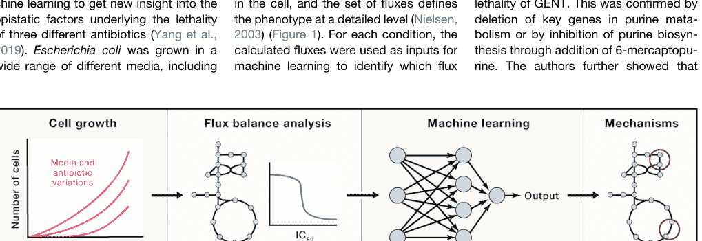

# 营养可用性影响抗生素杀伤力：机器学习的新见解

## 前沿预览

Jens Nielsen¹²³*
¹Bioinnovation Institute, Ole Maaes Vej 3, DK2200 Copenhagen N, Denmark
²Chalmers 工理工大学生物学与生物工程系, SE41296 Gothenburg, Sweden
³Novo Nordisk基金可持续性中心, 丹麦理工大学, DK2200 Kgs. Lyngby, Denmark
*联系邮箱: nielsen@chalmers.se

在今年的“细胞年度”中，Wright等人描述了一种机器学习方法，该方法可以从化学剂中提供机理见解。他们利用此方法揭示了大肠杆菌（*Escherichia coli*）的营养可用性如何影响广泛使用的抗生素的杀伤力。

随着抗生素耐性的兴起，我们需要更多的抗生素，但更重要的是需要高效的方法来筛选控制抗生素杀伤力的机制。化学和遗传筛选用于药物发现，但其通量量较低。此外，新药物难以确定其作用模式。对于感染性疾病，宿主与微生物之间复杂的相互作用往往使得问题变得复杂；例如，在存在抗生素的情况下仍能生存的特定机制。

在今年的“细胞年度”中，Wright等人将通量分析与机器学习相结合，获得了对三种不同抗生素杀伤力底层遗传上位效应因素的新见解（Yang等人，2019）。大肠杆菌培养在多种不同的培养基中，包括许多不同的碳源和氮源，目的是测量代谢补充对抗生素（氨苄西酰素 AMP、环丙沙星 CIP 和庆大素 GENT）杀伤力的影响。对于每种情况，当抗生素可用性变化时，IC₅₀（抑制生长的抗生素浓度）是以细菌耐受性提高的碳源百分比进行测量的。为了确定这种效应的原因，我们对不同培养基使用了通量平衡分析（FBA）（O’Brien等人，2015）。通过FBA，可以计算每种条件下代谢网络的通量，并在详细水平上预测表型（Niessen, 2003）（图1）。对于每种情况，计算出的通量被用作机器学习的输入，以识别哪些变化改变了三种抗生素的杀伤力，导致识别出477个影响抗生素杀伤力的反应。接下来，我们通过对中心代谢途径（如糖酵解、TCA循环和氨基酸合成）IC₅₀的变化进行最小二乘回归，计算了每个途径和抗生素的途径评分。这令人惊讶惊讶，因为通过这些途径的通量与生长高度相关。更重要的是，我们发现丙酮酸代谢中一组途径的通量减少会导致 AMP 和 CIP 的杀伤力降低，但对 GENT 则不然。这是由于丙酮酸代谢中基因的缺失或通过添加物抑制了生物合成导致的。作者进一步展示了：

**图1：** 理解培养基成分如何影响杀伤力的定量方法。通量分析（FBA）被用于计算细胞内运行的所有不同代谢途径的通量。通过使用计算出的通量和不同培养基中测量的IC₅₀值，可以确定通量减少与抗生素杀伤力降低之间的相关性，即哪些细胞能够更好地抵抗抗生素。这里提供了关于为何发生抗生素杀伤力降低的机理见解，用于设计新的治疗方案。

补充腺嘌呤而非鸟嘌呤，会降低野生型细胞中抗生素的杀伤力。

腺嘌呤补充具有显著效应的发现指向了能量代谢的关键作用，事实上，作者发现在存在抗生素的情况下呼吸代谢增加，这表明存在抗生素耐性。腺嘌呤补充会导致嘌呤生物合成活性降低，进一步导致能量代谢（包括呼吸）活性降低。

这种使用计算通量表示细胞表型的方法表明，可以确定代谢网络中不同途径之间的相互作用如何抗抗生素杀伤力。

Yang、Wright等人的方法可以很容易转化用于其他细胞类型和化学传感器，它将有望提高我们获取抗生素之外许多不同药物作用模式机理见解的能力。

作者的发现提供了另一个重要教训：即抗生素的活性高度依赖于环境条件，即使环境提供了允许细胞以改变的速率生长的条件。在这种情况下，如果存在腺嘌呤，细胞会降低能量代谢（即呼吸）活性，这可能导致生长减少，从而对抗生素的敏感性降低。

##参考文献

- Nielsen, J. (2003) It is all about metabolic fluxes. J. Bacter. 185, 7031–7035.
- O'Brien, E.J., Monk, J.M., and Palsson, B.O. (2015) Using genome-scale models to predict biosynthetic capabilities, Mol. Syst. 61, 971–978.
- Yang, J.H., Wright, S.N., Hamlin, M., McClure, J., D. Alantar, M.A., Schrubbers, L., Lopatin, A.J., Satish, S., Nil, Palsson, B.O., et al. (2019) Machine Learning Approach for Revealing Antibiotic Mechanisms of Action, Cell 177, this issue, 1649–1661.

