## AP 计算机科学原理 精华版，2025：备考指南，含 6 套模拟测试 + 全面复习 + 在线练习


### 关于作者

**Seth Reichelson** 是 2015 年白宫变革勇士、College Board 夏季研修学院教师和 IBM Champion。作为 Lake Brantley High School 和 Ocoee High School 的计算机科学教师，他通过基层推动发展了自己的计算机项目。凭借其沉着亲和的个性和标新立异的创意实施，他用古怪但易懂的项目活跃了课堂气氛，吸引了所有学生。将他的个人魅力付诸笔端，对所有参与者（包括他的拉布拉多犬）来说，真的是一次史诗般的冒险。Seth Reichelson 是一位资深高中教师和拉布拉多寻回犬爱好者。


### 如何使用本书

本书专注于帮助您在 AP 考试中获得正确答案。主题覆盖的深度和范围与 AP 考试一致。本书全面复习了 AP 计算机科学原理课程中教授的持久理解、关键概念、学习目标和核心知识。本书的每个要素都旨在为您备考做准备。

# 诊断测试

首先，参加诊断测试以了解您的优势和劣势。这是一套包含 70 道题的完整测试，附带详细的答案解析。

#### Create 性能任务

本书包含六个完整的 Create 性能任务样例及完整的书面报告。所有程序均包含在 Create 任务评分标准中获得满分所需的要求。程序同时以图形化和基于文本的语言编写。

#### 复习与练习

章节按大概念顺序排列，其中两章专门讲解算法。765 道采用 AP 格式编写的选择题涵盖了考试所有主题。本书所有选择题均包含详细的答案解析。

# 模拟测试

本书最后一部分提供了参加两套全真模拟测试的机会，包含实际考试中所有题型。每道选择题均提供全面的答案解析。

#### 在线练习

除了本书中的诊断测试和两套模拟测试外，还有三套全真在线模拟考试。您可以选择练习（非限时）模式或限时模式参加考试。所有题目均包含详细的答案解析。

#### 给学生


这本复习书重点介绍了每章的所有概念，并通过内容示例进行解释。如何使用本书取决于您的学校如何安排课程。尽管如此，通过回答每章末尾的复习问题并参加模拟测试，您将了解自己在实际考试中的表现如何。

#### 给教师

本书可作为独立教材使用，也可与大学理事会批准的任何课程大纲结合使用。

### 巴朗必备 5 要点

在您复习本书内容、冲刺 AP 计算机科学原理考试“5 分”的过程中，以下是您**必须**掌握的五大核心要点，优先级高于其他所有内容：

| **1** | 实现创建性能任务的所有编程要求。您的程序不必是杰作，但必须包含所有要求。确保提交的程序包含过程、参数、列表、迭代、选择和顺序。利用本书提供的示例，熟悉如何在程序中实现这些编码要求。一个没有包含所有要求的 5000 行程序，得分会低于一个包含所有要求的 19 行程序。 |
| --- | --- |
| **2** | 理解您编写的程序，并能在书面报告中回答大学理事会的问题。虽然大学理事会的问题比较模糊，但他们对答案的要求却极其具体。不给部分分。利用本书提供的正例和反例，理解大学理事会希望您如何回答书面问题。 |
| **3** | 了解选择题考试中所用伪代码的语法规则。考试使用的编程语言是大学理事会特有的，可能与您课堂上使用的编程语言规则冲突。例如，考试中列表的索引从 1 开始，但在许多语言中索引从 0 开始。 |
| **4** | 熟悉考试中的题型。例如，您的选择题考试将包含机器人问题、代码追踪问题、查找错误问题、进制转换问题、循环问题等。利用本书包含的数百道例题进行准备。 |
| **5** | 理解考试问题的考察范围。考试涉及的许多主题很复杂，但考试测试的内容并不复杂。例如，互联网是一个复杂的主题，要完全理解可能需要几个月。然而，本考试中涉及互联网问题的范围和深度是有限的。本书仅涵盖考试范围内的内容。 |

### 前言

本书面向参加 AP 计算机科学原理考试的学生，旨在帮助学生备考考试主题，无论他们学过何种计算机语言或教学方法。

本书提供了关于如何完成创建性能任务的深入指导，并附带六个完整的书面和代码示例。我们收录了得分高的样例回答和得分低的样例回答。提供的样例回答仅供参考。**请勿抄袭样例回答！** 大学理事会会进行严格的抄袭检查。

所有题目和示例均反映近期考试题目的风格，并涵盖大学理事会规定的核心知识主题。为了方便学生和教师，本书包含一套诊断测试和两套模拟考试，另有三套模拟考试可在线获取。

### 简介

#### 考试概况

AP 计算机科学原理考试是一场为期两小时、包含 70 道题的选择题考试，涵盖五大核心概念，并附带一项包含三份提交材料的性能任务。大学理事会建议您在 4 月 15 日前提交性能任务，截止日期约为 4 月 30 日。在您的教师设置好您的大学理事会账户后，您将能够从 12 月 3 日起提交性能任务。我建议您在 4 月 30 日截止日期前尽早提交。

由于大学理事会不断调整日期，请查看最新日期：<https://apstudent.collegeboard.org/apcourse/ap-computer-science-principles>。

##### 课程内容

**性能任务：** 占 AP 成绩的 30%

保证 12 小时的课堂时间完成

* 程序代码
* 书面回答
* 至少一个程序重要部分运行的视频

**课程结束考试：** 占 AP 成绩的 70%

* 2 小时
* 70 道选择题，纸笔考试
* 创造性开发 10–13%
* 数据 17–22%
* 算法与编程 30–35%
* 计算机系统与网络 11–15%
* 计算的影响 21–26%

某些考试问题可能与多个学习目标相关。例如，一个编程问题可能实现了一个算法并包含一个抽象。

#### 应试提示

##### 选择题部分

选择题占总分的 70%，在学年末进行。答错不扣分。因此请回答每一个问题，即使您必须猜测。

每道题您有略多于 1.7 分钟的时间。您应该有足够的时间回答测试中的所有问题，并且最后很可能有足够的时间回头检查难题。

70 道题会让人疲劳。您应该至少完整地一次性练习本书提供的样题测试之一。通过手工追踪代码，机器人和编程问题可以得到简化。

性能任务由人工评分，而课程结束考试由机器评分。考试独立于所使用的计算机语言，但同时包含基于文本的编程问题和基于块的编程问题。

##### 性能任务

关于如何创建大学理事会账户以及如何提交性能任务的详细信息，请访问 <https://apstudent.collegeboard.org/takingtheexam/about-digital-portfolio>。

##### 创建任务

让您自己的兴趣驱动您对计算程序的选择。

在开始编写之前，请确保您已阅读并理解问题以及这些问题如何评分。每年问题都会有细微变化，最新版本的问题和评分标准均可在以下网址找到：<https://apcentral.collegeboard.org/pdf/ap-csp-student-task-directions.pdf>。

您的程序代码应体现超越课堂示例的探索成果。

再次提醒，提交截止日期是 4 月 30 日。大学理事会建议在 4 月 15 日前提交。

# 诊断测试

后续考试的格式与实际 AP 考试相同。您可以通过两种方式使用它：

1. 在开始复习前将其作为诊断测试使用。测试末尾附有诊断图表，将每个问题与您应复习的章节关联起来。此外，每个答案都提供了完整的解析。
2. 您也可以在完成复习后将其作为模拟考试使用。

# 诊断测试

时间：120 分钟

70 道题

**说明：** 下列各题或未完成的陈述后均有四个建议答案或补全选项。在每种情况下选择最佳的一项，并在答题卡对应位置填入相应的字母。

1. 考虑以下代码段，它使用了变量 `a` 和 `c`。


## 诊断测试题

### 1. 代码段输出

```text
a ← 3
a ← a + 5
c ← 3
a ← c + a
DISPLAY(a)
DISPLAY(c)
```

运行代码段时显示什么？

- (A) 3 3
- (B) 3 8
- (C) 11 3
- (D) 3 11

### 2. 程序文档

编写程序时，关于程序文档以下哪项是正确的？

I. 程序文档在编写程序时很有用。
II. 程序文档在程序编写完成后很有用。
III. 当运行速度是一个因素时，程序文档没有用。

- (A) 仅 I
- (B) I 和 II
- (C) 仅 II
- (D) I、II 和 III

### 3. 二进制数值运算

存储在计算机上的图像包含像素，表示红、绿、蓝值的亮度。像素最常见的格式是使用 8 位表示红、绿、蓝，范围从 0 到 255。如果当前红色值为 `10011101`，若红色值按十进制增加 4，新的二进制值是什么？

- (A) 157[BIN]
- (B) 0100[BIN]
- (C) 10011111[BIN]
- (D) 10100001[BIN]

### 4. 协作的益处

程序员正在为一组不同的用户编写软件。程序运行时，程序员希望满足所有客户的需求并减少算法中的潜在偏见。与同事协作有什么好处？

- (A) 协作时，太多人试图领导小组，而愿意退居二线的成员不够多，这将延迟程序发布。
- (B) 小组内工作风格的冲突会降低员工士气。
- (C) 多人审查代码可以快速修复错误。
- (D) 具有不同生活经历的多人可以查看代码，并就原程序员如何减少偏见提供见解。

### 5. 网络钓鱼攻击识别

以下示例中哪个**最不可能**表明是网络钓鱼攻击？

- (A) 邮件提示密码即将过期，要求点击链接续期密码。
- (B) 来自熟悉公司的邮件，外观与该公司以往邮件完全一致，报告存档的信用卡信息已过期，并附带链接让你重新输入信用卡信息。
- (C) 来自 IRS 的邮件包含正确的 IRS 徽标，要求提交社会安全号码以便 IRS 邮寄额外的退税款。此外，邮件警告如果不在 30 天内填写此信息，退税款将作废。
- (D) 来自信用卡公司的邮件带有正确的银行徽标，提示信用卡上有异常活动，要求拨打卡背面的电话号码确认购买。

### 6. IP 地址位数增加

随着数字鸿沟的缩小和更多产品使用互联网，世界正面临 IP 地址耗尽的问题。目前的计划是从 32 位的 IPv4 切换到 128 位的 IPv6。

从 32 位增加到 128 位，可能的 IP 地址数量增加了多少？

- (A) 2 × 96
- (B) 2⁹⁶
- (C) 96²
- (D) 96

### 7. 过程错误类型

以下过程会导致什么类型的错误？

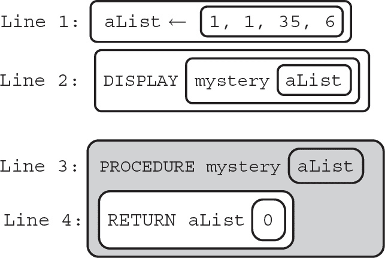

- (A) 第 1 行逻辑错误
- (B) 第 4 行语法错误
- (C) 第 4 行运行时错误
- (D) 第 1 行溢出错误

### 8. 代码显示结果

以下代码将显示什么？

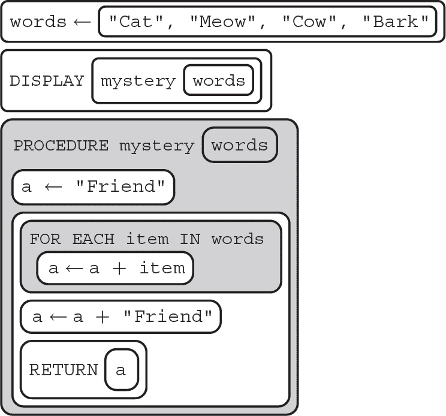

- (A) Friend
- (B) FriendFriend
- (C) FriendCatMeowCowBarkFriend
- (D) a

### 9. 6 位存储溢出

计算机使用 6 位存储非负数。以下哪项**不会**导致溢出错误？

I. 54
II. 63
III. 64
IV. 89

- (A) 以上全部
- (B) 仅 I、II 和 IV
- (C) 仅 I 和 III
- (D) 仅 I 和 II

---

### Questions 10–14 refer to the information below.

一家餐厅使用电话接受预订和外卖订单。餐厅计划更新系统，为客户提供更多选择，同时缩短下单时间。客户现在将与网站交互，而不是与真人交谈。

升级后的系统（而非原系统）存储来自网络交互的所有信息以供将来参考。这包括订购的食品、地址、电话号码和信用卡信息。

原系统和升级系统在以下流程图中描述。每个流程图使用以下块。

| **Block** | **Explanation** |
| --- | --- |
| Oval | 算法的开始 |
| Parallelogram | 输入或输出步骤 |
| Diamond | 条件或决策步骤，若答案为“是”则执行标记为“Yes”的分支，为“否”则执行标记为“No”的分支 |
| Rectangle | 算法的结果 |

#### Original System

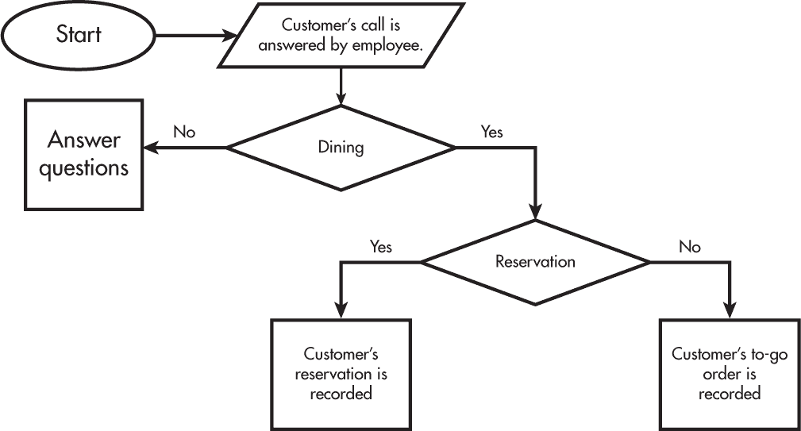

#### Upgraded System

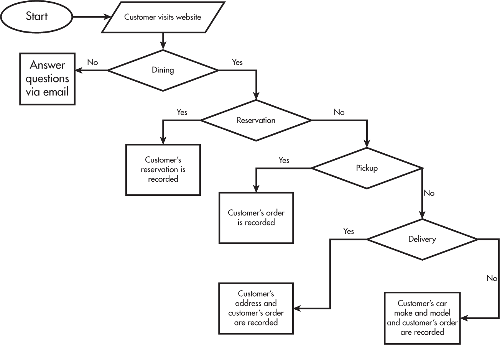

### 10. 升级系统所需的新输入数据

以下哪项输入数据是升级系统所需但原系统**不需要**的？

- (A) 姓名
- (B) 订单
- (C) 取餐或预订时间
- (D) 客户汽车品牌和型号

### 11. 网络订购系统最不可能包含的数据

升级系统使用客户未提供的数据。新网站旨在通过基于订单推荐产品（要不要薯条？）和减少处理时间来增加销售。以下哪项数据**最不可能**包含在基于 Web 的订购系统中？

- (A) 客户的 IP 地址
- (B) 之前的食品订单列表
- (C) 经常添加到订单中的热门商品列表
- (D) 订单准备时间

### 12. 升级系统的数据隐私担忧

以下哪项**最可能**是升级系统的数据隐私担忧？

- (A) 存储信用卡信息可通过自动填充数据来加快订购速度，从而提供更好的用户体验。
- (B) 客户更有可能进行预订。
- (C) 存储客户信息会增加流氓黑客网络钓鱼攻击的可能性。
- (D) 如果黑客访问订购系统，客户的个人数据可能会泄露。

### 13. 升级系统最不可能提供的潜在益处

以下潜在益处中，哪项**最不可能**由升级系统提供？

- (A) 客户更有可能订购外卖
- (B) 单次订购食品量增加
- (C) 餐厅知名度提高
- (D) 错误订单和送货地址减少

### 14. 升级系统的非预期影响

以下哪项可能是升级系统的非预期影响？

- (A) 餐厅预订量将增加。
- (B) 客户给建议的小费将增加员工收入。
- (C) 预订将主要由能负担互联网接入的客户进行。
- (D) 回头客将增加。

### 15. 网络攻击类别

2013 年，黑客诱骗第三方供应商点击恶意链接，安装了破坏 Target（大型零售连锁店）数百万客户信用卡号和其他个人信息的软件。Target 黑客攻击属于哪类网络攻击？

- (A) 网络钓鱼攻击
- (B) 键盘记录
- (C) 流氓接入点
- (D) 数据包元数据

### 16. 真值表缺失条件

什么可以替换 `<missing condition>` 以完成表格的最后一列？

| **A** | **B** | **<missing condition>** |
| --- | --- | --- |
| T | T | F |
| T | F | T |
| F | T | F |
| F | F | F |

- (A) A AND B
- (B) A OR B
- (C) NOT(A OR B)
- (D) A AND NOT(B)

### 17. 逻辑门电路输出

下图显示了一个由逻辑门组成的电路。每个门接受两个输入并产生单个输出。算法将产生什么结果？

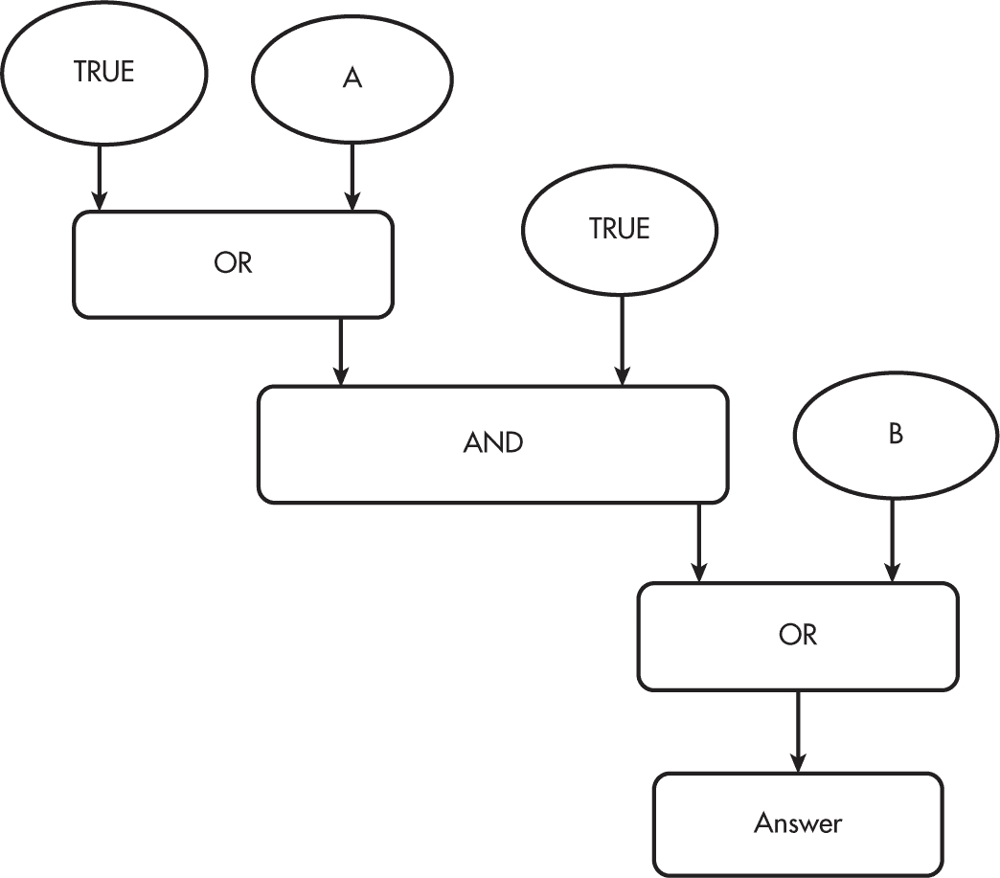

- (A) 仅当 A 和 B 都为 TRUE 时为 TRUE。
- (B) 当 A 为 TRUE 且 B 为 FALSE 时为 TRUE。
- (C) 无论 A 和 B 的值如何，始终为 TRUE。
- (D) 无论 A 和 B 的值如何，始终为 FALSE。


### 18. 神秘过程分析

考虑以下名为 `mystery` 的过程，旨在显示数字 `target` 在列表中出现的次数。

以下哪项最能描述该过程的行为？

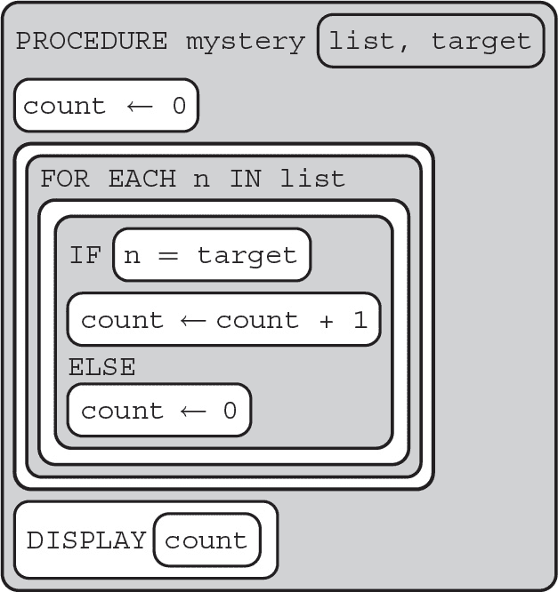

**选择两个答案。**

(A) 如果目标不在列表中，程序正确显示计数。

(B) 程序从不正确显示 count 的正确值。

(C) 如果目标在列表中出现一次且也出现在列表末尾，程序正确显示计数。

(D) 程序总是正确显示 count 的正确值。

### 19. 合并列表上的二分查找

两个列表 `list1` 和 `list2` 包含 Lake Brantley 高中的唯一八位数学生 ID。学校管理员想要创建一个列表，以便可以使用二分查搜索该列表。

以下抽象可用于创建新的可搜索列表。

| **抽象** | **解释** |
| --- | --- |
| `Sort(list)` | 将列表按从低到高的数字排序 |
| `Combine(list1, list2)` | 通过合并 `list1` 的元素后跟 `list2` 的元素来创建一个新列表。 |
| `BinarySearch(list, value)` | 使用二分查找返回 `value` 在列表中的索引。如果值不在列表中，此抽象将返回 −1。 |

以下哪个代码段将正确使用二分查找搜索值？

(A)
```
list1 ← Sort(list1)
list2 ← Sort(list2)
resultList ← Combine(list1, list2)
BinarySearch(resultList, value)
```

(B)
```
resultList ← Combine(list1, list2)
BinarySearch(resultList, value)
```

(C)
```
resultList ← Combine(list1, list2)
resultList ← Sort(resultList)
BinarySearch(resultList, value)
```

(D)
```
BinarySearch(list1, value)
BinarySearch(list2, value)
```

### 20. 机器人移动概率

下面的问题使用网格方格中的机器人。机器人表示为三角形，最初面向网格顶部。


以下哪些代码会使机器人有 1% 的概率向前移动一格？

**选择两个答案。**

(A)
```
IF(RANDOM(1, 100) = 4)
MOVE_FORWARD()
```

(B)
```
IF(RANDOM(0, 100) = 4)
MOVE_FORWARD()
```

(C)
```
IF(RANDOM(1, 100) < 2)
MOVE_FORWARD()
```

(D)
```
IF(RANDOM(1, 100) ≤ 2)
MOVE_FORWARD()
```

### 21. 二进制转十进制转换

在最低抽象级别之一，数字数据以二进制表示，即数字零和一的组合。

二进制数 “1001001” 转换为十进制 (DEC) 等于什么数字？

(A) 37

(B) 45

(C) 73

(D) 86

### 22. 二分查找迭代次数

使用二分查找，查找字母 *w* 需要多少次迭代？
`str ← [a, b, c, d, e, f, g, h, i, j, k, l, m, n, o, p, q, r, s, t, u, v, w, x, y, z]`

(A) 2

(B) 3

(C) 23

(D) 24

### 23. 线性查找迭代次数

使用线性查找，查找字母 *x* 需要多少次迭代？
`str ← [a, b, c, d, e, f, g, h, i, j, k, l, m, n, o, p, q, r, s, t, u, v, w, x, y, z]`

(A) 3

(B) 4

(C) 23

(D) 24

### 24. 流程图算法输出

流程图是以可视化方式表示算法的方法。下面的流程图使用以下构建块。

| **块** | **解释** |
| --- | --- |
|  | 算法的开始或结束 |
|  | 一个或多个处理步骤，例如给变量赋值的语句 |
| 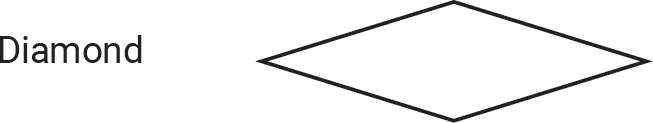 | 条件或决策步骤，如果条件为真，执行流程转向标记为 `true` 的一边，否则转向标记为 `false` 的一边 |
|  | 显示消息 |

下面的算法将显示什么？

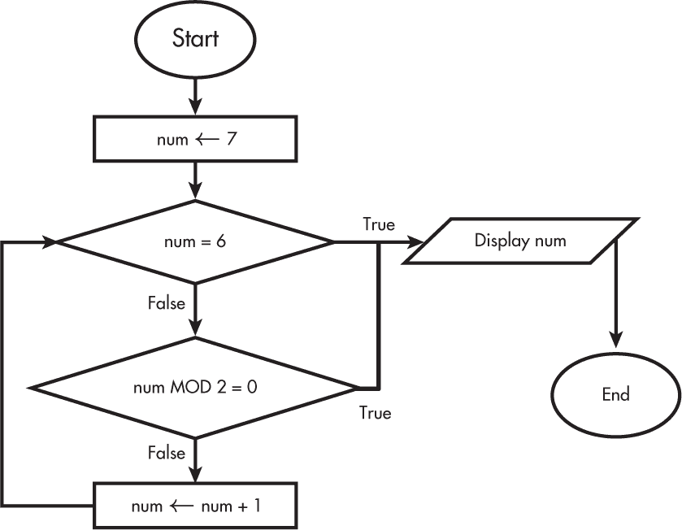

(A) 6

(B) 8

(C) 10

(D) 由于无限循环，不显示任何数字

### 25. 算法构建块：选择

排序、选择和迭代是算法的构建块。以下哪项被视为选择？

(A) 按照语句给出的顺序应用算法的每一步

(B) 使用布尔条件确定算法的哪一部分被使用

(C) 重复算法的一部分，直到满足条件或达到指定的次数

(D) 决定使用高级计算语言来评估算法

### 26. 搜索未排序列表

如果你的算法需要搜索一个未排序的单词列表，你会使用哪种搜索类型？

(A) 线性搜索

(B) 二分搜索

(C) 冒泡排序

(D) 插入排序

### 27. 疾病诊断代码段

下面的代码段是一个测试程序，旨在根据用户输入的 `fatigue_present` 和 `has_cough` 诊断幼儿患有的疾病。

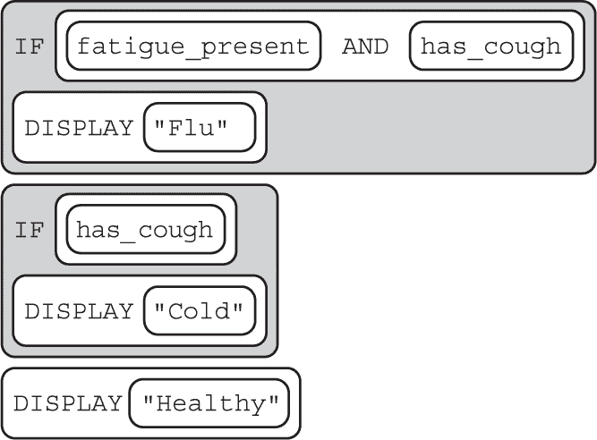

如果所有变量的值均为 `TRUE`，运行显示的代码段后显示什么结果？

(A) `Flu`

(B) `Cold`

(C) `Flu Healthy`

(D) `Flu Cold Healthy`

### 28. 数字数据表示权衡

以下哪项权衡在将信息表示为数字数据时是正确的？

I. 模拟信号必须经过采样并转换为数字，然后作为位存储在数字设备中。

II. 读取数据和更新数据具有不同的存储要求。

III. 有损数据压缩以只能重建原始数据的近似值为代价，减少了存储或传输的位数。

(A) 仅 I 和 II

(B) 仅 II 和 III

(C) 仅 I 和 III

(D) I、II 和 III

### 29. 代码段输出范围

运行此代码段后，可能显示的值是什么？

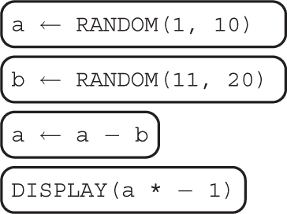

(A) −11

(B) −5

(C) 5

(D) 20

### 30. 容错网络路由

这是一个通过容错冗余互联网连接的设备网络。

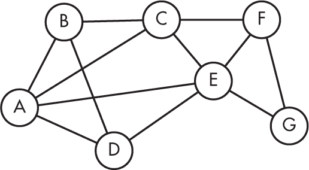

设备 C 必须与至少多少个其他设备连接才能与 D 通信？

(A) 1

(B) 2

(C) 3

(D) 4

### 31. 循环输出序列

以下代码段将显示什么？

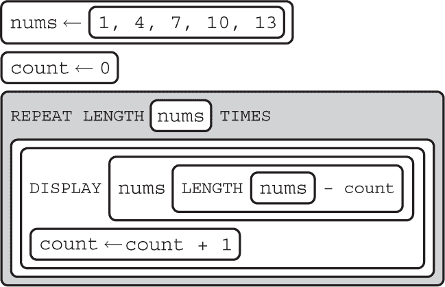

(A) 1 4 7 10 13

(B) 35

(C) 13 10 7 4 1

(D) 1 4 7 1 4 7

### 32. 嵌套循环输出

以下代码段将显示什么？

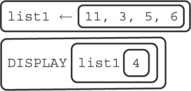

(A) 由于错误，不会显示任何内容。

(B) 3

(C) 6

(D) 11

### 33. 算法输出计算

运行以下算法后显示什么？

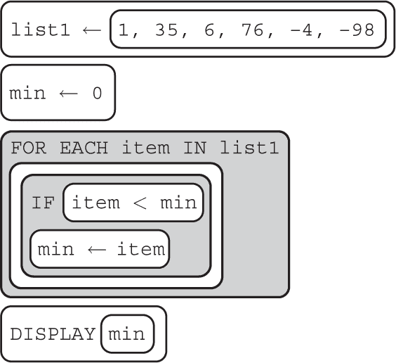

(A) −98

(B) −4

(C) 0

(D) 76

### 34. 算法输出计算

运行以下算法后显示什么？

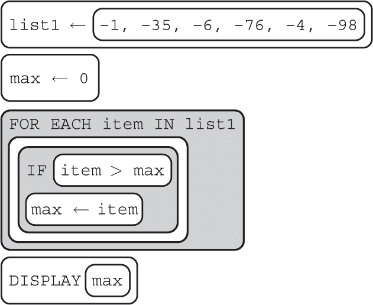

(A) −98

(B) −76

(C) −1

(D) 0

### 35. 算法输出计算

运行以下算法后显示什么？

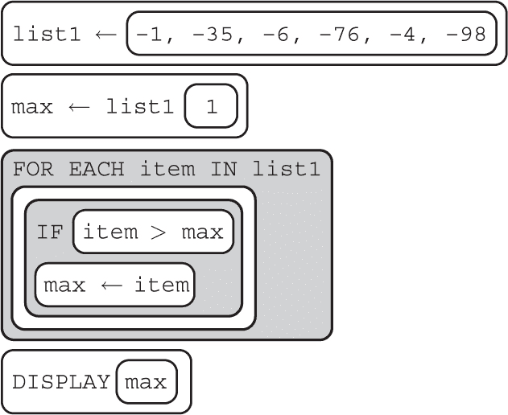

(A) −98

(B) −76

(C) −1

(D) 0

### 36. 求偶数和过程

过程 `getTotalEven` 旨在显示列表中所有偶数的和。以下哪个过程将正确显示列表中偶数的总和？

(A)
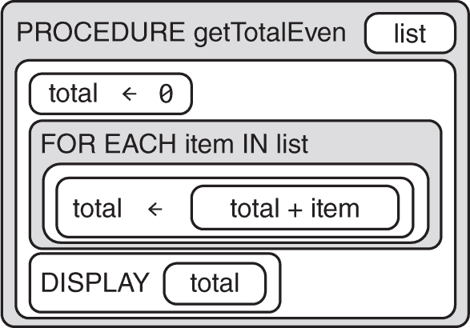

(B)
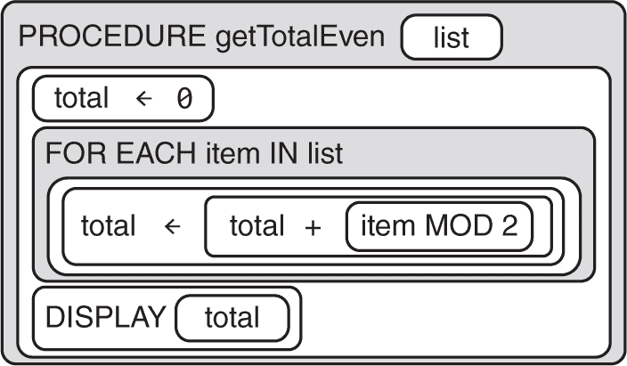

(C)
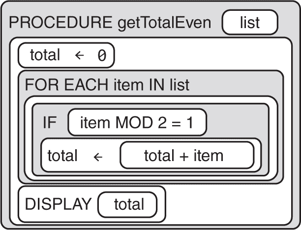

(D)
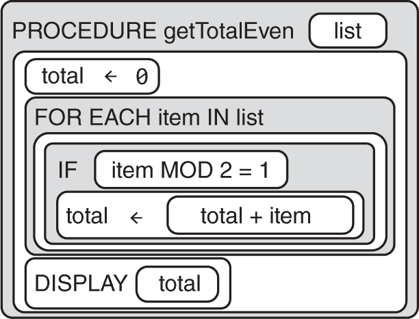

### 37. 机器人着陆概率

机器人落在星星上的百分比几率是多少？

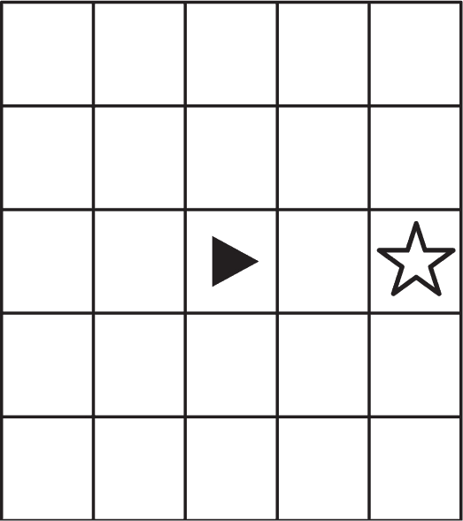
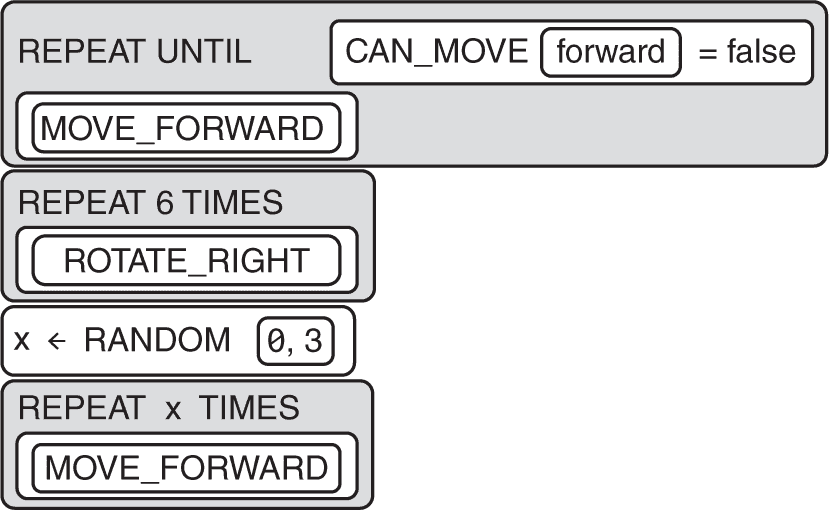

(A) 0%

(B) 25%

(C) 50%

(D) 100%

### 38. 算法输出计算

运行以下算法后显示什么？

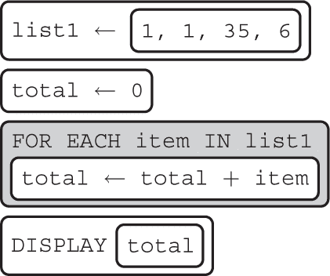

(A) 35

(B) 43

(C) 68

(D) 73

### 39. 机器人导航至目标

以下问题使用网格方格中的机器人。机器人表示为三角形，最初位于左下角的方格并面向右侧。

以下哪个代码段将机器人放置在灰色目标位置？

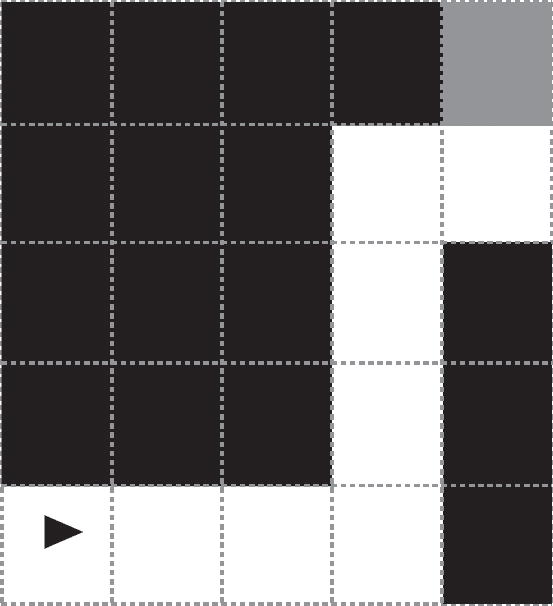
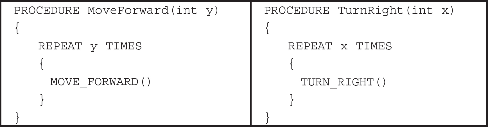

(A)
```
MoveForward(4)
TurnRight(1)
MoveForward(4)
TurnRight(1)
MoveForward(1)
TurnRight(1)
MoveForward(1)
```

(B)
```
MoveForward(4)
TurnRight(3)
MoveForward(4)
TurnRight(1)
```


### 诊断测试题目

### 机器人运动指令序列

```text
MoveForward(1)
TurnRight(3)
MoveForward(1)
(C) MoveForward(3)
TurnRight(3)
MoveForward(3)
TurnRight(1)
MoveForward(1)
TurnRight(3)
MoveForward(1)
(D) MoveForward(3)
TurnRight(3)
MoveForward(3)
TurnRight(3)
MoveForward(1)
TurnRight(3)
MoveForward(1)
```

### 第 40 题

智能手机存储使用手机拍摄的每张照片的以下数据：

- 拍摄照片的位置
- 在该位置拍摄的照片数量
- 拍摄照片的日期和时间
- 照片的文件名

使用上述元数据可以确定以下哪项？

I. 在华特迪士尼世界拍摄了多少张照片
II. 拍摄最近一张照片的人的姓名
III. 人们是否倾向于在周末比工作日拍摄更多照片

(A) 仅 I
(B) 仅 III
(C) I 和 III
(D) I、II 和 III

### 第 41 题

需要切断多少条线才能完全隔离 A？

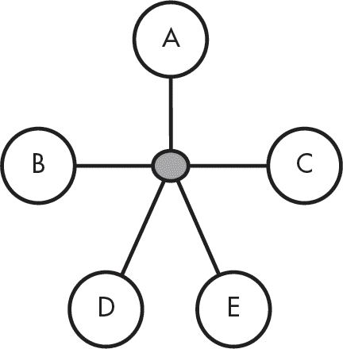

(A) 1 条线
(B) 3 条线
(C) 4 条线
(D) 5 条线

### 第 42 题

以下算法使用两个数据结构运行。

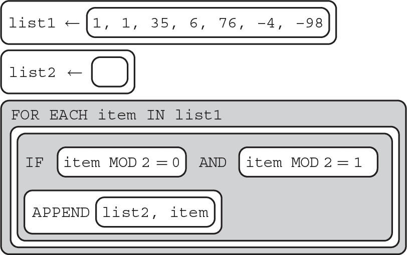

算法运行后，`list2`包含哪些元素？

(A) `[]`
(B) `[-4, -98]`
(C) `[1, 35, 6, 76, -4, -98]`
(D) `[6, 4, 98]`

### 第 43 题

某计算机有一个中央处理器（CPU）。下表显示了计算机使用单个 CPU 执行进程所需的时间。假设没有进程依赖于任何其他进程。

| 进程 | 执行时间（秒） |
| --- | --- |
| One | 8 |
| Two | 2 |
| Three | 6 |

以下哪项最能近似串行运行所有三个进程的最短可能时间？

(A) 2 秒
(B) 6 秒
(C) 8 秒
(D) 16 秒

### 第 44 题

一小组蝴蝶研究人员正在从事一个监测毛毛虫向蝴蝶过渡成功率的项目。以下哪项最能解释为什么公民科学被认为对该项目有用？

**选择两个答案。**

(A) 分散的个体比一小群研究人员更有可能在更大的区域内统计更多的毛毛虫和蝴蝶。
(B) 社交媒体的覆盖面可用于让来自不同地点的感兴趣个体为该项目做贡献。
(C) 普通公众更有可能准确识别毛毛虫的类型。
(D) 统计毛毛虫和蝴蝶对于公民科学家来说本质上太复杂了。

### 第 45 题

在集中式互联网中，禁用互联网所需的最少节点数是多少？

(A) 1
(B) 7
(C) 11,356
(D) 12,587

### 第 46 题

某计算机有两个可以并行运行的相同处理器。每个处理器一次只能运行一个进程，且每个进程必须在单个处理器上执行。在本题中，进程四和五必须顺序运行，而进程一、二、三可以全部并行运行。下表显示了每个进程在单个处理器上执行所需的时间。

| 进程 | 执行时间（秒） |
| --- | --- |
| One | 3 |
| Two | 2 |
| Three | 5 |
| Four | 4 |
| Five | 4 |

以下哪项最能近似运行这五个进程的最短可能时间？

(A) 5 秒
(B) 9 秒
(C) 13 秒
(D) 18 秒

### 第 47 题

Microsoft Windows 中的错误通常以二进制错误代码显示。如果将此数字转换为十进制，某些实用程序可用它来诊断计算机问题。

如果停止错误（即“蓝屏死机”）返回错误代码`10001111`，错误是什么？（忽略开头的“0x”；这是表示该数字为十六进制的信号。）

| 十进制错误代码 | 错误类型 |
| --- | --- |
| 138 | `GPIO_CONTROLLER_DRIVER_ERROR` |
| 139 | `KERNEL_SECURITY_CHECK_FAILURE` |
| 140 | `STORAGE_DEVICE_ABNORMALITY_DETECTED` |
| 141 | `VIDEO_ENGINE_TIMEOUT_DETECTED` |
| 142 | `VIDEO_TDR_APPLICATION_BLOCKED` |
| 143 | `PP0_INITIALIZATION_FAILED` |
| 144 | `PP1_INITIALIZATION_FAILED` |
| 145 | `SECURE_BOOT_VIOLATION` |
| 147 | `ABNORMAL_RESET_DETECTED` |
| 149 | `REFS_FILE_SYSTEM` |
| 150 | `TCPIP_AOAC_NIC_ACTIVE_REFERENCE_LEAK` |

(A) `TCPIP_AOAC_NIC_ACTIVE_REFERENCE_LEAK`
(B) `PP1_INITIALIZATION_FAILED`
(C) `PP0_INITIALIZATION_FAILED`
(D) `VIDEO_TDR_APPLICATION_BLOCKED`

### 第 48 题

单词“Mississippi”如何存储在计算机内存中？

(A) 作为代表每个字母的一组十进制数字。
(B) 作为代表每个字母的一组二进制数字。
(C) 作为代表整个单词的单个二进制数字。
(D) 作为无法进一步分解的一组字符。

### 第 49 题

如果显示短语“Error”，发生了什么错误？

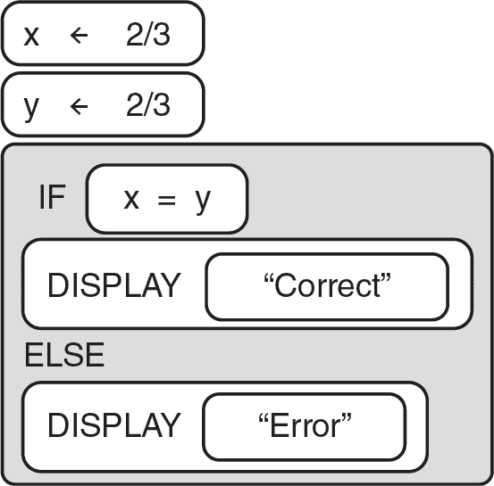

(A) 舍入误差
(B) 溢出错误
(C) 逻辑错误
(D) 2/3 将永远等于 2/3

### 第 50 题

程序员计划制作一个程序，允许公司按姓名、ID 号和薪水组织员工。假设程序员正在制作一个名为`newEntry`的过程，该过程接收这些数据以创建新条目。

以下哪项将是该过程的良好头部？

(A) `newEntry(name, idNo, salary)`
(B) `newEntry(n, i, s)`
(C) `newEntry(id, n, s, n)`
(D) `newEntry(name, idNo)`

### 第 51 题

为什么最好使用迭代和增量的程序开发过程？

(A) 更容易发现错误，因为导致错误的代码通常在最后一次更改中。
(B) 更快，因为它需要更少的测试。
(C) 无论开发周期中的哪个点，它总是产生所需的输出。
(D) 它在开发的所有阶段都需要更少的处理器时间。

### 第 52 题

在以下代码中，内层循环迭代多少次？

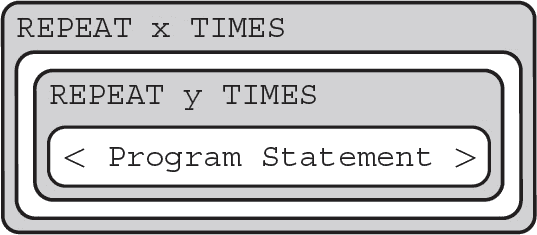

(A) 2*xy*
(B) *y* × (*x* −1)
(C) 2*x*
(D) *x* × *y*

### 第 53 题

下图使用网格中的机器人。机器人表示为三角形，最初位于左下角的方格中并面向右侧。以下哪种算法将机器人放入灰色方格？

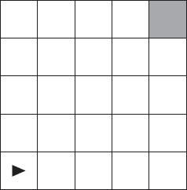

(A)
```
ROTATE_LEFT()
MOVE_FORWARD()
MOVE_FORWARD()
MOVE_FORWARD()
MOVE_FORWARD()
ROTATE_LEFT()
MOVE_FORWARD()
MOVE_FORWARD()
MOVE_FORWARD()
MOVE_FORWARD()
```

(B) 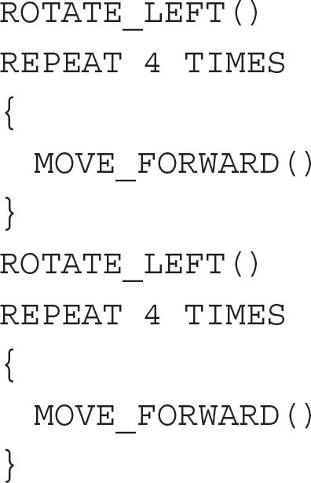

(C) 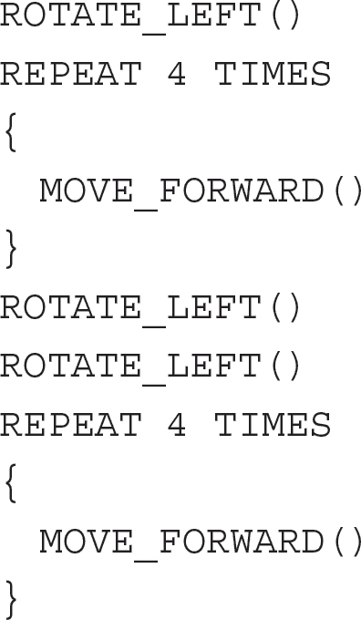

(D) 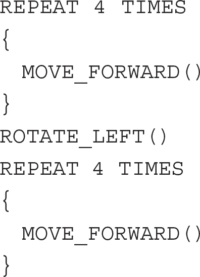

### 第 54 题

以下程序有多少百分比的时间会显示偶数？`DISPLAY(RANDOM(1,10))`

(A) 0%
(B) 10%
(C) 40%
(D) 50%

### 第 55 题

以下哪段代码执行以下操作？

步骤 1：用户输入一个数字。
步骤 2：如果数字在 0 到 10 之间（含），写单词 Waffles。
步骤 3：如果数字在 11 到 20 之间（含），写单词 Novack。
步骤 4：如果是任何其他数字，写单词 Benji。

(A)
```
num ← input()
IF(num > 0 and num < 10)
    DISPLAY("Waffles")
IF(num > 10 and num < 20)
    DISPLAY("Novack")
ELSE
    DISPLAY("Benji")
```

(B)
```
num ← input()
IF(num ≥ 0 and num ≤ 10)
    DISPLAY("Waffles")
IF(num ≥ 11 and num ≤ 20)
    DISPLAY("Novack")
ELSE
    DISPLAY("Benji")
```

(C)
```
num ← input()
IF(num ≥ 0 and num ≤ 10)
    DISPLAY("Waffles")
ELSE(num ≥ 11 and num ≤ 20)
    DISPLAY("Novack")
DISPLAY("Benji")
```

(D)
```
num ← input()
IF(num ≥ 0 and num ≤ 10)
    DISPLAY("Waffles")
IF(num ≥ 11 and num ≤ 20)
    DISPLAY("Novack")
IF(num > 20)
    DISPLAY("Benji")
```


### 诊断测试题目

#### 56. 通常情况下，以下哪项**不是**使用计算机模拟的优势？

**选择两个答案。**

(A) 模拟的使用成本更高，且更难进行更改。

(B) 模拟的参数可以轻松更改以测试不同情况。

(C) 模拟运行速度可快于实时实验，从而节省时间。

(D) 模拟收集的信息比真实世界实验收集的信息更准确。

#### 57. 以下哪项描述了数字数据的有损转换？

I. 将图像文件压缩为较低分辨率的图像，以便通过电子邮件轻松发送

II. 通过从 255 中减去每个 RGB 值来反转图像的颜色

III. 通过对图像的 RGB 值取平均并将新值分配给从白到黑的灰度阴影来转换图像

(A) 仅 I

(B) 仅 II

(C) I 和 II

(D) I 和 III

#### 58. 以下哪个表达式等同于布尔表达式 `NOT(num < 13)`？

(A) `num > 13 OR num = 13`

(B) `num > 13`

(C) `num < 13 AND num = 13`

(D) `num > 13 AND num = 13`

#### 59. 以下是数据跨互联网传输时经历的步骤。

I. 数据被切分成称为数据包的块。

II. 数据包被重组为连贯的消息。

III. 数据包在互联网中被路由。

IV. 数据包通过互联网服务提供商（ISP）接入互联网。

当数据通过互联网从一台设备传输到另一台设备时，以下哪项是数据采取的正确路径？

(A) IV → II → I → III

(B) I → III → IV → II

(C) I → IV → II → III

(D) I → IV → III → II

#### 60. 某算法有 *n* 个步骤。以下哪项**不**会被视为合理的步骤数？

(A) *n*

(B) 4*n* + 8*n*²

(C) 100*n*⁴

(D) 3^(*n*)

#### 61. 某社交媒体公司维护一个包含其用户以下信息的数据库。

- 用户名
- 每天在应用上花费的平均时间
- 用户年龄
- 用户性别
- 用户花费时间最多的应用区域

以下哪项额外信息对于确定时事是否决定用户偏好**最没有用**？

(A) 浏览量最高的页面

(B) 使用日期

(C) 电子邮件地址

(D) 用户位置

#### 62. 以下哪些是信息易于获取的好处？

I. 研究人员可以轻松找到信息，从而改进实验和调查结果。

II. 学生可以轻松找到信息，并利用它来提高对某一主题的理解。

III. 第三方可以轻松核查信息，从而确保信息始终正确且最新。

(A) 仅 I

(B) I 和 II

(C) 仅 II

(D) I、II 和 III

#### 63. 大多数编程语言允许程序员以抽象的形式包含源文件。例如，在 C++ 中，命令 `#include <iostream>` 授予程序访问基本输入/输出命令的权限。语言中拥有此类功能有何用处？

(A) 它使程序员能够增加程序的复杂度，并仅专注于当前程序。

(B) 它确保程序员可以修改语言的函数。

(C) 它使功能可在多个程序中使用，通过允许复用来降低代码复杂度。

(D) 它是一个有用的提醒，稍后复制整个源文件。

#### 64. 为什么启发式分析在防病毒程序中很有用？

(A) 当不需要精确解时，会使用启发式解。通过不检查每个文件，而是仅调查最可能被感染的程序，可以缩短防病毒程序的运行时间。

(B) 启发式解将完全保证整台计算机无病毒。

(C) 它能够在不选择误报且完全不需要全文件扫描的情况下识别出病毒。

(D) 它更能将危险病毒与简单的广告软件区分开。

#### 65. “Boids”是一种群集算法，用于确定移动种群中物体的方向。它建立在三个原则之上：

I. 分离：转向以保持局部群伴在一定距离

II. 对齐：转向朝向平均航向

III. 凝聚：转向朝向群体中心

假设程序员正在创建一个名为 `findBoidHeading` 的方法，用于计算群体中单个 boid 的航向。`findBoidHeading` 接收程序中其他 boid 的数据结构。

以下命令用于 Boid 对象。假设名称代表其功能。哪些可能在 `findBoidHeading` 中有用？

**选择两个答案。**

(A) `getVelocity`

(B) `getDate`

(C) `getShape`

(D) `getHeading`

#### 66. 硬币翻转模拟应导致 50% 正面和 50% 反面。选择两个可替换缺失条件的答案。

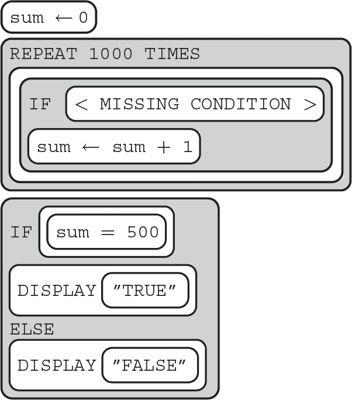

**选择两个答案。**

(A) `RANDOM(1,5)` < `2`

(B) `RANDOM(1,10)` < `6`

(C) `RANDOM(1,2)` = `2`

(D) `RANDOM(6,10)` < `6`

#### 67. 一个面向儿童的程序旨在显示数学问题并让用户输入其认为的答案。在程序的最基本层面上，经历了哪些数据转换？

**选择两个答案。**

(A) 键盘数字输入从数字转换为机器码。

(B) 键盘输入从文本转换为数字再转换为十六进制。

(C) 问题从十进制转换为文本。

(D) 解决方案从机器码转换为十进制。

#### 68. 为什么在程序中使用抽象比重复代码更有效？

**选择两个答案。**

(A) 抽象使编辑更难，因为每次提取都保存在不同的文件中。

(B) 抽象通过仅要求对抽象进行一次编辑而不是对代码的每个实例进行编辑来简化编辑。

(C) 使用抽象比重复代码占用的空间更少，这使程序更易读。

(D) 抽象保证在每个实例中都能工作，如果一次有效，就会被使用。

#### 69. 以下哪项**不是**可能的答案？

**选择两个答案。**

`DISPLAY (RANDOM(1, 4) + RANDOM(2, 5))`

(A) 1

(B) 5

(C) 6

(D) 10

#### 70. 下面的算法 60% 的时间显示 `TRUE`。

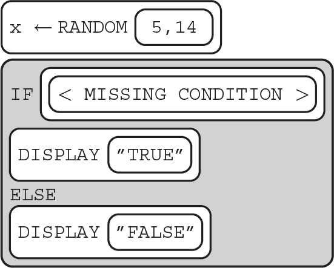

什么可以替换 `<missing condition>` 以使算法按预期工作？

**选择两个答案。**

(A) `x` > 8

(B) `x` <= 10

(C) `x` > 10

(D) `x` >= 10

## 答案解析

### 1. **(C)** 回答程序问题时，跟踪表有助于跟踪变量。

| `a` || `c` |
| --- | --- | --- |
| 3 || 3 |
| 8 ||   |
| 11 ||   |

(A) 虽然 `a` 的初始值是 3，但它更新为 8 然后是 11。

(B) 变量 `c` 初始化为 3，且在此问题中未更新。

(C) **正确。** 变量 `a` 和 `c` 遵循上述跟踪表，`DISPLAY` 方法显示 `a` 中包含的值，后跟一个空格，然后是 `c` 中包含的值，后跟一个空格。

(D) 虽然 `a` 和 `c` 的值遵循跟踪表，但 `DISPLAY` 方法的顺序是先 `a` 后 `c`。

### 2. **(B)** 程序文档在编程前、中、后的所有阶段都很有用。编程前的文档有助于规划算法。开发过程中的文档有助于组织和协作。编程后的文档有助于编码者在完成后更新程序。


## 诊断测试题解析

### 3. 二进制转换与加法运算

**(D)**

**步骤 1：** 将 `10011101[BIN]` 转换为 `[DEC]`。

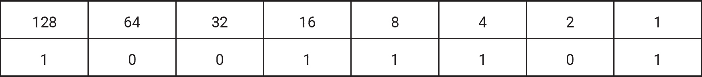

`128 + 16 + 8 + 4 + 1 = 157`

**步骤 2：** 相加十进制数。

`157 + 4 = 161`

**步骤 3：** 将 `161[DEC]` 转换为二进制。

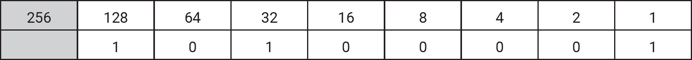

`161 − 128 = 33`

`33 − 32 = 1`  *(注：原文 "33 − 21 = 1" 疑为笔误，应为 32)*

`1 − 1 = 0`

**答案：** `10100001[BIN]`

---

### 4. 程序偏见与协作

**(D)** 程序可能因构建者、开发方式及最终用途而存在偏见。包含多元视角的协作有助于避免计算创新开发中的偏见。偏见难以察觉，这正是协作特别有效的原因。

协作是一项包含沟通、共识构建、冲突解决和谈判的技能。没有这些技能，协作无法奏效。(A) 和 (B) 试图在缺乏所需技能的情况下协作。(C) 不正确，因为代码已在运行。

---

### 5. 网络钓鱼与安全攻击

**(D)** 网络钓鱼、病毒及其他攻击均包含人为和软件成分，并可能造成毁灭性后果。

- **(A)** 这很可能是一次网络钓鱼攻击。黑客可利用输入的密码访问个人账户。
- **(B)** 公司的邮件格式可被模仿。黑客可利用信用卡信息购物而不付款。
- **(C)** IRS 的邮件格式可被模仿。额外退税的承诺被用来诱导受害者回复正确信息。
- **(D)** **正确。** 信用卡公司要求你拨打卡面上已印制的号码。

---

### 6. IPv6 地址位数扩展

**(B)** 能使用 IP 地址的设备数量增长迅速，因此建立了新协议 (IPv6)，将存储 IP 地址的位数从 32 位增加到 128 位。

位可容纳 `2^(位数)` 个值。例如，3 位可容纳 `2³` 个值，`2³ = 2 × 2 × 2 = 8` 个值。

将 32 位增加到 128 位，可能值的规模将增加 `2¹²⁸ − 2³² = 2⁹⁶`。

计算 `2⁹⁶` 的值超出了本课程范围，但好奇者可知其约等于 `7.922816251426434e[28]`。

- **(A)** `2 × 96 = 192`，远小于 `2⁹⁶`。
- **(B)** **正确。**
- **(C)** `96² = 9,216`，远小于 `2⁹⁶`。
- **(D)** `96` 远小于 `2⁹⁶`。

---

### 7. 逻辑错误与运行时错误

**(C)** 逻辑错误是算法或程序中的错误，导致其行为不正确或意外。选项 (A) 和 (B) 不正确，因为第 1 行不包含任何错误。语法错误是指程序未遵循编程语言规则的错误。尽管第 4 行包含错误，但遵循了语言规则。运行时错误是程序执行期间发生的错误。编程语言定义自己的运行时错误。

AP 考试使用的语言索引从 1 开始，而非 0。由于索引 0 不可达，因此发生了运行时错误。

---

### 8. 字符串拼接循环追踪

**(C)** 变量 `a` 在进入 `For Each` 循环前初始化为 `Friend`。进入循环后，`Cat`、`Meow`、`Cow` 和 `Bark` 依次拼接到 `a` 末尾。循环结束后，变量 `a` 包含 `Friend Cat Meow Cow Bark`。循环后，单词 `Friend` 再次拼接到 `a` 末尾。`a` 的新值为 `Friend Cat Meow Cow Bark Friend`。该新值被返回并显示。

| **a** | **拼接** | **返回** |
| :--- | :--- | :--- |
| Friend | | |
| Friend | Cat | |
| Friend Cat | Meow | |
| Friend Cat Meow | Cow | |
| Friend Cat Meow Cow | Bark | |
| Friend Cat Meow Cow Bark | Friend | |
| Friend Cat Meow Cow Bark Friend | | Friend Cat Meow Cow Bark Friend |

---

### 9. 位溢出错误分析

**(D)** 6 位可存储 `2⁶` 个数字：`2⁶ = 2 × 2 × 2 × 2 × 2 × 2 = 64`。这意味着 6 位可存储 64 个数字，范围 0 到 63。

溢出错误是试图存储过大数字时发生的错误。使用 6 位可存储的最大数字是 63，即选项 (II)。由于选项 (I) 的 54 小于临界值，选项 (I) **不会** 导致溢出错误。

- **(A)** 64 和 89 = 溢出错误
- **(B)** 89 = 溢出错误
- **(C)** 64 = 溢出错误
- **(D)** **正确**

---

### 10. 系统新增功能：路边取货

**(D)** 路边取货在原系统中不是选项，但现在包含在新系统中。为实现路边取货，现在需要提供汽车的品牌和型号。

---

### 11. 顾客偏好预测所需数据

**(A)** 顾客的 IP 地址不是预测顾客偏好以推荐额外菜品所需的数据。以往的食物订单可用于推荐菜品。热门菜品列表可能吸引顾客尝试新菜品。准备订单所需时间用于计算订单何时可取餐。

---

### 12. 存储 PII 数据的风险

**(D)** 如果黑客访问订购系统，顾客的个人身份信息 (PII) 数据可被用于非法活动。数据系统一旦被攻破，很难重获顾客信任，有些企业永远无法恢复。其他所有选项均为存储 PII 数据的优势。

---

### 13. 数据存储对顾客满意度的影响

**(C)** 数据存储在使用网站时提高了顾客满意度。通过推荐菜品，应能增加订单量。顾客在线下单应能减少错误订单。

---

### 14. 数字鸿沟与创新

**(C)** 每当互联网用于创新时，都应始终考虑数字鸿沟。餐厅实施的新系统要求顾客具有互联网接入。该创新的意外后果是：没有互联网接入的人无法使用新系统。

---

### 15. 网络钓鱼定义与危害

**(A)** 网络钓鱼是通过在电子通信中伪装成可信实体，欺诈性地获取用户名、密码和信用卡详情等敏感信息的尝试。此类攻击已造成消费者数十亿美元损失。

---

### 16. 布尔逻辑运算规则

**(D)** `AND` 运算为真要求等式两边均为真。`OR` 运算为真仅需等式一边为真。`NOT` 反转值。即 `NOT TRUE = FALSE`，`NOT FALSE = TRUE`。

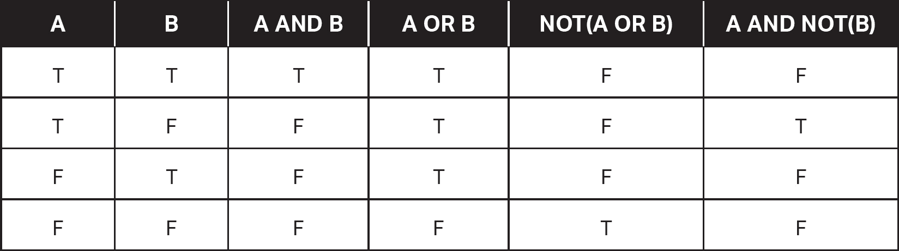

---

### 17. 短路求值分析

**(C)**

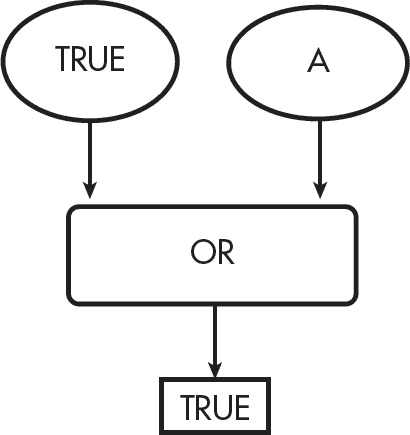

`TRUE OR` 任何值 = `TRUE`。此 `OR` 语句将短路为 `TRUE`，无需检查 `A` 的值。

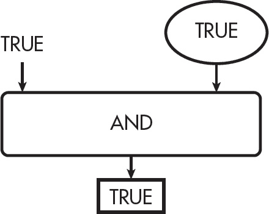

`TRUE AND TRUE` 结果为 `TRUE`。

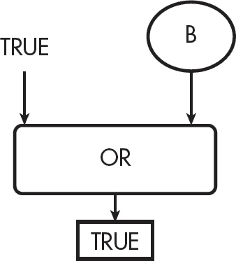

`TRUE OR` 任何值 = `TRUE`。此 `OR` 语句将短路，因此 `B` 的值从未被检查，结果为 `TRUE`。

---

### 18. 列表遍历计数器逻辑错误

**(A), (C)** 如果目标不在列表中，计数保持为零，这是正确值。如果目标在列表中但不在末尾，计数将增量为 1。然而，下一次列表迭代会将计数重置为零。如果目标在列表的最后一个位置，没有下一次迭代将值重置为零。要使该程序在所有测试用例下工作，需移除 `ELSE` 语句。

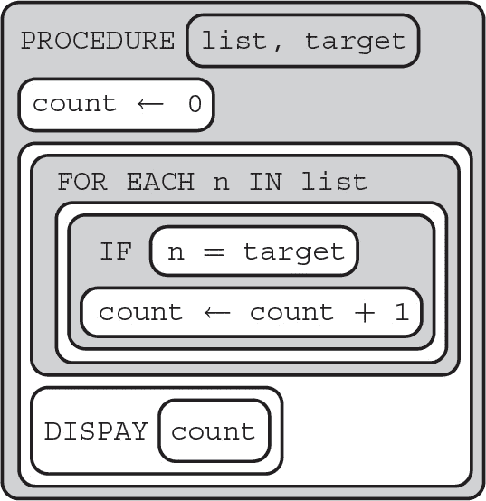


## 诊断测试题解析

#### 19. (C)
在使用二分查找之前，必须将列表合并并排序。
(A) 错误，因为虽然列表已排序，但合并后的结果列表将不会是有序的。
(B) 错误，因为结果列表未排序。线性查找可用于无序列表。

#### 20. (A), (C)
要使机器人向前移动，“If”语句必须有 1% 的概率执行为 true。
(A) 正确，因为 100 个数字中的 1 个就是 1%。
(B) 错误，因为 0 到 100 有 101 个数字，101 个数字中的 1 个不是 1%。
(C) 正确，因为 `<2` 等于 1 个数字，100 个数字中的 1 个就是 1%。
(D) 错误，因为 `≤2` 是 2 个数字，100 个数字中的 2 个就是 2%。

#### 21. (C)
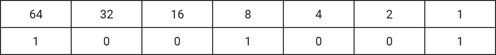

`(1 × 1) + (8 × 1) + (64 × 1) = 1 + 8 + 64 = 73`

(A) 十进制 37 = 二进制 100101
(B) 十进制 45 = 二进制 101101
(C) 正确
(D) 十进制 86 = 二进制 1010110

#### 22. (B)
二分查找需要在**已排序列表**上执行。二分查找从中间开始，每次遍历将待检查元素数量减半。

在第一个列表中，二分查找将从第 13 个字母开始：
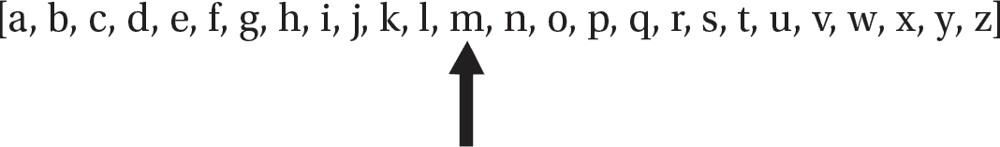

正在搜索字母 `w`；因此，列表的前半部分被舍弃。新列表有 13 个对象。
13 对半得 6.5 (13/2 = 6.5)，四舍五入为 7。
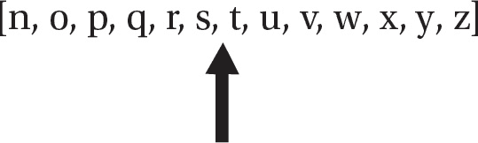

同样，因为搜索字母 `w`，列表的前半部分被消除。新列表有 6 个对象。
6 对半得 3 (6/2 = 3)。
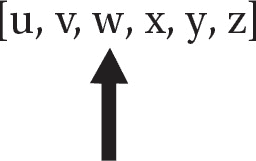

因此，在有序列表中二分查找字母 `w` 需要三次遍历。
(A) 两次二分查找遍历将得到字母 `t`。
(B) 正确。
(C) 如果执行线性查找，23 将是正确的。线性查找从数据结构的左端开始，按从左到右的顺序检查每个字母。
(D) 二分查找的每次遍历都将可搜索项的数量减半。在此数据结构中，最坏情况为 5 次。

### 23. (D)
在线性查找中，数据结构**不必排序**。线性查找从第一个字母开始，按从左到右的顺序检查每个连续字母。

`[a, b, c, d, e, f, g, h, i, j, k, l, m, n, o, p, q, r, s, t, u, v, w, x, y, z]`

使用此数据结构，找到正确字母需要 24 次遍历。
(A) 线性查找的第三次遍历将得到字母 `c`。
(B) 线性查找的第四次遍历将得到字母 `d`。
(C) 线性查找的第 23 次遍历将得到字母 `w`。
(D) 正确。

### 24. (B)
```
num = 7
is num = 6 false
is num MOD 2 = 0 false
num = 8
num = 8
is num = 6 false
is num mod 2 = 0 true
DISPLAY num = 8
End
```

#### 25. (B)
(A) 语句给出的顺序是顺序结构。
(B) 正确。布尔语句可用于选择结构（“If”语句）。
(C) 循环和重复是迭代结构。
(D) 大多数计算机语言都能执行顺序、选择和迭代。

### 26. (A)
(A) 正确。线性查找可在无序列表上执行。
(B) 虽然二分查找通常比线性查找快，但二分查找只能在有序列表上执行。
(C) 冒泡排序是排序，不是查找。
(D) 插入排序是排序，不是查找。

### 27. (D)
运行程序段的结果是 `Flu Cold Healthy`。所有“If”语句均为 true，因此所有答案都将显示。由于 `Healthy` 在“If”语句之外，它将始终显示。

`Fatigue_present` 设为 true。
`Has_cough` 设为 true。
`Healthy` 将始终显示。
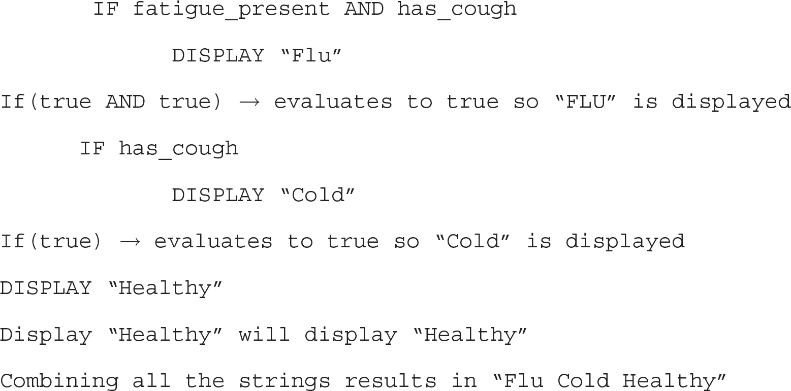

(A) 虽然 `fatigue_present AND has_cough` 为 true，显示“Flu”不会结束程序。
(B) 虽然显示了“Cold”，但“Flu”和“Healthy”也会显示。
(C) 虽然显示了“Flu”和“Healthy”，但“Healthy”不在“If”语句中，因此对于 `fatigue_present AND has_cough` 的所有值都将显示。
(D) 正确。

#### 28. (D)
使用有损压缩时，部分数据将丢失且永远无法恢复。有损压缩的优势在于文件体积较小，便于通过电子邮件发送和存储。丢失的数据会导致文件分辨率降低。

无损压缩不丢失数据。文件体积比有损压缩大，但数据可恢复到原始分辨率。

读取数据所需的存储空间比更新数据少。

### 29. (C)
| **a** | **b** | **Display** |
| --- | --- | --- |
| 1 thru 10 | 11 thru 20 |   |
| −1 thru −10 |   |   |
|   |   | 1 thru 19 |

#### 30. (A)
互联网设计为容错的。如果一个节点断开连接，传输的数据将选择不同的路径。这种容错特性需要多条路径。

从 C 到 D 的最短路径将涉及一个额外设备。
(A) 正确。从计算机 C 到计算机 E 有三条路径：C–E–D、C–A–D 和 C–B–D。
(B) 不存在从计算机 C 到 E 且包含 2 个额外设备的最短路径。
(C) 不存在从计算机 C 到 E 且包含 3 个额外设备的最短路径。
(D) 不存在从计算机 C 到 E 且包含 4 个额外设备的最短路径。

#### 31. (C)
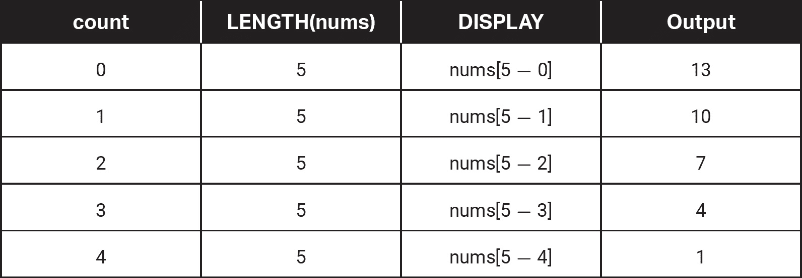

Output: `13 10 7 4 1`

### 32. (C)
列表可通过索引直接访问元素。在此测试中，索引从 1 开始。尝试访问索引 0 将导致索引越界错误。在此示例中，`list[1]` 访问 11，`list[2]` 是 3，`list[3]` 是 5，`list[4]` 是 6。

### 33. (A)
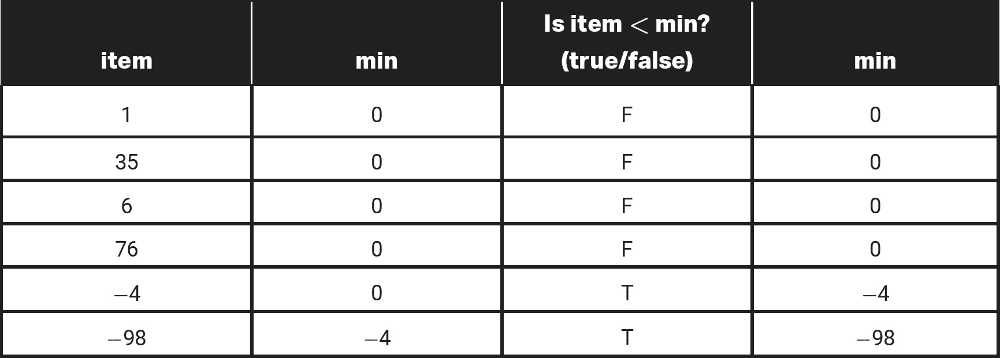

正确答案是 `-98`。

#### 34. (D)
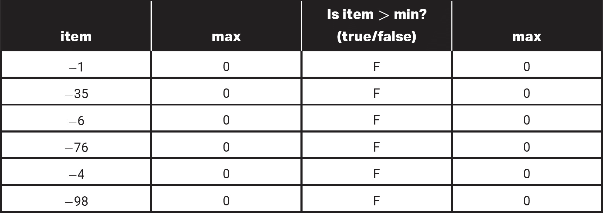

正确答案是 `0`。虽然该程序运行并返回一个值，但该值在逻辑上是不正确的。这是一个初始化 `max` 值会导致运行时错误的案例。为防止此错误，始终将 `max` 初始化为列表的第一个元素。这也适用于查找列表中的最小数字。

### 35. (C)
| **item** | **max** | **Is item > min? (true/false)** |
| --- | --- | --- |
| −1 | −1 | F |
| −35 | −1 | F |
| −6 | −1 | F |
| −76 | −1 | F |
| −4 | −1 | F |
| −98 | −1 | F |

正确答案是 `-1`。

在数据结构中查找最大值或最小时，始终将初始值设置为列表中的第一个元素。这对所有测试用例都有效。

### 36. (C)
选项 (C) 仅当 `item mod 2 = 0` 时将 `item` 的值加到 `total`。只有偶数模 2 等于 0。

选项 (A) 在求总和时不选择偶数。
选项 (B) 仅当 `item` 为奇数时向 `total` 加 1，为偶数时加 0。
选项 (D) 仅当 `item mod 2 = 1` 时将 `item` 的值加到 `total`。只有奇数模 2 等于 1。

#### 37. (B)


#### 38. (B)
正确答案是 `43`。


### 39. (C)


(A) `MoveForward(4)` 在第一步就让机器人移出网格。
(B) `MoveForward(4)` 在第一步就让机器人移出网格。
(C) 正确。

```
MoveForward(3)
TurnRight(3)(270 degrees clockwise)
MoveForward(3)
```


## 机器人路径示例

`TurnRight(1)` (90 度顺时针)

`MoveForward(1)`

`TurnRight(3)` (270 度顺时针)

`MoveForward(1)`

(D) `MoveForward(3)`

`TurnRight(3)` (270 度顺时针)

`MoveForward(3)`

`TurnRight(1)` (270 度顺时针)

`MoveForward(1)`

使机器人移出网格。

## 诊断题解析

### 40. (C)

仅使用元数据，可以确定在华特迪士尼拍摄的照片数量 (I)。在特定时间拍摄的照片数量也可以确定 (III)。无法确定的是谁拍摄了这些照片 (II)。

(I) 为真。通过使用位置数据，你可以确定在迪士尼世界拍摄了多少张照片；然而，(III) 也是真的。通过使用日期和时间的元数据，你可以确定拍摄照片最多的时间。因此，(C) 是最佳且正确的答案。

(II) 无法通过元数据确定。

### 41. (A)

这是一个中心化网络的例子。如果中间节点瘫痪，整个系统就会瘫痪。在这种情况下，如果单条线路中断，A 将与网络断开连接。中心化网络既不具备容错性，也不具备冗余性。

#### 42. (A)

`[]` 没有数字会被追加到 list2 中。


要到达 `APPEND list2`，布尔条件 `item MOD 2 = 0` 必须为真，且 `item MOD 2 = 1` 也必须为真。如果 `item MOD 2 = 0`，则该数为偶数。如果 `item MOD 2 = 1`，则该数为奇数。一个数不能同时是奇数和偶数。由于条件语句阻止了所有数字，因此没有数字会被追加到 list2 中。

#### 43. (D)

顺序计算解决方案所需的时间等于其所有步骤之和。


在本例中，总处理时间为 8 + 2 + 6 = 16 秒。

#### 44. (A), (B)

互联网可以提供访问兴趣小组的途径，例如蝴蝶爱好者。通过招募蝴蝶爱好者，研究人员可以覆盖更多领地并统计更大的样本量。

#### 45. (A)

互联网的设计者使互联网去中心化、具备容错性和冗余性。在去中心化网络中，不存在会导致整个网络瘫痪的公共节点。然而，本题针对的是中心化网络。如果互联网的所有节点都连接在一个公共点上，任何 1 个节点都可能完全瘫痪互联网。


中心化互联网

## 46. (C)

并行计算包含并行部分和顺序部分。并行计算解决方案所需的时间等于其顺序任务时间加上其并行任务中最长的时间。


在本例中，总处理时间为 5 + 4 + 4 = 13 秒。

#### 47. (C)

转换 `10001111`。


128 + 8 + 4 + 2 + 1 = 143

143 是 `PP0_INITIALIZATION_FAILED`。

#### 48. (B)

单词（字符串）在计算机中的存储方式与任何类型的数据一样，都是使用二进制数。通常，一个字母存储为 8 位二进制数的组合。例如，在某些计算机中，字母 `A` 存储为 01000001。

(A) 十进制数不用于计算机内存。内存仅使用二进制数 0 和 1。

(B) 正确。字符串由字母组成。字母由八个二进制数表示。

(C) 单个二进制数只能存储两个值。

(D) 计算机只能存储二进制数。存储在计算机上的所有内容，包括视频、数字、音频和图片，都是作为二进制数存储的。

## 49. (A)

在一台计算机上 2/3 可能等于 0.66666666666667。然而，在另一台计算机上 2/3 可能等于 0.667。计算机之间没有关于实数小数位数的通用协议。在溢出错误中，一台计算机上的 2/3 将不等于第二台计算机上的 2/3。

#### 50. (A)

方法/过程的参数需要与给定的内容匹配。该过程需要接受一个姓名、一个 ID 编号和一个薪水。

(A) Name、idNo 和 salary 是按正确顺序排列的良好名称。

(B) 此过程缺少第二个数字 salary。虽然不会产生错误，但变量名 `n` 和 `I` 可以更具描述性。

(C) 虽然名称不具描述性，但还有一个多余的参数。

(D) 此过程缺少一个参数。

#### 51. (A)

编程时，最好在编写代码的过程中分小块进行测试。如果你的代码是正确的，然后你添加了一个产生错误的部分，那么寻找新错误的范围将仅限于你刚刚添加的代码。如果你在编码时不检查错误而是等到最后，大量的错误可能会堆积起来。确定每个错误的来源将变得困难。

(A) 正确。错误很可能出在最新编写的代码部分。

(B) 这可能需要更多测试，但从长远来看能节省时间。

(C) 世上没有任何事情*总是*能产生预期输出。

(D) 这与处理器时间无关。

## 52. (D)

如果内层循环执行三次，但该内层循环必须重复两次，则程序语句将执行 3 × 2 次。

如果内层循环执行四次，但该内层循环必须重复五次，则程序语句将执行 4 × 5 次。

## 53. (D)

(A) `ROTATE_LEFT()` 使机器人逆时针旋转。第二个 `ROTATE_LEFT()` 会使机器人移出网格。

(B) `ROTATE_LEFT()` 使机器人逆时针旋转。第二个 `ROTATE_LEFT()` 会使机器人移出网格。

(C) 此代码将使机器人逆时针旋转 90 度。然后机器人将向前移动 4 个格子到达网格顶部。机器人将再旋转 180 度并移回起始位置。

(D) 正确。`REPEAT 4 TIMES` 将导致机器人沿网格底部向右移动 4 个格子。`ROTATE_LEFT()` 将使机器人逆时针旋转面向上方。最后的 `REPEAT 4 TIMES` 将使机器人向前移动 4 个格子到达目标。

#### 54. (D)

`DISPLAY(RANDOM(1,10))` 将以相等的概率显示数字 1、2、3、4、5、6、7、8、9、10。数字 2、4、6、8 和 10 是偶数；10 个数字中有 5 个是偶数，即 50%。

#### 55. (D)

(A) 不正确，因为“If”语句不包含 0 和 10（含边界）。输入 0 或 10 不会显示单词 Waffles。显示单词 Novack 的情况也是一样。数字 20 不会显示 Novack。

(B) 不正确。程序通过输入抽象从用户读取一个数字，然后针对 0 到 20 之间的正确数字范围显示我狗的名字。然而，如果数字在 0 到 10 的范围内，它将运行 ELSE 语句并显示单词 Benji。

如果数字是 15，输出将是 Novack，这是正确的。

如果数字是 25，输出将是 Benji，这是正确的。

如果数字是 2，输出将是 Waffles Benji，这是不正确的。

(C) 不正确，因为程序行 `DISPLAY("Benji")` 不在“If”语句中。因此无论输入如何，Benji 都会一直显示。

(D) 正确。它将为所有输入显示正确的名称。

#### 56. (A), (D)

模拟情境 (A) 可以潜在地节省资金。例如，汽车制造商不必像模拟出现前那样撞毁那么多汽车进行碰撞测试。(D) 是一个正确的反面例子，因为模拟永远无法拥有真实世界的所有变量。答案 (B) 和 (C) 都是使用模拟的有效理由。然而，本题询问的是什么**不是**优势。


# 诊断性问题 57-70

### 问题 57
**57. (D)** 选项 (I) 和 (III) 正确。使用有损压缩压缩数据时，部分数据会丢失且无法恢复。通过对像素取平均值，原始像素值丢失。由于数据丢失，这是有损压缩的一个例子。(II) 不正确。通过将新数字加上 255 可以找到原始数字。没有数据丢失，所以这是无损压缩的一个例子。

### 问题 58
**58. (A)** `NOT(num < 13)` 是 `num < 13` 之外的所有情况，即 `num = 13` 或大于 13。


- **(A) 正确。** 当 `num` 严格小于 13 时，`(num < 13)` 为真。`NOT(num < 13)` 是 `(num < 13)` 的相反情况。因此，当 `num` 大于或等于 13（包含 13）时，`NOT(num < 13)` 为真。
- **(B)** `num > 13` 不包含数字 13。
- **(C)** `num < 13` 不包含在 `num > 13` 或 `num = 13` 的子集中。
- **(D)** 一个数不能同时既大于 13 又等于 13。

### 问题 59
**59. (D)**

- **(A)** 数据在通过互联网传输之前，必须首先被分解成数据包。
- **(B)** 计算机通常不是直接连接到互联网的。相反，它们通过互联网服务提供商 (ISP) 连接到互联网。
- **(C)** 数据包在传输到指定计算机后重新组装。
- **(D) 正确。** 首先，你的数据被切分成小数据包。然后数据包通过你的互联网服务提供商 (ISP) 进入互联网。这些数据包随后在整个互联网中被路由。最后，数据包被重新组装成连贯的消息。

### 问题 60
**60. (D)** 多项式增长是可接受的。指数增长和阶乘增长是不可接受的。

### 问题 61
**61. (C)** 用户的电子邮件地址是静态的，无法关联到当前事件。然而，用户行为的变化可以通过使用日期关联起来，以确定当前事件是否导致行为变化。

### 问题 62
**62. (B)** 选项 (I) 和 (II) 描述了信息的用途，使该信息更易于访问可以改善这两种效果。(III) 不正确，因为信息并不总是被核查，而且即使进行了核查，也不一定会导致文章内容的更改。

### 问题 63
**63. (C)** 抽象应降低程序的复杂度。

程序员可以覆盖现有代码以扩展或更改抽象。

虽然抽象应设计为可在多个程序中使用，但它们不能保证使用的代码行数更少。程序用户关心的是运行时间和内存空间；代码行数不应成为考量因素。

抽象被构建为在后台且隐藏的。虽然源代码有可能被看到，但抽象的设计初衷是处于后台。

### 问题 64
**64. (A)** 启发式解法是一种“经验法则”。例如，如果你要查超市是否卖香蕉，启发式解法会是查超市是否有生鲜区。精确解法会是检查超市里的每一件商品是否为香蕉。由于 (A) 不检查计算机上的每一个文件，因此它是一种启发式解法。启发式解法旨在节省时间或内存。从文件中取出比特并不会使解法变成启发式的。

### 问题 65
**65. (A), (D)** 一个好的抽象名称旨在通过名称暗示抽象的功能，从而降低程序的复杂度。Boid 的航向与速度和航向相关，因此两者均应有用。日期和形状与 Boid 的航向无关。(B) 和 (C) 不正确，因为 `getDate` 和 `getShape` 对于查找 Boid 的航向没有用处。

### 问题 66
**66. (B), (C)** 这些选项将导致“If”语句有 50% 的概率结果为真。(A) 为真的概率为 20%，而 (D) 为真的概率为 0%。

### 问题 67
**67. (A), (D)** 计算机使用的任何东西都需要转换为机器码。问题的解将是一个数字。为了让计算机理解该数字的值，它首先必须被转换为机器码。当数字需要返回给用户时，必须首先从机器码转换回十进制。(B) 不正确，因为十六进制不是计算机使用的最低抽象层级。(C) 不正确，因为不进行文本到十进制的转换。

### 问题 68
**68. (B), (C)** 抽象降低程序的复杂度。它们允许程序员编写一次抽象代码但多次使用该代码。它们还封装了错误出现的位置。例如，如果程序员编写了一个用于查找数据结构中最大数字的抽象，但最大数字不正确，则错误很可能出在该最大值抽象中。

- **(A) 不正确**，因为抽象使编辑更容易。
- **(D) 不正确**，因为没有任何东西能保证一定工作正常。

### 问题 69
**69. (A), (D)** 选项 (A) 和 (D) 是不可能的。低端数字范围是 `1 + 2 = 3`。高端数字范围是 `4 + 5 = 9`。3 到 9 范围之外的任何数字都是不可能的。

### 问题 70
**70. (A), (B)** 5 和 14 之间有 10 个数字。为了使程序有 60% 的概率返回 TRUE，必须包含 6 个数字。

- **(A)** 9, 10, 11, 12, 13, 14
- **(B)** 5, 6, 7, 8, 9, 10
- **(C)** 11, 12, 13, 14
- **(D)** 10, 11, 12, 13, 14

---

## 诊断对照表

| **问题** | **诊断章节** |
| :--- | :--- |
| 1 | 算法与编程 |
| 2 | 创造性开发 |
| 3 | 数据 |
| 4 | 计算的影响 |
| 5 | 计算的影响 |
| 6 | 计算机系统与网络 |
| 7 | 算法与编程 |
| 8 | 算法与编程 |
| 9 | 数据 |
| 10 | 算法与编程 / 计算的影响 |
| 11 | 算法与编程 / 计算的影响 |
| 12 | 算法与编程 / 计算的影响 |
| 13 | 算法与编程 / 计算的影响 |
| 14 | 算法与编程 / 计算的影响 |
| 15 | 计算的影响 |
| 16 | 算法与编程 |
| 17 | 算法与编程 |
| 18 | 算法与编程 |
| 19 | 算法与编程 |
| 20 | 算法与编程 |
| 21 | 数据 |
| 22 | 算法与编程 |
| 23 | 算法与编程 |
| 24 | 算法与编程 |
| 25 | 算法与编程 |
| 26 | 算法与编程 |
| 27 | 算法与编程 |
| 28 | 计算机系统与网络 |
| 29 | 算法与编程 |
| 30 | 计算机系统与网络 |
| 31 | 算法与编程 |
| 32 | 创造性开发 |
| 33 | 算法与编程 |
| 34 | 算法与编程 |
| 35 | 算法与编程 |
| 36 | 算法与编程 |
| 37 | 创造性开发 |
| 38 | 算法与编程 |
| 39 | 算法与编程 |
| 40 | 计算机系统与网络 |
| 41 | 计算机系统与网络 |
| 42 | 算法与编程 |
| 43 | 计算机系统与网络 |
| 44 | 计算的影响 |
| 45 | 计算机系统与网络 |
| 46 | 计算的影响 |
| 47 | 数据 |
| 48 | 数据 |
| 49 | 创造性开发 |
| 50 | 创造性开发 |
| 51 | 创造性开发 |
| 52 | 算法与编程 |
| 53 | 算法与编程 |
| 54 | 算法与编程 |
| 55 | 算法与编程 |
| 56 | 计算的影响 |
| 57 | 计算机系统与网络 |
| 58 | 算法与编程 |
| 59 | 计算机系统与网络 |
| 60 | 计算的影响 |
| 61 | 数据 |


| 62 || 计算的影响 |
| 63 || 创造性开发 |
| 64 || 算法与编程 |
| 65 || 创造性开发 |
| 66 || 算法与编程 |
| 67 || 数据 |
| 68 || 创造性开发 |
| 69 || 算法与编程 |
| 70 || 算法与编程 |

# 创建性能任务

*“事情总比你预期的要花更长时间，即使你考虑到了霍夫施塔特定律。”*

—— 霍夫施塔特定律

## 章节目标

- 总体要求
- 程序要求
- 编程语言要求
- 编程前检查清单
- 如何获取用户输入
- 迭代
- 如何填充列表
- 程序的复杂度等级
- 带参数的过程
- 创建性能任务示例一
- 创建性能任务示例二
- 创建性能任务示例三
- 创建性能任务示例四
- 创建性能任务示例五
- 创建性能任务示例六

## 总体要求

创建性能任务占 AP 考试成绩的 **30%**。如果你仔细关注提示和评分标准，这一部分应该不会丢分。提示和评分标准可能会略有变化，最新版本可在 *[apcentral.collegeboard.org](http://apcentral.collegeboard.org)* 找到。请确保你使用的是最新版本的评分标准。

编程是一个协作且富有创造性的过程，它通过软件开发将想法变为现实。程序可以帮助解决问题、实现创新或表达个人兴趣。在本性能任务中，你将开发一个自选程序。你的开发过程应包括迭代地设计、实现和测试程序。强烈建议你与班上的另一位学生合作完成该程序的部分内容。

**警告：** 你**只能**与合作伙伴在程序的**开发**上协作。你为此性能任务提交的书面回复和视频必须**独立**完成，不得与合作伙伴或其他任何人协作。

你的老师必须保证至少 **9 小时** 的课堂时间和无限制的课外时间，以完成并提交以下内容：

- 最终程序代码（独立或协作创建）
- 一个展示程序运行并演示你所开发功能的视频（独立创建）
- 学生自撰的个性化项目参考资料

你的视频必须展示：

- 程序的输入
- 程序功能的至少一个方面
- 程序产生的输出

你的视频**不得**展示：

- 关于你个人的任何识别信息
- 语音旁白（虽然鼓励使用文字字幕）

你的视频必须符合以下规格：

- 存储为 `.mp4`、`.wmv`、`.avi` 或 `.mov` 格式
- 时长不超过 1 分钟
- 文件大小不超过 30 MB

## 程序要求

你的程序必须展示多种能力并实现若干不同的语言特性，这些特性结合在一起产生的结果，若没有计算工具和技术将难以轻易实现。你的程序应综合运用数学和逻辑概念，例如数字、变量、带算术运算符的数学表达式、逻辑与布尔运算符及表达式、决策语句、迭代和集合。

你的程序必须展示：

- 来自以下来源之一的**输入**指令：
  - 用户（包括触发事件的用户操作）
  - 设备
  - 在线数据流
  - 文件
- 至少使用一个**列表**（或其他集合类型）来表示数据集合，该集合被存储并用于管理程序复杂性、帮助实现程序目的。列表可以是 `Array`、`ArrayList`、`LinkedList` 等。
- 至少一个有助于实现程序预期目的的**过程**（抽象、方法、子程序），其中你已定义：
  - 过程的名称
  - 返回类型（如有必要）
  - **一个或多个参数**
  - 包含**排序、选择和迭代**的算法，位于所选过程的主体内
  - 对你自行开发的过程的调用
  - 基于输入和程序功能的输出指令（触觉、听觉、视觉或文本）

AP 计算机科学原理**没有**指定编程语言。学生可以选择修课时学到的编程语言来完成任务，也可以选择课外熟悉的其他编程语言。

可用于创建性能任务的示例语言：


**警告：** `HTML` **不是**创建性能任务接受的语言。

只要该语言能够创建列表并调用接受参数的过程，即可使用。使用低级语言还是高级语言在评分上没有区别。

### 编程前检查清单

选择程序主题时，学生应确保其程序足够复杂，能够整合数学和逻辑概念、开发抽象、使用列表并实现算法。

500 行的程序不一定比 30 行的程序得分高。事实上，如果 30 行的程序包含所有正确元素，而 500 行的程序没有迭代、也没有接受参数的过程（可称为抽象、函数或方法），则 500 行程序得分会更低。

编程主题完全由你决定，应选择你感兴趣的内容。但是，你需要考虑到有限的课堂时间。如果你想编写新版《光环》，尽管去做。然而，《光环》无法在提供的 12 小时内写完。在深入之前先考虑程序的范围。

编写程序时，你应该意识到最终程序需要输入指令、一个列表、一个接受参数的过程，以及一个包含排序、选择和迭代的算法。

**符合评分标准的编程检查清单**

| 你的程序是否至少有一个列表（列表也可以是数组、数据库或集合），且该列表对程序功能至关重要？ | 是/否 |
| --- | --- |
| 列表中存储的数据对程序功能是否至关重要？ | 是/否 |
| 程序是否展示了数据如何加载到列表中？ | 是/否 |
| 列表中的数据是否通过迭代访问（而非直接通过索引访问）？ | 是/否 |
| 你的程序是否接收并使用来自用户、设备、在线数据流或文件的输入？ | 是/否 |
| 你的程序是否包含一个接受参数的过程？这些参数是否被使用了？ | 是/否 |

**获取用户输入的一些示例（JAVA 和 SNAP!）**

| **基于文本的示例程序 (JAVA)** | |
| --- | --- |
| import 语句必须是程序的第一行，并记录在你的程序中。 | `import java.util.*;`<br>`Scanner scan = new Scanner(System.in);`<br>`System.out.println("Enter a number");`<br>`int num = scan.nextInt();` |
| 查阅 Scanner API 以读取不同类型的数据。在注释中说明你使用了 Scanner 库。 | |

| **图形化语言示例** | |
| --- | --- |
| |  |

有关任何计算机语言获取输入的信息，我推荐网站 *[stackoverflow.com](http://stackoverflow.com).*


## 示例

为了确定如何使用 Python 语言获取输入，我搜索了以下内容：“input from user in python stack overflow”（Python 中的用户输入 stack overflow）。

## 迭代的示例与非示例


## 填充列表的多种方法


## 降低程序的复杂度

程序是复杂的。无论每一步多么微小，都应采取措施来降低程序的复杂度。

数据结构如何降低程序的复杂度？


> **警告：** 不要试图在不合适的地方强行使用列表。你的列表必须包含不止一个元素。评分标准规定列表必须降低代码的复杂度。如果列表仅包含一个元素，可能会增加代码的复杂度。

## 带参数的过程

你的程序必须包含至少一个过程，该过程包含至少一个参数，且该参数对过程的功能产生影响。


> **警告：** 切勿将不起作用的参数放入你的过程中。

## 笔试题 1–4

你将可以访问你的个性化项目参考资料，并针对你的程序代码以及该参考资料中包含的代码，回答四个相关提示。最终考试中将会出现下列各类别中的一个问题。具体提示会因考试版本不同而有所差异。

### 问题 1：程序设计、功能与目的

学生应准备好回答关于其程序的提示，以评估以下任一学习目标：

- 描述计算创新的目的。
- 解释程序或代码段的功能。
- 识别程序的输入。
- 识别程序产生的输出。
- 使用开发过程开发程序。
- 设计程序及其用户界面。
- 通过编写文档来描述代码段或程序的目的。

### 问题 2：算法开发

学生应准备好回答关于其程序的提示，以评估以下任一学习目标：

- 解释程序或代码段的功能。
- 计算使用关系运算符的表达式。
- 计算使用逻辑运算符的表达式。
- 确定条件语句的结果。
- 在不使用编程语言的情况下表达使用迭代的算法。
- 确定迭代语句的结果或副作用。
- 比较多个算法以确定它们是否产生相同的副作用或结果。
- 创建算法。
- 组合和修改现有算法。

### 问题 3：错误与测试

学生应准备好回答关于其程序的提示，以评估以下任一学习目标：

- 识别错误。
- 纠正错误。
- 识别可用于检查算法或程序正确性的输入及相应的预期输出或行为。

#### 可能被测试的错误类型

- **逻辑错误** 是算法或程序中的错误，导致其行为不正确或出乎意料。

  示例：
  - 数学表达式中运算顺序放置错误。
  - 创建了具有不正确入口或出口条件的循环。

- **语法错误** 是程序中违反编程语言规则的错误。

  示例：
  - 在 Java 中忘记分号或在 Python 中忘记冒号。
  - 变量名大小写使用不正确。

- **运行时错误** 是程序执行期间发生的错误。编程语言定义各自的运行时错误。

  示例：
  - 尝试除以零。
  - 使用超出列表范围的索引访问列表元素。

- **溢出错误** 是当计算机尝试处理超出定义值范围的数字时发生的错误。

  示例：
  - 如果一种语言使用 4 位存储整数，最大值将是 `2^n - 1 = 15`
  - 如果一种语言使用 6 位存储整数，最大值将是 `2^n - 1 = 63`

### 问题 4：数据与过程抽象

学生应准备好回答关于其程序的提示，以评估以下任一学习目标：

- 使用列表存储多个元素来开发数据抽象。
- 解释数据抽象的使用如何管理程序代码中的复杂性。
- 编写迭代语句以遍历列表。
- 确定包含列表遍历的算法的结果。
- 解释过程抽象的使用如何管理程序中的复杂性。

## 使用 College Board 伪代码的考试样题

### 根据以下过程回答问题 1–17。

**注意：** 与 AP 考试一样，下面代码段中使用的列表将从索引 1 开始。

以下代码段的功能是：如果用户输入的颜色包含在彩虹中，则显示“Victory”（胜利）。


### 程序设计、功能与目的

1. **确定你程序的预期用户。描述你程序设计满足该用户需求的一种方式。**

   我的程序专为对学习彩虹颜色感兴趣的青少年设计。我的程序通过让用户回答各种颜色的测验，并指示每种颜色是否属于彩虹颜色，从而实现这一目标。

2. **解释程序或代码段的功能。**

   我的程序功能是提示用户输入一种颜色。然后程序将遍历一个包含所有彩虹颜色的列表。如果在列表中找到输入的颜色，程序显示“Victory”。如果输入的颜色与彩虹列表中的任何颜色都不匹配，则显示“Fail”。

3. **识别程序的输入/输出。**

   用户提供输入，即一种颜色。如果输入在 `words` 列表中找到，输出为“Victory”。然而，如果输入不在 `words` 列表中，输出为“Fail”。

### 算法开发

4. **确定迭代语句主体将执行的次数。**

   我程序中的循环将运行 7 次迭代。

5. **描述会导致迭代语句不终止并导致无限循环的条件或错误。如果不存在此类条件或错误，请解释如何修改循环以导致无限循环。**

   我程序中使用的循环设定为执行 7 次，独立于程序的结果。这种设计选择确保不会发生无限循环。

   然而，如果我将循环从“REPEAT 7 TIMES”改为 `REPEAT UNTIL user = words[count]`，且 `user` 不包含在 `words` 列表中，则会发生无限循环。

   

6. **描述所提供程序中过程的两次调用。每次调用必须传递不同的参数，导致算法中不同的代码段执行，并描述正在测试的条件和每次调用的结果。**

   假设 `words` 包含（“red”[红]、“orange”[橙]、“yellow”[黄]、“green”[绿]、“blue”[蓝]、“indigo”[靛]、“violet”[紫]）且 `user` 包含“blue”。第一次调用将是

   

   假设 `words` 包含（“red”[红]、“orange”[橙]、“yellow”[黄]、“green”[绿]、“blue”[蓝]、“indigo”[靛]、“violet”[紫]）且 `user` 包含“purple”。第二次调用将是

   

   第一次调用将测试“blue”是否包含在 `words` 列表中。

   第二次调用将测试“purple”是否包含在 `words` 列表中。

   第一次调用的结果是显示“Victory”。

   第二次调用的结果是显示“Fail”。

7. **描述你程序中列表所包含的数据代表什么。**

   我的列表包含 7 个字符串，每个字符串代表彩虹中一种颜色。

### 错误与测试

8. **概述会导致运行时错误的修改。**


# 程序错误分析与算法设计

## 9. 导致逻辑错误的修改

将 `RETURN["Victory"]` 与 `RETURN["Fail"]` 互换会导致算法行为不正确。这种交换会使算法在用户输入的单词包含在 `words` 列表中时返回 "Fail"，而在用户参数中的单词不在列表中时返回 "Victory"。这与预期行为相反。

## 10. 导致语法错误的修改

将代码中 `count` 的初始值设为 `count = 1` 而不是 `count ← 1` 会导致语法错误。

## 11. 导致溢出错误的修改

如果 `count` 的数据类型是 8 位整数，它能容纳的最大值（不触发溢出错误）为 $2^n - 1$，即 $256 - 1 = 255$。因此，尝试将数字 278 存储在 `count` 中会导致溢出错误。

## 12. 测试算法正确性的过程

- 当 `words = ["yellow", "orange", "blue", "red"]` 且 `user = "blue"` 时，预期结果为 "Victory"，实际运行结果符合预期。
- 当 `words = ["yellow", "orange", "blue", "red"]` 且 `user = "pink"` 时，预期结果为 "Fail"，程序输出符合预期。

### 数据与过程抽象

## 13. 列表在程序中的作用

在我的程序中，我使用了一个名为 `planets` 的列表，包含九个字符串，分别表示太阳系中九大行星的名称。这些行星名称存储在索引 0 到 8 的位置。

使用该列表使我能够减少所需变量的数量：只需定义一个变量 `planets`，而无需为每颗行星单独定义九个变量。这种通过单一变量表示列表来降低代码复杂度的做法，显著减少了程序出错的可能性。

此外，利用 `planets` 列表，我可以结合 `for` 循环和单个 `if` 语句高效地检查用户输入是否与列表中任意元素匹配。若不使用列表，则需要编写九个不同的 `if` 语句来测试所有九颗行星的相等性。这种简化同样大幅降低了出错概率。

## 14. 过程抽象在程序中的作用

通过将“检查单词是否存在于列表中”的算法封装在一个过程中，我显著降低了程序复杂度。这种封装使我能在程序的多个位置复用该算法，而无需重复代码。例如，若需验证五个单词是否在列表中，只需调用该过程五次。若无过程抽象，则需编写 20 行代码而非 5 行。

此外，过程将与单词存在性检查相关的错误局限在过程内部。若无过程，我就必须检查整个程序才能定位此类功能的错误来源。

## 15. 使用 `isEqual` 统计列表中特定值出现次数的算法

假设提供过程 `isEqual(value1, value2)`：若两参数值相等则返回 `true`，否则返回 `false`。以下是使用该过程统计列表中某值出现次数的详细步骤：

1. 将 `total` 初始化为 0。
2. 将 `count` 初始化为 1。
3. 开始遍历 `words` 列表。
4. 对列表中的每一项，检查 `isEqual(user, words[count])` 是否为真，其中 `count` 从 1 变化到 7。若匹配，将 `total` 加 1。
5. 遍历完所有项后，返回累计的 `total` 值。


## 16. 使用 `compareTo` 统计 `user` 在字母序上排在列表项之前的次数

假设提供过程 `compareTo(value1, value2)`：若 `value1` 字母序低于 `value2` 返回负数；高于则返回正数；相同则返回 0。以下是统计 `user` 存储的单词在字母序上排在列表中每个项之前的次数的算法步骤：

1. 将 `total` 初始化为 0。
2. 开始循环遍历整个 `words` 列表。
3. 若 `compareTo(user, words 列表中的当前项)` 返回正值，说明 `user` 字母序高于当前列表项，此时将 `total` 加 1。
4. 对整个 `words` 列表重复步骤 3（本例中为 7 次）。
5. 结束循环。
6. 返回累计的 `total` 值。


## 17. 使用 `conCat` 将列表中所有单词合并为一个长单词

假设提供过程 `conCat(word1, word2)`，用于连接两个单词（如 `conCat("Tiger", "Cat")` 返回 `"TigerCat"`）。以下是将列表中所有单词合并为一个单词的算法步骤：

1. 将 `combinedWord` 初始化为空字符串。
2. 开始循环遍历整个 `words` 列表。
3. 调用 `conCat(combinedWord, 列表中的当前项)` 进行连接。
4. 对整个 `words` 列表重复步骤 3（本例中为 7 次）。
5. 结束循环。
6. 返回累计的 `combinedWord` 值。


# 基于以下过程回答第 18–32 题

**注意：** 如同 AP 考试，下列代码片段中的列表索引从 1 开始。

以下代码片段的功能是创建一个包含 1 到 10 之间 10 个随机数的列表，然后返回使用这 10 个随机数进行乘法运算并答对的题目数量。


### 程序设计、功能与目的

### 18. 确定程序的预期用户及设计如何满足其需求

我的程序旨在通过测验帮助初学数学的学生掌握乘法，测验内容为使用 1 到 10 之间的数字随机生成的五道乘法题。

### 19. 解释程序或代码片段的功能


我的程序功能是创建一个包含 1 到 10 之间 10 个随机数的列表。然后程序会显示一个乘法问题并询问用户答案。最后程序会返回五道题中答对的题数。

### 20. 确定程序的输入/输出。

输入是五道乘法题的答案。输出是答对的题数。

### 算法开发

### 21. 确定迭代语句主体将执行的次数。

我程序中的循环将运行 5 次迭代。

### 22. 描述会导致迭代语句无法终止并引发无限循环的条件或错误。如果不存在此类条件或错误，请解释如何修改循环以导致无限循环。

我程序中采用的循环设定为执行 5 次，独立于程序的结果。这种设计选择确保了不会发生无限循环。

然而，如果我将循环改为“重复直到”（即 `while` 循环），当 `count` 为负数时继续循环，而该值始终大于或等于零，则程序将陷入无限循环。


### 23. 描述列表中包含的数据在程序中代表什么。

我的列表保存 1 到 10 之间的 10 个随机数，这些数将用于五道乘法题中。

### 错误与测试

### 24. 概述会导致运行时错误的修改。

尝试使用超出可接受索引范围的索引访问数组元素会导致错误。例如，在 `mathTest` 过程中，`nums` 列表包含 10 个数字，索引范围为 1 到 10。尝试访问索引 11 或索引 0 处的元素将导致运行时错误。如果将“重复 5 次”命令更改为“重复 6 次”，将导致尝试访问 `nums[11]` 和 `nums[12]`，这超出了 `nums` 列表的有效边界。

### 25. 概述会导致逻辑错误的修改。

将代码中将两个值相乘的那一行改为加法，会导致 `mathTest` 过程中出现逻辑错误。

### 26. 概述会导致语法错误的修改。

在代码中将 `count` 的初始值设为 “`count = 1`” 而不是 “`count ← 1`” 会导致语法错误。

### 27. 概述会导致溢出错误的修改。

如果 `count` 的数据类型是 8 位整数，它在不触发溢出错误的情况下能容纳的最大值是 2^n − 1，在本例中即 256 − 1，等于 255。因此，尝试在 `count` 中存储数字 278 将导致溢出错误。

### 28. 描述用于测试算法正确性的过程。

如果列表 `nums` 包含值 `[2,1,1,3,5,6,7,8,9,10]` 且输入包含 `[2,3,30,50,80]`，则返回值应为 3。

### 数据与过程抽象

### 29. 详述列表在程序中的作用。解释如果不使用列表，程序结构会有何不同，并讨论使用列表如何简化了程序的复杂性。

在我的程序中，我使用了一个名为 “`nums`” 的列表，其中包含 1 到 10 之间的 10 个随机整数。这些数字以索引 1 到 10 的范围存储在列表中。使用该列表使我能够最小化所需创建的变量数量，因为我只需命名一个变量 “`nums`”，而不必为每个数字定义 10 个单独的变量。通过使用单个变量代表列表来减少代码复杂性，显著降低了程序中出错的可能性。

此外，通过利用我的 “`nums`” 列表，我可以结合 `for` 循环和仅一个 `if` 语句，高效地检查和验证用户输入是否与列表中的任意元素匹配。如果不使用列表，在所有 10 个数字中测试相等性将需要创建五个不同的 `if` 语句。通过使用单个变量代表列表来简化代码复杂性，大大降低了程序中出错的概率。

### 30. 详述过程抽象在程序中的作用。解释如果不使用过程抽象，程序结构会有何不同，并讨论使用过程抽象如何简化了程序的复杂性。

通过将检查五道乘法题的算法封装在一个过程中，我显著降低了程序的复杂性。这种降低是通过允许我在程序的多个位置重用该算法而无需复制代码来实现的。例如，如果我想再使用五次测试，只需调用该过程五次即可。如果没有这种过程式方法，我将被迫编写 50 行代码，而不是仅需 10 行。

此外，通过使用过程，与单词存在性检查相关的错误被局限在过程内部。如果没有过程，我将不得不检查整个程序以定位与此功能相关的任何错误的来源。

### 31. 假设提供了一个名为 `isEqual(value1, value2)` 的过程。如果两个参数 `value1` 和 `value2` 值相等，该过程返回 true，否则返回 false。使用你在个性化项目参考的列表部分中确定的列表，详细分步解释一个使用 `isEqual` 来计算某个特定值在列表中出现次数的算法。你的解释必须足够详细，以便他人能够编写程序代码。

1. 将 “`total`” 的初始值设为 0。
2. 将 `count` 的初始值设为 1。
3. 开始遍历 “`nums`” 列表。
4. 对于列表中的每一项，检查 “`value`” 是否等于 “`nums[count]`”，其中 “`count`” 从 1 变化到 10，如果找到匹配项，则将 “`total`” 加一。
5. 遍历完列表中的所有项目后，返回累计的 “`total`” 值。


### 32. 假设提供了一个名为 `math.min(value1, value2)` 的过程。如果 `value1` 小于 `value2`，该过程返回 true，否则返回 false。使用你在个性化项目参考的列表部分中确定的列表，详细分步解释一个使用 `math.min` 来查找列表中最小数字的算法。你的解释必须足够详细，以便他人能够编写程序代码。

1. 首先使用 `math.min` 过程将 `minimum` 的初始值设为 `nums` 列表中索引 1 和索引 2 处两个数字中的较小者：`minimum = math.min(nums[1], nums[2])`


2. 开始遍历 `nums` 列表。
3. 对于列表中的每一项，验证当前项的值是否小于存储在 `minimum` 中的值。
4. 如果是，将 `minimum` 值更新为当前项的值。
5. 对列表中的所有项目继续此过程；然后结束循环。
6. 一旦遍历完列表中的所有项目，变量 `minimum` 将存储最小值。
7. 返回该值。


### 根据以下过程回答第 33–47 题。

**注意：** 与 AP 考试一样，下面代码片段中使用的列表将从索引 1 开始。

以下代码片段的功能是：如果用户输入的数字出现次数超过骰子总投掷次数的 10%，则显示 “Winner”，否则显示 “Loser”。


### 程序设计、功能与目的

### 33. 确定程序的预期用户。描述程序设计满足该用户需求的一种方式。

我的程序专为需要学习统计学基础知识的学生设计。统计学是高中的必修课。

### 34. 解释程序或代码片段是如何运作的。


我的程序功能是提示用户从 1 到 6 中选择一个数字。程序将用 60 个 1 到 6 之间的随机数字填充名为 `diceRolls` 的列表。如果用户的数字在列表中出现的频率超过 10%，程序将返回 "Winner"（赢家）。否则，将返回 "Loser"（输家）。

### 35. 识别程序的输入/输出。

用户提供一个输入，即一个数字。如果该输入在列表中出现的频率超过 10%，输出为单词 "Winner"。如果没有，输出为单词 "Loser"。

### 算法开发

### 36. 识别迭代语句主体将执行的次数。

我程序中的循环将运行 60 次迭代。

### 37. 描述会导致迭代语句不终止并引发无限循环的条件或错误。如果不存在此类条件或错误，请解释如何修改循环以导致无限循环。

我程序中使用的循环是“for-each”循环，它本质上可以防止无限循环。“for-each”循环自动从第一个索引开始并在最后一个索引结束，确保不会导致无限循环。但是，如果我将循环从 `FOR EACH item IN diceRolls` 改为 `REPEAT UNTIL pick = diceRolls[count]`，其中 `pick` 不包含在单词列表中，则会发生无限循环。

### 38. 描述所提供程序中对过程的两次调用。每次调用必须传递不同的参数，从而导致算法中不同的代码段执行，并描述正在测试的条件以及每次调用的结果。

假设 `diceRolls` 包含数字 (1, 1, 3, 5, 6, 4)，且 `pick` 包含数字 1。第一次调用将会……


假设 `diceRolls` 包含数字 (1, 1, 3, 5, 6, 4)，且 `pick` 包含数字 5。第二次调用将会……


第一次调用将测试 "1" 是否在 `diceRolls` 列表中出现超过 10%。

第二次调用将测试 "5" 是否在 `diceRolls` 列表中出现超过 10%。

第一次调用的结果是显示 "Winner"。

第二次调用的结果是显示 "Loser"。

### 39. 描述列表中包含的数据在程序中代表什么。

我的列表保存 60 个 1 到 6 之间的随机数字，代表 60 次掷骰子。

### 错误与测试

### 40. 概述会导致运行时错误的修改。

输入字母而不是数字会触发运行时错误，因为程序无法将字母与数字进行相等性比较。

### 41. 概述会导致逻辑错误的修改。

将条件从 `IF total > 10` 改为 `IF total > 50` 将导致程序仅当 `pick` 在列表中出现超过 50% 的时间时才返回 "Winner"，而不是最初的 10%。这种更改会在程序行为中引入逻辑错误。

### 42. 概述会导致语法错误的修改。

在代码中将 `total` 的初始值设为 `total = 1` 而不是 `total ← 1` 将导致语法错误。

### 43. 概述会导致溢出错误的修改。

如果 `total` 的数据类型是 8 位整数，则在不触发溢出错误的情况下它能容纳的最大值为 2^n − 1，在该特定情况下为 256 − 1，即 255。因此，尝试将数字 278 存储在 `total` 中将导致溢出错误。

### 44. 描述用于测试算法正确性的过程。

当使用 `diceRolls` 包含十五个 1 且 `pick` 等于 1 的场景进行测试时，预期结果为 "Winner"，实际结果确实如此。

在另一个测试用例中，当使用 `diceRolls` 包含七个 1 且 `pick` 等于 1 的场景进行测试时，预期结果为 "Loser"，实际结果确实如此。

### 数据与过程抽象

### 45. 详述列表在程序中的作用。解释如果不使用列表，程序结构会有何不同，并讨论使用列表如何简化了程序的复杂性。

在我的程序中，我使用了一个名为 "diceRolls" 的列表，其中包含 60 个数字，代表 60 次 1 到 6 之间的随机掷骰子。这些数字存储在索引范围为 1 到 60 的列表中。使用该列表使我能够最小化所需创建的变量数量，因为我只需命名一个变量 `diceRolls`，而不必为每个星球定义 60 个单独的变量。通过使用单个变量来表示列表，这种代码复杂性的降低显著降低了我程序中出错的可能性。

此外，通过利用我的 `diceRolls` 列表，我可以高效地检查和验证用户输入是否与列表中包含的数字的 10% 匹配，只需结合使用一个 `for` 循环和一个 `if` 语句即可。如果不使用列表，测试所有 60 次掷骰子的相等性将需要创建 60 个不同的 `if` 语句。通过使用单个变量表示列表，这种代码复杂性的简化大大降低了我程序中出错的概率。

### 46. 详述过程抽象在程序中的作用。解释如果不使用过程抽象，程序结构会有何不同，并讨论使用过程抽象如何简化了程序的复杂性。

通过将负责检查列表中单词是否存在的算法封装在一个过程中，我显著简化了程序的复杂性。这种简化使我能够在程序的多个点重用该算法，而无需编写冗余代码。例如，当我需要验证列表中五个单词的存在时，我只需调用该过程五次。如果没有这种过程方法，我将被迫编写 20 行代码，而不是仅仅五行。

此外，过程的使用确保了与单词存在性检查相关的任何错误都局限于过程本身内部。如果没有过程，识别与该功能相关的错误源将需要对整个程序进行全面检查。

### 47. 假设你获得了一个名为 `isEqual(value1, value2)` 的过程。如果两个参数 `value1` 和 `value2` 的值相等，该过程返回 true，否则返回 false。使用你在个性化项目参考的列表部分中确定的列表，详细分步解释一个使用 `isEqual` 来计算某个特定值在列表中出现次数的算法。你的解释必须足够详细，以便其他人能够编写程序代码。

1. 将 `total` 的初始值设为 0。
2. 将 `count` 的初始值设为 1。
3. 开始遍历 `diceRolls` 列表。
4. 对于列表中的每个项目，检查 `value2` 是否等于 `item`，其中 `item` 从 1 变化到 6，如果找到匹配项，则将 `total` 加一。
5. 一旦列表中的所有项目都已遍历完毕，返回累积的 `total` 值。


### 根据以下过程回答第 48–62 题。

**注意：** 与 AP 考试一样，下面代码段中使用的列表将从索引 1 开始。

所提供过程的目的是计算充电费用，该费用由充电发生的小时数决定。“rates”表包含 24 个一小时时段的列表，编号为 1 到 24，以及每个时段相关的每小时费用。此过程旨在根据指定的开始时间和持续小时数计算累计充电费用。


### 程序设计、功能与目的


#### 48. 确定程序的预期用户。描述程序设计满足该用户需求的一种方式。

我的程序专为对确定手机或汽车等物品充电费用感兴趣的电子设备用户量身定制。它通过考虑充电会话的开始时间和持续时长来计算充电成本。

#### 49. 解释程序或代码段的功能。

我的程序功能是请求用户输入开始时间和持续时长。随后，程序将遍历 `rates` 列表计算总充电费用，从指定的开始时间起，延续给定的时长。它将根据需要循环遍历列表，当索引超过 24 时回到索引 1。完成指定时长次数的循环后，该过程将返回累计总费用。

#### 50. 确定程序的输入/输出。

程序接收以 `startTime` 和 `duration` 形式提供的用户输入，两者均为数值。作为响应，它提供一个输出，即以数值表示的总充电费用。

### 算法开发

#### 51. 确定迭代语句主体将执行的次数。

我程序中的循环将执行次数等于用户作为 `duration` 提供的值。

#### 52. 描述会导致迭代语句不终止并引发无限循环的条件或错误。如果不存在此类条件或错误，请解释如何修改循环以导致无限循环。

我程序中使用的循环配置为执行由 `duration` 变量确定的特定次数，无论程序结果如何。这种方法保证不会发生无限循环。

然而，如果我将循环修改为 `REPEAT UNTIL [startTime = startTime + duration]`，当 `startTime + duration` 超过 26 时可能会导致无限循环。这是因为由于条件 `IF` 语句在 `startTime` 等于 25 时减去 24，`startTime` 永远不会达到大于 25 的值。

#### 53. 描述所提供程序中过程的两次调用。每次调用必须传递不同的参数，从而导致算法中不同的代码段执行，并描述正在测试的条件以及每次调用的结果。

假设 `rates` 包含 `[12,12,13,12,9,9,7,7,6,8,9,6,6,5,5,5,4,6,7,12,11,11,12,11]`，`startTime` 包含 4，`duration` 包含 6。第一次调用为：

```
RateTable(rates, startTime, duration)
```

假设 `rates` 包含 `[12,12,13,12,9,9,7,7,6,8,9,6,6,5,5,5,4,6,7,12,11,11,12,11]`，`startTime` 包含 20，`duration` 包含 10。第二次调用为：

```
RateTable(rates, startTime, duration)
```

第一次调用将计算从索引 4 到索引 10 的总费用。

第二次调用将计算从索引 20 开始并循环到索引 5 的总费用。

第一次调用的结果是 50。

第二次调用的结果是 115。

#### 54. 描述列表中包含的数据在程序中代表什么。

我的列表包含 24 个数字，代表第 1 小时到第 24 小时的充电费用。

### 错误与测试

#### 55. 概述会导致运行时错误的修改。

尝试使用超出可接受索引范围的索引访问数组元素会导致错误。例如，在 mystery 过程中，`words` 列表包含 7 个元素，索引范围为 1 到 7。尝试访问索引 8 或索引 0 处的元素将导致运行时错误。如果将 `REPEAT 7 times` 命令更改为 `REPEAT 8 times`，将导致 `words[count]` 包含 `words[8]`，这超出了 `words` 列表的有效边界。

#### 56. 概述会导致逻辑错误的修改。

将条件语句从 `IF startTime = 25` 改为 `IF startTime > 20` 会引入逻辑错误。此更改将导致大于 20 的小时无法访问，从而影响程序结果。

#### 57. 概述会导致语法错误的修改。

在代码中将 `cost` 的初始值设为 `cost = 0` 而非 `cost ← 1` 将导致语法错误。

#### 58. 概述会导致溢出错误的修改。

如果 `cost` 的数据类型为 8 位整数，其在不触发溢出错误的情况下能容纳的最大值为 2^n − 1，在本例中即 256 − 1，等于 255。因此，尝试在 `cost` 中存储数字 278 将导致溢出错误。

#### 59. 描述用于测试算法正确性的过程。

测试 `startTime` 未达到 25 和 `startTime` 达到 25 这两种条件。

假设 `rates` 包含 `[12,12,13,12,9,9,7,7,6,8,9,6,6,5,5,5,4,6,7,12,11,11,12,11]`，`startTime` 包含 4，`duration` 包含 6。第一次调用结果应为 20，实际也为 20。

假设 `rates` 包含 `[12,12,13,12,9,9,7,7,6,8,9,6,6,5,5,5,4,6,7,12,11,11,12,11]`，`startTime` 包含 20，`duration` 包含 10。第一次调用结果应为 115，实际也为 115。

### 数据与过程抽象

#### 60. 详述列表在程序中的作用。解释如果不使用列表，程序结构会有何不同，并讨论使用列表如何简化了程序的复杂性。

在我的程序中，我使用了一个名为 `rates` 的列表，其中包含 24 个数字，代表 24 小时周期的费率。这些费率存储在索引 1 到 24 的列表中。使用该列表使我能够最小化所需创建的变量数量，因为我只需命名一个变量 `rates`，而无需为每个小时定义 24 个单独的变量。通过使用单个变量代表列表来降低代码复杂性，显著降低了程序出错的可能性。

此外，通过使用我的 `rates` 列表，我可以结合 for 循环和仅一个 if 语句高效地检查和计算列表中的任意元素。如果不使用列表，我将需要 24 个不同的 if 语句。通过使用单个变量代表列表来简化代码复杂性，大大减少了程序出错的概率。

#### 61. 详述过程抽象在程序中的作用。解释如果不使用过程抽象，程序结构会有何不同，并讨论使用过程抽象如何简化了程序的复杂性。

通过封装计算总充电费用的算法，我有效地简化了程序的复杂性。这种简化使我能够在程序的各个节点重复使用该算法，而无需复制代码。例如，当需要计算多项费用时，我只需多次调用该过程。

此外，过程的使用确保了与单词存在性检查相关的任何错误都局限于过程内部。如果没有过程，识别与此功能相关的错误源将需要对整个程序进行全面检查。

#### 62. 假设你获得一个名为 `isEqual(value1, value2)` 的过程。如果两个参数 value1 和 value2 值相等，该过程返回 true，否则返回 false。使用你在个人项目参考的列表部分中确定的列表，详细分步解释一个使用 `isEqual` 来计算列表中某个特定值出现次数的算法。你的解释必须足够详细，以便他人能据此编写程序代码。

1. 将 `total` 的初始值设为 0。
2. 开始遍历 `rates` 列表。


### 算法步骤

3. 对于列表中的每一项，检查 `rates[startTime]` 是否等于提供的值，如果找到匹配项，则将 `total` 加一。

4. 一旦列表中的所有项目都已迭代完毕，返回累积的 `total` 值。


## 完整创建性能任务——样例一

### 第 1 部分：程序代码


### 第 2 部分：程序视频

未显示

### 第 3 部分：个性化项目参考的代码段

#### 3i. 过程定义

第一个程序代码段必须是一个学生自行开发的过程，要求：

- 定义过程的名称和返回类型（如有必要）。
- 包含并使用一个或多个对过程功能有影响的参数。
- 实现一个包含顺序、选择和迭代的算法。


#### 3ii. 过程调用

第二个程序代码段必须展示学生自行开发的过程在程序中被调用的位置。


### 列表：捕获并粘贴你在本任务实施期间开发的两个程序代码段，其中包含用于管理程序复杂性的列表（或其他集合类型）。

#### 3i. 数据存储

第一个程序代码段必须展示数据是如何存储在列表中的。


#### 3ii. 数据使用

第二个程序代码段必须展示同一列表中的数据被使用的情况，例如从现有数据创建新数据或访问列表中的多个元素，作为实现程序目的的一部分。


### 可能的考试当天问题

### 1. 描述程序的总体目的。

我程序的主要目标是通过教授用户地理知识，为用户提供娱乐和教育。

### 2. 描述视频中演示的程序功能。

程序要求用户输入一个州及其对应的首府。代码会在州列表中查找该州所在的索引，然后将该索引处首府列表中的首府与用户输入的首府进行比较。如果找到的首府与用户输入的首府匹配，则显示“您答对了”。如果列表中的首府与用户选择的首府不匹配，则显示“您答错了”。如果该州不存在，则显示“您输入的州不存在”。

### 3. 描述视频中演示的程序输入和输出。

系统提示用户输入州。用户输入“Florida”（佛罗里达州）。

系统提示用户输入首府。用户输入“Tallahassee”（塔拉哈西）。

程序在屏幕上输出“您答对了”。

#### 4. 描述列表中包含的数据在程序中代表什么。

我列表中的数据是代表所有 50 个州的字符串。

#### 5. 解释所选列表如何通过说明为何不使用列表程序代码无法编写或会有何不同，来管理程序代码中的复杂性。

通过使用我的列表 `listOfStates`，我只需命名一个变量——列表本身。如果我不使用列表，我将不得不创建并命名列表中包含的所有 50 个字符串。我的列表 `listOfStates` 通过减少我需要编写的代码量来降低复杂度。通过减少所需代码量，它降低了出错的几率。使用我的列表 `listOfStates` 让我能够通过索引访问列表中的字符串。如果我不使用列表，我将不得不通过名称访问字符串。将索引与 `for` 循环结合使用，让我能够仅用一个 `if` 语句测试每个元素。如果我不使用列表，我将需要使用 50 个 `if` 语句。通过减少所需代码量，它降低了出错的几率。

#### 6. 总体描述书面回答 3i 中确定的过程的功能及其对程序整体功能的贡献。

我的过程接收一个包含州名的 50 元素列表和一个包含州首府名的 50 元素列表。用户选择一个州名和一个首府名。然后该过程确定州变量在列表 `listOfStates` 中所在的索引。该过程接着检查第二个列表在该索引处包含的首府名是否与用户选择的首府名相同。如果相同，则用户答对；如果不同，则用户答错。如果该州不在 `listOfStates` 中，则显示“您输入的州不存在”消息。

#### 7. 详细描述书面回答 3i 中确定的过程中实现的算法的工作步骤。你的解释必须足够详细，以便他人能够重现它。

该过程接收两个列表，称为 `listOfStates` 和 `listOfCapitals`，以及两个字符串，称为 `state` 和 `capital`。

- 将 `index` 的值设为 −1。
- 将 `count` 的值设为 0。
- 使用 `for each` 循环遍历列表 `listOfStates`。
  - 如果 `listOfStates` 的元素等于 `state`，则将 `index` 的值设为 `count`。
  - 将 `count` 加一。
- 结束 `for each` 循环。
- 如果 `index` 仍设为 −1，显示消息“您输入的州不存在”。
- 如果变量 `capital` 等于在找到的索引处 `listOfCapitals` 中包含的元素，显示消息“您答对了”。
- 如果变量 `capital` 不等于在找到的索引处 `listOfCapitals` 中包含的元素，显示消息“您答错了”。

#### 8. 描述书面回答 3i 中确定的过程的两次调用。每次调用必须传递不同的参数，导致算法中不同的代码段执行。

**第一次调用：**

假设 `listOfStates` 包含“Alabama”（阿拉巴马州）、“Alaska”（阿拉斯加州）、“Arizona”（亚利桑那州）、“Arkansas”（阿肯色州）、“California”（加利福尼亚州）、“Colorado”（科罗拉多州）、“Connecticut”（康涅狄格州）、“Delaware”（特拉华州）和“Florida”（佛罗里达州），`listOfCapitals` 包含“Montgomery”（蒙哥马利）、“Juneau”（朱诺）、“Phoenix”（菲尼克斯）、“Little Rock”（小石城）、“Sacramento”（萨克拉门托）、“Denver”（丹佛）、“Hartford”（哈特福德）、“Dover”（多佛）和“Tallahassee”（塔拉哈西）。

`state` 为“Alaska”

`capital` 为“Juneau”

过程调用为：`playCapitalGame(“listOfStates”, “listOfCapitals”, Alaska, Juneau)`

**第二次调用：**

假设 `listOfStates` 包含“Alabama”、“Alaska”、“Arizona”、“Arkansas”、“California”、“Colorado”、“Connecticut”、“Delaware”和“Florida”，`listOfCapitals` 包含“Montgomery”、“Juneau”、“Phoenix”、“Little Rock”、“Sacramento”、“Denver”、“Hartford”、“Dover”和“Tallahassee”。

`state` 为“Alaska”

`capital` 为“Dover”

过程调用为：`playCapitalGame(“listOfStates”, “listOfCapitals”, Alaska, Dover)`

**描述每次过程调用测试的条件。**

**正确答案：**

**第一次调用测试的条件：**

阿拉斯加州的首府是朱诺吗？

**第二次调用测试的条件：**

阿拉斯加州的首府是多佛吗？

**确定每次调用的结果。**

**正确答案：**

**第一次调用的结果：**

“您答对了”

**第二次调用的结果：**

“您答错了”

### 9. 确定迭代语句主体将执行的次数。

我程序中的循环将运行 50 次迭代。

### 10. 描述会导致迭代语句不终止并导致无限循环的条件或错误。如果不存在这样的条件或错误，请解释如何修改循环以导致无限循环。

我程序中使用的循环是 `for-each` 循环，它固有地从第一个索引开始并在最后一个索引结束，从而防止了无限循环的可能性。尽管如此，如果我使用 `while` 循环并继续循环直到在列表中找到某个州，而该州实际上不在列表中，则会导致无限循环。

### 11. 概述会导致运行时错误的修改。


访问数组元素时，若索引超出允许的索引范围，将导致运行时错误。例如，在 `playCapitalGame` 过程中，`listOfCapitals` 列表包含 50 个元素，索引范围为 0 到 49。尝试访问索引 51 处的元素将触发运行时错误。如果将“for-each”循环改为“REPEAT 52 TIMES”循环命令，将超出 `listOfCapitals` 列表的有效边界，从而导致运行时错误。

### 12. 概述会导致逻辑错误的修改

在 `listOfStates` 列表中搜索州时，将 `if` 语句从 `IF x == state` 改为 `IF x != state` 会引入逻辑错误。

### 13. 概述会导致语法错误的修改

在代码中将 `count` 的初始值设为 `count + 1 = count` 而非 `count = count + 1`，将导致语法错误。

### 14. 概述会导致溢出错误的修改

若 `count` 的数据类型为 8 位整数，其在不触发溢出错误的情况下能容纳的最大值为 2^n − 1，即 256 − 1 = 255。因此，尝试将数字 278 存入 `count` 将导致溢出错误。

### 15. 详述程序中过程抽象的作用

通过将检查列表中是否存在某州的算法封装在一个过程中，我显著降低了程序的复杂度。这种简化使我能在程序的各处复用该算法，而无需重复代码。例如，若需验证列表中五个州的存在性，只需调用该过程五次。若无过程抽象，我将不得不复制五次完整代码，而非仅编写一次。

此外，过程的使用将与州存在性检查相关的错误限制在过程内部。若无过程，我将不得不检查整个程序以定位与此功能相关的错误源头。

### 16. 使用 `isEqual` 统计列表中某值出现次数的算法

假设提供一个名为 `isEqual(value1, value2)` 的过程。若两个参数 `value1` 和 `value2` 值相等，该过程返回 `true`，否则返回 `false`。使用你在个性化项目参考的“列表”部分所确定的列表，详细说明一个使用 `isEqual` 统计列表中某特定值出现次数的算法。说明需足够详细，以便他人编写程序代码。

1. **初始化**：将变量 `total` 初始化为 0。
2. **遍历列表**：开始遍历 `listOfStates` 列表。
3. **统计匹配项**：对列表中的每一项，判断 `user` 是否等于 `state`。若匹配，将 `total` 加 1。
4. **完成**：遍历完列表所有项后，返回累积的 `total` 值。


### 17. 使用 `compareTo` 统计 `user` 在列表项前出现次数的算法

假设提供一个名为 `compareTo(value1, value2)` 的过程。若 `value1` 字母序低于 `value2`，返回负数；若 `value1` 字母序高于 `value2`，返回正数；若字母序相同，返回 0。使用你在个性化项目参考的“列表”部分所确定的列表，详细说明一个使用 `compareTo` 统计存储在 `user` 中的单词在列表每个项之前出现次数的算法。说明需足够详细，以便他人编写程序代码。

1. **初始化**：将 `total` 变量初始值设为 0。
2. **遍历列表**：启动循环遍历整个 `listOfStates`。
3. **字母序比较**：使用 `compareTo` 比较 `value` 与 `listOfStates` 中的某项。若返回正值，表明 `user` 字母序高于当前列表项。
   此时，将 `total` 变量加 1。
4. **重复所有项**：对整个 `listOfStates` 列表持续执行步骤 3，重复 50 次。
5. **结束循环**：结束循环。
6. **结果累积**：返回 `total` 的累积值。

这些步骤概述了将 `user` 与 `listOfStates` 列表中每项比较的过程，每当发现 `user` 字母序较高时，`total` 加 1。

### 18. 使用 `conCat` 将列表所有单词合并为一个单词的算法

假设提供一个名为 `conCat(word1, word2)` 的过程，用于连接两个单词。例如，调用 `conCat("Tiger", "Cat")` 返回 `"TigerCat"`。使用你在个性化项目参考的“列表”部分所确定的列表，详细说明一个使用 `conCat` 返回包含列表中所有单词组合成的一个大单词的算法。说明需足够详细，以便他人编写程序代码。

1. **初始化**：将 `combinedWord` 初始值设为空字符串。
2. **遍历列表**：启动循环遍历整个 `listOfStates`。
3. **连接**：每次迭代时，将 `combinedWord` 与列表中的当前项连接。
4. **重复所有项**：对整个 `listOfStates` 列表持续执行步骤 3，重复 50 次。
5. **结束循环**：结束循环。
6. **结果累积**：返回累积的 `combinedWord` 值。

这些步骤描述了将 `listOfStates` 列表中的项连接成一个单一组合词并返回结果的过程。

## 完整创建性能任务——示例二

### 第 1 部分：程序代码


### 第 2 部分：程序视频

未显示

### 第 3 部分：个性化项目参考的代码段

**3i. 第一个程序代码段必须是一个学生自行开发的过程，要求：**

- 定义过程的名称和返回类型（如有必要）。
- 包含并使用一个或多个对过程功能有影响的参数。
- 实现一个包含顺序、选择和迭代的算法。


**3ii. 第二个程序代码段必须展示你的学生自行开发的过程在程序中被调用的位置。**


**列表：捕获并粘贴你在本任务实施期间开发的两个程序代码段，它们包含用于管理程序复杂性的列表（或其他集合类型）。**

**3i. 第一个程序代码段必须展示数据如何存储在列表中。**


**3ii. 第二个程序代码段必须展示同一列表中的数据被使用的情况，例如从现有数据创建新数据或访问列表中的多个元素，作为实现程序目的的一部分。**


### 可能的考试当天问题

1. **描述程序的总体目的。**

   我的程序旨在让用户在娱乐中学习统计学的实际应用。

2. **描述视频中演示的程序功能。**


用户首先选择要掷的骰子数量。在视频中，用户选择了 100 个骰子。骰子编号为 1 到 10。然后用户选择他们的幸运数字，并预测该数字在骰子投掷中出现的次数。在视频中，用户选择 5 作为幸运数字，选择 100 作为该数字在列表中出现的次数。如果用户猜中了数字，则显示消息“You win”。如果用户猜测不正确，则显示消息“You lose”。

#### 3. 描述视频中演示的程序的输入和输出。

用户被问及想掷多少个骰子。输入：用户输入了 100。

用户被要求输入他们的幸运数字。输入：用户输入了 5。

用户被问及他们的幸运数字出现了多少次。输入：用户输入了 100。

输出：显示短语“You lose”。

### 4. 描述列表中包含的数据在你的程序中代表什么。

我列表中的数据是代表 1 到 10 之间骰子投掷结果的随机整数。

#### 5. 解释所选列表如何通过说明如果不使用列表，程序代码将无法编写或将如何不同地编写，来管理程序代码中的复杂性。

我的列表 `diceRollList` 存储了 100 个整数。通过使用列表，我只需要命名一个变量。如果不使用列表，我将不得不命名所有 100 个变量。通过减少所需代码，我减少了出错的机会，从而降低了程序的复杂性。

通过使用我的列表 `diceRollList`，如果我想将列表大小从 100 改为 200，不需要额外的代码。如果不使用列表，我将不得不命名额外的 100 个变量。通过减少所需代码，我减少了出错的机会，从而降低了程序的复杂性。

我的列表 `diceRollList` 允许我通过索引而不是名称访问骰子投掷结果。使用 `for` 循环和索引，我只需一条选择语句就能测试所有整数是否等于幸运数字。如果不使用列表，我的代码将需要 100 条选择语句。通过减少所需代码，我减少了出错的机会，从而降低了程序的复杂性。

### 6. 总体描述所确定过程的功能及其对程序整体功能的贡献。

我的过程 `playGame` 接收骰子投掷列表、用户的幸运数字以及用户对幸运数字出现次数的猜测。检查每次骰子投掷，并统计幸运数字在列表中出现的次数。如果统计总数等于猜测值，用户获胜。如果统计总数不等于猜测值，用户失败。

### 7. 详细描述所确定过程中实现的算法如何工作。你的解释必须足够详细，以便其他人能够重现它。

第 7 行：我的过程 `playGame` 接收列表 `diceRollList`、整数 `luckyNumber` 和整数 `numAppear`。

第 8 行：将计数器变量 `total` 设置为 0。

第 9-11 行：使用 `for each` 循环遍历列表。如果列表中的值等于 `luckyNumber`，则将 `total` 加 1。

第 12 行：如果 `total` 等于 `numAppear`，向屏幕输出“You Win”。

第 13 行：如果 `total` 不等于 `numAppear`，向屏幕输出“You Lose”。

### 8. 描述对书面回答 3i 中确定的过程的两次调用。每次调用必须传递不同的参数，导致算法中不同的代码段执行。

**第一次调用：**

假设 `diceRollList` 包含数字 `[1, 1, 3, 5, 6]`，幸运数字为 1，`numAppear` 为 2。

`playGame(diceRollList, luckyNumber, numAppear)` 即为 `playGame([1, 1, 3, 5, 6], 1, 2)`。

**第二次调用：**

假设 `diceRollList` 包含数字 `[1, 1, 3, 5, 6]`，幸运数字为 1，`numAppear` 为 3。

`playGame(diceRollList, luckyNumber, numAppear)` 即为 `playGame([1, 1, 3, 5, 6], 1, 3)`。

**描述每次过程调用测试的条件。**

**第一次调用测试的条件：**

该过程测试数字 1 在列表中是否包含两次。

**第二次调用测试的条件：**

该过程测试数字 1 在列表中是否包含三次。

**确定每次调用的结果。**

**第一次调用的结果：**

“You win”

**第二次调用的结果：**

“You lose”

### 9. 确定迭代语句主体将执行的次数。

我程序中的循环将运行输入的值次数，在本例中为 100 次迭代。

### 10. 描述会导致迭代语句不终止并导致无限循环的条件或错误。如果不存在这样的条件或错误，请解释如何修改循环以导致无限循环。

我程序中使用的循环是 `for-each` 循环，它自动从第一个索引开始，自然地在最后一个索引处终止，从而确保防止无限循环。但是，如果我改用 `while` 循环并设置其继续运行直到出现 15 点的骰子投掷，将会导致无限循环。这是因为骰子投掷的范围是 1 到 10，永远不会出现 15 点，从而导致无限循环。

### 11. 概述会导致运行时错误的修改。

尝试使用超出允许索引范围的索引访问数组元素将导致运行时错误。例如，在 `playGame` 过程中，`diceRollList` 包含 1,000 个元素，索引范围为 0 到 999。尝试访问索引 1005 处的元素将导致运行时错误。如果将 `for-each` 循环替换为 `REPEAT 1000 TIMES` 循环命令，将超出 `diceRollsList` 列表的有效边界，导致运行时错误。

### 12. 概述会导致逻辑错误的修改。

将第 11 行的代码从 `total = total + 1` 改为 `total = total + 2` 将引入逻辑错误。结果将是预期结果的两倍。

### 13. 概述会导致语法错误的修改。

省略第 10 行 `if` 语句末尾的 `:` 将导致语法错误。

### 14. 概述会导致溢出错误的修改。

由于 Python 的动态类型特性，值不限于固定位数，因此在 Python 中很难遇到溢出错误。但是，如果 `total` 的数据类型是 8 位整数，它能容纳的最高值（不引起溢出错误）将是 $2^n - 1$，在本例中等于 255（即 $256 - 1$）。因此，任何尝试在 `total` 中存储数字 278 的操作都将导致溢出错误。

### 15. 详述过程抽象在程序中的作用。解释如果不使用过程抽象，程序结构将有何不同，并讨论使用过程抽象如何简化了程序的复杂性。

通过将负责统计 `diceRollList` 中幸运数字出现次数的算法封装在一个过程中，我大大降低了程序的复杂性。这种简化使我能够在程序的多个点重用该算法，而无需代码冗余。例如，当我需要确认十次不同骰子投掷中幸运数字的存在时，我只需调用该过程十次。如果不采用这种过程方法，我将需要复制十次完整代码，而不是只写一次。

此外，使用过程可确保与幸运数字检查相关的错误局限于过程本身。如果没有过程，我将不得不检查整个程序以定位与此功能相关的任何错误来源。


# 16. 使用 `isEqual` 过程的算法

假设你获得了一个名为 `isEqual(value1, value2)` 的过程。如果两个参数 `value1` 和 `value2` 的值相等，该过程返回 `true`，否则返回 `false`。使用你在个性化项目参考的“列表”部分中确定的列表，详细分步解释一个使用 `isEqual` 来计算某个特定值在列表中出现次数的算法。你的解释必须足够详细，以便他人能够编写程序代码。

1. **初始化**：首先将变量 `total` 初始化为 0。
2. **遍历列表**：开始遍历 `diceRollList` 列表。
3. **计数匹配项**：对于列表中的每一项，使用 `isEqual(item, luckyNumber)` 判断 `item` 是否等于 `luckyNumber`。如果找到匹配项，将 `total` 加一。
4. **完成**：一旦列表中的所有项目都已遍历完毕，返回累积的 `total` 值。


## 完整创建性能任务——样例三

### 第 1 部分：程序代码


### 第 2 部分：程序视频

未展示

### 第 3 部分：个性化项目参考的代码段

#### 3i. 过程定义
第一个程序代码段必须是一个学生自行开发的过程，要求：
- 定义过程的名称和返回类型（如有必要）。
- 包含并使用一个或多个对过程功能有影响的参数。
- 实现一个包含顺序、选择和迭代的算法。


#### 3ii. 过程调用
第二个程序代码段必须展示你的学生自行开发的过程在程序中被调用的位置。


### 列表：捕获并粘贴你在本任务实施期间开发的两个程序代码段，这些代码段必须包含用于管理程序复杂性的列表（或其他集合类型）的使用。

#### 3i. 数据存储
第一个程序代码段必须展示数据是如何存储在列表中的。


#### 3ii. 数据使用
第二个程序代码段必须展示同一列表中的数据被使用的情况，例如从现有数据创建新数据或访问列表中的多个元素，作为实现程序目的的一部分。


### 可能的考试当天问题

### 1. 描述程序的总体目的。
我的程序旨在娱乐用户，同时教授他们统计学知识。

### 2. 描述视频中演示的程序功能。
程序询问用户想玩多少个数字。用户随后猜测一个数字。如果该数字包含在列表中，则将该数字从列表中移除，用户获得 10 分。如果用户猜测的数字不在列表中，游戏结束，并显示赢得的总分。游戏持续进行，直到用户猜测的数字不在列表中为止。

### 3. 描述视频中演示的程序输入和输出。
1. 程序提示用户输入想玩多少个数字。用户输入 16。
2. 程序提示用户选一个数字。用户输入 3。程序向屏幕输出 2。
3. 程序提示用户选一个数字。用户输入 6。程序向屏幕输出 3。
4. 程序提示用户选一个数字。用户输入 6。程序向屏幕输出以下内容：
   - -1
   - Game Over.（游戏结束。）
   - Your score is 20（你的得分是 20）

#### 4. 描述列表中包含的数据在程序中代表什么。
我列表中的数据是 0 到 10 之间的随机整数，代表猜数字游戏中使用的数字。

#### 5. 解释所选列表如何通过说明如果不使用列表，程序代码将无法编写或将如何不同地编写，来管理程序代码中的复杂性。
通过使用我的列表 `listOfNumbers`，我只需要命名一个变量——列表本身。

如果我不使用列表，我将不得不创建并命名列表中包含的所有 16 个整数。我的列表 `listOfNumbers` 通过减少我需要编写的代码量来降低复杂性。通过减少所需代码量，它降低了出错的几率。

使用我的列表 `listOfNumbers` 让我能够通过索引访问列表中的数字。如果我不使用列表，我将不得不通过变量名访问这些数字。将索引与 `for` 循环结合使用，让我能够用一条 `if` 语句测试每个元素。如果我不使用列表，我将需要 16 条 `if` 语句。通过减少所需代码量，它降低了出错的几率。

通过使用我的列表 `listOfNumbers`，如果我想将列表大小从 16 改为 2000，不需要额外的代码。如果我不使用列表，我将不得不命名额外的 1984 个变量。通过减少所需代码，我降低了出错的几率，从而降低了程序的复杂性。

#### 6. 总体描述书面回答 3i 中确定的过程的功能，以及它如何为程序的整体功能做出贡献。
我的过程接收一个随机数字列表和用户猜测的数字。

该过程返回该数字在列表中出现的次数。如果未找到该数字，则返回 `-1`。所有被计数的猜测数字出现项在计数后都会从列表中清除。

#### 7. 详细分步描述所确定过程中实现的算法是如何工作的。你的解释必须足够详细，以便他人能够重现它。
- **第 9 行**：过程 `playGame` 接收一个数字列表和用户猜测的数字。
- **第 10 行**：变量 `total` 设置为 0。
- **第 11-14 行**：遍历列表 `listOfNumbers`，如果猜测的数字在列表中，则将其移除，并将 `total` 加一。
- **第 15-16 行**：如果 `total` 仍等于 0，则返回 `-1`。
- **第 17-18 行**：在所有其他情况下，返回猜测的数字在列表中找到的总次数。

#### 8. 描述书面回答 3i 中确定的过程的两次调用。每次调用必须传递不同的参数，导致算法中不同的代码段执行。

**第一次调用：**
假设 `listOfNumbers` 包含 `[1, 1, 3, 5, 6, 7]`，猜测为 1。
调用为 `playGame(listOfNumbers, 1)`。

**第二次调用：**
假设 `listOfNumbers` 包含 `[1, 1, 3, 5, 6, 7]`，猜测为 4。
调用为 `playGame(listOfNumbers, 4)`。

**描述每次过程调用测试的条件。**

**第一次调用测试的条件：**
1 是否包含在列表中？如果是，包含多少次？

**第二次调用测试的条件：**
4 是否包含在列表中？如果是，包含多少次？

**确定每次调用的结果**

**第一次调用的结果：**
返回数字 2。

**第二次调用的结果：**
返回数字 -1。

### 9. 确定迭代语句主体将执行的次数。
我程序中的循环将运行输入的值次数，在本例中为 16 次迭代。

#### 10. 描述会导致迭代语句不终止并引发无限循环的条件或错误。如果不存在这样的条件或错误，请解释如何修改循环以导致无限循环。
将过程的第 13 行替换为 `listOfNumbers.append(item)` 会触发无限循环，因为列表持续扩展，导致 `for-each` 循环永远无法结束。

此外，我程序中使用的循环是 `for-each` 循环，它固有地从第一个索引开始，自然地在最后一个索引结束，确保避免无限循环。然而，如果我改用 `while` 循环并设置其继续运行直到 `total` 等于 -1，将导致无限循环。这是因为列表的总长度永远不可能是负数，必然导致无限循环。

#### 11. 概述一个会导致运行时错误的修改。


试图使用超出允许索引范围的索引访问数组元素将导致运行时错误。例如，在 `playGame` 过程中，`listOfNumbers` 包含 16 个元素，索引范围为 0 到 15。尝试访问索引 20 处的元素将触发运行时错误。如果将 `for-each` 循环替换为 `REPEAT 20 TIMES` 循环命令，将会超出 `diceRollsList` 列表的有效边界，从而导致运行时错误。

### 12. 概述一项会导致逻辑错误的修改。

将第 14 行代码从 `total = total + 1` 改为 `total = total + 2` 将引入逻辑错误。结果将是预期结果的两倍。

### 13. 概述一项会导致语法错误的修改。

移除第 13 行的缩进也会导致语法错误。此外，省略第 11 行 `for` 语句末尾的 `:` 也会导致语法错误。

### 14. 概述一项会导致溢出错误的修改。

由于 Python 的动态类型特性，值不受固定位数的限制，因此在 Python 中遇到溢出错误可能相当棘手。然而，如果 `total` 的数据类型是 8 位整数，那么在不触发溢出错误的情况下它能容纳的最大值将是 `2^n – 1`，在该特定实例中，该值为 255（由 256 – 1 得出）。因此，任何试图将数字 278 存储在 `total` 中的尝试都将毫无疑问地导致溢出错误。

### 15. 详述程序中过程抽象的作用。解释如果不使用过程抽象，程序结构会有何不同，并讨论采用过程抽象如何简化了程序的复杂性。

通过将算法封装在一个过程中，我显著降低了程序的复杂性。这种简化使我能够在程序的各个点重复使用该算法，而无需编写冗余代码。例如，当我需要在十轮游戏中验证某个数字的存在时，我只需调用该过程十次。如果不采用这种过程方法，我将不得不复制十次完整的代码，而不是只写一次。

此外，过程的使用确保了与 `playGame` 功能相关的错误被限制在过程内部。如果没有过程，我将不得不检查整个程序以确定与该功能相关的任何错误的来源。

### 16. 假设你获得了一个名为 `isEqual(value1, value2)` 的过程。如果两个参数 `value1` 和 `value2` 的值相等，该过程返回 `true`，否则返回 `false`。使用你在个性化项目参考的列表部分中确定的列表，详细分步解释一个使用 `isEqual` 来计算某个特定值在列表中出现次数的算法。你的解释必须足够详细，以便其他人能够编写程序代码。

1. **初始化**：首先将变量 `total` 初始化为 0。
2. **遍历列表**：开始遍历 `listOfNumbers` 列表的过程。
3. **计数匹配项**：对于列表中的每一项，评估 `user` 是否与列表中包含的某个数字相比较。如果找到匹配项，将 `total` 加一。
4. **完成**：一旦列表中的所有项目都已遍历完毕，返回 `total` 的累积值。

## 完整创建性能任务——示例四

### 第 1 部分：程序代码


### 第 2 部分：程序视频

未显示

### 第 3 部分：个性化项目参考的代码段

#### 3i. 第一段程序代码必须是一个学生自行开发的过程，要求：

- 定义过程的名称和返回类型（如有必要）。
- 包含并使用一个或多个对过程功能有影响的参数。
- 实现一个包含顺序、选择和迭代的算法。


#### 3ii. 第二段程序代码必须展示你在程序中调用学生自行开发的过程的位置。


### 列表：捕获并粘贴你在本任务实施期间开发的两段程序代码，它们包含用于管理程序复杂性的列表（或其他集合类型）。

#### 3i. 第一段程序代码必须展示数据是如何存储在列表中的。


#### 3ii. 第二段程序代码必须展示同一列表中的数据被使用的情况，例如从现有数据创建新数据或访问列表中的多个元素，作为实现程序目的的一部分。


### 可能的考试当天问题

### 1. 描述程序的总体目的。

我的程序旨在允许用户打乱消息，以在发送通信时增加隐私性。

### 2. 描述视频中演示的程序功能。

程序提示用户输入一个短语。如果用户选择加密该短语，该短语将根据列表 `keyList` 中包含的密钥进行打乱。如果密钥数字是偶数，程序将把密钥值加到字符上。如果密钥值是奇数，程序将把密钥值加二后加到字符上。如果用户选择解密该短语，该短语将根据列表 `keyList` 中包含的密钥进行还原。如果密钥数字是偶数，程序将从字符中减去密钥值。如果密钥值是奇数，程序将从字符中减去密钥值减二。

#### 3. 描述视频中演示的程序的输入和输出。

系统提示用户输入他们的短语。用户输入 `Dogs like socks but not on their feet.`

然后系统提示用户指示是希望程序加密还是解密。

用户输入 `e.`

程序随后输出 `Csm.v%mhql”tsfqr”jzz#ruw”sqyphms”jhky6.`

#### 4. 描述列表中包含的数据在程序中代表什么。

我列表中的数据是整数，代表用户短语中每个字符将移动的位数。

#### 5. 通过解释如果不使用列表，程序代码将无法编写或将如何不同地编写，来解释所选列表如何管理程序代码中的复杂性。

通过使用我的列表 `keyList`，我只需命名一个变量——列表本身。如果我不使用列表，我将不得不创建并命名列表中包含的所有 46 个整数。`keyList` 通过减少我需要编写的代码量来降低复杂程度。通过减少所需代码量，它降低了出错的几率。

使用名为 `keyList` 的列表使我能够通过索引访问列表中的整数。如果我不使用列表，我将不得不通过名称访问这些整数。将索引与 `for` 循环相结合，使我能够使用一个 `if` 语句测试每个元素。如果我不使用列表，我将需要使用 46 个单独的 `if` 语句。通过减少所需代码量，它降低了出错的几率。

### 6. 总体描述所确定过程的功能及其对程序整体功能的贡献。


# 我的过程接收一个包含 46 个整数的列表，以及一个指示短语将被加密还是解密的字符串。

短语中的每个字母都与一个对应的键数字匹配。

- 如果键数字为偶数且选择了加密，则字母向前移动等于键数字的位数。
- 如果键数字为奇数且选择了加密，则字母向前移动等于键数字减二的位数。
- 如果键数字为偶数且选择了解密，则字母向后移动等于键数字的位数。
- 如果键数字为奇数且选择了解密，则字母向后移动等于键数字加二的位数。

然后在屏幕上显示新单词。

## 7. 详细描述所确定过程中实现的算法的工作步骤。

你的解释必须足够详细，以便他人能够重现它。

**第 4 行：** 过程 `scrambleWord` 接收一个名为 “word” 的短语和一个名为 “enOrDe” 的字符串。

**第 5 行：** 创建空列表 `tempList`。

**第 6-7 行：** 执行一个 `for` 循环，循环次数与 `word` 的长度相同，并将单词的每个字母作为字符追加到列表 `tempList` 中。

**第 8 行：** 创建一个名为 “result” 的空字符串。

**第 9 行：** `x` 设置为 0。

**第 10 行：** 设置一个 `for` 循环来遍历列表 `keyList`。

**第 11 行：** 如果 `x` 的值小于 `word` 的长度，并且……

**第 12 行：** 如果 `keyList` 的当前元素为偶数，并且……

**第 13-14 行：** 如果 `enOrDe` 设置为加密，则将字符向前移动 `keyList` 的值并将其添加到 `result` 中。

**第 15-16 行：** 否则如果 `enOrDe` 设置为解密，则将字符向后移动 `keyList` 的值并将其添加到 `result` 中。

**第 17 行：** 否则如果 `keyList` 的当前元素为奇数，并且……

**第 18-19 行：** 如果 `enOrDe` 设置为加密，则将字符向前移动 `keyList` 的值 − 2 并将其添加到 `result` 中。

**第 20-21 行：** 否则如果 `enOrDe` 设置为解密，则将字符向后移动 `keyList` 的值 + 2 并将其添加到 `result` 中。

**第 22 行：** `x` 加 1。

**第 23 行：** 返回第 11 行，直到 `for` 循环完成。

**第 24 行：** 显示 `result` 中翻译后单词的值。

## 8. 描述对书面回答 3i 中所确定过程的两次调用。

每次调用必须传递不同的参数，从而导致算法中不同的代码段执行。

**第一次调用：**
```
scrambleWord("Mississippi", "e")
```

**第二次调用：**
```
scrambleWord("Lmyzlxthvwk", "d")
```

**描述每次过程调用所测试的条件。**

**第一次调用测试的条件：**
根据存储的密钥加密单词 “Mississippi”。

**第二次调用测试的条件：**
根据存储的密钥解密单词 “Lmyzlxthvwk”。

**确定每次调用的结果。**

**第一次调用的结果：**
`Lmyzlxthvwk`

**第二次调用的结果：**
`Mississippi`

### 9. 确定迭代语句主体将执行的次数。

我程序中的循环将运行字符串长度的次数，在本例中为 11 次迭代。

## 10. 描述会导致迭代语句不终止并导致无限循环的条件或错误。

如果不存在这样的条件或错误，请解释如何修改循环以导致无限循环。

我程序中使用的循环是一个 “for-each” 循环，它自动从第一个索引开始，并自然地在最后一个索引处终止，从而保证防止无限循环。但是，如果我改用 “while” 循环并将其配置为继续直到 `len(word) == 0`，则会导致无限循环。这是因为 “word” 的总长度永远不会达到 0，必然会导致无限循环。

### 11. 概述会导致运行时错误的修改。

尝试执行除以零的操作会导致运行时错误。将第 12 行修改为 `if (item / 0 == 0)` 也会导致运行时错误。

此外，使用未定义的变量或过程同样会触发运行时错误。因此，将第 28 行从 `scrambleWord(word, enOrDe)` 改为 `mixUpWord(word, enOrDe)` 也会导致运行时错误。

### 12. 概述会导致逻辑错误的修改。

将第 14 行的代码从 `+ item` 改为 `-item` 会导致结果不正确并产生逻辑错误。

### 13. 概述会导致语法错误的修改。

移除第 11 行的缩进会导致语法错误。此外，在第 10 行 `for` 语句末尾省略 `:` 也会导致语法错误。

### 14. 概述会导致溢出错误的修改。

由于 Python 的动态类型特性，值不受固定位数的限制，因此在 Python 中遇到溢出错误可能相当具有挑战性。然而，如果 `x` 的数据类型是 8 位整数，则在不触发溢出错误的情况下它能容纳的最大值将是 2^n – 1，在该特定实例中为 255（源自 256 – 1）。因此，任何尝试将数字 278 存储在 `x` 中的行为都毫无疑问会导致溢出错误。

## 15. 详述程序中过程抽象的作用。

解释如果不使用过程抽象，程序结构会有何不同，并讨论采用过程抽象如何简化了程序的复杂性。

通过将算法封装在一个过程中，我显著降低了程序的复杂性。这种简化使我能够在程序的多个位置重用该算法，而无需编写冗余代码。例如，当我需要打乱单词中的每个字母时，我只需调用该过程单词长度次数，在本例中为 11 次。如果不采用这种过程方法，我将不得不复制 11 次完整的代码，而不是仅编写一次。

此外，使用过程可确保与 `scrambleWord` 功能相关的错误被限制在过程内部。如果没有过程，我将需要检查整个程序以定位与此功能相关的任何错误的来源。

## 16. 假设你获得了一个名为 `isEqual(value1, value2)` 的过程。

如果两个参数 `value1` 和 `value2` 的值相等，该过程返回 `true`，否则返回 `false`。使用你在个性化项目参考的列表部分所确定的列表，详细解释一个使用 `isEqual` 来计算某个值在列表中出现次数的算法。你的解释必须足够详细，以便他人能够编写程序代码。

1. **初始化**：首先将变量 `total` 初始化为 0。
2. **遍历列表**：开始遍历 `keyList` 列表的过程。
3. **计数匹配项**：对于列表中的每一项，评估 `user` 是否与列表中包含的某个数字进行比较。如果找到匹配项，则将 `total` 加一。
4. **完成**：一旦列表中的所有项目都已遍历完毕，返回累积的 `total` 值。

---

# 完整创建性能任务——样例五

## 基于图形的语言

该程序可用于计算测试的平均分。程序可以计算平均分，也可以计算去掉最低测试分数后的平均分。

### 第 1 部分：程序代码


### 第 2 部分：程序视频

未显示

### 第 3 部分：个性化项目参考的代码段

#### 3i. 第一段程序代码必须是一个学生开发的过程，它：

- 定义过程的名称和返回类型（如有必要）。
- 包含并使用一个或多个对过程功能有影响的参数。
- 实现一个包含顺序、选择和迭代的算法。


### 3ii. 第二个程序代码片段必须展示你开发的过程在程序中被调用的位置。


### **列表：捕获并粘贴两个你在完成此任务期间开发的程序代码片段，它们包含用于管理程序复杂性的列表（或其他集合类型）。**

#### 3i. 第一个程序代码片段必须展示数据是如何存储在列表中的。


#### 3ii. 第二个程序代码片段必须展示同一列表中的数据正在被使用，例如从现有数据创建新数据或访问列表中的多个元素，作为实现程序目的的一部分。


### **可能的考试日问题**

### 1. 描述程序的总体目的。

我的程序旨在让教师能够快速计算去除最低分和不去除最低分两种情况下的学生平均分。通过节省时间，教师将拥有额外的课堂时间来讲授更多内容。

### 2. 描述视频中演示的程序功能。

该程序通过询问用户要包含多少个测试分数来运行，然后通过循环要求用户输入所有学生的成绩，以该大小填充列表。列表填满后，程序询问用户是想计算去除最低测试分数后的平均分，还是保留最低分的平均分。程序找出列表中的最小值，并根据情况计算包含或不包含该最小值的平均分。

#### 3. 描述视频中演示的程序的输入和输出。

用户被问到“How many tests”（要几个测试）。用户输入 4。

用户被问到“Enter test score”（输入测试分数）。

用户输入 90。

用户被问到“Enter test score”。

用户输入 100。

用户被问到“Enter test score”。

用户输入 60。

用户被问到“Enter test score”。

用户输入 80。

程序向屏幕输出“90”和“82.5”。

### 4. 描述列表中包含的数据在你的程序中代表什么。

列表 `testScores` 中包含的数据是代表学生测试分数的整数。这些测试分数用于计算平均测试分数或去除最低分后的平均测试分数，以及确定最低测试分数。

#### 5. 通过解释如果不使用列表，你的程序代码将无法编写或将如何不同地编写，来解释所选列表如何管理程序代码中的复杂性。

我的列表 `testScores` 存放四个测试分数。通过使用列表，我只需要命名该列表。如果不使用 `testScores`，我就必须为所有四个测试各自命名单独的变量名。所需代码的减少将降低出错几率。通过降低出错几率，降低了我程序的复杂程度。通过将测试分数放入 `testScores`，我能够使用循环和单个 `if` 语句通过索引引用和测试每个分数。如果不使用列表，我就必须通过名称引用每个分数并使用四个不同的 `if` 语句。所需代码的减少将降低出错几率。通过降低出错几率，降低了我程序的复杂程度。

此外，通过使用列表，我可以在不增加额外代码的情况下存储四个分数或 100 个分数。如果不使用列表，我就必须为额外的 96 个分数命名。所需代码的减少将降低出错几率。通过降低出错几率，降低了我程序的复杂程度。

### 6. 总体描述所确定过程的功能及其对程序整体功能的贡献。

所包含的过程使用用户的输入来计算平均分。如果用户输入“true”，则从平均分计算中去除最低测试成绩。如果用户输入“false”，则最低成绩包含在平均分中。计算完成后，平均分作为输出返回。

#### 7. 详细步骤描述所确定过程中实现的算法如何工作。你的解释必须足够详细，以便他人能够重现它。

该过程首先检查用户输入值（true/false）。如果用户输入“true”，该过程会遍历数据结构并累加测试分数的总值。该程序从数据结构中存储的第一个索引测试开始累加，直到最后一个。该过程还通过每次迭代给 `count` 加一来跟踪数据结构中有多少个测试。然后过程返回 `(总分数 – 最低测试分数) / (测试数量 – 1)`。如果用户输入“false”，该过程会遍历数据结构并累加测试分数的总值。该程序从数据结构中存储的第一个索引测试开始累加，直到最后一个。该过程还通过每次迭代给 `count` 加一来跟踪数据结构中有多少个测试。然后过程返回 `(总分数) / (测试数量)`。

#### 8. 描述书面回答 3i 中所确定过程的两次调用。每次调用必须传递不同的参数，导致算法中不同的代码段执行。

**第一次调用：**


第一次调用过程包含两个参数。第一个参数是包含成绩的列表。第二个参数是一个布尔值，指示应去除最低测试分数。过程中的选择语句作为 true 执行，并计算去除最低分后的平均分。

**第二次调用：**


第二次调用过程包含两个参数。第一个参数是包含成绩的列表。第二个参数是一个布尔值，指示不应去除最低测试分数。

**描述每次过程调用所测试的条件。**

过程中的选择语句作为“true”执行，并计算去除最低分后的平均分。

过程中的选择语句作为“false”执行，并使用数据结构中的所有分数计算平均分。

**确定每次调用的结果。**

**第一次调用：**

95

**第二次调用：**

90

### 9. 确定迭代语句主体将执行的次数。

我程序中的循环将运行用户输入的次数，在本例中为 4 次迭代。

#### 10. 描述会导致迭代语句不终止并引发无限循环的条件或错误。如果不存在此类条件或错误，请解释如何修改循环以导致无限循环。

我程序中使用的循环旨在遍历测试列表。“repeat”循环自动从第一个测试分数开始，在最后一个测试分数结束，确保不存在无限循环的可能性。但是，如果我改用“while”循环并设置其在 `x` 小于 4 时继续，而从不增加 `x`，将导致无限循环。这是因为 `x` 永远不会不小于 4，从而导致无限循环。

### 11. 概述会导致运行时错误的修改。

尝试除以零会导致运行时错误。因此，如果我提供一个不包含任何测试分数的列表给程序，`count` 将为零。因此，在计算平均分并尝试除以 `count`（即零）时，会导致运行时错误。

### 12. 概述会导致逻辑错误的修改。

修改代码以去除最低分但不将 `count` 减一，将导致平均分错误偏低，从而导致逻辑错误。

### 13. 概述会导致语法错误的修改。


# 图形化语言的优势之一

图形化语言的优势之一是不可能出现语法错误。这是因为代码块像拼图碎片一样，只有契合的才能拼在一起。然而，如果试图以不符合预期结构的方式放置块或元素，就会试图产生语法错误。

### 14. 概述会导致溢出错误的修改。

如果 `total` 的数据类型是 8 位整数，它在不触发溢出错误的情况下能容纳的最大值将是 2^n – 1，在该特定实例中，该值为 255（源自 256 – 1）。因此，任何试图将数字 278 存储在 `total` 中的尝试都必定会导致溢出错误。

## 15. 详述程序中过程抽象的作用。

通过将算法封装在一个过程中，我显著降低了程序的复杂度。这种简化使我能在程序的多个位置复用该算法，而无需编写冗余代码。例如，当我需要计算 15 名学生的平均分时，只需调用该过程 15 次。如果不采用这种过程方法，我就必须将整个代码复制 15 次，而不是只写一次。

此外，使用过程可确保与 `scrambleWord` 功能相关的错误被局限在过程内部。如果不使用过程，我就需要检查整个程序来定位与此功能相关的任何错误源头。

## 16. 假设你获得了一个名为 `isEqual(value1, value2)` 的过程。

如果两个参数 `value1` 和 `value2` 的值相等，该过程返回 `true`，否则返回 `false`。使用你在个性化项目参考的“列表”部分中确定的列表，详细解释一个使用 `isEqual` 来统计某个特定值在列表中出现次数的算法步骤。你的解释必须足够详细，以便他人能据此编写程序代码。

### 1. 初始化

首先将变量 `total` 初始化为 0。

### 2. 遍历列表

开始遍历 `testScores` 列表的过程。

### 3. 统计匹配项

对于列表中的每一项，判断 `user` 是否与列表中包含的某个测试值相比较。如果找到匹配项，将 `total` 加一。

### 4. 完成

一旦列表中的所有项目都已遍历完毕，返回 `total` 的累积值。

# 完整创建性能任务——样例六

## 基于文本——简单！

### 第 1 部分：程序代码


### 第 2 部分：程序视频

未展示

### 第 3 部分：个性化项目参考的代码段

#### 3i. 过程定义

第一个程序代码段必须是一个学生自行开发的过程，要求：

- 定义过程的名称和返回类型（如有必要）。
- 包含并使用一个或多个对过程功能有影响的参数。
- 实现一个包含顺序、选择和迭代的算法。


#### 3ii. 过程调用

第二个程序代码段必须展示你在程序中调用学生自行开发过程的位置。


### 列表：捕获并粘贴你在本任务实施期间开发的两个程序代码段，它们包含用于管理程序复杂性的列表（或其他集合类型）。

#### 3i. 数据存储

第一个程序代码段必须展示数据是如何存储在列表中的。


#### 3ii. 数据使用

第二个程序代码段必须展示同一列表中的数据正在被使用，例如从现有数据创建新数据或访问列表中的多个元素，作为实现程序目的的一部分。


## 考试当天可能遇到的问题

### 1. 描述程序的总体目的。

我程序的目的是让教师能快速计算去掉最低分和不去掉最低分两种情况下的学生平均分。通过节省时间，教师将拥有额外的课堂时间来讲授更多内容。

### 2. 描述视频中演示的程序功能。

程序通过询问用户要包含多少个测试分数来运行。然后，程序通过循环让用户输入学生的所有成绩，以该尺寸填充列表。列表填满后，程序询问用户是想计算去掉最低测试分数的平均分，还是不去掉最低分的平均分。程序找出列表中的最小值，并根据情况计算去掉或不去掉最小值的平均分。

### 3. 描述视频中演示的程序输入和输出。

用户被问到：“有多少次测试？”

用户输入 4。

用户被问到：“输入测试分数。”

用户输入 90。

用户被问到：“输入测试分数。”

用户输入 100。

用户被问到：“输入测试分数。”

用户输入 60。

用户被问到：“输入测试分数。”

用户输入 80。

程序向屏幕输出“90”和“82.5”。

### 4. 描述列表中包含的数据在你的程序中代表什么。

`testScores` 列表中包含的数据是代表学生测试分数的整数。这些测试分数用于计算平均测试分数、去掉最低分后的平均测试分数以及最低测试分数。

### 5. 解释所选列表如何管理程序代码中的复杂性。

我的列表 `testScores` 存放四个测试分数。通过使用列表，我只需给列表命名。如果不使用 `testScores`，我就必须为所有四个测试分别命名变量。所需代码的减少将降低出错几率。通过降低出错几率，降低了程序的复杂度。

通过将测试分数放入 `testScores`，我能够使用循环和单个 `if` 语句通过索引引用和测试每个分数。如果不使用列表，我就必须按名称引用每个分数并使用四个不同的 `if` 语句。所需代码的减少将降低出错几率。通过降低出错几率，降低了程序的复杂度。此外，通过使用列表，我可以在不增加额外代码的情况下存储四个分数或 100 个分数。如果不使用列表，我就必须为额外的 96 个分数命名。所需代码的减少将降低出错几率。通过降低出错几率，降低了程序的复杂度。

### 6. 总体描述所确定过程的功能及其对程序整体功能的贡献。

所包含的过程使用用户输入来计算平均分。如果用户输入 `true`，则从平均分中去掉最低测试成绩。如果用户输入 `false`，则将最低成绩包含在平均分中。计算完成后，平均分作为输出返回。

### 7. 详细描述所确定过程中实现的算法是如何工作的。

该过程首先检查用户输入的值（`true`/`false`）。

如果用户输入 `true`，该过程遍历数据结构并累加测试分数的总值。该程序从数据结构中存储的第一个索引测试分数开始累加，直到最后一个。

该过程还通过每次迭代给 `count` 加一，来跟踪数据结构中有多少个测试。

然后该过程返回 `(总分 − 最低测试分数) / (测试数量 − 1)`。


如果用户输入“false”，该过程将遍历数据结构并累加测试分数的总值。该程序从数据结构中存储的第一个索引测试开始累加，直到最后一个。

该过程还通过在每次迭代中给 `count` 加一，来记录数据结构中有多少个测试。

然后该过程返回 (`total score`)/(`the number of tests`)。

### 8. 描述对书面回答中确定的过程的两次调用。每次调用必须传递不同的参数，从而导致算法中不同的代码段执行。

**第一次调用：**

```java
double average = getAverage(testScores, 'y');
```

第一次调用过程包含两个参数。第一个参数是包含成绩的列表。第二个参数是一个 `char` 值，表示应丢弃最低测试分数。过程中的选择语句作为 `true` 执行，并丢弃最低分数后计算平均值。

**第二次调用：**

```java
double averageFull = getAverage(testScores, 'n');
```

第二次调用过程包含两个参数。第一个参数是包含成绩的列表。第二个参数是一个 `char` 值，表示不会丢弃最低测试分数。

**描述每次过程调用所测试的条件。**

**第一次调用：** 过程中的选择语句作为“true”执行，并丢弃最低分数后计算平均值。

**第二次调用：** 过程中的选择语句作为“false”执行，并使用数据结构中的所有分数计算平均值。

**确定每次调用的结果。**

**第一次调用：**

```
95
```

**第二次调用：**

```
90
```

### 9. 确定迭代语句主体将执行的次数。

我程序中的循环将运行用户输入的次数，在本例中为四次迭代。

### 10. 描述会导致迭代语句不终止并导致无限循环的条件或错误。如果不存在此类条件或错误，请解释如何修改循环以导致无限循环。

我程序中的循环旨在遍历测试分数列表。`for` 循环从索引 `0` 开始，一直进行到最后一个索引，该索引由 `testScores` 列表的长度决定。如果我修改 `for` 循环，将 `x++` 改为仅 `x`，将会导致无限循环，因为 `x` 将无限期地保持在 `0`。

### 11. 概述会导致运行时错误的修改。

尝试除以零会导致运行时错误。因此，如果我提供给程序一个不包含任何测试分数的列表，`count` 将为零。因此，在计算平均值并尝试除以 `count`（即零）时，会导致运行时错误。

### 12. 概述会导致逻辑错误的修改。

修改代码以丢弃最低分数，但不将 `count` 减一，将导致平均值错误地偏低，从而导致逻辑错误。

### 13. 概述会导致语法错误的修改。

在 Java 中，遇到语法错误相对常见。例如，在第 30 行忘记分号会导致语法错误。

### 14. 概述会导致溢出错误的修改。

如果 `total` 的数据类型是 8 位整数，它在不触发溢出错误的情况下能容纳的最大值将是 `2^n − 1`，在该特定实例中为 `255`（源自 `256 − 1`）。因此，任何尝试将数字 `278` 存储在 `total` 中的行为都将毫无疑问地导致溢出错误。

### 15. 详述程序中过程抽象的作用。解释如果不使用过程抽象，程序结构会有何不同，并讨论采用过程抽象如何简化了程序的复杂性。

通过将算法封装在一个过程中，我显著降低了程序的复杂性。这种简化使我能够在程序的多个点重用该算法，而无需冗余代码。例如，当我需要为 15 名学生计算平均分时，我只需调用该过程 15 次。如果没有这种过程方法，我将不得不复制 15 次整个代码，而不是仅编写一次。

此外，过程的使用确保了与 `scrambleWord` 功能相关的错误被局限在过程内部。如果没有过程，我将需要检查整个程序以定位与此功能相关的任何错误的来源。

### 16. 假设你获得了一个名为 `isEqual(value1, value2)` 的过程。如果两个参数 `value1` 和 `value2` 的值相等，该过程返回 `true`，否则返回 `false`。使用你在个性化项目参考的列表部分中确定的列表，详细分步解释一个使用 `isEqual` 来计算某个特定值在列表中出现次数的算法。你的解释必须足够详细，以便其他人能够编写程序代码。

1.  **初始化**：首先将变量 `total` 初始化为 `0`。
2.  **遍历列表**：开始遍历 `testScores` 列表的过程。
3.  **计数匹配项**：对于列表中的每一项，评估 `user` 是否与列表中包含的某个测试相比较。如果找到匹配项，将 `total` 加一。
4.  **完成**：一旦列表中的所有项目都已遍历完毕，返回累积的 `total` 值。

---

### 创建性能任务七

仅程序代码。

此示例程序包含使用 JAVA 覆盖 AP 创建评分标准所需的所有功能。


---

### 创建性能任务八

#### 高低骰子游戏——中等难度但有趣

仅程序代码。

此示例程序包含使用 SNAP! 覆盖 AP 创建评分标准所需的所有功能。


---

### 创建性能任务九

#### 数学帮助——简单

仅程序代码。

此示例程序包含使用 JAVA 覆盖 AP 创建评分标准所需的所有功能。


---

### 2

# 大概念 1：创造性开发

*“写书真的很难。”*

——Seth Reichelson

## 章节目标

- 计算创新的灵感来源
- 现代计算创新
- 计算创新对社会、文化或经济的积极和消极影响
- 硬件与软件
- 协作
- 程序代码
- 识别输入
- 识别输出
- 开发过程
- 设计程序
- 程序文档
- 程序错误

## 计算创新

无论是秃鹫珍珠鸡的飞行，鲸鱼和海豚使用的声纳，还是白蚁建筑的宏伟本质，计算创新的灵感可以来自任何地方。是人创造了创新。计算创新在不断变化并自我构建。预防犯罪的愿望创造了无数创新，如数据绘图、追踪和生物识别技术。并非所有创新都是全垒打。也创造了许多难以找到受众的创新，例如蓝牙烤面包机、猫咪智能饮水机和连接互联网的冰箱。


# 计算领域的进步

计算领域的进步在医学、工程、通信和艺术等其他领域激发并增强了创造力。健康保险公司正在利用数据分析，基于定量数据来决定哪些服务提供商更为合适。心率监测仪可以持续测量血压，并可作为手表佩戴。由微处理器控制的假肢和为盲人设计的自动化阅读应用程序改善了生活质量。计算创新通过提供混合不同媒体类型的新方式，也会对艺术产生影响。计算模拟可以对现实世界的情况建模，并根据变量的变化预测结果。

## 硬件与软件

**硬件**是计算设备的物理组件，而**软件**是用编程语言编写的、发送给计算设备的指令。计算创新可以包含硬件组件。然而，计算创新的核心在于软件，而非硬件。

多年来，计算硬件变得更小、更强大。**摩尔定律**预测晶体管的尺寸每两年减半，成本也每两年减半。计算机从占地 1,800 平方英尺、重达近 50 吨，发展到现在可以装进你的口袋。

示例：

| 软件 | 硬件 |
| :--- | :--- |
| 操作系统 | 主板 |
| 避免碰撞的无人驾驶车辆软件 | 自动驾驶汽车 |
| Windows 双显示器程序 | 显示器 |
| 编译器 | 晶体管 |
| 显卡驱动程序 | 显卡 |

## 协作

协作有助于人们相互学习。包含多元视角的协作有助于避免计算创新开发中的偏见。例如，如果女性玩电子游戏的比例与男性相同，一家游戏公司如果只雇佣男性来编写游戏代码，可能无法避免偏见。引入女性程序员可以带来原本可能无法获得的额外视角。编程公司通常不仅雇佣优秀的程序员，还雇佣具备有效协作所需人际交往技能的人员。通过应用多重视角、经验和技能组合，有效的协作可以帮助人们获得洞察和知识。

协作是一项后天习得的技能。该技能包括但不限于：

- 沟通
- 共识构建
- 冲突解决
- 谈判

与他人协作可以让程序员更具自我意识。团队编程可以将你的弱点与他人的优势相匹配，从而产出更好的产品，并获得独自工作时无法得到的洞察和知识。

协作通过应用多重视角和技能组合，促进了计算问题的解决。协作整合了不同个体的资源、才能和经验。


**协作**

协作不受地点限制。当前的计算工具允许身处不同物理位置的人们共享数据。在线协作工具，如 `Google Docs`、`Zoom`、`Slack`、`Yammer`，以及等你读到这本书时可能出现的其他几十种工具，允许程序员在家中或任何有互联网接入的地方进行协作。

## 程序如何运行

**程序**是程序语句的集合，当由计算机运行时，它执行特定任务。程序通常被称为软件。


**程序示例**

**代码段**是指作为程序一部分的程序语句集合。

> **在你的 AP 考试中，代码将以基于文本的形式和基于图形的形式呈现。对于以下示例，本书将展示这两种形式。**

**基于文本的代码：**


以图形形式编写的相同代码：


**以图形形式编写的程序示例**

程序需要适用于各种输入和情况。

**基于文本的代码：**


以图形形式编写的相同代码：


**以图形形式编写的程序示例**

很难确定程序是否适用于所有条件。拥有数百名顶尖程序员的大型软件公司可以测试并有信心发布程序，结果发布后才发现程序中包含隐藏的 Bug。例如，以下代码仅适用于以 0 开头的列表。

### 基于文本的代码：


以图形形式编写的相同代码：


**以图形形式编写的程序示例**

如果 `myList ← {0,1,5,6}` 并调用过程 `getTotal(myList)`，该过程将返回 12，这是正确的总和。

然而，如果 `myList ← {3,1,5,6}` 并调用过程 `getTotal(myList)`，该过程将返回 18，这不是正确的总和。

要修复累加问题，`total` 的初始值必须设置为 0，而不是 `myList[1]`。

**基于文本的代码：**


以图形形式编写的相同代码：


**以图形形式编写的程序示例**

程序员永远不可能有太多的测试用例。逻辑错误证明了协作在编程中为何如此重要。有时程序员盯着代码看得太久，以至于无法发现错误。一位眼光新鲜的程序员发现长期钻研代码的程序员看不见的错误，这是常有的事。

复杂的程序可以通过其功能进行概括性描述。通过保持程序的抽象性，用户可以专注于使用程序，而无需了解使其工作的代码细节。例如，我现在正在一个名为 `Microsoft Word` 的程序中输入单词“Mississippi”。我不知道代码是如何工作的，但我可以使用界面。当我拼错单词，如输入“libry”时，“libry”下方会出现红色波浪线，并建议将其拼写为“library”。我不知道程序如何知道我想拼写“library”，但我知道如何使用该程序。这种抽象让我能专注于写作，而不必担心拼写检查是如何工作的。

## 程序输入

**程序输入**是发送给计算机、由程序处理的数据。输入可以采取多种形式，如触觉、音频、视觉或文本。例如，手机可以将语音（音频）转换为文本以发送消息。

你手机上的天气程序可以采用多种形式的输入。


**输入/输出示例**

这个天气应用是由用户说（音频）“Hey Phone...”触发的，这属于音频输入的一个例子。这种触发被称为**事件**。**事件**是向程序提供输入数据的动作。事件可以在按下按键、点击鼠标、启动程序或任何其他影响执行流程的已定义动作时生成。

在你的创建性能任务中，输入可以是任何形式。Mobile CSP 拥有许多传感器，如加速度计、GPS、温度计等，均可用作输入。

## 开发过程

开发过程如下图所示，可以是有序且有意为之的，也可以是探索性的。


**开发过程**

### 示例：

- **调查与反思：** 由于地点限制，迫切需要一种与团队有效沟通的方式。
- **设计：** 设计开发多个算法所需的步骤，以实现视频会议等特定功能。
- **原型制作：** 编写程序。
- **测试：** 执行程序以查找错误。


消除错误后，可能需要添加功能，这会让程序员回到调查和反思步骤。例如，视频会议应用程序可能需要通过添加静音功能来减少背景噪音。

此过程将重复进行，直到达到可接受的产品，或者程序员只是耗尽了时间。

增量式开发过程是指将问题分解为更小的部分，并确保每个部分在添加到整体之前都能正常工作。程序极少能在第一轮开发中就正常运行。程序越大，越有可能发生错误，且越难找到这些错误。为了减少调试过程，大型程序会被分解为小步骤。


一旦它们正常工作，就将小块代码组合在一起形成更大的程序。

程序的设计包含调查以确定其需求。大多数程序设计为供程序员以外的人使用。为了满足用户的需求，调查必须确定程序约束以及将使用该程序的人的关注点和兴趣。

调查可以通过以下方式进行：

- 通过调查收集数据
- 用户测试
- 访谈
- 直接观察

程序的设计阶段可能包括：

- 头脑风暴
- 规划和故事板绘制
- 将程序组织为模块和功能组件
- 创建表示用户界面布局的图表
- 为程序制定测试策略

### 程序文档

程序文档是对代码段、事件、过程或程序的功能及其开发方式的书面描述。

无论是单独工作还是在协作编程环境中，程序文档都有助于开发和维护正确的程序。程序员应在整个开发过程中为程序编写文档。文档有助于程序员回忆自己或协作伙伴在编程时的思路。

注释是写入程序中的一种程序文档形式，不影响程序的运行方式。注释不影响程序的运行速度。

程序文档可用于确认由他人编写的代码段。此确认应包含来源或作者姓名。在你的创建性能任务中，如果你使用了他人编写的代码段，请务必进行记录。

在本文中，我使用两个反斜杠 `//` 来表示两个反斜杠 `//` 右侧的所有内容均为注释。以下示例展示了注释如何出现在基于文本和基于图形的代码中。

**基于文本的代码：**


以图形形式编写的示例代码：


**带有文档的图形程序**

文档的外观可能因所使用的编程语言而异。在创建性能任务中，你可以在代码中编写文档，也可以包含一份单独的文档来存放你的文档。

### 程序错误

错误难免会发生！

可能发生三类错误：

- 逻辑错误——这是算法或程序中的错误，导致其行为不正确或出乎意料。
- 语法错误——这是程序中违反编程语言规则的错误。
- 运行时错误——这是程序在执行过程中发生的错误。编程语言定义自己的运行时错误。

## 创造性开发问题

**说明：** 下列各题或未完成的陈述后均有四个建议答案或补全选项。在每种情况下选择最佳的一项。

1. 以下关于计算创新的说法中，**不正确**的是？

(A) 计算创新包含程序作为其功能的组成部分。
(B) 计算创新可以具有物理实体。
(C) 计算创新可以是非物理的。
(D) 计算创新可以纯粹是硬件。

2. 计算创新的灵感可能来自何处？

(A) 计算创新的灵感可以来自任何地方。
(B) 创新仅建立在先前的创新之上。
(C) 客户需求是新计算创新的唯一驱动力。
(D) 金钱是新计算创新的唯一驱动力。

3. 谁或什么创造了计算创新？

(A) 行业
(B) 人
(C) 公司
(D) 其他创新

4. 以下哪种特质对于有效协作**不是**必需的？

(A) 沟通
(B) 共识构建
(C) 物理邻近性
(D) 冲突解决与谈判

5. 什么是程序？

(A) 程序语句的集合，当由计算机运行时执行特定任务
(B) 算法一部分的程序语句集合
(C) 软件的行为及其功能
(D) 代码段

6. 什么是代码段？

(A) 程序语句的集合，当由计算机运行时执行特定任务
(B) 程序一部分的程序语句集合
(C) 软件的行为及其功能
(D) 解决问题的创新

7. 关于程序输入，以下哪项是正确的？

(A) 程序可以有多个输入，但它们都需要是同一类型。
(B) 单个程序接受单个输入并产生单个输出。
(C) 程序的输入需要是基于文本的。
(D) 输入可以采用多种形式，如触觉、音频、视觉或文本。

8. 关于事件，以下哪项**不正确**？

(A) 事件与某个动作相关联，并向程序提供输入数据。
(B) 事件不影响程序的顺序。
(C) 事件可以由鼠标点击触发。
(D) 事件影响程序的执行流程。

9. 程序的设计包含调查以确定其需求。大多数程序设计为供程序员以外的人使用。为了满足用户的需求，调查必须确定程序约束，以及将使用该程序的人的关注点和兴趣。

以下哪项**不是**设计程序的调查工具？

(A) 编写最优雅的代码
(B) 通过调查收集数据
(C) 用户测试
(D) 直接观察

10. 以下过程会导致什么类型的错误？


(A) 第 3 行逻辑错误
(B) 第 3 行语法错误
(C) 第 3 行运行时错误
(D) 第 3 行溢出错误

11. 以下过程旨在将两个变量 `a` 和 `b` 相加。以下过程会导致什么类型的错误？


(A) 第 3 行逻辑错误
(B) 第 3 行语法错误
(C) 第 3 行运行时错误
(D) 无错误

12. 以下过程会导致什么类型的错误？

// 以下过程旨在显示变量 `a` 所含值加上 4 的结果。


(A) 第 1 行逻辑错误
(B) 第 1 行语法错误
(C) 第 3 行运行时错误
(D) 无错误

13. 以下程序旨在显示字符串 4cat4。以下过程会导致什么类型的错误？


(A) 逻辑错误
(B) 语法错误
(C) 运行时错误
(D) 无错误

14. 以下过程会导致什么类型的错误？


(A) 第 1 行逻辑错误
(B) 第 1 行语法错误
(C) 第 3 行运行时错误
(D) 无错误


# 习题

15. 以下过程将导致哪种类型的错误？


(A) 第 1 行语法错误
(B) 第 3 行语法错误
(C) 第 3 行运行时错误
(D) 无错误

16. 使用 1 位存储空间，不会导致溢出错误的最大数字是多少？

(A) 0
(B) 1
(C) 2
(D) 3

17. 使用 3 位存储空间，不会导致溢出错误的最大数字是多少？

(A) 3
(B) 6
(C) 7
(D) 8

18. 1 位存储空间可以容纳多少个数字？

(A) 0
(B) 1
(C) 2
(D) 3

19. 4 位存储空间可以容纳多少个数字？

(A) 0
(B) 4
(C) 15
(D) 16

20. 以下过程将导致哪种类型的错误？


(A) 第 3 行逻辑错误
(B) 第 1 行语法错误
(C) 第 3 行运行时错误
(D) 无错误

21. 一位程序员正在开发一个算法，按学生的绩点平均分（GPA）对他们进行排序。程序能运行，但无法正确排序学生。程序员尝试调试程序，却无法弄清错误发生在何处。

以下哪项最有可能帮助修复该程序？

(A) 将程序发布到社交媒体上，希望有人能迅速发现并修复错误。
(B) 重新设计程序，使其不再包含排序功能。
(C) 请一位眼界开阔的同伴查看代码，希望能一起找到解决方案。
(D) 从互联网上获取排序数字的代码，并将代码更改为正确的变量。

22. 以下哪项**不是**协作的特征？

(A) 协作地点应位于一个中立的物理位置，类似于会议室。
(B) 包含不同观点的协作有助于避免在计算创新开发过程中产生偏见。
(C) 协作要求个人具备人际交往技能，以便有效协作。
(D) 以上皆是。

23. 一个编程团队正在开发一款电脑游戏，游戏中一只巨魔在冒险途中向青蛙投掷虫子和鼻屎以获得分数，同时发出打嗝声。虽然游戏运行流畅且没有任何错误，但成人和儿童都表示不喜欢游戏的主题，不会主动游玩。程序员应首先重新审视设计过程中的哪个步骤？

(A) 调查与反思
(B) 测试代码
(C) 原型制作
(D) 设计

## 答案解析

1. **(D)** 计算创新可以包含硬件组件，但计算创新关注的是软件，而非硬件。硬件的例子包括晶体管、显示器、主板等。软件的例子包括 TikTok、Snapchat、Facebook 等。计算创新可以是物理的（如自动驾驶汽车）、非物理计算软件（如图片编辑软件）或非物理计算（如电子商务）。

2. **(A)** 无论是秃鹫珍珠鸡的飞行、鲸鱼和海豚使用的声纳，还是白蚁建筑的宏伟本质，计算创新的灵感可以来自任何地方。虽然许多创新建立在先前技术之上，但有些创新是完全独特的。例如，互联网的发明及其带来的电子商务就是独特的，并颠覆了行业。

3. **(B)** 创新是由人创造的。公司和行业可以鼓励创新，但它们由人组成。先前的创新可以启发新的创新，但创造的主体是人。

4. **(C)** 协作不必在同一空间进行。协作可以在传统工作空间进行，也可以在虚拟团队中进行。在线协作工具（如 `Google Docs`）允许程序员从家里或任何地方协作，例如一名团队成员在佛罗里达州奥兰多工作，而另一名在阿拉斯加科尔德富特工作。人际交往技能，如沟通、建立共识、冲突解决和谈判，是大多数专业领域必备的技能。

5. **(A)** 程序的定义是：一组程序语句，当由计算机运行时执行特定任务。大多数计算机设备需要程序才能正常运行。计算机程序通常由计算机程序员用编程语言编写，然后转换为计算机能理解的机器代码。软件是用于操作计算机并执行特定任务的一组指令、数据或程序。

6. **(B)** 代码段的定义是：作为程序一部分的程序语句集合。程序由代码段组成。

7. **(D)** 程序可以有多个任意类型的输入。例如，手机可以使用其任意传感器作为输入，包括接近传感器、环境光传感器、环境白平衡传感器、带 OIS 的摄像头、加速度计、陀螺仪、指南针、气压计等。

在下面的 `findSum` 过程中，输入是一个名为 `list` 的数据结构，其中填充了数字。


`findSum` 过程也可以不接收 `list`，而是接收单独的数字，其中变量 `a`、`b` 和 `c` 代表整数。


任何类型的数据都可以作为输入。

```
PROCEDURE findSum(any type of data)
```

8. **(B)** 计算事件是指程序识别并由某个动作触发的动作。鼠标点击、按键和计时器都是计算事件的例子。程序的顺序可以与事件相关联。程序输入也可以由事件设定。

9. **(A)** 虽然优雅的代码受人尊敬（在某些圈子里），但它不是一种调查工具。在实际编程之前，了解越多关于用户需求的信息，在大多数情况下都能写出更好的程序。调查、用户测试和直接观察是收集用户需求信息的几种技术。

10. **(C)** `list` 是一种数据结构，可以通过索引直接访问元素。AP 语言中的 `list` 从索引 1 开始（而非 0）。例如，如果一个 `list` 包含 4 个数字，则索引为 1、2、3 和 4。

```
list ← [3, 12, 62, 100]

index    1    2    3    4

list[1] = 3
list[2] = 12
list[3] = 62
list[4] = 100
```

尝试访问不可达的索引会导致运行时错误。

```
list[0] = 运行时错误
list[5] = 运行时错误
```

该程序试图访问一个在正确范围内没有索引的 `list` 元素。这种试图访问越界索引的错误会在运行程序时被发现。

(A) 逻辑错误是指程序能运行但给出错误结果。
(B) 语法错误是指程序中的错误，即未遵循编程语言的规则。
(D) 溢出错误发生在试存储一个超出分配内存位数容量的值时。例如，在 2 位系统中试图存储数字 5 将导致溢出错误。

11. **(B)** 会导致语法错误，因为抽象 `DISPAY` 不存在。拼写正确的 `DISPLAY` 方法是存在的，不会导致语法错误。

(A) 此程序中的逻辑错误将不会把 `a` 加到 `b` 上。例如，下面的程序本意是添加两个数字，却减去了两个数字。


# 习题解析

### 12 **(D)**
程序可以使用任意输入。该程序符合正确的 AP 格式，旨在显示 `a` 的值加 4，程序也确实如此。AP 考试语言不要求数据类型。

### 13 **(D)**
程序可以使用输入，也可以不使用任何输入。该程序仅运行并显示字符串“4cat4”。

- **(A)** 由于程序按预期工作，因此不是逻辑错误。
- **(B)** 该程序遵循 AP 语言规则，因此不是语法错误。

### 14 **(B)**
程序可以使用数字作为输入，但此示例中没有输入。变量 `a` 从未被定义。


### 15 **(B)**
过程可以使用除保留字以外的任何名称（保留字超出本课程范围）。第 3 行将因缺少 `(` 而导致语法错误。


### 16 **(B)**
使用位存储可表示数字数量的公式为 `2^n`，其中 `n` 为位数。确定允许存储的最大数值的公式为 `2^n - 1`，其中 `n` 为位数。因此，1 位存储可容纳 2 个数字。使用 1 位可包含的值为 0 和 1。

### 17 **(C)**
使用位存储可表示数字数量的公式为 `2^n`，其中 `n` 为位数。确定允许存储的最大数值的公式为 `2^n - 1`，其中 `n` 为位数。因此，3 位存储可容纳 `2³` 个数字，即 8 个。使用 3 位可包含的值范围为 0 到 7。

### 18 **(C)**
1 位存储可容纳 `2^n` 个数字，其中 `n` 为位数。对于 1 位，数量为 `2¹`，即 2。因此 1 位中有两个数字：0 和 1。

### 19 **(D)**
4 位存储可容纳 `2^n` 个数字，其中 `n` 为位数。对于 4 位，数量为 `2⁴`，即 16 个数字。因此 4 位中有 16 个数字，即 0 到 15。

### 20 **(A)**
当 `num` 为奇数时代码 `num MOD 2 = 1` 的计算结果为 true。第 3 行的错误会导致返回 `EVEN` 而非正确的 `ODD`。

### 21 **(C)**
协作通过应用多种视角和技能组合来促进计算问题的解决。协作整合了资源、才能和经验。团队获得的知识增加了整个团队的学习体验。

选项 (A)、(B) 和 (D) 可能行得通，但程序员不会增加其学习体验。当未来出现排序问题时，程序员解决下一个问题的能力不会有任何提升。

### 22 **(A)**
协作可以面对面进行，也可以在线进行。目前，许多程序允许远程协作。在撰写本文时，远程在家工作的创新需求巨大。通常，巨大的需求会激发新的创新。

### 23 **(A)**
程序员应反思客户在巨魔冒险游戏中想要什么。通过调查客户需求，他们可以找到让程序更受欢迎的解决方案。调查的一些方法如下：

- 通过调查收集数据
- 用户测试
- 访谈
- 直接观察

代码可以运行。因此，该版本游戏的测试、原型设计和设计阶段已完成。

---

### 3

# **核心概念 2：数据**

> “信息是 21 世纪的石油，分析是燃烧引擎。”
>
> —Peter Sondergaard，Gartner 高级副总裁

## 章节目标

- 使用位表示数据
- 抽象
- 模拟数据与数字数据
- 使用位表示数据的后果
- 数制
- 数制转换
- 溢出错误
- 舍入错误
- 数据压缩
- 从数据中获取信息
- 预测算法
- 数据可视化
- 隐私问题
- 元数据

## **位表示数据**

位是单个二进制位的简写，其值为 0 或 1。一个字节包含 8 位。例如，二进制序列 `0110 1111` 包含 8 位或 1 字节。

二进制序列可用于表示所有数字数据。二进制序列可以表示颜色、布尔逻辑、列表等。凡是可以存储在计算机中的内容，都可以用二进制序列表示。

某些数据需要许多位来表示。例如，单张 10 MP（1 MP 为一百万像素）图片（16 位模式）使用 10,000,000 个像素。每个像素包含 6 字节。每字节包含 8 位。这意味着单张 10 MP（16 位模式）图片中有 `8 bits * 6 * 10,000,000 = 480,000,000` 位。视频通常每秒使用 1,000,000 位。

### **抽象**

位被分组以表示抽象。这些抽象包括但不限于数字、字符和颜色。抽象寻找共同特征以实现程序的泛化。如果你打算在程序中多次使用某个方法/过程，这也有助于精简代码。你可以引用先前的一组指令来重复结果，而不必重写代码行，从而避免重复代码行。通过减少代码行数，出错的几率也随之降低。


#### **示例一**

使用高级语言 JAVA 时，计算 1,234 + 4,321 如下所示：

```
int x = 1234 + 4321
```

使用高级语言 Python 时，计算 1,234 + 4,321 如下所示：

```
x = 1234 + 4321
```

若不使用抽象，仅用机器码，相同的数学示例将如下面的二进制序列所示：


高级语言包含最多的抽象，使编码和调试更加容易。

抽象将在编程章节中详细介绍。

### **模拟数据与数字数据**

模拟信号的值随时间平滑变化，而非以离散间隔变化。模拟数据的例子包括音调、音乐音量、绘画中的颜色或短跑运动员比赛中的位置。模拟信号是连续信号，而数字信号是离散时间信号。

数字信号是被分解为步骤的模拟信号。模拟数据可通过采样技术紧密逼近数字数据，即在称为样本的固定时间间隔测量模拟信号的值。测量样本以确定存储每个样本所需的确切位数。采样率越小，数字信号对模拟信号的表示就越准确。


**模拟信号与数字信号**

使用数字数据逼近现实世界的模拟数据是抽象的一个例子。

### **使用位表示数据的后果**

变量是程序内部的一种抽象，可存放一个值。每个变量都有关联的数据存储，表示一次一个值。然而，该值可以是列表或其他集合，而后者又可包含多个值。一些数据类型包括整数、实数、布尔值、字符串和列表。

**示例：**


| 整数 | | 4 |
| --- | --- | --- |
| 实数 | | 4.00 |
| 布尔值 | | True 或 False |
| 字符串 | | "Novack the third" |
| 列表 | | [1, 1, 35, 6] |

在许多编程语言中，整数由固定数量的位表示，这限制了整数值的范围以及对这些值的数学运算。例如在 JAVA 中，整数值的范围是从 −2,147,483,648 到 +2,147,483,647。试图存储超出限制的数字将导致溢出错误。一些语言（如 Python）对数字大小没有限制，而是扩展到可用内存的极限。

AP 考试使用的语言类似于 Python 语言，对数字大小没有限制。在考试中，可表示的整数大小仅受计算机内存大小的限制。

虽然你的考试不会询问 JAVA 整数的限制是多少，但考试会要求你知道某些计算机语言确实对数据类型的大小有限制。

## 数制

数制基数，包括二进制、十进制和十六进制，用于表示和研究数字数据。在你的 AP 考试中，你只需要进行二进制转十进制和十进制转二进制的转换。

| 十进制 | | 二进制 |
| --- | --- | --- |
| 0 | | 0000 |
| 1 | | 0001 |
| 2 | | 0010 |
| 3 | | 0011 |
| 4 | | 0100 |
| 5 | | 0101 |
| 6 | | 0110 |
| 7 | | 0111 |
| 8 | | 1000 |
| 9 | | 1001 |
| 10 | | 1010 |
| 11 | | 1011 |
| 12 | | 1100 |
| 13 | | 1101 |
| 14 | | 1110 |
| 15 | | 1111 |

### 不同基数之间的数字转换

## 示例二

将二进制 (BIN) 数字转换为十进制 (DEC) 数字。

`11011[BIN] = ?[DEC]`

步骤 1. 需要一个五列表格，因为 `11011` 有五位数字。首先将 1 放入五列表格右上角的方框中。


步骤 2. 通过不断乘以基数来填充第一行的其余部分。因为原始数字是二进制的，所以通过不断将乘积乘以 2 来填充列。


步骤 3. 将要转换的数字放入第二行。


步骤 4. 将第 1 行乘以第 2 行的结果相加。

`(16 * 1) + (8 * 1) + (4 * 0) + (2 * 1) + (1 * 1) = 27[DEC]`

**答案：27[DEC]**

#### 示例三

将二进制 (BIN) 数字转换为十进制 (DEC) 数字。

`110[BIN] = ?[DEC]`

步骤 1. 使用三列表格，从右上角的方框中放入 1 开始，不断乘以基数填充第一行。

| 4 | 2 | 1 |
| --- | --- | --- |
| 1 | 1 | 0 |

步骤 2. 将第 1 行乘以第 2 行的结果相加。

`(4 * 1) + (2 * 1) + (1 * 0) = 6[DEC]`

**答案：6[DEC]**

#### 示例四

将二进制 (BIN) 数字转换为十进制 (DEC) 数字。

`11011011[BIN] = ?[DEC]`

步骤 1. 使用八列表格，从右上角的方框中放入 1 开始，不断乘以基数填充第一行。


步骤 2. 将第 1 行乘以第 2 行的结果相加。

`(128 * 1) + (64 * 1) + (32 * 0) + (16 * 1) + (8 * 1) + (4 * 0) + (2 * 1) + (1 * 1) = 219[DEC]`

**答案：219[DEC]**

#### 示例五

将十六进制 (HEX) 数字转换为十进制 (DEC) 数字。

（注意十六进制（基数 16）不在 AP 考试范围内，此处仅为完整性而包含。）

`12[HEX] = ?[DEC]`

步骤 1. 需要一个两列表格，因为 `12` 有两位数字。首先将 1 放入两列表格右上角的方框中。

| | 1 |
| --- | --- |
| | |

步骤 2. 通过不断乘以基数来填充第一行的其余部分。基数是十六进制，所以通过不断将乘积乘以 16 来填充列。

| 1 × 16 = 16 | 1 |
| --- | --- |
| | |

步骤 3. 将要转换的数字放入第二行。

| 16 | 1 |
| --- | --- |
| 1 | 2 |

步骤 4. 将第 1 行乘以第 2 行的结果相加。

`(16 * 1) + (1 * 2) = 18[DEC]`

**答案：18[DEC]**

十进制（基数 10）从 0 到 9，包含 10 个数字。

二进制（基数 2）从 0 到 1，包含 2 个数字。

十六进制（基数 16）从 0 到 15，包含 16 个数字。为了表示 10 到 15，使用字母 A 到 F。


#### 示例六

将十六进制 (HEX) 数字转换为十进制 (DEC) 数字。

（注意十六进制（基数 16）不在 AP 考试范围内，此处仅为完整性而包含。）

`2B[HEX] = ?[DEC]`

步骤 1. 使用两列表格，从右上角的方框中放入 1 开始，不断乘以基数填充第一行。

| 16 | 1 |
| --- | --- |
| 2 | 11 |

步骤 2. 将第 1 行乘以第 2 行的结果相加。

`(16 * 2) + (1 * 11) = 43[DEC]`

**答案：43[DEC]**

#### 示例七

将十六进制 (HEX) 数字转换为十进制 (DEC) 数字。

（注意十六进制（基数 16）不在 AP 考试范围内，此处仅为完整性而包含。）

`AD[HEX] = ?[DEC]`

步骤 1. 使用两列表格，从右上角的方框中放入 1 开始，不断乘以基数填充第一行。

| 16 | 1 |
| --- | --- |
| 10 | 13 |

步骤 2. 将第 1 行乘以第 2 行的结果相加。

`(16 * 10) + (1 * 13) = 173[DEC]`

**答案：173[DEC]**

#### 示例八

将八进制 (OCT) 数字转换为十进制 (DEC) 数字。

（注意八进制（基数 8）不在 AP 考试范围内，此处仅为完整性而包含。）

`28[OCT] = ?[DEC]`

步骤 1. 需要一个两列表格，因为 `28` 有两个数字。首先将 1 放入两列表格右上角的方框中。

| | 1 |
| --- | --- |
| | |

步骤 2. 通过不断乘以基数来填充第一行的其余部分。由于基数是八进制，所以通过不断将乘积乘以 8 来填充列。

| 1 × 8 = 8 | 1 |
| --- | --- |
| | |

步骤 3. 将要转换的数字放入第二行。

| 8 | 1 |
| --- | --- |
| 2 | 8 |

步骤 4. 将第 1 行乘以第 2 行的结果相加。

`(8 * 2) + (1 * 8) = 24[DEC]`

**答案：24[DEC]**

#### 示例九

将八进制 (OCT) 数字转换为十进制 (DEC) 数字。

（注意八进制（基数 8）不在 AP 考试范围内，此处仅为完整性而包含。）

`127[OCT] = ?[DEC]`

步骤 1. 使用三列表格，从右上角的方框中放入 1 开始，不断乘以基数填充第一行。

| 64 | 8 | 1 |
| --- | --- | --- |
| 1 | 2 | 7 |

步骤 2. 将第 1 行乘以第 2 行的结果相加。

`(64 * 1) + (8 * 2) + (1 * 7) = 87[DEC]`

**答案：87[DEC]**

#### 示例十

将十进制 (DEC) 数字转换为二进制 (BIN) 数字。

`46[DEC] = ?[BIN]`

步骤 1. 创建一个灵活的表格，包含足够的列，直到第一行的数字刚好大于你要转换的数字。因为我们要转换为二进制，所以表格按 `2^n` 递增（64 大于 46）。


步骤 2. 从仍小于目标数字的最大数字开始。从原始数字中减去表格第一行的数字。

`46 - 32 = 14[DEC]`


步骤 3. 16 能放进 14 里吗？不能。所以在 16 列下放入 0。


步骤 4. `14 - 0 = 14`；8 能放进 14 里吗？能。

`14 - 8 = 6`


步骤 5. 4 能放进 6 里吗？能。

`6 - 4 = 2`


步骤 6. 2 能放进 2 里吗？能。

`2 - 2 = 0`


步骤 7. 1 能放进 0 里吗？不能。


**答案：101110[BIN]**

#### 示例十一

将十进制 (DEC) 数字转换为二进制 (BIN) 数字。

`30[DEC] = ?[BIN]`

步骤 1. 创建一个灵活的表格，包含足够的列，直到第一行的数字刚好大于你要转换的数字。


## 步骤 2. 从仍小于目标数的最大数开始。从原始数中减去表格上一行的数字。

30 − 16 = 14


## 步骤 3. 14 − 8 = 6


## 步骤 4. 6 − 4 = 2


## 步骤 5. 2 − 2 = 0


## 步骤 6: 0


**答案：`11110[BIN]`**

### 示例十二

**`1111[BIN] + 1[DEC]` 的二进制值是多少？**

对所有转换使用表格。此问题可用不同方式求解。为保持规则一致，我们将采用稳扎稳打的较慢方法来解决此类问题。本测试给出 2 小时解答 70 道题。我们有时间通过将二进制数转换为十进制数，然后将两个十进制数相加，最后将十进制数转换回二进制数来解决此类问题。


```
(8 * 1) + (4 * 1) + (2 * 1) + (1 * 1) = 8 + 4 + 2 + 1 = 15[DEC]
```

`15[DEC] + 1[DEC] = 16[DEC]`


`16 − 16 = 0`

**答案：`10000[BIN]`**

### 示例十三

**`1001[BIN] + 3[DEC]` 的二进制值是多少？**

对所有转换使用表格。此问题可用不同方式求解。为保持规则一致，我们将采用稳扎稳打的较慢方法来解决此类问题。通过将二进制数转换为十进制数，然后将两个十进制数相加，最后将十进制数转换回二进制数来解决此类问题。


```
(8 * 1) + (4 * 0) + (2 * 0) + (1 * 1) = 8 + 1 = 9[DEC]
```

`9[DEC] + 3[DEC] = 12[DEC]`


`12 − 8 = 4`

`4 − 4 = 0`

**答案：`1100[BIN]`**

### 示例十四

将十进制 (DEC) 数字转换为十六进制 (HEX) 数字。

（注意十六进制（基数 16）不出现在 AP 考试中，此处仅为完整性而包含。）

`130[DEC] = ?[HEX]`

#### 步骤 1. 从表格右上角的 1 开始。不断乘以 16，直到上一行的数字刚好大于你要转换的数字。在本例中，256 刚好大于 130。

| 256 | 16 | 1 |
| --- | --- | --- |
|     |    |   |

#### 步骤 2. 16 除 130 得 8 余 2。`130 − (16 * 8) = 2`

| 256 | 16 | 1 |
| --- | --- | --- |
|     | 8  |   |

#### 步骤 3. 1 除 2 得 2 余 0。`2 − (1 * 2) = 0`

| 256 | 16 | 1 |
| --- | --- | --- |
|     | 8  | 2 |

**答案：`82[HEX]`**

### 示例十五

将十进制 (DEC) 数字转换为十六进制 (HEX) 数字。

（注意十六进制（基数 16）不出现在 AP 考试中，此处仅为完整性而包含。）

`163[DEC] = ?[HEX]`

#### 步骤 1. 创建一个灵活的表格，包含足够的列，直到上一行的数字刚好大于你要转换的数字。

| 256 | 16 | 1 |
| --- | --- | --- |
|     |    |   |

#### 步骤 2. `163 − (16 * 10) = 3`

| 256 | 16 | 1 |
| --- | --- | --- |
|     | A  |   |

#### 步骤 3. `3 − (1 * 3) = 0`

| 256 | 16 | 1 |
| --- | --- | --- |
|     | A  | 3 |

**答案：`A3[HEX]`**

二进制数可以方便地用十六进制数表示，其中一个十六进制数字代表四个二进制数字。

### 示例十六

将十六进制 (HEX) 数字转换为二进制 (BIN) 数字。

（注意十六进制（基数 16）不出现在 AP 考试中，此处仅为完整性而包含。）

`BD[HEX] = ?[BIN]`

#### 步骤 1. 分别转换 `B`（等于 `11[DEC]`）和 `D`（等于 `13[DEC]`）。


#### 步骤 2. 将二依次写出，确保保持正确的顺序。

**答案：`10111101[BIN]`**

### 示例十七

将十六进制 (HEX) 数字转换为二进制 (BIN) 数字。

（注意十六进制（基数 16）不出现在 AP 考试中，此处仅为完整性而包含。）

`A9[HEX] = ?[BIN]`

#### 步骤 1. 分别转换 `A`（等于 `10[DEC]`）和 `9`。


#### 步骤 2. 将二依次写出，确保保持正确的顺序。

**答案：`10101001[BIN]`**

### 示例十八

将十六进制 (HEX) 数字转换为二进制 (BIN) 数字。

（注意十六进制（基数 16）不出现在 AP 考试中，此处仅为完整性而包含。）

`EE[HEX] = ?[BIN]`

#### 步骤 1. 转换 `E`（等于 `15[DEC]`）两次。


#### 步骤 2. 将二依次写出，确保保持正确的顺序。

**答案：`11111111[BIN]`**

## 各类错误

可能发生几种不同类型的错误，包括溢出错误和舍入错误。

### 溢出错误

在许多编程语言中，使用固定数量的位来表示字符或整数限制。

### 示例十九

使用 2 位能存储的最大值是多少？

| 2 | 1 |
| --- | --- |
|   |   |

最大数是 `11[BIN]`。

| 2 | 1 |
| --- | --- |
| 1 | 1 |

```
(2 * 1) + (1 * 1) = 3
```

计算可存储最大数的公式是 `2^n − 1`，其中 `n` 是位数。

`2² − 1 = 3`

最小数是 0。

**答案：所以 2 位可存储 0 到 3 的数字，共 4 个数。如果你尝试在 2 位系统中存储 4 或更大的数字，将会得到溢出错误。**

### 示例二十

使用 2 位系统，`5 + 3` 的结果会是什么？

**答案：存储数字 8 需要 4 位系统，所以你会得到溢出错误。2 位系统能存储的最大数字是 `2² − 1 = 3`。**

### 示例二十一

使用 3 位能存储的最大值是多少？

| 4 | 2 | 1 |
| --- | --- | --- |
| 1 | 1 | 1 |

最大数：`(4 * 1) + (2 * 1) + (1 * 1) = 7`

使用公式得 `2³ − 1 = 7`。

最小数：0

**答案：所以 3 位可存储 0 到 7 的数字，共 8 个数，即 `2³`。如果你尝试在 3 位系统中存储数字 8 或更大，将会得到溢出错误。**

### 示例二十二

使用 4 位能存储的最大值是多少？


最大数：`(8 * 1) + (4 * 1) + (2 * 1) + (1 * 1) = 15`

使用公式得 `2⁴ − 1 = 15`。

最小数：0

**答案：所以 4 位可存储 0 到 15 的数字，共 16 个数，即 `2⁴`。**

### 示例二十三

使用 8 位能存储的最大值是多少？

**答案：最大数是 255：`2⁸ = 256` 个数，范围从 0 到 255。**

请注意，每增加一位，能存储的数字数量就会翻倍。

### 舍入错误

`1/3` 不总是等于 `1/3`。

当小数（实数）被舍入时会发生舍入错误。一台计算机可能将 `1/3` 计算为 `0.333333`。另一台计算机可能将 `1/3` 计算为 `0.3333333333`。在这种情况下，一台计算机上的 `1/3` 不等于第二台计算机上的 `1/3`。

## 有损和无损数据压缩

数据压缩是减小传输或存储数据的大小（位数）。位数减少不一定意味着信息减少。

数字数据压缩通常涉及质量与存储需求之间的权衡。

有损压缩可在降低分辨率的同时显著减小文件大小。传统上，有损压缩用于减小文件大小以便存储和传输（电子邮件）。使用有损数据的代价是你无法恢复原始文件。部分数据将会丢失。

在无损数据压缩中，没有数据丢失。压缩后，原始文件可在没有任何数据丢失的情况下复原。无损数据压缩的代价是文件较大，难以存储、传输和处理。


无损（**左**）和有损（**右**）数据压缩


在质量或还原原始文件的能力很重要的情况下，通常会选择无损压缩算法。在最小化数据大小或传输时间很重要的情况下，通常会选择有损压缩算法。

## 从数据中提取的信息

人们每天都会生成大量的数字数据。一些始终在线的设备会持续收集地理位置数据，而社交媒体网站则会根据您的使用情况收集优质数据。

人们可以使用计算机程序来处理信息，并获得洞察和知识。信息是从数据中提取的事实和模式的集合。

从这些有价值的数据中获得洞察涉及统计学、数学、编程和问题解决的结合。可以通过计算分析大型数据集，以揭示模式、趋势和关联。这些趋势是未来行为的强有力预测指标。投资者不断回顾过去的定价趋势以影响其未来的投资决策。然而，有时趋势可能被误读，导致商业灾难。经过数字处理的数据可能显示变量之间的相关性。数据中发现的相关性并不一定表示存在因果关系。需要进一步的研究来了解关系的确切性质。

通常，数据集的大小会影响可以从中提取的信息量。单一数据源通常不包含得出结论所需的数据。可能需要结合来自多个来源的数据才能得出结论。

根据数据的收集方式，信息可能不统一。例如，如果用户在开放字段中输入数据，他们选择的缩写、拼写或大小写方式可能因用户而异。无论大小，数据集都面临诸多挑战，例如：

- 清理数据的需求
- 数据不完整
- 数据无效
- 合并数据源的需求

清理数据是一个在不改变数据含义的前提下使数据统一的过程。一个例子是将所有等效的缩写替换为同一个单词。这也适用于不同的拼写和大小写。

数据可能变得太大，超出传统数据处理应用程序的处理能力。处理数据的能力取决于用户及其工具的能力。社交媒体活动产生了海量数据。如果没有数据处理应用程序，这些数据中的大部分将无法被检视。数据中的所有信息量太大，无法在实时情况下人工逐一检查。某些数据集难以使用单台计算机处理，可能需要并行系统。并行系统在第 5 章“大概念 4：计算机系统和网络”中有详细介绍。

所收集数据的类型和来源往往会造成偏见问题。仅仅收集更多数据并不能消除偏见。大量数据由人类生成。使用这些数据的算法将反映这种偏见。

尽管大数据具有优势，但大样本量可能会放大所用数据相关的偏见。如果样本不能代表将要推广结果的总体，数据可能几乎没有价值。计算偏见在第 6 章“大概念 5：计算的影响”中有更完整的介绍。

### 预测算法

预测算法利用从大数据收集的信息来影响我们的日常生活。例如：

- 信用卡公司可以利用购买模式来确定何时授信，或标记可能涉及欺诈的购买行为。
- 社交媒体网站可以利用模式根据观看习惯投放定向广告。
- 在线商店通过分析客户的过往购买记录，可以推荐客户可能感兴趣的新产品。
- 娱乐应用程序可以根据观看者的兴趣推荐其他影片。
- 算法可用于通过识别犯罪“热点”来预防犯罪。警方随后可以加强对这些区域的巡逻。

### 数据可视化

在展示经过数字处理的数据时使用适当的可视化，有助于获得洞察和知识。虽然大数据是一个强大的工具，但如果无法以可解释的方式呈现，数据将失去其价值。可视化工具可以传达关于数据的信息。柱状图、折线图、饼图、条形图、XY 图、雷达图、直方图和瀑布图可以使复杂的数据更易于解释。

例如，下图绘制了用户数与利润的关系。从该图的趋势来看，用户数量与利润之间似乎存在直接关系。公司可能希望投资于吸引更多会员，或在广告商身上投入资金以吸引新会员。


**利润增长图**

预测趋势并不能保证未来的使用情况。例如，上图无法预测可能使当前创新过时的创新。基于良好的数据得出结论，并假设这些结论普遍适用或过去的模式将保持一致，这可能是危险的。通常，单一数据源不包含得出结论所需的数据（见下图）。可能需要结合来自多个来源的数据才能得出结论。


**利润增长后在图表末尾下降的图表**

预测算法使用历史数据来预测未来事件。这些数据用于构建一个包含趋势的数学模型。然后将该预测模型用于当前数据，以预测接下来会发生什么。

### 示例二十四

从宠物店保存的以下数据表中可以了解到什么？


**答案：**

- 某种狗粮购买次数最多的日期
- 购买某种食物的城市总数
- 某城市在一个月内购买的食物总数

电子商务网站利用数据来决定库存量和产品定价。此外，关于产品浏览和购买的数据为推荐引擎提供动力，推动了很大一部分销售。数据使个性化和有效的广告成为可能。有时电子商务网站在您之前就知道您想买什么。


**定向广告商**

### 示例二十五

一位高中校长有兴趣预测通过州级考试的学生人数。她创建了一个计算机模型，该模型使用第三方软件的数据，显示该考试的学生通过率呈上升趋势。软件公司提供的模型预测学生通过率为 90%。实际通过州考的学生百分比为 74%。在创建模型时，无法用模型表示所有现实世界的变量。如果模型不能准确预测结果，可以添加更多信息以使预测更准确。有哪些可能的添加内容可以使模型在预测学生通过率时更可靠？

**答案：**

- 优化模型，纳入除第三方软件以外的更多数据源，因为所使用的软件存在经济利益关系。
- 优化模型，纳入其他学校的学生数据。
- 优化模型，纳入关于社区的信息，如重新划分学区。

## 隐私担忧

通过大规模收集数据会引发隐私担忧。数据内容可能包含个人信息，并可能影响存储和传输的选择。


在线进行的任何活动都可能导致私人数据的共享。使用 Gmail 从 Clarks 订购一双鞋，可能会导致鞋类广告出现在你的搜索引擎中。地理定位在程序中使用时，有助于你查找 IP 地址的大致地理位置，以及一些其他有用信息，包括 ISP、时区、区号、州等。巨大的电子商务交易量使得很难判断你面对的是合法网站还是非法钓鱼网站。身份盗窃已变得普遍且更加严重。在线购物便利性的代价是隐私泄露的风险。

### 元数据

元数据是描述你数据的数据——例如，你站在瀑布前的照片是数据。拍摄该照片的地点和时间就是元数据。元数据用于查找、组织和管理信息。

元数据通过提供关于数据各个方面的附加信息，可以增加数据或数据集的有效利用。对元数据所做的更改和删除不会改变主要数据。


**数据：一只狗（诺瓦克三世）在雪地（阿斯彭）中玩耍**

数字相册包含每张照片的元数据。这些元数据旨在帮助搜索功能定位地理位置的受欢迎程度。以下所有内容均为元数据，且可针对上图确定：

- 图片的文件名
- 拍摄图片的地点
- 拍摄图片的日期
- 图片的作者

对元数据所做的更改和删除不会改变主要数据。在第 161 页的照片中，在诺瓦克三世身后放置一张尼亚加拉瀑布的图片，不会改变照片拍摄地点的位置元数据。

通过使用元数据，可以根据拍摄地点对图片进行排序，或按拍摄日期进行排序。元数据可通过提供这些附加信息，增加数据或数据集的有效利用。

## 数据问题

**说明：** 下列各题或未完成陈述后均有四个建议答案或补全项。在每种情况下选择最佳的一项。

1. 计算机被描述为迭代处理数据。计算机将按什么顺序处理以下程序？

第 1 行：`a ← 38`

第 2 行：`b ← 54`

第 3 行：`a ← b + a`

第 4 行：`DISPLAY(a + b)`

(A) 计算机将一次性处理所有代码行。

(B) 计算机将在纯数据之前处理元数据。

(C) 计算机将按给定的 1、2、3、4 顺序逐步处理数据。

(D) 计算机将在同时处理第 1、2、3、4 行时显示值 92。

2. 一位阿拉斯加生物学家正在利用追踪项圈追踪一群鲸鱼。对于这些鲸鱼，以频繁的间隔收集以下地理定位数据：

- 时间
- 日期
- 海洋哺乳动物的地理位置

以下关于鲸鱼的问题中，哪一个**无法**仅利用从追踪项圈收集的数据来回答？

(A) 该动物一周内大约游了多少英里？

(B) 该动物是否与其他被追踪的动物结群游动？

(C) 该动物的移动模式是否随天气变化而变化？

(D) 该动物通常在什么地理位置游动？

3. 大型数据集对于发现可预测未来使用情况的数据模式很有用。以下哪项用于预测未来使用情况？

(A) 计算月度账单费用

(B) 利用过去的购买记录推荐可能购买的产品

(C) 确定消费金额最大的地址

(D) 确定大多数购买发生的时间

4. 假设一家公司正在创建一个算法，将人们与他们可能感兴趣的广告进行匹配。该公司基于从社交媒体购买的数据积累的数据源来构建算法。以下哪个来源对该算法有用？

(A) 关于一个人视频观看偏好的信息（无论他们观看病毒视频、评测、动画等）

(B) 社交网络上关于一个人喜欢和关注的网站的信息

(C) 关于一个人以往购买记录的信息

(D) 以上全部

5. 短消息服务（SMS）可从一部手机发送到另一部手机。消息转换为二进制形式后，通过无线电波发送到控制塔。SMS 通过控制塔后，到达短消息服务中心进行存储或立即发送。除了发送 SMS 外，手机运营商还发送元数据。

以下哪项**不是**元数据？

(A) 消息发送和接收的时间

(B) SMS 的内容

(C) 发送方和接收方的地理位置

(D) 发送方和接收方的电话号码

6. Spotify 是一项音乐流媒体服务，它利用收集的元数据来推荐未来的播放列表。元数据包含专辑名称、流派、描述音乐的标签、音乐的情绪，以及音乐播放的时间和日期。

以下哪项**无法**仅利用元数据中包含的信息来确定？

(A) 当前最受欢迎的专辑

(B) 流媒体服务被使用的时间

(C) 流媒体服务在大都会队赢得世界大赛的庆祝游行期间是否使用得更多

(D) 观众最不常见的情绪

7. 一个在线电子商务网站维护一个包含以下信息的数据库：

- 价格
- 颜色
- 可用数量
- 购买公众的客户评论

仅使用该数据库，以下哪项**无法**确定？

(A) 部分购买公众对其购买商品的感受如何

(B) 某颜色在不同季节的受欢迎程度

(C) 哪种颜色销售的产品最多

(D) 每种颜色的平均售价

8. Google Trends 是 Google 推出的一个网站，它分析 Google 搜索中热门搜索查询在不同地区和语言中的流行度。巨大的搜索量使 Google Trends 成为世界上最大的实时数据集之一。以下哪项最有可能由 Trends 数据回答？

(A) 公众是否关心喷气机队赢得超级碗的庆祝游行

(B) 预订酒店房间最便宜的日期是哪天

(C) 汽油动力链锯的成本

(D) 伊迪塔罗德（阿拉斯加流行的雪橇犬比赛）的长度（以米为单位）

9. 2000 年，芝加哥公立学校建立了一个计算算法，以检测在标准化考试中更改学生答案的教师。该算法查看学生的答案，用字母表示正确答案，用 0 表示空白答案，用其他数字表示错误答案。以下哪项是该算法可能使用这些数据的方式？

(A) 查找同班学生共享的连续答题模式

(B) 查看较难题目上的正确答案数量

(C) 查找同班学生共享的连续正确答案

(D) 查看通过考试的学生百分比

10. 一个大型数据集包含即将参加 College Board SAT 考试的学生信息，包括以下内容：

- 学生父母的最高教育水平
- 学生的绩点平均分（GPA）
- 学生的意向大学专业
- 学生感兴趣就读的大学
- 学生的当前地址
- 学生的高中名称和位置


# 练习题

### 11
假设一个团队正在创建一个包含多个不同基于数据算法的程序。以下哪项将是创建算法的最有效策略？

(A) 在开始下一个算法之前，由整个小组共同创建每个算法。
(B) 每个算法由不同的成员创建，并由一名成员尝试在算法完成时实现这些不同的算法。
(C) 每个算法由不同的成员创建，并在所有算法完成后由整个小组实现。
(D) 每个算法由不同的成员根据小组在编程开始时商定的优势和经验来创建。

## 12
为什么与独自工作相比，团队创建处理算法可能更有益？**选择两个答案**。

(A) 不同的团队成员将对所用概念有不同的理解，通过融合这些理解可以创建出更强大的算法。
(B) 团队编码保证所有团队成员将做等量的工作并保持高水平表现。
(C) 团队成员之间会相互竞争，从而增加合作伙伴间的信任，并消除个人冲突解决的必要性。
(D) 不同的团队成员擅长不同的领域，因此算法的每个部分都可以由在必要领域最擅长的人来制作。

## 13
仅使用下表提供的数据可以做出什么预测？

| 物体质量 (kg) | 物体在真空中下落一米所需时间 (s) |
| --- | --- |
| 2 | 4.9 |
| 4 | 4.9 |
| 8 | 4.9 |
| 16 | 4.9 |
| 32 | 4.9 |
| 64 | 4.9 |

(A) 质量加倍导致下落 1 米所需时间减半。
(B) 质量加倍导致下落 1 米所需时间加倍。
(C) 质量对物体在真空中下落 1 米的时间没有影响。
(D) 增加质量会导致在真空中下落 1 米的时间增加。

## 14
下列数据显示了公司（系列 1 到系列 4）随时间的增长情况。


以下哪个系列最有可能预测在第 6 年显示最大的增长？

(A) 系列 1
(B) 系列 2
(C) 系列 3
(D) 系列 4

## 15
下表包含某日期城市中售出的蛋糕类型。以下哪项**无法**仅使用数据库中的信息确定？


(A) 某种蛋糕购买量最多的日期
(B) 巧克力蛋糕被购买的总次数
(C) 面包店售出某种蛋糕的总次数
(D) 奥兰多还是纽约市在 02/01/2015 售出了更多巧克力蛋糕

## 16
程序员正在编写一个旨在处理大量数据的程序。以下哪项可能会影响程序处理更大数据集的能力？

(A) 程序文档编写得有多好
(B) 数据放入数据集的顺序
(C) 程序运行需要多少内存
(D) 程序包含多少程序语句

## 17
下表详细列出了租借电影的日期和地点。以下哪项**无法**使用提供的表格找到？


(A) 给定月份的平均租借电影数量
(B) 所有时段内总体租借次数最多的电影
(C) 个人租借电影的次数
(D) 在任何时段租借次数超过 12 次的电影

## 18
一些计算机科学公司制定了特定规则，要求员工每周必须面对面或通过视频聊天会面一定次数。这些面对面会议的重要性是什么？

(A) 与消息传递等非人性化方式相比，面对面互动使得共享和讨论项目中使用的信息变得更容易。
(B) 面对面互动比任何其他形式的沟通都更方便。
(C) 消息传递等非人性化方式比面对面方式更昂贵。
(D) 面对面方式比非人性化方式更节省时间。

## 19
为什么大多数数据分析程序都包含创建图表的选项？

(A) 图表比普通电子表格对计算机显卡的占用更小。
(B) 图表使数据值、趋势和比例更易于解读，因此它们是一个非常有用的功能。
(C) 编写基于图表的数据分析器比基于电子表格的更容易。
(D) 电子表格更难正确显示，因为生成的文件不是图像。

## 20
当展示项目发现时，通常使用图表而不是表格或原始数据。为什么会这样？**选择两个答案**。

(A) 图表可以轻松放入幻灯片或文档中，而表格不能。
(B) 图表可以显示用原始数据可能不易看到的趋势。
(C) 图表能够显示理解数据所需的所有细节。
(D) 图表更易于一目了然地阅读和解读。

## 21
Google 网站 Trends 提供了关于使用搜索引擎进行的搜索频率的信息。为什么这可能比不太流行的搜索引擎提供的类似工具更有用？**选择两个答案**。

(A) Google 是最大的搜索引擎，所以其结果保证准确。
(B) Google 是一个更流行的搜索引擎；因此，它将拥有更大的数据集，从而产生更准确的数据。
(C) 不太流行的搜索引擎可能主要被特定人群（学者、政治家等）使用，与 Google 广泛的覆盖面相比，这会扭曲数据。
(D) Google 跟踪其搜索结果中网站的流行度，因此它可以显示关于其响应的更准确数据。

## 22
以下哪项是搜索引擎独有的有用功能？

(A) 区分不同版本事物的能力（例如，区分 1984 年的电影及其 2005 年的重拍版）
(B) 从各种网站查找和筛选信息的能力
(C) 查找基本信息的能力，如创作者或发布日期
(D) 查找最初以印刷形式发布信息的能力

## 23
假设一个团队正在创建一个图书馆系统书籍的在线注册表。该注册表的目的是通过使用过滤器和搜索，使查找特定书籍变得更容易。以下哪项**不会**成为用户筛选条目的有用方式？

(A) 书籍的类型
(B) 系统中拥有该书副本的图书馆/图书馆们
(C) 书籍的作者
(D) 书名中的字母数量

## 24
一家小企业需要一种方法来每日跟踪其利润和支出。以下是电子表格应用程序的功能。以下哪项对该企业最有用？**选择两个答案**。

(A) 轻松创建数据图表的能力
(B) 创建和添加地图图表的能力
(C) 让指定行（如总利润）自动更新的能力
(D) 一个能在高级公式中查找错误的错误检查器


# 习题集

## 25. 元数据示例
以下哪项是描述文件内容的元数据示例？

- (A) 用户选择的标签（例如，“度假”和“个人工作”）
- (B) 文件大小
- (C) 创建日期
- (D) 用于读取文件的程序

## 26. 元数据改进数据使用的方式
以下哪些是元数据的使用改进实际数据使用的方式？

- (A) 文件可以按创建日期排序，以便更轻松地查找旧文件。
- (B) 文档中的“作者”和“组织”字段可用于追踪文档的来源。
- (C) 一组视频的长度可用于确定这些视频应如何呈现。
- (D) 以上皆是

## 27. 大数据集隐私维护难度
与较小的数据集相比，为什么公司维护较大数据集的隐私可能要困难得多？**选择两个答案**。

- (A) 较大的数据集仅因其规模本身就不太安全。
- (B) 较大的数据集可能有更多的攻击机会，因为它们往往拥有更多的访问渠道。
- (D) 较大的数据集是黑客更大的目标，因此它们更有可能遭受比安全协议所能处理的更复杂的攻击。
- (E) 较大的数据集更容易让窃贼浏览。

## 28. 在线系统可扩展性的重要性
为什么拥有大型数据集的在线系统具有可扩展性很重要？

- (A) 如果系统承受的工作负载增加，由此导致的性能下降可以得到缓解。
- (B) 如果系统承受的工作负载增加，由此导致的性能提升可以得到缓解。
- (C) 如果系统具有可扩展性，所有未来的程序都将运行得更快。
- (D) 如果系统具有可扩展性，保证所有未来的程序都能正常运行。

## 29. 改进大数据集传输的示例
以下哪项是改进大数据集传输的示例？

- (A) 加密——它使用公钥对代码进行乱序处理，并需要特定的私钥才能正确重组代码。
- (B) 压缩——文件通过利用算法变得更小，然后必须由接收方解压缩。
- (C) Ping——客户端和服务器定期互相发送小消息，以确保它们之间的连接未被切断。
- (D) 仿真——计算机运行一个程序，使该计算机表现得像另一台机器。

## 30. 有损压缩的固有权衡
使用有损压缩时，以下哪项是因文件易于处理而产生的固有权衡？

- (A) 更小的文件大小（字节）
- (B) 文件传输速度
- (C) 图像质量
- (D) 图像尺寸（像素数量）

## 31. 保护包含个人信息数据的方法
以下哪项是保护包含个人信息数据的方法？

- (A) 加密——它使用公钥对代码进行乱序处理，并需要特定的私钥才能正确重组代码。
- (B) 压缩——文件通过利用算法变得更小，然后必须由接收方解压缩。
- (C) Ping——客户端和服务器定期互相发送小消息，以确保它们之间的连接未被切断。
- (D) 仿真——计算机运行一个程序，使该计算机表现得像另一台机器。

## 32. 二进制转十进制
将 100001[BIN] 转换为十进制数。

- (A) 29
- (B) 31
- (C) 33
- (D) 63

## 33. 二进制转十进制
将 111111[BIN] 转换为十进制数。

- (A) 29
- (B) 31
- (C) 33
- (D) 63

## 34. 十进制转二进制
将 3[DEC] 转换为二进制数。

- (A) 10[BIN]
- (B) 11[BIN]
- (C) 110[BIN]
- (D) 111[BIN]

## 35. 十进制转二进制
将 7[DEC] 转换为二进制数。

- (A) 10[BIN]
- (B) 11[BIN]
- (C) 110[BIN]
- (D) 111[BIN]

## 36. 十进制转二进制
将 10[DEC] 转换为二进制数。

- (A) 1000[BIN]
- (B) 1010[BIN]
- (C) 1100[BIN]
- (D) 1111[BIN]

## 37. 十进制转二进制
将 30[DEC] 转换为二进制数。

- (A) 10000[BIN]
- (B) 11000[BIN]
- (C) 11010[BIN]
- (D) 11110[BIN]

## 38. 十进制转二进制
将 32[DEC] 转换为二进制数。

- (A) 100000[BIN]
- (B) 110000[BIN]
- (C) 110100[BIN]
- (D) 111000[BIN]

## 39. 十进制转二进制
将 48[DEC] 转换为二进制数。

- (A) 100000[BIN]
- (B) 110000[BIN]
- (C) 110011[BIN]
- (D) 111000[BIN]

## 40. 十进制转二进制
将 97[DEC] 转换为二进制数。

- (A) 1000000[BIN]
- (B) 1100001[BIN]
- (C) 1100111[BIN]
- (D) 1110001[BIN]

## 41. 二进制转十进制
将 10100001[BIN] 转换为十进制数。

- (A) 29[DEC]
- (B) 47[DEC]
- (C) 161[DEC]
- (D) 178[DEC]

## 42. 二进制转十进制
将 101111[BIN] 转换为十进制数。

- (A) 29[DEC]
- (B) 47[DEC]
- (C) 161[DEC]
- (D) 178[DEC]

## 43. 二进制加法
1100[BIN] + 1[DEC] 的二进制值是多少？

- (A) 1101[BIN]
- (B) 1110[BIN]
- (C) 1111[BIN]
- (D) 10000[BIN]

## 44. 二进制加法
1101[BIN] + 1[DEC] 的二进制值是多少？

- (A) 1101[BIN]
- (B) 1110[BIN]
- (C) 1111[BIN]
- (D) 10000[BIN]

## 45. 二进制加法
1111[BIN] + 1[DEC] 的二进制值是多少？

- (A) 1101[BIN]
- (B) 1110[BIN]
- (C) 1111[BIN]
- (D) 10000[BIN]

## 46. 二进制加法
11001[BIN] + 2[DEC] 的二进制值是多少？

- (A) 11111[BIN]
- (B) 11101[BIN]
- (C) 11100[BIN]
- (D) 11011[BIN]

## 47. 二进制加法
11001[BIN] + 100[BIN] 的二进制值是多少？

- (A) 11111[BIN]
- (B) 11101[BIN]
- (C) 11100[BIN]
- (D) 11011[BIN]

## 48. 十进制转二进制
将 48[DEC] 转换为二进制数。

- (A) 110000[BIN]
- (B) 110001[BIN]
- (C) 110111[BIN]
- (D) 111111[BIN]

## 49. 十进制转二进制
将 63[DEC] 转换为二进制数。

- (A) 110000[BIN]
- (B) 110001[BIN]
- (C) 110111[BIN]
- (D) 111111[BIN]

## 50. 十进制转二进制
将 17[DEC] 转换为二进制数。

- (A) 1111[BIN]
- (B) 10001[BIN]
- (C) 10111[BIN]
- (D) 11111[BIN]

## 51. 存储位数
存储十进制数 7 所需的最小位数是多少？

- (A) 1
- (B) 2
- (C) 3
- (D) 4

## 52. RANDOM 和 DISPLAY 抽象
| 文本：`RANDOM (a,b)` 积木： | 计算结果为从 `a` 到 `b` 的随机整数，包括 `a` 和 `b`。例如，`RANDOM(1,3)` 可能计算结果为 `1, 2` 或 `3`。 |
| --- | --- |
| 文本：`DISPLAY (expression)` 积木： | 显示表达式的值，后跟一个空格。 |

使用 `RANDOM(a, b)` 和 `DISPLAY(expression)` 抽象，**不可能**显示以下哪个值？


- (A) 2
- (B) 4
- (C) 5
- (D) 6

## 53. RANDOM 和 DISPLAY 抽象
使用 `RANDOM(a, b)` 和 `DISPLAY(expression)` 抽象，**不可能**显示以下哪个值？


- (A) 9
- (B) 6
- (C) 5
- (D) 1

## 54. 3 位系统溢出错误
哪个数字会导致 3 位系统发生溢出错误？

- (A) 3
- (B) 4
- (C) 6
- (D) 8

## 55. 4 位系统溢出错误
以下哪项会导致 4 位系统发生溢出错误？

- (A) 6
- (B) 9
- (C) 15
- (D) 16

## 56. 5 位系统最大非溢出数
以下哪项是**不会**导致 5 位系统发生溢出错误的最大数字？

- (A) 30
- (B) 32
- (C) 33
- (D) 34

## 57. 舍入误差
哪个数学计算可能导致舍入误差？

- (A) 1/3
- (B) 2 \* 6
- (C) 6 − 2
- (D) 3 + 5

## 58. 8 位系统可行数值
许多早期计算机设计为仅处理 8 位系统，这意味着计算机使用的所有数字长度不得超过 8 位。以下哪个数字在 8 位系统中**不可行**？

- (A) 14[DEC]
- (B) 34[DEC]
- (C) 255[DEC]
- (D) 256[DEC]

## 59. 4 字节整数存储限制原因
许多计算语言使用 4 字节存储整数，将数字范围限制在 2,147,483,648 到 −2,147,483,647 之间。考虑到数字可以是无限大的，为什么要设置此限制？**选择两个答案**。

- (A) 程序员需要数字尽可能小，因为这可以限制溢出错误。
- (B) 大多数计算出的数字都在此范围内，因此 4 字节对于大多数用途来说是合理的大小。


(C)创建一个非常大的、近乎无限的整数将需要如此多的空间，以至于对于大多数用途来说都不切实际。

(D)没有程序员需要超出此范围的数字，因此扩展限制毫无意义。

60.一名为建筑师工作的程序员需要创建一个程序，用于描述多个具有给定名称、面积和图像的房产。假设这些房产的行为方式完全相同。创建一个使用这三个参数的抽象有什么好处？

(A)这些参数将允许所有对象保存其自身的属性，而无需分别为每个对象编写代码。

(B)该抽象将能够解释对象行为方式中的每一个差异。

(C)该抽象会使它们更难包含在代码中，从而使窃取和编辑程序代码变得更加困难。

(D)使用抽象将确保可以编辑每个对象的文件。

61.找出以下低级编程代码中的错误。


(A)第 17 个 1 需要改为 0。

(B)这太难了。要确定错误，使用高级语言要容易得多。

(C)第 34 个 0 应该是 1。

(D)第 84 位数字应该是 1。

62.以下哪个短语将具有最高的无损压缩率？

(A)She loves you, yeah, yeah, yeah.

(B)The quick brown fox jumps over the lazy dog.

(C)Sphinx of black quartz, judge my vow.

(D)How razorback-jumping frogs can level six piqued gymnasts!

63.使用以下缩写表，将无损压缩重构为其原始形式。

| 1 | 2 | 3 |
| --- | --- | --- |
| shark | doo | baby |

3 1 2 2 2 2 2 2

(A)shark doo baby

(B)baby shark doo 6

(C)baby shark doo doo doo doo doo doo

(D)baby shark doo

64.为什么通常阅读用高级语言编写的代码比阅读用低级语言编写的代码更容易？

(A)高级语言往往由更聪明的人编写。

(B)高级语言往往更接近基本计算机代码，这使得它们更容易翻译。

(C)高级语言往往是为更有经验的程序员编写的，这隐含地使它们更易读。

(D)高级语言往往更接近自然语言，通过利用具有描述性名称的简化抽象。

65.抽象 `Draw(magnitude, direction)` 用于在给定大小和方向（北、南、东或西）下绘制线段，起点为第一个向量的尖端，终点为第二个向量的尾部。考虑以下程序，其中向量起始于点网格的左上角。

```
Draw(2, south)
Draw(1, east)
Draw(2, east)
Draw(1, north)
```

以下哪项表示该程序绘制的图形？

(A)

(B)

(C)

(D)

66.从整体来看，物理计算机是低级抽象还是高级抽象？

(A)低级，因为计算机处理软件的最低级形式。

(B)高级，因为计算机包含许多低级组件，例如 CPU。

(C)高级，因为计算机能够利用高级编程语言。

(D)两者都不是，因为计算机不是软件。

67.逻辑门是用于确定布尔函数（如 AND 和 OR）的物理硬件。鉴于此，布尔函数是抽象吗？

(A)是的，它们以一种可编码的方式表示这些门的活动。

(B)是的，它们表示门的物理存在。

(C)不，它们由处理器执行；逻辑门仅仅是可视化此过程的一种方式。

(D)不，它们不是抽象，因为它们处理位级别的事物。

68.一个主题公园想要创建一个模拟，以确定其最受欢迎的游乐设施的预期等待时间。以下哪些虚拟游客的特征最有用？ **选择两个答案**。

(A)游乐设施偏好——表示游客是喜欢过山车、其他惊险游乐设施、温和游乐设施，还是不玩游乐设施。

(B)步行偏好——表示游客在游乐设施之间愿意步行多远。

(C)食物偏好——表示游客喜欢吃哪种食物（例如鸡肉、汉堡、沙拉）。

(D)票券类型——表示游客持有单日票、多日票还是年票。

69.一名程序员创建了一个模拟狐狸和兔子种群增长的程序。以下哪个模拟的潜在方面**不需要**实现？

(A)兔子必须频繁食用以生存的草被表示出来。

(B)每只兔子每窝只能生育一定数量的幼崽。

(C)每只狐狸必须频繁吃兔子才能生存。

(D)假设不被吃掉，每只兔子只能活到一定年龄。

70.当美国联邦航空管理局（FAA）调查飞机失事时，通常会让高级飞行员重演场景，以查看是否本可以避免该情况。这通常使用动态模拟器而不是真实飞机来完成。为什么？

(A)模拟器比真实飞机笨重得多，所以飞行员成功证明业余飞行员也会成功。

(B)模拟器比真实飞机容易驾驶得多，所以飞行员失败证明任何飞行员都会失败。

(C)如果无法妥善避免坠机，更换模拟器的成本将比真实飞机高得多。

(D)如果无法妥善避免坠机，使用真实飞机会让飞行员（以及潜在的其他人）处于生命危险之中。

71.大量使用称为氯氟烃（CFCs）的化学物质破坏了地球的臭氧层，在南极上空形成了一个明显的空洞。一位科学家利用计算机创建了臭氧层空洞的模拟，模拟该空洞多年来的增长情况。以下哪项可能是该模拟产生的有用信息？

(A)直到空洞被重新填补（由于各种大气过程）的大致时间长度

(B)任何给定时间点空洞的确切大小

(C)直到空洞被重新填补（由于各种大气过程）的确切时间长度

(D)任何给定时间点空洞的确切深度

72.假设一位环保主义者想要了解入侵物种的传播。用模拟而不是现实生活来做这件事有什么好处？

(A)模拟中使用的物种可以被设计成同时模仿许多不同的物种。

(B)创建的物种可以在多种环境中快速测试，以更好地了解其传播如何受环境因素影响。

(C)模拟的运行速度可以比现实生活快得多。

(D)以上皆是。

73.正在创建一个程序，基于随机确定的环境因素模拟大脑的生长。开发人员计划添加一项功能，让用户快速运行几百次模拟，并保持任意数量的因素不变。这为什么有用？ **选择两个答案**。

(A)它将允许用户在不给计算机硬件造成负担的情况下收集数据。

(B)它将允许用户通过确保其他变量不变来查看特定变量的影响。

(C)几百次模拟将保证模拟准确地模拟大脑的生长。

(D)它将使模拟更加详细。


# 练习题

### 74. 使用以下 DISPLAY(表达式) 抽象会显示什么内容？

```
List1 ← [11, 35, 6]
DISPLAY(List1[2])
```

(A) 产生错误消息，程序将终止。
(B) 35
(C) 11
(D) 6

### 75. 使用以下 DISPLAY(表达式) 抽象会显示什么内容？

```
List1 ← [11, 35, 6]
DISPLAY(List1[0])
```

(A) 产生错误消息，程序将终止。
(B) 35
(C) 11
(D) 6

### 76. 以下哪个特征**不**代表数字数据？

(A) 平滑变化的数据恒定流
(B) 表示数据大小的离散电平
(C) 以固定间隔采样的数据
(D) 数字数据近似表示模拟信号但不完全精确

### 77. 下面的信号是哪种类型信号的示例？


(A) 模拟信号
(B) 数字信号
(C) 静态信号
(D) 随机信号

### 78. 哪种信号可以用数字信号表示而不丢失任何数据？

(A) 空气中的人声
(B) 白天变化的温度
(C) 火车鸣笛产生的音量
(D) 学生在学年内变化的成绩

## 答案解析

### 1. **(C)**
“Iterative”（迭代的）指的是重复的过程，这也是计算机代码被处理的方式。每一条数据都要经过一个过程，该过程对每一条数据重复执行。

(A) 需要同时评估多行代码。要正确计算第 3 行，第 1 行和第 2 行必须先被评估。

(B) 取决于具体的程序（大多数甚至不需要元数据）。

(D) 是 `a + b` 的值，且不改变 `a` 的值。

### 2. **(C)**
在大数据中搜索模式可用于计算机科学以外的职业，例如海洋生物学。追踪鲸鱼就是一个例子。因为数据追踪的是多头鲸鱼，所以可以知道某头特定的鲸鱼是否与其他鲸鱼一起旅行、典型的旅行模式以及该动物每周旅行多少英里。(A)、(B) 和 (D) 可以仅通过数据确定。虽然 (C) 可以通过将鲸鱼数据与天气数据匹配来确定，但这需要增加另一个数据集。既然问题是仅使用这一个数据集能确定什么，答案就是 (C)。这真是一个“whale”（庞大/精彩）的问题。

### 3. **(B)**
公司使用计算机程序处理信息以获取洞察和知识。大型数据集为提取信息和知识提供了机遇和挑战。过去的购买记录可用于推荐未来的购买。例如，如果从亚马逊购买了狗绳，下次顾客访问亚马逊时，网站可能会推荐狗粮。选项 (A)、(C) 和 (D) 不进行预测，而是基于实际数据进行计算。

### 4. **(D)**
组合数据源、数据聚类和数据分类都是获取客户偏好洞察和知识的一部分。几乎没有数据在用于定向广告前不经过过滤和清洗。一个人的观看习惯可能显示其兴趣或用户可能查看广告的位置。用户关注和喜欢的网站可能带来与这些网站相关产品的销售。之前的购买记录（如购买宠物）对宠物食品公司来说很有价值。

### 5. **(B)**
元数据是关于数据的数据。此示例中的实际数据是短信的内容。元数据是描述性数据，可以提供关于该数据各个方面的附加信息。时间 (A)、地理位置 (C) 和电话号码 (D) 都是元数据。

### 6. **(C)**
组合数据源是使用计算机处理信息过程的一部分。要确定流媒体服务在大都会队庆祝游行期间是否使用更多，必须使用包含天气的额外数据集。

选项 (A)、(B) 和 (D) 都是关于数据的数据（元数据）。Spotify 利用这些元数据向用户推荐音乐，以提升其使用 Spotify 的积极体验。目标是让客户继续使用该产品。

### 7. **(B)**
通过计算分析的数据摘要能有效传达从数字表示信息中获得的洞察和知识。需要包含日期和位置的额外数据集来确定季节。(A)、(C) 和 (D) 可以仅通过检查数据集来确定。

### 8. **(A)**
Google Trends 查找人们搜索的内容，但不查看被搜索网站上包含的内容。当公众关心某个话题时，他们倾向于搜索以寻找资源来考察该情况。

(B) 搜索酒店不会显示酒店的价格。

(C) 虽然人们可能会搜索汽油链锯，但搜索本身不会显示价格。

(D) 搜索伊迪塔罗德狗拉雪橇赛不会显示比赛的长度。

### 9. **(A)**
该算法被设置为查找数据中的模式，无论是许多学生共享的一串正确答案，还是许多学生共享的相同错误答案。（例如，在一个实例中，22 名学生中有 15 名共享一串 7 个相同的答案。其中 6 个是最难问题的正确答案，在较简单的部分没有可比拟的字符串。）

(B) 和 (D) 都过于宽泛，可能会误判拥有大量准备充分学生的教师。

(C) 排除了对错误答案的搜索，这可能更具说明性，因为学生很少会同时得出相同的错误结论。

### 10. **(A)**
大学理事会收集数据以深入了解参加大学理事会考试的学生。虽然大学理事会收集了大量数据，但这些数据不包括学生是否被大学录取并入学。大学理事会会组合数据以获取洞察和知识，但无法从该数据集中获取学生或大学关于录取的决定。

### 11. **(D)**
拆分小组工作可以使多个算法同时进行，并允许小组成员发挥各自的优势。创建规格说明可能会使成品更易于实现且更具凝聚力。

(A) 一次只能创建一个算法，这可能太慢而无法高效工作。

(B) 会迫使负责实现的人等待工作，且最终的工作量可能难以应对。

(C) 如果成员提前完成，会要求他们等待所有算法完成，且仍需逐个进行实现，从而拖慢工作进度。

### 12. **(A), (D)**
不同的团队成员以不同的方式看待问题，并拥有不同的技能组合。因此，拥有多个团队成员意味着可以在开发中利用所有这些差异。

(B) 正确指出团队合作可以加快开发速度，但所提议的方式不正确，因为社交是一种干扰。

(C) 可能会发生，但这取决于团队的结构。所以“will”（将会）一词不合适。

### 13. **(C)**
表格包含质量和时间的数据。由于时间不随质量的变化而变化，可以假设在真空中，物体的质量和时间是无关的。(A)、(B) 和 (D) 无法仅凭表格支持，因为时间没有变化。


# 习题解析

**[14]** **(B)** Series 2 呈指数增长。(A)、(C) 和 (D) 起始值较高，且它们的增长率均慢于 Series 2 的增长率。指数增长会迅速变得非常大。

**[15]** **(C)** 表格中未包含面包店名称。记录了数据、类型、位置和蛋糕数量。如果问题要求仅使用数据库中的信息，则不允许进行预测。只需陈述从表格中能确定的内容。

**[16]** **(C)** 如果计算机没有足够的内存，将无法运行该程序。对于超大数据集，内存是一个关键因素。

*   **(A)** 程序文档使团队成员能够了解已实现代码背后的思路和策略。虽然编写文档耗时，但它在调试或团队编程时能节省时间。文档量不影响程序运行时间，因为计算机会忽略文档。
*   **(B)** 只要数据格式符合预期，数据录入的顺序不会产生影响。
*   **(D)** 用户不关心程序是用 10 行还是 200 行代码编写的。虽然程序员力求用最少的步骤编写程序，但所用循环类型对运行时间影响甚微。

**[17]** **(C)** 数据表中未包含租借电影的人员信息。记录了日期、电影名称、州和数量。如果问题要求仅使用数据库中的信息，则不允许进行预测。只需陈述从表格中能确定的内容。

**[18]** **(A)** 面对面交流能够传递情感、进行来回讨论，并使用白板等实物工具。使用 Skype、FaceTime 或类似视频聊天应用程序时也具备这些特性。

*   **(B)** 面对面交流并不比其他通信形式更方便，因为双方必须同时有空（而即时通讯允许响应间隔）。
*   **(C)** 非人性化的方法往往成本更低（面对面需要前往公共场所的交通费，而视频聊天通常像电话套餐一样收费）。
*   **(D)** 面对面讨论可能包含情绪化的离题争论，从而浪费时间。

**[19]** **(B)** 图表可用于总结数据和发现趋势。因此，拥有快速创建图表的方法能更容易地发现异常或得出结论。

*   **(A)** 图表固有的图形特性使其比基本电子表格的格式化文本更消耗资源。
*   **(C)** 编写基于图表的分析器需要图形组件，这很难编码。
*   **(D)** 无论文件如何，电子表格都可以通过良好的编码和设计轻松显示。

**[20]** **(B), (D)** 图表能以比原始数据组成的数字更易于消化的方式说明趋势。

*   **(A)** 表格可以轻松添加到办公套件的应用程序中。
*   **(C)** 不同类型的图表只能展示数据的特定方面（例如，折线图仅显示趋势，而饼图仅显示比例）。

**[21]** **(B), (C)** Google 迄今为止是最流行的搜索引擎。因此它拥有庞大的数据集和广泛的用户群。这将创建最通用（因此最准确）的趋势和关联。

*   **(A)** 做出了错误的假设（永远不要假设单一来源总是正确的！）
*   **(D)** 讨论的是网站的流行度，这不是 Google Trends 的目标。

**[22]** **(B)** 搜索引擎的优势在于它整合了所有可用的网站，这些网站可能提供不同的信息或视角（例如，粉丝反应与专业评论）。

*   **(A)** 和 **(C)** 可以在在线百科全书和数据库中完成（通过筛选和区分文本）。
*   **(D)** 可以在在线档案中找到（例如，《纽约时报》网站在其在线档案中收藏了许多互联网出现前的文章）。

**[23]** **(D)** 书名的长度虽然可轻松用作筛选条件，但作为筛选条件用处不大。大多数人可能不知道他们要找的书的书名（更不用说书名长度），因此无法利用这一条件。

*   **(A)** 对于查找特定类型的书很有用，这是搜索中的常见需求。
*   **(B)** 对于人们确定哪些书在当地图书馆可借（哪些需要预约）很有用。
*   **(C)** 对于查找某位欣赏作者的作品很有用。

**[24]** **(A), (C)** 创建如 **(A)** 所示的图表将帮助企业观察利润和支出的变化，从而找出净利润突然变化的原因。**(C)** 将通过减少保持所有信息准确所需的更改次数，使电子表格更易于编辑。

*   **(B)** 不正确，因为地图图表（展示各实体间关系）对简单的财务管理方案用处不大。
*   **(D)** 不正确，因为这种简单场景不太可能需要利用错误检查器的高级公式。

**[25]** **(A)** 用户可以向文件附加标签以描述其中的内容，这使得查找和排序文件更加容易。标签的目的专门是描述内容。**(B)**、**(C)** 和 **(D)** 用于描述文件本身（主题、格式等），而非文件的内容（主题、格式等）。

**[26]** **(D)** 以上皆为合法用途。

*   **(A)** 只要已知创建日期，即可在大多数环境中使用。
*   **(B)** 只要字段已填写（通常自动完成），即可使用。
*   **(C)** 可用于确定时间紧迫时可用的视频，或确定显示顺序（例如，以防人们提前离场）。

**[27]** **(B), (C)** 大型数据集是信息窃贼的金矿，因此攻击者更有可能寻找入侵途径。大型数据集也往往有更多的入口（以容纳大量信息请求）。这意味着存在更多被利用的薄弱或损坏通道的机会。

*   **(A)** 假设安全性的唯一决定因素是涉及的信息，而实际上主要取决于用于防止入侵的协议。
*   **(D)** 更多数据实际上会使数据集更难导航，因为组织方案可能更复杂，黑客需要筛选更多数据才能找到特定信息。（但请注意，这对大多数黑客来说不是大问题，他们只想要大量信息，而非特定用户的信息。）

**[28]** **(A)** 当向系统添加额外硬件时，可扩展系统表现出性能提升。其优势在于潜在工作负载可增加，而不会损害整体性能。

*   **(B)** 暗示增加工作负载会带来更好的性能，这是错误的。
*   **(C)** 不是答案，因为系统改进不会自动发生。
*   **(D)** 不正确，因为性能不能保证让所有程序都运行；有些程序因软件因素（如架构）而无法运行。

**[29]** **(B)** 大文件传输耗时。压缩它们可减少必须传输的数据量，从而缩短发送时间（且在某些情况下减少限制）。

*   **(A)** 用于提高隐私性。
*   **(C)** 用于确保连通性。
*   **(D)** 用于确保兼容性。


# 习题解析

## 30
**(C)** 有损压缩产生的图像质量低于无损压缩，且质量下降无法撤销。(A) 中较小的体积实际上是有损压缩的优势，而 (B) 和 (D) 中的因素不会随压缩方式改变。

## 31
**(A)** 在服务器上存储数据时会使用加密，以确保数据在被非法获取时无法读取。这用于保护数据。

- (B) 提高通信能力。
- (C) 确保连通性。
- (D) 确保兼容性。

## 32
**(C)** 使用表格表示二进制数。


```
(32 * 1) + (1 * 1) = 33[DEC]
```

## 33
**(D)** 使用表格表示二进制数。


```
(32 * 1) + (16 * 1) + (8 * 1) + (4 * 1) + (2 * 1) + (1 * 1) = 63[DEC]
```

## 34
**(B)** 所有转换均使用表格。

| 4 | 2 | 1 |
|---|---|---|
| 1 | 1 |   |

```
3 - 2 = 1
1 - 1 = 0
答案: 11[BIN]
```

## 35
**(D)** 所有转换均使用表格。


```
7 - 4 = 3
3 - 2 = 1
1 - 1 = 0
答案: 111[BIN]
```

## 36
**(B)** 所有转换均使用表格。


```
10 - 8 = 2
4 不适合 2 (即 4 大于 2，无法放入)
2 - 2 = 0
1 不适合 0
答案: 1010[BIN]
```

## 37
**(D)** 所有转换均使用表格。


```
30 - 16 = 14
14 - 8 = 6
6 - 4 = 2
2 - 2 = 0
答案: 11110[BIN]
```

## 38
**(A)** 所有转换均使用表格。


```
32 - 32 = 0
16 不适合 0
8 不适合 0
4 不适合 0
2 不适合 0
1 不适合 0
答案: 100000[BIN]
```

## 39
**(B)** 所有转换均使用表格。


```
48 - 32 = 16
16 - 16 = 0
8 不适合 0
4 不适合 0
2 不适合 0
1 不适合 0
答案: 110000[BIN]
```

## 40
**(B)** 所有转换均使用表格。


```
97 - 64 = 33
33 - 32 = 1
16 不适合 1
8 不适合 1
4 不适合 1
2 不适合 1
1 - 1 = 0
答案: 1100001[BIN]
```

## 41
**(C)** 所有转换均使用表格。


```
(128 * 1) + (64 * 0) + (32 * 1) + (16 * 0) + (8 * 0) + (4 * 0) + (2 * 0) + (1 * 1) = 128 + 32 + 1 = 161[DEC]
```

## 42
**(B)** 所有转换均使用表格。


```
(32 * 1) + (16 * 0) + (8 * 1) + (4 * 1) + (2 * 1) + (1 * 1) = 32 + 8 + 4 + 2 + 1 = 47[DEC]
```

## 43
**(A)** 所有转换均使用表格。此题可用不同方法求解。为保持规则一致，我们将采用稳妥但较慢的方法求解此类问题。考试给出 2 小时解答 70 道题。因此我们有时间通过将二进制数转为十进制数，再将两个十进制数相加，最后将十进制数转回二进制数来解决此类问题。


```
(8 * 1) + (4 * 1) + (2 * 0) + (1 * 0) = 8 + 4 = 12[DEC]
12[DEC] + 1[DEC] = 13[DEC]
```


```
13 - 8 = 5
5 - 4 = 1
2 不适合 1
1 - 1 = 0
答案: 1101[BIN]
```

## 44
**(B)** 所有转换均使用表格。此题可用不同方法求解。为保持规则一致，我们将采用稳妥但较慢的方法求解此类问题。考试给出 2 小时解答 70 道题。因此我们有时间通过将二进制数转为十进制数，再将两个十进制数相加，最后将十进制数转回二进制数来解决此类问题。


```
(8 * 1) + (4 * 1) + (2 * 0) + (1 * 1) = 8 + 4 + 1 = 13[DEC]
13[DEC] + 1[DEC] = 14[DEC]
```


```
14 - 8 = 6
6 - 4 = 2
2 - 2 = 0
1 不适合 0
答案: 1110[BIN]
```

## 45
**(D)** 所有转换均使用表格。此题可用不同方法求解。为保持规则一致，我们将采用稳妥但较慢的方法求解此类问题。考试给出 2 小时解答 70 道题。因此我们有时间通过将二进制数转为十进制数，再将两个十进制数相加，最后将十进制数转回二进制数来解决此类问题。


```
(8 * 1) + (4 * 1) + (2 * 1) + (1 * 1) = 8 + 4 + 2 + 1 = 15[DEC]
15[DEC] + 1[DEC] = 16[DEC]
```


```
16 - 16 = 0
8 不适合 0
4 不适合 0
2 不适合 0
1 不适合 0
答案: 10000[BIN]
```

## 46
**(D)** 所有转换均使用表格。此题可用不同方法求解。为保持规则一致，我们将采用稳妥但较慢的方法求解此类问题。考试给出 2 小时解答 70 道题。因此我们有时间通过将二进制数转为十进制数，再将两个十进制数相加，最后将十进制数转回二进制数来解决此类问题。


```
(16 * 1) + (8 * 1) + (4 * 0) + (2 * 0) + (1 * 1) = 16 + 8 + 1 = 25[DEC]
25[DEC] + 2[DEC] = 27[DEC]
```


```
27 - 16 = 11
11 - 8 = 3
4 不适合 3
3 - 2 = 1
1 - 1 = 0
答案: 11011[BIN]
```

## 47
**(B)** 所有转换均使用表格。


```
(16 * 1) + (8 * 1) + (4 * 0) + (2 * 0) + (1 * 1) = 16 + 8 + 1 = 25[DEC]
```

| 4 | 2 | 1 |
|---|---|---|
| 1 | 0 | 0 |

```
(4 * 1) + (2 * 0) + (1 * 0) = 4
4 + 25 = 29[DEC]
```


```
29 - 16 = 13
13 - 8 = 5
5 - 4 = 1
1 - 1 = 0
答案: 11101[BIN]
```

## 48
**(A)** 所有转换均使用表格。


```
48 - 32 = 16
16 - 16 = 0
8 不适合 0
4 不适合 0
2 不适合 0
1 不适合 0
答案: 110000[BIN]
```

## 49
**(D)** 所有转换均使用表格。


```
63 - 32 = 31
31 - 16 = 15
15 - 8 = 7
7 - 4 = 3
3 - 2 = 1
1 - 1 = 0
答案: 111111[BIN]
```

## 50
**(B)** 所有转换均使用表格。


```
17 - 16 = 1
8 不适合 1
4 不适合 1
2 不适合 1
1 - 1 = 0
答案: 10001[BIN]
```

## 51
**(C)** 存储十进制数 7 所需的位数（不产生溢出错误）等于 3。

| 4 | 2 | 1 |
|---|---|---|
| 1 | 1 | 1 |

```
4 + 2 + 1 = 7
```

## 52
**(D)** `RANDOM` 抽象返回从 *a* 到 *b*（含端点）的值。唯一超出该范围的数字是 6。`RANDOM` 将从 2 到 5（含端点）中选取一个数字。因此 2、3、4、5 都是等可能的。

## 53
**(D)** 最小情况：1 + 2 = 3

最大情况：4 + 5 = 9

数字范围是从 3 到 9（含端点）。唯一超出 3 到 9 范围的答案是 1。

## 54
**(D)** 当试图在 3 位存储系统中保存过大的数字时，会发生溢出错误。

| 4 | 2 | 1 |
|---|---|---|
| 1 | 1 | 1 |

```
3 位系统中可能的最大数字是 (4 * 1) + (2 * 1) + (1 * 1) = 7
任何大于 7 的数字都会导致溢出错误。
```

## 55
**(D)** 当试图在 4 位存储系统中保存过大的数字时，会发生溢出错误。


```
(8 * 1) + (4 * 1) + (2 * 1) + (1 * 1) = 15
任何大于 15 的数字都会导致错误。
```


# 习题解析

### 56. **(A)**
在 5 位存储系统中，这些选项里不会导致溢出错误的最大数字是 30。


`(16 * 1) + (8 * 1) + (4 * 1) + (2 * 1) + (1 * 1) = 31`

任何大于 31 的数字都会导致溢出错误。30 是不大于 31 的选项中最大的一个。

### 57. **(A)**
当计算机将最后一位小数舍入为不同的值时，会发生舍入误差。例如，`1/3` 可能等于 `0.3333333333333`，或者根据第二台计算机的不同，等于 `0.3333333333333333333333333333`。这两个值不相等。

### 58. **(D)**
八位可以容纳 `2^n` 个数字。`2⁸` 位能容纳的最大数字是 `2⁸ - 1`：`(2 * 2 * 2 * 2 * 2 * 2 * 2 * 2) - 1 = 255`。任何大于 255 的数字都会导致溢出错误。

### 59. **(B), (C)**
大多数数字都在 20 亿到 -20 亿的范围内。同时，程序员不希望一个数字占用无限的空间。如果程序员需要范围外的数字，可以使用特殊的大整数，如 `longs`，但数字不应默认为 `longs`。一个真正的无限整数无论其值如何，都需要无限位来存储。

**(A)** 的推理是不正确的。程序员需要数字。分配给整数的内存范围是为了确保有足够的空间容纳数百万个涉及的变量。（此外，较小的数字会使溢出错误更有可能发生，因为可用的余地更小。）

**(D)** 是不正确的，因为存在设置高上限的理由，这一点从更大整数类型的存在就可以得到证明。

### 60. **(A)**
参数允许每个对象被赋予特定的属性，包括题目中列出的三个属性。

**(B)** 是不正确的，因为题目明确指出对象的行为方式相同，因此给出的目的并非必要。

**(C)** 是不正确的，因为抽象的设计初衷是通过简化各个方面来使编码更容易。

**(D)** 是不正确的，因为编辑变量的能力取决于抽象的编码方式。（抽象内的私有变量无法被编辑。）

### 61. **(B)**
低级机器代码极难编写且极难调试，而高级语言更易于编写和调试。然而，高级语言在计算机能够理解并运行代码之前，需要被翻译成低级语言。因此，高级语言仍然需要与最低级的硬件抽象协同工作，后者只能理解 0 和 1。

### 62. **(A)**
选项 (A) 拥有最多的重复字符。可以为选项 (A) 建立一个缩写表，它是披头士乐队的一首歌。（作者不是粉丝，也不明白为什么披头士这么火。）

> "She loves you, yeah, yeah, yeah."

如果我们将 "yeah" 设为数字 1，该行可以表示为 "She loves you, 1, 1, 1." 由于文本可以还原为原始形式，因此这是无损压缩。选项 (B)、(C) 和 (D) 没有重复的字母或短语。

### 63. **(C)**
使用查找表时，压缩过程中不会丢失数据。如果使用数字 `31222222`，可以还原原始数据。因为没有数据丢失，所以这是无损压缩。

| 1 | 2 | 3 |
| --- | --- | --- |
| shark | doo | baby |

### 64. **(D)**
高级语言使用足够多的抽象，使所用文本接近英语，这自然使它们更易于阅读。（低级语言倾向于使用生硬的命令，这些命令与英语并不特别接近。）

**(A)** 是不正确的，因为创造者的智力很少决定易用性。

**(B)** 是不正确的，因为使代码接近机器代码会使编码更难调试、更难编程。

**(C)** 是不正确的，因为许多高级语言（如 C++）是为成年人设计的。（然而，大多数儿童语言，如 NXT-G，是高级语言，因为这使它们更易于使用。）

### 65. **(C)**
如果南是向下，东是向右，北是向上，选项 (C) 遵循这些命令。

### 66. **(B)**
计算机是其所包含的所有部件的高级抽象。

**(A)** 错误地将计算机的抽象层级与其处理的软件类型联系起来，这无关紧要。

**(C)** 陈述计算机处理高级语言，事实并非如此。（编译器的存在是为了翻译高级语言。）

**(D)** 是不正确的，因为硬件仍然可以被抽象。

### 67. **(B)**
布尔函数是访问逻辑门并获取结果的命令的抽象。

**(A)** 暗示抽象层级基于部件数量，这是错误的。

**(B)** 是正确的，因为仅凭物理存在无法确定结果。

**(C)** 是不正确的，因为逻辑门被用于该过程中。

**(D)** 是不正确的，因为“在比特级”仅指软件，它只是给最低级硬件的指令，并且它暗示芯片是低级的，这是错误的，因为芯片内部还有组件。

### 68. **(A), (B)**
一个人的游玩偏好和步行意愿对其优先游玩的项目影响最大（步行意愿通过从入口到游乐设施的距离体现）。这两个因素对排队情况影响最大。(C) 和 (D) 中的变量可能有一些影响（人们可能去靠近用餐地点的游乐设施，年卡持有者可能更倾向于尝试不太热门的游乐设施）。然而，这些变量的影响足够小，如果必要可以忽略。

### 69. **(A)**
兔子能吃大多数植物，所以它们实际上耗尽食物的可能性很低。实现这一点只会使模拟变得不必要地复杂。

**(B)** 对于确保兔子种群以自然速率增长很重要。

**(C)** 体现了与正确答案类似的原则，要求狐狸吃兔子。然而，这是必要的复杂性，因为狐狸的食物来源要有限得多。

**(D)** 实现起来足够简单，不应被忽视。

### 70. **(D)**
飞机坠毁会危及飞行员和许多其他人。因此，使用模拟器可以确保调查飞机坠毁不会真正伤害人员。

**(A)** 和 **(B)** 暗示模拟器与现实生活存在巨大的、故意的差异，这会过度扭曲 FAA 的调查结果。

**(C)** 暗示模拟器在模拟坠毁中会损坏和销毁，这是错误的。

### 71. **(A)**
测量数据已被用于大气模拟，预测臭氧洞将在 2070 年左右闭合。这对大气科学家和公众都非常有用。**(B)**、**(C)** 和 **(D)** 都声称所述信息是*精确的*，这是不可能的，因为模型永远无法完美模仿如此庞大的系统。

### 72. **(D)**
所有三个答案选项都是正确的。模拟物种可以被设计为展示特定性状，可在多种环境中轻松测试，且运行速度比真实实验快。

### 73. **(B), (D)**
更高效的模拟意味着更多的结果，这些结果既可用于改进模拟，也可用于创建更详细的数据。

**(A)** 是不正确的，因为当变量和决策尽可能少时，模拟效率更高（这意味着最终代码运行更快）。

**(C)** 是不正确的，因为模拟永远无法保证 100% 的时间都产生准确结果。总会有更多变量需要考虑。


# 习题解析

## 74. **(B)**


元素 35 位于索引 2 处。注意：本考试中索引**不**从零开始。

## 75. **(A)**


索引从 1 开始，而非 0。对于所有列表操作，如果索引小于 1 或大于列表长度，将产生错误消息，且程序将终止。

## 76. **(A)**

恒定的数据流是模拟信号。我们的声音、艺术作品以及白天不断变化的温度都是模拟信号的例子。计算机只能使用数字数据运行，因此需要将模拟信号转换为数字信号。要将模拟信号转换为数字信号，必须在离散的时间间隔内对数据进行采样。虽然数字数据永远无法真正与模拟信号完全相同，但采样间隔越小，数字数据就能越真实地代表原始模拟信号。

## 77. **(B)**

数字信号是一种可以在离散振幅上表示模拟信号的信号。本题使用的图表中，数据每 5 秒采样一次。如果需要更精确的数据表示，可以使用高于每 5 秒一次的采样率。


采样率越高，数字信号对模拟信号的表示就越精确，丢失的信息就越少。物理实验室中常用的典型电压传感器每秒对模拟数据采样 20,000 次。

模拟信号没有离散振幅，而是如下图所示的连续信号。


## 78. **(D)**

成绩具有固定值。每次测试都有一个离散值。因为数值以离散增量变化，所以不会丢失数据。其他选项都是连续变化的。要在计算机上表示这些值，必须将数据转换为离散值。采样粒度越小，越能精确地表示原始信号。

# 4. 大概念 3：算法与编程

*“当你来到岔路口时，就走那条路吧。”*

—— 尤吉·贝拉

## 章节目标

➜ 抽象

➜ 变量

➜ 数学运算符

➜ 运算符优先级

➜ 取模运算

➜ 赋值运算符

➜ 显示运算符

➜ 输入运算符

➜ 关系与布尔运算符

➜ 机器人

➜ 交换

➜ 搜索

➜ 设计步骤

➜ 文档编写

➜ 流程图

➜ 列表抽象

➜ 遍历

➜ 过程

## 什么是抽象？

在计算机科学中，抽象是一种在不包含背景细节或解释的情况下表示基本特征的方式。抽象降低了复杂性，使复杂软件系统的高效设计和实现成为可能。随着系统变得更加复杂，抽象变得必不可少。例如，每当你在 Instagram 上查看动态时，你都在使用一堆你无法控制的后台进程。没有这些抽象，向朋友发送消息将变得困难。有了抽象，你可以专注于内容，而不必关心应用程序如何工作的技术细节。

程序员也使用抽象。抽象的目的是隐藏编码细节，以便程序员能够专注于当前的问题。计算机只能理解二进制机器码。机器码是一种严格的数值语言，运行速度快但难以使用。

例如，以下用机器码编写的代码（你**不**需要为此 AP 考试编写机器码）将单词“Hello World”输出到屏幕上。


在 SNAP! 中，相同的代码可以使用“say”（说）抽象来编写。


在 JAVA 中，相同的代码可以使用 `System.out.print` 抽象来编写：

`System.out.print(“Hello World”);`

SNAP! 的“say”抽象和 JAVA 的 `System.out.print` 抽象在计算机执行命令前都会被转换为机器码。这种从 SNAP! 或 JAVA 到机器码的转换需要时间，但编码和调试要容易得多。通过使用抽象，程序员不需要担心底层代码，而是可以专注于需要解决的当前问题。

抽象使程序员能够使用半人类语言进行编程。第一种使用抽象而非机器语言的语言是 COBOL，由 Grace Hopper 设计。程序员极少直接处理机器码。机器码是一种未实现任何抽象的基础语言。

程序员致力于通过使用抽象来隐藏细节。这使用户能够专注于问题。可以将其比作驾驶。用户的工作是以一定速度导航路线。抽象将细节保留在“引擎盖下”，以便“驾驶员专心驾驶”。驾驶员有自己的工作，不需要担心发动机如何运转；抽象让机器运行，让驾驶员或用户应对自己的挑战。

### 变量

变量会变化。赋值运算符允许程序更改变量所代表的值。

 **示例**

`score ← 7 // 这将 score 的值设置为 7。`

`score ← score + 3 // score 的新值为 10。`

“score”中存储的值将是最近一次赋予的值。在上面的例子中，score 的值从 7 变为 10。

有意义的变量名有助于提高程序代码的可读性，并降低程序的复杂程度。例如，如果一个变量包含游戏中的分数，该变量的好名字可以是“score”。一个包含分数的坏变量名示例是 `x`。名称 `x` 无法提示变量包含什么内容。

`score ← 7 // score 是包含分数的变量的好名字。`

`x ← 7 // x 是坏名字，因为程序员可能会忘记 x 可以保存什么值，从而导致错误。`

### AP 考试中使用的抽象示例

不同的编程语言提供不同层级的抽象。高级编程语言比低级语言提供更多的抽象。用编程语言编写的代码通常会被翻译成计算机可执行的另一种低级语言代码。


`DISPLAY(表达式)` 是你的 AP 考试中用于显示表达式值并后跟一个空格的抽象。`DISPLAY` 抽象的输入参数是 `表达式`。


你的 AP 考试中使用的另一个抽象是 `RANDOM(a, b)`，其计算结果为从 `a` 到 `b`（含）的随机数。该抽象的输入参数是 `a` 和 `b`。

这两个抽象只编写一次，但可以无限次使用而无需重写代码。这种代码复用节省了时间，并能防止编写代码时出错。

抽象通过允许软件复用的输入参数来泛化功能。在开发程序时了解并使用多层抽象，有助于更有效地应用可用资源和工具来解决问题。

## 数学运算符

| **运算符** | **含义** | **示例** |
| --- | --- | --- |
| + | 加法 | 5 + 7 = 12 |


| 运算符 | | 描述 | | 示例 |
| --- | --- | --- | --- | --- |
| `-` | | 减法 | | `2 - 1 = 1` |
| `*` | | 乘法 | | `3 * 3 = 9` |
| `/` | | 除法 | | `3/2 = 1.5` |
| `MOD` | | 取模 | | `3 MOD 2 = 1` |

### 运算符优先级（运算顺序）

第一：括号

第二：`MOD`、`*`、`/`

第三：`+`、`-`


**示例一**

`3 / 2 = 1.5`

由于本示例中只有一个运算，只需将 3 除以 2，最终答案为 1.5。


**示例二**

`6 + 3 * 5 = 21`

根据运算顺序，首先将 3 乘以 5 得到积 15。然后将 6 加到 15 上，最终答案为 21。


**示例三**

`8 / 2 * 10 = 40`

当运算符优先级相同时，应从左向右计算表达式。例如，此表达式同时包含除法和乘法。在这种情况下，由于从左向右读取时首先遇到除法运算符，因此先将 8 除以 2 得到商 4。然后将 4 乘以 10，最终答案为 40。


**示例四**


在本示例中，首先将 12 除以 4 得到商 3。然后由于加法和减法优先级相同，从左向右计算——用 17 减去 5 得到差 12，然后加上 3，最终答案为 15。

## 如何求解取模运算

虽然“取模”对于初学者来说可能是一个新术语，但实际操作对于了解长除法的人来说应该很熟悉。**取模**是一种数学运算，它返回一个初始数（**被除数**）除以另一个数（**除数**）后的余数。取模运算常用于 AP 考试中，以确定一个数是奇数还是偶数。


**示例五**

`10 MOD 3`

1. 求解时，理解哪个数是被除数、哪个数是除数至关重要。必须注意，在取模运算中，`MOD` 左侧的数始终是被除数，右侧的数始终是除数。在本例中，被除数是 10，除数是 3。一个记忆技巧是说：“把第一个数放进屋里（除法竖式的括号内）。”


2. 一旦确定哪个是被除数、哪个是除数，将问题设置为长除法算式。确保将被除数放在长除法括号内（在屋里），除数放在括号外。


3. 然后求解长除法算式并找到整数余数，即为取模运算的答案。


4. 因此，`10 MOD 3 = 1` 的答案是 1。

### 注意事项

1. 如果除数是被除数的倍数，它将整除且无余数，导致取模计算结果为 0。

`4 MOD 2 = 0`

2. 如果被除数小于除数，取模计算结果将等于被除数的值。

`3 MOD 4 = 3`

3. `MOD` 右侧为零会导致“除以零”错误。

`6 MOD 0 = DIVIDE BY ZERO error`

4. `MOD` 左侧为零是可行的，取模计算结果为 0。

`0 MOD 6 = 0`


**示例六**

取模是两个数相除时的整数余数。

`4 MOD 3`


被除数是 4，除数是 3。3 可以进 4 一次。在顶部写 1，并乘以除数：1 乘以 3 等于 3。然后用 4 减去 3。得到 4 减 3 等于 1，即为余数。余数 1 即为答案。


**示例七**

`8 MOD 2`


被除数是 8，除数是 2。2 可以进 8 四次。在顶部写 4，并乘以除数：4 乘以 2 等于 8。然后用 8 减去 8。得到 8 减 8 等于 0，即为余数。余数 0 即为答案。


**示例八**

`6 MOD 2`


被除数是 6，除数是 2。2 可以进 6 三次。在顶部写 3，并乘以除数：2 乘以 3 等于 6。然后用 6 减去 6。得到 6 减 6 等于 0，即为余数。余数 0 即为答案。


**示例九**

`5 MOD 2`


被除数是 5，除数是 2。2 可以进 5 两次。在顶部写 2，并乘以除数：2 乘以 2 等于 4。然后用 5 减去 4。得到 5 减 4 等于 1，即为余数。余数 1 即为答案。


**示例十**

`13 MOD 2`


被除数是 13，除数是 2。2 可以进 13 六次。在顶部写 6，并乘以除数：6 乘以 2 等于 12。然后用 13 减去 12。得到 13 减 12 等于 1，即为余数。余数 1 即为答案。


**示例十一**

`4 MOD 6`


被除数是 4，除数是 6。6 可以进 4 零次。在顶部写 0，并乘以除数：0 乘以 4 等于 0。然后用 4 减去 0。得到 4 减 0 等于 4，即为余数。余数 4 即为答案。


**示例十二**

`3 MOD 4`


被除数是 3，除数是 4。4 可以进 3 零次。在顶部写 0，并乘以除数：0 乘以 4 等于 0。然后用 3 减去 0。得到 3 减 0 等于 3，即为余数。余数 3 即为答案。

## 赋值运算符


### 注意

首先对表达式求值。然后将变量设置为该表达式计算出的值。


**示例十三**

表达式求值后 `a` 的值是多少？

| `a ← 3` | | `a = 3` |
| --- | --- | --- |

`a` 等于 3。


**示例十四**

表达式求值后 `a` 的值是多少？

|  | | `a = 26` |
| --- | --- | --- |

首先将 4 乘以 5 得到 20，然后加上 6 得到 26。


**示例十五**

表达式求值后 `a` 的值是多少？

|  | | `a = 0` |
| --- | --- | --- |

因为 2 可以进 26 共 13 次，且 26 减 26 等于 0，所以 `a` 等于 0。


**示例十六**

表达式求值后 `a` 的值是多少？

|  | | `a = 1` |
| --- | --- | --- |

因为 2 可以进 17 共 8 次，且 16 减 17 等于 1（注：原文逻辑为 17-16=1），`a` 等于 1。


**示例十七**

表达式求值后 `a` 的值是多少？

|  | | `a = 0` |
| --- | --- | --- |

因为 1 可以进 33 共 33 次，且 33 减 33 等于 0，所以 `a` 等于 0。

## 列表

列表是一种数据抽象，它通过给一组数据命名而不引用表示的具体细节，降低了程序的复杂度。列表的元素通过索引访问，索引从 1 开始。许多编程语言从索引 0 开始，但 College Board 伪代码语言从索引 1 开始。

正如 AP 参考指南（在 AP 考试中提供给学生）所示，创建列表的正确格式如下：


**示例十八**


元素是列表中的单个值，并被分配了一个唯一的索引。对于所有列表操作，如果列表索引小于 1 或大于列表的长度，则会产生错误消息，程序将终止。


### 示例十九

```
namesOfMyDogs ← [ “Waffles”, “Novack the 3rd”, “Benji”]
newList = namesOfMyDogs
a ← newList [0]
```

这段代码会导致错误。此索引将越界，因为 `newList` 只有索引 1、2 和 3。


这段代码会导致错误。此索引将越界，因为 `newList` 只有索引 1、2 和 3。

## 显示运算符


### 示例二十

以下程序将显示什么？

```
a ← 3
b ← 17
a ← b
DISPLAY(a)
```

如下图所示，在 `a` 被打印之前，所有变量都必须初始化。注意 `a` 初始化为值 3，`b` 设置为 17。下一步将 `a` 的值设置为 `b` 的值，即 17。


**答案：17**


### 示例二十一

以下程序将显示什么？

```
a ← 3
b ← 14
c ← 5
a ← c
b ← a
DISPLAY(a)
DISPLAY(b)
DISPLAY(c)
```

**答案：5 5 5**

| *a* | *b* | *c* |
| --- | --- | --- |
| ~~3~~ | ~~14~~ | 5 |
| 5 | 5 |   |


### 示例二十二

以下程序将显示什么？


| *a* | *b* | DISPLAY |
| --- | --- | --- |
| 5 + 8 = 13 | 4 MOD 5 = 4 | 17 |

**答案：17**

## 输入运算符

| 文本：`INPUT()` 代码块：`INPUT` | 接受来自用户的值并返回它。 |
| --- | --- |


### 示例二十三

如果 `INPUT` 函数读取一个偶数（如 4），以下程序将显示什么？

```
a ← INPUT()
a ← a MOD 2
DISPLAY(a)
```

对于 4（或任何偶数）除以 2，余数将始终为 0。

**答案：0**


### 示例二十四

如果 `INPUT` 函数读取一个奇数（如 5），以下程序将显示什么？

```
a ← INPUT()
a ← a MOD 2
DISPLAY(a)
```

奇数除以 2 的余数始终为 1。

**答案：1**

## 关系和布尔运算符

| 文本和代码块： | 关系运算符 `=`、`≠`、`>`、`<`、`≥` 和 `≤` 用于测试两个变量、表达式或值之间的关系。 |
| --- | --- |

| `a = b` | 如果 `a` 和 `b` 相等，`a = b` 的值为 true；否则为 false。例如，当 `a` 为 3 且 `b` 为 3 时，`a = b` 的值为 true。然而，当 `a` 为 3 且 `b` 为 5 时，`a = b` 的值为 false。 |
| `a ≠ b` | 如果 `a` 和 `b` 不相等，`a ≠ b` 的值为 true；否则为 false。 |
| `a > b` | 如果 `a` 大于 `b`，`a > b` 的值为 true；否则为 false。 |
| `a < b` | 如果 `a` 小于 `b`，`a < b` 的值为 true；否则为 false。 |
| `a ≥ b` | 如果 `a` 大于或等于 `b`，`a ≥ b` 的值为 true；否则为 false。 |
| `a ≤ b` | 如果 `a` 小于或等于 `b`，`a ≤ b` 的值为 true；否则为 false。 |


### 示例二十五

以下程序将显示什么？


| ***a*** | *b* | DISPLAY |
| --- | --- | --- |
| 3 | 3 MOD 5 = 3 | true |

`a` 初始化为 3；`b` 初始化为 3 除以 5 的余数。因为 3 等于 3，程序将显示 true。

**答案：True**


### 示例二十六

以下程序将显示什么？

```
a ← 4 * (3 + 6)
b ← 4 * 3 + 6
DISPLAY (a ≤ b)
```

| *a* | *b* | DISPLAY |
| --- | --- | --- |
| 36 | 18 | false |

根据运算顺序，由于括号的存在加法先发生，`a` 将初始化为 36。注意 `b` 将初始化为 18，因为根据运算符优先级乘法先发生。因为 36 不小于或等于 18，该程序显示 false。

**答案：False**

### 数值过程

| 文本：`RANDOM(a, b)` 代码块： | 计算结果为从 `a` 到 `b` 的随机整数，包括 `a` 和 `b`。例如，`RANDOM(1, 3)` 可能计算结果为 1、2 或 3。 |
| --- | --- |


### 示例二十七

如果执行下面的代码多次，预期显示“true”的百分比是多少？


`RANDOM` 可以选取 1 或 2。选中 1 的概率是 1/2 或 50%。

**答案：50%**


### 示例二十八

如果执行下面的代码多次，预期显示“false”的百分比是多少？


数字 1、2、3 和 4 都是可能的选择。选中 3 的概率是 1/4 或 25%。未选中 3 的概率是 3/4，即 75%。

**答案：75%**


### 示例二十九

如果执行下面的代码多次，预期显示“true”的百分比是多少？


数字 1、2、3、4、5、6、7、8、9 和 10 都可以被选中。因为 `a ≤ 3` 包括 1、2 和 3，答案是 3/10 = 30%。

**答案：30%**

### 布尔表

| **指令** | **解释** |
| --- | --- |
| 文本：`NOT condition` 代码块： | 如果条件为 false，则计算结果为“true”；否则计算结果为“false”。 |
| 文本：`condition1 AND condition2` 代码块： | 如果 condition1 和 condition2 都为 true，则计算结果为“true”；否则计算结果为“false”。 |
| 文本：`condition1 OR condition2` 代码块： | 如果 condition1 为 true 或 condition2 为 true，或两者都为 true，则计算结果为“true”；否则计算结果为“false”。 |

布尔值是一种只有两个可能值的数据类型：true 或 false。在你的 AP 考试中，你将接受三个布尔运算符的测试。这些运算符是 `AND`、`OR` 和 `NOT`。

如果你能用非计算机科学术语来思考，布尔问题就会变得简单。例如，如果你是个挑食者，只有当你同时拥有两种最爱的食物（披萨 `AND` 山药）时才会开心，问问自己在以下条件下你是否开心。

| 对……满意 | 披萨 `AND` 山药 = 开心 |
| --- | --- |
|   | True `AND` True = True |
| 对……满意 | 披萨 `AND` 花生 = 不开心 |
|   | True `AND` False = False |
| 对……满意 | 豌豆 `AND` 花生 = 不开心 |
|   | False `AND` False = False |
| 对……满意 | 金枪鱼 `AND` 披萨 = 不开心 |
|   | False `AND` True = False |
| 实际上 |   |
| 对……满意 | 金枪鱼 `AND` 世界上任何东西 = 不开心 |
|   | False `AND` 世界上任何东西 = False |

现在假设你不是挑食者，只要拥有最爱的食物中的一种（披萨 `OR` 山药）就会开心。问问自己在以下条件下你是否开心。

| 对……满意 | 披萨 `OR` 山药 = 开心 |
| --- | --- |
|   | True `OR` True = True |
| 对……满意 | 披萨 `OR` 花生 = 开心 |
|   | True `OR` False = True |
| 对……满意 | 豌豆 `OR` 花生 = 不开心 |
|   | False `OR` False = False |
| 对……满意 | 金枪鱼 `OR` 披萨 = 开心 |
|   | False `OR` True = True |
| 实际上 |   |
| 对……满意 | 披萨 `OR` 世界上任何东西 = 开心 |
|   | True `OR` 世界上任何东西 = True |

运算符 `NOT` 会反转布尔值。

`NOT` 开心 = 不开心

`NOT` True = False

`NOT` 不开心 = 开心

`NOT` False = True

上述结果总结在下面的布尔表中。


# 示例三十至三十七

注意，示例三十到三十七各自展示了 AP 考试询问布尔问题的两种可能格式之一。这与布尔表中显示的信息相同，只是呈现方式不同。

 **示例三十**


 **示例三十一**


 **示例三十二**


 **示例三十三**


 **示例三十四**


 **示例三十五**


 **示例三十六**


 **示例三十七**


## 机器人

| 指令 | 说明 |
| :--- | :--- |
| **Robot** | |
| 如果机器人尝试移动到一个非开放的方格或超出网格边缘，机器人将停留在当前位置，程序将终止。 | |
| 文本：`MOVE_FORWARD()`<br>块： | 机器朝其面对的方向向前移动一格。 |
| 文本：`ROTATE_LEFT()`<br>块： | 机器人原地逆时针旋转 90 度（即原地左转）。 |
| 文本：`ROTATE_RIGHT()`<br>块： | 机器人原地顺时针旋转 90 度（即原地右转）。 |
| 文本：`CAN_MOVE(direction)`<br>块： | 如果机器人面对方向相对的某个方向上有一个开放的方格，则求值为 `"true"`；否则求值为 `"false"`。`direction` 的值可以是 `left`、`right`、`forward` 或 `backward`。 |

AP 考试中的机器人同时具有方向和位置。方向可以是朝左、朝右、朝上或朝下。机器人的位置是机器人当前所在的网格行和列。

如果要求机器人移出网格，机器人将结束任何程序。

机器人可以通过使用下表中列出的四个抽象来改变其方向和位置。

机器人问题可以包含过程和循环，这些在图形化和基于文本的编程语言中编码。

### 旋转机器人

`ROTATE_RIGHT` 将使机器人顺时针旋转 90 度。

| 初始机器人方向 | 指令 | 最终机器人方向 |
| :--- | :--- | :--- |
|  | `ROTATE_RIGHT()` |  |
|  | `ROTATE_RIGHT()` |  |
|  | `ROTATE_RIGHT()` |  |
|  | `ROTATE_RIGHT()` |  |

`ROTATE_LEFT` 将使机器人逆时针旋转 90 度。

| 初始机器人方向 | 指令 | 最终机器人方向 |
| :--- | :--- | :--- |
|  | `ROTATE_LEFT()` |  |
|  | `ROTATE_LEFT()` |  |
|  | `ROTATE_LEFT()` |  |
|  | `ROTATE_LEFT()` |  |

### 向前移动机器人


为防止机器人移出网格导致错误，请使用 `CAN_MOVE(direction)` 抽象。


### REPEAT_UNTIL 循环

循环将重复一段代码直到满足某个条件。例如，在示例三十八中，该机器人将重复第 1、2、3 和 4 行，直到第 1 行的条件执行为 true。一旦第 1 行执行为 “true”，程序结束。

 **示例三十八**

显示机器人起始位置和方向。


机器人代码：


进入第 2 行循环。

`第 3 行：MOVE_FORWARD()`


结束第 4 行循环并重置回第 1 行的测试条件。


回到第 1 行并重新测试循环条件。


进入第 2 行循环。

`第 3 行：MOVE_FORWARD()`


结束第 4 行循环并重置回第 1 行的测试条件。


回到第 1 行并重新测试循环条件。


进入第 2 行循环。

`第 3 行：MOVE_FORWARD()`


结束第 4 行循环并重置回第 1 行的测试条件。


回到第 1 行并重新测试循环条件。


进入第 2 行循环。

`第 3 行：MOVE_FORWARD()`


结束第 4 行循环并重置回第 1 行的测试条件。


回到第 1 行并重新测试循环条件。


 **示例三十九**

对于以下网格，下面的程序旨在将机器人移动到灰色方格。该程序使用过程 `Goal_Reached()`，如果机器人在灰色方格中则返回 “true”，否则返回 “false”。


起始地图


 **示例四十**

**注意：使用与示例三十九相同的代码。网格已更改。**

对于以下网格，下面的程序旨在将机器人移动到灰色方格。该程序使用过程 `Goal_Reached()`，如果机器人在灰色方格中则返回 “true”，否则返回 “false”。


起始地图


 **示例四十一**

**注意：代码与示例四十相同。网格已更改。**

对于以下网格，下面的程序旨在将机器人移动到灰色方格。该程序使用过程 `Goal_Reached()`，如果机器人在灰色方格中则返回 “true”，否则返回 “false”。


起始地图


机器人卡在网格中。目标永远无法到达。发生无限循环。

 **示例四十二**

运行下面的过程时，机器人可能的着陆点有哪些？


答案：


 **示例四十三**

运行下面的过程时，机器人可能的着陆点有哪些？


答案：


## 交换


一种常见算法是交换。在上述动物数据结构中，我们想要交换羊和青蛙。当前列表内容如下：

```
animals[1] = sheep
animals[2] = bear
animals[3] = frog
```

如果交换成功，动物数据结构将交换羊和青蛙。


成功交换后，列表内容将如下：

```
animals[1] = frog
animals[2] = bear
animals[3] = sheep
```


# 示例四十四

将上图所示的第一个数据结构交换到第二个数据结构中，成功的算法需要哪些步骤？

**步骤 1：** 创建一个临时变量，并用它来存储列表中第一个项目的值。

```
temp = animals[1]
```


**步骤 2：** 用列表中的第三个项目替换列表中的第一个项目。

```
animals[1] = animals[3]
```


**步骤 3：** 用存储在临时变量中的项目替换列表中的第三个项目。

```
animals[3] = temp
```


## 搜索

可以执行几种不同类型的搜索。

### 线性搜索

线性搜索（或顺序搜索）是一种在列表中查找元素的算法。此搜索从列表的开头开始，按顺序检查列表的每个元素，直到找到匹配项或搜索完整个列表仍未找到该元素。线性搜索可用于**已排序列表**或**未排序列表**。

如果列表有 *n* 个元素，搜索次数的最坏情况将是 *n*。例如，如果列表有 50 个元素，最坏情况将是 50 次比较。然而，最好情况是你要找的元素在第一次比较时就被找到。


**示例四十五**


使用线性搜索，找到数字 11 需要多少次比较？

**答案：** 1 次比较。这是线性搜索的最好情况。

**示例四十六**


使用线性搜索，找到数字 180 需要多少次比较？


**答案：** 10 次比较。这是包含 10 个元素的列表进行线性搜索的最坏情况。

### 二分搜索

二分搜索是一种搜索算法，在每次比较后将需要搜索的元素数量减半。要使用二分搜索，**列表必须已排序**。此搜索将列表的中间元素与目标值进行比较。如果它们不相等，则排除目标不可能存在的那一半。

**示例四十七**


二分搜索查找数字 300 需要哪些步骤？

**步骤 1：** 比较中间元素。


由于 76 不等于目标值，且 300 不可能在列表的左侧，我们丢弃列表的左侧。


**步骤 2：** 比较剩余数字的中间元素。


由于 900 不等于目标值，且 300 不可能在列表的右侧，我们丢弃列表的右侧。


**步骤 3：** 比较剩余数字的中间元素（向下取整）。


## 算法与编程题

**说明：** 下面每个问题或未完成的陈述后面都有四个建议答案或补全选项。在每种情况下选择最佳的一项。

1. 以下算法将显示什么？


(A) 2 14 17
(B) 13 17 5
(C) 2 12 2
(D) 14 17 2

2. 以下算法将显示什么？


(A) 13
(B) 17
(C) 18
(D) 19

3. 以下算法将显示什么？


(A) 0
(B) 42
(C) 84
(D) 126

4. 以下算法将显示什么？


(A) Milk
(B) Milk Cookies Soda
(C) put them in a bag and they stay crisp
(D) Milk Cookies Soda Chips put them in a bag so you know they stay crisp

5. 程序运行后显示的值是什么？


(A) a 8
(B) a 6
(C) 8 6
(D) 16 4

6. 程序运行后显示的值是什么？


(A) a 8
(B) a c
(C) 8 6
(D) 16 4

7. 以下算法将显示什么？


(A) 26
(B) 13
(C) 1
(D) 0

8. 以下算法将显示什么？


(A) 26
(B) 13
(C) 1
(D) 0

9. 以下算法将显示什么？


(A) 26
(B) 13
(C) 8
(D) 1

10. 以下算法将显示什么？


(A) 26
(B) 13
(C) 8
(D) 0

11. 以下算法将显示什么？


(A) 26
(B) 13
(C) 2
(D) 0

12. 以下算法将显示什么？


(A) 26
(B) 13
(C) 1
(D) 0

13. 以下算法将显示什么？


(A) 26
(B) 13
(C) 1
(D) 0

14. 以下代码段将显示什么？


(A) 13 5
(B) 5 13
(C) a b
(D) 13 13

15. 如果此语句执行多次，大约有多少百分比的时间会显示 `true`？


(A) 9%
(B) 10%
(C) 60%
(D) 100%

16. 如果此语句执行多次，大约有多少百分比的时间会显示 `true`？


(A) 10%
(B) 20%
(C) 60%
(D) 100%

17. 如果此语句执行多次，大约有多少百分比的时间会显示 `true`？


(A) 0%
(B) 20%
(C) 60%
(D) 100%

18. 如果此语句执行多次，大约有多少百分比的时间会显示 `true`？


(A) 0%
(B) 20%
(C) 60%
(D) 100%

19. 如果此语句执行多次，大约有多少百分比的时间会显示 `true`？


(A) 0%
(B) 20%
(C) 60%
(D) 100%

20. 如果此语句执行多次，大约有多少百分比的时间会显示 `true`？


(A) 9%
(B) 10%
(C) 60%
(D) 100%

21. 如果此语句执行多次，大约有多少百分比的时间会显示 `true`？


(A) 20%
(B) 40%
(C) 60%
(D) 100%

22. 如果此语句执行多次，大约有多少百分比的时间会显示 `true`？


(A) 0%
(B) 40%
(C) 60%
(D) 100%

23. 此算法显示 `true` 的百分比是多少？


(A) 0%
(B) 40%
(C) 60%
(D) 100%

24. 下面的算法有 60% 的时间显示 `true`。


什么可以替换缺失的条件，使代码段按预期工作？

(A) `x < 10`
(B) `x ≤ 10`
(C) `x > 10`
(D) `x ≥ 10`

25. 算法运行后显示的值是什么？


(A) 0
(B) 1
(C) 10
(D) 13

26. 算法运行后显示的值是什么？


(A) 0
(B) 1
(C) 10
(D) 12

27. 算法运行后显示的值是什么？


(A) 0
(B) 1
(C) 9
(D) 12

28. 算法运行后显示的值是什么？


(A) 0
(B) 1
(C) 10
(D) 由于无限循环，未显示任何内容。


# 习题

## 29
算法运行后显示的值是多少？


(A) 0
(B) 1
(C) 10
(D) 12

## 30
算法运行后显示的值是多少？


(A) 0
(B) 9
(C) 10
(D) 12

## 31
算法运行后显示的值是多少？


(A) 2 4 6
(B) 0 2 4 6
(C) 6
(D) 8

## 32
算法运行后显示的值是多少？


(A) 2 4 6
(B) 0 2 4 6
(C) 6
(D) 8

## 33
算法运行后显示的值是多少？


(A) 无任何显示。
(B) Even Even Even
(C) ODD ODD ODD
(D) 2 4 6

## 34
算法运行后显示的值是多少？


(A) 无任何显示。
(B) Even Even Even
(C) ODD ODD ODD
(D) 2 4 6

## 35
算法运行后显示的值是多少？


(A) 0
(B) 2
(C) 5
(D) 6

## 36
算法运行后显示的值是多少？


(A) 0
(B) 3
(C) 9
(D) 12

## 37
算法运行后显示的值是多少？


(A) 0
(B) 3
(C) 9
(D) 12

## 38
以下算法将显示多少个数字？


(A) 0
(B) 10
(C) 100
(D) 无限多个

## 39
运行此算法时将打印什么？


(A) Pineapple
(B) Kumquat
(C) Star Fruit
(D) Pineapple Kumquat Star Fruit

## 40
“fish” 将显示多少次？


(A) 4
(B) 3
(C) 2
(D) 1

## 41
算法结束时显示什么？


(A) Elephant
(B) Alligator Ostrich
(C) Alligator
(D) Elephant Alligator Ostrich

## 42
用户输入 `a` 的值为 5。`c` 的可能值是多少？

```
a ← INPUT()
b ← RANDOM(a, 6)
c ← b − 6
```

(A) −3
(B) −1
(C) 1
(D) 3

## 43
下面是 `A` 和 `B` 所有可能值的真值表。

| `A` | `B` | `<missing condition>` |
| --- | --- | --- |
| `T` | `T` | `T` |
| `T` | `F` | `F` |
| `F` | `T` | `F` |
| `F` | `F` | `F` |

以下哪项可以替换缺失的条件？

(A) `(A AND B)`
(B) `(A OR B)`
(C) `(A OR NOT(A))`
(D) `(A AND NOT(A))`

## 44
下面是 `A` 和 `B` 所有可能值的真值表。

| `A` | `B` | `<missing condition>` |
| --- | --- | --- |
| `T` | `T` | `T` |
| `T` | `F` | `T` |
| `F` | `T` | `T` |
| `F` | `F` | `T` |

以下哪项可以替换缺失的条件？

(A) `(A AND B)`
(B) `(A OR B)`
(C) `(A OR NOT(A))`
(D) `(A AND NOT(A))`

## 45
以下哪项陈述描述了算法的主要构建模块？

I. 顺序结构——语句按给定顺序执行
II. 选择结构——布尔条件决定算法的路径
III. 迭代结构——算法部分的重复

(A) 仅 I
(B) 仅 I 和 II
(C) 仅 II 和 III
(D) I、II 和 III

## 46
程序员正在编写代码，以显示两个用户输入数字的平方差（即 `a² − b²`）。以下行代表代码的各个部分。它们应按什么顺序排列？

1. `DISPLAY(a - b)`
2. `b ← INPUT()`
3. `a ← a * a`
4. `a ← INPUT()`
5. `b ← b * b`

(A) 1, 2, 3, 4, 5
(B) 1, 2, 4, 5, 3
(C) 2, 4, 3, 5, 1
(D) 4, 2, 5, 1, 3

## 47
算法将用户输入的数字 `picked` 与随机选择的数字 `drawing` 进行比较，如果两者相同，则调用方法 `victoryJingle()`。在以下算法中，什么应该替换 `<Missing Code>`？


(A) `IF(picked AND drawing)`
(B) `IF(picked = drawing)`
(C) `IF(picked ≠ drawing)`
(D) `IF(picked NOT drawing)`

## 48
使用下面的程序，代码段执行后机器人将落在何处？


(A) 
(B) 
(C) 
(D) 

## 49
使用下面的程序，代码段执行后以下哪项是可能的着陆点？


```
第 1 行: move ← INPUT()
第 2 行: REPEAT move TIMES
第 3 行: {
第 4 行: MOVE_FORWARD()
第 5 行: ROTATE_RIGHT()
第 6 行: }
```

(A) 
(B) 
(C) 
(D) 

## 50
使用下面的程序，机器人可能访问哪些位置？


机器人可能的着陆点有哪些？

(A) 
(B) 
(C) 
(D) 

## 51
使用下面的程序，代码段执行后机器人将落在何处？


起始网格


(A) 
(B) 
(C) 
(D) 

## 52
程序员正在创建一个算法，该算法将输入数字的平方根加倍，如果结果小于 100 则打印“small”。以下哪项将是表达它的适当方式？

(A)
```
输入数字 n1
n1 的平方根
n1 乘以 2
n1 < 100 吗？
是 -> 打印 “small”
否 -> 什么都不做
```

(B) 
(C) 
(D) 以上皆是

## 53
算法**必须**用以下哪种语言编写或转换为哪种语言，才能由计算机执行？

(A) 自然语言
(B) 伪代码
(C) 高级语言
(D) 低级机器语言

## 54
假设程序员使用低级汇编语言创建了一个算法。如果将该算法精确翻译成 Python 等高级语言，所使用的解决方案仍然有效吗？为什么？

(A) 是的，因为算法的精确翻译仅影响其阅读方式。
(B) 是的，因为无论语言如何，算法都将始终有效。
(C) 不，因为语言的可读性影响算法可以有多复杂。
(D) 不，因为算法解决方案只能存在于其编写时所用的语言中。

## 55
为什么算法在合理时间内执行很重要？

(A) 在合理时间内无法执行的算法将损坏其运行的计算机。
(B) 在合理时间内无法执行的算法将被编译器拒绝。
(C) 这确保算法能够处理将要给它的数据集。
(D) 这确保算法能够找到精确答案。

## 56
一个算法有 `n` 个步骤。以下哪项将**不**被视为合理的步骤数？

(A) `n`
(B) `4n + 8n²`
(C) `100n⁴`
(D) `3^(n)`

## 57
程序员为什么可能决定将算法的一部分设为启发式？

(A) 启发式更准确，因此添加它们会使算法更强大。
(B) 虽然与算法解决方案相比启发式不那么准确，但它们的运行速度快得多，这将使最终算法更高效。


## 答案解析

## 第 58 题
以下哪项会被视为启发式解决方案？

(A) 文件组织算法根据文件开头一定数量的字节来确定文件的内容。

(B) 排序算法遍历每个值，在第一个值较低时交换两个值。此过程重复进行，直到不再有交换为止。

(C) 杀毒程序扫描硬盘上每个文件的全部内容。

(D) 搜索算法确定文档中文本字符串的比特级位置。

---

## 第 1 题
**(A)** 追踪算法时，使用追踪表能让变量跟踪变得更容易。注意显示顺序是 `c`，然后是 `a`，最后是 `b`。不要假设顺序总是 `a, b, c`。始终先计算等式右侧的值，然后将该值赋给左侧的变量。


## 第 2 题
**(C)** 追踪算法时，使用追踪表能让变量跟踪变得更容易。虽然 `a` 最初被设为 13，但它在第二行被覆盖，将 `a` 设为 17。在第三行，给 `a` 加 1，将其设为 18。

| `a` | 输出 |
| --- | --- |
| ~~13~~ | 18 |
| ~~17~~ |   |
| 18 |   |

## 第 3 题
**(A)** `MOD` 是两数相除的余数。始终将第一个数字放入“屋内（被除数位置）”。在本题中，第四行是 `52 MOD 2`。将 52 放入屋内得到 `2/52 = 26`，余数为 0。因为 `52 MOD 2` 等于 0，所以 `b` 被设为 0。顺便一提，如果一个数是偶数，当你 `MOD 2` 时，结果将等于 0。如果数字 `MOD 2` 等于 1，则该数字是奇数。

| `a` | `b` | 输出 |
| --- | --- | --- |
| ~~11~~ | ~~0~~ | 0 |
| ~~46~~ | 0 |   |
| 52 |   |   |

## 第 4 题
**(D)** 变量可以存放字符串（单词）。连接字符串称为*拼接*。

| `a` | `b` | 输出 |
| --- | --- | --- |
| Milk | Milk Cookies Soda Chips put them in a bag and they stay crisp | Milk Cookies Soda Chips put them in a bag and they stay crisp |
| Milk Cookies Soda |   |   |
| Milk Cookies Soda Chips |   |   |

## 第 5 题
**(B)** 在此示例中，通过放置 `“a”`，将输出字面字母 “a”，而不是变量 `a` 中包含的值。


## 第 6 题
**(B)** 在此示例中，通过在引号中写入 `“a”`，程序将输出字面字母 “a”，而不是变量 `a` 中包含的值。由于 `“c”` 出现在引号中，程序将输出字面字母 “c”，而不是变量 `c` 中包含的值。


## 第 7 题
**(D)** `MOD` 是两数相除的余数。始终将第一个数字放入“屋内”。在本题中，`26 MOD 2` 将 26 放入屋内，得到 `26/2 = 13`，余数为 0。因为 `26 MOD 2` 等于 0，所以 `a` 被设为 0。顺便一提，如果一个数是偶数，当你 `MOD 2` 时，结果将等于 0。如果数字 `MOD 2` 等于 1，则该数字是奇数。

| `a` | 显示 |
| --- | --- |
| 0 | 0 |

## 第 8 题
**(C)** `MOD` 是两数相除的余数。始终将第一个数字放入“屋内”。在本题中，`5 MOD 2` 将 5 放入屋内，得到 `5/2 = 2`，余数为 1。因为 `5 MOD 2` 等于 1，所以 `a` 被设为 1。顺便一提，如果一个数是偶数，当你 `MOD 2` 时，结果将等于 0。如果数字 `MOD 2` 等于 1，则该数字是奇数。

| `a` | 显示 |
| --- | --- |
| 1 | 1 |

## 第 9 题
**(C)** `MOD` 是两数相除的余数。始终将第一个数字放入“屋内”。在本题中，`8 MOD 26` 将 8 放入屋内，结果为 `8/26 = 0`，余数为 8。因为 `8 MOD 26` 等于 8，所以 `a` 被设为 8。顺便一提，如果一个数是偶数，当你 `MOD 2` 时，结果将等于。如果数字 `MOD 2` 等于 1，则该数字是奇数。

| `a` | 显示 |
| --- | --- |
| 8 | 8 |

## 第 10 题
**(B)** `MOD` 是两数相除的余数。始终将第一个数字放入“屋内”。在本题中，`13 MOD 26` 将 13 放入屋内，结果为 `13/26 = 0`，余数为 13。因为 `13 MOD 26` 等于 13，所以 `a` 被设为 13。

| `a` | 显示 |
| --- | --- |
| 13 | 13 |

## 第 11 题
**(D)** `MOD` 是两数相除的余数。始终将第一个数字放入“屋内”。在本题中，`26 MOD 13` 将 26 放入屋内，结果为 `26/13 = 2`，余数为 0。因为 `26 MOD 13` 等于 0，所以 `a` 被设为 0。

| `a` | 显示 |
| --- | --- |
| 0 | 0 |

## 第 12 题
**(C)** `MOD` 是两数相除的余数。始终将第一个数字放入“屋内”。在本题中，`26 MOD 3` 将 26 放入屋内，结果为 `26/3 = 8`，余数为 2。因为 `26 MOD 3` 等于 2，所以 `a` 被设为 2。在第二步中，我们有 `7 MOD a`，即 `7 MOD 2`。因为 7 是奇数，我们知道奇数 `MOD 2` 将是 1。

| `a` | `b` | 显示 |
| --- | --- | --- |
| 2 | 1 | 1 |

## 第 13 题
**(C)** `MOD` 是两数相除的余数。始终将第一个数字放入“屋内”。在本题中，`2 MOD 3` 将 2 放入屋内，结果为 `2/3 = 0`，余数为 2。因为 `2 MOD 3` 等于 2，所以 `a` 被设为 2。在第二步中，我们有 `7 MOD a`，即 `7 MOD 2`。因为 7 是奇数，我们知道奇数 `MOD 2` 将是 1。

| `a` | `b` | 显示 |
| --- | --- | --- |
| 2 | 1 | 1 |

## 第 14 题
**(B)** 此题交换 `a` 和 `b` 的值。这是一个交换算法。使用追踪表可以简化问题。


## 第 15 题
**(B)** 随机方法（如 AP 考试附带的参考页所示）从第一个参数到第二个参数（含）中选取一个随机数。`RANDOM(1, 10)` 将从以下数字中随机选取一个：1, 2, 3, 4, 5, 6, 7, 8, 9, 10。选中 6 的概率是 1/10，即 `(1/10) * 100 = 10%`。

## 第 16 题
**(B)** 随机方法（如 AP 考试附带的参考页所示）从第一个参数到第二个参数（含）中选取一个随机数。`RANDOM(5, 9)` 将从以下数字中随机选取一个：5, 6, 7, 8, 9。选中 6 的概率是 1/5，即 `(1/5) * 100 = 20%`。

## 第 17 题
**(A)** 随机方法（如 AP 考试附带的参考页所示）从第一个参数到第二个参数（含）中选取一个随机数。`RANDOM(5, 9)` 将从以下数字中随机选取一个：5, 6, 7, 8, 9。选中 4 的概率是 0，因为它不在随机方法选取的数字范围内。

## 第 18 题
**(D)** 随机方法（如 AP 考试附带的参考页所示）从第一个参数到第二个参数（含）中选取一个随机数。`RANDOM(5, 9)` 将从以下数字中随机选取一个：5, 6, 7, 8, 9。选中数字小于或等于 9 的概率是 100%，因为范围内的所有数字都小于或等于 9。

## 第 19 题
**(A)** 随机方法（如 AP 考试附带的参考页所示）从第一个参数到第二个参数（含）中选取一个随机数。`RANDOM(5, 9)` 将从以下数字中随机选取一个：5, 6, 7, 8, 9。选中数字大于 9 的概率是 0，因为所有大于 9 的数字都超出了可能的数字范围。


## 问题 20–44

### 20. (C)
`RANDOM` 方法（见 AP 考试附带的参考页）会从第一个参数到第二个参数（含）中选取一个随机数。`RANDOM(1, 10)` 将随机选取以下数字之一：1, 2, 3, 4, 5, 6, 7, 8, 9, 10。数字为 1, 2, 3, 4, 5 或 6 的概率是 (6/10) \* 100 = 60%。

### 21. (A)
对于“OR”运算结果为真，等式两边只需有一边为真。

| *a* | *b* | 结果 |
| --- | --- | --- |
| 真 | 真 | 真 |
| 真 | 假 | 真 |
| 假 | 真 | 真 |
| 假 | 假 | 假 |

`RANDOM` 方法（见 AP 考试附带的参考页）会从第一个参数到第二个参数（含）中选取一个随机数。`RANDOM(1, 5)` 将随机选取以下数字之一：1, 2, 3, 4, 5。选中 5 的概率是 (1/5) \* 100 = 20%。选中 9 的概率是 0%。因为只需一边为真，所以答案是 20%。

### 22. (A)
对于“AND”运算结果为真，等式两边必须都为真。

| *a* | *b* | 结果 |
| --- | --- | --- |
| 真 | 真 | 真 |
| 真 | 假 | 假 |
| 假 | 真 | 假 |
| 假 | 假 | 假 |

`RANDOM` 方法（见 AP 考试附带的参考页）会从第一个参数到第二个参数（含）中选取一个随机数。`RANDOM(1, 5)` 将随机选取以下数字之一：1, 2, 3, 4, 5。选中 6 的概率是 (0/5) \* 100 = 0%。因为两边都需为真，计算机将短路求值，不再检查第二边，因为答案已定为假。

### 23. (D)
对于“OR”运算结果为真，等式两边只需有一边为真。`RANDOM(1, 5)` 将随机选取以下数字之一：1, 2, 3, 4, 5。选中 6 的概率是 (0/5) \* 100 = 0%。对于第二边，`RANDOM(1, 5)` 将随机选取以下数字之一：1, 2, 3, 4, 5。数字小于或等于 5 的概率是 (5/5) \* 100 = 100%。假 OR 真 等于 真。

### 24. (B)
`RANDOM(5, 14)` 将随机选取以下数字之一：5, 6, 7, 8, 9, 10, 11, 12, 13, 14。概率为 60% 的情况发生在 10 个数字中有 6 个需要被选中时。如果 *x* 小于或等于 10，将包含 6 个数字：(6/10) \* 100 = 60%。

### 25. (C)
`REPEAT UNTIL` 循环将持续循环直到条件为真。由于 *x* 初始值等于 10，循环将永不执行。该算法直到循环结束后才 `DISPLAY` 该值。

| *x* | *x* ≥ 10 吗？ | 显示 |
| --- | --- | --- |
| 10 | 是 | 10 |

### 26. (A)
`REPEAT UNTIL` 循环将持续循环直到条件为真。在该算法中，由于 *x* 初始化为 0（小于 10），循环在第一次遍历前就结束了。

| *x* | *x* 小于 10 吗？ | 显示 |
| --- | --- | --- |
| 0 | 是 | 10 |

### 27. (D)
`REPEAT UNTIL` 循环将持续循环直到条件为真。

| *x* | *x* 大于或等于 10 吗？ | 显示 |
| --- | --- | --- |
| 0 | 否 | 12 |
| 3 | 否 | |
| 6 | 否 | |
| 9 | 否 | |
| 12 | 是 | |

### 28. (A)
`REPEAT UNTIL` 循环将持续循环直到条件为真。

| *x* | *x* 小于或等于 10 吗？ | 显示 |
| --- | --- | --- |
| 0 | 是 | 0 |

### 29. (C)
`REPEAT UNTIL` 循环将持续循环直到条件为真。

| *x* | *x* 小于或等于 10 吗？ | 显示 |
| --- | --- | --- |
| 10 | 是 | 10 |

### 30. (B)
`REPEAT UNTIL` 循环将持续循环直到条件为真。

| *x* | *x* 小于或等于 10 吗？ | 显示 |
| --- | --- | --- |
| 9 | 是 | 9 |

### 31. (A)
`REPEAT 3 TIMES` 将重复循环三次。注意 `DISPLAY` 命令在循环内，因此将显示三个数字。在第一次迭代中，*x* 将变为 2 并显示。在第二次迭代中，*x* 将变为 4 并显示。在第三次（也是最后一次）迭代中，*x* 将变为 6 并显示。

| *x* | 重复 | 显示 |
| --- | --- | --- |
| ~~0~~ | 第 1 次迭代 | 2 4 6 |
| ~~2~~ | | |
| ~~4~~ | 第 2 次迭代 | |
| 6 | 第 3 次迭代 | |

### 32. (C)
`REPEAT 3 TIMES` 将重复循环三次。注意 `DISPLAY` 命令在循环外，因此只显示一个数字。

| *x* | 重复 | 显示 |
| --- | --- | --- |
| ~~0~~ | 第 1 次迭代 | 6 |
| ~~2~~ | | |
| ~~4~~ | 第 2 次迭代 | |
| 6 | 第 3 次迭代 | |

### 33. (A)
`REPEAT 3 TIMES` 将重复循环三次。注意 `DISPLAY` 命令仅在“If”语句为真时执行。如果一个数 `MOD` 2 等于 0，则该数必须为偶数。


由于 *x* 的值始终为奇数，因此不会显示任何内容。

### 34. (C)
`REPEAT 3 TIMES` 将重复循环三次。注意 `DISPLAY “EVEN”` 命令仅在“If”语句为真时执行。如果“If”语句为假，`ELSE` 语句将 `DISPLAY “ODD.”` 如果一个数 `MOD` 2 等于 0，则该数为偶数。否则，该数为奇数。


### 35. (D)
外层循环将重复三次。内层循环对外层循环的每次迭代将循环两次。内层循环将执行 3 \* 2 = 6 次。


### 36. (C)
外层循环将重复三次。内层循环将重复直到 *y* 等于 3。


### 37. (A)
外层循环将重复三次。内层循环将重复直到 *y* 等于 3。在该问题中，外层循环结束后显示的是 *y* 而非 *x*。


### 38. (D)
`REPEAT UNTIL` 将循环直到 *x* 小于 10。注意 *x* 从 10 开始，且在循环中 *x* 只会增加。`REPEAT UNTIL` 永远不会为假，因此这是一个无限循环。

### 39. (B)
第一个“If”语句为假，因此不会显示 Pineapple。第二个“If”语句为真，因此将显示 Kumquat。因为第二个“If”语句为真，所以“Else”不会执行。


### 40. (C)
循环将执行五次。仅当 *a* 大于 3 时才显示 Fish。


### 41. (B)
第一个“If”语句将求值为假，不会显示“Elephant。”`TRUE = TRUE AND 7 < 6` 将简化为 `TRUE AND FALSE`，即 `FALSE`。

第二个“If”语句将求值为真，因此显示“Alligator”。`8 > 4 OR TRUE = FALSE` 将简化为 `TRUE OR FALSE`，即真。

第三个“If”语句将求值为真，因此“Ostrich”也将显示。

### 42. (B)

| *a* | *b* | *c* |
| --- | --- | --- |
| 5 | `Random(5, 6)` 将随机选择 5 或 6 | 5 − 6 = −1 或 6 − 6 = 0 |

唯一可能的答案是 −1 或 0。

### 43. (A)


`A AND B` 对应选项 (A)。

### 44. (C)


`A OR NOT(A)` 对应选项 (C)。


## 45. (D)
这三者都是构建算法的基本构建块。顺序结构确保算法按顺序执行。选择结构用于确定结果和某些中间步骤。迭代结构用于重复那些需要执行特定次数的部分。

## 46. (C)
`INPUT` 命令必须放在最前面，以便这些值可用；而对变量求平方的命令（`a * a` 和 `b * b`）必须放在后面，以便减法运算涉及正确的数字。这使得顺序为 2、4、3、5、1（其中 2 和 4 可互换，3 和 5 可互换）。

(A) 和 (B) 将 `DISPLAY` 放在了任何 `INPUT` 之前。

(D) 将 `DISPLAY` 放在了其中一个求平方命令之前。

## 47. (B)
如果两个数字相同，计算机就会播放胜利的叮咚声。

(A) 和 (D) 无法工作，因为 `picked` 和 `drawing` 是整数，而 `AND` 和 `NOT` 需要布尔值。

(C) 将产生与预期相反的效果。

## 48. (C)


## 49. (A)
机器人只能向前移动和向右转。对于所有数值，机器人都无法移出那个单元格盒子。所有可能的落脚点如下所列。


## 50. (D)
由于有如此大量的试验，整个网格都是可能的落脚点。


## 51. (C)
因为 `TRUE = TRUE`，所以 “OR” 语句将执行为真。


上述算法将导致机器人向前移动三次。

`IF(4 > 4 AND TRUE = FALSE)`

上述算法将执行为假，所以机器人不会移动。


上述算法将执行为真，所以机器人将额外向前移动三个空格，总共移动六个空格。


## 52. (D)
所有这些都是显示给定算法的有效方式。

(A) 是伪代码（注意 “is n1 < 100?”）。

(B) 是包含伪代码的流程图。

(C) 是一系列 “块” 编程语句。

## 53. (D)
在最低抽象层级，计算机只读取低级机器语言，即二进制代码。

(A) 和 (B) 不是编程语言；它们只是向他人阐述程序内容的方式。

(C) 需要通过编译器，将其转换为级别足够低、计算机能够理解的语言。

## 54. (A)
高级语言更清晰、可读性更强，这使得在阅读和修复算法错误时更容易理解。

(B) 这是不正确的，因为低级语言仍然允许注释（因为注释只是汇编器/编译器忽略的部分）。

(C) 这是不正确的，因为低级程序可以重新排列其动作（尽管由于该语言更偏向过程性，可能更难找到替代顺序）。

(D) 此选项不正确，因为低级语言更容易转换为机器代码，因为它本质上是人类所能达到的最接近机器代码的形式。这导致程序更加轻量级。

## 55. (C)
算法必须在合理的时间范围内执行，因为这能确保它们能够高效地利用必要规模的数据集提供答案。

(A) 只要不过度占用系统资源，算法可以永远运行而不会造成硬件损坏。

(B) 编译器只检查语法错误和缺失文件，不检查效率。

(D) 效率与准确性关系不大。事实上，一些高效程序之所以高效，正是因为它们不精确。

## 56. (D)
不合理的时间量指指数级增长。多项式时间是可以接受的。

## 57. (B)
启发式算法只寻找近似解，这往往比寻找精确解耗时更少。这使得生成的程序更高效。

(A) 启发式算法不如算法解法准确，所以此选项不正确。

(C) 启发式算法在确定可接受性边界时编写起来可能稍难一些，所以这不是一个正确的陈述。

(D) 启发式算法对复制程序的能力没有影响。

## 58. (A)
启发式算法搜索近似解。在选项 (A) 中，算法根据文件开头一定量的数据来近似文件内容。（扫描整个文件以确定内容耗时更长。启发式方法根据其使用的文件不同，可能相当准确。）

(B) 这描述的是冒泡搜索，这不是启发式算法，因为它会导致列表被完全排序。

(C) 所描述的杀毒程序不是启发式算法，因为该程序使用整个文件而不是一部分来进行近似。

(D) 这不是启发式算法，因为结果不是近似的；位置精确到位级别。

# 大概念 3：算法与编程 第 2 部分

## 编程
程序可以为创造性表达、满足个人好奇心、创造新知识或解决问题（帮助个人、组织或社会）而开发。计算技术的进步在其他领域产生并增强了创造力。例如，新的计算机工具被用来追踪海豚并解码它们的发声。如果没有数据挖掘海豚声学数据库（搜索大型信息数据库以定位相关数据）的能力，理解复杂的海豚行为是不可能的。

有时为个人用途开发的程序可以改编以服务于更大的受众和目的。2004 年，马克·扎克伯格创建了 Facebook，一个供哈佛学生相互联系的本地平台。在将其程序改编以适应更大的受众之前，到 2004 年底，用户总数约为 100 万。仅八年后，该数字已增加到超过 10 亿活跃用户。这种广泛的传播得益于其开发过程中的程序更改。

### 程序可以是灵活的
当 Facebook 面向较小的本地受众，仅为了满足扎克伯格的个人好奇心和娱乐时，其开发标准截然不同。当它面向数十亿人使用时，必须做出更改以容纳如此多的人，并面向可能使用它的广泛市场——使其对更广泛的受众有吸引力。

应用于 Facebook 的技术和程序也可应用于其他领域。除了激发社交媒体时代的到来，用于理解和处理从 Facebook “收割” 数据的数据挖掘程序，正是允许研究人员理解从海豚声学数据库收集的数据的同类程序。

### 编程设计步骤
编程的第一步是规划并识别可能影响解决方案的程序员和用户关注点。与程序用户进行咨询和沟通是解决问题的程序开发的重要方面。

在设计大型程序时，迭代过程有助于正确编码。在小块中检查错误可以更高效地隔离错误。一旦程序的一小块无错误，就可以将其与已检查过的程序部分相结合，帮助创建一个更大的、正确的程序。设计、实现、测试、调试和维护程序的这一过程会重复进行，直到整个程序准备好发布。


### 程序文档

程序文档在程序开发的所有阶段都很有帮助。文档不会降低运行速度，无论是协作编程还是独自编程都必不可少。文档在初始程序开发和修改时都很有用。在本书中，符号 `//` 已被用于表示程序中的文档。

## 流程图

流程图是一种以可视化方式表示算法的方法。下面的流程图使用以下构建块。

| **模块** | **解释** |
| --- | --- |
|  | 算法的开始或结束 |
|  | 一个或多个处理步骤，例如将值赋给变量的语句 |
|  | 条件或决策步骤，若条件为真则执行流程转向标记为 `true` 的一边，否则转向标记为 `false` 的一边 |
|  | 显示一条消息 |

选择语句根据条件为真或假来决定算法的哪些部分被执行。

 **示例四十八**


步骤 1：启动程序。

步骤 2：设置 `num = 0`。

步骤 3：如果 `n` 等于 0，计算结果为真。

步骤 4：显示 0。

步骤 5：结束程序。

 **示例四十九**


步骤 1：启动程序。

步骤 2：设置 `num = 0`。

步骤 3：如果 0 大于 2，计算结果为假。

步骤 4：设置 `num` 等于 `0 + 1`，即 1。

步骤 5：1 是否大于 2，计算结果为假。

步骤 6：设置 `num` 等于 `1 + 1`，即 2。

步骤 7：2 是否大于 2，计算结果为假。

步骤 8：设置 `num` 等于 `2 + 1`，即 3。

步骤 9：3 是否大于 2，计算结果为真。

步骤 10：显示 3。

步骤 11：结束程序。

 **示例五十**

条件语句或“If”语句通过根据布尔表达式的值执行不同的语句来影响控制的顺序流程。在本例中，`list2` 只有在列表中的元素既是偶数（`item MOD 2 = 0`）又是奇数（`item MOD 2 = 1`）时才会被追加。


步骤 1 将以下数字 `[1, 1, 35, 6, 76, 4, 98]` 放入一个名为 `list1` 的数据结构中。

在步骤 2 中，名为 `list2` 的数据结构被设置为空。

步骤 3 是一个 `FOR EACH` 循环，将遍历 `list1` 中包含的每个项目。

步骤 4 意味着如果项目既是偶数又是奇数，它将把该数字添加到 `list2` 的末尾。

- 如果数字是偶数，`Item MOD 2 = 0` 将计算结果为真。
- 如果数字是奇数，`Item MOD 2 = 1` 将计算结果为真。

步骤 5 表明，由于一个数字永远不可能既是偶数又是奇数，因此没有数字会被追加到 `list2` 的末尾。

步骤 6 意味着由于 `list2` 保持为空，因此没有任何内容可供 `DISPLAY`。

## 列表

列表是一种有组织且格式化的存储和检索数据的方式。列表中的每个元素都可以通过其索引来访问。

与某些常见编程语言不同，AP 考试中的索引从 1 开始，而不是 0。尝试访问不存在的索引将导致索引越界错误。

 **示例五十一**

数据结构填充了名为 Cow、Pig、Dog、Golden Bandicoot 和 Frog 的字符串。每个字符串都可以使用索引来访问。


`animals[0]` = 错误。索引越界。

`animals[1]` = Cow

`animals[2]` = Pig

`animals[3]` = Dog

`animals[4]` = Golden Bandicoot

`animals[5]` = Frog

`animals[6]` = 错误。索引越界。

 **示例五十二**

`scores ← [11, 35, 6, 75, 37]`

`scores[1]` = 11

`scores[2]` = 35

`scores[3]` = 6

`scores[4]` = 75

`scores[5]` = 37

### AP 考试中为列表提供的抽象

对于所有列表操作，如果列表索引小于 1 或大于列表的长度，则会产生错误消息并终止程序。


 **示例五十三**

`words ← [“The”, “Little”, “Frog”, “Jumping”]`

使用列表 words，以下命令将显示什么？

`DISPLAY(words[2])` = Little

`DISPLAY(words[5])` = 索引越界

`DISPLAY(words[1])` = The

 **示例五十四**


使用 `INSERT` 方法后，数据结构 words 将包含以下内容。

`words[“The”, “Little”, “Green”, “Frog”, “Jumping”]`

 **示例五十五**


使用 `INSERT` 和 `APPEND` 方法后，数据结构 words 将包含以下内容。

`words[“The”, “Green”, “Little”, “Frog”, “Jumping”, “Fox”]`

 **示例五十六**

```
words ← [“The”]
INSERT(words, 1, “Green”)
APPEND(words, “Fox”)
APPEND(words, “Pig”)
APPEND(words, “Rhino”)
INSERT(words, 1, “Elephant”)
```

使用 `INSERT` 和 `APPEND` 方法后，数据结构 words 将包含以下内容。

`words[“Elephant”, “Green”, “The”, “Fox”, “Pig”, “Rhino”]`


 **示例五十七**

第 1 行：`words ← [“Elephant”, “Green”, “The”, “Fox”, “Pig”, “Rhino”, “Fox”]`

第 2 行：`DISPLAY(LENGTH(words))` // 答案 7

第 3 行：`REMOVE(words, 1)`

第 4 行：`DISPLAY(LENGTH(words))` // 答案 6

### 遍历列表

遍历列表意味着你正在逐个访问列表的所有元素。

 **示例五十八**


输出：96 93 90 100 92 90

 **示例五十九**


`scores[length]` = 6

`n` = 0

`DISPLAY (scores[6-0])` // 显示 90

`scores[length]` = 6

`n` = 1

`DISPLAY (scores[6-1])` // 显示 92

`scores[length]` = 6

`n` = 2

`DISPLAY (scores[6-2])` // 显示 100

`scores[length]` = 6

`n` = 3

`DISPLAY (scores[6-3])` // 显示 90

`scores[length]` = 6

`n` = 4

`DISPLAY (scores[6-4])` // 显示 93

`scores[length]` = 6

`n` = 5

`DISPLAY (scores[1])` // 显示 96

总输出：90 92 100 90 93 96

## 过程

过程是一组通过名称引用的代码，可以在程序中的任何位置通过简单地使用过程的名称来调用（激活）。在某些语言中，过程可能被称为*方法*或*子程序*。

 **示例六十**


此过程的目的是将列表中的每个值加倍。

在步骤 1 中，过程 `doubling` 接受一个列表作为输入。

步骤 2 将计数的值设置为 1。

在步骤 3 中，此循环将重复列表中包含的元素数量次。

步骤 4 将索引为 count 的列表元素设置为该元素值的 2 倍。

步骤 5 将 count 加 1。

调用过程 `doubling` 并传入列表 `numbers [2, 5, 11, 6]` 将导致以下结果。

```
numbers ← [2, 5, 11, 6]
DISPLAY(numbers[1]) // 将显示 2
DISPLAY(numbers[2]) // 将显示 5
DISPLAY(numbers[3]) // 将显示 11
DISPLAY(numbers[4]) // 将显示 6
doubling(numbers) // 调用过程 doubling
DISPLAY(numbers[1]) // 将显示 4
DISPLAY(numbers[2]) // 将显示 10
DISPLAY(numbers[3]) // 将显示 22
DISPLAY(numbers[4]) // 将显示 12
```

 **示例六十一**


上述过程的目的是将 `aList` 中所有的负数追加到 `bList` 中。

第 3 行遍历 `aList`。

如果 `aList` 中的元素小于 0，第 5 行会导致该元素被追加到 `bList` 中。

调用 `keepPositive(aList, bList)`，其中 `aList [2, −5, −11, 6]` 和 `bList [ ]`，将导致 `bList` 包含数字 `[−5, −11]`。

 **示例六十二**


# 调用过程


## 示例六十三：查找基于文本编码的总数

**AP 考试使用的标准算法**


## 示例六十四：查找基于文本编码的平均值

**AP 考试使用的标准算法**


第 7 行和第 8 行将变量 `sum` 初始化为 0，将变量 `count` 初始化为 1。

第 9 行将变量 `n` 设置为列表中项目的数量。

第 10 行重复下一个片段 `n` 次（针对列表中的每个项目）。

第 12 行将列表中位置 `count` 处的项目加到 `sum` 中。

第 13 行是一个增量，`count` 加 1（这样下一次循环时，你将添加列表中下一个位置的项目）。

第 15 行获取所有项目的总和并除以 `n`，即列表中项目的数量。

代码可以用不同的方式编写，但仍能达到相同的结果。例如，查找平均值的代码也可以使用 `FOR EACH` 循环编写，并用不同的语法达到相同的结果。对比示例六十四和示例六十五中的编码。


## 示例六十五：查找基于文本编码的平均值（使用 FOR EACH 循环）

**AP 考试使用的标准算法**


## 示例六十六：在基于文本编码的列表中查找最大数

**AP 考试使用的标准算法**


第 3 行将变量 `max` 初始化为列表中的第一个元素。

第 4 行将变量 `n` 初始化为列表中项目的数量。

第 5 行将 `count` 初始化为 1。

第 6 行重复循环 `n` 次。

在第 7 到第 9 行中，如果当前值大于最大值，则将当前值设置为最大值。

第 10 行增加 `count` 的值。

第 12 行返回数据结构中的最大值。

代码可以用不同的方式编写，但仍能达到相同的结果。例如，在列表中查找最大数的代码也可以使用 `FOR EACH` 循环编写，并用不同的语法达到相同的结果。对比示例六十六和示例六十七中的编码。


## 示例六十七：在基于文本编码的列表中查找最大数（使用 FOR EACH 循环）

**AP 考试使用的标准算法**


## 示例六十八

***危险 AP 考试陷阱题！！！ 危险***

AP 考试喜欢用额外的 `ELSE` 语句来陷害学生。


使用带有列表 `[1, 1, 35, 6]` 的上述代码将返回 0，而不是预期的最大数！

| **最大值** | **项目** | **返回** |
| --- | --- | --- |
| 1 |   |   |
| 0 | 1 |   |
| 1 | 1 |   |
| 35 | 35 |   |
| 0 | 6 |   |
|   |   | 0 |


## 示例六十九

***危险 AP 考试陷阱题！！！ 危险***

AP 考试喜欢用最大值的初始值来陷害学生。


使用带有列表 `[-1, -1, -35, -6]` 的上述代码将返回 0，而不是预期的最大数！

| **最大值** | **项目** | **返回** |
| --- | --- | --- |
| 0 |   |   |
| 0 | -1 |   |
| 0 | -1 |   |
| 0 | -35 |   |
| 0 | -6 |   |
|   |   | 0 |


## 示例七十：在基于文本编码的列表中查找最小数

**AP 考试使用的标准算法**


第 3 行将变量 `min` 初始化为列表中的第一个元素。

第 4 行将变量 `n` 初始化为列表中项目的数量。

第 5 行将 `count` 初始化为 1。

第 6 行重复循环 `n` 次。

第 7 到第 9 行意味着如果当前值小于最小值，则将当前值设置为最小值。

第 10 行增加 `count` 的值。

第 12 行返回数据结构中的最小值。

代码可以用不同的方式编写，但仍能达到相同的结果。例如，在列表中查找最小数的代码也可以使用 `FOR EACH` 循环编写，并用不同的语法达到相同的结果。对比示例七十和示例七十一中的编码。


## 示例七十一


## 示例七十二

***危险 AP 考试陷阱题！！！ 危险***

AP 考试喜欢用额外的 `ELSE` 语句来陷害学生。


使用带有列表 `[1, 1, 35, 6]` 的上述代码将返回 0，而不是预期的最小数！

| **最小值** | **项目** | **返回** |
| --- | --- | --- |
| 1 |   |   |
| 0 | 1 |   |
| 0 | 1 |   |
| 0 | 35 |   |
| 0 | 6 |   |
|   |   | 0 |


## 示例七十三

***危险 AP 考试陷阱题！！！ 危险***

AP 考试喜欢用最小值的初始值来陷害学生。


使用带有列表 `[1, 1, 35, 6]` 的上述代码将返回 0，而不是预期的最小数！

| **最小值** | **项目** | **返回** |
| --- | --- | --- |
| 0 |   |   |
| 0 | 1 |   |
| 0 | 1 |   |
| 0 | 35 |   |
| 0 | 6 |   |
|   |   | 0 |


## 示例七十四：在基于文本编码的列表中搜索单词

**AP 考试使用的标准算法**


第 3 行将变量 `index` 初始化为等于 1，因为那是开始搜索 `word` 的位置。

第 4 行是一个 `FOR EACH` 循环，将为列表中的每个项目循环。每次迭代查看列表中的下一个对象，称之为 `item`。

如果当前项目与搜索的单词相同，第 6 到第 9 行将返回给定的索引。

第 10 行将 `index` 加 1，以便下一次迭代检查下一个索引中的元素。

第 12 行意味着如果过程到达程序的这一部分，则在检查了列表的每个元素后，单词不在列表中。


## 示例七十五：在基于文本编码的备选方案列表中搜索单词

**AP 考试使用的标准算法**


第 3 行将 `index` 初始化为等于 1，因为那是起始点。

第 4 到第 7 行创建一个 `FOR EACH` 循环来查看列表中的每个项目。

如果正在查找的项目与单词相同，第 8 行将返回当前正在查看的索引。

第 12 行：如果正在查找的项目与单词不同，过程将给 `index` 加 1。

## 算法与编程问题 第二部分

**说明：** 下面每个问题或未完成的陈述后面都有四个建议答案或补全。在每种情况下选择最佳的一项。

59. 以下对过程 `mystery` 的调用将显示什么？


(A) even
(B) odd
(C) True
(D) False

60. 以下对过程 `mystery` 的调用将显示什么？


(A) even
(B) odd
(C) True
(D) False

61. 以下对过程 `mystery` 的调用将显示什么？


(A) 0
(B) 1
(C) 2
(D) 由于无限循环，无返回值。

62. 以下对过程 `mystery` 的调用将显示什么？


(A) 0
(B) 1
(C) 2
(D) 由于无限循环，无返回值。

63. 以下对过程 `mystery` 的调用将显示什么？


(A) 2 4
(B) 2 4 5
(C) 9
(D) 6

64. 以下对过程 `mystery` 的调用将显示什么？


(A) 0 2


# 习题 65-89

### 65
65.对过程“mystery”进行以下调用将显示什么？


(A)0 2

(B)2 4 5

(C)2

(D)5

### 66
66.对过程“mystery”进行以下调用将显示什么？


(A)0

(B)2 4 5

(C)2

(D)5

### 67
67.对过程“mystery”进行以下调用将显示什么？


(A)0

(B)2 4 5

(C)2

(D)5

### 68
68.对过程“mystery”进行以下调用旨在显示数字 2。


以下哪项可用于替换 `<missing condition>`，以便过程按预期工作？

(A)(num < 2)

(B)(num > 2)

(C)(num < 3)

(D)(num > 3)

### 69
69.对过程“mystery”进行以下调用旨在显示数字 6。


以下哪项可用于替换 `<MISSING CONDITION>`，以便过程按预期工作？

(A)(num < 3)

(B)(num > 3)

(C)(num < 6)

(D)(num > 5)

### 70
70.对过程“mystery”进行以下调用将显示什么？


(A)0

(B)1

(C)2

(D)3

## 71
71.对过程“mystery”进行以下调用将显示什么？


(A)0

(B)1

(C)2

(D)3

## 72
72.以下程序将显示什么？


(A)0

(B)4

(C)13

(D)35

## 73
73.以下程序将显示什么？


(A)0

(B)12

(C)16

(D)35

## 74
74.程序运行后 `list2` 包含什么？


(A)`[6, 76, 4, 98]`

(B)`[1, 1, 35]`

(C)`[1, 1, 35, 6, 76, 4, 98]`

(D)`[ ]`

## 75
75.以下程序将显示什么？


(A)0

(B)13

(C)16

(D)35

## 76
76.运行此程序段后 `list2` 将包含什么？


(A)`[6, 76, 4, 98]`

(B)`[1, 1, 35]`

(C)``[1, 1, 35, 6, 76, 4, 98]`

(D)`[ ]`

## 77
77.运行此程序段后 `list2` 将包含什么？


(A)`[0]`

(B)`[-11]`

(C)`[-35]`

(D)`[ ]`

## 78
78.运行此程序段后 `list2` 将包含什么？


(A)`[6, 76, 4, 98]`

(B)`[1, 1, 35]`

(C)`[1, 1, 35, 6, 76, 4, 98]`

(D)`[ ]`

## 79
79.以下程序将显示什么？


(A)0

(B)1

(C)76

(D)98

## 80
80.以下程序将显示什么？


(A)98

(B)1

(C)0

(D)-98

## 81
81.以下问题使用网格方格中的机器人。机器人用三角形表示，最初位于网格左上角的方格中，朝向网格顶部。


过程“mystery”的代码如下所示。假设参数 `p` 已被赋予一个正整数值（例如 1、2、3、...）。


以下哪项显示了调用该过程的可能结果？

(A)

(B)

(C)

(D)

## 82
82.以下问题使用网格方格中的机器人。机器人用三角形表示，最初位于网格左上角的方格中，朝向网格顶部。


过程“mystery”的代码如下所示。假设参数 `p` 已被赋予一个正整数值（例如 1、2、3、...）。


当 `p = 4` 时，以下哪项显示了调用该过程的结果？

(A)

(B)

(C)

(D)错误。机器人将超出网格。

## 83
83.以下问题使用网格方格中的机器人。机器人用三角形表示，最初位于网格左上角的方格中，朝向网格顶部。


过程“mystery”的代码如下所示。假设参数 `p` 已被赋予一个正整数值（例如 1、2、3、...）。


当 `p = 4` 时，以下哪项显示了调用该过程的结果？

(A)

(B)

(C)

(D)

## 84
84.下面的程序旨在查找列表中的最大非负数。


该程序是否按预期工作？

(A)是的，程序按预期工作；它显示 1。

(B)不，程序未按预期工作；结果从 0 开始。

(C)是的，程序按预期工作；它显示 3。

(D)不，程序未按预期工作；“IF”条件应为“item > result AND item < 0。”

## 85
85.以下程序旨在查找列表中的最小数。


该程序是否按预期工作？

(A)是的，程序按预期工作；它显示 -7。

(B)不，程序未按预期工作；结果始终为 `list[1]`。

(C)是的，程序按预期工作；它显示 1。

(D)不，程序未按预期工作；它产生运行时错误。

## 86
86.以下程序旨在查找列表中的最小数。


该程序是否按预期工作？

(A)是的，程序按预期工作并返回 -10。

(B)不，程序未按预期工作；虽然这段代码能运行，但它返回逻辑错误值 0。

(C)是的，程序按预期工作并返回值 -1。

(D)不，程序未按预期工作并导致运行时错误，未返回数字。

## 87
87.以下程序旨在查找列表中的最大数。


该程序是否按预期工作？

(A)是的，程序按预期工作，返回 -200。

(B)不，程序未按预期工作；结果从未改变，而是返回 -3。

(C)是的，程序按预期工作并返回 -1。

(D)不，程序未按预期工作；它产生运行时错误。

## 88
88.以下问题使用网格方格中的机器人。机器人用三角形表示，最初位于网格左上角的方格中，朝向网格顶部。


过程“mystery”的代码如下所示。假设参数 `p` 已被赋予一个正整数值（例如 1、2、3、...）。


当调用 `mystery(6)` 时，以下哪项显示了结果？

(A)

(B)

(C)

(D)

## 89
89.以下问题使用网格方格中的机器人。机器人用三角形表示，最初位于网格左上角的方格中，朝向网格顶部。


过程“mystery”的代码如下所示。假设参数 `p` 已被赋予一个正整数值（例如 1、2、3、...）。


当调用 `mystery(6)` 时，以下哪项显示了结果？

(A)


# 练习题

## 90
以下问题使用网格中的机器人。机器人用三角形表示，初始位于网格左下角的方格中，朝向网格顶部。


以下哪个代码段产生上述结果？

(A) 
(B) 
(C) 
(D) 

## 91
以下问题使用网格中的机器人。机器人用三角形表示，初始位于网格左上角的方格中，朝向网格顶部。


过程“mystery”的代码如下所示。假设参数 `p` 已被赋予一个正整数值（例如 1、2、3...）。


对于 `p` 的任意正值，调用该过程可能产生以下哪种结果？

**选择两个答案。**

(A) 
(B) 
(C) 
(D) 

## 92
以下问题使用网格中的机器人。机器人用三角形表示，初始位于网格左上角的方格中，朝向网格顶部。


过程“mystery”的代码如下所示。假设参数 `p` 已被赋予 0 或 1 的正整数值。


以下哪项显示了当 `p` 的值等于 0 或 1 时调用过程的结果？

**选择两个答案。**

(A) 
(B) 
(C) 
(D) 

## 93
以下程序旨在计算班级分数的平均值。


该代码段显示什么？

(A) 0
(B) 5
(C) 20
(D) 无，运行时错误

## 94
以下代码段旨在查找最大值。


以下哪个代码段可以替换 `missing code` 以使过程按预期工作？

(A) `max > item`
(B) `max = item`
(C) `item > max`
(D) `max >= item`

## 95
以下代码段返回什么？


(A) `list` 中偶数项的数量
(B) `list` 中项的数量
(C) `list` 中奇数项的数量
(D) 无，代码导致运行时错误

## 96
以下过程旨在查找列表中能同时被 5 和 2 整除的数字的数量。


以下哪个代码段可以替换 `missing code` 以使过程按预期工作？

(A) `item MOD 5 = 0 OR item MOD 2 = 1`
(B) `item MOD 2 = 1 AND item MOD 5 = 1`
(C) `item MOD 5 = 0 AND item MOD 2 = 1`
(D) `item MOD 2 = 0 AND item MOD 5 = 0`

## 97
以下代码段旨在交换 `x` 和 `y` 的值（假设 `x` 和 `y` 已初始化）。


可以做什么使代码段按预期工作？

(A) 在 “`x ← y`” 上方添加 “`temp ← x`” 并将 “`y ← x`” 替换为 “`y ← temp`。”
(B) 无需操作，代码按预期工作
(C) 在 “`x ← y`” 下方添加 “`temp ← x`”
(D) 在 “`x ← y`” 上方添加 “`temp ← y`”

## 98
以下过程的目的是什么？


(A) 查找 `list` 中项的数量
(B) 查找 `list` 中等于 `number` 的项的数量
(C) 查找 `list` 中不等于 `number` 的项的数量
(D) 无，语法错误

## 99
以下过程返回什么？


(A) 无，语法错误
(B) 查找 `list` 中等于 `number` 的项的数量
(C) 查找 `list` 中能被 `number` 整除的项的数量
(D) 无，运行时错误

## 100
以下过程旨在查找列表中能被 15 整除的值的数量。


什么可以替换 `missing code` 以使函数按预期工作？

(A) `item MOD 15 = 0`
(B) `item/15 = 1`
(C) `item MOD 15 = 1`
(D) `item/15 = 0`

## 101
以下代码段将显示什么？

```
x ← 10
arr ← ["I", "Love", "Puppies"]
DISPLAY(arr[(x − LENGTH(arr)) MOD 4])
```

(A) I
(B) Love
(C) Puppies
(D) ArrayOutOfBoundsException

## 102
如果项在列表中，方法 `isFound(list, item)` 返回 true。运行下面的过程后，`list3` 包含什么？


(A) `[-4, -98]`
(B) `[1, 6, -4]`
(C) `[-4]`
(D) `[1, 35, 6, 76, 4, 98, 5, 1, 8, 96, -4]`

## 103
如果项在列表中，方法 `isFound(list, item)` 返回 true。运行下面的程序后，`list3` 包含什么？


(A) `[-4, -98]`
(B) `[1, 6, -4]`
(C) `[-4]`
(D) `[1, 6]`

## 104
在以下程序中，哪个图表显示了变量的变化方式？

```
x ← 5
y ← 10
z ← 15
z ← x − y
x ← z − 15
y ← y + x
x ← x + y + z
```

(A) 
(B) 
(C) 
(D) 

## 105
一位程序员对新触控板的准确性感到好奇。为了测试它，他创建了一个程序，以图形方式显示检测到的压力位置和设备当前状态的技术信息。该程序使用什么类型的输入和输出？

| | 输入 | 输出 |
| --- | --- | --- |
| (A) | 视觉 | 触觉 |
| (B) | 视觉 | 听觉 |
| (C) | 触觉 | 视觉 |
| (D) | 触觉 | 听觉 |

## 106
以下哪项陈述正确描述了过程？

I. 只要能找到原始过程，过程就可以在任何程序中使用。
II. 无论程序用何种语言编写，过程都能在无需翻译的情况下在任何程序中工作。
III. 过程可以在整个程序中重复使用。

(A) 仅 I
(B) 仅 I 和 II
(C) 仅 I 和 III
(D) 仅 II 和 III

## 107
为什么在程序中使用过程通常被认为是更好的主意？

**选择两个答案。**

(A) 过程使程序更易读，因为它们可以将复杂的算法折叠为单个过程调用。
(B) 过程使程序更易共享，因为程序中使用的过程将始终位于同一文件中。
(C) 过程更易读，因为它们确保代码正常工作。
(D) 过程使程序更易修改，因为在过程中编辑重复的算法只需编辑该过程。

## 108
使用编程库有什么好处？

(A) 编程库包含常用功能的过程（如指数运算），这使程序员不必自己编写此类过程。
(B) 编程库使将代码从一种编程语言翻译成另一种语言变得容易。
(C) 编程库允许人们从编译程序中推导代码，因为这些库在编译代码和高级代码之间建立对应关系。
(D) 编程库会降低程序的执行速度。


# 练习题

## 109

以下问题使用网格中的机器人。机器人显示为三角形，初始位于网格左下角的方格中，朝向网格顶部。


以下哪个程序将使机器人到达终点网格位置？

(A) 

(B) 

(C) 

(D) 

## 110

以下问题使用网格中的机器人。机器人显示为三角形，初始位于网格底行，朝上。以下哪个对 `moveAndTurn` 的调用将导致机器人落在星星上？


(A) `moveAndTurn()`

(B) `moveAndTurn()`
`moveAndTurn()`

(C) `moveAndTurn()`
`moveAndTurn()`
`moveAndTurn()`

(D) `moveAndTurn()`
`moveAndTurn()`
`moveAndTurn()`
`moveAndTurn()`

## 111

以下问题使用网格中的机器人。机器人显示为三角形，初始位于网格左下行，朝上。以下哪些对 `moveAndSpin` 的调用将导致机器人落在星星上？


**选择两个答案。**

(A) `moveAndSpin(4, 1)`
`moveAndSpin(6, 0)`

(B) `moveAndSpin(0, 1)`
`moveAndSpin(6, 3)`
`moveAndSpin(4, 0)`

(C) `moveAndSpin(7, 3)`

(D) `moveAndSpin(0, 7)`

## 112

显示一个过程如下。


以下哪个 `myList` 的值将导致过程 `mystery` 将所有元素相加的总值赋给 `sum`？

(A) `[3, 5, 23, 88]`

(B) `[-3, -5]`

(C) `[-3, 5, -8]`

(D) `[-4, 0]`

## 113

以下过程旨在如果 `target` 中包含的字符串在数据结构 `list` 中则返回 true。


以下哪个方法调用将**不会**返回 true？

(A) `mystery("pig", ["cat", "pig"])`

(B) `mystery("pig", ["cat", "pig", "snake"])`

(C) `mystery("pig", ["cat", "pig", "pig"])`

(D) `mystery("Cookie", ["pig", "elephant", "Cookie"])`

## 114

以下过程旨在如果 `target` 中包含的字符串在数据结构 `list` 中则返回 true。


以下哪个测试用例将返回 true？

(A) `mystery("pig", ["cat", "pig"])`

(B) `mystery("pig", ["cat", "pig", "snake"])`

(C) `mystery("pig", ["cat", "pig", "pig"])`

(D) `mystery("pig", ["pig", "elephant", "Cookie"])`

## 115

在下面的过程 "mystery" 中，参数 `number` 是正整数。


以下哪项最能描述运行过程 "mystery" 的结果？

(A) 如果数字是偶数，过程将返回 0；如果数字是奇数，则返回 -1。

(B) 如果数字大于 3，过程将返回 -1；如果数字小于 3，则返回 0。

(C) 过程将对所有大于 0 的数字返回 -1。

(D) 该程序不会返回数字，因为它陷入了无限循环。

## 116

当参数 (A, B) 为布尔值时，下面的过程 "mystery" 将返回什么？


(A) 无论 A 或 B 的值如何，输出均为 TRUE。

(B) 无论 A 或 B 的值如何，输出均为 FALSE。

(C) 如果输入 A 为 TRUE 则输出为 TRUE；否则为 FALSE。

(D) 如果输入 B 为 TRUE 则输出为 TRUE；否则为 FALSE。

## 117

当参数 (A, B) 为布尔值时，下面的过程 "mystery" 将返回什么？


(A) 无论 A 或 B 的值如何，输出均为 TRUE。

(B) 无论 A 或 B 的值如何，输出均为 FALSE。

(C) 如果输入 A 为 TRUE 则输出为 TRUE；否则为 FALSE。

(D) 如果输入 B 为 TRUE 则输出为 TRUE；否则为 FALSE。

## 答案解析

### 59

**(A)** 过程 "mystery" 接收数字 4。在第 3 行，`num MOD 2` 将等于 0。因此将执行 "If" 语句并返回字符串 "even"。由于 "If" 语句为真，附带的 ELSE 语句将被跳过，程序结束。

### 60

**(B)** 过程 "mystery" 接收数字 7 作为参数，由过程称为 `num`。在第 3 行，`num MOD 2` 将等于 1。因此 "If" 语句中的条件将评估为 false，程序序列将跳到第 7 行的 ELSE 语句。第 9 行将返回字符串 "odd"。

### 61

**(B)**

| **num** | **Is num < 2?** | **Return** |
| --- | --- | --- |
| 3 | False |   |
| 2 | False |   |
| 1 | True |   |
|   |   | 1 |

### 62

**(D)** 在此过程中，`num` 永远不会小于 2。因此循环永远不会退出。

| **num** | **Is num < 2?** | **Return** |
| --- | --- | --- |
| 3 | False |   |
| 4 | False |   |
| 5 | True |   |
| 6 |   |   |

由于 `num` 持续变大，条件 `num < 2` 永远不会为真。

### 63

**(C)** 过程可以有多个参数。在这种情况下，过程 "mystery" 按顺序接收两个名为 `a` 和 `b` 的参数。


### 64

**(D)**


### 65

**(D)**


### 66

**(A)** 注意 8 MOD 2 = 0。如果 `b` 是奇数，此过程将返回 1。如果 `b` 是偶数，将返回 0。

| **a** | **b** | **Return** |
| --- | --- | --- |
| 5 |   |   |
| 8 |   |   |
|   | 0 | 0 |

### 67

**(C)**

| **a** | **b** | **Return** |
| --- | --- | --- |
| 5 |   |   |
| 2 |   |   |
|   | 2 | 2 |

### 68

**(C)**

| **num** | **Is num < 3?** | **Return** |
| --- | --- | --- |
| 3 | No |   |
| 2 | Yes |   |
|   |   | 2 |

### 69

**(D)**

| **num** | **Is num < 5?** | **Return** |
| --- | --- | --- |
| 3 | No |   |
| 4 | No |   |
| 5 | No |   |
| 6 | Yes |   |
|   |   | 6 |

### 70

**(B)** 过程 "mystery" 按发送顺序设置参数。在这种情况下，`a` 等于 5 且 `b` 等于 2。注意 5 MOD 2 = 1。

## 71

**(C)** 过程 "mystery" 按发送顺序设置参数。在这种情况下，`a` 等于 2 且 `b` 等于 5。注意 2 MOD 5 = 2。

## 72

**(C)** 名为 `list` 的数据结构包含具有以下索引的数字。


索引从 1 开始，而不是 0。

程序随后显示使用参数 `list` 调用过程 "mystery" 的结果。过程是一种抽象。

`FOR EACH` 循环将从索引 1 开始遍历列表直到列表末尾。

| sum = 0 |
| --- |
| sum = sum + 11 = 0 + 11 = 11 |
| sum = sum + 35 = 11 + 35 = 46 |
| sum = sum + 6 = 46 + 6 = 52 |
| sum = sum + 0 = 52 + 0 = 52 |

`LENGTH(list)` 命令等于列表的大小。在这种情况下，`LENGTH(list)` = `4`。

过程的最后一行返回 `sum/LENGTH(list)` = `52/4` = `13`。

## 73

**(D)** 名为 `list` 的数据结构包含具有以下索引的数字。


程序随后显示使用参数 `list` 调用过程 "mystery" 的结果。过程是一种抽象。


# 算法与数据结构习题解析

## 最大值/最小值查找算法

当尝试查找最大值或最小值时，应将初始数字设置为列表中的第一个元素，而不是 0。

```
max = list(1) = 11
```

`FOR EACH` 循环将从索引 1 开始遍历列表直到末尾。

| 条件判断 | 结果 |
| --- | --- |
| If(11 > max) | no |
| If(35 > max) | yes, max = 35 |
| If(6 > max) | no |

**返回值：35**

---

## 第 74 题 (A)

此问题涉及两个数据结构。


| list2 |
| --- |
| index |

`FOR EACH` 循环将从索引 1 开始遍历列表直到末尾。

如果项目 MOD 2 = 0（偶数），该项目将被追加到 `list2` 末尾。

| 条件判断 | 结果 |
| --- | --- |
| If(1 MOD 2 = 0) | false |
| If(1 MOD 2 = 0) | false |
| If(35 MOD 2 = 0) | false |
| If(6 MOD 2 = 0) | true, list2(6) |
| If(76 MOD 2 = 0) | true, list2(6, 76) |
| If(4 MOD 2 = 0) | true, list2(6, 76, 4) |
| If(98 MOD 2 = 0) | true, list2(6, 76, 4, 98) |

过程运行后，`list2` 将包含以下元素：[6, 76, 4, 98]。

---

## 第 75 题 (B)

名为 `list` 的数据结构包含以下索引的数字。


- **第 2 行**：显示对过程 `mystery` 的调用，参数为列表 `[11, 35, 6, 1]`。
- **第 6 行**：`sum = list(1)` → `sum = 11`
- **第 7 行**：`count = 1`
- **第 8 行**：抽象 `LENGTH(list)` 等于列表大小，此处为 4。`n = 4`
- **第 9 行**：`REPEAT` 循环将迭代 4 次。

| 迭代 | 操作 | 结果 |
| --- | --- |
| 1st pass | `sum = sum + list(1)`<br>`count = count + 1` | `sum = 11 + 11 = 22`<br>`count = 1 + 1 = 2` |
| 2nd pass | `sum = sum + list(2)`<br>`count = count + 1` | `sum = 22 + 35 = 57`<br>`count = 2 + 1 = 3` |
| 3rd pass | `sum = sum + list(3)`<br>`count = count + 1` | `sum = 57 + 6 = 63`<br>`count = 3 + 1 = 4` |
| 4th pass | `sum = sum + list(3)`<br>`count = count + 1` | `sum = 63 + 2 = 65`<br>`count = 4 + 1 = 5` |

**返回值**：`sum/count = 65/5 = 13`

> **注意**：此过程不返回平均值。要返回平均值，`sum` 应初始化为 0 而非列表第一个元素。且应除以列表大小（4），而非 5。

---

## 第 76 题 (B)

此问题涉及两个数据结构。


| list2 |
| --- |
| index |

`FOR EACH` 循环将从索引 1 开始遍历列表直到末尾。

如果项目 MOD 2 = 1（奇数），该项目将被追加到 `list2` 末尾。

| 条件判断 | 结果 |
| --- | --- |
| If(1 MOD 2 = 1) | true, list2(1) |
| If(1 MOD 2 = 1) | true, list2(1, 1) |
| If(35 MOD 2 = 1) | true, list2(1, 1, 35) |
| If(6 MOD 2 = 0) | false |
| If(76 MOD 2 = 0) | false |
| If(4 MOD 2 = 0) | false |
| If(98 MOD 2 = 0) | false |

过程运行后，`list2` 将包含以下元素：[1, 1, 35]。

---

## 第 77 题 (D)

此问题涉及两个数据结构。


| list2 |
| --- |
| index |

`FOR EACH` 循环将从索引 1 开始遍历列表直到末尾。

如果项目 MOD 2 = 0（偶数）**且**项目 MOD = 1（奇数），该项目将被追加到 `list2` 末尾。因为没有数字能同时是偶数和奇数，所以 `list2` 将不会追加任何元素。

最终 `list2` 包含 `[ ]`。

---

## 第 78 题 (C)

此问题涉及两个数据结构。


| list2 |
| --- |
| index |

`FOR EACH` 循环将从索引 1 开始遍历列表直到末尾。

如果项目 MOD 2 = 0（偶数）**或**项目 MOD = 1（奇数），该项目将被追加到 `list2` 末尾。因为数字总是偶数或奇数，所以 `list2` 将包含所有数字。

最终 `list2` 包含 `[1, 1, 35, 6, 76, 4, 98]`。

---

## 第 79 题 (D)

此问题涉及一个数据结构。


`max = 1`

`FOR EACH` 循环将从索引 1 开始遍历列表直到末尾。

| 条件判断 | 结果 |
| --- | --- |
| If(1 > max) | false, max = 1 |
| If(1 > max) | false |
| If(35 > max) | true, max = 35 |
| If(6 > max) | false |
| If(76 > max) | true, max = 76 |
| If(4 > max) | false |
| If(98 > max) | true, max = 98 |

程序将显示 **98**。

---

## 第 80 题 (A)

虽然程序显示正确答案，但并非在所有情况下都有效。正确格式是将 `max` 设置为列表第一个元素，而不是 0。如果测试用例全为负数，程序将包含逻辑错误。

| 条件判断 | 结果 |
| --- | --- |
| 1 > 0 true | max = 1 |
| 1 > 1 false | no change |
| 35 > 1 true | max = 35 |
| 6 > 35 false | no change |
| 76 > 35 true | max = 76 |
| 4 > 76 false | no change |
| 98 > 76 true | max = 98 |

程序将显示 **98**。

---

## 第 81 题 (A)

**当 `p = 0` 时：**


**当 `p = 1` 时：**


**当 `p = 3` 时：**


**当 `p = 4` 时：**


**当 `p = 5` 时：**


如果 `p` 大于 5，机器人将重复上述模式。

---

## 第 82 题 (D)

如果机器人向左旋转然后向前移动，将移出网格并导致错误。

**当 `p = 1` 时：**


---

## 第 83 题 (B)

**当 `p = 1` 时：**


**当 `p = 2` 时：**


**当 `p = 3` 时：**


**当 `p = 4` 时：**


---

## 第 84 题 (D)

程序旨在返回最大数字但返回了最小数字。要按预期工作，条件应为 `item > result`。从 `result = 0` 开始可避免负数问题。

| Result | List | Is Item Less than Result? |
| --- | --- | --- |
| 0 | 1 | False |
| −2 | −2 | True |
| −2 | 3 | False |
| −2 | 0 | False |
| −7 | −7 | True |

---

## 第 85 题 (A)

程序旨在返回列表中最小数字；`result` 在循环执行前正确设置为列表第一项。

| Result | List | Is Item Less than Result? |
| --- | --- | --- |
| 1 |   |   |
| 1 | 1 | False |
| −2 | −2 | True |
| −2 | 3 | False |
| −2 | 10 | False |
| −7 | −7 | True |

---

## 第 86 题 (A)

程序旨在返回列表中最小数字；循环执行前 `result` 设置为 0。


---

## 第 87 题 (C)

旨在返回列表中最大数字；循环执行前 `result` 设置为列表第一个元素。若 `result` 设为 0，程序将无法按预期工作。

| Result | Item | Is Item Greater than Result? |
| --- | --- | --- |
| −3 |   |   |
| −3 | −3 | False |
| −3 | −5 | False |
| −3 | −200 | False |
| −1 | −1 | True |

---

## 第 88 题 (D)

`Rotate left` 使机器人逆时针旋转 90 度。旋转后，机器人向前移动一格。

**步骤 1**：机器人向左旋转 6 次。

**起始状态：**


**第 1 次左旋：**


**第 2 次左旋：**


**第 3 次左旋：**


**第 4 次左旋：**


**第 5 次左旋：**


**第 6 次左旋：**


**步骤 2**：向前移动


---

## 第 89 题 (D)

机器人无法移出网格。第一次向前移动将导致错误。


---

## 第 90 题 (D)


# 循环迭代与选择题解析

## 循环迭代示例

**循环的第一次迭代 (D)：**


**循环的第二次迭代 (D)：**


**向右旋转**


---

## 选择题解析

### 91. **(A), (B)**

**当 `p` = 1 时，选项 (A) 的结果：**


**当 `p` = 4 时，选项 (B) 的结果：**


### 92. **(A), (C)**

**对于选项 (A)，`p` = 0：**


**对于选项 (C)，`p` = 1：**


### 93. **(B)**

在代码段中，`result` 不断地将自身重新赋值为 0。这不会累积数据结构中的值。

| **Scores** | **Count** | **Result** |
| --- | --- | --- |
|   | 0 | 0 |
| 10 | 1 | 10 |
|   |   | 0 |
| 10 | 2 | 10 |
|   |   | 0 |
| 15 | 3 | 15 |

显示：15/3 = 5

### 94. **(C)**

变量 `max` 正确地设置为列表中的第一个元素。然后使用 `FOR EACH` 循环遍历列表。要确定最大数字，条件语句应测试 `item` > `max`。如果 `item` 大于 `max`，则将 `max` 的值设置为 `item`。

### 95. **(C)**

如果一个数 MOD 2 = 1，则该数为奇数。如果一个数 MOD 2 = 0，则该数为偶数。例如，如果列表包含元素 1, 24, 8, 5，该过程将返回 6。

| | **值** | **条件** | **x** |
| --- | --- | --- | --- |
| 1 | 1 MOD 2 = 1 | `x` = 1 |
| 24 | 24 MOD 2 ≠ 1 | `x` = 1 |
| 8 | 8 MOD 2 ≠ 1 | `x` = 1 |
| 5 | 5 MOD 2 = 1 | `x` = 6 |

### 96. **(D)**

一个数 MOD 2 = 0 表示该数能被 2 整除。要使一个数能被 5 整除，需满足 `item` MOD 5 = 0。为了使程序按预期工作，这两种情况必须同时为真。因为两者都需要为真，所以必须使用逻辑 AND。

### 97. **(A)**

使用任意两个不相等的数测试交换。在这种情况下，使用 3 作为 `x`，6 作为 `y` 来测试交换。如果交换成功，`x` = 6 且 `y` = 3。

| **x** | **y** | **Temp** |
| --- | --- | --- |
| ~~3~~ | ~~6~~ | 3 |
| 6 | 3 |   |

### 98. **(B)**

要给 `x` 加 1，选择语句的计算结果必须为 true。在该程序中，`number` 必须等于 `item` 才能增加计数变量。

*   **(A)** 程序仅在列表中 `number` 等于 `item` 时给 `x` 加值。
*   **(C)** 要确定不等于 `number` 的元素数量，选择语句应为 `IF(number` ≠ `item)`。
*   **(D)** 程序不会有语法错误。

### 99. **(C)**

选择语句是：如果 `item` MOD `number` 等于 0，则该数字能被该数整除。例如，4 是 2 的倍数，所以 4 MOD 2 = 0。取模运算的众多用途之一是确定一个数是否为另一个数的倍数。下表显示了几个示例。

| **Modulus** | **Multiple?** |
| --- | --- |
| 8 MOD 4 = 0 | Yes |
| 8 MOD 5 = 3 | No |
| 12 MOD 4 = 0 | Yes |
| 12 MOD 5 = 2 | No |

**(A)** 和 **(D)** 不正确，因为该程序不包含任何错误。它既能编译也能运行。

**(B)** 不正确，因为要确定一个数是否为偶数，该数应对 2 取模。请参阅下表中的几个示例。

| **Modulus** | **Even?** |
| --- | --- |
| 8 MOD 2 = 0 | Yes |
| 3 MOD 2 = 1 | No |
| 12 MOD 2 = 0 | Yes |
| 5 MOD 2 = 1 | No |

### 100. **(A)**

要确定一个数是否为另一个数的倍数，可以使用取模运算。如果任意数 MOD 15 = 0，则该数能被 15 整除。所有其他选项均因选择语句错误而不正确。

| **Modulus** | **Multiple of 15?** |
| --- | --- |
| 15 MOD 15 = 0 | Yes |
| 30 MOD 15 = 0 | Yes |
| 12 MOD 15 = 12 | No |
| 22 MOD 15 = 7 | No |

### 101. **(C)**


### 102. **(C)**

此问题中有三个数据结构。


| list3 |
| --- |
| index |

该程序将使用 `list1`、`list2` 和 `list3` 作为参数调用抽象过程 “mystery”。一个 `FOR EACH` 循环将遍历 `list1` 中的每个项目。

如果在 `list2` 中找到该项 **OR** 该项小于 0，则将该项追加到 `list3` 的末尾。

| 条件判断 |
| --- |
| Is 1 found in list2—**YES** OR is item < 0—**NO** |
| Is 35 found in list2—**NO** OR is item < 0—**NO** |
| Is 6 found in list2—**NO** OR is item < 0—**NO** |
| Is 76 found in list2—**NO** OR is item < 0—**NO** |
| Is −4 found in list2—**YES** OR is item < 0—**YES** List3[−4] |
| Is 98 found in list2—**NO** OR is item < 0—**NO** |

过程运行后，`list3` 包含 [−4]。

### 103. **(D)**

此问题中有三个数据结构。


| list3 |
| --- |
| index |

该程序将使用 `list1`、`list2` 和 `list3` 作为参数调用抽象过程 “mystery”。一个 `FOR EACH` 循环将遍历 `list1` 中的每个项目。如果在 `list2` 中找到该项 **OR** 该项大于 0，则将该项追加到 `list3` 的末尾。

| 条件判断 | list3 状态 |
| --- | --- |
| Is 1 found in list2—**YES** OR is item > 0—**YES** | [1] |
| Is 35 found in list2—**NO** OR is item > 0—**YES** | [1, 35] |
| Is 6 found in list2—**NO** OR is item > 0—**YES** | [1, 35, 6] |
| Is 76 found in list2—**NO** OR is item > 0—**YES** | [1, 35, 6, 76] |
| Is −4 found in list2—**YES** OR is item > 0—**YES** List3[−4] | [1, 35, 6, 76, −4] |
| Is 98 found in list2—**NO** OR is item > 0—**YES** | [1, 35, 6, 76, -4, 98] |

### 104. **(D)**

步骤 1：`x` = 5
步骤 2：`y` = 10
步骤 3：`z` = 15
步骤 4：`z` = 5 − 10
步骤 5：`x` = −5 − 15
步骤 6：`y` = 10 + −20
步骤 7：`x` = −20 + −10 + −5

| **x** | **y** | **z** |
| --- | --- | --- |
| ~~5~~ | ~~10~~ | ~~15~~ |
| −~~20~~ | −10 | −5 |
| −35 |   |   |

### 105. **(C)**

触控板对触摸敏感，这是一种触觉输入，因为它涉及物理接触的检测。该程序的具体输出是视觉的，因为它从图形角度显示触摸的确切位置。

*   **(A)** 和 **(B)** 错误地将输入视为视觉输入，事实并非如此，因为输入不依赖于任何基于光的事物。
*   **(D)** 错误地将输出视为听觉输出，这是不正确的，因为描述中未提及任何音频。

### 106. **(C)**

选项 I 和 III 正确，描述了过程的主要优势。选项 II 不正确，因为在大多数情况下，过程只能与编写它时所用的同一种编程语言一起使用，除非进行翻译。

### 107. **(A), (D)**

过程通过将复杂算法移出主方法（如果命名得当，使目的更接近自然语言），使程序块更易于阅读。过程还使程序更易于修改，因为对过程的一次更改意味着所有调用都将遵循新代码。

*   **(B)** 方法可以从其他类导入或继承。
*   **(C)** 代码从原始块中移出，这意味着查看整个代码需要跳转到不同的地方。

### 108. **(A)**

编程库包含对大多数用户有用但裸语言不直接支持的函数。虽然指数函数等方法可能很容易编写，但让程序员不必自己编写会使编程过程更高效。

*   **(B)** 编程库不是为翻译代码而设计的。
*   **(C)** 编程库不支持反编译；必须由其他程序处理。
*   **(D)** 编程库不会减慢执行时间。


# 109. (A)

下方网格按顺序调用 `ziz`、`zag`、`ziz`、`ziz`。


**步骤 1：** `ziz()` 将使机器人向前移动 3 格，方向不变。

**步骤 2：** `zag()` 将使机器人顺时针旋转 90 度。

**步骤 3：** `ziz()` 将使机器人向前移动 3 格，方向不变。

**步骤 4：** `ziz()` 将使机器人向前移动 3 格，方向不变。

# 110. (B)

`moveAndTurn` 过程移动 3 次，然后旋转 270 度。要落在星星上，必须调用 `moveAndTurn` 过程两次。

**步骤 1：** `moveAndTurn` 将使机器人移动 3 格，然后顺时针旋转 90 度 3 次，总旋转角度为 270 度。

**步骤 2：** `moveAndTurn` 将使机器人移动 3 格，然后顺时针旋转 90 度 3 次，总旋转角度为 270 度。

# 111. (A), (B)

选项 (A) 让机器人从正方形顶部到达星星。选项 (B) 让机器人从底部到达星星。

**选项 (A)：**

**步骤 1：** 机器人向前移动 4 格，然后顺时针旋转 90 度。

**步骤 2：** 机器人向前移动 6 格并落在星星上。

**选项 (B)：**

**步骤 1：** 机器人顺时针旋转 90 度。

**步骤 2：** 机器人向前移动 6 格，然后顺时针旋转 90 度 3 次，共计 270 度。

**步骤 3：** 机器人向前移动 4 格。

# 112. (B)

这是一个切换题，会根据当前检查的元素将值在 true 和 false 之间切换。如果 `myList` 中的元素不小于 0，会将 `sum` 的值重置为 0。唯一正确的测试用例是仅包含小于零的数字的数据结构。

### (A)

| **sum** | **item** | **item < 0？** |
| --- | --- | --- |
| 0 | | |
| | 3 | 否 |
| 0 | 5 | 否 |
| 0 | 23 | 否 |
| 0 | 88 | 否 |
| 0 | | |

### (B)

| **sum** | **item** | **item < 0？** |
| --- | --- | --- |
| 0 | | |
| | −3 | 是 |
| −3 | −5 | 是 |
| −8 | | |

### (C)

| **sum** | **item** | **item < 0？** |
| --- | --- | --- |
| 0 | | |
| | −3 | 是 |
| −3 | 5 | 否 |
| 0 | −8 | 是 |
| −8 | | |
| | | |

### (D)

| **sum** | **item** | **item < 0？** |
| --- | --- | --- |
| 0 | | |
| | −4 | 是 |
| −4 | 0 | 否 |
| 0 | | |

# 113. (B)

这是一个切换题，会根据最后检查的元素将值在 true 和 false 之间切换。仅当最后一个元素是目标元素时，此过程才会返回 true。


# 114. (D)

这是一个反向切换题，会根据最后检查的元素将值在 true 和 false 之间切换。因为该程序从列表末尾开始，所以仅当第一个元素是目标元素时，程序才会返回 true。


# 115. (A)

任何偶数 MOD 2 都等于 0。如果数字是偶数，`IF` 语句为真，并将 `number` 的值设为 0。由于 `IF` 语句为真，`ELSE` 语句将被跳过，并返回数字 0。如果数字 MOD 2 不等于 0（奇数），`IF` 语句不会执行，将运行 `ELSE` 语句。`ELSE` 语句将 `number` 的值设为 –1，然后继续程序，返回值 −1。

# 116. (B)

第 3 行将始终作为 true 执行，无论 `A` 的值如何。任何值 OR TRUE 将始终等于 TRUE。第 5 行将始终作为 false 执行，无论 `B` 的值如何。任何值 AND FALSE 将始终等于 FALSE。由于第 5 行为 false，程序将继续执行第 10 行，并在第 11 行返回 FALSE。

# 117. (C)

仅当 `A` 的值为 TRUE 时，第 3 行才会作为 true 执行。要使 `A` AND 为 TRUE，双方都需要为 TRUE。第 5 行将始终作为 TRUE 执行，无论 `B` 的值如何。TRUE OR 任何值将始终等于 TRUE。由于第 5 行为 true，程序将返回 TRUE 并结束程序。一旦到达 `RETURN`，程序就会结束。第 10 行的 `ELSE` 语句将不会被执行。如果 `A` 为 FALSE，第 3 行将为 FALSE。程序将跳至第 10 行并返回 FALSE。

### 5

# 大概念 4：计算机系统与网络

> “新知识是地球上最宝贵的商品。我们拥有的知识越多，我们就变得越富有。”
>
> ——库尔特·冯内古特

## 章节目标

- 计算设备
- 互联网
- 数据包
- 路径
- 容错
- 冗余
- 串行计算
- 并行计算
- 效率

## 计算设备

计算设备是可以运行程序的物理实体。示例包括计算机、平板电脑、服务器、路由器和智能传感器。该设备必须能够接收输入、处理输入，并根据这些输入计算结果。


计算输入设备的示例包括但不限于键盘、鼠标、扫描仪、麦克风和网络摄像头。计算输出设备的示例包括显示器、打印机和扬声器。

计算机是一种计算设备，但并非所有计算设备都是计算机。计算设备可以是计算器、打印机、数码相机、智能手机、计算机等。

计算系统是一组为共同目的协同工作的计算设备和程序。计算系统的一种类型是计算机网络。计算机网络是一组相互连接的计算设备，能够发送或接收数据。

## 互联网的自治系统


上图中的每个圆圈代表一个连接到另一个计算机系统的计算机系统，从而形成一个计算机网络。较大的圆圈代表具有更高带宽容量（以比特/秒为单位）的系统。计算机网络的带宽是指在固定时间内可以发送的最大数据量。


计算机网络上两个计算设备（发送方和接收方）之间的路径，是一系列直接连接的计算设备序列，始于发送方，终于接收方。路由是寻找从发送方到接收方路径的过程。


如果从发送方到接收方的路径中断，路径将被重新路由。互联网的这种容错特性使计算设备之间的连接更加可靠。

互联网连接来自世界各地的设备和网络。互联网是一个由光纤、无线电发射器和电缆组成的物理网络。构成互联网的设备和网络通过标准化的开放通信协议进行连接和通信。协议是一组商定的规则，用于指定系统的行为。这些互联网协议（包括用于地址和名称的协议）已经发展到允许互联网具有可扩展性。系统的可扩展性是指系统改变大小和规模以满足新需求的能力。

### 互联网协议


# 互联网协议 (IP)

互联网协议 (IP) 负责为您的在线请求寻址和路由。为了让设备连接到互联网，首先会为其分配一个互联网协议地址。互联网于 20 世纪 60 年代诞生时，创建者并未预见到对数十亿 IP 地址的需求。目前，我们正在互联网协议的第四版和第六版之间过渡。第四版 (`IPv4`) 使用 32 位来存储 IP 地址。这 32 位可容纳 `2³²` 个 IP 地址。展开计算后，`2³²` 实际上是 4,294,967,296 个唯一地址。较新的版本 `IPv6` 使用 128 位，可容纳 `2¹²⁸` 个 IP 地址。这相当于约 34,000,000,000,000,000,000,000,000,000,000,000,000 个唯一地址。

从 `IPv4` 切换到 `IPv6` 使容量增加了 `2¹²⁸ − 2³² = 2⁹⁶` 倍。


此 IP 地址并非永久分配给用户的设备，随时可能发生变化。

## 传输控制协议

传输控制协议 (`TCP`) 是一种定义计算机如何相互发送数据包的协议。在互联网中传输的数据会被分解成称为数据包的小块数据。`TCP` 协议规定了数据在传输前如何细分为数据包的规则。

| **尾部** 数据包结束 | **数据** | **首部：** 发送方 IP 地址 接收方 IP 地址 数据包编号 |
| --- | --- | --- |

## 用户数据报协议

用户数据报协议 (`UDP`) 是一种允许计算机应用程序发送消息而无需检查丢失数据包的协议，以节省重传丢失数据包所需的时间。`UDP` 不如 `TCP` 可靠，后者会在传输时重发丢失的数据包。

## 容错性


互联网的设计具有*容错*能力。如果某个系统发生故障，可以在发送计算机和接收计算机之间选择不同的路径。*冗余*是指包含额外的路径，当其他组件发生故障时，这些路径可以减轻系统故障的影响。

当一个系统能够承受故障并继续运行时，称为*容错*。这一点很重要，因为元件可能随时发生故障，而容错性允许用户继续使用网络。

在上图中，各个数据包从计算机 D 传输到计算机 K 所经过的路径将不相同。因为数据包可以走不同的路径，它们很可能会乱序到达目标计算机。数据包所走的路径由路由器在物理层面引导。

如果未收到某个数据包，`TCP` 协议将请求发送方重发该丢失的数据包。发送方和接收方的 IP 地址均位于数据包的首部。当所有数据包均已接收，利用首部中的数据包编号将它们重组，即可形成原始的二进制消息。

上图中从计算机 D 到计算机 K 的过程称为*端到端架构*。该过程涉及在两端对数据包进行分解和重组。中间环节发生的事情对用户是隐藏的，体现了一种抽象。

### 互联网与万维网的区别

互联网指的是硬件。它由计算机、电缆、路由器以及构成整个网络的更多组件组成。它是一个连接数百万台计算机的全球去中心化网络。相比之下，万维网指的是在互联网上使用的软件。`HTTP` 是万维网用于传输数据的协议。互联网提供对万维网的访问，后者是一个由链接页面、程序和文件组成的系统。

## 解决方案的效率

顺序计算是一种计算模型，其中操作按顺序逐个执行。顺序解决方案所需时间等于所有步骤耗时之和。相反，并行计算涉及将任务分解为较小的顺序片段。然后这些顺序片段同时执行，每个片段在自己的处理器上或一组已联网的计算机上运行。并行解决方案所需时间至少等于程序中最长分支的耗时。

### 顺序计算

- 问题被分解为离散的指令。
- 这些指令由拥有单个中央处理器 (`CPU`) 的单一计算设备逐个执行。


顺序计算解决方案所需时间等于其所有步骤耗时之和。在上例中，总处理时间为 `4 + 1 + 6 + 2 + 3 + 1 + 5 + 1 = 23` 秒。

### 并行计算

- 问题被分解为离散的指令。
- 这些指令通过使用多个 `CPU` 并发执行。


并行计算解决方案所需时间等于并行执行的任务中耗时最长的那个。在上例中，总处理时间为 9 秒。


并行计算可以包含并行部分和顺序部分。并行计算解决方案所需时间等于其顺序任务耗时加上其并行任务中耗时最长的那个。大多数现代计算机采用并行架构，拥有多个处理器。

在上例中，总处理时间为 `2 + 1 + 4 + 3 + 1 = 11` 秒。


### 为什么使用并行计算？

- 在现实世界中，许多事情在不同地点同时并发发生。
- 并行计算用于现实世界的模拟和建模。

受益于并行计算的一些复杂计算机模拟示例包括天气预报、飞行模拟器、汽车碰撞建模、地震勘探等。并行解决方案的“加速比”通过顺序完成任务的时间除以并行完成任务的时间来衡量：


解决方案的效率仍受顺序部分的限制。这意味着在某个时刻，增加并行部分将不再有意义地提高效率。

多个处理器可以独立运行，但共享相同的内存资源。


### 分布式计算

许多问题规模太大、过于复杂，在单台计算机上求解不切实际，尤其是考虑到有限的计算机内存。分布式计算是一种使用多个设备运行程序的计算模型。分布式计算允许解决那些因处理时间或存储需求而无法在单台计算机上解决的问题。与使用单台计算机相比，分布式计算可以更快地解决大得多的问题。

并行计算使用具有多个处理器的单台计算机。分布式计算使用多个计算设备来处理这些任务。


## 计算机系统与网络问题

**说明：** 下列各题或未完成的陈述后均有四个备选答案或补全项。在每种情况下选择最佳的一项。

1. 关于数据包，以下哪项是正确的？

   (A) 数据包将沿从发送计算机到接收计算机的最快路径传输。
   (B) 数据包到达接收计算机时的顺序可能与发送计算机发送时的顺序不同。
   (C) 发送计算机发送数据包时，保证数据包能到达接收计算机。
   (D) 一个发送文件将包含一个数据包。

2. 互联网协议的哪些特性促进了互联网的快速发展？**选择两个答案。**

   (A) 互联网标准不可更改，因此不同公司可以专注于开发。
   (B) 互联网协议是开放的（非专有的）。


## 互联网协议与网络基础选择题

### 协议设计原则

**(C)** 互联网协议的设计旨在为不断增长的用户群体提供实用性。

**(D)** 互联网协议的设计涉及巨额利润，这促使公司在内部进行创新，而无需外部反馈。

### 核心协议功能

**3**. 以下哪些互联网协议定义了计算机如何相互发送数据包？**选择两个答案。**

- (A) HTTP
- (B) TCP
- (C) IP
- (D) UDP

**4**. 以下哪个协议负责寻址和路由您的在线请求？

- (A) HTTP
- (B) TCP
- (C) IP
- (D) UDP

**5**. 何时使用 UDP 代替 TCP 更有优势？

- (A) 当接收计算机的 IP 地址未知时应使用 UDP。
- (B) 只要可用就应始终使用 UDP，因为 UDP 比 TCP 更快且更可靠。
- (C) 当需要保证发送计算机的数据顺序与到达接收计算机的数据顺序匹配时应使用 UDP。
- (D) 当数据传输速度比纠错更重要时应使用 UDP。

### 互联网架构特性

**6**. 许多类型的公司制造的多种计算设备都能访问互联网。以下哪项使这种访问成为可能？

- (A) 冗余
- (B) 开放标准和协议
- (C) 容错性
- (D) 大带宽

**7**. 为什么大多数网站设计为在当前 Web 协议的边界内工作，即使这限制了网站的功能？

- (A) 由于所有当前 Web 浏览器都支持这些协议，因此潜在的不兼容性被最小化。
- (B) 突破当前协议的边界是非法的。
- (C) 当前协议是 Web 技术的极限，因此无法进一步发展。
- (D) 如果超出协议范围，ISP 会假定网站已损坏或具有恶意并将其屏蔽。

**8**. 从 IPv4 过渡到 IPv6 的目的是什么？

- (A) IPv4 被发现对于现代通信来说不够安全。
- (B) 随着联网设备的兴起，可用的唯一 IPv4 地址数量急剧减少，而 IPv6 将允许更多地址。
- (C) IPv4 太慢，不适用于现代通信。
- (D) 与 IPv6 地址相比，IPv4 地址更容易被欺骗。

**9**. 冗余如何改善互联网的扩展性？

- (A) 冗余导致每次通信都被重复，从而防止数据丢失。
- (B) 冗余导致每次通信都被重复，从而确保连接的设备不会相互断开连接。
- (C) 冗余使连接更可靠，这意味着更多设备能够在不中断的情况下通信。
- (D) 冗余使连接更可靠，这确保了计算机始终在线。

### 网络拓扑与路由分析

**10**. 需要切断多少条线路才能将 A 完全隔离？


- (A) 1 条线路
- (B) 3 条线路
- (C) 4 条线路
- (D) 5 条线路

**11**. 需要切断多少条线路才能将 F 完全隔离？


- (A) 1 条线路
- (B) 3 条线路
- (C) 4 条线路
- (D) 5 条线路

**12**. 需要切断多少条线路才能将 A 完全隔离？


- (A) 1 条线路
- (B) 3 条线路
- (C) 4 条线路
- (D) 5 条线路

**13**. 数据包从计算机 B 传输到计算机 D 时，必须经过的最少计算机数量是多少？


- (A) 0
- (B) 1
- (C) 2
- (D) 3

**14**. 如果计算机 B 和 C 之间的线路故障，在 B 和 C 之间发送消息时，消息必须经过哪台计算机？


- (A) A
- (B) D
- (C) E
- (D) F

### 标准、容错与数据包特性

**15**. 互联网建立在开放标准之上。在此语境下，“开放”意味着什么？

- (A) 标准免费提供，任何人都可以使用。
- (B) 标准不能以任何形式用于专有软件。
- (C) 标准可用于专门用于访问 Web 的任何程序。
- (D) 官方标准可由任何人制定、更新和编辑。

**16**. 以下哪项最能描述互联网的容错特性？

- (A) 互联网总是为在发送和接收计算机之间传输的数据包选择最快路由。
- (B) 如果互联网上的某个节点发生故障，数据包会选择一条不同的路径到达接收计算机。
- (C) 这种容错特性为跨互联网传输的数据增加了一层额外的隐私保护。
- (D) 以上皆是。

**17**. 关于数据包，以下哪些陈述是正确的？**选择两个答案。**

- (A) 数据包必须按发送顺序接收才能重组。
- (B) 数据包不必按发送顺序接收即可重组。
- (C) 数据包可以从发送计算机到接收计算机走不同的路径。
- (D) 数据包总是从发送计算机到接收计算机选择可用的最快路径。

**18**. 关于互联网上的冗余，以下哪项是正确的？

I. 冗余会减慢数据包从发送计算机到接收计算机的传输速度。
II. 冗余允许向网络添加新设备而不中断流量。
III. 冗余使互联网具有容错性。

- (A) 仅 I
- (B) 仅 I 和 II
- (C) 仅 II 和 III
- (D) I、II 和 III

**19**. 以下哪项描述了互联网标准的优势？

I. 互联网标准是确保不同公司创建的软件和硬件能够在线相互通信的程序。
II. 互联网标准的编写是为了确保互联网协议是开放且免费使用的。
III. 互联网标准降低了恶意软件影响互联网用户的风险。

- (A) 仅 I
- (B) 仅 I 和 II
- (C) 仅 II 和 III
- (D) I、II 和 III

**20**. 数据包中包含以下哪项内容？

- (A) 发送方的 IP 地址
- (B) 接收方的 IP 地址
- (C) 数据
- (D) 以上皆是

### 并行计算与进程调度

**21**. 某计算机拥有单个中央处理单元。下表显示了三个进程在单处理器上各自的执行时间。假设这些进程互不依赖。

| 进程 | 执行时间 (秒) |
| :--- | :--- |
| One | 30 |
| Two | 40 |
| Three | 50 |

以下哪项最能近似串行运行所有三个进程所需的最短时间？

- (A) 30 秒
- (B) 70 秒
- (C) 80 秒
- (D) 120 秒

**22**. 某计算机拥有两个可并行运行的相同处理器。每个处理器一次只能运行一个进程，且每个进程必须在单个处理器上执行。下表显示了三个进程在单处理器上各自的执行时间。假设这些进程互不依赖。

| 进程 | 执行时间 (秒) |
| :--- | :--- |
| One | 30 |
| Two | 40 |
| Three | 50 |

以下哪项最能近似并行运行所有三个进程所需的最短时间？

- (A) 30 秒
- (B) 70 秒
- (C) 80 秒
- (D) 120 秒

**23**. 某计算机拥有两个可并行运行的相同处理器。每个处理器一次只能运行一个进程，且每个进程必须在单个处理器上执行。进程一和二必须串行运行，而进程三、四、五可以并行运行。下表显示了在单处理器上执行所有五个进程所需的时间。

| 进程 | 执行时间 (秒) |
| :--- | :--- |
| One | 30 |
| Two | 20 |


# 练习题

## 问题 24
| Three || 50 |
| Four || 40 |
| Five || 40 |

以下哪项最能近似并行运行所有五个进程所需的最短时间？

(A) 50 秒
(B) 90 秒
(C) 130 秒
(D) 180 秒

## 问题 25
以下哪种算法最适合通过并行计算来减少运行时间？

(A) 无法分解为独立操作的算法
(B) 可以分解为独立操作的算法
(C) 在单处理器机器上运行的算法
(D) 只有一个操作的算法

## 问题 26
串行运行时，一个检查图片中是否有耳朵的程序需要 1,000 秒来检查 100 张图片。并行运行同一程序时，两个程序只需 10 秒即可检查 100 张图片。并行解决方案的加速比是多少？

(A) 1
(B) 10
(C) 100
(D) 1,000

## 问题 27
串行运行时，一个对数据进行排序的程序需要 40 秒根据 GPA 对 300 名学生进行排序。并行运行同一程序时，两个程序仍需 40 秒才能运行完成。并行解决方案的加速比是多少？

(A) 1
(B) 10
(C) 100
(D) 1,000

## 问题 28
一个加密图片的程序根据图片分辨率的不同有不同的运行时间。下表显示了处理一张图片的分辨率（百万像素）与运行时间的对应关系。

| 分辨率 (百万像素) || 运行时间 (秒) |
| --- | --- |
| **10 MP** || **4** |
| **15 MP** || **6** |
| **20 MP** || **8** |

如果该程序需要 3 秒进行设置，并且可以使用两个处理器并行运行进程，那么处理两张 10 MP、一张 15 MP 和一张 20 MP 的图片，串行/并行解决方案需要多长时间？假设这四个进程相互独立。

(A) 5 秒
(B) 10 秒
(C) 15 秒
(D) 20 秒

## 问题 29
为了预测飓风路径，程序员需要使用由成千上万个传感器报告的海量数据。这个问题规模太大、太复杂，在单台计算机上求解不切实际，因此程序员决定使用分布式计算解决方案。

分布式计算解决方案如何帮助加快程序执行所需的时间？

(A) 分布式计算解决方案可以通过并行使用多台计算机来加快运行时间。
(B) 分布式计算解决方案可以通过串行使用多台计算机来加快运行时间。
(C) 分布式计算解决方案可以通过在单台计算机上并行使用多个处理器来加快运行时间。
(D) 分布式计算解决方案可以通过在单台计算机上串行使用多个处理器来加快运行时间。

## 问题 30
一个对数据进行排序的程序在单台计算机上运行时，根据 GPA 对 300 名学生进行排序需要 10 秒。当同一程序使用两台计算机并行运行时，程序只需 5 秒即可运行完成。并行分布式解决方案的加速比是多少？

(A) 1/4
(B) 1/2
(C) 1
(D) 2

## 答案解析

## 问题 1
**(B)** 数据包可能会无序地到达接收计算机。`TCP` 协议会根据数据包编号对数据包进行排序。由于数据包可以遵循任何路径，并且在同一数据流中通常会选择不同的路径，它们将传输不同的距离，并需要不同的时间才能到达接收计算机。

## 问题 2
**(B), (C)** 互联网标准是免费的，任何想要将其产品连接到互联网的公司都可以使用。这些开放协议确保不同公司开发的硬件和软件能够在互联网上相互通信。互联网不断变化的本质要求协议必须灵活且动态。互联网协议的设计是为了造福互联网社区，而不是某一家特定的公司。

## 问题 3
**(B), (D)** 传输控制协议 (`TCP`) 是一种定义计算机如何相互发送数据包的协议。在互联网上传输的数据被分解成称为数据包的小块数据。`TCP` 协议规定了传输前将数据细分为数据包的规则。

## 问题 4
**(C)** 互联网协议 (`IP`) 负责网络上数据包的寻址和路由。

## 问题 5
**(D)** `TCP` 保证接收端的数据顺序与发送端相同，而 `UDP` 不提供此类保证。`UDP` 常用于直播和在线游戏。`UDP` 比 `TCP` 快，但准确性较低。

## 问题 6
**(B)** 使用开放的、非专有的通信协议，以便任何计算设备都能与另一个计算设备通信。如果标准不公开共享，使用不同公司制造的设备将会更加困难。

## 问题 7
**(A)** 使用非当前的协议意味着大多数网页浏览器将不兼容。这对于网站来说毫无意义，因为网站通常需要尽可能多的人能够访问。

(B) 没有法律机构控制当前协议的边界。

(C) 谷歌等大公司正在利用当前技术创建新协议和 Web 标准，这可能导致浏览器之间存在一些差异。

(D) `ISP` 很少根据网站的行为进行过滤；`ISP` 仅在网站被举报或包含违禁内容时才会屏蔽。

## 问题 8
**(B)** `IPv4` 支持 `2³²` (4,294,967,296) 个地址。由于每个设备（无论是客户端还是服务器）都必须分配一个地址，可用地址的数量正在缓慢减少。`IPv6` 增加了 IP 地址的长度，因此总体上支持更多的地址。

(A) `IP` 协议与安全性无关。

(C) `IP` 协议与速度无关。

(D) 地址欺骗只是用另一个地址替换一个地址，无论原始地址是 `IPv4` 还是 `IPv6`。

## 问题 9
**(C)** 冗余意味着即使连接受损，计算机也能保持连接，因为还有其他连接可以接管。这意味着通信更加稳健，并且添加新设备更容易，因为设置它们所需的通信仍可进行。

(A) 和 (B) 冗余不指重复通信。

(D) 计算机可以通过不涉及连接的方式从互联网下线（如断电、驱动程序损坏和关闭设备）。

## 问题 10
**(B)** 这是一个去中心化网络的例子。要完全隔离 A，必须切断 3 条线路。这演示了冗余性。如果只有 1 条线路损坏，计算机 A 仍能无中断地通信。


## 问题 11
**(D)** 这是一个去中心化网络的例子。要完全隔离 F，必须切断 5 条线路。这演示了冗余性。如果只有 1 条线路损坏，计算机 F 仍能无中断地通信。


## 问题 12
**(A)** 这是一个中心化网络的例子。如果中间节点瘫痪，整个系统就会瘫痪。在这种情况下，如果单条线路中断，A 将与网络断开连接。


## 问题 13
**(B)** 这是一个去中心化网络的例子。数据包可以从发送计算机到接收计算机走任何路径。在这种情况下，从计算机 B 到计算机 D 经过的最少计算机数量是 1 台。


# 习题解析

## 14
**(A)** 这是一个去中心化网络的示例。如果计算机 B 和 C 之间的路径中断，互联网内置的冗余机制将重新路由数据包，因此通信不会中断。数据包将通过计算机 A 重新路由。


## 15
**(A)** 开放标准允许任何人访问和使用它们。

**(B)** 和 **(C)** 这些选择将使得生产任何与互联网相关的专有软件成为不可能，因为 `HTTP`、`TCP/IP` 和 `TLS` 本质上是联系任何服务器所必需的。这些标准对于使用在线功能（如更新和帮助查询）是必要的。

**(D)** 标准仍必须通过万维网联盟等组织的审查。

## 16
**(B)** 互联网上的容错机制确保如果某条路径失效，数据仍有另一条路径传输到目的地。路由器选择的路径并不总是最快的。

## 17
**(B), (C)** 数据包到达接收计算机的顺序与发送时的顺序不同。数据包根据包编号在接收计算机处重组一次。数据包从发送计算机到接收计算机走不同的路径。选择的路径并非纯粹基于速度。其他因素（如成本和先前的业务关系）都会被纳入考量以选择路径。

## 18
**(C)** 冗余增强了互联网的稳定性。如果某条路径被禁用，路径将只是被重新路由到从发送计算机到接收计算机的冗余路径之一。当必须向网络添加设备时，网络的部分功能必须被禁用。一旦路径关闭，会选择一条替代路径而不中断网络。冗余不会减慢流量。然而，如果当前路径流量过大，数据包可能会选择不同的路径。

## 19
**(B)** 互联网标准由互联网工程任务组编写，以确保互联网上使用的协议的开放性。这种开放性促进了互联网的快速增长。获取和使用这些协议无需费用。这些标准确保任何设备都可以与互联网上的任何其他设备通信，无论制造商是谁。随着互联网的增长，这些标准也在不断变化。然而，这些标准无法防止恶意软件影响互联网用户。

## 20
**(D)** 一个数据包包含源 IP 地址、目标 IP 地址、数据，以及帮助数据包到达接收计算机并确保数据正确重组的其他信息。

## 21
**(D)** 顺序计算解决方案所需的时间等于其所有步骤之和。


在此示例中，总处理时间为 `30 + 40 + 50 = 120` 秒。

## 22
**(B)** 并行计算是将任务分解为较小的顺序片段，并同时执行这些顺序片段，每个片段在自己的处理器上或一组网络在一起的计算机上运行。


并行计算解决方案所需的时间等于并行执行的任务中耗时最长的那个。在此示例中，总处理时间为 `30 + 40 = 70` 秒。

## 23
**(C)** 并行计算可以由并行部分和顺序部分组成。并行计算解决方案所需的时间等于其顺序任务时间加上并行任务中耗时最长的那个。


在此示例中，总处理时间为 `80 + 30 + 20 = 130` 秒。

## 24
**(B)** 并行计算需要一种可以分解为较小顺序操作的算法。一旦算法被分解为较小的部分，这些部分就可以在多个处理器上独立运行。

### 25
**(C)** 并行解决方案的加速比是通过顺序完成任务所需的程序运行时间除以并行完成任务所需的时间来衡量的。

```
Speedup = (sequential run time) / (parallel run time)
Speedup = 1,000 / 10 = 100
```

### 26
**(A)** 并行解决方案的加速比是通过顺序完成任务所需的程序运行时间除以并行完成任务所需的时间来衡量的。

```
Speedup = (sequential run time) / (parallel run time)
Speedup = 40 / 40 = 1
```

### 27
**(D)** 并行计算可以由并行部分和顺序部分组成。并行计算解决方案所需的时间等于其顺序任务时间加上并行任务中耗时最长的那个。请记得包含 3 秒的设置时间。


## 28
**(A)** 分布式计算是使用多台并行运行的计算机来运行程序的计算模型。在计算机之间分配工作可以减少总运行时间。并行计算使用具有多个处理器的单台计算机。相比之下，分布式计算使用多个计算设备并行处理这些任务。

## 29
**(D)** 并行解决方案的加速比是通过顺序完成任务所需的程序运行时间除以并行完成任务所需的时间来衡量的。

```
Speedup = (sequential run time) / (parallel run time)
Speedup = 10 / 5 = 2
```

# **第 6 章：计算的影响**

*“Outside of a dog, a book is man’s best friend. Inside of a dog, it’s too dark to read.”*

—— Groucho Marx

## 章节目标

- 万维网
- 数字鸿沟
- 有益与有害的影响
- 计算偏见
- 法律与伦理问题
- 安全计算
- 加密
- 恶意软件

## 万维网

早在 1960 年代初期，万维网最初仅用于科学界内部信息的快速便捷交换。1969 年 10 月，ARPAnet（互联网的原名）发送了它的第一条消息：“LO”。它本想发送“LOGIN”，但系统崩溃了。

互联网是网络的全球连接，而万维网是通过互联网访问的信息集合。互联网的用途一直在变化，并永远改变了我们做生意和人们沟通的方式。

互联网创造了全球村，产生了积极和消极的双重影响。以低廉的投入，互联网让用户能够通过网页、社交媒体和留言板接触大量受众。这种自由和快速增长对社会、文化和经济产生了积极和有害的双重影响。

不同社会经济和人口特征群体以及不同国家之间的互联网接入情况各不相同。

## 数字鸿沟

数字鸿沟是指技术获取方面的差异，包括对计算机和互联网的访问。有几个变量会影响数字鸿沟：

- **基础设施**——世界上某些地区无法访问互联网。
- **教育**——一个人可能有互联网接入，但缺乏使用它的教育。
- **冷漠**——一个人可能有互联网接入，但选择不使用它。
- **成本**——接入互联网的成本可能使其负担不起。


正在采取措施缩小数字鸿沟。例如，Google X 的 Project Loon 项目曾利用在近空间飞行的气球，为全球未享受服务社区的人们提供互联网基础设施。一些社区也通过提供教育课程和免费 Wi-Fi 来减少数字鸿沟。

关于数字鸿沟的一个伦理担忧是，官方政府政策正在 X 上发布，而访问 X 需要互联网。有互联网和 X 访问权限的人能收到政策变更信息，而没有互联网接入的人则一无所知。

数字鸿沟是 AP Computer Science Principles 课程要求教师至少提供 9 小时课堂时间来完成 Create Performance Task 的原因。通过保证最低课堂小时数，家里没有电脑或互联网接入的学生仍然可以在这门课程中取得成功。

## **Beneficial and Harmful Effects**

一项计算创新可能对社会、文化或经济产生有益和有害的双重影响。影响可以是冲击、结果或后果。有益和/或有害的影响取决于语境和解释。识别影响包括将其分类为有益或有害，并为该分类提供理由。

同一个影响可能被不同的人，甚至同一个人视为既有益又有害。例如，汽车中的 GPS 通过跟踪汽车速度和所需行驶距离，预测长途旅行的到达时间。这对司机了解到达时间是有益的。然而，如果警方获取这些数据并因超速给司机开罚单，这一创新对用户就是有害的。

人们完成任务的方式常因新计算创新而改变。例如，AP 考试评分过去需要将来自世界各地的评分员亲自飞往一处进行集中评分。利用新的视频会议技术，AP 评分现在无需所有评分员聚集在一处即可完成。这降低了 AP 考试评分的成本。

### An Impact Beyond Their Intended Purpose

尽管大多数创新是通过精心规划创建的，但有些纯属意外。起搏器、气泡膜、X 射线和微波炉等创新都是意外发明的，并产生了超出其预期用途的持久影响。

计算创新和算法也可能产生意外影响。“贪心算法”由 E. W. Dijkstra 于 1956 年开发，用于在加权图中查找从起始节点到所有其他节点的最短路径。该算法的用途随时间演变，现在通常被导航系统用于寻找最短路径。

互联网最初的目的是仅供学术、政府和科学界使用。如今，任何拥有接入工具的人都可以使用互联网。目前，互联网用户已超过 30 亿。随着影响力的增长，互联网已成为许多人获取可信新闻的主要来源。

技术创新也改变了人们完成任务和工作的方式。例如，教师不再需要手动将手工计算的成绩录入成绩册。相反，他们利用计算创新通过互联网计算成绩并与学生及其家庭沟通。

计算创新包含程序作为其功能的组成部分。现代计算创新的示例包括：

- Snapchat
- Facebook
- WhatsApp
- GPS systems
- Self-driving car (software)
- Cloud services
- ATMs
- Instagram
- X
- YouTube
- Sound Cloud
- Uber
- Pandora
- LetGo
- Google Maps
- e-commerce (nonphysical computing concepts)
- UberEats

影响可以是社会的、经济的或文化的，并可与群体或个人相关。互联网的影响包括但不限于：

- 社交媒体在线访问的影响因国家和社会经济群体而异。
- 移动、无线和网络计算对全球创新产生影响。
- 计算资源的全球分配引发了公平、访问和权力问题。
- 群体和个人受数字鸿沟影响。
- 网络和基础设施由商业和政府举措共同支持。

人们创造计算创新。程序员不可能考虑到计算创新的所有使用方式。负责任的程序员会尝试考虑其创新可能被意外使用的方式，以及这些新用途潜在的有益和有害影响。然而，无法考虑到所有使用方式。计算创新常因推动其他领域进步而产生意外的有益和有害影响。

程序的快速共享或大规模用户运行程序，可能导致超出程序员预期目的或控制范围的重大影响。例如，社交平台可能旨在赋予人们建立社区、拉近世界距离的力量。然而，面对庞大的社区，很难管控共享信息。由此产生的错误信息可能对社会、经济和文化产生负面影响。


**Example One**

GoFundMe 对社会的一个**有益影响**是该网站为有需要的人提供了筹款便利。GoFundMe 允许组织为慈善机构筹集捐款。例如，组织可以为暴力或灾难受害者筹款。这通过为有需要者提供恢复资金改善了他们的状况，从而造福社会。例如，Equality Florida 等筹款活动为 Pulse Nightclub 枪击案受害者筹集了资金。据 *Orlando Sentinel* 报道：“Pulse Nightclub 枪击案后果和受害者的最大 GoFundMe 页面在该网站上打破记录，周四接近 500 万美元。”[2] GoFundMe 使受害者捐款打破了记录。

GoFundMe 对社会的一个**有害影响**是该筹款网站可能助长欺诈组织的增长。由于资金在线转账，用户无法确认资金是否流向合法事业。GoFundMe 无法有效防止欺诈。欺诈组织的增长损害社会，因为它阻碍了资金流向真正有需要的人。例如，个人可以建立账户声称为慈善捐款，实则挪作私用。这发生在为 Justin Owens 葬礼募捐的案例中。他的朋友 Justin Racine 创建了该账户，并可能私吞了款项。据 *The Denver Channel* 报道：“他非常容易在 GoFundMe 上建立这个虚假账户，然后拿走所有悲痛朋友的钱，更别提悲痛的父母了。”[1]

#### Example One References

1. Allen, Jaclyn. “Family Alleges GoFundMe Account Fraud after $3,500 Meant to Pay for Funeral Disappeared.” *The Denver Channel*. N.p., 15 June 2016. Web. 18 Oct. 2016. <http://www.thedenverchannel.com/news/local-news/family-alleges-gofundme-account-fraud-after-3500-meant-to-pay-for-funeral-disappeared>


## 示例二

X 对社会的一个**有益影响**是，它可以帮助传播对某个问题或事业的认知。这是团体触达数百万人的便捷途径，且注册账号免费。一个例子是，当孟菲斯退伍军人事务部（VA）担心退伍军人自杀人数时，它在 X 上发起了一场使用标签 `#BeThere` 的 X 活动。通过这项活动，VA 能够触达社区，并得益于 X 的服务帮助制止了自杀。这不仅帮助了退伍军人，也有助于创建一个更有爱心、更关怀、更慈善的社会。

X 对社会的一个**有害影响**是，它让恐怖组织传播其信息变得容易。如果传播正面信息很容易，那么传播负面信息几乎也同样容易。仅在 2019 年，X 就暂停了 360,000 个与恐怖主义相关的 X 账号。许多类似的 X 账号每天都在涌现。恐怖分子传播信息和招募新成员的能力令人担忧，特别是因为 X 让这变得如此简单。这些信息也让守法公民为自身的安全和福祉感到恐惧。

### 示例二 参考文献

1. McKenzie, Kevin. “Memphis VA Promotes Suicide Prevention with Comedy, Fashion.” *The Commercial Appeal*. *USA Today*, 7 Sept. 2016. Web. 9 Sept. 2016.
2. Rutkin, Aviva. “Extremists Are Turning X and Facebook into Theatres of War.” *New Scientist*, 7 Sept. 2016. Web. 9 Sept. 2016.

## 人为偏见

计算创新可能反映现有的人为偏见。算法正在辅助人们做出可能产生极端后果的决策。算法可以决定警力资源部署在何处；它可能决定谁能进入大学或谁能获得工作。为避免对个人或群体产生负面影响，不仅要在算法开发阶段谨慎行事，还必须慎重决定算法可以访问什么数据。算法可能有意或无意地存在偏见。算法可用于确定大公司的起薪。其中一个变量可能是薪资历史。然而，考虑到薪资性别歧视这一有据可查的问题，纳入薪资历史会将性别偏见带入起薪计算中。

由于计算创新是由人创建的，所创造的创新可能反映程序员自带的偏见。程序员应在软件开发的所有层面采取行动以减少偏见。年龄等变量在某些计算中是合适的，例如人寿保险和汽车保险，但在其他计算中则不合适，例如招聘和抵押贷款。基于从社交媒体购买的信息，社区可能仅因人口统计特征而被剥夺机会。

## 众包

众包是指通过互联网从许多人那里获取输入或信息的做法。例如，英国曾寻求众包为自然环境研究委员会的一艘最先进的船只命名。约 120,000 人投票选择了 *Boaty McBoatface* 这个名字。另一个例子涉及本课程要求的创建性能任务。编码提示可以在 `Stack Overflow` 等网站上找到，该网站众包编码技巧的问答。你可以向“大众”寻求反馈，任何有访问权限的人都可以提供答案。答案的准确性可能参差不齐，但请务必在代码中注明来源。使用他人创建的材料应始终引用。

众包为连接企业与资金提供了新模式。例如，`Uber` 将司机与需要乘车的人连接起来。众包还可以将社会公益事业与资金连接起来。在纽约市（NYC），一个众包网站为当地社区花园筹集资金。众包让从未想过在纽约种菜的人接触到这一理念；漫步花园、亲近自然的想法激发了捐款。任何人都可以为几乎任何事业筹集资金。然而，随着发布合法众包事业变得容易，发布虚假事业也变得同样容易。

### 公民科学

公民科学是利用公众参与进行科学研究的科学研究。研究完全或部分由分布式个体进行，其中许多人可能不是科学家。他们使用自己的计算设备贡献相关数据。由于许多贡献者可能没有接受过科学训练，因此收集到的数据虽然量大，但不一定具有技术性。

例如，公民科学可用于计算美国东海岸的萤火虫数量。统计萤火虫需要大量人手，但不需要太多技术技能或昂贵设备。不适合公民科学的实验例子是在人类志愿者身上测试疫苗。涉及人体测试时，需要受过训练的专业科学家。

## 法律与伦理问题

在计算机上创建的材料是创作者或组织的知识产权。数字化信息的易获取性和易传播性引发了关于所有权、价值和使用的知识产权担忧。合法共享网站上的算法有义务保护知识产权。网站通过扫描匹配知识产权的内容，并从其网站上移除非法共享的内容来做到这一点。

未经许可使用他人创建的材料并将其作为自己的作品呈现属于剽窃，并可能承担法律后果。未保护知识产权的网站（如 `Napster`）已被关闭并处以巨额罚款。

在特定情况下，他人创建的材料可以合法使用。以下是几个例子。

- **知识共享（Creative Commons）** 是一个美国非营利组织，致力于扩大可供他人合法利用和共享的创意作品范围。知识共享许可是一种公共版权许可，允许免费分发受版权保护的作品。知识共享用于授予人们使用、共享和在作者作品基础上进行创作的权利。这些许可允许创作者传达他们保留哪些权利、放弃哪些权利，以造福接收者或其他创作者。知识共享许可的层级各异：从仅允许他人复制、分发、展示和表演原始作品副本而不允许未经作者许可进行修改，到允许在署名作者的前提下进行修改。共有六个不同层级的许可。知识共享许可在教育领域很常见，教师分享作品，希望有人能在他们的课程基础上添砖加瓦，帮助其他教师。这不适用于以盈利为目的的作品。然而，知识共享可以增加作者的曝光度，这最终可能为其带来经济收益。

- **开源（Open source）** 是指免费提供、可再分发和修改的程序。

- **开放获取（Open access）** 是指免除所有访问限制、并免除许多使用限制（如版权或许可限制）的在线研究成果。


# 创意共享、开源与开放获取

创意共享、开源和开放获取使得数字信息得以广泛获取。与任何技术或媒介一样，来自计算创新的信息可能会伤害个人。恶意信息可以伪装成合法信息，使人难以辨别何为真实。结合计算在社会和政治问题中所扮演的角色，恶意信息的可能性引发了法律和伦理方面的担忧。

计算创新也可能引发法律和伦理方面的担忧。这些创新的例子包括：

- 允许访问数字媒体下载和流媒体的软件的开发
- 包含偏见的算法的开发
- 通过持续监控活动来收集和分析数据的计算设备的存在

## 安全计算

安全性对于保护信息的机密性、完整性和可用性至关重要。安全性保护数据免受网络攻击和黑客攻击。隐私是指控制由个人使用计算创新所产生的数据，并限制该数据流向第三方的权利。

隐私和安全是任何互联网交互中都需关注的问题。一旦公司的安全或隐私遭到破坏，客户重新信任该公司可能需要数年时间，甚至永远无法恢复信任。Target、Ashley Madison、AOL、Yahoo 和 Facebook 都是大型公司数据泄露的例子，其中一些公司从未恢复消费者的信任。

### 个人身份信息 (PII)

个人身份信息 (PII) 是指能够识别、关联、涉及或描述某个人的信息。PII 的示例包括：

- 社会安全号码
- 年龄
- 种族
- 电话号码
- 医疗信息
- 财务信息
- 生物特征数据

企业可以分析和处理 PII，并将其与其他公司共享。收集到的信息使公司能够深入了解如何更好地与客户互动。PII 和其他信息可用于增强用户的在线体验。PII 还可用于简化在线购物流程。

PII 具有货币价值。某些计算创新的整个商业模式就是将用户信息出售给定向广告商。因此，人们对公司如何处理消费者的敏感信息提出了担忧。

发布在网上的信息可能会以非预期的方式被使用，并可能产生有害影响。例如，电子邮件可能被转发，推文可能被转推，社交媒体帖子可能被潜在雇主查看。

一旦信息上网，就很难删除。发布在社交媒体服务上的信息可能被他人使用。将社交媒体上发布的信息与其他来源的信息相结合，可用于推断关于你的私人信息。

网络犯罪分子在窃取 PII 数据的手段上极具创意。其中一次数据泄露事件涉及一个在 Facebook 上开发的性格测验应用。该应用旨在获取自愿授权访问其数据参与测验用户的信息。当测验被分享给朋友和家人时，该测验产生了更多数据。随后，这些数据被出售给政治咨询公司剑桥分析公司，后者在 2016 年总统大选竞选期间利用这些数据投放定向广告。Facebook 因侵犯消费者隐私权被联邦贸易委员会罚款 50 亿美元。

技术实现了对个人、群体和机构的信息进行收集、使用和利用。例如：

- 搜索引擎可以记录并保存用户的搜索历史。
- 网站可以记录并保存浏览其页面的个人的历史记录。
- 设备、网站和网络可以收集用户位置信息。

计算创新会生成元数据，这可能会降低用户的隐私。元数据可以包括地理位置、时间、日期、文件名等。这种用户数据的快速共享往往会产生超出程序员预期目的或控制范围的重大影响。


例如，用户数据可以出售给定向营销公司。营销人员可以利用大数据集定位可能购买其产品的受众。例如，本文作者领养了一只名为 Lilygoose 的小狗。领养后不久，作者收到了一则小狗产品广告。该广告包含了狗的名字、品种和颜色。（上图提供了 Lilygoose 的照片供参考。）

正是推动互联网增长的开放标准，同时也使用户面临恶意软件的威胁。防病毒软件和防火墙有助于防范恶意软件。然而，一些网络犯罪分子会将恶意软件隐藏在杀毒软件中！用户必须时刻警惕信任的对象。

### 认证措施

认证措施保护设备和信息免受未经授权的访问。认证措施的示例包括密码和多因素认证。强密码应易于记忆，但难以被他人猜测。弱密码则是可以通过 PII 数据预测的内容。如果网络犯罪分子掌握了你的 PII 数据，你的生日和小学名称的组合就很容易被猜到。

多因素认证是一种计算机访问控制方法，用户只有在成功向认证机制提供多条证据（通常至少涉及以下两类）后才能获得访问权限：

- 知识——用户知道的某事
- 持有——用户拥有的某物
- 固有——用户本身的特征

多因素认证需要至少两个步骤才能解锁受保护的信息。每一步都增加了一层必须被突破的安全防线，才能获得未经授权的访问。

数字证书颁发机构颁发数字证书，用于验证安全通信中使用的加密密钥的所有权，并基于信任模型。


### 加密

为提高安全性，会使用加密技术。加密使用加密算法对数据进行加密。加密是对数据进行编码以防止未经授权访问的过程。解密是对数据进行解码的过程。

#### 对称密钥加密

**对称密钥加密**在加密和解密时使用同一个密钥。该唯一密钥是共享的秘密，依赖双方都保守各自的密钥秘密。


#### 公钥加密

**公钥加密**（也称为非对称加密）使用两个密钥——一个私钥和一个公钥。任何拥有公钥的人都可以加密数据，且公钥是公开的。要解密数据，则需要第二个密钥，即私钥。


### 恶意软件

恶意软件是旨在破坏计算系统或控制其部分操作的恶意软件。恶意软件可通过电子邮件、可执行文件、即时通讯、社交媒体、免费软件、共享软件等多种方式传播。甚至手机也容易受到攻击。恶意软件扫描软件有助于保护计算机免受感染。

恶意软件造成了数十亿美元的损失，并被用作网络武器。例如，震网病毒是由美国开发的恶意软件，旨在阻碍伊朗制造核武器。震网病毒通过 USB 闪存驱动器传播，针对控制伊朗一个储存铀设施的软件。

现实世界的系统存在错误或设计缺陷，可能被利用以攻破这些系统。恶意软件会寻找具有未修补安全漏洞的过时软件进行感染。定期软件更新有助于修复可能危及计算系统的错误。

### 计算机病毒


计算机病毒是能够自我复制并以未授权方式访问计算机的恶意程序。病毒通常会在受感染的宿主计算机上执行某种有害活动。计算机病毒往往依附在合法程序上，并在计算机上独立运行。例如，病毒可以依附在 Word 或 Excel 等合法程序上。每次运行受感染的程序时，病毒就会运行并依附到其他程序上。计算机病毒扫描软件可以帮助保护计算机免受感染。

病毒可以改变计算机的运行方式，甚至导致其完全停止工作。目前，计算机病毒每年造成数十亿美元的经济损失。某些病毒（如 REvil）会加密受感染机器上的数据，并扣留这些数据直到收到赎金。

### 网络钓鱼

可以通过多种方式未经授权地访问计算机。其中一种方法是网络钓鱼。网络钓鱼是一种将用户引导至无关网站的技术，这些网站会诱骗用户提供个人数据。网络钓鱼是网络犯罪分子冒充合法机构，诱骗个人提供敏感数据（如 PII、银行和信用卡详细信息以及密码）的一种技术。然后，这些个人信息可被用来访问敏感的在线资源，如银行账户和电子邮件。

骗子经常更新他们的手段，因此网络钓鱼攻击可能难以识别。一种常见的网络钓鱼骗局涉及伪装在网页或电子邮件中的恶意链接，将用户引导至用户认为值得信任的网站。然而，该网站并非值得信任的网站，而是一个设计得看起来像可信网站的站点。伪造的网站会提示用户下载包含恶意软件的免费软件或共享软件。

### 键盘记录

键盘记录是另一种涉及未经授权访问计算机的方法。键盘记录是指使用程序记录计算机用户的每一次击键，以欺诈性地获取密码和其他机密信息。键盘记录会监控并记录用户输入的每一个密码和信用卡号，然后将这些信息发送给利用这些敏感数据的网络犯罪分子。有些键盘记录器是硬件设备。该物理硬件安装在键盘和计算机之间。安全软件无法检测硬件键盘记录器。

### 非法接入点

通过公共网络发送的数据可能被拦截、分析和修改。发生这种情况的一种方式是通过非法接入点。非法接入点是一个提供对安全网络未经授权访问的无线接入点。

### 计算影响问题

**说明：** 下列各题或未完成的陈述后均有四个建议答案或补全选项。在每种情况下选择最佳的一项。

1. 以下哪些是全球定位系统（GPS）影响人类导航的示例？**选择两个答案**。

(A) GPS 可用于计算前往某位置的最有效路线。

(B) GPS 可用于告知人们附近的兴趣点，如餐馆。

(C) GPS 用于提供关于兴趣点的信息，如用户评价。

(D) GPS 用于与其他司机或通勤者通信。

2. 以下哪项是传感器网络带来交互增强的示例？

(A) 在主题公园，地面上的压力感应垫在被踩踏时会导致周围区域的不同方面移动。

(B) 在商场，监控摄像头用于监视顾客的活动。

(C) 在医院，数字系统用于安排医患互动，如体检和手术。

(D) 在新闻台，数字系统用于向报道团队发送位置。

3. 通过互联网传输的数据可能包含私人数据，如但不限于社会安全号、信用卡信息、出生日期和医疗信息。加密对于保护个人信息至关重要。公钥加密（非对称加密）的哪些特性能降低私钥泄露的风险？**选择两个答案。**

(A) 发送方和接收方使用不同的密钥，从而降低了私钥被发现的风险。

(B) 发送方和接收方使用一个作为秘密公共密钥的公钥。

(C) 私钥算法无法从公钥推导得出。

(D) 公钥加密中的发送方必须与接收方交换密钥，以便解密数据。

4. 凯撒密码使用一个数字来指示字母偏移的量。例如，使用 2 作为密钥的凯撒密码会将单词“dog”变为乱序单词“fqi”。凯撒密码是以下哪种加密方法的示例？

I. 对称密钥加密

II. 非对称密钥加密

III. 公钥加密

(A) 仅 I

(B) 仅 II

(C) 仅 II 和 III

(D) I、II 和 III

5. 使用公钥加密时，以下哪项会构成最大的安全风险？

(A) 公钥的暴露

(B) 私钥的暴露

(C) 加密数据的开放标准

(D) 加密消息被第三方拦截

6. 以下哪项是“智能电网”协助人类能力的示例？

(A) 电网可直接控制空调或供暖设备的温度。

(B) 电网可完全防止停电。

(C) 电网能以最高效的方式分配电力，最大化能够用电的用户数量。

(D) 电网可确保其上的所有计算机都正确更新。

7. 互联网对以下哪个领域产生了重大影响？

(A) 商业

(B) 信息获取

(C) 教育

(D) 以上皆是

8. 以下哪项是网络对生产力的**负面**影响？

(A) 由于需要极高端的互联网连接，与团队成员高效沟通变得更难。

(B) 更难验证与生产力相关的通信的真实性。

(C) 更容易访问与工作无关的活动，造成潜在干扰。

(D) 更容易破坏工作场所或类似环境的基础设施（即网络）。

9. 数字鸿沟是指基于社会经济、地理或人口统计特征，在计算设备和互联网接入方面存在的差异。以下哪项受数字鸿沟负面影响？

I. 一名学生无法访问互联网，以参与学区为实施隔离的高中替代面对面模式而设立的远程学习模式。

II. 一名公民通过在线计算创新 X 了解政府政策。

III. 一名公民在找工作，但公司在网上发布职位空缺。

(A) 仅 I

(B) 仅 II 和 III

(C) 仅 I 和 III

(D) I、II 和 III

10. 以下哪项**不是**决定公民处于数字鸿沟哪一方的因素？

(A) 教育

(B) 社会经济地位

(C) 位置

(D) 性别

11. 以下哪项**最不可能**是网络钓鱼攻击？

(A) 一封声称来自 IRS（美国国税局）的邮件，要求你通过更改密码来更新账户。该邮件提供了一个链接，指向一个与官方 IRS 网站外观完全相同的站点。

(B) 收到一封来自“朋友”的邮件，请求回复，但感觉不对劲。


### (C) 美国国税局 (IRS) 向您发送电子邮件，要求您通过访问网站 [www.irs.gov.scamcentral.com](http://www.irs.gov.scamcentral.com) 上的链接来更新您的信息。

### (D) 收到一家酒店发来的电子邮件，要求您致电信用卡公司以验证向该酒店收取的费用。

### 12. 以下关于键盘记录器的说法哪项是正确的？

(A) 键盘记录器可以是一段软件。

(B) 键盘记录器可以是一件硬件。

(C) 键盘记录器可以由恶意软件安装，也可以有合法用途，例如雇主想要监控其员工。

(D) 以上皆是。

### 13. 以下哪项是利用技术的公民科学的示例？

(A) 人们使用某应用程序拍摄野生动物照片，该程序将物种和位置信息发送给研究人员。

(B) 一台特制摄像机记录某公共广场上人员的发色和瞳色。

(C) 一家广告公司在焦点小组成员中测试多个潜在广告，并确定性别和种族等人口统计特征如何影响反应。

(D) 一个应用程序将有关错误和崩溃的基本诊断信息发送给其开发者。

### 14. 以下哪些是通过众包创建的新协作模式？ **选择两个答案。**

(A) 小型团队和企业可以与大众协作，以获得项目资金。

(B) 规模适中的开发团队可以让大众成员编辑和改进测试版的源代码。

(C) 开发团队可以邀请并支付少量潜在用户，让他们对当前的测试版本提出意见并检查错误。

(D) 一个使用专有且安全软件但已被放弃的项目，可以由另一组由大众成员组成的团体重制并完成。

### 15. 以下哪项描述了网络钓鱼的人为因素？

(A) 一名不道德的程序员开发了一个网页，使其与索取个人身份信息 (PII) 的电子商务网站完全一致。

(B) 一名不道德的程序员开发了一个程序来感染计算机，向受害者通讯录中的每个人发送电子邮件。

(C) 一名不道德的程序员根据时事决定冒充哪个网站。

(D) 一名不道德的程序员建立了一个系统，当毫无戒心的受害者在欺诈网站上输入信息时收集个人身份信息 (PII)。

### 16. 移动计算的兴起如何催生了新的应用程序？

(A) 由于移动设备通常全天候开机并连接互联网，应用程序可以假设用户随时都能使用它。

(B) 智能手机使基于音频的通信变得更加容易。

(C) 由于移动设备比笔记本电脑小得多，因此从硬件角度来看更容易修改。

(D) 根据设计，修改移动设备的固件比修改笔记本电脑的固件更容易。

### 17. 以下哪项描述了机器学习对其所在领域产生的影响？

(A) 医学——机器学习可用于确定指示疾病的条件，从而实现更好的诊断。

(B) 商业——可以通过机器学习生成算法，确保资源（如分配给广告的资金）得到高效利用。

(C) 科学——机器学习可用于整理数据并确定科学研究中收集到的值得注意的数值。

(D) 以上皆是。

### 18. 信息共享能力如何带来额外的创新？

(A) 信息共享使拥有相同观点的人能够基于该信息评估并创造创新。

(B) 信息共享使拥有不同观点的人能够基于相同信息评估并创造不同的创新。

(C) 信息共享使不同的人能够开发出相同的创新，这证明了底层想法的强大。

(D) 信息共享使人们能够更好地理解其他创新。

### 19. 网站 Napster 最初是作为一个用于传输音乐的点对点通信中心而创建的。该网站在诉讼后关闭，后来被改版为一家音乐商店。为什么会发生这场诉讼？

(A) Napster 无法监管传输过程，以确保不允许音乐盗版。

(B) Napster 的通信是点对点的，这本质上是非法的。

(C) Napster 的通信未通过政府服务器运行，无法确保没有恶意活动。

(D) Napster 创建于音乐流媒体被视为合法之前。

### 20. 以下哪项是软件和内容许可的道德顾虑？

(A) 许可证可能会不公平地损害买方行使其所有权相关权利的能力。

(B) 许可证通常禁止为非个人用途复制软件或内容。

(C) 许可证可能会禁止将软件用于非法目的，例如创建恶意软件。

(D) 以上皆非。

### 21. 假设移动设备上的网络浏览器收集有关登录信息和地理位置的信息。这是安全顾虑吗？

(A) 是的，因为这两者都可能被用于身份盗窃等恶意目的。

(B) 只有登录信息是安全顾虑，因为地理位置在互联网上毫无意义。

(C) 只有地理位置是安全顾虑，因为登录信息与个人信息无关。

(D) 不是，因为两者都与个人身份没有特别的联系。

### 22. 网络浏览器 Puffin 宣称通过让所有网站请求通过 Puffin 的服务器运行，可在互联网上实现完全匿名。这是如何实现匿名的？

(A) 服务器压缩离开服务器的数据，确保数据不会被解密。

(B) 服务器不存储任何关于客户端的信息。

(C) 服务器充当代理，这意味着网站内的所有交互都是通过 Puffin 的服务器完成的，而不是用户的设备。

(D) 服务器旨在扫描通过它们的数据以查杀病毒，防止间谍软件到达客户端计算机。

### 23. 技术如何实现对个人和群体信息的收集和使用？

(A) 算法将人类思想转化为信息。

(B) 算法用于将机器码翻译成英语，并收集和存储信息。

(C) 计算机收集群体和个人执行的操作数据，这些数据可以通过算法处理成可用的信息。

(D) 算法只能使用群体和个人输入的文本数据，然后可以通过算法将其处理成可用的信息。

### 24. 以下哪项是定向广告被滥用的示例？

(A) 不允许向特定少数族裔展示住房和就业广告，这违反了两项民权法

(B) 发送旨在吓唬观众的广告以使其恐惧

(C) 允许故意撒谎的广告在平台上被查看

(D) 根据通过隐私政策违规获得的信息，为特定个人确定广告

### 25. 以下电子邮件发送给新社交媒体网站 Instatok 的用户。


Seth 不想让黑客使用他的 Instatok 账户，于是通过在链接页面上输入密码、电话号码和社会安全号码来确认身份。确认账户后不久，Seth 的 Instatok 被恶意黑客接管，并以他的名义开设了新信用卡。最可能使用了哪种类型的网络攻击？

(A) 键盘记录器


## 选择题

## 网络攻击类型

- (B) DDoS
- (C) TCP
- (D) Phishing

---

## 26. 密码学加密类型

密码通过改变字母顺序来隐藏消息含义。例如，列密码将消息写入矩阵的行中。在此例中，消息“The battle is not lost”被放入一个四列矩阵中进行加密。


密钥 `2-4-1-3` 用于打乱每一行。


按打乱后的行主序显示字母将得到以下打乱的消息……

Result . . . . Hbtetlatinestoolts

要解密消息，将加密消息放回四列矩阵，并使用相同的密钥进行解密，将恢复原始消息。


Result . . . . “The battle is not lost”

上述演示的是哪种加密类型？

- (A) 公钥加密
- (B) 对称密钥加密
- (C) 非对称密钥加密
- (D) 暴力加密

---

## 27. 在线访问差距的后果

以下哪项**不是**在线访问差距的后果？

- (A) 由于铺设连接的高昂成本，农村地区不太可能获得互联网接入。
- (B) 未在线上列出的公司可能更难获得消费者群。
- (C) 生活在较贫困地区的人们不太能够沟通，因为他们无法使用某些通信方式。
- (D) 太穷而无法上网的政治支持者较难与彼此及其代表沟通。

---

## 28. 移动和无线网络对创新的影响

移动和无线网络的兴起如何影响创新？

- (A) 设备可以被远程控制。
- (B) 完成的创新可以即时分发给任何客户。
- (C) 通常需要有线连接的创新可以以很少的精力重新设计为无线。
- (D) 创新可以被更多设备在更多地点使用。

---

## 29. 计算资源全球分配引发的问题

以下哪项**不是**由计算资源全球分配引发的问题？

- (A) 如果一个发展中的计算机市场拥有的计算机比世界其他地区功能弱，会受到什么影响？
- (B) 某些地区缺乏互联网对其福祉有何影响？
- (C) 如果一个国家突然获得大量计算相关资源，将如何影响世界力量平衡？
- (D) 如果一种新型硬件可以用任何计算资源创建，将如何影响该硬件的价格？

---

## 30. 数字鸿沟对特定群体的影响

以下哪项是数字鸿沟对特定群体产生的影响？

- (A) 没有电脑的教师完全无法批改作业。
- (B) 没有电脑的学生更难获取学习资源和程序。
- (C) 没有电脑的数学家无法计算微积分表达式（如积分）。
- (D) 没有电脑的出租车和拼车司机无法找到高效路线。

---

## 31. 基于布尔逻辑的搜索细化方法

以下哪项是基于布尔逻辑的搜索细化方法？

- (A) 排除某一流派的结果
- (B) 按出版年代筛选结果
- (C) 仅包含具有特定数据值的结果
- (D) 以上所有都需要布尔逻辑

---

## 32. 技术对抄袭的影响（多选）

技术影响抄袭的方式有哪些？**选择两项。**

- (A) 由于可以使用剪切和粘贴命令，逐字复制信息变得容易得多。
- (B) 由于计算机无法加快引用过程，出于懒惰而抄袭变得更容易。
- (C) 通过使用自动将文本与网络内容对比的服务，更容易检测抄袭。
- (D) 由于使用防止复制网站材料的网页脚本，逐字复制信息变得难得多。

---

## 33. 通过硬件实施网络安全的示例

以下哪项是通过硬件实施网络安全的示例？

- (A) 为防范钓鱼链接，电子邮件过滤器警告用户该邮件来自可疑地址。
- (B) 为防范 Meltdown 和 Spectre 漏洞，Intel 重新设计其处理器以更好地隔离进程和权限级别。
- (C) 为防范 Heartbleed 漏洞，加密工具包 OpenSSL 经过重新设计，以忽略会导致缓冲区溢出的数据请求。
- (D) 为防范恶意程序，下载到计算机的所有文件都会被防病毒程序扫描病毒。

---

## 34. 网络攻击对世界的影响

以下哪项是网络攻击对整个世界可能产生影响的示例？

- (A) 窃取个人信息，如财务信息
- (B) 中断基本政府服务
- (C) 机密业务工作的丢失或被盗
- (D) 以上皆是

---

## 35. DDoS 攻击与僵尸网络（多选）

DDoS 攻击的常见传播方式是通过僵尸网络。这些是由受感染机器创建的网络，它们在未告知用户的情况下秘密执行恶意命令。为什么网络犯罪分子可能更倾向于使用僵尸网络来实施 DDoS 攻击？**选择两项。**

- (A) 僵尸网络是确保攻击来自许多不同 IP 地址的唯一方式。
- (B) 僵尸网络不需要攻击者暴露身份，因为僵尸网络中的计算机不与中心化服务器通信。
- (C) 由于僵尸网络可包含许多不同的计算机，DDoS 攻击可以强大得多。
- (D) 与不使用僵尸网络相比，使用僵尸网络编程攻击更容易。

---

## 36. 网络攻击中的人为因素

以下哪项**不是**网络攻击中人为因素的示例？

- (A) 广告诱导用户下载某杀毒程序，该程序实际上是病毒或间谍软件。
- (B) 一个被黑客攻击的网站，利用浏览器或操作系统中的后门协议秘密下载并运行病毒。
- (C) 用户收到一封包含“有趣文章”链接的电子邮件，该链接指向的网站利用浏览器或操作系统中的后门协议秘密下载并运行恶意软件。
- (D) 用户收到一封带有“PDF 文件”附件的电子邮件，该文件实际上是安装并运行恶意软件的可执行文件。

---

## 37. 数学在密码学中的应用

数学如何在密码学中被利用？

- (A) 字符串的长度决定它是否应被加密。
- (B) 单个比特被赋予使用数学原理随机生成的新值。
- (C) 比特和比特组（如字符）通过使用数学和代数原理进行修改。
- (D) 不使用数学；加密算法纯粹基于逻辑。

---

## 38. 开放标准如何保障加密数据安全

开放标准如何确保加密数据的安全？

- (A) 开放标准的缺陷被公开记录，意味着有更多人可以修复或缓解这些缺陷。
- (B) 开放标准总是由大公司支持，它们可以通过资源确保安全。
- (C) 破解开放标准是非法的，因此安全得到保证。
- (D) 因为规范是私有的，所以无法破解开放标准。

---

## 39. 对称加密密钥推导

假设某加密程序通过将消息中的每个字母替换为其后第 *n* 位的字母来工作。数字遵循类似模式，但空格等其他字符不受影响。因此，若 *n* = 1，“ab d7 %”将变为“bc e8 %”。（若计算位置过高，则循环回到开头。）这能用对称加密解密吗？如果能，加密密钥是什么？

- (A) 能，密钥等于 *n* \* 1.5。
- (B) 能，密钥等于 *n*。
- (C) 能，密钥等于第一个加密字符的数值。
- (D) 不能。

---

## 40. 公钥加密的优势

使用公钥加密进行加密通信有什么优势？


## 答案解析

### 1
**(A), (B)** GPS 用于确定位置。GPS 确定路径的起点和终点位置，使计算机能够由此规划路径。GPS 还确定用户位置和附近的兴趣点位置，以便找到并标注它们，让用户能更轻松地导航至这些地点。

**(C)** 描述的是不包含位置信息的兴趣点数据。

**(D)** 虽然可行（通过在特定地理位置放置消息），但对导航没有主要影响。

### 2
**(A)** 垫子中的压力传感器用于与环境的特定方面交互，例如移动部件或音效。

**(B)** 交互（例如派遣保安前往被抢劫的商店）不是由传感器触发的。

**(C) 和 (D)** 该系统仅用于组织和非约束性通信，而非作为交互的刺激源。

### 3
**(A), (C)** 公钥算法使用两个不同的密钥进行加密和解密。这两个密钥无法相互推导。公钥加密无需共享密钥数据即可安全传输数据。对称密钥加密使用一个由发送方和接收方共享的密钥。对称密钥加密通常比非对称加密更快。

### 4
**(A)** 凯撒密码使用相同的密钥来加密和解密数据。使用单一密钥属于对称密钥加密。

选项 II 和 III 指的是同一种加密方法。公钥或非对称密钥加密使用两个独立的密钥，且不需要安全信道来交换密钥。

### 5
**(B)** 如果私钥被发现，所有消息都可以被解密。

**(A)** 公钥可以公开。有了公钥，任何人都可以加密数据。但是，需要单独的私钥来解密数据。

**(C)** 虽然加密数据时使用了开放标准，但它们的设计初衷是保障加密数据的安全。开放标准并不助于解密。

**(D)** 如果加密数据在解密前被拦截，它们不会呈现可用的形式。

### 6
**(C)** 高效的电力分配确保系统上的所有用户都能使用电力，而不会出现某一系统占用过多的情况。

**(A) 和 (D)** 电网无法直接影响机器的软件，因为电力独立于通信功能。

**(B)** 某些停电（例如恶劣天气损坏电缆）无法在软件层面避免。

### 7
**(D)** 互联网通过让查找和远程订购商品变得更容易，影响了商业；通过互联网大部分内容免费且可搜索的特性（如维基百科），影响了信息获取；通过发布教育指南并改善师生互动（若使用得当），影响了教育。

### 8
**(C)** 即使有管理员设置的过滤器，仍有可能访问视频平台和游戏等非工作相关网站，这会分散员工注意力，导致生产力下降。

**(A)** 此选项忽略了大多数通信工具相对较低的速度要求，以及电话和面对面交流等仍可使用的其他方法。

**(B)** 此选项可通过使用加密协议（如数字签名）来规避。

**(D)** 只要系统管理员已部署安全协议（如防火墙和分级限制），此说法就是不正确的。

### 9
**(D)** 许多人将互联网接入视为理所当然。数字鸿沟有多种成因。例如，基础设施、教育、冷漠和成本都是导致数字鸿沟的一些因素。在制定或发布政策时，应考虑数字鸿沟，以确保所有公民的公平性。

### 10
**(D)** 性别可能影响公民使用互联网的频率，但不能说明公民是否拥有互联网接入权限。一个人可能有接入权限，但缺乏使用它的教育。互联网费用可能高到无法负担，从而限制接入。世界上也有地区没有互联网。另一种可能是公民有接入权限，但就是选择不使用。

### 11
**(D)** 该选项指的是键盘记录软件。这种软件通常因网络钓鱼攻击而被安装，但它本身不是网络钓鱼攻击。选项 (A)、(B) 和 (C) 都是可能的网络钓鱼攻击。

## 12
**(D)** 键盘记录器可以是软件，也可以是更可怕的硬件设备。键盘记录器也有合法用途，例如监控未成年人的上网活动或雇主监控员工。

## 13
**(A)** 这是公民科学，因为它允许普通公众成员为该研究提供信息（推测是为了确定野生动物区域和迁徙模式）。在 (B)、(C) 和 (D) 中，非研究人员并未积极参与数据收集和提交的过程。因此这些选项均不描述公民科学。

## 14
**(A), (B)** 众包指项目的某些方面来自公众。在选项 (A) 中，部分资金来自公众。在选项 (B) 中，部分源代码来自公众。

**(C)** 测试人员是专门挑选的；因此这不是众包。

**(D)** 这不是众包，因为原始项目并未专门设置为允许公众编辑。

## 15
**(C)** 所有选项都是网络钓鱼的例子。人为因素在于根据时事选择哪个网站最能有效引诱受害者。例如，如果发生飓风，犯罪分子可能会利用这一灾难，冒充树木清理公司来引诱人们。要诱使用户点击电子邮件中的链接，该邮件必须具有可信度。

## 16
**(A)** 手机几乎始终处于开机状态，因此应用程序可被设计为随时可用，从而扩大了其覆盖范围。

**(B)** 智能手机并不比功能简单得多的普通手机更容易使用。

**(C)** 更小的硬件部件更难更换，且限制了任一时刻可进行的扩展数量。

**(D)** 大多数移动设备因设计和有限的输入方式，从固件角度来看更难编辑。

## 17
**(D)** 这三种都是合法用途。人工智能 (AI) 被构建用于检查基因组序列等因素，以更好地判断疾病的存在。机器算法用于确定用户最可能对哪些广告做出反应，确保广告资金不浪费在不感兴趣的人身上。此外，让计算机搜索和组织数据使得在更短时间内找到统计异常值和其他有用信息变得更容易；机器学习用于判断哪些信息可被视为有用。

## 18
**(B)** 不同的人可以用不同的方式开发不同的创新，因此沟通能让更多人接触到创新，从而促成创新。

**(A)** 没有两个人拥有完全相同的视角。


(C) 这虽然可能，但不太可能，因为不同的视角在大多数情况下会导致不同的方法。

(D) 这是一个正确的陈述，但并未明确关联到额外的创新。

## 19

(A) 点对点传输意味着音乐文件无需经过中央服务器进行检查。不幸的是，这意味着无法确保音乐没有版权，因此 Napster 无法在侵权责任的压力下继续运营。

(B) 点对点通信是局域网和互联网本身的基础。

(C) 这种服务器不存在（也不应当存在）。

(D) Napster 用于文件传输，而非流媒体播放（而且流媒体播放音乐本身从未被视为非法）。

## 20

(A) 许可证的编写是为了规定一个人不能对软件和内容做什么。（例如，大多数许可证都禁止非法复制和销售 CD）。如果许可证编写不当或带有恶意，这可能与所有权发生重叠。以这种方式移除权利是不道德的，尽管如果许可证措辞得当，未必违法。其他选项不涉及道德顾虑，因为非个人复制和网络犯罪均属于违法行为。

## 21

(A) 登录信息可用于访问个人信息，例如存储在银行或大学申请网站上的信息。地理位置信息可用于拼凑一个人的住址或日常行程，这对身份窃贼也有利用价值。因此，网页浏览器必须能够保护这些信息的安全，并尽快销毁它们。选项 (B)、(C) 和 (D) 都至少误解了其中一项的潜在担忧。

## 22

(C) Puffin 浏览器使用代理服务器。如果 Puffin 用户在 Google 搜索“test”，Google 服务器会将 Puffin 服务器视为请求者。这意味着真实的请求者对 Web 服务器是隐藏的，从而使追踪用户变得更难。

(A) 和 (D) 这些选项涉及安全性，而非匿名性。

(B) 此选项会导致无法将信息发送回用户。

## 23

(C) 计算机为了组织和开发者的意图而收集数据和元数据。算法将这些处理为信息。例如，Google 收集关于搜索的数据。如果某人定期搜索关于动物的文章，Google 的算法可以利用这些数据生成与该人对动物兴趣相关的信息。

(A) 目前计算机无法转译人类思维，但未来可能会改变。

(B) 此答案错误地暗示这些信息以英语存储，这是错误的，因为数字信息始终以二进制形式存储。

(D) 此答案将数据局限于键入的文本，这对于许多信息收集算法来说范围太窄。

## 24

(A) 阻止所有人查看房源信息或职位信息分别违反了 1968 年的《公平住房法案》和 1964 年的《民权法案》。尽管有这些法案，定向广告却轻易地使两者成为可能。允许任何房源如此轻易地实施此类违法行为是一种系统性缺陷（因为它适用于整个系统）。

(B) 此选项完全不道德。然而，这只是个人层面的滥用，因为它仅针对一个人。

(C) 此选项属于犯罪活动。（故意虚假广告绝对是犯罪。）然而，这更多是平台持有者的问题，而非定向广告本身的问题。

(D) 此选项属于犯罪，因为数据是在法律协议之外获取的。它也仅针对一个人。

### 25

(D) 网络钓鱼是一种将用户引导至无关网站的技术，这些网站诱骗用户提供个人数据。这封邮件旨在诱骗用户放弃其个人数据。

个人数据可包括社会安全号码、年龄、种族、电话号码、医疗信息、财务信息和生物特征数据。

### 26

(B) 对称密钥加密对加密和解密使用相同的密钥。该唯一密钥是共享密钥，依赖双方都保守各自的密钥秘密。公钥加密和非对称密钥加密均使用两个密钥。

### 27

(A) 虽然关于铺设电缆成本的陈述是正确的，但它是差异的原因，而非后果。

(B) 这体现了商业后果。

(C) 这体现了社会后果。

(D) 这体现了政治后果。

## 28

(D) 无线网络允许基于互联网的通信（如电子邮件）被任何支持无线通信的设备在任何可以访问互联网的位置使用。这使创新者之间能够进行更好的沟通。如果没有这一点，只有网络位置（如办公室）中的有线设备才能被使用。

(A) 无线技术（如射频通信系统）在无线网络出现之前就已存在，它们不通过网络进行通信。

(B) 物理创新无法瞬间传输。

(C) 重新设计可能很困难，具体取决于被修改的技术。

## 29

(D) 某类硬件能够使用任何资源这一事实意味着，确切资源（如矿产和加工工厂）的分布不影响成本问题，至少不直接影响。

(A) 此选项描述的是资源公平性问题。

(B) 此选项描述的是资源获取问题。

(C) 此选项描述的是资源差异如何影响权力的问题。

## 30

(B) 没有计算机的学生仍然需要访问互联网并使用 PowerPoint 等程序完成某些作业。即使有公共接入点（如图书馆），没有个人电脑也可能是一个巨大的障碍。

(A) 大多数成绩计算要么过于主观，不适合计算机处理（如写作作业），要么是简单的数学计算（如选择题测试的正确率百分比）。拥有计算机可以让这些变得更容易，但绝非必需。

(C) 大多数微积分问题可以手工解答。虽然有些需要使用计算机或绘图计算器，还有些使用这些工具能加快速度，但该答案的覆盖面过宽。

(D) 可以使用地图和对城市典型交通状况的了解找到合理高效的路线。同 (A) 和 (C) 一样，计算机能加快这一过程，但不是必需的。

## 31

(D) 这三种方法都使用布尔逻辑。它们找到某项的给定值，使用布尔逻辑将其与目标进行比较，并将该结果用于另一次布尔逻辑比较，以确定是否应将该值添加到结果列表中。

## 32

(A)、(C) 这两个陈述都描述了技术对剽窃的影响。剽窃变得更容易实施，因为盲目复制（`CTRL + C`）和粘贴（`CTRL + V`）比付出精力撰写完全原创的作品要容易得多。同时，自动化使检测剽窃变得更容易，因为服务可以自动将文本与之前的论文和其他网站进行核对。

(B) 通过使用 EasyBib 等网站和 Microsoft Word“引用”选项卡等内置功能，可以更快地制作引用。

(D) 虽然这些脚本确实存在，但它们并未被广泛使用，因为它们必须由网站所有者刻意放置，且会限制合法的引用。


## 33
(B) 选项 (B) 使用硬件。硬件组件可以设计为防止硬件怪癖被利用。软件组件，如防病毒软件和防火墙，可以防止恶意软件被执行（或至少提醒用户）。最后，人为因素，如不运行可疑程序和忽略网络钓鱼链接，可以使普通人免受许多攻击的侵害。

## 34
(D) 网络攻击可能有多种动机和影响，但这三种都非常常见。选项 (A) 的例子是通过网络钓鱼链接传播的键盘记录器和间谍软件。选项 (B) 的例子是 WannaCry 勒索软件，它导致英国国家医疗服务体系 (NHS) 的服务在一段时间内不可用。选项 (C) 的例子是 Shamoon，它破坏了沙特阿拉伯国家石油公司的业务相关数据。

## 35
(B), (C) 僵尸网络既隐藏了攻击发起者（因为它与僵尸网络中的所有其他机器处于同一级别），又使得获取多个 IP 地址以请求数据变得容易。

(A) DDoS 攻击也可以利用 SYN 洪水、IP 欺骗和放大攻击来实施。

(D) 编程僵尸网络需要关注通信、角色和资源消耗。

## 36
(B) 由于病毒是在用户不知情或未参与的情况下自动下载的，因此不存在人为因素。在 (A)、(C) 和 (D) 中，用户必须参与，因此存在人为因素。用户必须分别下载程序、点击文章链接或打开伪装的可执行文件。

## 37
(C) 密码学基于数学原理运作，以移动加密消息中的每个字符。

(A) 需要加密的消息可以是任意长度。

(B) 随机数永远无法与其原始值关联，因此对加密毫无用处。

(D) 纯粹使用逻辑会使密码算法几乎不可能实现，因为这些算法通常是通过修改数据片段的数值来创建的。

## 38
(A) 开放标准公开发布其所有技术规范，因此人们更能够了解和理解缺陷。这意味着有更多的人可以编程并提出修复方案。

(B) 只要规范公开，任何规模的公司或团队都可以发布开放标准。

(C) 开放标准不受政府背书（即使有也无法确保安全，因为人们会违法）。

(D) 开放标准的规范按设计就是公开的。

## 39
(B) 这是对称加密，因为数字密钥可以同时插入加密和解密算法中。（注意，大多数加密算法，无论是否对称，都比这复杂。）密钥将等于 `n`，因为这是原始字符和新字符之间的确切距离。

(A) 结果密钥将是一个浮点数，这可能会导致根据系统和场景不同而得出错误答案。

(C) 该数字无法显示原始消息和加密消息之间的关系，因为它仅与加密消息相关。

(D) 可以使用原始密钥制作算法。

## 40
(D) 由于公钥加密使用两个密钥，加密用的公钥可以共享，允许任何人编写消息。该消息只能由拥有私钥的人阅读，但可以在不知道该密钥的情况下编写和加密。

(A) 虽然在大多数情况下此选项是正确的，但被盗密钥可在未经接收者许可的情况下使用。

(B) 这对对称加密是正确的，因为一个密钥允许执行这两种操作，但在公钥加密中并非如此。

(C) 这无法实现，因为没有方法能确定地证明接收者的知情情况。

# 模拟测试

# 模拟测试 1

**时间：** 120 分钟

**70 道题**

**说明：** 下列各题或未完成的陈述后均有四个建议答案或补全项。在每种情况下选择最佳的一项，然后在答题卡对应的空格内填入相应的字母。

### 1
考虑以下代码。


执行代码段后显示什么内容？

(A) 1 3 5 7 9

(B) 1 5 7

(C) 3 9

(D) 9

### 2
考虑以下代码段。


执行代码段后显示什么结果？

(A) Dog Cat Fish Golden Bandicoot

(B) Dog Cat Fish

(C) Dog Golden Bandicoot Cat Fish

(D) Golden Bandicoot Cat Fish

### 3
某高中学生根据以下等级获得字母成绩：

| **分数** | **字母成绩** |
| --- | --- |
| 90 或以上 | A |
| 80 到 89 之间（含） | B |
| 70 到 79 之间（含） | C |
| 70 以下 | D |

以下哪个代码段将为给定分数显示正确的字母成绩？

I. 

II. 

III. 

(A) 仅 I

(B) 仅 III

(C) 仅 I 和 II

(D) I、II 和 III

### 4
颜色可以用 0 到 255 的十进制值表示。如果照片中的每个像素是三个颜色值的组合，存储单个像素所需的最少位数是多少？

(A) 512

(B) 256

(C) 24

(D) 8

### 5
关于通过互联网传输的数据，以下哪项陈述是正确的？

(A) 通过互联网传输的所有数据都是二进制的。

(B) 数据包按发送顺序接收。

(C) 互联网设计中的冗余由制定标准的大公司监管。

(D) 域名系统 (DNS) 受到《数字千年版权法》 (DMCA) 的挑战。

### 6
以下代码段将显示什么？


(A) 1 4 7 10 9

(B) 10 7 4 1

(C) 9 10 7 4 1

(D) 由于索引越界错误，将不显示任何内容。

### 7
为了使下面的程序有 60% 的时间显示 `TRUE`，`<missing condition>` 应替换为什么？


(A) `x < 6`

(B) `x ≥ 6`

(C) `x > 10`

(D) `x ≤ 10`

### 8
程序显示偶数的时间百分比是多少？


(A) 10%

(B) 20%

(C) 40%

(D) 50%

### 9
以下代码段将显示什么？


(A) 11

(B) 6

(C) 3

(D) 由于错误，将不显示任何内容。

### 10
流程图是一种可视化表示算法的方式。下面的流程图使用以下构建块。

| 模块 | 说明 |
| --- | --- |
|  | 算法的开始或结束 |
|  | 一个或多个处理步骤，例如给变量赋值的语句 |
|  | 条件或决策步骤，如果条件为真，执行流程转向标记为 `true` 的一边，否则转向标记为 `false` 的一边 |
|  | 显示消息 |


上述程序将显示什么？

(A) 2 8

(B) 4 8

(C) 2 7

(D) 3 7

### 11
串行运行时，一个检查图片中是否有小狗的程序检查 100 张图片需要 4,000 秒。并行运行同一程序时，只需 400 秒。并行解决方案的加速比是多少？

(A) 1

(B) 10

(C) 100

(D) 1,000


## 12
在确定来源的可信度时，以下哪项**无需**考虑？

(A) 作者的声誉和资历
(B) 来源中使用的说服技巧
(C) 出版商的声誉和资历
(D) 文章或出版商的赞助情况

## 13
下面的代码段旨在使用临时变量 `temp` 交换变量 `a` 和 `b`。什么可以替换 `<missing code>` 使算法按预期工作？


(A) 
(B) 
(C) 
(D) 

## 14
2018 年，剑桥分析公司被发现收集了数百万 Facebook 用户的数据。这是通过利用 Facebook 数据收集政策中的一个漏洞完成的，即连接到 Facebook 的应用程序可以在未经朋友许可的情况下收集一个人的朋友信息。这演示了以下哪个概念？

(A) 如果忽略安全相关的保护，商业团体对数据的整理可能被利用。
(B) 如果忽略隐私相关的保护，商业团体对数据的整理可能被利用。
(C) 如果忽略安全相关的保护，政府项目对数据的整理可能被利用。
(D) 如果忽略隐私相关的保护，政府项目对数据的整理可能被利用。

## 15
考虑以下代码段，它使用变量 `a`、`b` 和 `c`。

```
a ← 2
b ← a + a
c ← b + a
a ← c + a
DISPLAY(a)
DISPLAY(b)
DISPLAY(c)
```

运行该代码段会显示什么？

(A) 3 3 6
(B) 8 4 6
(C) 11 3 8
(D) 3 11 3

## 16
以下哪项最能描述 TCP 的作用？

(A) 关于文件如何被分解为数据包、寻址并在互联网上传输的协议。
(B) 关于数据包在容错互联网上所采路径的规则集合
(C) 设定分配给每个连接到互联网设备的数字标签的规则
(D) 一种用于加密和解密互联网上传输数据的通用协议

## 17
必须切断的最少线条数是多少才能将 F 完全隔离？


(A) 0
(B) 4
(C) 6
(D) 8

## 18
通过从可存储 `2³²` 个 IP 地址的 IPv4 切换到可存储 `2¹²⁸` 个 IP 地址的 IPv6，将会有多少更多的 IP 地址可用？

(A) 两倍的 IP 地址
(B) `2²` 倍的 IP 地址
(C) 96 倍的 IP 地址
(D) `2⁹⁶` 倍的地址

## 19
下面的程序旨在显示 `aList` 中数字的平均值。


为了测试该程序，程序员将 `aList` 初始化为 `[0, 1, 7, 8, 2, 6]`。程序显示 4，因此程序员得出结论认为程序按预期工作。以下哪项是正确的？

(A) 使用测试用例 `[0, 1, 7, 8, 2, 6]` 不足以得出程序按预期工作的结论。
(B) 程序按预期工作。
(C) 该结论不正确，因为测试用例给出了错误的答案。
(D) 该结论仅对包含 6 个数字的测试用例正确。

## 20
以下哪项**不是**该图片的元数据？


(A) 狗的图片
(B) 拍摄图片的地点
(C) 拍摄图片的时间
(D) 图片占用的内存空间

## 21
运行下面显示的程序段后，机器人可能的着陆空间有哪些？


(A) 
(B) 
(C) 
(D) 

## 22
下面显示的两个算法，算法 A 和算法 B，旨在计算平均值。

### 算法 A
步骤 1：将 sum 设为 0。
`sum ← 0`

步骤 2：将 count 设为 1。
`count ← 1`

步骤 3：将 `list[count]` 加到 sum 上。
`sum ← sum + list[count]`

步骤 4：给 count 加 1。

步骤 5：重复步骤 3 和 4，直到 count 等于 `LENGTH(list)`。

步骤 6：将 ave 设为 sum 除以 count。
`ave ← sum / count`

步骤 7：返回步骤 6。

### 算法 B
步骤 1：将 sum 设为 0。
`sum ← 0`

步骤 2：将 count 设为 1。
`count ← 1`

步骤 3：将 `list[count]` 加到 sum 上。
`sum ← sum + list[count]`

步骤 4：给 count 加 1。

步骤 5：将 ave 设为 sum 除以 count。
`ave ← sum / count`

步骤 6：重复步骤 3、4 和 5，直到 count 等于 `LENGTH(list)`。

步骤 7：返回步骤 5 中最后计算的值。

哪个算法能正确计算平均值？

(A) 算法 A 在所有情况下都能正确计算平均值，而算法 B 不能。
(B) 算法 B 在所有情况下都能正确计算平均值，而算法 A 不能。
(C) 算法 A 和算法 B 都不能正确计算平均值。
(D) 算法 A 和算法 B 都能正确计算平均值，但算法 A 效率更高。

## 23
为什么程序代码必须通过编译器运行？

(A) 程序代码在通过编译器运行之前是只写的。
(B) 程序代码必须被翻译成计算机能理解的语言。
(C) 程序代码必须由编译器调试后才能运行。
(D) 不需要，因为新程序可以直接从代码运行。

## 24
过程 `findAverage` 旨在返回列表 `numbers` 中的平均数。该过程并非对所有测试用例都按预期工作。


以下哪个测试用例将使用上述过程返回正确的平均值？

(A) `numbers[1, 1, 35, 6]`
(B) `numbers[0, 1, 35, 6]`
(C) `numbers[11, 35, 6]`
(D) `numbers[3, 5, 11, 6]`

### 25
以下哪项**不是**利用公民科学作为可能解决方案的示例？

(A) 记录夏季萤火虫的行为。
(B) 记录冲上大西洋海岸的水母数量和种类。
(C) 使用昂贵的超声波麦克风和声谱仪记录蝙蝠幼崽进食时的声音。
(D) 比较不同县学生的平均 PSAT 分数。

## 问题 26–28
一个网络浏览器将其信息 Cookie 出售给第三方营销公司。这些公司对用户进行画像，并将分类后的数据出售给定向广告商。

该网络浏览器正在考虑添加一个名为**“勿跟踪”**的设置。一旦启用，该设置会向您访问的网站发送**“勿跟踪”**信号，告知它们您不允许它们出于行为广告、价格歧视或任何其他目的收集或共享您的个人信息。

该设置将阻止数据经纪人合法出售您访问网站的个人信息。

### 26
以下哪项是原始浏览器最可能的数据隐私担忧？

(A) 关于您个人偏好和私人活动的收集信息可能被用来将您标记为特定群体的成员。
(B) Cookie 被用于获取用户的私有加密密钥。
(C) Cookie 是跟踪网站访问和网站活动等内容的文本文件。
(D) Cookie 负责垃圾邮件并创建弹出式广告。

### 27
以下哪项最不可能收到定向广告？

(A) 未使用**“勿跟踪”**选项的网络浏览器用户
(B) 仅访问具有阻止定向广告的数字证书的网站的用户
(C) 使用强密码和多因素认证的用户


## 28
以下哪项潜在收益**最有可能**由升级后的系统提供？

(A) 天气网站根据用户的位置自定义站点信息，而无需用户每次访问都输入城市

(B) 由于披萨网页记住了用户的地址和信用卡信息，提高了在线订披萨的速度

(C) 限制关于用户访问的站点和商店的信息

(D) 提供与用户更相关的产品和服务

## 29
以下代码段显示什么？


(A) 0

(B) 16

(C) 11356

(D) 由于代码错误，无任何显示

## 30
将 88[DEC] 转换为二进制数。

(A) 1111000[BIN]

(B) 1011000[BIN]

(C) 1010101[BIN]

(D) 1000001[BIN]

## 31
假设某系统通过连接 8 位序列来存储文本。字符串中的每个字符为一个序列，所用数字对应其在字母表中的位置（因此，*a* 为 `00000001`，*b* 为 `000000010`，*c* 为 `000000011`，以此类推）。在该系统中，单词 *dog* 的二进制表示是什么？

(A) `00000111 00001111 00000100`

(B) `00000100 00001111 00000111`

(C) `00000100 00001001 00000111`

(D) `00000010 00001111 00000111`

## 32
抽象 `Draw(幅度, 方向)` 用于在给定幅度和方向（北、南、东或西）下绘制线段，起点为第一个向量的尖端，终点为第二个向量的尾部。考虑以下程序，其中向量起始于点阵左上角。

```
Draw(2, east)
Draw(2, east)
Draw(3, south)
Draw(1, west)
```

以下哪项表示该程序绘制的图形？

(A) 

(B) 

(C) 

(D) 

## 33
在以下流程图中，RESULT 的值是什么？


(A) 当 A 和 B 都为真时为真

(B) 当 A 或 B 为真时为真

(C) 恒为真

(D) 恒为假

## 34
一位经济学家想要了解供需变化如何影响一个国家的通货膨胀率。使用模拟有什么好处？

(A) 模拟比对整个国家进行实验更具成本效益且更易于创建。

(B) 模拟能够考虑影响供需的每一个变量。

(C) 模拟只能运行一次，因此它们保证接近现实生活，因为这样的实验只能发生一次。

(D) 模拟对现实世界的影响与这种规模的实际实验一样大。

## 35
关于数据压缩，以下哪项是正确的？

(A) 数据压缩仅可用于图片和视频。

(B) 无损数据压缩是在所有条件下最好的压缩。

(C) 数据压缩可用于减小文件大小以便存储或传输。

(D) 有损压缩在发送图片时不能使用。

## 36
一名程序员正在编写一个程序，旨在能够在合理的时间内处理大量数据。以下哪项考虑因素可能会影响程序处理大数据集的能力？

(A) 应最小化的程序文档量

(B) 放入数据集的数据顺序

(C) 程序运行所需的内存量

(D) 程序包含的语句数量

## 37
某公司通过为科学研究创建和测试模拟，与科学家合作。以下哪项是潜在结果？

(A) 如果模拟持续提供被认为异常的结果，这可作为科学家进一步研究的基础。

(B) 如果某概念在现实中实施成本过高，公司可在科学家帮助下创建模拟。

(C) 如果科学家需要信息来建立假设，可使用模拟提供必要信息。

(D) 以上皆是潜在结果。

## 38
查理·卓别林的第一部电影《谋生》于 1915 年上映，以每秒 16 帧的速率将真实世界的动作采样到胶片上。然而，演员的动作不能准确反映现实生活中观察到的运动，且有跳跃效果。

为更准确地呈现自然运动，可采取什么措施？

(A) 胶片应保持模拟形式。

(B) 增加模拟信号的振幅。

(C) 提高每秒帧数采样率。

(D) 降低每秒帧数采样率。

## 39
为什么更新文件比读取文件需要更多内存？

(A) 读取文件只需将特定部分加载到内存，但更新文件需要整个文件在内存中。

(B) 读取文件不需要内存，因此更新文件总是需要更多内存。

(C) 读取文件需要将整个文件加载到内存，但更新文件需要原始版本和更新版本都在内存中。

(D) 读取文件仅使用硬盘，而更新文件需要硬盘和内存。

## 40
为什么计算创新往往会导致法律问题？

(A) 律师不熟悉管辖计算创新的法律，因为这些法律涉及多个州。

(B) 关于互联网版权的法律已通过，但创新的速度使这些法律更难执行。

(C) 涉及这些问题的法律往往是在计算机出现之前制定的，意味着这些法律可能无法涵盖新技术的某些方面。

(D) 在互联网上无法隐藏 IP 地址，因此法律很容易执行。

## 41
为阻止传染病传播，建议保持 6 英尺社交距离。为给人员检测疾病并遵守 6 英尺距离建议，药房要求顾客在线预约检测。这些预约将减少顾客在药房内的等待时间，降低其感染疾病的风险。

以下哪项被视为数字预约的**潜在影响**，而非其**目的**？

(A) 无法上网的人无法预约，因此更有可能感染和传播疾病。

(B) 数字预约将允许进行更多检测。

(C) 数字预约将确保检测在数字鸿沟两侧均匀分布。

(D) 数字预约将使城市居民更不易接受检测。

## 42
互联网信任模型的主要缺点是什么？

(A) 受信任的网站可对计算机拥有巨大控制权，因此若网站恶意，不当信任可能造成严重破坏。

(B) 受信任的网站拥有对计算机 ROM 的控制权，若网站恶意可能造成严重破坏。

(C) 受信任的网站无法进行加密通信，意味着发送的任何数据均可被拦截者读取。

(D) 即使被防火墙拦截，受信任的网站仍可下载恶意代码。


## 43
程序的设计包含调查以确定其需求。大多数程序设计为供程序员以外的人使用。为了满足用户的需求，调查必须确定程序约束以及将使用该程序的人员的关注点和兴趣。

以下哪项**不是**设计程序的调查工具？

(A) 编写最优雅的代码
(B) 通过调查收集数据
(C) 用户测试
(D) 直接观察

## 44
凯撒密码是一种加密技术。它是一种替换密码，用字母表中向后固定位数的另一个字母来替换一个字母。例如，位移 3 会导致单词“cat”被翻译为“fdw”。凯撒密码属于哪种类型的加密？

(A) 家庭密钥加密
(B) 公钥加密
(C) 对称加密
(D) 无密钥加密

## 45
数字证书在安全通信中的作用是什么？

(A) 数字证书确保通信系统已由第三方检查。
(B) 数字证书确保服务器自身的安全功能已由第三方检查，正在使用公钥加密，并确保交易保持机密。
(C) 数字证书确保安全连接中联系的服务器是实际服务器，而不是冒充者。
(D) 数字证书确保网站代码是由专业程序员创建的。

## 46
以下哪项说明了互联网促进协作的方式？

I. 人们可以更快地通信，使团队能够无论距离远近都能协同工作。
II. 在线技术，如消息传递和文件传输，使发送与项目相关的视觉素材变得更加容易。
III. 文件共享协议使文档能够保存在云端并由所有团队成员编辑。

(A) 仅 I
(B) 仅 I 和 III
(C) 仅 II 和 III
(D) I、II 和 III

## 47
Web 浏览器使用 IPv4 联系服务器并请求网站的地址。以下哪项**不可能**是潜在的响应？

(A) 92.11.198.113
(B) 174.260.45.144
(C) 128.198.232.65
(D) 54.116.188.246

## 48
以下哪类组件对于网络安全是必需的？

I. 软件
II. 硬件
III. 人员

(A) 仅 I
(B) 仅 III
(C) 仅 I 和 II
(D) I、II 和 III

## 49
如果在包含 2,000 个数字的列表上使用线性搜索，最多需要多少次搜索？

(A) 2,000
(B) 1,000
(C) 11
(D) 1

## 50
过程 `isFound(list, item)` 如果在列表中找到项目则返回 `TRUE`。以下过程将显示什么？


(A) `[]`
(B) `[1, 6, -4]`
(C) `[4, 6, -4]`
(D) `[1, 35, 6, 76, 4, 98, 5, 1, 8, 96, -4]`

## 51
运行此算法后显示的 `sum` 值是多少？


(A) 0
(B) 4
(C) 6
(D) 错误

## 52
以下程序将显示什么？


(A) OXXOXXOXX
(B) OXXOO
(C) OOOOXXX
(D) 该程序是一个无限循环。

## 53
所显示程序的结果将是什么？


(A) 9 5 7
(B) 6 14
(C) 14 6
(D) 7 5 9

## 54
以下程序的输出将是什么？


(A) 9 5 7
(B) 14 6
(C) 14
(D) 7 5 9

## 55
考虑以下代码段。


执行的代码将显示什么？

(A) 3 和 12 之间的所有奇数
(B) 1 和 12 之间的所有偶数
(C) 3 和 12 之间的所有偶数
(D) 1 和 12 之间的所有奇数

## 56
为了使下面的程序有 60% 的时间显示 `TRUE`，`<missing condition>` 应该替换为什么？


(A) `x MOD 2 = 0`
(B) `x MOD 5 = 0`
(C) `x MOD 2 = 1`
(D) `x MOD 5 = 5`

## 57
以下程序有多少百分比的时间会显示一个数字？


(A) 10%
(B) 20%
(C) 25%
(D) 75%

## 58
以下程序正在显示什么？


(A) 37
(B) 27
(C) 25
(D) 20

### 59
下面的代码正在显示什么？


(A) 0
(B) 2, 4, 6, 8, 10, 12, 14
(C) 3, 6, 9, 12
(D) 3, 6, 9, 12, 15

### 60
代码段正在显示什么？


(A) 68
(B) 34
(C) 17
(D) 0

### 61
算法显示什么？


(A) 3
(B) 4
(C) 5
(D) 7

### 62
某台计算机有三个相同的可并行运行的处理器。每个处理器一次只能运行一个进程，且每个进程必须在单个处理器上执行。下表显示了在单个处理器上执行特定进程所需的时间。假设没有进程依赖于任何其他进程。

| 进程 | 执行时间（秒） |
| :--- | :--- |
| One | 1 |
| Two | 2 |
| Three | 5 |
| Four | 6 |
| Five | 6 |

以下哪项最能估算运行所有五个进程所需的最短可能时间？

(A) 5 秒
(B) 6 秒
(C) 7 秒
(D) 8 秒

### 63
`y` 将显示什么？


(A) 0
(B) 15
(C) 16
(D) 20

### 64
某台计算机有一个中央处理单元。下表显示了执行单个进程所需的时间。假设没有进程依赖于任何其他进程。

| 进程 | 执行时间（秒） |
| :--- | :--- |
| One | 15 |
| Two | 4 |
| Three | 9 |

以下哪项最能估算串行运行所有三个进程所需的最短可能时间？

(A) 28 秒
(B) 15 秒
(C) 9 秒
(D) 4 秒

### 65
为什么在程序中放入过程比重复代码更有效？**选择两个答案。**

(A) 过程使程序更难编辑，因为每次提取都保存在不同的文件中。
(B) 过程通过只需编辑抽象一次而不是编辑代码的每个实例来简化编辑。
(C) 使用过程比重复代码占用的空间更少，这使程序更易读。
(D) 如果过程一次有效，则保证在每次使用时都有效。

### 66
以下问题使用网格方格中的机器人。机器人由三角形表示，初始朝向右侧。哪个代码可以替换 `<missing code>` 使机器人最终到达灰色方格？**选择两个答案。**


(A) `REPEAT UNTIL x = 4`
(B) `REPEAT 4 TIMES`
(C) `FOR EACH item IN list`
(D) `REPEAT UNTIL (Goal_Reached)`

### 67
项目的发现通常使用图表而不是表格或原始数据来呈名。为什么会这样？**选择两个答案。**

(A) 图表可以轻松放入幻灯片或文档中，而表格不能。
(B) 图表可以显示用原始数据可能不易看到的趋势。
(C) 图表能够显示理解数据所需的所有细节。
(D) 图表更容易一目了然地阅读和解读。


### 68

下面的问题使用了一个在方格网格中的机器人。机器人用三角形表示，初始位于网格的左上角方格，朝向网格的顶部。


过程 `Mystery` 的代码如下所示。假设参数 `p` 已被赋予一个正整数值（例如 1、2、3……）。


以下哪项显示了使用任意 `p ≥ 0 AND p < 2` 的值运行代码段的可能结果？**选择两个答案。**

(A) 

(B) 

(C) 

(D) 错误。机器人离开了网格。

### 69

一个主题公园想要创建一个模拟，以确定其最受欢迎的游乐设施的预期等待时间。以下哪项虚拟游客的特征最有用？**选择两个答案。**

(A) 游乐偏好——表示游客是喜欢过山车、其他惊险游乐设施、温和游乐设施，还是不玩游乐设施

(B) 步行偏好——表示游客在游乐设施之间愿意步行多远

(C) 饮食偏好——表示游客喜欢吃的食物类型（例如鸡肉、汉堡、沙拉）

(D) 票券类型——表示游客持有单日票、多日票还是年票

### 70

一个机器人显示在网格的左下角，朝上。


哪个过程会导致机器人落在星星上？**选择两个答案。**

(A) `moveAndSpin(4, 1)`
`moveAndSpin(6, 0)`

(B) `moveAndSpin(0, 1)`
`moveAndSpin(6, 3)`
`moveAndSpin(4, 0)`

(C) `moveAndSpin(7, 3)`

(D) `moveAndSpin(0, 7)`

## 答案解析

### 1

**(C)**

步骤 1：`num = 1`

步骤 2：进入 repeat until 循环：


程序将显示值 3 和 9。

(A) 虽然 `num` 取遍了 1、3、5、7、9、11 所有值，但只有当 `num MOD 3` 等于 0 时才会显示。只有 3 和 9 `MOD 3` 等于 0。

(B) 此处，`1 MOD 3` 等于 1，这将使“If”语句为假，因此不显示 1；`5 MOD 3` 等于 2，这将使“If”语句为假，因此不显示 5；`7 MOD 3` 等于 1，这将使“If”语句为假，因此不显示 7。

(C) 此处，`9 MOD 3` 等于 0 并将显示。然而缺少 3，所以此答案不正确。

### 2

**(D)**

`petList` 初始化，包含值 Dog（狗）

`petList[Dog]`

- 值 Cat（猫）被添加到 `petList` 末尾
- `petList[Dog Cat]`
- 值 Fish（鱼）被添加到 `petList` 末尾
- `petList[Dog Cat Fish]`

值 Golden Bandicoot（金袋鼠）被添加到 `petList` 的位置 2，并将位置 2 之后的所有值向右移动。

- `petList [Dog Golden Bandicoot Cat Fish]`

移除 `petList` 中位置 1 的值，并将位置 1 右侧的所有值向左移动：`petList[Golden Bandicoot Cat Fish]`

显示 `petList` 中的每个项目，结果为 `[Golden Bandicoot Cat Fish]`。

### 3

**(C)** 只有 I 和 II 为真。

I. 

II. 

III. 从逻辑上讲 I、II 和 III 都应该可行。然而，`IF(score ≥ 80 AND ≤ 89)` 语法不正确，因此会导致错误。正确的语法应为 `IF(score ≥ 80 AND score ≤ 89)`。

### 4

**(C)**


确定容纳数字 254 所需的最少位数：


容纳数字 255 需要 8 位。

三种颜色将需要 8 位 × 3 = 24 位。

### 5

**(A)** 互联网使用光纤电缆传输数据，数据表示为“开”或“关”，在二进制中用 0 或 1 表示。

(B) 由于互联网的容错特性，数据包通过不同方向在互联网中传输。由于数据包走不同路径，它们到达目的地的顺序与发送顺序不同。

(C) 没有中央管理机构控制互联网的设计。

(D) 《数字千年版权法》与互联网命名惯例无关。

### 6

**(D)**

| count | LENGTH[nums] − count | DISPLAY |
| :--- | :--- | :--- |
| 1 | 4 | 10 |
| 2 | 3 | 7 |
| 3 | 2 | 4 |
| 4 | 1 | 1 |
| 5 | 0 | 错误 |

该过程试图访问索引 0。本 AP 考试使用的语言索引从 1 开始。所以 0 越界并将导致错误。

### 7

**(A)** 5 和 14 之间（含）共有十个数字：5、6、7、8、9、10、11、12、13、14。为了使条件有 60% 的概率为真，这十个数字中必须有六个被包含：5、6、7、8、9、10。因为 `x ≤ 10` 将包含六个数字，所以会有 60% 的时间为真。

(A) `x < 6` 将只包含一个数字，结果为真 10% 的时间。

(B) `x ≥ 6` 将包含九个数字，结果为真 90% 的时间。

(C) `x > 10` 将包含四个数字，结果为真 40% 的时间。

### 8

**(B)** 程序说明 `num` 可以是 1、2、3、4、5、6、7、8、9 或 10。在这些数字中，1、2、3 和 4 小于 5。其中，只有 2 和 4 也是偶数。十个数字中的两个等于 20%。

(A) 百分之十 (10%) 将是十个数字中的一个。

(C) 百分之四十 (40%) 将是十个数字中的四个。

(D) 百分之五十 (50%) 将是十个数字中的五个。

### 9

**(C)** 列表可以通过索引直接访问元素。在本 AP 考试中，索引从 1 开始。访问索引 2 将导致显示数字 3。在本例中，`list[1]` 将访问 11，`list[2]` 是 3，`list[3]` 是 5，`list[4]` 是 6。

### 10

**(B)**

步骤 1：启动程序。

步骤 2：设置 `num = 4`。

步骤 3：`4 > 2` 判断为真。

步骤 4：显示 4。

步骤 5：`4 > 7` 判断为假。

步骤 6：设置 `num = 5`。

步骤 7：`5 > 7` 判断为假。

步骤 8：设置 `num = 6`。

步骤 9：`6 > 7` 判断为假。

步骤 10：设置 `num = 7`。

步骤 11：`7 > 7` 判断为假。

步骤 12：设置 `num = 8`。

步骤 13：`8 > 7` 判断为真。

步骤 14：显示 8。

步骤 15：结束程序。

### 11

**(B)** 并行解决方案的“加速比”用顺序完成任务所需的时间除以并行完成任务所需的时间来衡量。

`加速比 = 顺序运行时间 / 并行运行时间`

`加速比 = 4,000 / 400 = 10`

## 12

**(B)** 确定来源的可信度极其困难。作者、出版商和赞助商的声誉都是因素。然而在本书撰写时，所有这些都可以轻易伪造。所以虽然正确答案是 (B)，但这仍是一个灰色地带。

## 13

**(A)** 解决交换问题时，为便于理解，用示例数字替换变量。

在本例中，作者选取了数字 5 和 13。不过，这些数字可以是任意值。

| a | b |
| :--- | :--- |
| 5 | 13 |

如果交换成功，值将被交换。

| a | b |
| :--- | :--- |
| 13 | 5 |

**(A) 正确。** 取示例值 `a = 5` 和 `b = 13` 结果为：

| temp | a | b |
| :--- | :--- | :--- |
| 5 | 5 | 13 |
| | 13 | 5 |

**(B)** 取示例值 `a = 5` 和 `b = 13` 结果为：

| temp | a | b |
| :--- | :--- | :--- |
| | 5 | 5 |
| | 5 | 0 |

**(C)** 取示例值 `a = 5` 和 `b = 13` 结果为：

| temp | a | b |
| :--- | :--- | :--- |
| 5 | 5 | 13 |
| | 5 | 5 |

**(D)** 取示例值 `a = 5` 和 `b = 13` 结果为：

| temp | a | b |
| :--- | :--- | :--- |
| | 5 | 13 |
| 0 | 0 | 0 |


## 14
**(B)** Cambridge Analytica 利用 Facebook 自身的政策获取了数据，无论有意还是无意，这都代表了对保护用户隐私持漠不关心的态度。希望该政策最终会被取代。

- (A) 数据是使用 Facebook 自身的工具检索的，这意味着没有利用任何安全防护漏洞。
- (C) 和 (D) Facebook 不是政府项目。

## 15
**(B)**


## 16
**(A)** TCP 是通过互联网传输文件的规则集。

- (B) 数据包在互联网上采取的路径会根据特定路径当前的速度和成本频繁变化。
- (C) 这是 IP 的定义。
- (D) 没有用于加密和解密数据的通用协议。

## 17
**(C)** 互联网的设计具有冗余性。如果一条线路被切断，互联网会被设计为采取不同的路径。要隔离 F：

- 需切断 F–B。
- 需切断 F–J。
- 需切断 F–I。
- 需切断 F–H。
- 需切断 F–G。
- 需切断 F–D。

- (A) F 仍可通信，保留六条路径。
- (B) F 仍可通信，保留两条路径。
- (D) 计算机 F 只有六条输出路径。

## 18
**(D)** 每当指数增加 1，意味着可用的 IP 地址数量将增加 2 倍。在此场景中，指数增加了 96，意味着 IP 地址的数量会翻倍 96 次。这可以用数学表示为 `2⁹⁶`。

- (A) 将 IP 地址数量翻倍将使其从 `2³²` 变为 `2³³`。
- (B) 这将导致 IP 地址数量变为 4 倍。
- (C) 虽然指数增加了 96，但这意味着 IPv6 会将当前 IP 数量翻倍 96 次，而不是将当前数量乘以 96。

## 19
**(A)** 语法错误是指程序中未遵循编程语言规则的错误。在本次 AP 考试所用语言中，显示值的命令是 `DISPLAY`。本例中使用了 `PRINT` 命令，从而导致语法错误。

## 20
**(A)** 元数据是描述计算机上存储内容的数据。虽然图像或视频的元数据可以包括图像尺寸、位置、日期和时间、运行时长、内存空间和分辨率，但它们不包括图片和视频本身。

- (B) 拍照地点列在上述元数据示例中。
- (C) 拍照时间列在上述元数据示例中。
- (D) 图片占用的内存空间列在上述元数据示例中。

## 21
**(D)** 机器人从中心开始，面向右侧。显示的整个代码段仅运行一次，因此我们可以通过单独检查所有可能性来找到答案。

假设第一个随机数是 0，机器人将完全不向右旋转。机器人可以向前移动 0、1 或 2 次，因此机器人原始位置正前方的所有格子都是潜在的着陆位置。

如果第一个随机数是 1，机器人将向右旋转一次。机器人可以向前移动 0、1 或 2 次，因此机器人原始位置右侧的所有格子都是潜在的着陆位置。

- (A) 该答案将旋转命令误解为机器人最多可以向右旋转 3 次。机器人只能向右旋转一次。
- (B) 该答案将代码误解为在循环中重复执行。整个代码段仅运行一次。
- (C) 该答案将旋转命令误解为机器人最多可以向右旋转 2 次。它只能向右旋转一次。

## 22
**(D)** 算法 A 有一个初始化为零的变量 `sum` 和一个初始化为 1 的变量 `count`。算法使用 `count` 来标识列表中的每个值并将它们加到 `sum` 中。最后，`sum` 是列表中所有值的总和，`count` 是列表中值的总数。用 `sum` 除以 `count` 即可得到正确的平均值。

算法 B 有一个初始化为零的变量 `sum` 和一个初始化为 1 的变量 `count`。算法使用 `count` 来标识列表中的每个值并将它们加到 `sum` 中。每次有数字加到 `sum` 并增加 `count` 时，算法都会计算到目前为止加到 `sum` 中的所有数字的平均值。虽然在每一步计算平均值耗时更长，因此效率较低，但它计算正确。算法 B 给出了 `sum`、`count` 和 `average` 的正确最终值。

- (A) 算法 A 确实计算了平均值，但算法 B 也是如此。
- (B) 算法 B 确实计算了平均值，但算法 A 也是如此。
- (C) 算法 A 和算法 B 都能正确计算平均值。

## 23
**(B)** 计算机只能理解低级机器码。机器码的问题在于人类难以理解且难以调试。带有抽象的高级语言更易于编码和调试，但计算机无法理解这些语言。任何高级语言首先都需要被翻译成计算机能理解的低级语言。

- (A) 编译器将高级语言翻译成机器语言。
- (C) 程序不需要进行错误检查（但如果能检查当然更好）。
- (D) 所有程序都需要被翻译成机器码。

## 24
**(B)** 在数据结构中查找总计时，变量需要设置为 0。在本例中，`sum` 被设置为数据结构中的第一个元素。该算法的错误在于将数据结构中的第一个数字计算了两次。测试用例 (B) 没有出错的原因是数据结构中的第一个数字是 0。如果 0 被计算两次，不会导致错误。

- (A) 数据结构中的第一个 1 被计算了两次。
- (C) 数据结构中的第一个 11 被计算了两次。
- (D) 数据结构中的第一个 3 被计算了两次。

### 25
**(C)** 公民科学是一种完全或部分由普通民众收集数据的实践。这不适用于 (C)，因为普通民众不太懂得如何使用超声波麦克风或声谱图。

- (A) 这是公民科学的一个例子，因为人们可以报告夏季萤火虫的观察情况。
- (B) 这是公民科学的一个例子，因为人们可以报告水母的观察情况。
- (D) 这是公民科学的一个例子，因为人们可以报告他们的 PSAT 成绩，这些成绩可以与给定县内的其他成绩进行比较。

### 26
**(A)** 对用户个人偏好和私人活动的了解最终可能被用来将我们每个人归类为特定群体的成员。一个人可能被贴上政治活动家的标签，从而限制就业机会。

- (B) Cookie 是记录访问网站时的活动和偏好的文本文件。它们不存储加密密钥，也不包含病毒。
- (C) Cookie 可用于存储未购买商品的购物车，或建议用户未来访问时可能感兴趣的商品，从而提升体验。
- (D) 广告商可以使用 Cookie 追踪你见过哪些弹窗广告。然而，Cookie 与广告本身无关。

### 27
**(D)** 如果启用了“禁止追踪”设置，将防止你的信息被出售。没有这些数据，广告商就无法根据用户偏好投放定向广告。

- (A) 如果网络浏览器没有“禁止追踪”选项，其用户很可能会被追踪，然后收到定向广告。


# 练习题解析

### 28. (C)
隐私使人们能够管理自己的声誉。大多数人不希望所有人都知道关于他们的一切。个人数据可能影响决策，例如一个人是否能获得工作、是否会在机场接受搜查，或许多其他决定。在线发布的信息可能以非预期的方式被使用，并可能产生有害影响。

- (A) 如果隐私对用户不重要，Cookie 可以在用户访问网站时提供更好的个性化体验。例如天气网站。
- (B) 订披萨时所有字段自动填充很方便。
- (D) Cookie 还会提醒用户想购买的东西，例如用户放入购物车但从未购买的酷衬衫。

### 29. (D)


在本次 AP 考试中，列表的索引从 1 开始，而不是 0。

代码行

将导致索引越界错误。

### 30. (B)


88 – 64 = 24
24 – 16 = 8
8 – 8 = 0

### 31. (B)
对于单词 *dog* 中每个字母的字母表数字位置：*d* 位于第 4 位，*o* 位于第 15 位，*g* 位于第 7 位。在 8 位二进制中，*d* 表示为 `00000100`；*o* 为 `00001111`；*g* 为 `00000111`。

### 32. (B)
此图表正确显示了给定代码段的输出。其他图表一开始都是向南移动，而不是向东。

### 33. (D)
无论 A 和 B 的值如何，第一个逻辑门输入为 true 和 false，这总是返回 false。false 输入到的每个语句都是 AND 语句。当 AND 语句的其中一部分为 false 时，无论另一语句的结果如何，它都将返回 false。因此，结果的值始终为 false。

- (A) 由于第一条语句的结果，A 和 B 的值无关紧要。
- (B) 由于第一条语句的结果，A 和 B 的值无关紧要。
- (C) 第一条语句的结果导致每条语句（包括 RESULT）都返回 false。

### 34. (A)
模拟常被用来替代真实世界的实验，因为模拟更便宜且更容易。

- (B) 由于缺乏确切的环境和人为错误的可能性，模拟无法考虑每个变量。
- (C) 模拟可以被修改并多次运行。
- (D) 模拟可以预测现实世界，但会留有误差空间，且不会以相同方式影响人们。

### 35. (C)
数据压缩常用于减小文件大小以便存储或传输。根据情况，它可以是无损或有损的。

- (A) 数据压缩可用于多种类型的文件。
- (B) 当你需要满足特定存储要求时，无损数据压缩并不理想。
- (D) 有损压缩用于发送图片。

### 36. (C)
如果程序运行需要大量内存，它可能无法处理大型数据集。

- (A) 编程文档不影响程序处理数据和运行的能力。
- (B) 数据集中数据的顺序很可能无关紧要。
- (D) 程序语句的数量会对运行时间产生轻微影响，但在处理大型数据集时不会成为主要问题。

### 37. (D)
计算机模拟可以为无法在现实生活中进行的实验提供启发式解决方案。它们还可以根据科学研究预测给定情况的结果。模拟结果虽然不是 100% 准确，但可以指示科学家应将额外研究导向何处。模拟也比现实生活经历便宜得多。此处三个陈述均为真，使 (D) 成为最佳答案。

### 38. (C)
模拟信号是连续信号，而数字信号是离散时间信号。采样率越大，数字信号对模拟信号的表示就越准确。当前电影使用每秒 120 帧。

### 39. (C)
读取文件和写入文件需要不同的内存要求。写入文件需要原始文件加上正在处理的文件的更新版本。在处理大型 Word 文件（如本书）时，这变得显而易见。

- (A) 两种情况都需要整个文件。
- (B) 读取文件需要内存。
- (D) 两个文件使用相同类型的内存。

### 40. (C)
互联网改变我们生活方式的速度如此之快，以至于新规则和法律需要具有适应性。

- (A) 律师必须了解法律才能通过律师资格考试。不同州有不同的法律，这需要广泛的法律知识。
- (B) 互联网上存在可执行的法律。
- (D) 代理服务器可以隐藏你的 IP 地址。

### 41. (A)
要在线预约，需要互联网接入。没有互联网的人不太可能接受检测。

- (B) 和 (C) 数字预约会使检测更安全，但不会让检测更容易获得或增加检测数量。
- (D) 城市通常比农村拥有更多的互联网基础设施。由于农村地区不太可能有互联网，不住在城市的个人不太可能获得数字预约。

### 42. (D)
为了使互联网成功，人类必须能够信任可信站点的安全性、安全性和隐私性。然而，由于有太多部分协同工作，用户永远无法 100% 确定某个站点真正值得信任。如果一个站点被标记为“可信”，这并不保证该站点不包含恶意代码。

### 43. (A)
虽然优雅的代码受到尊重（在某些圈子里），但它不是设计程序的调查工具。在实际编程之前，了解越多关于用户需求的信息，在大多数情况下都能编写出更好的程序。调查、用户测试和直接观察是收集用户需求信息的几种技术。

### 44. (C)
凯撒密码是对称加密的一个例子。编码消息的人使用其私钥，发送编码后的消息，然后将密钥给接收者，以便该人可以解码消息。

### 45. (B)
数字证书是一种电子密码，允许组织使用公钥基础设施通过互联网安全地交换数据。消息或事务中的信息保持机密。只有预期的发送者和接收者才能读取和理解它。

- (A) 让第三方检查系统并不能确保安全。
- (C) 数字证书确实确保联系的服务器是实际服务器，但它也需要加密数据。
- (D) 是什么让人成为专业程序员？尚未建立标准，使此选项不正确。

### 46. (D)
互联网以多种方式促进协作。它确实允许许多人快速、轻松地协同工作。

| 编号 | 说明 |
| --- | --- |
| I | 团队可以无论距离远近快速协作。 |
| II | 在线技术使发送消息和文件更容易。 |
| III | 云技术创建共享编辑工具。 |


# 练习测试 1（续）

47. **(B)** 260 将导致溢出错误。IPv4 是一种互联网网络协议，用作连接到网络的设备的地址。IPv4 地址通常采用 `xxx.xxx.xxx.xxx` 的格式，其中最大的数字是 255。由于选项 (B) 包含数字 260，因此它不可能是一个有效的响应。

48. **(D)** 要成功保护公司免受网络攻击，公司必须拥有软件、硬件和人为因素来保护自身。公司需要受过教育的用户，不轻信看似无害的链接；同时还需要硬件（如防火墙）和软件来防范恶意软件。

49. **(A)** 如果一个已排序或未排序的列表包含 2,000 个数字，最佳情况是在第一次猜测时就找到该数字。最坏情况是搜索 2,000 次。线性搜索是在未排序列表中查找数字的唯一选择。如果列表已排序，二分搜索通常更快。

50. **(B)** 要被追加到 `list3` 中，一个元素必须同时包含在 `list1` **和** `list2` 中。数字 1、6 和 -4 同时包含在两个列表中。


`DISPLAY(mystery(list1, list2, list3)) = 1 6 −4`

51. **(B)**


`Sum = 0`

| IF `item MOD 2 = 0` || `Sum = 0` |
| --- | --- |
| `85 MOD 2 = 1` || `Sum = 0` |
| `40 MOD 2 = 0` || `Sum = 1` |
| `79 MOD 2 = 1` || `Sum = 1` |
| `80 MOD 2 = 0` || `Sum = 2` |
| `92 MOD 2 = 0` || `Sum = 3` |
| `20 MOD 2 = 0` || `Sum = 4` |

`Sum = 4`

52. **(C)**

| `x` || `y` |
| --- | --- |
| 3 || 2 |

`DISPLAY(mystery(3,2))`

| `*x*` || Output |
| --- | --- |
| 3 || O |
| 2 || O |
| 1 || O |
| 0 || O |

| `*y*` || Output |
| --- | --- |
| 2 || X |
| 1 || X |
| 0 || X |

`OOOOXXX`

53. **(D)** `Num` 将首先按顺序访问索引 5、4、3、2 和 1。

| List1 || 6  9  14  5  7 |
| --- | --- |
| `num = 5` || `7 MOD 1 = 1` || Display 7 |
| `num = 4` || `5 MOD 2 = 1` || Display 5 |
| `num = 3` || `14 MOD 2 = 0` ||   |
| `num = 2` || `9 MOD 2 = 1` || Display 9 |
| `num = 1` || `6 MOD 2 = 0` ||   |

`7 5 9`

54. **(B)**


| `num = 5` || `7 MOD 2 = 1` ||   |
| --- | --- | --- |
| `num = 4` || `5 MOD 2 = 1` ||   |
| `num = 3` || `14 MOD 2 = 0` || Display 14 |
| `num = 2` || `9 MOD 2 = 1` ||   |
| `num = 1` || `6 MOD 2 = 0` || Display 6 |

`14 6`

55. **(C)**


`4 6 8 10 12`

56. **(C)** 方法 `Random(5, 9)` 返回可能的随机数 5、6、7、8 和 9。要表示 TRUE，这 5 个数字中应有 3 个被选中的可能性。

| `5 6 7 8 9` ||   |
| --- | --- |
| `x MOD 2 = 0` 将命中两个数字 6 和 8 ||   |
| `x MOD 5 = 0` 将命中一个数字 5 ||   |
| `x MOD 2 = 1` 将命中所需的三个数字 5、7 和 9 || `5 7 9` |
| `x MOD 5 = 5` 将命中 0 个 ||   |

唯一能选中 5 个数字中 3 个的选项是 `x MOD 2 = 1`。

57. **(B)**

随机数：1 2 3 4 5 6 7 8 9 10 11 12 13 14 15 16 17 18 19 20

`num > 5` **且** `num < 13` **且** 偶数（由 `num MOD 2 = 0` 导致）共有 4 个，共 20 个

`4/20 * 100 = 20%`

58. **(D)**


| `total = 0` |
| --- |
| `5 MOD 5 = 0`  `total = 0 + 5 = 5` |
| `12 MOD 5 = 2` |
| `15 MOD 5 = 0`  `total = 5 + 15 = 20` |
| 答案 = 20 |

59. **(A)** 虽然 1 小于 15 且 `1 MOD 3 = 1`，而非 0，但循环仅执行一次。

| `*x*` || `*y*` || Output |
| --- | --- | --- |
| 2 || 0 || 0 |
|   || 1 ||   |
|   ||   ||   |

60. **(D)**

| `*c*` || `*x*` |
| --- | --- |
| ~~17~~ || 4 |
| 0 || 0 |

61. **(B)** 运算顺序是先执行括号内的内容。所以先乘法：

`a ← 1 + 1 * 3`

然后加法：

`a ← 1 + 3`

`a ← 4`

62. **(C)** 并行计算可以包含并行部分和顺序部分。并行计算解决方案所需的时间等于其顺序任务时间加上其并行任务中最长的时间。


处理器一：7 秒

处理器二：6 秒

处理器三：7 秒

所需时间将是最长的分支。7 秒。

63. **(D)**

| `*x*` || `*y*` || Temp |
| --- | --- | --- |
| ~~7~~ || ~~8~~ || ~~15~~ |
| 8 || ~~8~~ ||   |
|   ||   || 16 |
|   || 20 ||   |

64. **(A)** 顺序计算解决方案所需的时间等于其所有步骤时间之和。


在本例中，总处理时间为 `15 + 4 + 9 = 28` 秒。

65. **(B), (C)** 过程通过允许程序员一次性编写抽象代码但多次调用该抽象，降低了程序的复杂度。过程还可以将代码模块化。因此，如果出现错误，程序员知道错误在哪里。

66. **(B), (D)** `REPEAT 4 TIMES` 将重复代码段四次。机器人将向前移动，逆时针旋转 90 度，向前移动，然后顺时针旋转 90 度。此序列将重复四次。`REPEAT UNTIL (goal_reached)` 循环将重复直到达到目标，在本例中目标次数为四次。

选项 (A) 不行，因为 `x` 从 4 开始，所以循环不会执行。`FOR EACH` 循环用于遍历列表。

67. **(B), (D)** 图表可以以比构成原始数据的数字更易于理解的方式说明趋势。

(A) 表格可以像图表一样轻松地添加到办公套件的应用程序中。

(C) 不同类型的图表只能显示数据的特定方面。例如，折线图仅显示趋势，而饼图仅显示比例。

68. **(B), (C)** 当 `p = 0` 时，机器人仍将执行第一次向右旋转。过程 `mystery` 接收参数 0，这将在循环开始前结束循环。机器人将保持原地并顺时针旋转一次。

当 `p = 1` 时，机器人将向右旋转一次。过程 `mystery` 接收参数 1，表示循环将执行一次。机器人将向前移动，向右旋转，向前移动，再向前移动。

69. **(A), (B)** 一个人的游玩偏好和步行意愿对顾客首先游玩什么项目（通过从大门到项目的距离体现步行意愿）影响最大，进而对排队情况影响最大。选项 (C) 和 (D) 中的变量可能有一定影响。（一个人可能会去靠近他/她用餐地点的项目，年度通行证持有者可能更倾向于尝试不太热门的项目。）然而，这些影响足够小，如果必要可以忽略。

70. **(A), (B)** 选项 (A) 让机器人沿着网格顶部移动到星星处。选项 (B) 让机器人沿着网格底部移动到星星处。

(C) 此选项将机器人放置在网格之外。

(D) 此选项只是让机器人原地旋转 7 次，但不会改变机器人的位置。

# **练习测试 2**

**时间：** 120 分钟

**70 道题**

**说明：** 下面每个问题或未完成的陈述后面都有四个建议答案或补全选项。在每种情况下选择最佳的一项，然后在答题卡上对应的空格里填入相应的字母。

1. 应用什么替换 `<missing condition>`，使下面的程序有 10% 的概率显示 `TRUE`？


# 练习题

## 选择题

### 1. 不等式判断
(A) `x` < 1

(B) `x` <= 1

(C) `x` < 9

(D) `x` <= 9

### 2. 代码段输出
考虑以下使用变量 `x`、`y` 和 `z` 的代码段。以下程序将显示什么？


(A) 6 12 24

(B) 12 12 12

(C) 24 24 24

(D) 12 24 24

---

**使用以下信息回答第 3–7 题。**

一款使用家用系统进行游玩的电子游戏发布了该系列的第二部作品，该作品使用手机进行游戏。这款升级版游戏与现实生活中的地点进行交互，从而产生虚拟现实体验。用户根据其位置和一天中的时间与游戏进行交互。如果用户的移动速度超过 3 英里/小时，游戏将无法运行，以防止人们在开车时玩游戏。通过在兴趣地点设置事件，该电子游戏将让用户接触公共艺术品、历史遗迹和当地商家。

### 3. 升级游戏所需的新输入数据
以下哪项输入数据是升级版游戏所需，但原版游戏**不**需要的？

(A) 事件感知；事件指用户按下按钮或屏幕

(B) GPS 位置

(C) 玩家年龄

(D) 玩家照片

### 4. 非直接用户提供但必要的数据
以下哪项数据不是由用户直接提供，但对于升级版游戏按描述运行是必要的？

(A) 用户的 GPS 位置

(B) 移动速度

(C) 游戏中使用的地标位置。

(D) 用户名

### 5. 最不可能包含在游戏中的内容
以下哪项**最不可能**包含在游戏中？

(A) 可使用哪些类型的移动设备

(B) 高犯罪率区域的位置

(C) 交通繁忙的道路和桥梁的位置

(D) 移动设备用于连接互联网的协议

### 6. 潜在效果而非游戏目的
以下哪项被认为是移动游戏的潜在效果，而**非**游戏目的？

(A) 人们在锻炼。

(B) 人们走路不看路而受伤。

(C) 与其他玩家互动时社交焦虑减少。

(D) 玩家通过参观艺术品变得更有文化。

### 7. 最大的数据隐私担忧
以下哪项是升级版游戏**最可能**的数据隐私担忧？

(A) 一个人花了多少时间玩游戏

(B) 记录玩家开车前往某地时是否超速。

(C) 玩家的得分

(D) 玩家访问了多少个地点


### 8. 票价算法判断
趣味乐园的票价如下。

| 票务类型 | 价格（红宝石） |
| :--- | :--- |
| 儿童 | 90 |
| 成人 | 100 |
| 老年人 | 80 |

一名程序员正在创建一个算法来设定趣味乐园的票价。以下哪个代码段**不能**正确设置票价的值？

(A) 

(B) 

(C) 

(D) 

### 9. 元数据识别
以下照片由智能手机拍摄。


以下哪项**不是**元数据？

(A) 图片中绿色像素的平均值

(B) 拍照的地理位置

(C) 拍照日期

(D) 文件名

### 10. 算法输出
运行下面的代码后，以下算法将显示什么？


(A) 1

(B) 2

(C) 3

(D) 4

### 11. 流程图输出
流程图是一种可视化表示算法的方式。下面的流程图使用以下构建块。

| 模块 | 说明 |
| :--- | :--- |
|  | 算法的开始或结束 |
|  | 一个或多个处理步骤，例如给变量赋值的语句 |
|  | 条件或决策步骤，如果条件为真，则执行流程转向标记为 `true` 的一边，否则转向标记为 `false` 的一边 |
|  | 显示消息 |


上述程序将显示什么？

(A) 2 8 14

(B) 4 8 8

(C) 3 8 0

(D) 由于无限循环而不显示任何内容

### 12. 计算误差类型
两台计算机计算同一个方程：

`a` ← 1/3

第二台计算机计算：

`b` ← 1/3

如果 `a` 不等于 `b`，发生了什么错误？

(A) 舍入误差

(B) 溢出错误

(C) 十六进制转换错误

(D) `a` 在所有计算机上都将等于 `b`

### 13. 二分查找适用性
以下哪种数据结构**不**适合进行二分查找？

(A) 按身高顺序排列的学生名单

(B) 从小到大排列的数字列表

(C) 按诗中出现顺序排列的关于阳光的诗词列表

(D) 字典中的单词列表

### 14. 逻辑条件填空
哪条命令可以替换 <Missing Condition> 以产生下表所示的最后一列？


(A) NOT (`a` AND `b`)

(B) `a` OR `b`

(C) `a` AND (`a` AND `b`)

(D) `b` AND (`a` AND `b`)

### 15. 无损压缩的权衡
以下哪项是无损压缩固有的权衡？

(A) 文件可能难以通过电子邮件发送，且会占用大量内存存储空间。

(B) 图像质量会下降，导致图像模糊。

(C) 部分数据将丢失且无法恢复。

(D) 像素的数量和大小会减少。

### 16. 机器人网格移动
以下问题使用网格方格中的机器人。机器人用三角形表示，初始朝向右侧。


执行以下程序后，机器人可能的着陆点有哪些？


(A) 

(B) 

(C) 

(D) 

### 17. 数组元素交换
下面哪段代码能正确交换青蛙和熊的位置？


(A)
```
temp = animal[1]
animal[1] = animal[3]
animal[3] = temp
```

(B)
```
temp = animal[1]
animal[1] = animal[2]
animal[2] = temp
```

(C)
```
animal[1] = animal[2]
animal[2] = animal[1]
```

(D)
```
animal[3] = animal[1]
animal[1] = animal[3]
```

### 18. 代码段输出
以下代码段将显示什么？


(A) 11

(B) 3

(C) 6

(D) 由于错误将不显示任何内容。

### 19. 算法复杂度判断
一个算法有 `n` 个步骤。以下哪项会被视为合理的步骤数量？

(A) `n`!

(B) 4^(`n`) + 8`n`²

(C) 100`n`⁴

(D) 3^(`n`)

### 20. 常量的适用场景
在程序开始时初始化变量，以下哪种情况适合使用常量？

I. 表示餐厅为消防安全允许的最大容纳人数

II. 表示牛顿引力常数的数学值

III. 表示游戏剩余时间

(A) 仅 I 和 II

(B) 仅 I 和 III

(C) I、II 和 III

(D) 仅 II 和 III

### 21. 算法逻辑输出
以下算法显示什么？


(A) 它总是显示“True。”

(B) 它总是显示“False。”

(C) 当 `A` 为假时，算法显示“False。”

(D) 当 `B` 为假时，算法显示“False。”

### 22. 过程调用测试
给定两个数字 `a` 和 `b`，下面的程序旨在返回 TRUE（如果两数之和或之差为 13），否则返回 FALSE。


对于以下哪个过程调用，该过程**不**返回预期值？

(A) `mystery( 10, 3 )`

(B) `mystery( 3, 10 )`

(C) `mystery( 5, 18 )`

(D) `mystery( 18, 5 )`

### 23. 二进制位表示
以下哪项可以用单个二进制位表示？

(A) 时间

(B) 日期

(C) 地理位置

(D) 灯开 / 灯关


## 练习题 24-42

### 24. 执行以下代码段后显示的结果是什么？


(A) Moose Benji Novack Waffle Noodle  
(B) Benji Novack Waffle Noodle  
(C) Novack Noodle Waffle  
(D) Novack Noodle Benji

### 25. Lisa 用高清相机拍摄了她的新狗 LilyGoose 的照片，并通过电子邮件发送给在迈阿密的祖母。祖母打开照片时发现图像不清晰，显得模糊。以下哪项可能是导致照片模糊的原因？

(A) 发送邮件时，文件被分解为数据包，但未按正确顺序重组。  
(B) 图片文件使用**有损压缩**进行压缩，以便文件足够小从而能通过电子邮件发送。  
(C) 图片文件使用**无损压缩**进行压缩，以便文件足够小从而能通过电子邮件发送。  
(D) 每次通过电子邮件发送图片时，传输过程中都会丢失部分图片数据。

### 26. 为什么加密技术对网络安全至关重要？

(A) 加密技术通过确保文件被拦截时无法被读取，来保障互联网通信安全。  
(B) 加密技术用于防止服务器上公开可访问的文件被编辑。  
(C) 加密技术通过防止第三方劫持连接来保障互联网通信安全。  
(D) 加密技术不允许任何人编辑服务器上的数据，从而确保数据完整性。

### 27. 一台 1000 万像素的相机拍摄的照片由 1000 万个像素组成。每个像素包含红、绿、蓝三个值，范围在 0 到 255 之间。照片编辑软件将每个红色像素的值增加 40。如果红色值大于 255，则将其保存为 255。照片编辑软件使用的是哪种变换？

(A) 无损变换  
(B) 有损变换  
(C) 加法变换  
(D) 频率变换

### 28. 机器人位于下图网格的左下角，朝上。运行以下代码后，机器人会到达哪里？


(A)   
(B)   
(C)   
(D) 

### 29. 机器人运行以下代码段而不撞墙的概率是多少？


(A) 70%  
(B) 60%  
(C) 40%  
(D) 10%

### 30. 以下代码段旨在当 `a` 和 `b` 都能被 3 整除时返回 `true`，否则返回 `false`。


第 3 行的 `<missing condition>` 应替换为以下哪项以使代码段按预期工作？

(A) `( a MOD b = 0 )`  
(B) `( a MOD 3 = 0 AND b MOD 3 = 0 )`  
(C) `( a MOD 3 = 0 OR b MOD 3 = 0 )`  
(D) `( a / 3 = 0 OR b / 3 = 0 )`

### 31. 运行下面的算法后显示什么？


(A) 145  
(B) 133  
(C) 43  
(D) 12

### 32. 以下哪项**不能**使用二进制序列存储？

(A) 高清图片  
(B) 模拟声音信号  
(C) 数字声音信号  
(D) 布尔值

### 33. 一个算法将用户输入的数字 `number` 与随机选取的数字 `randomNumber` 进行比较，如果两个值不同，则调用方法 `checkForInEquality()`。以下算法中的 `<missing code>` 应替换为什么？


(A) `IF(number = randomNumber)`  
(B) `IF(number = true AND randomNumber = drawing)`  
(C) `IF(number ≠ randomNumber)`  
(D) `IF(number = true OR randomNumber = true)`

### 34. 国际象棋中常见的一种启发式算法是 Alpha-Beta 剪枝。该算法会评估走法，但如果当前走法被证明比当前“最优解”更差，则自动停止评估。此外，如果发现某个早期步骤不好，则会忽略涉及该步骤的所有走法，无论它们是否已被测试过。为什么要使用这种方法？

(A) 该方法将始终获得最优解，因为所有有早期缺陷的走法都被忽略了。  
(B) 寻找最优解可能需要很长时间，因此忽略那些看似无用的分支意味着需要检查的解更少。  
(C) 这种方法从不奏效，但它比其他算法需要的资源少得多。  
(D) 使用这种方法寻找最优解需要更多的计算机算力，这使得它更有可能准确。

### 35. 下面的算法应显示 `list1` 中包含的总值，但不计算值 13。例如，如果 `list1` 包含 `[2, 13, 4]`，算法应显示 6。哪行代码可以替换 `<missing code>` 使算法按预期工作？


(A) `list1 = 13`  
(B) `item = 13`  
(C) `list1 ≠ 13`  
(D) `item ≠ 13`

### 36. 对于以下数据结构，哪种搜索算法能按预期工作以查找值 35？

`numbers[1, 43, 23, 65, 76, 34, 33, 12, 94, 576, 55, 35, 3456, 3, 25854, 2357, 1, 4, 0, 43]`

(A) 线性搜索  
(B) 二分搜索  
(C) 冒泡排序  
(D) 插入排序

### 37. 需要切断多少条线路才能将计算机 E 与计算机 C 完全隔离？


(A) 0  
(B) 3  
(C) 6  
(D) 8

### 38. 在互联网中传输的数据被分解为称为数据包的小块。什么协议规定了数据在传输前如何细分为数据包的规则？

(A) TCP  
(B) DNS  
(C) FTP  
(D) HTTP

### 39. 以下哪项**不**代表网络钓鱼攻击的特征？

(A) 用户所属的专业组织发送邮件，要求点击链接以纠正账户差异。该邮件类似于之前合法的官方通信。  
(B) 包含用户个人信息（姓名、职位、公司、工作电话）的邮件，引导用户点击链接输入社会安全号码以验证用户身份。  
(C) 邮件要求用户拨打信用卡背面的电话号码，以核实过去 24 小时内的购买记录。  
(D) 电脑上弹出病毒警报，要求用户拨打电话号码以保护其 IP 地址免受黑客攻击。

### 40. 以下哪项是导致数字鸿沟的原因？

(A) 因负担不起而缺乏技术访问权限  
(B) 缺乏使用技术的知识  
(C) 因地理位置原因而缺乏技术访问权限  
(D) 以上皆是

### 41. 一家销售汉堡的快餐公司希望提高汽车穿梭点餐的速度。公司创建了一个模拟，显示如果实施触摸屏点餐系统取代人工点餐，等待时间将减少 20%。当餐厅在现实环境中实施该模拟时，等待时间确实减少了；然而，总销售额却下降了 40%。失败的原因可能是什么？

(A) 模拟考虑了所有变量。  
(B) 模拟可能未考虑到人类倾向于从人而非触摸屏点餐的偏好。  
(C) 模拟按预期工作。  
(D) 等待时间和销售额成正比；因此模拟按预期工作。

### 42. 以下程序旨在显示字符串“789”。以下过程会导致哪种类型的错误？


(A) 逻辑错误  
(B) 语法错误  
(C) 运行时错误  
(D) 无错误


## 练习题 43-65

### 43. 二分查找的最小搜索次数
使用包含 100 个数字的有序列表进行二分查找，最少需要多少次搜索？

- (A) 0
- (B) 1
- (C) 8
- (D) 100

### 44. 存储数字 56 所需的最小二进制位数
存储数字 56 至少需要多少个二进制位？

- (A) 1
- (B) 3
- (C) 5
- (D) 6

### 45. 信息易于访问和修改的好处
以下哪项是信息易于访问和修改的好处？

I. 研究人员和公民可以轻松找到信息，从而改进实验和调查结果。
II. 学生可以轻松找到信息，并用它来提高对某一主题的理解。
III. 第三方可以轻松核查信息，这确保了信息始终正确且是最新的。

- (A) 仅 I
- (B) 仅 I 和 II
- (C) 仅 II 和 III
- (D) I、II 和 III

### 46. 算法运行后数字的顺序
运行下面的算法后，数字将以什么顺序出现？


- (A) 5, 7, −6, 7
- (B) 5, 6, −5, 6
- (C) 5, 6, 3, 3
- (D) 5, 7, 4, 3.5

### 47. 单处理器串行运行三个进程的最短时间
某计算机只有一个中央处理单元（CPU）。下表显示了三个进程在单处理器上执行所需的时间。假设这些进程互不依赖。

| 进程 | 执行时间（秒） |
| :--- | :--- |
| One | 20 |
| Two | 8 |
| Three | 10 |

以下哪项最接近在单处理器上串行运行这三个进程所需的最短可能时间？

- (A) 8 秒
- (B) 10 秒
- (C) 20 秒
- (D) 38 秒

### 48. 机器人可能的着陆点
下面的问题使用一个机器人和一个方格网格。机器人用三角形表示，初始位于左下角的方格，面向网格顶部。


在上述机器人上运行以下算法。


以下哪项是机器人可能的着陆点？

- (A) 
- (B) 
- (C) 
- (D) 

### 49. 编译器在处理高级语言中的作用
编译器在处理高级语言时起什么作用？

- (A) 编译器确保程序没有运行时错误。
- (B) 计算机无法直接理解高级语言。因此需要一个中间程序（如编译器）将代码翻译成机器码，以便计算机理解。
- (C) 编译器检查更新并将程序安装到计算机上。
- (D) 编译器加快程序的运行时间。

### 50. 算法运行后的显示结果
运行以下算法后显示什么？


- (A) 132
- (B) 100
- (C) 50
- (D) 32

### 51. 单个二进制值可表示的内容
单个二进制值可以表示什么？

- (A) 收音机的音量
- (B) 摄氏温度
- (C) 灯是开还是关
- (D) 时间

### 52. 布尔表达式等价性
以下哪个布尔表达式等价于 `NOT(A AND B)`？

- (A) `NOT(A) AND NOT(B)`
- (B) `NOT(A) OR NOT(B)`
- (C) `A AND B`
- (D) `A OR B`

### 53. 双处理器并行运行五个进程的最短时间
某计算机有两个相同的中央处理单元，可以并行运行。每个处理器一次只能运行一个进程，且每个进程必须在单个处理器上执行。在本题中，进程四和五必须串行运行，而进程一、二、三可以并行运行。下表显示了在单个处理器上执行每个进程所需的时间。

| **进程** | **执行时间（秒）** |
| :--- | :--- |
| One | 2 |
| Two | 2 |
| Three | 2 |
| Four | 5 |
| Five | 6 |

以下哪项最接近并行运行所有五个进程所需的最短可能时间？

- (A) 1 秒
- (B) 9 秒
- (C) 13 秒
- (D) 15 秒

### 54. 移动应用发送图片时的数据包传输
使用移动应用从手机向好友手机发送图片时，关于发送的信息数据包，以下哪项是正确的？

- (A) 数据包通过最快路径按正确顺序发送。
- (B) 数据包通过多条路径发送，可能乱序接收。
- (C) 数据包按发送顺序接收。
- (D) 以上皆是。

### 55. 互联网冗余性
关于互联网的冗余性，以下哪项是正确的？

I. 冗余会减慢数据包从发送计算机到接收计算机的传输速度。
II. 冗余允许在不中断流量的情况下向网络添加新设备。
III. 冗余使互联网具有容错性。

- (A) 仅 I
- (B) 仅 I 和 II
- (C) 仅 II 和 III
- (D) I、II 和 III

### 56. 补全代码以比较数组首尾元素
为了使以下程序在数组的第一个元素等于最后一个元素时返回 `True`，`<missing code>` 应替换为什么？


- (A) `(list1 = list1)`
- (B) `(list1[0] = list1[1])`
- (C) `(list1[1] = list[LENGTH(list1)])`
- (D) `(list1[0] = list1[LENGTH(list1) – 1])`

### 57. 无法找出列表最大值的测试用例
以下哪个测试用例将**无法**找出列表中的最大数？


- (A) `list1[23, 67, 3]`
- (B) `list1[0, 0, 0, 0]`
- (C) `list1[−23, −67, −3, −7]`
- (D) `list1[4]`

### 58. 程序段显示结果
以下程序段将显示什么？

```
a ← 34
b ← a − 10
c ← a + 65
d ← a + b
e ← a MOD b
f ← c MOD d
g ← e MOD f
DISPLAY(g)
```

- (A) 99
- (B) 34
- (C) 3
- (D) 2

### 59. 二分查找是否总是最快
在有序列表中搜索数字时，二分查找是否总是最快的搜索方法？

- (A) 二分查找在有序列表中总是更快。
- (B) 不，线性搜索的第一次遍历有机会比二分查找更快找到正确的数字。
- (C) 对于大列表，二分查找总是更快。
- (D) 对于大列表，线性搜索总是更快。

### 60. “智能电网”协助人类能力的示例
以下哪项是“智能电网”协助人类能力的示例？

- (A) 电网可以直接控制空调或加热装置的温度。
- (B) 电网可以完全防止停电。
- (C) 电网可以以最高效的方式分配电力，确保所有用户都能使用电力。
- (D) 电网可以确保其上的所有计算机都正确更新。

### 61. 不会导致问题不可解的因素
以下哪项**不会**使问题变得不可解？

- (A) 算法只能用“是”或“否”回答问题。
- (B) 算法找到解决方案所需时间过长。
- (C) 算法对于某些输入值倾向于产生错误答案。
- (D) 算法以浮点十进制形式提供输出。

### 62. 代码段显示结果
以下代码段将显示什么？


- (A) 1
- (B) 10
- (C) 22
- (D) 30

### 63. 寻找高效解决方案的重要性
为什么寻找问题的高效解决方案很重要？

- (A) 高效的解决方案使算法更难被复制。
- (B) 高效的解决方案可以使在合理时间内分析大型数据集变得更容易。
- (C) 高效的解决方案使用更多计算机资源，从而确保结果正确。
- (D) 具有阶乘级效率的算法的高效解决方案可以在合理时间内运行。

### 64. 二进制加法
`10001[BIN] + 3[DEC]` 等于哪个二进制数？

- (A) `10011 [BIN]`
- (B) `10100 [BIN]`
- (C) `11100 [BIN]`
- (D) `11110 [BIN]`

### 65. 可用单个二进制数表示的内容（多选）
以下哪项可以用单个二进制数表示？**选择两个答案。**

- (A) 表示二维数组位置的方格网格中物体的位置是什么？
- (B) 你有一只小狗吗？
- (C) 你的小狗叫“Waffles”吗？
- (D) 追松鼠的小狗速度是多少？


### 66

您购买的大多数产品上都有一个包含 13 位数字的条形码。

前 12 位数字是产品的实际识别号，第 13 位是根据前 12 位计算出的校验位。


校验位是使用以下算法计算的。

**步骤 1：** 将每第二位数字（从第二位数字开始）乘以 3，将其他每一位数字乘以 1（因此它们保持不变）。

**步骤 2：** 将所有相乘后的数字相加以得到总和。

**步骤 3：** 校验位是使总和增加到 10 的倍数所需添加的任何数字（即总和的最后一位数字应为 0）。

使用上述算法计算下面条形码上的校验位。


(A) 4

(B) 5

(C) 6

(D) 7

### 67

为什么要使用互联网协议？ **选择两个答案。**

(A) 互联网协议使互联网具有可扩展性并鼓励其增长。

(B) 互联网协议是减缓互联网增长所必需的。

(C) 互联网协议是一组规则，旨在确保互联网能够工作并跨互联网内使用的不同设备传输信息。

(D) 互联网协议特定于连接到互联网的硬件。

### 68

以下哪个算法会在用户输入的数字的个位包含“3”时显示“3”？（3 和 503 的个位都包含 3；734 和 4 的个位不包含 3。）

`novack <-- input()` **选择两个答案。**

(A)
```
IF (novack = 3)
DISPLAY(3)
```

(B)
```
IF (novack / 3 = 0)
DISPLAY(3)
```

(C)
```
IF (novack / 10 = 3)
DISPLAY(3)
```

(D)
```
IF (novack MOD 10 = 3)
DISPLAY(3)
```

### 69

何时应使用启发式算法？

(A) 在实际检查计算机上包含的所有文件之前，确定哪些文件可能已暴露于病毒

(B) 计算全国 SAT 考试的平均分

(C) 寻找从佛罗里达州奥兰多开车到阿拉斯加科尔德富特的最快路线

(D) 查找穆基·威尔逊的职业生涯打击率

### 70

颜色选择器的模拟应导致 25% 的结果为 `BLUE`。以下哪项可以替换 `<missing condition>`，最有可能导致 `BLUE` 被选中的概率为 25%？ **选择两个答案。**


(A) `RANDOM(1, 4) < 2`

(B) `RANDOM(250, 1000) < 251`

(C) `RANDOM(1, 2) > 1`

(D) `RANDOM(5, 8) > 7`

## 答案解析

### 1

**(D)** 程序从 1 到 10 中选取一个随机数。如果在 *x* 小于或等于 9 时显示 `FALSE`，则程序将有 90% 的概率显示 `FALSE`。因此，程序将在剩余的 10% 概率下显示 `TRUE`。

(A) 程序从 1 到 10 中选取一个随机数。如果仅在 *x* 小于 1 时显示 `FALSE`，则程序永远不会显示 `FALSE`。（它有 100% 的概率显示 `TRUE`。）

(B) 程序从 1 到 10 中选取一个随机数。如果在 *x* 小于或等于 1 时显示 `FALSE`，程序将有 10% 的概率显示 `FALSE`。（它有 90% 的概率显示 `TRUE`。）

(C) 程序从 1 到 10 中选取一个随机数。如果在 *x* 小于 9 时显示 `FALSE`，则将有 80% 的概率显示 `FALSE`。（它有 20% 的概率显示 `TRUE`。）

### 2

**(B)** 要解决此问题，请使用以下追踪：

*x* = 6，*y* = 12，*z* = 24 [三个变量均按这些值初始化。]

If(12 MOD 6 = 0) [为真，MOD 是第一个数除以第二个数后的余数。]

该语句为真，因此将 *x* 设置为 *y* 的值。

*x* = 12，*y* = 12，*z* = 24

If(24 MOD 12 = 0) [为真]

该语句为真，因此 *z* 被设置为 *x* 的当前值。

最终答案为：*x* = 12，*y* = 12，*z* = 12。

### 3

**(B)** 由于升级版游戏与现实生活中的地点交互，它将需要用户的位置。GPS 可以提供确定玩家位置所需的数据。在原版游戏中，不需要用户的位置。

(A) 两个版本的游戏都需要事件处理。

(C) 和 (D) 玩家的年龄和照片对于任一游戏都不是必需的。

### 4

**(C)** 地标、艺术品和本地商家的位置是游戏进行所需的，但不是由玩家提供的。

(A) 用户移动设备上的传感器将 GPS 数据发送给游戏。

(B) 由于已知位置变化，可以推导出速度。

(D) 用户名和密码需要由用户提供。

### 5

**(D)** 连接互联网时，使用的是开放标准和协议。连接到互联网的每个设备都使用这些通用协议。游戏开发者可以放心地假设，玩其游戏的每个设备都使用相同的协议。

(A) 必须知道可使用的移动设备类型，因为每种设备的按钮或屏幕都不同。

(B) 和 (C) 由于儿童和成人都会在分心行走时玩这款游戏，游戏需要引导用户远离高犯罪率区域以及交通繁忙、桥梁众多的地点。

### 6

**(B)** 使用与位置交互的移动游戏会产生安全问题，因为玩家行走时不专心。玩家会因找到目标地点而获得奖励而兴奋，并在到达目标时突然停下。游戏的目的是让人们走出家门，与其他玩家和地点互动。

### 7

**(B)** 由于游戏同时知道时间和玩家的位置，它可以计算玩家的速度。虽然行驶速度是确保玩家不在开车时玩游戏所需的，但它也可用于确定玩家是否超速。这些数据可以出售给地方政府，后者可据此给玩家开超速罚单。玩家的得分、访问的地点数量和游戏时长不构成隐私问题。

### 8

**(D)** 选项 (A)、(B) 和 (C) 虽然以不同方式编写算法，但都能得出正确的价格。选项 (D) 中的算法导致成人票价为 200。

### 9

**(A)** 元数据是关于其他数据（如图片、视频和其他文件）收集的数据。元数据的示例包括位置、日期和时间、运行时间、颜色数据和文件名。像素的平均值是实际数据，而非元数据。

### 10

**(C)** 该程序包含一个数字列表 list1 和一个初始化为零的变量“sum”。它遍历 list1 中包含的每个项目，并根据一个“If”语句对其进行检查：if(item MOD 5 = 0 and item MOD 10 = 0)。[如果 item MOD num = 0，则该项目可被 num 整除。] 如果该数字同时能被 5 和 10 整除，程序会将 sum 加 1。list1 中的数字 40、80 和 20 都能同时被 5 和 10 整除。因此程序返回 3。

### 11

**(D)** 通过以下追踪解决问题：

num = 0 [变量 num 初始化为 0]

If(num > 2) [num 为 0，因此该语句为假。]

上述语句返回假，因此将 num 设置为 num。现在，num = 0。

If(num > 2) [num 仍为 0，因此该语句为假。]

上述语句返回假，因此将 num 设置为 num。

您可以按任意次数执行上述语句，但您会开始注意到您在一遍又一遍地重复相同的步骤。Num 初始为零，该语句总是返回假，且 num 不会改变。因此，程序陷入无限循环且不返回任何内容。


## 12
**(A)** 根据计算机和你正在使用的编程语言，除法运算可能会产生整数结果，也可能会产生具有特定小数位数的结果。由于舍入差异，小数位数在不同计算机上可能不一致。（一台计算机可能保留 3 位小数；另一台可能截断至 5 位小数。）这被称为**舍入误差**。

**(B)** 当计算机接收到一个过大的数字，或小数位数过多超出计算机处理能力时，会发生**溢出错误**。

**(C)** 该问题涉及简单分数，与十六进制值无关。

**(D)** 取决于程序以及 `a` 和 `b` 所存储的数据类型，数值的舍入方式可能不同。

## 13
**(C)** **二分查找**通过获取一个有序列表并反复将其对半分割来工作。如果中间点大于你要搜索的数字，则只查看前半部分。然后以这种方式反复对列表进行分割，直到找到特定值。这对按字母顺序排列的列表同样适用。二分查找要求给定列表按特定顺序组织。数字应按大小排序，单词应按字母顺序排序。由于选项 (C) 中的列表未排序，因此无法使用二分查找，但可以使用**线性查找**，后者适用于无序和有序列表。

**(A)** 学生按大小顺序（用数字）列出，这意味着二分查找可行。

**(B)** 数字按大小顺序排列，所以二分查找可行。

**(D)** 单词按字母顺序排列，所以二分查找可行。

## 14
**(A)** 语句“NOT (`a` and `b`)”将返回标记为“`a` and `b`”列中显示的每个布尔值的完全相反值。该参数与标记为 <Missing Condition>（缺失条件）的列中列出的布尔值匹配。

**(B)** `a` and `b` 在 `a` 或 `b` 任一为真时返回“真”。然而，在第一行中，`a` 和 `b` 均为“真”，但缺失条件却为“假”。

**(C)** 只有当 `a` 和 (`a` AND `b`) 均返回“真”时，该语句才返回“真”。然而，在第三行中，当 `a` 和 `a` AND `b` 均返回“假”时，缺失条件却返回“真”。

**(D)** 只有当 `b` 和 (`a` AND `b`) 均返回“真”时，该语句才返回“真”。然而，在第四行中，当 `b` 和 (`a` AND `b`) 均返回“假”时，缺失条件却返回“真”。

## 15
**(A)** **无损压缩**不会损失任何图像质量，但可能导致文件较大，难以传输和存储。

**(B)** 无损压缩不会损失图像质量。

**(C)** 无损压缩不会丢失数据。

**(D)** 像素的数量和大小属于数据范畴，而在无损压缩中数据不会丢失。

## 16
**(D)** 过程 `RANDOM(a, b)` 返回从 `a` 到 `b` 的一个随机数。在本例中，`x` 被设置为 0 到 2 之间的随机数。`x` 的所有可能值为 0、1 或 2。`ROTATE_LEFT` 包含在一个将迭代 `x` 值的循环中。机器人将逆时针旋转 0、90 或 180 度。`MOVE_FORWARD` 方法包含在一个将迭代 0、1 或 2 步的循环中。

## 17
**(B)** 本题假设所示图像存储在一个名为“animal”的数组中。`animal[1]` 是青蛙，`animal[2]` 是熊，以此类推。目标是交换青蛙和熊。通过使用一个名为“temp”的已初始化变量来实现。请见下方追踪表：


**(A)** 虽然这正确地利用“temp”来交换变量，但它错误地交换了 `animal[1]` 和 `animal[3]`，意味着青蛙将与羊交换。

**(C)** 不使用“temp”无法交换两个变量。当你用 `animal[2]` 替换 `animal[1]` 时，计算机会删除原本存储在 `animal[1]` 中的青蛙，最终得到两只熊。

**(D)** 这试图交换青蛙和羊。此外，它未能利用“temp”。因此计算机用青蛙替换了羊，羊的图像随之丢失。

## 18
**(D)** 列表可以通过索引直接访问元素。在 AP 考试中，索引从 1 开始。访问索引 0 将导致索引越界错误。在本例中，`list[1]` 将访问 11，`list[2]` 将访问 3，`list[3]` 将访问 5，`list[4]` 将访问 6。

## 19
**(C)** 给定算法的步骤数和运行时间均可用数字或表达式建模。任何可在“合理步数”内执行的算法均由多项式而非指数或阶乘表达式建模。这意味着不能有任何变量（如变量 `n`）作为数字的指数。选项 (A)、(B) 和 (D) 都包含变量指数。

## 20
**(A)** 当你在程序开头初始化常量变量时，应仅表示不易变的事物。虽然数学常数和餐厅的最大容量显然符合这些参数，但游戏剩余时间不符。由于计时器不断倒计时至零，选项 III 不适合作为常量变量。

**(B)** I 是好选项，但 III 不是。

**(C)** I 和 II 是好选项，但 III 不是。

**(D)** II 是好选项，但 III 不是。

## 21
**(A)** 依次逐一检查逻辑门。第一个是“OR”语句，输入为“A”和“True”。因为是“OR”语句，只需一个参数为真，所以该门将始终返回“True”。下一个门是另一个“OR”语句。该门输入“B”和第一个门的结果（即“True”）。这同样只需一个“True”，因此将始终返回“True”。最后一个逻辑门是“AND”语句，输入为“True”和第二个门的结果（即“True”）。因为两个语句均为真，最终结果将始终为“True”。

## 22
**(C)** 5 和 18 的差值为 13，因此程序应返回 true，但它返回了 false。程序检查了 `a − b = 13`，但未检查 `b − a = 13`。

## 23
**(D)** 一位二进制数字只能表示两个数字，即 0 或 1。这意味着它只能表示具有两种选项的情况（想想“是”或“否”的情况）。因此，灯亮或灯灭可以用一位二进制数字表示。

**(A)** 一天有 24 小时；因此时间无法用单个二进制数字表示。

**(B)** 一年有 12 个月，每月有 30 或 31 天（二月除外）；因此当前日期无法用单个二进制数字表示。

**(C)** 地理位置由经纬度坐标表示，无法用单个二进制数字表示。

## 24
**(A)** 通过追踪 `petList` 来解决问题。

```
Dog [petList 初始化包含一项：Dog。]
Dog Waffle [当代码显示“APPEND”时，向 petList 添加第二项 Waffle。]
Dog Moose Waffle [当代码显示“INSERT”且给定数字 2 时，在索引 2 处添加另一项。]
Dog Moose Waffle Noodle [当代码显示“APPEND”时，向 petList 添加另一项 Noodle。]
Dog Moose Novack Waffle Noodle [当代码显示“INSERT”且给定数字 3 时，在索引 3 处添加另一项。]
Dog Moose Benji Novack Waffle Noodle [当代码显示“INSERT”且给定数字 3 时，在索引 3 处添加另一项。]
Moose Benji Novack Waffle Noodle [移除索引 1 处的项。]
```

列表中所有项的最终显示为 Moose Benji Novack Waffle Noodle。


# 练习题解析

## 25. **(B)**
通过电子邮件发送图片时，通常需要对其进行压缩，以便文件足够小、能放进邮件中。大多数情况下，这是使用**有损压缩**完成的，这会丢失数据，且往往导致图片看起来模糊或出现像素块。

- (A) 如果数据包未按正确顺序组装，将无法看到图片。
- (C) 如果图片使用**无损压缩**进行压缩，图像质量不会降低。
- (D) 图片数据是否丢失取决于具体情况和图片的原始大小。

## 26. **(A)**
人们使用加密学来保护互联网连接的安全，这样如果文件被拦截，第三方就无法读取。

- (B) 加密学无法阻止公开可访问的文件被编辑。它只是将信息混淆，以防止被不想要的第三方读取。
- (C) 虽然它能阻止第三方查看信息，但加密学无法完全阻止他们劫持连接。
- (D) 加密学与编辑存储在服务器上的数据无关。

## 27. **(B)**
这是一个**有损变换**的示例。由于已知将原始图像变换的确切参数，因此可以反向执行给定步骤，将编辑后的照片还原为原始照片，除非红色值大于 255。这意味着红色值 240 无法与红色值 230 区分开来。

## 28. **(D)**
解决机器人问题最简单的方法是像计算机一样逐步执行代码步骤。方法 `mystery` 接受一个整数 `num`，即重复 `mystery` 中给定步骤的次数。在给定的程序行中 `Mystery` 被调用了一次，你可以在下面的网格中看到机器人经历的每一步（最终位置已标圈）。


## 29. **(B)**
机器人将顺时针旋转 90 度。

该代码段将从 0 到 4 中随机选取一个数字。

0、1、2 不会导致错误，而 3 和 4 会导致错误。3/5 即 60%。

## 30. **(B)**
如果一个数对第二个数取模等于零，则第一个数是第二个数的倍数。例如，`4 MOD 2 = 0`，所以 4 是 2 的倍数。因为两个数都需要是 3 的倍数，所以需要一个 `AND` 语句。

## 31. **(C)**
在该问题中，有两个列表：`list1` 和 `list2`。有一个变量 `count`，设置为 `list1` 的长度值。给定程序通过重复 `count` 次来遍历 `list1` 中的每一项。有一个 `IF` 语句检查 `list1` 中给定索引处的每一项是否能被 `list2` 中给定索引处的项整除。如果 `IF` 语句为真，则将 `list2` 中给定索引处的项加到变量 `total` 中。每次迭代时，`number`（每个列表中的索引）增加 1。

| 代码 | 布尔值 | Total |
| --- | --- | --- |
| `IF(12 MOD 1 = 0)` | True | 12 |
| `IF(31 MOD 1 = 0)` | True | 43 |
| `IF(35 MOD 2 = 0)` | False | 43 |
| `IF(67 MOD 2 = 0)` | False | 43 |

然后代码显示总计，即 43。

## 32. **(B)**
模拟信号由连续波组成，而数字信号由精确值组成，可表示为 1 和 0。计算机只能存储精确值。选项 A、C 和 D 都是精确值。

## 33. **(C)**
给定代码旨在当变量 `number` 和 `randomNumber` 值不同时调用方法 `checkForInEquality`。从答案选项可知，缺失的代码将是一个 `IF` 语句。目标是当 `IF` 语句返回 `true` 时调用该方法。根据题目信息，当 `number` 和 `randomNumber` 不相等时应返回 `true`。因此，语句 `IF(number ≠ randomNumber)` 是正确答案。

- (A) 如果两个数字相等，这将返回 true，但目标是在两个数字**不**相等时返回 `true`。
- (B) 和 (D) 值 `number` 只是一个整数，整数值不能等于 `true`。这些答案选项讲不通。

## 34. **(B)**
对于需要很长时间才能解决的问题，计算机程序员通常使用启发式解决方案，即近似而非精确的解决方案。选项 (B) 说得通，因为启发式方法最常用于在更短的时间内解决问题。

- (A) 启发式方法并不总是产生最佳解决方案，因为它们使用近似值在合理的时间内创建解决方案。
- (C) 如果该方法从不奏效，就不会被用来寻找解决方案。
- (D) 该方法之所以实用，只是因为它比大多数方法使用**更少的**计算机算力——而不是“多得多的算力”。这样解决方案就能在合理的时间内产生。

## 35. **(D)**
对于该程序，目标是如果项不等于 13，则将每一项加到总计中，即 `item ≠ 13`。

- (A) 这错误地检查 `list1 = 13`，但你无法检查数组是否等于单个数值。
- (B) 这仅当项等于 13 时才将项加到总计中。目标是加上所有不等于 13 的数字。
- (C) 这错误地检查 `list1 ≠ 13`，但你无法将数组与单个数值进行比较。

## 36. **(A)**
线性搜索按给定顺序遍历列表中的每个值并逐一检查。线性搜索不要求值已排序。

- (B) 二分搜索在此场景下行不通。它要求列表已排序。
- (C) 冒泡排序不查找给定值。它仅用于对列表进行排序。
- (D) 插入排序不查找给定值。它仅用于对列表进行排序。

## 37. **(B)**
观察图表，我们看到计算机 E 和 C 在网络图中直接相邻。计算机 C 有 3 个连接，计算机 E 有 4 个连接。因此，切断计算机 C 的所有连接将使其完全隔离，并阻止计算机 E 和 C 之间的传输。

## 38. **(A)**
传输控制协议 (TCP) 规定了数据包应如何形成以进行传输的规则。

- (B) DNS（域名系统）是 IP 地址的命名系统。
- (C) FTP 是文件传输协议。然而，它不将数据分解为数据包。相反，它仅将数据从一个地方传输到另一个地方。
- (D) HTTP 是超文本传输协议。它控制互联网命令如何处理以及消息如何传输。

## 39. **(C)**
如果电子邮件要求你拨打邮件中给出的号码，那绝对是诈骗。然而，如果电子邮件要求你拨打官方信用卡上印制的号码，该号码是安全的，因为它直接关联到你的个人银行账户。

- (A) 当前邮件与声称是专业人士发送的过往邮件在视觉上的相似性很常见。骗子会不遗余力地制作逼真的诈骗邮件。不要仅因为看起来专业就信任。
- (B) 如果有人通过电子邮件索要你的社会安全号码，切勿在线提供。任何人都能在网上找到你的信息。因此，他们知道你的姓名和工作地点并非信任的理由。
- (D) 切勿信任电脑上的任何弹窗。它们是病毒的迹象。立即对电脑进行扫描，不要点击或向弹窗浏览器提供信息。

## 40. **(D)**
数字鸿沟的存在是由于缺乏技术接入，无论原因是地理位置、缺乏教育还是成本。


## 41

**(B)** 一个好的模拟会考虑给定情况下的所有变量。如果模拟显示增加，而现实世界的结果显示减少，这表明至少有一个变量未被考虑在内。

- (A) 该模拟显然未将所有变量纳入考量，因为实际结果与模拟显示的结果相差甚远。
- (C) 预测高度不准确的模拟极有可能运行不正常。
- (D) 等待时间和销售额并非成正比关系。

## 42

**(D)** 程序可以使用输入，也可以不使用任何输入。该程序将直接运行并显示字符串 `“789”`。数字与字符串连接的结果是一个字符串。

- (A) 由于程序按预期工作，因此它不是逻辑错误。
- (B) 该程序遵循 AP 语言的规则，因此它不是语法错误。
- (C) 该程序在运行时不会检测到任何错误。

## 43

**(B)** 二分查找是在一组数字中查找特定数字。它将有序列表从中间分开。如果中间的数字不是计算机要查找的数字，二分查找会使用大于或小于来判断接下来应搜索哪一半。此过程重复进行，直到找到正确的数字。假设此操作尽可能快地完成，计算机可能运气好，第一次尝试就找到该数字。

## 44

**(D)** 在二进制中，表示十进制数 56 至少需要 6 位数字。请参阅下表在二进制和十进制之间进行转换。


- (A) 使用 1 位二进制数字可存储的最大数字是 1。
- (B) 使用 3 位二进制数字可存储的最大数字是 7。
- (C) 使用 5 位二进制数字可存储的最大数字是 31。

## 45

**(D)** 拥有易于访问和更改的信息是件好事，因为公民和学生都可以学习。此外，已知该信息的人可以验证其正确性。

- (A) I 为真，但选项 II 和 III 也为真。
- (B) I 和 II 为真，但选项 III 也为真。
- (C) II 和 III 为真，但选项 I 也为真。

## 46

**(B)** 使用以下追踪表求解。

| a | 当前显示 | 说明 |
| --- | --- | --- |
| 4 | | `a` 初始化为该值 |
| 4 | 5 | 显示 `a + 1` 的当前值 |
| 6 | 5 | `a` 增加 2 |
| 6 | 5, 6 | 显示 `a` 的当前值 |
| 6 | 5, 6 | `a` 不为负数，`IF` 语句为假 |
| 6 | 5, 6, −5, 6 | 执行 `ELSE` 语句 |

## 47

**(D)** 顺序计算解决方案所需的时间等于其所有步骤耗时之和。


在本例中，总处理时间为 20 + 8 + 10 = 38 秒。

## 48

**(B)** 解决机器人问题的最佳策略是像机器人一样逐行运行代码。变量 `move` 存储一个 0 到 4 之间的随机数。第 4 行到第 7 行将重复 `move` 次。在这个外层循环内部有一个内层循环，重复 `count` 次。变量 `count` 存储一个 0 到 8 之间的随机数。内层循环将重复第 6 行 `count` 次。例如，如果外层循环设为 3，内层循环设为 2，第 6 行将重复 6 次。完成外层循环后，第 9 行将使机器人向右旋转。

- (A) 这仅显示了一半可能的着陆位置。
- (C) 这仅显示了 `move` 为 0 到 1 之间随机数时可能的着陆位置。
- (D) 这包含了不正确的可能着陆位置。

## 49

**(B)** 编译器的目的是获取程序员编写的高级语言，并将其翻译成低级机器代码。

- (A) 编译器通常在编译完成后执行错误检查，但这些错误是语法错误，而非运行时错误。
- (C) 编译器不会在计算机上更新和安装程序。
- (D) 编译器无法加快运行时间；运行时间取决于语句数量和代码规模。

## 50

**(C)** 给定代码首先将 `temp` 初始化为 132。它包含一个过程，该过程接收 `temp`，减去 32，将该值乘以 5，然后将该值除以 10。该过程在第 2 行的显示函数中被调用。计算 `(5 * (temp - 32)) / 10` 时，显示的值为 50。

## 51

**(C)** 单个二进制位只能表示两个数字：0 和 1。应用到现实生活中时，它只留下两种选择。因此，单个二进制位必须对只有两种选择的情况建模（想想“是”或“否”的情况）——在本例中，即灯是开还是关。

- (A) 收音机的音量有两个以上的档位，因此无法用单个二进制位表示。
- (B) 温度有两个以上的可能值。
- (D) 时间有两个以上的可能值。

## 52

**(B)**


## 53

**(D)** 并行计算由并行部分和顺序部分组成。并行计算解决方案所需的时间等于其顺序任务耗时加上其并行任务中耗时最长的那个。


在本例中，总处理时间为 4 + 5 + 6 = 15 秒。

## 54

**(B)** 数据包可以通过多条路径传输，并可能无序到达。然而，它们在接收时会被正确重组。

- (A) 数据包发送迅速，但不一定按正确顺序发送。
- (C) 数据包可能无序发送。
- (D) 陈述 (A) 和 (C) 不正确。

## 55

**(C)** 冗余增强了互联网的稳定性。如果某条路径被禁用，发送的信息将只是被重新路由到从发送计算机到接收计算机的冗余路径之一。当必须向网络添加设备时，网络的一部分必须被禁用。一旦路径关闭，会选择一条替代路径，而不会中断网络。冗余不会减慢流量。然而，如果当前路径流量过大，数据包可能会走不同的路径。

## 56

**(C)** 目标是当 `list1` 中的第一个元素等于 `list1` 中的最后一个元素时返回 `True`。为此，通过调用 `list1[1]` 检查列表中的第一个元素。然后使用“If”语句将其与最后一个元素 `list1[Length(list1)]` 进行比较。

- (A) 你无法比较 `list1` 的整体；你必须在特定索引处调用 `list1` 以访问其中的数字。
- (B) 此测试假设数组从索引 1 开始，因此列表没有索引 0。
- (D) 这将第一个数字与倒数第二个数字进行比较。

## 57

**(C)** 只要列表中的数字不为负数，该程序适用于任何情况。如果列表中的每个数字都是负数，且初始最大值设为 0，该程序将无法找到给定列表中的最大值。在这种情况下，计算机会判定给定的数字都不大于 0，并返回 0 代替最大值。

- (A) 不会有问题，因为数组中的值都大于 0。
- (B) 不会有问题，因为给定数组中的所有值均为 0。
- (D) 不会有问题，因为数组中的唯一值大于 0。

## 58

**(B)** 使用追踪法解决以下问题。


逐行跟踪代码，就像你是计算机一样，并填入每个变量的值。代码开始时是简单的算术运算。当你执行到 `MOD` 语句时，请回忆（较小的数）`MOD`（较大的数）将始终返回较小的数。`g` 的最终值为 34。

### 59

**(B)** 最快的方法始终取决于具体情况。从技术上讲，无论使用二分查找还是线性查找，你都可能在第一次尝试时就碰巧找到目标。因此，二分查找并不保证是最佳方法。

- (A) 二分查找在有序列表中是否更快取决于具体情况；无论使用二分查找还是线性查找，你都可能碰巧在第一次尝试时就找到目标值。
- (C) 列表的大小无关紧要，因为无论使用线性还是二分方法，你都可能碰巧在第一次尝试时就找到目标值。由于二分查找每次遍历后都会将搜索对象的数量减半，因此列表越大，二分查找更快的可能性越大。然而，二分查找仅适用于有序列表。
- (D) 列表的大小无关紧要，因为无论使用线性还是二分方法，你都可能碰巧在第一次尝试时就找到目标值。

### 60

**(C)** 高效的电力分配确保系统上的所有用户都能使用电力，而不会出现任何单个系统占用过多电力的情况。

- (A) 和 (D) 电网无法直接影响机器的软件，因为电力独立于通信功能。
- (B) 某些停电（例如，恶劣天气损坏电力电缆）无法在软件层面避免。

### 61

**(A)** `n³` 增长可在合理的时间内求解。指数增长和阶乘增长无法在合理的时间内求解。

- (B) 无法针对特定输入值回答问题会使其不可解。算法必须能在合理的时间内找到解决方案。指数增长不属于合理的时间范围。
- (C) 针对特定输入值产生错误答案会使问题不可解。
- (D) 以浮点小数形式回答可能导致小数位数错误，从而使问题不可解。

### 62

**(C)**


### 63

**(B)** 一款软件不仅要产生正确的结果，还必须在合理的时间内运行。虽然当前硬件很快，但在使用大型数据集时，执行时间会产生影响。

- (A) 高效解决方案与代码难以复制无关。
- (C) 高效解决方案的目标是在使用尽可能少的计算机资源的情况下解决问题。
- (D) 解决方案需要在合理的时间内求解。例如，在本次 AP 考试中，指数增长和阶乘增长不被视为合理的时间。

### 64

**(B)**


```
16 + 1 = 17
17 + 3 = 20
```


```
20 − 16 = 4
4 − 4 = 0
```

答案是 `10100[BIN]`。

### 65

**(B), (C)** 单个二进制位只能容纳两种答案。在本题中，两种答案均为“是”或“否”。

- (A) 此答案需要 `x` 和 `y` 变量。多个数字无法存储在单个二进制数中。
- (D) 速度需要多个数字，这超出了单个二进制数的范围。

### 66

**(D)**


```
5 + 27 + 0 + 3 + 2 + 9 + 4 + 3 + 2 + 9 + 4 + 15 = 73
10 − 3 = 7
```

### 67

**(A), (C)** 互联网协议赋予了互联网可扩展的容量（即可改变大小或规模）。互联网协议的目的是确保不同品牌和类型的设备都能用于在整个互联网中统一传输信息。请注意，互联网协议并非由法律强制执行。

- (B) 互联网协议旨在确保互联网使用和通信的效率，而非减缓互联网的增长。
- (D) 互联网协议在所有类型的硬件上都是统一的。

### 68

**(A), (D)** 如果输入的数字是 3，则无需执行任何操作。如果一个数字以 3 结尾，将该数字对 3 取 `MOD` 运算会去掉最后一位数字并显示数字 3。

- (B) 此选项不正确，因为能被 3 整除的数字不一定以数字 3 结尾（例如 9）。
- (C) 此选项仅在数字为 30 时有效。然而，30 并不以数字 3 结尾，因此它是不正确的。

### 69

**(A), (C)** 当你需要在大量数据中筛选以寻找解决方案，且解决方案不必精确时，应使用启发式算法。寻找最快驾驶路线就是启发式解决方案的一个例子，因为你可以找到并估算最短距离。启发式算法可以通过仅检查可能暴露于病毒的文件来节省时间。

- (B) 计算全国性考试的平均分需要精确的解决方案。
- (D) 球员的职业生涯打击率应为精确值。

### 70

**(A), (D)**

- (A) 计算机将随机选择 1、2、3 或 4。此选项有 25% 的概率返回“真”，因为小于 2 仅包含数字 1。4 个可能的数字中有 1 个，即 25%。
- (D) 计算机将随机选择 5、6、7 或 8。此选项有 25% 的概率返回“真”，因为大于 7 仅包含数字 8。4 个可能的数字中有 1 个，即 25%。
- (B) 此提示从 750 个数字中选择一个。750 个数字中有 1 个，即 0.1%。
- (C) 此提示从 2 个数字中选择一个。2 个数字中有 1 个，即 50%。

---

# 附录

## AP 计算机科学原理考试参考表

由于 AP 计算机科学原理不指定任何特定的编程语言，此参考表提供了说明和解释，帮助学生理解考试中将看到的问题的格式和含义。参考表包含两种编程格式：基于文本和基于块。

编程指令使用四种数据类型：数字、字符串、列表和布尔值。

考试中可能会出现以下类别中的指令：

- 赋值、显示和输入
- 算术运算符和数值过程
- 关系和布尔运算符
- 选择
- 迭代
- 列表操作
- 过程
- 机器人


