# Apache、MySQL 和 PHP Web 开发全能桌面参考书（傻瓜版）


### 世界上最伟大的 Perl 函数

| 函数 | 描述 |
| --- | --- |
| chomp | 删除尾随换行符 |
| close | 关闭文件 |
| closedir | 关闭目录 |
| open | 打开文件 |
| opendir | 打开目录 |
| split | 基于正则表达式拆分字符串 |
| substr | 在另一个字符串中查找字符串 |
| time | 返回自纪元以来的当前秒数 |

### Tcl 语法

请记住 Tcl 命令的语法：
命令在前，随后是参数，如下所示：
set x 100
此行将 100 存储在名为 x 的变量中。如果要在另一个命令中使用命令的结果，请使用反引号进行替换，如下所示：
puts [expr $x * 5]
这将首先求解 expr $x * 5 命令，该命令获取变量 x 的值（即 100），并将其乘以 5；结果为 500。解释器会用结果替换方括号中的所有内容，得到 puts 500。puts 命令将打印出结果，即 500。

### PHP 中的完整 MySQL 示例

以下是一个从客户数据库中检索记录的完整 PHP 中的 MySQL 程序。你可以将其作为自己的 PHP/MySQL 程序的起点：

```
<?
$connect = mysql_connect("localhost", "phpuser",
"phpass");
$result = mysql_query("select * from phpbase.Customer");
if ($result) {
while ($line = mysql_fetch_assoc($result)) {
print $line['name'].'. '.$line['email'].'<br>';
}
mysql_free_result($result);
}
mysql_close($connect);
?>
```

## 最实用的 PHP 函数

| PHP 函数 | 描述 |
| :--- | :--- |
| print | 将文本打印到 .html 文件中。 |
| strlen | 返回字符串的长度。 |
| $_GET | 实际上，这不是一个函数，而是一个全局数组。它包含通过 GET 方法从表单传递的值。例如，此行检索名为 food 的表单值：$food = $_GET["food"]； |
| $_POST | 同样，这是一个数组，而不是函数。它包含通过 POST 方法从表单传递的值。 |
| time | 返回自纪元以来的当前秒数。 |
| preg_match | 测试正则表达式匹配： |

## 正则表达式中匹配重复字符

请记住，你可以允许模式匹配多个项的出现。以下是限定符字符：

| 字符 | 功能 |
| :--- | :--- |
| + | 匹配一个或多个出现 |
| * | 匹配零个或多个出现 |
| { } | 匹配指定数量的出现。例如，a{3,5} 匹配 aaa、aaaa 或 aaaaa。或者，a{6} 正好匹配六个 a，如 aaaaaa。 |

## 几个常用的正则表达式字符

| 字符 | 功能 |
| :--- | :--- |
| . | 匹配单个字符——任意字符。 |
| \s | 匹配空白字符 |
| ^ | 表示行的开始。 |
| $ | 表示行的结束 |
| [ ] | 包含字符集，匹配单个字符。例如，[abc] 匹配字符 a、字符 b 或字符 c。 |
| ( ) | 用于捕获和备选的分组。 |
| \\ | 匹配这些特殊字符之一。例如，\\. 将匹配一个点。 |

## 正则表达式中使用字符集进行匹配

在字符集中，正则表达式的规则会发生变化。集合 [abc] 匹配单个字符 a、单个字符 b 或单个字符 c。此外，你可以将以下字符嵌入集合中以更改集合的含义：

- 在集合开头包含 ^ 将匹配集合的反向。因此，[^abc] 匹配除 a、b 和 c 之外的所有字符。
- 如果要在集合中匹配 ^ 字符，请将 ^ 放在除开头以外的任何位置。因此，[abc^] 匹配字符 a、b、c 或 ^。
- 要匹配字符范围，请使用连字符，例如 [a-z]，它匹配任何小写字母。
- 如果要在集合中匹配 - 字符（而非将其用作范围），请将 - 字符放在集合开头。因此，[-az] 匹配字符 -、字符 a 或字符 z。
- 如果要让集合同时包含 - 和 ^ 字符（并且不希望它们分别表示范围或反向），则先放连字符，再放插入符号。因此，[^-abc] 匹配字符 -、字符 ^，或 a、b 或 c。

## 关于作者

**杰夫·考格斯韦尔** 是一位成就卓著的软件工程师、教师和作家。
他撰写了十本关于编程的书籍，被公认为最优秀的教师之一。他辅导和教授的学生数不胜数，并参与过许多专业软件项目。他游遍了美国各地，但仍未去过欧洲。

## 献词

此书献给我的朋友们，感谢他们在过去几年的生活变迁中支持我。

## 作者致谢

大家都听过这句话：一本书不仅仅是由作者创作的。当我坐在家里办公室面对电脑时，有时会感到孤独，但事实上，许多人在幕后默默付出。此外，许多人为我提供了宝贵的反馈——不仅关于这本书，还关于生活的方方面面。

鸣谢：

- 编辑：Melody Layne、Chris Morris、Jerry Reed 和 Kim Darosett
- 我的代理人兼好友，Waterside Productions 的 Margot Maley Hutchison。同时也要感谢 Waterside 全体团队，包括 Kimberly Valentini、Bill Gladstone 和 Maureen Maloney。
- 所有我的写作朋友，尤其是 Dave Taylor，感谢他的精神支持。
- 我的朋友：按姓名字母顺序排列，Amy Sue Page（她也是我的妹妹）、Andrea Vaduva、Carousel Castillo、Carla Silver、Greg 和 Jennifer Wood、Jen Lesh 和 Michael Bownds、Jennifer 和 Karl Mueller，以及 Michele Fender。谢谢你们，也爱你们所有人。

## 出版社致谢

我们为本书感到骄傲；请通过我们的在线注册表单（位于 www.dummies.com/register/）向我们发送您的意见。

协助本书上市的人员包括以下人员：

- **获取、编辑与媒体开发**
- 项目编辑：Christopher Morris
- 获取编辑：Melody Layne
- 高级副本编辑：Kim Darosett
- 技术编辑：Jerry Reed
- 编辑经理：Kevin Kirschner
- 许可编辑：Laura Moss
- 媒体开发主管：Richard Graves
- 编辑助理：Amanda Foxworth
- 卡通：Rich Tennant
- (www.the5thwave.com)

- **制作**
- 项目协调员：Courtney MacIntyre
- 排版与图形：Seth Conley、Joyce Haughey、Stephanie D. Jumper、Kristin McMullan、Jackie Schneider、Julie Trippetti
- 校对员：Andy Hollandbeck、Betty Kish、Carl William Pierce、Dwight Ramsey、Brian H. Walls
- 索引编制员：Tom Dinse

- **技术图书出版与编辑**
- Richard Swadley，副总裁兼执行群组出版商
- Andy Cummings，副总裁兼出版商
- Mary C. Corder，编辑总监

- **消费图书出版**
- Diane Graves Steele，副总裁兼出版商
- Joyce Pepple，获取总监

- **排版服务**
- Gerry Fahey，生产服务副总裁
- Debbie Staley，排版服务总监


## 附录 A：使用 CVS 管理文件 .... 695

- 深入了解 CVS .... 695
- 获取 CVS .... 696
- 使用 CVS .... 697
- 准备 CVS .... 697
- 登录 CVS .... 698
- 检出整个项目 .... 699
- 检出项目中的单个文件 .... 700
- 提交您的更改（并创建新文件） .... 700
- 匿名检出文件 .... 702
- 登出 .... 703


| 项目 | 页码 |
|------|------|
| 创建 CVS 仓库和项目 | 703 |
| 通过 Web 浏览 CVS 仓库 | 705 |

## 附录 B：了解开源许可证

| 项目 | 页码 |
|------|------|
| 什么是开源？ | 707 |
| 人们如何赚钱？ | 708 |
| 什么是开源许可证？ | 708 |

## 索引

| 项目 | 页码 |
|------|------|
| 索引 | 711 |

## 简介

欢迎使用 LAMP！什么是 LAMP，您可能会问？LAMP 代表 Linux、Apache、MySQL 和 Perl。P 有时代表 PHP，或者同时代表 Perl 和 PHP。在本书中，我会涵盖所有这些主题，但我不将本书限制于 Linux。我也会谈到 Windows，因为 Apache 在 Windows 计算机上运行良好。如果您正在为 Web 服务器使用远程托管服务，而该服务运行 Apache，但您在家中运行 Windows，那么这很棒。您可以成功地在 Windows 计算机上设置 Apache、MySQL、Perl 和 PHP，并在将 Web 服务器上传到远程 Apache 系统之前在本地测试它。生活美好。

## 关于本书

构成 LAMP 的各个部分如下：

- Linux：这是您用于 Web 服务器的操作系统。

- Apache：这是 Web 服务器软件——好吧，差不多吧。Apache 实际上指的是一整套涉及 Web 服务器的开源软件项目。当我们许多人说 *Apache* 时，指的是 Apache 中的 *HTTP Server* 部分，也就是 Web 服务器。在本书中，如果我说 Apache，我指的是名为 HTTP Server 的 Web 服务器。

- MySQL：这是一种在 Web 上广泛使用的免费数据库产品。与 Apache 类似，MySQL 是一组数据库相关产品的名称，而我真正谈论的是 MySQL 数据库服务器。在整本书中，当我说 MySQL 时，我指的是该产品的数据库服务器部分。

- Perl：这是一种流行的编程语言，具有非常强大的文本处理功能。

- PHP：这是一种令人惊叹的编程语言，您可以将其直接嵌入到 Web 页面中。Web 服务器运行 PHP，它处理实时构建动态 Web 页面的代码。

所有这些产品都是开源的，这意味着您可以获取它们的源代码并对其进行修改（如果您愿意）。在本书中，我不讨论这些产品的源代码。我认为这些产品运行良好，也没有理由更改它们。

在本书中，我还会讨论以下对 LAMP Web 开发很重要的主题：

- **Tcl/Tk：** 虽然 Tcl 和 Tk 是两个不同的东西，但它们通常一起使用。Tcl 是一种基于命令概念的简单而强大的编程语言。Tk 是构建图形用户界面（你知道，窗口、按钮、菜单、列表框——所有那些好东西）的完整系统。本书侧重于通过 Tcl 程序访问 Tk，尽管您也可以通过其他几种语言访问 Tk。

- **正则表达式：** 正则表达式对许多人来说是个谜。正则表达式是指定模式的方法，您可以使用这些模式来匹配文本。例如，如果在字符串 “Look at the book” 中搜索模式 / .ook /，您将找到字符 Look 和 book。正则表达式用于处理文档和构建 Web 页面。

## 愚蠢的假设

尽管我尽力让每个分册都从零开始，但我对您已经知道的内容还是做了一些基本假设。例如，我不会定义什么是鼠标或 Web 页面。但在开始阅读本书之前，我假设您了解以下内容：

- 您知道什么是 HTML，并对 HTML 标签（例如 `<body>` 和 ``）有基本了解。

- 您知道如何使用文本编辑器，以及如何打开和保存文件。

- 您知道如何在计算机上打开命令提示符（无论是 Windows、Linux 还是 Unix），并且知道如何键入命令；此外，您熟悉许多基本命令，例如 Unix/Linux 上的 `cd`、`cp` 和 `ls`，或 Windows 上的 `cd`、`copy` 和 `dir`。

- 您能在五秒内心算平方根并精确到 12 位小数。只是开玩笑。

- 您知道如何将文件上传到您的网站。

- 您知道使用第三方托管服务的含义，并且知道自己是否在使用此类服务。

我能想到很多我不会假设您知道的事情，因为您不需要为本书了解这些，例如罗马第二位皇帝是谁，或者普朗克常数是什么。

如果您已经有一些编程知识，理解本书会占据明显优势。但是，我并 _不_ 假设您已经知道如何编程。在图书 III 中，我会介绍许多入门级编程主题（从变量到面向对象编程）来帮助您入门。

## 本书使用的惯例

在本书中，当您看到等宽字体的内容时，那是您输入到计算机中或在计算机屏幕上阅读的计算机术语。等宽字体也用于 URL、电子邮件地址和文件名。

当计算机代码出现在单行上时，它看起来像这样：

```
var email = document.form1.email.value;
```

当计算机代码出现在多行上时，它看起来像这样：

```
if (document.form1.email.value !=
document.form1.remail.value) {
```

## 本书如何组织

如果您正在阅读这一部分，恭喜您；我知道大多数人喜欢跳过简介，甚至可能撕掉页面扔进垃圾桶。但如果您花点时间浏览以下列表，您就会了解每个分册中可以找到什么内容。

# 图书 I: 为 Apache 配置 Linux 和 Windows

在这本书中，我会帮助您准备好 Linux 或 Windows 系统以运行 Apache。我首先讨论如何配置 Linux、如何安装防火墙以及如何方便日志记录。然后，我会向您展示如何配置 Windows 以及如何使 Windows 安全。很快，您就准备好安装 Apache 了——这是图书 II 的主题。

# 图书 II: 构建 Apache 网站

本书将引导您完成设置和运行 Apache 的过程。Apache 通常很容易设置，但如果您遇到问题，本书将助您毫无阻碍地解决这些问题。

在本书中，我首先讨论 Apache 的工作原理、其优势、架构以及它如何与浏览器通信。接下来，我会向您展示如何安装、编译和运行 Apache。在后续章节中，我会讨论如何配置 Apache、如何安装和使用 Apache 模块，以及您可以做些什么来保持服务器安全。

# **图书 III: Perl 网站自动化**

本书介绍 Perl 编程语言。讨论从 Perl 基础和编程基础开始。我解释如何使用 Perl 有限的几种数据类型创建变量。然后，我展示如何比较变量和表达式、创建复杂的 if 语句，以及如何使用各种控制结构来确保代码的某些部分重复多次。接下来，我专门安排了一章来介绍文本文件处理，因为这是 Perl 的更常见用途之一。我还安排了一章介绍高级 Perl 编程，探讨 Perl 的一些面向对象特性。最后，我会向您展示如何在 CGI 脚本中使用 Perl，从而创建动态网站。

# **图书 IV: Tcl/Tk 前端开发**

本书介绍 Tcl 语言，并帮助您使用 Tk 工具包为程序创建 GUI（有时称为前端）。本书实际上由两部分组成；第一部分侧重于 Tcl 语言，我会向您展示如何使用 Tcl 不寻常的语法、在 Tcl 中创建变量以及使用各种控制结构。在第二部分中，我侧重于 Tk，并讨论如何创建窗口以及向其中添加控件。

# **图书 V: 用于动态内容的 PHP 网页**

使用本书，您可以快速上手编写动态网页。PHP 是我最喜欢的编程语言之一，在本书中，我会向您介绍它。PHP 是一种功能齐全的语言，在本书中，我会向您展示如何在 PHP 中创建变量、使用不同的控制结构，以及创建数组和函数。然后，我将介绍与 HTML 表单交互以及 PHP 中的高级编程技术，例如使用引用、在变量之间转换以及创建类和对象。之后，我会介绍图形；使用 PHP，您可以动态创建图形图像并将这些图像发送到 Web 浏览器。最后，我将查看 PHP 丰富内置函数库中的许多函数。

# **图书 VI: Web 上的 MySQL 数据库**

本书向您展示如何构建数据库。我将解释什么是数据库；我将引导您完成设计名为表的数据库部分的过程；并将介绍结构化查询语言 (SQL) 的方方面面，这一切都在 MySQL 数据库服务器的框架下进行。然后，我将向您展示如何创建表，使表之间的数据相互关联，


最终生成一个 *关系数据库*。接下来有一章讲如何在 PHP 程序中使用 MySQL。下一章更详细地介绍如何从 MySQL 数据库检索数据（这一过程称为 *查询*）。随后我介绍如何从 Perl 程序访问 MySQL。最后，我有一章专门介绍一个面向网站的完整示例用户登录程序。

# 第 VII 篇：使用正则表达式处理网页文件

并非足够多的人理解和使用正则表达式。这就是我决定单独成篇介绍它们的原因。简而言之，正则表达式是一种可用于搜索文本的模式。本篇将向你展示开始使用正则表达式所需了解的内容。我将带你了解正则表达式简单但不寻常且强大的语法，同时使用本书涵盖的语言—Perl、PHP 和 Tcl 中的示例。随后，我将介绍拆分和连接字符串以及处理 HTML 文件等主题，这些都是正则表达式的常见用途。

# 第 VIII 篇：附录

大多数开源开发团队使用一种称为 CVS（Concurrent Version System）的系统来共享文件。CVS 可用于大多数操作系统，因此非常适合共享代码。附录 A 将帮助你快速掌握 CVS。

附录 B 解释开源许可证。开源革命涉及几种不同类型的许可问题。虽然我不是律师，也不自称是律师，但我提供一些关于理解开源许可证及其对你意味着什么的想法。

## 本书使用的图标

没有精彩漫画和可爱图标的《傻瓜书》还能称得上是书吗？当然非常乏味。为了帮助你在阅读过程中找到方向，我在文中穿插了一些极佳的视觉线索。以下是它们的含义：

在多年的编程经历中，我掌握了一些值得传授的小技巧。我使用此提示图标来突出这些有用的要点。

当我写下我认为你应该牢记的内容时，我会在此处放置此记住图标。

此图标会在你需要特别注意以避免潜在陷阱时提醒你。

这些部分是可选的。它们面向那些希望深入了解并获取更多额外信息的读者。

当我想突出某个特定的 Web 参考资料时，我会包含此图标。

## 入门

如果你读到这里，很可能已经准备好跃跃欲试了。本书的妙处在于它是一本参考指南，因此你可以一口气读完，也更有可能挑选感兴趣的主题阅读。祝你好运，愿你的网站功能强大且访问量大。

如果你想查看本书所涵盖技术的官方网站，以下是地址：

- **Apache**：www.apache.org
- **MySQL**：www.mysql.com
- **Perl**：www.perl.org
- **PHP**：www.php.net
- **Tcl/Tk**：www.tcl.tk

## 第 I 篇

### 为 Apache 配置 Linux 和 Windows

The 5th Wave By Rich Tennant


"我不能就给你点财富什么的吗？"

## 目录速览

- 第 1 章：配置 Linux ........................ 9
- 第 2 章：配置 Windows ...................... 23
- 第 3 章：十款增强安全性的第三方软件包 ........ 33

## 第 1 章：配置 Linux

### 本章内容

- 删除未使用的服务
- 安装防火墙和 IP 安全
- 使用日志记录

为了使你的 Linux 系统足够安全以抵御入侵，你应关注两个一般领域：

- Linux 系统本身，本章即聚焦于此
- 连接 Linux 系统的网络的安全性

在将 Linux 系统连接到网络之前，你需要先对其进行安全加固。如果在开始配置安全运行之前系统已连接到公共网络，那么要确保系统安全就比较困难了。由于本章侧重于预防，你需要从干净的状态开始——换言之，一个你可以确定未被黑客利用的系统。

如果你的 Linux 系统会暴露在互联网上，你希望尽可能保护它免受恶意攻击。你还希望保护你的私有网络资源免受互联网的影响，并防止 Linux 系统允许公共访问。为此，你需要设计详细的安全计划，并在网络上构建通常称为隔离局域网或非军事区（DMZ）的结构。安全局域网的最简单形式包含两个路由器，如图 1-1 所示。

外部路由器控制对安全局域网内系统的访问，并限制（通常完全阻止）来自互联网主机且针对私有网络或内部路由器的连接。内部路由器旨在允许私有局域网流量通过网络向外传输，并作为私有网络与互联网之间的第二道屏障。它阻止所有入站连接，并特别阻止由安全局域网主机和外部路由器本身发起的连接。这样可以确保，即使安全局域网主机或外部路由器被攻破，入侵者也无法访问私有网络。即使配置了安全局域网，你的 Linux 主机也需要安全配置。虽然安全局域网在很大程度上保护了你的私有网络资源，但安全局域网上的主机仍然暴露在互联网上。

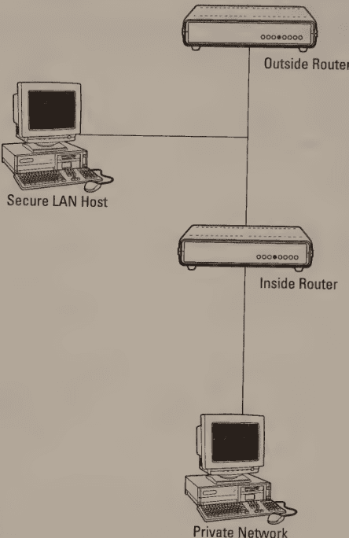

图 1-1：安全局域网配置。

### 掌握 TCP 和 UDP 服务

完成 Linux 安装并在安装任何其他软件之前，你需要删除不会使用的默认网络服务。默认情况下，新 Linux 安装上运行的服务提供安装包创建者认为的常用服务。由于你的系统将提供 Web 服务（如果可能，则独占），并且可能直接连接到互联网，因此你需要删除许多默认服务。任何服务都可能为不道德的远程用户提供进入你系统的潜在途径。如果某服务对网络用户可用并且正在运行，你应将其视为潜在弱点。尽管测试和识别 Linux 系统缺陷花费了许多小时，但测试无法发现一切。不过，你可以通过删除不需要的服务来最大限度地减少潜在威胁。

### Inetd

在大多数当前版本的 Linux（包括 Red Hat、Mandrake 和 SuSE）中，识别和控制服务（尤其是网络服务）都相当简单。在 /etc 目录中，你会找到一个名为 inetd.conf 的文件。该文件在系统启动时用于加载大部分系统网络服务。inetd “超级服务器”在服务请求和可用服务之间充当交通警察，而不是让大量活动进程监听网络连接，从而更高效地利用系统资源。基本上，inetd 是一个监听与 TCP 和 UDP 连接相关的请求的服务器服务。然后，任何服务请求都会传递给适当的服务（如果可用）。如果没有可用服务，则丢弃该请求。例如，如果 Linux 服务器正在为数百名用户允许 Web 和 FTP 连接，inetd 会为每个单独的连接创建会话，而不是让 ftpd 或 httpd 进程的大量实例一直空闲等待用户连接。这为其他用途释放了内存和 CPU 时间。

inetd 进程依赖于相应的 conf 文件来确定哪些进程可供使用。图 1-2 显示了一个 inetd.conf 文件示例。

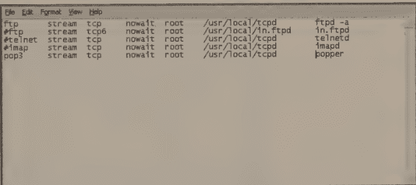

inetd 文件中的内容因你使用的发行版而异，但控制它的方式在大多数发行版中是相同的。你可以使用选择的文本编辑器打开该文件，并根据需要添加或删除条目。例如，inetd 服务器会忽略包含 # 符号的任何行。使用 # 符号也称为“注释掉”随后的代码。

“注释掉”允许你在不删除配置的情况下禁用启动服务。如果你有一个仅偶尔使用且希望手动启动而非随系统启动的服务，这很有用。你也可以通过插入 # 符号并重启 inetd 来临时禁用某项服务。正如“注释掉”这一短语所暗示的，你还可以使用此


用于在文件中插入注释的符号。例如，你可能想要记录添加或删除某个条目的原因。重新启动 inetd 的过程在不同发行版中有所不同，但通常，你可以进入存储 inetd 的目录（Red Hat 上为 /etc/rc.d/inet.d）并输入 `inetd restart` 命令。你需要以 root 身份或拥有 root 权限运行此命令。如果此命令在你的发行版中不起作用，请搜索该产品的支持信息，查找重新启动 inetd 进程的相关过程。

inetd.conf 文件为每个项目包含六个属性。从左到右的属性如图 1-2 所示：

- **服务名称：** 在示例中，第一行具有一个名为 ftp 的服务，表明它是 ftp 服务。服务名称取自 /etc/services 文件中的相应条目。
- **套接字类型：** 套接字类型可以是 stream 或 datagram。在大多数情况下，它是 stream。
- **协议类型：** 可以指定为 TCP 或 UDP。
- **wait/nowait 选项：** 此选项决定是为每个请求生成新进程（nowait），还是按顺序逐个处理每个请求（wait）。
- **用于执行服务的用户所拥有的权限：** 在示例中，用户是 root。
- **启动守护进程的命令路径：** 在示例中，路径是 /usr/local/tcpd。守护进程是一种在后台等待，直到被用户调用来实际执行操作的程序。

第七个字段是可选的。如果不需要指定任何执行参数，可以随意省略此字段。

许多 Linux 发行版包含用于配置启动服务的图形化工具。通常，这些配置小程序包含启动服务列表和相应的复选框。要禁用某个服务，只需取消勾选相应的复选框即可。在大多数情况下，你需要通过在终端窗口中使用命令手动关闭服务，或重新启动系统。有关特定可用工具的更多信息，请咨询你的桌面环境（KDE 或 Gnome）开发者。

### Xinetd

在许多当前发行版中，使用 xinetd 守护进程代替 inetd。从概念上讲，xinetd 所做的与 inetd 相同。然而，在大多数情况下，这种相似性只是表面的。配置文件的过程以及配置文件的构建方式截然不同。还有一些其他关键的操作差异。例如，任何用户都可以使用 xinetd 启动不需要特权端口的服务。之所以可能，是因为与 inetd 不同，xinetd 不要求其配置文件（xinet.d）中的服务也出现在 /etc/services 中。

下表中概述了关键增强功能（xinetd 具备而 inetd 不具备的功能）。

- 访问控制适用于多线程和单线程服务。
- Xinetd 会终止不再符合现有访问控制标准的服务，以及从 xinet.d 配置文件中移除的服务。
- 它可以对单个主机可生成的进程数量、特定服务可启动的服务器数量以及日志文件大小设置限制。这些可配置的限制在很大程度上有助于防止拒绝服务攻击，此类攻击试图通过过度利用可用资源来干扰系统。

如前所述，xinetd 服务的配置文件（/etc/xinetd.conf）与 inetd 使用的文件也显著不同。下面的示例（图 1-3）显示了 telnet、IMAP 和默认条目。单独来看，此配置并不完全有用；我之所以包含它，是因为它展示了 inetd 和 xinetd 布局之间的差异。

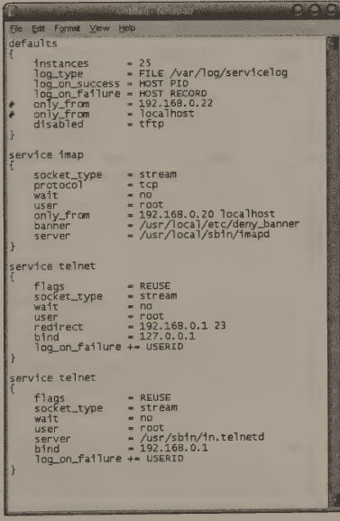

图 1-3：xinetd 配置文件示例。

如果要将 inet.d 配置文件转换为与 xinetd 兼容，可以使用几个转换工具中的一个。iotop 和 xconv.pl 都随 xinetd 的完整发行版一起提供，并且相对容易使用。有关指导，请查看此处的信息（在配置部分下）：www.linuxfocus.org/English/November2000/article175.shtml。

### 不共享：NFS/RPC

除非你急切地希望有人将你的 Linux 服务器变成技术等效的‘ Typhoid Mary’，否则请避免使用远程过程调用（RPC）和网络文件服务（NFS）。请记住，我讨论的是暴露在互联网上的 Linux 服务器。RPC 和 NFS 在专用网络上非常有用，但不应在风险系统上使用。这两项服务都旨在允许远程用户访问资源：

- RPC 允许在计算机之间共享处理资源。
- 使用 RPC 时，单个程序可以在集群式安排中集体使用多台计算机的资源。
- NFS 用于便利磁盘访问。拥有适当访问权限的远程用户可以挂载并访问 NFS 启用硬盘上的数据。

错误配置这些服务（尤其是 NFS）将轻易地创建巨大的漏洞。例如，配置错误的 NFS 实现会允许任何人挂载并访问 NFS 兼容驱动器上的数据。

portmapper 控制 NFS 和 RPC 的使用。portmapper 是另一个守护进程，通常位于 /etc/rc.d/rc.inet2，但位置可能因发行版而异。如果你不知道位置，可以尝试在 /etc 目录上运行 find 命令。例如，以下行可查找包含 map 的单词：

```
find /etc -name "*map*" -print | more
```

你可以将 *map* 参数替换为 *nfs*、*port* 或 *rpc*，以彻底扫描 /etc/rc.d 目录中 NFS 和 RPC 服务的启动位置。与其他配置文件一样，查找相关条目并在执行行前面放置 #，或者直接删除条目。在服务被禁用后，你需要重新启动系统以卸载它们。

如果你想远程访问服务器，Telnet 不是一个好选择，因为它没有保护连接客户端与服务器之间传递信息的系统。相反，你应该使用安全外壳协议（SSH）客户端-服务器实用程序。SSH 加密客户端和服务器之间传递的所有数据。不仅登录信息受到保护，传输的数据也受到保护。几乎所有现代 Linux 发行版都包含 SSH 实现，但如果没有，你可以下载它。要安装 SSH，你可以下载源代码，运行 ./configure 脚本，然后运行 make 和 make install 命令。有关 SSH 安装过程的更多信息，请参见 www.openssh.com。

### 误导性二进制文件（SUID/SGID 二进制文件）

除了网络服务之外，你 Linux 系统上的某些程序可能是真正的负担，因为它们需要 root 权限才能执行许多操作。某些程序使用一个专用位（设置在二进制文件本身上）——称为设置用户 ID（SUID）或设置组用户 ID（GUID）——以获得比可能运行程序或使用其服务的用户更多的权限。例如，如果用户想要发送电子邮件，他们需要使用诸如 Sendmail 之类的 SMTP 服务器的服务。然而，他们可能不拥有执行邮件服务器需要完成的所有任务所需的全部权限。为了执行所需的任务，Sendmail 通常会设置设置用户 ID 位以使用 root 账户权限。

任何使用 SUID/GUID 以提升权限运行的程序都是一种负担。如果恶意用户获得应用程序的控制权，该用户可能能够使用 SUID/GUID 设置提供的提升系统权限与系统交互。幸运的是，你可以轻松识别已配置为使用 SUID/GUID 功能的二进制文件。如果你检查二进制文件的文件属性，并在通常看到 r 或 x 的地方看到 s（例如 r-sr-xr-x），那么你就有一个正在使用 SUID/GUID 的二进制文件。那么，如何查找并在不需要时禁用这些二进制文件呢？最简单的方法是使用 find 命令搜索整个系统，并构建 SUID/GUID 启用的应用程序列表。下面是一个优雅的解决方案，它使用 find 命令并带有将输出转储到文本文件的选项：

```
find / \ (-perm -4000 -o -perm -2000 \ ) -exec ls -ldb {} \ ;
>> /tmp/suids
```

此命令在 /tmp 目录中创建名为 suids 的文本文件，包含所有使用 SUID/GUID 功能的二进制文件的信息。你可以查找并删除你知道不需要的任何二进制文件。如果你确定某些二进制文件可能很有用，你可以细化它们的访问规则（通过使用 CHMOD 命令），以便不是任何人都可以运行它们。如果剩余的某些二进制文件需要被授予 root 访问权限，这尤其有用。


以下是一些帮助你判断是否需要特定服务或程序的实用方法：

- 访问你的 Linux 发行版的主页并搜索该程序。
- 使用 Yahoo! 或 Google 等搜索引擎搜索“man program/service”。手册（man）页面通常会揭示关于程序/服务及其用途的大量信息。

## 使用防火墙进行防护

虽然 Linux 有许多第三方安全产品可用，包括防火墙，但操作系统本身也内置了一些实用功能。如果你的 Linux 系统位于其他防火墙之外，那么在系统上安装防火墙至关重要。例如，如果没有设置安全局域网的资源，而你搭建的 Linux 服务器连接到 Internet，则需要安装本地防火墙。即使你使用的是安全的局域网配置，额外的本地防火墙也能增加一道防线，以防入侵者攻陷你现有的路由器之一。

### Ipchains

Ipchains 是一种历史悠久的防火墙机制，适用于大多数使用内核版本 2.2.x 的 Linux 发行版。要开始使用，你需要启用 ipchains。如果你的系统使用内部 IP 地址 10.50.4.55，子网掩码为 255.255.255.0，则需要以 root 权限运行以下命令：

```
echo 1 > /proc/sys/net/ipv4/ip_forward
ipchains -A forward -j MASQ -s 10.50.4.0/24 -d 0.0.0.0/0
```

第一个命令启用 ip_forwarding，第二个命令配置服务器允许哪个网络访问 Internet。如果你希望在启动时加载 ipchains 服务，则需要将上述两个命令放入 /etc/rc.d/rc.local 文件中。防火墙运行后，可以使用 ipchains -L 命令查看已配置的 IP 过滤规则。初始情况下，显示内容不多。该命令的输出类似于图 1-4。

```
ipchains -A input -p icmp -i eth0 -j REJECT
```

下面逐一介绍此示例中的各个组件：

- `ipchains -A input` 部分表示你要向 ipchains `input` 链追加（A）一条新规则。除了 -A，还可以使用 -L 查看当前的 ipchains 规则，使用 -D 从链中删除一条规则。
- 选项 -p 指定你要为某个协议设置规则。
- icmp 是类型（与 -p 选项一起使用），在此示例中，它表示所有 ICMP 流量。
- eth0 是要应用规则的网络接口。
- -j REJECT 选项指定在接口处拒绝 ICMP 流量。结果是，eth0 接口上的任何入站 ICMP 流量都会被直接拒绝。

有关简化 ipchains 和其他防火墙配置的产品信息，请参见图书 I 第 3 章。本章仅简要介绍 ipchains 工具的功能。如果你想了解更多关于 ipchains 的信息，请访问 `www.rt.com/man/ipchains.8.html` 或在 Linux 服务器上输入 "man ipchains" 以查看几乎数不胜数的 ipchains 运行时选项。

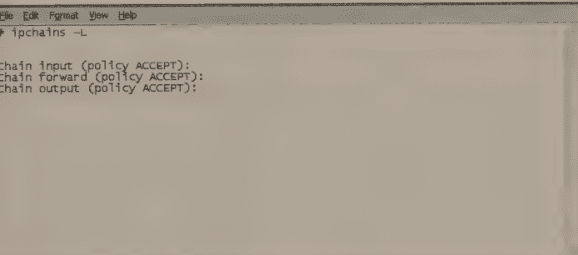

图 1-4：ipchains 规则配置示例。

### Iptables

在 Linux 系统上实现防火墙的另一种选择是使用 iptables。两者在功能上相似（都控制网络访问）；不过，iptables 相对于 ipchains 有几个优势。这些优势足够值得注意，因此如果你使用的是 2.4.x 或更新版本的内核（例如比 Red Hat 7.1 更新的任何版本），应该使用 iptables。以下是 iptables 与 ipchains 的一些不同之处。

- 与 ipchains 不同，iptables 使用单个链来处理过滤的数据包。因此，iptables 让你能更精细地控制所选的过滤选项。例如，由 ipchains 主机转发的数据包必须经过 input、forward 和 output 链才能到达目的地。而使用 iptables 的主机只需将数据包与 output 过滤器进行检查。如果主机使用 iptables，input 链上的冲突规则不会阻止数据包的转发。
- iptables 主机仅使用入站规则处理入站数据包，仅使用出站规则处理出站数据包。如果要为特定规则指定要使用的网络接口，必须在配置中使用相应的选项。`-i` 选项必须与入站或 forward 链一起使用，`-o` 选项必须与出站链一起使用。请记住，入站接口不会使用出站规则，出站接口不会使用入站规则。如果混用选项，规则将无法产生预期效果。
- 与 ipchains 不同，在 iptables 中，你必须在协议声明（ICMP、TCP 或 UDP）之后指定源端口或目标端口。在 ipchains 中顺序并不十分重要，但在 iptables 中，如果不使用正确的顺序，规则将无法按预期工作。

如你所料，配置文件（通常位于 /etc/sysconfig/iptables）也发生了相当大的变化。整体布局更清晰一些，如果使用注释，理解配置内容也相当简单。在图 1-5 中，配置首先设置一条规则，允许本地主机（运行 iptables）与 *本地主机* 之间传递任何流量。下一条目允许 ICMP 类型 3 流量通过。当转发数据到另一台主机的系统找不到目标主机时，会使用类型 3“目标不可达”消息。接下来，允许挂载和 NFS 连接。如果你需要通过网络连接到系统以发送数据（例如上传网页内容），这些可能是必不可少的；但如果你在本机上本地工作，则可以删除这些条目。本示例中的 mount 条目只有在转到 NFS 配置文件 /etc/rc.d/init.d/nfs 并将挂载服务分配给单个端口（本例中为 33333）时才有效。默认情况下，端口在系统启动时选择，范围在 32000 到 42000 之间。最后，配置文件允许端口 80 上的 http 流量通过。如果还需要使用 https，可以复制此最后条目，并将目标端口（dport）和源端口（sport）值更改为 443。

注意，图 1-4 中默认存在三条链。

我强烈建议你在将 ipchains 或 iptables 用于生产环境之前，先熟悉它们的语法和用法。很容易遗漏某些东西，导致系统暴露在风险之中。为需要允许进入和离开服务器的流量类型，以及需要阻止的服务和端口制定计划。有了清晰的计划，你的效果会好得多。要了解有关 ipchains 配置的更多信息，请查看 www.linux.org/docs/ldp/howto/IPCHAINS-HOWTO.html。如果你将使用 iptables，www.jollycom.ca/iptables-tutorial/iptables-tutorial.html 是一个非常好的常规信息和配置示例来源。

```
*mangle
COMMIT

*nat
COMMIT
### DEFAULT ALL CHAINS TO DROP ON FALLTHROUGH
#:INPUT DROP [0:0]
#:FORWARD DROP [0:0]
#:OUTPUT DROP [0:0]
### PASS ALL FROM LOCALHOST
[0:0] -A INPUT -i lo -j ACCEPT
[0:0] -A OUTPUT -o lo -j ACCEPT
### PASS ICMP TYPE 3 PACKETS, INPUT AND OUTPUT
[0:0] -A INPUT -p icmp --icmp-type 3 -j ACCEPT
[0:0] -A OUTPUT -p icmp --icmp-type 3 -j ACCEPT
### PASS NFS: 2049, INPUT AND OUTPUT, TCP AND UDP
[0:0] -A INPUT -p tcp -m tcp --dport 2049 -j ACCEPT
[0:0] -A INPUT -p udp -m udp --dport 2049 -j ACCEPT
[0:0] -A OUTPUT -p tcp -m tcp --sport 2049 -j ACCEPT
[0:0] -A OUTPUT -p udp -m udp --sport 2049 -j ACCEPT
### PASS MOUNTD AT 33333, INPUT AND OUTPUT, TCP AND UDP
[0:0] -A INPUT -p tcp -m tcp --dport 33333 -j ACCEPT
[0:0] -A INPUT -p udp -m udp --dport 33333 -j ACCEPT
[0:0] -A OUTPUT -p tcp -m tcp --sport 33333 -j ACCEPT
[0:0] -A OUTPUT -p udp -m udp --sport 33333 -j ACCEPT
### PASS HTTP AT 80, INPUT AND OUTPUT, TCP AND UDP
[0:0] -A INPUT -p tcp -m tcp --dport 80 -j ACCEPT
[0:0] -A INPUT -p tcp -m tcp --sport 80 -j ACCEPT
[0:0] -A OUTPUT -p tcp -m tcp --dport 80 -j ACCEPT
[0:0] -A OUTPUT -p tcp -m tcp --sport 80 -j ACCEPT
COMMIT
```

图 1-5：iptables 配置示例。

## 玩转游戏：IP 伪装

网络地址转换（NAT）用于将一组主机地址隐藏在单个公共地址后面。通常，NAT 用于允许多个私有主机使用单个公共 IP 地址访问 Internet。私有网络中共享该单个公共 IP 的每个人都会被有效地“掩盖”——因此得名 Masquerade——从 Internet 上看不见。单个主机可以使用私有 IP 地址（例如 192.168.1.22），并使用 NAT 通过一个在 Internet 上可路由的不同 IP 地址访问公共网络。这种配置的优势在于，拥有许多内部主机的组织只需为其所有资源使用一个公开知晓的 IP 地址。

要使用 IP 伪装，你需要一个已支持它的构建版本，或者可能需要重新编译内核才能使用 IP 伪装。大多数当前的 Linux 发行版都支持 IP 伪装。要检查你的系统，可以运行此命令：

```
uname -a
```

结果会显示你系统使用的内核版本。要使用 IP 伪装，你需要内核版本 2.0.x 或更高版本。在 Red Hat 发行版中，/etc/rc.d/rc.local 脚本内有一个条目，用于加载


/etc/rc.d/rc.firewall 脚本在系统启动期间运行。rc.firewall 脚本的目的是加载运行 IP Masquerade 所需的所有模块并处理其相关配置文件。此文件是你输入流量限制（规则集）的地方，如前一章中提到的 ipchains 和 iptables 示例。有许多示例 IP Masquerade 配置可用，包括 www.tldp.org/HOWTO/IP-Masquerade-HOWTO/，它可以帮助你让伪装配置运行起来。

## 跟上日志记录

虽然掌握系统上运行的服务并在可能时使用防火墙很重要，但全面的日志记录是确保系统保持安全的最有用方法之一。syslog 守护进程在 Linux 和 Unix 系统上用于便于日志记录。在大多数 Linux 安装中，全局配置文件控制 syslog 组件的行为。/etc/syslog.conf 文件将日志指令传递给 syslog 守护进程。大多数默认的 Linux 安装旨在平衡安全性和功能性，因此，默认的日志记录行为需要改进。

在 syslog.conf 文件中，你会发现如下形式的条目：

```
*.=info;*.=notice    /usr/log/notice.log
```

每个条目有三个要素：

- 第一个是日志信息的源，称为设施（facility），换句话说，应监控哪些进程以生成日志输出。* 用于指定“所有可用”日志源。
- * 后面的信息指定将捕获哪些类型的事件，称为优先级。例如，在 *.=notice 中，会监控所有日志源，但仅捕获 notice 优先级事件。
- 最后一个元素指定对日志信息做什么处理，在大多数情况下指定日志信息存储在何处。在示例中，日志输出存储在文件 /usr/log/notice.log 中。

将不同设施记录到不同日志文件中相当有用。虽然这会增加日志文件占用的磁盘空间，但可以更轻松地定位有关特定事件的信息。

几个你应该跟踪的设施可能默认不记录。要开始记录这些项目，需要在 syslog.conf 日志文件中创建一个新条目。表 1-1 显示了一些你应该使用的常见设施。

| 设施 | 用途 |
|---|---|
| Auth/Security | 记录与用户身份验证相关的信息。 |
| Authpriv | auth 的更详细版本。 |
| Cron | 记录 cron 守护进程的活动，用于调度事件。 |
| Daemon | 收集关于 *所有* 系统守护进程的信息。 |
| Mail | 跟踪邮件服务器活动。如果你在运行邮件服务器，这是必备项。 |
| Syslog | 关于 syslog 服务器本身的信息。 |

与这组设施一起，你需要了解可用的优先级。需要多少详细程度取决于你。请记住，如果发生问题且你没有足够信息来识别源，日志基本上就无用。但是，如果你在日志中收集每个事务和消息，可能几乎不可能找到有意义的信息。表 1-2 描述了可用的优先级。

| 优先级 | 用途 |
|---|---|
| Info | 记录常规信息消息 |
| Notice | 记录需要特殊交互的事件（即用户提示） |
| Warning | 系统警告，“可能是个问题” |
| Err | 系统错误，“发生了问题” |
| Crit | 严重状况，“发生了大问题” |
| Alert | 需要干预，“问题正在发生，需要帮助” |
| Emerg | 严重系统故障，“某些东西出问题了” |
| Panic | 系统恐慌，“巨大的问题” |
| Debug | 记录几乎所有内容 |

## 第 2 章：配置 Windows

### 本章内容

- 安装过程中的安全性
- 补丁和更新
- 使用 Microsoft 基线安全分析器

如果你决定将 Windows 操作系统用作 Web 服务器的主机，需要花些时间确保其安全。尽管媒体大量关注 Windows 操作系统的安全风险，但你需要关注几个普遍事实：

- 针对 Windows 的大多数严重安全相关事件（CodeRed、Sobig、MSBlast 等）发生在 *Microsoft 发布了移除被利用漏洞的补丁之后*。如果系统已安装补丁，则不会直接受该事件影响。因此，你需要至少每周检查一次可用的安全补丁，及时跟进。如果发现新的紧急补丁，请务必尽快安装。
- 针对 Windows 系统的许多常见攻击不需要特殊漏洞。通常，Windows 操作系统的默认设置非常不安全。通过普通网络访问和暴力破解密码工具，任何非法用户破解新安装的 Windows PC 的可能性都超过 50%。

幸运的是，你可以执行一些基本任务来修复大部分这些问题，并大大降低被攻击的风险。本章中，我将在所有示例中使用 Windows 2000 Server。这些策略和程序适用于任何其他版本的 Windows，但某些细节可能略有不同。

### 安装期间保护 Windows

为了使系统足够稳健以担任公开暴露的 Web 服务器，你需要从安装过程一开始就开始保护它。在操作系统安装期间，设置强管理员密码，并禁用你不打算使用的网络服务。

### 设置管理员密码

根据 SANS 研究所（www.sans.org）的说法，一个好密码（不仅限于管理员密码）应满足以下最低标准：

- 至少八位字母数字字符长
- 包含大写和小写字符（即 a–z、A–Z）
- 除了字母外，还包含数字和标点字符——即 0–9、!@#$%^&*()_+−=|{}[]:;”?><>,/
- 不使用任何语言、俚语、方言、行话等中的完整单词
- 不使用个人信息、家庭成员姓名等


创建好密码的一种方法是基于短语构建密码。例如，取短语“I like to eat pizza at the park”并应用前述规则。使用每个单词的首字母，你可能会得到密码 ill2eP@tP。通过使用短语然后进行某种模式替换，你可以创建既易记又有效的密码。

如果你遵循前面列表中的建议，你的密码几乎可以抵御依赖受害者使用字典单词的攻击。大多数密码破解工具都带有字典攻击组件。该工具获取一组字典的全部内容，并将所有单词用作特定用户名的密码。该攻击针对是字典单词的密码（如“procrastination”或“beautiful”）有效，即使你颠倒单词或仅在末尾或开头添加一个数字。例如，“beautiful”并不比原本的“beautiful”好多少。要了解某些密码使用得有多普遍，请查看 www.openwall.com/passwords/wordlists/common.txt。你是否在列表中看到任何旧密码？

### 禁用网络服务

为管理员账户设置强密码后，确保没有运行你不会用到的网络服务。

### 安装期间禁用服务

在安装过程的后期阶段，系统会提示你配置网络配置。如果你选择自定义这些设置，可以取消选择任何你不打算使用的服务。例如，如果你的服务器将仅作为 Apache、PHP 和 MySQL 的平台，那么除了 TCP/IP 本身之外，几乎可以取消其他所有内容。但是，这不会禁掉你想禁用的所有服务。安装完成后，你需要做一些额外工作。


管理共享默认存在于所有基于 Windows NT 的系统（Windows NT、Windows 2000、Windows XP 和 Windows Server 2003）上。这些共享旨在允许授权用户远程访问，但不应出现在单用途 Web 服务器上。要删除这些共享，可以使用 `net use driveletter /delete` 命令。例如，可以使用此命令：

```
net use c$ /delete
```

每个硬盘都有一个管理共享（C:\ = c$），还有两个特殊共享，即 ipc$ 和 admin$。由于在某些配置下这些共享会在启动时恢复，您可能需要创建一个包含所需 `net use` 命令条目的批处理文件，并将该批处理文件加载到系统启动组中。对于只有一个硬盘 C: 的系统，您需要输入以下行：

```
net share c$ /delete
net share admin$ /delete
net share ipc$ /delete
```

## 安装后禁用服务

完成系统安装并以具有管理员权限的用户身份登录到系统后（在系统连接到公共网络之前），您需要禁用大量服务。要访问并禁用服务，请执行以下步骤：

- 1. 在桌面上右键单击“我的电脑”图标。
- 2. 从出现的上下文菜单中选择“管理”。
  将出现 Microsoft Management Console (MMC) 窗口。
- 3. 找到“服务和应用程序”条目。单击其旁边的 + 符号以展开菜单，如图 2-1 所示。
- 4. 查找并单击“服务”条目。
  MMC 窗口右侧列出了系统当前运行的服务。
- 5. 右键单击列出的服务，并从出现的上下文菜单中选择“属性”选项。
  将出现属性窗口的“常规”选项卡，如图 2-2 所示。
- 6. 从“启动类型”下拉列表中选择“已禁用”。
  该服务现已禁用。

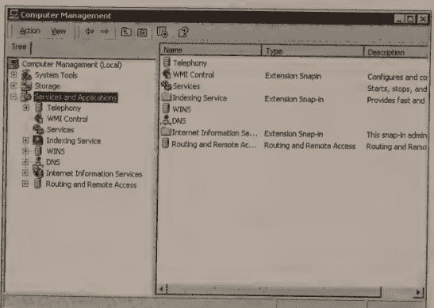

### 图 2-1: 计算机管理“服务和应用程序”控制台。

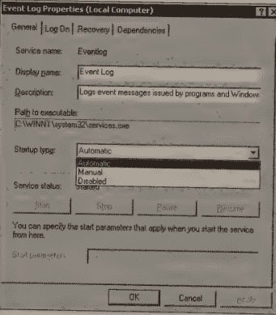

### 图 2-2: 服务属性表：“常规”选项卡。

在服务的属性窗口的“常规”选项卡上，您也可以停止、启动、暂停或恢复服务。“常规”选项卡上的功能可让您在此阶段完成大部分所需操作。您需要知道的另外两个选项卡是“登录”（见图 2-3）和“依赖项”（见图 2-4）：

- “登录”：这有点类似于 Linux 下用于配置二进制文件运行方式的 SUID/GUID 选项，“登录”属性允许您控制服务拥有的权限。例如，如果服务以 SYSTEM 帐户运行，它几乎可以访问任何内容。如果黑客攻破了该服务，他们很可能随后可以执行任意代码，从而做各种可怕的事情。

虽然其中许多服务如果没有高级别访问权限就无法正常工作（或根本无法工作），但您可以使用“登录”选项卡修改其权限，试图对其加以限制。这个过程是试错法。最佳方法是分配相关的用户凭据，然后尝试重新启动服务。如果它能工作，您可能就成功了，但您需要启动一个使用该服务的进程以确保这一点。如果出现错误，请将“登录”设置改回默认值，然后尝试另一种策略。

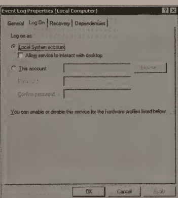

### 图 2-3: 服务属性表：“登录”选项卡。

- “依赖项”：在此选项卡上，您可以找到依赖于当前服务的服务，以及该服务所依赖的服务。例如，如果您想要禁用“事件日志”（见图 2-4），您会发现“事件日志”不依赖任何其他服务。这意味着您可以禁用任何服务而不影响“事件日志”。但是，有几项服务需要“事件日志”才能工作。例如，如果禁用“事件日志”，文件复制服务将不再工作。

对于您想要禁用的每个服务，请确保不会无意中损坏您需要的服务。您还应该注意，可以将服务设置为手动启动，而不是自动或禁用。如果您不确定某个应用程序是否需要它，此设置很有用。如果应用程序确实需要该服务，它将能够启动该服务。

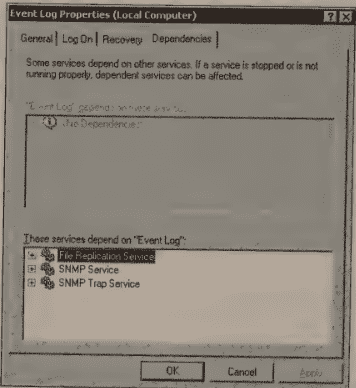

### 图 2-4: 服务属性表：“依赖项”选项卡。

## 决定禁用哪些服务

那么哪些服务是您可以没有的呢？在 Web 服务器上，以下服务可以安全地停止和禁用。Microsoft 对非服务器操作系统允许的外部用户连接数有限制，通常为十个用户。由于您可能希望服务器上同时有超过十个用户，因此以下列表侧重于运行 Windows 2000 Server 且安装了 Service Pack 4 的服务。您应禁用以下服务：

- Alerter
- Application Layer Gateway Service
- Automatic Updates
- ClipBook
- COM+ Event System
- COM+ System Application
- Computer Browser
- DHCP Client
- Distributed Link Tracking Client
- Distributed Transaction Coordinator
- Fax Service
- FTP Publishing Service
- IIS Admin
- Indexing Service
- IPSEC Services
- Logical Disk Manager
- Logical Disk Manager Administrative Service
- Messenger
- Net Login
- NetMeeting Remote Desktop Sharing
- Network DDE
- Network DDE DSDM
- Network Location Awareness (NLA)
- NT LM Security Support Provider
- Performance Logs and Alerts
- QoS RSVP
- Remote Procedure Call (RPC) Locator
- Remote Registry Service
- Routing and Remote Access
- Smart Card
- Smart Card Helper
- TCP/IP NetBIOS Helper Service
- Telephony
- Telnet
- Uninterruptible Power Supply
- Wireless Configuration
- World Wide Web Publishing Service

## 跟上补丁和更新

由于 Windows（以及几乎所有其他操作系统）会定期出现新问题，您需要制定系统更新计划。起点是 Microsoft Windows Update 网站 windowsupdate.microsoft.com。进入该网站后，您可能需要与几个安全弹出窗口进行交互。如果在弹出窗口中单击“确定”选项，您最终会看到一个选项（绿色链接），上面写着“扫描更新”，如图 2-5 所示。单击此选项以启动扫描过程。

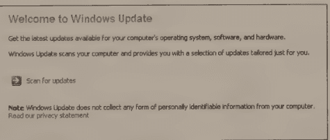

### 图 2-5: “扫描更新”屏幕。

系统扫描完成后，可能会识别出三类更新：

- **关键更新和服务包：** 无论计算机如何使用，都应安装所有关键更新和服务包。例如，几个高知名度的蠕虫利用了在实际蠕虫被创建和发布前数月或数年就已识别并解决（通过可用补丁）的漏洞。防止感染所需的所有文件均可在 Windows Update 网站上找到。通常，您需要下载并安装列为“关键”的所有更新。其他更新应被视为完全可选。下面简要介绍另外两种更新类型。
- **常规更新：** 这些更新会添加某种功能，但不会纠正关键系统问题。
- **驱动程序更新：** 一般来说，如果您没有与驱动程序相关的问题，应避免这些驱动程序更新。如果系统上有一个未经 Microsoft 认证的较新驱动程序，驱动程序选项仍会建议替换您的驱动程序；结果可能是 Windows Update 网站最终会降级您的驱动程序。

如果您想制作一个不要求待更新系统联机的更新包，可以单独收集更新并将其放在 CD-R 或您偏好的任何介质上以备后用。要收集单独的更新，请访问 www.microsoft.com/downloads 并单击左侧目录中的“Windows (安全性与更新)”链接。将出现各种文件，包括关键更新和服务包。选择所需的项目，下载它们，即可开始。如果在系统离线时需要安装关键补丁，此方法特别有用。

## 使用 MBSA 进行分析

作为确保系统尽可能安全的最后一步，您可以使用 Microsoft 基线安全分析器 (MBSA)。此工具为用户提供了一种识别常见配置问题的方法。MBSA 工具的当前版本是 1.1.1。此版本包含使用标准图形界面以及命令行版本的选项。这种安排的好处之一是该工具在本地易于使用，并且可以通过批处理脚本实现自动化。

该工具与用作主机的 Windows 2000、Windows XP 和 Windows Server 2003 系统兼容。MBSA 将扫描以下系统类型，查找需要修补的项目和配置弱点：Windows NT 4.0、Windows 2000、Windows XP 和 Windows Server 2003。MBSA 还将扫描许多服务和辅助应用程序，包括 Internet Information Server (IIS) 4.0 和 5.0、SQL Server 7.0 和 2000、Internet Explorer 以及 Office 2000 和 2002，以查找未修补的组件。HFNetChk 工具（以前是一个独立的工具）用于扫描辅助应用程序和服务中缺失的更新。除了识别所需的系统更新外，当一次扫描一组系统时，MBSA 工具还会为每个扫描的系统创建一个报告。


## 防火墙后的 Windows

好吧，你已经对 Windows 打上了所有补丁并禁用了非必要服务。现在你安全了吗？不幸的是，答案介于“可能不安全”和“即使安全，也不会安全太久”之间。任何提供广泛最终用户服务的操作系统都不应直接连接到互联网。这包括 Windows、Linux、Unix 和 NetWare 等。除了打补丁、加固和限制运行的服务外，你还应该使用硬件防火墙。防火墙是作为你的网络或服务器的安全代理的硬件或软件。防火墙物理上位于你的受保护系统（例如 Web 服务器）和任何不安全的网络（例如互联网）之间。所有发往你 Web 服务器的数据首先必须经过你的防火墙。尽管功能因制造商和型号而异，但防火墙可以配置为拒绝某些类型的连接、阻止来自拒绝服务攻击的流量，并记录可疑活动。

防火墙的成本和易用性差异很大。如果你要保护的是一个小型网络或单台主机，不一定需要为防火墙花费大量资金。但是，有些功能应被视为必需。下面的列表概述了你的防火墙需要具备的最低功能。其他功能，例如 DHCP 和虚拟专用网络（VPN）托管服务，根据你的网络布局可能很有用，但它们不是必需的。

- 有状态数据包检测
- 拒绝服务（DoS）防护
- 可配置的端口转发
- 易于配置的管理界面

有状态数据包检测涉及对来自互联网的进入防火墙的数据流量进行检查。它旨在防止一种称为欺骗的攻击，其中外部用户试图让防火墙相信本地主机实际上位于互联网上。成功的欺骗允许外部用户绕过路由器提供的安全性。使用防火墙时，会检查入站流量，看它是否是响应内部主机发出的请求。如果是，则流量被转发。如果流量不合法，则被丢弃。

防火墙提供的拒绝服务防护有多种形式。拒绝服务攻击通常涉及向主机发送大量流量或畸形数据。其目的是导致主机（路由器或防火墙）过载以至于停止转发流量。因此，该攻击剥夺了依赖路由器/防火墙进行网络访问的用户使用其服务的能力。因此得名拒绝服务。

防火墙防止攻击的方法通常涉及阻止或忽略来自某个主机或一组主机的流量。这非常有效。在防火墙停止处理来自攻击主机的流量后，发生长时间服务中断的可能性非常小。

端口转发仅在你打算允许来自互联网的入站连接时才是必需的。*入站连接*发生在基于互联网的用户访问你网络上的某个资源时。一个相关示例是你的 Web 服务器。为了允许用户访问你的内部 Web 服务器，必须将防火墙配置为将 Web 流量（在 TCP 端口 80 上）转发到你 Web 服务器的内部 IP 地址。

购买防火墙时，请务必彻底研究该设备。你可能会希望超出上述基本项目的功能。制定一份你认为必需的功能列表。阅读产品文档并选择最符合你需求的设备。外面有很多优秀的防火墙生产商。下面的列表概述了一些最流行的厂商。

- Cisco Systems: www.cisco.com
- Netgear: www.netgear.com
- Sonic Wall: www.sonicwall.com
- Nokia: www.nokia.com
- 3Com: www.3com.com

## 第 3 章：增强安全性的十个第三方软件包

### 本章内容

- Bastille 强化系统
- LIDS
- Guarddog
- Firestarter
- WinRoute
- ZoneAlarm
- SNORT
- ACID
- Pandora
- Nessus

在保护服务器的过程中，你不需要仅依赖随操作系统附带的工具。许多第三方供应商生产安全增强型产品。在 Linux 社区中，这些工具不仅功能强大，而且通常几乎没有或没有零售成本。本章将介绍十款出色的产品，旨在帮助你保持系统安全。

### 使用 Bastille 进行系统加固

被称为 Bastille 强化系统的程序用于对受支持的操作系统进行系统性加固。该工具目前支持多种 Linux 发行版，包括 Red Hat、Debian、Mandrake、SuSE 和 Turbo Linux，以及 HP-UX 和 Mac OS X 等其他操作系统。本质上，Bastille 是一系列脚本的集合，执行时会删除大量已知的配置弱点。这些脚本由各自领域的专家开发者团队构建。这些脚本旨在重新配置其运行的系统。除了个人专家输入外，还使用公认的行业指南，例如 SANS 研究所关于保护 Linux 的建议。

访问 www.bastille-linux.org 下载适用于你操作系统的安装程序，例如适用于 Red Hat 的 RPM 包以及 perl-TK 或 perl-Curses 包。要运行脚本，只需在终端窗口中输入 bastille。加固脚本随后执行，并引导你完成系统加固过程。

### 使用 LIDS 进行 Linux 入侵检测

Linux 入侵检测系统（LIDS）是一组更新 Linux 内核安全选项的组件。访问规则已到位，用于控制内核的默认能力。这些访问选项将访问控制能力扩展到甚至可以限制 root 访问各种系统资源的级别。此外，LIDS 扩展了系统功能，使其能够控制整个系统以及某些网络和文件系统安全功能。LIDS 开发者将其宣传为“Linux 系统中的保护、检测和响应”。你可以使用 LIDS 规则来定义跟踪哪些事件，LIDS 应如何响应网络入侵尝试等等。以下列表概述了 LIDS 的一些关键功能：

- 它允许以这样的方式配置文件访问，以至于即使 root 也无法更改文件。
- 它可以保护进程不被杀死。
- 它允许你限制原始 I/O 操作，保护硬盘，并保护主引导记录。
- 当你的启用了 LIDS 的系统成为端口扫描目标时，LIDS 可以检测到它并向负责维护系统的用户发送警报。对定义规则的任何违反也可以被记录并生成警报。
- 当有人违反规则时，LIDS 可以将关于违规操作的详细消息记录到系统日志文件或你的 syslog 服务器中，其中任何一个都可能受到 LIDS 的保护。
- 同样，作为对规则违反的响应，LIDS 可以通知管理员，甚至可以终止违规的会话/连接。

有关 LIDS 的更多信息，包括使用和配置，请查看 www.lids.org/。

### 使用 Guarddog 轻松入门

Guarddog 是一个基于 KDE 的图形防火墙配置实用程序，可帮助简化配置 Linux 防火墙的过程。该产品旨在帮助初学者，也可以让更高级用户免于处理复杂脚本和 ipchains 配置的麻烦。除了易于设置外，Guarddog 还让你能够不断调整和优化防火墙。与初始设置一样，使用了易于导航的图形工具。以下是 Guarddog 的一些关键功能：

- 它使你能够将主机/网络划分为区域。如果需要，不同区域可以有不同的安全策略。例如，一个区域可能包含用于公共访问且具有非敏感信息（安全需求最低）的计算机，而另一个区域可能包含关键任务服务器（安全需求最高）。
- 它支持大量网络协议，包括 FTP、SSH、Telnet、SMTP、DNS、HTTP、HTTPS 和 POP。
- 它允许你在以后添加默认配置不支持的任何协议。
- 它与本地路由器配置配合使用（如果你的系统正在执行路由）。
- 它运行在 KDE 2 或 3 以及 Linux 2.2 和 2.4 系列内核上。
- 它与 iptables 功能配合使用，包括连接跟踪和限速日志记录。
- 它使你能够导入/导出防火墙脚本。
- 它使用默认的安全配置，拒绝所有未明确允许的活动。

有关 Guarddog 的更多信息，请查看 www.simsonzone.com/software/guarddog/。

### 使用 Firestarter 掌控防火墙

另一个用于配置 Linux 防火墙的图形工具是 Firestarter。该工具使用 GTK+/GNOME。产品开发者将 Firestarter 吹捧为一种使用 GNOME 配置 Linux 防火墙的用户友好方式。与 Guarddog 相比，Firestarter 似乎功能略显丰富。对于许多用户，特别是对特定桌面环境比较熟悉的初学者来说，最佳选择是选择适用于其配置的 GUI 配置工具。以下列表突出了 Firestarter 一些最有趣和最有用的功能：

- 它提供配置向导，使程序能够以对初学者和专家都有用的方式工作。
- 它提供多语言支持。
- 它附带预定义的规则集，以及添加你自己的访问和监控规则的工具。


- 附带一份已知网络漏洞利用和各种恶意软件签名的列表。恶意软件是“Malicious Software”的缩写。恶意软件通常包括蠕虫、特洛伊木马、病毒、后门实用程序以及任何其他用于恶意活动的工具。
- 启用精细服务控制，也就是说，你能够控制即使是最详细的设置。
- 附带可用于防止某些拒绝服务（DoS）攻击的 ICMP 工具。
- 提供服务类型（ToS）支持。
- 提供功能齐全的网络地址转换（NAT）和 IP 端口转发功能。
- 提供用户可配置的高级内核调优功能。
- 与 glibc 的 sysctl 调优配合使用，以增强系统可靠性并保护防火墙免受泛洪、广播和 IP 欺骗的影响。
- 支持 Linux 内核 2.2、2.4 和 2.5。

关于下载、安装 HOWTO 和大量其他信息，请访问 firestarter.sourceforge.net。

### WinRoute 防火墙

如果你使用 Microsoft Windows 系列操作系统来托管网络应用程序，则需要第三方防火墙。特别是，如果系统将由来自互联网的用户访问，那么保护服务器防火墙尤其重要。Kerio 的 WinRoute 防火墙产品 (www.kerio.com/kwf_home.html) 是目前可用的性价比较高（但功能齐全）的防火墙产品之一。此应用程序易于安装、配置和维护。

以下是 WinRoute 防火墙软件包的一些主要功能：

- 它提供完整的路由功能。
- 有状态数据包检测可应用于入站和出站流量。
- 它具有一个网络规则向导，可让配置防火墙变得轻松。
- 提供防病毒功能。WinRoute 防火墙可以扫描入站和出站 HTTP 和 FTP 流量中的病毒。
- 它通过其 NAT 防火墙支持 VPN。如果你需要远程管理服务器，这特别有用，因为它提供加密访问。

### ZoneAlarm

ZoneAlarm 是一款功能强大的 Windows 软件防火墙。对私人和非营利用户免费，企业用户需支付适度费用。ZoneAlarm 执行大多数防火墙的相同功能（有状态数据包检测、过滤等），但具有一个与大多数防火墙略有不同的安全向导。安装时选择高安全级别时，系统会提示你允许或拒绝主机看到的所有出站流量。例如，如果某个进程尝试访问远程主机上的 DNS 服务，将弹出一个窗口询问你是否允许此流量通过。你可以选择仅在此特定实例中允许其通过，也可以告诉 ZoneAlarm 始终允许其通过。

任何入站连接均被阻止。你必须使用配置向导来允许所需的任何入站连接（例如 http 或端口 80）。你可以交互式地“训练”防火墙来处理你的流量。如果你选择另一个安全级别（较低），防火墙默认允许更多流量通过。有关 ZoneAlarm 的更多信息，请访问 Zone Labs 网站 www.zonelabs.com。

### Snort

在软件入侵检测系统（IDS）领域，Snort 是最有用的产品之一。除了作为性能出色的软件包外，Snort 还是一个免费提供的开源 IDS。凭借相对较低的硬件要求，Snort 可以实时监控访问并执行流量分析。Snort 在识别或阻止广泛的网络入侵和攻击方面非常有效，包括以下内容：

- 缓冲区溢出
- 隐蔽端口扫描
- CGI 攻击
- SMB 探测
- 操作系统指纹识别尝试
- 暴力破解工具

底层检测引擎和规则语言使 Snort 如此高效。使用包含的语言，你可以指定哪些类型的流量应允许通过你的网络或在其周围通过，以及当 Snort 遇到禁止的活动时应采取什么措施。你可以将大部分 Snort 的输出放到 syslog 服务器上，以便随后手动检查。或者，在 syslog 服务器上使用类似 ACID（下一节将介绍）的工具，Snort 可以提供动态警报和报告。虽然让 Snort 启动并运行可能是一项复杂的任务，但 Snort 网站 www.snort.org 上提供了大量有用的实现指南。

### ACID

ACID（入侵数据库分析控制台）是一组 PHP 代码，用于驱动搜索安全日志和安全数据库的引擎。例如，你可以使用 ACID 为 syslog 等程序使用的数据库提供报告，但你也可以访问广泛的安全记录。ACID 使你能够快速进行查询并以图形方式查看结果，而无需插入多个文本驱动的查询或手动扫描文件。你还可以配置 ACID 根据其数据分析生成警报。例如，如果它发现某些类型的活动记录（例如你的网络上运行的 Nessus；本章后面将介绍“使用 Nessus 入门”），它可以在查询中突出显示结果，或通过电子邮件生成管理警报。

如果你关心有意义的报告，ACID 是不可或缺的工具。你可以在多个位置找到 ACID，包括 sourceforge.net/projects/acidlab。尽管有关 ACID 使用的文档质量有时有些零散，但网站 www.andrew.cmu.edu/~rdanyliw/snort/acid_config.html 提供了使用 Snort 的良好常规参考。

### 打开黑盒：Pandora

Pandora 是一款功能强大的网络安全审计工具。有些人可能会称其为黑客工具，但这取决于你的视角。无论如何，它被宣传为审计工具。

Pandora 基于长长的多操作系统漏洞和入侵技术列表，来测试你的网络是否存在弱点。它主要是一款 NetWare 审计工具（就密码破解和直接服务器扫描而言），Linux 支持预计很快将推出。在此期间，无论使用哪种服务器平台，网络攻击工具都可用于测试。Pandora 的一些值得注意的功能包括：

- 提供密码破解功能。
- 可用作浏览器以访问所有 NDS（NetWare）对象。使你能够枚举共享、用户、组等等。
- 可以仅使用密码哈希连接到服务器（如果你不想破解它们）。
- 可以收集服务器信息。识别 IP 欺骗漏洞。
- 可以发起拒绝服务攻击。

有关安装二进制文件、源代码、文档等，请访问开发网站 www.nmrc.org/pandora/。

### 使用 Nessus 入门


首先，除非所有人（即老板）都知道你在做什么，否则不要在网络上下载和使用此工具。如果你使用其所有功能，此工具可能会导致服务器崩溃。几乎可以肯定的是，任何像样的 IDS 系统一旦你开始运行此工具就会疯狂报警，因为 Nessus 既可用于善事也可用于恶事。

Nessus 可能是目前最好的安全审计工具。用一句陈词滥调来说，“它就是那么棒，再加一桶炸鸡。” Nessus 做了许多安全扫描器不做的事情：它试图避免对你的网络配置做出假设。例如，如果 FTP 之类的服务运行在 21 端口以外的端口上（例如 3728），Nessus 会找到它并对其进行测试。没有什么是完美的，某个地方可能会有遗漏。然而，Nessus 是在最大数量的网络中发现漏洞的最佳工具之一。以下是 Nessus 的一些主要功能：

- Nessus 支持通过插件进行扩展。每个插件包含有关已知弱点、新攻击类型等的信息，因此用于测试网络的向量库保持最新和强大（只要你在插件开发时安装新插件）。

- 它支持多线程，以便一次分析大量主机和设备。唯一的限制是 CPU 算力。

- 关系多主机测试用于探测不仅单个系统，而且其所有相关网络主机。例如，域中的所有主机、IP 子网或当前通过 RPC 连接的系统也会被探测。此测试可以识别危及特定主机的间接方式。

- 报告系统相对易于使用。Nessus 使用图形界面显示已扫描网络中发现的漏洞。

有关更多信息、下载和产品演示，请访问 Nessus 主页 www.nessus.org/。


# 第 II 册

## 构建 Apache 网站

第 5 波，Rich Tennant 著


> “我的网站应该多大程度准确反映我的营业场所？”

## 目录速览

- 第 1 章：介绍 Apache Web 服务器 ....................................43
- 第 2 章：安装 Apache ............................................................51
- 第 3 章：配置 Apache ...........................................................67
- 第 4 章：Apache 模块 .................................................................87
- 第 5 章：十条安全提示................................................................93

## 第 1 章：介绍 Apache Web 服务器

### 本章内容

- 了解 Apache 的工作原理
- 介绍 HTTP 协议
- 考察 URL 的各个部分
- 探索 Apache 架构

Apache 是一个开源 Web 服务器。Web 服务器会将网站上的文件传送给想要查看网页的访问者。本章将向你展示 Apache 的基础知识，包括它为何受欢迎以及其工作原理。

### 使用 Apache Web 服务器的优势

Apache 是万维网上最流行的 Web 服务器。根据 www.netcraft.com/survey 和 www.securityspace.com/s_survey/data/ 上的调查，互联网上大约有 60% 的网站使用 Apache。以下列表列出了使用 Apache 的一些优势：

- 它是免费的。就像本书中的其他开源软件一样，Apache 是免费的。
- 它可以运行在多种操作系统上。Apache 可以运行在 Windows、Linux、Mac OS、FreeBSD 以及大多数 Unix 变体上。
- 它很流行。超过一半的网站都使用 Apache。如果它工作不佳，这不可能成立。此外，这意味着关于 Apache 的大量信息可在网上找到，而且许多 Apache 用户可以提供帮助。
- 它很可靠。Apache 启动并运行后，应当与你的电脑运行一样持久。Apache 出现紧急问题的情况很少。
- 它可定制。开源许可证允许程序员修改 Apache 软件，根据需要添加或修改模块以适应自己的环境。
- 它很安全。有免费软件可与 Apache 一起运行，将其构建为安全的 SSL 服务器。如果你使用网站进行电子商务，安全是一个关键问题。

### 了解 Apache 的工作原理

Apache Web 服务器是为你的网站提供动力的引擎。它处理信息请求，并将信息发送给请求者。Apache 用于向世界交付网页的过程如下：

- 用户在浏览器中输入你网站上某个网页的 URL。
- 浏览器通过互联网发送请求，请求 URL 中指定的文件。
- 你的网站上的 Apache 接收来自浏览器的请求。
- Apache 在你的网站上查找 URL 中指定的文件。
- 如果 Apache 找到了请求的文件，它会将文件发送到请求它的浏览器。如果 Apache 找不到文件，或出于某些原因无法发送，它会向浏览器发送一个数字错误代码。
- 浏览器将从 Apache 接收到的信息解释为 HTML，并在浏览器窗口中显示生成的网页。如果接收到的信息是错误代码，浏览器会显示与该错误代码关联的消息。

### Apache 与浏览器之间的通信

Apache 和 Web 浏览器使用超文本传输协议（通常称为 HTTP）进行通信。HTTP 是 Apache 和浏览器都能理解的一种语言，用于在它们之间传输信息。HTTP 消息在 HTTP 标头中发送，这是通信中发送的第一条消息。

Apache 与浏览器之间的通信采用请求/响应格式进行：浏览器在 HTTP 标头中发送请求消息，Apache 进行响应。例如，当浏览器通过互联网请求某个文件时，会发送一个包含类似以下 HTTP 消息的 HTTP 标头：

```
GET /productInfo.html HTTP/1.1
Host: www.myfinecompany.com
```

在此示例中，GET 请求标头请求 productInfo.html 文件。GET 标头还包含正在使用的 HTTP 版本——在此示例中为版本 1.1。第二行告诉 Apache，该文件位于域名为 www.myfinecompany.com 的计算机上。

你的 Apache 服务器会将其接收到的所有请求都存储在日志文件中。你可以查看日志，了解发送到你服务器的请求。Apache 日志文件将在第 II 册，第 3 章中更详细地讨论。

当 Apache 接收到请求标头时，它会查找指定的文件。然后，它会根据是否成功查找并将文件发送给请求者，发送一个 HTTP 响应。

如果请求不成功，HTTP 消息类似于以下内容：

```
HTTP/1.1 404 Not found
```

此消息显示 HTTP 版本和状态，状态由一个数字错误代码和一段描述请求失败原因的简短语句组成。请求不成功的另一条常见消息如下：

```
HTTP/1.1 403 Forbidden
```

此消息表示已找到文件，但请求者无权访问它。

如果请求成功，第一行是状态消息，如下所示：

```
HTTP/1.1 200 OK
```

除了状态信息外，HTTP 消息还包含以下数据：

- 关于正在发送的文件的信息。此信息可能包括日期、文件类型、服务器名称以及特定于单个 Apache 设置的信息。
- 所请求文件的内容。这是 HTTP 消息的最后一个元素。

### 接收请求

Apache 负责响应对网页文件的请求。它始终在你的网站上运行，安静地待在后台，监听请求。Apache 的工作是将网站上的文件发送给请求它们的用户。

Apache 根据请求中指定的 URL（统一资源定位符）识别请求并接受它们。URL 是万维网上的一个地址，每个网页都有一个唯一的 URL。Apache 识别网站的 URL 并接受发送到其安装所在网站的请求。

URL 的格式如下：

```
http://servername:portnumber/path
```

以下是构成 URL 的各个部分的详细说明：

- http://：这指定了 HTTP 协议，即本书主要讨论的协议。其他协议包括 FTP 和 HTTPS。FTP 告诉服务器使用 FTP 而非 HTTP 下载文件。HTTPS 告诉 Apache 使用 SSL（安全服务器协议）访问文件；SSL 将在第 II 册，第 4 章中讨论。如果 URL 中省略了此部分，Apache 将假定协议为 HTTP。
- servername：这告诉 Apache 网站所在计算机的名称。URL 的此部分是必需的。你可以只使用 servername 访问许多网站。例如，你可以只使用 amazon.com 和 google.com 分别作为 URL 来访问 Amazon 和 Google 网站。
- :portnumber：Apache 在计算机的特定端口上与互联网交换信息。大多数情况下，Apache 设置为通过端口 80 进行通信。如果未指定端口号，则假定为端口 80。

在某些不寻常的情况下，Web 服务器可能会使用不同的端口号，这种情况下必须指定端口号。使用不同端口号的最常见原因是在另一个端口（例如 8080）上设置测试网站，该网站仅对开发者和测试人员可用，不对客户开放。当网站准备好面向客户时，它将在端口 80 上提供。

- path：这是文件的路径，遵循网站所在计算机上任何路径的规则。路径的根是主网站目录。例如，productInfo.html 是 URL www.myfinecompany.com/productInfo.html 中的路径部分。

### 定位请求的文件

Apache 接受请求后，会尝试定位请求的网页文件并将其发送给用户。Apache 被配置为在特定目录（有时称为其 Web 空间）中查找网页文件。该目录在 Apache 配置文件中指定为 DOCUMENTROOT。Apache 配置文件将在第 II 册，第 3 章中讨论。


网页文件的默认位置位于 htdocs 子目录中，该子目录位于安装 Apache 的目录中。可以从 htdocs 或 htdocs 的任何子目录访问网页文件。可以通过更改 Apache 配置文件中 DOCUMENTROOT 的值来更改 Apache 查找网页文件的位置。某些 Linux 发行版将文档根目录设置为不同的位置。例如，Red Hat 将文档根目录设置为 /var/www/html。

如果 URL 指定的是目录而不是文件，Apache 会在指定目录中查找默认文件。默认文件名在 Apache 配置文件中设置。通常，默认文件名为 index.html，但你可以通过编辑 Apache 配置文件中 DirectoryIndex 的值来设置任何想要的名称。

如果 Apache 在 URL 指定的目录中找不到默认名称的文件，它可能会显示该目录中的文件列表。这是一个严重的安全隐患；你不希望访问你网站的访问者看到所有文件并能够访问它们。你可以通过更改配置文件中的设置（在第 II 册，第 3 章中讨论）来控制 Apache 是否显示目录中的文件列表。请查找以下设置：

```
Options Indexes
```

此设置告诉 Apache 显示目录中的文件列表。将设置更改为以下内容：

```
Options -Indexes
```

使用此设置，如果 Apache 在目录中找不到默认文件，它会显示以下消息：

```
Forbidden
You don't have permission to access /dirname on this server.
```

## 将文件作为脚本处理

在许多情况下，Apache 会按原样将请求的文件返回给浏览器，如本章开头所述。但是，Apache 有能力将文件作为脚本处理。Apache 可以使用外部软件（例如 bash shell、PHP 或 Perl）运行脚本，接收运行脚本产生的输出，然后将该输出发送到浏览器。在这种情况下，本章开头描述的步骤会扩展，如下所示：

- 1. 用户将网站上网页的 URL 输入其浏览器。
- 2. 浏览器通过 Internet 向你网站的主机计算机发送请求，请求 URL 中指定的文件。
- 3. Apache 接收文件请求。
- 4. Apache 在你的网站上查找 URL 中指定的文件。
- 5. 如果 Apache 找到请求的文件，它会执行以下操作：
  - i. 它检查文件是否需要作为脚本处理。如果是，它会运行脚本，使用指定的软件来执行脚本文件。
  - ii. 它接收来自其他软件的输出，并将该输出发送到请求文件的浏览器。

如果 Apache 找不到文件或因某种原因无法发送它，它会向浏览器发送一个数字错误代码。

- 6. 浏览器将从 Apache 接收到的信息解释为 HTML，并在浏览器窗口中显示生成的网页。如果接收到的信息是错误代码，浏览器会显示与该错误代码关联的消息。

通常使用外部软件来使网站具有交互性。例如，如果你显示 HTML 表单，则需要使用其他软件来处理用户在表单中输入的信息。另一个示例是，你可能需要外部软件才能让网站与数据库交互。

Apache 会根据配置文件中的指令（在第 II 册，第 3 章中讨论）知道将文件作为脚本处理，并使用外部软件执行它。如果文件位于某个目录中，或者文件具有某个扩展名，或者文件属于某个类型，你可以告诉 Apache 使用外部软件运行该文件。例如，如果请求的文件位于 CGI 目录中（配置文件指定哪个目录是 CGI 目录；默认值为 cgi-bin），Apache 假设该文件是脚本并运行它。脚本需要有井号-感叹号行（即脚本顶部的一行，告诉 shell 使用哪种软件（通常是 Perl）来运行脚本）。另一个示例是，配置文件中的指令告诉 Apache 将任何扩展名为 .php 的文件发送到 PHP 进行处理，然后再将输出返回到浏览器。

## 使用 Cookie

Cookie 是 Apache 生成并存储在用户硬盘文件中的文本字符串。文件名包含你的网站名称。Cookie 充当长期内存，存储服务器希望记住的关于网站访问者的信息。当浏览器向同一网站发送任何未来的网页请求时，Cookie 会随请求一起发送，将存储的信息提供给服务器。

## 查看 Apache 架构

Apache Web 服务器软件由核心软件加上许多可以添加到 Apache 的模块组成：

- 基础模块默认随 Apache 一起包含。
- 扩展是随 Apache 下载但默认未启用的模块；你必须在安装 Apache 时启用它们才能使用它们。
- 外部模块（第三方模块）可用于添加到 Apache，但默认不包含。

此外，你可以编写带有所需功能的自己的 Apache 模块并将其添加到 Apache。

Apache 的行为通过配置文件中称为指令的语句来设置。许多指令作为 Apache 核心功能的一部分提供。其他指令由模块提供和处理。除非处理该指令的模块已添加到 Apache，否则无法使用特定指令。

安装 Apache 并启动它后，Apache 会读取配置文件并根据文件中的指令运行。你可以通过编辑配置文件并重新启动 Apache（使其读取新指令）来更改 Apache 的某些行为。配置文件及其指令在第 II 册，第 3 章中讨论。

Apache 在日志文件中记录其活动。指令控制记录哪些事件以及日志文件存储在哪里。默认情况下，会设置名为 `error_log` 的错误日志，Apache 在其中记录发生错误时的消息。错误日志存储在 Apache 安装目录的 logs 子目录中。同样，默认情况下，Apache 会将所有请求和响应记录在同一目录中名为 `access_log` 的文件中。

## 第 2 章：安装 Apache

### 本章内容

- 选择 Apache 版本
- 编译 Apache
- 启动 Apache
- 运行多个 Apache 服务器

Apache 是一个开源 Web 服务器，这意味着你可以免费将其安装在网站的主机计算机上。在本章中，我将向你展示如何获取并在计算机上安装 Apache。

### 从 Web 获取 Apache

在大多数情况下，你想要从 Web 获取 Apache 并自行安装。虽然 Apache 可能已经安装在你的计算机上（因为大多数 Linux 发行版包含 Apache），但它不太可能是最新版本。或者 Apache 可能没有使用你需要的选项进行安装。因此，在大多数情况下，你最好自己安装 Apache。

### 选择 Apache 版本

Apache 目前有两个版本可用：Apache 1.3 和 Apache 2。Apache 2 是较新的版本，于 2002 年 4 月发布。Apache 2 是 Apache 的重大重写版本，更改了一些基本的内部功能，以便 Apache 在不同操作系统上运行更高效，并且更容易将 Apache 从一个操作系统移植到另一个操作系统。Apache 2 处理进程和线程的方式与 Apache 1.3 非常不同。

目前，许多开发人员正在使用 Apache 2 并且对其非常满意。许多 Linux 机器预装了 Apache 2。但是，有时 Apache 2 不是正确的选择。与 Apache 1.3 一起运行的 Apache 模块无法与 Apache 2 一起运行。因此，如果你需要使用某个模块，必须先对其进行重写，然后才能与 Apache 2 一起使用。许多模块已经重写，但有些没有。例如，PHP——最流行的 Apache 模块——目前在其网站 www.php.net/manual/en/install.apache2.php#install.apache2.unix 上警告不要在生产环境中使用 PHP。


在决定安装哪个版本时，如果你计划使用某些模块，请查看这些模块的网站以确定其与 Apache 2 的兼容性。例如，通常可以通过在 www.google.com 中输入模块名称来查找模块的网站名称。如果模块兼容，请安装 Apache 2。

本书中的信息基于 Apache 2。其中大部分内容同样适用于 Apache 1.3。在某些地方，我会注明该信息仅适用于 Apache 2。

## Apache 2

目前，Apache 2 的当前版本是 2.0.47。此版本包含针对早期版本的错误修复，还修复了一个安全问题。请尽量安装最新的 Apache 版本。由于 Apache 2 发布频繁，请查看 Apache 网站 (httpd.apache.org) 以获取有关版本的最新信息。

## Apache 1.3

Apache 1.3 的当前版本是 1.3.28。此版本修复了一些安全问题。出于安全考虑，你应该安装此版本或更高版本。Apache 1.3 不再添加新功能，但仍在修复错误并处理安全问题。Apache 1.3 的新版本仍在继续发布，但频率不如 Apache 2 高。

## Upgrading from Apache 1.3 to Apache 2

如前所述，与 Apache 1.3 一起运行的模块无法与 Apache 2 一起运行。因此，如果你正在使用 Apache 1.3 运行模块，在升级 Apache 时需要升级模块。查看模块的网站并下载已重写为可与 Apache 2 一起运行的版本。

## Selecting the type of file to install

你可以下载并安装两种类型的 Apache 软件：

- 二进制文件——专为你的操作系统预编译的机器语言文件
- 你自己编译然后安装的源文件

### Binary files

大多数操作系统都可以安装二进制文件。二进制文件比源文件更容易安装，因为它们已经过编译。但是，某个版本的二进制文件通常比源文件发布得稍晚。因此，二进制文件可能不是最新版本。

二进制文件可从 Apache 网站获取。为你的操作系统选择合适的二进制文件。该网站为每个二进制文件提供一个 README 文件，其中包含有关二进制文件的信息，包括哪些模块已编译到二进制文件中。二进制文件、所有必要的支持文件（包括 README.bindist）和安装说明（在 INSTALL.bindist 文件中）被压缩并打包成一个文件——称为 tarball——供你下载。你解压该文件以访问所需的文件，然后将文件安装在适当的位置。

如果你熟悉 Linux RPM 文件，可能希望将 Linux 作为 RPM 安装。从你的 Linux 发行版网站下载 RPM 文件。也就是说，如果你运行的是 Red Hat Linux，请从 Red Hat 网站下载 RPM。

### Source files

从源文件安装 Apache 比从二进制文件安装更困难，但这样做可以让你按照所需的精确选项安装最新版本。

### Before installing Apache

在安装 Apache 之前，检查你的主机计算机是否满足以下要求：

- **磁盘空间：** 安装时可能需要高达 50MB 的磁盘空间。安装后 Apache 可能会使用 10MB，尽管具体用量取决于使用的选项和安装的模块。
- **C 编译器：** 你的计算机已安装符合 ANSI 标准的 C 编译器。GNU C (gcc) 是一个不错的选择。

### Installing Apache from Source Files

要从源文件安装 Apache，请执行以下步骤：

- 1. 将 Web 浏览器指向 httpd.apache.org，即 Apache 主页。
- 2. 在页面左侧的 Download 下点击 From a Mirror 链接。
- 3. 向下滚动到标记为 Mirror 的部分。

为你选择了特定的镜像站点。如果你不想使用此镜像站点，请选择另一个。或者，如果你不想从这个镜像站点下载时出现问题，请返回此页面并选择另一个。

- 4. 在同一页面上继续向下滚动，找到 Apache 2 或 Apache 1.3 的部分（取决于你想安装的版本）。找到并选中要下载的文件。

例如，目前 Linux 的最新版本是 httpd-2.0.47.tar.gz。

- 5. 点击最新版本进行下载。
- 6. 选择保存文件的选项。
- 7. 导航到要保存源代码的位置（例如，/usr/src）。然后点击 Save。
- 8. 下载完成后，切换到下载目录（例如，cd /usr/src）。


你会看到一个名为 httpd- 的文件，后面跟着版本名称和 tar.gz。这个文件被称为 tarball，因为它包含许多由名为 tar 的程序压缩到 tarball 文件中的文件。

请确保你使用的账户有权写入 /usr/src，例如 root。

- 9. 验证下载的文件，确保其未被篡改。要验证文件，请执行以下步骤：

- i. 从 www.apache.org/dist/httpd/ 下载两个文件：KEYS 和一个与源文件版本号相同、文件名以 .asc 结尾的文件。

- ii. 根据计算机上安装的 PGP 版本，键入以下其中一行：

```
pgp <KEYS
gpg --import KEYS
```

- iii. 键入以下其中一行，并使用正确的版本号。

```
pgp httpd-2.0.47.tar.gz.asc
gpg --verify httpd-2.0.47.tar.gz.asc
```

你应该会看到类似于以下内容的输出：

```
Good signature from user "Sander Striker"
```

这就是你要寻找的内容。可能会显示多条消息，但上述消息是重要的。你还可能会看到一条消息，说明密钥与密钥签名者之间的关系无法验证。这没关系。

如果你没有收到签名良好的消息，该文件可能已被篡改且可能有危险。在这种情况下，从步骤 1 开始重复该过程，并选择不同的镜像站点进行下载。

- 10. 解压 tarball。

解压 2.0.47 版本 tarball 的命令如下：

```
gunzip -c httpd-2.0.47.tar.gz | tar -xf -
```

将创建一个名为 httpd-2.0.47 的新目录，其中包含多个子目录，里面包含你刚刚从 tarball 解压的所有文件。

- 11. 切换到解压 tarball 时创建的新目录。

例如，你可以使用如下命令：

```
cd httpd-2.0.47
```

- 12. 键入 configure 命令。

configure 命令由 ./configure 后跟所有必要选项组成。如果你可以使用所有默认选项，可以如下使用 configure：

```
./configure
```

你可能想使用的一个重要安装选项是 prefix，它设置要安装 Apache 的不同位置。默认情况下，Apache 安装在 /usr/local/apache 或 /usr/local/apache2。你可以使用以下行更改安装位置：

```
./configure --prefix=/software/apache2
```

本章后面“安装选项”部分将讨论其他安装选项。你可以键入以下行查看所有可用选项的列表：

```
./configure --help
```

此脚本运行可能需要一段时间。运行时，它会显示输出。脚本完成后，会显示系统提示符。如果 configure 遇到问题，它会显示描述性错误消息。

- 13. 键入以下命令：

```
make
```

此命令构建 Apache 服务器。运行可能需要几分钟。运行时，它会显示消息，告诉你正在做什么。完成某个操作时可能会有偶尔的较长暂停。完成后，它会返回到系统提示符。如果出现问题，它会显示描述性错误消息。

- 14. 键入以下命令：

```
make install
```

此命令根据步骤 11 中使用的 configure 命令，将 Apache 软件安装到正确的位置。

- 15. 启动 Apache Web 服务器。

有关详细信息，请参见本章后面的“启动 Apache”部分。

- 16. 在浏览器中键入你的网站 URL（例如，www.mysite.com 或 localhost）以测试 Apache。

如果一切顺利，你会看到一条 Apache 消息，告诉你 Apache 已经正常工作。如果你看不到这条消息，说明出了问题，你应该阅读本章后面的“排查 Apache”部分。

### Installing Apache from Binaries

从二进制文件安装 Apache 与从源文件安装 Apache 类似。使用以下步骤从二进制文件安装 Apache：

- 1. 将 Web 浏览器指向 www.apache.org/dist/httpd/binaries/linux/。
- 2. 点击最新版本进行下载。

目前最新的二进制文件是 httpd-2.0.45-x86_64-unknown-linux-gnu.tar.gz。二进制版本通常比源版本稍旧一些。

- 3. 选择保存文件的选项。
- 4. 导航到要保存源代码的位置（例如，/usr/local/bindir）。然后点击 Save。
- 5. 下载完成后，切换到下载目录（例如，cd /usr/local/bindir）。


您会看到一个名为 httpd- 的文件，后面跟着版本号和 tar.gz。此文件称为 tarball。

请确保您使用的账户有权写入 /usr/src，例如 root。

### 6. 验证下载的文件，确保其未被篡改。

要验证文件，请执行以下步骤：

- i. 从 www.apache.org/dist/httpd/ 下载两个文件：KEYS 和一个与源版本号相同、文件名以 .asc 结尾的文件。
- ii. 输入以下任一行，具体取决于您计算机上安装的 PGP 版本：
  - pgp <KEYS>
  - gpg --import KEYS
- iii. 输入以下任一行，使用正确的版本号：
  - pgp httpd-2.0.47.tar.gz.asc
  - gpg --verify httpd-2.0.47.tar.gz.asc

您应该会看到类似下面的内容：
Good signature from user "Sander Striker"

这就是您要找的内容。可能会显示多条消息，但前面那条是重要的。您还可能会看到一条消息，指出密钥与密钥签名者之间的关系无法验证。这没关系。

如果您没有收到签名良好的消息，则该文件可能已被篡改且可能很危险。在这种情况下，请从第 1 步开始重复该过程，并选择不同的镜像进行下载。

### 7. 解压 tarball。

解压版本 2.0.45 的 tarball 的命令如下：

```
gunzip -c httpd-2.0.45.tar.gz | tar -xf -
```

将创建一个名为 httpd-2.0.45 的新目录，其中包含若干子目录，内含您刚刚从 tarball 中解压的所有文件。

### 8. 切换到解压 tarball 时创建的新目录。

例如，您可以使用类似以下的命令：

```
cd httpd-2.0.45
```

### 9. 输入以下内容：

```
./install-bindist.sh
```

如果要将 Apache 安装在默认位置（/usr/local/apache2）以外的位置，可以按如下方式指定不同的安装位置：

```
./install-bindist.sh /usr/mine/apache2
```

### 10. 启动 Apache Web 服务器。

有关详细信息，请参见本章后面的“启动 Apache”部分。

### 11. 在浏览器中输入您网站的 URL（例如 www.mysite.com 或 localhost）以测试 Apache。

如果一切顺利，您会看到 Apache 消息，告诉您 Apache 正在运行。如果您没有看到此消息，则说明有问题，您应该阅读本章后面的“排除 Apache 故障”部分。

## 安装选项

在使用源文件安装 Apache 的第 11 步中（请参见“从源文件安装 Apache”），您可以在 configure 命令中使用安装选项来更改 Apache 的安装方式。本节描述了您可以使用的不同安装选项。

### 设置路径

如果您不使用 configure 命令中的选项来更改位置，Apache 将安装在默认位置。主 Apache 目录的默认路径为 Apache 1.3 的 /usr/local/apache 和 Apache 2 的 /usr/local/apache2。要更改安装 Apache 文件的位置，请使用以下三种安装选项之一：

- prefix=PREFIX: 将主 Apache 目录设置为 PREFIX。默认位置为 Apache 1.3 的 /usr/local/apache 和 Apache 2 的 /usr/local/apache2。

- exec-prefix=EPREFIX: 将安装体系结构相关文件的目录设置为 EPREFIX。体系结构相关文件是特定于操作系统的文件（例如 Apache 服务器二进制文件），与在每个操作系统上都相同的文件（例如配置文件 httpd.conf，它是每个操作系统上相同的文本文件）相对。默认情况下，EPREFIX 为 PREFIX。

- enable-layout=LAYOUT: 使用名为 config.layout 的文件中名为 LAYOUT 的布局来指定文件的安装位置。

要使用选项，请将其包含在 configure 命令中，前面加上两个连字符 (--)，如下所示：

```
./configure --prefix=/usr/apache --exec-prefix=/usr/apache
```

您可以使用布局文件来指定所有文件的安装位置。名为 config.layout 的布局文件包含几个示例布局，您可以使用这些布局。您还可以编辑现有布局之一或添加自己的布局。文件中包含了标准 Apache 布局（当您不更改任何内容时使用），如下所示：

```
<Layout Apache>
prefix: /usr/local/apache2
exec_prefix: ${prefix}
bindir: ${exec_prefix}/bin
sbindir: ${exec_prefix}/bin
libdir: ${exec_prefix}/lib
libexecdir: ${exec_prefix}/modules
mandir: ${prefix}/man
sysconfdir: ${prefix}/conf
datadir: ${prefix}
installbuilddir: ${datadir}/build
errordir: ${datadir}/error
iconsdir: ${datadir}/icons
htdocsdir: ${datadir}/htdocs
manualdir: ${datadir}/manual
cgidir: ${datadir}/cgi-bin
includedir: ${prefix}/include
localstatedir: ${prefix}
runtimedir: ${localstatedir}/logs
logfiledir: ${localstatedir}/logs
proxycachedir: ${localstatedir}/proxy
</Layout>
```

布局由起始布局行和结束布局行括起来，如下所示：

```
<Layout Apache>
</Layout>
```

在此示例中，Apache 是布局的名称。如果要使用此布局，请在 configure 命令中使用以下选项：

```
./configure --enable-layout=Apache
```

布局随后指定各种文件类型的目录路径，如下所示：

```
prefix: main Apache directory
exec_prefix: architecture dependent files
bindir: user executable binary files
sbindir: system executable binary files
libdir: libraries
libexecdir: architecture dependent libraries
mandir: man pages
sysconfdir: configuration files
datadir: read-only data files
installbuilddir: datafiles used in the build
errordir: error files
iconsdir: image files containing icons
htdocsdir: Web page files
manualdir: HTML manual files
cgidir: CGI programs
includedir: include files
localstatedir: writeable data files
runtimedir: runtime data files
logfiledir: log files
proxycachedir: proxy cache files
```

您可以通过更改目录名来编辑此布局。例如，布局为 CGI 目录指定了以下路径：

```
cgidir:   ${datadir}/cgi-bin
```

您可以通过按如下方式编辑该行来更改此路径：

```
cgidir:   ${datadir}/mycgi-bin
```

该文件包含其他几个可供使用的布局。目前，布局有 GNU、Mac OS X Server、Darwin、Red Hat、opt、beos、SuSE、BSD、Solaris、OpenBSD 和 Debian。如果您愿意，也可以编辑这些布局中的任何一个，或添加自己的新布局。

### 设置环境变量

一种安装选项设置在构建过程中使用的环境变量（“从源文件安装 Apache”中的步骤 9 和 12）。您可以在发出 configure 命令之前单独设置环境变量。或者，您可以在与 configure 命令相同的行上设置变量，如下所示：

```
CC="gcc" ./configure
```

configure 命令为 make 命令做准备，创建一个名为 makefile 的文件。然后 make 命令启动构建过程，该过程基于 makefile 中包含的说明查找某些环境变量。如果您有使用 C 的经验，可能对 make 和 makefile 比较熟悉。如果没有，您可能不需要设置这些环境变量。您可以在 GNU 网站 www.gnu.org 上阅读更多关于 make 的信息。表 2-1 显示了您可能想要设置的环境变量。

| 选项 | 要求 Apache ... |
| --- | --- |
| CC="COMP" | 在构建（make 命令）时使用 COMP 作为 C 编译器的名称。 |
| CPPFLAGS="FLAGS" | 使用 FLAGS 作为 C 编译器的杂项选项。 |
| CFLAGS="FLAGS" | 使用 FLAGS 作为 C 编译器的调试和优化选项。 |
| LDFLAGS="FLAGS" | 在构建期间将 FLAGS 传递给链接器。 |
| LIBS="LOCATIONS" | 在构建期间将库 LOCATIONS 传递给链接器。 |
| INCLUDES="DIRS" | 在构建期间使用 DIRS 作为搜索头文件的目录。 |
| TARGET="NAME" | 将编译后的文件命名为 NAME。默认值为 httpd。 |

### 启用模块

在使用模块之前必须先启用模块。安装 Apache 时，许多模块默认处于启用状态。其他模块必须在安装期间使用安装选项启用。有关使用模块的信息，请参见第 II 册第 4 章。

## 启动和停止 Apache

有一个名为 apachectl 的脚本可用于控制服务器。默认情况下，该脚本存储在 Apache 安装目录下的名为 bin 的子目录中。某些 Linux 发行版可能将其放在另一个目录中。

该脚本需要一个关键字。最常见的关键字是 start、stop 和 restart。通用语法如下：

```
path/apachectl keyword
```


例如，如果 Apache 安装在默认目录中，请键入以下行来启动 Apache：

```
/usr/local/apache2/bin/apachectl start
```

## 启动 Apache

apachectl 脚本启动 Apache 服务器。然后服务器在后台运行，监听 HTTP 请求。默认情况下，编译的 Apache 服务器名为 httpd，并存储在与 apachectl 脚本相同的目录中，尽管您在安装 Apache 时可以更改名称和位置。apachectl 脚本充当编译后服务器（称为 httpd）的接口。

您可以直接运行 httpd 服务器，但最好将 apachectl 用作接口。apachectl 脚本管理并检查 httpd 命令所需的数据。使用 apachectl 脚本通过以下命令启动 Apache：

```
/usr/local/apache2/bin/apachectl start
```

apachectl 脚本包含运行 httpd 的一行。默认情况下，apachectl 在默认位置（/usr/local/apache/bin 或 /usr/local/apache2/bin）中查找 httpd。如果您在非标准位置安装了 Apache，可能需要编辑 apachectl 以使用正确的路径。打开 apachectl，然后搜索以下行：

```
HTTPD='/usr/local/apache2/bin/httpd'
```

将路径更改为安装 httpd 的位置。例如，新行可能是此行：

```
HTTPD='/usr/mystuff/bin/httpd'
```

启动 Apache 后，可以通过查看计算机上的进程来检查 Apache 是否正在运行。键入以下命令以查看正在运行的进程：

```
ps -A
```

如果 Apache 正在运行，显示的进程列表将包含一些 httpd 进程。

## 使用 Apache 启动选项

您可以使用多个选项来启动 Apache 服务器。例如，您可能希望使用名称不同的配置文件。您可能希望将配置文件命名为 myhttpd.conf，而不是 httpd.conf。您可以指示 Apache 在启动时查找不同的文件，方法如下：

```
/usr/local/apache2/bin/httpd -f conf/myhttpd.conf
```

如果在启动 Apache 时要使用 httpd 的任何选项，请将选项添加到 apachectl 文件中，方法如下：

```
HTTPD='/usr/local/apache2/bin/httpd -f conf/myhttpd.conf'
```

表 2-2 显示了 httpd 可用的一些选项。

| 选项 | 告诉 Apache ... |
|---|---|
| -d serverroot | 使用 serverroot 作为搜索 Apache 文件的主目录。默认值为 /usr/local/apache 或 /usr/local/apache2。 |
| -f path/filename | 使用 path/filename 作为配置文件。路径相对于 serverroot。默认值为 conf/httpd.conf。 |
| -k action | 向 Apache 发出启动、停止或重启的信号。apachectl 中用于启动 httpd 的命令是 httpd -k start。 |
| -C directive | 在读取配置文件之前处理指令。可以使用任何指令。指令在 Book II, Chapter 3 中讨论。 |
| -c directive | 在读取配置文件之后处理指令。可以使用任何指令。指令在 Book II, Chapter 3 中讨论。 |
| -D | 设置配置参数。有关详细信息，请参见 Book II, Chapter 3。 |
| -e | 设置错误报告的级别。有关可能级别的描述，请参见 Book II, Chapter 3。 |
| -E file | 将错误消息发送到 file。 |
| -h | 显示可能选项列表，然后退出。 |
| -l | 显示编译到服务器中的模块列表，然后退出。 |
| -L | 显示可用指令列表，然后退出。 |
| -S | 显示配置文件中的设置，然后退出。 |
| -t | 仅运行语法测试。如果在配置文件中未发现错误，则返回 "Syntax OK"。 |
| -v | 显示 Apache 版本，然后退出。 |
| -V | 显示 Apache 版本和构建参数，然后退出。 |
| -X | 以调试模式运行 Apache。 |

表 2-2 中的某些选项仅显示信息，不启动 httpd 服务器。这些选项不适合添加到 apachectl 脚本中。您应该直接运行这些命令。例如，您可以使用以下命令查看已安装的 Apache 版本：

```
/usr/local/apache2/bin/httpd -v
```

或者，您可以使用以下命令查看编译到 Apache 中的模块：

```
/usr/local/apache2/bin/httpd -l
```

## 重启 Apache

每当更改配置文件时，新指令会在下次启动 Apache 时生效。如果在进行更改时 Apache 已关闭，可以如前文“启动 Apache”中所述启动 Apache。但是，如果 Apache 正在运行，则不能使用 start 来重启它。使用 start 会导致错误消息，指出 Apache 已经在运行。当 Apache 当前正在运行时，可以使用以下命令重启 Apache：

```
/usr/local/apache2/bin/apachectl restart
```

虽然 restart 命令通常有效，但有时可能无效。如果重启 Apache 后新设置似乎未生效，请尝试停止 Apache，然后重新启动它。有时这可以解决问题。

## 停止 Apache

要停止 Apache，请使用以下命令：

```
/usr/local/apache2/bin/apachectl stop
```

您可以使用以下命令检查计算机上运行的进程，以确认 Apache 已停止：

```
ps -A
```

ps 的输出不应包含任何 httpd 进程。

## Apache 故障排除

偶尔，在安装 Apache 时可能会遇到问题。本节介绍可能遇到的问题以及如何处理这些问题。

如果您尝试了一切但仍无法使 Apache 工作，可以在 Apache 用户支持列表中寻求帮助。列表中的许多 Apache 用户将帮助您解决问题。要订阅列表，请向 users-subscribe@httpd.apache.org 发送一封空电子邮件。此外，列表档案可用（marc.theaimsgroup.com/?l=apache-httpd-users），因此您也可以搜索过去的消息以找到所需答案。查找问题信息的另一种方法是在 www.google.com 中搜索错误消息的文本或一些描述性词语。如果是常见问题，您可能会找到一些相关信息。

## 编译 Apache 时的问题

如果在运行 configure、make 或 make install 命令时遇到问题，将显示一条指出问题所在的错误消息。在大多数情况下，问题是安装脚本找不到所需的软件。要么您的计算机上未安装该软件，要么该软件未安装在脚本预期查找的位置。有时，计算机上安装的软件是旧版本，需要升级。仔细阅读错误消息，并根据需要安装/升级软件。

如果消息不清楚，可以尝试在 Apache 讨论列表中提问，或在 Google 中搜索该消息。

## 启动 Apache 时的问题

启动 Apache 时，它会读取配置文件以获取所需信息。安装 Apache 时，会创建此文件。通常，可以使用安装时写入文件中的信息启动 Apache。但是，如果 Apache 无法正确启动，配置文件可能存在问题。配置文件在 Book II, Chapter 3 中有详细讨论。

除非在安装时另行指定，否则配置文件位于 /usr/local/apache2/conf/httpd.conf。您可以在安装 Apache 的目录中键入以下行，以检查 Apache 正在查找配置文件的位置：

```
bin/httpd -V
```

输出是设置列表。设置 SERVER_CONFIG_FILE 显示 Apache 正在查找其配置文件的位置。确保该文件存在。

如果在尝试启动 Apache 时收到权限被拒绝错误，可能存在权限问题。用于启动 Apache 的帐户可能没有所需的权限。例如，该帐户可能没有运行 httpd 或打开配置文件的权限。您可能需要使用权限更大的帐户来启动 Apache。通常使用 root 帐户启动 Apache。

Apache 监听配置文件中指定的端口上的请求。如果服务器已在使用该端口，您会看到错误消息。您可以通过编辑配置文件更改服务器正在监听的端口。查找以下行：

```
Listen 80
```

然后将 80 更改为另一个端口号，例如 8080。

## 运行多个 Apache 服务器

您可能希望运行多个 Apache 服务器。例如，您可能希望一个 Apache 服务器用于生产 Web 站点，另一个用于测试环境。或者，您可能希望运行多个版本的 Apache 来测试差异。运行多个 Apache 服务器不是问题。

将每个 Apache 服务器安装在不同的目录中。也就是说，使用 configure 命令的 --prefix 选项指定不同的主 Apache 目录。这会在两个不同的目录中构建两个不同的 Apache 服务器。

您可以启动和停止每个服务器，一次仅运行一个以进行测试。或者，您可以同时运行两个服务器。可以有一个服务器监听单个端口（例如端口 80），另一个服务器监听不同的端口。您可以通过编辑配置文件（例如 conf/httpd.conf）并更改以下行中的端口号来告诉 Apache 监听哪个端口：

```
Listen 80
```

每个 Apache 服务器还需要读取自己的配置文件。默认情况下，配置文件作为 conf/httpd.conf 安装。如果在不同的目录中安装两个服务器，每个服务器都在读取自己的配置文件，例如 /usr/local/apacheA/conf/httpd.conf 和 /usr/local/apacheB/conf/httpd.conf。确保不要更改配置文件的位置，以免两个服务器读取同一个配置文件。


## 第 3 章：配置 Apache

### 本章内容

- 查找 Apache 配置文件
- 在配置文件中添加和更改指令
- 使用虚拟主机

Apache 的许多行为由纯文本配置文件中的设置控制。设置控制哪些外部主机可以访问网站的哪些部分，使用哪些字符集，报告哪些错误，可用哪些资源，以及许多其他 Apache 功能。配置文件中的语句称为指令。指令可以应用于整个网站，也可以仅应用于网站上的某些目录、URL 或文件。

此外，一台 Apache 服务器可以为同一台计算机上的许多网站提供网页服务，这称为 _虚拟主机_。您可以设置指令，使其在虚拟主机环境中应用于一个或多个网站，而不是应用于 Apache 服务器提供的所有网站。

Apache 有许多指令。本章介绍最常用的指令（仅占可用指令的一小部分）。所有指令均在 Apache 网站（httpd.apache.org）的文档中有记录。查看指令，了解 Apache 有哪些其他功能可用。

### 理解配置文件

Apache 启动时，会从配置文件读取信息。如果 Apache 无法读取配置文件，则无法启动。除非您告诉 Apache 使用其他配置文件，否则它会查找 Apache 安装目录中的 conf/httpd.conf 文件。您可以使用启动选项（如图书 II，第 2 章中所述）指示 Apache 查找名称不同或位于其他位置的文件。

配置文件是一个文本文件，您可以编辑它以更改配置设置。文件中包含大量注释，描述了各种指令。任何以 # 开头的行都是注释行。

配置文件分为三个部分：

- **全局环境：** 控制 Apache 整体运行的指令。
- **主服务器配置：** 适用于主服务器而非虚拟主机的指令。如果未为虚拟主机定义设置，这些指令也是虚拟主机的默认设置。
- **虚拟主机：** 仅适用于虚拟主机的指令。

允许但不需要其他配置文件。您可以将配置文件放在 Web 空间中的任何目录中。该文件通常称为 `.htaccess`，但您可以使用主配置文件中的 `AccessFileName` 指令更改名称。`.htaccess` 文件使您只能为特定目录设置配置值。

您可以在 `.htaccess` 文件中放置一条或多条指令，这些指令将应用于放置 `.htaccess` 文件的目录及其所有子目录。不过，并非所有指令都在 `.htaccess` 文件中有效。Apache 网站（httpd.apache.org）上的文档提供了每条指令的上下文信息——即它是否在 `.htaccess` 文件中有效。

可以在 `.htaccess` 文件中使用哪些类型的指令由主配置文件中的 `AllowOverride` 指令控制。`AllowOverride` 指令仅用于目录；它不适用于 Apache 整体。要防止在 `.htaccess` 文件中使用指令，请使用以下指令：

```
AllowOverride none
```

要允许在 `.htaccess` 文件中使用所有指令，请使用以下指令：

```
AllowOverride all
```

您还可以使用指定指令类型的指令，例如：

```
AllowOverride AuthConfig
```

您可以指定以下类型的指令：

- **AuthConfig：** 授权指令
- **FileInfo：** 控制文档类型的指令
- Indexes：控制目录索引的指令
- Limit：限制主机访问的指令
- Option：控制目录功能的指令

有关特定指令的更多信息，请参见下一部分“使用指令”。


.htaccess 文件可能存在安全风险。最好在主配置文件中设置目录特定的设置。仅在无法在主配置文件中设置目录选项时才使用 .htaccess 文件——例如，当您无权访问主配置文件时。

### 使用指令

许多 Apache 指令作为 Apache 核心功能的一部分提供。其他指令由模块提供并处理。有些模块默认编译到 Apache 中，但有些必须在安装 Apache 时专门启用。除非处理指令的模块已添加到 Apache，否则您无法使用该指令。Apache 网站（httpd.apache.org）上的文档提供了每个模块的可用性信息，如下所示：

- Core：Core 指令由 Apache 核心提供，始终可用。
- MPM：MPM 指令由多处理模块提供。MPM 是 Apache 2 中的一种模块类型。特定 MPM 根据您的操作系统安装。可用的指令取决于安装了哪个 MPM。文档会告诉您安装了哪个 MPM。
- Base：Base 指令由默认包含在 Apache 中的模块提供。除非您在安装期间专门禁用了某个模块，否则这些指令始终可用。
- Extension：Extension 指令由与 Apache 一起下载但未默认编译到 Apache 中的模块提供。必须在安装期间启用该模块，指令才可用。
- Experimental：Experimental 指令与 Apache 一起提供，但尚未被视为稳定。使用需自行承担风险。

指令采用以下格式：

```
Directive setting
```

每条指令单独放一行；不能将两条指令放在同一行。

例如，前面讨论过的 Listen 指令的格式如下：

```
Listen 80
```

通常，设置不需要加引号。但是，当目录路径包含特殊字符（如冒号 :）时，请将路径用双引号括起来。例如，d:/apache/ 需这样加引号："d:/apache/"。下划线 (_) 和连字符 (-) 不需要引号。


在带有指令的行末尾不使用任何标点，这与许多语言表示语句结束的方式不同。指令在行末结束。

### 配置服务器

本节介绍一些可用于控制 Apache 一般行为的指令。这些指令中大多数在安装时设置为默认值，但到了某个时候，您可能想更改它们。

以下信息包括指令的一般描述、指令的格式、可能的设置以及指令有效的上下文（是否可以应用于整个服务器、目录或文件，或在 .htaccess 文件中使用）。如果指令最近引入，信息将包括识别该指令的 Apache 版本。

### AccessFileName

描述：此指令设置 Apache 用于目录特定指令的文件名。

格式：AccessFileName filename

您可以使用任何想要的文件名。默认文件名为 .htaccess。

有效上下文：服务器、虚拟主机

### DirectoryIndex

描述：此指令告诉 Apache 在收到请求目录的请求时显示哪些文件。

格式：DirectoryIndex listoffiles

如果列出了多个文件，Apache 返回找到的第一个文件。如果找不到任何文件，Apache 的行为取决于 Indexes 的设置。如果 Indexes 已打开，Apache 显示目录的索引。如果 Indexes 已关闭，则发送错误代码。

### 示例：

```
DirectoryIndex index.html index.htm .
```

该文件也可以是脚本，如以下指令所示：

```
DirectoryIndex index.html /cgi-bin/list.pl
```

使用此指令，如果 Apache 在请求的目录中找不到 index.html，则运行 cgi-bin 目录中的脚本 list.pl。

有效上下文：服务器、虚拟主机、目录、.htaccess

### DocumentRoot

描述：此指令设置 Web 空间顶级目录的路径——即 Apache 在响应 HTTP 请求时查找网页文件的目录。当 Web 用户将域名（例如 www.myfinecompany.com）输入浏览器时，DocumentRoot 就是他们连接到的目录。

格式：DocumentRoot pathtodir

目录路径末尾不要包含正斜杠 (/)。默认路径为 /usr/local/apache2/htdocs。

示例：DocumentRoot /usr/myserver/Apache2/webpages

有效上下文：服务器、虚拟主机

### Listen

描述：此指令告诉 Apache 监听哪个 IP 地址和哪个端口。如果未指定 IP 地址，Apache 将监听计算机上配置的所有 IP 接口。您可以使用多个 Listen 指令，指示 Apache 监听多个 IP 地址和多个端口。Listen 理解 IPv6 地址，但必须用括号括起来。

> Listen 自 Apache 2 起就是必需的指令。如果主配置文件中未包含 Listen，Apache 2 将无法启动。之前的 Apache 版本不需要 Listen。


Format: Listen ipaddress:portnumber

The following are all valid Listen directives:

Listen 80
Listen 8080
Listen 192.173.1.4:8000
Listen [fe80::b07:30ef:fea0:ccea]:80

Context in Which It Is Valid: Server

## PidFile

Description: When Apache starts, it stores its process ID (PID) in a file. The PidFile directive specifies the name of the file where the PID is stored.
The default filename is logs/httpd.pid.

Format: PidFile path/filename

Example: PidFile logs/pid

Context in Which It Is Valid: Server

## ServerAdmin

Description: This directive provides an e-mail address that is used in error
messages that Apache sends to the browser.

Format: ServerAdmin email-address

Example: ServerAdmin webAdmin@mycompanyemailaddress.com

Context in Which It Is Valid: Server, virtual host

## ServerName

Description: This directive defines a server name and port number that
Apache uses to identify itself.

Prior to Apache 2, you specified the port number using a Port directive. As
of Apache 2, the port number is specified as part of ServerName, and the
Port directive is no longer used.

Format: ServerName servername:portnumber

You must use a fully qualified domain name for the servername, or you can
use the IP address for the servername.


Example: ServerName mybestcompany.com:80

Context in Which It Is Valid: Server, virtual host

## ServerRoot

Description: This directive sets the directory path for the main Apache
directory, the directory where Apache is installed. The default path is
/usr/local/apache or /usr/local/apache2. If you used the prefix option
to change this path when installing Apache, the changed directory path is
set in the configuration file.

Format: ServerRoot path

Example: ServerRoot /myplace/apache2

Context in Which It Is Valid: Server

## User

Description: Sets the user ID under which Apache will respond to requests.
In most cases, it's best to set up a user specifically for running Apache.
Frequently, the user nobody is used for this purpose.

Format: User username

The server must be started by root to have the permissions necessary to
change to the user with lesser privileges. The account should not be able to
access files that are not intended to be available to the world on your Web
site.

Context in Which It Is Valid: Server

## Configuring log files

Apache can log many of its actions. Log files are a valuable resource for
managing your Web site. Log files contain error messages for problems that
occur and all requests and responses processed by Apache. Apache writes
two separate log files: one for errors and one for requests. By default, error
messages are stored in logs/error_log.

You can change the filename and location of the error log with the ErrorLog
directive, as follows:

```
ErrorLog filename
```

For example, you can use the following directive:

```
ErrorLog /etc/apache_error_log
```

You can send the error log entries to a script, rather than a file, by using the following format:

```
ErrorLog |/bin/process_errors
```

In this directive, process_errors is a script that processes the error entries. You can use the ErrorLog directive in the server or the virtual host context.

You can also change the error-reporting level, specifying that Apache log lower or higher levels of errors. You can use the LogLevel directive to specify the error-reporting level, as follows:

```
LogLevel level
```

You can specify the following error levels:

- emerg: System is not usable
- alert: Requires immediate action
- crit: Critical condition
- error: Error condition
- warn: Warning condition
- notice: Probably normal, but unusual
- info: Informational only
- debug: Debug level message

When you specify an error level (such as error), all levels above the specified level (crit, alert, and emerg) are also logged. The default error level is warn. You can use LogLevel in the server or the virtual host context. For security, don’t let anyone except the user running Apache write in the directories where logs are stored.

Apache also logs all requests it receives. By default, the log file is logs/access_log. You can change the name and location of the log file and what is stored in each log entry.

The information and format of the log entry is determined by the LogFormat directive. The location is determined by the CustomLog directive.

Some formats for log entries are defined in the main configuration file by default. Check your file to see what formats are defined. One format is usually defined and called common. This format is used for the default format for your log file. The following two sections show how to use the LogFormat directive and the CustomLog directive to change your log files if needed.

## CustomLog

**Description:** Logs requests to the server. You specify the format for the log entries.

**Format:** `CustomLog file|pipe format|nickname`

CustomLog takes two arguments. Each argument can take one of two formats. The arguments are as follows:

- **First argument:** Specifies where log entries are sent. The argument can be either a filename or a command that sends (pipes) the log entries to a script.
- **Filename:** Filename where log entries will be stored.
- **Pipe:** A pipe character (|) followed by the name of a script/program that you want to process the log entries. For example, the argument might be `| /usr/bin/apachelog.pl`, where apachelog.pl is a script that processes and stores the log entries.
- **Second argument:** Specifies the format for the log entry. The argument can be either a string log format or a nickname for a log format.
- **Log format:** A text string that defines a format for the log entry. The symbols that are available for use in the text string are shown in Table 3-1 in the description for LogFormat.
- **Nickname:** The nickname under which a log format was stored using the LogFormat directive.

### Example:

```
CustomLog logs/mylog_file "%h %u %t %r %>s"
```

This directive sends the log entry to a file called `logs/mylog_file`. Each entry contains the remote host name (h), the remote username (u), the time of the request (t), the first line of the request (r), and the response to the request (s). The `%` tells Apache that a format character comes next.

**Context in Which It Is Valid:** Server, virtual host

## LogFormat

**Description:** Defines a log format and saves the log format under a nickname.

**Format:** `LogFormat "format" nickname`

The format is a string that defines the information that is stored in the log entry. The string is saved under the nickname, and the nickname can be used in the `CustomLog` directive. Table 3-1 shows some of the formatting characters you can use in the format. See the documentation on the Apache Web site for the complete list of format characters.

| Character | Meaning |
|---|---|
| a | Remote IP address |
| A | Local IP address |
| B | Bytes sent |
| D | Time, in microseconds, to serve the request |
| h | Remote host |
| q | Query string |
| r | First line of request |
| s | Status of request |
| t | Time that event is logged |
| T | Time, in seconds, to serve the request |
| u | Remote user |

### Example:

```
LogFormat "%T %r" shortentry
```

This directive saves the specified log format with the nickname `shortentry`. The `CustomLog` directive can now use the nickname `shortentry` to start a new log file, as follows:

```
CustomLog logs/short_log shortentry
```

**Context in Which It Is Valid:** Server, virtual host

## Running Scripts

One useful Apache feature enables Apache to run scripts, receive the output from the scripts, and send the output to the browser. Directives in the main configuration file tell Apache that certain files should be run as scripts when they are requested and that certain software should be used to run them.

One type of script is the CGI (Common Gateway Interface) script. A CGI script is used to process information and return the output to Apache. Apache then sends the output to the browser, as if it were any other HTML code.

Apache has a specific directory that is the CGI script directory. Apache assumes that any file requested from this directory is a script. The script is run by the shell running on Linux in the same manner as any other script. Shells read the first line of the script, looking for a line that identifies the program that should be used to execute the script. For example, a script may contain the following line as its first line:

```
#!/bin/bash
```

This line (called a pound-bang line) tells the shell to execute this file using the program at /bin/bash. In this example, the program is a bash shell script. You can use other common software, such as the following:

```
#!/usr/local/bin/perl (Perl)
```

You define the CGI directory with the ScriptAlias directive. The directive tells Apache that any program found in this directory should be treated as a script and executed. The format is as follows:

```
ScriptAlias alias dirpath
```

The alias is a short name that you can use to refer to the directory from now on. The dirpath is the actual path to the directory where you want to store your CGI scripts. For example, you can use the following directive to set up your CGI directory:

```
ScriptAlias /cgi-bin/ /usr/local/apache2/cgi-bin/
```

Notice that the path to the cgi-bin directory ends with a slash. This is required when the alias ends with a slash. Thus, if you say /cgi-bin/, you must include the slash at the end of the second parameter.


## MIME 类型

MIME（Multipurpose Internet Mail Extensions，多用途互联网邮件扩展）类型是用于不同文件类型的唯一标识符。MIME 是一种官方标准，最初是为互联网邮件开发的，但已演变为用于 Web。不同类型的文件——例如文本文件、图形文件、音频文件等等——必须以不同方式处理，因此接收文件的软件需要知道它接收的是什么类型的文件。MIME 类型告诉软件到达的是什么类型的文件。

MIME 类型具有以下格式：
`type/subtype`

以下是 Web 上使用的一些常见 MIME 类型：

- text/plain
- text/html
- text/xml
- image/jpeg
- image/gif
- video/mpeg
- application/pdf
- application/zip

当 Apache 将文件发送到浏览器时，它会随文件发送一条消息，告诉浏览器正在发送什么类型的文件。消息格式如下：

```
content-type: mimetype
```

除非你使用 mime_magic 模块（该模块会查看文件内容以确定 MIME 类型），否则 Apache 会根据文件扩展名来确定文件的 MIME 类型。Apache 会查看 mime.types 文件，了解哪种 MIME 类型与哪种扩展名相关联。（该文件位于 Apache 安装目录下的 conf 子目录中。）该文件列出了许多标准 MIME 类型。有些类型在 MIME 类型后列出了扩展名，如下所示：

```
text/html html htm
```

以下行告诉 Apache：带有 .html 扩展名或 .htm 扩展名的文件应随以下消息发送：

```
content-type: text/html
```

如果 Apache 无法确定内容类型，它会使用 DefaultType 指令设置的默认类型发送。除非你更改，否则默认类型是 text/plain。

你可以编辑 mime.types 文件以添加 MIME 类型，或将不同文件扩展名与 MIME 类型关联。你也可以按照下一页编号列表中所述，使用 AddType 指令添加 MIME 类型。

按照惯例，CGI 目录通常称为 cgi-bin。每当 Apache 收到对该目录中文件的请求时，它都会将该文件作为脚本运行。你可以从你的某个网页请求该文件。使用 CGI 文件的常见方式是处理 HTML 表单。表单标签可能如下所示：

```
<form action="/cgi-bin/processform.cgi" method="POST">
```

提交表单时，会向 Apache 发送对文件 /cgi-bin/processform.cgi 的请求。Apache 会在 /usr/local/apache2/cgi-bin 中查找该文件，并将其作为脚本运行。

当你有许多文件希望 Apache 通过特定程序作为 CGI 处理时，你可以告诉 Apache：某一类型的任何文件都应作为脚本运行。这可能需要两个步骤：

- 1. 添加 MIME 类型。

如果你想使用的 MIME 类型已在 MIME 类型定义文件（默认: /conf/mime.types）中定义，则可以跳过此步骤。如果你需要的 MIME 类型不在 MIME 类型定义文件中，请使用 AddType 指令添加该类型，如下所示：

```
AddType mime-type extension .
```

例如，要为 PHP 添加 MIME 类型，请使用以下行：

```
AddType application/x-httpd-php .php
```

该指令会向 MIME 类型文件添加一行，告诉 Apache 带有 .php 扩展名的文件具有 MIME 类型 application/x-httpd-php。

- 2. 告诉 Apache：当收到对指定 MIME 类型文件的请求时，运行特定脚本。

Action 指令用于此目的。其格式如下：

```
Action mime-type script
```

例如，你可以创建一个动作，使用指定的 CGI 脚本来处理所有 png 图像，如下所示：

```
Action image/png /cgi-bin/processPNG.cgi
```

或者，你可以使用步骤 1 中创建的 MIME 类型为 PHP 创建一个动作，如下所示：

```
Action application/x-httpd-php /php/php.exe
```

在这种情况下，你需要使用本节前文所述的 ScriptAlias 指令将 /php/ 设置为脚本目录。

## 配置目录和文件

所有 Apache 指令都有上下文。指令可以应用于整个 Apache 服务器、目录、文件或虚拟主机。在本章前面的部分中，我讨论了作为整体应用于服务器的指令。在接下来的几个部分中，我将讨论将指令与目录和文件一起使用。

### 设置默认目录

出于安全考虑，确保 Apache 对目录的访问权限不超过必要范围非常重要。实现这一点的最常见方法是设置受限的默认目录，仅在必要时才向目录提供额外访问权限。安装过程中，主配置文件中会自动设置默认目录。默认目录的指令类似于以下内容：

```
<Directory />
    Options FollowSymLinks
    AllowOverride None
</Directory>
```

此目录中的选项适用于 Apache 可访问的所有目录。对于所有目录，AllowOverride 都设置为 none，这意味着任何目录都无法使用 .htaccess 文件。在目录和文件上下文中经常使用的指令将在后面的“将目录与目录一起使用”部分讨论。在配置文件中，定义默认目录后，为用户需要访问的目录（例如 DocumentRoot 目录）设置选项、访问权限和其他功能。为用户需要访问的每个目录使用 Directory 块，仅使用赋予目录所需功能（但不要超过必要范围）的指令。

### 识别目录

应用于目录的指令包含在目录标记中，如下所示：

```
<Directory dirpath>
    directives
</Directory>
```

这些指令适用于该目录及其所有子目录。dirpath 是目录的路径。该路径是目录的完整路径，如下所示：

```
<Directory /usr/local/apache2/htdocs>
```

你可以在目录中使用通配符，遵循 Linux 文件名规则——? 是单个字符的通配符，* 是表示字符串的通配符。因此，你可以使用以下语句：

```
<Directory /usr/local/apache2/htdocs/dir*>
```

此语句识别 htdocs 中所有以 dir 开头并以任意字符串结尾的目录，例如 dir1、dir2、directly、dir27 等等。如果你需要识别名称更复杂的一组目录，可以使用带正则表达式的 DirectoryMatch，如下所示：

```
<DirectoryMatch "regular expression">
```

目录按从最短路径到最长路径的顺序处理。也就是说，目录 /usr/local/apache2/htdocs 的指令会在 /usr/local/apache2/htdocs/dir1 的指令之前处理。你应用于 htdocs 的指令会先处理并应用于 htdocs/dir1，因为指令适用于所有子目录。但是，htdocs/dir1 的指令会稍后处理，并更改 htdocs/dir1 的设置，而不影响 htdocs 的所有其他子目录的设置。

### 将指令与目录一起使用

并非所有指令都可以应用于目录。本章迄今讨论的大多数指令只能在服务器或虚拟主机上下文中使用。在本节中，我将讨论一些常用于目录的指令，即限制/允许访问目录或允许在目录中使用某些功能的指令。

### 配置访问

访问是目录的一个基本问题。你可以根据需要使对目录的访问尽可能开放或受限。Allow、Deny 和 Order 三个指令协同工作以提供对目录的访问。

Allow 指令和 Deny 指令指定谁允许访问目录。格式如下：

```
Allow from identifier
Deny from identifier
```

identifier 可以是以下之一：

- **全部：** 单词 *全部* 指定所有主机。
- **域名：** 主机名或域名，例如 allmyaffiliates.com 或 pooh.myfinecompany.com。与该标识符匹配或以该标识符结尾的任何主机名都将被允许或拒绝。
- **IP 地址：** IP 地址，例如 192.72.3.1。可以使用 IPv6 地址。
- **部分 IP 地址：** 部分 IP 地址——例如 197.72——将表示一个子网。


Order 指令告诉 Apache 是先处理 Deny 再处理 Allow，还是反过来。无论哪个指令最后被处理，都会覆盖第一个指令中指定的访问权限。例如，假设你有以下指令：

```
<Directory /usr/local/apache/htdocs/secret>
Order Deny,Allow
Allow from myfinecompany.com
Deny from all
</Directory>
```

在 Order 指令之后，Deny 指令会先被处理，尽管它列在第二位。Deny 指令拒绝所有主机的访问。因此，没有人可以访问该目录。接下来，Allow 指令被处理，它允许 myfinecompany.com 域中的任何主机访问该目录。结果是，只有来自 myfinecompany.com 域的主机可以访问该目录；其他任何主机都无法访问该目录。

现在假设使用以下指令：

```
Order Allow,Deny
Allow from myfinecompany.com
Deny from all
```

在这种情况下，Allow 指令首先被处理，允许来自 myfinecompany.com 域的主机访问。但是，接下来会处理 Deny 指令，拒绝所有主机的访问。最终结果是没有主机可以访问该目录。

## 启用功能

除了控制对目录的访问，你通常还想限制目录中可用的功能。例如，你可能希望用户能查看目录索引，但不能在目录中执行 CGI 脚本。出于安全考虑，你不希望提供用户不需要的任何功能。

Options 指令控制目录中可用的功能。该指令的格式如下：

```
Options features
```

为 features 列出一个或多个功能。以下是一些可能的功能：

- All: 打开所有功能。
- ExecCGI: 可以执行 CGI 脚本。
- FollowSymLinks: Apache 跟随符号链接。
- Includes: 允许服务器端包含 (SSI)。SSI 是可以添加到 HTML 文件并由 Apache 解释的语句，以便在页面中添加一些动态内容。有关更多信息，请参阅 Apache 网站上的 Apache 文档。
- Indexes: 显示目录的文件索引。
- None: 没有可用的功能。
- SymLinksIfOwnerMatch: 仅当目标由与链接相同的用户 ID 拥有时，才跟随符号链接。

你可以直接应用功能，也可以通过使用加号 (+) 或减号 (-) 从现有设置中添加或删除功能。请考虑以下示例：

```
<Directory /usr/local/apache2/htdocs>
Options Indexes Includes
</Directory>
```

```
<Directory /usr/local/apache2/htdocs/dir3>
Options -Indexes +ExecCGI
</Directory>
```

第一个目录的指令为 htdocs 及其所有子目录（包括 dir3）打开了 Indexes 和 Includes。第二个目录的指令为 htdocs/dir3 删除了 Indexes 功能并添加了 ExecCGI 功能，但不适用于任何其他目录。最终结果使 htdocs/dir3 具有 Includes 和 ExecCGI 功能。现在，假设第二个目录的指令没有包含加号和减号，如下所示：

```
Options Indexes ExecCGI
```

在这种情况下，结果不同。选项会替换之前的功能，而不是更改它们，因此结果是 htdocs/dir3 具有 Indexes 和 ExecCGI 功能。

## 对文件使用指令

你可以使用 Files 指令以与限制对目录访问相同的方式限制对文件的访问。Files 指令的格式与 Directory 指令类似，如下所示：

```
<Files filename>
directives
</Files>
```

与 Directory 类似，你可以在文件名中使用通配符，如下所示：

```
<Files *.gif>
```

该指令标识 Apache 可访问的任何目录中所有带 .gif 扩展名的文件。

你还可以通过使用 FilesMatch 指令使用正则表达式。你可以将 File 指令或 FilesMatch 指令放在 Directory 部分或在 .htaccess 文件中。

要限制对文件的访问，你使用 Allow、Deny 和 Order 指令的方式与对目录使用时相同，如前一节“配置访问”中所述。

## 配置虚拟主机

一台 Apache Web 服务器可以提供多个 Web 站点的服务。在同一台计算机上设置多个 Web 站点称为 _虚拟主机_。你可以通过以下一种方式实现虚拟主机：

- 基于名称的虚拟主机：所有虚拟主机都有相同的 IP 地址，但名称不同。此方法更简单，使用的 IP 地址更少。因此，通常首选此方法。
- 基于 IP 的虚拟主机：每个虚拟主机都有不同的 IP 地址。由于 SSL 协议的特性，此方法是 SSL 安全服务器所必需的。此外，某些操作系统使用的软件无法识别不同的主机，除非它们位于不同的 IP 地址上。

你必须告诉 Apache 监听哪个 IP 地址，以便接收基于名称的虚拟主机的请求。使用 NameVirtualHost 指令，格式如下：

`NameVirtualHost IPaddress:portnumber`

你可以对 IPaddress 使用 *，这告诉 Apache 监听所有接口。如果你想明确指定两个或多个 IP 地址，请为每个 IP 地址使用一条指令。不需要指定端口号。如果你指定 IPv6 地址，请将其括在方括号中。

NameVirtualHost 指令不会替代 Listen 指令。仍然需要 Listen 指令。


接下来，你需要为要提供服务的每个虚拟主机创建一个指令块，使用 VirtualHost 指令。VirtualHost 指令中使用的标识符必须与 NameVirtualHost 指令中使用的相同。该块至少必须包含一个 ServerName 指令和一个 DocumentRoot 指令。以下指令设置两个虚拟主机：

```
NameVirtualHost *

<VirtualHost *>
ServerName www.mysite.com
DocumentRoot /usr/local/apache/htdocs/mysite
</VirtualHost>

<VirtualHost *>
ServerName www.mysite2.com
DocumentRoot /usr/local/apache/htdocs/mysite2
</VirtualHost>
```

当 Apache 在任何 IP 地址上接收到请求时，它会将请求视为对虚拟主机的请求，因为 NameVirtualHost 指令指定了 *，即所有 IP 地址。Apache 会查找所有标识为 * 的虚拟主机块，以查找请求中接收到的服务器名称的匹配项。当它找到匹配项时，它会使用为该虚拟主机包含的指令。如果它在任何虚拟主机 ServerName 指令中找不到服务器名称的匹配项，它将使用配置文件中的第一个虚拟主机块，将第一个虚拟主机定义视为默认值。

以下是关于虚拟主机块的几点额外提醒：

- 虚拟主机块外使用的指令生效，除非被虚拟主机块内的指令覆盖。
- 你可以在虚拟主机块中使用几乎任何指令。
- 你可以为服务器管理员设置不同的电子邮件地址，并配置不同的日志文件。
- 你可以设置不同的 CGI 目录。
- 你可以在虚拟主机中使用 Directory 和 File 指令。
- 你可以使用不同的访问指令设置。你的虚拟主机几乎完全独立，你可以为每个虚拟主机设置与其他虚拟主机不同的配置。

## 第 4 章：Apache 模块

### 本章内容

- 了解 Apache 模块
- 安装 Apache 模块
- 了解有用的 Apache 模块

模块提供了 Apache 的许多功能。可用的模块类型如下：

- **基础模块：** 这些模块随 Apache 分发版包含，并且默认启用，这意味着除非你在安装 Apache 时将其禁用，否则它们始终可用。
- **扩展模块：** 这些模块也包含在 Apache 分发版中，但默认不编译。你必须在安装 Apache 时专门启用这些模块。
- **外部模块：** 这些是为 Apache 创建的第三方模块。

### 安装模块

你可以用两种方式之一编译模块：

- **静态：** 模块作为 Apache 二进制文件的一部分与 Apache 一起编译。要添加或删除模块，你必须重新编译 Apache。
- **动态：** 你将模块与 Apache 分开编译，作为动态共享对象 (DSO)。你使用 `LoadModule` 指令在启动时将模块功能作为 Apache 的一部分包含。

### 编译模块

你可以在安装 Apache 时编译模块。你在安装过程的配置步骤期间启用模块（参见图书 II，第 2 章）。要包含模块，请使用安装选项，如下所示：

```
./configure --enable-modulename
```


例如，在安装 Apache 时编译并包含 mod_info，请使用以下安装选项：

```
./configure --enable-info
```

此选项会静态编译 mod_info，并将其作为 Apache 二进制文件的一部分包含在内。

要动态编译模块，请使用以下格式：

```
./configure --enable-modulename=shared
```

动态编译的模块通常带有 .so 扩展名。为了让 Apache 使用该模块，必须在主配置文件中包含加载该模块的 LoadModule 指令，如下所示：

```
LoadModule moduleIdentifier pathtoDSOfile
```

moduleIdentifier 在模块的文档中列出。例如，以下指令加载 mod_status：

```
LoadModule status_module modules/mod_status.so
```

## 使用基础模块和扩展模块

Apache 发行版中包含许多模块。解压 tarball 时，模块源文件会解压到源目录中的 modules 子目录。其中一些模块是基础模块；一些是扩展模块。安装 Apache 时，基础模块默认会被编译并包含在内。扩展模块默认不包含在内。

基础模块会被静态编译，并在安装时默认包含在 Apache 中。您可以使用以下命令查看哪些模块已编译到 Apache 中：

```
httpd -l
```

如果不想安装某个基础模块，需要在安装时使用类似以下的选项将其禁用：

```
./configure --disable-info
```

扩展模块默认不包含在 Apache 中。如果要添加扩展模块之一，请使用以下选项之一：

```
./configure --enable-headers
```

```
./configure --enable-headers=shared
```

如果将模块作为 DSO（使用 shared）启用，编译后的模块将存储在 Apache 主目录的 modules 子目录中。主配置文件中需要一个 LoadModule 指令，以告诉 Apache 加载模块并提供模块的位置。在构建过程中，LoadModule 指令会自动添加到配置文件中，并附带模块的正确位置。

如果将模块作为 DSO 安装，您将拥有更大的灵活性。您可以随时使用 LoadModule 指令添加或删除模块，而无需重新编译 Apache。

## 使用外部模块

有许多第三方模块可用于 Apache。如果要使用外部模块，请查看第三方网站以获取有关该模块的信息。使用模块附带的安装说明。有些模块需要静态安装；有些作为 DSO 效果更好。

## 一些有用的模块

以下部分介绍一些具有有用功能的模块。

### PHP

PHP 是一种用于使网站动态化的脚本语言。根据 SecuritySpace 进行的 Apache 模块使用情况调查（www.securityspace.com/s_survey），PHP 是最受欢迎的 Apache 模块。根据 Netcraft，超过 1300 万个域名使用 PHP（www.php.net/usage.php）。

PHP 是开源软件，可在大多数操作系统上运行，并与大多数 Web 服务器配合使用，而不仅限于 Linux 上的 Apache。PHP 项目由 Apache Software Foundation 支持，该组织也是支持 Apache 开发的同一团队。因此，PHP 与 Apache 配合使用效果尤为出色。PHP 可以静态编译并作为 Apache 的一部分运行，也可以作为 DSO 模块运行。

PHP 专门针对网站使用而设计，特别适合此目的。第 V 部分详细介绍了 PHP。

### 安全套接字层（SSL）模块

如果您打算在 Apache 与网站访问者的浏览器之间发送任何重要信息，需要使用安全套接字层（SSL）协议。使用 SSL 时，Apache 与浏览器之间发送的信息会被加密，防止任何拦截信息的人能够理解它。此外，SSL 服务器持有由验证服务器身份的证书颁发机构颁发的数字证书。

当服务器使用 SSL 进行通信时，协议是 HTTPS 而不是 HTTP。服务器监听端口 443 上的 HTTPS 请求，而不是端口 80。Apache 可以同时支持 HTTP 和 HTTPS。网站上的任何文件都可以使用 HTTP 或 HTTPS 发送，具体取决于 URL 中指定的内容。

Apache 发行版将 mod_ssl 作为扩展包含在内，这意味着安装时必须使用以下选项启用 mod_ssl：

```
./configure --enable-ssl
```

但是，mod_ssl 使用一个名为 OpenSSL 的库，因此您还需要下载并安装 OpenSSL。以下步骤提供安装 OpenSSL 的快速概述；OpenSSL 下载包含更完整的安装说明：

- 1. 从 www.openssl.org/source/ 下载最新版本的 OpenSSL，并将其保存在适当的目录中，例如 /usr/local/src。
- 2. 解压 tarball。
- 您必须使用有权在解压 tarball 的目录中写入的帐户，例如 root。
- 3. 切换目录（CD）到解压 tarball 时创建的 OpenSSL 目录。
- 4. 输入 ./configure。
- 5. 输入 make。
- 6. 输入 make test。
- 此步骤测试在第 5 步中构建的库。如果测试失败，将显示信息性错误消息。解决问题并从第 5 步开始重复步骤。如果测试成功，请继续第 7 步。
- 7. 输入：make install。

安装 OpenSSL 会创建一个包含 OpenSSL 库（libcrypto 和 libssl）的目录。该目录的默认位置为 /usr/local/ssl。安装 OpenSSL 库后，您可以使用 OpenSSL 命令行工具安装证书，可以是用于测试目的的伪造证书，也可以是从颁发证书的组织（例如 VeriSign）获得的真实证书。此外，mod_ssl 提供的用于配置服务器 SSL 的指令可供使用。有关可用指令的说明，请参阅 Apache 文档。

安装过程会创建一个名为 conf/ssl.conf 的配置文件，其中包含 SSL 服务器的配置指令。例如，该文件包含端口 443 的 Listen 指令。您可能需要编辑此配置文件。在 Apache 中安装 SSL 时，需要使用以下命令启动 Apache：

```
/usr/local/apache2/bin/apachectl startssl
```

### Perl

您可以使用 mod_perl 模块来执行 Perl CGI 脚本。使用 mod_perl 执行的脚本比作为 CGI 脚本执行的 Perl 脚本运行速度快得多。

mod_perl 项目由 Apache Software Foundation 支持。mod_perl 的网页在 perl.apache.org 提供软件和文档。提供两个版本的 mod_perl：用于 Apache 1.3 的 mod_perl 1 和用于 Apache 2 的 mod_perl 2。mod_perl 模块作为 Apache 的一部分被静态安装。网站上的文档提供了详细的安装说明。

### Python

您可以使用 mod_python 模块在 Apache 中执行 Python 程序。这些程序的执行速度比传统 CGI 脚本快得多。您还可以使用 Python 提供的更高级功能。Python 是一种开源的面向对象计算机语言，可与 Perl 或 Java 媲美。

mod_python 项目由 Apache Software Foundation 支持。您可以在 httpd.apache.org/modules/python-download.cgi 下载源代码。版本 3.0 适用于 Apache 2，版本 2.7 适用于 Apache 1.3。文档和其他信息可在 www.modpython.org 上获得。您可以通过向 mod_python-request@modpython.org 发送主题行包含单词 subscribe 的电子邮件来订阅 Python 邮件列表。

mod_python 模块作为 DSO 动态安装。还必须提供 Python 源代码以及 Python 库。如果您是从源代码在系统上安装的 Python，那么您拥有所需的一切。如果您是从 RPM 安装的 Python，仅安装了二进制文件，则需要下载源代码。


## 第 5 章：十条安全提示

### 本章内容

- 限制对 Web 服务器的访问
- 监控 Web 服务器活动

Web 网站特别容易受到外部攻击，因为它们会接受访问者提供的信息。虽然绝大多数访问者都是出于善意，试图按网站的预定用途使用它，但少数人怀有不那么纯粹的目的，例如窃取信息，或出于娱乐或牟利而破坏你的 Web 网站。本章提供安全提示，帮助你使 Apache Web 服务器更加安全。

### 定期更新

Apache 的一些新版本修复了旧版本中的安全问题。请确保你使用的是已修复的软件。例如，版本 2.0.47 解决了四个安全问题，因此你应至少使用该版本或更高版本。Apache 1.3.28 也修复了安全问题。请经常查看 Apache Web 网站以获取安全信息，并订阅公告列表（httpd.apache.org/lists.html#http-announce）以接收新版本通知。

### 限制对 Apache 目录的访问

Apache 安装在一个主目录中，例如 /usr/local/apache2。未经授权的人不应能够向该目录写入数据。使用具有 root 权限的 root 账户创建此目录，以便只有 root 账户可以向该目录写入数据。

### 不要以 root 身份运行服务器

虽然你必须使用 root 账户启动服务器以访问端口 80，但应切换到另一个权限受限的用户来运行服务器并响应请求。使用 User 指令和 Group 指令从 root 账户切换到另一个账户，最好是专门用于运行 Web 服务器的账户。

### 监控服务器请求

所有发送到 Apache 的请求都会记录在日志文件中。请经常查看这些请求，以查找可疑请求，例如针对 passwd 文件的请求或来自同一用户的多次被拒绝请求。

### 使用受限的默认目录

将默认目录（<directory />）设置为受限访问，例如 Deny from all。然后使用 Allow 指令仅允许访问用户需要访问的那些目录，例如你的 DocumentRoot（如 htdocs 或 /var/www）。

### 不要让用户看到你的文件

不要在任何目录中允许索引，除非你特别希望该目录作为文件索引。在大多数情况下，你不希望 Web 网站访问者看到所有文件的列表，从而逐个尝试这些文件。不要在默认目录中将 Option 指令设置为 Indexes，仅在希望作为文件索引的目录中设置。你还可以将索引中显示的文件限制为特定的文件名。

### 限制 CGI 脚本

将 CGI 脚本的执行限制在特定目录中，例如 cgi-bin。除非你真正信任有权访问该目录的用户，否则不要在其他任何目录中允许 CGI 执行。CGI 脚本可能是安全问题的来源，因为它们允许用户在 Apache 之外（即在你的 shell 中）执行代码。

任何允许执行 CGI 脚本的目录都不应由运行 Apache 的账户写入。此外，不应允许向任何可执行 CGI 脚本的目录上传文件或使用 FTP。

### 不允许使用 .htaccess 文件

允许 .htaccess 文件覆盖配置设置是一种安全风险。除非你有非常充分的理由允许 .htaccess 文件，否则请使用 AllowOverride none。

### 谨慎使用 suEXEC

运行 CGI 脚本时，它们与 Web 服务器运行时使用相同的用户 ID 和相同的权限。你可以使用 suEXEC 在不同的用户 ID 下运行 CGI 脚本，并拥有较少的权限。但是，请谨慎使用，并确保你了解其工作原理，否则可能会意外创建更大的安全问题。

### 对重要通信使用 SSL

如果你与用户交换重要信息（例如信用卡号码），则需要使用 SSL。SSL 在第二册 第 4 章中有所讨论。

第二册 第 5 章
十条安全提示

# 第三册

### Perl 网站自动化

《第五波》 作者：Rich Tennant

Arthur 误将鼠标垫换成了摄魂板。当天剩下的时间里，他都在收到来自幽灵世界的消息。


## 章节速览

- 第 1 章：Perl 简介 .................................... 99
- 第 2 章：简单数据类型 ................................... 107
- 第 3 章：比较和测试变量 ................... 125
- 第 4 章：控制程序的结构 ......... 137
- 第 5 章：处理文本文件和目录 ............. 157
- 第 6 章：高级 Perl 编码 .............................. 169
- 第 7 章：Perl 和 CGI 脚本 .............................. 191
- 第 8 章：十个有用的 Perl 函数 ......................... 207

## 第 1 章：Perl 简介

### 本章内容

- 熟悉 Perl 思维模式
- 尝试一个简单的 Perl 程序
- 向 Perl 代码添加注释
- 使用 -W 选项让 Perl 保持敏锐
- 结束 Perl 程序
- 探索 Perl 的不同用途
- 浏览 Perl 在线帮助

取决于你使用过哪些编程语言，Perl 可能会让你觉得它是最奇怪的语言之一。（不过，我不会说它是所有语言中最奇怪的。LISP 相当古怪。）Perl 需要与其他语言略有不同的思维模式。但是，在你使用 Perl 并开始理解其运作方式后，你很容易就会欣赏其强大功能。

在深入探讨 Perl 的机制之前，我想与你分享一个快速指南，这将使你的 Perl 编程生活更加轻松：Perl 有一个默认变量。例如，当你有一个 `for` 循环时，可以跳过循环变量名并使用默认变量。当你想要将字符串与正则表达式进行比较时，可以将字符串放入默认变量，然后无需指定要将正则表达式与哪个字符串进行比较；Perl 解释器将使用默认变量。

在本章中，我将介绍 Perl 通常用于哪些方面，并提供一些 Perl 代码示例，帮助你熟悉其使用方法。

### 尝试一个简单的 Perl 程序

为了让你进入 Perl 的奇妙世界，这里有一个简单的 Perl 程序，它向控制台写入两行文本。首先，这是代码：

```
print "This is a simple program!\n";
print "And this is a second line!\n";
```

这个 Perl 程序仅包含两行代码。每行以单词 print 开头，后跟双引号内的文本，并以分号结尾。要创建此程序，请将其输入到你喜欢的文本编辑器中，并以 simple.pl 为文件名保存。启动命令行提示符，并确保你位于包含 simple.pl 的目录中。然后输入以下行：

```
perl simple.pl
```

输出如下：

```
This is a simple program!
And this is a second line!
```

第一行代码会打印双引号内的文本行。双引号不会出现在输出中；它们只是告诉 Perl 文本在哪里开始和结束。在每行末尾（仍在引号内）是一组奇怪的字符 \n（反斜杠后跟字母 n）。这告诉 Perl 打印一个换行符。

Perl 中的每行代码都以分号结尾。当我说“代码行”时，我指的是 Perl 程序中的一个完整语句，而不是代码文件中的单行文本。就像英语句子构成一个完整的陈述、以大写字母开头、以句号结尾，并且可以跨书页中的多行一样，Perl 语句也有其特殊但相似的格式。Perl 语句始终以分号结尾，并且可以跨单个代码文件中的多行。例如，你可以像这样编写前面的 Perl 代码：

```
print
"This is a simple program!\n";
print
"And this is a second line!\n";
```

这个简短程序的功能与引用字符串与 print 语句位于同一行时完全相同。你可以随意插入回车，只要不拆分单个单词即可。（例如，你不能将 pr 写在一行，将 int 写在下一行，并期望 Perl 将其解释为 print。）但是，凡是有空格的地方，都可以使用制表符、多个空格和回车。

在代码中大量使用空白字符（空格、制表符、回车）。包含的空白字符越多，你的程序就越容易阅读。要格式化代码，请遵循本书中的示例，注意我如何格式化代码。我的方式不是唯一方式（尽管我喜欢相信它是），你可能会制定自己格式化代码的约定。但请务必包括空行以分隔代码的逻辑部分，并在使用循环和其他结构时缩进代码。


## 为你的代码添加注释

在大多数编程语言中，我（以及所有其他计算机人员）都鼓励你在代码中包含*注释*。注释是你用人类语言（如英语、法语、德语或其他任何语言）输入到代码中的关于程序的笔记和想法。Perl 不使用这些注释；它们仅仅是供你和其他人在查看代码时阅读。

其想法是，代码有时会变得有点复杂，如果你编写的代码可能会被其他人阅读，你会想要包含注释来解释你所做的某些事情。下面是一个示例；注释以 # 字符开头：

```
### Write out an introductory message
print "Greetings!\n";
### Change to a different directory
chdir "/";
```

这段代码在功能上与以下代码相同。

```
print "Greetings!\n";
chdir "/";
```

以 # 字符开头的行只是注释，Perl 解释器会忽略它们。你也可以将注释放在行尾：

```
print "Hi\n"; # Write a friendly greeting
```

Perl 将从 # 符号到行尾的所有内容都视为注释。因此，你不能在单行注释后包含代码。如果你想在注释后包含代码，必须将代码放在下一行。

在某些情况下，Perl 不会将 # 字符视为注释。特别是，当你将该字符放在字符串中时，如下面的示例所示，Perl 不会将其视为注释的开始。

```
print "This # is not a comment!\n";
```

### 字符有不同的名称，虽然许多非计算机人员更喜欢称其为 number sign，但我们计算机人员称其为 pound sign。（有些人甚至称其为 hash。）术语 *磅符号* 指的是 ### 通常用作重量单位磅（pounds）的缩写——这与计算机完全无关。尽管如此，我们仍然称其为磅符号。

## 使用 -W 选项让 Perl 保持警惕

当你运行 Perl 程序时，你可能会偶尔输入一些看起来能工作但并不完全按你预期的方式运行的代码。程序会运行，但你可能会发现它的行为很奇怪。


Perl 有一个方便的功能，我建议你始终使用：它被称为“-W 选项”，它能让 Perl 保持警惕。每当你运行 Perl 程序时，我建议你在 Perl 单词后输入 -W，如下所示：

```
perl -W simple.pl
```

-W 指示 Perl 对可能的错误更敏感，如果发现错误，则打印出警告消息。我建议始终使用 -W 选项运行程序。否则，如果 Perl 发现错误，不会打印出警告，而是会一路顺风。

## 结束 Perl 程序

这是 Perl 的一个奇怪功能，坦率地说，我对它有复杂的感受。如果 Perl 程序出了问题，你可以使用 die 这个词立即停止 Perl 程序，并打印出你指定的消息。大多数程序员使用这个功能，这是处理错误情况的便捷方式。我对它有问题，因为这不是一种用户友好的错误处理方式。（用户不想看到你的错误消息；他们想要一个运行顺畅的程序。）尽管如此，该功能可用，几乎每个人都在使用它。

我向你展示的本章开头的简单程序会向控制台打印一些信息。在以下示例中，我更改当前工作目录。但是，如果目录不存在，程序将会终止。首先，这是 Windows 版本：

```
chdir "c:/temp100" or die "Can't change to c:/temp100";
```

这是 Unix 版本：

```
chdir "/home/jeff" or die "Can't change to /home/jeff";
```

这两行代码都尝试更改到给定目录。但是，如果该目录不存在，程序将停止，并分别打印出以下两条消息之一：

```
Can't change to c:/temp100 at die.pl line 3.
Can't change to /home/jeff at die.pl line 6.
```

人们在 Perl 中经常使用 die 语句，再次，这就是我向你展示它的原因。然而，我倾向于让我的软件更健壮，并更恰当地处理这种情况。如果程序无法切换到目录，那么也许程序可以创建该目录，或者找出目录不存在的原因并打印出更好的消息，解释用户需要创建该目录。但是，请不要只是向用户抱怨你的程序无法切换到目录，让用户自谋出路——因为你永远不知道那些设备可能是什么。

## 处理文本文件

Perl 的一大优势在于处理文本文件。如果你有一个充满文本的文件（无论是源代码文件、HTML 文件还是其他任何文件），你可以编写一些强大的 Perl 程序来处理文件中的文本。这种处理会产生什么结果？以下是一些示例：

- 你可以计算文件中的行数。
- 你可以将变量 Spinach 替换为变量 Broccoli。
- 你可以从 .html 文件中提取所有 img 标签。
- 你可以查找包含特定字符串的行。
- 你可以查找文件中与特定正则表达式匹配的所有单词。

在 Book III, Chapter 5 中，我会向你详细介绍处理文本文件的方法。作为即将到来内容的预览，这里有一个快速示例文件，它打开一个文本文件，读取文本文件中的每一行，并将行写入控制台：

```
while (<>) {
    print $_;
}
```

信不信由你，这就是全部内容。将此代码保存为名为 file.pl 的文件。然后创建一个示例文本文件来与其配合使用。这是我制作的名为 test.txt 的示例文件：

```
This is a sample text file.
It contains several lines.
Yeah, uh huh.
```

现在你可以这样运行程序：

```
perl file.pl test.txt
```

你会看到 test.txt 的内容出现在屏幕上。代码的第一行使用 while 循环来处理文件中的每一行。括号中奇怪的 <> 指示 Perl 解释器从命令行参数（在此例中为 test.txt）读取文件名。

在花括号内（你在 Perl 中使用花括号来分隔文本块），行 `print $_;` 打印默认变量的值。默认变量在 Perl 中称为 `$_`，在该 while 循环内，默认变量包含单行文本。

在 Book III, Chapter 4 中，我会告诉你更多关于 while 循环的信息，以及你可以在 Perl 中使用的其他类型的控制结构。

## 作为 CGI 脚本运行

因为这本书是关于创建网站的，你会很高兴地知道，你可以在 cgi-bin 目录中使用 Perl 脚本，你的 CGI 脚本就在那里。CGI 脚本是响应 HTTP 请求运行的程序。例如，如果你打开浏览器并访问 www.jeffcogswell.com/cgi-bin/dummies.cgi，你会看到一个 Perl 脚本运行，它打印出以下文本：

```
<h1>Hello readers!</h1>
```

这，当然，是 HTML 表示法，表示字符串 Hello readers 为标题 1 文本。

这是 Perl 脚本，我将其保存为文件名 dummies.cgi：

```
#!/usr/bin/perl
print "Content-type: text/html\n\n";
print "<h1>Hello readers!</h1>\n";
```

第一行是一个特殊的行，指示 Web 服务器在哪里找到 Perl 解释器。我在 Book III, Chapter 7 中会更多地讨论这一行——称为“井号感叹号行”。

接下来的两行是 print 语句。当程序作为 CGI 程序运行时，这两行不会打印到控制台。相反，它们打印到 Web 服务器，并最终成为 .html 文件。

第一个 print 语句在编写 .html 文件时是必需的。下一行是 .html 文件的来源，是一个一级标题。简单而美好。

我在 Book III, Chapter 7 中详细讨论了 CGI 脚本。


## 与 Web 服务器交互

Perl 允许你使用 URL 连接到 Web 服务器并下载 .html 文件，方式与 Web 浏览器相同。然后你可以像处理文本文件一样处理该文件，使用 Perl 的所有酷炫特性。

但你不仅可以从互联网下载文件并对其进行处理。使用 Perl，你可以编写连接到网站、设置 Cookie、检索标头并进行复杂处理的脚本。你还可以编写以 HTML 表单向 Web 服务器发送数据相同的方式向 Web 服务器发送数据的脚本。

你的脚本可以在客户端计算机上运行，在这种情况下，你可以编写它们以与远程 Web 服务器（甚至本地 Web 服务器）交互。例如，你可以编写一个向期望来自表单数据的网站发送数据的脚本，从而自动执行表单输入。

或者你可以创建运行在服务器上并与客户端浏览器交互的脚本；此类脚本可能是表单输入的接收端。你可能还需要这些脚本反过来联系另一个 Web 服务器。例如，我为一个客户端编写了一个脚本，它接收来自在线账单支付系统的数据，然后将数据发送到另一个服务器，用户信息存储在该服务器的数据库中。接收账单信息并将其发送到数据库的脚本是一个 Perl 脚本。

为了实现所有这些网络通信，Perl 拥有多个额外库，这些库是 Perl 爱好者编写的附加组件。其中许多库已变得非常流行，以至于 Perl 的设计者现在将它们作为 Perl 本身的一部分提供。

## 浏览 Perl 在线帮助

Perl 的设计者为 Perl 创建了大量的在线帮助，你可以在 www.perl.org/docs.html 上找到。不幸的是，在线帮助的组织有点混乱。

我建议安装 ActiveState 版本的 Perl 文档，它随 ActiveState 版本的 Perl 一起提供。这是你在 perl.org 网站上可以找到的同一文档；但是，ActiveState 创建了一个框架集，将所有 Perl 文档的名称列在左侧框架中以方便导航。

每个 Perl 文档都有一个独特的、相当晦涩的名称，以全小写的单词 perl 开头。一些示例是 perlsyn、perldata、perlfunc 和 perlre。

为了帮助你在海量文档中找到方向，以下列表描述了我认为最有用的文档：

- perlfunc：可能是 Perl 文档库中最重要的单一文档。本文档包含 Perl 内置子例程（也称为函数）的所有信息。本文档提供了大量信息，我强烈建议阅读它。
- perltoc：所有其他 Perl 文档的主目录。
- perlintro：一个相当不错的 Perl 入门。
- perldsc：Perl 数据结构食谱。Perl 有许多称为“食谱”的文档，其中包含实用的技巧和窍门。这个涉及数据结构。
- perlstyle：关于在 Perl 中编程的一般注释的便捷参考；帮助你理解 Perl 的思维方式。
- perlfaq1、perlfaq2、perlfaq3、perlfaq4、perlfaq5、perlfaq6、perlfaq7、perlfaq8 和 perlfaq9：关于 Perl 的多个常见问题解答文档。
- perlsyn：关于 Perl 中 while 循环、for 循环和其他控制结构的信息。
- perldata：关于 Perl 中不同数据类型的信息。
- perlop：关于 Perl 中所有不同运算符的信息。
- perlsub：关于如何在 Perl 中编写子例程的信息。
- perlrun：运行 Perl 程序本身的不同方式。

## 第 2 章：简单数据类型

### 本章内容

- 将数据存储在变量中
- 使用标量
- 在字符串中放入特殊字符和变量
- 存储数据列表
- 使用哈希存储关联数据

Perl 具有 incredibly simple 的数据类型系统。虽然其他语言仅针对数字就有十几种数据类型，但 Perl 只有三种主要数据类型：

- 标量
- 列表
- 哈希

此外，Perl 还有另外两种专用数据类型：

- 用于读取文件的文件句柄
- 用于读取目录的目录句柄

如果你已经熟悉一种编程语言，你会感兴趣地知道，即使在 Perl 中可以有字符串和数字，它们也被视为单一数据类型。我在“以标量存储单个项目”部分解释了这是如何实现的。

在本章中，我介绍了三种主要数据类型：标量、列表和哈希。你可以在第 III 卷第 5 章中找到有关文件句柄和目录句柄的信息。

要真正理解 Perl 的思维方式，我鼓励你阅读本章的最后一部分，“讨论标量上下文和列表上下文”。本节中的信息可以帮助你完全理解 Perl 如何处理函数和其他功能。（这些信息将帮助你日后保持理智并保住头发。）

### 在变量中存储数据

如果你已经熟悉变量，可以安全地跳过本节。但是，请务必阅读本节末尾的“记住”要点。在那里，我解释了 Perl 如何使用三个字符 — $、@ 和 % — 来指定三种数据类型。

计算机擅长记事，这可能不会让你感到惊讶。（我知道我希望某个警察局的某台计算机能忘记我欠一张停车罚单。但那是另一个故事。）你可以将数据存储在硬盘上，也可以在程序运行时将数据存储在内存中。在程序运行时将数据存储在内存中的一种方法是为你的数据创建一个存储容器。你给这个存储容器命名，然后可以往里面放东西。这样的存储容器称为变量。

你可以把什么放入变量中？很多东西，包括以下内容：

- 数字，例如 500、325 或 3.1415926
- 字符串，例如 abcdef、Sam 或 http://www.dummies.com。
- 数据列表，例如 1、2、3、4、5。

变量一次只能保存一个东西。例如，如果你将数字 500 放入变量，然后稍后将 325 放入同一个变量，则 500 会被 325 替换。此规则的唯一例外是列表，它可以保存多个东西。但是，列表中的每个项目仍然是一个单独项目。

在 Perl 中，你区分单项目变量和变量列表。单项目变量称为标量（另一个数学术语）。列表称为，呃，列表。但 Perl 还有另一种类似于列表的数据项，称为哈希。哈希是列表中的每个项目都有自己的名称的列表。例如，哈希可能有一个名为 Name 的第一个项目，包含字符串“Fido”，以及一个名为 Age 的第二个项目，包含数字 5。相比之下，列表不为列表中的单个项目提供名称。列表中只会包含“Fido”和 5。

Perl 中的变量名称由字母、下划线和数字的任何组合组成，唯一的特殊规则是第一个字符不能是数字。以下是一些有效变量名称的示例：

- MyName
- _height
- counter1000
- person_name
- I_am_really_good

以下是一些无效变量名称的示例：

- 3MyName 无效，因为它以数字开头。
- All&My&Luck 无效，因为它包含字母、下划线和数字以外的字符。

在 Perl 中创建变量时，必须指定它保存标量、列表还是哈希。你可以通过在变量前放置以下字符之一来完成此操作：

- $ 指定标量。因此，变量 $MyName 将保存单个值。
- @ 指定列表。因此，@names 将保存列表。
- % 指定哈希。因此，%people 将保存哈希。

现在来说一个关于名称的奇怪规则。Perl 为标量、列表和哈希分别维护单独的名称列表。这意味着你可以拥有同名但类型不同的两个独立变量。你可以有一个名为 $goodfood 的标量变量和一个存储在 @goodfood 中的列表。变量 $goodfood 和 @goodfood 是独立变量。但我的建议是：不要这样做。我只是为了完整性告诉你这条规则，以防你将来遇到它并需要解读那些糟糕、丑陋的代码。但请不要编写为不同类型使用相同名称的原始代码。这会使代码难以阅读和使用。

### 以标量存储单个项目

如果你想在 Perl 中存储单个项目（例如数字或字符串），则使用标量变量。标量变量的名称前加 $ 符号。

虽然标量是单一类型，但你可以在其中放入一些子类型。这里所说的子类型（并非实际术语，但我在此使用它，因为确实没有合适的词汇），是指数字和字符串等特定类型。

Perl 可以处理字符串、整数（即整数）和浮点数（即带有小数部分的数字）。

如果你想将数字 42 存储在变量 $life 中，请编写如下代码行：

```
$life = 42;
```


你先写变量名（注意它以 $ 开头，表示标量），然后写等号，再写值 42。语句以分号结尾。（在 Perl 中，语句始终以分号结尾。）

如果你想将值 3.1415 放入变量 $pi 中，请写下这一行代码：

```
$pi = 3.1415;
```

Perl 提供了在变量中存储字符串的多种方法。一种方法是使用单引号指定字符串，如下所示：

```
$MyName = 'Jeff';
```

你也可以使用双引号：

```
$MyName = "Jeff";
```

本章后面“将特殊字符放入字符串”中，我将讨论单引号和双引号的区别，以及如何将另一个变量的数据放入字符串中。这很有趣，请务必阅读。


虽然大多数语言将字符视为一种类型，但 Perl 不区分字符串和字符。字符只是占用一个，嗯，一个字符的字符串。

## 输出变量

将变量内容输出到控制台很容易；你只需使用 print 语句，如下所示：

```
print $MyName;
```

清单 2-1 是一个完整的 Perl 程序，它向一些变量填充数据并将数据写入控制台。

## 清单 2-1：向变量填充数据并打印数据的程序

```
$MyName = 'Hal';
$MyAge = 98;
$MyTemperature = 98.6;

print $MyName;
print "\n";
print $MyAge;
print "\n";
print $MyTemperature;
print "\n";
```

将此程序保存为 Listing2_1.pl。（我知道，多么令人兴奋的文件名。）要运行此程序，请键入以下内容：

```
perl Listing2_1.pl
```

然后你会看到以下输出：

```
Hal
98
98.6
```

前三行分别将数据存储在三个不同的变量中：MyName、MyAge 和 MyTemperature。下一行打印 MyName 中存储的值。再下一行是专门用于打印换行符的特殊行。反斜杠后跟 n 并不会实际打印出反斜杠和 n。相反，Perl 解释器将这两个字符一起看到，并将其解释为换行符。因此，Perl 打印出一个换行符。我将在下一节详细介绍这个特殊字符。

## 将特殊字符放入字符串中

有时你想打印一些没有可以直接输入的等效字符的内容。例如，你可能想打印一些文本，然后是一个制表符，接着是更多文本，然后换行并打印更多文本。

要打印换行符，请在 print 语句的双引号中放入 \n，如下所示：

```
print "\n";
```


要使此方法生效，必须使用双引号。如果使用单引号，你不会得到换行符。你只会得到一个反斜杠后跟字母 n。

你还可以在字符串中放入其他字符。请看这一行代码：

```
print "Hi\nthere";
```

这将打印以下内容：

```
Hi
there
```

代码打印了字符 Hi；然后它“打印”了一个换行符，这意味着输出移动到了下一行；最后，它打印了字符 there。

要在输出中放入制表符，该怎么办？你可以使用 \t，如下所示：

```
print "Hi\tthere";
```

这将打印以下内容：

```
Hi     there
```

你可以使用特殊字符 \n 和 \t 来对齐文本，使其看起来整整齐齐。请看这个示例：

```
print "Name\tage\n";
print "Hank\t28\n";
print "Sue\t29\n";
print "Mary\t30\n";
```

请仔细查看字符串中嵌入的 \t 和 \n 字符。第一行包含字符 Name，后跟一个制表符，后跟字符 age，后跟一个换行符。以下是你将看到的输出：

```
Name    age
Hank    28
Sue     29
Mary    30
```

但如果你确实想打印字符 \n 或 \t 或仅仅是一个反斜杠，该怎么办？关键是使用两个反斜杠。原因是 Perl 将反斜杠视为特殊字符；每次遇到反斜杠时，Perl 都会根据反斜杠后面的字符执行特殊操作。这些组合称为转义序列。反斜杠-n 生成换行符。反斜杠-t 生成制表符。反斜杠-反斜杠生成一个反斜杠。都明白了吗？

下面是一个示例：

```
print "\\";
```

此代码打印一个反斜杠：

```
\
```

如果你想打印 \n 和 \t，可以使用以下内容：

```
print "\\n\\t";
```

输出如下：

```
\n\t
```

如果你不打算在字符串中执行任何转换（其中包括嵌入变量，我将在本章后面“将字符串和变量写在一起”中讨论），可以使用单引号代替双引号。下面是一个示例：

```
print '\n\t';
```

此示例打印 \n\t，而不是换行符后跟一个制表符。

要在双引号字符串中打印双引号，或在单引号字符串中打印单引号，该怎么办？你可以使用反斜杠后跟引号。下面是一个示例：

```
print '\'';
```

（那是一个单引号，然后是一个反斜杠，接着是一个单引号，然后是另一个单引号。）此行代码打印一个单引号。

下面是另一个示例：

```
print "\"";
```

此行代码打印一个双引号。

如果你眼尖，可能会注意到我之前所说的内容有点矛盾。我说过，使用单引号时不会进行任何转换。但是，单引号前的反斜杠是该规则的例外，因为它允许你在单引号字符串中包含一个单引号。

表 2-1 列出了许多可用的特殊字符。

| 特殊字符 | 转换为 |
| :--- | :--- |
| \t | 制表符。 |
| \n | 换行符。 |
| \r | 回车符。 |
| \f | 换页符，主要在将输出发送到打印机时有用。 |
| \b | 退格符，只需回退到上一个字符。 |
| \a | 烦人的蜂鸣声（“a”代表“alarm”）。 |
| \e | 转义字符。 |
| \033 | 八进制字符，其 ASCII 码由三位数给出。如果你出于某种原因非常喜欢八进制，这很管用。 |
| \x1b | 十六进制字符。需要 \x；接下来是两位数，代表字符的 ASCII 码。 |
| \x{263a} | 宽十六进制字符。 |
| \c[ | 控制字符。 |
| \l | 将下一个字符转换为小写。因此，\lA 打印 a。 |
| \u | 将下一个字符转换为大写；参见本表后面的示例。 |
| \L | 转换为小写，直到 \E。 |
| \U | 转换为大写，直到 \E；参见本表后面的示例。 |
| \E | 结束大小写修改。 |
| \Q | 直到 \E 为止引用非单词字符。 |

以下是表 2-1 中一些大小写修改序列的示例：

```
$name = "jeff";
print "\u$name\n";
print "\U$name\E";
```

这将打印 Jeff（大写 J），一个换行符，然后是全大写的 JEFF。

## 将字符串和变量写在一起

自时间开始以来（或者至少自现代计算机语言开始以来），语言设计师一直想出新的方法，将字符串与存储在各种变量中的值混合在一起写出。

在 Perl 中，你可以在字符串中*嵌入*变量。例如，假设变量 $MyName 包含字符串 Jeff，你想打印以下消息：

你好 Jeff，我是你的电脑，我退出了。

你可以将变量 $MyName 嵌入字符串中，如下所示：

```
$MyName = "Jeff";
print "Hello $MyName, I am your computer and I quit.";
```

请注意，我只是将变量名放入双引号字符串中。

在单引号字符串中不支持变量嵌入，这也适用于 \n 等转义序列。如果在前面的示例中使用单引号而不是双引号，你的输出将是以下内容：


你好 $MyName，我是你的电脑，我退出了。

你还可以将字符嵌入字符串，并将字符串放入标量变量中。下面是一个示例：

```
$MyName = "Jeff";
$ComputerTalk =
    "Hello $MyName, I am your computer and I quit.";
print $ComputerTalk;
```

## 存储项目列表

Perl 允许你在单个变量中存储标量列表。该变量本身称为数组，数组变量保存一个列表。数组的每个元素本身都是一个标量。（如果你熟悉多维数组，我将在第 III 册第 6 章中介绍。）

假设你想将一系列名称放入数组变量中。下面是一行可用的代码：

```
@names = ("Amy", "Bob", "Carl", "Danielle",
    "Egbert", "Frank");
```

（此代码在本书中跨越两行，但实际上只是一行代码。）此代码将列出的六个名称放入名为 names 的数组中。请注意，names 以 @ 字符开头，这意味着 names 是一个数组。

如何访问列表中的单个标量？如下所示：

```
print $names[0];
print "\n";
print $names[1];
print "\n";
```

这将打印列表中的第一个项目，然后是一个换行符，接着是列表中的第二个项目，然后是一个换行符。请仔细看看我是如何访问列表中的第一个项目的：

```
$names[0]
```

我以 $ 字符开头，而不是 @ 字符。原因有点奇怪（而且与语言的其余部分不太一致）。因为我正在访问 @names 的一个标量，所以我在前面加上了 $。我知道，我知道，这不是很好的规则。事实上，你可以这样做来访问第一个元素：

```
@names[0]
```


然而，@names[0] 本身是一个列表，而不是标量，因为它以 @ 字符开头。它是一个包含一个项目的列表，在 Perl 中这与仅仅是一个标量没有区别，这就是为什么两者都有效。不过，Perl 的创建者制定了你必须遵循的规则：使用 $names[0] 而不是 @names[0]。

当你试图访问数组的第一个元素时，只需使用 $names[0]。也就是说，使用 $ 字符，而不是 @ 字符，即使 Perl 允许你使用 @ 字符。（我知道在第三卷第四章开头我曾声明 $goodfood 和 @goodfood 是两个不同的变量。但这次，$ 和 @ 实际上指的是同一个变量。这只是另一条需要遵循的规则。）

你通过使用 [0] 来访问列表中的第一个元素，如 $names[0]。你通过使用 [1] 来访问列表中的第二个元素。括号内的数字称为索引。因此，第一个索引是 0。第二个索引是 1。

你也可以从列表末尾开始访问项目。$names[-1] 会给你列表中的最后一项：

```
print $names[-1];
```

这会打印出 Frank。然后 $names[-2] 会给你列表中倒数第二个项目，即 Egbert。

你也可以使用标量变量来访问元素，如下所示：

```
$index = 3;
print $names[$index];
print "\n";
```

在此示例中，我将数字 3 保存在标量变量 $index 中，并访问 @names 数组的 "$index'th" 元素，打印出其内容。此示例打印出名字 Danielle，即索引 3（但是第四个项目）。

如果你熟悉 foreach 循环（我在第三卷第四章中会讨论），你可以使用 foreach 循环遍历数组的元素，如下所示：

```
foreach (@names) {
  print $_;
  print "\n";
}
```

这会打印出列表中的每个名字。在循环内部，每个名字都会被放入默认变量中，该变量称为 $_。我所做的就是打印默认变量的内容，然后打印一个换行。很简单！

## 更改列表中的项目

更改一个项目很简单。你只需访问列表中的项目，将其放在等号左侧，然后在右侧放入新内容。假设你的列表如下所示：

```
@names = ("Amy", "Bob", "Carl", "Danielle",
"Egbert", "Frank");
```

然后你使用这一行代码：

```
$names[2] = 'Carrie';
```

你的列表现在包含 Amy、Bob、Carrie、Danielle、Egbert 和 Frank。（请记住，第一个项目的索引是 0，因此 $names[2] 指的是列表中的第三个项目，即 Carl。）

现在，假设你使用这一行：

```
print $names[2];
```

会打印出名字 Carrie。原始数据 Carl 已永久消失……至少在你执行以下操作之前会消失：

```
$names[2] = 'Carl';
```


Carl 现在重新回到了列表中，而 Carrie 已消失。

列表中的每个项目都是一个标量。因此，当你有以下这行代码时：

```
$names[2] = 'Carrie';
```

元素中的先前值 Carl 会被值 Carrie 替换。你不会在数组中同时拥有 Carl 和 Carrie。你不能这样做，因为该元素是一个标量，而不是列表。

## 将列表元素嵌入字符串

如果你想将列表元素放入字符串中，请像处理任何其他变量一样将其输入字符串。以下是一个示例：

```
print "Hello $names[0], how are you?\n";
```

如果你的数组 @names 包含一组字符串列表，且第一个是 Amy，你将看到以下输出：

你好 Amy，你好吗？

你也可以通过使用索引变量来增加一些复杂性：

```
$current = 3;
print "Hello $names[$current], good to see you!\n";
```

> 就像我在前面的代码中所做的那样，当你将数组中的特定元素嵌入时，请确保在索引变量名称之前包含 $ 字符。例如，如果你错误地使用 $names[current] 而不是 $names[$current]，运行程序时你会得到奇怪的行为。亲自试一下；你将始终得到数组的第一个元素，因为 Perl 编译器认为没有 $ 字符的 current 是一个字符串，并且它尝试将 current 转换为数字，但结果只是 0，因为 current 不是一个数字。

## 获取列表的切片

Perl 使获取列表的 *切片* 变得容易，切片是指仅由原列表的一部分组成的新列表。假设你的列表如下：

```
@names = ("Amy", "Bob", "Carl", "Danielle",
       "Egbert", "Frank");
```

你想获取第二个元素、第三个元素和第四个元素，并将它们保存在一个新列表中。下面是一行极其简短的代码，可以完成所有这些操作：

```
@somenames = @names[1..3];
```

两个点表示你正在获取一系列元素，从索引 1（即 *第二个* 元素）一直到包含索引 3。这意味着 @somenames 现在包含元素 Bob、Carl 和 Danielle。

> 原始数组保持不变。这意味着在运行前面的代码后，你的原始数组 @names 仍然包含 Amy、Bob、Carl、Danielle、Egbert 和 Frank。数组 @somenames 包含 Bob、Carl 和 Danielle，它们是副本。现在假设在复制切片后，你像这样更改原始数组：

```
$names[1] = 'Bridgette';
```

现在 @names 包含 Amy、Bridgette、Carl、Danielle、Egbert 和 Frank，而 @somenames 仍然包含 Bob、Carl 和 Danielle。

这个新变量是一个保存列表的数组，因此你可以使用其自身的索引来访问它，这些索引与原始数组的索引毫无关系：

```
print $somenames[0];
print "\n";
print $somenames[1];
print "\n";
print $somenames[2];
print "\n";
```

这会打印出以下内容：

```
Bob
Carl
Danielle
```


不同语言对于切片和范围有不同的规则。在 Perl 中，较大的数字（即 [1..3] 中的 3）会被包含在范围内。其他一些语言（Python 即是一个例子，尽管我在这本书中不讨论它）返回的切片不包括最终数字。Perl 不是这样：你得到你要求的内容。

你也可以通过用逗号分隔索引来提取列表中的特定元素并将其保存到新数组中。以下是一个示例：

```
@morenames = @names[1,2,4];
```

这会提取出 Bob、Carl 和 Egbert 名字，它们分别是索引为 1、2 和 4 的名字。还不错，是吧？

## 将切片放入单独变量中

如果你想将列表中的多个元素存储到单独的变量中，Perl 有一个方便的语法可以帮助你做到这一点。假设你的列表如下：

```
@food = ("Asparagus", "Broccoli", "Cabbage",
"Donut", "Eggplant");
```

现在你想将其中三个食物项目复制到三个单独的变量中。你可以这样做：

```
($goodfood, $badfood, $funfood) = @food[0,3,4];
```

然后如果你打印这些中的每一个，你可以看到该过程有效：

```
print "$goodfood\n";
print "$badfood\n";
print "$funfood\n";
```

请确保你理解它为什么有效。代码 @food[0,3,4] 返回一个包含三个元素的列表。等号左半部分也是一个包含三个元素的列表，Perl 将元素一个接一个地从右侧复制到左侧。

现在看看这段代码：

```
@pres = ("Washington", "Adams", "Jefferson");
($first, $second, $third) = @pres;
```

第一行创建一个列表并将其放入 @pres 数组中；没什么大不了的。第二行将存储在 @pres 中的列表的单个元素复制到左侧的列表。因此，第一个元素 Washington 最终会存入 $first 变量；第二个元素 Adams 最终会存入 $second 变量；第三个元素 Jefferson 最终会存入 $third 变量。

如果右侧列表的元素比左侧多，则只会复制必要的元素数量。请看这段稍作修改的代码：

```
@pres = ("Washington", "Adams", "Jefferson");
($tallguy, $funguy) = @pres;
```

等号右侧列表的元素比左侧多，但这没关系。在运行第二行代码后，$tallguy 包含字符串 Washington，$funguy 包含字符串 Adams。第三个字符串 Jefferson 未被使用。

在处理数组并将元素复制到其他位置时，请记住你只是复制元素。例如，当你这样做时，原始数组 @pres 保持不变：

```
($tallguy, $funguy) = @pres;
```

因此，如果 @pres 分别包含 Washington、Adams 和 Jefferson，那么在运行此代码后，$tallguy 将包含 Washington，而 $pres[0] 也仍然包含 Washington。

如果你稍后探索函数（或者如果你已经探索过），你会感兴趣地知道，当你调用一个返回列表的函数时，该列表会悬而未决，直到你将其存储在变量中。然而，你也可以使用我本节中描述的技术，仅提取列表中的某些元素并将它们存储在单独的变量中。下面的代码展示了如何做到这一点：


```
$longname = "Abraham Honest Abe Lincoln";
($fname, $mname1, $mname2, $lname) = split( ' ',$longname);
print "$fname\n";
print "$mname1\n";
print "$mname2\n";
print "$lname\n";
```

split 函数返回一个列表。不过，我没有将列表存储在数组中，而是将各个元素存储在四个独立的标量变量中。如果您只想提取某些部分，请在函数周围加上括号，然后在函数后面加上方括号，指定要提取的元素。在以下示例中，我提取第一个和最后一个元素：

```
($firstname, $lastname) = (split( ' ',$longname))[0,-1];
```

如果 $longname 仍然包含 Abraham Honest Abe Lincoln，split 数组将返回一个包含四个字符串的列表。然后 [0,-1] 索引将返回一个列表，包含第一个元素（索引 0）和最后一个元素（索引 -1）。因此，$firstname 包含 Abraham，而 $lastname 包含 Lincoln。

## 使用哈希关联数据

如果您希望以列表形式存储数据，但又希望能够通过名称而非索引来访问数据，可以使用哈希。哈希是 Perl 对通常称为关联数组（associative array）的事物的称呼。关联数组是一种存储已索引信息的数组，其中索引可以是任何数据，而不仅仅是整数或 0。（之所以使用奇怪的名称 hash，是因为 Perl 采用一种特殊的方式来组织数据；计算机科学家将这种特殊方式称为 hash。至于计算机科学家为什么称其为 hash，我也不清楚。）

下面是一个帮助您理解哈希的示例。假设您有一个姓名列表，并希望能够根据姓氏查询名字。您可以这样存储这些数据：

```
%names = (
  "Lincoln" => "Abraham",
  "Washington" => "George",
  "Jefferson" => "Thomas"
);
```

这段代码创建了一个哈希，其中以 Lincoln 为索引的元素包含值 Abraham；以 Washington 为索引的元素包含值 George；以 Jefferson 为索引的元素包含值 Thomas。下面是一行代码，用于输出以 Jefferson 为索引的值：

```
print $names{'Jefferson'};
```

此行将打印出以下内容：

Thomas

请注意哈希和数组之间的相似之处。数组具有一组固定的索引，从 0 开始，然后是 1，再然后是 2。哈希可以将任何标量作为索引。在前面的示例中，索引分别是 `Lincoln`、`Washington` 和 `Jefferson`。

## 理解标量上下文和列表上下文

Perl 与其他任何语言都不同。（对某些人来说，这是好事；对另一些人来说，则是坏事。）这种语言的一个古怪之处在于它维护着一个 *上下文（context）*。在 Perl 中，您处理数据时要么处于 *标量上下文（scalar context）* 中，要么处于 *列表上下文（list context）* 中。根据您的选择，各种语句（例如调用函数或子例程，我将在第 III 卷 第 3 章中讨论）的行为会有所不同。

上下文决定了 Perl 中某条语句的行为方式。请看下面的示例：

```
@words = ("hi", "there", "everybody");
$more = @words;
print "$more\n";
```

第一行创建一个包含三个单词的列表，并将该列表存储在名为 @words 的数组中。第二行才是有趣的地方：当我将列表赋值给 $more 变量时，Perl 将列表置于标量上下文中，因为 $more 是一个标量。在标量上下文中，列表由一个数字组成，该数字表示列表中元素的数量。列表在标量上下文中取值时，即为列表中元素的数量。因此，$more 为 3，而最后一行的 print 语句将打印出数字 3。

换种方式说明，以帮助您澄清这一点。在 Perl 中，您可以用两种方式来看待几乎所有事物：标量方式和列表方式。对于列表，您可以用列表方式来看它，在这种情况下，您看到的是实际的列表。或者，您可以用标量方式来看它，在这种情况下，您看到的是一个数字，表示列表中项目的数量。

如果您需要一个直观的表示，可以尝试数学家看问题的方式：想象您有一块糖果棒（没错，数学家以对巧克力的偏爱而闻名），糖果棒正面印的不是您最喜欢的巧克力制造商的名称，而是 @words 列表中的项目，如图 2-1 所示。糖果棒末端印着数字 3，表示列表中项目的数量。

图 2-1：糖果棒是想象如何将一项内容视为列表或标量的理想方式。


当您准备吃这块糖果棒时，您可以从上方垂直向下看，在这种情况下，您看到的是列表；这就是列表上下文。或者，您可以正面看末端，在这种情况下，您看到的是数字 3；这就是标量上下文。这是同一块糖果棒，但您可以用两种不同的方式来看它。

同样的想法也适用于 Perl，只不过您不能吃掉这门语言，即使能吃，大概也不太好吃。但无论如何，Perl 中几乎所有事物都同时具有标量上下文和列表上下文。

> 提示 如果您读过有关函数和子例程的内容，这里有一个演示上下文的示例。如果您的函数返回一个列表，则无需将列表存储在数组中。相反，您可以将列表置于标量上下文中，并将结果存储在标量变量里。

例如，split 函数将字符串中的单词拆分开，并返回一个单词列表。如果您将该列表存储在标量变量中，而不是存储在数组值中，则在标量上下文中执行 split 操作，并返回列表的大小。换句话说，您会找出字符串中有多少个单词。

### 下面是一个示例：

```
$longname = "Abraham Honest Abe Lincoln";
$count = split(' ', $longname);
print "$count\n";
```

split 函数返回一个包含字符串 Abraham、Honest、Abe 和 Lincoln 的列表。但是，由于此代码在标量上下文中获取列表，因此变量 $count 中最终得到的是数字 4，即列表中元素的数量。因此，此代码将打印出 4。

## 第 3 章：比较和测试变量

### 本章内容

- 测试条件
- 基于条件执行操作
- 进行连续比较
- 以不同方式进行比较
- 共同执行比较

计算机语言中最重要的功能之一是能够进行比较。例如，您可能希望编写代码来检查时间，如果时间在正午之前，则输出“Good morning!”，如果时间在正午之后，则输出“Good afternoon!”。您可以通过进行比较（时间与正午的比较）并打印相应消息来实现这一点。在本章中，您将了解如何执行比较和测试条件。

### 测试条件

Perl 包含用于测试条件并在满足条件时执行代码块的多种结构。假设您想编写一个程序来测试用户名和密码是否正确。请看以下示例 Perl 代码：

```
$username = "jeff";

if ($username eq "jeff") {
  print "Hello jeff, welcome back\n";
}
else {
  print "Who are you?? Go away! Go away!\n";
}
print "All done!\n";
```

第一行将字符串 jeff 存储在名为 $username 的标量变量中。接下来，程序使用 if 语句进行比较。该行以单词 if 开头，后面跟着括号内的条件。条件如下：

```
$username eq "jeff"
```

此条件测试 $username 是否包含字符串 jeff。单词 eq 表示等于。接下来，您会注意到代码有一个左花括号，随后有一个右花括号。只有当表达式 $username eq "jeff" 为真时——即，$username 包含字符串 jeff——这些花括号之间的代码才会执行。这些花括号之间的语句称为 if 块。

如果 $username 确实包含 jeff，则程序将打印以下消息：

Hello jeff, welcome back

接下来是单词 else，后面跟着一个左花括号、一些代码和一个右花括号。如果表达式 $username eq "jeff" 不为真——即，$username 不包含字符串 jeff——则这些花括号内的代码会运行。这些花括号之间的语句称为 else 块。

在 if 块或 else 块运行之后，代码将继续执行剩余的语句。在这种情况下，剩余的语句是最后一条 print 语句，它将打印 All done!\n。

这种条件测试的结果可能有点显而易见。因为您在程序测试 $username 是否包含 jeff 之前，刚刚将字符串 jeff 放入了变量 $username 中，因此运行的是 if 块，而不是 else 块。但是，如果您在真实系统（例如登录系统）中使用这样的代码，您可能不会自己定义 $username 字符串——您会从某个地方（例如 Web 表单）获取它，用户会在其中输入自己的姓名。

else 块是可选的。如果您不需要 else 块，可以省略它，如下所示：

```
if ($username eq "jeff") {
    print "Hello jeff, welcome back\n";
}
```

这会测试 $username 是否包含字符串 jeff，如果是，则打印消息。否则，代码不执行任何操作。无论条件结果如何，程序都将继续运行 if 语句之后的所有行。


虽然你使用 eq 来比较字符串，但不会用它来比较数字。要比较数字，你需要使用两个等号，即 ==。示例如下：

```
$num = 10;
$another = 10;
if ($num == $another) {
    print "We're equal in all regards.\n";
}
```

这会比较 $num 中存储的数字与 $another 中存储的数字。如果你想在不小心将 == 运算符用于比较两个字符串时让 Perl 提醒你，请使用 -W 选项运行 Perl。（有关 -W 的更多信息，请参见第三册第 1 章。）

下面是一些会导致问题的示例代码：

```
$username = "jeff";
if ($username == "jeff") {
    print "Hello jeff, welcome back\n";
}
```

我应该使用 eq，却误用了 ==。你会看到如下警告：

```
Argument "jeff" isn't numeric in
numeric eq (==) at warning.pl line 2.
```


要测试数字是否相等，请连续使用两个等号。如果你忘了，不小心只用了一个等号，你的程序就会表现得很奇怪。例如，请看这一行：

```
$favorite = 10;
if ($favorite = 20) { # wrong
    print $favorite;
}
```

第一行将数字 10 存储在变量 $favorite 中。然后程序尝试将 $favorite 变量与数字 20 进行比较。不过，这段代码有个错误：它只用了一个等号。因此，当 Perl 遇到 if 块中的语句 $favorite = 20 时，它会将该语句视为变量赋值，并将数字 20 存储在变量 $favorite 中。因为这样的存储语句始终返回 true，所以 if 语句会成功，if 块中的行会被执行，并输出以下内容：

20

## if 语句的简写方式

if 语句在你有多行代码时非常有用。但如果你需要进行简短的比较，可以使用 if 语句的精简版来紧凑你的代码。示例如下：

```
print "Hi Jeff" if ($username eq "jeff");
```

虽然如果你用过其他编程语言，这段代码可能看起来有点古怪，但它其实是一个简单的 if 语句。只有当 $username 变量包含字符串 jeff 时，它才会打印 Hi Jeff 这一行。这段代码等同于下面使用常规 if 语句的更长代码：

```
if ($username eq "jeff") {
    print "Hi Jeff";
}
```

因为 Perl 要求你在常规 if 语句中使用大括号，所以精简版允许你将整个内容挤在一行代码中。

以下是编写 if 语句的另一种简写方式：

```
$a = ($username eq "jeff") ? "Hi" :
    "Bye";
print $a;
```

此方法用于赋值变量。如果 $username 包含字符串 jeff，则 $a 获得字符串 Hi。否则，$a 获得字符串 Bye。等号右边的表达式 —— ($username eq "jeff") ? "Hi" : "Bye" —— 会根据条件返回一个值，即 Hi 或 Bye。

哎呀——本不应该是这样。如果你在比较中错误地使用了单个等号，你不会得到错误。相反，你试图与变量比较的值会被放入变量中，if 块中的代码每次都会执行。

虽然我刚才说 Perl 不会发出错误，但这不完全正确。如果你使用 -w 选项运行 Perl（大多数 Perl 程序员都会这样做），你会看到一个警告。如果你在比较中使用单个等号，会看到如下警告：

```
Found = in conditional, should be == at mistake.pl line 2.
```

（conditional 术语是指 if 语句括号内的表达式。）这个警告很有帮助，会让你知道你需要再添加一个等号。

如果你有 C 或 C++ 背景，请注意，你不允许省略 if 或 else 语句后面的大括号。在 C 和 C++ 中，如果只有一行代码，你可以自由省略大括号。但在 Perl 中，你必须包含大括号，即使只有一行代码。

同样，如果你有 C 或 C++ 背景，你可能会对为字符串或数字使用不同的比较运算符感到困扰。但请记住，C 或 C++ 也是如此：== 运算符不适用于字符指针，而字符指针是存储字符串的传统方式。

## 基于条件执行操作

执行 if 语句的另一种方式是告诉计算机，除非某件事为真，否则你想执行一些代码。这是另一种不存在于其他语言中的古怪 Perl 特性，经常使用 Perl 的人喜欢使用这样的结构。

示例如下：

```
unless ($username eq "jeff") {
    print "Hey, you're not Jeff! Why are you here?\n";
}
else {
    print "Oh good, it's you Jeff.\n";
}
```

我知道，这有点奇怪。我本人从不使用这个，因为我觉得它看起来很奇怪。但你可以随意使用。请记住，前面的代码与以下更传统的版本的工作方式相同：

```
if ($username ne "jeff") {
    print "Hey, you're not Jeff! Why are you here?\n";
}
else {
    print "Oh good, it's you Jeff.\n";
}
```

在第一个示例中，我的意思是，“除非这样那样为真，就执行此操作。”在第二个示例中，我的意思是，“如果这样那样不为真，就执行此操作。”这些示例实际上表达的是同一件事。

在第二个示例的 if 语句中，我使用表达式 $username ne "jeff"。单词 ne 表示不相等，且仅适用于字符串。如果你想对数字执行相同的不相等比较，可以使用如下代码：

```
$num = 10;
if ($num != 20) {
 print "$num is not equal to 20!\n";
}
```

感叹号（计算机人员称之为 bang —— 我没有开玩笑）后面跟一个等号表示不相等。因此，== 表示相等，!= 表示不相等。因此，$username != "jeff" 表示“$username 不包含字符串 jeff”。在本章后面的“以不同方式比较”一节中，我将介绍你可以进行的不同比较。

## 进行连续比较

当你开始编写响应比较而运行的代码时，你会很快发现你经常有多种情况。例如，你可能希望当 $username 变量包含字符串 maude 时运行一组代码指令，当 $username 变量包含 henry 时运行另一组，当变量包含其他任何内容时运行第三组。

你可以通过向 if 块拼图中添加另一部分来进行连续比较：关键字 elsif（是的，e 不见了；取单词 else，去掉 e，再加上 if）。

### elsif

elsif 在实际中的示例如下：

```
$username = "henry";
if ($username eq "henry") {
 print "Greetings, Henry!\n";
}
elsif ($username eq "maude") {
 print "Good to see you, Maude!\n";
}else {
 print "I don't know you, but nice to meet you!\n";
}
```

```
$day = (localtime())[6];
print $day;
```

这段代码将字符串 henry 保存在变量 $username 中，然后将 $username 与字符串 henry 进行比较。如果条件为真，程序会输出一条友好的消息。如果条件不为真（即名称不等于 henry），程序会将 $username 与 maude 进行比较。如果此比较匹配，程序会打印一条消息。如果失败，程序会打印一条通用消息。

执行连续 if 语句的另一种方法是使用 switch 语句，我将在下一部分介绍。

### switch

switch 语句从 Perl 5.8 版本开始可用。你可以在命令提示符下输入以下语句来查看 Perl 版本：

```
perl -v
```

如果你的版本号低于 5.8，则必须使用 if 语句，后跟几个 elsif 语句，如上一节所述。

上一节中的示例并不特别有用，因为我将字符串 henry 保存在变量中，然后立即开始比较它。作为更好的示例，首先让我向你展示如何获取当前星期几。请看这行代码：

```
$day = (localtime())[6];
```

这段代码将星期几作为数字保存在 $day 变量中。（有关 localtime() 函数的详细信息，请参见本章其他位置的“获取时间”侧边栏。）如果当前是星期日，$day 为 0。如果是星期一，$day 为 1，依此类推。

以下是 switch 语句的示例：

```
use Switch;
$day = (localtime())[6];
switch ($day) {
 case 0 {
 print "Sunday, I love eating sundaes";
 }
 case 1 {
 print "Monday is a slow day";
 }
 case 2 {
 print "Two for Tuesday";
```


```
}
case 3 {
   print "It's midweek!!!!";
}
case 4 {
   print "Thirsty on Thursday";
}
case 5 {
   print "French fries for Friday";
}
else {
   print "Fly to Saturn on Saturday";
}
}
```

第一行，`use Switch;`，是一行特殊的语句，告诉 Perl 系统使用一个名为 `Switch` 的额外语言插件。你需要这一行，因为 `switch` 语句并不是语言的内置部分。通过包含 `use Switch;` 行，你正在为语言添加 `switch` 功能。（这种插件称为 _模块_.）

下一行获取星期几，如前面所述。接着是 `switch` 语句。可以将 `switch` 语句视为 `if` 块的简写版本。在此示例中，`switch` 语句检查 `$day` 变量的值。在 `switch` 语句的开头，将要检查的变量放在括号内。（或者你可以在那里放置一个函数，`switch` 语句将使用函数的结果。）接下来是一个左花括号，在 `switch` 块的末尾是一个右花括号。

在 `switch` 块内，你列出多个 `case` 语句。每个 `case` 语句以单词 `case` 开头，后跟你希望变量与之比较的值。在此示例中，我将 `$day` 变量与 0 进行比较（在以 `case 0` 开头的行上），然后与 1 进行比较（在以 `case 1` 开头的行上），依此类推。

如果 `$day` 是 0，我打印字符串 Sunday。我喜欢吃圣代。否则，如果 `$day` 是 1，我打印字符串 Monday is a slow day。此过程一直持续到值 5，它代表星期五。如果没有任何 `case` 满足条件，我在这些 `case` 语句后跟随一个 `else` 块。在此示例中，因为唯一剩下的可能性是 6，它代表星期六，我打印一条关于星期六的消息。


`switch` 语句很有用，当你有一个单一项目并希望将其与多个事物进行比较，并针对每种特定情况执行代码时。括号内的项目可以是变量；表达式，例如 (`$day + 1`)；或者函数的结果。此外，你不必仅将项目与数字进行比较。你可以将其与字符串甚至正则表达式进行比较。（我在第 VII 书中讨论正则表达式。）

## 获取时间

Perl 以秒为单位衡量当前时间。当前时间以自大约 1970 年某个时间以来的秒数给出。（我说“某个时间”是因为不同的操作系统使用不同的开始日期，该日期接近 1970 年 1 月 1 日。）你可以使用 `localtime` 函数来获取特定时间的信息，例如日期、月份和年份。例如，时间 1000000000 对应 2001 年 9 月 8 日的某个时间。

`localtime` 函数创建一个包含九个项目的列表。这九个项目按顺序表示以下内容：

- 时间的秒部分。第一个项目是索引 0。
- 时间的分钟部分。第二个项目是索引 1。
- 小时。
- 月份中的日期。
- 表示月份的数字。
- 年份。（年份很奇怪；99 表示 1999 年，100 表示 2000 年，101 表示 2001 年，依此类推。）
- 表示星期的数字。（0 表示星期日，1 表示星期一，依此类推。）
- 一年中的天数。（1 是 1 月 1 日，200 是平年 6 月 20 日，365 是平年 12 月 31 日。）
- 如果时间在夏令时期间，则为 1；否则为 0。

要使用 `localtime` 函数，你可以传递一个表示秒数的数字，或者不传递任何内容以获取当前时间的信息。

表示当前时间的数字在不同计算机上（尤其是不同操作系统上）不一致。因此，在获取当前时间后，我建议将其通过 `localtime` 处理，以获得在各系统上都相同的列表。

## 以不同方式进行比较

你可以使用几种不同的比较运算符。要测试两个数字是否相等，请使用两个等号，如 `==`。要测试数字是否不相等，请使用一个感叹号后跟一个等号，如 `!=`。你可以测试数字或字符串。以下是几个示例：

```
$num = 10;
$another = 20;
if ($num != $another) {
    print "$num does not equal $another.\n";
}
```

此示例代码将数字存储在两个变量中。然后代码测试数字是否不相等。如果不相等，它将打印一条声明该事实的消息。运行此代码时，你将看到以下输出：

```
10 does not equal 20.
```

表 3-1 列出了可用的比较。

| 运算符 | 功能 |
|---|---|
| == | 测试两个数字是否相等。 |
| != | 测试两个数字是否不相等。 |
| eq | 测试两个字符串是否相等。 |
| ne | 测试两个字符串是否不相等。 |
| < | 测试第一个项目是否小于第二个项目。这适用于数字以及仅包含数字的字符串。 |
| > | 测试第一个项目是否大于第二个项目。与小于一样，这适用于数字以及仅包含数字的字符串。 |
| >= | 测试第一个项目是否大于或等于。 |
| <= | 测试第一个项目是否小于或等于。 |
| ! | 反转测试结果。有关此运算符的更多信息，请参见以下文本。 |

这些比较运算符大多非常直观，但少数几个需要进一步解释。

如表 3-1 所述，>、<、>= 和 <= 运算符适用于数字以及仅包含数字的字符串。以下是此类比较的示例：

```
$a = "10";
$b = "20";
if ($a < $b) {
  print "$a is less than $b\n";
}
```

如果你是编程新手，表 3-1 中的最后一个运算符可能会让人困惑。请看此示例：

```
$num = 10;
if (!($num > 100)) {
  print "$num is NOT greater than 100!\n";
}
```

在此示例中，! 字符将比较 $num > 100 进行反转。因此，当 $num 不大于 100 时，花括号内的代码将运行。

另一个有趣的比较运算符是 `<=>`，它是一个小于号，后跟一个等号，再后跟一个大于号。我没有在表 3-1 中包含此运算符，因为你使用它的方式与其他运算符略有不同。你使用 `<=>` 运算符来比较两个数字。（它不适用于字符串。）但是，你不是将其放在 if 语句中，而是将其结果保存在一个变量中，然后测试该变量是负数、0 还是正数，如下所示：

```
$num = 10;
$another = 20;
$compare = $num <=> $another;
if ($compare < 0 ) {
    print "$num is less than $another\n";
}
elseif ($compare == 0) {
    print "$num equals $another\n";
}
else {
    print "$num is greater than $another\n";
}
```

`<=>` 运算符的工作原理如下。如本示例所示，我首先将数字存储在两个变量中，分别名为 $num 和 $another。然后我进行了比较，将结果保存在名为 $compare 的变量中。此时，如果第一个变量小于第二个变量（即 10 小于 20，确实如此），$compare 将包含 -1；如果两个数字相等，$compare 将包含 0；或者如果第一个变量大于第二个变量，$compare 将包含 1。

然后我开始 if 语句。第一个 if 语句检查 $compare 是否小于 0，如果第一个变量小于第二个变量，则为真。第二个比较检查 $compare 是否为 0，这意味着两个数字相等，第三个检查 $compare 是否大于 0，意味着第一个数字更大。

从数学上讲，你可以通过简单的减法然后测试结果是负数、零还是正数，来实现与 `<=>` 运算符相同的效果。然而，`<=>` 运算符更简单，因为它不是返回任意负数，而是返回 -1；或者不是返回任意正数，而是返回 1。


## 一起进行比较

在编程中，你常常需要测试两个或多个独立条件，并在所有条件都为真时运行一些代码。或者，你可能希望在至少一个条件为真时运行一些代码。要执行这些比较，可以使用与比较或或比较。

假设你想在变量 `$username` 包含字符串 maude 且变量 `$password` 包含字符串 pizza 时运行一些代码。这是使用与比较的理想情况，下面是代码示例：

```
$username = "maude";
$password = "pizza";
if ($username eq "maude" && $password eq "pizza") {
    print "Welcome maude to the house of pizza!\n";
}
```

if 语句中的比较包含两个比较。第一个是 `$username eq "maude"`。第二个是 `$password eq "pizza"`。在两个比较之间，我包含了运算符 `&&`，它表示 `and`。因此，只有在第一个比较为真且第二个比较为真时，花括号内的代码才会运行：`&&` 表示 `and`，被视为逻辑运算符。

另一个逻辑运算符是或运算符。或运算符由两个竖线字符组成，`||`。例如，你可能希望允许两个不同的密码进入系统，要么是 maude，要么是 claude。因此，你编写以下代码：

```
$username = "claude";
if ($username eq "maude" || $username eq "claude") {
    print "Hello maude or claude.\n";
}
```

在此示例中，`$username` 可以是 maude，或者 `$username` 可以是 claude。只要其中一个为真，花括号内的代码就会运行。


如果两个条件由或运算符分隔，并且 `两个` 条件都为真，代码仍然会运行。你不需要只有一个条件为真。因此，如果其中一个或两个条件都为真，或条件就是为真的。

## 第 4 章：控制程序的结构

### 本章内容

- 循环
- 跳出循环或继续下一次迭代
- 编写子程序
- 在子程序之间传递数据
- 将数据保持在子程序局部

复杂的程序不仅仅是从代码文件开头到结尾必须依次完成的一系列操作。相反，复杂的代码通常会有更复杂的转折。查看以下示例代码：

```
$us = "aliens";
print "Hello\n";
print "$us\n";
print "and\n";
print "earthlings\n";
```

运行此代码时，程序先运行第一行代码，将字符串 aliens 存储在 $us 变量中。然后程序运行下一行，打印字符串 Hello 后跟一个换行。接着运行第三行、第四行，最后运行第五行。

这个程序中的一切都是按顺序逐行发生的。但这只是一个简单示例。如果你有一个更复杂的任务呢？（就我个人而言，面对复杂任务时，我的本能就是逃跑。）这个星球上的并非所有事情都按线性步骤顺序发生。例如，当你登录查看银行对账单时，银行的计算机首先会拉取你的账户列表。如果你有多个账户，你会看到每个账户的余额。在这里，对于你拥有的每个账户，都必须一遍又一遍地重复一系列步骤。

在本章中，我将带你了解控制程序结构的不同方法。结构指的是程序的组织方式，它影响程序的流程。程序的流程是程序在代码中采取的逐步序列，无论该代码多么简单或复杂。

### 循环

开发程序时，你常常需要反复执行一组指令。有时你需要重复这些指令特定次数；有时只要某个条件为真就必须重复。（然而，这些条件是在计算机内部的。我并不是指“只要老板还在付钱给我”或“只要我体内还有咖啡因”这样的条件。）例如，你可能正在从文本文件中读取行，并希望处理（打印、删除 HTML 或其他）每一行。你希望对文件中的每一行都这样做。或者，另一个例子：你可能正在读取来自互联网的信息，只要有更多信息到达，你就会继续读取，只有在数据结束时才停止读取。

这两个例子都有一个共同点：它们都会反复执行某个任务。在接下来的章节中，我将向你展示如何使用——你猜对了——Perl 来反复执行任务。

### 遍历列表中的每个项目：foreach 循环

重复执行一系列指令的最简单方法是使用 foreach 循环。foreach 循环的操作方式正如其名称所暗示的那样。这个例子说明了我的意思：

```
foreach (0,1,1,2,3,5,8,13,21) {
    print "$_\n";
}
```

这个 foreach 循环会为列表中的每个数字运行一次花括号内的代码。每次循环运行时，默认变量 $_ 都会取当前列表项的值。在循环的第一次迭代中，$_ 为 0。然后循环进行另一次迭代，但这次 $_ 为 1。接着又是 1，然后是 2、3、5，依此类推。以下是输出：

```
0
1
1
2
3
5
8
13
21
```

通常，你不需要像我在本例中那样指定列表的项。相反，列表项可以由你提供。例如，你可以使用返回列表的函数的结果。或者，你可以构建列表，将其存储在变量中，然后遍历元素。请看这个例子：

```
$sentence = "The goose climbed out of the river.";
$num = 0;
foreach (split(' ', $sentence)) {
    print "Word $num is $_\n";
    $num++;
}
```

第一行将一组单词存储在 $sentence 变量中。下一行将数字 0 存储在变量 $num 中。现在是激动人心的部分。foreach 循环调用 split，将 $sentence 变量中存储的字符串拆分为单词列表。foreach 循环然后针对数组中的每个单词进行迭代，在循环过程中打印出每个单词。因此，以下是输出：

```
Word 0 is The
Word 1 is goose
Word 2 is climbed
Word 3 is out
Word 4 is of
Word 5 is the
Word 6 is river.
```

如果你不喜欢默认变量（许多熟悉其他编程语言的人对此不太自在），你也可以指定自己的变量，并用它代替默认变量。下面是一个例子：

```
$sentence = "I think the spaghetti sauce is rotten";
foreach $word (split(' ', $sentence)) {
    print "$word\n";
}
```

在此示例中，循环的每次迭代都会将当前单词插入 $word 变量中，*而不是*默认变量 $_。

假设你有一个存储在变量中的列表，并且想在 foreach 循环中使用该列表。如果你使用默认变量来访问循环内列表的各个单独项，然后修改该变量，你也会修改列表中的项。下面是一个例子：

```
@list = ('a', 'b', 'c', 'd');
foreach (@list) {
    $_ = "letter $_";
}
foreach (@list) {
    print "$_\n";
}
```

第一个 foreach 循环遍历列表，修改列表中的每个项。字符 a、b、c 和 d 被转换为字符串 letter a、letter b、letter c 和 letter d。然后，为了表明修改确实生效了，下一个 foreach 循环再次遍历列表，打印出每个项。以下是输出：

```
letter a
letter b
letter c
letter d
```

列表中的第一个项现在是 letter a，而不仅仅是 a。这意味着第一个 foreach 循环确实修改了列表中的项。此外，如果你指定自己的变量并用它代替默认变量，更改该变量也会修改列表中的条目。要小心！

如果你想在 foreach 列表中修改默认变量而不更改列表中的数据，只需将变量复制到另一个变量中，如下所示：

```
@list = ('a', 'b', 'c', 'd');
foreach (@list) {
    $letter = $_;
    # ... more code would follow using $letter ...
}
```

在此示例中，我将默认变量赋值给 $letter 变量。我现在可以随心所欲地修改 $letter 变量，而不必担心对列表中的条目做出任何意外修改。


## 因为有原因而循环：for 循环

`for` 语句是创建循环的另一种方式。使用 `for` 语句，你需要预先指定三件事：

- 初始设置
- 循环将继续运行的条件
- 每次迭代结束时要做什么

在我解释每个项目符号之前，请看下面的示例：

```
for ($i=0; $i<10; $i++) {
    print "$i\n";
}
```

这个 `for` 循环从 0 数到 9（包含 0 和 9），并打印每个数字。以下是输出：

```
0
1
2
3
4
5
6
7
8
9
```

`for` 循环的关键在于第一行括号内的废话——呃，我是指 `expressions`。括号内的三个项目由分号分隔；这些对应我之前提到的项目符号。括号内的第一个项目是：

```
$i=0
```

这会创建一个名为 `$i` 的计数器变量，你可以在循环中使用它——很像 `foreach` 循环中的默认变量——并将其初始化为 0。下一个项目是：

```
$i<10
```

这意味着只要计数器变量 $i 小于 10，循环就会运行。如果此条件变为假（即 $i 为 10 或更大），循环将结束，并继续运行循环后面的任何代码。以下是第三个项目：

```
$i++
```

这意味着在每次迭代结束时，程序会将存储在 $i 中的值加 1，从而增加计数器。所有三个项目加起来的事实是，这个循环将运行 10 次，从 $i = 0 开始，经过 $i = 9。

如果你有一个 `for` 循环，其条件一开始就是假的，那么 for 循环中的任何内容都不会运行。以下是此示例：

```
$a = 50;
for ($x = $a; $x < 40; $x++) {
    print "$x\n";
}
```

## 当我的循环轻柔运行时：while 循环

如果你有一些想要重复执行的代码行，只要某个条件为真，你的代码就非常适合使用 `while` 循环。

`while` 循环是一段代码块，只要条件为真就会重复，当条件不再为真时，程序将继续执行 `while` 循环后面的代码。以下是示例：

> ### 从技术上讲，它们可以互换
> 
> 在前面的章节“遍历列表中的每个项目：foreach 循环”中，我解释了 for-each 语句如何遍历列表中的项目。在本章的“因为有原因而循环：for 循环”部分，我也展示了如何使用 for 语句循环固定次数。
> 
> 现在是奇怪的部分：for 和 foreach 这两个关键字可以互换。但请不要互换它们。如果你是指 for，就不要使用 foreach；如果你是指 foreach，就不要使用 for。那只会让你周围隔间里的可怜家伙们感到困惑。
> 
> 那么，我为什么要分享这个秘密信息呢？是为了让你不会成为那个可怜家伙，如果你遇到代码，其中（咳）别人用 for 代替了 foreach，或者反过来。真够胆的。

```
$num = 1;
while ($num < 10000) {
    print "$num\n";
    $num = $num * 2;
}
print "All done!\n";
```

### 这是此代码的输出：

1
2
4
8
16
32
64
128
256
512
1024
2048
4096
8192
All done!

这段代码首先将数字 1 存储在 $num 变量中。如果 $num 小于 10000，程序将打印 $num，然后将 $num 翻倍。它会一直这样做，只要 $num 小于 10000。当 $num 不再小于 10000 时，程序将继续执行 while 循环后面的行。

如果 while 循环开头的条件一开始就是假的，while 循环内的代码根本不会运行，程序将跳转到 while 循环后面的代码。以下是一个展示此情况的愚蠢示例：

```
$a = 10;
while ($a == 11) {
    print "This line will never run!\n";
}
```

因为 $a 是 10，而 while 循环检查 $a 是否为 11，所以 while 循环内的代码永远不会运行。不过，这样写很愚蠢，因为我不会写这样的代码——它没有实际应用。while 循环更常见的示例是当你打开一个文件，开始读取文本，却立即发现文件是空的时候。你的 while 循环可能被编码为“只要文件中还有更多数据就运行”。但因为文件中没有数据，程序会直接跳过文件中的代码。

## 直到天荒地老（或条件发生）：until 循环

执行循环的一种方法是重复一些代码行，*直到*某个条件发生。这与 *while* 循环在某种意义上是相反的。这里有一个快速示例来演示 *until* 循环的工作原理：

```
$a = 10;
until ($a > 15) {
    print "$a\n";
    $a++;
}
```

这段代码最初在 $a 变量中存储了 10。接下来，大括号内的代码运行，直到 $a > 15。最初，$a 是 10，因此循环运行并递增 $a。然后 $a 变为 11。因为 $a 仍然不大于 15，循环再次运行。这会持续到 $a 达到 16，此时循环内的代码不再运行，程序将运行 *while* 循环后面的任何代码。以下是输出：

- 10
- 11
- 12
- 13
- 14
- 15

但是，如果条件一开始就不成立呢？那么循环内的代码不会运行；程序会直接跳过它。这里有一个我刚刚想出来的非常酷的示例：假设你在化学实验室编写一个程序，测量一种单细胞生物的大小，这种生物已经长大了它的培养皿，并开始膨胀到巨大的程度。（在此次讨论中，我将称它为 *blob*。）你想一直记录 blob 的大小，直到它达到两吨，届时你会立即逃离现场。

假设你将仪器连接到 blob，却发现它在你开始测量前就已经重达三吨了。你该怎么办？嗯，我建议你直接跳过代码，可以说，尽快离开那里。（但这只是一个建议。）换句话说，条件已经成立，所以不要费心执行循环。Perl 中的 *until* 循环也是如此。以下是代码示例：

```
$weight = 3000;
until ($weight > 2000) {
    print "Still safe!\n";
}
print "Yikes! Get out!\n";
```

在此示例中，"Still safe!\n" 消息从不打印，因为条件已经为真（$weight 确实大于 2000）。因此，程序跳过大括号内的代码，直接跳转到 until 循环后面的代码。

## 至少执行一次：do-until 循环

如果你有一个 while 循环或 until 循环，且初始条件不满足，循环内的代码不会执行。但有时你想要至少执行一次代码，并且只在之后检查条件。在这种情况下，你可以使用 do-until 循环。这里有一个不涉及化学或外星生物的简短示例：

```
$i = 10;
do {
 print "$i\n";
 $i++;
} until $i > 15;
```

这段代码最初将计数器变量 $i 赋值为 10。然后程序执行循环内的代码。此时，如果 $i 大于 15（实际上并不大于），循环结束。否则，循环重复，直到 $i 大于 15。以下是输出：

- 10
- 11
- 12
- 13
- 14
- 15

## 搞砸最终条件

在使用 while、until 和 do-until 循环时要小心，尤其是在处理数字时。仔细看这段代码：

```
$i = 10;
do {
 $i++;
} until $i > 15;
print $i;
```

代码只在循环结束后打印 $i。循环运行后，你认为代码会打印 15 还是 16？答案是 16。原因是每次循环执行时，$i 增加 1。这会一直持续，直到 $i 大于 15，此时 $i 等于 16。理解这一点将有助于防止一个常见错误：循环运行次数要么少一次，要么多一次。

## 跳出循环或继续下一轮迭代

如果你想跳出循环或在不完成循环中剩余代码的情况下进入下一次迭代（迭代是循环中的一次行程），你可以分别使用 last 或 next 语句。

next 语句强制循环结束当前迭代，并立即开始下一次迭代。举例来说，想象你正在逐行读取文件。你有一个 while 循环，每次迭代读取一行。如果你遇到不感兴趣的数据，你可以调用 next 来跳过它，而不是处理数据。当你这样做时，程序会跳回 while 循环的开头，然后继续下一次迭代。

这里有一个示例，展示了我所描述的文件机制。它逐行读取文本文件，如果遇到包含单词 pizza 的行，它会跳过它（因为我正在减肥）。

首先，这里有一个你可以输入的文本文件。将其命名为 pizza.txt，并在每行末尾输入回车符。（否则，你的 Perl 程序会将其全部读取为单行。）

```
This is a story about a (let's get pizza) little computer.
The computer is a sad computer. (He never gets any pizza.)
One day the computer found exactly what he was looking
for. What was he looking for? Why pizza, of course.
The end. (Pizza.)
```

现在是代码。将此代码保存在名为 next.pl 的文件中：

```
while (<>) {
    next if /pizza/i;
    print "$_";
}
```

运行程序的输入如下：

```
perl next.pl pizza.txt
```

运行此代码时，你看到的结果是：

```
One day the computer found exactly what he was looking
```


这是唯一一行不包含单词 *披萨* 的行（不区分大写或小写字母）。这个 `while` 循环乍一看有点奇怪。括号内的 `<>` 会导致程序打开命令提示符中列出的任何文件（在示例中，该文件是 *pizza.txt*），并将每一行读入一个数组。`while` 循环针对数组中的每一行运行——即文件中的每一行。然后，每一行都会放入默认变量 `$_` 中。

下一行是 `next` 结构。要使用它，你输入 `next`，后面跟 `if`，再跟一个条件。如果条件为真，程序会跳转到 `while` 循环的下一次迭代，而不执行循环内剩余的任何指令。在本示例中，条件是默认变量中的行是否匹配正则表达式 `/pizza/i`。如果该行包含单词 *披萨*，或其任何大写或小写变体（例如 *披萨*），则该条件为真。（正则表达式末尾的小写 *i* 表示不区分大小写。如果没有它，程序将匹配 *披萨* 而不匹配 *披萨*.）

如果该行不包含单词 *披萨*，程序将继续执行花括号内的代码。下一行要运行的是 `print` 语句，它会打印出当前行。因此，程序只打印出不包含任何 *披萨* 的行（不幸的是，就像我现在的肚子一样）。

如果你熟悉 C 或 C++，Perl 中的 `next` 语句类似于 C 或 C++ 中的 `continue` 语句。同样，Perl 中的 `last` 语句等效于 C 或 C++ 中的 `break` 语句。


下面是 `last` 语句的示例。因为我不应该吃任何披萨，所以如果遇到披萨，我最好站起来跑开。在计算机术语中，这意味着我会直接跳出循环——完全跳出，而不仅仅是跳出当前迭代——并继续执行循环后面的任何行。具体做法如下：

```perl
while (<>) {
    last if /pizza/i;
    print "$_\n";
}
print "All done!\n";
```

这段代码与之前的代码类似，只不过我在 `while` 循环后面加了一行，并且 `while` 循环中用 `last` 替换了 `next`。当程序遇到第一个单词 *披萨* 时，它会立即跳出 `while` 循环，不再继续任何迭代。

使用我之前描述的 pizza.txt 文件，你可以这样运行代码：

```
perl last.pl pizza.txt
```

因为 pizza.txt 文件的第一行包含一些披萨，程序甚至连第一条 print 语句都执行不到。你看到的输出只有 while 循环后面代码的输出：

All done!

## 子程序

编写软件的最佳方法之一，是将代码划分为称为子程序的不同部分。要理解我的意思，最好的方法是通过一个示例。请看这段代码：

```perl
sub dosomething {
    print "Inside the subroutine!\n";
}
```

```perl
print "Starting!\n";
dosomething();
print "Finishing!\n";
```

前三行是一个子程序，一开始不会运行。相反，流程会跳到子程序后的第一行，即 print "Starting!\n"。然后下一行 dosomething() 调用子程序，使程序流程转向开始运行子程序内的行。

在这种情况下，子程序内只有一行：

```perl
print "Inside the subroutine!\n";
```

运行这行代码后，程序会返回进入子程序之前的位置，并运行最后一行 print "Finishing!\n";。运行程序时，你会看到以下输出：

```
Starting!
Inside the subroutine!
Finishing!
```

这样来理解子程序：假设你要去办几件事。你可能先去银行，然后去杂货店，最后去丢回收物。在这个场景中，你将自己的流程（办事）分成了三个独立的更小的流程（银行、杂货店、回收）。每个更小的流程都有自己的步骤。你可以这样写一个程序：

```perl
sub Bank {
    print "Driving to the bank...\n";
    print "Depositing a million dollars!\n";
    print "Leaving the bank.\n";
}
```

```perl
sub GroceryStore {
    print "Driving to the grocery store...\n";
    print "Buying apples!\n";
    print "Buying more apples since I have millions!\n";
    print "Paying for the apples!\n";
    print "Leaving the grocery store.\n";
}
```

```perl
sub Recycling {
    print "Driving to the recycle plant.\n";
    print "Avoiding hitting the broken bottles.\n";
    print "Smashing bottles into bins.\n";
    print "Driving away.\n";
}
```

```perl
Bank();
GroceryStore();
Recycling();
print "Found more money!\n";
Bank();
GroceryStore();
```

该程序定义了三个子程序：Bank、GroceryStore 和 Recycling。程序的主体部分会逐个调用这些子程序。然后主体部分会打印一条消息，第二次调用 Bank 子程序，接着第二次调用 GroceryStore 子程序。

你可以在需要时、随时调用子程序，调用次数也不限。这就是子程序的理念：如果你有需要定期重复的通用代码，可以将其放入子程序，而不是一遍又一遍地重新输入。

你不需要按照声明子程序的顺序来调用它们。如果你想重新安排办事顺序，先去丢回收物，那么你不需要重新排列子程序的顺序——只需更改调用子程序的代码即可。

子程序本身不执行任何操作。只有当程序中有代码调用子程序时，它才会运行。要调用子程序，你输入子程序的名称（例如 Bank），后面跟一对圆括号。（在下一节“向子程序传递数据”中，我会向你展示如何在这些括号内放入变量。）

许多其他语言（包括 C++ 和 PHP）使用“函数”而不是“子程序”这个术语。事实上，Perl 的术语有些不一致，因为一些官方文档使用“函数”这个术语。因此，我混用“函数”和“子程序”这两个术语。（不过请注意，某些语言（尤其是 Pascal）区分子程序和函数。函数是一种特殊的子程序，会向调用方返回数据。我将在本章后面的“向调用方返回数据”一节中讨论返回数据。）

### 向子程序传递数据

子程序很有用，但带有数据的子程序更有用。下面是一个示例：假设你有一个名为 Bank 的子程序，每次调用它时，都想要存入不同数额的钱。例如，某天你想要存入 13,527,985 美元，而第二天你只能存入区区 995,219 美元。与其编写两个独立的子程序，不如编写一个能够处理不同金额的子程序。

下面是实现此目的的代码：

```perl
sub Bank {
   $amount = $_[0];
   print "Wow! Depositing $amount! I'm rich!\n";
}
Bank(13527985);
Bank(995219);
```

首先，看看程序主体中调用子程序的两行。每行由单词 Bank 后跟圆括号内的数字组成，该数字为存款金额。第一行将 13527985 传递给 Bank 子程序。第二行将 995219 传递给 Bank 子程序。

现在来看子程序的代码。令人惊奇的是，这段代码能够找出传递给它的数字。子程序内的第一行就是做这件事：$amount = $_[0]; 这行代码获取传递的参数，并将其存储在名为 $amount 的变量中。是的，这段代码很奇怪。@_ 这种东西实际上是一个数组。（请记住，数组变量以 @ 符号开头。）接下来是数组索引 [0]，即数组中的第一个元素。换句话说，你正在获取默认数组中的第一个元素，并将其存储在名为 $amount 的变量中。默认数组中的这个第一个元素就是传递的参数。

运行上面的代码时，你会看到以下输出：

```
Wow! Depositing 13527985! I'm rich!
Wow! Depositing 995219! I'm rich!
```

如果你精通其他语言，通过数组提取参数的方法可能看起来很古怪——确实如此。我不能代表 Perl 的设计者说话，也无法说是什么促使他们选择这种方法。但请记住，尽管它很奇怪，但总体思路很简单：传递的参数全部通过默认数组 @_ 传入子程序。


### 向子程序传递多个参数

虽然向子程序传递单个参数很有趣很刺激，但传递多个参数更有趣、更刺激。假设你有一个名为 Bank 的子程序，调用它时，你想同时传递金额和账户编号。在 Bank 子程序内部，你可以像处理单个参数一样，从 @_ 数组中提取值，只不过这次数组内有两个元素。第一个参数存储为 @_[0]，第二个参数存储为 @_[1]。（第二个参数是数组中的第二个元素。）

下面是一个实现此目的的示例程序：

```perl
sub Bank {
    $amount = $_[0];
    $account = $_[1];
    print "Depositing $amount into account $account!\n";
}

Bank(13527985, 1);
Bank(995219, 2);
```

以下是该程序的输出：

```
Depositing 13527985 into account 1!
Depositing 995219 into account 2!
```


## 将变量局限于子程序中

如果你在子程序内部创建一个变量，该变量将可供子程序外部的程序部分访问。例如，如果你有一个名为 Bank 的子程序，它创建了一个名为 $amount 的变量，那么在调用该子程序后，该变量仍然会存在，如下所示：

```
sub Bank {
  $amount = $_[0];
  print "Wow! Depositing $amount! I'm rich!\n";
}

Bank(13527985);
print "The amount is still $amount.\n";
```

运行此代码时，你将看到以下输出：

```
Wow! Depositing 13527985! I'm rich!
The amount is still 13527985.
```

尽管 Bank 子程序创建了一个名为 $amount 的变量，但该变量现在可供程序的其余部分使用。通常，计算机科学家（以及普通人）认为这是一件坏事：当子程序（或其他语言所称的函数）创建一个变量时，该变量应该仅对该子程序本身可用。当子程序结束时，变量应该消失。这被称为信息隐藏，是一件好事：仅在需要的地方提供信息，这样程序的其余部分就不必担心它了。


当子程序创建一个变量，且该变量仅在子程序运行期间存在时，我们说该变量的作用域是该子程序。作用域一词指的是变量存在的程序部分。

如果你想将变量的作用域限制在子程序本身（这被称为将变量保持在子程序内部），可以使用 my 关键字。以下代码与前面的示例代码相同，只是作用域现在受到了限制：

```
sub Bank {
  my $amount = $_[0];
  print "Wow! Depositing $amount! I'm rich!\n";
}

Bank(13527985);
print "The amount is still $amount.\n";
```

在函数内部，当我创建变量 $amount 时，我在其前面加上了 my 关键字。这样做是在告诉 Perl 系统，该变量的作用域仅限于该函数——也就是说，该变量是函数的局部变量。

该程序的输出如下：

```
Wow! Depositing 13527985! I'm rich!
The amount is still .
```

（注意：我未使用 -W 选项运行此代码，否则你会收到一些错误；Perl 知道我在这里在耍花招。）程序的最后一行不知道子程序中的 $amount 变量，因此不输出任何内容。当子程序结束时，子程序中的 $amount 变量就消失了。

当我尝试在子程序外部访问 $amount 变量时，我实际上使用的是另一个也称为 $amount 的独立变量。这正是 my 关键字有趣的地方：你可以在每个子程序中使用它创建独立变量，并使用任何你想要的名称，而无需担心变量名在程序其他地方已被使用。请看以下代码，它包含两个子程序，每个子程序都有一个名为 $amount 的独立变量，此外还有主程序部分，也有自己的 $amount 变量：

```
sub Bank {
	my $amount = $_[0];
	print "Wow! Depositing $amount! I'm rich!\n";
}

sub Grocery {
	my $amount = $_[0];
	print "I am about to spend $amount in groceries!\n";
}

$amount = 10000;
print "I have $amount dollars in my pocket.\n";
Bank(50);
Grocery(25);
print "The amount in my pocket is still $amount!\n";
```

Bank 子程序中的 $amount 变量是与 Grocery 子程序中那个独立的 $amount 变量，两者又都与主程序中的 $amount 变量独立。以下是输出：

我口袋里有 10000 美元。
哇！存入 50！我富了！
我即将花费 25 美元购买杂货！
我口袋里的金额仍然是 10000 美元！


如果你熟悉其他语言，变量默认为全局的概念可能会显得奇怪。在 Perl 中，如果你在子程序内部声明一个变量，默认情况下该变量会成为全局作用域的一部分。为了防止这种情况发生，请使用 my 关键字声明变量。

## 将数据返回给调用者

虽然将单个或多个项目传递给子程序很有趣，但你所能想象的最精彩的事情，莫过于子程序将数据返回给调用者。如果你还没有体验过这一点，那么你的生活就远未完整。

正如你可以以列表形式将一组参数传递给子程序一样，你也可以以列表形式从子程序传回一组数据。或者，你可以传回一个单独的数据项，即标量。

请看这个示例。

```
sub Multiply {
    $first = $_[0];
    $second = $_[1];
    return $first * $second;
}

$total = Multiply(10,20);
print "The total is $total\n";
```

Multiply 子程序接受两个参数。然后它将这两个参数相乘，并将单个数字作为标量返回。在主代码中，对子程序的调用位于等号右侧。这意味着当子程序返回时，你会得到一个单个数字，并将该数字存储在名为 $total 的变量中。然后在下一行，你打印出该数字。

该程序的输出如下：

The total is 200

子程序返回了一个值 200，你能够将该值存储在一个变量中。

你不必只返回一个标量。你也可以返回整个列表，如下示例所示：

```
sub Sequence {
    $start = $_[0];
    return ($start, $start+1, $start+2, $start+3);
}

@mylist = Sequence(10);
foreach (@mylist) {
    print "$_\n";
}
```

该程序的输出如下：

```
10
11
12
13
```

## 第 5 章：处理文本文件和目录

### 本章内容

- 获取和设置工作目录
- 读取目录列表
- 打开并读取文件
- 删除换行符（chomping）
- 写入和追加到文件
- 删除文件

Perl 最重要的用途之一是处理文本文件。尽管 Perl 允许你做更多事情，但处理文本文件是其强项之一，也是其最常见的用途之一。

在本章中，我将向你展示打开文件、读取和处理文件内容、编写新文本文件以及操作文件目录的不同方法。但是，请注意，要充分利用 Perl，你必须使用 Perl 中的各种 _模块_。模块是 Perl 的附加组件，可让生活更轻松。随着时间的推移，Perl 用户发现需要语言未提供的额外功能，因此他们自己编写了这些附加部分。

本章中使用额外模块的示例代码开头都有 `use` 关键字，后跟模块名称。要使用模块，你只需输入我提供的代码即可。


在本章中，除了处理目录之外，我将向你展示读写文本文件的基础知识。通常，在读取文件时，你会希望使用 _正则表达式_ 来处理数据。有关使用正则表达式处理文本文件的主题的进一步讨论，请参见第 VII 章。

## 处理目录

Perl 内置了处理目录的功能。利用这些功能，你可以获取当前工作目录、设置当前工作目录，或获取目录中的文件和子目录列表。在接下来的章节中，我将向你展示如何以惊人的易用性完成所有这些操作。

### 获取和设置工作目录

获取当前工作目录的最简单方法是使用名为 Cwd 的模块，然后调用 getcwd。以下是实现此功能的代码：

```
use Cwd;
print getcwd;
```

第一行告诉 Perl 你想要使用 Cwd 模块。下一行调用 getcwd 并打印结果，即当前工作目录。

设置当前工作目录更简单；你不需要使用 Cwd 模块。你可以在一行代码中完成：

```
chdir "/tmp";
```

chdir 命令实际上是一个子程序，Perl 允许你在不使用括号的情况下调用子程序。此行将当前程序的当前工作目录设置为 /tmp。（当 Perl 结束时，shell 仍将位于程序运行前所在的目录。）


如果你在 Windows 上工作，可以在目录名称之间使用正斜杠 /，而不是标准的反斜杠。这样做的好处是，你不需要像 \\ 那样加倍反斜杠，因为单个反斜杠是转义字符，用于 \n 之类的转义序列。

### 获取目录列表

Perl 将目录列表功能直接内置于语言中。要获取目录列表，你必须打开目录。是的，这可能有点奇怪；你如何打开目录？难道你不只是打开文件吗？嗯，是的，这是正确的，但 Perl 对目录使用打开隐喻。要打开目录，你需要调用 opendir 子程序，传递一个将保存目录句柄的变量（这是一个你可以在后续目录操作中使用的变量），以及你想要读取的目录。然后，你反复调用 readdir


直到你收到一个假值（即空字符串，Perl 将其视为假值）为止。每次调用 readdir 并收到一个真值时，列表中就会多一个文件。下面是一些示例代码，实现此功能：

```
opendir(DIR, "/tmp");
while ($file = readdir(DIR)) {
    print "/tmp/$file\n";
}
closedir(DIR);
```

readdir 函数返回一个包含目录中项目名称的字符串。（我之所以说“项目”，是因为它可以是文件，也可以是子目录。）或者，如果列表已耗尽，你会收到一个假值，循环将结束。然后记得在目录操作结束时调用 closedir。（因为 Perl 允许你打开目录，所以你也必须关闭它。）

但是，如果你只想列出文件而不列出子目录，该怎么办呢？这时你可以使用一个特殊的内置函数，名为 -d（代表 directory）。是的，-d 是一个函数，尽管它看起来不像。要使用 -d，在其后跟上一个字符串；如果该字符串表示目录的完整路径和名称，则会返回真值。你可以通过添加一个测试来判断文件名是否为目录，从而增强前面的代码。如果是目录，只需使用 next 关键字继续循环的下一次迭代，如下所示：

```
opendir(DIR, "/tmp");
while ($file = readdir(DIR)) {
    $fullpath = "/tmp/$file";
    if (-d $fullpath) { next };
    print "$fullpath\n";
}
closedir(DIR);
```

如果你只想要子目录呢？没问题。在调用 -d 之前加上逻辑非操作（使用感叹号），如下所示：

```
opendir(DIR, "/tmp");
while ($file = readdir(DIR)) {
    $fullpath = "/tmp/$file";
    if (! -d $fullpath) { next };
    print "$fullpath\n";
}
closedir(DIR);
```

这表示：“如果文件名 *不是* 目录，则继续进行下一次迭代。”
和往常一样，记得在所有这些目录搜索完成后调用 `closedir`。

## 递归列出目录

如果你想了解不仅目录中的文件名和子目录，而且 *子目录* 中的文件名和子目录（也就是说，你想要一个递归列表，这意味着你想要每个子目录的每个子目录的每个子目录 . . .），我建议不要使用 `opendir` 和 `readdir` 过程。相反，请使用 File 模块的 `Find` 函数。这样做很简单，如下面的代码所示：

```
use File::Find;

sub PrintFile {
  $name = $File::Find::name;
  print "$name\n";
}

find (\&PrintFile, "/tmp");
```

这段代码的第一行表示你想要使用 File 模块中的 `Find` 函数。下一行开始定义一个子程序，该子程序将作为 *回调函数* 使用。当你使用 `Find` 函数进行搜索时，`Find` 函数会为它找到的每个文件调用你的回调函数。在这个子程序中，我使用以下表达式提取该文件的名称：

```
$File::Find::name
```

我将此值保存在 `$name` 字符串中，然后打印该字符串。但是请记住，所有这些都在一个子程序中，该子程序会为每个文件被调用一次。下一行是调用 `Find`，它递归查找所有文件。`Find` 调用中的第一个参数看起来有点奇怪；它是一个对子程序的引用。（`\&` 表示你正在获取对子程序的引用。）下一个参数是表示你想要开始搜索的目录的字符串。

下面是一些示例输出，其中我有一个包含四个文件（`a.txt`、`b.txt`、`c.txt` 和 `d.txt`）和两个子目录（`subdir1` 和 `subdir2`）的 /tmp 目录。另外，`subdir1` 中有一个名为 `a1.txt` 的文件。

```
/tmp
/tmp/b.txt
/tmp/c.txt
/tmp/d.txt
/tmp/e.txt
/tmp/subdir2
/tmp/subdir1
/tmp/subdir1/a1.txt
```

如果你在多用户系统上，可能会看到 /tmp 中某些文件出现权限被拒绝的错误。你可以忽略这些错误。

## 处理文件

Perl 拥有众多用于处理文件的功能。在接下来的章节中，我将向你介绍如何打开文件并逐行处理它们。

### 打开作为命令行参数指定的文件

你通常会使用 Perl 编写处理文件的命令行实用程序。你可以从命令行提示符运行 Perl，也可以生成一个进程。无论如何，你可能会有这样的命令：

```
perl cmdline.pl a.txt
```

第一个参数 cmdline.pl 是 Perl 程序的名称。第二个参数 a.txt 是你希望在 cmdline.pl 程序中处理的文件的名称。换句话说，a.txt 是作为命令行参数传递给你的 cmdline.pl 程序的文件名。下面是一个简单的 Perl 程序，它打开 a.txt 并输出其中的每一行：

```
foreach (<>) {
    print "$_:" ;
}
```

将此代码保存为 cmdline.pl，并创建如下所示的示例 a.txt 文件：

```
hello
there
fellow
dummies
readers
```

然后运行 perl cmdline.pl a.txt，a.txt 就会打印到命令行上。这个 Perl 程序的关键在于下面这段代码：

```
foreach (<>)
```

括号内神奇的 <> 会打开命令行中指定的文件，并将文件的每一行放入列表中。因此，foreach 语句会遍历列表——即文件中的每一行。在循环中，我使用默认变量打印列表中的每一项；列表中的每一项都是文件的一行。因此，我正在打印文件中的每一行。这就像魔术一样！

### 去除行尾换行符

仔细看一下这段代码，它来自上一节：

```
foreach (<>) {
   print "$_";
}
```

然后看看输出。你可能会注意到一些奇怪的地方：print 语句打印默认变量 $_，除此之外别无他物。但每一行都在屏幕上单独成行，就好像我在 $_ 后面的引号中包含了 \n 一样。但我并没有。这是怎么回事？

当你从文件中读取每一行时，你不仅得到该行的文本，还得到行末的换行符。该换行符最终成为行的一部分。因此，第一行不只是字符串 hello，而是 hello\n。

包含这个换行符可能是你想要的，也可能不是。通常人们不想要换行符，尤其是在读取数据时。例如，如果你的文本文件是一个要处理的电子邮件地址列表，你就不希望读入换行符。（你希望电子邮件地址类似于 president@whitehouse.gov，而不是带有末尾换行符的 president@whitehouse.gov\n。）在这种情况下，你需要去除换行符。（是的，chomp 是 Perl 官方用于去除换行符的单词。我不是在编造。）

如果你曾用其他语言编写过读取文本行的代码，并且想要删除多余的换行符，你可能会发现这个过程并不简单直接。你不能只删除最后一个字符，因为你可能会不小心删除一些重要数据。诚然，这段代码不算长：只有几行，但为什么每次编写处理文本文件的程序时都要重新编写一遍呢？Perl 设计师意识到了这一点，因此创建了 chomp 函数。

下面是 chomp 函数的示例；将此文件保存为 chomp1.pl：

```
foreach (<>) {
    chomp;
    print "$_\n";
}
```

在不带参数的情况下调用 chomp 函数时，它会对默认变量执行 chomp 操作。因此，假设你输入了以下内容：

```
perl chomp.pl a.txt
```

假设 a.txt 包含以下内容：

```
hello
there
fellow
dummies
readers
```

你看到的输出如下：

```
hellotherefellowdummiesreaders
```

代码读入第一行 hello\n，去除 \n，然后打印 hello。但是由于没有换行符，下一次输出会出现在同一行上。因此，下一行是 there\n，它被 chomp 为 there，程序将 there 写在与之前相同的行上。之后的所有行都会出现在那一行上。


如本例所示，调用 chomp 后，换行符就消失了。但是，Perl 确保如果没有换行符，它不会删除任何内容。Perl 还足够智能，知道不同的操作系统使用不同的换行符，程序将删除存在的任何换行符，无论是 \n、\r\n 还是 \r。

如果你更愿意对自己的某个变量执行 chomp 操作，而不是对默认变量，也没问题；只需在 chomp 后面跟上你的变量名即可。下面是前面示例的修改形式：

```
foreach $line (<>) {
    chomp $line;
    print "$line\n";
}
```


这将每行读入 $line 变量（而不是默认变量）。然后要调用 chomp，你传入要 chomp 的变量名：chomp $line;。它运行完美。

与许多函数不同，那些函数返回一个新字符串但并不实际修改原始字符串，而 chomp 会修改你传递给它的字符串。所以要小心。


## 创建并写入文件

Perl 使用 open 函数为你提供了一种简单的方式来创建文件并向其中写入数据。要使用 open 函数，需将一个变量名作为参数传递，该变量用于表示打开后的文件。不过，这个变量既不是标量，也不是数组或哈希。它被称为文件句柄，其名称前不带有像 $、@ 或 % 这样的特殊字符。正因为如此，人们通常将文件句柄指定为全大写字母，以便突出显示。示例如下：

```
open (MYFILE, ">/tmp/a.txt");
print MYFILE "hello\n";
print MYFILE "there\n";
print MYFILE "follow\n";
print MYFILE "Dummies\n";
print MYFILE "readers!\n";
close (MYFILE);
```

该程序打开名为 /tmp/a.txt 的文件。在此过程中，代码以写入权限打开该文件。我在字符串中文件名之前放置一个大于号来指定写入权限，如下所示：

> ">/tmp/a.txt"


如果没有大于号，Perl 将尝试以只读方式打开文件。Perl 不会以写入权限打开文件，因此你向文件写入数据的尝试会失败。

接下来的几行使用 print 语句的另一种形式向文件写入数据。这些 print 语句与其他 print 语句类似，区别在于 print 单词后面带有文件句柄变量 MYFILE。这些 print 行中的第一行将字符串 hello\n 写入文件。最后一行关闭文件。


请务必记住关闭文件！

要试用此程序，请确保你有一个名为 /tmp 的目录（Windows 上为 \tmp，但你不需要修改代码来使用反斜杠）。然后将代码另存为 print.pl，并按以下方式运行：

```
perl print.pl
```

现在你在 /tmp 目录下有一个名为 a.txt 的文件，其中包含五行文本。

## 从文件打开并读取

如果文件已存在，你可以轻松打开文件并从中读取。前一部分“以命令行参数指定的文件打开文件”解释了如何针对命令行中指定的文件名执行此操作。但如果你不想使用命令行中的文件名，则必须使用 open 函数。

要使用 open 函数读取文件，首先传递文件句柄变量的名称（使用全大写字母，且前面不带 $、@ 或 %）。然后放置要读取的文件名。接下来，使用 while 循环，如下例所示：

```
open (READFILE, "/tmp/a.txt");
while (<READFILE>) {
    print $_;
}
close READFILE;
```

请注意，while 循环中将文件句柄变量放在尖括号 < 和 > 内。这会导致整个文件作为列表读入；每一行都是列表中的一个独立条目。然后 while 循环遍历列表中的项目，这意味着循环会遍历文件中的每一行。该示例程序随后打印出每一行。最后，程序关闭文件。

与读取命令行参数中指定的文件一样，你文件中的行会带有换行符。如果需要，你可以对每一行使用 chomp，从而删除换行符。示例如下：

```
open (READFILE2, "/tmp/a.txt");
while (<READFILE2>) {
    chomp;
    print $_;
}
close READFILE2;
```

## 向现有文件追加

有时你希望通过追加方式向已存在的文件写入数据。例如，假设你在自己的网站上维护一个日志文件，每当有人访问你的网站时，你都想向日志文件添加一条记录。但你不想每次重新开始都覆盖掉现有条目；你希望继续向现有信息中添加条目。

为此，你可以以 _追加_ 状态打开文件。方法是在调用 open 时在文件名前放置两个大于号。随后，如果文件存在，Perl 将以追加状态打开文件。如果文件不存在，Perl 将创建该文件。

下面是一个简短示例：

```
open (APPENDFILE, ">/tmp/a.txt");
print APPENDFILE "Me again!\n";
close APPENDFILE;
```

每次运行此程序，都会向文本文件添加一行新行；该行是字符串 Me again!。

## 删除文件

删除文件再简单不过了。事实上，这如此之简单，我几乎不敢为这个孤单的小主题专门设立一个章节。但这是一个重要主题，那么我们开始吧。你所要做的就是：

```
unlink("/tmp/a.txt");
```

是的，你使用 unlink 子例程。除了 Unix 使用 unlink 命令（本身也不太合理）之外，这说不通。但我们只能接受现状。

## 检查文件是否存在并获取文件信息

Perl 包含几个怪异的函数，其名称以减号开头，后跟一个字母。它们看起来不像函数，但确实是函数。要使用这些函数，请在其后跟上一个字符串。以下是四个重要函数：

- -e 确定命名文件是否存在。
- -d 确定字符串是否表示现有目录。
- -r 确定是否可以从命名文件读取。
- -w 确定是否可以写入命名文件。

下面是一个测试所有这些函数的示例程序：

```
if ( -e "/tmp/a.txt" ) {
    print "Yuppers, good old a.txt is there!\n";
}

if ( -d "/tmp/subdir2" ) {
    print "Oh boy, it's true: It's a directory!\n";
}

if ( -r "/tmp/a.txt" ) {
    print "Oh yeah, I can read the file!\n";
}

if ( -w "/tmp/a.txt" ) {
    print "Yessir, I can write to the file!\n";
}
```

第一个 if 块测试文件 /tmp/a.txt 是否存在。要调用该函数，我首先输入 -e，然后将文件名放在引号中。如果文件存在，函数返回 true，程序会进入代码块并打印一条友好的消息。

下一个 if 块确定 /tmp/subdir2 是否存在且是一个目录。如果是，程序会进入代码块并打印一条激动人心的消息。

第三个 if 块确定是否可以从文件 /tmp/a.txt 读取。如果是，我会打印一条友好的消息。最后，第四个 if 块确定是否可以写入文件。如果可以——你猜到了——程序会打印一条消息。

如果你熟悉 Windows，可能会惊讶地发现，文件是否存在与你是否能读取该文件之间存在区别。Unix 操作系统有一套很好的权限集，允许你指定哪些用户有权读取文件、向文件写入数据以及执行文件。你可以关闭其中任何或全部权限。如果你为一组用户关闭了读取权限，这些用户可以看到文件存在，但无法读取其内容。

## 第 6 章：高级 Perl 编程

### 本章内容

- 通过引用访问数据
- 构建对象
- 处理日期和时间

在本章中，我将介绍一些杂项的高级 Perl 主题。这些都是你值得熟悉的重要主题。我将讨论引用（引用让你能够构建包含其他列表和哈希的列表，以及包含其他哈希和列表的哈希）、Perl 中的面向对象编程以及日期和时间处理。跟我一起开始吧。

### 通过引用访问数据

在 Perl 5.0 版本之前，你无法创建包含其他列表和哈希的列表，或包含其他哈希和列表的哈希。你所能做的最好的就是将两个列表合并为一个列表，此时内部列表的成员成为外部列表的额外成员；最终，你只有一个包含标量的列表。

Perl 设计者意识到了这一缺陷，因此添加了一种称为引用的功能。引用是指向其他变量（标量、列表或哈希）的标量变量。乍一看，引用似乎与列表的列表和哈希的哈希概念关系不大；然而，引用是一个必要的基础框架。借助这个基础框架，你能做的远不止将列表和哈希放入其他列表和哈希中。

### 创建引用

要理解什么是引用，请记住列表和数组之间的区别：数组是变量，列表是该数组的内容。换句话说，数组变量保存一个列表。


## 认识到引用的必要性

假设你有一组类，每个类都有一个关联的学生列表。如何在 Perl 中存储这些数据？在 5.0 版之前的 Perl 中，你实际上根本无法存储，除非进行大量的数据杂耍。原因是哈希只能包含标量。各种 Perl 手册都讨论了绕过此问题的方法，我在这里不赘述，因为你不再需要绕过先前的缺陷。我只想说，那很混乱。今天，使用 5.0 及更高版本，列表和数组内部仍然只存储标量；但区别在于，标量现在可以引用列表或哈希。因此，通过添加一种称为引用的特殊标量类型，Perl 设计者迅速解决了无法将列表和哈希放入其他列表和哈希中的问题。

现在来思考这一点：首先，我将创建一个存放列表的数组。接下来，我将创建一个引用该数组的变量。引用数组的变量称为引用，我可以通过数组或引用来访问列表的成员。

这里有一些示例代码：

```
@tunes = ('Yankee Doodle', 'Rhapsody in Blue',
              'Bohemian Rhapsody');

$myref = \@tunes;

print $myref->[0];
print "\n";
print $myref->[1];
print "\n";
print $myref->[2];
print "\n";
```

这段代码首先创建一个名为 @tunes 的数组并在数组中存储一个列表。该列表包含三首歌曲的标题。接下来，代码创建对 @tunes 数组的引用（在名称 @tunes 前加上反斜杠）。代码将此引用存储在名为 $myref 的标量变量中。现在 $myref 包含对数组的引用。但是，$myref 本身并不是数组；$myref 仍然是标量，因为它包含单个项目，即一个引用。

接下来，代码逐个访问 $myref 引用的数组中的元素。以下是如何访问 $myref 引用的数组的第一个元素：

```
$myref->[0]
```

我刚刚向你展示的访问数组引用中元素的技术是一种简写方式。要了解长写方式，你首先必须注意，要通过引用访问原始数组，你使用此内容：

```
@{$myref}
```

@{ $myref } 等同于 @tunes。现在请记住，@tunes 的第一个元素如下：

```
$tunes[0]
```

要使用长写表示法，你将 tunes 替换为 {$myref}，如下所示：

```
${$myref}[0]
```

但这相当复杂，因此我（以及大多数正常人）使用简写表示法，$myref->[0]。

## 使用引用进行循环

要访问引用所指向的数组，可以使用 @{$myref}。因此，如果你想使用引用变量遍历数组中的项目，可以使用类似以下的代码：

```
@tunes = ( 'Yankee Doodle', 'Rhapsody in Blue',
             'Bohemian Rhapsody');
```

```
$myref = \@tunes;
```

```
foreach (@{$myref}) {
    print "$_\n";
}
```

因为 $myref 引用 @tunes，行

```
foreach (@{$myref}) {
```

等同于

```
foreach (@tunes) {
```

### 构建匿名引用

你可以创建一个列表，然后创建对该列表的引用，而无需将列表存储在数组变量中。换个角度思考：当你创建列表并将其存储在数组中，然后创建对数组的引用时，你创建的是对列表本身的引用，而不是对数组变量的引用。对未存储在数组中的列表的引用称为 *匿名数组*，因为列表漂浮在内存的某个地方，你拥有对列表的引用，但列表未存储在数组变量中。执行此操作时，你可以使用引用访问列表的元素，就像使用任何其他引用一样。

如本章后面“在列表和哈希中存储列表和哈希”中所述，创建匿名数组（或匿名哈希）的理想时机是当你想要将列表或数组放入另一个列表或数组中时。

Perl 5.0 及更高版本提供了一种方便的语法来创建匿名数组或匿名哈希，然后你可以对其构建引用。


*匿名数组* 是官方术语，出现在 Perl 手册中，尽管这有点名不副实。请记住，数组是变量，列表是数组持有的内容。因为不存在数组变量，我们实际上讨论的是匿名 *列表*，而不是数组。但由于 Perl 手册使用 *匿名数组* 这个术语，我也将沿用。

这里有一些示例代码，用于创建匿名数组、构建对数组（实际上是列表）的引用，然后通过引用访问列表：

```
$dogs = ['Chihuahua','poodle','big-bad-barking-thing'];
foreach (@{$dogs}) {
   print "The $_ barks a lot\n";
}
```

这段代码的输出如下：

```
The Chihuahua barks a lot
The poodle barks a lot
The big-bad-barking-thing barks a lot
```

代码的第一行使用括号创建一个匿名数组（或列表）。如果用括号（而不是用于创建常规数组的括号）包围一系列项目，你将得到对匿名数组的引用。然后可以将此引用存储在标量变量中；我在本代码中将引用存储在 $dogs 变量中。

然后我使用引用遍历匿名数组，如 @{$dogs} 所示。

请记住，如果你有一个引用，可以通过将引用名称放在大括号内并在前面加上 @ 字符来访问引用所指向的数组，如 @{$dogs} 所示。但在前面的示例代码中，我没有数组变量；我跳过了数组变量并创建了一个匿名数组，然后得到了对匿名数组的引用。尽管如此，Perl 足够智能，可以使用 @{$dogs} 访问数组，就好像该数组真的存在一样。从这个意义上说，匿名数组这个术语有点不那么名不副实。

### 在列表和哈希中存储列表和哈希

了解如何创建对数组或哈希的引用后，你可以开始将这些引用存储在其他数组和哈希中。请记住，数组和哈希只能存储标量。但是引用是一个标量，因此你可以自由地将对数组或哈希的引用放入另一个数组或哈希中。这就是创建列表的列表、列表的哈希、哈希的列表和哈希的哈希的关键。

首先，我将向你展示如何创建包含另外两个列表的列表。请记住，要创建引用，需在数组或哈希名称前加上反斜杠。现在，以下是代码：

```
@fruit = ('apple', 'orange', 'banana');
@veggies = ('peas', 'carrots', 'corn');
@food = ( \@fruit, \@veggies );

foreach (@food) {
	foreach (@{$_}) {
		print "$_\n";
	}
	print "=====\n";
}
```

前两行创建两个数组。（我被告知玉米在技术上不算蔬菜，但我吃玉米时会忽略这个事实，这样我就可以说自己在吃蔬菜。）

第三行是神奇的一行，用于创建包含另一个列表的列表。注意我的做法：列表本身包含两个标量变量，每个标量变量都是对数组的引用。因此，我没有违反任何规则：列表仍然只包含标量。然后我将列表存储在 @food 数组变量中。

为了证明它有效，我使用 foreach 关键字遍历 @food 数组中的项目。但是，由于列表中的每个元素本身也是一个列表，我需要做一些处理。我想遍历这些内部列表中的每个元素，但我手头只有一个存储在默认标量变量 $_ 中的引用。要遍历 $_ 引用的列表中的项目，我需要访问数组变量。为此，我输入 @{$_}，如下一行所示：

```
foreach (@{$_}) {
```

运行程序时，你可以看到我确实遍历了外部列表和两个内部列表。以下是输出：

```
apple
orange
banana
======
peas
carrots
corn
======
```

## 构建对象

在接下来的部分中，我将讨论对象的精彩世界及其含义。然后我将展示如何在 Perl 中实现对象和类。


如果你已经熟悉对象和面向对象编程，可以跳到后面的章节“在 Perl 中构建类和对象”。

## 介绍对象

简单来说，对象是同时具有属性和能力的项目。我在讲解对象时喜欢用的例子是笔。考虑一支笔的属性：它有长度、墨水颜色和墨水量。笔的能力是什么？你可以用它书写，还可以更换墨水匣。（当然，并非所有笔都能更换墨水匣，但就本例而言，我假设你可以。）


假设你想在计算机程序中创建一种新类型，一种叫做 Pen 的类型。我这里说的不是变量，而是一种类型，就像数组是一种类型一样。正如你可以创建是数组的变量，你也可以创建属于你新类型（叫做 Pen）的变量。

但与只保存数据的数组不同，Pen 类型的变量既保存数据（即属性），也具有功能。每个 Pen 类型的变量都有一个表示笔长度的数据成员（叫做 Length）、一个表示墨水颜色的数据成员（叫做 Color）和一个表示墨水量的数据成员（叫做 InkAmount）。每个 Pen 类型的变量还具有书写功能和更换墨水芯的功能。

好吧，我知道，这听起来很奇怪：变量怎么可能拥有能力呢？这些能力实际上只是操作数据的函数。一个函数可能叫做 Write，它可以接收一组坐标，并在屏幕上按变量的 Color 数据成员指定的颜色画一条线。另一个函数可能叫做 ReplaceInkCartridge，它接收 InkAmount 数据成员并将其恢复为某个值，例如 100。

现在来了解一些术语。你创建的新类型叫做类（class）。单词 class 只是单词 type 的另一个名称。当你创建你新类型（或类）的变量时，你正在创建一个对象。这个对象是你新类的一个实例。


这三个术语——类、对象和实例——在现实生活中你应该都很熟悉。例如，有一天我正在教授面向对象编程课程，为了证明一个观点，我抓起了前台带来的一支笔，前台没有编程背景。我问她（慢慢来），“这个对象是哪种类的实例？”她思索了一会儿，拼凑出这个有些复杂的句子，然后回答说，“笔。”这毫无疑问地证明（好吧，也许在法庭上站不住脚，但差不多）这些词与它们的英文对应词相同。

总结一下，类是一种事物。当你构建一个类时，可以提供成员数据（例如 Pen 类中的 Length），也可以包含成员函数（例如 Pen 类中的 Write）。

想想这个问题：一支笔的长度可能是 4 英寸，颜色是黑色。另一支笔的长度不同，比如 5 英寸，颜色也不同，比如红色。考虑一下数组的情况：一个数组可能包含数字 10、20 和 30。另一个数组可能包含字符串 Hello 和 There。我有两个不同的数组，各自拥有自己的数据。

类也是如此。我可能有一支笔，其 `Length` 等于 4，`Color` 等于字符串 `Black`。我可能还有另一支笔，其 `Length` 等于 5，`Color` 等于字符串 `Red`。这表明同一个类的两个不同实例可以对数据成员有不同的值。

不过，成员函数在实例之间不会改变值。`Write` 函数的操作方式是相同的，无论你处理的是哪支 `Pen`。它使用特定笔的成员数据中的任何值（颜色为 `Red` 的笔画出红线，颜色为 `Black` 的笔画出黑线）。

这就是关于对象概念的简要背景。在后续章节“在 Perl 中构建类和对象”中，我将向你展示如何使用这些信息在 Perl 中创建一些类，然后创建这些类的实例对象。

在继续之前，请考虑以下要点，以更好地理解面向对象原则：

- 对象属于一个类。这个类就是对象的类型。
- 对象对成员数据有特定的值。类提供成员数据的名称，但不提供值。
- 类的每个实例都有相同的数据元素名称，但对这些数据元素可以有不同的值。
- 类的每个实例都有相同的成员函数，但成员函数使用特定实例的数据。
- 将对象的成员函数视为对象的能力。你要求对象执行与该能力关联的行为：你告诉笔去 `Write`，并告诉笔去 `ReplaceInkCartridge`。


最后这一点在理解对象时并不特别重要；不过，我只是希望你知道，通常你会把对象视为执行工作的主体，而只是要求对象完成工作。你不是为对象完成工作；对象自己完成工作。

## 了解构造函数和析构函数

通常在编程对象时，你会在类中包含两个特殊函数：

- 构造函数：当你想要创建类的新实例时，会调用这个函数。构造函数创建对象，在该函数中，你包括用于初始化任何数据成员的代码。

- 析构函数：当你准备摆脱对象时，会调用这个函数。在析构函数内部，你包括在必要时清理任何数据的代码。

## 在 Perl 中构建类和对象

在 Perl 中，类作为包存在。包是一组 Perl 指令，你将它们放入一个文件，然后使其可供其他 Perl 程序使用。

与其他语言不同，Perl 有专门用于对象和类的有限语法，大量使用现有数据结构。特别是，当你创建对象时，你将数据成员存储在哈希中。

要创建一个 Pen 类，请输入清单 6-1 中的代码，并将其保存为名为 Pen.pm 的文件（注意 .pm 文件扩展名）。

## 清单 6-1: Pen.pm 文件

```
package Pen;

### Constructor
sub new {
    my $class = shift;
    my $self = {};
    $self->{'Length'} = 4;
    $self->{'Color'} = "red";
    $self->{'InkAmount'} = 100;
    bless($self, $class);
    return $self;
};

sub getLength {
    my $self = shift;
    return $self->{'Length'};
}

sub getColor {
    my $self = shift;
    return $self->{'Color'};
}

sub getInkAmount {
  my $self = shift;
  return $self->{ 'InkAmount' };
}

sub Write {
  my $self = shift;
  my $words = shift;
  print $words;
  $self->{ 'InkAmount' } -= length($words);
}

sub ReplaceInkCartridge {
  my $self = shift;
  $self->{ 'InkAmount' } = 100;
}

return 1;
```

清单 6-1 是该类的代码。要尝试该类，请输入清单 6-2，该清单使用了该类。将清单 6-2 保存为文件 testpen.pl（这次像往常一样使用 .pl 文件扩展名），并将该文件放在与 Pen.pm 文件相同的目录中。

## 清单 6-2: 演示使用 Pen.pm 类的文件

```
use Pen;

$redpen = Pen->new();
print $redpen->getInkAmount();
print "\n";
$redpen->Write("Hello\n");
print $redpen->getInkAmount();
print "\n";
```

要尝试此操作，请输入以下内容：

```
perl testpen.pl
```

以下是输出：

```
100
Hello
94
```

现在来分解清单 6-1 中的不同部分。文件开头是包名，它与文件名匹配。接下来是类的构造函数。从技术上讲，你可以给这个函数起任何名字；然而，按照惯例，大多数人将其称为 new。这个函数创建类的实例。

new 中的第一行提取传入子程序的第一个参数。（shift 函数做得很好，因为你可以多次调用 shift，每次得到下一个参数。）这个第一个参数保存在名为 $class 的变量中，它表示你正在创建的对象的类。

下一行创建一个匿名哈希引用（记住，匿名哈希引用使用花括号，例如 {}），并将哈希保存在名为 $self 的引用变量中。这个 $self 哈希保存类的数据成员。

接下来的三行在 $self 哈希中放入一些良好的初始值。哈希的键是三个数据成员名称：Length、Color 和 InkAmount。

下一行很奇怪；如下所示：

```
bless($self, $class);
```

这行代码让 Perl 系统知道 $self 哈希是该类的一个实例。仅此而已。不要太担心这行代码；只需记住包括它。最后，new 子程序返回 $self 哈希，现在它正式是该类的一个实例。

接下来的几个子程序是成员函数。每个都很简单，如果你理解其中一个，就都理解了。我将带你了解最长的一个，即 Write。

Write 子程序接受一个单个参数，即一个字符串。你这样调用它（取自清单 6-2）：

```
$redpen->Write("Hello\n");
```

然而，每个成员函数都有一个“秘密”的第一个参数，即对象。Write 子程序内部的第一行使用 shift 关键字提取第一个参数，如下所示：

```
my $self = shift;
```


在这段代码运行后，`$self` 变量包含与 `new` 子程序返回的相同哈希。因此，`$self` 就是对象本身。`Write` 子程序中的下一行提取传入函数的字符串。随后的一行将字符串打印出来，以表示成员函数的写入方面。为了让事情更有趣，最后一行会根据传入字符串的长度，从 `InkLevel` 成员中减去一些墨水。

请注意，我通过 `$self` 对象（或哈希）来访问 `InkLevel` 成员。我将名称放在花括号中，如 `$self->{ 'InkAmount' }`。


始终使用花括号访问哈希的数据成员，如 `$self->{ 'InkAmount' }`。如果你不小心使用圆括号而不是花括号，将会看到此错误：

```
Not a subroutine reference at Pen.pm line 33.
```

清单 6-1 的最后一行如下：

```
return 1;
```

这一行除了让 Perl 解释器开心之外几乎没有其他作用。此行是必要的，因为在 Perl 中创建包时，包必须返回一个 `true` 值。否则，Perl 不会加载该包。

其背后的想法是：你的包可能会执行一些工作，如果包遇到问题，它可以返回一个 false 值（例如 `return 0;`）来通知 Perl 存在问题。但对于仅仅创建类来说，你实际上不会进行太多初始化，因此可以直接输入 `return 1;` 来让 Perl 解释器开心。

清单 6-2 使用清单 6-1 创建的类。第一行告诉 Perl 使用清单 6-1 中的包。接下来，代码通过调用 `Pen` 包内的 `new` 函数来创建对象的新实例。我通过使用 `->` 表示法来实现，如下所示：

```
$redpen = Pen->new();
```

`new` 函数返回对象的新实例（请记住，该函数使用 `bless` 函数将哈希转换为对象），然后这段代码将该对象保存在 `$redpen` 变量中。

接下来，我调用对象的一些成员。第一行调用 getInkAmount() 并打印结果。下一行打印回车符。然后代码像这样调用 Write 函数：

```
$redpen->Write("Hello\n");
```

下一行再次调用 getInkAmount，以显示值在 Write 调用后确实下降了。（请记住，Write 子程序递减了 InkAmount 成员中的值。）最后，最后一行打印回车符。

## 修改数据成员并创建多个实例

清单 6-1 没有用，因为每支笔都是红色、长度 4、墨水量 100。清单 6-3 是清单 6-1 的增强版本，允许你为不同实例指定颜色、长度和墨水量，从而进入下一级。此清单包括三个额外的成员函数，用于设置不同的数据值。

### 清单 6-3：允许设置数据成员的修改后的 Pen.pm 文件

```
package Pen;

### Constructor
sub new {
    my $class = shift;
    my $self = {};
    $self->{'Length'} = 4;
    $self->{'Color'} = "black";
    $self->{'InkAmount'} = 100;
    bless($self, $class);
    return $self;
};

sub getLength {
    my $self = shift;
    return $self->{'Length'};
}

sub getColor {
    my $self = shift;
    return $self->{'Color'};
}
```

### 清单 6-3（续）

```
sub getInkAmount {
    my $self = shift;
    return $self->{'InkAmount'};
}

sub setLength {
    my $self = shift;
    $self->{'Length'} = shift;
}

sub setColor {
    my $self = shift;
    $self->{'Color'} = shift;
}

sub setInkAmount {
    my $self = shift;
    $self->{'InkAmount'} = shift;
}

sub Write {
    my $self = shift;
    my $words = shift;
    print $words;
    $self->{'InkAmount'} -= length($words);
}

sub ReplaceInkCartridge {
    my $self = shift;
    $self->{'InkAmount'} = 100;
}

return 1;
```

清单 6-3 的重要部分已加粗显示。清单 6-4（testpen2.pl 文件）演示了如何使用这些新子程序。

### 清单 6-4：设置数据成员的文件

```
use Pen;

$redpen = Pen->new();
$redpen->setLength(4);
$redpen->setColor('red');
$redpen->setInkAmount(100);

$bluepen = Pen->new();
$bluepen->setLength(5);
$bluepen->setColor('blue');
$bluepen->setInkAmount(100);

$redpen->Write("Hi\n");
$bluepen->Write("Goodbye\n");

print $redpen->getInkAmount();
print "\n";
print $bluepen->getInkAmount();
print "\n";
```

在清单 6-4 中，我创建了 Pen 的两个不同实例，并将一个存储在 `$redpen` 变量中，另一个存储在 `$bluepen` 变量中。我通过分别调用 setLength、setColor 和 setInkAmount 成员函数，为每个实例设置长度、颜色和墨水量。

然后我为每个实例调用 Write。输出表明，我确实正在使用两个不同的实例，每个实例都有自己的成员变量。请看输出：

```
Hi
Goodbye
97
92
```

输出的前两行是对 Write 的调用产生的输出。现在看接下来的两行。其中第一行是 97，即 `$redpen` 实例的 InkAmount 成员的值。下一行是 92，即另一个实例 `$bluepen` 的 InkAmount 成员的值。这些值不同，因为每个实例都有自己的 InkAmount 实例，其值可能不同。

你明白它们为什么不同吗？`$redpen` 实例的 InkAmount 减少了 3，因为我只打印了三个字符：H、i 和 \n。`$bluepen` 实例的 InkAmount 减少了 8，因为我打印了一个更长的字符串：G、o、o、d、b、y、e 和 \n。

## 操作日期和时间

Perl 经常用于处理 Web 文件，因此你通常需要计算和格式化当前日期和时间。

历史上，Unix 系统及其原始编程语言 C 拥有处理时间的不错函数；然而，使用这些函数是一场噩梦。它们工作良好，但难以使用。许多较新的语言对处理日期和时间有很好的支持。不幸的是，Perl 并非这些语言之一（尽管它更新）。Perl 将其日期和时间处理基于大多数计算机（包括 Windows 和 Unix）上仍然存在的原始 C 函数。


在计算机中计算时间的标准方法（至少是 Unix 的做法）是记录自 1970 年 1 月 1 日以来的秒数。（这称为 _epoch_。）但请注意：Windows XP 和早于 OS-X 的 Mac OS 使用与 Unix 不同的起始时间。因此，在将数字转换为实际时间（年、月、日、时、分、秒）之前，请勿在不同计算机之间复制数字。

以下是 Perl 内置的日期和时间函数列表；我将在后续各节中逐一讨论：

- `gmtime`: 将秒数转换为一个列表，包含年、月、日等多个成员。此函数使用格林威治平均时作为其时区（因此名字中有 `gm`）。
- `localtime`: 与 `gmtime` 相同，区别在于此函数使用本地时区。
- `time`: 以自纪元以来的秒数返回当前时间。

你可以在名为 POSIX 的模块中找到另一个名为 `strftime` 的函数。此外，在 Perl 文档中，你会找到一个名为 `times` 的函数。它与当前进程有关，与处理日期和时间关系不大。

### 获取当前时间

要获取当前时间，请使用 `time` 函数。该函数返回自纪元（Unix 系统为 1970 年 1 月 1 日）以来的秒数。该函数以整数形式返回一个标量：

```
$now = time();
print "$now\n";
```

以下是示例输出：

1060191022

但是，像这样一个巨大的数字对我们大多数普通人来说并不特别有用。要将此数字转换为更有趣的内容，请尝试 localtime 函数：

```
$now = time();
@nowinfo = localtime($now);
foreach (@nowinfo) {
 print "$_\n";
}
```

以下是此代码的示例输出：

```
49
31
10
6
7
103
3
217
1
```

这个输出清晰多了，对吧？好吧，也许不是。但是这些数字都有其意义，远比巨大的 1060191022 数字有意义。以下是详细说明：

- 49 是当前时间的秒部分。
- 31 是分钟部分。
- 10 是小时。
- 6 是月份中的日期。
- 7，即 8 月，是月份编号（1 月从 0 开始）。
- 103 —— 即 2003 的 Y2K 调整版本 —— 是年份。

因此，到目前为止，你有 2003 年 8 月 6 日 10:31:49。

最后三个数字是用于帮助你处理当前日期和时间的额外信息：

- 3 是星期中的天数。星期一是 1，因此 3 是星期三。
- 217 是一年中的天数。这是一年中的第 217 天。
- 1 表示当前日期处于夏令时；否则使用 0。


如果两个人在不同时区同时运行前面的示例代码，他们将看到不同的值，具体取决于他们的时区。如果你希望两个人看到给定的格林威治标准时间相同的值，请使用 gmtime 函数代替 localtime。它的操作方式相同，只不过信息被调整为 GMT。

如果你在数据库中以秒数格式（如 1060191022）存储了一个时间，并且想要转换该时间而不是当前时间，请将该数字作为参数传递给 localtime 或 gmtime 函数，如下所示：

```
@nowinfo = gmtime(1060191022);
foreach (@nowinfo) {
    print "$_\n";
}
```

### 格式化时间

如果你想格式化一个时间（例如，将 1060191022 转换为 Wed Aug 06 10:30:22 2003），你需要使用一个名为 strftime 的特殊函数。然而，这个函数并不是 Perl 内置的。要使用它，你需要引入名为 POSIX 的模块。使用 POSIX 很容易，只需在程序开头加入这一行：

```
use POSIX "strftime";
```

strftime 函数使用一种称为格式字符串（format string）的东西来格式化日期。（如果你熟悉 C 语言的 printf 函数，你之前见过格式字符串。）

格式字符串是一个包含一些特殊字符的字符串，这些字符最终会被替换为例如 Mon 或 Monday，Feb 或 February，2003 等内容。请看这段代码：

```
use POSIX "strftime";
@now = localtime(1060191022);
$now_string = strftime("%a %b %d %H:%M:%S %Y", @now);
print "$now_string\n";
```

第一行使用了 POSIX 模块中的 strftime 函数。下一行使用 localtime 函数将奇怪的数字 1060191022 转换为时间列表。接下来那行才是精彩之处：strftime 函数接收时间列表，将其转换为格式良好的字符串。最后一行打印出这个格式良好的字符串。输出如下：

Wed Aug 06 10:30:22 2003

请仔细看看格式字符串：

```
"%a %b %d %H:%M:%S %Y"
```

strftime 函数进行如下替换：

- %a 替换为星期几的三字母格式，例如 Wed。
- %b 替换为月份名称，例如 Aug。
- %d 替换为日期的数字，例如 06。
- %H 替换为小时，例如 10。冒号保持不变。
- %M 替换为分钟，例如 30。冒号保持不变。
- %S 替换为秒，例如 22。
- %Y 替换为年份，例如 2003。

就这样，%a %b %d %H:%M:%S %Y 变成了 Wed Aug 06 10:30:22 2003。

如果你不喜欢这种格式，可以重新排列字符串中的项目，也可以省略某些部分。你觉得使用相同的 @now 变量，下面这段代码会做什么？

```
$now_string = strftime("%Y", @now);
```

因为格式字符串中只有 %Y，所以 strftime 将其替换为年份。因此，这一行将字符串 2003 存入变量 $now_string。再看另一个例子：

```
$now_string = strftime("%a, %B %d", @now);
```

仔细看，我在格式字符串中使用了大写的 B 而不是小写的 b，而且我还没告诉你大写 B 的作用。它会被替换为完整拼写的月份，例如 August，而不是仅仅三个字母，例如 Aug。因此，这段代码将以下字符串放入 $now_string 中：

Wed, August 06

请注意，我在字符串中加入了逗号；逗号保持原样。事实上，你可以在字符串中放入任何想要的字符，如下例所示：

```
$now_string = strftime("The current time is %H:%M.", @now);
```


这段代码将以下字符串放入 $now_string 中：

```
The current time is 10:30.
```

百分号是特殊字符，它告诉 strftime 查看接下来的字符以确定替换内容。但如果你希望字符串中出现百分号本身，则应使用 %%，如下所示：

```
$now_string = strftime("% % % % %H:%M % % % %", @now);
```

这将产生以下输出：

```
% % % 10:30 % % %
```

以下是可用的一些更有用字符列表：

- %a: 星期几的三字母简称。
- %A: 星期几的全称。
- %b: 月份的三字母简称。
- %B: 月份的全称。
- %c: 整个时间的通用格式。（试试看。）
- %C: 世纪数字。我不确定为什么要用这个，但如果你需要，它是可用的。
- %d: 月份中的日期数字，范围 01 到 31。（个位数前面带前导零。）
- %e: 月份中的日期数字，范围 1 到 31。（个位数前面没有前导零。）
- %H: 24 小时制的小时，个位数前面带前导零（00 到 23）。
- %I: 12 小时制的小时，个位数前面带前导零（00 到 11）。
- %j: 一年中的第几天（范围 001 到 366）。
- %k: 24 小时制的小时，个位数前面没有前导零（0 到 23）。
- %l: 12 小时制的小时，个位数前面没有前导零（0 到 11）。
- %m: 月份的数字（0 到 11）。请记住，一月是 0，而不是 1。
- %M: 分钟，范围 00 到 59，个位数前面带前导零。
- %p: 字符 AM 或 PM，表示上午或下午。函数假设中午是 PM，午夜是 AM。
- %P: 字符 am 或 pm，表示上午或下午。
- %r: 字符 a.m. 或 p.m.，表示上午或下午。
- %S: 秒，范围 00 到 61，个位数前面带前导零。
- %u: 星期几。出于某种原因，周一是 1，周日是 7；一周从周一开始，没有 0。
- %U: 一年中的第几周。第一周是 0。个位数没有前导 0。
- %w: 星期几，但这次周日是 0，周一是 1，以此类推。
- %W: 一年中的第几周的特殊形式。第一周从当年的第一个周一开始，该周编号为 01。个位数前面带前导零。
- %x: 使用计算机运行所在地人们偏好的格式来格式化当前日期、月份和年份的简写方式。例如，美国人会看到混乱的 8/6/03，表示 2003 年 8 月 6 日。
- %X: 使用当前所在地人们偏好的格式来格式化当前时间的简写方式。例如，美国人会看到 3:30:15 PM。
- %y: 两位数字格式的年份，例如 03 表示 2003。正如你所见，这并不十分 Y2K 友好。
- %Y: 年份，例如 2003。
- %z: 以长格式打印出的当前时区，例如 Pacific Daylight Time。


并非所有这些字符在所有操作系统上都可用。尝试一下，如果你只看到字符本身被打印出来，说明你的计算机上不支持该转换。在这种情况下，尝试其他字符。

第 III 卷第 6 章 高级 Perl 编程

## 第 7 章：Perl 和 CGI 脚本

### 本章内容

- 配置 Apache 用于 CGI
- 添加更多 cgi-bin 目录
- 编写简单的 CGI 脚本
- 从表单读取数据
- 使用 CGI.pm
- 显示错误和警告

Perl 最重要的用途之一是编写 CGI 脚本。CGI（Common Gateway Interface）指的是响应网页请求而运行程序。这些程序生成 HTML 输出，然后发送到 Web 浏览器。这与通常提供网页的方式不同，通常的方式是 Web 服务器直接抓取一个 .html 文件并发送给浏览器。CGI 程序在响应请求时运行，并动态生成 HTML。你可能之前见过 CGI 脚本；你可以通过在网址中查找 cgi-bin 一词来识别它们。

在本章中，我假设你知道你的 CGI 目录在 Web 服务器上的位置。位置因服务器而异；但是，如果你在自己的系统上使用 Apache 服务器，默认位置在主 Apache 安装目录下的 cgi-bin 目录中。如果你使用第三方托管服务，请询问服务提供商将 CGI 脚本放在哪里。（很可能你的主目录下有一个 cgi-bin 目录，但我不能保证。）

理解 CGI 脚本工作原理的最佳方法是亲自尝试一个。首先，确保你知道 Perl 可执行文件在服务器上的安装位置。例如，在 Linux 上，它可能位于 /usr/bin/perl。在 Windows 上，它可能是 C:\perl\bin\perl.exe，这在 Unix 风格中翻译为 /perl/bin/perl（使用正斜杠并去掉 .exe，如果 Apache 安装在那里，你也可能可以去掉 C:）。


对于Unix用户，请尝试以下方法：

```
#!/usr/bin/perl
print "Content-type: text/html\n\n";
print "Hi, Dummies Readers!";
```


如果你是Unix或Linux用户，并且想要定位你的Perl程序，只需输入：

```
which perl
```

此命令的结果（例如/usr/bin/perl）正是你要放在#!字符后面的术语。

对于Windows爱好者，请尝试以下方法：

```
#!/perl/bin/perl
print "Content-type: text/html\n\n";
print "Hi, Dummies Readers!";
```

将此文件保存为cgi-bin目录下的first.pl。（有关cgi-bin目录位置的更多详细信息，请参见下一节。）接下来，如果你使用的是Linux或Unix，请进入cgi-bin目录并输入以下命令：

```
chmod a+x first.pl
```

然后你可以通过Web服务器，使用以下地址在浏览器中打开该文件：http://localhost/cgi-bin/first.pl。

如果一切顺利，你会看到消息Hi, Dummies Readers!。如果没有，别担心；下一节将帮助你正确安装和配置一切。继续阅读。

## 配置Apache以支持CGI

默认情况下，Apache自带一个用于CGI脚本的特定目录，可以直接使用。默认情况下，Unix和Linux上的路径为/usr/local/apache/cgi-bin，Windows上则是主Apache目录下的cgi-bin目录。（如果你使用Unix或Linux，并且看不到/usr/local/apache/cgi-bin目录，那么你很可能拥有一个/var/www/cgi-bin目录。）如果将文件放入此目录，Apache会尝试执行它。

关于你的cgi-bin目录，请记住以下两点：

- cgi-bin目录中的文件必须具有可执行权限。（在Windows上，这不是问题。）
- 你可以通过修改httpd.conf文件在服务器上设置其他cgi-bin目录。

在Linux和Unix上，Apache服务器不是以创建CGI脚本的人的用户名运行的（即使Web服务器上有多个用户，每个用户都有自己的cgi-bin目录）。因此，当你创建CGI脚本时，需要为所有人设置执行权限。为此，请切换到你的cgi-bin目录并输入以下命令，将myscript.pl替换为你的脚本文件名：

```
chmod a+x myscript.pl
```

chmod命令（即“change mode”的缩写）用于设置文件权限，a+x选项会为所有人添加执行权限。


在Windows上，你不需要设置权限。但是，执行问题可能无法按你预期的方式工作。通常，对于非程序文件，Windows会查找文件关联，并运行与文件类型（基于文件扩展名，如.doc或.xls）关联的程序。因此，如果你尝试执行带有.doc扩展名的文件，并且安装了Microsoft Word，Windows会查找关联，发现Word是关联程序，并运行Word，将你的文件名作为参数传递。Word随后会打开作为参数传递的文件。（运行的程序可以根据程序员编码产品的方式，随意处理参数或完全忽略它；但是，Word确实会打开该文件。）

我刚刚描述了正常执行事物的方式。但是，Apache处理cgi-bin目录中的脚本文件的方式略有不同。Apache会查看文件开头的pound-bang (#!) 行，我在下一节中会讨论它；Apache会运行pound-bang行中给出的程序，并将脚本文件作为参数传递。

## 指定pound-bang (#!) 行

在Linux/Unix和Windows上，你需要在脚本文件开头指定一行pound-bang行。（有些人称之为shebang行。）这一行告诉Apache运行什么程序来执行脚本。（从技术上讲，Linux和Unix版本的Apache允许shell系统确定如何运行程序。）

下面是针对Linux或Unix的简单Perl脚本示例：

```
#!/usr/bin/perl
print "Content-type: text/html\n\n";
print "Hello from Perl";
```

下面是针对Windows的示例脚本：

```
#!/perl/bin/perl
print "Content-type: text/html\n\n";
print "Hello from Perl";
```

每个示例脚本都以一行开始，该行以井号字符(#)开头，后跟编程界称为bang的字符，即感叹号(!)。然后是可执行文件的路径和文件名。对于Linux/Unix版本，路径和文件名是/usr/bin/perl。对于Windows版本，它是/perl/bin/perl，对应于\perl\bin\perl.exe。这一行告诉Apache（或Unix/Linux shell）运行哪个程序来处理脚本。在这两种情况下，都是Perl程序，因此Apache会运行Perl来运行脚本。


请确保包含第一行pound-bang行。如果忘记了，Apache将不知道如何运行脚本，浏览器中会出现Internal Server Error消息。在本章中，我使用Unix/Linux形式的pound-bang，常见的默认路径是/usr/bin/perl。请根据你的系统相应修改pound-bang行。

## 添加更多cgi-bin目录

你可能不止需要一个cgi-bin目录。例如，如果你运行一个有多个用户的服务器，你可能希望为每个用户提供自己的cgi-bin目录。为此，请向httpd.conf文件添加ScriptAlias指令并指定一个目录。

假设你的文件系统中有一个目录无法作为Web目录访问。（该目录不在DocumentRoot目录下，也不在Alias目录下。）但你想要在该目录中放置CGI脚本，因此必须在httpd.conf文件中包含一个ScriptAlias指令。

例如，假设你希望目录/home/jeff/myscripts中包含CGI脚本。你还希望目录名在URL中显示如下：

```
http://www.somedomain.com/myscripts/somescript.pl
```

将somedomain替换为你的域名。然后在httpd.conf文件中包含以下行：

```
ScriptAlias /myscripts/ "/home/jeff/myscripts/"
```

始终在ScriptAlias行中的别名名和目录名之后添加尾部斜杠。（如果不这样做，Apache将无法正确定位目录。）另外，必须在重新启动Apache后，httpd.conf的更改才会生效。

## 编写简单的CGI脚本

本章前面，我向你展示了一个用Perl编写的简单CGI脚本。其理念是，当你请求网页时，Apache运行Perl程序，该程序将写出发送到浏览器的HTML。以下是再次提供的脚本（请记住相应调整pound-bang行）：

```
#!/usr/bin/perl
print "Content-type: text/html\n\n";
print "Hi, Dummies Readers!";
```

第一行会写出浏览器接收到的必需标头信息，但不会作为.html文件的一部分写入。下一行会打印出成为.html文件的行。

每个生成HTML的CGI脚本在写入任何HTML之前，都必须先写出这一行文本：

```
Content-type: text/html
```

这一行后面跟着两个换行符。这一行是一个标头行，由浏览器解析以决定正在接收什么类型的文件；它是HTTP协议的一部分，如果不包含它，浏览器将不知道文件类型，并会报错或弹出“另存为”对话框。

在Perl中，你会像下面这样写出标头行和HTML代码：

```
#!/usr/bin/perl
print "Content-type: text/html\n\n";
print "<html><head><title>";
print "This is my web page!";
print "</title></head>\n";
print "<body>\n";
print "<h1>Welcome!</h1>\n";
print "<table border=\"1\">\n";
for ($i=0; $i<10; $i++) (
    print "<tr><td>$i</td><td>$i</td><td>$i</td></tr>\n";
)
print "</table>";
print "</body></html>";
```

在这个示例中，我编写的不仅仅是静态HTML。我使用Perl来生成HTML。如果你将此文件保存为cgi-bin目录下的complex.pl，可以使用 http://localhost/cgi-bin/complex.pl 加载它。以下是生成的HTML：

```
<html><head><title>This is my web page!</title></head>
<body>
<h1>Welcome!</h1>
<table border="1">
<tr><td>0</td><td>0</td><td>0</td></tr>
<tr><td>1</td><td>1</td><td>1</td></tr>
<tr><td>2</td><td>2</td><td>2</td></tr>
<tr><td>3</td><td>3</td><td>3</td></tr>
<tr><td>4</td><td>4</td><td>4</td></tr>
<tr><td>5</td><td>5</td><td>5</td></tr>
<tr><td>6</td><td>6</td><td>6</td></tr>
<tr><td>7</td><td>7</td><td>7</td></tr>
<tr><td>8</td><td>8</td><td>8</td></tr>
<tr><td>9</td><td>9</td><td>9</td></tr>
</table></body></html>
```

这个示例并不特别有趣；它只是一个表格。但你可以看到我是如何使用Perl生成表格的。此外，你可以看到Content-type行没有出现在输出中。实际上，你的程序正在写出这一行，但浏览器会将其单独解析，并在浏览器窗口中不显示它；如果你在浏览器中查看HTML源代码，也看不到这一行。现在，这里有一个更有趣的示例：

```
#!/usr/bin/perl
use POSIX;
print "Content-type: text/html\n\n";
print "<html><head><title>";
print "This is my web page!";
print "</title></head>\n";
print "<body>\n";
@now = localtime(time);
$now_string = strftime("%a %b %d %H:%M:%S %Y", @now);
print "The time is $now_string<br>\n";
print "</body></html>";
```


此示例使用 POSIX 模块中的 strftime 函数，获取当前时间，使用 strftime 格式化该时间，然后打印格式化后的时间。（本地时间是 Web 服务器的时间，而不是 Web 浏览器的时间。）

## 向 CGI 脚本传递的信息

当浏览器从 Web 服务器请求 Web 页面时，浏览器会发送一个 HTTP-GET 请求，即请求特定 Web 页面的一组数据。此数据中包含一个 Web 地址，例如 http://www.dummies.com/。当你填写 Web 表单时，表单可以以两种不同的方式发送数据，具体取决于 `<form>` 标签内的参数。

第一种方法是将信息追加到 URL 并请求页面，因为数据是 URL 的一部分。示例如下：

```
http://www.jeffcogswell.com/cgi-bin/getresp.pl?
name=George+Washington&email=president@whitehouse.gov
```

（不过，这全部会在一行上。）此处，数据被编码到 URL 中，因此是 GET 请求的一部分。出于此原因，这种发送数据的方法称为 HTTP-GET。

HTTP-GET 方法有时不是最佳方法，因为信息会显示在生成页面的浏览器地址栏中。你可能不希望这些信息如此明显地被传输。

如果这是一个问题，替代方案是使用 HTTP-POST 方法。使用此方法时，浏览器不将数据作为 URL 的一部分发送，而是将数据与 URL 分开发送，几乎就像附件一样。

CGI 脚本可以作为 HTTP-GET 或 HTTP-POST 的结果接收数据。对于 HTTP-GET，CGI 脚本读取环境变量以获取数据。对于 HTTP-POST，CGI 脚本从标准输入读取。在以下各节中，我将演示每种方法。

虽然使用我接下来两节中描述的技术读取表单数据很容易，但最大的麻烦是拆分生成的字符串以获取数据。我在这里描述的方法最适合只包含一个数据项的简单表单。对于其他情况，我建议使用 CGI.pm 模块，我将在本章后面的“使用 CGI.pm 编写 CGI 脚本”一节中介绍该模块。

### 从 HTTP-GET 读取

假设你有一个包含以下代码的 HTML 表单：

```html
<html>
<body>
<form method="get" action="/cgi-bin/getresp.pl">
Name: <input type="text" name="name"><br>
E-mail Address: <input type="text" name="email"><br>
<input type="submit" value="Send">
</form>
</body>
</html>
```

这是一个简单的表单，包含一个用于姓名的文本框和一个用于电子邮件地址的文本框。`<form>` 标签内的参数指定 HTTP-GET 方法，如下所示：

method="get"

表单代码正在请求 /cgi-bin/getresp.pl 文件，这是一个 CGI 脚本。以下是 getresp.pl 文件：

```perl
#!/usr/bin/perl
print "Content-type: text/html\n\n";
print "Hello from Perl<br>\n";
print "ENV:<br>\n";
print $ENV{QUERY_STRING};
```

此代码由多条 print 语句组成。最后一行是关键，因为 $ENV{QUERY_STRING} 变量从表单中提取数据。假设我为姓名输入字符串 George Washington，为电子邮件地址输入 president@whitehouse.gov。输出如下：

```
Hello from Perl
ENV:
name=George+Washington&email=president@whitehouse.gov
```

（请注意，具体取决于你的系统，你可能会看到 HTTP 字符代替特殊字符，例如 name=fred+blogs&amp;email=fboggs%40spammemenseless.org。）如果你试用这两个文件——HTML 文件和 CGI 脚本——你会发现 URL 中的数据与输出的最后一行匹配。数据被和号字符 & 分隔成多个部分。每个数据项由一个键、一个等号和一个值组成，如下所示：

```
name=George+Washington
```

空格由加号表示。您如何表示加号，您问？好问题，我的朋友：您使用表示十六进制值的一组字符来指示它：%2B，这是加号字符的 ASCII 值。

### 从 HTTP-POST 读取

假设你有这个 HTML 表单，它使用 POST 方法将数据发送到 Web 服务器，如 <form> 标签的 method="post" 参数所示：

```html
<html>
<body>
<form method="post" action="/cgi-bin/postresp.pl">
Name: <input type="text" name="name"><br>
E-mail Address: <input type="text" name="email"><br>
<input type="submit" value="Send">
</form>
</body>
</html>
```

该表单请求 postresp.pl CGI 脚本，如下所示：

```perl
#!/usr/bin/perl
print "Content-type: text/html\n\n";
print "Hello from Perl<br>\n";
$line = readline(*STDIN);
print $line;
```

此代码通过从标准输入读取一行文本来获取 POST 中的数据。

标准输入是你在控制台运行程序时输入到控制台中的内容。因此，如果你从控制台而不是作为 CGI 脚本运行这个 Perl 程序，它会让你在提示符下输入内容，你输入的内容会由 $line = readline(*STDIN); 行读取，该行将文本行存储在 $line 变量中。但是，当该程序作为 CGI 脚本运行时，标准输入不是任何人在命令提示符下输入的内容；标准输入是表单发送的数据。

例如，如果你将 George Washington 和 president@whitehouse.gov 输入表单并单击按钮，你将在浏览器中看到以下输出：

```
Hello from Perl
name=George+Washington&email=president@whitehouse.gov
```

如果你阅读了上一节“从 HTTP-GET 读取”，你会发现无论通过 HTTP-POST 还是 HTTP-GET 操作读取，数据都是相同的。区别在于获取数据的方式：对于 HTTP-GET，你在 $ENV{QUERY_STRING} 中获取值；对于 HTTP-POST，你在标准输入的第一行中获取值。

### 使用 CGI.pm 编写 CGI 脚本

如果你要编写的内容超出简单 CGI 脚本的范围，我鼓励你使用随 Perl 标准发布的名为 CGI.pm 的模块。这是 CGI 模块，它会让你的生活轻松得多。这在诸如保持健康和防止脱发等方面可能有益（作为一名长期的计算机程序员，过早脱发；我敢在一本将被数百万人阅读的书中承认这一点吗？）。

CGI 模块包含以各种 HTML 格式输出文本的函数，无需你亲自编写 HTML 标记。该模块还有一个方法用于发送介绍性行 Content-type: text/html（虽然亲自编写这行并不困难，但函数调用更容易记住）。最重要的是，该模块包含一些函数，用于读取从表单发送的 HTTP-GET 和 HTTP-POST 数据，因此你无需亲自手动拆分它们。

要使用 CGI 模块，请在井号-感叹号行之后以此行开头：

```perl
use CGI qw(:standard);
```

此行导入 CGI 模块的标准部分，该部分包含更常见的 HTML 功能。

前面 Perl 行中的 qw 玩意儿对很多人来说看起来很奇怪。qw 函数是 Perl 的内置运算符，用于创建包含字符串的列表。如果在括号内用空格分隔多个单词，每个单词都将成为列表中的单独项。

在包含上述 use 行后，你可以使用模块中的函数。示例如下：

```perl
#!/usr/bin/perl
use CGI qw(:standard);
print header;
print start_html("Welcome!\n");
print h1("My Page");
print h2("Page 1...");
print end_html;
```

当你作为 CGI 脚本运行此代码时，将以下 HTML 发送到浏览器：

```html
<?xml version="1.0" encoding="iso-8859-1"?>
<!DOCTYPE html
 PUBLIC "-//W3C//DTD XHTML 1.0 Transitional//EN"
 "http://www.w3.org/TR/xhtml1/DTD/xhtml1-transitional.dtd">
<html xmlns="http://www.w3.org/1999/xhtml"
 lang="en-US">
<head><title>Welcome!</title>
</head>
<body>
<h1>My Page</h1>
<h2>Page 1...</h2>
</body>
</html>
```

（我稍微重新格式化了此代码，以便在印刷页上看起来更好。）此代码包含 HTML 专家告诉我们 *应该* 在我们的 .html 文件中包含的所有额外高技术垃圾，以制作 XML 兼容的 HTML 文件。这没关系。但最重要的是，Perl 脚本很简单，你不需要在字符串中编写一堆 HTML 代码。

以下是一些可用的函数；这些函数的名称与其 HTML 等效项相同：

- head, title：用于 HTML head 内容
- h1, h2, h3, h4, h5, h6：HTML 标题
- p, br：新段落和软回车（换行）
- a, img：链接（锚点）和图像
- table, tr, td：表格、表格行和表格数据


## 使用 CGI.pm 的对象形式编写 HTML

虽然你可以简单地调用 CGI.pm 中的函数——例如 h1("hello")——你也可以使用 CGI.pm 模块中提供的 CGI 类。在这种情况下，你包含一种更简单的 use 语句形式。以下是一个示例：

```
#!/usr/bin/perl
use CGI;
$c = new CGI;
```

```
print $c->header;
print $c->start_html("Welcome!\n");
print $c->h1("My Page");
print $c->h2("Page 2...");
print $c->end_html;
```

这与非对象（或函数式）方法差别不大，但如果你偏好更面向对象的方法，该选项可用。

如果你想查看所有可用的函数，请查看 CGI.pm 模块的源代码。你通常可以在主安装目录的 lib 目录中找到 CGI.pm 文件。打开文件后，向下滚动（或搜索），直到找到 %EXPORT_TAGS。这是 CGI.pm 文件用户可用的函数列表。

CGI.pm 模块非常庞大，其功能远超我在此处描述的范围。事实上，它如此庞大，以至于编写 CGI.pm 的人 Lincoln Stein 还写了一本书，你可能想拿起来看看，名为《使用 CGI.pm 编程的官方指南》（Wiley Publishing, Inc.）。尽管这本书出版于 1998 年，但信息仍然相关。你也可以访问该模块的官方网站 stein.cshl.org/WWW/software/CGI/。

## 指定 HTML 参数

在 HTML 代码中，你常常需要在 HTML 标签的深层内部指定参数。例如，如果没有指定图像文件的 src 参数，img 标签就不是很有用。请看这个示例：

```
#!/usr/bin/perl
use CGI qw(:standard);
print header;
print start_html("Welcome!\n");
print img((-src=>"/mypic.jpg"));
print end_html;
```

这里的主要行是 img 标签。注意我是如何设置参数的：

```
img((-src=>"/mypic.jpg"))
```

我把参数放在花括号里；花括号是你创建哈希匿名引用的方式。然后我放上参数名称，前面加一个减号（在这里是 -src），一个等号，以及一个大于号（为了制造一个类似箭头的东西），然后是数据。因此，我得到了 -src=>"/mypic.jpg"，这会生成如下 HTML：

```

```

此标签遵循 XML 标准，使用闭合正斜杠来表示不存在闭合标签（如 ys）。

如果你想要多个参数，用逗号分隔它们，如下行所示：

```
print img((-src=>"/mypic.jpg", -alt=>"mypic"));
```

这一行会生成如下 HTML：

```

```

## 读取表单数据

CGI.pm 模块非常适合读取数据。虽然你可以轻松编写自己的 HTML，但如果没有额外库的帮助，读取 CGI 表单数据就很困难。

这是一个访问参数的 CGI 脚本：

```
#!/usr/bin/perl
use CGI::Carp qw(fatalsToBrowser);
use CGI qw(:standard);
use CGI qw(:cgi-lib);
print header;
print start_html("Welcome!\n");
$params = Vars;
print "All Params:<br>\n";
while (($key,$value) = each %{$params}) {
    print "$key=$value<br>\n";
}
print "Individual Params:<br>\n";
print $params->{'name'};
print br;
print $params->{'email'};
print end_html;
```

Vars 是一个返回哈希引用的函数。我将此引用保存在 $params 变量中。然后我使用 while 结构遍历哈希。（每次调用 each 函数时，它都会从哈希中返回下一个键值对。）接下来，我打印出键值对。

然后我单独访问各个项目。记住，$params 是一个哈希引用，而不是哈希本身。我必须使用 $params->{'name'}；（而不是 $params['name']）来访问各个元素。

前面的示例适用于从表单发送数据的 HTTP-GET 和 HTTP-POST 方法。假设你将前面的代码保存为 cgipm4.pl（这是我在随书光盘中称呼它的名称）。然后，你可以使用此脚本来响应本章前面“从 HTTP-GET 读取”和“从 HTTP-POST 读取”章节中的任一表单。在这两种情况下，都将表单标签的 action 参数更改为 action="/cgi-bin/cgipm4.pl"。

## 显示错误和警告

如果你编写的 CGI 脚本中有错误，你会收到一条相当不祥的消息，例如：

Internal Server Error
The server encountered an internal error or misconfiguration and was unable to complete your request.
Please contact the server administrator,
webmaster@cogswell.biz and inform them of the time the error occurred, and anything you might have done that may have caused the error.
More information about this error may be available in the server error log.

当你看到这个错误时，可以在主 Apache 安装目录下的 logs 目录中查找 error.log 文件。但我有更好的方法来发现错误。

首先，要在网页上直接显示错误，请在 CGI 脚本的井号感叹号行（#! 行）之后添加以下代码：

```
use CGI::Carp qw(fatalsToBrowser);
```

这行神秘的代码使用了一个名为 CGI::Carp 的模块，它会导致语法问题和其他错误直接显示在浏览器窗口中。下面是一个错误脚本的示例：

```
#!/usr/bin/perl
use CGI::Carp qw(fatalsToBrowser);
print "Content-type: text/html\n\n";
asdf3893333&&
```

（希望最后一行不是你的电子邮件名，因为我没有在书的开头加上所有姓名均为虚构的免责声明。）如果你将此脚本保存在 cgi-bin 目录中并尝试运行，浏览器中会显示以下内容：

```
Software error:
syntax error at cgi-bin/error.pl line 4, at EOF

Execution of cgi-bin/error.pl aborted due to
compilation errors.

For help, please send mail to the webmaster
(webmaster@cogswell.biz), giving this error message and
the time and date of the error.
```

这种查找错误的方法比查看 error.log 文件更好，因为它会向你显示错误消息。当然，你通常不希望网站的访问者看到错误消息，但对于你自己的调试，这非常方便。

你还可以让 Perl 内置的警告机制将其错误写入 HTML。要打开 Perl 的警告，在井号感叹号行的末尾添加一个 -w 参数，如下所示：

```
#!/usr/bin/perl -w
```

如果你在代码中做了 Perl 不喜欢的事情，这行代码会导致 Perl 生成警告消息。要查看这些消息，请在井号感叹号行之后添加以下行：

```
use CGI::Carp qw(warningsToBrowser);
```

或者，如果你既想要错误又想要警告，请添加这一行：

```
use CGI::Carp qw(fatalsToBrowser warningsToBrowser);
```

接下来，包含这一行：

```
warningsToBrowser(1);
```

下面是一个生成警告的示例脚本：

```
#!/usr/bin/perl -w
use CGI::Carp qw(warningsToBrowser);
warningsToBrowser(1);
print "Content-type: text/html\n\n";
print $a;
```

警告不会出现在浏览器窗口中；它们会作为注释出现在生成的 HTML 中。如果你将前面的脚本保存为 warning.pl 并在 cgi-bin 目录中，然后在浏览器中打开它，你会发现浏览器窗口中没有任何内容。但如果你随后查看源代码，你会看到以下内容：

```
<!-- warning: Use of uninitialized value in print at cgi_bin/warning.pl line 5. -->
```


CGI::Carp 模块会稍微减慢你的脚本运行速度。因此，我建议仅在你自己的调试期间使用该模块。在你解决了错误并使脚本上线后，删除（或注释掉）use CGI::Carp 行。

## 第 8 章：十个有用的 Perl 函数

### 本章内容

- 对数组进行排序和反转
- 获取数组的长度
- 将数组视为堆栈或队列结构
- 将十六进制转换为十进制
- 获取随机数
- 搜索和替换子字符串
- 将字符串转换为大写或小写

在本章中，我向你展示了十个重要的 Perl 函数，它们会让你的工作更轻松。这些包括处理数组的函数，例如对数组进行排序和反转，以及获取数组的长度。此外，我还介绍了几种将数组视为堆栈或队列的方法，让你在数据结构方面更有能力。我还包括了关于随机数、十六进制和十进制之间的转换以及字符串操作的信息。

## 对数组排序

如果你想对数组进行排序，可以简单地调用 sort：

```
@names = ("John", "Jerry", "Jeff", "Julia", "Jessica");
@newarray = sort @names;
foreach (@newarray) {
    print "$_\n";
}
```

从这段代码可以看出，sort 并不实际修改数组；相反，它创建一个成员已排序的新数组。


sort 函数也可用于对数字进行排序。示例如下：

```
@nums = (5,3,4,1,2);
@newnums = sort @nums;
foreach (@newnums) {
    print "$_\n";
}
```

此代码按升序对数字进行排序，并依次打印出 1、2、3 等等。

你也可以按逆序排序。为此，你需要显式提供一个比较例程。默认情况下，sort 使用标准的升序排序方式，即字母 a 排在 b 之前，数字 10 排在 11 之前。

如果需要，你可以提供自己的例程来反转这种排序机制。具体做法是在 sort 关键字后跟一个左花括号、一段简短的例程和一个右花括号，如下所示：

```
@newarray = sort { $b cmp $a } @names;
```

如果将本节第一个程序中的 sort 行替换为这一行，你的程序将按降序打印出项目：Julia、John、Jessica、Jerry、Jeff。请记住，cmp 是用于比较字符串的运算符。花括号内的比较例程就是 sort 在逐个比较列表中的项目并将其排序到位时所使用的例程。这两个项目以 $a 和 $b 的名称传入比较例程。但通过在 cmp 运算符中交换它们的位置，你就反转了操作。

你也可以对数字做同样的事情，如下所示：

```
@newnums = sort { $b <=> $a } @nums;
```

这次我使用的是 <=> 运算符，它对数字的作用相当于 cmp 对字符串的作用。同样，我通过将 $b 放在前面来交换 $a 和 $b。它行得通！

## 反转数组

要反转数组中的成员，请使用 reverse 子例程。请注意，reverse 并不会实际修改数组；相反，它返回一个元素已反转的新数组。示例如下：

```
@names = ("John", "Jerry", "Jeff", "Julia", "Jessica");
@newarray = reverse @names;
foreach (@newarray) {
    print "$_\n";
}
```

## 获取数组长度

获取数组长度是一项常见任务，初学者常为此困惑。不过，这其实很简单。你只需将数组名称中的 @ 符号替换为 $#，如下所示：

```
@names = ("John", "Jerry", "Jeff", "Julia", "Jessica");
print $#names;
```

这将打印出值 4。为什么是 4 而不是 5？因为 $# 给你的“长度”是数组中的最大索引。由于第一个索引是 0，所以最后一个索引是 4。如果你想获取数组的大小，只需在 $#names 上加 1 即可。

如果数组中没有成员，则最大索引为 -1。换句话说，$# 返回 -1，表示数组为空。


## 将数组视为栈结构

栈是一种有用的数据结构。它是一种按照“后进先出”（LIFO，即 last in, first out，发音为“lie-foe”）原则运行的数组。你可以把栈想象成办公桌上的一叠文件：你可以不断往堆里添加更多文件，并定期从顶部拿走一份文件。但与真实的文件堆不同，计算机栈只允许你从顶部取走文件。而且，栈不仅可以存放文件，还可以存放你想要的任何数据项，无论是数字、字符串还是其他内容。

可以说，栈是现存最常用的数据结构。计算机在运行程序时使用栈结构来跟踪所有函数调用——不仅是你的程序，还有 Perl 本身甚至操作系统。每当你调用一个函数时，计算机都会将该函数的地址“压入”其内部栈。然后当你调用另一个函数时，它也会将该函数压入栈。每次调用函数都会这样做。然后当你从函数返回时，计算机会从栈顶弹出一个元素，然后查看栈顶剩下的内容，以确定函数执行完毕后返回到哪里。

你可以将栈用于多种用途，例如求解迷宫和处理 HTML 等。Perl 包含两个用于将数组视为栈的实用函数：

- push 将一个元素添加到数组末尾。
- pop 从数组末尾移除一个元素，并返回该元素。

这是一个示例程序：

```
@names = ();

push @names, "John";
push @names, "Jessica";
push @names, "Julia";

$name = pop @names;
print "$name\n";

$name = pop @names;
print "$name\n";

$name = pop @names;
print "$name\n";

print $#names;
```

该程序生成如下输出：

```
Julia
Jessica
John
-1
```

我特意包含了最后一行代码，以表明所有对 pop 的调用确实已经清空了数组。

## 将数组视为队列结构

队列是一种特殊的结构。它是一种按照“先进先出”（FIFO，即 first in, first out，发音为“fie-foe”）原则运行的数组。队列结构很像人们排队。先到的人先办事，后来的人需要等待自己的轮次。前面的人办完后，排队中的下一个人就可以办事了。

在计算机世界中，你在打印服务器上见过队列的运作。如果你在工作时打印一份文档，可能会发现你的前面有十个打印任务。对不起，你得排队等候。打印服务器一次打印队列前面的一个打印作业。服务器打印每个作业时，会将其从队列中移除，从而露出另一个打印作业。通常在处理任何类型的传入数据时都会使用队列；例如，如果你在处理电话呼叫，则会按呼入顺序逐一处理。随着更多呼叫进入，它们会被添加到队列中。

如果你希望将列表中最低索引视为队列前端，请使用以下两个函数：

- shift 从列表前端移除一个人——呃，我是说值
- push 将一个人添加到队列末尾

这是一个示例：

```
@names = ();

push @names, "John";
push @names, "Jessica";
push @names, "Julia";

$name = shift @names;
print "$name\n";

$name = shift @names;
print "$name\n";

$name = shift @names;
print "$name\n";

print $#names;
```

以下是输出。请注意名字的顺序；John 最先到达，也最先被处理：

```
John
Jessica
Julia
-1
```

如果你希望将列表中最高索引视为队列前端，请改用以下两个函数：

- pop 从队列前端移除一个人
- unshift 将一个人（或数据元素）添加到队列末尾

与前一个示例相同，只不过这次你将列表的最高索引视为队列前端：

```
@names = ();

unshift @names, "John";
unshift @names, "Jessica";
unshift @names, "Julia";

$name = pop @names;
print "$name\n";

$name = pop @names;
print "$name\n";

$name = pop @names;
print "$name\n";

print $#names;
```

本节中的两个示例程序都生成相同的输出：

```
John
Jessica
Julia
-1
```

这两个程序的行为相同，尽管它们实际上以彼此相反的顺序存储了列表中的项目。哪个更好？不分伯仲。你应该使用哪个？随便哪个。这取决于个人偏好。（开发 Perl 的人喜欢说：“方法不止一种。”这里也同样适用。）

## 将十六进制转换为十进制

Perl 有一个方便的函数，用于将十六进制数据转换为十进制数据。该函数名为 hex：

```
$string = "EA10";
$decnum = hex $string;
print $decnum;
```

如果你想在程序中直接键入十六进制数字，请不要使用 `hex` 函数。当你从文件或互联网读取数据，并获得一个包含要转换为十进制的十六进制数字的字符串时，`hex` 函数很有用。（尽管前面的示例将十六进制数字硬编码到了字符串中，但这依然适用；我这样做是为了展示一个可能包含十六进制字符串的变量示例。）如果你想将十六进制数字直接键入程序，只需这样做：

```
$mynum = 0xEA10;
print $mynum;
```

## 获取随机数

Perl 有两个用于处理随机数的函数：

- srand 为随机数生成器播种种子。
- rand 返回下一个随机数，作为 0 到 1 之间的浮点数。

这是一个示例：

```
srand time;
print rand;
print "\n";
print rand;
```

在此示例中，我将 `time` 函数的结果（即自纪元以来的秒数）传递给种子，以帮助确保每次运行程序时都能获得不同的随机值序列。然后我获取两个随机数。以下是一些示例输出：

```
0.34429931640625
0.44195556640625
```

我为什么使用 `time` 函数？为了确保你生成的随机数与我不同，因为你和我同时运行程序的可能性极小。（大多数程序都使用 `time` 来启动随机数生成器。）随机数的默认最大值为 1。但是，你可以通过以下语句指定 `rand` 将返回的最大值：

```
print rand 500;
```


这将打印出介于 0 和 500 之间的某个随机浮点数值。（理论上，它可能会打印出 0.0，也可能会打印出 500.0，尽管可能性很小。）这是我运行它时看到的数字：

```
253.204345703125
```

如果你正在调试一个使用随机数生成器的程序，可以尝试这个小技巧：使用一个常量值来为随机数生成器设置种子。在处理随机情况时调试很困难，因为每次运行程序时，事件的顺序可能都不相同。例如，假设你正在编写一个纸牌游戏，该游戏将使用随机数生成器来洗牌。每次运行程序时，牌的洗法都会不同（如果你使用 `time` 函数来启动随机数生成器）。但是，如果在调试时你希望每次洗牌都一样，该怎么办呢？你可以使用自己选择的固定数字，而不是时间，来启动随机数生成器，如下所示：

```
srand 10000;
```

你得到的第一个数字不会是 10000；相反，它将是一个在你指定范围内的浮点数。每次运行程序时，该第一个随机数都会相同。调试完成后，你可以用 `time` 函数替换 `10000`。

从 Perl 5.004 版本开始（不，这不包括 5.0 版本），你不需要调用 `srand`，因为 Perl 在你首次调用 `rand` 时会自动调用它。但早期版本的 Perl 不会自动调用 `srand`，因此你每次都不会获得新的种子。就我个人而言，我喜欢在程序启动时始终调用 `srand`（如果我要使用随机数的话），只是为了保险起见。

## 搜索和替换子字符串

Perl 有三个函数用于在字符串中搜索子字符串：

- `substr`
- `index`
- `rindex`

这些函数中的第一个，`substr`，是多功能的。你可以使用它根据位置从字符串中提取子字符串；也可以使用它来替换子字符串。下面是一个示例：

```
$name = "Thomas Jefferson";
$part = substr($name, 7, 4);
print "$part\n";
substr($name,7,4) = "JEFF";
print "$name\n";
```

在这个示例中，第一次调用 `substr` 会查找 `$name` 变量中从第七个索引开始、长度为四个字符的内容。（请记住，第七个索引是第八个位置，因为第一个索引是 0。）然后代码会打印出它找到的内容：

Jeff

第二次调用 `substr` 将第七个位置开始的四个字符替换为字符串 `JEFF`。然后代码会打印出 `$name` 中的值，以显示它已发生更改：

Thomas JEFFerson

你也可以使用 `index` 和 `rindex` 函数来定位字符串中的子字符串。`index` 函数返回子字符串从字符串左侧开始的第一次出现的位置编号。`rindex` 函数从右侧开始查找子字符串：

```
$string = "I am a pearl; a pearl am I.";
print index($string, "pearl");
print "\n";
print rindex($string, "pearl");
```

这将打印出以下内容：

7
16

## 将字符串转换为大写或小写

Perl 提供了四个用于修改字符串大小写的函数：

- `lc` 返回原始字符串的小写版本的新字符串。
- `lcfirst` 返回首字母转换为小写的新字符串。其余字符保持不变。
- `uc` 返回全大写的新字符串。
- `ucfirst` 返回首字母转换为大写的新字符串。其余字符保持不变。

下面是一些示例代码：

```
$test = "HELLO";
$result = lc $test;
print "$result\n";

$test = "HELLO";
$result = lcfirst $test;
print "$result\n";

$test = "hello";
$result = uc $test;
print "$result\n";

$test = "hello";
$result = ucfirst $test;
print "$result\n";
```

# 第四册

## Tcl/Tk 前端开发

## 第五册

作者：Rich Tennant


## 一览目录

- 第 1 章：什么是 Tcl 和 Tk？....................................................219
- 第 2 章：处理变量和表达式 ....................................227
- 第 3 章：控制结构 ................................................249
- 第 4 章：构建过程 ......................................................265
- 第 5 章：操作文件 .......................................................273
- 第 6 章：使用 Tcl 包进行编程 ......................................283
- 第 7 章：使用 Tk 设计 GUI .................................................291
- 第 8 章：排列控件、绘制图片和处理文本 ..............309
- 第 9 章：在 Tk 中显示标准对话框.................................333
- 第 10 章：十个实用的 Tcl/Tk 工具................................................341

## 第 1 章：什么是 Tcl 和 Tk？

### 本章内容

- 试用 Tcl
- 创建一个简单的 Tcl 程序
- 向 Tcl 程序添加注释
- 拆分 Tcl 程序中的长行

当大多数人想到 LAMP 时，他们想到的是 Linux、Apache、MySQL、Perl 和 PHP。然而，许多大型企业已为内部开发采用了另一种语言：Tcl。Tcl 代表 Tool Command Language，发音为（别笑）“tickle”。我不会对你撒谎；Tcl 是一种奇怪的语言。语法不寻常。但一旦你开始理解这门语言，你会发现它非常强大、实用，甚至是面向对象的。

与 Tcl 一起的是一个名为 Tk 的有趣库，用于创建图形用户界面（GUI）。Tk 代表 Toolkit（我知道这不花哨，但 Tool Command Language 也不花哨）。虽然 Tk 的名称可能很无聊，但这个库并不无聊。Tk 是一个丰富的库，包括用于创建窗口和控件以及处理事件的对象。Tk 除了可以与 Tcl 一起使用外，还可以与其他语言一起使用。大多数语言都有 Tk 接口，因此你可以使用自己选择的语言在 Tk 中创建丰富的 GUI。


如果你有兴趣将 Tk 与除 Tcl 以外的语言一起使用（例如，许多人将 Tk 与 Python 语言一起使用），本书这部分中的信息仍然相关。虽然这部分侧重于在 Tcl 中使用 Tk，但无论你使用什么语言，函数都是相同的。

### 试用 Tcl

熟悉 Tcl 奇怪行为的最简单方法是尝试几个示例。如果你已经了解另一种语言，请记住，你即将看到的内容与大多数其他语言有很大不同。

启动 Tcl 命令行解释器。通常的启动方法是在提示符处键入 `tclsh`。你会看到提示符是一个百分号：

```
%
```

键入以下行（不键入百分号）：

```
% set a 100
```

屏幕上会出现以下输出：

```
100
```

你刚刚做了两件事：你使用 set 命令将数字 100 存储在名为 a 的变量中。这样做时，解释器也会返回你刚刚放入变量中的值，即 100，而 shell 会为你打印出该值。

现在试试这个：

```
% puts $a
```

再次，你看到这个结果：

```
100
```

puts 命令会打印出其后面的内容。puts 后面跟着什么？嗯，你键入了字符 $a。当 Tcl 解释器看到美元符号时，它会查看后面的变量名（在此例中为 a），然后用变量的值（在此例中为 100）替换美元符号和变量名。因此，

```
puts $a
```

会被替换为

```
puts 100
```

然后 Tcl 解释器运行此命令，打印出值 100。


Tcl 的行为与其他语言非常不同。语句 % puts $a 不表示打印名为 a 的变量中存储的值。区别非常微妙；相反，Tcl 解释器将 $a 替换为 a 中存储的值（目前为 100），然后运行 puts 命令以及字符 100。因此，Tcl 解释器在运行命令前执行替换。


请记住，当你向变量 a 存储一个值时，解释器存储该值后，shell 会打印出该值，如下所示：

```
% set a 100
100
```

shell 之所以这样做，是因为解释器将值返回给了 shell。但你可以使用解释器返回的这个值。请看这个奇怪的语句：

```
% set b [set a 100]23
```

当你按下 Enter 键后，你会看到以下内容：

```
10023
```

变量 b 获得的值是 10023。发生了什么？得益于方括号，Tcl 解释器执行了另一次替换。当一行中包含方括号时，Tcl 解释器会先运行方括号中的内容。然后，当解释器得到一个值时，它会用该值替换方括号内部的内容。

在本示例中，方括号内的内容如下所示：

```
set a 100
```

这条命令将 100 存储在变量 a 中。但它也会返回值 100。因此，方括号内的所有内容都会被替换为 100。于是，这一行

```
set b [set a 100]23
```

会被替换为

```
set b 10023
```

然后 Tcl 解释器运行这行新内容，将 10023 存储在变量 b 中。打印出存储在 b 中的值时，你会看到以下内容：

```
% puts $b
10023
```

以下是存储在 a 中的值：

```
% puts $a
100
```

唉！这是什么古怪的编程语言？正如你所看到的，在 Tcl 中有两种替换方式：

- 你可以输入 $ 来将变量名替换为其值。
- 你可以将命令放在方括号中，以用命令的结果替换该命令。

但不幸的是，替换并不总是看起来那么清晰。尝试输入这个有趣的示例：

```
% set c [puts $b]60
10023
60
```

这个示例打印出了两行。但变量 c 内部到底是什么？你可能会以为变量得到的是 1002360，但并非如此。尝试这个：

```
% puts $c
60
```

10023 部分（变量 b 的值）从未进入变量 c。原因是 puts 会将内容打印到 shell，但不返回任何内容。请记住，set 会返回一些内容，shell 随后会将其打印出来。而 puts 则直接将内容打印到 shell，但不返回任何内容。由于 puts 不返回任何内容，它会被替换为空。这意味着

```
set c [puts $b]60
gets replaced by
set c 60
```

这条语句将 60 存储在变量 c 中。哎呀。这可能会让人困惑，但经过几次思考后，你会更明白过来。

你也可以打印字符串。尝试这个示例：

```
% puts "Hello everybody"
```

当你按下 Enter 键时，你会在控制台上看到单词 Hello everybody 出现。

你也可以混合使用变量。请记住解释器执行替换的方式：如果你放置一个美元符号，后面跟着你的变量名，解释器会用变量的值替换美元符号和变量名（除非你将这些字符放在花括号内）。因此，你大概可以猜出这个示例会做什么：

```
% set x 100
100
% puts "My favorite number is $x"
```

在最后一行末尾按下 Enter 键后，你会看到以下内容：

My favorite number is 100

## 创建一个简单的 Tcl 程序

要创建一个简单的 Tcl 程序，你像编写其他任何编程语言一样，将代码输入文本编辑器。然后将文件保存到某个目录，为文件指定 .tcl 文件扩展名。要运行程序，请输入以下行，将 myprogram.tcl 替换为你的文件名：

```
tclsh myprogram.tcl
```

或者，如果你使用的是 Unix，可以通过设置以下权限来使 Tcl 文件可执行：

```
chmod u+x myprogram.tcl
```

然后你可以在文件开头放置一行 pound-bang (#!) 来指定 Tcl 解释器。该行如下所示：

```
#!/usr/local/bin/tclsh
```

（如果你将 Tcl 二进制文件安装在了不同的位置，例如 /usr/bin，则改为键入 #!/usr/bin/tclsh。）然后你可以通过输入文件名来运行程序，如下所示：

```
myprogram.tcl
```

Unix shell 会查看第一行并运行程序 /usr/local/bin/tclsh，将你的文件作为命令行参数传递。

不幸的是，这种 pound-bang 方式在 Windows 上不起作用。在 Windows 计算机上运行程序，你仍然需要输入 tclsh，然后输入文件名。算了。

打开你最喜欢的文本编辑器，输入以下示例：

```
set x 100
puts "Hello there, my value is $x"
```

然后将此文件保存为 simple.tcl。接下来，退出编辑器并像下面这样运行程序：

```
tclsh simple.tcl
```

你会看到以下输出：

```
Hello there, my value is 100
```

如果你使用的是 Unix，也可以像下面这样输入你的程序：

```
#!/usr/local/bin/tclsh
set x 100
puts "Hello there, my value is $x"
```

然后你可以使用以下命令使文件可执行：

```
chmod u+x simple.tcl
```

然后你可以直接使用以下命令运行程序：

```
simple.tcl
```

在本书余下部分，我省略了 pound-bang 行以节省空间。不过，你可以自由添加该行，然后为文件设置权限，直接运行程序而无需输入 tclsh。

### 向 Tcl 程序添加注释

如果你想向 Tcl 程序添加注释，请使用 # 字符，如下所示：

```
### this is a comment
```

你可以自由地使用制表符和空格来缩进 # 字符。但是，你不能像在其他语言中那样，将 # 字符放在命令之后。例如，以下行无法正常工作：

```
set x 100 # This is wrong; can't have a comment here.
```

相反，请将注释放在你讨论的命令之前或之后的一行：

```
### Store 100 in the variable x
set x 100
```

### 分割长行

Tcl 对格式非常讲究。虽然有些语言允许你将语句分成多行，但 Tcl 仅在寻找方括号或花括号的终止符时才这样做。但是，你可以在其他位置分割命令，前提是第一行以空格和反斜杠结尾。

例如，假设你有这样一个命令：

```
label .mylabel -text .
```

你可以像下面这样将此命令分成多行：

```
label \
.mylabel \
-text
.
```


当 Tcl 解释器看到一行以空格和反斜杠结尾时，解释器会继续读取下一行的内容，仿佛文本仍在上一行上。换句话说，Tcl 会将所有行合并为一行。

## 第 2 章：处理变量和表达式

### 本章内容

- 求值表达式
- 处理字符串
- 在列表中存储数据

Tcl 提供了求值数学和字符串表达式的能力，这是任何语言的基本组成部分。Tcl 还提供了出色的字符串功能和列表处理功能。本章将详细介绍如何使用所有这些功能。

### 求值表达式

如果一台电脑不能进行计算，那它还不算什么电脑。我知道，我不愿回到必须在纸上做长除法的黑暗时代。要在 Tcl 中进行计算，你使用 expr 命令，其代表 expression。之所以称之为 expression，是因为你不仅可以进行计算，还可以求值包含变量的表达式。

在接下来的章节中，我将向你展示如何求值表达式，以及如何管理表达式中变量的替换。

### 求值数值表达式

要求值表达式，你使用 expr 命令。以下是在 Tcl shell 中的一个示例；请记住，% 是提示符，你不需要输入它：

```
% expr 2 + 5
```

当你按下 Enter 键时，你会看到以下答案：

7

以下是五个示例的记录，展示了整数和浮点数的加、减、乘、除；请注意我大量使用了空格，这是被允许的：

```
% expr 15424 + 54782
70206
% expr 70206 - 15424
54782
% expr 542 * 253
137126
% expr 137126 / 542
253
% expr 10000.0 / 26.0
384.615384615
```

前四个表达式涉及整数，相当直观。最后一个表达式涉及两个浮点数。要告诉 `expr` 命令将数字视为浮点数而非整数，我在每个数字后面加上了 .0。如果没有 .0，`expr` 命令会假设数字是整数，并将答案打印为截断后的整数，如下所示：

```
% expr 10000 / 26
384
```

如果同时使用整数和浮点数，`expr` 命令会将结果显示为浮点数，如下面两个示例所示：

```
% expr 10000 / 26.0
384.615384615
% expr 50 / 24.35
2.05338809035
```

你可以使用 % 运算符来计算余数，该运算符在许多编程语言中很常见：

```
% expr 17 % 5
2
```

换句话说，当你用 17 除以 5 时，余数是 2。

### 求值数学表达式

`expr` 命令支持众多数学函数。例如，如果你想计算一个数字的余弦值，可以使用 `cos` 函数：

```
% expr cos(3.1415926)
-1.0
```


因为 expr 命令声明 3.1415926（pi）的余弦为 -1.0，这意味着余弦使用的是弧度，而非角度。如果要使用角度，请将角度数值乘以 pi，然后除以 180，如下所示：

```
% expr cos(45 * 3.1415926 / 180)
0.07010679066
```

这意味着 45 度的余弦约为 0.7071。

以下是 expr 函数中可用的数学函数列表：

- `abs(x)`：数字的绝对值，可以是整数或浮点数。

- `acos(x)`：反余弦（或反余弦函数）。参数必须在 -1 到 1 之间（包含 -1 和 1）。

- `asin(x)`：反正弦（或反正弦函数）。参数必须在 -1 到 1 之间（包含 -1 和 1）。

- `atan(x)`：反正切（或反正切函数）。参数应在 -1 到 1 之间（包含 -1 和 1）。

- `atan2(y, x)`：y 除以 x 的反正切。你为什么需要这个？因为正切是对边除以邻边的商。你可以直接输入直角三角形的边长，此函数将为你提供三角形的角度。挺酷的，对吧？这是一个示例：% expr atan2(5,5) 0.785398163397 % expr atan2(100,100) 0.785398163397

- `ceil(x)`：如果向此函数传递浮点数，你将得到下一个更大的整数（以浮点数值表示），或者如果传递的是整数值，则返回同一数字。例如，ceil(3.5) 返回 4.0，ceil(4.0) 返回 4.0，ceil(-2.5) 返回 -2.0。

- `cos(x)`：x 的余弦。

- `cosh(x)`：x 的双曲余弦，如果你知道什么是双曲余弦的话。（出于某种原因，大多数微积分课程都会跳过这个。它与悬挂在两个杆子之间的线条的形状有关——真的！）

- `double(x)`：将整数转换为浮点数。

- `exp(x)`：x 的指数，即自然对数的逆运算。换句话说，它返回 e 的 x 次幂。

- `floor(x)`：如果向此函数传递浮点值，你将得到下一个更小的整数（以浮点数值表示），或者如果传递的是整数值，则返回同一数字。例如，floor(3.5) 返回 3.0，floor(4.0) 返回 4.0，floor(-2.5) 返回 -3.0。

- `fmod(x, y)`：x 除以 y 的余数。结果作为浮点数给出，尽管它始终具有整数值。

- `hypot(x, y)`：返回勾股定理的结果，即 x 的平方加 y 的平方的平方根。这是直角三角形斜边的长度，其两条直角边长度分别为 x 和 y。这是一个示例：

```
% expr hypot(3,4)
5.0
```

- `int(x)`：通过截断数字将浮点数转换为整数。

- `log(x)`：x 的自然对数。x 的值必须为正数。

- `log10(x)`：x 的以 10 为底的对数。x 的值必须为正数。

- `pow(x, y)`：将 x 提升到 y 次幂。

- `rand()`：介于 0 和 1 之间的随机数，不包括 0 和 1。（请注意，Tcl 在线手册指出 rand 不是加密安全的。）第一次调用 rand 时，随机数生成器使用计算机的系统时钟进行播种。

- `round(x)`：将浮点数四舍五入到最接近的整数。值为 0.5 时会向上舍入。以下是一些示例：

```
% expr round(3.6)
4
% expr round(-3.6)
-4
% expr round(3.3)
3
```

- `sin(x)`：x 的正弦值（弧度制）。

- `sinh(arg)`：x 的双曲正弦。很少有人真正知道这些神秘的双曲函数是做什么的。据我听说，桥梁设计师会使用它们。

- `sqrt(x)`：x 的平方根。此函数不处理复数，因此 x 必须为正数。

- `srand(x)`：使用 x 对随机数生成器进行播种来重置它，并返回第一个随机数。

- `tan(x)`：x 的正切值。

- `tanh(x)`：x 的双曲正切。许多人在思考双曲函数的用途时感到困惑。据我听说，土木工程师偶尔会使用它们。

- `wide(x)`：创建一个值等于 x 的 64 位整数。

## 用花括号控制替换

如果你不希望解释器为你替换变量，可以用花括号将表达式括起来：{ 和 }。当解释器遇到花括号时，它知道不进行任何替换。相反，它只是将花括号内的内容传递给命令。命令随后可以对传递的项目随意处理。expr 命令会照常对其接收的内容进行求值。

下面是一个说明花括号用法的示例。打开 Tcl shell，输入以下行：

```
% set x {$q}
```

如果没有花括号，x 将获得 q 中存储的任何值。如果 q 没有值，你将看到一条错误消息。花括号可防止解释器对 $q 进行变量替换。这意味着 x 得到的值是 $q，且不进行替换。

接下来尝试这个：

```
% puts $x
$q
```

如果打印出 x 中的值，你将得到字符 $q。

那么，如果你想在表达式中使用 x 呢？尝试这个：

```
% expr $x
can't read "q": no such variable
```

解释器将 $x 替换为其值 $q，并将 $q 传递给 expr。然后 expr 命令尝试求值 $q，但 $q 不存在，从而导致你看到的错误。

如果你想求值 $x 呢？像这样将其用花括号括起来：

```
% expr {$x}
$q
```

你看到发生了什么了吗？有了花括号，解释器不会将 $x 替换为 $q。相反，它只是将字符 $x 传递给 expr 命令。在之前没有花括号的示例中，解释器将 $x 替换为其值 $q，并将 $q 传递给 expr 命令。expr 命令无法对 $q 求值，因为名为 q 的变量不存在。

> 如果包含花括号，解释器不进行替换，而是将文本传递给命令。没有花括号时，解释器先进行替换，然后将结果传递给命令。

## 处理字符串

Tcl 允许你存储和处理字符串。如果你在其他语言中工作过，你可能一点也不感到惊讶。没有字符串，一种语言会是什么样子？最多只是一种非常无聊的语言。更不用说几乎毫无用处。

下面是将字符串存储在名为 name 的变量中的示例：

```
set name "George Washington"
```

这很简单。只需输入 set、变量名，然后将字符串放在双引号内即可。如果你在交互式模式下操作，可以像这样打印出字符串：

```
% puts $name
George Washington
```

从输出中可以看出，双引号不是字符串的一部分。

如果你想组合和连接字符串，可以这样做：

```
set firstname "George"
set lastname "Washington"
set fullname "$firstname $lastname"
puts $fullname
```

运行这段代码时，会打印出姓名：

```
George Washington
```

但在 Tcl 中，你可以对字符串做更多操作。在接下来的章节中，我将向你展示许多可能性。

> 要使用 Tcl 的字符串处理功能，你需要使用各种 string 命令。这些字符串命令的名称前都带有命令名 string。

### 确定字符串的相关信息

Tcl 包含两个用于查找字符串信息的命令：length 和 is。

### 在不使用双引号的情况下处理字符串

在 Tcl 中，你不必为字符串加上双引号。如果字符串中没有空格，你可以直接输入字符串，如下所示：
% set word hello
hello

% puts $word
hello.
但我通常会在字符串周围加上双引号，以保持代码清晰，让阅读代码的人知道我输入的是字符串，而不是例如命令名。

### length 命令

length 命令用于确定字符串的长度。这是一个示例：

```
% set name "George Washington"
George Washington
% string length $name
17
```

当然，这个示例是在交互模式下。下面是在程序中使用 length 命令的示例：

```
set name "George Washington"
set L [string length $name]
puts $L
```

你看出区别了吗？string length 命令返回一个值，在交互模式下这没问题，因为 shell 会打印出返回值。但在程序模式下，Tcl 不会打印出返回值。相反，我将该值保存到变量中。请记住，方括号用于分组项目，Tcl 解释器会先运行这些内容。方括号内的部分返回一个值——在此例中为 17——然后解释器进行替换，使该命令变为：

```
set L 17
```

该命令将 17 存储在 L 变量中。然后我打印出 L 中的值。

### is 命令

is 命令用于确定构成字符串的字符是否匹配某组可能的字符串。例如，你可能想知道


字符串中的字符全是数字且可作为整数。或者你可能想知道字符串 digits 是否仅包含空格——或者仅包含大写字符。以下是在交互式 Tcl shell 中的示例：

```
% set sample "abc123"
abc123
% string is integer $sample
0
% set sample "123"
123
% string is integer $sample
1
% set sample " "
% string is space $sample
1
% set sample "abcABC"
abcABC
% string is upper $sample
0
% set sample "ABCDEF"
ABCDEF
% string is upper $sample
1
```

第一行将字符串 abc123 存储在 sample 变量中。下一行检查字符串是否包含可作为整数的数字。此行的格式如下：

```
string is integer $sample
```

和往常一样，你先使用 string 命令。然后依次跟上 is 子命令、integer 子命令，最后是要替换其值的变量名。（有关 is 可用子命令的更多信息，请参见本节末尾。）此行返回 0（即 false），因为 abc123 不是整数。

然后将字符串 123 存储在变量中。随后使用相同的 string is integer $sample 命令再次对其进行测试，这次返回 1，表示 true。

如果测试为 true，is 命令返回 1。如果测试失败，is 命令返回 0。1 表示 true；0 表示 false。

继续使用示例代码，接着你将一串空格存储在 sample 变量中。你使用命令 string is space $sample 测试字符串是否仅包含空格。由于字符串确实仅包含空格，因此返回 1。

接下来，你将字符串 `abcABC` 存储在变量 `sample` 中，并使用命令 `string is upper $sample` 测试字符串是否仅包含大写字母。由于该字符串不只包含大写字母，因此返回 0，表示 false。然后你将 `ABCDEF` 存储在 `sample` 变量中。同样，你测试该字符串是否仅包含大写字母，这次返回 1，表示 true。

以下是 `is` 命令可用的所有子命令列表：

- `alnum`: 这会告诉你字符串是否仅包含字母和数字。
- `alpha`: 这会告诉你字符串是否仅包含字母。
- `ascii`: 这会告诉你字符串是否仅包含 ASCII 值小于 128 的字符。（如果你不熟悉 ASCII 值，可能用不到这个子命令。）
- `boolean`: 如果字符串包含字符 0、false、no 或 off，则返回 0。如果字符串包含字符 1、true、yes 或 on，则返回 1。你也可以混合大小写；例如，`On` 返回 1，而 `oFF` 返回 0。
- `control`: 如果字符串包含控制字符，则返回 1。
- `digit`: 如果字符串仅包含数字，则返回 1。
- `double`: 如果字符串包含可解释为有效双精度浮点值的字符，则返回 1。（周围的空格是可接受的。）例如，以下两行均返回 true：
  - `string is double " 1.23e05"`
  - `string is double "1.234"`
- `false`: 如果字符串是 0、false、no 或 off，则返回 true。与 `boolean` 命令一样，你可以混合大小写；`Off` 可以接受，`no` 也是。
- `graph`: 如果字符串仅包含可打印字符（不包括空格），则返回 true。
- `integer`: 如果字符串包含可解释为整数的一组字符，则返回 true。
- `lower`: 如果字符串仅包含小写字母，则返回 true。
- `print`: 如果字符串仅包含可打印字符或空格，则返回 true。
- `punct`: 如果字符串仅包含标点符号，则返回 true。
- `space`: 如果字符串仅包含空格，则返回 true。
- `true`: 如果字符串包含 1、true、yes 或 on，则返回 true。你也可以更改大小写；例如，使用 `yES` 或 `On` 会返回 true。
- `upper`: 如果字符串仅包含大写字母，则返回 true。
- `wordchar`: 如果字符串仅包含字母数字字符或下划线，则返回 true。
- `xdigit`: 如果字符串仅包含十六进制数字，则返回 true，这些数字包括 0、1、2、3、4、5、6、7、8、9、A、B、C、D、E、F、a、b、c、d、e 和 f。

## 搜索和获取字符串的部分

提取字符串部分和搜索字符串的能力是语言或字符串库的重要功能。Tcl 使此变得非常简单。以下是你可以使用的六个字符串子命令：

- `first`: 在另一字符串中查找一个字符串。
- `last`: 在另一字符串中查找字符串的最后一次出现。
- `index`: 根据位置（也称为 *索引*）获取字符串中的单个字符。
- `range`: 通过指定位置和长度获取字符串的一部分。
- `wordstart`: 查找包含某位置的单词的起始位置。
- `wordend`: 查找包含某位置的单词的结束位置。

此列表中的最后两个项目 wordstart 和 wordend，对于处理包含按单词划分的句子的文本特别有用。

以下是一个在单个程序中使用所有子命令的示例：

```
set sentence "Hi other computers. I'm a computer too."
puts $sentence

puts [string first "compu" $sentence]
puts [string first "compu" $sentence 20]
puts [string last "compu" $sentence]
puts [string last "compu" $sentence 15]
puts [string index $sentence 5]
puts [string range $sentence 5 6]

set wstart [string wordstart $sentence 5]
set wend [string wordend $sentence 5]
puts [string range $sentence $wstart $wend]
```

以下是该程序的输出：

```
Hi other computers. I'm a computer too.
9
26
26
9
h
he
other
```

下面是对本示例的详细分析：

- **第 1 行和第 2 行：** 创建字符串并将其打印出来。
- **第 3 行：** 在字符串中查找字符串 `compu` 的第一次出现。从输出可以看出，答案是 9。（第一个字符的索引为 0；因此，`compu` 中的 `c` 位于字符串的第九个位置。）
- **第 4 行：** 再次查找字符串 `compu`，但从第 20 个位置开始查找。因此，输出显示第一个位置为 26。
- **第 5 行和第 6 行：** 演示 `last` 命令。第 5 行查找字符串中 `compu` 的最后一个实例，从输出可以看出是 26。第 6 行再次查找 `compu` 的最后一个实例，但从第 15 个字符位置开始向后查找，忽略其后的任何内容。输出为 9。
- **第 7 行：** 返回字符串中索引为 5 的字符（这实际上是第 6 个位置，因为这些古怪的计算机喜欢将第一个位置称为索引 0）。索引为 5 的字符是字母 h。
- **第 8 行：** 获取字符串中的一系列字符。如果你使用过其他编程语言，这个命令的工作方式可能看起来有点不同：你指定起始索引和结束索引，而不是长度。因此，字符串命令 `string range $sentence 5 6` 获取从索引 5 开始、到索引 6 结束的字符。这只有两个字符，即 `he`。
- **第 9 行、第 10 行和第 11 行：** 这些行特别有趣。我特意写了一个有趣的句子（好吧，也许不那么有趣，但它是一个句子）并将其存储在字符串中。这个句子被分成了几个单词。在我的程序中，我最后要做的是获取一个索引，在此例中为 5，并请 Tcl 找出索引 5 位于哪个单词内，并返回该单词第一个字符的索引。记住，索引 5 是第 6 个位置。这是单词 `other` 中的字母 `h`。因此，`wordstart` 命令返回单词 `other` 中字母 `o` 的索引。

接下来，我查找包含索引 5 的单词中最后一个字符的索引。该单词仍然是 `other`，所以我指的是字母 `r` 的索引。


我将第一个字母的索引 0 存储在变量 wstart 中，并将最后一个字母的索引 r 存储在变量 wend 中。然后我打印出字符范围，如下所示：

```
puts [string range $sentence $wstart $wend]
```

输出中我看到什么？我看到了单词 other！真酷。

## 比较字符串

在 Tcl 中，你可以用三种方式比较字符串：

- compare：比较两个字符串，如果匹配则返回 0
- equal：比较字符串的另一种方式，如果匹配则返回 1
- match：将字符串与正则表达式匹配


最后一项 match 涉及正则表达式，我不会在本章中讨论它。你可以在第 VII 本书中了解更多关于正则表达式的信息。

如果两个字符串匹配，compare 命令返回 0。如果字符串不同，它返回 -1 或 1，具体取决于第一个字符串中字符的内部代码是大于还是小于第二个字符串。（这有点离奇，我一生中只遇到过一个人实际上使用过这种比较的 -1 与 1 结果。大多数人编写代码来检查 compare 是否返回 0。）

equal 命令不像 compare 命令那样返回 -1、0 或 1。它更简单；如果字符串匹配则返回 1（表示真），如果不匹配则返回 0。因此，我更喜欢使用 equal 而不是 compare。

以下是一个程序中的一些示例。请注意，在这些示例中的一些里，我使用选项来修改命令的行为。（选项只是一个前面带有连字符的单词[或一组字符]，用于更改命令的行为。）

```
set str1 "Hello"
set str2 "Hello"
set str3 "Goodbye"
set str4 "GoodBYE"

puts [string compare $str1 $str2]
puts [string compare $str3 $str4]
puts [string compare -nocase $str3 $str4]
puts ""
puts [string equal $str1 $str2]
puts [string equal $str3 $str4]
puts [string equal -nocase $str3 $str4]
```

程序的输出如下：

```
0
1
0
1
0
1
```

我知道，输出不太令人兴奋。但概念很重要。查看输出的前三行。第一行比较了两个变量 `str1` 和 `str2` 中的字符串。这两个变量都包含字符串 `Hello`，因此它们匹配。因此，你看到数字 0，这是 `compare` 命令在匹配时返回的值。

输出的第二行是比较 `str3` 和 `str4` 的结果。这些变量不匹配：一个包含小写 `bye`，另一个包含大写 `BYE`。因此，`compare` 命令返回 1，表示字符串不同。

第三行再次比较 `str3` 和 `str4`，但这次添加了选项 `-nocase`，它告诉 `compare` 忽略大小写。在这种情况下，`bye` 和 `BYE` 匹配，因此输出为 0。

接着，我输出一个空行以保持输出稍微整洁一些。然后我执行相同的比较，但这次我使用 `equal` 命令。我也得到了相同的结果，只不过这次，当两个字符串匹配时我得到 1，不匹配时得到 0。

`compare` 和 `equal` 哪个更好？随你选。它们都很棒。

## 创建和修改字符串

在本节中，我将分享一些关于如何创建和修改字符串的智慧。这没什么太哲学的。以下是你可以使用的命令：

- map
- replace
- repeat
- tolower、toupper 和 totitle
- trim、trimleft 和 trimright

### map

map 命令用其他字符和字符串替换字符和字符串。下面是一个交互式示例：

```
% string map {a A b B} "There's a bear in my house"
There's A BeAr in my house
```

你要在花括号内输入要替换的信息，并使用空格分隔每个项。在此示例中，每个 a 都被替换为 A，每个 b 都被替换为 B。你可以在输出中看到，这些字符确实已被替换。

下面是一个更有趣的示例：

```
set mymap (Monday Montag Tuesday Dienstag Wednesday Mittwoch)
set mystring "Today is Monday, tomorrow is Tuesday!"
set result [string map $mymap $mystring]
puts $result
set mystring2 "And then comes Wednesday!"
set result2 [string map $mymap $mystring2]
puts $result2
```

此示例用三个英文单词的德语对应词进行替换。第一行设置一个映射，实际上只是一个列表。列表中的第一项是 Monday，它映射到第二项 Montag（Monday 的德语单词）。接下来，我创建一个字符串，对其进行映射并打印出来。为了更全面，我对另一个字符串也执行了相同的过程。输出如下：

```
Today is Montag, tomorrow is Dienstag!
And then comes Mittwoch!
```

### replace

replace 命令根据位置替换字符。下面是一个示例：

```
set mystring "Eat at Joe's"
set result [string replace $mystring 7 9 "Frank"]
puts $result
```

此示例将从索引 7 开始到索引 9 结束的字符（即字符 Joe）替换为字符 Frank。输出如下：

```
Eat at Frank's
```

虽然本节中的各种字符串命令看起来像是在修改字符串，但实际情况是它们会创建一个新字符串。例如，当我说 replace 命令替换字符时，它并不是真正替换原始字符串中的字符；相反，它会创建一个新字符串并替换那些字符，保持原始字符串不变。

### repeat

repeat 命令非常简单；它会创建一个新字符串并将其重复指定次数。下面是一个交互式示例：

```
% string repeat hello 5
hellohellohellohellohello
```

replace 命令的一个用途是，如果你想要创建填充空格的长字符串，例如用于报告和其他输出中的对齐。下面是一个示例：

```
set a "Hello"
set b "Goodbye world"
set alength [expr 15 - [string length $a]]
set blength [expr 15 - [string length $b]]
puts [string repeat " " $alength]$a
puts [string repeat " " $blength]$b
```

在此示例中，我计算每个字符串（Hello 和 Goodbye world）的长度，并用 15 减去结果来获取缩进量。然后我打印出重复缩进量次的空格，接着打印出字符串。输出如下：

```
           Hello
Goodbye world
```

文本现在右对齐了。挺不错，对吧？

你可以用 Tcl 编写非常复杂的代码。如果你愿意，可以将前面的示例缩短为仅这四行：

```
set a "Hello"
set b "Goodbye world"
puts [string repeat " " [expr 15 - [string length $a]]]$a
puts [string repeat " " [expr 15 - [string length $b]]]$b
```

Tcl 会对每组括号进行替换，从最内层开始。如果你过度沉溺于这种代码，可能会创建难以阅读且更难以调试的代码。因此，我建议保持代码尽可能简单，并在必要时将其拆分到多行中。

### tolower, toupper, 和 totitle

tolower、toupper 和 totitle 命令更改字符串的大小写。下面是一个交互式示例：

```
% set words "Hi i am SAM. who are you?"
Hi i am SAM. who are you?
% string tolower $words
hi i am sam. who are you?
% string toupper $words
HI I AM SAM. WHO ARE YOU?
% string totitle $words
Hi i am sam. who are you?
```

tolower 命令将所有字母转换为小写。toupper 命令将所有字母转换为大写。totitle 命令将第一个字符转换为大写，并将所有其他字母转换为小写。你为什么要使用 totitle？我不知道。但是我确信有人能想出一个好例子。

### trim, trimleft, 和 trimright

trim、trimleft 和 trimright 命令从字符串中删除空格。trim 删除左右两侧的空格；trimleft 删除左侧空格；trimright 删除右侧空格。下面是一个简短的交互式示例：

```
% set words " \t Hi \t "
% string trim $words
Hi
% string trimleft $words
Hi
% string trimright $words
Hi
```

因为我在书中展示这个示例，你无法真正看到右侧的空格已被删除，但请相信我，它确实被删除了。你可以看到，制表符 \t 也已从左侧删除。制表符算作空格。


## 存储和操作数据列表

有时，您可能希望将数据列表存储在单个变量中。例如，您可能正在从用户处读取一组数据，如名、姓和电子邮件地址，并希望将所有这些数据存储在单个变量中。

在 Tcl 中创建列表，需将数据用花括号括起来，如下所示：

```
% set info {George Washington george@whitehouse.gov}
```

此行创建包含三个元素的列表：

- George
- Washington
- george@whitehouse.gov

您还可以在列表中混合数字和字符串：

```
% set stuff {1 2 yes no}
1 2 yes no
```

不过，使用花括号的问题在于不会发生替换。因此，您也可以使用 `list` 命令来创建列表。请看下面的示例，就明白我在说什么了：

```
% set fruit1 apple
apple
% set fruit2 pear
pear
% set fruit3 banana
banana
% set fruits { $fruit1 $fruit2 $fruit3 }
$fruit1 $fruit2 $fruit3
% set fruits [list $fruit1 $fruit2 $fruit3]
apple pear banana
%
```

在这个示例中，您可以看到我将三个单词保存在不同的变量中。然后我使用花括号表示法创建一个列表。不幸的是，列表中并不是变成了 apple、pear 和 banana 这三个单词，而是与我输入列表时的内容完全一样，即 `$fruit1`、`$fruit2` 和 `$fruit3`。如果我想将水果名称放入列表，可以使用 `list` 命令，如最后一条命令所示。

如果需要将变量存储在列表中，可以使用 `list` 命令，它支持替换：

```
% set name Jeff
Jeff
% set names [list $name Sally Frank]
Jeff Sally Frank
```

接下来的几个部分将演示您可以使用列表完成的各种精彩操作。

### 查找列表长度

如果想知道列表中有多少个元素，请使用 `llength` 命令。以下是交互式示例：

```
% set info {George Washington george@whitehouse.gov}
George Washington george@whitehouse.gov
%
% puts [llength $info]
3
```

`llength` 命令告诉您列表中有多少个元素，而不是多少个字符。在这个示例中，列表包含三个元素。列表中的每个元素都有几个字符（例如，George 有六个字符），字符数与列表中的元素数量无关。

### 搜索和排序列表

如果想从列表中检索元素，请使用 `lindex` 命令：

```
% set food [list apple orange banana]
apple orange banana
% lindex $food 2
banana
```

如本示例所示，您先输入 `lindex`，然后是列表（或包含列表的变量），接着是索引号。请记住，第一个索引是 0：

```
% lindex $food 0
apple
```

您也可以使用 `lrange` 命令从列表中提取一组项目：

```
% lrange $food 1 2
orange banana
```

第一个数字是起始索引，第二个数字是要提取范围的结束索引。因此，在本示例中，范围是从索引 1 到索引 2。

`lrange` 的结果也是一个列表，您可以将其存储在变量中并像列表一样进行操作，如下所示：

```
% set somefood [lrange $food 1 2]
orange banana
% puts somefood
somefood
% lindex $somefood 1
banana
```


Tcl 还允许您将单词 `end` 用作 `lrange` 的最后一个参数；此单词 `end` 表示列表的末尾，如下所示：

```
set somefood [lrange $fruit 1 end]
```

在这里，单词 `end` 会被替换为 2，因为 `$fruit` 中的列表的最后一个索引是 2。

想要在列表中查找某个项目？请使用 `lsearch` 命令：

```
% lsearch $food banana
2
```

此输出表示 `banana` 在索引 2 处，即第三个位置。如果您要查找的项目不存在，则会返回索引 -1，如本示例所示：

```
% lsearch $food grapes
-1
```

最后，您可以使用 `lsort` 命令轻松对列表进行排序。`lsort` 命令不会实际更改列表；相反，它会返回一个新列表，就像原始列表一样，只不过已经排序：

```
% lsort $food
apple banana orange
% puts $food
apple orange banana
```

我先调用了 lsort，然后打印出了原始列表，以显示它没有改变。但这并不特别有用；以下是如何将排序后的列表保存在新变量中：

```
% set newfood [lsort $food]
```

或者，您可以将排序后的列表保存回原始列表：

```
% set food [lsort $food]
```

当您尝试将排序后的列表放回原始变量时，Tcl 解释器不会感到困惑，因为会发生替换。请记住前面几行代码的执行步骤。首先，变量 $food 会被替换为其值，从而得到以下语句：


```
set food [lsort {apple banana orange}]
```

然后，方括号中的内容会被执行，得到以下结果：

```
set food {apple banana orange}
```

此语句将排序后的列表 {apple banana orange} 存储在变量 food 中。

### 修改列表（某种意义上的修改）

Tcl 提供了三个用于修改列表的命令：

- lappend 可让您在列表末尾追加内容。
- linsert 可让您向列表中插入项目。
- lreplace 可让您替换列表中的项目。

如果您奇怪为什么没有用于从列表中删除项目的命令，可以使用 lreplace 来完成此操作。我稍后会向您展示如何操作。

下面是一个示例会话，向您展示如何使用 lappend：

```
% set food {apple orange banana}
apple orange banana
% lappend food pear
apple orange banana pear
% puts $food
apple orange banana pear
```

此代码首先将包含三个元素的列表存储在 food 变量中：apple、orange 和 banana。然后，代码将变量 pear 追加到列表中，最后，代码打印出列表中的项目。

您是否注意到这段代码有什么奇怪的地方？当我调用 lappend 时，我在 food 前面没有加美元符号。也就是说，我没有要求 Tcl 解释器执行替换。原因是 lappend 接受一个列表变量并实际修改该变量。因此，我也不需要将结果保存到另一个变量中。

现在来演示 linsert 命令，继续使用前面的代码：

```
% puts $food
apple orange banana pear
% linsert $food 2 peach grapefruit
apple orange peach grapefruit banana pear
% puts $food
apple orange banana pear
```

在本示例中，我先打印出 food 变量中的当前列表，以确保一切正常。然后，我调用 linsert，将项目插入列表的索引 2 处。不幸的是，linsert 不会像 lappend 那样修改列表；相反，它会创建一个新列表。因此，我传递的是 $food（带美元符号），而不是 food（不带美元符号）。

您可以看到插入的结果，并且两个新项目 peach 和 grapefruit 最终从第三个位置开始，即索引 2。

然后，我打印出 food 中的值，以确认变量没有更改。因此，您可以将结果保存在新变量或原始变量中：

```
% set food [linsert $food 2 peach grapefruit]
apple orange peach grapefruit banana pear
% puts $food
apple orange peach grapefruit banana pear
```

这轻而易举——或者说，就像剥开西柚一样简单。

最后，下面是一个示例会话，向您展示如何使用 lreplace（和 linsert 一样，它不修改列表）：

```
% puts $food
apple orange peach grapefruit banana pear
% set food [lreplace $food 1 3 asparagus broccoli]
apple asparagus broccoli banana pear
```

`lreplace` 命令中的两个数字分别是要替换内容的起始索引和结束索引。在本示例中，我替换索引 1 到 3，即 orange、peach 和 grapefruit 元素。我将这三个元素替换为仅两个元素，即 asparagus 和 broccoli，并将结果保存回 `food` 变量。您可以在输出中看到，这三个项目确实已被新的两个项目替换。

此前，我提到过可以使用 `lreplace` 从列表中删除项目。以下是如何删除您刚刚添加的两种新食物（asparagus 和 broccoli），以防您不喜欢它们：

```
% set food [lreplace $food 1 2]
apple banana pear
```

现在只剩下 apple、banana 和 pear 了——听起来挺美味。


## 第 3 章：控制结构

### 本章内容

- 构建 if 语句
- 比较字符串
- 使用 switch 命令进行选择
- 使用 for 和 foreach 命令进行循环
- 使用 while 进行循环
- 跳出循环并继续下一次迭代

Tcl 包含了你在任何优秀编程语言中都会期望找到的常见控制结构。然而，这些结构的语法符合 Tcl 通常的做事方式，如果你熟悉其他编程语言，这可能看起来有点奇怪。

控制结构是一种命令，它会导致代码行多次运行，一遍又一遍，直到满足某个条件，或者只要某个条件为真。在本章中，我将向你展示如何在 Tcl 中编程控制结构。


如果你探索过 Tcl 手册，你可能很快就会发现，坦率地说，它们并不太好。它们通常不提供扎实的示例，而是依靠你的能力去解读晦涩的语法规则。但请放心；多亏了这本书，你不需要过分深入地学习极客黑话。我在此为你提供了扎实的示例。

### 选择条件

Tcl 包含两个用于比较和测试条件的非常强大的命令：

- if 命令
- switch 命令

在以下各节中，我将演示如何发挥这些强大命令的威力。

## 使用 if 命令做这个或那个

Tcl 很挑剔——有时候几乎太挑剔了。但这种挑剔部分与 Tcl 是一种命令语言这一事实有关。每一行都以命令开头。如果 Tcl 认为一行已经结束，它就不会读取下一行，即使你打算下一行是前一行的延续。哎呀。其他语言不这样工作，但一旦你理解了 Tcl 处理命令的基本方法，这个缺点就会更有道理了。也许吧。我猜。

假设你有一个变量，如果该变量包含某个值，你想执行一段代码，否则执行另一段代码。你可以使用 if 命令来做到这一点。这是一个示例程序；将其保存为 if.tcl：

```
gets stdin a
if {$a > 50} {
puts "a > 50"
} else {
puts "a <= 50"
}
```

该程序使用 gets 命令从控制台读取数据。（当你从控制台读取时，控制台被称为 stdin，这是 standard input 的缩写。我通常把 stdin 读作“标准输入”。）当你运行这个程序时，你输入的数据会放入变量 a，这要归功于 gets 命令行末尾的 a。

接下来是 if 命令。注意，我将表达式放在花括号内。表达式是 $a > 50。这个 if 命令测试变量 a 中的值是否大于 50。如果是，Tcl 执行表达式后花括号内的行：

```
puts "a > 50"
```

但如果 a 的值不大于 50，Tcl 执行 else 命令后面花括号内的代码：

```
puts "a <= 50"
```

要让 Tcl 发现 else 块，你必须将 else 置于主 if 块的右花括号同一行，如下所示：

```
} else {
```


否则，如果你将 `else` 放在下一行，如下所示：

```
}
else {
```

你会得到如下错误：

```
invalid command name "else"
    while executing
"else {
puts "a <= 50"
}"
    (file "if.tcl" line 5)
```


`else` 块是可选的。如果你只想在某个块为真时运行一些代码，并且不想做其他任何事，可以完全省略 `else` 块。

以下是我自己控制台窗口中的示例会话：

```
$ tclsh if.tcl
25
a <= 50
$ tclsh if.tcl
50
a <= 50
$ tclsh if.tcl
100
a > 50
$ tclsh if.tcl
abc
a > 50
```

对于最后一次运行，我故意输入了一个不是数字的东西，只是想看看会发生什么。Tcl 以某种方式将 `abc` 解释为大于 50 的数字。

以下是 Tcl 中比较数字的方法列表。你已经知道 `<=` 是“小于或等于”比较。以下是完整列表：

- `<` 表示小于。
- `>` 表示大于。
- `<=` 表示小于或等于。
- `>=` 表示大于或等于。
- `==` 表示等于。（是的，这是两个连续的等号。）
- `!=` 表示不等于。

这些运算符都用于比较数字。在后面的“比较字符串”部分，我将向你展示如何——你猜对了——比较字符串。

## 在 if 块中评估条件

如果你读过第 II 册第 2 章，你就知道可以测试一个字符串是否是有效的整数。当你从命令行读取文本时，它作为字符串读入。因此，假设你有一行类似这样的内容：

```
gets stdin a
```

你的变量 a 可以包含用户可能输入的任何内容，而不仅仅是数字。如果你只想获取数字呢？那么你可以使用花哨的 if 语句，结合一些字符串处理命令。这里是你想要使用的字符串命令：

```
[string is integer $a]
```

如果你记得替换是如何工作的，你可以合理地推断出，你可以将这个字符串命令放在 if 块的表达式区域内，如下所示：

```
gets stdin a
if {[string is integer $a]} {
    if {$a > 50} {
        puts "a > 50"
    } else {
        puts "a <= 50"
    }
} else {
    puts "Sorry, that's not a number"
}
```

看，我是如何将字符串命令直接放在 if 语句的表达式区域中的？而且它有效！这是此程序的示例会话；运行程序时，我输入了 abc 部分：

```
$ tclsh if2.tcl
abc
Sorry, that's not a number
```

当我输入 abc 时，第一个 if 语句检查我的输入是否为数字。因为我没有输入数字，所以 else 块中的代码运行了，打印了 Sorry 消息。

你也可以使用 expr 命令处理更复杂的表达式，同样使用括号进行替换。这是一个非常酷的数值分析程序：

```
gets stdin a
set pi [expr acos(-1)]
set a [expr $a * $pi / 180]
if {abs(cos($a)) < 1e-5} {
    puts "That's a good angle!"
} else {
    puts "No good..."
}
```

该程序计算 pi 的一个良好值，然后将角度从度转换为弧度，接着测试角度的余弦是否在围绕值 0 的某个误差级别内。如果是，该角度要么是正 90 度，要么是负 90 度。以下是一些示例会话：

```
$ tclsh if3.tcl
90
That's a good angle!

$ tclsh if3.tcl
-90
That's a good angle!

$ tclsh if3.tcl
180
No good...

$ tclsh if3.tcl
45
No good...
```

## 比较字符串

如果你使用 Tcl 8.4 或更高版本，并且想要在 if 命令中比较字符串，请不要使用用于数字的比较运算符（<、> 等等）。相反，请使用以下命令：

- eq 用于测试两个字符串是否相等
- ne 用于测试两个字符串是否不相等

这是一个示例程序：

```
gets stdin word
if {$word eq "hello"} {
    puts "Hello back atcha!"
}
```

这个简单的程序测试存储在变量 word 中的字符串是否等于字符串 hello。这是一个示例会话：

```
$ tclsh ifstring1.tcl
hello
Hello back atcha!
```

如果你愿意，也可以使用 ne 来测试两个字符串是否不相等。尝试将前面示例中的 eq 改为 ne，看看它是如何工作的。

如果你想进行不区分大小写的比较（例如，hello 被视为等于 Hello），请使用带有 -nocase 选项的 string equal 命令，如下所示：

```
gets stdin word
if {[string equal -nocase $word "hello"]} {
    puts "Hello back atcha!"
}
```

这是一个示例会话：

```
$ tclsh ifstring2.tcl
HeLLo
Hello back atcha!
```

## 一次评估多个条件

Tcl 支持逻辑运算符，让你同时执行多个测试。例如，你可能想要测试一本书的作者是否是某个名字，且价格是否低于某个数字。用英语来说，你的表达式可能如下所示：

> 如果本书的作者是 Jeff Cogswell，且价格低于 500 美元，我肯定会买下这本书。

重要语句中使用的 and 运算符，很容易翻译成 Tcl。这是一个示例程序。为了展示 and，我使用连续的两个与号 &&，如下所示：


```
gets stdin author
gets stdin price
if {$author == "Jeff Cogswell" && $price < 500} {
puts "Sounds like a bargain!"
} else {
puts "I cannot vouch for the book's accuracy"
}
```

我用字符 && 分隔了两个条件，这意味着必须同时满足两个条件，主 if 块才会运行；否则运行 else 块。下面是一个示例会话：

```
$tclsh and.tcl
Jeff Cogswell
34.95
Sounds like a bargain!

$tclsh and.tcl
Ernest Hemingway
15.95
I cannot vouch for the book's accuracy
```

与使用逻辑与运算符不同，你可以尝试逻辑或运算符。使用或运算符时，只要任一条件为真就运行该块；两个条件不必同时为真。下面是一个示例；注意我只是将 &&（表示 and）更改为 ||（即两个竖线字符，表示 or）：

```
gets stdin author
gets stdin price
if {$author == "Jeff Cogswell" || $price < 500} {
puts "Sounds like a bargain!"
} else {
puts "I cannot vouch for the book's accuracy"
}
```

下面是一个示例会话。注意主 if 块运行只需满足一个条件：要么作者必须是我（嗯，我是说 Jeff Cogswell），要么价格必须小于 500：

```
$tclsh or.tcl
Jeff Cogswell
6523.35
Sounds like a bargain!

$tclsh or.tcl
Ernest Hemingway
8000.25
I cannot vouch for the book's accuracy
$tclsh or.tcl
Ernest Hemingway
.05
Sounds like a bargain!
```

## 使用多个 if 和 else

如果要测试不止一个条件，可以在单个巨大的 if 块中堆叠一堆 if 和 else 语句。下面的示例展示了这种做法：

```
gets stdin a
if {$a > 50} {
    puts "a > 50"
} elseif {$a == 50} {
    puts "a == 50"
} else {
    puts "a <= 50"
}
```

我将 elseif 命令放在初始 if 块右花括号之后，并添加了表达式 $a == 50。这段大代码从控制台读取数据并将其存储在变量 a 中。然后代码测试 a 是否大于 50，如果是，就输出一条消息。否则，代码测试 a 是否等于 50，如果是，就输出一条消息。但如果两个条件都不为真，代码就会输出最后一条消息。

下面是一些示例会话：

```
$tclsh ifelseif.tcl
25
a <= 50
```

```
$tclsh ifelseif.tcl
50
a == 50
```

```
$tclsh ifelseif.tcl
60
a > 50
```

## 使用 switch 从多个条件中选择

如果要将单个变量或表达式与多种可能性进行比较，而不是堆叠一堆 if 和 elseif 语句，可以使用 switch 语句。

下面的程序从控制台读取一个字符串，将字符串保存到变量 name 中，然后将 name 与各种字符串进行比较，如果 name 等于特定字符串，就打印一条消息：

```
gets stdin name
switch $name {
"Jeff" { puts "Hi Jeff" }
"Sally" { puts "Hi Sally" }
"Bill" { puts "Hi Bill" }
"Jessica" { puts "Hi Jessica" }
default { puts "Hi you" }
}
```

如果 name 包含字符串 Jeff，程序会打印 Hi Jeff。如果 name 包含字符串 Sally，它会打印 Hi Sally，依此类推。可以看出，这个 switch 语句就像一个大的 if 命令，后面跟着一堆 elseif 命令和最后的 default 命令。

从这里到本节结束是一个更复杂的 switch 语句示例。如果你熟悉其他编程语言，这个示例可能会让你有点惊讶，因为你可以在 Tcl 的 switch 语句中使用字符串：

```
gets stdin name
set greeting { "Hello there $name" }
switch $name {
"Jeff" {
puts [expr $greeting]
puts "You look sharp today!"
}
"Sally" {
puts [expr $greeting]
puts "Great outfit!"
}
"Bill" {
puts [expr $greeting]
puts "Good to see you!"
}
"Jessica" {
puts [expr $greeting]
puts "Thanks for stopping by!"
}
default { puts "I don't know you" }
}
```

仔细看第二行：

```
set greeting { "Hello there $name" }
```

因为我在 `set` 命令中使用了花括号，所以解释器不会替换 `name` 变量（这很好，因为此时 `name` 变量不存在）。相反，字符串会得到确切的值 `Hello there $name`。

现在看一下 `switch` 语句中每个部分内部。在每个部分下，我都有这个语句：

```
puts [expr $greeting]
```

Tcl 在这里进行多次替换。首先，Tcl 将 `$greeting` 替换为 greeting 变量的值，即 `Hello there $name`。然后，此值被传递给 `expr` 命令，`expr` 命令会对表达式 `Hello there $name` 进行求值。当 `name` 是 Jeff 时，表达式 `Hello there $name` 的求值结果是 `Hello there Jeff`。整个 `expr` 命令位于括号内，因此括号会被表达式的求值结果替换，从而将该行变为如下所示：

```
puts Hello there Jeff
```

此语句会打印出行 `Hello there Jeff`。下面是此程序的示例运行：

```
$tclsh switch2.tcl
Sally
Hello there Sally
Great outfit!

$tclsh switch2.tcl
Jessica
Hello there Jessica
Thanks for stopping by!

$tclsh switch2.tcl
Frank
I don't know you
```

当然，你可能会想，为什么不能对每个块都这样做：

```
"Jessica" {
    puts "Hello there $name"
    puts "Thanks for stopping by!"
}
```

嗯，你 *可以* 那样做。但我这样做的妙处在于，你可以在一个位置更改问候语。好吧，我想你也可以这样做：

```
puts "$newgreeting $name"
```

我承认这也能行。但我认为我的解决方案很酷，因为它展示了 Tcl 中一个有趣的特性。

## 使用各种命令进行循环

Tcl 允许你反复循环执行代码段，无论是固定次数还是在某个条件为真时循环。在下面的部分中，我将向你展示如何做到这一点。

### 逐个数字循环

最常见的循环方法（这种方法可追溯到 20 世纪 60 年代的各种古老编程语言）是 for 循环。for 循环是遍历一组数字的一种方式。下面是一个示例：

```
for {set i 0} {$i <= 10} {incr i} {
    puts $i
}
```

在剖析此程序之前，先看看输出，这样你就知道要预期什么了：

```
0
1
2
3
4
5
6
7
8
9
10
```

该程序输出了 0 到 10 的数字。它是如何做到的？它在变量 i 从 0 循环到 10 的过程中反复运行下面这一行：

`puts $i`

现在回到代码的第一行。关键在于 for 命令。for 命令后面跟着四组花括号。

`for {set i 0} {$i <= 10} {incr i} {`

第一组花括号包含初始化。通常，你会像我在这里所做的那样，将一个数字存储在变量中：`set i 0`。（这将数字 0 存储在变量 i 中。）

第二组花括号包含 `for` 循环在每次迭代开始时测试的条件。如果条件为真（即变量 `i` 小于或等于 10），`for` 命令会再次运行其内部的代码，即 `puts $i` 这一行。

第三组花括号是 `for` 命令在每次循环迭代后执行的命令。在这种情况下，每次迭代完成后，`for` 循环都会通过 `incr i` 命令递增变量 i。而结果，在此例中，是你得到一个从 0 计数到 10 的循环。

### 遍历列表中的每个项目

像 Tcl 这样的较新语言有一个名为 `foreach` 的构造。`foreach` 构造会遍历列表中的元素。下面是一个示例：

```
set stuff {1 2 3 "hello" "goodbye"}
foreach item $stuff {
    puts $item
}
```

此代码首先创建一个列表变量，并将项目 1、2、3、hello 和 goodbye 存储在列表中。然后代码运行 `foreach` 命令，该命令遍历列表中的每个项目，并将项目存储在名为 `item` 的变量中。循环第一次运行时，`item` 变量的值为 1。循环再次运行时，`item` 变量的值为 2。接下来 `item` 的值为 3，然后是 `hello`，最后是 `goodbye`。每次迭代时，代码都会运行 `puts $item` 命令，打印出 `item` 中的值。

该程序的输出如下：

```
1
2
3
hello
goodbye
```

不使用列表变量，你可以直接在 `foreach` 命令中创建一个列表，如下所示：

```
foreach item {5 10 25 500} {
    puts $item
}
```


在第一次迭代中，item 变量的值为 5。在下一次迭代中，item 变量的值为 10，然后是 25，接着是 500。以下是输出：

```
5
10
25
500
```

如果你想计算一组数字范围——例如 0、1、2、3，一直到比如 100——请使用常规 for 循环。但如果你想计算特定的一组数字——例如 5、10、25 和 500——foreach 循环更好，如前例所示。

Tcl 还有一个有趣的功能，可让你遍历列表，但以成对的方式存储列表。请看这个示例：

```
foreach {item1 item2} {5 10 25 500} {
    puts "item1=$item1 item2=$item2"
}
```

第一行与上一个示例类似，但这次，我添加了两个计数器变量，item1 和 item2。（在这些变量之间不要使用逗号，否则你会得到几乎无法排查的奇怪错误。我——咳——是从经验中总结的。）

在这个循环的第一次迭代中，item1 的值为 5，item2 的值为 10；这些是循环中的前两个项。在下一次迭代中，item1 的值为 25，item2 的值为 500；这些是列表中的接下来两个项。换句话说，你是以两个为一组遍历列表，而不是一个一个遍历。以下是输出：

```
item1=5 item2=10
item1=25 item2=500
```

但请注意，列表中的项数是偶数，这样处理起来非常整齐。如果你试图用奇数项数来“欺骗”循环会怎样？会发生什么？这里有一个示例：

```
foreach {item1 item2} {5 10 25 500 600} {
    puts "item1=$item1 item2=$item2"
}
```

在第一次迭代中，item1 和 item2 中分别有 5 和 10。然后是 25 和 500。但第三次迭代呢？循环中只剩下一个数字，600。以下是输出，让你看看会发生什么：

```
item1=5 item2=10
item1=25 item2=500
item1=600 item2=
```

在最后一次迭代中，600 进入第一个变量 item1。另一个变量 item2 只是得到一个空值，打印出来为空。

有时将所有元素放在一个列表中会令人困惑，因为你可能会忘记哪个项对应哪个变量。这里有一种替代形式：

```
foreach item1 {1 2 3} item2 {10 20 30} {
    puts "item1=$item1 item2=$item2"
}
```

这个循环运行三次迭代。在第一次迭代中，item1 得到 1（取自第一个列表，{1 2 3}），item2 得到 10（取自第二个列表，{10 20 30}）。在第二次迭代中，item1 得到 2，item2 得到 20。在第三次也是最后一次迭代中，item1 得到 3，item2 得到 30。

### 在条件为真时循环

最简单的循环方式就是在某个条件为真时一直循环。换句话说，你设置一些初始条件，并在某个条件为真时反复运行循环。这里有一个使用 while 循环的示例：

```
set num 2
while {$num < 65537} {
    puts $num
    set num [expr $num * 2]
}
```

这段代码首先将 2 存储在变量 num 中。然后，只要 num 小于 65537，代码就会反复运行。当 num 不小于 65537 时，循环结束。

这个循环的每次迭代首先打印出 num 中的值。然后，代码通过调用 expr 命令，将 num 值的两倍存储回 num 中。（我知道，这有点复杂。其他语言可能使用类似 num = num * 2 的简单写法，但遗憾的是 Tcl 做不到。）

### 跳出循环并继续

无论你使用哪种循环（for、foreach 或 while），你可能希望编写这样的代码：如果发生某事，你想跳出循环并继续执行循环后面的代码。或者，你可能希望在当前迭代中途停止，并立即继续下一次迭代。对于这些情况，你分别使用 break 命令和 continue 命令。

下面是 continue 语句的示例：

```
set num 2
while {$num < 65537} {
    set num [expr $num * 2]
    if {$num == 4096} {
        continue
    }
    puts $num
}
```

4
8
16
32
64
128
256
512
1024
2048
8192
16384
32768
65536
131072

请注意，4096（本来应该出现的数字）不在列表中。这是因为在程序中，我将 num 变量与 4096 进行比较，如果匹配，我就跳过本次迭代的其余部分，进入下一次迭代。

使用 continue 命令时的常见错误是忘记执行进入下一次迭代所需的操作。例如，在前面的程序中，我确保在继续下一次迭代之前将 num 变量乘以 2。如果我先检查 4096 而不乘以 2，那么下一次迭代仍然是 4096，再下一次迭代还是 4096，以此类推，程序就会无限运行下去（至少直到你中断它）。

下面是 break 命令的示例：

```
set num 2
while {$num < 65537} {
    puts $num
    gets stdin choice
    if {$choice == "n"} {
        break
    }
    set num [expr $num * 2]
}
```

在这个示例中，你可以选择继续执行循环的其余部分或跳出循环，具体取决于你在控制台中输入的内容。我调用 gets 命令从控制台读取一个字符串，然后将输入与字符串 n 进行比较。如果匹配，我就跳出循环。下面是示例输出：

2
y
4
y
8
y
16
n

y 和 n 字母是我输入的内容；程序输出了数字。但是请记住，继续循环我不一定要输入 y；我可以输入除了 n 以外的任何内容。这是因为程序只测试我是否输入了 n，如果是，就会跳出循环。

## 第 4 章：构建过程

### 本章内容

- 创建过程
- 向过程传递参数
- 从过程返回值
- 创建局部变量和全局变量
- 向过程传递多个参数

Tcl 提供了一整套命令，但你也可以使用 proc 命令创建自己的命令。通过使用 proc，你可以创建自己的过程，这些过程将成为程序中的命令。

如果你熟悉 Perl 或 PHP 等其他语言，我在这里描述的不过是过程和函数。但是，Tcl 程序员以命令来思考，因此调用新过程相当于创建新命令。在本章中，我将此过程称为创建过程，而不是命令，因为该命令名为 proc，（鼓声响起）它代表 procedure。

### 创建简单过程

要创建过程，你使用 proc 命令，就像在这个示例程序中所做的那样：

```
proc MyProc {} {
    puts "Hi!"
}
MyProc
MyProc
MyProc
```

运行此程序时，你看到的输出如下：

```
Hi!
Hi!
Hi!
```

程序的第一行声明了一个名为 MyProc 的新过程；请注意 proc 单词后面跟着名称 MyProc。暂时不用担心后面跟着的空花括号。接着是一个左花括号、一些更多代码，最后是一个右花括号。花括号内的代码构成了名为 MyProc 的新过程。

然后，在接下来的几行中，我通过 _调用_ 它三次来测试新过程。每次程序运行 MyProc 行时，程序反而运行 MyProc 过程内部的代码，即这一行：

```
puts "Hi!"
```

因此，这一行 puts 运行了三次，结果输出了三行 Hi!。

下面是另一个示例：

```
proc MyProc {} {
    puts "Hi!"
    puts "Goodbye"
}

MyProc
MyProc
```

这次 MyProc 过程中包含两行代码。我调用该过程两次，得到以下输出：

```
Hi!
Goodbye
Hi!
Goodbye
```

输出的前两行来自第一次调用 MyProc。输出的最后两行来自第二次调用 MyProc。如果你对 proc 行中的两个空花括号感到好奇，我将在下一节中讨论。

### 向过程传递参数

除非你能向过程提供信息，否则过程并不是特别有用。例如，假设你想要一个过程，它接受华氏温度（还好有拼写检查器），并输出相同的摄氏温度。（但不要说 centigrade。那是美国政府曾试图将该国转换为公制制度时留下的遗留说法。）要创建一个将华氏数字转换为


摄氏度数字，你必须告诉该过程你想转换的华氏度数字。为此，你需要向过程传递一个参数。

## 这是一个示例程序，可实现此功能：

```
proc Celsius {degree} {
    puts [expr {$degree - 32} * 5 / 9]
}
```

```
puts "Here are some samples"
Celsius 32
Celsius 212
Celsius 72
puts "Now type your own number"
gets stdin temp
Celsius $temp
```

该过程获取一个温度值，并将该温度存储在名为 degree 的变量中。这个 degree 变量在整个过程中都可访问，但在过程之外不可访问。（如果你在过程之外创建一个变量并调用 degree，该 degree 变量将是过程内部的那个不同的变量，因此要小心。）

在过程内部，我将 degree 变量的值代入著名的公式，将华氏温度转换为摄氏温度，并打印出答案。

在过程之外，我先打印一条介绍性消息，然后调用该过程三次，每次尝试不同的数字。调用过程的格式与输入命令的格式完全相同：你输入过程名称、一个空格，然后是参数。换句话说，格式 Celsius 32 与格式 puts "Hello" 非常相似。

接下来，我再输入一条消息，从控制台读取一个数字，将该数字保存到名为 temp（温度）的变量中，然后再次调用 Celsius。这次调用 Celsius 时，我传递的是 temp 中存储的值，而不是程序中硬编码的数字。以下是示例会话；我输入的那一行是 75。

```
$tclsh parameter.tcl
Here are some samples
0
100
22
Now type your own number
75
23
```

虽然大多数人（包括我自己）都只说参数，但从技术上讲，术语 *参数* 与另一术语 *实参* 之间存在微妙的差别。简单来说，`proc` 命令首行中定义过程的项目是参数，如下面粗体所示：

```
proc Celsius {degree} {
```

调用命令时紧随其后的数字是参数，如下面粗体所示：

```
Celsius 32
```

不过，如今大多数人对两者都只说 *参数*。顺便说一句，我用复数形式表述这些术语，因为你可以传递多个参数，如我将在本章后面的“传递多个参数”中所示。

## 从过程返回值

如果过程能读取数据，那它就很有用；但如果能返回数据，那就更有用了。例如，考虑 `expr` 命令。如果你在命令行中使用 `expr`，会立即得到答案：

```
% expr 5 + 2
7
```

但如果你在程序中使用 `expr`，控制台不会显示任何内容。这是因为你可能不希望任何内容出现在控制台。例如，你可能希望将答案存储在变量中，如下所示：

```
set answer [expr 5 + 2]
```

换句话说，当你将命令放入方括号中时，你会得到一个答案，该答案会替换掉方括号内的内容。这是怎么发生的？`expr` 命令 *返回* 答案。

你可以自己创建一个也能返回答案的过程。如果你尝试前一节“向过程传递参数”中的程序，并尝试像下面这样保存数字，则不会起作用：

```
set answer [Celsius 212]
puts "My answer is"
puts $answer
puts "and I'm sticking to it"
```

## 保持变量局部化

与大多数编程语言中的函数一样，如果你在过程内部创建一个变量，该变量仅在过程本身内部存在。换句话说，该变量具有 _局部_ 作用域。例如，假设你在过程内部有一行类似这样的内容：
`set x 100`

```
proc testproc {y} {
    global g
    set x 100
    puts $x
    puts $g
    puts $y
}
```

变量 x 在过程之外不可用。（如果你在过程之外有一个名为 x 的变量，那是一个不同的变量。）

同样，如果你在过程内部尝试访问位于过程之外的变量，除非将该变量声明为全局，否则无法访问。以下是一个演示此行为的简单程序：

变量 g 是全局的，但要在函数内部访问它，我必须使用 `global` 命令将其声明为全局。在函数内部，变量 x 是局部的。同样，变量 y 也是局部的，其值被传递到了函数中。

打印 $answer 时你只会得到一个空行，因为 answer 不包含答案。（是的，你的数字会被打印出来，但这发生在 Celsius 过程内部。）

相反，你需要返回一个值。以下是返回数字且不打印任何内容的修改版 Celsius 过程：

```
proc Celsius {degree} {
    set result [expr {$degree - 32} * 5 / 9]
    return $result
}
```

```
set answer [Celsius 212]
puts "My answer is"
puts $answer
puts "and I'm sticking to it"
```

这次一切都按预期工作，如以下输出所示：

```
$tclsh return.tcl
My answer is
100
and I'm sticking to it
```

发生了什么？`Celsius` 过程返回一个值。首先，它计算摄氏温度，然后将数字返回给调用者。当你输入

```
[Celsius 212]
```

在另一行中，Tcl 会调用 `Celsius` 过程，将 `212` 作为参数传递，并用 Celsius 返回的答案替换掉方括号内的内容，而答案恰好是 100。

## 传递多个参数

有时你希望创建一个可以接收多个项目而非仅一个项目的过程。你可以采用两种方式：

- 你可以编写过程，使其接受一个列表作为参数；该列表可以包含多个项目。
- 你可以在过程中包含多个参数。

你也可以结合这两种方法。首先，这是一个将列表传递给过程的示例：

```
proc ListNames {names} {
    foreach name $names {
        puts "Hello $name, good to see you"
    }
}
ListNames {"Tom" "Dick" "Harry" "Suzy"}
```

`ListNames` 过程接受一个列表作为参数。以下是该程序的输出：

```
Hello Tom, good to see you
Hello Dick, good to see you
Hello Harry, good to see you
Hello Suzy, good to see you
```

通常，当你处理多个列表项目并希望将其作为列表来处理时，才会将列表传递给过程。你不会这样做来收集变量并将其传递到过程中。以下是传递多个独立变量的方法：

```
proc ShowInfo {name age} {
    puts "Hello $name, you are $age years old."
}
ShowInfo "Tom" 25
ShowInfo "Sally" 30
```

该过程接受两个参数：name 和 age。然后它使用这两个参数打印一条消息。对 ShowInfo 的调用是分别传递两个参数，而不是作为单个列表。以下是该程序的输出：

```
Hello Tom, you are 25 years old.
Hello Sally, you are 30 years old.
```

你还可以将多个参数与列表混合使用，因为传递列表只是传递一个恰好是列表的单个参数。以下是一个示例：

```
proc NameInfo {name inf} {
    puts "Hello $name, here is your information."
    foreach item $inf {
        puts $item
    }
}
NameInfo Tom {1 2 3}
NameInfo Sally {5 6 7}
```


## 传递可变数量的参数

对于经验丰富的技术人员，你可能会感兴趣，知道可以创建一个接受可变数量参数的过程，类似于 C 和 C++ 中的省略号 (...) 或 Perl 中的一般参数。在 Tcl 中使用多个参数时，在 proc 命令中将最后一个参数命名为 args，如下所示：

```
proc Multiples {a b args} {
    puts $a
    puts $b
    puts $args
}
```

```
puts ""
Multiples 1 2 3
```

额外的参数全部以列表形式进入过程中的 args 变量。你可以在程序输出中看到这一点：

```
10
20
30 40 50
```

```
1
2
3
```

```
Multiples 10 20 30 40 50
```

该过程接受两个参数，并将第二个参数用作列表。要调用该过程，我传递一个名称，然后传递一个列表，如程序最后两行所示。以下是该程序的输出：

```
Hello Tom, here is your information.
1
2
3
Hello Sally, here is your information.
5
6
7
```


## 第 5 章：操作文件

### 本章内容

- 创建新文件并写入文件
- 打开文件并从文件读取
- 向现有文件追加内容
- 获取文件信息
- 管理文件和目录

如果你对打开和关闭文件、从文件读取和写入文件感兴趣，Tcl 都可以做到。本章主要介绍如何操作文件。我还会向你展示如何获取诸如文件是否存在、文件名是文件还是目录等信息，还有更多内容。

### 创建新文件并写入

要创建并打开一个用于写入的新文件，需使用 open 命令。你即将阅读的内容是 C 语言编程古老时代的遗留产物，如果我说了算，事情会有所不同。但事实并非如此，至少在 Tcl 中不是这样。因此，你必须使用一个本质上只是旧式 C 语言做法复制品的命令。

open 命令接受两个参数：文件名（也可以包含文件路径）和一个描述如何打开文件的晦涩字符串。假设你想要创建一个新文件以便写入；为此，你使用字母 w（代表写入）。命令如下：

```
open "/tmp/data.txt" "w"
```

该命令在 /tmp 目录中创建并打开名为 data.txt 的文件，并返回一个代表该文件的值。但你还需要将该值存储在变量中。因此，你通常将 open 命令放在方括号内并保存结果，如下所示：

```
set myfile [open "/tmp/data.txt" "w"]
```

这将 open 命令的结果保存到名为 myfile 的变量中，随后可在后续操作中使用，例如写入文件的命令和关闭文件的命令。下面是一个演示此过程的完整程序：

```
set myfile [open "/tmp/data.txt" "w"]
puts $myfile "Hello"
puts $myfile "Goodbye"
close $myfile
```

该程序创建并打开文件，然后向文件写入两行文本。close 命令关闭文件。

运行此程序后，文件内容如下：

Hello
Goodbye

我使用 puts 命令将这两行写入文件。但与 puts 命令的常规用法不同，我包含了 myfile 变量，如前所述，它是 open 命令的结果。


将 open 命令的结果保存到变量中，并在 puts 命令后放置该变量名。这样，puts 命令就知道要写入文件，而不是控制台。

### 打开文件并从中读取

如果你已有一个文件，可以在 Tcl 中使用 open 命令以读取方式打开文件。然后即可开始从文件读取数据。假设你在 /tmp 目录中有一个名为 data.txt 的文件，其中包含如下两行文本：

Hello
 Goodbye

（如果你阅读了上一节，这就是该节中创建的同一个文件。）要读取这些数据，请使用 open 命令，将第二个参数传递为字母 r（代表读取）。

下面是一个示例程序：

```
set myfile [open "/tmp/data.txt" "r"]
gets $myfile a
puts "The first line is: $a"
gets $myfile a
puts "The second line is: $a"
close $myfile
```

在本示例中，首先我调用 open 命令，传递要打开的文件名（包含目录）以及由字母 r 组成的字符串（表示读取）。我将 open 命令的结果保存到名为 myfile 的变量中，稍后将在后续文件命令中使用。下一行从文件中读取。具体做法如下：

```
gets $myfile a
```

gets 命令读取一个字符串，通常用于从控制台读取数据，如下所示：

```
gets stdin a
```

但这次，我没有为第二个参数使用 stdin，而是使用了 $myfile。gets 命令会读取一行，并将其作为字符串保存到指定的变量中，本例中是变量 a。程序的下一行会打印变量 a 的内容以及一条友好的提示信息。然后我针对文件中的另一行文本再次执行同样的两行代码。

最后，我关闭文件。输出如下：

```
The first line is: Hello
The second line is: Goodbye
```

通常，以读取方式打开文件时，你会希望先确保不会遇到任何错误，然后再贸然尝试从文件读取数据。例如，如果文件不存在，open 命令会失败并报错，如下所示：


```
couldn't open "/tmp/data.txt": no such file or directory
while executing
"open "/tmp/data.txt" "r""
invoked from within
"set myfile [open "/tmp/data.txt" "r"]"
(file "read.tcl" line 1)
```

因此，在打开文件之前，你应先检查文件是否存在。我将在本章后面的“获取文件信息”一节中介绍如何测试文件是否存在。以下是快速预览：

```
if {[file exists "/tmp/data.txt"]} {
set myfile [open "/tmp/data.txt" "r"]
gets $myfile a
puts "The first line is: $a"
gets $myfile a
puts "The second line is: $a"
close $myfile
} else {
puts "Sorry, the file doesn't exist."
}
```

### 向现有文件追加

你可能有一个已包含信息的文件，并希望将更多信息写入文件末尾。通常，如果在程序中输入以下行，将会覆盖文件中已有的任何数据：

```
open "/tmp/data.txt" "w"
```

如果要*追加*到文件，请将 *w* 替换为 *a*，如下所示：

```
open "/tmp/append.txt" "a"
```

接下来的 `puts` 命令将向文件追加内容（即追加到文件）。要查看此过程，请尝试以下简短程序：

```
set myfile [open "/tmp/append.txt" "a"]
puts $myfile [clock seconds]
close $myfile
```

将此程序保存为 append.tcl，并按如下方式运行：

```
$ tclsh append.tcl
```

然后等待片刻，再次输入：

```
$ tclsh append.tcl
```

这样做几次。文件内容应类似于：

```
more /tmp/append.txt
1062372095
1062372146
1062372226
1062372229
```

每次运行程序时，都会向文件追加一行，而不是覆盖现有文件。（顺便说一句，`clock seconds` 命令会获取当前系统时间（以秒为单位）。）

### 获取文件信息

Tcl 包含大量用于获取文件信息的命令。这些命令都作为 file 命令的子命令存在。要试用其中一些命令，我建议选择你确定在计算机上存在的文件。一种方法是在当前目录中创建一个文件。在 Linux 或 Windows 命令行 shell 中，可以输入以下行来创建一个简单文件：

```
echo hi > test.txt
```

然后可以打开 Tcl 命令行 shell，尝试其中一些命令。


我逐一列出所有可用命令未免太傻，因为你可以在在线帮助中自行查找。因此，我将重点介绍更实用的命令。你可以在 Tcl 在线帮助的 file 条目下找到其他命令，网址为：www.scriptics.com/man/tcl8.4/TclCmd/file.htm

下面是在 Linux 上的一次交互式会话，演示了其中一些命令（请先创建 test.txt 文件）：

```
% # This will show the time the file was 'last accessed:
% file atime test.txt
1062382720
% # Now format the time as a string
% clock format [file atime test.txt]
Sun Aug 31 19:18:40 PDT 2003
%
% # Here's the time the file was last modified:
% file mtime test.txt
1062382719
% # Format it:
% clock format [file mtime test.txt]
Sun Aug 31 19:18:39 PDT 2003
%
% # Get the file attributes
% file attribute test.txt
-group users -owner jeffcogs -permissions 00644
% # Find out if the file exists
% file exists test.txt
1
% # Is it a directory?
% file isdirectory test.txt
0
% # Nope, got back 0
%
% # Is it a file?
% file isfile test.txt
1
% # Yup, got back 1
%
% # How big is the file?
% file size test.txt
3
% # Only three bytes...
```

### 管理文件和目录

如果要删除文件、重命名文件、移动文件、创建目录或删除目录，可以使用 file 命令的子命令。这些操作很特殊，因为它们都不涉及打开和读取文件。它们直接作用于文件本身，而不是文件内容。

下面是你需要使用的命令摘要：

- copy：顾名思义，此命令用于复制文件。不过，如果要创建的文件已存在，除非包含名为 force 的选项，否则复制操作将失败。
- delete：此命令用于删除文件或目录。不过，有时文件或目录可能没有足够的权限来执行删除操作；如果包含名为 force 的选项，Tcl 会尝试覆盖该权限。
- mkdir：此命令用于创建目录。
- rename：此命令用于重命名文件或目录。如果文件权限不允许重命名，你可以包含 force 选项，Tcl 会尝试覆盖权限。

下面是 copy 命令的交互式会话示例；请记住，像我这样在命令前加上 file 命令：

```
% file copy myfile.txt myfile2.txt
% file copy myfile.txt myfile2.txt
error copying "myfile.txt" to "myfile2.txt": file already exists
% file copy -force myfile.txt myfile2.txt
```


在这个示例之前，我创建了一个名为 myfile.txt 的文件。然后在这个示例中，我将该文件复制到 myfile2.txt。然后我再次尝试复制该文件，但因为 myfile2.txt 文件已经存在，我收到了一条错误消息。所以我再次尝试，但这一次，我添加了 -force 选项，这解决了问题。

Here's an example of delete. 当我创建 myfile.txt 文件时，我为其设置了只读权限，这意味着在不覆盖权限的情况下无法删除它：

```
% file delete myfile.txt
%
```

哎呀；Tcl 删除了文件，无视了权限。出于这个原因，你使用 delete 命令时需要小心。但对于目录来说，情况并非如此“无视权限地删除”，因为 -force 选项适用于目录。如果你有一个包含文件的目录，delete 不会删除该目录：

```
% file delete mydir
error deleting "mydir": directory not empty
%
% file delete -force mydir
%
```

起初，delete 拒绝删除 mydir，因为我在 mydir 中放入了一些文件。相反，我收到了一条错误消息。但随后我再次尝试，这次使用了 -force 选项，delete 替我删除了该目录。

The mkdir and rename commands are easy to use:

```
% mkdir newdirectory
% file rename test.txt newfilename.txt
```

将 -force 选项与目录一起使用时要小心，因为它会删除目录中的所有内容。此外，总体使用 delete 时也要小心，因为只读权限不会阻止 delete 删除文件。

此外，你可以将以下命令用于文件和目录；这些命令不是 file 命令的子命令：

- cd：此命令更改目录。
- pwd：此命令打印工作目录。

以下是一个简短示例程序，演示这两个命令：

```
cd /tmp
puts [pwd]
```

`cd` 命令将你要切换到的目录作为单个参数。（在 Linux 和 Windows 上，像往常一样，可以使用正斜杠。）`pwd` 命令返回表示当前目录的字符串；它实际上不会打印出该字符串。要打印出该字符串，请将 `pwd` 命令放在引号中，并使用 `puts` 打印它。或者像这样将其保存到变量中：

```
set mydir [pwd]
```

在交互模式下（但在程序中除外），你还可以使用许多通常的 shell 命令，具体取决于你的操作系统。以下是一些示例：

- dir：此命令显示目录列表。（Windows）
- ls：此命令显示目录列表。（Linux）
- copy：此命令复制文件。（Windows）
- cp：此命令复制文件。（Linux）


你可以包含所有通常的选项，例如 Windows 上的 `dir /s` 或 Linux 上的 `ls -ltr`。因为所有这些命令都存在，如果你愿意，可以使用 `tclsh` 作为你的 shell，而不是通常的 shell。

## 创建文件链接


对于高级用户，Tcl 包含一个 `link` 命令，它允许你检查或创建符号链接或硬链接。大多数 Linux 用户都知道这一点；然而，大多数人没有意识到链接在 Windows 2000 和 XP 上也存在。但是在这些 Windows 操作系统上，你只能为目录创建符号链接，为文件创建硬链接。

在 Linux 上，要创建名为 `file2` 的链接指向现有文件 `file1`，请使用此行：

```
file link file2 file1
```

这会创建一个符号链接，其中新文件有效地指向原始文件。默认情况下创建符号链接；不过，你可以冗余地指定 `-symbolic` 作为选项，如下所示：

```
file link -symbolic file2 file1
```

或者，你可以创建一个硬链接，由此你拥有两个分别别名指向磁盘上同一文件结构的文件名，如下所示：

```
file link -hard test2.txt test.txt
```

你可以将这两种技术用于文件或目录。

在 Windows XP 和 2000 上，你只能为文件创建硬链接，如下所示，假设 file1.txt 已经存在：

```
file link -hard file2.txt file1.txt
```

运行此命令后，你会看到看起来像是 file1.txt 的副本。但是，如果你修改 file2.txt 的内容，也会修改 file1.txt 的内容，反之亦然。神奇，不是吗？大多数人不知道 Windows 中存在此功能。（如果收到错误消息，这意味着你没有使用 NTFS 驱动器，即使你有 Windows 2000 或 XP。你看到的错误消息是：could not create new link 'file2.txt' pointing to 'file1.txt': invalid argument。）

目录链件很有趣，因为你可以看到在 Windows 上可能从未见过的东西。对于目录，你必须指定 -symbolic 选项，尽管在 Linux 上那是默认值。如果你有一个名为 testdir1 的目录，你可以这样创建链接：

```
file link -symbolic testdir2 testdir1
```

然后你就有两个名称指向同一个目录。在 DOS 窗口中，你会看到这个，包含一个颇具趣味的 JUNCTION 项目（因为 Microsoft 对链接目录使用 junction 这个术语）：

```
C:\temp\more>dir
Volume in drive C has no label.
Volume Serial Number is 9090-6698
Directory of C:\temp\more
08/31/2003 06:08 PM <DIR> .
08/31/2003 06:08 PM <DIR> ..
08/31/2003 06:08 PM 12 test1.txt
08/31/2003 06:08 PM 12 test2.txt
08/31/2003 06:12 PM <DIR> testdir1
08/31/2003 06:01 PM <JUNCTION> testdir2
4 File(s) 34 bytes
4 Dir(s) 12,648,849,408 bytes free
```

你放在 testdir1 中的任何内容，在 testdir2 中也能看到，反之亦然；它们实际上是同一个目录，只是名称不同。（但请记住，这仅在 NTFS 驱动器上有效，而不是 FAT 或 FAT32。）

## 第 6 章：使用 Tcl 包进行编程

### 本章内容

- 访问 Web 上的文件
- 操作文本
- 构建高级数据结构：队列、栈和记录

Tcl 标准附带几个额外的包，提供扩展功能。包是存储在名为 `lib` 的特殊目录下的子目录中的 Tcl 程序。

Tcl 中可用的几个主要包统称为 tcllib，其含义应该是 Standard Tcl Library。如果你想查看所有可用包的列表并查看在线文档，请访问 www.tcl.tk/software/tcllib/。另外，Tcl 还附带一些技术上不属于 Standard Tcl Library 的其他包。在本章中，我将介绍其中一些可用包。

### 访问 Web 上的文件

Tcl 包含一个用于访问 Web 上数据的方便包。（这个包不是 tcllib 的一部分。）以下程序访问网站 www.dummies.com 并将内容打印到控制台：

```
package require http
set tok [http::geturl "www.dummies.com"]
set res [http::data $tok]
puts $res
```

太神奇了：只有四行代码！这个程序首先打开名为 http 的包，允许你访问 Web。然后程序调用 http::geturl，建立与站点的连接。http::data 命令获取网页，我将结果保存到 res 变量中。然后我打印出该变量。

但是，如果服务器发回重定向，该程序会卡住。如果你在 www.dummies.com 上尝试前面的程序，什么也看不到。因此，下面是一个更复杂的程序，它检查错误代码。如果错误代码在 300 到 399 之间，则响应是重定向请求。在这种情况下，我获取重定向并重试。（但是，这仅适用于同一服务器上的重定向。）

```
package require http
set url "www.dummies.com"
set tok [http::geturl $url]
set ncode [http::ncode $tok]
puts $ncode
if {$ncode >= 300 && $ncode <=399} {
    # Redirect
    upvar #0 $tok state
    array set meta $state(meta)
    puts "Redirecting to $meta(Location)"
    http::cleanup $tok
    set tok [http::geturl "$url$meta(Location)"]
}
```

```
set res [http::data $tok]
puts $res
```

现在你可以像我在这里做的那样，尝试在 www.dummies.com 上运行此程序。

### 操作文本

tcllib 库包含一个名为 textutil 的方便包。这个包有几个用于操作文本的命令。通常，它的工作方式如下：首先将文件中的所有文本读取到单个字符串中；然后你使用 textutil 来操作字符串，如我在以下各节中所示。另外请注意，要使用 textutil 库，你需要在 .tcl 文件中的任何 textutil 命令之前添加以下命令：

```
package require textutil
```

然后你输入两个冒号、textutil、再输入两个冒号以及命令来访问命令。例如，如果命令是 indent，你输入 ::textutil::indent 来指定此命令。

### 调整缩进级别

想要更改文本文件（例如包含 Tcl 源代码的文件）的缩进级别吗？使用 textutil 包中的 indent 命令。假设这是一个名为 indenttest.txt 的文件：


set x 100
if {$x == 100} {
    set y 200
    if {$y == 200} {
        puts "Works!"
    }
}

以下程序读取 indenttest.txt 文件，将每行缩进四个空格并打印结果。然后将每行的缩进减少几个空格并打印新结果：

```
package require textutil
set f [open "indenttest.txt"]
set t [read $f]
close $f
set res [::textutil::indent $t "  "]
puts $res
puts ""
set res2 [::textutil::indent $res "  "]
puts res2
```

注意我如何使用 textutil 包，然后通过 ::textutil::indent 访问 indent 命令。首先，我打开一个文件并将文件内容读入 t 变量。然后，我尝试用几个空格缩进整个文件并打印结果。接着，我再次尝试缩进，但使用更少的空格，并再次打印结果。以下是输出；请注意，第二个块的缩进比第一个块少：

```
set x 100
if {$x == 100} {
    set y 200
    if {$y == 200} {
        puts "Works!"
    }
}
```

```
set x 100
    if {$x == 100} {
        set y 200
        if {$y == 200} {
            puts "Works!"
        }
    }
}
```

## 重新格式化文本

在处理在线文本时，您通常需要重新格式化文本以适应特定宽度。许多电子邮件程序都执行此功能，textutil 包中包含一个名为 adjust 的命令，用于压缩文本。（如果文本已经很窄，则不会进行任何更改，即使文本非常窄。）在以下示例中，我包含了一个没有换行的长字符串；然后我调用带有 60 参数的 adjust 函数来重新格式化文本。这会在必要时添加换行符，使每行不超过 60 个字符。然后我尝试相同的操作，但使用 40 作为参数，将每行限制为 40 个字符。以下是代码：

```
package require textutil

set address "Four score and seven years ago our fathers
brought \
forth on this continent a new nation, conceived in \
liberty and dedicated to the proposition that all men \
are created equal. Now we are engaged in a \
great civil war, testing whether that nation or any \
nation so conceived and so dedicated can long endure. \
We are met on a great battlefield of that war. We have \
come to dedicate a portion of that field as a final \
resting place for those who here gave their lives that \
that nation might live..."
set formatted [::textutil::adjust $address -length 60]
puts $formatted
puts ""
set formatted [::textutil::adjust $address -length 40]
puts $formatted
puts ""
```

## 构建高级数据结构

tcllib 包含几个用于高级数据处理的实用数据结构。这里我将介绍三种在许多程序中常用的结构：

- **队列**：实现先进先出 (FIFO) 数据结构。这是一个表现得很像人们排队等候的列表。
- **栈**：实现后进先出 (LIFO) 数据结构。这是一个表现得很像一叠文件的列表。
- **记录**：允许您构建由多个部分组成的数据类型。（这很像 C 和 C++ 中的 struct 以及 Pascal 中的 record。）


要使用这些数据结构，您需要在程序开头附近包含以下行：

```
package require struct
```

然后，您通过键入两个冒号、单词 `struct`、两个冒号，再加上命令名来访问命令。以下是两个示例：`::struct::queue` 和 `::struct::stack`。

### 使用队列排队

_队列_ 是一种表现得像人们排队站立的数据结构。您可以不断向数据中添加更多内容，这些数据会放在队列末尾。然后您可以逐个取出数据，数据来自队列前端。例如，如果您向队列中放入 100，然后放入 200，再放入 300，队列将如下所示：

(队列前端) 100 200 300 (队列末尾)

如果您取出一个项目，则必须取出队列中的第一个。因此，您取出的第一个项目是 100，此时队列如下所示：

(队列前端) 200 300 (队列末尾)

您取出的下一个项目是 200，此时队列如下所示：

(队列前端) 300 (队列末尾)

……以此类推。队列通常用于多个数据项尝试访问单个设备的情况。什么样的设备？打印机就是一个例子。运行打印机的程序可以接收多个打印任务，但会将它们全部放入队列，逐一打印。以下程序演示了一个队列。这种方法通常称为 FIFO，即先进先出。

```
package require struct

::struct::queue myqueue
myqueue put 50
myqueue put 60
myqueue put "Hello"
set x [myqueue get]
puts $x
set x [myqueue get]
puts $x
```

请注意这里的奇怪语法。您首先使用 `::struct::queue` 命令创建队列，并为您的队列传递一个名称。奇怪的是，此名称随后变成了一个命令，您可以使用它来操作新队列，方法是传递一个子命令（在此示例中，子命令是 `put`）。首先，我调用 `put` 向队列中添加 50。然后我 `put` 一个 60，接着我 `put` 字符串 `Hello`。

接下来，我使用 `get` 子命令从队列中取出某项并打印出来；然后我再从队列中取出其他内容并打印出来。以下是输出，验证我放入的第一个项目也是我取回的第一个项目：
50
60

### 使用栈收集文件

*栈* 是一种像您办公桌上文件堆栈一样工作的数据结构：列表中最近添加的项目是您可以从中检索的第一个项目。假设您在栈上放置一个项目，比如 1。然后您在上面放置其他项目，比如 2。接着您放入 3。现在，由于这是一个栈，在取出项目时，您只能从顶部取出。因此，您首先从栈中取出 3，留下 1 和 2。接下来，您从栈中取出 2，留下 1。最后，您可以取出 1，留下一个空栈。

栈的常见用途在于计算机如何跟踪您的函数调用：每次调用函数时，计算机都会将函数保存在栈中。然后，当您的程序从函数返回时，计算机会弹出栈顶，下面的内容即为要返回的函数。这通常称为先进后出（FILO）。或者有时称为后进先出（LIFO）。

以下是创建和操作栈的示例程序：

```
package require struct

::struct::stack mystack
mystack push 100
mystack push "Hi"
mystack push 250
set x [mystack pop]
puts $x
set x [mystack pop]
puts $x
```

此代码使用 `::struct::stack` 命令创建一个新栈。然后代码使用 `push` 命令将 100 压入栈中。（_“压入”_ 是将项目放入栈中的正确术语。）接下来，我在栈上压入字符串 `Hi`，然后压入 250。现在我有底部的 100、中间的字符串 `Hi` 和顶部的 250。

要从栈顶检索项目，您使用 `pop` 命令。因此，接下来我使用 `pop` 命令从栈中弹出某项。我会弹出什么？栈顶的项目，即 250。然后，如果我再从栈中弹出其他内容，我会得到字符串 Hi。以下是输出：

250
Hi

### 在记录中分组数据

*记录* 是一种方便的方式，用于收集可以说被分为子数据的数据，从而允许您将相关数据分组在一起。例如，我可能希望创建一个由 *姓名*、*电子邮件* 地址和 *公司* 组成的数据结构。使用 *记录* 结构，我可以将这三个项目分组为一个我将称之为 *电子邮件信息* 的单一实体。

定义记录后，我可以创建 *电子邮件信息* 结构的新实例；我可以为实例设置 *姓名*、*电子邮件* 和 *公司*。使用此定义，我可以创建 *电子邮件信息* 结构的无限实例，并再次设置姓名、电子邮件和公司。以下是示例：

```
package require struct

::struct::record define emailinfo {
    name
    email
    company
}

emailinfo friend
friend config -name "Jeff" -email "jeff@me.com" \\
   -company "Me, Inc."
emailinfo friend2
friend2 config -name "Suzy" -email "suzy@me.com" \\
   -company "Me, Inc."

puts [friend cget -name]
puts [friend cget -email]
puts [friend cget -company]

puts [friend2 cget -name]
puts [friend2 cget -email]
puts [friend2 cget -company]
```

请注意我如何指定结构；我使用 ::struct::record 命令和 define 子命令。然后我为结构提供名称。接着，在花括号中，我给出构成结构的项目名称。


要创建结构体的新实例，我输入结构体类型的名称，后跟实例的名称。因此，emailinfo_friend 创建了一个名为 friend 的结构体，类型为 emailinfo。

接下来，我设置我新结构体 friend 的成员。具体做法是，我把结构体名称当作命令来输入，此处为 friend。接着，我输入子命令 config。最后，我将每个项名作为选项输入，后跟一个值，例如 -name "Jeff"。

要访问结构体的成员，我再次输入结构体名称（例如 friend），然后使用 cget 子命令，后跟作为选项的项名，例如 friend cget -name。以下是该程序的输出：

```
Jeff
jeff@me.com
Me, Inc.
Suzy
suzy@me.com
Me, Inc.
```

## 第 7 章：使用 Tk 设计 GUI

### 本章内容

- 创建小部件名称层次结构
- 构建简单窗口
- 向窗口添加按钮
- 创建列表框并使用 pack 和 bind 命令
- 创建第二个窗口
- 将菜单附加到按钮
- 构建滑块
- 更改控件的设置

安装 Tcl 时，你会得到一个名为 Tk 的附加产品。Tk 仅仅代表 Toolkit（这算有创意吗？），是用于创建图形用户界面（即 GUI）的库。最初，Tk 是专门为与 Tcl 一起使用而构建的，但随着时间的推移，人们编写了库，使你可以从几乎任何语言使用 Tk。此类语言的示例包括 Python、Perl 和 C++。

如果你曾经为使用 Microsoft Foundation Classes 之类的复杂 GUI 库而苦恼，Tk 将是你编程世界中受欢迎的补充。它使用极其简单。是的，偶尔代码会变得有点奇怪，尽管如此，Tk 很容易上手。

但 Tk 还有另一个优点：它与操作系统无关！没错，就是这样。你可以在 Linux 计算机上使用 Tcl/Tk 开发程序，然后将程序交给使用 Windows PC 或 Mac 的某人，他或她就能运行该程序。这千真万确，而许多其他语言（尤其是 C++）都做不到。更棒的是，你创建的窗口和控件会呈现“原生”外观，这意味着 Windows 控件看起来像 Windows 控件，Mac OS 控件看起来像 Mac OS 控件。

在本章中，我将向你展示如何使用 Tcl 编程语言快速上手 Tk。但在此之前，让我与你分享一个我最近学到的重要教训。


将 Tcl/Tk 程序保存到文件时，不要将文件命名为任何内置小部件命令同名！例如，不要将文件命名为 `button.tcl` 或 `canvas.tcl`。如果这样做，你会收到一些非常奇怪的错误消息，因为 Tcl 会对名称感到困惑。这些错误有点无稽之谈，你可能会因试图解读它们而抓狂。


虽然 *傻瓜书* 是参考指南，你不必从头到尾通读（尤其是像这样的大部头），但我确实要求你在阅读本书中关于 Tk 的其他任何部分或章节之前，先阅读以下两个部分：“小部件与名称的层次结构”和“创建简单窗口”。在这些部分中，我会为你提供一些关于 Tk 的重要信息。

### 小部件与名称的层次结构

使用 Tk 创建 GUI 时，你创建的所有内容都以层级方式构建。此层级的最顶层是主窗口。在主窗口内部，你拥有 Tk 世界中称为 *小部件* 的控件。然后在这些各种控件内部，你可能会有更多控件。而在其中一些控件内部，你可能会有更多控件。（这开始听起来像 *爱丽丝梦游仙境* 中的一幕。）

为了让你的仙境井井有条，Tk 要求你为小部件命名以体现层级关系。首先，请记住此规则：

*主窗口的名称只是一个句点（句号或点）。*

在书面文本中写出这个名称很难不陷入标点符号的泥沼，但主窗口的名称只是一个句点或点。接下来，主窗口拥有的每个小部件的名称都以句点开头，如下例所示：

- `.mybutton1`
- `.greatbiglistbox`
- `.textentry`
- `.canvas1`

这些名称不仅反映小部件的名称，还反映其拥有者（即主窗口）的名称。这样做为什么有必要？因为某些小部件内部可以包含其他小部件。例如，一个重要的小部件类型称为 frame。frame 只是其他小部件的容器，让你能在窗口内整齐地组织小部件。你可以将属于主窗口的一个 frame 命名为类似 .bigframe 的名称。如果另一个 frame 属于 .bigframe，你可以称它为 .bigframe.smallerframe。

然后，在 .bigframe 内部，你可能会有两个按钮和一个列表框，名称分别如下：

- .bigframe.button1
- .bigframe.button2
- .bigframe.listbox1

请注意，每个名称都以句点开头（代表主窗口），后跟 frame 的名称，再跟一个句点，最后是控件本身的唯一名称。但不要被迷惑：第一个按钮的名称并不只是 button1。第一个按钮的名称是完整的名称，即 .bigframe.button1。绝不要尝试缩写名称；你需要完整的名称才能说得通。


有时候，人们喜欢将小部件名称存储在变量中，如果你愿意，也可以这样做。本书中的示例我并未这样做，以便名称清晰可见。但假设你将 .bigframe 小部件的名称存储在名为 f 的变量中，如下所示：

```
set f .bigframe
```

然后，得益于替换的魔力，你可以如下方式引用 .bigframe.button1 小部件：

```
$f.button1
```

因为 $f 会被替换为 .bigframe，解释器会将 $f.button1 改为 .bigframe.button1，这就是按钮的完整名称。

如果你有不止一个窗口呢？这对名称没有任何影响：你的主窗口仍然是老大，是所有其他小部件（包括附加窗口）的拥有者。在本章后面的“创建第二个窗口”部分中，我会向你展示如何创建附加窗口。在那里，你会看到你仍然需要像附加窗口属于主窗口（确实如此！）一样为其命名，以句点开头，例如 .secondwindow 或 .auxiliaryinformation。如果你在第二个窗口上有一个按钮，那么该按钮可能被称为 .secondwindow.coolclicker 之类的名称。

## 创建简单窗口

运行 Tcl 程序时，你是在 tclsh 程序的主持下运行它，tclsh 会将 Tcl 命令传递给 Tcl 解释器。当运行包含 Tk 命令的 Tcl 程序时，你不使用 tclsh。相反，你使用一个名为 wish 的程序，它代表 *窗口 shell*。（Tcl/Tk 的设计师充满了言语创造力，让人受不了。）

这意味着，如果你在 Linux 或 Unix 脚本开头使用井号感叹号（#!），则应该引用 wish 程序，而不是 tclsh 程序。换句话说，如果你希望 Tcl/Tk 程序作为可执行文件运行，我建议在程序开头添加以下行：

```
#!/usr/local/bin/wish
```

（当然，这假设 wish 位于名为 /usr/local/bin 的目录中。如果你将其安装在其他位置，请相应调整路径。）

或者，你可以这样运行程序：

```
wish myprogram.tcl
```


在 Windows 中，你可以设置文件关联，以便 .tcl 程序使用 wish.exe 打开。然后你可以直接运行文件：

```
myprogram.tcl
```

wish 将启动并运行你的脚本。

运行 wish 时，你会自动获得一个初始主窗口。这不是很棒吗？我再说一遍：你会自动获得一个主窗口，这意味着你不必创建主窗口！生活有时很美好。

与其创建主窗口，不如只需提供一些关于主窗口的信息。因此，以下是你能想象到的最简单的 Tk 程序之一：

```
wm title . "Hello"
```

这只是设置主窗口的标题。尝试将其存储在名为 basicwindow.tcl 的文件中，并按如下方式直接运行：

```
wish basicwindow.tcl
```


(或者，如果你在Linux上，可以加上井号感叹号行，为文件设置可执行权限，然后直接通过输入 basicwindow.tcl 来运行文件。在Windows上，如果设置了文件关联，也可以通过输入 basicwindow.tcl 来运行文件)

你将看到一个简单的窗口打开。图 7-1 显示了Windows系统上的示例。

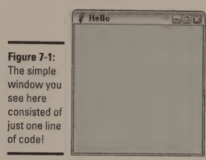

> 如果你好奇，我之所以在这一章中使用Windows进行截图，有两个原因：首先，我需要使用Microsoft Word来撰写此书，而它运行在Windows上；其次，事实是，虽然你可能在Linux机器上开发Tk程序，但大多数最终用户会在Windows上运行它们。但这没关系。请记住，Tk的优点之一是，你的Tcl/Tk程序可以在任何包含Tcl/Tk系统的操作系统上运行。

## 向窗口添加按钮

如果要在窗口上放置一个按钮，可以使用 button 命令，它是Tk库的一部分。请记住，在Tcl中，一切都以命令开始。使用Tk时，你仍然遵循此规则。看看这个程序：

```
button .mybutton -text Hello
pack .mybutton
```

将此程序保存为 simplewin.tcl，并使用以下行运行它：

```
wish simplewin.tcl
```

你会看到一个像图 7-2 所示的小窗口。

图 7-2：这个小窗口上有一个按钮。


如你所见，这个小窗口的代码很简单。第一行通过调用 button 命令创建一个按钮。button 命令的第一个参数（通常来说，所有小部件命令的第一个参数）是按钮的名称。

请记住，你必须以点号开头来命名小部件。从那里，你指定小部件是否包含在另一个小部件中。这个按钮不是，所以我就在点号后面跟上名称的最后部分：.mybutton。

然后我指定一个选项，在本例中是 -text。该选项是按钮上显示的文本。我选择在按钮上显示 Hello，如图 7-2 所示。

但仅仅创建一个小部件并不意味着Tk会自动将小部件放置到窗口上。要将小部件添加到窗口，需要使用 pack 命令：

```
pack .mybutton
```

pack 命令的格式很简单；你只需输入 pack 后跟小部件的名称即可。


pack 这个词作为添加小部件到窗口的命令，可能看起来是个奇怪的选择。但实际上，pack 指的是小部件在窗口中定位的方式。pack 命令是一个组织小部件的几何管理器。Tk提供三种不同的几何管理器，分别称为 pack、grid 和 place。pack 命令是一种特殊的命令，它会将控件尽可能紧密地挤在一起。你也可以在 pack 命令中包含一些选项；这些选项在本章的许多示例中都有出现。如果想了解更多关于几何管理器的信息，请参见第四卷第8章。

前面的程序虽然很酷，但我必须承认它没什么用。如果你点击按钮，什么也不会发生。一个好的按钮应该是撸起袖子实际做点事情，而不是整天坐在沙发上吃薯片。

请记住，`button` 是一个命令，和Tcl中的大多数命令一样，你可以提供选项。`button` 命令包含一个名为 `-command` 的选项。如果你输入这个选项，后面跟一组花括号，其中可以包含用户单击按钮时运行的代码。

这是一个你可以尝试的新程序：

```
button .mybutton -text Hello -command {
    tk_messageBox -icon info -message \
    "Hello, thank you for stopping by!"
}
pack .mybutton
```

我将其保存为 `buttoncmd.tcl`。使用 `wish buttoncmd.tcl` 运行时，你会看到一个带按钮的窗口，就像图 7-2 所示程序中的那个一样。但这次，当你点击按钮时，它实际上会执行某些操作：`-command` 选项内部的代码会运行。

该代码会调用名为 `tk_messageBox` 的命令，该命令显示一个消息框。消息框显示的消息是 `Hello, thank you for stopping by!` 尝试点击按钮，亲自看看吧。

## 创建列表框（关于 Pack 和 Bind 命令的更多内容）

你以前见过列表框，我相信你会同意它们非常有用。这里有一个快速的小程序，它在窗口上放置一个列表框：

```
wm title . "Simple Listbox"
listbox .lb -width 10 -height 10
pack .lb
```

这将创建一个名为 `.lb` 的列表框。注意 `listbox` 命令后面有一些选项，即 `width` 和 `height`。这些单位是字符，*不是*像素。也就是说，此程序中定义的列表框大约可以横向显示十个字符，并且可以容纳十行文本。我说 *大约*，是因为当今所有主要操作系统都使用比例间距字体，这意味着你不一定能看到恰好十个字符适合分配的空间。

如果你运行前面的示例，你不会看到什么。如果列表框中出现几个项目会很好，如果你可以双击这些项目也会更好。这里有一个更复杂的示例，它可以做到所有这些，甚至更多：

```
wm title . "Listbox Demo 2"
pack propagate . off

frame .buttonbar
pack .buttonbar -side top

button .buttonbar.bt1 -text "Add" -command {
.lb insert end grapes kiwi
}
button .buttonbar.bt2 -text "Del" -command {
.lb delete 1 3
}

pack .buttonbar.bt1 .buttonbar.bt2 \
    -side left -padx 5 -pady 5

listbox .lb -width 250 -height 250
pack .lb -side bottom

.lb insert end apple banana orange

### Create a handler to catch double-clicks from the listbox
### Note: This is a digit 1 after the word Double!
bind .lb <Double-1> {
    tk_messageBox -icon info -message [selection get]
}
```

在这个程序中，你首先会注意到我包含了不止一个按钮。但这些按钮都在一个 frame 中。frame 只不过是其他小部件的容器。pack 命令要求你为某些复杂布局使用大量的 -side 参数，我发现，如果我想在窗口顶部排成一排放置按钮，最简单的方法是在顶部放置一个 frame，然后用按钮填充它。因此，在这个示例程序中，我创建了一个 frame，然后创建了一些按钮。注意我是如何命名按钮的，即以 frame 开头，例如 .buttonbar.bt1。

还要注意，我在 pack 命令中包含了两个额外参数，-padx 和 -pady。它们只是指定在我的打包按钮周围包含一些空白空间。你可能也注意到，我可以在单个 pack 命令中包含两个按钮；这算不上什么大事。

第一个按钮的命令将项目插入列表框。注意我的做法：我将列表框的名称视为一个命令，然后跟上一个子命令。第一个按钮中的子命令是 insert，第二个按钮中的子命令是 delete。insert 命令接受一个索引，可以是数字或单词 end，然后是几个我想放入列表框的字符串（在此例中，是字符串 grapes 和 kiwi）。delete 命令接受两个索引，代表我想删除的范围的起始和结束。在此例中，我删除索引为 1、2 和 3 的项目。（列表框中的第一个项目索引为 0。）

但你可能会注意到一件奇怪的事：如果你从上到下阅读程序，会发现我在创建 .lb 控件的代码之前就已经将 .lb 用作命令了。但这没关系，因为我使用 .lb 作为命令的位置（在按钮命令中）是在创建 .lb 控件之后运行的；.lb 控件在程序启动时创建，而按钮命令仅在程序用户单击按钮时运行。

在按钮之后，我创建列表框。注意跟在这个 listbox 命令后面的 pack 命令，并将其与之前的 pack 命令（即跟在 frame 语句后面的那个）进行比较。frame 语句对应的 pack 命令包含选项 -side top。listbox 语句对应的 pack 命令包含选项 -side bottom。pack 命令相对于窗口的一个边来定位控件。因此，第一个 pack 命令将 frame 放置在窗口顶部，第二个 pack 命令将列表框放置在窗口底部。（但是，在窗口中定位项目比看起来要复杂一些，因此请务必阅读第四卷第8章，其中更详细地解释了这一点。）

程序的最后一部分可能是最有趣的。如果你想编写响应鼠标单击等操作的代码，可以使用 bind 命令。虽然一些小部件（如带有 -command 选项的 button）内置了鼠标功能，但其他小部件则需要你将函数绑定到小部件上。列表框就是后一种类型小部件的示例。

虽然这个概念看起来可能很奇怪，但在实践中这非常简单：你只需选择小部件和要响应的事件类型；在此例中，我希望它响应左键双击。Tk为每种事件类型命名，左键双击的名称是 Double-1。（是的，那是数字 1。）那么，你可以看到命令的格式；它类似于 proc 命令，以单词 bind 开头。然后是你绑定的小部件名称（在此例中是列表框）以及尖括号内的事件名称。最后，有一组花括号，包含要运行的命令。

如需了解可用事件的详细解释，请查看 www.scriptics.com/man/tcl8.4/TkCmd/bind.htm。或者，要看简短版本，请继续阅读。


将事件名称视为由连字符分隔的多个部分。事件 Double-1 包含两个部分。第一部分 Double 在此情况下指点击次数。第二部分 1 指按钮 1，即左键（如果系统配置为左手使用，则是右键）。

想在按住 Control 键的同时响应双击吗？那么不使用 Double-1，而使用 Control-Double-1。很简单。或者你可以使用 Shift-Double-1 来要求按住 Shift 键。想要两个键都按住？那么可以使用 Control-Shift-Double-1 或 Shift-Control-Double-1，两者效果相同。只想在按住 Shift 和 Control 的同时进行单击吗？那么直接使用 Control-Shift-1 即可。在所有这些组合中，你也可以使用 Alt 表示 Alt 键。（如果你使用 Mac，只需尝试不同的组合，看看哪个对应于 Apple 键，以此类推。）

## 创建第二个窗口

Tk 允许你在主窗口之外创建其他窗口。但请记住：这些附加窗口仍然由主窗口拥有。因此，它们的名称仍然以点开头。此外，如果你关闭主窗口，附加窗口也会关闭，你的程序也将结束。

尝试一下这个示例：

```
wm title . "First Window"
button .mybutton -text Hello
pack .mybutton
toplevel .win2 -width 300 -height 300
wm title .win2 "Second Window"
button .win2.button2 -text "Click"
pack .win2.button2
```

关键在于 toplevel 命令，它会创建一个新窗口。在此例中，新窗口名为 .win2，宽度和高度均为 300。然后我使用 wm title 命令为新窗口设置标题。请注意，在 wm title 命令中，我提供了窗口的名称（.win2），然后将标题放在双引号中。因此，新窗口的标题栏将包含“第二个窗口”字样。

然后你可以看到我如何向新窗口添加按钮（或者任何小部件）：我照常创建按钮，并给它一个以新窗口名称开头的名称。在此例中，我的按钮名为 .win2.button2。因为该名称以 .win2 开头，所以当我使用 pack 命令添加按钮时，该按钮会自动显示在 .win2 窗口上（即第二个窗口）。

## 向窗口添加菜单栏

多年来，我为多种不同语言使用了许多 GUI 系统，不得不说，创建菜单栏通常是任何系统中最繁琐的任务。Tk 也不例外。问题不在于菜单本身复杂；问题在于你通常会有很多菜单，并且它们是层级排列的。

以下示例创建一个窗口并向窗口添加一个菜单栏。菜单栏由两个菜单组成：一个 File 菜单和一个 Edit 菜单。

```
wm title . "Menu demo"

### Declare the main menu bar
menu .mymenu

### Declare the file menu item
menu .mymenu.filemenu
.mymenu add cascade -label "File" -menu .mymenu.filemenu
.mymenu.filemenu add command -label "Exit" -command { exit }

### Declare the edit menu item
menu .mymenu.editmenu
.mymenu add cascade -label "Edit" -menu .mymenu.editmenu
.mymenu.editmenu add command -label "Stuff" -command \
{ exit }

### Add the menu to the window
. configure -menu .mymenu
```

请仔细查看这段代码，因为它包含一些陷阱。首先，我声明了菜单小部件，并将其命名为 .mymenu。这不是问题。但接下来，我必须为菜单栏上的每个菜单声明另一个菜单小部件。

> 不过，我并不是为每个菜单项创建菜单小部件，只是为菜单本身创建。这很令人困惑，也是需要记住的重要一点。另外，请注意菜单的小部件是主菜单小部件的子项；因此在我的示例中，我将它们命名为 .mymenu.filemenu 和 .mymenu.editmenu。

声明 .mymenu.filemenu 小部件后，我为 .mymenu 调用 add cascade 命令，从而创建菜单。我使用 -label 选项提供出现在菜单顶部的文本，在此例中为 File。接着又是一个陷阱：我必须指定要为哪个小部件添加这个菜单。是的，我知道，这不太合理，但 Tk 就是这样做的。所以我使用 -menu 选项，并指定 .mymenu.filemenu 小部件。

我想添加一些位于此 File 菜单下方的菜单项。在此例中，我想在 File 菜单下方添加一个 Exit 菜单项。为此，我输入菜单名称并使用 add command 命令。我为菜单项提供标签（“Exit”），然后，就像创建按钮时一样，我使用 -command 选项来指定要运行的 Tcl 命令。对于本示例，我只是使用 exit 命令，它会关闭程序。

然后我对 Edit 菜单（以及我可能想要添加的任何其他菜单）重复上述所有步骤。是的，这需要大量工作，但这只是因为程序通常会有很多菜单。但它是有效的！最后，当我创建了所有需要的菜单后，我需要将整个菜单栏附加到窗口上。我不会为此使用 pack 命令。相反，我放置窗口的名称（在此例中为点号），然后是 configure 命令，接着是 -menu，以及我的主菜单的名称。

（你实际做的是重新配置窗口的选项。你想要重新配置的选项是 menu 选项；为此，你添加 -menu，后跟主菜单小部件的名称。）

运行程序后，你的窗口将拥有如图 7-3 所示的菜单栏。

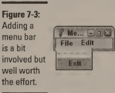

## 将菜单附加到按钮

Tk 包含一些你可能见过也可能没见过的有趣小部件。如果你使用 X Windows 或 KDE（Linux 或 Unix 窗口系统），那么你很可能见过可以点击并弹出菜单的按钮。Microsoft Windows 不包含这样的控件，但 Tk 包含。以下是一个实现此功能的示例程序：

```
wm title . "Menu button demo"

### Create the menu button, specifying the menu
menubutton .menubtn -text "Click me" \
-menu .menubtn.mymenu -relief raised

### Declare the menu itself; it must be a child of the menu button.
menu .menubtn.mymenus

### Declare the file menu item
menu .menubtn.mymenus.menu1
.menubtn.mymenus add cascade -label "File" \
-menu .menubtn.mymenus.menu1
.menubtn.mymenus.menu1 add command -label "Exit" \
-command { exit }

### Declare the edit menu item
menu .menubtn.mymenus.editmenu
.menubtn.mymenus add cascade -label "Edit" -menu \
.menubtn.mymenus.editmenu
.menubtn.mymenus.editmenu add command -label "Stuff" \
-command { exit }

pack .menubtn
```

如果你阅读了上一节“向窗口添加菜单栏”，这段代码可能会让你觉得有些熟悉。为菜单按钮和窗口菜单栏创建一组菜单的过程是相同的。但是，当你创建菜单按钮时，你不是从菜单小部件开始，而是从 menubutton 小部件开始。此外，-relief 选项可用；该选项描述按钮的外观——也就是说，按钮是常规的凸起按钮、内嵌按钮，还是几种类型中的任何一种。以下是你可以尝试的类型；它们的名称相当直观。随意尝试一下，看看它们是什么样子：

- raised
- sunken
- flat
- ridge
- solid
- groove

运行前面的程序后，你将看到一个类似于图 7-4 的窗口。

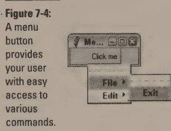

## 使用 Scale 滑动数字

大多数操作系统中都有滑块控件；Tk 包含一个外观有趣的滑块控件，你可以使用。这个滑块控件没有使用任何原生滑块控件，但这没关系；它看起来很酷。（而且，这难道不是唯一重要的吗？）

以下是一个示例程序；你会注意到滑块控件称为 scale 小部件。

```
set curx 0
set cury 0

proc drawH {x} {
    global curx
    global cury
    .mycanvas create line $curx $cury $x $cury
    set curx $x
}

proc drawV {y} {
    global curx
    global cury
    .mycanvas create line $curx $cury $curx $y
    set cury $y
}

scale .myHscale -orient horizontal -length 284 \
    -from 0 -to 250 \
    -command "drawH" -tickinterval 50
grid .myHscale -row 1 -column 0
scale .myVscale -orient vertical -length 300 \
```


```
-from 0 -to 300 \
-command "drawV" -tickinterval 50
grid .myVscale -row 0 -column 1
canvas .mycanvas -width 300 -height 300
grid .mycanvas -row 0 -column 0 -pady 5

.myHscale set 5
.myVscale set 5
```

这个程序的关键在于两个比例尺声明。你可以选择滑块控件是水平控件还是垂直控件；你可以选择滑块控件的大小（我选择了 300 像素）；并且你可以选择范围。我使用的范围是 0 到 300，这与比例尺的大小匹配。

你也可以指定 -command 选项。但是，这个 -command 选项与按钮中的 -command 选项略有不同！对于这个命令选项，你指定一个过程，当用户移动滑块时，滑块将调用该过程。此外，滑块将向过程传递一个参数，该参数是一个表示滑块位置的整数。因此，你会注意到我只放入了过程的名称（drawH 和 drawV），但我的每个过程都带有一个参数。

这个程序有什么作用？如果你上下移动滑块，一条小线会移动。你可以利用它像蚀刻画板玩具一样进行绘画。挺酷的，不是吗？请查看图 7-5。

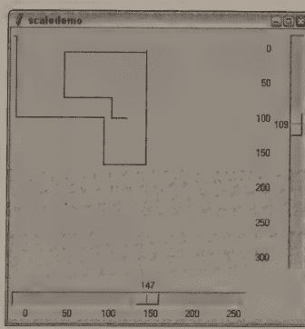

图 7-5：滑块控件允许用户在范围内选择一个数字。

## 更改控件，例如标签的文本

在本节中，我将向你展示如何使用标签控件，但本节的重点是如何修改现有的小部件。首先，标签控件仅保存一些文本。如果你想在窗口上显示一些文本，可以使用标签控件。

以下是标签控件的示例：

```
wm title . "Configure label demo"
label .mylabel -text "This is a label!"
pack .mylabel
```

这段代码仅仅会在窗口上写下 "这是一个标签！" 这几个字。没有什么特别的。但是，如果你想修改现有的标签呢？请看前面程序的修改版本：

```
wm title . "Configure label demo"
label .mylabel -text "This is a label!"
pack .mylabel

button .mybutton -text "Change" -command {
.mylabel configure -text "New label!"
}
pack .mybutton
```

前三行是相同的；此外，我添加了一个按钮。在按钮的命令部分，我想要修改标签的文本。我该怎么做呢？当初创建标签时，我使用 -text 选项指定了文本，因此似乎逻辑上我应该以某种方式修改该选项。要修改选项，你可以使用 configure 命令。这适用于所有小部件，而不仅仅是标签。请看我是如何操作的：

```
.mylabel configure -text "New label!"
```

我指定小部件的名称，然后使用 configure 命令。接着，我放入选项及该选项的新值。这解释了本章前面一节（“向窗口添加菜单栏”）中提到的内容。以下是该章节程序中的一行：

```
. configure -menu .mymenu
```

此行中的第一项是主窗口的名称，即一个点。然后是 configure 命令。接着是 -menu 选项。这意味着我正在修改窗口的 `-menu` 选项。我在做什么？我正在指定一个新菜单栏。当然，在那个程序中，我之前没有菜单栏，所以实际上我是在添加一个新菜单栏。但这无关紧要；我仍在重新配置现有窗口。这就是 `configure` 命令的用途。

如果你使用 `configure` 命令并导致小部件的大小发生变化，父窗口会在必要时调整大小。这种情况仅在你使用 `grid` 或 `pack` 管理器时发生。（有关更多信息，请参见第 IV 编、第 8 章。）

## 第 8 章：排列控件、绘制图片和处理文本

### 本章内容

- 使用各种几何管理器（pack、grid 和 place）排列控件
- 在画布上绘图
- 在文本小部件中处理文本

在 Tk 编程中，控件在窗口中的位置变得至关重要。没有人想花几个小时微调像素位置，只是为了让 GUI 看起来不错。

此外，图形处理能力是 Tk 工具箱中有用的工具，文本处理能力也是如此。在本章中，我将讨论这三个主题。

### 使用几何管理器排列控件

程序员要么花几个小时仔细定位窗口上的控件，逐个像素地微调，要么花大价钱购买允许他们可视化定位控件的设计工具。

就我而言，我喜欢设计工具；多年来，我一直是 Delphi 和 Borland C++ Builder 等程序的瘾君子。另一方面，如果我在 Tk 中构建一个简单的程序，让 Tk 为我管理布局要容易得多，这样我就有时间专注于让程序正确运行。

Tk 提供了三种不同的几何管理器（有些人——特别是有 Java 经验的人——称之为布局管理器）。这些几何管理器会自动为你处理窗口上控件的布局。以下是三种不同的管理器：

- `pack`：此管理器会仔细地将控件打包在一起，使其占用窗体所需的最小空间。你对控件的位置有一定的控制权——但不是完全控制权。
- `grid`：此管理器以受管理的网格方式布局控件。如果我想让控件对齐，我发现这很有用。
- `place`：此管理器让你对控件的确切位置拥有完全的逐个像素控制权。

这些方法在其他语言的布局管理器中也很常见。在 20 世纪 90 年代中期，我最初在 Java 语言中接触这种布局管理方式时，对 `pack` 和 `grid` 方法持怀疑态度，主要是因为我不信任管理器能做好工作。因此，我坚持使用 `place` 方法。但我很快意识到一件事：首先，`pack` 和 `grid` 方法效果极佳；其次，它们使跨平台开发更加可靠。如果我使用 `place` 方法指定绝对像素位置，我的程序在其他操作系统上运行时不一定总是看起来最好。但使用 `pack` 和 `grid` 方法时，无论操作系统如何，它们始终看起来都很棒。

尽管如此，我有时确实需要 `place` 方法；有时候我确实想要完全控制。因此，如今我会同时使用这三种方法。在接下来的三个部分中，我将分别介绍它们。

### 使用 pack 压缩控件

在三种几何管理器中，`pack` 可能是最难理解的，主要是因为它执行了大量幕后 "魔法" 来布置你的小部件。但是，了解 `pack` 后，它实际上很容易使用。


在向你展示一些示例之前，先说一下：理解 `pack` 最重要的方面是认识到 `pack` 将控件定位在窗口的四个边周围。

`pack` 还会“压缩”窗口，最大限度地减少控件之间的空间，因此要理解 `pack` 的这方面四边特性有时可能会很困难；有时，这甚至可能看起来反直觉。

以下示例关闭了此压缩功能，以便你可以看到控件如何自然地围绕窗口边缘聚集。试一下，你就明白了：

```
wm title . "Pack demo 1"
pack propagate . off

button .bt1 -text "One"
button .bt2 -text "Two"
button .bt3 -text "Three"

pack .bt1 .bt2 .bt3 -side left

button .bt4 -text "Four"
pack .bt4 -side bottom

button .bt5 -text "Five"
pack .bt5 -side bottom

button .bt6 -text "Six"
pack .bt6 -side bottom
```

图 8-1 显示了运行此代码时的效果。特殊行 pack propagate . off 关闭了名为点（.）的窗口（即主窗口）的压缩效果。请注意，在图中，标记为 One、Two 和 Three 的三个按钮都聚集在左侧。同时也要注意，它们向内移动。首先，名为 One 的按钮被放置在左侧。然后，名为 Two 的按钮被尽可能靠左放置，也就是紧贴现有的名为 One 的按钮，以此类推。还要注意，我使用 pack 命令列出了这三个按钮，并将选项 -side 设置为 left。

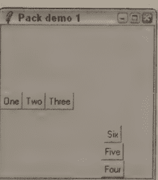

图 8-1：使用 pack 时，控件会聚集在边缘。

接下来，名为 Four 的按钮被推向底部。然后，当我打包按钮 Five 时，该按钮出现在尽可能靠下的位置，也就是就在按钮 Four 的上方。同样，按钮 Six 出现了


在按钮 Five 上方。这一次，我为这些按钮中的每一个分别调用了 `pack`，每次都使用选项 `-side bottom`。三次连续分别调用 `pack` 并使用相同的 `-side` 选项值，与调用一次并将所有三个小部件放在一起的效果相同。

现在尝试删除前面程序中的 `pack propagate . off` 行，然后再次运行程序。你的窗口将如图 8-2 所示。

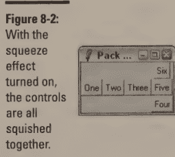

这一次，控件都被挤在一起，尽管它们的相对位置与之前相同。然而请注意，如果你输入了这段代码并得到了图 8-2 中的结果，却不知道发生了什么，你可能会有点困惑。你输入了：

```
button .bt6 -text "Six"
pack .bt6 -side bottom
```

尽管你将 `-side` 选项设置为 `bottom`，但按钮 `Six` 最终出现在了 `top`。你看到混淆从哪里产生了吗？有时，即使 `pack` 正确执行了布局，结果看起来也只是 _似乎_ 不对。起初是这样。

> **提示**
> 如果你正在使用 `pack` 且难以正确设置布局，请记住它的工作原理：控件是相对于某一侧从外向内堆叠的，然后控件会被挤在一起。

## 创建默认垂直控件列

`pack` 命令也可以用来创建垂直控件行。默认情况下，`pack` 使用选项 `-side top`。如果省略该选项，你可以得到一个垂直行，如下所示：

```
wm title . "Pack demo 2"
button .bt1 -text "One"
button .bt2 -text "Two"
button .bt3 -text "Three"

pack .bt1 .bt2 .bt3
```

图 8-3 显示了该窗口的外观。

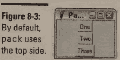

## 创建水平工具栏

如果了解 pack 的工作原理，可以通过添加框架并将控件放在框架内来制作一些复杂的布局。例如，常见的外观是在窗口顶部有一排按钮，并有一个主小部件占据窗口的其余部分。

要实现这种外观，请创建一个框架并将其放在顶部。然后向框架添加按钮，从框架左侧开始将按钮打包到框架内。最后，在底部添加主控件。在下面的示例中，我注释掉了一些行——我稍后会讨论这些内容。另外，我在底部添加的控件是一个画布控件，你可以在其上绘制图像。

```
wm title . "Pack demo 3"
pack propagate . off

frame .buttonbar
pack .buttonbar -side top

button .buttonbar.bt1 -text "One"
button .buttonbar.bt2 -text "Two"
button .buttonbar.bt3 -text "Three"

pack .buttonbar.bt1 .buttonbar.bt2 .buttonbar.bt3 \
   -side left -padx 5 -pady 5

#try each of these two instead of the above
#pack .buttonbar.bt1 .buttonbar.bt2 .buttonbar.bt3 \
### -anchor e -side top -pady 5 -pady 5
#pack .buttonbar.bt1 .buttonbar.bt2 .buttonbar.bt3 \
### -anchor w -side top -pady 5 -pady 5

canvas .drawingboard -width 250 -height 250 -bg azure
pack .drawingboard -side bottom
```

运行此程序时，你将看到一个外观美观的布局，如图 8-4 所示。（画布是按钮下方的空白区域，目前仍为空白。）

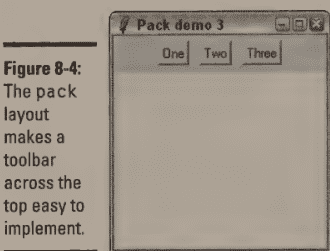

## 使用 e 和 w 对齐控件

要进一步了解 pack 命令，请尝试在前面的代码中替换此命令：

```
pack .buttonbar.bt1 .buttonbar.bt2 .buttonbar.bt3 \
-side left -padx 5 -pady 5
```

替换为被注释掉的命令中的第一个：

```
pack .buttonbar.bt1 .buttonbar.bt2 .buttonbar.bt3 \
-anchor e -side top -padx 5 -pady 5
```

这会使按钮堆叠，而不是从左到右排列。但请注意按钮的对齐方式；它们的右侧全部对齐。这是因为我包含了 `-anchor e` 选项。e 代表 East，即右侧。现在尝试下一行被注释掉的命令：

```
pack .buttonbar.bt1 .buttonbar.bt2 .buttonbar.bt3 \
-anchor w -side top -padx 5 -pady 5
```

这与上一行相同，只不过我将 `e` 替换为了 `w`，它代表 West，即左侧。这一次按钮仍然是堆叠的，但它们的左侧全部对齐。如果你想要各种对齐功能（例如这种），对齐选项会很有用。

## 使用 grid 排列控件

`grid` 命令比 `pack` 命令更容易理解。使用 `grid` 命令布局控件时，你必须想象一个大网格。你选择命令在网格中的位置。然而，`grid` 命令会将控件挤在一起，因此你的网格不会是统一的（每行高度相同，每列宽度相同）。下面是 `grid` 的示例：

```
wm title . "Grid demo"

button .bt1 -text "One"
button .bt2 -text "Two"
button .bt3 -text "Three"

grid .bt1 -row 0 -column 0 -padx 5 -pady 5
grid .bt2 -row 0 -column 1 -padx 5 -pady 5
grid .bt3 -row 0 -column 2 -padx 5 -pady 5

canvas .drawingboard -width 250 -height 250 -bg azure

### Try taking out the -columnspan 3 part to
### see what happens...
#grid .drawingboard -row 1 -column 0
grid .drawingboard -row 1 -column 0 -columnspan 3
```

这会创建一个组织良好的布局，如图 8-5 所示。

请注意代码中间每个按钮的 `grid` 命令格式：先是行号，然后是列号。最后，为了避免一切挤得太紧，我在控件之间添加了一些填充。`-padx` 选项在右侧和左侧添加空间（在此例中为 5 像素），而 `-pady` 选项在顶部和底部添加空间（同样在此例中为 5 像素）。

但请查看 `drawingboard` 的 `grid` 命令，你会发现它有一个名为 `-columnspan` 的选项，参数为 3。由于在此例中列定义为 0，`columnspan` 告诉控件在网格中占据三列，即列 0、1 和 2。之前的按钮各自占据了一列：第一个在列 0，下一个在列 1，第三个在列 2。因此，这个 `canvas` 小部件将对齐在所有三个按钮的下方，如图 8-5 所示。

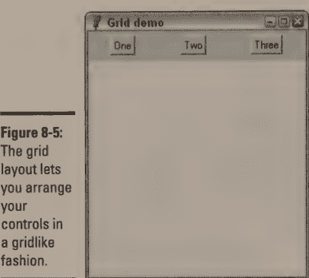

要真正理解这意味着什么，请尝试删除 `-columnspan 3` 选项，正如我在代码注释中所建议的，然后查看布局的外观。运行程序时，最左侧的按钮和画布占据第一列，中间按钮和最右侧按钮则浮动到右侧，这可能不是你想要的布局外观。

## 使用 place 定位控件

在窗口上定位控件最具体的方法是使用 place 几何管理器。使用 place 时，你需要以像素为单位指定每个控件的绝对位置。然而，place 的问题是主窗口不会调整大小以适应控件。这意味着你还必须选择主窗口的大小；否则，某些控件可能会漂浮到窗口外并不可见。

要设置窗口大小，必须创建一个框架小部件，选择其大小，然后将其定位在窗口上。从那里，我通常使用 pack 命令来定位框架。这迫使窗口的大小与框架相同。

接下来，我使用 place 在框架上而不是在窗口上定位所有小部件。下面是一个这样做的示例：

```
wm title . "Place demo"

### To size the main window, start with a frame that is packed
frame .mainframe -width 300 -height 350
pack .mainframe

button .mainframe.bt1 -text "One"
button .mainframe.bt2 -text "Two"
button .mainframe.bt3 -text "Three"

place .mainframe.bt1 -x 10 -y 10
place .mainframe.bt2 -x 50 -y 10
place .mainframe.bt3 -x 100 -y 10

canvas .drawingboard -width 250 -height 250 -bg azure
place .drawingboard -x 10 -y 50
```

你可以在图 8-6 中看到这段代码的结果。


图 8-6：place 命令让你为每个控件选择特定位置。

请注意 `place` 命令的格式。你指定要放置的小部件，然后选择一个 `x` 值（水平位置）和一个 `y` 值（垂直位置），单位为像素。就这样。简单明了。

## 在画布上绘图

`canvas` 小部件是一种通用小部件，用于执行绘图操作。使用 `canvas` 小部件，你可以绘制矩形、线条、圆弧、曲线、文本等。


以下步骤概述了使用画布的基本方法：

- 1. 创建画布小部件，并像其他小部件一样为其命名。
- 2. 将画布小部件定位于窗口上。
- 3. 调用画布小部件的一组命令。一般格式是画布名称，后跟单词 create，再后跟 rectangle 或 arc 等命令。

在以下各节中，我将向你展示如何完成所有这些操作。但首先，我将展示如何在绘图中指定颜色。

## 颜色

Tk 系统支持大量颜色，每种颜色都有唯一的名称。例如 azure2、blueviolet、DarkOrchid4、LemonChiffon、purple、wheat4、firebrick1、DarkSeaGreen1 和 chocolate。我没有编造这些。如果你想查看所有颜色的列表，请访问 www.tcl.tk/man/tcl8.4/TkCmd/colors.htm。在那里你会找到数百种颜色（以及数百个唯一的名称）。

下面的示例通过绘制每种颜色的彩色条来演示其中几种颜色。我不会提供截图，因为这本书是黑白印刷的，但请尝试此示例以查看颜色输出。随意尝试在代码中的 colorlist 变量添加更多颜色：

```
canvas .mycanvas -width 300 -height 300
pack .mycanvas

set top 0
set colorlist {azure2 blueviolet DarkOrchid4 \
LemonChiffon purple wheat4 \
firebrick1 DarkSeaGreen1 chocolate}
foreach mycolor $colorlist {
set bottom [expr $stop + \
[expr 300 / [llength $colorlist]]]
.mycanvas create rectangle 0 $top 300 $bottom \
-fill $mycolor
set top $bottom
}
```

## 圆弧

在 Tk 中创建圆弧很容易。关键在于理解圆弧是圆的一部分，你需要指定两个角度：圆弧在圆上的起始位置，以及圆弧的角度长度。此外，你可以从三种不同的圆弧样式中选择：填充的扇形、圆的一段圆弧（仅一条曲线，无填充），以及填充的弦，类似于“馅饼皮”部分。下面的示例演示了这些样式：

```
canvas .mycanvas -width 600 -height 300
pack .mycanvas

.mycanvas create arc 10 10 290 290 -fill blue
.mycanvas create arc 10 10 290 290 -start 190 \
-extent 30 -fill green

.mycanvas create arc 310 10 590 290 -fill blue \
-style chord
.mycanvas create arc 310 10 590 290 -start 190 \
-extent 30 -fill green -style arc
```

这段代码创建了图 8-7 所示的窗口。


图 8-7：
arc 命令允许三种不同的样式。

要查看圆弧的定位方式，请仔细观察前两条 arc 命令。它们各自占据同一个圆，该圆位于正方形 10,10 到 290,290 内。然而，区别在于角度。在第一个圆弧示例中，我未指定任何角度，因此默认情况下，我得到从 0 度到 90 度的角度（在圆上从正东到正北）。这位于右上象限。在下一条 arc 命令中，我确实指定了一个角度，即从 190 度开始延伸 30 度。这位于左下象限。（190 度略大于 180 度；180 度是正西。）请注意，两条圆弧在其中心处对齐。

这可能会让人困惑：到目前为止，每条 arc 命令都占据 10,10 到 290,290 的位置，然而这两条命令并未完全填充该矩形区域。相反，它们仅填充各自所属的象限。

默认样式是扇形，你可以使用 -fill 选项指定扇形的颜色。为了展示另外两种样式，我在窗口右侧绘制了两条圆弧。第一条是弦，类似于扇形的馅饼皮：它被圆上的圆弧以及连接两个点的直线所包围（在这里，这两个点是默认点：0 度和 90 度）。第二条是圆弧，即想象圆周长上的一条曲线。

## 直线和曲线

有一个很酷的功能：使用画布小部件，你可以绘制一系列直线，然后通过设置单个选项，即可生成与你绘制的直线吻合的曲线。line 命令很简单；你只需指定一组表示点的数字，如下面的代码所示：

```
canvas .mycanvas -width 300 -height 350
pack .mycanvas

.mycanvas create line \
10 10 75 100 125 50 250 200 40 200 \
-smooth off -width 1 -fill black -width 10 \
-joinstyle round

.mycanvas create line \
10 40 75 130 125 80 250 230 40 230 \
-smooth off -width 1 -fill black -width 10 \
-joinstyle miter -cap round

.mycanvas create line \
10 70 75 160 125 110 250 260 40 260 \
-smooth off -width 1 -fill black -width 10 \
-joinstyle bevel -arrow last
```

在第一条 line 命令中，我有一组线段。第一条从点 10,10 开始到点 75,100 结束。下一条从该点（75,100）开始到 125,50 结束。下一条从 125,50 开始到 250,200 结束。最后一条从 250,200 开始到 40,200 结束。很简单。此代码对应的窗口如图 8-8 所示。

使用 line 命令时，你还有几个选项。你可以指定线宽；在前面的代码中，我的所有线条都很粗，宽度为 10 像素。你还可以指定颜色（我的全是黑色，但你可以使用其他颜色，如 bisque3，不管那是什么，或者 OliveDrab2）。

你还可以为每条线的末端指定端点样式。可选项为 bevel、miter 和 round。你可以尝试这些不同的类型，看看它们的效果。


你还可以在线条末端指定箭头形状。我在第三条 line 命令中就是这样做的，如图 8-8 所示。在此示例中，我在线条序列末端添加了一个箭头。你也可以使用 -arrow first 在开头添加一个箭头。或者，如果你想在两端都添加箭头，请使用 -arrow both。

你还可以指定连接每条线的接合样式。这很微妙，但如果你查看当前示例中的每条线条序列（以及图 8-8），你会发现我为每条序列使用了略有不同的连接样式。该样式是 -joinstyle 选项，可选项为 bevel、miter 和 round。

请注意，我还为每条线添加了 -smooth off 选项。这是默认值，因此我使用该选项只是为了清晰（虽然有些多余）。但在下一个示例中，我开启了该选项。几乎像变魔术一样，我得到了一条仔细贴合线条序列端点的曲线。为了展示曲线如何贴合，我也绘制了同一条线条序列并关闭了曲线选项，以便你可以比较两者。下面是示例代码：

```
canvas .mycanvas -width 600 -height 300
pack .mycanvas

.mycanvas create line \
 10 10 75 100 125 50 250 200 0 200 \
 -smooth off -width 1 -fill black

.mycanvas create line \
 10 10 75 100 125 50 250 200 0 200 \
 -smooth on -width 5 -fill red -capstyle round

.mycanvas create line \
310 10 375 100 425 50 550 200 300 200 \
-smooth off -width 1 -fill black
.mycanvas create line \
310 10 375 100 425 50 550 200 300 200 \
-smooth on -width 5 -fill red -capstyle round \
-splinesteps 3
```

此代码对应的窗口如图 8-9 所示。在此代码和图中，我也对 -splinestep 选项玩了一些花样。该选项控制线条的平滑程度。在我的代码中，我使用了值 3。如果你仔细观察图 8-9 的右半部分，你可以看到 line 命令使用了三个较小的线段（以粗体显示）来替换每条原始线段（显示为细线）。（底部的线确实有三个线段；其中两个线段方向相同，显示为一条长线段。）你在 -splinesteps 选项中指定的数字越大，你将得到的线段越多。


图 8-9：
直线也可以
弯曲。

## 多边形

多边形就像一系列直线，不同之处在于多边形添加了一条连接终点和起点的直线，从而闭合多边形。画布小部件随后会用你选择的颜色填充多边形。下面是一个示例：

```
canvas .mycanvas -width 600 -height 300
pack .mycanvas

.mycanvas create polygon 10 10 210 50 130 290 -fill blue
.mycanvas create polygon 300 50 510 290 550 60 350 280 \
-fill red
```


此示例创建两个多边形。第一个是一个简单的三角形，第二个稍微复杂一些，如图 8-10 所示。


多边形语句的基本格式很简单：指定一系列点，然后使用 -fill 选项指定颜色。下面是一个你可以尝试的有趣示例，它会创建一堆随机多边形：

```
canvas .mycanvas -width 300 -height 300 -bg lightgray
pack .mycanvas
set colorlist {red green blue \
 orange purple yellow4 \
 darkcyan DodgerBlue2 chocolate}
for {set x 0} {$x < 5} {incr x} {
 set pointcount [expr 2 * (int(rand() * 5) + 1)]
 set mylist {}
 for {set y 0} {$y < $pointcount} {incr y} {
 set newpoint [expr int(rand() * 300)]
 set mylist [concat $mylist $newpoint]
 }
 set colorindex [expr int(rand() * 8)]
 set color [lindex $colorlist $colorindex]
 .mycanvas create polygon $mylist -fill $color
}
```

## 矩形和文本

为了结束关于画布的这一节，我想向你展示如何在画布上绘制矩形和文本。这两者都很简单。对于矩形，你需要指定矩形左上角和右下角的坐标。

文本也很简单：你需要指定要显示的文本和位置。你可以为文本选择字体和大小，以及绘制文本的填充颜色。以下示例代码展示了如何将矩形和文本添加到画布中：

```
canvas .mycanvas -width 600 -height 300
pack .mycanvas

.mycanvas create rectangle \
10 10 290 290 -fill cyan

.mycanvas create text \
100 100 -text "Hi there" \
-font {Helvetica 32 italic} -fill brown

.mycanvas create text \
400 75 -text "Tcl is great!" \
-font {"Comic Sans MS" 28} -fill darkgreen
```

在本示例中，我使用了字号为 32 的 Helvetica 字体和字号为 28 的 Comic Sans MS 字体。该程序的结果如图 8-11 所示。


图 8-11: 使用画布小部件，矩形和文本都简单。

在 text 命令中选择字体时要小心。在当前示例中，我指定了一种名为 Comic Sans MS 的字体。这是一种在 Windows 上可用的 Microsoft 字体。最近我也在其他操作系统（例如 Mac）上看到了它；但是，你不能确定该字体在所有系统上都可用。不过，幸运的是，如果字体不存在，Tk 会指定一个默认系统字体作为替代。

## 使用文本小部件处理文本

文本小部件是 Tk 中较为高级的小部件之一。最新版本包含大量功能，例如能够在文本小部件内的不同位置指定不同的字体大小和形状，以及能够在文本控件中嵌入其他小部件。

在以下各节中，我将向你展示几种使用文本小部件的绝佳方法。

### 使用文本小部件进行读写

如果程序无法读取文本小部件的内容并（可能）修改小部件中的文本，那么文本控件就不是特别有用。以下示例展示了如何做到这一点：

```
frame .myframe
pack .myframe
button .myframe.mybutton -text "Read sel" -command {
tk_messageBox -icon info -message \
[selection get]
}
pack .myframe.mybutton -side left
button .myframe.mybutton2 -text "Read all" -command {
tk_messageBox -icon info -message \
[.mytext get 1.0 end]
}
pack .myframe.mybutton2 -side left
button .myframe.mybutton3 -text "Write start" -command {
### Insert text at the 1st line (1), first column (0)
.mytext insert 1.0 "**Inserted text**"
}
pack .myframe.mybutton3 -side left
button .myframe.mybutton4 -text "Write" -command {
### Insert text at the current position
.mytext insert insert "**Current position**"
}
pack .myframe.mybutton4 -side left

### With the text widget, width and height
### are in terms of characters not pixels.
text .mytext -width 40 -height 15
pack .mytext
```

在本示例中，我有三个按钮和一个文本小部件。第一个按钮读取小部件的内容并在消息框中显示内容。你可以看到，为了访问文本小部件的内容，我使用了 get 命令。但是请注意语句中 get 命令后面跟的是什么：第一个术语是 1.0，下一个是 end。1.0 是文本中的一个位置。1 指的是第 1 行，0 指的是该行内的位置 0。换句话说，1.0 是文本控件中的第一个字符。（是的，行号从 1 开始，尽管行内的位置从 0 开始。）因此，例如，2.5 将指第 2 行上的第 6 个字符。在 1.0 之后是单词 end，它简单地指文本的末尾。因此，[.mytext get 1.0 end] 从第一行第一个字符检索文本到文本末尾——换句话说，就是小部件中的整个文本。

接下来的两个按钮将文本插入小部件。其中第一个按钮在小部件开头插入文本：

```
.mytext insert 1.0 "***Inserted text***"
```

同样，又是那个 1.0。下一个按钮在文本的当前插入点插入文本：

```
.mytext insert insert "***Current position***"
```

是的，那就是 insert 一词出现了两次。第一个 insert 是命令；第二个指的是当前插入点。

代码末尾才是我实际创建文本小部件的地方。这里我只需要说，小部件的大小不指像素；相反，大小指的是点数。这个文本小部件高 15 行（高度），宽度大约可容纳 40 个字符。

请记住，这个 40 不会精确，因为你处理的是比例间距字体。当然，如果你愿意，可以自由指定等宽字体，例如：

```
text .mytext -width 40 -height 15 -font {"Courier New" 14}
pack .mytext
```

这样你就能在控件中得到精确的字符数。

### 使用标签选择文本

标签是文本小部件中的一种双重功能，它指特定的字体样式（颜色、字体名称、大小等），然后指文本小部件文本中的各种位置。在这些位置，文本以标签的字体样式显示。这样你就可以在单个文本小部件中拥有不同的字体样式。酷的是，当你向控件输入文本时，文本会保持相同的格式。

要创建标签，首先需要指定标签的信息。你可以在以下代码中看到，我通过 tag configure 命令来完成此操作。首先，为样式提供一个名称（在此示例中，我选择了名称 highlight；这些样式名称不像小部件名称那样以点开头）。接下来，为样式指定各种信息。然后选择具有特定样式的文本。对于本示例中的样式，我想要一个带下划线的红色字体：

```
text .mytext -width 30 -height 15
pack .mytext

.mytext insert 1.0 "Hello there, everybody"

.mytext tag configure highlight -foreground red -underline 1
.mytext tag add highlight 1.0 1.5
.mytext tag add highlight 1.13 1.18
```

最后两行选择要保存特定样式的文本。在每一行中，我都按名称指定所需的样式（在此示例中为 highlight）。接下来，我在文本中指定两个点，即起始点（第一个示例为 1.0，第二个示例为 1.13）和结束点（第一个示例为 1.5，第二个示例为 1.18）。但是请记住，结束点本身不采用该样式。因此，1.5 和 1.18 处的字符不会获得 highlight 标签中指定的样式。

运行此程序时，你将看到图 8-12 所示的窗口。

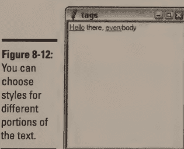

在以下示例中，你将创建两个样式和一个按钮；单击按钮时，文本会更改为这些样式：

```
button .mybutton -text "Highlight" -command {
    .mytext tag add big 1.0 1.5
    .mytext tag add fun 1.6 1.9
}
text .mytext -width 30 -height 15
.mytext insert 1.0 "Hello there, everybody"
.mytext tag configure big -foreground red \
    -underline 1 -font {Helvetica 18}
.mytext tag configure fun -foreground blue \
    -underline 1 -background red
pack .mybutton .mytext
```

### 嵌入小部件

文本控件的一个非常酷的功能是，你可以将其他小部件直接嵌入文本中——并且当文本移动时，这些小部件也会移动。文本和小部件将移动以容纳你在其前面添加的任何新文本。

嵌入小部件很简单；你只需像平常一样创建小部件，然后调用文本小部件的 window create 命令，指定位置和要嵌入的小部件名称。在以下示例中，我使用单词 insert 作为位置；这意味着“在当前插入点插入”：

```
text .mytext -width 30 -height 15
pack .mytext

.mytext insert 0.1 "Hello "

button .mytext.btl -bitmap questhead -command {exit}
.mytext window create insert -window .mytext.btl

.mytext insert end " there"
```

运行此示例时，一个按钮将出现在文本内部。尝试在按钮的两侧输入一些文本，你将看到按钮如何移动。

运行此程序时，你将看到图 8-13 所示的窗口。


图 8-13：您可以直接在文本控件中嵌入小部件。


## 搜索

任何优秀文本控件的重要功能都是搜索。下面的示例向您展示搜索文本是多么容易。运行此示例时，在输入框（即缩小版的单行文本框）中键入一个字符串，然后单击“查找”按钮，您将看到找到的下一个文本实例被高亮显示。确实非常容易。（您不必像我这里那样输入完整的《葛底斯堡演说》；您可以在文本框中输入任何内容。）

```
wm title . "Text Search"

text .textbox -width 40 -height 15 -font {Helvetica 12} \
-wrap word
pack .textbox -side bottom
entry .word -textvariable whattofind
pack .word -side left
button .findbtn -text "Find" -command "FindText"
pack .findbtn -side left

proc FindText {} {
global whattofind
set res [.textbox search -count foundsize \
whattofind insert]
if {$res != ""} {
.textbox tag delete sel 0.0 end
### See the text for an explanation of
### the following strange lines!
.textbox mark set insert "$res + $foundsize chars"
.textbox tag add sel $res "$res + $foundsize chars"
focus .textbox
}
}

.textbox insert 1.0 \
{
Four score and seven years ago our fathers brought \
forth on this continent a new nation, conceived in \
liberty and dedicated to the proposition that all men \
are created equal. Now we are engaged in a \
great civil war, testing whether that nation or any \
nation so conceived and so dedicated can long endure. \
We are met on a great battlefield of that war. We have \
come to dedicate a portion of that field as a final \
resting place for those who here gave their lives that \
that nation might live. It is altogether fitting and \
proper that we should do this. But in a larger sense, \
we cannot dedicate, we cannot consecrate, we cannot \
hallow this ground. The brave men, living and dead who \
struggled here have consecrated it far above our poor \
power to add or detract. The world will little note nor \
long remember what we say here, but it can never forget \
what they did here. It is for us the living rather to be \
dedicated here to the unfinished work which they who \
fought here have thus far so nobly advanced. It is rather \
for us to be here dedicated to the great task remaining \
before us--that from these honored dead we take increased \
devotion to that cause for which they gave the last full \
measure of devotion--that we here highly resolve that \
these dead shall not have died in vain, that this nation \
under God shall have a new birth of freedom, and that \
government of the people, by the people, for the people \
shall not perish from the earth.}
```

这一切的关键在于 FindText 过程，该过程在响应按钮时运行。该过程调用 .textbox search 来执行搜索。该命令返回搜索的位置，我将其存储在 res 变量中；该命令从当前插入位置开始查找。此外，在此命令中，您可以选择包含一个变量名，用于接收找到文本的长度；我选择将此变量命名为 foundsize。

搜索后，我将插入点移动到找到文本的起始位置。为此，我使用以下行：

```
.textbox mark set insert "$res + $foundsize chars"
```

此行和下一行包含一种奇怪的语法，我将稍后说明。下一行是我选择文本的地方。要选择文本，只需使用名为 sel 的标签。您不需要创建此标签；它会自动存在，与其他标签不同。但请注意我如何高亮显示文本：

```
.textbox tag add sel $res "$res + $foundsize chars"
```

这里我使用一种特殊语法，可为您提供找到文本的结束位置。搜索命令返回了找到的位置，我将其存储在 res 变量中。对于结束位置，我使用以下行：

```
"$res + $foundsize chars"
```

这是在文本小部件中指定稍后文本的一种特殊方式。不用太担心这里的机制，因为它只说得通一点点；chars 字是您必须在此处使用的内置关键字。这里的关键是 $res 是起始位置，$foundsize 是选择的长度。

最后，我调用 focus 命令，这是一个特殊命令，用于将焦点移动到请求的小部件，在此例中为文本框。（否则，焦点将停留在您单击的按钮上。）

## 加载和保存文件

在本章的最后一节中，我想向您展示如何将文件加载到文本小部件，并将文本小部件的内容保存到文件中。方法如下：

```
proc LoadFile {atextbox filename} {
if {[file exists $filename]} {
set myfile [open $filename "r"]
while {[eof $myfile]} {
set buf [read $myfile 10000]
$atextbox insert end $buf
}
close $myfile
} else {
tk_messageBox -icon info -message \
"Sorry, I couldn't find the file."
}
}
```

```
proc SaveFile {atextbox filename} {
set myfile [open $filename "w"]
puts -nonewline $myfile [$atextbox get 1.0 end]
close $myfile
}
```

```
text .textbox -width 40 -height 15
pack .textbox
LoadFile .textbox "address.txt"
SaveFile .textbox "address2.txt"
```

这会加载一个名为 address.txt 的文件（其中包含我们最喜欢的《葛底斯堡演说》，是我之前创建的），然后将文本重新保存到名为 address2.txt 的新文件中。我在此处包含的 LoadFile 过程会检查文件是否存在，如果存在，则打开文件并开始读取它。但是，我并没有使用 gets 命令逐行读取文件。这是因为我想精确复制内容并将其逐字节粘贴到文本小部件中。（当我尝试使用 gets 命令时，换行符会丢失。）因此，我改用 read 命令，该命令将文本读入缓冲区。我不断读取更多文本，并将其添加到文本小部件的末尾，直到到达文件末尾。

保存更加简单。在我的 SaveFile 过程中，我打开一个文件，从小部件中获取整个文本，并使用 puts 命令一次性全部写出。（请注意，我在 puts 中包含了一个名为 nonewline 的选项，它确保不会在末尾添加原本不存在的额外换行符。）然后我关闭文件。非常简单！

## 第 9 章：在 Tk 中显示标准对话框

### 本章内容

- 从消息框获取输入
- 选择目录
- 选择要打开的文件
- 选择保存的文件名
- 获取颜色
- 创建通用对话框

一段时间前，各种操作系统的设计人员发现，某些任务需要某些反复出现的对话框。设计人员决定不强迫程序员每次想要创建这些对话框时都重新发明轮子，而是为他们提供一些标准对话框。

您可能非常熟悉您所选操作系统上的标准对话框。其中包括“文件打开”对话框和“文件保存”对话框等。Tk 让您可以访问这些标准对话框。此外，Tk 有一个特殊的通用对话框，您可以在希望用户从一组按钮中进行选择的特殊情况下使用它。在接下来的章节中，我将为您详细介绍这些对话框的方方面面。

### 从消息框获取输入

最简单的标准对话框类型是消息框。这是您可以尝试的示例程序：

```
wm title . "Message box demo"
tk_messageBox -icon info -message \
"Greetings from a message box!"

set res [tk_messageBox -icon warning -message \
"Now go away, please." -type yesno]
```

```
if {$res == "no"} {
tk_messageBox -icon info -message \
"Okay, I guess you can stay. We're having a party."
}
```

此程序使用 tk_messageBox 函数打开一个消息框。打开的消息框包含一条消息（“来自消息框的问候！”）和一个“确定”按钮。用户单击“确定”后，程序会打开第二个消息框，但该消息框要求用户单击“是”或“否”。用户做出选择，程序将结果保存在 res 变量中。

如果用户单击“否”按钮（即 res 等于 "No"），程序会打开另一个对话框（只是为了好玩）。图 9-1 显示了我刚才描述的一系列消息框。

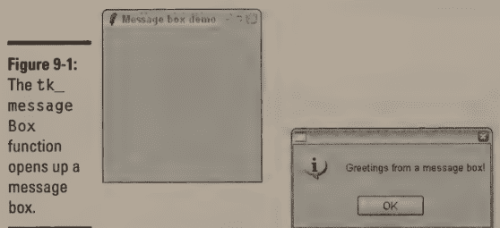

前面程序中的消息框的主要区别在于按钮的选择和图标的选择。我使用 -type 选项选择按钮，使用 -icon 选项选择图标。-type 选项的选项如下：

- abortretryignore：请不要使用这个选项。它已过时，用户看到时会感到不适。（至少我这个用户是这样。）
- ok：这是默认选项，因此如果省略 -type 选项，您将只得到一个“确定”按钮。
- okcancel：这将为您提供“确定”和“取消”按钮。
- retrycancel：如果您希望程序根据用户请求反复尝试某个操作，可以使用此类型。
- yesno：希望您的用户能够在“是”和“否”之间做出决定。
- yesnocancel：但是，如果他们无法在“是”和“否”之间做出选择，您也可以包含一个“取消”按钮。是，否？


## 显示标准位图

Tk 包含一些标准位图图标，您可以在 tk_messageBox 调用和 tk_dialog 调用中使用。以下是一些您可以尝试的示例，以查看它们的外观：

```
tk_messageBox -message "error" -icon error
tk_messageBox -message "info" -icon info
tk_messageBox -message "question" -icon question
tk_messageBox -message "warning" -icon warning
```

```
tk_dialog .mydialog "Important" "error"
error 0 "OK"
tk_dialog .mydialog "Important" "info"
info 0 "OK"
```

```
tk_dialog .mydialog "Important"
"question" question 0 "OK"
tk_dialog .mydialog "Important" "warning"
warning 0 "OK"
```

如果您在 Windows 电脑上尝试这些，您会看到 tk_messageBox 调用最终使用您习惯在消息框中看到的内置位图，而 tk_dialog 调用使用 Tk 独有的位图。（显然，tk_messageBox 利用了 Windows 的内置消息框功能，这些功能使用内置的 Windows 位图，从而阻止 Tk 选择自己的图像。）

## 选择目录

许多程序允许用户选择目录。例如，您可能正在为程序存储多个配置文件，并且希望用户指定文件存储位置。在这种情况下，用户不是选择文件名，而是只是选择一个目录。Tk 包含一个目录选择对话框，如图 9-2 所示。


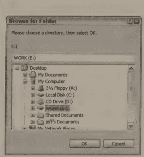

**图 9-2：** 目录选择器让用户，呃，选择一个目录。

以下是我用于为图 9-2 弹出对话框的代码：

```
wm title . "Directory chooser demo"

label .mylabel -text .
pack .mylabel -side top

button .mybtn -text "Directory..." -command {
  set result [tk_chooseDirectory -mustexist on -initialdir
  "/"]
  if {$result != ""} {
    .mylabel configure -text $result
  }
}
pack .mybtn -side top
```

这段程序会打开一个带有按钮的窗口。当用户单击按钮时，目录选择器就会打开。注意我是如何在按钮的命令代码内部打开目录选择器的：我调用了 tk_chooseDirectory，并传入了几个选项。

将 -mustexist 选项设置为 on，以确保用户选择的目录实际上存在。（此选项通常被设置；您不希望用户浪费时间输入一个不存在的目录。）-initialdir 选项让您选择一个起始位置。（提示一下：如果您使用的是 Windows 系统，请不要让目录从 Windows 目录开始。老实说，最终用户需要多频繁地访问那个目录？而且说到这个话题，请小心不要在可能在 Linux 系统上运行的 Tk 程序中将 Windows 特定目录硬编码。）

tk_chooseDirectory 函数返回一个包含用户选择的目录的字符串。在我的示例中，我将该字符串保存在 result 变量中。（如果用户单击取消，tk_chooseDirectory 将返回一个空字符串。）然后，仅仅为了证明我得到了目录名，我确保它不是空字符串，然后将标签的文本设置为目录名。

## 选择要打开的文件

文件打开对话框是用户看到的最常见的对话框之一（接下来的可能是以“此程序执行了非法操作...”开头的那个）。以下代码演示了如何显示文件打开对话框：

```
wm title . "Open file dialog demo"
label .mylabel -text .
pack .mylabel -side top
set filetypes {
{"some files" (*.txt *.abc) }
{"other files" ("*.def" "*.123") }
}
button .mybtn -text "File..." -command {
set result [tk_getOpenFile \
-filetypes $filetypes \
-defaultextension ".txt" -initialdir "/"]
if {$result != ""} {
.mylabel configure -text $result
}
}
pack .mybtn -side top
```

这段代码创建了一个按钮；当用户单击按钮时，文件打开对话框就会出现。为此，我调用 getOpenFile。我使用 -initialdir 选项为对话框选择一个初始目录。查看第一个 pack 命令后的名为 filetypes 的列表。这是一个列表的列表；注意我有一个左大括号 {，表示列表的开始，后面跟着另一个左大括号 {，表示第一个列表内的另一个列表。每个子列表包含一个字符串，以及另一个包含该类型可用文件扩展名的列表。这些项目将显示在名为“文件类型”的下拉列表框中。然后，要在 tk_getOpenFile 函数中使用此列表，我将列表传递给 -filetypes 选项。要开始运行，我选择列表中出现的默认文件类型，在这里是 .txt。

记住，此对话框并不实际打开一个文件。相反，它只是让用户选择要打开的文件，并返回文件名。您的程序必须自己负责使用通常的 open 命令打开文件；然后它可以相应地处理文件。

## 选择要保存的文件名

文件保存对话框在最重要对话框列表中排名第 3。或者可能是第 2。我不确定。不管怎样，以下是一个显示这个无处不在的对话框的示例：

```
wm title . "Save file dialog demo"
label .mylabel -text .
pack .mylabel -side top
set filetypes {
{"some files" {"*.txt" "*.abc"} }
{"other files" ("*.def" "*.123") }
}
button .mybtn -text "File..." -command {
set result [tk_getSaveFile \
-filetypes $filetypes \
-defaultextension ".txt" -initialdir "/"]
if {$result != ""} {
.mylabel configure -text $result
}
}
pack .mybtn -side top
```

此对话框的工作方式与文件打开对话框相同；如果您还没有这样做，请查看上一节“选择要打开的文件”，以了解不同选项的工作方式。


tk_getSaveFile 命令并不实际保存文件；它只是让用户选择一个文件名。由您的程序随后保存文件。您可以使用 open 命令和 puts 命令保存文件。

## 获取颜色

颜色选择器是一个方便的对话框。那些使用过早期 Macintosh 电脑的人还记得这个对话框是 Mac 上远远最酷的对话框，因为它在旧彩色屏幕上一次显示了数以亿计的颜色。仅那个对话框大概就卖出了 10,000 台 Macintosh 电脑。现在，其他操作系统也具有类似的对话框。Tk 的设计师不愿落后，已经为您提供了对这个对话框的访问权限。这是一个示例：

```
wm title . "Color box demo"
canvas .mycanvas -width 300 -height 300
pack .mycanvas -side bottom
label .mylabel -text Color
pack .mylabel -side top
```

```
button .mybtn -text "Set color..." -command {
    set result [tk_chooseColor]
    if {$result != ""} {
        tk_messageBox -icon info -message $result
        .mycanvas create rectangle 10 10 280 280 -fill
        $result
        .mylabel configure -text $result
    }
}
pack .mybtn -side top
```

这个程序很简单；它创建一个按钮，当用户单击按钮时，颜色选择器就会打开。当用户单击确定时，tk_chooseColor 函数返回颜色，我将其保存在 result 变量中。然后我在消息框中显示结果值，用该颜色绘制一个矩形，并将标签的文本设置为显示颜色值。

## 做出拯救生命的决定

### （或只是获取信息）

在本章的最后一节中，我向您展示如何创建一个自定义对话框。然而，您的选择相当有限；如果您想创建一个带有许多控件的复杂窗口，请参见第四册，第 7 章。

使用 tk_dialog 函数，您可以创建一个窗口，在其中指定标题栏、文本消息和几个带有您选择文本的按钮。用户选择其中一个按钮，tk_dialog 函数返回一个表示按钮索引的数字。这是一个示例：

```
wm title . "Modal dialog demo"

label .mylabel -text 1
pack .mylabel -side top

button .mybtn -text "Important..." -command {
    set result [
    tk_dialog .mydialog "Important" \
    "The computer has died. What to do?" \
    warning \
    2 \
    "Sleep" "Read" "Quit" "Eat" "Celebrate"
    ]
    if {$result != ""} {
        .mylabel configure -text $result
    }
}
```


}
}
pack .mybtn -side top
```

下面是其工作原理：

- 1. 按钮的命令会调用 tk_dialog 函数，首先传递一个对话框的名称（为什么需要这个名称，我不知道，但它是必需的，即使你之后不会再用到它）。
- 2. 接下来传递一个字符串，该字符串将出现在对话框的标题栏中。
- 3. 然后传递一个图标位图的名称。（随意使用预打包的位图之一。有关预打包位图的更多信息，请参阅本章边栏“显示标准位图”。）
- 4. 接下来添加一个数字，这是当用户在不选择任何按钮的情况下关闭对话框时，对话框返回的默认值。
- 5. 最后，包含你想在不同按钮上显示的所有字符串。只需逐个列出即可。

你可以在图 9-3 中看到这一切的样子。


## 第 10 章：十个有用的 Tcl/Tk 工具

### 本章内容

- Komodo
- Visual Tcl
- VisualGIPSY
- SpecTcl
- tkBuilder
- FastBase MySQL + Tcl 接口
- mysqltcl
- [incr Widgets]
- Tcl 开发工具包（附带 Web 浏览器插件）
- Tcl 开发者交换

Tcl 和 Tk 的美妙之处在于，由于两者都是免费的，你可以找到许多针对它们的免费优秀工具。不过，如果你愿意花一些钱，可以找到更多优秀工具。本章将介绍几种可以帮助你进行 Tcl/Tk 开发的工具，有些免费，有些收费。

### Tk GUI 设计器

由于 Tk 非常流行，许多人创建了可视化设计器，帮助你在窗口上以图形方式布局控件。本节列出了其中五个设计器。其中第一个实际上是由 ActiveState 创建的完整开发工具。

其余四个全部免费且性质非常相似：每个都包含一个用于输入 Tcl 代码的完整 IDE，并提供可视化布局小部件的方式，为你生成 Tcl 代码。因此，对于这四个工具，我将直接指引你到相应的网站，你可以下载这些工具亲自试用，找出自己最喜欢哪一个。

### Komodo

（收费。）这是一个功能强大的工具，可让你开发和调试程序。它包含一个非常出色的文本编辑器，可根据语法为你的代码着色。（这称为语法高亮。）它还包含一个项目窗口，让你可以在应用程序的文件之间快速导航。其余功能中包括一个完整的调试器，允许你跟踪代码并查找问题。你可以从 ActiveState 购买此工具，网址为 www.activestate.com/Products/Komodo/。

### Visual Tcl

免费！这是一个功能极其强大的工具，使布局控件和向控件添加代码变得极其容易。它拥有一个装满常用小部件（如框架、按钮等）的工具栏。此外，它还包含一个属性编辑器，允许你自定义窗口中的每个控件；使用它，你可以设置每个控件的属性，例如宽度、高度和颜色。请在 vtcl.sourceforge.net/ 找到它。

### VisualGUIPSY

免费！这个工具让你可以轻松地将控件拖放到表单上，然后使用对象检查器窗口设置控件的属性。此外，在许多其他功能中，它包含一个树形视图，让你查看控件的层级排列方式。（请记住，框架可以容纳其他控件，包括可以容纳其他控件的子框架。）请在 www.prs.de/int/products/vg/index.html 找到它。

### SpecTcl

免费！这是一个不错的程序，包含一些非常花哨的图标（查看网页即可了解我在说什么）。它让你创建一个新窗口，然后在窗口上拖放小部件，生成有效的 Tcl/Tk 代码。请在 spectcl.sourceforge.net/ 找到它。

### tkBuilder

免费！我在以前的工作中大量使用过这个工具。使用此工具，你可以创建窗口，并轻松将控件拖放到窗口上。程序会自动为你生成有效的 Tcl/Tk 代码。你可以在 sawpit.iwarp.com/ 找到它。

### 开发者工具

以下是一些可以帮助你进行 Tcl 编程的常规开发者工具。请注意，在前一部分“Tk GUI 设计器”中，我提到了 ActiveState 的 Komodo。该工具也可以归为此类。

### FastBase MySQL + Tcl 接口

免费！这是一个提供 MySQL 接口的工具。你可以在 www.fastbase.co.nz/fbsql/index.html 找到它。

### mysqltcl

免费！这是另一个提供 MySQL 接口的工具。这个工具也在官方 MySQL 文档中被提及，尽管我在这里提到的另一个工具（FastBase）至少与这个一样好。你可以在 www.xdobry.de/mysqltcl/ 找到它。

### [incr Widgets]

免费！这是一个包含大量额外 Tk 小部件的集合。我鼓励你去看看。该库随许多 Tcl 安装包一起提供，包括 ActiveState 的安装包。此外，你可以在 www.tcltk.com/iwidgets/ 在线找到它。

### Tcl 开发工具包（附带 Web 浏览器插件）

（收费）ActiveState 是 Tcl 世界的领先企业之一。除了 Komodo 工具外，它还提供一个名为 Tcl 开发工具包的优秀 Tcl 开发工具，其中包括一个允许你将 Tcl 程序打包为独立可执行二进制文件的功能；一个允许你在浏览器中运行 Tcl 的浏览器插件；以及更多功能。请访问 www.activestate.com/Products/Tcl_Dev_Kit/ 查看。

### Tcl 开发者交换

最后，这不是一个工具，而是一个 Tcl 工具网站。它是官方 Tcl 网站的一部分。在这里，你可以找到一个包含各种 Tcl 工具的巨大存储库，包括用 Tcl 编写的应用程序、额外库、GUI 设计器等等。请访问 www.tcl.tk/software/ 查看。

# 第 V 部分

## 用于动态内容的 PHP 网页

## 第 5 章 波 By Rich Tennant


> “在介绍诸如‘喝倒采不专心听课的学生’函数等更高级的过程之前，我们先从一些基础知识开始。”

## 目录速览

- 第 1 章：你可以用 PHP 做什么 ............................................347
- 第 2 章：编写服务器端脚本 ...........................................353
- 第 3 章：存储信息....................................................367
- 第 4 章：控制程序流程 ..........................................385
- 第 5 章：数组和函数 ....................................................401
- 第 6 章：与 HTML 交互 ...................................................417
- 第 7 章：高级 PHP 编程 .........................................435
- 第 8 章：创建图形 .........................................................453
- 第 9 章：使用类建模数据 ..............................................465
- 第 10 章：十种增强网站的方法 ......................................475

## 第 1 章：你可以用 PHP 做什么

### 本章内容

- 研究 PHP 的优点和缺点
- 发现 PHP 函数库
- 了解 PHP 应用

在本章中，我将讨论 PHP 的一些可能应用。
在考虑 PHP 的潜力——以及何时应该使用它时——请记住，PHP 是一种服务器端脚本语言。所有 PHP 处理都在 Web 服务器端进行，Web 服务器提供网页。除非有人在自己的客户端计算机上运行 PHP 处理器并手动通过它发送文件，否则所有 PHP 处理都在服务器端进行。

使用服务器端脚本语言可能会带来复杂性。例如，如果你编写的脚本需要进行大量处理（比如处理成百上千个文件和数百万次计算），如果每天有数千个客户端访问，你的 Web 服务器性能可能会下降。如果是这种情况，请强烈考虑通过使用客户端脚本或程序将处理转移到单个用户的机器上。

然而，通过在服务器端运行程序，你可以完全控制执行处理的计算机以及可用的库。例如，你不需要要求用户先下载一个完整的“语言运行时”（如 Java 那样），并期望他们在自己的计算机上运行它。因此，即使是配置最基本的机器——例如运行 Windows 95 和 Internet Explorer 3.0 的 486 计算机——也可能仍然可以访问你的网站，前提是你的 Web 服务器在 PHP 处理后发送的页面足够简单。此外，你不需要担心 PHP 的不同版本四处流动。无论什么浏览器和什么计算机连接到你的 Web 服务器，你的 PHP 代码都在 Web 服务器上运行，你控制在 Web 服务器上运行哪个版本的 PHP。这产生了大师们所说的平台独立性。


## Introducing PHP Function Libraries

PHP 之所以是一门如此强大的语言，原因之一在于它包含许多不同的模块（模块是附加到语言上的文件，以独立文件形式存在，PHP 在启动时加载），每个模块都有不同的用途。访问 www.php.net/manual/en/funcref.php 查看函数类别，这些类别按模块分组。（有关函数的详细信息，请参见第 V 编，第 4 章。）在在线文档中，这些函数类别用罗马数字编号。我得意地说，我的大脑可以轻松将罗马数字转换为更标准的阿拉伯数字（至少，嗯，借助我在网上找到的一个转换程序）。PHP 函数列表包含 113 个函数类别。（对于会看罗马数字的读者，这就是 CXIII。）

这些函数包括：

- 数据库访问函数
- 字符串转换和处理函数
- 用于文件传输的 FTP 函数
- 任意精度数学函数
- 文件和数据库函数
- 用于创建 PDF 文件的 PDF 函数
- 用于创建图形图像的图形函数

例如，PHP 程序可以使用 PDF 和图形函数创建 PDF 文件或 GIF 图像，并将这些文件或图像发送到客户端计算机。使用 GIF 图像，这意味着你可以让程序即时生成图形，而不是在 Web 服务器上存储图形文件，从而动态创建图形。例如，你可以创建一个柱状图，显示当前统计数据，例如在线投票的结果。创建 PDF 文件的程序可以使用下载文件的人的姓名和文件创建时间来自定义 PDF。

但是，在使用这些各种函数时，有一个小问题：其中一些需要一个外部软件（称为库），该库必须存在于你的 Web 服务器上。例如，虽然 GIF 函数是 PHP 安装的标准部分，但 PDF 生成例程需要 PDFlib，这是一个商业库。查阅在线手册，查看运行特定类别中的函数需要哪些库（如果有的话）。

如果你想探索 PHP 的 PDF 功能，可以访问 www.php.net/manual/en/ref.pdf.php。该页面包含几个示例，以及描述 PDFLib 库的页面链接。

在本书中，我只介绍不需要特殊库的函数类别。（例外情况在第 VI 编中，我讨论了 PHP 与 MySQL 的配合使用。要在 PHP 中使用 MySQL 函数，你需要安装 MySQL，这是一个单独的安装。）如果你有兴趣使用其他库，PHP 在线手册（www.php.net/docs.php）提供了你要找的信息。

## Adding Dynamic Content

PHP 最重要的应用是动态内容。使用 PHP，你可以创建根据不同标准（例如用户是谁或用户正在查找什么信息）提供定制页面的 Web 网站。

例如，假设你正在编写一个页面，允许你的 Web 服务器用户编写电子邮件消息。用户将电子邮件消息输入到编辑框中，然后单击“发送”。现在假设打开另一个页面，显示电子邮件收件人的姓名以及消息已发送的友好确认。你如何生成显示收件人姓名的页面？

创建网站时，你无法创建数百万个 Web 页面，每个页面都有不同的收件人姓名，然后在用户输入消息后再挑选正确的那个。这就像让一百万只猴子独自面对一台打字机一百万年，看看它们是否会不小心写出一部莎士比亚戏剧。相反，你想要动态生成一个打印出收件人姓名的 Web 页面。

相反，你想要创建一个动态构建每个 Web 页面的 Web 网站，用相关信息（例如用户正在查看的当前电子邮件消息）填充它。你如何做到这一点？通过 PHP！

当你编写 PHP 代码时，你正在编写一个在 Web 页面中运行的程序，该程序可以修改页面，根据需要对其进行定制。这就是动态内容的含义。

例如，请查看以下的 todaysdate.php 文件：

```html
<html>
<head>
<title>Today's Date</title>
</head>
<body>
Greetings! Today is
<?php
$today = getdate();
$month = $today['month'];
$mday = $today['mday'];
$year = $today['year'];
print " $month $mday, $year\n";
?>
</body>
</html>
```

此文件使用了一些高级 PHP 技术——调用函数——我将在第 V 编，第 4 章中介绍。此 PHP 程序首先确定当前日期是什么（即 `getdate()` 部分），并将其存储在名为 `$today` 的存储桶中。然后，接下来的三行分离存储在 `$today` 存储桶中的日期信息，将月份部分保存在名为 `$month` 的存储桶中，日期保存在名为 `$mday` 的存储桶中，年份保存在名为 `$year` 的存储桶中。这些存储桶称为变量，我将在第 V 编，第 3 章中详细解释。如果你想了解更多关于内置于 PHP 中的 `getdate` 函数的信息，请查看 www.php.net/getdate。

分离日期信息后，程序打印日期。为此，我使用一种特殊技术，允许你通过将变量名放在字符串内部来打印变量。当程序运行时，它打印的不是 `$month`，而是 `$month` 变量中存储的信息。

当你处理此脚本时，会得到以下 HTML 文件：

```html
<html>
<head>
<title>Today's Date</title>
</head>
<body>
Greetings! Today is
December 31, 2003
</body>
</html>
```

虽然此日期显示为 2003 年 12 月 31 日，但当你运行 PHP 代码时，你会看到当前日期。

请考虑一下：发送到客户端的 HTML 文件是一个日期被硬编码的静态（不变）文件。如果你明天再次运行，你会得到一个不同的 HTML 文件，其中明天的日期被硬编码。换句话说，这个单一的 PHP 程序导致 Web 服务器提供一个针对当前日期定制的不同 HTML 页面。这就是动态内容。

## Running Types of Applications

动态内容的想法打开了一个可能性的世界。你不再需要逐个输入每个 HTML 页面并说：“就这样！你得到的就是这个！”相反，你可以根据当前情况即时构建 Web 页面。在接下来的章节中，我将提供你可以使用 PHP 做的许多事情中仅几个事项的大致概念。

### Creating math and engineering applications

PHP 语言包含一组用于数学目的的函数。这些函数包括 BCMath 类别的函数，它们提供任意精度数学。如果你是科学家或工程师，或者与这样的人一起工作，你可以体会到这一点的重要性。通常，当你使用计算机进行数学运算时，你会遇到大小限制。例如，整数有其可以达到的大小限制，浮点数（即包含小数点的数字）有其可以包含的有效数字数量的限制。但是使用 BCMath 库，你可以拥有无限精度。（好吧，理论上，你可以有一个包含数百万位数字的数字，从而耗尽计算机的所有内存，但对于大多数工作，你不应该遇到任何问题或限制。）


你可以通过访问 www.php.net/bc 了解更多关于 BCMath 库的信息。

PHP 在其 Math 类别中包含一组更传统的数学函数。此类别包含太多函数，我无法在此列出，但这些函数包括 cos（余弦）、sin（正弦）、sinh（双曲正弦——大多数微积分课程跳过的那些难以捉摸的东西）、log（自然对数）、min 和 max（用于最小值和最大值）、rand（用于随机数）等等。


你可以通过访问 www.php.net/math 探索传统的数学例程。

对于科学和工程（以及其他）应用程序，你还有一个我在本章前面提到的图形例程库。此外，你还可以访问各种第三方库（有些免费，有些不免费），它们提供额外的数学功能。例如，一个名为 PEAR 的免费库（在许多 PHP 安装中是标准配置）包含一个处理复数的库。


## 设计数据库应用程序

PHP的一个强大方面是它能够与各种数据库交互。大多数使用PHP的人使用MySQL数据库，这也是本书重点关注的数据库。

使用数据库，你可以存储大量信息，并使用PHP，你可以让你的网站用户访问这些数据。例如，你可能有一个包含网站用户偏好的数据库，例如内容布局或字体颜色。你将此信息存储在数据库中。然后当用户连接到你的网站并使用用户名登录时，PHP会在数据库中查找用户的偏好。

PHP动态生成网页，因此，例如，如果你想提供自定义字体颜色，你会包含PHP代码，该代码在HTML中写出一个FONT标签，其中包含用户偏好中选择的颜色。然后当客户端计算机接收到网页时，它包含已经硬编码的颜色信息。

同样，你可以从数据库中检索更复杂的信息。例如，假设一所大学想在其网站上包含一个办公室目录。它希望用户能够在在线目录中输入姓氏，然后查看显示具有该姓氏的教授列表的网页，以及电子邮件地址和办公室位置。你可以轻松使用PHP完成此操作：你获取请求的姓氏，执行数据库搜索，并检索表中姓氏列包含请求值的所有行（行是记录的首选术语）。

然后动态内容开始。在你的PHP代码中，你显示一行包含程序在数据库中找到的教授姓名、电子邮件地址和办公室位置的HTML。你可能会使用HTML表格来仔细格式化数据。你甚至可能会包含一个带有mailto: HREF的锚标签<A围绕电子邮件地址，以便用户可以单击链接向该地址发送电子邮件。所有这些动态HTML都由你的PHP代码决定，它显示格式化后的HTML；数据库中的数据不包含任何HTML代码——只有数据。再次强调，这就是动态内容的含义。

## 第2章：编写服务器端脚本

### 本章内容

- 探索PHP处理器
- 创建PHP脚本
- 使用适当的文件扩展名
- 在PHP脚本中嵌入HTML
- 处理PHP代码中的错误

在空闲时间冲浪上网时，你偶尔会遇到要求先登录的网站。如果你查看此类网站的HTML源代码，你可能会期望看到一个愚蠢的小型JavaScript程序，其中密码被硬编码在脚本中。但事实是，大多数（更好的！）网站不会使用如此简单的脚本。

简单的JavaScript程序是一个*客户端脚本*，意味着代码在用户的计算机上运行——即客户端计算机。这些脚本可被网上冲浪者自由读取。在客户端计算机上运行脚本的替代方案是使用服务器端脚本。*服务器端脚本*是运行在服务器上的程序，服务器是向用户提供网页的计算机。当你登录服务器时，服务器会运行其自身的脚本，包括测试密码的脚本。

有多种语言可用于服务器端脚本，但至少只有一种语言允许你将脚本直接写入HTML文件。这种语言称为PHP，它是PHP: Hypertext Preprocessor的缩写。没错，字母*P*代表PHP，这是一个缩写，其首字母代表PHP，如此类推……嗯，你明白我的意思。离奇吗？是的。真实吗？仍然是。

PHP是一个*预处理器*，因为它在Web服务器提供HTML页面之前处理HTML文件。通常，如果没有PHP，Web服务器会收到来自客户端计算机（网上冲浪者的计算机）对特定文件的请求，然后服务器会原样发回页面。但如果存在PHP，首先PHP预处理器会读取HTML文件，查找用PHP语言编写的语句。然后它执行这些语句，并输出可能看起来不同的最终HTML页面。Web服务器随后会将此页面发送到客户端计算机。图2-1向你展示了此过程。（注意，在这本小书中，我将PHP“处理器”简称为processor，仅仅是因为它比preprocessor短一点。）


学习PHP时，请记住，你正在编写一个由PHP预处理器处理的文件，并且处理器的输出是一个有效的HTML文件。牢记这一点将有助于你在开发过程中保持理智，因为有时你会觉得自己在距离实际HTML文件几步之遥的某个抽象级别上工作。确实如此，有时这会让人感到有点乏味。但别担心；我会帮助你度过难关。


进行大量PHP开发时，你应该能够访问在线PHP手册。此手册是你手中《傻瓜书》的绝佳补充。你可以在www.php.net/docs.php找到它。从那里，你可以以多种语言和各种文件格式访问手册。对于在线HTML格式的英文版本，你可以直接访问www.php.net/manual/en/。顺便说一句，你可能已经从这些URL中注意到，PHP的主页是www.php.net。

图2-1：PHP处理器读取包含PHP代码的文件，并输出一个有效的HTML文件。

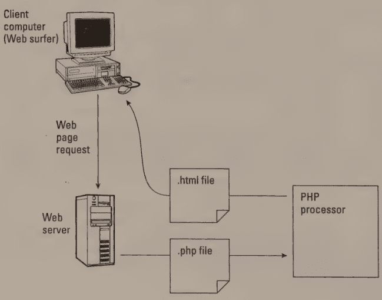

## 引用自指引用

缩写PHP指代自身（即PHP: Hypertext Preprocessor）的想法可能看起来有点离奇。人们称这种缩写为自指或递归缩写。事实上，这说不太通。你同样可以称之为ZHP，并声称它代表ZHP: Hypertext Preprocessor。但事实是，缩写PHP最初代表Personal Home Page。但随着语言的发展，人们意识到Personal Home Page这个名称不够描述性。因此，他们决定将名称改为更有意义的东西。HP部分很简单，即Hypertext Preprocessor。但是，哦，那个首字母P该怎么办呢？显然他们想不出一个好名字，所以把它变成了递归缩写。现在P根本不代表任何东西！

### 探索PHP处理器

PHP处理器是一个独立于Web服务器软件运行在Web服务器上的独立程序。当Web浏览器请求服务器上以.php结尾的文件时，Web服务器软件会调用PHP处理器，并将包含PHP代码的HTML文件传递给处理器。

PHP处理器以文件名作为输入，并输出一个新文件。它将文件写入标准输出，这意味着如果你从命令行（例如Unix或Linux）运行PHP程序，你会直接在屏幕上看到输出。

由于PHP是一个独立程序，没有什么能阻止你从命令提示符运行它，传入包含PHP代码的文件，并查看生成的HTML。下面是一个快速的PHP会话。使用我最喜欢的文本编辑器，我创建了一个如下所示的文件：

```php
<?php
    print "Hi\n";
?>
```

这是一个简单的PHP程序，用于输出一条Hi消息。第一行告诉PHP处理器后面跟着PHP代码。下一行告诉PHP处理器打印某些内容，在这里，就是单词Hi后跟一个换行。该行以分号结尾，<?php和?>标签内的所有PHP行都以分号结尾。最后，?>告诉PHP处理器PHP代码结束。

我将此文件保存为myfile.php。接下来，我在Linux命令提示符下键入以下行：

```
php myfile.php
```

PHP处理器读取myfile.php文件，并在屏幕上显示以下输出（如果你使用的是不同版本的PHP，可能会看到不同的数字）：

```
X-Powered-By: PHP/4.1.2
Content-type: text/html

Hi
```

你可以看到处理器输出了单词Hi。它还输出了一个回车，即双引号中的\n。（\n代表换行。）

但是输出开头那些垃圾是什么？输出开头的这些“垃圾”行告诉浏览器接下来是什么类型的信息。在这里，接下来是HTML，这就是text/html的含义。另一部分X-Powered-By告诉HTML是如何生成的，以防浏览器想要这些信息。

假设你将myfile.php文件放在Web服务器上，然后在客户端计算机上浏览到.php文件，如下所示：

```
www.jeffcogswell.com/myfile.php
```

你会在Web浏览器中看到单词Hi出现。现在当你在Web浏览器中查看文件源代码时，你会看到：

```
Hi
```

输出末尾包含一个换行，完全符合PHP程序的要求。这变得相当不错了！

要处理.php文件，Web服务器上必须存在PHP处理器。Web服务器还必须配置为通过PHP处理器发送.php文件。

你不能简单地在浏览器中打开.php文件。如果你在计算机上存储一个本地.php文件并在浏览器中打开它，浏览器会将其视为.html文件并忽略你的所有PHP代码。

如果你想在家尝试一些PHP，可以使用以下两种方法之一：


## 启动和结束 PHP 代码

- 通过 PHP 处理器手动运行 .php 文件，并将生成的代码保存到 .html 文件中。然后，你可以在 Web 浏览器中打开该 .html 文件。

- 确保你在本地计算机上安装了 Web 服务器，然后例如使用 http://localhost/myfile.php 连接到 Web 服务器。

请查看前一节中的示例 PHP 脚本 myfile.php。请注意，第一行是 `<?php`，最后一行是 `?>`。这些是 PHP 处理器用于识别有效 PHP 代码起始位置所查找的 HTML 标签的开始和结束。这样一来，你就可以创建一个 .html 文件，该文件除了 HTML 代码外，还可能包含一些 PHP 代码。如果没有 PHP 代码，PHP 处理器会原样复制文件并将其发送到 Web 服务器，Web 服务器再将文件发送到客户端。通常，这种没有 PHP 的文件只是一个带有 HTML 标签的 .html 文件。但是，如果文件包含任何 PHP 代码，则代码会放在 HTML 标签内。该标签以 `<?php` 开头，以 `?>` 结尾。


虽然在这本书中，我用 `<?php` 开头编写 PHP 代码，但你也可以采用其他方式。PHP 处理器会根据处理器的配置情况，判断 PHP 代码的开始和结束位置。有些人直接使用 `<?` 和 `?>`（没有 php）作为开始和结束标签。我在自己的网站上也这么做，因为我知道该网站上的 PHP 处理器配置允许仅使用 `<?` 和 `?>`，这让我的编码速度稍快一些。（嘿，多出来的这三个字符长期来看也累不少。）PHP 提供了四种可能的方式来开始和结束 PHP 代码：

- `<?php . . . ?>`
- `<script language = "php"> . . . </script>`
- `<? . . . ?>`
- `<% . . . %>`

前两种技巧始终有效。第二种写起来比第一种花费的时间稍长，但更符合 HTML 标准。第三种只有在配置后才能生效（而且我更偏好它）。（要配置它，你必须在 php.ini 文件中设置一个选项；请参阅侧边栏“配置配置文件”。）最后一种技巧有点别扭，但其存在是为了符合运行 Microsoft Active Server Pages（ASP 或 ASP.NET）的服务器，这些服务器通常与 Microsoft FrontPage 配合使用。

## 配置配置文件

PHP 包含一个名为 php.ini 的配置文件。该文件包含 PHP 处理器的一组选项。该文件是文本文件，因此可以使用任何文本编辑器轻松编辑。文件由多行组成，每行指定一个选项。（熟悉该文件的最佳方法是在文本编辑器中打开并浏览一遍。它包含大量文档，解释每行的作用。）你可以在以下位置找到 php.ini：

- Unix/Linux：该文件位于 /usr/local/lib 或基础安装目录下的 lib 目录中。
- Windows：该文件位于 Windows 目录中。但是，如果你正在运行 Apache，可以将配置文件移动到 Apache 主目录，即 c:\\program files\\apache group\\apache。

一个有用的选项是指定是否可以使用 `<?` 和 `?>` 标签来开始和结束 PHP 代码。我喜欢能快速输入 `<?` 而不是 `<?php`，因此我启用了此选项。以下是你需要在 php.ini 文件中包含的行：`short_open_tag = On`

要在不删除行的情况下“取消包含”一行，请在行首加上分号；PHP 处理器会忽略该行。例如，要关闭短标签选项，请将该行更改为：`;short_open_tag = On`

为什么要关闭此选项？因为 `<?` 和 `?>` 标签与真正的 XML 不兼容（如果你在意这一点的话）。

REMEMBER 你可以使用 PHP 安装中可用的任何技巧，并且在这些技巧中，使用让你最舒适的那种。请记住，PHP 代码在服务器端处理，输出始终是 HTML。最终，客户端计算机只接收一个 .html 文件。这意味着你不需要担心客户端运行的是哪种类型的浏览器。

## 使用适当的文件扩展名

当你保存 PHP 脚本时，为文件提供 .php 扩展名。此扩展名很重要，因为它告诉 Web 服务器软件该文件包含 PHP 代码。当 Web 服务器看到此扩展名时，服务器会将文件传递给 PHP 处理器进行预处理，然后通过 Internet 发送结果。

TIP 程序员常犯的一个错误是忘记使用 .php 扩展名，而是使用 .html 或 .htm 等标准 HTML 扩展名。这是一个问题，因为如果 Web 服务器看到这两个扩展名之一，它不会将文件发送到 PHP 处理器。相反，它只是原样发送文件。

例如，假设你有一个名为 phoops.html 的文件，内容如下。（请注意，我为其指定了 .html 扩展名，而不是 .php 扩展名。）

```
<?php
 print "Hi\n";
 ?>
```

然后，你通过输入类似 www.jeffcogswell.com/phoops.html 的地址，将浏览器指向此文件。

顺便说一句，这是一个真实网站。如果你想查看，我已将此文件上传到我的 jeffcogswell.com 网站。

当浏览器打开页面时，你看到……什么都没有！这是因为当浏览器看到以 `<?php` 开头、以 `?>` 结尾的标签时，浏览器不识别该标签，只会忽略其中的内容。那么还剩下什么？什么都没有！所以浏览器窗口中什么都不会显示。

还要注意，如果你在浏览器中查看页面源代码，你看到的仍是同一个 phoops.html 文件；PHP 代码仍然存在于文件中，因为 PHP 处理器没有运行。

如果你通过将文件扩展名更改为 .php（例如 phixed.php）来修复文件扩展名，则该文件会被 PHP 处理器处理，你会在浏览器的 HTML 源代码中看到单行 Hi。你可以在 www.jeffcogswell.com/phixed.php 上看到这种情况。

使用 PHP 的一个原因是提供服务器端代码，使得浏览 Web 的人无法看到。如果你忘记使用 .php 扩展名，而改用 .html 或 .htm，那么你的所有（可能是机密的）代码都会发送到 Web 冲浪者的计算机上，如果他们查看 HTML 的源代码，就能看到每一行代码。所以请记住使用 .php 扩展名！

## 将 PHP 转换为 HTML

由于 PHP 脚本的目的是生成浏览器可读取的 .html 文件，请确保你的 PHP 输出尽可能易于阅读——无论是对你还是对浏览器。道理不难理解，对吧？

因为 .php 文件包含嵌入在以 `<?php` 开头、以 `?>` 结尾的标签中的 PHP 代码，因此 PHP 代码可以被视为一个简单的 HTML 标签；它以 `<` 开头，以 `>` 结尾。但是，对于文件中 `<?php ?>` 标签之外的其他部分，PHP 处理器会做什么呢？答案是什么都不做。PHP 处理器根本不会修改那些部分。

请看这个文件，我将其命名为 myfile2.php：

```
<html>
<head>
<title>Better Example</title>
</head>
<body>
<?php
print "Hi";
?>
<br>
</body>
</html>
```

这是一个有效的 .html 文件，其中嵌入了一个 PHP 程序。PHP 程序位于中间，在 `<?php` 和 `?>` 标签内。文件的其余部分是基本 HTML。请注意该文件的两点：

- PHP 代码中的 `print` 语句中没有 `\n`。
- PHP 代码后面跟着一个 `<br>` 标签，它表示 HTML 中的换行。

请仔细思考：PHP 处理器读取此文件并发送出一个有效的 HTML 文件。文件中不属于 PHP 代码的每个部分都保持不变。但是，PHP 部分作为脚本执行，在此示例中，该脚本会输出单词 Hi。处理后，HTML 文件中的 PHP 代码将被此输出替换。

PHP 处理器运行后，生成的 HTML 文件如下所示：

```
<html>
<head>
<title>Better Example</title>
</head>
<body>
Hi        <br>
</body>
</html>
```

之前包含 PHP 代码的部分已被 PHP 代码的输出替换。输出内容是单词 Hi。

但这里可能看起来有点奇怪。请注意，`<br>` 标签（它是原始 `.html` 文件的一部分，而不是 PHP 代码的一部分）与单词 Hi 在同一行上，并且间隔较宽。这是为什么呢？这是因为


我在 PHP 代码中没有放换行符。因此 PHP 代码被 PHP 代码的输出所替换，其输出仅仅是两个字符 Hi。这两个字符不包含任何缩进，也不包含任何换行符。

单词 Hi 正好从 `.php` 文件中 `<?php` 所在的位置开始。而单词 Hi 后面紧跟着一组空格，这些空格原本位于 `<br>` 行上。

如果你眼尖，可能会注意到我刚才说的内容中有个漏洞。从技术上讲，在原始 myfile2.php 文件中，PHP 代码结束后（紧跟在 `?>` 之后）有一个换行符——一个 HTML 换行符——但它没有出现在输出中。为什么最终输出中没有包含这个换行符？老实说，我不知道。显然，PHP 处理器认为那个换行符也是 PHP 代码的一部分。自己琢磨吧。

现在，当你在 Web 浏览器中打开这个文件时会发生什么？到这时你可能已经意识到，查看文件的最简单方法是将浏览器指向托管 PHP 处理器的 Web 服务器上的 myfile2.php 文件。例如：www.jeffcogswell.com/myfile2.php。

如果你查看 Web 浏览器看到的文件的源代码，你会看到前面的 .html 文件。此外，在浏览器内部，你会看到一个简单的单词：Hi。浏览器窗口的标题是 Better Example，这是在 `<title>` 标签中定义的。


## 在 PHP 和 HTML 中处理换行符

要了解 PHP 程序中换行符的工作原理，请查看以下 newlinedemo.php 文件：

```
<html>
    <head>
        <title>Newline Demo</title>
    </head>
    <body>
        <?php
        print "Hi\n\n\n";
        ?>
        there<br>everybody
    </body>
</html>
```

当你将浏览器指向此文件时（例如 www.jeffcogswell.com/newlinedemo.php），PHP 处理器会读取 newlinedemo.php 文件并写入以下文件，该文件将发送到你的浏览器：

```
<html>
<head>
<title>Newline Demo</title>
</head>
<body>
Hi
there<br>everybody
</body>
</html>
```

注意单词 Hi 后面出现的空行。这些是 print 字符串中 \n 产生的换行符。下一行 there<br>everybody 保持原样，与原始 newlinedemo.php 文件中的一样。

浏览器中显示的内容如下：

```
Hi there
everybody
```

`<br>` 起了作用：在单词 there 和 everybody 之间出现了一个换行符。但是单词 Hi 后面的所有换行符怎么办？要回答这个问题，你需要知道浏览器始终将空白字符显示为一个空格。这里的空白字符是指 HTML 文件中的空格、制表符和换行符，无论多少个都可以。虽然浏览器在 HTML 文件中看到了四个换行符，但浏览器只显示一个空格。因此，单词 Hi 和 there 之间不是由任何换行符分隔，而是由一个空格分隔。


以下是关于换行符的规则：

- 当你在 PHP 代码的 print 语句中放入一个 \n 时，你会在生成的 .html 文件中得到一个换行符。包含此类换行符的目的通常是使生成的 HTML 代码看起来更整洁。
- .html 文件中的多个换行符会在浏览器窗口中变成一个空格。
- 如果你希望在浏览器窗口中出现换行符，请使用 <br> 标签。

## 在 PHP 脚本中嵌入 HTML

如果你想更花哨，在处理换行符时还可以考虑另一种选择。你可以在 print 语句中放入一个 <br> 标签。下面是另一个演示这一点的换行符示例，我将其称为 newline demo2.php：

```
<html>
<head>
<title>Newline Demo 2</title>
</head>
<body>
<?php
print "Hi<br>";
?>
there<br>everybody
</body>
</html>
```

我在 print 语句的字符串中放入了一个 `<br>` 标签。记住，你可以在字符串中打印出任何你想要的内容，但你在字符串中放入的内容就是生成的 HTML 文件中显示的内容。以下是生成的 HTML：

```
<html>
<head>
<title>Newline Demo 2</title>
</head>
<body>
Hi<br>    there<br>everybody
</body>
</html>
```

注意 `Hi<br>` 部分，这是 PHP 代码打印的字符串。（当然，`<br>` 后面跟着更多空白字符。真糟。浏览器如何解释这一点？它会忽略空白字符，因为它们跟在 `<br>` 之后。）浏览器中显示的内容如下：

```
Hi
there
everybody
```

这一次，由于文件中的 `<br>` 标签，浏览器中单词 Hi 后面出现了一个换行符。

生成的 HTML 并没有尽可能整洁。如果单词 there 位于下一行，并且与单词 Hi 缩进对齐，这样人类阅读起来会更容易，那将是件好事。

## 清理转换后的 PHP 脚本

通过使 HTML 代码看起来更好，你可以更容易地找到其中可能存在的问题。下面是 newline demo2.php 文件的一个修改版本，称为 newline demo3.php；这个程序只是在 print 语句的末尾添加了一个 \n。这个文件生成一个稍微整洁一些的 .html 文件，尽管这个更整洁的 .html 文件在浏览器中看起来与前一部分的 newlineDemo2.php 文件没有任何区别。

```
<html>
<head>
<title>Newline Demo 3</title>
</head>
<body>
<?php
    print "Hi<br>\n";
?>
there<br>everybody
</body>
</html>
```

以下是 newlineDemo3.php 生成的 .html 文件：

```
<html>
<head>
<title>Newline Demo 3</title>
</head>
<body>
Hi<br>
there<br>everybody
</body>
</html>
```

我想你可以进一步论证进行更多清理，例如在原始 HTML 中单词 everybody 之前插入一个换行符。但重点是，由你来编写 .php 文件，使 PHP 易于阅读，并且生成的 HTML 清晰易懂。

## 如果可以用 HTML 完成，为什么还要使用 PHP？

到这时，你可能会提出一个合理的问题：如果你可以自己直接编写 HTML 文件，为什么还要使用 PHP 来生成 .html 文件呢？通过本章中的示例，你当然可以只输入 HTML 而忽略 PHP 来节省大量工作。但这是因为在这些简单的示例中，无论加载多少次，每个 PHP 文件始终生成相同的 HTML 文件。然而，使用 PHP 可以做的事情远不止于此

## 处理 PHP 代码中的错误

因为 PHP 是一种脚本处理器，可让你生成 HTML 页面，你可能会对错误感到好奇。如果你在 PHP 代码中犯了错误，会发生什么？

答案令人不安：错误消息会出现在生成的 HTML 页面中。这意味着连接到你站点的用户会直接在他们的 Web 浏览器屏幕上看到所有错误消息。

假设这是你的 PHP 文件：

```
<html>
<head>
<title>Error Demo!</title>
</head>
<body>
<?php
(as=*#fa!@#
?>
there<br>everybody
</body>
</html>
```

该文件中的 PHP 代码由几个随机字符组成，碰巧这些字符并没有构成一个有效的 PHP 程序。如果你尝试在浏览器中打开此文件，你（以及你网站的任何访问者）会看到以下内容：

Parse error: parse error in /home/jeffcogs/public_html/errordemo.php on line 7

此错误消息直接出现在浏览器中。

因此，与任何其他程序一样，请始终通过将 PHP 代码放在 Web 服务器上并通过浏览器请求来测试你的 PHP 代码。然后你可以看到错误，并回到代码中修复它们。

## 探索一些 PHP 基本规则

为了结束本章，以下是 PHP 语言的一些快速基本规则：

- 使用分号结束你的语句。你可以在本章的示例中看到我是如何做到的。


- 请记住，PHP 处理器区分大小写。这意味着如果你想使用 print，就不能写成 PRINT。
- 在单个 .php 文件中可以包含多个 `<?php ?>` 标签，并在每个标签内放置代码。
- 请记住，PHP 不是编译型语言，而是解释型语言。这意味着你对 .php 文件所做的任何更改都会立即生效。例如，与 C++ 不同，你不需要编译程序来查看更改。
- 你可以通过以下三种方式提供注释：
  - 可以用井号 # 开头注释，如同 Unix 脚本。
  - 可以用两个正斜杠 // 开头注释，如同 C++。
  - 可以用 /* 和 */ 包裹注释，如同 C 和 C++。

以下代码演示了三种注释：

```
<?php
print "Hello<br>"; // This is a comment
print "Hi"; # And this is a comment, too
/* And this is also a comment */
?>
```

## 关于 PHP 的帮助

PHP 官方网站是获取 PHP 信息的绝佳来源。该网站包含完整的 PHP 文档，且会持续更新。你可以在线查看文档，也可以下载多种格式的文档。（对于我的 Windows 系统，我喜欢 .chm 格式，这是一种 Windows 帮助文件。）PHP 主站点是 www.php.net。文档可在 www.php.net/docs.php 查看。

在使用 PHP 过程中，你会发现大量内置函数可供使用。如果你想查找特定函数的在线信息，请将 Web 浏览器指向 www.php.net/functionname，其中 *functionname* 是函数名。例如，要获取 echo 函数的帮助，请访问 www.php.net/echo。

## 第 3 章：存储信息

### 本章内容

- 为变量命名并在其中存储信息
- 确定变量是否存在
- 处理表达式
- 处理位和类型
- 编程字符串

与任何语言一样，PHP 允许你存储信息。如果一台电脑不能记住事情，那它还算什么电脑？（答案：健忘的电脑！）存储信息最基本的方式是通过变量。

**注意：** 本章假设你已基本了解变量是什么，并会为你提供在 PHP 中使用变量所需的知识。如果你不确定变量是什么，请查阅第 III 册第 2 章，其中我介绍了变量的概念。尽管第 III 册讨论的是 Perl 语言，但相关信息几乎适用于任何语言。

### 命名变量

在 PHP 中，变量名以美元符号 $ 开头。这与 Perl 等语言处理变量的方式类似，与 C++ 等语言处理变量的方式不同。美元符号之后可以跟一个字母或下划线，之后可以跟任意数量的字母、数字或下划线。PHP 对变量名长度没有限制。

在 PHP 中，变量名区分大小写。这意味着变量 $MyName 与 $myname 是不同的变量。如果你使用过 BASIC、Pascal 或 SQL 等语言，这对你来说是新的，但如果你来自 C++ 或 Perl，你可能已经习惯了这一点。

从技术上讲，美元符号 _并非_ PHP 中变量名的一部分。美元符号只是告诉 PHP 处理器后面跟着一个变量名。然而，在本书全文中，当我在文本中提到变量时，我会加上美元符号，以提醒你在代码中需要它。

以下是 PHP 中有效变量名的示例：

- $abc
- $abc1
- $ABC
- $LotsOfMoney
- $_name
- $my_name_its_a_great_name

以下是 PHP 中不允许使用的名称示例：

- $2abc 无效，因为它以数字开头。
- $123 无效，因为它以数字开头。
- $T(x 无效，因为它包含括号。你只能使用字母、数字和下划线。
- 单独的 $ 无效，因为美元符号不是变量名的一部分，因此这里没有变量名。

尽管你可以将 PHP 内置名称（如 $print）用作变量，但我强烈建议你不要这样做。虽然这不会给 PHP 处理器带来麻烦，但会使程序对我们凡人来说更难以阅读。

从其他语言转过来的程序员常犯的一个错误是在输入变量名时忘记加美元符号。如果你省略了美元符号，PHP 处理器会认为你在尝试使用函数名，从而感到困惑。

### 在变量中存储信息

变量的目的是保存信息。变量是一个带有名称并内部存储某段信息的存储容器。你放入变量中的信息通常关联有一种类型，例如整数或字符串（字母、数字或其他字符的序列）。

PHP 是计算机科学家所说的弱类型语言。这意味着当你创建变量时，不需要指定变量持有的数据类型。许多其他语言要求你为变量指定数据类型。例如，表示银行账户余额的变量会被指定为数值数据类型。无论好坏，这种指定会阻止除数字以外的任何类型数据存储在该变量中。然而，PHP 并不那么挑剔；你不需要指定类型，也不需要预先声明变量。你可以先放入一个数字，随后放入一串字符。这无关紧要。

以下是一行 PHP 示例，它将数字 42 存储在名为 $universe 的变量中：

```
$universe = 42;
```

换句话说，这行代码创建了一个名为 $universe 的变量，然后将数字 42 放入其中。等号左侧指定变量名 $universe，等号右侧指定你放入变量的值。

尽管我说这行代码创建了一个名为 $universe 的变量，请记住，这只是完整程序中的一行代码。当 PHP 处理器运行你的程序时，第一次遇到变量名 $universe 时会创建该变量。之后，变量 $universe 就存在了，在后续遇到该变量名时，PHP 处理器不会再创建新变量。

以下是包含此 $universe 行的完整 .php 文件：

```
<?php
    $universe = 42;
    print $universe;
?>
```

当 PHP 处理器处理这段代码时，你最终得到的 HTML 包含单个数字 42。

我知道我之前说过，但理解这一点至关重要：这个 PHP 程序并不仅仅是打印出数字 42！相反，这个 PHP 程序创建了一个包含单个数字 42 的 .html 文件。如果你想使用“打印出数字 42”这种说法，可以将程序视为“将数字 42 打印到 .html 文件中”。

### 了解数据类型

PHP 语言包含四种可存储在变量中的基本信息类型：

- 布尔值：这是一种简单类型，可以是 true 或 false。
- 整数：这是一种用于整数的类型，包括负数、0 和正数。
- **浮点数**：这是一种用于包含小数点的浮点数的类型。
- **字符串**：这是一种用于字符串的类型。

（请记住，单个变量可以持有任何类型。你可以先在变量中存储整数，随后在同一变量中放入字符串。）以下示例演示了这四种类型：

```
<html><body>
<?php

$myiq = 206;
$myname = "Wiley";
$mytemp = 98.6;
$AmICool = true;

print $myiq."<br>";
print $myname."<br>";
print $mytemp."<br>";
print $AmICool."<br>";
?>
</body></html>
```

当 PHP 处理器处理这段代码后，你的浏览器窗口中会显示以下输出：

206
Wiley
98.6
1

这个输出很可能是你预期的，尽管最后一项可能看起来有点奇怪。print 语句将布尔变量打印为 false 的 0 或 true 的 1。

**提示** 请注意，在前面的 PHP 代码中，我使用了一种称为连接运算符的小技巧，即点或句号。你可以在每个 print 行中看到这一点，例如 `print $myiq . "<br>";`。这是使用单个 print 语句打印多个项目的方式——在这里是 $myiq 和 “<br>” 字符串。我将在本章后面的《连接和压缩字符串》部分详细介绍此连接运算符。

**技术细节** PHP 中的 `integer` 类型是 32 位有符号整数。如果你需要超过 32 位的精度，请使用 BCMath 库。（请注意，文档指出此类型取决于平台，但如今你几乎总是可以期望它是 32 位有符号整数。）浮点数是 64 位。（同样，这取决于平台，但除非你使用的是奇怪的计算机，否则可以期望 64 位。）


## 确定变量是否存在

就像在花钱前先确认银行账户里有钱一样，你可能也希望在使用变量之前确保它存在。你可以使用 isset 关键字来实现这一点。

注意：在以下示例中，我使用 if 语句进行比较。PHP 的 if 语句将在第 V 卷第 4 章中介绍。

以下是检查变量是否存在的示例：

```php
<?php
$a = "hello";
if (isset($a)) {
    print "a is set and contains $a<br>";
}
if (isset($b)) {
    print "b is set and contains $b<br>";
}
?>
```

如你所见，我输入了 isset，并将要测试的变量名放在括号内：isset($a)。

这段代码在浏览器中产生以下输出：

a 已设置并包含 hello


如果你只拥有编译型语言的经验，判断变量是否存在的概念可能听起来很奇怪。不过请记住，PHP 是解释型语言，你可以在代码中放入一个变量名并测试它是否存在，即使它实际上并不存在。在大多数编译型语言中，你只能在声明变量后才能引用它，这意味着测试变量是否存在是没有意义的。

## 删除变量

当你对某个变量感到厌烦（或只是不再需要它时），可以使用 unset 函数将其从存在中移除，如下所示：

```php
<?php
$reader = "Jeff";
$author = "Me";
if (isset($reader)) {
    print "The reader exists!<br>";
}
unset($author);
if (isset($author)) {
    print "The author exists! (whew)<br>";
}
?>
```

这会在浏览器中产生以下输出：

读者存在！

显然，作者——我——被消灭了！

## 表达你的变量和其他表达式

你可以使用加法、减法等基本数学运算来轻松操作变量。这些运算的工作方式取决于变量内部的类型。请看这个简单的示例：

```php
<?php
$a = 10;
$b = 20;
print $a + $b;
?>
```

这段代码非常直截了当。你可能已经看出，数字 30 会出现在你的浏览器中。至于运算符，对于整数，你拥有一切预期的内容，包括以下内容：

- +（加法）
- -（减法）
- *（乘法）
- /（除法）
- %（取模）

最后一个运算符可能对你来说比较陌生。取模运算符会给你除法问题中的余数。例如，54 % 10 结果为 4，因为 50 除以 10 等于 5，余数为 4。

这些运算符也适用于浮点数；但是，取模（%）运算符仅适用于整数。（如果你尝试将取模用于浮点数，PHP 处理器不会报错，反而只是给出 0 的结果。）

除法运算符始终执行浮点除法；即使你使用整数，结果也是浮点数。请看这个示例：

```php
<?php
$a = 5;
$b = 2;
print $a / $b;
?>
```

虽然 $a 和 $b 都是整数，但 $a / $b 的结果不是 2.5 的舍入形式（例如 3）。相反，结果 *就是* 2.5，它是一个浮点数。这是因为在除法中，PHP 处理器将涉及的两个变量都视为浮点数，即使它们是整数。如果你需要浮点答案的整数版本，有两个选项。你可以简单地将其截断，如下所示：

```
print floor($a / $b);
```

或者你可以将其四舍五入：

```
print round($a / $b);
```

区别在于，四舍五入将浮点数近似为最接近的整数（小于 0.5 舍去；0.5 及以上进位）。因此，2.5 四舍五入为 3。而 floor 则只是舍弃小数部分，意味着 2.5 截断为 2。换句话说，round($a) 给出的结果与 floor($x + 0.5) 相同。

网上关于缺乏真正除法运算符的潜在问题有很多讨论。因为除法运算符使用浮点数，而浮点数以不够绝对准确著称，人们担心在整数除法问题中丢失信息。然而，我的建议是：如果你正在编写一个需要绝对整数精度的软件包，请使用 BCMath 库，不要依赖内置整数类型。以下是 BCMath 库整数除法函数的简短示例：

```
$bca = "5";
$bcb = "2";
print bcdiv($bca, $bcb);
```

这些语句输出将整数 $bca 除以整数 $bcb 的结果。在此示例中，结果为 2，即预期答案。如果你使用了斜杠（如 $bca / $bcb），你会得到 2.5，这不是整数。


有些语言允许你在字符串上使用基本运算符（如 +）来构建一个将两个字符串拼在一起的新字符串。但在 PHP 中，你不能在字符串上使用算术运算符；如果这样做，结果总是数字 0。不过，你可以在 PHP 中使用点运算符来组合字符串，这只是句点的一个花哨名称。有关如何使用此运算符的信息，请参见本章后面的“用字符串串联字符”。

## 赋值不止一种方式

在 PHP 中，你可以简单地使用等号为变量赋值。不过，还有其他赋值方式。

如果你想向变量中的值添加或减去某个内容，可以使用 += 和 -= 运算符。例如，假设你有一个名为 $LA_smog 的变量，其中包含值 15354，如下所示：

```
$LA_smog = 15354;
```

接下来，你想向此值添加 3,000 并将结果存回 LA_smog。你可以使用传统的 + 运算符，如下面的语句所示：

```
$LA_smog = $LA_smog + 3000;
```

或者你可以使用 += 运算符，如下面的语句所示：

```
$LA_smog += 3000;
```

上述两条语句都会导致 $LA_smog 包含值 18354。

如果你正在拼接字符串（如我将在本章后面的“拼接和压缩字符串”部分中描述的那样），可以使用点等号运算符，如下所示：

```php
$name = "Thomas";
$name .= " A. Edison";
print $name;
```

第二行使用点等号运算符，它获取 $name 中现有的字符串并添加字符串 " A. Edison"。前两行运行后，$name 包含 "Thomas A. Edison"。

最后，如果你对位操作感兴趣（参见下一节“翻转位”），可以使用任何位运算来赋值。你只需在运算符字符前加上等号，如本示例所示：

```
$mybits = 10;
$mybits &= 3;
```

此示例取值 10，将其与值 3 执行“与”运算，并将结果 2 存回 $mybits。

## 翻转位

如果你想操纵数字的各个位，PHP 提供了位运算符。表 3-1 列出了这些运算符。

| 运算符 | 描述 | 示例 | 结果 |
| :--- | :--- | :--- | :--- |
| << | 左移 | 10 << 2 | 40 |
| >> | 右移 | 10 >> 2 | 2 |
| & | 按位与 | 11 & 7 | 3 |
| \| | 按位或 | 11 \| 7 | 15 |
| ^ | 异或 | 11 ^ 7 | 12 |
| ~ | 按位非 | ~7 | -8 |

请注意，对值 7 使用按位非运算符会返回负数 –8。这是因为 PHP 处理器使用有符号整数。

在某些语言中，你可以使用插入符号 ^ 来表示指数。但在 PHP 中，插入符号用于独占或按位运算。注意不要将其误认为是指数。要执行幂运算，请使用 Math 库中的 pow 函数：

```php
$result = pow(3, 4);
```

这会产生 81，即 3 的 4 次方。

## 混合和匹配类型

在 PHP 中，创建变量并存储特定类型的数据后，你并不局限于该类型。你可以自由地以后将其他类型的数据放入变量中。请看这个示例：

```php
<?php
$yourbossincome = 2000000;
print $yourbossincome."<br>";
$yourbossincome = "way too much for so little work";
print $yourbossincome."<br>";
?>
```

这段代码在 Web 浏览器中产生以下输出：

```
2000000
way too much for so little work
```

你可以看出，我使用了同一个变量。首先，我将数字 2000000 放入其中，然后将字符串 "way too much for so little work" 放入其中。PHP 可以完美处理这种类型变化，不像 C++ 和 Pascal 等强类型语言。

但请小心，这样做可能会发生奇怪的事情（除了抱怨老板而被解雇之外）。例如，请仔细查看以下代码：

```
$yourbossincome = 2000000;
print $yourbossincome - 1000000;
print "\n<br>\n";
$yourbossincome = "way too much for so little work";
print $yourbossincome - 1000000;
```


## 对你的数字进行十六进制和八进制处理

如果你想在 PHP 程序中使用十六进制和八进制数字，可以这样做。（如果你不熟悉十六进制和八进制数字，可以跳过此侧边栏。）例如，要将十六进制数字 3C 存储在变量中，只需在数字前加上 0x，如下面的语句所示：

$number = 0x3c;

但是请记住，如果使用 print 语句打印此变量，你会看到它的十进制等效值，在此例中为 60。

你也可以存储八进制数字。只需在数字前加上 0，如下面的语句所示：

$number = 012;

确保不要在十进制整数前加上 0。数字 012 不是十进制数字 12；它是八进制数字 12，对应十进制数字 10。

记住：不要在数字开头加上 0。不要试图将 10 写成 010，否则你的 PHP 处理器会存储一个完全不同的数字。请小心！


这段奇怪的代码在您的浏览器中会产生以下输出：

```
1000000
-1000000
```

之所以会得到这个结果，是因为当您对字符串执行数值运算（例如减去 1000000）时，PHP 处理器会将该字符串视为数值 0。因此，0 减去 1000000 等于 -1000000，这正是您在输出中看到的结果。

## 使用字符串处理字符

字符串是字符序列。PHP 的一大优点（尤其是如果您来自 C 编程世界）是其对字符串的支持。在接下来的章节中，我将为您提供大量关于字符串及其操作方法的有趣信息。

### 指定字符串

PHP 允许您以三种不同的方式指定字符串：

- 使用单引号
- 使用双引号
- 使用称为 heredoc 的格式

每种方法的结果略有不同。以下各部分将提供详细信息。

### 使用引号指定

首先，您可以将字符串用单引号包围，如下所示：

```
print 'Where did all the time go?<BR>';
```

或者您可以用双引号包围它，如下所示：

```
print "Where did all the time go?<BR>";
```

这两行代码的结果相同；不过，这两种方法略有不同。您可能注意到，在本小书中，我将某些字符串嵌入了 \n，这称为转义字符。这个特定的转义字符表示换行。现在，为了说明单引号和双引号指定字符串方法之间的区别，请尝试在前面两行代码的末尾各添加一个 \n，后面再跟几个字符：

```
print 'Where did all the time go?<BR>\n...';
print "Where did all the time go?<BR>\n...";
```

这两行代码看起来相似，但在生成的 HTML 中会产生不同的输出。运行这两行代码会产生以下输出：

```
Where did all the time go?<BR>\n...Where did all the time
go?<BR>
...
```

看到了发生了什么吗？单引号内的 \n 导致输出中出现了字面字符 \n。但是，双引号导致 PHP 处理器将 \n 转换为换行符。

如果您计划在字符串中使用转义字符，或者计划嵌入变量（本章后面“嵌入变量 [以及打印它们]”部分中有描述），则必须使用双引号。这些字符和变量将被正确转换。但是，如果您希望文本原样打印——包括反斜杠、美元符号等——则请使用单引号。

您正一帆风顺，度过美好的一天，突然遇到一个重大错误，发现 Web 浏览器中出现了一堆 \n。问题很可能是您不小心使用了单引号，而本应使用双引号。我是说，嗯，出于经验。（没错。）

如果您运营的网站访问量很大，并且正在寻找尽可能多的方法来最大化速度，那么除非需要在字符串中嵌入转义序列或变量，否则请始终使用单引号风格的字符串。PHP 处理器处理单引号字符串比处理双引号字符串稍快一些。

### 使用 heredoc 指定

如果您来自传统编程语言（如 C++ 或 Pascal）的视角，第三种指定字符串的方法可能看起来有点奇怪。您可以使用一种称为 heredoc 的字符串指定方法。heredoc 的理念是，您在代码文件中输入字符串行应该呈现的确切样子。下面是一个示例：

```
<?php
$tome =
<<<EOT
Well hello there, everybody! I'm your speaker here at the
PHP for Life conference, where you'll be immersed in all
the PHP you can handle now and in subsequent lives.
Let us all hold hands and recite the PHP mantra.
EOT;
print "<p>";
print $tome;
print "</p>";
?>
```

下面是我创建字符串的方法：我写了一行没有缩进的行，以三个小于号（<）开头，后跟我选择的标识符。我选择了 EOT（在我疯狂的脑子里，这要么代表 End of Text，要么代表 Eat Only Truffles，取决于我的心情）。字符串从下一行的开头开始。（如果您缩进，缩进将成为字符串的一部分！）为了标记字符串的结束，我重复我选择的标识符，在本例中是 EOT。而且，因为这是一个变量赋值，就像所有变量赋值一样，我以分号结束。

这将生成以下 HTML：

```
<p>Well hello there, everybody! I'm your speaker here at the
PHP for Life conference, where you'll be immersed in all
the PHP you can handle now and in subsequent lives.
Let us all hold hands and recite the PHP mantra.</p>
```

您可以使用任何想要的标识符来启动 heredoc 字符串，前提是该标识符遵循与有效 PHP 变量相同的规则（以字母开头，可以包含数字和下划线），并且在 heredoc 字符串的末尾使用相同的标识符。如果您想将标识符命名为 HEREDOC，那没问题。或者，如果您更喜欢更个人化、更贴近内心的标识符，比如 PIZZA 或 ANDROMEDAGALAXY，那也很好。不过，我确实鼓励您保持一致，在所有代码中使用相同的标识符。哦，对了，您不必全用大写字母，尽管我鼓励您这样做，因为这有助于标识符突出显示。

结束字符串的行必须仅由您选择的标识符和分号（如果语句需要分号）组成。如果您在该行上放入任何其他内容，PHP 处理器会假设该行不是结束标识符，处理器会继续逐行处理，使那个庞大的字符串变得更长。这是一个错误，您的程序将无法正确运行。另外，请确保在结束标识符后面不放置任何内容（请记住，它必须位于最左列），后面可以跟一个分号（如果需要）。

虽然我在前面的 heredoc 示例中没有展示，但 heredoc 字符串与双引号字符串具有相同的功能，即您可以嵌入转义序列和变量名。下面是一个示例：

```
<?php
$name = "Perseus Harold Pock (but call me PHP)";
$tome2 = <<<EOT
Greetings, Earthlings! I am $name.
\tIt is my pleasure to welcome you to my own galaxy,
\t\t\t\t the Andromeda galaxy. I own it.
EOT;

        print "<p>";
        print $tome2;
        print "</p>";
?>
```

heredoc 字符串的第一行包含变量 $name，PHP 处理器会将其替换为 $name 的值。字符串的第二行和第三行以 \t 开头，这是制表符的转义字符。因此，当您运行此程序时，生成的 HTML 包含：

```
<p>Greetings, Earthlings! I am Perseus Harold Pock (but call me PHP).
   It is my pleasure to welcome you to my own galaxy,
   the Andromeda galaxy. I own it.</p>
```

heredoc 方法还有一个特别有用的应用。如果您在 HTML 中使用 <pre> 标签，heredoc 就很方便。<pre> 标签的常见用途是在浏览器中显示程序代码。单词 pre 代表预格式化。通过在 HTML 文件中使用预格式化文本，浏览器不会将所有空格视为单个空格，从而不会弄乱输出。前面关于 Perseus Harold Pock 的示例就是这种情况：我的 HTML 制表符（由 PHP 代码中的 \t 产生）和换行符不会出现在浏览器中——它们会被空格替换。

下面是将 heredoc 与 <pre> 标签一起使用的示例：

```
<html><head><title>Your Program</title></head>
<body>
Your code is:<p>
<pre>
<?php
$myname = "Perseus of Andromeda";
$code =
<<<EOT
#include <iostream.h>
int main() {
cout << "$myname" << endl;
return 0;
}
EOT;
print $code;
?>
</pre>
```

Please review it carefully and check for errors.<p> Thanks!
</body>
</html>
```

我将本示例的 PHP 部分加粗，以帮助您将其与其余代码区分开来。PHP 部分之前是一段 HTML 代码，以打开的 <pre> 标签结尾。然后是 PHP，其中包含一个 heredoc 语句，用于输出另一段文本，在此示例中是 C++ 代码。（您不需要懂 C++ 就能理解此示例；我只是想在输出中使用另一种语言。就 PHP 而言，这只是文本。PHP 处理器不会尝试运行 C++ 代码。对 PHP 来说，C++ 垃圾只是一个字符串。）

但是看！在这个字符串中，我嵌入了一个 PHP 变量 $myname。如果您是从数据库读取值到 $myname 变量，而不是像我在这里那样将字符串 Perseus of Andromeda 硬编码，那么您可以大大自定义输出。以下是 PHP 处理器处理代码后最终 HTML 的样子：

```
<html><head><title>Your Program</title></title>
<body>
Your code is:<p>
<pre>
#include <iostream.h>

int main() {
cout << "Perseus of Andromeda" << endl;
return 0;


```
}
</pre>
Please review it carefully and check for errors.

Thanks!
</body>
</html>
```

当您在浏览器中打开此 HTML 时，您将看到：

您的代码是：

```
#include
int main() {
    cout << "Perseus of Andromeda" << endl;
    return 0;
}
```

请仔细检查并纠正错误。
谢谢！

## 从字符串中转义

当您使用双引号样式的字符串或 heredoc 样式的字符串（但不是单引号样式的字符串）时，可以在字符串中嵌入各种转义序列，这些序列表示原本难以放入字符串的专用信息。PHP 只包含其中几种转义序列，如下列表所述：

- \n 这是表示换行的常见方式。有关使用 \n 的一些说明，请参见本列表后的段落。
- \t 这是一个制表符字符。
- \r 这是换行的另一种方式，称为回车。有关使用 \r 的一些说明，请参见本列表后的段落。
- \\ 这只是一个老式的反斜杠。因为反斜杠表示特殊字符，这使您实际上可以指定反斜杠本身！
- \" 这是一个双引号。在 heredoc 字符串中，您不需要在其前使用反斜杠，但在双引号字符串中，您需要反斜杠，以便 PHP 处理器不会认为字符串在此处结束。
- \$ 因为变量以美元符号开头，这为您提供了一种在字符串中表示实际美元符号的方法。

现在来看那些关于换行和回车的说明。您应该使用 \r 还是 \n？大多数人使用 \n。然而，无需深入细节，只需知道 Windows 计算机使用 \r 后跟 \n 的组合来表示换行，而 Unix 和 Linux 计算机仅使用 \n。Macintosh 仅使用 \r。您自己琢磨吧。但事实是，浏览器并不在乎，因为它们将所有空白（包括换行）视为单个空格。所以我总是使用 \n。

## 嵌入变量（同时打印它们）

如果您使用 heredoc 样式字符串或双引号样式字符串，可以使用一种很酷的技术将变量直接嵌入字符串。为什么要这样做？请看下面的代码：

```php
<?php
 $myname = "me";
 print "Hello, $myname! It's a fine name and my name
 too!";
 ?>
```

此代码生成以下 HTML：

Hello, me! 这是个好名字，也是我的名字！

此输出就像您先打印了 "Hello,"，然后打印存储在 $myname 中的值，然后打印 "! It's a fine name and my name too!" 一样。

PHP 处理器并不总是确切知道变量名在哪里结束，这会导致混淆。请看下面两行：

```php
$word = "apple";
print "$words are my favorite food";
```

PHP 处理器不知道您在字符串中尝试使用的变量是 $word。相反，它会查找名为 $words 的变量。要修复此问题，可以使用大括号将变量名括起来，如下所示：

```php
$word = "apple";
print "{$word}s are my favorite food";
```

或者您可以将美元符号放在大括号外，仅将名称本身括在大括号中，如 ${word}。

## 连接和拼合字符串

连接是计算机界以外的人似乎都不知道的一个词，而计算机界内的每个人在了解其含义后，几乎每天都会使用这种技术。如果您是连接的新手，可以肯定会在每天早上喝完咖啡后开始使用它。

## 是连接还是嵌入？

此时，您可能会想，在编写字符串和变量时哪种选择更好。假设 $a 包含字符串 "Hello"，$b 包含字符串 "there"。现在看看下面两行代码：

```
print $a."<br>".$b;
print "$a<br>$b";
```

这两行代码产生相同的输出。哪一个更好？这完全取决于您。就个人而言，大多数人觉得第二个版本更易于输入和理解。但是，请记住，当您使用数组和对象时，如果计划使用嵌入式格式，必须用大括号将变量名括起来，以免 PHP 处理器混淆。（有关数组的更多信息，请参见第 V 册，第 5 章；有关对象，请参见第 V 册，第 7 章。）下面是一个示例；请注意，在最后一行中，我在字符串内的变量周围加上了大括号（和括号）。

```
class MyClass {
 var $name;
}
$obj = new MyClass();
$obj->name = array("George",
"Washington");
print "{$obj->name[0]}<br>{$obj->name[1]}";
```

此代码生成以下 HTML 输出：
George<br>Washington

连接只是将两个字符串拼合成一个大字符串。在 PHP 中连接字符串，可以使用 .（点）运算符，如下面的示例所示：

```
$a = "php is ";
$b = "great";
$c = "as everybody knows";
print $a.$b."<br>".$c;
```

这将生成以下 HTML：

```
php is great<br>as everybody knows
```

当在浏览器中打开此 HTML 时，它看起来是这样的：

```
php is great
as everybody knows
```

如您所见，在我的字符串中包含一个 <br> HTML 标签，该标签在浏览器屏幕上输出一个换行。

## 第 4 章：控制程序流程

### 本章内容

- 使用 if 语句
- 使用 while 循环
- 查看 for 循环
- 检查 switch 语句
- 中断和继续循环
- 使用循环构建 HTML 表格

编程语言的一个重要特性是在程序中跳转，而不仅仅是逐行执行语句。早期的脚本语言缺少 while 循环和 for 循环等控制结构。但是，随着时间的推移，程序员们认识到即使在脚本语言中，控制结构也很重要。因此，PHP 包括常见的各种控制结构：if 语句、while 循环、for 循环以及 case 或 switch 语句。我将在本章中讨论这些控制结构。

如果您熟悉 C++ 或本书中涵盖的语言（例如 Perl），您会发现许多 PHP 控制结构与 C++ 中的相似。了解这一点将节省您探索这些控制结构的时间。但是，PHP 确实存在一些差异；例如，PHP 具有 elseif 关键字。

### 使用 if 语句进行比较

控制结构的最简单形式是 if 语句。if 语句允许基于比较更改程序的流程：如果比较结果为 true，则执行一个代码块；如果比较结果为 false，则执行另一个代码块。

以下是 PHP 中 if 语句的示例：

```
<html><title>Car System</title>
<body>
<?php
$CarIsBrokenDown = true;
if ($CarIsBrokenDown) {
print ("Click here for the bus schedule");
}
?>
</body>
</html>
```

前面的示例是一个完整的 .php 文件，其中包含一个检查 $CarIsBrokenDown 是否为 true 的 if 语句。请注意，我使用了表达式的最简单形式：一个布尔变量。我只是使用了变量名 $CarIsBrokenDown。如果此表达式计算结果为 true（换句话说，如果 $CarIsBrokenDown 包含 true），则 PHP 处理器执行大括号内的代码。

考虑到我立即将变量设置为 true 然后测试它是否为 true，这个 if 语句本身并不十分有用。以下是一个更具威力的示例：

```
<html><title>Expired Hot Dogs</title>
<body>
<h2>Welcome to the hot dog web page!
Let's see if they're still good...</h2>
<?php
$today = getdate();
$todayastime = mktime($today);
print "Today is {$today['weekday']}, {$today['month']} {$today['mday']}, {$today['year']}.<br>\n";
$expiration = mktime(0, 0, 0, 12, 31, 2003);
$expstring = date("F j, Y", $expiration);
if ($todayastime == $expiration) {
print "They expire, like, NOW, so you better
hurry!<br>";
}
elseif ($todayastime > $expiration) {
print "They expired on $expstring. Better not risk
it.<br>";
}
else {
print "They're perfectly good! Enjoy!<br>";
}
?>
</body>
</html>


本示例使用了 if 语句的更复杂形式。首先，我调用了一些内部 PHP 函数，用于获取日期信息。第一行调用 getdate() 函数，该函数以数组形式获取当前日期，数组的键包括 month 和 weekday 等词。第二行调用 mktime() 函数将日期转换为 Unix 时间，即自 1970 年 1 月 1 日以来的秒数。第三行打印日期信息。设置 $expiration 变量的行会调用 mktime，针对 2003 年 12 月 31 日，那是我卖的热狗过期的日期。下一行将该日期转换为字符串。

然后有趣的事情开始了。在 if 语句的表达式中，我只使用 Unix 时间，因为比较它们很容易。首先，我检查今天的日期和时间是否与过期日期和时间匹配。（注意我如何比较这两个数字：我使用了两个连续的等号，即 ==。）如果是，我会打印一条消息，说明食物即将过期。

但如果第一个求值失败（意味着表达式的结果为 false），那么我会使用 elseif 语句，它会执行另一次比较。（PHP 处理器仅在第一个比较失败的情况下才会执行第二个比较。）第二个比较检查当前日期和时间是否大于过期日期和时间。如果是，PHP 程序会打印一条消息，说明食物已过期。

最后，如果第二个比较也失败，我会使用 else 块，PHP 处理器仅在先前的比较都失败时才会运行它。从逻辑上讲，如果表达式 ($todayastime == $expiration) 失败（即结果为 false），且表达式 ($todayastime >= $expiration) 也失败，那么剩下的唯一可能性就是 ($todayastime < $expiration；即今天在过期日期之前。因此，如果今天在过期日期之前，PHP 处理器会执行到最终的 else 块。

总之，这个 if-elseif-else 代码块的工作原理如下：

- 1. 如果过期日期和时间是现在，就打印一条消息，告诉对方赶紧吃热狗 ...
- 2. ...否则如果过期日期已过，就打印一条警告消息，告诉对方不要吃热狗 ...
- 3. ...否则过期日期未过，就告诉对方尽情享用热狗。

我将这段示例 if 语句上传到了服务器。如果你想查看实际效果，请访问 www.jeffcogswell.com/hotdog.php。

如果你有一个测试相等性的表达式，请使用两个等号，如 if ($a == $b)。这与变量赋值不同，变量赋值始终使用单个等号，如 $a = 10;。但如果你想测试不等性，请使用感叹号（称为 bang）后跟一个等号，如 if ($a != $b)。其他语言（包括 Perl 和 C++）使用相同的语法。

## 使用 while 循环

如果你有一段代码，希望在某个条件为真时反复执行，并且在条件不再为真后停止执行，则可以使用 while 循环。

下面是 while 循环的快速示例：

```html
<html><title>While Your Power Bill Runs</title>
<body>
    Welcome to your power bill. The following
    numbers represent your expected bill for
    the next several months. Be sure to pay
    up or we'll shut it off.<br>
<?php
    $power = 2;
    while ($power < 10000) {
        print "$". $power .".00<br>\n";
        $power *= 2;
    }
?>
</body>
</html>
```

本示例将变量 $power 初始化为 2，然后开始计算 2 的幂次，代表你的电费账单。只要 $power 小于 10,000，循环就会运行。首先，它会打印出值，格式化为美元金额的样子，然后将该值乘以 2。然后它会重复这个过程——打印并再次乘以 2——只要值小于 10,000。

如果 while 循环中的条件永远为真，那么 while 循环内的代码永远不会执行。因此，在以下代码中，print 语句永远不会运行：

```php
$x = 10;
while ($x < 5) {
    print "oops\n";
}
```

例如，假设你正在读取天气数据，并且希望在温度低于 95 度时打印数据。如果温度为 95 度或更高，则不想打印任何数据。在这种情况下，你可以放心，while 循环中的代码第一次就不会执行。（在某些语言中情况并非如此，这可能是程序员关注的问题。）

如果你遇到一种情况，即希望循环内的代码至少执行一次，然后在每次迭代后检查条件，则可以使用 while 循环的一种略作修改的形式，称为 do-while 循环。

## do-while 循环如下所示：

```html
<html><title></title>
<?php

$number = 20;
do {
    print "$number<br>\n";
    $number++;
} while ($number < 30);

?>
</html>
```

本示例启动一个名为 $number 的计数器，从 20 开始，一直计数到（不包括）30。现在看以下代码，我更改了最终的 while 条件：

```html
<html><title></title>
<?php

$number = 20;
do {
    print "$number<br>\n";
    $number++;
} while ($number < 0);

?>
</html>
```

$number 中的值永远不会小于 0。如果这是一个标准 while 循环，花括号内的代码永远不会执行。但因为我使用了 do-while 循环，所以代码会执行一次。以下是生成的 HTML：

```html
<html><title></title>
20<br>
</html>
```

## 执行 for 循环

如果你有一段代码，并且知道想要执行该代码块的确切次数，或者你知道特定的起始和结束条件，则可以使用 for 循环。

下面是 for 循环的简单示例：

```php
for ($counter = 10; $counter<20; $counter++) {
    print "$counter<br>\n";
}
?>
```

for 语句在括号内包含三个表达式。第一个表达式，$counter = 10，设置初始条件。在花括号内的代码开始之前，PHP 处理器会将 10 存储在名为 $counter 的变量中。（如果变量不存在，PHP 此时会创建它。）

接下来，PHP 处理器测试 for 行中第二个表达式是否为真。如果是，PHP 处理器会运行花括号内的代码。代码执行完毕后，PHP 处理器会执行第三个表达式中的代码，$counter++。也就是说，PHP 处理器将 1 加到 $counter 上。

如果在任何一次迭代结束时，在递增 $counter 之后，中间表达式 $counter < 20 不再为真，则 for 循环结束。

可以这样考虑各个部分：

- 第一个表达式是初始条件。
- 中间表达式是 while 条件。
- 最终表达式是 PHP 处理器在每次迭代结束时执行的操作。

因此，这个 for 循环运行的计数器变化如下：10, 11, 12, 13, 14, 15, 16, 17, 18 和 19。


如果你更喜欢 while 循环的语法，可以使用 while 循环像下面这样编写前述 for 循环：

```php
$counter = 10;
while ($counter < 20) {
    print "$counter<br>\n";
    $counter++;
}
?>
```

## 使用并发表达式循环

PHP 中 `for` 循环的语法允许你在 `for` 循环的三个部分中各包含多个表达式。看一下以下代码：

```php
for ($height = 10, $width=20; $height < 20; $height++,
    $weight++)
{
    $area = $height * $width;
    print "$area<br>\n";
}
?>
```

仔细查看 `for` 语句的三个部分，你会发现其中一些部分包含多个表达式：

- $height = 10, $width=20 这些是初始条件。在执行 `for` 循环之前，PHP 会设置这两个初始条件：$height 设置为 10，$width 设置为 20。
- $height < 20 这是 `for` 循环的 while 条件。请注意，这里只能有一个表达式。如果你想要多个表达式，请使用逻辑运算符，例如 $height < 20 && $width < 25。因为逻辑运算符在大多数语言中都很常见，我在关于 Perl 的书中讨论了逻辑运算符；详情请参见 Book III，第 3 章。（但是，你经常会发现双重条件中的冗余。例如，这个“且”条件与仅使用 $width < 25 的效果相同，因为 width 会在 height 达到 20 之前达到 25。）
- $height++, $weight++ 这是 `for` 循环在每次迭代之前执行的语句。$height 增加 1，$weight 增加 1。

如果你仔细想想，可以将最后一部分——$height++, $weight++——拆分，并将其中一个或两个表达式放在循环内；是否这样做是个人偏好。因此，你可以将 `for` 循环转换为如下形式：

```php
for ($height = 10, $width=20; $height < 20; $height++) {
    $area = $height * $width;
    print "$area<br>\n";
    $weight++;
}
```


甚至可以这样写：

```php
for ($height = 10, $width=20; $height < 20; ) {
    $area = $height * $width;
    print "$area<br>\n";
    $height++;
    $width++;
}
```

你可以省略 for 循环的某些部分，但仍然需要两个分号。

这里有一个奇怪的地方。如果你愿意，甚至可以这样写，它与前面的代码结果相同：

```php
for ($height = 10, $width=20; $height < 20; $height++,
   $width++,
$area = $height * $width, print "$area<br>\n") {
```

为了适应本书的页边距，我不得不将这段代码拆开，但在文本编辑器中，这两行代码会被挤在同一行。请注意，我把所有内容都放在括号内，花括号里什么也没有。这段代码的功能与前面的代码相同；不过，当前的代码更难阅读。

你有时会看到这样的代码，所有内容都塞进了 for 循环的表达式中。在线 PHP 手册甚至也有类似示例。我的看法？别这么做。这样的代码难以阅读，会让初学者困惑，一般而言是糟糕的做法。事实上，我更倾向于在 for 循环的每个部分只写一个表达式，尽管偶尔我会需要使用多个。

## 加速你的 for 循环

如果你关心榨取 for 循环的最大性能（这在高流量网站的 PHP 代码中很重要），你会想要考虑代码中最大的瓶颈。请看下面的代码：

```php
for ($loop = 1; $loop < GetSize(); $loop++) {
    print ("$loop<br>\n");
}
```

这段代码调用了一个名为 GetSize() 的函数，这是你可能会编写的某个函数。现在假设 GetSize 做了一些处理器密集型的事情，比如在数据库中查找某个内容。

PHP 处理器在循环每次运行时（即循环开始时）都会执行测试条件（for 语句的中间部分）。因此，如果你像前面示例中那样有一个函数调用，而该函数做了一些密集操作，比如搜索数据库，那么每次迭代都会执行该密集操作。再加上这段 PHP 代码在网站每次访问时都会执行，你将会遇到严重的带宽问题。

修复方法看似简单：将 GetSize 的调用移到循环外部，并将其保存在一个变量中，如下所示：

```php
$size = GetSize();
for ($loop = 1; $loop < $size; $loop++) {
  print ("$loop<br>\n");
}
```

## 与 switch 语句比较

if-elseif-else 代码块很实用，但如果你要比较的项目列表很长，使用起来会很乏味。PHP 包含一个 switch 块（在其他语言如 Pascal 中有时称为 case 语句），它可以让你快速轻松地进行多重比较。下面是一个示例：

```php
<?php
$today = getdate();
$day = $today['weekday'];
switch ($day) {
  case "Sunday":
    print "One day left before work<br>\n";
    break;
  case "Monday":
    print "I know, it's Monday...<br>\n";
    break;
  case "Tuesday":
    print "Hey, you survived Monday!<br>\n";
    break;
  case "Wednesday":
    print "Midweek!<br>\n";
    break;
  case "Thursday":
    print "Only one day left!<br>\n";
    break;
  case "Friday":
    print "Friday!<br>\n";
    break;
  default:
    print "Saturday!<br>\n";
    break;
}
?>
```

这段代码通过调用 getdate() 以数组形式获取当前日期。然后代码从当前的星期名称（例如 Thursday）中提取内容并将其保存在 $day 变量中。接着 switch 语句开始。基本上，这段代码首先将 $day 变量与 Sunday 比较，如果变量匹配，代码会运行下一行：

```
print "One day left before work<br>\n";
```

否则，代码继续，将变量与每个 case 关键字后面的字符串进行比较。如果 PHP 处理器走到最后一个 case（Friday）仍然没有找到匹配项，处理器会运行 default 部分中的代码：

```
print "Saturday!<br>\n";
```

default 部分是可选的。如果不包含它，且没有任何 case 匹配，PHP 处理器不会运行 case 语句后面的任何代码。

请注意，每个 case 都以单词 break 结尾。这告诉 PHP 处理器在那一点跳出 switch 语句。在下一节“拆解 switch 语句”中，我将向你详细介绍 break 的工作原理，以及如何使用它来构建更复杂的 switch 语句。

对于 C++ 程序员来说，你可能会注意到前面 switch 示例中一个有趣的地方：在 C++ 中你不能这样做，但在 PHP 中可以！在 C++ 中，你不能在 switch 语句中使用字符串；你只能使用所谓的序数值，即整数和字符。但 PHP 没有这个限制。你可以随意在 switch 语句中使用字符串。

## 拆解 switch 语句

当你在 switch 语句的某个 case 行后面放置单词 break 时，PHP 处理器会跳出 switch 语句。如果你不包含单词 break，处理器会继续进入下一个 case，运行那里的语句，直到处理器遇到 break 语句或 switch 语句结束。请看下面的示例：

```php
<?php
$today = getdate();
$day = $today['weekday'];
switch ($day) {
    case "Sunday":
        print "Starting out...<br>\n";
    case "Monday":
    case "Tuesday":
        print "First half!<br>\n";
        break;
    case "Wednesday":
    case "Thursday":
    case "Friday":
        print "Second half!<br>\n";
        break;
    default:
        print "Saturday!<br>\n";
        break;
}
?>
```

假设 $day 变量包含 Sunday。你可以跟踪 switch 语句来看看它的工作流程。首先，PHP 处理器将 $day 与 Sunday 比较。匹配成功，因此 PHP 处理器运行 case 行后面的那一行，即 print "Starting out...<br>\n"。但是没有 break 语句，所以 PHP 处理器继续运行那些不是 case 行的行。下一行是 Tuesday 后面的那一行。尽管是 Sunday，PHP 处理器仍会运行那一行 print "First half!<br>\n"。在此之后，出现了单词 break，因此处理器跳出 switch 语句。这样一来，对于 Sunday，处理器会打印以下两行：

```
Starting out...<br>
First half!<br>
```

按照同样的逻辑，你可以看出，如果今天是 Monday 或 Tuesday，处理器只会打印以下一行：

```
First half!<br>
```

然后它跳出 switch 语句。

但如果今天是 Wednesday、Thursday 或 Friday，处理器只会运行这一行：

```
print "Second half!<br>\n";
```

然后它跳出。最后，如果今天是 Saturday，没有任何 case 匹配。处理器会运行 default 部分，该部分指示打印字符串 "Saturday!<br>\n"。

## 理解 switch 语句和对象

PHP 的 switch 语句功能极其强大。我们说的是令人惊叹的那种。如果你探索过 PHP 中的类和对象（有关更多信息，请参见第 V 卷第 7 章），你会很高兴地得知，你可以将 switch 语句与对象一起使用。而且，如果你是从 C++ 等其他语言转过来的，你会欣喜若狂。做好准备。看这个示例：

```php
<?php
class Test {
   var $name;
};

$mine = new Test;
$mine->name = 1;

$one = new Test;
$one->name = 1;
$two = new Test;
$two->name = 2;

switch ($mine) {
   case $one:
      print "one\n";
      break;
   case $two:
      print "two\n";
      break;
   default:
      print "None of the above\n";
      break;
};
?>
```

这个示例创建了一个名为 Test 的简单类，然后创建了 Test 的一个实例（这是说 Test 类的对象的一种简略说法）。接着，示例又创建了两个 Test 的实例，将它们与第一个实例进行比较。通常，在更复杂的程序中，你会在其他地方创建这两个比较对象，赋予它们全局作用域，并允许函数访问它们。


现在来看看 switch 语句。第一个 case 将 $mine 变量与名为 $one 的变量进行比较。第二个 case 将 $mine 变量与名为 $two 的变量进行比较。然后我提供了一个 default case。当你在浏览器中打开这个 .php 文件时，瞧！比较成功，你会在浏览器中看到单词 one 出现。太棒了。我要去告诉我的朋友们这一点；例如，C++ 不允许在 switch 语句中使用字符串。

## 中断和继续你的循环

如果你在循环内部，无论是 for 循环、while 循环还是 do-while 循环，你可能偶尔需要包含一种特殊情况，即循环提前结束。一个现实的例子是，如果你正在编写一个在数据库中查找数据的程序，并且遇到了一个错误。

你可以使用 break 语句提前中止循环。下面是一个颇为牵强的例子：

```php
<?php
$number = 0;
while ($number < 10) {
    print "$number<br>\n";
    if ($number == 5) {
        break;
    }
    $number++;
}
?>
```

与其在数据库中查找数据并查看查找是否失败，不如我只测试数字是否为 5。但你可以从这段代码中了解大意：如果数字是 5，我就调用 break 语句，它会让我提前跳出 while 循环。以下是 HTML 输出：

```
0<br>
1<br>
2<br>
3<br>
4<br>
5<br>
```

你可能还需要停止当前迭代，但使用下一次迭代继续执行循环。要做到这一点，请使用 continue 关键字。下面是一个例子：

```php
<?php
$number = 0;
while ($number < 10) {
    if ($number == 5) {
        $number += 2;
        continue;
    }
    print "$number<br>\n";
    $number++;
}
?>
```

在这个例子中，如果数字是 5，我想跳过 print 语句。此外，我想给当前数字加 2。因此，我使用 if 语句为 5 设置一种特殊情况，然后使用 continue 跳过其余代码，直接进入下一次迭代。在下一次迭代中，$number 的值是 7，因为我给 $number 加了 2。当然，你也可以使用 else 语句且不使用 continue 来实现这一点，如下面的例子所示：

```php
<?php
$number = 0;
while ($number < 10) {
    if ($number == 5) {
        $number += 2;
    } else {
        print "$number<br>\n";
        $number++;
    }
}
?>
```

是否使用 continue 语句或 if-else 块由你决定。但是，我发现当 if-else 块导致代码更混乱、更复杂时，continue 语句通常更方便。

## 使用循环构建 HTML 表格

你可以用这些控制结构做的一件酷事就是构建 HTML 表格。请记住，PHP 是一种用于创建动态 HTML 页面的脚本语言。

通常，你希望从数据库（例如 MySQL）中读取数据，然后以表格形式在 HTML 页面上显示数据。但是，为了简单起见，在本例中我将跳过 MySQL 相关内容，只使用放在数组中的一些硬编码数据。（有关数组的更多信息，请参见 Book V，第 5 章；有关 MySQL 的更多信息，请参见 Book VI。）下面开始：

```php
<html><title>Houses For Sale</title>
<body>
The following houses are for sale. They are all next to each
other.
Please make your decision fast, because they are going
quickly.
<table border="1">
<tr>
<td><b>Address</b></td>
<td><b>Hauntings</b></td>
<td><b>Termite Count</b></td>
</tr>
<?php
// Initialize the data
$Houses[1]['address'] = '123 Main St.';
$Houses[1]['hauntings'] = 5;
$Houses[1]['termites'] = 6920;
$Houses[2]['address'] = '125 Main St.';
$Houses[2]['hauntings'] = 10;
$Houses[2]['termites'] = 9563225;
$Houses[3]['address'] = '124 Main St.';
$Houses[3]['hauntings'] = 2;
$Houses[3]['termites'] = 4279;
$fields =
array(1=>'address',2=>'hauntings',3=>'termites');
for ($housenum=1; $housenum<=3; $housenum++) {
    print "<tr>\n";
    for ($fieldnum=1; $fieldnum<=3; $fieldnum++) {
        $fieldname = $fields[$fieldnum];
        print "<td>".$Houses[$housenum][$fieldname]."</td>\n";
    }
    print "</tr>\n";
}
?>
</table>
</body></html>
```

这段代码相当自解释。你可以看到 PHP 代码之前的 HTML，它使用 <table> 标签设置表格。然后代码包含一些在表格中创建行的 HTML 标签。接下来是 PHP 代码，它使用两个 for 循环（一个外层循环和一个内层循环）遍历二维数组。外层循环遍历房屋；内层循环遍历特定房屋的数据。

当你在浏览器中打开这个 .php 文件时，你会看到包含数据的表格，如图 4-1 所示。（嗯……看起来中间那栋房子是麻烦的根源。）

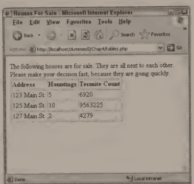

图 4-1：
你可以使用 PHP 构建表格。但我不建议购买这些房子。

## 第 5 章：数组和函数

### 本章内容

- 将数据收集到数组中
- 遍历数组
- 复制数组
- 处理多维数组
- 编写你自己的函数

与大多数信誉良好的语言一样，PHP 允许你在数组中存储大量数据，并将程序划分为函数。PHP 实现这两个功能的方式与其他语言略有不同，这为你提供了比某些其他语言更多的控制能力。在本章中，我将向你展示如何让数组和函数不仅为你工作，还与你协同工作。

### 将数据收集到数组中

数组是一个包含多个存储槽的变量，与简单变量（有时称为标量）不同，简单变量只存储单个数据项。（如果你想了解更多数组的知识，我在 Book III，第 4 章中提供了一个快速介绍。）

PHP 数组与某些其他语言中的数组略有不同，因为你可以基于任何值对数组进行索引，而不仅仅是从 0 开始的数字。例如，如果你想让数组存储各种电影的主角名字，可以使用电影名称作为数组的索引。下面是一个例子：

```php
<?php
$movies = array(
    "The Matrix" => "Keanu Reeves",
    "Raiders of the Lost Ark" => "Harrison Ford",
    "Forrest Gump" => "Tom Hanks",
    "Men in Black" => "Will Smith"
);
print $movies["The Matrix"];
?>
```

本示例使用语言结构 array() 创建数组并将其存储在 $movies 变量中。第一个数组项的索引是 The Matrix，其值是 Keanu Reeves。第二个数组项的索引是 Raiders of the Lost Ark，其值是 Harrison Ford。声明数组后，我将数组第一项的值打印到 HTML。请注意，我通过其索引引用它，即 The Matrix。

索引不仅限于使用字符串；索引可以是字符串或整数。如果你希望索引为整数——在这种情况下，数组中的第一项索引为 0，下一项索引为 1，再下一项索引为 2，依此类推——则可以在声明中省略索引：

```php
<?php
$names = array("Suzy", "Carousel", "Jennifer", "Jeff");
print $names[1];
?>
```

在这个例子中，第一项——值为 Suzy 的那一项——索引为 0。第二项索引为 1，依此类推。然后我将索引为 1 的项打印到 HTML，其值为 Carousel。


如果你尝试创建一个索引为浮点数的数组，你会发现它几乎能工作。乍一看，可能似乎过程运行正常。但实际上，PHP 处理器会将任何浮点索引截断为整数。因此，$myarray[1.5] 与 $myarray[1] 是相同的。

PHP 允许你在初始化数组时同时指定和不指定索引。这样做不是最佳编程风格，但你可能有需要它的情况。请看下面的例子：

```php
<?php
$nums = array(
  1 => 2,  2 => 4,
  5 => 10, 6 => 12,
  14, 16, 18
);
print "1,{$nums[1]}<br>\n";
print "2,{$nums[2]}<br>\n";
print "3,{$nums[3]}<br>\n";
print "4,{$nums[4]}<br>\n";
print "5,{$nums[5]}<br>\n";
print "6,{$nums[6]}<br>\n";
print "7,{$nums[7]}<br>\n";
print "8,{$nums[8]}<br>\n";
print "9,{$nums[9]}<br>\n";
?>


在此示例中，我为四个元素指定了索引；这些索引是 1、2、5 和 6。之后我没有指定任何索引。在这种情况下，PHP 处理器会确定数值上最高的索引，加 1，并将其用作下一个索引。因为 6 是最高的，所以下一个索引是 7，接着是 8，然后是 9。

When you open this PHP code in the browser, you see the following output:

```
1,2
2,4
3,
4,
5,10
6,12
7,14
8,16
9,18
```

你可以看到使用的索引是：1、2、5、6，这是我显式指定的，接着是 7、8 和 9，由 PHP 处理器自动指定。我跳过了索引 3 和 4，所以 PHP 处理器在这些索引中没有放入任何内容。

如果你指定一些索引，让 PHP 处理器指定其他索引，请小心。你可能会无意中覆盖一个元素。查看以下示例：

```php
<?php
$names = array(0=>"Suzy", 1=>"Carousel",
"Jennifer", 2=>"Jeff" );
print $names[0]."<br>";
print $names[1]."<br>";
print $names[2]."<br>";
print $names[3]."<br>";
print $names[4]."<br>";
?>
```

处理器在遇到值 Jennifer 时会自动分配索引 2，因为处理器只考虑目前为止遇到的元素。然后当它到达下一个元素时，会发现该元素也是 2，于是处理器会覆盖前一个元素。因此，名称 Jennifer 被名称 Jeff 覆盖，最终你只有三个元素，而不是四个！所以请小心！

如果你需要将数组的值嵌入字符串，且索引本身也是字符串，最好使用尖括号以确保清晰。但这样做可能会变得混乱，因为字符串内部的字符串该如何表示呢？一种方法是为主字符串使用双引号，为索引使用单引号，如下所示：

```php
print "{$movies['The Matrix']} was in The Matrix.<br>";
```

在这行代码中，数组名为 $movies，索引是 The Matrix。对于主字符串，我使用了双引号；对于索引，我使用了单引号。

虽然这看起来可能很奇怪且难以置信（我承认我当时也很惊讶），但全程使用双引号也可行：

```php
print "{$movies["The Matrix"]} was in The Matrix.<br>";
```

之所以可行，是因为解析器（PHP 处理器中将代码行拆分并弄清各个部分的机制）足够智能，知道花括号内的内容是特殊的，且可能包含双引号。

那么你应该使用哪一个呢？就像编程中很多次一样，选择权在你。就我个人而言，我更喜欢在双引号内使用单引号，因为这样对我们人类来说读起来更容易一些。

你不能为外层字符串使用单引号，因为无法在单引号内嵌入变量。PHP 处理器会将整个内容视为实际字符串。因此，如果你这样做：

```php
print '{$movies["The Matrix"]} was in The Matrix.<br>';
```

你会在浏览器窗口中看到以下输出：

```
{$movies["The Matrix"]} was in The Matrix.
```

这可能不是你期望的结果。

## 混合使用索引类型

有时，你可能希望某些索引是整数，而某些是字符串。PHP 允许你这样做；你只需混合使用索引即可，如以下示例所示：

```php
<?php
$nums = array(
    "a" => "b",
    1 => 2,
    "x" => "y"
);
print "a,{$nums['a']}<br>\n";
print "1,{$nums['1']}<br>\n";
print "x,{$nums['x']}<br>\n";
?>
```

在这段代码中，我创建了索引 a 并将值 b 存储在其中。然后我创建了索引 1 并将值 2 存储在其中。最后，我创建了索引 x 并将值 y 存储在其中。程序运行得很好。

PHP 处理器允许你混合使用索引类型，并在同一段代码中让处理器为你选择一些索引。这可能会令人困惑。以下是一段可能令人困惑的代码示例：

```php
<?php
$funs = array(
    1=>2,
    "a"=>"b",
    3,
    "x"=>"y"
);
print "1,{$funs[1]}<br>\n";
print "2,{$funs[2]}<br>\n";
print "a,{$funs['a']}<br>\n";
print "x,{$funs['x']}<br>\n";
?>
```

在此示例中，数组中的第三项没有索引。为分配索引，PHP 处理器遵循常规规则，查看现有的编号索引，找到最大的一个并加 1。此示例中只有一个编号索引，即 1，因此该项得到索引 2。于是，$funs[2] 得到值 3。当 print 语句运行时，你可以看到这是正确的。

在 C++ 等传统语言中，数组的索引始终是整数，并且始终从 0 或 1 开始，具体取决于语言。然而，Python 和 Perl 等其他语言允许你使用字符串作为索引。

## 在数组中存储值

如果你已经声明了特定的数组，可以向数组添加值或修改其中已有的值。

如果你熟悉 C++ 等其他语言，会很高兴地知道，在 PHP 中，你可以在创建数组后随时向数组末尾添加新元素，从而使数组变长。在 C++ 中，你无法做到这一点。

创建数组后，可以通过向元素分配新值来更改其值。假设你有一个名为 $nums 的数组，并将元素 2 初始化为值 4。你现在希望该元素的值为 10。更改值的方法如下：

```php
$nums[2] = 10;
```

此语句将元素 2 原有的任何值替换为值 10。

在 PHP 中，变量没有固定类型。因此，你可以编写如下代码：

```php
$nums[2] = 10;
```

稍后，你可以将其更改为：

```php
$nums[2] = 'hello';
```

你也可以通过分配索引来向数组添加新值。以下是一个示例：

```php
<?php
$needmore = array(
    "icecream" => "chocolate",
    "pizza" => "pepperoni",
    "sandwich" => "turkey" );
$needmore["snacks"] = "potato chips";
print $needmore["pizza"]."<br>\n";
print $needmore["snacks"];
?>
```

在此，我创建了 $needmore 数组并放入三个项目。然后我又向数组添加了一个项目，即索引 snacks 对应的值 potato chips。

## 从数组中移除值

要从数组中移除项目，请使用 unset 关键字。（是的，名称有点奇怪，但这是计算机的世界。）以下是一个示例：

```php
<?php
$movies = array(
  "The Matrix" => "Keanu Reeves",
  "Raiders of the Lost Ark" => "Harrison Ford",
  "Forrest Gump" => "Tom Hanks",
  "Men in Black" => "Will Smith" );
unset ( $movies["The Matrix"] );
print $movies["The Matrix"];
?>
```

此代码从数组中移除键为 The Matrix 的条目。运行此代码时，输出中没有任何内容，因为 $movies["The Matrix"] 不再具有值。

因为 PHP 中的数组按键分组存储一组值，所以数组没有顺序。这意味着你可以从数组中移除项目而不会在数组中留下空位，这与其他语言的情况不同。

你可能好奇为什么要从数组中移除项目。毕竟，如果不需要该项目，难道不能直接忽略它吗？是的，可以，但有时你可能希望遍历数组的所有元素。如果有多余的元素，就很难简单地跳过它们。要了解如何遍历数组，请查看下一节。

## 遍历数组

如果你需要对数组的每个成员执行某个操作（例如打印每个成员姓名；而不是切除胆囊），PHP 提供了几种方法。以下是一个示例：

```php
<?php
$missingbodyparts = array( "Jim" => "spleen", "Sally" =>
  "gall bladder",
  "Hank" => "appendix", "Jill" => "tonsils" );
foreach ( $missingbodyparts as $part ) {
  print $part."<br>";
}
?>
```

Here's the HTML output from this program:

```
spleen<br>gall bladder<br>appendix<br>tonsils<br>
```

此代码用各种身体部位填充数组 $missingbodyparts，以人名作为键。（幸运的是，没有人缺头。）


在这段代码中，填充数组后，我使用 foreach 关键字遍历数组中的每个值，并打印每个值。注意 foreach 关键字的格式；后面跟着一组括号，包含先数组名称，然后是关键字 as，最后是一个包含值的临时变量名。

虽然前面的代码会遍历数组的值，但你无法确定每个值的索引。如果你想同时获取索引和值，请稍微修改一下 foreach 结构，为索引添加一个临时变量，如下所示：

```
foreach ($missingbodyparts as $name=>$part)
```

起初，这种语法可能看起来奇怪，但请注意，$name=>$part 的格式与初始化数组时的格式相同，例如 "Jim" => "spleen"。下面是一个示例：

```
<?php
$missingbodyparts = array( "Jim" => "spleen", "Sally" =>
"gall bladder",
"Hank" => "appendix", "Jill" => "tonsils" );
foreach ($missingbodyparts as $name=>$part) {
print "$name $part <br>";
}
?>
```

该程序的 HTML 输出如下：

Jim spleen <br>Sally gall bladder <br>Hank appendix <br>Jill tonsils <br>

这次在循环内部，你可以同时访问索引和值。


foreach 关键字是随 PHP 4.0 引入的。在 PHP 4.0 之前，你可以使用一个略有不同的关键字 each 来遍历数组。这个 each 关键字仍然可用，你可以在较新版本的 PHP 中使用它，尽管我发现 foreach 更易于使用。如果你想了解有关 each 关键字的更多信息，请访问 www.php.net/each。

## 复制数组

PHP 提供了两种复制数组的方法。一种方法是直接将数组赋值给另一个数组，如下面的代码所示：

```php
<?php
$music = array("Beatles" => "Let It Be",
   "Guess Who" => "No Time",
   "Led Zeppelin" => "Going to California",
   "David Bowie" => "Space Oddity");
$moremusic = $music;
$moremusic["David Bowie"] = "Changes";
print $music["David Bowie"];
print "<br>\n";
print $moremusic["David Bowie"];
?>
```

在这个示例中，我创建了一个数组，并用各种歌曲标题填充它。然后我复制了数组，即显示为粗体的那一行。当 PHP 以这种方式复制数组时，它也会复制各个元素；这意味着你现在有两个独立的数组，$music 和 $moremusic。为了演示这一点，我接着将第二个数组中 David Bowie 条目的歌曲标题更改为 Changes。我打印出原始数组中 David Bowie 条目的歌曲标题，然后是新数组中的标题，得到以下输出：

Space Oddity<br>
Changes

原始数组（$music）仍然保留原始歌曲，这意味着这两个数组是完全独立的。

复制数组的另一种方法是创建一个新数组并遍历它，将其成员设置为原始数组中的成员，如下所示：

```php
<?php
$music = array( "Beatles" => "Let It Be",
   "Guess Who" => "No Time",
   "Led Zeppelin" => "Going to California",
   "David Bowie" => "Space Oddity" );
foreach ($music as $artist => $title) {
   $music2[$artist] = $title;
}
foreach ($music2 as $artist => $title) {
   print "$artist $title<br>";
}
?>
```

这个示例初始化了 $music 数组，然后使用 foreach 关键字遍历数组，向 $music2 数组添加元素。你可能注意到，我并没有实际创建 $music2 数组。因为 PHP 是一种解释型语言，PHP 处理器允许你即时创建变量。因此，当处理器遇到第一行 $music2[$artist] = $title; 时，处理器为我创建了 $music2 数组，并在其中放入一个元素，即当前的 $artist 和 $title。

你可能会问，如果可以使用像 $music = $music2 这样的单条复制语句，为什么还要费事遍历数组呢？因为在遍历数组时，你可以执行任何想要的额外处理和修改，例如在字符串中添加空格或其他格式，或任何特定程序所需的操作。

## 使用多维数组定义维度

要在 PHP 中创建多维数组，请使用双括号表示法，如下面的示例所示：

```
$day["January"][1] = "Monday";
$day["January"][2] = "Tuesday";
$day["January"][3] = "Wednesday";
$day["February"][1] = "Thursday";
$day["February"][2] = "Friday";
$day["February"][3] = "Saturday";
```

或者你可以像这样创建多维数组：

```
$day2 = array (
"January" => array(1=>"Monday", 2=>"Tuesday",
3=>"Wednesday"),
"February" => array(1=>"Thursday", 2=>"Friday",
3=>"Saturday"));
```

每个示例都构建了一个二维数组，其中第一个索引是月份，第二个是日期，值是星期几。第一种形式占用更多行，虽然更易读。第二种形式代码行数更少，但阅读起来更令人困惑。选择权在你。

## 对数组排序（及其他有趣操作）

你可以使用一系列内置的 PHP 函数来操作数组。这些函数让你可以进行许多有趣的操作，例如按值或键对数组排序、逆序排序、统计数组中的元素数量，以及打乱数组顺序。

有关这些有趣功能的完整列表，请查看 www.php.net/manual/en/ref.array.php。

## 从返回数组的函数中提取元素

有些函数返回数组。许多脚本语言（包括 PHP）都有一个方便的功能，允许你将数组的各个部分保存到单独的变量中。在 PHP 中，你使用 list 关键字。语法有点古怪，我在下面同样古怪的示例中演示了它：

```
<?php
function food() {
    $stuff = array("Goopabluck", "542789", "Yack!blob");
    return $stuff;
}
list($martianname, $martianyear, $martianfood) = food();
print $martianname."<br>".$martianyear.
     "<br>".$martianfood;
?>
```

在这个示例中，我使用了一个函数声明，这是一个我将在本章后面“使用函数调用代码”中讨论的话题。

名为 food 的函数返回一个包含值 Goopabluck、542789、Yack!blob 的数组。（是的，我说过它很古怪。）稍后，我调用该函数。我可以简单地将结果保存在我自己的数组中，比如 $martianstuff 之类的。但是，当我调用 food 函数时，我知道该函数返回一个数组，并且我知道数组包含多少个值，我想将这些值放入单独的变量中。做到这一点的方法是使用 list 关键字。

list 关键字的语法看起来类似于函数，但它不将其视为函数。你可以把它看作是一种从数组中提取部分并将其放入单独变量的简单方法。当 food 函数将数组返回给我时，我将数组的第一个值放入 $martianname 变量，第二个值放入 $martianyear 变量，第三个值放入 $martianfood 变量。最终，我得到了三个变量，而不是一个数组。

list 关键字仅适用于键为整数的数组，并且 list 关键字假设第一个元素的键为 0。如果你将 list 与一个不从 0 开始的数组一起使用，list 关键字中的第一个变量将为空。例如，假设你修改了 food 函数，添加以下行：

```
$stuff = array(1=>"Goopabluck", 2=>"542789", 3=>"Yack!blob");
```

`list` 语句中的第一个变量 `$martianname` 将为空；第二个变量 `$martianyear` 将是 `Goopabluck`；第三个变量 `$martianfood` 将是 542789。

`list` 关键字还允许你只提取数组的前几个成员。例如，如果我想让 `food` 函数仅返回数组的前两个成员，我可以使用以下语句：

```
list($martianname, $martianyear) = food();
```

## 使用函数调用代码

没有函数，编程语言会成为什么样子？好吧，除了是没有函数的语言之外，它将是一种不太有用的语言。因此，PHP 的设计师们，作为一群冷静理智的人，赋予了我们在 PHP 代码中编写函数的能力。

我假设在本章中，你已经对函数有基本的了解。如果你不确定函数是什么，请查看第三册第 3 章。（Perl 使用术语 _子程序_，这与 PHP 中的函数基本相同。）

下面是在 PHP 中定义并使用函数的示例：

```
<html><head><title>Dummies Library</title></head>
<body>
<h1>Welcome to the Dummies Library!</h1>
Your book is overdue! Here is your fine:
<?php
function OverdueBookAmount() {
   return time() * 100;
}
print OverdueBookAmount();
?>
If you’re unable to pay this fine, please use a credit
card.
</body></html>
```

我已将函数 `OverdueBookAmount` 显示为粗体。此外，为提醒 PHP 的用途，我包含了一些 HTML，以便此代码生成一个完整的网页，其外观如下：

Welcome to the Dummies Library!
Your book is overdue! Here is your fine: 105476132900 If
you’re
unable to pay this fine, please use a credit card.


(确保你在该图书馆没有逾期图书！) 该函数返回一个数字，我运行时该数字为 105476132900。调用代码会获取结果并按自己的意愿处理；在此示例中，print OverdueBookAmount(); 会将结果打印到 .html 文件中。要调用函数，只需输入函数名，后跟一对左括号和右括号。

你还可以将参数传递给函数，如下所示：

```php
<?php
function OverdueBookAmount($forgive) {
    if ($forgive == true) {
        return 0;
    }
    else {
        return time() * 100;
    }
}
print OverdueBookAmount(false);
?>
```

这次，函数 OverdueBookAmount 接收一个名为 $forgive 的单一参数。该变量随后成为函数内可用的局部变量。$forgive 变量在 if 语句中使用，随后函数被调用，将一个值传入函数。此处传入的值是 false，即一个布尔值。


在 PHP 中，因为创建变量时不需要指定类型，所以在定义函数参数时也无需指定类型。需要小心，因为这意味着调用你函数的任何代码都可以传递任何值，而不仅限于某种特定类型。例如，在我的 OverdueBookAmount 函数中，我可以传递字符串值 GoAway，而不只是 true 或 false。如果这样做，当我在表达式中使用该值时，PHP 处理器会在必要时进行转换。然而，在我的示例中，PHP 处理器无需进行任何转换。如果我传递 GoAway，我的代码会将此值与 true 进行比较，这会产生奇怪的结果；比较将成功（因为 PHP 在此类比较中将空字符串视为 false，并将包含内容的字符串视为 true），从而导致 if 块执行。


虽然 PHP 变量区分大小写——这意味着变量名 $CornOnTheCob 与 $CORNONTHECOB 是两个不同的变量——但函数并非如此。当你创建一个名为 GetYeTheToaster 的函数时，以后可以使用 GETYETHETOASTER 调用它。不过我不建议这样做，因为这会产生令人困惑的代码。


函数不一定非要返回任何值。然而，在最坚定的计算机科学家眼中，函数定义上必须返回某个东西，如果不返回，则被称为 *过程* 或 *子程序*。在 PHP 与 C++ 语言中，无论该代码块是否返回内容，它都被称为函数。如果你编写一个不返回任何内容的函数，只需不调用 `return`。或者，如果你必须调用 `return` 来退出函数，则在其后不要放任何内容，如下所示：

return;

## 声明局部变量和全局变量

除了将变量作为参数传递给函数外，你还可以在函数内创建局部于该函数的变量。这些变量仅在函数内存在；函数结束后它们会消失。当你第二次调用函数时，这些变量会从头重新创建。在函数内创建局部变量很简单；你只需在函数内像创建其他变量一样创建一个变量即可。由于你在函数内创建它，该变量会自动成为函数的局部变量。

全局变量与局部变量不同，也与许多其他语言不同。如果你想创建一个全局变量（即所有函数都可以访问该变量），只需在任何其他函数之外创建该变量即可。但随后，在函数内部，你需要输入关键字 `global`，后跟全局变量的名称。以下代码演示了局部变量和全局变量：

```php
<?php
$globalvar = 10;
function HasLocals() {
    global $globalvar;
    $globalvar = $globalvar + 1;
    $localvar = 20;
    print "Inside function: $globalvar<br>$localvar<br>";
}
print "Before function: $globalvar<br>";
HasLocals();
print "After function: $globalvar<br>";
?>
```

请注意，你可以在一条 `global` 语句中放置多个变量，如下所示：

global $globalvar, $globalvar2;

在 PHP 4.0 及更高版本中，即使在代码中后面声明函数，也可以调用该函数。因此，你不需要其他语言中所谓的前置声明。但是，如果你使用的是 PHP 3.0（在此情况下，我建议你升级），请确保你的函数声明仅出现在调用它们之前。

不过，PHP 4.0 及更高版本中有一条规则的例外。在第 V 卷第 7 章中，我讨论了如何将代码分割到多个文件中。如果你将函数放在另一个 PHP 文件中，则 `include` 或 `require` 语句必须位于你所包含或要求的文件中任何函数调用之前。有关详细信息，请参见第 V 卷第 7 章。

## 创建高级函数

由于 PHP 是一种解释型语言，你可以做一些在 C++ 等传统编译型语言中不允许的奇怪事情。例如，你可以在 `if` 语句中声明函数。随后，你可以拥有函数的不同形式，PHP 处理器将根据条件使用不同的形式。

这是此不寻常功能的示例：

```php
<?php
$username = $_GET['username'];
if ($username == "Jeff") {
    function Calc($a) {
        return $a * $a;
    }
}
else {
    function Calc($a) {
        return $a + $a;
    }
}
for ($i = 0; $i<10; $i++) {
    print Calc($i)."<br>\n";
}
?>
```

此示例使用 `$_GET` 数组，需要一个 HTML 表单；我在第 V 卷第 6 章中讨论了这些内容。以下是可用于此示例的 HTML 表单：

```
<html><head><title>Advanced Function Demo</title></head>
<body>
<h1>Welcome to my site!</h1>
<form name="form1" method="get" action="advancedfunc.php">
Your name please?
<input type="text" name="username">
<br>
<input type="submit">
</form>
</body>
</html>
```

当你打开此表单并随后运行 PHP 程序（单击提交按钮），如果输入姓名 Jeff，则会在浏览器中看到以下数字（每个数字将单独占一行）：

0 1 4 9 16 25 36 49 64 81

否则，你会看到以下数字：

0 2 4 6 8 10 12 14 16 18

你可以看出这个条件函数的工作原理；如果用户名是 Jeff，程序以一种方式定义 Calc 函数，如果用户名不是 Jeff，则以另一种方式定义。


如果你是高级程序员，可以使用许多这些高级函数功能，而大多数人可能用处不大，例如可变长度参数列表和变量函数。如果你有兴趣探索这两个主题，可以在 PHP 网站上找到它们，地址如下：

- www.php.net/functions 用于条件函数
- www.php.net/manual/en/functions.arguments.php 用于可变长度函数
- www.php.net/manual/en/functions.variable-functions.php 用于变量函数，指的是在函数名以字符串形式存储在变量中时，按名称调用函数

## 第 6 章：与 HTML 交互

### 本章内容

- 从 HTML 表单获取数据
- 发送标头和重定向 HTML 页面
- 设置和检索 cookie
- 提供用户身份验证

PHP 最强大的特性之一，大概就是其能够实现动态、交互式 HTML。虽然 HTML 已经允许你创建供用户输入数据的表单，但此类处理发生在客户端。如果能在服务器端处理这些数据，岂不美哉？借助 PHP，你可以做到这一点。在服务器端，你可以使用 CGI 程序和 Perl 脚本等许多功能。或者，你可以将服务器端处理直接集成到 PHP 文件中。在本章中，我将向你展示如何实现这一点，从而创建具备用户交互功能的动态网页。

### 从 HTML 表单获取数据

要从 HTML 表单获取数据，首先需要创建一个 HTML 表单。将此表单放在与处理表单的 .php 文件分开的文件中。例如，你可以创建一个名为 userentry.html 的文件，其外观如清单 6-1 所示。

### 清单 6-1：提供用户输入表单的文件

```
<html><head><title>User Information</title></head>
<body>
<h1>Welcome to my site!</h1>
<form name="form1" method="get" action="processinput.php">
<p>Least Favorite Food:
<select name="food">
<option>Anchovies</option>
<option>Asparagus</option>
<option>Brussels Sprouts</option>
<option>Seaweed</option>
</select>
```


<br>
Favorite Actor:
<input type="text" name="actor">
<br>
<input type="submit">
</p>
</form>
</body>
</html>

这是 HTML 页面中的一个基本表单。图 6-1 显示了客户端在 Internet Explorer 中打开该表单时的样子。

图 6-1: 这是客户端计算机上 Internet Explorer 中表单的样子。


拥有表单后，你可以编写读取表单数据的 .php 文件。用户填写数据且 PHP 程序获取表单数据的过程如下：

- 1. 用户接收包含表单的 .html 文件。
- 2. 用户输入数据并单击 Submit 按钮。
- 3. 客户端浏览器发送对 PHP 文件的请求，并将输入的数据随请求一起发送。
- 4. 服务器接收请求并将其发送到 PHP 处理器，PHP 处理器访问数据、处理数据并构建 Web 页面。
- 5. 服务器将构建的 Web 页面发送回客户端。

在向你展示可处理数据的 .php 文件之前，我想先就这些步骤说几句话。

当用户在表单中输入数据并单击 Submit 按钮时，浏览器会将数据附加到 .php 文件名末尾的方式将数据发送到服务器。

例如，假设你使用上面的表单，选择 Asparagus，并输入 Ingrid Bergman。

当你单击 Submit 时，浏览器会将此视为你在浏览器地址栏中输入了以下 URL：

```
http://www.jeffcogswell.com/processinput.php?food=Anchovies&actor=Ingrid+Bergman
```

请注意，就域名而言，我使用的是我自己的域名 jeffcogswell.com。由于我在表单标签的 action 参数中未指定域名，因此浏览器将使用托管你的 userentry.html 文件的域名，而不是 www.jeffcogswell.com。

在清单 6-1 中，我为两个表单字段提供了名称：

- "food": 下拉列表框（一个 select 对象）
- "actor": 文本字段

现在查看上面的 URL。在 processinput.php 文件名之后，URL 由问号和以下两部分组成，两部分由符号 & 分隔：

- food=Anchovies
- actor=Ingrid+Bergman

换句话说，"food" 的值为 Anchovies，"actor" 的值为 Ingrid+Bergman。Web 浏览器将 Ingrid 和 Bergman 之间的空格替换为加号；这样，URL 中就不需要传递空格，否则可能会令人困惑。

如果你实际上输入的是 Ingrid+Bergman（带加号），则 URL 会将加号替换为字符 %2B，即加号代码的十六进制形式。还记得计算机、自动取款机和（老天爷不让）会说话的汽车出现之前，生活曾多么简单吗？

## 编写服务器端脚本

言归正传（说回服务器端），Web 服务器接收 URL，将其解析，并把 .php 文件连同参数 food=Anchovies 和 actor=Ingrid+Bergman 一起交给 PHP 处理器。PHP 处理器将参数存储在名为 _GET 的数组中。

_GET 数组是超全局的，这意味着你可以从任何位置（包括任何函数中）访问它，而无需使用 global 关键字进行声明。

当你的 PHP 程序启动时，_GET 数组具有以下键和值：

- _GET['food'] = "Anchovies"
- _GET['actor'] = "Ingrid Bergman"

请注意，当你的 PHP 程序获取参数时，Ingrid 和 Bergman 之间的空格已恢复；加号仅用于 URL 中。

了解 PHP 会为你执行这些自动转换后，你可以编写清单 6-2 中的简单 .php 文件，并将其保存为 processinput.php。

processinput.php 的名称必须与原始 .html 文件中表单标签的 action 参数中使用的名称相同，这正是我在清单 6-1 中所做的。

## 清单 6-2：从表单读取传递参数的 PHP 文件

```
<html><title>Results</title>
<body>
<?php
  $food = $_GET["food"];
  $actor = $_GET["actor"];
  print "$food<br/>\n$actor\n";
?>
</body>
</html>
```

现在你可以尝试一下了。不要直接打开 processinput.php 文件，否则不会发生任何事情。相反，请打开 userentry.html。然后选择一种食物，输入演员姓名，并单击 Submit。如果你已将文件正确上传到服务器，你将看到一个列出你所选内容的页面：

Anchovies
Ingrid Bergman

## 在 HTML 页面之间共享数据

在前一节中，你了解到 Web 服务器和 PHP 系统如何处理 URL，即剥离问号后面且由 & 分隔的参数。现在，你可以编写通过此类参数相互交互的 .php 文件和 .html 文件。

例如，你可以拥有一个如下所示的 .html 文件：

```
<html><title>Not particularly useful yet</title>
<body>
<a
href="processinput.php?food=Anchovies&actor=Ingrid+
Bergman">
Click here</a> for the results!
</body>
</html>
```

尝试将此文件放在服务器上，并在旁边放置先前在清单 6-2 中显示的文件。然后在客户端计算机上打开此 .html 文件并单击 Click here 链接。这样做时，你将得到 .php 文件的结果，就像数据是通过表单传递的一样：

Anchovies
Ingrid Bergman

当然，与前面的 .html 文件一样，这并不特别有用，因为数据是硬编码的。但是，假设这个 .html 文件仅仅是 .php 文件处理后的结果呢？现在你发现新大陆了，沃森。

试试这个。更新你的 processinput.php 文件，使其如清单 6-3 所示。

## 清单 6-3：将参数发送到另一个 .php 文件的文件

```
<html><title>Results</title>
<body>
<?php
    $food = $_GET["food"];
    $actor = $_GET["actor"];
    $foodHTML = urlencode($food);
    $actorHTML = urlencode($actor);
    print "$food<br>\n$actor<p>\n";
    print "<a href=formattedresults.php?".
        "food=$foodHTML&actor=$actorHTML">;
    print "Click here</a> for formatted results!";
?>
</body>
</html>
```

请注意与清单 6-2 中所示原始 processinput.php 相比的两个主要更改：

- 我添加了对 urlencode 函数的两次调用。这是一个内置函数，用于将演员姓名中的空格替换为 +（加号）；然后该程序将 urlencode 的结果存储在名为 $foodHTML 和 $actorHTML 的变量中。将名称作为 URL 中的参数发送时，这是必需的。
- 我添加了一个指向另一个 .php 文件（名为 formattedresults.php）的链接。仔细查看该链接：我在字符串中嵌入了 $foodHTML 和 $actorHTML 变量。够狡猾吧？

第二个 .php 文件 formattedresults.php 显示在清单 6-4 中。

## 清单 6-4：读取传递给它的参数并将其发送回去的文件

```
<html><title>Formatted Results</title>
<body>
<table border="1">
 <tr>
  <td>Food</td>
  <td>Actor</td>
 </tr>
 <tr>
 <?php
  $food = $_GET["food"];
  $actor = $_GET["actor"];
  $actorHTML = urlencode($actor);
  $foodHTML = urlencode($food);
  print "<td>$food</td>\n";
  print "<td>$actor</td>\n";
 ?>
 </tr>
</table>
<?php
 print
 "<a href=processinput.php?".
 "food=$foodHTML&actor=$actorHTML">;
 ?>
 Click here</a> for unformatted results.
</body>
</html>
```

清单 6-4 中的 .php 文件与清单 6-3 中的类似，只不过它将数据格式化为表格。与清单 6-3 一样，清单 6-4 也包含一个返回原始数据的链接。

要在服务器上尝试清单 6-4，你需要以下三个文件：

- userentry.html，如清单 6-1 所示。这是你在客户端浏览器中查看时开始使用的文件。
- 更新后的 processinput.php，如清单 6-3 所示。userentry.html 文件链接到此文件。
- formattedresults.php 文件，如清单 6-4 所示。

上传这些文件后，你可以按照以下步骤测试整个程序：

- 1. 访问 userentry.html 页面。
- 2. 选择一种最不喜欢的食物，输入喜欢的演员姓名，然后单击 Submit。

你将进入 processinput.php 页面的结果，该页面包含一个链接。

- 3. 单击该链接。

你将进入 formattedresults.php 页面。如果你正确输入了代码，formattedresults.php 的结果也将包含你选择的食物和演员，尽管你不是通过表单来到 formattedresults.php 文件的。它起作用了——拿出鳀鱼庆祝一下吧！

在为将作为参数传递到 .php 文件的表单元素选择名称（例如 food 和 actor）时，请注意不要在名称中使用 HTML 实体。HTML 实体是 HTML 用于特殊字符的代码。例如，假设你有以下 HTML 文件：

```
<html>
&amp
</html>
```

在浏览器中打开此文件时，你只会看到一个 & 符号，而不会看到 &amp 字符。原因是 &amp;（后面带分号）是 & 的特殊 HTML 实体。即使你省略了分号（就像我在前面的 HTML 中所做的那样），浏览器仍会将其解释为 &。

如果你有一个表单并将其中一个元素命名为 amp，可能会遇到麻烦。如果你通过表单将此元素传递到 PHP 文件，起初一切都没问题……例如，填写表单后，你可能会将以下 URL 传递到服务器：


```
http://www.mydomain.com/processsomething.php?name=Harold&amp=100
```

此时，没有问题。你的 processsomething.php 文件可以很好地提取变量。$_GET['name'] 得到 Harold，$_GET['amp'] 得到 100。

但是，假设你的 processsomething.php 文件想要包含一个可点击的链接，将这两个值传递到另一个 .php 文件（就像本章前面的清单 6-3 和 6-4 所做的那样）。你可以在 processsomething.php 中包含类似下面的一行：

```
print "<a href=dosomething.php?name=$me&amp=$size>Click</a>";
```

这行代码在 PHP 处理器处理后会生成以下 HTML 代码：

```
<a href=dosomething.php?name=harold&amp=100>Click</a>
```

目前，这仍然工作正常。如果在浏览器中打开生成的 HTML 文件，并查看 HTML 源代码，你会在 a 标签末尾看到 &amp=100，这本身不是问题。然而，浏览器会感到困惑。如果将鼠标悬停在此行代码的链接上，你会在浏览器的状态栏中看到以下行：

```
href=dosomething.php?name=harold&=100
```

仔细看一下这一行。字母 amp 不见了。是的，浏览器被 &amp 弄混了，并坚持将其改为一个 &。哎呀！（这其实是设计使然；浏览器 _应该_ 将 &amp 改为一个 &。）

## 一个方便的换行符转换器

如果你有几个以换行符结尾的字符串（在字符串中显示为 \n），并且想要在生成的 HTML 中将这些行显示为换行，则可以轻松地将 \n 字符转换为 <br> 标签，如下所示：

```
print nl2br("Hello\nEverybody\n");
```

关键在于 nl2br 函数。它接收一个字符串，并将 \n 替换为一个 <br> 标签和另一个 \n。这会生成以下 HTML：

```
Hello<br />
Everybody<br />
```

是的，<br> 标签显示为 <br />，但这实际上是 <br> 标签的 XHTML 和 XML 标准化版本。浏览器将 <br /> 标签与 <br> 标签视为相同。

要避免这个问题，该怎么办？答案很简单：避免使用诸如 amp 这样的 HTML 实体作为表单字段名。怎么知道你是否在使用 HTML 实体？你可以在网上找到列出它们的多个表格。下面是一个相当不错的表格：

```
www.htmlgoodies.com/tutors/&command.html
```

是的，URL 中这里有一个 & 符号；请务必输入它。

## 发送标头和重定向 HTML 页面

如果你浏览过很多网页，无疑遇到过会自动将你重定向到另一个页面的页面，把你从起始页带到另一个领域。（听起来很刺激，对吧。）如果你想从自己的网页重定向用户，可以通过多种方式实现，包括使用 PHP。

当你有一个 .php 文件，并且 PHP 处理器正在构建一个 .html 文件时，处理器会创建一组 HTTP 响应标头（或简称标头），Web 服务器首先将其发送到客户端。这些标头以各种方式指导浏览器。例如，你是否曾好奇过，当你指向 Internet 上的 .pdf 文件时，Web 浏览器如何知道要启动 Adobe Acrobat？乍一看，似乎浏览器只是查看 .pdf 扩展名。但事实并非如此。例如，假设你创建了一个简单的文件，如下所示：

```
<html><body>
Hi! This is just an HTML file!
</body></html>
```

如果将此文件保存到 Web 服务器上，文件名为 fooldya.pdf，并让浏览器指向该文件，则取决于你使用的浏览器，可能会发生不同的情况。对于 Internet Explorer，该文件会在浏览器内显示为常规 .html 文件。Acrobat 不会打开，即使文件有 .pdf 扩展名。（但是，如果你绕过 Web 服务器，例如将此文件保存在 Windows 客户端计算机上，并选择 Internet Explorer 的 文件→打开 菜单，Acrobat 将启动，因为在这种情况下 Internet Explorer 确实会使用文件扩展名。）如果你在 Linux 机器上使用 Mozilla 浏览器，可能会看到提示下载文件或打开它。

从 Web 服务器加载文件时，浏览器如何知道要启动 Acrobat？在浏览器接收 HTML 数据之前，浏览器接收一组 HTTP 响应标头。其中一个标头称为 Content-Type，如下所示：

```
Content-Type: application/pdf
```

## 理清标头

PHP 使你可以控制 Web 服务器向客户端浏览器发送哪些 HTTP 响应标头。但是，请记住，HTTP 响应标头必须在第一行 HTML 代码之前发送到浏览器。因此，在开始发送 HTML 代码后，你就不能再为该 .html 文件发送任何其他标头了。怎么知道是否已经发送了 HTML？你可以根据 .php 文件中 HTML 的位置来判断。如果你将对 header() 的调用放在文件开头、任何 HTML 标签之前的 PHP 代码中，如下所示，就没问题：

```
<?php
header("Content-type: application/pdf");
?>

<html>
// ... some HTML code
</html>
```

如果你做下面这样的事情，就会遇到麻烦，因为 <html> 标签出现在 header() 调用之前：

```
<html>
<?php
header("Content-type: application/pdf");
?>
```

这个来自 Web 服务器的标头指示浏览器打开 Acrobat 以查看 PDF 文件。服务器如何知道该文件是 PDF 文件？通常，服务器只是查看文件扩展名。所以我们又回到了文件扩展名。

但是，PHP 确实有一些强大的标头工具。如果你在网站上有一些希望强制设为特定类型（例如 PDF）的文档，可以使用 PHP 来控制类型。你还可以通过使用标头来控制文件的许多其他方面，我将在后面的章节中讨论这些内容。

## 控制应用程序类型

假设你在 Web 服务器上有一个文件，它没有标准文件扩展名（出于任何原因，你不想重命名它），但你想在客户端浏览器遇到该文件时指定要使用哪种类型的应用程序。例如，我将一个名为 AnotherRealPDF（没有文件扩展名）的文件上传到了我的网站。假设我合同规定不允许更改文件名，或者文件是由别人上传的，我在服务器上没有权限更改文件名。那么我可以编写这个 PHP 文件，我将其命名为 openpdf.php：

```
<?php
header("Content-type: application/pdf");
readfile("AnotherRealPDF");
?>
```

我将该文件上传到我的网站，当用户以 http://www.jeffcogswell.com/openpdf.php 访问它时，实际的 PDF 文件（名为 AnotherRealPDF）会下载到他们的计算机并在 Acrobat 中打开。（readfile 函数只是打开指定文件并将其发送到客户端计算机。请注意，某些浏览器，尤其是 Mozilla 和 Netscape，会替换为不同的默认文件名，openpdf.php。）

你也可以将这种标头方法与我后面在本章“提供用户身份验证”一节中描述的技术结合使用。例如，你可以将 PDF 文件放在文件系统的私有部分（公共 HTML 目录之外），然后仅允许某些用户查看该文件：

```
<?php
if (!isset($_SERVER['PHP_AUTH_USER'])) {
	header('WWW-Authenticate: Basic realm="Please Login to My Site"');
	header('HTTP/1.0 401 Unauthorized');
	print 'Sorry, you are not authorized to view this page.';
	exit;
} else {
	$username = $_SERVER['PHP_AUTH_USER'];
	$password = $_SERVER['PHP_AUTH_PW'];
	if ($username == "me" && $password == "me") {
		header("Content-type: application/pdf");
		readfile("AnotherRealPDF");
	} else {
		print 'Sorry, you are not authorized to view this page.';
	}
}
?>
```

## 重定向到不同页面

你可能希望设置一个自动重定向器，将某个页面的访问者发送到另一个页面。在本节中，为了让事情更有趣，我将解释如何动态构建重定向器。下面是一个严肃的示例：在我的网站上，我有一个“事业”页面，其中包含一个指向


missingkids.org，即失踪和受剥削儿童全国中心的网站。但我提供的不仅仅是一个链接：我有一个表单，其中包含所有州的下拉列表。如果你点击你的州，然后点击提交，你将被带到 missingkids.org 网站，显示你所在州的案例。我是怎么做到的？我全都用 PHP 实现，结合了表单和重定向。

首先，这个表单很简单：它只是一个包含每个州两位字母代码的值列表。表单的 action 如下所示：/kidsredir.php。那里没有什么花哨的东西。州的值作为名为 state 的参数传递。现在，神奇之处就在 kidsredir.php 文件中；这是整个文件：

```php
<?php
$state = $_GET["state"];
header("location: http://www.missingkids.org/precreate/".$state.".html");
?>
```

这个文件将州提取到 $state 变量中，并根据该州构建一个 URL。然后，神奇之处就开始了：这个文件不包含任何 HTML 代码，因此发送头部是安全的。这个文件发送一个名为 location 的头部，强制浏览器重定向到给定的站点。因此，如果你在列表中选择加利福尼亚州，你首先会去这里：

```
http://www.jeffcogswell.com/kidsredir.php?state=CA
```

然后，它会将你重定向到这里：

```
http://www.missingkids.org/precreate/CA.html
```

……这一切都要归功于头部的神奇之处。

## 打印页面的头部

如果你想打印页面的头部，并且你使用的是与 Apache 一起的 PHP，可以使用一个名为 apache_request_headers 的方便函数。这是一个示例：

```php
<?php
$headers = apache_request_headers();
foreach ($headers as $header => $value) {
echo "$header: $value <br />\n";
}
```

如果你使用的是早于 4.3.0 版本的 PHP，则需要使用 getallheaders 函数来替代 apache_request_headers。

## 设置和获取 Cookie

Cookie 是浏览器端（即客户端）上的一种简单存储机制。因此，在一本涵盖像 PHP 这样的服务器端语言的书中处理 Cookie 可能显得有点奇怪。但请放心，所有的陌生感都将消失，你很快就能使用 PHP 在浏览器上读写 Cookie 了。

Cookie 的设置和删除发生在浏览器处理头部时。因此，你只能在 .php 文件的开头设置 Cookie，即在任何 HTML 代码之前。

### 设置 Cookie

要设置 Cookie，请调用 setcookie() 函数。传递 Cookie 的名称和一个值。清单 6-5 演示了这一点。

### 清单 6-5：setcookie.php

```php
<?php
// This code must come before the HTML, since
// cookies are part of the headers!
setcookie('dummies1000', 'hello');
?>

<html><title>Set a Cookie! Yum yum!</title>
<body>
    This file will store a temporary cookie in the browser.
        The cookie
    will be a session-only cookie, and will go away when you
    shut
    down your browser.<p>
    The cookie information is as follows:<p>
<pre>
    name: dummies1000
    value: 'hello'
</pre>
</body>
```

注意，我在任何 HTML 代码之前设置了 Cookie。这个 Cookie 名为 dummies1000（可以把这个名字当作变量名），其值是字符串 'hello'。

### 清单 6-6：getcookie.php

```html
<html><title>Have a cookie! Yum yum!</title>
<body>
This file reads the temporary cookie that was set
in the <a href="setcookie.php">setcookie.php</a>
file.<p>
<pre>
name: dummies1000<br>
The value according to the PHP code is...
<?php
print $_COOKIE['dummies1000'];
?>
</pre>
</body>
```

当你打开 setcookie.php 页面时，Cookie 会在会话期间设置，这简单意味着 Cookie 在你关闭浏览器后会被（我敢说？）吃掉（呻吟）。但如果你保持浏览器打开，然后访问 getcookie.php，你会发现 Cookie 的值确实仍然设置着。


当你设置一个 Cookie 时，Cookie 的值在设置它的页面上不可用。这确实是事实，而且有点扫兴。所以，如果你编写一个设置 Cookie 值的 PHP 程序，请不要尝试在同一个 .php 文件中访问 $_COOKIE 数组，希望能访问到该值。相反，只需将 Cookie 的值硬编码或将其存储在另一个变量中。

### 长期存储 Cookie

setcookie() 函数包含一些可选参数，让你对 Cookie 罐有更多控制。（啊，这么多 Cookie 笑话。）一个脆脆且有用的参数是过期参数。这是 Cookie 从系统中删除的日期。在此之前，Cookie 会在用户系统的 Cookie 缓存中保留。

要指定日期，你必须以 Unix 时间给出，即自 1970 年 1 月 1 日以来的秒数。


例如，如果你想查看你的 Cookie 在页面加载后 60 天腐烂并过期，请确定当前 Unix 时间，并添加对应 60 天的秒数，即 60 × 60 × 60 × 24。因此，要设置一个在用户系统上保留 60 天的 Cookie，请使用：

```php
<?php
$expiredate = time()+60*60*60*24;
setcookie('dummies1001', 'goodbye', $expiredate);
?>
```

```html
<html><title>60-day Cookie! What a concept!</title>
<body>
I just set a cookie called dummies1001, containing
the value "goodbye", which will last for 60 days, until
<?php
print date("F j, Y", $expiredate);
?>
</body>
```

然后，要读取 Cookie，像访问其他 Cookie 一样访问它：

```html
<html><title>Have a 60-day cookie! Woo hoo!</title>
<body>
The cookie for dummies1001 is set to:
<?php print $_COOKIE['dummies1001']; ?>
</body>
```

## 提供用户身份验证

有些网站会显示一个对话框，要求用户在进入网站前输入用户名和密码。这些对话框不是 HTML 页面；它们由浏览器创建。如果你有一些想要保护的机密网页，PHP 让你能够通知浏览器打开这样的对话框。这称为 HTTP 身份验证。


只有在将 PHP 作为 Apache 模块运行而非 CGI 运行时，才能使用 PHP 的 HTTP 身份验证功能。有关此功能及其他功能的更多信息，请参阅 PHP 5 For Dummies，由 Janet Valade 著（Wiley Publishing, Inc. 出版）。

HTTP 身份验证对话框不是 PHP 的一部分；它由 Web 服务器在 HTML 代码之前发送的 HTTP 响应头控制。PHP 只是为你提供了一种指定必要头部的方法，这些头部告诉浏览器显示对话框。

流程如下：

- 1. PHP 程序发送请求用户名和密码的头部。
- 2. 用户输入用户名和密码，这些信息会发送回服务器。

如果用户点击“取消”，进程中止，PHP 程序可以打印无效用户消息或你想要显示的任何消息。

- 3. Web 服务器重新加载并从头开始重启 .php 文件。

这一次，用户名和密码已设置，且没有头部发送到浏览器。PHP 程序现在可以验证用户名和密码。

从头重新加载并重启 .php 文件的想法起初似乎有点笨拙，但理由是成立的：为了验证页面，Web 服务器必须先发送一个请求用户名和密码的头部。浏览器会发回用户名和密码，身份验证头部不再需要。相反，服务器可以发送一组新的头部。但身份验证头部已经发送，无法撤回。怎么解决这个问题？重启页面。这听起来很奇怪，但它有效。

这是一个请求身份验证的简单 .php 文件；请记住，系统会在身份验证后重启此页面：

```php
<?php
$username = $_SERVER['PHP_AUTH_USER'];
$password = $_SERVER['PHP_AUTH_PW'];
if (!isset($_SERVER['PHP_AUTH_USER'])
|| $username !="me" || $password !="me") {
header('WWW-Authenticate: Basic realm="Please Login to My Site"');
header('HTTP/1.0 401 Unauthorized');
print 'Sorry, you are not authorized to view this page.';
exit;
}
?>
<html><title>Top Secret Page</title>
<body>
<h1>This is a top secret page!</h1>
Welcome! Here you can discover all my deepest secrets!
You have been warned!
</body></html>
```

当你通过 Web 服务器在浏览器中打开此页面时，你会看到一个要求输入用户名和密码的对话框。如果你正确输入用户名和密码（在此示例中两者都是 me），你将看到这个秘密的会员专属页面。如果你输入错误的用户名和密码，你会再次看到对话框，直到你点击“取消”或输入正确。如果你稍后在不退出浏览器的情况下返回该页面，你的浏览器会记住登录信息，不会再次提示你。

头部 WWW-Authenticate 包含一个名为 Basic realm 的参数。
紧随其后的文本会作为登录顶部的消息显示。


对话框。理论上，你可以使用 realm 来组织网站的各个部分；但是，PHP 对此支持不多，因为它只使用一个 PHP_AUTH_USER 变量和一个 PHP_AUTH_PW 变量。

Basic realm 文本必须放在双引号中。因此，你需要使用单引号或双引号将 WWW-Authenticate 标头括起来。如果使用双引号，则需要为 basic realm 转义双引号，如下所示：header("WWW-Authenticate: Basic realm=\"Please Login to My Site\"); 

在此身份验证示例中，我硬编码了要比较的用户名和密码值。对于简单的安全性，这工作正常。但对于高级安全性，我有以下建议：

- 始终在浏览器中加密密码（例如，使用 JavaScript），并将加密后的密码发送到服务器。
- 如果有多个用户名，请将它们存储在 MySQL 数据库中。我在第 VI 篇 第 3 章中讨论了如何做到这一点。

## 第 7 章：使用 PHP 进行高级编程

## 本章内容

- 包含和引用其他 PHP 文件
- 类型之间的转换
- 引用变量
- 字符串处理

在本章中，我将介绍一些更高级的主题，这些主题可以帮助你成为 PHP 高手。例如，我将向你展示如何将 PHP 程序分割为多个文件，或者如何包含其他人编写的 PHP 文件。我还将讨论类型转换、创建引用变量和处理字符串。这些都是重要的主题，能帮助你充分发挥 PHP 的潜力。

## 包含和引用其他 PHP 文件

为了更好地组织编程，你可以将源代码分割为多个文件。在 PHP 中，你可以将一些代码放在一个文件中，然后允许另一个 .php 文件通过引用或包含该文件来访问它。

## 引用文件

假设你有一个名为 GetDateString 的函数，想要在多个 .php 文件中使用它。与其在每个文件中重写相同的函数，不如将该函数放在其自身的文件中，然后引用它。

这里是一个名为 myfunctions.php 的文件：

```
<?php
function GetDateString() {
   return date("l, F j, Y", time());
}
?>
```

现在这里是一个名为 userequire.php 的文件，它使用 myfunctions.php 文件中的 GetDateString 函数：

```
<html><title>Today!</title>
<body>
Greetings! Today is
<?php
    require "myfunctions.php";
    print GetDateString();
?>
</body></html>
```

在浏览器中查看此 userequire.php 文件时，你会看到类似这样的内容：

你好！今天是 2010 年 6 月 8 日，星期二。

希望到 2010 年，计算机将强大到我们不再需要用 PHP 或任何其他语言编写代码。

我以 <?php 开始 myfunctions.php 文件，并以 ?> 结束它，即使我已经在 userequire.php 文件中有了 <?php 和 ?>，并且我在 <?php 和 ?> 标签内调用了 require。我这样做是因为 PHP 规则要求每个 .php 文件都必须将代码括在 <?php 和 ?> 内，即使 require 关键字位于这些定界符内也是如此。

## 包含文件

你可以使用 include 关键字而不是 require 关键字，只需将关键字 require 改为 include 即可：

```
include "myfunctions.php";
```

这两个关键字在功能和语法上可互换，只有一个区别：如果 PHP 处理器找不到你尝试 require 或 include 的文件，并且你使用 require 语句，则会出现致命错误，处理器将停止处理你的文件，并在生成的 HTML 中显示错误消息。但是，如果你使用 include 语句且处理器找不到文件，处理器只会发出警告（并将其打印到 HTML），然后继续处理文件的其余部分。在大多数情况下，我使用 require，如果我做好功课并实际测试我的软件，我不应该需要担心——我包含或引用的文件应该都存在。（好吧，如果你是个真正的黑客，你可能会编写代码故意尝试包含一个可能存在也可能不存在的文件，然后相应地处理这种情况，但我更倾向于不编写如此复杂的代码。很难维护。）

### 设置包含路径

为了找到你包含（或引用）的文件，你必须要么将文件放在包含文件所在的同一目录中，要么为文件提供完整路径，例如 /home/jezebel/html_files/myphpstuff.php。但是，如果你将网站移动到文件系统组织方式不同的其他主机上，编写绝对路径可能会成为问题。

```
include_path = ".:/php/includes"
```

或者对于 Windows，如下所示：

```
include_path = ".;c:\php\includes"
```

对于 Linux/Unix，在字符串中添加路径，并用冒号分隔各项，如下所示：

```
include_path = ".:/php/includes:/home/jezebel/html_files"
```

比在文件中编写绝对路径更好的方法是使用 PHP 系统包含路径。PHP 维护一组目录，它会在其中查找包含的文件。如果你将自己的目录添加到此路径中，则不需要在包含文件的名称中使用任何路径。如何设置这个被称为包含路径的神奇功能？你有两种方法。如果你有权访问 php.ini 文件（如果你使用第三方托管服务，则可能没有），则可以在 php.ini 文件中设置它。打开 php.ini 文件并搜索以 include_path = 开头的行。（它可能以分号开头，这意味着它被注释掉了。删除分号。）对于 Linux/Unix，该行可能如下所示：

对于 Windows，用分号分隔各项并使用反斜杠：

```
include_path = ".;c:\php\includes;c:\phpfiles\jezebel"
```

（请注意，不需要重复反斜杠。）

最后，如果你无权访问 php.ini 文件，可以在 .php 文件中添加一行来设置包含路径，如下所示：

```
ini_set('include_path','/home/jezebel/html_files');
```

你也可以在 require 和 include 语句中使用变量名：

```
$headerfile = "myfunctions.php";
require $headerfile;
```

这意味着，如果你非常勇敢并编写非常复杂的代码，可以根据不同的情况构建不同的文件名。例如，假设你正在编写一组执行某些数据库工作的“助手”函数，并为不同的数据库系统编写不同形式的这些函数。你可以动态构建要包含或引用的正确文件名，将名称存储在变量中，然后使用变量名来 require 或 include 该文件。或者，你可以有条件地包含或引用文件，如我在本章后面的“有条件地引用和包含”一节中讨论的那样。

在声明变量并使用变量名作为要包含（或引用）的文件时要小心。无论在什么情况下，都不要允许你网站的客户端指定包含文件的名称（例如，通过表单）。如果他们这样做，他们可以指定一个可以发出操作系统命令（使用 PHP system 关键字）的远程包含文件，从而获得对你网站的完全访问权限。我在留言板上看到过建议，说你可以使用 _GET 数组来提取文件名并包含或引用该文件。但这样做很危险。通过在 URL 中提供恶意文件的名称，黑客可以轻松搞乱你的系统。不要这样做！我怎么强调此安全问题的重要性都不为过。

### 使用 URL 包含文件

如果你有一个位于远程系统上的 PHP 文件想要包含或引用，可以简单地使用该文件的完全限定 URL，如下所示：

```
include "http://www.jeffcogswell.com/URLFile.php";
```

但是，以这种方式使用文件有一个问题，因为远程服务器处理 PHP 文件的方式。基本上，远程服务器上的 PHP 处理器可能会妨碍你，搞乱事情，使你的生活变得困难。

假设你在远程系统上有一个文件。该文件名为 URLFile.php，如下所示：

```
<?php
print "This is text printed out by the remote
system!<br>\n";
function TestRemote() {
print "This is text printed out by the remote".
"system in the TestRemote function!<br>\n";
}
?>
```

这个文件没有什么花哨的；它只是一个 print 语句，然后是一个名为 TestRemote 的函数，该函数本身也有一个 print 语句。现在假设你将此文件上传到远程服务器（例如 http://www.jeffcogswell.com/URLFile.php）。然后在你自己的服务器上，你有一个名为 requireURL.php 的文件，如下所示：

```
<?php
require "http://www.jeffcogswell.com/URLfile.php"
TestRemote();
?>
```


## 仅要求和包含一次

如果你包含一个文件，后来又包含另一个重新包含第一个文件的文件，你可能会遇到一些问题。例如，你可能有一些在包含文件中的代码，希望只执行一次。但如果该文件出于任何原因被包含多次，你的代码将被执行多次。

PHP 提供了一种简单的方法来防止这种情况。不使用 include 或 require 关键字，你可以使用 include_once 或 require_once 关键字。你使用这两个词的方式与 include 和 require 的对应词相同，只是 PHP 会仔细检查文件是否已被包含，如果是，则跳过它。

小心不要混合文件名的大小写，尤其是在 PHP 运行在 Windows 系统上时。对于 Windows，文件 a.php 与 A.php 相同，因为 Windows 中的文件名不区分大小写。但对于 PHP，a.php 与 A.php 不同。因此，如果你先对 a.php 调用 include_once，后来又对 A.php 调用，PHP 会认为它们是两个不同的文件并包含 A.php。解决方法是在文件名上保持一致，不要在程序的不同位置更改大小写。

这个文件看起来没问题，但无法工作。原因是 require 语句会要求远程系统发回文件。但远程系统（推测）正在运行 PHP 服务器。那么服务器从远程系统得到的是什么？不是 PHP 代码。哎呀。相反，服务器得到的是生成的 .html 文件。哎呀。这是没有 PHP 代码的生成 .html 文件：

```
This is text printed out by the remote system!<br>
```

你服务器上的 PHP 处理器不会完全崩溃并尝试将此文本解析为 PHP（幸运的是），因为当包含或 require 文件时，PHP 处理器会回退到 HTML。（这就是为什么你仍然需要在包含或 require 的文件中使用 <?php 和 ?>。）但情况并非全好，因为这个生成的 .html 文件没有你的 TestRemote 函数。不好。当你在服务器上打开 requireURL.php 文件时，浏览器中看到的是：

```
This is text printed out by the remote system!
Fatal error: Call to undefined function: testremote() in
E:\LAMP\dev\Book5\Chap7\requireURL.php on line 3
```

TestRemote 函数不见了。（请记住，与 PHP 中的其他地方不同，函数名不区分大小写。你可以从错误信息中看到这一点，错误信息显示 PHP 处理器正在查找 testremote 而不是 TestRemote。没关系；这不是导致问题的原因。）

修复此问题的方法是强制远程系统将实际的 .php 文件发回给你，而不是处理后的 .php 文件的 HTML 结果。最简单的方法是将文件扩展名更改为 .html 或 .txt。然后在你自己的 PHP 文件中相应地进行更改：

```php
<?php
#works!
require "http://www.jeffcogsweil.com/URLfile.txt";
TestRemote();
?>
```

当你这样做时，文件会从远程服务器原封不动地传输到你的服务器，然后你的 PHP 处理器就可以处理它，将其视为你自己的本地文件。


包含远程文件可能很危险。例如，假设一台计算机有一个数百万其他计算机使用的文件，有人黑进该计算机的系统，用包含恶意代码的新文件替换了该文件。或者假设维护远程文件的人修改了文件并引入了错误，导致你的程序出错。这两个例子都是你可能不想包含远程文件的原因。


为了让你的 PHP 处理器打开远程文件以供 include 或 require 语句使用，请确保你使用的是 PHP 4.3.0 或更高版本，并且 PHP 处理器已配置为接受 URL 文件。允许 URL 文件是默认设置，但你可以通过在 php.ini 文件中使用如下一行来显式控制处理器：

```
allow_url_fopen = On
```

这允许在 include 和 require 文件中使用 HTTP。

要不允许它，请使用这一行：

```
allow_url_fopen = Off
```

## 向包含的文件传递变量

如果你包含（或 require）一个与执行包含的 .php 文件位于同一服务器上且存在的文件，被包含的文件会自动获取执行包含的文件中的全局变量和其他作用域实体。以下代码段演示了这一点。首先，这里有一个名为 global.php 的文件：

```php
<?php
    require "globalstuff.php";
    $myglobal = 10;
    printglobal();
?>
```

这是名为 globalstuff.php 的文件：

```php
<?php
function printglobal() {
    global $myglobal;
    print "Today's incredible global value is $myglobal<br>\n";
}
?>
```

我在 global.php 文件中声明了 $myglobal 变量，并在 globalstuff.php 文件中使用了该变量。我不需要做任何特殊安排来传递变量或类似的事情。

共享全局变量时要小心。大多数人认为全局变量是个坏主意；然而，我的看法是，有些情况确实需要全局变量，你可以谨慎使用它们。如果你开始混合模块，所有模块都共享全局变量，事情很容易失控。所以要小心。

## 有条件地 require 和 include

如果你只想在某些情况下包含（或 require）一个文件，PHP 允许你进行有条件的 require 和 include。其实，这没有什么神奇的。你只需将 require 或 include 语句放在一个普通的 if 块中。首先，这里有一个你可以包含或 require 的示例文件；我将其命名为 condrequired.php：

```php
<?php
function phoo() {
    print "Thank you for calling the Phoo Function!<br>";
}
?>
```

只是一个名为 phoo 的简单函数，仅此而已。现在这里有一个包含 condrequired.php 并调用 phoo 的文件：

```php
<?php
$today = getdate();
$weekday = $today['weekday'];
print "Today is $weekday<br>\n";
if ($weekday == 'Wednesday') {
    require('condrequired.php');
    phoo();
}
?>
```

我仅在 if 块内调用 require。因此，PHP 处理器只有在 $weekday 变量设置为 Wednesday 时才会打开并处理 condrequired.php。如果不是，PHP 处理器不会 require condrequired.php。如果你有一个只需要在特殊情况下 require 或 include 的文件，可以这样做。

通常，你会在 Web 服务器上使用 PHP 来提供 Web 页面。如果你有一个访问量很大的页面，有条件地包含或 require 其他 .php 文件可以帮助加快 PHP 程序的运行速度，因为你不需要在不需要时包含或 require 文件。

你可能会想做下面这样的事，即仅在某个条件下包含一个文件，然后稍后调用其一个函数：

```php
<?php
// This won't work!!!
function doCond() {
    $today = getdate();
    $weekday = $today['weekday'];
    print "Today is $weekday<br>\n";
    if ($weekday == 'Wednesday') {
        require('condrequired.php');
        return true;
    }
    return false;
}

// This won't work!!!
$special = doCond();
if ($special) {
    phoo();
}
?>
```

在这里，我将 require 放在名为 doCond() 的函数内，该函数返回 true 或 false。不幸的是，这种方法不起作用。问题是 require 在函数内部发生，任何在 require 文件中定义的内容（例如 phoo 函数）最终都会出现在包含 require 语句的 doCond 函数的作用域中。在 doCond 函数之外，phoo 名称不存在。

因此，不要从函数内部调用 include 或 require，除非你接受包含或 require 文件中的项目仅在函数内可用。

如果你运行前面的 PHP 代码，你会得到一个“Today is”消息，然后是类似这样的错误消息：

```
Fatal error: Call to undefined function: phoo() in
conditional-bad.php on line 16
```

## 使用变量进行高级编程

如果你只在最基本的层面上使用变量，变量可能会很无聊。但得益于 PHP 中的一些高级功能，你可以从变量中获得更多，让你的编码保持有趣，让你的日子过得更快。或者类似的事情。

在本节中，我将讨论变量的奇妙世界中两个特别有用的主题：在变量之间转换以及使用引用变量。

## 在数据类型之间转换

一般来说，PHP 处理了大部分转换头痛问题，你很少需要在类型之间进行转换。例如，看看这段有些神秘的代码：

```php
<?php
$a1 = '1';
$a2 = '2';
$combined = $a1 + $a2;
print "$combined<br>\n";
?>
```

前两行将字符串 '1' 和 '2' 分别存储在变量 $a1 和 $a2 中。但下一行做什么？它添加字符串 '1' 和 '2'，但这意味着什么？下面是浏览器中的输出，可能会让你惊讶，也可能不会：


不过只是个 3。但那是 1 和 2 的和。事情是这样的：`+` 运算符不能用于字符串，只能用于数字。所以当 PHP 遇到加号时，它会自动将加号两侧的字符串转换为数字 1 和 2。然后处理器将这两个数字相加得到 3，并将其存储在 `$combined` 中。请注意，`$combined` 是一个整数。你可以通过在 print 语句后添加以下行来验证这一点：

```
var_dump($combined);
```

这行会产生以下输出：

```
int(3)
```

这行输出意味着该变量的类型是 int（即整数），并且包含值 3。换句话说，PHP 自动为你完成了转换。

假设字符串中没有数字，而是像下面这样将字符串 ham 和 sandwich 相加：

```
<?
    $a = "ham";
    $b = "sandwich";
    print $a + $b;
?>
```

PHP 在将两个字符串相加之前，会先将每个字符串转换为数字 0。同样，加号只用于数字；PHP 所能做的最好操作就是将这两个字符串转换为某个数字，所以它选择 0。因此这个示例打印 0。

当然，如果你想要的是字符串 "12" 而不是整数 3，可以使用点运算符：

```
$reallywanted = $a1 . $a2;
```

这会创建字符串 12，你可以通过 var_dump 验证，如下所示：

```
print "$reallywanted<br>\n";
var_dump($reallywanted);
```

在这个输出中，你会看到字符串 "12" 和 var_dump 的结果 string(2) "12"。

但如果你想要字符串 "3" 呢？那么你可以这样做：

```
$wantedastring = "$combined";
```

我只是将 `$combined` 变量放在引号内，这样就把 `$combined` 的值写入了字符串。以下是完整程序：

```
<?php
$a1 = '1';
$a2 = '2';
$combined = $a1 + $a2;
print "$combined<br>\n";
var_dump($combined);
print "<br>\n";
$reallywanted = $a1 . $a2;
print "$reallywanted<br>\n";
var_dump($reallywanted);
print "<br>\n";
$wantedastring = "$combined";
print "$wantedastring<br>\n";
var_dump($wantedastring);
?>
```

最后的 var_dump 验证了 wantedastring 是一个字符串：

```
string(1) "3"
```

或者，如果你愿意，以下示例展示了将数字转换为字符串的另外两种方法：

```
<?php
$a1 = '1';
$a2 = '2';
$combined = $a1 + $a2;
$anotherstring = strval($combined);
var_dump($anotherstring);
print "<br>\n";

$yetanotherstring = (string)$combined;
var_dump($yetanotherstring);
?>
```

第一种方法是调用 strval。第二种方法是使用强制转换。对于强制转换，你需要在要转换的变量名前面放入括号中的类型名。以下是这个最新且最棒程序的输出：

```
string(1) "3"
string(1) "3"
```

你可以用三种方式将数字转换为字符串：

- 将其放在引号中，如 "$combined"。
- 调用 strval，如 strval($combined)。
- 直接强制转换，如 (string)$combined。

你也可以走回头路，将字符串转换为数字，前提是字符串包含有效数字。这一次，你只有两种方法可用，因为引号只用于构建字符串。以下是一些示例代码：

```
<?php
$somestring = "123";
$wantnumber1 = intval($somestring);
$wantnumber2 = (int)$somestring;

var_dump($wantnumber1);
print "<br>\n";
var_dump($wantnumber2);
print "<br>\n";
?>
```

以下是这段代码的详细说明：

- 第一行存储字符串 "123"。
- 第二行通过使用名为 intval 的函数将字符串转换为整数。
- 第三行通过直接强制转换将字符串转换为整数。
- （有趣的是，你可以在强制转换中使用 int 或 integer 这两个词中的任意一个，都可以。）
- 最后一组行会转储有关变量的信息，证明（毫无疑问）这两个变量实际上是整数。

因此你可以用两种方式将字符串转换为整数：

- 调用 intval，如 intval($somestring)。
- 直接强制转换，如 (int)$somestring。

除了在字符串和整数之间转换之外，你还可以将浮点数加入列表。与其讨论所有可能性（将浮点数转换为整数、将字符串转换为浮点数、将鸭嘴兽转换为……嗯，你明白我的意思），我将在下面的列表中展示一些示例代码。以下是如何进行特定转换的详细说明：

- 将浮点数转换为整数：使用 intval($myfloat)，将浮点数传递给函数。或者强制转换，如 (int)$myfloat。
- 将整数转换为浮点数：使用 floatval($myint)，将整数传递给函数。或者强制转换，如 (float)$myfloat。
- 将字符串转换为浮点数：使用 floatval($mystring)，将字符串传递给函数。或者将字符串强制转换为浮点数，如 (float)$mystring。
- 将浮点数转换为字符串：使用 strval($myfloat)，将浮点数传递给函数。

floatval 函数从 PHP 版本 4.2.0 开始可用。如果你使用的是更早的版本，则无法访问此函数。在这种情况下，只需使用强制转换即可。

在 CD-ROM 上，在源代码目录的 Book5/Chap7 目录中查找文件 convertfloats.php，以获取所有这些转换的完整示例。或者直接访问 www.jeffcogswell.com/dummies/convertfloats.php。

## 关于引用变量

在开始谈论引用变量之前，我想提醒你，如果你熟悉某种其他语言（提示：C++）中的引用变量，请忘记你所知道的，至少在 PHP 编程时如此。

引用变量是另一个变量的别名。引用变量只是变量的另一个名称。例如，假设你有一个名为 $platypus 的变量。然后你为此变量设置了一个名为 $duckbill 的引用。这意味着你有两个名称指向同一个变量。通常，你会在函数内这样做，例如，当你有一个全局变量，并且想要为变量赋予一个更适合函数用途的名称时。

如果你是 C++ 程序员，你可能会说：“嗯，这不就是 C++ 中的引用吗？”相信我，我说：不是。C++ 中的引用是指向另一个变量的指针。但是当你在 PHP 中创建引用时，你会得到一个新符号，它引用同一个变量。所以对于我的哺乳动物示例（是的，鸭嘴兽是哺乳动物），你有两个符号，$platypus 和 $duckbill，它们引用同一个变量。（如果你有很强的 Unix 背景，PHP 手册将引用比作硬链接。）换句话说，你有一个变量有两个不同的名称：$platypus 和 $duckbill。在 C++ 中，引用变量引用另一个变量。在 PHP 中，两个名称引用同一个变量；它们互为别名。

那么如何创建引用变量呢？如下所示：

```
$platypus = 10;
$duckbill = & $platypus;
```

这段代码首先创建一个名为 $platypus 的变量并将 10 存储在其中。接下来，代码创建一个名为 $duckbill 的变量，并使用 =& 符号将其作为 $platypus 的别名或引用。

要创建引用，请键入引用变量的名称，然后是 =& 运算符，后跟新变量将作为其别名的变量的名称。（确保使用等号后跟与符号，而不是反过来。如果你输入 $x &= $y，你将通过对当前在 $x 中的值和 $y 中的值执行逻辑 *and* 运算符来修改 $x。）


下面是更多代码，展示了那只长着鸭嘴的鸭嘴兽被账单所影响的含义：

```
<?php
$platypus = 10;
$duckbill = & $platypus;

$platypus = 20;
print "$duckbill<br>\n";

$duckbill = 30;
print "$platypus<br>\n";
```

```
?>
```

仔细看看这段代码。前两行与之前的代码相同。然后我将 20 存储在 $platypus 中并打印出另一个变量 $duckbill。你看到了什么？20。接下来，我将 30 存储在 $duckbill 中，并打印出另一个变量 $platypus。你看到了什么？30。正如示例所示，这两个变量名是同一个变量的别名。

在将变量名设置为另一个变量的引用后，你稍后可以让它引用另一个变量。以下是示例程序：

```
<?
$platypus = 20;
$manatee = 50;

$coolmammal = & $platypus;
$coolmammal = 30;
print "$platypus<br>\n";
```


```php
$coolmammal = &$manatee;
$coolmammal = 70;
print "$manatee<br>\n";
?>
```

查看第三组代码行。我更改了 $coolmammal 所引用的对象。
此前，它引用的是 $platypus。但当 PHP 处理器执行
$coolmammal = &$manatee; 这一行时，$coolmammal 将成为 $manatee 的别名。

在 C++ 中，你不允许取消引用变量——也就是说，不允许让引用指向另一个变量——至少 ANSI C++ 标准不允许。
（某些旧编译器允许你这么做。）在 PHP 中，你可以取消一个变量名，并使其指向另一个变量。只需再运行一行 &= 即可。

## 处理字符串

PHP 语言对字符串提供了出色的支持。但更棒的是那组额外的字符串处理函数。

PHP 字符串库包含许多字符串函数，其中有些非常专业。有关完整列表，请访问 www.php.net/strings。（在以下各节中，我将讨论其中一些更有用的函数。）

## 玩转 C 风格的 printf

如果你像我一样是老 C 语言黑客，或者只是在空闲时喜欢格式化字符串，那么你会欣赏 PHP 的 printf 函数。我将假设你在此处熟悉其他语言中的 printf。如果不熟悉，请参阅 www.php.net/sprintf 获取更多信息（是的，这是带 s 的 sprintf，是一个略有不同的版本，但相同规则适用）。PHP 中的 printf 拥有所有常用功能。下面是一个示例：

```php
<?php
$mynum = 100;
$mystr = "Greetings Planet Earth";
$myfloat = 3.1415926;
printf ("%s from 0x%x on behalf of %f<br>\n",
$mystr, $mynum, $myfloat);
?>
```

此程序的输出如下：

Greetings Planet Earth from 0x64 on behalf of 3.141593<br>

## 获取关于字符串的信息

下面的列表展示了一些有用的函数，用于获取关于字符串的信息，以便你能深入探究其内部，看看是什么字符让它运转：

- strlen：返回字符串的长度。
- strpos：查找子字符串。
- stripos：查找子字符串，但不区分大小写。
- ord：返回字符串中第一个字符的 ASCII 码。
- strcmp：将两个字符串传递给此函数。如果字符串相同，则返回 0。
- strcasecmp：与 strcmp 相同，但此函数执行不区分大小写的比较。

关于 strcmp 函数，如果你从事高级编程，请记住，如果第一个字符串小于另一个字符串，你将得到一个负数；如果第一个字符串更大，则得到一个正数。（有些人会花几天时间去弄清楚一个字符串小于另一个字符串意味着什么。我宁愿把冥想时间用在更重要的事情上，比如漂浮。而且使用 strcasecmp 时，小于和大于的概念变得更加复杂。就我个人而言，我懒得去管它。）

## 更多字符串趣味

如果你需要将一个字符串拆分成更小的字符串（例如，拆分由空格分隔的单词），可以使用命名颇具趣味的函数 explode 和 implode。（那些 PHP 开发者真是太有趣了。）

```php
<?php
$bag_o_candy = "raisins nuts chocolates";
$bigmess = explode(" ", $bag_o_candy);
var_dump($bigmess);

$another_bag = implode(" ", $bigmess);
print "<br>\n$another_bag<br>\n";
?>
```

在 explode 的调用中，第一个字符串是分隔符，你可以用它将字符串拆分成数组，或将数组重新拼回字符串。我使用了单个空格，因为我字符串中的单词是由单个空格分隔的。以下是浏览器中此代码的输出：

```
array(3) ( [0]=> string(7) "raisins" [1]=> string(4) "nuts" [2]=> string(10) "chocolates" )
raisins nuts chocolates
```


PHP 中的 explode 函数的工作方式与你在 Tcl 和 Perl 中找到的 split 函数非常类似，这两种语言我在本书的其他地方有讨论。

下面是几个更有趣的字符串函数：

- ltrim 和 rtrim：这两个函数分别去除字符串左侧和右侧的空白字符。
- wordwrap：这个有趣的函数会在字符串中插入换行符（\n），将字符串分成多行。你可以指定每行的最大长度。请注意，此函数插入的是 \n 而不是 <br>。使用 nl2br 函数来添加 <br> HTML 标签。
- strrev：此函数反转字符串。

下面是这些函数的示例：

```php
<?php
$paragraph = " .rb2ln yltneugesbus dna ".
"parwdrow llac I retfa senil elpitlum ".
"otni pu nekorb eb llw taht ecnetnes ".
"a si sihT " ;
$paragraph = strrev($paragraph);
$paragraph = ltrim(rtrim($paragraph));
print nl2br(wordwrap($paragraph, 20));
?>
```

输入所有内容后，你在浏览器中看到的内容如下：

```
This is a sentence
that will be broken
up into multiple
lines after I call
wordwrap and
subsequently nl2br.
```

最后，请记住，你可以通过将字符串视为数组来获取其中的单个字符，如下所示：

```php
$a = "abc";
print $a[1];
```

我提到这一点是因为有些语言缺乏这种看似基本的功能。另外，请记住，$a[1] 将给你字母 b。第一个索引是 0，所以 $a[0] 将给你字母 a。

## 第 8 章：创建图形

### 本章内容

- 无需使用额外库即可创建条形图和图表
- 创建图形文件
- 创建缩略图

使用 PHP，你可以实时生成图形。请记住，图形创建在服务器端进行；然后服务器将图形发送到客户端浏览器。

在本章中，我将向你展示两种不同的图形创建方式：

- 操作 HTML 以显示条形图和其他图表，无需使用额外库
- 使用大多数 PHP 安装中可用的图形库（或旧版 PHP 可选提供的图形库）

## 无需使用额外库即可创建条形图和图表

显示条形图和其他类型图表的一种常见且简单的方法是使用包含特定颜色单个像素的小型图形文件。然后，利用 HTML 的神奇功能，你可以将单个像素拉伸成更大的矩形区域，实际上在浏览器屏幕上绘制一个与单个像素相同颜色的矩形。这很酷，对吧？当然，PHP 通过提供动态 HTML 融入其中。

下面是一个示例：

```html
<html><title>High Temperatures</title>
<body>
<h1>Temperatures for this week!</h1>
<?php
    $temps = array(110, 130, 160, 165, 32, 164, 163);
    $days = array("Mon", "Tue", "Wed", "Thur", "Fri", "Sat",
    "Sun");
    print "<table>";
    for ($day = 0; $day<7; $day++) {
        print "<tr>";
        print "<td>${days[$day]}: {$temps[$day]}</td>";
        print "<td></td>";
        print "</tr>";
    }
    print "</table>";
?>
</body>
</html>
```

要使用此示例，你需要一个包含单个像素的图形图像文件（我使用了绿色）。该文件名为 greenpixel.gif，你可以使用自己的图形程序轻松创建它，或从 www.jeffcogswell.com/dummies/greenpixel.gif 下载我的版本。你可以通过访问 www.jeffcogswell.com/dummies/stretch-pixel11.php 查看实际示例。

在上述 PHP 代码中，关键部分是第四个 print 语句。该 print 语句输出完整的 img 标签，包括宽度和高度。使用 HTML 的 img 标签时，如果省略宽度和高度参数，浏览器将按图像文件指定的原始宽度和高度显示图像。但是，如果添加宽度或高度参数，浏览器会相应地拉伸或压缩图像。在上述代码中，我将宽度指定为温度，高度指定为 30。当你拉伸单像素图像时，你会得到一个与像素颜色相同的矩形。因此，PHP 生成的 HTML 显示了一周温度的条形图。（哦我的天，我们最近的天气多奇怪啊！）Figure 8-1 显示了如果用户使用 Microsoft Internet Explorer 访问该网页，页面的样子。

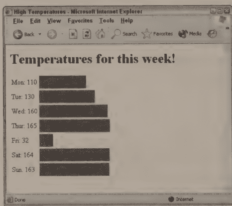

Figure 8-1：条形图是通过拉伸单像素 .gif 文件生成的。


除了绘制条形图，你还可以使用现有的图形文件（即 PHP 程序不生成的文件）来创建表格和其他图形。下一个示例使用两个图形文件：blueempty.gif（一个 30 像素乘 30 像素的蓝色方块）和 box.gif（一个带有 X 的 30 x 30 方块）。你可以自己创建这两个 30 x 30 图形文件，或者使用我的文件。如果你想使用我的文件，可以从 www.jeffcogswell.com/dummies/box.gif 和 www.jeffcogswell.com/dummies/blueempty.gif 获取。

```
<html><head>
<title>This Week’s Tennis Matchups</title>
<style type="text/css">
<!-- .text { font-family: Arial, Helvetica, sans-serif; font-size: 11px}-->
</style></head>
<body>
<table border="0" cellspacing="0" cellpadding="0">
<?php
$names = array ("bill","suzie","julie","hank", "jim",
"jen");
$matches = array(
"bill.suzie", "bill.hank", "suzie.jim", "julie.jim",
"julie.jen"
);
print '<tr height="30"><td></td>';
foreach ($names as $topname) {
print "<td><span class=\"text\"><center>".
"$topname</center></span></td>";
print "\n";
}
print "</tr>";
foreach ($names as $leftname) {
print '<tr height="30">';
print "<td><span
class=\"text\">$leftname</span></td>";
foreach ($names as $topname) {
if (in_array("$leftname.$topname", $matches) ||
in_array("$topname.$leftname", $matches)) {
print "<td></td>";
}
else {
print "<td></td>";
}
}
print "</tr>\n";
}
?>
</table>
</body>
</html>
```

这个示例比前一个示例更复杂一些。图 8-2 显示了该示例在浏览器中的样子。在这个示例中，当前的比赛被硬编码在数组中；在实际生活中，你可能会从数据库或文件中读取比赛。如果你想在不手动输入的情况下查看此示例，请访问 www.jeffcogswell.com/dummies/grid.php。

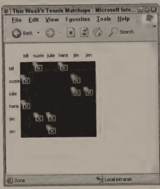

图 8-2：你可以使用表格仔细定位你的图形。

## 创建图形文件

在前一部分，你了解了如何使用现有图形并仔细使用 HTML 绘制它们以获得不同的结果。虽然这很有趣，但使用 HTML 基本上只能局限于基本的矩形绘图。在本节中，我将向你展示如何即时创建新的图形文件以及如何操作现有的图形文件。

### 在网上

本节讨论的函数属于 PHP 手册中图像函数类别。如果你想探索完整的函数列表，请查看 www.php.net/image。

### 警告！

要完成本节中的示例，请确保你的 PHP 系统已配置为使用 GD 库，这是一个通用图形库，负责处理所有幕后的图形处理。（因为 PHP 是服务器端语言，访问你网站的访问者不需要在其本地机器上安装 GD 库。）GD 库自 PHP 4.3 版本起成为 PHP 的标准部分，但你需要确保 PHP 已配置为使用它。

要在 Linux 计算机上配置该库，需要经历标准配置过程，包括 --with-gd 选项。你可以在 www.php.net/manual/en/installation.php 上了解更多关于此过程的信息。

要在带有预构建 PHP 安装的 Windows 计算机上配置该库，需要编辑位于 C:\Windows 目录中的 php.ini 文件。（如果文件不存在，你可以将 PHP 安装目录中的 php.ini-dist 文件复制到 Windows 目录，并将其重命名为 C:\Windows\php.ini。）然后按如下方式修改 extension_dir 行：

```
extension_dir = C:/Program Files/PHP/php-4.3.0-Win32/
extensions/
```

或者使用包含你的 PHP 安装的任何路径。在此条目中，extensions/ 目录跟随 PHP 安装路径。

然后删除以下行上的分号：

```
;extension=php_gd.dll
```

以获得

```
extension=php_gd.dll
```

然后重新启动 Apache 服务器。


GD 图形库的创建者 Boutell.Com 正在不断修订该产品，并在 www.boutell.com/gd/ 发布新版本。撰写本文时，最新版本是 2.0 版，其中包含大量新功能。PHP 图像库的在线手册 www.php.net/image 包含许多依赖 GD 2.0 版本的函数。如果你的 PHP 安装中有旧版本的 GD，请检查你想要使用的函数是否需要最新版本。需要 2.0 版本的函数将在其 Web 文档页面上显示如下消息（例如，www.php.net/imagecopyresampled 是 imagecopyresampled 函数的 Web 文档页面）：

注意：此函数是在 PHP 4.0.6 中添加的，并需要 GD 2.0.1

## GIF 文件和 PHP 图像

GD 库的最新版本不处理 GIF 图像。原因是长期以来，一家名为 Unisys 的公司拥有读取和写入 GIF 文件所需的某种压缩例程（称为 LZW）的专利。Unisys 指望人们为在其软件中使用 GIF 文件算法支付版税。为避免许可费用，GD 开发人员删除了 GIF 支持。这种删除在过去几年中在 Web 程序员中很常见，主要是作为一种政治立场。而不是 GIF 文件，GD 支持 PNG 文件。（PNG 格式也是为避免使用 GIF 文件的法律问题而创建的。）然而，在很长一段时间里，客户端计算机上主要的浏览器——运行在 Windows 上的 Internet Explorer 和 Netscape——都不支持 PNG，使得使用 PNG 更多地成为一种奇特之处，且几乎无用。（有趣的是，Macintosh 上的 Internet Explorer 在 Windows 上的 Internet Explorer 之前就对 PNG 有更好的支持。）今天，Internet Explorer 和 Netscape 都支持 PNG 文件（尽管支持不完美）。如果你想了解详细信息，请查看 www.libpng.org/pub/png/pngstatus.html 上的 PNG 当前状态页面，以及 www.libpng.org/pub/png/pngapbr.html 上的支持 PNG 的浏览器页面。

导致 PNG 文件出现的整个问题——专利——大多已成为历史，因为根据一些法律分析人士的说法，保护 GIF 压缩的原始专利（专利号 4,558,302，申请于 1982 年 6 月 20 日）于 2003 年 6 月 20 日到期。（但在你的软件中开展 LZW 狂欢之前，请咨询律师，因为我这里不提供法律建议或推荐。此外，Unisys 在美国境外拥有专利，这些专利要到 2004 年才到期。）如需了解这一问题的有趣观点，请查看 burnallgifs.org。如需了解 Unisys 的观点，请访问 www.unisys.com/about_unisys/lzw/。

该消息在所有页面上不一致，但通常看起来像这样。如果你需要这些较新的函数（非常有用），我建议升级你的 PHP 版本。如果你依赖于托管服务且该服务使用较旧版本的 PHP，要么鼓励该服务升级，要么寻找不同的主机。许多专业托管服务会保持使用最新版本。

要确定你使用的 PHP 版本拥有 1.0 还是 2.0 版本的 GD，请使用以下 PHP 程序：

```
<?php
	phpinfo();
?>
```

在相关服务器上运行此程序，然后向下滚动到 "gd" 部分。（如果没有 gd 部分，则服务器上甚至没有 GD。）在 gd 部分中，你会看到一行显示 "GD Version"，后面跟着版本号。

## 设置文件类型

当你创建 PNG 文件、JPG 文件或任何其他类型的图形文件，并希望你的 PHP 程序将文件发送到浏览器时，你的程序需要告诉浏览器是什么类型的图形文件。要指定文件类型，你需要通过调用 header 函数来设置标头。

PHP 标头必须在 PHP 程序中的任何 HTML 代码之前设置。因此，请确保在 HTML 代码之前指定文件类型。

对于 PNG 文件，你可以使用以下行设置标头：

```
header('Content-type:image/png');
```

对于 JPG 文件，你可以使用以下行：

```
header('Content-type:image/jpeg');
```

此代码行使用完整的 jpeg 名称，而不是三个字母的缩写形式 jpg。

## 绘制多边形

图形库有众多函数用于绘制线条、矩形和椭圆等形状。你可以通过访问 www.php.net/image 在 PHP 文档中探索不同的函数。为了让你入门，这里有一个绘制简单多边形的 PHP 程序：

```
<?php
$pic = imagecreate(400, 400);
$bgcolor = imagecolorallocate($pic, 255, 255, 255);
$mycolor = imagecolorallocate($pic, 255, 0, 0);
$points = array(
    200, 0, # point 1
    0, 200, # point 2
    400, 200, # point 3
    0, 400, #point 4
);
imagefilledpolygon($pic, $points, 4, $mycolor);
header('Content-type:image/jpeg');
imagejpeg($pic);
?>
```

以下是该程序的各个代码行：

- 首先，我通过调用 imagecreate 创建一个宽 400、高 400 的空白图像。


- 接下来，我设置背景颜色。（第一次调用 imagecolorallocate 时，即设置背景颜色。）我需要白色背景，这对应的红绿蓝（RGB）设置为 255, 255, 255。

- 接下来，我创建另一种颜色，稍后将使用。这种颜色是红色，RGB 值为 255, 0, 0。

- 接下来，我为多边形创建一组点。对于这些点，您需要创建一个包含所有点的数组。第一个点是 (200, 0)，第二个是 (0, 200)，第三个是 (400, 200)，最后，第四个是 (0, 400)。（填充的多边形会假设最后一个点与第一个点 200,0 相同，从而封闭多边形。）

- 接下来，通过调用 imagefilledpolygon 绘制多边形。向此函数传递要绘制的图像、点数组、点数（此数组有四个点，占用八个数字，因此传递 4）以及颜色。

- 然后是神奇的部分：通过调用 header 设置标头（在此例中指定 JPEG 类型）。最后，通过调用 imagejpeg 并传递图像变量，将图像发送到浏览器。

如果我改为发送 PNG 文件，则将最后两行改为如下内容：

```
header('Content-type: image/png');
imagepng($pic);
```

无论使用 png 还是 jpg，您看到的都是同一张图像：一侧朝上的红色蝴蝶结形状；您可以在 www.jeffcogswell.com/dummies/createjpg.php 上在线查看。

出于某种原因，在线参考中所有图像函数名都显示为全小写字母，例如 imagefilledpolygon。我更喜欢在这样的函数中将不同的单词大写，例如 ImageFilledPolygon。由于 PHP 的函数名不区分大小写，如果您愿意，可以使用 ImageFilledPolygon 代替 imagefilledpolygon。但是，就本书而言，我将坚持使用官方名称，即全小写。我不会反抗；我不会抵抗。我是一台机器，一台计算机。我会照做。

## 创建动态图像

作为使用 PHP 强大的图像编辑函数可以做到的示例，在本节中，我将向您展示如何读取预先存在的图形文件，根据用户数据增强图像，然后再将图像发送到用户的客户端浏览器。

对于以下示例，您需要四张图像。第一张是美国地图。我制作了一个简单（好吧，有点滑稽）地图，您可以下载并使用；可在 www.jeffcogswell.com/dummies/usmap.png 获取。

第二个文件是一个包含表单的基本 .html 文件。我将此文件命名为 usmaplookup.html。这是访问您网站的人员将加载的文件。以下是代码：

```html
<html>
<title>Latitude and Longitude Lookup</title>
<form name="form1" method="get" action="drawmap.php">
Latitude <input type="text" name="latitude"> N <br>
Longitude <input type="text" name="longitude"> W<br>
<input type="submit" name="Submit" value="Submit">
</form>
```

此代码显示一个简单的表单，允许用户输入纬度和经度。然后，此 HTML 代码打开 drawmap.php 文件并传递纬度和经度。以下是 drawmap.php 文件：

```php
<html><title>Latitude and Longitude Results</title>
<?php
$latitude = $_GET['latitude'];
$longitude = $_GET['longitude'];
print "You chose latitude $latitude<br>";
print "and longitude $longitude.<p>";
print '';
?>
```

这个简单的 .php 文件获取纬度和经度数字，并创建显示简短消息和图像的 HTML 代码。图像是关键。img 标签通常会引用以 .jpg、.gif 或 .png 结尾的图像文件，而这个“图像”文件名为 buildmapimage，扩展名为 .php。扩展名无关紧要；浏览器不在乎它是什么。浏览器会高兴地将 URL 发送到 Web 服务器，并等待图像返回。服务器随后运行生成图像文件的 .php 文件。在本示例中，URL 后面还带有一些参数，即纬度和经度。buildmapimage.php 文件可以提取这些信息并用它来动态创建图像。现在我们有进展了！

以下是 buildmapimage.php 文件：

```php
<?php
$pic = imagecreatefrompng("usmap.png");
$mycolor = imagecolorresolve($pic, 192, 0, 0);

// Calculate the location
$latitude = $_GET['latitude'];
$longitude = $_GET['longitude'];
$width = 557;
$height = 306;
$x = $width - (($longitude - 67) * ($width / 58));
$y = $height - ((($latitude - 25) * ($height / 24)));

imagefilledrectangle($pic, $x-2, $y - 2, $x+2, $y+2,
        $mycolor);
header('Content-type:image/png');
imagepng($pic);
?>
```

此文件首先使用名为 imagecreatefrompng 的函数加载现有图像 usmap.png。接下来，程序设置一种颜色（红色），稍后将用于在地图上绘制点。然后，程序提取纬度和经度数据并进行线性变换（行话，意为调整数据），以使数据点适配地图。我制作的地图宽 557 像素，高 306 像素。后续计算将纬度和经度转换为地图上的像素。

然后，代码在计算出的位置上使用我之前定义的颜色在地图上绘制一个小方框，最后将生成的图形图像发送到浏览器。

drawmap.php 文件在浏览器中显示方式与任何其他 .html 文件相同；它包含文本和图像，正如您所预期的那样。访问页面的用户没有意识到地图是动态创建的。

如果您想查看此程序在屏幕上的效果，请访问 www.jeffcogswell.com/dummies/usmaplookup.html。对于纬度，请输入 25 到 49 之间的任意整数。对于经度，请输入 67 到 125 之间的任意整数。

### 创建缩略图

这里有个实用的小技巧。为什么要用缩略图占用服务器空间，而不可以动态生成它们？为什么要为威斯康星戴尔旅行的所有照片手动创建缩略图而苦恼呢？虽然缩略图对服务器空间的影响不大，但如果您愿意，可以让 PHP 动态生成它们。

如果您运营的是访问量非常大的网站，我不建议使用我即将展示的过程。此过程需要一定的计算时间。例如，如果您有一个充斥着无数布拉德·皮特和珍妮弗·安妮斯顿崇拜页面图片，每天有数十亿次点击的页面，我建议您自己创建缩略图并将其存储在服务器上，而不是依赖 PHP。

要使用此演示，请确保您安装了最新最强大的 GD 库。
您需要 2.0 或更高版本才能正常工作。如果您使用的是早期
版本，也别灰心。在以下程序中，将 imagecreatetruecolor 替换为 imagecreate。区别在于 imagecreatetruecolor
可以生成全彩色图像，而 imagecreate 仅限于 256
种颜色。

以下是生成缩略图的 .php 文件；将其另存为
getthumbnail.php：

```php
<?php
$imagefilename = $_GET['imagefilename'];
$height = $_GET['thumbheight'];
$width = $_GET['thumbwidth'];
$pic = imagecreatefromjpeg($imagefilename);
$thumb = imagecreatetruecolor($width, $height);
$white = imagecolorallocate($thumb, 255, 255, 255);
imagefilledrectangle($thumb, 0, 0, $width, $height,
$white);

// Calculate the relative width or height so the image
// doesn't get distorted.
$origwidth = imagesx($pic);
$origheight = imagesy($pic);
if ($origheight > $origwidth) {
    $thumbwidth = $origwidth * $height / $origheight;
    $thumbheight = $height;
}
else {
    $thumbheight = $origheight * $width / $origwidth;
    $thumbwidth = $width;
}
imagecopyresized($thumb, $pic,
0, 0, // thumb position
0, 0, // original position
$thumbwidth, $thumbheight, // thumb size
$origwidth, $origheight // original size
);
header('Content-type:image/jpg');
imagejpeg($thumb);
?>
```

以下是该程序的逐条说明：

- 该 .php 文件接收三个参数：原始图形文件的名称（用于构建缩略图）、缩略图宽度和缩略图高度。

- 然后，代码打开原始文件，创建第二个图形文件来保存缩略图，并用白色填充该图形文件以提供空白背景。

- 接下来，程序计算缩略图的大小，使图像足够大以适应缩略图，但不会使图像变形。

- 然后，此代码调用 imagecopyresized，即缩小文件的例程。我仔细标记了数值参数，以便您可以了解它们的作用。

- 最后，此代码发送图像。

以下是使用前面的代码生成缩略图列表的示例。对于 img 标签，我指定的不是图像文件，而是一个 PHP 文件——您刚刚创建的 getthumbnail.php 文件。

```html
<html><title>Thumbnails!</title>
<body>
<?php
$pics = array('rocks1.jpg', 'rocks2.jpg',
     'rocks3.jpg',
     'rocks4.jpg', 'rocks5.jpg', 'rocks6.jpg');
foreach ($pics as $pic) {
      print "<a href=$pic>\n";
      print " "; // Don't put a \n here!
      print "</a>\n";
}
?>
</body>
</html>
```

此代码假设您的服务器上存在名为 rocks1.jpg 到 rocks6.jpg 的文件。我使用这些文件名是因为我的服务器上有几个同名的示例文件。您可以访问 www.jeffcogswell.com/dummies/thumbnails.php 来试用前面两个脚本（您将看到我最近一次度假的一些精彩照片！）。


## 第9章：使用类建模数据

### 本章内容

- 构建类
- 声明构造函数并实现析构函数
- 理解动态绑定
- 继承和派生对象
- 获取关于类的信息

PHP支持面向对象编程，这意味着你可以构建类和对象。类能让你有效地组织和建模数据，而PHP对这种高级编程并不陌生。（如果你不熟悉类和面向对象编程，以及诸如*成员*之类的术语，请参见第III卷第6章。）

本章我将向你展示如何在PHP中构建类。这包括类通常带来的所有好东西：添加构造函数和析构函数，以及继承和派生。此外，我还将讨论动态绑定和获取关于类的信息。准备好进行真正的编程了吗？

### 构建类

除了拥有完整的过程式语法外，PHP还通过类提供面向对象编程。类的语法很简单，如下面的代码所示：

```php
<?php
class Pumpernickel {
    var $ounces;
    function tell_all() {
        print "Today's pumpernickel bread has only
        {$this->ounces} ounces remaining!<br>";
    }
}
```

```php
$bread = new Pumpernickel;
$bread->ounces = 10;
$bread->tell_all();
?>
```

这段代码定义了一个名为Pumpernickel的新类。Pumpernickel类有两个成员：一个名为$ounces的变量和一个名为tell_all的函数。接着，代码创建Pumpernickel的一个新实例并将其保存在名为$bread的变量中。代码随后将新Pumpernickel实例的ounces成员设置为10，并调用该实例的tell_all函数。以下是这段代码的输出：

Today's pumpernickel bread has only 10 ounces remaining!<br>

如你所见，在PHP中创建类非常简单。以下是需要记住的要点：

- 要访问成员，请输入持有对象的变量名，后跟->，再跟成员名。不要在成员名前加美元符号。$bread->ounces是正确的，而$bread->$ounces是不正确的。
- 成员函数通过在变量名前加$this->来访问成员变量。
- 使用var关键字在类中声明成员变量，就像我在前面的代码中所做的那样。
- 不要在类结尾使用分号。这与C++语言不同，所以如果你来自那个世界，请牢记这一点。

### 为什么PHP中缺少这个功能？

PHP在线讨论群里的人有时会抱怨该语言缺少"至关重要"的面向对象（OO）功能，例如公共和私有访问、函数重载以及各种其他有趣的东西。诚然，PHP没有其他语言（如Java、Python、C++等）中那些高级的OO功能。但这重要吗？不重要。在PHP中编码时，请记住该语言的目的。PHP不是一种旨在构建庞大、超级强大、独立应用程序的广泛语言。PHP是一种服务器端脚本语言。设计者故意保持其语言特性简单——排斥诸如公共和私有访问之类的东西——并保持其函数库丰富。这样，语言可以保持简单、快速和易用，以便你可以使用它来生成强大的网站。

### 构造和销毁对象

如果你想在类中放置初始化代码，可以使用构造函数。构造函数是与类同名的成员函数，在创建类的新实例时运行。以下是一个示例：

```php
<?php
class Bulldozer {
    function Bulldozer() {
        print "Constructing something";
    }
}
$obj = new Bulldozer();
?>
```

当你创建Bulldozer的新实例时，你会看到构造确实在进行。（你还能从一头脾气温和的推土机那里期待什么别的呢？）以下是输出，并无奇技淫巧：

Constructing something

你还可以在构造函数中包含参数，如下所示：

```php
<?php
class Bulldozer2 {
    var $year;
    function Bulldozer2($ayear) {
        $this->year = $ayear;
        print "<p>\n";
        print "This bulldozer was built in ".
        "{$this->year}.\n";
    }
}
$obj2 = new Bulldozer2(1968);
?>
```

当这段代码创建Bulldozer2的新实例时，代码将数字1968传递给构造函数。构造函数随后将该数字保存在$year成员变量中。

当你为构造函数定义一组参数（就像我在前面的代码中所做的那样）时，你必须在创建实例时传递这些参数。如果你随后尝试这样做：

$obj3 = new Bulldozer2();

你会得到类似这样的警告：

Warning: Missing argument 1 for bulldozer2() in
constructor.php on line 11

为了避免这个问题，你可以为参数提供默认值。以下是一个处理默认值的修订版Bulldozer2构造函数：

```php
function Bulldozer2($ayear=1970) {
	$this->year = $ayear;
	print "<p>\n";
	print "This bulldozer was built in ".
		"{$this->year}.\n";
}
```

如果你想在类中添加析构函数怎么办？从技术上讲，PHP不支持对象的析构函数（至少在撰写本书时不支持；但是，5.0版本将包含析构函数支持）。同时，你可以相当容易地模拟析构函数。看看这段代码：

```php
<?php
class Destructionizer {
	function Destructionizer() {
		print "Starting!\n";
	}
	function Destroy() {
		print "Destroying!\n";
	}
	function Test() {
		print "Test!\n";
	}
}
$myobj = new Destructionizer;
$myobj->Destroy();
unset($myobj);
// $myobj->Test(); # This will generate
					# an error if uncommented!
?>
```

这段代码定义了一个名为Destructionizer的简单类。（如果类名中允许使用感叹号，我可以向你保证我会加上一个！）在这段代码中，定义类后，我做了以下操作：

- 我创建一个Destructionizer的新实例。
- 然后我调用Destroy()，它*不是*析构函数。它是一个我选择给其起了一个合适名称的成员函数；你可以在此函数中放置一些清理代码。

然后我通过调用unset来摆脱对象。unset关键字会销毁对象但不会调用任何成员函数。因此，如果我想要析构函数，我的任务是包含一个执行某些清理工作的函数，然后在使用unset关键字删除对象之前手动调用该函数。我就是在前面的示例中这样做的，而且它有效。

以下是这段代码在浏览器中的输出：

Starting! Destroying!

另外请注意，我包含了一行被注释掉的代码。如果你取消注释该行，你会发现对象确实已经不存在了，因为尝试使用它会导致运行时错误：

```
Fatal error: Call to a member function on a non-object in
destructor.php on line 16
```

### 为动态绑定编码

PHP与许多解释型语言一样，为一种称为动态绑定的功能提供了强大的支持。（如果你是面向对象纯粹主义者，你会将其称为多态性。）看看下面的代码：

```php
<?php
class A {
 function foo() {
 print "This is foo for class A!<br>\n";
 }
}

class B {
 function foo() {
 print "This is foo for class B!<br>\n";
 }
}

function Process($obj) {
 $obj->foo();
}

$objA = new A();
$objB = new B();
Process($objA);
Process($objB);
?>
```

这段代码的作用如下：

- 它定义两个类，A和B，每个类都有一个名为`foo()`的成员函数。
- 然后它声明一个名为`Process`的函数，该函数接受一个对象作为参数并调用该对象的`foo`函数。
- 最后，它分别创建A和B的实例，并为每个实例调用`Process`。

当你将此代码放置在Web服务器上并在浏览器中打开时，你会看到以下内容：

This is foo for class A!
This is foo for class B!

`Process`函数不关心它作为参数接收到哪种类型的对象。当程序运行时，`Process`函数尝试在它接收到的任何对象上调用`foo()`，无论该对象是A类、B类、Snooty类、No类还是其他任何类。换句话说，在程序运行期间，`Process`函数内的变量`$obj`将绑定到`$obj`所持有的任何对象上的名为`foo()`的函数。程序正在执行_动态绑定_。


如果你常去PHP在线论坛，你可能会发现有人抱怨PHP不支持动态绑定，而"真正的面向对象语言应该支持"。好消息来了！PHP_确实_支持动态绑定。那么为什么会有这些抱怨呢？通常，发帖抱怨的人指的是一个略有不同的主题，称为_函数重载_。如果你熟悉C++，你就会知道你可以在单个类中拥有两个同名函数，但参数不同。编译器可以根据参数找出要调用哪个函数，这种推断发生在编译时（称为_静态绑定_）。PHP不支持函数重载，但它支持动态绑定。万岁！

### 继承和派生对象

PHP允许你从现有类派生新类。当你这样做时，你正在定义一个新类，该类包含原始类的所有成员，加上你添加的任何其他成员。看看这个示例：

```php
<?php
class FrozenFood {
   var $price;
   function Describe() {
      print "This food's price is ".
```


"{$this->price}.<br>\n";
} );

class FrozenPizza extends FrozenFood {
    var $toppings;
    function DescribeToppings() {
        print "This pizza has ({$this->toppings})";
        print " on it.<br>\n";
    }
}

$pizza = new FrozenPizza();
$pizza->price = 4.53;
$pizza->toppings =
    "pepperoni sausage anchovies";
$pizza->Describe();
$pizza->DescribeToppings();
?>

这个示例创建了一个名为 FrozenFood 的类，其中包含两个成员：一个名为 $price 的变量和一个名为 Describe 的函数。接下来，这段代码创建了一个名为 FrozenPizza 的新类，使用 extends 关键字从 FrozenFood 派生。因为 FrozenPizza 是从 FrozenFood 派生的，所以 FrozenPizza 拥有与 FrozenFood 相同的成员（$price 和 Describe），以及 FrozenFood 为自己定义的任何成员（$toppings 和 DescribeToppings）。在随后的代码中，你可以看到类 FrozenPizza 的对象 $pizza 确实拥有所有四个成员：$price、$toppings、Describe 和 DescribeToppings。

当派生一个新类时，你可以自由重写基类的任何成员函数。例如，我可以向 FrozenPizza 类添加一个新的 Describe 函数，如下所示：

```
class FrozenPizza extends FrozenFood {
    var $toppings;
    function DescribeToppings() {
        print "This pizza has ({$this->toppings})";
        print " on it.<br>\n";
    }

    function Describe() {
        print "This is a pizza!<br>\n";
        FrozenFood::Describe();
        $this->DescribeToppings();
    }
}
```

此类现在有其自己的 Describe 函数，而基类 FrozenFood 也提供了一个 Describe 函数。假设你有如下代码：

```
$pizza = new FrozenPizza();
$pizza->price = 4.53;
$pizza->toppings =
    "pepperoni sausage anchovies";
$pizza->Describe();
```

PHP 处理器将运行哪个版本的 Describe？它将运行 FrozenPizza 类中的那个，因为该对象的类型是 FrozenPizza。

你可以在 FrozenPizza 类的 Describe 代码中看到，我使用了一个有趣的结构：

```
FrozenFood::Describe();
```

这一行调用 FrozenFood 类中 Describe 的基类版本。

## 获取类的信息

PHP 库包含一组实用函数，可帮助你获取有关对象和类的信息。以下列表介绍了一些更有用的函数：

- **get_object_vars**：此函数返回对象中变量的关联数组。键是变量的名称，数组值是变量的值。要使用此函数，请传递对象的变量名。

- **get_class**：这将返回一个包含类名的字符串。要使用此函数，请传递对象的变量名。

- **get_parent_class**：这将返回一个包含基类名的字符串。要使用此函数，请传递对象或类名。（要传递类名，_不要_ 将名字放在引号中。）

- **get_class_methods**：这将返回一个类的成员函数数组。有些人喜欢将成员函数称为 _methods_，因此这个函数的名字如此。

- **get_declared_classes**：此函数返回 PHP 处理器所知道的所有类的名称数组。该数组包含你声明的任何类，加上任何内置类。

你可以通过访问 www.php.net/classobj 探索其他类和对象函数。

以下是一个示例程序，演示如何使用这些函数：

```
<?php
class Base {
    var $basevar;
    function BaseFunc() {
        print "Hello!<br>\n";
    }
}
class Derived extends Base {
    var $derivedvar;
    function DerivedFun() {
        print "Greetings!<br>\n";
    }
}
$obj = new Derived();
$obj->basevar = 10;
$obj->derivedvar = 20;
$objs = get_object_vars($obj);
print "The object belongs to class <b>";
print get_class($obj)."</b><br>\n";
print "The base class is <b>";
print get_parent_class($obj)."</b><br>\n";
print "Object's Variables<br>\n";
foreach ($objs as $name=>$var) {
    print " * $name = $var<br>\n";
}
print "Base class has these functions<br>\n";
$basemethods = get_class_methods(Base);
foreach ($basemethods as $method) {
    print " * $method<br>\n";
}
print "Here are all the classes defined:<br>\n";
$allclasses = get_declared_classes();
foreach ($allclasses as $classname) {
    print " * $classname<br>\n";
}
?>
```

以下是该程序的输出：

该对象属于类 <b>derived</b><br>
基类是 <b>base</b><br>
对象的变量<br>
* basevar = 10<br>
* derivedvar = 20<br>
基类具有这些函数<br>
* basefunc<br>
以下是所有定义的类：<br>
* stdClass<br>
* __PHP_Incomplete_Class<br>
* Directory<br>
* COM<br>
* VARIANT<br>
* base<br>
* derived<br>

如你所见，除了你创建的类之外，PHP 在其内部机制中还定义了一些类。

## 第 10 章：增强你网站的十种方法

### 本章内容

- 将 index.html 重定向到 index.php
- 动态生成样式表
- 允许文件上传
- 在适当的时候使用 POST
- 随机生成每日图片
- 从文件写入文本
- 确定正在运行的浏览器
- 从 IP 地址确定主机名

在本章中，我将为你提供十种使用 PHP 增强网站的绝妙方法。请继续阅读！

### 将 index.html 重定向到 index.php

文件名 index.html 通常是 Web 服务器中的默认文件。如果访问者只使用网站名称（例如 www.dummies.com）访问你的网站，服务器默认会提供 index.html。但是，如果你的索引文件中包含 PHP 代码怎么办？你可能想改用 index.php。

将 index.html 重定向到 index.php 的最简单方法是配置 Apache，使其默认发送 index.php 文件。如果你有权访问根 httpd.conf 文件，可以为整个服务器设置配置。如果你使用的是第三方托管服务，你的域名映射到文件系统上的一个目录（很可能是你自己的 public_html 目录）。在这种情况下，你需要使用 .htaccess 文件。

无论你使用 .htaccess 还是根 httpd.conf 文件，都可以将以下指令输入到 .htaccess 或 httpd.conf 文件本身中：

```
DirectoryIndex index.php
```

请记住，有些访问者可能会继续手动输入 index.html（如果他们使用互联网很长时间）。如果那些人输入 index.html 这样显而易见的内容却看到 404：未找到文件 错误消息，他们会感到沮丧。前面的重定向无济于事，因为访问者不仅输入了域名，还输入了 index.html。因此，我还建议你包含一个带有重定向的 index.html 文件。唯一的棘手之处是，你无法在 PHP 中执行此重定向，因为 index.html 具有 .html 扩展名，因此不会经过 PHP 处理器。（因此又回到了你最初想使用 index.php 的想法。哎呀。）你需要的完整 index.html 文件如下：

```
<html><head><title>Redirect!</title>
<meta http-equiv="Refresh" content="0; URL=index.php">
</head></html>
```

HTML Refresh 元标签会导致浏览器立即加载 index.php 文件。


如果你是 Unix 爱好者，可能听说过可以使用符号链接来实现重定向。我尝试使用以下代码：

```
ln -s index.php index.html
```

我的担忧得到了证实：虽然重定向有效，但该文件不会经过 PHP 处理器。Apache 服务器不知道它实际读取的文件是 index.php。Apache 只需打开 index.html，操作系统会悄悄地将 index.php 的数据提供给 Apache；Apache 不知道这是一个符号链接。Apache 将文件作为 .html 文件发送到浏览器，因为那是 index.html 的扩展名。那么发送到浏览器的是什么？你的所有 PHP 代码。所以不要使用符号链接，因为它不能按你想要的方式工作。

### 显示当前时间

有些人喜欢在网页上显示当前时间。但是，如果你有一个静态 HTML 页面，你输入的任何时间都会很快过时。为避免此问题，你可以使用 PHP。

以下是一个简短的 .php 文件，用于显示当前时间：

```
<html><head><title>Welcome</title></head>
<body>
Welcome to my Web page!
It is


```
<?php
print date("l, F dS, Y \\a\\t h:i:s A T");
?>
</body></html>
```

此文件使用 date 函数来格式化当前日期。字符串中的每个字母都代表不同的日期格式；您可以在 www.php.net/date 查看这些字母及其格式的列表。

关于这个日期字符串，我只想补充一点，涉及奇怪的 \a\t。如果你有一个字母是格式说明符，但希望该字母原样出现，则在其前面加上反斜杠。因为 a 是格式说明符，而我希望字母 a 出现，所以我使用 \a。字母 t 也是格式说明符，但 \t 是一个制表符。要仅打印一个 t，我使用两个反斜杠。因此 \a\\t 会打印出这个令人愉快的小词 at。

前面的代码生成服务器端代码（这就是我加入 T 的原因，它用于打印时区），如果客户端位于不同的时区，而您希望页面显示本地时间，这可能会成为一个问题。解决此问题的方法是使用客户端语言（例如 JavaScript），完全不使用 PHP。下面是一个使用 JavaScript 打印本地时间的 .html 文件：

```
<html><head><title>Welcome</title></head>
<body>
Welcome to my Web page!
It is
<SCRIPT LANGUAGE="JavaScript" TYPE="text/javascript">
document.write(Date())
</SCRIPT>
</body></html>
```

## 动态生成样式表

样式表很有趣，可以为网页添加比普通旧式 HTML 更花哨的格式。样式表使您可以指定文本大小、颜色、字体、边框、阴影以及各种其他内容。大多数人喜欢将样式表放在单独的文件中，然后让每个网页连接到该样式表。这样，每当添加新网页时，您就不需要重新输入所有样式信息。如果要更改某个样式，只需在一处进行修改即可。

将 PHP 添加到网站的妙处在于，您可以拥有多个样式表，然后动态选择要使用的样式表。您可以让用户通过指定用户名登录，然后在 MySQL 数据库中查找用户偏好的样式表。或者，您可以根据季节更改样式表（例如，秋季使用黄色和棕色）。

下面是一个基于时间演示两个不同样式表的单个 .php 文件：

```
<html><head><title>Changing Styles</title>
<style type="text/css">
<!--
<?php
if (time() % 2 == 0) {
    print 'body { font-family: Georgia, '.
        '"Times New Roman", Times, serif; '.
        'font-size: 14px; font-weight: bold; '.
        'color: #000009)';
}
else {
    print 'body { font-family: '.
        'Arial, Helvetica, sans-serif; '.
        'font-size: 16px; font-weight: bold; '.
        'color: #006666}';
}
?>
-->
</style>
<body bgcolor="#FFFFFF" text="#000000">
This is some basic text!
</body></html>
```

此文件根据当前 Unix 时间为正文文本选择样式。（不过，我建议让用户对样式有一定的决定权。）我将样式放在同一个 .php 文件中；如果您希望这些样式在整个站点中都可用，只需将它们放在自己的 .php 文件中，然后 include 或 require 该文件。

如果您亲自尝试此示例，请记住，程序将根据当前时间（以秒计）是偶数还是奇数来选择样式表。因此，在看到更改之前，您可能需要刷新页面几次。

## 允许文件上传

某些网站允许用户上传文件。一个很好的示例是 Web 电子邮件服务，它允许用户将文件附加到发出的电子邮件中。

要处理上传，您需要在 HTML 中创建一个表单，并创建一个单独的 .php 文件来接收上传的文件。下面是一个示例 .html 文件：

```
<html><head><title>File Upload Form</title></head>
<body>
<form enctype="multipart/form-data"
action="upload2.php" method="post">
<input type="hidden" name="MAX_FILE_SIZE" value="30000">
Filename: <input name="filename1" type="file"><br>
<input type="submit" value="Submit">
</form>
</body></html>
```

两个关键部分是 form 标签中的 enctype 参数和文件输入框。enctype 参数及其值 "multipart/form-data" 用于告诉浏览器发送文件。type 为 file 的输入框会在浏览器中显示一个文本框和一个浏览按钮。浏览按钮会打开一个“打开文件”对话框，当用户选择文件时，文件名会出现在文本框中。

您可以通过拥有多个文件类型表单对象来支持多文件上传；只需确保为每个对象赋予不同的 name 值。请注意，我在前面示例中提供的 name 值是 filename1；您可以将其他对象命名为 filename2、filename3 等等。


名为 MAX_FILE_SIZE 的隐藏表单对象告诉浏览器不要上传大于指定字节数的文件（本例为 30,000 字节）。（不过，有人报告过浏览器忽略此设置的情况，因此在 PHP 代码中，您可能需要再次检查接收到的文件大小。）

在接收端，您的 .php 文件会获取一个名为 $_FILES 的数组，其中包含有关上传文件的信息（但不包含文件本身）。$_FILES 数组中每个上传的文件都有一个条目，键是 HTML 表单中文件类型输入框使用的名称。（因此，如果文件来自前面的 .html 文件示例，$_FILES 数组将有一个键，即包含 filename1 的字符串。）数组中每个元素的值本身也是一个数组。下面是处理上传的 .php 文件：

```
<?php
$uploads_dir = '/home/me/uploads';
foreach ($_FILES as $myfile) {
$filename = $myfile['name'];
switch ($myfile['error']) {
case UPLOAD_ERR_NO_FILE:
    continue 2; // continue for loop
case UPLOAD_ERR_INI_SIZE:
case UPLOAD_ERR_FORM_SIZE:
    print "Sorry, $filename ".
    "is too big.<p>";
    continue 2;
case UPLOAD_ERR_PARTIAL:
    print "The upload of file ".
    "$filename was broken. ".
    "Please try again!<p>";
    continue 2;
}
print "Thank you for the file $filename.";
print "This file is of type ".
$myfile['type']."<br>";
move_uploaded_file(
    $myfile['tmp_name'],
    $uploads_dir.$myfile['name']);
}
?>
```

下面是对这段代码的简要介绍：

- foreach 循环针对每个上传的文件运行。
- $myfile 变量（在循环头中指定）包含每个文件的信息。
- $myfile['name'] 是文件名。
- 如果出现问题，$myfile['error'] 将设置为 switch 语句中列出的四个值之一。
- $myfile['type'] 是文件的 MIME 类型。（例如，JPEG 图像的此值将为 "image/pjpeg"。）
- $myfile['tmp_name'] 是 PHP 存储上传文件的完整路径和文件名。通常，文件将存储在临时目录中；因此，您会希望像我在前面示例中使用 move_uploaded_file 函数那样移动文件。


在前面的代码中，我使用了 UPLOAD_ERR_NO_FILE、UPLOAD_ERR_INI_SIZE、UPLOAD_ERR_FORM_SIZE 和 UPLOAD_ERR_PARTIAL 常量，它们是 PHP 语言内置的。但是，它们仅从 PHP 版本 4.2 开始出现。如果您使用的是更早的版本，则需要改用数字。将 UPLOAD_ERR_INI_SIZE 替换为数字 1；UPLOAD_ERR_FORM_SIZE 替换为数字 2；UPLOAD_ERR_PARTIAL 替换为数字 3；UPLOAD_ERR_NO_FILE 替换为数字 4。（要小心——我在前面的示例中并没有按数字顺序排列这些常量；顺序将是 4、1、2、3。）

在此示例中，我使用了一种奇怪的结构，即 `continue 2` 结构。这会告诉 PHP 跳出当前循环，然后继续执行下一个外层循环。

此代码中我未演示的 `$myfile` 数组中唯一的值是 `$myfile['size']`。它包含上传文件的大小。

使用这段代码获取上传文件后，我会使用 `move_uploaded_file` 函数将文件从临时目录移动到我的上传目录。请务必使用此函数，而不是标准的 `copy` 函数，因为此函数内置了各种入侵保护。

如果您使用的是早于 4.1.0 的 PHP 版本，则无法使用 `$_FILES` 变量。请改用 `$HTTP_POST_FILES`。但是，在使用之前，您需要像这样将其作为全局变量访问：

```
global $HTTP_POST_FILES;
```

## 在适当时使用 POST

使用 `GET` 方法将数据发送回 Web 服务器的 HTML 表单会将数据添加到 URL 中。这可能不是发送以下类型信息的最佳方法：

- **密码或其他敏感数据：** 如果用户输入密码，密码会通过 URL 发送，因此站在旁边的任何人都能看到。任何人都可以查看地址框的历史记录或下拉列表，从而看到 URL 中的数据并获取密码。
- **大量数据：** 您可能有太大而无法放入 URL 的数据。如果表单中有一个允许输入大量文本的编辑框（例如典型 Web 邮件系统中看到的那种），则不能使用 `GET` 方式发送数据。

在这些情况下，`POST` 方法效果更好。切换到 `POST` 方式发送数据很容易；您只需在 HTML `form` 标签中指定 `POST` 方法，如下所示：

```
<form name="form1" method="post" action="welcome.php">
```

在 PHP 端，接收文件（本例中为 `welcome.php`）可以使用 `$_POST` 数组而不是 `$_GET` 数组来提取数据，如下所示：

```
$password = $_POST['password'];
```


正如你所见，这与你使用 GET 方法发送和提取数据的方式相同，只不过你使用 POST 这个词而不是 GET。那么为什么要使用 GET 呢？GET 的优势在于，通过仔细构造 URL，你可以“假装”一个 .php 文件，让 PHP 代码认为数据来自表单。这个 URL 可以是 <a> 标签中的直接链接，也可以是 PHP 程序中 print 语句的一部分，或其他任何地方。下面是一个示例：

```
print '<a href="mydata.php?info=h1&name=jeff">click</a>';
```

### 随机生成“每日图片”

拥有网站的人（尤其是电影明星和其他名人的“官方”网站）喜欢拥有“每日图片”，这些图片是从某个目录中随机选取的图片。

下面是一个生成“每日图片”的示例。首先，我创建了一个名为 picoftheday 的目录，并将三张图片放在该目录中，分别是 pic1.gif、pic2.gif 和 pic3.gif。然后，我在上一级目录中创建了一个名为 picoftheday.php 的文件。文件内容如下：

```html
<html><head><title>Pic of the day!</title></head>
<body>
Here’s today’s picture!<p>
<?php
  $num = (time() % 3) + 1;
  $filename = "pic$num.gif";
  print "";
?>
</body></html>
```

我取当前时间除以 3 的余数（得到 0、1 或 2），然后加 1（得到 1、2 或 3）。接着构建文件名，最后输出一个 HTML 标签。很简单！


纯粹是为了好玩，我选择根据当前时间来进行选择。或者，你也可以使用 rand 函数，就像我在本章后面部分“创建随机链接”中所做的那样。

### 从文件写入文本

偶尔，你可能有一些文本文件想要在网页的某个位置输出。例如，我在服务器上有一个名为 news 的目录，用于保存所有最新的笔记；这些笔记是简单的文本文件，会在我的主网页上显示为“News!”。这条最新笔记是 news 目录中最新文件的内容。下面是实现此功能的代码：

```html
<html><head><title>Latest notes!</title></head><body>
<h1>Welcome to my site!</h1>
<?
if ($dir = @opendir("news")) {
	$curmaxtime = 0;
	$mostrecentfile = "";
	while (($file = readdir($dir)) != false) {
		$fullfile = "news/$file";
		if (!is_dir($fullfile)) {
			$mystats = stat($fullfile);
			if ($mystats[9] > $curmaxtime) {
				$curmaxtime = $mystats[9];
				$mostrecentfile = $fullfile;
			}
		}
	}
	closedir($dir);
	if ($curmaxtime > 0) {
		print "Last updated: ".
		date("F j, Y, g:i a",$curmaxtime)."<p>";
		readfile($fullfile);
	}
}
?>
</body></html>
```

while 循环会扫描目录中的所有文件并找到最新的一个。if 语句会打印一条关于笔记最后更新时间的说明，然后输出笔记的内容。

### 确定正在运行的浏览器

如果网站的某些部分需要特定的浏览器，你可以通过调用 get_browser 函数来确定网站访问者的浏览器类型。

get_browser 函数返回一个包含关于浏览器的惊人信息的数组。下面是一个你可以尝试的示例：

```html
<html><head><title>I know all about you!</title>
</head>
<body>
<h1>Here's your browser info as I see it!</h1>
<?php
$info = get_browser();
foreach ($info as $key=>$value) {
    print "$key: $value<br>\n";
}
?>
</body></html>
```

要使 `get_browser` 函数正常工作，你的 PHP 安装必须启用浏览器功能。为此，你需要在 Apache 配置文件中包含一行，指向浏览器功能文件。这一行如下：

```
php_value browscap "/browscap.ini"
```

将 / 替换为你 `browscap.ini` 文件所在位置的完整路径。哪里可以获得 `browscap.ini` 文件？你可以从 `www.php.net/get_browser` 下载它。在该页面上，你会看到一个下载最新浏览器功能文件的链接。如果你不这样做，将看到以下警告：

```
Invalid argument supplied for foreach()
in /var/www/html/ch5_10_6.php on line 7
```

### 创建随机链接

在页面上放置一个随机链接有时很有趣。如果你有一组链接，可以轻松使用数组和随机数来实现。下面是一个快速示例；如果你想尝试，请不断刷新浏览器以查看不同的链接：

```
<html><head><title>Link-o-the-day</title></head>
<body>
<?php
$links = array(
    "http://www.dummies.com",
    "http://www.php.net",
    "http://www.jeffcogswell.com",
    "http://www.wiley.com",
    "http://www.whitehouse.gov");
$linknum = rand(0, count($links) - 1);
print '<a href="'. $links[$linknum].
    '">click here!</a>';
?>
</body></html>
```

### 从 IP 地址确定主机名

如果你有一个 IP 地址并需要将其转换为完整名称（例如，当你检查 $_SERVER 数组并查看 REMOTE_ADDR 值时），则可以调用 gethostbyaddr 使用 DNS 服务器将 IP 地址转换为名称。

下面是一个快速示例：

```html
<html><head><title>Who are you?</title></head>
<body>
<?php
    print "You are ";
    print gethostbyaddr($_SERVER['REMOTE_ADDR']);
?>
</body></html>
```

你也可以反向操作。毕竟，有志者事竟成。如果你有一个主机名，可以使用 gethostbyname 函数获取 IP 地址。这个函数返回一个数组，因为有些站点名称设置为使用多个 IP 地址以用于分发目的。下面是一段代码片段：

```php
<?php
    $ips = gethostbynamel('www.yahoo.com');
    foreach ($ips as $ip) {
        print "$ip<br>\n";
    }
?>
```

本示例中使用的服务器很好，因为它有许多 IP 地址。不过，如果你知道只需要一个，则可以改用 gethostbyname（末尾没有字母 l）。它返回一个标量，而不是数组。

# 第 VI 卷

## Web 上的 MySQL 数据库

第 5 波

Rich Tennant 著


“我开始设计数据库软件系统，是在发现设计办公家具有多么容易之后。”

## 目录速览

Chapter 1: 什么是 MySQL?....................................................................489

Chapter 2: 管理数据库和表 ............................................505

Chapter 3: 关联你的数据 ............................................................519

Chapter 4: 从 PHP 访问 MySQL ...................................................537

Chapter 5: 使用 SQL 和 PHP 进行查询 .................................................553

Chapter 6: 从 Perl 访问 MySQL .................................................567

Chapter 7: 为你的网站创建用户系统.............................................577

Chapter 8: 使用数据库增强网站的十种方法 ........................599

## 第 1 章：什么是 MySQL?

### 本章内容

- MySQL 简介
- 在 Web 上将 MySQL 与 PHP 连接
- 启动 MySQL 守护进程
- 设置 MySQL 用户
- 控制访问

当你想要在 Web 服务器上存储数据时，可以轻松地将数据放入文件中，但简单的文件只能帮你走这么远。如果你有复杂的数据需要存储，最好使用数据库。此外，当你使用文件时，如果有大量用户请求网页，而这些网页包含访问文件的 PHP 代码，你很快就会遇到一些问题：一个用户可能正在上传数据并写入文件，而另一个用户可能正在从同一文件下载数据，这会造成严重的混乱。数据库在这样的情况下效果最好。

MySQL 是一个流行的数据库系统，许多人将其用于 Web 数据库。PHP 和 MySQL 开发团队紧密合作，以确保两种产品优雅且轻松地交互。（这听起来不错，不是吗？）

以下是 MySQL 数据库系统的一些功能：

- **免费。** MySQL 随附 GNU 公共许可证，因此你可以使用它而无需花大钱。（当然，如果你愿意，也可以购买商业许可证，其中包括各种支持计划。）
- **广泛可用。** 大多数第三方托管提供商都将 MySQL 作为标准套餐的一部分。
- **与多种语言配合良好。** MySQL 数据库系统包含多种语言的接口，包括 C++、Perl、Tcl 和 PHP。
- **功能齐全的关系数据库管理系统（RDBMS）。** MySQL 包含完整的结构化查询语言（SQL）实现，使你能够像其他大型数据库系统一样使用 *关系* 方法访问数据，从而可以连接不同表中的数据。


## 使用第三方托管服务的用户

如果您使用的是第三方托管服务，那么 MySQL 很可能已经安装并可供您使用。通常，托管服务会为您提供一个可访问的单一数据库，以及访问该数据库的单一用户名和密码。您可以更改密码，但可能无法更改用户名或数据库名，也无法创建新数据库。总的来说，您确实拥有相当大的权限，因为您可以在单一数据库中存储许多信息表。如果您使用的是第三方托管服务，我鼓励您阅读本章，因为这将大大增强您对 MySQL 的整体理解，并且我会在本章中专门针对您的情况进行说明。

这些功能使 MySQL 成为 Web 服务器数据库的绝佳选择。在本章中，我将为您提供有关配置 MySQL 的信息。


您可以在主要 MySQL 网站 www.mysql.com 上找到有关 MySQL 的信息。您可以在 www.mysql.com/doc/en/index.html 上找到在线手册。

## 将 MySQL 与 PHP 在 Web 上连接

当您创建需要数据库访问的 Web 站点时，通常会使用 PHP 代码来访问数据。请记住，PHP 是一种服务器端脚本语言，PHP 处理器会获取 .php 文件，对其进行处理，然后生成一个 .html 文件。随后，Web 服务器将生成的 .html 文件发送到 Web 用户计算机上的客户端浏览器。（有关 PHP 的更多信息，请参阅第 V 册。）

例如，假设您的公司想要在其内部企业网站上创建一个列出公司目录的网页。为解决此问题，您可以创建一个连接到 MySQL 数据库、检索电话列表数据，然后输出显示姓名、电子邮件地址和电话分机号的 HTML 表格的 .php 文件。

您还可以添加一个 Web 表单，允许特定用户修改公司目录中的数据。此 Web 表单受 HTTP 身份验证（使用 PHP）保护，要求用户在访问表单前先登录。用户使用 HTML 表单进行更新，然后单击提交按钮。提交按钮会连接到一个再次需要 HTTP 身份验证的 .php 文件。（但由于用户已经输入了信息，因此无需重新输入。）此 .php 文件会连接到数据库并相应地更新目录信息。

MySQL 将其数据存储在数据库中。您的系统上可以有多个数据库，但通常人们只有一个包含许多信息表的单一数据库。MySQL 还维护一个密码和用户名列表，其中包括 root 用户名，即管理员用户。您可以设置 MySQL 系统，使每个用户都拥有特定权限。例如，您可以授权一个用户读取某些数据库，授权另一个用户修改某些数据库。当您编写 PHP 程序以连接到 MySQL 数据库时，需要提供此用户名和密码。但是，这些用户名和密码与 HTTP 身份验证所需的用户名和密码是分开的（如果您愿意，也可以将它们设置为相同）。

在使用第三方托管服务时，通常只会为您提供一个数据库和一个用户名（通常与数据库名相同）。此单一用户名可以修改和读取您数据库中的数据。您可以在修改数据的网页上设置 HTTP 身份验证。此外，您可以在单一数据库中使用独立的信息表来存储数据，因此您不受仅存储少量数据的限制。

图 1-1 展示了使用 PHP 从 MySQL 数据库读取数据的典型过程；在此图中，“SQL 查询”仅指程序从 MySQL 数据库请求数据。

图 1-1：
这是
从
MySQL
数据库
读取数据的
典型过程。

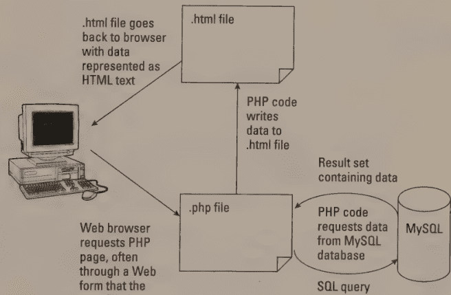

图 1-2 展示了使用 PHP 向 MySQL 数据库写入数据的典型过程。

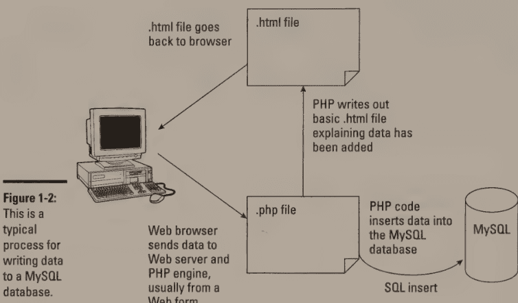

## 启动 MySQL

MySQL 网站提供了安装 MySQL 的简明清晰说明，您可以在 www.mysql.com/doc/en/Installing.html 上找到这些说明。

如果您按照这些说明操作，应该就可以开始使用了。Linux 版本会自动启动守护进程。（守护进程是一种在计算机上始终运行的程序，通常提供某种服务，例如 MySQL 数据库处理。至于计算机界是谁想出这个术语——这其实只是 demon 的一种变体——以及他们为何使用它，老实说，我毫无头绪。这肯定是某个心情非常糟糕的人想出来的。）

> 如果您使用的是 Red Hat Linux 8.0 及更高版本，可以通过从 Gnome 菜单中选择“服务器设置”，然后选择“服务”，来配置 MySQL 守护进程（称为 mysqld）在重新启动时自动启动。在打开的窗口中，单击 mysqld，然后选择“启动”。然后勾选菜单中 mysqld 旁边的复选框。

如果您在 Windows 系统上工作，可能需要将 MySQL 作为服务启动。（服务只能在 Windows NT、2000 和 XP 版本上运行。如果您使用的是 Windows 95、98 或 Me，无论如何都需要升级，因为它们作为 Web 服务器不够安全。）您可以通过确保 mysql\bin 目录在您的路径中，轻松查明服务是否正在运行。然后从命令提示符处，键入以下内容：

```
mysqlshow
```

如果服务器正在运行，您将看到类似于以下内容的表格列表：

| 数据库 |
|-----------|
| mysql     |
| test      |

如果服务器未运行，您将看到以下错误消息：

```
mysqlshow: Can't connect to MySQL server on 'localhost'
(10061)
```

如果您看到此错误消息，需要启动 MySQL 服务。具体步骤如下。（如果您的 Windows 计算机上正在运行 Apache 服务器，则无需执行步骤 1、2 和 3，可以右键单击屏幕右下角托盘中的 Apache 图标，并在弹出的菜单中选择“打开服务”。）

- 1. 在 Windows 桌面上，右键单击“我的电脑”，在弹出的菜单中选择“管理”。
  计算机管理窗口将打开，如图 1-3 所示。
- 2. 展开“服务和应用程序”树，如图 1-3 所示的窗口左侧窗格中所见。
- 3. 在“服务和应用程序”下，单击“服务”。
  服务列表将出现在右侧窗格中，如图 1-4 所示。
- 4. 在“服务”窗格中，向下滚动到 MySQL，右键单击 MySQL 名称，在弹出的菜单中选择“启动”。
  MySQL 服务将启动，并且“已启动”一词将出现在 MySQL 旁边的“状态”列下。

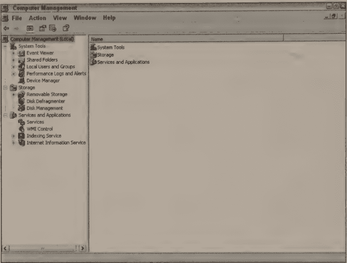

图 1-3：展开“服务和应用程序”树。

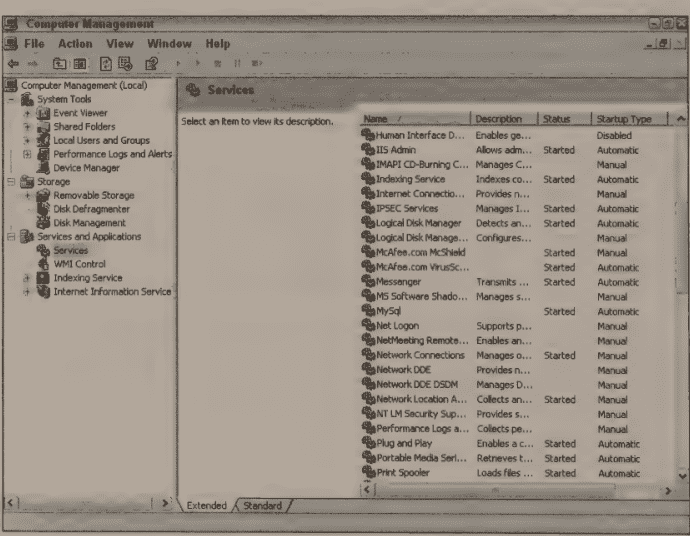

图 1-4：服务列表位于右侧窗格中。

现在关闭计算机管理窗口，返回命令提示符，再次尝试 mysqlshow 命令。

MySQL 系统还包含一个名为 mysql（全部小写）的方便命令行实用程序。此命令行实用程序允许您更改数据库和表。通常，当您创建访问 MySQL 数据库的网页时，这些网页会使用 PHP 等编程语言来访问数据库。但是，当您登录到自己的系统并想要更改数据库时，可能会使用 mysql 命令行实用程序。

不要将 mysql 命令行实用程序与 MySQL 服务或守护进程混淆。MySQL 服务或守护进程是 MySQL 的核心。服务或守护进程监听数据请求，然后操作硬盘上的数据。mysql 命令行实用程序正是如此：一个允许您操作数据的命令行实用程序。人们常喜欢将 mysql 命令行实用程序视为 MySQL 本身，但实际上，命令行实用程序只不过是 MySQL 的用户界面。

## 添加 MySQL 用户

在本节中，我将向您展示如何向 MySQL 系统添加用户。您可以让这些用户登录 MySQL 并执行数据库操作。

如果您使用的是第三方托管服务，通常您已经收到了用户名和密码，并且无权访问 root，在这种情况下，您可以跳过本节，并在本文中的示例 PHP 程序中使用该用户名和密码。

要向 MySQL 系统添加用户，必须以管理员身份（用户名为 root）或拥有管理员权限的用户身份登录。

向 MySQL 系统添加用户的最简单方法是登录到命令行实用程序。要启动命令行实用程序，请确保 mysql/bin 目录在您的路径中，然后从命令行键入以下内容：

```
mysql -u root -p
```

如果您直接输入 mysql，则表示已登录，这种情况下需要添加 root 密码（因为当前您的系统完全处于无保护状态）。要了解如何设置 root 密码，请参阅附近的侧边栏“创建 root 密码”。


## 删除 Windows 上的匿名用户

如果你发现直接输入 mysql 而不加任何参数就能连接到 MySQL，说明你的系统允许匿名用户。坏消息！这个匿名用户拥有完整的 root 权限！非常糟糕。许多 Windows 安装版本都是这种默认设置，但幸运的是，你可以修复这个问题。（事实上，请务必修复这个问题。你可不想让黑客闯入你的网站。）首先，从命令提示符进入 mysql。然后输入以下行来选择数据库：

```
use mysql
```

你将看到消息 "Database changed"。现在输入以下行（注意分号前的那些内容是两个连续的单引号，中间没有空格）：

```
delete from user where user='';
```

你可能还有一个默认的 root 用户，允许任何人从任何地方使用用户名 root 且无密码登录。（可真够吓人的！）要消除这个严重的安全隐患，请输入：

```
delete from user where host = '%' and user = 'root';
```

然后输入此命令：

```
quit
```

退出 mysql 命令行实用程序后，输入以下行：

```
mysqladmin -u root -p reload
```

系统会提示你输入 root 密码，你可以输入。现在你不能再通过直接输入 mysql 来进入 mysql 了。呼！

如果你无法立即进入，系统会显示密码提示：

```
Enter password:
```

输入你的 root 密码并按 Enter。


如果你忘记了 root 密码（或从未知道过），请查看以下网页了解如何重置 root 密码的信息：

```
www.mysql.com/doc/en/Resetting_permissions.html
```

创建用户密码并进入 mysql 命令行实用程序后，你可以添加第一个用户。在本节中，我将向你展示如何创建用户名为 phpuser、密码为 phppass 的用户。我建议你找一个不同于我在这本超过 1 亿人将购买和阅读的大部头书中写下的密码。你也可以考虑选择一个不同的用户名。但是，在本书的示例中，我使用用户名 phpuser 和密码 phppass。你需要用你自己的用户名和密码替换示例中的内容。

### 创建 root 密码

如果你没有 root 密码，你会想要添加一个，以免你的系统大敞门扉，任由任何人闯入搞乱一切。以下是设置 root 密码的方法：

首先，如果你在 Linux 或 Unix 上，请确保以 root 身份登录。

接下来，无论你使用什么操作系统，都可以使用以下任一方式在不使用密码的情况下启动 mysql：

```
`mysql`
```

```
`mysql -u root`
```

然后输入以下内容，用你自己的密码替换 *somepassword*：

```
set password for root@localhost=password('somepassword');
```

等号后面的单词 password 至关重要：此函数将以下字符串进行加密。因此，你并不是在数据库中存储你的密码；你存储的是密码的加密形式。然后，当你登录时，mysql 会自动对你输入的密码进行加密，并将其与数据库中存储的加密密码进行比较。如果两者匹配，mysql 就会让你进入。否则，你会收到一条错误消息。

输入前面的 `set` 命令后，你可以退出 mysql，然后使用密码重新启动它：

```
`mysql -u root -p`
```

然后系统会提示你输入密码，你现在可以输入了。然后你就会进入受新密码保护的 mysql 命令行实用程序。耶！

添加用户的方法如下。确保你在 mysql 实用程序内，然后输入以下内容：

```
grant all privileges on *.* to phpuser@localhost identified by 'phpass';
```

然后按 Enter。你会看到一条消息，说明查询成功。（虽然，说实话，这条消息并不十分清楚。它如下所示。）

```
Query OK, 0 rows affected (0.00 sec)
```

（是的，它成功了，尽管消息说零行受影响。）你现在有一个名为 phppass 的用户，拥有完整权限。你可以输入 quit 退出 mysql 程序。然后你可以使用这个新用户名重新登录：

```
`mysql -u phpuser -p`
```

然后系统会提示你输入密码：

Enter password:

输入密码后，你将以新用户名登录。

## 管理域访问

如果你浏览 MySQL 在线文档，你会看到对 username 和 username@localhost 的引用。这个 @localhost 似乎经常出现。username 和 username@localhost 背后的想法是，你在指定用户在登录 MySQL 时可以位于何处。仅指定 username，表示用户可以从任何计算机登录。指定 username@localhost，表示用户必须登录到运行 MySQL 的同一台计算机，然后从那里登录 MySQL。换句话说，这两种选择都允许人们远程登录到你的 MySQL 系统。

像我们这个广大世界中的大多数事物一样，存在权衡。在决定是否允许外部访问时，以下是一些需要考虑的要点：

- 劣势：它可能会带来安全风险。你不希望全世界的人都试图通过他们自己的远程连接登录到你的数据库。（你可能更希望他们通过在你服务器上运行的 .php 文件登录。）
- 优势：允许此类远程连接让你能够创建一些非常强大的分布式软件。


我的经验法则是：我不允许我的服务器进行外部访问，因为我的所有访问都在服务器内部进行。如果我想使用 mysql 程序，我先 telnet 到我的服务器，然后运行 mysql。如果我想从我的网页访问 MySQL 数据库，我使用 PHP，它在服务器端运行且不需要外部访问。因此，我不需要外部访问。除非你打算运行客户端数据库软件，该软件将向你的服务器建立远程连接，从而创建一个分布式系统，否则你也应该关闭任何来自外部的访问。（如果你不确定这些术语是什么意思，很可能你不需要外部访问，可以彻底取消它。）

## 防止外部访问

默认情况下，你的系统应该设置为防止外部访问。以下是检查你的系统是否允许外部访问的方法。以 root 身份登录 mysql 程序，然后仔细输入这些命令：

```
use mysql
select host, user from user;
```

如果你好奇，这是一个 SQL select 语句，它从 user 表中检索所有行，只显示 user 和 host 列。我在第 VI 卷第 5 章详细介绍了 SQL。

以下是一些示例输出（你的输出会类似，但不一定完全相同）：

| host | user |
| :--- | :--- |
| % | guest |
| 192.168.1.103 | jeff |
| localhost | phpuser |
| localhost | root |

这是允许访问你系统的用户列表。user 列是用户名，host 列是用户连接所在的主机名称。请看：此输出表示名为 jeff 的用户（就是我！）可以从 IP 地址为 192.168.1.103 的计算机登录，那是一台独立的计算机。换句话说，jeff 可以远程登录。（但是，192.168.1.103 是本地网络上的 IP 地址，而不是来自网络外部的计算机。）

现在看第一行：host 只是 %，在 SQL 中这是一个通配符。这意味着如果你看到这样的行，任何人都可以从互联网上的任何计算机使用用户名 guest 登录到系统。如果你不希望 guest 从互联网上的任何地方登录，请将该条目的 host 改为 localhost，如下所示：

```
update user set host = 'localhost' where user = 'guest' and host = '%';
```

或者，如果你更希望完全删除 guest 用户，可以输入：

```
delete from user where user = 'guest';
```

## 远程登录

如果你想允许外部访问，可以在创建用户时指定一个 IP 地址（或局域网上的计算机名称）；然后你就可以从拥有该 IP 地址的计算机登录。我在我的台式机和笔记本电脑上都安装了 MySQL。在运行在台式机上的 MySQL 系统中，我创建了一个名为 jeff@192.168.1.100 的用户。（该 IP 地址


192.168.1.100 用于笔记本电脑。) 要创建此用户，我坐在桌面电脑前，启动 mysql 程序，并键入以下内容：

```
grant all privileges on *.* to jeff@192.168.1.100;
```

这将创建一个名为 jeff 的用户，该用户可以从 IP 地址为 192.168.1.100 的计算机登录。

接下来，要从笔记本电脑登录到桌面电脑，我先确保守护进程在我的桌面电脑上运行，然后从 Windows 笔记本电脑输入以下内容：

```
mysql -h 192.168.1.102 -u jeff -p
```

-h 选项指定运行 MySQL 服务器的计算机；在这里，192.168.1.102 是我的桌面电脑 IP 地址。随后系统会提示输入密码，我可以使用 mysql 实用程序登录。在此示例中，我在笔记本电脑上运行 mysql 实用程序，同时查看桌面电脑上的数据。

从技术角度讲，用户 jeff@localhost 和 jeff@192.168.1.100 在 MySQL 看来是不同的用户。但是，如果你向这两个用户授予相同的权限，客户端程序就可以使用同一个用户名 Jeff，无论客户端是在 localhost 上运行还是在 192.168.1.100 计算机上运行。

你还可以在主机中混合使用通配符和数字，如下所示：

```
grant all privileges on *.* to jeff@"192.168.1.%" identified by 'mypass';
```

现在，只要你使用的计算机 IP 地址以 192.168.1 开头，就可以从网络上的任何计算机登录。随后，你可以使用用户名 jeff 和密码 mypass 登录。（但是，即使你的本地计算机 IP 地址以 192.168.1 开头，你仍然无法从 localhost 登录。mysql 程序会将你的主机识别为 localhost，而不是按其 IP 地址识别。）

## 更改用户密码

登录到 MySQL 后（可能使用 mysql 程序），如果需要，可以更改密码。（如果你使用的是第三方托管服务，我建议你将服务最初提供的密码更改为新密码。）

更改密码的最简单方法是在 mysql 程序内进行。只需按照以下步骤操作：

- 1. 启动 mysql，使用你的用户名登录，如下所示：

```
mysql -u username -p
```

请务必将 username 替换为你自己的用户名，无论是 phpuser 还是其他用户名。此后，系统会提示你输入密码。

- 2. 输入密码并登录。

- 3. 登录后，你可以使用以下命令设置密码：

```
set password for username = password('newpassword');
```

将 username 替换为你自己的用户名，将 newpassword 替换为你想要的新密码。

## 限制访问

如果你已创建 MySQL 用户名（例如 phpuser），你可能希望限制该用户可用的访问类型。前一节“添加 MySQL 用户”中的说明向你展示了如何创建具有完整管理权限（包括修改 root 密码的能力）的用户名。对于大多数用户，你不希望他们拥有修改 root 密码的能力。

以下是你可以限制该用户权限的方法。一般准则是只向 MySQL 用户授予绝对必要的权限。例如，托管服务通常会为每个 Unix 用户创建一个数据库，然后为该数据库分配一个 MySQL 用户名和密码，该用户名仅有权访问该数据库，别无其他权限。


如果你是通读本章并按照示例操作，那么你可能还没有 PHP 程序可以访问的数据库或表。因此，你无法将 phpuser 的访问权限限制在这些表上。但由于本书是参考指南，我建议你这样做：浏览本节，然后在阅读完第 VI 篇 第 4 章并设置好数据库（或者，在你自己设置好数据库后），按本节的说明逐步操作。

在本说明中，我假设你有一个名为 phpbase 的数据库。该数据库包含你希望 .php 文件可以访问的所有表。

如果要增加额外的安全级别，可以创建其他 MySQL 用户名，PHP 程序将根据谁通过 Web 访问 .php 文件来访问这些用户名；此类用户名将仅拥有你希望网页拥有的权限。（你可以通过 HTTP 身份验证确定谁在访问 .php 文件。）你可能有一个只能读取 phpbase 数据库中数据的 MySQL 用户名。你可能还有一个可以修改数据的 MySQL 用户名。因此，可以修改数据的 .php 文件将使用可以修改数据的 MySQL 用户名，以此类推。

按以下步骤设置 phpuser 用户的权限：

- 1. 以 root 身份登录并启动 mysql 命令行程序。
- 2. 输入以下命令撤销所有权限：
  `revoke all on *.* from phpuser@localhost;`
- 3. 接下来，仅添加你想要的权限。
  此示例允许用户向表中插入数据（但不能创建新表或数据库）、删除数据、检索数据，并且仅修改 phpbase 数据库中的数据：
  `grant insert, delete, select, update on phpbase.*`
  `to phpuser@localhost;`

以下是我授予的特定权限及其含义：

- insert：用户可以向 phpbase 数据库中的表添加数据。
- delete：用户可以删除 phpbase 数据库表中的数据。
- select：用户可以读取 phpbase 数据库表中的数据。
- update：用户可以修改 phpbase 数据库中的现有数据。（注意，修改现有数据是一个独立的过程和权限，与向表中添加新数据不同。）

如果你已经熟悉 SQL，你会将这些权限识别为相应的 SQL 关键字。如果你想查看所有可用权限，请参阅 MySQL 手册中 www.mysql.com/doc/en/GRANT.html 的条目。

关于此示例，有几点说明：

- 因为我已创建此用户并为其设置了密码，所以无需像在本章其他地方那样包含 identified by 'phpass' 子句。

我指定了数据库名称 phpbase，但在名称后面必须加上 .*，这意味着我将这些权限授予 phpbase 数据库中的所有表。是的，在此示例中，你使用 * 通配符，而不是像在其他地方那样使用 % 通配符。这只是一个需要遵守的烦人规则，仅此而已。（你不能省去 .*，否则 mysql 会认为你指的是名为 phpbase 的表，而事实并非如此，你将会收到一个错误。）

现在你可以测试限制。输入 quit 退出 mysql，然后以 phpuser 用户重新登录：

```
mysql -u phpuser -p
```

系统会提示你输入密码；请继续输入。然后，进入 mysql 后，作为 phpuser 用户，你可执行的操作将受到限制。例如，尝试访问系统数据库：

```
use mysql
```

如果限制生效，你将看到错误消息：

```
ERROR 1044: Access denied for user: 'phpuser@localhost' to database 'mysql'
```

但是，你可以访问 phpbase 数据库：

```
use phpbase
```

这将显示以下消息：

```
Database changed
```

但是，你不能从此用户名创建新表。通常这没问题，因为你可能不希望你的 .php 文件创建新表。相反，你将以 root 身份登录 mysql 来创建表，然后稍后，你的 .php 文件将仅通过向表中添加数据、删除数据或修改表中的数据来修改表。

在本节中，我向你展示了如何设置权限。现在，你将能够执行 PHP 程序通常所需的基本访问，如我在第 VI 篇 第 4 章中所述。

## 第 2 章：管理数据库和表

### 本章内容

- 查找可用的数据库
- 创建、删除、备份和移动数据库
- 设置数据库的用户权限
- 创建表和删除表（或删除表）
- 向表中添加数据并查看表中的数据
- 获取表的信息
- 查看数据库中的表有哪些

在继续之前，我想澄清一些定义。在数据库世界里，人们对同一词汇有不同的定义。（这不就是一群计算机人士的常态吗？）但是，大多数开发数据库产品的公司都同意这些术语的定义。我想与你分享这些定义，这样你、我以及地球上所有其他数据库人士就能达成共识（或者说，至少能计算机界面对计算机界面，视情况而定）。

以下是大多数人都同意的非正式定义：

- **表**：按行和列组织的一组数据。
- **数据库**：表的集合。在 MySQL 中，你可以拥有多个不同的数据库。
- **行**：数据库中的单个记录。术语 *record* 已变为非标准术语，如今，人们更倾向于使用 *row* 这个词。
- **列**：数据库中的单个字段。一行（或记录）由多个列（或字段）组成，例如 `name`、`email_address` 和 `phone_number`。与 *record* 类似，术语 *field* 已变为非标准术语；如今，人们更倾向于使用 *column* 这个词。

在本章中，我将讨论在 MySQL 中设置数据库和表所涉及的各种问题，以及诸如如何备份数据库和如何自动化各种任务等重要话题。


## 关于数据库存储的说明

与某些数据库系统不同，MySQL数据库系统对其数据采用开放的方法。如果你曾经查看过，例如，Windows计算机上的Microsoft Outlook文件，你就会知道所有电子邮件、日历条目、附件、笔记等都存储在一个文件中。我见过一些此类文件，大小高达200多兆字节，难以处理。幸运的是，MySQL的文件管理更简单：对于每个数据库，MySQL都会创建一个新目录。在该目录中，对于每个表，MySQL都会创建一组文件。在本章的讨论中，请记住管理数据库的替代方法：你可以进入包含数据库的目录，直接操作文件。你可以将这些文件备份到CD-ROM，复制它们，将它们移动到另一台计算机，等等。MySQL对此完全没问题。但是，请确保在某个进程正在向文件忙碌地写入数据时不要复制文件，否则可能会弄得一团糟。

## 管理数据库

在本节中，我将讨论如何管理数据库，包括创建、删除和备份数据库。我还包含了关于数据库用户名和权限的部分。

## 查找存在的数据库

查找存在的数据库的最简单方法是启动mysql命令行实用程序，然后键入以下内容：

```
show databases;
```

按Enter键后，你会看到类似以下的内容：

| 数据库 |
|----------|
| menagerie |
| mysql |
| phpbase |
| test |

此输出显示我的系统中有四个数据库：menagerie、mysql、phpbase和test。

## 创建数据库

使用mysql命令行程序创建数据库。创建数据库只是一次性操作，你不希望让网页来创建数据库，至少不是供普通公众访问的页面。数据库包含存储数据的表，大多数人希望在系统中只保留一两个数据库。如果每个用户都添加一个数据库，系统可能会变得非常混乱。（不过，你可以为自己的个人工作设置这样的网页。）

数据库存储着通过PHP代码由网页访问的信息所在的表。（这是对数据库工作原理的一个不错的解释，所以你可能想撕下这一页并贴在显示器上。）通常，你会创建一个数据库，创建一些表，然后编写代码（使用PHP、Perl或你选择的任何语言）来访问数据。使用PHP时，你会编写.php文件，通过Web界面访问表中的数据。

创建数据库很简单。只需执行以下步骤：

- 1. 为你的数据库选择名称。
- 2. 使用root密码启动mysql。

创建数据库始终需要root权限，尽管你可以使用另一个用户名，只要它具有root权限

- 3. 键入以下行：

```
create database databasename
```

将databasename替换为新数据库的名称——例如phpbase。按Enter键后，mysql实用程序指示MySQL创建名为databasename的数据库。如果数据库已存在，你会收到类似以下的错误消息：
ERROR 1007: Can't create database 'databasename'. Database exists.

## 删除数据库

如果要删除数据库，可以在mysql实用程序中使用以下过程。

删除数据库时，请记住你同时也删除了数据库中的所有数据。除非你之前备份过，否则无法检索数据。（我建议定期备份数据。详情请参见本章后面的“备份数据库（或表）”部分。）对于Unix专家，如果你为数据库设置了符号链接，然后删除了该符号链接的数据库，你不仅会丢失符号链接，还会丢失实际数据库。

删除整个数据库（及其所有内容）的方法如下：

```
drop database databasename;
```

将不走运、不幸的数据库名称替换为databasename一词，该不幸的数据库就会消失。mysql实用程序不会发出“你确定吗？”之类的消息。它只是指示MySQL守护进程或服务器删除数据库，然后你会收到诸如Query OK, 3 rows affected (0.00 sec)之类的奇怪消息。


数据库以文件形式存储在各自的目录中。例如，menagerie数据库存储在名为menagerie的目录中。如果删除数据库，将删除整个目录。

## 备份数据库（或表）

通常，你会希望定期备份数据库，以防万一发生灾难，例如一颗以光速0.8倍旋转着飞向地球的陨石。如果陨石撞击，你会庆幸自己将数据备份到了CD-ROM，因为其他一切都将不复存在。你应该多久备份一次数据？这取决于你的数据库活跃程度。如果数据每周只变化一点点，那么每月备份一次可能就足够了。如果每天有大量数据涌入并被修改，那么每晚备份可能是个好主意。

备份数据库比表面上看起来要棘手一些。假设你正在运行一个网站，人们正在通过网站访问你的数据库，读取数据、修改数据和添加数据。在备份数据库时，请确保文件没有处于临时、不一致的状态。否则，你的备份将无效。

在备份之前确保数据安全的最佳方法是关闭守护进程或服务器，然后进行备份。或者你可以以root用户身份进入mysql实用程序，键入以下内容：

```
flush tables with read lock;
```

这段代码会将所有未写入的数据写入表中，然后暂时锁定表，使其无法更改。此时，其他MySQL程序可以读取表中的数据，但不允许进行更改。（我将在本节末尾向你展示如何解锁表。）

由于数据库只是一组表的集合，备份数据库的最简单方法是备份数据库内的表，这些表涵盖了整个数据库的所有数据。你可以使用mysql实用程序来备份表。（不幸的是，mysql实用程序不包含备份整个数据库的命令。不过，MySQL软件包随附了一些可协助你备份数据库的实用程序。你可以在www.mysql.com/doc/en/Backup.html上阅读相关内容。）

以下是在Unix或Linux上备份数据库中表的方法：

- 1. 创建一个目录来存放备份文件，例如/home/harold/backups/phpbase。
- 2. 启动mysql实用程序并输入以下命令：

```
backup table pet to '/home/harold/backups/phpbase';
```

以下是在Windows系统上备份表的方法：

- 1. 创建一个目录来存放备份文件。

备份过程不会为你创建目录。例如，你可以创建目录`c:\temp\phpbase`。

- 2. 启动mysql实用程序并输入以下命令：

```
use phpbase
backup table pet,pet2 to 'c:/temp/phpbase';
```

将phpbase替换为你的数据库名称。另请注意，在备份命令中必须使用正斜杠，而不是反斜杠。（在一个更完美的世界里，所有计算机都会就正斜杠/反斜杠问题达成一致。）

备份数据库完成后，可以使用以下命令解锁表：

```
unlock tables;
```

## 设置数据库用户权限

在第VI卷第1章中，我讨论了为用户分配有限权限。该部分的构思是创建一个用户，该用户只能读取、删除、修改和添加特定数据库中任何表的行。但你可能希望创建一个用户，该用户对某个特定数据库有完全访问权限，而对另一个数据库没有访问权限。

如果你在运营ISP，授予用户仅对一个数据库的完全访问权限是管理MySQL安装的常见方法。大多数托管服务会创建一个单一用户名并给该用户一个数据库。在本节中，我将向你展示如何确保用户只能访问其分配的数据库，假设用户没有他人的密码。


要分配这些权限，请执行以下步骤：

- 1. 首先，如果尚未创建 jessica 数据库，请创建它。

为此，请进入 mysql 实用程序并键入以下内容：

```
create database jessica;
```

- 2. 如果尚未为 MySQL 创建 jessica 用户名，请一次性创建用户名并设置权限，如下所示：

```
grant all privileges on jessica.* to jessica@localhost
identified by 'jessicapass';
```

或者，如果您已经为 MySQL 创建了 jessica 用户名，可以按照以下步骤限制权限：

- a. 撤销主系统的权限：

```
revoke all on *.* from jessica@localhost;
```

- b. 如果您之前给 Jessica 授予了其他数据库（例如 phpbase 数据库）的权限，您也可以按照以下方式撤销这些权限：

```
revoke all on phpbase.* from jessica@localhost;
```

- c. 现在授予 Jessica 使用 jessica 数据库的权限：

```
grant all privileges on jessica.* to jessica@localhost;
```

下面是一个使用用户名 jessica 的示例会话，演示她只能访问名为 jessica 的数据库：

```
mysql -u jessica -p
Enter password: *********
Welcome to the MySQL monitor.
mysql> show databases;
+----------+
| Database |
+----------+
| jessica  |
| mysql    |
| phpbase  |
+----------+
3 rows in set (0.02 sec)
mysql> use menagerie;
ERROR 1044: Access denied for user: 'jessica@localhost'
to database 'menagerie'
mysql> use jessica;
Database changed
```

## 将数据库移动到另一台计算机

如果要将数据库移动到另一台计算机，我建议直接复制文件。这显然是最简单的方法。移动数据库的不同方法取决于您的操作系统，如下所示：

- 在 Linux 中：转到 mysql 安装目录，查看 data 目录下的内容。您将看到一个名为 data 的目录，其中包含每个数据库的单独子目录。您可以将该子目录复制到共享文件系统，从而将其复制到另一台计算机。如果未看到 data 目录，请尝试在 /var/lib/mysql 中查找，这是查找数据库子目录的另一个常见位置。

- 在 Windows 中：转到目录 c:\mysql\data（或者您放置 mysql 的任何位置，对我来说，data 目录是 C:\Program Files\mysql\data）。在该目录中，查找与您的数据库同名的子目录。将该子目录及其所有内容复制到磁盘、CD-ROM、共享驱动器，或者星际薯子波网络连接（等他们发明该技术时）。然后切换到另一台计算机，进入该计算机相同的 mysql\data 目录，并将数据库目录复制到 data 目录中。确保在复制过程中创建数据库目录（或手动创建它）。

## 管理表

要创建表，您需要一个数据库。在此数据库中，您可以创建任意数量的表。

表是以行形式存储的数据集合，这些行有些人称为记录。每条记录由一组列组成，这些列有些人称为字段。以下是名为 candy 的表的描述示例：

- name 是 varchar(30)。
- weight 是 double。
- price 是 int。
- quantity 是 int。

candy 表中的每行信息都包含名称、重量、价格和数量。名称的类型为 varchar(30)（varchar(30) 表示最长 30 个字符的字符串）。重量是 double（即双精度浮点数）。价格以美分表示的整数（永远不要对美元使用浮点变量；相反，应使用美分的整数，因为整数数学比浮点数学更准确），数量是整数。

在接下来的章节中，我将向您展示如何在 MySQL 中创建此表、获取表的信息、删除表，以及查看其他可用表。

在接下来的章节中，您将使用名为 phpbase 的数据库。要使用该数据库，请先以 root 身份登录 mysql，然后键入以下内容：

```
use phpbase
```

现在您可以继续进行示例操作了。

尽管以下示例使用 mysql 命令行实用程序，但请记住，您键入的语句是 SQL 语言语句，您可以在独立于 mysql 实用程序运行的程序中使用这些语句。

### 创建表

创建表很简单。以下是流程概要：

- 您使用一个称为 `create table` 的专用 SQL 关键字。（好吧，那是两个关键字。）
- 您提供表名，并在括号中提供表中列的描述。
- 您以分号结尾。

假设您已启动 mysql 实用程序并正在使用数据库 phpbase，您可以在 mysql 提示符下键入以下行：

```
create table candy (
   name varchar(30),
   weight double,
   price int,
   quantity int
);
```

在您键入每行并按 Enter 键时，mysql 实用程序会识别出您尚未键入分号，因此会用以下字符开始下一行：

```
->
```

这些字符表示您可以继续键入命令。（您在此处看到的 `create table` 命令跨越了多行。）

运行此命令后，您会看到一条快乐、友好（虽然几乎毫无意义）的消息：

```
Query OK, 0 rows affected (0.01 sec)
```

此消息表示您已成功创建表。

### 向表中添加行

如果您有一个表，您可能不想让它无所事事地闲置着。相反，您想往里面放一些数据。（嘿，你做了这个东西——不妨用起来。）在第 VI 卷第 3 章中，我讨论了可以放入表中的数据类型以及如何将表相互关联。目前，我继续使用我在上一节“创建表”中创建的名为 candy 的表。

candy 表中的每行都包含字符串形式的名称、双精度浮点变量形式的重量，以及整数形式的价格和数量。以下是如何从 mysql 实用程序向此表添加一行数据（确保您正在使用 phpbase 数据库）：

```
insert into candy values(
 'OozingPeanutbutterExplosion',
 6.95,
 275,
 100,
 );
```

此代码向 candy 表添加了一行新数据，包括名称 'OozingPeanutbutterExplosion'（真好吃）、重量 6.95（我猜是盎司，这已经很多了）、以 275 美分表示的 2.75 美元价格，以及数量 100，这代表即将进入我肚子的数量。

此代码只添加了一行（或记录）。您可以使用不同的名称和值添加更多行。如果不想，也不需要将行拆分为多行：

```
insert into candy values('ChunkableCrunchableChocolate', 2.80, 75, 50);
```

### 查看表中的数据

如果您有一个（例如名为 candy 的）包含数据的表，可以使用 mysql 命令行实用程序查看表中的数据。为此，您需要使用 select 语句。（select 一词是 SQL 语言的一部分，我将在第 VI 卷第 5 章中讨论。）

确保您正在运行 mysql 实用程序并使用 phpbase 数据库。然后，通过键入以下命令查看 candy 表：

```
select * from candy;
```

数据会以整齐漂亮的表格形式打印出来，如下所示：

| 名称 | 重量 | 价格 | 数量 |
|---|---|---|---|
| OozingPeanutbutterExplosion | 6.95 | 275 | 100 |
| ChunkableCrunchableChocolate | 2.8 | 75 | 50 |

2 行，用时 0.00 秒

此表包含两行，一行是关于 Oozing 什么的，下一行是关于 Chunkable Chocolate 什么的。

如果您愿意，可以通过将前面 select 语句中的星号替换为用逗号分隔的列名，只查看几个列：

```
select quantity, weight from candy;
```

该语句的输出结果如下：

| 数量 | 重量 |
|---|---|
| 100 | 6.95 |
| 50 | 2.8 |

2 行，用时 0.00 秒

此处我只查看数量和重量列。请注意，它们按我在 select 语句中输入的顺序出现在列表中：我先输入了 quantity，再输入了 weight，尽管表中先存储 weight，后存储 quantity。

排序信息的快捷方法是将 order by 放入语句中，如下所示：

```
select price, weight, quantity
from candy
order by price;
```


您列出的行按 ORDER BY 子句中的列排序。输出如下：

| price | weight | quantity |
|---|---|---|
| 75 | 2.8 | 50 |
| 275 | 6.95 | 100 |

2 rows in set (0.00 sec)


SELECT 语句是 SQL 语言中最重要的语句。它是任何数据查找的核心。您可以使用 SELECT 来执行复杂的数据查找，这些查找涉及从多个表中提取数据并以特殊方式组织数据。您也可以使用 SELECT 语句来执行诸如统计表中有多少条记录等操作。在第 VI 卷第 5 章中，我将介绍您可以使用 SELECT 语句做什么，并附带 PHP 和 Perl 等多种语言的示例，这些语言与 mysql 命令行实用程序分别运行。

## 获取表信息

有时在使用 mysql 程序时，您可能想要获取有关表的信息，例如表中有哪些列。在本节中，我将向您展示如何访问此类信息。但请记住，此信息涉及表的结构（主要是指表中的列），而不是表中的数据（指行）。

从表中获取信息的最简单方法是进入 mysql 实用程序并键入以下语句：

```
describe candy;
```

您将看到类似这样的输出：

| Field | Type | Null | Key | Default | Extra |
|---|---|---|---|---|---|
| name | varchar(30) | YES | | NULL | |
| weight | double | YES | | NULL | |
| price | int(11) | YES | | NULL | |
| quantity | int(11) | YES | | NULL | |

4 rows in set (0.00 sec)

此列表中的列以行形式排列。表中的每一行都代表一个列。第一行涉及 name 列，其类型为 varchar(30)。第二行显示 candy 表的第二列是 weight，其类型为 double，依此类推。

此列表还会向您显示有关表的其他信息。名为 Null 的项如果允许列不包含数据，则会被设置为 YES。（没有数据的概念与值 0 或空字符串是分开的。值 0 是一个值，空字符串也是一个值。没有数据意味着根本不存在值。）

如果列是键列，则键的类型会出现在列表中 Key 单词下方。如果列有默认值，则该值会出现在 Default 单词下方。如果该列是一个在每次向表中添加新行时自动递增的计数器，则会在 Extra 单词下方看到 auto_increment 这个词。

有关如何指定列是否可以为 Null、如何创建键、添加默认值或使用 auto_increment 列的信息，请参见第 VI 卷第 3 章。

语句 describe candy; 是等效语句的简写形式，其形式如下：

```
show columns from candy;
```

您可以随意使用 describe 或 show columns from。

## 删除（或丢弃）表

在 SQL 术语中，当您删除表时，会说您正在丢弃该表。丢弃表很容易（但拆分表却不容易……叹气）。进入 mysql 实用程序，确保您正在使用包含该表的数据库，然后键入以下内容：

```
drop table candy;
```

但如果您想保留那个美味的 candy 表，现在无需执行此操作。

## 查看数据库中有哪些表

如果您想查看数据库中有哪些表，只需进入 mysql，使用相关数据库，然后键入以下内容：

```
show tables;
```

您将看到类似这样的内容：

| Tables_in_phpbase |
|---|
| candy |

只存在一个表，即名为 candy 的表。如果有多个表，其他表将列在 candy 一词下方。

## 使用命令文件自动化工作

有时您可能需要一遍又一遍地重新输入相同的信息。例如，如果您输入一条很长的 create table 语句，然后收到一条错误消息，告诉您输入有误，那么是重新输入还是放弃并去海边，两者之间的优选方案很快就会变得显而易见。为了避免不必要的去海边的行程（以及不必要的输入），您可以将语句存储在文件中。大多数人会给文件一个 .sql 文件扩展名，尽管您可以随意使用任何喜欢的扩展名。

例如，假设您创建了一个名为 morecandy.sql 的文件，其中包含以下行：

```
use phpbase;
create table morecandy (
 name varchar(30),
 weight double,
 price int,
 quantity int
);
```

而不是将这些相同行直接输入到 mysql 实用程序中，您可以退出 mysql 实用程序并执行以下操作：

```
mysql -u root -p < morecandy.sql
```

这将运行 mysql 实用程序，以 root 用户身份登录。然后根据 -p 选项提示您输入密码。mysql 实用程序随后以脚本模式运行，从 morecandy.sql 文件中读取行并执行它们，就像您直接输入它们一样。（高级读者会意识到，您实际上只是重定向 stdin 来实现这一点。）

如果您在 Windows 上进行此操作，还可以选择 morecandy.sql 文件中的所有文本，启动 mysql 实用程序，然后将文本粘贴到命令行（有时称为 DOS）窗口中。

## 第 3 章：关联您的数据

### 本章内容

- 将数据划分为表，将表划分为列
- 创建索引和键，以便您的数据可以被搜索和排序
- 处理不同的数据类型

在本章中，我将讨论构建程序使用的数据时需要考虑的事项。您将了解如何划分数据、对数据进行排序和组织，以及连接多个表中找到的数据。

请记住以下四个关键点，它们是所有这些想法的核心：

- 您使用 SQL（结构化查询语言）来操作数据。
- 数据库服务器称为 MySQL，它会为您解释 SQL。
- 您的数据库程序在服务器端运行。
- 诸如 PHP 或 Perl 之类的服务器端语言使用 SQL 来访问数据。

## 将数据划分为表

大型公司通常会聘请精通数据分析的人员来制定组织公司数据的计划。如果您对该领域感兴趣，或者只是需要进行数据分析，本节将帮助您在海量数据中找到方向，然后确定如何组织数据。尽管您可以将此处概述的原则应用于许多数据分析领域，但我将侧重于网站使用的数据。

假设您正在构建一个管理待售广告的网站。消费者可以发布他们的广告，出售从割草机到汽车、钢琴、邻居的猫等任何东西。嗯，最好不要卖掉 Fluffy。

您可以简单地将所有内容堆砌到一个巨大的表中，填入您能想到的任何列，然后继续进行设计 HTML 和 PHP 的有趣部分。但如果您不花时间规划如何组织网站数据，您的网站将不会成功。所以，放慢速度，深呼吸，花些时间设计数据。到最后，您会是一个快乐得多的露营者（以及网络企业家）。

## 确定要创建哪些表

您首先想做的是了解网站需要哪些信息。在第一次头脑风暴会议中，不要太担心组织问题。专注于写下一些想法。

您的网站组织广告，因此需要包含一个由广告组成的数据项。这很好。起步不赖。但还有什么呢？您有人在发布广告。所以还有另一件事。将该数据项称为 customer，因为这些人是您的客户。

购买待售物品的人是卖家的客户。但是，这些人可能会为使用您的网站付费（或者至少需要在您的网站上注册），因此他们也可能是客户。所以您有两种客户：卖家和买家。

当然，一个人可能会卖出某物，而同一个人也可能进行一些购买。在这种情况下，客户既是买家也是卖家。因此，最好不要区分两种客户。相反，您将只维护一种客户类型，并允许客户既购买又销售。

客户如何购买某物？他们会回复广告。他们如何回复？通过电子邮件地址。在网站的第一个版本中，您希望卖家在广告中包含电子邮件地址，买家可以直接联系卖家，而无需使用您的网站。但是，买家必须先在您的网站上注册，然后才能看到广告。在网站的未来版本中，您可能希望创建一个更复杂的系统，其中包含网站上的电子邮件消息。但要从小做起，否则您永远无法让事情起步，投资者会对您大声喊叫。那可不好玩。

目前为止，您拥有两种类型的数据：

- Customer
- Ad

一个客户可以有零个广告、一个广告或多个广告。但是，一个人只能是一个客户。而且一个广告不能属于多个客户。

数据分析人员将这种关系称为一对多，即“一个客户对应多个广告”。在另一个宇宙（或至少另一个网站）中，您可能需要多对多，或者一对一，但这里不是。

这些数据类型将成为您的表：Customer 表和 Ad 表。在您的分析过程中，您可能需要划分 customer


将信息分到多个表中。或者，你可能需要将广告信息分到多个表中。拭目以待吧。

## 将表格划分为列

Customer 表中应包含哪些信息很重要？在这个高科技世界里，首先要考虑的（甚至在客户姓名之前）几乎总是客户的电子邮件地址。原因在于你想要一种方式来联系客户。例如，如果客户忘记了密码，你希望系统能给她发送新密码。等等，这是 Customer 表的另一个项目：密码。

现在是时候进行头脑风暴了。以下是一些关于应包含在 Customer 表中的信息的初步想法：

- 姓名
- 电子邮件地址
- 电话号码
- 密码

当然，客户也需要一个广告。但是，如果客户有多个广告，你如何在此处列出所有广告？而且，因为你有一个独立的 Ad 表，你如何知道哪个广告对应哪个客户？

先放一下这个想法，转而来看 Ad 表。这里的问题是想办法连接或关联这两个表。（提示：关系型数据库这个术语在这里是关键，因为你正在尝试关联这两个表。）

以下是你可能想在 Ad 表中包含的一些信息：

- 类别
- 项目名称
- 标题
- 完整描述
- 价格

当然，当然，你还需要发布广告的客户的电子邮件地址，以及更多客户信息……嗯，你又回到了关联问题上。先不考虑这个。

到目前为止，你有两个相当不错的表。Customer 表完整描述了一个客户，Ad 表完整描述了一个广告。现在你需要想办法将两者关联起来。方法是为每个客户分配一个编号（或 ID）。你将在内部使用这个编号来关联表格。

关于唯一标识符，你有一些选择。以下是两种可能性：

- 在 Ad 表中包含一个客户编号。然后，每个广告将间接拥有一个指定广告属于哪个客户的编号。
- 为广告设置一个唯一 ID。然后，你将创建一个包含两个 ID 的第三个表，用于将广告与客户匹配起来。

数据库纯粹主义者（我并不是）可能会说第二种方法最好，因为它将数据尽可能分开，使得按客户搜索所有广告或搜索与单个广告对应的所有客户变得容易。但是请记住，每个广告只有一个客户。因此，搜索与单个广告对应的所有客户这一概念在这里其实不适用。所以我建议你采用第一种方法，即直接在 Ad 表中放入一个客户 ID。并且，因为每个客户都有 ID，你也要把该 ID 放在 Customer 表中，也就是说，它在两个表中都有。

在开始构建这两个表之前，仔细审查数据。数据是否包含你需要的一切？根据我的经验，我可以说很可能没有。还有四个项目可能很重要：

- 客户注册日期
- 客户上次登录日期
- 广告投放日期
- 广告过期并失效的日期

说到这里，广告失效后，是否应该保留在系统中，以便发布广告的客户可以回头查看他或她创建了哪些广告？这听起来是个好主意，在这种情况下，你希望广告有一个“完成”项目。

现在来看 Customer 表中的电话号码项目。那重要吗？如果电话号码重要，那地址呢？我的感觉是，就目前而言，在你的惊人的在线广告服务的第一代中，你没有理由需要电话号码。所以就删掉它吧。

## 是否使用信用卡？

说到信用卡问题，我宁愿保守行事，不冒法律纠纷的风险。假设你的某个 .php 文件出了问题，有一天某个毫无戒心（却居心不良）的客户登录到你的网站，他的浏览器突然显示一个巨大的表格，列出了你所有客户的信用卡号码、到期日和相关邮政编码。（邮政编码对于验证真实性很重要。）然后假设该客户进行了一场大肆购物。

或者，如果一个黑客下载了整个表格并进行购物狂潮呢？如果发生这种情况，你会被追究责任吗？你可能会说，“绝对不会！”但地方检察官办公室可能会不同意，并仍然提起诉讼。最好不要冒这个险。

我倾向于不在我的系统中处理信用卡费用，因此手里不持有任何信用卡信息。如果我需要向客户收费，我会依赖第三方信用卡服务来代办。此外，如果你真的很认真，我建议你咨询律师或会计师或两者都咨询，以了解信用卡处理的法律问题的真相。我不是律师，不能在这里给你建议（否则我会失去我根本没有的律师执照）。你有很多信用卡服务可供选择。我倾向于基于推荐来做选择——问问你的同事他们在用什么，以及他们是否满意。如需更多选项，你也可以在 Yahoo! 上搜索信用卡服务。

还有一个备受争议的话题：如果客户需要付费才能发布广告（你确实想谋生），你是否在此处存储客户的信用卡信息？关于这个话题，请参阅侧边栏“是否使用信用卡？”。

你识别出的数据项将成为表中的列。表 3-1 显示了你为 Customer 表想出的列以及要分配给它们的类型。

| 表 3-1 | Customer 表的列 |
| --- | --- |
| 列 | 类型 |
| ID | integer |
| Name | varchar(30) |
| E-mail address | varchar(50) |
| Sign-up date | date |
| Last access date | date |

表 3-2 显示了你为 Ad 表想出的列。

| 列 | 类型 |
| :--- | :--- |
| 类别（或类别 ID？） | 详情请参阅本节末尾的文本。 |
| 项目名称 | varchar(50) |
| 标题 | varchar(100) |
| 描述 | text |
| 价格 | integer |
| 过期日期 | date |
| 状态 | integer |
| 客户 ID | integer |

在设计 Ad 表时，你决定不使用“finished”一词来指定广告是否完成，而是使用一个名为 Status 的列。这样，客户可以为广告分配多种状态之一。例如，一个状态可能是 Draft，表示广告处于草稿形式，尚未准备好发布。客户可以返回将草稿编辑成最终广告。然后其他状态可能是 Active、Expired 和 Canceled。

对于其他类型，你在选择长度时相当随意。但是 varchar 类型很灵活，因为你使用 varchar 指定最大长度。当你在 MySQL 表中使用 varchar 时，MySQL 系统只使用字符串需要的空间，不多不少。所以字符串 "hushbuckle" 在 varchar 中占用的空间比字符串 "flumbididylottaquash" 少。但是 varchar 有限制；你最多只能有 255 个字符。如果你想要更多，请使用一种称为 text 的特殊类型，就像我对 Description 所做的那样。

对于 Price，选择 integer。千万不要对价格使用浮点数，因为浮点数由于其存储数据的方式并不精确。相反，使用 integer 并以便士存储金额。你可以始终在 PHP 程序中将金额 122 格式化为 $1.22。

Category 列可能会让你多思考一下。你将如何实现类别？你有几种选择：

- 你可以分配一个数字，然后你的 PHP 程序将知道不同的类别，并可能有一个类别名称数组。此类别将是一个 integer。
- 你可以在类别中存储一个字符串，包含类别名称。我倾向于避免这种方法，因为由于长度原因，字符串不是搜索的最佳项目。数字始终是最简单的。


我建议的方法是：将 Category 设为数字，不要把列命名为 Category，而要将其命名为 CategoryID。然后创建一个名为 Categories 的表。该表将包含一系列类别名称和 ID。这样做的额外好处是，你可以更新类别列表，而无需修改 PHP 程序。一般来说，修改数据比修改程序更好，因为当你修改程序时，就会引入那些被称为 bug 的讨厌东西的可能性。修改数据也可能导致 bug，但比修改程序的可能性小。

纯粹主义者可能会说你本该更早考虑这个 Category 问题，但就像任何一种软件工程一样，你会不断完善分析，直到项目完成。所以别管纯粹主义者；唯一的真正问题是，如果你在网站上线后（或本书印刷后）才发现这些问题。

表 3-3 是你将用于 Category 表的表。

| 列 | 类型 |
| :--- | :--- |
| Category ID | integer |
| Category Name | varchar(30) |

## 允许搜索和排序你的数据

MySQL 和其他 SQL 实现在搜索和排序方面相当灵活。你可以搜索符合你为任何列提供的条件的记录。例如，你可以搜索 Customer 表中所有姓名包含 "Van" 一词的客户。如果你想搜索某个价格范围内的所有广告，也可以做到。

要执行自定义搜索，例如搜索 Customer 表中客户姓名包含 "Van" 一词的所有行，你可以使用 SQL select 语句的各种形式。在第 VI 卷第 5 章中，我向你展示了如何使用 MySQL 和 SQL 语言来执行复杂的 select 语句。在本章中，我将简要讨论搜索，并演示 select 语句的一些更简单形式。

MySQL 使用的默认文件格式称为 MyISAM，它代表 MySQL Indexed Sequential Access Method（MySQL 索引顺序访问方法）。MyISAM 使你可以指定表中的某些列为键。当你指定键时，MySQL 会为该列创建一个索引。索引类似于书中的索引，它保存了与键对应的行的所有值列表，并记录哪些行在该键列中具有什么数据。然后，当你想要搜索键等于特定值的行时，MySQL 会在索引中查找并快速给出结果。你可以指定的键类型如下：

- 简单键：MySQL 为键列构建索引。（在 SQL 术语中，这仅称为一个键，但为了清晰起见，在本书其余部分中，我将这种键称为简单键。）
- 唯一键：MySQL 构建索引，并且行的键列必须为空（即包含 NULL）或包含与表中所有其他行不同的值。
- 主键：MySQL 构建索引，并且每行都必须为键列包含一个不同的值，该值永远不能为 NULL。

例如，设想一个包含客户订单的 Orders 表。Order 表可能包含客户姓名、客户订购的产品以及订单号，分别存储为 Customer 列、Product 列和 OrderNumber 列。每当客户订购产品时，你的计算机就会向 Order 表添加另一行来描述客户的订单。

现在假设你有一个名为 Banarooza 9000 的产品。（它比旧的、过时的 Banarooza 8000 好得多。）许多客户订购了该产品，因此如果你查看 Orders 表中的所有行，你会看到 Product 列中有许多行包含 Banarooza 9000。显然，此列不是唯一的，因为 Banarooza 9000 出现在许多订单中。但是，为了加快搜索速度，你可以在此列上创建一个简单键。MySQL 将为此列构建索引；然后 MySQL 可以非常快速地告诉你所有订购 Banarooza 9000 的客户姓名。

但现在来看 OrderNumber 列。每个订单都有一个唯一编号。为了确保 MySQL 防止任何访问表的人使用已存在的订单号添加行，你可以设置表，使 OrderNumber 成为唯一键，这意味着不能有两行在该列中具有相同的值。

使用唯一键时，你可以选择是否允许行将该列留空，或坚持每行都必须在此列中包含数据。例如，假设系统中有一些非常旧的订单没有订单号。对于这些订单，你将留空 OrderNumber 列（或设为 NULL），在这种情况下你可以使用唯一键。另一方面，如果你想确保每个订单都必须有一个编号（因此该列永远不能为空或 NULL），那么你将使用主键。

你仍然可以在没有键的列上进行搜索。这些称为非键行。当你在非键行上搜索时，MySQL 必须搜索表中的每一行，检查该行是否符合你的匹配条件。对于巨型表，这种线性搜索（之所以称为线性，是因为搜索是逐行进行的）可能非常耗时。

如果你使用主键而不是唯一键，通常可以设计出更好的表。主键强制你在每一行中都为键列放入数据。

为了让 MySQL 通过关联数据同时查询两个表中的数据，你必须使用主键。例如，如果你在订单表中有一个 CustomerID 列，并希望 MySQL 使用它来查找同样包含 CustomerID 列的 Customer 表中的信息，那么 Customer 表中的 CustomerID 列必须是主键。

## 编码键

下面是三个 create table 语句，每个指定一种不同类型的键。首先，这是一个简单键：

```
create table key1 (
 num integer,
 name varchar(30),
 key(num)
);
```

请注意，你在指定列之后指定键。你要使用关键字 key，后跟括号中的列名。

这是一个唯一键：

```
create table key2 (
 num integer,
 name varchar(30),
 unique key(num)
);
```

这与简单键示例相同，只是在 key 之前添加了单词 unique。

现在看一下主键：

```
create table key3 (
 num integer NOT NULL,
 name varchar(30),
 primary key(num)
);
```

对于主键，我在所键列名之后添加了 NOT NULL 关键字。语句的其余部分与简单键相同，只是我在 key 之前添加了单词 primary。

## 学习键的规则

使用键时，MySQL 有一些你需要遵守的规则。我知道，我也讨厌规则（前几天警察友好先生把我拦下时我就跟他说过），但与交通规则不同，这些规则存在是有充分理由的。（我也跟警察友好先生这么说过，但不知何故，他变成了警察愤怒先生。）

以下是有关键的最重要规则：

- 在单个表中，你可以拥有任意数量的简单键和唯一键。
- 你可以将行组合为一个键。MySQL 使用组合后的行创建单个索引。要组合行，请将它们放在键短语的括号内，如下所示：key(num, name)
- 在单个表中，你只能有一个主键，尽管该单个键可以使用如下示例中的一行代码组合多个列：

```
create table key5 (
 num integer NOT NULL,
 name varchar(30) NOT NULL,
 primary key(num, name)
 );
```

请注意，我为主键中的每个列添加了 NOT NULL。


有关更多深奥的规则，请查看 MySQL 在线文档中 create table 语法页面。该页面位于 www.mysql.com/doc/en/CREATE_TABLE.html。

## 在表中键入数据

MySQL 包含一组丰富的数据类型，你可以为表中的行使用这些类型。以下列表描述了更有用的类型：

- tinyint（或 bit 或 bool）：这种整数范围从 –128 到 127。此类型的列占用一个字节的存储空间。
- tinyint unsigned（或 bit unsigned 或 bool unsigned）：这种整数范围从 0 到 255。这是一个字节的存储空间。


- smallint: 这种整数范围是 -32768 到 32767。这种类型占用 2 字节存储。

- smallint unsigned: 这种整数范围是 0 到 65535。这种类型占用 2 字节存储。

- int (or integer): 这种整数范围是 -2147483648 到 2147483647。此类型的列占用 4 字节存储。

- int unsigned (or integer unsigned): 这种整数范围是 0 到 4294967295。这种类型占用 4 字节存储。

- float and double: 浮点值。类型为 float 的列占用 4 字节。类型为 double 的列精度更高，占用 8 字节。

- date, time, datetime: 分别是单个日期、时间或日期和时间组合。日期为 3 字节；时间为 3 字节；日期时间为 8 字节。（SQL select 语句可以以各种格式检索日期、时间和时间戳。有关更多信息，请参见第 VI 卷第 5 章。）

- blob: 这代表二进制大对象，可以以二进制格式存储不同大小的数据。这种类型适用于存储图形和其他数据。你最多可以存储 65536 字节。但是，MySQL 只使用数据所需的空间，再加上 2 字节，不会浪费空间。

- text: 这与 blob 类似，但适用于存储文本。blob 和 text 之间的唯一区别是，如果你将文本（而不是二进制数据）放入 blob 并进行搜索，则搜索区分大小写。如果你将文本放入 text 列并进行搜索，则搜索不区分大小写。与 blob 类型一样，你最多可以存储 65536 字节，同样不会浪费空间。

- mediumblob and mediumtext: 这些分别与 blob 和 text 类似，但它们最多可容纳 16,777,216 字节（即 2 的 24 次方，或 16 兆字节）。

- longblob and longtext: 这些分别与 blob 和 text 类似，但它们最多可容纳 4,294,967,296 字节，即 2 的 32 次方，或 4 千兆字节。很难想象你需要在表中放置什么，以至于每行可能需要 4 千兆字节，但一百年后，他们会因为我说这话而嘲笑我，届时他们会将每个人的完整基因组结构放入一个巨大的表中，每个需要 4,294,967,292 字节，这正好可以放入 MySQL longblob 列中（还剩 4 字节）。

Finally, you can use an exciting type called auto_increment, which you use in conjunction with one of the integer types (int, tinyint, and so on) but only on a keyed column. When you add a new row of data to the table, the column automatically gets a number that’s one higher than the highest number currently in the column. (You can also manually specify a number for the column when you add a row, if you don't want MySQL to automatically pick a number for you.) Here's an example of a create table statement:

最后，你可以使用一种名为 auto_increment 的有趣类型，它与整数类型（int、tinyint 等）配合使用，但仅限于键列。当你向表中添加新数据行时，该列会自动获得一个比当前列中最高数字大 1 的数字。（如果你不希望 MySQL 自动为你选取数字，也可以在添加行时手动为该列指定一个数字。）以下是一个 create table 语句示例：

```
create table autoinc (
 autonum integer auto_increment,
 name varchar(30),
 key (autonum)
);
```

Then you can add a row like this:

然后你可以这样添加一行：

```
insert into autoinc (name) values ('jim');
insert into autoinc (name) values ('susan');
insert into autoinc (autonum, name) values (100, 'floyd');
insert into autoinc (name) values ('frank');
```

And then you type this:

然后输入以下内容：

```
select * from autoinc;
```

Which gives you these results:

这将给出以下结果：

| autonum | name |
|---------|------|
| 1 | jim |
| 2 | susan |
| 100 | floyd |
| 101 | frank |

Now you can see how the one time I specified a number (100), MySQL used that new max to determine that the next auto_increment number is 101.

现在你可以看到，当我指定一个数字（100）时，MySQL 使用这个新最大值来确定下一个 auto_increment 数字是 101。

## Creating the Databases and Tables

## 创建数据库和表

If you don't already have a database called phpbase, log into MySQL as root, and type the following statement:

如果你还没有名为 phpbase 的数据库，请以 root 身份登录 MySQL，并输入以下语句：

```
create database phpbase;
```

Then press Enter. For information on creating the phpuser user, see Book VI, Chapter 1.

然后按 Enter。有关创建 phpuser 用户的信息，请参见第 VI 卷第 1 章。

You can easily create these tables in MySQL from the MySQL prompt. Create a file called tables.sql and enter the following:

你可以轻松地在 MySQL 提示符下创建这些表。创建一个名为 tables.sql 的文件并输入以下内容：

```
use phpbase;
create table customer (
 ID integer auto_increment,
 name varchar(30),
 email varchar(30),
 signup date,
 last_access date,
 primary key (ID)
);
create table ad (
 adID integer auto_increment,
 categoryID integer,
 item_name varchar(50),
 headline varchar(100),
 description text,
 price integer,
 expiration_date date,
 status integer,
 CustomerID integer,
 key (CustomerID, expiration_date),
 primary key(adID)
);
create table category (
 categoryID integer auto_increment,
 category_name varchar(30),
 primary key (categoryID)
);
create table status (
 statusID integer auto_increment,
 description varchar(10),
 primary key(statusID)
);
```

Save this file as tables.sql, and then type the following statement at the command prompt:

将此文件保存为 tables.sql，然后在命令提示符下输入以下语句：

```
mysql -u root -p < tables.sql
```

Enter the root password, and MySQL creates the three tables.

输入 root 密码，MySQL 将创建这三个表。

## Dealing with errors in the creation process

## 处理创建过程中的错误

If you get an error, make sure you typed the tables.sql file properly. If the error is, for example, in the creation of the ad table, that means MySQL succeeded in creating the customer table. Thus, when you try running this .sql script file again, you'll get an error in the create table customer section because that table already exists.

如果出现错误，请确保你正确输入了 tables.sql 文件。例如，如果错误出在 ad 表的创建上，这意味着 MySQL 已成功创建 customer 表。因此，当你再次尝试运行此 .sql 脚本文件时，会在 create table customer 部分出错，因为该表已存在。

If your script fails (for whatever reason), I recommend that you log into mysql as root and remove any of the three tables that already exist, by entering the following statements:

如果你的脚本失败（无论出于什么原因），我建议你以 root 身份登录 mysql 并删除已存在的任何三个表，输入以下语句：

```
mysql> use phpbase;
Database changed
mysql> drop table customer;
Query OK, 0 rows affected (0.00 sec)
mysql> drop table ad;
Query OK, 0 rows affected (0.00 sec)
mysql> drop table category;
Query OK, 0 rows affected (0.00 sec)
mysql> drop table status;
Query OK, 0 rows affected (0.00 sec)
```

Run all of these statements; it doesn't matter if some of the tables you're “removing” doesn't exist. You may get some errors on the statements that refer to nonexistent tables, but that's okay.

运行所有这些语句；无论你“删除”的某些表是否存在都无关紧要。引用不存在表的语句可能会出现一些错误，但这没关系。

When you've finished this cleanup and fixed the typos in the tables.sql file, try the file again by entering the following statement:

完成此清理并修复 tables.sql 文件中的拼写错误后，通过输入以下语句再次尝试该文件：

```
mysql -u root -p < tables.sql
```

## Adding data to your tables with text files

## 使用文本文件向表中添加数据

In this section, you find out how to add some initial data to your tables. Then later in this chapter, I show you how to enter data into these tables through a Web form.

在本节中，你将了解如何向表中添加一些初始数据。随后在本章中，我将向你展示如何通过 Web 表单向这些表中输入数据。

The normal way to add a row to a table is by using the insert statement. However, if you need to add several rows, using the insert statement can become annoying because you have to type those same crazy statements over and over. Instead, I recommend creating a text file and then using a handy statement called load data. First, I'll show you how to do this with the category table. Create a text file called categories.txt and put the following text into it:

向表中添加行的常规方法是使用 insert 语句。但是，如果你需要添加多行，使用 insert 语句会变得烦人，因为你一遍又一遍地输入那些相同的疯狂语句。相反，我建议创建一个文本文件，然后使用一个名为 load data 的方便语句。首先，我将向你展示如何使用 category 表来做到这一点。创建一个名为 categories.txt 的文本文件，并将以下文本放入其中：

- appliances
- autos
- books
- CDs and cassettes
- computer equipment
- lawn equipment
- musical instruments

- 家电
- 汽车
- 书籍
- CD 和磁带
- 计算机设备
- 草坪设备
- 乐器

Now log into mysql as root. Then type this statement:

现在以 root 身份登录 mysql。然后输入以下语句：

```
use phpbase;
```

If you created the category.txt file using an editor in Windows, carefully type the following:

如果你使用 Windows 编辑器创建了 category.txt 文件，请仔细输入以下内容：

```
load data local infile 'categories.txt'
into table category
lines terminated by '\r\n'
(category_name);
```

Or if you created the category.txt file using an editor in Linux or Unix, replace the lines terminated by '\r\n' in the preceding statement with this:

或者，如果你使用 Linux 或 Unix 编辑器创建了 category.txt 文件，请将上述语句中的 lines terminated by '\r\n' 替换为以下内容：

```
lines terminated by '\n'
```

Or if you created the category.txt file using a Macintosh, replace the lines terminated by '\r\n' in the preceding statement with this:

或者，如果你使用 Macintosh 创建了 category.txt 文件，请将上述语句中的 lines terminated by '\r\n' 替换为以下内容：

```
lines terminated by '\r'
```

(The reason for these annoying differences is that due to some unknown — but probably political — reasons, Microsoft and Apple chose to use different ways of ending their lines compared to the way Unix has since its beginnings somewhere around 1970. And today we pay the price.)

（出现这些令人烦恼的差异的原因是，出于一些未知——但可能是出于政治——原因，微软和苹果选择了与自 1970 年左右诞生以来的 Unix 不同的行结束方式。而今天我们为此付出了代价。）

If you see the following error message, the load data command is disabled with MySQL:

如果你看到以下错误消息，则 MySQL 中的 load data 命令被禁用：

```
ERROR 1148: The used command is not allowed with
this MySQL version
```

If this is the case, you can turn on the load data command temporarily by exiting out of MySQL and restarting MySQL using a special parameter like this:

如果是这种情况，你可以通过退出 MySQL 并使用特殊参数重新启动 MySQL 来临时启用 load data 命令，如下所示：

```
mysql -u root -p --local-infile=1
```

You should now be able to use the load data command (until you restart MySQL again without the local-infile parameter).

现在你应该能够使用 load data 命令了（直到你再次不带 local-infile 参数重新启动 MySQL）。

Here's a breakdown of the statement for adding data to the category table with the text file category.txt:

以下是使用文本文件 category.txt 向 category 表添加数据的语句分解：

- The load data local infile statement reads the data from a local data file and stores the data in the table automatically.

- load data local infile 语句从本地数据文件读取数据并自动将数据存储在表中。

- The string at the end of the first line is the name of the file to read.

- 第一行末尾的字符串是要读取的文件名。


- INTO TABLE category 子句指定要使用哪个表。
- 行终止符子句指定如何解释文件，如我刚才所述。
- 最后一行包含要填充的表中的列列表。
  - （因为这个表中我有一个 auto_increment 列，所以我不为 auto_increment 列包含值。相反，我让 MySQL 填充该列。）

## 测试和调试数据插入过程

在您输入上一节中的行后，可以通过键入类似这样的 select 语句来检查信息是否正确插入：

```
select * from category;
```

您的数据应该如下所示：

| categoryID | category_name |
|------------|---------------|
| 1 | 家用电器 |
| 2 | 汽车 |
| 3 | 图书 |
| 4 | CD 和磁带 |
| 5 | 计算机设备 |
| 6 | 草坪设备 |
| 7 | 乐器 |

7 行记录 (0.00 秒)

如果您的数据看起来奇怪（例如，缺少字符、只有一行等），请删除数据并重试。输入以下语句以删除 category 表中的数据：

```
delete from category;
```

然后尝试使用我在上一节中描述的其他两种形式之一来更改行终止符子句的形式。真讨厌。


在此过程中如果您遇到问题，请接受我的道歉，我之前建议这种方法比使用 insert 语句更简单。但是，在您弄清楚适用于您的计算机和操作系统的正确流程后，此流程确实能节省时间，您可以将其用于其他项目。请牢记哪种形式的行终止符子句适用于您的计算机。请记住，重要的不一定是您使用哪种类型的计算机，而是您使用哪种类型的文本编辑器，以及编辑器如何写出其行终止符。

现在您也可以为 status 表创建数据。您希望表中包含的数据如下：

| statusID | description |
| :--- | :--- |
| 1 | 草稿 |
| 2 | 激活 |
| 3 | 已取消 |
| 4 | 已过期 |

## 第 4 章：从 PHP 访问 MySQL

### 本章内容

- 从 PHP 连接到 MySQL
- 使用 PHP 添加 MySQL 数据
- 使用 PHP 和表单输入数据
- 使用 JavaScript 和 PHP 验证数据
- 在网页上显示 MySQL 表和数据

本章我将向您展示如何编写连接到 MySQL 数据库的 PHP 代码。以这种方式，您可以创建相当强大的 Web 网站；您的 PHP 代码可以访问 MySQL 表中的数据，并使用这些数据来定制网页。例如，在线零售商可以创建一个 .php 文件，从数据库中查找产品信息并构建产品页面。Web 用户看到每个产品的不同页面，甚至没有意识到这些页面是动态构建的。

本章示例中，我使用以下数据库、表和用户信息：

- 数据库名称是 `phpbase`。
- 用户名是 `phpuser`，密码是 `phppass`。
- 表名是 `customer`、`ad`、`category` 和 `status`。

有关创建这些表的详细信息，请参见第 VI 部 第 3 章。

### 从 PHP 连接到 MySQL

在讨论如何从 PHP 连接到 MySQL 之前，我要提醒您，由于 PHP 是服务器端语言，所有 MySQL 访问都在服务器端进行。当您通过 PHP 访问 MySQL 时，最终用户的客户端计算机不会访问 MySQL。PHP 是一个预处理器，它从 Web 服务器接收 .php 文件，处理 .php 文件中的 PHP 代码（可能包含 MySQL 调用的代码），生成结果 .html 文件，并将 .html 文件发回 Web 服务器，再由 Web 服务器将其发送到客户端浏览器。

最终用户只是在浏览器中看到一个网页。他们看不到 PHP 代码访问 MySQL 数据库。事实上，他们可能甚至不知道您使用的数据库是否是 MySQL，也可能不知道您正在使用数据库系统。（PHP 部分有点暴露，因为 URL 中包含 .php 文件扩展名。）

以下是一个连接到数据库的 .php 文件的简短示例。（对于此示例，我使用本章开头描述的数据库、用户名、密码和表。）此示例使用 select 语句从 category 表中检索一行：

```
<html><title>Categories!</title>
<body>
<?php
mysql_connect("localhost", "phpuser", "phppass");
$result = mysql_query(
"select * from phpbase.category
where categoryID = 3"
);
if ($result) {
if (mysql_num_rows($result) > 0) {
$row = mysql_fetch_assoc($result);
$id = $row["categoryID"];
$name = $row["category_name"];
print "$id $name<br>\n";
}
mysql_free_result($result);
}
mysql_close();
?>
</body></html>
```

当您在浏览器中打开此文件时，将看到以下输出：

3 图书

输出并不花哨，但此示例向您展示了如何连接到数据库。PHP 代码中的第一行执行连接操作：

```
mysql_connect("localhost", "phpuser", "phppass");
```

第一个参数是您要连接的主机名称；这几乎总是 localhost。请记住，PHP 处理器与 Web 服务器运行在同一台计算机上，通常您也会在那里找到 MySQL 安装。因此，“localhost”指的是 PHP 运行所在的计算机。

## PHP 和 MySQL 密码两难困境

您会很快发现 PHP/MySQL 世界中有一个小的安全缺陷——这一点没有好的解决方案。当您编写访问 MySQL 的 PHP 程序时，必须将 MySQL 密码放在 PHP 程序中。但是，如何隐藏密码呢？不幸的是，PHP 确实没有提供多少好的隐藏方法。因此，任何可以登录系统并查看您 PHP 代码的人都会看到您的 MySQL 密码。虽然他们无法通过此方式访问 root，因此无法执行添加 MySQL 用户和更改 MySQL 密码等操作，但他们可以通过清空数据库中的数据来造成破坏。

但是，请记住，访问您网页的人看不到 .php 文件或 PHP 代码。相反，他们看到的是由 PHP 处理器构建的生成的 .html 文件，没有 PHP 代码发送到他们的系统。问题是，Unix 虽然非常安全，但对已登录系统的用户在目录之间移动非常开放。

这里有一个相当不错的技巧：将包含 MySQL 用户名和密码的任何 PHP 代码放在其自己的特殊 .php 文件中。将该特殊 .php 文件放在 Web 服务器无法访问的目录中。（例如，如果您的网页位于 web_files 目录或 public_html 目录或其他任何目录中，请将特殊 .php 文件放在其他目录中。）然后，在主 .php 文件中，使用指向特殊 .php 文件的完整路径来包含或要求该特殊 .php 文件。最后，确保包含该 .php 文件的目录是安全的。使用 Unix chmod 命令阻止除您自己（您当然希望能够更改目录中的文件）以及 PHP 处理器运行所在的任何 Unix 用户名（通常是 nobody）之外的任何人的读取和写入访问权限。如果您使用第三方托管服务且不允许设置权限，请将文件放在 Web 服务器目录之外，远离 web_files 或 public_html 目录或系统中称之为的任何目录。


如果您使用的是分布式系统，并且 Web 服务器和 PHP 处理器位于与 MySQL 安装不同的计算机上，请为第一个参数填写托管 MySQL 软件的计算机名称。

mysql_query 调用执行数据库查询。在这一行中，您放入一个完整的 SQL 语句，但 SQL 语句末尾没有分号。（您确实会在 PHP 语句末尾放置分号，如我在右括号后所做。）我使用的 SQL 语句如下：

```
select * from phpbase.category
where categoryID = 3
```

（请注意，我没有包括程序中的引号。引号是 PHP 程序的一部分；SQL 语句是引号内的内容。）


这条语句从名为 phpbase 的数据库中的 category 表中选取行。该语句只检索 categoryID 为 3 的那些行。在这种情况下，只有一行的 categoryID 等于 3，即 category_name 为 books 的那一行。

接下来，我通过检查其结果来确保 mysql_query 调用成功。如果成功，我会调用 mysql_num_rows，并传入 mysql_query 的结果。这个函数告诉我结果集中有多少行。（结果集是 select 语句返回的一组行。）如果结果集中至少存在一行，我就会通过调用 mysql_fetch_assoc 获取第一行。这个函数真的很酷：它返回一个数组，其中的键是表中的列名。因此，我可以通过检查 $row["categoryID"] 和 $row["category_name"] 的值来查看这一行的列。而且，我确实就是这么做的，并打印出这两个列的值。

最后，我调用 mysql_free_result，它释放查询结果所占用的内存，并调用 mysql_close，它关闭连接。

在后续章节中，我会详细介绍如何使用 mysql_query 函数、mysql_fetch_assoc 函数以及其他许多函数。目前，请记住以下两点：

- 调用 mysql_connect 连接到 MySQL 系统，传入主机名、用户名和密码。
- 调用 mysql_close 结束与 MySQL 系统的连接。

## 使用 PHP 添加 MySQL 数据

PHP 中的 mysql_query 函数是用于在 MySQL 数据库上执行 SQL 语句的通用语句。尽管名称中包含 query 一词（通常意味着查询数据），但你可以使用此函数完成所有 SQL 工作，而不仅仅是查询。

下面是一个简单的 .php 文件，它向 phpbase 数据库的 customer 表中添加一行：

```
<html><title>Simple Insert...</title>
<body>
<?php
mysql_connect("localhost", "phpuser", "phppass");
$result = mysql_query(
"insert into phpbase.customer
(name, email, signup, last_access) values
('Jeff', 'me@domain.com', '2003-06-21',
'2003-06-21')"
);
if ($result) {
    print "Succeeded!\n";
}
else {
    print "Something went awry with the awful SQL!";
}
mysql_close();
?>
</body></html>
```

这段代码首先使用 mysql_connect 函数连接到 MySQL 系统。接下来，代码调用 mysql_query，只需传入一个 SQL 语句。下面是单独的 SQL 语句：

```
insert into phpbase.customer
(name, email, signup, last_access) values
('Jeff', 'me@domain.com', '2003-06-21', '2003-06-21')
```

这是一个基本的 SQL 插入语句，用于向 customer 表添加数据。请注意，我在表名之前指定了数据库名称并加上了点号，例如 phpbase.customer。

PHP 中的 MySQL 函数包括一个较旧的函数 mysql_db_query，它将数据库作为参数指定，而不是在 SQL 语句中指定。但是，此函数已被弃用，意味着 PHP 开发人员正在逐步淘汰它。因此，请务必使用 mysql_query 而不是 mysql_db_query。

请注意，在传递给 mysql_query 的 SQL 语句中，我没有包含分号（即双引号内没有分号）。我确实在 mysql_query 函数调用本身后加上了分号——只是不在双引号内。

如果在 Web 浏览器中打开此页面，你只会看到单词 Succeeded!，这意味着 mysql_query 语句执行成功。但这个脚本只是个开始。按目前的样子，它不是很有用，因为新数据被直接硬编码到了脚本中。在接下来的两个章节中，我将向你展示如何创建一个 Web 表单，让用户输入数据，以及如何在发送数据前使用 JavaScript 对数据进行验证。

## 使用 PHP 和表单输入数据

如果你想让网站用户向你的表中添加数据，最简单的方法是在 .html 文件中设置一个表单，并让表单将数据提交到 .php 文件，此时 .php 文件将数据提交到数据库，而世界将向你的网站屈服并归你所有。Whooohahaha。

但说真的，各位，先从像清单 4-1 中所示这样的表单开始。这是 newcustomer.html 文件。

### 清单 4-1：允许新客户注册的表单

```
<html><head><title>New Customer Form</title></head>
<body bgcolor="#FFFFFF" text="#000000">
Welcome new customer! We're so glad you headed our way.<p>
Our motto is: <i>If we can't sell your stuff, then you're stuck with it!</i><p>
Please fill out this-here form to getcha started:<p>
<form name="form1" method="get" action="newcustomer.php">
Name: <input type="text" name="name"><p>
Email address: <input type="text" name="email"><p>
<input type="submit" name="Submit" value="This is me. I swear!">
</form>
</body>
</html>
```

清单 4-1 提供了一个请求用户名和电子邮件地址的简单表单。表单将数据传递给 newcustomer.php 文件，如清单 4-2 所示。

### 清单 4-2：将用户名和电子邮件地址写入数据库的 .php 文件

```
<html><title>Simple Insert...</title>
<body>
<?php
$name = $_GET["name"];
$email = $_GET["email"];
$now = date("Y-m-d");
print "Name is $name<br>\n";
print "Email is $email<br>\n";
mysql_connect("localhost", "phpuser", "phppass");
$result = mysql_query(
"insert into phpbase.customer
(name, email, signup, last_access) values
('$name', '$email', '$now', '$now')"
);
if ($result) {
print <<<EOT
<h1>Thank you.</h1>
Your signup is highly appreciated. To show our
appreciation, we will send you something that
you, in turn, will appreciate. <p>
Remember our motto: If we can't sell it,
then it must really be the junk you
always thought it was!
EOT;
} else {
    print "Something went awry with the awful SQL!";
}
mysql_close();
?>
</body></html>
```

如果你仔细查看这个表单，可以看到 mysql_query 函数内部的 SQL 插入语句。我没有将用户名和电子邮件地址硬编码，而是将变量名嵌入到了包含 mysql_insert 语句的字符串中，同时还包含了 signup 和 last_access 列的当前日期。（因此，我在字符串周围使用了双引号。）

说到引号，请仔细查看我传递给 mysql_query 函数的字符串中的引号。虽然 PHP 易于使用，但有时你可能会在众多引号中迷失，最终搞得一团糟。请记住以下规则：

- 如果要在包含 SQL 语句的字符串中嵌入变量，PHP 要求你将字符串用双引号括起来。
- SQL 通常使用单引号。但请记住包含单引号。请注意在清单 4-2 中，我在 SQL 语句中将变量名用单引号括起来，例如 '$name'。这些单引号是字符串本身的一部分，不会被 PHP 修改。因此，如果 $name 包含 jeff，字符串 "abc '$name' def" 会转换为 abc 'jeff' def。

如果将 newcustomer.html 文件放在运行 PHP 的 Web 浏览器中，你首先会看到一个友好的表单，允许你输入用户名和电子邮件地址。然后当你点击 "这是我，我发誓！" 按钮时，你会收到一条友好的回复，指出数据已添加到表中。

运行表单后，你可能想确认数据是否已进入表。要查明，请启动 mysql 命令行实用程序。以 root 或 phpuser 身份登录。在 mysql 提示符下，键入以下内容：

```
select * from phpbase.customer;
```

请注意，我没有预先键入 use phpbase，而是直接在 select 语句中指定了数据库，这是允许的。

然后你会看到结果。以下是示例输出：

| ID | name | email | signup | last_access |
|---|---|---|---|---|
| 1 | Abraham Lincoln | president@whitehouse.gov | 2003-06-22 | 2003-06-22 |

1 行在集中 (0.00 秒)

但如果你重新输入相同的用户名和电子邮件地址会怎样？按目前的样子，你会得到一条重复记录。如果你输入一个无意义的电子邮件地址呢？清单 4-1 和 4-2 中没有任何内容阻止你这样做。我在接下来的两个章节中解释了如何处理这两种情况，即“使用 JavaScript 验证数据”和“使用 PHP 验证数据。”

## 使用 JavaScript 验证数据

许多关于 PHP 和 MySQL 的书籍让读者经过重重困难，只是为了确保用户输入了合法的电子邮件地址。问题是，这些（咳咳）其他书的作者通常会忘记，你还有其他工具和语言可用。JavaScript 就是这样一种语言。

对于快速检查，例如确保电子邮件地址格式正确，以及用户在两个不同的文本框中输入了相同的密码或电子邮件地址，我建议使用 JavaScript 而不是 PHP。


当你使用 JavaScript 验证数据时，你将 JavaScript 代码放在包含表单的同一个 .html 文件中，而不是放在表单调用的 .php 文件中。

为了实现此功能，我使用了一个小的 JavaScript 技巧，即先将表单数据传递给 JavaScript 程序。如果脚本函数返回 true，浏览器会继续通过 URL 发送数据，这与表单的常规情况相同。但如果脚本函数返回 false，浏览器不会发送数据。

清单 4-3（即 newcust.html 文件）是清单 4-1 的修改版。它是一个包含表单的 .html 文件。该表单的不同之处在于，它包含两个电子邮件地址输入框，要求用户输入两次电子邮件地址，以（希望）减少拼写错误。代码包含两个 JavaScript 函数：一个用于比较两个电子邮件编辑控件的值以确保它们匹配，另一个使用正则表达式来确保电子邮件地址格式有效。


Listing 4-3 中的 JavaScript 不检查电子邮件地址是否为真实地址。代码只是确保地址格式正确，例如 me@domain.com。通常，如果要验证电子邮件地址，会使用 PHP 程序向该地址发送电子邮件并等待响应。如果收到响应，即可确定电子邮件地址有效。我将在 Book VI, 第 7 章中向你展示如何发送验证电子邮件。

## 列表 4-3: 使用 JavaScript 防止基本输入问题的文件

```
<html><head><title>New Customer Form</title>
<script language="JavaScript">
function IsNotNull(){
if (document.form1.name == null ||
document.form1.email == null ||
document.form1.remail == null) {
alert("Please fill out all the fields.");
return false;
}
if (document.form1.name.value.length == 0 ||
document.form1.email.value.length == 0 ||
document.form1.remail.value.length == 0) {
alert("Please fill out all the fields.");
return false;
}
return true;
}
function IsValidEmail(){
var email = document.form1.email.value;
var myreg
= /^[\@\s]+@([-a-z0-9]+\.)+[a-z]{2,}$/
if (myreg.test(email)) {
return true;
}
else {
alert("The email address is invalid.");
return false;
}
}
function CheckForMatch() {
if (document.form1.email.value !=
document.form1.remail.value) {
alert("The email addresses do not match.\n"+
"Please re-check them. Thanks!");
return false;
}
return true;
}
function checkfields() {
  if (IsNotNull() == false) {
    return false;
  }
  if (IsValidEmail() == false) {
    return false;
  }
  if (CheckForMatch() == false) {
    return false;
  }
  return true;
}
</script></head>
<body bgcolor="#FFFFFF" text="#000000">
Welcome new customer! We're so glad you
headed our way.<p>
Our motto is: <i>If we can't sell your stuff,
then you're stuck with it!</i></p>
Please fill out this-here form to getcha
started:<p>
<form name="form1" method="get"
action="newcustomer.php"
onSubmit='return checkfields();'>
Name: <input type="text" name="name"><p>
Email address:
<input type="text" name="email"><p>
Retype email address:
<input type="text" name="remail"><p>
<input type="submit" name="Submit"
value="This is me, I swear!">
</form>
</body></html>
```

查看 HTML 主体中的 form 标签。我使用了 JavaScript 事件 onSubmit，并在随后的代码中调用我自己的 checkfields 函数。在文件中更早的部分，你可以看到 checkfields 函数，它会调用以下函数：

- IsNotNull 确保用户在所有字段中都输入了内容
- IsValidEmail 确保用户输入了正确的电子邮件地址
- CheckForMatch 确保用户在两个电子邮件字段中输入了相同的内容

在 IsNotNull 函数中，我涵盖了两种情况。第一种是字段本身为 null，第二种是字段不包含任何字符。之所以同时使用这两种情况，是为了覆盖浏览器不兼容的场景。

IsValidEmail 函数有点复杂。该函数会将电子邮件地址与正则表达式进行测试。互联网上有很多页面展示了用于测试正确电子邮件地址的各种正则表达式。我参考了其中几个，并在此基础上构建了自己的正则表达式。


我在列表 4-3 中使用的正则表达式并不完美；例如，如果用户输入 me@something.xyz，测试会通过，尽管这不是一个真实的电子邮件地址。

最后，CheckForMatch 只是确保两个电子邮件地址匹配，以期防止拼写错误。

## 使用 PHP 验证数据

当你将数据提交给 PHP 文件进行处理时，会希望检查各种问题，例如用户是否已存在。

列表 4-4 显示了列表 4-2 的修改版本，添加了一个测试以确保名称或电子邮件不存在。（我也缩短了一些消息以节省图书空间。我希望你物有所值。）

## 关于索引和速度

为了保持本章中示例的简单性，我选择不根据名称和电子邮件字段为客户表创建索引。你仍然可以根据这两个字段搜索表；但是，如果为这两个字段建立了索引，搜索速度会更慢。折衷在于，如果你确实为这两个字段创建了索引，MySQL 每次添加用户时都必须更新索引。

在决定是否添加索引时，请比较添加用户的次数和查找用户的次数。如果用户在添加自己后偶尔会回来，显然你会比创建用户更频繁地查找用户。因此，你希望查找速度更快，即使这意味着添加用户的过程会变慢。因此，为用户名和电子邮件字段添加索引符合你的最佳利益。我在本书中不向你展示如何执行此操作的唯一原因是，我更喜欢保持示例简单。然而，对于你的实际在线系统，请权衡利弊并进行比较以做出决定。


要使用列表 4-4 中的代码（我将其命名为 newcust2.php），你需要更新 newcustomer.html 以访问 newcust2.php，而不是旧的 newcustomer.php 文件。为此，请更改以下行：

```
action="newcustomer.php"
```

改为：

```
action="newcust2.php"
```

（然后在打开 newcustomer.html 时单击浏览器的重新加载按钮以查看更改）。

## 列表 4-4: 确保用户名或电子邮件地址在表中不存在的文件

```
<html><title>Simple Insert...</title>
<body>
<?php
$name = $_GET["name"];
$email = $_GET["email"];
$now = date("Y-m-d");
mysql_connect("localhost", "phpuser",
    "phppass");
$result = mysql_query(
    "select * from phpbase.customer
    where name = '$name'
    or email = '$email'"); // Watch the quotes!
$found = false;
if ($result) {
    if (mysql_num_rows($result) > 0) {
        print "It looks like you're already signed
        up with us!";
        $found = true;
    }
}
if ($found == false) {
    $result = mysql_query(
        "insert into phpbase.customer
        (name, email, signup, last_access) values
        ('$name', '$email', '$now', '$now')");
    if ($result) {
        print "<h1>Thank you!</h1>";
    }
    else {
        print "Something went awry
        with the awful SQL!";
    }
}
mysql_close();
?>
</body></html>
```

## 在网页上显示 MySQL 数据

得益于 SQL 的强大功能，你可以执行复杂查询，从表中检索出色的数据，并在网页上显示结果。在本节中，我假设你要么使用了前一部分“使用 PHP 和表单输入数据”中的表单将一些数据输入到表中，要么使用了 `load data` 命令来导入数据。首先，我假设你已按照本章开头所述设置了 `category` 和 `status` 表。表 4-1 显示了 `customer` 表的一些数据。

### 表 4-1 客户表的示例数据

| ID | 姓名 | 电子邮件 | 注册日期 | 上次访问 |
|---|---|---|---|---|
| 1 | Hank Harshigan | hank@harshigan.com | 2004-06-01 | 2004-06-11 |
| 2 | Floyd Flabbergaps | floyd@flabbergaps.com | 2004-06-02 | 2004-06-02 |
| 3 | Erica Exagabule | erica@exagabule.com | 2004-06-03 | 2004-06-05 |
| 4 | Jessica Jamboliable | jessica@jamboliable.com | 2004-06-04 | 2004-06-04 |
| 5 | Julia Julianopolis | julia@julianopolis.com | 2004-06-05 | 2004-06-11 |

要将这些数据放入表中，可以使用本章前面列表 4-3 和 4-4 中的表单。

获取一些示例广告有点棘手，因为 `ad` 表有很多列。在 Book VI, 第 5 章中，我将带你完成创建用于输入广告的表单的过程。目前，请输入以下两个 SQL 语句来输入一些广告（我建议将这些语句保存到名为 `ads.sql` 的文件中，然后运行 `mysql -u root -p < ads.sql`）：

```
insert into phpbase.ad values
(1, 3, 'PHP & MySQL For Dummies',
'Great new book! Must sell!!!',
'This is a great book that I purchased while '
'in college and now I don’t need it because '
'I know everything in it.',
15700, '2004-08-01', 2, 4);
```

```
insert into phpbase.ad values
(2, 5, '386 Computer',
'Fantastic computer! Runs great!',
'This was my very first computer ';
```


'我在 20 世纪 80 年代中期购买的。',
'它非常好用！包含 WordStar。',
2385, '2004-09-01', 2, 2);

如果字符串跨越多行，我会在单引号处结束字符串，后面不加逗号；接着，我在下一行重新以单引号开始继续字符串。MySQL 解释器会将这些行合并为一个字符串。

在第 VI 卷第 5 章中，我将向你展示如何执行复杂查询，以及如何构建一个 HTML 表单，让你的网页访问者根据自己的条件查找信息，甚至修改数据。你到处都能见到这种东西；在线书店就是一个常见的例子。

在本节剩余部分，我将向你展示如何查询数据库中匹配特定条件的记录。请不要将此与报纸网站上可能出现的全文搜索混淆。通常，报纸网站会将所有报纸发布在线上，你可以在任何报纸中搜索单词或短语，例如“Bill Clinton”或“George Bush”。虽然此类网站可能使用某种索引机制，但许多网站并不使用数据库来存储文本。相反，它们直接搜索文本文件。

下面是一个名为 simplelookup.php 的 .php 文件，用于列出广告：

```
<html><title>Ads!</title>
<body>
<?php
mysql_connect("localhost", "phpuser", "phppass");
$result = mysql_query(
"select * from phpbase.ad");
if ($result) {
if (mysql_num_rows($result) > 0) {
while ($row = mysql_fetch_assoc($result)) {
print "<h2>$row[headline]</h2>\n";
print "<b>item:</b>";
print "($row['item_name'])<br>\n";
print "<b>description:</b>";
print "($row['description'])<br>\n";
print "<b>price:</b>";
$price = $row['price'] / 100;
print "\$$price<br>\n";
}
}
mysql_free_result($result);
}
mysql_close();
?>
</body></html>
```

请注意，我在 print 语句中嵌入了一堆 HTML。此外，我将价格除以 100，因为价格是以美分而非美元存储的。

要显示记录，我调用 mysql_query 并传入一个简单的 select 语句。该 select 语句返回多行。要获取各行，我会反复调用 mysql_fetch_assoc，传入 mysql_query 调用的结果，直到收到 NULL 值为止。

除非收到 NULL 值，否则 mysql_fetch_assoc 会将整行存储在一个数组中返回。我通过将表的列名用作数组的键来访问数组中的值。然后在处理完一行后，我会获取另一行，以此类推。简单明了。


如果你愿意，可以检索存储在数值数组而非关联数组中的记录，这意味着数组的键将是 0、1、2，等等，而不是列名。（我通常更喜欢使用列名，尽管使用数值方法可能稍快一点。）要以数值数组的形式检索行，请使用类似下面的行，而不是调用 mysql_fetch_assoc：

```
$row = mysql_fetch_array($result, MYSQL_NUM);
```

要检索关联数组，可以改用 mysql_fetch_array，并将 MYSQL_ASSOC 作为第二个参数传入，例如 mysql_fetch_array($result, MYSQL_ASSOC)。结果与调用 mysql_fetch_assoc 相同。

## 第 5 章：使用 SQL 和 PHP 进行查询

### 本章内容

- 创建数据查找表单
- 按编号和名称查找信息
- 使用网页修改数据
- 创建用于修改数据的 HTML 表单和 .php 文件
- 使用 SQL 连接查看和格式化数据

在本章中，我将展示如何使用 PHP 创建 Web 表单，让网站访问者与你的 MySQL 表进行交互。虽然显示表中的数据很有用，但在某些情况下，你希望访问者能够向你的网站添加数据，或在数据库中查找信息。无论哪种情况，你都通过 HTML 表单与用户进行交互。这正是本章将向你展示的内容。

本章示例中，我使用的是在第 VI 卷第 4 章开头描述的表。

### 创建查找表单

如果你想让网站访问者能够查找数据，首先需要决定向他们提供哪种搜索条件。在本节中，我将展示如何根据列中的精确值进行搜索。例如，用户可能希望查找特定类别的所有广告。本章稍后在“查看客户的广告”中，我将展示如何提供允许更灵活搜索的表单。

### 按类别号查找

下面的示例展示了一个表单，允许你根据类别号进行搜索。在下一节的示例中，我将展示如何修改此表单，以获取类别名称，而不仅仅是使用数字。

代码清单 5-1 中的 categorynumber.html 文件以 HTML 形式展示了该表单。

### 代码清单 5-1：允许用户按类别号浏览的表单

```
<html><head><title>Untitled Document</title></head>
<body bgcolor="#FFFFFF" text="#000000">
<!--Browse by category-->
<form name="form1" method="get"
action="browsecategory.php">
Category Number:
<input type="text" name="categorynum"><br>
<input type="submit" name="Submit"
value="Show All">
</form>
</body></html>
```

清单 5-1 中的表单需要清单 5-2 中的 browsecategory.php 文件。

### 代码清单 5-2：用于按类别浏览的 PHP 文件

```
<html><head><title>Untitled Document</title></head>
<body bgcolor="#FFFFFF" text="#000000">
<?php
$categorynum = $_GET['categorynum'];
mysql_connect("localhost", "phpuser", "phppass");
$result = mysql_query(
"select * from phpbase.ad where ". // watch the space
"categoryID = $categorynum");
if ($result) {
if (mysql_num_rows($result) > 0) {
while ($row = mysql_fetch_assoc($result)){
print "<h2>[$row['headline']]</h2>\n";
print "<b>item:</b>";
print "($row['item_name'])</br>\n";
print "<b>description:</b>";
print "($row['description'])</br>\n";
print "<b>price:</b>";
$price = $row['price'] / 100;
print "\$$price<br>\n";
}
}
mysql_free_result($result);
}
mysql_close();
?>
</body>
```

请看清单 5-2 中的 select 语句。下面是同一个 select 语句：

```
select * from phpbase.ad where
categoryID = $categorynum
```

请确保在包含 select 语句第一行的字符串末尾（where 一词后）加上一个空格，以确保 select 语句正确（否则单词会连在一起，MySQL 将无法理解你的意图）。

PHP 处理器将用 $categorynum 中的值替换 categoryID，从而构建如下所示的 select 语句：

```
select * from phpbase.ad where categoryID = 3;
```

然后，mysql_query 函数调用后面的代码会处理 select 语句的结果。

### 按类别名称查找

由于类别号不够直观，而且你有一个为每个类别提供名称的表，为什么不让用户按类别名称查找数据呢？为此，你可以创建一个新表单来替代清单 5-1 中的表单。表单调用的文件——如前面在清单 5-2 中所示——是相同的。

要获取类别名称，请在包含表单的文件中加入一些 PHP 代码。因此，这将是一个 .php 文件，而不是 .html 文件。（请记住，此 PHP 代码在服务器端运行。）清单 5-3 中的 categoryname.php 文件包含新表单。

### 代码清单 5-3：包含类别名称而非仅包含数字的表单

```
<html><head><title>Untitled Document</title></head>
<?php
mysql_connect("localhost", "phpuser", "phppass");
$result = mysql_query(
"select * from phpbase.category");
if ($result) {
if (mysql_num_rows($result) > 0) {
while ($row = mysql_fetch_assoc($result)){
$name = $row["category_name"];
$num = $row["categoryID"];
$catByNum[$num] = $name;
}
mysql_free_result($result);
}
mysql_close();
?>
<body bgcolor="#FFFFFF" text="#000000">
<h1>Browse by category!</h1>
<form name="form1" method="get"
action="browsecategory.php">
```


```
Category Number:
<select name="categorynum">
<?php
foreach ($catByNum as $num=>$name) {
print "<option value=\"$num\">$name</option>\n";
}
?>
</select>
<br>
<input type="submit" name="Submit"
value="Show All">
</form>
</body></html>
```

如果在客户端计算机的浏览器中打开清单 5-3（categoryname.php），您会看到类似图 5-1 的内容。

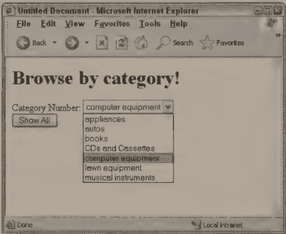

图 5-1：客户端浏览器显示类别列表。

在清单 5-3 中，PHP 代码仅对整个类别表执行查询。以下是 select 语句：

```
select * from phpbase.category
```

然后 PHP 代码遍历每一行，将类别名称保存在以 categoryID（一个数字）为键的关联数组中。当代码到达 mysql_close 函数时，catByNum 数组包含所有类别作为值，类别编号作为键。

稍后，在 HTML 表单中，PHP 处理器再次启动，进行第二轮 PHP 乐趣。这次，PHP 代码为组合框控件（在 HTML 世界中称为“select”对象）构建了一组 HTML option 值语句。option 值语句的好处是，您可以设置要在组合框中显示的单词列表，并为每个单词提供一个值，该值将通过 URL 发送到服务器。没错！您就可以在这里放置类别编号。因此，此代码产生的一个 option 值如下：

```
<option value="1">appliances</option>
```

这意味着组合框将显示单词 appliances，但如果我选择 appliances，浏览器将发送值 1，而不是单词 appliances。值 1 反过来是与 appliances 关联的 categoryID。它有效！

此时，您可能意识到，您完全可以在 HTML 文件中硬编码类别值，而不是从表中查找它们。但是，其理念是，如果您通过更改类别名称、删除类别或添加新类别来修改表，使用 option 值方法意味着您不必更改 categoryname.php 文件。如果您硬编码值，在更改数据库中的表后，您还必须更改 HTML，这是额外的工作。

即便如此，我至少能想到两种情况，您可能希望跳过 PHP 并在 HTML 中硬编码类别。第一，如果您不打算经常更改类别；第二，如果您运行的是非常大的服务器，需要将数据库查询降到最低。这两种情况都可以证明在 HTML 中硬编码类别是合理的。

## 使用网页修改数据

尽管允许用户查找数据很棒，但允许他们更改数据（在某些情况下）更好。例如，您可能希望用户能够通过修正拼写错误或更改广告状态来修改广告。

通常，您允许用户通过先查找行并确定行的所有信息来修改表中的行。然后，您在 HTML 表单中显示该行，允许用户更改数据。HTML 表单将数据发送回服务器，在那里，一个 .php 文件使用任何新值更新该行。这听起来并不难——确实不难。

在本节中，我将向您展示如何允许用户修改广告。问题是任何人都可以修改任何广告。如果这是一个真正的分类广告系统，您会想要添加一些安全措施，例如登录部分。通过使用我在图书 VI，第 7 章中向您展示的技术，您可以添加登录部分。要使其工作，您必须修改客户表以包含加密密码。当用户登录时，您加密用户的密码并将其与客户表中的密码进行比较。然后，该客户只能修改该客户“拥有”的广告，这意味着包含与登录客户的 customerID 匹配的 customerID 值的广告。

## 应对添加、搜索和更新

在线数据库系统的设计者往往希望为添加、搜索和更新界面使用同一个表单。这是一个坏主意，因为它可能会让人困惑。例如，在 20 世纪 80 年代中期，我曾帮助开发一个机油更换中心的数据库系统。那个单一表单包含所有字段，您可以在任何字段中输入内容，并可以使用此表单进行添加、搜索和更新。输入数据后，您可以单击搜索按钮以获取行的其余列，然后从那里，您可以更改它们并制造一团混乱。困惑吗？绝对！相反，应有一个用于添加新数据的表单。然后，应有一个用于搜索数据的另一个表单。最后，如果用户搜索数据并获得一行，您可能希望在页面上包含一个链接，让用户跳转到另一个页面来修改数据。使用不同的表单，所有相关人员的生活将会轻松得多。用户最终会感谢您。

遵循“应对添加、搜索和更新”侧边栏的精神，我在此示例中使用三个表单。此示例包括一个用于添加广告的表单、一个用于查找广告的表单（基于本章前面的示例）和一个用于更新数据的表单。

### 创建新广告

我在此向您展示的技术并不新鲜。我在此向您展示的一切，我在图书 VI，第 4 章中都有描述。此外，此表单包含一个类别搜索，使用我之前在“按类别名称查找”部分中解释的技术。清单 5-4 中的 createAd1.html 文件是用作创建广告起点的表单。这是一个不含任何 PHP 代码的 .html 文件，它仅包含一个询问用户电子邮件地址的表单。当用户单击提交（Submit）时，Web 服务器将转到清单 5-5 中的 createAd2.php 文件。

### 清单 5-4：询问用户电子邮件地址的表单

```
<html><head><title>Locate Customer</title></head>
<body bgcolor="#FFFFFF" text="#000000">
<h2>Please enter your email address
so I can find you in the system.</h2>
<form name="form1" method="get"
action="createAd2.php">
<input type="text" name="email">
<input type="submit" value="Submit">
</form></body></html>
```

获取用户的电子邮件地址后，广告系统即准备好让用户输入广告。清单 5-5 中的 createAd2.php 文件使您能够做到这一点。此 PHP 程序首先要做的是确保电子邮件地址属于系统的合法用户。如果不是，代码将打印消息“Sorry, you are not a known user。”

为了演示通过 Web 将数据输入 MySQL 服务器的技术，我故意省略了任何在线分类广告系统可能都很重要的一部分：密码系统。就目前而言，任何人都可以访问此系统并为任何其他人发布广告。然而，此处的重点是向您展示如何通过 HTML 表单输入数据。在图书 VI，第 7 章中，我将引导您创建一个示例网站，允许用户在该网站上注册并登录。要创建一个成功的分类广告系统，请将该章中的信息与本章中的信息相结合。

### 清单 5-5：允许用户输入广告的表单

```
<html><head><title>Create New Ad</title></head>
<body bgcolor="#FFFFFF" text="#000000">
<?php
$CustomerOkay = false;
mysql_connect("localhost", "phpuser", "phppass");
$email = $_GET['email'];
$result = mysql_query(
 "select ID, name from phpbase.customer ". // space!
 "where email = '$email'");
if ($result) {
 if (mysql_num_rows($result) > 0) {
 $row = mysql_fetch_assoc($result);
 $CustomerOkay = true;
 $CustName = $row['name'];
 $CustID = $row['ID'];
 }
}
if ($CustomerOkay == false) {
 print "<h1>Sorry, you are not ".
 "a known customer.</h1>";
}
else {
 print "<h1>Welcome, $CustName!</h2>";
 // Categories
 $result = mysql_query(
 "select * from phpbase.category");
 if ($result) {
 if (mysql_num_rows($result) > 0) {
 while ($row =
 mysql_fetch_assoc($result)){
 $name = $row["category_name"];
 $num = $row["categoryID"];
```


```php
$catByNum[$num] = $name;
}
mysql_free_result($result);
}

// status
$result = mysql_query(
"select * from phpbase.status");
if ($result) {
if (mysql_num_rows($result) > 0) {
while ($row =
mysql_fetch_assoc($result)) {
$name = $row["description"];
$num = $row["statusID"];
$statusByNum[$num] = $name;
}
}
mysql_free_result($result);
}

// This else block ends AFTER
// the following HTML code!

?>
Please enter your ad here. Click Submit when finished!<p>
<form name="form1" method="get" action="createAd3.php">
Headline:
<input type="text" name="headline" size="50"
maxlength="100"><br>
Category:
<select name="category">
<?php
foreach ($catByNum as $num=>$name) {
print "<option value=\"$num\">$name</option>\n";
}
?>
</select><br>
Item Name:
<input type="text" name="itemname" size="50"
maxlength="50"><br>
Description:<br>
<textarea name="description" cols="50"
rows="10"></textarea><br>
Price: $
<input type="text" name="price"><br>
Ad Expiration Date:
<input type="text" name="expiration"><br>
Initial status:
<select name="status">
<?php
foreach ($statusByNum as $num=>$name) {
    print "<option value=\"$num\">$name</option>\n";
}
print "</select>";
print "<input type=\"hidden\" ";
print "name=\"customerID\" value=\"$CustID\">";
print "<input type=\"hidden\" ";
print "name=\"email\" value=\"$email\">";
?>
<input type="submit" value="Submit">
</form>
<?php
    mysql_close();
} // This is the end of the else block!
?>
</body>
</html>
```

Listing 5-5 验证电子邮件地址有效之后，HTML 部分便开始工作，为用户创建一个用于输入分类广告的 Web 表单。但我在这里做了一件酷的事：虽然广告表中包含一个类别编号（而不是名称），但我知道对发布广告的用户来说，一个数字毫无意义。相反，我想列出类别。因此，我使用本章前面“按类别名称查找”部分中描述的技术。我还对广告表的 Status 列做了同样的事情。与类别一样，我不希望用户根据编号来选择状态。因此，我从状态表中查找状态名称，并用这些名称来填充下拉列表框。

用户填写表单后，表单将数据发送到 Web 服务器并请求 createAd3.php，如 Listing 5-6 所示。该文件将广告插入表中。这种插入实际上非常简单：我只需收集所有传来的数据（使用 $_GET 数组），然后构建一个 SQL 插入语句，将数据放入 Ad 表中。

在这些示例中，我使用从表单发送数据的 GET 方法。这需要我在 PHP 中查看 $_GET 数组。使用 GET 有两个缺点：所有数据都在 Web 地址中可见，并且你可以发送的数据量有限制。

出于这个原因，在 Book VI，Chapter 7 中，我使用 POST 方法而不是 GET 方法。从 PHP 的角度来看，两者之间几乎没有区别：你要么检查 $_GET 数组，要么检查 $_POST 数组。POST 的优势在于，例如，如果你正在输入密码，那么在用户点击 Send 后，密码不会出现在地址栏中。此外，使用 POST 可以发送大量数据。对于这里的小广告，GET 可以处理。但如果你想允许更大的广告，我建议使用 POST。

### Listing 5-6: 将广告插入表中的最终 .php 文件

```php
<html><head><title>Results</title></head>
<body bgcolor="#FFFFFF" text="#000000">
<?php
$headline = $_GET['headline'];
$category = $_GET['category'];
$itemname = $_GET['itemname'];
$description = $_GET['description'];
$price1 = $_GET['price'];
$price = $price1 * 100; // Convert to cents
$expirationstr = $_GET['expiration'];
$expirationnum = strtotime($expirationstr);
$expiration = date("Y-m-d", $expirationnum);
$status = $_GET['status'];
$customerID = $_GET['customerID'];
$email = $_GET['email'];

mysql_connect("localhost", "phpuser", "phppass");
$result = mysql_query(
    "insert into phpbase.ad
    (categoryID, item_name, headline,
    description, price, expiration_date,
    status, CustomerID)
    values
    ('$category', '$headline',
    '$itemname', '$description',
    '$price', '$expiration', '$status',
    '$customerID')"
);

if ($result) {
    print "<h2>Thank you for your ad!</h2>\n";
    print "When you browse your ads now,<br>\n";
    print "you should see your new ad!<p>\n";
    print "<a href=\"viewAd2.php?email=$email\">";
    print "Click here to browse your ads!</a>";
}
else {
    print "The SQL failed. Here's why:<br>\n";
    print mysql_errno() . ": " . mysql_error() . "<br>";
}
mysql_close();
?>
</body></html>
```


如果你想仔细比较 Listing 5-6 中的 MySQL 调用与其他 MySQL 调用，可能会注意到缺少了什么。在 Listing 5-6 中，我没有像平常一样调用 mysql_free_result。原因是，当你使用 mysql_query 执行 SQL 插入语句时，结果是一个简单的布尔值，而不是结果集。（相比之下，SQL select 语句返回一个你在后续 fetch 调用中使用的结果。）

mysql_free_result 仅在你得到结果集时使用，而不是布尔变量。因此，不要在 SQL 插入语句后调用 mysql_free_result，否则会出错。

关于 Listing 5-6，我还要提到一件令人兴奋的事情。这个 Web 表单有一个不寻常的特性：用户可以使用多种格式来输入过期日期。这通过 strtotime 函数实现，该函数接受字符串格式的日期并将其转换为 Unix 时间。（然后我使用 Listing 5-6 中的 date 函数重新格式化 Unix 时间。）例如，以下所有格式都是有效的：

- September 1, 2005 你可以输入带有月份名称、日期数字、逗号，然后是年份的日期。
- 9/1/2005 你可以输入所有用斜杠分隔的数字格式的月-日-年。
- tomorrow 你可以输入单词 tomorrow 或 yesterday（尽管一个昨天就过期的广告并不特别有用）。

你也可以使用单词 next，如 next Thursday 或 next Year，但这些结果可能不会给你期望的结果。此外，PHP 团队从版本 4.3.0 开始更改了系统处理单词 next 的方式。Apparently 对 PHP 团队来说，next Sunday 意味着“从现在起两个星期日的星期日”，而我个人不同意这种观点。最好完全避免这个问题。

如果你想探索日期处理函数背后的引擎，请查看 www.gnu.org/manual/tar-1.12/html_chapter/tar_7.html 上的官方 GNU 日期处理页面。

## 查看客户的广告

当客户有多个广告时，查看客户的所有广告很容易。你所要做的就是调用一个 SQL select 语句，按客户 ID 搜索。

Listing 5-7 中的 viewAd1.html 文件包含一个用于输入客户电子邮件地址的基本表单。该表单反过来调用 viewAd2.php，如 Listing 5-8 所示。

### Listing 5-7: 查看客户广告的入口点

```html
<html><head><title>Locate Customer</title></head>
<body bgcolor="#FFFFFF" text="#000000">
<h2>Please enter your email address
so I can find you in the system.</h2>
<form name="form1" method="get"
action="viewAd2.php">
<input type="text" name="email">
<input type="submit" value="Submit">
</form></body></html>
```

Listing 5-8 中的代码检索客户的广告，然后为 Web 浏览器将其格式化为列表。但在这个广告中，我做了一件有趣的事：我执行一个 SQL 连接。连接简单来说就是从两个表中检索数据。在这种情况下，我想从广告表中检索每个广告，但与此同时，我也想检索类别名称和状态名称，而不是仅检索类别编号和状态编号。但广告表中包含的是一个数字，而不是名称。

一种方法是检索类别和状态的编号，然后使用单独的 SQL select 语句来检索名称。但我没有这样做，而是选择搞点花样，使用连接在一个 select 语句中完成所有操作。请仔细查看 Listing 5-8 中的 SQL select 语句。我没有要求单独的列，而是附加了一个表名（以及为了完整性附加数据库名）— phpbase.category.category_name 和 phpbase.ad.price。然后，我不搜索单个表，而是搜索三个表：

```
from phpbase.ad, phpbase.status, phpbase.category
```

但我要检索哪些记录？要指定记录，你使用 where 子句。首先，我想要广告表中与特定客户 ID 匹配的所有记录。所以这放在 my where 子句的第一位，如下所示：

```
where phpbase.ad.customerID = $CustID
```

但是使用这些记录时，我想连接类别表和状态表中的数据，检索名称，而不仅仅是编号。对于 Status 表，我使用此条件：

```
phpbase.status.statusID = phpbase.ad.status
```

MySQL 引擎查看在 phpbase.ad 表中找到的行中的 status 值（即等号右侧），然后在 status 表中查找 statusID 与广告的 statusID 匹配的行（即等号左侧）。该行包含一个状态名称，我在 select 语句开头选择 phpbase.status.description 时指定了该名称。

这对连接状态表和类别表都适用。但是连接状态表有一个小问题。状态表有一个名为 description 的列，广告表也有。最终，PHP


构建只带一个 description 索引的关联数组，会导致其中一个值丢失。所以我在 select 语句的第一部分追加了单词 *作为*：

```
phpbase.status.description as status_desc
```

当我取回数据时，status 表的 description 列将改为列名 *status_desc*。当我在 PHP 中访问关联数组时，可以使用名称 *status_desc* 获取状态描述。要获取广告描述，可以使用名称 *description*。这样，我就同时拥有了两个列，并且其中一个已被重命名。

## 清单 5-8：广告查看系统的核心

```
<html><head><title>View Your Ads</title></head>
<body bgcolor="#FFFFFF" text="#000000">
<?php
$CustomerOkay = false;
mysql_connect("localhost", "phpuser", "phppass");
$email = $_GET['email'];
$result = mysql_query(
    "select ID, name from phpbase.customer ". "// space!
    "where email = '$email'");
if ($result) {
    if (mysql_num_rows($result) > 0) {
        $row = mysql_fetch_assoc($result);
        $CustomerOkay = true;
        $CustName = $row['name'];
        $CustID = $row['ID'];
    }
}
if ($CustomerOkay == false) {
    print "<h1>Sorry, you are not "
    "a known customer.</h1>";
}
else {
    print "<h1>Welcome, $CustName!</h2>";
    print "Here are your ads!<p>\n";
    print "<hr>";
    $result = mysql_query(
        "select phpbase.ad.headline,
        phpbase.category.category_name,
        phpbase.item_name,
        phpbase.ad.description,
        phpbase.ad.expiration_date,
        phpbase.ad.price,
        phpbase.status.description
        as status_desc"
from phpbase.ad, phpbase.status,
phpbase.category
where phpbase.ad.customerID = $CustID and
phpbase.status.statusID =
phpbase.ad.status and
phpbase.ad.categoryID =
phpbase.ad.categoryID;");

if ($result) {
    if (mysql_num_rows($result) > 0) {
        while ($row = mysql_fetch_assoc($result)){
            print "<h2>{$row['headline']}</h2>\n";
            print "<b>Category:</b> " ;
            print "{$row['category_name']}<br>\n";
            print "<b>item:</b> " ;
            print "{$row['item_name']}<br>\n";
            print "<b>description:</b> " ;
            print "{$row['description']}<br>\n";
            print "<b>expires on:</b> " ;
            print "{$row['expiration_date']}<br>\n";
            print "<b>price:</b> " ;
            $price = $row['price'] / 100;
            print "\$${price}<br>\n";
            print "<b>Status:</b> " ;
            print "{$row['status_desc']}<p>\n";
            print "<hr>";
        }
    }
    mysql_free_result($result);
}
mysql_close();
?>
</body>
</html>
```

## 第 6 章：从 Perl 访问 MySQL

### 本章内容

- 获取 DBI 和 MySQL 包
- 连接到数据库
- 查询数据库
- 修改数据库

在本章中，我将向你展示如何在 Perl 编程语言下开始使用 MySQL。当你从 Perl 使用 MySQL 时，所有 MySQL 概念都适用。如果你是 MySQL 新手，我建议你先阅读本小书（第 VI 册）的前三章，以熟悉 MySQL。在本章中，我假设你已经熟悉那些章节中介绍的基础知识。

如果你在 Linux 系统上安装了 Perl，那么你应该已经配置好 Perl DBI 包（即主要的数据库包）和 MySQL 包。如果你使用的是 Windows，则需要手动安装这两个包。在本章的第一部分中，我将向你展示如何在 Windows 上安装这些包。如果你使用的是 Linux，可以跳过这一部分。


> 如果你使用 Linux 且未安装 Perl DBI 和 MySQL 包，或者你使用 Windows 且在接下来部分中我描述的安装过程中遇到问题，请参阅 MySQL 手册中的 Perl/MySQL 主安装页面 www.mysql.com/doc/en/Perl_support.html。

## 在 Windows 上获取 Perl DBI 和 MySQL 组件

与本书中讨论的大多数内容不同，DBI 和 MySQL 组件不会随大多数面向 Windows 的 Perl 发行版自动安装。以下安装过程适用于 ActiveState 的 Perl 发行版。

要安装 Perl DBI 和 MySQL，你不需要预先下载任何内容。只需按照以下步骤操作：

- 1. 确保已连接到 Internet，然后通过在命令提示符下键入以下命令启动 ppm（Perl 程序员包手册）：

```
ppm
```

你将看到一条介绍性消息，后跟 ppm> 提示符。确保已连接到 Internet，因为 ppm 会为你下载模块。

- 2. 在 ppm> 提示符下，键入以下内容：

```
install DBI
```

你将看到类似以下内容，后跟若干行以“Installing”开头的行：

```
============================================================
Install 'DBI' version 1.37 in ActivePerl 5.8.0.804.
--------------------------------------------------------------
Downloaded 435317 bytes.
Extracting 61/61: blib/arch/auto/DBI/Driver_xst.h
```

安装完成后，你将看到一条消息，表明 DBI 已成功安装。

- 3. 在 ppm> 提示符下，键入以下内容：

```
install DBD-mysql
```

同样，你将看到类似以下内容，后跟若干行以“Installing”开头的行：

```
============================================================
Install 'DBD-mysql' version 2.9002 in ActivePerl
5.8.0.804.
--------------------------------------------------------------
Downloaded 178800 bytes.
Extracting 17/17: blib/arch/auto/DBD/mysql/mysql.lib
```

随后你将看到一条消息，表明 DBD-mysql 已成功安装。

- 4. 键入 quit 退出 ppm 程序。

就这样，你已经完成了。如果有任何步骤未按预期工作，请查看 www.mysql.com/doc/en/Perl_support.html 上的 MySQL 文档。

## 连接到数据库并执行简单查询

Perl DBI 使用非常简单。清单 6-1 展示了一个示例程序，该程序使用用户名 phpuser 和密码 phppass 连接到 MySQL 上的 phpbase 数据库。然后，该程序针对 customer 表执行 SQL 查询，打印结果，并结束连接。

本节的重点在于本程序的连接部分。在随后的章节中，我将详细介绍如何设置查询、执行查询以及从结果集中检索行。

## 清单 6-1：连接到数据库、查询表、打印结果并断开连接的程序

```
use DBI;
$database = "phpbase";
$user = "phpuser";
$password = "phppass";
$dbh = DBI->connect("DBI:mysql:$database", $user, $password);

$statement = "SELECT * FROM phpbase.customer";
$sth = $dbh->prepare($statement);
$rv = $sth->execute;
while(@row = $sth->fetchrow_array) {
    print "$row[0] $row[1] $row[2] ."
    "$row[3]\n";
}

$rc = $sth->finish;
$rc = $dbh->disconnect;
```

以下是我在 phpbase.customer 表中的示例输出：

```
1 Hank Harshigan hank@harshigan.com 2003-06-23 2003-06-23
2 Floyd Flabbergaps floyd@flabbergaps.com 2003-06-23 2003-06-23
3 Erica Exagabule erica@exagabule.com 2003-06-23 2003-06-23
4 Jessica Jambolabile jessica@jambolabile.com 2003-06-23 2003-06-23
5 Julia Julianopolis julia@julianopolis.com 2003-06-23 2003-06-23
```

该程序的第一行使用 DBI 包。你无需指定 MySQL 包，因为当 DBI 看到请求 MySQL 的 connect 语句时，DBI 包会定位 MySQL 包。

接下来的三行将数据库名、用户名和密码保存在变量中。

然后是连接行，即对 DBI 包中 connect 函数的调用。该行如下：

```
$dbh = DBI->connect("DBI:mysql:$database", $user, $password);
```

connect 函数的第一个参数是由驱动程序前置的数据库名。驱动程序是用于连接到数据库的底层包。在 Perl 中，你使用 DBI 进行数据库操作，DBI 与你正在使用的数据库系统特定的驱动程序通信。这意味着你可以使用 DBI 与多种不同的数据库系统通信，而不仅仅是 MySQL。因此，在 connect 语句中，你不仅指定数据库，还要指定要使用的驱动程序。你可以通过将所有信息嵌入到单个字符串来实现，如下所示：

```
DBI:mysql:$database
```

$database 是包含数据库名的变量。这个字符串是 connect 的第一个参数。下一个参数是用户名，最后一个参数是密码。

connect 函数返回数据库连接的句柄。在计算机术语中，句柄是代表某个对象的数字。在这里，句柄是表示数据库连接的数字。你在后续的数据库调用中使用这个句柄；该句柄标识你正在引用哪个连接。（是的，这意味着你可以一次打开到不同数据库的多个连接。）

获得句柄后，你可以查询数据库并对其进行更改。在清单 6-1 的示例程序中，我查询数据库中的 customer 表。（有关查询数据库的详细信息，请参见下一节。）

完成工作后，你需要关闭连接。你可以通过调用 disconnect 函数来实现，就像我在示例程序的最后一行中所做的那样。

## 查询数据库

要使用 Perl 查询 MySQL 数据库，你需要执行两个步骤，这是数据库系统中的常见方法：

- 准备 SQL select 语句。
- 执行 SQL select 语句。


执行 SQL 语句后，您会收到一个结果集，可以从中获取信息。您有多种方法从结果集中提取数据。在接下来的两个部分中，我将向您展示如何准备和执行 SQL 语句，以及从结果集中提取数据的不同方式。

## 准备和执行 SQL 语句

通常系统希望先准备 SQL 语句，这只是意味着您调用一个名为 prepare 的函数，并将 SQL 语句作为字符串传递。（是的，您会自己准备语句，但当您准备好之后，MySQL 也希望对其进行准备。）MySQL 准备好语句后，您可以执行它。这两个步骤需要两个独立的函数。下面是清单 6-1 中程序的示例：

```
$statement = "SELECT * FROM phpbase.customer";
$sth = $dbh->prepare($statement);
$rv = $sth->execute;
```

在这个示例中，在调用两个函数之前，您将 SQL 语句保存到名为 statement 的变量中。（这样如果您想查看它，可以将其打印到控制台，而无需重新输入。）然后调用 prepare，传递您的 SQL 语句。prepare 函数会返回一个语句句柄。这意味着 DBI 现在知道您的语句，您可以使用此句柄引用它。

接下来，您调用 execute，它是语句句柄对象的一部分。execute 函数返回一个结果集。

## 从结果集中提取数据

您可以调用各种获取函数来获取结果集中的行。Perl DBI 提供了四个用于提取数据的函数：

- fetchrow_array: 获取到数组中
- fetchrow_arrayref: 获取到数组的引用
- fetchrow_hashref: 获取到哈希的引用
- fetchall_arrayref: 获取所有到数组的引用

这些函数作为语句句柄对象的成员存在。列表中的前三个函数获取结果集中的下一行；它们仅在返回的数据类型上有所不同。fetchrow_array 函数返回一个简单列表；fetchrow_arrayref 返回一个数组的引用；fetchrow_hashref 返回一个按列名组织的哈希的引用。

第四个函数 — fetchall_arrayref — 与其他函数的不同之处在于，它将所有行获取到一个大的数组引用中。在 Perl 中，数组的引用一词简单来说可以指一个包含其他数组的数组——在这里正是这个意思。

如果您想一次获取所有行，请使用 fetchall_arrayref 函数。然后您可以遍历结果数组引用中的数据。如果您更愿意逐行检索，请使用其他三个函数中的任意一个。

在本章前面的清单 6-1 中，我使用了 fetchrow_array 函数。下面是程序中的一行：

```
@row = $sth->fetchrow_array
```

fetchrow_array 函数是 $sth（即语句句柄对象）的成员。此调用的结果保存在 @row 数组中。您可以使用 Perl 的内置函数轻松遍历该数组。

fetchrow_array 函数返回一行；或者，如果结果集中不再存在更多行，则返回一个假值。通过将调用包裹在 while 循环的比较中，您可以遍历结果集中的所有行。

或者，您可以尝试 fetchrow_arrayref 函数。这样做与使用 fetchrow_array 函数类似。下面是清单 6-1 中 while 循环的重写版本，使用了 fetchrow_array 函数：

```
while($row = $sth->fetchrow_arrayref) {
    print "$row->[0] _ $row->[1] $row->[2] ".
    "$row->[3] $row->[4]\n";
}
```

您将结果保存在标量值中，而不是数组变量中，因为您得到的是一个引用。您通过解引用来访问数组，如 $row->[0]。除了这两个区别以及不同的函数名之外，此代码与清单 6-1 相同。

处理返回引用的函数时，始终将函数结果保存在标量变量中，而不是数组或哈希。如果您使用数组或哈希，将会从数据库引擎得到一些奇怪的错误。

下面是使用哈希引用访问方式重写的相同示例：

```
while($row = $sth->fetchrow_hashref) {
    print "$row->{'ID'}\t $row->{'name'} \t"
    "$row->{'email'}\t ".
    "$row->{'signup'}\t $row->{'last_access'}\\n";
}
```

此示例将引用保存到标量中，而不是数组。要访问项目，您使用表的列名，并解引用，如 $row->{'email'}。

下面是使用将整个结果集检索到单个数组中的方法重写的示例：

```
$stale = $sth->fetchall_arrayref;
$numrows = $#{$stable};
$numcols = $#{$stable->[$i]};
for $row (0 .. $numrows) {
    for $col (0 .. $numcols) {
        print "$stable->[$row][$col] ";
    }
    print "\n";
}
```

这比之前的示例更复杂。对于大型结果集，这种方法不是好主意，因为它会消耗大量内存。但如果您希望一次性提取所有数据，该方法效果很好。请注意，和往常一样，fetchall_arrayref 返回一个引用，因此您将值保存到标量变量中。

接下来，您需要确定数组的大小。为此，必须使用 {@stable} 解引用数组变量，然后使用 $# 构造来获取大小。这会给出行数。要确定列数，请查看表中的第一行，使用与确定列数相同的过程。

然后您有两个循环来遍历表格的两个维度。您使用 $table->[$row][$col] 收集每个项目。

## 修改数据库

对于不返回结果集的 SQL 语句（也就是说，除了 select 语句之外的几乎任何语句），您可以使用 do 函数。而 select 语句要求您先调用 prepare 然后调用 execute，但对于 insert、update 和 delete 等语句，您可以跳过 prepare 和 execute 函数，而是直接调用 do。下面是一个向表中插入数据、修改一些数据，然后删除一些数据的示例。

首先，下面是插入语句：

```
use DBI;
$database = "phpbase";
$user = "phpuser";
$password = "phppass";
```

```
$dbh = DBI->connect("DBI:mysql:$database", $user, $password);
$statement = "
insert into phpbase.customer
(name, email, signup, last_access)
values
('Sally Salmon eater', 'sally@salmoneating.com',
'2003-09-03', '2003-09-03')
";
$dbh->do($statement);
$rc = $dbh->disconnect;
```

您只需将 SQL 插入语句放在字符串中并调用 $dbh->do，传递您的语句。（请注意，我在 @ 符号前加了反斜杠；否则，Perl 会认为 @salmoneating 是一个变量名。反斜杠防止了错误的替换。）

您可以通过将 statement 变量赋值更改为以下内容来执行更新：

```
$statement = "update phpbase.customer
set email = 'sally@salmoneater.com'
where name = 'Sally Salmon eater'
";
```

您可以通过更改 select 语句来执行删除：

```
$statement = "
delete from phpbase.customer
where email like '%sally%';
";
```

## 检查错误

检查错误始终是个好主意。DBI 包有一个 err 变量和一个 errstr 变量，您可以通过 $dbh->err 和 $dbh->errstr 访问它们。这些是 MySQL 引擎返回的相同数字。

下面是一个示例程序，演示如何关闭自动死亡问题以及如何检查两个错误变量。（此程序故意使用错误密码，从而导致 MySQL 发出错误。）

但是，如果 DBI 包遇到错误，取决于 DBI 的配置方式，您的程序可能会自动终止，Perl 解释器会发出错误消息。通常，这是件坏事：您不希望程序仅仅因为无法连接到数据库服务器就崩溃。

```
use DBI;
$database = "phpbase";
$user = "phpuser";
$password = "incorrect";
$dbh = DBI->connect("DBI:mysql:$database",
$user, $password,
{RaiseError => 0, PrintError => 0});
print DBI::err;
print "\n";
print DBI::errstr;
print "\n";
```

您可以通过修改 connect 函数参数来关闭此默认行为。然后您可以检查两个变量以查找错误。一个是错误号，即 MySQL 返回的错误代码。另一个是错误字符串，即 MySQL 返回的字符串。


## 第 7 章：为你的网站创建用户名系统

### 本章内容

- 创建登录表
- 构建注册系统
- 设计登录表单和私有页面
- 编写访问例程
- 帮助忘记密码的用户

本章是一个动手实践的示例，展示了当 MySQL 与 PHP 等服务器端语言结合时可以做什么。我之所以为示例选择 PHP，仅仅是因为我的网站使用的是该语言。你也可以使用 Perl 或其他多种语言来完成所有这些操作。

本章将介绍如何创建一组页面，允许用户在你的网站上注册并选择密码和网站主题。（在本示例中，主题是背景颜色。）之后，用户可以稍后登录，甚至单击“记住我”复选框，使客户端计算机记住用户名和密码。我还将向你展示如何创建要求用户先登录才能访问的私有页面。如果用户当前已登录，则页面会显示；否则，将显示登录界面。

这些页面和文件仅仅是个开端。从这里开始，你可以添加更多私有页面、更多主题素材（如图形和图像），等等，只要你想象力所及。

本章的每个部分都专门介绍一个或两个特定文件，采用标准参考指南格式。不过，我仍然建议你通读全章，以便全面了解。

本章中创建的整个系统有些复杂。为此，我制作了一张线条图，帮助你了解程序各个部分之间的交互方式，如图 7-1 所示。在学习本章各个部分时，你可能需要不时参考此图，以帮助你理清思路。

register.php
(清单 7-2)
用户填写此表单以注册系统。

regcomplete.php
(清单 7-3)
允许用户在你的网站上注册。

login.html
(清单 7-4)
允许用户登录。

useraccess.php
(清单 7-7)
包含系统中使用的通用代码。

loginfailed.html
(清单 7-6)
登录失败的用户将看到此表单。

图 7-1：此图显示了不同的 PHP 和 HTML 程序如何交互。

welcome.php
(清单 7-5)
私有页面的示例，要求用户先登录。

newpassword.html
(清单 7-8)
忘记密码的用户填写的表单。

genpass.php
(清单 7-9)
为用户生成新密码。

### 创建登录表

当你设置用户登录系统时，首先需要设置 MySQL 表。和往常一样，我建议你将 SQL 输入单独的文件中，然后使用类似下面的命令运行该文件：

```
mysql -u root -p < tables.sql
```

清单 7-1 中的 tables.sql 文件包含表的数据。当你创建自己的表时，请记得在文件顶部包含 use phpbase 行。

### 清单 7-1：用于 MySQL 的表

```
use phpbase;
create table login (
  loginID integer NOT NULL auto_increment,
  email varchar(50) unique,
  password char(34),
  lastaccess date,
  signup date,
  themeID integer,
  key(email),
  primary key(loginID)
);
```

```
create table usertheme (
    themeID integer NOT NULL,
    name varchar(15),
    backgroundcolor char(6),
    primary key(themeID)
);
```

```
insert into usertheme
values (1, 'pink', 'FFCCFF');
insert into usertheme
values (2, 'blue', 'CCFFFF');
insert into usertheme
values (3, 'yellow', 'FFFFCC');
insert into usertheme
values (4, 'salmon', 'FFCCCC');
insert into usertheme
values (5, 'green', 'CCFFCC');
insert into usertheme
values (6,'purple', 'CCCCFF');
```

login 表包含唯一的 loginID、电子邮件地址、密码（将被加密）、注册日期、上次访问日期以及用户选择的主题。

在创建表时，我选择包含 loginID，尽管在本章的示例中我并不常用它。随着系统的增长，你可能希望让用户知道他们的唯一 ID，以便快速查找等等。

在创建表之后，清单 7-1 为 usertheme 表包含六个条目。在这个简单的示例中，主题由六种可能的颜色组成，主题名称即颜色名称。你可以在此文件中放入其他信息，例如要在每个页面顶部显示的图形文件名，或用于导航网站的图形集名称。然后，每个用户都会根据所选主题看到一种颜色和一组图形。

### 构建注册系统

创建表之后（如前一节所述），你可以创建一个允许用户在你的网站上注册的页面。我建议你为用户提供多种进入该页面的方式。通常的做法是：用户通过一个中心页面访问系统，在那里会看到一个登录表单。该页面上某个位置有一个链接，如果用户尚未注册，可以点击该链接进行注册。这是 Web 电子邮件网站常用的方法。

其想法是，用户只需访问一次注册页面，但需要经常使用登录页面（希望如此）。因此，登录页面应该更容易访问。

对于这一组示例，我有一个名为 login.html 的页面，我认为它是主访问入口，并在下一节“设计登录表单”中对该页面进行了描述。

图 7-2 显示了在客户端 Windows 浏览器中运行的注册表单。

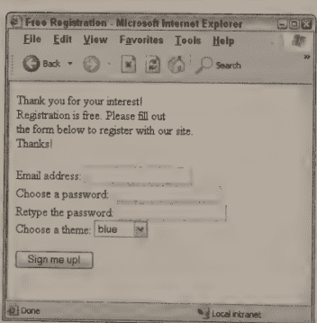

图 7-2：访客使用此表单在网站上注册。

清单 7-2 是注册表单的 register.php 文件。为了简洁起见，我故意没有包含一组用于验证数据的 JavaScript 函数。不过，我建议你包含这样的系统。我在第 VI 卷第 4 章中介绍了如何做到这一点。

### 清单 7-2：允许用户在你的网站上注册的文件

```
<?php
require "useraccess.php";
$themeByNum = GetThemeNames();

// You probably want to add some JavaScript
// validation. See Book 6, Chapter 4!
?>
<html>
<head>
<title>Free Registration</title>
</head>
<body bgcolor="#FFFFFF" text="#000000">
Thank you for your interest! <br>
Registration is free. Please fill out<br>
the form below to register with our site.<br>
Thanks!<p>
<form name="form1" method="post"
action="regcomplete.php">
<p>Email address:
<input type="text" name="email">
<br>
Choose a password:
<input type="password" name="password">
<br>
Retype the password:
<input type="password" name="password2">
<br>
Choose a theme:
<select name="themeID">
<?php
foreach ($themeByNum as $num=>$name) {
 print
 "<option value=\"$num\">$name</option>\n";
}
?>
</select>
<p>
<input type="submit" name="Submit"
value="Sign me up!"><br>
</p>
</form>
</body>
</html>
```

虽然我本可以使用 .html 文件来完成清单 7-2 中的大部分功能，但我想包含可用主题的列表。因此，我将注册表单制作成一个 .php 文件，其中包含访问数据库并检索主题名称的部分。

在本章的所有表单中，我都使用 Post 方法而不是 Get 方法。我选择 Post 是因为 Get 方法会在 URL 中显示用户信息。当用户使用 Get 方法表单登录时，他的密码会显示在 Web 浏览器的地址栏中，旁观者很容易看到。这可能不是个好主意。不过，Post 方法不会这样做；数据在后台发送，不会出现在 URL 中。

用户填写注册表单并单击“提交”按钮后，浏览器会访问清单 7-3 中所示的 regcomplete.php 文件。该文件处理用户注册。

### 清单 7-3：处理用户注册的文件

```
<html><head>
<title>Registration Complete</title></head>
<body>
<?php
 require "useraccess.php";
 // Use POST so password isn't shown in URL!
 $email = $_POST['email'];
 $password = $_POST['password'];
 $themeID = $_POST['themeID'];
 $result = signup($email, $password, $themeID);
 if ($result) {
 ?>
 Thank you for your registration!
 <?php
 }
 else {
 ?>
 Sorry, there was a problem signing you up.
 Perhaps you have already registered with us?
 <?php
 }
 ?>
</body></html>
```

在清单 7-3 中，PHP 代码访问电子邮件、密码和主题选择，并调用名为 signup 的函数。这个 signup 函数是我自己创建的，位于名为 useraccess.php 的文件中，我在清单 7-3 的开头引用了该文件。我将在本章后面的“在单个 .php 文件中编写访问例程”一节中介绍 useraccess.php 文件及其函数。


在清单 7-3 中，我使用了一个小小的 PHP 技巧：你可以将 HTML 块与 PHP 块穿插在一起，PHP 处理器足够智能，能够理清这一切。因此，处理器仅在 $result 值为 true 时才会打印 HTML 文本“Thank you for your registration!”。在这段 HTML 文本之后，我加入了一个 else 语句，然后再次关闭 PHP 代码，之后还有更多 HTML 文本（以“Sorry, there was a problem . . . ”开头）。这段 HTML 文本仅在 $result 值为 false 时才会出现。这个 PHP 处理器非常智能。

## 设计登录表单

我认为 login.html 文件是用户的中心起点。其理念是，用户可以从这个页面执行以下操作：

- 登录
- 通过点击链接注册获取访问权限（注册）
- 如果忘记密码，请点击链接

采用这种一站式方法，用户不需要记住各种链接并拥有多个书签。他们只需将这一个页面加入书签即可访问您的系统。

图 7-3 显示了登录表单。

login.html 文件很简单；它只是一堆 HTML 代码，没有 PHP 代码。（因此，它具有 .html 文件扩展名。）清单 7-4 显示了 login.html 文件。

### 清单 7-4：登录表单

```html
<html><head><title>Login Please</title></head>
<body bgcolor="#FFFFFF" text="#000000">
<h2>Please sign in! </h2>
New member?
<a href="register.php">Click here to register</a>.
<form name="form1" method="post" action="welcome.php">
<p>Email address:
<input type="text" name="email">
<br>
Password:
<input type="password" name="password">
<br>
<input type="checkbox" name="remember" value="1">
remember me!</p>
<input type="submit" name="Submit" value="Login">
</form>
<p><a href="newpassword.html">Click here</a>
if you forgot your password.
</body>
</html>
```

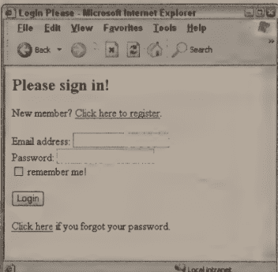

图 7-3：用户通过此表单登录网站。它作为系统的入口。

## 设计私有页面

用户单击登录按钮后，浏览器会转到 welcome.php 页面。welcome.php 页面处理登录操作。我希望尽可能让这个系统健壮，因此我在程序中加入了以下要点：

- 如果用户直接访问 welcome.php，系统会检查他们是否已经登录。如果没有，系统会显示一条未登录的消息，并为他们提供登录选项。
- 如果用户通过 login.html 文件来到 welcome.php 文件，welcome.php 文件将使用他们在 login.html 文件表单中输入的信息为其登录。

这两点看起来几乎是循环的，但逻辑确实很有道理。更棒的是，welcome.php 文件并无特别之处。我提取了 PHP 代码并将其放入 useraccess.php 文件中，welcome.php 文件中除了 welcome 这个词之外什么也没有。

清单 7-5 显示了 welcome.php 文件。其理念是，您可以将此文件用作所有私有文件的模板。关键在于我放在该文件顶部的 PHP 代码。该 PHP 代码调用 checkAccess() 函数，该函数完成大部分工作。checkAccess 函数会检查用户当前是否已登录，如果没有，则将用户带回 login.html 文件。

如果将此 PHP 代码放在所有私有文件的开头，则每个文件都受到保护。如果 Web 用户直接访问页面而未经过 login.html 表单，PHP 代码会自动将用户带到 login.html 表单。但是，如果用户已经登录，文件将按照您创建的方式直接显示。

### 清单 7-5：welcome.php 文件

```php
<?php
require "useraccess.php";
$themeID = checkAccess();
$theme = getTheme($themeID);
?>
<html>
<?php
print "<body bgcolor=\"#{$theme->bgcolor}\"\n";
?>
<h1>Welcome!</h1>
</body>
</html>
```

有关 checkAccess 函数的工作原理的详细信息，请参见本章后面的“在单个 .php 文件中编写访问例程”一节。

## 应用主题

请注意，清单 7-5 中的 checkAccess 函数将数据返回到名为 $theme 的变量中。这些数据是 useraccess.php 文件中定义的名为 ThemeInfo 的类的实例。您可以看到我实际如何使用主题。请查看清单 7-5 中的以下代码：

```php
print "<body bgcolor=\"#{$theme->bgcolor}\"\n";
```

这段代码将存储在 $theme 的 bgcolor 成员中的任何背景颜色写出到 HTML <body> 标签中。

## 处理登录失败

如果用户尝试访问某个私有页面，或在 login.html 表单中输入错误的登录信息，则用户将被转到 loginfailed.html 文件，如清单 7-6 所示。

### 清单 7-6：用户错误访问系统时看到的文件

```html
<html><head><title>Login failed</title></head>
<body bgcolor="#FFFFFF" text="#000000">
Sorry! Could not log you in. Please
<a href="login.html">click here</a>
to try again!<br>
</body>
</html>
```

## 在单个 .php 文件中编写访问例程

在本节中，我将介绍 useraccess.php 文件中的函数。我的想法是将大部分 PHP 代码汇总到一个文件中，使代码更易于维护。清单 7-7 中的 useraccess.php 文件展示了该代码。我将在接下来的几个部分中描述各个函数。

### 清单 7-7：包含系统中大部分 PHP 代码的文件

```php
<?php
// Remember, this might be called whether
// there was a POST or not!
function checkAccess() {
    // First check for a POST.
    $email = $_POST['email'];
    $password = $_POST['password'];
    $remember = $_POST['remember'];

    // If no POST, check for a cookie
    if ($email == NULL) {
        $email = $_COOKIE['dummiesemail'];
        $password = $_COOKIE['dummiepassword'];
    }
    elseif (!$remember) {
        // If there was a POST, save the cookie
        // This will wipe out any long-term
        // cookies by this same name. See
        // text for explanation.
        setcookie('dummiesemail', $email);
        setcookie('dummiespassword', $password);
    }

    $okay = false;
    if ($email && $password) {
        mysql_connect("localhost", "phpuser",
            "phppass");
        $result = mysql_query(
            "select loginID, password, themeID ".
            "from phpbase.login where ".
            "email = '$email' "//watch the quotes!
        );
        if ($result) {
            if (mysql_num_rows($result) > 0) {
                $row = mysql_fetch_assoc($result);
                $pass = $row['password'];
                $userid = $row['loginID'];
                $theme = $row['themeID'];

                // This is for when MD5 is used...
                // Need to use the same salt that
                // was used originally.
                $passcrypt = crypt($password,
                    substr($pass, 0, 12));
                // If DES is used, just use
                // $passcrypt = crypt($password);
                if ($pass == $passcrypt) {
                    $okay = true;
                }
            }
        }
        mysql_close();
    }
    if (!$okay) {
        header("location: loginfailed.html");
    }
    // If $remember is set, store in
    // long-term cookie.
    if ($remember) {
        // Remember until May 17, 2033.
        // That's close enough to forever. :-)
        setcookie('dummiesemail', $email,
            2000000000);
        setcookie('dummiespassword', $password,
            2000000000);
    }
    return $theme;
}

function signup($email, $password, $themeID) {
    mysql_connect("localhost", "phpuser",
        "phppass");
    $passcrypt = crypt($password);
    $now = date("Y-m-d");
    $result = mysql_query(
        "insert into phpbase.login
        (email, password, lastaccess,
        signup, themeID) values
        ('$email', '$passcrypt', '$now',
        '$now', '$themeID')"
    );
    mysql_close();
    return $result;
}

class ThemeInfo {
    var $bgcolor;
}
function getTheme($themeID) {
    mysql_connect("localhost", "phpuser",
        "phppass");
    $newtheme = new ThemeInfo;
    $newtheme->bgcolor = "FFFFFF"; // white bg

    $result = mysql_query(
        "select backgroundcolor from ".
        "phpbase.usertheme ".
        "where themeID = '$themeID'"
        // watch the quotes!
    );
    if ($result) {
        if (mysql_num_rows($result) > 0) {
            $row = mysql_fetch_assoc($result);
            $newtheme->bgcolor =
                $row['backgroundcolor'];
        }
    }
    mysql_close();
    return $newtheme;
}

function GetThemeNames() {
    mysql_connect("localhost", "phpuser",
        "phppass");
    $result = mysql_query(
        "select * from phpbase.usertheme");
    if ($result) {
        if (mysql_num_rows($result) > 0) {
            while ($row =
                mysql_fetch_assoc($result)){
                $name = $row["name"];
                $num = $row["themeID"];
                $themeByNum[$num] = $name;
            }
        }
    }
}
```

## 第 VI 卷第 7 章 为您的网站创建用户名系统


}
mysql_free_result($result);
}
mysql_close();
return $themeByNum;
}

```php
function GeneratePassword() {
// skip the L's since they look like 1's!
$wordlist = array("apple", "array", "book",
"bold", "catalog", "cook", "door", "down",
"echo", "eat", "flag", "funny", "garage",
"going", "house", "heavy", "inside",
"icecream", "jump", "jack", "kludge", "keep",
"merry", "making", "need", "next", "other",
"open", "perfect", "place", "quite", "quick",
"rest", "read", "taking", "tophat", "under",
"upside", "video", "vanish", "wane", "wipe");
$firstword = $wordlist[rand(0,
count($wordlist) - 1)];
$secondword = $wordlist[rand(0,
count($wordlist) - 1)];
$number = rand(10,99);
$newpass = $firstword.$number.$secondword;
return $newpass;
}
// Important: Do not put any blank lines
// After the closing ?> in this file!
?>
```


如果在输入清单 7-7 时不小心，你很容易遇到一个排查起来非常麻烦的问题。*不要在 useraccess.php 文件末尾放入任何空行。* 确保在闭合 `?>` 之后没有换行。这样做的原因是，这些空行会作为文本发送到浏览器。但是这个 `useraccess.php` 文件是在 HTML 头部期间处理的。如果你发送空白文本行，浏览器会非常困惑。因此，不要让任何空行混入这个文件！

## 使用 checkAccess 函数登录

checkAccess 函数是一个多功能函数，执行以下操作：

- 检查用户是否已经登录
- 如果用户尚未登录，则为其登录
- 如果存在，则使用 `login.html` 表单的结果进行登录；否则，使用 Cookie，这样用户就不必不断登录
- 在整个会话期间保存用户登录信息（或者，如果用户在登录表单中选择了“记住我”复选框，则长期保存）
- 如果用户提供了错误的登录信息，则将用户发送到 logininfailed.html 页面

这个函数背后的目标是允许你在任何私有页面的开头调用这个函数，PHP 会处理其余的事情。你可以在本章前面的清单 7-5 中看到我是如何做到的，那就是 welcome.php 页面。

这个函数首先要做的是在 $_POST 数组中查找电子邮件和密码。如果调用此函数的页面（例如 welcome.php）是通过 login.html 页面到达的，则 $_POST 数组将包含用户在表单中输入的信息。

如果 $_POST 数组没有电子邮件和密码信息，此函数会检查用户的 Cookie 以获取信息。

如果找到了电子邮件地址和密码（并且如果用户是通过 login.html 页面到达且未勾选“记住我”框），则电子邮件地址和密码会保存在会话 Cookie 中。这样一来，如果用户在不关闭 Web 浏览器的情况下访问其他受保护页面，他或她就不必再经历登录过程。（这是如何实现的？这里需要更多绕弯抹角的推理：因为电子邮件地址和密码已保存到会话 Cookie 中，所以下次调用 checkAccess 函数时，Cookie 将被设置，检查 Cookie 中电子邮件和密码信息的部分将起作用。）

另外，如果找到了电子邮件地址和密码，页面会将信息与 MySQL 中的登录表进行验证。这会给人一种已登录系统的错觉，但实际上，每次用户访问私有页面时，系统只是验证用户是否有权查看页面。并没有进行“登录”操作，尽管用户感觉有。

如果无法验证登录，或者不存在电子邮件地址和密码，代码会通过设置如下标头将用户发送到 logininfailed.html 页面：

```
header("location: logininfailed.html");
```

因为你正在调用 header 函数，所以只能在 .php 文件的开头、初始 `<html>` 标记之前以及调用任何 PHP print 或 echo 语句之前使用 checkAccess 函数。你可以在清单 7-5 的 welcome.php 页面中看到我遵循了此规则。


## 处理加密问题

我在 Windows XP 系统和 Linux 系统上测试了本章中的示例系统，两者都运行 Apache。我发现了一件奇怪的事情：crypt 函数在每台计算机上的表现不同。事实证明，这种差异与针对每种操作系统配置 Apache 的方式有关。

如果每次运行时看到的输出都相同，则你的系统使用 DES 加密。如果每次看到的输出都不同，则你的系统使用 MD5 加密。（并不是 MD5 每次加密方式不同；而是使用 MD5 时，PHP 系统会随机生成一个盐值。不同的盐值会导致 MD5 算法表现不同，从而产生不同的加密结果。）

问题在于 crypt 函数有不同的方式来选择要使用的加密技术。（两种最常见的加密技术是 DES，代表数据加密标准，以及 MD5，代表消息摘要算法 5 版。）

- 2. 接下来，查看输出并计算随机字符串中的字符数。

这里有两个重要因素：你将登录表中的密码字段设为多大，以及在用户输入密码后如何处理密码比较。这两个因素都与所使用的加密类型相关。

这是你需要将登录表的密码列设为的长度。

- 3. 如果小型测试程序的输出每次都显示相同的值，则使用以下行来加密密码：

```
$passcrypt = crypt($password);
```

这是你可以用来查找所使用加密技术的测试程序：

- 4. 如果小型测试程序的输出每次都显示不同的值，则使用以下行来加密密码，它会提取用户注册时使用的盐值，并强制 MD5 算法使用相同的盐值。

```php
<?php
print crypt("test");
print "\n";
?>
```

```
$passcrypt = crypt($password,
substr($pass, 0, 12));
```

按照以下步骤查找你的加密技术：

- 1. 将此文件保存为 crypttest.php，并在 Web 服务器的提示符下使用 php crypttest.php 多次运行。

最后，如果用户是通过 login.html 页面到达此页面，并且该用户勾选了“记住我”框，则电子邮件地址和密码会保存在长期 Cookie 中。过期日期设置为 Unix 日期 2000000000，对应 2033 年 5 月 17 日左右，距本书出版不到 30 年。（如果你在 2033 年 5 月 18 日阅读此内容，那也没办法——尽管对我来说，如果本书在 30 年后仍然流行，那会很酷。）

现在关于 Cookie 的一些最后要点。如果你保存了长期 Cookie，你可能会发现，下次用户登录时 Cookie 会被重写。这并不是问题，原因有两点：

- 如果是同一用户登录，Cookie 的过期日期不会改变，因为 Cookie 中的数据没有改变。
- 如果是不同的用户登录，该用户的信息会作为会话 Cookie 保存（除非用户勾选“记住我”框，否则不是长期的），新的 Cookie 信息会覆盖之前的 Cookie。换句话说，一切都会按你希望的方式工作。

除了使用 Cookie，PHP 还包含一种用于处理 *会话* 的复杂机制。此机制在单个浏览器会话期间使用 Cookie 和其他设备来跟踪用户信息，就像我在这些示例中所做的那样。如果你想探索 PHP 会话处理机制，请查看 www.php.net/session。

## 使用 signup 函数注册

signup 函数很简单。它不执行任何检查；它只是将用户信息插入登录表中。

此函数将未加密的密码作为参数，并在将密码保存到数据库之前对其进行加密。不过，你需要确保对自己的特定 PHP 安装使用正确的加密方法。有关更多信息，请参阅侧边栏“处理加密问题”。

## 获取主题信息

useraccess.php 文件（请参阅清单 7-7）包含三个与主题相关的项目：

- ThemeInfo 类
- getTheme 函数
- getThemeNames 函数

ThemeInfo 类目前只有一个成员，$bgcolor。对于此示例，我本可以直接使用背景颜色而不必创建 ThemeInfo 类。但是，我希望为你提供一个起点，让你可以添加超出背景颜色之外的其他主题信息。因此，我创建了 ThemeInfo 类。


getTheme 函数接受一个 themeID（仅为一个数字），并查找主题信息，填充 ThemeInfo 类。为此，代码使用 MySQL 并在 usertheme 表中查找。其思路是：当用户登录时，checkAccess 函数会获取 login 表中为该用户存储的 themeID。checkAccess 函数此时并不会查找所有主题信息，而是只返回一个主题编号。随后，某个 .php 文件可以调用 getTheme，传入此主题编号，并获得一个填充了主题信息的 ThemeInfo 结构。（如果你愿意，也可以让 checkAccess 函数填充 ThemeInfo 对象并返回它，而不是返回主题编号。选择权在你。）

GetThemeNames 函数（由 register.php 文件使用）从 usertheme 表中获取所有主题名称和编号，并将其填入数组中。然后它返回该数组。register.php 文件利用此数组填充一个下拉列表框，以便用户可以按名称而不是编号选择主题，因为对用户来说仅凭编号选择毫无意义。

## 使用 GeneratePassword 函数生成新密码

GeneratePassword 函数很有趣。其思路是：当用户忘记密码时，该函数为用户生成一个新密码。然而，我们都遇到过像“89gq35jhpw”这样的自动生成密码，它们很难记住。因此，GeneratePassword 函数采用了一种流行的方法：从单词列表中选取两个单词，并在中间插入一个两位数字将它们组合起来。由于该列表包含 42 个单词，且有 90 个可能的两位数字，因此该列表可以生成 158,760 个不同的密码。

诚然，如果有人心怀不轨，该人可以编写一个程序遍历所有可能性并攻破你的系统。对于处理通讯简报之类的在线系统，这并不是什么大问题。但是，对于涉及电子商务的系统，158,760 个密码组合并不能提供足够的安全性。

然而，真正的想法是：在实际系统中，用户获取这个生成的密码仅仅是为了第一次进入系统。之后，用户可以将密码改为其他内容。

GeneratePassword 函数由 genpass.php 文件使用，该文件由 newpassword.html 文件中的表单调用。我在下一节“帮助忘记密码的用户”中讨论这两个文件。

## 对 useraccess.php 文件的改进

为保持示例简单，`last-access` 字段仅在用户登录时更新。但是，你可能希望添加一些 PHP 代码，在 `checkAccess()` 函数中更新 `lastaccess` 字段，我将在本章前面的章节“在单个 .php 文件中编写访问例程”中描述该函数。这样一来，你可以轻松跟踪用户上次登录的时间。你可能希望在用户登录后显示此信息，作为对用户的检查。如果用户说：“嘿！我那天没登录！”他或她可以立即更改自己的密码（我将在“帮助忘记密码的用户”一节中向你展示如何操作）。

## 帮助忘记密码的用户

人们对如何处理丢失的密码有不同看法。你是向用户发送原始密码，还是生成一个新密码？向用户发送原始密码的问题在于：如果你使用单向加密存储密码（如本章示例中所示），那么即使你想，也无法检索原始密码。

有些用户希望你直接将他们的密码发送给他们，许多系统都这么做且没有任何问题。其他人认为这存在安全风险，因为这要求你将密码存储在数据库中。

由你决定是否要加密密码。在本节中，我将向你展示一个用户可以填写以请求新密码的页面。如图 7-4 所示，该表单允许用户输入应发送新密码的电子邮件地址。

清单 7-8 是表单的 `newpassword.html` 文件。该文件包含一个 HTML 表单，用于获取用户的电子邮件地址并将其发送到 `genpass.php` 文件。

```
<html><head><title>New Password</title></head>
<body bgcolor="#FFFFFF" text="#000000">
<h2>New Password Request</h2>
<p>Forgot your password? I'm here to help! Since the passwords are encrypted, I'm unable to figure out what your old password was, so instead I'll assign you a new password and email it to you. Please fill out the form below and click the button and a new password will be on its way! </p>
<form name="form1" method="post" action="genpass.php">
Email address:
<input type="text" name="email"><p>
<input type="submit" name="Submit"
value="Send me one!">
</form>
</body>
</html>
```

图 7-4: 如果用户忘记了密码，则填写此表单。

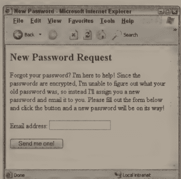

如清单 7-9 所示，genpass.php 文件的工作方式是先检查电子邮件地址是否在系统中。如果是，代码会调用 useraccess.php 文件中的 GeneratePassword 函数，使用加密形式的密码更新 login 表，然后将新密码发送给用户。要发送密码，mail 函数将电子邮件地址作为第一个参数，主题作为第二个参数，电子邮件正文作为第三个参数。

我在这里描述的过程是一种相当安全的方法，因为你可以假设只有用户自己才能访问他的或她的电子邮件。

## 清单 7-9: 生成新密码并将其发送给用户的文件

```
<html><head><title>New Password</title></head>
<body bgcolor="#FFFFFF" text="#000000">
<h2>New Password Request</h2>
<?php
require "useraccess.php";
$email = $_POST['email'];
mysql_connect("localhost", "phppuser", ":phppass");
$result = mysql_query(
    "select * from phpbase.login where ".
    "email = '$email' //watch the quotes!
);
$found = false;
if ($result) {
    if (mysql_num_rows($result) > 0) {
        $found = true;
    }
}

if (!$found) {
    print "Sorry, that email address is not in";
    print "our records.<p>";
    print '<a href="newpassword.html">Click here</a> to try again!';
}
else {
    // Generate a new password
    $newpass = GeneratePassword();
    $newpasscrypt = crypt($newpass);

    $result = mysql_query(
        "update phpbase.login ".
        "set password = '$newpasscrypt' ".
        "where ".
        "email = '$email' //watch the quotes!
    );

    mail($email, "Password request",
        "Your new password is\n".
        "$newpass\n".
        "Please remember it.");

    print "A new password has been mailed to ";
    print "you! Please check your email!<p>";
    print '<a href="login.html">Click here</a> to log in!';
}

mysql_close();

?>
</body></html>
```

## 对密码系统的改进

本章介绍的密码系统是一个很好的起点。但是，如果你想改进系统，以下是一些想法。首先，你可能希望添加一个表单，让用户可以更改自己的密码。该表单至少应包含以下四个字段：电子邮件地址、旧密码、新密码以及再次输入的新密码。在这些字段中，你需要包含一些 JavaScript，以确保两个新密码匹配，从而帮助避免拼写错误。表单将这四项内容传递给一个 .php 文件，该文件检查旧密码是否与电子邮件地址匹配。如果匹配，代码会加密新密码并将其保存在 login 表中。这非常简单。

在发送遗忘密码给用户的情况下，如果有人将用户的姓名输入到 newpassword.html 文件中的表单并点击发送，只是作为一种骚扰手段，用户可能会相当恼怒。然后，毫无戒心的用户会突然收到一封电子邮件，宣布他的或她的密码已更改，并附上新密码。用户也可能担心这封电子邮件是假的。

更好的方法是向用户发送一封电子邮件，内容类似于：“我们收到了您（或其他人）的新密码请求。如果这不正确，请忽略此电子邮件。如果是，请点击此链接以获取新密码。”

链接应包含在原始表单填写时生成的某种随机安全代码。然后用户点击该链接，该链接是一个 PHP 文件，执行与清单 7-9 中相同的工作。


## 第 8 章：使用数据库增强网站的十种方法

### 本章内容

- 编程在线用户投票
- 添加点击计数器
- 执行高级查询
- 创建支持事务的数据库
- 构建论坛或留言板
- 创建日记或每日笔记
- 构建分布式数据库
- 跟踪使用信息

在本 MySQL 小书的最后一章中，我将向您介绍一些利用 MySQL 构建优秀网站的建议。

### 编程在线用户投票

我喜欢在网站上放置投票，允许访客对各种事物进行投票。有一段时间，我一直在运行一个询问人们使用哪个 C++ 编译器的投票。

我自己没有编写这个投票，因为我在启动网站时希望立即上线，没有时间编写一个。不过，我现在意识到编写一个投票并不复杂。

编写投票需要做如下事项：

- 创建一个 Web 表单，用户可在其中选择投票答案。
- 创建一个用于更新 MySQL 表中结果的 PHP 页面。
- 编写一个 PHP（或 Perl 或其他任何）程序，读取结果表中的数据并生成显示投票结果的 HTML 页面。如果您使用 PHP，我建议查看第 V 卷第 8 章，了解如何以条形图形式呈现数据。

### 添加点击计数器

许多网页包含点击计数器，这只是页面底部的一个小方框，显示自创建计数器以来有多少人访问了该页面。

存在提供点击计数器的服务（有些免费，有些收费）。但您可以使用 MySQL 创建自己的点击计数器。具体做法如下：

- 创建一个包含页面名称和点击次数等字段的表。
- 编写 PHP 代码，调用 MySQL 以递增该页面的点击次数值。（为此，您将使用 SQL UPDATE 语句。）

您可以选择将点击计数器设为私有，或在页面上显示供用户查看。如果您使用 PHP，可以将值作为纯文本打印，也可以使用 PHP 图形函数创建图像并将数字写在图像上。

如果您希望记录页面点击量以便在网页上出售广告，那么您可能不想编写自己的点击计数器。因为数据是您自己生成的，您只需将表中的值改为 1,000,000，并声称自六小时前创建页面以来已有 100 万次点击。购买广告的人不会上当。如果您试图出售广告或进行其他需要证明有多少人访问过您页面的金融活动，请不要编写自己的点击计数器。付费使用高级第三方点击计数器服务，因为广告商和其他人会信任其数据。

### 执行高级查询

在第 VI 卷第 5 章中，我向您展示了如何使用连接执行复杂查询。您还可以利用另外两个有用的 SQL 功能来修改查询：

- LIKE 关键字和 % 通配符
- 用于排序结果的 ORDER BY 语句

以下是同时使用这两个功能的 SELECT 语句示例：

```
select * from customers
where e-mail like '%hotmail.com'
order by name;
```

### 秩序，秩序，在表中！

问：我怎样才能按数据在表中的存储顺序检索数据？答：不行。MySQL 可能会按数据存储的顺序返回数据（也可能不会），但根据 SQL 标准，MySQL 无义务这样做。原因是表本身没有特定顺序，数据库系统可以按其认为合适的任何顺序存储行。当您从 SELECT 语句检索数据并获得多行时，SQL 标准不对数据的顺序做任何保证或承诺。相反，如果您需要特定顺序，请将 ORDER BY 子句添加到 SELECT 语句中。

此语句检索 customers 表中电子邮件地址以字符串 hotmail.com 结尾的所有数据。这样一来，您就可以找到表中在特定域（本例为 hotmail.com）下拥有电子邮件地址的所有人。请注意，我使用了 LIKE 关键字，并在字符串中放置了 % 字符，这是一个通配符，接受任意数量的字符。因此，me@hotmail.com 与 %hotmail.com 模式匹配。

ORDER BY 子句将结果记录按 name 字段排序。这样一来，您就可以按特定顺序获取所有记录。

如果您的网站将进行大量 ORDER BY 处理，我建议在您用于排序的字段上创建索引。这样，MySQL 在排序时就不必费那么大力气。

### 创建支持事务的数据库

如果您是数据库专家，就会知道什么是事务。基本上，事务是您在数据库上执行的一系列 SQL 命令。完成所有这些 SQL 命令后，您可以选择提交数据（即使更改永久生效）或回滚数据（即撤销该批 SQL 命令，将表恢复到之前的状态）。这在出错情况或您需要批量更改且希望所有更改全部输入完成后才生效时非常有用。

使用默认数据格式，MySQL 无法执行事务。默认情况下，MySQL 将单个表存储在名为 MyISAM 的格式中。这种文件格式是一种名为 ISAM 的流行数据库格式的经过验证的变体，ISAM 代表 Indexed Sequential Access Method。MyISAM 格式不支持事务。另外两种 MySQL 支持的格式也不支持事务。它们是 ISAM（MyISAM 的旧版本，MySQL 5.0 发布时可能不包含）和 HEAP（一种高度优化的、严格存储在内存中而非硬盘上的形式，适用于临时数据）。

不过，MySQL 支持其他*允许*事务的格式。您还可以在单个数据库中自由混合表类型。这些支持事务的格式是 InnoDB 和 BerkeleyDB：

- **InnoDB** 是与 MySQL 分开的产品，主要用于与 MySQL 协同工作。有关 InnoDB（免费（GNU 公共许可证）且功能极其强大的数据库系统）的更多信息，请访问 www.innodb.com 和 www.mysql.com/doc/en/InnoDB.html。

- **Berkeley DB**（简称 BDB）也是一个独立的数据库引擎，但由 Sleepycat Software 专门为 MySQL 构建。BDB 是免费的，并有自己的许可计划。有关 BDB 的更多信息，请访问 www.sleepycat.com 和 MySQL 文档 www.mysql.com/doc/en/BDB.html。

### 构建论坛或留言板

如今，许多网站都包含特殊的论坛区域。多年前，您只能希望网络主机提供论坛，或者提供指向第三方论坛网站的链接。

如果您预计论坛使用量较大，链接到第三方论坛网站仍然是个好主意，但您也可以将自己的论坛存储在 MySQL 数据库中。（论坛消息本身作为备忘字段存储。）

您可以在论坛中包含以下内容：

- 用于填写消息的表单。
- 按主题对消息进行排序并以花哨方式打印它们的 .php 文件。
- 允许用户输入表情符号等特殊符号的功能。您可以将表情符号保存为其实际文本，如 :-)，然后解析消息以显示它们，将文本 :-) 替换为 `` HTML 标记，指向包含表情图片的图形文件。
- 用户名和密码系统。


如果您想查看用 MySQL 和 Perl 编写、在 Apache 上运行的论坛的示例，请访问 SlashDot 网站 http://www.slashdot.org。您可以在 http://slashcode.com/faq.shtml#Slashcodecom0 上阅读有关其代码（开源且可免费获取）的信息。


## 创建期刊或每日笔记

你可能希望在网站上保留一份供所有人阅读的期刊。或者，你可能希望定期上传新文件，并让文件中的文本出现在网站的主页上。

使用 MySQL，你可以将这些期刊笔记输入到一个表单中（受 HTTP 身份验证保护，因此只有你可以访问），并将笔记存储在 memo 类型的列中。（或者，如果你愿意，可以将笔记保存到文件而不是表中。）

然后，你可以编写 PHP 或 Perl 程序来收集笔记，并以期刊形式全部发布，或仅以每日笔记形式发布最近的笔记。

使用 PHP，你可以将笔记嵌入现有页面（例如主页 `index.html`）；这样，你就可以在页面上添加更新的笔记，而无需每次都修改 `index.html` 页面。

## 添加仅管理员可用部分

很可能，你希望限制对各种表甚至数据库的访问，以便只有你可以访问它们。为此，你可以创建网站的仅管理员可用部分，其中包含只有你可以访问的页面。

要保护这些页面，你可以使用编码在 MySQL 表中的用户名和密码，也可以使用 HTTP 身份验证。如果你希望允许多人访问管理员部分，则用户名和密码方法很方便。你甚至可以包含访问级别，这为人们提供了跨页面的不同访问级别。每个页面的 PHP 代码中可能包含访问级别代码；此时，MySQL 数据库中的用户表需要包含一个访问级别列。

## 构建分布式数据库

MySQL 功能出乎意料地强大，允许你同时连接到多个数据库，从而创建分布式数据库。如果你编写 Perl 或 PHP 代码，可以指定要连接的数据库服务器。（请记住，在连接字符串中，你通常键入 localhost，但也可以指定 www.somedomain.com 之类的服务器。）通常，你只需使用 localhost。但是，你也可以使用远程服务器的域名来代替 localhost 连接到远程服务器。要连接到远程服务器，请确保运行 PHP 或 Perl 安装的服务器可以访问远程数据库服务器。

从那时起，你甚至可以同时连接到其他服务器，在一台服务器上执行一些查询并将数据发送到其他服务器。如果你正在进行分布式系统编程，我在这里说的内容可能会让你恍然大悟，并给你一些酷主意。

## 跟踪游戏得分

如果你编写计算机游戏，添加到网站的一个很好的功能是一个注册用户可以输入其最高得分的地方。

创建此功能的一些提示如下：

- 在输入数据的表单中，用户应输入其用户 ID 或注册码；这样可以确保仅获取注册用户。
- 用户可以上传由游戏创建的包含高分的数据文件。然后，你可以使用 Perl 或 Tcl 从数据文件中提取分数。

这些简单的想法应该有助于验证用户提供的信息。尽管精明的用户可能能够入侵文件并伪造他们的分数，但大多数人做不到。然后你可以放心，人们输入的是实际的最高分。

## 跟踪使用情况信息

如果你使用 PHP 并查看 $_SERVER 全局数组，可以找到哪些连接已连接到你的服务器。从此，你可以提取信息并将其存储在 MySQL 数据库中，从而跟踪复杂的使用情况信息。

下面是一个简短的 PHP 程序，用于转储 $_SERVER 数组中的所有内容：

```html
<html><head><title>Who are you?</title></head>
<body>
<?php
  print "<hr>";
  foreach ($_SERVER as $key=>$value) {
    print "$key: $value<br>\n";
  }
?>
```

当我在我的系统上运行此程序时，一个感兴趣的项目是键为 REMOTE_ADDR 的数组值。这会告诉你连接到你 Web 服务器的计算机的 IP 地址。这样，你就知道谁一直在连接到你的计算机，至少你知道他们的 IP 地址。

# 第 VII 篇

## 使用正则表达式处理 Web 文件

## 第 5 波

作者：Rich Tennant


> > "待我再执行几条命令，马上就来。"

## 章节概览

- 第 1 章：为什么要使用正则表达式？.................................... 609
- 第 2 章：遵循正则表达式语法.................... 623
- 第 3 章：自定义、搜索和替换 ......................... 637
- 第 4 章：分组和捕获............................................ 649
- 第 5 章：连接、拆分和编写 ............................... 659
- 第 6 章：处理多行和多个文件 ............................. 667
- 第 7 章：处理 HTML 文件 ............................................. 677
- 第 8 章：十个正则表达式陷阱 .................................. 687

## 第 1 章：为什么要使用正则表达式？

### 本章内容

- 介绍正则表达式
- 匹配单个字符
- 匹配多个字符
- 在 Tcl 中尝试正则表达式
- 在 PHP 中尝试正则表达式

自现代计算机诞生以来，出现了一些带有神秘色彩的主题。大多数计算机从业者都听说过这些主题，但并未深入探究；后来，在求职面试中被问及是否熟悉这些主题时，这些人往往不得不撒谎说：“是的。”

编译器设计——及其伴随的工具（例如称为解析器和词法分析器的工具）——就是这种黑盒主题的一个例子。有一段时间，C++ 编程语言也是如此，但如今许多人都懂它了。

另一个这样的主题是 _正则表达式_，这是本章及接下来几章的主题。_正则表达式_ 是你可以用来与字符串进行比较的模式。在接下来的章节中，我将解释什么是正则表达式以及为何要使用它们。

### 了解正则表达式

因为你正在学习 Apache、PHP、Perl、MySQL 以及所有这些好东西（通过阅读这本书），所以你很有可能在命令行上花了不少时间。

如果你熟悉旧版 DOS，可能见过这样的内容：

```
dir *.*
```

或者是这样：

```
dir *.ex?
```

如果你熟悉 Unix 或 Linux，可能见过这个：

```
ls *.php
```

或者是这样：

```
ls *.ph?
```

如果你没见过这些，不要担心。相反，如果你在 Windows 计算机上打开过文件，可能见过类似图 7-1 的对话框。

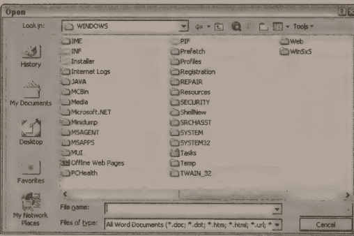

图 7-1：Windows 的“打开”对话框在其文件类型中使用 * 符号。

> > 如果你只熟悉 Mac，可能没有遇到过这种模式匹配。但请继续阅读，你就会明白我在说什么。

无论操作系统如何，符号 *.doc 表示所有以字符 .doc 结尾的文件。也就是说，* 表示任意一组字符。这里我不会全部列出（那会占用好几页），但你可以看到 document1.doc、LetterToThePresident.doc 和 HappyResignation.doc 都与 *.doc 匹配。

> > 序列 *.doc 是一个模式示例。* 字符称为通配符字符。虽然 * 字符在正则表达式世界中的含义不同，但这种模式匹配的想法正是正则表达式主题所在。

在文件名的世界中，虽然 * 字符匹配任意数量的任意字符，但 ? 字符仅匹配一个字符。因此，以下是与 *.ph? 匹配的文件名示例：

- myfile.php
- another.php

由于 ? 只能匹配单个字符，以下是不匹配的示例：

- myfile.phood
- myfile.phun
- myfile.phrivolous

但是，模式 *.ph* 会匹配我刚才列出的三个文件。

如果你在 Windows 计算机的命令提示符下，创建一个名为 myfile.phrivolous 的文件，然后键入以下语句，可能会感到惊讶：

```
dir *.ph?
```

文件名 myfile.phrivolous 会出现在列表中。为什么会这样？这是一个长故事（不，? 在 Windows 上不匹配多个字符），但简而言之，Windows 操作系统中的每个文件都有一个 _替代文件名_，由最多八个字符、一个点和恰好三个字符组成。（这称为 8.3 文件名。）文件名 myfile.phrivolous 的备用 8.3 文件名类似于 MYFILE~1.PHR。在进行目录列表时，Windows 会将通配符模式与常规长文件名和旧的 8.3 文件名进行检查。但不要担心；这与正则表达式无关，你无需关心。把它称为一项考古学上的奇特之处吧。我不会再对此多说（除了我认为这很烦人，旧 DOS 计算机 _几乎_ 不应该有 8.3 文件名，以及我们为何不得不继续与这些残余共存，这让我无法理解）。

因此，你可以看出，你一直在处理一种正则表达式形式。以下是一个很好的起始定义：

> 正则表达式是可以与其他字符串进行比较的模式。

当然，使用正则表达式可以做的远不止检查字符串是否匹配模式，你将在接下来大约 70 页中看到这一点。（例如，你可以搜索所有子字符串的


匹配特定模式，如果你愿意，可以将它们替换为其他内容。）但归根结底，正则表达式的核心就在于此：模式匹配。

## 快速示例

下面是一个正则表达式派上用场的例子，这会让你初步了解什么是正则表达式。

今天，我从一个正在开发的网站中提取了一份单词列表。这个列表以 HTML 表单下拉组合框中的选项值形式存在。下面是列表中的一行示例：

```
<option value="MyPage">My Page</option>
```

随着我对页面的不断完善，项目列表越来越长。我最终决定将这些项目放入 MySQL 数据库中。我们许多编程极客都遇到过这种情况：有一个包含特定格式数据的文本文件，我们希望对文档进行大量编辑，并将行更改为不同的格式。就我而言，我想将上一行转换为这一行：

```
insert into mytable (name) values ('My Page');
```

这当然是一条 SQL 语句。我打算将包含 HTML 选项值的文件转换为 .sql 文件，以便导入 MySQL 并填充表格。

哦，该怎么办，该怎么办？多亏了我灵活的手指和多年的钢琴演奏经验，我掌握了以近乎惊人的速度按下光标键、Shift 键、Backspace 键、Home 键和 Delete 键的能力。我能做到。我知道我能。

但何必手动编辑呢？计算机领域的伟大大师们为我们提供了一种更简单的方法：正则表达式。而碰巧的是，我所使用的编辑器支持正则表达式。


如果你使用 Unix，几乎每个编辑器都支持正则表达式。如果你使用 Windows，此类编辑器正在变得越来越普遍，但仍然不常见。不过，如果你打算掌握正则表达式，并且使用 Windows，你会想要一个具有出色 regexp 功能的编辑器。（单词 regex 是我们通常对正则表达式的称呼。）我为 Windows 找到的一个出色编辑器叫做 Scintilla。Scintilla 实际上是一个提供编辑器的库，有人围绕 Scintilla 编写了一个名为 SciTE（Scintilla Text Editor 的缩写）的完整程序。你可以在 www.scintilla.org 找到这个宝藏。当然，旧 Unix 经典工具的 Windows 版本，例如 emacs 和 vi 也可用。（你可以在 http://www.gnu.org/software/emacs/emacs.html 找到 emacs。对于 vi，我建议从 vi FAQ 开始，地址是 http://www.faqs.org/faqs/editor-faq/vi/part1/，其中包含下载链接。）

那天我使用的是 Windows 机器，所以我使用了 Scintilla 编辑器。但我会向你展示如何在 vi 编辑器中做同样的事情，这是我通常在 Unix 上使用的编辑器。

使用基于 Windows 的编辑器时，我打开了查找和替换对话框，如图 7-2 所示。我确保选中了正则表达式复选框。没有它，一切都会失败，我会困惑为什么我精心构建的正则表达式不起作用。

在查找内容框中，我仔细输入了这看似神秘的字符集：

```
<o.>*\</(.*)<.*$
```

在替换为框中，我输入了以下内容：

```
insert into mytable (name) values ('\1');
```

我单击了全部替换按钮，瞬间，所有内容都从 HTML 选项值格式变成了 SQL insert into 格式！像魔法一样！

图 7-2：在查找和替换对话框中使用正则表达式。

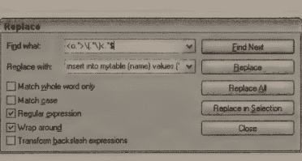

你可能会认为，与其费心弄清楚正则表达式，不如使用蛮力手动编辑文件会更容易。但事实并非如此。当你熟悉正则表达式后，像上面这样的表达式就很容易理解和提出来——真的！

至于这些神秘字母和符号的含义，嗯，这就是本小册子的要点所在。在后面的章节中，你会发现不同部分的含义。目前，你需要知道的是：我在查找内容框中输入的内容会从每行中提取一个字符串，并将其保存在一种名为 \1 的变量中。这个字符串是行中间的名称；例如，在行 `<option value="My Page">My Page</option>` 中，\1 字符串将是 My Page。在替换为框中，我使用该 \1 变量；你可以在其中看到 \1。因此，包含 My Page 的行将变成 `insert into mytable (name) values ('My Page');`。


如果你对正则表达式略有了解，可能想了解更多之前使用的那个神秘表达式。第一部分 — `<o.*` — 搜索初始 option 标签。下面是更详细的观察：

- The `<o` 表示 option 标签的开始。
- The `.*` 表示任意数量的任意字符。
- The `>` 是标签的闭合部分。

继续技术内容，最后一部分 — `<.*$` — 查找闭合 `</option>` 标签。在此部分中，表达式以最终的 `<` 开头，一直到行尾。以下是详细说明：

- The `<` 表示最终的 `<`。
- `$` 表示行尾。
- 中间部分 — `\(.*\)` — 获取两者之间的所有内容，并将其保存在一个变量中，你可以在替换字符串中作为 `\1` 访问它。之所以保存所有内容，要归功于括号。（不过，某些编辑器，例如我使用的编辑器，要求你在每个括号前加上反斜杠。）

现在我要向你展示如何在古老但备受喜爱的 vi 编辑器中完成同样的事情。（请不要告诉任何人我使用它。我有名誉要维护。）此技术也适用于其他 Unix 编辑器，因为它们倾向于使用相同的格式。唯一的区别是，对于那些编辑器，你需要输入一组不同的按键来访问查找和替换功能。（如果你不确定，请查阅文档以了解查找和替换的路径。）

以下是 vi 编辑器的命令：

```
:g/<o.*>(.*)<.>*s//insert into mytable (name) values ('\1');/g
```

同样，如果你对正则表达式略有了解并想尝试此命令，以下是 vi 字符串中的各个部分：

- The : 是你输入的内容，用于进入命令模式。
- The g/ 表示全局替换。
- 搜索字符串紧随其后。
- The s// 表示替换为随后的内容。
- 末尾的 /g 表示全局替换结束，在我看来有点多余，但这仍然是必需的。

## 练习正则表达式

大多数（更好的）语言都直接支持正则表达式，或者至少包含提供 regex 支持的可选库。

本书中讨论的 Perl、Tcl 和 PHP 都有出色的正则表达式支持：

- Perl 对正则表达式的支持功能非常完整，以至于已成为正则表达式的标准。
- PHP 通过一组与 Perl 兼容的正则表达式函数支持与 Perl 相同类型的正则表达式。PHP 还支持另一种称为 Posix 正则表达式的类型，本书中我不予讨论，因为我觉得它们非常低劣，而且如今已属非标准。
- Tcl 对 Perl 正则表达式有出色支持，并完全支持 Posix，尽管 Tcl 有自己的专用 regex 引擎，该引擎可能是目前最强大（且最快）的。事实上，全球的 regex 大师们正试图让其他语言的开发者效仿 Tcl 引擎。（然而，正如你将在本小册子的示例中看到的，Tcl 引擎有一些非标准的自有功能，并且该引擎并不总是与 Perl 正则表达式的事实标准兼容。）

其他包含正则表达式支持的语言有 Python（作为标准模块）、JavaScript（正则表达式内置）以及较新的 Microsoft 语言 VB.NET 和 C#。一个值得注意（且不幸）的例外是 C++。直到今天，我也不明白为什么标准 C++ 库不支持正则表达式。不过，如果你是 C++ 程序员并想使用正则表达式，可以下载 PCRE 库（Perl 兼容正则表达式库），它已成为标准正则表达式库。你可以在 www.pcre.org 了解更多信息。


如果你想练习使用正则表达式，该怎么办？下面是我使用的一些选项：

- 我编写一个小的 Perl 或 PHP 程序。（当然，你可以使用任何支持正则表达式的语言。）
- 我运行 Tcl 的命令行实用工具 tclsh。这是快速测试正则表达式的最简单方法之一。
- 我在命令行模式下运行 Perl。我启动 Perl，在提示符下输入 Perl 命令，完成后按 Ctrl+D，这表示文件结束。

不过请注意，这不是一个命令行解释器。相反，我实际上是在输入 Perl 程序的各行。我无法回去编辑这些行，这意味着我必须小心确保第一次就把所有内容都输入正确。如你所想象，这种方法适用于非常短的、也许只有两行的 Perl 程序。

- 我启动 Python 命令行解释器。虽然本书不是关于 Python 的，但你或许想在 www.python.org 上了解一下。从那里，我可以即时尝试各种操作，而无需编写测试程序。

给正在阅读此内容的 Python 用户一个快速提示：输入正则表达式时使用原始字符串，方法是在开头引号前加上 r，例如 r"expression"。这样，\t 之类的内容将保持为反斜杠后跟 t，而不会被转换为制表符字符。有关更多信息，请参阅我的 Python 正则表达式页面 www.jeffcogswell.com/python/regex.html。

- 我使用本书开头提到的文本编辑器之一来快速试用正则表达式。
- 我使用自己发明的工具“The Amazing Regex Tester”，它可以在多种语言（JavaScript、PHP、Perl 和 Tcl）中测试正则表达式。这是一个 Web 表单，你可以在其中输入正则表达式和字符串，PHP 程序会测试该正则表达式，然后调用 Perl 和 Tcl（作为 CGI 脚本）来测试该正则表达式。这个工具非常方便；你可以在 www.jeffcogswell.com/regex.html 上找到它。

在接下来的“匹配任何字符”部分中，我将解释如何测试正则表达式，并向你展示如何在 Perl、PHP 和 Tcl 中实现。

我在本章中大部分示例中使用 Perl 来演示，这仅仅是因为 Perl 的正则表达式风格在某种程度上已成为行业标准。虽然这些示例的语法特定于 Perl，但正则表达式本身并不特定于 Perl。所有这些概念都适用于所有支持 Perl 风格正则表达式的语言。此外，在本章和整本小册子的许多情况下，我还提供了其他语言的示例。例如，Tcl 已成为我快速测试正则表达式的最爱之一。

## 匹配任何字符

在使用正则表达式时，暂时忘记你对文件名模式的了解。（我说“暂时”，是因为我假设你将来在脱离本书后某个时候会使用文件名。）字符 * 和 ? 在正则表达式中的含义与在文件名中的不同。

下面是一个匹配单个字符的正则表达式：

```
.
```

以防你看不清，这只是一个单独的点，也就是句点。句点匹配任意单个字符。

下面是一个简单的 Perl 程序，帮助你开始使用这个基本正则表达式：

```
print "Testing 'a' against /./\n";
if ("a" =~ /./) {
    print "It matches!\n";
}
```

第一行打印一条消息。第二行将字符串 "a" 与正则表达式进行比较。在 Perl 中，正则表达式放在正斜杠内。在 Perl 中，你可以使用 =~ 运算符进行正则表达式比较。这与任何其他比较运算符一样，返回 true 或 false。（正则表达式是 Perl 如此重要的一部分，以至于语言设计师为其专门设计了语法，包括正斜杠和 =~ 比较运算符。）

运行前面的代码时，你会看到以下输出：

```
Testing 'a' against /./
It matches!
```

下面是另一个示例：

```
print "Testing 'b' against /b/ \n";
if ("b" =~ /b/) {
    print "It matches!\n";
}
```

这个正则表达式 b 的意思只是查找字母 b。与匹配任意字符的点字符不同，b 模式仅匹配字母 b。

（并且 `a` 模式仅匹配字母 a，`q` 模式仅匹配字母 q，以此类推。）

因此，前面的 `print` 语句打印 `It matches!`，因为 `"b" =~ /b/` 的求值结果为 true。

现在尝试这个示例：

```
print "Testing 'a' against /b/ \n";
if ("a" =~ /b/) {
    print "It matches!\n";
}
```

在这种情况下，输出如下：

Testing 'a' against /b/

此输出不包含 `It matches!`，因为比较失败。字符串 `"a"` 与正则表达式 `/b/` 不匹配。

顺便说一句，如果要测试不匹配的情况，请使用“不匹配”运算符 `!~`，如下所示：

```
print "Testing 'a' against /b/ \n";
if ("a" !~ /b/) {
    print "It doesn't match!\n";
}
```

这会打印 `It doesn't match!`，因为 `"a"` 与模式 `b` 不匹配。（将 `=~` 视为类似于“等于”，将 `!~` 视为类似于“不等于”。在 Perl 和许多其他语言中，语法很合理，因为等于是 `==` [两个等号]，而不等于是 `!=`。）

下面是另一个示例：

```
print "Testing 'abc' against /b/ \n";
if ("abc" =~ /b/) {
    print "It matches!\n";
}
```

此比较的求值结果也为 true，因此代码会打印 `It matches!`。正则表达式引擎不在意匹配字符串左侧（在此例中为 `a`）或右侧（在此例中为 `c`）是否有字符。因为引擎在字符串内找到了与模式匹配的内容（即 `b`），所以引擎返回 `true`。因此，你可以放心，`abc` 匹配 `b`。

最后，这里有一个你可以亲自尝试的例子：如果将 abc 与 .（点）进行测试会发生什么？它会匹配。自己试一下看看。


迄今为止，规则总结如下：

- .（点）字符是通配符，将匹配任意单个字符。
- 如果要匹配特定字符，只需指定该字符即可（除非该字符是特殊字符，我将在第 VII 册第 2 章中讨论）。
- 正则表达式引擎将在字符串中的任意位置搜索模式。
- 如果使用 Perl，可以使用 =~ 测试字符串是否匹配模式，使用 !~ 测试字符串是否不匹配模式。


如果你想匹配单个点字符，并且不希望点作为通配符呢？在这种情况下，在点前面加上反斜杠，如下所示：

```
print "Testing '.' against /\./ \n";
if ("." =~ /\./) {
    print "Yupperoos!\n";
}
```

虽然输入这段代码可能需要一些“手指杂技”，但你可以看到，正斜杠内的正则表达式只是一个反斜杠后跟一个点。这将打印出愉快的短语 Yupperoos！

因此，这里还有一条规则：要匹配实际的点字符，请在点字符前加上反斜杠。

## 匹配多个字符

正则表达式引擎允许你在模式中放入多个字符，而不仅仅是单个字符或一个点。下面是 Perl 中的示例：

```
if ("abc" =~ /abc/) {
    print "Good job!\n";
}
```

你可能已经看出，此比较结果为 true，鼓励性的消息 Good job! 会被打印出来。正则表达式只是 abc，你正在将其与字符串 abc 进行测试，两者匹配。

如果你阅读了前面的“匹配任何字符”部分，你就会知道引擎不在意字符串中匹配部分之前或之后是否有字符。正则表达式引擎只关心在字符串中找到模式。看这个示例：

```
if ("123abcdef" =~ /abc/) {
    print "Cool beans!\n";
}
```

因为字符串 123abcdef 包含模式 abc，所以测试成功，会显示消息 Cool beans!。

你可能已经看出，下面的示例会失败：

```
if ("123aaadef" =~ /abc/) {
    print "Wudduh yknow!\n";
}
```

这不会打印任何内容，因为比较结果为 false。字符串 123aaadef 与模式 abc 不匹配，因为在 123aaadef 中找不到字符串 abc，无论你多么努力地寻找——我找了很长时间。

到目前为止，这有点无聊，不是吗？来点更有趣的东西怎么样？正则表达式可以有通配符，所以考虑这个比较：

```
if ("pup" =~ /p.p/) {
```

模式 p.p 将匹配字母 p、后跟任意字符、再跟另一个字母 p。因此，pup 匹配。php 也会匹配：

```
if ("php" =~ /p.p/) {
```

但 phd 不会：

```
if ("phd" =~ /p.p/) {
```

虽然第一个 p 匹配模式中的 p，h 匹配模式中的点（因为点是通配符），但字符串中的 d 与字符串中的 p 不匹配，因此匹配失败。

这是个好东西：

```
if ("The php language is great" =~ /php/) {
    print "It's so true!\n"
}
```

同样，这会匹配，因为模式 php 可以在字符串中某处找到；因此，令人愉快的消息 It's so true! 会被打印出来。


考虑以下比较：

```
if ("The PHP language is great" =~ /php/) {
    print "Once again?\n"
}
```

此比较将失败，且不会输出任何内容。原因是字符串中不包含字母 php。没错，字符串中包含字母 PHP，但默认情况下，正则表达式是区分大小写的。

总结一下，这里有一些规则：

- 你可以拥有包含多个字符的表达式。
- 你的多字符表达式可以包含点通配符。
- 默认情况下，你的表达式是区分大小写的。

## 在 Tcl 和 PHP 中尝试正则表达式

因为本章大多数示例使用 Perl，在本节中，我将介绍一些在 Tcl 和 PHP 中开始使用正则表达式的技巧，这是本书中涵盖的另外两种语言。

### 在 Tcl 中使用正则表达式

Tcl 的 shell 工具 tclsh 使测试正则表达式变得非常简单。事实上，这可能是测试正则表达式最简单的方法。但是，请记住，Tcl 的正则表达式引擎仅大部分与 Perl 兼容，并完全符合 Posix 标准。

例如，启动 tclsh 引擎。（我会在 Book IV, Chapter 1 中向你展示如何操作。）进入引擎后，键入以下内容：

```
% regexp {abc} abc
```

（% 符号是提示符，你不需要输入它。）按 Enter 键，你会看到以下答案：

```
1
```

但是，如果 1 是答案，那问题又是什么呢？（生命、宇宙以及一切？）问题是模式 abc（花括号 { } 内部）是否与字符串 abc（末尾）匹配。答案是 true，Tcl 将其打印为 1。现在尝试一个不匹配的：

```
% regexp {abc} def
```

模式 abc 与字符串 def 不匹配，因此答案如下：

0

最后，尝试这个：

```
% regexp {p.p} php
```

因为正则表达式 p.p 与 php 匹配，因此打印值 1，表示 true。

### 在 PHP 中使用正则表达式

PHP 语言使用 PCRE 库来处理其正则表达式，因此基本上与 Perl 兼容。但是，PHP 没有像 Perl 那样用于测试匹配的 =~ 运算符。相反，PHP 有一个名为 preg_match 的函数，它接受两个参数：一个模式（作为字符串存储）和一个用于与模式比较的字符串。

这个函数有一个古怪的特性：你的模式必须在字符串内部以斜杠分隔符开头和结尾，例如：

```
<?php
   if (preg_match("/.ph./", "php is cool")) {
      print "It matches!\n";
   }
?>
```

该程序中的模式是 ph.. 字符串 "/.ph./" 内部的斜杠不是模式的一部分。它们只是必需的，仅此而已。它们除了以按键形式增加一些额外工作外，什么也不做。请确保包含它们；否则，你会得到类似这样的错误：

Warning: Delimiter must not be alphanumeric or backslash

preg_match 函数认为 ph. 中的 p 和 . 是分隔符。所以不要忘记真正的分隔符：开头的 / 和结尾的 /。

我几乎想说：“就像在 Perl 中一样，你需要在表达式两侧加上斜杠。”但这并不完全就像 Perl。Perl 解释器在表达式位于斜杠内时会将其识别为正则表达式。在这里，PHP 解释器并不将其视为正则表达式，因为 PHP 语言没有特定于正则表达式的语法。就 PHP 解释器而言，这只是一个字符串。那么，为什么你需要两个斜杠呢？我不知道。只要记住加上它们即可。

## 第 2 章：遵循正则表达式语法

### 本章内容

- 使用量词匹配多个字符
- 匹配特殊字符
- 匹配空白字符
- 将分隔符字符用作表达式的一部分
- 匹配特定的字符集

你还记得第一次学骑自行车的时候吗？在骑车之前，你会羡慕地看着那些大孩子，他们 somehow 能仅靠两个轮胎保持平衡，以让父母心脏病发作的速度飞驰而去。

骑自行车看起来令人望而却步，但一旦你终于学会了，你就会发现它其实很简单，是一项多么有用的技能（比如能悄悄骑车去便利店买花生酱杯，而父母毫不知情），并且是多么自然。

正则表达式也是如此。就在几年前，我还认为正则表达式是某种神秘且对我没什么用的东西。今天，我想知道我是如何没有它们生活了这么久。

正则表达式的语法起初可能令人望而却步。但是，如果你仔细阅读本章，你会开始发现它们其实是描述模式的一种自然方式。在本章中，我将描述正则表达式语法，并使用 Tcl 作为许多示例，仅仅是因为这样做非常简单。明智地使用 Tcl，我的朋友，如果你偷偷溜到 7-Eleven 买花生酱杯，就不要告诉你妈妈。她不知道的事不会吓到她。

### 正则表达式的典型用途

如果你读过 Book VII, Chapter 1，你可能仍在疑惑在哪些情况下会使用正则表达式。以下是一些示例：你正在读取 Web 表单中编辑控件里输入的文本，并希望确保文本符合某种格式。电子邮件地址就是你可以使用正则表达式处理的一个良好格式示例。你希望扫描一个文件，找出一组符合特定格式的单词并提取某些单词。例如，你可能希望创建一个 PHP 文件中的函数列表。要做到这一点，你可以扫描包含 PHP 代码的文件，查找单词 function，然后提取紧随其后的单词。积累这些术语就构成了一个函数列表。诚然，你可以不使用正则表达式完成这些相同的操作。例如，你可以按空白字符拆分 PHP 文件的每一行，然后仔细将每个生成的单词与字符串 "function" 进行比较，接着获取下一个单词。但是，使用正则表达式来做这件事更容易，并提供了更大的灵活性。有关验证电子邮件地址的正则表达式示例，请查看 Book VI, Chapter 4。

### 使用量词匹配多个字符

使用模式的最基本方法是指定你想要匹配的字符。正则表达式 a 匹配字符 a。正则表达式 B 匹配字符 B。但是，假设你想匹配字母 d，并且允许它出现多次。例如，你可能希望字符串 cdr、cddr 和 cdddr 全部匹配，或者任意数量的 d。（如果你和我一样是个自诩的语言爱好者，你可能会认出这些是 LISP 编程语言中的单词。没错，LISP 社区规定其程序员必须知道如何发音这些单词：cdr（“coulder”）、cddr（“coulddier”）以及，嗯，我也不知道。但我并非编造。）

以下是一些匹配多个字符的实用规则：

- 如果你想匹配一个或多个字符的实例，请在字符后面跟一个加号 +。加号表示至少一个。

- 如果你想匹配任意数量的字符实例（或完全没有实例），请在字符后面跟一个星号 *。星号表示任意数量包括零，或者，计算机人员经常说的，零个或多个。

- 如果你想指定一个字符是可选的（即，它可以出现 0 次或 1 次——要么存在，要么根本不存在，但不能重复），请在字符后面跟一个问号 ?。

- 如果你想指定字符出现的确切次数（或确切次数范围），请在字符后面跟带数字的花括号，例如 {3}，或一个范围，例如 {2, 5}，表示 2 到 5 次。

加号要求你至少有一个字符实例。星号允许你没有字符实例，或任意多个。加号和星号都是量词的示例。

考虑正则表达式 cd+r。以下四个示例是在 Tcsh Shell 程序 tcsh 中进行的。% 符号是提示符；我输入了 % 右侧的内容。正则表达式位于花括号内（在这些示例中是 cd+r），后面跟着我要与正则表达式测试的单词。结果在下一行打印：1 表示匹配；0 表示不匹配。（所有四个示例都匹配，你可以看到它们后面都跟着输出 1。）

```
% regexp {cd+r} cdr
1
% regexp {cd+r} cddr
1
% regexp {cd+r} cdddr
1
% regexp {cd+r} cdddddddddr
1
```

但是，以下示例 *不* 匹配，因为 + 号要求你至少有一个字符实例：

```
% regexp {cd+r} cr
0
```

如果你希望字符串 cr 匹配（以及其他 cdr、cddr 等），请使用星号 *。星号表示你可以有 0 个或多个匹配；因此，所有以下示例都匹配，包括最后一个 cr：

```
% regexp {cd*r} cdr
1
% regexp {cd*r} cddr
1
```


```
% regexp {cd*r} cdddr
1
% regexp {cd*r} cdddddddddr
1
% regexp {cd*r} cr
1
```

以下 Perl 示例演示了如何使用花括号提供确切数字或数字范围：

```
if ("aaabc" =~ /a{2,5}bc/) {
    print "...aaaand we haaave a maaatch!\n";
}
```

此模式表示，你必须连续有两个、三个、四个或五个 a 字符，后面跟着 bc 才能匹配。因此，前面的字符串匹配，你会看到拖长的消息。但下面的示例不会产生消息：

```
if ("abc" =~ /a{2,5}bc/) {
    print "...aaaand we haaave a maaatch!\n";
}
```

在这个示例中，你只有一个 a，而表达式要求 2 到 5 个 a 匹配。此表达式在 Tcl 中也适用：

```
% regexp {a{2,5}bc} aaabc
1
%
```

## 匹配特殊字符

如果你读过第 VII 卷第 1 章，你就知道点（或我们过去称为句号或小数点）是特殊字符，并且要匹配点本身，必须在点前加上反斜杠。

以下是 Perl 中的示例：

```
if ("abc" =~ /a.c/) {
    print "match!\n";
}
```

下面是 Tcl 中的相同示例：

```
% regexp {a.c} abc
0
```

在两种情况下，此匹配都失败，因为字符串 abc 不匹配模式 a\.c。但是，字符串 a.c 确实匹配该模式。（请注意，我差点写，“只有字符串 a.c 才能匹配模式。” 但事实并非如此。你知道吗？因为模式 1234a.c5678 例如，也会匹配该模式，因为 1234a.c5678 包含子字符串 a.c。）

在正则表达式中，除了点之外，还有几个你可以匹配的特殊字符。每个特殊字符都使用像点一样具有特殊含义的字符。在接下来的章节中，我将向你展示许多具有特殊含义的字符，例如括号 [ 和 ]、插入符 ^ 和美元符号 $。如果你需要匹配这些字符，并且不想使用它们的特殊含义，请在字符前加上反斜杠，如下所示：

```
/a\[c/
```

此正则表达式将匹配一个 a，后跟一个括号 [，再后跟一个 c。

以下是 Perl 示例，匹配成功时打印 1 表示真，匹配失败时不打印任何内容表示假：

```
print "a[c" =~ /a\[c/;
```

此示例打印 1，表示字符串和正则表达式匹配。

以下是正则表达式中标准特殊字符的列表；每个字符都有我在接下来的章节中描述的特殊含义：

- .（点）是通配符，表示任意字符。
- $ 匹配行末。我在第 VII 卷第 3 章中讨论了为什么这个字符很重要。
- ^（插入符）匹配行首。我在第 VII 卷第 3 章中再次讨论了这个字符。插入符在放置在括号内时也有含义；有关详细信息，请参阅“匹配特定字符集”部分。
- [ 和 ] 用于匹配称为类的特定字符集。我在“匹配特定字符集”部分讨论了此内容。
- + 和 * 分别指定前面的字符可以匹配 1 次或更多次，或 0 次或更多次。

正则表达式的一个小烦恼是，有些模式具有特殊含义，因此使用了特殊字符，例如 [ 或 $，或者，如前面所示的点字符。要在模式中实际匹配这些字符，如前面所述，你在它们前面加上反斜杠，如 \[ 或 \$ 或 \.。

但其他模式则相反：要使用这些具有特殊含义的模式，你使用反斜杠后跟一个字符。例如，如果你在正则表达式中只放一个 s，你将匹配字符 s。但是，如果你在 s 前面加上反斜杠，如 \s，你将匹配空白符。（这是我在下一节“匹配空白符”中讨论的一条规则。）换句话说，这些是相反的规则：有时反斜杠给你想要匹配的实际字符，有时反斜杠将普通字符变成具有特殊含义的模式。请小心！

前面几段中，我列出了一些具有特殊含义的字符，如果你想将其作为普通字符使用，则需要反斜杠。下面是相反的列表——一些在你*确实*包含反斜杠时具有特殊含义的更常见模式。我在接下来的章节中讨论了这些模式。

- \s 匹配空白符。没有反斜杠，s 匹配字符 s。
- \t 匹配制表符（如大多数编程语言中）。没有反斜杠，t 只是匹配字符 t。
- \S 匹配任何非空白符内容。没有反斜杠，S 匹配字符 S。
- \d 匹配任何数字，例如 0、1、2、3、4、5、6、7、8 和 9。没有反斜杠，d 匹配字符 d。
- \w 匹配单词。没有反斜杠，w 匹配字符 w。

## 匹配空白符

什么是空白符？尽管这听起来像是天体物理学术语，但空白符是空格键和 Tab 键的任何组合（即使在蓝色或黄色的页面上也是如此）。这句话中的每个单词都由空白符分隔。编写代码时，你通常使用空白符缩进行，空白符由几个空格字符或几个制表符组成。（或者，在许多旧代码编辑器中——这是我的一个宠物厌恶——你可能会得到空格和制表符的*组合*。真糟糕。）

如何匹配空白符？通过使用空白字符 \s。（这是需要反斜杠才能获得特殊含义的情况之一。）考虑模式 abc\sdef。字符串 abc 后跟一个空格，再跟 def 与此模式匹配。abc 后跟一个制表符，再跟 def 也匹配。

我想向你展示一行 Perl 代码，演示如何匹配空白符。不过，这会有点丑陋，因为你会记得，要在字符串中放入制表符，你使用 \t。（不是更多反斜杠！）首先，下面是一个使用空格的基本示例：

```
print "abc def" =~ /abc\sdef/;
```

此打印 1，因为空格与 \s（即空白字符）匹配。

下面是我提到的丑陋的制表符示例：

```
print "abc\tdef" =~ /abc\sdef/;
```

引号内的字符串是 abc，后跟一个制表符，再跟 def。此匹配成功，因为制表符与 \s（即空白字符）匹配。

尝试使用多个空格的示例：

```
print "abc   def" =~ /abc\sdef/;
```

（这是 abc 和 def 之间的几个空格——不是制表符。）此不匹配。原因是 \s 模式匹配单个空白字符，即单个空格或单个制表符。我有四个空格，所以不匹配。


通常，当人们想要匹配空白符时，他们不想只匹配一个空格或一个制表符。相反，他们通常想要匹配任何组合和任意数量的空格和制表符，所有这些共同构成空白符。要匹配多个空格和制表符，在空格后添加 + 号，如 abc\s+def。这将匹配一个或多个空白字符，即单词之间的任何空格量。但是，确保使用 + 号而不是 *，如果你想要至少一个空格字符。因此，Perl 中所有以下比较都将产生 true：

- `if ("abc\tdef" =~ /abc\s+def/) {`
- `if ("abc   def" =~ /abc\s+def/) {`
- `if ("abc   def" =~ /abc\s+def/) {`

下面的两个 Tcl 示例都打印 1，代表两对幸运组合的又一次成功匹配。

```
% regexp {abc\s+def} "abc\t   \tdef"
```

和

```
% regexp {abc\s+def} abc\t\t\tdef
```

请注意，对于这两个 Tcl 示例中的第一个，我不得不使用引号分隔字符串，以便 tclsh 程序知道大空格是字符串的一部分。如果没有引号，程序会认为空格后面的内容是其他单词并忽略它。对于第二个示例，我没有空白符，因此 Tcl 知道这全是一个字符串。


你可能只想匹配单个空格字符或单个制表符。在这些情况下，你不使用 \s 空白字符，因为它会匹配空格或制表符。

要特别匹配空格字符，请在正则表达式中使用空格，如下行所示。首先，下面是 Perl 示例：

```
if ("Hi there" =~ /Hi there/) {
    print "I need space!\n";
}
```

接下来是 Tcl 示例：

```
% regexp {Hi there} "Hi\tthere"
0
```

第一行匹配并打印 1。第二行不匹配，因为制表符不匹配空格。因此，第二行不打印任何内容。

类似地，对于制表符，在正则表达式中放入 \t，如 Hi\tthere。

## 匹配数字和数值

在正则表达式中，常见的需求是匹配数字和数值。如果你想匹配单个数字，请使用 \d 表达式。以下是 Tcl 示例：

```
% regexp {\d} 3
1
```

如果你需要匹配一整串数字（即数字），请使用 \d+。+ 表示“1 或更多”，所以 \d+ 表示 1 个或更多数字。但是，如果你想要可选的负号呢？使用负号，后跟问号，即 -?。（问号表示 0 或 1，即可选。）因此，整数的正则表达式可以是这样：

-?\d+

在 Perl 中，你可以这样使用此表达式：

```
if ("-500" =~ /-?\d+/) {
    print "This is a whole
    number.\n";
}
```

但是，如果你想在 Tcl 中使用此正则表达式，- 符号是特殊字符，所以你需要在它前面加上反斜杠。（规则，规则，规则...）以下是示例：

```
% regexp {-\?\d+} -100
1
```


## 匹配定界符

当你在特定语言中指定正则表达式时，需要告诉语言解析器正则表达式从哪里开始、在哪里结束。为此，你通常使用定界符。下面是一个简单的 Perl 示例：

```
if ($mystring =~ /abc/) {

```

Perl 处理器知道正则表达式是 abc，因为有两个正斜杠 /。

下面是一个 Tcl 示例：

```
regexp {abc} abc

```

在这里，定界符是 { 和 }。Tcl 处理器知道正则表达式从 { 开始，到 } 结束。但如果你想在正则表达式内部使用定界符，该怎么办？虽然某些语言允许你切换到不同的一组定界符，但我更喜欢遵循这条规则：

如果你需要在正则表达式中指定正则表达式定界符，请在定界符前加上反斜杠。

至于切换到不同的一组定界符，我通常不鼓励这种做法，因为它会让代码更加令人困惑。但是，如果你正在编写一个内部使用了大量定界符的正则表达式，可以考虑切换定界符。

如果你是 Tcl 大师，可能会发现这有个问题：通过使用花括号 { 和 }，你阻止了正则表达式内部的任何变量替换。因此，如果你想在正则表达式内部替换变量，请大胆使用双引号作为定界符。


## 匹配特定字符集

构建正则表达式时，如果单独放置一个字符（例如 a 或 B），则只匹配该字符。如果要匹配任意字符，则包含一个点。但如果要匹配某个特定字符集中的一个字符，该怎么办？

举个例子：假设你想看看字符串是否匹配模式 William 或 william。对于第一个字符，你想匹配小写 w 或大写 W。为了实现这一点，你可以使用字符类，如下面的模式所示：

```
[Ww]illiam

```

这个模式匹配第一个字符为 W 或 w，然后是小写 i、小写 l，以此类推。

下面是几个 Perl 示例：

```
print "William" =~ /[Ww]illiam/;
print "william" =~ /[Ww]illiam/;
print "illiam" =~ /[Ww]illiam/;
```

前两个示例匹配，因为第一个字符可以是 W 或 w。但是，第三个示例不匹配，因为 [Ww] 表示你必须有 W 或 w，而 illiam 两者都没有。


[Ww] 只会匹配一个字符。例如，假设你的模式是：

```
[Tt]homas\s[Jj]efferson
```

以下所有字符串都匹配此模式：

- Thomas Jefferson
- thomas jefferson
- Thomas jefferson
- thomas Jefferson

但是，字符串 thomas Jjefferson 不匹配该模式，因为 [Jj] 只匹配一个字符。如果要匹配 w 和 W 的任意数量实例，请使用通常的量词之一，如下所示：

```
print "Ttththomas JjjjjJJJJJJJefferson" =~ /[Tt]+homas\s[Jj]+efferson/;
```

这种结巴般的字符串匹配成功。[Tt] 后面有一个 +，表示可以使用一个或多个 T 或 t（或任意组合）。同样，[Jj] 后面有一个 +，表示任何数量和组合的 J 和 j 都可以，只要至少有一个 J 或 j。因此，对于这个古怪的模式，经典的字符串 Thomas Jefferson 也能匹配。

以下是匹配字符集中的字符的规则：

- 对于模式中的特定字符集，请在方括号内列出字符，如 [Ww]。但请记住，这只匹配一个 W 或一个 w，而不是两个字符。

- 如果要匹配多个字符，请在方括号后加上 +、* 或其他任何量词。

## 匹配集合中除外的所有字符

如果你有大量希望匹配的字符，而只有少数不希望匹配的字符，可以指定字符类的否定含义。这相当于说：匹配除这些字符以外的所有字符。

请看这个短正则表达式：

```
[^abc]
```

由于该正则表达式被方括号包围，它是一个集合，也就是字符类。如果没有插入符 ^（或称为“帽子”），这将意味着“匹配 a、b 或 c 之一，且不匹配其他字符。” 但由于存在插入符，它的意思是“匹配除 a、b 或 c 以外的任何字符。”

请看这个 Tcl 示例：

```
% regexp {[^abc]} x
1
```

x 匹配 [^abc]，因为 x 不是 a、b 或 c。但请看这个示例：

```
% regexp {[^abc]} a
0
```

此次匹配失败，因为 a 不匹配该表达式。该表达式表示除 a、b、c 以外的任何字符。

## 在集合中指定插入符字符

如果你有一个字符类，并且想要在集合中包含插入符，该怎么办？例如，如果你想匹配 ^、!、@、a、b 和 c，该怎么办？那么你将插入符与其他字符一起放在方括号内，但不要把它放在第一位。因此，对于我刚刚提到的六个字符，可以这样做：

```
[!^@abc]
```

此正则表达式将匹配 !、^、@、a、b 或 c 中的任何一个单个字符。

下面是一个有用的示例。假设你想判断一个字符串是否为正整数的有效算术表达式，例如以下任意一个：

- * 1 + 5 用于加法
- * 5 - 2 用于减法
- * 10 / 2 用于除法
- * 5 * 5 用于乘法
- * 2 ^ 3 用于幂运算或乘方

中间字符可以是 +、-、/、* 或 ^。因此，你会将它们全部放在方括号内，但不要将幂符号（插入符）放在第一位。对于数字，可以有任意数量的数字。我将分部分构建此正则表达式。首先，这是开头的数字：

```
\d+
```

\d 表示数字，+ 表示一个或多个。因此，\d+ 允许一个或多个数字。然后添加以下内容：

```
\s*
```

这表示可选空白字符。因为你可以输入 10 / 2 或 10/2，所以你希望允许数字和算术字符之间有空格。由于此空格是可选的，你添加 *，表示可以跳过空白字符，也可以放置任意多个空白字符。接下来是算术字符：

```
[+-/*^]
```

请注意我没有将插入符放在第一位。事实上，我将它放在了最后。现在添加更多可选空白字符：

```
\s*
```

最后，再添加一个数字，由一个或多个数字组成：

```
\d+
```

将所有部分组合在一起，得到此正则表达式：

```
\d+\s*[+-/*^]\s*\d+
```

当你看到类似 \d+\s*[+-/*^]\s*\d+ 的正则表达式时，就像我刚才做的那样将其拆分成几个部分。否则，这长长的字符串可能会让你严重头疼。（这就是正则表达式充满神秘感的原因。你的朋友知道 \d+\s*[+-/*^]\s*\d+ 是什么意思吗？我想他们不知道。）

下面是一些 Tcl 示例：

```
% regexp {\d+\s*[+-/*^]\s*\d+} "2 / 5"
1
```

```
% regexp {\d+\s*[+-/*^]\s*\d+} "5 * 10"
1
```

```
% regexp {\d+\s*[+-/*^]\s*\d+} 2^8
1
```

所有这些模式都匹配。

下面是一些 Perl 示例：

```
print "5 / 10" =~ /\d+\s*[+-/*^]\s*\d+/;
print "2^ 12" =~ /\d+\s*[+-/*^]\s*\d+/;
```

这两个都能匹配。但是，如果你仔细观察模式，会注意到与我刚才描述的略有不同。查看字符类内部，你会发现我在表示除号的正斜杠 / 前面加了一个反斜杠。正斜杠是 Perl 的默认定界符。因此，我在正斜杠前加了反斜杠，这样 Perl 解释器就知道它是正则表达式的一部分。

如果你想使用我刚才给出的算术模式，我建议做几个改进：

- 你可能希望确保字符串前后没有与正则表达式不匹配的字符。为此，在表达式开头放置 ^，在结尾放置 $。
- 如果你希望此表达式出现在句子或其他文本中，也可以通过以 \b 开头并以 \b 结尾在表达式周围添加单词边界。

此时，你会想要开始记住 ^ 字符的所有不同用法：

- 如果将其用作字符集内的第一个字符，如 [^abc]，则表示集合中除外的所有字符。
- 如果将 ^ 用于字符集内的其他位置，如 [ab^]，则它实际上成为字符集的一部分。（因此 [ab^] 表示字符 a、b 和 ^ 的集合。）
- 如果在字符集外部使用 ^，则表示行的开头。
- 如果要匹配实际字符 ^，如同其他特殊字符一样，在它前面加上反斜杠，如 \^。

## 匹配字符范围

字符具有关联的 ASCII 值。对于字母和数字，这些值产生的顺序如你所料：a 在 b 之前，b 在 c 之前，以此类推，A、B、C 也是如此。对于数字，顺序是 0、1、2、3、4、5、6、7、8、9。


如果你想允许一组字符，请全部列在方括号内，如本示例所示（它匹配任何小写字母）：

```
[abcdefghijklmnopqrstuvwxyz]
```

你可以使用范围，如下所示：

```
[a-z]
```

此范围也匹配任何小写字母。以下是其使用示例：

```
if ( "c" =~ /[a-z]/ ) {
    print "Lowercase!\n";
}
```

以下是一些常见范围：

- [a-zA-Z] 匹配任何字母，不区分大小写
- [0-9] 匹配任何数字
- [0-9a-zA-Z] 匹配任何数字或字母


连字符（如同脱字符一样）也是字符类内部的特殊字符。如果你确实希望连字符作为字符类的一部分，请将其放在列表的第一个，如 [ -ab]。此示例将匹配字符 - 或字符 a 或字符 b：

```
if ( "-" =~ /[ -ab]/ ) {
    print "Yeeeup!\n";
}
```

但如果你同时想要连字符和脱字符呢？先放置连字符，然后将脱字符放在类中的其他位置，但不要放在第一个。（记住，将脱字符放在第一个将匹配类中除以外的任何字符。）以下是示例：

```
if ( "^" =~ /[^-]/ ) {
    print "Caret or hyphen!\n";
}
```

运行此代码时，你将看到以下输出：

```
Caret or hyphen!
```

## 第 3 章：自定义、搜索和替换

### 本章内容

- 防止字符在模式之前或之后出现
- 使正则表达式不区分大小写
- 防止（或允许）“贪婪匹配”
- 搜索和替换

正则表达式的一个强大功能是，你可以搜索文本，该文本可以是单个字符串，也可以是类似文本文件中你会发现的一组行。在搜索模式时，你可以记录文本已找到，或获取与模式匹配的文本。此外，你可以替换原始字符串中的文本。这全都关乎搜索和替换。但在讨论这个令人兴奋的概念之前，我想与你分享两个重要主题：第一个主题涉及匹配中的多余字符（即，防止 /abc/ 与字符串 "123abcdef" 匹配），第二个主题是一对自定义选项，称为“贪婪匹配”和不区分大小写。

### 防止开头和结尾出现多余字符

因为正则表达式可以匹配字符串中间的字符，如果你想让字符串与正则表达式精确匹配，该怎么办？例如，请看这段 Perl 代码：

```
$a = "123abcdef";
if ($a =~ /abc/) {
    print "This string matches abc.\n";
}
```

如果你运行此代码，将看到消息“此字符串匹配 abc”。正则表达式引擎在字符串 123abcdef 内找到了 abc，因此声明匹配成功。但假设你想确保只有字符串 abc 会匹配。你可以采用两种方式：可以使用行首和行尾表达式；或者，可以使用单词边界表达式。由于你处理的是字符串（而不是真正的文本行，至少在前面的代码中不是这样），术语“行首”指字符串的开头，“行尾”指字符串的结尾。

以下是两条需要牢记的规则：

- 如果你以脱字符 ^ 开头正则表达式，则该表达式仅在字符串开头匹配。
- 如果你以美元符号 $ 结尾正则表达式，则该表达式仅在字符串结尾匹配。

综合起来，如果以 ^ 开头并以 $ 结尾，只有当整个字符串匹配时，匹配才会成功。尝试对前面的 Perl 代码做一些修改：

```
$a = "123abcdef";
if ($a =~ /^abc$/) {
    print "The first string matches abc.\n";
}

$b = "abc";
if ($b =~ /^abc$/) {
    print "The second string matches abc.\n";
}
```

运行此代码时，你只会看到消息“第二个字符串匹配 abc”。这一次，字符串 123abcdef 未匹配该正则表达式。

刚才我说的那个关于单词边界的“离谱”说法是什么？单词边界基本上是指单词与字符串（或行）的开头、空白、行末或标点字符相邻的位置。（唯一的例外是下划线，它被视为单词的一部分。）理解单词边界对于在正则表达式中查找单词非常有用。


单词边界的更技术性定义是单词字符与非单词字符相遇的位置。什么是单词字符？字母、数字或下划线。非单词字符是其他一切，包括行的开头或行末。因此，请考虑以下句子：

Hi everyone, how are you?

单词边界就是你通常认为它们所在的位置：行首与字母 H 之间，字母 i 与空格之间，空格与字母 e 之间，e 与逗号之间，空格与 h、w 和空格之间，空格与 a 之间，e 与空格之间，空格与 y 之间，以及 u 与问号之间。就这些。（单词边界不会出现在逗号和空格之间，也不会出现在问号和行末之间，因为这些都不是单词字符。）

以下是一条好用的规则，以及单词边界表示法的规则：

- 将单词边界视为单词的开始或结束位置。但请记住，下划线被视为单词字符。
- 要在正则表达式中指定单词边界，请使用 \b（除非你使用 Tcl，我将在本节末尾讨论）。

这意味着，如果你愿意，可以将前面示例中的 abc 表达式更改为使用单词边界字符。这会产生一些有趣的结果。请看这些真正有趣（如果不说惊人）的示例：

```
$a = "123abcdef";
if ($a =~ /\babc\b/) {
    print "The first string matches abc.\n";
}

$b = "abc";
if ($b =~ /\babc\b/) {
    print "The second string matches abc.\n";
}

$b = "Hi. abc is here";
if ($b =~ /\babc\b/) {
    print "The third string matches abc.\n";
}
```

请注意，正则表达式是 \babc\b。用英语说，配合一些强调的手势，这意味着“单词边界 – abc – 单词边界。”（你总得以某种方式念出连字符。没错。）

运行此 Perl 代码时，你将看到以下输出：

```
The second string matches abc.
The third string matches abc.
```

幸运的是，第一个字符串仍然不匹配。第二个仍然匹配，这也是件好事。但第三个也匹配了。单词边界在句子 "Hi, abc is here" 中看到 abc 被单词边界包围。因此，abc 在那里也匹配。

出于某种原因，单词边界表达式 \b 并非在所有正则表达式引擎中都存在，特别是在某些不使用完整 Perl 风格正则表达式的旧编辑器中。（Microsoft Visual Studio 6.0 的编辑器就是一个示例。）如果你使用编辑器的搜索功能，请测试 \b 表达式以了解其是否可用。


如果你使用 Tcl，而不是使用 \b 来查找单词边界，请使用这些奇怪的字符序列：

- [[:\<:]] 用于单词的开头
- [[[:>:]]] 用于单词的结尾

以下是快速示例：

```
% regex {[[:\<:]]abc[[:>:]]} {Hi, abc is here!}
1
```

（有件奇怪的事：如果你尝试在 Tcl 的正则表达式中使用 \b，Tcl 会将其解释为 Ctrl+b 字符序列。）

## 匹配期间自定义正则表达式引擎

当你比较字符串和模式时，有时你可能希望提供有关如何进行比较的额外信息。大多数语言允许你在针对正则表达式进行测试时指定各种选项。以下是两个特别有用的选项，将在接下来的几个部分中介绍：

- 是否执行区分大小写或不区分大小写的比较。
- 是采用第一个匹配的字符，还是尽可能向后扩展到末尾，获取匹配字符的最后一个实例。（这些分别称为非贪婪匹配和贪婪匹配。）

### 关于大小写（或不区分大小写）

如果你匹配的是人类语言（例如英语，或者也许是 Quersbugual，这是我的顶级秘密语言）中的单词，而不是计算机语言（例如 C++），你可能希望允许不区分大小写的匹配。例如，你可能希望模式 hello 匹配 HELLO 或 hELLO 或 HeLlo。

虽然你可以使用类似 [Hh][Ee][Ll][Ll][Oo] 的东西构建正则表达式来实现这一点，但这样做很麻烦，而且坦白说，很刺眼。（我的视力本来就够差了。）更简单的方法是打开不区分大小写选项。

虽然不同语言在正则表达式之外设置正则选项的方法不同，但一种通用的方法是在正则表达式中放入字符串 (?i)。Perl、Tcl 和 PHP 都接受此语法。（i 代表 insensitive。说到底，这确实是一件很不敏感的事。但它有效。）


以下是 Tcl 的示例：

```
% regexp {(?i)hello} HeLLO
1
% regexp {(?i)hello} HELLO
1
```

以下是 Perl 示例：

```
$str = "hELLo";
if ($str =~ /(?i)hello/) {
    print "Welcome!\n";
}
```

此示例打印字符串 Welcome!，表示模式匹配成功。以下是 PHP 示例，同样会打印欢迎字符串 Welcome！

```
<?php
$str = "hELLo";
if (preg_match("/(?i)hello/", $str)) {
    print "Welcome!\n";
}
?>
```

## 贪婪匹配（或不贪婪）

假设你正在使用正则表达式在如下字符串中查找 HTML `img` 标签：

```
<body>This is me!</body>
```

如果你只想知道该字符串是否包含 `img` 标签，可以直接将该字符串与正则表达式 `` 字符之前的信息，可能会遇到问题。请看这个正则表达式：

```

```

假设你针对上面那行 HTML 代码测试这个正则表达式。正则中的 ` 为止。但是哪个 > 呢？在 HTML 代码的 ` 字符。

默认情况下，正则表达式引擎会在字符串中尽可能向后匹配。因此，正则中的 > 字符与字符串中最后一个 > 匹配，而最后一个 > 属于闭合 `body` 标签。这意味着 `.*` 匹配了以下内容（包括 `src` 之前的那个空格）：

```
src="pic.jpg">This is me!</body>
```

换句话说，正则表达式引擎是 *贪婪* 的，会尽可能向后匹配。但在这种情况下这不是我想要的；我只想匹配到第一个 `>` 字符为止。所以为了达成目的，我关闭了贪婪匹配。

要关闭贪婪匹配，请在 `>` 字符前面添加一个问号 `?`，将正则表达式变成这样：

```

```

不过，尽管我说的话某种程度上有道理（在 `>` 之前放置 `?`），但实际上规则是将 `?` 字符紧跟在量词之后。这里的量词是 `*` 字符，虽然这个规则在这个特定的表达式中没有任何改变（`?` 仍然夹在 `*` 和 `>` 之间），但在其他情况下会有所不同，尤其是在进行分组时。

在下面的示例中，你会看到 `?` 字符放在括号内。这是一个 Perl 程序，演示了带分组的贪婪匹配和非贪婪匹配：

```
$_ = '<body>This is me!</body>';
### Greedy
//;
print "$1\n";
### Not greedy
//;
print "$1\n";
```

如我在下一节“搜索和替换”中所述，我使用默认变量配合正则表达式，因为这样做能让我的大脑更容易处理正则表达式。（每个人的大脑可能不同。）

这段代码中的第一条 `print` 语句打印出完整的贪婪版本，向你展示代码抓取的内容超出了我的想要：

```
src="pic.jpg">This is me!</body>
```

(这包括开头的一个空格。) 第二条 `print` 语句显示非贪婪版本，抓取的正好是我想要的：

```
src="pic.jpg"
```

(同样，这也有一个开头的空格。)

## 搜索和替换

使用正则表达式，你不仅能够将文本与模式匹配，还能在文本中搜索模式并替换文本。要替换文本，你需要超越正则表达式——即你用于查找要替换文本的那个正则表达式。找到文本后，你可以用其他文本替换它。

由于正则表达式话题之间存在重叠，以严格线性的方式呈现材料有些困难。你手中的书是一本参考指南，因此，以下部分引用了第 VII 卷第 4 章的材料。我建议你仔细阅读这两部分，因为它们互相关联。

在接下来的两个部分中，我将讨论两种重要的文本替换方式：

- 将匹配模式的文本替换为普通文本。
- 使用包含部分原文本的文本进行替换。这听起来有些乱，但你可以用它进行一些非常强大的文本操作。

接下来的两个部分将介绍这些替换技术。

## 使用普通文本替换

替换的最简单方式是将匹配模式的文本替换为其他文本。例如，假设你有一个代码文件，其中包含如下形式的注释块：

```
#--------------------------------------------------
#--------------------------------------------------
### MyFunction()
#--------------------------------------------------
#--------------------------------------------------
```

并且假设你想将不包含函数名的行替换为更简单的形式，结果如下：

```
#
#
### MyFunction()
#
#
```

为了让这个示例更有趣，假设编写原始代码的人粗心大意，在代码中使用了不同数量的 = 字符。你如何将这些行替换为仅由 # 字符组成的简单注释行呢？

首先，确定用于识别要替换行的正则表达式。模式很简单：一个 # 字符后跟一堆 = 字符。该模式如下：

```
#=+
```

在构思这个模式时，我犹豫是该对量词使用 * 还是 +。我最初的冲动是使用 *，使 = 字符可选，但随后我意识到，如果 # 后面没有跟任何 = 字符，那行已经是正确格式，我没有理由修改它。因此，我改用 +，这意味着模式必须至少包含一个 = 字符。

我只想替换那些注释独自占一行的行，而不是出现在包含合法代码的行末尾。因此，我将在表达式开头添加 ^ 字符，在末尾添加 $ 字符。（这些分别代表行首和行尾，还是字符串开头和字符串结尾？起初你可能会说行，但事实上，我可能会逐行读取文本文件，而不是将整个文件读入单个字符串。因此，在这种情况下，^ 和 $ 字符将指代字符串的开头和结尾。）

现在你已经有了正则表达式，来考虑替换字符串。这很简单：就是一个单独的 # 字符。这意味着你可以开始编码了。我先展示代码，然后再解释各部分含义。以下是 Perl 代码：

```
foreach (<>) {
  s/#=+/#/;
  print $_;
}
```

就这样！就是全部。第一行打开作为命令行参数传入的文件名，将文件的行读入数组，并遍历每一行。每次迭代时，程序将行放入默认变量中，你可以通过 $_ 访问它。

接下来是重点。这是 Perl 中的搜索替换模式。它以字母 s（代表 search）开头。斜杠将语句分为两部分。首先是一个斜杠，然后是你要搜索的模式，即 #=+。接着是另一个斜杠和你要用来替换匹配文本的文本。最后是一个斜杠来结束操作。像往常一样，以分号结尾。

搜索替换操作会修改默认变量。第三行打印出修改后的行。就这样！将此程序保存为 comments.pl，并创建一个名为 commentinput.txt 的文本文件，内容如下：

```
####################
####################
### My Function
####################
MyFunction() {
    Ooh ooh yeah!
}
```

然后你可以这样运行程序：

```
perl comments.pl commentinput.txt
```

结果如下：

```
#
#
### My Function
#
#
MyFunction() {
    Ooh ooh yeah!
}
```

如果你想在默认变量以外的变量上进行搜索替换，可以使用 =~ 运算符。以下是修改过的相同 comments.pl 程序，以使用不同的变量：

```
foreach $line (<>) {
    $line =~ s/#=+/#/;
    print $line;
}
```

$line 变量（而非默认变量）会被搜索替换使用和修改。

## 操作和替换

搜索替换文本时，你通常希望在替换字符串中使用找到的文本。

例如，假设你想在文件中查找所有由两个单词组成的实例，这两个单词仅由一个空格分隔，且每个单词都以大写字母开头。你可以假设这些词构成一个人的姓名。你想反过来将这些替换为反序格式的姓名，中间用逗号分隔。因此，

Ingelbert Inguishable


将变为

Inguishable, Ingelbert

要进行这样的替换，你不仅需要搜索模式，还需要记下找到的文本。当你在查找和替换技术中加入*后向引用*的概念时，这就很容易实现。*后向引用*这个词只是一个花哨的名称，指代查找和替换表达式中引用与模式匹配的文本部分的变量。

一般而言，当我遇到此类复杂问题时，我倾向于先编写一个简单的程序来测试我的正则表达式。如果正则表达式有误，我可以随便改改（嗯，我是说，*纠正错误*），待其正确后，再围绕它构建真正的程序。

因此，举个快速的例子，试试这段小小的 Perl 脚本。（抱歉，我忍不住。）

```
$name = "Ingelbert Inguishable";
$name =~ s/([A-Z]\w+)\b ([A-Z]\w+)\b/\2, \1;
print "$name\n";
```

运行这段代码时，你会看到以下输出，这正是我期望的结果：

Inguishable, Ingelbert

下面来解释查找和替换的含义。首先，观察模式本身，它从 s/ 之后开始，一直到下一个 / 为止：

```
([A-Z]\w+)\b ([A-Z]\w+)\b
```

这个模式搜索一个大写字母（[A-Z]），后跟任意单词字符（由 \w+ 表示），直到遇到单词边界（由 \b 给出）。接着是一个空格，然后是同一模式的再次出现，表示另一个以大写字母开头的单词。

但请注意，我在表达式的某些部分加上了圆括号。第一组圆括号中匹配模式的文本会被保存在一个特殊的*后向引用*（即临时变量）\1 中，我可以在替换字符串中使用它。第二组圆括号中的文本会被保存在第二个名为 \2 的后向引用中。

如果你看替换部分，会看到以下输出：

```
\2, \1
```

换句话说，替换内容是第二个后向引用（即圆括号中找到的第二项），后跟一个逗号、一个空格，最后是第一个后向引用。它有效！

当你在表达式的某部分周围加上圆括号时，与该部分匹配的文本会被放入名为 \1 的后向引用中。在前面的示例中，第一组圆括号匹配的是单词 Ingelbert，这意味着 \1 变成了 Ingelbert。

下一步是扩展这个小程序以替换所有姓名。这很容易，只需少许修改。但为了让这个示例更有趣，假设我正在读取的文本文件中包含换行符，且一个姓名可能被拆分在中间，名在一行末尾，姓在下一行开头。我将使用的示例输入文件如下：

你好，朋友们，我是 Ingelbert Inguishable。感谢您参加我们的会议。特别感谢 Salvador Dalmatian 提供的出色帮助。Zamamon Ziggly 也给予了相当大的帮助。

在开始编写这个程序时，我意识到在原始表达式中，名和姓始终由空格分隔。但在这个示例中，有一种情况是它们由换行符分隔。如果我将整个内容视为单行字符串（而非多行字符串），则换行符会被视为空白字符，就像空格一样。因此，我会修改表达式，使用空白字符代替单个空格。

但是，当我以“姓，名”的格式打印姓名时，我想打印名和姓之间的原始内容以保留格式；如果中间是换行符，我希望打印换行符，而不是空格。因此，我将使用另一个后向引用，这次用于它们之间的空白字符。

下面是最终程序，我将其命名为 backref.pl：

```
undef $/;
$_ = <>;
s/([A-Z]\w+)\b(\s+)([A-Z]\w+)\b/\3,\2\1/g;
print $_;
```

要运行此程序，请将上述示例文本保存为名为 backref.txt 的文件。然后按如下方式运行程序：

```
perl backref.pl backref.txt
```

每个姓名都将转换为“姓，名”格式。

## 第 4 章：分组和捕获

### 本章内容

- 使用可选词进行分组
- 将匹配的文本捕获到 $1、$2、$3 等变量中
- 读取捕获文本的数组
- 防止可选项中不想要的捕获产生的副作用

正则表达式中有两个重要概念（你猜得到吗）是*分组*和*捕获*。从根本上讲，这两个主题几乎没有共同点，只有一个基本点：它们都使用正则表达式中的圆括号。

*分组*的思想是，你使用圆括号将可选词组合在一起，以便在搜索中使用。我将在第一部分“使用可选词进行分组”中讨论这个主题。简而言之，你可以在模式中指定可选词，例如 `(Mr|Mrs|Ms|Dr)`，它将匹配 *Mr*、*Mrs*、*Ms* 或 *Dr*。

*捕获*背后的思想是，你可能会发现某个字符串匹配了模式，并且可能想知道字符串中的哪些字符匹配了模式的不同部分。使用捕获，你可以找出匹配了哪些字符，并在程序中稍后使用它们——甚至在同一模式中稍后使用。我将在“从匹配中捕获文本”中介绍这个有趣的话题。见到你。

### 使用可选词进行分组

使用正则表达式，你可以匹配*可选*词。例如，假设你想确定一个字符串是否匹配以下任何一种问候语：

```
Dear Mr. so-and-so:
Dear Ms. so-and-so:
Dear Mrs. so-and-so:
Dear Dr. so-and-so:
```

换句话说，你要查找的是单词 *Dear*，后跟一个空格；Mr.、Ms.、Mrs. 或 Dr.；一个空格；任何姓名；最后是一个冒号。

这个模式中的一切都很简单，除了前缀是可选项。要显示可选项，请用竖线符号 | 将它们分隔，并全部放在圆括号内。以下是适用于此示例的模式：

```
Dear (Mr|Ms|Mrs|Dr)\..+:
```

下面是使用此模式的 Perl 示例；将此示例另存为 alternative.pl。

```
$pattern = "Dear (Mr|Ms|Mrs|Dr)\..+:";
if ("Dear Mr. Blingblankle:" =~ /$pattern/) {
    print "Mr. Blingblankle matches!\n";
}
if ("Dear Mrs. Sternigainagain" =~ /$pattern/) {
    print "Ms. Sternigainagain matches!\n";
}
if ("Dear Ms. Quealblinks:" =~ /$pattern/) {
    print "Ms. Quealblinks matches!\n";
}
```

请注意，我先将模式作为字符串存储在变量中，然后通过将变量名放在斜杠内来在稍后使用该字符串作为模式。在 Perl 中，这是将正则表达式存储在变量中的正确方法：将其作为字符串存储，并在准备使用时在其周围加上斜杠。

下面是 PHP 中的相同程序：

```
<?php
$pattern = '/Dear (Mr|Ms|Mrs|Dr)\..+:/';
if (preg_match($pattern,"Dear Mr. Blingblankle:")) {
    print "Mr. Blingblankle matches!\n";
}
if (preg_match($pattern,"Dear Mrs. Sternigainagain")) {
    print "Ms. Sternigainagain matches!\n";
}
if (preg_match($pattern,"Dear Ms. Quealblinks:")) {
    print "Ms. Quealblinks matches!\n";
}
?>
```

运行其中任何一个程序时，你会看到以下输出：

```
Mr. Blingblankle matches!
Ms. Quealblinks matches!
```

只有第一个和第三个比较匹配。中间那个为什么不匹配？是因为我故意省略了 Mrs. Sternigainagain 字符串末尾的冒号。

你可以看到这样的模式有多有用。你可以搜索称谓，就像我在本示例中所做的那样。

### 从匹配中捕获文本

匹配正则表达式固然很好，查找和替换也很有趣，但如果你能以某种方式获取与模式匹配的文本并将其保存以供日后使用，那不是太好了吗？当然，但你不能。

开玩笑的。

你可以将其保存以供日后使用。你只需要在模式的一部分周围加上圆括号，然后与该部分匹配的任何文本都会被保存在变量中。这听起来很简单。来看看这个简单的 Perl 示例：

```
$str = "This is a great program!";
$str =~ /(.+) is a (.+) program!/;
print "$1\n";
print "$2\n";
```

你可以看到模式与我正在比较的字符串非常相似，第一个 .+ 部分会匹配单词 This，第二个 .+ 部分会匹配单词 great。每个 .+ 周围的圆括号意味着正则表达式引擎将捕获圆括号内匹配的文本。第一个捕获保存在 $1 变量中，下一个保存在 $2 中，依此类推（如果还有更多的话）。（这里，我只有两个。）因此，前面的程序将单词 This 捕获到变量 $1，将单词 great 捕获到变量 $2。输出如下：

```
This
great
```

是的，这很棒。但如果你不知道有多少项会匹配怎么办？那么你可以使用数组来保存匹配项。下面是一个示例：

```
$str =
    "apples and apricots are best eaten with an ape!";
@list = $str =~ /(ap\w*)/g;
foreach (@list) {
    print "$_\n";
}
```


此模式查找所有以 ap 开头的单词。（\w 表示单词字符，而 g 修饰符（global 的缩写）会导致搜索尽可能多次发生。）赋值行 foreach @list 将所有匹配项保存在 @list 数组中。然后 foreach 循环会打印出匹配项。输出如下：

```
apples
apricots
ape
```

现在来看一个更复杂的例子。假设你正在编写一个程序，扫描文件中的每一行，查找与特定模式匹配的行。并且假设当你的程序找到匹配行时，程序只打印匹配的部分，而不是整行。

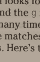

使用我刚才描述的程序搜索文件时，你正在处理模式，因此每次搜索一行时，匹配模式的文本可能都不同。如果你在搜索中处理的是文本字面量，那么试图弄清楚哪些文本匹配了你的模式就没什么意义了：它将与模式中的文本字面量完全相同。但模式可以包含通配符。你可以指定如下模式（这是一个完整的模式；单词 print 是模式的一部分）：

```
print "(.*)";
```

此模式匹配如下行：

```
print "Everybody is a clown";
```

或者缩进不同的如下行：

```
print "This program will eventually end";
```

模式中的 `.*` 部分匹配什么？在每种情况下都不同。在第一种情况下，它匹配 Everybody is a clown。在第二种情况下，它匹配 This program will eventually end。

这是一个 Perl 程序，它会打开作为参数传入的文本文件，扫描文件中的每一行，并打印出与模式部分匹配的文本。模式是 `print "(.*)"`。因此，该程序将打印出 `print` 语句中每个字符串常量的内容。这个程序我称之为 `captureprint.pl`：

```
foreach (<>) {
    if (/print "(.*)";/) {
        print "$1\n";
    }
}
```

这个程序使用了一些典型的 Perl 技巧。首先，我使用仅仅是 `<>` 来打开命令行中指定的文件。这个疯狂的结构（这还算是轻描淡写）会打开文件并将每一行读入一个数组。然后 `foreach` 循环遍历数组的每个成员，即文件的一行。每一行都成为 `foreach` 循环中的默认变量。

然后我对默认变量（即文本行）测试正则表达式。因为我在行 `if (/print "(.*)";/)` 中未指定变量，Perl 使用默认变量。然后精彩的部分来了。如果模式与行匹配，我将打印 `$1` 变量中的数据。什么是 `$1`？这就是我在括号内捕获的部分。告诉我这不是你今年见过的最酷的事情之一。好吧，我得去充实生活了。

要运行此程序，请输入 `perl captureprint.pl`，后跟要读取的文件名。因为该文件很可能是代码文件（毕竟你正在查找 `print` 语句），你可以输入类似如下内容：

```
perl captureprint.pl alternative.pl
```

这将打印出在文件 `alternative.pl` 中找到的每个 `print` 语句里字符串常量的内容。它有效！输出如下：

```
Mr. Blingblankle matches!\nMs. Sterngainagain matches!\nMs. Quealblinks matches!\n
```

（`alternative.pl` 文件是我在本章前面“使用备选词进行分组”中使用的一个程序。）

## 使用 PHP 捕获文本

以下是 PHP 中捕获的一个快速示例。只需使用 `preg_match_all` 函数，如下所示：

```
<?php
preg_match_all(
    "/(a.c)*.(g.d)/",
    "My abc soup is good", $words);
foreach ($words as $str) {
    print "($str[0])\\n";
}
?>
```

这将打印以下内容：

```
abc soup is good
abc
good
```

第一个捕获是整个模式，随后的捕获是模式中括号内的部分。但我并不是简单地打印数组的每个元素（循环中每个元素称为 `$str`），而是将每个元素本身视为一个数组并打印其第一个元素。这是因为 `$words` 数组是一个包含三个数组的数组。

之所以这样，是因为 `preg_match_all` 函数会用固定数量的数组项填充匹配变量：数组包含一个用于整个模式的元素，以及每一组括号对应的一个元素。具体来说，前面的 `preg_match_all` 调用将 `$words` 数组填充为三个元素：一个用于整个模式，一个用于 `(a.c)`，一个用于 `(g..d)`。现在来看这个稍微复杂一点的示例：

```
<?php
preg_match_all(
    "/(a.c).(1.3)/",
    "My abc-123 soup is alc-143 good a2c-153",
    $words);
foreach ($words as $str) {
    var_dump($str);
}
?>
```

整个模式在搜索字符串中出现多次。你可以看到 `abc-123`、`alc-143` 和 `a2c-153` 都匹配。但无论发生多少次，我的 `$words` 数组中仍然只有三个元素。（同样，每个元素本身也是一个数组，因为 `$words` 是一个数组的数组。）为了展示发生了什么，我在循环的每次迭代中使用 `var_dump` 函数将 `$str` 变量的内容输出。输出如下：

```
array(3) {
  [0]=>
  string(7) "abc-123"
  [1]=>
  string(3) "alc-143"
  [2]=>
  string(3) "a2c-153"
}
array(3) {
  [0]=>
  string(3) "abc"
  [1]=>
  string(3) "alc"
  [2]=>
  string(3) "a2c"
}
array(3) {
  [0]=>
  string(3) "123"
  [1]=>
  string(3) "143"
  [2]=>
  string(3) "153"
}
```

如预期，`$words` 数组有三个元素（一个用于整个模式，一个用于 `(a.c)` 模式，一个用于 `(1.3)` 模式）。此外，每个元素本身也是一个数组。这三个数组中的第一个数组包含整个模式每次匹配的列表。因此你会看到 `abc-123`、`alc-143` 和 `a2c-153`。第二个数组包含仅 `(a.c)` 模式匹配的列表：`abc`、`alc` 和 `a2c`。第三个数组包含仅 `(1.3)` 模式匹配的列表：`123`、`143` 和 `153`。

为更好地理解当前示例，尝试将测试字符串更改为：

```
"My abc-123 soup is a1c-143 good a2c-153 a3c-163"
```

这包含每个匹配的四个实例。你仍然只有三个数组，但每个数组现在都有四个项目。

如果你想看到 `preg_match_all` 的一个出色用法示例，请查看第 VII 卷，第 7 章。

## 使用 Tcl 捕获文本

以下是 Tcl 中捕获的一个简单示例。要将单个子字符串捕获到变量中，请在 `regexp` 命令末尾添加变量名，如下所示：

```
% regex {My (a.c) soup} {My abc soup is good} what sub1
1
% puts $what
My abc soup
% puts $sub1
abc
%
```

要捕获一组变量，请添加 `-inline` 选项，如下所示：

```
% regex -inline {(a.c).*(g..d)} {My abc soup is good}
{abc soup is good} abc good
%
```

这将返回一个列表。列表中的第一项是与整个模式匹配的字符串。该字符串是 `abc soup is good`，不包含开头的 `My`。列表中的第二项是 `abc`，它匹配第一个捕获。列表中的第三项是 `good`，这绝对是一个好捕获。

## 备选项与意外捕获的副作用

在使用正则表达式编程时，你可能会意外地捕获某些内容。当你使用分组来指定备选项时，你会用一组括号括住备选项。而且，无论你是否喜欢，只要有一组括号，你就会捕获某些内容。你会捕获什么？字符串中匹配其中一个备选项的特定文本。

你可能想要，也可能不想要。现在假设你最初有一个包含一些捕获的正则表达式，并且愉快地使用 `$1` 和 `$2` 等变量。然后后来你修改了正则表达式，添加了一些带备选项的分组，突然间你的程序出错了。如果该组位于表达式开头且在匹配之前，`$1` 将开始包含来自备选项的文本。

如何防止意外捕获（也称为副作用）？在括住备选项的括号内放入问号后跟冒号。以下是一个意外捕获文本的示例：

```
$_ = "Broccoli is good for you!";
@words = /(.+?)\bis (good|bad|ugly) for (.+)!/;
foreach (@words) {
    print "$_\n";
}
```

此示例捕获单词 `Broccoli`，归功于非贪婪捕获 `(.+?)\b`。接下来，它捕获单词 `good`，归功于 `(good|bad|ugly)` 周围的括号。最后，它捕获单词 `you`，归功于末尾的 `(.+)`，就在感叹号之前。输出如下：

```
Broccoli
good
you
```

但如果你不想要捕获单词 `good` 呢？那么稍微修改一下表达式：

```
@words = /(.+?)\bis (?:good|bad|ugly) for (.+)!/;
```

我在单词 `good` 之前添加了 `?:`。正则表达式引擎不会捕获备选列表中的内容。如果对前面的 `broccoli` 示例做出此更改，你会看到修订后的输出：

```
Broccoli
you
```


## 正则表达式与本书中的示例

你可能会感兴趣的是，对于我同时提供 Perl 版本和 PHP 版本的一些示例，我通常先写 Perl 版本；然后，我不重写它为 PHP，而是使用文本编辑器的正则表达式功能来修改程序。然后我进行了一些整理，但正则表达式确实很有帮助。要完成修改，我搜索了以下内容：

```
((.*)) =~ /(.*/)/
```

并将其替换为以下内容：

```
(preg_match(\2,\1))
```

目标是将类似下面的一行：

```
if ("Dear Mr. Blingblankle:" =~ /$pattern/) {
```

转换为：

```
if (preg_match($pattern,"Dear Mr. Blingblankle:")) {
```

使用此正则表达式唯一的问题是，某些文本编辑器的正则表达式引擎将括号视为字面量。要在分组中使用它们，必须在括号前加上反斜杠。真讨厌。但我确实这么做了；我没有直接使用之前的表达式，而是对其稍作修改，使其如下所示：

```
((.*)) =~ /(.*/)/
```

你还会注意到，我对捕获变量使用了 \1 和 \2。许多编辑器使用反斜杠后跟数字来表示捕获变量，因为替换技术实际上被视为反向引用。

## 第 5 章：连接、分割与拼凑

### 本章内容

- 将字符串拆分为多个子字符串
- 在 Perl、PHP 和 Tcl 中进行拆分
- 获取单个字符
- 重新连接

计算机编程中常见的一个问题是将字符串划分为多个子字符串，然后分别处理不同的部分。例如，假设你有一个整段文本存储在单个字符串中，并且你想获取一个包含段落中每个单词的数组。

有时面对这个问题时，程序员会编写一个函数（或找到由他人编写的函数）来遍历字符串，并根据空格拆分字符串。虽然这样可行，但不够灵活。例如，如果你喜欢在每个句子后放两个空格，这可能会导致两个空格之间出现一个实际只是空字符串的“单词”。那标点符号呢？

本书中涵盖的所有语言都支持各种拆分技术，你可以根据正则表达式而不是固定字符（例如空格）来拆分字符串。下面是一个使用 Perl 的快速示例：

```perl
$paragraph =
  "This is a paragraph. It consists of ".
  "several words, and several lines, and ".
  "lots of punctuation! Sentences are separated ".
  "by two spaces (oh my!).";
@words = split(/\W+/, $paragraph);
foreach (@words) {
  print "$_\n";
}
```

此示例使用 split 函数按单词拆分字符串。正则表达式指定了分隔字符是什么。你希望根据空白字符和标点符号进行分隔——也就是说，任何不是单字符的字符。因此，我使用了正则表达式 \W+，它是表示一个或多个非单字符的正则表达式。

运行此示例后，你会看到段落中所有单词的列表。以下是前三行：

```
This
is
a
```

……以此类推。如果你查看输出，会发现没有任何空行；也就是说，当段落中有两个连续空格时，你不会得到一个 supposedly 在两个空格之间的空“单词”。相反，`split` 函数使用正则表达式将多个空格匹配为单一文本片段，并在该单一文本片段上拆分，而不是在其内部拆分。（如果你只是为了好玩而想破坏此功能，请从正则表达式中删除 `+`，使用 `\W` 代替 `\W+`。然后运行程序，你就会明白我的意思。）

在本章中，我将展示如何在 Perl、PHP 和 Tcl 中执行各种拆分操作。此外，我将展示如何将拆分结果组合成单个字符串，这个过程称为 _join_（连接）。

你可能会好奇 split 和 join 的一些实际用途。只要你有一个字符串数据，其中每个数据项由某个字符分隔，就可以使用 split 来分割数据。例如，如果你正在从电子表格程序生成的逗号分隔文件中读取行，可以使用如下代码行按逗号拆分行：


```
@items = split(/,/, $line);
```

### 到处拆分

在以下部分中，我将展示如何在 PHP 和 Tcl 中完成拆分。（本章的介绍部分展示了如何使用 Perl 进行拆分。）在语言主题之后，我提供了一节，解决如何将字符串拆分为单个字符这一常见问题。我将展示如何在 Perl、PHP 和 Tcl 中完成此操作。最后，我将展示如何修改某些 `split` 函数，以不仅获取单词数组，还能获取单词在原始字符串中的位置信息。

### 在 PHP 中拆分

PHP 语言包含 `preg_split` 函数，该函数属于正则表达式函数类别。此函数的行为与 Perl 版本的 split 函数完全相同。但是，与 preg_match 函数一样，你需要用斜杠括住正则表达式，然后将表达式放在引号字符串中：

```php
<?php
$str = "Hi there, everybody! This is cool.";
$strset = preg_split('/\W+/', $str);
foreach ($strset as $word) {
    print "word: $word\n";
}
?>
```

preg_split 函数将正则表达式作为第一个参数。（我使用单引号，以便反斜杠保留在字符串中。）第二个参数是要拆分的字符串。该函数返回一个数组，程序随后遍历该数组，打印每个成员。

如果运行此程序，你可能会注意到一个小问题。与 Perl 的 split 函数不同，PHP 中的这个 preg_split 函数会返回一个空单词。以下是 print 语句的输出行：

word: Hi
word: there
word: everybody
word: This
word: is
word: cool
word:

最后一行是空的。但请放心——preg_split 函数有两个附加参数可供你进一步选择。第一个参数不是特别有用；它是一个数字，用于限制函数执行拆分的次数。如果你不想设置限制，请传递 -1。

第二个参数可以是各种常量的组合。这里有用的常量是 PREG_SPLIT_NO_EMPTY，它可防止 preg_split 函数返回任何空单词。以下是修改后的 preg_split 调用：

```
$strset = preg_split('/\W+/', $str,
-1, PREG_SPLIT_NO_EMPTY);
```

最后一个参数还有另外两个常量可用：PREG_SPLIT_OFFSET_CAPTURE 和 PREG_SPLIT_DELIM_CAPTURE。如果你包含第一个常量 PREG_SPLIT_OFFSET_CAPTURE，数组中的每个项将不再是字符串，而是一个数组本身，包含字符串和一个表示字符串在原始字符串中位置的数字。关于第二个常量的详细信息，请查看本章稍后的“拆分时捕获”部分。（你可以通过在选项之间放置竖线字符 | 来组合选项。）

### 在 Tcl 中拆分

Tcl 语言具有 split 命令。但是，该命令不使用正则表达式。如果你想在拆分中使用正则表达式，则需要使用一个专门为 Tcl 编写的额外库，称为 tcllib。tcllib 库通常会随许多 Tcl 安装一起自动安装。


如果你的 Tcl 版本未安装 tcllib 库，可以通过访问 tcllib.sourceforge.net 或 www.tcl.tk/software/tcllib/ 获取它。这两个页面都提供可下载的文件（访问分发链接）以及有关使用 tcllib 的文档。

如果已安装 tcllib，以下代码应在 tclsh 中正常工作：

```
% package require textutil
0.6
% set str {Hi there, everybody! This is cool.}
Hi there, everybody! This is cool.
% set result [::textutil::splitx $str {\W+}]
Hi there everybody This is cool {}
```

这段代码一开始可能有点晦涩，下面是拆解：

- 第一行 % 打开 textutil 包，该包是 tcllib 的一部分。
- 下一行 % 将字符串 Hi there, everybody! This is cool. 存储在变量 str 中。
- 第三行 % 调用 splitx 命令（位于 textutil 包中），将变量 str 和正则表达式 \W+ 作为参数传递。
- splitx 调用的结果存储在 result 变量中。result 的内容随后出现在屏幕上。这是一个包含六个单词的列表，加上一个空集。

为什么会出现一个空集？这种带正则表达式功能的拆分函数变体会在拆分模式出现在字符串末尾时添加一个空集。对于输入字符串 str，最后一个字符（句点）确实匹配该模式，从而导致添加了一个空集。不幸的是，空集会出现，你可能只需要忽略它即可。


## 将字符串拆分为单个字符

如果你需要获取一个字符串，并创建一个由该字符串中单个字符组成的数组，可以使用 split 函数。为此，你需要为正则表达式使用一个空模式。以下是 Perl 示例：

```perl
$string = "abcdefghijklmnopqrstuvwxyz";
@chars = split(//, $string);
foreach (@chars) {
    print "$_\n";
}
```

正则表达式就是 //，但斜杠是分隔符，这意味着表达式本身是空的：完全没有表达式。

以下是 PHP 中的相同示例：

```php
<?php
$string = "abcdefghijklmnopqrstuvwxyz";
$chars = preg_split("//", $string);
foreach ($chars as $char) {
    print "$char\n";
}
?>
```

最后，以下是在 Tcl 中实现相同功能的方法：

```tcl
package require textutil
set str { abcdefghijklmnopqrstuvwxyz }
set chars [::textutil::splitx $str {}]
foreach char $chars {
    puts $char
}
```

## 拆分时进行捕获

拆分字符串时，还可以在正则表达式中包含括号以捕获文本。但是，仅仅添加括号不会自动导致各种 split 函数捕获文本。相反，你需要添加一个选项。

在 PHP 中，你将 PREG_SPLIT_DELIM_CAPTURE 选项作为第四个参数添加到 preg_split 函数中。（如果你要组合多个选项，请使用竖线字符分隔选项，就像我在以下示例中所做的那样。）以下是一个简短的演示：

```php
<?php
$str = "Hi there, everybody! This is cool.";
$result = preg_split('/(\W+)/', $str,
-1, PREG_SPLIT_NO_EMPTY |
PREG_SPLIT_DELIM_CAPTURE);
foreach ($result as $word) {
    print "word--$word--\n";
}
?>
```

这将拆分 $str 字符串，并在过程中捕获模式。请注意，我在 \W+ 周围加上了括号。因此，你得到的结果是整个字符串被拆分开：模式中指定的分隔符分隔的文本，以及分隔符本身。请记住，该模式是单词边界，包括通常的标点字符。因此，使用 PREG_SPLIT_DELIM_CAPTURE 时，你的最终列表中也会包含标点字符。（你可能想这样做，以防你想将句子重新连接起来，同时保留所有标点。）

我在 print 语句中在 $word 两边放了两个连字符，以便你可以看到输出中的任何空格。以下是输出：

```
word--Hi--
word-- --
word--there--
word--, --
word--everybody--
word--! --
word--This--
word-- --
word--is--
word-- --
word--cool--
word--. --
```

第一行输出是拆分出的单词之一。第二行输出是紧跟在第一个单词后面的分隔符；这个分隔符只是一个空格。向下移动到第四行，你可以看到在这种情况下分隔符是两个字符，一个逗号，然后是一个空格。（你可以看到逗号和两个连字符之间的空格。）

在 Perl 中，你不需要添加任何额外选项；你只需加入括号，戏就开始了。以下是用 Perl 编写的相同程序；它的输出与之前相同：

```perl
$str = "Hi there, everybody! This is cool.";
@result = split(/(\W+)/, $str);
foreach (@result) {
    print "word--$_--\n";
}
```

## 与乐队一起连接

拆分的逆操作是 *join*。在执行拆分并将所有单词放入数组中后（或者如果你只是创建了一个充满单词的数组），你可以轻松地使用 join 函数将它们重新拼接在一起。

使用 join 函数时不需要正则表达式。相反，你只需指定在将单词重新拉回字符串时用于单词之间的字符或字符串。

以下是 Perl 示例：

```perl
$paragraph =
    "I am bill at at dot com. I ate my kitchen, ".
    "and this is gr e. All th I know school is ".
    "all my brain.";

@words = split(/\W+/, $paragraph);
$final = join('@', @words);
print "$final\n";
```

此示例按单词拆分 `$paragraph` 字符串，然后将所有单词重新拼接在一起，在每个单词之间插入 `@` 字符。以下是充满秘密含义的输出：

```
I@am@bill@at@at@dot@com@I@ate@my@kitchen@and
@this@is@gr@e@All@th@I@know@school@is@all@my@brain
```

PHP 中的 join 同样简单；你使用标题有些吓人的 implode 函数：

```php
<?php
$paragraph =
    "I am bill at at dot com. I ate my kitchen, ".
    "and this is gr e. All th I know school is ".
    "all my brain.";

$words = preg_split('/\W+/', $paragraph);
$final = implode('@', $words);
print "$final\n";
?>
```

join（或 implode，如果你更喜欢更戏剧化的语言）的一个问题是，你总是被迫在单词之间插入相同的字符串，不管你拆分的原始字符串中包含什么。但是，如果你使用捕获方法同时抓取分隔符（请参阅本章前面的“拆分时进行捕获”部分），你可以在拼接单词时使用它们，如以下 Perl 程序所示：

```perl
$paragraph =
"I am bill at at dot com. I ate my kitchen, ".
"and this is gr e. All th I know school is ".
"all my brain.";
@words = split(/(\W+)/, $paragraph);
$final = join('', @words);
print "$final\n";
```

我在模式周围添加了括号，以在数组中捕获分隔符。此外，我在 join 函数中指定了空字符作为分隔符，因为我想重新压缩在一起的所有内容都在数组本身中。

运行此示例时，你会看到与 $paragraph 开头相同的字符串。


要在 PHP 中使用捕获的分隔符实现连接，你仍可以像以前一样使用 implode 函数。只需在 preg_split 函数中使用 PREG_SPLIT_DELIM_CAPTURE 选项捕获分隔符，然后调用 implode，为分隔符字符传递一个空字符串。

## 第 6 章：处理多行和文件

### 本章内容

- 处理文件中的每一行
- 将字符串作为单行或多行处理
- 确定文件中有多少行
- 搜索文件中的所有行
- 在搜索和替换中修改多个换行符

有一个想法：假设你不是在字符串中搜索模式，而是想在文件中搜索模式。你会遇到什么样的问题？

在回答之前，我需要设定一些假设：

- **你正在处理文本文件。** 正则表达式用于匹配文本，因此包含例如编译后 C++ 代码的文件是二进制数据，试图使用一个复杂的正则表达式来拆解编译代码根本行不通。换句话说，除了文本文件之外，对任何类型的文件使用正则表达式都没有意义。

- **你的文本文件被组织成文本行。** 也就是说，如果你在文本编辑器中打开文件，你会看到多行，而不是一行很长的线。一行很长的线几乎与单个字符串没有区别。

但是，如果你只有一行很长的线，并在文本编辑器中选择了自动换行选项怎么办？大多数文本编辑器都有此选项。在这种情况下，从技术上讲，你仍然只有一行文本。

当你打开自动换行功能时，你会得到文本段落，每个段落虽然在屏幕上显示为多行，但实际上是一行很长的文本。我怎么知道这一点？答案是我下一个假设：

- **每行文本以一个或两个行尾字符结尾。** 我说“一个或两个”是因为不同的操作系统使用不同的方式来表示行尾。Unix 使用单个换行符字符，其 ASCII 码为 10。Windows 使用两个字符，回车符后跟换行符，其 ASCII 码分别为 13 和 10。最后，Macintosh 也不甘示弱，仅使用回车符（ASCII 码为 13）来结束其行。在编写代码时，你可能在字符串中见过 \r 或 \n 或 \r\n。\r 指的是回车符，即 ASCII 码 13。\n 指的是换行符，即 ASCII 码 10。因此，\r\n 生成 ASCII 码 13 然后是 10。

为了本次讨论的目的，我说“换行”或“换行字符”来指代你的操作系统所使用的任何行尾字符（或两个字符）。


## 处理多行字符串

为什么要区分多行字符串和单行字符串？这一切都取决于你希望正则表达式引擎如何解释三个神奇的字符 ^、$ 和 .（点号）。默认情况下，这两个字符分别表示字符串的开头和结尾，而点号字符匹配除换行符外的任何字符。但是，如果切换到多行模式，^ 和 $ 突然表示行的开头和结尾。在多行模式下，正则表达式引擎会监视换行符，并按每行基础匹配 ^ 和 $。你还可以指定专门的单行模式，在这种情况下，点号匹配包括换行符在内的所有字符。（通常，正如我所述，点号字符不匹配换行符。）

以下是一个很好的例子。为了说明我的观点，我将把几行文本塞进一个字符串中。以下是 Perl 代码：

```perl
$a = "Don't eat my computer \nyet. cook it first.\n";
print $a;
print "=========\n";
$a =~ s/^(.*)(c.*)$/$1$2/mg;
print $a;
```

仔细看一下字符串。我在里面放了几个 \n 字符；因此，当你运行此代码时，首先你会看到原始字符串打印在多行上。为了帮助组织输出，我在单独一行上放了一堆等号，以将原始字符串与修改后的字符串分开。

仔细看一下正则表达式。记住，像往常一样，将这些东西拆解开来看。正则表达式以 s 开头，表示搜索和替换，末尾是 g 修饰符，表示搜索和替换将尽可能多次发生。但是，请注意，我在表达式的闭合斜杠后还放了一个 m。（他们称 m 为 m 修饰符。）这就是将搜索和替换神奇地转换为多行格式的关键。

搜索模式以 ^ 开头，在本例中表示行的开头。接下来是 (.*)、一个 c，然后是另一个 (.*。这将搜索最后


字母 c 出现的位置，并将 c 之前行上的所有内容存储在 $1 中，将 c 之后行上的所有内容存储在 $2 中。（为什么它搜索 c 的最后一次出现？因为第一个 (.*) 是贪婪的，就像所有 * 模式一样，除非在 * 后面跟一个 ?。）

下一部分是替换模式。它是 $1M$2。这只是输出 $1（m 之前的内容），然后是一个大写 M，然后是 $2（m 之后的内容）。换句话说，这个表达式将每个字符串中的最后一个 m 替换为大写 M。

运行程序时，您将看到以下输出：

```
Don't eat my cold computer
yet. cook it first.
======
Don't eat my cold Computer
yet. Cook it first.
```


## 文件中有多少行？

让我吹毛求疵一下。不同的程序对文件中有多少行有不同的看法，这取决于文件的最后一行是否有换行符。（如果最后一行有换行符，这意味着文件以换行符结尾。）

单词和行都在你的文件中。那么 lines.txt 中有多少行？试试这个：

```
wc -l lines.txt
```

（这是用于参数的小写 L，它告诉 wc 程序只计算行。）我在 Linux 系统和 cygwin 下的 Windows 系统上都运行了这个命令。两种情况下，我都看到了这个输出：

```
2 lines.txt
```

它说是两行。嗯。但是，我随后在 Windows 下的 Microsoft Word 中打开了 lines.txt 输出文件，并选择了工具->字数统计。我看到什么？Word 告诉我我有三行。现在将代码中的最后一行改为这样：

```
print "ghi\n";
```

这次运行 wc 显示三行。Microsoft Word 说我有多少行？它再说一遍说我有三行。但在我看来，两种情况下我都看到三行，无论最后一行是否有 \n！

以下是一个 Perl 程序，它会写出我们人类眼中视为三行文本的内容：

```
print "abc\n";
print "def\n";
print "ghi";
```

（注意最后一行没有 \n。）

将此程序保存为 lines.pl 并这样运行它：

```
perl lines.pl > lines.txt
```

输出保存到名为 lines.txt 的文件中。Unix（以及 Windows 上的 cygwin 程序）有一个名为 wc 的实用程序，它代表字数统计。wc 程序告诉你有多少个字符，

由于 m 修饰符，^ 和 $ 现在指字符串内行的开始和结束。（记住，g 修饰符会导致替换尽可能多次发生。）


如果你的字符串中有 \n 字符，但你希望 ^ 和 $ 字符表示字符串的开始和结束，而不是行的开始和结束呢？删除 m 修饰符，但不要止步于此：添加 s 修饰符，它表示单行。


你需要添加 s 修饰符的原因是一个小技术细节：单行 s 修饰符并不是多行 m 修饰符的对立面，尽管名称暗示了这一点。相反，s 修饰符告诉正则表达式引擎，. 字符可以匹配包括换行符在内的任何字符。没有 s 修饰符，. 字符匹配除换行符以外的任何字符。

因此，如果你在带有 s 修饰符的情况下将表达式 /^.*$/ 针对字符串 "Hi\nthere" 进行测试，.* 会匹配字符串内的所有文本。但没有 s 修饰符，.* 会匹配 H 和 i 然后停止，不匹配 \n 或其后的任何内容。因此，以下是 s 和 m 修饰符的规则：

- s 修饰符导致 . 匹配包括换行符在内的任何字符。没有 s 修饰符，. 字符不匹配换行符。

- m 修饰符导致 ^ 和 $ 字符匹配行的开始和结束。没有 m 修饰符，^ 和 $ 字符匹配字符串的开始和结束。

听起来虽然疯狂，但你可以一起使用 s 和 m 修饰符，如果你希望点号能匹配换行符，但仍希望 ^ 和 $ 表示行的开始和结束。这样，你就可以做一些花哨的事情，比如让某些表达式跨行。例如，你可能正在文本文档中搜索某人的地址，这可能会占据多行。

在了解处理多行字符串的方方面面之后，你可以好好玩一玩。你可以找到包含某个模式的每一行，如果你愿意，可以用另一个字符串替换这些模式。（那个字符串甚至可以由模式本身组成。）知晓这一点，你可以想出一些非常复杂的正则表达式。

如果你从文件中读取文本，有两种方法可以做到这一点：

- 你可以逐行读取文本，并对每一行执行正则表达式。
- 你可以将整个文件作为单个字符串读取，并将其作为多行字符串进行处理。

你选择哪种方式由你决定，但一个决定因素是你是否需要处理多个换行符。以下两个部分展示了两个不同的示例。每个示例都有不同的情况，这有助于你决定是否应该将文件作为单个字符串处理。

## 搜索文件中包含模式的所有行

编程中常见的一个问题是搜索包含模式的所有行。你也可以替换这些行，这只是使用正则表达式的查找替换形式的问题。但为了保持示例的简单性，你只需执行匹配，即定位哪些行与表达式匹配并打印出那些行。


执行此类逐行搜索操作的程序通常称为 _grep_ 程序。因此，我将此程序命名为 `mygrep.pl`。（不要将其命名为 `grep.pl`，因为你的系统上可能已经有一个 grep 程序，并且你希望保持名称分开。）

在这个示例中，你将每一行与正则表达式进行比较。在比较某一行时，你并不在乎其他行中有什么。因此，我建议逐行读取文件（而不是作为一个大字符串读取）。

以下是执行此操作的代码；我将其保存为 `mygrep.pl`：

```perl
$pattern = $ARGV[0];
$filename = $ARGV[1];
open (INPUT, $filename)
        || die "can't open $filename: $!";
while (<INPUT>) {
    print $_ if /$pattern/;
}
```

此程序读取第一个命令行参数并将其存储在 `$pattern` 变量中。然后它读取第二个命令行参数并将其存储在 `$filename` 变量中。接下来，它尝试打开由 `$filename` 命名的文件，将文件句柄存储在 `INPUT` 变量中（如果程序无法打开文件，则退出）。

然后程序逐行处理文件中的每一行。对于每一行，它执行这条有些晦涩的指令：

```
print $_ if /$pattern/;
```

这使用了反向-*if* 表示法。如果表达式为真，它将执行 `print $_` 部分。在这种情况下，该表达式只是一个作用于默认变量的正则表达式，该变量包含来自文件的行。因此，这一行在英语中翻译为：“如果文件中的当前行与模式匹配，则打印出该行。”

这就是 grep 程序。这是一个你可以使用的示例文件（将其保存为 grepsample.txt）：

```
This is the first line of text.
This is the second Line.
Oh my, how boring.
But the third line doesn’t contain anything linear.
That’s true. Neither does this line. Oops.
```

要试用该程序，请输入：

```
perl mygrep.pl [Ll]in grepsample.txt
```

你正在 grepsample.txt 文件中搜索模式 [Ll]in。以下是输出：

```
This is the first line of text.
This is the second Line.
But the third line doesn’t contain anything linear.
That’s true. Neither does this line. Oops.
```

## 修改多个换行符

你可能希望读取一个包含文本的文件，其中每个段落都在一行上，没有缩进。你可以根据这些规则创建一个新文件：


- 原始文件中连续两个换行会在新文件中生成一个新的、带缩进的段落。

- 一个换行（后面不跟另一个换行）会生成一个新的、不带缩进的段落。

这类似于文字处理器中的硬回车和软回车。

要创建一个完成此功能的程序，请考虑你将要进行的两种替换：

- 两个换行（或 \n\n）变为一个换行，然后是一个缩进。因此，\n\n 被替换为 \n\t。

我使用制表符字符，因为在这样的书中它显示得更明显。如果我在书籍环境之外这样做，我可能更喜欢使用几个空格，以便更好地控制缩进的大小。

- 一个换行被替换为……让我想想……一个换行。换句话说，它不变。这意味着你只需要做一次替换。太好了！问题就简单了。

这意味着表达式必须长这样：

```
s/\n\n/\n\t/
```

因为你要查找多个换行，所以不能逐行读取文件并单独处理每一行。相反，你需要读取整个文件。

## 尝试不使用正则表达式的模式

在探讨如何使用正则表达式实现这个硬回车和软回车的乐趣之前，停下来想一想，如果不使用正则表达式，你会怎么做。在我的编程生涯中，我已经到了这样的阶段：当面临像硬回车和软回车这样的目标时，我会自动考虑正则表达式，因为有了正则表达式，这类工作要容易得多。在这个阶段，不使用正则表达式来做这样的事听起来很疯狂。那么，如果不用正则表达式，你会怎么做呢？我想不起来，而且也不想去弄明白。何必呢？

你需要在这里包含 m 修饰符吗？m 修饰符决定 ^ 和 $ 字符是表示字符串的开头和结尾，还是表示行的开头和结尾。然而，在这个示例中这无关紧要，因为你不需要 ^ 和 $ 字符。因此，走简单路线，不加 m 修饰符。（添加它也不会改变任何东西，所以我看不到包含它的理由。）

那 s 修饰符呢？同样，句点字符是否读取换行符无关紧要，因为在这个示例中你不会使用句点字符。所以不要加 s 修饰符。

下面是代码：

```
undef $/;
$_ = <>;
s/\n\n/\n\t/;
print $_;
```

信不信由你，这就全部了。就在 C 语言中不使用正则表达式试试看！前两行读取命令行中指定的文件。这个文件作为一个长字符串读入，并放入默认变量中。第三行上的正则表达式，没有关联任何变量名，作用于默认变量。然后第四行打印出更改后的默认变量。

将文件另存为 paragraph.pl。然后创建一个文本文件，内容如下：

```
This is a paragraph about a paragraph. The paragraph that this paragraph is about happens to be the paragraph you are reading. What is the paragraph about? I don't know. But as you read this, you will see that this line is a soft return.
```

```
This line starts another paragraph because I put two newlines at the beginning of it. And that's what this paragraph is really all about: Being a paragraph with two newlines at the beginning.
```

第一个段落（以 This 开头，以 know. 结尾）位于一行文本上，末尾有一个换行符。下一个段落（But . . . return）是单行，但这次它末尾有两个换行符。最后一个段落是单行，你是否在末尾添加换行符并不重要。

将文件另存为 paragraph.txt。然后运行你的程序：

```
perl paragraph.pl paragraph.txt
```

你会看到修改后的输出：

This is a paragraph about a paragraph. The paragraph that this paragraph is about happens to be the paragraph you are reading. What is the paragraph about? I don't know. But as you read this, you will see that this line is a soft return.

This line starts another paragraph because I put two newlines at the beginning of it. And that's what this paragraph is really all about: Being a paragraph with two newlines at the beginning.

## 第 7 章：处理 HTML 文件

### 本章内容

- 基于字符串列表构建表单
- 为 img 标签自动创建大小信息
- 提取所有 HTML 文本
- 在 HTML 文件中仅搜索文本部分的模式

在本章中，我提供了一些示例，涉及在各种环境下使用正则表达式处理 HTML 文件，例如在代码编辑器内部，或作为不同语言中的程序。其目的不是提供你可以用 HTML 做的所有事情的完整概述；那需要很多本书。相反，我向你展示我如何解决过的一些问题，以及我如何使用正则表达式来解决这些问题。然后你可以在自己遇到问题时应用这些技术。

### 基于字符串列表构建表单

这是一个可能会出现的绝佳示例。假设你有一个单词列表（例如表格中的列），你想快速生成一个表单，以便轻松填写这些列。这需要将类似下面的行进行转换：

```
name
email
```

转换为：

```
name <input type="text" name="name"><br>
email <input type="text" name="email"><br>
```

你在文本编辑器中可能经常需要进行这样的转换。因此，我向你展示如何使用具有正则表达式功能的文本编辑器来解决这个问题。（如果你不是在使用文本编辑器，而是在编写程序来转换文本，那么你根本不需要正则表达式；如果你在编写程序，只需遍历列表，为每一行打印出 '$colname <input type="text" name="$colname"><br>'，完全忘掉正则表达式。）

搜索模式是整行中的任何内容，这很简单：模式是 .*。因为你想捕获这个模式，所以在周围加上括号。


查看文本编辑器的文档，以确定你是否需要在捕获括号前加上反斜杠，例如 \(.*)

因此，根据你的文本编辑器，模式变成这样：

```
\(.*)
```

或者简单地这样：

```
(.*)
```

对于替换文本，将你捕获的单词放在 HTML 的开头和中间。你的编辑器需要使用 \1 或 $1 来表示捕获的文本。我使用 \1，所以我的替换文本如下：

```
\1 <input type="text" name="\1"><br>
```

对于 Windows SciTE 编辑器，具体操作如下：

- 1. 选中所有文本，然后按 Ctrl+H 打开查找和替换对话框。
- 2. 在查找内容框中，输入模式 \(.*)
- 3. 在替换为框中，输入上面的替换文本。
- 4. 确保选中正则表达式复选框。
- 5. 点击全部替换（或者如果你只想替换选定的文本，就点击选中内容替换）。

更改完成，你就搞定了。

对于 vi 编辑器，模式相同；而是使用 vi 的查找和替换命令，如下所示：输入冒号以访问 vi 命令提示符，然后输入以下代码：

```
:g/\(.*\)s//\1 <input type="text" name="\1"><br>/g
```

### 自动为 IMG 标签创建大小信息

假设你有一个 .html 文件，文件中包含各种 HTML img 标签（以及其他标签）。其中一些 img 标签带有大小信息（图像的长度和宽度），而有些则没有。现有的大小信息可能正确，也可能不正确。但在 img 标签中拥有正确的大小信息是个好主意；没有任何大小信息，浏览器将不得不等到图像下载完成，然后重新渲染整个屏幕。而且，如果大小信息不正确，图像将显示扭曲。

在这个 PHP 示例中，我向你展示如何使用正则表达式和图像函数来查找 img 标签，提取出文件名，获取文件的宽度和高度信息，然后使用新的宽度和高度信息重建 img 标签。这样你就可以确保：

- 每个 img 标签都有大小信息（因为有些 img 标签可能没有大小信息）。
- 每个 img 标签的大小信息都是正确的。

当浏览器下载包含图像的 HTML 文件时，它们首先下载 .html 文件，并在此同时开始尝试绘制 HTML，即使图像还没有下载下来。这就是你可能希望为 img 标签添加大小信息的原因。如果浏览器不知道图像有多大，它默认会假设一个小图标大小。然后，在浏览器获得图像信息后，它会重新渲染整个屏幕。你可能在慢速拨号上网（或流量繁忙时）的网页上见过这种情况：页面开始加载，文本随着每张新图片的出现而四处移动。img 标签中的长度和宽度参数可以防止这种情况发生。

像所有涉及文本的问题一样，你可以（并且应该）权衡正则表达式是否是最佳选择。上一节包含一个示例，你可能不想在其中使用正则表达式。

在本节的示例中，目标是从 img 标签中提取文件名（以及任何选项）。从提取的选项中，你可以获得宽度和高度信息（如果存在的话）。提取文本是正则表达式擅长的工作，所以我在这个示例中使用正则表达式。（否则我就不会把它放在这一章里了，但这不重要。）

首先，清单 7-1 包含一个名为 imgsample.html 的 HTML 文件，你可以用它来完成此示例。


## 列表 7-1: 包含多个 img 标记的文件

```html
<html><head><title>Pictures of our trip</title></head>
<body>
This page contains pictures of our trip!<p>
Me on the mountain<br>
<p>
Me dropping a rock off the mountain<br>
<p>
The rock smashing the ranger's truck<br>
<p>
Me running for safety<br>
<p>
My new view<br>
<p>
</body></html>
```

这个文件包含许多标记，其中几个是 img 标记。此文件中的 img 标记具有不同的参数。现在来看正则表达式。虽然你可能能够进行一些复杂的操作，想出一个单一表达式来完成所有工作，但通过将任务划分开来保持简单。因此，你首先希望从每个 img 标记中找到 src 参数；列表 7-2 显示了可实现此功能的 PHP 程序。

## 列表 7-2: imageconvert.php 程序

```php
<?php
 if (count($argv) > 0) {
  $filename = $argv[count($argv) - 1];
 } else {
  $filename = $_GET['filename'];
 }
$html = implode("", file($filename));
$pattern = '//' ;
preg_match_all($pattern, $html, $matches);
$tags = $matches[0];
foreach ($tags as $tag) {
 $srcpattern = '/src="(.*)?"/' ;
 preg_match($srcpattern, $tag, $srcarray);
 $src = $srcarray[1];
 list(,,$size) = getimagesize($src);
 $hpattern = '/height=".*?"/' ;
 $newtag = preg_replace($hpattern, '', $tag);
 $wpattern = '/width=".*?"/' ;
 $newtag = preg_replace($wpattern, '', $newtag);
 $newtag = preg_replace(
 "/\\s*>/", " $size>", $newtag);
 $html = str_replace($tag, $newtag, $html);
}
print $html;
?>
```

以下是我在列表 7-2 中使用的模式：

```
//
```

此模式查找 img 标记，因为 img 标记以 `` 结尾。但我包含 `?` 字符以确保模式不是贪婪的。（否则，如果我不关闭贪婪性，该模式将匹配从 `` 的所有内容，这可能是 `</html>` 标记。）

提取每个 img 标记后，我使用以下模式从标记中提取源文件：

```
/src="(.*)"/
```

由于有了括号，此模式会抓取 src 参数后双引号内的图像文件名。使用该文件名连同 PHP 的图像函数，我可以确定图像的尺寸。但我使用的图像函数 getimagesize 有一个非常棒的特性：该函数返回一个列表，其第四个元素是一个格式正确的字符串，包含 HTML 标记中的尺寸和宽度参数，如下所示：

```
width="100" height="100"
```

是的，getimagesize 为我们构建了这个宽度和高度字符串！接下来，我在 preg_replace 调用中使用 /height=".*?"/ 模式来删除任何现有的 height 参数。（你可以看到我使用的替换字符串只是一个空字符串。）然后我对 width 做同样的处理，使用模式 /width=".*?"/ 来删除 width 参数。

接下来，我将右尖括号 >（以及其前面的任何空白）替换为 getimagesize 返回的尺寸字符串，并附上一个新的右尖括号。我用于此替换的正则表达式如下：

```
/\s*>/
```

最后，我使用简单的 str_replace 函数将整个先前的标记替换为新标记。好了！

要从提示符运行该程序，请尝试使用 -q 选项，以防止 PHP 程序输出 Content-type 和 X-Powered-By 标头信息；另外，使用重定向将其保存到文件中，如下所示：

```
php -q imageconvert.php imgsample.html > results.html
```

以下是输出，显示了修复后的版本：

```html
<html><head><title>Pictures of our trip</title></head>
<body>
This page contains pictures of our trip!<p>
Me on the mountain<br>
<p>
Me dropping a rock off the mountain<br>
<p>
The rock smashing the ranger's truck<br>
<p>
Me running for safety<br>
<p>
My new view<br>
<p>
</body></html>
```

如果你使用的是较早版本的 PHP（PHP 4.3.0 之前），你会希望将以下两行添加到列表 7-2 的最开头：

```php
$argv = $_SERVER['argv'] ;
$argc = $_SERVER['argc'] ;
```

添加这两行的原因是 argv 和 argc 全局变量仅存在于较新版本的 PHP 中。

## 提取所有 HTML 文本

HTML 文件在浏览器中查看效果很好，但如果你想在文本文件中查看它们呢？取决于底层 HTML 的复杂程度，该文件可能看起来非常混乱。

查看文件的一种简单方法是直接提取文本本身。此方法并不适用于所有 HTML 文件，因为有些文件包含生成部分文本的 JavaScript。但对于许多 HTML 文件，此方法效果很好。

在此示例中，我提取 HTML 并构建一个基本文本文件。该文本文件忽略所有标记，但以下情况除外：

- 它提取 <body> 标记内的文本。
- 它使用 <br> 和 <p> 标记生成换行符。

从 HTML 提取文本的最简单方法之一是使用正则表达式。该列表出奇地短（甚至比我预期的还要短）。

但是，我决定使用多个正则表达式。完整的 Perl 代码如列表 7-3 所示；将其保存为 HTMLtoTXT.pl。

## 列表 7-3: 从 HTML 提取文本的代码

```perl
undef $/;
$_ = <>;
($_) = /<body.*?>(.*)<\/body>/s;
s/<p.*?>\n\n/sg;
s/<br.*?>\n/n/sg;
s/<.*?>//sg;
print $_;
```

前两行将文件作为单个字符串读入，并将其放入默认变量 $_ 中。下一行提取 body 标记之间的文本。

任何 HTML 标记内部都可以带有参数。尽管某些标记不提供参数（例如 <hr>），但从技术上讲，你仍然可以在其中放置参数（例如 <hr a="b">），尽管浏览器会忽略这些参数。因此，在我的代码中，你可以看到针对每个 HTML 标记的模式，我在标记名称后面加上了 .*?。? 会防止贪婪匹配，在第一个 > 处停止。


提取 body 外部的文本后，将每个 <p> 标记替换为两个换行符，将每个 <br> 标记替换为一个换行符。然后只需删除剩余的标记。每个替换都使用单独的正则表达式来完成。

最后，打印结果字符串。以下是你可以使用的示例输入文件；将其保存为 words.html：

```html
<html><head><title>Opportunity</title></head>
<body>
<h1>An Opportunity for You</h1><p>
Like most people, I was born at a <i>very</i> young age. I then went to school, where I learned all the skills to make <b>millions</b> of dollars. Soon after school, I started my own multinational corporation, and to my delight I didn’t just make <i>millions</i>, but I made <i>billions</i>! And now, if you send me only $100, I can share with you this secret of how you can make a lot of money. (And please don’t think that the secret is getting unsuspecting people to send you $100 as I’m doing to you. Really! That’s not the scam. I mean <i>plan</i>. <b>Trust me!</b></p>
Sincerely,<br>
Your Multimillionaire Friend</a>
</body>
</html>
```

要尝试该程序，请输入：

```
perl HTMLtoTXT.pl words.html
```

以下是输出：

```
An Opportunity for You

Like most people, I was born at a very young age. I then went to school, where I learned all the skills to make millions of dollars. Soon after school, I started my own multinational corporation, and to my delight I didn't just make millions, but I made billions! And now, if you send me only $100, I can share with you this secret of how you can make a lot of money. (And please don't think that the secret is getting unsuspecting people to send you $100 as I'm doing to you. Really! That's not the scam. I mean plan. Trust me!

Sincerely,

Your Multimillionaire Friend
```


你可能还希望将某些 HTML 实体转换为其 ASCII 等效字符。例如，字符串 &lt; 是小于字符 < 的 HTML 等效形式。（之所以如此，是因为小于字符通常被解释为标记开始分隔符。如果没有这种编码，就无法在浏览器窗口中打印小于字符。）

要将 HTML 实体解码为实际字符，请将此行添加到列表 7-3 的开头：

```
use HTML::Entities;
```

在最终 print 行之前添加此行，以便在打印前解码实体：

```
decode_entities($_);
```


## 仅搜索 HTML 文件的文本部分

如果你想在一组 HTML 文件中搜索某个字符串，但只想搜索文本部分，该怎么办？例如，你可能想查找单词 height，但不想提取包含 height 属性的标签。

你可以通过仅提取 HTML 的文本部分（如上一节示例所示），然后仅在该文本中搜索模式来实现这一点。

更棒的是，由于你使用的是正则表达式，可以搜索模式，而不仅仅是普通文本。（大多数 Web 搜索引擎只允许搜索普通文本。）

我决定用 Perl 来实现这个示例，因为 Perl 拥有大量实用的文件和目录函数。程序如下：

```
use HTML::Entities;

$pattern = $ARGV[0];
print "Finding $pattern\n";

opendir(DIR, ".");
@dirs = grep(/\.htm$/, readdir(DIR));
closedir DIR;
foreach (@dirs) {
    undef $/;
    $filename = $_;
    open(MYFILE, $filename);
    $_ = <MYFILE>;
    ($__ = </body>.*(<body>)/s;
    s/<br.*>/\n\n/sg;
    s/<p.*?>/\n/sg;
    s/<.*?>/sg;
    s/..*//sg;
    decode_entities($_);

    @found = /($pattern)/g;
    $count = $#found + 1;
    if (@found) {
        print "$filename: $count\n";
    }
}
```

第 VII 篇 第 7 章 处理 HTML 文件

这段代码非常简单。它使用 HTML::Entities 模块，以便可以搜索解码后的文本，而不是编码后的文本。该程序将模式作为命令行选项；因此，你将从 @ARGV 列表中读取模式到 $pattern 变量中。接下来，打开当前目录。（此程序仅搜索当前目录；如果需要，可以增强它以读取更多内容。）你使用 readdir(DIR) 函数读取目录列表，并使用 grep 遍历列表，查找所有与模式 \.htm 匹配的项目。（记住，点号前的反斜杠表示你要查找的是实际的点号。因此，你要查找所有包含 .htm 的文件；这包括以 .html 结尾的文件。）请注意，grep 函数接受其自身的模式，并搜索传递给它的列表中的每个字符串，然后返回一个只包含与模式匹配的字符串的新列表。

此时，你已得到包含 .htm 的文件名列表。然后，使用上一节示例中的代码读取 .html 文件中的基本文本。请注意，程序将其读入默认变量 $_ 中。

最后，在从文件中获取文本后，使用以下行扫描模式：

```
@found = /($pattern)/g;
```

这行代码会在默认变量中针对模式执行全局搜索，并返回字符串中与模式匹配的每一段文本的数组。不过，你并不真正关心与模式匹配的确切文本；你只想要一个计数。因此，最后的 if 语句检查模式是否存在，如果存在，则打印出存在的实例数量。

### 示例会话：

```
$ perl search.pl "C\+\+"
Finding C\+\+
bcpp1-1.html: 9
bcpp1-2.html: 16
news.html: 16
news2.html: 16
temp.html: 2
```

这会扫描当前目录中的所有 .html 文件，查找字符串 C++。（不过，+ 字符是特殊的模式字符，因此需要在其前面加上反斜杠。）然后你会得到包含字符串 C++ 的所有文件列表。

## 第 8 章：正则表达式的十个陷阱

### 本章内容

- 由于贪婪匹配而捕获过多内容
- 想要替换时却进行搜索
- 编写意外忽略反斜杠的代码
- 遗漏定界符
- 混淆单行模式、多行模式和默认模式

正则表达式有时有点棘手。与任何编程语言一样，正则表达式引擎有非常严格的语法规则。这种语法比大多数编程语言的语法更严格，这意味着你可能会不时犯错。在本章中，我列出了在处理正则表达式时需要注意的十件事。

### 试图将多个任务塞入单个表达式

正则表达式功能非常强大，但请给它们一些喘息的空间。我见过一些极其复杂的正则表达式，长度超过 200 个字符。

你知道吗？这些庞大的正则表达式对于我们凡人来说几乎不可能读懂和理解。好吧，曾经有个老板因为我创建了这样的“怪物”而训斥过我。但我必须承认，我当时有点自豪。

请保持正则表达式简单。如果需要，可以使用字符串将它们拆分，如下所示：

```
$datetime = '\d\d\d\d-\d\d-\d\d \d\d:\d\d:\d\d';
$full = "Today is $datetime";

$teststr = "Today is 2005-01-01 08:23:05";
if ($teststr =~ /$full/) {
    print "This is a valid date-time!\n";
}
```

由于 datetime 模式的大小，我将其存储在自己的字符串变量中。但是，为了确保反斜杠出现在字符串中，我为变量使用了单引号。然后，为了在正则表达式中使用字符串，我编码了 `/full/`，以便 Perl 解释器展开 `$full` 来创建完整的正则表达式。（不要不带斜杠直接使用 `$full`，否则将不起作用。）

### 意外捕获选项

使用 `(first|second|third|fourth)` 等指定选项。选项两边有括号，捕获组也有括号。如果你正在进行捕获，可能会意外（或故意）在捕获中选中选项。

如果要避免捕获，请记住使用 `(?:first|second|third|fourth)`。这可以防止与选项匹配的文本被捕获。

### 由于贪婪匹配而捕获过多内容

捕获的另一个问题是抓取了过多文本。在尝试解析 HTML 文本时，这是一个常见问题。HTML 文本中充满了以 `<` 开头并以 `>` 结尾的标签。如果你试图仅捕获文件中第一个标签内的文本，可能会意外使用此表达式：

```
/<(.*)>/
```

不幸的是，此表达式会一直提取到最后一个标签结束的地方，这可能是当前行上的最后一个标签，也可能是整个文件，具体取决于你的多行和单行设置。

相反，请像下面这样关闭贪婪匹配：

```
/<(.*?)>/
```

### 想要替换时却进行搜索

请记住匹配、搜索和替换之间的区别，以及在所选语言中如何表示每种操作：

- 在大多数语言中，匹配返回布尔值。
- 在大多数语言中，搜索（通常称为捕获）返回数组。
- 搜索和替换返回字符串的修改形式。

不过，Perl 对这些有特殊的语法。要执行匹配，需要测试字符串与模式比较的结果是否为真或假。但要进行捕获，Perl 会将字符串与模式比较后捕获的文本保存到数组中。该数组包含捕获的文本。其他语言（包括 PHP 和 Tcl）没有将正则表达式直接内置到语法中；而是调用正则表达式函数。

### 编写意外忽略反斜杠的代码

这是一个不仅影响正则表达式，还影响更多领域的问题，但在正则表达式领域尤其棘手。事实上，我在为本章准备示例时就犯过这个错误。请看下面这个 Perl 字符串，看看能否发现我做错了什么：

```
$datetime = "\d\d\d\d-\d\d-\d\d \d\d:\d\d:\d\d";
```

问题在于我使用了双引号。双引号会导致字符串中的反斜杠被解释为转义字符，用于创建换行符（\n）等内容。要使反斜杠真正表示反斜杠本身，请使用单引号：

```
$datetime = '\d\d\d\d-\d\d-\d\d \d\d:\d\d:\d\d';
```

当我改用单引号后，代码按预期工作。同样，在 Tcl 中，请记住如果使用大括号 { 和 }，则不会进行替换，因此你也可以避免我在 Perl 中的 $datetime 表达式中遇到的问题。

### 尝试使用不存在的功能

正则表达式在不同语言中并不相同。我偶尔会犯的一个错误是试图在不支持的地方使用 \b（单词分隔符）。


Tcl 并不完全支持 Perl 风格的正则表达式，尽管它具有“扩展正则表达式支持”。各种编辑器中的正则表达式支持可能完整也可能不完整。（通常不支持 \b 模式。）如果不确定，请查看文档。

### 大小写错误

这是一个看似简单、起初可能显而易见的问题，但我所说的大小写错误涉及两种不同的情况。


首先，很容易忘记字符串 "乔治" 不会与模式 /george/ 或模式 /g.*/ 匹配。原因是 G 不匹配 g。默认情况下，正则表达式区分大小写。但是，您可以通过在模式开头添加 (?i) 选项来关闭大小写敏感性，如 /(?i)george/。

在处理各种特殊字符时，大小写问题有时会带来不悦的影响。例如，请记住，\w（小写）匹配单词字符（字母、数字或下划线），而 \W（大写）匹配除单词字符外的任何内容。

## 忘记包含分隔符（尤其是在 PHP 中）


指定正则表达式时，请使用正确的分隔符。对于 Perl，使用正斜杠。对于 Tcl，使用大括号 { 和 }。

在 PHP 中，正则表达式作为字符串传递给 preg_ 函数，但字符串必须包含开头和结尾的斜杠。忘记这些斜杠是错误的常见来源。

## 忘记全局选项

在执行替换或捕获时，如果您想获取模式的所有实例，则需要开启全局选项。否则，默认情况下，您只能获得第一个实例。这有时会令人恼火，并引发其自身特制的头痛问题。

在 Perl 中，要指定全局选项，请在表达式后添加 g 修饰符。

在 PHP 中，请使用 preg_match_all 函数，而不是 preg_match 函数。

在 Tcl 中，添加 -inline 和 -all 选项，如下所示：

```
% regex -inline -all {(a.c).*(g.d)} {My abc soup is good}
{abc soup is good} abc good
```

此 Tcl 结果为列表类型，包含三个元素：{abc soup is good}、abc 和 good。列表中的第一个元素是完全匹配模式的字符串子集；列表中的第二个和第三个元素是匹配分组的部分。

### 混淆单行模式、多行模式和默认模式

单行模式和多行模式并非对立。在 Perl 正则表达式中，单行修饰符表示 . 字符将匹配任何字符，包括换行符。（换句话说，如果您所有由 \n 换行符分隔的文本行都保存在单个字符串中，添加单行修饰符会将整个字符串视为一行，即使字符串中包含换行符。）默认情况下——即没有单行修饰符时——. 字符不会匹配换行符。

在 Perl 中指定单行选项，请在正则表达式的结束斜杠后放置 s 字符，如示例所示：

```
/ ( .* ) /s
```

多行修饰符表示 ^ 和 $ 字符将不再分别表示字符串的开始和结束，而是表示字符串内行的开始和结束。要指定多行选项，请在正则表达式后放置 m 修饰符，如下所示：

```
/ ( .* ) /m
```

要同时使用多行和单行选项，请在最后一个斜杠后同时放置 m 和 s（顺序任意）：

```
/ ( .* ) /ms
```

# 第 VIII 卷

## 附录

## 第 5 波 作者 Rich Tennant


> "给他空气！给他空气！他会没事的。他只是接触了一些原始 HTML 代码。它一定是不小心从服务器闪过他的屏幕了。"

### 内容概览

- 附录 A：使用 CVS 共享文件 ........................695
- 附录 B：了解开源许可 ................707

## 附录 A：使用 CVS 管理文件

CVS（并发版本系统）是一种标准的免费工具，用于允许多人在项目中处理文件（通常是源代码文件）。中央计算机维护 _存储库_ 中的文件列表，存储库被划分为项目。每个项目下可以有一组目录。

通常，客户端 CVS 软件是一个命令行程序。但是，您可以找到各种声称能使 CVS 更易使用的 GUI 前端。我的感觉是，CVS 对基本任务来说非常易于使用，以至于我几乎觉得 GUI 前端更为繁琐。我更喜欢在提示符处键入 CVS 命令。

CVS 足够庞大，人们可以为其撰写整本书。在本附录中，我只是向您展示使用 CVS 所需了解的内容。我在这里讨论的主题有：

- 获取 CVS 客户端程序
- 登录到 CVS 服务器
- 从存储库中检出项目的文件
- 向项目添加新文件
- 将更改的文件上传（“提交”）回存储库

此外，我还包含了一个关于为您自己的本地计算机创建存储库的章节。

## 深入了解 CVS

您可以 _检出_ CVS 存储库中项目的文件，这意味着将项目下的整个目录树复制到您自己的计算机上。然后，您可以对目录中的各种文件进行更改，并将更改上传回 CVS 系统。

每次您（或任何其他用户）向 CVS 系统上传文件时，CVS 都会保留该文件的所有先前版本的副本。这样，如果有必要，您可以回去查看文件的早期版本。例如，您可能意识到不喜欢所做的更改，可以恢复到旧版本，实际上撤销更改。从这个角度看，CVS 是一个版本控制系统。典型设置包括在服务器上运行的一个 CVS（保存存储库）。开发团队的所有用户都有一个客户端软件程序，通过它可以检出最新副本、上传更改等等。

如果您想为自己的本地项目使用 CVS，可以直接在本地运行 CVS。在此模式下，您自己的本地副本处理管理存储库的琐碎工作；在此模式下，您不是以客户端/服务器方式使用该软件，而是将其作为独立程序使用。

CVS 包含一个称为 _分支_ 的功能。以下是分支背后的理念和最常见用途：如果您发布了 1.0 版产品，并且正在开发 2.0 版，并在 1.0 版中发现了一个错误，您可以回到 1.0 版，修复错误，并分支出来创建 1.0 版的修订版，而不影响 2.0 版。

看待这个示例的另一种方式是：您完成了 1.0 版并交付了产品，1.0 版的所有源代码都相当稳定。在去巴哈马的必要旅行之后，您回来开始开发 2.0 版。两个月的工作后，您和团队成员已向存储库提交了大量文件，因此存储库的当前状态与 1.0 版时大不相同。

但随后您发现 1.0 版中有一个错误。您决定要修复错误并为 1.0 版交付补丁，而不包括您一直在开发的所有新 2.0 功能。您检出 1.0 版的整个项目，进行更改，并从 1.0 版开始一个新分支，在该分支中上传新文件。现在您有两个从 1.0 版衍生出的项目：新的 2.0 项目和修复错误的 1.0 版。您可以独立地检出和构建这两个项目中的任何一个，因为 CVS 会跟踪所有版本。

## 获取 CVS

CVS 适用于许多操作系统，包括 Linux、Solaris 和 Windows。您可以在 www.cvshome.org 上找到适用于您操作系统的版本。此外，您还可以在 www.cvsnt.org/ 上找到适用于 Windows NT/2000/XP 的另一个 CVS 版本。

如果您对 CVS 的 _前端_（旨在使 CVS 更易于使用的带界面程序）感兴趣，可以在 www.wincvs.org/ 上找到大量前端。（不要被“wincvs”这个名称迷惑；这不仅适用于 Windows。Mac 和 Unix 版本也可用。）

如需更多 CVS 工具，请查看主 CVS 主页上的此页面：www.cvshome.org/dev/addons.html。您可以在 www.cvshome.org/docs 上找到官方 CVS 文档。

## 使用 CVS

使用 CVS 的一般步骤如下：

- 1. 使用 CVS 命令行工具登录到 CVS 服务器。
- 2. 检出（即下载）您想要获取的任何文件。
- 3. 提交（即上传）您想要放到服务器上的任何文件。
- 4. 退出登录。

通常，您通过键入单个 CVS 命令行来使用 CVS，该命令行由 CVS 命令、一些 CVS 选项和一个 CVS 命令组成。CVS 命令告诉 CVS 您想要执行的操作，例如登录、检出文件、检出项目、提交更改的文件和退出登录。命令后跟该命令的任何选项。命令和选项都在一条命令行上。

要调用 CVS 命令，请在同一行上键入 CVS 和命令，以告知 CVS 命令是什么。

## 准备 CVS

在使用 CVS 之前，您需要确定 CVS 存储库的位置。它可能位于您自己系统的某个特定目录中，也可能位于远程服务器上。

找到存储库后，您可以将存储库位置保存到名为 CVSROOT 的环境变量中，也可以在每次使用的命令行中输入该位置。

在 Unix 或 Linux 中，如果您想将位置存储在 CVSROOT 环境变量中，可以这样做：

```
CVSROOT=/home/me/MyCVSStuff
export CVSROOT
```

您可以直接输入这些内容，或在 Unix 中将其存储在 .profile 文件中，或在 Linux 中将其存储在 .bash_profile 文件中。在 Windows 上，您可以从命令提示符设置 CVSROOT，如下所示：

```
set CVSROOT=c:\MyCVSStuff
```


或者可以在系统属性的环境变量页面中设置CVSROOT。

如果你使用远程系统，你的CVSROOT更可能像这样：pserver:anonymous@cvs.sourceforge.net:/cvsroot/dev-cpp。（这是我从SourceForge开源网站摘取的一个，用于一个名为Dev-C++的项目。）

或者，你可以在每个CVS命令中传递目录名。例如，要登录SourceForge，你可以这样做：

```
CVSROOT=pserver:anonymous@cvs.sourceforge.net:/cvsroot/dev-cpp
export CVSROOT
cvs login
```

或者，你可以将所有内容合并在一行中，直接在命令行上放置CVSROOT。为此，你使用-d选项：

```
cvs -d pserver:anonymous@cvs.sourceforge.net:/cvsroot/dev-cpp login
```

命令格式相同：单词cvs后跟单词login。中间，我包含-d选项和仓库信息。（在下一节中，我将详细介绍登录过程。）

## 登录CVS

在使用CVS之前，你需要登录到远程CVS服务器。你可以随时使用本地客户端CVS程序，但在从CVS服务器检出任何文件之前，服务器必须允许你访问。

关于CVS可能让你觉得奇怪或别扭的一件事是，要登录CVS，你需要使用login参数运行CVS命令。然后CVS命令结束，你回到shell提示符。但你仍然已登录。是的，这有点奇怪：服务器记住了你是谁，你可以在提示符下运行更多CVS命令，直到完成工作，之后可以登出。


如果你为本地工作使用CVS且未连接到远程CVS服务器，则无需登录。有关在本地使用CVS的更多信息，请参见本章后面的“创建CVS仓库和项目”。

只要命令格式正确，登录就很容易。login命令需要知道以下信息：

- 你是谁
- 你的密码是什么
- 你想登录的系统的域名
- 你想访问的项目

如果你使用CVS访问开源项目（例如SourceForge上的项目），开源项目网页可能会向你显示登录的CVS命令。我建议将命令从网页粘贴到命令shell中，而不是全部手动输入。CVS对语法很挑剔。

要登录CVS，你使用login命令，并相应地设置CVSROOT。下面是一个示例：

```
cvs -d me@mydomain.com:/cvsroot/myproject login
```

让我们更仔细地看一下这个示例：

- 用户名是me。
- 你正在连接的服务器是mydomain.com。
- 你正在访问的项目位于仓库/cvsroot/myproject中。
- 命令是login。

然后系统会提示你输入密码。

## 检出整个项目

你可能出于两个原因想要检出整个项目：

- 你是该项目的新手，没有任何文件。
- 你想“获取所有最新更改”，这意味着你想下载自上次下载文件以来发生更改的任何文件。

在检出项目之前，请确保你已登录到系统（如果需要）。然后你需要选择要从项目中检出的模块。（通常项目只有一个与项目同名的模块。）你可以简单输入以下行，其中project是你要检出的项目的名称：

```
cvs checkout project
```

## 定期检出更新

如果你正在与多个人一起参与项目，你不会自动获得其他人的更改。如果其他团队成员对代码进行更改并将新代码复制到仓库，你需要定期查找更改。

你可以通过移动到根目录并再次检出整个项目来查找更改，如下所示：

```
cvs -d/MyCVSStuff checkout project
```

这里的好处是CVS很智能：它知道你当前是否正在处理某些文件，并且不会覆盖那些文件。

请记住，你需要保存CVSROOT。如果没有，请像这样在命令行中包含它：

```
cvs -d:pserver:anonymous@cvs.sourceforge.net:/cvsroot/dev-cpp checkout project
```

CVS随后会运行，将所有文件下载到你的本地目录中。或者，如果你的仓库在你自己的本地系统上，你可以使用此命令：

```
cvs -d/MyCVSStuff checkout project
```


如果你愿意，CVS允许你使用get而不是checkout。你的命令行如下所示：

```
cvs -d/MyCVSStuff get project
```

一切都相同；你只需说get而不是checkout。

## 检出项目中的单个文件

如果你想检出项目中的单个文件，请移动到项目的根目录，然后使用文件的完整路径名检出该文件，如下所示：

```
cvs -d/MyCVSStuff checkout project/src/myfile.cpp
```

project是项目的名称，/src/myfile.cpp是项目中要检出的文件（即myfile.cpp）的路径。

## 提交你的更改（以及创建新文件）

当你完成对文件的更改后，可以使用commit命令将更改复制回仓库。此命令易于使用。确保你位于文件所在的目录中，并键入以下行，其中myfile.cpp是你要签入的文件：

```
cvs -d/MyCVSStuff commit myfile.cpp
```

这是有趣的部分：在签入文件之前，CVS会打开一个默认文本编辑器（通常是Unix计算机上的vi，Windows计算机上的记事本）。在文本编辑器内，你输入一条描述你对文件所做更改的注释。

最初，你在文本文件中看到类似这样的信息：

```
CVS: ---------------------------------------------------------
CVS: Enter Log. Lines beginning with `CVS:' are
CVS: removed automatically
CVS:
CVS: Modified Files:
CVS: myfile.cpp
CVS: ---------------------------------------------------------
```

这是一些默认文本，告诉你正在做什么；CVS不使用此文本。在末尾输入一条消息，从新的空行开始。如果你愿意，你的消息可以跨越多行。下面是一个示例：

```
CVS: ---------------------------------------------------------
CVS: Enter Log. Lines beginning with `CVS:' are
CVS: removed automatically
CVS:
CVS: Modified Files:
CVS: myfile.cpp
CVS: ---------------------------------------------------------
Fixed the bug that was bugging everybody.
Added a new class for removing really bad bugs.
Updated the time to be Y2K compliant.
```

然后保存文件并退出。CVS会等待你完成，然后为你签入文件。

如果你正在处理刚刚创建的新文件，在提交文件之前，你必须先将其添加到仓库。是的，这是一个额外步骤，但你必须执行。在键入commit命令之前，你需要键入一个add命令：

```
cvs -d/MyCVSStuff add myfile.cpp
```

之后，你可以继续执行commit命令。

## 匿名检出文件

如果你使用开源产品，并希望下载完整的源代码树但不是开发团队成员，大多数开源项目允许通过CVS进行匿名检出。这意味着你可以像往常一样检出文件，但你没有用户名，因此无法提交你所做的任何更改。这并不意味着你不能做任何更改；它只是意味着目前你的更改仅供你自己使用，并不会成为官方源代码的一部分。（但是，大多数开源项目欢迎新开发人员，这意味着你以后可以获得用户名并签入你的更改。）

要匿名检出文件，请遵循开源网站上的说明。例如，SourceForge随每个项目提供了关于如何匿名检出文件的说明。但是，这些说明假设你熟悉CVS。说明包括一条登录行，例如：

```
cvs -d:pserver:anonymous@cvs.sourceforge.net:/cvsroot/dev-cpp login
```

当SourceForge提示你输入密码时，你只需按Enter键。其他开源网站会为你提供密码说明。

但这只是让你登录。接下来，你需要检出文件然后登出。（请记住登出。）有些人使用别名co而不是checkout；co与checkout含义相同。SourceForge页面包含一条检出文件的行，但你需要知道项目名称：

```
cvs -d:pserver:anonymous@cvs.sourceforge.net:/cvsroot/dev-cpp checkout V5
```

在此示例中，项目名称是V5。我怎么知道的？SourceForge上每个项目的开发人员都会选择他们的项目名称。（官方术语是*模块*，而不是*项目*，所以如果你在SourceForge网站上看到单词*项目*，不要感到惊讶。）要找出开发人员使用的模块名称，请单击每个SourceForge项目的CVS页面上找到的“浏览CVS仓库”链接。（CVS页面可从每个项目页面顶部的CVS链接访问。）“浏览CVS仓库”链接打开一个仓库的浏览器版本，你可以在其中看到项目名称。你会在这里看到几个名称，例如以下内容：

```
Attic/
CVSROOT/
V5/
copying.txt
```


Attic 是专门用于保存文件的特殊存储位置；那不是项目名称。
CVSROOT 是 CVS 使用的特殊目录；同样，那不是项目。
此处唯一剩下的目录是 V5。因此，那就是项目名称，也是你知道在 checkout 命令末尾输入什么的方式。
哎呀。（项目名称必须是目录，所以 copying.txt 不是项目名称，因为它是一个文件。）如果除了 Attic 和 CVSROOT 之外还有多个名称，那意味着开发者正在处理多个项目（或模块）。

## 退出登录

务必始终记得退出你的会话，这样服务器才知道可以关闭任何打开的文件句柄，并做服务器在有人退出时会做的所有好事（我想，比如去喝杯咖啡）。即使你是匿名登录，你也仍然已登录；匿名登录仅意味着你无法上传文件。

要退出登录，请输入以下行：

```
cvs -d/MyCVSStuff logout
```

就这些；你可以离开了。

## 创建 CVS 仓库和项目

如果你在本地系统上工作并想要设置自己的仓库，首先使用以下行创建根目录，其中 /MyCVSStuff 是你想要用于仓库的目录：

```
mkdir /MyCVSStuff
```

很可能你不会将仓库放在根目录下；相反，你可能会这样做：

```
mkdir /home/MyCVSStuff
```

接下来，告诉 CVS 将此目录初始化为仓库：

```
cvs -d/MyCVSStuff init
```

现在你有了一个仓库；这很简单。现在你可以创建一个项目。我建议创建一个空目录以及你想在项目中包含的任何子目录，例如：

```
mkdir proj1
cd proj1
mkdir src
mkdir doc
cd ..
```

这会创建一个名为 proj1 的项目目录，以及 proj1 下的两个名为 src 和 doc 的子目录。然后它会将你返回到 proj1 目录。从主 proj1 目录，输入以下内容：

```
cvs -d/MyCVSStuff import proj1 proj1 start
```

import 命令会创建新项目。然后是项目名称出现两次。（高级用户可以出于不同原因在此使用不同名称；如果你感兴趣，请查看在线 CVS 文档了解详情。）然后跟上最后的选项 start。

## 如果你用过其他版本控制系统 …

如果你熟悉其他版本控制系统，你可能会失望地发现 CVS 缺少一个重要功能：文件锁定。在其他版本控制系统中，当你检出一个文件时，你会获得该文件的锁，其他人无法对其本地副本进行更改。（系统通过将客户端系统目录中的所有文件设为只读，然后在你检出时将其设为可读写来实现这一点。因此，你可以轻松绕过此功能。）在你检出文件期间，其他用户无法检出它们，服务器不允许这样做。只有在你签入文件后，其他人才能检出它们。这防止多人同时对同一文件进行更改。CVS 没有这个锁定功能。在 CVS 中检出文件时，你获得的是文件的本地副本。任何其他人也可以检出这些文件并处理你正在处理的相同文件。因此，check out 这个术语在 CVS 中的含义与在强大的大型版本控制系统中不同。（但是，CVS 确实有各种安全功能；例如，如果你和其他人都进行了更改，它会通知你，以便你合并更改。）有些人将这种缺乏文件锁定的情况视为一个问题。但现实是，CVS 是开源世界中使用最广泛的版本控制系统；这是生活常态，并需要略有不同的思维方式。CVS 的创建者意识到，他们的产品被用于开发者遍布全球的项目。如果某人检出一个文件并锁定它，导致其他人无法访问该文件，然后该开发者消失去度一个月的假期（或者也许是被放逐？），那么其他开发者就会陷入困境。相反，另一种想法是开发者协调他们的工作，然后将工作合并在一起。这种合并就是 CVS 的方式。

当你输入 `import` 命令时，会打开一个文本编辑器。在文本编辑器中输入项目的描述。（将描述放在空行上，而不是以 `CVS` 开头的行之一。）然后保存文件并退出编辑器。

这将创建项目。项目已启动，但你里面还没有任何内容。如果你愿意，可以使用本章前一节“提交你的更改（并创建新文件）”中的技术，开始向项目添加文件。

有些人报告说在使用 `import` 命令时遇到了问题。如果你在尝试导入项目时遇到错误，请尝试在主 CVS 目录下方的本地区域中创建目录。从那里，像往常一样创建文件并添加它们。如果这仍然无效，获取 CVS 信息的一个绝佳网站是 CVS 主站点 www.cvshome.org。

### 从 Web 浏览 CVS 仓库

有多个免费的 Web 服务器程序可用，可让你从 Web 浏览 CVS 仓库。在客户端计算机上，你可以打开 Web 浏览器，连接到 Web 服务器，并查看 CVS 仓库中的项目。每个项目名称都是一个链接，你可以单击该链接以查看项目中的文件。如果想查看示例，可以访问 SourceForge 上的任何项目，网址为 www.sf.net。

Web 浏览是 CVS 的一种只读、匿名形式。你不能通过 Web 浏览器签入文件。其目的是让用户能够轻松查看目录中的文件并下载其中一些文件。

虽然 CVS Web 界面易于使用，但如果你要匿名检出整个项目，请不要尝试使用 Web 界面。你会很快感到沮丧，因为需要进行大量的点击和保存操作。只需使用常规 CVS 客户端程序的匿名检出形式；你会成为一个更快乐的人。

要查找各种 Web 服务器程序，请访问 www.cvshome.org/dev/addons.html。

## 附录 B：了解开源许可证

本附录重点介绍开源许可证。但是，在继续之前，我想指出我不是律师；这不是法律建议。因为我不是律师，我不会尝试为你解释不同的许可证，而是告诉你什么是开源，什么是开源许可证，如果你提供开源许可证如何获益，以及常见的开源许可证有哪些。

## 什么是开源？

人们对开源的定义各有不同。在本节中，我概述了我认为开源的含义；我相当确定这个定义与开源社区中大多数人的观点一致。

开源意味着产品的源代码可以自由获取。开源并不意味着免费软件。但是，大多数开源软件是免费的。

开源社区的人们认为所有软件的所有源代码都应该可以自由获取。他们有充分的理由：他们是程序员，可能非常喜欢你的软件，但发现它并不完全满足他们的需求。他们不想打扰你要求修订，而是希望能够自己进行更改。

这样的人也认为社区参与可以帮助软件包发展。如果有不同需求的人共同开发一个软件包，他们可以创建一个更好的软件包。

免费源代码和免费软件之间有什么区别？我认为这是根本区别：

- 免费源代码意味着你可以下载源代码并为你的计算机编译它。
- 免费软件意味着产品已经为你编译好了。

这两个概念非常相似，以至于许多提供开源软件的人会将他们的软件免费提供。但并非所有人都这样做。Linux 是一个例子。我可以下载所有 Linux 源代码并构建自己的 Linux 机器。或者我可以去 Red Hat 网站 (www.redhat.com)


并订购其Linux版本。在撰写本文时，一个高级版的Linux服务器售价为$2,499.00。这当然不是免费的，但Red Hat是开源运动的先驱之一。（Red Hat还有其他几种低端定价选项；我只是挑了我看到的最贵的一个。）

举另一个例子，考虑Perl语言。你可以轻松访问www.perl.org并为你的操作系统下载Perl。或者你可以从www.activestate.com下载ActiveState的特殊版Perl。这两个版本都是免费的。ActiveState还制作其他非免费版的Perl。使用这些非免费版本，你可以获得其他优惠和好处；例如，Perl Dev Kit包含一个出色的Visual Debugger。但再说一次，ActiveState是开源运动的重要成员。

## 人们如何赚钱？

如果你读了上一节，就能看出公司如何赚钱：虽然他们的产品是开源的，但公司通常会提供增强版的非免费产品。他们通过这些产品赚钱。

但如果公司免费提供软件，他们还可以用另一种方式赚钱：他们可以包含非免费的可选支持套餐。支持是许多考虑购买软件的大公司关注的重要问题。公司往往会避开免费软件，因为支持可能不可靠。今天也许有个叫冈瑟的家伙在他的车库里写软件，明天就可能因触法而潜逃，无人能找到他来提供软件支持。公司需要支持。许多开源开发者已经认识到这一需求，并开始随其免费软件提供可选支持套餐。

开源开发者赚钱的另一种方式是提供企业版许可证。软件的企业版与免费版相同，但许可证包含光盘上的完整安装和文档，以及各种支持选项。

## 什么是开源许可证？

开源许可证是一种随开源软件附带的特殊许可证。该许可证赋予用户对你软件的某些权利，但也限制用户可以用你的软件做什么。

在开源概念出现之前，不收取软件费用的人会将其软件放入公有领域。这意味着开发者选择不为其软件申请版权，任何人都可以随意使用该软件。不幸的是，其他用户可能会反过来将公有领域软件当作自己的出售，或者试图以自己的名义为该软件注册版权。这对开发者来说不是个好局面。

人们意识到，提供免费软件（或至少免费源代码）的最佳方式是开发一种新的许可证，这种许可证允许人们免费使用软件，但原始所有者仍然拥有软件的权利。基于此，人们提出了不同的方法：

- 他们可以分发免费软件，同时保留自己的权利，但不分发代码。
- 他们可以分发免费软件和代码。
- 他们可以允许代码免费获取，但收取软件费用。

所有这些方法都需要不同的许可证。

如今，大多数想要免费分发其软件的人都使用GNU通用公共许可证（GPL）。该许可证背后的主要理念是：你创建软件并分发它，任何人都可以免费与任何其他人共享该软件，前提是他们随产品附带源代码。开源的整个理念是保持源代码免费可用，那么为什么不确保源代码始终随产品一起提供呢？

其他人使用GNU宽通用公共许可证（LPL）或使用一种称为Copyleft的方法。更近期，GNU社区的人们提出了一种专门用于文档的许可证，称为GNU自由文档许可证（FDL）。

但GNU并非唯一开发开源许可证的团体。另一个团体是Mozilla公共许可证（MPL）。（此许可证最常用于名为Mozilla的浏览器的源代码，Mozilla是用于Netscape的原始源代码的一个分支。）

如我在本附录的介绍中所述，我不打算深入探讨不同许可证的具体内容，因为这涉及对它们的解释。相反，这里有一些链接，你可以自行了解这些许可证并决定哪个最适合你：

- 所有GNU通用许可证均可从GNU主站点www.gnu.org/licenses/licenses.html获取。
- Mozilla许可证可从Mozilla主站点www.mozilla.org/MPL/获取。该页面还包含一些较旧版本的许可证链接，以及一些修改形式。

# 索引

- Symbols and Numerics
- +（加法）运算符，PHP，372
- &&（与运算符），Perl，136
- #（Apache配置文件注释），67
- *（星号）字符，611
- @（at符号），Perl变量，109
- <br>，361-362
- =比较运算符，Perl，135
- $i（计数器变量），for循环，141
- /（除法）运算符，PHP，372
- $（美元符号）
  - Perl变量，109
  - PHP，368
- .（点）连接运算符，PHP，370
- ==（双等号），测试条件（Perl），127
- 8.3文件名，已定义，611
- ==（等于）比较运算符，Tcl，252
- >（大于）比较运算符，Tcl，251
- >=（大于/等于）比较运算符，Tcl，252
- <（小于）比较运算符，Tcl，251
- <=（小于/等于）比较运算符，Tcl，251
- <? 和 ?>（PHP），357
- %（取模）运算符，PHP，372
- *（乘法）运算符，PHP，372
- \n（Perl换行字符），打印，111
- !=（不等于）比较运算符，Tcl，252
- ||（或运算符），Perl，136
- %（百分号），Perl变量，109
- .（句点）字符，匹配字符和，617
- #（井号）
  - inetd服务器和，11
  - Perl注释，101
- #!（井号-感叹号）行，Perl，193-194
- ?（问号）字符，611
- “（引号）
  - Apache指令，70
  - 字符串，PHP，377-378
- ‘（单引号），Perl，113
- ;（分号），Perl代码，100
- -（减法）运算符，PHP，372
- \t（Perl制表符字符），打印，112
- 32位有符号整数，PHP数据类型，370
- A
- abs()函数，Tcl，229
- AccessFileName指令（Apache配置文件），68, 70
- ACID（入侵数据库分析控制台），38
- acos()函数，Tcl，229
- ActiveState Perl文档，105。另请参见Perl DBI
- 加法
  - （+）运算符，PHP，372
  - 表达式，Tcl，228
- AddType指令（Apache），79
- 管理员，密码，Windows，24
- 仅限管理员的网站部分，603
- 别名，Apache，77
- AllowOverride指令（Apache），已定义，81
- AllowOverride指令（Apache配置文件）
  - 默认目录配置，80
  - 已定义，68
  - 替代文件名，611
  - 与运算符，Perl，136
  - 匿名数组，172-173
  - 匿名用户，MySQL，496
- Apache优势，43-44
- 架构，49
- CGI（公共网关接口），脚本，77
- 安全注意事项，94
- 通信，与浏览器，44-45
- 兼容性，51-52
- 配置指令，70-73
- 日志文件，73-76
- 概述，67
- 虚拟主机，84-85
- 配置文件DOCUMENTROOT值，47
- 概述，67-69
- 默认目录配置，80
- 安全注意事项，94
- 指令
  - AddType，79
  - CustomLog，75
  - 目录访问，81-82
  - 启用目录功能，82-83
  - ErrorLog，73-75
  - Files，83-84
  - 实现，69-70
  - LoadModule，88
  - LogFormat，76
  - NameVirtualHost，84-85
  - ScriptAlias，77
- HTTP请求处理，45-46
- Cookie，48
- 定位文件，46-47
- 脚本，47-48
- HTTP请求监控，安全注意事项，94
- 安装二进制文件，53
- 二进制文件过程，56-58
- 环境变量，60-61
- 安装文件类型，52
- 路径选项，58-60
- 准备，53
- 源文件过程，53-56
- 源文件，53


- Apache (continued)
  - main directory access,
  - security considerations, 93
  - modules, 89–91
  - enabling, 61
  - installing, 87–89
  - types of, 87
  - multiple servers, running, 66
  - obtaining, 51
  - outside software, interacting with, 48
  - principles of operation, 44–45
  - restarting, 64
  - root account, security considerations, 93
  - scripts
    - aliases, 77
    - running, 77–79
    - security tips, 93–95
  - SSL (Secure Sockets Layer), security considerations, 95
  - starting
    - options, 62–64
    - overview, 62
    - status, listing processes, 62
    - stopping, 64
  - suEXEC, security considerations, 95
  - tarball files, 53
  - troubleshooting
    - compiling, 65
    - overview, 64–65
    - starting, 65–66
  - upgrading, 52
  - user support mailing list, 65
  - versions, selecting, 51–52
- apachectl script
  - overview, 61–62
  - restarting Apache, 64
  - starting Apache, 62
  - stopping Apache, 64
- appending to files, Tcl, 276
- arcs, canvas widget (Tk), 318–320
- arguments, parameters and, 268
- arithmetic operators, strings, PHP, 374
- arrays
  - compared to lists, 169
  - definition, 401
  - length, Perl, 209
- passing data to, subroutines and, 151
- passing multiple parameters to, subroutines and, 151
- Perl
  - foreach loops, 139
  - overview, 115–116
  - references to, 572
- PHP
  - copying, 408–410
  - element extraction, 411–412
  - embedding value in string, 404
  - functions returning, 411–412
  - index types, 404–405
  - indexes as floating point numbers, 402
  - looping through, 407–408
  - multidimensional, 410
  - numbered indexes, 405
  - removing values, 406–407
  - sorting, 410
  - values, 405–406
- as queue structure, Perl, 210–212
- reversing, Perl, 208–209
- sorting, Perl, 207–208
- as stacks, Perl, 209–210
- ASCII characters, converting HTML entities to, 684
- asin( ) function, Tcl, 229
- associative arrays, Perl, 121–122
- asterisk (*) character, 611
- at sign (@), Perl variables, 109
- atan( ) function, Tcl, 229
- atan2( ) function, Tcl, 229
- attributes, inetd.conf file, 12
- auditing tools
  - Nessus, 39
  - Pandora, 38
- AuthConfig directives (Apache configuration file), 68

### B

- backreference, 646
- backups, databases (MySQL), 508–509
- bang (!), 193–194
- Base directives, defined, 69
- base modules (Apache)
  - defined, 87
  - installing, 88
- Bastille Hardening System, 33–34
- BCMath functions (PHP), 351
- Berkeley DB (transactions), 602
- PHP
  - copying, 408–410
  - element extraction, 411–412
  - installing procedure, 56–58
  - installing, 53
  - verifying integrity of, 57
- binding
  - dynamic (PHP), 469–470
  - static (PHP), 470
- bitmaps, Tk, icons, 335
- bitwise operators, PHP, 375
- blank lines, .php file, 589
- blob data type (MySQL), 529
- Boolean data types, PHP, 369
- braces, Tcl expressions
  - lists, 243–244
  - overview, 231–232
- break command, Tcl, 262–264
- break statement (PHP)
  - loops, 397–398
  - switch block, 394
- breaking loops, Perl, 146–148
- browsers
  - communication with Apache, 44–45
  - determining, PHP, 483–484
- browsing CVS repositories, 705
- building classes (PHP), syntax, 465–466
- button command, Tk, 296
- buttons, Tk attaching menus to, 302–304
- windows, 295–297

### C

- C compiler, installing Apache, 53
- calling subroutines, 148, 150
- canvas widget (Tk)
  - arcs, 318–320
  - colors, 318
  - curves, 320–322
  - introduction, 317
  - lines, 320–322
  - polygons, 322–323
  - rectangles, 323–324
  - text, 323–324
- case of strings (Perl), 215–216
- case statement. See switch block
- case-sensitivity, variable names, PHP, 367
- category name, lookup forms, 555–557
- category number, lookup forms, 553–555
- ceil( ) function, Tcl, 229
- CGI (Common Gateway Interface)
  - Apache, 77
  - security considerations, 94
  - configuring Apache for, 192–195
  - introduction, 191
  - Perl, 104
  - scripts
    - CGI.pm module and, 200–204
    - errors, 204–206
    - HTTP-GET method and, 197, 198–199
    - HTTP-POST method and, 197, 199–200
    - reading information passed to, 197–200
    - warnings, 204–206
    - writing, 195–197
- cgi-bin directory
  - adding, 194–195
  - permissions, 193
- CGI::Carp module, 205–206
- CGI.pm module
  - HTML and, parameter specification, 202–203
  - overview, 200–204
  - reading form data, 203–204
- characters
  - * character, 611
  - ? character, 611
  - caret character, 633–635
  - matching, 617–619
  - (.) period character, 617
- character sets, 631–636
  - delimiters, 631
  - digits and numbers, 630
  - multiple characters, 619–621, 624–626
  - negation of a character class, 633
  - Perl and, 617
  - preventing extra characters in match, 637–640
  - quantifiers and, 624–626
  - range of characters, 636–636
  - rules, 619
  - special characters, 626–636
  - specifying caret character in a set, 633
  - whitespace characters, 628–630
  - newline character, number of lines in file and, 669
  - non-word character, 638
  - special characters, list of, 627
  - whitespace, definition of, 628
  - wildcard character, 610
  - word character, 638
- chdir command, Perl, 158
- checkAccess function (PHP), 589–592
- CheckForMatch function, MySQL, 546–547
- checking out (CVS)
  - files, anonymously, 702–703
  - individual files, 700
  - projects, 699–700
- chmod command (Perl), 193
- chomp function, Perl, 162–164
- classes
  - Perl, 175–176
  - creating, 177–181
  - PHP
    - building, 465–466
    - constructors, 467–469
    - definition, 465
    - deriving, 470–472
    - information gathering, 472–474
    - inheritance, 470–472
    - member access, 466
    - member functions, 466
- client-based scripts, definition, 353
- code, PHP, starting/ending, 357–358
- collaboration. See CVS (Concurrent Versioning System)
- color
  - canvas widget (Tk), 318
- dialog boxes, Tk, 338–339
- grabber dialog box (Tk), 338–339
- columns
  - databases, 505
  - keyed columns, 516
  - relationships and, 521
  - tables, 511
- command files (MySQL), 517
- command languages, Tcl as, 250
- command line, Perl, opening files from, 161–162
- commands
  - break, 262–264
  - Perl
    - chmod, 193
    - which perl, 192
  - Tcl
    - break, 262–264
    - compare, 238–239
    - continue, 262–264
    - copy, 278–280
    - delete, 278–280
    - equal, 238–239
    - expr, 227–228
    - file, 277–278
    - if, 249–250, 250–252
    - is, 233–236
    - lappend, 246–247
    - length, 232–233
    - lindex, 244–246
    - link, 280–281
    - linsert, 247
    - llength, 244
    - lrange, 245
    - lreplace, 247–248
    - lsort, 245–246
    - map, 240
    - mkdir, 278–280
    - open, 273–274
    - proc, 265–266
    - puts, 220
    - rename, 278–280
    - repeat, 241–242
    - replace, 240–241
    - set, 220
    - switch, 249–250
    - tolower, 242
    - totitle, 242
    - toupper, 242
    - trim, 242
    - trimleft, 242
    - trimright, 242
  - Tk
    - button, 296
    - listbox, 297–300
    - pack, 299
    - toplevel, 300
- commenting code
  - inetd server and, 11
  - Perl, 101
- comments
  - Apache configuration file, 67
  - PHP, 366
  - Tcl, 224–225
- communication, with Apache, with browsers, 44–45
- compare command (Tcl), 238–239
- comparing strings, Tcl, 238–239, 253–254
- comparison operators
  - Perl, 133–135
  - Tcl, 251–252
- comparison routines, sorting operations and, 208
- compatibility, MySQL, 489
- compilers, installing Apache, 53
- compiling
  - Apache, troubleshooting, 65
  - modules (Apache), 88–89
- Computer Management window (MySQL), 493
- concatenation operator (.), PHP, 370
- concatenation, strings, PHP, 383–384
- concurrent expressions, for loops (PHP), 391–392
- conditions
  - Perl, performing actions based on, 129–130
  - program control loops, 141–145
  - Tcl
    - evaluating multiple, 254–256
    - if block, 252–253
    - switch statement, 256–259
    - testing, 249–250
  - testing consecutive comparisons, 130–132
  - Perl, 125–129
- config.layout file (Apache), installed file locations, 59
- configuration
  - CVS, 697–698
  - PHP configuration file, 358
- configuration (Apache) default directory, 80
- directives
  - AccessFileName, 70
  - DirectoryIndex, 70–71
  - DocumentRoot, 71
  - Listen, 71–72
  - overview, 70
  - PidFile, 72
  - ServerName, 72–73
  - ServerRoot, 73
  - User, 73
- log files
  - CustomLog directive, 75
  - overview, 73–75
- overview, 67
- virtual hosts, 84–85
- configuration files (Apache) directives, 49
- DOCUMENTROOT value, 47
- .htaccess files, 68
- overview, 67–69
- configure command
  - Apache environment variables, 60–61
  - Apache path options, 58–60
  - installing Apache, 55
- connection function (Perl DBI), 570
- constructors
  - Perl, 176–177
  - PHP
    - classes, 467–469
    - objects, 467–469
- context (Perl), overview, 122–123
- continue command, Tcl, 262–264
- continue keyword, break statement (PHP), 397–398
- control structures (Tcl), definition, 249
- controls, Tk
  - geometry managers, 309
  - label controls, 306–307
  - pack geometry manager, 312–313
  - positioning, 316–317


## D

- 守护进程
- 定义, 12
- MySQL 启动, 492
- xinetd, 12
- 网站每日笔记, 603
- 数据录入，表单, 558
- 数据修改，网页
  - 用户, 557–566
- 数据结构，Tcl
  - 队列, 286, 287–288
  - 记录, 286, 289–290
  - 栈, 286, 288–289
- 数据类型
  - MySQL
    - blob, 529
    - date, 529
    - datetime, 529
    - double, 529
    - float, 529
    - int, 529
    - int unsigned, 529
    - integer, 529
    - longblob, 529
    - longtext, 529
    - mediumblob, 529
    - mediumtext, 529
    - smallint, 529
    - smallint unsigned, 529
    - text, 529
    - time, 529
    - tinyint, 528
    - tinyint unsigned, 528
  - Perl
    - 概述, 107
    - 标量变量与, 109
  - PHP
    - 布尔值, 369
    - 转换, 443–447
    - 浮点数, 370
    - 整数, 369
    - 混合, 375–377
    - 字符串, 370
- 数据验证
  - JavaScript, 544–547
  - PHP, 547–549
- 数据库访问函数
  - (PHP), 348
- 数据库
  - 分布式数据库, 603–604
  - MySQL
    - 使用 PHP 添加数据, 540–549
    - 备份, 508–509
    - 列, 505
    - 使用 Perl 连接, 569–570
    - 复制, 511
    - 创建, 507, 530–535
    - 使用 PHP 进行数据录入, 541–544
    - 定义, 505
    - 删除, 507–508
    - 目录, 508
    - 确定是否存在, 506
    - 键列, 516
    - 列出表, 516–517
    - 备份时的锁定, 508
    - 使用 Perl 修改, 573–575
    - 移至另一台计算机, 511
    - 使用 Perl 查询, 570–573
    - 使用 PHP 读取, 491
    - 结果集, 540
    - 存储, 506
    - 表创建, 512–513
    - 用户权限, 509–510
  - PHP
    - 向 MySQL 表添加数据, 540–549
    - 设计, 352–353
    - 查询, 600
    - 关系
      - 多对多, 520
      - 一对多, 520
    - 行, 505
    - 搜索, 525–527
    - 排序, 525–527
    - 表, 505
    - 事务, 601–602
- 日期数据类型 (MySQL), 529
- 日期函数 (Perl)
  - 获取当前时间, 184–186
  - 格式化, 186–189
  - 概述, 183–184
- 日期时间数据类型 (MySQL), 529
- 十进制数，从十六进制转换，Perl, 212–213
- 声明变量，PHP, 414–415
- 默认目录 (Apache)
  - 配置, 80
  - 安全注意事项, 94
- 默认路径，Apache, 58
- 默认变量 (Perl), 99, 104
- delete 命令，Tcl, 278–280
- delete 权限 (MySQL), 502
- 拒绝服务攻击
  - 防火墙与, 31–32
- Deny 指令 (Apache)
  - 定义, 82
- 派生类 (PHP), 470–472
- 设计表，创建, 519–520
- Destroy() 函数 (PHP), 468
- 析构函数，Perl, 176–177
- 开发工具 (Tcl)
  - FastBase MySQL + Tcl 接口, 343
  - [incr Widgets], 343
  - mysqlctl, 343
  - Tcl Dev Kit, 343
  - Tcl 开发者交流, 343
- 对话框
  - 简介, 333
  - 消息框，输入, 333–335
  - Tk
    - 颜色拾取器, 338–339
    - 自定义, 339–340
    - 目录选择, 335–336
    - 保存文件名, 337–338
    - 打开文件, 336–337
- die 语句，Perl, 102–103
- 指令 (Apache)
  - AccessNameFile, 68, 70
  - AddType, 79
  - AllowOverride, 68
  - AuthConfig, 68
  - CustomLog, 75
  - 定义, 49
  - 目录访问, 81–82
  - DirectoryIndex, 70–71
  - DocumentRoot, 71
  - ErrorLog, 73–75
  - FileInfo, 68
  - Files, 82–84
  - 实现, 69–70
  - Indexes, 69
  - Limit, 69
  - Listen, 71–72
  - LoadModule, 88
  - LogFormat, 76
  - NameVirtualHost, 84–85
  - Option, 69
  - PidFile, 72
  - ScriptAlias, 77
  - ServerName, 72–73
  - ServerRoot, 73
  - User, 73
- 目录
  - Apache
    - 配置默认值, 80
    - 目录访问指令, 81–82
    - 启用功能, 82–83
    - 标识, 80–81
    - 安全注意事项, 93
  - 数据库 (MySQL), 508
  - 目录列表
    - 获取, 158–160
    - 递归获取, 160–161
  - 选择对话框 (Tk), 335–336
  - Tcl，管理, 278–280
- DirectoryIndex 指令 (Apache 配置文件), 70–71
- 分布式数据库, 603–604
- 除法
  - (/) 运算符，PHP, 372
  - 表达式，Tcl, 228
- DMZ (非军事区)，安全与, 9
- *.doc 表示法, 610
- 文档
  - CVS, 697
  - Perl，ActiveState, 105
- DocumentRoot 指令 (Apache 配置文件), 71
- DOCUMENTROOT 值 (Apache 配置文件), 47
- 美元符号 ($)，Perl 变量, 109
- DOS 文件名，8.3 文件名，定义, 611
- double 数据类型 (MySQL), 529
- double() 函数，Tcl, 229
- 双括号表示法，多维数组 (PHP), 410
- do-until 循环，Perl, 145
- 下载
  - Apache 二进制文件, 56
  - Apache 源文件, 54
- 绘图，画布小部件 (Tk), 317–324
- 驱动程序
  - Perl DBI 数据库连接, 570
  - 更新，Windows, 30
- 删除表, 516
- 动态绑定 (PHP), 469–470
- 动态内容，PHP，添加, 349
- 动态生成样式表 (PHP), 477–478

## E

- else 块
  - if 语句，Tcl, 250–251
  - 测试条件 (Perl), 126
- else 语句，if 块, 256
- elseif 语句，Perl, 130–131
- 电子邮件
  - Cookie, 590
  - 用户，网页修改, 558–559
- 在 PHP 脚本中嵌入 HTML, 362–363
- 字符串中的列表变量, 117–118
- 文本小部件 (Tk), 328–329
- 字符串中的变量 (Perl), 114–115
- 变量，PHP 字符串, 383
- 加密，故障排除, 591
- 行尾表达式定义, 637
- 多行模式与, 668
- 工程应用 (PHP), 351
- 环境变量，Apache，安装, 60–61
- eq 关键字，测试条件 (Perl), 126
- equal 命令 (Tcl), 238–239
- 双等号 (==)，测试条件 (Perl), 127
- 相等性，测试 (Perl), 133–135
- 错误检查，Perl DBI, 575
- 错误处理
  - Perl，die 语句, 102–103
  - PHP 代码, 365
- 错误日志文件 (Apache)，概述, 49
- 错误报告配置 (Apache), 73–74
- ErrorLog 指令 (Apache)，日志文件配置, 73–75
- 错误，CGI 脚本, 204–206
- 转义字符
  - Perl, 112
  - PHP 字符串, 378
- 转义序列，PHP 字符串, 382–383
- 数据库是否存在 (MySQL), 506
- 变量是否存在 (PHP), 371
- exp() 函数，Tcl, 229
- 实验性指令，定义, 69
- explode 字符串函数 (PHP), 450
- expr 命令 (Tcl), 227–228
  - 数学函数, 229–230
  - 概述, 227–228
  - 过程值, 268
- 表达式
  - 隐晦表达式, 614
  - 行尾表达式, 637
  - 多行模式与, 668
  - 换行表达式，修改多个换行符, 672–675
  - 正则表达式
    - 意外忽略反斜杠, 689
    - 避免捕获替代项, 688
    - 避免捕获过多内容, 688
    - 从字符串构建表单, 677–679
    - 捕获，定义, 649
    - 拆分字符串时的捕获, 663–664
    - 为 IMG 标签创建大小信息, 679–682
    - 默认 (没有 singleline 修饰符), 691
    - 定义, 609
    - 示例, 612–615
    - 提取 HTML 文本, 682–684
    - 全局选项与, 690
    - grep 程序, 671–672
    - 分组和捕获, 649–657
    - 分组，定义, 649
    - 包含分隔符, 690
    - 保持简单, 687–688
    - 操作和替换, 645–648
    - 匹配字符范围, 635–636
    - 匹配字符集, 631–636
    - 匹配字符, 617–619
    - 匹配分隔符, 631
    - 匹配数字和数值, 630
    - 匹配多个字符, 619–621, 624–626
    - 匹配特殊字符, 626–636
    - 匹配空白字符, 628–630
    - 多行修饰符与, 691
    - 模式匹配, 610
    - 模式, 610
    - Perl，支持, 615
    - PHP 与, 622
    - PHP，支持, 615
    - 练习选项, 616
    - 防止匹配中出现额外字符, 637–640
    - 处理多行字符串, 668–671
    - 正则表达式引擎，匹配时自定义, 640–642
    - 正则表达式术语, 612
    - 用纯文本替换, 643–645
    - Scintilla (Windows 编辑器) 与, 613–614
    - 搜索和替换, 643–647
    - 搜索与替换, 688–689
    - 单行修饰符与, 691
    - 特殊字符列表, 627, 628
    - 拆分字符串, 659–664
    - 拆分字符串 (PHP), 660–662
    - 拆分字符串 (Tcl), 662
    - 将字符串拆分为单个字符, 663
    - Tcl 与, 622
    - Tcl，支持, 615
    - 典型用途, 624
    - 匹配中的大小写, 689–690
    - 使用不存在的功能, 689
    - vi 编辑器 (Unix) 与, 614–615
    - 通配符, 610
  - 行首表达式, 637
  - 多行模式与, 668
  - Tcl 花括号, 231–232
  - 数学, 228–230
  - 数值, 227–228
  - 单词边界表达式, 637–639
- 扩展指令，定义, 69
- 扩展模块 (Apache)
  - 定义, 87
  - 安装, 88
- 扩展，Apache 架构概述, 49
- 外部模块 (Apache)
  - 架构概述, 49
  - 定义, 87

## F

- 设施，日志, 20
- FastBase MySQL + Tcl 接口开发工具, 343
- 读取，Perl，结果集数据, 571–573
- 数据库中的字段。参见“列”
- 文件访问，Web，Tcl, 283–284
- 文件和数据库函数 (PHP), 348
- file 命令，Tcl, 277–278
- 文件句柄 (Perl), 162–164
- 文件锁定 (CVS), 704
- “打开文件”对话框，Tk, 336–337
- FileInfo 指令 (Apache 配置文件), 68
- 文件名
  - 8.3 文件名，定义, 611
  - 备用文件名, 611
  - 对话框 (Tk), 337–338
  - PHP，扩展名, 358–359
- 文件
  - 追加至, 166
  - 检查/获取信息, 166–167
  - chomping (Perl), 162–164
  - 创建和写入，Perl, 162–164
  - 删除, 166
  - 确定文件中的行数, 669
  - 打开和读取, 165
  - 从命令行打开 (Perl), 161–162


### 文件 (续)
- PHP
  - graphics, 456-462, 459
  - 包含, 436-438
  - 有条件地包含, 441-443
  - 使用 URL 包含, 438-440
  - 将变量传递给包含的文件, 440-441
  - 引入, 435-436
  - 有条件地引入, 441-443
  - 将文本从文件写入网站, 482-483
- Tcl
  - 追加到, 276
  - 相关信息, 277-278
  - 链接, 280-281
  - 管理, 278-280
  - 从...读取, 274-276
  - 写入, 273-274

### Files 指令 (Apache)
- 访问文件, 83-84

- 过滤器，数据包，iptables, 17-18
- Firestarter 防火墙软件, 35-36

### 防火墙
- 拒绝服务攻击, 31-32
- Firestarter, 35-36
- Guarddog, 34-35
- 入站连接和, 32
- ipchains, 16-17
- iptables, 17-19
- LIDS, 33-34
- 端口转发和, 32
- Windows, 31-32
- WinRoute Firewall, 36
- ZoneAlarm, 37

- float 数据类型 (MySQL), 529
- float 数据类型, PHP, 370

### 浮点数
- 数组索引 (PHP), 402
- 表格中的价格, 524
- Tcl, 228

- floor() 函数, Tcl, 229
- fmod() 函数, Tcl, 230
- foo 函数 (PHP), 470

### for 循环
- PHP, 390-391
- 并发表达式, 391-392
- 速度, 392-393
- Tcl, 259-260

- for 语句, 循环, 141-142

### foreach 关键字 (PHP)
- 408, 409

### foreach 循环
- Perl, 138-140
- Perl 数组, 116
- Tcl, 260-262

### 格式化
- 日志文件 (Apache), 76
- 文本, Tcl, 284-286
- 时间 (Perl), 186-189

### 表单 (Web)
- CGI.pm 模块和, 203-204
- 数据输入和, 558
- 登录，设计, 583-586
- 在线投票, 599
- PHP 和 MySQL, 490
- 搜索和, 558

- 论坛，构建, 602
- 帧，Tk 小部件, 292-293
- FTP 函数 (PHP), 348

### 函数库 (PHP)
- 数据库访问函数, 348
- 文件和数据库函数, 348
- FTP 函数, 348
- GD 库, 456
- 图形函数, 348
- 图像函数, 456
- 数学函数, 348
- PDF 函数, 348
- 字符串转换和处理函数, 348

- 函数重载, 470

### 函数
- chomp (Perl), 162-164
- 日期/时间，概述, 183-184

### MySQL
- CheckForMatch, 546-547
- IsNotNull, 546-547
- IsValidEmail, 546-547
- mysql_connect, 540
- mysql_fetch_assoc, 540
- mysql_free_result, 540
- mysql_query, 540

### Perl
- 类和, 176
- 与子程序相比, 150
- hex, 212-213
- index, 215
- lc, 215-216
- lcfirst, 215-216
- localtime, 133
- open, 162-166
- pop, 210, 212
- push, 210, 211
- rand, 213-214
- 返回列表变量, 120-121
- 反转子程序, 208-209
- rindex, 215
- shift, 211
- sort, 207-208
- split, 121
- srand, 213-214
- substr, 214-215
- uc, 215-216
- ucfirst, 215-216
- unshift, 212

- Perl DBI, 连接, 570

### PHP
- 412
  - BCMath 函数, 351
  - 调用, 413
  - checkAccess, 589-592
  - Destroy(), 468
  - foo, 470
  - GeneratePassword, 593-594
  - get_class, 472
  - get_class_methods, 472
  - getdate, 350
  - get_declared_classes, 472
  - get_object_vars, 472
  - get_parent_class, 472
  - getTheme, 592-593
  - getThemeNames, 592-593
  - imagecreate, 459
  - 过程, 414
  - Process(), 470
  - 字符串, 450-451
  - 变量声明, 414-415
  - 返回数组，元素提取, 411-412
  - strtotime (MySQL), 563

## G

- 网站上的游戏得分跟踪, 604
- 游戏，IP 掩饰, 19-20

### GD 库 (PHP)
- 已定义, 456
- GIF 文件, 458
- GeneratePassword 函数 (PHP), 593-594

- Windows 的通用更新, 30

### 几何管理器
- 控件和, 309
- Tk
  - 网格, 310, 315-316
  - pack, 310-315
  - place, 310, 316-317

- 用户名系统的 get 方法, 582

### get_class 函数 (PHP)
- 472

### get_class_methods 函数 (PHP)
- 472

### getdate 函数 (PHP)
- 350

### get_declared_classes 函数 (PHP)
- 472

### get_object_vars 函数 (PHP)
- 472

### get_parent_class 函数 (PHP)
- 472

### getTheme 函数 (PHP)
- 592-593

### getThemeNames 函数 (PHP)
- 592-593

- GIF 文件，GD 库 (PHP), 458

### Apache 配置文件的全局环境部分
- 68

- PHP 的全局变量, 414-415

### gmtime 函数 (Perl)
- 已定义, 184

- GNOME，Firestarter 防火墙软件, 35-36
- MySQL 的 GNU 公共许可证, 489
- 安全方面的粒度服务控制, 36

### 图形 (PHP)。另请参阅 图像
- 条形图, 453-456
- 动态图像, 460-462
- 文件创建, 456-462
- 文件类型, 459
- 线性变换, 462
- 多边形, 459-460
- 缩略图, 462-464

- 图形函数 (PHP), 348

### PHP 的图表库
- 453-456

- grep 程序, 671-672

### Tk 的网格几何管理器
- 310, 315-316

- Guarddog, 34-35

### Tcl 的 GUI 设计器
- Komodo, 342
- SpecTcl, 342
- tkBuilder, 342
- Visual Tcl, 342
- VisualGUI.PSY, 342

- GUID (组用户 ID) 和权限, 15-16
- Tk 的 GUI (图形用户界面) 设计, 291

## H

### 句柄
- Perl 的数据库句柄, 570
- Perl 的语句句柄, 571

- 安装 Apache 时的硬盘空间要求, 53

### 哈希变量
- Perl，108, 121-122
- 在其中存储哈希, 173-174

- 图形文件的 header 函数 (PHP), 459

### 头部
- HTML 的应用程序类型, 426-427
- HTTP 响应头, 425-426

- PHP 字符串规范中的 heredocs, 378-382
- Perl 的 hex 函数, 212-213

### 十六进制数
- Perl 中的转换为十进制, 212-213
- PHP, 376

- 计数器, 600
- PHP 中从 IP 地址确定主机名, 485

### Apache 的 .htaccess 文件
- 指令, 68
- 安全注意事项, 94

### HTML (超文本标记语言)。另请参阅 网站
- CGI.pm 模块和, 202
- 参数规范, 202-203
- HTTP 响应头, 425
- 应用程序类型, 426-427
- 换行符, 361-362
- PHP 和
  - 比较, 364
  - 转换, 359-364
- Cookie, 429-431
- 数据共享, 420-425
- 在其中嵌入 HTML, 362-363
- 从表单中提取数据, 417-425
- HTTP 身份验证, 431-433
- 表单的服务器端脚本, 419-420
- 动态生成的样式表, 477-478
- 时间显示, 476-477
- 用户输入表单, 417
- 重定向, 425-426
- 不同页面, 427-428
- PHP 的静态文件, 350
- PHP 循环和表格, 398-400
- 空白符, 362

- 将 HTML 实体转换为 ASCII 等效字符, 684
- HTML 文件，仅搜索文本, 685-686
- 提取 HTML 文本, 682-684

### HTTP (超文本传输协议)
- Apache 与浏览器的通信, 44-45
- 请求处理, 45-46
- Cookie, 48
- 定位请求的文件, 46-47
- 脚本, 47-48
- PHP 和 HTTP 身份验证, 431-433

### HTTP 响应头
- 应用程序类型, 426-427
- 定义, 425

- Apache 的 httpd.conf 文件, 67
- Apache 的 httpd 选项, 63

### Perl 的 HTTP-GET 方法
- 已定义, 197
- 从...读取, 198-199

### Perl 的 HTTP-POST 方法
- 197, 199-200

- 超文本传输协议。另请参阅 HTTP (超文本传输协议)
- Tcl 的 hypot() 函数, 230

## I

- Tk 的图标，位图, 335

### 入侵检测系统 (IDS) 软件
- 37

- Perl 的 if 块，检查文件/获取信息, 167
- Tcl 的 if 块，条件求值, 252-253
- Perl 的 if 块，测试条件, 126

### Tcl 的 if 命令
- else 块, 250-251
- if 块条件, 252-253, 256
- 概述, 250-252

### if 语句
- Perl
  - 替代方案, 128
  - 执行操作, 129-130
- PHP, 385-388
- PHP 的 if-elseif-else 块, 387

- 图形的图像函数 (PHP), 456
- imagecreate 函数 (PHP), 459

### 图像。另请参阅 图形
- PHP
  - 颜色, 460
  - 动态, 460-462

### IMG 标签
- 为...创建大小信息, 679-682
- 提取文件名, 679-681

- implode 函数, 666
- PHP 的 implode 字符串函数, 450
- CVS 的 import 命令, 704-705
- 防火墙和入站连接, 32
- iptables 的入站规则, 18
- PHP 的 include 关键字, 436-438

### PHP 的包含文件
- 有条件地, 441-443
- 概述, 436-438
- 将变量传递给, 440-441
- URLs 和, 438-440

- [incr Widgets] 开发工具, 343
- Tcl 的缩进文本, 284-285
- Perl 的 index 函数, 215

### 索引
- Apache 目录的安全注意事项, 94
- PHP 的数组
  - 浮点数, 402
  - 编号, 405
  - 类型, 404-405
- Perl 数组, 116
- 数据库使用速度和索引 (MySQL), 547
- MyISAM 表, 525

### Apache 配置文件的 Indexes 指令
- 69

- index.html 文件重定向到 index.php, 475-476

### inetd
- # 符号, 11
- conf 文件, 11
- 属性, 12
- 重启命令, 12
- 超级服务器, 11

- PHP 的继承, 470-472
- InnoDB (事务), 602
- MySQL 的插入权限, 502
- SQL 的 insert 语句, 532-533
- 路由器内部的配置, 9-10

### 安装
- Apache
  - 二进制文件, 53
  - 二进制文件安装过程, 56-58
  - 环境变量, 60-61
  - 安装文件类型, 52
  - 模块, 87-89
  - 路径选项, 58-60
  - 准备, 53
  - 源文件安装过程, 53-56
  - 源文件, 53
- Perl DBI, 568

- MySQL 的 int 数据类型, 529
- Tcl 的 int() 函数, 230
- MySQL 的 int unsigned 数据类型, 529

### 整数数据类型
- 从字符串转换, 446-447
- MySQL，511, 529
- PHP, 369

- PHP 中从 IP 地址确定主机名, 485
- 游戏和 IP 掩饰, 19-20
- Apache 配置的基于 IP 的虚拟主机, 84
- ipchains，ip_forwarding 和, 16

### iptables
- 入站规则, 18
- 出站规则, 18
- 数据包，过滤, 17-18

- Tcl 的 is 命令, 233-236
- MySQL 的 IsNotNull 函数, 546-547
- 安全方面的隔离局域网, 9
- MySQL 的 IsValidEmail 函数, 546-547
- 循环中的迭代, 146

## J

- JavaScript 的数据验证, 544-547
- join 函数, 665

### 连接
- 带捕获分隔符, 666
- 概述, 665-666

- 表连接, 564
- 网站上的日志, 603
- 连接点的定义, 281


### K

- KDE, Guarddog firewall software, 34–35
- 键列，数据库
  - 编码键，527–528
  - 定义，516
  - MySQL, 525
  - 键的规则，528
  - 唯一键，526
- 键，PHP
  - continue，397–398
  - foreach，408
  - include，436–438
  - list，411
  - unset，469
- Komodo GUI 设计器 (Tcl)，342

### L

- 标签控件，Tk，306–307
- LAN（局域网）
  - 隔离，9
- LAN，9
- append 命令 (Tcl)，246–247
- 最后语句，循环，跳出循环，147–148
- 布局文件，安装 Apache，59
- 布局管理器。另见几何管理器
- lc 函数 (Perl)，215–216
- lcfirst 函数 (Perl)，215–216
- length 命令 (Tcl)，232–233
- 数组长度 (Perl)，209
- 库，PHP
  - 条形图和，453–456
  - 配置，457
  - 函数库，347–348
  - PDFLib 库，349
- 许可证，开源，708–709
- LIDS (Linux 入侵检测系统)，34
- like 关键字 (SQL)，查询，600
- Limit 指令 (Apache 配置文件)，69
- 限制访问，用户，MySQL，501–503
- lindex 命令 (Tcl)，244–246
- Tcl 中的行长，225
- 线性搜索，数据库，527
- 线性变换，图形，PHP，462
- 行，画布小部件 (Tk)，320–322
- link 命令，Tcl，280–281
- 链接文件，Tcl，280–281
- random (PHP)，484
- insert 命令 (Tcl)，247
- Linux 数据库
  - 备份，509
  - 复制，511
  - php.ini 文件，358
  - RPM 文件，安装 Apache，53
- LISP 编程语言，正则表达式和，624
- 列表上下文 (Perl)，概述，122–123
- list 关键字，PHP，411
- 列表变量，Perl
  - 更改其中的项目，117
  - 从现有列表创建新列表，118–119
  - 在字符串中嵌入，117–118
  - 概述，115–116
  - 将部分存储在标量变量中，119–121
  - 在其中存储列表，173–174
- listbox 命令 (Tk)，297–300
- 列表框，Tk，297–300
- Listen 指令 (Apache)，语法，70–72
- 列表，Tcl
  - 向其中添加，246–247
  - 插入项目，247
  - 长度，244
  - 概述，243–244
  - 替换项目，247–248
  - 搜索，244–246
  - 排序，244–246
- llength 命令 (Tcl)，244
- load data 命令，533
- 加载文件，文本小部件 (Tk)，331–332
- LoadModule 指令，88
- 局部变量
  - PHP，414–415
  - 子程序和，152–154
  - Tcl，269
- localtime 函数，Perl，133, 184
- 锁定数据库 (MySQL)，备份和，508
- log( ) 函数，Tcl，230
- log10( ) 函数，Tcl，230
- 日志文件 (Apache)
  - 配置，概述，73–75
  - 格式化，76
  - 概述，49
- LogFormat 指令 (Apache)，76
- 日志设施
  - 选项，21
  - 优先级，20, 21
- 登录到 CVS，698–699
- 退出 CVS 登录，703
- 逻辑运算符，Perl，136
- 登录
  - checkAccess 函数，589–592
  - 失败，登录失败，586
  - 远程，MySQL，499–500
  - signup 函数 (PHP)，592
- 登录表 (MySQL)
  - 创建，578–579
  - 表单设计，583–584
  - 私有页面，584–585
  - 主题，585–586
- 登录失败，586
- 日志，错误日志 (Apache)，49
- longblob 数据类型 (MySQL)，529
- longtext 数据类型 (MySQL)，529
- 查找表单
  - 类别名称，555–557
  - 类别编号，553–555
  - select 语句 (SQL)，555

- 循环
  - 数组，PHP，407–408
  - break 语句，PHP，397–398
  - 跳出循环，146–148
  - do-until，145
  - HTML 表和，398–400
  - 迭代，146
  - for 循环，141–142
    - PHP，390–393
  - 概述，138
  - Perl
    - foreach，138–140
    - 引用数据和，171–172
  - Tcl
    - break 命令，262–264
    - continue 命令，262–264
    - for 循环，259–260
    - foreach 循环，260–262
    - while 循环，262
  - until，144–145
  - while 循环，142–143
    - PHP，388–390
- 弱类型语言 (PHP)，368
- lrange 命令 (Tcl)，245
- lreplace 命令 (Tcl)，247–248
- lsort 命令 (Tcl)，245–246
- ltrim 字符串函数 (PHP)，451

### M

- m 修饰符 (多行)，668, 670
- 邮件列表，用户支持，Apache，65
- 主服务器部分 (Apache 配置文件)，68
- make 命令，安装 Apache，56
- 恶意软件，36
- 管理目录，Tcl，278–280
- 管理文件，Tcl，278–280
- 多对多关系，520
- map 命令 (Tcl)，240
- 数学应用 (PHP)，351
- 数学表达式，Tcl，求值，228–230
- 数学函数 (PHP)，348
- MBSA (Microsoft 基线安全分析器)，安全和，30
- mediumblob 数据类型 (MySQL)，529
- mediumtext 数据类型 (MySQL)，529
- 成员函数 (PHP)，466
- 成员，类 (PHP)，访问，466
- 菜单栏，窗口，Tk，301–302
- 菜单，Tk，附加到按钮，302–304
- 留言板，构建，602
- 消息框，Tk，输入来自，333–335
- MIME (多用途互联网邮件扩展) 类型
  - AddType 指令 (Apache)，79
  - 概述，78
- mkdir 命令，Tcl，278–280
- 修饰符
  - m 修饰符 (多行)，处理多行字符串和，668, 670
  - s 修饰符 (单行)，处理多行字符串和，670
- mod_perl，Apache 模块，91
- mod_python，Apache 模块，89–91
- 模块 (Apache)
  - 架构概述，49
  - 基础，安装，88
  - 启用，61
  - 扩展，安装，88
  - 安装，87–89
  - mod_perl，91
  - PHP，89
  - SSL，89–91
  - 类型，87
- 取模 (%) 运算符，PHP，372
- MPM 指令，定义，69
- 多维数组，PHP，410
- 乘法
  - * 运算符，PHP，372
  - 表达式，Tcl，228
- 多用途互联网邮件扩展。另见 MIME 类型
- MyISAM
  - 键和，525
  - 事务，601–602
- MySQL
  - 命令文件，517
  - 兼容性，489
  - 计算机管理窗口，493
  - 守护进程，492
  - 数据类型
    - blob，529
    - date，529
    - datetime，529
    - double，529
    - float，529
    - int，529
    - int unsigned，529
    - integer，511, 529
    - longblob，529
    - longtext，529
    - mediumblob，529
    - mediumtext，529
    - smallint，529
    - text，529
    - time，529
    - tinyint，529
    - tinyint unsigned，529
  - 数据验证
    - JavaScript，544–547
    - PHP，547–549
  - 数据库
    - 备份，508–509
    - 列，505
    - 使用 Perl 连接到，569–570
    - 复制，511
    - 创建，507, 530–535
    - 使用 PHP 进行数据输入，541–544
    - 删除，507–508
    - 目录，508
    - 存在性，确定，506
    - 句柄到，Perl 和，570
    - 列出表，516–517
    - 用于备份的锁定，508
    - 使用 Perl 修改，573–575
    - 移动到另一台计算机，511
    - 使用 Perl 查询，570–573
    - 使用 PHP 从中读取，491
    - 结果集，540
    - 行插入，532–535
    - 行，505
    - 存储，506
    - 表创建，512–513
    - 表数据，查看，513–515
    - 表信息，515–516
    - 表排序，514–515
    - 表，505
    - 文本文件和，532–534
    - 用户权限，509–510
  - delete 权限，502
  - 特性，489
  - GNU 公共许可证，489
  - insert 权限，502
  - mysqlshow 命令行实用程序，495
  - 密码，491
    - 更改，500–501
    - root，497
  - PHP 和，490–492
    - 向数据库添加数据，540–549
    - 从中连接，537–540
    - 密码，539
    - root 用户名，491
  - select 权限，502
  - 作为服务，Windows 系统，493
  - SQL 和，489
  - 启动，492–495
  - strtotime 函数，563
  - 表
    - 创建，530–535
    - 登录，578–579
    - 第三方托管，490
    - 用户名，491
  - update 权限，502
  - 用户名，491
  - 用户
    - 访问，498–500
    - 访问限制，501–503
    - 添加，495–503
    - 匿名用户，496
    - 密码，496
    - 密码，更改，500–501
    - 权限，502
    - 远程登录，499–500
    - root 用户登录，495
  - varchar，511
  - 网页显示，549–551
- mysql 命令行实用程序
  - 现有数据库，506
- mysql_connect 函数，540
- mysqld，492
- mysql_fetch_assoc 函数，540
- mysql_free_results 函数，540
- mysql_query 函数，540
- mysql show 命令行实用程序，495
- mysqlcli 开发者工具，343

### N

- 基于名称的虚拟主机，Apache 配置，84
- 名称
  - Perl 变量，108–109
  - Tcl/Tk 程序，292
  - Tk，292–293
  - 变量，PHP，367–368
- NameVirtualHost 指令 (Apache)，84–85
- NAT (网络地址转换)，IP 地址，19–20
- Nessus 审计软件，39
- 网络，服务，禁用，Windows 安全，24–29
- 换行符
  - 文件中的行数和，669
  - 打印，111
  - 从文件中删除，162–164
- 换行表达式
  - 修改多个换行符
    - m 修饰符和，674
    - 概述，672–675
    - s 修饰符和，674
- 换行符
  - CGI 脚本，195
  - HTML，361–362
  - PHP，361–362
  - 转换器，424
  - 字符串，PHP，378
- next 语句，循环，跳出循环，146–147
- NFS (网络文件服务)，共享和，14
- NFS/RPC，共享和，14–15
- 非单词字符，638
- 表示法，*.doc 表示法，610
- 带编号的索引，PHP 数组，405
- 数字
  - Perl，比较，127
  - 标量变量 (Perl)，109–110
- 数值表达式，Tcl，求值，227–228

### O

- 对象
  - Perl
    - 构造函数和析构函数，176–177
    - 创建，177–181
    - 修改成员，181–183
    - 概述，174–176
  - PHP
    - 构造函数，467–469
    - 继承，470–472
- 八进制数，PHP，376
- 一对多关系，520
- 在线帮助，Perl，105–106
- 在线用户投票，599
- open 命令，Tcl，273–274
- open 函数，Perl，162–166
- 开源
  - 许可证，708–709
  - 概述，707–708
  - 盈利性，708
- 运算符，PHP
  - 位运算符，375
  - 变量，372–377
- 选项值语句 (PHP)，556


- Options 指令 (Apache)
  - 启用目录功能, 69, 82-83

- or 运算符, Perl, 136

- order by 语句 (SQL)
  - 查询, 600

- Order 指令 (Apache)
  - 定义, 82

- 出站规则, iptables, 18

- 外部路由器, 配置, 9-10

- 函数重载, 470

## P

- pack 命令 (Tk), 299

- pack 几何布局管理器 (Tk)
  - 对齐控件, 314-315
  - 水平工具栏, 313-314
  - 简介, 310
  - 垂直控件行, 312-313
  - 窗口大小, 310-312

- 数据包, 过滤, iptables, 17-18

- 包 (Tk 小部件), 296

- Pandora 审计软件, 38

- 参数
  - 参数和参数, 268
  - HTML, CGI.pm 模块, 202-203
  - 传递
    - 多个 (Tcl), 270-272
    - 到过程 (Tcl), 266-268

- 解析器, 定义, 404

- 传递参数
  - 多个, Tcl, 270-272
  - 到过程 (Tcl), 266-268

- 传递变量, 包含文件 (PHP), 440-441

- 密码
  - 管理员, Windows, 24
  - 良好密码的特征, 24
  - 常用密码, 24
  - GeneratePassword 函数, 593-594
  - MySQL, 491
    - 更改, 500-501
    - PHP 和, 539
    - root, 497
    - 用户, 496
  - Pandora, 38
  - PHP, MySQL 和, 539
  - 选择, 24
  - 用户名系统, 忘记, 594-597

- 补丁, Windows, 安全, 29-30

- 路径
  - Apache, 安装选项, 58-60
  - include 路径 (PHP), 437

- 模式匹配, 610

- 模式
  - *.doc, 作为示例, 610
  - 模式匹配, 610

- PDF 函数 (PHP), 348

- PDFlib 库 (PHP), 349

- 百分号 (%), Perl 变量, 109

- Perl
  - #! (井号-感叹号行), 193-194
  - ActiveState, 文档, 105
  - 数组, 115-116
    - 长度, 209
    - 作为队列结构, 210-212
    - 反转, 208-209
    - 排序, 207-208
    - 作为栈, 209-210
  - CGI (Common Gateway Interface) 脚本, 104
  - cgi-bin 目录, 添加, 194-195
  - 类, 175-176
  - 命令
    - chmod, 193
    - which perl, 192
  - 注释代码, 101
  - 比较运算符, 133-135
  - 条件, 基于条件执行操作, 129-130
  - 上下文, 概述, 122-123
  - 当前目录, 获取和设置, 158
  - 数据引用
    - 匿名, 172-173
    - 创建, 169-171
    - 循环和, 171-172
    - 概述, 169
  - 数据类型, 概述, 107
  - 日期/时间函数
    - 当前时间, 获取, 184-186
    - 格式化时间, 186-189
    - 概述, 183-184
  - 默认变量, 99
  - 目录列表, 获取, 158-160
  - elseif 语句, 130-131
  - 转义序列, 112
  - 示例程序, 99-100
  - 文件
    - 追加到, 166
    - 检查/获取信息, 166-167
    - chomping, 162-164
    - 创建和写入, 162-164
    - 删除, 166
    - 打开和从中读取, 165
  - 函数
    - chomp, 162-164
    - 与子程序相比, 150
    - hex, 212-213
    - index, 215
    - lc, 215-216
    - lcfirst, 215-216
    - localtime, 133
    - open, 162-166
    - pop, 210, 212
    - push, 210, 211
    - rand, 213-214
    - 返回列表变量, 120-121
    - reverse 子程序, 208-209
    - rindex, 215
    - shift, 211
    - sort, 207-208
    - split, 121
    - split 函数, 661
    - srand, 213-214
    - substr, 214-215
    - uc, 215-216
    - ucfirst, 215-216
    - unshift, 212
  - 哈希变量, 108, 121-122
  - 十六进制数据, 转换为十进制, 212-213
  - HTTP-GET 方法, 197
    - 从中读取, 198-199
  - HTTP-POST 方法, 197
    - 从中读取, 199-200
  - if 语句
    - 替代方案, 128
    - 执行操作, 129-130
  - 列表变量, 108
    - 更改其中的项目, 117
    - 从现有项创建新项, 118-119
    - 在字符串中嵌入, 117-118
    - 概述, 115-116
    - 在标量变量中存储部分, 119-121
  - 循环, foreach, 138-140
  - 匹配字符和, 617
  - 数字, 比较, 127
  - 对象
    - 构造函数和析构函数, 176-177
    - 创建, 177-181
    - 修改成员, 181-183
    - 概述, 174-176
  - 在线帮助, 105-106
  - print 语句, 99-100
    - CGI 脚本和, 104
    - 写入文件, 164-165
  - 随机数, 213-214
  - 标量变量, 108
    - 在字符串中嵌入, 114-115
    - 概述, 109-110
    - 特殊字符, 111-114
    - 写入控制台, 110-111
  - 字符串
    - 比较, 126
    - 转换为大写/小写, 215-216
    - 查找和替换, 214-215
  - 子程序, 概述, 148-150
  - 对正则表达式的支持, 615
  - switch 语句, 131-132
  - 终止程序, 102-103
  - 文本处理, 103-104
  - 变量
    - 名称, 108-109
    - 概述, 108-109
    - 测试条件, 125-129
  - vars 函数, 204
  - 版本, 确定, 131
  - -W 选项, 102
  - Web 服务器, 与之交互, 105

- Perl DBI (ActiveState)
  - 数组, 引用, 572
  - 连接函数, 570
  - 数据库, 修改, 573-575
  - 错误检查, 575
  - 安装, 568
  - MySQL 数据库
    - 连接, 569-570
    - 句柄, 570
    - 查询, 570-573
    - 结果集, 获取数据, 571-573
    - 语句句柄, 571

- 权限
  - Apache, 启动故障排除, 65-66
  - cgi-bin 目录, 193
  - 读取, 167

- PHP (PHP: 超文本预处理器)
  - .(连接) 运算符, 370
  - $ (美元符号), 368
  - <? 和 ?>, 357
  - 应用程序
    - 工程, 351
    - 数学, 351
  - 数组
    - 复制, 408-410
    - 在字符串中嵌入值, 404
    - 索引类型, 404-405
    - 索引作为浮点数, 402
    - 遍历, 407-408
    - 多维, 410
    - 删除值, 406-407
    - 排序, 410
    - 值, 405-406
  - BCMath 函数, 351
  - 浏览器确定, 483-484
  - 区分大小写, 366
  - checkAccess 函数, 589-592
  - 类
    - 构建, 465-466
    - 构造函数, 467-469
    - 派生, 470-472
    - 信息收集, 472-474
    - 继承, 470-472
    - 成员访问, 466
    - 成员函数, 466
  - 代码, 起始/结束, 357-358
  - 注释, 366
  - 编译与解释, 366
  - 配置文件, 358
  - crypt 函数, 591
  - 数据类型
    - 布尔值, 369
    - 浮点数, 370
    - 整数, 369
    - 混合, 375-377
    - 字符串, 370
  - 数据验证, 547-549
  - JavaScript, 544-547
  - 数据库
    - 设计, 352-353
    - 行, 352
  - 动态绑定, 469-470
  - 动态内容, 添加, 349
  - 错误处理, 365
  - 文件上传和, 478-481
  - 文件名, 扩展名, 358-359
  - 文件, 从文件向网站写入文本, 482-483
  - foreach 关键字, 408
  - 函数库, 348
  - 图像函数, 456
  - 函数, 412
    - 调用, 413
    - Destroy( ), 468
    - foo, 470
    - GeneratePassword, 593-594
    - get_class, 472
    - get_class_methods, 472
    - getdate, 350
    - get_declared_classes, 472
    - get_object_vars, 472
    - get_parent_class, 472
    - getTheme, 592-593
    - getThemeNames, 592-593
    - imagecreate, 459
    - preg_split, 660-661
    - Process( ), 470
  - GIF 文件, 458
  - 图形
    - 背景颜色, 460
    - 柱状图, 453-456
    - 动态图像, 460-462
    - 文件类型, 459
    - 线性变换, 462
    - 多边形, 459-460
    - 缩略图, 462-464
  - 十六进制数, 376
  - 从 IP 地址确定主机名, 485
  - HTML
    - 比较, 364
    - 转换, 359-364, 363-364
    - Cookie, 429-431
    - 数据共享, 420-425
    - 在 PHP 中嵌入, 362-363
    - HTTP 身份验证, 431-433
    - HTTP 响应头, 425
    - 重定向, 425-428, 475-476
    - 动态生成的样式表, 477-478
    - 时间显示, 476-477
  - if 语句, 385-388
  - if-elseif-else 块, 387
  - 图像, 动态, 460-462
  - 包含文件, 436-438
    - 条件包含, 441-443
    - 向其中传递变量, 440-441
    - URL 和, 438-440
  - 关键字
    - include, 436-438
    - list, 411
    - unset, 469
  - 循环
    - break 语句, 397-398
    - for 循环, 390-393
    - 遍历数组, 407-408
    - while 循环, 388-390
  - 弱类型语言, 368
  - 多个标记, 366
  - MySQL 和, 490-492
    - 向数据库添加数据, 540-549
    - 连接到, 537-540
    - 数据库数据录入, 541-544
    - 密码, 539
    - 从数据库读取, 491
  - 换行符, 361-362
    - 转换器, 424
    - 字符串, 378
  - 对象
    - 构造函数, 467-469
    - 继承, 470-472
  - 八进制数, 376
  - 在线手册, 354
  - 运算符, 按位, 375
  - 选项值语句, 556
  - PDFLib 库, 349
  - .pdf 文件
    - HTML 用户输入, 417-418
    - 处理, 356
  - 每日图片, 482
  - POST 方法, 481-482
  - 过程, 414
  - 处理器, 355-357
  - 随机链接, 484
  - 递归缩写, 355
  - 参考资源, 366
  - 正则表达式
    - 捕获文本, 653-655
    - 拆分字符串, 660-662
    - 测试, 622
  - 要求文件, 435-436
    - 条件, 441-443
  - 分号 (;), 355, 365
  - 静态绑定, 470
  - 静态文件, 350
  - 字符串
    - 算术运算符, 374
    - 转换为/从数字, 446
    - 连接, 383-384
    - 转换为整数, 446-447
    - 嵌入变量, 383
    - 转义字符, 378
    - 转义序列, 382-383
    - 函数, 450-451
    - 文档字符串和, 378-382
    - 换行符, 378
    - printf 函数, 449
    - 引号和, 377-378
  - 子程序, 414
  - 对正则表达式的支持, 615
  - switch 块, 393-394
  - switch 语句, 对象和, 396-397
  - 变量
    - 数据类型转换, 443-447
    - 声明, 414-415
    - 存在性, 371
    - 命名, 367-368
    - 运算符, 372-377
    - 引用变量, 447-449
    - 删除, 371-372
    - 值赋值, 374-375
  - 空白字符, 362

- PHP 模块 (Apache), 概述, 89

- 网站上的每日图片 (PHP), 482

- PidFile 指令 (Apache 配置文件), 72

- place 几何布局管理器 (Tk), 310, 316-317

- 平台独立性, 简介, 347

- PNG 文件, GD 库 (PHP), 458

- 网站上的投票, 599


- 多边形
- 画布窗口部件 (Tk), 322-323
- PHP 图形, 459-460
- 多态。另请参见 动态绑定 (PHP)
- pop 函数 (Perl), 210, 212
- 端口转发，防火墙和, 32
- portmapper
  - NFS 和, 14
  - RPC 和, 14
- 端口，监听，排查 Apache 问题, 66
- Post 方法，用户名系统, 582
- POST 方法，PHP, 481-482
- 井号字符 (#)
  - inetd 服务器和, 11
  - Perl 注释, 101
- 井号感叹号行 (#!), Perl, 193-194
- 井号感叹号行，Apache, 77
- pow() 函数，Tcl, 230
- 预处理器，定义, 353
- 主键，MySQL 索引定义, 526
  - 唯一键和, 527
- print 语句 (Perl)
  - CGI 脚本和, 104
  - 示例程序, 99-100
  - 文件，写入, 164-165
  - 换行符字符, 111
- printf 函数 (PHP)，字符串和, 449
- 优先级，日志记录, 20, 21
- 私有页面，登录表单, 584-585
- 权限
  - MySQL 用户, 502
  - SUID/GUID, 15-16
- proc 命令，Tcl, 265-266
- 过程
  - 参数，传递多个, 270-272
  - PHP, 414
  - Tcl
    - 调用, 266
    - 向...传递参数, 266-268
    - proc 命令, 265-266
    - 返回值, 268-270
- Process() 函数 (PHP), 470
- 处理器，PHP, 355-357
- 程序控制
  - do-until 循环, 145
  - foreach 循环, 138-140
  - 循环，概述, 138
  - 循环，跳出, 146-148
  - for 语句, 141-142
  - 子程序
    - 概述, 148-150
    - 向...传递数据, 150-151
    - 向...传递多个参数, 151
    - 将数据返回给调用者, 154-155
  - until 循环, 144-145
  - while 循环, 142-143
- 编程 (Perl)。另请参见 程序控制
  - 注释, 101
  - 示例程序, 99-100
  - 样式问题, 100
- 程序，grep 程序, 671-672
- 协议，inetd.conf, 12
- push 函数 (Perl), 210, 211
- puts 命令，Tcl, 220

## Q
- 限定符
  - 示例, 625
  - 概述, 624-626
- 查询
  - like 关键字 (SQL), 600
  - MySQL 数据库，Perl 和, 570-573
  - mysql_query 函数, 540
  - order by 语句 (SQL), 600
  - 问号 (?) 字符, 611
- 队列数据结构 (Tcl)
  - 定义, 286
  - 概述, 287-288
- 队列结构，作为数组 (Perl), 210-212
- 引号 ("")
  - Apache 指令, 70
  - MySQL，数据输入, 543
  - 字符串，PHP, 377-378
- 单引号 ('), Perl, 113

## R
- rand 函数 (Perl), 213-214
- rand() 函数 (Tcl), 230
- 随机数，Perl, 213-214
- RDBMS (关系型数据库管理系统), 489
- 读取权限, 167
- 可读性，编程 Perl 和, 100
- 从数据库读取，MySQL，PHP 和, 491
- 从文件读取，Tcl, 274-276
- 读取文本，文本窗口部件 (Tk), 325-326
- README 文件，Apache 安装文件, 53
- 记录数据结构 (Tcl)
  - 定义, 286
  - 概述, 289-290
- 数据库中的记录。另请参见 行
- 矩形，画布窗口部件 (Tk), 323-324
- 递归首字母缩写，作为 PHP, 355
- Red Hat Linux，MySQL 守护进程和, 492
- 重定向 HTML 页面到不同页面, 427-428
  - PHP 和, 425-426, 653-655
  - index.html 到 index.php, 475-476
- 引用变量，PHP, 447-449
- 引用，资源，PHP, 366
- 对数组的引用 (Perl), 572
- 引用数据 (Perl)
  - 匿名引用, 172-173
  - 创建引用, 169-171
  - 循环和, 171-172
  - 概述, 169
- 正则表达式引擎，自定义
  - 匹配期间, 640-642
- 注册系统
  - 用户名和, 580-583
- 正则表达式
  - 意外忽略反斜杠, 689
  - 避免捕获替代项, 688
  - 从字符串构建表单, 677-679
    - SciTE 和, 678
    - vi 编辑器和, 678
  - 捕获
    - 意外捕获 (副作用), 656
    - 定义, 649
    - 使用模式 (Perl), 652
    - 文本
      - PHP，从匹配中, 651-655
      - PHP，与 Tcl, 655
    - 使用替代项, 656
  - 默认 (没有单行修饰符), 691
  - 定义, 610-611, 611
  - 示例, 612-615
  - 提取 HTML 文本, 682-684
  - 全局选项和, 690
  - grep 程序, 671-672
  - 分组
    - 使用备选词, 649-651
    - 和捕获, 649-657
    - 定义, 649
  - HTML 实体，转换为 ASCII 等效项, 684
  - HTML 文件，仅搜索文本, 685-686
  - IMG 标记，为...创建大小信息, 679-682
  - 包含分隔符, 690
  - 保持简单, 687-688
  - 匹配字符范围, 635-636
  - 匹配字符集, 631-636
    - 字符类的否定, 633
    - 指定插入符字符, 633
  - 匹配字符, 617-619
    - 分隔符, 631
    - 数字和数值, 630
    - 多个字符, 619-621
    - 限定符, 624-626
    - Perl 和, 617
    - 规则, 619
  - 搜索包含模式的行和, 671-672
  - 特殊字符, 626-636
  - 空白字符, 628-630
  - 多行修饰符和, 691
  - 概述, 609-621
  - 模式匹配, 610
  - 模式, 610
  - Perl，支持, 615
  - PHP
    - 支持, 615
    - 在...中测试, 622
  - 练习选项, 616
  - 防止匹配中包含额外字符, 637-640
  - 编程语言和, 615
  - 正则表达式引擎，自定义
    - 匹配期间, 640-642
  - 正则表达式术语, 612
  - Scintilla (Windows 编辑器)和, 613-614
  - 查找和替换, 643-647
    - 后向引用, 646
    - 操作和替换, 645-648
    - 用纯文本替换, 643-645
  - 查找与替换, 688-689
  - 单行修饰符和, 691
  - 特殊字符，列表, 627, 628
  - 字符串
    - 拆分时捕获, 663-664
    - 处理多行字符串, 668-671
    - 拆分, 659-664
      - 在 PHP 中拆分, 660-662
      - 在 Tcl 中拆分, 662
  - Tcl
    - 支持, 615
    - 在...中测试, 621-622
    - 典型用途, 624
  - 匹配中的大写与小写, 689-690
  - 使用不存在的功能, 689
  - vi 编辑器 (Unix)和, 614-615
  - 通配符字符, 610
- 关系 (数据)
  - 列, 521
  - 多对多, 520
  - 一对多, 520
- 远程登录，MySQL, 499-500
- rename 命令，Tcl, 278-280
- repeat 命令 (Tcl), 241-242
- replace 命令 (Tcl), 240-241
- 仓库 (CVS)，浏览, 705
- 请求 (HTTP)
  - Cookie, 48
  - 文件，定位, 46-47
  - 处理, 45-46
  - 监控，安全注意事项, 94
  - 概述, 44-45
  - 脚本, 47-48
- 引用文件 (PHP)
  - 条件性, 441-443
  - 概述, 435-436
- 资源，PHP, 366
- 结果集
  - 获取数据，Perl, 571-573
  - MySQL 数据库, 540
- reverse 子程序 (Perl), 208-209
- 反转数组 (Perl), 208-209
- rindex 函数 (Perl), 215
- root 帐户，Apache，安全注意事项, 93
- root 密码 (MySQL)
  - 数据库创建, 507
  - 定义, 497
- root 用户名，MySQL
  - 添加用户和, 495
  - 定义, 491
- round() 函数，Tcl, 230
- 路由器
  - 内部, 9-10
  - 外部, 9-10
- 行
  - 数据库, 505
  - 表, 511
    - 添加到, 513
    - 插入, 532-534
    - PHP, 352
- RPC (远程过程调用)
  - 共享和, 14
- RPM 文件，安装 Apache, 53
- rtrim 字符串函数 (PHP), 451

## S
- s 修饰符 (单行), 670
- 保存
  - 文件名，对话框 (Tk), 337-338
  - 文件，文本窗口部件 (Tk), 331-332
- 标量上下文 (Perl)，概述, 122-123
- 标量。另请参见 数组
  - 定义, 401
  - Perl, 108
  - 在字符串中嵌入, 114-115
  - 概述, 109-110
  - 特殊字符, 111-114
  - 写入控制台, 110-111
  - 使用...引用数据, 169
- Scintilla (SciTE 编辑器)
  - 简介, 612
  - 正则表达式和, 613-614, 678
- 作用域，变量，子程序和, 152-154
- ScriptAlias 指令
  - Apache, 77
  - Perl, 194-195
- 脚本
  - Apache
    - CGI (公共网关接口), 77
    - 运行, 77-79
  - apachectl
    - 概述, 61-62
    - 重新启动 Apache, 64
    - 启动 Apache, 62
    - 停止 Apache, 64
  - CGI, 191
  - CGI.pm 模块和, 200-204
  - 错误, 204-206
  - 读取传递给...的信息, 197-200
  - 警告, 204-206
  - 编写, 195-197
  - 客户端基础, 353
  - HTTP 请求, 47-48
  - 服务器端, 353
- 搜索
  - 数据库, 525-527
  - 键, 525-526
  - 表单, 558
  - 线性搜索, 527
  - 列表，Tcl, 244-246
  - Perl，字符串, 214-215
  - 文本窗口部件 (Tk), 329-331
- 安全
  - Apache
    - HTTP 请求处理, 47
    - 版本注意事项, 52
    - Apache 技巧, 93-95
  - 防火墙
    - ipchains, 16-17
    - iptables, 17-19
    - Windows, 31-32
  - 粒度服务控制, 36
  - IDSs (入侵检测系统), 37
  - 隔离 LAN, 9
  - 恶意软件, 36
  - MBSA, 30
  - 软件
    - ACID, 38
    - Bastille 强化系统, 33-34
    - Firestarter, 35-36
    - Guarddog, 34-35
    - LIDS, 34
    - Nessus, 39
    - Pandora, 38
    - Snort, 37
    - WinRoute 防火墙, 36
    - ZoneAlarm, 37
  - Windows
    - 管理员密码, 24
    - 防火墙, 31-32
    - 禁用网络服务, 24-29
    - 补丁, 29-30
    - 设置, 23
    - 更新, 29-30
- select 权限 (MySQL), 502
- select 语句 (SQL)
  - 域访问和, 498-499
  - 查找表单, 555
  - MySQL 数据库，使用 Perl 查询, 571
  - 搜索数据库, 525
- Perl 代码中的分号 (;), 100
- PHP 代码中的分号 (;), 355, 365
- ServerName 指令 (Apache 配置文件), 72-73
- ServerRoot 指令 (Apache 配置文件), 73
- 服务器端脚本
  - HTML 输入, 419-420
  - 简介, 353
- 服务名，inetd.conf, 12
- 服务包，Windows, 29-30
- 会话，PHP, 592
- set 命令，Tcl, 220
- 设置，Windows，禁用网络服务, 24-29
- 共享，NFS/RPC, 14-15
- shift 函数 (Perl), 211
- signup 函数 (PHP), 592
- 简单键，MySQL 索引, 526
- sin() 函数，Tcl, 230
- sinh() 函数，Tcl, 230
- 滑块控件 (Tk), 304-305
- smallint 数据类型 (MySQL), 529
- 套接字，inetd.conf, 12
- 软件
  - 恶意软件, 36
  - 安全
    - ACID, 38
    - Bastille 强化系统, 33-34
    - Firestarter, 35-36
    - Guarddog, 34-35
    - LIDS, 33-34


### 软件（续）

### 安全
- Nessus，39
- Pandora，38
- Snort，37
- WinRoute 防火墙，36
- ZoneAlarm，37

### 排序函数 (Perl)，207–208

### 排序
- 数据库，525–527
- 列表，Tcl，244–246
- MySQL 数据库，ORDER BY 子句，514–515

### 源文件，Apache
- 安装过程，53–56
- 安装，53
- 验证完整性，54

### SpecTcl (Tcl GUI 设计器)，342

### 分割函数 (Perl)
- 定义，121
- foreach 循环，139

### 欺骗，防火墙与，31

### SQL（结构化查询语言）
- CREATE TABLE 关键字，512
- INSERT 语句，532–533
- 连接，564
- 与 MySQL，489
- SELECT 语句
  - 使用 Perl 进行数据库查询，571
  - 域访问与，498–499
  - 表，删除，516

### sqrt() 函数，Tcl，230

### srand 函数 (Perl)，213–214

### srand() 函数 (Tcl)，230

### SSH (安全外壳协议)，远程访问，14

### SSL 模块 (Apache)，概述，89–91

### SSL (安全套接层)，安全注意事项，95

### 栈数据结构 (Tcl)
- 定义，286
- 概述，288–289

### 栈，作为数组 (Perl)，209–210

### 行首表达式
- 定义，637
- 多行模式与，668

### 语句句柄 (Perl)，571

### 语句
- if 语句
  - 替代方案，128
  - 执行操作，129–130
- PHP，385–388
- Perl
  - die，102–103
  - elsif，130–131
  - print，99–100，104
  - switch，131–132

### 静态绑定 (PHP)，470

### 静态文件，PHP，350

### 标准输入，Tcl 控制台，250

### strcasecmp 字符串函数 (PHP)，450

### strcmp 字符串函数 (PHP)，450

### 字符串转换和处理函数 (PHP)，348

### 字符串数据类型，PHP，370

### 字符串
- 分割时捕获，663–664
- Perl
  - 比较，126
  - 转换为大/小写，215–216
  - 在其中嵌入列表变量，117–118
  - 嵌入变量，114–115
  - 查找和替换，214–215
- PHP
  - 算术运算符，374
  - 与数字的强制转换，446
  - 连接，383–384
  - 转换为整数，446–447
  - 嵌入变量，383
  - 转义字符，378
  - 转义序列，382–383
  - 函数，450–451
  - 换行符，378
  - printf 函数与，449
  - 使用 here 文档指定，378–382
  - 使用引号指定，377–378
- 处理多行字符串，668–671
  - 行尾表达式与，668
  - 行首表达式与，668
- 标量变量 (Perl)，109–110
- 分割，659–664
- PHP 中的分割，660–662
- Tcl 中的分割，662
- 分割为单个字符，663
- Tcl，232
  - 大小写，242
  - 比较，238–239，253–254
  - 创建，239–242
  - 修改，239–242
  - 空格，242
  - 子命令，236–238

### stripos 字符串函数 (PHP)，450

### strlen 字符串函数 (PHP)，450

### strpos 字符串函数 (PHP)，450

### strrev 字符串函数 (PHP)，451

### strtotime 函数 (MySQL)，563

### 编程样式问题，Perl 编程，100

### 样式表，PHP，动态生成，477–478

### 子命令
- is 命令，235–236
- 字符串，236–238

### 子程序
- 与函数相比，150
- 概述，148–150
- 向其中传递数据，150–151
- 向其中传递多个参数，151
- 引用，180
- 向调用者返回数据，154–155
- unlink，166
- 变量，局部作用域，152–154

### 替换，Tcl，220，222

### substr 函数 (Perl)，214–215

### 减法
- (.) 运算符，PHP，372
- 表达式，Tcl，228

### suEXE，安全注意事项，95

### SUID (设置用户 ID)，特权与，15–16

### 超全局数组，_GET，419–420

### switch 块 (PHP)，393–394

### switch 命令 (Tcl)，249–250，256–259

### switch 语句 (Perl)，131–132

### switch 语句 (PHP)，对象与，396–397

### 语法
- Apache，指令，69–70
- apachectl 脚本，61–62
- 测试条件 (Perl)，126

### syslog.conf 文件，条目，20

### 系统要求，Apache，安装，53

## T

### 制表符 (Perl)，打印，112

### 表
- 列，511
- 设计，519–520
- 浮点数，524
- HTML，PHP 循环与，398–400
- 连接，564
- 登录表 (MySQL)，578–579
- 表单设计，583–586
- MySQL 数据库，505
  - 备份，508–509
  - 创建，512–513，530–535
  - 数据录入，528–530
  - 删除，516
  - 索引，525
  - 相关信息，515–516
  - 列出所有，516–517
  - MyISAM，525
  - 行插入，532–533
  - 行插入测试，534–535
  - 排序，514–515
  - 文本文件与，532–534
  - 查看数据，513–515
- 行，511
  - 添加，513
- PHP，352

### 标记
- IMG 标记
  - 为其创建大小信息，679–682
  - 提取文件名，679–681

### 文本小部件 (Tk)，326–328

### tan() 函数，Tcl，230

### tanh() 函数，Tcl，230

### tarball 文件 (Apache)，53

### Tcl (工具命令语言)
- 命令行解释器，启动，220
- 命令
  - compare，238–239
  - copy，278–280
  - delete，278–280
  - equal，238–239
  - expr，227–228
  - file，277–278
  - if，249–250，250–252
  - is，233–236
  - lappend，246–247
  - length，232–233
  - lindex，244–246
  - link，280–281
  - linsert，247
  - llength，244
  - lrange，245
  - lreplace，247–248
  - lsort，245–246
  - map，240
  - mkdir，278–280
  - open，273–274
  - puts，220
  - rename，278–280
  - repeat，241–242
  - replace，240–241
  - set，220
  - switch，249–250
  - tolower，246–247
  - tolower，242
  - toupper，242
  - trim，242
  - trimleft，242
  - trimright，242
- 注释，224–225
- 比较运算符，251–252
- 条件
  - 计算多个，254–256
  - if 块，252–253
  - switch 语句，256–259
  - 测试，249–250
- 控制台，标准输入，250
- 控制结构，249
- 数据结构
  - 队列，286，287–288
  - 记录，286，289–290
  - 栈，286，288–289
- 开发者工具
  - FastBase MySQL + Tcl 接口，343
  - [Incr Widgets]，343
  - mysqlctl，343
  - Tcl Dev Kit，343
  - Tcl 开发者交流，343
- 目录，管理，278–280
- 表达式
  - 花括号，231–232
  - 数学，228–230
  - 数值，227–228
- 文件
  - 在 Web 上访问，283–284
  - 追加到，276
  - 创建，273–274
  - 相关信息，277–278
  - 链接，280–281
  - 管理，278–280
  - 从其中读取，274–276
  - 写入其中，273–274
- GUI 设计器，341
  - Komodo，342
  - SpecTcl，342
  - tkBuilder，342
  - Visual Tcl，342
  - VisualGIPsy，342
- 简介，219
- 列表，243–244
  - 添加到其中，246–247
  - 插入项目，247
  - 长度，244
  - 替换项目，247–248
  - 搜索，244–246
  - 排序，244–246

### Tcl (工具命令语言) (续)
- 长行，225
- 循环
  - break 命令，262–264
  - continue 命令，262–264
  - foreach 循环，260–262
  - for 循环，259–260
  - while 循环，262
- 命名提示，292
- 参数，向过程传递多个，270–272
- 过程
  - 调用，266
  - 创建，265–266
  - 向其中传递参数，266–268
  - 向其中传递多个参数，270–272
  - proc 命令，265–266
  - 返回值，268–270
- 程序创建，223–225
- 正则表达式
  - 捕获文本，655
  - 分割字符串，662
- tcllib 库，662
- 测试，622
- 标准输入，250
- 字符串，232
  - 大小写，242
  - 比较，238–239，253–254
  - 创建，239–242
  - is 命令，233–236
  - length 命令，232–233
  - map 命令，240
  - 修改，239–242
  - repeat 命令，241–242
  - replace 命令，240–241
  - 空格，242
  - 子命令，236–238
  - 替换，220，222
- 对正则表达式的支持，615
- 文本操作
  - 缩进，284–285
  - 重新格式化文本，285–286
- textutil 包，284
- 变量，局部变量，269

### Tcl Dev Kit 开发者工具，343

### Tcl 开发者交流开发者工具，343

### tcllib 库
- 数据结构，286–290
- textutil 包，284–286

### TCP，服务
- inetd，11–12
- 概述，10

### 测试
- Apache 安装
  - 二进制文件，58
  - 源文件，56
- 类 (Perl)，178
- 条件
  - 连续比较，130–132
  - Perl，125–129
  - 相等性，Perl，133–135
  - 行插入，MySQL 表，534–535

### 文本
- 画布小部件 (Tk)，323–324
- 文件，MySQL 表/数据库，532–534

### Tcl
- 缩进，284–285
- 重新格式化，285–286

### 文本数据类型 (MySQL)，529

### 文本处理，Perl，103–104

### 文本小部件 (Tk)
- 嵌入，328–329
- 加载文件，331–332
- 读取文本，325–326
- 保存文件，331–332
- 搜索，329–331
- 标记，326–328
- 写入文本，325–326

### textutil 包 (Tcl)，tcllib 库，284–286

### Themelno 类，用户名系统，592–593

### 主题，登录表单
- 概述，585–586

### useraccess.php 文件，592–593

### 第三方托管服务
- 与 MySQL
  - 描述，489，490
  - 用户名，491

### 第三方软件，安全
- ACID，38
- Bastille，33–34
- Firestarter，35–36
- Guarddog，34–35
- LIDS，34
- Pandora，38
- Snort，37
- WinRoute 防火墙，36
- ZoneAlarm，37

### 32 位有符号整数，PHP 数据类型，370

### 缩略图 (PHP)，462–464

### 时间
- 显示，PHP 网页，476–477

### localtime 函数 (Perl)，133

### 时间数据类型 (MySQL)，529

### time 函数 (Perl)，184
- 获取当前函数，184–186
- 格式化，186–189
- 概述，183–184

### tinyint 数据类型 (MySQL)，528

### tinyint 无符号数据类型 (MySQL)，528

### Tk (工具包)
- 位图图标，335
- 按钮，附加菜单到，302–304
- 命令
  - button，296
  - listbox，297–300
  - pack，299
  - toplevel，300
- 控件
  - 几何管理器，309
  - 定位，316–317
- 对话框
  - 颜色拾取器，338–339
  - 自定义，339–340
  - 目录选择，335–336
  - 保存文件名，337–338
  - 打开文件，336–337
- 几何管理器，309
  - grid，310，315–316
  - pack，310–315
  - place，310–316，317
- GUI，291
- tkBuilder，342
- 简介，219
- 标签控件，306–307
- 列表框，297–300
- 菜单，附加到按钮，302–304
- 名称，292–293
- 命名提示，292
- 滑块控件，304–305


- 小部件，292–293
- 画布，317–324
- 嵌入，328–329
- 文本，325–332
- 变量，293
- 窗口
- 按钮，295–297
- 创建第二个，300
- 菜单栏，301–302
- wish, 294
- tkBuilder (Tcl GUI 设计器), 342
- tolower 命令 (Tcl), 242
- 工具栏，Tk，pack 几何管理器，312–313
- toplevel 命令 (Tk), 300
- totitle 命令 (Tcl), 242
- toupper 命令 (Tcl), 242
- 事务，数据库，601–602
- 故障排除，Apache
- 编译，65
- 概述，64–65
- 启动，65

## U

- uc 函数 (Perl), 215–216
- ucfirst 函数 (Perl), 215–216
- UDP，服务
- inetd, 11–12
- 概述，10
- 统一资源定位符。另见 URLs
- 唯一键，MySQL 索引，526
- Unix
- 数据库，备份，509
- php.ini 文件，358
- unlink 子程序，Perl, 166
- 取消引用变量，PHP, 449
- unset 关键字 (PHP), 469
- unshift 函数 (Perl), 212
- until 循环，Perl, 144–145
- 更新特权 (MySQL), 502
- 更新
- Apache 安全注意事项, 93
- 驱动程序，Windows, 30

- Windows
- 驱动程序, 30
- 安全, 29–30
- 升级, Apache, 52
- 上传至网站，PHP 和, 478–481
- URLs (统一资源定位符)
- 组成部分, 46
- HTTP 请求处理和, 46
- 包含文件 (PHP), 438–440
- 网站使用情况信息跟踪, 604–605
- User 指令 (Apache 配置文件), 73
- 用户输入表单 (HTML), 创建, 417
- 用户支持邮件列表, Apache, 65
- 用户名系统访问例程，单一文件, 586–594
- Cookie, 590
- 登录表创建, 578–579
- 登录失败, 586
- 私有页面, 584–585
- 主题, 585–586
- 密码, 593–594
- 忘记, 594–597
- 注册系统, 580–583
- 注册函数, 592
- 用户名, MySQL, 491
- 用户 MySQL
- 访问, 498–500
- 访问限制, 501–503
- 添加, 495–503
- 匿名, 496
- 密码, 496
- 密码，更改, 500–501
- 特权, 502
- 远程登录, 499–500
- root 用户登录, 495
- 在线投票, 599
- 网页，数据修改和, 557–566

## V

- 值
- 数组, PHP, 405–407
- 返回，来自过程 (Tcl), 268–270
- varchar, MySQL, 511
- 变量
- 局部, Tcl, 269
- Perl
- 默认变量, 99
- foreach 循环和, 138–140
- 散列, 108
- 列表, 108
- 名称, 108–109
- 概述, 108–109
- 标量, 108
- 测试条件, 125–129
- PHP, 350
- 数据类型转换, 443–447
- 声明, 414–415
- 嵌入字符串中, 383
- 存在性, 371
- 信息存储, 368–369
- 松散类型语言和, 368–369
- 命名, 367–368
- 运算符, 372–377
- 传递至包含文件, 440–441
- 引用变量, 447–449
- 删除, 371–372
- 值赋值, 374–375
- 标量，通过引用数据, 169
- 子程序，局部作用域, 152–154
- 小部件 (Tk), 293
- vars 函数 (Perl), 204
- 验证
- Apache 二进制文件完整性, 57
- Apache 源文件完整性, 54–55
- 版本 (Apache)，选择, 51–52
- 版本, Perl, 确定, 131

- vi 编辑器 (Unix)
- 概述, 613
- 正则表达式和, 614–615, 678
- 虚拟主机, Apache
- 配置, 68, 84–85
- Visual Tcl (GUI 设计器), 342
- VisualGIPSY (Tcl GUI 设计器), 342
- VPN (虚拟专用网)，防火墙和，Windows, 31

## W

- -W 选项, Perl 警告, 102
- wait/nowait 选项, inetd.conf, 12
- Web 浏览器。另见 浏览器
- Web，文件访问, Tcl, 283–284
- Web 表单，PHP 和 MySQL, 490
- 网页
- 客户广告，查看, 563–566
- MySQL 数据显示, 549–551
- 用户
- 数据修改和, 557–566
- 新广告, 558–561
- 网站。另参见 HTML (超文本标记语言)
- 仅管理员区域, 603
- 每日笔记, 603
- 论坛, 602
- 游戏分数跟踪, 604
- 点击计数器, 600
- 日志, 603
- 留言板, 602
- PHP 和
- 确定正在运行的浏览器, 483–484
- 文件上传, 478–481
- 从 IP 地址获取主机名, 485
- index.html 文件重定向到 index.php, 475–476
- 每日一图, 482
- POST 方法, 481–482
- 随机链接, 484

- 动态生成的样式表, 477–478
- 时间显示, 476–477
- 从文件写入文本, 482–483
- 投票, 599
- 使用情况信息跟踪, 604–605
- 用户名系统访问例程, 586–594
- 登录表单设计, 583–586
- 登录表, 578–579
- 密码, 594–597
- 注册系统, 580–583

- which perl 命令, 192
- while 循环
- Perl, 142–143
- PHP, 388–390
- Tcl, 262
- 空白
- 定义, 628
- HTML, 362
- PHP, 362
- wide() 函数, Tcl, 230

- 小部件 (Tk)
- 画布, 317
- 弧, 318–320
- 颜色, 318
- 曲线, 320–322
- 线条, 320–322
- 多边形, 322–323
- 矩形, 323–324
- 文本, 323–324
- 嵌入, 328–329
- 简介, 292–293
- 文本
- 嵌入, 328–329
- 加载文件, 331–332
- 读取文本, 325–326
- 保存文件, 331–332
- 搜索, 329–331
- 标签, 326–328
- 写入文本, 325–326
- 变量, 293
- 通配符字符, 610
- Windows, Microsoft
- 关键更新, 29–30
- 数据库
- 备份, 509
- 复制, 511
- 驱动程序，更新, 30

- 防火墙, 31–32
- 常规更新, 30
- MySQL
- 匿名用户, 496
- 作为服务, 493
- php.ini 文件, 358
- 安全
- 管理员密码, 24
- 防火墙, 31–32
- 禁用网络服务, 24–29
- 补丁, 29–30
- 更新, 29–30
- 服务包, 29–30
- 设置

- 禁用网络服务, 24–29
- 安全, 23–29
- 更新，驱动程序, 30
- 窗口
- 大小，pack 几何管理器 (Tk), 310–312
- Tk, 294
- 按钮, 295–297
- 创建第二个, 300
- 菜单栏, 301–302

- WinRoute 防火墙, 36
- wish (Tk)，简介, 294
- 单词边界表达式, 637–639
- 单词字符, 638
- wordwrap 字符串函数 (PHP), 451
- 编写脚本, CGI, 195–197
- 从文件向网站写入文本 (PHP), 482–483
- 文本小部件 (Tk), 325–326
- 写入文件, Tcl, 273–274

## X

- xinetd 守护进程
- 增强功能, 13
- inetd 和, 12

## Z

- ZoneAlarm 防火墙软件, 37

## Notes

## Notes

## FOR DUMMIES

轻松完成更多工作，享受更多乐趣

### 个人理财

- 傻瓜个人理财 (0-7645-5231-7)
- 傻瓜投资 (0-7645-2431-3)
- 傻瓜买房 (0-7645-5331-3)

- 傻瓜遗产规划 (0-7645-5501-4)
- 傻瓜 401(k) (0-7645-5468-9)
- 傻瓜省钱生活 (0-7645-5403-4)
- Microsoft Money "X" 傻瓜书 (0-7645-1689-2)
- 傻瓜共同基金 (0-7645-5329-1)
- 傻瓜个人破产 (0-7645-5498-0)
- Quicken "X" 傻瓜书 (0-7645-1666-3)
- 傻瓜股票投资 (0-7645-5411-5)
- 傻瓜税务 2003 (0-7645-5475-1)

### 商业与职业

- 傻瓜会计 (0-7645-5314-3)
- 傻瓜申请书写作 (0-7645-5307-0)
- 傻瓜简历 (0-7645-5471-9)

- 傻瓜商业计划套件 (0-7645-5365-8)
- 傻瓜咨询 (0-7645-5034-9)
- 傻瓜酷职业 (0-7645-5345-3)
- 傻瓜人力资源套件 (0-7645-5131-0)
- 傻瓜管理 (1-5688-4858-7)
- 傻瓜 QuickBooks 全桌面参考 (0-7645-1963-8)
- 傻瓜销售 (0-7645-5363-1)
- 傻瓜小企业套件 (0-7645-5093-4)
- 傻瓜开设 eBay 业务 (0-7645-1547-0)

### 健康、体育与健身

- 傻瓜健身 (0-7645-5167-1)
- 傻瓜高尔夫 (0-7645-5146-9)
- 傻瓜糖尿病 (0-7645-5154-X)

- 傻瓜胆固醇控制 (0-7645-5440-9)
- 傻瓜节食 (0-7645-5126-4)
- 傻瓜高血压 (0-7645-5424-7)
- 傻瓜武术 (0-7645-5358-5)
- 傻瓜更年期 (0-7645-5458-1)
- 傻瓜营养学 (0-7645-5180-9)
- 傻瓜力量瑜伽 (0-7645-5342-9)
- 傻瓜甲状腺 (0-7645-5385-2)
- 傻瓜重量训练 (0-7645-5168-X)
- 傻瓜瑜伽 (0-7645-5117-5)


## 家居、园艺与兴趣

- 风水傻瓜书 (0-7645-5295-3)
- 园艺傻瓜书 (0-7645-5130-2)
- 吉他傻瓜书 (0-7645-5106-X)

另可获：
- 汽车维修傻瓜书 (0-7645-5089-6)
- 象棋傻瓜书 (0-7645-5003-9)
- 家居维修傻瓜书 (0-7645-5215-5)
- 整理整顿傻瓜书 (0-7645-5300-3)
- 钢琴傻瓜书 (0-7645-5105-1)
- 扑克傻瓜书 (0-7645-5232-5)
- 拼布傻瓜书 (0-7645-5118-3)
- 摇滚吉他傻瓜书 (0-7645-5356-9)
- 玫瑰傻瓜书 (0-7645-5202-3)
- 缝纫傻瓜书 (0-7645-5137-X)

## 美食与葡萄酒

- 烹饪傻瓜书 (0-7645-5250-3)
- 饼干傻瓜书 (0-7645-5390-9)
- 葡萄酒傻瓜书 (0-7645-5114-0)

另可获：
- 调酒傻瓜书 (0-7645-5051-9)
- 中式烹饪傻瓜书 (0-7645-5247-3)
- 圣诞烹饪傻瓜书 (0-7645-5407-7)
- 糖尿病食谱傻瓜书 (0-7645-5230-9)
- 烧烤傻瓜书 (0-7645-5076-4)
- 低脂烹饪傻瓜书 (0-7645-5035-7)
- 慢炖锅傻瓜书 (0-7645-5240-6)

## 旅游

- 意大利傻瓜书 (0-7645-5453-0)
- 夏威夷傻瓜书 (0-7645-5438-7)
- 拉斯维加斯傻瓜书 (0-7645-5448-4)

另可获：
- 美国国家公园傻瓜书 (0-7645-6204-5)
- 加勒比海傻瓜书 (0-7645-5445-X)
- 邮轮度假傻瓜书 2003 (0-7645-5459-X)
- 欧洲傻瓜书 (0-7645-5456-5)
- 爱尔兰傻瓜书 (0-7645-6199-5)
- 法国傻瓜书 (0-7645-6292-4)
- 伦敦傻瓜书 (0-7645-5416-9)
- 墨西哥海滩度假村傻瓜书 (0-7645-6262-2)
- 巴黎傻瓜书 (0-7645-5494-8)
- 房车度假傻瓜书 (0-7645-5443-3)
- 华特迪士尼世界与奥兰多傻瓜书 (0-7645-5444-1)

## 《傻瓜书》

通俗英语，解决日常挑战

## 计算机基础

| 书名 | ISBN |
| :--- | :--- |
| 个人电脑傻瓜书 | 0-7645-0838-5 |
| 平板 iMac 傻瓜书 | 0-7645-1663-9 |
| Windows XP 傻瓜书 | 0-7645-1548-9 |

另可获：
- 个人电脑全集桌面参考书傻瓜书 (0-7645-0791-5)
- Pocket PC 傻瓜书 (0-7645-1640-X)
- Treo 和 Visor 傻瓜书 (0-7645-1673-6)
- 电脑故障排除傻瓜书 (0-7645-1669-8)
- 升级与修理个人电脑傻瓜书 (0-7645-1665-5)
- Windows XP 傻瓜书 (0-7645-0893-8)
- Windows XP 傻瓜书速查 (0-7645-0897-0)

## 商业软件

| 书名 | ISBN |
| :--- | :--- |
| Excel 2002 傻瓜书 | 0-7645-0822-9 |
| Word 2002 傻瓜书 | 0-7645-0839-3 |
| Office XP 傻瓜书 | 0-7645-0819-9 |

另可获：
- Excel 数据分析傻瓜书 (0-7645-1661-2)
- Excel 2002 全集桌面参考书傻瓜书 (0-7645-1794-5)
- Excel 2002 傻瓜书速查 (0-7645-0829-6)
- GoldMine "X" 傻瓜书 (0-7645-0845-8)
- Microsoft CRM 傻瓜书 (0-7645-1698-1)
- Microsoft Project 2002 傻瓜书 (0-7645-1628-0)
- Office XP 傻瓜书 (0-7645-0830-X)
- Outlook 2002 傻瓜书 (0-7645-0828-8)

> **变聪明！访问 www.dummies.com**
> 
> • 查找更多《傻瓜书》书目
> • 浏览在线文章
> • 注册 Dummies eTips™
> • 查看《傻瓜书》健身视频和其他产品
> • 从我们的网上商店订购

## 互联网

- America Online 7.0 傻瓜书 (0-7645-1624-8)
- 在线族谱傻瓜书 (0-7645-0807-5)
- 互联网全集桌面参考书傻瓜书 (0-7645-1659-0)
- Internet Explorer 6 傻瓜书 (0-7645-1344-3)
- 互联网傻瓜书速查 (0-7645-1645-0)
- 互联网隐私傻瓜书 (0-7645-0846-6)
- 在线研究傻瓜书 (0-7645-0546-7)
- 开办网上企业傻瓜书 (0-7645-1655-8)

## 数字媒体

- CD 和 DVD 刻录傻瓜书 (0-7645-1627-2)
- 数码摄影全集桌面参考书傻瓜书 (0-7645-1800-3)
- 数码摄影傻瓜书速查 (0-7645-0750-8)
- 家庭音乐录音傻瓜书 (0-7645-1634-5)
- MP3 傻瓜书 (0-7645-0858-X)
- Paint Shop Pro "X" 傻瓜书 (0-7645-2440-2)
- 照片修饰与修复傻瓜书 (0-7645-1662-0)
- 扫描仪傻瓜书 (0-7645-0783-4)

## 图形

- Adobe Acrobat 5 PDF 傻瓜书 (0-7645-1652-3)
- Fireworks 4 傻瓜书 (0-7645-0804-0)
- Illustrator 10 傻瓜书 (0-7645-3636-2)
- QuarkXPress 5 傻瓜书 (0-7645-0643-9)
- Visio 2000 傻瓜书 (0-7645-0635-8)

## 自助、灵性与宗教

- 性傻瓜书 (0-7645-5302-X)
- 育儿傻瓜书 (0-7645-5418-2)
- 宗教傻瓜书 (0-7645-5264-3)

另可获：
- 圣经傻瓜书 (0-7645-5296-1)
- 佛教傻瓜书 (0-7645-5359-3)
- 基督教祈祷傻瓜书 (0-7645-5500-6)
- 约会傻瓜书 (0-7645-5072-1)
- 犹太教傻瓜书 (0-7645-5299-6)
- 如厕训练傻瓜书 (0-7645-5417-4)
- 怀孕傻瓜书 (0-7645-5074-8)
- 重燃浪漫傻瓜书 (0-7645-5303-8)
- 灵性傻瓜书 (0-7645-5298-8)
- 婚礼傻瓜书 (0-7645-5055-1)

## 宠物

- 小狗傻瓜书 (0-7645-5255-4)
- 狗狗训练傻瓜书 (0-7645-5286-4)
- 猫傻瓜书 (0-7645-5275-9)

另可获：
- 拉布拉多寻回犬傻瓜书 (0-7645-5281-3)
- 水族箱傻瓜书 (0-7645-5156-6)
- 鸟类傻瓜书 (0-7645-5139-6)
- 狗傻瓜书 (0-7645-5274-0)
- 貂傻瓜书 (0-7645-5259-7)
- 德国牧羊犬傻瓜书 (0-7645-5280-5)
- 金毛寻回犬傻瓜书 (0-7645-5267-8)
- 马傻瓜书 (0-7645-5138-8)
- 杰克罗素梗犬傻瓜书 (0-7645-5268-6)
- 小狗饲养与训练日记傻瓜书 (0-7645-0876-8)

## 教育与考试准备

- 西班牙语傻瓜书 (0-7645-5194-9)
- 代数傻瓜书 (0-7645-5325-9)
- ACT 傻瓜书 (0-7645-5210-4)

另可获：
- 化学傻瓜书 (0-7645-5430-1)
- 英语语法傻瓜书 (0-7645-5322-4)
- 法语傻瓜书 (0-7645-5193-0)
- GMAT 傻瓜书 (0-7645-5251-1)
- Inglés 傻瓜书 (0-7645-5427-1)
- 意大利语傻瓜书 (0-7645-5196-5)
- 研究论文傻瓜书 (0-7645-5426-3)
- SAT I 傻瓜书 (0-7645-5472-7)
- 美国历史傻瓜书 (0-7645-5249-X)
- 世界历史傻瓜书 (0-7645-5242-2)

## Web 开发

- 创建网页傻瓜书 (0-7645-1643-4)
- HTML 4 傻瓜书 (0-7645-0723-0)
- Dreamweaver MX 傻瓜书 (0-7645-1630-2)

- ASP.NET 傻瓜书 (0-7645-0866-0)
- 建立网站傻瓜书 (0-7645-0720-6)
- ColdFusion "MX" 傻瓜书 (0-7645-1672-8)
- 创建网页全集桌面参考书傻瓜书 (0-7645-1542-X)
- FrontPage 2002 傻瓜书 (0-7645-0821-0)
- HTML 4 傻瓜书速查 (0-7645-0721-4)
- Macromedia Studio "MX" 全集桌面参考书傻瓜书 (0-7645-1799-6)
- 网页设计傻瓜书 (0-7645-0823-7)

## 编程与数据库

- C++ 傻瓜书 (0-7645-0746-X)
- XML 傻瓜书 (0-7645-1657-4)
- Access 2002 傻瓜书 (0-7645-0818-0)

- 编程入门傻瓜书 (0-7645-0835-0)
- Crystal Reports "X" 傻瓜书 (0-7645-1641-8)
- Java 与 XML 傻瓜书 (0-7645-1658-2)
- Java 2 傻瓜书 (0-7645-0765-6)
- JavaScript 傻瓜书 (0-7645-0633-1)
- Oracle9i 傻瓜书 (0-7645-0880-6)
- Perl 傻瓜书 (0-7645-0776-1)
- PHP 和 MySQL 傻瓜书 (0-7645-1650-7)
- SQL 傻瓜书 (0-7645-0737-0)
- Visual Basic .NET 傻瓜书 (0-7645-0867-9)
- Visual Studio .NET 全集桌面参考书傻瓜书 (0-7645-1626-4)

## Linux、网络与认证

- Red Hat Linux 7.3 傻瓜书 (0-7645-1545-4)
- 网络傻瓜书 (0-7645-0772-9)
- A+ 认证傻瓜书 (0-7645-0812-1)

- CCNP 全集认证傻瓜书 (0-7645-1648-5)
- Cisco 网络傻瓜书 (0-7645-1668-X)
- CISSP 傻瓜书 (0-7645-1670-1)
- CIW 基础傻瓜书（附 CD-ROM） (0-7645-1635-3)
- 防火墙傻瓜书 (0-7645-0884-9)
- 家庭网络傻瓜书 (0-7645-0857-1)
- Red Hat Linux 全集桌面参考书傻瓜书 (0-7645-2442-9)
- TCP/IP 傻瓜书 (0-7645-1760-0)
- UNIX 傻瓜书 (0-7645-0419-3)


## 七合一图书——LAMP Web 开发成功的关键！

## 使用 Linux®、Apache、MySQL 和 PHP 开发 Web 网站的全方位指南

以下是您开启开源 Web 开发奇妙世界所需的一切！便捷的小书籍涵盖流程的每个阶段和每个 LAMP 工具，让您轻松找到所需内容。甚至还有一本小书能让那些令人头疼的正则表达式变得通俗易懂。让光芒照进来吧！

Jeff Cogswell 是《C++ All-in-One Desk Reference For Dummies》的作者，一名软件工程师、作家、顾问和教育家。

### 了解如何

- 为 Apache 配置并保护系统
- 使用 Perl 自动化 Web 网站
- 创建 Tcl/Tk 程序并设计 GUI
- 使用 PHP 增强 Web 网站
- 从 PHP 访问 SQL
- 了解正则表达式


- 涵盖基础及进阶内容
- 通俗易懂的解释
- “快进快出”信息
- 页边索引标签及其他导航辅助工具
- 可撕下的速查表
- 一丝幽默与乐趣

### 聪明之选 @

- 查找我们所有的 b...
- 从众多 dif... 中进行选择
- 学科 categori...
- 注册 eTips...
- etips.dummies.co...

