# 深度学习在再分析数据集中大气重力波参数估计中的应用

D. Matsuoka¹,²,³, S. Watanabe⁴, K. Sato⁵, S. Kawazoe⁶, W. Yu⁷, and S. Easterbrook⁸³

¹海洋研究机构 (JAMSTEC)，日本横浜²日本科学技术厅 (JAST)，³多伦多大学计算机科学系，加拿大安大略省⁴东京大学地球与行星科学科，日本东京⁵北海道大学地球行星科学科，日本札幌

**要点：**

- 一种利用29年再分析数据估计大气重力波的深度学习方法。
- 从空间分辨率为 60 km 的低分辨率数据中检测到了 100 hPa 处的重力波动量通量。
- 使用所提方法，可以很好地估计目标区域通量的结构分布。

**支撑信息：**

- 支撑信息 S

**联系人：**
D. Matsuoka,
dmatsuoka@jamstec.ac.jp

**摘要** 重力波在驱动和维持全球环流中起着至关的作用。为了理解它们在大气中的贡献，准确复制其分布非常重要。本文提出了一种用于估计重力波动量通量的深度学习方法，并利用日本北海道地区的低分辨率向风、温度和比湿数据对100 hPa处的处的性能进行了测试。该卷积神经网络在29年的再分析数据（JRA-55和ERA-5）上进行训练，并在最后年的数据上进行了评估。结果表明，能够以合理的计算估计重力波的细尺度分布。特别是在重力波较强的地方，最大通量的均方根误差（RMSE）显著优于低分辨率方法。

## 1. 引言

大气重力波是源自各种来源的小尺度波，包括高山、急锋系统和对流。它们在垂直方向传播动量，并在驱动和维持大气全球环流中起着重要作用（Fris & Alexander, 2003）。它们具有巨大的潜在动量沉积。自20世纪80年代以来，研究人员已对重力波进行了广泛的研究，并在理解其理论方面方面了进展（Achiers et al., 1995; Chun & Baik, 1998; Erb et al., 2014; Guo et al., 2017; Ploughberg & Zhang, 2014; Sato, 2014; Sato, 2009; Tsuda, 1992; Wright et al., 2017）。

重力波的尺度在计算网格上被参数化为若干大气模型的关键，例如亚网格尺度通量、波长和频率（Alexander et al., 2010; Palmer et al., 1996）。大多数参数化假设重力波仅垂直传播，但它们也会受到水平地形和条件的影响（Dunkerton, 1984; Sato et al., 2009）。Watanabe等人（2008）使用具有分辨率的大气环流模型展示了重力波的垂直和平水平传播。虽然这种高分辨率方法可以成功模拟重力波的产生、传播和消散，但其计算成本很高，不适用于实际问题，具有合理计算成本对重力波参数化的进一步开发将有利。

最近，利用深度学习进行图像模式识别引起了各个领域的广泛关注（Krizhevsky et al., 2012）。深度学习利用多个神经网络从大量数据中统计性学习特征，在各种任务中表现出高性能，包括将输入图像转换为另一个图像的图像变换。在大气科学领域，深度学习也被引入对流层和大气波探测（Earth et al., 2018）、卫星图像检索（Matsuno et al., 2019）以及波重建（Tao et al., 2016）。Rasp（2018）首次将深度神经网络用于锋面检测。随后，深度学习被用于水汽对流的参数化（O'Gorman & Dwyer, 2018）、行星边界层臭氧沉积速率的（Yang et al., 2019）。此外，Gaje等人（2020）提出了深度学习随机参数化，其优势在于基于训练数据集的估计模型运行模型所需的计算成本远低于直接求解子问题。

本研究的目的是应用深度学习估计地表重力波的关键参数，以促进重力波参数化的发展。为了实现合理的计算成本，我们使用平流层的低分辨率数据作为输入值，学习向低平流层细尺度风通量的转换过程。这种方法对于描述来源通常复杂的非动力重力波特别有效。然而，作为第一步，我们在日本北海道地区测试了相对容易处理的动力重力波。

## 2. 数据与方法

### 2.1. 数据分析与训练数据准备

我们的模型学习了粗分辨率大气场与高分辨率风通量之间的关系。输入使用了日本55年再分析数据（JRA-55; Harada et al., 2016; Kobayashi et al., 2013），这是一项全球再分析数据；输出（真值）使用了日本气象厅（JMA）的分尺度数据（DSRA-55）。JRA-55和DSRA-55的水平分辨率分别为60 km和5 km。由于DSRA-55是基于与JRA业务模型初始条件相关的运行信息，真值可能并不完美。

作为输入的低分辨率（60 km）物理量是东风（u）、南风（v）和垂直风（w），气温（T）、比湿（q）以及在100、300、700和850 hPa高度处的压力（p），这些量用于重力波的产生和传播。如图1所示。由于动力重力波是从山脉辐射的，我们使用了靠近地形的风场（例如高山处的850和700 hPa）。温度是必要的，因为大气的稳定性是影响重力波结构的因素。在重力波的情况下，相对湿度的凝结非常重要：在重力波的情况下，需要包含对流层的高度（例如300和700 hPa）。因此，对于未来的研究，需要在水平波长覆盖u、v、T和q来覆盖深度学习系统中的多种重力波源，本研究仅关注动力重力波。DSRA-55的高分辨率（5 km）地形也被用作输入；总通道数为15。

用于重建输入数据的细尺度真值，三维波动（u', v', 和 w'）是通过原始数据减去重力波（即20个网格单元/100 km平方的空间简单移动平均）得到的。真值的压力层应高于重力波源的压力层。在这里，我们使用100 hPa（DSRA-55的顶层）作为方法开发中的临时高度。未来的动量通量可能会根据性能更好的参数化而进行更改。

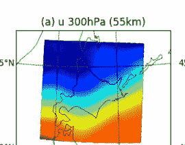
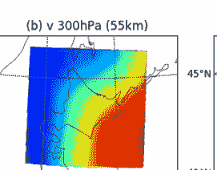
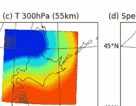
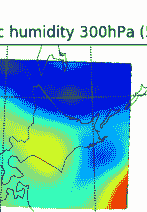
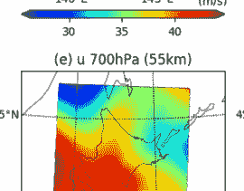
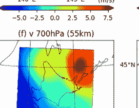
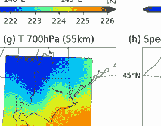
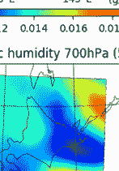
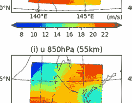
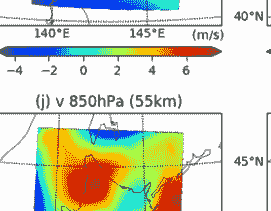
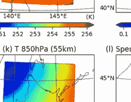
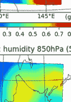
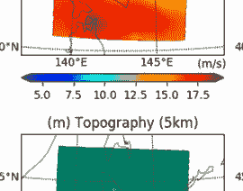
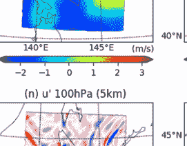
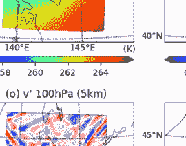
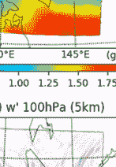

图1. (a-m) 深度卷积神经网络输入数据和 (n-p) 数据真值（ground truth）。

振幅是参数化最重要的量，但仅凭其尺度是不够的。在特定水平上的波数和相速对于描述高层大气中的动量沉积是必要的。这些参数可以通过重力波线性理论获得，其中风波动的每个分量都得到了成功估计。此外，风波动容易与真值进行比较。

分析区域是一个矩形区域（~1,000 km × 1,000 km），如图 1m 所示，包含了日高山脉。将 DSJR-55 数据被裁剪成 128 × 128 的均匀网格以适应其网格系统，为了更好地促进深度学习过程，使用双三次插值法将 JRA-55 数据转换为相同的网格。

## 2.2. 深度卷积神经网络

使用上述数据，我们的模型设计用于学习对流层（300, 700 和 850 hPa）中物理量到低平流层（100 hPa）中波动的每个分量（$u'$、$v'$ 和 $w'$）的转换。独立地处理每个分量可能会破坏重力波具有的初始化，只需要最小化估计误差，这使得训练更容易。此外，为了转换输入数据，我们训练了一个最初设计图像分割的 U-Net 卷积网络 (Ronneberger et al., 2015)，利用收缩路径捕捉每幅图像的上下文，并如图 2 所示的对称扩张路径来学习输入数据与输出数据之间的关系。收缩路径由卷积操作组成，使用 3 x 3 滤波器（'Conv 3 x 3'，图 2 中的蓝色箭头）和 2 x 2 池化（'Pool 2 x 2'，图 2 中的红色箭头）来捕捉局部特征（特征图）。扩张路径由使用卷积滤波器的反卷积操作和借助上采样的采样操作组成，以恢复特征图（'Upconv 2 x 2'，图 2 中的绿色箭头）。上下文信息通过跳跃连接（skip-connections）与编码器侧的相应特征图合并（'Copy 1'，图 2 中的黄色箭头）。每个网格的输出值使用最终滤波器（'Conv 1'，图 2 中的青色箭头）计算。参数设置（如层数以及滤波器大小）与 Matsuka 等人 (2019) 报告的相同。

通过监督学习，我们学习了一个用于测量模型性能的训练集和验证集。训练和验证使用了 1997-2025 年期间29 年的 JRA-55 数据（时间间隔 6 hr；总时间 42,364 hr），测试则使用了 2008-2012 年期间的5 年数据（7,308 天）。在训练和验证阶段，测量了 U-Net 输出与真值（前述的正确输出数据）之间的误差，并使用这些训练数据反复优化模型，直到其在验证数据上的预测误差收敛到特定阈值。误差函数使用表示两者相似性的 Tanaka 系数计算：

$$y = \frac{\sum x_i y_i}{\sum x_i^2 + \sum y_i^2}$$

其中第 $i$ 个网格的 $u'$、$v'$ 和 $w'$ 分别是真值和输出数据。Tanaka 系数适用于正值，范围从 0 到 1。然而，它也可以扩展到负值，除了估计值和真值其中一个为负外没有任何限制。在训练和验证阶段之后，将测试数据输入 U-Net 进行评估阶段。

深度学习的源代码使用 Python 3.6 和 keras (TensorFlow 2.1) 实现，运行在带有四个 Tesla V100 图形处理器单元 (GPUs) 的 NVIDIA 工作站上。29 年数据的单轮训练持续了 89 秒，$u'$、$v'$ 和 $w'$ 误差收敛所需的迭代次数分别为 33、46 和 93 次，对于测试数据的误差分别为 0.764、0.835 和 0.696。对于使用 5 年测试数据进行估计，平均大约需要 16.6 ms。这种计算成本对于开发新的重力波参数化来说是合理的，未来的研究将把所提方法直接应用于大气模型或重力波参数化。

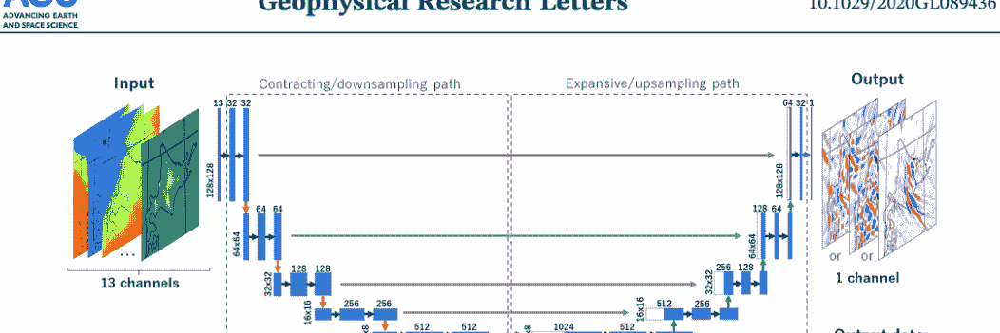

输入数据：
- 风速 (850, 700 hPa)
- 纬向风 (850, 700 hPa)
- 温度 (850, 700 hPa)
- 比湿度 (850, 700 hPa)
- 地形

| DSRA-55 (60 km) | Conv 3x3, ReLU | DSRA-55 (5 km) |
| :--- | :--- | :--- |
| Copy and copy | | |
| Max pool 2 | | |
| U-Net | | |
| Conv 1 | | |

输出数据：
- u' (100 hPa)
- DSRA-55
- v' (100 hPa)
- w' (100 hPa)

**图2.** 每层的多通道特征图用蓝色表示。数字位于左侧和上方。每个操作用箭头表示。

## 3. 结果与讨论

在本节中，展示并讨论了训练 U-Net 对5年测试数据的评估结果。图1给出了 2021 年 11 月 22 日 UTC 00:00 的训练 U-Net 输入数据和真值的示例。U-Net 与真值数据的估计结果（即输出）如图2所示。

动量通量 $\rho u'v'$ 的图如图 3a–3c 所示。$u'$、$v'$ 和 $w'$ 的观测结构在陆地和南岸与真值一致。特别是从北海道中部的日高山脉到东南方向的负向和正向条纹，与真值的结构相似。$u'$ 和 $w'$ 的较大振幅在海上观测到，但未良好表示。

图3g 显示了沿 $A'$–$B'$ 的 $u'$、$v'$ 和 $w'$ 折线图。分析区域南岸的重力波矢量方向。其观测的 $u'$、$v'$ 和 $w'$ 值结构与真值相似。U-Net 的 $u'$、$v'$ 和 $w'$ 最大振幅分别为 -4.58、4.2 和 1.17 m。$w'$ 的值与真值一致，尽管 $v'$ 有微小差异。

图3p–3r 显示了沿 $C'$–$D'$ 的 $\rho u'v'$ 和 $\rho v'w'$ 的波动和量。$\rho u'v'$ 和 $\rho v'w'$ 的负值分别为 -0.83 和 -0.49 m/s²。动量量级 $|\rho u'v'|$|\rho v'w'|$ 的最大值估计结果为 0.87 mPa，真值为 0.93 mPa。$|\rho u'v'|$|\rho v'w'|$ 最大值的微小差异归于估计值与真值之间 $v'$ 的相位偏移（图3h）。

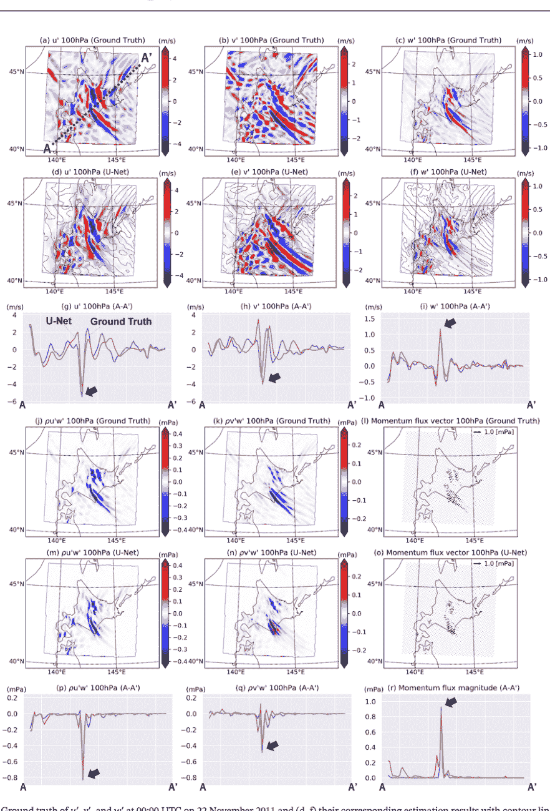

图 3. (a-c) 2011年11月22日 UTC 00:00 u', v' 和 w' 的真值，以及 (d-f) 显示在 0 MPa 处的等值线（虚线）相应结果。(g-j) pu', pv' 和动量通量 (pu', pv') 的真值，以及 (m-o) 显示其相应结果。发射处重力波振幅幅的线图以及 (g) u', (h) v', (i) w', (p) pu', (q) pv', 和 (r) 动量通量幅。其最大振幅由黑色箭头表示。

MATSUOKA 等人

10中的6页

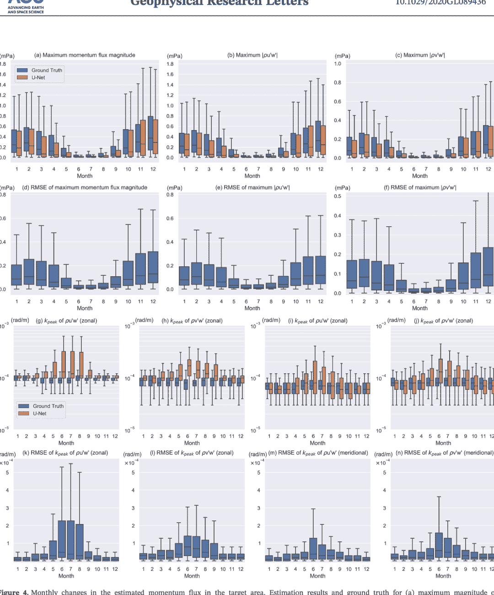

图 4. 目标区域估计动量通量的每月变化。(a) 最大动量通量、(b) 最大 |ρvw|、(c) 最大 |ρvw| 以及 (d-f) 它们的估计误差 (RMSEs) 的估计结果和真值。(g) ρ'w 中的主纬向和 (i-k) 子向波数的估计结果和真值，以及 (h) ρ'w' 中的主纬向和 (j) 子向波数的估计结果和真值，以及它们的估计误差 (RMSEs)。

MATSUOKA 等人

10中的7页

# 地球物理快报

我们还评估了重力波动量通量的水平波数谱。动量通量谱通过 Re[U*W*(k)] 和 Re[V*W*(k)] 计算，其中 k 是水平波数；U, V 和 W(k) 是 u', v' 和 w' 的傅里叶分量；星号 (*) 表示它们的复共轭（例如，Sato 等人，2017）。特征水平波数被估计为谱密度最大的波数，这也是重力波的关键参数。在纬向方向上，两个估计的特征波数 Re[U*(k)] 为 m⁻¹，Re[V*(k)] 为 5.0 × 10⁻⁵ rad m⁻¹，Re[W*(k)] 为 5.0 × 10⁻⁵ rad m⁻¹。不同日期的结果在支持信息中的图 S1 和 S2 中。然而，也识别了主要的动量通量。

最后，我们对目标区域的每月动量通量进行了估计。图 4–6 描述了最大动量通量幅 |u'|、|v'| 和 |w'| 以及真值和估计值的最大 |J| 分布。这三个月份显示，估计值在冬季较大，在夏季较小。这归因于急流的季节性运动，这在这些期间更为频繁，这意味着从云底到地面的强度大得多，从而触发了重力波。这种季节性变化在有限的年内被观察到。4月份重力波活动较高。12月份当动量通量最强时，|u'| 和 |v'| 的估计值分别为 0.23 和 0.14 m/s，而它们的值低于真值。这可能归因于上方中估计的 u', v' 和 w' 相位的不匹配。此外，动量通量幅 |u'|、|v'|、|w'|、最大 |J| 和最大 |J| 的估计误差 (均方误差 (RMSEs)) 分别在图 4–6 中所示。冬季较大，夏季较小。在12月份观察到最大动量通量的 RMSE：动量通量幅 |u'|、|v'|、|w'|、最大 |J| 和最大 |J| 的 RMSE 约为 0.32、0.30 和 0.70 m/s。图 4–g 显示每月动量通量的纬向和子向波数的真值和估计值。真值在全年变化不大。估计值为 -8 × 10⁻¹ 到 -1 × 10⁻¹，与冬季的真值一致良好。图 4–k 显示每月特征水平波数的误差 (RMSE)。纬向波数的平均误差约为 1.1 × 10⁻⁵，约为真值的 10%；而夏季平均误差约为 0.3 × 10⁻⁵ 到 5.0 × 10⁻⁵，约为真值的 30%。

4. 结论

本研究证明了深度卷积神经网络 (U-Net) 估计重力波参数的性能。大气层 850、700 和 300 hPa 的低分辨率数据以及高分辨率地形数据正确识别 (u', v', w')。波数等参数可以使用 U-Net 进行适当估计，特别是在冬季重力波活跃时。通常，学习技术的结果取决于神经网络层的选择、训练数据的输入以及物理量的定义，因此需要对方法进行优化。

## 数据可用性

JRA-25 和 JRA-55 从 https://kjishu.org 获取。

## 致谢

这项工作受到日本科学技术厅 JST (Grant No. 1777) 和 JST (Grant No. 1663) 的资助。

## 参考文献

- Alexander, M., Liu, J., Kobayashi, S., and Sun, F. (2010). 观测的重力波通量。Quarterly of the Royal Meteorological Society, 139(728), 2481–2495. https://doi.org/10.1002/qmd
- Chun, H., & Baek, J. (1996). 动量通量和急流。Journal of the Atmospheric Sciences, 53(12), 2212–2228. https://doi.org/10.1175/15230
- Dunkerton, T. (1984). 平流层中的重力波。Journal of the Atmospheric Sciences, 41, 1003.
- Ern, M., Alexander, M., Liu, J., and Petella, F. (2017). 大气中深度学习的评估。Nature Geoscience, 10(9), 632–636. https://doi.org/10.1038/s41467-018-0733-y
- Gagne, D., Hirschman, M., Kobayashi, A., and Hamholtz, A. (2020). 使用深度学习研究气候变化。Journal of Advances in Machine Learning, 10, 2548–2563. https://doi.org/10.1002/jaml.2018
- Harada, Y., Takada, K., Kimura, E., and Endo, S. (2016). 国家尺度再分析。Journal of the Meteorological Society of Japan, 95(5), 711–725. https://doi.org/10.2115/skj014
- Krizhevsky, A., Fischer, P., and Bengio, R. (2017). U-Net: 医学医学图像分割。Medical Methods in Computer Science, 951, 231–244. https://doi.org/10.1007/978-3-319-24554-4
- Matsumoto, D., Sagunagi, K., Kawaguchi, S., Arasaki, F., and Otsuka, Y. (2019). 大气风暴自动检测。Geophysical Research Letters, 154, 31132. https://doi.org/10.1029/2019GL03132
- Ploughough, R., Zhang, F., and Perth, G. (2014). 使用深度学习表示气候模型中的子过程。Proceedings of the National Academy of Sciences, 115(39), 9684–9689. https://doi.org/10.1073/pans.14182061
- Sato, K. (1994).  { MU 雷达观测的低平流层惯性重力波结构和来源的统计研究。Journal of Atmospheric and Oceanic Physics, 560, 755–774. https://doi.org/10.1016/0199-0182(94)90061-X

# 地球物理快报

Sato, K., Kohma, M., Tsutsumi, M., & Saito, T. (2017). 雷达观测揭示了南极夏季大气层风波动的频谱和模式。Journal of Geophysical Research: Atmospheres, 122, 2–19. https://doi.org/10.1002/2016JD025528

Sato, T., Watanabe, S., Kawasaki, S., & Kawatani, Y. (2012). 高分辨率中大气大气环流模型揭示南半球重力波特征。Journal of the Atmospheric Sciences, 69, 1378–1396. https://doi.org/10.1175/JAS-D-11-3

Sato, K., Watanabe, S., Kawasaki, Y., Tomikawa, M., Miyazaki, K., & Takahashi, M. (2009). 大气重力波速度的起源。Geophysical Research Letters, 36, E8005

Silva, J. S., Held, C., Cavel, R., Sannammilla, L. A., Müller, J. W. (2019). 臭氧干沉速度的深度学习参数化，46, 963–989. https://doi.org/10.1029/2018GL081033

Tsuchimoto, T. (1995). *地球海洋系统中的大气动力学* (第16卷，28). 纽约：国际商业公司。

Tay Y., K., & Kim, J. (2002). 一种减少卫星降水产品偏差的新统计框架。Journal of Hydrology, 79, 941–955. https://doi.org/10.1016/S0021-1809(01)00113-X

Tsuda, T., Murakami, Y., Yamamoto, M., & Kubo, F. (1994). MI雷达观测到的水分通量季节性变化。Geophysical Research Letters, 21(7), 1260–1267. https://doi.org/10.1029/1994GL0000725

Wang

Watanabe, S., Kawatani, Y., Tomikawa, M., Miyazaki, K., Takahashi, M., & Sato, K. (2008). T213-d3 中层大气球面环流模型的一般方面。

Wright, C. J., Hindley, N. P., Hoffmann, L., Alexander, M. J., & Mitchell, N. J. (2017). 利用3D近平流层技术探索重力波特征：对南安德斯山脉和德雷海峡的AIRS/AQUA测量。Atmospheric Chemistry and Physics, 17, 8553–8575. https://doi.org/10.5194/acp-17-8553-2018

