# 人工智能与机器学习在医疗健康的应用


## 编辑

S Balamurugan 博士, SMIEEE, CEng. Radhey Shyam Meena

[ACM 特别演讲员,] 新能源与可再生能源部部长- 阿伯特·爱因斯坦工程与研究实验室 (AEER Labs)，印度 印度政府，新德里 印度可再生能源协会副主席

Ramasamy V 博士，PhD，计算机科学系副教授，Vel Tech Rangarajan Dr.Sagunthala R&D 科学与技术学院（认定大学），钦奈，泰米尔纳德德邦，印度。

我们荣幸地将《人工智能与机器学习在医疗保健中的应用》这本书献给所有作者、贡献者、评审人和编辑。

人工智能和机器学习技术在转型下一代医疗保健应用方面具有巨大潜力。本书旨在涵盖人工智能技术在疾病诊断、远程患者监控和辅助医疗提供者方面的广泛应用。

第一章介绍了不同的基于 AI 的医疗服务的比较和作用。由于使用电子健康记录、脑成像和其他传感系统的 AI 可以预测问题，它大大降低了死亡率。新冠 19 疫情导致了远程医疗的大规模采用，这在本本书的涵盖范围内。

自然语言处理和机器学习可以用于发现个体的问题，结合其社交媒体存在可以成为识别个人心理健康的有效工具。这些信息可以协助医疗从业人员识别特定问题并指导治疗。本章还讨论了收集数据和训练基于 AI 的系统的局限性。

第二章介绍了 IoT 功能及其与传感和无线技术的应用，用于实现所需的压力监控系统。司机经历的压力状况是道路安全中的严重问题。人为错误是道路事故的最常见原因。

在本章中，通过皮肤电导分析司员的睡意疲劳和心理压力。为了最大限度地减少驾驶中的人为错误，系统通过测量生理参数（如像导体的皮肤）来监控压力和疲劳，这种反应也称为皮肤电反应。用于司机健康管理的 IoT 传感器是传统方法（包括去医院进行临床程序和对人员进行持续监督）的一种新方法。它通过智能设备将医疗专业人员与司机连接起来，监控生命体征而不影响司机的活动自由。此外，采集的数据被发送到 IoT 云端，在那里部署机器学习算法来计算警觉压力的百分比。如果压力水平超过阈值，蜂鸣器将向司机发送警报信号。

第三章旨在评估灾剧情况，考虑到其传播深度，并做出智能假设和预测，以帮助各方采取适当措施阻止疾病蔓延。新冠 19 疫情造成了巨大的恐慌以及巨大的经济、社会、政治和国际挑战。

使用新冠 19 时间序列数据集进行分析，揭示了 16 个西非国家新冠 19 的确诊、活跃、康复和死亡病例。使用三种机器学习算法 `Polynomial Regression (PR)`、`Support Vector Machine (SVM)` 和 `Neural Network (NN)` 执行了预测。在考虑研究采用的三种技术生成的的结果时，多项式回归模型给最好的结果。

第 4 章介绍了一种通过互补金属氧化半导体（CMOS）读取电路来早期检测帕金森病（PD）这种神经系统疾病的方法。该电路通过电极测量并放大大脑中电信号形式的低水平多巴胺。神经元释放的神经递质化学物质是大巴胺在大脑中的主要功能之一。模数转换器（ADC）用于将放大的模拟信号转换为数字信息。机器学习算法用于根据从读取电路接收的数据来预测疾病。多巴胺水平以电流测量，范围从 `pA` 到 `nA`。`CMOS` 放大器在生物放大器的帮助下，用于增强毫伏（`mV`）范围内的采集信号。为了将 `pA` 范围内的采集电流转换为幅度为微伏（`µV`）的电压，使用了称为跨阻放大器（TIA）的 `CMOS` 前端电路。本章提供了一种用于检测和预测帕金森病的低噪声、低功耗 `CMOS` 机器学习读取电路的完整设计与分析。


第 5 章讨论了 IoT 架构，其中包括支持医疗管理层和应用的设备对应协议，以及使用机器学习和人工智能算法的应用程序。通过 IoT 进行远程通信的应用极易受到安全风险的影响。目前大多数应用程序已转向远程化，将 IoT 作为一种创新技术来实现其特定目标。IoT 被认为是互联网的未来。由于通信技术的倍增、应用协调设备和服务的可用性、整合和使用，物联网（Web of Things）预计在未来将迅速填充医疗领域。此外，在这场疫情期间，患者健康监测边界的集成和有效通信至关重要。此外，还探讨了数据安全、安全和兼容性方面的挑战。本章还包含了一些实时医疗案例，其中决策由示例算法做出，并将其解决方案提交给用户。

## 第 6 章

第 6 章旨在开发一种与医疗专业人士关于饮食和营养建议目标一致的应用程序，将其作为健康生活方式的主要因素。这为菲律宾民众提供了一种通过饮食来监测、评估和可视化其健康状况的方法。该应用程序开发利用了人工智能，通过 `K-means` 聚类和使用 `ResNet` 架构的 `Image Classification` 进行饮食和营养分析，利用云技术存储饮食记录，并利用增强现实（AR）进行可视化。该应用程序开发取得了以下结果：通过 `K-means` 算法进行的饮食分析显示，菲律宾人的饮食可以分为三类，每类都构成了不同的健康风险和疾病，而 `ResNet-18` 分类器在分类 15 种不同的菲律宾食物方面的准确率达到了 81%。

第 7 章提供了多种噪声滤波算法，用于准确诊断以及感兴趣区域的清晰图像细节，这些对于读取受影响器官/细胞/组织的细微细节是必要的。在成像中，伪影是捕捉人体器官、组织或细胞的预期图像和位置时的主要问题。本章将提供过滤后的图像，从而帮助医疗专家通过感兴趣区域获得清晰图像来诊断疾病。人工智能的兴起是未来医学成像模式的主要支撑，因为它在目前已经超越了批评者。它能够以高精度和准确性处理大量的医疗图像，并具有肉眼不可见的精细细节。人工智能在医学成像领域的蓬勃发展将为医疗专家提供增值任务，从而增强患者互动。

第 8 章介绍了关于大数据维度以及万物互联（IoE）在医学领域意义的研究综述。根据世界卫生组织（WHO），持续的患者监测被认为是医院的最高标准。医疗行业数据量的增长使得在提高医疗服务质量范围内的大数据技术变得可预测。大数据通过管理许多 Technoarte Publishing `v` 在医学行业发挥着重要作用。

第 9 章开发了一个名为 `Nutrify` 的应用程序，帮助诊断为 2 型糖尿病（T2D）的人规划饮食。饮食计划包含了卡路量和宏营养素分布。`decision-tree` 算法负责应用程序计算的饮食变化、宏营养元素的合理分配以及计划有效性的优化。所开展的调查显示，对于所有参与者的响应，受访者对该应用程序非常满意，得分为 4.62 分。然而，由于产生具有统计学意义结果的时间较短，配对 t 检验的结果无法证明应用程序在管理用户体重方面的有效性。结论，本章开发了一个应用程序，可以为用户生成饮食计划并创建饮食目标，帮助用户保持健康并避免现有的健康状况恶化。

第 10 章概述了医疗物联网（IoMT）的运行方式，以及它如何通过现代技术改善许多患者的生活。`IoMT` 是一种医疗设备，允许人们随时随地检查患者的健康状况，包括利用 `ECG` 传感器监测体温、脉搏和心跳，温度、压力和观察。`IoMT` 协助医生识别和诊断 COVID-19 感染患者，并利用人工智能、远程医疗和先进传感器技术协助他们提供适当的治疗。这还包括 `IoMT` 的设计和概述，以及医疗行业中的众多活动、弹出技术和医学应用中的若干 `IoMT` 案例研究。它还列出了 `IoMT` 的网络安全规则，并指出了议会和社区部门需要解决的问题。

第 11 章介绍通过使用名为人工智能（AI）的数学算法机器提供了一种革命性的解决方案，以应对人类在数据处理方面的局限性。由于生活方式的演变最终损害了人类的健康状况，导致了无论年龄大小，人类各种各种疾病日益增加。另一方面，来自广泛医疗领域的海量医疗数据挑战着人类的大脑。人工智能的应用追溯到从疾病诊断到治疗的医疗流程。人工智能通过算法处理（诊断、图像处理、药物发现、数字病理、肿瘤学、突变识别）等海量数据，在临床领域发挥了其关键作用。人工智能的一个主要子集是机器学习（ML），它利用由人工神经网络（ANN）组成的高级算法与人类认知能力进行竞争。

 癌症、糖尿病、心脏病以及神经和心理障碍等疾病的复杂本质也可以在人工智能的帮助下揭示。人工智能执行的医疗相关数据库处理提供了高准确且清晰的数据。总体而言，人类智能利用人工智能评估其庞大的健康数据库需求。

我们衷心感谢所有作者的及时支持，并考虑选择本书出版他们的优秀作品。我们也感谢所有审稿员在稿件处理各个阶段提供的友好合作。最后，我们感谢 Technoarete 出版社制作本书。

S.Balamurugan Radhey Shyam Meena Ramasamy V 2022 年 11 月

## 致谢

《人工智能与机器学习在医疗保健中的应用》一书的编辑感谢所有作者、合著者和贡献者的及时支持，并考虑选择本书出版他们的优秀作品。

我们对所有审稿员在稿件处理各个阶段提供的友好合作表示感谢。最后，我们感谢 Technoarete 出版社制作本书。


**S.Balamurugan 博士，SMIEEE**，ACM 卓越演讲，是印度阿尔伯特·爱因斯坦工程与研究实验室的主任。他在印度哥尔巴塔尔的 PSG 技术学院获得 B.Tech 学位，在印度安纳大学获得 M.Tech. 和博士学位。他已出版了 60 多本书，在国际/国家期刊/会议上发表了 300 篇文章，并拥有 200 项专利。他还是印度可再生能源学会（RESI）的副主席。他担任许多公司、初创企业、中小企业和微型企业的研究顾问。他是几个丛书系列的主编，并在几本国际期刊中担任多种编辑职务。他在国家和国际水平上获得了多次研究奖项。

其中包括：

- 由新德里最高法院 O.P. Saxena 法官阁下颁发的 Rashtriya Vidhya Gourav 金质奖和最佳教育家奖。
- 三项终身成就奖
- 由印度西西姆邦前州长 Balmiki Prasad Singh 博士颁发的 Dr.A.P.J.Abdul Kalam 睦谊奖
- 由印度总秘书 Gurpreet Singh 先生颁发的 印度之宝奖
- 由泰国前副总理 Korn Debbaransi 先生颁发的 亚洲之星奖
- 由印度果亚立法议会副议长 Anant V.Sheth 博士颁发的亚洲骄傲卓越研究奖
- CSI 青年 IT 专业人员奖
- 国家 CSI 青年奖

**Ramasamy V 博士**于 2006 年获得钦奈伊安纳大学的 B.E. 学位，2009 年获得提鲁奇拉帕利伊安纳大学的软件工程 M.E. 学位，2021 年获得钦奈伊安纳大学的计算机科学博士学位。他目前担任印度泰米尔纳德德邦钦奈 Vel Tech Rangarajan Dr.Sagunthala 科学技术学院（认定大学）计算机科学系的副教授。他的兴趣领域包括移动云计算、物联网、数据科学、人工智能和机器学习。他在国家和国际期刊及会议上发表了多篇学术研究论文。他是《Technoarete 计算机应用技术进展》（TTACAT）期刊的主编辑。他还是 Technoarete 出版社几本书的图书编辑。他是 MMTC Communications - Frontiers (IEEE COMSOC) 中未来物联网通信创新的客座编辑。他是 IFERP 创新项目种子资金计划的评估委员会成员。他是计算与智能工程国际会议（ICACIE）的组织主席以及高级通信与机器智能（MICA）组织委员会成员。

**Radhey Shyam Meena 先生**是一位拥有 8 多年技术商业经验的电力部门专家。他于新德里的新电力和可再生能源部（MNRE）工作。他还在坎普印度理工学院攻读电力部门监管、经济和管理的电子硕士学位。此外，他在拉贾斯斯坦技术大学完成了 B.Tech. 和 M.Tech. 学位。他还是 25 项国家/国际专利的发明人/共同发明人。除了这些之外，他还合著了 6 本书，并有 51 多篇同行评审的期刊/会议出版物。他积极参与 IEEE、IET CIGRE、RESI、SESI IAENG、IEI 等多个技术机构。

**Shivangini Saxena 博士**，米雅普尔德邦印多尔 SAGE 大学电子与通信工程系

**Madhvi Singh Bhanwar 教授**，米雅普尔德邦印多尔 SAGE 大学电子与通信工程系

**Pallavi Pahadiya 博士**，米雅普尔德邦印多尔 SAGE 大学电子与通信工程系

**Akhilesh Upadhyay 博士**，米雅普尔德邦印多尔 SAGE 大学工程院长，SIRT 负责人

**S.M Revathi**，印度阿拉尼大学工程学院 ECE 系助教授

**R.Srinivasan 助教授**，印度莫达亚尤尔安纳马莱学院工程学院 EEE 系助教授

**C.R Balamurugan 教授**，印度哥尔巴塔尔 Karpagam 工程学院 EEE 系教授

**H.Kareemullah 助教授**，B.S.Abdur Rahman 新月科学与技术学院 EIE 系

**Michael Segun Olajide**，尼日利亚奥恩多 Adeyemi 师学院计算机科学系

**Adekola Alex Ajayi**，尼日利亚奥恩多 Adeyemi 师学院计算机科学系

**Oladoyin Anthony Abiodun**，英国兰卡斯特大学计算与通信学院

**Oluwagboyega Peter Afolabi**，尼日利亚奥恩多 Adeyemi 师学院计算机科学系

- **Shaneth C. Ambat 博士，** 计算机科学与多媒体学院，项目主任，菲律立大学科技学院（FEU Institute of Technology）
- **Hezekiah John V. Rizan，** 菲律宾菲律立大学科技学院
- **Rom Braveheart P. Leuterio，** 菲律宾菲律立大学科技学院
- **John Patrick G. Chua，** 菲律宾菲律立大学科技学院
- **Chrys Uoie A. Salazar，** 菲律宾菲律立大学科技学院
- **Hadji J. Tejuco 博士，** 计算机科学与多媒体学院，教职，菲律立大学科技学院
- **Anthony D. Aquino，** 计算机科学与多媒体学院，教师，菲律立大学科技学院
- **S. Rajalaxmi 博士，** 副教授兼生物医学工程系主任，泰米尔纳纳德邦塞勒姆，马亨德拉工程学院学院。
- **Justine Rose R. Cale，** 菲律立大学科技学院，学生，马尼拉桑帕洛克 P. Paredes 街
- **Czarina G. Castillo，** 菲律立大学科技学院，BSCSSE 学生，马尼拉桑帕洛克 P. Paredes 街
- **Oliber M. De Leon，** 菲律立大学科技学院，学生，马尼拉桑帕洛克 P. Paredes 街
- **Royce Christian N. Esguerra，** 菲律立大学科技学院，学生，马尼拉桑帕洛克 P. Paredes 街
- **May Florence D. San Pablo，** 菲律立大学科技学院，教师，马尼拉桑帕洛克 P. Paredes 街
- **Piyush Gupta，** 研究学者，计算机科学与工程系，UIT RGPV 博帕尔
- **Bhupendra Verma 博士，** 计算机科学与工程系，UIT 博帕尔院长
- **Mahesh Pawar，** 副教授，信息技术系，UIT RGPV 博帕尔
- **Varsha Jacqulyn，** 助理教授，生物工程系，生物技术学士，钦纳伊维尔科学技术与先进研究学院 (VISTAS)
- **R. Thiruchelvi 女士，** 生物工程系二年级学生，生物技术学士，维尔斯科学技术与先进研究学院 (VISTAS)
- **K. Rajakumari 女士，** 助理教授，生物工程系，生物技术学士，钦纳伊维尔科学技术与先进研究学院 (VISTAS)
- **Krishna Priya Kumar，** 产学合作小组，国家食品技术、创业与管理学院- 坦纳武尔 (NIFTEM-T)，印度坦纳武尔。
- **Padmashree Baskaran，** 生物技术系，拉贾拉克什米工程学院，印度钦纳伊。
- **Anitha Thulasisingh，** 生物技术系副教授，拉贾拉克什米工程学院，印度钦纳伊。

**前言** ………………………………..………………………………………………………. iii

**致谢**…………………………………………………………………………. viii

人工智能在心理健康中的作用……………………………………………… 1

*Shivangini Saxena 博士，SAGE 大学，印度印多尔，马德雅亚·普拉什德邦*

*Madhvi Singh Bhanwar 教授，SAGE 大学，印度印多尔，马德雅亚·普拉什德邦；Pallavi Pahadiya 博士，SAGE 大学，印度印多尔，马德雅亚·普拉什德邦；Akhilesh Upadhyay 博士，SAGE 大学，印度印多尔，马德雅亚·普拉什德邦*

可穿戴设备上的驾驶员疲劳检测 14

*R Srinivasan，安纳马莱工程学院，哥印巴特尔*

跨国疾病传播的评估……………………………… 23

*Oluoyin Anthony，英国*

基于物联网的帕金森病检测………………………………38

*Sudhakar,H，工程大学*

用于医疗分析的机器学习算法………………49

*Vishweshkumar,A，大学*

了解你的餐盘：基于人工智能的饮食分析…………63

*Shaneth C. Ambat 博士，菲律立大学科技学院*

诊断与预后中的图像处理模式…………74

*S. Rajalaxmi 博士，马亨德拉工程学院*

万物互联医疗行业的大数据历程……87

*Piyush Gupta，UIT*

NUTRIFY：糖尿病患者的饮食计划制定………………………………94

*Varsha Jacqulyn，维尔斯科学学院*

医疗物联网 (IoMT) – 医疗应用及其网络安全……………100

*R. Thiruchelvi 女士，维尔斯科学学院*

医疗分析中的人工智能………………………………113

*Krishna Priya Kumar,NIFTEM-T*

### 摘要


人工智能（AI）在包括医疗保健系统在内的多元化应用中找到了巨大的空间。由于数字化的加速和生活方式的改变，许多人面临着精神疾病等健康护理问题。如今，AI 已被用于通过肿瘤、囊肿、癌症、皮肤科问题等分析来帮助医疗卫生工作人员。鉴于病例的不断增加，医疗领域对 AI 产生了迫切需求，特别是在心理健康护理方面。许多电子系统被用于健康数据分析，因此在系统中引入 AI 可以帮助患者。由于疫情的影响，健康问题有所增加，这推高了使用 AI 的心理健康护理系统的需求增长。由于 AI 可以提供个性化护理、远程访问、患者指导、在线医生建议等服务，AI 可用于识别高风险个体，还可以提供干预以治疗和预防精神疾病。本工作展示了不同基于 AI 的心理健康分析的比较和作用。AI 利用电子健康记录、脑成像和其他传感系统可以预测个体出现的问题，帮助监测患者的进展，帮助医生在需要时调整治疗方案，并有助于减少自杀问题。除了识别患者的特定问题外，AI 还可以帮助患者根据其问题分配合适的治疗师。因此，患者能够在正确的时间获得正确的治疗。它还可以指导护理人员按时给药。自然语言处理和机器学习可用于发现个体的问题，结合其社交媒体上的存在可以成为识别心理健康问题的有效工具。这些信息可以协助医疗从业人员识别特定问题并指导治疗。本文还讨论了收集数据和训练基于 AI 的系统的局限性。此外，详细描述了技术局限性和挑战。

在智能世界中，AI 以巨大的用途进入了许多领域，其中医疗保健最为重要，如放射学、皮肤科、肿瘤学等。在所有领域中，心理健康护理中的 AI 变得非常重要，因为它是人体的重要部分。通过 AI 的帮助，发现人类疾病的能力大大提高，因此对任何患者进行及时的预防和治疗成为可能，并被证明非常成功。AI 与电子健康记录、基于传感器的监测系统、脑图像和社交媒体平台来预测和分类精神疾病以及自杀因素。AI 帮助在初始阶段诊断心理健康状况，并开具治疗方案帮助人们获得适当护理。它还了数据库的隐私。这项智能工作是由人工智能完成的 [1]。

## 1.1 人工智能在心理健康护理中的参与

AI 在心理健康护理中有许多优势，但在实施路径上也面临许多挑战。技术正在医疗保健系统中快速发展，技术的每一次升级，其核心关注点都是提高患者的可治结果。在所有领域中，心理健康护理非常重要，并且正通过远程医疗服务走向数字化。通过使用远程医疗，心理健康是可以在不丢失核心精髓的情况下交付的重要领域之一。数字健康需求的增长需要在医学科学中始终保持谨慎的技术，即人工智能 [2]。

在疫情期间，发现对数字心理健康服务有巨大需求，特别是美国年龄在 13 到 24 岁之间的人群，以避免每年的自杀，甚至为了避免每秒钟的自杀 [2]。

## 1.2 AI 在医疗保健支持系统的应用

如今，由于技术的进步，人工智能在医疗保健支持系统中找到了巨大的空间。AI 可以帮助医疗保健，目前正进行许多针对性的研究，以支持每个医学领域。某些领域如虚拟护理、基于 AI 的疾病医学诊断、医学图像/数据分析、AI 辅助机器人手术是应用的热点 [3]。如图 1 所示，AI 可以通过远程护理虚拟地协助患者。还可以进行大规模的图像/数据分析。根据市场需求，可以为特定区域设计药物。

Dr. Shivangini Saxena– “人工智能在心理健康护理中的作用” 页码：1– 13.


https://dx.doi.org/10.36647/AAIMLH/2022.01.B1.Ch001


### 1 距离协助


### 基于 AI 的


### 基于 AI 的医学手术


### 诊断


### 药物设计分析医学图片

 **图 1:** AI 在医疗保健中的应用 [3]

AI 可以帮助审查临床数据和图像，以支持医生判断疾病识别。它可以帮助心脏病专家、放射科医生、精神科医生和神经科医生等识别关键见解，以便优先处理重要患者。AI 中使用的算法可以以极快的速度分析大型数据集，并可以识别和分类模式以预测疾病。AI 可以通过对使用的数据集进行预先分析帮助医生判断疾病。因此，整个过程使医疗专业人员能够快速追踪关键信息，这些信息在以前非常耗时，并可能导致死亡率增加。AI 可以帮助精神疾病识别，并支持医生和药制造商提供准确的药物。图 2 显示了 AI 如何帮助医疗保健和心理健康护理。

根据图片，可以收集并存储来自医生/放射科医生的非结构化数据以准备数据库。可以使用任何监督学习算法（如`支持向量机`（`SVM`）、`机器学习` `卷积神经网络`）对数据库进行分析，以根据训练进行分类。这些数据库和结果可以供新研究人员用于提出创新想法或新算法，以提高分类的准确性和可靠性。`组学数据` [4] 和其他数据可以在实验室中进行验证，并为特定疾病开发新药。

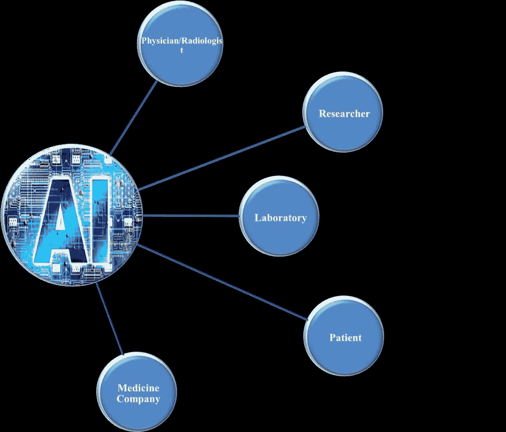 **图 2:** AI 在医疗保健和心理健康护理中的应用 [4]

当我们谈论 AI 在医学领域的工作时，发现这种技术具有从海量细节中获取数据的能力。以前有一场名为遗传学的革命，通过它可以提供心理健康状况。通过神经成像可以识别大脑的工作原理。这些重要数据可以用于照顾患者，但问题在于无法每天跟踪治疗数据。

正如专家 Prochaska 所说，“聊天机器人对于人们讨论疾病或任何查询非常有帮助，因为这项服务是 24*7 全天 way”。此外，这些服务是免费的，使得它们更有帮助。新更新的技术也具有减少群体面临的困难和挑战的能力。一个针对女恋、同性恋、双性恋、跨性别、酷儿及质疑性别者（LGBTQ）年轻人的机构已经认可 AI 非常有用。AI 特别为 LGBTQ 青少年提供服务，因为这些青少年在生活中经历过不公正的创伤。

据观察，谈论健康问题有很多困难之处，而各种平台上提供的 24*7 服务可以确保沟通和对话的顺畅进行。AI 具有许多克服困难的优势。AI 具有像人类一样的智能潜力，但不能说它可以取代人类，不过可以说 AI 的存在是为了帮助他们，因为人与人之间的连接非常重要，而技术无法有效地做到这一点。AI 的设计并不是为了取代咨询师，而是为了帮助和支持他们。AI 的使用取决于许多因素。在未来，AI 可以帮助研究精神疾病是如何增长、传播以及如何治疗它们的 [2]。

在心理健康护理中使用 AI 非常有趣。为了良好照顾精神疾病患者，AI 扮演着非常重要的角色，这在某种程度上排除了与医疗执业者的咨询。并不是说我们不需要医生，但我们可以像任何医生一样借助 AI 来诊断疾病。这种治疗是根据患者病史和患者问卷收集的数据的。医生根据他们的知识进行大量分析。目前还没有明确说 AI 可以取代医生的需求 [5]。AI 具有人类的特征，例如倾听、理解和解决问题。通过检查个人的面部表情、语音语调、演讲和陈述长度，可以在早期进行识别。

## 2.1 AI 在心理健康支持系统中的应用

人工智能可以有效地用于改善心理健康并在远距离治疗心理问题。与直接的一对一接触治疗相比，它具有许多优势，如图 3 所示[6]。

24X7 可用

``

地址 / 社交 / 污名

``!`` 成本低 / 支持 / 共情

`` 更高 / 准确性

`` 提高 / 可预测性

`` **图 3:** AI 对心理健康管理的优势 [6]

**表 1: 心理健康护理中 AI 与一对一咨询的比较**

| 参数 | 一对一咨询的心理健康 | AI 支持支持的心理健康 |
| :--- | :--- | :--- |
| **可用性** | 24X7 | 随时随地 |
| **社交问题** | 不存在社交恐惧，任何人都可以寻求帮助而无需担心被社交知道 | 存在社交恐惧，人们因社交恐惧而避开。 |
| **可预测性** | 由于大型数据库，其性很高 | 低 |
| **成本** | 较低 | 高 |
| **范围** | 任何地方 | 取决于医生的可用性 |
| **准确性支持** | 高 | 取决于医生的可用性 |

## 2.2 AI 在心理健康支持系统中的应用

人工智能可以有效地用于改善心理健康并在远距离治疗心理问题。与直接的一对一接触治疗相比，它具有许多优势，如图 3 所示[6]。

24X7 可用

``

地址 / 社交 / 污名

``!`` 成本低 / 支持 / 共情

`` 更高 / 准确性

`` 提高 / 可预测性

`` **图 3:** AI 对心理健康管理的优势 [6]

**表 1: 心理健康护理中 AI 与一对一咨询的比较**

| 参数 | 一对一咨询的心理健康 | AI 支持支持的心理健康 |
| :--- | :--- | :--- |
| **可用性** | 24X7 | 随时随地 |
| **社交问题** | 不存在社交恐惧，任何人都可以寻求帮助而无需担心被社交知道 | 存在社交恐惧，人们因社交恐惧而避开。 |
| **可预测性** | 由于大型数据库，其性很高 | 低 |
| **成本** | 较低 | 高 |
| **范围** | 任何地方 | 取决于医生的可用性 |
| **准确性支持** | 高 | 取决于医生的可用性 |

## 2.2 AI 在心理健康支持系统中的应用

人工智能可以有效地用于改善心理健康并在远距离治疗心理问题。与直接的一对一接触治疗相比，它具有许多优势，如图 3 所示[6]。

`` **图 4:** AI 的特性 [5]

**a) 全天候**

24*7 服务模式存在一些局限性。

**b) 早期检测**

AI 在早期阶段识别疾病的症状。

**c) 正确性**

AI 具有正确检查的能力。

**d) 成本效益**

在监督学习训练中，使用标记数据进行分类。在半监督学习中，两者都得到使用。

**e) 共情帮助**

从软件中获得共情是不常的。

**f) 弥补鸿沟**

AI 弥补了患者之间的鸿沟。[5]

### 4.1 机器学习

机器学习（ML）是人工智能的一个分支，与计算机科学并，强调使用数据和算法来提高其准确性。机器学习的一些示例包括系统的预测性维护、检测欺诈、过滤垃圾邮件、检测恶意软件等 [6]。

机器学习通常用于任何企业以了解客户的行为、选择，并以开发新产品。通常使用数字营销的公司也使用机器学习通过跟踪最后的搜索来了解客户的选择，并为客户提供过滤后的产品。此类算法帮助客户浏览自己的喜好，对公司针对目标群体也有好处 [7]。

在神经网络中，存在被称为人工神经元的连接节点。这些神经元具有权重，权重会根据信号强度而增加或减少。两个节点相互连接。神经元可能具有阈值，只有当信号高于阈值时才能通过。神经网络（ANN）可以是多层的。信号通过多次遍历中间层从输入层传递到输出层。系统通过给定数据进行训练，以便输出层产生输出。输出与预期输出之间的差异称为误差；它用于再次调整神经元的权重。在 ANN 中，学习可以通过监督学习、无监督学习、半监督学习、强化学习和自学习进行。图 6 显示了 ANN 的节点和不同层 [8]。

### 输入层

输入层 隐藏层 输出层

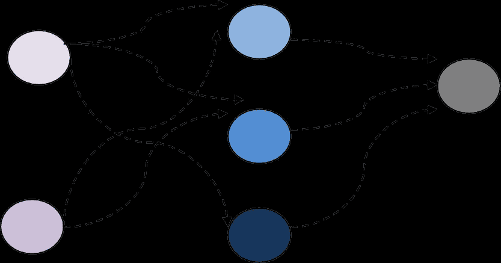 **图 6：** 人工神经网络节点连接 [8]

简单的 CNN 包含卷积层、池化层和特征提取层。图 7 展示了一个具有两个隐藏层的示例之一。

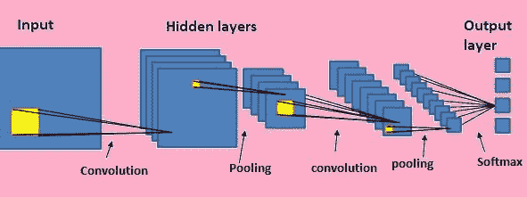 **图 7：** 具有 2 个隐藏层的卷积神经网络 [4]

在卷积层中，输入图像与称为卷积核（kernel）的给定滤波器进行卷积以产生中间输出。池化层用于引入变异性，以便识别任何形状大小的相同数据。最后是特征提取层，它对输出进行扁平化。卷积神经网络通常用于寻找任何物体、视频、字母识别等。

AI 技术执行心理健康保健并处理不同的风险。本章描述了 AI 及其在医学科学中的应用。AI 将如何工作、其局限性，以及在近期研究和临床方面将如何受益。心理健康保健中的 AI 研究表明，它使用了脑成像数据、心情评分表、电子健康记录（EHR）、如手机等先进监控系统和其他电子设备、社交媒体平台、抑郁、自杀念头和尝试、精神疾病状况等。在所有这些问题上，AI 证明了它是心理健康领域高准确率的最佳示例。然而，为了避免偏差，谨慎和预防非常重要，AI 工作中有很多需要做的事情，以便 AI 能够满足心理健康保健和医疗问题的工作 [9]。

### 5.1 COVID-19 期间人工智能在心理健康中的作用

众所周知，在 COVID-19 期间，人们遭受了心理健康问题的困扰。巨大的心理压力加剧了心理健康的痛苦。在此期间，几乎每个国家的心理健康治疗都非常匮乏。随后，人工智能在一些城市国家发挥了重要作用，帮助人们从心理健康的痛苦中解出来。识别和意识对于在早期发现人员疾病变得非常重要，以停止心理健康疾病和自杀活动造成的严重悲剧。由于药物短缺以及个体疾病症状和行为的独特性（医疗人员无法轻易进行诊断），要识别心理状态非常困难。本章涵盖了人工智能在流行病及许多其他困难情景中可能扮演 [10]。

COVID-19 疫情严重影响了人的心理健康，甚至影响了医护人员，例如抑郁、挫败、悲伤、紧张障碍和自杀尝试。因此，在本章中研究了如何在初始阶段防止这些障碍，以防止心理健康障碍导致的悲剧，这包括某些阶段 [11]。

### 5.2 以下是各个阶段

a) 对工作人员紧张强度的评估，这取决于医疗和临床报告，取决于 COVID-19 大流行期间的日常日程安排、加班、他们遭受的风险、休假等。该报告由临床源产生，而不直接咨询个人。这些标准项目根据用于分析压力水平的考虑的不同历史计算，建议了困扰问题。

b) 心理报告对大流行期间紧张情况的个人报告。

c) 各种鼓励模式的研究与开发，完美地引发特定的神经生理反应。

d) 适用神经生理特征的公正计算。

e) 前几个阶段的数据计算是从机器学习计算中获得的。下一个提出的技术侧重于基于人工智能的心理健康疾病的自我报告观察，具有更多数据。

f) 这种方法对于寻找 COVID-19 大流行期间的紧张因素变得更加相关，并帮助医生轻松、准确地识别 [12]。

在这种情况下，其他技术之一的人工智能和机器学习有助于早期检测医护人员的心理健康，从而防止严重心理健康障碍的发生。

### AI 文献综述 [心理健康中的 AI]


诊断：诊断前 围诊断期


诊断后 预后：悲伤


自杀尝试 挫败

治疗：神经影像 药物

监控

 **图 8：** AI 在心理健康护理中的作用 [13] 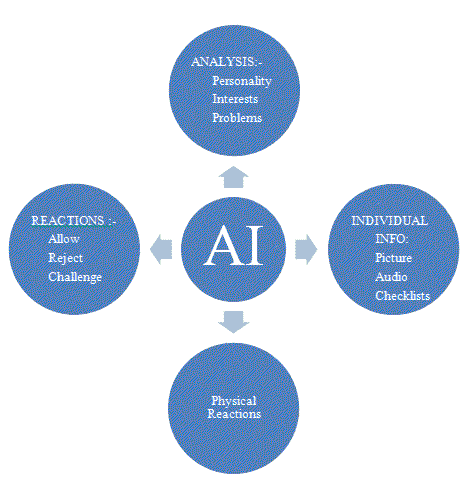 **图 9：** 流行病增加了心理健康问题 [5]

### 5.3 AI 在心理健康保健中的优势

a) 准确性

使用这项技术提高了治疗的准确性并减少了人为错误，变得更加可靠。即使顾问不同，治疗仍然保持准确且一致。

b) 先进模型

使用了先进技术，其行为像人类顾问和专家。它不依赖于人类咨询，并且可以接触到更多的人。此外，患者与其互动感觉良好，因为它的行为像人类。

c) 同情

AI 让用户在与机器互动时感到舒适。它的行为就像人类顾问，而不是机器。它还通过电话与人们互动。人们与机器进行电话讨论，感觉不像机器，而是像是在与治疗师交流，因为机器具有情感化。

d) 稳定性

治疗可能是稳定的，并根据用户的预期进行定制。人类无法表现出健性，但机器可以表现出健性，不受压力和环境的影响，而人类每天都不同。

e) 24/7 可用

可用性可能随人类而变化，但机器的工作始终可用，特别是在紧急时刻。人类治疗师在处理患者一段时间后会疲劳，但机器永不疲劳，任何时候提供最佳结果，并在心理疾病方面提供更好的结果。机器可以在没有限制的情况下长时间。

f) 可靠性

AI 在人们中建立了信任，即与机器共享的数据是加密且安全的。因此人们信任分享病史，并授权保持数据私密。人们可以只与他们想要分享的人分享数据，否则数据不会泄露。这使得 AI 非常有用，因为这可以避免人们之间的尴尬。

g) 初始阶段检测

在心理健康保健的情况下，早期检测方法非常重要。AI 确保了早期检测正确的数据

疾病使其能够拯救生命，例如在自杀案例或其他任何悲剧中。

### h) 害怕失名

社会环境非常重要，它影响着一个人每天甚至每一刻的心理健康。

社会对人们起着至关重要的作用，人们依赖声誉，许多人深受这种心理疾病的困扰，此时`AI`再次成为一个重要的工具。`AI`可以诊断并治愈患者。

### i) 易于获取

越来越多的人可以从`AI`的优势，因为农村的人也能从该计划中获益。为了获得治疗，人们不需要从村庄长途奔城市。因此，`AI`程序的可及性得到了提高，拯救生命的能力也增加了 [14]。

### a) 复杂性

`AI`机器在某些方面成本高昂且设计复杂。它还需要维护。

### b) 缺乏情感

`AI`机器可以完成人类能做的所有工作，但归根结底它是机器，无法像人类那样用情感对待患者。它是经过编程的机器，在根据指令执行工作方面具有局限性。它无法在设计的程序之外进行思考和工作。很多时候，需要根据患者的心理状态用情感和行为对待并克服复杂性，但`AI`机器无法进行这种未经编程的程序。

### c) 缺乏认可

心理健康问题是非常私化且敏感的，不会与他人讨论。`AI`是人类智能的结合，提高了世界上的工作效率。这项技术填补了人与医疗治疗之间的空白。它包括手机应用程序、聊天机器人、云系统、生态系统，并创建了填补差距的桥梁 [14]。

保持健康

初始 教育


# AI 与机器人：阶段诊断与决策研发制造

 阶段  诊断  AI 与机器人

  决策研发制造

 治疗

 **图 10:** AI 与机器人 [7] 保持健康

通过技术，保持良好健康的能力得到了提高，鼓励人们始终保持健康。

## a) 初始阶段诊断

根据研究，许多人获得癌症等疾病的假性结果，`AI` 的使用以 99% 的准确率克服这一问题，并减少了活检过程。

## b) 决策制定

保持健康需要定期的治疗和及时做出决策。它支持在预测任务上做出决策并采取行动。

## c) 治疗

`AI` 在临床上帮助发现疾病并帮助获得治疗。它检查问题并提供医疗治疗。及时提供护理。多年以来机器人一直在领域做出贡献。机器人协助人类医生进行手术，机器人也可以自己进行手术。带有 `AI` 的机器人被许多医院和实验室用于治疗。

制药实验室与受患者之间的距离非常远且昂贵。根据研究协会的说法，到达患者那里的时间可能需要多年。研究发现，在 5000 种药物中，只有 5 种进入了测试，而在这些 5 种药物中只有 1 种获得人类治疗的批准。

同样，`AI` 在药物研发中非常重要。`AI` 有助于药物发现，也减少了从实验室到患者那里的时间消耗，并降低了成本。

## e) 教育

`AI` 提供了原始模拟的设施，而不是软件中设置的代码和命令。基于 `AI` 的计算机具有决策、解答问卷求解等功能。教育从所有反馈中学习，并可以根据需要进行相应的改变。这种学习可以通过智能手机通过各种课程来完成 [15]。

如今人工智能在所有应用中都非常流行，许多行业正在使用新技术，而人工智能是其中之一。人工智能有许多应用，医疗保健就是其中之一，正如我们所知的“健康是财富”，没有良好的健康我们就无法履行自己的角色，因此医疗保健机构引入了人工智能来提供优质服务。因此，通过使用这些技术，人工智能正在改变医疗保健，未来也将继续这种改变 [16]。

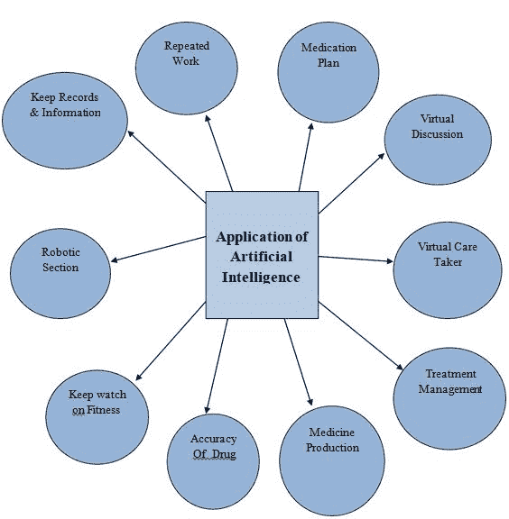 **图 11:** 人工智能的应用 [10] 记录和信息

在医疗保健中，首要任务是收集和调查患者数据，如患者的既往病史和一些目前的报告，因此这种数据处理应用是人工智能的常用应用，对于这种记录工作，如数据收集、存储数据、更改数据，我们可以使用机器人。与人类相比，机器人更安全，因为没有感染风险，所以我们可以说人工智能是人类的福音。

在机器人的帮助下，报告、X 射线图像、身体扫描和不同的日常工作可以非常快速且精确地执行。在心脏病学和放射学的某些领域，数据的调查是漫长且海量的，未来心脏专家和放射科医生只需要观察需要人类观察的复杂病例。

## b) 药物治疗计划

为了设计用药计划，医疗部门使用人工智能，人工智能系统设计用于调查数据、记录和患者详情，帮助选择完美的用药计划。

## c) 虚拟讨论

许多应用程序使用人工智能进行健康虚拟讨论；它基于个人病历和常识。患者向应用程序交流其症状，应用程序使用语音识别来与疾病记录进行对比。患者患者账户中提供解决方案。

## d) 虚拟护理

虚拟护理观察患者状况并关注药物，在医生查房期间。

## g) 治疗管理

使用人工智能设计的应用程序可以观察患者对治疗的利用。为了了解患者的情况以及建议患者的药物是否服用得当，应用程序使用智能手机的摄像头。患严重健康问题的人可以使用此类应用程序。

## h) 药物生产

创造新药制药行业需要大量的时间和金钱，为了使整个过程变得快速且廉价，使用了人工智能控制的程序，它检查可以重新制造以对抗感染现有药物。

## i) 药物准确性

从 DNA、生物学和遗传科学获取疾病转变的信息，某些由遗传引起的疾病（如癌症）可以通过身体扫描借助人工智能进行识别。

## j) 健身监测

一些健身追踪器监测心脏活动，调查设备也可以通过人工智能帮助将信息发送给患者和医生。

## k) 机器人部门

在人工智能的帮助下，机器人可以执行手术 [16]。

为了进行精确的调查和药物治疗，精神科医学和心理健康专家正在使用人工智能。心理健康专家正利用人工智能来减轻他们的工作量。人工智能有助于帮助心理治疗师进行良好的药物治疗和教育。

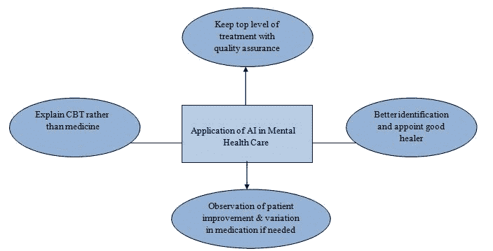 **图 12:** 人工智能在心理健康护理中的应用 [15]

## a) 通过质量保证维持高水平治疗

如今心理问题日益增加，心理学医生的工作量也随之增加；一些脑健康诊所正在寻找一种观察治疗者之间质量保证的自动化系统。

一些脑健康诊所正在使用人工智能，结合自然语言处理来观察治疗过程中使用的语言；这是一种机器用于处理记录的方法。脑健康诊所采取此举的要目标是为治疗者提供正确的指导，以便他们提供良好的护理。

因此，技术社会为诊所提供了工具，通过使用这些工具，患者与治疗者之间将产生良好的理解。

## b) 更好地识别和分配优秀的治疗者

人工智能帮助医生提前诊断精神疾病，并帮助制定精确的药物治疗方案。

研究人员认为，他们可以利用成功治疗课程中的信息来帮助患者找到优秀的治疗者。

人工智能研究可能帮助医生调查患者的个人情况，并帮助提供药物治疗。

通过使用人工智能，可以获取海量数据，如患者的旧病史、家庭背景、患者的行为以及旧药物对其健康的影响，利用所有上述信息，医生可以进行很好的调查，并为患者提供适当的药物。

## c) 观察患者的改善并在需要时调整药物

如果患者与治疗者联系并开始接受治疗，只需要观察患者的改善情况；为此，人工智能可以帮助识别是否需要更改药物或患者是否需要任何其他疗法。

## d) 使用认知行为疗法 (CBT) 而药物

根据研究人员的，使用药物作为心理健康问题的治疗方法正在增加，人工智能将认知行为疗法证明为一种治疗手段。认知行为疗法的重点在于识别阻碍性思维并发现破解这些想法的方法，这意味着在未来的方式和规划上进行变化，治疗者将使用声明进行讨论。研究人员发现，使用认知行为疗法而非普通聊天的恢复率更高 [16]。

目前观察到，许多心理问题日益增加，这增加了死亡率和犯罪率。根据研究，人工智能在帮助识别和解决问题方面可以大有用。及早解决心理问题可以避免严重状况。由于基于人工智能的系统可以 24X7 候、低成本、可用且易于使用，它对日常用户将非常有帮助。

[1] Lee, E. E., Torous, J., De Choudhury, M., Depp, C. A., Graham, S. A., Kim, H. C., ... & Jeste, D. V. (2021). Artificial intelligence for mental health care: clinical applications, barriers, facilitators, and artificial wisdom. Biological Psychiatry: Cognitive Neuroscience and Neuroimaging, 6(9), 856-864.

[2] `https://healthitanalytics.com/features/what-role-could-artificial-intelligence-play-in`

[3] `https://healthitanalytics.com/features/what-role-could-artificial-intelligence-play-in` (注：原文为 `https://healthitanalytics.com/features/what-role-could-artificial-intelligence-play-in`)

[4] `https://healthitanalytics.com/features/what-role-could-artificial-intelligence-play-in`

[5] `https://healthitanalytics.com/features/what-role-could-artificial-intelligence-play-in`

[6] `https://healthitanalytics.com/features/what-role-could-artificial-intelligence-play-in`

[7] `https://www.techtarget.com/searchit/definition/machine-learning`

[8] `https://www.techtarget.com/searchit/definition/machine-learning`

[9] `https://healthitanalytics.com/features/what-role-could-artificial-intelligence-play-in`

[10] `https://www.novatiosolutions.com/10-common-applications-artificial-intelligence-healthcare/`

[11] `https://www.weforum.org/agenda/2021/12/ai-mental-health-cbt-therapy/`

在大多数研究中，驾驶员皮肤的物理现象和运动参数与驾驶员的压力水平密切相关。自主神经系统的神经刺激主要取决于情绪或心理反应。此外，它还监测其物理结构中的平滑肌组织和腺体的分泌。这些生物信号的记录为我们提供了有关生理系统（循环系统、代谢系统、肌肉系统和分泌系统）状况的各种信息。这些信息将有助于表示心理状态的动态变化。因此，预计可以这些记录中推导出驾驶员的动态压力水平。额外的酒精检测器将提供驾驶员的嗜睡状态。事实证明，压力如果没有得到适当的诊断和治疗，可能会导致多种不可逆转的影响或疾病。如果能早期诊断，可以通过改变生活方式进行压力管理。驾驶员的压力水平也可以通过方向盘运动的动态变化及其运动模式进行评估。这通常通过使用运动检测器持续监测力学现象来实现，该检测器可以安装在驾驶员手套的表面，也可以放置在方向盘外壳上。

在这项工作中，与生理信号相比，运动传感器因其在各种环境条件下的低成本和可靠特性而被选中。学习算法的训练使用了在 3 个完全不同的环境条件下对不同驾驶员进行的实验结果。这些环境条件被标记为“城市”、“高速”和“农村”，这些结果被用于训练向量。

驾驶员手掌的电反应（Galvanic response）是驾驶员所经历压力的清晰指标，放置在驾驶员手掌的传感器记录信号将通过蓝牙发送到移动设备，对接收到的数据进行额外处理。结果得出，同时监测方向盘运动模式的压力和皮肤电反应（SR）在压力水平预测中的平均准确率可高达 93.64%。这为将运动传感器视为无线驾驶员监测系统中检测压力水平的有效信息提供了合理依据，以采取适当的行动。

整个单元如框图（图 1）所示，该单元具有传感器，如酒精传感器、眨眼检测器、加速度计和皮肤电反应传感器，它们连接到驾驶员的手掌。所有这些传感器都提供了有关驾驶员压力水平的宝贵信息，可以从为预测收集的训练数据进行预测。

S.M Revathi– “基于 IOT 运动传感器的可穿戴手套驾驶员压力检测” 页码: 14– 22.


`https://dx.doi.org/10.36647/AAIMLH/2022.01.B1.Ch002`


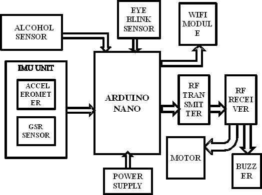 **图 1** 框图

从传感器接收到的所有信号都通过无线介质在发射器和接收器之间传输。这为无线驾驶辅助系统中加入运动传感器提供了合理理由，以便良好观察驾驶员的压力水平。物联网（IoT）是一种组合网络，由能够收集和共享数据并根据这些接收到的数据控制端节点的物理对象组成。物联网（IoT）包含了大量的不同的“智能”设备，从传输与传感器传输的待分类参数相关信息的工业机器，到跟踪相关参数数据的传感器，比而皆有。通常，这些设备使用互联网协议（IP），这是一种用于识别全球互联网上计算机并允许它们相互通信的等效协议。物联网的演变产生了智能节点设备，它们能够在没有人工干预的情况下实时向其他设备报告信息，并根据在没有人工干预的情况下浏览互联网所收集的数据预测未来结果。现在有多种预测驾驶员心理压力的技术。由于这些技术，许多生命从事故中被拯救了。因此，我们的动机不仅是为了预测压力，而是为了防止由于驾驶员压力导致注意力集中而可能发生的致命事故。

# P.Joosen, D .Beekman (2015)

“心理压力研究 - 赛车期间驾驶员的压力特征分析”。赛车是一项需要高强度且持续心理投入的压力运动。随着驾驶员平均年龄的增长，比赛中心理稳定状态的变化变得愈发重要。开发了一套身体感知元件网络，由脉搏监测器、一个外部 GPS 传感器和 2 台智能手机组成。实验使用移动网络中的 `3D accelerometer` 现有公式，该公式可以实时计算驱动力的应力水平。压力连同 GPS 数据随后通过移动网络进行传输，以实时显示驱动力压力水平的位置。对信息的后期分析表明，驱动力的压力水平与特定事件之间存在相关性。整个过程中驱动力的压力水平与其表现之间存在弱相关性。最后，展示了驱动员之间压力特征的差异。

# I J.Gao, A.Yuce and J.P.Thiran (2014)

“通过面部表情检测情绪压力以确保驾驶安全”。监控驾驶的选择和情绪状态对于驾驶的安全和舒适至关重要。在这项工作中，开发了一种实时非侵入式观测系统，通过分析面部表情来检测情绪状态。该系统包含 2 种负基础情绪——愤怒和厌恶作为压力相关情绪。我们倾向于每个视频帧中识别个人感受，并在序列水平上形成压力水平评估。实验结果显示，所开发的系统在具有通用模块的模拟环境中运行良好。一个额外的创建标准化步骤减少了由于摄像头设置和后期变化产生的创建对的影响，从而提高了检测准确率。对压力检测的定量结果显示，在收集了额外信息进行模型自适应后，基于原生描述符的特征插图显示出智能性能。该方法在室内案例中达到 95% 的准确率，在车载检查案例中达到 85%。面部和动作的时间动态模式被整合在模型训练中。在此，甚至可以整合头部运动和声音信号以实现更高的性能。

“通过肌电图活动验证实验诱导的压力”。与无压力场景相比，压力体验可能导致特定肌肉的诊断活动增加。本研究的主要目标是开发并验证一种压力肌电图范式，在该范式中给出了一个不可控且不可预测的敏感输入。斜肌的肌电图活动是感兴趣的响应。除了线性时间效应外，还共同了非线性肌电图时间曲线。整个实验过程中的肌电图活动符合先验预期。输入前部分显示出比另一部分显著更高的平均肌电图活动，且对输入的即时肌电图响应是不争否的。此外，分析揭示了重要的非线性肌电图时间曲线共分为 3 个阶段。线性和二次肌电图时间曲线受到主观先验压力水平（在压力任务开始前简单测量得）的显著影响。结果表明，此处提供的压力范式可能是评估个体压力敏感性差异的有效检查。

# M.Singh and A.B.Quaymanin (2016)

“利用生理参数检测汽车驾驶员压力”。在过去的几十年中，由于睡眠不足、疲劳和心理压力等驱动力的增加，已知事实表明交通事故和伤亡人数急剧增加。为了减少驾驶过程中的人为错误，我们将通过一段时间内的活动生理参数（如心电图(`ECG`)、肌电图(`EMG`）、皮肤电现象`SC`，也称为皮肤电反应（`GSR`）和呼吸频率(`RR`)）来监测压力和疲劳。以前的研究表明，在大多数情况下，驾驶员的皮肤物理现象和生命信号参数平方与驾驶员的压力水平密切相关。

“基于智能手机的工作环境中自动压力检测”。智能手机在组织多个部门的使用量增加，导致后续活动压力衡量的增加对人体健康产生了负面影响。由于智能手机使用者的自我报告和人与之间的差异，活动压力水平以及人类生理和心理动态非常难以分析，目前可以观察各种方面的人类行为，以及与状况和导致压力相关的客观测量行为。来自智能手机的信息被用于压力测量。压力测量系统传感器的选择将隐私作为主要参数（例如，与视频或音频录音、位置相比）。得益于其低功耗设备，使其成为部署在较小的可穿嵌入式设备中的良好选择，可以通过智能手机关注两个完全不同位置的多个受试者。研究持续了 56 天，并在工作环境中实时进行，没有任何限制。因此通过在智能手机上放置压力测量传感器，受试者被模型分类不同水平的压力，我们倾向于达到最高 71% 的准确率。对商用驾驶员压力检测的验证显示，系统对驱动力压力水平或皮肤电现象运动传感单元以及皮肤电反应元件(`GSR`)具有额外的依赖性。由于缺乏预防驾驶员，此类系统还需要相关的酒精传感元件和眼动传感元件。

可穿戴压力监测手套是一个分为两个部分的系统：

* 传感器元件单元

* 数据处理和指示单元

传感器元件单元由九个自由机械现象传感元件组成，它们从相关性测量系统中提取出 `3D 区域取向`。信号知识包括线性加速度的测量，单位为 `m\s²`。这种知识是由测量系统相关的静止运动提供的。加速度即使在设备静止时也能给出静态加速度值。

 **图 2** 系统设计

因此，为了保持系统简单，只考虑线性加速度，通过获取设备静止时 `0m\s²` 的数字加速度来消除吸引力。信息在三个轴上连接到 `Arduino Nano` 控制器进行测量。`Arduino Nano` 将模拟输入的输出转换为数字输出。皮肤电反应(`GSM`)在驾驶员手掌皮肤水平上测量。通过导数公式可以理解转向角度的知识表示为角运动，即在三个方向（俯仰、横滚和偏航）上的旋转。该机械现象运动单元现在将预测“城市”、“公路”和“农村”三种完全不同地形的转向力压力水平。

此外，压力监测器中内置了酒精检测和眨眼检测元件，用于监测驾驶员的警觉性。如果传感器数值较低，蜂鸣器处于`OFF`状态，发动机也可以按照常规运行。如果传感器指示高状态，蜂鸣器将响并停止发动机。最后，蓝牙模块用于接收来自`Arduino Nano`的信号，并将接收到的信号传输到移动设备，以便查看驾驶时的压力状态。

传感器元件尺寸很小，电池也很小，计算、通信和电源能力有限。

主要的检测元件如图所示。（图 3,4）

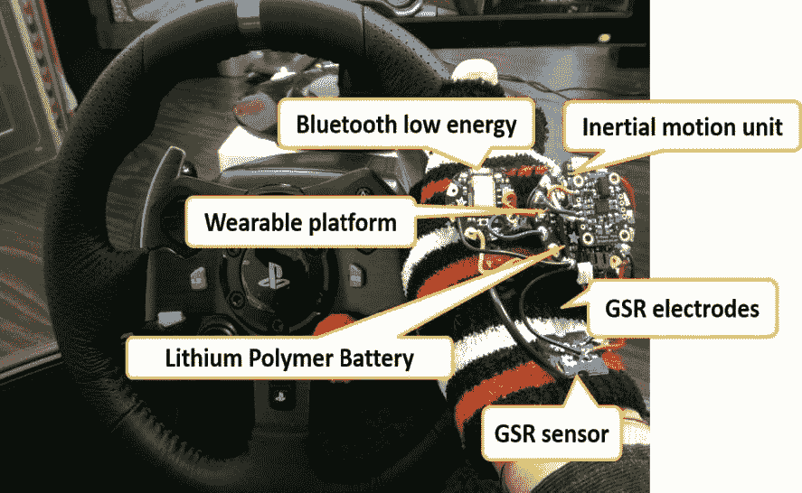 **图 3** 可穿戴发光设备

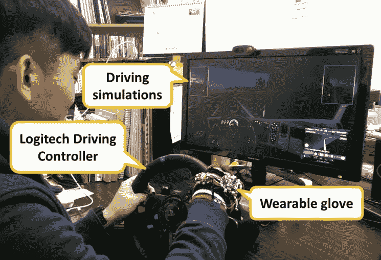 **图 4** 罗技方向盘控制器


1. **传感器：** 它封装了嵌入式芯片，用于感知驾驶员身体等非常重要的医疗体征。

2. **微控制器：** 它控制整个电路的性能，并根据知识比较做出适当决策。

3. **存储器：** 它快速存储从传感元件属性获取的感知知识。

4. **无线收发器：** 它实现节点通信，并允许生物信号信息的无线发送和接收。

5. **充电控制器：** 它控制并限制存储在电池中的电量。

6. **信号处理：** 它放大并过滤感知的生物信号知识，使其达到合适的数字化水平。

7. **模拟数字转换器：** 它将模拟信号产生数字信号，以便进行所需的方法。

8. **蓝牙：** 用于连接不同身体传感器的射频。蓝牙被用作通信协议，将获取的感知知识与个人服务器连接。

个人服务器通过`Bluetooth`通信协议连接无线节点。它由一个医疗服务器组织，该服务器是医疗服务接口处科学信息服务器地址的受体。私有传感器作为从传感器生成动态信号的补充，并优先传输必须通过医疗服务器发送的重要信号。该医疗服务器将执行关键指标分析任务，并将驾驶员的健康状况与现有训练数据进行比较，医疗服务器获取知识将通过图形界面生成反馈。个人服务器硬件包括各种模块，如输入设备、天线、微控制器、收发器、`Bluetooth`、非易失性存储器、电池和充电单元。在接下来的过程中接收的信息将用于去噪和因子测量。

在本研究中，手部和方向盘运动的变化（`SWM`）预计将反映驾驶员的压力水平，这些水平通过手部运动的方向盘间接得出。因此，第一步是获取支持`IMU`读取值的转向角。测量系统（线性运动）和旋转机构（旋转运动）的读取值被用于理解度格式的速度和角度。下一节概述了从 FTO 读取值确定方向盘运动所采取的步骤。

### 3.1 方向盘运动 (SWM)

从运动传感器接收到的数据衍生为`SWM`（`MSD-SWM`），可以分为三个角运动：俯仰（pitch）、偏航（yaw）和横滚（roll）。这三个参数的速度根据所使用的轴以相同的方式计算。公式 (1) 显示了每个轴（`x,y,z`）在第`i`时刻的角按以下方法计算，表示为 `agl[i]`

```
agl[i] = 0.98\* agl[i-1] + gyr[HZ]\+ aglc[i]*0.02 (1)
```

其中

`gy[ri]`是第`i`时刻陀螺仪传感读取值

`gyr[hz]`是第`i`时刻陀螺仪传感器采样率

`agl[ci]`是第`i`时刻的角加速度

根据方程，采用 x 轴的陀螺仪读取值来计算俯仰角。同样的计算适用于横滚和偏航，使用陀螺仪传感器的 Y 轴和 Z 轴读取值。此外，角加速度如(2)所示

```
agl[i]=arctan\*180/π (2)
```

其中

`Ax`和`Ay`是来自线性加速度计专用原始读取值的坐标。

从以前的研究来看，很已经考虑了`[+90 , 0, -90 ]`范围内的转向角变化。度数的负号表示方向盘向左转，度数的正号表示右转。

根据实验知识，很清楚，受试者在模拟中转弯时，方向盘倾向于向左或向右转超过 90°。因此，在这项工作中，转向角限制从`[+90, 0, -90]`扩展到`[+180°, +90, 0, -90,-180°]`。此外，在驾驶模拟的试验阶段，大多数受试者尝试在小半径弯道处转车辆，受试者通过改变手在方向盘上的位置进行多次调整来转向方向盘并完成完全旋转。手在方向盘上的这些多次手动移动可能会导致错误，并可能干扰分析。通过正确指示受试者在整个实验过程中不要松开方向盘，可以减少这些错误。此外，为了减少由于使用双手而引起的错误，受试者被仔细挑选为方向盘的右手使用者。最后，传感器读取值以每秒 001 样本的速率采集。

### 3.2 特征提取

为了计算简单，不考虑俯仰和横滚角，因为这些数据没有提供关于驾驶员压力水平的有用信息。本研究更多讨论了从时间`(i)`到时间`(i+1)`的角度变化率。然后通过获取 10 秒内、2 秒汉明窗口的一阶角导数找到角度转换。得到的值称为`DynamicRatio`。从这个动态比例中计算压力水平，分为以下三个参数：时间、相位和频率。

首先，时间的特征称为统计特征。在这种情况下，考虑平均值或标准差作为统计特征类型。这些统计特征应用于偏航、横滚和俯仰等特征。这里横滚、俯仰和偏航标记为 X、Y 和 Z，因为这些统计数据对驾驶员的压力水平没有显著信息，然而，对接收到的信号进行频率分析和功率谱分析还需要研究。

### 3.3 压力水平分类模型

两个压力水平标识参数（如皮肤电位和角度）如表(i)所示。该表进一步用于提取信息，并通过提供样本测试问卷与压力进行比较。这是根据问题由心理专家开发的，通过算法监控和训练。该调查问卷范围为 1 到 10，1 表示极低水平压力，10 表示压力极大。为了简化分类模型，将固定某些阈值以简化分析，量表已减少为两个特征，如 1 和 2，

其中 1（1 到 5）表示放松的压力水平，2（6 到 10）表示高压力。使用图 3 所示的设置总共

从不同人在不同压力状态下收集了 5000 份样本数据，其中 4250 个数据集为“压力状态”，而“750”个数据集来自非压力状态数据集。整个实验持续了约 4 天，每天约 6 小时，因此实验总共持续了约 24 小时。但数据中存在一些离群值，这需要通过分别取每个特征的众数等统计方法来清洗数据。这些离群数据集是由咳嗽、打喷嚏等异常行为引起的。

在先前的文献综述中，明确给出 `SVM`（支持向量机分类器）用于压力水平分类。在本工作中，`SVM` 进一步与其他若干特征结合以预测压力水平。这是通过一种名为“逐步特征选择”（`Stepwise Feature Selection`，`SFS`）的特征提取和选择方法实现的。`SFS` 是一种将下一个最高性能标准添加到现有的 `SVM` 分类算法中的，从而提高分类准确率的方法。在本工作中，考虑的性能标准是基于 `SVM`（支持向量机）分类算法进行压力预测的特征相关性和准确率。（图 5）显示了压力预测的准确率，这是一个准确率与特征索引的关系图。

最初，不使用 `SFS` 的 `SVM` 预测压力水平的准确率为 67.98%；在包含 12 个特征的 `SFS` 后，准确率从 68.89%增加到 84.02%，增加了约 15%。而添加接下来的 13 个特征，准确率仅增加了了 1%，没有对准确率产生任何显著提高。准确率的下一次显著变化发生在特征从第 26 个到第 35 个特征的总响应中，准确率达到 93.55%，增加了约 7%。最后添加最后一个特征使准确率提升了 1%，最终准确率为 94.55%。（图 6）显示了使用结合 `SFS` 的个体特征作为性能标准时 `SVM` 压力预测的准确率。

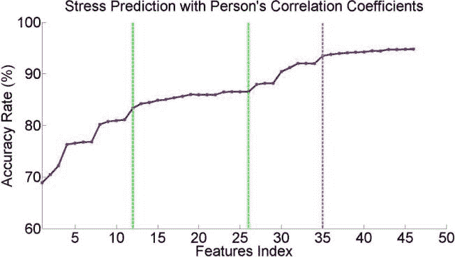 **图 5** 皮尔逊相关系数

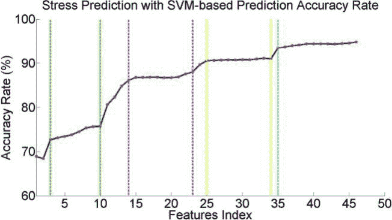 **图 6** 仅基于 `SVM` 的预测准确率

作为第一步，应该检查主压力表（`GSR`）和次级压力表的完整性。基于此，确定了一个人的相关系数 `ρ`，作为一种通用方法来计算两个因变量之间线性相关性的依赖性。个人的相关值范围取在 `[-1,1]` 之间。相关性值 `ρ` 越高，表示因变量之间的线性关系越好，而相关性值的极性则指示了变量之间的直接关系或反向关系。如果 `ρ` 的值等于 0，则表明变量之间没有显著关系。根据结果，我们得到了 0.983 的相关系数，这表明两个压力测量指标之间存在高度正相关关系，说明两种测量方式提供的性能一致，并可接受用于压力标记。

根据精神科医生的意见和 `GSR` 压力标签的观察发现，司机在城市或市区交通中驾驶时经历了极高水平的压力（图 7.a），其次是在农村地区驾驶时处于中等压力，而在高速公路上驾驶时较为放松。城市地区高压力水平的原因是频繁的启停情况，以及城市地区更多的弯道和转角。在农村地区（图 7.b），道路狭窄，这导致司机感到中等压力；而在高速公路上（图 7.c），由于有独立的车道，司机更加放松。在本研究中，高速公路场景记录的事故率为 0%，城市地区为 23.5%，农村地区为 33.7%。该精神科医生表示，在晚上和雨天，无论驾驶环境如何，司机都会表现出缓慢和谨慎的行为，因为司机在这些情况下需要更多的注意力。最后得出结论，压力水平取决于所行驶车辆的速度。从低压力到高压力的转换时间比从高压力到低压力的转换时间短得多。这些说法得到了 `GSR` 压力测量标签的良好补充。

### 三种不同的实验场景

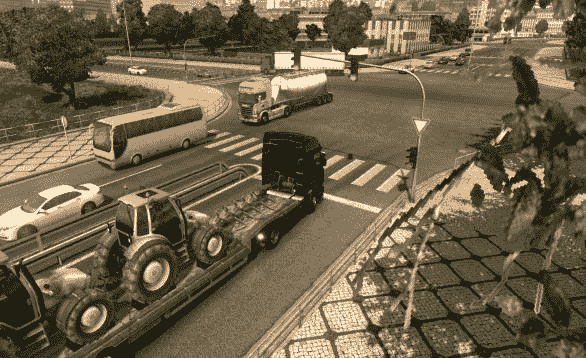 **图 7.a** 城市

 **图 7.b** 高速公路

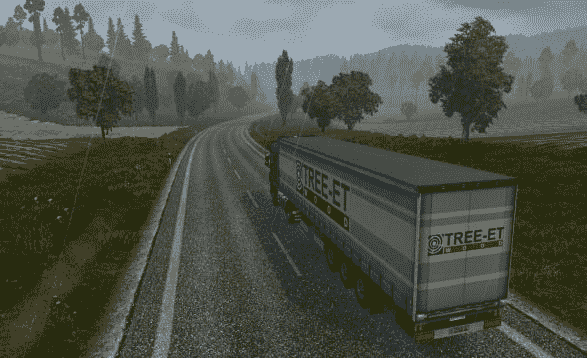 **图 7.c** 乡村

使用惯性运动传感器单元预测实际路径中的司机压力水平，与普通方法相比，这提高了测量的准确性。在所提出的程序中，我们通过车载车辆和报警器，利用酒精传感器、眼罩传感器和光学传感器预测并防止了司机的压力水平。物联网（`IoT`）被用于提供准确的司机压力水平。

对商用司机压力传感器的验证表明，系统更多地依赖司机压力水平或皮肤电导率相对于方向盘的运动来预测惯性运动传感器和皮肤电反应（`GSR`）传感器的压力水平。由于没有阻挡司机，此类系统需要酒精传感器和眩光传感器。这种测量的准确性更高，平均率为 94.78%。提出的模块还可以作为传感器节点来评估司机压力水平，以便预测和防止各种传感器的使用。此外，所提出的方法优于使用司机生命体征、面部表情的传统方法。在本工作中，更多关注的是压力水平与驾驶环境之间的关系。其目的是提高可靠性和安全性。

[1] L. M. Bergasa, J. Nuevo, M. Sotelo, “Real time system for monitoring vigilance,” IEEE Trans. Intell. Syst., vol. 7, no.1, pp. 63-77, mar.2006. [online] Available: https://ieeexplore.ieee.org/xpls/aba?arnumber=160355

[2] G.Li and W. Y. Chung, “Detection of driver drowsiness using wavelet analysis of heart rate and statistical test,” Sensors, vol. 13, no. 12, pp. 14294-14511, dec.2013. [online]. Available: https://www.mdpi.com/1424-8220/13/12/14294

[3] A. Sahayad, K.Sundaraj and M. Murugappan, “Detecting driver drowsiness based on sensors: A review,” Sensors, vol. 12, no. 12, pp. 16937-16953, Dec.2012. [online]. Available: https://www.mdpi.com/1424-8220/12/12/16937

[4] J.D.Hill and L.N. Boyle, “Driver stress as influenced by driving maneuvers and roadways condition,” Tran. Res. F,Traffic Psychol. Behavior, vol. 10, no.3, pp. 177-186, May 2007. [online] Available: https://www.sciencedirect.com/science/article/pii/s13698478060081

[5] E. Andreou et al., “ceived stress scale: Reliability and validity study in Greece,” Int.J.Environ. Res. Public Health, vol. 8, no.1, pp. 3287-3298, Aug.2011. [online]. Available: https://www.psy.cmu.edu/~/Greece.pdf

[6] Z.Mardi, S. N. M. Ashtiani, and M. Mikaili, “EEG- based drowsiness detection for safe driving using chaotic features and statistical test,” J.Med.Signals Sens., vol. 1, no. 2, pp. 130-137, aug.2011. [online]. Available: https://www.ncbi.nlm.nih.gov/pobmed/22606668.

[7] J.Wijisman, B.Grundlehner, J.Penders and H.Hermens,，“斜方肌 EMG 作为心理压力的预测指标，”发表于无线健康（WH）会议, 2010, 第 155-163 页。

[8] R.Luijcks, H.J.Hermens, L. Bodar,C.J.Vossen ,J.Van. OS, and R. Lousberg，“通过 EMG 活动验证实验诱导压力，”发表于 PLoS ONE , 第 9 卷, 第 4 期, 第 95215, 2014 年 4 月。[在线]. 可用性：Http://journals.plos.org/plosone/article?id=10.1371/journal.pone.0095215 .

[9] C.SchieBl，“驾驶过程中的压力与应变，”发表于欧洲交通研究学会会议, 2007, 第 1-11 页。

[10]A. Lanata 等，“在模拟驾驶期间，自主神经系统和驾驶风格如何随压力增加而变化，”发表于 IEEE 智能交通系统汇, 第 16 卷, 第 3 期, 第 1505-1517 页, 2015 年 1 月。[在线]. 可用性：Http://www.centripiaggio.unipi.it/sites/default/files/2015\_lanata\_etal\_ieee\_tinttrspsys\_driving.pdf .

[11]H.Gao , A. Yuce, and J.P.Thiran，“通过面部表情检测驾驶安全中的情绪压力，”发表于 IEEE 国际图像处理会议 (ICIP), 法国巴黎, 2014, 第 5961-5965 页。

[12]M.Singh and A.B. Queyam，“基于生理参数的驾驶员压力检测：综述，”发表于国际工程教育杂志, 第 5 卷, 第 2 期, 第 1-5 页,2013 年 12 月[在线]. 可用性：Http://www.researchgate.net/publication/281618779\_stress\_detection\_in\_automobile\_drivers\_using\_publication/281618779\_stress\_detection\_in\_automobile\_drivers\_using\_Physiologial\_parameter\_A\_review.

[13]J.A.Healey and R.W.Picard，“使用生理传感器检测真实世界驾驶任务中的压力，”发表于 IEEE 智能交通系统汇, 第 6 卷, 第 2 期, 第 156-166 页, 2015 年 6 月。[在线]. 可用性：Http://ieeexplore.ieee.org/xpls/aba\_all.jsp?arnumber=1438384&tag=1

[14]P. Joosen, V.Exadaktylos, and D.Berckmans，“赛期间赛车手手的压力剖面研究，”发表于 IEEE 第 12 次可穿戴式植入体传感器网络会议, 美国马诸诸塞剑桥, 2015 年 6 月, 第 1-4 页。

[15]F.T. Sun ,C.Kuo ,H.T. Cheng, S. Buthpitiya , P. Collins, and M.Griss，“使用生理传感器的活动感知心理压力检测，”发表于移动计算、应用与服务, 第 76 卷, 德国柏林: springer ,2010 年 1 月 , 第 211-230 页。[在线]. 可用性：Http://link.springer.com/chapter/10.1007%2F978-3-642-29336-8-12.

[16]B.Hema, and V.Gopi，“移动车辆中生物识别认证的新型感知与警报实现，”发表于国际 IT 工程杂志, 第 1 卷, 第 1 期, 第 13-28 页,2013 年 5 月。[在线]. 可用性：Http://ijmr.net.in/download.php? Filename= IQon m0srunry3or.pdf&new= paper-2-1.pdf.

[17] L.Wei ,S.C.Mukhopadhyay, R.Jidin, and C.P.Chen，“基于无线传感器网络的多源信息融合疲劳检测，”发表于 第 7 次国际传感器技术会议, 新西兰惠灵顿,2013 年 12 月, 第 850-857 页。

[18] R.NKhushaba , S. Kodagoda, S. Lal , and G.Dissanake，“基于模糊小波包特征提取算法的驾驶员疲劳分类，”发表于 IEEE 生物医学工程, 第 58 卷, 第 1 期, 第 121-131 页,2011 年 1 月。[在线]. 可用性：Http://ieeexplore.ieee.org/xpls/aba\_all.jsp? arnumber=5580017&1

[19] Adafruit BNO055 绝对姿态传感器, 访问于 2016 年 4 月 4 日。[在线]. 可用性：Http://learn.adafruit.com/adafruit-bno055-absolute orienation-sensor

[20] FLORA-可穿戴电子平台: Arduino 兼容, 访问于 2016 年 4 月 4 日。[在线]. 可用性：Http://www.adafruit.com/product/659

[21] Adafruits FLORA 蓝牙 LE, 访问于 2016 年 4 月 4 日。[在线]. 可用性：Http://learn.adafruit.com/adafruit-bluefruit-le/


[22] J. Sobhani, M. Khanzadi, and A. M. Attar，“用于预测压缩强度的支持向量机，”发表于 Comp., 第 11 卷, 第 4 期, 第 337-350 页, 2013 年 4 月。[在线]. 可用性：`Http://www.researchgate.net/publication/25834525-support-vector-machine-for-prediction-of-the`

[23] Euro Truck Simulator, 访问于 2016 年 8 月 24 日. `http://www.eurotrucksimulator.com/`

[24] A. M. Shin 等，“关联规则挖掘对高血压患者进行诊断分析，”发表于 健康信息研究, 第 16 卷, 第 2 期, 第 77-81 页, 2010 年 6 月。[在线]. 可用性：`http://ncbi.nlm.nih.gov/pubmed/2181847`

[25] N. Sharma and T. Gedeon，“压力识别与分类的目标测量、传感器和计算技术：综述，”发表于 计算生物医学方法, 第 108 卷, 第 3 期, 第 1287-1301 页, 2012 年 12 月。[在线]. 可用性：`http://www.ncbi.nlm.nih.gov/pubmed/2292147`

[26] M. Euston, P. Coote, R. Mahony, J. Kim, and T. Hamel，“固定翼无人机姿态估计互滤波器，”发表于 IEEE/RSJ 国际机器人会议 (IROS), 法国尼斯, 2008 年 9 月 第 340-345 页。

[27] B.-G. Lee, B.-L. Lee, and W.-Y. Chung，“使用智能表的腕带型驾驶员监控系统，”发表于 IEEE 传感器杂志, 第 15 卷, 第 10 期, 第 5624-5633 页, 2015 年 10 月。[在线]. 可用性：`http://ieeexplore.ieee.org/xpl/article Details.jsp?reload=true&arnumber=713142`

[28] A. Hashemi, V. Saba, and S. N. Resalat，“通过外部闪光刺激 EEG 信号进行实时驾驶员疲劳检测，”发表于 基础临床神经科学, 第 5 卷, 第 1 期, 第 22-27 页, 2014 年 12 月。[在线]. 可用性：`http://www.ncbi.nlm.nih.gov/pmc/articles/PMC420601/`

[29] C. L. Lim 等，“将皮肤电导率分解为稳态和频率成分，”发表于 国际心理生理杂志, 第 25 卷, 第 2 期, 第 97-109 页, 1997 年 2 月。[在线]. 可用性：`http://www.ncbi.nlm.nih.gov/pubmed/9101335`

[30] B.-G. Lee, B.-L. Lee, and W.-Y. Chung，“基于小波 EEG 和呼吸信号的自动驾驶睡眠检测移动医疗，”发表于 传感器, [在线]. 可用性：`http://www.ncbi.nlm.nih.gov/pubmed/25264954` 第 14 卷, 第 1 期, 第 17915-17936 页, 2014 年 9 月。

[31] E. Garcia-Ceja, V. Osmani, and O. Mayora，“基于手机加速度数据的环境自动压力检测：第一步，”发表于 IEEE 生物医学健康信息, 第 20 卷, 第 4 期, 第 10531060 页, 2016 年 7 月。[在线]. 可用性：`http://leeexplore.ieee.org/document/7124404/?arnumber=7124404`

[32] Solanki, V.K., Katiyar S., BhashkarsemwaL, V.Dewan, P., Venkatesan, M., & DEY, N. (2016). 用于智能和安全城市的先进自动化模块. 发表于 计算机科学, 78, 367-374.

[33] Bhatt, C., dey, N., & Ashour, A.S. (2017). 用于下一代医疗服务的物联网和大数据技术。

[34] AI Mushcab, H., Curran, K., & Doherty, J. (2012) 用于 Windows 移动设备的活动监控应用程序。发表于环境智能的创新应用：智能系统的进展，(pp. 139-156) Hers: igi global.

[35] Higgins, (2006). 无线通信. 发表于 G.Z. Yang (编)，身体传感器网络 (pp. 117-143). 伦敦 springer.

[36] KedriJanardhana, Brahmadesam Viswanathan Krishna, Vijayaragavan, Kareemullah H (2021/5/2). 利用磁共成像识别骨瘤的整合方法 (pp. 516-524)。罗马细胞生物学协会公告。

[37] H Kareemullah, N Janakiraman, P Nirmal Kumar. (2017). 嵌入式可重构架构综述 (pp. 1500-1504) 国际通信与信号处理会议 (iccsp).

^(1,2,3,4 尼日利亚奥恩多 Adeyemi 教育学院计算机科学系 3) 英国兰加斯特大学计算与通信学院，兰加斯特，LA1 4YQ ¹olajidems@aceondo.edu.ng, ²ajayiaa@aceondo.edu.ng, ³o.a.abiodun@lancaster.ac.uk, ³abiodunoa@aceondo.edu.ng, ⁴afolabiop@aceondo.edu.ng

### 摘要

Covid-19 大流行病带来了巨大的恐慌以及严重的经济、社会、政治和国际挑战。许多生命丧失，经济危机伴随着工业活动的抑制。本研究旨在评估这一悲剧，考虑到其传播深度，并进行智能推测和预测，帮助各方采取适当措施阻止病毒。利用 Covid-19 时间序列数据集进行分析，揭示了 16 个西非国家 Covid-19 的确诊、活跃、恢复和死亡病例。通过使用机器学习算法：多项回归 (`PR`)、支持向量机 (`SVM`) 和神经网络 (`NN`) 进行预测，在研究采用的三种技术生成的 Gen 中，多项回归模型给出了最佳结果。

Covid-19，机器学习 (`ML`)，多项回归 (`PR`)，神经网络 (`NN`)，支持向量机 (`SVM`)

历史上发生过多次疾病爆发，在不同时期感染了全球。迄为止，世界卫生组织 (`WHO`) 及其合作专业人士以及由国家当局协调的其他全球努力一直在与这些流行病作斗争 [5]。Covid-19 的突然爆发，这种病毒疾病最早报道于 2019 年底的亚洲，由于其传播范围和破坏性给全球社区带来了难以言表的苦难。病毒在短时间内在全球范围内自发传播引发了全球性的极大关注，导致了社会和心理危机。此外，记录不断增加的死亡人数进一步加剧了整个世界面临的挑战。疾病传播的态势给全球社会带来了极具破坏性的维度，并引发了不幸的恐慌。

遗憾的是，当疫情爆发时，世界范围内还没有疫苗或重要的治疗方法可以供人口预防。现有的药物和疫苗对这种可怕的病毒疾病在解剖学和药理学上的影响微乎其微或没有显著效果。这使整个世界，特别是各国领导人、医疗专业人员、研究人员、政策制定者和其他利益相关者陷入了积极协作，实施了概性措施和一些临时解决方案，如限制国内及境外活动的封锁令。

Covid-19 对人类生命产生了最具破坏性的影响，留下了死亡记录和社会经济困难。截至 2022 年 4 月第一周，大流行已导致超过 5.04 亿例感染和 619 万例死亡，成为人类历史上最糟糕的事件之一 [11] [4]。这场疫情夺走了全球范围内许多人的生命，并对公众健康、粮食安全和全球活动构成了重大威胁。据预测，由于疫情对社会经济的负面影响，数百万人可能陷入极端贫困。这从记录中显易可见，全球营养不良人群正接近……（此处原文重复内容省略）。

本研究的目标是使用机器学习方法对 16 个非洲国家的 COVID-19 疾病传播进行评估和预测，以生成准确可靠的结果，这将协助政策制定者、医疗专业人员、学术界和其他相关者在 Covid-19 问题上做出良好决策。具体目标包括：(a) 识别全球范围内 Covid-19 感染的趋势和状态；b) 分析 16 个西非国家的确诊、恢复和死亡病例数；c) 比较西非国家 Covid-19 的确诊、恢复和死亡人数；d) 使用机器学习技术预测西非地区未来 365 天的确诊病例；e) 提供一个平台，以便及时生成可能需要的信息（事实）。

[1] 的工作重点是开发一种机器学习模型，利用三种技术分析和预测 covid-19。这些分别是自适应网络技术、多层感知器和模糊逻辑技术。根据实验结果，所提出的模型被认为适用于模拟 Covid-19 疫情。

[7] 利用机器学习模型预测潜在冠状病毒患者以改进决策。在他们的研究中，他们采用了四种标准预测方法：线性回归、指数平滑、SVM 和绝对列表缩减。该模型对疾病新发病例数的预测非常有用。

[17] 提出了一种用于预测冠状病毒的混合人工智能模型。该研究开发的模型与自然语言处理模块相结合，其工作结构类似于增强型易感感染模型。该模型的预测结论与现实生活中疫情爆发的实际情况非常接近。因此，所建议的混合模型可能用于更详细地调查疫情的增长和传播模式。[9] 中的研究人员还提出了一种利用 `ML` 来预测/预测冠状病毒的方法。通过对他们工作的调查，所提出的模型是为了满足 Covid-19 传播预测的需求。该模型结合了三种技术：多层感知器、线性回归和向量自回归，并发现多层 `ML` 系统是最佳的预测器。

[3] 建议使用冠病毒追踪器和数据分析方法来预测 Covid-19 疫情。在进行的研究中，结果表明，及时信息的价值足以缩短反应时间并降低 covid-19 的危险。他们的研究使用了易感-暴露-感染-康复（`SEIR`）模型和分析来预测冠状病毒的当前趋势，这在冠病毒追踪器中显示。使用最大搜寻参数估计方法和 `SEIR` 模型，对某些非洲国家的 Covid19 进行了预测 [16]。所考虑的模型与之前的 `SEIR` 模型不同。该模型被认为能够对最新的新型疫情模式以及它们的隔离状态和干预过程提供更好的描述。根据之前参数间隔的光谱引入了总骚扰度（Total Hassling）。

[6] 的研究人员通过初始住院时的患者数据来估计 Covid-19 的死亡率，检查了各种 `ML` 技术。该研究使用了约 1500 名患者的数据。在利用约三十八个预测因子进行特征选择后，发现 ICU 入院、呼吸困难和氧疗法三个预测因子是 Covid-19 死亡的主要预测因子。他们的实验结果显示 `Random Forest` 优于其他 `ML` 方法。[15] 的一项研究使用 `random forest`、`SVM` 和逻辑回归，根据相同的初始入院时间因素来预测 covid-19 的严重程度。使用 287 名具有不同 COVID-19 严重程度的患者数据和 23 个特征（包括至少一个临床特征、一个胸部 CT 特征和 21 个实验室特征），`random forest` 产生了更高的整体性能。

[2] 提出了一种早期检测 covid-19 的增强型 `ML` 方法。通过更好的目标函数，使用哈里斯鹰优化算法（Harris Hawks optimization）来优化极端梯度提升、轻量梯度提升、类别提升、`random forest` 和支持向量分类器的超参数。对公开的临床数据集在优化的 `ML` 模型上进行了集成技术处理，结果表明所建议的方法优于传统的 `ML` 技术。

[5] 回顾了如何利用 `ML` 方法以及人工智能来预测 Covid-19 疾病的流行。该工作评估了研究论文中的选择性信息，这些研究是在连接 `ML` 技术如何应用于 Covid-19 的数据库进行的。我们将及时且批判性地考虑三个重要元素：摘要、方法论、研究背景和研究目标。对对抗 SARS-COV-2 爆发的潜在模型比较得出了非常有价值的结论。该工作的结果涵盖了目前利用 `ML` 和人工智能技术从许多角度加强研究的研究。它还涉及人们在尝试将此类算法应用于现实世界问题时遇到的一些常见错误和挑战。这一层还讨论了针对当前和未来 Covid-19 疫情情况下研究人员、医学专家和政策制定者的建议。这表明人工智能和 `ML` 的持续改进显著改善了 COVID-19 疾病接触追踪、预测、治疗以及药物和疫苗开发，同时降低了人类在医疗实践中的参与。尽管如此，大多数模型尚未经过充分测试以观察它们在实践中的表现如何，但它们仍然能够对抗 covid-19 疫情。

随着被称为“奥密克戎”（Omicron）的 COVID-19 变异株的发现，现在必须讨论其传播和潜在预测分析。根据世界卫生组织的研究 [13]，在已有社区感染的国家，奥密克戎变异株的传播比 Delta 变异株快得多。此外，许多国家的增长率已经放缓或稳定，但仍高于 Delta 变异株。虽然证据日益表明免疫逃逸在快速传播中起了作用，但还需要更多信息来更好地理解内在增强传播力和免疫逃逸在解释其出现和传播方面的相对作用。截至本研究时，对奥密克戎变异株的评估或分析还不。

为了对 COVID-19 奥密克戎变异株进行分析，安大略公共卫生部门进行了风险评估。2021 年后期发布的证据简报解释说，在比较 Delta 和奥密克戎变异株与人类血管紧张转换酶 2 的关联时，存在更大的结合亲和力，表明感染率和传播速度增加。然而指出，随着新证据的出现，整体风险评估可能会发生变化 [8]。

### 3.1 编程语言与软件

为了进行数据分析并估计每日冠状病毒病例，利用 `Python` 编程语言、`Jupyter notebook` 和 `Spyder` 创建了一个预测模型。使用以下 `Python` 包分析数据：`NumPy`、`pandas`、`matplotlib`、`DateTime` 和 `plotly` 同时利用 `SkLearn` 模块进行预测。

使用的数据集来自联合国人道主义事务厅（人道主义数据网站）。该数据集是约翰霍普斯大学科学与工程中心 Covid-19 大流行病数据集的一部分。实时数据集获取于 2022 年 2 月 5 日。数据包含 2020 年 1 月 22 日至 2022 年 2 月 5 日的记录。时间序列形式的数据集由 Covid-19 感染的确诊、康复和死亡病例每日记录组成。

康复数据自 2021 年 8 月 5 日停止更新，因此工作中使用的数据为 2020 年 1 月 22 日至 2021 年 8 月 4 日的记录。

（数据集链接：`https://data.humdata.org/dataset/novel-coronavirus-2019-ncov-cases`）

### 3.3 实验

实验使用了三个数据集。导入的数据均为实时更新。第一个包含记录的全球 covid-19 确诊病例数，第二个包含全球迄为止记录的死亡人数，第三个包含康复病例数据。将数据集合并为一个，并使用 `python` 进行探索性数据分析，分析结果是用于表示结果的图形和图表。根据记录的确诊、康复和死亡病例对非洲国家进行了横截面分析，并进行了比较。

在预测阶段，利用 `PR`、`NN` 和 `SVM` 算法对数据进行训练。我们将数据集分为训练集（数据集的 75%）和测试集（数据集的 25%）。最后，对未来 365 天进行了预测，以确定西非国家范围内确诊病毒病例的发生情况。

### 3.5 提工作的工作流程

在此任务中，我们将从获取所需的 Covid19 时间序列数据集开始实验。对数据进行了预处理和分析。处理后的数据被分为训练数据和测试数据，这是执行预测的机器学习技术的要求。完成训练和测试后，选择了 `PR`、`SVM` 和 `NN` 作为机器学习算法，并基于此创建模型。我们对算法进行了性能评估，以确定哪一个最合适，最后使用相同的算法进行了预测（预报）。该工作流的图表表示如图 1 所示。

```

```

**图 1：** 所提工作的工作流程

图 2 根据根据研究中考虑的参数（活动病例、康复病例和死亡）提供了全球范围内 Covid-19 病例统计分布的图形表示。


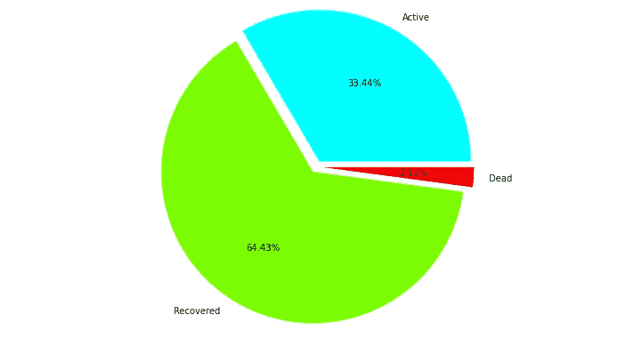 **图 2：** 全球 Covid-19 病例的百分比表示

活动病例占 33.44%，死亡占 2.12%，康复占 64.43%。从图 2 可以得出结论，康复率远高于社会对病毒全球传播的预期。

然而，16 个西非国家 covid-19 的确诊、康复、死亡和活动病例数量分析分别代表图 3a、图 3b、图 3c 和图 3d 中。考虑的国家包括尼日利亚、几内亚比绍、海角角、塞内加尔、尼日尔、贝宁、加纳、毛里塔尼亚、利比利亚、塞拉利昂、几内亚、布基纳法索、冈比亚、马里和多哥。

然而，考虑到涉及塞内加尔、加纳、尼日利亚和科特迪瓦的图 3a，最早记录的 covid19 确诊病例出现在科特迪瓦。尼日利亚获得了约 17 万例确诊病例，因此记录了约 16 万例康复病例。此外，在加纳，记录了略高于 10 万例病例，其中超过 9.5 万例病例康复。在科特迪瓦，在考虑的时间范围内记录了约 5 万例确诊病例，伴有 4.8 万例康复病例。最后，塞内加尔记录了约 6 万例确诊病例，超过 4.7 万例病例康复。从图 3a 提供的数据集结果可以清楚地看到，死亡和活动病例的百分比在塞内加尔最高。

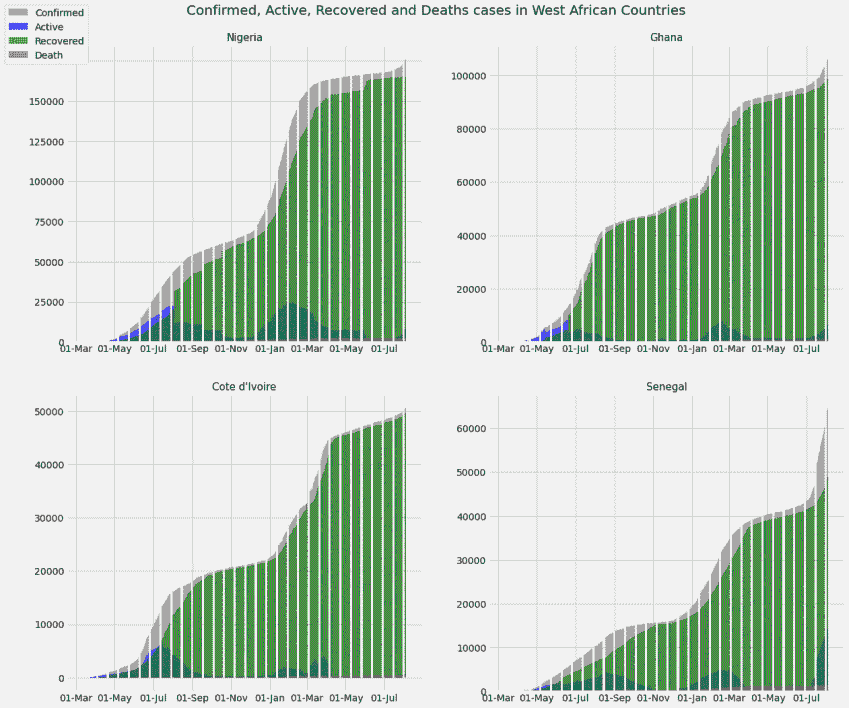 **图 3a：** 尼日利亚、加纳、科特迪瓦和塞内加尔的 Covid-19 病例

此外，在图 3b 中，以下国家是几内亚、海角角、毛里塔尼亚和布基纳法索。布基纳法索记录了略高于 1 万例病例，并有 1 万例康复病例。在海角角，记录了 2.5 万例病例，伴有 2 万例康复病例。毛里塔尼亚为 3 万例病例，2 万例康复病例。在该类别中，毛里塔尼亚的死亡率最高。

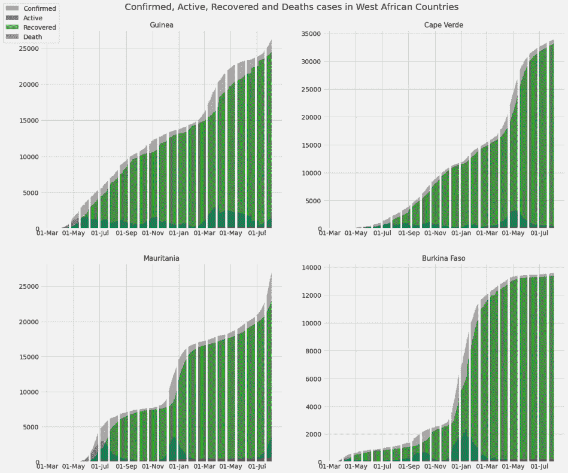 **图 3b：** 几内亚、海角角、毛里塔尼亚的病例

此外，图 3c 考虑利比利亚、几内亚比绍和马里。利比利亚记录了 5500 例病例，4000 例康复。在几内亚比绍，获得了 1.4 万例病例，并有 7500 例康复病例。在马里，马里的死亡率最高。

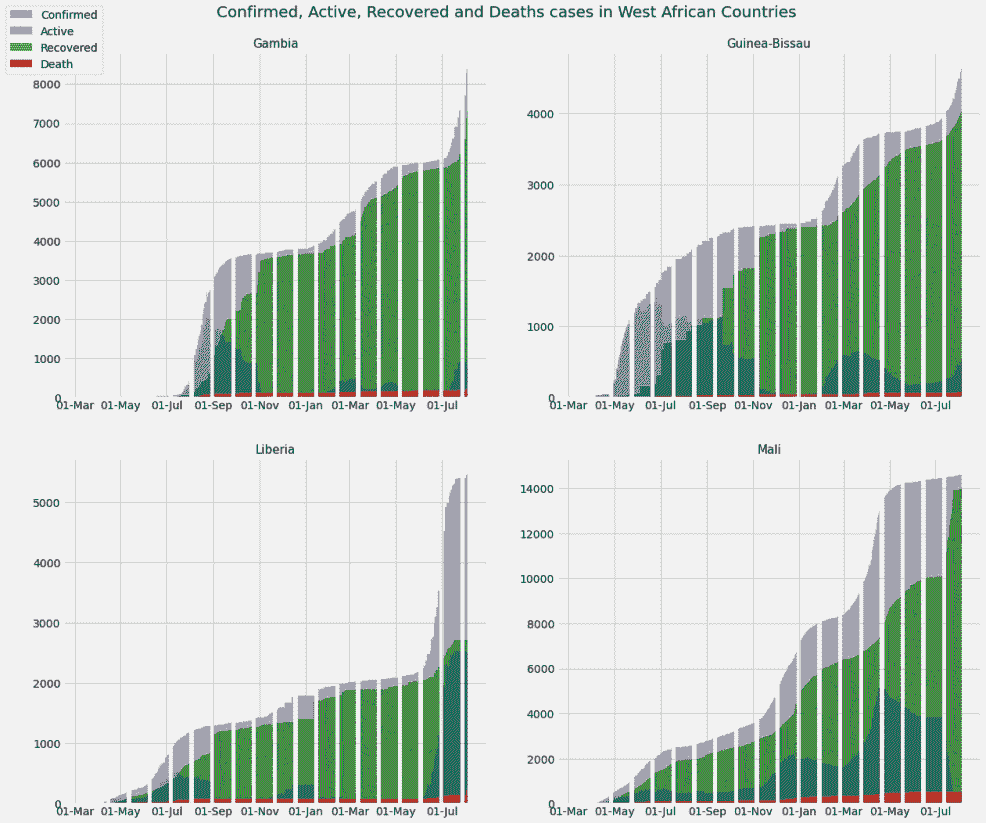 **图 3c：** 利比利亚、几内亚比绍、马里的病例

此外，图 3d 考虑尼日尔、塞拉利昂和贝宁。尼日尔记录得最早。塞拉利昂记录了 6200 例病例，4000 例康复。在贝宁，记录了 8200 例病例，伴有 8000 例康复。在该组中，塞拉利昂的活动病例最高。

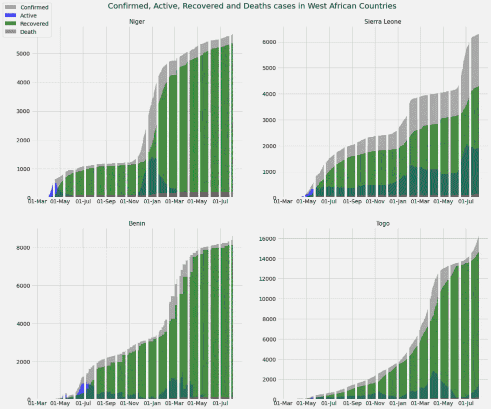 **图 3d：** 尼日尔、塞拉利昂、贝宁的病例

考虑到图 4 显示的从 2020 年 1 月 22 日至 2021 年 8 月 4 日的确诊病例发生情况，尼日利亚病例最多，其次是加纳，科特迪瓦的记录接近加纳，然后是塞内加尔。病毒康复和死亡的类似记录分别如图 5 和图 6 所示。根据统计数据，假设表 1。

**表 1：** 西非人口最多的七个国家

2020 年人口

尼日利亚 206,139,589

加纳 31,072,940

科特迪瓦 26,378,274

尼日尔 24,206,644

布基纳法索 20,903,273

马里 20,250,833

塞内加尔 16,743,927

以图表的形式，图 7、图 8 和图 9 分别展示了 `PR`、`SVM` 和 `NN` 模型在测试确认病例数据上的准确性。经核实的新新型冠状病毒感染人数逐日益增加。研究发现 `PR` 在本研究中表现非常好，其平均性能优于 `NN`，而 `SVM` 的性能可以描述为糟糕。表 2 所示的评估指标进一步证实了这一结论。

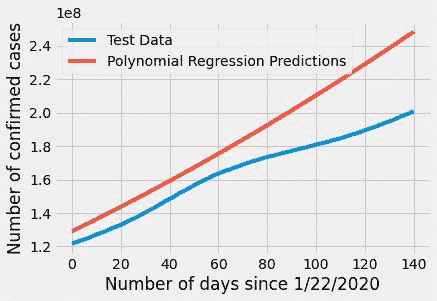 **图 7：** `PR` 在测试数据上的确诊病例预测

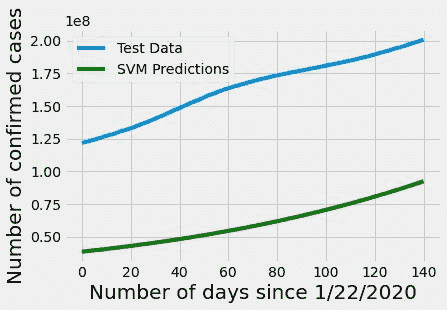 **图 8：** `SVM` 在测试数据上的确诊病例预测

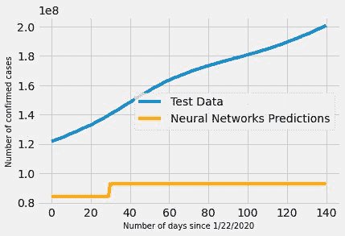 **图 9：** `NN` 在测试数据上的确诊病例预测

**表 2：各种模型的预测性能**

| 数据 | 模式 | MAE (平均绝对误差) | MSE (均方误差) |

| :--- | :--- | :--- | :--- |

| 确诊病例 | PR | 19115152.65809954 | 601959832009913.0 |

| | SVM | 176264386.1021695 | 8616389380431132.0 |

| | NN | 180118306.52400464 | 5769356808564965.0 |

未来 365 天的预测模式见图 10、图 11 和图 12。图中观察到的模式地意味着 `PR` 的预测比 `NN` 和 `SVM` 更准确。总体而言，`PR` 在所有预测情况下都远优于另外两种（`NN` 和 `SVM`）。

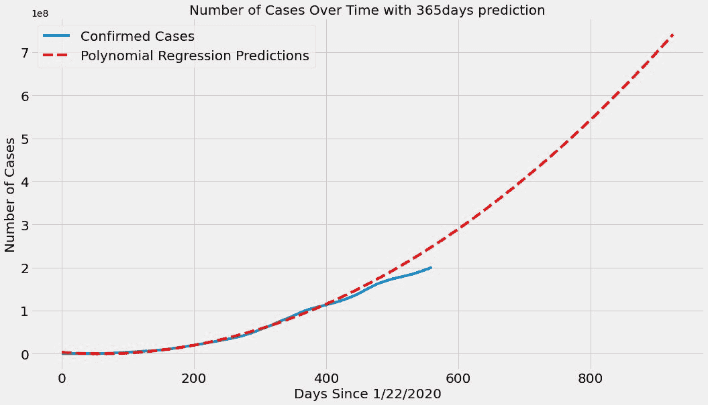 **图 10：** `PR` 对未来 365 天确诊病例的预测

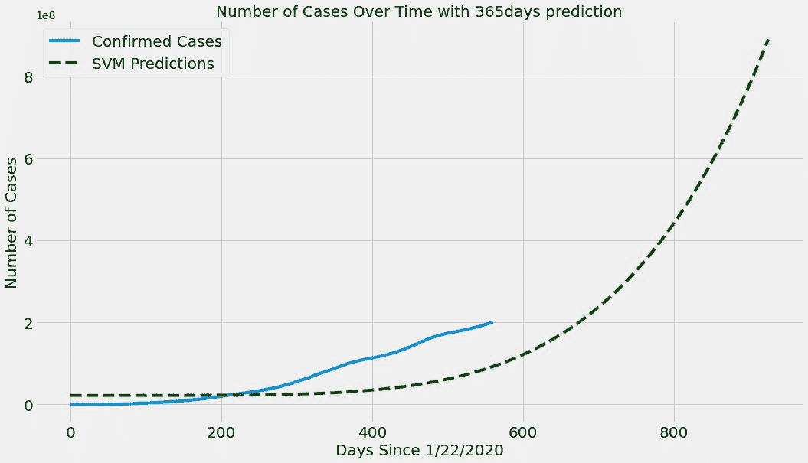 **图 11：** `SVM` 对未来 365 天确诊病例的预测

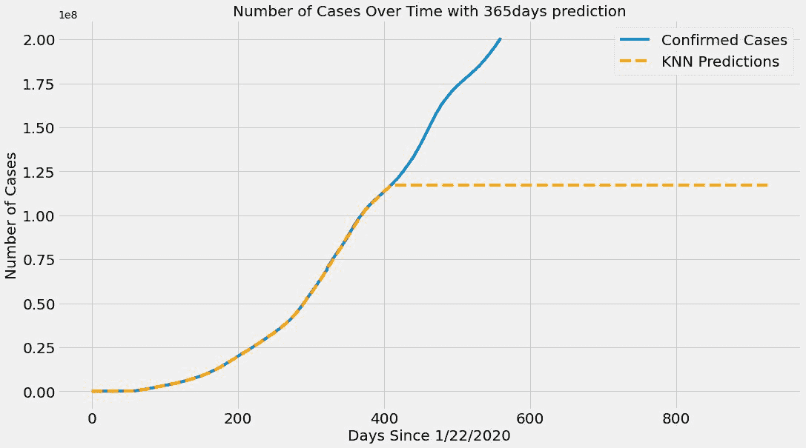 **图 12：** `NN` 对未来 365 天确诊病例的预测

本研究采用了机器学习方法，利用时间序列 covid-19 数据集来预测 Covid-19 的风险。尽管感染率正在下降，但由于全球的关注，Covid-19 的预后良好，因为全球范围内许多人将受到疫情的影响。通过使用机器学习算法，我们能够预测 covid-19 爆发的发生。如果政策制定者、健康专家和政府能够预测感染率，就可以采取更包容且必要的政策。

在本研究的特定视角，我们使用了 `SVM`、`NN` 和 `PR` 模型对 16 个西非国家的 covid-19 进行预测。典型数据集包含记录的每日感染时间序列，我们使用 `PR`、`NN` 和 `SVM` 预测了未来 365 天的感染发生情况。根据预测模型，未来 365 天内确诊病例将继续增加。我们得出结论：机器学习的预测依赖于当前数据，因此我们可以理解或预测下一个状态。它被相关机构用于采取补救措施，通过严格遵守当前和未来的应急计划来对抗这种糟糕局面。对于进一步的研究，我们将关注使用更新后的数据集以及在本研究中未测试的其他机器学习模型。

## V. 结论

肆虐的冠状病毒肺炎给整个世界带来了从健康、社会、经济、国际关系等在内的诸多问题。这种疾病的爆发在人类生活的所有领域都带来了巨大的损失。本研究检查了病原体。对病毒的概念被提出并缩小了范围。考虑到 `SARS-CoV-2` 本身，对病毒的一些变异体进行了评估，它是导致 COVID-19 疾病的因素。该疾病的起源和传播涵盖了发生的一些后续感染。此外，重点强调了机器学习技术，特别是其中显著的模型，即 `NN` 和 `SVM`。研究使用的数据集检索自真实来源，为该工作提供了信誉。模型实施恰当，结果以图表形式生成并经过仔细分析。产出了十六个西非国家确诊病例、死亡和康复人数的结果。此外，还对康复、死亡和确诊病例进行了预测。基于分析的研究表明，机器学习模型使用时间序列数据集在全球范围内进行预测。观察到，对 Covid19 的预测与全球对疫情可能导致大规模破坏的假设担忧相一致。鉴于研究的可用资源，这一方案在思想和技术上都是可行的。

## 参考文献

1. Ardabili, S. F., Mosavi, A., Ghamisi, P., Ferdinand, F., Varkony-Koczy, A. R., Reuter, U., & Atkinson, P. M. 2020. Covid-19 outbreak with ML. Algorithms, 13(10), 249-261.

2. Debjit, K., Islam, M. S., Rahman, M., Pinki, F., Nath, R. D., Al-Ahmadi, S., ... & Awal, M. 2022. An improved machine-learning approach for COVID-19 using Harris Hawks optimization and.

- [13] 世界卫生组织. 2022. 增强对奥密克戎 SARS-CoV-2 变异的应对：成员国的技术简报和优先行动。世界卫生组织总部，瑞士日内瓦。更新，(6)。

- [14] Worldometers. 2020. 西非人口。https://www.worldometers.info/world-population/western African-population/ 访问于 2021 年 9 月 12 日

- [15] Xiong, Y., Ma, Y., Ruan, L., Li, D., Lu, C., & Huang, L. (2022). 预测 COVID-19 严重性的不同机器学习技术比较。贫困地区的传染疾病, 11(1), 1-9。

- [16] Zhao, Z., Li, X., Liu, F., Zhu, G., Ma, C., & Wang, L. 2020. 非洲国家 COVID-19 传播预测及对防控的意义：南非、埃及、阿尔及利亚、尼日利亚、塞内尔和肯尼亚的案例研究。总环境科学, 729, 138959。

- [17] Zheng, N., Du, S., Wang, J., Zhang, H., Cui, W., Kang, Z., Yang, T., Lou, B., Chi, Y., Long, H., Ma, M., Yuan, Qi., Zhang, S., Zang, D., Ye, F. & Xin, J. 2020. 使用混合 AI 模型预测中国 COVID-19。IEEE 控制学刊, 50(7), 2891-2904. 简报：关注的变异株奥密克戎 (B.1.1.529)：风险评估，2021 年 12 月 7 日。

## 第四章：用于帕金森病早期检测的基于机器学习的 CMOS 读取电路

Jyoti M Roogi¹, Manju Devi Devi²

¹ VTU Scholar CMR Institute of Technology 班加尔，印度, CMR Institute of Technology, AECS Layout 班罗尔, ² The Oxford College of Engineering Bommanahalli 班罗尔, The Oxford College of Engineering 班罗尔，印度, ¹jyotimr@gmail.com, ²manju3devi@gmail.com

摘要 — 一种名为多巴胺的有机化学物质属于茶酚胺和苯乙胺类。它是神经元释放的一种化学神经递质，多巴胺在大脑中的主要功能之一。它们对于大脑各部分以及大脑与器官之间的信息传递至关重要。身体运动由多巴胺控制。大脑部分缺乏多巴胺或产生产生不足会导致帕金森病（PD）。这是一种影响身体运动的神经系统疾病。它可能导致身体部位的僵硬和颤抖。由于低水平多巴胺与帕金森病有关，检测低水平多巴胺具有挑战性且复杂性。在本章中，我们提出了一种利用 CMOS 读取电路对这种神经系统疾病 PD 进行早期检测的方法，该电路在电极的帮助下，测量并放大以电信号形式从脑部中提取的低水平多巴胺。`ADC` 被用于将放大的模拟信号转换为数字信息。机器学习算法用于根据读取电路接收到的数据来预测疾病。多巴胺水平以电流测量，范围从 `pA` 到 `nA`。CMOS 放大器用于在生物放大器的帮助下，增强毫伏（`mV`）范围内的采集信号。为了将 `pA` 范围内的采集电流转换为微伏（`µV`）幅度的电压，使用了 CMOS 前端级，称为跨阻放大器（`TIA`）。本章提供了用于帕金森病检测和预测的低噪声、低功耗基于机器学习的 CMOS 读取电路的完整设计和分析。

术语—— 多巴胺、机器学习、CMOS、读取电路、`TIA`、生物放大器。

## I. 引言

读取电路是医学领域许多疾病检测的关键部分之一。采用互型金属氧化半导体（`CMOS`）设计是因为其具有面积小、低功耗和低成本等优点。帕金森病（PD）和阿尔茨海默病是常见的神经系统疾病，主要出现在年龄 60 岁以上的人的 3% 中（Krismer, F.; Mahlknecht, P.; Poewe, W.; Seppi, K）。帕金森病的临床检测使用与神经学相关的成像模式（如 MRI、PET 和 SPECT）进行。所使用的测试技术如基于图像的测试（单光子发射计算机断层扫描 (SPECT)、M-碘苄基胍胺心脏心素扫描 (MIBG)）诊断成本高昂，且设备不易获得。

脑电图（`EEG`）是一种用于评估大脑电活动的测试，也用于研究癫痫性疾病，也是低成本技术之一。帕金森病主要是因为缺乏一种重要的化学物质多巴胺。它是一种神经递质，在大脑中产生，并被神经系统用于在神经细胞之间传递信息。多巴胺浓度影响人类行为，异常行为中会导致多巴胺信号的变化（Beitz, J.M :(Dickson, D.W）。我们在这项工作中展示了如何通过 CMOS 读取电路检测低水平多巴胺。图 1 显示了用于帕金森病早期检测的 CMOS 读取电路框图。框图显示了跨阻放大器后是后增益放大器以进一步放大。模数转换器（`ADC`）用于将放大的模拟电压转换为数字信号。数字信号经过机器学习算法的处理并与已存在的数据集进行比较，分析数据以检测帕金森病。

© 2022 Technoarete Publishers

Jyoti M Roogi – “用于帕金森病早期检测的基于机器学习的 CMOS 读取电路 ” 页码: 38 - 48.

https://dx.doi.org/10.36647/AAIMLH/2022.01.B04


### 38

**图 1** 读取电路

测量生物信号的传感器有多种，其中电化学传感器因其优点被广泛使用。生物传感器是将生物响应转换为电信号的电路。在本工作中考虑了基于电流的生物传感器。电化学生物传感器将分析物浓度转换为电流或电压。在这些传感器中，当生物事件扰动电极/电解质界面的电荷分布时，就会以电流的形式产生信号。在电化学电池中，当目标分子在工作电极和参考电极之间的分析物特定电位在工作电极表面还原或氧化时，会产生电荷转移电流 `I[redox]` [Feiyun Cui:, H. Susan Zhou :, Yi Zhang:,Yun Yue and Ziming Zhang]。这些传感器的电流幅度差异很大。例如，在电化学生物传感器中，神经递质的检测需要超过 120 dB 的动态范围，其中从 1 nM 到 1 mM，多巴胺浓度会由于自发脉冲活动或药理刺激而变化 [Feiyun Cui et all]。电流将在 `uA` 到 `pA` 范围内。这些生物传感应用需要动态范围大于 140 dB 的电流读取前端以及输入噪声小于 1 pArms [A. Chaddad; , E. Kamrani;, Lesage; ,M. Sawan].

## II. 用于生物传感应用的电流测量前端

CMOS 读出电路由电流测量前端和随后的后级放大器组成。为了进一步处理，使用 `ADC` 作为数字接口，以应用机器学习算法来检测病变（PD）。许多生物传感器在检测目标分子或蛋白质期间提供电流信号，该电流信号被信号放大器捕获以进行进一步信号处理。生物传感应用中最关键的电流信号范围通常从亚 pA 到几 µA，带宽在几 kHz 以内。因此，放大器需要超过 140dB 的动态范围，以及在 kHz 带宽内值为数十至数百 fA 的极低输入参考噪声 [Brian Goldstein, Dongsoo Kim, Fred J;, Eugenio Culurciello :, Sigworth and Wei Tang]。此外，信号放大器的输入阻抗应低于传感器的输出阻抗，以避免衰减。为了设计放大器并分析噪声的影响，可以将电流型生物传感器建模为电流源。这些设备的传统实现分别是电流传输器（`CC`）和跨阻放大器（`TIA`）[Chuah and David Holburn ;,J Huang]。放大后的信号可以经过滤波，然后通过 `ADC` 量化为离散时间数字信号以便进一步分析。虽然放大器和 `ADC` 可以分开设计，但当 `ADC` 设计为同时放大和量化输入信号时，电流型 `ADC` 提供更低的噪声、更高的线性和功耗。例如，电流型 `ΔΣ`调制器（`DSM`）利用全局反馈来提高线性并降低功耗。基于振荡器的 `ADC` 是另一个示例，它提供从电流到时间域的信号放大，并以数字数字的方式高效量化这些时间信息。CMOS 集成电路的小型化将复杂的电流传感架构缩小到硅片上，并为与读出电路直接集成提供了独特的机会。传感器和放大器的集成由于互连电容减少而更低的噪声。这使得生物传感和现场检测应用成为可能，并为高吞吐量应用了高密度紧凑阵列。为了将传感器电流转换为电压以进一步处理，使用了名为跨阻放大器的电路。图 2 显示了电阻反馈 `TIA`（`R-TIA`）的原理图。`R-TIA` 的增益由反馈电阻决定，输出电压 `vo` 是反馈电阻乘以输入电流。来自反馈元件 `4kT/Rf` 的噪声，

反馈电阻产生放大器噪声之外还会产生噪声，因此应尽量减少来自 `Rf` 的噪声。例如，`Rf` 应大于 165 MΩ，以获得小于 10 fA/√Hz 的电流噪声密度。可以使用额外的并联电容 `CBW` 通过控制 `R-TIA` 的带宽和宽带白噪声来降低总噪声。当 `RF` 的寄生电容和放大器的反相输入节点影响 `R-TIA` 的稳定性时，该 `CBW` 还可以稳定放大器。因此，`R-TIA` 的最小可检测信号是可以确定的，通常限于良好的低噪声放大器中反馈电阻产生的额外噪声 [Ibrahim and Peter M;, Levine Mark M. R]。

**图 2** 电阻反馈 `TIA`（`R-TIA`）的原理图

## 2.1 双级基于反相器的跨阻放大器设计

在这项工作中，为了将传感器电流转换为电压，我们采用了基于反相器的 `TIA`。使用 `Cadence virtuoso` 对跨阻放大器进行仿真。图 3 和图 4 显示了基于反相器的 `TIA` 的原理图，而图 5 显示了 `TIA` 的瞬态分析。

```
(Images/image0259.gif) 图 3 基于反相器的 TIA 原理图
```

```
(Images/image0260.gif) 图 4 基于反相器的 TIA 原理图
```

**图 5** 基于反相器的 TIA 瞬态分析

## III. 叠层共源运放大器的设计


用于放大传感器信号的后级放大器采用叠层共源运放大器设计。放大器级用于放大跨阻放大器（`TIA`）产生的小幅度信号，而`TIA`则与传感器接口。双级运放大器的设计通过使用不同的规格来缩放每个器件，以找到每个器件的跨导度和`W/L`比 [Allen, P. E.; Baker, J.; Gray, P.; Holberg, D.]。设计的电路图如图 6 所示。

```
(Images/image0261.jpeg) 图 6 使用 MOS 负载和电流镜的叠层共源运放大器
```

从叠层共源运放大器的电路图中，我们需要计算所有 MOS 器件的`W/L`比，对于高性能应用应提供大于 80 dB 的性能。叠层共源放大器的设计规格见表 1。

| 设计规格 | 参数值 |
| :--- | :--- |
| 压摆率 (Slew Rate) | ≥ 10 V/µs |
| P[diss] | ≤ 5 mW |
| C[L] | 10 pf |
| 小信号增益, A[v] | ≥ 80 dB |
| GB | ≥ 10 MHz |
| ICMR[min] | -0.6V |
| ICMR[max] | 1.6V |
| Vout Range | ±2 V |

表 2 规定了设计 180 nm 叠层共源放大器所需的不同参数。这些参数用于手算计算。

| 制造工艺参数 | 参数值 |
| :--- | :--- |
| V[DD] = 1.8 V |
| V[SS] = -1.8 V |
| λ[n] = 0.1 V |
| V[TN] = 0.43 V |
| V[TP] = -0.38 V |
| µ[n]C[ox] | 300 µA/V² |
| µ[p]C[ox] | 100 µA/V² |

## 2.1 叠层共源运放大器设计步骤

满足不同参数的双级运放大器电路设计如下。叠层共源放大器的设计步骤包括以下步骤。

### 步骤 1：利用压摆率计算最大尾电流 I[3]

```
(Images/image0261.jpeg) 图 7 使用 MOS 镜的叠层共源运放大器
```

使用如下所示的尾电流和负载电容的压摆率方程，我们可以得到尾电流`I[3]`的值。压摆率 = 10 V/µs 且`C[L]` = 10 pf，得到

```
(2)
```

这给出`I[1]=I[2]=50 µA`，由于 M1 和 M2 形成差分对，电流是相等的。

### 步骤 2：在级级偏置电流

在设计中假设偏置电流。

```
I[4] = I[5] = 1.2 X I[3]
```

因此取`I[4]=I[5]=125 µA`。

### 步骤 3：利用最大输出电压计算 M[5] 或 M[7] 的饱和电压以计算 S[4], S[5] 和 S[14]

为此，我们需要找到计算`S[4]`和`S[5]`所需的饱和电压。饱和电压可以通过以下方程计算：

```
(6)
```

现在计算`S[4]`、`S[14]`和`S[5]`使用以下方程；代入`I[5]`和`V[SD5]`，得到

```
(9)
```

再次计算`S[6]`、`S[7]`和`S[13]`使用以下方程；代入数值得到

```
(11)
```

### 步骤 4：利用最小输出电压计算 M[9] 或 M[11] 的饱和电压以计算 S[4], S[5] 和 S[14]

这里，值为 0.1V，最小输出电压为 -1.6V，电源电压为 1.8V，由以下方程给出：

```
| | |
```

通过此得到

```
(15).
```


#### 步骤 5：自偏置共源

为了获得电路的正确偏置，我们需要使用偏置电阻 `R[1]` 和 `R[2]`。为了找到 `R[1]` 和 `R[2]` 的值，我们需要分别使用晶体管 `M[14]` 和 `M[6]` 的饱和电压。这可以通过以下方程实现 [Sedra, A. S.; Smith, K. C.]。

`GB` 的值用于计算 `S1` 和 `S2`，由下方方程给出；

当 `GB = 10 MHz` 时，由于 , 和 ,，我们得到

#### 第 7 步：计算 `S[3]` 的最小输入共模电压

最小输入共模电压得出的 `S[3]` 为

\[ √ \]

代入，， , , , 和 ,，我们得到

#### 第 8 步：计算 `S[4]` 和 `S[5]` 的最大输入共模电压

最大输入共模电压需要

\[ \]

使用，， , , , 和 ,，我们得到。这小于 250；通过我们 我们可以找到 `S[12]` 的值，并由以下给出

#### 第 9 步：在此步中计算放大器的增益。

为了计算放大器的小信号增益，需要计算以下值：

具有所有晶体管 `W/L` 比例后，我们将找到所有晶体管 `g[m]` 和 `g[ds]`，如下所示：对于 `S[4]`、`S[5]`、`S[13]`、`S[14]`：

\[ √ √ \]

以及

同样，`S[6]` 和 `S[7]` 给出，√

以及

再次，`S[8]`、`S[9]`、`S[10]`、`S[11]` 给出：√

以及

最后，`S1` 和 `S2` 给出：

√

以及

现在，为了得到电阻的值我们有；

以及 `R[11]` 由 ( ) ( ) ( )

现在通过以下方程找到 `K` 的值：

因此，放大器的小信号增益为；⁄

#### 第 10 步：放大器的总功率耗

总功率耗公式为：

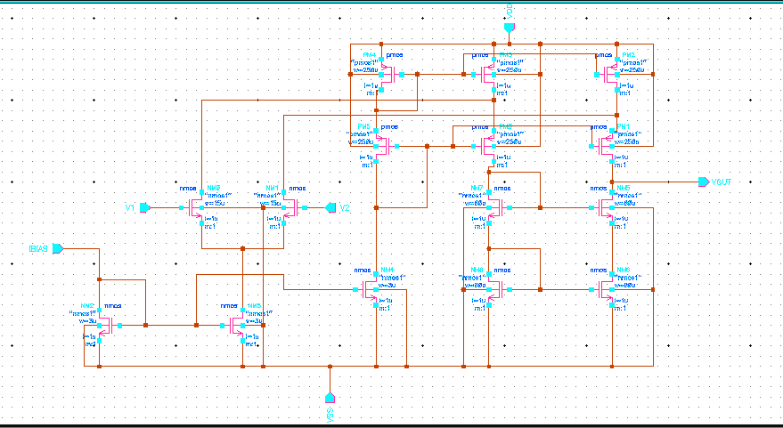 **图 8** 折叠共极运运放大器电路原理图

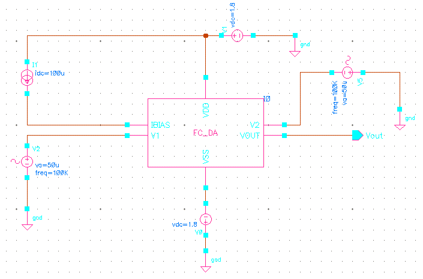 **图 9** 折叠共极型电路测试原理图

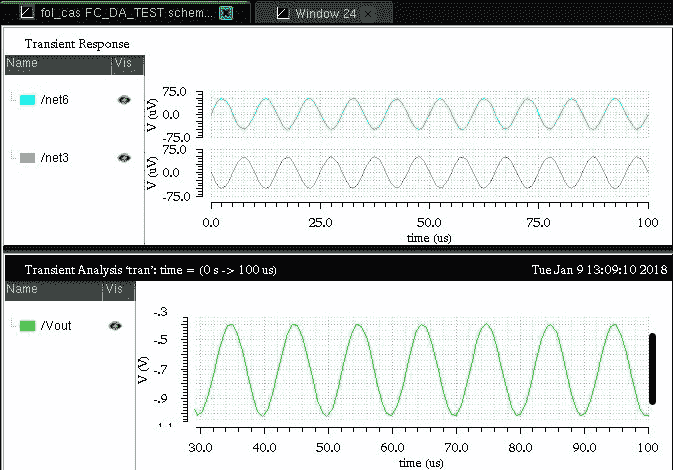A)

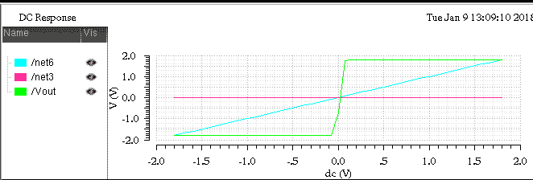B)

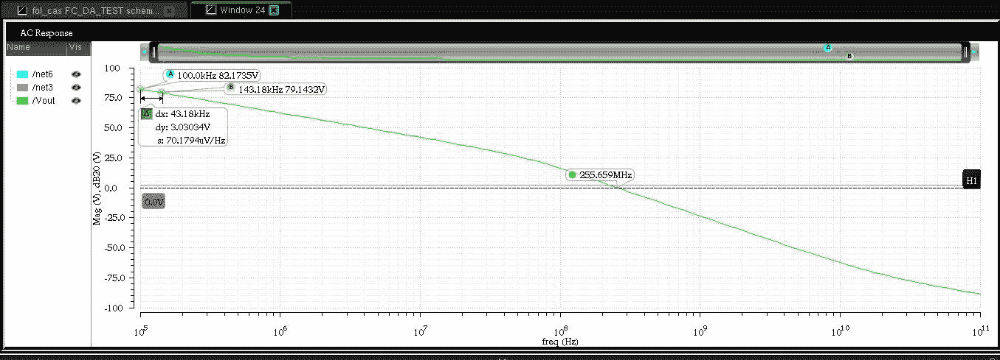C)

**图 10** 折叠共极运放的仿真输出；A) 瞬态响应，B) 直流响应，C) 交流响应，表 3 折叠共极放大器比较参数

| 参数 折叠共极 |
| :--- | :--- |
| 运放增益 (dB) | 82.1735 |
| 功率 (mW) | 0.933 |
| 增益带宽 (MHz) | 255.656 |

图 8、9 显示了折叠级放大器的原理图和用于分析的测试平台，而图 10 显示了不同的折叠级放大器分析。表 3 显示了从折叠级放大器获得的结果，显示了约 82dB 的增益，同时也显示了 0.933 mW 的边缘功率，与两级放大器相比，由于晶体管数量更多，它的功率更高。

放大传感器信号后，必须使用 `ADC` 将数据转换为数字信号。在这项工作中，考虑使用 `8bit ADC` 进行转换。转换后的数据被映射以消除噪声，并以矩阵形式存储以便进一步处理。

## IV. 用于 PD（局部放电）先进检测的机器学习算法

这项工作考虑了电化学传感器，传感器输出也是模拟信号的形式。为了应用机器学习算法，将模拟数据转换为数字并以矩阵形式表示以便提取特征。文献调查显示，不同类型的机器学习算法被应用于从图像和其他许多来源检测 PD。在这项工作中，使用了电检测。

[1] Masahiro Kubo, Hiroki Yotsuda, Taro Kosaka, Nobuhiko Nakano (2015) 一种使用 OTA 作为反馈电阻用于膜片钳测量系统的跨阻放大器设计, 智能信号处理与通信系统国际学术会议 (ISPACS)。

[12] Jiaping Hu, YongBin Kim, Joseph Ayers (2010) 一用于生物传感应用的低功耗 100MΩ CMOS 前端跨阻放大器, 978-1-4244-7773-9/10/ © IEEE。

[13] Linga Reddy Cenkeramaddi, Tajeshwar Singh, Trond Ytterdal(2009) 医学超声成像用的 90nm CMOS 反相器型 1V 跨阻放大器, 978-1-4244-4311-6/09 IEEE

[14] E. Kamrani, A. Chaddad, F. Lesage, and M. Sawan, Member IEEE (2013) 致力于低噪声和低功耗生物医学应用的集成跨阻放大器, 南方生物医学工程会议。

[15] Baker, J. (2010). CMOS 电路设计、布局与仿真 (第 3 版). 新纽约: Wiley。

[16] Sedra, A. S., & Smith, K. C. (2004). 微电子电路. 新纽约: 牛津大学出版社。

[17] Gray, P. R. (2009). 模拟集成电路的分析与设计. 新纽约: Wiley。

[18] Allen, P. E., & Holberg, D. R. (2002). CMOS 模拟电路设计, 牛津大学出版社。

[19] Z. Liu, C. Bian, Z. Wang, and C. Zhang, 高单位增益带宽和大输出动态范围的全定制 OTA 两级全分 CMOS 放大器 (2005), 0-7803-9197- 7/05/$20.00 © 2005 IEEE。

[20] Prateek Jain and Amit Mahesh Joshi, 用于生物医学应用的低泄漏和高共模抑制比 (CMRR) CMOS 差放大器 (2017)。

[21] Ali, S.; Hassan, A.; Hassan, G.; Eun, C.-H.; Bae, J.; Lee, C. H.;Kim, I.-J. 用于病原体瞬时检测和分类的一次性全打印电子生物传感器。Sci. Rep. 2018, 8 (1), 1−11。

[22] Gonzalez-Calabuig, A.; Faura, G.; Del Valle, M. 在使用人工神经网络处理的高维伏安法生物传感器数据; ESANN, 2017。

[23] Rajkumar S. Parihar and Anu Gupta, 用于高增益、高带宽应用的全分两级 CMOS 运算放大器设计. D. S. Shylu, D. Jackuline Moni, and Banazir Kooran, IJRET (2014), eISSN 2319-1163 pISSN 2321-7308。

[24] Sunny Anand and Vemu Sulochana, 用于血糖监测的模拟数字转换器, 电路与系统：国际期刊 (CSIJ), 第 1 卷, 第 2 期, 2014 年 4 月。

[25] Feiyun Cui, Yun Yue, Yi Zhang, Ziming Zhang, and H. Susan Zhou, 利用机器学习推进生物传感器发展, ACS Sens. 2020, 5, 3346−3364。

[26] Dasgupta, A.; Nath, A. 机器学习算法分类. 国际先进工程创新研究期刊 (IJIRAE) 2016, 3 (3), 6−11。

[27] Ayodele, T. O. 机器学习算法的类型. 机器学习的新进展 2010, 19−48。

[28] Bermejo, S.; Cabestany, J. 自适应软 k-最近邻分类器. 模式识别 2000, 33 (12), 999−2005。

[29] Cherif, W. 通过聚类和可靠性系数优化 K-NN 算法：在乳腺癌诊断中的应用。Procedia Computer Science 2018, 127, 293−299。

[30] Singh, A.; Thakur, N.; Sharma, A. 监督学习机器学习算法综述; 2016 年第 3 届可持续全球发展计算国际会议 (INDIACom), IEEE: 2016; pp 1310−1315。

[31] Massah, J.; Asefpour Vakilian, K. 一种用于循环伏安法快速准确测硝酸盐的智能便携生物传感器。Biosys. Eng. 2019, 177, 49−58。

[32] Gonzalez-Calabuig, A.; Faura, G.; Del Valle, M. 在使用人工神经网络处理的高维伏安法生物传感器数据; ESANN, 2017。

## 第 5 章

基于人工智能或机器学习算法的物联网智能医疗应用

Sudhakar Hallur¹, Vinay Sangolli², Vishweshkumar Aithal^(3 1,2,3) 电子与通信工程系, KLS Gogte 技术学院, Udyambag, Belagavi, Karnataka, India

### 摘要

通过物联网实现的远程应用极易受到安全问题的影响。物联网被认为是医疗领域的未来，由于医疗保健应用的设备接入、整合和使用，在疫情期间，对患者健康监测的可靠通信至关重要。本章讨论了物联网架构，包括支持医疗保健服务的设备协议。此外，还探讨了数据安全、安全性和兼容性问题。本章还包含了一种解决方案的实时医疗案例。

**关键词** — 应用 (`API`)、COVID19、监管、资源、缺失、威胁、监控

## I. 引言

关于物联网 (`IoT`)的信息和应用包含了更复杂的挑战。物联网信息安全是最关键的部分且难以实现。在可用框架与深度安全框架之间进行平衡，安全通常成本高昂。无论安全成本和使用的性质如何，安排不同的有效保护措施对于确保分类、访问控制、验证和信任是至关重要的。

数据的开放性、未经授权的访问以及物联网对象较高的处理能力，为整项技术带来了一系列问题。由于大多数物联网节点收集数据并进行处理给出结果，使用物联网传输数据不仅有助于数据分析，还有助于决策制定。

人工智能（AI）赋予设备或程序程序解码复杂信息的能力，包括图片、视频、文本、话语或不同的声音，并根据这些翻译结果来完成目标。经过计算机智能工具培训的专业人士和商户已开始针对并处理医疗保健领域可能最大的问题。医疗保健领域面临着不断增加的成本，需要帮助在有限的资源内获得更好的结果。

许多领域的多数合作伙伴都反对变革，因为他们喜欢维持现状。然而，医疗保健领域目前需要变革。随着成本的上升和环境各方面的饱和，医疗保健行业需要发展以提供顶级的预测考虑和价值。随后，各种人工智能应用应运而生，包括药物发现、临床试验患者监测、解读电子健康记录（EHR）中的笔记、为患者提供预防性医疗建议、预测毁灭性的心脏病、睡眠呼吸暂停或哮喘，并在潜在的“蓝色代码”危机发生前几小时提醒临床医生。

## II. 医疗保健领域的医疗方法

网络化智能健康传感器和其他智能应用程序对于从患者处提取健康信息非常有帮助。患者在早晨醒来并站在配备摄像头的镜子前，如果他有副作用，可以选择与主治医生建立联系。根据患者信息，他会逐步选择哪些步骤是合理的。然而，这一切远不止于：在最糟糕的情况下，引入地毯和房屋的跌倒传感器或合理的医疗可穿戴设备可以识别出患者何时跌倒在地上，或者何时由于其他原因需要帮助。在智慧城市的辅助，相关的控制中心可以接受培训并发送救护车辆，根据情况选择具有合适容量的相应诊所。M. Aoyagi、K. Nishimori 等人表示，与智能诊断和可穿戴设备相结合，此类智能系统可以特别帮助老年患者，即使在没有可靠护理组件的情况下，也能在自己的家里比以前更自由地生活更久[1]。

患者信息的获取占据了护理人员有限时间的大部分，特别是在诊所环境中。在这里，可以使用智能设备通过语音命令等收集重要的患者信息，并借助计算机推理和大数据的帮助进行准确分配和评估。这目前还没有完全通过可穿戴设备记录，但通常也能够通过护理人员对患者的印象和评估获得。护理人员将会有更多精力用于实际护理，而不需要记录每条信息，也不需要在稍后通过电脑将其传输到电子患者文档。根据 M. Aoyagi、K. Nishimori 等人的观点，这本质上可能是对医疗领域所需的紧迫危机护理的一种（不完全的）应对，因为如果我们考虑到人才和劳动力的短缺，显而易见的是，在日益老龄化的社会背景下，这可能是未来最大的挑战之一[1]。

### 2.1 医疗保健应用的范围

目前，COVID-19 疫情对患者监测产生了极高需求。根据 Hu, M 等人的研究，不同聚集活动的死亡率、感染传播率以及相应的医疗保健系统的视力[6]。如今，接入物联网的设备对于处理患者的体内体温以及在任何异常情况下提供与专家相似的提示至关重要。基于物联网的可穿戴智能设备在监测相关医疗状况方面非常有用。这种进展有助于采取行动应对当前的流行病。物联网辅助设备在医疗保健体系的远程发现方面已达到拐点，确保了患者的安全。在整个疫情期间，患者与管理者的互动变得更有说服力和现实意义。它减少了重复陈述并缩短了患者在预约期间花费的时间。正如 Chen C 等人在其工作中指出的，对患者健康的持续监测改善了 COVID 患者的治疗效果[7]。

在临床护理情况下，柔性开发和设备的使用已被证明是有益的。任何由细胞维持的治疗性实践被称为“移动健康”（mHealth）。例如，移动健康应用程序可能帮助临床医生管理临床疾病并教育患者自我检查疾病，同时促进药物依从性。由于移动健康应用的使用，医疗保健和发展数据变得更加可用。根据 Faasse K 等人的研究，在客户方便时使用 mHealth 应用有助于防止稳定患者发生微小的急诊室就诊，限制了高风险环境下免疫功能受损患者的灵活性[8]。

在缺陷的关系中，在 mHealth 中执行可以考虑所有因素或最终结果概述的关键方面具有巨大的潜力。此外，将相关的流行病学数据与地区适应性疾病发生性的地理数据相结合，将允许病例追踪，这可以作为防止感染的可能工具。数据可以通过 mHealth 应用快速交换并进行高强度增强，使其传递相关数据更加有效。移动应用可能避免某些疾病的发生，因为通过保守程序交换的消息可以鼓励交流、数据存储和信息生成，鼓励客户采取健康的生活方式。

### 2.2 医疗保健中的物联网

医疗保健中的定制监测利用资源和时间非常有限。一位经验丰富的医生需要不断面对面关注患者，而且实验结果通常需要几天才能准备[12]。此外，在出院后，康复中的患者可能需要安排两次或三次随访检查以确保他们的健康状况良好。

由于 `IoT` 的引入，这些困难正在以精确的方式得到解决。可穿戴设备和植入式设备也被用于持续监测没有时间限制且处于真实区域的患者状况。这些设备还可以利用区域和更聚焦的 `AI` 模型来检测和预测疾病以及危险情况。它们随后可以向患者以及相关的专业专家报警。这里的调查被称为“无处不在的、电子化和移动健康”（Omnipresent, Electronic, and Mobile Health），其总体目标是降低医疗保健成本并提高患者满意度，减少危机设施的存储（特别是在发生危机事件时），并提供直接、确定且稳固的 `AI` 模型，帮助专家识别和阻止疾病并提供定制处方。

#### 2.2.1. IoT 健康中的大数据

数以十亿的传感器连接在患者身上，监测并收集常规、身体和生理数据。

领先技术也降低了韧性。最近的例子显示了临床超级传感器的崛起，它们具有更大的内存和控制力，可以使用`改进的粒子群优化（Improved Particle Swarm Optimization）`估计来协助药物向人体各个器官进行复杂的运输，感知药物是否已到达特定位置等。正如所预测的那样，这些传感器每秒产生大量数据。`大数据（Big Data）`是一个用于描述包含大量相关信息的海量异构数据的术。这些数据应该通过最可行的基础技术从统一服务器中提取和评估，这产生了诸如数据传输的网络瓶颈和处理能力不足等挑战，以及用于持续数据分析的资产。已经提供了几种方法来解决上述问题，包括在相邻计算机中删除额外数据和异常、在发送之前对数据进行聚合、以及利用轻携设备进行非常基础的查询。^(\[16\]) `AI` 模型可能在结果暗示问题时发送信息。`AI` 和`深度学习（Deep Learning）`程序是管理、分析和删除从获取数据的信息并进一步改进动态循环最流行的方法，因为一旦它们完成了准备阶段，就不再需要任何监督，可以继续执行任务。^(\[29\])

#### 2.2.2. 基于 IoT 的健康监测的大数据与机器学习

`AI` 和深度学习方法已应用于并正被广泛应用于智能框架中。这些智能框架包含许多更简单的部分，每个部分都提供完全不同的帮助。在一个广义视图分类中，我们可以将 `AI` 计算分为有监督策略和无监督策略。^(\[12\]) 在无监督方法中，模型获取未标记的信息，因此它可能会自动发现信息中的任何重要性和隐藏模式以执行数据收集。^(\[28\]) 对于信号和聚类信息，我们应用了多种算法，如`模糊（Fuzzy）`、`K-means`、`隐马尔可夫模型（Hidden Markov Model）`等。与聚类相反，模型中的分类处理训练阶段的标记，导致以最小误差对输入数据分类。`支持向量机 (SVM)`、`RF`、`K 最近邻 (KNN)`等是一些常用的分类器。对于`图像（Images）`，我们应用`卷积神经网络 (CNN）`。

#### 2.2.3. 健康监测所需的物联网特性

`IoT` 设备在健康交换时应具备几个独特特征。IoT 中的部分健康采集设备如下：

##### a. 多样的设备能力

通过可穿戴设备对个人健康参数的评估是基于从患者身体提取的输入，并描述场景的确定结果。

##### b. 高依赖性

传感器老化非常快，且有故障风险，因此现在协调它们更为明智。

##### c. 即时信息传输

远程监测和获取疾病的早期迹象对于遭受持续环境影响的人和老年人可能有巨大的益处。这些设备为基站提供持续数据。

##### d. 流量安全

虽然数据可用，但存在数据风险。保护数据是关键元素。

##### e. 应用配置性

安装的设备越多，花费越高。这是医疗系统的典型例子。

##### f. 数据流量监测

需要对进出数据进行监测。查看进出数据并跟踪其路径非常重要。

##### g. 成本效益

设备越多，花费越高。因此，需要一种支持更少连接点的设备的系统。

#### 2.2.4. 用于健康监测的可穿戴设备

可穿戴健康设备是一项未来技术，可以在不同情况下对特定基本体征进行持续估计。它们获得关注并成功的关键在于其灵活性——客户现在准备在跑步、思考或睡眠时跟踪自己的活动。目标是通过允许他们分离数据并管理自己的账户来为他们提供财务控制感。基本上，可穿戴设备如图 1 所示。

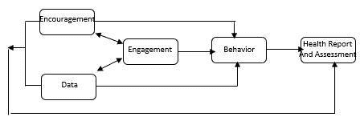**图 1.** 可穿戴设备的框图

通过可穿戴设备对个人健康参数的评估是基于从患者身体提取的输入。

##### 2.2.4.1. 医疗中的 IoT 和 ML 设备（可穿戴设备）

许多医疗设备或传感器应与主框架协调，以处理和分析数据并得出关于患者健康的结论。IoT 中的部分健康采集设备如下：

*   `智能手表（Smart-watches）`

在客户设备商店销售的穿戴设备与传感器和网络联盟相结合。很少有设备能够监测你的脉搏、控制糖尿病、辅助言语治疗以及感知癫痫。

##### b. 血糖智能监测设备

这些设备可以监测血糖水平并将数据发送到合法的 `PDA` 应用程序。糖尿病患者可以使用这些设备监测其血糖水平，并与临床效益办公室通信信息。

##### c. 可吞入微型设备

为了消除体内的影像，一些传感器通过患者的身体入口被吞入。这些传感器收集人体器官内部的图像，并将其远距离传输，以便在屏幕或手机上查看。这有助于对患者的疾病进行诊断。此外，药物连同一个小型临床传感器一起服用，该传感器会向患者身上的穿戴式接收器发送信息，然后由患者将信息传输到合法的 `PDA` 软件。这种传感器可以帮助医生确保患者按医用药。

##### d. 糖尿病监测设备

存在如 `m-IoT` 等传感器，通过拍摄患者指尖图像监测其血糖水平。根据 `Prasad. D, et. al` 的研究，随后使用激光轴`^[2]` 从患者指尖的血管结构中提取图形数据。此外，红外波段的光学传感器（如 `infrared LEDs` 和光电二极管）可以帮助检测患者的糖尿病状态。

##### e. 温度传感与监测设备

在需要检查患者温度的情况下，采用一种小型 3D 打印的耳用温度检查阴极。该传感器使用红外光传感器检测鼓膜膜的内层强度水平。根据 `Prasad. D, et. al` 的研究，隔离的温度存储在数据库中`^[2]`，随后从目标传输到附近的/远处的站台，并在页面上进行筛选并给出输入。

##### f. 高血压监测设备

袖带绕在患者手臂上并加压，直到气球达到最大极限且汞柱下降，从而显示患者的血压。然而，如今已采用机器人化的手臂袖带操作，以及通用的感应、护理和读数传输。

##### g. 氧气监测设备（血氧仪）

在临床思维业务中，基于 `IoT` 技术进展带来的脉搏血氧仪改进已显示出良好的效果。血氧饱和度、近心率和心率限制都通过简单的组织血氧仪进行检查。

##### h. 哮喘监测工具

一种呼吸屏，记录患者的吸气和呼气速度，并通过建立界限来指示患者呼吸状态的严重程度。

##### 2.2.4.2. 健康-IoT 在生命体征监测中的适用性

COVID 影响了大部分人口。由于它通过空气媒介传播，事实证明保护医生、护士等医疗监测人员的健康，以及在出现床位短缺和居家隔离的情况下保护邻近患者和亲属的健康非常重要。如果出现受 COVID 影响的患者，无法对患者健康进行近距离便利或密切监测。此外，`Prasad. D, et. al` 指出，这种情况下可以使用 `IoT` 估计的大部分内容。

##### a. 脑信号监测

在 `COVID` 期间监测患者的氧气水平是非常具有挑战性的。通过 `EEG` 电极从患者大脑中提取 EEG 信号，然后将其通信到远程站。

##### b. ECG 监测

心电图(`ECG`) 考虑到心房和心室的去极化和复极化处理心脏的电活动。`IoT` 开发的应用已发现心脏异常的早期发现。`ECG` 数据可以通过 `蓝牙` 或任何 `IoT` 适用显示器传输。记录的 `ECG` 数据可以使用灵活应用程序。

##### c. 血糖监测

在 COVID 影响的患者病例中，血糖监测是一个绝对要求。这些情况下，可以使用名为 `m-IoT` 的无痛、方便、安全的设备进行远程监测。

##### d. 体温监测

COVID 影响患者的一个主要症状是发热，因此监测患者温度通常是基础性的。温度的变化有助于专家对疾病做出判断。评估温度的正常策略是使用连接口腔、耳朵或直肠的温度计，这对于患者可能是异常。因此，应该使用远程可穿戴传感器来监测患者的温度。

##### e. 血压监测

任何理解演示中的一项强制系统都是血压监测。如果出现 COVID 影响的患者，监测变得非常基础，因为它显示了流向人体每个部位（特别是肺部）的速度以及心脏的三路血液循环。

##### f. 氧饱和度水平监测

如果出现受 COVID 影响的患者，监测氧水平是最基本的需求之一，因为患者从根本上经历了身体每个部位缺氧的情况，因为在 COVID 事件期间主要影响的器官是肺，肺是人体氧气交换的主要来源。通过`脉搏血氧仪`估计患者体内的氧水平。

##### g. 呼吸异常监测

COVID 的症状之一是哮喘。哮喘是一种顽固的感染，会影响呼吸道并可能导致放松时出现问题。在哮喘中，由于空气区域扩大，呼吸道会收缩。这导致了各种临床问题，例如哮鸣、干咳、胸部不适和呼吸困难。此时，吸入器或雾化器是唯一的帮助手段之一。持续的创新进展整合出了一种呼吸传感器，它可以估计患者吸入和呼出的空气，存储信息并并通过 `IoT` 协调的传输器进行通信。可穿戴式哮喘传感器可以很早地判断哮喘发作的迹象，从而允许用户及时采取预防措施。震动信号和关于危险的预警消息会发送与患者连接的人员。在各种功能中，该设备具有吸入器使用跟踪器。这种呼吸问题监测对于受 Covid-19 影响的患者非常有用。传感器利用 `oximeter` 感知血液中的氧水平，并检测患者的呼吸样本，通过 `IoT` 进行通信。

##### h. 心理状态监测

患者氧水平的困难会通过关闭大脑区域和大脑异常工作，直接影响流向患者大脑的血流。这可以通过利用 `EEG` 电极估算大脑信号，将特征存入数据库，然后明确发送并显示在网页上或任何产品上。

##### i. 药物管理

治疗依从性是临床医学行业中的一个常见问题。不遵守处方时间表可能会导致患者产生矛盾的危险问题。药物不依从性在老年人中普遍存在，随着年龄增长，他们会患上认知障碍、痴呆等临床疾病。从现在起，对他们来说，严格遵循医生的药物非常困难。支持了一种智能医药箱，可以帮助人员检查他们的处方。该箱有三个托层，每个托层包含三个不同时段的药物。该结构还会查看一些基本的健康参数。记录的每条信息随后都会传输给云端专业人员。使用了一种保守应用程序来促进两个终端用户之间的通信。知情当局和患者可以使用移动应用程序获取记录的数据。

##### 2.2.4.3. AI 健康筛选应用

许多机构开发了应用程序，如 Bikash P 等人在其论文中所所示^(\[3\])，它们通过利用不同的传感器消除人体健康边界来筛选健康信息。部分健康应用记录如下：

###### a. Google-Fit

这是一个健康跟踪应用。它是使用编程接口（`API`）连接来自不同设备和应用程序数据的唯一途径。编程接口是连接许多程序的数据传输处理边缘。`Google Fit` 使用嵌入在我们细胞中的传感器跟踪我们的实际健康行为，如跑步、步行、骑行和其他活动。它们根据客户的健康目标建议的，对其健康水平的扩展观点进行对比检查。

###### b. Zepp Life

另一个工具 `Zepp Life` 根据个人在白天使用的资源评估个人的健康状况。此外，`MI Fit` 监测患者的心率、脉搏、睡眠周期和体重指数（BMI）。它整合数据并通过 `Bluetooth` 交付客户，或者通过 `IoT` 协议与他人共享。

###### c. 指纹温度计

一种基于传感器的应用程序使用客户的手指检测内部温度水平和挤压因子。它能注意到我们的手指按在显示板上。这些传感器不需要依赖夹，允许用户只需设置屏幕即可看到指纹。使用长银纳米线来保持混合纳米结构的不规则关联，细银纳米线用于该项目的传感器组提供清晰、灵活的传感器终端。

###### d. 即时心率

其用途和发明本质上与心率监测使用的技术相同。

## III. 智能医疗架构

该框架具有根据观察到的温度水平、心率和脉冲状态做出决策的能力。这种工程同样是节能的，因为它不需要一直开启传感器.^(\[12\]）。图 2 所示的框架解决了远程监测患者的问题，并在医院提供必要的治疗。

 **图 2.** 智能医疗系统

\[各种组件的相互作用产生描述健康关键特征的数据，通过无线网关处理、分析并传输到目的地\]

### 3.1 健康监测步骤

获取患者健康数据的基本方法包括以下步骤：监测患者、数字化药物管理、医疗设备提取数据以及设备与医疗机构关联。

#### a. 监测患者

医疗行业的一个最新进展是“智能胶囊”。智能胶囊像普通处方药一样购买和吸入，但尽管是真实的处方，它们配备了某种检测技术。它们利用该技术将数据发送到佩戴在身上的传感器。在可以根据医学影像传输技术对患者进行远程治疗或给药的情况下，A. S. Anwar 等人指出，图像传输必须高度机密且安全^(\[19\])。根据患者的明显或评估状态，这些传感器监测体内的药物水平。来自紧凑型传感器的信息随后传输到手机应用程序，这意味着患者可以自己获取有关其基本生理功能的信息。在患者同意的情况下，专家可以进行此操作。治疗医生借此判断药物是否按预期发挥作用或可能导致了副作用。

#### c. 医疗设备的数据提取

可穿戴临床设备是目前各年龄段购买者持续监测自身重要生理功能的最吸引人的选择。除了它们能够记录信息（无论信息内容如何），它们还可以根据指令或感知情况发挥特定作用。一种模型是“智能关联”。它们配备了传感器，用于监测隐藏伤口的大小以判断其是否正在愈合，或者，在发生感染的情况下，判断是否应该采取有效的治疗方案。

#### d. 设备与医疗机构的关联及数据分析

物联网（IoT）在医疗行业的许多优势在于提高患者的护理质量。然而，由于物联网的存在，临床办公室也得到了改进，例如通过更高效的周期和分配重要资源。医院和护理中心的智能技术确保了，例如，医生可以更容易地筛选 MRI、CT、PT 扫描仪和 X 光机等昂贵设备的适用性和维护生命周期。通过此类，可以避免故障或误操作。远程传感器限制了手动测试的数量，或者甚至可能消除对这些测试的需求。这为更关键的任务节省了时间。

临床办公室中的一个常见问题是经常使用的硬件或框架的移动。如果设备在紧急情况下无法定位，这就会成了一个问题。蓝牙低功耗区域技术的使用使得设备能够实时定位。这避免了在无法找到经历相同情况的设备时产生愤怒和压力。小小的进步有助于拯救无数生命。相反，这些成本是微不足道的。医疗保健是物联网此前取得重大成就的领域之一。

## IV. 人工智能中的医疗健康参数

人工智能将处理以下参数^(\[30\])：

#### 4.1. 精准医疗

药物的精准性能够根据患者的疾病特征、表达或预后信息或治疗反应，为个人或患者群体定制治疗方案。这种定制治疗干入方案将考虑遗传变异以及临床治疗的影响因素，如年龄、方向、地理、种族、家族遗传、安全状况、代谢特征、微生物组和环境短缺。精准医疗的目标是在患者的整个治疗过程中使用个体科学而非人类科学。这需要从患者那里收集信息（包括遗传信息、生理数据和电子健康记录 EMR 数据），并将他们的治疗调整到当前模型。正如 Mayra. S. 在其工作中所，精准药物的益处包括较低的临床护理成本、减少不良药物反应以及提高处方执行效率。精准药物的益处包括较低的临床护理成本，减少不良药物反应以及提高处方执行效率。预计精准医疗的发展将使患者显著受益，并从根本上改变医疗服务的提供和评估方式。

#### 4.2. 遗传解决方案

基因组测序被认为将占用巨大的内存，并将为精准医疗提供一种非凡工具。基因组和汇总数据的连接仍在进行中。目前的临床框架需要更新，以便能够此类基因组学信息。通过全基因组测序和人工智能，精准医疗可以帮助系统识别遗传变异。

#### 4.3. 药物启动、开发与应用

在过去的几年里，用于评估药物化合物研究和生物数据的数据量大幅增加。这是由于自动化程度提高以及新的制备方法（如基于隐马尔可夫模型的分子混合和等混合）的发展。然而，挖掘海量扩展数据预计能够准确描述潜在的药物组合，人工智能方法正如 K. Salah 等人的工作所示，已经显示出巨大的潜力。支持向量机、神经网络和随机森林等，都已被用于引导模型以辅助筛选暴露^(\[15\])。

药物分子和在计算机模拟模型中使用的相关特征被转换为向量设计，以便学习框架读取。这里使用的信息通常包括原子描述符和分子指纹，以及改进的亚原子信息序列框架字符串和用于卷积神经网络的矩阵。

#### 4.4. 药物活性与属性预测

了解药物粒子的特征和发育对于理解其在人体内的运作方式至关重要。处方粒子的自然发育、维持、运动、吸收和释放特征，以及物理化学性质，已通过基于人工智能的系统进行了研究。为了管理针对多种疾病目标的海量粒子信息，出现了许多化学和自然数据库。这些机器可读库被用于开发 AI 药物发现模型。根据 `M. Aoyagi`、`K. Nishimori` 等人的研究，大脑指纹随后被用于预测某些 `iota` 的新特征。亚核级性质如 `octanol`、溶解性、软化点和自然发育都可以通过这种方式进行评估。其他性质也可用于预测新的药物化合物成分。它们还可以结合处方粒子的评分限制，寻找具有益益发育和物理化学特征的 iotas。到目前为止发现的大多数新处方具有复杂的布局，并伴有如溶解性差、安全性低或消化不良等负面特征。

## 4.5. 通过深度学习设计

针对核重入，已经提出了一些基于 `DL` 的方法。蛋白质规划包括具有特定表达限制或功能的蛋白质核组织。在这种情况下，`Variational` 和 `hostile autoencoders` 通常被用于通过将排列模型拟合到药物 iotas 的海量数据集，以自动循环创建新粒子。`Autoencoders` 是一种用于独立学习的神经网络，类似于用于创建虚构人类特征表征的设备。在各种药物粒子架构上制备了 `autoencoders`，随后将潜元素用作生成模型。组织较好的 `autoencoders` 可用于创建新的亚核指纹和药物方案，在考虑预定的抗癌处方特征的同时，包含溶解性和维持等成分。这些发现表明，开发具有明确特征的新型药物治疗方案的效率将显著提高。

## 4.6. 药物-靶点相互作用

药物靶对应关系必须作为药物开发过程的一部分进行检查。药物分子与目标之间的限制姿态和限制性对计算机模拟假设的成功机会有重大影响。药物新物种通过亚核对接，对感兴趣的处方目标协同工作进行假设和预选，这是最常见的理念之一。

AI 在药物发现和进展应用方面的最新进展包括越来越多使用近 `DL` 架构的模型。虽然与更传统的 AI 方法不同，但 `DL` 模型需要花费大量时间来准备，因为需要海量的数据和大量的约束。当数据不易获取时，这可能是一个大问题。因此，人们正努力减少 `DL` 规划集所需的数据量，使其能够通过较少的输入进行学习。这与人类额叶层的学习方式相似，在数据收集耗时长久且无法立即获得大型数据集的情况下可能很有用，这在重要研究和潜在治疗目标中经常发生。使用 `single shot learning` 方法或长时记忆记忆方法，以及如 `differentiable brain PC` 等增强记忆的大脑连接，都是正在研究领域。

## V. 人工智能与医疗健康可视化

理解以图片或视频形式交付的可能是困难的。为了获得识别临床异常的能力，领域专家必须不断向前规划。随着更多研究的可用，兴趣日益增长，但该领域的专家仍然稀缺。

## VI. AI 作为诊断和手术的医疗辅助

`computer vision` 指计算机对图像的解释超越了人类水平。尽管 `computer vision` 传统上依赖于验证的数据，但 `artificial intelligence networks`的使用正越来越流行。

### 深度学习与医学图像识别

“深度”（profound）一词是指 AI 的复杂概念，而 `CNNs` 已证明是图像识别领域领域有前景的 `DL` 方法。由于图像识别始于图像独特亮点的检测，人类视觉皮层影响了 `CNNs`。

如 `Fig 3` 所示，`convolutional layer`（卷积层）展示了用不同负载对图像进行卷积并产生一系列孤立图像的过程，根据 `A. Shehab` 的说法，图像有效地转换为了过滤后图像的存储器。


通过图像进行输入，选择特定的感兴趣区域，提取特征，池化，进行特征映射，并使用`CNN`进行诊断，然后提供报告


## VII. 挑战与风险

### IoT 相关医疗咨询中的挑战

**a. 混乱的政策**

由于创新的发展速度极快，政策制定者在跟上业务发展方面面临挑战。[25] 在还款安排、安全保险和医疗保健法规方面存在不可思议的脆弱性。此外，远程医疗法规在不同州之间存在差异。

**b. 较少的面对面互动**

一些医生和患者也发现难以适应远程医疗，特别是年纪较大的患者。医生们非常担心患者的操作失误。虽然药物的进步使得利用创新技术变得更加高效，但有时会出现系统崩溃的情况。此外，由于技术不一定能捕捉到人类接触所能捕捉到的信息，因此存在出错的可能性。

**c. 昂贵的技术**

使用远程医疗的医疗系统可能会证实，这花费了大量的时间和资金。[25] 使用不同的框架需要准备，一些员工发现很难接受这种转变。正如 B. Crispo 等人在其工作[14]中所提到的，诊所主管、医疗保健人员、医生和其他人员必须学习如何应用该框架，以便诊所实现其益处。尽管远程医疗最初成本很高，但从长远来看，由于患者人数增加和员工减少，医疗保健系统将获得积极的投资回报。

## 物联网医疗中机器学习与人工智能的挑战

这里主要列出并讨论了机器学习（ML）和人工智能在物联网医疗服务中的重大限制和困难。[11] 图 4 描述了物联网、人工智能（机器学习）与个人健康之间的关系。许多研究表达了人工智能在物联网和个人健康（PH）中的应用。

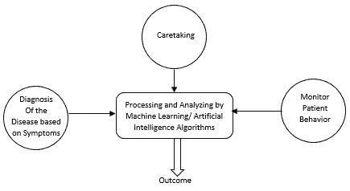

**图 4.** 物联网与人工智能之间的关系

[基于流程的物联网与人工智能之间的关键关系]

该图显示，物联网产生的信息用于机器学习计算，随后的结果为个人健康提供答案，例如疾病诊断、患者行为调查和辅助性考虑指导。由于技术的进步，基于机器学习和物联网的辅助健康服务积极影响了人们的生活。尽管如此，辅助健康预计面临易用性和合理性等挑战。此外，物联网设备中的安全和确认问题可能会令程序员感到困扰并导致问题，因为它们可能会被攻击而无法被准确获取。

根据 S. Hallur 等人的研究，基于机器学习的健康保健组织促使我们使用智能评估策略，帮助我们让可能需要再次入院的患者出院。智能检查的目的是使用一种风险收集技术，对高风险患者进行更多的努力和更有针对性的思考，例如花更多时间查看物联网设备/传感器，并提供定期（持续）随访和审查。这些模型是使用历史数据和信息建立的。增强再入院避免的优质健康系统还应该从患者获取动态数据并将其存储在内存中，以预测未来可能性并启动行动计划以避免并发。尽管 A. Abdelaziz 等人已经就许多使用机器学习提高图像分析效率的解决方案 [20] 进行了研究，但 Selvaraj, S 等人在其论文中列出了上述的一些挑战[4]。

### a. 挑战 1：过时数据

已有许多评估侧重于在物联网临床效益中使用人工智能（机器学习）的应用。机器学习计算的结构化模型集成到分组临床保健组织应用和临床敏捷框架中[31]。这些模型基于从物联网设备收集的数据，以观察患者的直接和不同临床状况，例如识别患者在日常活动中的体征、偏好和不规律运动，以及休息、胃部、饮水和饮食计划的不同行为。有了这些模型，智能系统可以为患者提供具体的生活方式建议、护理计划和非常规治疗。专家也可以被纳入计划决策协作中，以审查和促进生活方式洞察和护理计划。临床数据（如临床、生活方式和直接数据）是非常敏感的，在数据整合过程中可能会出现各种形式的不平衡忙碌[9]，且管理所有状况的结果可能不同。此外，嘈杂、碎片化的信息可能会降低识别和预测健康相关评估的几率，以及发出警报。此外，无论我们是否拥有丰富的模型，如果准备数据集和建立的模型是旧的，它将不再强大。使用老旧且陈旧的模型和信息，我们根据完美的结构得出了错误的结论。这一挑战可以通过 M. S. Sreekutty 等人提出的解决方案来解决，该方案通过隐写术增强医学图像的安全性[21]。M. I. Khalil 在其工作中也提出了相同的解决方案[22]。

### b. 挑战 2：在辅助护理中

机器学习计算与真实关系和推理紧密相关，其中机器学习计算根据过去和现在的经验（计划数据集）进行选择和预测。当患者接受检查时，基于机器学习的方法将根据计划数据集筛选和分析发生的情况。因此，在测试阶段，计划数据集对于识别连续模型和预测给定新问题的未来发生至关重要。该数据集有时是不一致的，而且多样化程度可能不足以涵盖广泛的情况。此外，健康保健可以使用物联网和机器学习来做出保证或假设。在某些情况下，基于机器学习的选择是不可信的，而且无法解释为什么得出该结论。这里的主题是当采用单一机器学习计算时评估人工智能系统结论的程序。这可能会导致一个在虚假证明情况下谁可以信任的伦理问题，以及在整个旅程中如何检测或修复此类缺陷，并理解单一人工智能计算的表现。这些困难限制了机器学习计算的使用。

### c. 挑战 3：保密性与准确性

F. A. Alaba 等人在他们的论文中指出，交易和检查使用 AI 计算来提供卓越的服务，如进度跟踪、显示进展数量、消耗的卡路里、休息监测、行驶距离以及生命体征评估（如心率、心电图 (ECG)^[13]、皮肤温度和脑电图 (EEG)），正如 K, Jaswal 等人在其工作中^[5] 所述的状态那样。因此，对 IoT 设备提供的数据进行评估并通过链接连接与服务器进行交换涉及到安全、信任和顺序方面的考虑。服务器数据和通信网络都可能发生故障。因此，数据安全和保障是需要考虑的重要因素。可以通过使用加密计算和保护数据来采取基本行动措施来增强数据安全。然而，K. Zhao 等人在他们的论文中指出，如果开发人员发现了解密估算的方法并泄露了信息，那么隐私信息将无处不在^[17]。此外，在加密过程中可能会丢失某些信息，如果解密估算无法恢复每一个独特数据，那么加密和解密过程将不再具有意义。

### 挑战 4：监测患者活动

不同的研究侧重于使用来自开发传感器的数据，在观察患者行为的特定情境下，为一组面向情境的检查描绘现实环境中的动态工作。根据研究，开发传感器类型是评估处于治疗组的明确威胁开发患者长期真实工作的最有效工具之一。尽管如此，由于 IoT 设备的特性，从临床 IoT 传感器/设备获取数据用于临床考虑应用是非常脆弱的。后期的在线进展和远程通信/交换继续发展着社会活动数据处理和远程进度监测。然而，结合临床数据的混乱工作周期在整个数据收集过程中（包括数据聚合和传输，以及数据管理和存储）引发了安全忧虑和保险风险。使用手机而非可穿戴设备进行活动确认程序中的难题在于，当数据对于 AI 任务至关重要且巨大时，如何得出能够保护客户安全的数据。使用 IoT 进行临床考虑检查的最重大挑战之一是安全，特别是在 AI 评估过程中。良性的客户确认结构确保了超真实的客户方法论数据和组织安全。因此，问题在于客户的数据透明度，这对于软件开发人员来说太敏感了。原样共享 IoT 设备的数据将很有趣。

## VIII. 结论

使用机器学习算法反复训练模型使系统能够更加准确并具体化其预期的执行的功能。结合深度学习算法，算法的效率可以根据所用标准的选择而增加。处理或处理/分析后生成的数据是巨大的。因此，为了准确处理数据，采取了各种安全和隐私措施。高端硬件和更快速处理软件的使用能够更快速地处理数据并尽快生成结果。IoT 的使用能够远程传输数据以便详细调查。此外，人工智能和机器学习的结合促进了自主决策和方案提供，减少了对医疗从业人员的依赖，从而使社会变得智能和独立。

### 案例研究：使用传感器技术检测癫痫

S Hallur 等人的项研究指出，死亡有时是由极端癫痫发作和由于高血压引起的心力衰竭引起的^[23]。此类死亡是由于在资源匮乏时无法获得治疗援助造成的。这部分阐述了一种通过 IoT 远程通信和人工智能来检查此类问题的开发方法，其中包括一个启用的 RFID 后台，在其中通过跟踪遗失的真实区域来提供基本的治疗类型援助。这篇文章还展示了远程通信系统和较弱的传感器（如 `RFID uninvolved Tags`）如何相互作用以接收传输并传输所有数据，例如人的基本体工信号数据、`EEG`、`ECG` 和 `GPS` 数据到最近的基站^[24]。因此，数据计划和患者的临床状态及区域都必须考虑。疾病得到某种检查，从而为应急救援单位配备人员的积极区域。正在探索的还有一种处理患者区域、财产状态和救援的算法。S. Hallur 进行的类似研究描述了根据其脉搏状态向医疗中心发送的患者医疗状况警报。

**使用的传感器：** `EEG Sensors`、`RFID Sensors`、`GPS Sensors`、`ECG Sensors`、血氧传感器等。用于监测和警报癫痫发作发生的移动单元由以下组件组成：`RFID Tag` 和读写器、`ECG` 和 `EEG Sensors`、血氧仪、`GPS` 和救援单元。

**过程：**

附着在伤员身上的任何传感器（如 `ECG`、`RFID`、血氧仪和 `EEG`）以基础结构捕获伤员体内的信号，然后应将其转换为离散结构^[31]，该结构的计算和伪代码如图 5 所示。

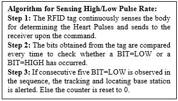

**图 5.** 过程算法和伪代码。

[一种由于 EEG 随机变化导致高血压而瞬时描绘患者 ECG 的计算，从发现遗失的财产信号到其传输和处理的循环方法。相同的伪代码用 C 语言编写]

周围设备设备（如 `PC` 或 `PDA`）中的信号接收器（如 `RFID receiver`）必须仔细评估从放置在人体上的传感器接收到的位。在存在 COVID19 的情况下，监测血氧、精神症状和监测呼吸系统变得至关重要。收集器不断改变传感器，直到数据通过输入以电压的形式。阈值正在设置，组件正在被审查。设置了一个计数器来跟踪高低脉冲的数量。一种筛选遗失脉率的情况如下如图 6 所示。

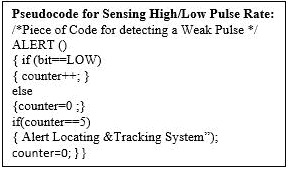

图 6. **脉冲值计数算法和伪代码。**

[计数器负责计算分配 1 和值为 0 的位数量。这描述了患者的情况，无论强弱。]

区域与追踪（Region and Tracking）会接收一条显著的 RFID 警报消息，具有自动发送、自动重发以及通过附近的设备受益者设置进行自动消息等功能。这些连接由移动网络提供商通过数据服务提供。定位与追踪站（Locating and Tracking Station）向移动救援单元（Mobile Rescue Unit）发送警报消息，并告知全球定位系统（Global Positioning System）植入手机的无线射频识别器的精确位置。移动救援单元通过物联网（IoT）接收来自定位与追踪站的信息，提醒移动救援单元内正在经历癫痫发作的医生/救援人员。与此同时，全球定位系统确定受害者的精确位置，引导移动救援单元准时到达目标，并为受害者提供现场临床援助。

## 参考文献

[1] M. Aoyagi, K. Nishimori, T. Akimoto, T. Hiraguri, Y. Morino, 2015, 关于在医疗福利中提供位置信息和传感器数据传输的 ZigBee 系统的建议。E-Health Teleucucation. Syst. Netw. 04, 45–55

[2] Prasad. D, Verma, N., Singh, S., 2021, 医疗健康监控系统中使用的现有物联网架构和通信协议综述。J. Inst. Eng. India Ser. B

[3] Bikash Pradhan, Kunal Pal, Saugat Bhattacharyya, 2021, 医疗保健设备中的物联网应用，Journal of Healthcare Engineering, Article ID 6632599, 18 页, 2021.

[4] Selvaraj, S., Sundaravaradhan, S. 2020, 物联网医疗系统中的挑战与机遇：系统性综述。SN Appl. Sci. 2, 139

[5] K, Jaswal, R. L, Chhokar., S. R, Singh., T, Choudhury., 2017, 安全物联网：一种提出的框架。在：2017 年计算、通信与自动化国际会议 ICCCA。页. 1277-1281.

[6] Hu, M., Li, Q., Zhang, X., Zhai, G., Yao, N. Wang, Y, 2020, 异常呼吸模式分类器可能以准确且无侵入的方式对新冠-19 感染者进行大规模筛查。ArXiv, abs/2002.05534.

[7] Chen C, Jyan H, Hsu C, Lee P, 2020, 在台湾登岸的钻石公主号邮轮 627,386 人中发现新冠-19：大数据分析。J Med Internet Res 2020 年 5 月 05 日;225:e19540

[8] Faasse K, Materia FT, Smyth JM., 2020, 理解和预防对新兴移动健康技术的健康担忧。JMIR Mhealth Uhealth 2020 年 5 月 25 日;85:e14375

[9] Catalani C, Sinha C, Were MC, 2019, 数字健康干预公平性的系统方法：移动个人健康记录的案例。J Am Med Inform Assoc, 2019 年 8 月 01 日

[10] Prashant Patavardhan, Roopa Kulkarni, Sudhakar Hallur, 2020, 书章引言，物联网中的安全挑战与威胁，物联网：集成与安全挑战 Velliangiri, S.A.P. Kumar, & P. Karthikeyan, 编。第 1 版。CRC Press。

[11] Mayra Samaniego, Ralph Deters, 2016, 管理与物联网，第 13 届移动系统与泛在计算国际会议 MobiSPC, 2016, 第 94 卷，页 137– 143。

[12] A. Al-Fuqaha, M. Guizani, M. Mohammadi, M. Aledhari and M. Ayyash, 2015, 物联网：赋能技术、协议和应用的综述，在 IEEE Communications Surveys & Tutorials, 第 17 卷，第 4 期，页 2347-2376。

[13] F. A. Alaba, F. Alotaibi, I. A. Hashem, M. Othman, 2017, 物联网：综述，J. Netw. Comput. Appl., 第 88 卷，页 228

[14] B. Crispo, M. Ammar, G. Russello, 2018, 物联网：物联网安全综述，J. Inf. Security., 第 38 卷，页 27。

[15] K. Salah, M. A. Khan, 2018, 物联网安全：综述、区块链解决方案和开放挑战，Future Generation Comput. Syst., 第 82 卷，页 395–411。

[16] M. Irshad, 2016, 物联网信息框架的系统综述，IEEE 第 18 届高性能计算与通信国际会议，页 1270-1275。

[17] K. Zhao, L. Ge, 2013, 物联网综述，页 663-667。

[18] A. Shehab, 2018, 安全且稳健的脆弱性，IEEE Access, 第 6 卷。

[19] K. Zhao, L. Ge, 2013, 物联网综述，页 663-667。

[20] Prashant Patavardhan, Roopa Kulkarni, Sudhakar Hallur, 2020, 书章引言，物联网中的安全挑战与威胁，物联网：集成与安全挑战 Velliangiri, S.A.P. Kumar, & P. Karthikeyan, 编。第 1 版。CRC Press。

## 第 6 章

知晓餐盘（Know-Your-Plate）：基于人工智能的饮食分析应用

Dr. Shaneth C. Ambat¹, Hezekiah John V. Rizan², Rom Braveheart P. Leuterio³, John Patrick G. Chua⁴, Chrys Uoie A. Salazar⁵, Dr. Hadji J. Tejuco⁶, Anthony D. Aquino⁷

1 计算机与多媒体学院，项目总监，FEU 技术学院 2) FEU 技术学院，3780 Blk. 9 Lot 17, Durian St., Centennial II, Pinagbuhatan, Pasig City, 1602, 菲律宾 3) FEU 技术学院，Samson Apartment Unit B, Pagasa Subd., Anabu, 1-B Imus, Cavite, 菲律宾 4) FEU 技术学院，Blk 21 Lot 7 Pearl Street Citation Homes Barangay Bahay Pare Meycauayan Bulacan, Philippines 5) 菲律宾大学技术学院, 469 Block 27-A Brgy. Addition Hills, Mandaluyong, Philippines 6,7 计算机科学与多媒体学院, 教员, FEU 技术学院 1)scambat@feutech.edu.ph, ²hezekiahjohnrizan@gmail.com, ³romleuterio@gmail.com, ⁴johnpatrickchua05@gmail.com, ⁵biz.salazarchrys@gmail.com, ⁶hjtejuco@feutech.edu.ph, ⁷adaquiuno@feutech.edu.ph

### 摘要

随着全球当前健康状况的出现，公众迅速遵循了健康人士关于严格保持健康生活方式的建议。我们的饮食和营养主要是生活方式因素。在本研究中，研究人员旨在开发一种符合这一目标的应用程序，为菲律宾公众提供一种通过饮食来监测、评估和可视化其健康状况的方法。应用程序的开发采用了人工智能技术，通过`K-means clustering`和使用`ResNet` 架构的`Image Classification`进行饮食和营养分析，利用`Cloud technology`存储饮食记录，并使用`Augmented Reality`进行可视化。应用程序的开发得出了结果：通过`K-means algorithm`进行的饮食分析显示，菲律宾人的饮食可以分为三类，每类都存在健康风险和疾病，而`ResNet-18` 分类器在分类 15 种不同的菲律宾食品方面的准确率达到了 81%。

## 索引词

饮食、菲律宾食品、K-means 算法、图像分类、ResNet 架构

## I. 引言

### 1.1 研究介绍与背景

适当且均衡的饮食往往被忽视为我们生活方式的一个重要部分。尽管意识到健康后果，但满意并不总是解决方案。健康健康的饮食只是实现健康生活方式的一部分，本研究希望关注并保持这种意识。根据来自美国的国际统计数据，美国饮食中热量、糖分、脂肪和谷物的摄入往往不足或超标（总统体育委员会，2017）。疾病控制与预防中心（2021）也指出，少于 10 分之一的美国成年人和青少年经常食用蔬菜和水果。由于缺乏研究和调查，菲律宾尚未出现此类数据和统计数据。

移动技术的进步让更多的人能够接触并开发手头的创新。人工智能（AI）、图像处理、增强现实（AR）和云技术等新兴及发展中技术的整合有更大的发现和实施空间。本研究希望探索这些技术，并开发一种与介绍的主题相关的软件——健康和合理饮食。

由于医疗技术的快速发展，新健康危害的出现和现有危害的新形式现在可以很容易预测。然而，令人担忧的是，这些技术并不是应对可能给公众健康风险的首要措施；这通常是民众的责任。针对当前的健康状况，更多家庭通过追踪成员的饮食、创建提高免疫力的活动、增强健康意识以及保持健康的生活方式来做出回应。在疫情发生之前，根据 Limos（2019）的说法，`RunRepeat` 的研究将该国列为其他 89 个国家中健康意识最强的第 13 位。此外，菲律宾在饮食意识方面排名第 13 位，在体育活动和锻炼方面排名第 14 位。

© 2022 Technoarete Publishers

Dr. Shaneth C. Ambat – “了解你的餐盘：一种基于人工智能的饮食分析应用程序” 页码：63 - 73。

https://dx.doi.org/10.36647/AAIMLH/2022.01.B1.Ch006


### 63

随着可用应用程序频率增加，健康监测和维持健康习惯现在可以快速完成，促进健康意识。然而，Meng, Guo, Peng, Zhang 和 Vogel（2019）的一项调查显示，使用这些应用程序与受试者对健康的意识无关，而是因为它们的可信度。通过移动设备的 eHealth 应用现在已成为流行。它已被普通公众使用，并被医疗保健人员使用以辅助其工作。设备的便携性使得便捷通信和获取相关信息成为可能（Ventola, 2014）。

自从 COVID-19 疫情席卷全球以来，健康人士不断提醒公众在这些条件下保持严格的健康生活方式。大多数人投入于饮食均衡的饮食；然而，研究人员在想：“对于个人来说，什么样的饮食是均衡的？”这项研究旨在量化人们摄入的内容，并确定它是不足、足够还是不健康，凭借今天强大的技术，团队认为这是可以实现的。

疫情让家庭反思可能影响其健康的当前生活方式。保持这种意识是开发应用程序的动力。早期预防通过早期观察完成，该应用程序将以此为目标构建，对人们的内容进行量化，并确定它是不足、足够还是不健康，并通过自我监测根据用户输入的食物类型防止可能的健康风险。

饮食和营养是获得危险疾病的主要风险因素（世界卫生组织，2002）。这些是生成应用程序结果的主要调查因素。另一个重要原因是平均菲律宾人的饮食和营养数据缺失；这些数据的可用可以产生相关且更好的研究，以改善菲律宾的健康应对，特别是解决营养问题。

本研究的总目标是开发并实施一种可以预测个人可能患的饮食相关疾病的应用程序。

### 1.2 范围与局限

研究范围内，数据的性质仅包括个人饮食/营养成分（例如宏营养素——碳水化合物、蛋白质、脂肪），用于预处理和分析。预处理中使用的数据将来自食品营养研究所（FNRI）e-Nutrition 网页提供的 2008 年和 2013 年国家营养调查个人饮食成分公开文件。然后对数据进行过滤和限制，仅包含年龄在 20-50 岁的记录，以及男性和非哺乳期女性。由于研究人员将研究目标限制为仅预测受饮食/营养严重影响的个人可能疾病，被（Weininger，2020）描述为营养性疾病（例如心血管疾病、高血压、糖尿病）。研究人员将不再进一步调查饮食可能是因素之一的可能疾病预测，仅针对饮食/营养作为领先指标的疾病。

此外，疾病预测并未考虑用户的 `BMI`。该应用未包含水果和零食的个人消费情况，仅包含了典型的菲律宾食物（即与米饭一起食用的菜肴/副）。它未包含来自油和黄油等其他成分的总脂肪含量，仅考虑了来自肉类、鱼或牛肉的脂肪。此外，由于训练和开发食物分类模型的时间限制，研究人员将食物类别限制在十五（15）类：`Bicol Express`、`Bulalo`、`Chicken Adobo`、Filipino Spaghetti、`Kaldereta`、`Kare-kare`、`Laing`、`Lechon`、`Lumpia`、`Pansit`、`Pinakbet`、`Sinigang`、`Sisig`、`Tapa` 和 `Tinola`。

研究人员还热于对这些数据进行调查和分析。研究没有讨论或比较使用其他无监督聚类算法的结果。此外，研究未讨论 `K-means` 实现中的配置比较（即用于聚类中心初始化的算法）。至于研究使用的外部工具、算法和应用程序接口（API），研究人员并未参与其构建，仅利用它们来开发应用。具体包括：`ResNet Architecture`、`Augmented Reality`、`Cloud platform APIs` 以及 `K-means` 算法实现。

## II. 文献综述

随着技术的进步，新的习惯正在形成。个人在进食之前拍摄食物照片并发布到 Facebook 和 Instagram 等社交媒体上已成为常见现象。研究人员可以利用这种习惯，因为它为用户提供了一种记录饮食消耗的简单方式。根据 Casperson, Sieling, Moon, Johnson, Roemmich 和 Whigham (2015) 的研究，移动技术已被证明是收集和评估营养消耗的有价值工具。由于青少年能够迅速接受并适应新科技，食物记录应用可能是一个有助于更好地了解青少年营养摄入和饮食行为的有益工具。他们进行了一项可用性研究，以衡量青少年通过移动应用程序记录食物摄入的意愿性，结果显示只有少数受访者完全完成了任务，因此得出结论：开发的应用程序应该是用户友好的，以增加参与度。

具有更好硬件和计算能力的移动技术现在与利用人工智能/机器学习等技术力量的应用相结合。Pouladzadeh、Shirmohammadi 和 Al- Maghrabi (2014) 确定，个人移动技术（如手机或平板电脑）已经增长，用户几乎总是随身携带。这就是为什么他们提出了一种热量和营养评估系统，可以帮助患者和营养师测量和管理每日食物消耗。该方法使用深度卷积神经网络对食物图像进行分类，并利用摄像头营养信息表。关于通过手机摄像头量化食物消耗，Zhu 等人 (2010) 开发的应用通过进食前后拍摄的食物图像来量化和估算营养摄入，而不仅仅是简单的食物分类。

在 Villalobos 等人 (2012) 开发的另一个应用中，他们的研究目标是帮助受肥胖和体重超重困扰的人测量他们每天消耗的热量。他们使用了带有摄像机的移动设备；与 Zhu 等人的方法类似，Villalobos 等人采用了一种独特的技术，通过进餐前后拍摄的图像来测量热量摄入。他们的研究是 Al-Maghrabi (2013) 的博士论文，旨在通过其食物识别系统（FRS）解决肥胖和体重超重人群误报以及无法估算热量和营养摄入的问题。同样，该系统使用手机摄像头记录进食前后的食物，Al-Maghrabi 得出结论，通过独特的方法，其食物分类和数值量化的误差率低于 15%。

这些研究具有共同点；无论目标如何，每项研究都记录了与食物和饮食相关的数据。基于许多因素和趋势，研究还认为记录营养数据最方便、有效的方法是使用手机摄像头。最后，他们分析食物成分的方法是通过图像处理和深度神经网络。

技术的进步极大地影响了人们的生活，从工作到微小习惯。一个显著的变化是人们进食的方式；以前，大多数人会先感谢食物然后安静地吃；但现在，许多人在进食前先拍照，然后发布到社交媒体上。这种习惯在青少年和成年身上都可以观察到，但在青少年中更为常见。研究人员同样关注一个通过摄像头记录饮食消耗的移动应用，区别在于根据获得的数据展示可能的饮食相关健康风险。通过这种方法，用户将快速识别食物成分并获得必要的营养数据。这种方法的便利性可以激励用户每天记录饮食，从而对健康进行更持续的监测，并增加他们对应用的参与度。

## III. 理论框架

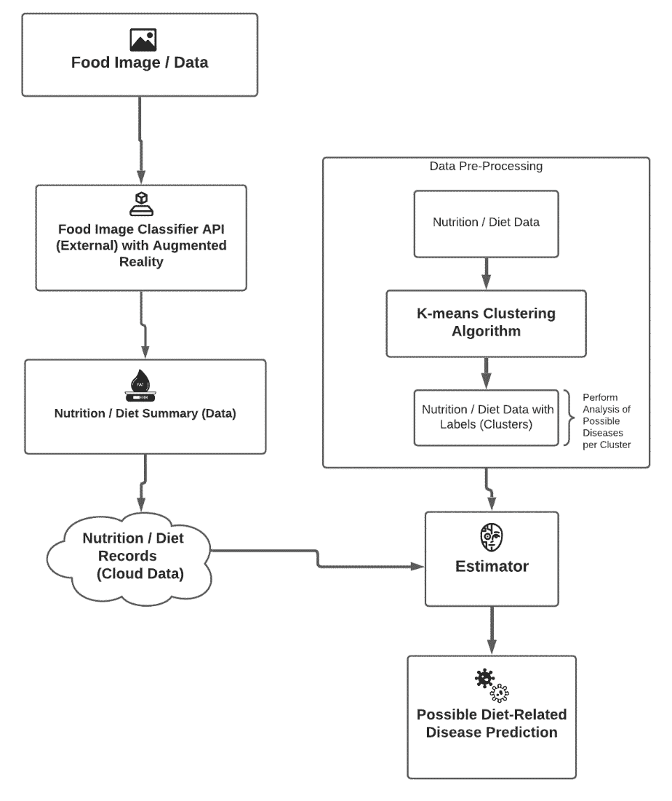

**图 3.1** – 本研究的输入和输出数据流程

图 3.1 显示了研究过程中输入、处理和输出的流程。它详细说明了食物图像数据如何被转换并记录为营养成分，汇总为饮食记录，直到用于预测或分类。本研究的重点是通过个人的营养/饮食记录预测可能的饮食相关疾病。

流程中的第一个也是最关键的过程是对个人的大量饮食数据进行预处理，提取目标测量的特征，然后输入无监督聚类算法以生成可以分析的分组。随后，分析结果将作为预测的估计器。

随后，将开发一个可以接收食物图像作为输入、通过增强现实将输出数据可视化并在用户界面中显示，并将输出数据存储到云存储中。此外，应用程序可以与估计器交互，将云端存储的输出数据输入其中，并通过应用程序的用户界面显示预测结果。

Mahendru (2019) 将该方法描述为确定最佳 `k` 类簇数量最常用的方法。进一步解释来说，这是通过计算不同 `k` 值（聚类数量）的簇内误差平方和（`WSS`），并选择 `WSS` 值出现下降的 `k` 来实现的。Mahendru 进一步解释了 `WSS` 的定义为——

* 每个数据点都有一个 `Squared Error`（平方误差），即该点到其预测聚类中心距离的平方（例如 `Euclidean` 欧氏距离、`Manhattan` 曼哈顿距离）。
* `WSS` 是所有数据点误差的和。

该方法在图 4.1.1 中更加直观。

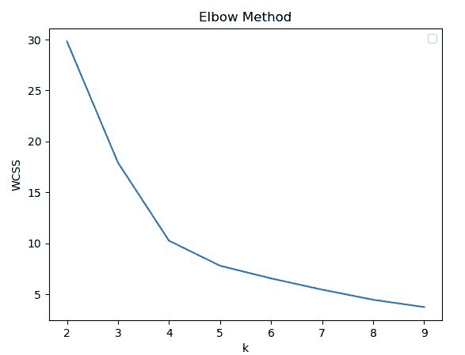

**图 4.1.1** - 肘部法图示例

将 `WSS` 值相对于其对应的 `k` 值绘制出来；在 `k = 4` 处，可以从图中观察到一个类似“肘部”的形状，因此被称为肘部法；`k = 4` 是最佳聚类数量。该方法的进一步解释将不再讨论，因为该方法已存在于本研究使用的机器学习框架（即 `Sklearn`）中。

### 4.1.2 轮廓法

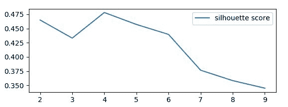

**图 4.1.2** – 轮廓法图示例

轮廓法是实施前确定最佳聚类数量的另一种替代方法。该方法验证了簇内数据点的一致性（Rousseeuw, 1987）。每个数据点都有一个从 -1 到 +1 之间的轮廓分，数值越高，证明数据点处于正确的簇中。具有最高分的 `k` 类簇被视为最佳聚类数量（Mahendru, 2019）。每当肘部法没有提供明显迹象时，通常使用这种方法。

图 4.1.2 展示了如何通过图表评估过程的示例。将轮廓分相对于其对应的 `k` 值绘制出来；`k = 4` 值清楚地显示了轮廓分峰值所在，表明 `k = 4` 是最佳聚类数量。

在完成这些实施前程序并将获取的数据输入无监督算法后，将与专业且注册的饮食师/营养师进行咨询，以验证和确认获得的结果。咨询的见解将成为应用程序估计器的基础。

## 4.2 食物图像分类的评估与测试

研究人员比较幸运的是，已经实现了一个使用 `ResNet-34` 架构的菲律宾食物图像分类模型，并用其作为实现分类器的基准。在 Hatfield (2020) 的实施中，用于训练、验证和测试的图像数据集是通过 Google 图像搜索不同类别的菲律宾食物收集的；本尝试也采用采用相同的方法，但仅限于 15 种食物类别，每类使用 100 张图像，总计 1500 张图像用于分类器的训练和验证，约 1000 张图像用于测试。

此外，研究人员使用了两种 ResNet 架构，即 `ResNet-18` 和 `ResNet-34` 架构。通过它们各自得出的准确率对这两种架构进行了比较，并将结果最好的架构集成到应用程序中。为了确保实施的准确性，研究人员在训练和验证期间使用了多分类混淆矩阵，如图 4.2.1 所示。

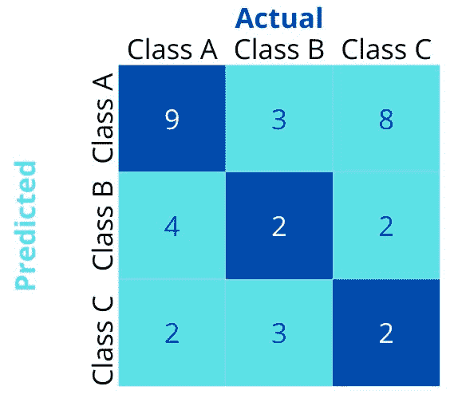

**图 4.2.2** - 多分类混淆矩阵示例

为了评估分类器的训练和验证，使用了三个指标——`Accuracy`（准确率）、`Precision`（精确率）和 `Recall`（召回率）。对于测试，仅考虑了 `Accuracy` 指标。`Precision` 和 `Recall` 的值是根据混淆矩阵中的 `True Positive (TP)`真阳、`False Positive (FP)`假阳、`False Negative (FN)`假负和 `True Negative (TN)`真负计算得。每类（食物）的精确率召回率分别计算，以评估分类模型对每一类的性能。同时，研究人员利用框架的内置函数提供准确率指标。

如所述，研究人员将评估每个类的精确率，这反映了分类模型预测每个类的能力。它是通过计算某类正确识别的正样本（`TP`）与总识别的正样本（`TP + FP`）的比率来得出的；其方程见 (1)。(Tharwat, 2021)

同时，每个类（食物）的召回率反映了模型从该类样本中正确识别真阳性的能力。召回率通过获取正确识别的正样本（`TP`）与总正样本（`TP + FN`）的比例计算得出，如 (2)所示。(Tharwat, 2021)。

本研究的 `Precision` 和 `Recall` 指标仅用于为分类模型的性能提供更多细节。模型将主要通过其得出的准确率进行评估。

## V. 统计分析与结果

### 5.1 通过 k-means 算法进行饮食预测

此部分的结果源于将 `K-means` 算法应用于汇总的个人饮食数据集的结果，以及研究人员对该结果的数据分析和解释。

#### 5.1.1 肘部法

如前所述解释的如何执行肘部法及其目的，它是通过计算每个簇的 `WSS` 值来实现的。研究人员计算了直到 10 个类的 `WSS` 值，然后使用散点图进行可视化。

**表 5.1.1** – 簇内误差和（肘部法）

| 簇数量 | WSS |
| :--- | :--- |
| 1 | 283.28807 |
| 2 | 164.15081 |
| 3 | 128.02128 |
| 4 | 101.73874 |
| 5 | 85.56821 |
| 6 | 75.82036 |
| 7 | 67.77854 |
| 8 | 62.46512 |
| 9 | 57.75507 |
| 10 | 53.57936 |

表 5.1.1 显示了从一个到十的 `WSS` 值。可以看到每个簇的值逐渐减少，没有急剧下降。这些值可以从数据集特征的关系图和 3D 图中看出，特征之间没有观察到相关性，3D 图中没有明显的簇。


**图 5.1.2** - 肘部法的 WSS 图

图 5.1.2 中的散点图支持了之前的表格结果，其中 `WSS` 值相对于其对应的簇绘制。正如方法名称所示，图中出现类似“肘部”特征的点是数据集的最佳聚类数量。虽然选择簇的数量尚未经过验证；因此，采用了另一种方法。

#### 5.1.2 轮廓法

另一种方法是轮廓法，因为肘部法没有产生可靠的聚类结果。研究人员再次绘制了三个到十个类的轮廓分。得分最高的值即为簇的数量。


**图 5.1.3** - 轮廓分散点图

为了更好地可视化轮廓法，研究人员通过散点图将轮廓分相对于其对应的簇。图 5.1.3 显示具有最高轮廓分的簇包含三个簇。值得注意的是，具有 5 个簇是可以接受的，因为它的得分是次高的。但在情况下，研究人员使用三个簇对数据点进行分组，从而获得了最高的轮廓分。

# 高碳水化合物和高蛋白，低平均脂肪

## 全为高水平

在确定了聚类数量后，表 5.1.2 中的以下数值显示了算法处理数据集后形成的的聚类的观测结果。

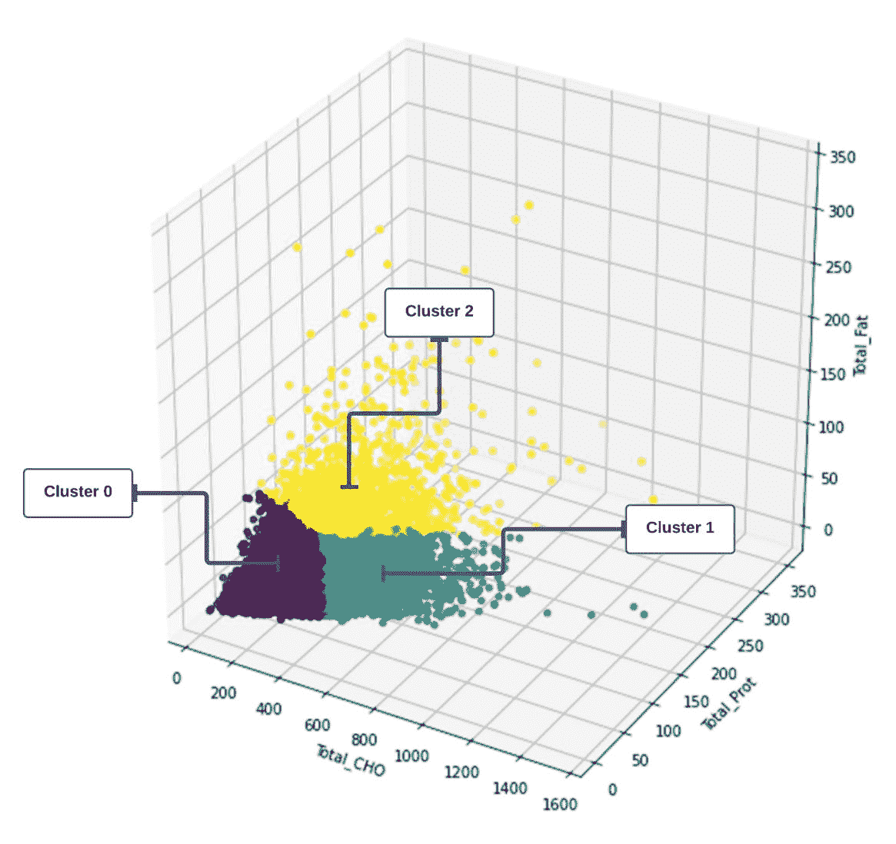

**图 5.1.4**– 数据集及其聚类的标记 3D 图形

图 5.1.4 中的 3D 图形通过每个数据点的不同颜色可视化了数据集是如何被划分为三个簇的——0（深紫色）、1（蓝绿色）、2（黄色）。需要注意的是，尽管轮廓系数法（Silhouette method）确定了聚类数量，但 3D 图形中的聚类仍然不够充分，无法提供不同数据点之间的区分度。

### 5.2 图像分类

在此过程中，为了确定哪种卷积神经网络（`CNN`）结构（特别是 `ResNet` 架构）适合集成到应用中，研究人员比较了两种架构——即 `ResNet-34` 和 `ResNet-18` 架构在菲律宾食物图像分类方面的性能。这些架构已使用 ImageNet 图像进行了预训练，并已广泛用于图像分类。

正如这些架构的名称所示，其附加的数字表示 `CNN` 的层数；`ResNet-34` 有 34 层连接层，而 `ResNet-18` 为 18 层。

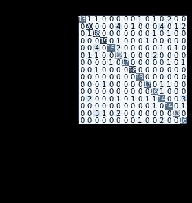(a)

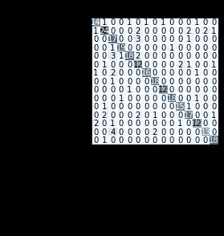(b)

**图 5.2.1**– (a) `ResNet-34` 的混淆矩阵结果；(b) `ResNet-18` 的混淆矩阵结果

在每个 `ResNet` `CNN` 架构经过循环训练后，图 5.2.1 是各自生成的混淆矩阵。同时，表 5.2.1 显示了根据图 5.2.1 中的混淆矩阵得出的每个 `ResNet` 架构下每个类别（食物）的精确率（precision）和召回率（recall）。

**表 5.2.1** - 每个 `ResNet` 架构下每个类别（食物）的精确率和召回率及其宏平均

| 类别（食物） | `ResNet-34` 精确率 | `ResNet-34` 召回率 | `ResNet-18` 精确率 | `ResNet-18` 召回率 |
| :--- | :--- | :--- | :--- | :--- |
| Bicol express | 100% | 68.4% | 77.8% | 73.7% |
| Bulalo | 80% | 62.5% | 80% | 75% |
| Chicken adobo | 64.3% | 85.8% | 58.6% | 81% |
| Filipino Spaghetti | 90.5% | 90.5% | 90.5% | 90.5% |
| Kaldereta | 94.1% | 66.7% | 90% | 75% |
| Kare-kare | 54.5% | 70.6% | 57.1% | 70.6% |
| Laing | 94.4% | 85% | 94.1% | 80% |
| Lechon | 90% | 94.7% | 85.7% | 94.7% |
| Lumpia | 86.7% | 100% | 92.3% | 92.3% |
| Pansit | 89.5% | 85% | 94.7% | 90% |
| Pinakbet | 72.7% | 94.1% | 83.3% | 88.2% |
| Sinigang | 60.9% | 60.9% | 77.3% | 73.9% |
| Sisig | 87.5% | 80% | 86.7% | 68.4% |
| Tapa | 86.7% | 69.6% | 84.2% | 85.7% |
| Tinola | 94.7% | 80.51% | 80.29% | 82.25% |
| **平均值** | | | | **81.53%** |

对于 `ResNet-34` 架构，在其能够分类的食物类别中，`Bicol express` 类别随后的 `laing` 类的精确率最高，分别为 100% 和 94.4%，表明 `ResNet-34` 分类器很大程度上可以预测这些食物。同时，在召回率方面，`lumpia` 最高，值为 100%，其次是 `Lechon`。这表明分类器可以正确识别和标记这些类别的样本。该分类器对 `kare-kare` 类别的样本预测较差，精确率仅为 54.5%。而在召回率方面，`sinigang` 类别大部分被误分类为其他类别，仅为 60.9%。因此，该分类器在这些类别中的预测和识别性能最差。

同时，对于 `ResNet-18` 架构，`pansit` 是精确率最高的类别，其次是 `laing`，分类器预测的值分别为 94.7% 和 94.1%。召回率最高的类别是 `Lechon` 和 `tinola`，均为 94.7%。与 `ResNet-34` 架构的结果相似，分类器可以很好地预测 `laing` 样本。最差的精确是预测 `kare-kare` 样本，仅为 57.1%，而 `tapa` 的召回率值最低，为 68.4%。

**表 5.2.2**– `ResNet-34` 和 `ResNet-18` 之间的准确率比较

| **ResNet 架构** | `ResNet-34` | `ResNet-18` |
| :--- | :--- | :--- |
| **训练与验证准确率** | 78.6% | 81% |

表 5.2.2 显示了 `ResNet-34` 和 `ResNet-18` 的分类结果。尽管 `ResNet-34` 比 `ResNet-18` 层更多，但后者在训练和测试中优于 2%。

## VI. 结论

### 6.1 通过 K-means 进行预测

为了通过 K-means 算法进行饮食预测，研究人员提供了关于每个聚类的观测结果。

**表 6.1**– 聚类及其结果的映射

| **聚类** | **活动强度** | **疾病/风险** |
| :--- | :--- | :--- |
| LOW [0] | MODERATE VIGOUS | 无疾病风险 |
| LOW [1] | MODERATE VIGOUS | - 营养不良（能量营养不良） |
| LOW [2] | MODERATE VIGOUS | - 超重<br>- 脂溶性维生素<br>- 心血管疾病<br>- 肥胖<br>- 心血管疾病<br>- 肥胖<br>- 无疾病风险 LOW/NONE |

表 6.1.1 显示了来自营养师的每个聚类的验证结果。正如在前章提到的，K-means 算法用于分析人的饮食数据。

### 6.2 图像分类

根据表 5.2.1 和表 5.2.2 的结果，在精确率宏平均方面，`ResNet-18` 架构在识别 15 类食物方面表现更好，结果分别为 82.25% 和 81.53%。此外，其准确率比 `ResNet-34` 高 2%。研究人员随后认为 `ResNet-18` 将集成到应用中。

https://www.cdc.gov/chronicdisease/resources/publications/factsheets/nutrition.htm. 访问于 2021 年 6 月。

[7] 开放课程平台. 2021. 无监督学习. `K-Means Clustering`. https://ocw.cs.pub.ro/courses/ewis/laboratoare/09. 访问于 2022 年 4 月 20 日。

[8] Pouladzadeh, P., Shirmohammadi, S., Al-Maghrabi, R. 2014. 从食物图像中测量热量与营养。IEEE Transactions on Instrumentation and Measurement, 63(8):1947-1956, 在线期刊 8 月。doi:10.1109/TIM.2014.2303533。

[9] 总统体育、健身与营养委员会. 2017. 事实与统计数据。https://www.hhs.gov/fitness/resource-center/facts-and-statistics/index.html. 访问于 2021 年 6 月。

[10] Rousseeuw, P. 2022. 轮廓：聚类分析解释与验证的图形辅助。Journal of Computational and Applied Mathematics, 20: 53-65, 在线期刊 4 月 1 日。doi:10.1016/0377-0427(87)90125-7。

[11] Tharawat, A. 2021. 分类评估方法。Applied Computing and Informatics, 17(1):168-192, 在线期刊 1 月 4 日。doi:10.1016/j.aci.2018.08.003。

[12] Ventola, C. L. 2014. 用于医疗专业人员的移动设备与应用程序：用途与效益。P & T: 用于处方管理的同行评审期刊, 39(5):356-364。

[13] Villalobos, G., Almaghrabi, R., Pouladzadeh, P., Shirmohammadi, S. 2012. 用于热量摄入量的图像处理方法。2012 IEEE 国际医学测量与应用会议论文集, 1-5。doi:10.1109/MeMeA.2012.6226636。

[14] Weininger, J. 2020. 营养疾病。https://www.britannica.com/science/nutritional-disease. 访问于 2021 年 6 月。

[15] 世界卫生组织. 2002. 饮食、营养与慢性疾病的预防：WHO/FAO 联合专家咨询报告。https://www.who.int/publications/i/item/924120916X. 访问于 2021 年 6 月。

[16] Zhu, F., Bosch, M., Boushey, C. J., Delp, E. J. 2010. 用于饮食评估与评价的图像分析系统。2010 IEEE 国际图像处理会议, 1853-1856。doi:10.1109/ICIP.2010.5477033。

## 第 7 章：涉及疾病诊断的成像模态与原理

S. Rajalaxmi 博士，副教授兼生物医学工程系主任，泰米尔纳德马亨德拉工程学院。

成像技术受与其能量光源共同使用的原理支配，而这些原理正是应用于跨越细胞、组织和器官的成像。

### I. 成像技术的离心历史

内脏成像的概念始于 1895 年的威廉·伦琴（Wilhelm Rontgen），他通过穿过人体的电离辐射在光敏板上产生了图像。这是`X 射线`的首次应用，它在放射学中证明了一项重大发现[1]。

随着对器官和血管成像的进一步需求，20 世纪 20 年代开发了药物对比剂，以使放射不透明染料可见。病理诊断通过伽马射线相机注入放射性核苷酸进一步演进，催生了`荧光检查`[2]。

二世界大战期间声纳的应用引起了医学领域的关注，使高频声波穿透人体。这些声波被物体反射回来，并被不同频率的电脉冲收集，从而产生`超声`图像。

成像史上的一场突破性革命源于软组织横截面视图的发展，这些视图通过计算算法重建形成图像。这是 1971 年`计算机断层扫描(CT)`的发明，它作为第一种基于`X 射线`的数字成像技术而表现卓越[3]。为了进一步提高成像清晰度并利用磁共振原理，出现了`磁共振成像(MRI)`的惊人发展，它结合了超导磁体来执行组织的功能成像[4]。

### II. 成像模态

#### 2.1 X 射线成像

X 射线——据认为医学成像创新的关键基础——是威廉·伦琴（Wilhelm Rontgen）在 1895 年的偶然发现。这一发现始于测试阴极射线在玻璃中的穿透能力。他发现了一些未知的射线，并将其命名为`X-Rays`，它们具有穿透重物并留下固体阴影的能力。他的发现随后是`X-Rays`对人体骨骼和软组织的渗透。`x-rays`的发现被证明是医学专家的一项重要工具，因为它导致了非侵入性和无痛的诊断程序。这被誉为医学领域的一个时代，使医生能够更精确地规划手术方案、血栓治疗、肿瘤治疗等，而在`x-rays`出现之前，这些操作会产生更多的时间消耗和风险。图 1 显示了从患者身上获取图像的过程。

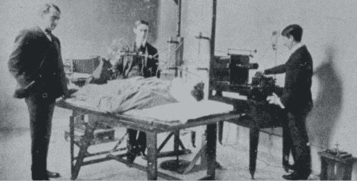

**图 1：** 从患者处获取图像的 X 射线机（图像感谢：Johnson & Johnson 档案存档）

某些成像技术利用电离辐射从感兴趣区域产生图像。放射摄影、荧光透和计算机断层扫描是利用电离辐射的成像技术。这些成像技术的工作原理是将`X-ray beam`射入焦点区域，其中某些射线被吸收，其余射线则散射到成像胶片上。根据用途的不同，成像技术在`X-rays`的数量以及通过感兴趣区域的电离辐射强度上会有有所不同。

乳腺 X 线检查是一种基于放射摄影的成像技术，利用伽马射线捕捉单张静态图像以供未来评估。荧光透是将`X-rays`束实时连续投射到感兴趣区域，在此期间将通过染料剂对该区域进行持续监测。这将在心脏或肠道区域植入入物或支架期间进行。冠状动脉造像是荧光透的一个例子，它利用气囊型导管来破除血管阻塞。计算机断层扫描利用人体周围的一系列`X-ray beams`来获取有关血管、组织和骨骼的切片图像。这些图像可以通过数学程序进行重建，以获得受影响区域的详细屏幕显示。这将提供更复杂的细节来支持诊断过程。在人体中使用`x-rays`的主要缺点是持续暴露于这些辐射会增加患者未来患癌的风险。

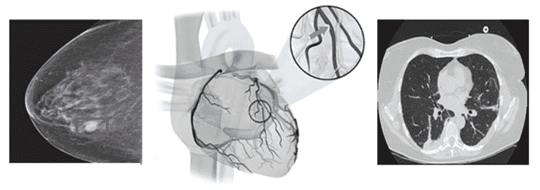(a) (b) (c)

**图 2：** 通过乳腺 X 线检查获得的图像 (a)\[x\]、荧光透 (b) 和计算机断层扫描 (c)

事实证明，包括伽马射线、`X-rays`、α射线、β射线和核苷酸暴露的高能辐射会损害患者的 DNA，引发癌症的可能性 [5]。这取决于患者的年龄、性别、暴露于辐射的器官以及辐射量等因素。然而，`x-ray imaging`和其他基于电离辐射成像带来的益处大于辐射暴露带来的微小缺点。图 2 显示了通过乳腺 X 线检查获得的图像。

#### 2.2 超声成像

超声成一直是医学成像领域的另一项显著进化，它利用频率高于 20 kHz 的声波。这是一种非侵入性成像技术，克服了电离辐射带来的缺点。如今，集成超声成像中的换能器使用阈值在兆赫范围内的声波 [6]。胶状换能探头放置在患者感兴趣区域的皮肤上以传输声波。声波从声波传输路径上的物体上发生反射。为了提高图像质量，换能器探头可能会放置在血管、阴道或胃肠道内。超声成像是预测母体内胎儿生长的非常有用的诊断程序。图 3 显示了母体内胎儿的横截面。

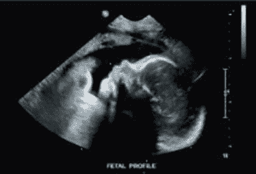

**图 3：** 超声图像 - 母体内胎儿的横截面

（感谢：Philips 医疗系统）

反射的声波形成图像，用于诊断受影响区域。肾脏、肝、胆囊、心脏、血管、肠道、子宫、婴儿大脑是超声检查的一些示例。传统的超声成像仅有 2D 形式，现在为了改进细节，已经开发了 3D 和 4D 超声成像。

##### 2.2.1 超声

超声——即高于人类听力的高频波——是由 16 世纪的意大利生物学家拉扎罗·斯皮兰扎尼（Lazzaro Spillanzani）预测的。这种预测基于蝙蝠在夜间寻找猎物时利用高频声波反射，如图 4 所示。这种高频声波被被称为`Ultrasound` [7]。

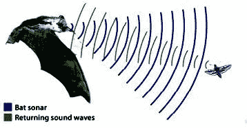

**图 4：** 利用超声识别蝙蝠 [7]

卡尔·杜西克（Karl Dussik）及其兄弟因在 1946 年首次使用超声诊断脑瘤及相应的脑室。但人类器官可视化的权威程序是由乔治·路德维希（George Ludwig）在 1949 年完成的，他观察胆结石。

###### 2.2.1.1 换能器——超声成像

超声是频率高于人类能力的声能。这种原理被用于产生无辐射的医学图像。该技术用于成像和治疗诊断。所需的声波由压电换能器产生。这些换能器根据电位与机械脉冲相互转换的原理工作。超声换能器可以检测反射的声波，也可以传输声波。当换能器探头放置在监测区域的皮肤上时，换能器将传输声束。部分射线被组织边界衰减并反射回换能器。换能器以电脉冲的形式捕捉回声并传输到超声扫描仪 [6]。根据回声返回换能器所需的时间，扫描仪将计算到组织边界的距离。这些距离被校准为 2D 回声图像形式。

###### 2.2.1.2 超声成像分类

超声在诊断和治疗过程中起着主要作用。诊断超声是利用换能器探头非侵入性扫描内部器官的通用程序。医学领域的当前进化使得扫描仪能够在兆赫范围内以更高的频率运行。根据诊断程序，无菌探头也可以放置在体内。解剖性超声设计用于产生内部器官的图像。功能性超声则根据组织内血流、物理特性和组织纹理对功能进行成像，这将提供有关器官功能变化的复杂细节。

治疗性超声利用超声波进行治疗，而并非用于成像。其应用非常广泛，包括移动组织位置、破坏组织、溶解血栓、加热组织以及药物递送。其核心目的还通过高强度波束破坏死细胞，从而从预期区域清除肿瘤细胞。超声扫描的优点是非侵入性技术，且不会让患者暴露于电离辐射。

#### 2.3 磁共振成像 (MRI)

磁共振成像是一种无侵入的普及成像技术，它利用强磁场和射频波构建人体器官和组织的图像。美国医生雷蒙德·达马迪安（Raymond Damadian）是磁共振成像之父，他发现核磁共振可以区分体内的细胞。

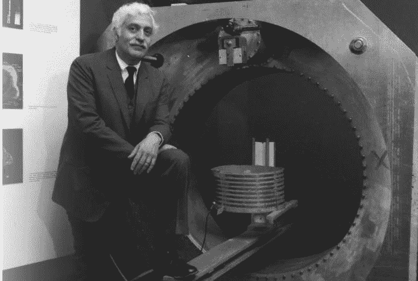

**图 5：** Raymond Damadian 博士与他的早期原型 MRI 设备 [8]

他发现磁信号在正常细胞和癌细胞中的可视化方式不同。这为磁共振成像的发现铺平了道路，其原理是使人体内的氢原子排列整齐。首次 MRI 扫描是由雷蒙德·达马迪安博士于 1977 年进行的，图 5 所示的原型模型位于美国史密森尼学会医学科学馆 [8]。MRI 扫描仪由一组放置有强磁体的大管组成，这些磁体负责产生磁场。MRI 扫描图像用于疾病的诊断和预后。扫描仪可检查身体任何部位，包括大脑、骨骼、盆腔区域、乳腺、子宫、关节、心脏、血管、肝脏、前列腺等。这是一种根据解剖事实构建三维图像的重要技术 [9]。

##### 2.3.1 MRI 中的超导磁体

MRI 扫描仪产生的图像主要取决于磁体产生的静态磁场。最初使用的是 0.3 特斯拉的电阻磁，随后被场强介于 0.35 特斯拉到 0.6 特斯拉之间的超导磁体取代。超导磁体的实用性证明它可以抑制图像中的脂肪，并为脊柱和肝脏提供更复杂的成像 [10]。目前，工作在 0.5 特斯拉到 1.5 特斯拉范围内的低温超导磁体用于诊断。磁体通常通过浸泡在液氦中冷却到绝对零度（0 Kelvin），以增强磁体的导电性。研究人员正在尝试利用 3 特斯拉磁体，以通过更好的信噪比、空间和时间分辨率、光谱分辨率和定量分析来提高图像质量 [11]。

##### 2.3.2 工作原理 – MRI

由于人体 70% 由水组成，水分子中的质子会与 MRI 扫描仪内超导磁体施加的强磁场对齐。质子与磁场对齐后，射频脉冲负责刺激质子并对抗磁场。嵌入在扫描仪内部的 MRI 传感器在射频脉冲关闭时捕捉质子释放的能量。质子重新对齐强磁场所需的时间以及根据质子对齐过程中释放的能量多少，被描述为图像 [9]。为了获得更亮的图像，可以向患者注射如钆酸二甲酰（Gadodiamide）等对比剂，这将加快重新排列的速度。

##### 2.3.3 T1、T2 弛豫时间

磁共振图像具有不同的强度。信号强度取决于区域内质子的数量、T1 弛豫时间、T2 弛豫时间以及流速。图 6 显示了高血压性脑内出血的样本 T1 和 T2 加权图像。


**图 6：** 高血压性脑内矢状位 T1 加权 MR 图像（左）和冠位 T2 加权 MR 图像（右）

这种纵向或横向的弛豫分别称为自旋弛豫（T1）和自旋弛豫（T2）。晶格（Lattice）代表核的环境，移除射频脉冲会导致晶格内部的能量耗散。质子在移除射频脉冲后达到 63% 热平衡所需的时间为 T1。水和脑脊液成像需要大约 3000 到 5000 毫秒，这在 T1 加权图像上显示为深。脂肪的采集需要大约 260 毫秒，这种短时间使得它们在 T1 加权图像上看起来更亮。

脉冲序列以 T1 加权和 T2 加权序列为特征。T1 加权图像通过短重复时间（TR < 1000 ms）和短回波时间（TE < 30 ms）获得。T2 加权图像通过长重复时间（TR > 3000 ms）和长回波时间（TE > 80 ms）获得。图 7 显示了 T1 和 T2 加权图像所需的脉冲序列。


**图 7：** T1 和 T2 加权图像的脉冲序列 [12]

怀疑的脑相关病变和颅内疾病可以通过 T2 加权图像进行清晰筛查。T1 加权图像用于预测出血、脂肪瘤和畸胎瘤 [12]。表 1 显示了 T1 和 T2 加权图像中的磁共振图像强度。它指示了在病变部位上获得的图像强度。

| 特征 | T1 加权图像 | T2 加权图像 |
| :--- | :--- | :--- |
| 实性肿 | 暗 | 亮 |
| 囊肿 | 暗 | 亮 |
| 亚急性血 | 暗 | 亮 |
| 急期和慢性血 | 亮 | 亮 |
| 脂肪 | 灰 | 暗 |

#### 2.4 计算机断层扫描 (CT)

计算机断层扫描——作为医学专家的一种重要决策支持系统，首次设计于 1974 年由 Godfrey Hounsfield 发明。该成像模式正如 2.1 节所述，利用电离辐射。随着技术的进一步发展，数学计算允许其演变为 2D 信息图像。`CT` 扫描仪通过将患者置在一个圆柱形管内，允许 X 射线穿透身体周围区域来产生图像切片 [13]。`CT` 成像模式的主要优势是能够清晰地描绘感兴趣区域的横截面，而 X 射线成像模式获取的只是平片图像。患者承受的电离辐射量可能成为一种威胁，因为它在未来可能导致癌症。但权威规定，患者的累积剂量达到 100 毫西沃特（`mSv`）是不可建议的，医疗团队负责保持较低水平的辐射暴露以维护患者的健康 [14]。这种成像模式在可视化和诊断疾病方面的巨大需求，抵消了对该技术的微小负面影响。它一直是临床医生决策、癌症治疗、创伤处理以及心脏疾病、损伤和中风治疗的主导工具，并使医学专家能够对发现结果做出权威决策。这种成像模式将许多仅为了决策而进行的探测性手术的需求从 13% 减少到了 5%。

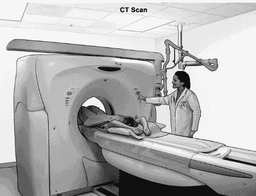

**图 8:** 对患者进行的腹部 `CT` 扫描 [13]

高空间分辨率和极短的扫描时间使得 `CT` 扫描达到了主要应用水平。从诞生以来，`CT` 扫描的需求呈数百万级增长，一份报告显示，美国每 1000 人中约有 279 人接受 `CT` 扫描，这在 2019 年是人数最多的；韩国位居第二，每 1000 人有 249 人 [15]。图 8 显示了 `CT` 扫描仪正在为一名患者进行腹部扫描。

##### 2.4.1 CT 扫描仪

随着技术的巨大发展，`CT` 扫描仪的扫描时间在最近的演进中已减少到几分钟甚至几秒。此外，图像的空间和时间分辨率近期也得到了极大增强。

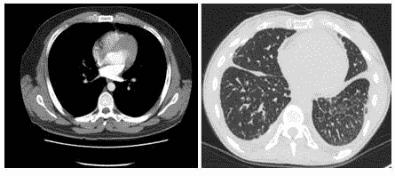

**图 9:** 正常 `CT` 胸部（左）和异常 `CT` 胸部（右）[16]

图 9 显示了正常和异常胸部扫描的 `CT` 图像。螺旋扫描仪使用滑环技术开发，目前多层扫描仪已具有即时成像设施和改进的分辨标准 [16]。

###### 2.4.1.1 传统 CT 扫描仪

在传统扫描仪中，患者被放置在管状装置上，该管会产生窄的 X 射线束。这些射线将探测患者，并在行探测器的帮助下收集输出结果。管和探测器会以顺时针和逆时针方向绕患者旋转，每个方向持续一秒。每次旋转负责捕捉厚度为 1 厘米的切片图像。扫描完特定部分后，患者会被移动到管状的下一段以扫描下一层切片图像 [16]。在这种传统扫描方法中，扫描速度慢得多，并且受患者运动产生的伪影影响。此外，这种扫描仪缺乏图像对比度，存在遗漏切片之间微小病变的可能。传统扫描仪在无增强检查中发挥作用。

###### 2.4.1.2 螺旋/螺旋形 CT 扫描仪

此类 `CT` 扫描仪结合了滑环技术，实现了连续旋转。

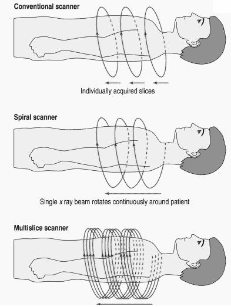

**图 10:** CT 扫描仪的演变 [16]

在传统扫描仪中，患者被放置在管状装置上，该管会产生窄的 X 射线束。螺旋扫描仪允许患者在通过移动时进行连续扫描。图 10 显示了不同的类型。

###### 2.4.1.3 多层 CT 扫描仪

多层扫描仪是一种多探测器扫描仪。目前已有许多行的扫描仪，且生成的图像速度快。图 11 显示了正常、螺旋和传统扫描仪的具有改进成像和良好空间分辨率的 `CT` 图像。

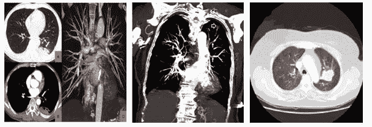

**图 11:** 胸部多层 `CT` 图像（左）、胸部螺旋 `CT` 图像（中）、胸部传统 `CT` 图像（右）[16]

图像由 `CT` 扫描仪根据像素构建，像素与组织内容直接相关。这些测量值使用 Hounsfield 单元表示 [13]。碘被用作对比剂用于清晰识别血管、肿瘤和其他感染部位。表 2 显示了根据组织内容解释的各种 Hounsfield 单元 [17]。

**表 2:** HOUNSFIELD 单元中的组织密度 [17]

| 组织密度 | Hounsfield 单元 (HU) |
| :--- | :--- |
| 水 | 0 |
| 空气 | -1000 |
| 骨骼、钙、金属 | 1000 |
| 出血 | 60 到 100 |
| 脂肪 | -30 到 -70 |
| 肌肉、软组织 | +20 到 +40 |
| 灰质 | 35 |
| 白质 | 25 |
| 点钙化 | 30 到 500 |
| 碘造 CT 对比剂 | 100 到 600 |

#### 2.5 正电子发射层扫描 (PET)

正电子发射层扫描用于在怀疑缺陷时分析细胞、组织或器官的代谢活动和生物化学分析。根据伯克利实验室的数据，每年进行约 200 万次 PET 扫描 [20]。这种基于核医学的过程用于可视化特定区域内发生的化学变化。放射性核素或放射性示踪剂会在计算机断层扫描、磁共振成像和其他成像模式进行识别之前，预先检测出组织的代谢状况 [18]。

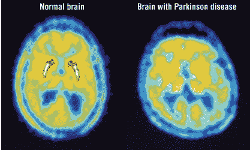

**图 12:** 正常大脑与帕金森病大脑的 PET 扫描 [19]

这种模式主要用于心脏、大脑和癌症诊断的病理诊断。`PET` 通常与 `CT` 或 `MRI` 结合使用，为病理状况提供权威的研究。目前，`PET` 与 `CT` 结合形成 `PET/CT`，用于癌症、阿尔茨海默病、癫痫和心脏病的潜在诊断。与非癌细胞相比，癌细胞的代谢活性被发现化学上更活跃。这些细胞在 `PET` 扫描中显示为明亮的白点 [20]。最初，该技术仅在结合放射性核素实验室的专用 `PET` 中心提供。随着在 `PET` 成像系统中配备了伽马射线相机系统，这一技术得到了逐步改进，在成本增加增加的情况下提高了扫描速度。图 12 显示了正常大脑和帕金森病大脑的 `PET` 扫描示例 [19]。

##### 2.5.1 正电子发射层扫描 – 流程

正电子发射层扫描是一种成像模式，它根据代谢率、化学反应、血流、神经递质以及放射性药物上表现出的反应来分析特定感兴趣区域的功能。放射性剂量通过外周静脉注射，并称为氧-15、氟-18、碳-11 或氮-13 [21]。该过程持续约 40 分钟，许多方面与 `Computer Tomography`（计算机扫描）相似。该过程完全无痛，测量身体不同部位消耗的葡萄糖量，这是通过 18-氟脱氧葡萄糖（`FDG`）完成的。`FDG` 的临床应用是根据葡萄糖代谢消耗来分类良性和恶性肿瘤。通过全身 `PET` 扫描可以通知癌症的不同阶段。`PET` 的其他临床重要性在于分析中风、阿尔茨海默病和帕金森病的大脑血流和耗氧。多巴胺被用作神经递质追踪大脑中的代谢问题。`PET` 扫描在区分放射性坏死引起的肿瘤与心脏缺陷手术后的瘢痕方面也起着重要作用。

##### 2.5.2 PET 扫描的图像形成

当放射性踪剂通常通过外周静脉注射时，放射性核素的衰变产生湮灭光子，这些光子通过背对背的 511 keV 光子检测到。


**图 13:** PET 扫描仪中的图像重建过程 [22]

`PET` 扫描仪使用由厚闪烁晶体耦合光探测器组成的闪烁探测器。围绕患者的探测器收集了大约 10⁷ 到 10⁸ 次衰变事件。这被用于基于放射性核素分布反射的 `PET` 图像重建。

在在此过程中，由于一个或两个湮灭光子的散射可能会导致能量损失，这些被描述为散射事件。当放射性核素衰变的两个光子同时击中探测器时，也可能发生随机事件。随机事件和散射事件是必须减少以增强 `PET` 图像质量的最重要现象。两个湮灭光子必须在不同的时间朝探测器移动，这种时间差计算为飞行时间 PET（TOF PET）。该事件被用于图像重建过程，主要用于具有良好图像质量的定位。这强制图像重建算法必须考虑散射事件、随机事件和飞行时间的线段。有效的重建过程将产生定量图像，其强度取决于作用于每个组织体积的放射性踪剂 [22]。通过湮灭光子移动到闪烁探测器的图像重建过程如图 13 所示。

### III. 成像技术中的伪影

在成像中，伪影是捕捉人体内器官、组织或细胞的预期图像和位置的一个主要问题。伪影是指图像的一部分或部分没有代表所关注的预期解剖结构。光照条件的微弱暴露和外部干扰可能会导致获取的图像产生噪声。这些可能会限制对患者感兴趣区域细节/疾病的诊断效力，可能导致错误的诊断和预后。因此，必须消除各种水平的噪声以过滤图像中存在的噪声。高斯、泊松、量子、斑点和脉冲噪声是成像模态中识别出的一些主要噪声种类。

#### 3.1 X 射线伪影

`X-Ray` 伪影主要是由于硬件故障、技术人员错误、患者移动和软件问题引起的，这些问题导致输出图像中形成异常阴影。`X-Ray` 伪影主要由常见伪影、胶摄影伪影和数字摄影伪影组成。图 14 显示了 X 光机的伪影。

常见伪影导致由于患者运动引起的图像失真、由于不同结构叠加（胶片双曝光）导致的图像合成以及由于准直器管内碎片堆积形成的梯形区域 [23]。


**图 14:** 常见 X 射线伪影 [23]

光栅截止（Grid cut-off）是 `x-ray` 成像中常见的伪影问题，由于珠宝、衣服和头发等不透射物体吸收不需要的 `X-rays` 而引起。光栅截止会导致密度降低，并根据所用光栅的发生。常用平行光栅截止和交叉光栅截止，这些静态光栅产生的问题通过振荡光栅截止来修正 [24]。

胶摄影伪影是由于图像处理不当引起的，导致指纹、在显影液前将胶片放入机器中导致胶片透明、胶片不当弯曲导致闪电纹、指甲压压胶片引起半月形黑线、增光屏引起月形白线、完全光照导致胶片变黑以及胶片处理过程中气泡和增光屏上的碎片导致清晰斑点。

数字摄影伪影由于信号丢失、死像素伪影、探测器图像延迟、背散射、拼接伪影、不透射点形成、探测器偏移问题、电子快门故障、中间灰裁剪和栅线抑制失效而产生 [23]。

#### 3.2 超声成像中的伪影

超声成像中常见的伪影问题包括解剖结构缺失、解剖结构位置错误或预期区域大小成像不当。超声成像中产生伪影的主要缺点是将伪影误认为是错误的诊断。放射科医生最终负责区分伪影与器官或组织结构。超声成像中的常见伪影如图 15 所示。


**图 15:** 超声成像中的常见伪影 [25]

在临床实践中，超声成像中遇到的常见伪影包括斑点噪声、声增强和阴影、各向异性、亮度伪影、彗尾伪影、彩色噪声伪影、混叠伪影、双主动脉伪影、反射伪影、侧瓣伪影、环形伪影、折射伪影、速度位移伪影、多回声伪影和闪烁伪影 [25]。因此，伪影在超声成像模态中非常常见，识别伪影的能力将有助于图像增强。

#### 3.3 磁共振成像中的伪影

由磁场和射频波产生的磁共振图像存在伪影，这些伪影会模拟产生虚假的解剖结构。这可能导致错误的诊断和治疗方案。生理伪影、固有物理伪影以及硬件和软件伪影是 MRI 扫描中常见的伪影类型。

生理伪影是由扫描过程中患者的运动引起的，可能导致相位编码方向的图像出现重影或模糊。呼吸、心跳和血流在 MRI 扫描过程中是不可避免的，由于这些强制性原因产生的伪影可以通过快速序列和呼吸门控相位序列来消除。流空伪影是由于血流产生的，可以通过饱和带和梯度回波序列消除 [26]。

固有物理伪影分为化学位移伪影和磁极敏性伪影。在频率编码过程中，脂肪和水分子在磁场中振动，在解剖结构中呈现为不同的亮度（如亮边），这可能被误读为病变。通过提高带宽、最小化脂肪频率信号和矩阵大小可以减少这种伪影。磁极敏性伪影是由患者体内的医疗植入物和饰品引起的。它是组织对磁场响应可能表现出的磁化程度。这种伪影在 3 特斯拉下更为显著。这种伪影在扩散序列期间会在组织界面处产生空隙 [11]。这会在获取的图像中产生亮点，可能被误认为是疾病。

硬件和软件伪影是由扫描室内的机器组件及其周围环境引起的。这会在生成的 MRI 图像中产生噪声，因此 MRI 扫描室禁止环境干扰和限制图像质量的设备 [26]。

#### 3.4 计算机断层扫描中的伪影

CT 扫描中的伪影会限制图像细节，导致计算机断层成为一种诊断不稳定的成像模式。

放射科医生必须经过训练区分伪影和图像细节，以提供有效的诊断。基于物理的伪影、基于扫描器的伪影、螺旋和多层伪影以及患者伪影在计算机断层中更为常见。

基于物理的伪影包括束硬化、部分体积、欠采样和光子饥饿伪影。杯形伪影和暗带的出现是由于束硬化引起的现象。包含光子的 X 射线束在穿过患者时变得更硬，因为低能量光子粒子的吸收比高能量光子快。这导致了 CT 扫描器中的束硬化效应。

环形伪影在扫描器中更为常见，当一个探测器未有效校准时发生。这将导致图像产生环，误导诊断过程。定期的探测器校准和软件实现将减少环形伪影。

螺旋伪影发生在轴位和平多层扫描中。当解剖结构在 z 轴方向上容易变化时，这种类型的伪影会增强。当 z 轴方向通过低螺距（pitch）的 180 度插值器和薄层采集而减少时，这种伪影就会消失。在多层扫描中，螺旋伪影表现为锥束效应和多平面重建。阶梯伪影和斑马伪影在这种多层扫描中更为常见 [27]。

### IV. 先进图像去噪算法

为了准确诊断，需要感兴趣区域的清晰图像细节，以读取受影响器官/细胞/组织的细微细节。研究人员贡献了多种噪声滤波算法，某些算法已集成到成像系统中。这将提供过滤后的图像，从而帮助医学专家通过感兴趣区域的清晰图像对疾病进行诊断。

泊松噪声、加性噪声、斑点噪声、高斯噪声和椒盐噪声是医学成像模式中常见的噪声伪影。如果不进行处理或移除，存在于各种成像技术中的这些噪声伪影将限制图像细节。文献中提供了有效的去噪技术，这些技术在不干扰复杂图像细节的情况下维持图像质量方面做出了独特贡献。其中，中值滤波器、高斯滤波器和维纳滤波器使用最广泛且效率较高。

中值滤波器是一种顺序统计滤波器，更适用于椒盐噪声的去噪。这种类型的噪声在 X 射线图像中非常明显。这种滤波器在去噪方面被证明是有效的，通过将预定义窗口内的每个像素替换为其中值来实现去噪。窗口的大小选择非常小心，因为可能会替换图像的精细细节。因此，去噪过程的执行是以丢失图像原始数据为代价的 [28]。

维纳滤波器是一种最优统计滤波器，用于消除医学图像中的各种噪声。滤波器的设计在噪声平滑和反滤波之间取得平衡 [28]。使用滤波器抑制噪声需要图像中频谱特性的先验知识。该滤波器取决于最小均方误差，并假设加性噪声是不活跃的。

高斯滤波器用于消除基于高斯分布的超声图像和 MRI 图像中的噪声。噪声像素被周围像素的平均值替换。这是一种线性平滑滤波器，对于正高斯分布具有较高的效率。

### V. 医学成像诊断应用中的人工智能 (AI)

人工智能的爆发是医学成像模式中的主要支持，为放射科医生提供了帮助。人工智能正在消除医学领域由于缺乏经验而导致的伪诊断。它具有以高精度的准确性处理大量医学图像的能力，并发现肉眼不可见的精细细节。人工智能在医学成像领域的蓬勃发展为医学专家提供了附加价值的任务，从而增加了医患互动的时间。AI 研究密切关注基于敏感性和特异性的诊断准确性评估。人工智能在诊断疾病疾病和需要长期预后的病例中也证明了其重要性。人工智能的应用将通过其在疾病诊断、特定病例治疗方案分析、精确性以及降低死亡率和提高生活质量方面的主导地位，完全取代现有方法 [29]。图 16 显示了人工智能在医学成像诊断中的模型影响。


**图 16:** 人工智能在医学成像诊断中的应用（图片感谢：ESR）

人工智能具有识别图像中人类无法评估的模式变化的惊人能力。借助机器学习对脑部磁共振成像（MRI）进行分析，已证明可以非常敏锐地早期诊断缺血性中风，而这在人类阅读者看来是不可能的。随着用于分析图像中像素直方图、形状、位置和所占区域的机器学习算法的出现，人工智能在医学影像领域开启了统治地位。机器学习算法利用部分数据项来训练系统，而其余数据则用于测试应用程序。常用的机器学习算法包括`主成分分析`、`支持向量机`、`监督学习算法`、`径向基神经网络`等 [30]。`张量处理单元`的开发是为了增强基于神经网络的机器学习，这在在医学影像领域似乎具有巨大的潜力。

人工智能正与放射科医生联手合作，以提高图像质量和诊断效率，而不是为了取代放射科医生 [31]。人工智能将承担“增强智能”的角色，而非“自主智能”。人工智能仍然处于监督学习时代，这强调了人类监督是必不可少的。通过机器学习产生的糖尿病网膜病变数据显示出主要的观察者间差异，因此作为输入的数据需要经过有效的馈送。深度学习算法与机器学习算法相比展现了巨大的进步。它能够将患者的病史与当前报告进行比较，并预测可能的结果。在 CT、MRI、超声和 PET 扫描中，它实现了非常有前景的选择，因为它通过元数据处理特定的选定数据，而不依赖医学专家。这自然预示了人工智能和深度学习算法在医学影像及相关研究中的重要性。


**图 17：** 为放射科医生提供的增强智能支持（图片提供：美国医学协会）。

人工智能是医学影像领域放射科医生的福音，因为它将成为一个优越的监督决策者，而决策仍掌握在人类手中，这一点在图 17 中阐明。

### VI. 结论

图像处理是一项重要的工具，支持医学专家在诊断和预后程序中进行有效的探索。人体成像在过去的二十年里得到了显著发展，并辅助了许多决策支持系统。这在治疗过去一直是挑战的多种疾病中也得到了证明。超声成像、`磁共振成像`、`X 射线`、`计算机断层扫描`、`正电子发射计算机`和`单光子发射计算机断层扫描`是最常用的医学影像模态。每种成像模态在识别人体巨大疾病方面具有特定的独特性。它们在支持医学专家以高精度的视觉化内部器官和组织方面起着至关重要的作用。成像技术受与能量源一起使用的原理支配，而这些原理正是应用于跨越细胞、组织和器官的成像之中。对诊断和预后过程的医学图像分析至关重要，目前存在许多算法支持医学专家获取无伪影的图像。这通过人工智能的增强支持得到了进一步加强。它避免了医学领域由于缺乏经验而导致的伪假诊断。它能够以高精度和准确率处理大量的医学图像，并捕捉到肉眼不可见的精细细节。人工智能在医学影像领域的蓬勃发展为医学专家提供了增值任务，并将此增加与病患互动的时间。

## 参考文献

[1] Andrew Rubin, “History of Medical Imaging – a brief overview”, 2017, Newsletter, Flushing Hospital Medical Centre.

[2] Yousif Mohamed Y. Abdallah, “History of Medical Imaging”, 2017, Medical History, Archieves of Medicine & Health Sciences, Vol. 5, No. 2, pp:275-278.

[3] Raymond A Schulz, Jay A Stein, Norbert J Pelc, 2021, “How CT happened: the early development of Computed Tomography”, Journal of Medical Imaging, pp:1-26, Vol.8, No.5, 052110.

[4] Robert R Edelman, 2014, “The History of MR Imaging as seen through the pages of Radiology”, Radiology, pp: 181-200, Vol.275, No.2S, https://doi.org/10.1148/radiol.14140706.

[5] National Cancer Institute, About Cancer, Causes Prevention, www.cancer.gov.

[6] National Institutes of Health, National Institute of Biomedical Imaging and Bioengineering, Engineering the Future of Health, https://www.nibib.nih.gov/science-education/science-topics/ultrasound.

[7] Jayant Pai Dhungat, 2018, “History of Ultrasound in Medicine”, Journal of The Association of Physicians of India, Vol. 66, No. Medical Philately, ISSN: 0004-5772

[8] Jess Winans, 2018, “Melville's Dr.Raymond Damadian, the Father of MRI, Long Island Press

[9] National Institutes of Health, National Institute of Biomedical Imaging and https://www.nibib.nih.gov/science-education/science-topics/magnetic resonance imaging.

[10] Robert R.Edelman, 2014, “The History of MR Imaging as seen through the pages of Radiology”, Centennial Review, MR Imaging, Radiology, Vol.273, No.2, pp: S181-S200, www.radiology.rsna.org.

[11] Vijay P B Grover & et.al, 2015, “Magnetic Resonance Imaging: Principles and Techniques: Lessons for Clinicians”, Journal of Clinical and experimental Hepatology.

[12] John R Hesselink, “Basic Principles of MR”, http://spinwarp.ucsd.edu/100.

[13] Paula R Patel, Orlando Jesus, 2022, “CT Scan”, National Center of Biotechnology.

[14] Stephen P Power,, al, 2016, “Computed Tomography and Patient Risks: Facts, Perceptions and Uncertainities”, World Journal of Radiology, Vol. 8, No.12, pp: 902-915.

[15] Number of Examinations with Computed Tomography (CT) in selected countries as of 2019 (per 1000 inhabitants), 2021, Statisca.

[16] Conall J Garvey, Rebecca Hanlon, 2002, “Computed Tomography in Clinical Practice”, British Medical Journal, Vol. 326, No.7304, pp: 1077-1080.

[17] Shervin Kamalian, M.H.Lev, Rajiv Gupta, 2016, “Chapter 1 – Computed Tomography Imaging and Angiography Principles”, Handbook of Clinical Neurology, Elsevier, Vol. 135, pp: 3-20.

[18] Positron Emission Tomography (PET), Health, Johns Hopkins Medicine, https://www.hopkinsmedicine.org/health/treatment-tests-and-therapies/positron-emission-tomography

[19] Patient Basics: Positron Emission Tomography (PET Scan), 2014, published by Harvard Health.

[20] Brian Krans, 2021, “What is a Positron Emission Tomography (PET) Scan?”, Healthline, https://www.healthline.com/health/pet-scan.

[21] Abi Berger, 2003, “Positron Emission Tomography”, British Medical Journal, Vol. 326, No.7404.

[22] Eric Berg, Simon R Cherry, 2018, “Innovations in Instrumentation for Positron Emission Tomography”, Seminars in Nuclear Medicine, Vol. 48, No.4, pp: 311-331.

[23] Shetty A, Dr.Henry Knipe, 2021, “X-Ray Artifacts” Reference Article, Radiopaedia.org, https://doi.org/10.53347/rID-27307.

[24] Andrew Murphy, 2020, “网格边缘截断”, 参考文章, Radiopaedia.org, https://doi.org/10.53347/rID-54189。

[25] Goel A, Bell D, 2021, “超声伪影”, 参考文章, Radiopaedia.org, https://doi.org/10.53347/rID-31476.

[26] Aston Diaz, 2015, “MRI 中最常见的伪影”, 参考文章, Sensible Solutions for Refurbished Radiology, Atlantis Worldwide [网站]。

[27] Julia F Barrett, Nicholas Keat, 2004, “CT 中的伪影：识别与规避”, Radiographics, 第 24 卷, 第 6 期, 页: 1679-1691。

[28] Nalin Kumar, Nachamai, 2017, “医学图像中使用的去噪与滤波技术”, 东方 Journal of Computer Science and Technology, 第 10 卷, 第 1 期。

[29] Ohad Oren, Bernard J Gersh, Deepak L Bhatt, 2020, “医学影像中的人工智能：从放射学病理数据转向具有临床意义的终点”, 第 2 卷, 第 9 期, 页: E486 – 488。

[30] Xiaoli Tang, 2020, “人工智能在医学影像研究中的作用”, 第 2 卷, 第 1 期, PMC7594889。

[31] Dr.Joon Beom Seo, 2018, “增强智能而非人工智能”, Diagnostic Imaging, healthcare-in-europe.com [来自网站] 生物工程，工程化健康未来，

## 第 8 章：面向医疗业的万物互联（IoE）大数据之旅

Piyush Gupta¹, Dr Bhupendra Verma², Dr Mahesh Pawar³

1) 研究生，计算机科学与工程系, UIT RGPV Bhopal 2) 计算机科学与工程系, TIT Bhopal 院长 3) 计算机信息技术系, UIT RGPV Bhopal 助理教授

### 摘要

健康被认为是人类面临的全球性挑战。根据世界卫生组织（WHO）的说法，持续的患者监测被认为是医院的高标准。医疗保健行业数据量的不断增长，使得大数据技术在提高医疗服务质量方面的应用变得具有预见性。大数据通过管理海量数据（例如从各个平台维护和收集信息），在医疗行业中发挥着重要作用。这是通过执行大数据分析来分析和捕捉每条信息实现的，从而得出患者的完整历史并在正确的时间提供适当的信息。因此，本研究回顾了大数据在医学领域的维度，以及万物互联（IoE）在医学领域的重要性，同时也评述了大数据在医疗保健系统中的应用与挑战。该研究强调了医疗行业中基于万物互联的大数据之旅。

**关键词**：医疗行业、物联网、万物互联、大数据。

## I. 引言

万物互联（IoE）被认为是连接人、数据、过程和事物的智能手段。IoE 应用包括用于远程应用的数字传感器工具，这些工具最近出现并变得更加自动化和智能化 [1]。目前，医疗保健行业被认为是一个重大的困境之一。即使是医疗保健提供的服务也比其他行业昂贵，因为全球范围内慢性疾病的人数不断增加。

物联网（IOT）结合了各种通信设备和能够感知并相互通信的智能电子设备。近年来，物联网设备通过解决过去面临的许多挑战和复杂问题，在生物医学应用领域带来了革命 [2]。这些物联网设备可以产生大量的生物医学数据，并在开发现有的自动医疗数据采集系统方面发挥着至关重要的作用。当物联网设备与先进的机器学习（ML）算法集成时，大数据对于改进这些医疗系统在诊断、决策和治疗方面至关重要。先进的机器学习用于分类变量和连续变量。常用的算法包括：

*   线性回归
*   线性判别分析
*   逻辑回归
*   朴素贝叶斯
*   回归树
*   学习向量量化 (LVQ)
*   K 近邻 (KNN)
*   随机森林
*   支持向量机 (SVM)

此外，物联网在生物医学应用中的应用为 IoE 开发了研究领域，例如症状治疗、患者观察和监测 [3]。

©2022 Technoare 出版

Piyush Gupta – “基于万物互联的医疗行业之旅” 页: 87 - 93。


https://dx.doi.org/10.36647/AAIM/2022.01.Ch08


### 87：万物互联

 人

 过程

 物

 数据


**图 1** 万物互联的框架

IoE 的框架如图 1 所示。通常情况下，IoE 依赖于连接到互联网的过程、数据和事物。这影响了人们的生活、业务和工业流程。此外，从多个传感器收集的实时信息相互互连并实施到以人为中心的过程中 [4]。此外，万物互联有助于实现环境可持续性和社会经济目标。此外，IoE 应用化石燃料开采、远程监控、电子学习、自动化、交通控制、智能电网和其他许多行业。万物互联将通过植入环境的传感器产生海量数据。由于信息的生成和监测是一个持续过程，保持这些设备连接并接入互联网是至关重要的。这确保了服务器数据的间断更新。


图 2 医院环境中 IoE 的革命性特征 [5]

图 2 展示了医院中 IoE 的革命性特征。糖尿病患者将获得身份卡，这些卡将被扫描并链接到云端，存储电子健康记录（EHR）以及实际实验室结果、处方和病史。这样护士和医生就可以轻松地在桌面、笔记本电脑或平板电脑上访问这些记录。

EHR 的实施将显著改变医疗部门。通过纸质系统管理医院记录（即传统的笔和纸记录）将被数字系统取代。传统的纸质系统有各种局限性，而且有时会被漏。然而，EHR 在一个地方保留所有关键信息，并方便医生和人员共享这些信息。因此，EHR 可以消除许多低效率并拯救生命。然而，实施 IoE 的巨大缺点之一是通信。尽管各种设备拥有用于收集数据和信息的各种传感器，但它们无法与服务器通信。此外，每个制造商都有自己的协议，导致其他制造商的传感器无法相互通信。

大数据分析是一项主流技术，特别是在数字化转型中。此外，大数据在短时间内已涵盖了医疗保健、地理空间通信系统、传感器网络、移动应用程序和电子商务等不同领域。同时，数据的到达率将以 EB（艾字节）为单位。在考虑医疗保健领域时，除了海量和独特之外，高高速的数据到达由于其异构性而显得极具挑战性。此外，患者的数据量数量极其惊人，包括疾病发源、临床史、术前和术后过程、治疗时长，以及诊断和术后数据，如 `EEG`、`MRI` 报告、X 光片、`US`（超声）报告和 `CT` 扫描。大数据进入这一领域是因为为医疗保健领域提供了多维度的方法、技术和解决方案。通过使用这种先进技术，每个医疗系统将变得更易访问，而且还将显著提高成本效益。在现代医疗系统中，有几个问题需要大数据来解决，例如医疗保健数据的维护、数据的移动性，以及改善患者接待体验所必需的可访问性。

## II 大数据的维度

大数据是海量数据，受到多个网站的威胁，如社交媒体网站 `twitter`、`linkedin`、`Facebook` 和博客站点，以及用于不同应用的各种仪器（如传感器）。这些大数据需要一种新的架构、各种技术、复杂的算法以及强大的分析能力，以管理大规模数据并从复杂算法中提取信息。当数据规模增加到某个特定点时，在捕获数据、存储数据、处理数据、处理后数据分析和数据可视化过程中，定性问题被认为比定量问题更重要。此外，大数据具有几个维度，如易变性、粘性、病毒性、价值、可视化和可变性。

**多样性（Variety）：** 大数据收集了多种数据，如用于各种应用的 `EHR`、`ECG`（心电图）和传感器数据、音频、社交网站和数字照片。

**速度（Velocity）：** 数据速度将根据来自机器、传感器、网络以及智能手机等各个领域发布的数据进行计算。此外，数据流是持续的，它整合了结构化和非结构化格式的数据。

**可视化（Visualization）：** 收集的数据需要以合理的方式呈现，即使存在容量、速度等不同特征，这变得更具挑战性。因此，通过可视化，提供完整且清晰的数据视图是可行的。

**易变性（Volatility）：** 易变性指的是速度，它有助于数据跨网络移动。除了数据之外，时间在数据分析中也起着重要作用。

## III IOE 在医疗领域的意义

在当今世界，医疗提供者面临着许多后果。万物联网在正确的地方提供正确的信息提高了医疗 IQ。首先，它通过消除简单事务来简化工作流，从而大幅降低了服务成本，并提供了更多优质的医患时间。此外，更高的患者满意度评分和 `HCAHPS` 等患者预后可以通过增加第三方支付来提高收入。此外，`IoE` 改善了患者和业务结果。根据 IMS 学院的数据，2012 年医疗费用超过了 2000 亿美元。医疗领域 IQ 的增加显著降低了临床失误风险。生物识别和传感器的最新进展为医生提供了即时反馈。与其等待 14 天患者回复，在 `IoE` 的帮助下，可以获得即时行动。与大数据结合时，可以获得额外的收益，如减少错误和提供良好的患者护理。最重要的是，万物联网通过维持健康为医疗保健部门提供了必要的信息[1]。

## IV 大数据在医疗保健中的应用

以下是大数据在医疗环境中的应用。

*   大数据与医学影像
*   远程医疗
*   医疗保健领域的预测性分析
*   大数据可以治愈癌症
*   利用健康数据进行知情战略规划
*   增强患者参与
*   实时告警
*   `EHR`（电子健康记录）
*   患者预测

### 4.1 患者预测

大数据在预测患者方面起着主导作用。几篇文章讨论了用于预测患者的大数据策略，其中整合了来自不同来源的访问医院患者的数据，数据科学家对医院的记录实施了时间序列分析。这有助于预测入院率以及工作人员的可用性，从而改进了性能[2]。此外，各种 `ML` 算法作为预测未来入院趋势的重要工具。当进行预测时，相应地将更多工作人员可用，这有助于减少患者的等待时间并改进为患者提供的护理方法。

### 4.2 EHR-电子健康记录

医疗保健领域利用大数据分析的通用形式是 `EHR`。这些电子健康记录以数字方式存储患者报告，如实验室结果、病史和人口统计数据[3]。此外，已采用安全信息系统使这些 `EHR` 在私立公共部门可用。由于每个记录都是数字化的并包含每个数据的更新文件，因此不需要纸质工作和数据重复。

此外，电子健康记录可以生成跟踪处方的提醒和进行必要实验的警告。尽管实施 `EHR` 是值得的，但几个国家仍在为此苦苦。

一项研究表明，在美国（US），实施了一个名为 `Health-Connect` 的系统，该系统易于共享和利用数据[4]。麦锡关于大数据与医疗领域整合系统的报告指出，由于减少了门诊访问和心脏病的病理检查，已节省了约百万美元。

### 4.3 实时告警

通过利用大数据，医疗保健分析提供的实时告警被认为是一种主要功能。通常，在医院中，实时 `CDS`-临床决策支持系统帮助医疗工作人员和医生为患者提供现场处方和建议。然而，这些实时系统非常昂贵，因此医生或医疗工作人员倾向于让患者远离医院。近年来，使用了个性化分析设计，其中患者健康数据将通过智能手表等可穿戴设备不断观察，并通过云端共享信息[5]。例如，如果某个患者的血压迅速升高，他的私人医生将收到警报，以便采取相应的行动降低血压。此外，在 `Asthmapolis` 系统中，吸入器具有 `GPS` 访问权限，用于发现个人和庞人群的哮喘趋势。这些数据将从临床决策支持中汇总，从而为哮喘症患者提供更好的治疗方案。

随着如今人们的健康意识日益增强，他们开始使用更智能的设备来监测自己的脉率、血压、睡眠，并记录日常生活。这样，通过利用这些设备，任何种类的健康风险都可以被识别和治疗。此外，心脏疾病也可以通过未来的慢性失眠和心率增加来预测预测。最终，通过使用智能设备，患者也将参与到各种健康监测活动中[6]。此外，系统会识别特定的健康趋势并上传到云端，供医生使用。通过这种方式，就诊次数将显著减少，而且患者会觉得他们是独立的。

### 4.5 利用健康数据进行知情的战略规划

在当今世界，医疗保健领域的战略规划至关重要，这可以通过大数据分析来实现。一项研究表明，Google Maps 引入了一项应用程序来阐明不同的实时问题。这样，任何慢性疾病的传播和人口分布都可以热力图的形式表示出来[7]。密集地区的医疗服务可用性与实时数据进行了比较，并根据医疗策略采取了决策，这些策略得到了多个医疗单元的增广。

### 4.6 大数据可以治愈癌症

通过利用大数据，开发了一个名为“癌症登月计划”[8]的系统来治愈癌症。该计划旨在短时间内治愈癌症，这与传统的治疗周期相比。医学领域的几位研究人员利用海量数据以获得更好的结果，并识别有用的趋势。该系统的结果将提供良好的康复率和治疗方案。此外，存储在生物库中的肿瘤样本与治疗记录相关联。这些数据按顺序引用，并绘制出癌症蛋白质之间的相互作用和突变，例如治疗方案[9]。这使得获得了更好的结果。这有时也会产生令人惊讶的结果，例如治愈肺癌的司咪三嗪的存在。

此外，这些研究要求连接不同的医院、机构以及非营利组织，这些组织中提供了治疗记录。试验患者的癌症组织样本经过基因测序，并添加到全球癌症数据库中。然而，大数据分析在识别癌症治疗方法方面存在一些局限性，这减少了益处。首先，由于数据不兼容，这些数据集无法相互接口。

### 4.7 医疗保健领域的预测性分析

近年来，预测性分析被用于与业务相关的应用，并将得到进一步探索。最近的一项研究表明，美国的一个研究项目收集了三千万人的数据，通过这些数据，研究观察到了高质量的交付护理[4]。

这种智能策略有助于医疗执业人员和医生根据可用数据集做出决策，并获得改进和更好的患者治疗。例如，如果患者拥有复杂的病史，并患有严重的健康疾病，这些策略将更有帮助。此外，还有一些新工具可以预测心脏病、血压和糖尿病。这样，可以建议患者进行定期体检和医疗建议，并利用饮食计划或体重管理计划[10]。例如，空气质量指数预测系统在阻塞性睡眠呼吸的治疗中具有有效用途[11]。

### 4.8 远程医疗

40 年来，远程医疗一直存在于行业中，现在进入了各种技术，如智能手机、无线设备、在线视频会议（VC）和可穿戴设备。远程医疗整合了医疗专业人员、医疗教育和远程患者监测。此外，远程手术是另一种利用高速度高精度的技能机器人执行的远程医疗服务，并利用来自远程地点的实时数据，如图 3 所示。

此外，远程医疗提供了个性化的治疗方案，这防止了再次入院或住院。医疗数据分析协助医生预测患者生命中的任何关键医疗事件，并预防患者健康。

在远程医疗的帮助下，医院的入院费用显著降低，服务质量（QoS）得到了提高。由于患者的情况可以从任何地方进行监测并随时进行咨询，因此不需要去医院，从而显著减少了等待时间。


**图 3.** 远程患者监测[12]

### 4.9 大数据与医学影像

大数据对医学影像有重大贡献，例如，许多放射学家单独调查每幅医学影像，对其进行分析并存储多年，供医疗部门访问。然而，这种方法消耗了更多的时间成本。

此外，Carestream 是一家医学影像供应商，其产品是利用大数据分析开发的。Carestream 算法分析大量图像，寻找医学图像像素中的特定模式并将其转换为数字。这些数字在诊断中起着至关重要的作用，帮助医生治疗疾病。这一概念使医生无需记忆大量带有大量信息的医学影像。因此，Carestream 算法对医疗领域的技能水平、经验和教育产生了积极影响。

## V. 医疗行业中大数据的挑战

医疗健康领域面临的问题是因为疾病数量巨大且病情危急、各种结果、不同的治疗方法、分析技术以及不同方法的收集。此外，在医疗部门中，大数据的来源有很多，如生物识别数据、网络数据、医学影像、门诊报告、电子记录、临床数据和病例记录。这些信息源生成了具有大维度的海量数据集。一些研究已经解决了医学领域大数据的特征并与传统的医学流行学信息进行了比较[13]。然而，收集这些数据涉及多个协议，由于该过程使用昂贵的仪器和经过良好培训的专业人员，因此成本很高。此外，它容易受到各种不确定性的影响，如编码错误、缺失值以及测量失败。大数据与医疗的通用特征反复使得治疗过程和患者特征随时间变化。

### 5.1 缺失值

医疗行业的大数据分析管理从各种资源收集的数据。然而，它受到变量缺失值以及数据集不完整的困扰。此外，处理缺失值的最简单方法是添加数据值或从数据集中删除。此外，几种数据挖掘算法能够在预处理期间处理缺失值。缺失数据代表与现有未观测和观测数据值之间的各种关系，描述如下：

- `NMAR-非随机缺失:` 缺失数据与未观测数据相关。
- **MAR（随机缺失）：** 缺失数据与未观测数据无关，但与已观测数据有关。
- **MCAR（完全随机缺失）：** 缺失数据与未观测数据和观测数据均无关。在这种情况下，缺失数据不会影响分析过程。此外，`Stata`、`SAS`、`R`、`WinBUGS` 是处理缺失值的自动工具。如果缺失值低于 10%，这些工具提供的结果相似。但如果错误值比例超过 60%，这些工具将无法提供适当的结果。然而，对于 10% 到 60% 之间的缺失值，这些工具可能会提供其他建议。

### 5.2 医疗大数据面临的挑战

尽管大数据分析在不同领域（主要是医疗领域）具有巨大的潜力，但在医疗领域实施大数据分析时面临着各种问题，这些问题被认为是关键的，并且在概述流程时面临着困难。由于大数据被视为新兴技术，其实时性优势非常低[14]。此外，大数据还面临内在的运营问题，如异构性、及时性、隐私性、数据不完整性、数据不一致性、数据质量、法律问题、分析问题、不稳定性以及对观察性研究的局限性。此外，必须改进数据质量，特别是在敏感的 `EHR` 中。因此，为了解决技术问题以获得更好的结果，需要进行巨大的变革。最后，大数据分析与临床的整合可以提供若干益处，但至少需要几年才能获得预期的整合和结果。此外，大数据分析提供了高效的、改进的患者护理以及更快的响应[15]。

## VI. 总结

健康被认为是人类面临的全球性挑战。根据`WHO`（世界卫生组织），持续监测患者被认为是医院的最高标准。由于患者的心率和 `ECG`s 被不断观测，存在数据丢失或数据不匹配的。为了避免这些问题，云是电子病历以及与护士、医生进行远程视频会诊的主要基础设施。患者的数据（如 `ECG`、最后位置、心率和温度）将被频繁测量并存储在服务器中。此外，它还提供了跨保险公司和医疗保健提供者的连接，允许他们购买所需的资源。这有助于维护患者费用并将其控制在范围内。此外，移动性在医疗服务的端到端体验中发挥着重要作用，使患者和医生在医院时保持连接。由于患者在住院期间通过设备连接，医疗专业人员可以通过他们的移动应用程序轻松访问数据，从而大幅提升了患者护理的敏捷性和效率。大数据通过管理大量数据在医疗行业起着至关重要的作用，使得可以在不同平台之间收集和维护信息。这是通过执行大数据分析来捕捉和分析每条信息，从而提供患者的完整历史并在并在提供适当的信息。

## REFERENCES

[1] R. Kashyap, "Applications of wireless sensor networks in healthcare," in *IoT and WSN Applications for Modern Agricultural Advancements: Emerging Research and Opportunities*, ed: IGI Global, 2020, pp. 8-40.

[2] F. Abdali-Mohammadi, M. N. Meqdad, and S. Kadry, "Development of an IoT-based and cloud-based disease prediction and diagnosis system for healthcare using machine learning algorithms," *IAES International Journal of Artificial Intelligence,* vol. 9, p. 766, 2020.

[3] F. Khennou, Y. I. Khamlichi, and N. E. H. Chaoui, "Improving the use of big data analytics within electronic health records: a case study based OpenEHR," *Procedia Computer Science,* vol. 127, pp. 60-68, 2018.

[4] H. S. Jim, A. I. Hoogland, N. C. Brownstein, A. Barata, A. P. Dicker, H. Knoop*, et al.*, "Innovations in research and clinical care using patient-generated health data," *CA: a cancer journal for clinicians,* vol. 70, pp. 182-199, 2020.

[5] N. El aboudi and L. Benhlima, "Big Data Management for Healthcare Systems: Architecture, Requirements, and Implementation," *Advances in Bioinformatics,* vol. 2018, p. 4059018, 2018/06/21 2018.

[6] A. E. Sharma, N. A. Rivadeneira, J. Barr-Walker, R. J. Stern, A. K. Johnson, and U. Sarkar, "Patient engagement in health care safety: an overview of mixed-quality evidence," *Health affairs,* vol. 37, pp. 1813-1820, 2018.

[7] M. Hasan, M. Shahjalal, M. Z. Chowdhury, and Y. M. Jang, "Real-time healthcare data transmission for remote patient monitoring in patch-based hybrid OCC/BLE networks," *Sensors,* vol. 19, p. 1208, 2019.

[8] N. C. Institute, "Cancer Moonshot https://www.cancer.gov/research/key-initiatives/moonshot-cancer-initiative," ed, 2016.

[9] W. J. J, H. Li, and G. Wang, "Axes of a revolution: challenges and promises of big data in healthcare," *Nature medicine,* vol. 26, pp. 29-38, 2020.

摘要 — 菲律宾糖尿病发病率较高，这有时是由不良的饮食习惯和糟糕的生活方式引起的。良好的饮食习惯是每天三餐，每两餐之间吃两次点，以合理分配所需的营养。研究人员开发了一个名为“Nutrify”的应用程序，旨在帮助诊断为 2 型糖尿病（T2D）的人规划饮食。该饮食计划包含热量和宏量营养素分配。决策树算法负责计算应用程序生成的餐食变化、合理分配宏量营养素并优化计划的有效性。调查显示，在所有参与者的反馈中，受访者对该应用程序非常满意，得分为 4.62。然而，由于产生统计学显著结果的时间较短，配对 t 检验的结果未能证明该应用程序在管理用户体重方面的有效性。结论是，研究人员开发的应用程序可以为用户生成饮食计划并创建饮食目标，以帮助用户保持健康并避免现有健康状况恶化。

索引术语——糖尿病、决策树算法、宏量营养素、Nutrify、2 型糖尿病（T2D）

## I. 引言

营养需求是生活中必须考虑的重要组成部分，为了保持身体健康，人体必须摄入适当的营养素。然而，个人每天摄入这些营养素的或过多可能会在未来导致健康问题。

根据菲律宾阳光（Sun Life Philippines）的文章《更好的营养如何预防糖尿病》（2020），菲律宾饮食主要以米饭为主，它提供的碳水化合物有助于个体的每日能量摄入 [7]。建议必须考虑到来自米饭和其他食物的热量摄入，以维持体内适当的营养素。然而，错误的饮食摄入可能导致许多非传染性疾病。其中一种全球公共健康问题是糖尿病，其在菲律宾的发病率全年都在上升（Angeles-Agdeppa, 2020）。此外，食品与营养研究所（n.d.）在第八次国家营养调查中报告，60-69 岁年龄段的糖尿病发病率最高（12.6%）。维持和调节血糖可能需要适当的营养素。此外，许多健康和营养领域的专业人士研究如何根据个人的健康状况制定合适的饮食计划，因此针对糖尿病患者的饮食建议适用于所有人 [5]。

每餐食物被分为个人推荐的营养素，如碳水化合物、蛋白质、脂肪和其他微量营养素。管理血糖水平是糖尿病患者的一大责任。因此，建议每天吃三餐。除了 Alberta Diabetes Link（2018）的文章外，摄入高纤维碳水化合物有利于维持血糖水平，因为它们的消化速度快 [1]。

每个人都需要根据其身体需求平衡其摄入量。并非每个人的健康状况都相同，但了解推荐的营养摄入量对任何人都有益。

## II. 文献综述

### 2.1 本地相关文献

为了进行日常活动，有必要摄入每天推荐的正确营养素。一个人使用身体内储存能量的方式可能根据年龄、性别和他们选择的食物类型而异 [2]。菲律宾家庭最常见的餐食组合由碳水化合物来源（米饭）、配上鱼和肉类，并在饮食中加入一些水果和蔬菜。

© 2022 Technoarete Publishers

Shaneth C. Ambat 博士 – “NUTRIFY：一款针对糖尿病患者的饮食规划应用”

页码：94 - 99。


https://dx.doi.org/10.36647/AAIMLH/2022.01.B1.Ch009


 94 这种饮食类型是“菲律宾餐（Pinggang Pinoy）”，用于饮食规划。根据 Lopez-Madrid、Orense 和 Capanzana (2018) 的研究，利用 2015 年菲律宾儿童及其他人群营养状况更新数据确定了基于饮食的指南（FBDGs），即 2012 年菲律宾人营养指南（NGF）、饮食建议（Kumainments）、菲律宾餐和每日营养字塔（DNGP） [9]。最人知的指南是每日营养字塔（DNGP），占比 35.8%。这些基于饮食的指南提供了关于正确饮食和保持健康生活方式的信息，并包含了身体所需的多种营养素：碳水化合物、蛋白质和脂肪。这些建议必须被考虑，特别是在菲律宾种植的米饭中可以找到这些元素。在 Palanog 等人（2019）的文章中，菲律宾常见的问题之一是微量营养素缺乏，原因之一是未强化的米 [11]。这种米也导致了糖尿病，因为精制糖是存在的。这些糖会导致血糖升高并最终干扰身体胰岛素的产生。避免这种问题有多种方法，如盘子法、手法和食物交换 [12]。有了不同的资源和信息，饮食规划人员创建身体所需营养的饮食将变得更容易。

### 2.2 外相关文献

糖尿病是由高血糖引起的慢性健康状况。患此健康问题的人无法利用或产生足够的胰岛素。这种缺乏会导致许多严重的并发症。根据 Saeedi 等人（2019）的数据，估计 2019 年有 4.63 亿人患有糖尿病 [13]。此外，估计有 400 万老年人死于糖尿病。这些统计数据显示了糖尿病的严重性。此外，糖尿病可能会引发不同的并发症：微血管和大血管并发 [6]。Wanjiru, J.M. (2018) 在文献综述中确定了糖尿病的原因，其中 1 型原因是遗传易感性、免疫性破坏β细胞、环境因素、病毒和感染以及婴儿喂养方式；2 型原则是高 BMI、高血压、吸烟和缺乏运动 [14]。Evert 等人（2019）的一份共识报告指出，糖尿病饮食并非一成不变 [4]。因此，个性化营养治疗应该是糖尿病护理和管理的组成部分。随着技术的进步，创建个性化饮食计划的人工智能（AI）算法不再可能。Li 和 Cao（2017）关于 MOGA 的论文认为，“用户过去期间的营养摄入应被添加到建议的策略中”（第 2 页）[8]。MOGA 考虑了用户现有的饮食记录、生理需求以及对他们的长期影响。在另一种算法中，Mohammed 和 Hagras（2018）指出，“需要利用技术来帮助糖尿病患者和医生控制疾病并减少其并发症”（第 56 页）[10]。他们提出的饮食计划算法专注于使用二模糊逻辑的糖尿病饮食推荐系统。支持者希望该推荐系统能帮助糖尿病患者和医生通过这项技术管理糖尿病。

## III. 理论框架

注册营养师乔伊·鲍尔（Joy Bauer）提出的 90/10 理论为本研究提供了支持。该理论框架可以应用于研究中，确保用户在遵循其饮食计划时保持动力。允许一小比例的饮食包含用户渴望的食物至关重要，因为如果用户持续拒绝他们想吃的食物，他们很可能会在执行饮食计划时失去所有意志。每个人的身体和生活方式都是不同的。与其让他们的生活去适应严格的饮食计划，90/10 原则允许了饮食的灵活性和自由。然而，为了使该理论成功，关键在于让用户对 10% 饮食有一个大致的概念。每天吃三餐意味着每周有两次“欺餐” [3]。该移动应用程序将创建一个饮食计划，自动允许 10% 的用户想吃的食物，这样用户不需要思考和计算这 10%，他们只需要遵循饮食计划即可。因此，用户不需要建立一种心态来确保他们正在执行 90/10 计划。

### 3.1 系统设计


**图 1**。系统设计

图 1 显示了系统如何实现其目标。在用户设置好个人资料和信息后，系统将对其进行评估，并根据其目标、卡路里计数和宏量营养素摄入创建计划。首页显示不同的图标，用于导航探索所有的应用程序页面。用户可以在搜索栏或主菜和零食列表中查看所有食物。他们可以将喜欢的食物添加到他们的饮食计划中。使用 `Decision-Tree Algorithm`（决策树算法）来选择最符合用户营养需求的饮食。该算法应用于每餐饭的成分，这也是该应用程序能够检测饮食及其成分的变化对用户是否仍然有效，或是否需要改进的原因之一。

在“健康统计”页面跟踪他们的体重将帮助他们清晰地看到自己的进度，看到他们的改进。用户还可以在“支持”页面上获得他们所问题的答案。

## IV. 统计方法论

在收集和汇总数据后，将使用 `Microsoft Excel` 等计算机软件进行数据清点。结果将决定饮食计划器为糖尿病患者提供饮食计划的有效性。这将基于受访者的问卷调查和访谈。

研究人员将利用以下统计处理方法来有效地解释研究数据：

### 4.1 平均值 (Mean)

将用于根据受访者提供的数据识别其评估。为了获得平均值，必须将所有数据条目的和除以条目总数。

`X = (1)` 其中：

`x` – 平均值，

`Σx` - 分布中所有分数或值的总和，

`n` - 分布中得分的总数

### 4.2 加权平均值 (Weighted Mean)

加权平均值将用于评估某组参与者回答的总体价值。在加权平均值中，为每个值分配一个特定的权重，以确定其与观察结果的相关性。通过计算所有权重与值的乘积之和，除以所有权重之和，可以获得加权平均值。

`Weighted Mean = (2)` 其中：

- 所有数字之和
`w`–权重
`x` – 值

### 4.3 标准差 (Standard Deviation)

该方法将用于配对 T 检验（Paired T-test）的计算，其中将计算用户初始输出和最终输出之间的权重差异。显著差异将通过比较此方法与两个匹配组的平均值来确定。


√ (3)

```
∑ - 所有数字之和
x - 用户的初始体重
y - 用户的最终体重
n - 参与者人数
```

## 4.4 配对 T 检验 / T 统计量 (Paired T-Test / T-Statistics)

它主要关注“前后”类型的测试，即对同一参与者在测试前和测试后进行测量，以查看在给定时间内输出的变化。该方法也是最后的计算步骤，即比较在过程中测试了两次的样本组的平均值和标准差。

( √ ) (4)


# V. 统计分析与结果

## 5.1 受访者

研究人员在发布测试之前已经多次测试了该移动应用程序。测试是为了确保应用程序的所有功能和特性都能发挥其用途，且不会违背用户的预期。经过彻底的测试、修订和改进后，研究人员寻找了符合测试应用程序要求的受访者。这些受访者必须是糖尿病患者、内分泌科医生、注册营养师（`RND`）以及 CS/IT 专业人员。这些人回答了关于他们对该移动应用程序满意程度的调查。另一组患糖尿病的人测试了该应用程序七天。调查问卷的数据衡量标准从 5 分（非常满意）到 1 分（非常不满意）进行计算。

## 5.2 配对 T 检验

对测试参与者过去七天使用应用程序的累积数据使用配对 T 检验进行计算。参与者根据其体重目标分为若干。研究人员比较了测试者在使用应用程序之前的 BMI 和使用几天后的 BMI。这些数据被用于检验假设。

**表 1.** 体重维持与体重减重的配对 T 检验计算

| 体重维持 | 体重减重 |
| :--- | :--- |
| 前-BMI 后-BMI | 前-BMI 后-BMI |
| **平均值** 21.64 21.5260 | **平均值** 27.64 27.4380 |
| **方差** 6.023 6.1844 | **方差** 2.288 2.5892 |
| **观察值** 5 5 | **观察值** 5 5 |
| 相关性 0.9998 | **相关性** 0.9995 |
| 假设 0.0000 | **假设** 0.0000 |
| 自由度 4.0000 | **自由度** 4.0000 |
| t 统计量 4.6118 | **t 统计量** 4.2098 |
| `P(T<=t)` 双尾 0.0099 | **t 临界值** 双尾 2.7764 |
| `P(T<=t)` 单侧 0.0068 | **t 临界值** 单侧 2.1318 |

为了确定假设，研究人员使用了表 1 给出的值。通过这些变量的值，研究人员得到了 t 统计量，并确定了收集的体重维持和减重数据的 p 值和 t 临界值。

结论，由于体重维持的 p 值小于 0.05，原假设被拒绝。此外，体重减重的 p 值为 0.007，小于 0.01，原假设同样被拒绝。因此，在使用 Nutrify 应用程序一周后，用户的 BMI 没有显著变化。

## 5.3 调查结果与解释

下表显示了参与者对功能、UI/UX、可靠性和效率的评分。研究人员计算了测试参与者回答的加权平均值和平均值，以确定参与者对应用程序的满意程度。

**表 2.** 测试参与者数据摘要

| 数据摘要与解释 | 平均值 | 解释 |
| :--- | :--- | :--- |
| 功能 | 4.72 | 非常满意 |
| 用户界面/用户体验 | 4.62 | 非常满意 |
| 可用性 | 4.68 | 非常满意 |
| 可靠性 | 4.70 | 非常满意 |
| 效率 | 4.88 | 非常满意 |
| 总计 | 4.88 | 非常满意 |

表 2 显示了每个类别的满意值及其解释。该应用程序的功能性、可靠性和效率在所有受访者中均获得了`Satisfied`（满意）率。用户界面/用户体验以及可用性获得了`Very Satisfied`（非常满意）率。尽管三个类别获得了`Satisfied`率，但所有受访者的总体满意得分为`4.62`，被解释为`Very Satisfied`（非常满意）。

## VI. 结论

菲律宾的糖尿病发病率很高，只要生活方式中存在不良饮食习惯，其发病率将继续增加。米饭是菲律宾人一直处于糖尿病风险的原因之一。根据美国糖尿病协会的介绍，保持碳水化合物摄入一致有助于维持全天的血糖水平。对于糖尿病患者来说，在两餐之间吃零食是防止血糖激动的良好做法。此外，体重管理将帮助糖尿病患者避免肥胖，肥胖与该疾病高度相关。

研究人员提出了一项研究，创建一个名为`Nutrify`的饮食计划应用程序，旨在帮助诊断为`2 型糖尿病`（`T2D`）的人群管理疾病风险。该应用程序根据用户的每日营养需求生成饮食计划。此外，`Nutrify`提供了全天的饮食方案，包括早餐、上午点心、午餐、下午点心和晚餐，并提供了食谱，包括每种成分的宏量营养素以及烹饪该菜品的视频教程链接。提供给用户的饮食包含了市场上容易获得原料的菲律宾菜肴。

`Nutrify`使用`决策树算法`作为应用程序的底层技术。用户的营养需求和饮食计划是根据营养师使用的公式进行准确计算的。`编辑食谱`和`替换成分`等功能有助于用户的适应性和个性化。此外，该算法在时间复杂度上非常高效。数据表明，应用程序在`CPU 使用`、`内存使用`、`电池使用`和`网络使用`方面表现高效。因此，`决策树`是该应用程序的理想算法。

应用程序的评估由四组符合条件的受访者小组进行。这些小组包括糖尿病患者、内分泌学家、注册营养师（`RND`）以及`计算机/IT 技术专业人士`。这些受访者回答了一份问卷，其中十人同意测试该应用程序在每周体重管理方面的有效性。

使用`配对 t 检验`（Paired t-test）来测试用户在使用前后`BMI`的变化，并认为`p 值 > 0.05`具有统计学上的显著性。体重维持组的`p 值`为`0.01`，显示其`BMI`发生了显著变化。因此，该应用程序在维持用户体重方面并不有效。这一结果可能是由于应用程序无法控制的内部和外部因素导致的，例如代谢和体力活动的突然增加。尽管受访者的`术前-BMI`和`术后-BMI`平均值发生了变化，但减重组得出的`p 值`为`0.007`，显示`BMI`没有显著变化。这表明用户需要更长时间的测试来验证应用程序的有效性，以产生具有统计学意义的结果。

研究人员使用`李克特量表`（Likert Scale）获取受访者在每个问卷类别中的满意度：功能性、用户界面/用户体验、可用性、可靠性和效率。平均分为`4.62`，受访者对该应用程序非常满意。

总之，研究人员开发了一种可以生成饮食计划并创建饮食目标的应用程序，帮助用户保持健康并避免其现有健康状况恶化。此外，用户需要长时间使用该应用程序才能看到具有统计学意义的结果。

## 参考文献

[1] Alberta Diabetes Link. 2018. 针对体重和糖尿病管理的健康饮食。`https://albertadiabeteslink.ca/process.php?docname=Healthy-Eating-for-Weight-and-Diabetes-Management-2018.pdf`

[2] Angeles-Agdeppa, I. 2020. 菲律宾糖尿病患者的食物和营养摄入。Journal of Food and Nutrition Research, 8(6), 258–267. `https://doi.org/10.12691/jfnr-8-6-3`

[3] Bauer, J. 2003. 90/10 减肥计划: 科学设计的健康食物与趣味食物的平衡 (第一版). St. Martin's Griffin

[4] Evert, A. B., Dennison, M., Gardner, C. D., Garvey, W. T., Lau, K. H., MacLeod, J., Mitri, J., Pereira, R. F., Rawlings, K., Robinson, S., Saslow, L., Uelmen, S., Urbanski, P. B., & Yancy, W. S. 2019. 糖尿病或糖尿病前期成年患者的营养治疗: 共识报告。Diabetes Care, 42(5), 731–754. `https://doi.org/10.2337/dci19-0014`

[5] Fontanilla, J. A. C. 2016. 为了生存而吃还是为了吃而生存？菲律宾糖尿病教育基金会将会 (菲律宾糖尿病中心)。`http://www.pcdef.org/article-of-the-month-july-2016`

[6] Harding, J. L., Pavkov, M. E., Magliano, D. J., Shaw, J. E., & Gregg, E. W. 2018. 全球糖尿病并发症趋势: 综述。Diabetologia, 62(1), 3–16. `https://doi.org/10.1007/s00125-018-4712`

[7] Mohammed, H. 2020. 更好的营养如何预防糖尿病。阳光保险菲律宾。`https://www.sunlife.com/en/nurture-your-health/`

[8] Li, Y. 2016. 开发 2 型模糊推荐系统。计算机科学与技术。`https://doi.org/10.1042/978-981-31642`

[9] Palanog, A., Calayugan, M. I., Descalota-Empleo, G., Amparado, A., Inabangan-Asilo, M., Arocena, E., Sta. Cruz, P., Borromeo, T., Hernandez, J., Reinke, R., & Swamy, B. 2019. 菲律宾人口土壤的锌铁营养状况。Frontiers in Nutrition, 6. `https://doi.org/10.3389/fnut.2019.0081`

[10] Ramallosa, I. D. 2018. 糖尿病患者饮食计划。菲律宾糖尿病教育基金会 (菲律宾糖尿病中心)。`http://www.pcdef.org/article-of-the-month-june-2018`

[11] Saeedi, P., Petersohn, I., Salpea, P., Malanda, B., Karuranga, S., Unwin, N., Colagiuri, S., Guariguata, L., Motala, A., Ogurtsova, K., Shaw, J. E., Bright, D., & Williams, R. 2019. 2019 年全球和区域糖尿病流行率估计及 2030 和 2045 年预测：国际糖尿病协会地图第九版。Diabetes Research and Clinical Practice, 157, 107843. `https://doi.org/10.1016/j.diabres.2019.107843`

[12] Wanjiru, J.M. 2018. 理解糖尿病的类型和原因。International Journal of Biology, 3, 202-207

---

# 第 10 章

## 医疗物联网 (IoMT) – 医疗应用及其网络安全

A. Varsha Jacqulyn¹, Mrs. R. Thiruchelvi²,*, Mrs.K. Rajakumari ^(3 1) 助理教授，生物工程系，生物技术学士，Vels 科学技术高级学院 (VISTAS) 钦奈-600117.

一年级学生，生物工程系，生物技术学士，维尔斯科学、技术与高级研究学院 (VISTAS)

助理教授，生物工程系，生物技术学士，维尔斯科学、技术与高级研究学院 (VISTAS) 金奈伊

### 摘要

物联网（IoT）在全球范围内是一项重大性技术。它可以应用于多个领域，包括工业、医疗保健、农业和环境。由于过去患者与医生之间缺乏互动，很难获得准确诊断，且致死率较高。他们无法应对流行病和全球流行病。医疗物联网（IoMT）近期开发是为了更好地改进和医疗保健行业。IoMT 是一种医疗设备，能够增加患者的便利性、降低医疗治疗成本、改进医疗方案并提供更多定制化护理。可穿戴设备日益兴起，在监测生命体征和健康方面具有多种优势，促进了医疗物联网（IoMT）的增长。它允许电子技术收集、分析并将信息发送到云端系统。这使得你能够随时随地检查患者的健康状况，包括体温、脉搏、利用心电图传感器监测的心跳、温度、压力和观察。由于这些系统的存在，数字设备已设计出来并广泛使用。医生可以实时跟踪患者的健康状况，并向他们开具药物、维生素补充剂和健康建议。IoMT 有助于检测身体变化，例如未分化细胞异常肿块生长、神经障碍识别、糖尿病患者血糖水平检查、利用心率检测精神疾病、慢性病症状的实时跟踪、内脏功能障碍的筛选以及导致心脏发作的心肌阻塞监测。IoMT 协助医生识别和诊断受新冠 19 影响的患者，并帮助他们远程提供适当的治疗。随着人工智能（AI）、远程医疗和传感器技术的进步，临床决策得到了 IoMT 的帮助完成。在智慧城市的背景下，IoMT 在医疗领域引入了新问题。本章概述了 IoMT 如何运行以及它如何通过使用现代技术改善许多患者的生活。这还包括 IoMT 的设计和概述，以及医疗保健行业中的众多活动、弹出技术以及医疗应用中的若干 IoMT 案例研究。它还制定了 IoMT 的网络安全规则，并指出了需要在议会和社区部门解决的问题。

**索引术**—— 医疗物联网 (IoMT)、人工智能、云系统、数字设备、传感器、智慧城市、网络安全。

## I. 引言

医疗物联网（IoMT）是一个由医院设备、电子设备和编程组成的 Web 系统，连接了临床 IT。IoMT 设备可以帮助医生跟踪患者不在工作时的活动和行为，使他们能够获取患者治疗依从性的实际数据，以及患者离开医疗中心后发生的情况。IoMT 有潜力改善我们照顾老年人的方式并帮助应对增长的医疗费用。IoMT 设备可以监测生命体征和心率，以及血糖和其他生理系统，以及活动和睡眠模式。老年人经常未能按时服用处方药，IoMT 设备可以帮助他们记住服药，同时记录服药时间。此外，便携式诊断设备可以让我们老龄化人口更容易进行严格的血液和尿液测试，这群活动能力有限的人群可能比年轻患者更需要此类测试。Wi-Fi 连接允许远程监控。创建一个用于实时监测医疗指标的网站。实施开放平台传输协议以向医生发出关于患者健康状况的警告和通知。这种方法允许你访问世界各地医生的监测和建议。到 2020 年，Gartner 预计将有 204 亿项设备实现互联 [1]。以 16.9% 的年增长率，全球物联网行业到 2020 年将超过 1.7 万亿美元，增至 6558 亿美元 [2]。本章讨论了 IoMT 如何工作以及 IoMT 在医疗和健康保健领域的应用。

© 2022 Technoarete Publishers

Varsha Jacqulyn– ―《医疗物联网 (IoMT) – 医疗应用及其网络安全》‖ 页码: 100 - 112。

`https://dx.doi.org/10.36647/AAIMLH/2022.01.B1.Ch010`

**100**

**图 1** IoMT 设备的总体概述

## II. IOMT 的分类

IoMT 分为 5 部分：身上段、家庭段、社区段、诊所段和医院段。

### 2.1 身上段

身上段分为消费者健康变量和临床级变量。

#### 2.1.1 消费者健康可穿戴设备

消费者健康可穿戴设备包括活动监测器、手环、带、运动手表和智能服装，以及用于健康或健身的消费级设备。这些设备大多未经健康部门的授权，但专家可能会根据非官方的临床验证和客户分析为某些健康用途推荐它们。例如三星医疗健康和 Fitbit。

#### 2.1.2 临床级可穿戴设备

这些设备大多与专业建议或医生处方结合使用。它们是受监管的设备和系统，已通过一个或监管或医疗机构（包括美国食品药品管理局）的认证。例如，Halo Neuroscience 的 Halo Sport 是第一个专为帮助运动员提高性能而设计的穿戴神经刺激设备。它加速了基于运动的训练，通过刺激神经让运动员更容易采取行动，并成为更强大的辅助 [3]，肌肉记忆、力量和耐力均由其控制；以及 Neurometrix 的 Quell，是一种可穿戴神经调节设备，通过馈送感觉神经来提供慢性疼痛缓解。

### 2.2 家庭段

家庭段分为三个部分：PERS、RPM 和远程医疗虚拟访问。

#### 2.2.1 PERS

个人应急响应系统 (PERS) 将智能硬件组件与真实的健康联系中心程序相结合，帮助那些行动不便或活动受限的老年人。用户可以使用该产品连接并快速获得紧急治疗。

#### 2.2.2 RPM

远程患者监测 (RPM) 涵盖了用于慢性患者的所有智能感知智能物体，包括对生理指标进行持续监测以协助在家中长期护理以减缓疾病进展；急性居家监测，包括对门诊服务的持续监测以加速恢复并避免再次；以及药物管理，包括为用户提供药物提醒和剂量信息以增加依从性和效果。

#### 2.2.3 远程医疗虚拟访问

在线虚拟访问包括允许患者管理疾病并获取药物或建议护理方案的在线咨询。视频咨询和利用实时观察和数字诊断检查疾病或病变是其示例。

### 2.3 社区段

得益于移动服务，乘用车可以在旅行过程中追踪健康指标。急响应人员、医护人员和医院急诊室专业人员将从应急响应中受益。自助终端（Kiosks）是带有计算机触摸屏显示器的结构化单元，可以向医疗从业人员发放产品或提供连接等服务。

从业人员在家庭或常规医疗环境之外（如健康营）使用的医疗设备称为即时检测设备（point-of-care devices）。物流是指医疗用品和服务的运输与分发，例如药物、手术和医疗设备、医疗仪器以及护理人员所需的其他物品。

### 2.4 诊内部门

该部门包含了用于管理或临床活动的 IoMT 系统。本部分的即时设备与公共部门的其他设备相比，有一个意义意义的领域：不是由医疗专业人员直接操作工具，而是由熟练工人进行远程操作。Rijuven 的"袋装诊所"（Clinic in a Bag）是一种云端评估服务，允许从业人员在治疗现场任何地方检查患者；Think Labs 的智能听诊镜也是另一个例子。

### 2.5 院内部门

资产管理跟踪医院内的高价值资本设备和移动资产，例如植入式设备和轮椅。人员管理评估员工的有效性和生产力。患者流管理通过减少瓶颈和改善患者体验来增强医院运营——例如，追踪患者从手术室到术后护理再到病房的到达时间。库存管理通过优化用品、商品、药物和医疗设备的订购、存储和使用，降低库存成本并提高员工生产力。环境和能源管理系统监控用电量，并确保患者空间和储藏室处于良好状态。

## III. IoMT 在医疗和健康保健领域的应用

### 3.1 远程健康监测

它们通过监测患者来执行某些常规定期任务。尽管患者是健康的，仍会进行持续健康监测以检查其状况。与其在医院支付常规检查的费用，我们可以使用这些先进设备进行远程检查，从而降低费用。IoMT 的进步带来了超低功耗传感器设备（易于随身携带）、轻量级通信协议。这些流程包括便携式患者监测单元（`PPMU`），它包含传感器和电路设计，可以量化脉搏、心率、氧饱和度、收缩压和舒张压、体温、质量指数（BMI）、血糖水平、呼吸频率、肌肉活动等。这有助于在医院进行真实的监测和判断。患者的状态可以根据其状况在周期性监测系统中进行监测。

#### 3.1.1 心脏相关疾病

`ECG` 代表心电图（Electro CardioGram），是记录和分析患者心率的方法。它有助于获取正在记录的电压差。`P` 波、`QRS` 波和 `T` 波是三种类型的波。`P` 波表示心房去极化。此 `P` 波的强度范围小于 2.5 mV，长度小于 0.12 秒。较大的 `P` 波表示右心扩大，而较小的 `P` 波则表示高钾血症。`QRS` 波表示左右心室去极化。一个 `QRS` 波通常持续 0.060 至 0.10 秒。该波振幅为 3.5 mV。`T` 波代表心室复极化。低 `T` 波意味着冠动脉内缺血。因为它指定了心室复极化，因此此波形比 `P` 波或 `QRS` 波提供了更多细节。以前 `ECG` 通过在患者身上插入传感器并观察其节律信号来评估。这些远程设备可以检测出描述为心律不齐的心律失常。它们揭示了许多以前未发现的疾病。现在需要进行信号过滤、数字化和分组，并将这些信号传输到主服务器以验证心率。物联网的发展已经使得推荐使用基于传感器的远程监测设备来评估个人的 `ECG` 。家中的无线连接点将各种患者的心电图传输到中央服务器。医生在处理信号后确保在适当时刻做出知决策。

科学家设计了一种监控整个心电图的技术，使用便携式仪器。信号在手机 App 或 PC 上测量，并通过蓝牙连接无线传输给医生 [4]。利用具有增强记录、告警系统和通知系统的手机技术，设计人员开发了一种低成本、便携的移动 `ECG` 获取系统 [5]。

对数百万患者的输入进行简单的传感器网络监测并将其连接到医疗服务器是监测心率的最佳解决方案之一。它分为两个部分：1. 患者住所 2. 医疗机构。

**患者家中：**

患者房屋程序包含一个 `WPSU` 和一个家用路由器。`WPSU` 具有一个外附加形式的 `ECG` 传感器用于检测心脏活动，以及一个放大低幅度信号的仪器放大器、用于过滤不需要频率的主动噪声抑制，以及一个分析心电图信号的微控制器，它将结果交付给目标接收者。数据随后通过网络传输到诊所。

**医院部分：**

医院通过更强的 Wi-Fi 从家中获取定期数据。`ECG` 应用服务器通过网络从患者家中收集 `ECG`。患者数据存储了私有信息，如出生日期 (`DOBs`)、性别、血型、位置和疾病。心率监测软件用于查看和评估 `ECG` 信号。这包括存储患者记录、制作在线和线下图表，并为所有患者提供最新信息。它可以识别由于各种原因（包括网络访问困难或传感器故障）而无法运行的节点 [6]。

对于传感器识别，选择了增强型蚁群优化的混合逻辑回归分析方法 (`HLDA-MALO`)；而对于心动图分类任务，则应用了具有 `SE-ResNet-101` 架构的混合 `Faster R-CNN`。这两种分类方法均被使用，并对它们在预测心血管疾病方面的结果进行了整合与验证。`HLDA-MALO` 方法识别常规传感器信息的准确率为 96.85%，识别异常传感器信息的准确率为 98.31%。基于 `SE-ResNeXt-101` 迁移主动学习的混合 `Accelerated R-CNN` 以 98.06% 的准确率、98.95% 的召回率、96.32% 的灵敏度、99.02% 的 F 分以及 99.15% 的最大一致性，在识别心动图方面表现卓越 [8]。

**图 2** 使用 `HLDA- MALO` 方法识别心率 [8]

[9] 表明人员的临床数据（包括脉率、温度和气缸中的氧含量等）通过无线方式传输到医生区域，并在医生需要时通过显示系统呈现。此外，在紧急情况下，该系统包含一种向患者递送药物的方法。药物名称将显示在患者区域的 `LCD`（液晶显示器）上，并由护士人员定期检查。这有助于通过快速行动来降低死亡率。

[10] 使用现成的传感器 `Pulse Sensor AMPED` 来检测心率。它将简单的心脏检测器与声学及放大技术相结合，以快速、有效地获取可靠的心跳搏读数。选择该传感器是因为其具有可靠性、使用方便和卓越的性能。它的价格也合理，且包装小巧。该传感器可以通过将其夹在指尖并连接到微控制器上来佩戴。在使用传感器时，功耗是一个重要的考虑因素。配备的传感器具有高能效，在 `5V` 下仅消耗 `4mA` 电，并在 `3V` 到 `5V` 的电压范围内运行。此外，传感器较低的发射功率对于减少传感器对儿童状态的影响至关重要。

### 3.1.2 大脑与神经系统疾病

神经系统疾病会影响外周神经系统。神经系统由颅骨、脑干、中央神经系统、外周神经系统、交感神经、神经细胞和肌肉等。这些疾病包括癫痫发作、阿尔茨海默病和其他形式的痴呆、脑血管疾病（如脑中风）、严重头痛和其他背痛疾病、肌萎缩侧索硬化症、帕金森病、神经感染、肿瘤、头部外伤导致的创伤性中央神经系统疾病以及营养不良引起的大脑疾病。阿尔茨海默病确实是一种导致大脑萎缩（缩小）并引起脑组织死亡的神经系统疾病。智力、行为和社会能力的长期丧失会损害一个人的自由活动能力。

痴呆是一种患者的清晰度——逻辑、记忆和思维——恶化到使得典型任务和生存变得挑战性的状态。某些痴呆患者缺乏情绪控制，因此导致性格发生变化。痴呆的复杂性会发生波动，从患者功能能力下降的最轻微阶段到最严重阶段不等。

### 3.1.3 糖尿病

糖尿病通常被称为血糖问题，是一种血糖水平异常升高的状态。人体主要的能量来源是来自摄入食物的糖分。胰岛素作为一种胰腺激素，它能促进葡萄糖进入组织以产生能量。世界卫生组织（WHO）报告显示，2014 年全球有 4.22 亿人患有 2 型糖尿病（T2D）。这意味着糖尿病影响了 8.5%的成人。另一方面，世界卫生组织预测，仅到 2030 年，这一数字将增加到 5 亿。

如果糖尿病管理不当，血液中的糖含量就会增加。过量的血糖会损害身体的多个部位，包括视力、心脏、腿部、神经和肾脏。血压升高和动脉硬化也是糖尿病的副作用。为了避免这些严重的并发症，可以使用`IoMT`技术对糖尿病患者进行监测。

糖尿病患者应按照固定计划检查血糖，以验证饮食是否合适以及血糖水平处于安全范围内。市场上上有几种功能可以允许用户在舒适的家中检查血糖水平。然而，这并无法提供医生或治疗师的真实监督。`IoMT`通过构建智能、低功耗节点来监测和管理患者的血糖水平，并通过智能手机或在线应用程序方便医生访问，从而使其变得简单。

#### RHM

`RHM`是一种持续监测健康数据的方法。这包括生理监测（如脉搏、温度和心率）以及身体运动追踪、饮食追踪、药物追踪和行为追踪。健康数据通过云端安全地提供给患者和护理人员。该技术接收、评估并监测大量数据。

`RHM`利用以下功能：

1. 识别和诊断疾病
2. 疾病管理
3. 疾病预测
4. 疾病预后
5. 预防疾病
6. 给予适当的药物治疗
7. 康复服务

因此，通过收集医疗数据并发送给护理人员，`RHM`可能会降低人群的风险 [16]。

#### OMDP 项目

该概念包含了用户体验、`EHR`数据库、`OMDP SWRL`方法、传统方法、`OMDP`级别的认知以及一个推理系统。用户语音输入的主要功能是收集健康信息，而不占用医生过多的时间。适当的处理策略总是必要的，因为`EHR`数据库包含了大量的结构化和非结构化医疗信息。糖尿病预测模型、筛选和用药都是`OMDP`项目的一部分 [17]。

#### DiabetCare

`DiabetCare` 是由 Homecare 专门为胰岛素泵用户设计的软件应用程序。`DiabetCare`是一个具有血糖记录、图表监测和碳水化合物计算功能的工具。该应用程序提供了三项帮助糖尿病患者日常生活的的服务：具有回溯异常事件能力的护理监测、具有可配置通知和碳水化合物计算的响应者增强，以及可以通过内置目录从应用程序直接拨呼叫的患者护理指导 [18]。

#### 物联网 (m-IoT)

物联网（`m-IoT`）在 [19] 中提出了一种新型医疗网络概念，它将基于`IPV6`的通信技术（如`6LoWPAN`）与预期的`4G`技术相结合，以促进新的基于互联网的移动医疗服务。众所周知，真实的测量可以提供关于血糖浓度和情况的医学重要数据，能够实时干预任何胰岛素依赖患者的高血糖事件，而不是目前实际采用的准测量技术。近年来，研究人员研究了多种非侵入性血糖测量设备。这项 [20] 显示了如何设置家庭基于尿液糖尿病（`UbD`）监测设备。它有多个阶段，使个人能够按照固定计划监测糖尿病测量值，还能进行预测技术，以便在初始阶段采取谨慎措施。

### 3.1.4 老年人

`IoMT`的一项进展是对于居家并接受真实监测系统的老年人进行跌倒预测。多种传感器（包括陀螺仪检测器、加速度传感器、运动检测器以及单/多摄像头）组成数据采集系统。传感器与适当的微控制器和互联网处理器接口，将信号传输到中央计算机，创建一个报警方法，使工作人员能够对患者的当前状况做出反应。你可能行动不便或患有慢性疾病，也可能与家人朋友隔离。通常提供的服务，如护理员协助、居家医疗和送餐公司可能一段时间内无法获得。这就是`IoMT`出现场的原因。

第一次检测由运动传感器（`SoM`）设备执行以分散消费者。决策分析设备（`DAD`）是另一个具有额外计算资源的第二个设备，它对感官输入进行更深层次的处理。`SoM`和`DAD`之间建立了无线连接，两者都由个人佩戴，从而形成了无线体传感器网络（`WBSN`）[21]。

`LAURA`系统通过安装在整个护理机构的无线传感器网络（`WSN`）来提供收集服务 [22]。

对于 City4Care，作者开发了一种行为管理和风险检测系统。定位系统识别用户的室内位置，运动系统使用可穿戴设备持续监测身体活动，这是所建议系统的两个组成部分 [23]。

**图 4：** City4Care 项目的视图 [23]

[24] 使用心音图（`PCG`）或`ECG`检测器、`Arduino`微控制器和`Raspberry Pi 3` 创建了一个独特的移动设备设计。它被用于消除传感器数据的噪声，在网络媒体中展示`PCG`或`ECG`信号，并实时识别心声信号成分，以显示易读且简单的诊断心声信号。

### 3.2 智能医院

`IoT`对于将诊变为数字化设施至关重要。智能医院的第一步已经通过建立基于医生空的手机预约、智能应用程序查询和实验室结果报告等实现。慢性疾病是那些无法治愈但可以管理的疾病。为了避免严重状况，此类患者需要持续监测和急性治疗。通过远程访问，可以避免仅仅为了管理而住院医院。第五届国际设备、电子和系统会议将于 2020 年举行。

提出了一种佩戴式心电图传感器、一个远程监测站，以及一个连接这些元素的决策支持系统，作为智能心脏监测系统的一部分。使用`Pan–Tompkin's algorithm`来检测心律，并利用`decision tree`通过决策支持服务器对结果进行分类。利用`MIT-BIH arrhythmia dataset`中的信息进行仿真实验表明，我们的系统检测心跳的准确率为 95.74%，分类准确率接近 96.63%，同时保持了机密性并维护了参与方之间的通信安全 [26]。

## IV. IOMT 设备中使用的技术

医疗物联网（`IoMT`）将物联网（`IoT`）与医学进步相结合，提供积极成果、更具成本效益的医疗解决方案、更快的医疗治疗以及更加个性化的健康保健。随后详细说明了健康服务的运营流程以及它们如何整合到设计和架构中。还存在若干技术进展，例如：

1. `PUF`
2. `Blockchain` 技术
3. 人智能（`AI`）
4. `SDN`

这些被视为解决许多电子健康问题的关键解决方案，包括安全、隐私、正确性和便利性。

### 4.1. 区块链技术

`blockchain` 由通过网络连接的区块（或节点）组成。网络中节点之间传递的信息被存储起来，并可用于交叉引用。这种方法有助于确定网络中恶意内容的特定源头，因为这些区块包含了更早区块的数据。作为回应，无法识别的网络节点将被移除，从而为 `blockchain` 被认可为 `IoMT` 平台共享信息的可靠方式铺平了道路 [27]。

`Blockchain` 允许组织在系统中没有中央权威的情况下也能与其他进行通信。在 `blockchain` 中，数据条目保存在数据块中。如前所述，这些区块持有网络中周围区块的数据，以及用于安全封装这些数据的加密技术。其他客户可以访问这些区块及其数据，但其中包含的数据受到免于篡改的保护。`Blockchain` 还让在没有中央部委参与的情况下执行协议变得容易得多 [28]。

虽然流入健康生态系统的信息量在不断扩大，但实施 `blockchain` 技术的价值随着信誉度的提高而体现。`block chain` 技术有能力应对整个医疗基础设施中数据传输日益增长的需求。随着各机构正在探索用于 `EHR` 系统的 `blockchain`，药物试验正在全球范围内进行。

**图 5** 区块链技术

### 4.2 PUF

物理不可克隆函数（`PUF`）技术为 `IoMT` 环境的敏感部分提供了唯一标识。各种不同的指纹/签名是这些设备在制造过程中差异的结果。这些特征可以用于产生加密密钥，以防御 `IoMT` 场景中的检测器及其信息，在这些场景下，智能对象传感器容易受到硬件操控攻击。在我们的映射中，`PUF` 设备位于轻涂层 [30]。当涉及到生态系统内 `IoMT` 设备的认证时，这些设备至关重要。

**图 6** 由 `PUF` 设备支持的 IoMT [30]

### 4.3 IoMT 中的 AI

个性化医疗涉及尝试减少调查并按时交付定制治疗。通过为实际统计数据提供真实的解决方案，`AI` 有能力改变许多方面。这些包括患者数据收集、安排医生预约、治疗方案、手术干预等主题。测试结果、医疗报告、手术记录以及患者信息都是实例 [31]。

### 4.4 SDN

在软件定义网络（`SDN`）中，网络包含两个元素：

1. `data plane`（数据面）
2. `control plane`（控制面）

`data plane` 负责将数据传输到目标，而 `control plane` 负责允许路由的活动。`SDN`（软件定义网络）定义了 `data plane` 和 `control plane` 的一种主动步骤。`data plane` 可以从一个远程系统获取范围的数据。由于它们可以放置在云层，这为电子健康应用程序提供了支持。`SDN` 控制面从 `IoMT` 设备收集数据并将其传递到电子健康软件。

## V. 医疗物联网 (IoMT) 的网络安全

未经授权披露受联邦法律保护的患者数据通常被称为"机密性泄露"。这通常由于外部威胁背景下的非法用户、硬件盗窃或恶意软件攻击导致。首先，未经授权的行为者可能利用被攻破的设备作为监控健康数据的通道。尽管医疗物联网（IoMT）已得到良好保护，但智能环境的增加增加了健康物联网成为新型攻击性通道的可能性。从设备中获取数据或密码的另一种方法是通过物联网盗窃，这强调了物理安全的重要性。在 2017 年臭名昭著的赌场网络抢劫案中，犯罪分子利用大厅内的一个智能鱼箱访问了赌场网络，并从高额玩家数据集中外泄了几个 GB 的数据 [33]。另一种是钓鱼尝试，警备人员的患者或医疗人员点击了链接，导致间谍软件从笔记本电脑传播到附近的设备 [34]。

物联网系统通常容易隐藏，且往往位于物理访问不受限制的区域，这一现实增加了风险。为高大的、可便携的物联网设备配备与可疑活动警报链接的地理定位跟踪器可能是震慑盗窃的方法 [35]。协助防止这种威胁的一种方法是提高对网络攻击的认知。

### 5.2 完整性 (INTEGRITY)

设备的完整性是指其被信任的能力。通常，设备的保真度可能会由于数据或功能损坏而丢失。

通过重编程攻击对医疗设备进行显式武器化是一个著名的例子。这种攻击会根据手机医疗应用程序导致各种后果。2008 年，一组学者能够对心脏起搏器的设备编程器进行摆改，从而窃听、修改患者信息、中断连接、造成故障并管理脉冲递送 [36]。

2016 年，Owlet 智能袜被黑了，这是一种带有传感器的婴儿监测设备，允许护理人员在智能手机上检查孩子的心率和血氧饱和度 [37]。

### 5.3 可用性 (AVAILABILITY)

设备可供授权人员使用的能力被称为可用性。这一功能受到速度、存储和存储容量的限制。拒绝服务（DoS）攻击通过向网站大量流量导致设备过载。拒绝服务攻击可用于耗尽心脏起搏器的电量。

智能手表内存过载可能导致无法访问或需要重启。这仅仅是 2020 年 3 月发现的 (`BLE`) "片上系统"中"Sweyn Tooth"缺陷之一 [38]。

DoS 攻击还因导致流程中断而闻名。这可能导致护理延迟或财务损失，给医疗服务带来压力。利用医疗物联网进行大规模分布式拒绝服务（DDoS）攻击的可能性特别受到关注 [39]。虽然大多数 DoS 攻击导致导致短时间的服务中断（如 Sweyn Tooth 所经历的那样），但其他案例表明，使物联网"变砖"或永久破坏也是可行的。医疗提供者有责任保护其设备和员工，特别是当涉及影响临床操作以及防止对关键信息技术进行未经授权访问（PDoS）时 [40]。

以下介绍了当前的物联网安全状况，按上述描述的三个主要主题进行组织。

#### 5.3.1 设备保护

每个设备都有自己的标识密钥或安全证书：该密钥被设备用于进行身份验证并与物联网网关通信。

为了将设备连接到物联网网关，需要设备上的 `X.509` 证书和密钥。身份验证机制必须确保该密钥不会在设备之外泄露，从而获得更好的安全性。

#### 5.3.2 连接安全

当物联网计算机通过互联网连接时，数据安全和隐私面临风险。因此，确保在两台设备与物联网枢纽以及云端之间传输的所有数据都受到保护是重要的。

#### 5.3.3 云安全

云计算具有许多安全漏洞，如果被忽略，可能会导致灾难性的影响。最常见的安全缺陷分类如下：

- 共享技术
- 账户或服务的劫持
- 拒绝服务 (DoS)
- 怀有恶意动机的内部人员

最基本的方法是使用加密互联网标准来确保数据从源头到目的地的整个旅程中的安全。`SSL` & `TLS` 也可以用于加密通信并限制敏感数据的泄露。

## VI. 防止医疗物联网设备网络攻击的方法

医疗提供者必须保护其设备和员工，特别是涉及临床程序和防止对敏感信息的非法访问时。管理医疗物联网的一种方法是使用风险分析概念和方法，在大规模范围内对物联网技术进行必要的保护。医疗提供者可以使用风险管理、治理、风险和问责（GRC）来快速开发或修改他们当前的安全网络，以应对涉及其网络的问题。

**识别所有设备**：首先，医疗机构必须意识到并识别所有连接到其网络的设备。这不仅有助于检测可能存在的威胁和异常活动，还将允许业务实施安全要求。

**监控设备**：除了识别设备外，医疗机构应该建立适当的监控程序为网络活动提供基准。这在制定预防性策略和响应事件时至关重要。

**控制访问**：由于某些物联网设备不允许软件升级或修复，医疗提供者可以使用安全控制或应用程序访问控制来限制访问。

**强密码**：设备上的密码应该加强。通常，医疗公司将物联网设备连接到互联网时没有更改出厂用户和密码，这可能是致命的。对于最重要的设备，医疗 IT 团队需要安全的密码或口令，并考虑实施双重身份验证。设备应只被允许看到和获取执行任务所需的数据。

- 识别可能危及 `e-PHI` 的网络安全威胁，并针对这些威胁采取额外的预防措施。
- 确认符合联邦指南 [41]

## VII. 医疗物联网 (IOMT) 的挑战

为了让 IOMT 被广泛接受，必须解决许多障碍和影响。

### 7.1. 互操作性

不同部门开发的应用程序其规范各不相同。由于主要是多变性导致的，来自各种来源的系统和网络的异构性也阻碍了使用规模。互操作性是一项挑战，因为在具有不同特性的多个 IoMT 平台之间共享数据非常困难。作为回应，建立多个连接至关重要，特别是在允许组织间合并的系统中 [42]。

### 7.2. 成本效益

一个由互联的医疗传感器和设备网络构成了基于 `IoMT` 的网络的一部分。它具有高昂的服务和升级费用，影响了生产商和终端客户。因此，将低维护检测器与最小的启动成本相结合，将有助于创建更多 `IoMT` 设备，并提高它们的日常利用率 [43]。

### 7.3. 环境

为了完成任务，`IoMT` 设备包含了各种集成的生物设备。这些设备通过结合多种含有稀土的半导体以及可能污染环境的其他有害物质制成。因此，政府监管机构负责监督和管理生物传感器制造操作。需要对由可降解材料制成的检测器进行更多研究 [44]。

## VIII. 结论

医疗物联网 (`IoMT`) 是一种通过整合网络医疗产品、硬件资源和软件应用程序来连接医疗 IT 的技术。在医院中，`IoMT` 也称为物联网，允许远程和远程传感器通过互联网进行安全通信，实现非常高效且便捷的健康信息分析。它们是安全地预防、检测、治疗和恢复疾病及状况的关键，因此这些设备可能提供的优势日益增加。云和计算、机器智能、虚拟/混合现实、大数据分析和区块链促进了 `IoMT` 的快速高效部署。远程监控技术和科技设备、远程医疗平台、机器人和无人机都通过提供检测、早期识别、治疗和便利生活对疾病预防做出了巨大贡献。利用这些设备进行患者监测的效率已经超过了仅仅看医的必要性。然而，为了获得对成本效益、多功能且可靠医疗系统的普遍支持，必须解决相关问题。本章评估并总结了 `IoMT` 及其、多种用途（如慢性疾病、心血管问题、中枢神经系统和神经系统疾病、老年患者监测系统），以及用于 `IoMT` 设备中的技术方面、法律法规、网络安全以及防止网络威胁的方法。

## 参考文献

[1] El-Wakeel, A. S., Li, J., Noureldin, A., Hassanein, H. S., & Zorba, N. (2018). Towards a practical crowdsensing system for road surface conditions monitoring. *IEEE Internet of Things Journal*, *5*(6), 4672-4685.

[2] Mehmood, Y., Ahmad, F., Yaqoob, I., Adnane, A., Imran, M., & Guizani, S. (2017). Internet-of-things-based smart cities: Recent advances and challenges. *IEEE Communications Magazine*, *55*(9), 16-24.

[3] Thekkan, N., & Kutty, K. S. (2018). Halo sport-An emerging technology in sports. *Indian Journal of Physical Education, Sports Medicine & Exercise Science*, *18*(3), 151-153.

[4] Belgacem, N., & Bereksi-Reguig, F. (2011). Bluetooth portable device for ECG and patient motion monitoring. *Nature & Technology*, (4), 19.

[5] Sukanesh, R., Veluchamy, S., & Karthikeyan, M. (2014). portable wireless ECG monitoring system using `GSM` technique with real time detection of beat abnormalities. *International Journal of Engineering Research*, *3*(2), 108-111.

[6] S. Vishnu, S.R. Jino Ramson, K. Lova Raju, Theodoros Anagnostopoulos, (2019). Chapter 11-Simple-Link Sensor Network-Based Remote Monitoring of Multiple Patients, Academic Press, 237-252, ISBN 978012815530.

[7] Khan, M. A., & Algarni, F. (2020). A healthcare monitoring system for the diagnosis of heart disease in the `IoMT` cloud environment using `MSSO-ANFIS`. *IEEE Access*, *8*, 122259-122269.

[8] Manimurugan, S., Almutairi, S., Aborokbah, M. M., Narmatha, C., Ganesan, S., Chilamkurti, N., ... & Alamari, H. (2022). Two-Stage Classification Model for the Prediction of Heart Disease Using `IoMT` and Artificial Intelligence. *Sensors*, *22*(2), 476.

[9] `Wi-Fi` Based Vital Signs Monitoring and Tracking System for Medical Parameters Deshmukh Rohit Suni International Journal of Electronics Communication and Computer Engineering Volume 4, Issue 3, ISSN (Online): 2249–071X, ISSN (Print): 2278–420.

[21] Naranjo-Hernandez, D., Roa, L. M., Reina-Tosina, J., & Estudillo-Valderrama, M. A. (2012). 跌倒检测系统中对介质和环境的个性化与适应。*生物医学信息技术 IEEE Transactions*, *16*(2), 264-271.

[22] Redondi, A., Chirico, M., Borsani, L., Cesana, M., & Tagliasacchi, M. (2013). 基于无线传感器网络的患者监测、定位与跟踪的集成系统。*Ad Hoc Networks*, *11*(1), 39-53.

[23] Mighali, V., Patrono, L., Stefanizzi, M. L., Rodrigues, J. J., & Solic, P. (2017, 7 月). 基于物联网技术的智能远程老年人监测系统。收于*2017 年第九届泛在与未来网络国际会议 (ICUFN)* (pp. 43-48). IEEE.

[24] Warish D, Chirag P, Carlos V. (2019). 基于神经网络的用于老年保健的 IoMT 高效生命体征监测系统。International Journal of Research.*, 7(1).

[25] Nguyen, D. C., Nguyen, K. D., & Pathirana, P. N. (2019, 7 月). 一种基于移动云的用于健康评估与管理的 iomt 框架。收于*2019 年第 41 届 IEEE 医学与生物学会年度国际会议 (EMBC)* (pp. 6517-6520). IEEE.

[26] Son, J., Park, J., Oh, H., Bhuiyan, M. Z. A., Hur, J., & Kang, K. (2017). 用于智能心律失常检测的隐私保护心电图监测。*Sensors*, *17*(6), 1360.

[27] Wang, Q., Zhu, X., Ni, Y., Gu, L., & Zhu, H. (2020). 用于物联网和工业物联网的区块链：综述。*Internet of Things*, *10*, 100081.

[28] Taylor, P. J., Dargahi, T., Dehghantanha, A., Parizi, R. M., & Choo, K. K. R. (2020). 区块链网络安全的系统文献综述。*Digital Communications and Networks*, *6*(2), 147-156.

[29] Dilawar, N., Rizwan, M., Ahmad, F., & Akram, S. (2019). 区块链：保障医疗物联网 (IoMT)。*Int. J. Adv. Comput. Sci. Appl*, *10*(1), 82-89.

[30] Shamsoshoara, A., Korenda, A., Afghah, F., & Zeadally, S. (2020). 物联网基于物理不可克隆函数 (PUF) 安全解决方案调查。*Computer Networks*, *183*, 107593.

[31] Ahmed, Z., Mohamed, K., Zeeshan, S., & Dong, X. (2020). 人工智能结合多功能机器学习平台开发以实现更好的医疗保健和精准医学。*Database*, *2020*.

[32] Sharma, S. (2021). 面向车载联网的人工智能辅助软件定义网络。收于*车载联网的智能技术* (pp. 191-222). Springer, Cham.

[33] Pelton, J. N., & Singh, I. B. (2019). 万物互联演进中的挑战与机遇。收于*今日与未来的智慧城市* (pp. 159-169). Copernicus, Cham.

[34] Martin, G., Martin, P., Hankin, C., Darzi, A., & Kinross, J. (2017). 网络安全与医疗保健：我们现在有多安全？*Bmj*, *358*.

[35] Qusa, H., Allam, H., Younus, F., Ali, M., & Ahmad, S. (2019, 11 月). 使用开放安全智能系统的安全智能家居。收于*2019 年第六届 HCT 信息技术趋势 (ITT)* (pp. 12-17). IEEE.

[36] Halperin, D., Heydt-Benjamin, T. S., Ransford, B., Clark, S. S., Defend, B., Morgan, W., ... & Maisel, W. H. (2008, 5 月). 起搏器与植入式心脏除颤器：软件无线电攻击与零功率防御。收于*2008 年 IEEE 安全与隐私会议 (sp 2008)* (pp. 129-142). IEEE.

---

# 第 11 章

## 医疗健康分析中的人工智能

Krishna Priya Kumar¹, Padmashree Baskaran², Anitha Thulasisingh³

¹产学合作细胞，国立食品技术创业与管理学院 (NIFTEM-T), Thanjur-613005.

²生物技术系，Rajalakshmi Engineering College, Chennai-602 105.

³教授，生物技术系，Rajalakshmi Engineering College, Chennai-602 105.

**摘要** 生活方式的演变最终导致了人类健康状况的下降。这导致了各种疾病的逐渐增加。另一方面，医疗领域产生的海量数据对人类构成了挑战。为了应对这些数据处理方面的人类局限，出现了通过机器数学算法实现的革命性解决方案。人工智能的应用涵盖了从诊断到治疗的整个医疗流程。人工智能通过处理此类大数据（诊断、图像处理、药物发现、数字病理学、肿瘤学、突变识别）在临床领域发挥了其重要作用。人工智能的一个大子集是机器学习，它与人类的认知能力竞争。癌症、糖尿病、心脏病、神经和心理疾病背后的复杂性也可以通过人工智能得到揭示。

人工智能（AI）是全球范围内最新的科学领域之一，它利用技术来模仿人类的智能和批判性思维行为 [36]。AI 负责组织和自动化智力任务，并构建能够在变化条件下独立运行的智能机器，旨在建立智能系统。它可能利用计算机来掌握人类智能 [52]。它仅仅是指人工实体为了解决复杂问题所展现出的智能 [11]。AI 与许多其他领域相结合，为研究人员提供了有价值的成果。高数据处理速度、错误减少以及云存储增加等因素使得 AI 在医疗保健领域更具兼容性 [14]。

### 1.2. 人工智能的历史

沃伦·马库库洛（Warren McCulloch）和沃尔特·皮特斯（Walter Pitts）于 1943 年开始了人工智能的早期工作。"计算机科学之父"艾伦·图灵（Alan Turing）提出了从人类智能中产生替代智能对话的观点（1950 年）。创造"人工智能"一词的约翰·麦卡锡（John MC Carthy，1956 年）首次参加了由达茅斯学院举办的人工智能会议。艾伦·纽厄尔（Allen Newell）、肖（Shaw）和赫伯特·西蒙（Herbert Simon）编写了第一个计算机程序"逻辑理论学家"（Logic Theorist）。它因其逻辑推理能力而被称为人工智能程序。Mark 1 感知机（Mark 1 Perceptron）是第一个包含感知器算法的计算机程序，通过试错法获取知识。马文·明斯基（Marvin Minsky）和西摩尔·帕珀特（Seymour Papert）编写的书中《感知机》成为神经网络领域的里程碑著作（1967 年）。

© 2022 Technoarete Publishers

Krishna Priya Kumar – "医疗健康分析中的人工智能" 页码：113 - 121。

`https://dx.doi.org/10.36647/AAIMLH/2022.01.B1.Ch011`

### 113

基于反向传播的神经网络在 AI 应用中越来越流行（1980 年）[52]。世界象棋冠军加里·卡斯帕罗夫（Garry Kasparov）被国际商业机器（IBM）开发的计算机程序以 3.5 比 2.5 分击败。该程序被称为"深蓝"（Deep Blue）[25]。

### 1.3. 人工智能的类型

约翰·塞尔（John Searle）根据能力和功能将 AI 分为弱 AI 和强 AI [52]。

#### 1.3.1. 弱 AI

应用于特定、狭窄问题的 AI 被称为弱 AI。弱 AI 背后的原理是机器可以被表现出智能行为，这意味着计算机可以很容易地编程为像人类一样思考 [11]。它将 AI 视为解决问题的工具 [24]。例如，Alexa 在一组狭窄的功能范围内运行，没有自我意识或真正的智能。其他例子包括 iPhone 的面部识别、特斯拉的自动驾驶功能、社交机器人索菲亚（Sophia）和谷歌地图（G maps）。

#### 1.3.2. 强 AI

强 AI 基于这样观点：机器可以代表人类思维的未来状态，换句话说，代表人类思想 [11]。它具有像人类一样执行任何智力任务的能力，包括语言处理、图像处理和高级计算功能 [7]。强 AI 也称为通用人工智能（AGI）。它是真实心智的产生 [24]。

## II. AI 背后的网络

在飞速的世界中，每个部门都希望有一个智能系统能快速、方便地解决他们的问题。人工神经网络（`ANN`）就实现了这一目的。它是通过适应提供的数据并使用顺序训练程序来学习复杂的非线性输入-输出关系的能力 [9]。`ANN` 由许多相互连接的元素组成。它由一个被称为节点或单元的内部层（一个或多个隐藏层）和一个外部神经元层组成。通常，它只有一个输出和许多输入 [41]。它被称为神经网络，是因为它的核心主题源自生物神经网络 [61]。它具有四个基本特征：非凸、非定性、非限制和非线性 [63]。

### 2.1. 机器学习

机器学习（`ML`）是 AI 的分支，侧重于开发新的算法，利用先验经验和反馈来增强该任务的性能。这些算法的创建是为了模拟环境中人类的创造力和智能 [23]。机器学习是一个快速发展的领域。它根据给定的输入数据确定概率分布以预测输出。机器学习涵盖了工程科学（包括数据结构、算法、概率、统计学）以及社会科学（如心理学和哲学）。机器学习算法分为三种学习类型。

#### 2.1.1. 监督学习

监督学习中使用的两种模型是分类和回归。为了解决分类挑战，以经验形式存在的数据会根据目标类别进行标记。标记过程通常通过列出每个数据项并由人类审查来进行。对于监督学习分类问题，会计算真阳性率和假阳性率。分类器是一种能够独立预测新一组数据的软件。在机器学习中，完美的分类器是那些具有最高真阳性率和零假阳性率的数据分类器。分类器在某些训练数据上工作，其性能随时间推移而增加。第二个标签数据集被称为测试数据集，用于测试分类器。在实践中，大型数据集通常被分为训练集和测试集。一旦创建了分类器，它可以快速对输入数据分类，但测试和训练过程需要很长时间 [7]。

#### 2.1.2. 无监督学习

在无监督学习中，系统开发出自己的输入表示。它也被称为自组织，因为输出被训练为响应输入内部的模式 [21]。在这个学习过程中，数据是未知的，任务是生成一个从开始（从头）解释数据结构的数学模型 [59]。无监督学习可以帮助分离各种替代条件表示，然后获取这些可能的条件刺激发生的正常概率知识 [6]。在深度学习（`DL`）的帮助下可以进行无监督学习，其中数据是非结构化的 [54]。

#### 2.1.3. 强化学习

这种机器学习类型通过反馈的形式，根据某些目标对数据进行标记为强化函数。考虑一个正在努力自主移动的机器人。如果机器人的传感器提供了显示与目标距离的反馈，强化函数本质上是传感器读数的反转。机器人在穿越地球时可以到达任何部分。世界的每个状态都有不同的奖励系统。靠近目标区域比远离障碍要好。

## III. 疾病诊断

近年来，AI 技术在医疗和医学领域不断进步。基于 AI 的医疗保健交付影响最大的领域包括管理、临床决策支持、患者观察和医疗行动。`ML`算法正与电子健康记录（`EHR`）相结合，以帮助检索相关且准确的患者信息。这使得临床医生的工作变得简单快捷。`ANN`是`ML`的一种发展形式，已在医学诊断中经过测试，并证明其理解患者医学问题的能力优于临床医生。与常用的临床决策支持系统相比，预计`ANN`在预测癌症、糖尿病和心血管疾病等疾病方面更有能力。除了医疗保健，AI 还应用于药物开发等领域。它还能预测疾病爆发和危重患者的结果。集成 AI 的计算机生成虚拟健康助手或机器人实现了这一目标。AI 的进步使其在医疗领域广泛适用，提供了高质量且具有成本效益的服务[50]。使用 AI 的显著优势包括提高效率、减轻工作量、输出极度精确以及多任务处理[62]。

### 3.1. 心脏诊断

最近，心脏病是全球范围内死亡率最高的常见疾病。冠状动脉病是最常见的心脏疾病，它在冠状动脉中形成动脉粥硬化斑块，导致心肌梗死（`MI`），即心脏发作。在早期阶段诊断至关重要。冠状动脉造影是诊断冠状动脉的标准方法，但它需要经过高度训练的操作人员且不适用于筛选。

临床决策支持系统（`CDSS`）是一种基于机器学习的技术，用于诊断心脏疾病。冠状动脉病、急性心肌梗死（`AMI`）和心脏瓣疾病通过结合监督学习和无监督学习算法的神经网络进行检测和诊断。`决策树`结合模糊建模用于解决二瓣膜脱垂。`遗传算法`、独立成分分析、模糊聚类、随机森林和`贝斯定理`用于正确识别缺血患者、心律筛选和心肌灌注成像，以避免昂贵且危险的技术。除了改进诊断外，这些方法有助于根据患者的状况对其进行分类，以便将其收入冠心监护室（`CCU`）或普通病房[53]。

### 3.2. 癌症

癌症是一种生存率较低的致命疾病。诊断和治疗过程漫长且昂贵，死亡率较高。早期诊断和预后对于提高患者生存率至关重要。科学家已开始应用计算方法来分析疾病的严重性。在传统方法中，预测误差仍然是临床医生研究患者状况的障碍。在肿瘤学中应用 AI 已知可以改善诊断和预后，因为它达到了高于普通统计方法的准确水平。已经建立起使用 AI 算法的模型来促进这一目的。`机器学习`和深度学习近期在癌症研究中得到了应用。它构建模型来研究大数据的逻辑模式，这有助于预测患者的寿命。`ML`的这些方面促使研究人员开发更高效的`ML`工具，根据严重程度将患者分类为不同的组。

研究人员通过整合多维数据采用多模态深度神经网络（`DNN`），以比较受者工作特征曲线（`ROC`）和 ROC 曲线下面积（`AUC`）值。结果是，结合这些不同的数据类型和集成`DNN`方法改进了人类乳腺癌的预后预测。`Cox-nnet`是`Cox 回归模型`的神经网络改进，用于通过高通量基因表达数据确定患者状况，因为它分析了通路和基因水平的信息[17]。结果显示，`ANNs`成功预测了复发概率，并根据患者的生存期进行分类。许多其他科学家也提供了各种基于 AI 的技术来实现此目的。计算机断层扫描（`CT`）和磁共振成像（`MRI`）是常用的医学成像领域，结合 AI 提供了用于诊断的准确图像。设计了一种基于卷积神经网络（`CNN`）的新型深度学习结构。它有助于利用 3D 多参数`MRI`数据对前列腺癌的病变进行分组。预计基于 AI 的肿瘤学研究将带来许多改进，降低死亡率并改善患者状况[30]。

### 3.3. 帕金森病

帕金森病（`PD`）是一种神经退行性疾病，随着年龄增长，步行、平衡和协调等自主活动会受到损害。为了解决这个问题，采用了一种基于进化的遗传编程（`GP`），称为语法演化（`GE`）技术。这是一种用于诊断`PD`的自动化工具，涉及手写体分析。在这种技术中，采集健康和`PD`影响受试者的手写样本进行对比分析。早期使用了心理测量测试、神经影像和脑脊液检查方法，但这些诊断方法耗时、昂贵且具有侵入性。

手写是一项复杂的运动任务，其性能取决于基底节的活动。这一功能在病患身上会受损。使用`ML`技术研究手写样本，这是一种基于语法的编程，用于研究受试基因型到表型的映射。使用了 Python 编程`PonyGE2`来执行`GE`。评估使用`HandPD`数据集，这是一个包含健康和患病受试者手写样本图像的公共数据集[12]。他们被给了螺旋和曲线的打印模板，要求他们在上面进行描摹。结果发现`GE`方法在`PD`的检测和诊断中表现优于其他`ML`技术。

### 3.4. 肝病诊断

肝病是近期最常见且致命的疾病之一。它被分为慢性性肝炎、酒精性肝炎、B 型肝炎和肝硬化。这很难识别，因为它在受影响后往往表现功能正常。早期使用的统计建模方法分析大数据的能力较弱。科学家希望有一种替代性方法来分析复杂数据。数据挖掘（`DM`）技术（`遗传算法`、`ANN`、模糊集、粗集和归纳逻辑编程）为这一问题提供了解决方案。从健康和患病个体中收集的数据包括性别、年龄、血型、肝功能和肿瘤检查。数据被分为训练数据和测试数据。科学家发现神经网络可以区分轻度和慢性性肝炎[43]。设计了如`决策树`、`神经网络`等模型来分析风险因素[34]。使用这些模型的诊断分为两个阶段：

- 第一阶段使用分类回归树（`CART`）发现受试者是否受肝病影响。
- 诊断的第二阶段是确定受试者的肝病类型，这是通过案例推理（CBR）完成的。

在诊断的第一阶段，利用训练数据构建 `CART` 模型，并利用测试数据分析数据的性能。它将确诊为肝疾病的患者和健康志愿者的结果分别编码为"第 1 类"和"第 2 类"。在第二阶段，通过 CBR 识别四种肝病中的某一种。这些技术被证明是易于用户使用的，并有助于肝脏的准确诊断和治疗 [39]。随着此类 AI 技术的改进，这类可怕疾病可以在早期阶段得到预防。

### 3.5. 视网膜疾病诊断

视网膜疾病如今非常流行，会导致视力丧失。年龄性黄斑变性（AMD）和糖尿病视网膜病（DR）被认为是全球性的流行病 [48]。`CNN` 是一种用于视网膜图像可视化诊断的深度学习方法。在此评估中，实现了高精度和特异性。通过 `ML` 技术从光学相干断层扫描（OCT）图像测量视网膜厚度，这需要一组生物标志物进行数据测量。该方法成功筛选了患者并识别了视网膜疾病的类型 [32]。人工智能已成功实现了基于视网膜人口数据的自动眼科筛查 [3, 2]。视网膜诊断中的 AI 提供了潜在的预测和预后结论，有助于个性化医疗和管理，使眼科医生能够为患者提供高质量的治疗 [59]。

### 3.6. 新冠肺炎诊断

COVID-19 是目前全球范围内传播的疾病（大流行），它实际上是由严重急性呼吸综合征病毒 2 型（SARS-CoV2）引起的传染性（病毒性）疾病。显而易见的是致命的，而且无论年龄大小，死亡率都在增加。世界正在寻找一种方法/技术在早期诊断该疾病并降低死亡率。由于其传播迅速，可用的诊断工具短缺。发现它直接影响肺部，因此使用 X 射线进行初步筛查，通过患者的肺部图像显示疾病的严重性。但这需要经过高度训练的专家（放射学家）来完成这项任务，而且非常耗时。因此，开发一种基于计算机的诊断系统对于节省时间和金钱至关重要。AI 的介入解决了这个问题。卷积神经网络是一种用于诊断的深度学习算法。设计了一种基于此类 `CNN` 的模型来识别患者的 X 光图像显示 COVID-19 阳性还是阴性。健康和受影响人员的数据分别从 `GitHub` 和 `Kag` 仓库获取。这些数据使用该模型进行检查。根据精确性、敏感性、特异性以及正、负性预测值进行衡量。在完成检查后，`CNN` 模型以 100% 的精确率检测出 COVID-19 样本 [54]。

## IV. 药物开发

药物开发始于靶点识别，分子水平的突变导致特定疾病。流程中的第二是靶点验证，整个药物发现过程都基于此。第三是先导化合物（有前景的分子）的识别、优化和临床前试验。上述所有步骤都属于药物制造中的体内和体外测试阶段。随后在提交试验性药物（IND）申请后进入临床试验。临床研究涉及通过三期试验的健康志愿者和患者志愿者进行研究。在成功通过这些阶段后，该药物有资格申请新药（NDA）/食品药品监督管理局（FDA）备案。在获得 FDA 批准后，新药可以进入上市后药物安全监测 [28, 56]。开发一种药物平均需要 12-15 年并花费超过百万美元。

药物开发中常用的 AI 工具有 `organic`、`deepchem`、`alphafold`、`chemputer`、`hit dexter`、`deeptox`、`delta vina` 和 `potentialnet`。新药发现和开发过程中的各种 AI 领域被分为若干 [47]。用于药物发现的包括 (i) 决策树算法：随机森林、分类和回归树；(ii) 基于实例的算法：支持向量、k 近邻；(iii) ANN：`CNN`、波兹曼网络、前馈网络。Watson 是 IBM 设计的超级计算机，它结合了人工智能和强大的分析工具，帮助医生对癌症治疗和糖尿病控制做出更好的建议 [60]。此外，Google 的 Deepmind 用于医学影像诊断以及作为移动医疗的助手 [10]。

AI 在药物设计不同阶段的使用如下：

### 4.1. 在药物化学合成中

在 AI 的支持下，药物化学合成涉及的产量和机制很容易预测。在药物合成过程的可预测性方面，深度学习优于 `ML` 模型 [47]。AI 辅助药物开发加速了过程，并消除了药物发现流程中的重复劳动 [16, 55]。

### 4.2. 在药物设计与筛选中

发现 AI 用于预测药物-蛋白质相互作用和靶蛋白的 3D 结构 [47]。用于分子相互作用研究的一些分子对接工具包括 `deep CNN`、`AutoDock`、`DOCK`、`FlexX` 和 `Glide` [10]。人工智能很容易分析靶药物的毒性、生物活性物理化性质。药物设计算法利用一些分子描述符，如简化分子输入线性系统（SMILE）字符串、势能分析、分子电子密度和 3D 原子坐标来预测药物特性。开发了一种定量结构性质关系工作流，以评估化学品的物理化性质（蒸压、水溶性、沸点和熔点）[66]。

### 4.3. 在药物重用中

AI 用于从现有疗法中寻找新疾病的有效药物。深度学习已被发现应用于新药设计。重用药物在不经过任何研究的情况下直接进入临床前和临床试验。AI 和 `ML` 算法专门确定对抗 COVID-19 的有效药物 [42]。

`ML` 在新药发现中的应用

- 机器学习有助于预测人体内的致病靶点。
- 在药物开发中，利用 `ML` 技术可以很容易识别先导化合物的生物活性。
- `ML` 在研究药物的生物（吸收、分布、代谢、排泄和毒性：ADMET）和物理化性质方面发挥着重要作用 [10]。

## V. 医学影像

Mayo [40] 评估了给定数据集中 250 张放射片的假性标记数量，对比 AI 与计算机辅助检测（CAD）软件的效率。结果显示，基于 AI 的 CAD 软件在假性标记方面显著减少，且在敏感性上没有损失。接近 69% 的假性标记减少使得放射科医生读取放射片的时间缩短了 17%。在皮肤科领域，现代卷积神经网络达到了与皮肤医生相当的准确率。同时，基于深度学习的算法在分析皮肤镜图像方面超过了医生 [65]。

### 5.2. 心血管疾病

通过深度卷积神经网络，AI 可以分别检测乳腺癌和前列腺癌的淋巴结 [65]。`CheXpert` AI 驱动的深度神经网络在总结活检样本方面达到了 83% 的准确率。AI 监测心脏血流模式并对异常流发出警报；因此心脏死亡率可以降低 [1]。基于深度神经网络的算法总结乳腺癌的准确率很高 [30]。

### 5.3. 自动检测

由 Hwang [31] 创建的基于深度学习的自动算法用于提高放射片的诊断精度和验证胸部疾病（肺炎、气胸、结核和恶性肿瘤）。这种改进的深度学习算法在图像和病变分类方面优于所有经验丰富的放射科医生（胸部放射片）[65]。研究证明 `CNN` 达到了 86.5% 的特异性，而经验医生仅达到 60%。

### 5.4. 糖尿病

视网膜病变在美国和印度分别影响 28.5% 和 18% 的糖尿病患者 [26]。Gulshan [26] 设计了一种基于深度学习的神经网络算法用于检测视网膜水肿/视网膜病变，提供的视网底图像具有高特异性和敏感性。支持向量机（`SVM`）在有限数据集上运行良好，估计 1 型糖尿病患者的皮糖浓度是加入了两个生物标志物（氧化应激标记和白细胞素-6）之后 [46]。

### 5.5. 神经学及相关领域

遗传状况和大脑结构改变会导致癫痫障碍 [46]。用于癫痫的智能穿戴生酮程序用于血糖控制，显示减少了癫痫患者的发作。生酮程序通过理解行为变化和患者心理来工作 [51]。

医学影像中常用的卷积网络有 `ResNet`、`VGGNet`、`DeenseNet` 和 `Inspection V3`。AI 的迁移学习和深度学习技术被用于追踪肺炎、视网膜水肿和脉络膜新生血管 [57]。

## VI. AI 在医疗保健的应用

### 6.1. 毒性评估

`DeepTox` 是一种基于深度学习方法的算法模型，用于通过与可用数据集比较来检测药物的毒性。`MoleculeNet` 是应用于药物毒性分析的 2D 结构翻译器。超过 7 万种化合物的毒性使用该 `MoleculeNet` 平台进行了测试 [10, 47]。

### 6.2. 制药行业

人工智能涉及到从先导化合物识别到医疗计各个领域。AI 可以减少药物制造过程中的质量偏差。而被动式 AI 有助于在药物生产线上选择合适的辅剂 [18]。表 1 提供了制药行业使用的一些 AI 工具。

**表 1. 制药行业使用的不同 AI 工具**

| AI 工具 | 性质 | 应用 | 参考文献 |
| :--- | :--- | :--- | :--- |
| IBM Watson | 辅助机器人 护理机器人 | 用于肿瘤学评估患者的医学阶段 [47] 并推荐治疗方案 | |
| Erica 机器人 | 护理机器人 医学 | 利用其高理解能力 [60] 和面部表情帮助医学领域 | |
| MEDi 机器人 | 工程设计 | 手术期间儿童的疼痛管理 [60] | |
| TUG 机器人 | 智能 护理机器人（物理康复） | | |
| Berg Relay | 移动机器人 | 从一个地方到另一个地方提供药物、食物和样本 [37] | |
| 波士顿地区 | 移动机器人 | 验证导致疾病生物标志物并提供治疗 [60] | |
| | | 医院内患者需求的递送服务 [37] | |

### 6.3. 医疗保健设备

AI 驱动的技术可以高准确度地远程监测患者的情况 [38]。像 `Alexa` 这样的手机应用、AI 扬器 `Aria`、`Robot Maria` 等有助于人们的健康状况。实践中的基于 AI 的穿戴式保健设备有智能手表、活动追踪带、生物传感器纹身、植入物智能衣服 [33]。Tran [58] 进行的关于智能设备使用的案例研究显示，约 20% 的人产生了积极影响，3% 的产生了负面影响。

### 6.4. 放射学应用

除了用于自动解读外，图像获取、管理和人群成像都是 AI 在放射学中的功能 [4]。`CNN` 用于从提供的分子图形数据追踪分子级指纹。AI 在医疗领域的的一些通用应用如图 1 所示。

**图 1. AI 在医疗保健中的应用**

## VII. AI 在医疗保健中的新兴应用

### 7.1. 远程医疗

通过数字通信传输医疗细节以执行医疗程序和检查被称为远程医疗。其主要目标是弥补医疗线内的沟通差距和获取障碍，从而减少延迟和物流成本。远程医疗的首要部分是患者监测。它就像医生与患者通过视频会议进行面对面咨询，以便远程评估并记录患者的当前状态和临床史。与患者的实体监测相比，其目标是提供便捷的访问、简单、高效且降低成本。大数据分析和神经网络的使用妥妥地管理和检索电子健康记录。`EHR` 是一个通过将手动检查患者的过程替换为与问卷相关的聊天来管理患者记录的系统。它允许医生直接快速地向患者发送处方和其他信息。它还利用云计算通过远程服务器收集和存储患者信息 [45]。

### 7.2. 药物发现

药物发现和开发对于人类健康至关重要。这是一个漫长而复杂的过程，临床试验的目标选择需要花费更多时间并涉及更多投资。在对患者进行所有临床试验和安全检查后，药物将经过审查并批准用于商业用途。研究发现，一种药物的发现和商业化需要 26 亿美元，完成整个过程需要 12 年。AI 结合新技术有助于生产更廉价、更快、更高效的药物。除了药物发现外，它还有助于预测药物的结构和性质、筛选和毒性 [35]。

理解蛋白质的 3D 结构对于药物发现过程至关重要，该过程通过同源建模和从头蛋白设计完成 [13]。然而，随着 AI 技术的进步，3D 结构的确定已经变得非常准确。AI 工具 `AlphaFold` 依赖于 `CNN`，预测蛋白质结构并进行评分以了解模型的准确性。制药公司已开始投资基于 AI 的研发解决方案以促进增长 [15]。

## VIII. AI 面临的挑战

人工智能具有跨越时空障碍的能力 [38]。尽管具有许多潜在优势，医疗保健领域的 AI 在临床实践中面临着一些显著的法律和伦理问题。采用 AI 时遇到的一些常见挑战包括缺乏训练人员、高昂的实施成本和广泛的数据维护。AI 在医学领域的使用面临着伦理问题，分类为数据安全与隐私、算法透明度以及实践伦理 [49]。

为了改进 AI 算法，应用了以下几点来克服法律和伦理问题 [8, 29]：

- 维护准确的审计轨迹，以确保数据处理的安全可靠。
- 为医疗保健领域的 AI 实施构建一个适当的全球数据治理模型。
- 需要频繁对算法进行完善，以产生可靠的结果。
- 在数据处理中保持透明度，以建立患者的信任。
- 改进数据处理中的算法公平性和偏见。
- 执行网络安全法和知识产权法以保护患者隐私。

## IX. 结论

人工智能在医疗保健中的引入正给人类带来各种积极影响，从疾病目标追踪到适当的治疗。AI 无疑在许多方面为治疗人类疾病带来了新的进展。它给医疗保健领域带来了许多变化，这些变化甚至是人类无法做到的。它将该领域推向了新的高度，使资本家和创新者更多地依赖这项技术进行进一步发展。因此，AI 的引入已医疗领域取得了显著的突破。

## 参考文献

[1] Abid Haleem, Javaid, M., & Khan, I. H. 2019. Current status and applications of Artificial Intelligence (AI) in medical field: An overview. *Current Medicine Research and Practice*, 9(6): 231-237.

[2] Abramoff, M. D., Folk, J. C., Han, D. P., Walker, J. D., Williams, D. F., Russell, S. R., Massin, P., Cochener, B., Gain, P., Tang, L., Lamard, M., Moga, D. C., Quellec, G., & Niemeijer, M. 2013. Automated analysis of retinal images for detection of referable diabetic retinopathy. *JAMA Ophthalmology*, 131: 351-357.

[3] Abramoff, M. D., Garvin, M. K., & Sonka, M. 2010. Retinal imaging and image analysis. *IEEE Reviews in Biomedical Engineering*, 3: 169-208.

[4] Alberich-Bayarri, A., Pastor, A. J., Gonzalez, R. L., & Castro, F. G. 2019. How to develop artificial intelligence applications. In E. R. Ranschaert, S. Morozov, P.R. Algra (Ed.), *Artificial Intelligence in Medical Imaging;* 49-59. Switzerland, Springer.

[5] Alexander, A., Jiang, A., Ferreira, C., & Zurkiya, D. 2020. An intelligent future for medical imaging: A market outlook on artificial intelligence for medical imaging. *Journal of the American College of Radiology*, 17(1): 165-170.

[6] Barlow, H. 1989. Unsupervised Learning. *Neural Computation*, 1(3): 295-311.

[7] Bartneck, C., Lutge, C., Wagner, A., & Welsh, S. 2020. *An Introduction to Robotics*, Switzerland.

[8] Bartoletti, I. 2019. AI in healthcare: ethical challenges. *Lecture notes in computer science*. 1526, Switzerland.

[9] Basu, J., Bhattacharyya, D., & Kim, T. 2010. Use of artificial neural network in pattern recognition. *International Journal of Software Engineering and Applications*, 4(2): 23-34.

[10] Bohr, A., & Memarzadeh, K. 2020. The rise of artificial intelligence in healthcare applications. In A. Bohr, & K. Memarzadeh (Ed.), *Artificial Intelligence in Healthcare*: 25-60.

[11] Borana, J. 2016. Applications of artificial intelligence & associated technologies. Proceeding of International Conference on Emerging Technologies in Engineering, Biomedical and Management, 64-67.

[12] Cavaliere, F., Cioppa, A., Marcelli, A., Parziale, A., & Senatore, R. 2020. Parkinson's disease diagnosis: towards grammar-based explainable artificial intelligence. *2020 IEEE Symposium on Computers and Communications (ISCC)*, doi: 10.1109/ISCC50000.2020.

[13] Cavasotto, C., & Phatak, S. 2009. Homology modeling in drug discovery: current trends and applications. *Drug Discovery Today*, 14(13-14): 676-683.

[14] Chan, H., Shan, H., Dahoun, T., Vogel, H., & Yuan, S. 2019. Advancing drug discovery via artificial intelligence. *Trends in Pharmacological Sciences*, 40(8): 592-604.

[15] Chandra Kaushik, A. 2020. *AI Open*, doi: 10.1016/j.aiopen.2020.07.001.

[16] Ching, T., Zhu, X., & Garmire, L. X. 2018. Cox-nnet: An artificial neural network method for prognosis prediction of high-throughput omics data. *PLoS Computer Biology*, doi: 10.1371/journal.pcbi.1006076.

[17] Colombo, S. 2020. Applications of artificial intelligence in drug delivery and pharmaceutical development. In A. Bohr, & K. Memarzadeh (Ed.), *Artificial Intelligence in Healthcare*: 85-116. Elsevier.

[18] Currie, G., Hawk, K. E., Rohren, E., Vial, A., & Klein, R. 2019. Machine learning and deep learning in medical imaging: Intelligent imaging. *Journal of Medical Imaging and Radiation Sciences*, 50(4): 477-487.

[20] Dick, S. 2019. 人工智能。*哈佛数据科学评论*, 1(1): 1-9.

[21] Dongare, A. D., Kharde, R. R., & Kachare, A. D. 2012. 人工神经网络简介。*国际工程与创新技术期刊 (IJEIT)*, 2(1): 189-194.

[22] Du‐Harpur, X., Watt, F. M., Luscombe, N. M., & Lynch, M. D. 2020. 什么是人工智能？人工智能在皮肤科中的应用。*英国皮肤杂志*, 183(3): 423-430.

[23] El Naqa, I., & Murphy, M. J. 2015. 什么是机器学习？在 I. El Naqa, R. Li, J. Martin (编), *放射肿瘤学中的机器学习*: 3-11. Springer.

[24] Flowers, J. C. 2019. 强人工智能与人工智能：德维式的思考。在*AAAI 春研讨会：迈向意识人工智能系统,*，2287: 1-7.

[25] Goodman, D., & Keene, R. 1997. 人战机器：卡斯帕乔对阵深蓝。*国际计算机游戏协会杂志*, 20(3): 186-187.

[26] Gulshan, V., Peng, L., Coram, M., Stumpe, M., Wu, D., Narayanaswamy, A., 等. 2016. 用于视网膜底片检测糖尿病网膜病变的深度学习算法的开发与验证。*JAMA,* 316(22): 2402-2410.

[27] Haenlein, M., & Kaplan, A. 2019. 人工智能简史：关于人工智能的过去、现在与未来。*加州管理评论*, 61(4): 5-14.

[28] Hillisch, A., Pineda, L. F., & Hilgenfeld, R. 2004. 同源模型在药物发现过程中的效用。*药物发现今日*, 9(15): 659-669.

[29] Ho, C., Soon, D., Caals, K., & Kapur, J. 2019. 医疗保健中自动化图像分析和人工智能分析的治理。*临床放射学*, 74(5): 329-337.

[30] Huang, S., Yang, J., Fong, S., & Zhao, Q. 2020. 癌症诊断与预后中的工智能：机遇与挑战。*癌症快报*, 471: 61-71.

[31] Hwang, E. J., Park, S., Jin, K., Kim, J., Choi, S., Lee, J., 等. 2019. 胸胸片主要胸部疾病的深度学习型自动检测算法的开发与验证。*JAMA Network Open*, 3 月 22 日在线优先出版。doi:10.1001/jamanetworkopen.2019.1095.

[32] Kermany, D. S., Goldbaum, M., Cai, W., Valentim, C. C. S., Liang, H., Baxter, S. L., 等. 2018. 通过基于图像的深度学习识别医学诊断和可治疗疾病。*Cell* 172(5): 1122-1131.

[33] Khan, Z. F., & Alotaibi, S. R. 2020. 医疗中人工智能和大数据分析的应用：医疗视角。*医疗工程*, 在线发布。doi.org/10.1155/2020/889469.

[34] Kim, Y. S., Sohn, S. Y., & Yoon, C. N. 2003. 使用生长曲线进行肝疾病预测的筛查数据分析。*生物医学与治疗*, 57:482-488.

[35] Klambauer, G., Hochreiter, S., & Rarey, M. 2019. 药物发现中的机器学习。*化学信息与建模杂志*, 59(3): 945-946.

[36] Kumar, P., Yadav, A. K., & Singh, A. 2021. 人工智能展望：现代生物科学研究趋势。*IOP 会议丛：材料科学与工程*, 1020(1): 01208.

[37] Kyrarini, M., Lygerakis, F., Rajavenarayanan, A., Sevastopoulos, C., Nambiappan, H., Chaitanya, K., 等. 2021. 医疗中的机器人综述。*技术*, 9(1): 8. doi:10.3390/technologies91008.

[38] Lee, D., & Yoon, S. N. 2021. 医疗保健行业中基于人工智能技术的应用：机遇与挑战。*环境研究与公共健康杂志*, 18(1):271.

[39] Lin, R. 2009. 肝疾病诊断的智能模型。*医学人工智能*, 47(1): 53-62.

[40] Mayo, R. C., Kent, D., Sen, L. C., Kapoor, M., Watanabe, A. 2019. 乳腺摄影假阳性标记减少：基于人工智能的 CAD 回顾性研究。*数字成像杂志*, 32(4): 618-624.

[41] Mishra, M., & Srivastava, M. 2014. 人工神经网络。*工程与技术进展国际会议 (ICAETR)*, 1-3.

[42] Mohanty, S., Harun Rashid, M., Mridul, M., Mohanty, C., & Swayiddha, S. 2020. 人工智能在 COVID-19 药物重用中的应用。*糖尿病与代谢综合征*, 14(5): 1027-1031.

[43] Nakano, H., Okamoto, Y., Nakabayashi, H., Takamatsu, S., & Tsujii, H. 1996. 神经网络应用于两种形式活动性肝炎的数据诊断。*国际肝脏学*, 5(3): 160-165.

[44] Nguyen, T. T., Larrivee, N., Lee, A., Bilaniuk, O., & Durand, R. 2021. 牙科中的人工智能：当前趋势与进展。*加拿大牙科协会杂志*, 87:l.

[45] Pacis, D. M., Subido, E. D., & Bugtai, N. T. 2018. 利用人工智能的远程医疗趋势。*AIP 会议论文集*, 1933(1): 040009.

[46] Panesar, A. 2021. *医疗机器学习与人工智能*。改善健康结果的大数据，英国：Apress.

[47] Paul, D., Sanap, G., Shenoy, S., Kalyane, D., & Tekade, R. 2021. 药物发现与开发中的人工智能。*药物发现今日*, 26(1): 80-93.

[48] Pennington, K. L., & DeAngelis, M. M. 2016. 年龄性斑斑变性 (AMD) 的流行病学：与心血管疾病表型和脂质因素的关系。*眼与视觉*, 3: 34.

[49] Ranschaert, E.R., Duerinckx, A.J., Algra, P., Kortman, H., Morozov, S. (2019). 放射科人工智能的优势、挑战与风险。在 E. Ranschaert, S. Morozov, P. Algra (编), *医学成像中的人工智能*: 329-346. Springer, Cham.

[50] Reddy, S., Fox, J., & Purohit, M. P. 2018. 人工智能驱动的医疗服务。*皇家医学协会杂志*, 112(1): 22-28.

[51] Rong, G., Mendez, A., Bou Assi, E., Zhao, B., & Sawan, M. 2020. 医疗保健中的人工智能：回顾与预测案例研究。*工程*, 6(3): 291-301.

[52] Russell, S. J., & Norvig, P. 2010. *人工智能：现代方法*。法国：Pearson.

[53] Safdar, S., Zafar, S., Zafar, N., & Khan, N. 2017. 基于机器学习的心脏决策支持系统 (DSS)：综述。*人工智能综述*, 50(4): 597-623.

[54] Salman, F. M., Abu-Naser, S. S., Alajrami, E., Abu-Nasser, B. S., & Ashqar, B. A. 2020. 使用人工智能检测 Covid-19。*国际学术工程研究杂志 (IJAER)*, 4(3): 18-25.

[55] Shaheen, M. Y. 2021. 医疗中人工智能 (AI)的应用：综述。*Scienceopen 预印本*, 9 月 25 日在线发布。doi:10.14293/S2199-1006.1.SOR-.PPVRY8K.v1.

[56] Sinha, S., & Vohora, D. 2018. 药物发现与开发。在 V. Divya & S. Gursharan (编), *药物医学与转化临床研究*: 19-32. Academic Press, Elsevier.

[57] Ting, D. S. W., Liu, Y., Burlina, P., Xu, X., Bressler, N. M., & Wong, T. Y. 2018. 医学影像人工智能深度化。*自然医学*, 24(5): 539-540.

[58] Tran, V. T., Riveros, C., & Ravaud, P. 2019. 患者对可穿戴设备和医疗中人工智能的观点：ComPaRe e 队列的发现。*NPJ Digital Medicine*, 6 月 14 日在线优先出版。doi:10.1038/s41746-019-0132-y.

[59] Trinh, M., Ghassibi, M., & Lieberman, R. 2021. 视网膜中的人工智能。*眼科学与视光学进展*, 6: 175-185.

[60] Vyas, M., Thakur, S., Riyaz, B., Bansal, K., Tomar, B., & Mishra, M. 2018. 人工智能：药学专业新纪元的开启。*亚洲药学杂志*, 12(2): 72-76.

[61] Wang, S. 2003. 人工神经网络。*Java 编程中的跨学科计算*, 81-100.

[62] Wani, S. U. D., Khan, N. A., Thakur, G., Gautam, S. P., Ali, M., Alam, P., Alshehri, S., Ghoneim, M. M., Shakeel, F. 2022. 人工智能在疾病预防中的应用：诊断、治疗以及对医疗劳动力队伍的影响。《保健》，10: 608.

[63] Wu, Y., & Feng, J. 2017. 人工神经网络的发展与应用。*无线个人通信*, 102(2): 1645-1656.

[64] Xie, Y., Chen, M., Kao, D., Gao, G., & Chen, X. 2020. CheXplain: 让医生能够探索和理解数据驱动、AI 辅助的医学影像分析。CHI '20: 2020 年计算系统人机交互会议论文集，1-13。

[65] Yu, K. -H., Beam, A. L., & Kohane, I. S. 2018. 医疗保健中的人工智能。*自然-生物医学工程*, 2(10): 719-731.

[66] Zang, Q., Mansouri, K., Williams, A. J., Judson, R. S., Allen, D. G., Casey, W. M., & Kleinstreuer, N. C. 2017. 利用分子指纹和机器学习对环境化学品物理化学性质进行计算机模拟预测。*化学信息与建模杂志*, 57(1): 36-49.

## 参考文献汇

A. E. Sharma, N. A. Rivadeneira, J. Barr-Walker, R. J. Stern, A. K. Johnson, 和 U. Sarkar, "医疗保健安全中的患者参与：混合质量证据综述，"*健康事务》(Health affairs)，第 37 卷，第 1813-1820 页，2018 年。

A. E. Sharma, N. A. Rivadeneira, J. Barr-Walker, R. J. Stern, A. K. Johnson, 和 U. Sarkar, "医疗保健安全中的患者参与：混合质量证据综述，"*健康事务》(health affairs)，第 37 卷，第 1813-1820 页，2018 年。

A. Sahayadhas, K.Sundaraj way M. Murugappan, "基于传感器的嗜睡检测：综述，"《传感器》(Sensors)，第 12 卷，第 12 期，第 16937-16953 页，2012 年 12 月[在线]。可用于：`http://www.mdpi.com/1424-8220/12/16937/htm`

Abdelaziz, A. S., Salama, M. Riad, M. Elhoseny, 2018, "一种用于改进云计算环境下医疗保健服务的机器学习模型，"《测量》(Measurement)，第 119 卷，第 117-128 页。

Abi Berger 2003, "正电子发射断层，"英国医学杂志 (British Medical Journal)，PubMed Central，国家医学图书馆，国家生物技术中心。

Abid Haleem, M., & Khan, I. 2019, "人工智能(AI)在医学领域的现状与应用：综述，"《当前医学研究与实践》(Current Medicine Research and Practice)，9(6): 231-237。

Abramoff, M. D., Folk, J. C., Han, D. P., Williams, D. F., Russell, S. R., Massin, P., Cochener, B., Tang, L., Lamard, M., Moga, D. C., Quelle, G., & Niemeijer, M., "用于检测参考性网膜病变的视网膜图像自动分析，"美国医学杂志》(JAMA)，131: 351-357。

Abramoff, M. D., Garvin, M. K., & Sonka, M. M. 2010, "视网膜成像与图像分析，"《IEEE 生物医学工程评论》(IEEE Reviews in Biomedical Engineering)，5: 169-208.

Adafruit BNO055 绝对方向，2016 年 4 月[在线]。可用于：`http://www.adafruit.com/orientation`

Adafruit FLORA，2016 年 4 月[在线]。可用于：`http://www.adafruit.com/flora`

AI, Curran, H., & Doherty, J., "一种用于移动车辆认证的新型感知与警报实现，《国际技术杂志》(Int. J. IT)，第 1 卷，第 1 期，第 13-28 页，2013 年 5 月[在线]。可用于：`http://ijmr.net.in/download.php?Filename=IQ0s2or&new=paper-2.pdf`

Alberich, S., Pastor, A., & Gonzalez, R., 2019, "如何开发人工智能，《国际技术杂志》(Int. J. IT)，第 4 卷，第 1 期，第 139-156 页。

Alberta Diabetes, 2018, "医学影像的未来，《食品与营养杂志》(Journal of Food and Nutrition)，8:54-59。`https://doi.org/10.5334/jnr.8-59`

Diabetes Link, 2018, "糖尿病患者的食物和营养摄入，《食品与营养杂志》(Journal of Food and Nutrition)，8(6): 258-267。

Algorithms, F., Zang, Q., 2020, "机器学习预测 Covid-19，《算法》(Algorithms)，13(10): 249-261。

Aston Diaz, 2015, "MRI 中常见的伪影，"参考文献，Sensible Solutions。

Ayodele, T. 2010, "神经网络类型，《国际软件工程与应用杂志》(International Journal of Software Engineering and its Applications)，4(2): 23-34.

B.Hema, and V.Gopi, 2013, "基于腕带传感器的移动医疗自动睡眠检测，《传感器》(Sensors)，第 15 卷，第 10 期，第 5624-5633 页，2015 年 10 月[在线]。可用于：`http://www.ncbi.nlm.nih.gov/252649`

Baker, J. (2010). 《CMOS 电路设计、布局与仿真》。

Barlow, H. 1989. 无监督学习。*神经计算》(Neural Computation)，1(3): 295-311.

Bartneck, C., Lutge, C., Wagner, A., & Welsh, S. 2020. 《机器人与人工智能伦理导论》，5-16。瑞士：Springer。

Bartoletti, I. 2019, "医疗保健中的人工智能：伦理与隐私挑战。"载于 D. Riano, S. Wilk, & A. Ten Teije (编)，《医学中的人工智能；计算机科学讲义集》。11526，楚姆，Springer。

Basu, J. K., Bhattacharyya, D., and Kim, T. 2010. "神经网络在模式识别中的应用，《国际软件工程与应用杂志》(International Journal of Software Engineering and its Applications)，4(2): 23-34.

Bauer, J. 2003. 《90/10 减重计划：健康食品与乐趣食物的科学平衡》（第一版）。St. Martin's Griffin

Beitz, J.M(2014) 金金森病：综述。2014, S6, 65–74。

Bermejo, S.; Cabestany, J. 适应性软 k-近邻分类器。模式识别（Pattern Recognition） 2000, 33 (12), 999−2005。

Bhatt,C., dey, N.,& Ashour, A.S. (2017). 用于下一代医疗保健的物联网与大数据技术。

Bikash Pradhan, Kunal Pal, Saugat Bhattacharyya, 2021, *医疗设备中的物联网应用*，《医疗工程杂志》（Journal of Healthcare Engineering），文章 ID 6632599，18 页，2021 年。

Bohr, A., & Memarzadeh, K. 2020. *人工智能在医疗应用中的兴起*. 医疗保健中的人工智能，25–60。

Bohr, A., & Memarzadeh, K. 2020. 人工智能在医疗应用中的兴起。在 A. Bohr, & K. Memarzadeh (编辑)，*医疗保健中的人工智能：25-60.* 学术出版社。

Borana, J. 2016. 人工智能及相关技术的应用。工程、生物医学、管理与科学新兴技术国际会议论文集，64-67。

Brian Goldstein, Dongsoo Kim, Jian Xu, T. Kyle Vanderlick, and Eugenio Culurciello, IEEE 成员(2012) 用于生物医学应用的 CMOS 低电流测量系统，《IEEE 生物医学电路与系统汇报》（IEEE Transactions on Biomedical Circuits and Systems），第 6 卷，第 2 期。

Brian Krans, 2021, ―什么是正电子发射断层扫描（PET）扫描？‖，Healthline，`https://www.healthline.com/health/pet-scan`。

C. G. Zoski, 《电化学手册》，阿姆斯特丹：Elsevier 出版社，2007 年。

C.SchieBl, "驾驶过程中的应力与应变，"收于欧洲交通研究学会会议论文，2007 年，第 1-11 页。

Casperson, S. L., Sieling, J., Moon, J., Johnson, L., Roemmich, J. N., Whigham, L. 2015. 一种用于数字化捕捉自由生活环境下青少年饮食摄入的手机食物记录应用：可用性研究。《JMIR Mhealth Uhealth》，3(1):e30，在线期刊，3 月 13 日。doi:10.2196/mhealth.3324。

Catalani C, Sinha C, Were MC, 2019, 数字健康干预公平性评估的系统方法：移动个人健康记录的案例。《美国医学信息协会杂志》（J Am Med Inform Assoc），2019 年 8 月 1 日。

Cavaliere, F., Cioppa, A. D., Marcelli, A., Parziale, A., & Senatore, R. 2020. 帕金森病诊断：迈向基于语法的可解释性人工智能。**2020 年 IEEE 计算机与通信会议（ISCC）*，7 月 10 日在线提前出版。doi: 10.1109/ISCC50000.2020.9219616。

Cavasotto, C., & Phatak, S. 2009. 药物发现中的同源建模：当前趋势与应用。*今日药物发现》（Drug Discovery Today)，14(13-14): 676-683。

Cecula, P., Yu, J., Dawoodbhoy, F. M., Delaney, J., Tan, J., Peacock, I., & Cox, B. (2021). 人工智能在改善精神健康住院部患者流量的应用——叙述性文献综述。《Heliyon》，7(4), e06626。全球每四人就有人患有精神疾病——AI 能提供帮助吗？Vihan Sanyal 著，2018 年 9 月 12 日。

Celi, L. A., Cellini, J., Charpignon, M-L., Dee, E. C., Dernoncourt, F., Eber, R., et al. 2022. 导致医疗保健不平等的人工智能偏差——全球综述。*PLOS Digital Health*，1(3): e0000022。

Chan, H., Shan, H., Dahoun, T., Vogel, H., & Yuan, S. 2019. 通过人工智能推进药物发现。《药理学科学趋势》（Trends in Pharmacological Sciences），40(8): 592-604。

Chandra Kaushik, A., & Raj, U. 2020. AI 驱动的药物发现：对抗 COVID-19 的利器吗？**AI 开放》（AI Open)，1: 1-4。8 月 3 日。doi: 10.1016/j.aiopen.2020.07.001。

Chen C, Jyan H, Hsu C, Lee P, 2020, 在台湾离岸的钻石公主号邮轮乘客接触 627,386 人中发现 COVID-19：大数据分析。《医学互联网研究杂志》（J Med Internet Res）2020 年 5 月 05 日；225:e19540。

Cherif, W. 通过聚类和可靠性系数优化 K-NN 算法：在乳腺癌诊断中的应用。《计算机科学进展》（Procedia Computer Science）2018, 127。

Evert, A. B., Dennison, M., Gardner, C. D., Garvey, W. T., Lau, K. H., MacLeod, J., Mitri, J., Pereira, R. F., Rawlings, K., Robinson, S., Saslow, L., Uelmen, S., Urbanski, P. B., & Yancy, W. S. 2019. 糖尿病或糖尿病前期患者的营养治疗法：共识报告.*Diabetes Care*, 42(5), 731–754. `https://doi.org/10.2337/dci19-0014`

F. A. Alaba, F. Alotaibi, I. A. T. Hashem, M. Othman, 2017, 物联网安全：综述，J. Netw. Comput. Appl., vol. 88, pp. 10–28

F. Abdali-Mohammadi, M. N. Meqdad, and S. Kadry, "使用机器学习算法开发一种基于物联网和云的医疗疾病预测与诊断系统，"*IAES International Journal of Artificial Intelligence,* vol. 9, p. 766, 2020.

F. Khennou, Y. I. Khamlichi, and N. E. H. Chaoui, "改进电子健康记录中大数据分析的使用：基于 OpenEHR 的案例研究，"*Procedia Computer Science,* vol. 127, pp. 60-68, 2018.

F.T. Sun , C.Kuo ,H.T. Cheng, S. Buthpitiya , P. Collins, and M.Griss, ―使用生理传感器的活动感知心理压力检测，"于移动计算、应用与服务，vol.76, 德国柏林: springer ,2010 年 1 月 ,pp. 211-230. [在线].可用：`Http://link.springer.com/chapter/10.1007%2F978-3-642-29336-8-12`

Faasse K, Materia FT, Smyth JM., 2020, 理解并预防对新兴移动健康技术的健康关注。JMIR Mhealth Uhealth 2020 年 5 月 25 日;85:e14375

Feiyun Cui, Yun Yue, Yi Zhang, Ziming Zhang, and H. Susan Zhou 结合机器学习推进生物传感器。ACS Sens. 2020, 5, 3346−3364

FLORA-可穿戴电子平台: Arduino, 于 4 月 4 访问[在线].可用：`Http://www.adafruit.com/product/659`

Flowers, J. C. 2019. 强人工智能与弱人工智能：杜威式的考量。在*AAAI Spring：迈向意识人工智能系统*，2287:7.

Fontanilla, J. A. 2016. 为了生活而吃，还是为了吃而生活？菲律宾糖尿病基金会（糖尿病中心）。`http://www.pcdef.org/articleof-the-month-july`

G.Li and W. Y. Chung, 使用心率变异性的小波分析和支持向量分类器检测嗜睡，Sensors, vol.13, no.12, pp. 16494-16511,2013 年 12 月. [在线].8220/13/12/16494

Gareh Mohammadi, Farid & Shenavarmouleh, Farzan & Arabnia, Hamid. 2022. 机器学习在医疗健康和物联网（IOT）中的应用：综合述

Ghazal, T., Hasan, M.K, Alshuride, Alzoubi, H.M, Ahmad, M., Akbar, S.S., Al Kurdi, B.,Akour, I.A., 2022, 用于智慧城市的物联网：智能医疗中的机器学习方法

Goel A, Bell D, 2021, ―超声伪伪影，"参考文章，Radiopaedia.org, `https://doi.org/10.53347/rID-31476`

Gonlez-Calabuig, A.; Faura, G.; Del Valle, M. 在用人工神经网络处理的高维生物传感器数据中，ESANN,2017.

Goodman, D., & Keene, R. 1997. 人战机器：卡斯帕罗夫对阵深蓝。国际计算机游戏协会期刊，20(3).

Harding, S., Soon, D., Caals, K., & Gregg, E. 2018. 全球糖尿病趋势：现有证据综述。Diabetologia,62(1):32.

Hamzah, F. B., Lau, C., Nazri, H., Ligot, D. V., Lee, G., Tan, C., Shaib, M. K. B., Zaidon, U. H., Abdullah A. B. & Chung, M. H. 2020. CoronaTracker：全球新冠-19 疫情数据分析与预测。世界卫生组织公告，1(32).

如何更好的营养预防糖尿病。2020 年 11 月 5 日。太阳光菲律宾。`https://www.sunlife.ph/en/life-goals/nurture-your-health/how-betrition-can-prevent-diabetes/`

Higgins,. (2006).无线通信。在 G.Z.Yang (编)，身体传感器网络 (pp.117-143)。伦敦 springer.

Hatfield, S. 2020. 菲律宾食物。`https://sjhatfield.github.io/Filipino-classifier`.

Haenlein, M., & Kaplan, A. 2019. 人工智能简史：过去、现在与未来。*California Management Review*,61(4):5-14.

Hallur, S., Kulkarni, R., Patavardhan, P., & Aithal, V. 2022. 医疗应用中的物联网安全问题、挑战与解决方案。在 D. Jeya Mala 130.

## 参考文献

- `https://www.pinterest.com/pin/721138959067149797/`
- `https://www.pwc.com/gx/en/industries/healthcare/publications/ai-robotics-new health/transforming-healthcare.html`
- `https://www.techtarget.com/searchenterpriseai/definition/machine-learningML#:~:text=Machine%20learning%20(ML)%20is%20a,to%20predict%20new%20outpu t%20values.`
- `https://www.weforum.org/agenda/2021/12/ai-mental-health-cbt-therapy/`
- Hu, M., Li, Q., Zhang, X., Zhai, G., Yao, N. Wang, Y, 2020, 异常呼吸模式分类器有助于准确且无创的方式对 COVID-19 感染者进行大规模筛查。ArXiv, abs/2002.05534.
- Huang, S., Yang, J., Fong, S., & Zhao, Q. 2020. 癌症诊断与预后中的人工智能：机会与挑战。*Cancer Letters*, 471: 61-71.
- Humanitarian Data Exchange 2022. 新冠病毒 (COVID-19) 病例数据。`https://data.humdata.org/dataset/novel-coronavirus-2019-ncov-cases`. 访问于 2022 年 4 月 10 日。
- Hwang, E. J., Park, S., Jin, K., Kim, J., Choi, S., Lee, J., et al. 2019. 基于深度学习的胸片主要胸部疾病自动检测算法的开发与验证。*JAMA Network Open,* 在线出版于 3 月 22 日。doi:10.1001/jamanetworkopen.2019.1095.
- J.A.Healey and R.W.Picard, ―使用生理传感器检测现实驾驶任务中的压力，―IEEE Trans .Intell. Transp. Syst., vol.6, no. 2, pp. 156-166, Jun. 2015 .\[online\]. Available：`Http://ieeexplore.ieee.org/xpls/aba_all.jsp?arnumber=1438384&tag=1`
- J.D.Hill and L.N. Boyle, ―驾驶操纵和道路状况影响的驾驶压力， ―Tranp. Res. F,Traffic Psychol. Behavior, vol. 10, no.3, pp. 177-186, May 2007. \[online\] 可用：`Http://www.sciencedirect.com/science/article/pii/s1369847806000817`
- J.Sobhani , M. Khanzadi, and A. M. Attar, ―用于预测捣捣混凝土抗压度的支持向量机，―Comp. Concrete, vol. 11, no. 4, pp.337-350, apr . 2013. \[online\]. Available：`Http:// www.researchgate.net/publication/25834525-support-vector-machine-for-prediction-ofthe-compression-strenght_of¬no¬_stump_concrete.`
- J.Wijisman, B.Grundlehner, J.Penders and H.Hermens,‖斜方肌肌电图作为心理压力的预测指标，‖收录 Proc. Wireless Health (WH), 2010, pp. 155- 163.
- Jayant Pai Dhungat, 2018, ―医学超声波的历史‖，Journal of The Association of Physicians of India, Vol. 66, No. Medical Philately, ISSN: 0004-5772
- Jess Winans, 2018, ―梅尔维的雷蒙德·达马迪，MRI 之父，Long Island Press
- Jiaping Hu YongBin Kim Joseph Ayers (2010) 一种用于生物传感应用的低功耗 100MΩ CMOS 前端跨阻放大器 978-1-4244-7773-9/10/ © IEEE.
- John R Hesselink, ―MR 成像的基本原理‖ `http://spinwarp.ucsd.edu/neuroweb/Text/br-100`.
- Joon Huang Chuah and David Holburn 英国剑桥大学工程系(2013) 低噪声 CMOS 跨阻放大器的设计。Microelectronicss International Volume 30 • Number 5 124.
- Julia F Barrett, Nicholas Keat, 2004, ―CT 中的伪影：识别与避免‖，Radiographics, Vol. 24, No.6, pp:1679-1691.
- Jaswal, R. L, Chhokar., S. R., Singh., T, Choudhury., 2017, 物联网安全：一种建议的框架。在：计算、通信与自动化国际会议 ICCCA。pp. 1277-1281.
- K. N. Griggs, O. Ossipova, C. P. Kohlios, A. N. Baccarini, E. Howson, and T. Hayneh, "使用智能合约进行自动患者监测的医疗系统，"*Journal of medical systems,* vol. 42, pp.1-7, 2018.
- K. N. Griggs, O. Ossipova, C. P. Kohlios, A. N. Baccarini, E. Howson, and T. Hayneh, "使用智能合约进行自动监测的医疗系统，"*Journal of medical systems,* vol. 42, pp.1-7, 2018.
- K. Salah, M. A. Khan, 2018, IoT 安全：综述、区块链解决方案与挑战，"Future Generation Comput. Syst., vol. 82, pp. 395–411.
- K. Zhao, L. Ge, 2013 物联网综述，第九次计算智能与安全会议，pp.663-67.
- KedriJanardhana, Brahmadeswan, Vijayaragavan, Kareemullah (2021/5/2). 使用磁共振成像识别骨瘤的整合方法。Annals of the Romanian Society for Biology.516-524.
- Kermany, D. S., Goldbaum, M., Cai, W., Valentim, C. S., Liang, H., Baxter, S., et al. 2018. 基于图像的深度学习识别可治疗疾病。Cell 172(5):1122-1131.
- L. Lim et al., "将皮肤电导分解为张态和瞬态成分，"Int. J. Psychophys., vol. 25, no. 2, pp. 97-109. 1997. \[Online\]. Available：`http://www.ncbi.nlm.nih.gov/pubmed/9101335`
- L. M. Bergasa, J. Nuevo, A. Sotelo, R. Barea, and M. E. Lopez, ―实时监测驾驶警觉性的系统 ―IEEE Trans. Intell. Transp. Syst., vol. 7, no.1, pp.63-77, mar. 2006. \[online\] Available：`Http://ieeexplore.ieee.org/xpls/aba_all.jsp?arnumber=160355&tag=1`
- L.Wei, S.C.Mukhopadhyay, R.Jidin, and C.P.Chen, ―基于无线传感网络的多源信息融合用于疲劳驾驶检测‖7thInt.Conf. Sens. Technol., Wellington, new Zealand,Dec. 2013, pp. 850-857.
- Lalmuanawma, S., Hussain, J., & Chhakchhu, L. 2020. 机器学习和人工智能在 Covid-19 (SARS-CoV-2) 疫情中的应用：综述。Chaos, Solitons & Fractals, 139, 110059-110086.
- Lanataet al., ―模拟驾驶压力期间自主神经系统和驾驶风格的变化‖IEEE Trans. Intell. Transp. Syst., vol. 16, no. 3, pp. 1505-1517, jan. 2015. \[online\]. Available：`Http://www.centripiaggio.unipi.it/sites/default/files/2015_lanata_etal_ieee_tintpsys_d riving.pdf .`
- Lee, D., & Yoon, S. N. 2021. 人工智能技术在医疗行业的应用：机会与挑战。*International Journal of Environmental Research and Public Health*, 18(1):271.
- Lee, E. E., Torous, J., De Choudhury, M., Depp, C. A., Graham, S. A., Kim, H. C., ... & Jeste, D. V. (2021). 心理健康人工智能：临床应用、障碍、促进因素和智慧。Biological Psychiatry: Cognitive Neuroscience and Neuroimaging, 6(9), 856-864.
- Klambauer, G., Hochreiter, S., & Rarey, M. 2019. 药物发现中的机器学习。*Journal of Chemical Information and Modeling*, 59(3): 945-946.
- Kumar, P., Yadav, A. K. S., & Singh, A. 2021. 人工智能的前景：现代生物科学研究的新兴趋势。*IOP Conference Series: Materials Science and Engineering*, 1020(1):012008.
- Kyrarini, M., Lygerakis, F., Rajavenarayanan, A., Sevastopoulos, C., Nambiappan, H. R., Chaitanya, K. K., et al. 2021. 医疗机器人综述。*Technologies*, 9(1): 8. doi: 10.3390/technologies910008
- Li, Y., CAO, H. 2016. 基于饮食记录的健康饮食个性化推荐算法。计算机科学与技术。`https://doi.org/10.1142/9789813146426_0072`
- Limos, M. A. 2019. 菲律宾在全球健康国家中的排名。`https://www.esquiremag.ph/life/health-and-fitness/most-health-consciouscountries-in-the-world-a00293-20190906-lfrm`. 访问于 2021 年 6 月。

- Lin, R. H. 2009. 肝疾病诊断的智能模型。*医学人工智能人工智能*, 47(1): 53-62.
- Linga Reddy Cenkeramaddi Tajeshwar Singh Trond Ytterdal(2009) 基于逆变器的 1V
- Linga Reddy Cenkeramaddi Tajeshwar Singh Trond Ytterdal(2009) 基于逆变器的 1V 4244-4311-6/09 IEEE
- Lopez-Madrid, M. M., Acuin, C. C. S., Orense, C. L., Duante, C. A., Tan, R. C. A., & Capanzana, M. V. 2018, 9 月. 菲律宾家庭用餐计划者对基于食物的饮食指南的意识与依从情况。菲律宾科学杂志。`https://philjournalsci.dost.gov.ph/` `https://philjournalsci.dost.gov.ph/september-2018/821-awareness-of-and-adherence-to-the-food-based-dietary-guidelinesamong-household-meal-planners-in-the-philippines`
- M. Aoyagi, K. Nishimori, T. Akimoto, T. Hiraguri, Y. Morino, 2015, 用于医疗福利中位置信息提供和传感器数据传输的 ZigBee 系统建议。电子健康通信。系统网络。Syst. Netw. 04, 45–55.
- M. Euston, P. Coote, R. Mahony, J. Kim, and T. Hamel, "用于固定翼无人机姿态估计的互补滤波算法," 收收于 IEEE/RSJ 国际机器人与系统会议 (IROS), 法国尼斯, 2008 年 9 月, 第 340-345 页。
- M. Hasan, M. Shahjalal, M. Z. Chowdhury, and Y. M. Jang, "基于补丁的混合 OCC/BLE 网络中远程患者监测的实时医疗数据传输，" *Sensors,* 第 19 ，第 1208 页，2019 年。
- M. Hasan, M. Shahjalal, M. Z. Chowdhury, and Y. M. Jang, "基于补丁的混合 OCC/BLE 网络中远程患者监测的实时医疗数据传输，" *Sensors,* 第 19 ，第 1208 页，2019 年。
- M. I. Khalil, 2017, 医学图像隐写：在频域嵌入数据时医学图像质量退化的研究，国际计算机网络与安全国际期刊，第 9 卷，第 2 期，第 22 页。
- M. Irshad, 2016, *物联网 IoT 信息安全框架的系统综述*，2016 IEEE 第 18 届国际高性能计算与通信会议，第 1270-1275 页。
- M. S. Sreekutty, P. S. Baiju, 2017, *用于医疗完整性验证系统的图像隐写安全性增强*，2017 年国际电路、电源与计算技术会议 ICCPCT, 2017 年，第 1-5 页。
- M. Shin 等，"使用关联规则挖掘对原性高血压患者进行诊断分析，"健康信息研究，第 16 卷，第 2 期，第 77-81 页，2010 年 6 月。[在线]。可用于：`http://www.ncbi.nlm.nih.gov/pubmed/21818427`
- M.Singh and A.B. Queyam ,‖利用生理参数进行汽车驾驶员压力检测：综述，― 国际工程教育期刊，第 5 卷，第 2 期，第 1-5 页，2013 年 12 月[在线]。可用于：`Http://www.researchgate.net/publication/281618779_stress_detection_in_automobile_drivers_using_publication/281618779_stress_detection_in_automobile_driv ers_using_Physiologial_parameter_A_review.`
- Mahendru, K. 2019. 如何确定 K-Means 的最佳 K 值？`https://medium.com/analytics-vidhya/how-to-determine-the-optimal-k-for-k-means708505d204eb`。访问于 2021 年 8 月。
- Mahlknecht, P.; Krismer, F.; Poewe, W.; Seppi, K. 磁共振成像中背外侧黑节高信号作为帕金森病标志的元分析。运动障碍。Mov. Disord. 2017, 32, 619–623.
- Mamun-Ibn-Abdullah, M. and Kabir, M, 2021, 物联网 (IoT) 应用系统：基于机器学习的方法。计算机与通信期刊，**9**，21-30。
- Mark M. R. Ibrahim and Peter M. Levine(2014) 用于生物传感器信号采集的 CMOS 跨阻放大器 978-1-4799-3432-4/14 © IEEE
- Masahiro Kubo, Hiroki Yotsuda, Taro Kosaka, Nobuhiko Nakano (2015) 使用 OTA 作为反馈电阻的跨阻放大器设计，智能信号处理与通信系统国际研讨会 (ISPACS)。
- Massah, J.; Asefpour Vakilian, K. 用于循环伏法的快速准确测便携式生物传感器。Biosys. Eng.2019, 177, 49−58.
- Mayo, R. C., Kent, D., Sen, L., Kapoor, M., Leung, J., & Watanabe, A. 2019. 基于人工智能的 CAD 减少乳腺摄影假阳性标记。数字成像。
- Mayra Samanie, Ralph Deters, 2016, 移动系统与泛式计算第 13 届国际会议，物联网，第 94 卷，第 137–143。
- Mazin Alshamrani, 2021, 远程医疗系统的物联网和人工智能实现：综述，沙特国王大学期刊 - 计算机与信息科学，ISSN 1319-1578。
- Meng, F., Guo, X., Peng, Z., Vogel, D. 2019. 在健康意识存在的情况下移动健康服务的常规使用。工程与技术进展国际会议 (ICAETR-2014)，1-3。在线 doi:10.1016/j.elerap.2019.100847。
- Mishra, M., & Srivastava, M. 2014. 神经网络视角。工程与技术进展会议，1-3。
- Mohammed, H., & Hagras, H. 2018. 开发糖尿病模糊逻辑推荐系统。第 10 届计算机科学与电子工程 (CEEC)。`https://doi.org/10.1109/ceec.2018.867418`
- Mohanty, S., Harun Ai, Mridul, M., Mohanty, C., & Swayamsiddha, S. 2020. 人工智能在糖尿病与代谢综合征中的应用。14(5):1027-1031。
- Moulei, K., Shanbehzadeh, M., Mohammadi-Taghiabad, Z., & Kazemi-Arpanahi, H. 2022. 预测 COVID-19 死亡率的 ML 算法比较。BMC 医学信息学与决策，22(1),1-12。
- Mustafa, Chnar & Askar, Shavan, 2021. 用于物联网健康应用的机器学习。5, 42-51。10.5281/zenodo.449604。
- N. C. Institute, "癌症攻击计划/moonshot-cancer-initiative," ed，2016。
- N. C. Institute, "癌症攻击计划/moonshot-cancer-initiative," ed，2016。`https://www.cancer.gov/research/key`
- N. El aboudi and L. Benhlima, "医疗系统的大数据管理：架构、需求与实现，"*Advances in Bioinformatics,* 第 2018 卷，第 405918，2018/06/212018。
- N. El aboudi and L. Benhlima, "医疗系统的大数据管理：架构、需求与实现，"*Advances in Bioinformatics,* 第 2018 卷，第 405918，2018/06/212018。
- N. Mehta and A. Pandit, "大数据分析与医疗的结合：系统综述，"*国际医学信息学,*第 114 卷，第 57-65 页，2018 年。
- N. Mehta and A. Pandit, "大数据分析与医疗的结合：系统综述，"*国际医学信息学,*第 114 卷，第 57-65 页，2018 年。
- N. Sharma and T. Gedeon, "用于压力识别与分类的客观测量、传感器和计算技术：综述。"生物医学计算方法程序，第 108 卷，第 3 期，第 1287-1301 页，2012 年 12 月。[在线]。可用于：`http://www.ncbi.nlm.nih.gov/pubmed/22921417`
- Nakano, H., Okamoto, Y., Nakabayashi, H., Takamatsu, S., & Tsujii, H. 1996. 神经网络在两种形式慢性活动肝炎诊断实验室数据解释中的应用。*国际肝病通讯*, 5(3): 160-165.
- Nalin Kumar, Nachamai, 2017, "医学图像中使用的去噪和滤波技术"，东方计算机科学与技术杂志，第 10 卷，第 1 期。国家癌症研究所，关于癌症，病因预防，`www.cancer.gov`
- 国家慢性疾病预防与健康促进。2021. 营养不良。`https://www.cdc.gov/chronicdisease/resources/publications/factsheets/nutrition.htm`。访问于 2021 年 6 月。

- 美国国立健康研究院，美国国家生物医学成像与生物工程研究所，医疗健康的未来，`https://www.nibib.nih.gov/scienceeducation/science-topics/ultrasound`.
- 美国国立健康研究院，美国国家生物医学成像与生物工程研究所，医疗健康的未来，`https://www.nibib.nih.gov/scienceeducation/science-topics/magnetic resonance imaging`.
- Nguyen, T. T., Larrivee, N., Lee, A., Bilaniuk, O., & Durand, R. 2021. 人工智能在牙科的应用：当前的临床趋势和研究进展*加拿大牙科杂志*，87: l7.
- 截至 2019 年选国家计算机断层扫描（CT）检查次数（每 1000 人口），2021 年，Statisca，医疗技术，健康，制药与医疗技术。
- Ohad Oren, Bernard J Gersh, Deepak L Bhatt, 2020, ―医学影像中的人工智能：从放射学病理数据转向具有临床意义的终点‖，第 2 卷，第 9 期，页码: E486 – 488。
- 安大略省公共卫生部门 2021。证据简报：关注的变异株奥米克隆 (B.1.1.529)：风险评估，2021 年 12 月 7 日。`https://www.publichealthontario.ca//media/documents/ncov/voc/2021/12/covid-19-omicron-b11529-risk-assessment-dec7.pdf?sc_lang=en`.2022 年 1 月 4 日访问。
- 开放课程。2021。无监督学习。K-Means 聚类。`https://ocw.cs.pub.ro/courses/ewis/laboratoare/09`.2022 年 4 月 20 日访问。
- P. Joosen, V.Exadaktylos, and D.Berckmans, ―赛期间赛车手金属应力分布的研究，，收于 IEEE 第 12 届可穿戴植入体身体传感器网络会议，美国马萨诸塞塞，2015 年 6 月，页码 1-4。
- Pacis, D. M. M., Subido, E. D. C., & Bugtai, N. T. 2018. 利用人工智能的远程医疗趋势。*AIP 会议集*，1933(1): 040009。
- Palanog, A. D., Calayugan, M. I. C., Descalsota-Empleo, G. I., Amparado, A., Inabangan-Asilo,M. A., Arocena, E. C., Sta. Cruz, P. C., Borromeo, T. H., Lalusin, A., Hernandez, J. E., Acuin, C., Reinke, R., & Swamy, B. P. M. 2019. 菲律宾人口和当地土壤的锌铁营养状况。*营养前沿*，6。`https://doi.org/10.3389/fnut.2019.00081`
- 流行病增加了心理健康问题并推动了数字疗法的增长。2020 年 12 月 21 日。2020 年 12 月 21 日，Annette Boyle 著。
- Panesar, A. 2021. 医疗保健的机器学习与人工智能。改善健康结果的大数据，英国：Apress 出版社。
- 患者基础：正电子发射层扫描（PET），2014，由哈佛健康中心出版。
- Paul, D., Sanap, G., Shenoy, S., Kalyane, D., Kalia, K., & Tekade, R. 2021. 药物发现与开发中的人工智能。*今日药物发现*，26(1): 80。
- Paula R Patel, Orlando De Jesus, 2022, ―CT 扫描‖，美国国家生物技术信息中心，StatPearls。
- Pennington, K. L., & DeAngelis, M. M., 2016. 年龄相关黄斑变性 (AMD)的流行病学：与心血管疾病和脂质因素的关联。*眼睛与视觉*。
- 正电子发射层扫描（PET），健康，约翰霍普金斯医学 `https://www.hopkinsmedicine.org/health/treatment-and-theries/positronemission-tomography`
- Pouladzadeh, P., Shirmohamadi, S., Al-Maghrabi, R. 2014. 从食物图像测量热量和营养。*IEEE 仪器与测量汇刊*，63(8):1947-56，在线期刊。doi:10.1109/TIM.2014.230353
- Prasad, D, Verma, N., Singh, S., 2021. 医疗保健监测系统中使用的现有 IoT 架构和通信协议综述。印度工程师学会杂志 B 系列。Prashant Patardhan, Roopa Kulkarni, Sudhakar Hallur, 2020.书籍章节引言，物联网中的安全挑战与威胁：集成与安全 Velliangiri, S.A. Kumar, & Karthikeyan，第 1 版。CRC 出版社。Prateek Jain and Amit Mahesh Joshi, 2017. 用于生物医学应用的低漏高 CMRR CMOS 差分放大器。
- 总统体育、健身与营养委员会。2017。事实 `https://www.hhs.gov/fitness/resource-center/facts-and-statistics`。2021 年 6 月。
- R. Kashyap and A. D. Piersson, 2018. 医疗行业的大数据挑战与解决方案，收于*大数据分析模式工程开发研究手册*，IGI Global。
- R. Kashyap and A. D. Piersson, 2018. 医疗行业的大数据挑战与解决方案，收于*大数据分析模式工程开发研究手册*，IGI Global。
- R. Kashyap, 医疗保健中的无线传感器网络应用，收于*现代农业进展：IoT 与 WSN 应用*，IGI Global，2020 年。-。
- R. Kashyap, 医疗保健中的无线传感器网络应用，收于*现代农业进展：IoT 与 WSN 应用*，IGI Global，2020 年。-。
- R. Luijcks, H.J.Hermens, L. Bodar,C.J.Van. OS, and R. Lousberg, 2014. ―实验诱发的 EMG 活动‖，PLoS ONE，第 9 卷，第 4 期，95215，2014 年 4 月。访问：`Http://journals.plos.org/plosone/article?id=10.1371/journal.pone.09215`
- R.N Kushaba, S. Kodagoda, S. Lal, and G.Dissanake, ―基于模糊小波特征提取的驾驶分类‖，IEEE 生物医学工程，第 58 卷，第 1 期，121-131，2011 年 1 月。访问：`Http://ieeexplore.ieee.org/xpls/aba_all.jsp?arnumber=558017`
- Rajkumar S. Parihar and Anu Gupta, 高增益高带宽全差分两级 CMOS 运器设计。S. Shylu, D. Jackuline Moni, and Banazir Kooran, IJRET (2014),eISSN 2319-1163 pISSN 2321-7308。
- Ramallosa, I. D. 2018，6 月。糖尿病饮食规划。菲律宾糖尿病教育中心。`http://www.pcdef.org/article-of-the-month-june-2018`
- Ranschaert, E.R., Duerinck, A.J., Alagra, P., Kotter, E., Morozov, S. (2019). 放射科的人工智能优势、挑战与风险。收于 E. (2019).放射科的人工智能优势、挑战与风险。346。Springer, Cham。
- Raymond A Schulz, Jay A Stein, 2021. ―CT 是如何产生的：计算机断层扫描的早期发展‖，医学影像，页码 1-26，第 8 卷，第 5 期，05210。
- Reddy, S., Fox, J., & Purohit, M. 2018. 人工智能驱动的医疗服务。*英国皇家学会杂志*，112(1): 22-28。
- Robert R Edelman, 2014. ―从放射学视角看磁共振成像的历史‖，百年回顾，磁共振成像，*放射学*，第 275 卷，第 2 期，页码 S181-S200，`www.radiology.rsna.org`。
- Robert R.Edelman, 2014. ―从放射学视角看磁共振成像的历史‖，*放射学*，第 273 卷，第 2 期，页码 181-200，`https://doi.org/10.1148/radiol.1414076`
- Rong, G., Mendez, A., Bou Assi, E., Zhao, B., & Sawan, M. 2020. 医疗保健人工智能：综述与预测案例研究。*工程*，6(3): 291-301。
- Rousseeuw, P. 2022. 轮廓：聚类分析解释与验证的图形辅助。*计算与应用数学杂志*，20 卷：53-65，在线期刊 4 月 1 日。doi:10.1016/0377-0427(87)90125-7。
- Rustam, F., Reshi, A. A., Mehmood, A., Ullah, S., On, B. W., Aslam, W., & Choi, G. S. 2020. 使用监督机器学习模型进行 COVID-19 未来预测。IEEE Access，8，101489-101499。
- S. Anwar, A. Ghany, H. El Mahdy, K. K., 2015. *提高图像传输的安全性*，国际生物医学信息与电子健康杂志，第 3 卷，第 4 期，页码 7-13。

## 参考文献

S. Kumar and M. Singh, "医疗保健行业的大数据分析：影响、应用与工具," *Big data mining and analytics,* 第 2 卷，第 48-57 页, 2018。

S. Kumar and M. Singh, "医疗保健行业的大数据分析：影响、应用与工具," *Big data mining and analytics,* 第 2 卷，第 48-57 页, 2018。

S. N. Hallur, D. A. Torse, V. K. Aithal, S. S. Santaji, 2018, *基于 LabVIEW 处理 EEG 信号进行癫痫检测*, 2018 国际电气、电子、通信、计算机与优化技术会议 (ICEECCOT), 2018, 第 1101-1106 页。

S. Shilo, H. Rossman, and E. Segal, "革命的轴心：医疗领域大数据的挑战与承诺," *Nature medicine,* 第 26 卷，第 29-38 页, 2020。

S. Shilo, H. Rossman, and E. Segal, "革命的轴心：医疗领域大数据的挑战与承诺," *Nature medicine,* 第 26 卷，第 29-38 页, 2020。

Saeedi, P., Petersohn, I., Salpea, P., Malanda, B., Karuranga, S., Unwin, N., Colagiuri, S., Guariguata, L., Motala, A. A., Ogurtsova, K., Shaw, J. E., Bright, D., & Williams, R. 2019. 2019 年全球及地区糖尿病流行率估算以及 2030 年和 2045 年预测：国际糖尿病联合会糖尿病谱第 9 版结果。Diabetes Research and Clinical Practice, 157, 107843. `https://doi.org/10.1016/j.diabres.2019.107843`.

Safdar, S., Zafar, S., Zafar, N., & Khan, N. F. 2017. 基于机器学习的心脏病诊断决策支持系统 (DSS)：综述.*Artificial Intelligence Review*, 50(4): 597-623。

Salman, F. M., Abu-Naser, S. S., Alajrami, E., Abu-Nasser, B. S., & Ashqar, B. A. M. 2020. 使用人工智能检测 Covid-19.*International Journal of Academic Engineering Research (IJAER)*, 4(3): 18-25。

Sedra, A. S., & Smith, K. C. (2004). 微电子电路。纽约：牛津大学出版社。

Selvaraj, S., Sundaravaradhan, S. 2020, 物联网 (IoT) 医疗保健系统的挑战与机遇：系统性综述。SN Appl. Sci. 2, 139。

Shaheen, M. Y. 2021. 人工智能 (AI) 在医疗保健中的应用：综述.*Scienceopen Preprints, 2021 年 9 月 25 日在线提前发表。`doi:10.1429/S2199-1006.1.RY8K.v1`。

Shehab, 2018, 医学图像的安全稳健脆弱性水印方案，发表于 IEEE Access, 第 6 卷，第 10269-10278 页。

Shervin Kamalian, M.H., Rajiv Gupta, 2016, 第 1 章——计算机断层扫描与血管造影，《临床神经学手册》，第 135 卷，第 3-20 页。

Shetty A, Dr. Henry Knipe, 2021, X 射线伪影，Radiopaedia.org。`https://radiopaedia.org/10.5347/rID-2707`。

Singh, A.; Thakur, N.; Sharma, A. 监督机器学习算法；第 3 次可持续发展计算会议 (印度)，第 1310-1315 页。

Sinha, S., & Vohora, D. 2018. 药物发现与开发：概述。收录于 V. Divya & S. Gursharan 编，《医学与转化研究》。

Solanki, V.K., Katiyar S., Dewan, P., Venkatesan, M. (2016). 智能城市自动化模块。计算机科学，78,367-374。

Stephen P Power, 等, 2016, 计算机断层扫描：事实、感知与不确定性，《世界放射学杂志》，第 8 期，902-915 页。

Sudhakar Hallur, Manjunath Bajri, 2018, 使用 RFID 技术的心肌梗死警报系统，创新科学与研究期刊 (IJRT)，第 3 卷，第 6 期，45-49 页。

Sujath, R., Chatterjee, J. M., & Hassanien, A. 2020. 印度疫情 ML 预测模型。环境研究与风险评估，电路与系统，34(7),959-972。

Sunny Anand and Vemu sulochana 血糖监测数字转换器 (CSIJ)，第 1 卷， 4 月。

Tharawat, A. 2021. 分类方法。应用计算与信息学，17(1):168-192。`doi:10.1016/j.aci.2018.0803`。

Ting, D. S. W., Liu, Y., Burlina, P., Xu, X., Bressler, N., & Wong, T. 2018. 医学影像的深度 AI.*Nature Medicine*, 24(5),539-540。

Tran, V. T., Riveros, C., & Ravaud, P. 2019. 患者对可穿戴设备和医疗 AI 的看法：ComPaRe 队列研究.*NPJ Digital Medicine*, 6 月 14 日提前发表。`doi:10.1038/s41746-019-0132-y`。

Trinh, M., Ghassibi, M., & Lieberman, R. 2021. 视网膜中的智能.*眼科学与视光学进展*, 6: 175-185。

Tucker, H. 2020. 冠病毒破产追踪：这些大公司在关闭期间正在倒闭。`https://www.forbes.com/sites/hanktucker/2020/05/03/coronavirusbankruptcy-tracker-these-major-companies-are-failing-amid-the-shutdown/#5649f95d342` 2022 年 3 月 11 日访问。

Ventola, C. L. 2014. 医疗人员移动设备与应用程序：用途与收益。P & T：药方管理同行评审期刊，39(5):356-364。

Vijay P B Grover 等, 2015, 磁共振成像：原理与技术：临床医生启示。临床与实验肝病学杂志，第 5 卷，第 3 期，第 246-255 页。

Villalobos, G., Almaghrabi, R., Pouladzadeh, P., Shirmohammadi, S. 2012. 卡路里摄入测量的图像处理方法。2012 IEEE 医疗测量与应用国际会议论文集，1-5。`doi:10.1109/MeMeA.2012.6226636`。

Vyas, M., Thakur, S., Riyaz, B., Bansal, K., Tomar, B., & Mishra, M. 2018. 人工智能：药学新纪元的开启.*亚洲药学杂志*,12(2): 72-76。

W. J. Hopp, Li, and G. Wang, "大数据与精准革命," *生产与管理,* 第 27 卷，第 1647-1664 页。

Wang, S. 2003. 人工神经网络。跨学科计算，81-100。

Wani, S. U., Khan, N., Thakur, G., Gautam, S., Ali, M., Alam, P., Alshehri, S., Ghoneim, M., Shakeel, F. 2022. 人工智能在疾病预防中的利用：诊断、治疗、劳动力.*Healthcare*, 10: 608。

Wanjiru, J.M. 2018. 理解糖尿病的类型和成因及其对医疗保健的影响。

Weininger, J. 2020. 营养性疾病。`https://www.britannica.com/science/nutritionaldisease` 2021 年 6 月访问。

Wikipedia。2022. 新冠肺炎大流行。`https://en.wikipedia.org/wiki/COVID19_pandemic` 2022 年 4 月 10 日访问。

世界卫生组织. 2002. 饮食、营养与慢性疾病的预防：WHO/FAO 联合专家咨询报告。`https://www.who.int/publications/i/item/924120916X`。2021 年 6 月访问。

世界卫生组织. 2020. 冠肺炎对人们生计、健康和食品系统的影响。`https://www.who.int/news/item/13-10-2020` 2021 年 9 月 17 日访问。

世界卫生组织. 2022. 加强对奥密克新冠新冠病毒变异株的应对：成员国的的技术简报和优先行动。世界卫生组织总部，日内瓦。更新，(6)。

Worldometers。2020. 西非人口。`https://www.worldometers.info/worldpopulation/western African-population/` 2021 年 9 月 12 日访问。

Xie, Y., Chen, M., Kao, D., Gao, G., & Chen, X. 2020. CheXplain: 让医生能够探索和理解数据驱动、AI 增强的医学影像分析 CHI '20: 探索和理解数据驱动、AI 增强的医学影像分析 CHI '20: 13.

Xiong, Y., Ma, Y., Ruan, L., Li, D., Lu, C., & Huang, L. (2022). 预测 COVID-19 症状的不同机器学习技术比较. 贫困地区的传染病, 11(1), 1-9.

Y. Goto, 和等人, "多巴胺释放的阴阳：一个新视角," 神经药理学, vol. 53, no. 5, pp. 583-587, 2007.

Yousif Mohamed Y. Abdallah, "医学影像史," 2017, 医学史, 医学档案与健康科学卷, Vol. 5, No. 2, pp:275-278.

Yu, K. -H., Beam, A. L., & Kohane, I. S. 2018. 医疗保健的人工智能. 自然生物医学工程, 2(10): 719-731.

Z. Liu, C. Bian, Z. Wang, and C. Zhang, 高单位增益带宽和大输出动态范围的全定制 OTA 二级全差分 CMOS 放大器 (2005), 0-7803-9197- 7/05/$20.00 © 2005 IEEE.

Z. Mardi, S. N. M. Ashtiani, and M. Mikaili, "基于混沌特征和统计测试的 EEG 安全驾驶嗜睡检测," J.Med.Signals Sens.., vol. 1, no. 2, pp. 130-137, aug.2011. [online]. 访问: `Http://www.ncbi.nlm.nih.gov/pobmed/22606668`

Zang, Q., Mansouri, K., Williams, A. J., Judson, R. S., Allen, D. G., Casey, W. M., & Kleinstreuer, N. C. 2017. 使用分子指纹和机器学习对环境化学品的物理化学性质进行计算机模拟. 化学信息与建模杂志, 57(1): 36-49.

Zhao, Z., Li, X., Liu, F., Zhu, G., Ma, C., & Wang, L. 2020. 非国家 COVID-19 传播预测及对防控的启示：南非、埃及、阿尔及利亚、尼日利亚、塞内尔和肯尼亚案例研究. 总环境科学, 729, 138959.

Zheng, N., Du, S., Wang, J., Zhang, H., Cui, W., Kang, Z., Yang, T., Lou, B., Chi, Y., Long, H., Ma, M., Yuan, Qi., Zhang, S., Zang, D., Ye, F. & Xin, J. 2020. 使用混合 AI 模型预测中国 COVID-19. IEEE 控制论学刊, 50(7), 2891-2904.

Zhu, F., Bosch, M., Boushey, C. J., Delp, E. J. 2010. 用于饮食评估和评价的图像分析系统. 2010 IEEE 国际图像处理会议, 1853-1856. doi:10.1109/ICIP.2010.5650848.

### ©版权材料

## 人工智能与机器学习在医疗保健中的应用
