# 土木工程中人工神经网络与机器学习的应用


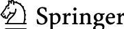

阿里·卡维
维也纳工业大学
（TU-Wien）
维也纳，奥地利

伊朗科学技术大学
德黑兰，伊朗


## 前言

在当今世界，科技与计算机科学取得了前所未有的进步，人工智能已成为一个吸引全球关注的顶尖领域。这项技术常被称为 AI，它不同于其他学科，旨在设计表现出智能、能够自主学习并做出类似人类决策的机器与系统。要理解这一创新的影响，必须深入探究人工智能的运作机制，追溯其从诞生至今的历史演变，并探讨其在医学、交通、广播和营销等领域的多元应用。人工智能为我们的现实引入了变革性要素，催生了重大的突破与创新。

本书旨在通过 22 个章节，介绍人工神经网络（ANN）在材料科学、结构优化及最优分析等不同问题中的多种应用。第 1章 提供了本书的主要定义、概念和目标。第 2章 介绍了使用元启发式训练人工神经网络预测高强度钢柱屈曲抗力。第 3章 阐述了利用人工神经网络和元启发式算法优化混凝土抗压强度，第 4章 则为双层网格架设计训练高效神经网络。第 5章 介绍了使用不同神经网络分析双层桶形拱顶。第 6章 利用 BP 和 RBF 神经网络预测位移并设计 Schwedler 穹顶。第 7章 提出了一种神经计算策略，结合神经网络的数据处理能力与数值结构优化。第 8章 描述了两种人工神经网络——即反向传播神经网络和改进的反向传递神经网络——在大型空间结构分析与设计中的应用。第 9章 针对部分灌浆砌体墙的剪切强度，提出了一种混合增强碰撞体优化与人工神经网络算法。第 10章 利用改进带电系统搜索算法和神经网络，对带频率约束的拱坝进行形状优化。第 11章 讨论了使用人工神经网络评估混凝土结构脆弱性。第 12章 是利用不同元启发式算法高效训练人工神经网络以预测 FRP 强度的主题。第 13章 提出了一种基于元启发式的人工神经网络，用于框架的塑性极限分析。第 14章 讨论了利用图、神经网络和遗传算法进行波前削减。第 15章 以利用遗传算法和神经网络进行输电塔最优设计为主题。第 16章 介绍了使用人工神经网络评估混凝土抗弯框架结构脆弱性。随后的第 17章 针对域分解提出了一种混合图-神经方法。第 18章 讨论了基于 GMDH 的有无箍筋 FRP-RC 梁剪切强度预测。第 19章 提供了利用四种元启发式算法高效训练两种人工神经网络以预测 FRP 强度的方法。第 20章 提供了用于预测外部粘贴于砌体构件的 FRP 加固筋与砌体之间粘结强度的新预测模型。第 21章 讨论了内核极限学习机在预测 EBR FRP 与混凝土基材之间粘结强度中的应用。第 22章 是利用基于机器学习的技术，开发无腹板加筋 HSC 细梁剪切强度预测模型的主题。

我谨借此机会，向诸多以不同方式协助本书撰写的同事和朋友表示由衷的感谢。我特别感谢 Springer-Verlag 跨学科与应用科学工程编辑总监 Thomas Ditzinger 博士，感谢他在本书撰写过程中提供的建设性意见、编辑工作以及始终如一的友善。我由衷感谢为本书精心设计页面排版的 Springer 同事们。我要感谢我过去和现在的博士及硕士研究生——H. Rahami 博士、T. Bakhshpoori 博士、A. Iranmanesh 博士、H. A. Rahimi Bonderabady 博士、M. Raiesi Dehkordi 博士、P. Hosseini 博士、Servati 先生、R. Ghafarian 先生和 S. M. Hamze-Ziabadi 先生——使用我们的合作论文。我高度感谢我的博士研究生 N. Khavaninzadeh 女士、A. Eskandari 先生和 M. Movasat 先生的悉心帮助。最后，感谢我的妻子在本书撰写期间的耐心，对此表示由衷谢意。

本书部分内容是在作者于 TU-Wien 休职期间完成的，我要感谢 R. Heuter 教授的热情款待。特别感谢以下出版商允许我们将部分论文用于本书编写：Springer、Wiley、Elsevier、《Scientia Iranica》出版商以及 Peidoca Polytechnica 出版商。

我们已尽全力确保本书内容无误。然而，如发现任何残留错误，作者恳请通过电子邮件 alikaveh@iust.ac.ir（Ali Kaveh）予以指正。


## 第 1 章
人工智能：背景、应用与未来

**摘要** 在当今这个科技和计算机科学取得前所未有进步的世界里，人工智能已成为备受全球关注的顶尖领域。这项技术常被称为 AI，它与其他学科不同，旨在设计表现出智能、能够自主学习并做出类似人类决策的机器和系统。人工智能为我们的现实引入了变革性元素，促进了重大突破和创新。

### 1.1 人工智能背景

关于人工智能问题的背景可追溯至 1956 年，当时“人工智能”（AI）一词在达特茅斯学院会议上被提出。AI 是一个跨学科领域，由计算机科学、控制论、信息论、心理学、语言学和神经生理学的交汇所塑造。

AI 的总体目标是复制和执行类似人脑的智能功能，从而促成技术创新和理论的产生。人工智能的发展可分为不同阶段：20 世纪 50 年代见证了 AI 的兴起与衰落，随后在 20 世纪 60 年代末至 70 年代，伴随专家系统的出现而复兴。20 世纪 80 年代因第五代计算机的问世而取得重大进展。此后，20 世纪 90 年代开启了 AI 研究的新时代，其特征是网络技术（特别是互联网）的融合，导致分布式 AI 模型激增。这个时代不仅专注于面向目标的分布式问题求解，还深入研究多代理问题求解，使 AI 更加务实。

此外，Hopfield 多层神经网络模型的引入推动了各领域人工神经网络研究的兴起。AI 的关键理论和方法涵盖符号主义、行为主义和联结主义。自诞生以来，人工智能已从一个小众领域发展为基石技术，并将持续发展。AI 与云技术、物联网和 5G 网络的融合，为未来带来了更多可能性和应用前景，[1] 和 [2]。

人工智能涵盖广泛，包含众多子集和应用。下面，我们将结合图 1.1 进行简要说明。

图 1.1 人工智能类型分类

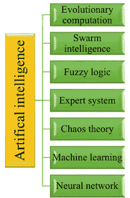

### 1.2 人工智能类型

#### 1.2.1 进化计算

进化计算（EC）是人工智能的一个子领域，它使用迭代过程（通常受生物进化机制启发）来演化一组解决方案以实现预期目标。EC 在土木工程领域已应用数十年，主要作为解决复杂优化问题的有效方法 [3]。

#### 1.2.2 群体智能

基于群体智能的元启发式方法，通过模拟一群简单个体相互交互并与环境交互来演化其解决方案，在许多困难问题上表现出良好的性能，近年来已成为一个非常活跃的研究领域 [3]。

#### 1.2.3 模糊系统

“模糊”一词的含义是含糊不清。在正常生活中，我们有时会面临不知道哪个决定是对还是错、正确行动对我们来说不可见的情况。这时，“模糊逻辑”提供了一种独特而有价值的主张。这样一来，每种情况下的不确定性程度都可以被确定。因此，模糊逻辑有时也被称为怀疑逻辑，因为其结果是带有怀疑产生的。模糊逻辑帮助解决了许多当今的决策问题，因此大多数时候，它能根据输入产生最佳决策。模糊逻辑基于人类决策，可被视为“亚里士多德逻辑”或“布尔逻辑”的发展。今天，基于模糊逻辑，已经创造了“模糊数”、“模糊计算”甚至模糊统计方法（如模糊聚类）。已经生产出的设备和计算机的性能远优于具有布尔逻辑的类似设备。模糊逻辑的概念和研究始于 1920 年，但“模糊逻辑”这一术语最初由伯克利大学的洛夫提·阿斯加尔扎德教授（1921–2017）在 1965 年使用。

#### 1.2.4 专家系统

专家系统依赖于基于存储知识系统现有知识的人类专家。专家系统是人工智能研究领域中第一个也是最有效的系统。专家系统广泛应用于道路与桥梁、建筑工程、岩土工程、地下工程、防灾工程、材料工程、地质勘探和石油化工行业等。系统专家处于特定领域，并在系统编程方面拥有相关知识和经验。专家系统模拟人类专家的问题求解思维过程，达到或接近专家水平。

#### 1.2.5 混沌理论

混沌理论是数学的一个分支，研究对初始条件非常敏感的动态系统的行为。混沌是一门跨学科理论，指出：在复杂混沌系统的随机性中，存在基本模式、持续反馈环路、重复、自相似性、分形和自组织。根据定义，Chaos 一词的意思是“完全混乱和无序的状态；完全缺乏组织或秩序”。混沌理论是一个有趣的对比。它是预测“本质不可预测”系统行为的科学。事实上，混沌理论是一种数学工具，使我们能够从混沌中推导出优美的结构。混沌理论的主要基础是秩序和混沌并不总是对立的这一观点。混沌系统是秩序与混沌的迷人结合。当我们从外部观察它们时，它们表现出不可预测性并显示无序，但在这些系统内部，我们看到一组按秩序运行的决定性方程式。

混沌是常用于非线性动力学的名称。这个表达式用于解释所谓的简单、线性且行为良好的系统的复杂行为。混沌行为表现出不规则且常常是随机的，类似于受随机外部噪声强烈影响的系统的行为。混沌的数学定义是：由于对初始条件敏感（通常称为蝴蝶效应），决定性动力学系统的长期行为不可预测。混沌理论被定义为确定性非线性动力学系统中不稳定周期行为的定性研究。混沌发生在非常简单的系统中，这些系统通常没有噪声。事实上，这些系统本质上是决定性的；也就是说，只要准确了解系统的初始条件，就可以预测其未来行为。因此，混沌可被定义为一种有界、非周期且带噪声的振荡 [4]。

#### 1.2.6 机器学习

在机器学习科学中，讨论的是如何设计机器，使其利用给定的示例和自身经验进行学习。事实上，在这门科学中，人们试图设计一种机器，使其无需通过算法明确规划和指令每一个动作，就能自主学习和行动。在机器学习中，不是对所有内容进行编程，而是将数据输入到通用算法中，该算法根据输入数据构建自己的逻辑。机器学习有多种方法，包括监督学习、无监督学习和强化学习。机器学习中使用的算法属于这三类中的某一类。机器学习是从人工智能中发展出来的一门研究领域。通过使用人工智能，人类寻求构建更好、更智能的机器。但研究人员最初无法编程让机器执行更复杂且持续具有挑战性的任务，除了少数简单任务（例如寻找点 A 与点 B 之间的最短路径）之外。基于此，形成了一种认识：实现这一目标的唯一可能方式是设计能够自我学习的机器。在这种方法中，机器就像一个从自身学习的孩子。因此，机器学习作为计算机的新能力出现了。今天，这门科学被应用于技术的各个领域，其使用已如此普遍，以至于人们在日常工具和配件中往往都不知道它的存在，[5] 和 [6]。


#### 1.2.7 神经网络

神经网络是一种受人类大脑结构启发的计算模型，主要用于学习和识别数据之间的模式和关系。这些网络由一层或多层神经元组成，信息通过赋予每个神经元之间连接的特定权重进行传输。通过训练或调整这些权重，神经网络可以学习识别不同的模式和特征，并使用它们在新情况下进行预测或决策。神经网络有不同的类型，将在下文详细介绍。神经网络被称为深度学习和人工智能领域的关键技术之一，可以建模非线性问题。正因如此，它们可以应用于从图像和语音处理到机器翻译和数据分析等不同领域的许多问题。一般来说，神经网络应用可分为三类：数据分类、数据聚类和回归问题 [7]。

##### 1.2.7.1 分类

在数据分类过程中，为了训练模型，需要大量的“标记数据”，以便模型利用数据标签提供的信息来预测新数据的类别。也就是说，在数据分类方法中，一个人必须利用其知识准备数据集，并基于语言知识等各种专业知识标记训练模型所需的数据，以便模型学习数据与标签之间的关系。这种方法称为“监督学习”，其中人工准备的标签帮助模型学习。确定垃圾邮件和非垃圾邮件是分类任务和监督方法的一个示例。

##### 1.2.7.2 聚类

在聚类方法中，深度学习算法无需标记数据即可识别数据组。也就是说，聚类神经网络仅通过检查数据的相似性将其分组到不同的组中，最终形成几个数据组，每组的数据彼此具有相似特征。这种学习方法称为“无监督学习”，模型在不使用任何额外信息且仅拥有数据的情况下即可识别不同类型的数据组。与分类方法相比，该方法的优点是不需要提供标记数据，这对降低资金和时间成本有显著影响。深度学习模型的主要原则之一是：模型的训练数据的多样性、分布和数量越大，模型从数据中学到的就越多，模型在识别新数据和对定义问题做出决策方面的表现就会越好。由于未标记数据的数量比标记数据大，聚类算法具有更好的准确性和性能。

##### 1.2.7.3 回归

在回归问题中，神经网络用于寻找“自变量”或特征与“因变量”或网络输出值之间的关系。回归问题中模型的输出值是“连续”值。回归与分类方法一样，采用监督学习方法，为了训练模型，必须提供数据集。预测未来一段时间的产品价格成本和产品销售量是可以使用回归方法建模的任务示例。

在当今世界，人类生活的方方面面都受到人工智能的影响，这一技术分支正在日益发展和扩张。也就是说，随着这一科学领域的出现，人们的生活和工作方式发生了变化，这为人类带来了重要且积极的优势，也带来了各种负面影响。下文将讨论使用神经网络使系统智能化的好处：

- **执行活动的高效性**：与人类不同，机器不会在日复日的工作中感到疲倦，可以不间断地履行职责。因此，通过使用智能模型，节省了时间并取得了令人印象深刻的结果。

- **快速学习任务**：基于神经网络的模型可以快速学习任务。培训人力资源在金钱和时间方面成本高昂。因此，训练模型执行一系列重复性任务对组织来说可能更具成本效益。

- **同时执行多项任务**：在高级智能模型中，可以训练模型同时执行多项任务。

- **智能模型在人类生活各个领域的广泛应用**：由于智能模型和系统的目的是模仿人类在执行各种任务和职责中的行为，因此从医学、工程、农业以及其他与生活相关的方面等所有科学领域，都使用这一科学分支来提高人类生活的福祉和舒适度。

基于人工智能的系统除了具有显著优势外，还存在一些缺点，其中最重要的如下：

- **硬件需求**：为了实施人工智能模型并提供其所需的训练数据，需要强大的硬件，考虑到问题的复杂性，这需要高成本。

- **基于概率的性能**：神经网络使用概率概念来学习不同的问题。这使得模型在某些敏感情况下无法做出解决问题的正确决策。

- **数据依赖性**：训练基于神经网络的模型需要大量数据。收集所需数据并为模型训练做好准备需要高昂的资金和时间成本。此外，提供的数据可能包含噪声，这可能会影响模型的性能。

- **人类失业机会的损失**：通过使系统智能化并用它们取代人力，许多人将失去工作。这会导致失业人员比例增加，进而导致社会贫困程度加剧。

### 1.3 神经网络的一般结构

为了理解“什么是神经网络”这一问题，必须查看网络及其组件的结构。神经网络由几层组成，这些层的最小数量是 3 层：输入层、中间层或隐藏层以及输出层。神经网络的每一层都由一组节点组成，这些节点的功能与人类大脑的“神经元”相同。在下图中，可以看到第一层有 2 个节点，隐藏层或中间层有 3 个节点，最后一层有 1 个节点。每层的节点数量将根据输入数据的维度以及我们要训练模型的问题而有所不同 [8] 和 [9]。神经网络的一般结构如图 1.2 所示。

每个神经网络都有一个输入层，用于接收数据并将其发送到下一层，以便对数据进行各种计算。也就是说，这一层不对数据应用任何计算和处理操作，仅负责接收数据并将其发送到下一层。第一层的输入数据可以包括文本、音频和视频信息。

位于输入层和输出层之间的层称为隐藏层或中间层。神经网络中间层的最小数量是一层，根据问题的复杂性和类型，可以增加网络的中间层数量。网络中间层越多，网络就越深，计算负载也越高。中间层负责对其前一层接收的数据进行计算操作。“深”这一术语也源于神经网络结构的类型。一种旧的神经网络称为“感知机”，仅包含一个中间层，因此这种类型的网络被认为是“浅”层神经网络。如今，拥有超过 3 个隐藏层的神经网络被认为是深度网络。

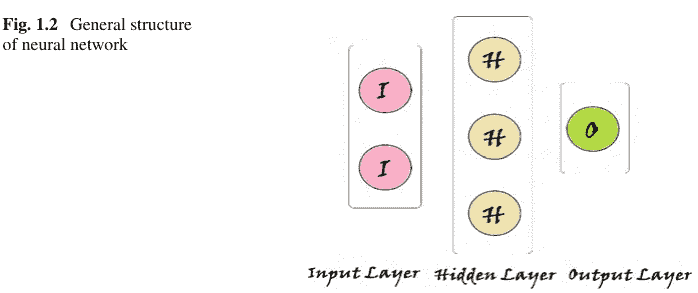

神经网络的最后一层是网络的输出层，用于计算神经网络的输出值。也就是说，输出层通过从前一层（隐藏层）接收输入，对其进行计算，最终产生网络的输出。

神经网络的层由称为节点的独立单元组成，其行为类似于人类大脑中神经元的行为。节点接收其输入数据，并通过对其进行计算来在输出中返回一个值。节点的内部结构包括以下各种组件：

**节点输入**：在神经网络的第一层中，输入节点以相同长度的数值向量形式存在。隐藏层和输出层中节点的输入是从其前一层获得的输出值。

**节点输入权重**：权重决定节点输入的重要性。也就是说，通过应用节点输入值与权重矩阵的内积，确定每个输入特征的重要性。在反向传播过程的每一步中，更新权重值以减少损失函数的最终值 [10]。神经网络结构如图 1.3 所示。

**节点激活函数**：激活函数的输入是输入值、权重和偏差值的线性组合。神经网络中激活函数的任务是将输入的线性组合转换为非线性组合，并根据激活函数的类型将输入值映射到带有特定间隔的空间。也就是说，这些函数决定节点的输出对神经网络是否重要，或者是否应该被忽略。

**节点偏置**：偏置在神经网络中的作用是改变激活函数的最终输出。偏置的作用类似于线性函数中常数值的作用，它将激活函数的最终值在向量空间中向左或向右移动，使最终函数更好地匹配数据，从而使模型具有更准确的预测。

为了理解激活函数在神经网络中的功能，有必要解释神经网络中的四个重要且基本的概念。前馈、反向传播、梯度消失和梯度爆炸与激活函数的性能有关 [10]。


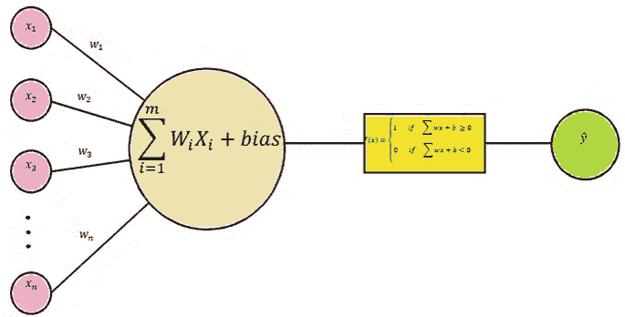

输入 权重 加法与偏置操作 激活函数 输出

图 1.3 神经网络结构

#### 1.3.1 前馈

将信息从输入端（层与层之间）转发的模型称为前馈模型。该过程在没有任何反馈的情况下，作为输入数据的预测或网络输出计算来执行；换句话说，信息从输入层传递到输出层，中间没有中断或反馈。神经网络中的前馈过程通常按以下方式进行：

输入信息（例如图像、文本或数值特征）被输入到网络的输入层。

信息通过特定权重在层与层之间传递，并由激活函数（例如ReLU或sigmoid激活函数）进行处理。此过程持续到到达输出层。最后，网络计算出的输出作为对网络输入的最终响应产生。

前馈过程被用作使用神经网络进行决策和预测过程的第一步。该过程用于预测新数据、识别模式、进行自动化决策、机器翻译以及许多其他机器学习应用。

#### 1.3.2 反向传播

反向传播是深度神经网络中常用的一种学习算法，用于更新模型权重。该算法使用前向过程来预测输出并计算预测误差，然后将该误差向后传递并优化网络权重以减少预测误差。反向传播过程如下：

首先，通过输入数据并计算输出，计算出预测误差。然后，使用最小二乘法或其他标准，将计算出的误差向后传递并归因于网络的每个权重，最后，使用学习率和诸如集成或动量等优化算法，以使预测误差减小的方式更新网络权重。

此过程会重复，直到模型达到最优状态且预测误差最小化。反向传播算法是训练深度神经网络最重要的机器学习算法之一，有助于优化模型权重并提高网络性能。

#### 1.3.3 梯度消失

梯度消失是神经网络训练中常见的问题，由于多层神经元的串联，梯度（目标函数对权重的偏导数）可能会消失或变得非常小。这会导致网络权重无法有效更新，网络性能得不到提升。在具有更多层的深度网络中，梯度消失现象尤为明显，因为在每一层，导数都会传递到更低的层，并可能缩小或消失。该问题会减慢训练过程，增加网络收敛所需的时间，甚至导致网络达到平行状态。

消除神经网络中梯度消失的一些方法包括使用不同的激活函数（如Leaky ReLU）、使用诸如Dropout等平滑方法、使用诸如批量归一化等标准化方法，或使用具有特殊结构的网络（如循环神经网络）。可以避免梯度消失问题并继续有效地训练网络。

#### 1.3.4 梯度爆炸

梯度爆炸是神经网络训练中的另一种情况，其中梯度非常大并趋向无穷大。这可能是由于深度网络中大类序列的相互导数导致的，并会造成网络训练的不稳定性。梯度爆炸的发生可能导致不可预测的反应以及网络权重更新中的多次跳变，从而降低网络的质量和性能。该问题通常发生在使用非常大的学习率来更新权重的过程中，并可能导致网络无法收敛或其他不良问题。

为防止梯度爆炸，常用的方法之一是使用一种称为“梯度裁剪”的技术，即如果梯度超过某个限制（阈值），则会自动将其减小并归一化，以防止梯度爆炸。该方法可以很好地建立和稳定神经网络中的训练过程 [11]。

### 1.4 激活函数

激活函数在神经网络中用于对层与层之间传递的信息进行非线性化。这些函数帮助模型表达更复杂的模式。由于激活函数决定节点是否应处于活动或非活动状态，因此它们在神经网络中非常重要。激活函数在神经网络中的主要作用是使用节点的输入来生成输出值。换句话说，这些函数通过执行简单的数学计算来决定节点的输入是否重要。激活函数将节点加权输入的求和值映射到0到1或-1到1的值（取决于激活函数的类型）。然后，这些函数将最终输出传递到下一层。因此，这些函数也被称为转移函数。激活函数分为三大类：二进制阶跃函数、线性激活函数、非线性激活函数 [12]。

#### 1.4.1 二进制阶跃函数

二进制阶跃函数是最简单的激活函数之一，它根据输入值将输入划分为两个类或两个不同的状态。该函数仅返回两个值0和1，并指出输入应启用（1）还是禁用（0）。图1.4显示了二进制阶跃函数。

此激活函数的数学表达式如下：

```
\( f(x) = \begin{cases} 0 & \text{for } x < 0 \\ 1 & \text{for } x \ge 0 \end{cases} \quad (1.1) \)
```

该方法的一些问题包括：由于在悬挂点缺乏连续梯度和导数，该函数在深度神经网络中的使用效率不高。此外，输出的固定值（0或1）可能会限制模型的灵活性和学习能力。它还存在诸如梯度消失、神经元死亡以及由于缺乏灵活性和信息传递中高细节而导致训练时间增加等问题。

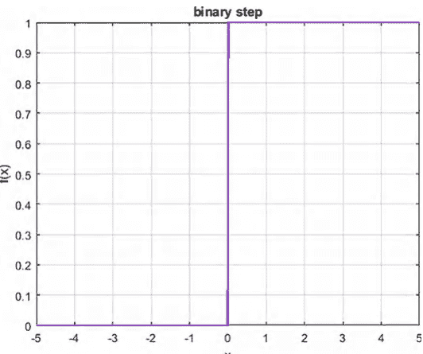

图 1.4 二进制阶跃函数

#### 1.4.2 线性激活函数

线性激活函数是最简单的激活函数，它不会向模型添加任何非线性。该函数通常用于模型的输出层，并将输入作为输出返回。该函数单独用于对低复杂度模式进行建模。图1.5显示了线性激活函数。

此激活函数的数学表达式如下：

```
f(x) = x
(1.2)
```

该方法的一些问题包括：线性激活函数不会向模型添加任何非线性，因此不足以解决复杂问题和发挥神经网络模型的能力。此外，如果在所有层中都使用线性激活函数，模型将不具备对更复杂模式和特征进行建模的能力。此外，使用线性激活函数的模型可能无法理解复杂且多样的模式，且效率和性能不佳。该函数不能用于反向传播步骤，因为该函数的导数等于一个固定数字，且与输入值x无关。对固定输入值应用多个线性函数的结果相同。因此，神经网络是否由多个隐藏层组成并不重要；因为神经网络最后一层的激活函数输出等于第一层的激活函数输出 [13]。


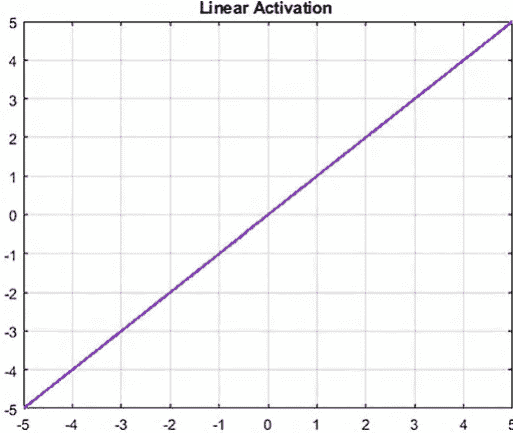

图 1.5 线性激活函数

#### 1.4.3 非线性激活函数

非线性激活函数用于神经网络中，以在信息中产生非线性和去正则化。这些函数的非线性使网络能够建模更复杂和非线性的模式，从而提高网络性能。使用非线性激活函数有助于模型对不同类型的数据具有更好的泛化能力和适应性。在神经网络中使用非线性激活函数会为前向传播步骤中每一层的计算增加一个额外步骤；但这个额外步骤有一个重要优势。如果没有激活函数的神经网络，每个节点仅使用权重和偏差值对其输入执行线性计算。在这种情况下，神经网络中隐藏层的数量并不重要，所有层都具有相同的功能，因为组合两个线性函数的结果仍然是一个线性函数。

这种方法存在一些问题，例如：对于某些简单问题可能过于复杂，并导致梯度消失或过拟合问题。此外，某些非线性激活函数（如 Sigmoid 函数）在面对梯度消失问题时，可能无法如预期般提供帮助，并会减慢网络的学习和改进。因此，正确选择非线性激活函数非常重要，[14] 和 [15]。

### 1.5 激活函数类型

以下是神经网络中一些最有用的非线性激活函数列表：

- Sigmoid 激活函数 (Sigmoid | Logistic)
- 双曲正切激活函数 (Tanh | Hyperbolic Tangent)
- 整流线性单元激活函数 (RELUs)
- Leaky RELUs 激活函数
- 参数化整流线性单元激活函数 (PRELU)
- 指数线性单元激活函数 (ELU)
- Softmax 激活函数
- Swish 激活函数
- 高斯误差线性单元激活函数 (GELU)
- 缩放指数线性单元激活函数 (SELU)
- Soft plus 激活函数
- Mish 激活函数
- 随机漏整流线性单元激活函数 (RRLU)
- Hard Swish 激活函数
- Soft sign 激活函数
- Hard Tanh 激活函数
- Hard Sigmoid 激活函数
- Tanh shrink 激活函数
- Soft shrink 激活函数
- Hard Shrink 激活函数

#### 1.5.1 Sigmoid 激活函数 (Sigmoid | Logistic)

Sigmoid 函数是一种非线性激活函数，它将输入值归一化到 0 到 1 之间的值，换句话说，它将输入值转换为 0 到 1 之间的可能值。Sigmoid 函数被认为是“单调”函数。但该函数的导数不是均匀函数。Sigmoid 函数通常用于神经网络的最终层，用于二分类问题（两个类别之间）。0 和 1，这可以导致权重转换为类别概率，以及将分母平滑到分类应用中可能需要的概率状态。该函数最重要的局限性是梯度消失问题，这在网络训练中可能会造成问题。当输出非常大或非常小时，可能会出现输出饱和问题。Sigmoid 激活函数如图 1.6 所示。

Sigmoid 函数的公式为：

```
f(x) = 1/(1 + e^{-x})
```

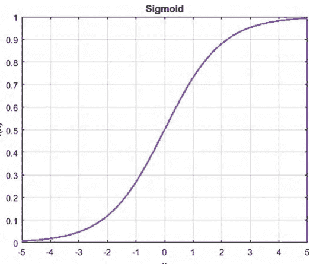

图 1.6 Sigmoid 激活函数

#### 1.5.2 双曲正切激活函数 (Tanh | Hyperbolic Tangent)

双曲正切函数（Tanh）也是一种非线性激活函数，它将输入值归一化到区间 (−1, 1)。该函数通常用于神经网络中，以将输入的输出限制在 −1 到 1 之间的值。Tanh 函数的输出与 Sigmoid 函数的范围成正比，并减少了 Sigmoid 函数中输出饱和的问题。Tanh 函数的输出与消失问题相比。零区域的梯度不那么敏感且更有用。该函数的局限性中，可以提到，如同 Sigmoid 函数一样，该函数的饱和区域可能存在梯度消失问题。双曲正切激活函数如图 1.7 所示。

双曲正切函数的公式为：

```
f(x) = (e^x - e^{-x})/(e^x + e^{-x}) (1.4)
```

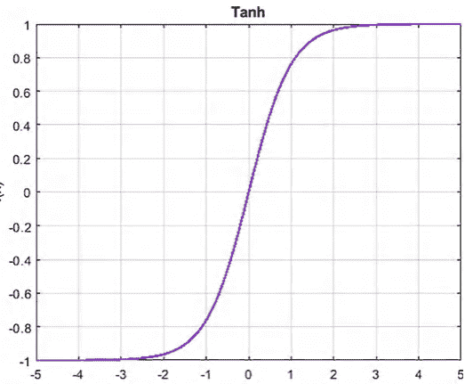

图 1.7 双曲正切激活函数

#### 1.5.3 整流线性单元激活函数 (ReLU)

ReLU 非线性激活函数是深度学习中最常见的激活函数之一。该函数的名称代表“整流线性单元”。虽然该函数看起来像线性函数，但该函数是可导的，可以用于后向传播步骤。该函数不会同时激活所有节点。换句话说，当该函数的输入值小于零时，节点处于非活动状态。换句话说，根据该函数的图像，如果函数的输入大于零，则函数的输出等于函数的输入；如果函数的输入小于零，则函数的输出等于零。ReLU 函数及其导数是均匀的。由于该函数的线性和非饱和特性，梯度下降算法的收敛速度更快。因此，模型需要的学习时间更少。由于该函数仅激活若干节点，因此它在计算上比神经网络中的其他激活函数更高效。与 Sigmoid 和 Tanh 函数相比，该函数是一个更简单的函数，因此在网络学习期间会执行更简单的数学计算。ReLU 函数没有 Sigmoid 和 Tanh 函数的梯度消失问题；因为该函数的正线性范围允许梯度在节点的活动路径中流动。此外，该函数不对最大输入值设置限制。ReLU 函数面临的一个重要局限性是 ReLU 函数的“死亡”问题。当多个 ReLU 函数的输出连续等于零时，就会发生这种状态。ReLU 函数性能恶化的问题
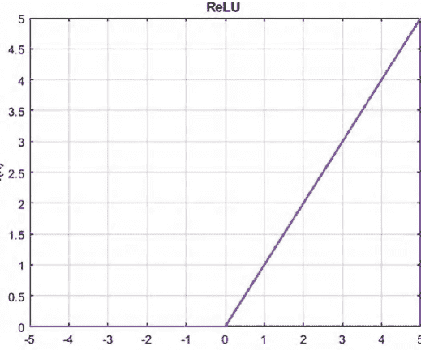

图 1.8 整流线性单元激活函数

当该函数的输入为负值时，就会发生这种情况。尽管 ReLU 函数的特性（即忽略负输入值）使网络在学习时表现更好，但当大多数 ReLU 函数的输入位于负范围时，就会发生性能恶化问题。它们会导致这种问题。在大多数函数输出变为零的情况下，在后向传播步骤中，梯度不会沿网络流动，因此网络权重不会被更新。因此，在这种情况下，神经网络的很大一部分保持非活动状态，网络的学习无法正常进行。整流线性单元激活函数如图 1.8 所示。

ReLU 函数的公式为：

```
f(x) = max(0, x)  (1.5)
```

#### 1.5.4 漏整流线性单元激活函数 (Leaky ReLU)

漏整流线性单元激活函数是 ReLU 函数的一个修改版本，用于解决负区域中神经元死亡的问题。该函数的优势在于解决神经元死亡问题、加速学习以及减少饱和区域中的梯度消失问题，这也是该函数的局限性之一。α 参数值对性能和大小的影响

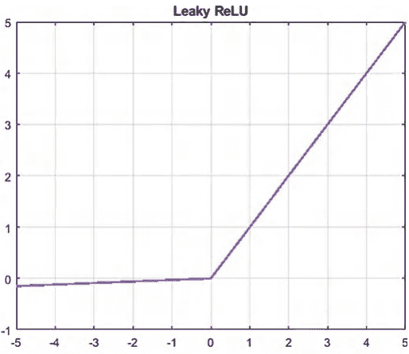

图 1.9 漏损整流器激活函数

梯度。对于负输入值，梯度的值非常小。这个问题使神经网络学习耗时。图 1.9 所示为漏损整流器激活函数。

#### 1.5.5 参数化整流器激活函数（PReLU）

参数化ReLU激活函数是另一种ReLU函数，旨在解决ReLU函数在负输入时的衰减问题。它引入了一个参数，该参数决定了函数曲线在负区间的斜率，并在神经网络训练和反向传播过程中进行调整。与Leaky ReLU函数相比，参数化ReLU具有明显的优势。尽管Leaky ReLU试图通过为负输入采用较小的斜率来减轻信号损失，但它仍然难以完全解决网络中节点失活的问题，导致重要输入信息的丢失。参数化ReLU函数的公式为 f(x) = max(αx, x)，其中α是一个可学习参数，对于负输入设置为1。但是，参数化ReLU的一个缺点是其依赖于参数值，在不同问题上会产生不同的行为。图 1.10 所示为参数化整流器激活函数。

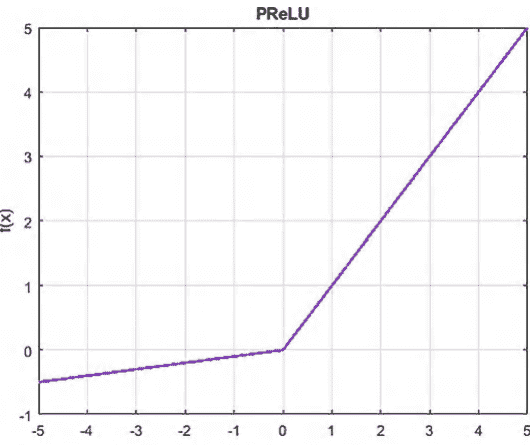

图 1.10 参数化整流器激活函数

#### 1.5.6 指数线性单元激活函数（ELU）

ELU激活函数，即指数线性单元激活函数，是ReLU激活函数的一种类型，它考虑了函数负输入值的斜率。在Leaky ReLU和参数化ReLU激活函数中，函数在负区域的图像是一条直线。ELU激活函数为该区域定义了一条对数曲线。与其他ReLU函数相比，ELU激活函数的一个优势是ELU函数曲线的斜率非常平缓，并且这一特征一直持续到达到值 \(-\alpha\)。这种平缓的斜率在ReLU的激活函数中不存在。该函数通过为负输入值考虑对数曲线来防止函数的退化。此外，这一特性使得权重和偏置值能够正确学习。

ELU激活函数的局限性之一是，由于执行指数计算，计算时间增加。并且，在ELU函数中，没有一个参数（类似于参数化ReLU函数中的参数a）其值在神经网络学习过程中也被学习。使用此函数时，还可能出现梯度爆炸问题。图 1.11 所示为指数线性单元激活函数。

```
f(x) = \begin{cases} x & \text{if } x \ge 0 \\ \alpha(e^x - 1) & \text{if } x < 0 \end{cases} (1.6)
```

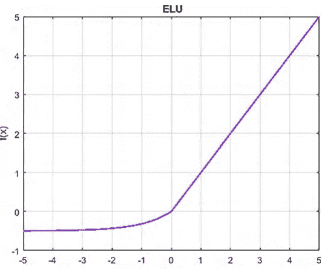

图 1.11 指数线性单元激活函数

#### 1.5.7 Softmax激活函数

Softmax函数的设计思路源自Sigmoid函数。如前所述，基于Sigmoid函数的输出（介于0和1之间），该函数用于计算概率。但是，Sigmoid激活函数存在一个根本问题。如果输出为0.8、0.9、0.6、0.7和0.8，则所有输出的总和将大于1；而概率的总和必须为1。Softmax激活函数被视为一种Sigmoid函数。换句话说，Softmax函数是多个Sigmoid函数的组合，用于计算相对概率。换句话说，Softmax函数确定多个类别的概率。通常，在“多类分类”任务中，Softmax激活函数用于神经网络的最后一层。Softmax公式为 f(xi) = e^xi / sum(e^x)，其中xi是每个输入节点的值，sum(e^x)是所有输入值的总和。图 1.12 所示为Softmax激活函数。

#### 1.5.8 Swish激活函数

Swish是Google Brain于2017年引入的一种非线性激活函数。该函数提供了高灵活性和优于ReLU的更好性能。Swish激活函数用于“图像分类”和机器翻译等问题。该函数的一个优势是，当x的值趋向负无穷时，y的值趋近于一个常数值。当x的值趋向正无穷时，y的值也趋向正无穷。Swish函数是一个连续且可微的函数。Swish函数曲线的斜率平缓，不会像ReLU激活函数那样突然改变方向（当x的值接近零时）。换句话说，该函数的曲线从0的值缓慢改变方向，到小于0的值，然后到大于0的值。

在ReLU激活函数中，负值被转换为0；而这些负值可能包含数据模式的重要信息。在Swish函数中，由于稀疏性问题，只有大的负值被转换为零。

Swish函数是一个“非单调”函数，这有助于学习网络的权重。ReLU激活函数的退化问题在Swish函数中不会发生。

此外，该函数的缺点是Swish函数在其计算中使用了Sigmoid函数。因此，该函数的计算比ReLU激活函数更复杂。

根据调研，该函数的性能不稳定，其输出无法预先预测。图 1.13 所示为Swish激活函数。Swish公式为 f(x) = x × sigmoid(x)，其中sigmoid(x)是归一化的。

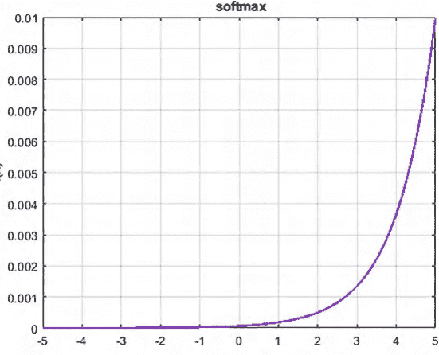

图 1.12 Softmax激活函数

翻译。当x的值趋向负无穷时，y的值趋近于一个常数值。当x的值趋向正无穷时，y的值也趋向正无穷。Swish函数是一个连续且可微的函数。Swish函数曲线的斜率平缓，不会像ReLU激活函数那样突然改变方向（当x的值接近零时）。换句话说，该函数的曲线从0的值缓慢改变方向，到小于0的值，然后到大于0的值。

在ReLU激活函数中，负值被转换为0；而这些负值可能包含数据模式的重要信息。在Swish函数中，由于稀疏性问题，只有大的负值被转换为零。

Swish函数是一个“非单调”函数，这有助于学习网络的权重。ReLU激活函数的退化问题在Swish函数中不会发生。

此外，该函数的缺点是Swish函数在其计算中使用了Sigmoid函数。因此，该函数的计算比ReLU激活函数更复杂。

根据调研，该函数的性能不稳定，其输出无法预先预测。图 1.13 所示为Swish激活函数。Swish公式为 f(x) = x × sigmoid(x)，其中sigmoid(x)是归一化的。

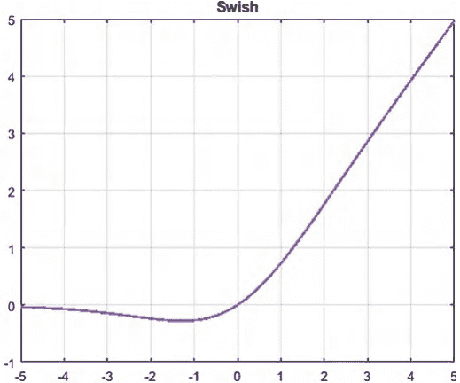

图 1.13 Swish激活函数

#### 1.5.9 高斯误差线性单元激活函数（GELU）

高斯误差线性单元激活函数（简称GELU）的性能与自然语言处理（NLP）领域的顶级模型（如Bert、ROBERTa和ALBERT模型）相兼容。该激活函数使用了ReLU函数的特性以及诸如dropout和zoneout等模型正则化方法。

ReLU函数和随机移除操作的作用是指定节点的输出值。换句话说，ReLU函数根据输入值将输入乘以0或1，而在随机删除过程中，输入值随机乘以0。当前神经网络模型的调节器也随机将输入值乘以1，以便这些值在输出中保留。在GELU激活函数中，这三种操作被结合在一起。也就是说，首先，输入值随机乘以0和1，最后，将结果值发送到GELU函数以计算函数的输出。

节点的输入在批量归一化（Batch Normalization）过程后服从正态分布。输入x乘以值m，其中m等于 m ~ Bernoulli(Φ(x))。

GELU激活函数的一个优势是，在最近的深度学习模型中，尤其是在NLP领域，与其他函数相比，该函数表现最佳。GELU激活函数避免了梯度消失问题。

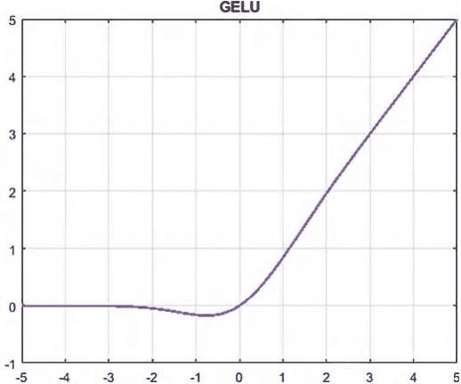

图 1.14 高斯误差线性单元激活函数

由于GELU激活函数被视为一种新函数（尽管该函数于2016年推出），其在所有现有深度学习模型中的确切性能仍不清楚，且其在所有模型中的性能有待调查。图 1.14 所示为高斯误差线性单元激活函数。

GELU公式：

```
f(x) = 0.5 \times x \times \left( 1 + \tanh\left( \sqrt{\frac{2}{\pi}} \right) (x + 0.044715x^3) \right) \quad (1.7)
```

#### 1.5.10 缩放指数线性单元激活函数（SELU）

SELU激活函数（即缩放指数线性单元）是神经网络中一种相对较新的激活函数，它基于ELU（指数线性单元）函数和连接参数延迟。该函数执行网络归一化。也就是说，该函数保持每层的均值和方差值。SELU函数使用正负输入值来移动平均值，而ReLU函数忽略负值。在此函数中，梯度用于设置方差值。SELU具有针对深度模型的自归一化等特殊功能。SELU的主要优势是


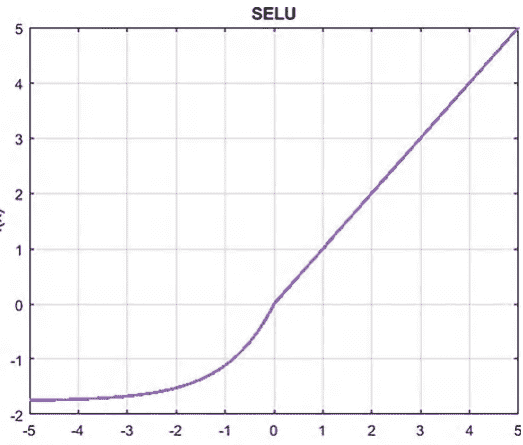

图 1.15 缩放指数线性单元激活函数

与 RELU 激活函数相比，SELU 激活函数的特点在于，由 SELU 激活函数构成的神经网络中的收敛过程更快，因为内部归一化的速度快于外部归一化的速度。对于由 SELU 激活函数构成的神经网络，不会出现梯度消失和梯度爆炸问题。由于 SELU 的激活函数被视为一种新函数，其在深度学习中所有现有模型（如 CNN 模型）上的确切性能仍不明确，有必要在所有模型中检查其性能。如图 1.15 所示的缩放指数线性单元激活函数。

SELU 函数公式如下：

```
f(x) = \begin{cases} \lambda(\alpha e^x - \alpha) & \text{for } x < 0 \\ \lambda x & \text{for } x \ge 0 \end{cases} (1.8)
```

#### 1.5.11 Softplus 激活函数

Softplus 是一种非线性激活函数，常用于在神经网络中生成正数且归一化的输出。该函数将输入值转换为正数且归一化的值，也有助于解决梯度消失问题。该函数的优点之一是它能产生正数且正常的输出，同时也适用于防止梯度消失。该方法的局限性在于，对于某些问题可能需要进行更广泛的计算。如图 1.16 所示的 Softplus 激活函数。

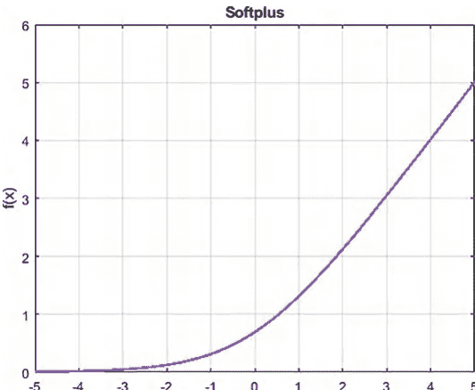

图 1.16 Softplus 激活函数

Softplus 公式为：

```
f(x) = log(1 + e^x)
(1.9)
```

#### 1.5.12 Mish 激活函数

Mish 激活函数是一种最近引入的非线性激活函数，是 Sigmoid 和 Tanh 函数之间以及 ReLU 的创新特性之间通信的主要来源。

该函数的优点之一是与 ReLU 相比性能有所提高，以及 Sigmoid 和 Tanh 之间的尖锐点，还包括由 Sigmoid 和 Tanh 组合而成的函数曲线的柔和特性。该函数的缺点之一是，关于 Mish 的性能及其优于常见激活函数的实验和研究尚不多。如图 1.17 所示的 Mish 激活函数。

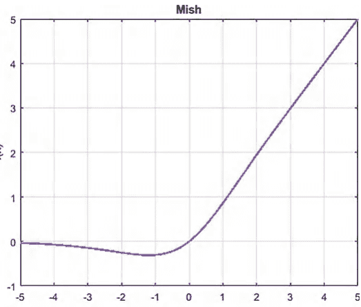

图 1.17 Mish 激活函数

Mish 的公式如下：

```
f(x) = x * tanh(softplus(x))
```

#### 1.5.13 随机漏斗整流线性单元激活函数 (RReLU)

RReLU 是 Leaky ReLU 函数的一种修正变体，在负区域中为漏斗参数使用正值的随机区间。这些变量由神经网络的层本身学习，有助于模型更加灵活，并在分类问题上表现更好。该激活函数相比普通 ReLU 为负区域提供了更多灵活性，并可帮助避免普通 ReLU 函数中出现的与负区域相关的问题。其局限性包括在选择随机参数时需要最高精度。在负区域中以改进所指出的函数。如图 1.18 所示的随机漏斗整流线性单元激活函数。该激活函数定义如下：

```
yij = xij if xij ≥ 0
yij = αijxij if xij < 0
```

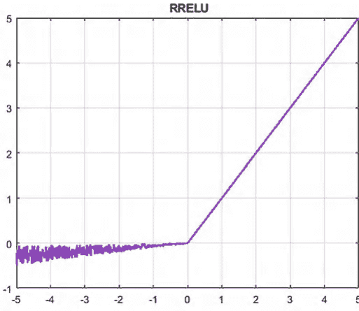

图 1.18 随机漏斗整流线性单元激活函数

其中

```
\alpha_{ij} \sim U(l, u), l < u \text{ and } l, u \in [0,1) (1.12)
```

其中 (\alpha_{ij}) 是指定区间的一个随机值，神经网络中每个神经元的值都不同。

#### 1.5.14 HardSwish 激活函数

HardSwish 是一种激活函数，是 ReLU 和线性函数的组合，以非线性方式工作。该函数源自较硬的激活函数（hard），用于将输入值范围限制在合理的值。

其优点是避免梯度消失问题、对输入值进行归一化、性能优于其他硬度函数，以及对网络效率和速度的负面影响最小。其局限性之一是需要进行适当的初始化才能进行正确计算。如图 1.19 所示的 HardSwish 激活函数。

HardSwish 公式如下：

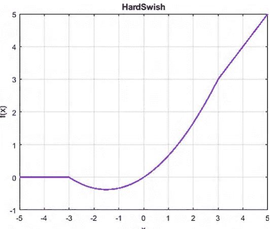

图 1.19 HardSwish 激活函数

```
f(x) = \left\{ \begin{array}{ll} 0 & \text{if } x \le -3 \\ x & \text{if } x \ge +3 \\ x \cdot (x+3)/6 & \text{otherwise} \end{array} \right. \quad (1.13)
```

#### 1.5.15 Softsign 激活函数

Softsign 激活函数是一种非线性函数，通常用作神经网络中的激活函数。这种函数的一种形式对于接近零的输入值 x 表现为线性，但对于远离零的值，该函数具有“S”形曲线。该函数是绝对值函数 (|x|) 和表达式 \(\frac{x}{1+|x|}\) 的组合。该函数的优点是将输入值归一化为 –1 到 1 之间的值，这使得模型适用于训练信息。在零附近，Softsign 函数表现为线性，这有助于训练模型。此外，该函数对输入值没有潜在限制，理论上始终有导数。该函数的局限性之一是，尽管它在零附近表现为线性，但在该范围之外表现为非线性，在某些特殊情况下可能无法控制正负点。

对于较大的值，Softsign 的输出会迅速趋近于 1 或 –1，在某些问题中可能不合适。如图 1.20 所示的 Softsign 激活函数。

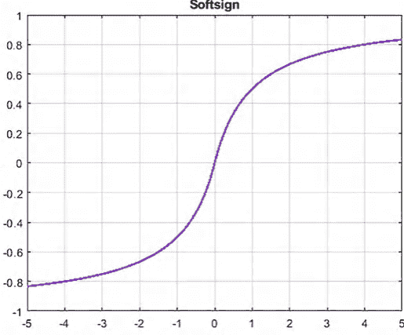

图 1.20 Softsign 激活函数

Softsign 公式为：

```
f(x) = x/(1 + |x|)
```

#### 1.5.16 HardTanh 激活函数

HardTanh 是双曲正切函数（Tanh）的一种更硬且非线性的版本，可将输入值归一化到标准范围。该函数将正点转换为 1，将负点转换为 -1。其优点是简单、高效，可防止负区域的饱和，并将输入值转换为可接受且合适的值。该函数的局限性是负点和正点的交替，可能会导致一些问题。如图 1.21 所示的 HardTanh 激活函数。

HardTanh 公式为：

```
f(x) = max(-1, min(1, x))
```

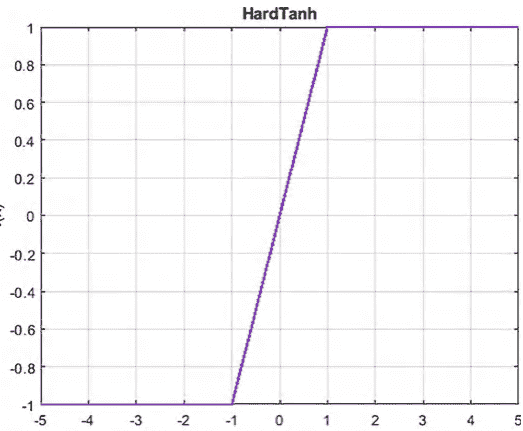

图 1.21 HardTanh 激活函数

#### 1.5.17 HardSigmoid 激活函数

HardSigmoid 是 sigmoid 函数的一种更硬且非线性的版本，可将输入值归一化到标准范围。该函数是 sigmoid 函数线性化上的导数的切线函数。

该函数的优点在于切点范围在 0 和 1 之间，并将输出在这两点之间转换为线性，同时还具有简单性和对网络的高效性。该函数可能不适合某些需要更准确和复杂激活函数的问题。如图 1.22 所示的 HardSigmoid 激活函数。

Hard Sigmoid 公式为：

```
f(x) = max(0, min(1, x))
(1.16)
```

#### 1.5.18 Tanh Shrink 激活函数

Tanh Shrink 是一种激活函数，经过归一化，其工作方式依赖于双曲正切。该函数映射为 tanh(x) – λx，其中 λ 是一个系数，可以通过调整它来进行归一化和限制。归一化双曲正切的输出并控制强度的优势是

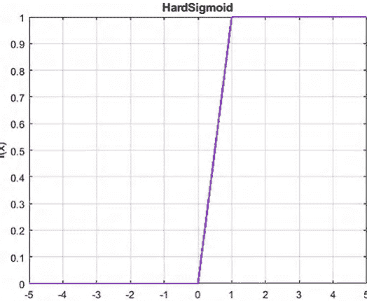

图 1.22 HardSigmoid 激活函数

以降低强度值。其局限性在于需要确定并准确控制系数 \(\lambda\) 的值。如图 1.23 所示的 Tanh shrink 激活函数。

Tanh Shrink 公式为：

```
\(f(x) = \tanh(x) - \lambda x\) (1.17)
```

#### 1.5.19 Soft Shrink 激活函数

Soft Shrink 是一种激活函数，通常用于从输入中移除小部分和不重要的噪声。这种函数通常与阈值函数相似，将低于阈值的输入值转换为零，高于阈值的值保持不变。其优点是从输入中移除噪声和小部分，并根据阈值对输出进行归一化。但它需要进行调整，以使其准确且适合 \(\lambda\) 的限制。如图 1.24 所示的 Soft shrink 激活函数。

Soft Shrink 公式为：

```
\(f(x) = sign(x) * max(0, |x| - \lambda)\) (1.18)
```


## TanhShrink

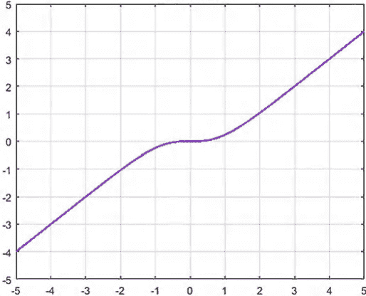

图 1.23 双曲正切收缩激活函数

## SoftShrink

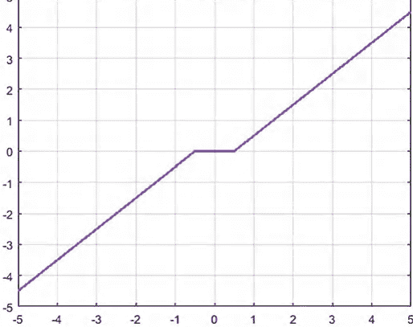

图 1.24 软收缩激活函数

#### 1.5.20 硬收缩激活函数

硬收缩是一种激活函数，它从限制值中收缩非必要的输入值。该函数将小于阈值的值转换为零，将大于阈值的值保持为主值。其优势包括消除非必要值，以及精确调整截断限制等。

对输入的控制并不重要，但为了获得最佳性能，需要确定并设置阈值限制 λ 的适当值。硬收缩激活函数如图 1.25 所示。

硬收缩公式为：

```
f(x) = x - λ * sign(x) * max(0, |x| - λ)  (1.19)
```

### 1.6 神经网络类型

存在不同类型的神经网络，它们在结构、数据流、各层中神经元的数量和类型、层数等方面相互不同。通常，每种网络都是根据我们的需求来解决各种问题而选择的。在以下部分，我们将介绍并解释最常用的神经网络类型。

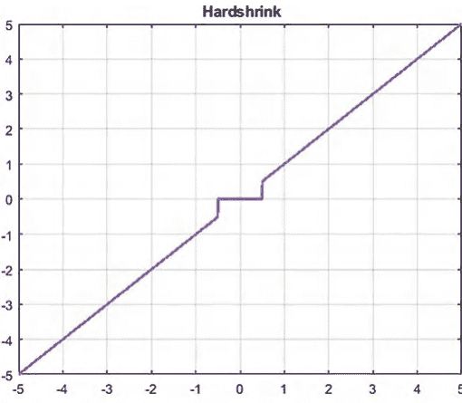

图 1.25 硬收缩激活函数

- 感知器神经网络
- 前馈神经网络
- 径向基神经网络
- 深度前馈神经网络
- 循环神经网络
- 长短期记忆网络
- 门控循环单元
- 自动编码器神经网络
- 变分自动编码器神经网络
- 去噪自动编码器神经网络
- 稀疏自动编码器神经网络
- 马尔可夫链
- 霍普菲尔德神经网络
- 玻尔兹曼机
- 受限玻尔兹曼机
- 深度置信网络
- 深度卷积网络
- 反卷积网络
- 深度卷积逆图形网络
- 生成对抗网络
- 液态状态机
- 极限学习机
- 回声状态网络
- 深度残差网络
- 科霍嫩网络
- 支持向量机
- 神经图灵机
- 模块化神经网络

下面总结了每种神经网络的说明。

#### 1.6.1 感知器神经网络

感知器是人类已知的最简单、最古老的人工神经网络模型。感知器接收若干输入，对其进行聚合并应用激活函数，最后将其传递到输出层。在这部分，人工神经网络的主要奇迹并未发生。该模型专门用于简单的分类问题。感知器对线性可分问题效果很好，但对于更复杂的问题，需要更深层的网络模型。感知器神经网络如图 1.26 所示。

图 1.26 感知器神经网络

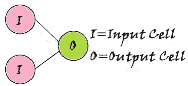

图 1.27 前馈神经网络

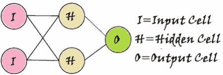

#### 1.6.2 前馈神经网络

前馈神经网络也被视为神经网络家族中的老成员，与之相关的方法起源于20世纪50年代。该算法的性能是所有节点完全连接，激活从输入层流向输出，没有反馈回路，并且在输入和输出之间还有一层（隐藏层）。大多数时候，此类神经网络使用反向传播方法进行训练。前馈神经网络如图 1.27 所示。

#### 1.6.3 径向基神经网络

径向基网络实际上是使用径向基函数（而非逻辑函数）作为激活函数的前馈（FF）神经网络。此时出现的问题是：基础径向神经网络与前馈神经网络有什么区别？

逻辑函数将任意值映射到 0–1 区间，以回答“是或否”问题（二元问题）。这类神经网络适用于分类和决策系统，但对连续值的处理效果较差。与此同时，基础径向函数回答的是“我们距离目标有多远？”这一问题，因此这类神经网络适用于函数估计和机器控制。简而言之，可以说基础径向神经网络实际上是一种具有不同激活函数和特性的前馈神经网络。径向基神经网络如图 1.28 所示。

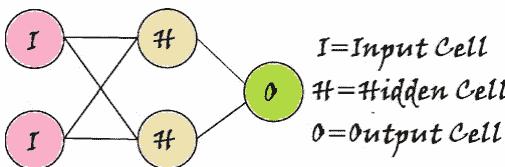

图 1.28 径向基神经网络

#### 1.6.4 深度前馈神经网络

深度前馈神经网络在20世纪90年代初成为神经网络讨论的入门。此类网络也是前馈神经网络，但拥有不止一个隐藏层。此时出现的问题是：此类神经网络与传统前馈神经网络有何区别？

在训练前馈神经网络时，只有少部分错误会传递到前一层。因此，使用更多层会导致训练时间呈指数级增长，同样的问题也使得深度前馈神经网络在实际中几乎无用且不切实际。在2000年代初，出现了一些方法，使得可以有效地训练深度前馈神经网络（DFF）。如今，这些神经网络构成了现代机器学习系统的核心，其用途与前馈（FF）神经网络相似，但效果更好。深度前馈神经网络如图 1.29 所示。

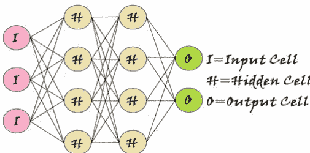

图 1.29 深度前馈神经网络

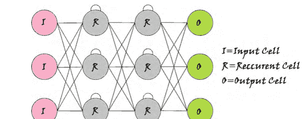

图 1.30 循环神经网络

#### 1.6.5 循环神经网络

循环神经网络引入了一种称为循环单元的不同类型的单元。此类网络的第一个是乔丹网络。在这类网络中，每个隐藏单元会以固定延迟接收其自身的输出。尽管如此，乔丹网络与传统的前馈神经网络相似。当然，在这类网络中发生了诸如将状态传递到输入节点、可变延迟等各种变化，但主要思想保持不变。

当上下文很重要时，基本上会使用这种神经网络（NN），事实上，当之前迭代或示例的决策会影响当前示例时也是如此。作为该类领域的常见示例，我们可以提到（文本）。在文本中，一个词只能在前面的单词或句子的上下文中进行分析。循环神经网络如图 1.30 所示。

#### 1.6.6 长短期记忆网络

长短期记忆网络（LSTM）引入了一种新型的记忆单元。当存在时间间隔（或时间延迟）时，该单元可以处理数据。前馈神经网络可以通过记住前十个单词来处理文本。与此同时，LSTM 可以通过记住前几帧中发生的事情来处理视频帧。LSTM 网络广泛用于语音识别和书写识别。记忆单元基本上是一对称为门的元素的组合。这些元素是可逆的，并控制信息如何被记住和遗忘。此类网络的结构在下图中定义良好。还值得注意的是，块之间没有激活函数。图中的 X 是门，它们有自己的权重，有时还有自己的激活函数。对于每个实例，X 决定是否将数据向前传递、清除内存等。输入门决定来自上一个样本的多少信息被保留在内存中。输出门控制传递到下一层的数据量，以及


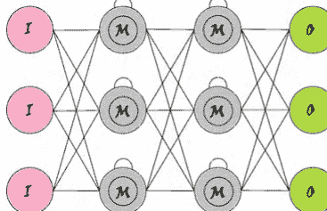
图 1.31 长短期记忆

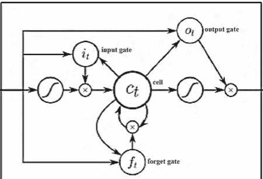
图 1.32 长短期记忆结构

遗忘门控制记忆中存储项目被移除的速率。所描述的是LSTM单元的一种非常简单形式，针对这种类型的神经网络还有许多其他架构。长短期记忆如图 1.31 和 1.32 所示。

#### 1.6.7 门控循环单元

门控循环单元 (GRU) 是一种具有不同门控和时间周期的LSTM。这种神经网络看起来很简单。事实上，缺少输出门使得输入更容易多次重复相同的输出。

这种循环神经网络目前主要用于语音合成和音乐合成。当然，LSTM和GRU的实际组合略有不同。因为，所有LSTM门控都合并为一个称为更新门的门控，而重置门与输入紧密相关。GRU比LSTM使用更少的资源，并且效果相似。门返回单元如图 1.33 所示。

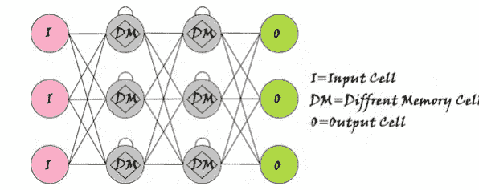
图 1.33 门返回单元

#### 1.6.8 自动编码器神经网络

自动编码器 (AE) 神经网络用于分类、聚类和特征压缩。当前馈神经网络被训练用于分类时，必须输入Y类别的X样本，并期望Y个单元中的一个被激活。这称为监督学习。另一方面，自动编码器神经网络可以在无监督的情况下训练。由于这些网络的结构（隐藏层数量小于输入单元数量，输出单元数量等于输入单元数量）以及AE以某种方式被训练使输出尽可能接近输入，自动编码器神经网络被迫对数据进行泛化并寻找常见模式。自动编码器神经网络如图 1.34 所示。

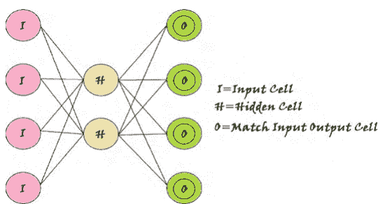
图 1.34 自动编码器神经网络

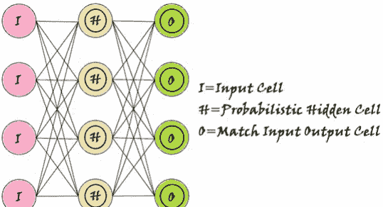
图 1.35 变分自动编码器神经网络

#### 1.6.9 变分自动编码器神经网络

与自动编码器神经网络相比，变分自动编码器 (VAE) 压缩的是概率而非特征。尽管上述两种神经网络之间发生了小变化，但每种人工神经网络都回答了一个不同的问题。自动编码器神经网络回答“数据如何泛化？”这个问题，而变分自动编码器神经网络回答“两个事件之间的连接有多强？应将责任归咎于两个事件，还是它们完全独立？”这个问题。变分自动编码器神经网络如图 1.35 所示。

#### 1.6.10 去噪自动编码器神经网络

虽然自动编码器网络很有趣，但这些神经网络有时只适应输入数据，而不是寻找最强特征（这是过拟合的一个例子）。去噪自动编码器 (DAE) 神经网络向输入单元添加少量噪声。通过这样做，去噪自动编码器神经网络被迫从带噪声的输入重建输出，并使其更具普遍性，特征选择最常见的特征。去噪自动编码器神经网络如图 1.36 所示。

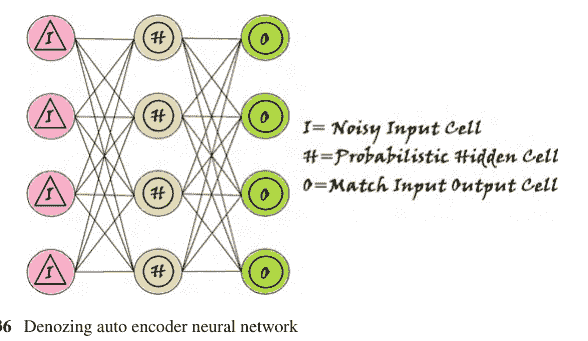
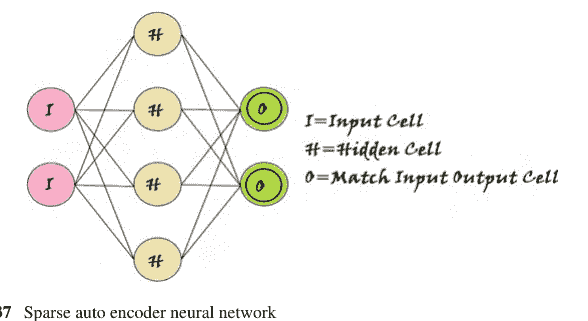

#### 1.6.11 稀疏自动编码器神经网络

稀疏自动编码器 (SAE) 神经网络是另一种自动编码器人工神经网络，在某些情况下可以揭示数据中的一些隐藏群组模式。稀疏自动编码器神经网络的结构也与AE相似，在这种神经网络中，隐藏层数量多于输入/输出层单元数量。稀疏自动编码器神经网络如图 1.37 所示。

#### 1.6.12 马尔可夫链

马尔可夫链是图的一个非常古老的概念，其中每个边缘都有一个概率。在古代，马尔可夫链用于构建文本；例如，单词“Hello”后面跟着单词“Dear”的概率是0.0053%，单词

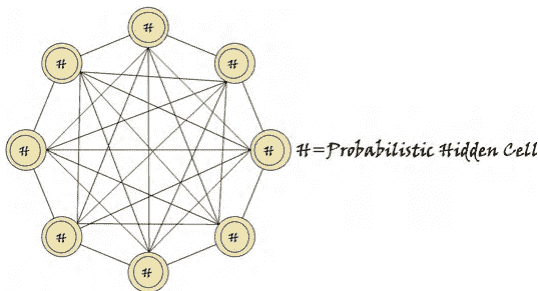
**图 1.38** 马尔可夫链

“你”的概率是0.03551%（移动电话中的T9文本预测技术使用马尔可夫链）。马尔可夫神经网络不是经典的，可以用于概率分类（例如贝叶斯滤波器）、聚类（某些类型）以及作为有限状态机。马尔可夫链如图 1.38 所示。

#### 1.6.13 霍普菲尔德神经网络

霍普菲尔德网络 (HN) 在有限样本集上进行训练，因此对已知样本以相似样本作出响应。每个单元在训练前充当输入单元，在训练期间充当隐藏单元，在使用期间充当输出单元。霍普菲尔德网络试图生成训练样本，这些网络用于去噪和恢复输入。如果将学习到的图像或序列的一半给这些网络，它们会返回完整样本。霍普菲尔德神经网络如图 1.39 所示。

#### 1.6.14 玻尔兹曼机

玻尔兹曼机 (BM) 与霍普菲尔德网络非常相似，其中一些单元被标记为输入并保持隐藏。输入单元在隐藏单元更新其状态后立即变为输出单元（在训练期间，玻尔兹曼机/霍普菲尔德网络逐个更新单元，而不是并行）。玻尔兹曼机如图 1.40 所示。

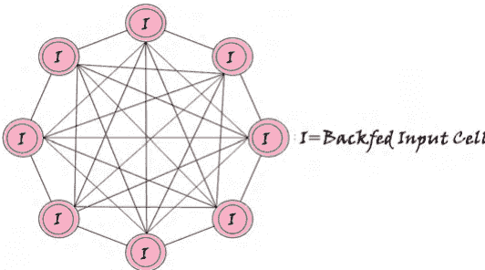
图 1.39 霍普菲尔德神经网络

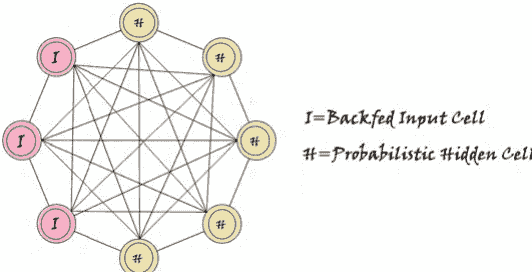
图 1.40 玻尔兹曼机

#### 1.6.15 受限玻尔兹曼机

受限玻尔兹曼机在结构上与BM相似。但由于其限制，只能使用反向传播对其进行训练，就像前馈网络一样（唯一的区别是传回的反向传播数据被馈回到输入层一次）。受限玻尔兹曼机如图 1.41 所示。

#### 1.6.16 深度置信网络

深度置信网络 (DBN) 是一种人工神经网络架构，由组合两种不同类型的模型组成：训练有素的受限玻尔兹曼机和自动编码器神经网络。DBN架构连续结构为三层。可见层，这一层是网络的最低级别，

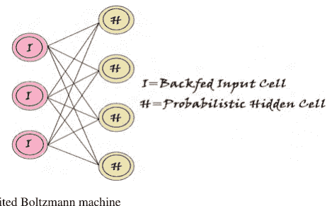
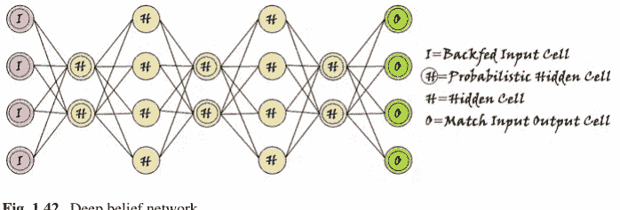

的网络，充当输入层并接收输入观测值。隐藏层，这些层包含位于观测层和彼此之间的几个神经元隐藏层。这些层由RBM训练，以学习数据的聚类表示。重建层，此最终层执行从隐藏层重建输入值的任务。

深度置信网络的主要优势是，这些网络可以以分层方式显示处理后的信息，可用于从数据中提取最佳特征、训练中间体以及创建强大的概率分布模型。深度置信网络如图 1.42 所示。

#### 1.6.17 深度卷积网络

深度卷积网络 (DCN) 目前是神经网络的明星。这种类型的神经网络具有卷积单元（或池化层）和内核，每个内核都有不同的用途。卷积核实际处理输入数据，池化层通过减少不必要的特征（通常使用非线性函数，如Max）来简化此任务。深度卷积神经网络通常用于图像识别。放置。这些网络在图像子集上运行

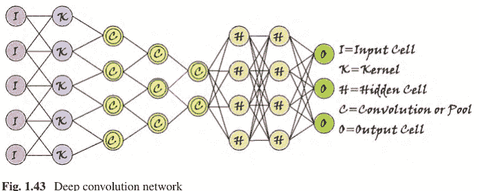
（大约20 × 20的图像）。输入窗口逐像素滚过整个图像。数据被传递到卷积层，创建一个漏斗（压缩输入特征）。在图像识别领域，第一层识别梯度，第二层识别线条，第三层识别形状，并且此过程将以相同的方式继续在特定对象的规模上。DFF通常连接到最终卷积层以执行后续数据预处理。深度卷积网络如图 1.43 所示。

#### 1.6.18 反卷积网络

反卷积网络 (DN) 是DCN的逆向。反卷积网络接收猫图像并创建类似 {dog : 0, lizard : 0, cat : 1, lion : 0} 的向量。深度卷积网络可以接收此向量并根据它绘制猫的图像。反卷积网络如图 1.44 所示。深度卷积逆图网络如图 1.45 所示。

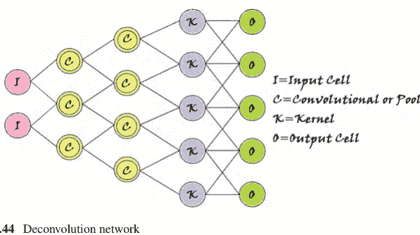


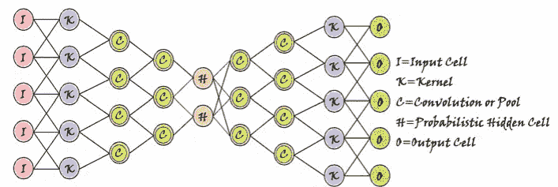

图 1.45 深度卷积逆图网络

#### 1.6.19 深度卷积逆图网络

参见图 1.45。

#### 1.6.20 生成对抗网络

生成对抗网络是由生成器和鉴别器构成的二元网络的大家族。生成器负责生成合成数据。事实上，其工作是生成看起来真实且与真实数据相似的新数据。鉴别器在数据评估中起主要作用。该网络试图区分生成器网络生成的数据和真实数据。该网络的训练目标是能够区分两种数据。

对抗生成网络的主要目标是对生成网络进行编程，使其生成看起来真实的数据。此过程逐渐提高生成器网络生成数据的质量。该概念由古德费洛等人提出，并被公认为人工智能领域最广泛使用和最有效的方法之一。生成对抗网络如图 1.46 所示。

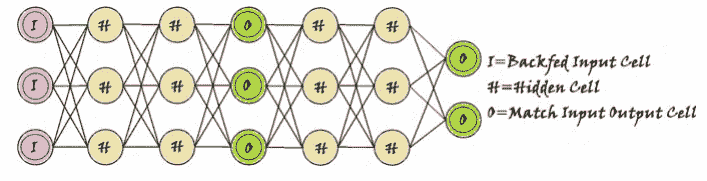

图 1.46 生成对抗网络

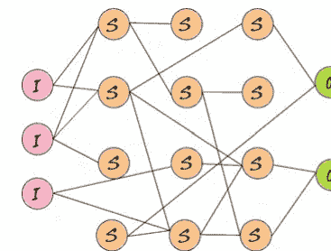

I=输入单元
S=脉冲隐藏单元
O=输出单元

图 1.47 液态状态机

#### 1.6.21 液态状态机

液态状态机或 LSM 网络是一种受动物大脑（特别是小鼠大脑）工作原理启发的人工脑计算模型。它是一种稀疏神经网络，其中激活函数被阈值电平取代。单元对连续样本的值求和，仅在达到阈值时才给出输出。然后将外部计数器重置为零。这些网络用于信号处理和模式预测。这些模型由大量神经元（大脑的主要处理元素）及其之间的连接组成。LSM 架构之所以被称为“流体”，是因为输入（例如，来自传感器的信号）以超快、流式的方式进入网络，并随时间持续作为神经输入作用于网络。

流体状态机网络的优势在于：对时序输入具有实时处理能力，能够学习动态和序列模式，比传统递归模型更具灵活性，在处理复杂和非线性模式方面效率更高。

此外，LSM 模型非常适合模式识别、预测个体排斥、检测异常活动和做出基于时间的决策等任务。液态状态机如图 1.47 所示。

#### 1.6.22 极端学习机

极端学习机（ELM）是一种尝试降低前馈神经网络背后复杂性的方法。通过构建具有随机连接的稀疏隐藏层来实现。这种神经网络所需的计算能力较少。在 ELM 中，网络隐藏层之间的权重是随机设置的，不需要梯度优化。由于这一特性，ELM 在大数据量问题上具有高速度和良好性能。此外，ELM 广泛用于图像处理、模式识别、信号处理和时序模式识别等问题。ELM 的主要重要性在于，与需要调整权重的传统神经网络不同，ELM 以其高学习速度和简单实现而闻名。这些特性使得 ELM 在机器学习和人工智能领域解决各种问题方面非常流行。极端学习机如图 1.48 所示。

#### 1.6.23 回声状态网络

回声状态网络或 ESN 是一种循环神经网络模型，用作长期数据处理的随机开放模型。该模型最初由赫伯特·耶格于 2001 年提出。

ESN 的一个重要特征是，隐藏层和输出层之间的权重是随机确定的，而输入层和隐藏层之间的权重默认是固定的。这些随机权重对计算执行有显著影响，ESN 具有学习复杂模型的能力。利用这一特性，ESN 广泛用于信号预测问题、系统动态建模、时序数据分析以及各领域的人工智能模型开发。ESN 的其他优势包括实现简单、并行处理能力以及建模的灵活性。回声状态网络如图 1.49 所示。

#### 1.6.24 深度残差网络

深度残差网络或 DRN 是一种使用残差块来训练深度网络的深度神经网络架构。该模型由科希·塞金于 2015 年提出，由于其在训练和使用深度网络方面的卓越能力而变得非常流行。在这种架构中，使用残差块，以便深层神经元可以轻松学习复杂映射。这种架构的主要原理是，不再是逐层训练并关注许多细节，而是利用每个块的输入和输出之间的残差差异进行训练。通过使用残差块，DRN 通常改进深度网络的误差和性能，并避免深度网络中的梯度消失和传播问题。因此，DRN 对计算机成像、模式识别、机器翻译以及涉及大量复杂数据的其他任务非常有用。深度残差网络如图 1.50 所示。

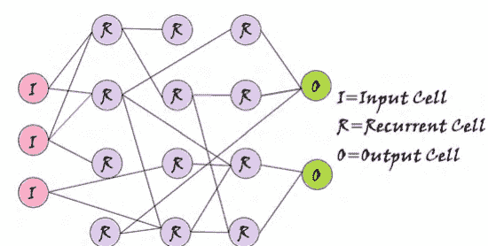

**图 1.49** 回声状态网络

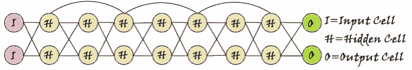

**图 1.50** 深度残差网络

#### 1.6.25 科霍宁网络

科霍宁神经网络是一种以科霍宁命名的人工神经网络。该网络被称为一种自组织网络。该网络的主要目标是将复杂特征转换为人类更简单、更易理解的方式。该网络可以使用以其名称定义的算法，将多维输入指数级地转换为一维或多维。作为科霍宁网络的实际示例，可以提到模式分类、特征空间降维、数据聚类和数据特征可视化。这些网络在图像处理、文本模式识别、遗传数据分析和地理空间数据（GIS）等领域得到广泛应用。科霍宁网络如图 1.51 所示。


#### 1.6.26 支持向量机

支持向量机或 SVM 是机器学习和数据挖掘领域中一种著名且强大的机器学习算法。SVM 的主要目的是利用训练数据在两个或多个类别之间创建最优决策边界。为此，SVM 寻找一个边界（超平面），以最大距离分离大部分数据，并很好地分隔两个类别。在此过程中，被称为支持向量的数据很重要，并在确定决策边界中起重要作用。SVM 的重要优势：在特征数量非常大的情况下具有高性能，不依赖于作为输入的数据规模，能够用于线性和非线性数据，可用于分类和回归问题。SVM 是最广泛使用的算法之一，广泛应用于图像分类、文本处理、模式识别和大数据分析等各个领域。

支持向量机通常不被视为神经网络，如图 1.52 所示。


图 1.53 神经图灵机

#### 1.6.27 神经图灵机

神经图灵机是由亚历克斯·格劳德等人提出的一种先进人工智能模型。这种神经网络实际上是具有提取内存单元的前馈（FF）神经网络。一些研究人员还认为图灵神经机是 LSTM 的一种抽象。该模型试图将图灵机的理念（包括在内存中读写数据的能力）与深度神经网络的能力相结合。神经图灵机具有学习和使用外部内存来解决复杂和困难问题的能力。此内存可以作为大量数据重写的环境，以执行复杂且快速的写入操作。使用新的学习算法，神经图灵机能够执行需要在动态环境中学习数据的困难任务。该模型对于执行长序列、机器翻译和解决复杂算法问题等问题非常有用。神经图灵机如图 1.53 所示。

#### 1.6.28 模块化神经网络

模块化神经网络由若干作为模块的神经网络组成，每个模块学习问题的一部分。最后，这些神经网络的输出相互集成以获得模型的最终输出。模块化模型的主要优势之一在于，通过这种方式，可以将复杂问题分解为更简单的部分，以帮助模型学习。此外，在这种方法中，可以使用不同的神经网络作为模块。此外，在这种方法中，可以同时进行多个不同任务的学习。模块化模型在解决需要在指定


图 1.54 模块化神经网络

空间。诸如在空间识别移动对象、交通控制、计算机游戏中的目标跟踪等问题属于此类问题，[16] 和 [17]。模块化神经网络如图 1.54 所示。

### References

- 1. S. Russell and P. Norvig, “人工智能：一种现代的方法,” 2010, 皮尔逊. ISBN: 978-0-13-604259-4
- 2. I. Goodfellow, Y. Bengio, and A. Courville, “深度学习,” 2016, MIT出版社. ISBN: 978-0-26203-561-3
- 3. M. Bishop, “用于模式识别的神经网络,” 1995, 牛津大学出版社. ISBN: 0-1985-3864-2
- 4. A. Kaveh and H. Yusefpoor, “用于结构最优设计的混沌元启发式算法” 2024, 计算智能研究 1168, 施普林格. ISSN: 1860-949X
- 5. C. M. Bishop, “模式识别与机器学习,” 2006, 施普林格. ISBN: 978-0-387-31073-2
- 6. K. P. Murphy, “机器学习：概率视角,” 2012, MIT出版社. ISBN: 978-0-26201-802-9
- 7. R. S. Sutton and A. G. Barto, “强化学习：导论,” 1999, MIT出版社. ISBN: 0-7923-9365-1
- 8. A. Géron, “使用Scikit-Learn, Keras和TensorFlow的机器学习实战,” 2022, O’Reilly Media. ISBN: 978-1-09812-597-4
- 9. C. C. Aggarwal, "神经网络与深度学习：教材," 2018, 施普林格. ISBN: 978-3-319-94463-0
- 10. D.L. Poole and A.K. Mackworth, "人工智能：计算智能体基础," 2010, 剑桥大学出版社. ISBN: 978-0-521-51900-7
- 11. M. Lapan, "深度强化学习实战," 2018, 帕克特出版. ISBN: 978-1-78883-424-7
- 12. R. Shanmugamani, "面向计算机视觉的深度学习," 2018, 帕克特出版. ISBN: 978-1-78829-562-8
- 13. B. Ramsundar and R. Bosagh Zadeh, "面向深度学习的TensorFlow," 2018, O'Reilly Media. ISBN: 978-1-491-98045-3
- 14. P. Corke, "机器人、视觉与控制：MATLAB中的基本算法," 2011, 施普林格. ISBN: 978-3319544120
- 15. H. Lane, C. Howard, and H.M. Hapke, "实战自然语言处理：使用Python理解、分析和生成文本," 2019, 曼宁出版. ISBN: 978-1617294631
- 16. S. Ravichandiran, "使用Python的强化学习实战," 2018, 帕克特出版. ISBN: 978-1788836524
- 17. A. Burkov, "百页机器学习书," 2019, 自出版. ISBN: 978-1999579500

## 第2章

使用元启发式训练的人工神经网络预测高强度钢柱屈曲阻力

**摘要** 本章旨在开发实用的元启发式训练人工神经网络，以预测高强度钢柱的极限屈曲荷载。截面高度、翼缘宽度、腹板厚度、翼缘厚度和钢材屈服强度被视为输入变量，而极限屈曲荷载被假设为唯一的输出变量。ANN模型通过LM、BR和SCG等算法进行训练；四种元启发式算法，即粒子群优化、碰撞体优化及其改进版本，被用于高效训练ANN。

### 2.1 引言

本章利用元启发式训练的人工神经网络对高强度钢柱的屈曲阻力进行预测[1]。钢材生产工艺的最新进展为工程界提供了以更好特性著称的钢材牌号，例如优异的韧性或高名义屈服应力（高于420 MPa），从而允许更广泛地使用高强度钢（HSS）。HSS的使用导致结构重量显著减少；然而，其稳定性需要彻底检查，特别是对于受压构件，挠曲屈曲通常是设计中的主要因素。HSS柱的当前设计规范基于普通强度钢（NSS）材料的实验，因为在规范制定时尚未对HSS材料进行测试。例如，EN 1993-1-12 (2007) 规定[2]适用于最高S700的钢材牌号，其依赖于基于Ayrton-Perry型公式的屈曲阻力曲线，该公式通过欧洲建筑钢结构公约（ECCS）针对NSS构件进行的大规模实验计划开发而成，并结合从实验结果分析中获得的理论公式以及采用蒙特卡洛模拟的可靠性评估。

欧洲规范3中针对HSS柱的现行规定[2]基本上是针对NSS柱设计规则的延伸版本，其提供的屈曲阻力可能不够精确适用。HSS材料具有独特的制造方法和材料特性，与NSS相比，在材料和几何缺陷方面导致各种结构行为。近年来，结构工程领域取得了重大进展，特别是在应用机器学习方法预测各种结构构件行为方面。尽管HSS构件实验评估的重要性不容忽视，但与机器学习领域（尤其是ANN）的最新进展相关，已经成为可能预测各种自然现象的行为，包括柱和梁-柱的屈曲行为或挠曲屈曲。

人工神经网络（ANN）是模拟生物有机体学习机制的机器学习技术的一个分支。ANN的特征是大量称为神经元的处理元素，它们通过轴突和树枝突互连形成突触。ANN类似于人脑结构，由许多处理元素组成，可以为给定数据集中的某些输入和输出建立准确关系，而该数据集不存在特定解决方案。ANN在寻找影响变量之间的复杂关系方面相当高效。它们越来越多地被用于解决结构工程领域复杂且耗时的问题。在结构工程中应用ANN的一些开创性工作由Kaveh等人[3]完成，他们利用神经网络在结构各个领域中的预测能力。

许多研究已探讨使用ANN和其他机器学习技术来预测结构构件的行为。利用ANN预测结构构件在轴向压缩下的强度和屈曲柱是正在进行的研究课题。然而，需要更多研究利用ANN从实验数据预测屈曲荷载。这主要是由于训练网络需要大量实验数据，这会带来显著成本。尽管如此，Waszczyszyn 和 Bartezak [4] 已成功使用反向传播神经网络（BPNN）来预测轴向压缩下圆柱形壳的屈曲荷载。

一些先前发表论文的实验数据被用于利用韧性反向传播学习算法训练人工神经网络，以基于壳体试件缺陷数据预测屈曲载荷系数。Markopoulos等人[5]使用带有Levenberg-Marquardt和反向传播算法作为训练函数的ANN，利用壳体厚径比和长径比作为网络输入，预测轴向压缩下PVC圆柱形壳的失稳模式。Ferreira等人[6]专注于使用ANN开发钢筏状梁侧向扭转屈曲阻力的预测模型。他们证明，ANN是预测钢筏状梁侧向扭转屈曲阻力的有前景的工具，具有高精度和高效率。此外，Kaveh和Khavaninzadeh开发了基于ANN的模型来预测FRP强度[7]。


本研究旨在开发基于机器学习的模型，能够准确可靠地预测考虑初始缺陷的受压 I 形和 H 形截面的极限强度。本研究采用四种 ML 方法，即粒子群优化（PSO）、碰撞体优化（CBO）以及通过遗传算法（GA）改进的版本（即粒子群优化-遗传算法 PSO-GA 和碰撞体优化-遗传算法 CBO-GA），高效训练人工神经网络（ANN）。首先，使用 ABAQUS 软件创建了有限元法（FEM）模型以验证 FEM 建模的概念；随后，创建了包含 114 个 FEM 试件的数据库，并分析了其统计特性。其次，简要介绍了所采用的四种 ML 方法的基础，说明它们如何解决复杂的回归问题。第三，实施了模型训练流程，得到优化后的训练模型。最后，评估并比较了训练好的 ML 模型的性能。

## 2.2 数值建模与验证

本研究采用有限元软件 ABAQUS（版本 2019-22.11.51）开发数值模型，以验证本研究中使用的 FEM 模型与 Tankova 等人 [8] 提供的实验数据相比的可行性和可靠性。支撑几何形状也基于本工作的规范。所有部件使用的材料设置为 S690 钢级，且所有部件均建模为壳单元。为了获得一致的支撑行为并创建更逼真的仿真，模型中实现了初始缺陷。该缺陷根据模型屈曲分析获得的第一屈曲模态计算。验证模型的所有参数均列于表 2.1。FEM 模型的变形图如图 2.1 所示，分析和实验结果见图 2.2。如该图所示，实验极限荷载报告为 1485.24 KN，数值极限荷载为 1487.87 kN，准确度为 99.82%。表 2.2。

| 长度 (mm) | 截面高度 (mm) | 翼缘宽度 (mm) | 腹板厚度 (mm) | 翼缘厚度 (mm) | 屈服强度 (MPa) | 极限强度 (MPa) | 极限应变 |
|---|---|---|---|---|---|---|---|
| 4000 | 180 | 100 | 8 | 8 | 690 | 770 | 0.14 |

S, Mises
SNEG, (fraction = -1.0)
(Avg: 75%)
707.319
585.777
539.435
530.493
471.551
412.609
363.727
294.725
235.783
176.841
117.898
58.956
0.014


图 2.1 FEM 模型的变形图


图 2.2 实验结果 [1] 与 FEM 模型的对比

表 2.2 实验、本研究与欧拉公式的极限荷载对比

| 实验极限荷载 (KN) | FEM 极限荷载 (KN) | FEM 偏差 (%) | 欧拉极限荷载 (KN) | 欧拉偏差 (%) |
|---|---|---|---|---|
| 1485.24 | 1487.87 | -0.177 | 1462.97 | +1.499 |

P_{cr} = \frac{\pi^2 EI}{(KL)^2} \quad (2.1)

其中 E、I 和 K 分别为弹性模量、惯性矩和有效长度系数。

在验证实验与 FEM 模型结果高度一致之后，对 114 个 ABAQUS FEM 试件（57 个用于屈曲分析，另外 57 个用于计算极限荷载）进行了建模与分析，以构建足够大的数据集，用于训练能够预测结构行为的神经网络。这些试件的规格和材料特性列于附录 A 中，其中规格根据图 2.3 确定。


图 2.3 柱子及其单元的等轴测图

基于 [9]，为了准确模拟柱子，所需的初始缺陷计算如下：

$Imp = L \times 0.002$ (2.2)

其中 $Imp$ 为初始缺陷量，$L$ 为柱长。由于所有试件的构件长度均恒为 4000mm，根据公式 (2.2)，初始缺陷计算为 8mm。

这些试件使用的材料特性也调整为真实值而非标称值，以获得更准确的结果。执行此操作的公式如下：

$\sigma_{true} = \sigma_{nom}(1 + \varepsilon_{nom})$ (2.3)

$\varepsilon_{true} = ln(1 + \varepsilon_{nom})$ (2.4)

其中 $\sigma$ 和 $\varepsilon$ 分别表示应力和应变，true 和 nom 下标分别代表真实值和标称值。

## 2.3 元启发式训练的神经网络模型

元启发式是一类用于解决使用传统优化技术难以处理的复杂优化问题的算法 [10]。与精确优化方法不同，元启发式不保证最优解，而是旨在在合理的时间内找到合适的解。元启发式对于求解变量和约束条件众多的大规模优化问题尤其有益。元启发式受自然和物理现象启发，例如遗传演化、群体行为和模拟退火。这些算法使用随机化、启发式搜索和局部搜索等多种技术来探索搜索空间，找到满足目标函数的解。存在许多优化算法，但本工作中考虑了粒子群优化（PSO）、碰撞体优化（CBO）及其配备遗传算法（GA）的改进版本。

### 2.3.1 粒子群优化

粒子群优化（PSO）是一种用于优化问题的流行计算技术 [11]。PSO 基于鸟类、鱼类和昆虫等社会生物的行为。在 PSO 中，使用一组粒子在给定搜索空间中搜索最优解。每个粒子代表一个潜在解，其在搜索空间中的运动由群体中表现最佳的粒子及其自身过去的运动引导。PSO 的目标是通过根据其自身和群体的最佳表现迭代更新每个粒子的位置和速度，找到全局最优解。这是一种强大且高效的技术，能够处理具有多个局部最优的凸优化问题和非凸优化问题。

### 2.3.2 碰撞体优化

碰撞体优化（CBO）是一种相对较新的优化算法，近年来备受关注 [12]。该算法受碰撞物理启发，系统中的粒子通过碰撞和交换能量相互作用。CBO 利用这一概念，通过模拟一组物体之间的碰撞来寻找复杂优化问题的最优解。每个物体代表搜索空间中的一个解，物体之间的碰撞对应于结合其特征的新解。这种方法使 CBO 在求解涉及多个目标或约束的优化问题方面非常有效。

### 2.3.3 遗传算法（GA）

遗传算法（GA）是一种受自然选择和遗传启发的优化技术 [13]。它是一种启发式方法，常用于寻找搜索空间大且适应度函数复杂的问题的最佳解。该算法作用于潜在解的种群，并使用选择、交叉和变异等遗传算子来产生更接近最优解的新一代解。GA 已成功应用于工程、金融和计算机科学等众多领域，并被公认为解决复杂优化问题的强大工具。

### 2.3.4 粒子群优化-遗传算法（PSO-GA）

为了进一步提升 PSO 训练 ANN 算法的性能，开发了一种使用遗传算法的混合版本，该版本通过产生变异和交叉来强制每次迭代粒子生成具有更高的复杂性。该实现的工作流程如图 2.4 所示。


图 2.4 PSO-GA 算法工作流

## 2.3.5 碰撞体优化-遗传算法 (CBO-GA)

为进一步提升 CBO 训练 ANN 算法的性能，还开发了一个混合版本，采用遗传算法产生突变和交叉。该实现的工作流程如图 2.5 所示。

## 2.3.6 ANN 模型

如前所述，ANN 由一些称为神经元的元素组成，它们通过相应的权重和偏置相互连接，如图 2.6 所示。这些元素在输入和输出之间建立了直接关系，因此对 ANN 的精度和能力具有重要影响。寻找最合适的权重和偏置


图 2.5 CBO-GA 算法工作流

可以被视为一个优化问题，若如此，优化后的权重和偏置将带来 ANN 的最佳性能。通常，设置权重和偏置是通过某些算法完成的，例如 Levenberg-Marquardt (LM)、贝叶斯正则化 (BR) 和共轭梯度缩放法 (SCG)；与此同时，本工作的创新之处在于利用元启发式方法进行权重和偏置优化。在此过程中，权重和偏置是元启发式的决策变量，需要设置以实现优化的目标函数，在本例中为 ANN 的均方误差 (MSE)，且需将其最小化。此过程在图 2.7 中有详细说明。

如图 2.8 所示，当隐藏层神经元数量超过 6 时，所得的相关性和性能不会发生显著变化；为了节省计算空间，为隐藏层选择了六个神经元作为可行参数。

```
$n_{var} = n_i \times n_H + n_H + n_H \times n_o + n_o$
```


图 2.6 具有一个隐藏层的人工神经网络拓扑结构


图 2.7 常规和元启发式训练的 ANN 工作流

其中，$n_i$、$n_H$ 和 $n_o$ 分别为输入变量数量、隐藏层神经元数量和输出变量数量。

## 2.4 结果与讨论

在本研究中，采用元启发式算法而不是常规算法（如 LM 等）来训练 ANN。此外，作为一种新方法，这些元启发式算法配备了 GA，不仅通过交叉过程增强局部搜索，还通过突变过程实现更有效的全局搜索


图 2.8 隐藏层神经元数量的选择

为创建更现实的比较，每个网络都设计为总共包含 6 个隐藏层，且所有算法均设置为运行 2000 次迭代。第一步中，考虑了具有一个隐藏层的 ANN 模型，并改变神经元数量以研究其影响。

为利用元启发式算法优化 ANN 的权重和偏置，四种元启发式算法——即粒子群优化 (PSO)、碰撞体优化 (CBO)、以及通过应用遗传算法 (GA) 开发的它们的改进版本，即粒子群优化-遗传算法 (PSO-GA) 和碰撞体优化-遗传算法 (CBO-GA)——已被用于高效训练 ANN。

表 2.3 提供了所有 4 种算法（辅以 ANN 训练过程）的相关系数 (R) 和性能 (MSE)（公式 (2.6)）值。图 2.9 和 2.11 描绘了每种算法的相关性和误差 (MSE) 直方图。可以推断，将遗传算法与每种元启发式相结合可以在混合 ANN 训练中实现更高的性能。此外，已经确定，将 GA 应用于元启发式算法对 ANN 参数优化具有相对积极的改进作用，在 PSO 到 PSO-GA 的情况下提高了 0.43%，在 CBO 到

表 2.3 算法的性能和误差值

| 名称 | 神经元数量 | R 值 | MSE 值 |
|---|---|---|---|
| PSO | 6 | 0.99389 | 7.516E+10 |
| PSO-GA | 6 | 0.99817 | 2.245E+10 |
| CBO | 6 | 0.96725 | 3.964E+11 |
| CBO-GA | 6 | 0.99744 | 3.144E+10 |

CBO-GA 的情况下提高了 3.12% 的准确率。这一现象在图 2.11 中也可观察到，该图表明 GA-混合结果中接近零误差线的数据密度更高，而纯元启发式的误差直方图分布更均匀。


图 2.9 所有算法的相关系数


图 2.10 算法性能比较

在图 2.10 中，对算法的 MSE 性能进行了比较。可以得出结论，当迭代次数超过 1200 时，算法的整体性能没有显著变化。再次，GA-混合算法的优势显而易见。结果还显示 PSO 算法相对于 CBO 具有优势。

图 2.12 展示了 FEM 计算目标值与 PSO-GA 训练的 ANN（表现最佳的算法）所预测值之间的比较，表明具有相当高的相关性和合理的性能。

```
MSE = \frac{1}{n} \sum_{i=1}^n (Y_i - \hat{Y}_i)^2
```

## 2.5 结论性意见

在本研究中，使用元启发式训练的人工神经网络开发了机器学习算法，以预测 I 型和 H 型柱梁单元的最终非线性屈曲载荷，以及临界屈曲形状中各种“纯”屈曲模式的贡献。所选数据集包含 114 个样本，考虑了各种截面几何形状和三种不同类型的 HSS 材料作为输入数据。输入模型使用 ABAQUS FEM 软件进行分析，以计算每个试件各自的最终载荷。研究证实，广泛使用元启发式方法作为训练


图 2.11 所有算法的误差直方图


图 2.12 实际和预测最终载荷图

算法显著影响 ANN 模型的性能。然而，更复杂的算法（如 GA-混合元启发式算法）可以展示更高的准确性，其决定系数超过 0.998，揭示机器学习是解决这一高度非线性问题的一种可行方案技术。

## 附录 A

下表展示了用于训练 ANN 模型的数据集，其中 _L_、_f_y、_U_p 和 ε_p 分别代表柱长、材料屈服应力、终极应力和终极应变。

| 名称 | L (mm) | H (mm) | b (mm) | t_w (mm) | t_f (mm) | f_y (MPa) | U_p (MPa) | ε_p | 最终载荷 (kN) |
|---|---|---|---|---|---|---|---|---|---|
| Model-01 | 4000 | 140 | 60 | 8 | 10 | 461.0444 | 608.4 | 0.154736 | 282.3013 |
| Model-02 | 4000 | 140 | 60 | 8 | 10 | 692.35 | 877.8 | 0.127628 | 283.2328 |
| Model-03 | 4000 | 140 | 60 | 8 | 10 | 964.5489 | 1265 | 0.090583 | 238.0231 |
| Model-04 | 4000 | 140 | 140 | 8 | 10 | 461.0444 | 608.4 | 0.154736 | 1585.465 |
| Model-05 | 4000 | 140 | 140 | 8 | 10 | 692.35 | 877.8 | 0.127628 | 1735.248 |
| Model-06 | 4000 | 140 | 140 | 8 | 10 | 964.5489 | 1265 | 0.090583 | 2076.643 |
| Model-07 | 4000 | 220 | 140 | 8 | 10 | 461.0444 | 608.4 | 0.154736 | 1838.671 |
| Model-08 | 4000 | 220 | 140 | 8 | 10 | 692.35 | 877.8 | 0.127628 | 1998.967 |
| Model-09 | 4000 | 220 | 140 | 8 | 10 | 964.5489 | 1265 | 0.090583 | 2122.441 |
| Model-10 | 4000 | 220 | 140 | 10 | 10 | 461.0444 | 608.4 | 0.154736 | 1990.031 |
| Model-11 | 4000 | 220 | 140 | 10 | 10 | 692.35 | 877.8 | 0.127628 | 1971.113 |
| Model-12 | 4000 | 220 | 140 | 10 | 10 | 964.5489 | 1265 | 0.090583 | 2070.952 |
| Model-13 | 4000 | 220 | 140 | 15 | 10 | 461.0444 | 608.4 | 0.154736 | 2347.257 |
| Model-14 | 4000 | 220 | 140 | 15 | 10 | 692.35 | 877.8 | 0.127628 | 1922.6 |
| Model-15 | 4000 | 220 | 140 | 15 | 10 | 964.5489 | 1265 | 0.090583 | 1896.966 |
| Model-16 | 4000 | 220 | 220 | 8 | 10 | 461.0444 | 608.4 | 0.154736 | 2626.596 |
| Model-17 | 4000 | 220 | 220 | 8 | 10 | 692.35 | 877.8 | 0.127628 | 3747.514 |
| Model-18 | 4000 | 220 | 220 | 8 | 10 | 964.5489 | 1265 | 0.090583 | 5319.902 |
| Model-19 | 4000 | 220 | 220 | 8 | 15 | 461.0444 | 608.4 | 0.154736 | 3660.572 |
| Model-20 | 4000 | 220 | 220 | 8 | 15 | 692.35 | 877.8 | 0.127628 | 5028.237 |
| Model-21 | 4000 | 220 | 220 | 8 | 15 | 964.5489 | 1265 | 0.090583 | 6482.483 |
| Model-22 | 4000 | 220 | 220 | 10 | 10 | 461.0444 | 608.4 | 0.154736 | 2841.453 |
| Model-23 | 4000 | 220 | 220 | 10 | 10 | 692.35 | 877.8 | 0.127628 | 3980.958 |
| Model-24 | 4000 | 220 | 220 | 10 | 10 | 964.5489 | 1265 | 0.090583 | 5226.642 |


| 名称 | L (mm) | H (mm) | b (mm) | tw (mm) | tf (mm) | fy (MPa) | Up (MPa) | ep | 最大荷载 (kN) |
|---|---|---|---|---|---|---|---|---|---|
| Model-25 | 4000 | 220 | 220 | 10 | 15 | 461.0444 | 608.4 | 0.154736 | 3895.247 |
| Model-26 | 4000 | 220 | 220 | 10 | 15 | 692.35 | 877.8 | 0.127628 | 5258.709 |
| Model-27 | 4000 | 220 | 220 | 10 | 15 | 964.5489 | 1265 | 0.090583 | 6786.69 |
| Model-28 | 4000 | 220 | 220 | 15 | 10 | 461.0444 | 608.4 | 0.154736 | 3329.831 |
| Model-29 | 4000 | 220 | 220 | 15 | 10 | 692.35 | 877.8 | 0.127628 | 4497.343 |
| Model-30 | 4000 | 220 | 220 | 15 | 10 | 964.5489 | 1265 | 0.090583 | 5626.105 |
| Model-31 | 4000 | 220 | 220 | 15 | 15 | 461.0444 | 608.4 | 0.154736 | 4217.173 |
| Model-32 | 4000 | 220 | 220 | 15 | 15 | 692.35 | 877.8 | 0.127628 | 5798.167 |
| Model-33 | 4000 | 220 | 220 | 15 | 15 | 964.5489 | 1265 | 0.090583 | 7447.024 |
| Model-34 | 4000 | 300 | 140 | 10 | 10 | 461.0444 | 608.4 | 0.154736 | 2264.359 |
| Model-35 | 4000 | 300 | 140 | 10 | 10 | 692.35 | 877.8 | 0.127628 | 1885.467 |
| Model-36 | 4000 | 300 | 140 | 10 | 10 | 964.5489 | 1265 | 0.090583 | 1511.626 |
| Model-37 | 4000 | 300 | 140 | 15 | 10 | 461.0444 | 608.4 | 0.154736 | 2734.825 |
| Model-38 | 4000 | 300 | 140 | 15 | 10 | 692.35 | 877.8 | 0.127628 | 1841.8 |
| Model-39 | 4000 | 300 | 140 | 15 | 10 | 964.5489 | 1265 | 0.090583 | 1358.435 |
| Model-40 | 4000 | 300 | 220 | 10 | 10 | 461.0444 | 608.4 | 0.154736 | 3108.108 |
| Model-41 | 4000 | 300 | 220 | 10 | 10 | 692.35 | 877.8 | 0.127628 | 4404.046 |
| Model-42 | 4000 | 300 | 220 | 10 | 10 | 964.5489 | 1265 | 0.090583 | 5597.486 |
| Model-43 | 4000 | 300 | 220 | 10 | 15 | 461.0444 | 608.4 | 0.154736 | 4126.984 |
| Model-44 | 4000 | 300 | 220 | 10 | 15 | 692.35 | 877.8 | 0.127628 | 5681.723 |
| Model-45 | 4000 | 300 | 220 | 10 | 15 | 964.5489 | 1265 | 0.090583 | 7315.843 |
| Model-46 | 4000 | 300 | 220 | 15 | 10 | 461.0444 | 608.4 | 0.154736 | 3650.832 |
| Model-47 | 4000 | 300 | 220 | 15 | 10 | 692.35 | 877.8 | 0.127628 | 5105.114 |
| Model-48 | 4000 | 300 | 220 | 15 | 10 | 964.5489 | 1265 | 0.090583 | 5289.233 |
| Model-49 | 4000 | 300 | 220 | 15 | 15 | 461.0444 | 608.4 | 0.154736 | 4536.766 |
| Model-50 | 4000 | 300 | 220 | 15 | 15 | 692.35 | 877.8 | 0.127628 | 6414.806 |
| Model-51 | 4000 | 300 | 220 | 15 | 15 | 964.5489 | 1265 | 0.090583 | 8139.981 |
| Model-52 | 4000 | 300 | 300 | 10 | 15 | 461.0444 | 608.4 | 0.154736 | 5375.847 |
| Model-53 | 4000 | 300 | 300 | 10 | 15 | 692.35 | 877.8 | 0.127628 | 7768.339 |
| Model-54 | 4000 | 300 | 300 | 10 | 15 | 964.5489 | 1265 | 0.090583 | 10984.19 |
| Model-55 | 4000 | 300 | 300 | 15 | 15 | 461.0444 | 608.4 | 0.154736 | 6040.236 |
| Model-56 | 4000 | 300 | 300 | 15 | 15 | 692.35 | 877.8 | 0.127628 | 8579.79 |
| Model-57 | 4000 | 300 | 300 | 15 | 15 | 964.5489 | 1265 | 0.090583 | 11534.19 |

## 附录 B

ANN模型的相关权重和偏置以矩阵形式表示。

在以下矩阵中，W1 是从输入层到隐藏层的连接权重；
W2 包含连接隐藏层到输出层的权重；B1 和 B2 分别是隐藏层和输出层的偏置。

### PSO

```
[W1]6x5 = 
[
-1.10366229   -3.091542101   3.124935894   0.03515063   0.815357131
0.104561734  -0.642993049   -0.126910526  -2.073732574  -3.421379544
-2.922371904   1.097492951   -0.206877083   1.1610887     -0.811630009
-0.649899278   0.665082869   0.15411575    1.844061413    1.3618892
-1.429065846   1.849016031   0.066209101   0.043709687   -0.11856357
-6.357238506   3.339715711   -0.240900028  -4.030198625  -1.710993435
]
```

```
[W2]1x6 = 
[-0.1157507  -0.2405817  -0.3622267  -0.0748759   0.6661116  -0.2620086]
```

```
[B1]6x1 = 
[
-3.66078752
2.342269205
0.358991344
3.672781757
0.865609646
0.454108309
]
```

```
[B2]1x1 = 
[-0.566766897]
```

### PSO-GA

```
[W1]6x5 = 
[
0.113106779   6.078331541   0.402870483  -1.439080182   0.896832207
0.227752058  -1.306991385  -0.304700747   0.469482728   0.091520219
2.585092038  -1.61562248   0.127624304   4.005396119   1.087757881
1.950357403   0.095310108  -0.10290988   -2.346370627  -0.94739582
3.514762724   10          -10           4.106329133   4.475181193
-10          -3.069074679   7.919964599  -7.263154912   3.177245217
]
```

```
[W2]1x6 = 
[0.3085561  -0.9532323   0.3578276  -0.3194150   0.0198057  -0.037777]
```

```
[B1]6x1 = 
[
-3.388189436
-1.627748593
-4.981442498
1.469553347
-5.996552513
-4.987714327
]
```

```
[B2]1x1 = [-0.567341195]
```

### CBO

```
[W1]6x5 = [
-0.393386475   -603.0267737   0.082024444   112.1144781   -166.6746
4588.214901   -294.7296792  -4458.687374   6.009583502   89.68068597
-88.59225997  -47.19756398  -6.387120964   98.16701961   -28.36782498
-5252.994698   4140.205635   280.5961014   5415.405973   950.677305
895006.2557  -430.10644637  2202615.524  -232348.7086   -345230.0274
70.22803729   33.90265945   10.32716153   23.97009863   145.9424052
]
```

```
[W2]1x6 = [-0.1906929  -0.0709382  -0.1847631  0.4046929  -1.0592311  0.0799625]
```

```
[B1]6x1 = [
146.523258
-188.1773644
42.09543795
871.1582634
-9308182.72
-6.972491941
]
```

```
[B2]1x1 = [-1.249794212]
```

### CBO-GA

```
[W1]6x5 = [
-1.181894385   9.970319828  -1.918903605  -0.824115902  -0.05132894
1.770624883   8.638056401   0.978933502  10.01026123   -11.23699966
0.300395961  -11.5663389   0.152846976  -1.603505334  -5.491175648
0.000413016  -10.31091012  0.058478919  -3.800228698   8.279777473
0.388864303   3.103902959   0.404212754  -0.093172371  -0.435148567
-7.557081022  -11.02841585  4.23448416   4.861990054  -2.42040296
]
```

```
[W2]1x6 = [0.6729929  0.270813  -0.3235917  0.3027787  0.2759486  -0.0200394]
```

```
[B1]6x1 = [
6.825910258
-8.042510506
7.763057697
7.999055453
-0.497198143
-2.263620681
]
```

```
[B2]1x1 = [-0.846206841]
```

## 参考文献

1. Kaveh A, Eskandari A, & Movasat M. (2023) 基于元启发式训练人工神经网络的高强度钢柱屈曲阻力预测，Structures, 56(4):104853. https://doi.org/10.1016/j.istruc.2023.07.043
2. CEN E (2007) 3：钢结构设计。第 1–12 部分：将 EN 1993 扩展至 S700 钢材级别的附加规则。欧洲标准化委员会（CEN）
3. Kaveh A, & Eskandari A. (2021) 使用不同神经网络分析双层桶形拱顶；一项比较研究。Int J Optim Civil Eng 11:113–141
4. WaszczyszynZ, & Bartczak M. (2002) 具有几何缺陷的圆柱壳屈曲载荷的神经网络预测。Int J Non Linear Mech 37:763–775
5. Markopoulos AP, Manolakos DE, & Saxevanidis NM. (2007) 基于人工神经网络的轴向压缩载荷下 PVC 圆柱壳坍塌模式预测。载于：人工智能与创新 2007：从理论到应用：第 4 届 IFIP 国际人工智能应用与创新会议 (AIAI 2007) 论文集 4。Springer，第 251–258 页
6. Ferreira FPV, Shamass R, Limbachiya V, 等 (2022) 基于人工神经网络 (ANN) 生成的钢窄腹板梁侧向扭转屈曲阻力预测模型。Thin-Walled Structures 170:108592
7. Kaveh A, & Khavaninzadeh N. (2023) 使用四种元启发式算法高效训练两个 ANN 以预测 FRP 强度。Structures 52:256–272. https://doi.org/10.1016/j.istruc.2023.03.178
8. Ferreira Filho JO, Tankova T, Carvalho H, 等. (2022) 高强度钢柱和梁-柱的受弯屈曲阻力的实验与数值研究。Eng Struct 265:114414
9. Talbi E-G (2009) 元启发式：从设计到实现。John Wiley & Sons
10. Kaveh A. (2021). 结构最优设计元启发式算法进展。Springer 国际出版公司，瑞士，第 3 版
11. Eberhart R, & Kennedy J. (1995) 粒子群优化。载于：IEEE 神经网络国际会议论文集。Citeseer，第 1942–1948 页
12. Kaveh A, Mahdavi VR. (2014) 碰撞体优化：一种新型元启发式方法。Comput Struct 139:18–27
13. Sastry K, Goldberg D, & Kendall G. (2005) 遗传算法。优化与决策支持技术搜索方法：介绍性教程 97–125


## 第 3 章

利用人工神经网络和元启发式算法优化混凝土抗压强度

**摘要** 在本章中，通过改变不同尺寸骨料的用量，在保持水、水泥和添加剂用量不变的情况下，获得了五种基本配合比。随后采用 Taguchi 法提出新样品并在实验室进行测试。在使用获得的结果对人工神经网络（ANN）进行训练后，利用 EVPS 和 SA-EVPS 算法确定最高抗压强度。随后在实验室对获得的结果进行测试，并将其试验抗压强度与 ANN 结果进行比较。

### 3.1 引言

本章介绍了利用人工神经网络和元启发式算法优化混凝土抗压强度的方法 [1]。作为世界上最广泛使用的工程材料之一，混凝土是仅次于水的最常用物质。混凝土具有明显的抗压强度，这是衡量其质量的最重要指标。混凝土由水泥、水、细骨料和粗骨料组成。除这些情况外，近年来混凝土外加剂也受到了相当大的关注。作为建筑材料，硬化混凝土的抗压强度是其最重要的性能之一。由于混凝土的抗压强度，可以从中确定混凝土的许多不同性能，并与此特性相关，包括抗拉强度、抗剪强度、比重、耐久性、抗侵蚀性、硫酸盐抗性及其他混凝土性能。仅通过修改所用骨料的特性且不改变水和水泥的用量来提高混凝土抗压强度，是混凝土生产方向的一项挑战。混凝土的施工已是众多研究课题，其中一些将在下面简要讨论。

Habert 等人 [2] 采用生命周期评估方法评价了地质聚合物混凝土生产的环境影响。在他们的研究中，他们发现，与生产标准普通硅酸盐水泥（OPC）混凝土相比，地质聚合物混凝土的生产对全球变暖的影响较低，但对除全球变暖以外的其他环境类别的影响较高。还指出，工业废弃物可用于生产地质聚合物混凝土，并且使用活化粘土和高炉矿渣作为配合比设计技术可以降低对胶凝材料的需求。

Imbabi 等人 [3] 的综述考察了水泥生产的当前最新技术，并提出了一些新兴的绿色替代方案，例如节能、低碳生产方法、地质聚合物、碳负水泥和新型混凝土设计。

Sabbaghian 和 Kheyroddin [4] 研究了 HPFRCC 的劈拉抗拉强度、抗压强度和体积密度。根据 18 种含 1% 钢纤维（30 mm 长度）的 HPFRCC 配合比，对 108 个圆柱体和立方体试件在 7 天和 28 天时进行了测试，并提出了 STS 与 CS 之间的数学指数函数，同时还考虑了三种不同体积分数的钢纤维。

Khaksefidi 等人开发了一种简单且无损的表面电阻率（ER）方法，用于预测 UHPC 在不同养护制度下，龄期长达 28 天时抵抗氯离子渗透的能力。ER、CS 和密度随龄期增加而增加，但氯离子环境造成的损害大于硫酸盐环境。

为了减少实验工作并预测混凝土的抗压强度，可以使用人工神经网络（ANN）。ANN 是一种智能系统，可以解决广泛应用中的问题，包括优化、预测、建模、聚类、模式识别、模拟等。以下是一些使用 ANN 作为强大工具的研究示例：

Göthals 等人研究了用于预测大型无脊椎动物群落的人工神经网络的开发与应用。结果表明，所采用的模型训练和验证方法往往可以得到改进，而且建模过程中的关键步骤往往记录不充分。

Sinha 和 Wang 利用分类、压实和渗透性测试的结果，开发了土壤渗透性、最大干密度和最佳含水量的人工神经网络（ANN）预测模型。

根据 Palavar 等人 [5] 的研究，对 PM Inconel 706（IN 706）超合金的老化参数对磨损行为的影响进行了实验研究，并开发了 ANN 模型以预测磨损测试后的重量损失。

在预测和分类中，神经网络已被广泛使用。因此，Laguna 和 Marti [6] 将一种在短时间内实现高精度的训练程序与多种商业培训程序的变体进行了比较。

在提高建筑能源管理系统能源效率方面，建筑能耗预测是一个有前景的研究领域。其中最好的方法之一是使用人工神经网络。Lu 等人 [7] 提供了十二种用于建筑能耗预测的 ANN 架构综述，并讨论了三个挑战和未解决问题。

Shariati 等人在其研究中旨在预测掺入高炉矿渣和粉煤灰（作为水泥部分替代材料）的混凝土抗压强度，该研究采用了混合人工神经网络和遗传算法。研究结果表明，ANN-GA 模型在预测抗压强度方面优于 ANN-BP 模型。

为了高效且有针对性地利用 ANN，可以应用元启发式算法。近期研究表明，来自广泛领域（特别是工程领域）对元启发式算法表现出了浓厚兴趣。元启发式算法除了能够求解任何问题的近似最优解之外，还是一种实用的优化方法。

在本研究中，通过改变不同尺寸骨料的用量，在保持水、水泥和添加剂用量不变的情况下，获得了五种基本配合比。随后采用 Taguchi 法提出新样品并在实验室进行测试。在使用获得的结果对人工神经网络（ANN）进行训练后，使用 EVPS 和 SA-EVPS 算法确定最高抗压强度。随后在实验室对获得的结果进行测试，并将其试验抗压强度与 ANN 结果进行比较。

本章的组织如下：第一部分包含引言。第二部分简要介绍 EVPS 和 SA-EVPS 算法。第三部分和第四部分分别介绍 ANN 和 Taguchi 法的概述。第五部分提出了一个数值问题，最后一部分给出结论。

### 3.2 EVPS 和 SA-EVPS 算法的简要说明

EVPS 算法是 VPS 算法的改进版本，广泛用于优化结构工程问题。虽然 EVPS 算法使用八个经验确定的变量，但这些参数默认情况下被视为特定值，负责控制搜索精度、探索与利用阶段、收敛速度以及整体算法行为。因此，在 SA-EVPS 算法中，所有这些参数都有显著影响，且上述所有八个参数在执行主优化之前也会被优化。在 SA-EVPS 算法中，首先使用 EVPS 算法优化所有八个参数，然后再执行主优化。为提供更清晰的说明，SA-EVPS 算法的流程图如图 3.1 所示。


图 3.1 SA-EVPS 算法示意图 [1]

## 3.3 人工神经网络（ANN）概述

生物神经网络是人工神经网络的基础，可在问题的高维空间中学习模式并预测结果。人工神经网络是受生物神经网络启发的智能工具。在噪声和复杂的数据集中，它们可以将一组输入映射到一组输出。近年来，受生物神经系统启发的人工神经网络已从理论概念发展为广泛应用于各种问题的技术。它们可以为常规方法无法解决的问题提供适当的解决方案。人工神经网络（ANN）是一种广泛应用于各种应用的智能工具，例如


图 3.2 显示输入层、输出层和隐藏层的 ANN 结构示意图

函数逼近、分类、时间序列预测等。事实上，ANN 可以对输入和输出之间几乎任何复杂的关系进行建模。神经网络性能很大程度上由训练过程决定，该过程确定网络的权重和偏置。这可以根据网络的权重和偏置，对问题的实际输出进行良好估计。

如图 3.2 所示，在每个神经元中，计算输入的加权和，并将该值与偏置值一起由激活函数进行变换。然后将该值传递到附近的神经元。在训练过程中，会调整网络的权重和偏置，以实现目标值（实际值）与输出值（网络值）之间的最小误差。

## 3.4 Taguchi 方法简介

Taguchi 方法是一种改进产品质量的统计技术，近年来已应用于工程、生物技术、市场营销和广告领域 [8, 9]。Taguchi 哲学包含三个基本而简单的概念，这类概念包括：

- 生产过程中，质量应设计而非检验。
- 实现质量的最佳方法是将与指定值的偏差最小化。
- 产品必须设计为能够抵御不可控制的环境条件。

在 Taguchi 方法中，实验设计中考虑两组因素。首先，是设计中具有特定水平且受控制的可控因素；在 Taguchi 方法中，它被描述为信号。另一类是干扰因素，它们影响过程的反应但无法控制；在 Taguchi 方法中，它们被称为噪声。Taguchi 实验的设计旨在最大限度地减少干扰因素 [9, 10]。

此外，该方法的优势在于能确定每个因素对测试结果的贡献。基于测试数据的方差分析（ANOVA）表，决策者可以按照因素的重要性对其进行排序。基于此排序，决策者可能会被说服将两个或多个可控因素组合，以降低实验设计相关的成本。方差分析研究确定了不同部分中因素的相对影响。

## 3.5 数值示例

在本文中，首先，在保持水泥、水和外加剂用量不变的情况下，通过改变不同尺寸骨料的用量来确定五种基本设计的抗压强度。按骨料尺寸，骨料被分为六种尺寸，因此影响样品抗压强度的六个因素与六种骨料粒径尺寸的六个数值相同。因此，设计变量和影响因素是相同的六个组分。从五种基本设计中，使用 Taguchi 方法选取了 81 种拟议设计，并在实验室中制作了所有 81 个样品并测定了其抗压强度。事实上，如果不使用 Taguchi 方法，就需要获得大量由 5 种基本设计组合而成的样品，以分析上述六个影响因素效应的灵敏度，而这一过程在实验室中测定其抗压强度实际上几乎是不可能的。根据 Taguchi 方法的结果，训练了一个人工神经网络（输入数据来自上述六个变量），并将 ANN 的结果与实验室获得的实验数据进行了比较，如图 3.3 所示。


图 3.3 拟议 Taguchi 方法设计与训练的人工神经网络所得结果的实验室抗压强度（28 天）比较

基于 Taguchi 方法提出的样品抗压强度知识及人工神经网络的训练，利用将 ANN 作为目标函数的 EVPS 和 SA-EVPS 元启发式算法确定了最优设计。优化过程包括 30 次独立运行，种群规模为 20。在 EVPS 算法中，p、w1、w2、HMCR、PAR、Neighbor 和 Memory_size 分别为 0.05、0.2、0.3、0.3、0.95、0.1、0.1 和 4。自适应的 SA-EVPS 算法参数如表 3.1 所示。图 3.4 说明了 EVPS 和 SA-EVPS 的收敛曲线。如图 3.4 所示，目标函数等于由 ANN 得出的抗压强度的倒数。

表 3.1 自适应（优化）的 SA-EVPS 算法参数

| 序号 | 参数 | 数值 |
|---|---|---|
| 1 | α | 0.065411 |
| 2 | p | 0.35474 |
| 3 | w₁ | 0.732654 |
| 4 | w₂ | 0.21554 |
| 5 | HMCR | 0.0845451 |
| 6 | PAR | 0.83211 |
| 7 | Neighbor | 0.85484 |
| 8 | Memory_size | 1 |

为了澄清结果，骨料被分为两类：砾石和砂，根据 ASTM D 422-63，砾石和砂的筛孔尺寸界限为 4.75 mm。因此，在砾石范围内，筛上留量为 4.75 mm，筛下通过量视为砂。根据表 3.2，由 Taguchi 方法得出了抗压强度最好的五种基本设计，以及由 EVPS 和 SA-EVPS 算法得出的最优解。在表 3.2 中，五种基本设计、Taguchi 方法的最佳设计以及 EVPS 算法和 SA-EVPS 算法的最佳设计的抗压强度实验室结果与 ANN 结果进行了比较。根据该表，最佳答案可归因于 SA-EVPS 算法。

比较实验室结果和训练后的人工神经网络，可以得出结论：ANN 的准确性是可以接受且适当的。此外，SA-EVPS 算法提供了最佳答案，尽管 EVPS 算法在此示例中也表现良好。与五种基本设计相比，Taguchi 方法产生了更好的结果，但其不如 EVPS 和 SA-EVPS 算法。


图 3.4 EVPS 和 SA-EVPS 收敛曲线

表 3.2 五种基本设计、实验室结果以及 EVPS 和 SA-EVPS 算法的抗压强度结果比较

| 序号 | 设计类型 | 砾石 | 砂 | 水泥 | 水 | 外加剂 | ANN 预测 | 实验结果 |
|---|---|---|---|---|---|---|---|---|
| 1 | 基本设计 1 | 433 | 1411 | 397 | 159 | 5.4 | 414 | 420 |
| 2 | 基本设计 2 | 323 | 1520 | 397 | 159 | 5.4 | 422 | 431 |
| 3 | 基本设计 3 | 215 | 1593 | 397 | 159 | 5.4 | 448 | 428 |
| 4 | 基本设计 4 | 494 | 1322 | 397 | 159 | 5.4 | 423 | 405 |
| 5 | 基本设计 5 | 529 | 1258 | 397 | 159 | 5.4 | 420 | 433 |
| 6 | Taguchi 最佳设计 | 588 | 1198 | 397 | 159 | 5.4 | 452 | 444 |
| 7 | EVPS 最佳设计 | 503 | 1304 | 397 | 159 | 5.4 | 490 | 481 |
| 8 | SA-EVPS 最佳设计 | 412 | 1372 | 397 | 159 | 5.4 | 491.5 | 487 |


## 3.6 Conclusion

本研究选取了五种基本设计，其抗压强度相对于所用水泥和水的用量而言较好。本研究考虑了六个设计变量，即不同粒径骨料的用量。基于Taguchi方法和五种基本设计获得的结果，训练了一个基于Taguchi方法和五种基本设计结果的人工神经网络。将实验结果与ANN获得的结果进行比较后发现，所用ANN产生了适当且可接受的结果。随后，使用训练的人工神经网络以及EVPS和SA-EVPS元启发式算法来定义一个优化问题，以确定具有最高抗压强度的设计，优化结果也在实验室中进行了分析，结果表明结果以令人满意的方式达到了目标。为进一步研究，建议使用本文中采用的流程。

### References

- 1. Hosseini P, Kaveh A, & Naghian A. (2023) 利用人工神经网络和元启发式算法优化混凝土抗压强度, Int J Optim Civil Eng, 13(3):327–338
- 2. Habert G, J.B d’Espinose de Lacaillerie, & Roussel N. (2011) 地聚合物基混凝土生产的环境评估：回顾当前研究趋势. J Cleaner Product, 19(11): 1229–38
- 3. Imbabi M.S, Carrigan C, & McKenna S. (2012) 绿色水泥和混凝土技术的趋势与发展. Int J Sustain Built Environ 1(2): 194–216
- 4. Sabbaghian M, & Kheyroddin A. (2023) 高性能纤维增强胶凝复合材料抗压强度与劈拉抗拉强度的关系. J Rehab Civil Eng 11(4): 1–21
- 5. Palavar O, Özyürek D, & Kalyon A. (2015) 基于人工神经网络的IN706超合金磨损行为老化效应预测. Mater Des 82: 164–72
- 6. Laguna M, & Martí.R. (2002) 优化仿真系统中的神经网络预测. IIE Trans 34(3): 273–82
- 7. Lu, C, Li S, & Lu Z. (2022) 基于人工神经网络的建筑能耗预测：文献综述. Ener Build 262: p. 111718
- 8. Zou J, Han YI & So S-S. (2009) 人工神经网络概述. Artificial Neural Networks Methods Applic 14–22
- 9. Chen WH, Urubie MC, Kwon EE, Lin KYA, Park YK, Ding L, & Saw LHA. (2022) 基于统计方法的热电发电优化综合综述：Taguchi方法、方差分析（ANOVA）和响应面方法（RSM）. Renew Sustain Ener Rev 169: 112917
- 10. Lv B, & Cai J. (2023) 基于Taguchi方法的Y-Y微流体器件中几何参数的模拟与分析，用于交流介电泳分离循环肿瘤细胞. J Chromato A; 1693: 463894

## Chapter 4
Design of Double Layer Grids Using Backpropagation Neural Networks

**摘要** 本章训练了高效的神经网络用于双层网格设计。考虑了跨度在26.5至75 m之间变化的正方形交叉对角网格。采用反向传播算法训练高效神经网络，用于评估双层网格的最大挠度、重量和设计。开发了一种用于数据排序的特殊方法，以降低数据的非线性并提高训练速度。

### 4.1 Introduction

本章基于Kaveh和Servati [1]训练了高效神经网络用于双层网格设计。考虑了跨度在26.5至75 m之间变化的正方形交叉对角网格。采用反向传播算法训练高效神经网络，用于评估双层网格的最大挠度、重量和设计。开发了一种用于数据排序的特殊方法，以降低数据的非线性并提高训练速度。该方法还提供了必要的稳定性。使用开发的数据排序方法，还训练和测试了其他用于网格设计的神经网络。

双层网格是最流行的空间结构类型之一。此类结构的分析和设计通常耗时较长，因为涉及大量节点和杆件。当进行非线性分析或优化时，问题变得更加复杂，需要进行大量分析。

空间结构常用于覆盖大跨度。体育场馆、集会厅、展览中心、游泳池、购物拱廊和工业建筑是典型的例子，这些结构需要大面积无柱空间，并要求内部支撑干扰最小。空间结构通常分类为网格、穹顶和桶形拱顶，Makowski [2]。

双层网格是预制空间结构的典型例子，也是当今最常用的形式之一。这些结构在高度和施工便捷性方面已被证明非常经济。

### 4.2 Structural Models and Element Grouping

本章考虑的模型是一种由MERO型节点连接的带杆单元的双层网格。每个跨度在两个方向上包含11个等跨跨间。假设结构在角部的三个节点处受支撑，即它在12个节点上与柱子相连。跨度长度L在26.5至75.0 m之间变化，步长为5 m。高度在0.035至0.095 L之间变化，步长为20 cm。

为简化设计，结构的1808个单元被分为16组，并假设结构包含16种截面类型。由于对称性和角部支撑布置，中心节点等距的单元被分组，每组的截面取为相同。构建了五组这样的组。顶层、底层和对角单元可以有不同的截面。因此识别出总共15组单元并以不同方式排线。一个额外的组与顶层边界单元相关联，使单元组数量增加到16组，图4.1。开发了一个名为“Groupype”的简单程序用于此分组并将编号1–16关联到结构的单元。另一个程序“Finaltype”使用“Groupype”的输出和SAP90的输入，为同类型单元选择最大截面，并将此类型关联到同一组的所有单元。

生成并分析了总共219个结构，其中179个结构的结果用于训练，40个用于测试网络。

在双层网格的分析和设计中涉及大量节点和杆件，因此耗时较长。这些结构的配置处理和数据生成也是一个问题，可以使用formex配置处理的概念[3]来简化。对于大规模问题，由于涉及大量方程，分析通常耗时较长。因此，在非线性分析、设计和优化过程中需要近似方法。

神经网络为空间结构的近似分析提供了强大的工具。此类网络使用反向传播[4]和对冲传播网络[5]进行训练。本章训练了高效神经网络用于双层网格分析和设计的各个方面。为本研究选择了一种特定的网格类型，即正方形交叉对角网格，跨度从26.5到75 m。采用反向传播算法训练高效神经网络，用于评估双层网格的最大挠度、重量和设计。开发了一种用于数据排序的特殊方法，以降低数据的非线性并提高训练速度。该方法还提供了必要的稳定性。使用开发的数据排序方法，还训练和测试了其他用于网格设计的神经网络。


Fig. 4.1 双层网格，不同单元组采用不同斜线填充

### 4.3 配置处理、分析与设计

结构模型使用 Nooshin 等人 [6] 开发的 FORMIAN 生成。分析由 SAP90 执行，并开发了名为“Hdesign”的程序用于其设计。考虑以下假设：

- 1. 将恒载与活载之和（等于 2.5 kN/m²）施加到顶层节点。
- 2. 所有节点均视为铰接。
- 3. 执行线性分析。
- 4. 程序中包含了 STAHL 提供的一百零四种不同管材截面，用于设计。
- 5. 设计根据 AISC 规范进行。

### 4.4 用于训练的软件

此处采用反向传播学习方法，该方法由 Rumelhart 等人 [7] 推广并发展为可操作的过程。自 1985 年以来，反向传播已进行了众多推广，并找到了许多应用。本章采用的训练方法是反向传播。这种方法是人工神经网络中最成功且应用最广泛的算法。在反向传播中，输入从输入层通过其他层传播到输出层，然后误差从输出层通过网络传回到输入层。该过程重复进行，直到误差降低到特定值，或迭代次数用尽。与反向传播方法相关的学习规则称为广义德尔塔规则，Rumelhart 等人 [7]。根据用于更改网络中权重的这条规则，对于给定模式 p，可以使用以下关系：

\(\Delta w_{st}(n+1) = \eta(\delta_{pr} o_{ps}) + \alpha w_{st}(n),\)

其中 \(w_{st}\) 是从源“s”层到目标“t”层的连接权重，\(o_{ps}\) 是输入 \(o_{p(s-1)}\) 产生的模式 p 的输出。n 是输入-输出展示次数，\(\eta\) 是学习率，\(\alpha\) 是动量。

动量 \(\alpha\) 是与前一次权重变化相乘并加到当前权重变化上的分数；\(\alpha\) 应为正且小于 1。典型的 \(\alpha\) 值在 (0.5, 0.9) 范围内，但对于某些问题，已证明 \(\alpha\) = 0.0 是最佳的。

动量和学习率的动态调整是网络训练的有效方法。这两个术语不独立，应作为一对进行选择和修改。一般来说，动态调整这两个参数可以加速收敛，但是，\(\eta\) 或 \(\alpha\) 的值过大可能导致更新过程不稳定。

有许多可用于训练的软件。本章采用了参考文献 [8 和 9] 中的 NETS2.01 和 NEURALWORKS。后者程序被发现更灵活并提供额外的有用信息。在 BP 训练过程中，同时采用了可用的 sigmoid 和双曲正切函数。

NEURALWORKS：该程序能够将输入数据映射到任意范围。该程序读取输入数据，并利用每列中的最大值和最小值将每列的信息映射到所考虑的域中。然后将映射的数据用于训练。

NETS2.01：该程序不将输入映射到具有任意范围的域中。准备了一个名为“min-net”的程序以提供此类功能。

### 4.5 网络的训练与测试

#### 4.5.1 设计数据

读取由“Finaltype”输出的 219 个文件，这些文件来自 219 个双层网格的设计和处理。结构中每个区域的编号连同每个区域所需的截面积、长度和结构高度按行存储在文件中。因此，通过研究“Finaltype”的输出文件，构建了用于训练神经网络的输入文件。输入文件的每一行包含以下信息：

- L：结构长度，
- h：结构高度，
- NR：分配给区域的编号。
- A：所需的截面积。

#### 4.5.2 用于评估双层网格最大挠度的神经网络

该网络的输入数量等于二，包括网格的跨度长度 L 和高度 h，单位均为米。输出包括在恒载和活载作用下网格的最大挠度 d，单位为米。

网络拓扑包含两个输入节点和一个输出节点，以及两个节点数不同的隐藏层，如表 4.1 所示。共使用 179 对数据训练网络，40 对数据用于测试。从不同拓扑的网络中选择性能最佳的一个，见表 4.1。训练网络的 RMS 如图 4.2 所示。

对神经网络有以下观察：

- 最佳网络在第一层和第二层分别包含四个和两个节点，激活函数为双曲正切。
- 使用双曲正切的网络优于使用 sigmoid 的网络，因为在双曲正切情况下用于映射训练数据的域更宽，输入对网络而言更易识别。
- 使用双曲正切的网络训练时间比使用 sigmoid 作为激活函数的网络更快。
- 对于 h9def 和 h8def 网络，分别采用了周期长度为 179 的 CD 和 NCD 方法。由于选择了大周期，数据中的关键趋势被遗漏，网络变得不稳定，因此无法进行训练。

测试结果如图 4.3 所示，其中展示了精确分析的挠度和训练好的神经网络“Hldef”预测的挠度。图 4.4 说明了精确挠度与预测挠度之间的差异。

| 网络编号 | 隐藏层 1 | 隐藏层 2 | 输入数据 | 输出数据 | 相关性（训练集） | 相关性（测试集） | RMS | 激活函数 | 学习规则 |
|---|---|---|---|---|---|---|---|---|---|
| H1def | 4 | 2 | (-1, 1) | (-1, 1) | 0.9995 | 0.9990 | 0.0160 | T | DBD |
| H2def | 4 | 2 | (0.1, 1) | (0, 1) | 0.9993 | 0.9989 | 0.0115 | S | DBD |
| H3def | 5 | 2 | (0.1, 1) | (0, 1) | 0.9989 | 0.9988 | 0.0121 | S | DBD |
| H4def | 4 | 3 | (0.1, 1) | (0, 1) | 0.9983 | 0.9980 | 0.0150 | S | DBD |
| H5def | 2 | 6 | (0.1, 1) | (0, 1) | 0.9976 | 0.9970 | 0.0182 | S | DBD |
| H6def | 2 | 5 | (0.1, 1) | (0, 1) | 0.9970 | 0.9967 | 0.0190 | S | DBD |
| H7def | 3 | 3 | (0.1, 1) | (0, 1) | 0.9982 | 0.9979 | 0.0170 | S | DBD |
| H8def | 4 | 2 | (0.1, 0.9) | (0, 1) | | | | S | NCD |
| H9def | 4 | 2 | (0.1, 0.9) | (0, 1) | | | | S | CD |

NCD：归一化累积德尔塔棒；CD：累积德尔塔棒；训练对数：179；测试对数：40；使用的软件：NEURALWORKS；NT：NETS 2.01；DBD：德尔塔-巴-德尔塔；S：sigmoid；T：双曲正切


Fig. 4.2 训练网络的 RMS

#### 4.5.3 用于预测结构重量的神经网络

该网络的输入层包含两个输入。包括跨度长度 L 和高度 h，单位均为米。输出是结构的重量，单位为


Fig. 4.3 测试结果


Fig. 4.4 精确挠度与预测挠度之间的差异

千克。共有 179 对用于训练，40 对用作测试样本。

表 4.2 显示了所使用拓扑的信息。该表为每个网络提供了训练方法、激活函数和所使用的软件名称。

- 所选最优网络在隐藏层 1 和隐藏层 2 中分别包含五个和两个节点，激活函数为双曲正切。
- 对于所选网络，增加隐藏层的节点数并未改善结果。

训练网络的 RMS 曲线如图 4.5 所示。测试结果如图 4.6 所示，其中展示了精确分析的重量和预测的重量


| 网络编号 | 隐藏层1节点数 | 隐藏层2节点数 | 输入数据 | 输出数据 | 相关系数（学习集） | 相关系数（测试集） | RMS | 激活函数 | 使用的软件 |
|---|---|---|---|---|---|---|---|---|---|
| H1weit | 5 | 2 | (-1, 1) | (-1, 1) | 0.9998 | 0.9998 | 0.0160 | T | NW |
| H2weit | 5 | 3 | (-1, 1) | (-1, 1) | 0.9998 | 0.9998 | 0.0117 | S | NW |
| H3weit | 5 | 2 | (0.1, 1) | (0, 1) | 0.9995 | 0.9993 | 0.0089 | S | NW |
| H4weit | 5 | 2 | (0.02, 1) | (0, 1) | 0.9997 | 0.9996 | 0.0087 | S | NW |
| H5weit | 5 | 2 | (0.01, 1) | (0, 1) | 0.9993 | 0.9992 | 0.0090 | S | NW |
| H6weit | 5 | 2 | (0.05, 1) | (0, 1) | 0.9995 | 0.9994 | 0.0100 | S | NW |
| H7weit | 6 | 2 | (0.1, 1) | (0, 1) | 0.9995 | 0.9994 | 0.0094 | S | NW |
| H8weit | 5 | 3 | (0.05, 1) | (0, 1) | 0.9995 | 0.9994 | 0.0100 | S | NW |
| H9weit | 5 | 2 | (0.1, 0.9) | (0.1, 0.9) | – | – | 0.0073 | S | NT |
| H10weit | 3 | 2 | (0.1, 0.9) | (0.1, 0.9) | – | – | 0.0090 | S | NT |

隐藏层数量：3；学习规则：delta-bar-delta；学习对数：179；测试对数：40；NW：NEURALWORKS；NT：NETS 201；S：sigmoid；T：双曲正切

训练好的神经网络“H1weit”所得的权重如图所示。图4.7说明了精确权重与预测权重之间的差异。

#### 4.5.4 用于结构设计的神经网络

该网络由三个输入组成：跨度L、网格高度h（单位均为米）以及所考虑单元所在区域的编号。输出为一个单节点，代表相关区域中单元的横截面积A（单位：cm²）。

训练对数为 179 × 16 = 864，测试使用 40 × 16 = 640 对。因子16代表与结构相关的单元组数量。

考虑了不同的拓扑结构，详情见表4.3。

- 最优网络在第一隐藏层和第二隐藏层分别包含13个和14个节点。该网络使用双曲正切作为激活函数。
- 增加隐藏层节点数并未改善结果。


图4.5 训练网络的RMS


图4.6 测试结果

训练网络的RMS如图4.8所示。测试结果见图4.9，其中展示了精确设计截面和训练好的神经网络“H1dszn”预测的截面。图4.10说明了精确截面与预测截面之间的差异。


图4.7 精确权重与预测权重之间的差异

| NGS | 1 | 2 | 6 | 7 | 11 | 12 | 13 | 15 | 16 |
|---|---|---|---|---|---|---|---|---|---|
| ASave | 149.6 | 69.5 | 174.6 | 74.9 | 210.1 | 127.2 | 34.3 | 35.2 | 36.6 |

NGS：结构中区域关联的编号；ASave：区域所需的平均横截面积


图4.8 训练网络的RMS

### 4.6 数据排序

为了降低问题的非线性特性并避免可能出现的不稳定性，采用了一种特殊的数据排序方法。为此，以一种尽可能使较高索引的区域对应较大横截面积的方式更改区域的索引。换句话说，


图4.9 测试结果


图4.10 精确截面与预测截面之间的差异

在输入数据的第3列中（参见第5.1节），对于较大的区域索引，第4列中的横截面积应选择得更大。为此，开发了一个名为“Orderdat”的程序。该程序读取输入数据并计算每个区域所需的平均横截面积（针对所考虑的不同L和h值）。表4.3说明了使用该程序的结果。

现在，平均横截面积作为新索引与区域关联，用于训练神经网络。前一节中的排序数据用于训练具有不同拓扑结构的新网络，如表4.4所示。

表4.4 数据排序后用于设计网格的神经网络

| 网络名称 | 隐藏层1节点数 | 隐藏层2节点数 | 输入数据 | 输出数据 | 相关系数（学习集） | 相关系数（测试集） | RMS | 激活函数 |
|---|---|---|---|---|---|---|---|---|
| H1dszn | 13 | 13 | (-1, 1) | (-1, 1) | 0.0230 | 0.9881 | 0.9973 | T |
| H2dszn | 12 | 14 | (-1, 1) | (-1, 1) | 0.0240 | 0.9862 | 0.9964 | T |
| H3dszn | 11 | 15 | (-1, 1) | (-1, 1) | 0.0270 | 0.9858 | 0.9958 | T |
| H4dszn | 13 | 12 | (-1, 1) | (-1, 1) | 0.0243 | 0.9847 | 0.9974 | T |
| H5dszn | 13 | 14 | (-1, 1) | (-1, 1) | 0.0270 | 0.9821 | 0.9957 | T |
| H6dszn | 12 | 13 | (-1, 1) | (-1, 1) | 0.0320 | 0.9810 | 0.9944 | T |
| H7dszn | 11 | 16 | (-1, 1) | (-1, 1) | 0.0260 | 0.9775 | 0.9954 | T |
| H8dszn | 13 | 14 | (0, 1) | (0.07, 1) | 0.0230 | 0.9738 | 0.9884 | S |

学习对数：2864；测试对数：640；输入层节点数：3；输出层节点数：1；学习规则：delta-bar-delta；使用的软件：NEURALWORKS；T：双曲正切；S：sigmoid

### 4.7 改进的结构设计神经网络

最优拓扑对应第一隐藏层有13个节点、第二隐藏层有13个节点的网络，如图4.11所示。

排序前，3-13-14-1是最佳网络，排序后变更为3-13-13-1。通过降低问题的非线性特性，隐藏层节点数量减少。排序后训练更加高效。最后，在此处双曲正切函数的效果优于Sigmoid。


图4.11 训练网络的RMS


图4.12 所选网络的拓扑

所提出的数据排序方法显著改善了训练，并提高了训练速度和精度。这从排序前（图4.8）和排序后（图4.12）设计神经网络的RMS曲线比较中可见一斑。

训练网络的RMS曲线如图4.12所示。

### 4.8 结语

训练好的网络可以高效地用于所考虑范围内双层网格的设计。这些边界可以轻松扩展以覆盖更广泛的网格范围。此处提出的方法也可用于训练其他类型空间结构的网络，如桶拱、穹顶和天线类型结构。

所提出的数据排序方法显著改善了训练，并提高了训练速度和精度。

### 参考文献

- 1. Kaveh A., & Servati H. (2001). 使用反向传播神经网络设计双层网格，Comput Struct, 79:1561–1568
- 2. Makowski ZS. (1981). 双层网格的分析、设计与施工。伦敦：Appl Sci.
- 3. Nooshin H. (1984). 结构工程中的配置分类。伦敦：Elsevier
- 4. Waszczyszyn Z. (1996). 土木与结构工程中神经计算的一些近期和当前问题。In: Topping BHV, 编. 爱丁堡：Civil-Comp Press; 43–58
- 5. Iranmanesh A, & Kaveh A. (1999). 基于梯度神经网络的结构优化。Int J Numer Meth Engng 46:297–311
- 6. Nooshin H, Disney P, & Yamamoto C. (1993). Formian。英国：Multi-Science Pub
- 7. Rumelhart DE, Hinton GE, & Williams RJ. (1986). 通过反向传播误差学习表征。Nature (London) 323:533–6
- 8. Baffes PT. (1991). NET用户指南。美国宇航局约翰逊航天中心软件技术分部
- 9. NeuralWare. (1993). 使用NeuralWorks。Neuralware, 美国


## Chapter 5
利用不同神经网络对双层筒形拱顶进行分析

**Abstract** 在土木工程中应用人工神经网络的目的是其在某些没有特定解或解法非常耗时的问题中的高效性。本研究训练了包括FFBP、RBF、ERBF和GRNN在内的四种不同神经网络，用于分析大型空间结构，特别是双层筒形拱顶，重点关注其最大单元应力。已研究了一个示例，并将相应结果与通过数值解法获得的精确值进行了比较。

### 5.1 引言

利用骨架空间桁架覆盖巨大无柱跨度的兴趣与日俱增，因其具有显著优势，如成本低、重量轻、由于固有刚度高而挠度小、承载荷载时的三维作用等。不同类型的骨架空间桁架（通常分为网架、穹顶和筒形拱顶）主要应用于体育场馆、展览中心、集会厅、游泳池、购物拱廊和工业建筑，这些是建筑上需要大面积无障碍空间和内部支撑干扰最小的典型结构实例。

筒形拱顶是一种非常流行的骨架空间桁架类型，是最古老的形式之一，于十九世纪通过使用铁杆得到改进 [1]。这些杆件作为水平拉杆，用于承受拱顶的水平推力，并使结构能够由纤细的墙壁或柱子支撑。早期的筒形拱顶构建为单层结构，而为了覆盖大跨度，可以采用双层系统（属于静超结构）。在双层筒形拱顶中，由于其刚度，失稳风险几乎可以忽略不计。使用这种筒形拱顶能提高拱顶结构的刚度，并提供潜力巨大的结构体系，其跨度可超过100 m。因此，它们被视为大型结构，其设计需要足够的精度才能达到最优。

加筋筒形拱顶是形成在具有圆形基本曲线的圆柱面上的 [1]。然而，也有可能采用抛物线、椭圆或拱线等其他形式。图5.1描绘了加筋筒形拱顶的惯常布置。加筋筒形拱顶的类型以及支撑位置（表示为L/R）会影响其结构行为，其中L和R分别表示纵向支撑之间的距离和横截面曲线的曲率半径。

文献[1]将加筋筒形拱顶在荷载作用下的响应归纳为三种主要模式：

- (a) 拱模式：如果结构仅沿其两侧支撑，则其行为类似于拱结构，如图5.2a所示。这种结构依赖环向弯曲刚度来抵抗径向位移，并可被视为一种相对柔软的结构。

- (b) 梁模式：如果筒形拱顶仅在其两端支撑，则其作用类似于简支梁，如图5.2b所示，在拱顶顶冠附近产生纵向压应力，朝向自由边缘产生纵向拉应力，朝向支撑产生剪应力。与拱结构相比，这种结构相对刚性且脆。端部支撑可由薄隔板提供。如果隔板是刚性的，结构将表现为固端梁而非铰支梁。另外，如果隔板是刚性的但允许旋转，则这仅会因圣维南效应而影响结构端部附近的应力。

- (c) 壳模式：如果筒形拱顶沿两侧和两端都支撑，如图5.2c所示，结构将像薄壳一样响应。尽管这种结构看起来部分像拱，部分像梁，但结构需要产生径向挠度才能表现为拱结构，而这被壳体中的横向剪力所阻止。这意味着作用于结构上的荷载将由作用于筒形拱顶表面切向的复杂力系统来承担。


**图5.1 加筋筒形拱顶**


**图5.2 加筋筒形拱顶的主要模式**

### 5.2 Formex配置处理和Formian

在双层筒形拱顶分析中，涉及大量节点和杆件，这使其耗时。因此，配置处理是一个可以利用Formex配置处理概念来简化的问题 [2]。Formex配置处理是一种数学系统，由一组称为formices的抽象对象以及若干规则组成，这些规则规定了如何操作这些对象。它为数据生成和计算机图形学问题的解决提供了有利基础。该数学系统已简化了双层网架、筒形拱顶、穹顶等大型结构的配置处理。Formex配置处理所基于的早期思想由Nooshin在1972–1973年期间开发。Nooshin等人 [3] 在以下方面概述了Formex公式在数据生成中的优势：

- 结构系统的数据生成过程得到了显著简化。结构越复杂，采用Formex公式越有利。
- 存储需求的减少可能非常巨大。对于大型结构，以显式形式存储所需数据的空间是以Formex格式存储数据所需空间的几百倍。
- 在设计过程中，公式可以像修改文字处理器中的文档一样简单地进行修改，并且在对几何、荷载或支撑条件进行任何必要更改后，可以操作它以反映当前状态。
- 绘制配置以生成目标结构的数据是必不可少的。但是，一旦获得Formex公式，结果就可以在显示器上显示或打印出来。
- 对于Formex对配置的描述，或者利用兼容应力分析软件中的输入数据获得应力分析，都不需要隐式或实际的节点排序系统。


- 与其他依赖分析软件且因此缺乏通用性的可用方案相比，Formex数据生成更具优势。另一方面，由Formex公式生成的输入数据可以通过Formian用于多种分析软件，例如SAP2000、ABAQUS和LUSAS。

在Formex配置处理中，结构元素根据其在三个基本方向U1、U2和U3上的位置来定义，这三个方向被视为三维笛卡尔坐标系中X、Y、Z轴的合适对应物。相对于这些基本方向的平行线称为节点线，它们的交点称为节点。程序员分别确定这些节点线之间的距离。在以下示例中，图5.3，这些距离被视为一个单位。在Formex配置处理中，例如，下层节点C的位置由三个用冒号分隔并放在方括号内的连续数字表示，即：[1, 1, 0]；位于节点A和B之间、图5.3中的上层元素描述为：[2, 2, 1; 4, 2, 1]，其中第三个坐标表示沿第三个方向U3测量的下层或上层的位置。下层杆件CD描述为：[1, 1, 0; 3, 1, 0]，而交叉支撑AD表示为：[2, 2, 1; 3, 1, 0]。

以下展示了一个双层筒形拱顶示例，图5.4，以及其对应的Formian编程语言，图5.5。

### 5.3 神经网络

人工神经网络（ANN）不仅是大规模并行计算模型，也是一种数学机器学习技术，它模仿生物体中学习的机制，由大量称为神经元的处理元素组成，这些神经元通过轴突相互连接。


### 图 5.4 双层桶拱的平面图和立面图

```
(*) Double-layer Barrel Vault (*)
N= : (*) top modules along with U2 (*)
N= : (*) top modules along with U3 (*)
S= : (*) span (*)
H= : (*) rise (*)
D= : (*) depth (*)
L= : (*) length (*)
v=0; (*) view adjuster (*)
A=2*atan( (2*H/S)); (*) sweep angle (*)
Rt=S/(2*sin(A)); (*) top radius (*)
Rb=S/(2*tan(A)); (*) bottom radius (*)
OPinit([ N,N,2,2,2 ] / RT, 0; Rt,2; 0,# #
     1 2 3 4 5 6 7 8 9 10 11 12 #
Rb1=init(M1,N,2,2,1 / Rb / Rb, 0; Rt,0; Rt,2;)
RB=init(M1,N,1,1 / Rb,1 / Rt,1; Rb,3,1)#
Rb2=init(M1,N,2,2 / Rb,1 / Rb,1; Rb,3;)
WEB=init( M,N,2,2 | Lami( 1,1) | Rt, 0; Rb,1]; 
=TOP#BOT#WEB;
BI=brc( 1,A,M,L/ ( 2*N) | RB;
BV=verad( 0,0, 90*A )|BI;
use v,vm( 2), vt( 2),
vh (6,2 .75*Rt, -Rt, 0,Rt, 0,1 Rt) ;
clear; draw BV;
```

### 图 5.5 双层桶拱的 Fortran 编程

树突以及轴突与树突之间的连接区域称为突触，图 5.6a [4]。人工神经网络（ANN）的结构类似于人脑，包含大量处理元素，每个元素可以有多个输入但只有一个输出。然而，每个输出会分支到许多其他处理元素的输入。ANN 的拓扑可能是前馈型或循环型，其相应的学习可以是受监督或无监督，具体取决于其拓扑。前馈神经网络通常采用受监督训练程序进行训练。在此过程中，通过使用适当的传递函数将输入信号转换来获得输出信号。权重（作为处理元素的强度）根据其重要性应用于输入


图 5.6 神经网络：a 生物神经元，b 人工神经网络

信号。处理元素接收到所有输入信号后，根据这些权重计算其输入路径上接收到的总输入，如图 5.6b 所示，即：

\( net_{pl} = \sum_{s} w_{st} o_{ps} \) (5.1)

其中 \( w_{st} \) 是从源层 s 到目标层 t 的连接权重，\( o_{ps} \) 是使用模式 p 产生的输出，其结果来自输入 \( o_{P(s-1)} \)。尽管 ANNs 并未在严格数学意义上真正解决问题，但它们表现出提供给定问题近似解的信息处理特性。训练有素的网络相对于数学计算过程展现出多种优势。它能将给定输入快速映射为所需的输出量。ANNs 在非线性结构分析以及作为最优设计中的快速再分析器方面的应用更具重要性。神经网络在结构分析与设计领域的应用引起了广泛关注 [5–7]。本章将四种人工神经网络，即 FFBP、RBF、ERBF 和 GRNN 应用于空间结构分析。研究了这些网络的各个方面以及影响各网络性能的参数。给出了一个示例，并对这些网络的性能进行了比较。对各网络在相同输入下的响应进行了比较，以说明其效率。

#### 5.3.1 前馈反向传播

##### 5.3.1.1 反向传播神经网络

反向传播学习算法最初由 Parker [8] 提出，随后由 Rumelhart 等人 [9] 将其推广并发展为可行的过程。自 1986 年以来，反向传播已有多种应用。

单层网络可能不具备解决广泛结构工程问题所需的决策复杂性。由于这一不足，多层网络已从单层网络发展而来，能够以任意精度学习任何常数映射。该网络的训练过程包括三个阶段：输入训练模式的前馈、相关误差的计算与反向传播，以及权重的调整。delta 误差反向传播算法通常用于其受监督学习。它本质上是一种用于调整权重连接强度的最速下降算法。训练完成后，网络的应用仅涉及前馈阶段的计算。即使训练耗时较长，训练有素的网络也能以极快的速度生成输出。本章采用的训练方法是反向传播。这种方法是人工神经网络中最成功且应用最广泛的算法之一。在反向传播中，当一组训练对通过由输入层、一个或多个隐藏层以及输出层组成的网络传播时，学习得以完成。每个层都有其对应的单元和权重连接。

输出层的过程是计算输出，然后从其实际值（目标输出）中减去，以获得平方误差之和，这说明了网络学习输入–输出数据的程度以及学习过程的梯度。

单元的输出是通过将净和值传递给激活函数获得的，如下所示：

\( O_{pt} = f_t(net_{pt}) \) (5.2)

单个模式在输出单元上的误差平方和按以下方式计算：

\( E_p = \frac{1}{N_{output}} \sum_{outputs}^{network} (t_p - o_p)^2 \) (5.3)

其中 \( E_p \) 是模式 \( p \) 的误差度量，\( t_p \) 是目标输出，\( o_p \) 是输出节点处获得的输出，\( N_{output} \) 是输出单元的数量。处理所有模式后，误差总和由以下公式给出：

\( E = \frac{1}{PN_{output}} \sum_{p}^{network} \sum_{outputs} (t_p - o_p)^2 \) (5.4)

其中 \( P \) 是训练集中所有模式的数量。输出层的 delta 信号定义如下：

\( \delta_{pt} = (t_p - o_{pt})\dot{f}_t(net_{pt}) \) (5.5)

对于隐藏层：

$$\delta_{pt} = f_t'(\text{net}_{pt}) \sum_k \delta_{pt} w_{kt}$$ (5.6)

式 (5.5) 中使用的激活函数的导数如下给出：

$$f_t' = \frac{\partial o_{pt}}{\partial net_{pt}} = o_{pt}(1 - o_{pt})$$ (5.7)

其中 $k$ 表示上层单元（输出层是最上层，输入层是最底层）。

与反向传播方法相关的学习规则称为广义 delta 规则。根据此规则，为了修改网络中的权重，对于给定模式 $p$，可以采用以下关系：

$$\Delta w_{st}(n) = \eta \delta_{pr} o_{pt} + \alpha w_{st}(n - 1)$$ (5.8)

其中 $n$ 是输入–输出呈现次数，$h$ 是学习率，$a$ 是动量。动量 $a$ 是一个分数，它乘以前一次权重变化并加到当前权重变化上；$a$ 应为正数且小于 1。这两项不相互独立，应作为一组进行选择和调整。尽管对两个参数进行动态调整通常可以加速收敛，但 $h$ 或 $a$ 中任何一个的巨大值都可能导致训练过程不稳定。一旦观察到权重的变化，新权重按以下方式计算：

$$w_{st}(n + 1) = w_{st}(n) + \Delta w_{st}(n)$$ (5.9)

在学习过程开始时，误差通常很大，这需要在学习过程的前期阶段进行更多的权重变化。通过应用反向传播过程，网络分别利用式 (5.5) 和 (5.6) 确定输出层和隐藏层的 delta 信号。这些 delta 值用于根据式 (5.8) 测量所有权重的变化，并根据式 (5.9) 计算随后的权重值。

#### 5.3.2 前馈神经网络

在人工神经网络中，前馈神经网络（FFNN）包含一组称为神经元的处理元素 [10]。采用反向传播学习算法训练的前馈神经网络（如图 5.7 所示）是应用于各种场景的最常用神经网络。前馈网络中不存在循环或环路。在这样的网络中，信息仅向前传


方向，从输入层，经过隐藏层，到达输出层。在此过程中，每个神经元计算输入权重之和（在存在偏置的情况下），并将此和通过激活函数（例如 sigmoid 函数），从而得到输出。此过程可表示如下：

```
h_j = \sum_{i=1}^m iw_{j,i}x_i + hb_j (5.10)
```

其中，iw_{j,i} 是连接神经元 i = (1, 2, ..., m) 和 j = (1, 2, ..., r) 的权重，hb_j 是隐藏层中的偏置，m 是输入层中神经元的总数，x_i 是对应的输入数据，r 是隐藏层中神经元的总数，n 是输出层中神经元的总数。

训练过程旨在修改权重和偏置，直到观察到某些误差准则。首先，一个难题是选择合适的训练算法。此外，由于有许多要素（例如隐藏层中神经元的数量、神经元与层之间的互连、误差函数以及影响训练性能的激活函数），设计神经网络非常复杂。训练过程以权重的任意值（可能是随机数）开始，并迭代进行。完整训练集的每次迭代称为一个时代。在每个时代中，网络调整权重以减少误差的方向。随着逐步调整的迭代过程继续，权重逐渐收敛到局部最优值集合。通常在训练完成之前需要大量时代。对于给定的训练集，反向传播学习以模式模式或批量模式进行。前者在每个训练模式后执行权重更新。

图 5.7 具有两个隐藏层的前馈反向传播网络的拓扑结构


训练模式。然而，后者在所有训练集之后才执行更新。模式模式优于批量模式，因为它对每个突触连接要求的局部存储更少。此外，鉴于模式是随机呈现给网络的，使用逐模式更新权重使权重空间中的搜索具有随机性，这降低了通过反向传播算法陷入局部最小值的概率。另一方面，使用批量训练模式可以更准确地估计梯度向量。

在预测模式中，数据从输入到输出向前通过网络流动。网络一次处理一个示例，基于输入值生成输出值的估计。生成的误差用于评估训练有素网络的预测质量。在反向传播学习中，过程以训练集开始，并使用反向传播算法计算网络的突触权重。目标是设计一个泛化神经网络。如果网络能够精确计算从未在训练网络中使用过的输入-输出模式的输入-输出关系，则该网络被称为泛化网络。当学习过程经过过多次迭代时（即神经网络过度训练或过拟合，而过度训练和过拟合之间没有区别），神经网络可能会记住训练数据，这使得神经网络对类似输入-输出模式的泛化能力较差。神经网络对训练集中的数据产生几乎完美的结果，但对测试集中的数据失败。过拟合可以与多项式回归中多项式次数的不当选择相比较。在有噪声的数据中，即使训练案例数量多于权重，也可能发生严重的过拟合。良好泛化的基本条件是存在足够大的训练案例集。该训练集必须同时是所有泛化目标案例的代表性子集。此条件的重要性在于存在两种不同类型的泛化：插值和外推。插值使用或多或少被附近训练案例包围的案例；否则，那就是外推。特别是，训练数据范围之外的案例需要外推。虽然插值通常可以可靠地完成，但外推明显不可靠。因此，拥有足够的训练数据以避免需要外推非常重要。

#### 5.3.3 径向基函数

使用 RBF 作为近似函数的想法最初由 Hardy [10] 于 1971 年提出，当时他应用多重二次 RBF 来拟合不规则地形数据。RBF 神经网络于 1988 年被提出，由于其显著的泛化能力以及与多层前馈网络 (MFN) 相比简单的网络结构（限制了不必要的冗长计算），近年来引起了广泛关注。关于 RBF 通用近似定理的一些研究表明，任何在紧集上以任意精度的非线性函数都可以由 RBF 神经网络近似。径向基函数神经网络 (RBF) 是通用近似器，是一种特定的前馈神经网络，其中径向基函数用作激活函数。RBF 神经网络通常用于回归、分类、模式识别和时间序列预测问题。除了强大的全局近似能力外，RBF 还受益于其他强大功能，例如紧凑的结构、能够近似任何连续网络以及对噪声的容忍度。同样，与其他任何神经网络一样，RBF 性能的一个基本要素是学习过程。此过程的目标是调整神经网络的参数，以最小化某些误差准则。具有单隐藏层典型拓扑的 RBF 神经网络有三个主要参数，包括连接权重、宽度和中心。训练 RBF 的常规方法是利用两个连续阶段的训练过程。在第一阶段，隐藏层的中心和宽度是通过利用某些无监督聚类算法（例如 k-means [1]、矢量量化或决策树）获得的。在第二阶段，设置隐藏层与输出层之间的连接权重。通常，这些权重通过应用简单线性最小二乘 (LS)、正交最小二乘 (OLS) 算法或梯度下降算法以线性方式确定。

在其最简单的配置中，RBF 网络是一个三层前馈神经网络，其第一层对应网络的输入，第二层是由若干个 RBF 非线性激活单元组成的隐藏层，最后一层对应网络的最终输出。RBF 神经网络中的激活函数通常实现为高斯函数。图 5.8 展示了 RBF 拓扑结构的示意图。

图 5.8 RBF 神经网络的结构


\(\phi_i(\|\mathbf{x} - c_i\|) = \exp\left(-\frac{\|\mathbf{x} - c_i\|^2}{2\sigma_i^2}\right)\)

其中，\(\|.\|\) 是欧几里得范数，\(c_i\) 和 \(\sigma_i\) 分别是隐藏神经元的中心和宽度。

然后，网络输出层中节点 k 的输出可以利用公式 (5.12) 计算：

\(y_k = \sum_{j=1}^n \omega_{jk} \phi_j(x)\)

训练 RBF 的大多数经典方法分为两步。在第一步中，中心和宽度是通过使用某些无监督聚类算法确定的，而在第二步中，隐藏层与输出层之间的连接权重是通过某种方式找到的，例如在整个数据集上最小化均方误差 (MSE) 等误差准则。

径向基函数网络的概念源于函数逼近理论。这些网络的主要特点概述如下：

- 1. 它们是两层前馈神经网络。
- 2. 它们的隐藏节点实现一组径向基函数（例如高斯函数）。
- 3. 网络训练分为两个阶段；最初确定从输入层到隐藏层的权重，然后获得从隐藏层到输出层的权重。
- 4. 训练/学习非常快速。
- 5. RBF 网络在插值方面非常准确。

### 5.4 RBF 网络与 BP 网络的比较

RBF 和 BP 之间存在各种相似之处和区别：

#### 相似之处

- 1. 都是非线性前馈神经网络。
- 2. 都是通用近似器。
- 3. 都用于类似的应用领域。

#### 区别

- 1. RBF 网络通常只有一个隐藏层，而 BP 神经网络可以有任意数量的隐藏层。
- 2. RBF 是完全连接的，而 BP 网络通常只是部分连接。


- 3. 在 BPs 中，不同层的计算节点共享一个共同的神经元模型，但不一定使用相同的激活函数。然而，在 RBF 网络中，隐藏节点（基函数）的作用非常不同，且与输出节点有着非常不同的目的。

- 4. 在 RBF 中，每个隐藏单元激活函数的自变量是输入与权重（RBF 中心）之间的距离，而在反向传播中，它是输入与权重的内积。

- 5. BP 网络通常采用单一全局监督算法进行训练，而 RBF 神经网络通常逐层训练，第一层采用无监督方式。

- 6. BP 网络利用分布式隐藏表示构建非线性输入–输出映射的全局逼近，而 RBF 网络倾向于在隐藏层应用局部非线性来构建局部逼近。尽管在逼近非线性输入–输出映射方面，RBF 网络训练速度可以快得多，但 BP 可能需要更少的参数。

### 5.5 扩展径向基函数

传统的 RBF 方法存在一些障碍，这可能限制了其作为元建模策略的有效性，因此有必要引入一种成功克服其当前缺陷的 RBF 方法的新扩展。更具体地说，RBF 神经网络生成一个关于所给定一组规定数据点的唯一插值曲面。求解一个方形线性方程组可得到插值曲面。无法防止产生虚假局部极小值是一个显著的缺陷。一些研究者已建议对传统 RBF 网络进行修改，以克服其中的一些局限性。1987 年，Powell [11] 提出了通过用一组多项式函数增强 RBF 并施加限制来提高其性能的理论，这导致了一个线性方程组方案。虽然这些修改增强了 RBF 神经网络的性能，但它们并没有在模型构建过程的灵活性方面带来提升。在构建具有平滑特性的元模型方面已取得重大进展。Girosi [12] 从数据插值的背景下提出了支持向量机（SVM）技术。SVM 技术将平滑度约束纳入模型构建过程予以考虑。在考察了 RBF 的优缺点后，有必要引入一种不仅包含 RBF 网络的优点，而且也能弥补其缺点的方法。因此，提出了一种称为扩展径向基函数（ERBF）方法的方法，它有意回避了唯一可解性的概念。这种新技术简化了设计师构建元模型的过程，并最终带来更精确、更高效的元模型。下文将阐述一种称为非径向基函数（NRBF）的新型基函数的开发，它将成为 ERBF 方法的一个组成部分。

### 5.6 非径向基函数

多二次型 RBF 显然是可用 RBF 中最有效的基函数之一，这成为将其部分特性嵌入 NRBF 的动力。非径向基函数，正如其名称所体现的，不是欧氏距离 r 的函数。相反，它们作为相对于给定数据点 x^i 的通用点 x 在各个维度上的独立坐标。坐标向量定义为 ξ^i = x - x^i，它是 m 个分量的向量，每个分量对应一个单独的坐标维度。因此，ξ^i_j 是每个点 x 相对于沿第 j 个维度的数据点 x^i 的坐标。图 5.9 表示 RBF 中使用的欧氏距离 r 与应用于 NRBF 的相对坐标 ξ 在二维情况下的变化。第 i 个数据点和第 j 个维度的 NRBF 表示为 φ_ij，由三个不同的分量组成：

φ_ij(ξ^i_j) = α^L_ij φ^L(ξ^i_j) + α^R_ij φ^R(ξ^i_j) + β_ij φ^β(ξ^i_j)   (5.13)

其中 α^L_ij、α^R_ij 和 β_ij 是根据给定问题确定的系数；上标 L 和 R 分别表示左和右。图 5.10 显示了沿一个维度的随机 α^L、α^R 和 β 值的通用基函数。φ^L、φ^R 和 φ^β 的函数在表 5.1 中说明。图 5.10 中绘制了四个不同的区域（I–IV），每个区域对应表 5.1 中的一行。

NRBF 在不同区域采用不同的形式。在 ξ = -γ 和 ξ = +γ 之间的中心区域（区域 II 和 III）中，它是一个 n 次单项式 αξ^n（n ≥ 2 为偶数整数），并辅以线性分量或倾斜（βξ）。在这些区域的两侧之外（区域 I 和 IV），函数是线性的，使得函数及其一阶导数在 ξ = ±γ 处保持不变。较小的 γ 值会导致围绕 ξ = 0 的弯曲部分较小。因此，γ 可被视为平滑度参数。图 5.10a 显示系数 β = 0（无倾斜）的情况，而图 5.10b 描绘 β ≠ 0 的情况。特别是，用于绘制图 5.10 的参数如下：n = 2，γ = 2.5，α^L = 2，α^R = 5，β = 4。对于大多数实际问题，建议 n = 2 或 4。n 取更大的值在性能提升方面没有明显好处。γ 的适当值将受设计变量量级的影响。然而，将设计空间归一化，例如在 0 到 1 之间，可能使设计师无需为 γ 选择值。一般来说，为了元模型具有更好的平滑特性，会选择较高的 γ 值。第 i 个数据点的总 NRBF 设置为各维度单独基函数的和：

\(\phi_i(\xi^i) = \sum_{j=1}^m \phi_{ij}\left(\xi_j^i\right)\) (5.14)

Fig. 5.9 坐标 ξ 的定义


Fig. 5.10 非径向基函数的开发

Table 5.1 非径向基函数

| 区域 | $\xi_j^i$ 的范围 | $\phi^L$ | $\phi^R$ | $\phi^\beta$ |
|---|---|---|---|---|
| I | $\xi_j^i \le -\gamma$ | $(-n\gamma^{n-1})\xi_j^i + \gamma^n(1-n)$ | 0 | $\xi_j^i$ |
| II | $-\gamma \le \xi_j^i \le 0$ | $(\frac{\xi_j^i}{\gamma})^n$ | 0 | $\xi_j^i$ |
| III | $0 \le \xi_j^i \le \gamma$ | 0 | $(\frac{\xi_j^i}{\gamma})^n$ | $\xi_j^i$ |
| IV | $\xi_j^i \ge \gamma$ | 0 | $(n\gamma^{n-1})\xi_j^i + \gamma^n(1-n)$ | $\xi_j^i$ |

### 5.7 使用 ERBF 方法进行元建模

ERBF 是一种利用径向基函数和非径向基函数组合的元建模方法。这一新概念兼具两类基函数的吸引特征：多二次型 RBF 的有效性与 NRBF 的灵活性（图 5.11）。

#### 组合径向基函数和非径向基函数

如前所述，ERBF 方法提倡为每个数据点应用不止一个基函数的概念。通过使用这两种不同的基函数，ERBF 逼近函数如下：

\(\tilde{f}(x) = \sum_{i=1}^{n_p} \sigma_i \psi (\|x - x^i\|) + \sum_{i=1}^{n_p} \sigma_i (x - x^i)\) (5.15)

其中 \(\psi (\|x - x^i\|)\) 和 \(\phi_i (x - x^i)\) 分别由公式 (5.11) 和 (5.14) 得到。请注意，每个数据点 \(x_i\) 都与两个不同但互补的基函数相关联：（a）公式 (5.11) 中表示的典型 RBF 以及（b）公式 (5.14) 中确定的基函数。利用公式 (5.13) 和 (5.14) 中提供的 NRBF 定义，可以得到以下方程：

\(\tilde{f}(x) = \sum_{i=1}^{n_p} \sigma_i \psi (\|x - x^i\|) + \sum_{i=1}^{n_p} \sum_{j=1}^{m} [\alpha_{ij}^L \phi^L (\xi_j^i) + \alpha_{ij}^R \phi^R (\xi_j^i) + \beta_{ij} \phi^\beta (\xi_j^i)]\) (5.16)

其中 \(\phi^L, \phi^R,\) 和 \(\phi^\beta\) 在表 5.1 中表示。定义了以下系数向量及其大小：

\(\alpha^L = \{ \alpha_{11}^L \alpha_{12}^L \cdots \alpha_{1m}^L \cdots \alpha_{(n_p)(m)}^L \}^T \quad (m n_p) \times (1)\) (5.17)

Fig. 5.11 二维非径向基函数


| 方法 | 方程数量 | 未知数数量 | 系统类型 | 插值解 | 求解方法 |
|---|---|---|---|---|---|
| RBF | \( n_p \) | \( n_p \) | 方型 | 唯一 | 矩阵求逆 |
| ERBF | \( n_p \) | \( (3m+1)n_p \) | 欠定 | 解族 | 线性规划 |

```
\(\alpha^R = \left\{ \alpha_{11}^R \alpha_{12}^R \dots \alpha_{1m}^R \dots \alpha_{(n_p)(m)}^R \right\}^T_{(mn_p) \times (1)}\) (5.18)

\(\beta = \left\{ \beta_{11} \beta_{12} \dots \beta_{1m} \dots \beta_{(n_p)(m)} \right\}^T_{(mn_p) \times (1)}\) (5.19)

\(\{ \sigma \} = \left[ \sigma_1 \sigma_2 \dots \sigma_{n_p} \right]^T\) (5.20)
```

除这些向量外，系数向量 \(\sigma\) 在 Eq. (5.20) 中得到。刚刚确定的向量 \(\alpha^L\)、\(\alpha^R\) 和 \(\beta\) 各包含 \(mn_p\) 个元素，而向量 \(\sigma\) 包含 \(n_p\) 个系数。因此，为了完全确定 Eq. (5.16) 中的元模型，需要计算的系数总数由 \(n_u = (3m+1)n_p\) 给出。

ERBF方法会导致一个欠定方程组，其产生的自由度将被审慎利用。Table 5.2 展示了各种元建模技术的线性方程组类型。

### Features

采用扩展具有许多显著优势，其中一些如下：
- (1) 它充当全局非线性模型，将各种局部线性模型平滑地连接在一起；
- (2) 它扩展了RBF在外推和推广方面的能力，使其更具意义；
- (3) 它作为一种统一模型，将包括样条和CMAC神经网络模型在内的不同近似器整合在一起；以及
- (4) 这种ERBF扩展使统计建模和实验设计技术应用于一般神经网络近似模型的研究成为可能。

### 5.8 Generalized Regression Neural Network

GRNN是Specht提出的一种受监督网络。GRNN能够输出常量值。GRNN是三层（输入层、隐藏层和输出层）网络，隐藏层中每个训练样式对应一个隐藏神经元，如图5.12所示。广义回归神经网络（GRNN）是基于内存的网络，用于产生连续变量的估计并收敛到底层回归曲面。GRNN基于概率密度函数估计、快速训练时间以及能够建模非线性函数。GRNN是一种具有大规模并行结构的一次性学习算法。即使在多维计算空间中数据稀疏，该算法也能实现从一个感知值到另一个感知值的平滑过渡。该算法可用于任何不考虑线性假设的回归问题。GRNN被视为一种归一化的径向基函数网络，其中每个训练样例都有一个中心隐藏单元。这些径向基函数单元是高斯等密度函数。唯一需要确定的权重是RBF单元的宽度。这些宽度表示为平滑参数(r)。GRNN的主要缺点是，如果不对基本算法进行重大修改，就无法忽略无关输入。因此，当存在超过5或6个冗余输入时，GRNN不太可能是首选。因变量Y对自变量X的回归是基于有限个可能带噪声的X测量值及其相关的Y值，计算每个X值下Y最可能值的过程。要实现系统辨识，通常需要假设某些函数形式。例如，在线性回归中，输出Y被视为输入的线性函数，未知参数\(a_i\)为线性系数。该过程不需要假设特定的函数形式。输入向量与权重之间的欧氏距离(\(d_i^2\))被估计，然后由平滑因子重新缩放。径向基输出随后为负加权距离的指数。

The GRNN equations are as follows:

GRNN的方程如下：

$$d_i^2 = (X - X^i)^T(X - X^i)$$ (5.21)


```
Y(X) = \frac{\sum_{i=1}^n Y_i exp\left(-\frac{d_i^2}{2\sigma^2}\right)}{\sum_{i=1}^n exp\left(-\frac{d_i^2}{2\sigma^2}\right)} (5.22)
```

近似函数Y(X)可以被视为所有观测值Yi的加权平均值，其中每个值根据其相对于X的欧氏距离以指数方式加权。且Y(X)是每个训练样本处聚集的高斯分布之和。然而，该和不限于高斯分布。根据该理论，r表示平滑因子，最优平滑因子可以根据计算值的均方误差（MSE）Eq. (5.23)在满足运行后计算出来，且必须保持在最小值。此过程指网络的训练。如果经过几次迭代均方误差没有增加，则平滑因子被指定为该数据集的最优平滑因子。在生产步骤中，平滑因子应用于网络未观察过的数据集。在将网络应用于新数据集时，提高平滑因子会导致输出值范围减小[1]。在GRNN中，不需要确定像反向传播神经网络那样要求确定的学习率、动量、隐藏层最优神经元数量和学习算法等训练参数。此外，与BPNN相比，GRNN的近似速度较快。在GRNN结构中，有一个平滑因子，其最优值通过试错程序确定。平滑因子需要大于0，范围从0.1到1，效果中等。输入层神经元数量与问题中的输入数量相同，输出层神经元数量与输出数量匹配，隐藏层神经元数量为训练样式数。当存在多个输出时，GRNN网络可能比BPNN更准确，因为GRNN网络分别计算每个输出，不受其他输出影响。GRNN网络通过区分给定样式与训练集中的样式之间的差异来运行。

```
MSE = \frac{1}{n} \sum_{i=1}^n [(Y_{GRNN})_i - (Y_{exp})_i]^2 (5.23)
```

### 5.9 Generalized Regression Neural Networks Versus Backpropagation Neural Networks

GRNN与BPNN之间存在许多区别。起初，GRNN是单次学习算法，而BPNN需要两次过程：前向传递和后向传递，这意味着GRNN的训练过程耗时显著较少。此外，GRNN中唯一的自由参数是平滑参数σ，但在BPNN中，还需要权重、偏置和学习率等更多参数。

虽然BPNN具有有限的预定义大小，但由于GRNN是一种自联记忆网络，它将存储所有不同的输入/输出样本。最后，GRNN基于一般回归理论，而BPNN基于梯度下降迭代优化方法。GRNN相对于BPNN最显著的优势是训练时间更短，这证明了其在动态系统建模和控制中的优先性。此外，GRNN的测试误差更小，这意味着其泛化能力优于BPNN。

### 5.10 Structural Model and Configuration Processing

在本章中，所考虑的模型是双层拱形穹顶，如图5.13所示，利用FOMIAN生成，由MERO型节点连接，x方向长度为8 m分为8个跨，y方向长度为16 m分为12个跨，由768个杆单元组成，其直径随机从5到10 cm中选择。相应的截面积是神经网络的输入数据。模型高度为4 m。由于模型的对称性，在神经网络形成中考虑结构的四分之一，因此单元被分为202组四元和二元组。换言之，制作了202个截面，其直径随机选取。结构在沿y方向的第一排和最后一排支撑。恒载与活载之和等于10 KN作为集中载荷施加到顶层的每个节点。所有节点均被视为球铰节点。然后利用截面积作为输入数据进行了120次分析，获得的最大单元应力用作神经网络的输出数据。如图所示，生成了由截面积和单元应力组成的120对输入输出数据，其中80对用于训练，40对用于神经网络的验证。

### 5.11 Training and Testing the Networks

数值实验以两个主要目标进行。前者是在研究大规模结构时对网络响应进行比较研究。后者是研究每个网络的特点。随着输入-输出单元数量的增加，训练对数量必然增加，从而降低网络响应中的相关误差。在本例中，输入单元为双层拱形穹顶的截面积，输出单元为其相应的单元应力。

为了训练网络，利用了120对作为输入-输出数据，包括截面积和单元应力。截面积的直径在5到10 cm之间随机生成。训练对的十分之一作为额外对，


图 5.13 用于验证网络精度而创建的模型的平面图和立面图。为了对各网络进行合理比较，在训练过程完成后，将相同的测试数据提供给各网络以展示其效率。

#### 5.11.1 前馈反向传播神经网络

网络已使用 120 对数据进行训练。涉及训练、测试、验证和全部数据的回归如图 5.14 所示。性能指标为 MSE。使用 120 对训练数据的 FFBP 性能如图 5.15 所示，其在第 5 个时代达到最佳。


图 5.14 FFBP 中数据的回归


图 5.15 FFBP 网络的性能


图 5.16 RBF 中数据的回归

#### 5.11.2 径向基函数

RBF 网络也已使用 120 对训练数据进行训练。根据训练和测试数据，训练、测试和全部数据的回归如图 5.16 所示。性能使用均方误差进行审查，如图 5.17 所示。

#### 5.11.3 扩展径向基函数

为训练 ERBF，已采用 120 对数据以评估训练神经网络的效率。训练完成后，基于期望数据和网络的结果，得到了训练、测试和全部数据的数据回归，如图 5.18 所示。此外，训练 RBF 的 MSE 作为其性能，如图 5.19 所示。


图 5.17 RBF 网络的性能


图 5.18 ERBF 中数据的回归


图 5.19 ERBF 网络的性能

### 5.12 广义回归神经网络

GRNN 的训练过程与其他神经网络相同，即已应用 120 对训练数据。此外，训练、测试和全部数据的回归图如图 5.20 所示。

### 5.13 数值比较

为了感知网络训练的效率并进行比较，将一个包含 32 个代表整个模型的截面积的未训练向量提供给每个训练好的网络。然后，记录其输出，即最大对应单元应力。此外，利用数值解获得最大单元应力的精确值。最后，所有网络和数值解的单元应力结果记录在表 5.3 中。

### 5.14 结语

总结而言，FFBP、RBF、ERBF 和 GRNN 神经网络不仅可以有效地应用于双层桶形拱的分析，还可以用于网格和穹顶等其他大型空间结构的分析、设计和优化。神经网络在结构力学问题中的应用提供了近似最优解，并大幅减少计算时间。此外，得出以下结论：

- 所有四种神经网络在双层桶形拱分析中的性能均令人满意。
- 网络可高效地用于分析，误差最大为 4%。
- 对于固定次数的训练周期，RBF 优于 FFBP，并获得更好的精度。
- 对于常规次数的训练周期，FFBP 的误差通常小于 RBF。
- 在 RBF 中使用 Tanh 以及在 FFBP 中使用 Sigmoid 可提高收敛速度并降低误差。
- GRNN 的最大优势是训练时间短。
- 在 RBF 中采用扩展（ERBF）扩展了 RBF 外推和泛化的能力，从而降低近似误差。
- FFBP 因其突出的近似能力而具有非常准确的响应。
- ERBF 实现了最佳性能和最高精度。

表 5.3 给定未训练输入向量的神经网络响应

| 编号 | 面积 (cm²) | 数值精确值 | FFBP | RBF | ERBF | GRNN |
|---|---|---|---|---|---|---|
| 1 | 46.74907 | −546.0807 | −560.1753 | −560.4302 | −540.84146 | −532.12377 |
| 2 | 24.52289 | −163.1838 | −159.6127 | −160.9418 | −166.12039 | −166.81372 |
| 3 | 43.04328 | −395.3864 | −387.5324 | −405.0569 | −390.73675 | −402.71861 |
| 4 | 77.05776 | −759.0589 | −752.6798 | −767.9333 | −771.7176 | −772.43881 |
| 5 | 44.93941 | −436.0524 | −447.6335 | −426.9525 | −439.61121 | −420.5362 |
| 6 | 19.77579 | 299.5042 | 302.8521 | 296.1289 | 302.00252 | 288.48064 |
| 7 | 68.06063 | 176.9286 | 179.7267 | 182.7280 | 173.41278 | 181.17235 |
| 8 | 33.71613 | 266.3167 | 272.1016 | 261.0659 | 262.92627 | 276.39468 |
| 9 | 44.03739 | −890.1339 | −913.0991 | −862.2477 | −878.24619 | −865.28523 |
| 10 | 67.11493 | −90.0986 | −91.95266 | −88.3105 | −88.820506 | −87.593646 |
| 11 | 36.98962 | −253.9258 | −249.0007 | −258.7874 | −255.85594 | −259.05353 |
| 12 | 75.34654 | −280.4369 | −272.7679 | −269.7914 | −285.96273 | −272.34674 |
| 13 | 42.88528 | −515.0185 | −506.2473 | −498.3544 | −524.61768 | −530.95858 |
| 14 | 35.07259 | 156.1594 | 160.0670 | 161.3561 | 152.62773 | 159.99420 |
| 15 | 60.82953 | 159.6092 | 156.1714 | 156.4226 | 160.59932 | 155.94600 |
| 16 | 40.29653 | −921.8512 | −937.6833 | −908.3292 | −932.99541 | −896.00359 |
| 17 | 34.87867 | −1069.3252 | −1043.169 | −1101.047 | −1052.8461 | −1035.104 |
| 18 | 23.42341 | 250.4017 | 256.3137 | 246.2489 | 247.34338 | 259.55390 |
| 19 | 30.66882 | 172.4522 | 169.6198 | 169.0479 | 174.88471 | 177.02557 |
| 20 | 52.86815 | −222.0101 | −216.6454 | −230.8457 | −219.33401 | −229.5519 |
| 21 | 26.88380 | 220.3437 | 222.9577 | 225.1768 | 217.23190 | 211.75520 |
| 22 | 51.08055 | 170.5413 | 171.9706 | 165.6984 | 172.34549 | 174.40178 |
| 23 | 23.71080 | 167.7112 | 170.0481 | 169.8109 | 170.15136 | 173.48308 |
| 24 | 59.92057 | −150.2564 | −146.8854 | −156.2614 | −151.0266 | −145.77504 |
| 25 | 64.00378 | 319.0812 | 313.6087 | 327.4176 | 312.49966 | 326.79678 |
| 26 | 25.99343 | 182.0039 | 187.0325 | 177.0407 | 186.16890 | 176.22752 |
| 27 | 35.26284 | −216.6691 | −218.8490 | −210.9983 | −221.61046 | −211.6718 |
| 28 | 49.66660 | 362.9856 | 359.1206 | 369.1183 | 354.37263 | 351.76148 |
| 29 | 36.78939 | −356.8501 | −361.1355 | −346.0283 | −362.88385 | −348.18525 |
| 30 | 27.09467 | −670.3521 | −654.0866 | −659.3195 | −681.09955 | −686.31111 |
| 31 | 50.94889 | −291.0786 | −296.0048 | −283.5514 | −285.93122 | −299.76055 |
| 32 | 71.63778 | −115.6890 | −119.1024 | −111.1855 | −114.56339 | −120.2645 |

### 参考文献

1. Kaveh A, & Eskandari A. (2021). 使用不同神经网络分析双层桶形拱；一项比较研究. Int J Optim Civil Eng 11(1): 113–141  
2. Makowski ZS. (1986). 加筋桶形拱的分析、设计与施工, CRC Press  
3. Nooshin H. (1998). 空间结构与配置处理, Prog Struct Eng Mat 1: 329–336  
4. Nooshin H, & Disney P. (2001). Formex 配置处理 II, Int J Space Struct 16: 1–56  
5. Fausett LV. (2006) 神经网络基础：架构、算法与应用, Pearson Education India  
6. Berke L, & Hajela P (1992). 结构力学中人工神经网络的应用. In 结构系统形状与布局优化及最优性标准方法 pp. 331–348. Springer, Vienna  
7. Kaveh A, & Irmanesh A. (1998). 反向传播与改进逆向传播神经网络在结构分析和优化中的比较研究, Int J space struct 13: 177–185  
8. Parker DB. (1985). 学习逻辑, Center for Computational Research in Economics and Management Science, MIT-Press, Cambridge, UK  
9. Rumelhart DE, Hinton GE, & Williams RJ. (1986). 通过反向传播错误学习表示, Nature 323: 533–536  
10. Hardy RL. (1971). 地形和其他不规则曲面的多四方曲线, J Geophys Res 76: 1905–1915  
11. Powell MJ. (1987) 近似算法, Chap 3, Oxford Univ. Press, New York  
12. Girosi F. (1998). 稀疏近似与支持向量机之间的等价性, Neural Comput 10: 1455–1480  


## 第6章
用于预测位移和施韦勒穹顶设计的BP和RBF神经网络

**摘要** 本章利用径向基函数和反向传播神经网络，训练高效的神经网络来预测施韦勒穹顶的位移和设计。开发了用于将施加荷载和风荷载准确分配到这些穹顶节点的程序。

### 6.1 引言

本章采用BP和RBF神经网络来预测施韦勒穹顶的位移和设计[1]。空间结构常用于覆盖大跨度。体育场馆、集会厅、展览中心、游泳池、购物拱廊和工业建筑是典型的需要大面积无障碍空间且要求内部支撑干扰最小的结构实例。空间结构通常分为网架、穹顶和筒形拱顶。

空间结构的配置处理和数据生成可利用形式代数的概念来简化，见Nooshin [2]。虽然可使用通常的矩阵位移法[3]进行最优分析，但对于大规模问题，由于涉及大量方程，分析通常耗时较长。因此，近似方法在非线性分析和最优设计过程中是有益的。

神经网络为空间结构的近似分析和设计提供了一种强大工具。此类网络采用反向传播[4–7]和逆传播网络[8–10]进行训练。

在本章中，利用NeuralWorks软件[11]训练高效神经网络来预测施韦勒穹顶的位移和设计。考虑了跨度在42.5至65 m之间变化、增量为2.5 m的单层穹顶。径向基函数（RBF）和反向传播（BP）网络用于训练和测试这些网络。为准确分配作用于节点的施加荷载和风荷载，开发了附加程序。分析和设计采用ANSYS软件[12]进行，以准备训练和测试数据对。


(a) 单层施韦勒穹顶

(b) 含有两个肋的拱

图 6.1 单层施韦勒穹顶和两个肋

### 6.2 结构模型

本章研究选用的模型是单层施韦勒穹顶，其中肋构件被视为刚性连接在一起的梁单元，对角构件被视为杆单元，如图6.1所示。跨度在42.5至65 m之间变化，步长为2.5 m。穹顶的开口角在45°至67.5°之间选择。本研究中使用的典型施韦勒穹顶如图6.1a所示。穹顶外环采用简支支座。肋之间的间隔数取为20，环的数量取为8。

为简化设计，并利用对称性，对典型肋的构件考虑了8种截面类型。穹顶顶点的跨度和挠度如图6.1b所示。

### 6.3 分析与设计

结构的分析与设计由*ANSYS*[11]执行，并编写程序来评估恒载和活载以及风荷载作用下的节点力。使用如下数据：

- 所有节点均视为刚性。
- 单元从欧洲型材列表中可用的管节截面中选取。
- 进行线性分析。
- 设计依据AISC-89规范进行。

恒载取为0.5 kN/m²，恒载与活载之和视为2.5 kN/m²，作用于节点。

为计算穹顶上的外部风压，采用欧洲钢结构常设委员会（ECCS）建议的图表，另见Makowski [13]。在此方法中，外部压力以非线性图表的形式施加。此处开发了一个程序来计算等效节点力。这些力按以下公式计算

F<sub>i</sub> = A<sub>i</sub>P<sub>ei</sub> (6.1)

其中A<sub>i</sub>是与节点i相关的面积，P<sub>ei</sub>是与节点i相关的面积上的外部风压平均值。风压按以下公式计算

P<sub>e</sub> = C<sub>e</sub>C<sub>g</sub>C<sub>pe</sub>q, (6.2)

其中C<sub>e</sub>是暴露系数，C<sub>g</sub>是阵风系数，C<sub>pe</sub>是外压力系数，q是基础压力。本研究中，计算风压时采用C<sub>e</sub> = 1，C<sub>g</sub> = 2，q = 50 kg/m²。

共对100个结构进行了分析和设计，其中80个结构用于训练，20对用于测试网络。

### 6.4 BP和RBF神经网络

在过去十年中，神经网络在结构力学领域被广泛应用，见参考文献[4–10]。下面总结了神经网络的一些基本概念，不过，感兴趣的读者也可参考该领域的优秀教材[14, 15]。

#### 6.4.1 基本概念

人工神经网络（ANN）试图通过数学和计算模型来模拟大脑的功能。ANN由一组人工神经元或处理单元构成，这些单元排列在若干层中。ANN的一个处理元是一种简单的装置，用于近似生物神经元的功能。ANN的拓扑可能是前馈或循环形式。根据拓扑不同，学习可以是有监督或无监督的。前馈神经网络通常采用有监督的训练程序进行训练。

在处理单元中，输入信号通过适当的传递函数转换为输出信号。根据输入信号的重要性，为其赋予代表突触的权重。这些权重w<sub>st</sub>是处理元之间连接的强度。当一个处理元通过其输入路径接收到所有输入信号后，根据以下公式计算输入的净和：

net_{pt} = \sum_{s} w_{st} o_{ps}, \tag{6.3}

其中w<sub>st</sub>是从源“s”层到目标“t”层的连接权重，o<sub>ps</sub>是模式p因输入o<sub>pt</sub>(s-1)而产生的输出。

净和被应用到激活函数中。最常用的激活函数是Sigmoid函数，定义为

o_{pt} = \frac{1}{1 + e^{-\frac{(net_{pt} + bias)}{\sigma}}} \tag{6.4}

其中bias作为一个恒等虚权重，始终启动（o<sub>pt</sub> = 1）。该函数在(0, 1)范围内有界，并具有连续的一阶导数。一个单元的输出是通过将净和的值传递给激活函数得到的，如

o_{pt} = f_t(net_{pt}). \tag{6.5}

#### 6.4.2 反向传播算法

反向传播学习算法由Parker [16]发现，并由Rumelhart等人 [17]推广并发展为可操作的过程。自1986年以来，已为反向传播找到了众多应用。

下面简要描述反向传播（BP）神经网络。BP由两种元素组成：神经元（节点）和权重（连接）。神经元组织成若干层：第一层称为输入层，接收来自外部环境的刺激；最后一层称为输出层，提供来自网络的输出或答案。在输入层和输出层之间，至少有一个隐藏层，如图6.2所示。权重代表连接的强度，决定了数据流在层间的分布。在任何两个相邻层之间，神经元完全连接；对于具有m个和n个神经元的两层，存在m × n个连接。因此，两个相邻层之间的权重可以表示为一个m × n矩阵。


图 6.2 BP网络的拓扑


网络的训练等同于寻找合适的权重矩阵，使得对于相应的输入能够产生期望的输出。

在数学上，这类网络可以被视为多维空间。每一层对应一个空间，其维度等于该层神经元的数量。每个变换包含两个操作：矩阵乘法和向量压缩，即对于 R^m -> R^n，{V}_m [W]_{mxn}，其中 {V}_m 在 R^m 中，{V}_n 在 R^n 中，且 [W]_{mxn} 是权重矩阵。压缩是一种通常称为激活函数的函数，它通过对每个向量分量应用非线性函数来转换向量。

反向传播算法是这类网络最流行的训练方案。根据该算法，学习适当权重是通过一个迭代的两步过程进行的。这两个步骤是：

计算期望输出与实际输出之间的差异，并将误差信号逐层反馈到输入，以一种将权重按其对输出误差的责任程度成比例的方式修改它们。有关该算法的详细信息请参阅 Haykin [14]。

与反向传播方法相关的学习规则称为广义德尔塔规则 [17]。根据该规则，对于网络中权重的改变，对于给定模式 p，可以使用以下关系：

```
\(\Delta W_{st}(n) = \eta \delta_{pr_{op}s} + \alpha W_{st}(n - 1), \quad (6.6)\)
```

其中 n 是输入-输出展示次数，\(\eta\) 是学习率，\(\alpha\) 是动量。

动量 α 是一个分数，它乘以前一次权重变化并加到当前权重变化上；α 应为正且小于统一。这两个项不独立，应作为一对进行选择和修改。一般来说，动态调整这两个参数可以加速收敛，但是，η 或 α 中任何一个的较大值都可能导致训练过程不稳定 [14]。

一旦找到权重的变化，新权重计算为：

w_st(n + 1) = w_st(n) + Δw_st(n). (6.7)

在学习过程开始时，误差通常很高。这要求在学习过程早期对权重进行较大的变化。使用反向传播过程，网络为输出层和隐藏层计算增量信号。这些增量用于根据公式 (6.6) 计算所有权重值的变化，并根据公式 (6.7) 计算后续权重值。

#### 6.4.3 径向基函数网络

反向传播算法可以被视为统计学中称为 _随机逼近_ 的优化方法的应用。而在 RBF 中采用了不同的方法，即设计一个神经网络用于更高维空间中的 _曲线拟合_（逼近）问题。根据这一观点，学习等同于在多维空间中找到一个能最好地拟合训练数据的曲面，而泛化对应于使用多维曲面在多维空间中进行插值。

径向基函数网络的想法源于函数逼近理论。这些网络的主要特点如下：

- 1. 它们是两层前馈网络。
- 2. 隐藏节点实现一组径向基函数（例如高斯函数）。
- 3. 网络训练分为两个阶段：首先计算从输入层到隐藏层的权重，然后确定从隐藏层到输出层的权重。
- 4. 训练/学习非常快。
- 5. 这些网络在插值方面非常出色。

在多维空间中对一组 N 个数据点进行精确插值要求每个 D 维输入向量 \(\mathbf{x}^p = \{ \mathbf{x}_i^p : i = 1, ..., D \}\) 映射到相应的目标输出 \(t^p\)。目标是找到一个函数 f(x)，使得

\(f(\mathbf{x}^p) = t^p\) 对于每个 \(p = 1, ..., N\) (6.8)

径向基函数引入一组 N 个基函数，每个数据点一个，形式为 \(\phi(\|\mathbf{x} - \mathbf{x}^p\|)\)，其中 \(\phi(.)\) 是某个非线性函数。因此，第 \(p\) 个此类函数取决于 \(\mathbf{x}\) 与 \(\mathbf{x}^p\) 之间的距离 \(\|\mathbf{x} - \mathbf{x}^p\|\)，通常取为欧几里得距离。然后将映射的输出取为基函数的线性组合，即

\(f(\mathbf{x}) = \sum_{p=1}^{N} w_p \phi(\|\mathbf{x} - \mathbf{x}^p\|)\) (6.9)

其思路是找到权重 \(w_p\)，使得函数穿过数据点。定义权重的方程来自组合上述方程：

\(f(\mathbf{x}^q) = \sum_{p=1}^{N} w_p \phi(\|\mathbf{x}^q - \mathbf{x}^p\|) = t^q\) (6.10)

这可以写成矩阵形式 \(\mathbf{w} = \phi^{-1}\mathbf{t}\)，其中 \(\mathbf{w} = \{ w_p \}\)，\(\mathbf{t} = \{ t^p \}\)，\(\Phi = \{ \Phi_{pq} = \varphi(\|\mathbf{x}^q - \mathbf{x}^p\|) \}\)。然后，只要 \(\Phi\) 的逆存在，就可以使用任何标准矩阵求逆技术得到

\(\mathbf{w} = \Phi^{-1}\mathbf{t}\) (6.11)

考虑多维空间中一组 N 个数据点，具有 D 维输入 \(\mathbf{x}^p = \{ \mathbf{x}_i^p : i = 1, ..., D \}\) 和相应的 K 维目标输出 \(\mathbf{t}^p = \{ t_k^p : k = 1, ..., K \}\)。输出数据通常可以由某些底层函数 \(g_j(\mathbf{x})\) 加上随机噪声生成。目标是用形式为

\(y_k(\mathbf{x}) = \sum_{j=0}^{M} w_{kj} \phi_j(\mathbf{x})\) (6.12)


图 6.3 RBF网络架构

使用高斯基函数有很好的计算理由

```
\phi_j(\mathbf{x}) = \exp \left( - \frac{\|\mathbf{x} - \mu_j\|^2}{2\sigma_j^2} \right) \quad (6.13)
```

其中，我们有基中心 { $\mu_j$ } 和宽度 { $\sigma_j$ }，它们通常通过无监督方法获得。然后可以通过求解一组线性方程解析地找到输出权重 { $w_{kj}$ }。这使得训练非常快。RBF 映射可以如图 6.3 所示说明为神经网络。

隐藏层到输出层的连接与标准前馈网络相同，加权隐藏单元激活的总和给出输出单元激活。隐藏单元激活由基函数 \(\phi_j(\mathbf{x}, \mu_j, \sigma_j)\) 给出，这些函数以非标准方式依赖于权重 { $\mu_j, \sigma_j$ } 和输入激活 { $x_i$ }。

RBF 和 BP 之间存在几个相似之处和差异，如参考文献 [9, 14] 所述。

虽然，对于近似非线性输入-输出映射，RBF 网络可以训练得快得多，但 BP 可能需要更少的参数。

### 6.5 网络的训练与测试

#### 6.5.1 训练软件

本章采用 NeuralWorks，参考文献 [11]。在训练过程中，同时使用了 sigmoid 和双曲正切函数。NeuralWorks 能够在训练过程中表示有用信息。在 NeuralWorks 中，在第一个隐藏层（原型）和输出层之间考虑了一个额外的隐藏层，以允许更丰富的映射。在此软件中，可用以下设施。

此处所有训练网络使用的学习规则选择为 Delta-Bar Delta。传输函数从 Tanh 和 Sigmoid 函数中选择。

#### 6.5.2 用于挠度预测的神经网络

##### 6.5.2.1 输入数据

训练此网络的输入包括 Schwedler 穹顶的跨度和升高，输出包含结构顶点和第一环的垂直位移。

##### 6.5.2.2 RBF 网络

在这个网络中，输入层的节点数为两个，输出由两个节点组成。36 种不同拓扑的训练结果如表 6.1 所示。在考虑的拓扑中，原型层有 20 个节点、第二个隐藏层有 40 个节点的网络 drs204s 表现最好。使用 sigmoid 作为传输函数，训练的相关系数分别接近 0.9993 和 0.9992，测试的相关系数分别为 0.99870 和 0.99897。对于所有这些网络，进行了 100,000 次训练周期，然而，在 20,000 次训练周期后即获得了所需的相关系数。

drs204s 的测试结果载于表 6.2，相应的曲线如图 6.4 所示。

##### 6.5.2.3 BP 网络

使用反向传播算法设计了不同的网络，如表 6.3 所示。对于所有这些网络，进行了 10,000 次训练周期，并在第二阶段使用了 30,000 次周期。

dfs64s 的测试结果载于表 6.4，相应的曲线如图 6.5 所示，RMS 如图 6.6 所示。

#### 6.5.3 用于设计的神经网络

##### 6.5.3.1 输入数据

训练此网络的输入包括 Schwedler 穹顶的跨度和升高以及单元编号，输出包含相应的截面面积。


表 6.1 基于RBF的施韦德勒穹顶挠度训练与测试结果

| 网络名称 | 输入 | 原型 | 隐藏 | 输出 | 训练输出1 | 训练输出2 | 测试输出1 | 测试输出2 | 训练RMS | 测试RMS |
| :--- | :---: | :---: | :---: | :---: | :---: | :---: | :---: | :---: | :---: | :---: |
| drs200t | 2 | 20 | 0 | 2 | 0.9973 | 0.9972 | 0.9954 | 0.9952 | 0.032285 | 0.040125 |
| drs200s | 2 | 20 | 0 | 2 | 0.9967 | 0.9968 | 0.9944 | 0.9942 | 0.013230 | 0.016748 |
| drs202t | 2 | 20 | 2 | 2 | 0.9997 | 0.9997 | 0.9987 | 0.9988 | 0.010695 | 0.022782 |
| drs202s | 2 | 20 | 2 | 2 | 0.9990 | 0.9989 | 0.9970 | 0.9972 | 0.007486 | 0.011897 |
| drs204t | 2 | 20 | 4 | 2 | 0.9999 | 0.9999 | 0.9992 | 0.9992 | 0.005840 | 0.017266 |
| **drs204s** | **2** | **20** | **4** | **2** | **0.9993** | **0.9992** | **0.9987** | **0.9989** | **0.006344** | **0.007810** |
| drs206t | 2 | 20 | 6 | 2 | 0.9999 | 0.9998 | 0.9988 | 0.9990 | 0.007275 | 0.020909 |
| drs206s | 2 | 20 | 6 | 2 | 0.9976 | 0.9977 | 0.9960 | 0.9963 | 0.011326 | 0.013700 |
| drs300t | 2 | 30 | 0 | 2 | 0.9987 | 0.9987 | 0.9960 | 0.9970 | 0.022334 | 0.032867 |
| drs300s | 2 | 30 | 0 | 2 | 0.9981 | 0.9982 | 0.9963 | 0.9966 | 0.009949 | 0.013205 |
| drs302t | 2 | 30 | 2 | 2 | 0.9998 | 0.9997 | 0.9989 | 0.9993 | 0.009887 | 0.019257 |
| drs302s | 2 | 30 | 2 | 2 | 0.9990 | 0.9990 | 0.9981 | 0.9982 | 0.007447 | 0.009739 |
| drs304t | 2 | 30 | 4 | 2 | 0.9999 | 0.9999 | 0.9988 | 0.9991 | 0.007154 | 0.020587 |
| drs304s | 2 | 30 | 4 | 2 | 0.9985 | 0.9985 | 0.9976 | 0.9978 | 0.008884 | 0.010694 |
| drs306t | 2 | 30 | 6 | 2 | 0.9998 | 0.9998 | 0.9990 | 0.9992 | 0.008690 | 0.018950 |
| drs306s | 2 | 30 | 6 | 2 | 0.9988 | 0.9988 | 0.9981 | 0.9983 | 0.007981 | 0.009410 |
| drs400t | 2 | 40 | 0 | 2 | 0.9994 | 0.9994 | 0.9978 | 0.9976 | 0.014999 | 0.028594 |
| drs400s | 2 | 40 | 0 | 2 | 0.9990 | 0.9989 | 0.9982 | 0.9979 | 0.007349 | 0.009828 |
| drs402t | 2 | 40 | 2 | 2 | 0.9997 | 0.9997 | 0.9985 | 0.9987 | 0.010840 | 0.022720 |
| drs402s | 2 | 40 | 2 | 2 | 0.9985 | 0.9986 | 0.9970 | 0.9974 | 0.008848 | 0.011673 |
| drs404t | 2 | 40 | 4 | 2 | 0.9998 | 0.9998 | 0.9982 | 0.9983 | 0.009585 | 0.025930 |
| drs404s | 2 | 40 | 4 | 2 | 0.9985 | 0.9987 | 0.9970 | 0.9972 | 0.008621 | 0.011870 |
| drs406t | 2 | 40 | 6 | 2 | 0.9998 | 0.9998 | 0.9990 | 0.9990 | 0.009055 | 0.020653 |
| drs406s | 2 | 40 | 6 | 2 | 0.9993 | 0.9993 | 0.9986 | 0.9986 | 0.006202 | 0.008572 |
| drs500t | 2 | 50 | 0 | 2 | 0.9997 | 0.9997 | 0.9989 | 0.9988 | 0.010804 | 0.021396 |
| drs500s | 2 | 50 | 0 | 2 | 0.9989 | 0.9990 | 0.9981 | 0.9978 | 0.007626 | 0.010021 |
| drs502t | 2 | 50 | 2 | 2 | 0.9999 | 0.9999 | 0.9989 | 0.9990 | 0.006516 | 0.020406 |
| drs502s | 2 | 50 | 2 | 2 | 0.9988 | 0.9989 | 0.9972 | 0.9976 | 0.007931 | 0.011625 |
| drs602t | 2 | 60 | 2 | 2 | 0.9998 | 0.9998 | 0.9985 | 0.9984 | 0.009430 | 0.025150 |
| drs602s | 2 | 60 | 2 | 2 | 0.9991 | 0.9992 | 0.9971 | 0.9970 | 0.006911 | 0.013202 |
| drs702t | 2 | 70 | 2 | 2 | 0.9999 | 0.9999 | 0.9987 | 0.9985 | 0.005404 | 0.024138 |
| drs702s | 2 | 70 | 2 | 2 | 0.9993 | 0.9993 | 0.9976 | 0.9975 | 0.006152 | 0.014077 |
| drs802t | 2 | 80 | 2 | 2 | 1.0000 | 1.0000 | 0.9985 | 0.9985 | 0.003660 | 0.031210 |
| drs802s | 2 | 80 | 2 | 2 | 0.9994 | 0.9994 | 0.9975 | 0.9974 | 0.005701 | 0.014363 |
| drs902t | 2 | 90 | 2 | 2 | 1.0000 | 1.0000 | 0.9944 | 0.9941 | 0.004036 | 0.057546 |
| drs902s | 2 | 90 | 2 | 2 | 0.9994 | 0.9994 | 0.9904 | 0.9896 | 0.005807 | 0.026445 |

训练样本对数 = 80；测试样本对数 = 20；学习规则 = Delta-bar-delta (DBD)；Cor. Co.：相关系数 Pro.：原型；Hid.：隐藏层；t: Tanh s: Sigmoid

| 期望输出1 | 期望输出2 | 实际输出1 | 实际输出2 |
|---|---|---|---|
| 2.050200 | 2.364900 | 2.052021 | 2.357870 |
| 0.987400 | 1.089600 | 0.999406 | 1.106377 |
| 1.404900 | 1.582100 | 1.410257 | 1.587081 |
| 1.461800 | 1.659000 | 1.466475 | 1.667193 |
| 1.883200 | 2.161200 | 1.894837 | 2.169255 |
| 1.172700 | 1.315500 | 1.172737 | 1.316095 |
| 0.734400 | 0.799900 | 0.729591 | 0.793605 |
| 1.010700 | 1.127000 | 1.017182 | 1.138514 |
| 1.583900 | 1.794200 | 1.574204 | 1.778702 |
| 1.847500 | 2.101800 | 1.784908 | 2.025919 |
| 1.132400 | 1.257600 | 1.117149 | 1.233175 |
| 0.899300 | 0.984000 | 0.863174 | 0.951695 |
| 2.048000 | 2.360700 | 2.047582 | 2.351071 |
| 1.153500 | 1.293600 | 1.148253 | 1.299845 |
| 0.681000 | 0.744200 | 0.686818 | 0.743670 |
| 1.053000 | 1.172900 | 1.038150 | 1.149120 |
| 0.644500 | 0.706000 | 0.662509 | 0.719470 |
| 1.729700 | 1.952100 | 1.686966 | 1.915220 |
| 1.139500 | 1.279000 | 1.122625 | 1.270228 |
| 1.984300 | 2.273700 | 2.033081 | 2.328902 |

输出1：顶点竖向挠度；输出2：第1环竖向挠度


图 6.4 drs204s竖向挠度测试结果；单位（cm）

| 网络名称 | 各层节点数 | 相关系数 | RMS误差 |
| :--- | :--- | :--- | :--- |
| | 输入 | 隐藏1 | 隐藏2 | 隐藏3 | 输出 | 训练输出1 | 训练输出2 | 测试输出1 | 测试输出2 | 训练 | 测试 |
| dfs40t | 2 | 4 | 0 | 0 | 2 | 0.9997 | 0.9996 | 0.9993 | 0.9993 | 0.011797 | 0.015511 |
| dfs40s | 2 | 4 | 0 | 0 | 2 | 0.9961 | 0.9964 | 0.9964 | 0.9971 | 0.014159 | 0.013022 |
| dfs42t | 2 | 4 | 2 | 0 | 2 | 0.9998 | 0.9997 | 0.9990 | 0.9993 | 0.009157 | 0.018150 |
| dfs42s | 2 | 4 | 2 | 0 | 2 | 0.9961 | 0.9964 | 0.9961 | 0.9972 | 0.014183 | 0.013128 |
| dfs62t | 2 | 6 | 2 | 0 | 2 | 0.9990 | 0.9990 | 0.9980 | 0.9983 | 0.019864 | 0.027303 |
| dfs62s | 2 | 6 | 2 | 0 | 2 | 0.9999 | 0.9997 | 0.9992 | 0.9994 | 0.003392 | 0.005821 |
| dfs64t | 2 | 6 | 4 | 0 | 2 | 0.9979 | 0.9975 | 0.9972 | 0.9973 | 0.030084 | 0.030919 |
| **dfs64s** | **2** | **6** | **4** | **0** | **2** | **0.9999** | **0.9998** | **0.9993** | **0.9993** | **0.002868** | **0.005819** |
| dfs82t | 2 | 8 | 2 | 0 | 2 | 0.9997 | 0.9995 | 0.9991 | 0.9994 | 0.012562 | 0.017259 |
| dfs82s | 2 | 8 | 2 | 0 | 2 | 0.9997 | 0.9996 | 0.9990 | 0.9993 | 0.004274 | 0.006509 |
| dfs84t | 2 | 8 | 4 | 0 | 2 | 0.9999 | 0.9998 | 0.9993 | 0.9993 | 0.007387 | 0.015399 |
| dfs84s | 2 | 8 | 4 | 0 | 2 | 0.9998 | 0.9997 | 0.9992 | 0.9994 | 0.003464 | 0.005836 |
| dfs832s | 2 | 8 | 3 | 2 | 2 | 0.9999 | 0.9998 | 0.9991 | 0.9994 | 0.002926 | 0.006022 |
| dfs842s | 2 | 8 | 4 | 2 | 2 | 0.9999 | 0.9997 | 0.9991 | 0.9994 | 0.003407 | 0.006124 |
| dfs843s | 2 | 8 | 4 | 3 | 2 | 0.9999 | 0.9997 | 0.9991 | 0.9994 | 0.003185 | 0.006234 |

训练样本对数 = 80；测试样本对数 = 20
学习规则 = Delta-bar-delta (DBD)

##### 6.5.3.2 RBF网络

在这个网络中，输入层的节点数为3，输出由1个节点组成。35种不同拓扑结构的训练结果如表6.5所示。在所考虑的拓扑结构中，原型层有320个节点、第二隐藏层有5个节点的网络dsr3205t表现最佳。采用tanh作为传递函数，训练和测试的相关系数分别接近0.9936和0.9887。对于该拓扑结构，RMS接近0.001。对所有这些网络均进行了100,000个训练周期。

表 6.4 dfs64s的测试结果

| 期望输出1 | 期望输出2 | 实际输出1 | 实际输出2 |
|---|---|---|---|
| 2.050200 | 2.364900 | 2.056401 | 2.370404 |
| 0.987400 | 1.089600 | 0.988926 | 1.090786 |
| 1.404900 | 1.582100 | 1.407739 | 1.583491 |
| 1.461800 | 1.659000 | 1.462472 | 1.662525 |
| 1.883200 | 2.161200 | 1.884390 | 2.158689 |
| 1.172700 | 1.315500 | 1.172238 | 1.317269 |
| 0.734400 | 0.799900 | 0.736766 | 0.799860 |
| 1.010700 | 1.127000 | 1.009921 | 1.130541 |
| 1.583900 | 1.794200 | 1.581601 | 1.788030 |
| 1.847500 | 2.101800 | 1.777193 | 2.020807 |
| 1.132400 | 1.257600 | 1.138790 | 1.264506 |
| 0.899300 | 0.984000 | 0.888828 | 0.970981 |
| 2.048000 | 2.360700 | 2.054794 | 2.369336 |
| 1.153500 | 1.293600 | 1.159559 | 1.310327 |
| 0.681000 | 0.744200 | 0.689059 | 0.750612 |
| 1.053000 | 1.172900 | 1.054321 | 1.175892 |
| 0.644500 | 0.706000 | 0.660255 | 0.721249 |
| 1.729700 | 1.952100 | 1.722541 | 1.944140 |
| 1.139500 | 1.279000 | 1.145371 | 1.292252 |
| 1.984300 | 2.273700 | 1.998875 | 2.288102 |

输出1：顶点挠度（竖向方向）；输出2：第1环挠度（竖向方向）


图 6.5 dfs64s竖向挠度测试结果；单位（cm）

图 6.6 dfs64s的RMS误差


## 表 6.5 基于 RBF 算法的 Schwedler 穹顶构件截面训练与测试结果

| 网络名称 | 层数 | 输入 | 第一隐藏层 | 第二隐藏层 | 输出 | 训练相关系数 | 测试相关系数 | 训练 RMS 误差 | 测试 RMS 误差 |
|---|---|---|---|---|---|---|---|---|---|
| dsr200t | 2 | 3 | 20 | 0 | 1 | 0.9760 | 0.9780 | 0.079958 | 0.075337 |
| dsr202t | 3 | 3 | 20 | 2 | 1 | 0.9831 | 0.9838 | 0.067241 | 0.064371 |
| dsr204t | 3 | 3 | 20 | 4 | 1 | 0.9844 | 0.9851 | 0.064183 | 0.061917 |
| dsr206t | 3 | 3 | 20 | 6 | 1 | 0.9852 | 0.9863 | 0.063036 | 0.059372 |
| dsr208t | 3 | 3 | 20 | 8 | 1 | 0.9859 | 0.9854 | 0.061663 | 0.061170 |
| dsr210t | 3 | 3 | 20 | 10 | 1 | 0.9863 | 0.9869 | 0.060472 | 0.057971 |
| dsr216t | 3 | 3 | 20 | 16 | 1 | 0.9860 | 0.9862 | 0.061164 | 0.059578 |
| dsr300t | 2 | 3 | 30 | 0 | 1 | 0.9836 | 0.9838 | 0.066235 | 0.065041 |
| dsr302t | 3 | 3 | 30 | 2 | 1 | 0.9855 | 0.9861 | 0.062235 | 0.059761 |
| dsr304t | 3 | 3 | 30 | 4 | 1 | 0.9859 | 0.9864 | 0.061413 | 0.059098 |
| dsr306t | 3 | 3 | 30 | 6 | 1 | 0.9867 | 0.9868 | 0.059589 | 0.058301 |
| dsr308t | 3 | 3 | 30 | 8 | 1 | 0.9864 | 0.9864 | 0.060299 | 0.059177 |
| dsr310t | 3 | 3 | 30 | 10 | 1 | 0.9872 | 0.9877 | 0.058524 | 0.056356 |
| dsr316t | 3 | 3 | 30 | 16 | 1 | 0.9874 | 0.9875 | 0.058098 | 0.056647 |
| dsr400t | 2 | 3 | 40 | 0 | 1 | 0.9827 | 0.9831 | 0.068020 | 0.066404 |
| dsr402t | 2 | 3 | 40 | 2 | 1 | 0.9867 | 0.9859 | 0.059698 | 0.060387 |
| dsr404t | 2 | 3 | 40 | 4 | 1 | 0.9861 | 0.9867 | 0.060930 | 0.058520 |
| dsr406t | 2 | 3 | 40 | 6 | 1 | 0.9870 | 0.9872 | 0.058959 | 0.057551 |
| dsr408t | 2 | 3 | 40 | 8 | 1 | 0.9873 | 0.9862 | 0.058367 | 0.059702 |
| dsr410t | 3 | 3 | 40 | 10 | 1 | 0.9874 | 0.9875 | 0.058135 | 0.056958 |
| dsr416t | 3 | 3 | 40 | 16 | 1 | 0.9873 | 0.9871 | 0.058358 | 0.057835 |
| dsr700t | 2 | 3 | 70 | 0 | 1 | 0.9863 | 0.9840 | 0.060592 | 0.064141 |
| dsr704t | 3 | 3 | 70 | 4 | 1 | 0.9876 | 0.9846 | 0.057505 | 0.062800 |
| dsr804t | 3 | 3 | 80 | 4 | 1 | 0.9879 | 0.9850 | 0.056952 | 0.062132 |
| dsr805t | 3 | 3 | 80 | 5 | 1 | 0.9881 | 0.9850 | 0.056343 | 0.062348 |
| dsr807t | 3 | 3 | 80 | 7 | 1 | 0.9880 | 0.9844 | 0.056770 | 0.063346 |
| dsr1005t | 3 | 3 | 100 | 5 | 1 | 0.9888 | 0.9848 | 0.054801 | 0.062336 |
| dsr1007t | 3 | 3 | 100 | 7 | 1 | 0.9891 | 0.9864 | 0.054098 | 0.059179 |
| dsr1009t | 3 | 3 | 100 | 9 | 1 | 0.9886 | 0.9861 | 0.055203 | 0.059645 |
| dsr3005t | 3 | 3 | 300 | 5 | 1 | 0.9936 | 0.9875 | 0.041736 | 0.057395 |
| dsr3007t | 3 | 3 | 300 | 7 | 1 | 0.9935 | 0.9886 | 0.041736 | 0.054552 |
| dsr3009t | 3 | 3 | 300 | 9 | 1 | 0.9928 | 0.9869 | 0.043909 | 0.058186 |
| dsr3205t | 3 | 3 | 320 | 5 | 1 | 0.9936 | 0.9887 | 0.041265 | 0.054242 |
| dsr3207t | 3 | 3 | 320 | 7 | 1 | 0.9940 | 0.9880 | 0.040263 | 0.056705 |
| dsr3209t | 3 | 3 | 320 | 9 | 1 | 0.9943 | 0.9882 | 0.038992 | 0.055690 |

训练样本对数 = 640；测试样本对数 = 160

传递函数 = 双曲正切；学习规则 = Delta-bar-delta (DBD)

dsr3205t 的测试结果载于表 6.6，相应曲线见图 6.7，RMS 见图 6.8。

##### 6.5.3.3 BP 网络

采用反向传播算法设计了不同的网络，如表 6.7 所示。对所有这些网络均执行了 100,000 次训练循环，第二阶段采用了 200,000 次循环。

dsb642s 的测试结果载于表 6.8，相应曲线见图 6.9，RMS 见图 6.10。

| 期望输出 (cm²) | 实际输出 (cm²) | 期望输出 (cm²) | 实际输出 (cm²) | 期望输出 (cm²) | 实际输出 (cm²) | 期望输出 (cm²) | 实际输出 (cm²) |
|---|---|---|---|---|---|---|---|
| 18.648500 | 18.480200 | 12.519900 | 13.578739 | 11.807400 | 11.011699 | 11.807400 | 11.504184 |
| 18.648500 | 20.349504 | 15.456600 | 15.096970 | 11.807400 | 11.530585 | 11.807400 | 11.916000 |
| 26.747499 | 24.109814 | 15.456600 | 16.906485 | 15.456600 | 15.095346 | 15.456600 | 15.300272 |
| 26.747499 | 26.873392 | 18.648500 | 17.609041 | 18.648500 | 16.609324 | 17.052601 | 16.431755 |
| 33.630699 | 33.876743 | 20.646500 | 21.442469 | 19.477900 | 21.635910 | 19.477900 | 20.072451 |
| 40.562401 | 39.833012 | 26.747499 | 27.327431 | 26.747499 | 25.537710 | 26.747499 | 25.287596 |
| 47.043499 | 48.943218 | 33.630699 | 32.340137 | 26.747499 | 29.219019 | 26.747499 | 29.645584 |
| 54.234600 | 52.462936 | 33.630699 | 34.026661 | 33.630699 | 32.414291 | 33.630699 | 32.271057 |
| 11.083500 | 10.834702 | 8.615500 | 9.993337 | 11.083500 | 11.687702 | 8.273700 | 8.767586 |
| 11.083500 | 11.214214 | 11.083500 | 9.616521 | 11.083500 | 11.211306 | 8.615500 | 9.385931 |
| 15.456600 | 14.849165 | 11.083500 | 11.434916 | 12.519900 | 13.178183 | 11.083500 | 10.641191 |
| 16.210600 | 16.523729 | 15.456600 | 14.183047 | 15.456600 | 16.130854 | 12.519900 | 13.587350 |
| 18.648500 | 17.830826 | 15.456600 | 15.605445 | 17.052601 | 17.108957 | 15.456600 | 15.341351 |
| 20.646500 | 20.721771 | 17.052601 | 16.643810 | 19.477900 | 18.580589 | 16.210600 | 15.743464 |

## 表 6.6（续）

| 期望输出 (cm²) | 实际输出 (cm²) | 期望输出 (cm²) | 实际输出 (cm²) | 期望输出 (cm²) | 实际输出 (cm²) | 期望输出 (cm²) | 实际输出 (cm²) |
|---|---|---|---|---|---|---|---|
| 26.747499 | 25.230066 | 18.648500 | 17.954868 | 26.747499 | 21.275169 | 18.648500 | 18.596916 |
| 26.747499 | 28.344854 | 20.646500 | 20.512192 | 26.747499 | 24.735268 | 20.646500 | 22.446959 |
| 15.456600 | 14.077830 | 11.807400 | 12.216749 | 18.648500 | 17.877033 | 16.210600 | 15.819659 |
| 15.456600 | 15.297498 | 11.807400 | 12.273057 | 18.648500 | 19.837528 | 15.456600 | 15.321688 |
| 17.052601 | 16.991417 | 15.456600 | 16.000439 | 26.747499 | 23.508696 | 19.477900 | 18.852230 |
| 19.477900 | 20.695520 | 17.052601 | 16.972597 | 26.747499 | 26.532423 | 26.747499 | 24.876072 |
| 26.747499 | 24.858879 | 19.477900 | 18.904968 | 33.630699 | 34.325924 | 33.630699 | 29.110186 |
| 26.747499 | 28.513321 | 26.747499 | 25.434153 | 40.562401 | 40.081661 | 33.630699 | 31.874338 |
| 33.630699 | 32.969933 | 26.747499 | 31.248173 | 54.234600 | 50.974560 | 40.562401 | 35.369713 |
| 33.630699 | 36.347839 | 33.630699 | 33.029411 | 54.234600 | 55.230659 | 40.562401 | 37.991322 |
| 15.456600 | 15.317066 | 15.456600 | 15.480687 | 12.519900 | 15.533849 | 12.519900 | 12.787659 |
| 15.456600 | 15.188272 | 15.456600 | 14.885492 | 15.456600 | 16.175747 | 15.456600 | 13.826962 |
| 18.648500 | 17.452202 | 18.648500 | 18.059980 | 16.210600 | 17.080620 | 15.456600 | 15.417366 |
| 20.646500 | 20.920641 | 26.747499 | 25.709599 | 18.648500 | 19.640177 | 18.648500 | 16.962711 |
| 26.747499 | 25.972832 | 26.747499 | 29.120825 | 20.646500 | 23.221718 | 20.646500 | 21.731861 |
| 33.630699 | 32.451817 | 33.630699 | 31.577925 | 26.747499 | 23.532063 | 26.747499 | 24.263596 |
| 40.562401 | 41.933346 | 33.630699 | 35.696598 | 33.630699 | 34.458817 | 33.630699 | 34.764858 |
| 40.562401 | 43.192055 | 40.562401 | 38.805866 | 33.630699 | 35.425365 | 33.630699 | 34.565506 |
| 17.052601 | 16.720308 | 16.210600 | 16.142574 | 8.615500 | 8.977315 | 17.052601 | 17.304142 |
| 18.648500 | 17.679001 | 16.210600 | 16.236864 | 11.083500 | 8.960671 | 18.648500 | 17.807369 |
| 20.646500 | 23.247929 | 20.646500 | 21.056759 | 11.083500 | 10.802969 | 26.747499 | 24.132881 |
| 26.747499 | 27.212374 | 26.747499 | 28.364227 | 12.519900 | 13.833324 | 26.747499 | 29.267462 |
| 33.630699 | 31.276398 | 33.630699 | 32.413765 | 15.456600 | 15.316734 | 33.630699 | 32.044830 |
| 33.630699 | 35.766827 | 33.630699 | 35.767597 | 16.210600 | 15.783005 | 40.562401 | 37.208023 |
| 40.562401 | 40.747864 | 40.562401 | 38.817093 | 18.648500 | 17.515718 | 40.562401 | 41.727253 |
| 47.043499 | 45.394661 | 40.562401 | 41.728825 | 20.646500 | 21.133869 | 47.043499 | 46.392872 |


图 6.7 dsr3205t 截面测试结果；单位 (cm²)


### 图 6.8 dsr3205t 的 RMS 误差

### 表 6.7 基于 BP 算法的 Schwedler 穹顶构件截面训练和测试结果

| 网络名称 | 层数 | 输入 | 隐藏层 1 | 隐藏层 2 | 隐藏层 3 | 输出 | 训练相关系数 | 测试相关系数 | 训练 RMS 误差 | 测试 RMS 误差 |
|---|---|---|---|---|---|---|---|---|---|---|
| dsb40s | 2 | 3 | 4 | 0 | 0 | 1 | 0.9819 | 0.9818 | 0.026072 | 0.025682 |
| dsb42s | 3 | 3 | 4 | 2 | 0 | 1 | 0.9840 | 0.9852 | 0.024492 | 0.023183 |
| dsb43s | 3 | 3 | 4 | 3 | 0 | 1 | 0.9827 | 0.9828 | 0.025473 | 0.024962 |
| dsb62s | 3 | 3 | 6 | 2 | 0 | 1 | 0.9840 | 0.9853 | 0.024485 | 0.023138 |
| dsb63s | 3 | 3 | 6 | 3 | 0 | 1 | 0.9840 | 0.9851 | 0.024512 | 0.023259 |
| dsb64s | 3 | 3 | 6 | 4 | 0 | 1 | 0.9838 | 0.9848 | 0.024651 | 0.023462 |
| **dsb642s** | **3** | **3** | **6** | **4** | **2** | **1** | **0.9844** | **0.9860** | **0.024217** | **0.022529** |
| dsb643s | 3 | 3 | 6 | 4 | 3 | 1 | 0.9842 | 0.9854 | 0.024381 | 0.023035 |
| dsb72s | 3 | 3 | 7 | 2 | 0 | 1 | 0.9839 | 0.9850 | 0.024590 | 0.023326 |
| dsb73s | 3 | 3 | 7 | 3 | 0 | 1 | 0.9836 | 0.9841 | 0.024827 | 0.023991 |
| dsb74s | 3 | 3 | 7 | 4 | 0 | 1 | 0.9836 | 0.9845 | 0.024824 | 0.023749 |
| dsb75s | 3 | 3 | 7 | 5 | 0 | 1 | 0.9836 | 0.9842 | 0.024844 | 0.023931 |
| dsb82s | 3 | 3 | 8 | 2 | 0 | 1 | 0.9838 | 0.9848 | 0.024652 | 0.023470 |
| dsb84s | 3 | 3 | 8 | 4 | 0 | 1 | 0.9835 | 0.9843 | 0.024876 | 0.023870 |
| dsb842s | 3 | 3 | 8 | 4 | 2 | 1 | 0.9843 | 0.9857 | 0.024257 | 0.022761 |
| dsb843s | 3 | 3 | 8 | 4 | 3 | 1 | 0.9840 | 0.9854 | 0.024488 | 0.023052 |
| dsb85s | 3 | 3 | 8 | 5 | 0 | 1 | 0.9838 | 0.9846 | 0.024647 | 0.023618 |
| dsb86s | 3 | 3 | 8 | 6 | 0 | 1 | 0.9834 | 0.9841 | 0.024973 | 0.024007 |
| dsb862s | 4 | 3 | 8 | 6 | 2 | 1 | 0.9841 | 0.9855 | 0.024404 | 0.022920 |
| dsb863s | 4 | 3 | 8 | 6 | 3 | 1 | 0.9841 | 0.9855 | 0.024453 | 0.022929 |
| dsb864s | 4 | 3 | 8 | 6 | 4 | 1 | 0.9842 | 0.9856 | 0.024379 | 0.022849 |

训练样本对数 = 640；测试样本对数 = 160
传递函数 = Sigmoid；学习规则 = Delta-bar-delta (DBD)

### 表 6.8 dsb642s 的测试结果

| 期望输出 (cm²) | 实际输出 (cm²) | 期望输出 (cm²) | 实际输出 (cm²) | 期望输出 (cm²) | 实际输出 (cm²) | 期望输出 (cm²) | 实际输出 (cm²) |
|:---|:---|:---|:---|:---|:---|:---|:---|
| 18.648500 | 18.075394 | 12.519900 | 12.851462 | 11.807400 | 11.815567 | 11.807400 | 11.882405 |
| 18.648500 | 20.155703 | 15.456600 | 14.079552 | 11.807400 | 13.003574 | 11.807400 | 12.957628 |
| 26.747499 | 23.330635 | 15.456600 | 16.036140 | 15.456600 | 14.912209 | 15.456600 | 14.695214 |
| 26.747499 | 28.141470 | 18.648500 | 19.017885 | 18.648500 | 17.710928 | 17.052601 | 17.351801 |
| 33.630699 | 34.638916 | 20.646500 | 22.984230 | 19.477900 | 21.174252 | 19.477900 | 20.870705 |
| 40.562401 | 41.741344 | 26.747499 | 27.339256 | 26.747499 | 24.733068 | 26.747499 | 24.720306 |
| 47.043499 | 47.833542 | 33.630699 | 31.454676 | 26.747499 | 27.994802 | 26.747499 | 28.352665 |
| 54.234600 | 52.023094 | 33.630699 | 35.238903 | 33.630699 | 30.974325 | 33.630699 | 31.664946 |
| 11.083500 | 11.036355 | 8.615500 | 9.926733 | 11.083500 | 10.408354 | 8.273700 | 9.962451 |
| 11.083500 | 12.009055 | 11.083500 | 10.585313 | 11.083500 | 11.246371 | 8.615500 | 10.503145 |
| 15.456600 | 13.588399 | 11.083500 | 11.672275 | 12.519900 | 12.609490 | 11.083500 | 11.394155 |
| 16.210600 | 15.949574 | 15.456600 | 13.338229 | 15.456600 | 14.630784 | 12.519900 | 12.840361 |
| 18.648500 | 18.958216 | 15.456600 | 15.539845 | 17.052601 | 17.178089 | 15.456600 | 14.981470 |
| 20.646500 | 22.150826 | 17.052601 | 17.972073 | 19.477900 | 19.869844 | 16.210600 | 17.677177 |
| 26.747499 | 25.145910 | 18.648500 | 20.324471 | 26.747499 | 22.412342 | 18.648500 | 20.529634 |
| 26.747499 | 27.898594 | 20.646500 | 22.513884 | 26.747499 | 24.776062 | 20.646500 | 23.244419 |
| 15.456600 | 13.770193 | 11.807400 | 11.994639 | 18.648500 | 18.132204 | 16.210600 | 14.877157 |
| 15.456600 | 15.389036 | 11.807400 | 12.974403 | 18.648500 | 20.119287 | 15.456600 | 17.007587 |
| 17.052601 | 17.930172 | 15.456600 | 14.543924 | 26.747499 | 23.153706 | 19.477900 | 20.213646 |
| 19.477900 | 21.556816 | 17.052601 | 17.007784 | 26.747499 | 27.878548 | 26.747499 | 24.373888 |
| 26.747499 | 25.885426 | 19.477900 | 20.480482 | 33.630699 | 34.595306 | 33.630699 | 28.789034 |
| 26.747499 | 30.162346 | 26.747499 | 24.567307 | 40.562401 | 42.235435 | 33.630699 | 32.803467 |
| 33.630699 | 33.995983 | 26.747499 | 28.617979 | 54.234600 | 48.648937 | 40.562401 | 36.334576 |
| 33.630699 | 37.534397 | 33.630699 | 32.366928 | 54.234600 | 52.706184 | 40.562401 | 39.657207 |
| 15.456600 | 15.049196 | 15.456600 | 14.838613 | 12.519900 | 13.292768 | 12.519900 | 13.081159 |
| 15.456600 | 16.463871 | 15.456600 | 16.723131 | 15.456600 | 14.288376 | 15.456600 | 14.150436 |
| 18.648500 | 18.602459 | 18.648500 | 19.629541 | 16.210600 | 15.777995 | 15.456600 | 15.804995 |
| 20.646500 | 21.875219 | 26.747499 | 23.662428 | 18.648500 | 18.093622 | 18.648500 | 18.390574 |
| 26.747499 | 26.545279 | 26.747499 | 28.313065 | 20.646500 | 21.621279 | 20.646500 | 22.161352 |
| 33.630699 | 32.263672 | 33.630699 | 32.792763 | 26.747499 | 26.446558 | 26.747499 | 26.872915 |
| 40.562401 | 38.202824 | 33.630699 | 36.799206 | 33.630699 | 32.043911 | 33.630699 | 31.823780 |
| 40.562401 | 43.765984 | 40.562401 | 40.544197 | 33.630699 | 37.737846 | 33.630699 | 36.592007 |
| 17.052601 | 16.984358 | 16.210600 | 15.981315 | 8.615500 | 9.931007 | 17.052601 | 17.061285 |
| 18.648500 | 19.100113 | 16.210600 | 18.285259 | 11.083500 | 10.525451 | 18.648500 | 19.492418 |
| 20.646500 | 22.308464 | 20.646500 | 21.728086 | 11.083500 | 11.511092 | 26.747499 | 23.110929 |
| 26.747499 | 26.868910 | 26.747499 | 26.206766 | 12.519900 | 13.074753 | 26.747499 | 27.878817 |
| 33.630699 | 32.421169 | 33.630699 | 30.990932 | 15.456600 | 15.269389 | 33.630699 | 33.085655 |
| 33.630699 | 38.084549 | 33.630699 | 35.375015 | 16.210600 | 17.853094 | 40.562401 | 37.959354 |
| 40.562401 | 43.271957 | 40.562401 | 39.270035 | 18.648500 | 20.451193 | 40.562401 | 42.325947 |
| 47.043499 | 47.801628 | 40.562401 | 42.940506 | 20.646500 | 22.881678 | 47.043499 | 46.324375 |


### 图 6.9 dsb642s 截面测试结果；单位 (cm²)


### 图 6.10 dsb642s 的 RMS 误差

### 6.6 结语

使用 RBF 和 BP 训练和测试了高效神经网络，用于 Schwedler 穹顶位移的近似预测和设计。考虑的跨度长度和结构拱高范围可轻松扩展以覆盖更宽范围。类似网络可训练用于其他类型的空间结构。

### 参考文献

- 1. Kaveh A. & Raessi Dehkordi M. (2003). 用于穹顶分析与设计的 RBF 和 BP 神经网络. Int J Space Struct, 18(3), 182–194
- 2. Nooshin H, Disney P, & Yamamoto C. (1993) *Formian*, 英国多科学出版公司
- 3. Kaveh A. (1997) *最优结构分析*, 英国研究出版社（John Wiley）
- 4. Jenkins WM. (1995) 用于结构分析的基于神经网络的近似, *土木与结构工程神经网络与进化计算的发展*, 编. B.H.V. Topping, Civil-Comp Press, 爱丁堡
- 5. Waszczyszyn Z. (1996) 土木与结构工程中神经计算的近期和当前问题. 编. B.H.V. Topping, Civil-Comp Press, 英国
- 6. Kaveh A. & Servati H. (2001) 使用人工神经网络设计双层网格, *Comput Struct*, **79**, 1553–1568
- 7. Kaveh A. & Raeessi Dehkordi M. (2003) 肋状穹顶分析与设计的 BP 和 RBF 神经网络, *Int J Space Struct*, 18(3), 181–194
- 8. Hajela P. & Berke L. (1991) 结构分析与设计中的神经生物计算模型, *Comput Struct*, 41, 657–667
- 9. Kaveh A. & Iranmanesh A. (1988) 结构分析与优化中反向传播和改进的逆传播神经网络比较研究, *Int J Space Struct*, **13**, 177–185
- 10. Iranmanesh A. & Kaveh A. (1999) 基于梯度神经网络的结构优化, *Int J Numer Methods Eng.*, **46**, 297–311
- 11. NeuralWare (1993) 使用 *NeuralWorks*, NeuralWare, 美国
- 12. ANSYS 用户手册，修订版 5.0, Swanson Analysis Systems, Inc, 休斯顿
- 13. Makowski ZS. (1984) *加劲 Schwedler 穹顶的分析、设计与施工*, 纽约 Nichols 出版公司
- 14. Haykin S. *神经网络（1994）：全面基础*, Prentice Hall, 新泽西
- 15. Bullinaria JA. (2001) *神经计算导论*, 讲义, http://www.cs.bham.ac.uk/jxb/-inc.html
- 16. Parker DB. (1985) 学习逻辑, TR-47, 麻省理工学院剑桥分校经济与管理科学计算研究中心, 剑桥, 马萨诸塞州
- 17. Rumelhart DE, Hinton, GE, & Williams RJ. (1986) 通过反向传播误差学习表象, *Nature (London)*, **323**, 533–536


## 第7章 基于梯度神经网络的结构优化

Abstract 本章提出了一种神经计算策略，该策略结合了神经网络的数据处理能力和数值结构优化。在此策略中，采用了一种改进的反馈传播神经网络。训练了两个人工神经网络，一个用于约束，另一个用于约束的梯度，并通过使用这些网络实现结构优化。在该神经优化器策略中，所有必需的参数，如神经网络中的权重矩阵或梯度计算，均实现自动化。

### 7.1 引言

本章提出了一种神经计算策略，该策略结合了神经网络的数据处理能力和数值结构优化[1]。在此策略中，采用了一种改进的反馈传播神经网络。训练了两个人工神经网络，一个用于约束，另一个用于约束的梯度，并通过使用这些网络实现结构优化。在该神经优化器策略中，所有必需的参数，如神经网络中的权重矩阵或梯度计算，均实现自动化。包含数值示例以证明结果的准确性。

人工神经网络（ANN）本质上是一种模拟大脑功能的大规模并行计算模型。类似于由大量互连神经元组成的生物模型，ANN包含大量类似连接的计算元素，称为人工神经元。ANN并非在严格的数学意义上真正求解问题，但它表现出信息处理特性，能为给定问题提供近似解。ANN已广泛应用于复杂非线性函数映射、图像处理、模式识别与分类等领域[2]。尽管近年来计算技术取得了显著进步，但许多大规模问题的求解需要大量计算机时间。因此，有必要开发能够为解决特定问题提供部分可靠信息并降低计算成本的计算技术。许多研究者对将ANN作为快速分析器用于结构优化的开发和应用感兴趣[3–9]。在函数近似中使用的两种ANN是反向传播网络（BPN）和反馈传播网络（CPN）。BPN的缺点之一是其收敛速度慢。当涉及大规模问题（即输入和输出单元数量较多）时，这一问题更为突出。为缓解该问题，实现了一种训练快速且简便的改进型CPN。

本章使用作者提出的改进型CPN训练了两个ANN，第一个用于约束，第二个用于约束梯度。训练后的ANN能快速响应结构优化过程中的约束或梯度要求。所提出的方法具有通用性，可应用于平面和空间桁架，并能很好地估计最优设计变量。为说明改进型CPN和所提出方法的效率，考虑了受应力和位移约束的平面及空间桁架的尺寸设计。

### 7.2 改进的反馈传播网络

CPN的拓扑结构如图7.1所示。反馈传播是两种著名算法的组合：Kohonen的自组织映射和Grossberg外星网。该网络学习所近似映射的近似最优查找表。

在改进型CPN中，Kohonen单元的聚类基于定义的绝对范数：

$$D = \sum_{i=1}^{n} |x_i - v_i|$$ (7.1)

这是衡量输入向量x与权重向量v接近程度的指标。为D选择任意值后，Kohonen聚类层中单元的大小将动态确定。D值的选择取决于具体问题，较小的值将导致更大规模的网络。

在训练过程中，第一个输入向量引入Kohonen聚类单元中的第一个单元，并成为从输入单元到该单元的第一个权重向量。对于后续输入向量，如果第j个输入向量与已定义单元的距离为D，则定义一个新单元；否则，修改最接近第j个输入向量的权重向量。在训练过程中，指定了从输入单元到Kohonen聚类单元的权重向量$v_{ij}$以及从Kohonen层到输出单元的权重向量$w'_{jk}$。

在标准CPN中，当向量呈现给网络时，Kohonen聚类单元中的每个单元与其他单元竞争，与输入向量x欧氏距离最小的单元获胜。因此，获胜单元J的输出简单如下：


图7.1 CPN的拓扑结构

\( y' = w_{jk}z_j \) (7.2)

其中

\( z = 1.0 \) (7.3)

然后，输出作为外星网的权重向量获得。此类网络作为具有n个条目的查找表运行。通过增加Kohonen单元可以提高此类网络的精度，但这会导致网络规模非常大，不适合大规模问题。为缓解该问题，此处引入了一种插值模式。基上文所述部分进行训练后，应用一组未训练的验证对来验证网络性能。在此模式中，允许Kohonen层中的某些单元返回输出。

获胜单元的数量（通常大于1）在验证过程中确定，以使相关误差最小化。此处\( y'_i \)为网络预测输出，\( y_i \)为实际输出，\( k \)为验证对的数量。

\( E = \frac{\sum_{i=1}^k (y_i - y'_i)}{\sum_{i=1}^k y_i} \times 100 \) (7.4)

在此模式下，当输入向量呈现给网络时，基于获胜节点的数量，一个权重向量或多个权重向量的组合构建输出。在插值模式中，多个Kohonen单元具有非零激活，如


输出单元的激活随后由以下给出：


运行时，对每个Kohonen聚类单元，基于欧氏距离计算\(D_i\)值（\(i = 1, \dots, p\)），选择一组具有最小\(D\)的\(N\)个单元（\(N = 1, \dots, N_{win}\)）。获胜节点根据其\(D_N\)值从小到大排序。最小\(D_N\)且最接近输入向量的单元在插值模式中必须占据更大份额。为实现此目的，建议以下关系：


此处\(z_j\)是每个获胜单元的份额，用于Eq. (7.6)。对于更接近输入向量的Kohonen单元，\(D_j\)具有最小值，这将导致Eq. (7.7)中\(z_j\)更大。\(D_j\)已引入分母以放大此效应。

### 7.3 梯度计算

结构的最优设计需要计算应力和位移约束。约束梯度通常需要对设计变量的位移梯度进行中间计算，因为大多数常见约束（即应力极限）与位移直接相关[10]。采用位移法分析时，有限元技术需要求解矩阵方程


其中，全局刚度矩阵K是单元刚度矩阵\(k_i\)之和


\( K = \sum_{i=1}^{NE} k_i \) (7.9)

其中 NE 为结构中有限元的数量。P 和 U 分别为荷载向量和位移向量。对称刚度矩阵是定义结构的设计变量的函数。若考虑结构自重等因素，荷载向量 P 也可能是设计变量的函数。位移可通过求解得到

\(\mathbf{U} = \mathbf{K}^{-1} \cdot \mathbf{P}\) (7.10)

单元刚度矩阵 \( k_i \) 是由刚度构建的

\( k_i = T^T k_i^o T \) (7.11)

其中 \( k_i^o \) 为单元局部坐标系中的刚度矩阵，T 为几何变换矩阵。

每个单元相关的位移可通过下式转换到局部坐标系

\( u^0 = Tu \) (7.12)

单元力为

\( f = k_i^0 u^0 \) (7.13)

最后，应力约束根据这些力计算得出。对设计变量 Xi (i = 1, 2, ..., n) 对公式 (7.8) 进行隐式微分，得

\(\frac{\partial K}{\partial X_i} U + K \frac{\partial U}{\partial X_i} = \frac{\partial P}{\partial X_i}\) (7.14)

或

\(\frac{\partial U}{\partial X_i} = K^{-1} \cdot \left[ \frac{\partial P}{\partial X_i} - \frac{\partial K}{\partial X_i} U \right]\) (7.15)

假设荷载与 Xi 无关，则括号内第一项为零。此外，根据公式 (7.9)，

\(\frac{\partial K}{\partial X_i} = \sum_{j=1}^{NE} \frac{\partial k_j}{\partial X_i}\) (7.16)

一旦得到位移相对于设计变量 Xi 的梯度，这些梯度即在单元层面用于计算力相对于 Xi 的梯度，进而得到应力相对于 Xi 的梯度。以桁架第一个单元为例，施加以下两个约束

\[
g_1 = \frac{\sigma_1}{\sigma^+} - 1 \quad (7.17)
\]
\[
g_2 = \frac{\sigma_1}{\sigma^-} - 1 \quad (7.18)
\]

其中 \(\sigma^+\) 和 \(\sigma^-\) 分别为允许拉应力和压应力。约束相对于设计变量 Xi 的梯度计算如下：

\[
\frac{\partial u_1^0}{\partial X_1} = T \frac{\partial u_1}{\partial X_1} \quad (7.19)
\]

现在，第一个单元约束相对于设计变量 \( X_1 \) 的梯度已得到：

\[
f_1 = \frac{A_1 E}{L_1} u_1^0 \quad (7.20)
\]
\[
\frac{\partial f_1}{\partial X_1} = \frac{f_1}{A_1} + \frac{A_1 E}{L_1} \times \frac{\partial u_1^0}{\partial X_1} \quad (7.21)
\]
\[
\frac{\partial \sigma_1}{\partial X_1} = \frac{\partial}{\partial X_1} \frac{f_1}{A_1} = \frac{1}{A_1} \frac{\partial f_1}{\partial X_1} - \frac{f_1}{A_1^2} \quad (7.22)
\]

该过程在开发的程序中自动化，以计算所有约束及其相关梯度。

### 7.4 神经优化器的结构

神经优化器的基本思想是通过采用 CPN，将 ANN 在结构优化中的应用范围扩展。该策略包含三个阶段。在第一阶段，结构设计变量在用户指定的搜索域内随机生成。对于每一组生成的设计变量，解析计算约束及其相关梯度。在神经计算阶段，两个 CPN 基于此类数据（即约束及其相关梯度）进行训练。权重矩阵在训练过程中自动计算。在最后阶段，神经计算模型用作快速插值器，在优化过程中预测约束及其相关梯度，以尽量减少计算时间。神经优化器的完整结构图如 Fig. 7.2 所示。


图 7.2 神经优化器结构图

### 7.5 数值结果

为评估结构神经优化器的有效性，基于该策略使用开发的程序求解了若干问题。以下提供三个示例。

### 示例 7.1

如 Fig. 7.3 所示，考虑一个 10 杆件桁架，目标是最小化重量。

该示例已被结构优化领域的许多研究者研究 [9, 11]。为将结果与现有参考文献进行比较，作出以下假设：

**图 7.3** 十杆件桁架


$P = 444000 \text{ N (100 kips)}$

$\rho = 0.0027 \text{ kg/cm}^3 \left(10^{-4} \frac{\text{k}}{\text{in}^3}\right)$

$E = 6.9 \times 10^6 \text{ N/cm}^2 (10000 \text{ ksi})$

$\sigma_{ALL}^{\pm} \le 17200 \text{ N/cm}^2 (25 \text{ ksi})$

$\delta_{ALL} = 5.0 \text{ cm (2.0 in)}$

$L = 915 \text{ cm (360 in)}$

将杆件截面面积视为设计变量 \(X_1, X_2, X_3, X_4, X_5, X_6, X_7, X_8, X_9, X_{10}\)，并将目标函数记为 OBJ，则有

$OBJ = \sum_{i=1}^{NE} \rho_i A_i L_i$

$OBJ = 2.4705(X_1 + X_2 + X_3 + X_4 + X_5 + X_6) + 3.4938(X_7 + X_8 + X_9 + X_{10})$

为将结果与现有参考文献及神经优化器的响应进行比较，已进行精确解求解。得到的最优解为 OBJ = 2291.0 kg，其中

$A^* = (167.4, 0.1, 160.4, 109.4, 0.1, 0.1, 57.7, 141.2, 147.2, 0.1)$

训练对在用户指定的搜索域 A* ± 0.2A* 内生成。为评估训练对数量对结果的影响，已基于不同数量的训练对获得了一系列解。输出结果如 Table 7.1 所示。

从 Table 7.1 可以看出，不同训练对数量下的最大误差为 4.6%，可接受。在另一项调查中，搜索域从 A* ± 0.2A* 增加到 A* ± 0.4A*，以评估搜索域对神经优化器结果的影响。Kohonen 分类器 D 保持为先前的 1.5，并获得了指定数量训练对情况下神经优化器的响应。结果如 Table 7.2 所示。可以很容易地看出，选择更大的搜索域会降低训练 ANN 的精度，进而影响神经优化器的结果。然而，训练对数量超过 200 时，目标函数的相关误差小于 7.1%。当设计变量数量较多时，适宜增加搜索域并评估神经优化器的响应，然后通过减小围绕设计变量的搜索域来细化结果。此外，可通过在训练 ANN 的过程中增加训练对数量，或选择更小的 Kohonen 分类器 D 值（这会导致更大规模的 ANN）来降低误差。另一次搜索已进行，以评估 Kohonen 分类器数量变化对神经优化器结果的影响。神经优化器的神经网络基于 500 和 1000 个训练对的两种不同情况进行训练。在每种情况下，Kohonen 分类器

Table 7.1 The response of neuro-optimizer when the number of training is increased (10-bar truss)

| 设计变量 | 精确解 | 200 个训练对 N = 158 | 300 个训练对 N = 206 | 400 个训练对 N = 247 | 500 个训练对 N = 298 | 1000 个训练对 N = 443 |
|---|---|---|---|---|---|---|
| X1 | 167.4 | 178.6 | 174.8 | 169.6 | 173.4 | 175.2 |
| X2 | 0.1 | 0.1 | 0.1 | -0.1 | -0.1 | -0.1 |
| X3 | 160.4 | 170.6 | 166.8 | 165.5 | 167.7 | 167.2 |
| X4 | 109.4 | 109.6 | 105.8 | 100.6 | 104.4 | 106.2 |
| X5 | 0.1 | 0.1 | 0.1 | 0.1 | 0.1 | 0.1 |
| X6 | 0.1 | 0.1 | 0.1 | 0.1 | 0.1 | 0.1 |
| X7 | 57.7 | 54.6 | 52 | 58.5 | 51.1 | 53.3 |
| X8 | 141.2 | 138.8 | 133.4 | 125.9 | 131.4 | 133.9 |
| X9 | 147.2 | 145.8 | 140.4 | 132.9 | 138.4 | 140.9 |
| X10 | 0.1 | 0.1 | 0.1 | 0.1 | 0.1 | 0.1 |
| OBJ (kg) | 2291 | 2320 | 2245 | 2141 | 2217 | 2252 |
| E | 0 | 2.1 | 3.2 | 4.6 | 3.6 | 3.1 |

注：D = 1.5（Kohonen 分类器），E = 平均误差；N = ANN 生成的 Kohonen 分类器数量；搜索域 = A* ± 0.4A*


### 表 7.2 搜索域增大时神经优化器的响应

| 神经优化器 设计变量 | 精确解 | 200 训练对 N = 158 | 300 训练对 N = 206 | 400 训练对 N = 247 | 500 训练对 N = 298 | 1000 训练对 N = 443 |
|---|---|---|---|---|---|---|
| X1 | 167.4 | 204.3 | 190.7 | 191.8 | 184.3 | 197.3 |
| X2 | 0.1 | 0.1 | 0.1 | 0.1 | 0.1 | 0.1 |
| X3 | 160.4 | 194.3 | 180.7 | 181.8 | 174.3 | 187.3 |
| X4 | 109.4 | 124.3 | 110.7 | 111.8 | 104.3 | 117.3 |
| X5 | 0.1 | 0.1 | 0.1 | 0.1 | 0.1 | 0.1 |
| X6 | 0.1 | 0.1 | 0.1 | 0.1 | 0.1 | 0.1 |
| X7 | 57.7 | 56.7 | 44.4 | 45.4 | 38.7 | 50.4 |
| X8 | 141.2 | 160.6 | 141.4 | 142.9 | 132.4 | 150.7 |
| X9 | 147.2 | 163.6 | 144.4 | 145.9 | 135.4 | 153.7 |
| X10 | 0.1 | 0.1 | 0.1 | 0.1 | 0.1 | 0.1 |
| 目标函数 (kg) | 2291 | 2624 | 2345 | 2368 | 2215 | 2480 |
| E | 0.0 | 8.3 | 5.3 | 5.4 | 7.1 | 6.6 |

注释 D = 1.5 (Kohonen 单元分类器)，E = 平均误差；N = 由 ANNs 生成的 Kohonen 单元数量；搜索域 = A* ± 0.4A*

分类器 D 从 1.0 变化到 3.5，导致 Kohonen 单元数量从 500 变化到约 4。此类变化下的神经优化器结果如图 7.4 和 7.5 所示。可以观察到，1000 个训练对时的神经优化器响应更接近目标函数的精确值。此外，随着 D 的增加，Kohonen 单元数量减少，因此从 D = 2.7（20 个 Kohonen 单元）开始，结果与精确值相差较远。

### 示例 7.2. 如图 7.6 所示，考虑一个 25 杆空间桁架。目标是在以下条件下最小化结构重量：

ρ = 7.85 × 10⁻³ kg/cm³

E = 2.1 × 10⁷ N/cm²

σ⁺ₐₗₗ ≤ 1.3 × 10⁴ N/cm²

σ⁻ₐₗₗ ≤ 1.04 × 10⁴ N/cm²

δₐₗₗ ≤ 1.5 cm

### 7.5 数值结果


### 图 7.4 Kohonen 单元数量对神经优化器结果的影响


### 图 7.5 Kohonen 单元随 D 的变化

加载条件和单元连接性分别列于表 7.3 和 7.4 中。将构件截面积 X1、X2、...、X25 作为设计变量，并


### 图 7.6 25 杆空间桁架

### 表 7.3 加载条件

| 节点 | Px(N) | Py(N) | Pz(N) |
|---|---|---|---|
| 1 | 5000 | −25000 | 50000 |
| 2 | 0 | −25000 | 50000 |
| 3 | 2500 | 0 | 0 |
| 6 | 2500 | 0 | 0 |

### 表 7.4 单元连接性

| 构件 | 起点 | 终点 |
|---|---|---|
| 1 | 1 | 2 |
| 2 | 1 | 3 |
| 3 | 1 | 4 |
| 4 | 1 | 5 |
| 5 | 1 | 6 |
| 6 | 2 | 3 |
| 7 | 2 | 4 |
| 8 | 2 | 5 |
| 9 | 2 | 6 |
| 10 | 3 | 4 |
| 11 | 4 | 5 |
| 12 | 5 | 6 |
| 13 | 3 | 6 |
| 14 | 3 | 7 |
| 15 | 3 | 8 |
| 16 | 3 | 10 |
| 17 | 4 | 7 |
| 18 | 4 | 8 |
| 19 | 4 | 9 |
| 20 | 5 | 8 |
| 21 | 5 | 9 |
| 22 | 5 | 10 |
| 23 | 6 | 7 |
| 24 | 6 | 9 |
| 25 | 6 | 10 |

将目标函数表示为 OBJ：

$OBJ = \sum_{i=1}^{NE} \rho_i A_i L_i$

$OBJ = 1.57(X_1 + X_{10} + X_{12}) + 2.11(X_2 + X_7) + 2.63(X_3 + X_6)$
$+ 2.51(X_4 + X_9) + 1.96(X_5 + X_8) + 0.79(X_{11} + X_{13})$
$+ 2.15(X_{14} + X_{18} + X_{21} + X_{25}) + 3.09(X_{15} + X_{17} + X_{22} + X_{24})$
$+ 2.42(X_{16} + X_{19} + X_{20} + X_{23})$

与示例 7.1 类似，已进行精确解求解以便将结果与神经优化器的响应进行比较。最优解为 OBJ = 240.6 kg。基于 CPN 训练了两个 ANN，第一个用于约束，另一个用于约束的梯度。训练对在用户指定的搜索域 $A^* \pm 0.2A^*$ 内生成。为评估训练对数量对结果的影响，基于不同数量训练对获得了一系列解。输出结果如表 7.5 所示。可以观察到，增加训练对数量改善了神经优化器的响应。最佳解的设计变量平均误差为 0.07%，且目标函数低于已知最优值 2.5%。

### 示例 7.3. 120 杆空间桁架：直径为 31.78 m 的对称空间桁架，如图 7.7 所示，需满足以下约束：

$p = 3 \times 10^5 \text{ N acting only at joint number 1 in } -Y \text{ direction},$

$\rho = 7.85 \times 10^{-3} \text{ kg/cm}^3$

$E = 2.1 \times 10^7 \text{ N/cm}^2$

$\sigma_{ALL}^+ \le 1.3 \times 10^4 \text{ N/cm}^2$

$\sigma_{ALL}^- \le 1.04 \times 10^4 \text{ N/cm}^2$

$\delta_{ALL} \le 2.0 \text{ cm}$

设计问题是确定构件的最优截面尺寸（视为连续变量），以最小化结构重量。由于对称性，本研究中仅考虑四分之一结构。为比较神经优化器的结果，通过从不同初始设计变量进行连续优化以确保全局最小值，该问题的精确解为 OBJ = 1278.3 kg。

### 表 7.5 训练对 (T.P.) 数量增加时神经优化器的响应（25 构件空间桁架）

| 设计变量 | 精确解 | 200 训练对 N = 140 | 300 训练对 N = 268 | 400 训练对 N = 345 | 500 训练对 N = 413 | 1000 训练对 N = 469 |
|---|---|---|---|---|---|---|
| X1 | 4.03 | 4.4 | 4.56 | 4.69 | 4.65 | 4.67 |
| X2 | 12.5 | 13.09 | 12.15 | 13.08 | 12.71 | 12.94 |
| X3 | 0.9 | 0.99 | 0.99 | 0.99 | 0.99 | 0.99 |
| X4 | 1.04 | 1.19 | 1.18 | 1.19 | 1.19 | 1.19 |
| X5 | 7.24 | 8.03 | 7.42 | 8.04 | 8.37 | 7.99 |
| X6 | 0.9 | 0.99 | 0.98 | 0.99 | 0.99 | 0.99 |
| X7 | 12.5 | 13.03 | 11.59 | 14.05 | 14.19 | 12.73 |
| X8 | 7.24 | 7.99 | 7.6 | 8.08 | 7.93 | 7.99 |
| X9 | 1.04 | 1.18 | 1.17 | 1.19 | 1.19 | 1.19 |
| X10 | 4.03 | 4.38 | 4.32 | 4.42 | 4.54 | 4.15 |
| X11 | 1.72 | 1.99 | 1.88 | 1.99 | 1.97 | 1.99 |
| X12 | 4.03 | 4.4 | 4.31 | 4.4 | 4.39 | 4.39 |
| X13 | 1.72 | 1.99 | 1.98 | 1.98 | 1.97 | 1.99 |
| X14 | 13.74 | 16.29 | 13.6 | 16.09 | 14.21 | 14.27 |
| X15 | 0.42 | 0.49 | 0.44 | 0.43 | 0.4 | 0.41 |
| X16 | 0.45 | 0.5 | 0.47 | 0.49 | 0.53 | 0.44 |
| X17 | 0.42 | 0.49 | 0.46 | 0.47 | 0.51 | 0.49 |
| X18 | 13.74 | 15.8 | 12.52 | 14.46 | 14.38 | 14.23 |
| X19 | 0.45 | 0.49 | 0.43 | 0.44 | 0.44 | 0.44 |
| X20 | 0.45 | 0.49 | 0.44 | 0.44 | 0.44 | 0.44 |
| X21 | 13.74 | 14.29 | 12.52 | 14.37 | 13.94 | 14.03 |
| X22 | 0.42 | 0.49 | 0.44 | 0.44 | 0.45 | 0.44 |
| X23 | 0.45 | 0.52 | 0.47 | 0.45 | 0.53 | 0.44 |
| X24 | 0.42 | 0.49 | 0.45 | 0.44 | 0.47 | 0.44 |
| X25 | 13.74 | 14.16 | 12.6 | 14.08 | 14.48 | 14.03 |
| 目标函数 (kg) | 240.6 | 262.7 | 234.5 | 261.4 | 256.6 | 252 |
| E | 0 | 1.15 | 0.07 | 0.09 | 0.1 | 0.07 |

注释 D = 5.0 (Kohonen 单元分类器)，E = 平均误差；N = 由 ANNs 生成的 Kohonen 单元数量；搜索域 = A* ± 0.2A*

X* = (8.1, 9.0, 18.21, 9.18, 4.78, 13.89, 9.01)

$OBJ = \sum_{i=1}^{NE} \rho_i A_i L_i$


### 图 7.7 120 杆空间桁架

OBJ = 14.21X₁ + 27.48X₂ + 15.37X₃ + 18.55X₄ + 30.09X₅ + 8.46X₆ + 22.68X₇

不同训练对集训练的神经优化器结果如表 7.6 所示。

### 7.6 结语

本文提出了一种用于结构优化的神经计算策略。尽管神经计算建模更多属于定性而非定量分析工具，但仍获得了响应预测的满意精度。实现了改进的 CPN，并基于该神经网络训练了两个 ANN，一个用于约束，另一个用于梯度。

### 表 7.6
神经优化器——ANNs 基于不同数量的训练对 (T.P.) 进行训练

| 设计变量 | 精确解 | 50 训练对 N = 50 | 100 训练对 N = 99 | 200 训练对 N = 194 | 300 训练对 N = 281 | 400 训练对 N = 367 |
|---|---|---|---|---|---|---|
| X1 | 8.10 | 8.62 | 8.67 | 8.62 | 8.68 | 8.62 |
| X2 | 9.00 | 9.11 | 9.20 | 9.12 | 9.21 | 9.12 |
| X3 | 18.21 | 18.25 | 18.45 | 18.26 | 18.60 | 18.26 |
| X4 | 9.18 | 9.46 | 9.55 | 9.46 | 9.60 | 9.46 |
| X5 | 4.78 | 5.08 | 5.11 | 5.09 | 5.12 | 5.08 |
| X6 | 13.89 | 14.39 | 14.52 | 14.40 | 14.56 | 14.40 |
| X7 | 9.01 | 8.78 | 8.89 | 8.79 | 8.95 | 8.79 |
| 目标函数 (kgs) | 1278.3 | 1303.00 | 1315.30 | 1303.60 | 1320.80 | 1303.50 |
| E | 0.00 | 0.03 | 0.04 | 0.03 | 0.04 | 0.03 |

注释 D = 7.0 (Kohonen 单元分类器)，E = 平均误差；N = 由 ANNs 生成的 Kohonen 单元数量；搜索域 = A* ± 0.2A*

训练过程非常快，训练好的 ANN 在优化过程中能快速响应约束或梯度要求。所给出的数值示例展示了该方法的能力。

尽管 CPN 速度很快，并能高效地集成到广泛实际问题的优化中，但对于大规模问题，将涉及大量训练对，且选择较小的 D 值会导致大型网络。这反过来使神经网络训练耗时。因此，对于此类问题，选择适当的训练对数量和 D 值成为一项重要任务。

### 参考文献

- 1. Iranmanesh A, Kaveh A (1999) 基于梯度的神经网络结构优化。Int J Numer Methods Eng 46:297–311
- 2. Fausett L (1994) 神经网络基础。Prentice Hall International, Inc.: 美国新泽西州 Upper Saddle River
- 3. Chen HM, Tsai KH, Qi GZ, et al (1995) 用于结构控制的神经网络。土木工程计算机期刊 9:168–176
- 4. Szewczyk ZP, Noor AK (1996) 非线性结构分析的混合神经计算/数值策略。Comput Struct 58:661–677
- 5. Kishi M, Kodera T, Iwao Y, Hosoda R (1993) 通过神经优化器进行结构优化。载于：IFIP WG7.5 第五次关于塔卡马茨结构系统可靠性与优化工作会议论文集。第 113–120 页
- 6. Hajela P, Berke L (1991) 结构分析与设计中的神经生物学计算模型。Comput Struct 41:657–667
- 7. Hajela P, Fu B, Berke L (1993) 结构系统自动化概念设计中的 ART 网络。Comput Syst Eng 4:121–133


- 8. Berke L, Hajela P (1992) 结构力学中人工神经网络的应用. Springer
- 9. Szewczyk Z, Hajela P (1993) 神经网络在基于模拟退火的最优结构设计中的逼近. Struct optim 5:159–165
- 10. Vanderplaats GN (1984) 工程设计的数值优化技术：应用. (无标题)
- 11. Ghasemi MR, Hinton E (1996) 使用遗传算法的桁架优化. Adv Comput Struct Technol 59–75

## 第8章 结构分析与优化中反向传播与改进反传播神经网络的比较研究

摘要 本章中，两种人工神经网络，即反向传播神经网络和改进反传播神经网络，被应用于空间结构的分析与最优设计。研究了这些网络的不同方面以及影响每个网络性能的参数。给出了两个示例。对这些网络的性能进行了比较。比较了每个网络对相同输入的响应，以说明其效率。

### 8.1 引言

本章基于两种人工神经网络，即反向传播神经网络（BPN）和改进反传播神经网络（CPN）在大型空间结构分析与设计中的应用 [1]。分类等 [1, 2]。尽管近年来计算技术取得了重大进展，但许多大型问题的求解需要大量计算机时间。因此，有必要开发计算技术，为求解特定问题提供部分可靠信息并降低计算成本。许多研究者对发展和应用ANN作为结构优化中的快速分析器感兴趣 [3–9]。

人工神经网络（ANN）基本上是一种由大量处理元素组成的大规模并行计算模型，并模拟大脑的功能。处理元素称为人工神经元。ANN并非在严格数学意义上真正求解问题，但它表现出信息处理特性，能为给定问题提供近似解。与数学计算程序相比，训练有素的网络展现出一些明显优势。它能快速将给定输入映射为所需的输出量。最近，在结构分析问题中开发和应用神经网络受到了相当大的关注，参考文献 [2–10]。ANN在非线性结构分析以及作为最优设计中的快速再分析方面的应用甚至更为重要。本章中，两种人工神经网络，即BPN和改进CPN，被应用于空间结构的分析与最优设计。研究了这些网络的不同方面以及影响每个网络性能的参数。给出了两个示例。对这些网络的性能进行了比较。比较了每个网络对相同输入的响应，以说明其效率。

### 8.2 改进反传播

与反向传播相比，由罗伯特·赫克-尼尔森开发的反传播网络训练过程非常快。由于权重矩阵在内部计算，本文所采用的CPN对大型问题非常有效。网络大小和插值过程中的获胜节点数量选择自动化，以最小化错误。学习过程非常快，尤其是对于大型问题，这使其使用更具实用性。通过增加训练对数量和网络大小，结果的准确性得以提高。由于该过程是数值的，因此该网络可用于结构优化；在评估结构响应时实现带有几个百分点误差的网络不会显著影响结果。

#### 8.2.1 网络拓扑

CPN的拓扑如图8.1所示。反传播是两种著名算法的组合，即Kohonen的自组织映射和Grossberg输出星。该网络学习所近似映射的近似最优查找表。

CP网络分两个阶段进行训练。在第一阶段，输入向量在Kohonen单元上进行聚类。在CP网络的原始定义中，形成的聚类基于点积度量或欧几里得范数度量。在该阶段，在呈现完整个训练向量集合后，从输入层到Kohonen聚类单元的权重趋于稳定。在训练的第二阶段，聚类层中仅单元J保持活跃。从获胜聚类单元J到输出单元的权重被调整，使得Y输出层单元激活向量y'是输入向量y的近似。上述算法的主要困难在于权重矩阵的初始化，在训练过程中可能无法获得最优值。此外，基于欧几里得范数或点积（具有两个向量对齐的几何解释）对Kohonen单元进行聚类，不会保持向量的长度。为克服这些问题，定义了绝对值范数为


图8.1 CPN的拓扑

$$D = \sum_{i=1}^{n}|x_i - v_i|$$ (8.1)

其中D是衡量输入向量x与权重向量v接近程度的指标。为D选择任意值，Kohonen聚类层中单元的大小动态确定。D值的选择取决于具体问题，但较小的值会导致更大规模的网络。

在训练过程中，Kohonen单元的数量要么增加，要么保持不变。如果第j个输入向量与所有先前定义的单元距离为D，则引入新单元，否则修改最接近第j个输入向量的权重向量。在此过程中，从输入单元到Kohonen聚类单元的权重被指定，这些权重几乎具有最优值。在训练的下一阶段，这些权重值会略作修正。下一步，从聚类单元到输出单元的权重被计算并稍作修正。由于该过程为权重矩阵指定了适当值，迭代次数非常少，通常为一两次。因此，与反向传播网络相比，CPN非常快。在许多结构力学问题中，不同问题的结构形状会发生变化，当训练时间短且网络响应在可接受范围内时，神经网络的应用是有效的。CPN具备所有这些积极特性，适用于广泛的问题。

#### 8.2.2 作为快速插值器的CPN

在传统CPN中，当向量呈现给网络时，Kohonen聚类单元中的每个单元与其他单元竞争，与输入向量x欧几里得距离最小的单元获胜。因此，获胜单元J的输出为

然后，输出作为outstars的权重向量获得。此类网络作为具有n个条目的查找表运行。通过增加Kohonen单元可以提高此类网络的准确性，但这会导致非常庞大的网络，不适用于大型问题。为缓解这一困难，这里引入了插值模式。根据上述部分进行训练后，应用一组未训练的验证对来验证网络的性能。在此模式下，允许Kohonen层中的一些单元返回输出。获胜单元数量（通常大于一个）在验证过程中确定，以便最小化相关误差。

此处$y'_i$为网络预测输出，$y_i$为实际输出，k为验证对的数量。在此模式下，当输入向量呈现给网络时，基于获胜节点数量，由一个权重向量或多个权重向量的组合构建输出。在插值模式下，不止一个Kohonen单元具有非零激活，输出单元的激活则由以下给出：


\( y' = \sum_{j=1}^{N_{win}} w_{jk} \cdot z_j \) (8.6)

在运行中，对每个 Kohonen 聚类单元，基于欧氏距离计算 \( D_i \) 值 (\( i = 1, ..., p \))，并选取一组具有最小 \( D_N \) 的 N 个单元 (\( N = 1, ..., N_{win} \))。获胜节点按其 DN 值从小到大排序。最小 \( D_N \) 的单元，即最接近输入向量的单元，在插值模式中应占更大权重。为实现此目的，建议采用以下关系：

\( z_j = \frac{\sum_{N=1}^{N_{win}} D_N - D_j}{D_j \cdot \sum_{N=1}^{N_{win}} D_N} \) (8.7)

这里 \( Z_j \) 是每个获胜单元的权重，用于公式 (8.6)。对于更接近输入向量的 Kohonen 单元，\( D_j \) 具有最小值，这会导致更大的 \( Z_j \) 以放大此效应，分母中更小的 \( D_j \) 会导致更大的 \( Z_j \)。

### 8.3 反向传播神经网络

单层网络可能不具备解决广泛土木工程问题所需的决策复杂性。由于这一缺陷，从单层网络发展出了多层网络，它们可以以任意精度学习任何连续映射。该网络的训练过程包括三个阶段：输入训练模式的前向传递、相关误差的计算与反向传播、以及权重的调整。“误差反向传播”算法通常用于其监督学习。它本质上是一种用于调整权重连接强度的最速下降算法。训练后，网络的应用仅涉及前向传递阶段的计算。即使训练速度较慢，训练好的网络也能非常快速地产生输出。

输入层和输出层的节点数 n 和 m 由训练集中的输入和输出变量数量确定。确定隐藏层节点数 \( m \) 没有特定规则，然而，通过将网络中的可用方程数与未知数（权重）数相等，可得出以下关系。

\( (n + 1)p + m(p + 1) = mq \) (8.8)

其中 p 是隐藏层中的节点数，q 是训练对数。建议从远小于由公式 (8.8) 得到的 p 值开始。存在网络不收敛的情况，在这种情况下，要么训练对数量不足，要么隐藏层节点数不合适。在大多数情况下，一个隐藏层就足够了，但确定增加隐藏层数量的必要性很重要。

一旦选定网络架构，训练就从连接权重的随机初始化开始。这些连接权重由误差反向传播学习算法进行调整，以最小化训练输出与通过将相关输入传播到网络中所产生的值之间的差异。

网络的收敛性取决于各种学习参数。学习率有重要影响，如果太小，收敛可能非常慢，如果太大，可能导致瘫痪或持续不稳定。动量系数是当前梯度与前一梯度的组合，可造成数值稳定性。这是梯度下降的一种修改，其优势主要体现在某些训练数据与大多数数据非常不同时。在 BPN 与改进 CPN 的数值实现及性能比较中，使用了 NASA 开发的程序 NETS 2.01，参考文献 [10]。

### 8.4 改进 CPN 和 BPN 的数值实现

数值实验以两个主要目标开展。一是当涉及大规模结构时，对网络响应进行比较研究。第二项工作是研究每个网络的特性及其所需的学习时间。

#### 8.4.1 示例 1

如图 8.2 所示，考虑一个五十二杆空间桁架。
由于对称性，在形成神经网络时仅考虑结构的四分之一。随着输入输出单元数量的增加，必须增加训练对数量，以减少网络响应中的相关误差。在本示例中，输入单元是桁架杆件的截面面积，输出单元是杆件应力。

##### 8.4.1.1 情况 A——CPN 作为结构分析器

为展示训练对数量如何影响结果，训练对数量从 100 增加到 500。力 P（5000 kgf）的四分之一作为重力荷载施加在简化结构的节点 4 上。杆件截面面积在 6.0 至 10.0 cm² 之间随机生成。生成十分之一的训练对作为额外对，用于验证网络的准确性（表 8.1）。


图 8.2 一个 25 杆空间桁架

表 8.1 单元连接性

| 杆件 | 1 | 2 | 3 | 4 | 5 | 6 | 7 | 8 | 9 | 10 | 11 | 12 | 13 | 14 | 15 | 16 |
|---|---|---|---|---|---|---|---|---|---|---|---|---|---|---|---|---|
| 起始节点 | 1 | 7 | 2 | 8 | 3 | 4 | 5 | 1 | 6 | 2 | 5 | 2 | 6 | 3 | 6 | 3 |
| 结束节点 | 2 | 8 | 3 | 9 | 4 | 9 | 6 | 6 | 7 | 5 | 8 | 6 | 8 | 6 | 9 | 9 |

为找出不同训练网络对给定未训练输入向量的响应（表 8.2），选择一个输入向量，使其所有值均在网络训练范围内。表中给出的数值是通过修改参数 D 选择的，以使输出单元的平均误差最小，范围为 5–6%。通过增加训练对数量可以进一步降低此误差，但该降幅不显著。在训练过程中将输入向量聚类为较少数量的 Kohonen 单元可减少训练时间，但会增加输出单元的平均误差。用于训练 CPN 的相同训练向量也用于训练 BPN，然后就网络响应的精度和训练时间进行比较。

表 8.2 不同训练网络对给定未训练输入向量的响应

| CPN | | 100 训练对 | 200 训练对 | 300 训练对 | 400 训练对 | 500 训练对 |
|---|---|---|---|---|---|---|
| A (cm²) | σ | σᴺ | σᴺ | σᴺ | σᴺ | σᴺ |
| 7.6 | −374.9 | −392.0 | −376.5 | −371.0 | −375.5 | −375.0 |
| 8.8 | −346.3 | −364.7 | −372.3 | −374.5 | −374.9 | −370.0 |
| 6.1 | −570.3 | −466.0 | −495.9 | −509.2 | −494.7 | −519.3 |
| 8.2 | −432.1 | −425.3 | −443.2 | −427.4 | −417.3 | −432.6 |
| 9 | −1374.7 | −1459.2 | −1534.0 | −1447.3 | −1580.8 | −1553.8 |
| 7.9 | −1570.8 | −1449.9 | −1458.8 | −1473.4 | −1577.9 | −1583.3 |
| 6.9 | −160.4 | −160.9 | −151.0 | −159.4 | −155.3 | −150.6 |
| 9.8 | −69.4 | −79.0 | −68.9 | −69.9 | −73.7 | −72.2 |
| 6.2 | −84.3 | −83.9 | −86.5 | −81.5 | −79.9 | −80.9 |
| 7.6 | 65.8 | 66.4 | 65.0 | 67.3 | 70.9 | 65.8 |
| 6.8 | 110.2 | 106.5 | 103.4 | 95.7 | 99.6 | 100.8 |
| 8.5 | 307.7 | 303.7 | 302.5 | 306.3 | 306.3 | 297.5 |
| 7.2 | 337.6 | 343.5 | 333.1 | 334.9 | 341.4 | 336.1 |
| 9.1 | −191.4 | −218.9 | −217.3 | −209.8 | −215.8 | −220.4 |
| 8.3 | −201.7 | −212.2 | −211.1 | −210.9 | −201.4 | −216.4 |
| 6.7 | 1837.2 | 1714.4 | 1773.0 | 1712.8 | 1745.0 | 1752.2 |
| D | | 3.0 | 2.6 | 2.3 | 2.4 | 2.2 |
| N | | 82.0 | 188.0 | 297.0 | 388.0 | 494.0 |
| N<sub>win</sub> | | 2.0 | 4.0 | 8.0 | 7.0 | 6.0 |
| E | 0.0 | 5.7 | 5.2 | 4.7 | 5.8 | 5.2 |
| T.T = | | 0.0 | 0.0 | 0.2 | 0.4 | 0.6 |

σ = 精确杆件应力 kgf/cm²
σᴺ = 网络响应
D = Kohonen 单元分类器
N = Kohonen 单元数量
E = 平均误差 (%)
T.T = 训练时间（分钟，PC Pentium 133 上）


##### 8.4.1.2 情况 B—BPN 作为结构分析器

该网络已针对不同组数的训练对进行训练，训练对数量从 100 对到 500 对不等。为避免过拟合，训练过程一直持续到 RMS 为 1%。对于每种情况，隐藏层中的节点数从可能的最小值增加到 Eq. (8.8) 给出的值。对于 100 个训练对，网络容易训练，但输出单元上的误差较高。研究了增加隐藏层数量的影响，与具有一个隐藏层的网络相比未观察到改进。

表 8.3 中给出的值是为使每组训练对的训练时间最小而选择的。虽然与 CPN 相比 BPN 的结果更好，但训练时间要长得多，这抵消了这一占优势的参数。此外，即使 CPN 的响应包含较大误差，尽管如此，它作为结构优化中快速分析器的实现已取得了非常好的结果 [6]。

为隐藏层选择适当的节点数非常重要。为节点选择较小的数量要么会导致网络无法收敛到预设的误差容限，要么会导致训练时间增加。如图 8.3 所示，300 和 400 个训练对的测试表明，随着训练对数量的增加，训练时间会减少。此外，当训练对不足（100 对）时，基于 Eq. (8.8) 的节点数是适当的，但是，随着训练对数量的增加，将需要远小于 Eq. (8.8) 给出的值。选择非常多的隐藏节点会显著增加训练时间，并且如图 8.4 所示，输出单元的响应不会得到改进。

#### 8.4.2 示例 2

如图 8.5 所示，考虑一个二十八杆空间桁架。

##### 8.4.2.1 情况 A—CPN 作为结构分析器

加载情况和单元连接性分别列于表 8.4 和表 8.5 中。杆件横截面积在 12.0 至 16.0 cm² 之间随机生成。生成十分之一的训练对作为额外对，以验证网络的准确性。

为了查看不同训练网络对给定未训练输入向量（表 8.6）的响应，选择了一个输入向量，使其所有值都在网络已训练的范围内。对于每种情况，选择 Kohonen 单元的数量，使输出单元上的平均误差最小（通过修改参数 D）。可以观察到，当训练对数量较小时，相关误差较大。随着训练对数量的增加，输出单元上的

表 8.3 给定未训练输入向量的不同训练网络响应 RMS = 0.01

| | BPN | 100 个训练对 | 200 个训练对 | 300 个训练对 | 400 个训练对 | 500 个训练对 |
|---|---|---|---|---|---|---|
| A (cm²) | σ | σ^N | σ^N | σ^N | σ^N | σ^N |
| 7.6 | −374.9 | −395.6 | −378.1 | −374.7 | −373.2 | −373.1 |
| 8.8 | −346.3 | −342.2 | −345.5 | −347.2 | −344.9 | −344.7 |
| 6.1 | −570.3 | −561.1 | −566.3 | −561.5 | −566.9 | −562.7 |
| 8.2 | −432.1 | −442.6 | −430.9 | −435.7 | −432.9 | −430.1 |
| 9 | −1374.7 | −1380.6 | −1363.7 | −1376.9 | −1373.8 | −1369.6 |
| 7.9 | −1570.8 | −1625.5 | −1558.5 | −1545.6 | −1568.5 | −1569.4 |
| 6.9 | −160.4 | −159.9 | −161.9 | −158.7 | −159.1 | −160.6 |
| 9.8 | −69.4 | −80.5 | −71.9 | −67.8 | −69.7 | −69.0 |
| 6.2 | −84.3 | −83.2 | −85.1 | −83.3 | −85.9 | −83.3 |
| 7.6 | 65.8 | 68.1 | 64.2 | 66.2 | 65.2 | 65.3 |
| 6.8 | 110.2 | 106.9 | 108.0 | 108.0 | 112.6 | 110.1 |
| 8.5 | 307.7 | 310.3 | 308.5 | 307.0 | 305.2 | 307.2 |
| 7.2 | 337.6 | 331.4 | 339.9 | 337.9 | 338.9 | 340.4 |
| 9.1 | −191.4 | −193.6 | −190.9 | −191.9 | −190.7 | −190.5 |
| 8.3 | −201.7 | −192.2 | −203.2 | −201.7 | −201.4 | −199.0 |
| 6.7 | 1837.2 | 1887.6 | 1874.5 | 1849.2 | 1852.8 | 1850.9 |
| H.N | | 50.0 | 50.0 | 50.0 | 50.0 | 50.0 |
| E | 0.0 | 3.1 | 1.1 | 0.8 | 0.7 | 0.6 |
| T.T | | 11.3 | 7.4 | 8.4 | 7.6 | 7.6 |

σ = 精确杆件应力 kgf/cm²  
σ^N = 网络响应  
H.N = 隐藏节点数  
E = 平均误差 (%)  
T.T = 训练时间（分钟，PC Pentium 133）

输出单元上的平均误差会降低。为与 BPN 进行比较，选择了这些训练集。然而，对于 CPN，为了获得输出单元上更小的误差，需要足够数量的训练对，这通常比 BPN 所需的更多。

通过为 Kohonen 单元分类器 D 选择较小的值，可以获得输出单元精度更高的更大网络，但训练时间会略微增加。对于 1000 个训练对的情况，逐渐增加了参数 D，以查看输出单元平均误差如何变化。结果如表 8.7 所示。由于与 BPN 相比 CPN 的训练时间非常短，选择大量 Kohonen 单元似乎是合理的。

图 8.3 隐藏层节点数对训练时间的影响


图 8.4 隐藏层节点数对输出单元平均误差的影响


##### 8.4.2.2 情况 B—BPN 作为结构分析器

与前一示例类似，网络针对不同组数的训练对进行训练。在每组中，隐藏层节点数从小于 Eq. (8.8) 给出的值 p 一半的值变化到 p。如表 8.8 所示，对于少量训练对，值 p 是合适的；随着训练对数量的增加，少于 p 一半的值适合作为隐藏层节点数。为与 CPN 进行比较，选择了训练时间最小的那些情况。与 CPN 不同，增加训练对数量不会带来收益。尽管输出单元的平均误差会降低，但是，


图 8.5 28 杆空间桁架

表 8.4 加载条件

| 节点 | Px (kgf) | Py (kgf) | Pz (kgf) |
|---|---|---|---|
| 1 | 500 | −2500 | 5000 |
| 2 | 0 | −2500 | 5000 |
| 3 | 250 | 0 | 0 |
| 4 | 250 | 0 | 0 |

表 8.5 单元连接性

| 杆件 | 2 | 3 | 4 | 5 | 6 | 7 | 8 | 9 | 10 | 11 | 12 | 13 | 14 | 15 | 16 | 17 | 18 | 19 | 20 | 21 | 22 | 23 | 24 | 25 |
|---|---|---|---|---|---|---|---|---|---|---|---|---|---|---|---|---|---|---|---|---|---|---|---|---|---|
| 起点 | 1 | 1 | 1 | 1 | 1 | 2 | 2 | 2 | 2 | 3 | 4 | 5 | 3 | 3 | 3 | 4 | 4 | 4 | 5 | 5 | 5 | 6 | 6 | 6 |
| 终点 | 2 | 3 | 4 | 5 | 6 | 3 | 4 | 5 | 6 | 4 | 5 | 6 | 7 | 8 | 10 | 7 | 8 | 9 | 8 | 9 | 10 | 7 | 9 | 10 |

| A (cm²) | CPN σ | 200 个训练对 σ^N | 300 个训练对 σ^N | 400 个训练对 σ^N | 500 个训练对 σ^N | 1000 个训练对 σ^N |
|---|---|---|---|---|---|---|
| 15.8 | 81.78 | 68.05 | 76.71 | 72.68 | 71.21 | 73.81 |
| 12.3 | -739.82 | -686.34 | -688.14 | -721.78 | -686.07 | -707.98 |
| 14.4 | -377.44 | -366.50 | -368.54 | -373.47 | -362.32 | -357.27 |
| 12.8 | 306.23 | 316.33 | 313.58 | 310.22 | 306.47 | 288.35 |
| 15.0 | 462.61 | 471.17 | 473.37 | 494.84 | 484.57 | 483.84 |
| 15.8 | -383.44 | -395.45 | -392.53 | -394.64 | -393.35 | -407.29 |
| 13.8 | -623.15 | -649.52 | -646.46 | -625.53 | -639.35 | -639.72 |
| 12.5 | 567.97 | 541.21 | 524.04 | 522.29 | 528.98 | 528.04 |
| 13.0 | 285.71 | 262.06 | 258.01 | 269.12 | 271.60 | 287.17 |
| 15.5 | 248.65 | 199.58 | 201.77 | 209.01 | 205.79 | 218.56 |
| 14.5 | 158.89 | 164.56 | 172.15 | 164.99 | 164.09 | 160.53 |
| 13.2 | -175.22 | -166.36 | -170.47 | -177.38 | -173.56 | -180.12 |
| 14.5 | 193.70 | 182.18 | 195.46 | 189.74 | 192.51 | 193.86 |
| 12.4 | -849.44 | -813.94 | -813.17 | -804.68 | -805.70 | -801.02 |
| 15.8 | -306.95 | -310.09 | -316.97 | -303.80 | -303.83 | -299.01 |
| 14.4 | -23.08 | -21.50 | -17.88 | -19.43 | -18.80 | -17.19 |
| 15.1 | -353.77 | -332.50 | -334.69 | -344.05 | -342.31 | -347.71 |
| 12.3 | -781.28 | -731.30 | -748.83 | -757.1 | -749.18 | -768.66 |
| 15.6 | 10.20 | 14.30 | 8.59 | 11.80 | 10.58 | 10.63 |
| 12.9 | -32.46 | -23.06 | -32.80 | -31.69 | -31.41 | -32.08 |
| 12.4 | 710.71 | 669.10 | 672.26 | 687.97 | 679.04 | 698.69 |
| 14.5 | 266.66 | 258.46 | 272.49 | 267.94 | 267.28 | 268.89 |
| 12.5 | -103.65 | -89.45 | -87.70 | -89.64 | -89.56 | -89.85 |
| 13.1 | 295.15 | 278.86 | 268.35 | 271.43 | 270.31 | 272.75 |
| 14.5 | 637.26 | 622.52 | 627.31 | 615.92 | 617.11 | 612.82 |
| D | | 4.8 | 5.3 | 4.1 | 5.0 | 4.0 |
| N | | 189 | 222 | 398 | 413 | 990 |
| N_win | 6 | 7 | 7 | 12 | | |
| E | 0.0 | 8.43 | 6.59 | 5.51 | 5.48 | 5.16 |
| T.T | 0.083 | 0.167 | 0.467 | 1 | 5.67 | |

σ = 精确杆件应力 kgf/cm²  
σ^N = 网络响应  
D = Kohonen 单元分类器  
N = Kohonen 单元数  
E = 平均误差（百分比）  
T.T = 训练时间（分钟，PC Pentium 133）


表8.7 Kohonen单元数量对网络响应的影响

| D | N | N_win | 错误率(%) |
|---|---|---|---|
| 4 | 990 | 9 | 5.5 |
| 4.1 | 984 | 12 | 6.42 |
| 4.2 | 975 | 9 | 6.32 |
| 4.3 | 963 | 10 | 7.63 |
| 4.4 | 946 | 10 | 7.63 |
| 4.5 | 928 | 8 | 7.63 |
| 4.6 | 886 | 7 | 7.59 |
| 4.7 | 833 | 7 | 8.16 |
| 4.8 | 777 | 7 | 9.73 |
| 4.9 | 711 | 7 | 8.35 |
| 5 | 661 | 8 | 7.51 |
| 5.1 | 588 | 8 | 7.55 |
| 5.2 | 523 | 8 | 8.16 |
| 5.3 | 461 | 6 | 12.9 |
| 5.4 | 405 | 6 | 10.3 |
| 5.5 | 348 | 4 | 10.61 |
| 5.6 | 298 | 6 | 8.13 |
| 5.7 | 252 | 4 | 13.47 |
| 5.8 | 215 | 4 | 11.42 |
| 5.9 | 194 | 3 | 9.58 |
| 6 | 154 | 5 | 11.38 |

这一数量并不显著。表8.6和表8.8给出的数值表明，CPN输出单元的平均误差约为5%，而BPN约为2%。然而，CPN的训练时间远少于BPN。当涉及大规模问题时，即输入和输出单元数量较多，训练时间变得显著时，CPN可用于结构优化，因为该过程是数值的，并且在结构响应中实现几个百分点误差的网络对结果影响不大 [6]。

### 8.5 结语

改进的CPN通常比反向传播网络运行得更快。当涉及大规模问题的神经优化时，CPN可以在合理的CPU时间内训练。可以通过降低Kohonen单元分类器D来提高结果的准确性。将此方法应用于结构力学问题，可获得近似最优解，并大幅减少计算时间。另一方面，比CPN精度更高的BPN只需训练一次，然后即可应用于网络训练所针对的特定问题。

表8.8 不同训练网络对给定未训练输入向量的响应 RMS = 0.01

| | BPN | 200组训练样本 | 300组训练样本 | 400组训练样本 | 500组训练样本 |
|---|---|---|---|---|---|
| A (cm²) | σ | σN | σN | σN | σN |
| 15.8 | 81.78 | 87.20 | 84.07 | 85.94 | 85.46 |
| 12.3 | −739.82 | −733.18 | −738.92 | −736.83 | −735.96 |
| 14.4 | −377.44 | −379.97 | −377.14 | −377.76 | −375.92 |
| 12.8 | 306.23 | 305.97 | 310.53 | 306.40 | 307.99 |
| 15.0 | 462.61 | 464.87 | 459.76 | 459.98 | 465.09 |
| 15.8 | −383.44 | −381.99 | −387.69 | −389.56 | −387.43 |
| 13.8 | −623.15 | −612.36 | −616.75 | −624.22 | −624.09 |
| 12.5 | 567.97 | 570.36 | 573.13 | 570.16 | 571.01 |
| 13.0 | 285.71 | 289.62 | 278.53 | 289.78 | 288.42 |
| 15.5 | 248.65 | 230.31 | 226.67 | 236.58 | 238.47 |
| 14.5 | 158.89 | 155.28 | 160.61 | 159.15 | 157.76 |
| 13.2 | −175.12 | −180.38 | −177.81 | −175.31 | −175.42 |
| 14.5 | 193.70 | 203.59 | 192.73 | 197.97 | 196.93 |
| 12.4 | −849.44 | −852.68 | −851.23 | −848.16 | −852.07 |
| 15.8 | −306.95 | −309.77 | −308.45 | −308.51 | −309.28 |
| 14.4 | −23.08 | −24.08 | −21.21 | −24.29 | −23.52 |
| 15.1 | −353.77 | −359.15 | −364.81 | −359.86 | −361.83 |
| 12.3 | −781.28 | −784.73 | −784.16 | −783.22 | −783.02 |
| 15.6 | 10.20 | 9.88 | 9.74 | 9.05 | 8.96 |
| 12.9 | −32.46 | −32.22 | −33.70 | −33.08 | −32.58 |
| 12.4 | 710.71 | 710.65 | 714.10 | 710.41 | 713.38 |
| 14.5 | 266.66 | 266.67 | 267.59 | 265.29 | 268.47 |
| 12.5 | −103.65 | −103.37 | −101.35 | −101.71 | −103.95 |
| 13.1 | 295.15 | 292.98 | 300.1 | 296.78 | 296.85 |
| 14.5 | 637.26 | 632.00 | 635.98 | 635.83 | 639.10 |
| H.N | | 90 | 100 | 90 | 90 |
| E | 0.0 | 1.75 | 1.92 | 1.65 | 1.44 |
| T.T | | 16.90 | 29.13 | 30.30 | 28.12 |

σ = 构件精确应力 kgf/cm²

σN = 网络响应

H.N = 隐藏节点数量

E = 平均误差（百分比）

T.T = 训练时间（分钟，PC Pentium 133）

### 参考文献

- 1. Kaveh A, Iranmanesh A (1998) 反向传播与改进反向传播神经网络在结构分析与优化中的比较研究. 空间结构国际期刊 13:177–185
- 2. Hajela P, Berke L (1992) 结构分析与设计中的神经网络：概述. 工程计算系统 3:525–538
- 3. Hajela P, Berke L (1991) 结构分析与设计中的神经生物学计算模型. 计算机结构 41:657–667
- 4. Adeli H, Seon Park H (1995) 结构工程中的反向传播神经网络. 结构工程期刊 121:1205–1212
- 5. Kaveh A, Iranmanesh A (1999) 结构分析中作为快速插值器的修正反向传播神经网络. Scientia Iranica 接受刊登
- 6. Iranmanesh A, Kaveh A (1999) 基于梯度神经网络的结构优化. 数值方法工程国际期刊 46:297–311
- 7. Hecht-Nielsen R (1989) 神经计算. Addison-Wesley Longman Publishing Co., Inc.
- 8. Fausett L (1994) 神经网络基础. Prentice Hall International, Inc.: 美国新泽西州Upper Saddle River
- 9. Wasserman PD (1989) 神经计算：理论与实践. Van Nostrand Reinhold Co.
- 10. Baffes P.T. NETS 2.01 用户指南, MSC-21583

## 第9章
部分灌浆砌体墙剪切强度的混合ECBO-ANN算法

**摘要** 本研究旨在通过将元启发式算法ECBO与人工神经网络结构相结合，开发一个人工神经网络模型，以优化前馈传播网络参数，用于分析PG墙的剪切强度。本章中，得出了隐藏层中使用的最优神经元数量以及ECBO算法所需的最优CB数量。还给出了结合元启发式算法的优化神经网络模型的数学表述。

### 9.1 引言

本章介绍了一种用于部分灌浆砌体墙剪切强度的混合增强碰撞体优化（ECBO）-人工神经网络（ANN）算法 [1]。ANN是一种模拟大脑功能的大规模并行计算模型。类似于由大量互连神经元组成的生物模型，ANN由大量称为人工神经元的类似连接计算元素组成。人工神经网络已被广泛用于复杂非线性函数映射、图像处理、模式识别和分类。

元启发式优化算法与人工神经网络的共同点在于，人工神经网络在设计其结构以进行训练后最终会面临一个优化问题。在此，可以使用元启发式优化算法来确定神经网络权重，而不是使用梯度方法。

近年来，通过组合不同的网络和元启发式算法，人工神经网络的能力得到了增强。然而，不同类型神经网络的应用在每种情况下都有所不同。

在我们最近的研究 [2] 中，发现与其他组合相比，ECBO元启发式算法与前馈神经网络的组合效果最佳。因此，在本研究中，使用该组合来获取砌体剪切墙的剪切强度。砌体是目前仍广泛用于各种当代建筑的最古老结构材料。砌体结构通常分为加固（RM）或未加固（URM），RM进一步分为完全灌浆（FG）或部分灌浆（PG）（即，灌浆仅放置在含有钢筋的格子中）。加固砌体约占美国所有低层建筑的10%。由于施工简便、速度快且经济，部分灌浆（PG）墙优于FG墙。

部分灌浆（PG）混凝土砌块剪切墙是砌体结构中抵抗侧力的常见系统。与完全灌浆（FG）砌体不同，PG墙仅在放置钢筋的位置进行灌浆（带有竖向弯曲钢筋的竖向排列格子和/或带有剪力钢筋的水平系梁）[3, 4]。

PG墙在剪力作用下的行为尚未被充分理解。尽管FG墙和PG墙的行为存在根本差异，但目前可用的设计公式是基于FG墙数据经验制定的，并对PG墙应用减小系数，以实现与FG墙相当的安全性水平 [5]。

PG墙的剪切强度和行为取决于诸如墙体几何形状、轴力水平（增加斜裂缝中砌体单元之间的咬合）、净面积/总面积比，以及水平钢筋（增加延性和能量耗散）和竖向钢筋（抵抗裂缝开口处的剪力）的分布等变量 [6, 7]。

本章组织如下：第9.2节概述了人工神经网络。第9.3节介绍了增强碰撞体优化算法（ECBO）。在第9.4节中，描述了实验数据库的收集。第9.5节包括质量评估准则，第9.6节是关于训练的讨论。第9.7节给出了所提ECBO-ANN方法的表述，最后在第9.8节得出结论。

### 9.2 人工神经网络概述

人工神经网络是机器学习工具之一，受生物神经系统启发，用于预测、学习和分类。这些网络类似于由神经元组成以处理信息的人类生物神经网络，由神经元等子集组成。如图9.1所示，生物神经网络包括神经细胞、轴突、树突和突触等各个部分。人工神经网络中的人工神经元取代了生物神经细胞的主体，树突和轴突分别作为数据的输入和输出。人工神经网络中的权重取代了生物神经网络中的突触。

人工神经网络可以包含一个或多个隐藏层。实际上，该网络是一个由多个通过加权链接处理的元素组成的大规模并行系统。前馈网络和前馈反向传播（FFBP）网络是最流行的人工神经网络 [8]。


通常，诸如 MLP 这样的前馈反向传播网络使用分布在输入层、隐藏层和输出层这三种类型中的处理单元。层中每个单元都通过相关权重（连接强度）与相邻层中的单元相连。网络训练期间进行的是对这些权重的调整，因为网络训练涉及反复更改神经元之间的权重，直到输出信号在所需最小误差范围内与目标输出匹配。在训练开放前馈网络时，研究的数据集通常分为训练集和验证集。训练集用于训练网络，而验证集用于检查网络的误差性能。最后，通常会保留第三组病例（测试集）用于外部预测，以确保训练集和验证集中的结果是真实的，而不是训练过程的产物。

在此类前馈反向传播网络中，连接权重在训练开始时设置为随机值。研究中所有参数组的描述符值通过网络（前向传递），并将输出响应与输入属性的目标值进行比较，以获得误差值。然后对权重进行调整，以便在数据第二次通过网络时降低所获得的误差量。由于权重的调整从对最后一层的修正开始，然后继续向后传播到第一层，因此此模式称为反向传播 [9]。整个过程重复迭代，以将误差量最小化。最后，可以在观察到的产品属性与网络预测值之间计算回归系数。一般来说，前馈反向传播网络面临两个潜在问题：(a) 当可调整权重过多时会发生数据过拟合；以及 (b) 如果训练周期过多，会导致网络过度训练。考虑到这两个问题，可调整权重的数量起着重要作用，它也影响最终网络的可预测性。寻找最优网络拓扑以在这两种极端情况之间取得平衡，是网络学习中的一个重要点 [10]。

### 9.3 增强型碰撞体优化算法 (ECBO)

碰撞体优化 (CBO) 是一种新的元启发式搜索算法，在这种技术中，一个物体与另一个物体碰撞，它们朝着最小能量水平移动。元启发式 ECBO 算法实际上是 CBO 算法的改进。它使用内存来存储若干历史最佳 CB，并且还使用一种机制来逃离局部最优解 [11]。该算法的一个优点是其简单性，不依赖于任何内部参数。

在我们最近的研究 [2] 中，发现 ECBO 元启发式算法与前馈神经网络的组合相比其他组合效果最好。因此，在本研究中，采用了这种组合来获得砖体剪力墙的剪切强度。图 9.2 显示了神经网络与 ECBO 算法组合的示意图流程图。

为了确定人工神经网络的结构，使用了前馈反向传播模型，该模型具有一个输入层和一个隐藏层，隐藏层使用如式 (9.1) 所示的 tan-sigmoid 激活函数，输出层使用线性激活函数。


图 9.2 ANN-ECBO 的计算流程

\[
\text{Tangent Sigmoid} = \frac{1}{1 + e^{-x}} \tag{9.1}
\]

### 9.4 实验数据库收集

使用机器学习模型需要一个全面的数据库。数据库实际上是系统中输入和输出数据的集合。在本研究中，砖体剪力墙的设计参数被视为输入。在表 9.1 中，介绍了输入及其单位。从 22 份独立研究 (表 9.2) [12] 中汇编了总共 255 面 PG 砖体剪力墙的实验数据集。收集的样本分为 A 到 E 共 5 个类别。该划分在表 9.3 中给出。ANN 建模中使用的参数范围在表 9.4 中给出。数据库中所有输入和输出变量都按照以下公式在 -1 到 1 的范围内归一化：

\[
\text{Norm } x_i = \left[ \frac{x_i - \min(x)}{\max(x) - \min(x)} \times 2 \right] - 1 \tag{9.2}
\]

其中 x 是待归一化的输入或输出变量，\(x_i\) 是其对应的值，\(\text{Norm } x_i\) 是计算值。与数据值相关的相关矩阵如图 9.3 所示。

图 9.4 显示了用于表达样本参数的实验数据频率分布，包括 \(A_{scaled}\)、\(M / VL\)、\(A_{net} / A_{gross}\)、\(f'_{m,eff,corrected}\)、\(\rho_l f_{yv}\)、\(\rho_h f_{yh}\)、\(\sigma_{gross}\)、\(V_{avg}\)。可以看出，收集的经验数据覆盖了广泛的范围。因此，这些参数可以作为模型开发的合适输入。

**表 9.1** 研究中采用的输入变量

| 类型 | 编号 | 符号 | 单位 |
| :--- | :--- | :--- | :--- |
| 墙体几何 | 1 | \(A_{scaled}\) | mm\(^2\) |
| | 2 | \(M / VL\) | - |
| 部分灌浆 | 3 | \(A_{net} / A_{gross}\) | - |
| 砌筑材料 | 4 | \(f'_{mcor, eff}\) | MPa |
| 垂直钢筋 | 5 | \(\rho_l f_{yv}\) | MPa |
| 水平钢筋 | 6 | \(\rho_h f_{yh}\) | MPa |
| 轴应力 | 7 | \(\sigma_{gross}\) | MPa |
| 实验剪切承载力 | 8 | \(V_{avg}\) | kN |

**表 9.2** 本研究收集的数据库 [12]

| 参考文献 | 样本数量 | 占比% |
| :--- | :--- | :--- |
| Scrivener (1967) | 12 | 5 |
| Mayes et al. (1976) | 2 | 1 |
| Chen et al. (1978), Hidalgo (1978) | 4 | 1.5 |
| Thurston and Hutchinson (1982) | 3 | 1 |
| Matsumura (1987) | 29 | 11 |
| Tomažević and Lutman (1988) | 10 | 4 |
| Johal and Anderson (1988) | 16 | 6 |
| Ghanem et al. (1992) | 4 | 1.5 |
| Schultz (1996) | 6 | 2.5 |
| Schultz et al. (1998) | 6 | 2.5 |
| Voon and Ingham (2006) | 2 | 1 |
| Haach et al. (2007) | 4 | 1.5 |
| Maleki et al. (2009) | 5 | 2 |
| Elmapruk (2010) | 6 | 2.5 |
| Minaie et al. (2010) | 4 | 1.5 |
| Baenziger and Porter (2011) | 8 | 3 |
| Nolph et al. (2012) | 5 | 2 |
| Oan (2013) | 66 | 26 |
| Hoque (2013) | 18 | 7 |
| Hamedzadeh (2013) | 21 | 8 |
| Rizaee (2015) | 14 | 5.5 |
| Ramirez et al. (2016) | 10 | 4 |
| | 255 | 100 |

### 9.5 质量评价准则

在本研究中，使用了多种质量评价准则，如均方误差 (MSE)、根均方误差 (RMSE)、平均绝对误差 (MAE)、平均绝对百分比误差 (MAPE)、归一化平均绝对误差 (NMAE)、归一化根均方误差 (NRMSE) 和相关系数 (R)，以评估和比较模型。以下方程显示了这些准则的公式：

\[
RMSE = \sqrt{\sum_{i=1}^{N} (z_0 - z_p)^2 / N} \tag{9.3}
\]

**表 9.3** 神经网络分析的 PG 数据集变体

| 描述 | 完整 | A | B | C | D | E | F |
| :--- | :---: | :---: | :---: | :---: | :---: | :---: | :---: |
| 试件数量 | 255 | 255 | 150 | 150 | 120 | 120 | 120 |
| 数据合成 | ⋆ | ⋆ | ⋆ | ⋆ | ⋆ | ⋆ | ⋆ |
| 删除预测 \( f'_{m,eff} \) 信息不足的试件 | | ⋆ | ⋆ | ⋆ | ⋆ | ⋆ | ⋆ |
| 删除单调试件 | | | ⋆ | ⋆ | ⋆ | ⋆ | ⋆ |
| 删除 ESECMaSE 试件 | | | | | ⋆ | ⋆ | ⋆ |
| 水平钢筋修改 | | | | ⋆ | | ⋆ | ⋆ |
| 忽略边界垂直钢筋；仅考虑内部垂直钢筋 | | | | | | | ⋆ |

**表 9.4** ANN 建模中使用的参数范围

| 输入 | 变量 | 最小值 | 最大值 | 均值 | 标准差 | 偏度 |
| :--- | :--- | :--- | :--- | :--- | :--- | :--- |
| 输入 1 | \( A_{scaled} [m^2] \) | 0.66 | 19.42 | 3.686 | 2.883 | 1.992 |
| 输入 2 | \( M / VL \) | 0.25 | 2.30 | 0.739 | 0.320 | 1.881 |
| 输入 3 | \( A_{net} / A_{gross} \) | 0.36 | 0.81 | 0.611 | 0.095 | -0.594 |
| 输入 4 | \( f'_{m,eff,corrected} [MPa] \) | 4.30 | 22.30 | 12.448 | 3.830 | 0.221 |
| 输入 5 | \( \rho_v f_{yv} [MPa] \) | 0.00 | 4.82 | 1.149 | 1.029 | 0.993 |
| 输入 6 | \( \rho_h f_{yh} [MPa] \) | 0.00 | 1.29 | 0.315 | 0.260 | 0.584 |
| 输入 7 | \( \sigma_{gross} [MPa] \) | 0.00 | 2.78 | 1.087 | 0.854 | 0.334 |
| 输入 8 | \( V_{avg} [kN] \) | 23.10 | 772.2 | 219.1 | 131.483 | 1.020 |

\[
R = \sqrt{1 - \frac{\sum_{i=1}^N (z_0 - z_p)^2}{\sum_{i=1}^N (z_0 - \bar{z_i})^2}} \tag{9.4}
\]

\[
MAE = \frac{1}{N} \sum_{i=1}^N |z_0 - z_p| \tag{9.5}
\]


图 9.3 输出相关矩阵

```
MSE = \frac{1}{N} \sum_{i=1}^{N} |z_0 - z_p|^2 \quad (9.6)
NMAE = \left[ \frac{\frac{1}{N} \sum_{i=1}^{N} |z_0 - z_p|}{max(z_0) - min(z_0)} \right] \times 100 \quad (9.7)
MAPE = \frac{1}{N} \left[ \sum_{i=1}^{N} \frac{|z_0 - z_p|}{|z_0|} \right] \times 100 \quad (9.8)
NMAE = \left[ \frac{\frac{1}{N} \sum_{i=1}^{N} |z_0 - z_p|^2}{max(z_0) - min(z_0)} \right] \times 100 \quad (9.9)
```

其中 \( z_0 \) 和 \( z_p \) 分别为实际测量值和相应的模型值，\( z_i \) 为躲避指数的平均值，\( N \) 为输入数据的总数。相关系数（\( R \)）取值范围为 \( [-1, 1] \)。\( R \) 的绝对值接近 1 表示预测成功。


图 9.4 设计参数的频率

### 9.6 讨论

网络神经元连接权重的训练采用结合 ECBO 算法的反向传播算法，并使用 MATLAB 软件完成。

采用试错法获得合适的隐藏神经元数量和最优人工神经网络。本研究中隐藏层神经元数量设定为 3–12 个。

采用常规统计误差和性能指标，如均方误差（MSE）、相关系数（R）和平均绝对百分误差（MAPE），来选择最佳配置。基于此，为每个模型确定评价指标（R、MSE、MAPE），并根据响应的优劣对结果进行排名。最后，评估分配给每个拟议模式的排名总和，并选择最佳网络配置。

人工神经网络在带强度估计中的排名结果如表 9.5 所示。

混合 ECBO-ANN 在训练和测试阶段获得的结果根据公式 (9.3)–(9.9) 进行评估，这些是评估误差和模型性能的常用标准，包括均方误差（MSE）、根均方误差（RMSE）、平均绝对误差（MAE）、平均绝对百分误差（MAPE）、归一化平均绝对误差（NMAE）、归一化根均方误差（NRMSE）和相关系数（R）。必须注意的是，为了在模型误差值之间提供清晰的比较，这些标准使用从归一化数据转换而来的实际目标值进行评估。开发模型在隐藏层不同神经元数量下的详细结果列于表 9.6 中。

训练阶段 ECBO-ANN 模型不同神经元数量下的测量值与预测值对比如图 9.5 所示。理想拟合为一条对角线，显示模型的最大拟合度，当相关系数（R）等于 1 时出现。

拟议模型在训练、测试和验证中的精度如图 9.6 所示。

ECBO 算法的目的是寻找合适的权重并在搜索环境中对其进行优化。为实现这一目标，针对隐藏层包含 7 个神经元的拟议人工神经网络结构，形成了不同 CB 数量的不同类型 ECBO-ANN 模式。在此基础上，重复增加 CB 的数量，直至达到最小误差；与搜索空间相关的算法内部调整的其他参数则通过试错法确定。图 9.7 显示了 ECBO-ANN 中 CB 数量从 10 到 1000 在 600 次迭代下的 MSE 演变过程。

如图 9.8 所示，当神经元数量设为 7 时，均方误差值最低，此时混合神经网络处于最优状态。

## 表 9.5 优化模型的人工神经网络性能与排名

| 神经元数 | R 值 | 测试值 | 训练值 | MSE 测试 | MSE 训练 | MAE 测试 | MAE 训练 | MAPE 测试 | MAPE 训练 | 排名 | 总和 |
|---|---|---|---|---|---|---|---|---|---|---|---|
| 3 | 0.85112 | 0.84114 | 0.0206 | 0.0354 | 0.0139 | 0.0055 | 0.2601 | 0.0459 | 10 | 42 |
| 4 | 0.91482 | 0.96098 | 0.0146 | 0.0155 | 0.0055 | 0.0459 | | | 7 | 17 |
| 5 | 0.90559 | 0.91352 | 0.0142 | 0.0255 | 0.0206 | 0.1439 | | | 8 | 27 |
| 6 | 0.93213 | 0.85831 | 0.0179 | 0.0225 | 0.064 | 0.3643 | | | 4 | 35 |
| 7 | 0.94784 | 0.91167 | 0.0117 | 0.015 | 0.0071 | 0.0192 | | | 1 | 12 |
| 8 | 0.90117 | 0.81673 | 0.027 | 0.017 | 0.0869 | 0.3351 | | | 9 | 46 |
| 9 | 0.91923 | 0.91427 | 0.019 | 0.0108 | 0.0515 | 0.1924 | | | 6 | 25 |
| 10 | 0.92402 | 0.92987 | 0.024 | 0.0329 | 0.0984 | 0.7764 | | | 5 | 9 |
| 11 | 0.93844 | 0.76773 | 0.0146 | 0.0342 | 0.037 | 0.2534 | | | 3 | 5 |
| 12 | 0.94711 | 0.86298 | 0.0226 | 0.0562 | 0.121 | 0.836 | | | 2 | 10 | 45 |

| 神经元数量 | | MAE | NMAE% | MAPE | MSE | RMSE | NRMSE% | R |
|---|---|---|---|---|---|---|---|---|
| 3 | 训练 | 0.0136 | 0.7541 | 0.0139 | 0.0206 | 0.1436 | 7.9468 | 0.85112 |
| | 测试 | 0.0463 | 2.5775 | 0.2601 | 0.0354 | 0.188 | 10.4633 | 0.84114 |
| 4 | 训练 | 0.0049 | 0.244 | 0.0052 | 0.0146 | 0.1207 | 6.0338 | 0.91482 |
| | 测试 | 0.0068 | 0.3794 | 0.0459 | 0.0155 | 0.1245 | 6.9668 | 0.96098 |
| 5 | 训练 | 0.0197 | 1.068 | 0.0206 | 0.0142 | 0.119 | 6.4428 | 0.90559 |
| | 测试 | 0.0263 | 1.3516 | 0.1439 | 0.0255 | 0.1598 | 8.1968 | 0.91352 |
| 6 | 训练 | 0.0581 | 2.9794 | 0.064 | 0.0179 | 0.1338 | 6.8648 | 0.93213 |
| | 测试 | 0.0762 | 5.6859 | 0.3643 | 0.0225 | 0.15 | 11.1958 | 0.85831 |
| 7 | 训练 | 0.0066 | 0.3277 | 0.0071 | 0.0117 | 0.1084 | 5.4187 | 0.94784 |
| | 测试 | 0.0036 | 0.2581 | 0.0192 | 0.015 | 0.1227 | 8.7556 | 0.91167 |
| 8 | 训练 | 0.0761 | 3.8047 | 0.0869 | 0.027 | 0.1644 | 8.2207 | 0.90117 |
| | 测试 | 0.0767 | 9.5602 | 0.3351 | 0.017 | 0.1304 | 16.2638 | 0.81673 |
| 9 | 训练 | 0.0468 | 2.339 | 0.0515 | 0.019 | 0.1379 | 6.8972 | 0.91923 |
| | 测试 | 0.042 | 4.9209 | 0.1924 | 0.0108 | 0.1039 | 12.178 | 0.91427 |
| 10 | 训练 | 0.0919 | 4.5958 | 0.0984 | 0.024 | 0.1548 | 7.7394 | 0.92402 |
| | 测试 | 0.1394 | 7.9394 | 0.7764 | 0.0329 | 0.1814 | 10.328 | 0.92987 |
| 11 | 训练 | 0.034 | 1.701 | 0.037 | 0.0146 | 0.1209 | 6.0441 | 0.93844 |
| | 测试 | 0.0483 | 4.0303 | 0.2534 | 0.0342 | 0.1851 | 15.4473 | 0.76773 |
| 12 | 训练 | 0.1109 | 5.6327 | 0.121 | 0.0226 | 0.1505 | 7.6397 | 0.94711 |
| | 测试 | 0.1686 | 11.5301 | 0.836 | 0.0562 | 0.2371 | 16.2202 | 0.86298 |

### 9.7 拟议 ECBO-ANN 方法公式

当已知网络权重及其偏置值时，人工神经网络的性能即可实现。与许多仅呈现优化网络结构的先前研究不同，为了提供一种实现所呈现结果的简单方法，ECBO-ANN 不同层的网络权重及偏置值列于表 9.7 中。

归一化输入参数、[IW]、层权重矩阵 [LW] 以及偏置 b1、b2 之间的数学方程，用于神经网络模型，计算归一化预测值如下：

```
v_{max,gross} = Tangent Sigmoid
\times \left\{ b_0 + \sum_{k=1}^n \left[ Tangent Sigmoid \times LW \left( b_{1K} + \sum_{i=1}^m \left( IW_{ik} Z_i \right) \right) \right] \right\} \quad (9.10)
```

`v_{max,gross}` 表示 PG 墙的归一化剪切强度，“Tangent Sigmoid”是激活函数，n 表示隐藏层神经元数量，Z_i 表示


图 9.5 ECBO-ANN 的相关性比较

网络输入的归一化值，m 为输入变量的数量，IW_ik 表示第 i 个输入与隐藏层第 k 个神经元之间的链接权重，LW 是隐藏层第 k 个神经元与独立输出神经元之间的链接权重，b_1k 显示隐藏层第 k 个神经元的偏置，b_0 是输出层的偏置值。PG 墙体的剪切强度由以下方程得出：


图 9.6 具有 100 个 CB 和 7 个神经元的 ANN-ECBO，a 所有数据，b 训练数据，c 测试数据，d 验证数据


图 9.7 不同人工 CB 种群数量下的训练模型性能


图 9.8 基于隐藏层神经元数量的 ANN 灵敏度分析

v_{max,gross} = - 0.395A_1 - 0.0935A_2 + 0.0191A_3 + 0.999A_4 + 0.2890A_5 + 0.4135A_6 - 0.2619A_7 + 0.0265
(9.11)

= tansig\left( \left( \begin{matrix} 0.865 & -0.214 & -0.618 & -0.069 & 0.341 & -0.996 & 0.025 & -0.999 \\ 0.069 & -0.969 & -0.7581 & -0.2030 & 1.00 & 1.00 & -0.4274 & -0.3943 \\ -0.9065 & 0.8495 & -0.9397 & 0.3877 & 0.9719 & 0.7970 & -0.6440 & 0.2985 \\ 0.9795 & 0.9968 & 0.6284 & -0.9983 & -0.9007 & 0.9505 & -0.0086 & 0.2820 \\ -0.0891 & -0.9365 & -0.7910 & 0.9903 & 0.9173 & -0.7788 & 0.9998 & 0.9786 \\ -0.4293 & 0.8383 & 0.6796 & -0.5617 & 0.9909 & -0.9559 & 0.7206 & -0.2825 \\ -0.6964 & 0.8966 & 0.9618 & 0.9543 & 0.3028 & 0.9650 & 0.9991 & -0.9380 \end{matrix} \right) \right) \begin{matrix} A_{scaled} \\ M/VL \\ A_{net}/A_{gross} \\ f'_{m,eff} \\ \rho_l f_{yv} \\ \rho_b f_{yh} \\ \sigma_{gross} \\ V_{avg} \end{matrix} + \begin{matrix} -0.6824 \\ -0.2916 \\ -0.5286 \\ -0.8682 \\ -0.2541 \\ 0.7344 \\ -0.5933 \end{matrix}

### 9.8 结语

在本文中，部分灌浆（PG）砌体剪力墙的剪切强度采用借助 ECBO 元启发式算法的优化人工神经网络进行估算。所使用的神经网络是前馈反向传播网络。在这方面，收集了来自 22 项独立研究的包含 255 面 PG 砌体剪力墙的实验数据集。

表 9.7 ECBO-ANN 的权重和偏置值

| 神经元编号 | 权重 LW ($A_{scaled}$) | 权重 LW ($M/VL$) | 权重 LW ($A_{net}/A_{gross}$) | 权重 LW ($f'_{m,eff}$) | 权重 LW ($\rho_l f_{yv}$) | 权重 LW ($\rho_b f_{yh}$) | 权重 LW ($\sigma_{gross}$) | 权重 LW ($V_{avg}$) | 权重 LW ($V_{max,gross}$) | 偏置 ($b_{IK}$) | 偏置 ($b_0$) |
|---|---|---|---|---|---|---|---|---|---|---|---|
| 1 | 0.8659 | -0.2146 | -0.6181 | -0.0696 | 0.3413 | -0.9961 | 0.0253 | -0.99 | -0.395 | -0.6824 | |
| 2 | 0.0690 | -0.9690 | -0.7580 | -0.2030 | 1.0000 | 1.0000 | -0.4270 | -0.3940 | -0.0935 | -0.2916 | |
| 3 | -0.9065 | 0.8495 | -0.9397 | 0.3877 | 0.9719 | 0.7970 | -0.6440 | 0.2985 | 0.0191 | -0.5286 | |
| 4 | 0.9795 | 0.9968 | 0.6284 | -0.9983 | -0.9007 | 0.9505 | -0.0086 | 0.2820 | 0.9999 | -0.8682 | 0.0265 |
| 5 | -0.0891 | -0.9365 | -0.7910 | 0.9903 | 0.9173 | -0.7788 | 0.9998 | 0.9786 | 0.2890 | -0.2541 | |
| 6 | -0.4293 & 0.8383 & 0.6796 & -0.5617 & 0.9909 & -0.9559 & 0.7206 & -0.2820 | 0.4135 | 0.7344 | |
| 7 | -0.6964 & 0.8966 & 0.9618 & 0.9543 & 0.3028 & 0.9650 & 0.9991 & -0.9380 | -0.2619 | -0.5933 | |

项独立研究被收集。为得到合适的答案，首先将所有使用的数据归一化到 1 和 -1 之间。所考虑的输入参数包括 $A_{scaled}$、$M / VL$、$A_{net} / A_{gross}$、$f'_{m,eff,corrected}$、$\rho_l f_{yv}$、$\rho_b f_{yh}$、$\sigma_{gross}$、$V_{avg}$，用于获得部分灌浆（PG）砌体剪力墙的剪切强度。模型结果采用常见误差进行评估，性能评估准则包括 MSE、RMSE、MAE、MAPE、NMAE、NRMSE、R。对于模型训练阶段，使用了 70% 的可用实验数据，其余部分保留用于测试和验证。

在本研究中，评估了隐藏层的最佳神经元数量和获得最优神经网络模型所需的最佳 CB 数量。本研究中隐藏层神经元数量范围为 3–12。结果表明，隐藏层的最佳神经元数量为 7，最佳 CB 数量也为 100。所提出的经验方程采用 PG 墙体的最优权重和常数构建，可以轻松实现，以评估部分灌浆砌体剪力墙的剪切强度。分析得到的定量结果如下报告。

- 将具有一个隐藏层、3 到 12 个神经元数量可变以及 sigmoid 激活函数的前馈基本神经网络作为神经网络结构。它与元启发式 ECBO 算法相结合，结果表明神经元数量为 7 时的相关值为 0.94784，与其余情况相比是最高值。

- 请参阅图 9.8 以更好地理解 MSE 值的比较。

- 根据表 9.5，根据优点对评价参数进行分类所得得分值可以得出结论，7 个神经元的 ECBO-ANN 模型效果更好。

- 文章中回顾的其他误差和性能评价准则，如 RMSE、MAE、MAPE、NMAE、NRMSE，其详细数值列于表 9.6。例如，比较 NRMSE 结果表明，在神经元数量不同的情况下，7 个神经元的数值较低，这表明该模型优于其他模型。

### 参考文献

- 1. Kaveh A, & Khavaninzadeh N. (2023) 部分灌浆砌体墙体剪切强度的混合 ECBO–ANN 算法，Period. Polytech Civil Eng 67(4), pp. 1176–1186

- 2. Kaveh A, & Khavaninzadeh N. (2023) 利用四种元启发式算法预测 FRP 强度的两个 ANN 的高效训练，Structures, 52 (March), pp. 256–272. https://doi.org/10.1016/j.istruc.2023.03.178

- 3. Bolhassani M, Hamid AA, Moon FL. (2016) 提高部分灌浆混凝土砌体剪力墙的面内侧向承载力，Eng Struct, 108, pp. 59–76. https://doi.org/10.1016/j.engstruct.2015.11.017

- 4. Dhanasekar M. (2011) 加固和未加固砌体中的剪切：响应、设计与施工，Procedia Eng., 14, pp. 2069–2076

- 5. Minaie AA, Mota E, Moon M, Hamid FL. 部分灌浆加固混凝土砌体墙的面内行为，J Struct Eng, 136 (9), pp. 1089–1097, 2010

- 6. Dillon P, Fonseca FS. (2017) 部分灌浆砌体剪切强度预测中的不确定性，会议：第 13 届加拿大砌体研讨会，地点：加拿大哈利法克斯。

- 7. Voon KC, Ingham JM. (2007) 加固混凝土砌体面内剪切强度的设计表达式，J Struct Eng, 133(5), pp. 706–713. https://doi.org/10.1061/(ASCE)0733-9445(2007)133:5(706)

- 8. Rezazadeh Eidgahae D, Haddad A, Naderpour H. (2019) 利用人工神经网络和数据处理群体法评估粒状废轮胎橡胶的剪切强度参数，Scientia Iranica, 26, pp. 3233–3244. https://doi.org/10.24200/sci.2018.5663.1408

- 9. Zhou Y, Guo M, Sui L, & Xing F. (2018) 可调式混合粘结 CFRP 加固钢筋混凝土梁的剪切强度组分，Compos Part B Eng, 2018.

- 10. Huang X, Sui L, Xing F, & Zhou Y. (2019) 基于重要性抽样的挠曲 FRP 加固钢筋混凝土梁可靠性评估，Compos Part B Eng, 156, pp. 378–98

- 11. Kaveh A., & Ilchi Ghazaan M. (2014) 针对连续和离散变量设计问题的改进碰撞体优化算法，Adv Eng Softw 77, pp. 66–75. https://doi.org/10.1016/j.advengsoft.2014.08.003

- 12. Hung JR. (2018) 用于分析部分灌浆砌体剪力墙面内剪切强度的人工神经网络模型。六月，Engineering, Materials Science


## 第10章
拱坝频率约束下的形状优化
基于增强荷电系统搜索算法和神经网络

**摘要** 本章的主要目的是通过采用一种高效的方法，找到受多个固有频率约束的拱坝的最优形状。优化过程采用荷电系统搜索算法及其增强版本进行。在优化过程中，使用有限元分析计算固有频率耗时较长。为了减少计算负担，训练并利用反向传播（BP）神经网络来预测拱坝的固有频率。

### 10.1 引言

本章采用增强荷电系统搜索算法和神经网络[1]对拱坝形状进行带频率约束的优化。显然，适当的形状设计对拱坝的经济性和安全性有重大影响。此外，固有频率是影响拱坝动力行为的重要参数。通过对固有频率施加一些约束，可以改善拱坝的动力行为，也可消除地震时可能发生的最终共振现象。另一方面，拱坝应尽可能地经济地设计。因此，应进行频率约束成本优化过程，以同时实现这两个目标。

传统上，拱坝的形状设计基于设计师的经验、模型试验和试错程序。为了获得更好的形状，设计师应选择几种具有不同模式的备选方案，并对其进行修改以获得若干可行形状。选择满足设计规范要求的最佳形状作为最终形状。以这种方式获得的坝体形状是可行的，但不一定是最优的，甚至不一定接近最优。而且，设计所需的时间相当长。为了克服这些困难，可以通过采用优化技术[2]轻松可靠地执行该过程。

近年来，在拱坝最优设计方面已取得一些进展。几乎所有方法都使用常规方法进行分析近似和优化。这些方法的主要缺点是需要计算函数导数，并且可能陷入局部最优。与基于梯度的方法相比，元启发式算法计算效率更高[2–6]。

作为一种新开发的元启发式算法，荷电系统搜索（CSS）由Kaveh和Talatahari引入用于结构问题的设计[7, 8]。该方法利用静电学中的库仑定律和高斯定律以及牛顿力学定律。受这些定律的启发，创建了一个模型来制定结构优化方法。该算法及其增强形式被用于寻找受固有频率约束的拱坝最优形状。拱坝成本（包括混凝土体积和浇筑面积）被视为目标函数。设计变量是拱坝的几何参数。为了实施实际的设计优化，考虑了应力、位移、稳定性要求和频率约束等许多约束。在本研究中，为了简化优化操作，仅考虑频率和一些几何约束。

元启发式搜索技术的随机性使得该过程的收敛速度慢。因此，针对频率约束对拱坝进行完全优化需要大量计算工作。为了加速优化过程并减少计算时间，采用训练有素的反向传播（BP）神经网络来预测拱坝的固有频率，而不是直接评估。文献中报道了神经网络的许多成功应用[9–14]。数值结果表明，所提出的方法在拱坝最优形状设计方面具有计算优势。

### 10.2 双曲拱坝的几何模型

拱坝形状优化的第一阶段是选择合适的几何模型。该模型应与拱坝的应力状态一致，并且简单以便于施工。在具有物理意义的设计变量上构建模型也很重要。在本研究中，提出了一种基于实际要求的双曲拱坝几何模型。为了确定拱坝的几何模型，首先确定中心竖截面的形状，然后指定不同高程处的水平截面形状。

#### 10.2.1 中心竖截面的形状

对于双曲拱坝的中心竖截面，可以使用一个n阶多项式来确定上游边界的曲线，并使用另一个多项式来确定厚度。在本研究中，对于上游面的曲线，考虑一个二阶多项式：


图 10.1 a 拱坝中心竖截面。b 抛物线拱坝水平截面

\(y(z) = b(z) = -sz + sz^2 / (2\beta h)\) (10.1)

如图10.1a所示，\(h\)和\(s\)分别是坝高和坝顶坡度。上游面坡度为零的点为\(z = \beta h\)，其中\(0 < \beta \leq 1\)是一个常数。

将坝高分为包含\(n+1\)个水平位置的\(n\)个段，中心竖截面的厚度可以表示为：

\(t_c(z) = \sum_{i=1}^{n+1} L_i(z)t_{c_i}\) (10.2)

其中\(t_{c_i}\)是第\(i\)个水平位置处中心竖截面的厚度。此外，在上述关系中，\(L_i(z)\)是与第\(i\)个水平位置相关的拉格朗日插值函数，可定义为：

\(L_i(z) = \frac{\prod_{k=1}^{n+1} (z - z_k)}{\prod_{k=1}^{n+1} (z_i - z_k)} k \neq i\) (10.3)

其中\(z_i\)表示中心竖截面中第\(i\)个水平位置的\(z\)坐标。

#### 10.2.2 水平截面的形状

如图10.1b所示，对于对称峡谷且从拱冠到坝肩坝厚增加的情况，抛物线拱坝水平截面的形状由以下两个抛物面确定[3]：

坝上游面：

\(y_u(x, z) = \frac{1}{2r_u(z)} x^2 + b(z)\) (10.4)

坝下游面：

\( y_d(x, z) = \frac{1}{2r_d(z)}x^2 + b(z) + t_c(z) \) (10.5)

其中\(r_u\)和\(r_d\)分别对应上游和下游曲线的曲率半径，并且可以使用关于z的n阶函数来表示这些半径：

\( r_u(z) = \sum_{i=1}^{n+1} L_i(z)r_{ui} \) (10.6)

\( r_d(z) = \sum_{i=1}^{n+1} L_i(z)r_{di} \) (10.7)

其中\(r_{ui}\)和\(r_{di}\)分别是第\(i\)个水平位置处的\(r_u\)和\(r_d\)的值。

### 10.3 拱坝有限元模型

在本研究中，提出了一种基于双曲拱坝模态分析的有限元模型。拱坝被视为一个三维线性结构。使用二十节点等参实体单元对拱坝体进行网格划分。假设水库为空且坝基为刚性，以避免可能出现的额外复杂性。这些假设不会影响拱坝最优设计所提出的方法。坝的材料性质列于表10.1，抛物线拱坝的有限元模型如图10.2所示。

ANSYS[15]中给出了Block Lanczos特征值求解器，它使用Lanczos算法。这种方法对大型结构很有用，通常适用于使用子空间特征值方法求解的问题类型，其精度与子空间方法相当，但收敛速度更快。

| 特性 | 材料属性 |
| :--- | :--- |
| 混凝土弹性模量 | 27580 MPa |
| 混凝土泊松比 | 0.2 |
| 混凝土质量密度 | 2483 kg/m³ |


图 10.2 抛物线拱坝的有限元模型

#### 10.3.1 有限元模型验证

为了验证拱坝的有限元模型，对 Morrow Point 拱坝（位于科罗拉多州丹佛西南 263 km 处）进行了研究（图 10.3）。坝体高度为 141.7 m，坝顶长度为 221 m。薄拱形结构的厚度从坝顶的 3.7 m 到坝底的 15.9 m 不等。

坝的材料性能见表 10.1。坝的其他性能可参见参考文献 [16]。Morrow Point 坝的前三阶固有频率通过拱坝模态分析确定，并将其与文献中报道的结果进行了比较 [12, 17]。应注意，文献 [12] 中报道的是坝体一半的固有频率。为了进行精确分析，有必要考虑完整的坝体。文献和有限元模型中的固有频率见表 10.2。可以看出，本工作的结果与文献中报道的结果达到了良好的一致性。


图 10.3 Morrow Point 坝的有限元模型

| 模态 | 空水库 | | |
|---|---|---|---|
| | Tan and Chopra [17] | Salajegeh et al. [12] | 本工作 |
| 1 | 4.27 | 4.29 | 4.30 |
| 2 | – | – | 4.58 |
| 3 | – | 6.71 | 6.67 |

### 10.4 拱坝优化

#### 10.4.1 数学模型与优化变量

在优化过程中，目标是在满足多个固有频率约束的同时，尽量减少拱坝的成本。优化问题可数学表述如下：

```
Find: X = [x₁, x₂, ..., xₙ]
To minimize: w(X)
Subject to: gᵢ(X) ≤ 0, i = 1, ..., m
Xˡ ≤ X ≤ Xᵘ
```

其中 X 是包含 n 个未知设计变量的向量，w(X) 表示应尽量减少的目标函数，gⱼ 是 m 个不等式约束中的第 j 个约束。另外，在上述方程中，Xˡ 和 Xᵘ 分别表示设计变量向量的下界和上界。

#### 10.4.2 设计变量

10.2 节中提到了用于创建拱坝几何形状的最有效参数。这些参数可以作为设计变量：

```
X^T = { s β tc₁ ... tcₙ₊₁ rₐ₁ ... rₐₙ₊₁ r_d₁ ... r_dₙ₊₁ }
```

其中 X^T 向量可能包含 3n + 5 个分量，涉及拱坝的形状参数。

#### 10.4.3 设计约束

设计约束分为几组，包括行为约束、几何约束和稳定性约束。行为约束是对固有频率的限制，可定义为以下形式：

\( fr_k^l \le fr_k \le fr_k^u \Rightarrow \left\{ \begin{array}{l} g_{bk}^l(X) = 1 - \frac{fr}{fr_k^l} \le 0 \\ g_{bk}^u(X) = \frac{fr}{fr_k^u} - 1 \le 0 \end{array} \right., k = 1, 2, \dots, n_{fr} \quad (10.10)\)

其中 \( fr_k, fr_k^l \) 和 \( fr_k^u \) 分别是第 \( k \) 阶固有频率、第 \( k \) 阶固有频率的下界和上界。另外，\( n_{fr} \) 是可考虑的固有频率数量。最重要的几何约束是防止上游面和下游面相交的约束，定义如下：

\( r_{di} \le r_{ui} \Rightarrow g_{gi}(X) = \frac{r_{di}}{r_{ui}} - 1 \le 0, i = 1, \dots, n + 1 \quad (10.11)\)

其中 \( r_{di} \) 和 \( r_{ui} \) 分别是沿 \( z \) 方向第 \( i \) 个位置处坝体下游面和上游面的曲率半径。为便于施工而应用的几何约束定义如下：

\( s \le s_{all} \Rightarrow g_c(X) = \frac{s}{s_{all}} - 1 \le 0 \quad (10.12)\)

其中 \( s \) 是坝上游面悬伸坡度，\( s_{all} \) 是其允许值。此外，\( s_{all} \) 取为 0.3 [2]。

确保坝体滑动稳定性的约束可表示为：

\( \varphi^l \le \varphi_i \le \varphi^u \Rightarrow \left\{ \begin{array}{l} g_{si}^u(X) = \frac{\varphi_i}{\varphi^u} - 1 \le 0 \\ g_{si}^l(X) = 1 - \frac{\varphi_i}{\varphi^l} \le 0 \end{array} \right., i = 1, \dots, n + 1 \quad (10.13)\)

其中 \( \varphi_i \) 是拱坝的圆心角，通常 \( 90 \le \varphi_i \le 130 \) [18]。

#### 10.4.4 目标函数

在本工作中，拱坝体的成本被视为目标函数，可表示为：

\( w(X) = p_v v(X) + p_a a(X) \quad (10.14)\)

其中 \( v(X) \) 和 \( a(X) \) 分别是坝体混凝土体积和浇筑面积。混凝土和浇筑的单价分别取为 \( p_v = 33.34 \) 和 \( p_a = 6.67 \)。

混凝土体积可通过对坝面积分来确定，如下：

```
\( v(X) = \iint_{Area} |y_d(x, z) - y_u(x, z)|dxdz \) (10.15)
```

其中 \(Area\) 是坝体在 \(xz\) 平面上的投影面积。

浇筑面积可近似按上游面和下游面面积之和计算，如下所示 [19]：

```
\( a(X) = a_u(X) + a_d(X) = \iint_{Area} \sqrt{1 + \left(\frac{dy_u}{dx}\right)^2 + \left(\frac{dy_u}{dz}\right)^2} dxdz \
+ \iint_{Area} \sqrt{1 + \left(\frac{dy_d}{dx}\right)^2 + \left(\frac{dy_d}{dz}\right)^2} dxdz \) (10.16)
```

其中 \(a_u\) 和 \(a_d\) 分别是上游面和下游面的浇筑面积。为了评估上述参数，使用 MATLAB [20] 基于数值积分编写了计算机程序。

实际上，最小化 \(w(X)\) 将导致最小化优度函数 \(Mer(X)\)。因此，采用外罚函数 \(w_{penalty}(X)\) 来构建优度函数，如下所示：

```
\( Mer(X) = w(X) \times w_{penalty}(X) \) (10.17)
```

其中 \(w_{penalty}(X)\) 是由结构响应对应的约束违反所产生的罚函数。考虑部分固有频率约束时，罚函数定义为 [9]：

```
\( fr_j \le fr_j^* \text{ for some natural frequencies j} \\
fr_k \ge fr_k^* \text{ for some natural frequencies k} \\
w_{penalty}(X) = (1 + \varepsilon_1.v)^{\varepsilon_2}, v = \sum_{i=1}^{q} v_i \) (10.18)
```

\(fr_j\) 是结构的第 \(j\) 阶固有频率，\(fr_j^*\) 是其上界。\(fr_k\) 是结构的第 \(k\) 阶固有频率，\(fr_k^*\) 是其下界。另外，\(q\) 是频率约束的数量。如果第 \(i\) 个约束满足，\(v_i\) 取为零；否则取为：

\(v_i = \left| 1 - \left( \frac{fr_i}{fr_i^*} \right) \right|\) (10.19)

参数 \(\varepsilon_1\) 和 \(\varepsilon_2\) 的选取考虑了搜索空间的勘探率和开发率。

### 10.5 增强型带电系统搜索

#### 10.5.1 带电系统搜索算法综述

带电系统搜索（CSS）算法由 Kaveh 和 Talatahari [7] 近期提出，基于静电学和牛顿力学定律。CSS 算法包含若干称为带电粒子（CP）的代理。每个 CP 被视为带电球体，根据库仑定律和高斯定律对其他 CP 施加电力。合力和运动定律确定了 CP 的新位置 [21]。CSS 算法的伪代码可概括如下：

- **第 1 步. 初始化。** 初始化 CSS 算法参数。以随机位置初始化带电粒子（CP）数组。CP 的初始速度取为零。每个 CP 带有电荷量（\(q\)），根据其解的质量定义如下：

\(q_i = \frac{fit(i) - fitworst}{fitbest - fitworst} \quad i = 1, 2, ..., N\) (10.20)

其中 \(fitbest\) 和 \(fitworst\) 分别是所有粒子的最优和最劣适应度；\(fit(i)\) 表示代理 \(i\) 的适应度；\(N\) 是 CP 的总数。两个带电粒子之间的分离距离 \(r_{ij}\) 定义为：

\(r_{ij} = \frac{\|X_i - X_j\|}{\|(X_i + X_j)/2 - X_{best}\| + \varepsilon}\) (10.21)

其中 \(Xi\) 和 \(Xj\) 分别是第 \(i\) 个和第 \(j\) 个 CP 的位置；\(Xbest\) 是当前最优 CP 的位置，\(\varepsilon\) 是一个小正数，用于避免奇异性。

- **第 2 步. CM 创建。** 若干个最优 CP 及其对应的适应度函数值被保存在带电记忆（CM）中。

- **第 3 步. 移动概率确定。** 考虑以下概率函数，确定每个 CP 向其他 CP 移动的概率：


\( p_{ij} = \left\{ \begin{array}{ll} 1 & \frac{fit(i)-fitbest}{fit(j)-fit(i)} > rand \lor fit(j) > fit(i) \\ 0 & \text{否则} \end{array} \right. \)

**步骤 4. 对 CPs 受力的确定。** 每个 CP 的力向量按以下公式计算

\(\mathbf{F}_j = q_j \sum_{i, i \neq j} \left( \frac{q_i}{a^3} r_{ij} \cdot i_1 + \frac{q_i}{r_{ij}^2} i_2 \right) ar_{ij} p_{ij} (\mathbf{X}_i - \mathbf{X}_j) \left\{ \begin{array}{ll} j = 1, 2, ..., N \\ i_1 = 1, i_2 = 0 \Leftrightarrow r_{ij} < a \\ i_1 = 0, i_2 = 1 \Leftrightarrow r_{ij} \ge a \end{array} \right.\)

其中 \(F_j\) 是作用于第 \(j\) 个 CP 的合力，\(ar_{ij}\) 指示力的类型，定义如下

\( ar_{ij} = \left\{ \begin{array}{ll} 1 & rand < 0.8 \\ -1 & \text{否则} \end{array} \right. \)

其中 \(rand\) 表示一个随机数

**步骤 5. 解构造。** 每个 CP 的新位置和速度将通过以下方程得到

\(X_{j,new} = randj_1 \cdot k_a \cdot \frac{F_j}{m_j} \cdot \Delta t^2 + randj_2 \cdot k_v \cdot V_{j,old} \cdot \Delta t + X_{j,old}\)

\(V_{j,new} = \frac{X_{j,new} - X_{j,old}}{\Delta t}\)

其中 randj1 和 randj2 是两个在范围 (1, 0) 内均匀分布的随机数；\(m_j\) 是 CPs 的质量，在本章中等于 \(q_j\)。质量概念对开发多目标 CSS 可能有用。\(\Delta t\) 是时间步长，设置为 1。\(k_a\) 是加速度系数；\(k_v\) 是速度系数，用于控制前一速度的影响。在本章中，\(k_v\) 和 \(k_a\) 取值为

\(k_v = 0.5(1 - iter/iter_{max}), \quad k_a = 0.5(1 + iter/iter_{max})\)

其中 iter 是迭代次数，iter\(_{max}\) 是最大迭代次数。

**步骤 6. CP 位置修正。** 如果每个 CP 退出可行搜索空间，则使用基于 HS 的处理方法（如文献 [7, 22] 中所述）修正其位置。

**步骤 7. CM 更新。** 如果某些新 CP 向量的适应度函数优于 CM 中的最差向量，则将较好的向量纳入 CM 并将最差的向量从 CM 中排除。

**步骤 8. 终止准则控制。** 步骤 3–7 重复执行，直到满足终止准则。

#### 10.5.2 改进的带电系统搜索算法

在标准 CSS 算法中，当所有 CPs 的力的计算完成后，确定代理的新位置。此外，在将所有 CPs 移动到新位置后，完成 CM 更新。所有这些都符合离散时间概念。在优化问题中，这称为迭代。相比之下，在改进的 CSS 中，时间是连续变化的，在创建一个解之后，执行所有更新过程。使用这种改进的 CSS，每个代理的新位置可以影响后续 CPs 的移动过程，而在标准 CSS 中，除非完成一次迭代，否则不会使用新位置。改进 CSS 的其他所有方面与原始算法相似 [9]。

### 10.6 神经网络

在约束频率下进行拱坝最优设计是一个耗时的过程，因为需要求解大量的特征值问题。为了减少计算工作量，在优化过程中使用神经网络来预测所需的固有频率。

神经网络训练是所提出方法的第一阶段。在此阶段，根据其几何参数随机选择若干拱坝，并使用 ANSYS 通过常规有限元分析评估其固有频率。将生成的坝的几何参数作为输入、对应的固有频率作为目标，使用 MATLAB 训练神经网络。在第二阶段，通过 CSS 和改进的 CSS 算法完成优化任务。在这些情况下，坝所需的固有频率由训练好的神经网络预测，在优化过程中不需要进行坝的模态分析。这使得该方法更加高效。

#### 10.6.1 BP 神经网络

标准 BP [23] 是一种梯度下降优化算法，它按照以下方程沿最陡下降方向调整权重：

\( W_{k+1}^{BP} = W_k^{BP} - \eta_k G_k \quad (10.28) \)

其中 \( W_{k+1}^{BP} \) 和 \( G_k \) 分别是权重矩阵和当前梯度矩阵，\(\eta_k\) 是学习率。Levenberg–Marquardt (LM) 算法旨在无需计算 Hesse 矩阵即可接近二阶训练速度 [24]。在 LM 算法中，权重更新如下实现：

\(W_{k+1}^{BP} = W_k^{BP} - \left[J^T J + \mu I\right]^{-1} J^T E\) (10.29)

其中 J 是雅可比矩阵，包含网络误差相对于权重的一阶导数，E 是网络误差向量。此外，\(\mu\) 是修正因子。\(\mu\) 的值在每次成功步骤后减小，仅当尝试性步骤会增加性能函数时才会增大 [24]。

### 10.7 拱坝优化的实现

在优化过程中，生成的坝的固有频率通过 ANSYS 或训练好的 BP 网络进行评估。因此，在上述条件下，优化使用以下四种不同的方法实现：

- (a) 采用有限元分析进行精确分析的 CSS。
- (b) 利用有限元分析进行精确分析的改进 CSS。
- (c) 利用训练好的 BP 网络进行近似分析的 CSS。
- (d) 采用训练好的 BP 网络进行近似分析的改进 CSS。

### 10.8 数值结果

为了评估所提出方法的有效性，对高度为 180 m 的拱坝形状优化进行了考察。其谷底和谷顶的谷宽分别为 40 m 和 220 m，如图 10.4 所示。设计变量的下界和上界可采用经验设计方法确定，如下：

\(0 \le s \le 0.3 \quad 4m \le t_{c1} \le 12m \quad 50m \le r_{u1} \le 180m \quad 50m \le r_{d1} \le 180m\)
\(0 < \beta \le 1.0 \quad 8m \le t_{c2} \le 30m \quad 40m \le r_{u2} \le 120m \quad 40m \le r_{d2} \le 120m\)
\(\quad \quad \quad \quad 12m \le t_{c3} \le 40m \quad 10m \le r_{u3} \le 50m \quad 10m \le r_{d3} \le 50m\) (10.30)

在本例中，\(t_{c1}, t_{c2}, t_{c3}\) 和 \(r_{u1}, r_{u2}, r_{u3}\) 以及 \(r_{d1}, r_{d2}, r_{d3}\) 分别是在 \(z_1 = 0, z_2 = 0.55\) h 和 \(z_3 = h\) 处的 \(t_c, r_u\) 和 \(r_d\) 的值。此外，还考虑了多个固有频率约束，如下：

\(fr_1 \ge 3Hz \quad fr_3 \ge 6Hz \quad fr_4 \ge 7Hz\) (10.31)

精确频率与近似频率之间的误差使用以下方程计算：

图 10.4 拱坝的谷尺寸


$error = \frac{|fr_{ap} - fr_{ex}|}{fr_{ex}} \times 100$ (10.32)

其中 $fr_{ap}$ 和 $fr_{ex}$ 分别表示近似频率和精确频率。优化过程由一台 Core™ 2 Duo 2.66 GHz 计算机执行，所有计算的时间均以时钟时间评估。

#### 10.8.1 神经网络训练与测试

对于神经网络训练，输入和输出分别为拱坝的设计变量及其对应的固有频率。此处，随机生成 350 组训练对，其中 250 个和 100 个样本分别用于训练和测试网络。数据生成阶段总共耗时 33 min。使用上述数据训练 BP 神经网络。训练 BP 耗时 0.2 min，BP 网络中隐藏层神经元数量设定为 10。应注意的是，BP 神经元数量通过试错法确定。在此过程中，改变 BP 神经元数量并监测测试误差。当隐藏层神经元数量为 10 时观察到最佳结果。因此，网络大小为 11-10-3。训练结果见表 10.3。可以看出，BP 网络具有良好的推广能力，可用于优化过程中。


| 指标 | 网络 | fr1 | fr3 | fr4 | 平均值 |
|---|---|---|---|---|---|
| 平均误差 (%) | BP | 0.708 | 0.797 | 0.601 | 0.702 |
| 最大误差 (%) | BP | 5.466 | 5.731 | 3.275 | 4.824 |

#### 10.8.2 优化结果

各方法得到的最优解见表 10.4。从该表可以观察到，增强 CSS 得到的解更经济，最优解由使用 BP 网络的增强 CSS 达成。可以观察到，神经网络优化的总时间是 EA 优化时间的 0.3 倍。这表明，使用神经网络可以显著降低优化的总时间。

Table 10.5 represents the natural frequencies of optimum dams obtained by various methods mentioned in Table 10.4.

表 10.5 列出了表 10.4 中提到的各种方法得到的最优坝的固有频率。

| Design variables | CSS Exact | CSS BP | Enhanced CSS Exact | Enhanced CSS BP |
|---|---|---|---|---|
| s (m/m) | 0.217 | 0.297 | 0.211 | 0.296 |
| β (m/m) | 1.000 | 0.997 | 1.000 | 0.979 |
| tc1 (m) | 8.321 | 7.611 | 7.143 | 11.899 |
| tc2 (m) | 8.000 | 8.000 | 8.000 | 8.000 |
| tc3 (m) | 12.001 | 12.001 | 12.001 | 12.001 |
| ru1 (m) | 140.746 | 151.126 | 149.648 | 150.809 |
| ru2 (m) | 61.153 | 62.730 | 61.153 | 61.104 |
| ru3 (m) | 22.879 | 20.377 | 22.491 | 21.825 |
| rd1 (m) | 54.835 | 50.299 | 54.835 | 60.508 |
| rd2 (m) | 40.005 | 44.383 | 40.005 | 42.298 |
| rd3 (m) | 22.842 | 20.084 | 22.478 | 21.796 |
| Cost ($10^6) | **15.035** | **14.908** | **14.978** | **14.878** |
| Value of violated constraints (%) | 0 | 0 | 0 | 0 |
| Required iterations | 100 | 100 | 100 | 100 |
| Optimization time (min) | 185 | 22.7 | 188 | 24 |
| Data generation time (min) | – | 33 | – | 33 |
| Training time (min) | – | 0.2 | – | 0.2 |
| Overall computing time (min) | **185** | **55.9** | **188** | **57.2** |

Table 10.5 Natural frequencies of optimum dams obtained by various methods in Table 10.4

表 10.5 表 10.4 中各种方法得到的最优坝的固有频率

| Natural frequency | CSS Exact | CSS BP | Enhanced CSS Exact | Enhanced CSS BP |
|---|---|---|---|---|
| fr1 (Hz) | 5.02 | 5.13 | 5.04 | 4.81 |
| fr3 (Hz) | 6.01 | 6.01 | 6.01 | 6.28 |
| fr4 (Hz) | 7.00 | 7.00 | 7.00 | 7.00 |

Table 10.6 shows the central angles of optimum dams obtained by various methods mentioned in Table 10.4.
Figure 10.5 shows the convergence curves obtained by 4 different methods.
The errors of approximate frequencies of optimum designs predicted by BP network are compared to their corresponding accurate ones (obtained from finite elements analysis) in Table 10.7. It can be observed that the accuracy of approximate frequencies obtained by BP network is reasonably high.

表 10.6 显示了表 10.4 中提到的各种方法得到的最优坝的中心角。
图 10.5 显示了 4 种不同方法得到的收敛曲线。
表 10.7 将 BP 网络预测的最优设计近似频率的误差与其对应的准确值（来自有限元分析）进行了比较。可以观察到，BP 网络得到的近似频率的精度相当较高。

Table 10.6 The central angles of optimum dams obtained by various methods in Table 10.4

表 10.6 表 10.4 中各种方法得到的最优坝的中心角

| Central angle | CSS Exact | CSS BP | Enhanced CSS Exact | Enhanced CSS BP |
|---|---|---|---|---|
| φ1 (deg) | 97.98 | 90.28 | 91.33 | 90.5 |
| φ2 (deg) | 129.8 | 125.8 | 129.8 | 129.9 |
| φ3 (deg) | 112.2 | 129.1 | 114 | 118.4 |


Table 10.7 Error percentage of approximate frequencies of optimum dams

表 10.7 最优坝近似频率的误差百分比

| Frequency no | CSS BP | Enhanced CSS BP |
|---|---|---|
| 1 | 0.98 | 1.05 |
| 3 | 0.83 | 0.48 |
| 4 | 1.16 | 2.94 |
| Ave. | 0.99 | 1.49 |

### 10.9 结语

本章对受频率约束的拱坝进行了形状优化。为此目的，提出了基于拱坝模态分析的有限元模型。将该模型的结果与文献中报道的结果进行比较，并验证了其性能。为了优化拱坝，采用了新型元启发式算法与神经网络的组合。本研究中使用的元启发式算法是 CSS 和增强 CSS。为了降低优化过程的计算成本，拱坝的固有频率采用训练有素的反向传播（BP）神经网络进行评估，而非精确模态分析。

应指出，EA 找到的解比使用神经网络得到的解更准确，但使用神经网络的情况所花费的时间约为使用 EA 进行优化所需时间的 0.3 倍，而由于近似产生的计算误差可以忽略不计。已证明，使用 BP 网络的增强 CSS 得到的最优设计优于其他结果。数值结果表明，所提出的方法在拱坝形状优化中具有高效性和计算优势。

### References

- 1. Kaveh A., & Gaffarian R. (2015). 基于增强带电系统搜索算法和神经网络的带频率约束拱坝形状优化, Int J Civil Eng, 13(1)102–111
- 2. Gholizadeh S., Salajegeh E., & Torkzadeh P. 使用基于小波径向基函数神经网络的遗传算法进行带频率约束的结构优化. J Sound Vib, 2008, Vol. 312, pp. 316–331
- 3. Zhu B. 拱坝形状优化. Water Power Dam Construction, 1987, Vol. 1. pp. 43–48
- 4. Yao TM., & Choi KK. 拱坝形状最优设计. J Struct Eng, ASCE, 1989, Vol. 115, pp. 2401–2405
- 5. Akbari J, Kim HN, & Ahmadi MT. 带设计相关荷载的形状灵敏度分析 - 连续体与离散导数的等效性. J Struct Multidiscip Optim, 2010, Vol. 40, pp. 353–364
- 6. Akbari J, Ahmadi MT, & Moharrami H. 拱坝形状优化的进展. J Appl Math Model, 2011, Vol. 35, pp. 3316–3333
- 7. Kaveh A. & Talatahari S. 一种新型启发式优化方法：带电系统搜索. Acta Mech, 2010, Vol. 213(3–4), pp. 267–289
- 8. Kaveh A. & Talatahari S. 基于力场概念的增强带电系统搜索用于配置优化. Struct Multidiscip Optim, 2011, Vol. 43(2), pp. 339–351
- 9. Kaveh A. & Zolghadri A. 基于增强带电系统搜索算法的带频率约束桁架结构形状与尺寸优化. Asian J Civil Eng, 2011, Vol. 12(4), pp. 487–509
- 10. Gholizadeh S. & Seyedpoor SM. 带频率限制拱坝的最优设计. Int J Optim Civil Eng, 2011, Vol. 1, pp. 1–14
- 11. Gholizadeh S. & Seyedpoor SM. 基于元启发式算法和神经网络的带频率约束拱坝形状优化. Scientia Iranica, Trans Civil Eng, 2011, Vol. 18(5), pp. 1020–1027
- 12. Seyedpoor SM, Salajegheh J, Salajegheh E, Gholizadeh S. 基于模糊推理系统和小波神经网络的地震荷载下拱坝最优形状设计. Engineering Optimization, 2009, Vol. 41, pp. 473–493
- 13. Gholizadeh S, Samavati OA. 基于小波变换和神经网络的结构优化. Applied Mathematical Modeling, 2011, Vol. 35, pp. 915–929
- 14. Salajegheh E, Gholizadeh S. 基于改进遗传算法和神经网络的结构最优设计. Advances in Engineering Software, 2005, Vol. 36, pp. 757–767
- 15. ANSYS. Release 13.0 理论参考, ANSYS 文档, ANSYS Inc. 2010
- 16. Hall JF, Chopra AK. 包含水动力效应的拱坝动力分析. Journal of Engineering Mechanics, ASCE, 1983, Vol. 109, pp. 149–167
- 17. Tan H, Chopra AK. 坝-基岩相互作用对拱坝地震响应的影响. Journal of Structural Engineering, ASCE, 1996, Vol. 122, pp. 528–538
- 18. Varshney RS. 混凝土坝. Oxford and IBH Publishing Co., New Delhi, 1982
- 19. Gholizadeh S. Seyedpoor SM. 基于同时扰动随机近似和遗传算法相结合的拱坝最优形状设计. Advances in Structural Engineering, 2008, Vol. 11(5), pp. 501–510
- 20. MATLAB. 技术计算语言, Math Works Inc, 2009
- 21. Kaveh A. 用于结构最优设计的元启发式算法进展, Springer Verlag, Wien-New York. 2014
- 22. Kaveh A, Talatahari S. 针对桁架结构优化的混合粒子群优化器、蚁群策略和和声搜索方案. Computers and Structures, 2009, Vol. 87(56), pp. 267–283
- 23. Hagan MT, Demuth HB. Beal MH. 神经网络设计, PWS Publishing Company, Boston, 1996
- 24. Hagan MT, Menhaj M. 使用 Marquardt 算法训练前馈网络. IEEE Transactions on Neural Network. 1999, Vol. 5, pp. 989–993


## 第11章 基于人工神经网络的混凝土结构脆弱性评估

### 摘要

本研究旨在利用元启发式算法与两种不同类型的人工神经网络结构相结合，以优化前馈反向传播网络和径向基函数网络的参数。本章中，粒子群优化（PSO）、遗传算法（GA）、碰撞物体优化（CBO）、增强碰撞物体优化（ECBO）算法被用于与人工神经网络（ANNs）相结合。

### 11.1 引言

本章基于 Kaveh 和 Khavaninzadeh [1] 的研究。混凝土结构的损坏通常由不同因素引起，例如施工管理和维护不当、超载、腐蚀性环境以及地震荷载。在这些因素中，地震需要特别关注，因为它是最具破坏性的因素，且其破坏机制类型不同，因为它能在几秒钟内对结构造成额外损坏。许多研究人员已基于结构动力特性应用不同的损伤检测方法。Rytter [2] 将损伤识别分为四个级别：级别 1.（检测）该方法给出结构中可能存在损伤的定性指示；级别 2.（定位）该方法还提供关于损伤可能位置的信息；级别 3.（评估）该方法给出损伤程度的估计；级别 4.（后果）该方法提供关于结构安全性的信息，例如估计剩余寿命。Doebling 和 Farrar [3] 将结构损伤分为两类：线性和非线性。线性损伤指具有线性弹性行为的结构在损坏后仍保持其线性弹性行为。在这类损伤中，结构特性的变化可以基于结构的几何和力学规范来定义。非线性损伤指具有线性弹性行为的结构在损坏后表现出非线性行为。Marvala 和 Hunt [4] 提出了一种神经网络委员会技术，该技术同时使用频率响应函数和模态数据来识别结构中的故障。他们在悬臂梁的模拟数据上测试了该方法。Worden [5] 将神经网络应用于简单模拟集总参数机械系统的损伤诊断。研究表明，系统透比率为检测小刚度变化提供了敏感特征。Xia 等人 [6] 提出了一种结合不确定频率和模态形状数据的统计方法，用于结构损伤识别。他们通过将损伤前的测试振动数据或未受损结构的解析有限元模型与损伤后测得的数据进行比较来更新有限元模型，使有限元模型的振动特性变化尽可能接近测量数据的变化。他们将所提方法应用于实验室测试的钢制悬臂梁和框架结构。Hung 和 Kao [7] 提出了一种两步损伤检测方法。第一步是系统辨识，涉及使用神经系统辨识网络（NSINs）来识别结构系统的未受损和受损状态。识别系统处于某个未受损或受损状态的 NSIN 的输出相对于输入的偏导数，在不同系统误差下的变化可忽略不计。这种松散定义的独特特性使得这些偏导数能够从模型参数中定量地指示系统损伤。第二步，结构损伤检测涉及使用神经损伤检测网络（NDDN）来检测结构损伤的位置和程度。NDDN 的输入取自前述的 NSIN 偏导数，NDDN 的输出识别结构中每个构件的损伤等级。

Huang 等人 [8] 采用反向传播神经网络方法，识别了建筑物的动力特性，并诊断地震是否对建筑物造成了损坏。动力特性直接通过观测加速度响应和输入基础激励训练得到的神经网络加权矩阵进行评估。建筑物在强震下是否受损，是通过将该大地震的模态参数和响应与未对该建筑造成任何损坏的小地震的模态参数和响应进行比较来评估的。他们通过处理五层钢框架在振动台试验中受不同强度神户地震作用下的动力响应，验证了该方法的可行性。Tsai 和 Hsu [9] 利用现有结构的位移时程和反向传播神经网络技术，评估钢筋混凝土结构中缺陷的严重程度和位置。他们通过有限元程序对带有假定缺陷的简支钢筋混凝土梁进行理论分析，生成神经网络评估任务所需的训练和测试示例。示例是根据梁中心受动力作用导致的有缺陷梁的位移时程生成的。Kirkegaard 和 Rytter [10] 考虑了基于振动测量使用反向传播神经网络对自由-自由开裂直形钢梁进行损伤评估的潜力。Ziemianski 和 Piatkowski [11] 将神经网络应用于杆结构的损伤检测。辨识方法基于固体中波传播的分析。为了模拟杆单元中的波传播，他们使用了有限元法。Zang 和 Imregun [12] 将测得的频率响应函数（FRFs）作为输入数据用于人工神经网络，以进行结构损伤检测。他们将该方法应用于铁路车轮的测得 FRFs。Harpula 和 Ziemianski [13] 基于 8 层钢结构模型动力特性的变化，将神经网络应用于杆状结构的损伤检测。他们通过改变柱的刚度来模拟裂缝损伤。

在本研究中，使用 Park 和 Ang [14] 定义的损伤指数来定量评估钢筋混凝土结构的地震损伤。然后，使用从非线性动力分析中获得的计算损伤指数集合来训练用于预测结构损伤所需的神经网络。

### 11.2 非线性动力分析与损伤评估

为了定量评估结构的地震损伤，需要一种合适的损伤评估方法。为此，研究人员提出了多种损伤指数。Park 和 Ang [14] 损伤指数是评估混凝土结构地震损伤最合适的指数之一。该指数定义如下：

D.I. PA = \frac{\delta_m}{\delta_u} + \frac{\beta}{\delta_u F_y} \int dE (11.1)

在上述公式中：

- D.I. PA Park 和 Ang 损伤指数
- \delta_m 地震期间结构的最大变形
- \delta_u 单调荷载作用下结构的极限变形能力
- \beta 无量纲强度降低参数
- \int dE 响应历史期间结构吸收的滞后能量

Park 和 Ang 损伤指数的校准如下：

- 0 \le D.I. PA < 0.4 表示可修复损伤
- 0.4 \le D.I. PA < 1.0 表示超出修复范围的损伤
- 1.0 \le D.I. PA 表示结构完全坍塌

为进行动力分析，采用了 IDARC 程序。该程序能够计算结构的 Park 和 Ang 损伤指数。Park 和 Ang 损伤指数可以针对结构构件（局部损伤指数）或整个结构（全局损伤指数）获得。在本研究中，计算了结构的全局损伤指数。为此，根据伊朗建筑规范（标准编号 2800，参考文献 [15]）设计了 24 个平面钢筋混凝土结构。这些结构在表 11.1 介绍的六条地震记录的不同缩放等级作用下进行动力分析。Tabas、Manjil、Naqan 和 Bam 是伊朗著名的地震，El Centro 和 Taft 是重要的


**表 11.1 地震记录特性**

| 地震 | 日期 | p.g.a | 主频率 (Hz) |
| :--- | :--- | :--- | :--- |
| Tabas | 09/16/1978 | 0.93 | 2.42 |
| Manjil | 06/20/1990 | 0.514 | 2.94 |
| Naqan | 04/06/1977 | 0.714 | 3.293 |
| Bam | 12/26/2003 | 0.793 | 5.54 |
| El Centro | 05/18/1940 | 0.348 | 2.56 |
| Taft | 07/21/1952 | 0.179 | 4.81 |

这些地震发生在美国西部。在本研究中，每条记录被调整为重力加速度 (g) 的 10%、20%、30%、40%、50% 和 60%，并对受这些调整后记录作用的结构计算损伤指数，采用非线性动力学分析。

由于每次地震的破坏取决于地震的动力特性，每条记录由两个重要特征标识，即 p.g.a. 和主频率。地震的主频率定义为传输地震最多能量的频率。为了计算主频率，应通过傅里叶变换计算地震的频率含量。该过程通过将地面运动从时域转换到频域来执行。加速度记录 $a(t)$ 的有限傅里叶变换定义为 [16]：

```
$F(\omega) = \int_{0}^{T} a(t) e^{-i\omega t} dt, \quad i = \sqrt{-1}$ (11.2)
```

其中 $T$ 为记录时长。傅里叶振幅谱 $FS(\omega)$ 定义为 $F(\omega)$ 实部和虚部平方和的平方根，如下所示：

```
$FS(\omega) = \sqrt{\left[\int_{0}^{T} a(t) \sin \omega t dt\right]^2 + \left[\int_{0}^{T} a(t) \cos \omega t dt\right]^2}$ (11.3)
```

基于上述理论，计算了地震记录的主频率。表 11.1 列出了地震记录及其 p.g.a 和计算得到的主频率。

### 11.3 人工神经网络

图 11.1 展示了一个人工神经元模型，其中一组输入信号 (X1, X2, ..., Xn) 被施加到神经元 [17]。每个信号在到达求和单元 (Σ) 之前先乘以一个比例权重。所有加权输入相加形成输出 NET，然后对 NET 应用激活函数并产生信号 OUT。在本研究中，采用了两种重要的激活函数，即 Sigmoid 和 Hyperbolic Tangent，它们在 ANN 问题中应用最广。图 11.2。

Sigmoid 函数将 NET 的值映射到 (0, 1) 范围，Hyperbolic Tangent 将 NET 值映射到 (−1, 1) 范围。在本研究中，使用反向传播网络 (BPN)，因为它是最适用的 ANN 类型。在这个网络中，输出值向后传播，可以与之前的值进行比较，并将误差最小化。


图 11.1 人工神经元模型 [16]


(a) Sigmoid (b) Hyperbolic Tangent

图 11.2 激活函数 [17]

#### 11.3.1 网络学习与性能的评估

如果 ANN 对训练集中存在或不存在的输入能给出可接受的响应，则认为该 ANN 学习良好且性能良好。这种状态通过各种数学方法进行评估。下文将描述用于衡量 ANN 学习与性能的两个重要参数。

##### 11.3.1.1 误差均方根 (RMS)

RMS 误差是网络实际输出与期望输出之间误差平方和的平方根。该参数在反向传播网络中被视为目标函数，网络权重被视为函数变量。在网络训练过程中，RMS 的降低表明网络学习取得了进展。随着 RMS 的降低，网络学习得更好，并能对训练集中存在的输入给出更准确的答案，但这并不表明网络能对训练集中不存在的输入给出准确答案。换句话说，RMS 值可能非常小，但网络无法对新输入给出可接受的答案。另一方面，如果 RMS 降低超过所需限度，则可能网络会背诵训练集中存在的数据并失去泛化和响应新输入的能力；因此，不能仅根据低 RMS 值就绝对认证网络具有良好的学习和性能。

##### 11.3.1.2 相关系数

两个变量的协调变化称为相关性。当两个变量协同变化且方向相同时，称为它们具有正相关性，例如，某些人的身高和体重具有正相关性，因为个子高的人很可能体重也重；反之，如果两个变量协同变化但方向相反，则它们具有负相关性。最后，如果变量不协同变化，则称为不相关。相关系数可根据 Eq. (11.4) 计算。

```
r(x, y) = \frac{\sum (x_i - \bar{x})(y_i - \bar{y})}{[\sum (x_i - \bar{x})^2 \sum (y_i - \bar{y})^2]^{1/2}} (11.4)
```

其中：
x̄: x 变量的平均值
ȳ: y 变量的平均值。

$r$ 的值始终在 -1 和 1 之间。如果 $r = 1$，则相关性完美；如果 $r = -1$，则相关性完美且为负；如果 $r = 0$，则变量不相关。另外，在 ANN 中，训练集和测试集实际输出与期望输出之间的相关系数可用作评估网络性能和学习的标准。该因子值对于训练集和测试集中存在的数据越接近 1，网络的学习和性能越好。值得注意的是，训练集实际输出与期望输出之间的相关系数绝不能用于评估网络性能，因为网络可能会背诵训练集中存在的数据，实际输出与期望输出之间的相关系数接近 1，但网络无法对新输入（测试集中不存在的输入）给出可接受的答案。

#### 11.3.2 ANN 训练与测试的数据分类

数据按以下方式分为 3 组，用于 ANN 的训练和测试：

- 组 A：用于评估 3、4 和 5 层结构损伤的网络
- 组 B：用于评估 6–10 层结构损伤的网络
- 组 C：用于评估 3–10 层结构损伤的网络。

#### 11.3.3 用于预测结构脆弱性的 ANN 训练

为了训练 ANN，已采用“Neural Works”程序 [17]。在所有网络中，训练集包含七个参数，即：结构层数与跨数之比、结构第一振动模态周期（单位：秒）、峰值地面加速度 (p.g.a.)（单位：重力加速度 g）、地震主频率 (Hz)、调整后的地震加速度、结构顶部最大位移，以及 Park 和 Ang 损伤指数。测试集包含六个参数，与上述参数相同，但不包括损伤指数。

为了训练网络，使用反向传播算法。网络架构由一个输入层、一个（或两个）隐藏层和一个输出层组成。在训练网络时同时采用双曲正切和 Sigmoid 函数，并比较它们的性能。隐藏层中的神经元数量不断增加，直到获得最佳预测。组 A 网络的训练结果简要显示于表 11.2 中。可以从该表中看出，第一隐藏层拥有 12 个神经元的网络 AT-12 已获得最佳预测。


## 表 11.2 A组网络的训练与测试结果

| 网络名称 | 训练 | 测试 | 输入 | 第1隐藏层 | 第2隐藏层 | 输出 | 学习规则 | R² | RMS | 激活函数 |
|---|---|---|---|---|---|---|---|---|---|---|
| AT-8 | 300 | 30 | 6 | 8 | 0 | 1 | Delta | 0.9949 | 0.0227 | tanh |
| AT-9 | 300 | 30 | 6 | 9 | 0 | 1 | Delta | 0.9956 | 0.0214 | tanh |
| AT-12 | 300 | 30 | 6 | 12 | 0 | 1 | Delta | 0.9971 | 0.0192 | tanh |
| AT-14 | 300 | 30 | 6 | 14 | 0 | 1 | Delta | 0.9961 | 0.0205 | tanh |
| AT-12-2 | 300 | 30 | 6 | 12 | 2 | 1 | Delta | 0.9971 | 0.0195 | tanh |
| AT-12-4 | 300 | 30 | 6 | 12 | 4 | 1 | Delta | 0.997 | 0.0192 | tanh |
| AT-12-6 | 300 | 30 | 6 | 12 | 6 | 1 | Delta | 0.9969 | 0.0195 | tanh |
| AT-12-8 | 300 | 30 | 6 | 12 | 8 | 1 | Delta | 0.9968 | 0.0193 | tanh |
| AS-8 | 300 | 30 | 6 | 8 | 0 | 1 | Delta | 0.9944 | 0.0239 | S |
| AS-9 | 300 | 30 | 6 | 9 | 0 | 1 | Delta | 0.9953 | 0.0224 | S |
| AS-12 | 300 | 30 | 6 | 12 | 0 | 1 | Delta | 0.9954 | 0.0222 | S |
| AS-14 | 300 | 30 | 6 | 14 | 0 | 1 | Delta | 0.995 | 0.0226 | S |
| AS-12-2 | 300 | 30 | 6 | 12 | 2 | 1 | Delta | 0.9921 | 0.0297 | S |
| AS-12-4 | 300 | 30 | 6 | 12 | 4 | 1 | Delta | 0.9923 | 0.0293 | S |
| AS-12-6 | 300 | 30 | 6 | 12 | 6 | 1 | Delta | 0.9925 | 0.0291 | S |
| AS-12-8 | 300 | 30 | 6 | 12 | 8 | 1 | Delta | 0.9925 | 0.0291 | S |

| 网络名称 | 训练 | 测试 | 输入 | 第1隐藏层 | 第2隐藏层 | 输出 | 学习规则 | R² | RMS | 激活函数 |
| :--- | :--- | :--- | :--- | :--- | :--- | :--- | :--- | :--- | :--- | :--- |
| BT-8 | 500 | 40 | 6 | 8 | 0 | 1 | Delta | 0.9897 | 0.0297 | tanh |
| BT-9 | 500 | 40 | 6 | 9 | 0 | 1 | Delta | 0.9904 | 0.0289 | tanh |
| BT-12 | 500 | 40 | 6 | 12 | 0 | 1 | Delta | 0.9969 | 0.0177 | tanh |
| BT-14 | 500 | 40 | 6 | 14 | 0 | 1 | Delta | 0.9927 | 0.0243 | tanh |
| BT-12-2 | 500 | 40 | 6 | 12 | 2 | 1 | Delta | 0.9965 | 0.02 | tanh |
| BT-12-4 | 500 | 40 | 6 | 12 | 4 | 1 | Delta | 0.9966 | 0.0194 | tanh |
| BT-12-6 | 500 | 40 | 6 | 12 | 6 | 1 | Delta | 0.9964 | 0.0199 | tanh |
| BT-12-8 | 500 | 40 | 6 | 12 | 8 | 1 | Delta | 0.9961 | 0.0201 | tanh |
| BS-8 | 500 | 40 | 6 | 8 | 0 | 1 | Delta | 0.989 | 0.0306 | S |
| BS-9 | 500 | 40 | 6 | 9 | 0 | 1 | Delta | 0.99 | 0.0299 | S |
| BS-12 | 500 | 40 | 6 | 12 | 0 | 1 | Delta | 0.9918 | 0.0268 | S |
| BS-14 | 500 | 40 | 6 | 14 | 0 | 1 | Delta | 0.9893 | 0.0302 | S |
| BS-12-2 | 500 | 40 | 6 | 12 | 2 | 1 | Delta | 0.9876 | 0.0323 | S |
| BS-12-4 | 500 | 40 | 6 | 12 | 4 | 1 | Delta | 0.9868 | 0.0327 | S |
| BS-12-6 | 500 | 40 | 6 | 12 | 6 | 1 | Delta | 0.987 | 0.0323 | S |
| BS-12-8 | 500 | 40 | 6 | 12 | 8 | 1 | Delta | 0.987 | 0.0324 | S |

图 11.3 AT-12网络预测与IDARC结果对比


根据表11.2可知，在网络训练中使用两个隐藏层并未获得显著改进。另一方面，训练时间增加了。在增加第二隐藏层神经元数量时，这一结果会重复出现。

B组网络的训练结果如表11.3所示。在此组中，第一隐藏层含12个神经元的网络BT-12预测效果最佳。同样，在此组中，使用两个隐藏层也未获得显著改进，且训练操作耗时更长。

C组网络的训练结果如表11.4所示。根据此表，第一隐藏层含14个神经元的网络CT-14预测效果最佳。同样，在此组中，使用两个隐藏层未获得显著改进，且训练时间增加。

网络AT-12、BT-12和CT-14的预测损伤指数分别与图11.3、11.4和11.5中IDARC程序计算的结果进行对比。这些图表明神经网络可以在地震中提供损伤指数的预测。

### 11.4 结语

考虑本章测试的人工神经网络，可得出以下结论：

- 1. 本研究表明，可以使用人工神经网络来评估混凝土结构的脆弱性。
- 2. 使用一个隐藏层对网络进行训练以评估结构抗震脆弱性已被发现是足够的。
- 3. 与使用Sigmoid函数相比，使用双曲正切激活函数可获得略好的损伤指数预测。
- 4. 在网络训练中使用两个隐藏层未获得显著改进，并且这会增加训练时间。

## 表 11.4 C组网络的训练与测试结果

| 网络名称 | 训练 | 测试 | 输入 | 第1隐藏层 | 第2隐藏层 | 输出 | 学习规则 | R² | RMS | 激活函数 |
|---|---|---|---|---|---|---|---|---|---|---|
| CT-6 | 830 | 40 | 6 | 6 | 0 | 1 | Delta | 0.9901 | 0.0232 | tanh |
| CT-8 | 830 | 40 | 6 | 8 | 0 | 1 | Delta | 0.9917 | 0.0209 | tanh |
| CT-10 | 830 | 40 | 6 | 10 | 0 | 1 | Delta | 0.9928 | 0.0196 | tanh |
| CT-12 | 830 | 40 | 6 | 12 | 0 | 1 | Delta | 0.9931 | 0.0191 | tanh |
| **CT-14** | **830** | **40** | **6** | **14** | **2** | **1** | **Delta** | **0.9984** | **0.0094** | **tanh** |
| CT-16 | 830 | 40 | 6 | 16 | 4 | 1 | Delta | 0.9949 | 0.0165 | tanh |
| CT-18 | 830 | 40 | 6 | 18 | 6 | 1 | Delta | 0.9937 | 0.0181 | tanh |
| CT-20 | 830 | 40 | 6 | 20 | 8 | 1 | Delta | 0.9931 | 0.0191 | tanh |
| CT-22 | 830 | 40 | 6 | 22 | 0 | 1 | Delta | 0.9933 | 0.0187 | tanh |
| CT-23 | 830 | 40 | 6 | 23 | 0 | 1 | Delta | 0.993 | 0.019 | tanh |
| CT-24 | 830 | 40 | 6 | 24 | 0 | 1 | Delta | 0.9928 | 0.0194 | tanh |
| CT-14-2 | 830 | 40 | 6 | 14 | 2 | 1 | Delta | 0.995 | 0.0163 | tanh |
| CT-14-4 | 830 | 40 | 6 | 14 | 4 | 1 | Delta | 0.9955 | 0.0158 | tanh |
| CT-14-6 | 830 | 40 | 6 | 14 | 6 | 1 | Delta | 0.9953 | 0.016 | tanh |
| CT-14-8 | 830 | 40 | 6 | 14 | 8 | 1 | Delta | 0.9952 | 0.0161 | tanh |
| CS-6 | 830 | 40 | 6 | 6 | 0 | 1 | Delta | 0.9886 | 0.0256 | S |
| CS-8 | 830 | 40 | 6 | 8 | 0 | 1 | Delta | 0.9893 | 0.025 | S |
| CS-10 | 830 | 40 | 6 | 10 | 0 | 1 | Delta | 0.9894 | 0.0248 | S |
| CS-12 | 830 | 40 | 6 | 12 | 0 | 1 | Delta | 0.9899 | 0.0245 | S |
| CS-14 | 830 | 40 | 6 | 14 | 2 | 1 | Delta | 0.9977 | 0.0112 | S |
| CS-16 | 830 | 40 | 6 | 16 | 4 | 1 | Delta | 0.9932 | 0.0212 | S |
| CS-18 | 830 | 40 | 6 | 18 | 6 | 1 | Delta | 0.9919 | 0.0212 | S |
| CS-20 | 830 | 40 | 6 | 20 | 8 | 1 | Delta | 0.9918 | 0.0218 | S |
| CS-22 | 830 | 40 | 6 | 22 | 0 | 1 | Delta | 0.9919 | 0.0215 | S |
| CS-23 | 830 | 40 | 6 | 23 | 0 | 1 | Delta | 0.9921 | 0.0215 | S |
| CS-24 | 830 | 40 | 6 | 24 | 0 | 1 | Delta | 0.9926 | 0.0208 | S |
| CS-14-2 | 830 | 40 | 6 | 14 | 2 | 1 | Delta | 0.9841 | 0.0304 | S |
| CS-14-4 | 830 | 40 | 6 | 14 | 4 | 1 | Delta | 0.9831 | 0.0313 | S |
| CS-14-6 | 830 | 40 | 6 | 14 | 6 | 1 | Delta | 0.9937 | 0.031 | S |
| CS-14-8 | 830 | 40 | 6 | 14 | 8 | 1 | Delta | 0.9936 | 0.0309 | S |

图 11.4 BT-12网络预测与IDARC结果对比


图 11.5 CT-14网络预测与IDARC结果对比


- 5. 通过增加网络第二隐藏层的神经元数量未获得显著改进。

### 参考文献

- 1. Kaveh A, & Khavaninzadeh, N. (2023). 使用四种元启发式算法高效训练两种人工神经网络以预测FRP强度, Structures, 52: 256–272
- 2. Rytter A. (1993). 基于振动的土木工程结构检测, 博士学位论文, Aalborg University, Denmark, Department of Building Technology and Structural Engineering
- 3. Doebling SW, Farrar CR, Prime MB, & Shevitz DW. (1996). 基于振动特性变化的结构和机械系统损伤识别与健康监测：文献综述, 洛斯阿拉莫斯国家实验室报告编号 LA-13070-MS
- 4. Marwala T, & Hunt HEM. (1999). 使用有限元模型和神经网络的故障识别, Mech Syst Signal Proc 13(3): 475–490
- 5. Worden K. (1997). 使用新颖性度量的结构故障检测, J Sound Vib, 201(1): 85–101
- 6. Xia Y, Hao H, Brownjohn JMW, & Xia PQ. (2002). 具有不确定频率和模态形状数据的结构损伤识别, Earthq Eng Struct Dyn 31:1053–1066
- 7. Hung SL, & Kao CY. (2002). 使用近似人工神经网络的最优权重进行结构损伤检测, Earthq Eng Struct Dyn 31:217–234


- 8. Huang CS, Hung SL, Wen CM, & Tu TT. (2003). 基于地震响应数据的建筑结构识别与诊断神经网络方法, Earthq Eng Struct Dyn, 32:187–206

- 9. Tsai CH, & Hsu DS. (1999). 现有钢筋混凝土结构损伤诊断, Civil Comp Ltd, Edinburgh, Scotland, 85–92

- 10. Kirkegaard PH, & Rytter A. (1993). 钢构件损伤检测与定位中神经网络的应用, 第3届人工智能在土木与结构工程中的应用国际会议论文集, Civil Comp Ltd, Edinburgh

- 11. Ziemianski L. & Piatkowski G. (2000). 基于波传播的结构构件损伤检测神经网络应用, Civil Comp Ltd, Edinburgh, Scotland, 25–30

- 12. Zang C, & Imregun M. (2001). 基于人工神经网络和通过主成分投影降维的测量FRF数据的结构损伤检测, J Sound Vib, 242(5), 813–827

- 13. Harpula G, & Zimianski L. (1999). 八层框架结构损伤检测中神经网络的应用, 第六届神经网络及其应用会议, Zakopane, 332–338

- 14. Park YJ, Ang AHS, & Wen, YK. (1984). 钢筋混凝土建筑的地震损伤分析与损伤限制设计, 土木工程研究, 结构研究系列第516号, 伊利诺伊大学厄巴纳-香槟分校

- 15. 伊朗建筑抗震设计规范, (1999). 建筑与住房研究中心, 标准第2800号, 第2版

- 16. Naeim Farzad. (2001). 抗震设计手册, Kluwer Academic Publ, 第54–57页

- 17. 使用Neural Works, Neural Ware Inc., (1993). 技术出版小组, 匹兹堡

## 第12章 利用不同元启发式算法高效训练人工神经网络以预测FRP强度

**摘要** 本研究旨在利用元启发式算法与两种不同类型的人工神经网络结构相结合，优化前馈反向传播网络和径向基函数网络的参数。本文中，粒子群优化（PSO）、遗传算法（GA）、碰撞体优化（CBO）、改进碰撞体优化（ECBO）算法用于与人工神经网络相结合。从现有文献中收集了共223组碳纤维增强聚合物（CFRP）测试数据，用于生成训练和测试数据集。采用均方误差、根均方误差和相关系数（R）等多种验证指标来验证模型。这些模型考虑了混凝土抗压强度、混凝土试件直径、混凝土试件长度、纤维弹性模量、纤维厚度、纤维强度对FRP-混凝土最终强度的影响。

### 12.1 Introduction

本章主要基于利用不同元启发式算法高效预测FRP强度的神经网络，Kaveh和Khavandizadeh [1]。人工神经网络是一种大规模并行计算模型，模拟大脑的功能。类似于由大量互连神经元组成的生物模型，人工神经网络由大量称为人工神经元的同样连接的计算元素组成。人工神经网络并非在严格的数学意义上求解问题，而是表现出提供给定问题近似解的信息处理特性。人工神经网络已广泛应用于复杂非线性函数映射、图像处理、模式识别和分类等领域。

作为计算智能最重要的成员之一，人工神经网络（ANN）包括反向传播网络（BP）、径向基函数网络（RBF）、反传播网络、科赫农网络等等。

元启发式优化算法与人工神经网络的共同点在于，人工神经网络在设计其结构以进行训练后最终会变成一个优化问题。在此，我们可以使用元启发式优化方法而非梯度方法来确定神经网络权重。

近年来，通过结合不同的网络和算法，人工神经网络的应用有所增加。

纤维增强聚合物（FRP）是由纤维和基体组成的复合产品。在常见的工业纤维中，碳纤维增强聚合物（CFRP）、芳纶纤维增强聚合物（AFRP）、玻璃纤维增强聚合物（GFRP），基体也是环氧树脂、乙烯基酯、聚酯等聚合物。上述提到的每种材料单独使用都具有独特的特性，将它们结合的目的是生产出优于单独纤维和树脂的产品。

本章介绍了利用元启发式算法对两种不同类型的人工神经网络（FFB、RBF）进行优化，以验证和预测CFRP混凝土强度。近年来，由于纤维增强聚合物（FRP）具有重量轻、高强度、高弹性模量、高耐腐蚀性和施工简便等优点，已广泛应用于土木工程领域[2]。FRP涂层主要用于加固，或者从另一个角度来看，作为一种新的工程方法，用于改进和加固现有结构的行为或修复现有结构的损伤[3]。研究表明，使用FRP混凝土复合结构除了能提高结构的强度和硬度外，还能防止外部环境中的氯离子渗入混凝土，从而降低钢筋锈蚀的风险[4]。

人工神经网络的优化通常从不同方面进行考虑：权重、偏置、超参数、网络结构、激活节点、学习参数、学习算法、学习环境等的优化。混凝土抗压强度、混凝土试件直径、试件长度、混凝土、纤维弹性模量、纤维厚度、纤维抗力被视为FFB和RBF训练的输入变量。FRP混凝土的最终强度用作输出变量。

### 12.2 Artificial Neural Network Models


通常，诸如MLP之类的前馈反向传播网络使用分布在输入层、隐藏层和输出层这三种类型中的处理单元。某一层中的每个单元都与相邻层中的单元通过相关权重（连接强度）相连。网络训练期间进行的正是这些权重的调整，因为网络训练涉及反复更改神经元之间的权重，直到输出信号与目标输出在所需最小误差范围内匹配。在训练开放前馈网络时，研究的数据集通常被分为训练集和验证集。训练集用于训练网络，而验证集用于检查网络的误差性能。最后，通常会保留第三组案例（测试集）用于外部预测，以确保训练集和验证集中的结果是真实的，而不是训练过程的产物。前馈反向传播网络的一般架构如图12.1所示，参考文献[5]。

在这类前馈反向传播网络中，连接权重在训练开始时设置为随机值。所有研究参数集的描述符值通过网络（前馈传递），输出响应与输入属性的目标值进行比较，以获得误差值。然后对权重进行调整，以便数据第二次通过网络时降低获得的误差量。由于权重调整从最后一层的修正开始，然后继续向后回溯到第一层，因此这种模式称为反向传播。整个过程会重复迭代，以将误差量最小化。最后，可能会计算观测产品属性与网络预测值之间的回归系数。一般来说，前馈反向传播网络存在两个潜在问题：（a）当可调权重过多时会出现数据过拟合；（b）如果训练周期过多，会对网络进行过度训练。考虑到这两个问题，可调权重的数量起着重要作用，也会影响最终网络的预测性。找到最优网络拓扑以在这两种极端情况之间取得平衡，是网络学习的一个重要点[5]。

另一种网络是径向基函数网络。RBF网络具有固定的三层架构（图12.4），由输入层、隐藏层和输出层组成。输入层提供网络输入。隐藏层对输入数据进行重新映射以将其线性分离。输出层执行线性分离。特定的架构决定RBF网络的设计通常分为三个步骤：（1）确定适当的网络规模；（2）确定适当的初始参数：中心和宽度。（3）训练网络。由于层与层之间的拓扑相似，RBF网络通常被认为属于MLP网络。已经证明，RBF网络可以通过MLP实现


图 12.2 a 径向基函数网络，b RBF 网络的分离结果

输入维度增加的网络。尽管拓扑相似，RBF 网络与 MLP 网络的运作方式截然不同。首先，RBF 网络比 MLP 网络更简单，后者可能包含三个以上的架构层，因此训练过程通常比 MLP 网络更快。其次，RBF 网络充当局部逼近网络，因为网络输出由特定局部输入字段中指定的隐藏单元决定。而 MLP 网络是全局工作的，因为网络输出由所有神经元决定。第三，有必要为 RBF 网络设置正确的初始状态。而 MLP 网络最初使用随机生成的参数。最后且最重要的是，RBF 网络和 MLP 网络的分类机制不同：RBF 集群由超球分离。而在神经网络中，使用任意形状的超曲面进行分离。如图 12.2 所示的简单二维情况，图 12.2a 中的 RBF 网络使用圆或椭圆分离四个集群（图 12.2b）。而图 12.1a 中的神经网络使用直线进行分离（图 12.1b）[6]。

### 12.3 数据库构建

本研究中，从现有文献（附录 12.1）收集的 223 组 CFRP 测试数据包括混凝土抗压强度（$f_{co}$）、混凝土试件直径（$D$）、混凝土试件长度（$H$）、纤维弹性模量（$E_f$）、纤维厚度（$t_f$）、纤维强度（$f_f$）作为输入变量，以及 CFRP 混凝土最终强度（$f_{cc}$）作为输出变量。附录 12.1 列出了构成数据库的文献信息摘要，包括收集的数据数量。数据库中的所有输入和输出变量均按 -1 到 1 的范围归一化，遵循以下公式：

$$\text{Norm } x_i = \left[ \frac{x_i - \min(x)}{\max(x) - \min(x)} \times 2 \right] - 1 \quad (12.1)$$

其中 $x$ 是待归一化的输入或输出变量，$x_i$ 是其对应的值，$\text{Norm } x_i$ 是计算得到的值。

### 12.4 元启发式优化技术

#### 12.4.1 遗传算法

在元启发式算法中，遗传算法（GA）是一个著名的算法，其灵感来源于生物进化过程。遗传算法是生物进化的一种计算模型。遗传算法既可用于求解问题的搜索方法，也可用于建模进化系统。GA 模仿了自然界中达尔文的物竞天择理论，并由 Holland [7] 提出。GA 的基本要素包括染色体表示、适应度选择以及受生物启发的算子。Holland 还引入了一种名为倒置（Inversion）的新要素，该要素通常用于 GA 的实现中 [8]。通常，染色体采用二进制字符串格式。在染色体中，每个位点（染色体上的特定位置）都有两个可能的等位基因（基因的变异形式）——0 和 1。染色体被视为解空间中的点。这些染色体通过遗传算子进行处理，通过迭代替换种群来完成。适应度函数用于为种群中的所有染色体分配一个值。受生物启发的算子包括选择、突变和交叉。在选择中，根据染色体的适应度值选择染色体以进行进一步处理。在交叉算子中，随机选择一个位点，并改变染色体之间的子序列以产生后代。在突变中，染色体的某些位将根据概率随机翻转。

#### 12.4.2 粒子群优化

粒子群优化（PSO）由 Eberhart 和 Kennedy [9] 开发。在此算法中，初始化是随机进行的。该种群的成员称为粒子，每个粒子被赋予一个初始速度 [9]。PSO 模拟了昆虫、鱼类和鸟类的群聚行为，这些群体共同寻找食物。PSO 的理论框架简单。它可以高效地编码和实现，并且在所需内存和 CPU 时间方面计算成本低廉。在 PSO 中，称为粒子的群体成员是一个潜在解，即搜索空间中的一个点。全局平衡被称为食物情况。粒子具有适应度和速度值，以改变其飞行路径，朝着最佳群体经验的方向移动，以在 D 维解空间中找到全局最优解。如今，PSO 引起了相当大的关注，并已在各个领域成功应用，特别是用于无约束连续优化问题 [10]。

#### 12.4.3 碰撞体优化

作为一种开发的元启发式算法，碰撞体优化（CBO）由 Kaveh 和 Mahdavi 引入并应用于结构问题。CBO 是一种多智能体算法，灵感来源于一维中两个物体之间的碰撞。每个智能体被建模为具有指定质量和速度的物体。物体对之间发生碰撞，碰撞体的新位置根据碰撞定律更新 [11, 12]。

#### 12.4.4 改进的碰撞体优化

改进的碰撞体优化（ECBO）由作者 [13] 引入，它使用内存保存一些历史最佳解以提高 CBO 性能，而不会增加计算成本。在此方法中，智能体的一些组件也会被更改，以跳出局部最小值。

### 12.5 质量评估准则

本研究中，使用了平均绝对误差（MAE）、均方根误差（RMSE）和相关系数（R）等多种质量评估准则来评估和比较模型。以下方程显示了这些准则的公式：

$$RMSE = \sqrt{\sum_{i=1}^{N} (z_0 - z_p)^2 / N} \quad (12.2)$$

$$R = \sqrt{1 - \frac{\sum_{i=1}^{N} (z_0 - z_p)^2}{\sum_{i=1}^{N} (z_0 - \bar{z_i})^2}} \quad (12.3)$$

$$MAE = \frac{1}{N} \sum_{i=1}^{N} |z_0 - z_p| \quad (12.4)$$

其中 $z_0$ 和 $z_p$ 是实际测量值和相应的模型值，$z_i$ 是回避指标的平均值，$N$ 是输入数据的总数。相关系数（$R$）的取值范围为 $[-1, 1]$。$R$ 的绝对值接近 1 表示预测成功。

### 12.6 结果与讨论

两种神经网络（前馈反向传播和径向基函数）与元启发式算法（GA、PSO、CBO、ECBO）相结合。元启发式算法用于神经网络的训练函数中。结果的比较和检查以不同图表的形式展示。这些结果包括均方误差、均方根误差和相关系数（R）等。图 12.3 与结合 CBO 算法的前馈神经网络有关，分为与所有数据、训练数据、测试数据和验证数据相关的四个部分。图 12.4 与结合 CBO 算法的径向基函数神经网络有关。图 12.5 和 12.6 分别展示了结合 ECBO 算法的前馈和径向基神经网络的结果。为了简洁起见，在图 12.4、12.5 和 12.6 中，仅给出与训练数据相关的图表。

用于与前馈反向传播神经网络和径向基函数神经网络相结合的四种算法的测试数据相关系数比较如图 12.7 和 12.8 所示。

如图 12.7 和 12.8 所示，在测试数据中，前馈方法的相关性优于径向方法，且 ECBO 算法的性能优于其他算法。前馈反向传播和径向基函数神经网络中的均方误差比较如图 12.9 和 12.10 所示。

前馈反向传播和径向基函数方法中训练数据均方误差的比较图如图 12.11 和 12.12 所示。

每种所用算法在前馈反向传播神经网络和径向基函数神经网络中按训练、测试和验证数据比例划分的误差百分比如图 12.13 和 12.14 所示。

所用人工神经网络中考虑的代价函数是均方误差。该代价函数的优化已通过不同的元启发式算法完成。前馈和径向基函数神经网络的这些代价函数的收敛图分别如图 12.15 和 12.16 所示。

表 12.1 显示了获得的均方根误差值。

### 12.7 结论

本章旨在利用从论文中收集的 223 组实验数据预测 CFRP 混凝土强度。该预测由两种人工神经网络完成：前馈反向传播神经网络和径向基函数神经网络。为了改进本研究中使用的人工神经网络，网络的训练部分通过多种元启发式算法进行了优化，并完成了人工神经网络与元启发式算法的组合。为了检验结果，对所有数据、训练数据、测试数据和验证数据计算了均方误差、均方根误差、误差百分比和相关系数。本章中报告了结果的图表和表格。在所使用的 GA、PSO、CBO 和 ECBO 算法中，ECBO


所有数据-CBO


R = 0.77625


MSE = 0.031744,RMSE = 0.17817


μ = -0.002486,σ = 0.17855


训练数据-CBO


R = 0.79805


MSE = 0.027641,RMSE = 0.16626


μ = -0.0014484,σ = 0.16679


图 12.3 前馈反向传播-CBO a 所有数据, b 训练数据, c 测试数据, d 验证数据


训练数据-CBO-RB

R = 0.68993

MSE = 0.038229, RMSE = 0.19552

μ = 0.0016967, σ = 0.19615

图 12.4 径向基函数-CBO (训练数据)

训练数据-ECBO

R = 0.88418

MSE = 0.017522, RMSE = 0.13237

μ = -0.0048195, σ = 0.13271

图 12.5 前馈反向传播-ECBO (训练数据)


图 12.6 径向基函数-ECBO (训练数据)


图 12.7 前馈反向传播神经网络中的相关性比较


图 12.8 径向基函数神经网络中的相关性比较


图 12.9 前馈反向传播中的均方误差


图 12.10 径向基函数中的均方误差


图 12.11 训练数据中的均方误差

该算法提供了更好的结果和更高的精度。此外，对两种神经网络方法 FFB 和 RBF 的比较也表明，较低的误差百分比和更准确的结果与前馈反向传播结合 ECBO 相关。


图 12.12 测试数据中的均方误差


图 12.13 前馈反向传播中的误差百分比


图 12.14 径向基中的误差百分比


图 12.15 前馈反向传播的收敛图


### 表 12.1 FF 和 RB 的 RMSE 值

| 验证 | 测试 | 训练 | 所有 | RMSE |
| :--- | :--- | :--- | :--- | :--- |
| 0.2611 | 0.2279 | 0.2169 | 0.225 | GA-FF |
| 0.2918 | 0.2519 | 0.2211 | 0.2377 | GA-RB |
| 0.2312 | 0.2621 | 0.2167 | 0.2264 | PSO-FF |
| 0.2440 | 0.2893 | 0.2288 | 0.2413 | PSO-RB |
| 0.1724 | 0.2288 | 0.1662 | 0.1781 | CBO-FF |
| 0.2392 | 0.2557 | 0.1955 | 0.2053 | CBO-RB |
| 0.1400 | 0.2089 | 0.1323 | 0.1477 | ECBO-FF |
| 0.1946 | 0.2764 | 0.1908 | 0.2067 | ECBO-RB |

### 附录 12.1: CFRP包裹混凝土试件测试数据库 [14]

| 章节 | 试件 | 尺寸 D (mm) | 尺寸 H (mm) | 混凝土性质 f'_co (MPa) | 纤维性质 E_f (GPa) | 纤维性质 f_j (MPa) | 纤维性质 t_f (mm) | 测得最终状态 f'_cc (MPa) |
| :--- | :--- | :--- | :--- | :--- | :--- | :--- | :--- | :--- |
| Aire et al. || 150 | 300 | 42 | 240 | 3900 | 0.117 | 46 |
| Aire et al. || 150 | 300 | 42 | 240 | 3900 | 0.351 | 77 |
| Aire et al. || 150 | 300 | 42 | 240 | 3900 | 0.702 | 108 |
| Akogbe et al. || 100 | 200 | 26.5 | 242 | 3248 | 0.167 | 64.3 |
| Akogbe et al. || 200 | 400 | 21.7 | 242 | 3248 | 0.334 | 64.3 |
| Akogbe et al. || 300 | 600 | 24.5 | 242 | 3248 | 0.501 | 58.8 |
| Benzaid et al. || 160 | 320 | 25.9 | 238 | 4300 | 0.13 | 39.63 |
| Benzaid et al. || 160 | 320 | 25.9 | 238 | 4300 | 0.39 | 66.14 |
| Benzaid et al. || 160 | 320 | 49.5 | 238 | 4300 | 0.13 | 52.14 |
| Benzaid et al. || 160 | 320 | 49.5 | 238 | 4300 | 0.13 | 82.91 |
| Berthet et al. || 160 | 320 | 25 | 230 | 3200 | 0.165 | 42.8 |
| Berthet et al. || 160 | 320 | 25 | 230 | 3200 | 0.33 | 56.7 |
| Berthet et al. || 160 | 320 | 40.1 | 230 | 3200 | 0.11 | 49.8 |
| Berthet et al. || 160 | 320 | 40.1 | 230 | 3200 | 0.165 | 53.7 |
| Berthet et al. || 160 | 320 | 40.1 | 230 | 3200 | 0.22 | 59.7 |
| Berthet et al. || 160 | 320 | 40.1 | 230 | 3200 | 0.44 | 91.6 |
| Berthet et al. || 160 | 320 | 40.1 | 230 | 3200 | 0.99 | 142.4 |
| Berthet et al. || 160 | 320 | 40.1 | 230 | 3200 | 1.32 | 166.3 |
| Berthet et al. || 160 | 320 | 52 | 230 | 3200 | 0.33 | 82.6 |
| Berthet et al. || 160 | 320 | 52 | 230 | 3200 | 0.66 | 108.1 |
| Bisby et al. || 150 | 300 | 34.4 | 231 | 4100 | 0.12 | 44.1 |
| Bisby et al. || 100 | 200 | 28 | 231 | 4100 | 0.12 | 63 |
| Campione et al. || 100 | 200 | 20.1 | 230 | 3430 | 0.165 | 49.6 |
| Carey and Harries || 254 | 762 | 38.9 | 275 | 3500 | 1 | 54.8 |
| Carey and Harries || 152 | 305 | 33.5 | 250 | 3500 | 1.7 | 46.8 |
| Cui and Sheikh || 152 | 305 | 45.6 | 241 | 3639 | 0.11 | 57.7 |
| Cui and Sheikh || 152 | 305 | 45.6 | 241 | 3639 | 0.22 | 78 |
| Cui and Sheikh || 152 | 305 | 45.6 | 241 | 3639 | 0.33 | 106.5 |
| Erdil et al. || 150 | 300 | 11.1 | 230 | 3430 | 0.165 | 32.9 |
| Erdil et al. || 150 | 300 | 20.8 | 230 | 3430 | 0.165 | 47.5 |
| Evans et al. || 150 | 300 | 37.3 | 240 | 3800 | 0.234 | 64.4 |
| Harmon and Slattery || 51 | 102 | 41 | 235 | 3500 | 0.09 | 86 |
| Harmon and Slattery || 51 | 102 | 41 | 235 | 3500 | 0.179 | 117 |
| Harmon and Slattery || 51 | 102 | 41 | 235 | 3500 | 0.344 | 158 |
| Harmon and Slattery || 51 | 102 | 41 | 235 | 3500 | 0.69 | 241 |
| Harries and Khalel || 152 | 305 | 32.1 | 250 | 3500 | 1 | 32.9 |
| Harries and Khalel || 152 | 305 | 32.1 | 250 | 3500 | 2 | 41 |
| Harries and Khalel || 152 | 305 | 32.1 | 250 | 3500 | 3 | 52.2 |
| Hosotani et al. || 200 | 600 | 41.7 | 230 | 3481 | 0.444 | 93 |
| Ilki et al. || 150 | 300 | 32 | 230 | 3430 | 0.165 | 47.2 |
| Ilki et al. || 150 | 300 | 32 | 230 | 3430 | 0.495 | 83.8 |
| Ilki et al. || 150 | 300 | 32 | 230 | 3430 | 0.825 | 107.1 |
| Ilki et al. || 150 | 300 | 6.2 | 230 | 3430 | 0.165 | 25.3 |
| Ilki et al. || 150 | 300 | 6.2 | 230 | 3430 | 0.33 | 41.9 |
| Ilki et al. || 150 | 300 | 6.2 | 230 | 3430 | 0.495 | 52.2 |
| Ilki et al. || 150 | 300 | 6.2 | 230 | 3430 | 0.66 | 76.6 |
| Ilki et al. || 150 | 300 | 6.2 | 230 | 3430 | 0.825 | 87.7 |
| Ilki et al. || 150 | 300 | 6.2 | 230 | 3430 | 0.99 | 108.3 |
| Issa || 150 | 300 | 23.7 | 231 | 4100 | 0.12 | 39.34 |
| Issa || 150 | 300 | 23.9 | 231 | 4100 | 0.12 | 39.83 |
| Issa || 150 | 300 | 23.6 | 231 | 4100 | 0.12 | 41.79 |
| Issa and Karam || 150 | 300 | 30.5 | 230 | 4100 | 0.122 | 35.8 |
| Issa and Karam || 150 | 300 | 30.5 | 230 | 4100 | 0.244 | 48.7 |
| Issa and Karam || 150 | 300 | 30.5 | 230 | 4100 | 0.366 | 68.7 |
| Karabinis and Rousakis || 200 | 320 | 38.5 | 240 | 3720 | 0.117 | 43 |
| Karabinis and Rousakis || 200 | 320 | 38.5 | 240 | 3720 | 0.234 | 51.5 |
| Karabinis and Rousakis || 200 | 320 | 38.5 | 240 | 3720 | 0.351 | 67 |
| Karabinis and Rousakis || 200 | 320 | 35.7 | 240 | 3720 | 0.117 | 41 |
| Karabinis and Rousakis || 200 | 320 | 35.7 | 240 | 3720 | 0.234 | 50 |
| Karabinis and Rousakis || 200 | 320 | 35.7 | 240 | 3720 | 0.351 | 63 |
| Karam and Tabbara || 150 | 300 | 12.8 | 231 | 3650 | 0.12 | 17.8 |
| Karam and Tabbara || 150 | 300 | 12.8 | 231 | 3650 | 0.24 | 31.8 |
| Karantzikis et al || 200 | 350 | 12.1 | 230 | 3500 | 0.12 | 29.25 |
| Kono et al. || 100 | 200 | 34.3 | 235 | 3820 | 0.167 | 57.4 |
| Kono et al. || 100 | 200 | 32.3 | 235 | 3820 | 0.167 | 58.2 |
| Kono et al. || 100 | 200 | 32.3 | 235 | 3820 | 0.334 | 80.2 |
| Kono et al. || 100 | 200 | 32.3 | 235 | 3820 | 0.501 | 86.9 |
| Kono et al. || 100 | 200 | 34.8 | 235 | 3820 | 0.167 | 57.8 |
| Kono et al. || 100 | 200 | 34.8 | 235 | 3820 | 0.334 | 82.7 |
| Kono et al. || 100 | 200 | 34.8 | 235 | 3820 | 0.501 | 103.3 |
| Lam and Teng || 152 | 305 | 35.9 | 230 | 3420 | 0.165 | 50.4 |
| Lam and Teng || 152 | 305 | 35.9 | 230 | 3420 | 0.33 | 68.7 |
| Lam and Teng || 152 | 305 | 34.3 | 230 | 3420 | 0.495 | 82.6 |
| Lam and Teng || 152 | 305 | 34.3 | 230 | 3420 | 0.165 | 50.3 |
| Lee et al. || 150 | 300 | 36.2 | 250 | 4510 | 0.11 | 41.7 |
| Lee et al. || 150 | 300 | 36.2 | 250 | 4510 | 0.22 | 57.8 |
| Lee et al. || 150 | 300 | 36.2 | 250 | 4510 | 0.33 | 69.1 |
| Lee et al. || 150 | 300 | 36.2 | 250 | 4510 | 0.44 | 85.4 |
| Lee et al. || 150 | 300 | 36.2 | 250 | 4510 | 0.55 | 104.3 |
| Lin and Li || 150 | 300 | 18.3 | 232 | 4170 | 0.138 | 38.62 |
| Lin and Li || 120 | 240 | 17.7 | 232 | 4170 | 0.138 | 43.62 |
| Lin and Li || 100 | 200 | 17.9 | 232 | 4170 | 0.138 | 46.08 |
| Lin and Li || 150 | 300 | 18.3 | 232 | 4170 | 0.275 | 55.74 |
| Lin and Li || 120 | 240 | 17.7 | 232 | 4170 | 0.275 | 63.47 |
| Lin and Li || 100 | 200 | 17.9 | 232 | 4170 | 0.275 | 71.46 |
| Lin and Li || 150 | 300 | 18.3 | 232 | 4170 | 0.413 | 73.57 |
| Lin and Li || 120 | 240 | 17.7 | 232 | 4170 | 0.413 | 85.61 |
| Lin and Li || 100 | 200 | 17.9 | 232 | 4170 | 0.413 | 93.33 |
| Lin and Li || 150 | 300 | 23.2 | 232 | 4170 | 0.138 | 45.41 |


| 章节 | 试件 D (mm) | 尺寸 H (mm) | 混凝土性质 f'co (MPa) | 纤维性质 Ef (GPa) | 纤维性质 ff (MPa) | 纤维性质 lr (mm) | 测得的极限状态 f'cc (MPa) |
|---|---|---|---|---|---|---|---|
| 林与李 | 120 | 240 | 23.2 | 232 | 4170 | 0.138 | 49.11 |
| 林与李 | 100 | 200 | 23.5 | 232 | 4170 | 0.138 | 57.37 |
| 林与李 | 150 | 300 | 23.2 | 232 | 4170 | 0.275 | 61.98 |
| 林与李 | 120 | 240 | 23.2 | 232 | 4170 | 0.275 | 76.9 |
| 林与李 | 100 | 200 | 23.5 | 232 | 4170 | 0.275 | 81.91 |
| 林与李 | 150 | 300 | 23.2 | 232 | 4170 | 0.413 | 84.46 |
| 林与李 | 120 | 240 | 23.2 | 232 | 4170 | 0.413 | 91.17 |
| 林与李 | 100 | 200 | 23.5 | 232 | 4170 | 0.413 | 103.77 |
| 林与李 | 150 | 300 | 25.5 | 232 | 4170 | 0.138 | 49.02 |
| 林与李 | 120 | 240 | 25.9 | 232 | 4170 | 0.138 | 56.4 |
| 林与李 | 100 | 200 | 25.5 | 232 | 4170 | 0.138 | 62.26 |
| 林与李 | 150 | 300 | 25.5 | 232 | 4170 | 0.275 | 69.82 |
| 林与李 | 120 | 240 | 25.9 | 232 | 4170 | 0.275 | 81.29 |
| 林与李 | 100 | 200 | 25.5 | 232 | 4170 | 0.275 | 90.54 |
| 林与李 | 150 | 300 | 25.5 | 232 | 4170 | 0.413 | 88.73 |
| 林与李 | 100 | 200 | 25.5 | 232 | 4170 | 0.413 | 109.48 |
| 梁等 | 100 | 200 | 25.9 | 242 | 3591 | 0.167 | 64.3 |
| 梁等 | 200 | 400 | 22.7 | 242 | 3591 | 0.334 | 64.3 |
| 梁等 | 300 | 600 | 24.5 | 242 | 3591 | 0.501 | 58.8 |
| 马提斯等 | 150 | 300 | 34.9 | 240 | 3900 | 0.117 | 44.3 |
| 米切利等 | 102 | 204 | 37 | 227 | 3790 | 0.16 | 60 |
| 宫内等 | 150 | 300 | 31.2 | 230.5 | 3481 | 0.11 | 52.4 |
| 宫内等 | 150 | 300 | 31.2 | 230.5 | 3481 | 0.22 | 67.4 |
| 宫内等 | 150 | 300 | 31.2 | 230.5 | 3481 | 0.33 | 81.7 |
| 宫内等 | 100 | 200 | 33.7 | 230.5 | 3481 | 0.11 | 69.6 |
| 宫内等 | 100 | 200 | 33.7 | 230.5 | 3481 | 0.22 | 88 |
| 宫内等 | 100 | 200 | 33.7 | 230.5 | 3481 | 0.33 | 109.9 |
| 宫内等 | 150 | 300 | 45.2 | 230.5 | 3481 | 0.11 | 59.4 |
| 宫内等 | 150 | 300 | 45.2 | 230.5 | 3481 | 0.22 | 79.4 |

| 章节 | D (mm) | H (mm) | f'co (MPa) | Ef (GPa) | ff (MPa) | tf (mm) | f'cc (MPa) |
|---|---|---|---|---|---|---|---|
| 宫内等 | 100 | 200 | 51.9 | 230.5 | 3481 | 0.11 | 75.2 |
| 宫内等 | 100 | 200 | 51.9 | 230.5 | 3481 | 0.22 | 104.6 |
| 宫内等 | 150 | 300 | 23.6 | 230.5 | 3481 | 0.11 | 36.5 |
| 宫内等 | 150 | 300 | 23.6 | 230.5 | 3481 | 0.22 | 50.8 |
| 宫内等 | 150 | 300 | 23.6 | 230.5 | 3481 | 0.33 | 64.3 |
| 宫内等 | 100 | 200 | 26.3 | 230.5 | 3481 | 0.11 | 50.7 |
| 宫内等 | 100 | 200 | 26.3 | 230.5 | 3481 | 0.22 | 70.9 |
| 宫内等 | 100 | 200 | 26.3 | 230.5 | 3481 | 0.33 | 84.9 |
| 摩德纳等 | 150 | 300 | 28.4 | 230 | 3430 | 0.165 | 52.25 |
| 摩德纳等 | 150 | 300 | 38.2 | 230 | 3430 | 0.165 | 62.73 |
| 翁鹏 | 180 | 500 | 27 | 231 | 3650 | 0.13 | 37.23 |
| 翁鹏 | 180 | 500 | 27 | 231 | 3650 | 0.26 | 51.18 |
| 欧文 | 102 | 203 | 53 | 262 | 4200 | 0.165 | 70.5 |
| 欧文 | 102 | 203 | 53 | 262 | 4200 | 0.33 | 108.8 |
| 欧文 | 102 | 203 | 53 | 262 | 4200 | 0.66 | 149 |
| 欧文 | 102 | 203 | 53 | 262 | 4200 | 0.99 | 197.4 |
| 欧文 | 102 | 203 | 53 | 262 | 4200 | 1.32 | 259 |
| 欧文 | 152 | 305 | 47.9 | 262 | 4200 | 0.165 | 65.4 |
| 欧文 | 152 | 305 | 47.9 | 262 | 4200 | 0.33 | 96.2 |
| 欧文 | 152 | 305 | 47.9 | 262 | 4200 | 0.66 | 121.1 |
| 皮舍等 | 152 | 304 | 39.7 | 230 | 3400 | 0.33 | 56 |
| 罗谢特与拉博西耶 | 100 | 200 | 42 | 230 | 3400 | 0.22 | 73.5 |
| 鲁萨基斯等 | 150 | 300 | 20.4 | 234 | 4493 | 0.17 | 41.3 |
| 鲁萨基斯等 | 150 | 300 | 20.4 | 234 | 4493 | 0.34 | 57.2 |
| 鲁萨基斯等 | 150 | 300 | 20.4 | 234 | 4493 | 0.51 | 63.1 |
| 鲁萨基斯等 | 150 | 300 | 49.2 | 234 | 4493 | 0.17 | 79 |

| 章节 | D (mm) | H (mm) | f'_co (MPa) | Ef (GPa) | ff (MPa) | tf (mm) | f'_cc (MPa) |
|---|---|---|---|---|---|---|---|
| 鲁萨基斯等 | 150 | 300 | 49.2 | 234 | 4493 | 0.34 | 83.9 |
| 鲁萨基斯等 | 150 | 300 | 49.2 | 234 | 4493 | 0.51 | 100.6 |
| 圣罗萨等 | 150 | 300 | 28.1 | 230 | 3400 | 0.11 | 38.6 |
| 圣罗萨等 | 150 | 300 | 15.3 | 230 | 3400 | 0.11 | 33.6 |
| 圣罗萨等 | 150 | 300 | 15.3 | 230 | 3400 | 0.22 | 46.7 |
| 沙威等 | 152.5 | 305 | 19.4 | 207 | 3654 | 0.5 | 33.8 |
| 沙威等 | 152.5 | 305 | 19.4 | 207 | 3654 | 1 | 46.4 |
| 沙威等 | 152.5 | 305 | 19.4 | 207 | 3654 | 1.5 | 62.6 |
| 沙威等 | 152.5 | 305 | 19.4 | 207 | 3654 | 2 | 75.7 |
| 沙威等 | 152.5 | 305 | 19.4 | 207 | 3654 | 2.5 | 80.2 |
| 沙威等 | 152.5 | 305 | 49 | 207 | 3654 | 0.5 | 59.1 |
| 沙威等 | 152.5 | 305 | 49 | 207 | 3654 | 1 | 76.5 |
| 沙威等 | 152.5 | 305 | 49 | 207 | 3654 | 1.5 | 98.8 |
| 沙威等 | 152.5 | 305 | 49 | 207 | 3654 | 2 | 112.7 |
| 沙塔塔等 | 150 | 300 | 29.8 | 235 | 3550 | 0.165 | 57 |
| 沙塔塔等 | 150 | 300 | 29.8 | 235 | 3550 | 0.33 | 72.1 |
| 沙塔塔等 | 150 | 300 | 25.6 | 235 | 3550 | 0.165 | 43.9 |
| 沙塔塔等 | 150 | 300 | 25.6 | 235 | 3550 | 0.33 | 59.6 |
| 沙塔塔等 | 225 | 450 | 34 | 235 | 3550 | 0.165 | 43.7 |
| 沙塔塔等 | 225 | 450 | 34 | 235 | 3550 | 0.33 | 62.9 |
| 沙塔塔等 | 150 | 300 | 34 | 235 | 3550 | 0.165 | 61.2 |
| 沙塔塔等 | 150 | 300 | 34 | 235 | 3550 | 0.33 | 82.1 |
| 宋等 | 100 | 300 | 22.4 | 237 | 4073 | 0.13 | 56.2 |
| 宋等 | 100 | 300 | 22.4 | 237 | 4073 | 0.26 | 78.2 |
| 宋等 | 100 | 300 | 22.4 | 237 | 4073 | 0.39 | 118.7 |
| 宋等 | 150 | 450 | 22.4 | 237 | 4073 | 0.13 | 45.7 |
| 宋等 | 150 | 450 | 22.4 | 237 | 4073 | 0.26 | 65.4 |
| 宋等 | 150 | 450 | 22.4 | 237 | 4073 | 0.39 | 85 |
| 宋等 | 100 | 300 | 40.9 | 237 | 4073 | 0.13 | 71.1 |
| 宋等 | 100 | 300 | 40.9 | 237 | 4073 | 0.26 | 97.6 |
| 宋等 | 100 | 300 | 40.9 | 237 | 4073 | 0.39 | 125 |
| 宋等 | 150 | 450 | 40.9 | 237 | 4073 | 0.13 | 57.1 |

| 章节 | D (mm) | H (mm) | f'co (MPa) | Ef (GPa) | ff (MPa) | tf (mm) | f'cc (MPa) |
|---|---|---|---|---|---|---|---|
| 宋等 | 150 | 450 | 40.9 | 237 | 4073 | 0.26 | 78.4 |
| 宋等 | 150 | 450 | 40.9 | 237 | 4073 | 0.39 | 100.4 |
| 斯坦顿与欧文 | 152.5 | 305 | 49 | 238 | 4200 | 0.165 | 68.97 |
| 斯坦顿与欧文 | 152.5 | 305 | 49 | 238 | 4200 | 0.33 | 103.45 |
| 斯坦顿与欧文 | 152.5 | 305 | 49 | 238 | 4200 | 0.66 | 151.72 |
| 斯坦顿与欧文 | 152.5 | 305 | 49 | 238 | 4200 | 0.99 | 213.79 |
| 斯坦顿与欧文 | 152.5 | 305 | 49 | 238 | 4200 | 1.32 | 275.86 |
| 塔穆兹等 | 150 | 300 | 20.8 | 234 | 4500 | 0.34 | 37.49 |
| 塔穆兹等 | 150 | 300 | 48.8 | 234 | 4500 | 0.34 | 72.08 |
| 特里奥等 | 51 | 102 | 18 | 230 | 3481 | 0.165 | 70 |
| 特里奥等 | 152 | 304 | 37 | 230 | 3481 | 0.33 | 64 |
| 特里奥等 | 304 | 608 | 37 | 230 | 3481 | 0.66 | 66 |
| 瓦尔德马尼斯等 | 150 | 300 | 40 | 234 | 4500 | 0.17 | 66 |
| 瓦尔德马尼斯等 | 150 | 300 | 40 | 234 | 4500 | 0.34 | 87.2 |
| 瓦尔德马尼斯等 | 150 | 300 | 40 | 234 | 4500 | 0.51 | 96 |
| 瓦尔德马尼斯等 | 150 | 300 | 44.3 | 234 | 4500 | 0.17 | 73.3 |
| 瓦尔德马尼斯等 | 150 | 300 | 44.3 | 234 | 4500 | 0.34 | 82.6 |
| 瓦尔德马尼斯等 | 150 | 300 | 44.3 | 234 | 4500 | 0.51 | 115.1 |
| 文森特与奥兹巴克拉奥卢 | 152 | 305 | 35.5 | 240 | 3800 | 0.117 | 44 |
| 文森特与奥兹巴克拉奥卢 | 152 | 305 | 38 | 240 | 3800 | 0.234 | 63.5 |
| 文森特与奥兹巴克拉奥卢 | 152 | 305 | 36.1 | 240 | 3800 | 0.234 | 58.6 |
| 王与吴 | 150 | 300 | 30.9 | 230.5 | 3482 | 0.165 | 53.8 |
| 王与吴 | 150 | 300 | 30.9 | 230.5 | 3482 | 0.33 | 88.2 |
| 王与吴 | 150 | 300 | 52.1 | 230 | 3500 | 0.165 | 68 |

| 章节 | 试件 | 尺寸 | 混凝土性质 | 纤维性质 | 纤维性质 | 纤维性质 | 测得的极限状态 |
|---|---|---|---|---|---|---|---|
| | D (mm) | H (mm) | f'co (MPa) | Ef (GPa) | ff (MPa) | tf (mm) | f'cc (MPa) |
| 王与吴 | 150 | 300 | 52.1 | 230 | 3500 | 0.33 | 100 |
| 渡边等 | 100 | 200 | 30.2 | 235 | 3432 | 0.167 | 103 |
| 渡边等 | 100 | 200 | 30.2 | 235 | 3432 | 0.501 | 46.6 |
| 渡边等 | 100 | 200 | 30.2 | 235 | 3432 | 0.668 | 87.2 |
| 吴与姜 | 150 | 300 | 28.7 | 230 | 3400 | 0.167 | 59.34 |
| 吴与姜 | 150 | 300 | 30.1 | 230 | 3400 | 0.334 | 88.14 |
| 吴与姜 | 150 | 300 | 20.6 | 242 | 4059 | 0.167 | 50.35 |
| 吴与姜 | 150 | 300 | 20.6 | 242 | 4059 | 0.334 | 83.72 |
| 吴与姜 | 150 | 300 | 20.6 | 242 | 4059 | 0.501 | 110.2 |
| 吴与姜 | 150 | 300 | 20.6 | 242 | 4059 | 0.668 | 127.74 |
| 吴与姜 | 150 | 300 | 24.8 | 242 | 4059 | 0.167 | 61.66 |
| 吴与姜 | 150 | 300 | 24.8 | 242 | 4059 | 0.334 | 87.23 |
| 吴与姜 | 150 | 300 | 24.8 | 242 | 4059 | 0.501 | 118.63 |
| 吴与姜 | 150 | 300 | 24.8 | 242 | 4059 | 0.668 | 133.79 |
| 吴与姜 | 150 | 300 | 36.7 | 242 | 4059 | 0.167 | 61.89 |
| 吴与姜 | 150 | 300 | 36.7 | 242 | 4059 | 0.334 | 92.38 |
| 吴与姜 | 150 | 300 | 36.7 | 242 | 4059 | 0.501 | 121.23 |
| 吴与姜 | 150 | 300 | 36.7 | 242 | 4059 | 0.668 | 141.77 |
| 吴等 | 150 | 300 | 23 | 230 | 3400 | 0.167 | 45 |
| 吴等 | 150 | 300 | 23.1 | 230 | 3400 | 0.167 | 44.9 |
| 吴等 | 150 | 300 | 23.1 | 230 | 3400 | 0.334 | 82 |
| 张等 | 150 | 300 | 34.3 | 240 | 3800 | 0.33 | 59.4 |

### 参考文献

- 1. 卡维，A.，& 哈万辛扎德，N.（2023）。利用四种元启发式算法高效训练两个ANN以预测FRP强度。载于《结构》，52：256–272
- 2. 伊瓦赫能科 A.G. & 穆勒 J.A.（1995）。活性神经元网络的自组织，《系统分析、建模与仿真》，20：93–106
- 3. 黄 X，隋 L，邢 F，& 周 Y.（2019）。基于重要抽样的FRP加固钢筋混凝土梁抗弯可靠性评估，《复合材料B部：工程》，156：378–98
- 4. 卡维 A，巴克什普里 T，& 哈姆泽-齐亚巴里 S. M.（2018）。基于GMDH的有无箍筋FRP-RC梁抗剪强度预测，《计算混凝土：国际期刊》，22：197–207


- 5. Behzadi SS, Prakasvudhisarn C, Klocker P, Wolschann J, & Viernstein H. (2009). 用于制药过程验证的两种人工神经网络的比较, Powder Technol. 195:150–157
- 6. Tiantian X, Hao Y, & Wiamowski B. (2011). 传统神经网络与径向基函数网络的比较
- 7. Holland J.H. (1992). 遗传算法, Sci Am, 267:66–72
- 8. Holland J.H. (1975). 自然与人工系统中的适应
- 9. Eberhart R, & Kennedy J. (1995). 基于粒子群理论的新型优化器, Proc. sixth In. Symp micro Mach Hum Sci
- 10. He Q, & Wang L. (2007). 用于受限工程设计问题的有效协同进化粒子群优化, Eng Appl Artif Intell, 20:89–99
- 11. Kaveh A, & Mahdavi VR. (2014). 碰撞体优化:一种新的元启发式方法, Comput Struct, 139:18–27
- 12. Kaveh A. (2021). 结构最优设计元启发式算法进展, Springer Int. Publ., 第 3 版
- 13. Kaveh A, & Ilchi Ghazaan M. (2014). 用于连续和离散变量设计问题的增强型碰撞体优化, Adv Eng Softw: 77:66–75
- 14. Ozbakkaloglu T, & Lim JC. (2013). FRP 约束混凝土的轴向压缩行为:实验测试数据库与新的面向设计模型, Compos. Part B Eng, 55:607–634

## Chapter 13
### 基于元启发式的人工神经网络用于框架塑性极限分析

**摘要** 在本章中，一种基于元启发式的人工神经网络（ANN），被归类为受监督机器学习技术，已被用于以绝对快速的方式确定二维框架的倒塌荷载系数。数值示例表明，所提出方法的性能和准确性是满意的。

### 13.1 引言

本章基于 Kaveh 等人[1]的论文。塑性分析（PA）是一种强大的结构分析方法，尤其是对于延性材料。几乎所有用于 PA 的分析方法的基础都是极大和极小原则[2]。在极小原则方法中，最常用的是基本机制组合。该方法最初由 Neal 和 Symonds 开发[3]。

尽管基本机制组合具有优点，但该方法存在一些缺点。这些缺点使其难以被视为常用分析工具。在这些缺点中，为评估倒塌荷载系数而必须组合的大量机制，会给问题求解者带来巨大的计算开销，无论是在时间还是内存方面。因此，一些新方法，如图论，以及现代算法，如元启发式算法，已以这种方式被使用。

首次，Kaveh [4] 将图论概念应用于结构柔性分析。以此方式，他在柔性分析中改进了环基，以实现对结构的高效准确分析。利用这种新方法，Mokhtarzadeh 和 Kaveh [5] 提出了一种用于框架最优塑性分析与设计的高效图论方法。Kaveh 和 Khanlari [6] 采用遗传算法来估计平面框架的倒塌荷载系数。Kaveh 和 Rahami [7] 利用遗传算法基于力法进行结构分析。Palizi 和 Saedi Daryan [8] 对加劲框架塑性分析中不同元启发式算法进行了比较研究。Greco 等人[9] 提出了一种用于评估平面框架塑性倒塌条件的自动方法。Smail 和 Laid [10] 提出了基于 Rankine-Merchant-Wood 方法的平面钢结构二阶分析。Kaveh 等人[11] 利用蚁群系统和电荷系统搜索（CSS）算法进行最优 PA。Kaveh 和 Ghafari [12] 为这些结构采用了碰撞体优化（CBO）及其增强版本（ECBO）。Kaveh 等人[13] 研究了矩形网格的倒塌荷载系数。另外，Kaveh 和 Jahanshahi [14] 为框架塑性极限分析（PLA）开发了基于元启发式的框架。

尽管上述所有研究在该领域被视为关键研究，并改进了 PA 的一些计算缺陷，但由于其迭代方法，塑性分析的巨大计算成本至今仍然存在。因此，似乎需要向该领域添加一种新的计算方法。在本章中，一种基于元启发式的人工神经网络（ANN），被归类为受监督机器学习技术，已被用于以绝对快速的方式确定二维框架的倒塌荷载系数。数值示例表明，所提出方法的性能和准确性是满意的。

本章的组织如下。第 13.2 节介绍了 PA 的公式化，包括基本机制的生成、倒塌荷载系数的确定和基本机制的组合。第 13.3 节介绍了元启发式算法和人工神经网络。第 13.4 节专门介绍所提新算法及其数值验证。最后，第 13.5 节总结了研究。

### 13.2 塑性分析

Watwood [15] 开发了一种寻找一组独立机制的计算方法。然而，该方法也计算节点机制，从而造成一些额外的计算开销。此外，由于转动自由度对塑性铰形成的影响，轴向变形可以忽略不计。因此，可以采用 Pellegrino 和 Calladine [16] 提出的改进方法。

通过用全局坐标中的位移（即每个节点的两个位移分量）表示每个杆件的伸长，可以得到 Eq. (13.1)。

```
e = (d_{x_i} - d_{x_j}) \cos \alpha + (d_{y_i} - d_{y_j}) \sin \alpha \quad (13.1)
```

使用矩阵表示法，Eq. (13.1) 推导出 Eq. (13.2)。

```
\mathbf{e} = \mathbf{Cd} \quad (13.2)
```

其中，d 是节点位移向量，C 是兼容性矩阵，e 是伸长向量。

在可接受的机制中，杆件不发生伸长。因此，应将 Eq. (13.3) 作为主问题方程组求解。

```
e = Cd
(13.3)
```

在 Eq. (13.3) 中，矩阵 C 的列数超过行数。差值指示独立机制的数量。因此，Eq. (13.3) 可分解为 Eq. (13.4)。

```
[I, C_d] {d^i \ d^d} = {0 \ 0}
(13.4)
```

对 Eq. (13.4) 进行重排，得到 Eq. (13.5)。

```
d^i = -C^d d^d
(13.5)
```

对 dd 选择相关向量即为选择独立机制。因此，计算 Eq. (13.5) 中的 d^i 即可得到 Eq. (13.3) 的解。

应采用虚功定理来计算倒塌荷载系数。所得转动和位移可用于计算内功和外功。因此，可使用 Eq. (13.6) 得到倒塌荷载系数。

```
λ_c = W_internal / W_external
(13.6)
```

最后，为了获得合理的倒塌机制，应组合基本机制。此过程可视为一个优化问题。目标是以使倒塌荷载系数最小化的方式组合基本机制。为此，基本机制及其相应系数被视为决策变量。该问题至少可使用元启发式算法等优化方法求解。

### 13.3 软计算方法

本节专门介绍软计算方法的细节。首先，介绍了元启发式算法。由于在本章中应用了增强型萤火虫算法（EFA），以下详细介绍了该方法。最后，接着介绍人工神经网络（ANN）的公式。


#### 13.3.1 元启发式算法

在当今时代，那些被称为元启发式的计算算法已在工程、应用数学、经济学、医学及其他领域得到广泛应用，Kaveh [17]。元启发式算法的第一类是受自然启发的算法。动物的一些行为，如迁徙、捕猎、群聚和觅食过程，非常适合计算模拟。因此，这些行为可以被研究并实现为群体智能规则，以开发合适的元启发式算法。其他类型的元启发式算法是根据物理定律开发的。此外，还有一些基于数学模型的元启发式算法。最后，还有一些元启发式算法。

在本章中，一种最近开发的元启发式算法，称为增强萤火虫算法（Enriched Firefly Algorithm, EFA），被用于提高人工神经网络（ANNs）的性能。因此，FA 及其增强版本将在下文中进行说明。

#### 13.3.2 萤火虫算法及其增强版本

萤火虫算法（FA）的基本版本由 Yang 和 Slowik [18] 提出，并已成功应用于连续或离散优化问题。尽管已被证明 FA 比许多其他优化元启发式算法更好，但其计算过程存在一些缺点。例如，Khadwilard 等人 [19] 指出 FA 无法找到某些问题的最优解，并且会陷入局部最优。因此，迄今为止已经开发出许多基本 FA 的自适应、混合、混沌、改进和增强版本。

对于 FA 的实现，有两个关键考虑因素。首先，光强度的变化；其次，吸引力的公式。为简化起见，适当的假设是：萤火虫的吸引力由其亮度表示，而亮度又映射到最小化情况下的编码成本函数，位置 x 处的萤火虫亮度可近似选择为 Eq. (13.7)。

\[
I(x) \cong \frac{1}{f(x)} \quad (13.7)
\]

其中 I(x) 是亮度，f(x) 是目标函数，x 是萤火虫的位置向量。因此，在此类问题中，如果成本函数值较高，则相应的萤火虫亮度将较低。

光强度和吸引力的变化是单调递减函数，即随着光强度和吸引力降低，离源的距离增加，反之亦然。此过程公式化为 Eq. (13.8)。

\[
I(r) = \frac{I_0}{1 + \gamma r^2} \quad (13.8)
\]

其中 \( I(r) \) 是光强度，\( r \) 是萤火虫距离，\( I_0 \) 是源处的光强度。由于空气吸收部分光线并使其减弱，空气吸收通过光吸收系数 \( \gamma \) 在数学上进行建模。

在许多问题和应用中，两者的综合影响可以用高斯形式近似，如 Eq. (13.9) 所示。

\[
I(r) = I_0 e^{-\gamma r^2} \quad (13.9)
\]

萤火虫的吸引力（\( \beta \））与其亮度（或光强度）成正比。\( \beta \) 可定义为 Eq. (13.10)。

\[
\beta(r) = \beta_0 e^{-\gamma r^2} \quad (13.10)
\]

其中 \( \beta_0 \) 是 \( r = 0 \) 处的吸引力。

最后，\( i \) 号萤火虫朝向更亮、更具吸引力的 \( j \) 号萤火虫的移动（勘探与开发）使用 Eq. (13.11) 进行建模。

\[
x_i(t+1) = x_i(t) + \beta_0 e^{-\gamma r_{ij}^2}(x_j - x_i) + \alpha(rand - 0.5) \quad (13.11)
\]

其中 \( \alpha \) 是随机化参数，\( rand \) 是 0 到 1 之间均匀分布的随机数，\( r_{ij} \) 是萤火虫 \( i \) 和 \( j \) 之间的欧氏距离。

基本萤火虫算法的增强版本或 EFA 由 Kaveh 和 Seddighian [20] 提出。正如他们在论文中所述，萤火虫算法中的某些计算步骤会增加其计算复杂性。第一步是计算每对萤火虫之间的欧氏距离。该过程的相应计算复杂度等于 \( O(N^2) \)，其中 \( N \) 是萤火虫的数量。因此，第一个增强旨在将此步骤线性化。有许多编程技巧可以处理这个缺点。EFA 论文 [20] 的作者建议定义一个半径 \( \xi \)，如 Eq. (13.12)。

\[
\xi = \lambda r_{m,n} \quad (13.12)
\]

其中 \( \lambda \) 是与问题类型相对应的区域系数，\( m \) 和 \( n \) 分别是每次迭代中的最佳和最差萤火虫。此外，\( \lambda \) 可以在每次迭代中线性降低。

在此，可以选择那些位于可行圆形区域内的萤火虫，该区域半径为 \( \xi \)，每次迭代中的最佳萤火虫位于圆心。使用此技巧，算法的计算复杂度将转换为 \( T \times O(N) \)，其中 \( N \) 是萤火虫总数，\( T \) 是可行区域内的萤火虫数量。

萤火虫算法中第二个似乎使其更有效的改变是修改位置向量维度。每个萤火虫位置向量包含 $N$ 个变量，其中 $N$ 是用于计算两只萤火虫之间欧氏距离的决策变量数量。建议将每个萤火虫对应的目标函数值添加到位置向量中。因此，每个位置向量包括 $N + 1$ 个变量。对位置向量的这一微小增强显著提高了算法的收敛速度。

最后，应用于基本 FA 版本的最后一个增强是将欧氏距离改为马氏距离。由于最佳成本的偏差很重要，因此必须考虑每个变量如何表现出与最佳目标的相似行为。这种趋势可以使用协方差矩阵在数学上进行公式化。

在统计学和概率论中，协方差衡量两个随机变量一起变化的程度。正协方差意味着两个变量倾向于同向变动，而当且仅当它们的相对协方差为负时，两个变量才会反向变动。在两个联合分布的实值随机变量的情况下，X 和 Y 的协方差由 Eq. (13.13) 定义。

\[
cov(X, Y) = E[(X - E(X))(Y - E(Y))] \quad (13.13)
\]

其中 $E(X)$ 和 $E(Y)$ 分别是 X 和 Y 的期望值。

协方差矩阵是一个平方对称矩阵，由 Eq. (13.14) 给出。

\[
C_{ij} = cov(X_i, X_j), C \in R^d \quad (13.14)
\]

其中 $d$ 是问题维数。

例如，对于二维问题，可以写成 Eq. (13.15)。

\[
C = \begin{bmatrix} cov(X, X) & cov(X, Y) \\ cov(Y, X) & cov(Y, Y) \end{bmatrix} \quad (13.15)
\]

其中 $C$ 是协方差矩阵。

马氏距离是点或向量之间距离的一种度量。可以说，马氏距离表示两个向量之间的不相似度。马氏距离可公式化为 Eq. (13.16)。

\[
d(x, y) = \sqrt{(x - y)C^{-1}(x - y)} \quad (13.16)
\]

其中 $C$ 是位置向量 x 和 y 之间的协方差矩阵。如果协方差矩阵是单位矩阵，则马氏距离将等于欧氏距离。

来自数学基准函数和其他结构函数的结果表明，最后一个增强高效地提高了算法的收敛速度。

#### 13.3.3 人工神经网络

如今，人工神经网络（ANNs）被广泛用于模拟复杂系统，如机械、医学、工业及许多其他系统。在这种计算方法中，考虑的变量已作为输入导入系统。每个输入对应的标记结果已被视为网络目标。因此，该方法被归类为监督机器学习方法。激活函数试图模拟网络以将输入转换为目标。激活函数及其权重的结果最初与目标不兼容。因此，输出（激活函数及其权重的结果）与目标之间存在应被忽略的误差。因此，采用优化问题来最小化这种模拟误差。不同的激活函数、层数、优化算法和其他特征构成了不同的 ANN 架构。

### 13.4 提出的方法及数值验证

如前所述，塑性分析的传统方法的计算成本（无论是内存还是时间）绝对可观。因此，为这类问题提出一种新的高效方法至关重要。

为实现这一目标，本章建议采用 ANN 来检测框架的倒塌机制及其相应的载荷系数。程序如下所述。

首先，生成倒塌机制及其相应载荷系数的数据集。为此，使用基于铰点逐次法（Hinge-by-Hinge method）的已实现 Python 代码，来创建和分析约 3000 个刚架，包括不同的支撑条件、几何特性、荷载条件和单元连接性。这些特征被视为 ANN 输入，计算出的倒塌机制和载荷系数被视为其目标。

由于数据集庞大，ANN 的优化过程仍然是一个耗时的问题。为解决这个问题，已采用 EFA 方法进行优化。最后，训练好的 ANN 可以在不到 1 秒内用于检测新框架的倒塌机制。这种效率通过以下数值示例得到验证。每个示例没有特定的单位。任何一致的单位系统都可用于仿真。

#### 13.4.1 示例 1：两跨三层刚架

第一个示例，如图 13.1 所示，是一个两跨三层刚架，被认为是一个著名的基准问题。几何和荷载条件是


传入训练后的 ANN 后，可获得塑性铰机制和荷载系数。
图 13.2 将实际机制和获得的机制合并在一起。

实际和计算的塑性铰荷载系数均为 1.97。最重要的差异在于计算时间。在类似计算机上，常规方法需要 1463.23 s，而所提方法仅需 0.005 s 进行分析。因此，可以推断所提方法的效率及其准确性。


图 13.1 例 1 的几何形状和加载条件


图 13.2 例 1 中实际塑性铰机制与通过 ANN 获得的机制的对比（a 为实际机制，b 为通过 ANN 获得的机制）

#### 13.4.2 例 2：三跨三层框架

第二个示例（如图 13.3 所示）比例 1 更复杂。在此示例中，研究了三层三跨框架的塑性铰机制和荷载系数。

与例 1 类似，实际机制和获得的机制的对比如图 13.4 所示。两种方法的塑性铰荷载系数均为 1.6。然而，所提方法的效率约为 0.007 s，而进化方法需 1501.44 s。

由于进化方法和所提方法的塑性铰机制和荷载系数相似，且其计算成本存在明显差异，可以认为新提出的算法无论在精度还是效率方面都值得重视。


图 13.3 例 2 的几何形状和加载条件


图 13.4 例 2 中实际塑性铰机制与通过 ANN 获得的机制的对比（a 为实际机制，b 为通过 ANN 获得的机制）

#### 13.4.3 例 3：两跨山墙框架

最后一个示例比前两个问题更复杂。这种复杂性源于山墙框架椽子的坡度，其对塑性铰机制具有整体影响。图 13.5 和 13.6 分别说明了问题条件及其与进化方法结果的对比。

例 3 的实际塑性铰荷载系数为 1，进化方法和所提方法均得出了该结果。然而，进化方法的计算时间接近 3600 s。对于新提出的方法，该时间为 0.012 s。

与前例类似，此例也验证了新提出算法的效率和准确性。


图 13.5 例 3 的几何形状和加载条件


图 13.6 例 3 中实际塑性铰机制与通过 ANN 获得的机制的对比（a 为实际机制，b 为通过 ANN 获得的机制）

### 13.5 结论

本章提出了一种基于元启发式人工神经网络（ANN）的新计算方法。在此新框架中，首先使用逐铰法生成了包含 3000 个结构及其对应塑性铰机制和荷载系数的计算数据集。随后，采用混合元启发式-ANN 框架来模拟塑性铰机制及其对应荷载系数计算的过程。训练后的框架现在能够为新框架获得实际塑性铰机制和荷载系数。这一主张已通过三个不同、具有挑战性且具有基准性的问题得到证明。所有数值示例均证实了所提算法在塑性极限分析中的效率和准确性。

### 参考文献

- 1. Kaveh, A, Seddighian MR & Farsi N, (2023) 用于塑性极限分析的基于元启发式的人工神经网络, *Int J Optim Civil Eng* 13(2):143–154
- 2. Baker SJ, Horne MR, Heyman J. (1961). *The Steel Skeleton*. English Language Book Society
- 3. Neal BG, & Symonds PS. (1952). 平面框架塑性荷载的计算，载于 *International Association for Bridge and Structural Engineering, Fourth Congress*
- 4. Kaveh A. (1976). 用于结构柔度分析的改进循环基， *Comput Methods Appl Mech Eng*, 9(3): 267–272
- 5. Mokhtar-zadeh A, & Kaveh A. (1999). 框架最优塑性分析与设计：图论方法, *Comput Struct*, 73(1–5), 485–496
- 6. Kaveh A, & Khanlari K. (2004). 使用改进遗传算法的平面框架塑性铰荷载系数, *Commun Numer Methods Eng*, 20(12): 911–925
- 7. Kaveh A, & Rahami H. (2006). 使用力法和遗传算法的结构分析、设计与优化, *Int J Numer Methods Eng*, 65(10):1570–1584
- 8. Palizi S, & Saedi Daryan A. (2020). 应用元启发式优化算法对支撑框架进行塑性分析, *Int J Steel Struct*, 20(4): 1135–1150
- 9. Greco A, Cannizzaro F, & Pluchino A. (2019). 带有垂向不规则性的平面框架塑性坍塌条件的自动评估, *Eng Comput*, 35(1): 57–73
- 10. Smail B, & Laid SM. (2021). 使用 Rankine-Merchant-Wood 方法的平面钢结构二阶分析, *Asian J Civil Eng*, 22(4): 701–711
- 11. Kaveh A, Bakhshpoori T, & Kalateh-Ahani M. (2013). 使用蚁群系统和带电系统搜索算法的平面框架最优塑性分析, *Scientia Iranica*, 20 (3): 414–421
- 12. Kaveh A, Ghafari MH. (2015). 使用 CBO 和 ECBO 算法的平面框架塑性分析, *Int J Optim Civil Eng*, 5(4): 479–492
- 13. Kaveh A, Seddighian MR, Ghanadpour E. (2019). 使用 FEM 矩形网格塑性铰荷载系数的上界和下界, *Int J Optim Civil Eng*, 9(3): 543–554
- 14. Kaveh A, & Jahanshahi M. (2008 使用蚁群系统的框架塑性极限分析, *Comput Struct*, 86(11–12): 1152–1163
- 15. Watwood VB. (1979). 框架极限分析的机制生成, *J Struct Div ASCE*, 105(1): 1–15
- 16. Pellegrino S, & Calladine CR. (1991). 由刚性连杆、无摩擦铰和弹性弹簧组装体的结构计算
- 17. Kaveh, A. (2021). 土木工程中的元启发式算法进展，第 3 版. Springer

- 18. Yang S, & Slowik A. (2020). 萤火虫算法，载于 *Swarm Intelligence Algorithms*, CRC Press, 163–174

- 19. Khadwilard A, Chansombat S, Thepphakorn T, Chainate W, & Pongcharoen P. (2012). 萤火虫算法及其参数设置在作业车间调度中的应用, J Indust Technol, 8(1): 49–58

- 20. Kaveh A, & Seddighian MR, (2020). 桁架结构多材料布置与连通性的同时优化，采用增强萤火虫算法，载于 *Structures*, 27: 2217–2231

## 第 14 章
### 基于图、神经网络和遗传算法的波前削减

**摘要** 本章提出了一种用于节点编号以获得小波前的算法。单元团图被用作有限元网格的数学模型。使用包含五个向量的优先函数，可视为 Sloan 函数的推广。这些向量代表图模型的不同连接属性。与使用两个固定系数的 Sloan 算法不同，这里采用五个系数，基于人工神经网络的评估。网络权重使用简单遗传算法获得。

### 14.1 引言

本章利用图论、神经网络和遗传算法进行波前削减，Kaveh and Rahimi Bonderabadi [1]。对于有限元分析产生的稀疏联立方程组求解，通常使用 Irons [2] 的前线法、George [3] 描述的廓线法以及带矩阵技术。这些方法利用了有限元近似生成的系数矩阵的稀疏性。然而，它们在一个重要方面存在差异：带矩阵和廓线方法首先显式构造系数矩阵，而前线法在组装矩阵时安排变量消元 [4]。

在有限元分析中，当每个节点具有一个自由度时，执行节点排序相当于重新排序方程。对于更一般的问题，即每个节点具有 m 个自由度，每个节点会产生 m 个耦合方程。在这种情况下，通常对图模型的节点编号进行重排序，以减小带宽、廓线或波前，因为该问题的规模是自由度编号问题的 m 分之一。许多作者 [5–8] 已开发用于减小波前的排序算法。

在本文中，FEM（有限元网格）的数学模型被视为单元团图，并使用来自


用于定义优先函数的组合图论，该函数由不同图连通性属性的组合构成。该函数向量对应的系数采用人工神经网络指定，网络权重通过遗传算法获得。为此，采用类似反向传播的算法来训练网络。

### 14.2 定义

图 S 由一组称为节点（顶点）的元素和一组称为成员（边）的元素组成，并具有一种关联关系，该关系将每个成员与两个不同的节点相关联，称为其端点。如果图中的两个节点是某个成员的端点节点，则称这两个节点相邻。如果某个节点是成员的端点节点，则称该成员与该节点关联。节点的度是与该节点关联的成员数量。

路径是一个有限序列 Pk = {n0, m1, n1, ..., m p, np}，其项依次为不同的节点 ni 和不同的成员 mi，其中 1 ≤ i ≤ p，且 ni−1 和 ni 是 mi 的两个端点节点。S 的树 T 是不含回路的子图；回路是一条闭合路径。如果树是从给定节点 n 根生的，可表示为 Tn。

生成树是包含 S 中所有节点的树。从指定节点（起始节点）n0 根生的最短根树（SRT n0）是一棵生成树，其中 S 中每个节点 nj 与 n0 之间的距离最小，两个节点之间的距离定义为这两个节点之间最短路径上的成员数量。图中位于近最大距离的一对节点称为伪外围节点。

SRT n0 的轮廓 Ck_n0 包含所有与 n0 等距 k 的节点。SRT 的轮廓数 "d" 称为其深度，轮廓中节点的最大数量 "w" 指定 SRT 的宽度。

考虑稀疏线性方程组的求解

```
Ax = b
```

其中 n×n 矩阵 A 是元素矩阵的和

```
A = \sum_{l=1}^{m} A^{[l]},
```

右侧向量 b 的形式为

```
b = \sum_{l=1}^{m} b^{[l]}.
```

在 Eq. (14.2) 中，每个矩阵 A[l] 仅在与元素 l 中的变量对应的主子矩阵中有元素，并表示来自该元素的贡献。假设该主子矩阵为稠密矩阵。矩阵 A 可能是非对称的，但形式 (2) 意味着它具有对称模式。

参照 Eq. (14.1)，如果 j >= i 且在列 j 中存在行索引 k（满足 k <= i）的非零元素，则列 j 在阶段 i 处被认为是活跃的。设 f_i 表示阶段 i 中活跃列的数量，则 A 的最大前沿宽度由下式给出：

F_{max} = max {f_i} 1 <= i <= n

均方根（r.m.s.）波前定义为

F_{rms} = \left( \frac{1}{n} \sum_{i=1}^n f_i^2 \right)^{\frac{1}{2}}

假设 n 和 f_i 的平均值相当大，可以证明完整轮廓或前沿分解大约需要 O(n F_{rms}^2) 次操作。

### 14.3 有限单元网格的图模型

至少有十种不同的图模型可用于将有限单元网格的连通性属性转换为图的属性 [9]。本章采用下节定义的单元团图。

#### 14.3.1 单元团图

有限单元模型（FEM）的单元团图（ECG）是一个图，其节点与 FEM 的节点相同，如果 ECG 的两个节点 n_i 和 n_j 共享 FEM 的一个元素，则它们通过一个成员相连。图 14.1 显示了一个简单的 FEM 及其对应的 ECG。该图与相应的 FEM 具有相同的节点，并为 FEM 的节点排序提供了一种直接方法。与其他图模型相比，构建该图对于 2D 和 3D 网格更为简单，这是一个额外的优势。


Fig. 14.1 一个 FEM 及其对应的 ECG

### 14.4 单元排序的 Sloan 算法

该算法包含两个阶段，即伪外围节点的选择和编号，以下简要描述。

#### 14.4.1 伪外围节点的确定

一对起始节点由以下修改方案确定。

Algorithm

- 步骤 1. 选择任意一个度最小的节点 v。
- 步骤 2. 以 v 为根生成 SRTv = {C1v, C2v, ..., Cdv}。将包含 Cdv 节点的子图分解为其分量（子轮廓）。
- 步骤 3. 从每个分量中选择一个度最小的节点。从每个这样的节点生成一个 SRT，并选择对应于最小宽度的那个。
- 步骤 4. 重复步骤 2 和 3 的过程，只要可以观察到 SRT 宽度的减小。

根节点 “s” 和选定的终止节点 “e” 即为所需的伪外围节点。

#### 14.4.2 节点重排

Sloan 算法确保，在重排阶段中，节点的位置与从终止节点 e 单调递减的位置不相差太远。在此方法中，重排阶段从起始节点 s 开始，并为 s 分配 1。采取以下步骤：


Fig. 14.2 标记过程中节点的不同状态

步骤 1. 查找所有节点的状态。如图 14.2 所示，节点可以处于以下四种状态之一。在编号之前，所考虑 FEM 的 ECG 模型中所有节点都被分配为非活动状态。当 ECG 的一个节点插入优先队列时，它被分配为预活动状态。节点编号后，被分配为后活动状态。与后活动节点相邻且本身不具有后活动状态的节点被定义为具有活动状态。这些状态在图 14.2 中针对一个简单图进行了说明。

步骤 2. 准备下一步的候选节点列表，该列表由活动节点和预活动节点组成。

步骤 3. 计算所有候选节点的优先级。对于节点 i，优先级由以下公式给出：

P(i) = -W₁ × n(i) - W₂ × d(e, i), (14.6)

其中 W₁ 和 W₂ 是整数系数（在原始 Sloan 算法 [14] 中设置为 W₁ = 1 和 W₂ = 2）；d(e, i) 是节点 i 到终止节点 e 的距离，且

n(i) = mᵢ - cᵢ + kᵢ (14.7)

mᵢ 是节点 i 的度，cᵢ 是与节点 i 相邻的活动和后活动节点的数量，kᵢ 在节点 i 为活动且后活动时为零，否则为一。实际上，n(i) 表示对节点 i 进行标记时前沿宽度的增量。

步骤 4. 在候选节点中选择优先级最高的节点并为其加标签。

步骤 5. 重复步骤 1-4，直到所有节点都被加标签。

Sloan 引入 d(e, i) 是为了在排序过程中纳入图的整体属性，并改变了 King 算法的局部化特性。

在 Eq. (14.6) 中，如果 W1 = 1 且 W2 = 0，则得到 King 算法，无需选择起始节点和终止节点。

### 14.5 混合图-神经-遗传方法

本章训练一个神经网络用于图的最优节点排序。在此方法中，神经网络和优先函数的思想相结合，用于评估优先函数向量的合适系数。遗传算法用于评估网络的权重。

在 Sloan 方法中，优先函数是如 Eq. (14.6) 所示的两个图参数的线性函数，系数指定每个参数的重要性。根据实验，Sloan 建议系数取 (W1 = 1 和 W2 = 2)。然而，其他研究人员 [6] 的结果表明，对于某些问题，使用其他值有相当大的优势。

#### 14.5.1 使用 Ritz 向量的优先函数

Sloan 方法中的优先函数通过考虑称为图参数向量的附加向量进行了推广。

```
$\overline{\phi} = \sum_{i=1}^{p} w_i v_i, \qquad \text{(14.8)}$
```

其中 $\overline{\phi}$ 是优先函数，v$_i$（i = 1, ..., p）是表示图参数的归一化 Ritz 向量，w$_i$（i = 1, ..., p）是 Ritz 向量（Ritz 坐标）的系数，这些系数是未知数，p 是所采用的参数数量。在本章中，我们设置 p = 5，并选择 v$_1$-v$_5$ 向量如下：

- v$_1$ 包含节点的度，
- v$_2$ 包含节点的 1-加权度，以及
- v$_3$ 和 v$_4$ 是节点到两个伪外围节点的距离，以及
- v$_5$ 包含图中节点的 2-加权度。

节点 n$_i$ 的 k-加权度定义为距离 n$_i$ 为 k 的所有节点的度之和。此处使用 k = 1 和 2，不过也可以包含更高的 k 值。


#### 14.5.2 示例

For a particular graph, first two pseudo-peripheral nodes are selected using the method outlined in Sect. 4.1, and designated by s and e. Then using shortest route trees rooted from s and e, the distance of each node from these two nodes are calculated. These distances are shown by d(s, i) and d(e, i), respectively. At this stage the degree of each node i is also calculated and shown by deg(i).

对于某个特定图，首先使用第 4.1 节概述的方法选择两个伪外围节点，并分别用 s 和 e 表示。然后使用以 s 和 e 为根的最短路径树，计算每个节点到这两个节点的距离。这些距离分别用 d(s, i) 和 d(e, i) 表示。在此阶段，还计算每个节点 i 的度，并用 deg(i) 表示。

As an example, consider the graph shown in Fig. 14.3a. Sloan’s algorithm leads to the numbering as shown in Fig. 14.3b. For this graph s = 1 and e = 20 are selected, and for a typical node i = 9, the above defined values are as d(s, 9) = 3, d(e, 9) = 4 and deg(9) = 4.

以图 14.3a 所示的图为例。Sloan 算法得出如图 14.3b 所示的编号。对于该图，选择 s = 1 和 e = 20，对于典型节点 i = 9，上述定义的值分别为 d(s, 9) = 3、d(e, 9) = 4 和 deg(9) = 4。

Similar to Sloan’s method, the states of a typical node i in different stages of the labeling, and the assigned numbers s(i) are as follows:

与 Sloan 方法类似，典型节点 i 在标记不同阶段的状态及其分配的编号 s(i) 如下：

- (1) For post-active case s(i) = 1
- (2) For active case s(i) = 0
- (3) For pre-active case s(i) = -1
- (4) For non-active case s(i) = -2

- (1) 后激活状态，s(i) = 1
- (2) 激活状态，s(i) = 0
- (3) 预激活状态，s(i) = -1
- (4) 非激活状态，s(i) = -2

The number of nodes adjacent to the node i in the status of active is shown by nact(i), and the number of nodes adjacent to i in the status of pre-active is designated by npre(i).

处于激活状态且与节点 i 相邻的节点数用 nact(i) 表示，处于预激活状态且与 i 相邻的节点数用 npre(i) 表示。

For the graph of Fig. 14.3b, after labeling the nodes 1 and 2, these nodes will be in the state of post-active, and s(i) = 1. The nodes 3 and 4 have active status and s(i) = 0; the nodes 5 and 9 are in the state of pre-active and s(i) = -1; the rest of the nodes have non-active status and s(i) = -2. In this example, for the node 9, nact(9) = 1 and npre(9) = 1.

对于图 14.3b 所示的图，在标记节点 1 和 2 之后，这些节点将处于后激活状态，且 s(i) = 1。节点 3 和 4 具有激活状态，s(i) = 0；节点 5 和 9 处于预激活状态，s(i) = -1；其余节点具有非激活状态，s(i) = -2。在此示例中，对于节点 9，nact(9) = 1 且 npre(9) = 1。

Considering the above definitions, for each node i, the neural network has six input neurons. Selecting the starting node as assigning the label 1 to this node, the numbering starts. At each consequent step, after updating the status of the nodes, the input is given to the net and the output P(i) as the priority of the node i is obtained for all the candidate nodes. Comparison of the priority numbers results in the node with highest priority to receive the next label.

考虑上述定义，对于每个节点 i，神经网络具有六个输入神经元。通过为起始节点分配标签 1 来开始编号。在每个后续步骤中，更新节点状态后，将输入提供给网络，并为所有候选节点获得输出 P(i) 作为节点 i 的优先级。比较优先级编号，使优先级最高的节点获得下一个标签。


Fig. 14.3 A simple example

图 14.3 一个简单示例

The set of candidate nodes may be taken as the pre-active and active nodes only, however, here in addition to these, all the non-active nodes adjacent to active nodes are also considered as candidates.

候选节点集可以仅取预激活和激活节点，但在此，除这些之外，所有与激活节点相邻的非激活节点也被视为候选节点。

As an example, for the graph shown in Fig. 14.3b, the set of candidate nodes contains the nodes 3 and 4 (active state), 5 and 9 (pre-active state), and 7, 10, 11 (non-active state and neighboring nodes to the active nodes).

以图 14.3b 所示的图为例，候选节点集包含节点 3 和 4（激活状态）、5 和 9（预激活状态），以及 7、10、11（非激活状态且为激活节点的邻居节点）。

#### 14.5.3 Neural Network for Evaluation of Coefficients of the Priority Function

#### 14.5.3 用于评估优先函数系数的神经网络

Here the backpropagation (BP) neural network is briefly described. The BP consists of two types of elements: neurons (nodes) and weights (connections). Neurons are organized in layers: the first layer is called *input layer*, which receives stimulus from the outside environment; the last layer called *output layer*, which provides output or answers from the network. In between the input and output layers, there is at least one *hidden layer*. The *weights* represent the strength of the connections, which decide the distribution of data flow across layers. Between any two neighboring layers, the neurons are fully connected; for two layers with m and n neurons, there are m × n connections. Therefore the weights between two adjacent layers can be represented as a m × n matrix.

此处简要描述反向传播（BP）神经网络。BP 包含两种元素：神经元（节点）和权重（连接）。神经元按层组织：第一层称为*输入层*，接收来自外部环境的刺激；最后一层称为*输出层*，提供网络的输出或答案。在输入层和输出层之间，至少有一个*隐藏层*。*权重*表示连接的强度，决定数据流在各层之间的分布。在任意两个相邻层之间，神经元完全连接；对于具有 m 个和 n 个神经元的两层，存在 m × n 个连接。因此，两个相邻层之间的权重可以表示为一个 m × n 矩阵。

The training of a network is equivalent to finding proper weight matrices such that a desired output is generated for a corresponding input.

网络的训练等同于寻找合适的权重矩阵，以便为相应的输入生成所需输出。

Mathematically, such networks can be thought of as multi-dimensional spaces. Each layer corresponds to a space with the dimension equal to the number of neurons in that layer. Each transformation consists of two operations: matrix multiplication and vector squashing, i.e. for R^m → R^n, {V}_n = squash({V}_m [W]_{m×n}), where {V}_m ∈ R^m, {V}_n ∈ R^n and [W]_{m×n} is the weight matrix. The squash is a function often known as the activation function converting a vector by squashing each vector component with a nonlinear function.

从数学上讲，此类网络可以视为多维空间。每层对应一个空间，其维数等于该层中神经元的数量。每个变换包含两个操作：矩阵乘法和向量压缩，即对于 R^m → R^n，{V}_n = squash({V}_m [W]_{m×n})，其中 {V}_m ∈ R^m，{V}_n ∈ R^n，且 [W]_{m×n} 是权重矩阵。压缩是一种通常称为激活函数的函数，它通过对每个向量分量应用非线性函数来转换向量。

Backpropagation algorithm is the most popular training scheme for this type of networks. According to this algorithm, learning proper weights is conducted by an iterative two-step process. The two steps are:

反向传播算法是此类网络最流行的训练方案。根据该算法，学习适当的权重是通过一个两步迭代过程进行的。这两个步骤是：

- (1) Computing the discrepancy between the desired and actual outputs, and
- (2) feeding back the error signal layer by layer to the inputs, changing the weights in such a way as to modify them in proportion to their responsibility for the output error.

- (1) 计算所需输出与实际输出之间的差异，以及
- (2) 将误差信号逐层反馈至输入，以一种改变权重的方式进行修改，使其与其对输出误差的责任程度成比例。

In the present method, a neural network is used for evaluating the coefficients of the priority function and therefore non-linear combination of the graph parameters as the input of Artificial Neural Network (ANN) becomes feasible, and adjusting the weights of the priority function can be performed. Another advantage of this method is that for any desired structure for nodal ordering, the appropriate measure for training can be taken.

在本方法中，神经网络用于评估优先函数的系数，因此将图参数的非线性组合作为人工神经网络（ANN）的输入变得可行，并可以调整优先函数的权重。该方法的另一个优点是，对于任何所需的节点排序结构，都可以采用适当的训练度量。


Fig. 14.4 Topology of the neural network for the example

图 14.4 示例的神经网络拓扑结构

As an example, if one wants to reduce the wavefront, the network shown in Fig. 14.4 can be used. In each step of training the weights are adjusted so that the wavefront is reduced.

例如，如果希望减小波前，可以使用图 14.4 所示的网络。在训练的每个步骤中，调整权重以减小波前。

For the example shown in Fig. 14.3, the selected topology of the ANN contains three layers. The input layer has 6 neurons, the hidden layer contains 2 neurons, and the output layer has one neuron. Additional bias neurons are added to the first and second layers to present more rapid convergence of the training process.

对于图 14.3 所示的示例，所选的 ANN 拓扑包含三层。输入层有 6 个神经元，隐藏层包含 2 个神经元，输出层有一个神经元。在第一层和第二层中添加额外的偏置神经元，以实现训练过程更快速的收敛。

The following sigmoid function is taken as the activation function:

以下 sigmoid 函数被选为激活函数：

```
f(z) = \frac{1}{1 + e^{-z}} (14.9)
```

where z = $\Sigma$wij · yi is the sum of weighted input to a neuron and f(z) is the output.

其中 z = $\Sigma$wij · yi 是神经元的加权输入之和，f(z) 是输出。

For training the neural net it is necessary to adjust the weights. The weights between the first and second layers is collected in 2 x 7 matrix W1 (containing 14 entries) and the weights between the second and third layers is designated by a 1 x 3 matrix W2. The variables are shown by xi (i = 1, ..., 17).

为了训练神经网络，需要调整权重。第一层和第二层之间的权重收集在 2 × 7 矩阵 W1 中（包含 14 个元素），第二层和第三层之间的权重用 1 × 3 矩阵 W2 表示。变量用 xi (i = 1, ..., 17) 表示。

```
W^1 = [ w^1_{11} ... w^1_{17} ; w^1_{21} ... w^1_{27} ] = [ x1 x2 ... x7 ] (14.10)
```

and

```
W^2 = [ w^2_{11} w^2_{12} w^2_{13} ] = [ x15 x16 x17 ]
```

In the process of training, in order to maintain the numerical stability, these matrices are normalized such that the square sum of the entries of each matrix becomes unity. At the beginning, the weights are selected randomly from the set [-1, +1]. An algorithm similar to backpropagation is used, however, here adjustment of weights is not possible. In the back propagation the output is known beforehand, but in this net the relative values of the output are important. Instead here a Genetic algorithm is used as a suitable tool, described briefly in the next section.

在训练过程中，为了保持数值稳定性，对这些矩阵进行归一化，使每个矩阵元素的平方和为单位。起初，权重从集合 [-1, +1] 中随机选取。使用一种类似于反向传播的算法，但在此，无法调整权重。在反向传播中，输出事先已知，但在此网络中，输出的相对值很重要。相反，此处将遗传算法作为合适的工具使用，将在下一节中简要描述。

For a collection of examples used for training, ordering of the nodes can be performed using any available technique. One can for example use the Sloan's method. Now the orders of the nodes for each case and the corresponding wavefront F$_{rms}$ are available. The graphs used for ordering, can be a single one or a group of graphs with similar topological properties.

对于用于训练的一组示例，可以使用任何可用技术进行节点排序。例如，可以使用 Sloan 方法。现在，每个案例的节点顺序及其相应的波前 F$_{rms}$ 已可用。用于排序的图可以是单个图，也可以是一组具有相似拓扑特性的图。

#### 14.5.4 Genetic Algorithm for Evaluation of Weights

#### 14.5.4 用于评估权重的遗传算法

Genetic algorithm (GA) is one of the strategic randomized search technique which is well-known for its robustness in finding the optimal or near optimal solution, Goldberg [10]. This approach uses and manipulates a population of potential solutions to find optimal solutions. The individuals (chromosomes or string) in the population will be better adapted to the environment, as they have to in order to survive in the generations to come. In GA, environment is defined as the fitness function for a specific optimization problem. In GA fitter individuals in the population will survive and weaker ones will be eliminated from one generation to the next.

遗传算法（GA）是一种战略性随机搜索技术，因其在寻找最优或近似最优解方面的鲁棒性而闻名，Goldberg [10]。这种方法利用并操纵一群潜在解来寻找最优解。种群中的个体（染色体或字符串）将更好地适应环境，因为它们必须这样做才能在未来的代代中生存。在 GA 中，环境被定义为特定优化问题的适应度函数。在 GA 中，种群中更适合的个体将生存，而较弱的个体将从一代到下一代被淘汰。

GA operates through simple stages of cycle:

GA 通过简单的循环阶段运行：

- (a) Creation of population of strings,
- (b) Fitness evaluation of each string,
- (c) Selection of a pair of strings,
- (d) Genetic operations.

- (a) 创建字符串种群，
- (b) 每个字符串的适应度评估，
- (c) 选择一对字符串，
- (d) 遗传操作。

The evaluation of the suitable weights is an optimization problem in which the fitness function is the wavefront and the variables are the weights. The vector of variables is in the form of a string having 17 real variables corresponding to the weights of the neural network.

合适权重的评估是一个优化问题，其中适应度函数是波前，变量是权重。变量向量以字符串形式存在，包含 17 个与神经网络权重对应的实变量。

```
X = | X$_1$ | X$_2$ | $\cdots$ | X$_{16}$ | X$_{17}$ |
```

For this optimization problem a simple Genetic algorithm is employed, reference [10]. For a specific case, the chromosome X is considered and using the weights of the net, ordering of the nodes is performed. Comparing the corresponding wavefront with the previous F$_{rms}$, the optimality of the response is evaluated, and using GA the initial population is selected and gradually improved.

对于这个优化问题，采用了简单的遗传算法，参考文献 [10]。对于特定情况，考虑染色体 X 并使用网络的权重进行节点排序。通过将相应的波前与先前的 F$_{rms}$ 进行比较，评估响应的最优性，并使用 GA 选择并逐步改进初始种群。


在本示例中，初始种群的大小取为50。对于交叉，采用Ripple的方法，并以随机方式对部分染色体进行变异。为了控制变异，采用了等于0.001的变异率。该算法对图14.3a中图的结果如图14.3c所示，其中Frms = 3.1，而Sloan的Frms = 3.4。

### 14.6 计算结果

已开发一套计算机程序并研究了许多模型；本节包含四个示例。这些示例的均方根波前（Frms）使用一台PC（80486DXII-66）获得。

#### 14.6.1 示例1

考虑一个具有一个开口的有限元模型（FEM），包含1248个节点和1152个矩形单元，如图14.5所示。不同方法的结果及其计算时间如表14.1所示，以比较其效率。

图14.5 具有一个开口的有限元模型


| | PAGM | V4 | V5 |
|---|---|---|---|
| B | 46 | 43 | 45 |
| P | 34,848 | 36,243 | 36,189 |
| F̄ | 28.07 | 29.44 | 29.25 |
| Fmax | 35 | 39 | 39 |
| 时间 (s) | 1400.3 | 2.8 | 2.9 |

##### 14.6.1.1 示例2

考虑一个带有梁单元的15×15圆柱网格，如图14.6所示。该模型有240个节点和465个梁单元。不同方法的结果及其计算时间如表14.2所示。


表14.2 示例2的结果

| | PAGM | V4 | V5 |
|---|---|---|---|
| B | 16 | 21 | 21 |
| P | 3642 | 3429 | 3429 |
| F̄ | 15.41 | 14.77 | 14.77 |
| Fmax | 16 | 18 | 18 |
| 时间 (s) | 61.07 | 0.15 | 0.17 |

图14.7 具有四个开口的有限元模型


#### 14.6.2 示例3

考虑一个具有四个开口的有限元模型，包含748个节点和1236个三角形单元，如图14.7所示。不同方法的结果及其计算时间如表14.3所示，以比较其效率。

#### 14.6.3 示例4

考虑一个具有5551个节点和5400个矩形单元的有限元模型。该模型的团图包含5551个节点和12,750个成员，如图14.8所示。


| | PAGM | V4 | V5 |
|---|---|---|---|
| B | 39 | 49 | 47 |
| P | 13,118 | 13,162 | 13,126 |
| F̄ | 18.42 | 18.61 | 18.56 |
| F_max | 29 | 29 | 29 |
| 时间 (s) | 1677 | 1.2 | 1.3 |

| 示例 | 4 | 5 | 6 |
|---|---|---|---|
| 节点数 | 5551 | 2353 | 1248 |
| 单元数 | 5400 | 2200 | 1152 |
| 成员数 | 21,750 | 8950 | 4704 |
| Sloan的F_rms | 75.52 | 65.6 | 30.8 |
| 神经网络的F_rms | 71.14 | 61.37 | 28.4 |

对于该模型，Sloan方法和本文混合方法的应用得到的波前如表14.4所示。

#### 14.6.4 示例5

考虑一个H形的有限元模型，包含2351个节点和2200个矩形单元。该模型的团图包含2351个节点和8,950个成员，如图14.9所示。对于该模型，Sloan方法和本文混合方法的应用得到的波前如表14.4所示。


图14.9 H形有限元模型的图模型

#### 14.6.5 示例6

考虑一个圆形有限元模型，包含1248个节点和1152个矩形单元。该模型的团图包含1248个节点和4704个成员，如图14.10所示。对于该模型，Sloan方法和本文混合方法的应用得到的波前如表14.4所示。

可以观察到，在所有这些示例中，与Sloan的结果相比，结果都有所改善，但是本文方法的计算机时间更高。对于大规模问题，由于遗传算法（GA）的性质，计算时间会增加。今后的研究应集中于减少所需的计算工作量。

### 14.7 结束语

提出了一种混合图-神经-遗传方法，用于有限元模型图模型的节点排序，从而使相应方程的节点排序具有较小的Frms。该方法以系统的方式为优先级函数选择图参数的系数。图论、人工神经网络和遗传算法的潜力被融入到一个简单的排序算法中。神经网络和遗传算法的未来进步将增强本文方法。


图14.10 圆形有限元模型的图模型

该方法简单，能够得到合理的波前。应用可以轻松扩展到包含更多图参数的优先级函数。

### 参考文献

- 1. Kaveh A, & Rahimi Bodaecabady HA. (2004). 基于图、神经网络和遗传算法的波前削减, Int J Numer Methods Eng, 60. 1803–1815
- 2. Irons, B.M. (1970) 有限元分析的前沿求解程序. In Int J Numer Methods Eng 2: 5–32
- 3. George A. (1971) 有限元方法的计算机实现. STAN-CS-71-208, 计算机科学系, 斯坦福, CA
- 4. Silvester PP., Auda, H.A. & Stone, GD. (1984) 一种节省内存的前宽削减算法. Int J Numer Methods Eng 20: 733–743
- 5. King, I.P. (1970) 源自网络系统的联立方程自动重排方案. Int J Numer Methods Eng 2: 523–533
- 6. Sloan SW. and Randolph MF. (1983) 具有前向求解方案的有限元分析自动单元重排. Int J Numer Methods Eng 19: 1153–1181
- 7. Kaveh A, & Ramachandran K. (1984) 带宽和前宽削减的图论方法. 第3届空间结构国际会议论文集, 编. H. Nooshin, Surrey Univ. pp. 244–249
- 8. Sloan SW. (1986) 稀疏矩阵剖面和波前削减算法. Int J Numer Methods Eng 23: 239–251
- 9. Kaveh A, & Roosta GR. (1998) 有限元节点排序方法比较研究. Eng Struct, 1998: 20: 86–96
- 10. Goldberg D. (1989) 搜索、优化和机器学习中的遗传算法. Addison-Wesley, Reading, MA

## 第15章 利用遗传算法和神经网络对输电塔进行最优设计

摘要 本章采用迁移遗传算法对输电塔进行优化设计。能量法与力法相结合，以减少设计未知数，并消除对应于矩阵求逆运算的需求。对于单元数量较少的塔架，该算法可以轻松采用；然而，对于实际中包含许多单元的塔架，这会降低计算速度。为了克服这一困难，训练神经网络作为分析器来承担部分计算负载。

### 15.1 简介

本章基于Kaveh等人[1]开发的利用遗传算法和神经网络对输电塔进行最优设计的方法。输电塔是电力传输和分配系统中最重要的部分。这些结构的设计用于支撑电力线路的导体和地线。线性分析通常足以分析输电塔。在这些结构中，二次或P-Δ效应预计不会超过主载荷效应的几个百分点。

输电结构可以以多种不同的方式分类。基于绝缘子类型的一种分类如下：

悬张结构使用悬式绝缘子支撑导体。如果电缆处于完好状态，则没有纵向载荷。

张紧结构是指导体通过张紧绝缘子连接到结构上的结构，即导体在结构上终端。与真正的终端不同，这些结构的设计旨在支撑结构两侧基本相等的纵向电缆张力。

通常还会使用额外的命名法来描述结构在线路中的位置。直线段使用切线结构。在这些位置，结构不受电缆张力影响。切线悬张结构或切线张紧结构基本上支撑垂直荷载与横向风荷载，与...成正比


结构两侧跨段的长度。除了垂直和横向荷载外，直线终端塔还承受显著的纵向荷载。角钢塔用于线路转角点。除了与可比直线塔所承受的荷载外，角钢塔还受到来自地线和导线机械张力的显著横向荷载。

本章利用遗传算法对输电塔进行优化。能量法与力法相结合，以减少设计未知数，并消除对矩阵反演运算的需求。对于元件数量少的输电塔，该算法易于应用；然而，对于实际中包含众多元件的塔，这会降低计算速度。为克服这一困难，训练神经网络作为分析器来承担部分计算负载。提供了示例，以说明神经网络在减少计算时间方面的重要作用。

### 15.2 荷载与设计

输电结构采用极限强度设计理念。因此，所有输电结构构件的强度设计方程均指接近屈服或屈曲失效的状态。

输电结构通常考虑的设计荷载和荷载系数包括法定荷载、附加气候荷载、安全荷载以及施工和维护荷载。参考文献[1]详细讨论了荷载选择的可用方法。

法定荷载是由州或地方当局指定的荷载[2]。NESC（国家电气标准委员会）规定了两种工况：一种是荷载系数为1.5至4的分区荷载工况（取决于荷载方向和材料类型），另一种是最小荷载系数为1的极端风工况。分区荷载工况中风、冰和温度的组合取决于线路位置。极端风工况的风速从50年重现期风的等值线图中选取。NESC规定的荷载大小和荷载系数基于经验，最好考虑附加气候荷载工况以控制线路的可靠性[1, 3]。

还考虑极端风、风和冰的组合，或与同时温度结合的极端冰单独情况，并使用相应的荷载系数。其他荷载包括安全荷载、施工/维护荷载、舞振和振动。

交流电力系统的钢格构塔通常设计为承载一回或两回线路。当通道受限时，可使用三回或更多线路。每回线路由三个电气相组成。对于超过100英里长的线路，也采用直流系统。这些系统的结构承载两个相位。除了无雷击发生的地区外，所有地区的线路均必须由地线屏蔽。

同心受载构件净截面上的设计拉应力取为屈服应力\(F_y\)，但如果螺栓连接相对于角钢重心偏心，则净截面上的设计应力为\(0.9F_y$，参考文献[4–7]。

For \(KL/r < Cc \quad F_a = \left[ 1 - \frac{(KL/r)^2}{2Cc^2} \right] F_y \quad (15.1)\)

For \(KL/r > Cc \quad F_a = \frac{\pi^2 E}{(KL/r)^2} \quad (15.2)\)

\(Cc\)的大小可根据以下关系计算：

\(Cc = \pi \sqrt{\frac{2E}{F_y}} \quad (15.3)\)

当构件的宽厚比不超过以下规定值时，可使用上述关系。

\(\left( \frac{w}{t} \right)_{lim} = \frac{80}{\sqrt{F_y}} \quad (15.4)\)

\(E = 29,000\) ksi 弹性模量。

\(F_y\): 钢材的屈服应力，单位ksi。

\(\frac{KL}{r}\): 无支撑构件的最大细长比。

当\(w/t\)超过上述值时，使用以下关系：

If \(\left( \frac{w}{t} \right)_{lim} < \frac{w}{t} < \frac{144}{\sqrt{F_y}} \quad F_{cr} = \left[ 1.677 - 0.677 \frac{w/t}{(w/t)_{lim}} \right] F_y \quad (15.5)\)

If \(\frac{b}{t} > \frac{992}{\sqrt{F_y}} \quad F_{cr} = \frac{0.0332\pi^2 E}{(w/t)^2} \quad (15.6)\)

不同端部条件下构件的\(KL/r\)大小可参见[5]。

### 15.3 塔架最优设计

本章采用遗传算法进行最优设计。对小型塔架的优化，可以使用[8]中所述的力法与能量法相结合的方法。使用能量法、力法和遗传算法消除了对矩阵求逆构建的需求。对于大型塔架，这种混合方法可能较慢且偶尔会导致局部最优解。为了加快分析过程，此处采用神经网络。此外，所使用的遗传算法是迁移遗传算法，它比简单GA更适合大规模问题。对于元件数量少的塔架，采用第一种方法；对于元件数量多的塔架，采用第二种方法。下文介绍了两种方法的表述。

首先简要介绍能量方法。材料的非线性行为建模为ε = f(σ)或σ = g(ε)，表示应力-应变关系。应变能、互补应变能和总势能可表示为：

```
U = ∬ g(ε)dεdV, Uᶜ = ∬ f(σ)dσdV (15.7)
V = U - P′u (15.8)
```

其中，U为应变能，Uᶜ为互补应变能，V为总势能，P为施加荷载向量，u为节点位移向量。对于弹性（线性或非线性）系统，根据卡斯提利亚诺第一定理，平衡状态下各系统的势能均取最小值。同样地，在第二定理中，若内力满足协调性，则互补能量取最小值。一般来说，U对应刚度法，Uᶜ对应柔度法。在第一种方法中，我们求解位移；而在后一种方法中，我们求解未知力。在静定不定结构中，一旦计算出未知力，剩余的构件力便容易获得。使用Uᶜ对应较少的未知数，下文将采用力法。

设{p} = {p₁, p₂, ..., pₙ}ᵗ为节点力向量，{q} = {q₁, q₂, ..., qₘ}ᵗ包含m个冗余力，{r} = {r₁, r₂, ..., rⱼ}ᵗ由构件内力组成。根据平衡条件：

```
{r} = [B₀]{p} + [B₁]{q} = [B₀ B₁] [p/q] (15.9)
Uᶜ = 1/2 {r}′[Fₘ]{r} (15.10)
```

其中，[Fₘ]为结构的未组装柔度矩阵，[B₀]{p}为特解，[B₁]{q}为互补解。现在应计算{q}，使得互补能量\(U^c\)取最小值。将公式(15.9)中的{r}代入公式(15.10)可得：

[\mathbf{H}] = [\mathbf{B}_0 \ \mathbf{B}_1]' [\mathbf{F}_m] [\mathbf{B}_0 \ \mathbf{B}_1], \quad U^c = \frac{1}{2} [\mathbf{p} \ \mathbf{q}]' [\mathbf{H}] \begin{bmatrix} \mathbf{p} \\ \mathbf{q} \end{bmatrix} (15.11)

将矩阵[H]分解为四个子矩阵[Hqq]、[Hqp]、[Hpq]和[Hpp]，可得互补能量为：

\( U^c = \frac{1}{2} (\{p\}' [\mathbf{H}_{pp}] \{p\} + \{p\}' [\mathbf{H}_{pq}] \{q\} + \{q\}' [\mathbf{H}_{qp}] \{p\} + \{q\}' [\mathbf{H}_{qq}] \{q\}) (15.12) \)

在经典方法中，求\(U^c\)对{q}的导数并令其等于零，可得：

\( \{q\} = -[\mathbf{H}_{qq}]^{-1} [\mathbf{H}_{pq}] \{p\} (15.13) \)

由于[H]是对称的，因此[Hqp]' = [Hpq]。在本方法中，不需要求解[Hqq]的逆。相反，利用遗传算法对公式(15.11)中的\(U^c\)进行最小化。公式(15.12)中\(U^c\)的第一项为常数，第二项和第三项相等，因此

\( U^c = \frac{1}{2} (\{p\}' [\mathbf{H}_{pp}] \{p\} + \{q\}' [\mathbf{H}_{qp}] \{p\} + \{q\}' [\mathbf{H}_{qp}] \{p\} + \{q\}' [\mathbf{H}_{qq}] \{q\}) (15.14) \)

将公式(15.9)中的{q}代入，最后两项被消去，得到

\( U^c = \frac{1}{2} (\{p\}' [\mathbf{H}_{pp}] \{p\} + \{q\}' [\mathbf{H}_{qq}] \{p\}) (15.15) \)

此处我们希望提出一种适合求解最小结构重量的表述。对于处于平衡和协调条件下的结构，对于线性行为结构，互补能量\(U^c\)和应变能\(U\)应为零。因此，目标函数选为

\( F = W(1 + \alpha(U + U^c)^2) (15.16) \)

这里\(\alpha\)选为一个较大值。可以看出，惩罚函数的选择使得其最小值为零。若要计算\(U\)，需构建对应于所有自由度的\(B_0\)和\(B_1\)，则有

\( \{d\} = [\mathbf{B}_0' \ \mathbf{B}_1'] [\mathbf{F}_m] ( [\mathbf{B}_0]\{p\} + [\mathbf{B}_1]\{q\} ) (15.17) \)

\( U = \frac{1}{2} \{d\}' [\mathbf{K}] \{d\} - \{d\}' \{F\} (15.18) \)


其中 [K] 为刚度矩阵，{F} 为正常力向量。为达到平衡，U 为负值，且 U 与 Uc 之和为零。

除了上述公式外，还可以采用不同的方法优化结构，无需形成 U，而仅利用 Uc。如前所述，Uc 可以写成 Eq. (15.12) 的形式，在分析中目标是对其进行最小化。对该方程求导可得在得到 Eq. (15.13) 之前的以下关系式。

\(\frac{\partial U^c}{\partial q} = 0 \Rightarrow [[\mathbf{H}_{qp}]]\{\mathbf{p}\} + [[\mathbf{H}_{qq}]]\{\mathbf{q}\} = \{0\}\)

因此，应选择 q 使得 Eq. (15.19) 成立（作为选择 q 以最小化 Eq. (15.15) 的替代方案）。但是，Eq. (15.19) 的右侧是零向量，应改为标量。最佳做法是将其条目的平方和的平方根作为范数来计算。如果该范数为零，则所有条目都应为零。在之前的方法中，标量值表示互补能量，要使其为零，必须将其与能量 U 结合。在此，如果目标是优化截面 {A} 和几何 {D}，则可以写成：

\(F(q, A, D) = W(A, D)(1 + \alpha \text{norm}([[\mathbf{H}_{qp}]]\{\mathbf{p}\} + [[\mathbf{H}_{qq}]]\{\mathbf{q}\})\)

其中 {q}、{A} 和 {D} 为输入数据。变量数量等于结构的统计静不定次数即为充足，因为剩余力可以根据每条染色体的几何和拓扑（如 Eq. (15.9) 所示）来获取。子矩阵 [[H_qp] 和 [[H_qq] 是所选截面、几何和拓扑的函数。有了这两个，F 可从 Eq. (15.20) 得到，其在较大 \(\alpha\) 下的最小值对应于重量 W 的最小化。如果结构包含其他约束，只需将这些约束归一化，然后借助惩罚系数加到上述方程中即可。因此，最终公式如下：

Find q, A, D; \(A \in \{S_d \text{ 或 } S_c\}\)
Min \(F(q, A, D) = W(A, D)(1 + \alpha[\text{norm}([[\mathbf{H}_{qp}]]\{\mathbf{p}\} + [[\mathbf{H}_{qq}]]\{\mathbf{q}\})\)
\(+ \sum_{m=1}^{nc} \max[0, g_m(q, A, D)])\)

在此关系中，\(S_d\) 和 \(S_c\) 分别为离散和/或连续截面。\(g_m(q, A, D)\) 表示约束违反的幅度，nc 是约束的数量，由应力约束、位移约束和屈曲约束组成。该公式的主要优势是将分析相关项包含在目标函数中。因此，在优化过程中无需对每一代的每条染色体进行分析。采用此方法的速度非常高。示例 1 和 2 将说明该方法在优化两个元素数量较少的塔架中的应用。

在第二种方法中，当目标是优化截面时，将元件的截面划分为不同类型；如果目标是优化截面和几何，则这两个变量为问题的未知数。这样问题的变量数量将少于前一种情况。然后使用分析工具对每一代元件进行分析。此过程非常耗时，因为随着问题规模增大，每一代元件数量增加，每个结构的分析速度显著降低。优化速度变得非常低，有时甚至不收敛。在此，前几代使用分析器，然后将元件的截面积作为输入，将元件力和节点位移（为此目的，结构中可考虑有限数量的节点）作为网络的输出。网络训练后，由神经网络执行分析。这样做可能会遇到以下困难。

首先，很明显网络只能做出良好的近似。另一方面，在遗传算法的最后阶段，某一代的结果与后续代的结果差异很小。因此，在这些阶段使用网络作为分析器可能会导致不切实际的结果。在求解本论文示例的过程中，这种困难确实存在。为解决此问题，将世代划分为 3 组。对第一组和第三组采用精确分析，对第二组采用神经网络。为此，遗传算法使用精确分析，并考虑问题的规模和条目数量来计算力和位移。在准备好足够输入后，将结构的所有截面视为网络的输入数据。输出包括元件力和位移。训练此类网络不应需要太多计算时间，否则使用网络将不划算。

在不同的神经网络中，RBF 比其他网络更合适。该网络的主要特点之一是其能够在极短时间内识别模式，并且其性能优于 MLFF。由于该网络充当模糊解释器，因此在我们的问题中，它优于其他网络。

基径函数网络包含一个输入层、一个含有非线性处理器和偏置的隐藏层，以及一个线性权重的输出层。使用隐藏层的计算输出，响应输入向量并利用合适的输出响应来评估权重。这些网络隐藏层中的非线性函数（基函数）通常从高斯形状中选择，相应参数包括函数的中心和宽度。简单来说，当网络的输入向量接近神经元非线性函数的中心时，隐藏层每个神经元的输出将大于一。随着输入向量与非线性函数中心的距离增加，神经元的输出减小。

作为另一种类似于 RBF 的神经网络，可以参考广义回归神经网络（GRNN）。该网络的结构与 RBF 相似，唯一区别是第二层的结构略有不同。在此，网络输出为网络输出与第二层输出的内积的线性组合形式，并最终进行归一化。很显然，在这种情况下，输出对训练输出的敏感度将增加。换句话说，网络在收敛到指定输出时将产生直接影响。这种网络能够选择与特定输入接近的训练输入集，然后考虑每个输入与给定输入的距离来计算相应的输出。此距离通常选择为欧几里得距离。

上述输出可视为与考虑输入接近的训练输入所对应的一些输出的组合。这一特性使网络能够解决输入和输出神经元众多但训练对数有限的问题。这种情况在本研究中已出现。

由于传输塔存在不同的工况，因此对每个工况训练一个网络。在这种情况下，RBF 网络的高速度将不会造成问题。

以这种方式，工况 i 的神经网络表示如下：

NN(i): RBF (Area, [Force, Displacement])

从今以后，遗传算法在每一代中使用网络来计算力和位移。此处采用的算法采用子结构形式，称为迁移遗传算法，Deme Ga [9, 10]。

文献表明，在大多数情况下，使用多个种群可以提高该方法所得结果的质量，与单种群 GA 相比 [9, 10]。

染色体数据结构由若干个长度为 N 个体的子种群组成。这称为 *迁移*。每个子种群通过传统遗传算法在多代中演化，并不定期地将个体从一个子种群迁移到另一个子种群。个体迁移的数量及其模式决定了能产生多少遗传多样性。

提供了一些高级别入口函数，它们接受可选参数，用于确定数据结构中包含的子种群数量。然后，低级例程会独立地、依次针对每个子种群调用，以执行选择、交叉和重插入等功能。

在子种群之间实现了个体转移。使用一个单一标量来确定从一个子种群到另一个子种群的个体迁移数量。因此，对于由若干子种群组成的种群，从一个子种群转移出的个体数量始终与其从另一个子种群接收的数量相同。第二个参数控制个体选择迁移的方式，要么是均匀选择，要么是根据


关于适应度。均匀选择以随机方式为迁移挑选个体，并用移民替换子种群中的个体。基于适应度的迁移根据个体的适应度水平选择个体，最适合的个体被选为迁移个体，并以均匀随机方式替换子种群中的个体。

另一个参数指定迁移发生的拓扑结构。使用环形拓扑时，个体在方向上相邻的子种群之间传递。

与环形拓扑类似的策略是邻域迁移。与环形拓扑一样，迁移仅发生在最近邻之间，但是，迁移可以在子种群之间双向发生。对于每个子种群，根据所需的选择方法，从相邻子种群中确定可能的移民，并从该个体池中进行最终选择。这确保了个体不会从一个子种群迁移到同一子种群。

最通用的迁移策略是无限制迁移，如图 15.1 所示。在此，个体可以从任何子种群迁移到另一个子种群。对于每个子种群，从其他子种群构建潜在移民池。然后，根据适当的选择策略确定个体移民。

这些实体用于目标函数。通过不同示例观察发现，为了控制输出，更适合对每一代使用精确分析计算 5% 的代际来训练网络。其优势在于，这种数量的模式可用于控制每一代的网络。如果使用精确分析的网络输出误差超过指定值，这表明在后续步骤中变量范围发生了变化，我们应使用新的训练集训练一个新网络。但是，由于第一代的初始选择是随机的，并且覆盖整个搜索空间，如所有示例所观察到的那样，没有必要训练新网络，原始网络可以一直使用到过程结束。应注意的是，最初目标函数被用作网络输出，但结果不理想。


使用网络会得到结果的近似范围，但是，如前所述，此类网络不能用于算法的最终阶段。因此，应定义一个终止使用网络的准则。显然，最佳方法将是使用目标函数变化率。对于这些示例，停止准则取为每一代目标函数的偏差低于该代平均值的 2%。输出非常接近，以至于网络可能导致不合适的近似。此后，不再使用网络，改用精确分析。应注意的是，由于每个变量的范围已知，经过若干代后搜索空间将被覆盖，网络只需具有合适的插值能力。由于搜索空间中输入数量众多，这是对网络产生准确结果的一个显而易见的期望。目标函数与公式 (15.21) 相同，区别在于不需要包含第二项。

神经网络的应用对大规模问题的优化非常有帮助。上述方法已应用于不同示例。

在公式 15.1 和 15.2 中，采用第一方法考虑了 25 杆空塔和 47 杆平面桁架的尺寸与几何优化。第一个桁架在单一荷载下考虑，第二个桁架在 3 种荷载下考虑。示例 3 对应于 72 杆空桁架，最后一个示例是 244 杆桁架，首先进行尺寸优化，然后进行尺寸和几何优化。由于后两个示例规模较大，采用第二方法进行优化。对于每个示例，结果均与文献中的结果进行比较。

### 15.4 数值示例

**示例 1** 在本示例中，对一个小型 25 杆传输塔进行尺寸和几何优化，该塔在许多优化论文中被研究。塔的初始几何图形如图 15.2 所示，相应数据载于表 15.1 和 15.2。这些数据包括节点坐标、构件分组和其他设计数据。由于问题尺寸较小，因此采用第一方法优化。此处，变量由 A 和 D 连同 7 个力变量 **q** 组成。结果如表 15.3 所示。

塔与其初始几何相比的变形几何如图 15.3 所示。

**示例 2** 在本示例中，对一个 47 杆传输塔进行尺寸和几何优化，该塔最初由 Vanderplaat [14] 研究。该塔如图 15.4 所示，具有三种荷载类型，详情及材料属性载于表 15.4。由于问题尺寸较小，因此采用第一方法优化。目标是找出构件的截面和塔的几何形状。杆件截面

E = 10⁴ ksi
ρ = 0.1 lb/in³
σallow = 40000 psi
dmax = 0.35 in
L = 25 in


图 15.2 25 杆传输塔的几何形状

表 15.1 25 杆传输塔的节点坐标和分组

| 节点 | x cm (in) | y cm (in) | z cm (in) | 组 | 构件（端节点） |
|---|---|---|---|---|---|
| 1 | −5.25 (−37.5) | 0.0 | 508 (200) | X₁ | 1 (1, 2) |
| 2 | 95.25 (37.5) | 0.0 | 508 (200) | X₂ | 2 (1, 4), 3 (2, 3), 4 (1, 5), 5(2, 6) |
| 3 | −95.25 (−37.5) | 95.25 (37.5) | 254 (100) | X₃ | 6 (2, 5), 7 (2, 4), 8 (1, 4), 8 (1, 3), 9 (1, 6) |
| 4 | 95.25 (37.5) | 95.25 (37.5) | 254 (100) | X₄ | 10 (3, 6), 11 (4, 5) |
| 5 | 95.25 (37.5) | −95.25 (−37.5) | 254 (100) | X₅ | 12 (3, 4), 13 (5, 6) |
| 6 | −95.25 (−37.5) | −95.25 (−37.5) | 254 (100) | X₆ | 14 (3, 10), 15 (6, 7), 16 (4, 9), 17 (5, 8) |
| 7 | −254 (−100) | 254 (100) | 0.0 | X₇ | 18 (3, 8), 19 (4, 7), 20 (6, 9), 21 (5, 10) |
| 8 | 254 (100) | 254 (100) | 0.0 | X₈ | 22 (3, 7), 23 (4, 8), 24 (5, 9), 25 (6, 10) |
| 9 | 254 (100) | −254 (−100) | 0.0 | | |
| 10 | −254 (−100) | −254 (−100) | 0.0 | | |

表 15.2 二十五杆传输塔的设计数据

| 设计变量 ||
|---|---|
| 尺寸变量 | X1; X2; X3; X4; X5; X6; X7; X8 |
| 几何变量 | X4 = X5 = -X3 = -X6; X8 = X9 = -X7 = -X10<br>Y3 = Y4 = -Y5 = -Y6; Y7 = Y8 = -Y9 = -Y10; Z3 = Z4 = Z5 = Z6 |
| 约束数据 ||
| 应力约束 ||
| (σi)i ≤ 275.8 Mpa (40 ksi); i = 1, ..., 25 ||
| |(σc)i| ≤ 275.8 Mpa (40 ksi); i = 1, ..., 25 ||
| 坐标系所有方向的位移约束 ||
| |Δi| ≤ 0.89 cm (0.35 in); i = 1, ..., 6 ||
| 几何变量侧面约束 ||
| 50.8 cm (20 in) ≤ X4 ≤ 152.4 cm (60 in) | 101.6 cm (40 in) ≤ X8 ≤ 203.2 cm (80 in) |
| 101.6 cm (40 in) ≤ Y4 ≤ 203.2 cm (80 in) | 254 cm (100 in) ≤ Y8 ≤ 355.6 cm (140 in) |
| 228.6 cm (90 in) ≤ Z4 ≤ 330.2 cm (130 in) ||
| P = 0.0254 cm (0.01 in) ||
| 可用截面列表 ||
| Ai ∈ S = {0.645 I (I = 1, ..., 26), 18.064, 19.355, 20.645, 21.935} cm² ||
| Ai ∈ S = {0.1 I (I = 1, ..., 26), 2.8, 3.0, 3.2, 3.4} in²; i = 1, ..., 25 ||
| 荷载数据 ||
| 工况 | 节点 | Fx kN (kips) | Fy kN (kips) | Fz kN (kips) |
| 1 | 1 | 4.454 (1.0) | -44.537 (-10) | -44.537 (-10) |
| | 2 | 0.0 | -44.537 (-10) | -44.537 (-10) |
| | 3 | 2.227 (0.5) | 0.0 | 0.0 |
| | 6 | 2.674 (0.6) | 0.0 | 0.0 |
| 材料属性 ||
| 弹性模量 | E = 6.895 × 10^4 Mpa (1.0 × 10^4 ksi) |
| 材料密度 | ρ = 0.0272 N/cm³ (0.1 lb/in³) |

应相对于塔的中心轴对称。问题中对应于塔几何的变量如下：

- X2, X4, Y4, X6, Y6, X8, Y8, X10, Y10, X12, Y12, X14, Y14, X20, Y20, X21 和 Y21


表 15.3 二十五根杆传输塔的离散尺寸和几何最优

| 设计变量 | Wu [11] | Wenyan [12] | Kaveh and Kalatjari [13] | 本工作 |
|---|---|---|---|---|
| A1 | 0.1 | 0.1 | 0.1 | 0.1 |
| A2 | 0.2 | 0.1 | 0.1 | 0.1 |
| A3 | 1.1 | 1.1 | 1.1 | 1.1 |
| A4 | 0.2 | 0.1 | 0.1 | 0.1 |
| A5 | 0.3 | 0.1 | 0.1 | 0.1 |
| A6 | 0.1 | 0.2 | 0.1 | 0.1 |
| A7 | 0.2 | 0.2 | 0.1 | 0.2 |
| A8 | 0.9 | 0.7 | 1.0 | 0.8 |
| X4 | 41.07 | 35.47 | 36.23 | 33.0487 |
| Y4 | 53.47 | 60.37 | 58.56 | 53.5663 |
| Z4 | 124.6 | 129.07 | 115.59 | 129.9092 |
| X8 | 50.8 | 45.06 | 46.46 | 43.7826 |
| Y8 | 131.48 | 137.04 | 127.95 | 136.8381 |
| Weight (lb) | 136.2 | 124.94 | 124.0 | 120.1149 |
| Max stress | 15,589.66 | 18,228.59 | – | 17,157.4 |
| Max displacement | 0.347 | 0.3500 | – | 0.34999995 |

因此，在此问题中，我们总共有 44 个变量。结果以及其他研究人员的结果列于表 15.5 中。不同加载情况下的最大应力列于表 15.6 中。图 15.5 显示了优化后塔的几何形状。

#### 示例 3
在本例中，考虑了如图 15.6 所示的 72 根杆空间桁架。该结构的详细信息列于表 15.7 中。目标是先优化杆件的截面，然后同时优化截面尺寸和几何形状。考虑到问题的规模，此处采用了第二种方法。子种群的数量取为 4，每一代的数量选择为 30。在此问题中，使用第二种方法，只有 14% 的总分析次数由分析程序直接执行，其余则从神经网络获得。尺寸优化的结果与其他参考文献在表 15.8 中进行了比较。

在本例中进行了几何优化。此处，我们假设节点 5、9 和 13 在 X 和 Y 方向上可移动最大 40 英寸，在 Z 方向上上下可移动最大 20 英寸。节点 17 与这些节点相似，但不能有垂直运动。其余节点的位移被选择，使整个塔保持对称。这样一来，与该问题关联的位移变量有 11 个，最终结果如下：

```
A = [0.4286 0.3505 0.2370 0.3228 0.5869 0.2792 0.1000 0.1000
0.9736 0.1000 0.1000 0.1000 1.1383 0.1000 0.1000 0.1000];
```


图 15.3 与初始几何形状相比，25 根杆传输塔的改变后几何形状

```
X5 = 26.9875; Y5 = 25.5307; Z5 = -3.1670;
X9 = 21.3741; Y9 = 21.4787; Z9 = 11.6614;
X13 = 3.8748; Y13 = 4.2271; Z13 = 23.3656;
X17 = -27.8804; Y17 = -31.5193
```

在此情况下，塔的重量变为 201.9186 磅。对于此设计，在两种加载情况下，位移均达到了允许幅值，而应力则远小于允许应力。图 15.7 显示了不同杆件两种加载情况下的应力比率。虚线对应仅以截面面积为未知数的情况，实线对应截面和几何均为问题未知数的情况。可以看出，在第二种情况下，对于指定的加载，应力水平较高，而在另一种情况下则更均匀。图 15.8 显示了塔改变后的几何形状。


图 15.4 47 根杆传输塔的几何形状

#### 示例 4
作为最后一个示例，考虑了 244 根杆塔的尺寸和几何优化。塔的初始几何形状如图 15.9 所示。此问题最初由 Saka [24] 优化。该塔的杆件被分为 26 组。弹性模量取为 210 KN/mm²，允许拉应力考虑为 140 N/mm²。该塔的设计采用了 AISC。

塔的加载及位移约束列于表 15.9 中。对于此塔，考虑了两种加载情况。杆件设计中使用最小截面等于 192 mm² 的单角钢。在本例中，由于问题规模较大，采用了第二种方法。

为了说明网络的性能，考虑了一个具有 244 个单元的塔，分为 4 个子结构，每个子结构包含 50 个单元。经过 10 代后训练了一个神经网络。经过 40 代后网络的输出与精确解相当。输出由力和位移组成。图 15.10 中仅使用力进行比较。相关系数为 0.9998，是一个合适的值。可以从该图中观察到，神经网络可以在优化过程中高效地使用。


图 15.5 与初始几何形状相比，47 根杆传输塔的改变后几何形状

表 15.4 47 根杆平面桁架的加载条件

| 节点 | Fx (lbs) | Fy (lbs) | Fz (lbs) |
|---|---|---|---|
| 加载情况 1 | | | |
| 17 | 6000 | -14,000 | 0 |
| 22 | 6000 | -14,000 | 0 |
| 加载情况 2 | | | |
| 17 | 6000 | -14,000 | 0 |
| 22 | 0 | 0 | 0 |
| 加载情况 3 | | | |
| 17 | 0 | 0 | 0 |
| 22 | 6000 | -14,000 | 0 |
| 常数 | | | |
| Young's modulus = 3E7 psi | | | |
| Density = 0.3 lb/in.^3 | | | |
| Allowable tensile stress = 20 ksi | | | |
| Allowable compressive stress = 15 ksi | | | |

表 15.5 47 根杆平面桁架的最优设计比较

| | Vanderplaats [14] | Felix [15] | 本工作 |
|---|---|---|---|
| A3 | 2.8 | 2.73 | 2.5296 |
| A4 | 2.56 | 2.47 | 2.4519 |
| A5 | 0.77 | 0.73 | 0.7424 |
| A7 | 10.6 | 0.21 | 0.1000 |
| A8 | 0.67 | 0.94 | 0.8134 |
| A10 | 1.8 | 1.08 | 1.0425 |
| A12 | 1.94 | 1.69 | 1.7970 |
| A14 | 0.65 | 0.69 | 0.6323 |
| A15 | 1.06 | 1.06 | 0.9565 |
| A18 | 1.695 | 1.41 | 1.0521 |
| A20 | 0.16 | 0.26 | 0.3453 |
| A22 | 0.61 | 0.81 | 1.4053 |
| A24 | 1.31 | 1.06 | 0.8253 |
| A26 | 1.32 | 1.05 | 0.8288 |
| A27 | 1.05 | 0.82 | 0.5897 |
| A28 | 0.52 | 0.3 | 0.1108 |
| A30 | 2.94 | 2.77 | 2.5065 |
| A31 | 0.73 | 0.66 | 0.7718 |
| A33 | 10.6 | 0.21 | 0.1000 |
| A35 | 3.16 | 2.9 | 2.7837 |
| A36 | 0.97 | 0.27 | 1.0254 |
| A38 | 0.18 | 1.41 | 0.1000 |
| A40 | 3.47 | 3.43 | 3.0623 |
| A41 | 1.02 | 0.99 | 1.1643 |
| A43 | 10.6 | 0.17 | 0.1000 |
| A45 | 3.71 | 3.65 | 3.2521 |
| A46 | 0.93 | 1.01 | 1.0343 |
| X2 | 85 | 90 | 101.1189 |
| X4 | 72.4 | 90 | 87.8119 |
| Y4 | 121.3 | 123.4 | 117.0597 |
| X6 | 59.1 | 83.4 | 68.3009 |
| Y6 | 241.4 | 244.5 | 252.5729 |
| X8 | 49.5 | 70.5 | 58.1133 |
| Y8 | 356.8 | 355.1 | 355.3035 |
| X10 | 42 | 60 | 53.5019 |
| Y10 | 422.8 | 425 | 409.7241 |
| X12 | 45.6 | 58.2 | 46.7862 |
| Y12 | 480.5 | 478 | 471.0001 |

**表 15.5（续）**

| | Vanderplaats [14] | Felix [15] | 本工作 |
|---|---|---|---|
| X14 | 40.2 | 59.6 | 46.0761 |
| Y14 | 530.8 | 519.5 | 495.9906 |
| X20 | 25.5 | 15 | 8.7990 |
| Y20 | 596.5 | 607.6 | 583.8975 |
| X21 | 90.2 | 96.9 | 91.5595 |
| Y21 | 609 | 633.7 | 649.9994 |
| Weight (lbs) | 1879 | 1904 | 1862.96 |

表 15.6 不同加载情况下的最大应力

| 加载情况 | 最大应力（拉） | 最大应力（压） |
|---|---|---|
| 1 | 19.9999245 | -14.9999926 |
| 2 | 12.9411276 | -14.9998841 |
| 3 | 19.9999247 | -14.9999713 |


表 15.7 72 根杆传输塔设计数据

| 面积组 | 桁架杆件 | 约束数据 |
|---|---|---|
| A1 | 1, 2, 3, 4 | 位移约束：$\Delta_j \le 0.25$ in. 在 x 和 y 方向 |
| A2 | 5, 6, 7, 8, 9, 10, 11, 12 | |
| A3 | 13, 14, 15, 16 | j = 1, ..., 20 |
| A4 | 17, 18 | 应力约束：$-25 \text{ ksi} \le (\sigma_a)_i \le 25 \text{ ksi}, i = 1, ..., 72$ |
| A5 | 19, 20, 21, 22 | 杆件尺寸约束：$0.1 \text{ in.}^2 \le A_i, i = 1, ..., 72$ |
| A6 | 23, 24, 25, 26, 27, 28, 29, 30 | 加载数据 |
| A7 | 31, 32, 33, 34 | 情况编号 节点编号 x(kips) y(kips) z(kips) |
| A8 | 35, 36 | 1 1 5 5 -5 |
| A9 | 37, 38, 39, 40 | 2 1 0 0 -5 |
| A10 | 41, 42, 43, 44, 45, 46, 47, 48 | 2 0 0 -5 |
| A11 | 49, 50, 51, 52 | 3 0 0 -5 |
| A12 | 53, 54 | 4 0 0 -5 |
| A13 | 55, 56, 57, 58 | 材料属性 |
| A14 | 59, 60, 61, 62, 63, 64, 65, 66 | |
| A15 | 67, 68, 69, 70 | 弹性模量：10^4 ksi |
| A16 | 71, 72 | 材料密度：0.1 lb/in.$^3$ |

在参考文献 [25] 中，此问题再次被研究，但采用了不同的实践规范。在参考文献 [24] 中，塔的体积得到为 5.41e5 mm$^3$。在此，我们希望同时改变几何形状和截面。为了从施工角度简化考虑塔的形式，我们假设节点 29 可以在 X 和 Y 方向移动。这些位移的大小在两个方向中被认为相同，且坐标限制在 700–1300。节点 77 的坐标限制在 2000–5000。为了保持对称性，节点 8、27 和 26 的位移相对于节点 29 来指定。节点 76、75 和 74 相对于 77 的位移被认为这样可以保持对称性。其余节点按这些节点的位置比例移动，以使塔的整体形式不变。例如，节点 29 和 27 以及相应节点的方向应保持在一条直线上。


## 表 15.8 72 杆传输塔的最优设计比较

| 截面积组 | Perez [16] | Xicheng [17] | Venkayya [18] | Erbarut et al. [19] | Gellatly and Berke [20] | Schmit and Farshi [21] | Zhou and Rozvany [22] | Erbarut et al. [23] | 本工作 |
| :--- | :--- | :--- | :--- | :--- | :--- | :--- | :--- | :--- | :--- |
| A1 | 0.1615 | 0.157 | 0.161 | 0.155 | 0.1492 | 0.1585 | 0.1571 | 0.161 | 0.1565 |
| A2 | 0.5092 | 0.537 | 0.557 | 0.535 | 0.7733 | 0.5936 | 0.5356 | 0.544 | 0.5464 |
| A3 | 0.4967 | 0.411 | 0.377 | 0.48 | 0.4534 | 0.3414 | 0.4096 | 0.379 | 0.4077 |
| A4 | 0.5619 | 0.571 | 0.506 | 0.52 | 0.3417 | 0.6076 | 0.5693 | 0.521 | 0.5742 |
| A5 | 0.5142 | 0.509 | 0.611 | 0.46 | 0.5521 | 0.2643 | 0.5067 | 0.535 | 0.5198 |
| A6 | 0.5464 | 0.522 | 0.532 | 0.53 | 0.6084 | 0.548 | 0.52 | 0.535 | 0.5173 |
| A7 | 0.1 | 0.100 | 0.1 | 0.12 | 0.1 | 0.1 | 0.1 | 0.103 | 0.1 |
| A8 | 0.1095 | 0.100 | 0.1 | 0.165 | 0.1 | 0.1509 | 0.1 | 0.111 | 0.1 |
| A9 | 1.3079 | 1.286 | 1.246 | 1.155 | 1.0235 | 1.1067 | 1.2801 | 1.310 | 1.2733 |
| A10 | 0.5193 | 0.516 | 0.524 | 0.585 | 0.5421 | 0.5793 | 0.5148 | 0.498 | 0.5076 |
| A11 | 0.1 | 0.100 | 0.1 | 0.1 | 0.1 | 0.1 | 0.1 | 0.110 | 0.1 |
| A12 | 0.1 | 0.100 | 0.1 | 0.1 | 0.1 | 0.1 | 0.1 | 0.103 | 0.1 |
| A13 | 1.7427 | 1.905 | 1.818 | 1.755 | 1.4636 | 2.0784 | 1.8973 | 1.910 | 1.886 |
| A14 | 0.5185 | 0.518 | 0.524 | 0.505 | 0.5207 | 0.5034 | 0.5158 | 0.525 | 0.5149 |
| A15 | 0.1 | 0.100 | 0.1 | 0.105 | 0.1 | 0.1 | 0.1 | 0.122 | 0.1 |
| A16 | 0.1 | 0.100 | 0.1 | 0.155 | 0.1 | 0.1 | 0.1 | 0.103 | 0.1 |
| 重量 | 381.91 | 380.84 | 381.2 | 385.76 | 395.97 | 388.63 | 379.66 | 383.12 | 379.6222 |

* 本工作
载荷情况 1：最大应力 = 24.99999986 (ksi) 且最大位移 = 0.2479 (in)
载荷情况 2：最大应力 = 16.4779 (ksi) 且最大位移 = 0.249999999988 (in)

## 表 15.9 47 杆平面桁架的加载条件

| 载荷情况 | 节点编号 | 荷载 (kN) | | 位移限值 (mm) | |
| :--- | :--- | :--- | :--- | :--- | :--- |
| | | x | z | x | z |
| 1 | 1 | 10 | −30 | 45 | 15 |
| | 2 | 10 | −30 | 45 | 15 |
| | 17 | 35 | −90 | 30 | 15 |
| | 24 | 175 | −45 | 30 | 15 |
| | 25 | 175 | −45 | 30 | 15 |
| 2 | 1 | 0 | −360 | 45 | 15 |
| | 2 | 0 | −360 | 45 | 15 |
| | 17 | 0 | −180 | 30 | 15 |
| | 24 | 0 | −90 | 30 | 15 |
| | 25 | 0 | −90 | 30 | 15 |

## 表 15.10 244 杆传输塔的最优设计

| | 尺寸 | 尺寸和几何 |
|---|---|---|
| A1 | 0.1920 | 0.1923 |
| A2 | 1.5392 | 1.5394 |
| A3 | 0.1920 | 0.1920 |
| A4 | 1.7551 | 1.9535 |
| A5 | 0.2070 | 0.1921 |
| A6 | 2.0221 | 2.7436 |
| A7 | 0.1920 | 0.1920 |
| A8 | 2.1093 | 2.3047 |
| A9 | 0.1920 | 0.1920 |
| A10 | 0.1920 | 0.1920 |
| A11 | 2.3475 | 1.6681 |
| A12 | 1.5098 | 1.4300 |
| A13 | 0.1920 | 0.1920 |
| A14 | 0.1920 | 0.1920 |
| A15 | 5.0528 | 3.5407 |
| A16 | 0.8471 | 0.7132 |
| A17 | 0.1920 | 0.1920 |
| A18 | 0.1920 | 0.1920 |
| A19 | 0.1920 | 0.1920 |
| A20 | 4.7592 | 2.8875 |
| A21 | 0.7110 | 0.4344 |
| A22 | 0.1920 | 0.1920 |
| A23 | 0.1920 | 0.1920 |
| A24 | 0.1920 | 0.1920 |
| A25 | 0.1920 | 0.1920 |
| A26 | 0.1920 | 0.1920 |
| 体积 (mm²) | 5.5790e5 | 4.8919e5 |

表 15.10 显示了两种方法的优化结果。对于两种情况，在表 15.11 中，第二至第四列分别包含最大拉应力与允许拉应力的比值、基于相应屈曲应力的最大压应力与允许压应力的比值，以及最大位移与允许位移的比值。可以看出，没有比值超过 1。应指出，对于第二种情况（几何和尺寸优化），节点 29 的坐标得到为 X1 = 1037，对于节点 77，得到 X2 = 4103.1。图 15.11 显示了塔的变形形状。


图 15.7 与初始几何相比，72 杆传输塔两种载荷情况下的应力比


图 15.8 与初始几何相比，72 杆传输塔的几何变化

### 15.5 结语

输电塔优化设计在电力传输成本及其分布中起着重要作用，因为此类塔的数量众多。这些结构在垂直、水平和纵向三种载荷作用下的表现类似于空间桁架。用于优化的遗传算法是一种迁移 GA。这里，能量法与力法相结合，以减少设计未知数，并消除对矩阵反演操作的需求。在元件数量少的塔中，该算法可以轻松


图 15.9 244 杆传输塔的几何及其节点编号

应用，但在实际中遇到的包含大量元件的塔中，这会降低计算速度。采用神经网络时，部分计算负载由网络承担。本章介绍的示例表明神经网络在缩短计算时间方面起着重要作用。类似方法可应用于框架结构，只要能形成有效的静力基即可 [26]。

图 15.10 网络输出（力）与精确解的比较


图 15.11 与初始几何相比，244 杆传输塔的几何变化


## 表 15.11 约束与其允许值的比值

| 载荷情况 | Max(σ₁)/σₐ | Max(σc)/σb | Max(Def)/Defₐ |
|---|---|---|---|
| **情况 1：最优截面** | | | |
| 1 | 0.7159 | 1.0000 | 1.0000 |
| 2 | 0.8103 | 0.9999 | 0.9269 |
| **情况 2：截面和几何优化** | | | |
| 1 | 0.6095 | 1.0000 | 0.9987 |
| 2 | 0.7690 | 0.9993 | 1.0000 |

### 参考文献

- 1. Kaveh A, Golipour Y, & Rahami H. (2008) 采用遗传算法和神经网络的输电塔最优设计. Int J Space Struct 23(1), 1–19
- 2. 电力输电线路结构装载指南，1991，ASCE，ASCE 结构任务委员会，工程实践手册和报告，第 74 号
- 3. IEC-826 标准，架空输电线路的装载与强度，国际电工委员会，1998
- 4. 瑞典国家电力局，国家电气安全规范，NESC 1977
- 5. 结构分析与设计委员会塔楼设计专业委员会，钢制输电塔设计指南。ASCE 结构部，1971
- 6. ASCE 标准，美国土木工程师学会，格构钢制输电结构设计，第 10–97 页
- 7. TIA/EIA 标准，钢制天线塔及天线支撑结构结构标准，TIA/EIA-222-F
- 8. Kaveh, A. & Rahami, H. 基于力法和遗传算法的结构非线性分析与最优设计。计算机与结构，2006；84：770–778
- 9. Mühlenbein H. Schomisch M. & Born J. 并行遗传算法作为函数优化器。并行计算，1991；17：619–632
- 10. Starkweather T. Whitley D. & Mathias K. 基于分布式遗传算法的优化。载于《从自然中并行求解问题 1 论文集》，计算机科学讲义，Springer Verlag。第 496 号；1990：176–185
- 11. Shue-Jian Wu, Pei-Tse Chow. 采用遗传算法的桁架离散与配置综合优化。计算机与结构 1995；55(4)：695–702
- 12. Wenyang Tang, Liyong Tong and Yuanxian Gu. 含尺寸、形状、拓扑变量的桁架结构设计优化的改进遗传算法。工程数值方法国际期刊，2005；62：1737–1762
- 13. Kaveh A. and Kalatjari V. 基于力法和遗传算法的桁架尺寸/几何优化。应用数学力学杂志，2004；84(5)：347–357
- 14. Vanderplaats G.N., Moses F. 桁架最优几何自动设计。结构分部期刊，1972；ST3：671–690
- 15. Felix J.E. 受强度、位移和频率约束的桁架形状优化。硕士学位论文，海军研究生院，1981
- 16. Perez R.E., Behdinan K. 结构设计优化的粒子群方法。计算机与结构，2007（刊登中）
- 17. Xicheng W, Guiu M. 结构优化的并行迭代算法。应用力学与工程计算机方法 1992；96：25–32
- 18. Venkayya V. 最优结构设计。计算机结构期刊，1971；12(1)：265–309
- 19. Erbarut F, Hasantebi O, Tütüncü, Kilt H. 基于遗传算法的平面和空间结构最优设计。计算机与结构，2000；75：209–224
- 20. Gellatly R, Berke L. 最优结构设计。技术报告 AFFDL-TR-70-165。空军飞行动力学实验室 (AFFDL)，1971


- 21. Schimit L, Farshi B. 结构综合中的一些近似概念. AIAA J 1974;12: 692–699

- 22. Zhou M, & Rozvany G. 大型系统的优化准则方法。第二部分：算法. Struct Multidiscip Optimization, 1993;6: 250–262

- 23. Erbarut F. 等. 基于遗传算法的平面和空间结构最优设计. Computer and Structures, 2000;75: 209–224

- 24. Saka MP. 带实际应用的铰接节点钢结构最优设计. Journal of Structural Engineering, 1990;116(10): 2599–2620

- 25. Togan VT, & Daloglu A. 遗传算法中自适应方法的 3D 桁架优化. Engineering Structures, 2006;28: 1019–1027

- 26. Kaveh A. (1976). 结构柔度分析的改进循环基. Comput Methods Appl Mech Eng, 9(3): 267–272

## 第16章 使用人工神经网络估计混凝土抗弯框架结构的脆弱性

### 摘要

本章旨在提出一种创新方法，用于研究现有抗弯框架（MRF）混凝土结构的抗震脆弱性。为此，设计了若干跨数和层数各异的二维结构模型。通过在多个地震记录下进行大量非线性动力分析，确定这些结构模型的地震诱导损伤。利用 IDARC 程序进行动力分析，采用 Park 和 Ang 损伤指数对结构模型进行损伤评估。利用诱导损伤水平与 PGA（峰值地面加速度）、层数与跨数之比、结构模型动力特性（如自然频率）及地震等不同参数生成数据库。最后，为估计任何典型钢筋 MRF 混凝土结构的脆弱性，训练了若干人工神经网络用于估计可能的地震损伤指数。

### 16.1 引言

本章基于参考文献 [1] 中的研究。

过去几十年来，我们对地震及其对结构破坏性影响的认识有了很大提高。因此，用于新建筑设计和现有结构修复的抗震设计规范正在经历快速变化。基于性能设计的概念现在已出现在许多抗震设计规范和指南中。然而，确定采用先前规范设计和建造的现有结构的脆弱性仍然是一项重大挑战。在当前的工程实践中，结构设计旨在通过保持在弹性范围内来承受小到中等地震。对于较大的地震，结构构件的非弹性响应提供了一种耗散输入能量的机制。因此，识别在地震事件中发生非弹性变形的结构的损伤水平非常重要。已有大量文献可用于使用不同措施评估施加于结构的地震损伤量 [1–4]。毫不奇怪，此后引入了众多局部和全局损伤指数，用于确定地震事件后系统的剩余容量 [1–4]。根据考虑的损伤状态数量，可以相应地评估现有结构的脆弱性。这些损伤状态可用于结构的地震后损伤评估、新设计建筑的性能预测以及现有建筑和设施的可靠性分析。在 Rytter [5] 的方法中，将损伤检测分为四个级别：级别 1（检测），提供结构中可能存在损伤的定性指示；级别 2（定位），提供关于损伤可能位置的信息；级别 3（评估），提供损伤程度的估计；级别 4（后果），提供关于结构安全性的信息。Doebling 和 Farrar [3] 将结构损伤分为线性和非线性类别。线性损伤表明具有弹性行为的结构在损伤后仍保持线性弹性行为。然而，非线性损伤表明具有线性弹性行为的结构在损伤后表现出非线性行为。

Marvala 和 Hunt [6] 提出了多种神经网络技术，这些技术同时使用频率响应函数和模态数据来识别建筑结构中的故障。他们在悬臂梁的模拟数据上测试了其拟议方法。Worden [7] 将神经网络应用于诊断简单模拟集总参数机械系统中的损伤。研究表明，系统透比率（transmissibility）是检测小刚度变化的敏感特征。Xia 等人 [4] 提出了一种结合不确定频率和模态形状数据的统计方法，用于结构损伤识别。他们通过将损伤前测得的振动数据或未损伤结构的相同解析有限元模型与损伤后测得的数据进行比较，更新了有限元模型。因此，有限元模型中振动特性的变化尽可能接近测得数据的变化。他们将所提方法应用于实验室测试的钢制悬臂梁和框架结构。

Hung 和 Kao [8] 提出了一种两步法，用于建筑结构中的损伤检测。作为第一步，系统辨识涉及使用神经系统辨识网络（NSIN）来识别结构系统的未损伤和损伤状态。用于在某个特定未损伤或损伤状态下识别系统的 NSIN 输出相对于输入的偏导数，对不同系统误差的变化可以忽略不计。然后，在第二步中，结构损伤检测涉及使用神经损伤检测网络（NDDN）来检测结构损伤的位置和程度。NDDN 的输入取为上述 NSIN 的偏导数，NDDN 的输出识别结构系统中每个构件的损伤水平。

Huang 等人 [9] 尝试使用反向传播神经网络方法识别建筑物的动力特性，以诊断地震引起的任何建筑损伤。系统的动力特性直接利用由观测加速度响应和输入基础激励训练的神经网络权重矩阵进行评估。建筑物在大地震下的损伤水平是通过将目标地震下结构系统的模态特性与不造成任何损伤的小地震下的模态特性进行比较来评估的。他们通过振动台试验，处理了不同强度的神户地震作用下五层钢框架的动力响应，以证明所提方法的可行性。Park 等人 [2] 采用现有结构的位移时程和反向传播神经网络技术来评估钢筋混凝土结构缺陷的严重程度和位置。他们使用带有假定缺陷的简支钢筋混凝土梁的有限元分析结果，用于训练神经网络，并控制其在识别假定损伤方面的性能。

Kirkegaard 和 Rytter [10] 考虑了基于振动测量，利用反向传播神经网络对自由-自由开裂直形钢梁进行损伤评估的潜力。Ziemianski 和 Piatkowski [11] 将神经网络应用于杆结构中的损伤检测。该识别方法基于固体中波传播的分析。Zang 和 Imregun [12] 使用测得的频率响应函数（FRF）作为输入数据来训练人工神经网络用于结构损伤检测。Harpula 和 Ziemianski [13] 基于动力特性的变化，将神经网络应用于杆结构中的损伤检测。

在本工作中，采用 Park 和 Ang [1] 损伤指数来评估不同钢筋混凝土 MRF 结构模型所承受的地震损伤。利用不同强度的多个地震记录进行了大量非线性时程分析。然后，利用生成的数据库训练若干人工神经网络，以预测损伤指数。此外，还给出了数值示例来展示所提方法的性能。

### 16.2 损伤指数

为了定量评估结构建筑的地震损伤，需要一种合适的损伤评估方法。在研究人员提出的各种现有损伤指数中，选择 Park 和 Ang [13] 损伤指数，因为它在文献中经常被用于评估混凝土 MRF 结构的地震损伤。Park 和 Ang 损伤指数定义为：

D.I._{P.A} = \frac{\delta_m}{\delta_u} + \frac{\beta}{\delta_u F_y} \int dE  (16.1)

其中：
D.I._{P.A} = Park 和 Ang 损伤指数。
\delta_m = 地震期间结构的最大变形。


\(\delta_u\) = 建筑结构在单调加载下的最终变形能力。

\(\beta\) = 无量纲强度降低参数。

\(\int dE\) = 建筑结构在时程分析过程中吸收的滞回能量。

- 0 \(\le D.I.\rho_A < 0.4\) 表示可修复损伤。
- 0.4 \(\le D.I.\rho_A < 1\) 表示超出修复范围的损伤。
- 1 \(\le D.I.\rho_A\) 表示结构完全倒塌。

如前文所述，IDARC 程序用于执行时程动力分析。该程序能够计算建筑结构不同构件的 Park 和 Ang 损伤指数。损伤指数可针对结构构件（局部损伤指数）、不同楼层以及整个建筑（全局损伤指数）获得。在本研究中，为结构损伤评估目的计算了全局损伤指数。在这方面，24 个平面钢筋混凝土结构是根据伊朗抗震设计规范第一版 Standard 2800 [14] 设计的。结构模型前几阶模态的自振周期如 Table 16.1 所示。设计的结构模型使用 Table 16.2 中所示在坚硬土壤上记录的六个地震分量，以不同强度进行动力分析。如 Table 16.1 所示，地震记录的主频表明它们是在坚硬土壤上记录的（基于伊朗抗震规范 Standard 2800 的土壤类型 2）。图 16.1 和 图 16.2 显示了这些记录的加速度时程和傅里叶振幅。地震记录已进行缩放，使其 PGA 等于重力加速度 (g) 的 10%、20%、30%、40%、50% 和 60%。所有结构模型与地震记录组合的损伤指数均已计算。所得数据库用于训练若干人工神经网络。

#### Table 16.1 结构模型前 5 阶模态的自振周期

| 结构模型 | 周期 (s) | | | | |
|---|---|---|---|---|---|
| | 模态号 | | | | |
| | 1 | 2 | 3 | 4 | 5 |
| 3s1b | 0.66 | 0.17 | 0.07 | * | * |
| 3s2b | 0.68 | 0.18 | 0.08 | * | * |
| 3s3b | 0.69 | 0.19 | 0.09 | * | * |
| 4s1b | 0.75 | 0.21 | 0.09 | 0.05 | * |
| 4s2b | 0.77 | 0.22 | 0.1 | 0.06 | * |
| 4s3b | 0.77 | 0.22 | 0.11 | 0.06 | * |
| 5s1b | 0.84 | 0.28 | 0.13 | 0.07 | 0.04 |
| 5s2b | 0.84 | 0.29 | 0.13 | 0.08 | 0.05 |
| 5s3b | 0.85 | 0.29 | 0.14 | 0.08 | 0.05 |
| 6s1b | 1.01 | 0.32 | 0.16 | 0.09 | 0.06 |
| 6s2b | 1.02 | 0.33 | 0.17 | 0.1 | 0.07 |
| 6s3b | 1.02 | 0.34 | 0.17 | 0.1 | 0.07 |
| 7s1b | 1.06 | 0.34 | 0.17 | 0.1 | 0.07 |
| 7s2b | 1.07 | 0.35 | 0.18 | 0.11 | 0.07 |
| 7s3b | 1.07 | 0.35 | 0.19 | 0.11 | 0.08 |
| 8s1b | 1.12 | 0.36 | 0.19 | 0.11 | 0.07 |
| 8s2b | 1.11 | 0.36 | 0.19 | 0.12 | 0.08 |
| 8s3b | 1.11 | 0.36 | 0.2 | 0.12 | 0.08 |
| 9s1b | 1.26 | 0.42 | 0.22 | 0.13 | 0.09 |
| 9s2b | 1.25 | 0.42 | 0.23 | 0.14 | 0.1 |
| 9s3b | 1.25 | 0.42 | 0.23 | 0.14 | 0.1 |
| 10s1b | 1.33 | 0.47 | 0.25 | 0.16 | 0.11 |
| 10s2b | 1.31 | 0.47 | 0.26 | 0.17 | 0.11 |
| 10s3b | 1.3 | 0.47 | 0.26 | 0.17 | 0.12 |

#### Table 16.2 本研究使用的地震记录特性

| 地震记录 | 日期 | PGA (g) | 土层主频 (Hz) |
|---|---|---|---|
| Tabas | 1978 年 9 月 16 日 | 0.93 | 2.42 |
| Manjil | 1990 年 6 月 20 日 | 0.514 | 2.94 |
| Naqan | 1977 年 4 月 6 日 | 0.714 | 3.293 |
| Bam | 2003 年 12 月 26 日 | 0.793 | 5.54 |
| El Centro | 1940 年 5 月 18 日 | 0.348 | 2.56 |
| Taft | 1952 年 7 月 21 日 | 0.179 | 4.81 |

### 16.3 人工神经网络

人工神经元模型如图 16.4 [15] 所示。一组输入信号 (X1, X2, ..., Xn) 施加到神经元上。每个信号在到达求和单元 (\(\Sigma\)) 之前乘以一个比例权重。所有加权输入相加以产生输出 NET。然后对 NET 应用激活函数，产生 OUT 信号。在本工作中，采用了两种最常用的激活函数，即图 16.5 所示的 sigmoid 和双曲正切函数，它们已频繁用于人工神经网络 (ANN) 问题 [15]。


图 16.1 地震记录加速度时程


图 16.1（续）

Sigmoid 函数将 NET 的值映射到 (0, 1) 范围内，而双曲正切函数将 NET 值映射到 (-1, 1) 范围。此外，在本工作中，使用了反向传播网络 (BPN)，这是 ANNs 最适用的类型。由于此类网络中输出值的反向传播，误差将被最小化，因为它们与前一阶段的输出进行比较。


#### Tabas 傅里叶谱


#### Manjil 傅里叶谱


#### Naghan 傅里叶谱

#### 图 16.2 地震记录傅里叶振幅

### 16.4 神经网络学习与性能的评估

训练良好的 ANN 可以对训练集内外的输入给出可接受的响应。ANN 的性能可以使用各种数学方法进行评估。用于测量


#### 图 16.2（续）

神经网络学习和性能的两个重要参数是 RMS 和相关系数。RMS 误差是网络实际输出与期望输出之间误差平方和的平方根 [15]。该参数被视为反向传播网络的目标函数，网络权重被视为函数变量。在网络训练过程中，RMS 的减少表明网络学习取得了进展。随着 RMS 的降低，网络学习得更好，并能为


图 16.3 Tabas 地震记录下 3 层 1 跨模型的损伤指数


图 16.4 人工神经元数学模型 [15]


图 16.5 激活函数 a sigmoid，b 双曲正切 [15]

训练集中现有的输入提供更准确的答案。但这一程序并不表明网络能对训练集中不存在的输入给出准确答案。换句话说，RMS 值可能非常小，而网络却无法对新输入提供可接受的答案。另一方面，如果 RMS 降低超过所需限度，网络可能会背诵训练集中的现有数据，从而丧失泛化能力和对新输入的响应能力。因此，不能仅根据低 RMS 值来绝对验证网络的适当学习和性能。另一方面，相关系数（定义为两个变量的谐振 RMS 变化 [15]）可以通过以下方程确定：

\( r(x, y) = \frac{\sum(x_i - \bar{x})(y_i - \bar{y})}{\left[\sum(x_i - \bar{x})^2 \sum(y_i - \bar{y})^2\right]^{1/2}} \) (16.2)

其中：\(\bar{x}\)：x 变量的平均值；\(\bar{y}\)：y 变量的平均值。

如果两个变量分别沿同一方向或相反方向一起变化，相关系数可以是正或负。最后，如果变量不一起变化，则称为不相关。r 的值在 -1 和 1 之间。如果 r = 1，相关性完美；如果 r = -1，相关性完美且为负。在 r = 0 的情况下，变量不相关。此外，在 ANN 中，训练集和测试集实际输出与期望输出之间的相关系数可用作评估网络性能和学习的标准。对于训练集和测试集中现有的两组数据，该因子值越接近 1，网络的学习和性能越好。值得注意的是，训练集实际输出与期望输出之间的相关系数永远不能用于评估网络的性能。因为网络可能会背诵训练集中的现有数据。因此，实际输出与期望输出之间的相关系数可能接近 1，而网络可能无法对新的不存在的输入提供可接受的答案。为了对结构脆弱性进行数据分类和 ANN 训练，数据按如下方式分为 3 组用于 ANN 的训练和测试：

- 组 A：用于评估 3、4 和 5 层结构模型损伤的网络。
- 组 B：用于评估 6 至 10 层结构模型损伤的网络。
- 组 C：用于评估 3 至 10 层结构模型损伤的网络。

为了训练 ANNs，已采用了“Neural Works”程序 [16]。在所有网络中，训练集包括以下七个参数：每个结构模型的层数与跨数之比、结构模型第一阶振动模态周期、峰值地面加速度 (PGA)、地震主频、缩放地震加速度、结构模型顶层最大位移以及计算出的损伤指数。测试集包括上述所有参数，但损伤指数除外。在每个组（即 A、B 和 C）中，测试集数据是从对该组结构模型进行动力时程分析生成的数据库中随机选取的。为了训练网络，使用了反向传播算法。网络架构由一个输入层、一个（或两个）隐藏层和一个输出层组成。在训练网络时同时采用了双曲正切函数和 sigmoid 函数，并比较了它们的性能。网络中...的数量


为了获得尽可能好的预测，增加了隐藏层中的神经元数量。A组网络的训练结果已在表 16.3 中简要显示。如该表所示，第一个隐藏层拥有 12 个神经元的网络 AT-12 具有最佳预测效果。

根据表 16.3，在网络训练中使用两个隐藏层并未获得实质性改进。事实上，这增加了网络训练所需的时间。增加第二个隐藏层中的神经元数量也得出了相同的结果。B组网络的训练结果如表 16.4 所示。在此组中，第一个隐藏层拥有 12 个神经元的网络 BT-12 具有最佳预测效果。同样在此组中，使用两个隐藏层并未获得实质性改进，只是增加了训练操作所需的时间。C组网络的训练结果如表 16.5 所示。根据该表，第一个隐藏层拥有 14 个神经元的网络 CT-14 具有最佳预测效果。同样在此组中，使用两个隐藏层并未获得显著改进，而训练时间却增加了。网络 AT-12、BT-12 和 CT-14 预测的损伤指数分别与 IDARC 程序计算的结果在图 16.6、16.7 和 16.8 中进行了对比。这些图表明，训练有素的神经网络能够恰当预测地震激励下结构模型的损伤水平（图 16.6、16.7 和 16.8）。

| 网络名称 | 训练 | 测试 | 输入 | 第1隐藏层 | 第2隐藏层 | 输出 | 学习规则 | R² | RMS | 激活函数 |
| :--- | :--- | :--- | :--- | :--- | :--- | :--- | :--- | :--- | :--- | :--- |
| AT-8 | 300 | 30 | 6 | 8 | 0 | 1 | Delta | 0.9949 | 0.0227 | tanh |
| AT-9 | 300 | 30 | 6 | 9 | 0 | 1 | Delta | 0.9956 | 0.0214 | tanh |
| AT-12 | 300 | 30 | 6 | 12 | 0 | 1 | Delta | 0.9971 | 0.0192 | tanh |
| AT-14 | 300 | 30 | 6 | 14 | 0 | 1 | Delta | 0.9961 | 0.0205 | tanh |
| AT-12-2 | 300 | 30 | 6 | 12 | 2 | 1 | Delta | 0.9971 | 0.0195 | tanh |
| AT-12-4 | 300 | 30 | 6 | 12 | 4 | 1 | Delta | 0.997 | 0.0192 | tanh |
| AT-12-6 | 300 | 30 | 6 | 12 | 6 | 1 | Delta | 0.9969 | 0.0195 | tanh |
| AT-12-8 | 300 | 30 | 6 | 12 | 8 | 1 | Delta | 0.9968 | 0.0193 | tanh |
| AS-8 | 300 | 30 | 6 | 8 | 0 | 1 | Delta | 0.9944 | 0.0239 | s |
| AS-9 | 300 | 30 | 6 | 9 | 0 | 1 | Delta | 0.9953 | 0.0224 | s |
| AS-12 | 300 | 30 | 6 | 12 | 0 | 1 | Delta | 0.9954 | 0.0222 | s |
| AS-14 | 300 | 30 | 6 | 14 | 0 | 1 | Delta | 0.995 | 0.0226 | s |
| AS-12-2 | 300 | 30 | 6 | 12 | 2 | 1 | Delta | 0.9921 | 0.0297 | s |
| AS-12-4 | 300 | 30 | 6 | 12 | 4 | 1 | Delta | 0.9923 | 0.0293 | s |
| AS-12-6 | 300 | 30 | 6 | 12 | 6 | 1 | Delta | 0.9925 | 0.0291 | s |
| AS-12-8 | 300 | 30 | 6 | 12 | 8 | 1 | Delta | 0.9925 | 0.0291 | s |

#### 表 16.4 B组网络的训练和测试结果

| 网络名称 | 训练 | 测试 | 输入 | 第1隐藏层 | 第2隐藏层 | 输出 | 学习规则 | R² | RMS | 激活函数 |
| :--- | :--- | :--- | :--- | :--- | :--- | :--- | :--- | :--- | :--- | :--- |
| BT-8 | 500 | 40 | 6 | 8 | 0 | 1 | Delta | 0.9897 | 0.0297 | tanh |
| BT-9 | 500 | 40 | 6 | 9 | 0 | 1 | Delta | 0.9904 | 0.0289 | tanh |
| BT-12 | 500 | 40 | 6 | 12 | 0 | 1 | Delta | 0.9969 | 0.0177 | tanh |
| BT-14 | 500 | 40 | 6 | 14 | 0 | 1 | Delta | 0.9927 | 0.0243 | tanh |
| BT-12-2 | 500 | 40 | 6 | 12 | 2 | 1 | Delta | 0.9965 | 0.02 | tanh |
| BT-12-4 | 500 | 40 | 6 | 12 | 4 | 1 | Delta | 0.9966 | 0.0194 | tanh |
| BT-12-6 | 500 | 40 | 6 | 12 | 6 | 1 | Delta | 0.9964 | 0.0199 | tanh |
| BT-12-8 | 500 | 40 | 6 | 12 | 8 | 1 | Delta | 0.9961 | 0.0201 | tanh |
| BS-8 | 500 | 40 | 6 | 8 | 0 | 1 | Delta | 0.989 | 0.0306 | s |
| BS-9 | 500 | 40 | 6 | 9 | 0 | 1 | Delta | 0.99 | 0.0299 | s |
| BS-12 | 500 | 40 | 6 | 12 | 0 | 1 | Delta | 0.9918 | 0.0268 | s |
| BS-14 | 500 | 40 | 6 | 14 | 0 | 1 | Delta | 0.9893 | 0.0302 | s |
| BS-12-2 | 500 | 40 | 6 | 12 | 2 | 1 | Delta | 0.9876 | 0.0323 | s |
| BS-12-4 | 500 | 40 | 6 | 12 | 4 | 1 | Delta | 0.9868 | 0.0327 | s |
| BS-12-6 | 500 | 40 | 6 | 12 | 6 | 1 | Delta | 0.987 | 0.0323 | s |
| BS-12-8 | 500 | 40 | 6 | 12 | 8 | 1 | Delta | 0.987 | 0.0324 | s |

### 16.5 结语

可以得出以下结论：

- 1. 利用人工神经网络可以评估钢筋混凝土刚架（MRF）建筑结构的脆弱性。
- 2. 虽然对于峰值地面加速度（PGA）较小的地震记录，结构模型保持在弹性范围内而不耗散任何滞回能量，但由于产生的弹性变形，计算出的损伤指数仍然不为零。
- 3. 在训练网络以估计结构抗震脆弱性时，使用一个隐藏层就足够了。
- 4. 使用双曲正切激活函数，得到的损伤指数预测略优于 sigmoid 函数。
- 5. 在网络训练中使用两个隐藏层并未获得实质性改进，反而增加了训练时间。
- 6. 增加网络第二个隐藏层中的神经元数量并未获得显著改进。

#### 表 16.5 C组网络的训练和测试结果

| 网络名称 | 数对数量 | | 各层神经元数量 | | | | 学习规则 | R² | RMS | 激活函数 |
| :--- | :--- | :--- | :--- | :--- | :--- | :--- | :--- | :--- | :--- | :--- |
| | 训练 | 测试 | 输入 | 第1隐藏层 | 第2隐藏层 | 输出 | | | | |
| CT-6 | 830 | 40 | 6 | 6 | 0 | 1 | Delta | 0.9901 | 0.0232 | tanh |
| CT-8 | 830 | 40 | 6 | 8 | 0 | 1 | Delta | 0.9917 | 0.0209 | tanh |
| CT-10 | 830 | 40 | 6 | 10 | 0 | 1 | Delta | 0.9928 | 0.0196 | tanh |
| CT-12 | 830 | 40 | 6 | 12 | 0 | 1 | Delta | 0.9931 | 0.0191 | tanh |
| CT-14 | 830 | 40 | 6 | 14 | 2 | 1 | Delta | 0.9984 | 0.0094 | tanh |
| CT-16 | 830 | 40 | 6 | 16 | 4 | 1 | Delta | 0.9949 | 0.0165 | tanh |
| CT-18 | 830 | 40 | 6 | 18 | 6 | 1 | Delta | 0.9937 | 0.0181 | tanh |
| CT-20 | 830 | 40 | 6 | 20 | 8 | 1 | Delta | 0.9931 | 0.0191 | tanh |
| CT-22 | 830 | 40 | 6 | 22 | 0 | 1 | Delta | 0.9933 | 0.0187 | tanh |
| CT-23 | 830 | 40 | 6 | 23 | 0 | 1 | Delta | 0.993 | 0.019 | tanh |
| CT-24 | 830 | 40 | 6 | 24 | 0 | 1 | Delta | 0.9928 | 0.0194 | tanh |
| CT-14-2 | 830 | 40 | 6 | 14 | 2 | 1 | Delta | 0.995 | 0.0163 | tanh |
| CT-14-4 | 830 | 40 | 6 | 14 | 4 | 1 | Delta | 0.9955 | 0.0158 | tanh |
| CT-14-6 | 830 | 40 | 6 | 14 | 6 | 1 | Delta | 0.9953 | 0.016 | tanh |
| CT-14-8 | 830 | 40 | 6 | 14 | 8 | 1 | Delta | 0.9952 | 0.0161 | tanh |
| CS-6 | 830 | 40 | 6 | 6 | 0 | 1 | Delta | 0.9886 | 0.0256 | s |
| CS-8 | 830 | 40 | 6 | 8 | 0 | 1 | Delta | 0.9893 | 0.025 | s |
| CS-10 | 830 | 40 | 6 | 10 | 0 | 1 | Delta | 0.9894 | 0.0248 | s |
| CS-12 | 830 | 40 | 6 | 12 | 0 | 1 | Delta | 0.9899 | 0.0245 | s |
| CS-14 | 830 | 40 | 6 | 14 | 2 | 1 | Delta | 0.9977 | 0.0112 | s |
| CS-16 | 830 | 40 | 6 | 16 | 4 | 1 | Delta | 0.9932 | 0.0192 | s |
| CS-18 | 830 | 40 | 6 | 18 | 6 | 1 | Delta | 0.9919 | 0.0212 | s |
| CS-20 | 830 | 40 | 6 | 20 | 8 | 1 | Delta | 0.9918 | 0.0218 | s |
| CS-22 | 830 | 40 | 6 | 22 | 0 | 1 | Delta | 0.9919 | 0.0215 | s |
| CS-23 | 830 | 40 | 6 | 23 | 0 | 1 | Delta | 0.9921 | 0.0215 | s |
| CS-24 | 830 | 40 | 6 | 24 | 0 | 0 | 1 | Delta | 0.9926 | 0.0208 | s |
| CS-14-2 | 830 | 40 | 6 | 14 | 2 | 1 | Delta | 0.9841 | 0.0304 | s |
| CS-14-4 | 830 | 40 | 6 | 14 | 4 | 1 | Delta | 0.9831 | 0.0313 | s |
| CS-14-6 | 830 | 40 | 6 | 14 | 6 | 1 | Delta | 0.9937 | 0.031 | s |
| CS-14-8 | 830 | 40 | 6 | 14 | 8 | 1 | Delta | 0.9936 | 0.0309 | s |

#### 图 16.6 AT-12网络预测与IDARC结果对比


#### 图 16.7 BT-12网络预测与IDARC结果对比


#### 图 16.8 CT-14网络预测与IDARC结果对比


- 7. 人工神经网络可以对未包含在训练集中的地震记录所引起的钢筋混凝土刚架（MRF）建筑模型提供可接受的损伤评估。

### 参考文献

- 1. Rofooei F.R., Kaveh A. & Masteri Farahani F., (2011). 基于人工神经网络的钢筋混凝土抗弯刚架结构脆弱性评估, Int J Operal Res, 1(3)433–448


- 2. Park YJ, Ang AHS, Wen YK. 钢筋混凝土建筑的抗震损伤分析及损伤限制设计，土木工程研究，结构研究系列，第516号，伊利诺伊大学乌巴纳-香槟分校，1984

- 3. Tsai CH, Hsu DS. 现有钢筋混凝土结构损伤诊断，Civil Comp Ltd，爱丁堡，苏格兰，1999，第85–92页

- 4. Xia Y, Hao H, Brownjohn JMW, Xia PQ. 基于不确定频率和模态数据的结构损伤识别，Earthquake Eng Struct，2002；31:1053–1066

- 5. Rytter, A. 基于振动的土木工程结构检测，哲学博士学位论文，奥尔堡大学建筑技术与结构工程系，丹麦，1993

- 6. Marwala T, Hunt HEM. 基于有限元模型和神经网络的故障识别，Mech Syst Signal PR，1999；13(3): 475–490

- 7. Worden K. 基于新奇性度量的结构故障检测，J Sound Vib 1997；201(1): 85–101

- 8. Hung SL, Kao CY. 基于近似人工神经网络最优权重的结构损伤检测，Earthquake Eng Struct，2002；31:217–834

- 9. Huang CS, Hung SL, Wen CM, Tu TT. 基于地震响应数据的建筑结构识别与诊断神经网络方法，Earthquake Eng Struct 2003；32:187–206

- 10. Kirkegaard, P.H. and Rytter, A., 神经网络在钢构件损伤检测与定位中的应用，第3届人工智能在土木与结构工程中的应用国际会议论文集，Civil Comp Ltd，爱丁堡，1993

- 11. Ziembanski, L. and Piatkowski G., 基于波传播的结构构件损伤检测神经网络应用，Civil Comp Ltd，爱丁堡，苏格兰，2000，第25–30页

- 12. Zang C, Imregun M. 基于人工神经网络和通过主成分投影压缩的测量FRF数据的结构损伤检测，J Sound Vib，2001；242(5): 813–827

- 13. Harpula G, Zimianski L. 神经网络在八层框架结构损伤检测中的应用，第六届神经网络及其应用会议，扎科帕内，1999，第332–338页

- 14. 建筑抗震设计实施规范，建筑与住房研究中心，第2800号标准，第2版，1999

- 15. Kaveh A, Servati H. 结构分析与设计中的人工神经网络，BHRC出版物编号：B 320（波斯语），2001

- 16. 使用Neural Works，Neural Ware Inc.技术出版部，匹兹堡，1993

## 第17章

### 基于域分解的混合图-神经网络方法

### 摘要

提出了一种采用图论算法和神经网络优化模型的域分解混合方法。该方法利用图论和神经网络对结构化有限元网格进行分解。文中包含示例以说明所开发方法的效率。

### 17.1 引言

提出了一种采用图论算法和神经网络优化模型的域分解混合方法。该方法利用图论和神经网络对结构化有限元网格进行分解 [1]。并行处理常用于大规模结构和有限元模型（FEM）的分析。为此，可将模型分解为子域，并由各个处理器对每个子域进行分析。然后将各解压缩并组合得到总体解。对模型进行分解时，应考虑以下条件：

- 1. 子域应提供相等或近似相等的自由度。
- 2. 接口节点数应尽可能接近最小值。
- 3. 分区后的子域应具有良好的长宽比。

骨架结构的数学模型为图。然而，对于FEM，可以关联人工图，将分解过程归约为其关联图的分解。Kaveh [2] 使用了许多此类图，本章中最适用的一种是FEM的部分团图。

对图进行分解以得到合适子图的方法有多种，可分类为：

- 纯图论方法；
- 纯代数图论方法；
- 纯神经网络方法；
- 数学优化方法；
- 混合组合-代数图论方法；以及本章引入的新类别，即混合图-神经网络方法。

基于细分数量的不同分类可产生递归和非递归子域划分。在递归划分中，模型被划分为 2^n 个子图，而在非递归方法中，细分数量可任意。Farhat 和 Lesoinne [3] 以及 Kaveh 和 Roosta [4] 已开发出非递归图论方法。Simon 和 Pothen 等人 [5] 提出了递归谱二分法的代数图论方法。在数学优化方法中，以目标函数的形式表示 [6]。非确定性优化方法，如模拟退火和遗传算法，用于最小化所考虑的目标函数。其他用于分解的方法基于图论优化或代数图论优化。这些方法包含两个阶段。在第一阶段，域被划分为多个子域；在第二阶段，初始划分被修改，直到优化准则达到所需程度。

最近，已开发出许多域分解算法。高效算法应具有通用性，即适用于任意域，并且应足够高效，以合理的计算工作量分解大型域。后者通过并行处理来处理，以减少分解的时间和工作量。

本章提出了一种基于图论算法和神经网络方法的有限元网格域分解混合方法。所提出的方法利用图论进行部分分解，随后采用神经网络方法完成二分。文中包含示例以说明所提出方法的效率。

### 17.2 图论定义

图 G 由称为节点（顶点）N(G) 的元素集合、称为成员（边）M(G) 的元素集合以及一个关联关系组成，该关系将每个成员关联到两个不同的节点，即其端点。若图的两个节点是某个成员的端点，则称这两个节点相邻。若某成员是某个节点的端点，则称该成员与该节点关联。节点的度数是与该节点关联的成员数量。

图 G 的子图 G_i 是满足 N(G_i) ⊆ N(G) 且 M(G_i) ⊆ M(G) 的图，且 G_i 的每个成员在 G 中具有相同的端点。若节点 n_i 与 G_j 的某个节点相邻，则称 n_i 与子图 G_j 相邻。

路径是有限序列 P_k = {n_0, m_1, n_1, ..., m_p, n_p}，其各项为交替出现的不同节点 n_i 和不同成员 m_i（1 ≤ i ≤ p），且 n_{i-1} 和 n_i 是 m_i 的两个端点。图 G 的树 T 是不含回路的子图；回路是一条闭合路径。若树从给定节点 n 起始，可表示为 T_n。若图中任意两节点之间存在路径，则称该图为连通图，否则称为不连通图。两节点间的距离定义为这两节点之间最短路径的长度。生成树是包含 G 所有节点的树。从指定节点（起始节点）v 根起的最短路径树（SRTv）是生成树，其中树 T 中的每个节点 n_j 到 v 的距离最小，两节点间的距离定义为这两节点之间最短路径中成员的数量。SRTv 的等距轮廓 C_i v 包含所有与 v 距离为 (i – 1) 的节点。SRsubtree 是不包含图中所有节点的 SRT。

图的直径是所有节点对之间的最大距离。一般来说，直径可由多对节点定义，这些节点均称为边缘节点。伪直径是通过某种近似算法得出的直径估计值。定义伪直径的节点称为伪边缘节点。

FEM 的部分团图，如图 17.1a 所示，其节点与 FEM 的单元一一对应，且每个单元（网格）的节点团结在一起，构成图的成员，如图 17.1b 所示。

**Fig. 17.1** 有限元模型与部分团图。 **a** 有限元模型。 **b** FEM 的部分团图


### 17.3 子域的混合方法

有限元域 D 可以采用展开过程分为两个子域 D1 和 D2，其界面如图 17.2a 的 S-S 所示。

使用图论方法（如图 17.2b 所示），从子域 D1 和 D2 中分别分离出两个节点数相等的子域 R2 和 R3（|R2| = |R3|）。设 n 为模型的总节点数，i 分别为每个子域 R2 和 R3 中的节点总数。则子域 R1 中的元素节点数为 m = n - 2i。

第一阶段，从整体域中分离出两个节点数相等的子域 R2 和 R3。第二阶段，对 R1 的团图应用神经网络方法，将相应的域对半分割，并将每一半添加到相邻的 R2 和 R3 子域，从而得到整个域的分割。

为了对整个域进行初始分区，可以采用贪心算法 [2]。在此算法中，首先得到 FEM 的部分团图的伪外围节点 r2 和 r3。从这两个节点路由最短路径树（SRT），并逐层（按层级）将节点添加以形成 R2 和 R3 轮廓。一旦向 R2 和 R3 分配了适当数量的节点，树的生成即停止。

应注意，如果对域的初始分区使用简单的 SRT 方法，则树的无限制生成会得到次优解，如图 17.3 所示。

使用图论算法进行初始分区的大量示例研究表明，如果施加以下限制，则本方法与纯神经网络方法将得到相同的结果：

$$DS_2 + DS_3 \le (depth - width) \quad (17.1)$$

图 17.2 基于图的域分解。a) 分为两个子域的域。b) 分为三个子域的域


图 17.3 采用展开方法对矩形域进行初始分解


其中 DS2 和 DS3 分别为从根 r2 和 r3 生成的树的轮廓数，而‘depth’和‘width’分别与树的高度和宽度相同，定义见参考文献 [2]。

本混合方法的算法可总结如下：

- 1. 使用合适的拓扑变换 [2] 构建有限元模型的部分团图。
- 2. 找出部分团图的两个伪外围节点。
- 3. 从这两个节点生成两个 SRT，并形成节点数相等的两个子域 R2 和 R3。剩余的子域称为 R1。
- 4. 使用下一节的神经网络方法将 R1 分解为两个子域。
- 5. 将二等分的 R1 的每一部分添加到相邻的 R2 和 R3 子域，从而得到整个域的分割。

用于有限元模型二等分的神经网络。组合优化问题在科学和工程的许多领域中出现。不幸的是，由于这些问题的 NP（非多项式）性质，所需的计算工作量随问题规模的增加而增加。迄今为止开发的大多数通常能为这些问题提供良好解的计算方法都依赖于某种形式的启发式。人工神经网络（ANN）利用高度互连的简单神经元或处理单元网络，这些网络可以编程以找到这些问题的近似解。它们也是高度并行的系统，并具有用于并行硬件实现的巨大潜力。

#### 17.3.1 均匀场退火网络

均匀场退火（MFA）网络的根源在于统计物理领域，该领域结合了 Hopfield 神经网络和模拟退火的特点。MFA 是一种确定性方法，它基本上用均匀场近似计算的平均值替换模拟退火问题中的离散自由度。

#### 17.3.2 将二等分问题映射到神经网络

网格二等分问题可以映射到反馈型神经网络，并可由以下形式的 Lyapunov 函数作为目标函数来定义：

$$E(S) = -\frac{1}{2} \sum_{i=1}^N \sum_{j=1}^N T_{ij} s_i s_j + \sum_{i=1}^N I_i s_i$$

其中 \( T_{ij} \) 是连接权重矩阵，\( s_i \) 是第 \( i \) 个神经元的状态，\( s_j \) 是第 \( j \) 个神经元的状态，\( I_i \) 是偏置。可以假设 \( T_{ij} \) 矩阵是对称的且不允许自相互作用。

对网格的每个节点分配一个二进制单元 \( s_i = +1 \) 或 \( s_i = -1 \)，以定义该节点应分配到哪个分区。

节点的连通性以如下形式编码在 \( T_{ij} \) 矩阵中：

$$T_{ij} = \begin{cases} 1 \text{ if a pair of nodes are connected by an edge} \\ 0 \text{ otherwise} \end{cases}$$

按照此术语，对方程 (17.2) 中第一项的最小化将最大化二等分内部的连通性，同时最小化二等分之间的连通性。这有助于最大化边界。但是，单独使用此项作为成本函数会迫使所有节点移入一个二等分，因此应用一个惩罚项来衡量等大小二等分约束的违反情况 [7–9]。因此，网格二等分的神经网络目标函数形式如下：

$$E(S) = -\frac{1}{2} \sum_{i=1}^N \sum_{j=1}^N T_{ij} s_i s_j + \frac{\alpha}{2} \left( \sum_j s_j \right)^2$$

其中 \( \alpha \) 是控制二等分比例的不平衡参数。

二等分的均匀场方程如下：

$$v_i = \tanh \left( \sum_{j=1}^N (t_{ij} - \alpha) \frac{v_j}{T} \right).$$ (17.4).

其中 $T$ 是温度。该方程用于异步计算 u\(_i\) 的新值。向量 V 中元素的初始值使用小的连续随机值赋予。在对方程 (17.4) 进行一次完整迭代后，使用冷却因子（0.90）降低温度。

在优化过程开始时，自旋（神经元的状态）平均值保持在零或接近零，表明二等分处于最大无序状态。随着温度降低，系统达到一个临界温度，自旋开始收敛，导致网格的每个元素移入两个二等分之一。在足够低的温度下，每个神经元的状态达到接近 +1 或 -1 的值，表明系统已达到稳定状态。此状态表明二等分标准已得到满足。

对于不同的初始参数集，可能会得到不同的二等分。但是，如果这些集彼此接近，则各二等分中的界面节点数和元素数不会相差太多。

### 17.4 示例

#### 17.4.1 示例 1

考虑图 17.4a 所示的有限元模型，包含 7800 个三角形元素和 4131 个节点。图论方法将模型分为三个子域：两个各含 3800 个元素和 2005 个节点的子域，以及一个含 200 个元素和 121 个节点的单一子域，如图 17.4b 所示。图 17.4c 所示的小子域使用均匀场退火神经网络模型进行了二等分。混合方法的整体二等分结果如图 17.4d 所示，其中界面节点数为 11，每个最终子域的节点数为 2060。

##### 17.4.1.1 示例 2

将带开口的有限元模型作为第二个示例，如图 17.5a 所示。该模型包含 4400 个三角形元素和 2420 个节点。图论方法将模型分为三个子域：两个各含 1800 个元素和 1178 个节点的子域，以及一个由两块组成、含 800 个元素和 462 个节点的子域，如图 17.5b 所示。图中所示的小子域


图 17.4 一个简单的有限元模型。a 有限元模型。b 中间子域。c 由 ANN 平分的子域。d 最终划分

图 17.5c 采用均值场退火神经网络模型进行了平分。平分结果如图 17.5d 所示，其中接口节点数为 22，每个最终子域中的节点数为 1199。

#### 17.4.2 示例 3

作为第三个示例，考虑了带有三个开口的有限元模型，如图 17.6a 所示。该模型包含 1100 个三角形单元和 648 个节点。该


图 17.5 一个带有一个开口的有限元模型。a 一个带有一个开口的有限元模型。b 中间子域。c 由 ANN 平分的子域。d 最终划分


**图 17.6** 一个带有三个开口的有限元模型。 **a** 一个带有三个开口的有限元模型。 **b** 中间子域。 **c** 由 ANN 平分的子域。 **d** 最终划分

图论方法将模型划分为三个子域；两个子域各有 174 个节点，一个子域有 330 个节点，如图 17.6b 所示。图 17.6c 中显示的小子域采用均值场退火神经网络模型进行了平分。平分结果如图 17.6d 所示，其中接口节点数为 24，最终子域中的节点数分别为 311 和 313。

### 17.5 结语

本章介绍的混合方法简单高效，适用于大规模问题。该方法包含两个阶段。在第一阶段，采用图论方法进行初步分解，第二阶段采用神经网络方法完成划分。所提出的方法具有以下特点：

- 1. 第一阶段问题规模的显著降低使第二阶段的神经网络方法更加高效。与纯 ANNs 方法相比，该方法中神经网络的规模要小得多。
- 2. 可以处理更大规模的问题，因为第一阶段图论方法所需的计算量远小，同时利用了第二阶段的高效性。
- 3. 对于长宽比较高的模型，当前的混合方法用于划分所需的神经网络更小。

### 参考文献

- 1. Kaveh A, Bahrinejad A, & Mostafaei H. (1999). 域分解的混合图-神经方法, Comput Struct, 70(6): 667–674
- 2. Kaveh A. 最优结构分析. Exeter: RSP, (Wiley), 1997
- 3. Farhat C. 简单高效的自动 FEM 域分解器. Comput Struct 1988;28:579-602
- 4. Kaveh A, & Roosta GR. 有限元分析中分解的图论方法. 收录于: Civil-Comp 1994 论文集, UK, 1994, p. 35–42
- 5. Pothen A, Simon HD, & Liou KP. 基于图特征向量的稀疏矩阵划分. SIAM J Matrix Anal Applic 1990;11:430-52
- 6. Vanderstraeten D, Zone O, & Keunings R. 直接并行有限元计算中自动域分解的非确定性启发法. 收录于: 第 6 届 SIAM 并行处理会议论文集. SIAM, 1993, p. 929–932
- 7. Vanderstraeten D, & Keunings R. 非结构网格的优化划分. Int J Numer Meth Engng 1995;38:433-50
- 8. Farhat C, Maman C, & Brown GW. 通过迭代域分解进行隐式计算的网格划分：子域长宽比的影响与优化. Int J Numer Meth Engng 1995;38:989–1000
- 9. Johan Z, & Mathur KK. 分布式内存并行计算机上有限元应用的可扩展性. Comput Meth Appl Mech Engng 1994;119:61–72

## 第 18 章
基于 GMDH 的有无箍筋 FRP-RC 梁抗剪强度预测

摘要 在本研究中，采用并评估了数据处理组方法网络（GMDH）用于有无箍筋 FRP 钢筋混凝土构件的抗剪强度预测。GMDH 考虑的输入参数共有 12 个有影响的几何和力学参数。利用两个可用且最近收集的包含 112 和 175 个数据样本的综合数据集，分别为有无剪力加固的两种情况开发了新模型。所提出的 GMDH 模型与若干设计规范进行了比较。还使用相同的数据库开发了人工神经网络（ANN）模型和基于 ANFIS 的模型，以进一步评估 GMDH。所开发模型的精度通过统计误差参数进行评估。结果表明，GMDH 优于其他模型，并可成功用作无箍筋（R²=0.94）和有箍筋（R²=0.95）构件抗剪强度预测的实用有效工具。

### 18.1 引言

本章基于有无箍筋 FRP-RC 梁抗剪强度的 GMDH 预测 [1]。纤维增强塑料或聚合物（FRP）作为一种先进的聚合物复合材料，用于内部加固，在过去二十年中在钢筋混凝土建筑以及土木/结构基础设施中越来越受欢迎。这种受欢迎程度归功于其轻质、高抗拉强度、非腐蚀性和非磁性等期望的具体优势，尽管与钢筋相比存在初始成本较高等劣势，因此如今多种类型的 FRP 筋已商业化可用。与其他类型的构件相比，FRP 筋是梁内部加固的竞争性选择，被称为 FRP 钢筋混凝土（FRP-RC）梁。由于 FRP 与钢筋之间存在力学差异，FRP-RC 梁在弯曲和抗剪破坏下表现出不同的性能。在过去二十年中，多位研究人员进行了实验和理论研究，以准确研究 FRP-RC 梁的抗剪强度，更具体地说是抗弯强度。与此同时，许多设计规范为 FRP-RC 梁的安全设计制定了方程，例如：ACI 440.1R-06 (2007)、CSA S6-06 (2006)、CSA S806-12 (2012)、日本土木工程学会（JSCE）标准 (1997)、CNR DT-203/2006 (2007)。

由于抗剪破坏发展迅速，抗剪破坏模式的重要性不亚于抗弯破坏。尽管有无箍筋 FRP-RC 梁的抗剪机制主要与钢筋情况相似，但 FRP 与钢之间的材料差异导致了不同的抗剪性能。现有的设计规范基本上是通过修改钢筋混凝土梁的抗剪设计方程来制定的，旨在最大限度地减少这些差异。然而，这些方程之间存在差异，导致安全性能不一。最近，许多研究基于可用实验文献获得的数据库，对现行设计规范进行了更好的评价。例如，Oller 最近全面研究了有无箍筋 FRP-RC 梁的抗剪设计问题。根据文献，普遍认为现行 FRP-RC 梁抗剪设计方程是保守的，在某些情况下是不保守的。应当指出，工程师既希望尽可能准确地预测构件性能，另一方面，由于 FRP 筋的成本高于钢材，在 FRP 筋的情况下这可能更令人关注。

基于软计算的技术已成为更灵活、假设更少且可能具有自适应性的方法，用于为本质上固有复杂、非线性和动态的问题生成预测模型。有无箍筋 FRP-RC 构件的抗剪强度能力由多种机制提供。因此，它可以是许多有影响的力学和几何参数的固有复杂、非线性和动态函数。在这方面，基于软计算的方法在 FRP-RC 构件抗剪强度评估中近年来引起了关注，但不如其他 RC 构件预测问题那样受到重视。Kaveh 使用遗传算法解决了这个问题，分别针对有无箍筋的两种情况，使用了 8 个有影响参数和 100 及 68 个数据样本。尽管开发了一个简单方程，但在其研究中认为必须考虑半经验方程。Kara 基于基因表达编程（GEP）方法，使用了 7 个有影响参数和 104 个实验数据，解决了无箍筋情况下的这个问题。Mohammadi Golafshani 使用 179 种不同搭接梁试验和六个输入变量，成功开发了人工神经网络和基于模糊逻辑的模型。基于 GEP 方法开发的模型也可获得显式公式。Lee 使用人工神经网络（ANN）解决了无箍筋情况下的这个问题，使用了 6 个有影响参数和 110 个试验数据。Bashir 和 Ashour 也使用了 ANN 解决这个问题。Nasrollahzadeh 和 Basiri 基于模糊推理系统（FIS），分别使用 128 和 69 个数据样本以及 8 个有影响参数，解决了无箍筋和有箍筋两种情况下的这个问题，并为每种情况提出了基于 FIS 的公式。Mohammadi Golafshani 等人使用人工神经网络和遗传编程，基于七个输入的 159 个实验数据库，为混凝土中的 GFRP 筋的粘结强度开发了预测模型。


### 18.1 引言

variables. Shahnewaz 在有箍筋和无箍筋两种情况下，分别使用 116 和 46 个数据样本，将遗传算法应用于该问题，依据是 FRP 设计指南中提出的不同剪切设计方程。Mohammadi Golafshani 等人已成功将其应用于此问题。最近，Mohammadi Golafshani 和 Ashour 基于生物地理编程（BBP，Biogeography-Based Programming，是生物地理优化 BBO 的扩展）提出了一种新方法，用于解决无箍筋情况下的该问题，采用了 138 个试验试件和 6 个有影响的参数，并给出了所采用的最优方程。本研究旨在提高基于软计算方法在该问题中的预测能力，探讨 GMDH 网络的效率。GMDH 是一个相对未被充分探索的网络。在 GMDH 中，最重要的输入变量、层数、隐藏层神经元数量和最优模型结构均会自动确定。因此，该网络由自我组织的活性神经元组成。GMDH 网络以归纳方式学习，并试图构建一个函数（称为多项式模型），以使预测值与预期输出之间的误差最小 [1]。

最近收集的数据集：Razaqpur 和 Spadea 提供的一组 175 个数据样本，以及一组 112 个数据样本在此处使用，这些数据集比前文所述的先前研究中使用的数据集更全面。还通过灵敏度分析调查了影响 FRP 加固构件剪切强度的重要参数的相对重要性。拟议模型的性能通过与多项设计规范进行比较来评估。此外，还基于与本研究中使用相同数据库开发的人工神经网络（ANN）模型和 ANFIS 基础模型进行比较进行了进一步评估。所开发模型的准确性通过统计误差参数进行评估。结果表明，GMDH 优于其他模型，并可成功用作无箍筋构件（R² = 0.94）和有箍筋构件（R² = 0.95）剪切强度预测的实用有效工具。此外，通过参数分析和灵敏度分析评估了输入参数在钢筋混凝土构件剪切承载力预测中的相对重要性和影响。

本章剩余部分的组织安排如下。在第 18.2 节中，简要描述了 GMDH 算法。第三部分阐述了数据描述、涉及的输入参数以及预测有箍筋和无箍筋 FRP-RC 构件剪切承载力的建模过程。在第 18.4 节中，将 GMDH 模型性能与经验方法和其他基于软计算的方法（ANFIS 和 ANN）进行评估，并进行了相关结果和讨论。本节还进行了灵敏度分析和参数分析，以评估 GMDH 模型在捕捉 FRP-RC 构件底层物理行为方面的鲁棒性。最后，在第 18.5 节总结本章。

### 18.2 节标题：一级

最近，数据处理组方法（GMDH）已被广泛应用于数据挖掘和知识发现、预测与系统建模、优化和模式识别等多个领域 [2, 3]。它最初由 Ivakhnenko 设计并提出。与 ANN 方法相比，GMDH 方法的主要优势在于，输入参数与响应之间的依赖关系以参数形式（即方程）表示，而在 ANN 方法中，这些依赖关系隐藏在神经网络结构之中。此外，ANN 方法需要大量的学习时间，因此难以应用于实时系统的建模和预测。下面概述了 GMDH 网络的描述。

#### 18.2.1 GMDH 网络原理

GMDH 是一种基于复杂系统多项式理论的机器学习方法。该网络会自动定义最重要的输入参数、层数、中间层使用的神经元数量以及网络的最优拓扑设计。因此，GMDH 网络包含已知的活性神经元，称为自组织模型。GMDH 网络的结构在训练阶段通过多项式模型配置，该模型产生预测值与观测输出之间的最小误差。系统识别问题的正式定义是寻找一个近似函数 \(\hat{f}\)，该函数可用于预测实际输出 y 或给定输入向量 X = (x<sub>1</sub>, x<sub>2</sub>, x<sub>3</sub>, x<sub>n</sub>)，使其尽可能接近实际输出 y。因此，将 n 组多输入单输出数据对视为：

```
y_i = f(x_{i1}, x_{i2}, x_{i3}, ... x_{in}) \quad (i = 1, 2, ..., M) \quad (18.1)
```

输入和输出变量之间的一般关系可以用 Volterra 函数的复杂离散形式来表示，形式为：

```
y = w_0 + \sum_{i=1}^n w_ix_i + \sum_{i=1}^n \sum_{j=1}^n w_{ji}x_ix_j + \sum_{i=1}^n \sum_{j=1}^n \sum_{k=1}^n w_{ijk}x_ix_jx_k + \cdots \quad (18.2)
```

这被称为 Kolmogorov-Gabor 多项式。在本研究中，使用了 GMDH 网络的二次多项式，写作：

```
Quadratic: \hat{y} = w_0 + w_1x_i + w_2x_j + w_3x_ix_j + w_4x_i^2 + w_5x_j^2 \quad (18.3)
```

式 (18.3) 的加权系数采用回归技术计算，使得每组 $x_i$ 和 $x_j$ 作为输入变量时，实际输出 (y) 与计算值 (\(\hat{y}\)) 之间的差异最小。通过这种方式，二次函数 \(\hat{y}\) 的加权系数得以确定，以最优地拟合整个输入-输出数据对集，定义为：

```
E = \frac{\sum_{i=1}^{M} \left[ y_i - \hat{y}_i \right]^2}{M} \rightarrow \text{min}
```

在本研究中，GMDH 网络采用反向传播算法进行了改进。该方法包括两个主要步骤：(1) 从输入层到输出层，采用最小二乘法沿前向路径确定二次多项式的加权系数；(2) 沿后向路径，采用反向传播算法更新加权系数。该过程可持续进行，直到训练网络的误差 ($E$) 最小化。

### 18.3 数据集与建模

为开发 GMDH 模型，将有箍筋和无箍筋 FRP-RC 构件的剪切承载能力视为以下参数的函数：

```
V = f\left(f_c, \frac{a}{d}, b, d, A_F, f_{fu}, E_F, \rho_F, A_{Fw}, \rho_{Fw}, E_{Fw}, f_{f_{low}}\right)
```

其中，$V$ 为包括自重在内的最终剪切承载力（kN）；$f_c$ 为混凝土圆柱体抗压强度的平均值（MPa）；$a/d$ 为剪距与有效高度之比；$b$ 为截面宽度（mm）；$d$ 为截面有效高度（mm）；$A_F$ 和 $A_{Fw}$ 分别为纵向和横向钢筋面积（mm$^2$）；$f_{Fu}$ 和 $f_{f_{low}}$ 分别为纵向和横向钢筋的最终抗拉强度（MPa）；$E_F$ 和 $E_{Fw}$ 分别为纵向和横向钢筋的杨氏模量（MPa）；$\rho_F$ 和 $\rho_{Fw}$ 分别为纵向和横向钢筋配筋率（%）。

#### 18.3.1 数据收集

编制全面的数据库是生成新预测模型所必需的。Razaqpur 和 Spadea 以及 Oller 最近分别对有箍筋和无箍筋、以及有箍筋的 FRP-RC 梁剪切设计问题进行了全面研究。在第一项研究中，针对无箍筋情况收集了一组 175 个数据样本；在后一项研究中，收集了一组 112 个数据样本。为了生成 GMDH 模型，使用了这些数据样本，它们比先前研究中使用的数据集更全面，如前文所述中。


引言部分。所提及的数据库包括不同数量和类型的FRP材料、不同尺寸的构件、广泛的混凝土抗压强度以及a/d比值。

试件的几何和力学性能的统计参数列于表18.1中。从该表可以看出，输入参数范围（例如混凝土抗压强度和a/d比值）显著宽泛。因此，导出模型可以可靠地用于这些范围内的不同情况。

| 参数 | | 最小值 | 最大值 | 平均值 | 标准差 |
|---|---|---|---|---|---|
| b (mm) | 设有箍筋 | 135 | 450 | 222.46 | 73.12 |
| | 无箍筋 | 89 | 1000 | 304.62 | 208.53 |
| d (mm) | 设有箍筋 | 170 | 937 | 293.17 | 127.47 |
| | 无箍筋 | 73 | 3000 | 351.22 | 526.38 |
| a/d | 设有箍筋 | 1.19 | 7.53 | 2.56 | 0.97 |
| | 无箍筋 | 1.12 | 16.22 | 4.12 | 2.16 |
| fc (MPa) | 设有箍筋 | 20 | 50 | 33.30 | 7.15 |
| | 无箍筋 | 20 | 93 | 43.44 | 17.74 |
| AF (mm²) | 设有箍筋 | 157 | 8608 | 1347.10 | 1383.60 |
| | 无箍筋 | 60 | 8608 | 950.73 | 1246.80 |
| ρF (%) | 设有箍筋 | 0.51 | 3.98 | 1.79 | 0.72 |
| | 无箍筋 | 0.22 | 3.98 | 1.15 | 0.72 |
| EF (MPa) | 设有箍筋 | 29 | 137 | 65.18 | 24.69 |
| | 无箍筋 | 29 | 148 | 70.97 | 41.30 |
| fFu (MPa) | 设有箍筋 | 397 | 2200 | 1119.7 | 345.53 |
| | 无箍筋 | 397 | 2640 | 1084.40 | 560.16 |
| V (kN) | 设有箍筋 | 20.5 | 599.30 | 184.25 | 110.06 |
| | 无箍筋 | 9.8 | 291.5 | 67.78 | 55.62 |
| EFw (MPa) ρFw (%) | 设有箍筋 | 30 | 144 | 73.27 | 33.97 |
| | 设有箍筋 | 0.04 | 1.50 | 0.52 | 0.45 |
| fFiw (MPa) b (mm) | 设有箍筋 | 322 | 2040 | 1056.1 | 368.91 |
| | 设有箍筋 | 135 | 450 | 222.46 | 73.12 |
| d (mm) | 无箍筋 | 89 | 1000 | 304.62 | 208.53 |
| | 设有箍筋 | 170 | 937 | 293.17 | 127.47 |

#### 18.3.2 使用GMDH网络进行模型开发

为使用GMDH算法开发预测FRP加固构件（有箍筋和无箍筋）剪切承载力的新模型，可用数据集被随机划分为训练子集和测试子集。训练数据用于算法的学习。此外，在训练过程中，采用10折交叉验证技术以避免过拟合问题。测试数据集用于指示模型对未用于训练的一组新数据的泛化能力。换句话说，测试数据用于衡量GMDH算法获得的模型在应用于未参与构建模型的数据集时的性能。在112个有箍筋FRP加固构件数据中，90个数据向量（80%）用于训练过程。其余22个数据（20%）用于模型测试。对于无箍筋FRP加固构件，140个数据向量用于训练算法，其余35个数据用于验证所开发的模型。

数据划分后，将其提供给GMDH进行模型训练。GMDH返回以下用于预测有箍筋构件剪切强度的选择性多项式：

##### Layer 1:

```
L₁ = −48.47 + 28.34ρₜ − 22.95ρ + 0.3775d + 79.35ρₜρ + 0.3114dρₜ
+ 0.246ρd − 69.95ρₜ² − 17.44ρ² − 0.0002389d²      (18.6a)
```

##### Layer 2:

```
L₂ = 177.4 − 0.2786L₁ − 148.6(a/d) + 1.218b + 0.04975(a/d)L₁ + 0.00254bL₁
+ 0.1112b(a/d) + 0.0001706L₁² + 16.12(a/d)² − 0.003011b²      (18.6b)
```

##### Layer 3:

```
L₃ = 65.87 + 0.3055L₂ − 0.5387Eₜ − 1.956f_c + 0.002405Eₜ + 0.01221L₂f_c
+ 0.009724f_cEₜ + 0.0003764L₂² + 0.0005084Eₜ² + 0.01084f_c²      (18.6c)
```

##### Layer 4:

```
V (kN) = −35.77 + 1.326L₃ − 113.8ρₜ + 0.3711Eᵣ + 0.06931ρₜL₃
− 0.002938EᵣL₃ + 1.989Eᵣρₜ − 0.0004145L₃²
− 10.83ρₜ² − 0.001098Eᵣ²      (18.6d)
```

开发的用于预测无箍筋构件剪切强度的GMDH模型如下：

##### Layer 1:

```
L_1 = 52.39 + 0.05163A_F - 19.62\left(\frac{a}{d}\right) + 0.1712b - 0.002753\left(\frac{a}{d}\right)A_F
- 1.619 \times 10^{-6}bA_F - 0.02226b\left(\frac{a}{d}\right) - 2.352 \times 10^{-6}A_F^2
+ 1.613\left(\frac{a}{d}\right)^2 + 7.584 \times 10^{-5}b^2
(18.7a)
```

##### Layer 2:

```
L_2 = 14.51 - 0.06667L_1 + 0.01931A_F + 0.02435b - 0.001208A_F L_1 - 0.002139bL_1
+ 7.231 \times 10^{-5}bA_F + 0.02188L_1^2 + 1.673 \times 10^{-5}A_F^2 + 5.242 \times 10^{-5}b^2
(18.7b)
```

##### Layer 3:

```
L_3 = 39.54 + 0.1569L_2 - 0.08429f_{FU} + 0.8584E_F + 0.0003209f_{FU}L_2
+ 0.000393E_F L_2 - 0.0003528E_F f_{FU} + 0.002545L_2^2 + 2.528 \times 10^{-5}f_{FU}^2
+ 0.0006065E_F^2
(18.7c)
```

##### Layer 4:

```
L_4 = 8.036 + 0.4288L_3 + 0.01035A_F + 0.02742b - 0.0004398A_F L_3
- 0.0008504bL_3 + 3.693 \times 10^{-5}bA_F + 0.007928L_3^2 + 5.776 \times 10^{-6}A_F^2
+ 3.757 \times 10^{-6}b^2
(18.7d)
```

##### Layer 5:

```
V (kN) = -18 + 0.9005L_4 + 0.008982L + 0.02835d - 1.856 \times 10^{-5}LL_4
- 0.0003146dL_4 + 8.801 \times 10^{-6}dL + 0.0008526L_4^2 - 7.976 \times 10^{-7}L^2
- 1.322 \times 10^{-5}d^2
(18.7e)
```

### 18.4 结果与讨论

这里采用了相关系数（R）、均方根误差（RMSE）、决定系数（R²）和BIAS等常用的预测误差指标。其控制公式如下[4]：

```
R = \frac{\sum_{i=1}^N (P_i - P_m)(O_i - O_m)}{\sqrt{(P_i - P_m)^2}\sqrt{(O_i - O_m)^2}} (18.8)
```

```
RMSE = \sqrt{\frac{1}{N} \sum_{i=1}^N (P_i - O_i)^2} (18.9)
```

```
R^2 = 1 - \frac{\sum_{i=1}^N (O_i - P_i)^2}{\sum_{i=1}^N (O_i - O_m)^2} (18.10)
```

```
BIAS = \frac{\sum_{i=1}^N (P_i - O_i)}{N} (18.11)
```

其中Oi为测量值，Pi代表预测值；N为数据点数量，Om为观测均值，Pm为预测均值。实际上，R参数被选用以显示预测值与测量值之间的相关性。如果R值大于0.8，则表明测量值与预测值之间存在强相关性。但是，R有时不一定能表明模型性能更好，因为模型存在偏向较高或较低值的趋势，特别是当数据范围非常宽且大部分数据分布在其均值附近时。因此，采用了决定系数R²，因为它可以提供无偏估计，并且可能是衡量模型性能更好的指标。此外，BIAS和RMSE参数应尽可能小，以获得精确结果[5]。

为了进一步验证所开发GMDH模型的预测性能，本研究还开发了两种著名的软计算方法，即ANN和ANFIS。为实现此目标，开发了两种基于Levenberg–Marquardt算法的多层感知器（MLP）神经网络，以获得预测有箍筋和无箍筋构件剪切强度的最优结构。应用了不同数量的隐藏层以及每个隐藏层中不同数量的神经元，以达到最佳性能。对训练和测试数据集中性能最佳的模型被选作预测模型。所有模拟均使用MATLAB编程语言版本R2012a完成。在这方面，针对无箍筋构件，MLP获得的最优拓扑结构为：输入层包含10个输入变量，隐藏层1包含5个神经元，隐藏层2包含3个神经元。输出层由ANN算法预测的V值组成。对于有箍筋构件，最佳模型获得了：输入层包含9个输入变量，隐藏层1包含6个神经元，隐藏层2包含7个神经元。

为基于ANFIS算法开发有箍筋和无箍筋FRP-RC梁剪切强度的预测模型，也采用了MATLAB编程语言版本R2012a。基于减法聚类方法的Genfis 2函数用于生成FIS结构。寻找ANFIS最佳结构的策略与前文方法类似。第一步，使用减法聚类生成输入的隶属函数。然后，使用递归最小二乘方法调整隶属函数参数。通过逐步减小聚类中心的影响范围，以试错方式逐渐减少隶属函数的数量。

图18.1展示了基于GMDH模型以及基于ANN和ANFIS的模型，用于估算有箍筋和无箍筋FRP加固构件在训练集和测试集中的剪切承载能力的性能，该图显示了测量值与预测剪切强度围绕最优等效线的散点分布。如所示，在训练集和测试集中，预测值与测量值的剪切强度围绕最优等效线仅有少量散点。GMDH模型在训练数据和测试数据上的相似性能表明，它们既具有良好的预测能力，也具有良好的泛化性能。

表18.2从分析上进一步证实了GMDH模型的性能，该表包含四种不同的性能指标，包括：$R$、$R^2$、$RMSE$和$BIAS$。结果表明，模型在训练集和测试集中均表现良好，且GMDH模型在训练集上的性能与测试集保持一致。

为了进一步评估GMDH模型，所获得的剪切强度预测结果分别与传统设计公式以及其他基于软计算的技术在接下来的前两个小节中进行比较。在接下来的两个小节中，还将进行参数分析和灵敏度分析，以评估重要参数对剪切强度的影响并确定最重要的预测参数。

#### 18.4.1 与设计公式的性能比较

开展了一项比较研究，以评估GMDH模型与多种设计规范（包括ACI 440.1R-06 (440 2007)、CSA S6-06 ((CSA) 2006)、CSA S806-12 ((CSA) 2012)、日本土木工程学会（JSCE）标准 ((JSCE) 1997)、CNR DT-203/2006 Houldt et al. [6]）的性能。为衡量模型能力，采用了上述四种统计误差指标。不同模型对整个数据库的预测性能汇总于表18.3。此外，图18.2可视化了整个数据库中实验值与预测剪切强度值之比的直方图。对于有箍筋FRP-RC构件，ACI、CSA S806、CSA S6、JSCE及Houldt et al. [6]的预测结果低估了剪切承载力，而CNR模型的预测结果高估了剪切承载力。但是，CSA S806在预测有箍筋构件剪切承载力方面的性能比其他模型更准确


图 18.1 训练和测试数据集中测量值与预测值的剪力承载力 V (kN) 比较：a 带箍筋的 GMDH；b 不带箍筋的 GMDH；c 带箍筋的 ANN；d 不带箍筋的 ANN；e 带箍筋的 ANFIS；以及 f 不带箍筋的 ANFIS

箍筋根据图 18.2 和表 18.3。根据表 18.3，针对带箍筋的 FRP-RC 构件，所开发的 GMDH 相对于 CSA S806 模型，RMSE 和 R² 值分别改善了 46% 和 11.7%，它是其他设计方程中最准确的模型。

| 模型 | 类型 | 子集 | BIAS | RMSE | R | R² |
| :--- | :--- | :--- | :--- | :--- | :--- | :--- |
| GMDH | 带箍筋 | 训练 | $1.28 \times 10^{-4}$ | 21.23 | 0.9770 | 0.9546 |
| | | 测试 | $-0.0236$ | 24.43 | 0.9705 | 0.9405 |
| | 不带箍筋 | 训练 | $-1.72 \times 10^{-4}$ | 12.62 | 0.9738 | 0.9300 |
| | | 测试 | $0.0126$ | 13.05 | 0.9645 | 0.9293 |
| ANN | 带箍筋 | 训练 | 0.0144 | 4.7263 | 0.9989 | 0.9978 |
| | | 测试 | 4.9088 | 50.0794 | 0.8815 | 0.7205 |
| | 不带箍筋 | 训练 | 0.0385 | 7.4676 | 0.9912 | 0.9825 |
| | | 测试 | 1.3888 | 21.6965 | 0.9609 | 0.8228 |
| ANFIS | 带箍筋 | 训练 | $1.32 \times 10^{-4}$ | 4.7936 | 0.9987 | 0.9975 |
| | | 测试 | $-8.7570$ | 53.5282 | 0.9052 | 0.7849 |
| | 不带箍筋 | 训练 | $-0.0049$ | 0.8144 | 0.9989 | 0.9971 |
| | | 测试 | $-2.4513$ | 37.5175 | 0.8307 | 0.6328 |

| 模型 | | BIAS | RMSE | R | R² |
| :--- | :--- | :--- | :--- | :--- | :--- |
| Houl et al. (2008) | 带箍筋 | $-104.7465$ | 125.3379 | 0.8757 | $-0.3120$ |
| | 不带箍筋 | $-16.5428$ | 30.5144 | 0.8964 | 0.6973 |
| CSA S6 (2006) | 带箍筋 | $-114.6302$ | 135.2815 | 0.9053 | $-0.5285$ |
| | 不带箍筋 | $-24.4146$ | 37.6559 | 0.8759 | 0.5390 |
| ACI (2007) | 带箍筋 | $-34.7581$ | 84.1493 | 0.7574 | 0.4086 |
| | 不带箍筋 | $-30.5228$ | 42.9928 | 0.8640 | 0.3992 |
| JSCE (1997) | 带箍筋 | $-115.3977$ | 138.0292 | 0.8682 | $-0.5912$ |
| | 不带箍筋 | $-23.2551$ | 36.0670 | 0.8837 | 0.5772 |
| CNR (2007) | 带箍筋 | 59.3698 | 97.3723 | 0.8660 | 0.2081 |
| | 不带箍筋 | 9.5247 | 38.1315 | 0.8209 | 0.5274 |
| CSA S806 (2012) | 带箍筋 | $-19.6729$ | 41.7546 | 0.9414 | 0.8544 |
| | 不带箍筋 | $-4.0633$ | 32.31 | 0.8198 | 0.6606 |
| GMDH 模型 (本研究) | 带箍筋 | $1.25 \times 10^{-10}$ | 21.23 | 0.9770 | 0.9546 |
| | 不带箍筋 | $-9.14 \times 10^{-10}$ | 12.62 | 0.9738 | 0.9482 |

对于不带箍筋的 FRP-RC 构件，除 CNR 模型外，所有模型均低估剪切强度。Houl et al. [6] 和 CSA S806 模型的结果比其他设计模型更准确。然而，所开发的 GMDH 模型性能显著优于其他模型。根据表 18.3，与设计规范中的最佳模型相比，GMDH 的 RMSE 和 R² 值分别改善了 58% 和 35%。如图 18.2 所示，GMDH 模型预测剪力与测量剪力之比


图 18.2 使用不同模型的测量/预测剪切强度值直方图

大部分集中在数值 1 附近。可以理解为，所开发的 GMDH 模型比所述设计方法具有更低的不确定性和更高的精度水平。

#### 18.4.2 参数分析

所开发模型的参数分析旨在更深入地理解带箍筋和不带箍筋的钢筋混凝土的剪切强度。参数分析研究了基于 GMDH 模型的预测剪切强度对模型训练所使用的最小和最大数据范围内生成的一组假设输入数据的响应。该方法基于一次只更改一个输入变量，而其他变量保持在其整个数据集的平均值不变。通过分阶段增加数值，为单个变化参数生成一组合成数据。将这些输入输入预测方程并计算剪切强度。使用另一个变量重复此过程，直到对所有输入变量都测试了模型响应。通过检查预测的剪切强度值与钢筋混凝土构件剪力承载力的基础物理行为吻合程度，来确定 GMDH 模型的鲁棒性。图 18.3 说明了带箍筋和不带箍筋的加固构件对主要设计参数（包括配筋率、剪跨高比和混凝土抗压强度）的变化的剪切强度预测倾向。

从图 18.3a 可以看出，对于带箍筋和不带箍筋的加固构件，随着剪跨高比增加，剪切强度降低。还广为人知的是，当 a/d = 2.5 时，破坏模式从剪切压坏转变为斜拉破坏。根据图 18.3a，GMDH 模型对带箍筋和不带箍筋的构件都捕捉到了这种机制。一般而言，带箍筋构件的剪切强度大于不带箍筋构件，且随着剪跨高比增加，两类构件剪切强度数量之间的差异增大。参数分析的这些结果也与结构工程常识一致。

在图 18.3b 中，展示了带箍筋和不带箍筋的 FRP 加固构件纵向配筋率（\(\rho_F\)）与剪切承载力的变化关系。可以观察到，随着纵向加筋增加，剪切承载力增加。一般而言，不带箍筋构件的剪切强度由混凝土剪切强度和纵向 FRP 剪切强度承担。可以预期，纵向配筋率增加会导致剪切承载力增加。GMDH 模型正确捕捉了纵向配筋率对剪切强度的这种影响。对于带箍筋的 FRP 加固构件，剪切强度由三个部分承担：混凝土剪切强度、箍筋轴向强度和纵向 FRP 剪切强度。根据图 18.3b，这些构件的剪切承载力随着纵向配筋率增加而增加，这与以往研究一致。


图 18.3 基于 GMDH 模型不同参数范围的剪切强度参数分析：a 剪跨高比；b 纵向配筋率；以及 c 横向配筋率

为考虑 GMDH 模型中横向配筋率对剪切强度的影响，图 18.3c 说明了剪切强度预测对横向配筋率（\(\rho_{FW}\)）变化的倾向。可以看出，剪切强度对 \(\rho_{FW}\) 的变化比对 a/d 和 \(\rho_F\) 更为敏感。文献中也得出结论，这些构件的剪切强度主要由箍筋轴向强度控制 [7, 8]。在图 18.3c 中，抗压强度（f<sub>c</sub>）对剪切强度的影响也有描绘。如图所示，FRP 加固构件的剪切强度随 f<sub>c</sub> 增加而增加。GMDH 模型的这些提取结果也与文献中之前的实验和研究一致 [7, 8]。

#### 18.4.3 敏感性分析

为确定每个输入变量对带箍筋和不带箍筋的加固构件剪切强度的重要性，执行了敏感性分析。该分析的方法是，一次逐个消除预测变量的一个参数


为观察所开发GMDH网络预测的统计误差参数变化情况。表18.4和表18.5分别给出了带箍和无箍受钢筋构件的GMDH网络灵敏度分析。这些表中的参数$L$和$h$分别为跨径长和截面总高。对于带箍构件，灵敏度分析结果表明，$\rho_{FW}$（$R^2 = 0.86$，$RMSE = 36.90$，且$MSE = 1362.2$）是对抗剪强度影响最大的参数，而$f_{fow}$（$R^2 = 0.95$，$RMSE = 21.23$，$MSE = 450.77$）对GMDH模型抗剪强度影响最小。对抗剪强度的其他有效参数按从高到低排序分别为$a/d$、$d$、$b$、$f_c$、$\rho_F$、$E_F$和$E_{FW}$。应指出，$d$、$\rho_{FW}$和$a/d$的贡献显著大于其他参数。根据表18.5，对于无箍构件，灵敏度分析结果表明，$a/d$（$R^2 = 0.86$，$RMSE = 21.06$，$MSE = 443.64$）是对抗剪强度影响最大的参数，而$h$（$R^2 = 0.9482$，$RMSE = 12.62$，$MSE = 159.30$）对GMDH模型抗剪强度影响最小。对抗剪强度的其他有效参数按从高到低排序分别为$\rho_F$、$b$、$E_F$、$A_F$、$d$、$f_{fu}$、$f_c$和$L$。应注意的是，结果表明$a/d$和$\rho_F$是最重要的参数，而其他参数对抗剪强度预测的影响微乎其微。

Table 18.4 Sensitivity analysis of the governing parameters for reinforced members with stirrups

表18.4 带箍受钢筋构件控制参数的灵敏度分析

| Model with stirrup | MSE | RMSE | RRMSE | \( R^2 \) |
| :--- | :--- | :--- | :--- | :--- |
| Model in absence of \( b \) | 878.1830 | 29.6452 | 0.2974 | 0.9116 |
| Model in absence of \( \rho_{FW} \) | 1362.2 | 36.9078 | 0.3703 | 0.8629 |
| Model in absence of \( f_c \) | 712.5966 | 26.6945 | 0.2679 | 0.9283 |
| Model in absence of \( \rho_F \) | 670.8496 | 25.9008 | 0.2599 | 0.9325 |
| Model in absence of \( E_F \) | 626.1115 | 25.0222 | 0.2511 | 0.9370 |
| Model in absence of \( a/d \) | 1240.8 | 35.2250 | 0.3535 | 0.8751 |
| Model in absence of \( E_{FW} \) | 638.1424 | 25.2615 | 0.2535 | 0.9358 |
| Model in absence of \( f_{fow} \) | 450.7797 | 21.2316 | 0.2130 | 0.9546 |
| Model in absence of \( d \) | 1043.7 | 32.3068 | 0.3242 | 0.8949 |

为获取本研究的新贡献，研究了GMDH输出模型与最常用经验公式输出对$a/d$、$f_c$、$\rho_F$和$\rho_{FW}$变化的影响。为此，采用差异比（DR，即预测值与测量值之比）来量化所提模型对输入参数的敏感性。DR值为1表示完美一致，而大于（或小于）1的值表示对抗剪强度的高估（或低估）。

Figure 18.4 depicts variations of DR values versus the $a/d$, $f_c$, $\rho_F$, $\rho_{FW}$ parameters for GMDH and three empirical models (which had the more accuracy than other models according to the Table 18.3) for FRP-reinforced members with stirrups. As it is shown, errors of CSA S6 and Hoult et al. [6] models are remarkably sensitive to change of mentioned parameters. It can be interpreted that the mentioned models did not correctly incorporate predictive parameters in their models. In general, for having a good performance, model errors should be independent of the input parameters or less sensitive to them [9]. The CSA S806 and GMDH errors are less sensitive to change of input parameters than other models. However, the CSA S806 errors also slightly show tendency to change of predictive parameters. As shown in Fig. 18.4, the GMDH errors in prediction of shear strength are completely independent of predictive parameters [10].

图18.4描述了带箍FRP加固构件中GMDH及三种经验模型（根据表18.3，其精度高于其他模型）的DR值随$a/d$、$f_c$、$\rho_F$、$\rho_{FW}$参数的变化情况。如图所示，CSA S6和Hoult et al. [6]模型的误差对上述参数变化显著敏感。可以解释为，上述模型未能正确将预测参数纳入其模型中。一般而言，为了获得良好性能，模型误差应与输入参数无关或对其不敏感[9]。CSA S806和GMDH的误差对输入参数变化比其他模型不敏感。然而，CSA S806的误差也略显示出对预测参数变化的趋势。如图18.4所示，GMDH在抗剪强度预测中的误差与预测参数完全独立[10]。

| Model without stirrups | MSE | RMSE | RRMSE | R² |
| :--- | :--- | :--- | :--- | :--- |
| Model in absence of \(\rho_F\) | 329.4017 | 18.1494 | 0.3272 | 0.8929 |
| Model in absence of h | 159.3090 | 12.6218 | 0.2276 | 0.9482 |
| Model in absence of d | 162.4776 | 12.7467 | 0.2298 | 0.9472 |
| Model in absence of L | 162.1723 | 12.7347 | 0.2296 | 0.9473 |
| Model in absence of a/d | 443.6473 | 21.0629 | 0.3797 | 0.8558 |
| Model in absence of fc | 162.4776 | 12.7467 | 0.2298 | 0.9472 |
| Model in absence of b | 289.0096 | 17.0003 | 0.3065 | 0.9061 |
| Model in absence of $A_F$ | 168.0521 | 12.9635 | 0.2337 | 0.9454 |
| Model in absence of $E_F$ | 234.7373 | 15.3211 | 0.2762 | 0.9237 |
| Model in absence of $f_{Fu}$ | 162.3883 | 12.7432 | 0.2297 | 0.9472 |

In Fig. 18.5, the variation of DR values with predictive parameters such as a/d, $f_c$, $f_F$, and $f_{Fu}$ for reinforced members without stirrups for different approaches are presented. From this figure, it can be seen that the scattering of JSCE and Hoult et al. [6] are notable. These scattering are increased especially with variation of longitudinal reinforcement ratio (\(\rho_F\)). It can be interpreted that this predictive parameter is not incorporated appropriately in the mentioned models. As shown, the CSA S806 and GMDH model show less sensitivity to variation of predictive parameters. However, the GMDH model shows the better performance than CSA S806 in this aspect and its errors are completely independent of predictive parameters, especially longitudinal reinforcement ratio.

图18.5展示了不同方法下无箍受钢筋构件中DR值随$a/d$、$f_c$、$f_F$和$f_{Fu}$等预测参数的变化情况。从该图可以看出，JSCE和Hoult et al. [6]的散射显著。这些散射尤其随纵向钢筋比（\(\rho_F\)）的变化而增加。可以解释为，该预测参数未被适当地纳入上述模型中。如图所示，CSA S806和GMDH模型对预测参数变化的敏感性较低。然而，在此方面GMDH模型优于CSA S806，且其误差与预测参数完全独立，尤其是纵向钢筋比。

### 18.5 Concluding Remarks

### 18.5 结语


Fig. 18.4 Variation of discrepancy ratio (DR) between predicted and measured shear strength of reinforced members with stirrups with a $a/d$; b $f_c$; c $\rho_l$; and d $\rho_t$

图18.4 带箍受钢筋构件预测与测量抗剪强度之间差异比（DR）随a $a/d$；b $f_c$；c $\rho_l$；及d $\rho_t$的变化

The GMDH network is utilized as a new alternative approach to formulate shear strength capacity of FRP-RC members with and without stirrups. Comprehensive datasets from literature were employed to develop the models for both reinforced members with stirrups and without stirrups. Effective parameters on shear strength including the effective depth, shear span-to-depth ratio, modulus of elasticity and ratio of the FRP longitudinal and transversal reinforcement, and compressive concrete strength were considered in modeling process. The proposed GMDH models give reliable estimation of the shear capacity of FRP-reinforced members. The GMDH models also produced better outcome than several codes of practice, i.e., ACI, CSA S806, CSA S6, CNR, JSCE, and Hoult et al. model. The developed GMDH for FRP-RC members without stirrups improved the RMSE and R² values by 58% and 35%, respectively, in respect to the best models among the mentioned design codes. In case of FRP-RC members with stirrups, the developed GMDH improved the RMSE and R² values by 46% and 11.7%, respectively, in respect to CSA S806 models, which was the most accurate model among the other design equations. For further confirmation of the predictive performances of developed GMDH model, two well-known soft computing approaches including ANN and ANFIS are also developed in this study. The results show comparative performance of the GMDH network.

GMDH网络被用作一种新的替代方法，用于制定带箍和无箍FRP-RC构件的抗剪强度容量。文献中的综合数据集被用于开发带箍和无箍受钢筋构件的模型。在建模过程中，考虑了对抗剪强度有影响的参数，包括有效高度、剪跨径比、弹性模量以及FRP纵向和横向钢筋比，还有混凝土抗压强度。所提GMDH模型对FRP加固构件的抗剪容量给出了可靠估计。GMDH模型的结果也优于多项设计规范，即ACI、CSA S806、CSA S6、CNR、JSCE以及Hoult et al.模型。针对无箍FRP-RC构件开发的GMDH模型，相对于上述设计规范中表现最佳的模型，RMSE和R²值分别提高了58%和35%。对于带箍FRP-RC构件，开发的GMDH模型相对于CSA S806模型（即其他设计方程中最准确的模型），RMSE和R²值分别提高了46%和11.7%。为进一步验证所开发GMDH模型的预测性能，本研究还开发了两种著名的软计算方法，即ANN和ANFIS。结果表明GMDH网络具有可比性能。

The relative importance of input parameters in the prediction of shear capacity is evaluated through sensitivity analysis. It is found that the shear span to depth ratio

通过灵敏度分析评估了输入参数在抗剪容量预测中的相对重要性。研究发现，剪跨径比


**Fig. 18.5** Variation of discrepancy ratio (DR) between predicted and measured shear strength of reinforced members without stirrups with **a** $a/d$; **b** $f_c$; **c** $\rho_l$ and **d** $f_{Fu}$

**图18.5** 无箍受钢筋构件预测与测量抗剪强度之间差异比（DR）随**a** $a/d$；**b** $f_c$；**c** $\rho_l$和**d** $f_{Fu}$的变化

and longitudinal reinforcement ratio was the most important predictive parameters in prediction of shear strength of reinforced members without stirrups. In case of members with stirrups, the effective depth, the transverse reinforcement ratio, and shear span to depth ratio were the most effective parameters in prediction of shear capacity. In general, the results of sensitivity and parametric analyses indicate that the GMDH model is capable of capturing the underlying physical behavior of the shear strength of FRP-RC members.

和纵向钢筋比是无箍受钢筋构件抗剪强度预测中最重要的预测参数。对于带箍构件，有效高度、横向钢筋比和剪跨径比是抗剪容量预测中最有效的参数。总的来说，灵敏度和参数分析的结果表明，GMDH模型能够捕捉FRP-RC构件抗剪强度的潜在物理行为。

### References

### 参考文献

- 1. Kaveh A, Bakhshpoori T, & Hamze-Ziabari SM (2018) GMDH-based prediction of shear strength of FRP-RC beams with and without stirrups, Comput Concrete, 22(2) 197–207
- 2. Amanifard N, Nariman-Zadeh N, Farahani M, & Khalkhali A. (2008), “Modelling of multiple short-length-scale stall cells in an axial compressor using evolved GMDH neural networks”, Ener Conver Managem **49**(10), 2588–2594


- 3. Madandoust R, Bungey JH, & Ghavideli R. (2012), 基于岩芯试验利用GMDH型神经网络和ANFIS模型预测混凝土抗压强度, *Comput Materials Sci* **51**(1), 261–272
- 4. Kaveh A, Hamze-Ziabari SM, & Bakhshpoori T. (2017), 无腹板加筋高强混凝土细梁剪切强度预测的‘M5’算法, *Int J Model Optim* **7**(1), 48–53
- 5. Kaveh A, Bakhshpoori T, & Hamze-Ziabari S. (2016), 利用M5’算法推导主控地动参数预测的新方程, *J Earthq Eng* **20**(6), 910–930
- 6. Hoult N, Sherwood E, Bentz EC. & Collins MP. (2008) 采用FRP加筋是否改变钢筋混凝土板的单向剪切行为, *J Compos Construct*, **12**(2), 125–133
- 7. Ramirez JA., French, C, Adebar P., Bonacci, J. & Collins, M. (1998) 结构混凝土剪切设计的最新方法, *J Struct Eng*, **124**(12), 1374
- 8. Campana S., Fernández Ruiz, M., Anastasi, A. & Muttoni, A. (2013), 基于测得裂缝模式和失效运动学的单向钢筋混凝土构件剪力传递作用分析, *Magaz Concrete Res*. **65**(6):386–404
- 9. Sahay RR, & Dutta S. (2009), 利用遗传算法预测天然河流中的纵向分散系数, *Hydrology Research*, **40**(6), 544–552
- 10. Srinivasan D. (2008), 利用GMDH网络预测能源需求, *Neurocomputing*, **72**(1), 625–629

## 第19章 利用四种元启发式算法高效训练两个ANN以预测FRP强度

### 摘要
近年来，人工神经网络（ANN）已成为一种流行且有效的机器学习模型，可用于准确预测纤维增强聚合物（FRP）强度。然而，ANN结构和参数通常是根据经验选择的。本研究旨在利用两种不同类型的人工神经网络结构与元启发式算法相结合，以优化前馈反向传播和径向基函数网络的参数。本文中，粒子群优化（PSO）、遗传算法（GA）、碰撞体优化（CBO）、改进碰撞体优化（ECBO）算法被用于与ANN相结合。

### 19.1 引言
本章基于[1]，旨在利用两种不同类型的人工神经网络结构与元启发式算法相结合，以优化前馈反向传播和径向基函数网络的参数。本章中，粒子群优化（PSO）、遗传算法（GA）、碰撞体优化（CBO）、改进碰撞体优化（ECBO）算法被用于与ANN相结合。

人工神经网络是一种模仿大脑功能的大规模并行计算模型。类似于由大量互连神经元组成的生物模型，ANN由大量称为人工神经元的类似连接计算元素组成。ANN并非在严格数学意义上解决问题，但表现出信息处理特性，能够为给定问题提供近似解。人工神经网络已广泛应用于复杂非线性函数映射、图像处理、模式识别和分类等领域。

作为计算智能最重要的成员之一，人工神经网络（ANN）包括反向传播网络（BP）、径向基函数网络（RBF）、反传播网络、科哈网络等。

元启发式优化算法与人工神经网络的共同点在于，人工神经网络在设计其结构以进行训练后最终会变成一个优化问题。在此，我们可以使用元启发式优化方法来确定神经网络权重，而不是使用梯度方法。

近年来，通过使用不同网络和算法的组合，人工神经网络的适用性有所提高[2–4]。然而，不同类型网络的应用在每种情况下都不同。

纤维增强聚合物（FRP）是由纤维和基体组成的复合产品。在常见的工业纤维中，有碳纤维增强聚合物（CFRP）、芳纶FRP（AFRP）、玻璃纤维增强聚合物（GFRP），基体也是环氧树脂、乙烯基酯、聚酯等聚合物。上述每种材料单独使用都具有独特特性，将它们结合的目的是生产出比单独的纤维和树脂更好的产品。本章介绍了一个经过精心准备的数据库，包含在单调单轴压缩下测试的圆形CFRP约束混凝土试件。还提供了一些其他最近与FRP相关的出版物。

本文的目的是利用PSO、GA、CBO、ECBO元启发式算法优化并比较两种不同类型的ANN（FFB、RBF），并获得与本文考察的其他神经网络相比的最佳组合神经网络。所获得的神经网络已被用于验证和预测CFRP混凝土的强度。由于纤维增强聚合物（FRP）具有轻质、高强度、高弹性模量、高耐腐蚀性和易施工等特点，在过去几十年中已广泛应用于土木工程领域[5]。FRP涂层主要用于加固，或从另一个角度看，作为一种新的工程方法，用于改进和加固现有结构的行为或修复现有结构的损坏[6, 7]。研究表明，使用FRP混凝土复合结构不仅能提高结构的强度和硬度，还能防止外部环境中的氯离子渗透到混凝土中，从而降低钢筋锈蚀的风险。

人工神经网络的优化通常从不同方面进行考虑：权重、偏置、超参数、网络结构、激活节点、学习参数、学习算法、学习环境等的优化。混凝土抗压强度、混凝土试件直径、试件长度、混凝土、纤维弹性模量、纤维厚度、纤维电阻被视为FFB和RBF训练的输入变量。FRP混凝土的最终强度被用作输出变量。

### 19.2 人工神经网络模型
通常，像MLP这样的前馈反向传播网络使用分布在输入层、隐藏层和输出层三种类型中的处理单元。某一层中的每个单元都与相邻层中的单元通过相关权重（连接强度）相连。在网络训练期间进行的正是对这些权重的调整，因为网络训练涉及反复改变神经元之间的权重。


直到输出信号与目标输出在所需最小误差范围内匹配。在训练开放前馈网络时，研究的数据集通常被分为训练集和验证集。训练集用于训练网络，而验证集用于检查网络的误差性能。最后，通常会保留第三组病例（测试集）用于外部预测，以确保训练集和验证集中的结果是真实的，而不是训练过程中的产物。前馈反向传播网络的总体架构如图19.1所示。

在此类前馈反向传播网络中，连接权重在训练开始时设置为随机值。所有研究参数集的描述符值通过网络（前馈）传递，并将输出响应与输入属性的目标值进行比较，以获得误差值。然后，为了减少获得的误差量，对数据第二次通过网络时的权重进行调整。由于权重调整从最后一层的校正开始，然后继续向后传播到第一层，这种模式称为反向传播。整个过程会重复迭代，以尽量减少误差量。最后，可能会计算观察到的产品属性与网络预测值之间的回归系数。一般来说，前馈反向传播网络存在两个潜在问题：(a) 在存在过多可调权重时发生数据过拟合；以及(b) 如果训练周期过多，则会过度训练网络。考虑到这两个问题，可调权重的数量起着重要作用，它也影响最终网络的可预测性。找到最优网络拓扑以在这两种极端情况之间取得平衡是网络学习的一个重要点。

另一种网络是径向基函数网络。RBF网络具有固定的三层架构（图19.4），由输入层、隐藏层和输出层组成。输入层提供网络输入。隐藏层将输入数据重新映射以将其线性分离。输出层执行线性分离。特定的架构决定了径向基函数网络设计的是


通常分为三个步骤：（1）找到合适的网络大小；（2）找到合适的初始参数（中心和宽度）。（3）训练网络。由于层与层之间的拓扑相似，RBF 网络通常被认为属于 MLP 网络。已证明，RBF 网络可以通过增加输入维度的 MLP 网络实现。除了拓扑相似之外，RBF 网络和 MLP 网络的运行方式大不相同。首先，RBF 网络比 MLP 网络更简单，MLP 网络可能有超过三个架构层，因此训练过程通常比 MLP 网络更快。其次，RBF 网络充当局部近似网络，因为网络输出由特定局部输入字段中指定的隐藏单元决定。而 MLP 网络是全局工作的，因为网络输出由所有神经元决定。第三，有必要为 RBF 网络设置正确的初始状态。而 MLP 网络最初使用随机生成的参数。最后且最重要的是，RBF 网络和 MLP 网络的分类机制不同：RBF 簇由超球体分离。而在神经网络中，使用任意形状的超曲面进行分离。如图 19.2 所示的简单二维情况中，图 19.2a 中的 RBF 网络使用圆或椭圆分离四个簇（图 19.2b）。而图 19.1a 中的神经网络使用直线进行分离（图 19.1b）。

为了确定人工神经网络的结构，使用了前馈后向传播模型，该模型具有一个输入层和一个带有 tan-Sigmoid 激活函数的隐藏层，如 Eq. (19.1) 所示，以及一个具有线性激活函数的输出层。

```
Tangent Sigmoid = \frac{2}{1 + e^{-2r}} - 1
(19.1)
```


图 19.2 a 径向基函数网络，b RBF 网络分离结果

| | D | H | f_co | E_f | f_f | t_f | f_cc |
|---|---|---|---|---|---|---|---|
| D | 1.000 | | | | | | |
| H | 0.8659 | 1.000 | | | | | |
| f_co | -0.008 | -0.005 | 1.000 | | | | |
| E_f | 0.0488 | 0.0965 | 0.274 | 1.000 | | | |
| f_f | -0.1347 | -0.0804 | 0.1053 | 0.303 | 1.000 | | |
| t_f | 0.1086 | 0.0944 | 0.0751 | -0.0795 | -0.0901 | 1.000 | |
| f_cc | -0.266 | -0.2164 | 0.4187 | 0.2114 | 0.1566 | 0.3748 | 1.000 |

### 19.3 数据库的构建

在本研究中，收集了 223 条关于轴向加载的圆形柱短试样（包裹 CFRP 板）实验测试样本的记录，如附录 19.1 所示。数据库包括以下字段：

- D: 试样直径 (mm)
- H: 试样长度 (mm)
- f_co: 未包裹混凝土圆柱的抗压强度 (MPa)
- t_f: 使用的 CFRP 板厚度 (mm)
- f_f: 使用的 CFRP 板抗拉能力 (MPa)
- E_f: 使用的 CFRP 板弹性模量 (GPa)
- f_cc: 包裹混凝土圆柱的抗压强度 (MPa)。

附录 19.1 列出了构成数据库的文献信息摘要，包括收集的数据数量。数据库中的所有输入和输出变量均归一化到 [-1, 1] 范围，遵循以下公式：

```
Norm x_i = [ \frac{x_i - \min(x)}{\max(x) - \min(x)} \times 2 ] - 1 (19.2)
```

其中 x 是待归一化的输入或输出变量，x_i 是其对应的值，Norm x_i 是计算得到的值（表 19.1）。

### 19.4 元启发式优化技术

#### 19.4.1 遗传算法

在元启发式算法中，遗传算法（GA）是一个著名的算法，其灵感来源于生物进化过程。遗传算法是生物进化的一种计算模型。遗传算法既可用于求解问题的搜索方法，也可用于建模进化系统。GA 模仿了自然界中达尔文的物竞天择理论。GA 由 Holland 于 1992 年提出。GA 的基本元素包括染色体表示、适应度选择和受生物启发的算子。Holland 还引入了一种新元素，即反演（Inversion），通常用于 GA 的实现中。通常，染色体采用二进制字符串格式。在染色体中，每个位点（染色体上的特定位置）都有两个可能的等位基因（基因的变异形式）——0 和 1。染色体被视为解空间中的点。这些点通过遗传算子进行处理，通过迭代替换其种群。适应度函数用于为种群中所有染色体分配一个值。受生物启发的算子包括选择、突变和交叉。在选择中，根据适应度值选择染色体以进行进一步处理。在交叉算子中，随机选择一个位点，并改变染色体之间的子序列以产生后代。在突变中，染色体的一些位将根据概率随机翻转 [8]。

#### 19.4.2 粒子群优化

粒子群优化（PSO）由 Eberhart 和 Kennedy 开发。在此算法中，初始化是随机进行的。种群的成员称为粒子，每个粒子被分配一个初始速度。PSO 模仿昆虫、鱼类和鸟类的群聚行为，这些群体共同寻找食物。PSO 的理论框架简单。可以高效地编码和实现，并且在所需内存和 CPU 时间方面计算成本低廉。在 PSO 中，称为粒子的群体成员是一个潜在解，即搜索空间中的一个点。全局平衡称为食物状况。粒子具有适应度和速度值，以改变其飞行路径以朝着群体的最佳经验移动，从而在 D 维解空间中找到全局最优解。如今，PSO 引起了相当大的关注，并已成功应用于各个领域，特别是无约束连续优化问题。

#### 19.4.3 碰撞体优化

作为一种开发的元启发式算法类型，碰撞物体优化（CBO）由 Kaveh 和 Mahdavi 引入并应用于结构问题。CBO 是一种多代理算法，灵感来源于一维中两个物体之间的碰撞。每个代理被建模为具有指定质量和速度的物体。物体对之间发生碰撞，碰撞物体的新位置根据碰撞定律更新 [9]。

#### 19.4.4 增强碰撞体优化

增强碰撞物体优化（ECBO）由作者 [10] 引入，它使用内存保存一些历史最佳解，以在不增加计算成本的情况下改善 CBO 性能。在此方法中，代理的一些组件也会发生变化，以跳出局部最小值。

### 19.5 质量评估标准

在本研究中，使用了多种质量评价标准，例如均方误差（MSE）、根均方误差（RMSE）、平均绝对误差（MAE）、平均绝对百分误差（MAPE）、归一化平均绝对误差（NMAE）、归一化根均方误差（NRMSE）和相关系数（R）来评估和比较模型。以下方程显示了这些标准的公式：

```
RMSE = \sqrt{\sum_{i=1}^N (z_0 - z_p)^2 / N} \quad (19.3)

R = \sqrt{1 - \frac{\sum_{i=1}^N (z_0 - z_p)^2}{\sum_{i=1}^N (z_0 - \bar{z}_i)^2}} \quad (19.4)

MAE = \frac{1}{N} \sum_{i=1}^N |z_0 - z_p| \quad (19.5)

MSE = \frac{1}{N} \sum_{i=1}^N |z_0 - z_p|^2 \quad (19.6)

NMAE = \left[ \frac{\frac{1}{N} \sum_{i=1}^N |z_0 - z_p|}{\max(z_0) - \min(z_0)} \right] \times 100 \quad (19.7)

MAPE = \frac{1}{N} \left[ \frac{\sum_{i=1}^N |z_0 - z_p|}{\sum_{i=1}^N |z_0|} \right] \times 100 \quad (19.8)

NMAE = \left[ \frac{\frac{1}{N} \sum_{i=1}^N |z_0 - z_p|^2}{\max(z_0) - \min(z_0)} \right] \times 100 \quad (19.9)
```


其中 z₀ 和 zₚ 是实际测量值和相应的模型值，zₜ 是回避指数的平均值，N 是输入数据的总数。相关系数（R）的取值范围为 [−1, 1]。R 的绝对值接近 1 表示预测成功。

### 19.6 结果与讨论

两种神经网络（前馈反向传播和径向基函数）分别与元启发式算法（GA、PSO、CBO、ECBO）相结合。元启发式算法用于神经网络的训练函数中。结果的比较和检查以不同图表显示。这些结果包括均方误差、均方根误差和相关系数（R）等。图 19.3 与结合 CBO 算法的前馈神经网络相关，分为四部分，分别对应所有数据、训练数据、测试数据和验证数据。图 19.4 与结合 CBO 算法的径向基函数神经网络相关。图 19.5 和 19.6 分别显示了结合 ECBO 算法的前馈和径向基神经网络的结果。为求简洁，在图 19.4、19.5 和 19.6 中，仅给出了与训练数据相关的图表。

四种用于前馈反向传播神经网络和径向基函数神经网络的算法在测试数据上的相关性比较如图 19.7 和 19.8 所示。

如图 19.7 和 19.8 所示，在测试数据中，前馈方法的相关性优于径向方法，且 ECBO 算法相比其他算法表现出更好的性能。前馈反向传播与径向基函数神经网络的均方误差比较如图 19.9 和 19.10 所示。

前馈反向传播和径向基函数方法中训练数据均方误差的比较图如图 19.11 和 19.12 所示。

所使用的每种算法的误差百分比，按前馈反向传播神经网络和径向基函数神经网络的训练、测试和验证数据百分比划分，如图 19.13 和 19.14 所示。

所使用人工神经网络中考虑的成本函数是均方误差。该成本函数的优化通过不同的元启发式算法实现。前馈和径向基函数神经网络的这些成本函数的收敛图分别如图 19.15 和 19.16 所示。

表 19.2 显示 FFB 获得的误差和性能值。
表 19.3 显示 RBF 获得的误差和性能值。

#### 全部数据-CBO


##### R = 0.77625


##### MSE = 0.031744, RMSE = 0.17817


##### μₗ = -0.002486, σ = 0.17855


(a)

#### 训练数据-CBO


##### R = 0.79805


##### MSE = 0.02312, RMSE = 0.1448


##### μₗ = -0.0014484, σ = 0.16679


(b)

图 19.3 前馈反向传播-CBO a 全部数据，b 训练数据，c 测试数据，d 验证数据

#### 测试数据-CBO


##### R = 0.78002


##### MSE = 0.052389, RMSE = 0.22889


##### μ = 0.020587, σ = 0.23139


(c)

#### 验证数据-CBO


##### R = 0.73058


##### MSE = 0.029742, RMSE = 0.17246


##### μ = -0.031132, σ = 0.17226


(d)


图 19.4 径向基函数-CBO（训练数据）


图 19.5 前馈反向传播-ECBO（训练数据）


图 19.6 径向基函数-ECBO（训练数据）


图 19.7 前馈反向传播神经网络中的相关性比较


图 19.8 径向基函数神经网络中的相关性比较


GA PSO CBO ECBO

图 19.9 前馈反向传播中的均方误差


图 19.10 径向基函数中的均方误差


图 19.11 训练数据中的均方误差

### 19.7 提议的 ECBO-FFB 方法公式化

当已知网络权重及其不同层中的偏差值时，人工神经网络的性能即可实现。与许多仅展示优化网络结构的先前研究不同，为提供一种简单方法以实现所展示的结果，ECBO-FFB 在不同层中的网络权重及偏差值（其效果优于其余组合）如表 19.4 所示。

#### 表 19.2 FFB 模型误差和性能

| Method | Parameters (FFB) | MAE (KN) | NMAE % | MAPE % | MSE | RMSE | NRMSE % |
|---|---|---|---|---|---|---|---|
| PSO | 训练 | 0.0041 | 0.2101 | 4.8127 | 0.0446 | 0.2111 | 10.8704 |
| | 测试 | 0.0391 | 2.4771 | 21.5315 | 0.0579 | 0.2406 | 15.2326 |
| GA | 训练 | 0.0019 | 0.0958 | 2.2343 | 0.0466 | 0.2158 | 11.1127 |
| | 测试 | 0.0419 | 4.659 | 21.8103 | 0.0336 | 0.1833 | 20.3712 |
| CBO | 训练 | 4.62E–04 | 0.0231 | 0.5338 | 0.023 | 0.1478 | 8.2424 |
| | 测试 | 0.0488 | 3.5923 | 18.1854 | 0.0302 | 0.1738 | 12.799 |
| ECBO | 训练 | 4.72E–05 | 0.0027 | 0.5450 | 0.0214 | 0.1464 | 7.4648 |
| | 测试 | 0.0062 | 0.442 | 3.7712 | 0.0251 | 0.1641 | 11.1133 |

#### 表 19.3 RBF 模型误差和性能

| Method | Parameters (RBF) | MAE (KN) | NMAE % | MAPE % | MSE | RMSE | NRMSE % |
|---|---|---|---|---|---|---|---|
| PSO | 训练 | 0.0088 | 0.4707 | 1.2509 | 0.0456 | 0.2136 | 11.4265 |
| | 测试 | 6.93E–04 | 0.0381 | 23.7015 | 0.0704 | 0.2654 | 17.5787 |
| GA | 训练 | 0.0055 | 0.2848 | 0.6486 | 0.0462 | 0.2151 | 11.0744 |
| | 测试 | 0.0268 | 2.7673 | 23.3315 | 0.0601 | 0.2452 | 25.2877 |
| CBO | 训练 | 0.001 | 0.0506 | 0.1224 | 0.0346 | 0.186 | 9.6018 |
| | 测试 | 0.043 | 2.7291 | 24.0525 | 0.0591 | 0.2431 | 15.4129 |
| ECBO | 训练 | 0.00086 | 0.4754 | 0.9700 | 0.0302 | 0.1739 | 9.3018 |
| | 测试 | 0.0068 | 0.4959 | 4.5841 | 0.0323 | 0.1797 | 14.3471 |

归一化输入参数（D、H、fco、Ef、ff、tf）与归一化输出（fcc）之间的数学方程如下所示：

```
f_cc = Tangent Sigmoid
\times \left\{ b_0 + \sum_{k=1}^n \left[ Tangent Sigmoid \times LW \left( b_{1k} + \sum_{i=1}^m (IW_{ik} Z_i) \right) \right] \right\} (19.10)
```

fcc 表示归一化的 FRP 强度，“Tangent Sigmoid” 是激活函数，n 表示隐藏层神经元数量，Zi 表示网络输入的归一化值，m 是输入变量的数量，IWik 表示第 i 个输入与隐藏层第 k 个神经元之间的连接权重，LW 是隐藏层第 k 个神经元与独立输出神经元之间的链接权重，b1k 显示隐藏层第 k 个神经元中的偏差，b0 是输出层中的偏差值。FRP 复合材料与混凝土之间的粘结强度关系可以如下表示。


#### 表 19.4 ECBO-FFB 的权重和偏置值

| 神经元编号 | D | H | f_co | E_f | f_f | f_eta | f_c | b_k | b_0 |
|---|---|---|---|---|---|---|---|---|---|
| 1 | 0.9908 | -0.1719 | -0.5685 | -0.5789 | 0.0311 | -0.5957 | -0.8520 | -0.4235 | 0.1046 |
| 2 | 0.5830 | 0.7753 | -0.0088 | -0.0325 | -0.6282 | -0.0101 | 0.7233 | -0.9851 | |
| 3 | 0.4766 | 0.0455 | -0.9528 | 0.5044 | 0.3243 | 0.3106 | 0.4182 | -0.5845 | |
| 4 | 0.2926 | 0.0588 | -1.000 | 0.9985 | 0.0430 | -0.1763 | -0.2147 | 0.4583 | |
| 5 | 0.8976 | -0.4386 | -0.9444 | 0.2129 | 0.5160 | -0.0388 | -0.2889 | 0.9996 | |
| 6 | -0.9880 | -0.8165 | 0.0289 | 0.1178 | 0.9978 | 0.2426 | 0.1425 | -0.7623 | |
| 7 | 0.8582 | 0.7627 | 0.0803 | 0.0679 | 0.9998 | 0.0159 | 0.4021 | 0.3757 | |
| 8 | -0.9654 | 0.3354 | 0.5118 | -0.9940 | 0.6857 | -0.9951 | 0.5943 | 0.7123 | |
| 9 | 0.0014 | 0.6227 | 1.000 | -0.6961 | 0.6857 | -0.9989 | -0.4622 | -0.9968 | |
| 10 | 0.1516 | -0.4038 | -0.3060 | -0.0578 | -0.0862 | -0.0337 | 0.6993 | -0.4443 | |

#### 表 19.5

| 模型 | 极限应力 | \(f_{cc}\) (MPa) | | |
| :--- | :--- | :---: | :---: | :---: |
| Mandal 等人，[1] | \(\frac{f_{cc}}{f_{co}} = 0.0017(\frac{E_f t_f}{D f_{co}})^2 + 0.0232(\frac{E_f t_f}{D f_{co}} + 1\) | 80.512 | 80.433 | 75.34 |
| Lillistone 和 Jolly，[1] | \(\frac{f_{cc}}{f_{co}} = 0.83 + 0.05(\frac{2 E_f t_f}{D f_{co}})\) | 34.878 | 23.2585 | 37.86 |
| Karbhari 和 Gao，[1] | \(\frac{f_{cc}}{f_{co}} = 1 + 2.1(\frac{2 t_f f_t}{D f_{co}})^{0.87}\) | 58.424 | 44.63 | 60.24 |
| 本研究 | 方程 (19.11) | 46 | 63 | 57.7 |

\(f_{cc} = -0.8520 A_1 + 0.7233 A_2 + 0.4182 A_3 - 0.2147 A_4 - 0.2889 A_5 + 0.1425 A_6 + 0.4021 A_7 + 0.5943 A_8 - 0.4622 A_9 + 0.6993 A_{10} + 0.1046\) (19.11)

\[
\begin{bmatrix} A_1 \\ A_2 \\ A_3 \\ A_4 \\ A_5 \\ A_6 \\ A_7 \\ A_8 \\ A_9 \\ A_{10} \end{bmatrix} = Tansig \left( \begin{bmatrix} 0.9908 & -0.1719 & -0.5685 & -0.5789 & 0.0311 & -0.5957 \\ 0.5830 & 0.7753 & -0.0088 & -0.0325 & -0.6282 & -0.0101 \\ 0.4766 & 0.0455 & -0.9528 & 0.5044 & 0.3243 & 0.3106 \\ 0.2926 & 0.0588 & -1.000 & 0.9985 & 0.0430 & -0.1763 \\ 0.8976 & -0.4386 & -0.9444 & 0.2129 & 0.5160 & -0.0388 \\ -0.9880 & -0.8165 & 0.0289 & 0.1178 & 0.9978 & 0.2426 \\ 0.8582 & 0.7627 & 0.0803 & 0.0679 & 0.9998 & 0.0159 \\ -0.9654 & 0.3354 & 0.5118 & -0.9940 & 0.6857 & -0.9951 \\ 0.0014 & 0.6227 & 1.000 & -0.6961 & 0.6857 & -0.9989 \\ 0.1516 & -0.4038 & -0.3060 & -0.0578 & -0.0862 & -0.0337 \end{bmatrix} \begin{bmatrix} D \\ H \\ f_{co} \\ E_f \\ f_f \\ t_f \end{bmatrix} \right) + \begin{bmatrix} -0.4235 \\ -0.9851 \\ -0.5845 \\ 0.4583 \\ 0.9996 \\ -0.7623 \\ 0.3757 \\ 0.7123 \\ -0.9968 \\ -0.4443 \end{bmatrix}
\]

采用前馈神经网络与 ECBO 元启发式算法相结合提出的模型，与多种实验模型进行了比较，如表 19.5 所示。检查结果表明，Karbhari 和 Gao 模型得到的数值比其他模型更接近神经网络模型。

### 19.8 结论

本文利用辅以 GA、PSO、CBO 和 ECBO 元启发式算法的人工神经网络，估算了用 CFRP 纤维加固的圆形柱的轴向强度。所使用的神经网络为前馈型和径向基型。为此，从文献中收集了一组包含 223 项单轴压缩试验的实验数据。为获得适当答案，首先将所有使用的数据归一化到 1 和 -1 之间。参数包括混凝土块的抗压强度 (fco)、所用 CFRP 板的弹性模量 (Ef)、CFRP 条的厚度 (tf)、所用 CFRP 板的抗拉能力 (ff)、试样直径 (D)、试样长度 (H) 作为输入参数，用于获得 CFRP 混凝土强度。所得模型（共 8 个模型）的结果使用常见的误差和性能评估准则进行评估，包括 MSE、RMSE、MAE、MAPE、NMAE、NRMSE、R。对于模型的训练阶段，使用了 70% 的可用实验数据，其余部分作为测试和验证部分被保密。结果表明，前馈神经网络与 ECBO 算法的结合可以成功提高 CFRP 混凝土强度估计的准确性。所提出的经验方程，通过使用 ECBO-FFB 复合体的优化权重和常数构建，可以轻松实现以评估 CFRP 混凝土的强度。分析获得的定量结果如下报告。

- 考虑具有一个隐藏层、10 个神经元和 Sigmoid 激活函数的两种前馈和径向基神经网络作为神经网络结构。它们的组合采用了 PSO 元启发式算法，并呈现了训练和测试阶段的 R 结果。对于 TR-PSO-FFB，R 值为 0.59299，对于 TS-PSO-FFB 为 0.51772。对于 TR-PSO-RBF，R 值为 0.59867，对于 TS-PSO-RBF 为 0.43561。此外，其余组合的结果如下：

- 对于 TR-GA-FFB，R 值为 0.6094，对于 TS-GA-FFB 为 0.46848。对于 TR-GA-RBF，R 值为 0.5379，对于 TS-GA-RBF 为 0.77294。对于 TR-CBO-FFB，R 值为 0.79805，对于 TS-CBO-FFB 为 0.78002。对于 TR-CBO-RBF，R 值为 0.68993，对于 TS-CBO-RBF 为 0.75939。对于 TR-ECBO-FFB，R 值为 0.88418，对于 TS-ECBO-FFB 为 0.831。对于 TR-ECBO-RBF，R 值为 0.6757，对于 TS-ECBO-RBF 为 0.82588。

根据上述结果，ECBO-FFB 的相关系数效果更好。

- 为了更好地理解 MSE 值和误差百分比的比较，请参阅图 19.9、19.10、19.11、19.12、19.13 和 19.14。可以看出，结合 ECBO 算法的模型中，均方误差和误差百分比均表现出更好的数值。此外，比较前馈和径向基神经网络，前馈神经网络中的数值显示较低的数值。因此，ECBO-FFB 模型优于其他现有模型。

- 本文研究的其他误差和性能评估准则，如 RMSE、MAE、MAPE、NMAE、NRMSE，其数值详见表 19.2 和 19.3。例如，MAPE 结果的比较表明，在结合 ECBO-FFB 算法的不同模型中，它们具有较低的数值，这表明该模型优于其他模型。此外，也可以在 RMSE 参数中检查此比较，并获得类似结果。


图 19.12 测试数据中的均方误差


图 19.13 前馈反向传播中的误差百分比


图 19.14 径向基中的误差百分比


图 19.15 前馈反向传播的收敛图


图 19.16 径向基的收敛图

### 附录 19.1: CFRP 包裹混凝土试件测试数据库

| 文献 | 试件 | 尺寸 | 混凝土性质 | 纤维性质 | | | 测得的极限状态 |
| :--- | :--- | :--- | :--- | :--- | :--- | :--- | :--- |
| | D (mm) | H (mm) | \( f'_{co} \) (MPa) | \( E_f \) (GPa) | \( f_f \) (MPa) | \( t_f \) (mm) | \( f'_{cc} \) (MPa) |
| Aire 等人 | 150 | 300 | 42 | 240 | 3900 | 0.117 | 46 |
| Aire 等人 | 150 | 300 | 42 | 240 | 3900 | 0.351 | 77 |
| Aire 等人 | 150 | 300 | 42 | 240 | 3900 | 0.702 | 108 |
| Akogbe 等人 | 100 | 200 | 26.5 | 242 | 3248 | 0.167 | 64.3 |
| Akogbe 等人 | 200 | 400 | 21.7 | 242 | 3248 | 0.334 | 64.3 |
| Akogbe 等人 | 300 | 600 | 24.5 | 242 | 3248 | 0.501 | 58.8 |
| Benziaid 等人 | 160 | 320 | 25.9 | 238 | 4300 | 0.13 | 39.63 |
| Benziaid 等人 | 160 | 320 | 25.9 | 238 | 4300 | 0.39 | 66.14 |
| Benziaid 等人 | 160 | 320 | 49.5 | 238 | 4300 | 0.13 | 52.75 |
| Benziaid 等人 | 160 | 320 | 49.5 | 238 | 4300 | 0.39 | 82.91 |
| Berthet 等人 | 160 | 320 | 25 | 230 | 3200 | 0.165 | 42.8 |
| Berthet 等人 | 160 | 320 | 25 | 230 | 3200 | 0.33 | 56.7 |
| Berthet 等人 | 160 | 320 | 40.1 | 230 | 3200 | 0.11 | 49.8 |
| Berthet 等人 | 160 | 320 | 40.1 | 230 | 3200 | 0.165 | 53.7 |
| Berthet 等人 | 160 | 320 | 40.1 | 230 | 3200 | 0.22 | 59.7 |


| 文献 | D (mm) | H (mm) | f'co (MPa) | Ef (GPa) | ff (MPa) | tf (mm) | f'cc (MPa) |
|---|---|---|---|---|---|---|---|
| Berthet 等人 | 160 | 320 | 40.1 | 230 | 3200 | 0.44 | 91.6 |
| Berthet 等人 | 160 | 320 | 40.1 | 230 | 3200 | 0.99 | 142.4 |
| Berthet 等人 | 160 | 320 | 40.1 | 230 | 3200 | 1.32 | 166.3 |
| Berthet 等人 | 160 | 320 | 52 | 230 | 3200 | 0.33 | 82.6 |
| Berthet 等人 | 160 | 320 | 52 | 230 | 3200 | 0.66 | 108.1 |
| Bisby 等人 | 150 | 300 | 34.4 | 231 | 4100 | 0.12 | 44.1 |
| Bisby 等人 | 100 | 200 | 28 | 231 | 4100 | 0.12 | 63 |
| Campione 等人 | 100 | 200 | 20.1 | 230 | 3430 | 0.165 | 49.6 |
| Carey 和 Harries | 254 | 762 | 38.9 | 275 | 3500 | 1 | 54.8 |
| Carey 和 Harries | 152 | 305 | 33.5 | 250 | 3500 | 1.7 | 46.8 |
| Cui 和 Sheikh | 152 | 305 | 45.6 | 241 | 3639 | 0.11 | 57.7 |
| Cui 和 Sheikh | 152 | 305 | 45.6 | 241 | 3639 | 0.22 | 78 |
| Cui 和 Sheikh | 152 | 305 | 45.6 | 241 | 3639 | 0.33 | 106.5 |
| Erdil 等人 | 150 | 300 | 11.1 | 230 | 3430 | 0.165 | 32.9 |
| Erdil 等人 | 150 | 300 | 20.8 | 230 | 3430 | 0.165 | 47.5 |
| Evans 等人 | 150 | 300 | 37.3 | 240 | 3800 | 0.234 | 64.4 |
| Harmon 和 Slattery | 51 | 102 | 41 | 235 | 3500 | 0.09 | 86 |
| Harmon 和 Slattery | 51 | 102 | 41 | 235 | 3500 | 0.179 | 117 |
| Harmon 和 Slattery | 51 | 102 | 41 | 235 | 3500 | 0.344 | 158 |
| Harmon 和 Slattery | 51 | 102 | 41 | 235 | 3500 | 0.69 | 241 |
| Harries 和 Khaerl | 152 | 305 | 32.1 | 250 | 3500 | 1 | 32.9 |
| Harries 和 Khaerl | 152 | 305 | 32.1 | 250 | 3500 | 2 | 41 |
| Harries 和 Khaerl | 152 | 305 | 32.1 | 250 | 3500 | 3 | 52.2 |
| Hosotani 等人 | 200 | 600 | 41.7 | 230 | 3481 | 0.444 | 93 |
| Ilki 等人 | 150 | 300 | 32 | 230 | 3430 | 0.165 | 47.2 |
| Ilki 等人 | 150 | 300 | 32 | 230 | 3430 | 0.495 | 83.8 |
| Ilki 等人 | 150 | 300 | 32 | 230 | 3430 | 0.825 | 107.1 |
| Ilki 等人 | 150 | 300 | 6.2 | 230 | 3430 | 0.165 | 25.3 |
| Ilki 等人 | 150 | 300 | 6.2 | 230 | 3430 | 0.33 | 41.9 |
| Ilki 等人 | 150 | 300 | 6.2 | 230 | 3430 | 0.495 | 52.2 |
| Ilki 等人 | 150 | 300 | 6.2 | 230 | 3430 | 0.66 | 76.6 |
| Ilki 等人 | 150 | 300 | 6.2 | 230 | 3430 | 0.825 | 87.7 |
| Ilki 等人 | 150 | 300 | 6.2 | 230 | 3430 | 0.99 | 108.3 |
| Issa | 150 | 300 | 23.7 | 231 | 4100 | 0.12 | 39.34 |
| Issa | 150 | 300 | 23.9 | 231 | 4100 | 0.12 | 39.83 |
| Issa | 150 | 300 | 23.6 | 231 | 4100 | 0.12 | 41.79 |
| Issa 和 Karam | 150 | 300 | 30.5 | 230 | 4100 | 0.122 | 35.8 |
| Issa 和 Karam | 150 | 300 | 30.5 | 230 | 4100 | 0.244 | 48.7 |
| Issa 和 Karam | 150 | 300 | 30.5 | 230 | 4100 | 0.366 | 68.7 |
| Karabinis 和 Rousakis | 200 | 320 | 38.5 | 240 | 3720 | 0.117 | 43 |
| Karabinis 和 Rousakis | 200 | 320 | 38.5 | 240 | 3720 | 0.234 | 51.5 |
| Karabinis 和 Rousakis | 200 | 320 | 38.5 | 240 | 3720 | 0.351 | 67 |
| Karabinis 和 Rousakis | 200 | 320 | 35.7 | 240 | 3720 | 0.117 | 41 |
| Karabinis 和 Rousakis | 200 | 320 | 35.7 | 240 | 3720 | 0.234 | 50 |
| Karabinis 和 Rousakis | 200 | 320 | 35.7 | 240 | 3720 | 0.351 | 63 |
| Karam 和 Tabbara | 150 | 300 | 12.8 | 231 | 3650 | 0.12 | 17.8 |
| Karam 和 Tabbara | 150 | 300 | 12.8 | 231 | 3650 | 0.24 | 31.8 |
| Karantzikis 等人 | 200 | 350 | 12.1 | 230 | 3500 | 0.12 | 29.25 |
| Kono 等人 | 100 | 200 | 34.3 | 235 | 3820 | 0.167 | 57.4 |
| Kono 等人 | 100 | 200 | 32.3 | 235 | 3820 | 0.167 | 58.2 |
| Kono 等人 | 100 | 200 | 32.3 | 235 | 3820 | 0.334 | 80.2 |
| Kono 等人 | 100 | 200 | 32.3 | 235 | 3820 | 0.501 | 86.9 |
| Kono 等人 | 100 | 200 | 34.8 | 235 | 3820 | 0.167 | 57.8 |
| Kono 等人 | 100 | 200 | 34.8 | 235 | 3820 | 0.334 | 82.7 |
| Kono 等人 | 100 | 200 | 34.8 | 235 | 3820 | 0.501 | 103.3 |
| Lam 和 Teng | 152 | 305 | 35.9 | 230 | 3420 | 0.165 | 50.4 |
| Lam 和 Teng | 152 | 305 | 35.9 | 230 | 3420 | 0.33 | 68.7 |
| Lam 和 Teng | 152 | 305 | 34.3 | 230 | 3420 | 0.495 | 82.6 |
| Lam 和 Teng | 152 | 305 | 34.3 | 230 | 3420 | 0.165 | 50.3 |
| Lee 等人 | 150 | 300 | 36.2 | 250 | 4510 | 0.11 | 41.7 |
| Lee 等人 | 150 | 300 | 36.2 | 250 | 4510 | 0.22 | 57.8 |
| Lee 等人 | 150 | 300 | 36.2 | 250 | 4510 | 0.33 | 69.1 |
| Lee 等人 | 150 | 300 | 36.2 | 250 | 4510 | 0.44 | 85.4 |
| Lee 等人 | 150 | 300 | 36.2 | 250 | 4510 | 0.55 | 104.3 |
| Lin 和 Li | 150 | 300 | 18.3 | 232 | 4170 | 0.138 | 38.62 |
| Lin 和 Li | 120 | 240 | 17.7 | 232 | 4170 | 0.138 | 43.62 |
| Lin 和 Li | 100 | 200 | 17.9 | 232 | 4170 | 0.138 | 46.08 |
| Lin 和 Li | 150 | 300 | 18.3 | 232 | 4170 | 0.275 | 55.74 |
| Lin 和 Li | 120 | 240 | 17.7 | 232 | 4170 | 0.275 | 63.47 |
| Lin 和 Li | 100 | 200 | 17.9 | 232 | 4170 | 0.275 | 71.46 |
| Lin 和 Li | 150 | 300 | 18.3 | 232 | 4170 | 0.413 | 73.57 |
| Lin 和 Li | 120 | 240 | 17.7 | 232 | 4170 | 0.413 | 85.61 |
| Lin 和 Li | 100 | 200 | 17.9 | 232 | 4170 | 0.413 | 93.33 |
| Lin 和 Li | 150 | 300 | 23.2 | 232 | 4170 | 0.138 | 45.41 |
| Lin 和 Li | 120 | 240 | 23.2 | 232 | 4170 | 0.138 | 49.11 |
| Lin 和 Li | 100 | 200 | 23.5 | 232 | 4170 | 0.138 | 57.37 |
| Lin 和 Li | 150 | 300 | 23.2 | 232 | 4170 | 0.275 | 61.98 |
| Lin 和 Li | 120 | 240 | 23.2 | 232 | 4170 | 0.275 | 76.9 |
| Lin 和 Li | 100 | 200 | 23.5 | 232 | 4170 | 0.275 | 81.91 |
| Lin 和 Li | 150 | 300 | 23.2 | 232 | 4170 | 0.413 | 84.46 |
| Lin 和 Li | 120 | 240 | 23.2 | 232 | 4170 | 0.413 | 91.17 |
| Lin 和 Li | 100 | 200 | 23.5 | 232 | 4170 | 0.413 | 103.77 |
| Lin 和 Li | 150 | 300 | 25.5 | 232 | 4170 | 0.138 | 49.02 |
| Lin 和 Li | 120 | 240 | 25.9 | 232 | 4170 | 0.138 | 56.4 |
| Lin 和 Li | 100 | 200 | 25.5 | 232 | 4170 | 0.138 | 62.26 |
| Lin 和 Li | 150 | 300 | 25.5 | 232 | 4170 | 0.275 | 69.82 |
| Lin 和 Li | 120 | 240 | 25.9 | 232 | 4170 | 0.275 | 81.29 |
| Lin 和 Li | 100 | 200 | 25.5 | 232 | 4170 | 0.275 | 90.54 |
| Lin 和 Li | 150 | 300 | 25.5 | 232 | 4170 | 0.413 | 88.73 |
| Lin 和 Li | 100 | 200 | 25.5 | 232 | 4170 | 0.413 | 109.48 |
| Liang 等人 | 100 | 200 | 25.9 | 242 | 3591 | 0.167 | 64.3 |
| Liang 等人 | 200 | 400 | 22.7 | 242 | 3591 | 0.334 | 64.3 |
| Liang 等人 | 300 | 600 | 24.5 | 242 | 3591 | 0.501 | 58.8 |
| Matthys 等人 | 150 | 300 | 34.9 | 240 | 3900 | 0.117 | 44.3 |
| Micelli 等人 | 102 | 204 | 37 | 227 | 3790 | 0.16 | 60 |
| Miyauchi 等人 | 150 | 300 | 31.2 | 230.5 | 3481 | 0.11 | 52.4 |
| Miyauchi 等人 | 150 | 300 | 31.2 | 230.5 | 3481 | 0.22 | 67.4 |
| Miyauchi 等人 | 150 | 300 | 31.2 | 230.5 | 3481 | 0.33 | 81.7 |
| Miyauchi 等人 | 100 | 200 | 33.7 | 230.5 | 3481 | 0.11 | 69.6 |
| Miyauchi 等人 | 100 | 200 | 33.7 | 230.5 | 3481 | 0.22 | 88 |
| Miyauchi 等人 | 100 | 200 | 33.7 | 230.5 | 3481 | 0.33 | 109.9 |
| Miyauchi 等人 | 150 | 300 | 45.2 | 230.5 | 3481 | 0.11 | 59.4 |
| Miyauchi 等人 | 150 | 300 | 45.2 | 230.5 | 3481 | 0.22 | 79.4 |
| Miyauchi 等人 | 100 | 200 | 51.9 | 230.5 | 3481 | 0.11 | 75.2 |
| Miyauchi 等人 | 100 | 200 | 51.9 | 230.5 | 3481 | 0.22 | 104.6 |
| Miyauchi 等人 | 150 | 300 | 23.6 | 230.5 | 3481 | 0.11 | 36.5 |
| Miyauchi 等人 | 150 | 300 | 23.6 | 230.5 | 3481 | 0.22 | 50.8 |
| Miyauchi 等人 | 150 | 300 | 23.6 | 230.5 | 3481 | 0.33 | 64.3 |
| Miyauchi 等人 | 100 | 200 | 26.3 | 230.5 | 3481 | 0.11 | 50.7 |
| Miyauchi 等人 | 100 | 200 | 26.3 | 230.5 | 3481 | 0.22 | 70.9 |
| Miyauchi 等人 | 100 | 200 | 26.3 | 230.5 | 3481 | 0.33 | 84.9 |
| Modarelli 等人 | 150 | 300 | 28.4 | 230 | 3430 | 0.165 | 52.25 |
| Modarelli 等人 | 150 | 300 | 38.2 | 230 | 3430 | 0.165 | 62.73 |
| Ongpeng | 180 | 500 | 27 | 231 | 3650 | 0.13 | 37.23 |
| Ongpeng | 180 | 500 | 27 | 231 | 3650 | 0.26 | 51.18 |
| Owen | 102 | 203 | 53 | 262 | 4200 | 0.165 | 70.5 |
| Owen | 102 | 203 | 53 | 262 | 4200 | 0.33 | 108.8 |
| Owen | 102 | 203 | 53 | 262 | 4200 | 0.66 | 149 |
| Owen | 102 | 203 | 53 | 262 | 4200 | 0.99 | 197.4 |
| Owen | 102 | 203 | 53 | 262 | 4200 | 1.32 | 259 |
| Owen | 152 | 305 | 47.9 | 262 | 4200 | 0.165 | 65.4 |
| Owen | 152 | 305 | 47.9 | 262 | 4200 | 0.33 | 96.2 |
| Owen | 152 | 305 | 47.9 | 262 | 4200 | 0.66 | 121.1 |
| Picher 等人 | 152 | 304 | 39.7 | 230 | 3400 | 0.33 | 56 |
| Rochette 和 Labossiere | 100 | 200 | 42 | 230 | 3400 | 0.22 | 73.5 |
| Rousakis 等人 | 150 | 300 | 20.4 | 234 | 4493 | 0.17 | 41.3 |
| Rousakis 等人 | 150 | 300 | 20.4 | 234 | 4493 | 0.34 | 57.2 |
| Rousakis 等人 | 150 | 300 | 20.4 | 234 | 4493 | 0.51 | 63.1 |
| Rousakis 等人 | 150 | 300 | 49.2 | 234 | 4493 | 0.17 | 79 |
| Rousakis 等人 | 150 | 300 | 49.2 | 234 | 4493 | 0.34 | 83.9 |
| Rousakis 等人 | 150 | 300 | 49.2 | 234 | 4493 | 0.51 | 100.6 |
| Santarosa 等人 | 150 | 300 | 28.1 | 230 | 3400 | 0.11 | 38.6 |
| Santarosa 等人 | 150 | 300 | 15.3 | 230 | 3400 | 0.11 | 33.6 |


| 文献 | 试件直径 D (mm) | 高度 H (mm) | 混凝土性质 f'co (MPa) | 纤维性质 Ef (GPa) | ff (MPa) | tf (mm) | 测得极限状态 f'cc (MPa) |
|---|---|---|---|---|---|---|---|
| Santarosa 等 | 150 | 300 | 15.3 | 230 | 3400 | 0.22 | 46.7 |
| Shahawy 等 | 152.5 | 305 | 19.4 | 207 | 3654 | 0.5 | 33.8 |
| Shahawy 等 | 152.5 | 305 | 19.4 | 207 | 3654 | 1 | 46.4 |
| Shahawy 等 | 152.5 | 305 | 19.4 | 207 | 3654 | 1.5 | 62.6 |
| Shahawy 等 | 152.5 | 305 | 19.4 | 207 | 3654 | 2 | 75.7 |
| Shahawy 等 | 152.5 | 305 | 19.4 | 207 | 3654 | 2.5 | 80.2 |
| Shahawy 等 | 152.5 | 305 | 49 | 207 | 3654 | 0.5 | 59.1 |
| Shahawy 等 | 152.5 | 305 | 49 | 207 | 3654 | 1 | 76.5 |
| Shahawy 等 | 152.5 | 305 | 49 | 207 | 3654 | 1.5 | 98.8 |
| Shahawy 等 | 152.5 | 305 | 49 | 207 | 3654 | 2 | 112.7 |
| Shehata 等 | 150 | 300 | 29.8 | 235 | 3550 | 0.165 | 57 |
| Shehata 等 | 150 | 300 | 29.8 | 235 | 3550 | 0.33 | 72.1 |
| Shehata 等 | 150 | 300 | 25.6 | 235 | 3550 | 0.165 | 43.9 |
| Shehata 等 | 150 | 300 | 25.6 | 235 | 3550 | 0.33 | 59.6 |
| Shehata 等 | 225 | 450 | 34 | 235 | 3550 | 0.165 | 43.7 |
| Shehata 等 | 225 | 450 | 34 | 235 | 3550 | 0.33 | 62.9 |
| Shehata 等 | 150 | 300 | 34 | 235 | 3550 | 0.165 | 61.2 |
| Shehata 等 | 150 | 300 | 34 | 235 | 3550 | 0.33 | 82.1 |
| Song 等 | 100 | 300 | 22.4 | 237 | 4073 | 0.13 | 56.2 |
| Song 等 | 100 | 300 | 22.4 | 237 | 4073 | 0.26 | 78.2 |
| Song 等 | 100 | 300 | 22.4 | 237 | 4073 | 0.39 | 118.7 |
| Song 等 | 150 | 450 | 22.4 | 237 | 4073 | 0.13 | 45.7 |
| Song 等 | 150 | 450 | 22.4 | 237 | 4073 | 0.26 | 65.4 |
| Song 等 | 150 | 450 | 22.4 | 237 | 4073 | 0.39 | 85 |
| Song 等 | 100 | 300 | 40.9 | 237 | 4073 | 0.13 | 71.1 |
| Song 等 | 100 | 300 | 40.9 | 237 | 4073 | 0.26 | 97.6 |
| Song 等 | 100 | 300 | 40.9 | 237 | 4073 | 0.39 | 125 |
| Song 等 | 150 | 450 | 40.9 | 237 | 4073 | 0.13 | 57.1 |
| Song 等 | 150 | 450 | 40.9 | 237 | 4073 | 0.26 | 78.4 |
| Song 等 | 150 | 450 | 40.9 | 237 | 4073 | 0.39 | 100.4 |
| Stanton 和 Owen | 152.5 | 305 | 49 | 238 | 4200 | 0.165 | 68.97 |
| Stanton 和 Owen | 152.5 | 305 | 49 | 238 | 4200 | 0.33 | 103.45 |
| Stanton 和 Owen | 152.5 | 305 | 49 | 238 | 4200 | 0.66 | 151.72 |
| Stanton 和 Owen | 152.5 | 305 | 49 | 238 | 4200 | 0.99 | 213.79 |
| Stanton 和 Owen | 152.5 | 305 | 49 | 238 | 4200 | 1.32 | 275.86 |
| Tamuzs 等 | 150 | 300 | 20.8 | 234 | 4500 | 0.34 | 37.49 |
| Tamuzs 等 | 150 | 300 | 48.8 | 234 | 4500 | 0.34 | 72.08 |
| Thériault 等 | 51 | 102 | 18 | 230 | 3481 | 0.165 | 70 |
| Thériault 等 | 152 | 304 | 37 | 230 | 3481 | 0.33 | 64 |
| Thériault 等 | 304 | 608 | 37 | 230 | 3481 | 0.66 | 66 |
| Valdmanis 等 | 150 | 300 | 40 | 234 | 4500 | 0.17 | 66 |
| Valdmanis 等 | 150 | 300 | 40 | 234 | 4500 | 0.34 | 87.2 |
| Valdmanis 等 | 150 | 300 | 40 | 234 | 4500 | 0.51 | 96 |
| Valdmanis 等 | 150 | 300 | 44.3 | 234 | 4500 | 0.17 | 73.3 |
| Valdmanis 等 | 150 | 300 | 44.3 | 234 | 4500 | 0.34 | 82.6 |
| Valdmanis 等 | 150 | 300 | 44.3 | 234 | 4500 | 0.51 | 115.1 |
| Vincent 和 Ozbakkaloglu | 152 | 305 | 35.5 | 240 | 3800 | 0.117 | 44 |
| Vincent 和 Ozbakkaloglu | 152 | 305 | 38 | 240 | 3800 | 0.234 | 63.5 |
| Vincent 和 Ozbakkaloglu | 152 | 305 | 36.1 | 240 | 3800 | 0.234 | 58.6 |
| Wang 和 Wu | 150 | 300 | 30.9 | 230.5 | 3482 | 0.165 | 53.8 |
| Wang 和 Wu | 150 | 300 | 30.9 | 230.5 | 3482 | 0.33 | 88.2 |
| Wang 和 Wu | 150 | 300 | 52.1 | 230 | 3500 | 0.165 | 68 |
| Wang 和 Wu | 150 | 300 | 52.1 | 230 | 3500 | 0.33 | 100 |
| Watanabe 等 | 100 | 200 | 30.2 | 235 | 3432 | 0.167 | 103 |
| Watanabe 等 | 100 | 200 | 30.2 | 235 | 3432 | 0.501 | 46.6 |
| Watanabe 等 | 100 | 200 | 30.2 | 235 | 3432 | 0.668 | 87.2 |
| Wu 和 Jiang | 150 | 300 | 28.7 | 230 | 3400 | 0.167 | 59.34 |
| Wu 和 Jiang | 150 | 300 | 30.1 | 230 | 3400 | 0.334 | 88.14 |
| Wu 和 Jiang | 150 | 300 | 20.6 | 242 | 4059 | 0.167 | 50.35 |
| Wu 和 Jiang | 150 | 300 | 20.6 | 242 | 4059 | 0.334 | 83.72 |
| Wu 和 Jiang | 150 | 300 | 20.6 | 242 | 4059 | 0.501 | 110.2 |
| Wu 和 Jiang | 150 | 300 | 20.6 | 242 | 4059 | 0.668 | 127.74 |
| Wu 和 Jiang | 150 | 300 | 24.8 | 242 | 4059 | 0.167 | 61.66 |
| Wu 和 Jiang | 150 | 300 | 24.8 | 242 | 4059 | 0.334 | 87.23 |
| Wu 和 Jiang | 150 | 300 | 24.8 | 242 | 4059 | 0.501 | 118.63 |
| Wu 和 Jiang | 150 | 300 | 24.8 | 242 | 4059 | 0.668 | 133.79 |
| Wu 和 Jiang | 150 | 300 | 36.7 | 242 | 4059 | 0.167 | 61.89 |
| Wu 和 Jiang | 150 | 300 | 36.7 | 242 | 4059 | 0.334 | 92.38 |
| Wu 和 Jiang | 150 | 300 | 36.7 | 242 | 4059 | 0.501 | 121.23 |
| Wu 和 Jiang | 150 | 300 | 36.7 | 242 | 4059 | 0.668 | 141.77 |
| Wu 等 | 150 | 300 | 23 | 230 | 3400 | 0.167 | 45 |
| Wu 等 | 150 | 300 | 23.1 | 230 | 3400 | 0.167 | 44.9 |
| Wu 等 | 150 | 300 | 23.1 | 230 | 3400 | 0.334 | 82 |
| Zhang 等 | 150 | 300 | 34.3 | 240 | 3800 | 0.33 | 59.4 |

### References

- 1. Kaveh, A., & Khavaninzadeh, N. (2023) 使用四种元启发式算法高效训练两个ANN以预测FRP强度, Structures, 52 (6月), 256–272

- 2. Kaveh A. & Khalegi HA. (2000) 使用人工神经网络预测混凝土试件强度, Asian J. Civ. Eng., 2, 1–13

- 3. LyHai-Bang, Huu N, & Pham BT. (2021) 使用粒子群优化对基于Levenberg–Marquardt的人工神经网络进行元启发式优化以预测发泡混凝土抗压强度, *神经计算与应用* **33**, 17331–17351

- 4. Salahejheh E, & Gholizadeh S. (2005) 使用改进的遗传算法和神经网络进行结构最优设计, *先进工程软件*, 757–767

- 5. Zhou YW, & Wu YF. (2012) 混凝土及其复合结构本构关系的一般模型, *复合结构* **94**, 580–592

- 6. Smith S, & Teng J. (2002) FRP加固的钢筋混凝土梁。I: 粘结强度模型综述, *工程结构* **24**, 385–395

- 7. Chen C, Li X, Zhao D, Huang ZY, Sui L, & Xing F. (2019) 表面处理对FRP-混凝土粘结性能影响的机制：定量研究, *合成材料B部：工程* **163**, 193–206

- 8. Kaveh A. (2021) 结构最优设计元启发式算法进展, *施普林格国际出版*, 第3版

- 9. Kaveh A, & Mahdavi VR. (2014) 碰撞体优化：一种新型元启发式方法, *计算机与结构* **139**, 18–27

- 10. Kaveh A, & Ilchi Ghazaan M. (2014) 用于连续和离散变量设计问题的改进碰撞体优化, *先进工程软件* **77**, 66–75

## Chapter 20

### 砌体构件外部粘贴FRP增强体粘结强度预测的新预测模型

**摘要** 多年来，对FRP复合棒作为混凝土增强材料的兴趣不断增加，因为它展示了钢筋的缺点（如腐蚀问题以及在恶劣环境条件下使用时的脆弱性）的解决方案。然而，主要由于其粘结强度机制的复杂性，它仍未被广泛采用作为传统钢筋的替代品。因此，这有必要为FRP增强混凝土的粘结性能建立综合关系。本章提出了一种基于184个铰梁数据库（来自各种现有实验）的FRP增强混凝土新型人工神经网络（ANN）粘结强度预测模型。

### 20.1 引言

本章讨论了混凝土中近表面安装（NSM）FRP系统粘结行为新模型的推导。最近，纤维增强聚合物（FRP）板或层压板已广泛用作土木工程施工中的外粘加固（EBR）系统。特别是，使用FRP EBR系统加固和改造现有砌体建筑（如纪念性遗产）的应用显著增加。使用FRP材料改造砌体建筑的增加是由于FRP EBR技术的有利特性，例如：高强度和耐腐蚀性、高耐久性、非磁性、高抗疲劳性，以及不增加结构的质量和刚度 [2]。在常规做法中，FRP EBR技术基于几个经验和半经验设计方程进行设计。FRP EBR技术的设计程序（包括安装、荷载、安全要求和材料可接受特性）已在若干指南中编写 [3–6]。近年来，还对改造砌体构件的不同面内或面外失效模式进行了研究 [7–9]。

FRP与砌体构件之间的粘结界面通常是抗拉加固砌体结构中最薄弱的环节之一，而该界面的脱粘是FRP EBR系统的关键失效模式之一。在设计程序中，粘结


界面层强度必须予以考虑，因为其断裂具有突发性和脆性。脱粘过程非常复杂，因为涉及该过程的几个主要参数包括砌体块的力学性能、砂浆接缝、胶粘剂和 FRP 加固。该机制涉及砌体单元内粘结线以下几毫米处存在裂缝 [10, 11]。事实上，如果粘结强度直接取决于砌体单元的抗拉强度，FRP 脱粘将在基材中启动。

已开展各种实验研究，以探讨不同影响参数对脱粘失效的影响，并发展了若干预测脱粘失效的经验和分析模型。此类研究的示例可参考 [12–22]。然而，由于脱粘失效机制的复杂性和脆性特征，预测最大粘结强度与测得值之间观察到了显著离散 [23]。这些模型中许多高度经验化，其预测能力受限于其所源自的相应数据集，且无法对最大可传递载荷提供可靠预测。最近，软计算方法已被成功用于开发土木工程中不同问题的预测模型 [24–30]。特别是，Mansouri 和 Kisi [23] 评估了神经模糊和神经网络方法在利用八组可用实验数据集（共计 109 个数据点）估算 FRP 复合材料加固砌体构件脱粘强度方面的应用。Mansouri 等人 [31] 利用基因表达编程 (GEP) 预测加固砌体构件的脱粘强度，使用了十组可用实验数据库 [22]，包含 134 个数据点。结果表明，ANN 和 ANFIS 方法可以成功用于预测粘结强度。然而，这些方法对生成模型的洞察不足，且不如经验公式易于使用。虽然 GEP 已成功用于预测粘结强度并给出最大载荷的显式公式，但众所周知，编制更全面的数据库是生成精确预测模型所必需的。

本研究的主要目的是采用 M5′ 和 MARS 算法开发透明模型，以预测最大粘结强度并确定最有效的参数。为此，本研究从文献不同来源收集了一个新的综合数据库（来自 23 项可用实验研究的 231 个数据点）。M5′ 模型树是一种强健的基于数据的方法，提供可理解的公式，使用户能够更深入地洞察现象的物理机制 [32, 33]。MARS 算法也被称为一种自组织预测方法，可以发现输入和输出参数之间的复杂行为，并确定预测最大粘结强度的最有效参数 [34]。五种不同的预测变量，用于表征与 FRP 杆和支撑相关的力学和几何特性，包括加固宽度、FRP 加固与砌体单元宽度之比、支撑抗拉强度、加固轴向强度和粘结长度，被视为输入变量。已对开发模型与最常用设计方程进行了对比研究。此外，基于 Demerit Points Classification (DPC) 量表的安全性分析也证实了所提公式的可靠性。研究表明，M5′ 和 MARS 算法可以成功地作为预测 FRP EBR 系统粘结强度的可靠替代方法。

本章剩余部分的组织安排如下。在第 20.2 节中，介绍了 FRP 与砌体基材之间粘结强度的背景。M5′ 和 MARS 算法在第 20.3 节中概述。第 20.4 节描述了所使用的数据集以及过程建模。所提模型的性能、安全性与灵敏度分析在第 20.5 节中介绍。最后，本章在第 20.6 节中总结。

### 20.2 背景

在剪切应力作用下，外部粘结纤维增强聚合物 (FRP) 的砌体或混凝土构件失效对应于加固材料脱粘，分离几乎发生在胶粘剂下方几毫米处。FRP 与砌体基材之间的外部粘结强度通常基于单拉拔试验进行测试和分析。在该试验中，将直接拉力 Papp 施加到粘结于砌体基材的 FRP 板上，以确定最大可传递载荷 (Pmax)。FRP 与砌体单元单拉拔试验的示意图如图 20.1 所示。外部粘结于砌体支撑的加固构件的剪切行为通常由剪切应力-切向滑移定律 [35] 模型化。该模型可通过正应力-位移定律 [23] 进一步细化。

众所周知，随着支撑长度的增加，可传递力渐近地增加到最大值 [19]。最大可传递载荷与板的几何/力学特性及界面定律的断裂能相关。一般而言，无限长度锚固的脆性材料支撑外部粘结 FRP 的最大可传递力表示为：

```
$$ P_{\max} = b_p \int_0^\infty \tau(x) \cdot dx $$ (20.1)
```

其中 x 为纵向轴，\(\tau(x)\) 为界面沿线的粘结剪应力分布，\(b_p\) 为加固宽度。使局部粘结单元完成剪切脱粘所需的能量表示为断裂能，与界面粘结剪应力-滑移定律 \((\tau - s)\) 下方的面积相关，可定义为：

```
$$ \Gamma_p = \int_0^\infty \tau(s) \cdot ds $$ (20.2)
```


图 20.1 FRP 与砌体基材单拉拔试验示意图

基于一般界面粘结剪应力-滑移定律 \(\tau(s)\) 的粘结-滑移模型中，界面定律断裂能 \(\Gamma_p\) 与最大可传递力 \(P_{max}\)（脱粘载荷）之间的关系表示为 [19]：

\(P_{max} = b_p \sqrt{2 \cdot E_p \cdot t_p \cdot \Gamma_p}\) (20.3)

其中 \(E_p\) 为 FRP 加固的杨氏模量，\(t_p\) 为 FRP 的厚度。

根据界面定律的形状，可定义受开裂支撑强度的函数，作为断裂能 \(\Gamma_p\)，形式如下：

\(\Gamma_p = k_\tau \cdot k_b \cdot \tau_{max}\) (20.4)

其中 \(k_b\) 通过宽度系数表示加固宽度对 \(P_{max}\) 的影响。\(k_\tau\) 是具有尺寸（L）的系数，表示 (\(\tau - s\)) 定律的形状。完全脱粘（\(\tau = 0\)）发生在 \(S_{ult}\) 为粘结定律 \(\tau(s)\) 的最终滑移处，且 \(k_\tau = S_{ult}/2\)，前提是粘结-滑移定律表述为双线性定律 [19]。

### 20.3 方法论

本研究利用 M5′ 和 MARS 算法的独特特性来研究 FRP EBR 系统的剪切行为。算法细节如下所示。

#### 20.3.1 M5′ 算法

M5′ 算法是一种用于分析维度极高（多达数百个属性）复杂系统的高效技术。Quinlan [32] 提出了 M5 算法来解决回归和分类问题。随后，Wang 和 Witten [33] 改进了 M5 算法，即所谓的 M5′ 算法。M5′ 算法将复杂问题分解为若干简单子问题，并将响应作为这些子问题解的组合给出。M5′ 算法通常包括三个过程：（i）构建初始树；（ii）修剪树；（iii）平滑处理。初始树通过基于分治法 [36] 将数据空间划分为较小子空间来构建。为进一步说明，基于划分样本空间的方法得到的具有两个输入参数的派生决策树结构如图 20.2 所示。

如图 20.2a 所示，存在一些划分值，可将整个数据集划分为若干子集。这些划分值从输入变量中选择，以最大化每个节点的预期误差减少量。标准差减少量 SDR 作为每个节点误差的度量计算如下：

```
SDR = sd(T) - \(\sum_i \frac{|T_i|}{|T|} \times sd(T_i)\) \quad (20.5)
```

其中 T 为到达该节点的记录集，T_i 为根据所选属性划分节点后得到的集合，sd 为标准差。当到达某个节点的所有实例的类别值与原始实例集标准差的差异小于 5%，或仅剩少量实例时，划分程序停止。构建树后，在最底层子空间中创建多元线性回归。在构建模型树并提高其对训练集预测精度的过程中，可能会出现过拟合问题。为避免或减轻该问题，可采用修剪程序。该程序使用对测试数据在每个节点处将经历的预期误差的估计。首先，对每个到达该节点的训练实例，计算预测值与实际输出值之绝对差的平均值。由于树是专门针对该数据集构建的，平均值可能会低估新数据集的预期误差。为补偿此问题，输出值乘以系数 (n + v)/(n - v)，其中 n 是到达该节点的训练实例数，v 是模型中的属性数。


图 20.2 M5’ 算法：a) 将输入空间 X1 × X2 划分为 4 个子集；b) 基于该算法开发的最终模型，表示该节点的输出值。如果生成的子集（叶节点）的估计误差高于前一节点（父节点）的误差，则可以丢弃该叶节点。

在最后一步，应用平滑过程来减少修剪树叶节点处出现的严重不连续性问题。在平滑过程中，每个叶节点的估计值沿着返回根节点的路径进行滤波。每个节点处与该节点线性模型预测值相结合的值计算如下：

$$P' = \frac{np + kq}{n + k}$$ (20.6)

其中 P’ 是传递到下一较高节点的预测值，p 是从下方传递到当前节点的预测值，q 是该节点模型预测的值，n 是到达前一节点的训练实例数，k 是一个常数 [33]。最后，M5’ 算法得出一组线性多变量方程（规则）来估计目标值（参见图 20.2b）。

#### 20.3.2 MARS 算法

多元自适应回归样条（MARS）最初由 Friedman [34] 提出，作为一种非线性和非参数的智能计算回归算法。它使用一系列分段线性或三次段（样条）来对系统输入和输出之间的非线性响应进行建模。得到的分段方程称为基函数（BFs）。回归函数的斜率允许从一个段变化到下一个段。每个段的端点称为节点。节点标志着一个数据区域的结束和另一个数据区域的开始。与众所周知的参数线性回归分析不同，MARS 在探索响应变量和预测变量之间的非线性关系方面提供了更大的灵活性。MARS 也不对响应变量和预测变量之间的底层函数关系做任何假设。此外，MARS 通过检查所有交互程度来搜索变量之间的可能交互作用。考虑输入和输出变量之间的所有函数形式和交互作用，使 MARS 能够跟踪高维数据集中的复杂数据结构。一般 MARS 函数可以用以下方程表示：

\(\tilde{f}(x) = \beta_0 + \sum_{m=1}^M \beta_m \lambda_m(x)\) (20.7)

其中 \(\tilde{f}(x)\) 是预测响应，\(\beta_0\) 和 \(\beta_m\) 是常数，它们被估计以获得最佳数据拟合，\(M\) 是模型中包含的基函数数量。MARS 模型中的基函数可以是单个样条函数，也可以是针对不同预测变量的两个或多个样条函数的乘积。样条基函数 \(\lambda_m(x)\) 可指定为：

\(\lambda_m(x) = \prod_{k=1}^{k_m} [s_{km}(x_{v(k,m)} - t_{k,m})]\) (20.8)

其中 \(k_m\) 是节点数，\(s_{km}\) 取 1 或 -1 之一，指示相关阶梯函数的右/左区域，\(v(k, m)\) 是预测变量的标签，\(t_{k,m}\) 是节点位置。

MARS 通过逐步搜索生成基函数。使用自适应回归算法来选择节点位置。通过两阶段前向和后向过程开发最优 MARS。在前向阶段，MARS 通过考虑大量基函数来对数据进行过拟合。在后向阶段，为了避免过拟合，从等式 (20.7) 中删除冗余基函数。MARS 采用广义交叉验证（GCV）来删除冗余基函数。GCV 的表达式如下：

$$GCV = \frac{\frac{1}{N} \sum_{i=1}^{N} [y_i - \hat{f}(x_i)]^2}{\left[ 1 - \frac{C(B)}{N} \right]^2}$$ (20.9)

其中 $N$ 是数据量，$C(B)$ 是复杂度惩罚项，随着模型中基函数（BF）数量的增加而增加。它定义为：

$$C(B) = (B + 1) + dB$$ (20.10)

其中 $d$ 是模型中每个基函数的惩罚项，$B$ 是基函数数量 [34]。

#### 20.3.3 统计误差参数

为了从解析上评估所开发模型的性能，应用了以下统计误差参数：平均绝对误差（MAE）、均方根误差（RMSE）、相关系数（R）和决定系数（$R^2$）。

$$MAE = \frac{\sum_{i=1}^{N} |P_i - O_i|}{N}$$ (20.11)

$$RMSE = \sqrt{\frac{1}{N} \sum_{i=1}^{N} (P_i - O_i)^2}$$ (20.12)

$$R = \frac{\sum_{i=1}^{N} (P_i - P_m)(O_i - O_m)}{\sqrt{\sum_{i=1}^{N} (P_i - P_m)^2}\sqrt{\sum_{i=1}^{N} (O_i - O_m)^2}}$$ (20.13)

$$R^2 = 1 - \frac{\sum_{i=1}^{N} (O_i - P_i)^2}{\sum_{i=1}^{N} (O_i - O_m)^2}$$ (20.14)

其中 $O_i$ 是测量值；$P_i$ 表示预测值；$N$ 是数据点数量；$O_m$ 是观测值的平均值；$P_m$ 是预测值的平均值。

### 20.4 模型开发

#### 20.4.1 有影响力的参数

之前模型和规范中常用的最重要因素被用作预测变量。因此，最大粘结强度的公式拟定如下：

$P_{max} = f(f_{mt}, E_pt_p, b_p, L_b, k_b)$ (20.15)

其中 $f_{mt}$ 是支撑体的抗拉强度，$E_pt_p$ 是 FRP 加强件的轴向刚度，$b_p$ 是 FRP 加强件的宽度，$L_b$ 是粘结长度，$k_b$ 是宽度因子，该因子的常见表达式如下 [37]：

$k_b = \sqrt{\frac{3 - \frac{b_p}{b_m}}{1 + \frac{b_p}{b_m}}}$ (20.16)

如等式 (20.16) 所定义，宽度因子主要取决于 FRP 板宽度与砌体基体宽度之比（$b_p/b_m$）。最近的研究证实，当 FRP 加强件宽度小于支撑体宽度时，导致脱粘的失效机制是三维的。特别是，当粘结长度与宽度可比时，粘结应力可以沿实际粘结宽度横向扩散，因此材料体积参与脱粘机制。为了在最终模型中考虑这种三维效应，$k_b$ 被视为输入变量。

#### 20.4.2 数据集描述

在本研究中，首次利用从已发表文献 [10, 11, 38–56] 获得的 575 组测试系列的综合集合，对 FRP 加强件与砌体单元之间的最大粘结强度进行建模。应指出，在相同条件下，对特定试件进行了多次测试。在此方面，相同测试中记录的最大粘结强度的平均值用于开发模型。因此，从 575 组测试系列中得出了 231 个独特的数据点。所使用的数据集详情以及输入和输出变量的范围在表 20.1 中给出。仅采用单剪或双剪切剪切试验获得的测试结果，以确保结果更具同质性。数据库由不同类型的 FRP 材料组成，包括碳纤维（C）、玻璃纤维（G）、玄武岩（B）和钢材（S）。考虑了不同类型的砌体单元，包括黏土砖单元（CB）；古代和近代砖单元（分别为 B-old 和 B-new）；凝灰岩天然石材（NS-tuff）；黄色和灰色凝灰岩（YT 和 GT）；石灰岩（LS）；石灰天然石材（NS-Limes）；灰岩（C）。模型针对所有类型的 FRP 材料和上述砌体单元开发。为了更好的可视化，输入和输出参数的矩阵图在图 20.3 中表示。该图逐一展示输入和输出参数的所有可能散点图。该矩阵对角线上的图是所有数据点的输入和输出参数的直方图。应指出，开发模型的结果在数据点更集中的输入变量范围内更可靠。

为了基于 M5' 和 MARS 算法开发新模型，整个数据集被随机分为两部分，其中 70%（161 个数据向量）用于学习过程，30%（70 个数据向量）用于测试开发的模型。

#### 20.4.3 M5' 模型

M5' 算法将数据空间划分为更小的子空间，并在每个子空间中构建局部多元线性回归。因此，它只能在输入和输出参数之间提出线性关系。为了克服这一局限性，开发了基于 log（输入）和 log（输出）的模型。然后，最终开发的模型改写为：

$$F_{max} = a_1 f_{mt}^{a_2} (E_p t_p)^{a_3} b_p^{a_4} L_b^{a_5} \left(\frac{b_p}{b_m}\right)^{a_6}$$

其中 \(a_1, a_2, ..., a_6\) 是常数。M5' 算法以规则形式提供其预测模型。这些规则简单且可解释，可以轻松用于粘结强度计算。所开发的模型树如图 20.4 所示。所开发的规则如下：

- 1. \( LM_1: F_{max} = 0.0166 f_{mt}^{0.2072} (E_p t_p)^{0.2785} b_p^{0.088} L_b^{0.9004} \left(\frac{b_p}{b_m}\right)^{-0.0407} \)
- 2. \( LM_2: F_{max} = 0.9844 f_{mt}^{0.0881} (E_p t_p)^{0.0566} b_p^{0.088} L_b^{0.2015} \left(\frac{b_p}{b_m}\right)^{-0.0407} \)
- 3. \( LM_3: F_{max} = 1.0873 f_{mt}^{0.1149} (E_p t_p)^{0.0566} b_p^{0.088} L_b^{0.2015} \left(\frac{b_p}{b_m}\right)^{-0.0407} \)
- 4. \( LM_4: F_{max} = 0.0094 f_{mt}^{0.1303} (E_p t_p)^{0.0485} b_p^{0.2211} L_b^{1.1385} \left(\frac{b_p}{b_m}\right)^{-0.1022} \)

可以看出，$b_p$ 和 $b_p/b_m$ 参数被选为主要分类参数，方程在 $b_p = 50.5 \, \text{mm}$ 和 $b_p/b_m = 0.44$ 处分离。根据所选的分割参数，可以解释为宽度


## 表 20.1 数据库详情及输入输出变量范围

| 实验方案 | 试验次数 | 砌体 | FRP | $L_b$ (mm) | $b_p$ (mm) | $E_p$ (GPa) | $t_p$ (mm) | $f_{cm}$ (MPa) | $f_{ru}$ (MPa) | $b_m$ (mm) | $bp/b_m$ | $P_{max,exp}$ (kN) |
|---|---|---|---|---|---|---|---|---|---|---|---|---|
| [38] | 2 | NS-tuff | C | 200 | 100 | 230 | 0.165 | 2 | - | 206 | 0.48543 | 12.5 |
| [39] | 17 | NS-limes. | C | 100-150 | 50 | 230 | 0.13 | 2.2-4.4 | 0.2 | 100 | 0.5 | 3.3-4.9 |
| [40] | 5 | NS-limes. and NS-tuff | C | 150 | 80 | 234-246 | 0.165-0.185 | 5.26 | 1-2 | 100 | 0.8 | 8.1-9.25 |
| [41] | 7 | YT | C | 150-200 | 100 | 230 | 0.165 | 3.2-3.7 | 0.3-0.4 | 200-250 | 0.4-0.5 | 7.96-20 |
| [40, 42] | 27 | LS | C&G | 150 | 80 | 81.4-246 | 0.165-0.23 | 24 | 2.4 | 100-200 | 0.333-0.8 | 6.22-12.85 |
| [40, 42] | 8 | YT | C&G | 150 | 80 | 81.4-246 | 0.165-0.23 | 5-5.5 | 0.5-0.6 | 100-200 | 0.4-0.8 | 7.8-9.84 |
| [40, 42] | 4 | GT | C&G | 150 | 80 | 81.4-234 | 0.165-0.23 | 4.1 | 0.4 | 200 | 0.4 | 10.98-12.76 |
| [43] | 25 | C | C | 150 | 50 | 230 | 0.35 | 2.2-11.3 | 0.2-1.1 | 100 | 0.5 | 3.58-5.65 |
| [43] | 11 | C | C | 100-150 | 50 | 230 | 0.35 | 2.9-4.2 | 0.3-0.4 | 100 | 0.5 | 3.28-4.93 |
| [44] | 14 | B-old and B-new | C | 120-290 | 50 | 240 | 0.17 | 17.4-40.2 | 1.9 | 120-140 | 0.357-0.416 | 7.4-10.2 |
| [44] | 10 | CB | C | 150-290 | 50 | 240 | 0.17 | 24.9-40.2 | 2.5-4 | 120-140 | 0.357-0.417 | 14.8-20.4 |
| [42] | 9 | NS-limes. and NS-tuff | C&G | 150 | 80 | 81-234 | 0.165-0.37 | 5.5-24 | 0.4-3.3 | 100 | 0.8 | 6.2-12.8 |
| [45] | 10 | CB | C&G | 200 | 50 | 65-230 | 0.165-0.23 | 42.3 | 4.2 | 120 | 0.417 | 13.34-18.1 |

## 表 20.1（续）

| 实验方案 | 试验次数 | 砌体 | FRP | $L_b$ (mm) | $b_p$ (mm) | $E_p$ (GPa) | $t_p$ (mm) | $f_{cm}$ (MPa) | $f_{mu}$ (MPa) | $b_m$ (mm) | $bp/b_m$ | $P_{max,exp}$ (kN) |
|---|---|---|---|---|---|---|---|---|---|---|---|---|
| [46] | 45 | CB | C | 150–240 | 40–80 | 230 | 0.165 | 17.4 | 1.7 | 120 | 0.333–0.667 | 10.03–19 |
| [47] | 3 | CB | C&G | 250 | 50 | 73–240 | 0.097–0.17 | 7.3 | 0.7 | 120 | 0.417 | 5.25–13 |
| [48] | 3 | CB | G | 250 | 50 | 73 | 0.12 | 7.25 | 0.7 | 120 | 0.417 | 10.5 |
| [49] | 9 | B-old | C&G&S | 250 | 50 | 73–240 | 0.097–0.17 | 7.3 | – | 140 | 0.357/143 | 5.266–11.5 |
| [11] | 4 | B-new | C | 120–160 | 25 | 160 | 1.2 | 38.5 | – | 120 | 0.208333 | 8.3–10.4 |
| [11] | 13 | B-new | S | 160 | 25 | 190 | 0.227 | 27.3–38.5 | – | 120 | 0.208333 | 6.24–12.04 |
| [48] | 9 | CB | C&G | 150–200 | 25 | 80–215 | 0.117–0.149 | 8.8 | 0.9 | 130 | 0.192 | 4.34–4.91 |
| [49] | 4 | B-new | C | 100 | 12 | 230 | 0.167 | 35.6 | – | 100 | 0.12 | 5.575 |
| [50] | 8 | YT | C&G | 300 | 100 | 80.7–230 | 0.166–0.48 | 2.1–3.8 | 0.2–0.4 | 250–252 | 0.397–0.4 | 14.23–18.51 |
| [50] | 5 | NS-tuff | C&G | 300 | 100 | 81–230 | 0.164–0.48 | 3.8 | 0.4 | 250 | 0.4 | 19.96–20.95 |
| [51] | 30 | NS-limes. and NS-tuff | C&G | 230–245 | 51–129 | 81–230 | 0.164–0.342 | 2.3–70 | 0.3–5.7 | 118–129 | 0.425–1 | 11.5–36.4 |
| [52] | 10 | CB | C | 200 | 50 | 240 | 0.17 | 9.9 | 1 | 120 | 0.417 | 6.28–8.97 |
| [53] | 7 | B-old | G | 200 | 50 | 124 | 0.172 | 16.3–32.9 | 1.8–4.9 | 110–127 | 0.393–0.454 | 4.45–7.2 |
| [53] | 8 | CB | C | 200 | 50 | 132 | 0.172 | 16.4–31.8 | 1.6–3.2 | 110–130 | 0.385–0.455 | 4.54–7.36 |
| [54] | 1 | NS-limes. | C | 150 | 80 | 245 | 0.165 | 31 | 3.9 | 100 | 0.8 | 9.8 |
| [55] | 6 | CB | C&B&G | 200 | 50 | 73–240 | 0.12–0.165 | 19.21 | 1.9 | 120 | 0.417 | 4.93–6.81 |

## 表 20.1（续）

| 实验方案 | 试验次数 | 砌体 | FRP | $L_b$ (mm) | $b_p$ (mm) | $E_p$ (GPa) | $t_p$ (mm) | $f_{cm}$ (MPa) | $f_{ru}$ (MPa) | $b_m$ (mm) | $bp/b_m$ | $P_{max,exp}$ (kN) |
|---|---|---|---|---|---|---|---|---|---|---|---|---|
| [55] | 23 | CB | G | 160 | 50 | 84 | 0.12 | 19.8 | 2 | 120 | 0.417 | 3.88-5.09 |
| [55] | 62 | CB | C&B | 160 | 50 | 88.397-233 | 0.14-0.17 | 19.8-20.8 | 2-2.1 | 120-121 | 0.413-0.417 | 4.61-9.07 |
| [55] | 163 | B-new | C&B&G&S | 160 | 50 | 84-234 | 0.12-0.231 | 19.8 | 1.8 | 120 | 0.41667 | 4.04-12.24 |
| [56] | 5 | B-old | G | 250 | 50 | 70 | 0.12 | 15.4 | 1.6 | 120 | 0.41667 | 5.98 |
| [10] | 8 | B-old | C | 150 | 35 | 390 | 0.23 | 11.4-17.2 | 1.6-1.9 | 131-147 | 0.238-0.267 | 5.6-10.433 |


图 20.3 输入和输出变量箱线图


图 20.4 M5'数据分割图

补强材料及其与支持宽度之比是在预测最大粘结强度时非常重要的参数。这与前一小节获得的结果一致，其中$b_p$与$F_{max}$之间的相关系数（cc）在其他参数中属于最高者之一（见图 20.3）。应注意的是，分割值不必然具有特定的物理解释，因为它是基于最小化预测误差确定的[57]。然而，推导方程中大部分潜在的物理解释均符合结构工程常识。

例如，所发展的方程表明，随着$b_p$与$b_m$之比（$b_p/b_m$）增大，最大粘结强度降低。这可以这样解释：随着$b_p/b_m$增大，三维剪力传递的影响增大。当$b_p/b_m < 1$时，粘结机制中涉及较大的失效面，因此，粘结应力可以沿粘结宽度（$b_p$）横向扩散。反之，当比率\(b_p/b_m\)趋近于1（对应平面应变条件）时，单位FRP宽度的断裂能小于\(b_p/b_m < 1\)的情况。如公式（20.18a–20.18d）所示，M5’算法正确捕捉了这一潜在的物理概念。此外，根据图 20.4 中发展的树，较小FRP宽度（<50.5 mm）的最大粘结强度预测更为复杂，算法将问题空间划分为三个子空间。这是因为在实际问题中考虑三维剪力传递的影响是一项相当复杂的任务，文献[58]也有涉及。

此外，所发展的方程表明，在所有规则中，随着粘结长度（\(L_b\)）、基材平均抗拉强度（\(f_{mt}\)）和补强材料轴向强度（\(E_pt_p\)）的增加，粘结强度增加。这些结果在研究脱粘过程中均属于预期情况。然而，这些参数与最大粘结强度之间的非线性关系在各类中不同。为更好地说明和研究最大粘结强度的行为，图 20.5 为每个类展示了观测最大粘结强度与\(L_b\)、\(E_pt_p\)和\(f_{mt}\)参数的散点图。根据公式（20.18a–20.18d），在类 1（\(LM_1\)）和类 4（\(LM_4\)）中，最大粘结强度随\(L_b\)增加近似呈线性增长。另一方面，实验观测证实了这一行为，M5’算法也正确捕捉了该行为（见图 20.5）。该图还表明，最大粘结强度受\(E_pt_p\)的影响较小，尤其是在\(LM_2\)、\(LM_3\)和\(LM_4\)类中。$E_pt_p$对粘结强度的最大影响出现在类 1，且此时粘结宽度以及粘结宽度与基材宽度之比均最小。根据公式（20.18a–20.18d），$E_pt_p$参数在$LM_1$中具有较大的幂次，而在其他类中其幂次显著更小。$f_{mt}$参数在各类中也呈现近似相似的趋势。如图 20.5 和公式（20.18a–20.18d）所示，$f_{mt}$对粘结强度的最大影响出现在类 1 和类 2，而在类 2 和类 3 中其影响较小。然而，$f_{mt}$在类 3 中的影响大于其在类 2 中的影响，该参数充当划分准则以将这些类区分开来。因此，可以得出结论：在$b_p \le 50.5$ mm 和 $b_p/b_m > 0.44$（$LM_2$ 和 $LM_3$）范围内，最大粘结强度的行为比其他范围更为复杂，因此，未来在这些范围开展更多实验研究可能具有价值。

总体而言，M5’算法得出的大部分结果均基于收集数据库中固有的信息。如所述，所得结果在物理上是合理的，但输入参数与输出参数之间的一些非线性关系与其他现有方程相比可能有所不同。例如，文献中大多数方程中\(L_b\)（或\(L_e\)，有效深度）与\(F_{max}\)之间的关系是线性的，而M5’算法仅在两个类中发现了这种线性关系。然而，研究表明M5’结果与实验观测更为吻合。


图 20.5 不同类别下 $F_{max}$ 随输入变量的变化

#### 20.4.4 MARS 模型

如 20.3 节所述，MARS 算法的分段（样条）可以是分段线性或分段三次段。在本研究中，两种分段均用于开发模型；但仅呈现了基于分段线性段且性能更好的开发模型。将训练数据集输入 MARS 算法后，推导出了最大粘结强度的以下方程：

$$
\begin{aligned}
F_{max}(kN) = {} & 17 - 0.71 \times BF_1 - 1.2 \times BF_2 + 0.25 \times BF_3 - 0.076 \times BF_4 \\
& + 3.8 \times 10^3 \times BF_5 - 0.019 \times BF_6 - 0.94 \times BF_7 + 0.118 \times BF_8 + 0.067 \times BF_9 \\
& - 7.5 \times 10^4 BF_{10} + 3.7 \times 10^3 BF_{11} - 3.8 \times 10^3 BF_{12} - 3 BF_{13}
\end{aligned}
\tag{20.19}
$$

基函数（BFs）及其对应方程列于表 20.2。应指出，从表 20.2 可以看出，14 个 BFs 中有 12 个包含交互项并集成到该模型中，表明该模型不仅是简单累加，且交互项起着极为重要的作用。MARS 的最终模型（公式 20.18a–20.18d）通过前向选择和后向删除过程中获得的 GCV 实现。如所观察到的，MARS 算法的一个优势在于它不仅能捕捉自变量与因变量之间的复杂关系，而且无需额外努力来验证关于自变量集合与因变量响应之间关系的先验假设。后一种特性随着问题维度的增加而变得更加重要。

| 基函数编号 | 方程 |
|---|---|
| BF1 | max(0, 60 - bp) |
| BF2 | max(0, 3.3 - fmt) |
| BF3 | max(0, 160 - Lb) |
| BF4 | max(0, 38 - Epfp) |
| BF5 | BF1 x max(0, 0.36 - bp/bm) |
| BF6 | BF3 x max(0, bp - 35) |
| BF7 | max(0, bp - 60) x max(0, 0.4 - fmt) |
| BF8 | max(0, Lb - 160) x max(0, fmt - 1.9) x max(0, bp/bm - 0.45) |
| BF9 | max(0, Lb - 160) x max(0, fmt - 1.9) x max(0, 0.45 - bp/bm) x max(0, Epfp - 21) |
| BF10 | max(0, 0.36 - bp/bm) |
| BF11 | BF10 x max(0, bp - 40) |
| BF12 | BF10 x max(0, 40 - bp) |
| BF13 | BF3 x max(0, 0.27 - bp/bm) |
| BF14 | max(0, 1.1 - fmt) x max(0, bp - 50) |

### 20.5 结果与讨论

#### 20.5.1 性能分析

基于数据挖掘方法开发可靠模型所使用的数据数量在建模过程中起着关键作用。Frank 和 Todeschini [59] 建议，所用数据数量与涉及变量数量之间的最小比率应为 3。更安全的值为 5 可更为保守。在本研究中，该比率显著更高，等于 230/7 = 32.85。为评估开发的模型，基于 M5′ 和 MARS 算法的测试和训练数据点的最大粘结强度测量值与预测值之间的散点图如图 20.6 所示。如所见，在训练集和测试集中，预测值与测量值的粘结强度在最优线周围散点很少；且数据点大多集中在这条线周围。为进一步验证开发的模型，表 20.3 列出了训练和测试数据集的统计误差参数分析。

Smith [60] 表明，如果 |R| > 0.8，可以预期观测值与预测值之间存在强相关性。应认识到，即使 R 接近 1，预测值与观测值也可能不匹配；它们仅倾向于呈相似变化。为弥补这一局限性，可以使用决定系数 R²。为获得精确结果，R² 值应接近 1。在所有情况下，RMSE 和 MAE 应接近零。如表 20.3 所示，基于分段线性基函数构建的 MARS 模型优于


图 20.6 测量值与 Pmax (kN) 预测值的对比。a M5′ 和 b MARS

| 模型 | 数据集 | MAE | RMSE | SI (%) | R | R² |
|---|---|---|---|---|---|---|
| M5′ | 训练集 | 1.8191 | 3.0476 | 31.4 | 0.8606 | 0.7094 |
| M5′ | 测试集 | 1.3317 | 1.9082 | 32.76 | 0.8524 | 0.7137 |
| M5′ | 总计 | 1.6749 | 2.7458 | 31.79 | 0.8536 | 0.7133 |
| MARS 线性 | 训练集 | 1.2510 | 1.7449 | 19.70 | 0.9455 | 0.8934 |
| MARS 线性 | 测试集 | 1.3658 | 1.8632 | 22.94 | 0.9157 | 0.8315 |
| MARS 线性 | 总计 | 1.2854 | 1.7812 | 20.62 | 0.9377 | 0.8793 |
| MARS 三次 | 训练集 | 1.4040 | 1.9887 | 22.45 | 0.9283 | 0.8616 |
| MARS 三次 | 测试集 | 1.3389 | 1.9722 | 24.28 | 0.9017 | 0.8112 |
| MARS 三次 | 总计 | 1.3845 | 1.9837 | 22.97 | 0.9221 | 0.8503 |

在训练和测试数据集的准确性方面，优于带有三次分段的 MARS 模型和 M5′ 模型。例如，相对于带有三次分段的 MARS 模型和 M5′ 模型，它分别使 RMSE 值降低了 11% 和 35%，并使 R² 值提高了 3.4% 和 23.2%。应指出，开发的带有三次分段的 MARS 模型和 M5′ 模型的性能也是可接受的，且带有三次分段的 MARS 模型也优于 M5′ 模型。

开发的 MARS（带线性分段）和 M5′ 模型的性能还与最常见的现有方程进行了比较，包括 Tanaka [12]、Sato（来自 [21]）、Iso（来自 [21]）、Yang et al. [18]、Neubauer 和 Rostasy [14]、Willis et al. [20]、Kashyap et al. [22]、Maeda et al. [13]、Khalifa et al. [15] 和 De Lorenzis et al. [16]。与这些方程相关的统计误差参数列于表 20.4。如所示，这些方程的准确性显著有限。然而，Yang 模型在其他现有设计方程中性能最佳。所提议的 M5′ 和 MARS 模型通过分别提高 R² 值 129% 和 183%，以及降低 RMSE 值

35% 和 58%。因此，所提议的模型可以以可接受的精度水平预测最大粘结强度的目标值，并且在广泛的输入参数范围内显著优于可用的经验模型。

Tanaka [12]、Yang et al. [18]、Neubauer 和 Rostasy [14]、Khalifa et al. [15] 以及所提议模型（M5’ 和 MARS）的方程所得最大粘结强度测量值与预测值之间差异比率的直方图如图 20.7 所示。一个好的预测方程的误差应接近于 1，并且围绕其平均值对称分布。更宽的分布通常会导致更大的不确定性。如图 20.7 所示，所提及的经验方程的分布误差显著宽大，且其预测通常低估最大粘结强度值。相比之下，所提议的 M5’ 和 MARS 模型的分布误差集中在 1 附近，且它们仅略微低估粘结强度。

不同经验方程和所提议方程的 DR 值随轴向刚度（$E_pt_p$）的变化如图 20.8 所示。一个好的模型的误差应与输入参数无关 [61]。Tanaka [12]、Yang et al. [18]、Neubauer 和 Rostasy [14] 以及 Khalifa et al. [15] 的公式对 $E_pt_p$ 的变化非常敏感。然而，根据图 20.8，模型树在这方面优于其他模型。此外，该图还显示，$E_pt_p$ 在开发的模型中以更好的方式被纳入。对于其他输入参数（如粘结长度、加强筋宽度、加强筋宽度与支撑之间的比率以及抗拉强度）也观察到了类似过程（未显示）。

| 模型 | MAE | RMSE | SI (%) | R | R² |
|---|---|---|---|---|---|
| Tanaka [12] | 3.6059 | 4.428 | 51.27 | 0.5301 | 0.2543 |
| Sato [21] | 13.3588 | 17.9796 | 208.17 | 0.4977 | −11.2937 |
| Iso [21] | 21.8221 | 27.6588 | 320.24 | 0.7932 | −28.0931 |
| Yang et al. [18] | 2.9149 | 4.2581 | 49.3 | 0.692 | 0.3105 |
| Neubauer and Rostasy [14] | 3.5678 | 4.6007 | 53.27 | 0.6735 | 0.1951 |
| Willis et al. [20] | 5.2918 | 6.8515 | 79.33 | 0.5799 | −0.7852 |
| Kashyap et al. [22] | 8.0432 | 12.7069 | 147.12 | 0.3824 | −5.1405 |
| Maeda et al. [13] | 5.894 | 6.9859 | 80.88 | 0.5127 | −0.8559 |
| Khalifa et al. [15] | 3.1023 | 4.5276 | 0.5242 | 0.6633 | 0.2204 |
| De Lorenzis et al. [16] | 10.6634 | 12.4054 | 143.63 | 0.4797 | −4.8526 |
| M5′ (本研究) | 1.6749 | 2.7458 | 31.79 | 0.8536 | 0.7133 |
| MARS (本研究) | 1.2854 | 1.7812 | 20.62 | 0.9377 | 0.8793 |


图 20.7 不同模型测量与预测最大粘结强度之比的直方图


图 20.8 不同模型DR值随轴向刚度($E_p t_p$)变化的情况

#### 20.5.2 灵敏度分析

MARS模型的主要优势之一在于其能够评估输入参数是否对生成最终模型有重要贡献，还是仅仅略微提高了所开发模型的精度。基于分段线性和三次段的开发MARS模型的方差分析（ANOVA）分解见表20.5。第一列列出ANOVA函数的编号。第二列给出相应ANOVA函数的标准差。这可以表明每个函数对整体模型性能的相对贡献。第三列通过列出包含全部基函数的模型与移除该特定ANOVA函数的模型的GCV分数，提供另一项关于相应ANOVA函数重要性的指标。这可以用来判断该ANOVA函数是否对模型性能有重要贡献，或者是否仅略微提高了全局GCV分数。最后一列给出与该ANOVA函数相关的特定预测变量[34]。MARS的这一能力可用于确定EBR FRP系统粘结强度预测中最重要的参数。

图20.9展示了基于ANOVA分析的开发MARS模型输入参数的相对重要性。各输入参数的相对重要性是根据从开发的MARS模型中移除所考虑变量所导致的GCV值增加量来确定的。例如，根据表20.5，包含参数$b_p$和$b_p/b_m$的ANOVA函数显著提高了GCV值。因此，可以预期这些参数在开发粘结强度预测模型方面有显著贡献。如图20.9图形所示，$b_p/b_m$和$b_p$是开发MARS模型中最重要的参数，$L_b$、$f_{mt}$和$E_p t_p$分别是其他重要参数。

| 函数 | 线性STD | 三次STD | 线性GCV | 三次GCV | 变量 |
| :--- | :--- | :--- | :--- | :--- | :--- |
| 1 | 2812.925 | 49.643 | 11,572,307.35 | 3607.591 | $b_p/b_m$ |
| 2 | 1.242 | 2.122 | 12.99 | 33.324 | $f_{mt}$ |
| 3 | 0.759 | 0.961 | 5.415 | 8.992 | $E_p t_p$ |
| 4 | 5.647 | 5.213 | 105.579 | 87.188 | $b_p$ |
| 5 | 4.032 | 3.169 | 32.75 | 29.965 | $L_b$ |
| 6 | 2817.19 | 52.778 | 11,038,785.57 | 3922.107 | $b_p/b_m, b_p$ |
| 7 | 1.904 | 1.454 | 9.351 | 14.589 | $b_p/b_m, L_b$ |
| 8 | 1.111 | 1.505 | 6.018 | 10.967 | $f_{mt}, b_p$ |
| 9 | 4.832 | 4.555 | 47.506 | 54.292 | $f_{mt}, L_b$ |
| 10 | 2.038 | 1.848 | 10.11 | 12.049 | $f_{mt}, b_p/b_m, L_b$ |
| 11 | 1.35 | 0.384 | 6.929 | 7.618 | $f_{mt}, b_p/b_m, L_b, E_p t_p$ |


图 20.9 开发MARS模型时输入变量的相对重要性

#### 20.5.3 安全性分析

FRP加固件与砌块之间最大粘结强度的可靠预测对于工程师进行安全、技术正确且经济的设计至关重要。在本研究中，利用测量与预测最大粘结强度之比（DR）的箱线图来评估经验模型和所提模型的可靠性及不确定性。箱线图是一种通过四分位数说明数据点的便捷图形方式。它在不对底层分布做任何假设的情况下，展示统计总体样本的变化情况。箱体不同部分之间的展开程度表明数据库中的离散程度（离散度）或偏度。根据前几节的统计分析，可以预期所开发的M5'和MARS模型比现有方程更可靠。然而，无法识别不同模型的不确定性/安全系数。因此，无法确定所述模型的精确不确定程度。为克服这一局限性，可以考虑基于每个模型可接受风险水平的安全系数。

图20.10展示了不同模型的箱线图，包括所提模型以及根据前序结果最准确的经验方程。很明显，Yang等人[18]和Khalifa等人[15]方程通常高估粘结强度，而Tanaka[12]和Neubauer与Rostasy[14]方程则低估最大粘结强度。在上述方程中，Khalifa等人[15]公式更为保守，具有最高的不确定性（箱线图更宽）。Tanaka[12]公式在现有经验方程中具有最低的不确定性。图20.10还表明，本研究开发的M5'和MARS模型的箱线图比其他模型更窄，这是一个指示


图 20.10 不同方程的箱线图

的更高置信度水平。此外，精确准确公式的DR值误差分布应围绕其均值对称且接近1。如所示，所开发的M5'和MARS模型的误差分布近似对称，且其平均值非常接近1。此外，M5'和MARS模型的安全系数通常小于其他方程。例如，根据图20.10，如果可接受10%的风险，则MARS和M5'模型的预测值应分别除以1.40和1.45，而Tanaka[12]、Yang等人[18]、Neubauer和Rostasy[14]、Khalifa等人[15]方程的这些系数分别为1.8、2.7、2.1和3.1。

为定量评估所提模型和现有设计方程的安全性，本研究采用了一种新的量表。Collins[62]引入了一种新量表来评估和分类设计规范的可靠性。该量表称为缺点点分类（Demerit Points Classification, DPC），它将实验测试的极限抗力与理论估计荷载承载力之比作为函数，考虑设计规范的安全性、准确性和离散程度。在本研究中，测得的最大粘结强度（$P_{max,exp}$）以及现有公式和所提模型预测的粘结强度（$P_{max,predicted}$）分别为实验测试的极限抗力和理论估计荷载承载力。表20.6展示了本研究对Collins[62]提出的原始值所作的改编。根据每个公式预测的粘结强度，依据表20.6，为每个公式的230个数据点中每个预测值赋予一个缺点点。然后，通过每个区间内试件数量与其对应的缺点惩罚值的乘积之和来计算每个公式的总缺点值。总和越低，所考虑公式的可靠性越高。

| $P_{max,exp}/P_{max,predicted}$ | 分类 | 缺点点 |
|---|---|---|
| <0.50 | 极危险 | 10 |
| [0.50–0.85) | 危险 | 5 |
| [0.85–1.15) | 适宜且安全 | 0 |
| [1.15–2.00) | 保守 | 1 |
| ≥2.00 | 极保守 | 2 |

Tanaka[12]模型的总缺点点数（844个总点数）高于其他模型，其中58%的数值落在第一和第二分类范围内（小于0.85），这在安全性方面不利。Khalifa等人[15]模型在其他设计方程中具有最低的总缺点点数。然而，其57%的预测值落在第四和第五分类范围内（大于1.15），这些范围在安全性方面被归类为保守和极保守。一般来说，现有方程通常存在精度有限、过于保守或两者兼而有之的问题。然而，本研究开发的M5'和MARS模型总缺点点数最低（分别为281和282），且60%和59%的预测值落在第三分类范围（适宜且安全）内，因此在安全性方面在其他方程中表现最佳。

| 模型 | DR < 0.5 | 0.5 < DR < 0.85 | 0.85 < DR < 1.15 | 1.15 < DR < 2 | DR > 2 | 总计 |
|---|---|---|---|---|---|---|
| Tanaka [12] | 20 | 115 | 41 | 39 | 15 | 844 |
| | 20 × 10 | 115 × 5 | 41 × 0 | 39 × 1 | 15 × 2 | |
| Yang et al. [18] | 4 | 46 | 81 | 57 | 42 | 411 |
| | 4 × 10 | 46 × 5 | 81 × 0 | 57 × 1 | 42 × 2 | |
| Neubauer and Rostasy [14] | 19 | 102 | 44 | 50 | 16 | 782 |
| | 19 × 10 | 102 × 5 | 44 × 0 | 50 × 1 | 16 × 2 | |
| Khalifa et al. [15] | 1 | 24 | 74 | 77 | 54 | 315 |
| | 1 × 10 | 24 × 5 | 74 × 0 | 77 × 1 | 54 × 2 | |
| MARS (本研究) | – | 47 | 136 | 47 | – | 282 |
| | – | 47 × 5 | 136 × 0 | 47 × 1 | – | |
| M5' (本研究) | – | 47 | 136 | 45 | 2 | 284 |
| | – | 47 × 5 | 136 × 0 | 45 × 1 | 2 × 2 | |


### 20.6 结论

本研究首次从文献发表的数据集中汇编了一个包含575项粘结强度测量的综合数据库，这些测量涉及外粘于砌体单元的FRP加筋。提出了基于M5'和MARS算法预测最大粘结强度的新方程。最终模型采用加筋宽度（$b_p$）、FRP加筋与砌体宽度之比（$b_p/b_m$）、基材抗拉强度（$f_{mf}$）、加筋轴向强度（$E_p t_p$）和粘结长度（$L_b$）作为输入变量。作为一种基于规则的方法，M5'模型被用于提供可理解的公式，使用户能够更深入地洞察该现象的物理机制。MARS算法也被用作可靠的预测模型，以确定预测粘结强度中最重要的参数。

基于误差和不确定度的大小，评估了一些常见经验模型和所提模型的性能。所开发的M5'和MARS模型的预测误差和不确定度显著小于最常见现有模型的相应值。所提M5'和MARS模型优于Yang等人[18]的方程（作为最佳经验模型），分别使$R^2$值提高了129%和183%，$RMSE$值降低了35%和58%。基于MARS模型的灵敏度分析结果表明，FRP加筋与砌体基材之间的宽度比（$b_p/b_m$）是最重要的参数，而FRP加筋的轴向强度（$E_p t_p$）是预测粘结强度中最不重要的参数。此外，基于Collins准则的安全性分析表明，所开发的MARS和M5'模型在安全性方面也显著优于现有方程。

### 参考文献

- 1. Kaveh A, Bakhshpoori T, Hamze-Ziabari SM (2017) 混凝土中NSM FRP体系粘结行为的新模型推导. 伊朗科学与技术杂志，土木工程交易 41:249–262  
- 2. Holloway LC, Teng J-G (2008) 使用纤维增强聚合物（FRP）复合材料加固和修复土木基础设施. Elsevier  
- 3. Bakis CE, Ganjchlou A, Kachlakev DI, 等 (2002) 外粘FRP体系加固混凝土结构的设计与施工指南. ACI 440委员会报告  
- 4. Maruyama K (2001) 使用连续纤维板升级混凝土结构的建议. （无标题）  
- 5. Du Béton FÎ (2001) RC结构外粘FRP加筋. 公报 14:138  
- 6. Delle Ricerche CN (2004) 现有结构外粘FRP体系设计与施工指南. CNR-DT 200/2004  
- 7. Tan KH, Patoaty MKH (2004) 使用纤维增强聚合物加筋对砌体墙进行抗外平面荷载加固. 复合材料施工期刊 8:79–87  
- 8. Vasconcelos G, Lourenço PB (2009) 循环荷载下石砌体墙内平面实验行为. 结构工程期刊 135:1269–1277  
- 9. Cancelliere I, Imbimbo M, Sacco E (2010) 加筋砌体拱的试验与数值模拟. 工程结构 32:776–792  
- 10. Carrara P, Ferretti D, Freddi F (2013) 用CFRP板加固的古代砌体构件脱键行为. 复合材料B版工程 45:800–810  
- 11. Grande E, Imbimbo M, Sacco E (2011) 粘贴于黏土砖上的CFRP层压板粘结行为：实验和数值研究. 复合材料B版工程 42:330–340  
- 12. Tanaka T (1996) 以CFS作为剪力加筋的钢筋混凝土梁的抗剪机制. 毕业论文，日本北海道大学  
- 13. Maeda T (1997) 碳纤维板粘结机制研究. 载于：第三届非金属（FRP）混凝土加筋国际研讨会论文集. 第279–286页  
- 14. Neubauer U, Rostasy FS (1997) 外粘CFRP板加固混凝土结构的设计要点. 载于：第七届结构故障与修复国际会议论文集，1997年7月8日. 第2卷：混凝土与复合材料  
- 15. Khalifa A, Gold WJ, Nanni A, MI AA (1998) 外粘FRP对RC受弯构件抗剪承载力的贡献. 复合材料施工期刊 2:195–202  
- 16. De Lorenzis L, Miller B, Nanni A (2001) FRP层压板与混凝土的粘结. ACI材料期刊 98:256–264  
- 17. Adhikary BB, Mutsuyoshi H (2001) 混凝土与外粘CFRP板之间的粘结研究. 载于：FRPRC5-5：纤维增强塑料钢筋混凝土结构 第1卷：第五届纤维增强塑料钢筋混凝土结构国际会议论文集，英国剑桥，2001年7月16–18日. Thomas Telford Publishing，第371–378页  
- 18. Yang YX, Yue QR, Hu YC (2001) 碳纤维板与混凝土之间粘结性能的实验研究. 建筑结构期刊 22:36–42  
- 19. Ferracuti B, Savoia M, Mazzotti C (2007) FRP–混凝土脱层的界面定律. 复合结构 80:523–531  
- 20. Willis CR, Yang Q, Seracino R, Griffith MC (2009) FRP与黏土砖砌体接头的粘结行为. 工程结构 31:2580–2587  
- 21. Sayed-Ahmed EY, Bakay R, Shrive NG (2009) FRP层压板与混凝土的粘结强度：现状综述. 电子结构工程期刊 9:45–61  
- 22. Kashyap J, Willis CR, Griffith MC, 等 (2012) FRP与黏土砖砌体接头的脱键抗力. 工程结构 41:186–198  
- 23. Mansouri I, Kisi O (2015) 基于神经模糊和神经网络方法对用FRP复合材料加固的砌体构件脱键强度的预测. 复合材料B版工程 70:247–255  
- 24. Fiore A, Quaranta G, Marano GC, Monti G (2016) 基于进化多项式回归的无箍筋钢筋混凝土梁抗剪承载力方程的统计确定. 土木工程计算期刊 30:04014111  
- 25. Chou J-S, Chong WK, Bui D-K (2016) 受自然启发的元启发式回归系统：土木工程应用的编程与实现. 土木工程计算期刊 30:04016007  
- 26. Chou J-S, Ngo N-T, Pham A-D (2016) 使用受自然启发的元启发式支持向量回归预测钢筋混凝土深梁的抗剪强度. 土木工程计算期刊 30:04015002  
- 27. Chou J-S, Yang K-H, Lin J-Y (2016) 基于机器学习和元集成方法计算的离散纤维增强土的峰值抗剪强度. 土木工程计算期刊 30:04016036  
- 28. Abolfathi S, Yeganeh-Bakhtiyar A, Hamze-Ziabari SM, Borzooei S (2016) 使用M5'模型树算法预测波浪爬高. 海洋工程 112:76–81  
- 29. Kaveh A, Hamze-Ziabari SM, Bakhshpoori T (2018) 基于CPT数据的液化潜力评估悖规则归纳方法. 工程地质与环境通报 77:849–865  
- 30. Kaveh A, Bakhshpoori T, Hamze-Ziabari SM (2016) 使用M5'算法推导预测主要地动参数的新方程. 地震工程期刊 20:910–930  
- 31. Mansouri I, Hu JW, Kisi O (2016) 用FRP加固的砌体构件脱键强度的新颖预测模型. 应用科学 6:337  
- 32. Quinlan JR (1992) 连续类学习. 载于：第五届澳大利亚人工智能联合会议. World Scientific，第343–348页  
- 33. Wang Y, Witten IH (1996) 用于预测连续类的模型树归纳  
- 34. Friedman JH (1991) 多元自适应回归样条. 统计学年鉴 19:1–67  
- 35. Ceroni F, Ferracuti B, Pecce M, Savoia M (2014) 外粘于砌体块上的FRP加筋粘结强度模型评估. 复合材料B版工程 61:147–161  
- 36. Solomatine DP, Xue Y (2004) M5模型树和神经网络：中国淮河上游洪水预报应用. 水文工程期刊 9:491–501  
- 37. Association CS (2002) 纤维增强聚合物建筑构件的设计与施工. 加拿大标准协会  
- 38. Cosenza E, Manfredi G, Occhiuzzi A, Pecce M (2000) 向火山岩砌体与FRP织物之间界面行为的调查迈进. 载于：用FRP材料加固的砌体结构力学国际会议论文集：建模、测试、设计、控制  
- 39. Accardi M, La Mendola L (2004) FRP与石灰华天然石粘结接头界面的应力传递. 载于：第四届历史建筑结构分析国际研讨会论文集，帕多瓦  
- 40. Aiello MA, Sciolti SM (2006) 用CFRP板加固的砌体结构粘结分析. 建筑材料 20:90–100  
- 41. Ceroni F, Pecce M (2020) 外粘FRP的混凝土和砌体块粘结试验. 载于：土木工程复合材料，CICE 2006. 建筑中FRP国际研究所（IIFC），第17–20页  
- 42. Aiello MA, Sciolti MS (2008) 服务和极限条件下FRP板与石灰华石之间粘结性能分析. 砌体国际 21:15–28  
- 43. Accardi M, Cucchara C, La Mendola L (2007) CFRP条带与石灰华石之间的粘结行为. 载于：第六届混凝土及混凝土结构断裂力学国际会议论文集，意大利卡塔尼亚，第17–22页  
- 44. Capozucca R (2007) 粘贴于历史砌体的CFRP板的行为. 载于：亚太地区结构FRP会议（APFIS）论文集. 第723–728页  
- 45. Panizza M, Garbin E, Valluzzi MR, Modena C (2008) 砖砌体上CFRP和GFRP层压板的粘结行为. 载于：历史建筑结构分析，保持安全与意义. Taylor & Francis Group，第763–770页  
- 46. BRICCOLI BATI S, Fagone M (2010) CFRP-砖粘结接头分析. 载于：第十八届意大利计算力学会议论文集，第1–4页  
- 47. Capozucca R (2010) FRP/SRP-历史砌体脱层试验. 复合结构 92:891–903  
- 48. Oliveira D V, Basilio I, Lourenço PB (2011) 粘贴于砖砌体的FRP板粘结行为试验. 复合材料施工期刊 15:32–41  
- 49. Carloni C, Subramaniam K V (2012) FRP-砌体脱键：砂浆接缝作用的数值和实验研究. 复合材料施工期刊 16:581–589  
- 50. Ceroni F, Pecce M, Garofano A (2012) 外加固FRP材料的砌体构件粘结试验. 载于：CICE 2012—第六届土木工程FRP复合材料国际会议论文集  
- 51. Faella C, Camiolani G, Martinelli E, 等 (2012) 粘贴于砌体的FRP条带粘结行为：实验研究与经验公式. 建筑材料 31:353–363  
- 52. Kwiecień A (2012) 粘贴CFRP到砌体基材的刚性和柔性胶粘剂——在拉拔试验和单搭接试验中的研究. 土木与机械工程档案 12:228–239  
- 53. Mazzotti C, Ferracuti B, Bellini A (2012) 用FRP加固的砌体板粘结试验研究. 载于：CICE国际会议论文集. sl，第1–8页  


- 54. Sciolti MS, Aiello MA, Frigione M (2012) 水对 CFRP 板与天然石灰石之间粘结行为的影响. Compos B Eng 43:3239–3250

- 55. Valluzzi MR, Oliveira D V, Caratelli A, 等 (2012) 复合材料与砖材剪切粘结特性的环行测试. Mater Struct 45:1761–1791

- 56. Capozzuca R (2013) 砂浆层对粘结于历史砌体的 GFRP 分层的影响. Compos B Eng 44:639–649

- 57. Bhattacharya B, Price RK, Solomatine DP (2007) 泥沙输移模型的机器学习方法. Journal of Hydraulic Engineering 133:440–450

- 58. Subramaniam K V, Carloni C, Noble L (2011) 对 FRP–混凝土脱粘中宽度效应的理解. Strain 47:127–137

- 59. Frank IE, Todeschini R (1994) 数据分析手册. Elsevier

- 60. Smith GN (1986) 土木工程中的概率与统计. Collins professional and technical books 244

- 61. Sahay RR, Dutta S (2009) 基于遗传算法的天然河流纵向分散系数预测. Hydrology Research 40:544–552

- 62. Collins MP (2001) 钢筋混凝土结构剪切设计方法评估. 为 CSA 钢筋混凝土设计技术委员会编制的报告

## 第 21 章
外粘 FRP 与混凝土基材粘结强度预测中核极限学习机的应用

**摘要** 在本研究中，核极限学习机（KELM）被应用于开发一种新的准确高效的预测模型。为此，从文献的不同来源收集了与脱粘过程中涉及的有效参数相关的 342 组数据集。伽马测试（GT）用于确定最有效的参数。FRP 板的机械性能和粘结长度被确定为最重要的参数。此外，KELM 模型的性能与开发的 ANN 和 ANFIS 模型以及现有最常用的设计方程进行了对比。

### 21.1 引言

本章采用 Kaveh 等人 [1] 的研究工作。在过去几十年中，外粘纤维增强聚合物（FRP）板或板材已被用作加固钢筋混凝土（RC）结构的绝佳选择 [2, 3]。FRP 材料的多种优势，例如高强度和耐腐蚀性、高耐久性、非磁性以及更高的强重比（从而减轻 RC 结构自重）和高疲劳阻力，使其成为加固抗震不足结构及遭受腐蚀相关问题结构的实用替代方案。外粘 FRP 板还可用于改善受压构件的约束并增加受弯构件的弯矩承载力。FRP 与混凝土界面的机械性能往往影响 RC 结构的行为。粘结界面通常是 RC 结构中最薄弱的环节之一，FRP 与混凝土基材界面处的脱粘是这些结构中的关键失效模式之一。因此，研究外粘 FRP 的粘结行为是 RC 结构设计中一个非常敏感的问题，近年来已得到广泛研究 [2]。

一般来说，外粘 FRP 的粘结特性已通过三种方法进行研究：（a）通过拉拔试验或单搭接剪切试验（例如 [4, 5]）等实验研究进行直接测量；（b）数值方法（例如 [6]）；以及（c）通过应用实验试验结果和分析解扩展的混合模型 [7]。第一种方法最受欢迎，并被许多研究者广泛研究。在拉拔试验中，通过变化应变直接计算滑移和局部粘结应力。应变由紧密排列的位于 FRP 层压板顶部的应变片测量 [7]。界面应力状态与各种脱粘失效模式下的拉拔试验相似。因此，许多理论和实验研究都已对粘结于混凝土基材的 FRP 拉拔试验进行了研究 [8]。通过该试验，通常评估最大可传递载荷 ($P_{max}$) 以及粘结长度沿线的应变分布。

为了经济安全地设计外粘 FRP 系统，需要扩展对 FRP-混凝土界面行为的理解。研究表明，FRP-混凝土接头在剪切试验中的主要失效模式是混凝土在剪切作用下开裂，通常发生在粘合剂-混凝土界面以下几毫米处 [8]。可靠的界面局部粘结-滑移模型和最大可传递载荷是准确建模和理解 FRP 加固 RC 结构中脱粘失效的非常重要的问题。

已开发出各种设计方程，以基于拉拔试验获得的实验数据的经验分析来预测最大可传递载荷（例如 Van Gemert [9]、Tanaka [10]、Hiroyuki and Wu [11]、Maeda et al. [5]、Neubauer and Rostasy [12]、Khalifa et al. [13]、Adhikary and Mutsuyoshi [14]、Chen and Teng [8]、De Lorenzis et al. [15]、Yang et al. [16]、Izumo（来自 [17]）、Iso（来自 [17]）、Sato（来自 [17]）、Dai et al. [18]、Lu et al. [19]、Camli and Binici [20]）。这些方程中有许多用于估计 FRP 与混凝土基材之间的粘结强度，具有高度经验性，其预测能力受限于其推导所依据的相应数据集，无法对最大可传递载荷提供可靠的预测 [21]。此外，粘结机制很复杂，因为它取决于不同参数，包括混凝土强度、粘结长度、FRP 板轴向刚度、FRP-混凝土宽度比、粘合剂刚度和粘合剂强度 [19]。上述公式并未完全考虑输入和输出参数之间的非线性，也未检查用于估计粘结强度的不同输入参数组合。大多数现有预测模型还忽略了粘合剂材料特性 [21]。

最近，机器学习方法，如人工神经网络（ANN）[22] 和 ANFIS [23]，作为最常见的软计算方法，已被用于克服这些限制，并在许多其他领域 [24–28] 中受益。Mashrei et al. [29] 研究了反向传播神经网络（BPNN）模型在预测 FRP-混凝土接头粘结强度中的应用。Mansouri 和 Kisb [30] 还评估了神经模糊和神经网络方法在估计用 FRP 复合材料加固的砌体构件脱粘强度中的应用。结果表明，ANN 和 ANFIS 方法可以成功用于预测粘结强度。Abdellah et al. [31] 利用 GEP 基于包含 238 个实例的数据库预测 FRP 与混凝土复合接头的粘结强度。Abdalla et al. [32] 使用 ANN 基于包含 25 个实例的数据库预测 FRP 与混凝土之间的极限粘结强度。

在本章中，一种名为核极限学习机（KELM）的快速计算学习算法首次被用于预测 FRP 板与混凝土基材之间的粘结强度。就作者所知，ELM 尚未作为结构工程领域的预测方法使用。文献中报告了 ELM 方法与神经网络方法相比的几个优势。例如，与其他神经网络相比，人类在算法开发过程中的干预最少 [33]。ELM 算法中输入和输出变量之间的未知函数是基于单层前馈（SLFN）架构估计的。与其他常规神经网络方法不同，SLFN 的输出权重由 ELM 理论解析确定。良好的通用能力、快速学习速度以及适用于激活和核函数是 ELM 方法的其他优点 [34]。为了开发用于粘结强度的 KELM 模型，首次从文献的不同来源收集了包含 342 组实验数据的综合数据集。通过伽马测试进行的敏感性分析研究了涉及 FRP 加固构件粘结强度的重要参数的相对重要性。此外，在本研究中，还开发了 ANN 和 ANFIS 模型，以从性能和物理分析方面评估 KELM 模型的鲁棒性。所提 KELM 模型的鲁棒性还通过参数分析进行了验证。

本章其余部分的组织安排如下。在第 21.2 节中，介绍了 FRP 与混凝土基材之间剪切粘结强度的背景。ELM 和伽马测试（GT）在第 21.3 节中简要描述。第四节阐述了用于预测 FRP 与混凝土基材之间粘结强度的相关输入参数和建模过程。KELM 模型的性能与现有方程以及 ANN 和 ANFIS 算法进行了比较。在倒数第二节中，进行了敏感性和参数分析，以评估 KELM 模型在捕捉粘结强度潜在物理行为方面的鲁棒性。最后，在第 21.6 节中得出结论。

### 21.2 FRP 与混凝土基材之间的剪切粘结强度

由于剪切应力导致的 FRP 加固件脱粘通常是外粘 FRP 复合构件的关键失效模式之一。FRP 与混凝土基材之间的外粘粘结强度通常基于单次拉拔试验进行测试和分析。在该试验中，将直接拉力 P_app 作用于粘结于混凝土基材的 FRP 板，以确定最大可传递载荷 (P_max)。图 21.1 显示了 FRP 与混凝土单次拉拔试验的示意图。剪切粘结强度通常通过应用剪切应力-切向滑移定律和正应力-位移定律的耦合模型，将其估计为最大可传递载荷 [35]。


图 21.1 FRP 与混凝土单拉拔试验示意图


最大可传递荷载与材料的力学特性和界面断裂能相关。通常，脆性材料制成的支承上 FRP 外粘加固的 \( P_{max} \) 定义为：

\( P_{max} = b_f \int_{0}^{\infty} \tau(x)dx \quad (21.1) \)

其中 \( b_f \) 为 FRP 板宽度，\( x \) 为纵向轴，\( \tau(x) \) 为沿界面的粘结剪应力分布。界面断裂能定义为界面剪应力在 FRP 板与混凝土基材完全分离前所做的功。根据文献中众多研究，最大可传递荷载与界面断裂能的平方根 \( \sqrt{G_f} \) 成正比，与粘结-滑移曲线的形状无关 [36]。界面断裂能定义为：

\( G_f = \int_{0}^{\infty} \tau(s)ds \quad (21.2) \)

其中 \( s \) 表示 FRP 局部滑移。\( P_{max} \)（脱粘荷载）的通用表达式作为 \( G_f \) 和材料性能的函数推导如下：

\( P_{max} = b_f \sqrt{2E_p t_p G_f} \quad (21.3) \)

其中 \( E_p \) 和 \( t_p \) 分别为 FRP 的弹性模量和厚度。断裂能可估算为：

\( G_f = k_b k_G \sqrt{f_c f_{ut}} \quad (21.4) \)

其中 \( k_b \) 是宽度系数，用于考虑加固宽度对 \( P_{max} \) 的影响。\( k_G \) 是校准参数，通过粘结试验的实验结果确定，\( f_c \) 为混凝土基材的抗压强度，\( f_{ut} \) 为抗拉强度。

#### 21.2.1 现有粘结强度模型

自 20 世纪 80 年代以来，许多研究者开发了各种预测 FRP 与混凝土基材之间粘结强度的方程，包括 Van Gemert [9]、Tanaka [10]、Hiroyuki 和 Wu [11]、Maeda 等人 [5]、Neubauer 和 Rostasy [12]、Khalifa 等人 [13]、Adhikary 和 Mutsuyoshi [14]、Chen 和 Teng [8]、De Lorenzis 等人 [15]、Yang 等人 [16]、Izumo（来自 [17]）、Iso（来自 [17]）、Sato（来自 [17]）、Dai 等人 [18]、Lu 等人 [19]、Camli 和 Binici [20]。此外，国际结构混凝土联合会（fib）[37] 和 CNR-DT200/2004 [38] 设计指南也提出了用于估算 FRP-混凝土构件粘结强度的不同公式。这些方程列于表 21.1 中。这些关系主要基于断裂力学理论，或基于用实验数据集校准的经验方程，或两者的结合。这些方程大多忽略了胶粘材料性能的影响。这些经验模型和结合理论与经验的模型的准确性似乎是有限的。这些公式主要基于实验数据集的回归分析开发，并未完全考虑输入参数与输出参数之间的非线性。最近，机器学习方法已广泛应用于工程问题。这些方法的主要优点可以概括为：它们考虑了输入参数与输出参数之间的所有可能关系，并且与回归方法不同，检查了不同的输入参数组合以估算输出参数。

### 21.3 方法论

数据挖掘方法（如人工神经网络 (ANN) 和自适应神经模糊推理系统 (ANFIS)）已被用作建模和预测复杂工程问题的有用工具。在这些方法中，极限学习机 (ELM) 尚未在结构工程中广泛应用。ELM 的描述在下一小节中给出。ANN 和 ANFIS 算法也在本节中概述。

#### 21.3.1 极限学习机

极限学习机 (ELM) 最初由 Huang 等人 [33] 作为一种快速计算学习算法引入。它使用单层前馈神经网络 (SLFN) 架构来估计未知函数。ELM 的拓扑结构如图 21.2 所示。与传统神经网络方法不同，ELM 理论解析确定 SLFN 的输出权重，并随机生成输入权重。ELM 算法的主要优点可列为：

表 21.1 预测最大可传递荷载的现有方程

| 模型 | 方程 |
| :--- | :--- |
| Chen and Teng [8] | \( P_{max} = 0.315 B_p B_L \sqrt{f_{ck}} b_p L_e \)<br>\( L_e = \sqrt{E_p t_p / 4 G_f}; B_p = \sqrt{(2 - \frac{b_p}{t_p}) / ((1 + \frac{b_p}{t_p}))}; B_p = \begin{cases} 1 & \text{if } L_b \ge L_e \\ \sin \pi L_b / 2L_e & \text{if } L_b < L_e \end{cases} \) |
| De Lorenzis et al. [15] | \( P_{max} = b_p \sqrt{2 E_p t_p G_f} \)<br>\( G_f \): 界面单位面积断裂能，假设等于 1.43 (N/mm) |
| Yang et al. [16] | \( P_{max} = (0.5 + 0.08 \sqrt{E_p t_p / 1000}) b_p L_e^{0.5} f_{cm} \) |
| Izumo (from [17]) | \( P_{max} = (3.8 f_{ck}^{2/3} + 15.2) L_b b_p E_p t_p \times 10^{-3} \) |
| Iso (from [18]) | \( P_{max} = b_p L_e^{0.93} f_{ck}^{0.44}; L_e = 0.125 (E_p t_p)^{0.57} \) |
| Sato (from [18]) | \( P_{max} = (b_p + 7.4) L_e^{2.68} f_{ck}^{0.2} E_p t_p \times 10^{-5}; L_e = 1.89 (E_p t_p)^{0.4} \) |
| Van Gemert [9] | \( P_{max} = 0.5 b_p L_b f_{cm} \) |
| Tanaka [10] | \( P_{max} = (6.13 - Ln(L_b)) b_p L_b \) |
| Hiroyuki and Wu [11] | \( P_{max} = b_p L_p (5.88 L_p^{-0.669}) \) |
| Maeda et al. [5] | \( P_{max} = 110.2 \times 10^{-6} E_p b_p L_e; L_e = e^{6.13 - 0.58 Ln(E_p t_p)} \) |
| Neubauer and Rostasy [12] | \(\begin{cases} P_{max} = 0.64 K_p b_p \sqrt{f_{cm}} E_p t_p & \text{if } L_b \ge L_e \\ P_{max} = 0.64 K_p b_p \sqrt{f_{cm}} E_p t_p \frac{L_p}{L_e} (2 - \frac{L_p}{L_e}) & \text{if } L_b < L_e \end{cases}\)<br>\( K_p = \sqrt{1.125 \left( (2 - \frac{b_p}{t_e}) / (1 + \frac{b_p}{400}) \right)} \) |
| Khalifa et al. [13] | \( P_{max} = 110.2 \times 10^{-6} (f_{ct} / 42)^{2/3} E_p t_p b_p L_e; L_e = e^{6.13 - 0.38 Ln(E_p t_p)} \) |

表 21.1（续）

| 模型 | 方程 |
| :--- | :--- |
| Adhikary and Mutsuyoshi [14] | \( P_{max} = b_p L_b \left( 0.25 f_{ck}^{2/3} \right) \) |
| Dai et al. [18] | \( P_{max} = (b_p + 7.4) \sqrt{2 E_p t_p G_f}; G_f = 0.514 f_c^{0.236} \) |
| Lu et al. [19] | \( P_{max} = B_1 b_p \sqrt{2 E_p t_p G_f} \)<br>\( L_e = a + (1/2\alpha) Ln(\lambda_1 + \lambda_2 \tan \lambda_2 a) / (\lambda_1 - \lambda_2 \tan \lambda_2 a); \lambda_1 = \sqrt{r_{max} S_0 E_p t_p} \)<br>\( \lambda_2 = \sqrt{r_{max}} / (S_f - S_0) E_p t_p; a = (1/\lambda_2) arcsin[0.99 \sqrt{S_f - S_0 / S_f}] \)<br>\( \tau_{max} = \alpha_1 b_p w_f; \alpha_1 = 1.5; G_f = 0.308 B_2^w \sqrt{f_{c0}} = 0.0195 b_w f_c; B_w = \sqrt{(2.25 - b_p/b)(b)(1.25 + p_p/1.25 + p_p/b)}; B_1 = sin(\pi L_b / 2L_e) \) |
| Camli and Binici [20] | \( P_{max} = \sqrt{\pi r_f} \sqrt{E_p t_p} tanh(\theta L_b / L_e) \)<br>\( L_e = \sqrt{E_p t_p / f_c}; \theta = \sqrt{t_f / (\sigma_{st} f_c)}; t_f = 3.5 f_c^{0.19}; \sigma_{ut} = f_c^u (L_b / L_0)^b (b_p)^Y; \alpha = -0.4; \beta = 0.8; \gamma = 0.4 \) |
| fib 模型 [37] | \(\begin{cases} P_{max} = 0.64 \alpha k_c k_p b_p \sqrt{f_{cm} E_p t_p} \text{ if } L_b \ge L_e \\ P_{max} = 0.64 \alpha k_c k_p b_p \sqrt{f_{cm} E_p t_p} (L_b / L_e) \text{ if } L_b < L_e \\ K_p = 1.06 \sqrt{(2 - b_p / b_c)} / (1 + b_p / 400); \alpha = 1; k_c = 1 \end{cases}\) |
| CNR-DT200/2004 [38] | \( P_{max} = b_p \sqrt{2 E_p t_p K_b K_v K_s \sqrt{f_c^2}} \)<br>\( K_t = \begin{cases} 1 & \text{if } L \ge L_e \\ L_b / L_c (2 - L_b / L_e) & \text{if } L < L_e \end{cases}; K_b = \begin{cases} \sqrt{(2 - 0.33) / (1 + b_p / 400)} & \text{if } b_p / b_c < 0.33 \\ \sqrt{(2 - b_p / b_c) / (1 + b_p / 400)} & \text{if } b_p / b_c \ge 0.33 \end{cases} \)<br>\( K_G = 0.03; L_e = \sqrt{E_p t_p / 2t_f} \) |


图 21.2 极限学习机网络的拓扑结构

具有最少的人工干预、良好的通用能力、快速的学习速度，并适用于激活函数和核函数 [34]。

为解释 ELM 算法，假设数据库中有一组输入和输出变量如下：

```
D = \{(x_i, y_i)\}_{i=1}^N \quad (21.5)
```

其中 \( x_i \) 是输入向量，\( y_i \) 是输出向量，\( N \) 是观测数量。如前所述，ELM 采用 SLFN 来寻找输入和输出变量之间的关系，如下：

```
Y = \sum_{i=1}^{L} \beta_i G(\omega_i, x_j, b_i) \quad j = 1, \dots, N \quad (21.6)
```


其中，\(\beta_i\) 是从第 \(i\) 个隐藏节点到输出节点的输出权重，\(\omega_i\) 是隐藏单元权重，\(b_i\) 是第 \(i\) 个隐藏节点的阈值，\(L\) 是隐藏节点的数量，\(g(.)\) 是激活函数 [39]。公式 (21.6) 的矩阵形式可紧凑地写为如下：

\(H\beta = T\) (21.7)

where

\(H = \begin{bmatrix} G(\omega_1, x_1, b_1) \dots G(\omega_M, x_1, b_M) \\ \vdots \\ \vdots \\ G(\omega_1, x_N, b_1) \dots G(\omega_M, x_N, b_M) \end{bmatrix}_{N*M}\) (21.8)

\(\beta = \begin{bmatrix} \beta_1^T \\ \vdots \\ \beta_M^T \end{bmatrix}_{M*m}\) and \(T = \begin{bmatrix} t_1^T \\ \vdots \\ t_N^T \end{bmatrix}_{N*m}\) (21.9)

\(H\) 是 SLFN 神经网络的隐藏层输出矩阵，\(T\) 是包含网络目标向量的矩阵 [39]。

在 ELM 算法中，假设训练误差为零 [33, 39]。因此，假设对于 \(i = 1, ..., N\) 有 \(y_i = t_i\)，或用矩阵表示法可表达为：

\(Y = T\) (21.10)

利用公式 (21.7)，网络输出权重 \(\beta\) 可解析估计为：

\(\beta = H^\dagger T\) (21.11)

where \(H^\dagger = (HH^T)^{-1}H\) 是 \(H^T\) 的广义伪逆。

确定网络输出权重后，对于向量 \(x_i\) 的网络响应可估计为：

\(o_i = \beta^T T_l\) (21.12)

where \(T_l\) 是 \(x_i\) 的网络隐藏层输出。

#### 21.3.2 核极端学习机

由于 \(HH^T\) 矩阵可能是奇异的，\(\beta\) 的估计可能不准确且具有挑战性。因此，应考虑 ELM 算法的正则化版本，该版本允许存在较小的训练误差，并且网络输出权重 \(\beta\) 可根据以下优化问题确定 [34]：

最小化：目标函数 = \(\frac{1}{2}\|\beta\|_F^2 + \frac{\lambda}{2} \sum_{i=1}^N \|\xi_i\|_2^2\)
受约束于：\(\beta^T h_i = t_i - \xi_i \ i = 1, ..., N\)
(21.13)

其中 \(\xi_i\) 是与 \(x_i\) 对应的误差向量，\(\lambda\) 是决定优化问题中训练误差重要性的参数，且应大于零。为确定网络输出权重（\(\beta\)），可采用 Karush–Kuhn–Tucker (KKT) 理论 [40] 求解以下对偶优化问题：

\(\text{Objective}_{Dual} = \frac{1}{2}\|\beta\|_F^2 + \frac{\lambda}{2} \sum_{i=1}^N \|\xi_i\|_2^2 - \sum_{i=1}^N a_i(\beta^T h_i - t_i + \xi_i)\) (21.14)

通过对上述目标函数关于 \(\beta_i\)、\(\xi_i\) 和 \(a_i\) 求导并令其等于零，可获得网络输出权重 \(\beta\)。采用此方法后，\(\beta\) 矩阵可表示为：

\(\beta = \left(HH^T + \frac{1}{\lambda}I\right)^{-1} H^T T\)
\(or\)
\(\beta = H\left(H^T H + \frac{1}{\lambda}I\right)^{-1} T = H(K + \frac{1}{\lambda}I)^{-1}T\) (21.15)

其中 \(K\) 是 ELM 核矩阵，其元素等于 \([k]_{ij} = H_i^T H_j\) 的元素 [41]。对于给定的向量 \(x_l\)，网络响应由以下给出：

\(o_l = \beta t_l = T\left(K + \frac{1}{\lambda}I\right)^{-1} H^T H_l = T\left(K + \frac{1}{\lambda}I\right)^{-1} k_l\) (21.16)

其中 \(k_l\) 是一个向量，其元素等于 \(k_{l,i} = H_l^T H_i\) 的元素，\(i = 1, ..., N\)。

#### 21.3.3 用于敏感性分析的 Gamma Test 工具

在本小节中，介绍了 Gamma Test (GT) 方法，以确定预测 FRP 板与混凝土基材之间最大粘结强度所涉及的最重要参数。GT 方法的主要优点在于，它可以在不生成新预测模型的情况下，找到并确定输入和输出变量之间未知的关系 [42]。GT 估计任何平滑非线性函数应获得的最小均方误差（MSE）。为更好地说明 GT 方法，可考虑一组输入和输出参数，如下所示：

\{(x_i, y_i), 1 \le i \le M\} = (X, Y)   (21.17)

where 向量 X 表示限定在某个闭有界集 \(c \in R^m\) 中的输入变量，Y 是响应变量。X 与 Y 之间的关系可表述为：

y = f(X) + r   (21.18)

where \(f\) 是平滑函数，\(r\) 是具有随机性质的噪声变量。GT 在不知晓函数 \(f\) 的情况下计算随机变量的方差（Var(r)）。为实现此目的，GT 估计以下方程：

\delta_M(k) = \frac{1}{M} \sum_{i=1}^M |x_{N(i,k)} - x_i|^2   (21.19)

\gamma_M(k) = \frac{1}{2M} \sum_{i=1}^M |y_{N(i,k)} - y_i|^2   (21.20)

where \(\delta_M(k)\) 是到第 \(k\) 个最近邻的均方距离，\(Y_M(k)\) 是输出变量的对应伽马函数，\(x_{N(i,k)}\) 是 \(x_i\) 的第 \(k\) 个最近邻的索引，\(y_{N(i,k)}\) 是 \(x_{N(i,k)}\) 的对应输出，\(| \cdots |\) 表示欧氏距离。

通常，GT 计算第 \(k\) 个最近邻的均方距离 \(\delta(k)\)，（\(1 \le k \le k_{Max}\)）及其对应的 \(Y(p)^2\)。为估计 Var(r)，GT 计算 \(Y_M(k)\) 与 \(\delta_M(k)\) 的线性回归直线的最佳截距，通常用 \(\Gamma\) 表示。该参数也是函数 \(f\) 复杂度的指标。GT 结果还可通过考虑 \(V_{ratio}\) 项进行标准化，该项返回介于零和一之间的标度不变噪声。其定义如下：

V_{ratio} = \frac{\Gamma}{\text{Var}(y)}   (21.21)

where Var(y) 是 \(y\) 的方差。

### 21.4 模型开发

#### 21.4.1 数据库

为开发用于估计 EBR FRP 复合材料与混凝土基材之间粘结强度的可靠模型，从 Chajes et al. [4]、Maeda et al. [5]、Täljsten [43]、Ueda et al. [44]、Zhao et al. [45]、Adhikary and Mutusyoshi [14]、Fu-quan et al. [46]、Nakaba et al. [47]、Wu et al. [48]、Tan [49]、Ren [50]、Dai et al. [18]、Yao et al. [51]、Sharma et al. [52]、Toutanji et al. [53] 和 Ueno et al. [54] 收集的包含 342 个子组件的综合实验室测试数据库，均从已发表文献中收集，如表 21.2 所示。

#### 21.4.2 影响参数

以往的实验和理论研究表明，不同的影响参数会影响 EBR FRP 与混凝土基材之间的最大粘结强度。根据 [19]，以下六个参数被公认为在估计 FRP 与混凝土基材之间粘结强度时最有效的参数：
- (a) 混凝土强度
- (b) 粘结长度
- (c) FRP 板轴向刚度
- (d) FRP 与混凝土宽度比
- (e) 胶粘剂刚度
- (f) 胶粘剂强度

为考虑本研究中所述参数或机制的影响，FRP 与混凝土基材之间的粘结强度被视为以下参数的函数：

$P_{max} = f(t_p, b_p, E_p, f'_c, t_c, b_c, L, E_a, t_a)$ (21.22)

where \(P_{max}\) 是极限载荷或粘结强度，\(b_p\) 是 FRP 板宽度，\(E_p\) 是 FRP 弹性模量，\(f'_c\) 是混凝土圆柱体抗压强度，\(t_c\) 是有助于剪切变形的混凝土有效厚度，\(b_c\) 是混凝土棱柱宽度，\(L\) 是粘结长度，\(E_a\) 是胶粘剂弹性模量，\(t_a\) 是胶粘层厚度。输入和输出参数的直方图如图 21.3 所示。如所示，本研究考虑的布置涵盖了 16 至 70 MPa 的广泛 \(f'_c\) 范围以及 50 至 400 mm 的 \(L\) 范围。应注意的是，开发的模型在预测极限载荷方面的可靠性在数据点更集中的范围内更高。

#### 21.4.3 预处理

为避免数值不稳定性，所有考虑的输入变量均预先缩放至 [-1, 1] 区间。此操作可消除或减少数值不稳定性对

表 21.2 用于构建 KELM 模型的实验数据集

| Name | No | Ea (MPa) | ta (mm) | bc (mm) | tc (mm) | fc (MPa) | tp (mm) | bp (mm) | L (mm) | Ep (GPa) | Pmax (kN) |
|---|---|---|---|---|---|---|---|---|---|---|---|
| Chajes et al. [4] | 16 | 234-5172 | 1.59 | 152-229 | 152 | 24.0-47.1 | 1.02 | 25.4 | 50.8-203.2 | 108.38 | 8.10-12.81 |
| Maeda et al. [5] | 8 | 5000 | 1 | 100 | 100 | 40.8-44.7 | 0.11-0.22 | 50 | 65-700 | 230-380 | 5.80-16.25 |
| Täljsten [43] | 4 | 6700 | 2 | 200 | 200 | 54.2-65.8 | 1.2 | 50 | 100-400 | 170 | 17.30-35.1 |
| Ueda et al. [44] | 13 | 3792 | 1 | 100 | 100 | 23.5-43.9 | 0.11-0.55 | 10.0-50 | 65-700 | 230-372 | 2.40-16.25 |
| Ueda et al. [44] | 3 | 3792 | 1 | 500 | 250 | 25.0-46.5 | 0.11-0.33 | 100 | 200 | 230 | 20.6-38.0 |
| Zhao et al. [45] | 5 | 3792 | 1 | 150 | 150 | 16.2-29.0 | 0.08 | 100 | 100-150 | 240 | 11.00-12.75 |
| Adhikary and Mutsuyoshi [14] | 7 | 3792 | 1 | 150 | 150 | 24.0-36.5 | 0.11-0.33 | 100 | 100-150 | 230 | 16.75-28.25 |
| Nakaba et al. [47] | 36 | 3792 | 1 | 100 | 100 | 23.8-57.6 | 0.17-0.19 | 50 | 300 | 124.5-425.1 | 8.90-26.78 |
| Wu et al. [48] | 22 | 3792 | 1 | 100 | 100 | 46.5-58.3 | 0.08-1 | 40-100 | 250-300 | 23.9-390.0 | 11.80-27.25 |
| Fu-quan et al. [46] | 31 | 3792 | 1 | 100 | 100 | 24.1-70.0 | 0.17-0.84 | 30-70 | 50-300 | 230 | 7.80-31.13 |
| Tan [49] | 12 | 3792 | 1 | 100 | 100 | 29.7 | 0.11-0.34 | 50-75 | 70-130 | 97-235 | 6.46-13.95 |
| Ren [50] | 30 | 3792 | 1 | 150 | 150 | 22.7-43.8 | 0.33-0.51 | 20-80 | 60-150 | 83.03-207.00 | 4.61-22.80 |
| Yao et al. [51] | 70 | 3792 | 1 | 100-150 | 150 | 18.9-27.1 | 0.17 | 15-100 | 75-240 | 256 | 3.81-19.07 |
| Dai et al. [18] | 13 | 1000-2410 | 0.74-0.90 | 400 | 200 | 35 | 0.11-0.33 | 100 | 330 | 230 | 23.10-47.40 |
| Sharma et al. [52] | 18 | 3792 | 1 | 100 | 100 | 29.7-35.8 | 1.2 | 50 | 100-300 | 165-300 | 18.25-46.35 |
| Toutanji et al. [53] | 12 | 4100 | 1 | 200 | 200 | 17.0-61.5 | 0.50-0.99 | 50 | 100 | 110 | 7.56-19.03 |
| Ueno et al. [54] | 42 | 1995-2000 | 0.07-0.69 | 80 | 100 | 23.0-74.5 | 1.03-1.80 | 40 | 200-230 | 42.65-43.53 | 9.52-18.29 |
| Total | 342 | 234-6700 | 0.07-2 | 80-500 | 100-250 | 16.2-74.5 | 0.08-1.80 | 10-100 | 50-700 | 23.9-425.1 | 2.40-47.40 |


输入变量在不同标度和位置上所开发模型的质量。为将变量 \(x_i\) 归一化到 \(-1\) 到 \(1\) 之间，可定义以下变换:

\(x_{IN} = 2 \frac{(x_i - \min(x_i))}{(\max(x_i) - \min(x_i))} - 1\) (21.23)

其中 \(x_{IN}\) 是第 \(i\) 个归一化输入变量。

#### 21.4.4 已开发的模型

为使用 KELM、ANN 和 ANFIS 算法开发预测 FRP 板与混凝土基材之间剪切粘结强度的新模型，可用数据库被随机划分为训练子集和测试子集。训练数据用于算法的学习。测试数据集用于指定模型对未用于训练的新数据的泛化能力。换句话说，测试数据被用来衡量 KELM、ANN 和 ANFIS 算法所得模型在应用于未参与构建模型的数据集时的性能。在 342 次测试中，273 个数据向量（80%）用于训练过程。其余 69 个数据向量（20%）用于模型测试。

为开发 KELM 模型，研究了包括径向基函数（RBF）、硬限函数（hardlim）、Sigmoid 函数和多项式函数在内的不同激活函数，以在训练和测试数据集上都取得最佳结果 [34]。结果表明，以 RBF 作为激活函数的模型与其他激活函数相比性能最好。此外，还尝试了不同数量的隐藏神经元，以在训练和测试数据集上都达到最佳性能。

一般而言，选择最佳模型时考虑了两个目标：(i) 模型必须准确 (ii) 模型还必须具有泛化能力（即对未见数据集的良好性能）。为实现这些目标，我们开发了具有不同数量隐藏神经元和四种不同激活函数的不同模型。选择既更准确又在测试数据集上表现良好的模型作为最有效模型。为进一步澄清最佳模型的选择方法，图 21.4 绘制了不同激活函数下已开发 KELM 模型的 RMSE 值随隐藏层数量的变化。可以看出，随着隐藏层数量增加，已开发模型在测试数据集上的准确性会降低。这表明 KELM 对训练数据集产生了过拟合，因此随着隐藏层数量增加，其泛化能力会降低。

结果表明，隐藏层中拥有 13 个神经元的模型性能最佳。已开发 KELM 模型的拓扑结构如图 21.5 所示。

为开发用于预测粘结强度的多层感知器（MLP）神经网络，使用 Levenberg–Marquardt 算法生成最优结构。实现了具有不同数量隐藏层和每个隐藏层中不同神经元的多种方案，以达到最佳性能。在此也采用了用于调整 KELM 算法的相同策略（即训练和测试数据集具有相同性能），以达到最优结构。所有模拟均在 MATLAB 编程语言版本 R2012a 中完成。MLP 获得的最优拓扑结构为：输入层 9 个输入变量，隐藏层 1 中 14 个神经元，隐藏层 2 中 12 个神经元。输出层由 ANN 算法预测的 Pmax 值组成。

基于 ANFIS 算法开发粘结强度预测模型时，也采用了 MATLAB 编程语言版本 R2012a。使用基于减法聚类方法的 Genfis2 函数生成 FIS 结构。寻找 ANFIS 最佳结构的策略与用于调整 KELM 和 ANN 的策略类似。第一步，使用减法聚类生成输入的隶属函数。然后，使用递归最小二乘法调整隶属函数参数。通过以试错方式减少聚类中心的影响范围，逐步减少隶属函数的数量。


图 21.4 不同激活函数下已开发 KELM 模型的 RMSE 值随隐藏层数量的变化

#### 21.4.5 统计误差参数

用于评估已开发 KELM 模型和经验方程性能的四个统计误差参数如下：平均绝对误差（MAE）、均方根误差（RMSE）、相关系数（R）和决定系数（$R^2$）。

\( MAE = \frac{\sum_{i=1}^{N} |P_i - O_i|}{N} \) (21.24)

\( RMSE = \sqrt{\frac{1}{N} \sum_{i=1}^{N} (P_i - O_i)^2} \) (21.25)

\( R = \frac{\sum_{i=1}^{N} (P_i - P_m)(O_i - O_m)}{\sqrt{(P_i - P_m)^2} \sqrt{(O_i - O_m)^2}} \) (21.26)


图 21.5 用于预测粘结强度的已开发 KELM 模型的拓扑结构

$$R^2 = 1 - \frac{\sum_{i=1}^N (O_i - P_i)^2}{\sum_{i=1}^N (O_i - O_m)^2}$$

其中 \( O_i \) 为测量值，\( P_i \) 代表预测值；\( N \) 为数据点的数量，\( O_m \) 为观测的平均值，\( P_m \) 为预测的平均值。

### 21.5 结果与讨论

本节介绍了 KELM、ANN 和 ANFIS 模型以及用于预测 EBR FRP 板与混凝土基材之间最大粘结强度的现有传统方程的结果。通过统计误差参数的分析，评估了已开发模型和现有方程的性能。

此外，通过参数分析研究了重要参数对粘结强度的影响。最后，通过 Gamma Test (GT) 方法进行的敏感性分析确定了最重要的预测参数。

#### 21.5.1 性能分析

已开发的 ANN、ANFIS 和 KELM 模型在训练和测试数据集上的性能相关统计误差参数列于表 21.3。要获得准确的预测模型，R² 和 R 指标的值应接近 1，而 MAE 和 RMSE 指标的值应接近 0。与已开发的 ANN 模型相比，KELM 和 ANFIS 模型显著更准确。已开发的 KELM 和 ANFIS 模型的 R² 和 R 值在训练数据集上相同，然而在测试数据集上，与 KELM 模型相关的值通常高于 ANFIS 模型。KELM 模型的 RMSE 和 MAE 参数在训练和测试数据集上也低于 ANFIS 模型。如前几节所述，测试数据集未包含在已开发模型的训练过程中。已开发模型在训练和测试数据集上具有相同性能，可以被视为已开发模型泛化能力的指标。因此，根据表 21.3 中记录的统计误差指标，已开发 KELM 模型的泛化能力和预测能力优于 ANFIS 和 ANN 模型。还应注意，ANN 和 ANFIS 模型都具有良好的准确性。然而，KELM 模型在这方面优于上述模型。

为更直观地展示，图 21.6 描绘了已开发模型预测的 Pmax 值及观测值、每个模型的误差以及拟合到误差的正态分布。如图所示，KELM 和 ANFIS 的预测值几乎与 Pmax 的观测值重合。然而，由...所做的预测

表 21.3 训练和测试数据集中 KELM、ANFIS 和 ANN 模型预测最大粘结强度的性能

| 子集 | 模型 | MAE | RMSE | R | R² |
| :--- | :--- | :--- | :--- | :--- | :--- |
| 训练集 | KELM | 1.39 | 2.10 | 0.97 | 0.95 |
| | ANFIS | 1.06 | 1.82 | 0.97 | 0.95 |
| | ANN | 3.13 | 4.22 | 0.92 | 0.77 |
| 测试集 | KELM | 1.85 | 2.63 | 0.95 | 0.91 |
| | ANFIS | 2.41 | 3.47 | 0.92 | 0.85 |
| | ANN | 3.86 | 5.26 | 0.86 | 0.66 |
| 总计 | KELM | 1.48 | 2.21 | 0.97 | 0.94 |
| | ANFIS | 1.33 | 2.25 | 0.96 | 0.93 |
| | ANN | 3.28 | 4.45 | 0.90 | 0.75 |


ANN模型与观测值不完全匹配。如图21.6所示，拟合的KELM和ANFIS模型误差的正态分布宽度相同，但KELM模型的正态分布高度高于ANFIS模型。拟合误差的正态分布宽度可被视为所开发模型离散程度或不确定性的指标。拟合分布宽度越大，预测模型的离散程度或不确定性越大[55]。因此，所开发的KELM和ANFIS模型的不确定性几乎相同，且均高于所开发的ANN模型。如图所示，拟合到KELM模型的正态分布高度高于ANFIS模型。这表明大多数KELM预测集中在P_max的预测值等于观测值（Predicted/Observed = 1）的值附近。事实上，这些观测表明，KELM算法呈现出与ANFIS模型具有相同不确定性但精确度显著更高的模型。

为进一步说明KELM模型的性能，其精度使用一组统计误差指标（如表21.4所示）与可用经验模型和设计规范进行了比较。很明显，新开发的KELM模型（R^2为0.94，RMSE为2.21 kN）在所有经验模型和设计规范中具有最高精度和最低误差。R^2为0.75且RMSE为4.40的Neubauer和Rostásy[12]模型是精度方面的最佳经验方程。然而，所提议的KELM模型通过分别提高25.3%和49.7%的R^2和RMSE值，优于Neubauer和Rostásy[26]的方程。可以得出结论，所提议的KELM模型可以在广泛的输入参数范围内，以可接受的精度和低于可用经验模型的误差预测最大粘结强度的目标值。

对FRP与混凝土基材之间粘结强度进行可靠估算，是工程师实现可靠、技术正确且经济设计的重要任务。测量与预测最大粘结强度之间的差异比（Discrepancy Ratio, DR）的箱线图可用于评估经验方程和所提议KELM模型的可靠性。箱线图可作为一种便捷的图形方式，通过四分位数说明数据点。它展示了统计总体样本的变异性，而无需对底层分布做出任何假设。箱体各部分之间的间距表示数据库中离散程度（展宽）或偏度。基于表21.3和表21.4，可以预期KELM预测比其他经验模型更可靠。然而，无法识别其中包含的不确定性/安全系数。因此，无法确定所提及模型的精确不确定程度。为克服这一局限性，可考虑基于每个模型可接受风险水平的安全系数。

图21.7展示了不同方程的箱线图和安全系数。可以看出，Neubauer和Rostásy[12]、Adhikary和Mutsuyoshi[14]、De Lorenzis等人[15]、Sato（来自[17]）、Dai等人[18]以及Camli和Binici[20]通常高估最大粘结强度且完全不保守。相反，Tanaka[10]、Khalifa等人[13]和Yang等人[16]的预测是保守的。在这方面，Maeda等人[5]和Iso（来自[17]）方程在其他经验方程中表现最佳。然而，所提议的KELM模型显示出接近1的良好预测，且比其他现有方程具有更小的离散度（更小的箱线图）。为了获得精确准确的预测模型，DR值的误差分布应围绕其均值对称分布并接近1。分布越宽，通常不确定性越大。此外，KELM模型的安全系数通常小于其他方程。例如，若可接受10%的风险，则KELM模型的预测值应乘以


Fig. 21.6 (continued)

表21.4 现有方程预测最大粘结强度的性能

| 模型 | BIAS | RMSE | R | R^2 |
| :--- | :--- | :--- | :--- | :--- |
| Tanaka [10] | −7.45 | 10.94 | 0.43 | −0.50 |
| Maeda et al. [5] | −0.72 | 4.83 | 0.84 | 0.70 |
| Neubauer and Rostásy [12] | 2.08 | 4.40 | 0.90 | 0.75 |
| Khalifa et al. [13] | −1.76 | 5.86 | 0.78 | 0.56 |
| Adhikary and Mutsuyoshi [14] | 14.69 | 28.08 | 0.50 | −8.90 |
| Chen and Teng [8] | −5.49 | 7.30 | 0.90 | 0.32 |
| De Lorenzis et al. [15] | 6.00 | 8.39 | 0.86 | 0.11 |
| Yang et al. [16] | −1.70 | 5.54 | 0.80 | 0.61 |
| Iso (from [17]) | 1.25 | 5.18 | 0.86 | 0.66 |
| Sato (from [17]) | 16.65 | 40.75 | 0.77 | −19.85 |
| Dai et al. [18] | 7.01 | 8.97 | 0.87 | −0.01 |
| Lu et al. [19] | −2.10 | 4.41 | 0.91 | 0.75 |
| Camli and Binici [20] | 2.14 | 7.15 | 0.76 | 0.35 |
| fib model [37] | 2.07 | 4.39 | 0.90 | 0.75 |
| CNR-DT200 [38] | −4.38 | 6.42 | 0.87 | 0.48 |
| KELM (present study) | 1.48 | 2.21 | 0.97 | 0.94 |


Fig. 21.7 Box plots of different models

1.4 而Maeda等人[5]和Iso（来自[17]）方程的该系数分别为1.8和1.7。

#### 21.5.2 参数分析

所开发的KELM、ANFIS和ANN模型的稳健性可通过检验模型预测与所研究问题的物理行为一致的程度来验证。因此，开展了参数分析。该分析调查了所开发模型预测粘结强度对一组假设输入数据的响应，这些假设输入数据是在用于模型训练的最小值和最大值范围内生成的。该方法的基础是每次仅改变一个输入变量，而其他变量保持在其整个数据集的平均值不变。通过分阶段增加该单一变量参数的值来生成一组合成数据。将这些输入提供给预测模型，然后计算粘结强度。该过程使用另一个变量重复进行，直到对所有输入变量测试了模型响应[42]。在图21.8中，所开发的KELM、ANFIS和ANN模型预测的P_max值作为主要设计参数（包括f'_c、L_b、E_p/f_p、b_p/b_c）的函数进行绘制。

在保持其他参数不变的情况下，改变f'_c参数时，ANN、KELM和ANFIS模型预测的最大可传递载荷的变化如图21.8a所示。可以看出，KELM模型预测的P_max随f'_c参数增加而略有增加。这种行为可归因于这样一个事实：当P_max达到混凝土抗拉强度（是f'_c参数的函数）时，可能会产生脱粘裂缝。因此，可以预期抗压强度对粘结


Fig. 21.8 Parametric analysis of the developed models for different ranges of: a f'_c, b L_b, c E_p/f_p, d b_p/b_c

强度[29]。应注意的是，P_max随f'_c增加而增加的现象也在先前的实验观测[52–54]中被观察到。同样可以看出，所开发的ANN和ANFIS模型未能正确捕捉这种行为，而KELM模型在这方面优于这些模型。

粘结长度是影响P_max值的最重要参数之一。在保持其他参数不变的情况下，改变L_b参数时P_max的变化如图21.8b所示。如图所示，KELM和ANN模型预测的P_max随L_b增加而增加，直至达到一个特定的


(c)


(d)

图 21.8 (续)

长度后，随着 $L_b$ 的增加，增长率显著降低。通常，在外部粘贴于混凝土基材的构件中，无论粘结长度如何增加，粘结强度都绝不可能达到 FRP 的抗拉强度。然而，粘结长度的增加可以导致断裂过程中延性的提升，并且这种提升将持续到有效长度。如所示，ANFIS 模型并未完全捕捉这一物理概念，而 ANN 和 KELM 模型则不同。

在图 21.8c 中，展示了粘结强度随 FRP 加固件轴向刚度 ($E_pt_p$) 变化的情况，$E_p$ 和 $t_p$ 均为变量。很明显，可以预期，随着 FRP 板材刚度的增加，粘结强度会增加。如所示，KELM 和 ANFIS 算法正确捕捉了这一趋势，而这种预期行为在 ANN 模型中未被正确考虑。此外，图 21.8d 展示了粘结强度预测值随 FRP-混凝土宽度比 (bp/bc) 及参数 bp 和 bc 变化的情况。很明显，如预期，KELM 模型预测的粘结强度随宽度比的增加而增加，但增速在降低。如所示，开发的 KELM 模型预测的 Pmax 对 bp/bc 变化的灵敏度与从文献中收集的最大实验数据集一致。根据这些观察，可以得出结论：开发的 KELM 模型与脱粘现象的物理特性以及先前的研究结果一致，并且在此方面也优于 ANN 和 ANFIS 模型。

#### 21.5.3 灵敏度分析

为应用 GT 方法确定最有效参数，设计了十种场景。在第一种场景中，GT 分析考虑了所有输入参数。在下一步中，其余场景的数据集中逐一排除输入变量，然后重新进行 GT 分析。每种场景的 GT 分析结果如表 21.5 所示。四个 GT 参数（包括 gamma、gradient、standard error 和 Vratio）用于分析每种场景的性能。从分析中排除每个参数会导致 GT 参数发生变化，这可用于评估该排除参数的重要性。GT 值变化越大，表明相应的排除参数对最大粘结强度预测的贡献越大。如所述，Vratio 可在 0 到 1 之间变化。Vratio 接近零的值表明粘结强度预测具有高度准确性。为更好地说明，GT 分析中不同参数的值如图 21.9 所示。从该图可以看出，场景 1（其中所有输入参数均被视为有效参数）具有 GT 参数的最小值。根据此表，排除 tp、Ep 和 L 会导致 GT 参数显著变化；因此，可以得出结论，这些参数是预测最大粘结强度中最重要的参数。

| 场景编号 | 排除参数 | Gamma | 梯度 | 标准误差 | V-ratio |
|---|---|---|---|---|---|
| 1 | – | 0.029 | 0.049 | 0.007 | 0.117 |
| 2 | $E_a$ | 0.025 | 0.062 | 0.005 | 0.116 |
| 3 | $t_a$ | 0.029 | 0.051 | 0.008 | 0.1 |
| 4 | $b_c$ | 0.031 | 0.047 | 0.0065 | 0.117 |
| 5 | $t_c$ | 0.03 | 0.078 | 0.0064 | 0.125 |
| 6 | $f_c$ | 0.061 | 0.151 | 0.009 | 0.123 |
| 7 | $t_p$ | 0.031 | 0.099 | 0.0279 | 0.247 |
| 8 | $b_p$ | 0.035 | 0.096 | 0.0124 | 0.124 |
| 9 | $L$ | 0.039 | 0.039 | 0.0091 | 0.142 |


**图 21.9** 不同场景的 Gamma 指数图示

### 21.6 结论

在本章中，一种名为核极限学习机（KELM）的先进软计算方法被用于估算 FRP 板材与混凝土基材之间的粘结强度。此外，还采用了另外两种广为人知的软计算方法，即 ANN 和 ANFIS 方法，以评估所提 KELM 模型的鲁棒性。为开发模型，从文献的不同来源收集了包含 342 次实验测试的综合数据库。开发的模型还与最常见的现有设计公式在精度和不确定性方面进行了比较。在开发过程中，考虑了不同有影响参数，如 FRP 板宽度、FRP 弹性模量、FRP 厚度、混凝土圆柱抗压强度、对剪切变形有贡献的混凝土有效厚度、混凝土棱柱宽度、粘结长度、粘合剂弹性模量和粘合剂层厚度。为确定粘结强度预测中涉及的最重要参数，应用了伽马测试（GT）。此外，还进行了参数分析，以确保开发模型的结果与脱粘问题的物理概念一致。本研究的最重要成果可总结如下：

- 所提 KELM 模型能够在精度方面较好地预测训练集和测试集的粘结强度（即，所提模型的泛化能力显著）。在所开发的 ANN 和 ANFIS 模型中，这种能力显著弱于 KELM 模型。
- 性能分析结果表明，KELM 模型显著优于 ANN 模型，其预测能力略比 ANFIS 模型更准确。
- 在最常见的设计公式中，Neubauer 和 Rostásy 模型（R² 为 0.75，RMSE 为 4.40）表现最好。然而，所提 ELM 模型通过将 R² 值提高 25.3%、RMSE 值降低 49.7%，优于 Neubauer 和 Rostásy 公式。
- 参数分析结果证实，所开发的 KELM 能够适当捕捉有影响参数与粘结强度之间的潜在物理趋势，其预测结果与实验结果一致。KELM 模型在此方面优于 ANN 和 ANFIS 模型。
- 伽马测试结果表明，包含在 FRP 板轴向刚度中的参数（即 FRP 的弹性模量和厚度）以及粘结长度是开发 FRP 板与混凝土基材之间粘结强度预测模型的最重要参数。

总体而言，KELM 模型作为替代性预测方法，可以成功地用于估算 FRP 板与混凝土基材之间的粘结强度，也可应用于结构工程的其他领域。

### 参考文献

- 1. A. Kaveh, S. M. Hamze-Ziabari 和 T. Bakhshpoori，用于 EBR FRP 与混凝土基材之间粘结强度预测的核极限学习机应用
- 2. Teng J, Chen JF, Smith ST, Lam L, Jessop T (2003) FRP 加固钢筋混凝土结构的行为与强度：最新综述。土木工程师学会论文集，结构与建筑 156 (1):51–62
- 3. Bakis CE, Bank LC, Brown V, Cosenza E, Davalos J, Lesko J, Machida A, Rizkalla S, Triantafillou T (2002) 结构用纤维增强聚合物复合材料——最新综述。复合材料结构 6 (2):73–87
- 4. Chajes MJ, Finch WW, Januszka TF, Thomson TA (1996) 粘贴于混凝土的复合材料板的粘结与力传递。ACI 结构期刊 93 (2):208–217
- 5. Maeda T, Asano Y, Sato Y, Ueda T, Kakuta Y 碳纤维板粘结机制研究。载于：混凝土结构用非金属（FRP）加固，第三届研讨会论文集，1997 年。第 279–286 页
- 6. Lu X, Ye L, Teng J, Jiang J (2005) 粘贴于混凝土的 FRP 板/肋板中尺度有限元模型。工程结构 27 (4):564–575
- 7. Dai J, Ueda T, Sato Y (2006) 通过拉出试验确定 FRP-混凝土界面剪切粘结特性的统一分析方法。先进混凝土技术期刊 4 (1):133–145
- 8. Chen JF, Teng JG (2001) 粘贴于混凝土的 FRP 和钢板锚固强度模型。结构工程期刊 127 (7):784–791


- Van Gemert D (1980) 环氧树脂粘接钢/混凝土接头的力传递. Int J Adhesion and Adhesives 1 (2):67–72

- Tanaka T (1996) 采用CFS作剪力钢筋的钢筋混凝土梁的剪力抵抗机制. 毕业论文, 北海道大学, 日本

- Hiroyuki Y, Wu ZY 受拉加固CFS构件脱粘破裂特性分析. 在: 第3届非金属(FRP)混凝土结构加固国际研讨会论文集, 1997. 第284–294页

- Neubauer U, Rostasy F 外粘CFRP板加固混凝土结构的设计要点. 在: 第七届结构故障与修复国际会议论文集, 1997年7月8日. 第2卷: 混凝土与复合材料, 1997

- Khalifa A, Gold WJ, Nanni A, Miy AA (1998) 外粘FRP对钢筋混凝土受弯构件剪力承载力的贡献. J Compos Construct 2 (4):195–202

- Adhikary BB, Mutsuyoshi H 混凝土与外粘CFRP板之间粘结性能研究. 在: FPRPCS-5: 钢筋混凝土结构用纤维增强塑料 第1卷: 第五届钢筋混凝土结构用纤维增强塑料国际会议论文集, 剑桥, 英国, 2001年7月16–18日, 2001. Thomas Telford Publishing, 第371–378页

- De Lorenzis L, Miller B, Nanni A (2001) 混凝土与FRP层合板的粘结. ACI Mater J 98 (3):256–264

- Yang Y, Yue Q, Hu Y (2001) 碳纤维板与混凝土之间粘结性能试验研究. J Build Struct 3:36–41

- Sayed-Ahmed E, Bakay R, Shrive N (2009) 混凝土与FRP层合板的粘结强度: 最新综述. Electr J Struct Eng 9:45–61

- Dai J, Ueda T, Sato Y (2005) 基于简单方法的纤维增强塑料板–混凝土界面非线性粘结应力–滑移模型的建立. J Compos Construct 9 (1):32–62

- Lu X, Teng J, Ye L, Jiang J (2005) 粘结于混凝土的FRP板/片材粘结–滑移模型. Eng Struct 27 (6):920–937

- Cemli U.S., Binici B (2007) 粘结于混凝土和砌体的碳纤维增强聚合物的强度. Construct Build Mater 21 (7):1431–1446

- Diab HM, Farghaly OA (2014) 考虑胶层类型的粘结于混凝土的FRP板/片材粘结强度与有效粘结长度. Compos Part B: Eng 58:618–624

- Haykin S (2004) 神经网络: 全面基础.

- Jang J-S (1993) ANFIS: 自适应网络基础模糊推理系统. IEEE Trans Syst, Man, Cybern 23 (3):665–685

- Kang F, Xu Q, Li J (2016) 基于群体智能的新型支持向量机代理模型的边坡可靠性分析. Appl Math Model 40 (11):6105–6120. https://doi.org/10.1016/j.apm.2016.01.050

- Kang F, Liu J, Li J, Si (2017) 基于极限学习机的混凝土坝健康监测变形预测模型. Structural Control and Health Monitoring 24 (10):e1997–n/a. https://doi.org/10.1002/stc.1997

- Kang F, Li J, Xu Q (2017) 使用多层感知机和径向基函数网络的边坡系统可靠性分析. Int J Numer Anal Methods Geomech 41 (18):1962–1978. https://doi.org/10.1002/nag.2709

- Kaveh A, Bakhshpoori T, Hamze-Ziabari SM (2018) 基于M5'和MARS的掺粉煤灰自密实混凝土性能预测模型. Periodica Polytechnica Civil Engineering 62 (2):281–294

- Kaveh A, Bakhshpoori T, Hamze-Ziabari S (2017) 混凝土中内置FRP系统粘结行为的新模型推导. Iranian J Sci Technol Trans Civil Eng 41 (3):249–262

- Mashrei MA, Seracino R, Rahman M (2013) 应用人工神经网络预测FRP-混凝土接头粘结强度. Construct Build Mater 40:812–821

- Mansouri I, Kisi O (2015) 使用神经模糊和神经网络方法预测用FRP复合材料加固的砌体构件脱粘强度. Compos Part B: Eng 70:247–255

- Abdellahi M, Heidari J, Bahmanpour M (2014) FRP-混凝土复合接头粘结强度的新预测模型. Struct Concrete 15 (4):509–521

- Abdalla JA, Hawileh R, Al-Tamimi A (2011) 使用人工神经网络预测FRP-混凝土极限粘结强度. 在: 模型、仿真与应用优化(ICMSAO), 2011年第4届国际会议, 2011. IEEE, 第1–4页

- Huang G-B, Zhu Q-Y, Siew C-K (2004) 极限学习机: 前馈神经网络的新学习方案. 在: 神经网络, 2004. 论文集. 2004 IEEE国际联合会议, 2004. IEEE, 第985–990页

- Huang G-B, Zhou H, Ding X, Zhang R (2012) 用于回归和多类分类的极限学习机. IEEE Trans Syst, Man, Cybern, Part B (Cybernetics) 42 (2):513–529

- Yuan H, Lu X, Hui D, Feo L (2012) 具有硬化和软化粘结-滑移定律的FRP-混凝土界面研究. Compos Struct 94 (12):3781–3792

- Ferracuti B, Savoia M, Mazzotti C (2007) FRP–混凝土剥离界面定律. Compos Struct 80 (4):523–531

- fib (2001) 钢筋混凝土结构外粘FRP加固. Bulletin 14:138

- DT 200 C (2004) 现有结构外粘FRP系统加固设计与施工指南. 意大利国家研究委员会, 罗马

- Huang G-B, Zhu Q-Y, Siew C-K (2006) 极限学习机: 理论与应用. Neurocomputing 70 (1):489–501

- Fletcher R (1981) 优化实用方法: 第2卷: 约束优化. John Wiley & Sons, Inc, Somerset, NJ 08873, 1981, 224

- Frénay B, Verleysen M (2010) 使用带随机特征空间的支持向量机: 一种极限学习方法. 在: ESANN, 2010

- Kaveh A, Hamze-Ziabari S, Bakhshpoori T 基于CPT数据的液化潜力评估患者规则归纳方法. 工程地质与环境通报, 在线出版, 1–17

- Taljsten B (1997) 粘结于混凝土的钢板和CFRP板锚固长度确定. Int J Adhesion and Adhesives 17 (4):319–327

- Ueda T, Sato Y, Asano Y (1999) 连续碳纤维板粘结强度试验研究. 特刊 188:407–416

- Zhao H, Zhang Y, Zhao M (2000) CFRP板与混凝土之间粘结性能研究. 在: 中国FRP混凝土结构第1届会议论文集, 2000, 第247–253页

- Xu F-q, Chen Y, Guan J (2001) CFRP板与混凝土之间的粘结强度. 在: 土木工程中的FRP复合材料, 2001年FRP复合材料在土木工程中的国际会议论文集. 第1卷

- Nakaba K, Kanakubo T, Furuta T, Yoshizawa H (2001) 纤维增强聚合物层合板与混凝土之间的粘结行为. Structural Journal 98 (3):359–367

- Wu Z, Yuan H, Niu H (2002) 不同类型粘接接头中的应力传递与裂纹扩展. Journal of Engineering Mechanics 128 (5):562–573

- Tan Z (2002) 使用GFRP加固的钢筋混凝土梁试验研究. 毕业论文, 清华大学, 北京, 中国 (中文)

- Ren H (2003) 纤维增强聚合物加固混凝土结构的基本理论与长期行为研究. 大连: 大连理工大学

- Yao J, Teng J, Chen JF (2005) FRP-混凝土粘结接头试验研究. Composites Part B: Engineering 36 (2):99–113

- Sharma S, Ali MM, Golder D, Sikdar P (2006) FRP和金属板混凝土试件的板–混凝土界面粘结强度. Composites Part B: Engineering 37 (1):54–63

- Toutanji H, Saxena P, Zhao L, Ooi T (2007) FRP–混凝土表面界面粘结失效预测. Journal of Composites for Construction 11 (4):427–436

- Ueno S, Toutanji H, Vuddamdam R (2014) 引入应力状态准则以预测FRP与混凝土基材之间的粘结强度. Journal of Composites for Construction 19 (1):04014024


- 55. Kaveh A, Bakhshpoori T, Hamze-Ziabari S (2016) 基于M5’算法预测主要地动参数的新方程推导. Journal of Earthquake Engineering 20 (6):910–930

- 56. Woo S-K, Lee Y (2010) CFRP粘结混凝土界面行为的实验研究. KSCE Journal of Civil Engineering 14 (3):385–393

## 第22章 基于机器学习技术的无腹筋高强混凝土细梁剪力强度预测模型的开发

### 摘要
本章介绍了两种可靠的方法，用于预测FRP加固与砌体单元之间的粘结强度。M5’算法作为一种基于规则的方法，用于开发估算粘结强度的实用方程。MARS算法除了具有高预测能力外，还用于确定预测粘结强度中最重要的参数。为了开发模型，首次从文献的不同来源收集了包含575个试验系列的综合数据库。加筋宽度、FRP加筋与砌体单元宽度之比、支座抗拉强度、加筋轴向强度和粘结长度是用于估算最大粘结强度的五个有影响力的参数。

### 22.1 引言

本章基于参考文献[1]开发的利用基于机器学习的技术预测无腹筋高强混凝土细梁剪力强度的模型。过去30年来，由于建筑和材料技术的显著发展，高强混凝土（HSC）在工程领域的应用显著增加。包括具有更好的力学性能、结构效率以及在结构和美学方面均经济有利在内的若干优势，使得HSC成为世界各地高层建筑和大跨桥梁建设中广泛使用的材料。HSC的定义近年来随其性能的发展而发生了变化。HSC可以定义为抗压强度显著高于且超过常规做法（普通强度混凝土，NSC）两倍的混凝土。不同的设计规范和研究人员对混凝土抗压强度提出了不同的限值，以区分NSC和HSC材料。在本研究中，遵循了ACI 363R-10 [2] 对HSC的定义，即定义为抗压强度超过40 MPa的混凝土。

HSC或NSC材料制成的钢筋结构中最关键的失效之一是剪切失效。HSC梁的剪切失效是脆性的，并且会在没有预警的情况下突然发生。一些研究人员已经从实验和理论方面进行了研究，以评估钢筋混凝土构件的抗剪承载力。已经发现，包括受压区传剪、裂缝面骨料咬合、穿过剪切裂缝的箍筋以及穿过裂缝的纵向钢筋的锚固作用在内的几种机制，都可能参与提供钢筋混凝土梁的抗剪能力。在没有穿过剪切裂缝的腹筋箍筋的梁中，不能将穿过剪切裂缝机制作为内部贡献力来考虑抗剪能力。已经发现，在纵向加筋但没有横向钢筋的混凝土构件中，受弯条件下的剪切失效机制变化很大，构件尺寸和剪跨径比是影响剪切失效机制的两个主要参数。事实上，剪跨径比（a/d）决定了钢筋混凝土梁的失效模式，并将其分为深梁（<2.5）和细梁（>2.5）。对于a/d约小于2.5的深梁，会发生拱作用[4]。对于a/d大于2.5的细梁，带纵向钢筋的加筋构件的抗剪强度也是a/d的函数。对于这些构件，a/d代表了截面弯矩和剪力的相互作用对抗剪强度的影响。与通常可以较好预测的弯曲行为不同，准确预测钢筋混凝土（RC）梁的剪切行为是一项具有挑战性的工作，因为传剪机制复杂。

此外，无腹筋箍筋的NSC和HSC梁之间存在显著差异[5–10]。有报道称，HSC梁的断裂面光滑，沿着基体和骨料之间的过渡区发展，而NSC梁的断裂面则粗糙。此外，内部传剪机制对不同混凝土强度的贡献也不同。在较高混凝土强度下，由于断裂平面光滑且直裂缝不绕过骨料颗粒[11, 12]，骨料咬合对抗剪能力贡献不大。

无腹筋钢筋的HSC细梁的抗剪强度预测仍然存在争议。没有统一的合理理论来解释对抗剪能力的三个内部贡献力之间的相互作用，特别是对于HSC。有各种设计方程可用于估算无箍筋钢筋混凝土梁的抗剪强度。然而，这些方程的准确性对于细梁加筋HSC梁似乎有限，因为这些方程是使用预定义形式和主要针对有限数量有影响力的参数生成的实验数据经验性开发的。

最近，机器学习方法已在土木工程的许多不同问题中成功应用以克服这些限制（例如[13–23]）。在这方面，特别是，Elsanadedy等人[12]最近应用回归模型和神经网络来预测无箍筋HSC细钢筋混凝土梁的抗剪强度。他们的结果表明，在准确性方面，ANN方法通常比回归方法提供更好的预测。然而，ANN实现存在几个缺点。这种方法的主要缺点是ANN训练过程是通过误差空间上的梯度下降算法完成的，这可能非常复杂并且可能包含许多局部极小值。此外，需要试错过程来确定网络结构。此外，ANN方法对生成的模型没有提供足够的洞察力，并且不像经验公式那样易于使用。

考虑到这些缺点和现有方程的不令人满意之处，本章提出了两种替代方法来预测无腹筋钢筋的HSC细梁抗剪强度。在软计算方法中，GMDH网络和MARS算法被认为是基于给定输入-输出数据点对未知或复杂系统的行为进行建模和发现的自组织非参数方法[24–26]。GMDH和MARS方法与ANN方法相比的主要优点是，输入参数和输出参数之间的依赖关系以参数形式（即方程）表示，而在ANN方法中，这些依赖关系隐藏在神经网络结构中。

为了基于GMDH和MARS模型开发新的预测模型，采用了Elsanadedy等人[12]最近使用的包含250次实验测试的综合现有数据库。开发的GMDH模型将抗剪能力与纵向钢筋比率、剪跨径比、混凝土抗压强度、梁试件尺寸和粗骨料尺寸相关联。开发的GMDH和MARS的结果与最常见的现有方程以及本研究开发的多元非线性回归（MNLR）方法通过统计误差指标进行了比较。结果证实，开发的GMDH和MARS模型在准确性和安全性方面均优于现有方程和开发的基于回归的方程。通过敏感性分析还研究了与抗剪强度相关的重要参数的相对重要性。拟议模型的稳健性也通过参数分析得到了验证。

本章大纲如下：现有设计方程及其局限性在下一节给出。接下来在第22.3节描述了GMDH和MARS算法。第22.4节介绍了所用数据集和建模过程，随后是结果与讨论部分。最后，第22.6节介绍了总结和结论。

### 22.2 剪力强度设计方程

#### 22.2.1 设计方程

现有方程中估算钢筋混凝土梁（V）的抗剪承载力见方程式（22.1）至（22.8）。由于这些方程是经验性推导的，在选择主要参数及其对V的影响方面存在显著差距。在下列方程中，b = 梁宽；d = 梁的有效高度；h = 梁高；dv = 有效剪切深度；fc = 混凝土指定抗压强度；fck = 混凝土特征抗压圆柱强度；a = 剪跨；ag =

粗骨料标称最大尺寸；$E_s$ = 钢材弹性模量；$A_s$ = 受拉钢筋截面积；$\rho$ = 纵向钢筋比例；$M_u$ 和 $V_u$ = 事实弯矩和事实剪力，分别；$M_f$ 和 $V_f$ = 事实弯矩和事实剪力，分别；$M_{Ed}$ 和 $V_{Ed}$ = 设计弯矩和设计剪力；且 $\lambda$ = 考虑混凝土密度的系数。

ACI 318-11 [27]:

$$
V = \left( 0.16\sqrt{f'_c} + 17\rho \frac{V_{ud}}{M_u} \right) bd \leq 0.29\sqrt{f'_c}bd \qquad (22.1)
$$

CSA A23.3-04 [28]:

$$
V = \lambda \beta \sqrt{f'_c} b d_v,
$$
where
$$
\beta = \frac{0.4}{(1 + 500 \varepsilon_x)} \times \frac{1300}{(1000 + s_{ze})}
$$
$$
\varepsilon_x = \frac{M_f/d_v + V_f}{2E_s A_s} \leq 0.003
$$
$$
s_{ze} = \frac{35 d_v}{15 + a_g} \geq 0.85 d_v \qquad (22.2)
$$

fib Model Code [29]:

$$
V = k_v \sqrt{f_{ck}} b z
$$
where
$$
k_v = \frac{0.4}{1 + 1500 \varepsilon_x} \times \frac{1300}{1000 + k_{dg} z}
$$
$$
\varepsilon_x = \frac{M_{Ed}/z + V_{Ed}}{2E_s A_s} \leq 0.003
$$
$$
k_{dg} = \frac{32}{16 + a_g} \geq 0.75
$$
$$
z = 0.9d \qquad (22.3)
$$

Eurocode-2 [30]:

$$
V = 0.18k \sqrt[3]{100 \rho f_{ck}} bd \geq 0.035 \sqrt{k^3 f_{ck}} bd
$$
where
$$
k = 1 + \sqrt{\frac{200}{d}} \leq 2 \qquad (22.4)
$$

CEB-FIP Model Code [31]:

$$
V = 0.15 \sqrt[3]{\frac{3}{a/d}} \zeta \sqrt[3]{100 \rho f_{ck}} bd
$$
where
$$
\zeta = 1 + \sqrt{\frac{200}{d}} \qquad (22.5)
$$

AS 3600-2009 [32]:

$$
V = \beta_1 \beta_2 \beta_3 \sqrt[3]{\rho' f_{cv}} bd
$$
where
$$
\beta_1 = 1.1 \left( 1.6 - \frac{d}{1000} \right); \beta_2 = 1.0 \text{ for beams without axial force}
$$
$$
1 \le \beta_3 = \frac{2}{a/d} \le 2
$$
$$
f_{cv} = \sqrt[3]{f_{ck}} \le 4 \text{ MPa} \qquad (22.6)
$$

JSCE Guidelines [33]:

$$
V = \beta_d \beta_p f_{vcd} bd
$$
$$
\beta_d = \sqrt[4]{\frac{1000}{d}} \le 1.5; \beta_p = \sqrt[3]{100 \rho} \le 1.5; f_{vcd} = 0.2 \sqrt[3]{f_{ck}} \le 0.72 \text{ MPa} \qquad (22.7)
$$

Cladera and Mari [34]:

$$
V = 0.225 \zeta \sqrt{100 \rho f_c'^{0.2}} bd
$$
where
$$
\zeta = 1 + \sqrt{\frac{200}{0.9d}} \le 2.75
$$
$$
\rho \le 0.02 \left( 1 + \frac{f'_c}{100} \right) \qquad (22.8)
$$

#### 22.2.2 Limitations

Table 22.1 汇总了式 (22.1) 至 (22.8) 中包含的主要设计参数。根据此表，除 CEB-FIP [31] 模型外，所有设计方程均对 \( f'_c \) 设定了最大限值。这些最大限值大多在 65 MPa 左右，而无腹板钢筋高强混凝土细长梁的 \( f'_c \) 在现场或实验中记录的值显著高于此值。标准化的 \( i \) 次预测值与测量值的 \( V\) 之间的误差统计参数（包括平均值 (\(\mu\))、标准差 (\(\sigma\)) 和变异系数 (\(COV\))）也已列出。可以预期，这些方程用于高强混凝土细长梁的性能应有所限制，如 Table 22.1 所示。

现有剪强度预测方程之间也存在不一致。例如，对 \(V\) 有贡献的纵向钢筋部分，在 Eurocode-2 [30]、CEB-FIP [31] 模型规范、AS 3600 [32] 和 JSCE [33] 的方程中由 \(\rho^{1/3}\) 给出，而 Cladera and Mari [34] 和 ACI 318-11 [27] 中的贡献分别与 \(\rho^{1/2}\) 和 \(\rho\) 成比例。此外，一些规范（Eurocode-2 [30]、CEB-FIP [31] 模型、AS 3600 [32] 和 JSCE [33]）认为高强混凝土梁的剪强度与 \(f'_{c}^{1/3}\) 成比例，而其他规范（ACI 318-11 [27]、CSA A23.3-04 [28]、fib model [29]）认为其与 $f_c'^{1/2}$ 成比例。Cladera and Mari [34] 也将此比例报告为 $f_c'^{0.2}$。

此外，根据 Table 22.1，大多数设计规范中未纳入一些重要参数。例如，仅在 CSA A23.3-04 [28] 和 fib Model [29] 规范的 level II 近似中考虑了粗骨料标称最大尺寸的影响，而 Muttoni [35] 报告了高强混凝土剪强度对此参数的依赖性。仅 CEB-FIP [31] 模型和 AS 3600 [32] 考虑了剪跨径比对高强混凝土细长梁剪强度的影响。另外，ACI 318-11 [27] 未考虑有效高度 $d$ 的影响，而其他设计方程对 $d$ 参数的变化表现出显著敏感性。

为充分利用高强混凝土钢筋混凝土梁的积极材料特性，需要一个更可靠的模型来预测无腹板钢筋高强混凝土细长梁的剪力承载力。近年来，机器学习方法已广泛应用于工程问题。这些方法的主要优点在于：它们考虑输入和输出参数之间的所有可能关系，并且还会检查不同的输入参数组合来估计输出参数，这不同于回归方法。在下一节中，将介绍多元自适应回归样条 (MNLR)、数据处理组合方法 (GMDH) 网络和多元非线性回归方法 (MNLR)，这些方法在本研究中用于预测无腹板钢筋高强混凝土细长梁的剪强度。

### 22.3 Soft Computing Approaches

近年来，诸如人工神经网络 (ANN) 和自适应神经模糊推理系统 (ANFIS) 等软计算方法已被用作建模和预测复杂结构工程问题的有用工具。在这些方法中，数据处理组合方法 (GMDH) 网络和多元自适应回归样条 (MARS) 尚未在结构工程中广泛应用。与 ANN 方法相比，GMDH 和 MARS 方法的主要优点在于：输入参数与响应之间的依赖关系以方程的参数形式表示，而在 ANN 方法中，这些依赖关系隐藏在神经网络结构之内。此外，ANN 方法需要必要的学习时间，因此很难应用于实时系统中的建模和预测。下文将讨论 GMDH 网络、MARS 和多元非线性回归方法 (MNLR) 的描述。

#### 22.3.1 MARS

多元自适应回归样条是一种非线性非参数智能计算回归算法，它使用一系列分段线性或三次段（样条）来模拟系统输入和输出之间的非线性响应。得到的分段方程称为基函数 (BFs)。回归函数的斜率允许从一个段变化到下一个段。每个段的端点称为节点。节点标志着一个数据区域的结束和另一个区域的开始。与众所周知的参数线性回归分析不同，MARS 为探索响应变量和预测变量之间的非线性关系提供了更大的灵活性。此外，MARS 还通过检查所有交互程度来搜索变量之间的可能交互作用。因为它允许所有函数形式和交互作用，MARS 能够从高维数据集中跟踪复杂的数据结构。一般 MARS 函数可以用以下方程表示：

\[
\tilde{f}(x) = \beta_0 + \sum_{m=1}^M \beta_m \lambda_m(x) \tag{22.9}
\]

其中 \(\tilde{f}(x)\) 是预测响应，\(\beta_0\) 和 \(\beta_m\) 是常数，其估计值可产生最佳数据拟合，_M_ 是模型中包含的基函数数量。MARS 模型中的基函数可以是单个样条函数，也可以是不同预测变量的两个或多个样条函数的乘积。样条基函数 \(\lambda_m(x)\) 可以指定为：

\[
\lambda_m(x) = \prod_{k=1}^{k_m} [s_{km}(x_{v(k,m)} - t_{k,m})] \tag{22.10}
\]

其中 _k<sub>m</sub>_ 是节点数量，_s<sub>km</sub>_ 取 1 或 -1 并指示相关阶跃函数的右/左区域，_v_(_k_, _m_) 是预测变量的标签，_t<sub>k,m</sub>_ 是节点位置。

MARS 通过逐步搜索生成基函数。使用自适应回归算法来选择节点位置。通过两阶段前向和后向过程开发出最优 MARS。在前向阶段，MARS 通过考虑大量基函数来对数据过拟合。在后向阶段，为避免过拟合，从 Eq. (22.9) 中删除冗余基函数。MARS 采用广义交叉验证 (GCV) 来删除冗余基函数。GCV 的表达式如下：

\[
GCV = \frac{\frac{1}{N} \sum_{i=1}^N [y_i - \hat{f}(x_i)]^2}{[1 - \frac{C(B)}{N}]^2} \tag{22.11}
\]

| 公式或模型 | 公式编号 | b | d | A | a_g | f′c | f′c 限值 | ρ(%) | ρ(%) 限值 | M | σ | COV |
|---|---|---|---|---|---|---|---|---|---|---|---|---|
| ACI 318-11 | (22.1) | O | O | - | - | O | ≤65 MPa | O | - | 1.28 | 0.48 | 0.23 |
| CSA A23.3-04 | (22.2) | O | O | - | O | O | ≤64 MPa | - | - | 1.62 | 0.61 | 0.38 |
| fib model code | (22.3) | O | O | - | O | O | ≤64 MPa | - | - | 1.59 | 0.60 | 0.36 |
| Eurocode-2 | (22.4) | O | O | - | - | O | ≤90 MPa | O | ≤0.02 | 1.09 | 0.35 | 0.12 |
| CEB-FIP model | (22.5) | O | O | O | - | O | - | O | - | 1.24 | 0.29 | 0.08 |
| AS 3600-2009 | (22.6) | O | O | O | - | O | ≤64 MPa | O | - | 1.12 | 0.28 | 0.08 |
| JSCE guidelines | (22.7) | O | O | - | - | O | ≤47 MPa | O | ≤0.03 | 1.35 | 0.38 | 0.14 |
| Cladera and Mari | (22.8) | O | O | - | - | O | ≤60 MPa | O | ≤ g(f'c) | 1.27 | 0.31 | 0.10 |
| GMDH (本文提出) | (22.19) | O | O | O | O | O | - | O | - | 1.01 | 0.17 | 0.03 |
| MARS (本文提出) | (22.20) | O | O | O | O | O | - | O | - | 1.02 | 0.10 | 0.01 |


其中，$N$ 是数据个数，$C(B)$ 是复杂度惩罚项，随模型中基函数（BF）的数量增加而增加。其定义为

$C(B) = (B + 1) + dB$ (22.12)

其中，$d$ 是模型中每个基函数的惩罚项，$B$ 是基函数的数量 [24]。

#### 22.3.2 GMDH

GMDH 是一种基于复杂系统多项式理论的学习机 [22]。从该网络中，最显著的输入参数、层数、中间层中的神经元数量以及网络的最优拓扑设计都会被自动确定。因此，GMDH 网络包含那些被称为自组织模型的活性神经元。GMDH 网络的结构通过训练阶段进行配置，使用多项式模型，该模型产生预测值与观测输出之间的最小误差。系统辨识问题的正式定义是寻找一个近似函数 \(\hat{f}\)，可用于尽可能准确地预测给定输入向量 \(X = (x_1, x_2, ..., x_n)\) 的实际输出 \(\hat{y}\) 或实际输出 \(y\)。因此，多输入单输出数据对的 \(n\) 次观测被视为：

$y_i = f(x_{i1}, x_{i2}, x_{i3}, ... x_{in})(i = 1, 2, ...., M)$ (22.13)

输入输出变量之间的一般关系可以用 Volterra 函数的复杂离散形式表示，形式为一系列：

$y = w_0 + \sum_{i=1}^n w_i x_i + \sum_{i=1}^n \sum_{j=1}^n w_{ij} x_i x_j + \sum_{i=1}^n \sum_{j=1}^n \sum_{k=1}^n w_{ijk} x_i x_j x_k + \cdots$ (22.14)

这被称为 Kolmogorov-Gabor 多项式 [36]。在本研究中，使用了 GMDH 网络的二次多项式，写成：

二次：\(\hat{y} = w_0 + w_1 x_i + w_2 x_j + w_3 x_i x_j + w_4 x_i^2 + w_5 x_j^2\) (22.15)

使用回归技术计算等式 (22.14) 的加权系数，以便在将 \(x_i\) 和 \(x_j\) 作为输入变量的每一对中，实际输出 \(y\) 与计算值 \(\hat{y}\) 之间的差异最小化。通过这种方式，二次函数 \(G_i\) 的加权系数被求得，以最优地拟合整个输入输出数据对集，定义为：

$E = \frac{\sum_{i=1}^{M} \left[y_i - G_i(0)\right]^2}{M} \rightarrow \min \quad \text{(22.16)}$

在本研究中，使用反向传播算法改进了 GMDH 网络。该方法包括两个主要步骤：（1）使用最小二乘法从输入层到输出层以前向路径形式确定二次多项式的加权系数；（2）使用反向传播算法在反向路径中更新加权系数。可继续此过程，直到训练网络的误差 \( E \) 最小化。

#### 22.3.3 MNLR

假设 \( y \) 是因变量，并与 \( n \) 个自变量 \( x_1, x_2, ..., x_n \) 存在非线性关系。它们之间的非线性关系可表示为：

\( y = a_0 x_1^{a_1} x_2^{a_2} ... x_n^{a_n} \quad \text{(22.17)} \)

通过对数变换，可得到以下方程：

\(\log y = \log a_0 + a_1 \log x_1 + a_2 \log x_2 + \cdots + a_n \log x_n \quad \text{(22.18)}\)

其中，系数 \( a_0, a_1, ..., \text{和 } a_n \) 可通过类似于多元线性回归（MLR）方法的最小二乘法确定。

### 22.4 Model Development

#### 22.4.1 Model Inputs and Outputs

五个变量作为模型输入呈送给 MARS、GMDH 和 MNLR，包括有效深度（\( d \)）、剪跨径比（\( a/d \)）、混凝土抗压强度（\( f'_c \)）、骨料尺寸与深度之比（\( a_g/d \)）和纵向钢筋比例（\( \rho \)）。模型的单个输出是混凝土剪切承载力，\( v_u \)。

#### 22.4.2 Data Division and Pre-processing

用于标定和验证 MARS、GMDH 和 MNLR 模型的数据从文献中获得，包括一系列 250 次混凝土剪切承载力试验，这些试验由 Elsanadedy 等人 [12] 从 1957 年至 2013 年间进行的 33 项实验研究中汇编而成。所有选定的梁均无箍筋，并用非预应力钢筋纵向加固。仅考虑 a/d ≥ 2.5 的细长梁，且其破坏主要由剪切引起。试件使用单点或双点集中载荷单调加载至破坏。所用数据的详细信息见 [12]。

可用数据被随机分为两组：一组用于模型标定的训练集，以及一组用于模型验证的独立验证集。验证数据集用于指定模型对未训练过的新数据的泛化能力。换句话说，测试数据被应用于衡量所提算法得到的模型在应用于未参与构建模型的数据集时的性能。训练集和验证集中所用数据的统计量列于表 22.2，包括均值、标准差、最小值和最大值。为了更直观的可视化，输入输出参数的矩阵图显示于图 22.1。该图逐个呈现所有可能的输入输出参数散点图。该矩阵对角线上的图是所有数据点的输入输出参数直方图。如所示，大多数数据点集中在以下范围：d ≤ 400 mm、f′c ≤ 100 MPa 和 ρ ≤ 4 (%)。应注意，推导出的模型在这些范围内可能更可靠。

表 22.2 训练集和测试集输入输出参数范围

| Variable | Subset | Min | Max | Mean | STD |
|---|---|---|---|---|---|
| d (mm) | 训练集 | 133 | 925 | 284.88 | 158.94 |
| | 测试集 | 135 | 718 | 255.98 | 96.99 |
| a/d | 训练集 | 2.46 | 6.1 | 3.59 | 0.86 |
| | 测试集 | 2.47 | 6.1 | 3.66 | 0.89 |
| a_g/d | 训练集 | 0.01 | 0.17 | 0.06 | 0.02 |
| | 测试集 | 0.02 | 0.17 | 0.06 | 0.02 |
| f'_c (MPa) | 训练集 | 42.5 | 183 | 65.40 | 21.44 |
| | 测试集 | 45.3 | 155 | 64.56 | 20.75 |
| ρ (%) | 训练集 | 0.33 | 6.64 | 2.17 | 1.31 |
| | 测试集 | 0.33 | 6.64 | 2.29 | 1.26 |
| v_u (kN) | 训练集 | 0.48 | 4.08 | 1.72 | 0.78 |
| | 测试集 | 0.57 | 3.85 | 1.8 | 0.70 |


图 22.1 输入输出参数矩阵图

在 250 次试验中，200 个数据向量（80%）用于训练过程。剩余 50 个数据向量（20%）用于模型测试。应注意，与其他经验模型一样，所提 MARS、GMDH 和 MNLR 模型仅对其训练范围有效，且在数据密度更集中的范围内其性能更可接受。

#### 22.4.3 Derived Models

数据分割后，训练数据集被呈送给 GMDH、MARS 和 MNLR 算法进行模型训练。MARS 模型返回了混凝土剪切承载力的以下方程：

```
v_u(kN) = 5.4 - 3.5 x BF_1 + 22 x BF_2 + 41 x BF_3 - 0.079 x BF_4 + 0.078 x BF_5
- 0.049 x BF_6 + 0.054 x BF_7 - 0.54 x BF_8 + 38 x BF_9 + 0.096 x BF_10
- 0.47 x BF_11 - 3.6 x BF_12 + 31 x BF_13 + 700 x BF_14 - 4100 x BF_15
- 16 x BF_16 - 15 x BF_17 + 1.7 x BF_18 + 4.3 x BF_19 - 0.09 x BF_20
- 0.79 x BF_21 - 23 x BF_22 - 0.15 x BF_23 + 0.48 x BF_24 + 17 x BF_25
+ 0.093 x BF_26 + 6.8 x 10^-5 x BF_27 + 2.4 x BF_28
```

表 22.3 列出了基函数（BF）及其对应的方程。应注意，从表 22.3 可以看出，28 个基函数中有 19 个含交互项的基函数被整合到该模型中，表明该模型不仅是简单的加法模型，且交互项起着极其重要的作用。MARS 的最终模型（等式 (22.19)）通过前向选择和后向删除过程中获得的 GCV 实现。如所观察到的，MARS 算法的一个优点是，它不仅能捕捉自变量与因变量之间的复杂关系，而且无需额外努力来验证关于自变量集合与因变量响应之间关系的先验假设。随着问题维度的增加，后者这一特性变得更加重要。

表 22.3 开发的 MARS 模型的基函数

| Basis functions | Equations |
|---|---|
| BF1 | max(0, ρ-3.2) |
| BF2 | max(0, 3.2-ρ) |
| BF3 | max(0, 2.5-a/d) |
| BF4 | max(0, d-190) |
| BF5 | max(0, d-230) |
| BF6 | max(0, 230-d) |
| BF7 | max(0, 170-d) |
| BF8 | max(0, a/d-2.5) × max(0, 1.4-ρ) |
| BF9 | max(0, 230-d) × max(0, 0.061-a_g/d) × max(0, 3.9-a/d) |
| BF10 | max(0, 360-d) × max(0, 0.077-a_g/d) |
| BF11 | BF10 × max(0, ρ-4) |
| BF12 | BF9 × max(0, 60-f'_c) |
| BF13 | max(0, 230-d) × max(0, 0.061-a_g/d) × max(0, a/d-3) |
| BF14 | max(0, 230-d) × max(0, 0.061-a_g/d) × max(0, 3-a/d) |
| BF15 | max(0, 230-d) × max(0, 0.061-a_g/d) × max(0, ρ-3.2) |
| BF16 | max(0, 230-d) × max(0, 0.061-a_g/d) × max(0, 3.2-ρ) |
| BF17 | max(0, 230-d) × max(0, ρ-1.4) × max(0, 0.063-x_3) |
| BF18 | BF5 × max(0, a_g/d-0.068) |
| BF19 | max(0, ρ-3.4) |
| BF20 | max(0, 310-d) × max(0, 0.076-a_g/d) × max(0, 6-a/d) |
| BF21 | max(0, d-170) × max(0, a_g/d-0.071) |
| BF22 | max(0, 3.2-ρ) |
| BF23 | max(0, a/d-2.5) × max(0, ρ-1) |
| BF24 | max(0, a/d-2.5) × max(0, 1-ρ) |
| BF25 | max(0, 230-d) × max(0, a_g/d-0.061) × max(0, ρ-3.2) × max(0, 3-a/d) × max(0, f'_c-64) |
| BF26 | max(0, d-170) × max(0, 0.071-a_g/d) × max(0, ρ-3.3) |
| BF27 | max(0, 360-d) × max(0, f'_c-70) |
| BF28 | BF3 × max(0, f'_c-54) |


GMDH算法返回了以下用于预测HSC细梁混凝土抗剪承载力的选择性多项式：

第1层：

\( L_1 = -1.7 + 1.3\rho + 1.1\left(\frac{a}{d}\right) + 0.02d + 0.27\left(\frac{a}{d}\right)\rho - 0.004d\rho - 0.009d\left(\frac{a}{d}\right) \
- 0.18\rho^2 - 0.18\left(\frac{a}{d}\right)^2 - 1.5 \times 10^{-5}d^2 - 0.00041d\left(\frac{a}{d}\right)\rho - 0.026\left(\frac{a}{d}\right)\rho^2 \
- 0.016\left(\frac{a}{d}\right)^2\rho + 0.00059d\rho^2 + 0.0014d\left(\frac{a}{d}\right)^2 + 2.9 \times 10^{-6}d^2\rho \
+ 2 \times 10^{-6}d^2\left(\frac{a}{d}\right) + 0.0067\rho^3 - 0.0094\left(\frac{a}{d}\right)^3 + 4.3 \times 10^{-9}d^3 \) (22.20a)

第2层：

\( v_u(kN) = 2.5 - 1.4L_1 - 0.03f'_c - 25\left(\frac{a_g}{d}\right) + 0.0017f'_cL_1 + 42\left(\frac{a_g}{d}\right)L_1 + 0.7\left(\frac{a_g}{d}\right)f'_c \
+ 0.42L_1^2 + 7.9 \times 10^{-5}f'_c^2 - 4.1 \times 10^2\left(\frac{a_g}{d}\right)^2 - 0.3\left(\frac{a_g}{d}\right)f'_cL_1 \
+ 0.0095f'_cL_1^2 - 6.7 \times 10^{-5}f'_c^2L_1 - 7.1\left(\frac{a_g}{d}\right)L_1^2 - 0.0039\left(\frac{a_g}{d}\right)f_c'^2 \
+ 6\left(\frac{a_g}{d}\right)^2L_1 + 2.6\left(\frac{a_g}{d}\right)^2f'_c - 0.092L_1^3 + 1.2 \times 10^{-6}f_c'^3 + 7200\left(\frac{a_g}{d}\right)^3 \) (22.20b)

为进一步评估所提出的MARS和GMDH模型相对于最常见回归方法的性能，使用MNLR开发了一个新的回归方程，如下：

\( v_u = 14.50d^{-0.39}\left(\frac{a}{d}\right)^{-0.62}f_c'^{0.12}\rho^{0.45} \) (22.21)

为从分析上评估所开发模型的性能，应用了以下统计误差参数：平均绝对误差（MAE）、均方根误差（RMSE）、相关系数（R）和决定系数（\(R^2\)）。

\( MAE = \frac{\sum_{i=1}^N |P_i - O_i|}{N} \) (22.22)

\( RMSE = \sqrt{\frac{1}{N}\sum_{i=1}^N (P_i - O_i)^2} \) (22.23)

\( R = \frac{\sum_{i=1}^N (P_i - P_m)(O_i - O_m)}{\sqrt{(P_i - P_m)^2}\sqrt{(O_i - O_m)^2}} \) (22.24)

\( R^2 = 1 - \frac{\sum_{i=1}^N (O_i - P_i)^2}{\sum_{i=1}^N (O_i - O_m)^2} \) (22.25)

其中，\( O_i \) 为测量值，\( P_i \) 代表预测值；\( N \) 为数据点的数量，\( O_m \) 为观测值的均值，\( P_m \) 为预测值的均值。相关系数（\( R \）是预测值与测量值之间相关程度的度量。\( R \) 值的范围在 \( -1 \) 到 \( 1 \) 之间。如果 \( R \) 值接近 \( 1 \)，则表明测量值与预测值之间存在直接线性关系。但是，\( R \) 不一定能够指示模型性能的优劣，特别是在数据范围非常大且数据点分布在其均值附近时。因此，决定系数 \( R^2 \) 可以作为一种无偏估计，并可作为评估模型性能的更好度量。\( MAE \) 和 \( RMSE \) 衡量预测值与测量值之间的差异，接近零的值表示匹配度高。

### 22.5 结果与讨论

本节将所开发模型与预测无腹筋HSC细梁抗剪强度的最常用设计方程进行了比较。此外，通过参数分析和灵敏度分析研究了重要参数对抗剪强度的影响。最重要的预测参数是通过抗剪强度预测中的灵敏度分析确定的。最后，使用Collins的扣分分类进行了安全性分析。

#### 22.5.1 性能分析

用于开发基于机器学习方法的新预测模型的数据量在建模过程中起着至关重要的作用。为了开发基于数据挖掘方法的可靠模型，Frank和Todeschini [37] 建议所用数据量与涉及变量数量之间的最小比率应为3。更安全的值为5可以更为保守。在本研究中，该比率显著更高，等于 250/6 = 41.66。图22.2a、b所示的所开发MARS和GMDH模型的性能表明，对于训练和测试数据集，所开发模型的测量抗剪强度与预测抗剪强度之间最优线周围存在少量散点。为进一步验证所开发模型，表22.4呈现了训练和测试数据集的统计误差参数分析。此外，本研究中所开发MNLR方法的结果也与其他提出的方法进行了比较。

##### 表22.4 训练和测试数据集抗剪强度预测中GMDH和回归模型的性能

| Subset | Model | MAE | RMSE | R | R² |
|---|---|---|---|---|---|
| Training | MARS | 0.1405 | 0.1849 | 0.9715 | 0.9438 |
| Training | GMDH | 0.2223 | 0.2983 | 0.9241 | 0.8537 |
| Training | MNLR | 0.2741 | 0.3626 | 0.8866 | 0.7839 |
| Testing | MARS | 0.1395 | 0.1902 | 0.9630 | 0.9253 |
| Testing | GMDH | 0.2592 | 0.3670 | 0.8519 | 0.7217 |
| Testing | MNLR | 0.2684 | 0.3831 | 0.8414 | 0.6966 |
| Total | MARS | 0.1403 | 0.1860 | 0.9699 | 0.9408 |
| Total | GMDH | 0.2297 | 0.3132 | 0.9122 | 0.8321 |
| Total | MNLR | 0.2729 | 0.3668 | 0.8789 | 0.7697 |

Smith [38] 提出，如果 |R| > 0.8，则可以预期观测值与预测值之间存在强相关性。应当认识到，即使R接近1，预测值和观测值也可能不匹配；它们只趋向于以类似方式变化。为弥补这一局限性，可以使用决定系数R²。为获得精确结果，R²值应接近1。在所有情况下，RMSE和MAE应接近零。如表22.4所示，MARS模型在训练和测试数据集的精度方面均优于GMDH和MNLR模型。例如，相对于GMDH和MNLR模型，MARS模型分别降低了RMSE值40.6%和49.2%，并分别提高了R²值13%和22.2%。应当指出，所开发的GMDH和MNLR模型的性能也是可以接受的，且GMDH优于MNLR模型。MNLR精度较低可归因于其在预测具有高度非线性关系或多重标准的现象方面存在的局限性。

所开发模型的结果也与表22.5中从最常用设计规范和标准（包括ACI 318-11 [27]、CSA A23.3-04 [28]、fib Model Code [29]、Eurocode-2 [30]、CEB-FIP [31] Model Code、AS 3600-2009 [32]、JSCE [33] Guidelines以及Cladera和Mari [34]）获得的结果进行了比较。总体而言，设计规范对预测无腹筋HSC细梁抗剪强度的精度显著有限，特别是ACI 318-11、CSA A23.3-04、fib Model Code和JSCE Guidelines。实际上，除CEB-FIP模型外，这些设计规范并非专门针对无腹筋HSC细梁提出，并且对f’c的最大值（ACI 318-11 [27]、CSA A23.3-04 [28]、fib Model Code [29]、Eurocode-2 [30]、CEB-FIP [31] Model Code、AS 3600-2009 [32]、JSCE [33] Guidelines和Cladera和Mari [34]）或受拉钢筋百分比（Eurocode-2 [30]和Cladera和Mari [34]）有限制。因此，大多数这些方程不能正确地用于预测HSC细梁的抗剪强度。然而，在其他设计规范中，AS 3600-2009 [32] 模型的性能最佳，其R²为0.50（最高）且RMSE为0.54 Mpa（最低），但该模型显著落后于所开发的三种GMDH、MARS和MNLR模型。例如，与最佳设计规范相比，MARS模型分别将RMSE和R²提高了65.5%和88%。因此，所开发模型可以在广泛的输入变量范围内，以可接受的精度和比可用设计规范更小的误差预测无腹筋HSC细梁抗剪强度的目标值。

为更深入地理解设计规范中的误差，将测量与预测抗剪强度之间的差异（DR）作为误差指标，在图22.3中针对测试数据集，针对包括纵向钢筋比（\(\rho\)）、\(f'_c\)、\(d\) 和 \(a/d\) 在内的最有效参数进行了绘制。就此方面而言，精度更可接受的Eurocode-2 [30]、CEB-FIP [31] 和 AS 3600-2009 [32] 的结果与GMDH和MARS模型的结果进行了比较。此外，还对所提及模型的预测值拟合了最佳线性回归。合适模型的误差应与该现象中涉及的输入参数的变化独立或不敏感。否则，可以解释为这些输入参数要么未正确地纳入模型，要么应被包含在该模型中 [39]。如图22.3所示，这些设计规范的误差对\(\rho\)的变化敏感，仿佛随着\(\rho\)的增加，其预测从高估状态转变为低估状态。可以解释为该参数未正确地纳入其方程中。另一方面，GMDH和MARS模型的误差与此参数完全独立。

根据该图，所有模型的误差几乎与\(f'_c\)和 \(d\)参数独立。因此，可以预期这些参数在所提及模型中可能已很好地定义。应当指出，Eurocode-2 [30] 对\(d\)参数变化的误差高于其他模型。此外，GMDH和MARS模型对\(d\)和\(f'_c\)变化的误差敏感度低于三种设计规范。图22.3还展示了所提及模型作为\(a/d\)参数函数的误差。可以看出，随着\(a/d\)的增加，设计规范的预测从低估状态转变为高估状态，且CEB-FIP [31] 模型中的这种趋势低于其他两个方程。因此，这些图


图22.2 基于训练和测试数据集，由a MARS、b GMDH模型对测量与预测抗剪强度（V(kN））进行的比较

##### 表22.5 细HSC梁抗剪强度预测中现有方程的性能

| Model | MAE | RMSE | R | R² |
|---|---|---|---|---|
| ACI 318-11 | 0.5891 | 0.7939 | 0.6676 | -0.0787 |
| CSA A23.3-04 | 0.6976 | 0.9358 | 0.5289 | -0.4988 |
| Fib | 0.6895 | 0.9254 | 0.5252 | -0.4656 |
| Eurocode 2 | 0.4341 | 0.6161 | 0.7311 | 0.3503 |
| CEB-FIP | 0.4273 | 0.6059 | 0.8498 | 0.3718 |
| AS 3600-2009 | 0.3758 | 0.5402 | 0.8241 | 0.5005 |
| JSCE | 0.5430 | 0.7525 | 0.8188 | 0.0307 |
| Cladera and Mari | 0.4540 | 0.6399 | 0.8104 | 0.2992 |


图 22.3 测得与预测剪切强度之间的差异比率（DR）随 ρ、f'c、d 和 a/d 的变化

表明所有输入参数在新提出的模型中得到了更好的纳入，且其误差与这些参数完全独立。

#### 22.5.2 参数与灵敏度分析

为进一步检验所开发的 GMDH 和 MARS 模型的鲁棒性，可以进行参数分析。参数分析调查模型预测与可用结构知识、实验数据以及预期结果的一致程度。因此，开展了参数分析，旨在更深入地理解无腹杆加筋的高强混凝土细梁的剪切强度。参数分析调查所提模型预测剪切强度对一组假设输入数据的响应，这些假设数据是在模型训练所用的最小值和最大值范围内生成的。该方法基于每次仅改变一个输入变量，而其他变量保持在所用数据集中的平均值不变。通过逐步增加单个参数来生成一组该参数的合成数据。将这些输入提供给预测方程并计算剪切强度。该过程使用其他变量重复进行，直到对所有输入变量的模型响应都完成测试。

参数分析及所用实验数据的结果如图 22.4 所示。可以看出，GMDH 和 MARS 模型的混凝土剪切强度预测行为与实验结果吻合良好。图 22.4a 展示了混凝土剪切强度随有效深度（$d$）的变化。如图所示，破坏剪切应力随有效深度的增加而降低。这种行为在钢筋混凝土无腹杆加筋细梁的文献中有详细记载。有两种常见的方法和假设来解释这种行为：其中一种方法强调骨料咬合的作用，由于裂缝宽度增大，较大构件中的骨料咬合作用会减弱。另一种常见方法基于断裂力学概念，表明较大构件释放更多能量，从而会产生更宽的裂缝。

GMDH 和 MARS 模型预测剪切强度随 $a/d$ 比值的变化如图 22.4b 所示。如预期，钢筋混凝土梁的剪切强度随


图 22.4 基于 GMDH 和 MARS 模型的不同参数范围的剪切强度参数分析：a $d$，b $a/d$，c $\rho$，d $f'_c$

$a/d$ 比值增加而降低。此外，根据该图，剪切强度预测与文献中获得的实验测试结果几乎重合。$a/d$ 比值决定深梁和细梁的行为及其破坏模式。在深梁中，由于拱形作用伴随应力重分布，可以预期梁在第一条斜裂缝之后会出现边际抗力增强。另一方面，细梁在第一条斜裂缝后发生破坏。这表明斜裂缝之后可能只有微弱的剩余强度。$a/d$ 比值对钢筋混凝土梁剪切强度的类似影响也在文献中有所报道。

图 22.4c 展示了纵向钢筋比例（$\rho$）对剪切强度的影响。可以看出，随着纵向钢筋百分比的增加，剪切强度增加。纵向钢筋增加剪切抗力的贡献可归因于销轴作用，在类似板的细构件中可达约 30%。应注意的是，高强混凝土梁比普通强度混凝土（NSC）梁需要更高的纵向钢筋百分比来增强销轴力。

从图 22.4d 可以看出，在所有其他参数保持不变时，混凝土抗压强度会增加剪切强度。钢筋混凝土细梁的剪切强度在很大程度上取决于斜裂缝强度。无腹杆加筋的 NSC 梁的斜裂缝强度通常表示为混凝土抗压强度平方根的函数 [27]。然而，高强混凝土制成的钢筋混凝土梁的剪切强度往往与混凝土抗压强度的平方根呈现不同的变化规律。基于这些观察，可以得出结论：所开发的 GMDH 和 MARS 模型与剪切强度现象的物理特性以及先前的研究结果吻合良好。

参数分析所用的数据还被用来通过测量输入在所用数据集中变化于其最小值和最大值之间时对输出的影响，来探索和量化模型输入对其输出的相对重要性。该过程的量化是通过保持所有输入变量在其平均值不变，除了一个输出在其范围内变化（$x_i$ {${x_1, x_2, ..., x_n}$}）所获得的数据来确定的。对于特定输入 $x_i$ 的 $n$ 个水平，输出 $y_i$ 被用来通过所有区间的平均梯度灵敏度度量 $S_g$ 来识别哪些变量影响更大，如下所示 [40]：

$S_g = \sum_{i=1}^{n} |y_i - y_{i+1}| / (n - 1)$ (22.26)

实际上，这种方法调查如果训练好的 MARS 和 GMDH 模型中的变量在其范围内受到扰动，输出将如何变化。图 22.5 展示了 GMDH 和 MARS 模型针对有效深度 $d$、剪跨径比 $a/d$、骨料尺寸与深度比 $a_g/d$、混凝土抗压强度 $f'_c$ 以及纵向钢筋比例 $\rho$ 计算出的 $S_g$ 值。根据该图，有效深度提供了更大的重要性，并被认为是影响高强混凝土细梁剪切强度的最显著因素。另一方面，


图 22.5 基于 GMDH 和 MARS 模型的重要参数灵敏度分析

结果表明骨料尺寸与深度比的重要性最低。还可以从该图中看出，纵向钢筋比例是第二重要的参数，其次是混凝土抗压强度和剪跨径比。

#### 22.5.3 安全性分析

对混凝土剪切承载力进行可靠预测对工程师进行安全、技术正确且经济的设计至关重要。根据前几节，由于其精度较低，可以预期设计规范的不确定性比所提模型更大。然而，不可能知道其中所包含的不确定性或安全系数。为了评估现有模型的可靠性和不确定性，可以使用不同方法的 DR 值箱线图。生成每个箱体时，将整个数据库的 DR 值从大到小排序，然后其中位数指定箱体的中心标记。箱体的边缘代表第 25 和第 75 百分位数。生成的箱线图可用作图形化展示不同模型不确定性的工具。箱体不同部分之间的间距表明离散程度（分布范围）或偏度。

| $v_{u,exp}/v_{u,predicted}$ | 分类 | 扣分 |
|---|---|---|
| <0.50 | 极危险 | 10 |
| [0.50-0.85) | 危险 | 5 |
| [0.85-1.15) | 适当且安全 | 0 |
| [1.15-2.00) | 保守 | 1 |
| ≥2.00 | 极保守 | 2 |

此外，Collins [41] 提出了一种新的量表来评估和分类设计规范的可靠性。该量表称为扣分分类（DPC），它将设计规范的安全性、准确性和离散程度视为实验测试极限抗力与理论估计剪切承载力之比的函数。在本研究中，该比率已用 DR 参数表示。表 22.6 展示了本研究对 Collins 提出的原始值所做的改编。

图 22.6 展示了不同方法的箱线图和 DR 值。此外，基于 Collins 标准的五个分类区域（包括极危险、危险、适当且安全、保守和极保守）在图 22.6 中有所指定。如图所示，ACI 318-11 [27]、CSA A23.3-04 [28] 和 fib 模型 [29] 方程显著保守并具有最高不确定性（更长的箱体），仿佛其预测从极保守区域延伸至危险区域，甚至对 ACI 318-11 [27] 而言延伸至极危险区域。其他设计规范也保守且其不确定性显著，但其程度低于且比上述三种设计规范更合理。然而，图 22.6 表明所提 MARS 和 GMDH 模型的箱线图比其他模型更窄，这是更高置信度的指标。此外，所提方法在准确性方面表现出良好的预测能力，其中位数接近 1，不同于设计规范。应注意的是，MARS 模型在此方面优于 GMDH 模型。

为了定量评估所提模型和现有设计规范的安全性，首先根据表 22.6 为总计 250 个数据点中这些方程的每个预测分配一个扣分。然后，通过每个区间试件数量与其对应的扣分惩罚的乘积之和来计算每个公式的总扣分值。总和值越低，表明所考虑的公式越安全。表 22.7 展示了基于 Collins [6] 改编标准对 GMDH、MARS 以及设计方程的评估。根据该表，Eurocode-2 [30]、ACI 318-11 [27] 和 CSA A23.3-04 [28] 方程的总扣分分别为 427、413 和 315 分，如预期，在设计规范中表现最弱。CEP-FIP [31] 模型在其他设计方程中具有最低的总扣分。然而，其 60% 的预测值要么处于第四类范围（1.15 至 2 之间），要么处于第五类（大于 2），从安全性角度分类为保守和极保守，导致不经济


设计。所提GMDH模型的总失分点与CEB-FIP方程近乎相等。不同于CEB-FIP，68.4%的GMDH预测被归类为第三区域，即适当且安全。总体而言，所开发的MARS模型在安全性方面优于其他设计规范，相较于作为最安全设计规范的CEB-FIP方程，其总失分点提高了69.6%，同时也优于GMDH模型。

### 22.6 结论

本文研究和评估了群数据处理方法（GMDH）和多元自适应回归样条（MARS）作为替代方法在细长高强度钢筋混凝土梁剪切强度预测中的鲁棒性。采用包含250次剪切强度实验测试的可用数据库来开发MARS和GMDH模型。所提模型将剪切强度与纵向钢筋率、剪跨比、混凝土抗压强度、梁试件尺寸和粗骨料尺寸相关联。通过将GMDH和MARS模型的预测结果与最常用公式及MNLR回归法得到的结果进行比较，考察了其预测能力。本研究最重要的结论可总结如下：

#### 表22.7 根据Collins标准对不同方程进行分类

| 模型 | DR < 0.5 | 0.5 ≤ DR < 0.85 | 0.85 ≤ DR < 1.15 | 1.15 ≤ DR < 2 | DR > 2 | 失分点 |
|---|---|---|---|---|---|---|
| MARS | – | 23 | 207 | 20 | – | 135 |
| | – | 23 × 5 | 207 × 0 | 20 × 1 | – | |
| GMDH | – | 37 | 171 | 42 | 1 | 227 |
| | – | 37 × 5 | 171 × 0 | 42 × 1 | 1 × 2 | |
| ACI 318-11 | 6 | 38 | 64 | 121 | 21 | 413 |
| | 6 × 10 | 38 × 5 | 64 × 0 | 121 × 1 | 21 × 2 | |
| CSA A23.3-04 | – | 12 | 40 | 141 | 57 | 315 |
| | – | 12 × 5 | 40 × 0 | 141 × 1 | 57 × 2 | |
| fib模型规范 | – | 14 | 45 | 138 | 53 | 314 |
| | – | 14 × 5 | 45 × 0 | 138 × 1 | 53 × 2 | |
| 欧洲规范2 | 2 | 63 | 99 | 80 | 6 | 427 |
| | 2 × 10 | 63 × 5 | 99 × 0 | 80 × 1 | 6 × 2 | |
| CEB-FIP模型规范 | – | 15 | 87 | 142 | 6 | 229 |
| | – | 15 × 5 | 87 × 0 | 142 × 1 | 6 × 2 | |
| AS 3600-2009 | 1 | 40 | 108 | 101 | – | 311 |
| | 1 × 10 | 40 × 5 | 108 × 0 | 101 × 1 | – | |
| JSCE | – | 14 | 65 | 154 | 17 | 258 |
| | – | 14 × 5 | 65 × 0 | 154 × 1 | 17 × 2 | |
| Cladera and Mari | – | 16 | 76 | 149 | 9 | 247 |
| | – | 16 × 5 | 76 × 0 | 149 × 1 | 9 × 2 | |

- 在文献现有方程中，使用AS 3600-2009方程时，测得值与预测最大剪切强度之间存在良好一致性。然而，基于Collins标准，其相当一部分预测被归入不安全区域。相比之下，CEB-FIP模型根据该标准代表了最安全的预测，但其准确性显著有限。

- 新提出的GMDH和MARS模型在准确性和安全性方面均优于现有设计方程。所开发的GMDH和MARS模型的误差还表现出对称且可预测的行为。MARS模型在准确性和安全性方面也优于GMDH和MNLR模型。

- 统计度量结果表明，所提MARS模型优于文献中的其他设计方程。所提模型得到R² = 0.94和RMSE = 0.18 kN，与其他设计方程中最优方程AS 3600-2009方程相比，RMSE提高了65.5%，R²提高了88%。

- 基于GMDH和MARS模型的灵敏度分析表明，剪切承载力主要受有效深度影响，而骨料尺寸与深度比的重要性最小。纵向钢筋率是第二重要的参数，其次是混凝土抗压强度和剪跨比。

- 通过参数研究，验证了GMDH和MARS模型在捕捉剪切强度底层物理行为方面的鲁棒性。参数分析结果也证实了灵敏度分析的结果。

总体而言，结果表明，GMDH和MARS算法可以成功地用作预测无腹板钢筋细长高强度梁剪切强度的可靠替代方法。

### 参考文献

- 1. Kaveh A, Bakhshpoori T, Hamze-Ziabari SM (2019) 基于机器学习技术开发无腹板钢筋细长高强度梁剪切强度预测模型. Scientia Iranica 26:709–725
- 2. ACI (2010) 高强度混凝土报告（ACI 363R-10）. ACI
- 3. Taylor HPJ (1974) 钢筋混凝土梁在弯曲和剪切中的基本行为. Special Publication 42:43–78
- 4. Torsion A-AC 445 on S and (1998) 结构混凝土剪切设计的最新方法. Journal of structural engineering 124:1375–1417
- 5. Elzanaty AH, Nilson AH, Slate FO (1986) 使用高强度混凝土的钢筋混凝土梁剪切承载力. 载于: Journal Proceedings. 第290–296页
- 6. Collins MP, Kuchma D (1999) 我们的大型、配筋率较低的钢筋混凝土梁、板和基础有多安全？ Structural Journal 96:482–490
- 7. Hamrat M, Boulekbache B, Chemrouk M, Amziane S (2010) 由普通强度和高强度混凝土制成的无箍筋钢筋混凝土梁的剪切行为. Advances in Structural Engineering 13:29–41
- 8. Gebreyouhannes E, Maekawa K (2011) 考虑自收缩的钢筋高强混凝土剪切承载力及后峰延性数值模拟. Journal of Advanced Concrete Technology 9:73–88
- 9. Sagasta J, Vollum RL (2011) 骨料断裂对钢筋混凝土裂缝处剪切传递的影响. Magazine of Concrete Research 63:119–137
- 10. Carrasquillo RL, Nilson AH, Slate FO (1981) 受短期荷载作用的高强度混凝土性能. 载于: Journal Proceedings. 第171–178页
- 11. Sarkar S, Adwan O, Bose B (1999) 高强度钢筋混凝土梁的剪切应力贡献及失效机制. Mater Struct 32:112–116
- 12. Elsanadedy HM, Abbas H, Al-Salloum YA, Almusallam TH (2016) 无腹板钢筋细长高强度梁剪切强度预测. Mater Struct 49:3749–3772
- 13. Kumar S, Barai S V (2010) 无箍筋钢纤维增强混凝土支座剪切强度的神经网络建模. Appl Soft Comput 10:135–148
- 14. Das A, Sivaprasad S, Tarafder M, 等 (2013) 高强度钢损伤评估. Appl Soft Comput 13:1033–1041
- 15. Gandomi AH, Alavi AH, Yun GJ (2011) 基于线性遗传规划的钢纤维增强混凝土梁剪切强度非线性建模. Structural Engineering and Mechanics 38:1–25
- 16. Chou J-S, Pham A-D (2013) 用于集成法预测高性能混凝土抗压强度的增强人工智能. Constr Build Mater 49:554–563
- 17. Nasrollahzadeh K, Basiri MM (2014) 使用模糊推理系统预测FRP钢筋混凝土梁剪切强度. Expert Syst Appl 41:1006–1020
- 18. Gandomi AH, Alavi AH, Kazemi S, Gandomi M (2014) 基于基因表达规划的细长钢筋混凝土梁剪切强度公式化，第一部分：无剪切加固. Autom Constr 42:112–121
- 19. Gandomi AH, Alavi AH, Gandomi M, Kazemi S (2017) 基于基因表达规划的细长钢筋混凝土梁剪切强度公式化，第二部分：有剪切加固. Measurement 95:367–376
- 20. Shetty N, Herbert MA, Shetty R, 等 (2016) 双向碳纤维增强复合材料钻孔过程中的软计算技术. Appl Soft Comput 41:466–478
- 21. Lee S, Lee C (2014) 使用人工神经网络预测无箍筋FRP钢筋混凝土弯构件剪切强度. Eng Struct 61:99–112
- 22. Kaveh A, Bakhshpoori T, Hamze-Ziabari SM (2016) 使用M5’算法推导主控地动参数预测的新方程. Journal of Earthquake Engineering 20:910–930
- 23. Kaveh A, Hamze-Ziabari SM, Bakhshpoori T (2018) 基于CPT数据的液化潜力评估患者规则归纳方法. Bulletin of Engineering Geology and the Environment 77:849–865
- 24. Ivakhnenko AG (1971) 复杂系统多项式理论. IEEE Trans Syst Man Cybern 364–378
- 25. Ivakhnenko AG, Ivakhnenko GA (2000) 群数据处理算法进一步发展的问题，第一部分。模式识别与图像分析 10:187–194
- 26. Friedman JH (1991) 多元自适应回归样条. The annals of statistics 19:1–67
- 27. Standard AA (2011) 结构混凝土建筑规范要求（ACI 318-11）. 载于: American Concrete Institute
- 28. Association CS (2004) 混凝土结构设计. Mississauga, Ont.: Canadian Standards Association
- 29. fib (2012) 模型规范2010：最终草案. International Federation for Structural Concrete
- 30. Code P (2005) 欧洲规范2：混凝土结构设计-第1-1部分：通用规则及建筑规则. British Standard Institution, London 668:659–668
- 31. CEB-FIP (1993) CEB-FIP模型规范1990：设计规范. Thomas Telford Publishing Standard A (2001) 混凝土结构. AS-3600 Sydney: Standards Australia International
- 32. JSCE (2010) 混凝土结构标准规范. Japan Society of Civil Engineers, JSCE Guidelines for Concrete
- 34. Cladera A, Marí AR (2004) 使用人工神经网络的普通和高强度钢筋混凝土梁剪切设计程序。第一部分：无箍筋梁. Eng Struct 26:917–926
- 35. Muttons A (2008) 无横向加固钢筋混凝土板冲切剪切强度. ACI Struct J 105:440–450
- 36. Amanifard N, Nariman-Zadeh N, Farahani MH, Khalkhali A (2008) 使用进化GMDH神经网络建模轴流压气机中多个短长度尺度失速单元. Energy Convers Manag 49:2588–2594
- 37. Frank IE, Todeschini R (1994) 数据分析手册. Elsevier
- 38. Smith GN (1986) 土木工程中的概率与统计. Collins professional and technical books 244
- 39. Sahay RR, Dutta S (2009) 使用遗传算法预测天然河流中的纵向分散系数. Hydrology Research 40:544–552


- 40. Kewley RH, Embrechts MJ, Breneman C (2000) 基于神经网络的制药虚拟设计数据条带挖掘。IEEE Trans Neural Netw 11:668–679

- 41. Collins MP (2001) 混凝土结构剪力设计程序评估。一份为CSA钢筋混凝土设计技术委员会编制的报告

