# 区块链技术应用

## 编辑

**Arvind Mewada 博士**是印度大格拉诺拉 Bennett 大学的助理教授。他在印度北方普拉什邦邦阿拉拉哈巴德的莫蒂拉尔·内赫鲁国立技术学院获得博士学位。他拥有博帕尔马苏拉纳·阿扎德国立技术学院的计算机科学与工程硕士学位，以及印度博帕尔拉吉夫·甘迪·普劳迪约基·维迪亚亚大学的信息技术学士学位。他的研究重点是基于自然语言处理、机器学习和深度学习的虚假评论检测、评论者分析和群体检测。他的研究兴趣包括自然语言处理、深度学习、分布式计算、区块链技术和账本技术。他在著名的期刊（SCI/SCIE 索引）和会议上发表了 25 多篇研究论文。Mewada 博士是各种教职发展计划的专家演讲，并组织了多次会议、研讨会和课程。

Google Scholar ID 链接：[`scholar.google.com/citations?user=xd7O-GIAAAAJ&hl=en`](https://scholar.google.com/citations?user=xd7O-GIAAAAJ&hl=en)

**Nagendra Singh** 是印度特伦甘纳邦卡里姆纳加尔三一工程学院的校长。他在知名期刊和会议上发表了多篇研究文章。他曾担任各种教学院的院长、学术主任，并组织了多次国际学术研讨会和会议。他的研究专注于深度学习、人工智能、电力系统、可再生能源、智能系统和区块链技术。

Google Scholar 链接：[`scholar.google.com/citations?user=xd7O-GIAAAAJ&hl=en`](https://scholar.google.com/citations?user=xd7O-GIAAAAJ&hl=en)

**Mohd. Aquib Ansari 博士**在维迪沙尔 SATI 获得技术学士学位，在普格拉哈巴德 MITS 获得技术硕士学位，在普格拉哈巴德 MNNIT 获得博士学位。他是大格拉诺拉 Bennett 大学计算机科学与工程学院的助理教授。他在知名期刊上发表了 28 多篇论文。他的领域包括计算机视觉、图像处理、区块链技术、人工智能和机器学习。

Google Scholar 链接：[`scholar.google.com/citations?user=IMWqrAAAAAJ&hl=en`](https://scholar.google.com/citations?user=IMWqrAAAAAJ&hl=en)

**Amrendra Singh Yadav**是古瓦里奥阿塔尔·比哈里·瓦杰伊印度国立技术学院的助理教授。他在印度北方普拉什邦阿拉拉哈巴德的莫蒂拉尔·内赫鲁国立技术学院获得博士学位，在博帕尔马苏拉纳·阿扎德国立技术学院获得硕士学位。他的研究重点是区块链网络的可扩展性、特定用途共识算法以及区块链的安全性。他的研究兴趣包括区块链技术、点对点系统、共识算法、分布式账本技术、分布式系统、云计算和计算机网络。他在著名的期刊（SCI/SCIE 索引）和会议上发表了 30 多篇研究论文。Yadav 博士曾担任专家演讲，并组织了多次会议、研讨会和短期课程。

Google Scholar ID 链接：[`scholar.google.com/citations?user=vHFpDxoAAAA&hl=en`](https://scholar.google.com/citations?user=vHFpDxoAAAA&hl=en)

## 贡献者

- **Shyam Sunder Agrawal**：印度法格瓦尔职业大学米特尔商学院。
- **Shahnawaz Ahmad**：印度大格拉诺拉 Bennett 大学计算机科学与工程学院。
- **Saaema Akhtar**：迪拜维沃中东总部人力资源部。
- **Annu**：印度北方普拉什邦莫蒂拉尔·内赫鲁国立技术学院人文与社会科学系。
- **Mohd. Aquib Ansari**：印度大格拉诺 Bennett 大学计算机科学与工程学院。
- **Sumit Badotra**：新加坡国立大学计算机科学与工程系。
- **N. Sharmila Banu**：印度特伦甘纳 SR 大学计算机科学与人工智能学院。
- **Bhawna**：印度德里科技大学信息技术系。
- **Mohd Bilal**：印度阿拉拉哈巴德穆斯林大学电气工程系。
- **Mohd Sameen Chishti**：挪威科学技术大学（NTNU）计算机科学系。
- **K. Deepa**
  - 计算机与人工智能学院
  - SR 大学
  - 瓦纳加尔，印度
- **G Uma Devi**
  - 计算机科学与工程
  - 工程与管理大学
  - 雅爪浦，印度
- **Zenab Elgamal**
  - 计算机学院
  - 斯凯尔线大学学院，沙沙大学城
  - 沙沙贾，阿拉伯联合酋国
- **Khalid Abdullah Fakeeh**
  - 信息系统系
  - 阿卜杜拉·阿西齐兹大学 (KAU)
  - 吉达，沙特阿拉伯
- **xiPrafull Farswal**
  - 计算机科学、工程与人工智能学院
  - VIT 博帕尔大学
  - Kothri Kalan，印度
- **Salman Hameed**
  - 电气工程系
  - 阿里加尔穆斯林大学
  - 阿里加尔，印度
- **Shahadat Hussain**
  - 计算机科学工程与技术学院
  - 本内特大学
  - 大格勒诺伊达，印度
- **Imdadullah**
  - 电气工程系
  - 阿里加尔穆斯林大学
  - 阿里加尔，印度
- **Garima Jain**
  - 计算机科学、工程与人工智能学院
  - VIT 博帕尔大学
  - Kothari Kalan，印度
- **Sanat Jain**
  - 计算机科学、工程与人工智能学院
  - VIT 博帕尔大学
  - Kothari Kalan，印度
- **Niharika Keshari**
  - 计算机科学工程与技术学院
  - 本内特大学
  - 大格勒诺伊达，印度
- **Asad Khan**
  - 计算机科学工程与技术学院
  - 本内特大学
  - 大格勒诺伊达，印度
- **Pravin R Kshirsagar**
  - 电子与电信工程系
  - J D 工程与管理学院
  - 纳格普尔，印度
- **J. Sathish Kumar**
  - 计算机科学与工程系
  - 莫蒂拉尔·内赫鲁国立技术学院阿拉拉巴
  - 普拉亚加吉，印度
- **Sushil Kumar**
  - 人文与管理学院
  - B R·阿姆贝德尔国家技术学院雅兰德尔
  - 雅兰德尔，印度
- **Vishal Kumar**
  - 人文与管理学院
  - B R·阿姆贝德尔国家技术学院雅兰德尔
  - 雅兰德尔，印度
- **M L S N S Lakshmi**
  - 电子与通信工程
  - Ramachandra 工程学院
  - 埃鲁鲁，印度
- **K. Lalitha**
  - 电子与通信工程系
  - SRM 科学技术学院
  - 辰奈，印度
- **xiiK. M. Manisha**
  - 计算机科学与工程系
  - 莫蒂拉尔·内赫鲁国立技术学院阿拉拉巴
  - 普拉亚加吉，印度
- **Balajee Maram**
  - 计算机科学与人工智能系
  - SR 大学
  - 瓦纳加尔，印度
- **V. Megala**
  - 电子与通信工程系
  - SRM 科学技术学院
  - 辰奈，印度
- **Arvind Mewada**
  - 计算机科学工程与技术学院
  - 本内特大学
  - 大格勒诺伊达，印度
- **Divya Mobarsa**
  - 数学系
  - 马瓦迪大学
  - 贾杰特，印度
- **Jiyaul Mustafa**
  - 机械工程系
  - 本内特大学
  - 大格勒诺伊达，印度
- **Yuri Nikolaichik**
  - 铸造机械与技术
  - 机械技术学院
  - 白俄罗斯国家技术大学
  - 米斯斯克，白俄罗斯
- **Satyam Omar**
  - SCSET（科学与工程技术学院）
  - 本内特大学
  - 大格勒诺伊达，印度
- **Nimmagadda Chandra Paul**
  - 电子与通信工程系
  - Ramachandra 工程学院
  - 埃鲁鲁，印度
- **Greetta Pinheiro**
  - 计算机科学工程与技术学院
  - 本内特大学
  - 大格勒诺伊达，印度
- **Manvi Prajapati**
  - 数学系
  - Axis 学院
  - 坎普尔，印度
- **J. S. Prasath**
  - 计算机科学与工程系
  - Sapthagiri NPS 大学
  - 班加罗尔，印度
- **Saloni Raheja**
  - Mittal 商学院
  - 趣味专业大学
  - 帕格瓦拉，印度
- **Harsh Raj**
  - 计算机科学、工程与人工智能学院
  - VIT 博帕尔大学
  - Kothari Kalan，印度
- **B Gangadhara Rao**
  - 电子与通信工程系
  - Ramachandra 工程学院
  - 埃鲁鲁，印度
- **xiiiSwati Rawal**
  - 研发部
  - 安永
  - 伦敦，英国
- **Kalpana Rawat**
  - 商业管理学院
  - 诺伊达国际大学
  - 诺伊达，印度
- **K. Sankar**
  - 计算机科学与工程
  - CVR 工程学院
  - 曼加帕莱，印度
- **Amit Sata**
  - 机械工程系
  - 马瓦迪大学
  - 贾杰特，印度
- **Rajasekaran Selvaraju**
  - 信息技术系
  - 应用技术大学
  - 马斯喀，印度
- **Sana Shahab**
  - 工商管理系
  - 商学院
  - 努拉哈·宾特·阿卜杜拉大学
  - 雅雅德，沙特阿拉伯
- **Mastan Vali**
  - 信息技术系
  - 应用技术大学
  - 马斯喀，印度
- **Shaik Saidh**
  - 计算机科学
  - 萨马拉大学
  - 塞梅拉，埃塞俄比亚
- **Sumit Kumar Sharma**
  - 信息技术系
  - 德里技术大学
  - 印度
- **Minal Shukla**
  - 研发部
  - MGL
  - 贾杰特，印度
- **Vinay Shukla**
  - 数学系，SCSET
  - 本内特大学
  - 大格勒诺伊达，印度
- **Kedar Nath Singh**
  - 计算机科学与工程系
  - 阿卜杜拉·瓦杰基印度信息技术学院
  - 瓜瓦利尔，印度
- **Nagendra Singh**
  - 电气与电子工程系
  - 三院工程技术学院
  - 卡里姆纳加尔，印度
- **Reetu Singh**
  - 计算机科学工程与技术学院
  - 本内特大学
  - 大格勒诺伊达，印度
- **Vartika Singh**
  - 计算机科学、工程与人工智能学院
  - VIT 博帕尔大学
  - Kothari Kalan，印度
- **Richa Srivastava**
  - 商业管理学院
  - 诺伊达国际大学
  - 诺伊达，印度
- **xivAmanjot Singh Syan**
  - Mittal 商学院
  - 加拿大国际学院
  - 北湾，安大略省
- **Namita Tiwari**
  - 数学系，基础科学学院
  - CSJM 大学
  - 坎普尔，印度
- **Ravindra Tripathi**
  - 人文社会科学系
  - 莫蒂拉尔·内赫鲁国立技术学院阿拉拉巴
  - 普拉亚加吉，印度
- **Arvind Kumar Upadhyay**
  - 计算机科学与工程系
  - 阿米特大学
  - 瓜瓦利尔，印度
- **Richa Verma**
  - 商业管理学院
  - 诺伊达国际大学
  - 诺伊达，印度
- **Utkarsh Kumar Verma**
  - 商业管理学院
  - 诺伊达国际大学
  - 诺伊达，印度
- **Ahsan Waseem**
  - 电气工程系
  - 阿里加尔穆斯林大学
  - 阿里加尔，印度
- **Mohammed Wasid**
  - 计算机科学工程与技术学院
  - 本内特大学
  - 大格勒诺伊达，印度
- **Amrendra Singh Yadav**
  - 计算机科学与工程系
  - 阿卜杜拉·瓦杰基印度信息技术学院
  - 瓜瓦利尔，印度

## 简介

区块链技术于 2008 年作为比特币的基础引入，自那时起已成为一项性的创新，其应用已远超加密货币。它提供了一个去中心化、透明且防篡的账本系统，解决了数字交互中数据完整性、信任和安全等关键问题。区块链消除中间环节并实现点对点交易的潜力对金融、医疗、供应链管理和治理等领域具有重要影响。例如，区块链可以通过对货物进行实时追踪来增强供应链透明度，确保真实性和伦理采购。同样，它可以通过安全透明的投票机制彻底改变治理体系，增强对民主程序的信任。

尽管前景广阔，区块链面临着限制其广泛应用的重大挑战。可扩展性仍然是一个紧迫的问题，许多网络难以达到传统系统的交易速度。此外，高能耗、监管不确定性以及区块链与现有基础设施集成困难等问题也构成了障碍。

本书旨在探索区块链社会影响的双重属性——即其在推动进步的同时应对持续挑战的能力。通过批判性地审视其应用、局限性和潜力，本研究寻求提供可操作的见解，引导利益相关者在应对风险的同时最大化地利用区块链的优势。研究结果将为政策和策略的制定做出贡献，确保区块链成为社会进步的有力工具，促进各个领域的透明度、效率和包容性。

本书为读者提供了参与区块链前沿技术的机会。它由 20 章组成，分为五个核心主题：

这种结构为在社会发展背景下，区块链技术的发展现状和未来方向提供了全面概述。

本节探讨了区块链在医疗健康领域可能的转型。正如几个章节所强调的，区块链在医疗领域的角色是革命性的。该技术实现了安全的数据共享，改进了医疗记录分析，并简化了医疗健康数据管理。这些章节强调了区块链通过解决隐私担忧并引入用于维护和共享敏感患者信息的安全框架，来增强患者护理的能力。具体的用例包括区块链在药物追溯性中的应用、确保临床试验中的数据完整性，以及实现医疗服务提供者之间的互操作性。书中还讨论了医疗领域区块链与物联网（`IoT`）的集成，展示了智能系统如何进一步优化患者护理和运营效率。

本节包含与区块链与新兴技术整合相关的话题。区块链与`IoT`和人工智能（`AI`）等新兴技术的协同效应是一个反复出现的主题。本节章节探索了区块链与`IoT`的架构级集成，以解决数据可扩展性、安全和隐私等挑战。研究了由`AI`驱动的智能学习模型在增强基于区块链的系统方面的潜力。这些章节还深入探讨了这些技术的汇聚如何促进高效的数据分析、安全的决策制定以及自学习网络的发展。区块链与`IoT`的整合被视为一种解决长期挑战的解决方案，旨在创建安全、可扩展且高效的系统。

# 区块链简介

在不同的医疗保健服务之间及时交换患者数据可以显著降低成本、改善治疗效果并加强疾病监测[1]。通过中心化数据中心传输医学图像或患者数据是不恰的，这会损害存储和安全设置[2]。在缺乏安全连接的情况下，如何将多个独立的健康系统集成到一个可访问的网络中，同时保护医疗保健人员的隐私，构成了医疗保健领域的重大挑战。以太坊区块链平台的建立是为了证明区块链在管理金融、信息技术、医疗保健、安全、房地产、物联网和公共服务等多个领域敏感数据方面的效能[3]。区块链为关键的医疗保健问题提供了解决方案，包括安全的医疗记录交换和遵守数据保护法规。区块链是 2008 年作为比特币提案的一部分开发的一项技术，旨在改变或更准确地说，取代电子交易[4,5]。区块链交易按时间顺序生成并保存；参与者可以监控数字货币和用户信息，而无需依赖中心化的记录。这项技术的关键属性是能够在参与网络各个节点上存储区块链的完整副本[6]。

此外，每笔交易都是可追溯的，因此增加了欺诈实施的难度。由于其其复杂性（包括技术、操作、法律和监管方面），“区块链”一术缺乏广泛接受的定义[5,7]。区块链是 2008 年作为比特币提案的组成部分开发的一项技术，旨在改变或更准确地说，取代电子交易[8]。由于区块链交易的历史性创建和维护，用户可以监控数字货币和患者信息，而不需要中心化的记录[9]。区块链的基本属性是其能够在参与网络的节点上存储整个区块链的完整副本[10]。

此外，每笔交易都是可追溯的，因此增加了欺诈实施的难度。至关重要的是，由于“区块链”的多面特性（涵盖了技术、操作、法律和监管维度），它缺乏一个公认的定义。区块链技术的实施可能会通过关键机会显著革新医疗保健行业，例如去中心化存储，这允许数据在征创建者同意的情况下对第三方保持透明且可访问。在不同地方维护多个数据副本构成了数据存储的去中心化方法[11]。共识是治理访问、存储和分发的全球共识算法。数据修改意味着数据更改只有在所有相关自主许可的情况下发生。不可更改性意味着禁止修改任何患者数据。存储在特定区块中的数据是不可更改的，不能进行修订[12]。

## 1.2 医疗保健中的区块链技术

### 1.2.1 分布式账本技术

区块链是分布式账本（`DLT`）的一种，如图 1.1 所示](#C_004_c1.xhtml#r1_1)。`DLT` 的基本概念是所有用户都可以访问共享账本，为在不安全环境中建立信任的困难提供了初始解决方案。它将股东指定为拥有两个密钥的节点，哈希值通过加密方法（例如 `SHA256`）生成。它保证了区块的不可更改性。第一条规定是交易可以通过特定密钥进行验证，而第二个条件是传输过程中的错误会阻止解码。

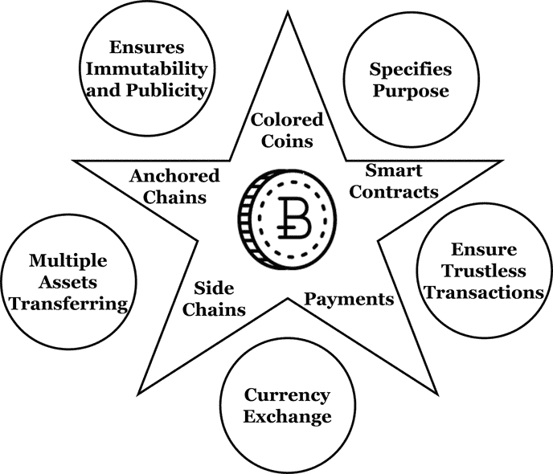

图 1.1 分布式账本技术。返回正文。](#C_004_c1.xhtml#f1_1)

共识过程调节包含在区块中的数据以及矿工的选择。建立了一个对等系统，其中每个节点在与其他节点启动通信和交互时被指定为对等节点；因此，被称为对等节点。网络中的全节点是指任何拥有整个区块链主机状态并负责运行整个区块链系统的设备。当客户端想要使用区块链时，它通过节点连接到网络。

### 1.2.2 医疗保健区块链的关键组成部分

# 区块链在医疗保健中的应用

## 1.2.2 区块链在医疗应用中的基础要素

医疗应用中区块链的基础要素突显了关键组件及其特定功能。去中心化账本是区块链的核心，在网络中安全且透明地存储交易。在医疗保健领域，它加密并保存患者记录、治疗史和其他敏感数据，其中每笔交易都带有时间戳、通过加密链接并分布在整个网络。加密哈希值将数据转换为唯一的、固定长度的字符串，有助于在区块链内部识别和维护数据完整性。任何数据更改都会产生新的哈希值，从而提醒网络潜在的篡改。智能合约是具有预定义规则的自动执行协议，适用于管理医疗保健中的患者同意、保险处理和监管合规。

它们促进了透明度并实现了无需中间介的无信任交易。共识机制，如 `Proof of Work` (`PoW`)、`Proof of Stake` (`PoS`) 和 `Practical Byzantine Fault Tolerance` (`PBFT`)，确保区块链网络上的节点对交易有效性达成一致，增强了医疗记录的可靠性和准确性。加密将明文转换为密文，通过仅允许授权方访问和解密敏感信息来保护医疗数据。不可篡改的审计追踪确保数据一旦经过验证就无法被更改。它创建了可审计的医疗交易历史，加强了数据完整性，减少了欺诈并支持监管合规。许可访问允许受控地进入区块链网络，确保敏感医疗信息保持安全。患者可以管理谁可以访问其数据，符合《健康保险可流动性与责任法》（`HIPAA`）等隐私法规。互操作性标准（如 `HL7` 和 `FHIR`）定义了无缝数据交换协议，促进了区块链与现有医疗 IT 系统的集成，提高了数据的可访问性和可用性。解决扩展性和性能问题至关重要，这使得区块链解决方案能够在不牺牲效率或安全的情况下处理大规模数据交易。

最后，监管合规确保医疗保健领域的区块链应用遵守数据保护法规，维护患者权利和隐私，并满足医疗提供者的法律义务。这些组件共同为医疗领域的区块链应用提供了一个安全、透明且高效的框架。图 1.2 描绘了区块链节点的基本功能。这些核心功能确保区块链网络是去中心化、安全且可靠的。区块链节点以去中心化、增强的安全性和透明度为特征，正在彻底改变金融、供应链管理和`医疗保健`领域。它消除中间环节、确保数据完整性以及提供防篡改记录的能力驱动了所有行业的创新，为传统挑战提供了更高效、更安全和更透明的解决方案。这种变革性影响已使区块链成为多个领域未来发展的基石 [13,14]。

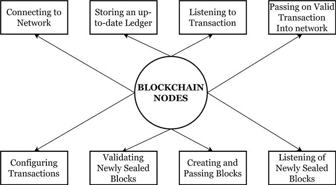

图 1.2 区块链节点类型。返回文本。⏎

### 1.2.3 区块链分类

区块链分为四种类型：公链、私有链、混合链和联盟链。公链允许所有参与者访问完整信息并参与共识机制。私有链限于指定的群体。在私有链中，特定小组内的所有节点均授权参与共识过程 [15]。混合区块链环境结合了公有链和私有链网络的优点。联盟链由组织集合管理，而不是由单个实体。它们提供了共享控制，但仍是许可性的，这意味着只有指定的个人可以访问区块链。这说明了公链如何将私有链的安全性和机密性与区块链网络的透明性相结合 [16,17]。在区块链应用中，我们必须解决两个挑战：双重花费和拜占庭将军问题。双重花费问题出现在单一货币用于两个并发交易中时。区块链通过允许许多去中心化节点验证交易来解决此问题。这需要开发相应的共识算法。

### 1.2.4 共识算法

- **工作量证明 (Proof-of-Work)**：它主要与比特币使用的区块链技术相关。矿工在采用 `Proof-of-Work` (`PoW`) 协议的同时，竞争解决计算密集型任务。评估此哈希值的矿工将在初始验证交易或区块或其他元素时获得补偿。`PoW` 协议在大型区块链上实施时需要大量的能量消耗。

- **权益证明 (Proof-of-Stake)**：开发 `Proof-of-Stake` (`PoS`) 的目的是解决能源效率低的问题。基本前提是拥有较大权益的节点更有可能为网络贡献区块。随机选择区块签名者，选择程序由矿工的权益金额决定。因此，与 `PoW` 中的耗尽计算相比，挖掘区块所需的能量将显著减少。

- **实用拜占庭容错 (Practical Byzantine Fault Tolerance)**：`Practical Byzantine Fault Tolerance` (`PBFT`) 是首次提出的用于解决拜占庭容错的共识机制，即使在系统内的恶意节点中也可以实现。执行非确定性链码可能非常有效。Stellar、Hyperledger 和 Ripple 是 `PBFT` 的示例。

- **委托权益证明与权益证明 (Delegated Proof of Stake and Proof of Stake)**：`Delegated Proof of Stake` (`DPoS`) 和 `PoS` 的根本区别在于，`PoS` 作为代民主制度运行，而 `DPoS` 作为直接民主制度。用户构建并验证区块。用于区块验证的节点减少增加了快速验证概率并加速了交易确认。

- **权威证明 (Proof of Authority)**：`Proof of Authority` (`PoA`) 整合了 `PoW` 和 `PoS` 的元素。它尊重利益者的声誉和身份。因此，股东获得的是其声誉而非股权份额的支持。因此，区块链的基础要素由真实可靠的人员保护。

- **投票证明算法 (Proof of Vote algorithm)**：`Proof of Vote` (`PoV`) 算法与其他所有共识机制相比是独特的。为了在区块链上产生交易区块，企业联盟必须参与数据交换。因此，他们聘用了外部人员协助。团队将区块分配给网络内的每家公司进行投票，以确保区块链的去中心化性质。所有者有时会通过雇用个人来扩大规模。这种方法是专为联盟设计的。

### 1.2.5 区块链技术在医疗领域的应用

医疗领域的区块链应用示例包括医疗管理、医学开发与遗传学以及电子医疗。区块链为所有医疗行业部门提供了安全可靠的信息存储机制，使医生和医疗提供者可以使用记录的数据进行各种交易和分析 [18,19]。在本节中，我们将研究在不同医疗子领域实施区块链的替代方法，如图 1.3 所示。区块链技术通过解决许多挑战（包括数据安全、协作和效率）改变医疗保健。这些是区块链对医疗行业产生重大影响的关键领域。

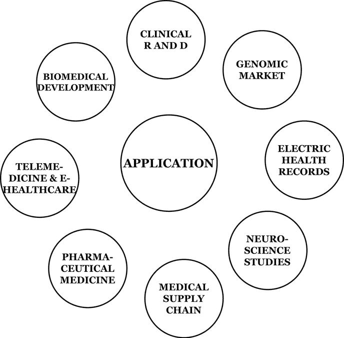

- **医疗记录管理**：医疗数据的碎片化性质对其构成了挑战，这些数据通常分散在多个提供者之间。这种脱节的设置限制了访问，增加了数据共享的复杂性，并提高了安全风险。区块链通过创建一个安全的、去中心化的账本解决了这些问题，患者记录以加密方式存储，只有通过授权通道才能访问。这种设置增强了安全性，支持了互操作性，并让患者对健康信息拥有更大的控制权。过去十年，健康数据数字化取得了显著增长，医疗专业人员越来越需要立即访问患者信息以做出及时决策。电子健康记录（EHR）作为医疗记录的数字版本，通过允许医疗提供者在获得适当授权的情况下访问患者的病史、诊断和治疗方案，满足了这一需求。区块链在 EHR 中的主要应用包括安全存储处方信息、治疗方案、实验室结果、测试结果和类似的关键健康数据，从而支持更集成、更安全的医疗数据管理系统 [20]。

- **供应链管理**：这要求在整个供应链中严格维护医疗设备的真实性和完整性，以确保患者安全并符合监管标准。区块链实现了跨供应链的透明化监管，提供了从生产者到消费者的追溯性。通过智能合约，验证程序可以自动化，确保物品在每个阶段都符合质量标准，并降低假药药物的风险。

- **临床试验**：它依赖于试验数据的完整性、透明度以及参与者同意书的管理，以确保研究的有效性和符合伦理标准。区块链可以简化知情同意书的管理，安全存档试验数据，并提供试验结果的可验证记录。这增强了透明度，减少了数据篡改的风险，并加速了监管审批。

- **医疗数据共享**：这涉及在医疗提供者、研究人员和保险公司之间交换敏感患者信息，往往由于隐私担忧和不同的 IT 系统而变得复杂。区块链允许患者通过密钥控制对医疗信息的访问，实现安全的、由患者引导的数据共享。通过安全传输加密数据，区块链促进了研究和治疗的信息流，同时确保了患者的机密性。

- **账单信息和医疗理赔处理**：医疗通常涉及多个中间环节，导致效率低下、延迟和潜在的不准确性。区块链可以通过智能合约简化计单流程，降低行政成本，最大限度地减少欺诈并提高支付准确性。

- **身份管理与验证**：医疗领域在不同提供者和系统之间管理患者身份面临挑战，往往导致不准确和欺诈活动的机会。基于区块链的数字 ID 提供了一种统一且安全的患者身份验证方法，显著增强了治疗准确性、计单和患者参与度。

- **研究与知识产权保护**：这对于确保医疗领域的创新至关重要。保护知识产权和维护研究完整性是这一过程中不可或缺的。区块链能够对研究数据和知识产权进行时间标记和认证，限制未经授权的使用。这项技术在保护研究人员权利和贡献的同时，促进了他们之间的协作。

- **物联网（IoT）集成**：医疗涉及向医疗系统安全传输实时数据，这对数据完整性和机密性提出了挑战。区块链为物联网设备传输这些实时数据提供了去中心且安全的平台，确保其真实性。此外，它促进了基于智能合约的自动化操作，提高了医疗流程的效率和可靠性。

- 医疗管理中的各种区块链创新，凸显了它们的应用、描述和相关工具。在 EHR 中，区块链创建了一个去中心化且不可变的系统，使用 `MedRec`、`Patientory` 和 `Guardtime Health` 等工具确保患者数据保持安全且防篡改。区块链利用 `IBM Blockchain`、`FarmaTrust` 和 `Embleema` 等平台增强了临床试验和研究中的数据透明度。在药物供应链和管理中，区块链技术跟踪整个供应链中的药物，有效防止假药，使用的工具包括 `MediLedger`、`Blockpharma` 和 `Chronicled`。关于医疗费用账单和理赔，区块链验证账单流程，减少了欺诈和错误；著名工具包括 `PokitDok`、`Hashed Health` 和 `SolveCare`。区块链在患者同意管理方面也起着至关重要的作用，通过 `Consentium`、`Health Wizz` 和 `Coral Health` 等工具安全记录并轻松验证患者对数据共享的同意 [21]。

- 此外，它通过利用 `Hyperledger`、`Ethereum` 和 `IBM Blockchain` 等技术在维护数据完整性的同时，允许不同医疗系统之间的数据共享，从而促进了互操作性。对于可穿戴设备和物联网设备，区块链通过 `Factom`、`Medicalchain` 和 `Chronicled` 等工具保护可穿戴健康设备的数据，确保隐私和准确。在保险领域，区块链增强了理赔处理的透明度，Aetna 的区块链倡议和 MetLife 的 `LumenLab` 就是示例。此外，区块链通过 `SelfKey`、`Civic` 和 `ShoCard` 等平台为患者和医学专家提供高度安全的数字身份。最后，区块链利用 `Hacera`、`IBM Blockchain` 和 `SAP Blockchain` 等工具提高了公共卫生监测中公共卫生数据收集和报告的准确性和速度。

## 1.3 区块链应用的挑战

区块链技术由于固有缺陷和许多架构问题面临着挑战。正如各种学者所开发的，区块链技术存在重大的技术问题和限制，如图 1.4 所示。

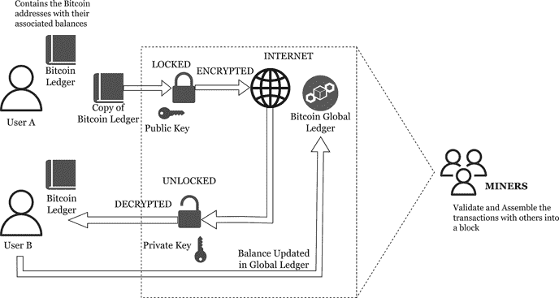

图 1.4 区块链面临的挑战。返回文本。⏎

- **吞吐量问题**：它的最大交易率不超过五。因此，如果传统的电子商务公司实施区块链进行交易，可能会由于交易延迟和不断攀升的网络通信费用而失败。

- **延迟问题**：高延迟是比特币网络内部的一个重大问题。程序大约需要 10 分钟才能完成，还需要额外的时间来防止双重支付。要使双重成功，必须满足某些条件。

- **尺寸和带宽限制**：区块链的可扩展性对于与 `Visa` 等传统电子商务平台竞争至关重要。比特币网络每秒可以处理大约 500 交易，促进了可扩展性，如图 1.5 所示。

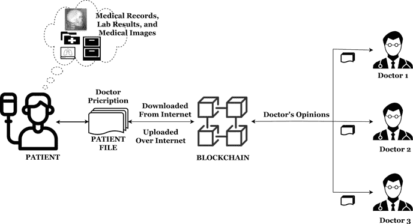

图 1.5 区块链的可扩展性问题。返回文本。⏎

- **区块大小（Block Size）**：去中心化系统中的每个节点都处理每笔交易，形成了账本状态的完整副本。在患者护理系统中，只需要特定节点的关键账本，而不是整个账本。

- **高数据量（High Volume）**：当利用该平台维护患者档案时，可能会有一百万条额外记录在所有参与者之间进行复制。因此，会导致信息过载。重要的是，医疗机构在创建扩展链提供者时面临着数据量过大的困难。

- **交易（Transactions）**：`Ethereum` 区块上的每笔交易都需要网络内所有验证者的验证。数据负载会对网络速度产生不利影响。因此，实现共识或验证数字身份需要时间。

- **节点数量（Number of Nodes）**：随着用户或患者数量的大幅增长，基于区块链的应用的复杂性也随之增加。伴随出现的是区块链系统整体计算需求的增加。

- **协议（Protocol）**：区块链技术无法解决某些患者问题，例如不可预见的访问限制或紧急情况。此外，在紧急情况下，首先禁止医生访问个人信息。

- **资源浪费（Resource Wastage）**：共识过程对于 `Bitcoin` 系统至关重要，它提供了防御攻击者的安全性，但也导致了计算资源的巨大浪费，表现为硬件成本的增加和能耗消耗。

- **可用性问题（Usability Problem）**：大多数区块链研究强调安全性、机密性、数据完整性、效率和扩展性等技术要素，有时忽略了可用性 [22,23]。

- **分叉问题（Fork Problem）**：当需要修改时，区块链会发生分裂。分叉分为两类：软叉和硬叉。区块链通过参与者、节点和矿工运行。节点必须接受所有修改。此外，更新后的节点会持续验证区块。

## 1.4 区块链在医疗保健中的实施

在医疗保健中实施区块链为医疗机构增强数据安全和透明度提供了变革性的机会，最终改善患者护理。工作流始于识别区块链可以增加价值的特定用例，例如医疗记录管理、临床试验、供应链完整性或保险理赔处理。在确定这些应用后，下一步是设计一个为组织量身定制的区块链网络。这包括根据数据敏感性和监管义务，从私有、公有或混合区块链选项中进行选择，并阐明将使用的共识机制和治理框架。一旦网络设计完成，将从医院、诊所和实验室等多个来源收集医疗数据。然后，使用复杂的加密方法对关键信息进行加密以确保机密性。

创建智能合约以自动化患者同意管理、保险验证和药品追溯。这些智能合约执行预设的法规并自主进行交易。随着交易的发生，加密的医疗数据和交易记录将作为不可篡改的区块保存在区块链上。每笔交易（无论是患者就诊还是实验室检测结果）都有时间戳并与上一个区块链接，建立起可见且可验证的信息链。加密密钥技术维持访问控制和隐私，确保只有授权的实体（包括患者、医疗提供者和研究人员）才能访问指定数据。这种方法保护了患者隐私，并遵守了通用数据保护条例（`GDPR`）和 `HIPAA` 等数据保护法。

此外，互操作性对于区块链在医疗领域的有效整合至关重要；因此必须开发标准和协议，以促进各种医疗系统和区块链网络之间的无缝数据共享。利用应用程序接口（`APIs`）和数据标准（如 `HL7` 和 `FHIR`）可以实现顺利的数据交换。定期审计对于确保数据完整性和符合监管标准至关重要；区块链透明且可审计的特质简化了审计过程并增强了监管合规性。将区块链与 `IoT` 设备和人工智能算法相结合，通过改进实时数据收集、分析和决策，进一步增强了医疗生态系统 [24]。

持续改进也至关重要；评估交易速度、扩展性和成本效益等性能指标允许对区块链网络及其协议进行持续优化，从而提高效率和用户体验 [25]。针对医疗专业人员、管理人员和患者的区块链技术及其优势教育和培训也同样重要 [26,27]。最后，通过利益相关者（技术供应商和监管机构）之间的协作，有助于解决问题。

## 1.5 结论与展望

本章阐述了区块链在医疗保健领域的现状，强调了其前景优势和应用。区块链通过改进数据处理和管理，为创建安全的以患者为中心的系统提供了可能。各种区块链原型和概念已得到研究。尽管如此，仍需进一步研究以解决与其相关的挑战，包括延迟和隐私问题。这种复杂的技术应根据其相关性和需求被谨慎使用。

## 参考文献

1. B. Haleem, M. Javaid, R. P. Singh, S. Suman, R. Rab，“Blockchain Technology Applications in Healthcare: An Overview,” International Journal of Intelligent Networks, vol. 2, pp. 130–139, 2021. [`doi.org/10.1016/j.ijin.2021.09.005`](https://doi.org/10.1016/j.ijin.2021.09.005). 返回原文

2. W. Y. Ng, T.-E. Tan, P. V. H. Movva, A. H. S. Fang, K.-K. Yeo, D. Ho, F. S. S. Foo, Z. Xiao, K. Sun, T. Y. Wong, A. T.-H. Sia, D. S. W. Ting，“Blockchain Applications in Health Care for COVID-19 and Beyond: A Systematic Review.” Lancet Digit Health, vol. 3, no. 12, pp. e819–e829, 2021. 返回原文

3. M. A. Bazel, F. Mohammed, M. Ahmed，“Blockchain Technology in Healthcare Big Data Management: Benefits, Applications and Challenges,” In: 2021 1st International Conference on Emerging Smart Technologies and Applications (`eSmarTA`), Sanaʼa, Yemen, August 10–12, 2021, pp. 1–8. [`doi.org/10.1109/eSmarTA52612.2021.9515747`](https://doi.org/10.1109/eSmarTA52612.2021.9515747). 返回原文

4. M. Y. Jabarulla, H. N. Lee, “基于区块链的以患者为中心的图像管理系统,” Applied Sciences, vol. 11, no. 1, p. 196, 2021. [`doi.org/10.3390/app11010196`](https://doi.org/10.3390/app11010196). 返回正文

5. A. Tandon, A. Dhir, A. K. M. Najmul Islam, M. Mäntymäki, “医疗保健中的区块链：系统文献综述、综合框架与未来研究议程,” Computers in Industry, vol. 122, p. 103290, 2020. [`doi.org/10.1016/j.compind.2020.103290`](https://doi.org/10.1016/j.compind.2020.103290). 返回正文

6. H. D. Zubaydi, Y.-W. Chong, K. Ko, S. M. Hanshi, S. Karuppayah, “区块链技术在医疗保健领域的作用述,” Electronics, vol. 8, p. 679, 2019. [`doi.org/10.3390/electronics8060679`](https://doi.org/10.3390/electronics8060679). 返回正文

7. 15G. Chen, B. Xu, M. Lu, N. S. Chen, “探索区块链技术及其在教育中的潜在应用,” Smart Learning Environments, vol. 5, p. 1, 2018. [`doi.org/10.1186/s40561-017-0050-x`](https://doi.org/10.1186/s40561-017-0050-x). 返回正文

8. H. F. Anjum, S. Z. A. Rasid, H. Khalid, M. Alam, S. M. Daud, H. Abas, “医疗保健中区块链技术的研究趋势映射,” IEEE Access, vol. 8, pp. 174244–174254, 2020. [`doi.org/10.1109/ACCESS.2020.3025011`](https://doi.org/10.1109/ACCESS.2020.3025011). 返回正文

9. N. Singh, Y. Kumar, “5G 医疗保健中的安全与隐私需求,” 在: 用于 5G 医疗保健应用的区块链, IET Publication, pp. 1–30, 2021. [`doi.org/10.1049/PBHE035E_ch1`](https://doi.org/10.1049/PBHE035E_ch1). 返回正文

10. Al Mamun, A. S. Azam, and C. Gritti, “基于区块链的健康记录：综合综述与未来方向,” IEEE Access, vol. 10, pp. 5768-5789, 2022. [`doi.org/10.1109/ACCESS.2022.314109`](https://doi.org/10.1109/ACCESS.2022.314109). 返回正文

11. H. Kaur, M. A. Alam, R. Jameel, A. Mourya, V. Chang, “云环境中基于区块链的异构数据的解决方案与未来方向,” Journal of Medical Systems, vol. 42, no. 8, p. 156, 2018. [`doi.org/10.1007/s10916-018-0075`](https://doi.org/10.1007/s10916-018-0075). 返回正文

12. D. Elangovan, C. S. Long, F. S. Bakrin, C. S. Tan, K W. Goh, S. Yeoh, M. J. Loy, Z. Hussain, “区块链在医疗部门的使用,” JMIR Medical Informatics, vol. 10, p. e17278, 2022. [`doi.org/10.2196/17278`](https://doi.org/10.2196/17278). 返回正文

13. N. Goenkaa, A. K. Sharmab, S. Tiwaric, N. Singhd, V. Yadave, S. P. Chadaga, “基于 T1 加权图像的正则化体积网络检测阿尔茨海默症,” Cogent Engineering, vol. 11, no. 1, p. 2314872, 2024. [`doi.org/10.1080/2331916.2024.2314872`](https://doi.org/10.1080/2331916.2024.2314872). 返回正文

14. I.A. Omar, M. Debe, R. Jayaraman, K. Salah, M., Omar, J. and Arshad, “基于区块链的新冠防护装备供应链追溯,” Computers and Industrial Engineering, vol. 167, p.107995, 2022. [`doi.org/10.1016/j.cie.2022.107995`](https://doi.org/10.1016/j.cie.2022.107995). 返回正文

15. L. Kandasamy, A. Ajay, “用于双层隐写安全共享区块链技术实现,” 在: Hu, Z., Wang, Y., He, M. (eds), 智能系统、计算机科学与数字经济进展 IV. CSDEIS 2022. 数据工程与通信技术讲义, vol 158, Springer, pp. 186–195, 2023. [`doi.org/10.1007/978-3-031-24475-9_16`](https://doi.org/10.1007/978-3-031-24475-9_16). 返回正文

16. R. Pandey, A. Khatri, G. Premalatha, M. Lakshmu Naidu, D. Verma, C. J. Shinga Diya, “区块链技术在医疗系统中的集成：深度综述,” 在: 2023 年第三届先进计算与工程创新国际会议 (ICACITE), 印度大诺诺伊达, 2023 年 5 月 12–13 日, pp. 968–972. [`doi.org/10.1109/ICACITE57410.2023.1018290`](https://doi.org/10.1109/ICACITE57410.2023.1018290). 返回正文

17. E. Elgamal, W. Medhat, M. A. Elfatah, N. Abdelaki, “医疗保健中的区块链实现患者隐私,” 在: 2023 年第 20 届学习与技术会议 (LT), 沙特阿拉伯，吉达, 2023 年 1 月 26 日, pp. 59–64. [`doi.org/10.1109/LT58159.2023.100925`](https://doi.org/10.1109/LT58159.2023.100925). 返回正文

18. V. Asha, A. P. Nirmala, B. Saju, A. K. Das, A. Sharma, “区块链在医疗保健中的作用,” 在: 2023 年可持续计算与数据系统国际会议 (SCDS), 印度埃罗德, 2023 年 3 月 23–25 日, pp. 370–374. [`doi.org/10.1109/SCDS56580.2023.101042`](https://doi.org/10.1109/SCDS56580.2023.101042). 返回正文

19. D. C. Nguyen, M. Ding, P. N. Pathirana, A. Senevirat, “应对类新冠疫情的区块链与人工智能解决方案：综述,” IEEE Access, vol. 9, pp. 95730–95753, 2021. [`doi.org/10.1109/ACCESS.2021.309363`](https://doi.org/10.1109/ACCESS.2021.309363). 返回正文

20. M. K. Chandol, M. Kameswara Rao, “用于物联网医疗保健的隐私加密区块链方法,” Journal of Experimental & Theoretical Artificial Intelligence, vol. 37, pp. 53–74. [`doi.org/10.1080/0952813X.2023.218326`](https://doi.org/10.1080/0952813X.2023.218326). 返回正文

21. R. K. Dewang, M. P. Yadav, S. Awasthi, O. Raj, A. Mewada, K. L. Bawankule, “数据安全应用：使用区块链和 `IPFS` 安全存储数据的应用程序,” Multimedia Tools and Applications, vol. 83, no. 15, pp. 45491–45517, 2024. 返回正文

22. S. Upadhyay, S. Agarwal, A. Chaudhary, P. Singh, R. Sharma, “医疗系统中的区块链：系统性综述,” 在: 2024 年第二届颠覆性技术国际会议 (ICDT), 印度大诺诺伊达, 2024 年 3 月 15–16 日, pp. 140–147. [`doi.org/10.1109/ICDT61202.2024.104895`](https://doi.org/10.1109/ICDT61202.2024.104895). 返回正文

23. A. Arif, M. Hussain, C. P Subbe, “区块链：2024 年医师的使用场景是什么？文献快速综述,” Future Healthcare Journal, vol. 11, no. 1, p. 100005, 2024. [`doi.org/10.1016/j.fhj.2024.100005`](https://doi.org/10.1016/j.fhj.2024.100005). 返回正文

24. M. S. B. Kasyapa, C. Vanmathi, “医疗保健中的区块链集成：用例、性能问题和缓解策略的全面调查,” Frontiers in Digital Health, vol. 6, p. 135958, 2024. 返回正文

25. M. A. Ansari, D. K. Singh, “实时监控的人类检测技术：全面综述,” Multimedia Tools and Applications, vol. 80, pp. 8759–8808, 2021. [`doi.org/10.1007/s11042-020-10103-4`](https://doi.org/10.1007/s11042-020-10103-4). 返回正文

26. A. Bathula, S. K. Gupta, S. Merugu, L. Saba, N. N. Khanna, J. R. Laird, S. S. Sanagala, R. Singh, D. Garg, M. M. Fouda, J. S. Suri, “区块链、人工智能与医疗健康：未来的三足鼎——叙述性回顾”，Artificial Intelligence Review, vol. 57, p. 238, 2024. 返回正文.

27. K. H. Kim, S.-M. Kim, Y. M. Park, E. S. Lee, S. J. Jung, J. Kang, D. U. An, K. Min, S. R. Shim, H. W. Yu, H. W. Han, “基于区块链的医疗数据市场：原型与演示”,JAMIA Open, vol. 7, no. 2, p. ooae029, 2024. 返回正文.

# 2 迈向区块链与物联网集统一框架：架构洞察与研究挑战

Reetu Singh, Greetta Pinheiro, Niharika Keshari, Arvind Mewada, 和 Mohd. Aquib Ansari

DOI: [10.1201/9781003545620-3](https://doi.org/10.1201/9781003545620-3)

## 2.1 引言

物联网（`IoT`）代表了一种改变人类与环境交互的新配置。它是一个极其复杂的联网设备网络，范围从家庭使用的简单家电器到高度复杂的工业设备。`IoT` 设备收集数据、交换信息，并利用软件、传感器和连接性来实现流程自动化，并能够实时决策，以提高工作和日常生活的效率与便利性 [1]。物联网正在创造智能环境。智能温控器可以学习你的偏好，重型工业设备能够感知自身何时即将发生故障。网络中的每个设备都会产生海量数据，因此我们需要能够高效存储这些数据以供处理和分析的系统，且不牺牲性能。此外，随着数据的增加，安全性、不可篡改性、隐私以及对可靠可扩展基础设施的需求也随之增加。具有安全性、不可篡性和透明性核心属性的区块链技术成为解决物联网重大挑战的可行方案 [2]。区块链最初设计为比特币等加密货币的骨干，是一种去中心化的[3]账本系统，在分布式网络上安全地记录和存储数据。区块链的工作原理是将信息及其之前信息的哈希值记录在加密的“区块”中，每个区块相互链接形成一条不可更改且安全的链。区块链的任何更改都需要整个网络的共识，从而提供了防止伪造或未经授权更改的强有力保护。这种去中心化的架构降低了对某些中央权威的依赖风险，从而提供了防止伪造或未经授权更改的强大保护。

区块链与物联网的集成为某些挑战提供了革命性的解决方案。这种去中心化的架构降低了对某些中央权威的依赖风险，从而提供了防止伪造或未经授权更改的强大保护。这种去中心化的架构降低了对某些中央权威的依赖风险，从而提供了防止伪造或未经授权更改的强大保护。

### 2.2.1 应用层

该层包含对收集的数据进行分析的软件应用，以便向用户展示有意义的洞察或控制工具。它支持自动化并实现更好的决策。

### 2.2.2 区块链

区块链技术是一种去中心化且分布式的数字账本，允许在多台计算机之间安全地记录交易，并提供数据安全、不可篡改性和透明性的保障。虽然它最初是为比特币等加密货币设计的，但区块链的核心思想在于其能够在不需要中心权威的情况下，生成安全、防篡改的交易记录[8, 9]。交易被分组到区块中，并随后与之前的区块连接，形成一条安全链，如图 2.1 所示。交易经过哈希处理并成对组合，形成一个类似树的结构，其中每个 20 节点代表其子节点的哈希值，如图 2.2 所示。区块头包含根哈希，确保了交易的完整性和安全性。这种架构促进了参与者之间的信任，因为数据的任何改动都需要整个网络的共识。

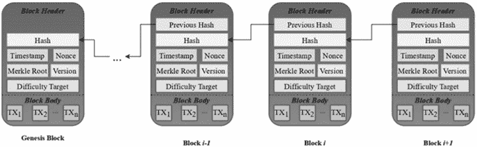

图 2.1 区块链架构：每个区块都包含一个带有前一个区块哈希、随机数（`nonce`）、时间戳和 `Merkle` 根的头部，形成区块链。返回文本。⏎

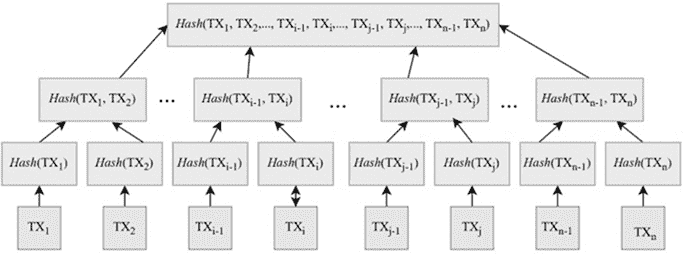

图 2.2 区块链中的 `Merkle` 树和哈希处理。返回文本。⏎

区块链架构由其去中心化和分布式的特征定义，由几个关键部分组成：

1. **区块**：每个区块都保存交易数据、时间戳和前一个区块的加密哈希，有效地将它们链接成一条安全链（如图 2.1 所示）。此外，区块利用 `Merkle` 树对交易进行高效且安全的验证，确保了数据的完整性（如图 2.2 所示）。这种结构确保了所记录数据的完整性和不可篡改性。

2. **节点**：在区块链网络中，单个单台计算机被称为节点；每个持有区块链副本的节点都参与验证交易。这种去中心化模型防止任何单一实体控制整个系统，从而提高了系统的安全性和透明度（如图 2.3 所示）。每个节点都验证交易并维护区块链的状态，为网络的韧性和可靠性做出贡献。

    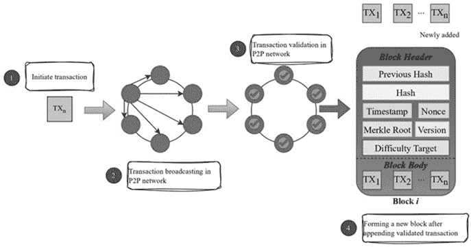

    图 2.3 区块链交易流：(1) 发起交易，(2) `P2P` 网络中的交易广播，(3) 交易验证，以及 (4) 新区块的形成。返回文本。⏎

3. **共识机制**：使用协议来确保对交易有效性的达成共识。流行的方法包括权益证明 (`POS`) 和工作量证明 (`PoW`)。

## 2.3 IoT 使用区块链：架构

共识机制用于确保交易有效性的达成共识。区块链的架构由其去中心化和分布式特性定义

### 2.3.1 IoT 使用区块链：架构、优势、挑战

集成物联网和区块链需要多层架构来确保无缝通信、安全性。图 2.3 描述了这种架构。基于区块链的物联网系统描述了 2.4 区块是如何链接和添加的。

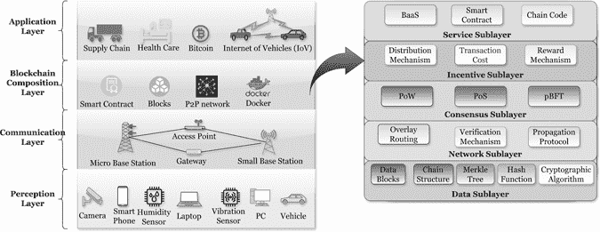

# 图 2.4 IoT 使用区块链的层级架构

## 1. 感知层
被称为设备层，由从环境采集数据的物理设备组成。这些设备嵌入了传感器、执行器。

### 组件
摄像头、智能手机、湿度传感器、笔记本电脑、车辆。

### 功能
该层作为现实世界到数字系统的接口。它收集湿度、温度或视频流等数据，并将其发送到通信层。

## 2. 通信层
通信层用于从物联网设备到感知层的数据传输。传感器到网关的通信是绝对可靠且安全的。

### 组件
微基站、网关、小型基站和接入点。

### 功能
它促进了设备到中央服务器或云平台的电子通信。

## 3. 区块链组成层
涉及区块链的区块组成层对于安全、不可篡改和分布式数据管理至关重要。它通过去中心化账本处理并存储物联网数据。

### 组件
区块、智能合约、`Docker` 容器、`P2P`（对等网络）。

### 功能
该层标志着区块链去中心化账本、智能合约和对等网络的应用领域。区块链组成层通过跨节点的去中心化存储保护物联网数据，并通过智能合约和容器化应用（如 `Docker`）实现交易或数据交换，以提高效率和扩展性。

## 4. 应用层
该层详细说明了开发物联网区块链系统的特定用例和服务。它将终端用户连接到跨不同行业的应用程序。

### 组件
车载网络 (`IoV`)、供应链管理、医疗健康、比特币集成。

### 功能
基于区块链的物联网解决方案专门满足各种行业的需求，例如供应链追溯、健康监测、车车通信和加密货币交易。

## 5. 激励子层

### 组件
`Distribution Mechanism`、`Transaction Cost`、`Reward Mechanism`。

### 功能
它通过向区块链网络内部的参与者或节点奖励来处理激励机制，以便他们可以使用计算力验证交易。

## 6. 共识子层
该子层对于通过共识算法维护区块链网络的完整性至关重要。

### 组件
`Practical Byzantine Fault Tolerance`、`PoS`、`PoW`。

### 功能
共识子层验证所有对方对添加到区块链的交易合法性达成一致。有多种共识算法，包括 `PoW`、`PoS` 和 `pBFT`，它们用于确保交易的安全并防止欺诈行为。

## 7. 网络子层
网络子层支持跨区块链的安全路由和数据传播。

### 组件
`Verification Mechanisms`、`Overlay Routing`、`Propagation Protocols`。

### 功能
该层强调整个网络中数据包的安全转发和验证。覆盖路由技术允许区块链数据在物联网网络中有效移动。由于覆盖网络确保了源和目的地之间通信期间数据的验证和回溯，因此保证了真实数据的真实性。

## 8. 数据子层
区块链的这一子层形成了区块链中的数据结构和加密。

### 组件
`Blocks`、`Chain`、`Merkle Tree`、`Hash Functions`、`Cryptographic Algorithms`。

### 功能
该子层将数据组织成区块，连接并使用 `Merkle trees` 和 `hash functions` 等加密方法锁定区块。结果是来自物联网的数据是防篡改、可验证的，并将安全地存储在分布式账本上。

# 2.3.2 使用区块链的物联网优势

物联网与区块链的结合利用了两者的优势，以解决物联网系统中存在的关键挑战，从安全性和扩展性到信任。以下是结合物联网与区块链带来的主要益处。

## 2.3.2.1 增强安全性

区块链为物联网数据的安全提供了一个去中心且防篡改的框架 `[10]`。由于物联网设备会产生并共享大量的敏感信息，与其相关的关键危险是易受到网络攻击。区块链通过数据完整性缓解了这些风险，保证了每当物联网设备的数据写入账本时，它都无法被更改。所有更改数据的尝试都将被网络拒绝，从而保持其真实性。区块链利用网络中的一系列节点进行去中心化验证，而不是仅仅依赖中央权威来验证和记录交易。单此一点就能够更有效地抵御诸如针对物联网网络的分布式拒绝服务攻击等攻击。

## 2.3.2.2 无信任环境

在传统的物联网设置中，数据验证大多数时候由受信任的中央权威或第三方执行。然而，这留下了漏洞并增加了配置复杂度。区块链在物联网系统中的应用使得建立无信任环境成为可能，理论上设备可以自主交互并共享数据，而无需中间人。

### 1. 去中心化信任
区块链共识机制允许物联网设备独立地验证和确认交易及数据。因此，不再需要信任的中间人，这提高了效率和安全性。

### 2. 机器机器 (M2M) 信任
区块链为物联网设备提供了安全通信。

## 2.3.2.3 提高透明度和可追溯性

区块链最重要的优点是其透明性和可追溯性，这在供应链管理和医疗保健领域特别有用。

### 1. 可追溯性
使用区块链允许利益相关者追溯每个产品的来源和历程。

### 2. 可审计性
使用区块链确保所有操作都被记录并经过审计。

## 2.3.2.4 通过智能合约实现自动化

智能合约是在满足预定义条件时自动激活的自执行协议。

### 1. 自主操作
通过实时信息，物联网设备可以采取行动。

### 2. 高效流程
智能合约实现了支付的自动化和记录更新。

### 3. 节省成本
智能合约减少了对中间人的需求。

## 2.3.2.5 可扩展性与资源优化

将工作负载分散到多个节点可能是区块链去中心化架构帮助提高物联网扩展性的另一种方式。

### 1. 高效的资源利用
区块链有助于处理数据。

### 2. 可扩展网络
随着物联网设备数量的增加，区块链将能够处理更多交易。

# 2.3.3 使用区块链的物联网应用

物联网与区块链的结合建立了一个稳健的技术框架，将彻底改变多个行业。区块链有助于解决物联网中的关键挑战，如透明度、安全性、扩展性和数据完整性。

## 2.3.3.1 供应链管理

在供应链管理中，传感器、射频识别（`RFID`）标签和 `GPS` 技术等物联网设备用于在产品的整个生命周期跟踪货物并监控状况（温度、湿度等）`[11]`。将区块链引入这一过程可以提高可追溯性和透明度。

## 2.3.3.2 智慧城市

这使得城市利用物联网（`IoT`）技术来控制并最大化城市系统的效率，涵盖从能源使用及其流动到水供应和公共安全的范围内 `[12]`。这使得利用区块链提高以下物联网应用的安全性和效率理念成为可能：

### 1. 交通管理
物联网传感器可以实时跟踪交通状况。区块链上的智能合约可以根据反馈的实时数据改变交通灯的工作方式或道路的使用情况。区块链保证了这些数据的真实性并实现了操作的自动化。

### 2. 能源管理
区块链实现了去中心化的点对点能源交易，智能合约允许居民出售或购买来自光伏太阳能电池板或其他可再生能源的剩余能量。其结果是在智慧城市内部建立了强有力的能源市场，并限制了对中央公用事业的依赖。

### 3. 公共安全
基于物联网的监控和传感器跟踪环境状况。区块链可以记录并管理这些数据，以确保公共安全决策不会基于错误或虚假信息。

## 2.3.3.3 医疗保健

物联网设备（如智能医疗设备和远程监控系统）在健康领域收集并传输患者数据。区块链随后可以确保此类敏感信息是安全、且准确的 `[13]`。

### 1. 医疗数据安全
区块链技术确保了医疗记录在服务提供者、患者和保险公司之间的安全传输性。随着物联网设备持续生成实时健康信息，区块链安全地存储这些信息且无法被修改。

### 2. 远程患者监测
可穿戴物联网设备可以通过报告患者的生命体征（如心率、血压和血糖水平）来实现远程患者监测。区块链确保了数据的安全传输；数据只有授权人员才能访问，从而保护了患者的隐私。

### 3. 药物追溯
区块链和物联网可以相互连接，跟踪药物从制造到销售点药物供应链中的每个阶段，从而减少假药，并确保为患者提供安全、真实的药物。

# 2.3.4 农业与食品供应链

区块链和物联网对农业具有重要意义，旨在提高食品安全性的同时优化资源利用，从而减少浪费。

### 1. 精准农业
它通过物联网传感器监测土壤、天气和作物健康状况，并将这些数据安全地存储在区块链中。这为农民关于灌溉、种植和收获的决策提供了更好的依据，这些决策往往能增加产量并节省资源。

### 2. 食品安全与追溯
物联网将跟踪从农场到消费者的产品。区块链将确保正确信息传递给消费者，以验证其所消费食品的来源和质量。

### 3. 可持续性与公平贸易
区块链对农业过程中生产和分配的每一步进行跟踪，有助于验证农业中可持续性和公平贸易的实践，并确保尊重了伦理标准。

# 2.4 文献综述

本文献综述概述了区块链技术与物联网（`IoT`）集成的主要贡献、局限性以及未来方向，重点关注医疗保健应用。通过综合各项研究的发现，该综述为现有文献提供了清晰的对比。区块链与物联网的集成已成为一个重要的研究领域，涉及多个领域的各种应用和挑战。

文章 `[8]` 研究了医疗保健领域的这一交叉领域，探索了远程患者监测、疾病预测和安全医疗记录管理等应用。他们强调了可能增强医疗服务的各种区块链类型及相关工具。然而，他们的综述局限于特定时间范围（2018–2023 年），且主要聚焦于医疗保健，导致缺乏实际落地，并更多依赖于概念而非经验性的解决方案。他们建议开发更高效的区块链算法来管理实时医疗健康数据并增强隐私。

文章 `[14]` 使用潜在狄利克雷分配（`LDA`）对 4,455 篇期刊文章进行了全面的物联网与区块链集成分析，以识别研究主题。他们将这些文章分为 14 个不同的研究领域，但这些主要是理论性的，对实际方面的关注很少。他们识别出许多相对未被探索的主题，这些可以纳入未来研究，例如无线传感器网络的能量效率和物联网系统中的访问控制机制。

文章 `[15]` 分析了物联网-区块链架构和挑战，重点关注数据完整性和安全性等若干优势，并提出了了一些潜在的未来研究挑战。他们的工作主要是理论性的，且未经过实验证明；在开发稳健框架以推进区块链物联网（`BIoT`）安全并克服可扩展性挑战方面，背景非常具有挑战性。

此外，`[7]` 讨论了物联网与区块链在医疗保健、农业和智慧城市等不同领域集成的各种应用、机会和挑战。尽管他们的框架具有见地，但尚不能充分解决可扩展性问题，且只有极少的经验材料支持他们的观点。他们进一步指出，该领域的研究是必要的，以提高复杂物联网-区块链环境中的互操作性和安全性。

作者 `[16]` 考虑了在人工智能（`AI`）与这两种范式交互的情况下，区块链如何缓解物联网安全问题。他们引入了“作为服务的区块链”的概念，但其工作主要展示了理论模型，缺乏经验结果或评估。他们的未来方向包括研究用于物联网与区块链集成的 `AI` 优化策略，以及区块链作为服务的进一步真实世界部署。

文章 `[17]` 系统地综述了用于物联网的区块链解决方案，重点关注物联网数据和设备管理中集成区块链的技术方法。然而，许多研究仍处于概念阶段，缺乏现实应用，在大规模物联网环境中面临高昂的计算成本。他们建议开发可扩展的轻量级区块链框架，以更好地支持大型物联网系统。

文献揭示了区块链与物联网集成领域动态且不断演变的格局。尽管已取得了重大的理论贡献，但大多数研究强调概念框架，实证验证有限。未来的研究应优先考虑实际落地、可扩展性解决方案以及对研究不足领域的探索，以充分利用区块链与物联网集成的潜力。

# 2.5 使用区块链的物联网研究空白

## 2.5.1 可扩展性挑战

区块链的低吞吐量和延迟使其难以实时处理物联网设备产生的大量数据。可扩展性在物联网系统中非常重要，因为这涉及到大量设备，从而产生海量数据。解决这些可扩展性问题后，在大规模物联网系统中使用区块链是可行的。

## 2.5.2 存储与数据管理

为了存储物联网设备产生的大型数据集，必须高效开发区块链。将所有物联网数据都载在链上的要求由于巨大的存储需求而变得不可接受，这进一步导致了区块链膨胀和成本增加等问题。因此，在不给区块链系统带来巨大负载的情况下，开发存储和安全处理物联网数据的高效解决方案至关重要。

## 2.5.3 能量消耗与资源限制

然而，传统的共识机制（如 `PoW`）需要大量的处理能力和资源才能供物联网设备运行。因此，传统的区块链共识机制在物联网网络中大规模使用是不现实的。`PoW` 是计算密集性最高的。大多数物联网设备依赖极低电源（如电池），无法提供这种资源消耗。因此，节能友型的解决方案对于区块链在物联网中的采用至关重要。只要物联网设备拥有为其量身定制的轻量级共识机制（如 `PoS` 或其他低功算法），就可以区块链的应用扩展到资源受限的设备，在不损失效率的情况下提高安全性。

## 2.5.4 延迟与实时处理

区块链技术的延迟源于区块验证和共识所需的时间。因此，它无法直接应用于自动驾驶和智慧医疗等实时物联网应用。在这样的环境中，微小的延迟可能导致事故或医疗干预延迟等严重问题；因此，在这些应用中实施区块链时应将延迟降至最低。低延迟区块链解决方案使物联网系统受益于区块链的安全性和透明性，同时满足关键操作的实时需求。

## 2.5.5 安全与隐私关注

物联网设备仍然受到网络攻击的威胁，而区块链增强了安全方面。但这并非终点；它仍留下了分布式拒绝服务（`DDoS`）攻击或智能合约漏洞等问题。物联网系统往往持有敏感信息，因此必须具备正确的安全和隐私机制。无论区块链承诺什么，除非填补这些空白，否则它无法保证物联网生态系统面对新兴威胁时的绝对安全。

# 2.6 使用区块链的物联网未来研究方向

未来利用区块链的物联网研究将集中在几个关键领域，并考虑到这两种技术融合所带来的独特挑战。可扩展的区块链架构，结合二层解决方案和分片技术，可能是最重要的方向；这些旨在处理物联网设备产生的海量数据和交易。物联网系统通常需要高效的共识机制，例如 `PoS` 协议，因为许多设备资源受限且执行的是低功耗操作。保护隐私的技术（如零知识证明和同态加密）将在确保敏感物联网数据机性的同时，继续保护用户隐私。将识别并开发用于操作性的全局解决方案，以创建跨链协议和标准化框架，从而允许跨平台之间的无缝交互。最后，人工智能在物联网自动化中的集成将增强智能合约，并预测基于区块链的物联网中的安全威胁，从而在提升安全配置的同时提高性能。这三个研究方向共同和谐地工作，成为推动区块链技术在物联网中集成的路径。

# 2.7 结论

区块链技术集成到物联网系统中具有变革许多部门的巨大潜力，能够克服物联网面临的大多数挑战，这些挑战涉及安全性、透明性和数据完整性。本章研究了利用区块链的物联网架构、其优势以及关键应用，以便全面理解两种技术如何对齐以解决数据管理和系统效率方面的核心问题。物联网与区块链的结合非常有前景。然而，目前它仍面临各种挑战，如可扩展性、存储管理、高能耗以及实时处理。本章通过对文献的广泛综述和对当前研究的缺口分析，指出了允许进一步探索和发展的领域。因此，存储问题是物联网系统的重大瓶颈之一，因为区块链本质上并非为存储来自物联网源的大量数据设计的。因此，具有可扩展架构的轻量级高效区块链，以及轻量级共识算法和存储解决方案，是未来研究必不可少的。物联网与区块链的集成有望开启创新，引导可能有利于许多类别行业和应用的安全、可扩展且高效的系统。

# 参考文献

1. H. F. Atlam, A. Alenezi, M. O. Alassafi, and G. B. Wills, “Blockchain with the Internet of Things: Benefits, Challenges, and Future Directions,” International Journal of Intelligent Systems and Applications, vol. 10, no. 6, pp. 40–48, Jun. 2018, doi: [10.5815/IJISA.2018.06.05](https://doi.org/10.5815/IJISA.2018.06.05).

2. K. R. Özyilmaz and A. Yurdakul, “Work-in-Progress: Integrating Low-Power IoT Devices to a Blockchain-Based Infrastructure,” In Proceedings of the 13th ACM International Conference on Embedded Software 2017 Companion, EMSOFT 2017, Seoul, South Korea, Oct. 15–20, 2017, doi: [10.1145/3125503.3125628](https://doi.org/10.1145/3125503.3125628).

3. D. Puthal, N. Malik, S. P. Mohanty, E. Kougianos, and C. Yang, “The Blockchain as Decentralised Security Framework Directions],” IEEE Consumer Electronics Magazine, vol. 7, no. 2, pp. 18–21, Mar. 2018, doi: [10.1109/MCE.2017.277659](https://doi.org/10.1109/MCE.2017.277659).

4. Y. Yu, Y. Li, J. Tian, and J. Liu, “Blockchain-Based Solutions to Security and Privacy Issues in the Internet of Things,” IEEE Wireless Communications, vol. 25, no. 6, pp. 12–18, Dec. 2018, doi: [10.1109/MWC.2017.180016](https://doi.org/10.1109/MWC.2017.180016).

## 参考文献

5. N. Singh, H. P. Singh, A. Mishra, M. Swarnkar, and S. K. Almas, “Blockchain Cloud Computing: Comparative Study on DDoS, MITM and SQL Injection,” In 2024 IEEE International Conference on Big Data & Machine Learning (ICBDML), Bhopal, February 24–25, 2024, pp. 73–78, doi: [10.1109/ICBDML60909.2024.105742](https://doi.org/10.1109/ICBDML60909.2024.105742).

6. P. P. Ray, D. Dash, K. Salah, and N. Kumar, “Blockchain for IoT-Based Healthcare: Background, Consensus, Platforms, and Use Cases,” IEEE Systems Journal, vol. 15, no. 1, pp. 85–94, Mar. 2021, doi: [10.1109/JSYST.2020.296384](https://doi.org/10.1109/JSYST.2020.296384).

7. N. Adhikari and M. Ramkumar, “IoT and Blockchain Integration: Applications, Opportunities, and Challenges,” Network, vol. 3, no. 1, pp. 115–141, Jan. 2023, doi: [10.3390/NETWORK3010006](https://doi.org/10.3390/NETWORK3010006).

8. W. A. N. A. Al-Nbhany, A. T. Zahary, and A. A. Al-Shargabi, “Blockchain-IoT Healthcare Applications and Trends: A Review,” IEEE Access, vol. 12, pp. 4178–4212, 2024, doi: [10.1109/ACCESS.2023.334918](https://doi.org/10.1109/ACCESS.2023.334918).

9. N. Siegfried, T. Rosenthal, and A. Benlian, “Blockchain and the Industrial Internet of Things: A Requirement Taxonomy and Systematic Fit Analysis,” Journal of Enterprise Information Management, vol. 35, no. 6, pp. 1454–1476, Nov. 2022, [10.1108/JEIM-06-2018-0140](https://doi.org/10.1108/JEIM-06-2018-0140).

10. R. Roman, J. Zhou, and J. Lopez, “On the Features and Challenges of Security and Privacy in Distributed Internet of Things,” Computer Networks, vol. 57, no. 10, pp. 2266–2279, Jul. 2013, doi: [10.1016/J.COMNET.2012.12.018](https://doi.org/10.1016/J.COMNET.2012.12.018).

11. S. Aich, S. Chakraborty, M. Sain, H. I. Lee, and H. C. Kim, “A Review on Benefits of IoT Integrated Supply Chain across Different Sectors,” In International Conference on Advanced Communication, ICACT, vol. 2019, pp. 138–141, Apr. 2019, doi: [10.2319/ICACT.2019.870190](https://doi.org/10.2319/ICACT.2019.870190).

12. U. Majeed, L. U. Khan, I. Yaqoob, S. M. A. Kazmi, K. Salah, and C. S. Hong, “Blockchain for IoT-Based Smart Cities: Recent Advances, Requirements, and Future Challenges,” Journal of Network and Computer Applications, vol. 181, p. 103007, May 2021, doi: [10.1016/J.jnca.2021.103007](https://doi.org/10.1016/J.jnca.2021.103007).

13. P. Ratta, A. Kaur, S. Sharma, M. Shabaz, and G. Dhiman, “Application of Blockchain and Internet of Things in Healthcare and Medical Sector: Applications, Challenges, and Future Perspectives,” Journal of Food Quality, vol. 2021, no. 1, p. 760829, Jan. 2021, doi: [10.1155/2021/760829](https://doi.org/10.1155/2021/760829).

15. M. A. Al-Shareeda, M. A. Saare, and S. Manickam, “区块链物联网：机遇、挑战与建议综述，” 印度尼西亚电气工程与计算机科学期刊, 卷 31, no. 3, pp. 1673–1683, 2023, doi: [10.11591/ijeecs.v31.i3.pp1673-1683](https://doi.org/10.11591/ijeecs.v31.i3.pp1673-1683). 返回正文⏎

16. H. F. Atlam, M. A. Azad, A. G. Alzahrani, and G. Wills, “物联网与人工智能中的区块链综述，” 大数据与认知计算, 卷 4, no. 4, p. 28, 2020 年 10 月, doi: [10.3390/BDCC4040028](https://doi.org/10.3390/BDCC4040028). 返回正文⏎

17. S. K. Lo 等人，“物联网区块链解决方案的分析：系统性文献综述，” IEEE Access, 卷 7, pp. 58822–58835, 2019, doi: [10.1109/ACCESS.2019.2914675](https://doi.org/10.1109/ACCESS.2019.2914675).32 返回正文⏎

# 第 2 节：与新兴技术的集成

# 第 3 章 理解人力资源管理中区块链技术的采纳：技术接受模型 (TAM) 方法

Vishal Kumar, Sushil Kumar, Arvind Mewada, and Saaema Akhtar

DOI: [10.1201/9781003545620-5](https://doi.org/10.1201/9781003545620-5)

## 3.1 引言

区块链技术以及人工智能 (`AI`) 等其他新兴技术，显著改变了包括人力资源管理 (`HRM`) 在内的各个业务部门 [[1]]。区块链技术以去中心化和安全的数据管理能力而闻名。为了重塑流程、改进决策并提高运营效率，它已成为现代业务运营不可或缺的一部分 [[2]]。尽管最近的研究大多关注不同领域新采用的区块链技术，但只有少数研究专门探讨了区块链在人力资源管理中的潜力。尽管，尽管区块链和 `AI` 并行发展，这两种进步技术在这一数字时代正在飞速发展 [[3]]。`AI` 指通过教学让计算机执行人类通常执行的活动的能力，这种系统还可以从以前的数据中学习，并根据当前需求修改其任务。该概念产生于 20 世纪 40 年代，但从那时起，它经历了多个发展阶段 [[4]]。区块链技术已经是一项创新，其进展非常快，特别是在数据存储安全和管理化去中心化等领域 [[5]]。更优质更高效的决策以及业务流程的改进使得人力资源被视为组织的战略合作伙伴，而不仅仅是支持部门 [[6]]。

根据本文介绍的用例，区块链技术在人力资源管理工作流的人才管理实践（如招聘和员工验证）中特别有用，并能安全地处理敏感信息。它提供了一个可靠且透明的环境。因此，人力资源管理的效率提高了 [[7]]。此外，区块链还改变了组织管理任务的方式，从入职到绩效考核等等 [[8]]。这些趋势归因于区块链的复杂性、安全性和兼容性 [[9]]。本研究关注区块链的采纳，并考察了人力资源从业者对其的观点 [[10]]。

研究旨在解决以下研究问题：

1. 哪些因素显著影响人力资源管理对区块链的采纳？
2. 哪些人力资源任务可以用更高效的方式执行？
3. 哪些影响了对区块链复杂性和安全性感知？
4. 对区块链适当的态度是什么？

本研究旨在通过解决这些问题并为区块链集成到人力资源职能提供指南，实现对人力资源管理中区块链的深度理解。

区块链在人力资源管理 (`HRM`) 中的应用已通过多种理论模型（如 `TAM` 和 `技术-组织-环境` 模型）进行了研究 [[16]]。`TAM` 包含 `感知有用性` (`PU`) 和 `感知易用性` (`PEOU`) 等构念，这些概念被广泛用于理解个人和组织对新技术的接受程度。它关注技术采纳的行为方面，即用户如何感知区块链在人力资源中应用的易用性和有用性。另一方面，`技术-组织-环境` 模型结合了组织和环境因素，如高层支持、技术就绪性和外部影响 [[17]]。使用这些模型的现有研究已经识别了区块链整合到人力资源职能中的障碍和促进因素，例如感知复杂性、安全担忧以及与现有系统的兼容性 [[18]]。尽管这些见解在随后很有价值，但必须解决研究空白，以理解影响不同组织背景下区块链采纳的因素。

### 3.2.3 关键决定因素：兼容性、复杂性、安全性和隐私

人力资源管理中区块链技术的采纳受到几个关键因素的影响，包括兼容性、复杂性、安全隐私担忧。兼容性是指区块链与现有人力资源系统和流程的无缝集成。它表明高兼容性与更平畅的实施过程以及人力资源专业人士更高的接受度有关，从而提高技术的 `PU` [[19]]。然而，复杂性是指感知区块链技术采纳的难度。在这方面，人力资源专业人士认为其过于复杂；此外，深度培训的需求也是采纳的障碍。因此，设计用户友好且易于集成到日常工作流中的区块链解决方案至关重要。

此外，安全隐私问题至关重要，因为人力资源数据是敏感的。去中心化的结构结合区块链的加密特性为有效的数据完整性和减少未经授权的可能性提供了重要基础。此外，正确处理这些关键点对于建立对区块链的人力资源系统的信任至关重要。通过处理这些关键因素，组织可以营造一个健康的环境来适应区块链，从而加强人力资源部门，使其比以前更有效更安全地应用这项技术。

## 3.3 概念框架与假设开发

### 3.3.1 技术采纳模型 (TAM) 框架

`TAM` 是用于理解技术接受的大多数模型的基础。Davis [[20]] 最初提出这一模型是为了预测个人是否会接受并使用某项技术。该模型基于 `PU` 和 `PEOU` 的构念建立论。`PU` 衡量个人在多大程度上认为应用将改善其工作。

### 3.3.2 实践框架与概念框架

该框架描述了技术和组织背景，意味着它适用于对实施区块链技术感兴趣的人力资源人士和组织。本研究旨在通过测试这些假设并为从业者提供可行的见解，以识别人力资源管理中使用区块链的主要驱动因素和障碍。

### 3.3.3 假设

提出以下假设以进行实证测试：

1.  **H1a**: `相对优势` 正向影响 `感知有用性` (`PU`)。
2.  **H1b**: `相对优势` 正向影响 `感知易用性` (`PEOU`)。
3.  **H2a**: `兼容性` 正向影响 `感知有用性` (`PU`)。
4.  **H2b**: `兼容性` 正向影响 `感知易用性` (`PEOU`)。
5.  **H3a**: `复杂性` 负向影响 `感知有用性` (`PU`)。
6.  **H3b**: `复杂性` 负向影响 `感知易用性` (`PEOU`)。
7.  **H4a**: `安全/隐私担忧` 负向影响 `感知有用性` (`PU`)。
8.  **H4b**: `安全/隐私担忧` 负向影响 `感知易用性` (`PEOU`)。
9.  **H5**: `人力资源就绪性` 正向影响 `感知有用性` (`PU`)。
10. **H6**: `感知有用性` (`PU`) 正向影响人力资源管理中区块链技术的采纳。
11. **H7a**: `感知易用性` (`PEOU`) 正向影响人力资源管理中区块链技术的采纳。
12. **H7b**: `感知易用性` (`PEOU`) 正向影响 `感知有用性` (`PU`)。

### 3.3.4 实践意义

扩展 `TAM` 框架中的其他变量可能与区块链特别相关。对人力资源管理中技术采纳过程有更丰富的理解，因为它捕捉并阐明了诸如组织就绪性、安全/隐私担忧以及特征型技术如何塑造对区块链技术的感知。对于人力资源人士和经理而言，使用区块链来改进人力资源职能（例如招聘、薪资管理和员工个人数据安全）具有重要意义。然而，所讨论的关键因素将帮助组织制定定制策略，以消除采纳障碍，并为人力资源管理中高效实施区块链营造理想环境。因此，本研究通过提供有关人力资源管理如何由于新兴技术的整合而变化的见解，对技术采纳的通用文献做出了贡献。

## 3.4 研究方法

### 3.4.1 研究设计

研究设计定义了调查人力资源管理 (`HRM`) 中区块链采用的方法论。本研究基于 `TAM` 理论框架进行了双水平分析，同时考虑了组织层面和个人层面。采用定量方法来考察诸如 `相对优势`、`兼容性`、`复杂性`、`安全/隐私` 以及 `就绪性` 等因素对 `HRM` 中区块链采用的影响。此外，通过结构化调查提供了有关区块链采用决定因素的实证证据。

### 3.4.2 样本与数据收集

数据通过在线问卷法收集，这是接触大多数 `HR` 专业人士高效且方便的方法。样本由 120 名来自不同垂直领域的 `HR` 管理人员、主管和员工组成。这种多样化的样本有助于理解对区块链技术的看法和经验。

| 人口统计学特征 | 类别 | 频数 | 百分比 (%) |
| :--- | :--- | :--- | :--- |
| 性别 | 男性 | 98 | 81.6 |
| | 女性 | 22 | 18.4 |
| 年龄 | 年轻 (<45 岁) | 118 | 98.3 |
| | 年长 (>45 岁) | 2 | 1.7 |
| 教育程度 | 学士 | 64 | 53.3 |
| | 硕士 | 42 | 35.0 |
| | 博士 | 8 | 6.6 |
| | 其他 | 6 | 5.1 |
| 职业 | 在职 | 78 | 65.0 |
| | 学生 | 42 | 35.0 |
| 工作经验 | <5 年 | 84 | 70.0 |
| | 5–10 年 | 28 | 23.3 |
| | 11–15 年 | 2 | 1.6 |
| | 16–20 年 | 4 | 3.3 |
| | >20 年 | 2 | 1.8 |

样本包括 98 名男性（81.6%）和 22 名女性（18.4%）。样本较为年轻，98.3% 的人小于 45 岁。大多数参与者拥有学士学位（53.3%）或硕士学位（35%），65% 的人处于职。

### 3.4.3 问卷开发与测量量表

因此创建了一份问卷以收集影响 `HRM` 中区块链采用的信息。问卷包含 21 个项目，根据文献综述和 `TAM` 框架格式化。每个项目按 5 分 `Likert 量表` 评分，受访者对陈述表示同意或不同意。

`Likert 量表` 的重要性在于对态度和感知的量化，这对于通过平均值和其他统计技术进行分析至关重要 [[7]]。它也有助于个人和群体之间的比较。然而，存在两个主要的局限性：自报告系统可能会存在偏差且选项有限。

表 3.2 展示了为有助于 `HRM` 中区块链采用的每个关键因素开发的测量项目概念化。项目借自相关文献，确保构念具有实证依据。

**表 3.2 影响 HRM 中区块链采用的因素**

| 项目 | 参考文献 |
| :--- | :--- |
| **相对优势** | |
| RA1: HR 中的区块链有助于 HR 招聘和留住关键人才。 | |
| RA2: | |
| RA3: | |
| **兼容性** | |
| C1: | |
| C2: | |
| C3: | |
| **复杂性** | |
| CO1: | |
| CO2: | |
| CO3: | |
| **安全/隐私** | |
| SP1: | |
| SP2: | |
| **人类就绪性** | |
| HR1: | |
| HR2: | |
| HR3: | |
| **感知易用性** | |
| PEOU1: | |
| PEOU2: | |
| **感知有用性** | |
| PU1: | |
| PU2: | |
| PU3: | |

## 3.5 数据分析与结果

### 3.5.1 描述统计

数据分析的第一步是对样本进行描述统计，以对其组成进行初步了解。它包含了每个项目的平均值、标准差（`SD`）和频率汇总。

**表 3.3 描述统计**

| 构念 | 平均值 | 标准差 | 最小值 | 最大值 |
| :--- | :--- | :--- | :--- | :--- |
| 感知有用性 (`PU`) | 4.20 | 0.75 | 1.00 | 5.00 |
| 感知易用性 (`PEOU`) | 4.05 | 0.82 | 1.00 | 5.00 |
| 相对优势 | 4.30 | 0.70 | 2.00 | 5.00 |
| 安全/隐私担忧 | 3.95 | 0.65 | 1.00 | 5.00 |
| 人类就绪性 | 4.10 | 0.78 | 1.50 | 5.00 |

### 3.5.2 构念信度与效度

通过各种统计指标（如 `Cronbach’s alpha`、`rho A`、复合信度和平均方差）对构念的信度和效度进行了测试。

| 构念 | Cronbach’s alpha | rho A | 复合信度 | 平均方差提取 (AVE) |
| --- | --- | --- | --- | --- |
| 感知有用性 (PU) | 0.80 | 0.78 | 0.88 | 0.68 |
| 感知易用性 (PEOU) | 0.75 | 0.74 | 0.83 | 0.62 |
| 相对优势 | 0.79 | 0.79 | 0.85 | 0.63 |
| 安全/隐私担忧 | 0.85 | 0.81 | 0.89 | 0.69 |
| 人力资源准备就绪 | 0.77 | 0.73 | 0.84 | 0.61 |

此外，所有构念均超过了 `0.70` 的阈值，这是推荐的最小复合信度，表明具有良好的内部一致性。平均方差提取 (`AVE`) 值介于 `0.607` 到 `0.868` 之间，显示出相当良好的收敛效度。总体而言，测量模型看起来同样强大，推此，所有构念也是如此。表现出高水平的可靠性和效度，确保了测量项的准确性和稳定性。

### 3.5.3 结构方程模型输出结果

采用结构方程模型 (SEM) 来考察潜变量之间的关系并测试所提出的假设。SEM 分析涉及两个关键阶段：使用验证性因子分析评估测量模型，以及评估结构模型以测试路径系数和假设。

SEM 路径图（见图 3.2）直观展示了构念之间的关系，表明了变量之间存在显著和不显著的路径。使用若干指标对模型拟合度进行了评估，包括标准化均根残差 (`SRMR`)、卡方值和归一化拟合指数 (Normed Fit Index)。结果表明，饱和模型和估计模型的拟合度均未达到理想，`SRMR` 值超过了可接受阈值，表明需要对模型进行完善。具体而言，`SRMR` 值为 `0.09`，高于 `0.08` 的建议截断值。卡方值为 `245.3`；p 值小于 `0.05`；归一化拟合指数为 `0.88`，未达到 `0.90` 的阈值。

图 3.2 SEM 路径图

通过 PCs、SEs 和假设测试，建立了若干种强相关关系，如表 3.5 所示。例如，`相对优势`与 `PU`（感知有用性）的 `PC` 约为 `0.52`，p 值小于 `0.01`。这意味着所建立的假设得到了强力支持。`相对优势`与 `PEOU` 的情况也类似，本研究发现其 `PC` 为 `0.45`，p 值小于 `0.01`。结果还显示，安全/隐私担忧通过 `0.34` 的路径系数和小于 `0.05` 的 `p` 值显著影响了 `PU`。这些路径系数衡量了构念之间关系的强度和显著性；因此，它们指向了影响技术采纳的重要因素。

表 3.5 路径系数与假设检验

| 假设 | PC | SE | p 值 | 结果 |
| --- | --- | --- | --- | --- |
| 相对优势 → 感知有用性 | 0.52 | 0.12 | <0.01 | S |
| 相对优势 → 感知易用性 | 0.45 | 0.11 | <0.01 | S |
| 安全/隐私担忧 → 感知有用性 | 0.34 | 0.14 | <0.05 | S |
| 复杂度 → 感知易用性 | −0.15 | 0.10 | 0.10 | NS |

表 3.5 提供了假设、`PCs` 及其统计显著性的详细细分，突显了技术采纳的关键决定因素。结果强调了`相对优势`和`安全/隐私担忧`等因素在影响 `PU` 和 `PEOU` 方面的重要性。同时，`复杂度`对 `PEOU` 没有显示出显著影响。

## 3.6 结论

区块链技术在转型人力资源管理 (HRM) 已变得至关重要。虽然关于 HR 技术采纳的研究很多，但关于区块链在 HRM 中具体应用的研究仍然有限。一份行业报告概述了区块链在 HR 中的益处，但实施细节仍有待探索。尽管许多研究人员调查了区块链部署策略并提供了定性见解，但缺乏使用成熟模型的全面实证研究。

本研究旨在理解影响 HRM 中区块链采纳的因素，专注于 HR 专业人员和关键利益相关者。研究框架使用了 `TAM`，包括组织和个人层分析。提出的模型考察了五个类别：技术、组织、环境、“感知有用性”和“感知易用性”。数据通过在线调查收集，并使用最小二乘结构方程模型进行分析。该分析提供了 HRM 中区块链采纳的全景，包括对反射性模型、区分效度和结构模型的评估。

## 参考文献

1. Moutaz Alazab, Salah Alhyari, Albara Awajan, and Ayman Bahjat Abdallah. 供应链管理中的区块链技术：一项实证研究。Cluster Computing, 24(1):83–101.

2. Nagendra Singh, Harsh Pratap Singh, Anuprita Mishra, Anula Khare, Mamta Swarn, and Shekh Kulsum. 数据安全应用：使用区块链和 IPFS 存储用户数据。“2024 年 IEEE 大数据与机器学习会议 (ICBDML), 印度博加尧罗，2 月，页 73–78, doi: [10.1109/ICBDML60909.2024.105774](https://doi.org/10.1109/ICBDML60909.2024.105774)

3. Rupesh Kumar Dewang, Mahendra Pratap Raj, Surbhit Awas, Kamlakant Laxman. 针对 DDoS 和 SQL 攻击的云计算应用。Multimedia Tools and Applications, 83(15):4591–4517, 2024.

4. Rukma Ramachandran, Vimal Babu, Vijaya Prabhagar Murugesan. 区块链技术在人力资源决策中的作用：来自英国的证据。Annals of Operations Research, 327(1):539–574, 2023.

5. Aradhana Sharma, Dhiraj Sharma, and Rajni Bansal. 人力资源管理中采用人工智能的挑战。The Adoption and Effect of Artificial Intelligence on Human Resources Management, Part B, 111–126, 2023.

6. Alpana Agarwal, Komal Kapoor, and Sandeep Walia. 人力资源管理中区块链实施障碍的模型。International Journal of Quality and Reliability Management, 41(8):2075–2094, 2024.

7. Heba Mohamed Adel and Raghda Abulsaoud Ahmed Younis. 区块链采纳策略、电子供应链扩散、创业导向与人力资源信息系统之间的相互作用。International Journal of Emerging Markets, 18(10):3588–3615, 2023.

8. Vandana Madaan, Ram Singh, and Anil Dhawan. 人力资源管理功能中区块链技术的使用和应用。Effective AI, Blockchain, and e-Governance Applications for Knowledge Discovery and Management, 130–142, 2023.

9. Soumyadeeb Chowdhury, Oscar Rodriguez-Espindola, Prasanta Dey, and Pawan Budhwar. 区块链技术在运营和供应链管理风险中的应用：来自英国的证据。

10. Mohini Damle, Prasanna Kulkarni, and Madhavi Damle. “区块链技术在人力资源管理中的人才留存与能力开发，” 见 2023 年第 5 届计算应用创新研究国际会议 (ICIRCA), pp. 1181–1188, 2023. 印度哥伯马尔。

11. Nagendra Singh and Yogendra Kumar. “5G 医疗保健中的安全与隐私需求，” 见 5G 医疗保健应用区块链, IET Publication, pp.1–30, 2021 年 11 月。[`doi.org/10.1049/PBHE035E_ch1`](https://doi.org/10.1049/PBHE035E_ch1)。

12. Dongmei Yin. 基于区块链技术的人力资源管理模型。创新与可持续发展杂志, 18(5–6):705–724, 2024。

13. Himani Mishra and M Venkatesan. 组织人力资源管理中的区块链：一种衡量人力资源与非人力资源视角的实证评估。组织变革管理杂志, 34(2):525–542, 2021。

14. Bharat Chillakuri and Prakash Attili. 区块链在人力资源应对新常态中的作用。国际组织分析杂志, 30(6):1359–1378, 2022。

15. Thelma B Machado, Leonardo Ricciardi, and M Beatriz P. P. Oliveira. 用于食品科学管理的区块链技术。食品科学与技术趋势, 102:261–270, 2020。

16. Chih-Hsien Lin and Wei-Hsiang Chen. 基于科学计量学的理解可持续水资源管理风险因素的技术-组织-环境 (TOE) 框架。水资源管理, 37(15):5849–5869, 2023。

17. Nagendra Singh, S. P. Sasirekha, Amol Dhakne, B. V. Sai Thrinath, D. Ramya, R. Thiagarajan. 用于电子医疗系统的具有学习能力的物联网混合模型。测量：传感器, 24:1–14, 2022。[`doi.org/10.1016/j.measen.2022.100567`](https://doi.org/10.1016/j.measen.2022.100567)。

18. Deeba Kannan, Amutha Balakrishnan, K. Mekala Devi, Nagendra Singh, P. Angelin Kiruba, Ravindran Ramkumar, and Dhandapani Karthikeyan. 量化和测量哈瓜感染的严重程度及传播情况。电气工程与信息学报 (BEI), 13(3):1667–1675, 2024。[`doi.org/10.1591/eei.v13i.5432`](https://doi.org/10.1591/eei.v13i.5432)。

19. Marta Liesa-Oru’s, Cecilia Latorre-Coscuela, Veronica Sierra-Sanchez, and Sandra Vazquez-Toledo. 老人易用性、感知有用性与对技术态度之间的关系：结构方程建模。教育与信息技术, 28(3):2419–2436, 2023。

20. Afrizal Tahar, Hosam Alden Riyadh, Hafiez Sofyani, and Wahyu Eko Purnomo. 感知易用性、感知有用性、感知安全性与电子报税意愿：技术就绪性的作用。亚洲金融、经济与商业杂志, 7(9):537–547, 2020。

21. Mohd. Aquib Ansari and Dushant Kumar Singh. 实时监控的人类检测技术：综合综述。多媒体工具与应用, 80:8759–8808, 2021。[`doi.org/10.1007/s00774-334`](https://doi.org/10.1007/s00774-334)。

# 4 区块链技术的关键组件、安全挑战及其在现代基础设施中的演变角色

N. Sharmila Banu, K. Deepa, and Mastan Vali Shaik DOI: [10.1201/97810354620](https://doi.org/10.1201/97810354620)

## 4.1 引言

区块链技术引入于 2008 年，分布式数据库用于跟踪比特币。中本在 2009 年成功挖掘了创世区块，验证了区块链的概念[C008_c4.xhtml#r4_1]。该框架包含了电子货币系统，它基于点对点网络、加密和时间戳[C008_c4.xhtml#r4_2]。点之间通过交易成功传输价值，消除了保护客户隐私和阻止入侵者的中心化控制[C008_c4.xhtml#r4_3]。从其启动，从加密货币到目前的工业 5.0，区块链技术已应用于多个需要精确、诚信和一致组织的通信[C008_c4.xhtml#r4_4][C008_c4.xhtml#r4_5][C008_c4.xhtml#r4_6]。

然而，区块链的广泛应用和新技术的不断带来了内在风险并引发了担忧。智能合约是发布在以太坊上的公开代码段[C008_c4.xhtml#r4_7]。比特币货币在 2013 年持续获得重要性和声誉，尽管中本聪在 2011 年退出了媒体、代码贡献和论文。导致这种增长的主要要因素是网站和基金初创公司的接受。支持比特币的技术在不断演进，人为错误和不断的标准都会影响它。加密货币代表了区块链技术的先驱和广泛应用，比特币脱颖而出。它们利用区块链作为去中心化的公共账本记录交易，成功解决了双重花费问题，消除了对信任中介的需求[C008_c4.xhtml#r4_8]。

相反，有一个可以通过分布式网络访问的区块链数据库。连接到网络的每台计算机被称为 `node`，每个 `node` 都会获得一份区块链的副本并自动下载。交易的数字签名使用公钥密码学创建，它涉及两种密钥，分为两种类型：公钥和私钥。这两个密钥之间存在数学关系。由于数学的复杂性，破解这些密钥几乎不可能。要发送的消息使用公钥进行签名和加密，预期的接收者使用其私钥进行解密。

此外，将区块链引入无线网络可以增强安全性和数据完整性，证明它是管理网络资产和用户信息的关键资源。此外，区块链为物联网应用提供了高安全标准，防止未经授权的数据访问 [9,10]。区块链技术通过提高安全性、促进互操作性和赋能患者，在转型电子健康记录方面具有巨大潜力，同时解决了医疗体系中的若干挑战 [11]。

## 4.2 区块链技术的组成

### 4.2.1 去中心化

去中心化是责任和能力从统一控制传输到每个参与实体的过程。尽管每个区块链用户或矿工都接受交易数据库的副本，但区块链技术防止了中心化控制的可能性。当矿工验证交易时，就会添加一个新区块。在去中心化的环境中，网络基于点对点的方式运行。这一区块链特性是研究人员构建以太坊虚拟货币的关键组件之一。

### 4.2.2 共识建立

区块链上存储数据的完整性部分由共识模型维护。然而，当共识系统发生故障时，可能会出现一系列问题，例如区块链连接问题、身份失败、权限差异、节点验证挑战以及网络表示性不足 [12]。共识协议的效率和适用性取决于三个关键特性：安全性、活性和容错性。安全性确保协议是兼容且安全的，生成的结果符合协议指南且具有合规性 [13]。活性要求共识过程中的节点保持运行。最后，容错性允许即使参与共识过程的节点停止工作，协议也能恢复。这些特性对于维护区块链系统的稳定和可靠至关重要。

### 4.2.3 透明性

区块链网络适应了交易的时间间隔，通过定期自审计数字生态系统。所有通信的组合被称为区块。精确性和不可篡改性是两个出现的特性。区块链技术的利用具有增强安全性效率和透明度的潜力。此类进步可以推动经济增长并增强对数字系统的信任 [14]。

### 4.2.4 开源

去中心化应用的用户必须相信数据无法从中心访问，且程序是去中心化的。开源应用防止人们采用它们。当应用程序旨在收集、保存或传输用户费用时，在开源网络上运行显然是可行的。去中心化应用根据业务组织的方式进行修改，复杂性是一个统一因素。

### 4.2.5 身份与访问

三个主要因素决定了区块链的唯一性和便利性：分组、私有和公共。用户被允许在私有区块链上验证区块或写入数字协议。传统的业务和治理概念是合适的。任何接入互联网的人都可以通过生成智能合约并参与区块验证加入公共区块链网络。分组区块链允许少数节点拥有完全控制权且部分私有。私有区块链提供了交易效率和机密性。数字环境中选择 `Bitcoin`、`Ethereum` 和 `Hyperledger Fabric` 分提供了解决数据完整性和性的各种优势 [14]。

### 4.2.6 自主性

区块链技术的主要目标是将信任从个人中心化控制转移到整个群体，缺乏任何干预。信息可以在区块链系统的任何节点之间安全地更新和发送。遵循预定义系统并在满足要求时执行的关联被称为 `smart contract`；它被称为去中心化自治组织，称为去中心化自治公司。在区块链中，区块积累了交易记录和智能合约详情。

### 4.2.7 不可篡性

它被描述为不随时间改变的数据。在区块链中，区块包含的信息不变至关重要。该框架确保信息一旦进入区块，在不修改后续区块的情况下无法更改。这种不可篡性特性是区块链技术的根本方面，确保了系统的完整性和可靠性 [16]。数据的接收者对其准确性和完整性充满信心。区块链的不可变性对于涉及金融交易的数据库特别有利，因为除非个人控制了网络节点，否则分目无法更改。

### 4.2.8 匿名性

这部分只需要矿工的区块链地址；不需要额外信息；因此，匿名有助于解决信任问题。这一概念利用了一组无法区分的实体。发送者和接收者是机密集可以在它们之间分离的两个类别。区块链技术的组成部分如图 4.1 所示。

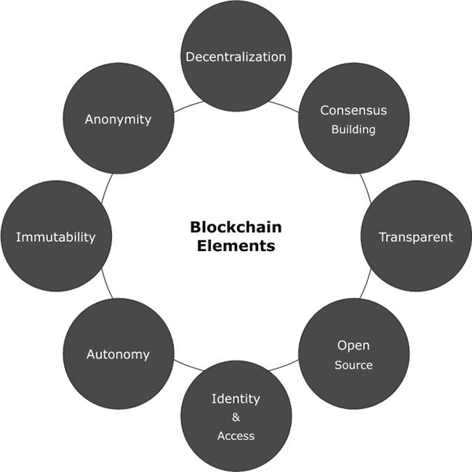

图 4.1 区块链技术的组成

## 4.3 区块链的工作流程

区块链是一个公开访问的账本，通过几个关键过程运行，下文概述并在图 4.2 中所示。首先，节点或用户向网络广播数据以启动交易。接下来，接收节点验证通过网络传输的数据是真实的。一旦验证，数据就会保存到区块中。然后区块通过工作量证明，这是一个需要网络内所有节点或客户端验证的过程以确保操作的真实性。最后，对验证后的数据应用共识机制，之后区块添加到区块链中。

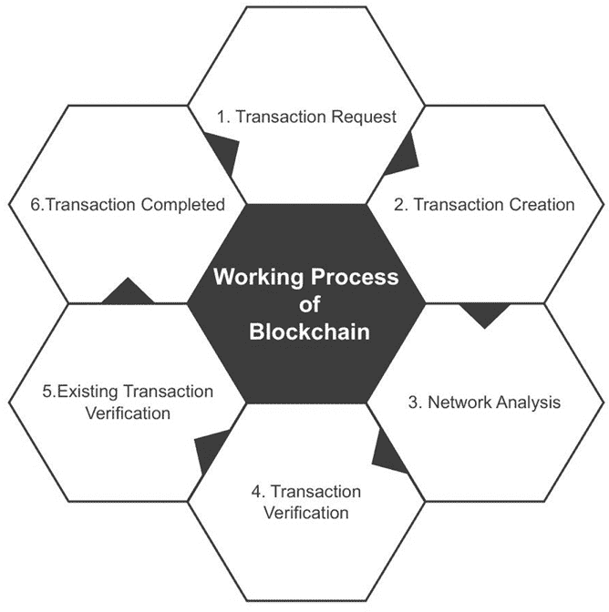

图 4.2 区块链的工作流程。返回

## 4.4 区块链技术中的问题与挑战

克服所有挑战并解决影响当代世界的问题需要时间。区块链在这种情况下被广泛使用。尽管有许多可能性，但克服所有障碍仍需时间。采用区块链是非常有效的，但也有面临许多影响开发者和用户的复杂性的风险。区块链技术中的问题和挑战通过以下几点进行描述：

### 4.4.1 可扩展性

尽管每秒交易数是区块链执行扩展性的一个流行标准，但事务处理系统（`TPS`）指的是每秒的计算次数，因为交易成本和复杂性可能会波动。随着更多交易的通过，网络在任何给定时间都可以处理更多的计算 [17]。扩展执行层面临的主要挑战是在不显著提高每个验证交易块的完整节点硬件规格的情况下，实现更高的每秒计算率。随着交易量的增加，区块链有效处理这些交易的能力可能会成为限制因素。这种担忧对于可能经历快速扩张并需要系统能够在管理增长需求的同时保持最佳性能的创业企业来说尤为相关 [18]。

### 4.4.2 数据保护

广泛接受的主要障碍是区块链服务贡献者之间缺乏保证。与这一担忧涉及两个方面：组织可能对该技术和网络中其他用户所提供的安全性没有信心。每笔交易都被认为是安全、机密且经过验证的。尽管由于网络的去中心化本质，对批准和验证交易缺乏控制，但这一点仍然是准确的。每个区块链网络的核心元素是共识机制，它有助于对整个网络中分布式数据库的当前状况达成普遍共识。商业领袖发现，用户对没有公认可提供者的私有链更有信心。区块链引入了隐私泄露的风险，并保证了交易的开放透明。使用聚类分析等技术，攻击者可以成功推断出区块链用户的真实身份。

### 4.4.3 隐私

区块链的设计初衷是社区共享。这意味着每个人都可以查看添加到区块链上的信息。尽管当区块链目录地址作为标识符时数据是未知的，但交易的补充细节仍然可见。私有链限制了谁可以解释交易并作为节点参与。尽管它有缺点，但私有链是公司使用区块链技术而无需担心向公众披露任何信息的方法。

私有链并不是完全去中心化的，因为它包含一个决定节点参与的治理机构。这可能导致人们对区块链结果的信任降低。公共链的透明度会导致隐私挑战，因为敏感信息可能被所有网络参与者访问。这对于管理机数据的部门（包括医疗和金融）构成了重大风险 [19]。

### 4.4.4 自私挖矿

自私矿是分布式数字数据库系统或区块链网络的少数用户用于实施欺诈的隐藏方法。他们通过秘密挖掘并保留一个区块来实现这一点。当这些矿工的隐藏链比实际链长时，他们向公众公开这些隐藏链，区块链系统选择长链作为真实链。区块链技术为增强数据安全提供了可能的解决方案；但它引入了必须解决的各种安全挑战，以确保其在医疗和其他行业的成功应用 [20]。少数安全攻击影响交易，用户的信心如下：

1. **减轻 51% 攻击风险**：矿工的主要功能是验证交易请求和数据，以便他们能够进一步调查下一个区块。因为 `51%` 攻击具有改变整个区块链的潜力，它可能是区块链领域风险最高的。这种攻击在矿工不足时更有更有可能发生。为了防止 `51%` 攻击，应提高哈希率、增强矿池监督，并避免为任务提供证明 [20]。

2. **女巫攻击**：在此类攻击中，黑客伪造假的网络节点并用虚假身份淹没目标网络，导致系统崩溃并干扰链交易。应该考虑适当利用共识技术来防止攻击。跟踪所有其他节点，并专注于那些仅从个人转发区块的节点，以防止女巫攻击。

3. **钓鱼攻击**：这类攻击正在急剧增加并导致实际问题。钓鱼攻击的主要目标是让入侵者黑取用户的凭据。他们能够发送看似真实的管理员电子邮件并收集资质详情和其他相关数据。同时，用户通过加入的虚假超链接提交他们的登录信息。安装可信的反病毒软件或恶意链接检测软件，并维护系统和软件更新将提高浏览器和设备的安全性。忽略点击未识别的链接，并在进行在线交易时关闭 Wi-Fi 以防钓鱼尝试，特别是在使用电子钱包或其他敏感数据时。

4. **路由攻击**：这是一个应该认真考虑的主要安全问题，其次是隐私问题。黑客可以利用账户身份夺取提交给互联网服务提供商的信息。入侵者有机会在所有者不知情的情况下黑取敏感数据或资产。用户应确保实施带有数字签名的安全路由机制，加密所有者数据，使用强密码并频繁修改，并学习有关数据安全的风险知识，以避免泄露攻击。

5. **私钥安全攻击**：区块链技术基于非对称密钥加密概念。当密钥使用不当且实施过程不完美时，就会出现安全问题。存在从用户的公钥获取私钥的可能性。

6. **区块链终端漏洞**：区块链终端的敏感性是区块链技术中的严重关注之一，黑客可以获取用户的密码，跟踪他们的活动并针对设备。为了确保安全，用户应定期监控系统、时间和位置，并通过提供强密码和设备访问权限来更改密码。

## 4.5 结论

区块链技术因其分布式通信和端到端的质量而受到了极广泛的接受和审查。这种独特性使其在许多场景和应用中具有维护各种准标准的潜力。随着区块链的快速发展和改进，我们相信它将迅速成为一种非常频繁且被认可的现象。在某种程度上，区块链可以与几十年前的互联网相比。由于区块链的核心是安全且支持性的，越来越多对安全性和非冗余有要求的交易将考虑这项技术。尽管目前某些限制使得许多创新性应用的实现面临挑战，但预计随着技术的成熟，区块链将成为一种标准。

## References

1. Dewang, R. K., Yadav, M. P., Awasthi, S., Raj, O. Mewada, A., and Bawankule, K. L. Data secure application: an application that allows developers to store user data securely using blockchain and IPFS. Multimedia Tools and Applications, *83*(15), 45491–45517, 2024. 返回正。⏎

2. A. Sobecki, S. Barański, and J. Szymański, J. “Privacy-preserving, scalable blockchain-based solution for monitoring industrial infrastructure in the near real-time”, Applied Sciences, *12*(14), 7143, 2022.55 返回正。⏎

3. Singh, N., Singh, H. P., Mishra, A., Khare, A., Swarnkar, M., and Almas, S. K., “Blockchain cloud computing: comparative study on DDoS, MITM and SQL injection attack,” In 2024 IEEE International Conference on Big Data & Machine Learning (ICBDML), Bhopal, India, 2024, pp. 73–78. [`doi.org/10.1109/ICBDML60909.2024.10577412`](https://doi.org/10.1109/ICBDML60909.2024.10577412) 返回正。⏎

4. Bodkhe, U., Tanwar, S., Parekh, K., Khanpara, P., Tyagi, S., Kumar, N., and Alazab, M. “Blockchain for Industry 4.0: a comprehensive review”, IEEE Access, *8*, 79764–79800, 2020. 返回正。⏎

5. Khan, S. N., Loukil, F., Ghedira-Guegan, C., Benkhelifa, E., and Bani-Hani, A. “Blockchain smart contracts: applications, challenges, and future trends”, Peer-to-Peer Networking and Applications, *14*, 2901–2925, 2021. 返回正。⏎

6. Rupa, C., Midhunchakkaravarthy, D., Hasan, M. K., Alhumyani, H., and Saeed, R. A. “Industry 5.0: ethereum blockchain technology-based DApp smart contract”, Mathematical Biosciences and Engineering, *18*(5), 7010–7027, 2021. 返回正。⏎

7. Jafar, U., Aziz, M. J. A., and Shukur, Z. “Blockchain for electronic voting system—review and open research challenges”, Sensors, *21*(17), 5874, 2021. 返回正。⏎

8. Karthikeyan, D., Amutha, B., Mekata Devi, K., Singh, N., and Anglin Kuruba, P. “Hybrid rater to quantify and measure the severity of infection and spread of infection in muskmelon”, Bulletin of Electrical Engineering and Informatics (BEEI), *13*(3), 1667–1675, 2024. [`doi.org/10.11591/eei.v13i3.5432`](https://doi.org/10.11591/eei.v13i3.5432) 返回正。⏎

9. Krichen, M., Ammi, M., Mihoub, A., and Almutiq, M. “Blockchain for modern applications: a survey”, Sensors, *22*(14), 5274, 2022. 返回正。⏎

10. Singh, S. P., Ansari, M. A., and Kumar, L. “Analysis of website in web data mining using web log expert tool”, In 2023 IEEE 12th International Conference on Communication Systems and Network Technologies (CSNT). IEEE, 2023. Bhopal, India. 返回正。⏎

11. Goen, N., Sharma, A., Dhakne, S., Yadave, V., and Chadaga, S. “A regularized ConvNet based on Alzheimer detection using T1-weighted images”, Cogent Engineering, *11*(1), 2024. [`doi.org/10.1080/2331916.2024`](https://doi.org/10.1080/2331916.2024) 返回正。⏎

12. Singh, N., and Kumar, Y. “Security and privacy requirements in 5G healthcare”, Blockchain for 5G Healthcare, pp.1–30, 2021. [`doi.org/10.1049/PBHE035`](https://doi.org/10.1049/PBHE035) 返回正。⏎

13. Benčić, F., and Žarko, I. “Distributed ledger technology: blockchain compared to directed acyclic graph”, In 2018 IEEE 38th International Conference on Distributed Computing Systems (DCS), pp. 1569–1570, 2018, Vienna, Austria. 返回正。⏎

14. Maariz, A., Wiputra, M., and Armanto, E. R. “Enhancing data in digital environments”, International Transactions on Education (ITEE), *2*(2), 92–98, 2024. 返回正。⏎

15. Bayan, T., and Banach, R. “Exploring privacy concerns in permissionless networks”, In 2023 IEEE International Conference on Smart Information and Technologies (SIST), pp. 567–572, 2023, Astana. 返回正。⏎

16. Habib, G., Sharma, S., Ibrahim, A., Qureshi, S., and Ishfaq, M. “Blockchain technology: benefits, challenges, and integration of technology with cloud”, Future Internet, *14*(11), 341, 2022. 返回正。⏎

17. Singh, N., Sasirekha, S., Dhakne, A., Sai Thrinath, B., Ramya, D., and Thiagarajan, R. “IOT enabled hybrid model with learning ability for E-health systems”, Measurement: Sensors, *24*, 1–14, 2022. [`doi.org/10.1016/j.measen.2022.100567`](https://doi.org/10.1016/j.measen.2022.100567) 返回正。⏎

18. Putro, A. N. S., Mokodenseho, S., Hunawa, N. A., Mokoginta, M., and Marjoni, E. R. “Enhancing security and reliability of information systems through blockchain technology: a case study on impacts and potential”, West Science Information and Technology, *1*(1), 35–43, 2023. 返回正。⏎

19. Idrees, S. M., Nowostawski, M., Jameel, R., and Mourya, A. K. “Security aspects of blockchain technology intended for industrial applications”, Electronics, *10*(8), 951, 2021. 返回正。⏎

20. Wenhua, Z., Qamar, F., Abdali, T. A. N., Hassan, R., Jafri, S. T. A., and Nguyen, Q. N. “Blockchain technology: security issues, healthcare applications, challenges, and future trends”, Electronics, *12*(3), 546, 2023. 返回正。⏎

近年来，区块链技术变得日益流行并增长迅速。区块链网络和区块链技术已应用于多个行业，包括网络安全、信息与通信技术、金融银行、能源与基础设施、娱乐、交通、供应链管理、保险和医疗技术。区块链技术将被称为“块”的分组收集并存储信息，每个块都可以用于捕获一组抽象数据。

针对考虑机密性的区块链，提出了一种混合隐私保护访问控制方案`[1]`。原型系统证实了其可行性和有效性，实现了低网络延迟、高效加密和稳健的数据安全。本文讨论了与区块链技术与物联网（IoT）分离相关的范围、关注点及潜在解决方案`[2]`。开发了一种利用加密、完整性验证和集成通信网络的安全数据管理方案`[3]`。通过全同态加密增强了区块链的安全性和隐私。提出了一种基于区块链的入侵检测系统，以增强物联网（IoT）网络安全`[4]`。机器学习算法用于检测分布式拒绝服务（DDoS）攻击。文中提出了一种确保许可链区块链上安全性的协议`[5]`。

区块链机制被用于维护存储的信息并提高协议的安全级别。区块链是一种数据库技术，配置用于提供提供安全且不可篡改的交易记录。预计一种基于区块链的安全车辆对车辆（V2V）通信系统将提高车辆的安全性，并确保车辆之间安全的数据共享与通信`[6]`。这些算法可以验证用户、识别非法访问并构筑安全的车辆通信。当一个数据块被数据填满时，它会链到上一个满块上，从而产生一条数据链。数据被组织成块，每个块包含一个交易包。提出了一种基于账本技术的新型安全机制`[7]`。

### 网络运行与基础设施

区块链技术在公共网络和私有网络上均可运行。任何方都可以从基于互联网的公共网络上收集信息以授权交易。隐私机制通过机器学习实现`[8]`。私有区块链网络仅允许经过授权的企业访问数据。组织应当组成成员，并提供访问与交易相关信息的权利和许可。制定了一种集成了软件定义网络和区块链技术的、用于智慧城市的新型灵活网络基础设施`[9]`。

软件定义网络将识别可能的攻击并将加密数据发送到区块链。区块链运行在节点的分布式网络上。这使得那些想要蓄意破坏网络或操纵组织基本信息的入侵者来说，操作变得极其困难。与实时大数据存储相关以及安全疑虑相关的问题已得到解决`[10]`。

### 安全目标与完整性

区块链使用智能数学算法来保护和验证交易。修改数据是不可能的，因为每个交易都经过了加密并与前一个交易连接。云计算中的安全通过认证机制实现`[11]`。主要的安全目标是机密性、完整性（确保信息的准确性和可靠性）以及可用性（使授权方能够访问数据）。其复杂性在于通过考虑多个安全目标来实现更高水平。提出了一种基于用于联网设备的关联区块链的授权机制`[12]`。

区块链技术专门为实现数据完整性而设计。区块链技术提供了一种保障模式来跟踪产品在两个地点之间的移动，这可能会改进供应链管理。提出了一种受监管区块链以及一种针对物联网设备的安全且自动密钥刷新方案`[13]`。

## 密钥管理与物联网集成

所提出的方案允许用户验证安全密钥的原始性，并在物联网系统中建立信任。提出了一种基于区块链的用于联网设备的密钥管理方案`[14]`。提出了安全挑战以及向区块链发展的趋势`[15]`。讨论了区块链的风险分析、风险分类及实时攻击`[16]`。讨论了设备之间基于区块链的信息共享`[17]`。

公共区块链不需要认证，允许所有人访问信息。所有区块链用户对读取、编辑和授权正在处理的交易拥有相同的权利。针对联网设备提出了一种区块链机制`[18]`。所提出的方案允许存储大量信息。患者信息安全通信中的问题已得到解决`[19]`。

提出了基于区块链的各种安全方案的改进`[20]`。提出了一种基于区块链的安全与隐私保护机制`[21]`。讨论了区块链的概念及其相关组件`[22]`。提出了一种用于联网设备的区块链机制`[23]`。讨论了保护信息的解决方案。私有区块链（也称为托管区块链）可以由单一组织控制。私有区块链不向所有用户开放，仅允许授权方访问网络。讨论了安全联网区块链技术中的各种问题`[24]`。分析了互联网与区块链技术的结合，以及区块链应用的研究问题和趋势`[25]`。讨论了物联网智能合约的安全挑战、漏洞、攻击及潜在研究`[26]`。这项工作还讨论了智能合约的潜在应用。讨论了基于区块链的识别非法节点技术`[27]`。

讨论了区块链在管理无线传感器网络安全方面的贡献。混合区块链整合了来自私和公共连接的数据。行业可以建立私有的、基于许可的系统以及公共网络。授权方仅访问机密信息，而其他信息则公开。混合区块链可以为数字货币提供公共访问，同时保持银行拥有货币的私密性。讨论了涉及比特币安全的问题`[28]`。

网络中的每个设备都允许通过共识机制`[29]`对从设备进行投票。区块链的架构、安全考量以及确定性问题已得到解决`[30]`。区块链可以防止数据篡改，并允许在网络之间共享更多的数据。联盟链广泛应用于银行、金融、物流、医疗保健和保险领域。针对联网设备的数据通信安全方案已被提出`[31]`。此外，还提出了一种基于区块链的安全框架`[32]`。

这种安全机制防止了数据通信过程中的遭受攻击。区块链技术的核心安全挑战包括智能合约漏洞、女巫攻击、私钥管理、内部攻击和 `DDoS` 攻击。通过引入基于信誉的系统和权益证明机制，可以识别并防止女巫攻击。私钥管理可以通过多因素身份认证来实现，提供额外的安全层。区块链中的内部攻击可以通过利用强加密方法（如 `AES-256`，高级加密标准）、安全路由协议、加强访问控制机制以及监控恶意活动来克服。区块链中的 `DDoS` 攻击可以通过创建安全的智能合约、集成应用防火墙以及监控网络流量来纠正。

## 5.2 区块链中的安全挑战

区块链设计的主要挑战是实现数据完整性。与公有链相关的网络安全威胁是机密性和可用性。数据完整性的威胁可能与注册数据的来源和质量有关。保障区块链技术面临的挑战包括缺乏监管、互操作性问题以及私钥管理不当。

### 5.2.1 缺乏监管

由于区块链技术仍然相对较新，向立法的发展正在持续进行。区块链交易缺乏监管，使得入侵者更容易在不产生问题的情况下利用弱点。缺乏监管的问题可以通过区块链创建者、企业领袖和政府官员的支持来纠正。他们可以共同努力，制定一种既能保护用户又能促进创新的稳定监管。在区块链消费者之间建立标准和最佳实践是关键的。

### 5.2.2 互操作性

区块链技术使用了不同的标准和协议。由于互操作性的局限性，数据在不同区块链之间传输时可能会发生安全威胁。通过创建灵活的区块链解决方案可以克服互操作性问题。可以利用跨链桥机制解决互操作性问题。这种跨链桥允许区块链网络与隔离的区块链交互，以协助数据通信。

### 5.2.3 私钥管理不当

在区块链技术中，私钥必须保持秘密，以防止对数字资产的未经授权访问。大多数用户不知道管理私钥的最佳方法，可能会故意将密钥泄露给入侵者。有效管理私钥的解决方案是利用基于生物识别的数字签名。消费者的生物识别详情每次用于生成密钥，并直接从内存中删除。私钥管理需要遵循的最佳实践包括使用强加密算法、安全的密钥生成机制，并将加密后的密钥存储在独立的加密模块中。

## 5.3 区块链中的安全威胁

区块链与比特币和加密货币相关，广泛应用于制造业、供应链管理、矿业、农业、能源和医疗保健。加密技术用于保障区块链网络跨交易的安全。由于去中心化，防御网络攻击非常困难。区块链网络中的各种安全威胁所示图 5.1。区块链网络的各种安全威胁包括挖矿威胁、网络威胁和智能合约威胁。

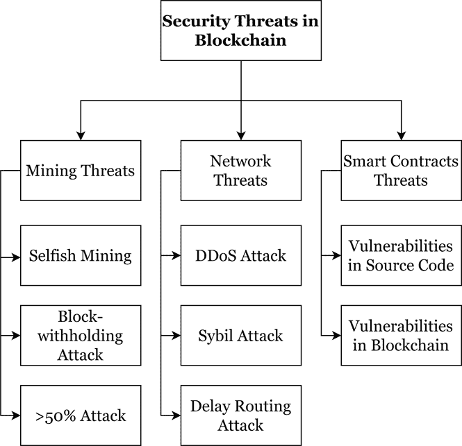

图 5.1 区块链网络中的安全威胁。返回文本。⏎

### 5.3.1 挖矿威胁

挖矿是区块链系统中的设备授权并批准交易的操作。挖矿威胁包括加密货币劫持、私有矿、安全漏洞和资源耗尽。在资源耗尽中，恶意加密矿工可以在消费者不知情的情况下利用系统的计算能力，导致系统变慢和高能耗。矿者通过计算尝试获得新铸的代币。加密挖矿恶意软件被认为可以绕过杀病毒程序。目前没有针对非法加密挖矿的安全机制。链接可能存在垃圾邮件中，用加密挖矿投放程序感染网站。托管垃圾过滤器服务可以将垃圾邮件与正常邮件区分开。

### 5.3.2 网络攻击

*   **DDoS 攻击：** `DDoS` 攻击干扰到末端系统的数据传输，攻击者防止授权用户无法使用末端设备。由于难以区分授权请求和恶意请求，识别 `DDoS` 攻击变得异常复杂。

*   **女巫攻击：** 女巫攻击是一种恶性犯罪，通过生成多个虚假身份来欺骗网络用户以控制区块链网络。其目标是在网络中获得权力并破坏其权威性。通过为区块链网络选择准确且合适的共识算法并监控发送区块的用户节点，可以防止女巫攻击。

*   **路由攻击：** 路由攻击与区块链网络安全相关的恶意活动，其目标是中断互联网上数据包的路由。入侵者可以使用路由攻击将网络分为两个或多个不同的组件。通过在传输数据之前实施强加密、使用安全路由协议以及提高意识可以纠正路由攻击。

### 5.3.3 智能合约威胁

智能合约是保存在区块链网络上的系统代码，在条件满足时编译。入侵者试图将恶意代码插入智能合约中，导致合约出现意外和不受控制。在设计和开发智能合约时，安全性必须是首要考虑。智能合约安全漏洞的严峻性在智能合约攻击的损失数量显而易见。智能合约漏洞对区块链生态系统和数字资产构成了巨大风险。通过在合约的整个生命周期内实施安全的软件开发实践，并设置监控工具检测合约活动并在异常时接收告警，可以防止此类攻击。

## 5.4 区块链技术的安全机制

区块链网络的主要关注点是共享数据和交易。各种安全需求包括身份验证、访问控制和机密性。

### 1. 身份验证

区块链中的身份验证是在线识别和验证用户的本质安全机制。哈希过程确保了数据未被篡改，从而验证交易的真实性。区块链利用加密密钥和数字签名来验证用户、设备和系统的身份，防止身份盗用和欺诈。路由协议对路由进行验证，允许某些数据在另一个路由器接收其路由更新之前通过。

### 2. 访问控制

访问控制是一种为收集数据和资源的各方分配权利的机制。访问控制涉及选择授权参与者允许执行的操作，并对用户访问设备数据的每次尝试进行仲裁。访问控制的目标是防止未经授权的用户访问系统资源。

### 3. 数字签名

数字签名验证区块链网络交易，特别是对交易进行身份验证。当用户执行 `transactions` 时，他们必须向系统的每个节点确认自己有权支付这些金额，同时防止其他用户花费这些资金。

### 4. 密钥管理

密钥管理是处理安全服务的密码学的重要部分，包括交易的机密性、身份验证和数据完整性。授权方的私钥可以安全地存储，以避免在区块链网络中泄露和被窃取。实现公钥基础设施的两种传统技术：通过证书机构进行中心化管理，以及通过信任网进行去中心化管理。

### 5. 数据隐私

区块链中的数据隐私是一个主要关注点，网络上的所有方都可能访问记录的个人或敏感信息。应该解决数据隐私问题，以确保并保护用户的机密信息免受对区块链网络的非法访问。智能合约可能会受到安全威胁和滥用的影响，导致存储在区块链上的敏感信息泄露。区块链的分布式特性有助于防止数据泄露和其他安全漏洞。零知识证明是防御区块链系统中数据隐私的一种巨大方法。在这种技术中，一个人可以向他人确认给定的声明为真，而不泄露任何进一步信息。区块链技术使用了不同的共识机制。工作量证明（`PoW`）消除了对银行、企业或政府等中央机构监控和监督交易及其相应账户的需求。`PoW` 算法验证数千次交易，以确保交易总历史保持完美且未被修改。

活动证明（Proof of activity）保证区块链上的所有交易都是合法的，并且所有矿工达成共识。当区块被挖掘时，拥有权益的权威机构会验证并对区块进行签名。权威证明（Proof of authority）是一种共识方案，允许使用身份和资金作为质押进行快速交易，代价是牺牲去中心化。权威证明影响私有网络中身份的价值。销毁证明（Proof of burn）算法可以提供网络安全，因为它对攻击者来说变得严重。当参与者销毁更多硬币时，他们就有更多机会挖掘下一个区块，增加了奖励数量。时间证明（Proof of Elapsed Time）是许可链区块链网络中的共识算法，用于选择挖掘权和下一个区块矿工。时间证明算法使用任意生成的时间来选择由谁获得挖掘硬币以及谁赢得区块。

## 5.5 去中心化

区块链的去中心化将权利、控制和决策权分配在区块链网络内的多个用户之间。它保证了个人、团体或政府不会管理区块链。区块链为互不信任的未识别方提供了一种高效的方法。

## 5.6 共识机制

共识机制提供了一套规则和协议，管理如何在网络内达成共识以及如何使交易合法。共识机制通过数据维护保持区块链的安全性。

## 5.7 节点安全

区块链节点是一个共同编译区块链软件的系统。它通过确保保持去中心化来促进区块链交易合法化并维护网络安全。为了避免这些攻击，通过创建强大的安全策略（如加密、防火墙和安全托管环境）来保护节点是至关重要的。

## 5.8 智能合约

它的作用类似于传统合同，同时还能自动执行合同。智能合约是按照设计者的程序进行精确计算的程序。智能合约还可以用于完成复杂的企业实践。智能合约还可以实现从生产商到客户的产品自动化跟踪。每当产品交换时，智能合约都会修订账本，确保供应链中的每个人都有权访问信息。数字身份验证也可以通过智能合约实现。

## 5.9 终端安全

区块链网络的参与者可以直接访问计算机和手机等电子设备的终端。入侵者攻击终端系统，破解关键信息并使授权无法无法资源。终端安全解决方案检查并保护网络中的运行终端。这是通过安装在企业网络或服务器上的集中管理控制实现的。这些终端安全工具提供终端检测、多因素身份验证、实时监控、用户行为分析等功能，以识别高级安全威胁。

## 5.10 加密密钥

加密是保护数据免受未经访问的技术。区块链中两个节点之间的交易使用密码学进行保护。传输的数据经过加密，并利用哈希保护区块消息并连接区块。区块链利用非对称加密来保护存储在区块中的所有交易。密钥对于区块链 `technology` 中的操作至关重要。必须在区块链中创建、使用和存储安全密钥。公钥加密是一种为参与者提供数字身份的安全机制。任何用户都可以解密传输给他们的信息，并创建数字签名进行身份验证。

## 5.11 比特币的密钥建立

比特币相当于维护货币的账户。所有者应该拥有私钥以使用该货币。入侵者可以通过物理或侧信道攻击破解比特币货币。

*   **基于密码的钱包（Password-Based Wallet）：** 用户可以通过创建密码来保护私钥。比特币软件仅在提供正确密码时提供对所存储密钥的访问。入侵者试图通过暴力攻击窃取私钥。当用户忘记密码时，他们将无法访问其比特币钱包。

*   **托管钱包（Hosted Wallet）：** 用户可以通过 Web 身份验证机制访问比特币钱包的服务。由第三方控制钱包安全性，建议用户在钱包中保留较少金额。

## 5.12 未来研究

区块链技术的缺点是交易成本过于高昂，因为大多数区块链网络都使用了工作量证明（`PoW`）和权益证明（Proof of Stake）。联邦学习应当增强本地设备的数据隐私保护和通信安全。可扩展的联邦学习可以处理多个设备并应对大型数据集。联邦学习还可能加速区块链应用开发，增强区块链安全性和性能，并促进新型人工智能融合应用的产生。

## 5.13 结论

本文提议的工作对区块链技术的安全挑战、安全威胁以及各种安全机制进行了详细分析。文中探讨了区块链的各种安全机制。本工作还讨论了各种共识机制，并比较了它们的性能参数。此外，本文还讨论了加密密钥在保护区块链网络中的作用以及比特币钱包的管理。最后，�论了区块链技术的挑战和未来研究。区块链增强了跨业务网络的信息安全、透明度、信任度和可追溯性。区块链安全使其成为数据存储、供应链管理和金融交易等多个应用的流行技术。区块链安全的未来研究将涉及抗量子共识算法的实现。可以通过各种抗量子加密算法（如基于代码、基于格、基于哈希和多元方法的加密）来加强区块链安全。抗量子算法很快将在区块链安全中发挥关键作用。

## 参考文献

1.  Shishu Ding, Hao Hu, Feng Xu, Zhenyu Chai, Wen Wang, “Blockchain-Based Security-Minded Information Sharing in Precast Construction Supply Chain Management with Scalability, Efficiency and Privacy Improvements,” Automation in Construction, Volume 168, p. 105698, 2024. 返回正文

2.  Hari Mohan Rai, Kaustubh Kumar Shukla, Lilia Tightiz, Sanjeevikumar Padmanaban, “Enhancing Data Security and Privacy in Energy Applications: Integrating IoT and Blockchain Technologies,” Heliyon, Volume 10, No. 19, p. 38917, 2024. 返回正文

3.  Xiaohua Wu, Jing Wang, Tingbo Zhang, “Integrating Fully Homomorphic Encryption to Enhance the Security of Blockchain Applications,” Future Generation Computer Systems, Volume 161, pp. 467–477, 2024. 返回正文

4.  Selman Hızal, A.F.M. Suaib Akhter, Unal Cavusoglu, Devrim Akgun, “Blockchain-Based IoT Security Solutions for IDS Research Centres,” Internet of Things, Volume 27, pp. 101307, 2024. 返回正文

5.  Zhiwei Wang, Qingqing Chen, Lei Liu, “Permissioned Blockchain-Based Secure and Privacy-Preserving Data Sharing Protocol,” IEEE Internet of Things Journal, Volume 10, Issue 12, pp. 10698–10707, 2023. 返回正文

6.  Debashis Das, Sourav Banerjee, Pushpita Chatterjee, Uttam Ghosh, Utpal Biswas, “A Secure Blockchain Enabled V2V Communication System Using Smart Contracts,” IEEE Transactions on Intelligent Transportation Systems, Volume 24, Issue 4, pp. 4651–4660, 2023. 返回正文

7.  Abdullah Ayub Khan, Sami Bourouis, M. M. Kamruzzaman, Myriam Hadjouni, Zaffar Ahmed Shaikh, Asif Ali Laghari, Hela Elmannai, Sami Dhahbi, “Data Security in Healthcare Industrial Internet of Things with Blockchain,” IEEE Sensors Journal, Volume 23, Issue 20, pp. 25144–25151, 2023. 返回正文

8.  Zhou, Youliang Tian, Jinbo Xiong, Jianfeng Ma, Changgen Peng, “Blockchain-Enabled Secure and Trusted Federated Data Sharing in IIoT,” IEEE Transactions on Industrial Informatics, Volume 19, Issue 5, pp. 6669–6681, 2023. 返回正文

# 第 3 节 变革金融

# 6 区块链技术对金融领域的转型性影响

Shyam Sunder Agrawal, Saloni Raheja, 和 Amanjot Singh

DOI: [10.1201/9781035456209]

## 6.1 引言

区块链技术是数字领域的一种革命性创新，一种极其安全的数据定位和记录方法。区块链是一个去中心化的系统，它持续收集数据并通过加密将其组织成区块。这种去中心化的结构消除了单点故障风险，因为记录由网络中的所有参与者复制并保存。区块链的安全去中心化特性对多个行业具有重大影响，包括金融、供应链管理和数字身份。在金融领域，区块链在实现更快速、更高效和高度透明的交易方面前景良好。它还可以通过追踪商品来提高供应链的可溯性、透明效率。此外，基于区块链的数字身份为个人对其数据提供了更好的控制，确保了机密性和安全性。区块链与传统的中心化系统的区别在于它在去中心化的分布式账本上透明且安全地记录交易，不需要第三方监管或控制。系统按时间顺序排列区块，每个区块包含前一个区块的哈希值，这保护了数据的完整性并使系统能够抵抗干扰。因此，区块链在金融领域最显著的应用在于其改变主流金融市场的潜力。传统的金融市场基础设施一直面临挑战，但提出区块链解决方案是一个极具前景的方案。其去中心化的本质和改进的安全功能可以解决数据管理不善、缺乏透明度以及依赖信任中介等问题。

图 6.2 展示了区块链在金融领域的变革性影响，涵盖透明度、隐私、安全、快速结算、风险管理、审计和成本最小等关键领域。这些特性展示了区块链技术如何重塑传统的金融流程和组织。除了这些进展，区块链还通过资产代币化和去中心化自治组织（DAO）等创新框架，迅速转型了各个行业，特别是金融业。本文献回顾综述了关于这些主题近期的研究，强调了它们颠覆和变革传统金融系统的可能性。

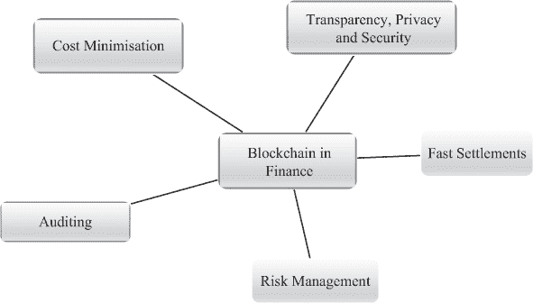

图 6.2 金融中的区块链。返回文本。⏎

### 6.1.4 资产代币化

代币化是将物理或数字资产转换为基于区块链的令牌的过程。这项发明允许部分所有权、收回流动性并简化了交易。根据最近的研究，代币化是形成世界创新股票交易所不可或缺的元素，其中代币化革命和项目管理的证券化至关重要（来源）。这表明代币化使投资机会的准入民主化，并提高了资产管理的透明度和专业能力。此外，对去中心化交易所的需求正推动着在区块链上进行这些数字令牌和加密货币的无缝转换。作者强调，在去中心化金融（DeFi）生态系统中整合去中心化交易所对于资产的高效交易活力，从而改善了市场动态和流动性 [12]。

### 6.1.5 去中心化自治组织

DAO 代表了区块链金融的另一个变革趋势。这些组织运行在智能合约之上并由成员管理，消除了传统的层级结构。根据研究人员的观点，DAO 有潜力破坏各行业（尤其是娱乐业）传统的融资机制。通过利用区块链令牌，DAO 可以实现利益相关者的直接融资，从而提供了一种更民主化的投资和项目管理方法 [13]。

### 6.1.6 区块链的安全挑战与信任

尽管区块链技术具有许多优势，但它并非没有挑战。他认识到了若干安全疑虑，包括对网络威胁的脆弱性，这可能会损害金融交易的真实性 [14]。区块链与过时的金融安全工具结合提供了一个值得进一步研究的领域，特别是开发为区块链环境定制的稳健网络安全摘要。

### 6.1.7 区块链对审计和公司治理的影响

区块链技术的影响延伸到了审计和公司治理。他认为，区块链可以通过财务报告的透明度和问责制来改变审计 [15]。这种转型引发了对审计师未来角色的疑问，以及对有助于区块链知识的新技能组合的需求。随着组织日益接受使用区块链进行财务记录，需要更多的研究来理解这些变化将如何标记公司治理结构和合规性要求。

## 6.2 文献回顾

区块链已成为众多行业中的一种变革力量，而金融业是其采用的先驱。最近的研究发现了区块链在金融领域中的可能性 [15]。区块链是一种变革性技术，可以提高金融交易的速度、准确性和成本效益，可能导致公司运营方式的巨大波动，并通过加密货币设计新的支付方式。金融业已经开始发现并实施基于区块链的解决方案，应用范围涵盖了从跨境支付到贸易金融和资产管理的领域 [6]。

此外，区块链技术的去中心化和安全特性为金融包容开启了新的可能性，特别是在传统银行服务稀缺的地方 [16]。它试图通过使用区块链支持的以坊平台评估 DeFi 替代传统金融的可能性。中间环节的消除和智能合约的机械化导致了成本降低。与区块链初创公司合作的金融科技公司获得了市场份额。局限性包括行业特定的差异和长期数据的可用性。影响要求对长期影响进行更多调查、针对细分领域的研究以及对比评估。敦促金融科技公司审慎地实施区块链，重点关注风险管理和合规 [5]。

### 6.2.1 透明度、隐私与安全

区块链的去中心化账本通过计算机验证交易来确保透明度，这允许所有参与者实时查看交易。每笔交易都经过加密加密，在没有参与者同意的情况下无法对过去进行修改。这种透明度培养了双方之间的信任，并减少了欺诈和滥用的风险。由于金融科技革命和网络的使用，区块链技术在重塑社会和行业方面具有变革性 [17]。根据这项研究，由于数字领域竞争的激烈，区块链的执行已被接受以促进各个行业的透明度和信任 [18]。区块链与人工智能的结合改变了业务流程，提高了效率和透明度，并为企业提供了安全保障 [19]。此外，区块链通过各种解决方案改进了金融包容，特别是在发展中国家，并且可以通过物联网（IoT）变为现实。

### 6.2.2 快速结算

区块链允许快速结算，避免了对传统金融系统中常见的中间人和结算中心的需求。智能合约允许根据预定义的条件自动验证并结算交易，因为协议条款已刻入代码中。这种自动化减少了与手动验证和处理相关的时间和成本。

### 6.2.3 风险管理

由于拥有透明且不可争议的交易记录，区块链恢复了金融领域的风险管理。金融机构可以使用定制的区块链平台实时显示和审查交易，更有效地识别潜在的风险和异常。

### 6.2.4 审计

有了区块链技术，审计变得更加高效和可靠。审计师可以在不信任第三方结算记录的情况下验证财务记录的真实性。

### 6.2.5 成本最小化

区块链通过消除中间环节和消除手动流程降低了金融成本。智能合约系统化了交易清算并执行合同条款，无需银行或结算中心等必要的中间环节，从而降低了交易费用和运营成本。

## 6.3 研究方法

该流程始于关键研究问题的提出，这些问题旨在影响区块链技术在各自金融领域的主要优势，对其实施相关的困难和限制进行分类，衡量其对各种金融服务的影响，并发现新兴趋势。随后，利用 `IEEE Xplore`、`Google`、`Science Direct`、`SpringerLink` 和 `JSTOR` 等学术资源制定了完整的检索策略。`Blockchain`（区块链）、`Machine Learning`（机器学习）、`Finance Industry`（金融行业）和 `Regulatory`（监管）等关键词用于检索。确定了特定的纳入标准（`IC`）以选择纳入综的作品。这些标准包括 `Blockchain`、`fintech`（金融科技）、`distributed ledger technology`（分布式账本技术）以及用于 `IC 1` 的“Blockchain technology adoption”。应用逻辑运算符来定义标准的组成。

此外，排除了 2019 年 12 月 31 日之前的研究（`IC 2`），尽管仅衡量英文研究出版物（`IC 3`）。研究类型限制为期刊文章（`IC 4`），并包含了基于摘要的研究（`IC 5`）。此外，纳入了基于全文的研究（`IC 6`）。为了排除在本系统文献综述之外的文献，应用了排除标准（`EC`）。删除了具有相同标题和/或数字对象标识的重复研究，并根据排除条件指定的质量评分删除了研究。在此阶段，识别了 42 项研究，其中 27 项被认为与本调查相关。本研究考虑的所选论文在表 6.1 中列出。

### 表 6.1 研究文献综述 返回正文

| 作者 | 年份 | 目标 | 关键发现 | 识别的挑战 |
| --- | --- | --- | --- | --- |
| Chang 等人 [19] | 2020 | 评估区块链对金融市场效率的影响 | 区块链提高了市场透明度并并降低了交易成本，但该技术仍处于早期采用阶段。 | 市场波动、监管挑战 |

| 作者 | 年份 | 研究主题 | 主要发现 | 局限性/挑战 |
| :--- | :--- | :--- | :--- | :--- |
| Cucari 等人 [20] | 2021 | 传统银行中的区块链（Interbank Spunta 项目） | 区块链提高了数据透明度、加快了执行以及支票和资金的直接传输 | 需要可扩展性、数据可用性和监管清晰度 |
| Dong 等人 [14] | 2021 | 分析区块链如何增强交易透明度 | 区块链提供了不可篡改且透明的交易账本，减少了欺诈的可能性并增加了参与者的信任 | 可扩展性问题、监管认可 |
| Gadekallu 等人 [21] | 2022 | 通过以太坊实现的去中心化金融 (DeFi) | DeFi 提供代币化、跨境支付、成本降低和效率提高 | 可扩展性、互操作性和监管不可预测性 |
| Ghosh [22] | 2020 | 调查区块链在反洗钱 (AML) 工作中的作用 | 区块链通过提供可追溯的交易记录和提高对监管要求的合规性，增强了反洗钱工作 | 隐私问题、非法活动的潜在滥用 |
| Maidamwar 和 Chavhan [7] | 2020 | 研究去中心化金融 (DeFi) 的兴起 | DeFi 平台提供创新金融产品，但面临与智能合约漏洞和监管审查相关的风险 | 智能合约风险、监管环境 |
| Mishra 和 Kaushik [11] | 2023 | 评估区块链对央行数字货币 (CBDCs) 的潜力 | 区块链能够创建安全高效的央行数字货币 (CBDCs)，提供交易更快速和改进货币政策执行等优点 | 法律和监管挑战、技术局限性 |
| Moşteanu 和 Faccia [6] | 2021 | 评估区块链对整体金融稳定的影响 | 区块链可以通过减少系统性风险、增加透明度和提高金融系统的韧性来增强金融稳定 | 监管挑战、新形式系统性风险的潜在性 |
| Agrawal 等人 [16] | 2024 | 探索人工智能对金融科技演变的影响 | 人工智能使金融科技初创企业能够开发创新解决方案 | 对传统银行模式的挑战 |

## 6.4 结果、讨论与发现

基于上述讨论和系统文献综述，显然大多数研究都同时采用了定性和定量分析。定性研究使用系统文献综述法进行分析。同时，定量分析使用了各种统计软件和工具（如 `SPSS AMOS`）以及描述性和推断性分析等方法。在区块链技术对各自金融领域影响的综合文献研究中强调了许多重要发现。区块链技术通过消除中间环节和重构金融运营，促进了效率提高和成本降低。

## 6.5 区块链在金融领域的意义

区块链技术对金融领域产生许多重要影响。最值得关注的方面之一是变革支付系统的潜力。区块链技术允许个人直接进行交易，而无需中间人。这导致了交易速度的增长和成本的降低。这种去中心化模型的额外好处是增加了透明度并减少了欺诈风险，这在过时的金融系统中是一个重要问题。

此外，区块链可以优化证券交易和结算流程。通过使用智能合约，区块链平台可以在满足预定义条件后自动执行合同，消除了对结算等中间人的需求并缩短了结算时间。这种能力提高了效率，并降低了与后期流程相关的运行风险和成本。

## 6.6 结论

区块链技术通过为各种金融业务创建一个安全且去中心化的平台，增强了金融部门。引入基于区块链技术的金融科技（FinTech）解决方案提供了一个契机，有望彻底改变金融服务的分配模式，这将提高可访问性、降低成本并加强监管。各种区块链应用已出现在众多行业，包括医疗保健、物联网、安全和供应链管理。这是因为区块链使得构建一个去中心化、安全且透明的存储系统成为可能。区块链技术具有变革许多银行流程的潜力，这意味着可能会对金融领域产生重大影响。区块链技术的力量彻底改变了金融业，催生了 `DeFi`。这种新型金融服务模式以其去中心化的特性、创新解决方案、无缝互操作、全球范围和极高的透明度为特征。通过采用 `DeFi`，我们可以实现金融包容、鼓励开放获取、刺激不受限制的创新，并为企业家和远见者开启选择的世界。从行业角度来看，区块链技术通过简化交易、通过去中心化提高安全性以及通过防篡改账本促进透明度，显著提高了效率。

## 参考文献

1. Abdelmaboud, A., Ahmed, A. I. A., Abaker, M., Eisa, T. A. E., Albasheer, H., Ghorashi, S. A., & Karim, F. K. “用于物联网应用的区块链：分类、平台、最新进展、挑战与未来研究方向”, Electronics, 11(4), 630, 2022. 返回文本。⏎

2. Singh, N., & Kumar, Y. “5G 医疗保健中的安全与隐私需求”, In Block Chain for 5G Healthcare Applications, IET Publication, pp. 1–30, 2021. [`doi.org/10.1049/PBHE035E_ch1`](https://doi.org/10.1049/PBHE035E_ch1). 返回正文。⏎

3. Singh, N., Sasirekha, S. P., Dhakne, A., Sai Thrinath, B. V., Ramya, D., & Thiagarajan, R. “用于电子健康系统的具有学习能力的物联网混合模型”, Measurement: Sensors, 24, 1–14, 2022. [`doi.org/10.1016/j.measen.2022.100567`](https://doi.org/10.1016/j.measen.2022.100567). 返回文本。⏎

4. Lal, R., Chhabra, A., Singla, S., & Sharma, D. “区块链技术：变革信任、透明度和交易效率”, In 2024 国际知识工程与通信系统国际会议 (ICKECS), Chikkaballapur, India, pp. 1–5, 2024. 返回文本。⏎

5. Singh, N., Singh, H. P., Mishra, A., Khare, A., Swarnkar, M., & Almas, S. K. “区块链云计算：DDoS、MITM 和 SQL 注入攻击的比较研究”, In 2024 IEEE 国际大数据与机器学习国际会议 (ICBDML), Bhopal, India, 2024, pp. 73–78, [`doi.org/10.1109/ICBDML60909.2024.10577412`](https://doi.org/10.1109/ICBDML60909.2024.10577412). 返回文本。⏎

6. N. Moşteanu, & A. Faccia, 量子计算、分形和区块链分布式账本中的金融科技前沿：范式转移与开放创新. Journal of Open Innovation: Technology, Market, and Complexity, 2021. 返回文本。⏎

7. P. Maidamwar, & N. Chavhan, “区块链技术：架构、安全问题与挑战的综述. IJEAST, 04(12), 245–249, 2020. 返回文本。⏎

8. da Cunha, P. R., Soja, P., & Themistocleous, M. “发展的区块链：引导框架”, Information Technology for Development, 27(3), 417–438, 2021. 返回文本。⏎

9. Dinesha, D., & Balachandra, P. “区块链支持的互联智能微电网中的去中心化代币交易所”, In 2023 IEEE Belgrade PowerTech, Belgrade, Serbia, pp. 1–6, 2023. 返回文本。⏎

10. Dewang, R., Yadav, M., Awasthi, S., Raj, O., & Mewada, K. “使用 IPFS 安全存储数据的区块链应用”, Tools and Applications, 8(15), 5549–5517, 2024. 返回文本。⏎

11. Mishra, L., & Kaushik, V. “用于处理金融部门可持续性问题的区块链”, Journal of Sustainable Finance, 13(3), 1318–1333, 2023. 返回文本。⏎

12. Karthikeyan, D., Amutha, B., Singh, N., & Anglin, P. “区块链与 AI 的协同效应”, Bulletin of Electrical Engineering and Informatics (BEEI), 13, 1667–1675, 2024. [`doi.org/10.1159/eei13.542`](https://doi.org/10.1159/eei13.542). 返回文本。⏎

13. Gadekallu, T., Huynh-The, T., Wang, W., Yenduri, G., Ranaweera, P. S., Pham, V. Q., da Costa, D. B., & Liyanage, M. “元宇宙的区块链：综述”, ArXiv, abs/2203.09738, 2022. 返回文本。⏎

14. Dong, L., Hu, F., & Xu, D. “区块链支持的深层供应链”, Manufacturing & Service Operations, 25(6), 2021, 2037–2051. 返回文本。⏎

15. Mishra, L., & Kaushik, V. “用于处理金融部门可持续性问题的区块链”, Journal of Sustainable Finance, 13(3), 1318–1333, 2023. 返回文本。⏎

16. Agrawal, S. S., Rose, N., Sahai, K. P., & Maheshwari, A. “金融科技革命：AI 对传统银行服务的角色”, Decision Making: Applications in Management, 10(1), 1–29, 2024. 返回文本。⏎

17. Alzoubi, M. M. “调查区块链与 AI 的协同作用：增强安全性、效率和透明度”, Journal of Cyber Security Technology, 10, 1–29, 2024. 返回文本。⏎

18. Bennet, D., Maria, L., Sanjaya, Y., & Rahmania Az Zahra, A. “数字时代的区块链技术”, ADI Journal on Recent Innovation, 5(2), 192–199, 2024. [`doi.org/10.34306/ajri.5i2.1065`](https://doi.org/10.34306/ajri.5i2.1065). 返回文本。⏎

19. Chang, S. E., Luo, H. L., & Chen, Y. “区块链支持的贸易金融创新：信用证基本假设的改变”, Sustainability, 12(1), 1–16, 2020. 返回文本。⏎

20. Cucari, N., Lagasio, V., Lia, G., & Torriero, C. “区块链对银行流程的影响：Interbank Spunta 案例”, Technology Analysis & Strategic Management, 34(2), 138–150, 2021. 返回文本。⏎

22. K. Ghosh. “区块链技术：金融变革的催化剂”, Drishtikon: A Management Journal, 12(1), 2020. 返回文本。⏎

区块链是一种分布式账本技术，它能够在多台计算机（节点）之间实现去中心化的数据存储。区块链由一系列区块组成，每个区块都充当公共账本的角色，包含交易列表、时间戳以及指向前一个区块的链接。由于这种结构，要在不更改其后所有区块的情况下修改数据是非常困难的，这需要网络中大多数成员的共识。由于节点网络使用共识方法来验证和记录交易，区块链的去中心化特性消除了对中心权威的需求。当与加密方法相结合时，这种去中心化保证了记录在区块链上的数据的安全性、完整性和透明度 [1]。

几十年来，安全通信方法（或称密码学）的研究与应用一直是人类文明的重要组成部分。更准确地说，密码学是一种通过不可靠信道进行安全通信的手段 [2]。如今，密码学作为许多不同数字安全系统的基础，确保了数据的完整性、机密性和真实性。区块链主要依赖于加密，是 21 世纪最重要的发明之一。密码学具有历史背景。例如，埃及人曾使用替换密码来保护莎草纸卷上的重要数据。之后，希腊人对密码学的早期发展做出了显著贡献 [3]。

后来，尤利乌·凯撒以使用凯撒密码对军事会话进行编码而闻名。所有这些策略都高度依赖于复杂的解密性和保密性。在中世纪，多字母密码的创造显著推进了密码学的发展。19 世纪从密码分析（一种破解代码的科学）的角度来看是非常重要的 [4]。查尔斯·巴贝奇关于自动解密设备的工作以及弗里德里希·卡西斯基的频率分析为现代密码分析技术奠定了基础。在现代，通过分别部署费斯特尔结构和置换扩散网络，设计了对称密码，如 `Data Encryption Standard`（DES）和 `Advanced Encryption Standard`（AES）。1976 年，惠特菲尔德·迪菲和马丁·赫尔曼 [1] 开发了 Diffie-Hellman 密钥交换协议，为公钥密码学开启了大门。随后，设计了 `Rivest–Shamir–Adleman`（RSA）密码系统 [5]，它包含两个不同的密钥，即用于加密的公钥和用于解密的私钥。之后，信息安全领域被 ElGamal [3]、`Digital Signature Algorithm`（DSA）和 `Elliptic Curve Digital Signature Algorithm`（ECDSA）彻底改变了。这些创新通过在不需要共享私钥的情况下实现安全通信，彻底改变了数字签名、安全电子邮件和安全在线交易等应用。

区块链作为一种去中心化且分布式账本技术，通过提供安全、透明且不可篡改的交易记录为各个领域做出贡献。加密协议是区块链实现这一目标的重要工具。本章探讨了密码学在区块链安全方面的重要性，研究了通过加密技术定制区块链完整性和安全的各种方法和应用 [6]。

## 7.2 密码学在区块链安全中的作用

区块链安全的几个关键组件依赖于密码学，例如数据机密性、数据完整性、数据真实性、不可否认性、共识机制、数字签名、哈希函数和零知识证明（ZKPs）。

### 7.2.1 数据机密性

数据机密性确保数据不受未经授权的访问 [7]。为了维护机密性，区块链主要依赖加密技术。加密是一种将原始消息转换为不可理解文本的加密技术，只有密钥才能按原始格式检索。根据密钥的数量，加密技术可以分为以下两类。

1. **对称加密：** 在这类技术中，消息的发送者和接收者使用同一个密钥。这意味着同一个密钥同时用于加密和解密。正如我们所知，在 `n` 个成员的网络中需要共享 `n(n-1)/2` 个密钥。因此，尽管这种方法非常有效且快速，但在公共区块链中并不频繁使用。然而，它有时用于私有区块链以维护机密性。

2. **非对称加密：** 在这类加密技术中，消息的发送者和接收者使用两个不同的密钥。发送者使用接收者的公钥对原始消息进行编码，接收者使用其私钥解密编码后的消息。在 `n` 用户网络中只需要 `2n` 个密钥。这就是为什么非对称加密被频繁应用于区块链系统中以保护通信和交易。敏感信息被保持秘密，因为只有私钥所有者可以解密。

### 7.2.2 数据完整性

数据完整性确保数据未经过授权被篡改 [8]。加密哈希函数（CHF）是维护区块链完整性的核心工具。现代数字安全工具如签名方案、密码保护和数据完整性检查都使用了哈希函数。哈希函数将任意长度的输入转换为固定长度的字符串。以下是哈希函数具有实用性的关键特征。

1. **确定性输出：** 哈希函数总是提供相同的输出。这意味着如果我们给哈希函数相同的输入，它将反复提供相同的输出。由于这一特性，哈希函数可用于数据完整性验证。

2. **固定长度输出：** 无论输入数据大小如何，哈希函数始终生成相同长度的输出（哈希）。例如，无论输入是一个字母还是整个段落，`SHA-256` 哈希函数总是返回固定位，即 256 位（32 字节）的哈希结果。这种固定长度使得比较和哈希值管理变得简单。

3. **效率：** 哈希函数在处理海量数据以生成哈希方面快速且高效，经久可用。这种性能对于区块链技术和互联网通信安全等需要实时处理海量数据的应用至关重要。

4. **抗原像性：** 这一特性是指根据给定的哈希输出找到原像。仅凭哈希结果在计算上推断出原始输入是不可能的。对于敏感数据（例如密码），这种特性是至关重要的。

5. **抗碰撞性：** 当两个不同的输入产生相同的哈希输出时，这被称为碰撞。哈希函数的目标是减少碰撞的可能性，以确保每个唯一的输入产生唯一的哈希。

6. **雪崩效应**

   CHF（加密哈希函数）的这一特征表明，CHF 输入的微小修改会导致哈希输出显著差异。由于这一特性，识别未经授权的更改变得非常简单，因为输入数据的微小变化也会导致完全不同的哈希值。

CHF 广泛应用于许多数字安全领域。为了在数据泄露的情况下提高安全性，它们被用于密码存储，即存储哈希后的密码而非实际密码。哈希函数使得在数据完整性验证中快速比较数据成为可能，以确保未被篡改。由于可以通过检查文件完整性清除恶意软件感染，因此对于软件分发至关重要 [9]。

为了实际可用性，我们可以采用迭代哈希函数。迭代哈希函数是 CHF 的一种示例，它接受任意长度的输入消息并将其转换为称为哈希值或摘要的固定大小数据块。它对每个块重复应用压缩函数。迭代哈希函数的工作原理如下：

1. **消息填充：** 消息填充确保输入消息的长度超过块大小。填充的标准步骤是添加一个 1 位、足够的 0 位，然后是原始消息的长度。此阶段目的是确保消息可以被恰当地划分为固定大小的块。

2. **初始化向量：** 使用固定特定值初始化向量（`IV`）来开始哈希计算。它对于哈希函数的安全性至关重要，因为它确保了如果使用不同的 IV，相同的消息将产生不同的哈希值。

### 3. 处理块（Processing Blocks）

将填充后的消息划分为固定大小的块并逐块进行处理。压缩函数接受当前块作为输入，并输出该块的哈希（如果是第一个块，则为 `IV`）。压缩函数结合这些输入以创建一个固定大小的输出，然后将其作为处理后续块的输入。

### 4. 最终化（Finalisation）

在处理完所有块后，整个消息的哈希值就是压缩函数的最终输出。准确捕捉原始消息的加密摘要就是这个固定长度的输出。

以下是基于迭代哈希模型的常用 CHF。

1. **MD5：** 它接受 512 位块的输入并输出 128 位的哈希值。由于某些缺陷会导致碰撞攻击，它目前被认为是不安全的。

2. **SHA-1：** 它接受 512 位输入块并产生 160 位的哈希值输出。SHA-1 曾被广泛使用，但由于类似的安全问题（特别是碰撞的可能性），它已被废弃。

3. **SHA-256：** SHA-256 是 `SHA-2` 族的成员。它接受 512 位块并返回 256 位的哈希值。它仍然流行且安全的哈希函数，特别是在涉及区块链技术和其他加密学的应用中。

4. **SHA-3：** SHA-3 的结构依赖于海绵构造（sponge construction），因此它可以接受变长输入并产生变长输出。

### 7.2.3 数据真实性

确认数据源自可靠源的过程被称为数据真实性 [10]。在区块链中，数字签名是确保真实性的主要手段。公钥加密使用两个不同的密钥：私钥和公钥。这些密钥用于建立数字签名。公钥保存在字典中，而私钥保持保密。创建数字签名涉及以下步骤：

1. **消息哈希：** 在对消息签名之前，原始数据通过 CHF 生成一个固定长度的哈希值（也称为消息摘要）。哈希函数保证即使消息发生微小修改也会产生显著不同的哈希。

2. **签名过程：** 然后使用签名者的私钥对哈希值进行加密。结果是特定于该消息和所用私钥的数字签名。签名作为签名者是通信原始创建者的证据，因为只有签名者才能访问私钥。

3. **验证过程：** 接收者可以通过签名者的公钥对数字签名进行解密获取原始哈希值。之后，接收者独立地对收到的消息进行哈希处理。如果独立生成的哈希与解码后的哈希匹配，则认为通信是真实的且未被更改的，签名得到确认。

以下是数字签名的关键属性和优点。

1. **真实性（Authenticity）：** 你可以通过数字签名获得通信或文档来自特定发送者的保证。接收者可以确定通信是真实的，因为签名只能使用签名者的私钥产生。

2. **完整性（Integrity）：** 通过数字签名，你可以确保通信或文档的内容在签名后未被更改。如果原始消息发生任何形式的，验证过程将失败，因为即使微小的变化也会提供不同的哈希值。

3. **不可否认性（Non-Repudiation）：** 当签名者无法撤回其签名时，通信或文档被视为不可否认。数字签名一旦创建，就会将签名者与材料绑定，在许多地方，这可能会产生法律后果。在合同和金融交易等情况下，这是至关重要的。

许多现代技术和程序依赖于数字签名。它们确认发送者的身份并确保安全邮件通信中的邮件内容未被更改。软件分发中的数字签名防止恶意者篡改软件，从而允许消费者不下载被篡改的软件。数字签名通过允许有效方启动或批准交易来保护并验证金融交易 [11]。

### 7.2.5 共识机制

被称为共识机制的协议确保每个节点对交易的合法性和账本当前状态达成共识 [13]。这些系统依赖加密方法来确保安全、公平地获得共识。

1. **工作量证明：** 工作量证明（PoW）[7]是比特币和其他加密货币采用的最为人知的共识算法。本质上，它要求玩家或矿工解决类似于 CHF（哈希函数）的挑战性数学难题。矿工在获得比特币支付的同时，还需要解决这些谜题。由于谜题的难度，一方很难控制区块链，因为创建一个新区块需要大量的计算能力。PoW 依赖哈希函数的安全性来防止双重花费等攻击，双重花费是指多次花费同一硬币的行为。

2. **权益证明：** PoW 的替代方案[8]是权益证明（PoS），其中下一个区块的创建者根据其在网络中的权益（加密货币数量）选出。PoS 采用加密方法来确保选择过程的安全和随机，从而降低了中心化和 51% 攻击的风险，尽管它不依赖于解决密码问题。

3. **委托权益证明：** 在被称为委托权益证明（DPoS）[9]的 PoS 变体中，参与者选出有限数量的代表负责批准交易和维护区块链。为了保护投票过程并确保选出的代表符合网络的最大利益，DPoS 采用了加密技术。

### 7.2.6 数字签名与身份验证

如前所述，数字签名在保证区块链系统中数据的合法性方面起着关键作用[6]。发送者的私钥在数据或交易签名过程中用于创建唯一的签名。因此，签名被加盖在数据上，任何人都可以使用发送者的公钥进行验证。然而，验证通过了发送者的身份并检查数据是否经过任何修改。数字签名用于智能合约中的身份验证，也用于保护交易。智能合约是自动执行的合同，其代码中编写了复杂的合约规范。由于这些合约在区块链上执行并保存，因此它们更加透明，且需要的中间人更少。数字签名确保了双方的合法性以及智能合约执行的安全性。

### 7.2.7 区块链中的哈希函数

CHF 是区块链技术领域领先的加密技术之一[6]，它在支持共识程序的同时提供了唯一 ID 并确保了数据完整性。梅克尔树[13]（有时被称为哈希树）目前是区块链系统中排序和验证大量数据的最有效方法。梅克尔树有时被称为哈希树，是任何用于汇总和验证海量数据的数据结构。这种结构以计算机科学家 Ralph Merkle 的命名，它接收数据进行哈希处理，并成对地反复进行哈希处理，直到产生单一的根哈希值，称为梅克尔根（Merkle roots）。原则上，这意味着梅克尔根可以作为数据集的某种指纹，而无需访问整个数据集，并可用于验证其中的任何特定数据片段。梅克尔树的设计使用了以下层：叶节点是需要哈希的离散信息单元；非叶节点是中间哈希值，代表子节点对；根节点是总结整个数据集的组件。正因为梅克尔树可以在分布式去中心化的环境中高效地验证数据完整性，而无需让每个网络成员都保存完整数据集，因此它在区块链技术中变得流行。区块链是一种去中心化的账本，通过分布式共识保存记录并验证信息。区块链的梅克尔树有助于对每个区块中的交易进行安全、有效的记录和验证。以下是梅克尔树在区块链中的关键意义：

* **高效的数据验证：** 区块链网络涉及大量交易，独立验证每笔交易的完整性将消耗大量资源。梅克尔树允许节点仅检查数据的子集而非整个区块链，即可确认每笔交易的完整性。这一过程被称为“梅克尔证明”或“梅克尔验证”。

* **空间效率：** 区块链网络中的每个节点都不需要跟踪每笔交易以确保链的完整性。相反，节点可以保留梅克尔根，并在需要时使用梅克尔证明来验证交易。结果是参与节点使用的存储空间要少得多。

* **更快的验证速度：** 梅克尔树仅需检查对数数量的哈希（即树的高度）而不是完整的交易列表，能够快速确认特定交易是否是区块的一部分。这显著缩短了交易验证所需的时间。

* **数据完整性与不可篡性：** 梅克尔树中使用的哈希具有对于区块链安全至关重要的加密特性。由于树的每一层都基于前一层的哈希结果，即使更改单笔交易也会产生不同的梅克尔根。数据的防篡改特性确保了任何更改都能被及时检测，从而增加了区块链的不可篡性。

### 7.2.8 零知识证明

零知识证明（ZKPs）允许一方说服另一方某个陈述是真实的，而提供任何秘密信息。ZKPs 在区块链中处于有趣的地位，因为它们可以解决隐私和安全双重问题。此外，ZKPs 还可以支持隐藏某些细节的交易，即使双方身份以及传输金额被隐藏，参与方也能验证交易的有效性。这是一个关注的领域。Zcash[12]是一种关注隐私的加密货币，它使用名为零知识非交互知识论证（zk-SNARKs）的零知识证明变体。ZKPs 还应用于身份管理系统，并改进了区块链技术的隐私和安全性，有助于防止潜在的欺诈和身份盗窃风险。

## 7.3 区块链安全中的密码挑战

区块链由于密码学的存在受到了大量的保护，但也面临着许多挑战。主要的密码学问题，如量子计算，是威胁当前区块链技术中所使用的所有加密方法的进阶技术 [14]。这种先进的计算类型利用量子力学的特性，可以比超级计算机快地解决某些特定的数学问题。这种先进的计算类型依靠量子力学的特性，可以比超级计算机快地解决某些特定的数学问题，包括破解目前区块链平台使用的著名加密算法，如 `RSA` 和椭圆曲线加密 (ECC)。由于量子计算机可以破解这些算法，研究人员开始关注能够抵抗量子攻击的`后量子密码学` (PQC)。因此，区块链网络的长期安全性将取决于量子技术进步中 `PQC` 技术的采用。尽管区块链技术高度安全、完全透明且去中心化，但它在扩展性和效率方面面临着巨大的挑战。

大量交易的处理和验证构成了区块链网络增长的重大挑战。在维护区块链技术高安全性的同时，密码学的作用可能会间接影响网络系统的扩展性和效率。在之前的讨论中，我们探讨了区块链可扩展性与密码学之间的相互关系、该问题面临的挑战，以及如何通过加密技术的进步来克服这些挑战。密钥管理是区块链安全不可或缺的组件。在非对称加密中，私钥的机密性对于系统的安全性至关重要。私钥丢失或丢失可能会损害相关资产或数据，导致大规模财务损失或数据泄露。安全的密钥存储解决方案、多签名钱包、硬件安全模块和其他有效的 88key 管理技术对于保护私钥和保证区块链系统的安全至关重要。

## 7.4 密码学与区块链安全的未来趋势

随着区块链技术的进一步发展，新的理念和密码学技术不断出现，以提高安全性并解决该领域面临的问题。以下是密码学和区块链安全的未来趋势。量子计算机的出现正驱动着后量子密码学的研究。区块链系统未来需要能够抵抗量子攻击的新加密算法。以下后量子方法 [10] 可以替代传统的密码原语：基于格的密码学，其安全性取决于格问题，如最近向量问题和最短向量问题；基于哈希的密码学，其安全性取决于哈希函数的抗原像性；基于代码的密码学，其安全性取决于编码理论问题，如校验码解码；多变量密码学，其安全性取决于代数几何问题，如多变量二次问题和多项式同问题；以及基于同源的密码学，其安全性依赖于在椭圆曲线内寻找同源。此类算法的发展和标准化将成为未来几年密码学和区块链社区最热门的话题之一。

在同态加密 [11] 中，可以在不先解密的情况下对加密数据进行计算。通过这种方式，在区块链系统中进行私有的、安全的数据处理成为可能。这种方法对于 `SMPC` 和隐私保护智能合约特别有用。超越 `ZKPs` 的增强型隐私保护方法（如差分隐私和安全多方计算 (`SMPC`)）也正在研究应用于区块链框架中。这些方法提高了交易、数据交换和去中心化应用程序的安全性和机密性。区块链环境中对隐私日益增长的需求使得这些方法变得越来越具有吸引力。

互操作性和跨链安全是密码学的关键目标，包括实现实物资产和信息在不同区块链之间无缝且安全的传输。这提供了更大的跨链通信和交易可能性。然而，一个区块链中的漏洞可能会影响其他区块链，使得跨链安全成为一个迫在眉睫的问题。加密协议的进步（包括跨链桥、原子交换等）预计将进一步提高区块链网络的安全性和互操作性。

## 7.5 结论

区块链技术在安全性方面使用了密码学基础。密码学算法确保了区块链系统的安全和去中心化，从而确保了数据的完整性、机密性、真实性和不可否认性。然而，随着区块链产业的扩张和发展，出现了扩展性 89 问题和量子计算等新风险和挑战。为了解决这些问题，必须继续进行密码学的研究和创新。后量子密码学、同态加密和先进的隐私保护技术对于确保区块链技术的长期安全和可行性是必要的。

总结，密码学对区块链至关重要。随着区块链技术继续改变数字世界，加密技术将始终处于未来的前沿。

## References

1. N. Go, A. Sharma, N. Singh, V. Yadave, S. Prabh, and K. Ang, “A regularized ConvNet based Alzheimer detection using T1-weighted MRI images”, Cogent Engineering, Vol. 11, No. 1, p. 2314, 2024. [`doi.org/10.1080/233119.2024`](https://doi.org/10.1080/233119.2024). Return to text.

2. N. Singh, H. P. Singh, A. Mishra, A. Khare, and S. Swarnkar, “Blockchain cloud computing: comparative study on DDoS, MITM attack”, 2024 IEEE International Conference on Big Data & Machine Learning (ICBDML), Bhopal, India, 2024, pp. 73–78. [`doi.org/10.1109/ICBDML60909.2024`](https://doi.org/10.1109/ICBDML60909.2024). Return to text.

3. D. Karthikeyan, B. Amutha, K. Mekata Devi, N. Singh, and P. Anglin Kuruba, “Hybrid rater to quantify and measure the severity of infection and spread in muskmelon”, Bulletin of Electrical Engineering and Informatics (BEEI), Vol. 13, No. 3, pp. 1667–1675, 2024. [`doi.org/10.1151/eei.v13i3.5432`](https://doi.org/10.1151/eei.v13i3.5432). Return to text.

4. N. Singh, S. P. Sasirekha, A. Dhakne, B. V. Sai Thrinath, D. Ramya, and R. Thiagarajan, “IOT enabled hybrid model with learning ability for E-health care systems”, Measurement: Sensors, Vol. 24, pp.1–14, 2022. [`doi.org/10.1016/j.measen.2022.100567`](https://doi.org/10.1016/j.measen.2022.100567). Return to text.

5. R. K. Dewang, M. P. Yadav, S. Awasthi, O. Raj, A. Mewada, and K. L. Bawankule, “Data secure application: an application that allows developers to store user data securely using blockchain and IPFS”, Multimedia Tools and Applications, Vol. 83, No. 15, pp. 45491–45517, 2024. Return to text.

6. P. W. Shor, “量子计算机质数分解和离散对数的多项式时间算法”, SIAM Review, Vol. 41, No. 2, pp. 303–332, 1999. 返回文本.

7. B. S. Sriman, G. Kumar, and P. Shamili, “区块链技术：共识协议工作证明与权益证明”, In Intelligent Computing and Applications: Proceedings of ICICA 2019, Springer Singapore, pp. 395–406, 2021. 返回文本.

8. F. Saleh, “无浪费的区块链：权益证明”, The Review of Financial Studies, Vol. 34, No. 3, pp. 1156–1190, 2021. 返回文本.

9. S. M. S. Saad, and R. Z. R. M. Radzi, “权益证明(pos)与委托权益证明(DPOS)区块链共识算法的比较研究”, International Journal of Innovative Computing, Vol. 10, No. 2, pp. 27–32, 2020. 返回文本.

10. D. J. Bernstein, and T. Lange, “后量子密码学”, Nature, Vol. 549, No. 7671, pp. 188–194, 2017. 返回文本.

11. X. Yi, R. Paulet, E. Bertino, and X. Yi, 同态加密, Melbourne: Springer International Publishing, pp. 27–46, 2014. 返回文本.

12. D. Hopwood, “Zcash 协议规范”, GitHub, Vol. 32, No. 220, pp. 1–224, 2016. 返回文本.

13. S. Jing, X. Zheng, and Z. Chen, “Merkle 树技术原理与应用综述”, In 2021 International Conference on Artificial Intelligence, Big Data and Algorithms (CAIBDA), 上海, IEEE, pp. 86–90, 2021. 返回文本.

14. N. Singh, and Y. Kumar, “5G 医疗保健中的安全与隐私需求”, In Blockchain for 5G Healthcare Applications, IET Publication, pp. 1–30, 2021. [`doi.org/10.1049/PB035E_ch1`](https://doi.org/10.1049/PB035E_ch1). 返回文本.

90

# 利用物联网和区块链开发智能学习模型

Shahnawaz Ahmad, Mohammed Wasid, Shahadat Hussain, Sana Shahab, Jiyaul Mustafa

DOI: [10.1201/97810354562011](https://doi.org/10.1201/97810354562011)

## 8.1 引言

近年来，物联网 (IoT) 和区块链技术通过为许多行业提供新的解决方案改变了数字世界。`IoT` 定义为通过互联网连接式传感器和执行器进行交互、聚合和协作的现代设备集成[1,2]。这场革命创造了一个智能环境，家电、机器和各种对象可以在其中进行通信并调节活动，增强了自动化的性能、健康性和范围，涵盖了医疗、农业等几乎所有领域[3]。

区块链（一种开放的分布式数据库）和物联网是全球组织采用的两项技术，因为它们在解决影响 `IoT` 的安全、隐私和信任等关键问题方面能力强大[4]。随着更多授权用户加入 `IoT` 网络，这个问题变得更具挑战性，因此需要检查系统中设备交换数据的真实性和完整性。区块链提供了一个坚实的基础，通过增强数据管理、防止记录篡改以及使用去中心化共识技术来减少这些因素的影响[5]。这使其适用于智能合约、供应链等主要应用。

在这些发展的同时，智能学习模型 (ILMs) 成为处理 `IoT` 生成的海量数据的有用工具。人工智能 (AI)、机器学习 (ML) 和深度学习 (DL) 构建模型，使系统能够学习模式并进一步做出准确的估计和决策。`AI` 是计算机智能执行工作的能力的通用概念[6]。`AutoAI` 是 `AI` 的子类，是适应特定数据算法的执行应用。`DL` 是 `ML` 的子类，它采用带有额外层的人工神经网络来挖掘复杂数据并提供更高的准确性[7]。这些系统（包括区块链和物联网）和谐工作，实现大数据的收集、共享和分析。本章将探讨如何利用这些技术来开发 `ILMs`，以增强各个部门的决策能力和运营效率。

## 8.2 背景

### 8.2.1 物联网

`IoT` 指通过互联网连接嵌入日常物体中的计算设备，这些设备能够发送和接收数据。这是可能的，因为几乎所有的“事物”或对象现在都可以配备各种传感器和技术用于收集和交换数据。传感器可以通过收集光、热、声、化学成分或其他类似因素的信息获取环境数据。嵌入式系统使用这些感知信息，通过采取适当行动与其外部环境交互。`IoT` 技术允许多个设备使用 Web 服务和嵌入式软件进行通信。Web 服务是单个系统内不同过程或应用程序之间，以及同一平台或跨平台之不同系统之间的中介[1]。

通常，物联网（IoT）架构包含五个主要层级，如图 8.1 所示。

**图 8.1 物联网架构的层**

当一个设备具备两个核心能力时，就被认为是“智能的”。首先，它必须能够与物理世界交互，这涉及到处理收集的数据并通过 `Bluetooth`、`RFID` 和 `Wi-Fi` 等无线技术与其环境进行通信。其次，它必须能够通过传感器或执行器收集周围环境的数据。这两种能力允许智能设备有效监测并响应环境变化，增强了其实用性和功能性。智能设备的一个典型例子是智能手表。当普通手表通过 `Bluetooth` 连接到智能手机时，它可以变成智能手表，能够跟踪各种指标，如卡路里消耗、心率、步数、消息、天气预报和睡眠模式，此外提供基本的时间日期功能。智能设备产生海量数据存储在云端，并使用遗传算法、神经网络和 `AI` 等先进技术进行处理和分析。这种分析使设备能够做出明智决策。透明可靠设备对于确保数据安全和隐私至关重要 [8]。

如图 8.2 所示，物联网应用正在改变许多行业，包括智能家居、医疗健康、智慧城市和农业。在智能家居中，物联网允许用户远程控制灯光和电器等设备；而在医疗领域，它支持远程患者监测和可穿戴设备跟踪。物联网在城市环境中增强了交通管理、垃圾收集和基础设施维护。在农业领域，它有助于精准农业和牲畜追踪。制造业通过物联网实现的自动化和优化的供应链获益；在交通运输领域，它推进了联网车辆、车队管理和智能停车。这些例子突显了物联网如何提高各个部门的效率、便利性和可持续性 [9]。

**图 8.2 物联网的应用**

物联网（IoT）通过数据驱动的洞察来实现优化，这已经改变了许多行业。例如，汽车制造商可以使用车辆传感器的数据来监测并改进其设计的效率和性能 [10]。除了比传统数据收集策略能访问更多数据外，物联网的实时性允许即时反馈。虽然处理如此大数据可能会出现问题，但得益于物联网提供的即时性，决策可以变得更科学，资源可以得到更有效的部署，这还可以减少浪费并提高整体系统性能。

物联网系统提供了许多益处，但也由于以下因素引发了重要的挑战和风险：(i) 不安全/不足的身份验证和访问控制；(ii) 不透明/不足的信息使用同意和撤销机制；(iii) 物联网系统服务功能可靠性方面的缺陷；(iv) 与其他系统的集成——(a) 物联网系统与其他独立开发的智能空间应用之间的交互，即在共同环境中独立管理对象的共存；以及 (b) 其他系统与物联网系统的交互，例如将现有的遗留服务集成到物联网增强型企业/组织 IT 基础设施中；(v) 生命周期问题——管理日益动态的信息，包括对没有良好定义或注释的公共接口的私有企业数据资源/设备进行感知、挖掘和处理；(vi) 其对特定监管背景使用限制的合规性，例如在电子健康环境中 [11]。

### 8.2.2 区块链

区块链是一种互联网技术，利用私钥加密和激励机制按时间顺序构建去中心化、分布式且共享的不可篡改区块，从而确保交易的安全 [11]。相比之下，传统银行系统存在问题，如双重支付、中心化和容易受到黑客攻击，特别是在物联网的 `P2P` 范式中。在这种背景下，创新区块链为点对交易提供了一种高度安全的去中心化解决方案。在物联网世界，设备和网络之间的信任至关重要。区块链通过引入新的授权方法来阻止未经授权的访问和数据操纵，从而建立信任。其不可篡改性使得修改记录的交易变得困难，提高了安全性并适用于支付系统。为了确保数据安全和完整性，区块链使用椭圆曲线加密和 `SHA-256` 哈希算法防止未经授权的访问和篡改 [2]。

区块链技术是传统支付系统（如在线钱包、银行和第三方服务）的新替代方案。让我通过一个例子来解释这一点：四个朋友（Jack、Ted、Sam 和 Phil）决定一起吃晚餐并分摊费用。这样 Phil 可以使用在线支付服务直接转钱给 Jack。与此同时，对于 Ted 和 Sam 来说，由于银行问题（如技术故障、账户被盗或每日交易限制超出），这样做是不可能的。加密货币将解决整个困难。它们是基于区块链技术的数字货币，在没有银行介入的去中心化系统中运行 [12]。

去中心化具有许多优势，例如增强安全性、减少交易费用以及增加对用户财务活动的控制力 [3]。加密货币比普通货币有许多优势：它们无法伪造，不依赖中央机构，并受到强加密的保护 [13]。在成千上万种加密货币中，比特币广为人知 [14]。

加密货币基于区块链技术。每当发生加密货币交易时（例如，当一个人向另一个人发送资金时），就会创建一个交易记录，并将其添加到与链中之前的区块链接的区块中。这条链被称为账本。所有网络参与者都保留该账本的副本，这增加了透明度和安全性。由于账本分布在整个网络中，黑客想要操纵信息变得非常困难，因为其他人会看到交易的任何修改：他们的账本将与之不匹配。还可以使用加密算法向未经授权的人员隐藏数据。

**表 8.1 许可链与无许可链区块链**

| 特性 | 许可链 | 无许可链区块链 |
| --- | --- | --- |
| 节点参与 | 只有授权节点可以创建区块。 | 任何人都可以创建区块。 |
| 权限 | 更改需要权限。 | 更改不需要权限。 |
| 访问 | 通常，是私有的。 | 公开访问。 |
| 隐私性 | 高。 | 低。 |

**表 8.2 公有区块链与私有区块链**

| 特性 | 公有区块链 | 私有区块链 |
| --- | --- | --- |
| 权限 | 无许可 | 许可 |
| 访问 | 向所有人开放 | 仅限授权参与者 |
| 隐私性 | 低 | 高 |

比特币交易使用双密钥系统：公钥（功能类似于电子邮件地址）和私钥（类似于密码）。在发送比特币时，用户包含接收者地址和金额，并使用其私钥对交易进行签名。加密算法生成数字签名，以验证发送者的身份 [7,16]。签名后的交易使用接收者的公钥发布在比特币网络上；然而，只有他们的私钥才能解锁并利用该交易。第一个解谜的矿工将获得新的比特币奖励。区块链越来越多地应用于各行业，以提高安全性和透明度。例如，沃尔玛利用区块链监控其供应链中的产品质量，识别故障并确保更好的产品结果。这说明了区块链在解决现实问题中的实际应用。

## 8.3 智能学习模型

智能学习模型（ILMs）是高级计算模型，使用 `ML` 和 `DL` 算法等学习技术来分析大型数据集。这些模型可以发现并学习传统分析可能无法揭示复杂模式和关系。此外，ILMs 可以接收的数据类型越多样，它们产生的见解或预测就越丰富。此外，ILMs 可以随着对新数据的学习而随时间调整其性能，这是大多数物联网和区块链用例的定义特征。

### 8.3.1 人工智能

**表 8.3 区块链的新进展与创新：AI-IoT 集成生态系统**

| 趋势/技术 | 描述 | 收益 |
| --- | --- | --- |
| **边缘计算** | | |
| 边缘 AI | 它将边缘计算的操作与人工智能相结合，用于在边缘平台上进行处理和决策。 | 降低延迟，提高效率并实现自主运行。 |
| 边缘区块链 | 将区块链应用于边缘设备，以支持分布式共识，同时在同类设备上本地存储数据。 | 增强物联网和工业物联网（IIoT）应用的安全性、隐私性和去中心化。 |
| **联邦学习** | | |
| 联邦 AI | 在保护数据的同时，用 AI 模型教育多个边缘设备。 | 促进协作和去中心化的 AI 训练，保护敏感数据。 |
| **互操作性与标准化** | | |
| 区块链互操作性 | 为不同区块链网络之间的无缝通信和数据交换建立协议。 | 促进基于区块链的系统的协作与集成。 |
| 物联网标准化 | 为物联网设备开发通用标准和协议。 | 确保物联网设备之间的互操作性和兼容性。 |
| **混合区块链** | | |
| 公私混合区块链 | 结合了公有和私有区块链的优势，提供了可扩展性、隐私性和去中心化治理。 | 为物联网应用提供灵活且适应性强的区块链解决方案。 |
| **安全硬件** | | |
| 可信执行环境 | 为操作和加密密钥存储提供安全的硬件环境。 | 增强物联网设备及其连接的安全性。 |
| 硬件安全模块 | 提供受保护的密钥存储和加密功能。 | 保证物联网实施中信息的安全性和隐私性。 |
| **数据市场** | | |
| 基于区块链的数据市场 | 用于安全透明数据交换的去中心化市场。 | 使个人和组织能够对其物联网数据进行变现和交易。 |
| **AI 增强的区块链分析** | | |
| AI 驱动的区块链分析 | 利用 AI 方法检查区块链数据，识别模式、异常和潜在安全风险。 | 为基于区块链的系统提供有价值的见解和早期警报。 |
| **主权身份 (SSI)** | | |
| 区块链上的 SSI | 利用区块链让个人能够控制自己的数字身份。 | 通过赋予个人数据控制权，增强物联网和工业物联网生态系统的隐私性和安全性。 |
| **抗量子加密** | | |
| 后量子加密 | 探索能够抵抗量子计算攻击的算法。 | 确保区块链和物联网系统在面对潜在量子威胁时的长期安全性。 |
| **能源效率** | | |
| 绿色区块链 | 开发节能的共识算法和基础设施。 | 减少基于区块链系统的环境影响并促进可持续发展。 |

`Table 8.4` 提供了智能城市生态系统中机器学习（ML）、区块链和 IoT 集成的全面概述。它探索了这些技术在增强智能城市发展各个方面方面的潜力，包括自动化、数据完整性、互操作性、数据隐私和安全性。该表格强调了与集成这些技术相关的挑战和解决方案，并讨论了它们为智能城市倡议提供的潜在收益。

### 8.3.2 机器学习

**表 8.4 智能城市系统中的跨学科机器学习、区块链与物联网**

| 参考文献 | 主题 | 摘要 |
| :--- | --- | :--- |
| `[[17]]` | ML、区块链与 IoT 的融合 | 该工作探索了整合 `ML`、`blockchain` 和 `IoT` 的潜力，以创建更先进、协作的智能城市生态系统。 |
| `[[6]]` | 智能城市 IoT 中的 ML 应用 | 对于这类智能城市 IoT 系统，这项工作旨在探索 `ML` 的应用。它强调了交通流、能源使用协调和离群值识别等案例。 |
| `[[18]]` | 用于自动化和数据完整性的区块链 | 该工作探索了 `blockchain` 技术和 `smart contracts` 如何实现工作流自动化，并确保各种智能城市平台的数据完整性。 |
| `[[19]]` | 互操作性和数据隐私挑战 | 该工作解决了与不同系统之间的互操作性以及在集成式智能城市环境中保护数据隐私相关的挑战。还讨论了潜在的解决方案。 |
| `[[20]]` | 联邦学习与安全性增强 | 本文旨在调查 `federated learning` 结合 `blockchain` 如何提高智能城市 `IoT` 场景下的安全性和隐私。 |
| `[[21]]` | 隐私保护框架 | 该工作专注于开发利用 `Cloud` 和 `ML` 的隐私保护框架，以确保安全的数据密钥管理。 |

### 8.3.3 深度学习

本文对不同领域中的 `DL` 技术和 `IoT` 应用进行了分析和使用。`DL` 技术可以从根本上学习并提取重要特征，而 `IoT` 设备可以将实时数据转发给更深层的 `DL` 模型。在 `Table 8.5` 中，我们对 `IoT` 中用于感知智能城市的 `DL` 模型进行了详细分析。它重点关注将不同类型的 `DL` 方法（包括卷积神经网络 (`CNNs`)、循环神经网络 (`RNNs`)、深度强化学习 (`DRL`)、基于无监督学习的深度学习 (`DL-UL`) 以及迁移学习 (`TL`)）应用到智能城市建设的众多用途。

**表 8.5 智能城市 IoT 应用中基于深度学习的模型**

| 参考文献 | 方法论 | 摘要 |
| :--- | --- | :--- |
| `[[22]]` | 深度学习 | `ILMs`（集成学习模型/智能模型）被用于智能城市中的治理、交通管理、医疗保健和犯罪预测。 |
| `[[23]]` | 基于 CNN 的 | 实现卷积神经网络 (`CNNs`) 用于行人检测、交通信号控制、犯罪预测和恶意软件识别等任务。 |
| `[[24]]` | 基于 RNN 的 | 应用循环神经网络 (`RNNs`) 用于工业环境中的时间序列预测、噪声预测和小物体检测。 |
| `[[25]]` | 联邦学习 (FL) | `FL` 用于智能城市应用中的隐私保护数据处理和去中心化分析。 |
| `[[12]]` | 深度强化学习 | 深度强化学习优化了交通信号、自动驾驶车辆和智能电网等 `IoT` 系统。 |
| `[[26]]` | 深度和无监督学习 | `deep and unsupervised learning` 在智能城市 IoT 框架中的部署。 |
| `[[27]]` | 迁移学习 | 在 `IoT` 系统中应用 `transfer learning` 用于智能建筑、攻击检测和安全数据融合。 |
| `[[28]]` | 基于 CNN 和 SVM 的 | 一种基于 `CNN` 和支持向量机 (`SVM`) 的智能农业 IoT 架构。 |

## 8.4 观察

区块链技术最适用于加密货币，但它在其他领域也有用途。因此，它在数字货币领域的活动为医疗保健、经济和政府效益提供了宝贵的经验。因此，为了释放先进技术的潜力，机构需要更好地了解背景，并找到可以从消除中间环节中受益的用例。然而，由于其非中心化的结构和资源限制，`IoT` 尚未克服安全和隐私挑战，尽管最近变得流行。这可能是为什么传统的安全解决方案无法保护 `IoT`：数百万设备仍处于黑客攻击之下并面临数据泄露风险。

因此，专注于设备与其周围环境之间的交互安全以增强 `IoT` 安全性是合理的 `[[29]]`。与 `IoT` 结合被称为区块链物联网 (`BIoT`)，可以解决在使用 `blockchain` 时出现的一些问题。为了充分从 `BIoT` 中获益，需要定义一个新的框架以适应各种分布式 `IoT` 应用 `[[30]]`。因此，为了让 `BIoT` 运行，需要解决扩展性问题并减少开销流量。作者认为，区块链设计者努力提高交易速度和数量，因为大量交易对电力有限的 `IoT` 设备带来了巨大的计算负担。

## 8.5 区块链与 IoT 集成的未来研究方向

区块链与 `IoT` 的结合存在需要进一步讨论的问题，以指导成功集成的方向。总而言，这些挑战无法通过单一解决方案解决，但必须整合适当且创新的解决方案。

- **可扩展性**：这令人担忧，主要是考虑到物联网（IoT）中的海量数据，而且随着快速 5G 网络的使用，问题正在进一步恶化。针对这个问题，可以使用一些解决方案来增强可扩展性。侧链（Sidechains）和卷 ups（rollups）作为扩展解决方案，被用在第 2 层之上，通过离链交易减少主区块链的负载来提高吞吐量。另一种方法分片（Sharding），它将主区块链网络分成多个子网络，从而最大限度地减少流量拥堵并提高交易率。此外，其他复杂的共识算法，如`Proof of Stake`（权益证明）和`Delegated Proof of Stake`（委托权益证明），需要更少的计算资源来支持可扩展性 [22]。公有链和私有链特征的结合被称为`hybrid blockchains`（混合区块链），其特点是能够更快速、更有效地执行交易过程，同时提供数据机密性和保护。这些策略相结合，预示着在 5G 环境下能够实现物联网的可扩展处理。

### 8.5.1 安全性与隐私

这些是区块链和物联网应用核心的一些基本问题。该领域的未来研究将重点关注几个视角。增强隐私的技术是`zero-knowledge proofs`（零知识证明）和`homomorphic encryption`（同态加密）。它们提供了保护机密信息的手段，同时也可用于在不安全环境中进行处理和转换。去中心化身份解决方案确保用户掌握自己的身份，因此，保护身份免受欺骗者或黑客的攻击并保持身份安全，这不再是一个大问题。此外，基于区块链技术，通过`smart contracts`（智能合约）、`encryption`（加密）和`digital signatures`（数字签名）创建的安全可以改进物联网设备或相关交易。这些进步旨在产生一个安全的、保护隐私的区块链物联网环境 [23]。

- **互操作性**：在物联网和区块链集成方面，这是一个独特的问题，因为这两个领域都实施了许多协议和标准。未来的研究活动应该解决几个重要领域。首先，标准化协议的创建将成为物联网设备与区块链网络之间交互的关键问题。它还可以帮助建立单一的中间件框架，促进物联网对象与区块链平台之间更高效的数据交换，消除不兼容问题。还可以参考现有的包含区块链用于物联网的 IEEE 标准解决特定问题，包括：`IEEE P2418.1`、`IEEE P2418.8` 和 `IEEE P2418.9`。它的出现是为了增强集成过程，并使区块链驱动的物联网环境更具集成性 [24]。

- **边缘计算**：这反过来可以提高区块链物联网系统的性能和效率，因为机器数据处理将在靠近物联网设备的地方完成。上述策略带来了以下好处：首先，该方法最大限度地减少了延迟，为实时决策提供了更多机会，这对许多物联网应用来说显而易见。其次，边缘计算由于处理敏感数据且不将其发送在线进行处理，促进了隐私和安全。最后，它有助于治理，数据处理反映了地区和国际层面的监管合规性。它们使得边缘计算成为改进和优化区块链物联网接口的有用元素 [25]。

- **联邦学习**：这为区块链物联网系统提供了一种提高效率的有效方法，因为机器数据处理将在靠近物联网设备的地方完成。上述策略带来了以下好处：首先，该方法最大限度地减少了延迟，为实时决策提供了更多机会，这对许多物联网应用来说显而易见。其次，边缘计算由于处理敏感数据且不将其发送在线进行处理，促进了隐私和安全。最后，它有助于治理，数据处理反映了地区和国际层面的监管合规性。它们使得边缘计算成为改进和优化区块链物联网接口的有用元素。

8. Wasid, M., Anwar, K. 结合上下文信息和特征模糊化实现有效的个性化医疗推荐系统。收于《用于对抗流行疾病的数学建模与智能控制》，第 197–211 页，2023 年。Cham：Springer Nature Switzerland. 返回文本。

9. Ahmad, Shahnawaz, 等人。 针对云、边缘、雾化计算及物联网计算范式的深度学习模型：综述、最新进展与未来方向。《计算机科学评论》， 49, 100568, 2023. 返回文本。

10. Dorri, A., Steger, M., Kanhere, S. S., Jurdak, R. 块链：一种解决汽车安全与隐私的分布式解决方案。《IEEE 通信杂志》，55(12), 119–125, 2017.102 返回文本。

11. Wasid, M., Anwar, K. 一种改进基于协同过滤的推荐系统的增强相似性方法。收于 2022 年商业与工业数据分析国际会议 (ICDABI)，巴林萨希尔，第 751–755 页，2022 年。IEEE. 返回文本。

12. Wasid, M., Ali, R. 一基于粒子群优化的准则权重多准则推荐系统频率计数法。《应用软计算》，112, 107782, 2021. 返回文本。

13. Makhdoom, I., Abolhasan, M., Abbas, H., Ni, W. 块链在物联网中的应用：挑战与未来之路。《网络与计算机应用杂志》，125, 251–279, 2019. 返回文本。

14. Rose, K., Eldridge, S., Chapin, L. 物联网：概述、理解更互联世界面临的问题与挑战，互联网学会发布的白皮书，2015 年 10 月 15 日。 返回文本。

15. Dorri, A., Kanhere, S. S., Jurdak, R. 物联网中的块链：挑战与解决方案，2016，arXiv 预印本 arXiv:1608.05187. 返回文本。

16. Heidari, Arash, Nima Jafari Navimipour 和 Mehmet Unal. 基于信息技术新趋势的智能城市与社会管理中的 ML/DL 应用：系统性文献综述。《可持续城市与社会》85, 104089, 2022. 返回文本。

17. Sha, M., Boukerche, A. 用于自动驾驶的基于 CNN 的行人检测器的性能评估。《应急网络》。128, 102784, 2022. 返回文本。

18. Rahhal, J. S., Abualnadi, D. 基于 LSTM RNN 估计器的物联网预测性维护。收于 2020 年电气、通信与计算机工程国际会议论文集 (ICECCE)，土耳其伊斯坦布，2020 年 6 月 12–13 日，第 1–5 页，2020 年。IEEE: Piscataway, NJ.

19. Zhang, C., Xie, Y., Bai, H., Yu, B., Li, W., Gao, Y. 联邦学习综述。《基于知识的系统》，216, 106750.

20. Mushtaq, A., Haq, I., Wasid, M., 和 Shafiq, A. 使用深度强化学习的自动驾驶车辆交通流管理。《IEEE Access》，9, 51005-51019. 返回文本。

21. Wasid, M., Ali, R. 一种基于相似性的改进推荐系统。《计算机科学进展》，131, 93–101. 返回文本。

22. Sezer, B., Turkmen, H., 和 Nuriyev, U. 使用迁移学习进行土壤产量预测。《应用软计算》，112, 240. 返回文本。

23. Khan, F., Wasid, M., 和 Anwar, K. 多准则推荐系统方法。收于 2023 年第 4 次商业与工业数据分析国际会议 (ICDABI)，第 54–59 页。

24. Cui, L., Qu, Y., Zeng, G., 和 Li, R. 智能城市的区块链应用。《可持续性》，16.

25. Hemashree, P., Kavitha, S., 和 Mahalakshmi, S. 一种新的隐私保护联邦学习方法。《物联网》，22, 10781. 返回文本。

26. Gomez-Rosero, S., Coronato, P., 和 De Pietro, G. 当前进展与开放挑战调查。收于《区块链转型：应对中心化时代》，第 107–130 页，Springer. 返回文本。

27. Azmi, M., Jaber, A., 和 Nasadin, U. 安全与隐私基础设施。《IEEE 工业杂志》，18, 3492–3500. 返回文本。

28. Ahmad, Shahnawaz, Shabana Mehfuz 和 Javed Beg. 用于入侵检测的高效安全密钥管理。《并发计算与实践》，35(23), e7806.

29. Sezer, B., Turkmen, H., 和 Nuriyev, U. PPchain：用于传感器网络的隐私保护联邦学习方法。《物联网》，22, 10071.

30. Ahmad, Shahnawaz, Shabana Mehfuz 和 Javed Beg. 用于云存储入侵检测的扩展卷积神经网络。《并发计算与实践》，49, e10538.

# 9 基于物联网的医疗健康区块链创新

Kedar Nath Singh, Arvind Kumar Upadhyay 和 Arvind Mewada

## 9.1 引言

物联网 (IoT) 设备、边缘和系统必须能够跨越差异进行协作，并在医疗 4.0 下提供各种医疗服务以持续监测健康状况 [1]。医疗工作流整合了多个服务，包括患者登录、医疗咨询、实时健康记录和支付。所有服务都在云和雾计算平台上按顺序处理 [2]。医院分支可以共享患者数据，以便在任何地方进行访问。这些医院还使用支付处理、保险提供者和其他服务，这些服务会共享安全数据进行处理。

区块链技术自诞生以来已经经历了巨大的演变，每一次迭代都带来了新的创新与发现，正如表 9.1 所示。从加密货币向基于区块链的现代工业应用的转变，代表了区块链技术在数字货币之外使用的演进趋势 [4]。区块链应用在从 1.0 到 10.0 的各个行业中正变得越来越流行。

### 表格 9.1 行业中所需的区块链技术类型

| 区块链类型 | 应用描述 |
| --- | --- |
| 区块链 1.0 | 比特币于 2009 年引入，是区块链技术的首次实现。它侧重于点对点的电子现金交易。这使得在没有银行等中介的情况下可以进行安全、去中心化的数字支付。 |
| 区块链 2.0 | 它由以太坊运行，其成立于 2015 年。智能合约是自动执行的协议，这使得在没有中介的情况下可以进行安全的、去中心化的数字支付。 |
| 区块链 3.0 | 这种技术旨在解决扩展性问题，通过侧链和二层网络（如闪电网络）来实现。 |
| 区块链 4.0 | 这种技术专注于增强安全性和隐私保护，并通过权益证明（PoS）等算法来实现共识。 |
| 区块链 5.0 | 这种技术旨在整合人工智能（AI）、物联网（IoT）和大数据，并关注可持续性。 |
| 区块链 6.0 | 这种技术可能关注用户体验，通过改进界面使区块链更易用，减少对环境的影响。 |
| 区块链 7.0 | 这种技术通过改进共识机制来解决互操作性问题，并实现跨系统的连接。 |
| 区块链 8.0 | 这种技术利用去中心化加密来保护数据，并通过跨组织协作建立信任。 |
| 区块链 9.0 | 这种技术目前仍处于理论阶段，但其潜力通过技术突破来改变行业格局。 |
| 区块链 10.0 | 它可能完全集成加密计算能力，并提供前所未有的安全性。 |

| 核心组件 | 描述 |
| --- | --- |
| **密码学** | 用于保护数据并维护交易完整性。公钥和私钥允许安全的数据传输和用户身份验证。哈希算法为每个区块创建一个唯一的数字指纹，确保数据完整性。 |
| **共识机制** | 节点利用协议来确定交易有效性和区块链状态。工作量证明（PoW）和权益证明（PoS）是两种常见的共识技术。其他选项包括实用性拜尔庭容错机制（PBFT）和委托权益证明（DPoS）。 |
| **区块** | 数据结构存储交易信息。每个区块包含一个包含元数据的标头。这包括日期、前一个区块的哈希值以及 `nonce`（在 PoW 系统中）。区块还包含交易详情。 |
| **智能合约** | 自动执行且条款被写在代码中的合约。这些合约根据预设标准自动强制执行义务。它们消除了对中介机构的需求。 |
| **去中心化** | 网络基于点对点的方式运行，没有中央机构。每个节点都拥有平权限。这种方法具有抗审查性，并避免了中心化的单点故障。 |
| **不可变性** | 信息记录在区块中并上传到区块链上，它是不可更改或不可避免的。密码学哈希和区块链接确保了这一点。篡改之前的记录变得变得极其困难。 |
| **透明性与匿名性** | 交易对网络上的任何人都是透明且可访问的。参与者的真实姓名被隐藏。公共地址取代了个人信息。这在保持透明的同时改进了隐私。 |

数字账本对于金融服务和运营至关重要，区块链技术确保了数据加密并减少了数据泄露。它允许单个数据库的多个共享副本，降低了攻击风险。区块链通过高效追踪和记录有形及无形资产正在改变银行业 [9]。共识方法、访问控制和用途对区块链技术进行了分类。网络由节点组成，每个节点都有一个共享账本，定期更新并接受验证过程。区块链技术的分类如图 9.1 所示。

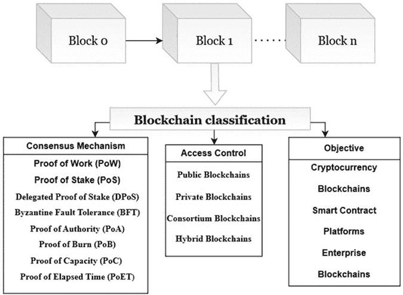

图 9.1 区块链技术的分类。返回正文。⏎

## 9.2 文献综述

对区块链技术的深度综述如 表 9.3 所示。

### 表 9.3 文献对比分析

| 作者 | 方法论 | 文献综述 | 局限性 |
| --- | --- | --- | --- |
| [23] | 本文全面综述了区块链技术如何影响物联网（IoT）安全，并强调了阻碍其在物联网中更广泛采用的障碍。 | 该摘要对物联网设计、安全和性能需求提供了广泛的理解。 | 为了确定物联网背景下采用区块链的障碍，该研究检查了区块链原理、物联网需求以及基于区块链的应用。 |
| [24] | 文中概述了用于去中心化系统的区块链与物联网集成，并讨论了其优势、困难和潜在的未来研究领域。 | IBM ADEPT 项目将区块链与分布式设备集成，而 Slock 提供了一个用于物联网集成的以太坊平台。 | 区块链的可扩展性问题导致了中心化，影响了加密货币的未来。物联网系统的中心化服务器/客户端架构也存在可扩展性和身份验证问题。 |
| [25] | 租约权益证明（LPoS）共识协议，以及共识过程和智能合约，是物联网应用薄层区块链技术的关键组件。 | 提出的用于物联网智能家居应用的低功耗区块链技术旨在改进隐私保护，并利用 SC 区块链实现设备定制和控制。 | 共识系统容易受到 51% 攻击等攻击，且工作量证明协议存在中心化、延迟和功耗问题可能会导致问题。 |
| [26] | 采用的技术包括 SVM、自动化、机器人技术、人工神经网络（ANN）、决策树（DT）、自然语言处理（NLP）和 AI。 | 对智能工业物联网（IIoT）、区块链和 AI 技术提供了深入见解，涵盖了工具、策略、安全、未解决的问题、有前景的发展和潜在分类，同时展示了应对隐私和机密性的挑战。 | 资源限制和安全问题阻碍了区块链在物联网设备中的实现。 |
| [27] | 医疗保健物联网解决方案利用 RSA 加密进行安全通信，利用分布式账本、智能合约和共识方法进行执行和验证。 | 文章讨论了用于数据保护的共识方法和 Rivest–Shamir–Adleman（RSA）加密，同时强调了区块链和物联网层在数据安全中的意义。 | 基于区块链的入侵检测系统解决了安全漏洞，包括互操作性、可扩展性和合规性。 |
| [26] | 区块链系统使用 SHA-256 算法密码哈希函数，利用优化算法提高系统性能并确保数字孪生的数据安全。 | 本文探讨了区块链技术、数字孪生和物联网在疫情控制中的潜力，提出了一种去中心化的、安全的数字资产复制基础设施。 | 数字孪生应用的高成本、对数据安全、隐私、延迟的担忧以及道德困境给企业带来了巨大挑战。 |
| [27] | 应用 AMOS 软件进行验证性因子分析和构念验证，使用 1 到 7 分的量表来测量构念。 | 重新检查了该模型，强调了额外的障碍和变量，并批评了以往的研究忽略了导致创新拒绝的因素。 | 本文包含了文化差异、预算限制和实验技巧的局限性。 |
| [28] | 物联网和区块链应用用于医疗保健系统，重点关注医疗记录管理、远程患者监测和药品追溯。 | 本文彻底研究了物联网与区块链在医疗保健领域的集成，利用了各种网络资源。 | 本文关注安全、隐私、标准、互操作性、法律法规和发展。 |
| [29] | 本文评估了基于区块链的物联网智能医疗系统的安全性，通过近距离安全技术、行为检测和加密。 | 密码学技术可能面临计算挑战，而区块链在医疗应用中的延迟和吞吐量限制，以及当前 EHR 系统中的安全和隐私问题阻碍了其采用。 |
| [30] | 该方案利用了附近诊所和医院的临床共享、EHR 共享、Medchain、分布式区块链数据保护以及双重加密。 | 本文探讨了区块链技术的原理、目标、局限性及性能，其在物联网（IoT）中的未来应用、对创新举措的评估以及其在医疗领域的应用。 | 所提的方案未经过性能测试，表明对相关的访问控制工作审查不足。 |
| [31] | 采用统计分析和机器学习技术进行数据解释，结合来自各种来源的数据进行全面分析。 | 探索人工智能、机器学习和数据分析在医疗保健领域的整合。 | 本文的样本量较小，可能由于自报告数据而产生潜在的偏差。 |
| [32] | 物联网应用中的区块链技术以及理论研究和仿真被用于分析基于 BBP 的数据库的属性。 | 文章强调了在物联网背景下考虑基于 BBP 的数据库的重要性，突出了物联网生态系统中进一步研究的潜在问题。 | 动态网络中基于区块链的物联网数据库在一致性、平台和结果方面面临问题，且使用 BBP 分布式键值数据库具有根本性限制。 |
| [33] | 探索区块链技术在管理医疗数据方面的潜力，重点关注其优缺点。 | 区块技术在医疗数据管理中的优势和潜在挑战凸显了其在医疗保健领域的潜力。 | 本文讨论了在医疗数据管理系统中实施区块链技术面临的障碍。 |

## 9.3 重要基于物联网的医疗问题

基于物联网的医疗保健提供了许多优势，包括增强患者监测、数据收集和运营效率，但也存在若干重大的缺点。医疗保健系统高度信任物联网传感器收集的数据，由于安全和隐私考虑，这些数据必须免受未经授权的修改。

## 隐私与数据安全

医疗保健中的物联网应用可以提高系统有效性，促进患者健康并有助于快速的应急反应。数据处理构成了重大的隐私安全风险，还涉及这些系统的记录、监控和数据传输。如果由于对安全、隐私和医疗数据保护的担忧导致治疗和诊断延迟，患者的生命可能会危险。物联网的实施改善了患者结果，提高了系统性能并加快了应急响应[10]。然而，在这些系统的处理、记录、监控和传输过程中，数据的安全和隐私面临巨大威胁。数据的机密性、隐私和保护问题可能会通过延迟诊断和治疗使患者处于危险。医疗物联网技术可以显著缩短应急响应时间，提高系统性能和患者护理。但在处理、记录、监控和数据传输方面也带来了重大的隐私和安全问题。这些对隐私、安全和数据保护的担忧可能会导致诊断和治疗延迟，从而危及患者生命[11]。

## 协作

基于物联网的医疗系统中的协作功能必须在去中心化环境中通过分布式算法实现，确保资源的有效共享和参与用户之间奖励的公平分配。仿真结果表明这种方法持续改进整个系统和特定用户的性能。此外，该策略确保了资源的公平分配[12]。

## 设备的扩展能力

计算和智能设备技术的最新进展导致了海量“大数据”的产生，这对于预测未来趋势至关重要。但某些技术难以处理这种复杂性，引起了关注的问题[13]。医疗服务提供者需要扩展的基础设施来管理这些数据流入，而不牺牲效率。

## 数据的整合与管理

用于电子健康系统的物联网网络旨在提高安全性和数据机密性。它建议从智能健康设备收集数据，并进行过滤和分析，以实现各种疾病高效且成本效益的诊断治疗。使用连接到物联网区块链网络的智能健身和健康设备收集并分析健康数据，可以实现各种疾病高效且成本效益的诊断治疗，并确保数据机密性。

## 对法规的承诺

尽管面临许多技术挑战，物联网通过实现实时数据收集和分析正在改变包括医疗在内的多个行业。医疗物联网解决方案必须遵守监管患者隐私和数据保护的法律，这些法律的执行可能具有挑战并需要持续关注[14]。

## 用户培训与采用

探索在老龄医疗记录中使用基于物联网的可穿戴设备，并检查促进和抑制其使用的因素的影响。具有物联网技术的穿戴设备提供实时健康监测、增加独立性并改善与医疗专业人员的沟通，能够对异常做出快速反应。老年人在采用具有物联网功能的穿戴设备时可能会面临挑战，例如数据安全、隐私、成本和污名化担忧。他们可能担心依赖数字设备[13]。医疗工作人员需要适当培训以使用物联网设备并分析它们提供的数据。

## 网络连接

基于物联网的医疗系统需要稳定的网络连接来实现实时数据，特别是对于可穿戴监测器和智能传感器。中断可能导致数据丢失或延迟，因此备份连接选项对于应急至关重要。对网络传输的数据进行加密、实施强身份验证和授权机制，以及防止对健康数据的非法访问是保护患者隐私的关键措施。医疗领域物联网设备数量的增加需要可扩展的网络基础设施，以处理这些设备产生的大量数据而不影响性能。网络基础设施不足可能会阻碍物联网医疗解决方案的采用和效率，特别是在农村或落后地区。

## 伦理与法律问题

物联网技术（包括智能设备和应用程序）收集并监控数据，产生大数据。保护这些数据免受网络威胁需要先进的加密技术、安全的通信协议和健壮的身份验证系统。收集和使用大数据带来了伦理和法律问题，因为个人信息可能导致隐私违反。《通用数据条例`(GDPR)`》和《健康保险流通责任法案`(HIPAA)`》等法规提供了执行指南，但由于互联网和物联网的全球性，这变得复杂。为了克服这些挑战，需要技术开发者、政策制定者和国际机构的协调努力，以确保物联网技术的安全和伦理使用[14]。

## 电池寿命与电源管理

物联网（IoT）包含传感器节点，它们利用蜂窝网络、`Wi-Fi`、`Bluetooth`等监测如脑电图（EEG）、心电图（ECG）、血压和体温等生理信号。在健康医疗领域，医疗物联网由资源受限的可穿戴设备组成。首要任务是解决这些使用设备中的能量耗尽和电池消耗。许多物联网设备由电池供电，不断更换或为电池充电并不方便，特别是对于可穿戴或植入式设备 [15]。

# 9.4 区块链技术解决物联网相关的健康问题

区块链技术可以完全改变基于物联网的医疗系统，为支持物联网的医疗提供革命性的可能。区块链技术与物联网可以显著改善医疗服务、推动创新并从根本上改变支持物联网的医疗系统。

## 9.4.1 提高数据的隐私与安全性

物联网的发展促进了分布式账本和区块链的发展，提供了增强的安全性、匿名性和容量。然而，这些技术面临存储限制、资源消耗高、交易速率扩展性、可预测性和法律问题。最新方法旨在通过将区块链技术与物联网相结合来解决这些问题。尽管存在这些挑战，人们正在探索将区块链技术与物联网融合的创新解决方案，以提高物联网驱动的医疗系统的安全性和隐私。区块链能够变革基于物联网的医疗解决方案 [16]。区块链去中心化且不可更改的账本保证了通过物联网设备传输和存储的健康数据的完整性和不可侵性。为了保护隐私并确保只有授权方可以看到其数据，患者可以安全、开放地授予和撤回对其健康记录的访问。

## 9.4.2 增强互操作性与数据完整性

信息技术和区块链技术的进步改变了医疗行业，使得用于监测生命体征的微型传感器和用于自我健康追踪的可携带健康设备成为可能。然而，不完善的安全策略和访问控制结构阻碍了这些进步。利用 `Hyperledger Fabric` 和 `Libelium e-Health toolkit` 构建了基于区块链的患者生命体征监测平台。这种创新方法为患者提供了不可篡改的历史日志和对医疗信息的全球访问权限，增强了医疗共享中的数据安全性和用户舒适度 [17]。区块链通过创建不可更改的患者数据历史增强了医疗记录的完整性，减少了数据损坏或更改导致的错误，并确保准确诊断和治疗。区块链技术通过安全收集和验证来自物联网设备的数据，提高了临床试验的信誉，降低了操纵和欺诈的风险。

## 9.4.3 有效的临床试验与调查

区块链技术实现了整个供应链的透明可追溯记录，增强了医疗物资管理和药品真实性。临床试验中的物联网设备实时收集患者健康数据，利用区块链技术进行安全记录、高效监测和及时的方案修改。临床试验中区块链技术的详细分类法强调了其在实现全面、安全和透明覆盖方面的潜力。它还解决了技术、安全和组织方面的开放研究挑战。区块链技术可以安全、透明地处理临床试验，但面临着技术、安全和组织方面的挑战 [18]。区块链技术能够实时从临床试验患者处收集健康数据，提高了效率并有助于更快速地调整方案。

## 9.4.4 供应链管理

将区块链与物联网相结合可以开发智能健康供应链管理系统。除了防止报告的伪造药物和医疗组件受损外，该策略还确保了认证、降低了成本，并监控了产品从制造商到终端用户的运输状态。它还提供了药品的去中心化跟踪和追溯，以及隐私、安全、信任和可见性。智能供应链需要安全的底层设施以确保货物及时准确地送达给正确的人。同时，物联网设备收集实时健康数据用于供应链网络控制，但信息不完整和利益相关者的行为冲突使得追踪医疗组件具有挑战性 [19]。区块链通过在不可篡改账本上追踪每个阶段，防止假药进入市场，确保患者安全。

## 9.4.5 自动化智能合约

保险理赔可以通过智能合约实现自动化，降低行政成本并加速结算。这对于管理物联网医疗设备产生的海量信息特别有帮助。智能合约是添加到区块链上的程序段，在满足某些条件时自动运行。区块链是一种分布式、共享记录，其中交易被详细记录并相互关联，提供了利益的完整来源或历史。智能合约适用于许多业务，例如金融服务和银行，允许许多投资者以相同的条款向多个借款人提供资金。智能合约用于能源行业以分配能源。数字版权管理系统允许娱乐行业通过智能合约更轻松地处理电影和音乐权利 [20]。保险理赔可以通过智能合约实现自动化，降低行政成本并加速结算。这对于管理物联网医疗设备产生的海量信息特别有帮助。医疗服务的支付根据预设指南进行，例如当患者的物联网设备信号健康检查完成时。

## 9.4.6 改进远程医疗患者监测

区块链可以通过保证收集的数据可靠且不可更改，帮助物联网设备远程监测患者。这对于在传统医院之外为患者提供可靠的服务是必要的。医疗物联网设备收集生物信号用于个性化医疗，增强了个人健康相关数据的管理。个人健康记录系统确保了隐私、个人控制、数据集成、安全灵活性。区块链技术正成为一种管理健康信息的潜在选择。医疗行业正在从以医院为中心转向以人为中心模式，促进了全民对疾病预防和早期发现的参与 [21]。多亏于区块链技术，急救人员和应急服务可以在紧急情况下立即访问患者的医疗信息，这对于快速高效的治疗至关重要。

## 9.4.7 去中心化健康信息

医疗机构正在采用创新技术来改进患者和提供者对健康信息的控制。区块链技术提供了一种去中心化的结构，以实现流畅的国际服务，并使医疗专业人员能够在没有中央机构的情况下记录和监督患者护理。然而，隐私担忧和竞争优势顾虑阻碍了机构的采用。云系统和区块链技术增强了记录的安全性，为患者提供了一个用于组织和保护其健康记录的专用区域，并允许随时从多个设施进行访问 [22]。区块链能够构建去中心化的医疗记录，人们可以将其带到其他机构和医疗提供者。这保证了完整、最新的医疗历史和服务的连续性。

# 9.5 结论

区块链技术最初是为比特币开发的，自诞生以来已获得了广泛认可。本章研究了多种区块链技术及其在各个领域的应用，包括基于物联网（IoT）的医疗保健。在音乐业务、金融服务、物联网、边缘计算、智能电网、网络安全和医疗保健领域的应用因其潜力表现出了巨大兴趣。区块链的集成改进了基于物联网的医疗保健系统的互操作性、安全性和效率，推动了数字化转型并改善了患者的健康。患者总是希望保护自己的医疗记录，而不将其交给任何医疗机构，无论是通过手机或其他技术手段。今天对物联网医疗保健的研究提供了一种新颖的方法，利用区块链技术安全可靠地利用未被充分开发的物联网资源。

## 参考文献

1. H. Kayan, M. Nunes, O. Rana, P. Burnap, C. Perera, “Cybersecurity of Industrial Cyber-Physical Systems: A Review,” ACM Computing Surveys, 54(11s), 1–35, 2022. 返回正文

2. D. Karthikeyan, B. Amutha, K. Mekata Devi, N. Singh, P. Anglin Kuruba, “Hybrid Rater to Quantify and Measure the Severity of Infection and Spread of Infection in Muskmelon,” Bulletin of Electrical Engineering and Informatics (BEEI), 13(3), 1667–1675, 2024. [`doi.org/10.11591/eei.v13i3.5432`](https://doi.org/10.11591/eei.v13i3.5432). 返回正文

3. M. A. Ansari, D. K. Singh, “Human Detection Techniques for Real Time Surveillance: A Comprehensive Survey,” Multimedia Tools and Applications, 80, 8759–8808, 2021. [`doi.org/10.1007/s11042-020-10103-4`](https://doi.org/10.1007/s11042-020-10103-4). 返回正文

4. Z. Wenhua, F. Qamar, T.-A.N. Abdali, R. Hassan, S. T. Jafri, N. Nguyen, “Blockchain Technology: Security Issues, Healthcare, Challenges and Future Trends,” Electronics, 12, 546, 2023. [`doi.org/10.3390/electronics1203546`](https://doi.org/10.3390/electronics1203546). 返回正文

5. R. K. Dewang, M. P. Yadav, S. Awasthi, O. Raj, K. Bawankule, “Data Secure Application That Allows Developers to Store User Securely Using Blockchain and IPFS,” Multimedia Tools and Applications, 83(15), 4549–4517, 2024. 返回正文

6. N. Goenkaa, A. Sharmab, S. Tiwaric, V. Yadave, S. Prabhuf, K. Chadaga, “A Regularized Volumetric ConvNet Based Detection Using T1-Weighted Images,” Cogent Engineering, 11(1), 231472, 2024. [`doi.org/10.1080/23311916.2024.231472`](https://doi.org/10.1080/23311916.2024.231472). 返回正文

7. N. Singh, S. P. Sasirekha, A. Dhakne, B. V. Thrinath, R. Thiagarajan, “IOT Enabled Hybrid Model with Learning for E-Health Systems,” Measurement: Sensors, 24, 1–14, 2022. [`doi.org/10.1016/j.measen.2022.100567`](https://doi.org/10.1016/j.measen.2022.100567). 返回正文

8. P. Paul, P. S. Aithal, R. Saavedra, S. Ghosh, “Blockchain Technology and Its Types—A Short Review,” International Journal of Applied Science and Engineering (IJASE), 9(2), 189–200, 2021. 返回正文

9. M. Tiwari, N. Singh, A. Mewada, M. A. Ansari, “Machine Learning Empowered Breast Cancer Diagnosis: Insights from Coimbra Dataset,” Recent Advances in Computer Science and Communications, 11, e26662558297605, 2024. [`doi.org/10.2174/012666255829760524092605723`](https://doi.org/10.2174/012666255829760524092605723)

10. H. Kayan, M. Nunes, O. Rana, P. Burnap, C. Perera, “Cybersecurity of Industrial Cyber-Physical Systems: A Review,” ACM Computing Surveys, 54(11s), 1–35, 2022.

11. D. Karthikeyan, B. Amutha, K. Mekata Devi, N. Singh, P. Anglin Kuruba, “Hybrid Rater to Quantify and Measure the Severity of Infection and Spread of Infection in Muskmelon,” Bulletin of Electrical Engineering and Informatics (BEEI), 13(3), 1667–1675, 2024.

12. M. A. Ansari, D. K. Singh, “Human Detection Techniques for Real Time Surveillance: A Comprehensive Survey,” Multimedia Tools and Applications, 80, 8759–8808, 2021.

13. Z. Wenhua, F. Qamar, T.-A.N. Abdali, R. Hassan, S. T. Jafri, N. Nguyen, “Blockchain Technology: Security Issues, Healthcare, Challenges and Future Trends,” Electronics, 12, 546, 2023.

14. R. K. Dewang, M. P. Yadav, S. Awasthi, O. Raj, K. Bawankule, “Data Secure Application That Allows Developers to Store User Securely Using Blockchain and IPFS,” Multimedia Tools and Applications, 83(15), 4549–4517, 2024.

15. N. Goenkaa, A. Sharmab, S. Tiwaric, V. Yadave, S. Prabhuf, K. Chadaga, “A Regularized Volumetric ConvNet Based Detection Using T1-Weighted Images,” Cogent Engineering, 11(1), 231472, 2024.

16. N. Singh, S. P. Sasirekha, A. Dhakne, B. V. Thrinath, R. Thiagarajan, “IOT Enabled Hybrid Model with Learning for E-Health Systems,” Measurement: Sensors, 24, 1–14, 2022.

# 参考文献

17. P. Paul, P. S. Aithal, R. Saavedra, S. Ghosh, “Blockchain Technology and Its Types—A Short Review,” *International Journal of Applied Science and Engineering (IJASE)*, 9(2), 189–200, 2021.

18. M. Tiwari, N. Singh, A. Mewada, M. A. Ansari, “Machine Learning Empowered Breast Cancer Diagnosis: Insights from Coimbra Dataset,” *Recent Advances in Computer Science and Communications*, 11, e26662558297605, 2024.

19. L. Hang, C. Chen, L. Zhang, J. Yang, “Blockchain for Applications of Clinical Trials: Taxonomy, Challenges, and Future Directions,” *IET Communications*, 2022.

20. S. K. Nanda, S. K. Panda, M. Dash, “医疗供应链与区块链和物联网集成以追踪医疗产品物流,” *Multimedia Tools and Applications*, 82, 32917–32939, 2023.

21. D. Negi, A. Sah, S. Rawat, T. Choudhury, A. Khanna, 区块链平台与智能合约。AI/Springer Innovations in Communication and Computing (EAISICC). Springer, 2021. [https://doi.org/10.1007/978-3-030-65691-1_5](https://doi.org/10.1007/978-3-030-65691-1_5)

22. P. Pawar, N. Parolia, S. Shinde, T. O. Edoh, M. Singh, “eHealthChain—基于区块链的个人健康信息管理系统,” *Annals of Telecommunications*, 77, 33–45, 2022.

23. G. Atlas, K. P. Arjun, Bindu Babu, 用于医疗应用中物联网和大数据的去中心化隐私保护区块链。 CRC Press, 2021. [https://doi.org/10.1201/9781003081180-2](https://doi.org/10.1201/9781003081180-2)

24. A. O. Almagrabi, R. Ali, D. Alghazzawi, A. AlBarakati, T. Khurshaid, “下一代医疗物联网的工具区块链,” *Computers, Materials and Continua*, 68(1), 359–376, 2021. [https://doi.org/10.32604/cmc.2021.014753](https://doi.org/10.32604/cmc.2021.014753)

25. J. Almalki, “医疗保健领域物联网的前沿研究,” *Arabian Journal for Science and Engineering*, 49(3), 3163–3191, 2024. [https://doi.org/10.1007/s13369-023-07896-5](https://doi.org/10.1007/s13369-023-07896-5)

26. H. F. Atlam, A. Alenezi, M. O. Alassafi, G. B. Wills, “物联网与区块链：益处、挑战与未来方向,” *International Journal of Intelligent Systems and Applications*, 10(6), 40–48, 2018. [https://doi.org/10.5815/ijisa.2018.06.05](https://doi.org/10.5815/ijisa.2018.06.05)

27. E. El-Din Hemdan, W. El-Shafai, A. Sayed, “数字孪生与基于物联网的区块链集成,” *Wireless Personal Communications*, 131, 2193–2216, 2023.

28. M. M. Kamruzzaman, B. Yan, M. N. I. Sarker, O. Alruwaili, M. Wu, I. Alrashdi, “智慧城市物联网驱动的医疗服务中的区块链与边缘计算,” *Journal of Healthcare Engineering*, 2022, 9957888, 2022.

29. I. Makhdoom, M. Abolhasan, W. Ni, “用于物联网的区块链：挑战与前进之路,” 在 ICETE 2018—第 15 次电子商务与电信国际联合会议论文集，第 2 卷，页 428–439, 2018. [https://doi.org/10.5220/000690560428039](https://doi.org/10.5220/000690560428039)

30. Z. Mani, I. Chouk, “消费者对服务创新的抵制：物联网中的挑战与障碍,” *Journal of Product Innovation*, 35(5), 780–807, 2018. [https://doi.org/10.1111/jpim.12463](https://doi.org/10.1111/jpim.12463)

31. P. S. Pavithra, D. Durgade, “提高安全性：用于医疗保健的区块链物联网解决方案,” *Journal of Theoretical and Applied Information*, 10(6), 2716–2725, 2024.

32. A. Preetha, T. Kumar, “基于区块链的物联网解决方案用于医疗保健的安全,” *Applied Nanoscience*, 13(2), 1263, 2023. [https://doi.org/10.1007/978-3-030-65691-1_5](https://doi.org/10.1007/978-3-030-65691-1_5)

33. A. Rahman, D. Kundu, M. Rahman, J. Aishi, “用于医疗保健的区块链物联网方法：最新进展,” 2021. [10.1201/9781003545620-1](https://doi.org/10.1201/9781003545620-1)

# 10 区块链驱动的供应链提升效率与可持续性

Harsh Raj, Garima Jain, Prafull Farswal, Vartika Singh, Rajasekaran

## 10.1 引言

未来的工业革命，即工业 5.0，其目标是将人类创造力与机器人的速度和智能性相结合。它将人类重新引入生产现场。工业 5.0 的潜在益处包括云制造、智能工厂、弹性物理系统。支持工业 5.0 的方法有很多，区块链是其中之一。

工业 5.0 源自工业 4.0。从工业 4.0 到工业 5.0 的转变并不复杂，区块链技术在各个领域都至关重要。在工业 4.0 中，区块链被用于使供应链更加安全、透明。在工业 5.0 中，这被推到了新的高度。例如，从采购原材料到交付产品，区块链有助于确保运营高效、安全且透明。它允许公司通过应用程序进行定制订单，使支付更加顺畅。

此外，它适用于远程实验室和全息教学等创新体验。对于无人机（UAV）操作和灾害管理领域，区块链将确保敏感数据安全，同时确保无人机网络或车辆系统的实时通信。简单来说，区块链是进入工业 5.0 最重要的工具之一，使我们的行业更加安全、高效和连接。可以将区块链想象成一个超级安全的全球账本。与普通数据库不同，它是不可篡改的，许多人都可以查看。结果是机构无法控制它。因此，如果你进行了一笔交易，系统将会进行检查，每个人都能看到发生了什么。下表 10.1 使用各种参数区分了工业 4.0 和工业 5.0。

### 表 10.1 从工业 4.0 到工业 5.0 的转变

| 维度 | 工业 4.0 (人不在回路中) | 工业 5.0 (人回归回路) |
| :--- | :--- | :--- |
| 关注点 | 技术驱动：自动化、智能工厂、信息物理系统和机器自主性 | 价值驱动：以人为中心、可持续性、韧性以及劳动者和社会的福祉 |
| 人类的角色 | 人类在很大程度上从工业流程中移除；系统和机器人自主处理大部分任务。 | 人类在机器人和系统的协作中发挥重要作用。 |
| 技术 | 以人工智能、物联网、云计算、机器学习和认知计算为主 | 集成用于人类控制的弱人工智能，并侧重于透明的人机协作 |
| 通信 | 机器间通信 | 与协作机器人的人机交互 |
| 决策 | 机器的自主决策 | 人类与机器共同参与关键决策 |
| 目标 | 效率和生产力、数据驱动的自动化 | 以人为本、可持续且具有韧性的工业流程，符合社会和生态需求 |
| 对工作的影响 | 自动化和自主系统可能导致部分工作流失 | 行业旨在通过将人类纳入更具协作性、创新性和决策过程中来创造新工作。 |
| 伦理考虑 | 很大程度上被忽视或视为次要，人类控制较少的“黑箱 AI” | 重点关注伦理决策并促进透明的人机合作，特别是在系统故障或降级模式下。 |

鉴于工业 5.0 和区块链技术的兴起，本研究旨在实现以下目标：

- **RO1**: 分析区块链在工业 5.0 供应链管理领域内的主要益处。
- **RO2**: 识别并评估工业 5.0 供应链管理中采用区块链的关键赋能因素。

## 10.2 文献综述

通过区块链技术提高效率的创新，或增强工业 5.0 供应链管理系统效率的流程，以及区块链在其中的作用。

实现这一目标涉及多种技术和流程，其中物联网（IoT）尤为重要。物联网构成了一个庞大的智能设备网络——这些设备、车辆和结构——它们都通过互联网相互连接。这些设备拥有电子设备、软件和传感器，能够实现采集和共享。这种连接促进了远程监控和控制，提升了整体效率。IoT 生态系统中的实体和虚拟实体具有独特特性，允许它们相互连接并成为更大信息网络的一部分。各种技术包括条形码、无线传感器网络、智能感知、近场通信（NFC）、射频识别（`RFID`）、低功耗云计算和无线通信，在物联网中发挥着关键作用 [5]。

物联网正在通过智能家居、智能城市、自动驾驶汽车和可穿戴设备等智能应用改变不同的行业。物联网在供应链系统中的作用是通过 `RFID` 和无线网络等技术实现实时追踪和自动化系统，改进库存管理。工业 4.0 为库存模型引入了新信息——从供应商驱动的生产向客户需求驱动的转变。这将涉及随时间变化的生产率以及有关库存补充的政策，能够完全使仓库以高效的方式准备并应对需求的变化 [6]。

协作是工业 5.0 时代（包括机器人）人机智能系统关系的新黄金标准。在改进这种伙伴关系方面，物联网是核心。想象一个智能工厂，机器共享有关制造工艺的数据，并通过 `IoT` 通信实时做出选择。这种连接性提升了效率，因为机器可以无缝协作。它还改进了仓库中的操作，人们可以在那里计算出最快路线，从而加速产品交付并改进库存管理。与工业 4.0（其目标是尽可能减少人类参与）相比，工业 5.0 更强调人机之间的平衡交互。这一版本允许人类承担创造性角色，而机器人处理重复性任务。两者的结合进一步提高了生产质量。工业 5.0 使用 `IoT` 的方式使行业转变为协作环境，人类的创造力与机器的能力相结合，创造了更敏捷的可扩展的运营 [7]。

通过将新的尖端技术与之结合，`IoT` 网络变得更加稳固和安全。为了更好地理解区块链的影响，可以将其视为一种额外的保护，防止未经授权的拦截智能家居设备之间的数据传输。区块链技术实现了各种设备（如温度计、冰箱和摄像头）之间简单且高度安全的通信。分布式账本技术（区块链）比将数据存储在单个易感区域更难被腐败或操纵 [8]。跨越多个设备完成的安全数字承诺使智能合约能够促进双方之间的交互。传统安全系统存在许多漏洞，因为它们依赖于单一权威。然而，具有智能的合约是可靠的、独立执行的且不可破解的。它们确保只有授权的设备才能访问正确的信息，从而维护数据和整个 `IoT` 系统的完整性。因此，区块链上的智能合约在不需要完全重构现有系统的情况下，增强了 `IoT` 的安全性 [9]。这项技术还赋予了 `IoT` 设备处理交易的能力，对于需要为服务进行快速安全支付自主机器极其有用 [10]。

从上述内容可以看出，区块链在分布式账本上记录从 `IoT` 采集的每条数据，从而验证了 `IoT` 数据的完整性。这种透明的记录使其防篡改，并将增加利益者之间的依赖程度。预测分析可以依靠这些安全数据提供需求模式预测，还能检测操作异常（例如机械故障或供应链故障），并优化资源配置。将区块链的安全性与人工智能（AI）的分析能力相结合，为企业开启了更有信心做出更多数据驱动决策的新途径，以提高全球供应链的效率和伦理实践 [11]。

信息共享对于供应链系统企业在工业 5.0 背景下的蓬勃发展至关重要。技术进步使链的不同层级之间共享数据变得更容易，增强了供应商、生产者、零售商和分销商之间的协调与合作。如果没有足够的信息共享，组织就无法有效运行 [12]。它可以增加公司的竞争优势，提高对市场变化的响应能力，同时确保产品与消费者需求更佳地匹配。尽管共享信息具有相关成本，但通过企业资源计划（ERP）和基于网络的系统的进步，其收益是显著的。因此，供应链中的数据共享是实现整个供应链更好协调、集成和效率的关键因素。区块链技术通过加密形式存储信息来强化信任并保护共享数据。

它让数据所有者对谁可以在什么条件下访问其信息具有完全的控制权。区块链记录的透明度和不可篡改性增强了用户之间的信任，使其成为处理大量敏感数据行业的强大解决方案 [13]。因此，区块链成为确保交易安全以及保护个人及敏感信息的关键组成部分。验证共享文档真实性的传统方法通常需要耗时的线下流程，涉及联系颁发机构。区块链计算的分散性和不可逆性特征通过提供一种可见的、集体的活动账本解决了这个问题，该账本能够迅速验证共享信息的有效性。区块链的密码学强度防止了未经授权的实体编辑记录，进一步增强了安全性 [14]。

区块链通过提供采购和生产过程中每一步的透明且不可篡改的记录，确保了全球供应链中伦理采购的维护。关于伦理采购材料的认证，区块链可以验证符合公平贸易或可持续实践标准的认证。可追溯性让消费者和公司对产品来源做出确信的评估，使供应商对伦理和环境标准负责。这将创建一个更好、更负责且更透明的供应链生态系统，因为区块链消除并防止了供应链内部欺诈和不伦理行为的风险 [15]。

由于上述特征，区块链计算被泛括为不同领域的转型解决方案，特别是对于健康和能源领域。具体而言，在健康领域（主要是肿瘤学），区块链可以通过透明性、可追溯性和不可篡改性特征，显著增强数据共享安全性、个性化护理和医疗研究。然而，需要注意的是，任何技术都无法完全保护数据隐私或安全，且它可以与其他加密方法结合。法律、社会和技术方面的采用障碍目前仍阻碍了大规模的现实部署。然而，未来的研究可以通过开发与其他系统具有互操作性且符合国际法规的隐私保护系统来克服这些问题 [16]。

在能源领域，区块链正在驱动从中心化向去中心化能源系统的转变，目前重点关注智能电网、微电网和点对点能源市场。中国在能源基础区块链研究方面处于领先地位；然而，大多数现实应用出现在发达国家。该领域的未来方向和研发应侧重于整合这两个领域，以弥合基础研究与实际应用之间的差距 [17]。

新兴趋势如量子区块链和在区块链中引入人工智能，将彻底改变工业 5.0，这两个方面都与去中心化系统和以人为中心的生产有关。量子人工智能通过将人工智能算法与量子计算的力量相结合，加速交易验证并维护数据安全，极大扩展区块链的效率。这种集成将通过更好的预测和分析以及欺诈检测，确保高效的医疗保健、金融服务和供应链管理。这些技术在应用于工业 5.0 时，将提高自动化和决策能力，使工业解决方案具有可持续性和智能化。在此背景下，区块链系统的结合符合工业 5.0 的需求，其目标是改进人机协作的方式并提高制造效率。图 10.1 显示了所提方法论的框架。

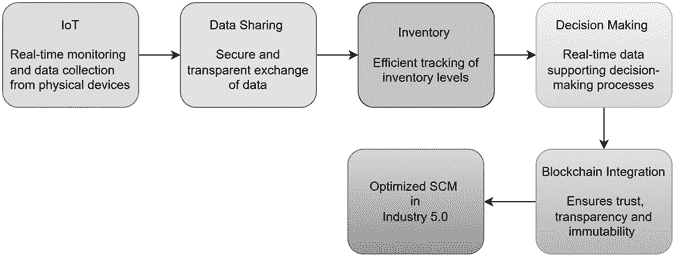

图 10.1 拟议框架。Return to text.⏎

## 10.3 工业在工业 5.0 中可能面临的问题

- **安全性**：在这种背景下，通过 `IoT` 增加的数字化和连接性增加了针对工厂和工业流程的网络攻击风险。这使得安全问题成为工业 5.0 的首要任务。此类攻击会导致巨大的财务损失，并影响生产、交付和客户满意度。为了克服这个问题，身份管理、持续系统监控和高级加密是基本的安全属性。为了提高生态系统的可靠性并防止未经授权的访问，企业可以使用区块链技术结合 `IoT` 安全地交换数据 [18]。

- **隐私**：工业 5.0 通过定制化生产满足人类需求，高度依赖用户数据。因此，保护用户数据至关重要。如果用户数据落入未经授权的手中，可能会被用于身份盗窃、财务欺诈或未经授权的监视。随着多方数据共享的增加，控制变得越来越复杂。缺乏控制很容易导致滥用，这强调了隐私设计方法，即将隐私嵌入技术和业务流程中以增强整体安全性。区块链的独特性在于其去中心化，这赋予了个人对其数据的控制权。通过智能协议指定的权限限制访问，区块链技术帮助参与者更有效地处理个人信息 [18]。

- **数据共享**：尽管数据共享在工业 5.0 中非常重要，但它也有缺点。信息共享的复杂因素包括组织之间缺乏信任以及不同的政策和标准。因此，建立一个促进不同参与者之间共享数据的生态系统至关重要。数据所有权担忧和对竞争对手获取敏感信息的恐惧可能会阻止组织共享数据。

- **中心化**：这一参数似乎可能是实现目标的主要障碍之一。这使其容易受到网络攻击和故障的影响。中心化结构的被破坏可能不仅损害组织，还会影响供应链中的每个人。此外，灵活性和响应是工业 5.0 的两个关键需求，因为消费者预期和市场环境在不断变化。图 10.2 显示了流程图。

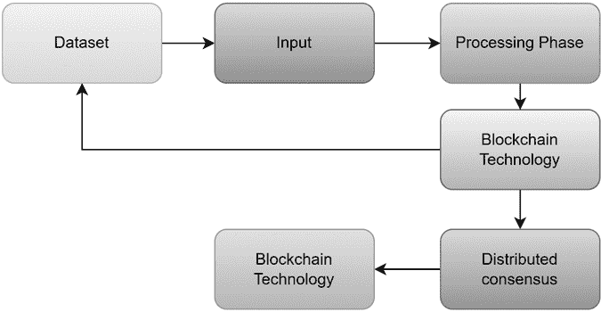

图 10.2 拟议流程结构。Return to text.⏎

## 10.4 区块链在解决工业 5.0 挑战中的作用

# 区块链技术在工业 5.0 供应链中的应用

## 概述

随着工业 5.0 的发展，解决所有供应链中组织可能面临的潜在挑战至关重要。区块链技术是解决这些问题的关键。如果利用得当，它在促进新技术的安全集成方面具有巨大潜力，从而推动工业 5.0 的数字化转型。区块链技术的去中心化、透明和安全特性使其成为解决工业 5.0 中许多棘手问题的理想选择，包括与数据共享、隐私和中心化相关的问题。例如，区块链通过将必须存储在去中心化网络中的数据分散来提高可靠性，消除单点故障。对于维护供应链的真实性至关重要，区块链上数据的不可篡改性保证了信息防篡改。

使用有效的加密技术和基于 `smart contracts` 的访问控制进一步增强了区块链的隐私功能。它允许用户为数据访问设置特定权限，使其对个人信息有更多的控制权。这种控制有助于在参与者之间建立信任，允许组织和个人在保护隐私的同时共享信息。区块链通过在组织之间安全地共享数据，消除了协作过程中常见的问题。它可以永久保存记录并提供共享视图，使得利益相关者更容易相互信任。这在处理供应链时特别有用，因为许多人依赖准确的数据来做出决策。

区块链与游戏化形成了完美的协同效应，这可以应用于供应链。通过基于区块链的令牌或奖励，可以激励供应链中的利益相关者协作，增加参与度和透明度。例如，参与者在达到特定的性能指标或准时交付后将获得代币，而区块链将处理其进度的安全、不可篡改的记录。这通过区块链整合了游戏化：它激励了利益相关者，并通过减少去中心化供应链的透明度问题，加强了责任机制和信任 `[19]`。

区块链技术允许每个用户控制链中的自己的数据并贡献于数据主权。区块链使用的账本去中心化和开放，确保了数据不受单一实体控制，而是分布在高度安全的网络中。这允许个人通过使用 `smart contracts` 管理其私有数据的访问，他们可以决定允许访问或使用其信息的人员类型以及此类人员访问的条件。数据还通过加密锁定以追踪其沿供应链的移动，同时允许用户保持隐私。这使用户能够信任个人数据只有授权方才能访问，从而在不剥夺用户控制权的情况下提高透明度。

区块链去中心化的可用性能将赋予个人对数据的所有主权，通过这种方式，它将最大限度地减少对第三方的依赖，而这些第三方正是数据滥用风险的核心所在 `[20,21]`。区块链由于透明且可靠的信息链而提供了隐私。图 10.3 显示了工业 5.0 的研究。

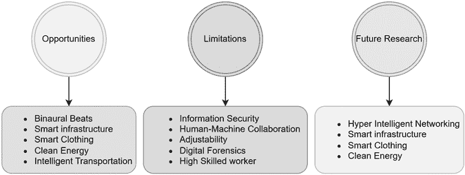

图 10.3 工业 5.0 未来研究的机遇、限制和前景分析。

## 典型应用案例

1. **沃尔玛 (Walmart):** 沃尔玛已与 IBM 合作将区块链技术整合到其供应链中，以增强对食品来源的监控。通过使用 IBM Food Trust 区块链，沃尔玛可以在几秒内追踪从农场到商店货架的 127 种产品，提高透明度、安全性和生产力。因此，公司可以更快速地响应食品召回，这有助于识别并移除任何受污染的产品 `[8]`。

2. **德比尔 (De Beers - Tracr):** 为了监控钻石跨越供应链的移动，钻石巨头德比尔引入了一个名为 Tracr 的区块链平台。这促进了钻石的伦理采购，并有助于阻止冲突钻石（通常被称为“血钻”）的流通。根据 Ahmed 和 Abdurrahman 研究 `[9]`，区块链技术使得对从采矿到存储的钻石整个周期的监控更加透明。

3. **马士基 (Maersk - TradeLens):** 在 IBM TradeLens 平台的帮助下，全球领先的运输公司之一马士基整合了区块链技术。通过对物流和运输文档进行数字化和简化，这项技术实现了高效的全球贸易。Zhan 和 Wang 发表 `[20]`，TradeLens 利用区块链技术提供实时的运输交易更新，减少了纸质工作，增强了供应链透明度并最大限度地减少了欺诈。

## 10.7 结论

工业 5.0 代表了以人类智慧与机器生产力协作为中心的最新工业革命。它建立在工业 4.0 的基础上，结合了区块链技术以增强供应链的安全性和透明度。工业 5.0 利用区块链技术来保证产品的真实性和卓越质量。它还运行在一个分布式账本系统中，通过创建交易的安全记录来消除银行等中间环节。在涉及物联网（IoT）、数据交换、库存管理和决策过程时，这项技术对于许多不同类型的企业至关重要。在这里，“物联网”指的是一个互联的、联网智能设备系统。它在工业 5.0 中非常重要，因为它允许远程监控和控制。将区块链与物联网相结合将增强这些系统的可靠性和安全性，允许传感器之间的安全通信。区块链还通过加密和访问控制确保安全的数据共享，这对于高效的供应链管理至关重要。

随着区块链转型供应链物流，库存处理将变得更加高效。此外，平台的透明性和不可篡改性促进了无需信任的协作，反过来造福了决策过程。工业新时代区块链的主要组件是物联网与如权益证明（Proof of Stake）和工作量证明（Proof of Work）等互操作性技术标准的集成。鉴于物联网设备产生的海量数据，这种集成是工业 5.0 的一项核心需求，这种集成保证了信息安全、完整性以及通过设备间智能合约实现的整体自动化交易，促进了顺畅且安全的运行。

## 参考文献

1. Maddikunta, P. K., Pham, Q.-V., B, P., Deepa, N., Dev, K., Gadekallu, T. R., Ruby, R., and Liyanage, M. (2022a). Industry 5.0: A survey on enabling technologies and potential applications. Journal of Industrial Information Integration, 26, 100257. [`doi.org/10.1016/j.jii.2021.100257`](https://doi.org/10.1016/j.jii.2021.100257)

2. Gokhale, P., Bhat, O., and Bhat, S. (2018). Introduction to IOT. Computer Networks, *5*(1), 41–44.

3. Javaid, M., Haleem, A., Singh, R. P., Rab, S., and Suman, R. (2021). Significance of additive manufacturing for Industry 4.0 implementation. Automation, 6(2), 33.

4. Fatima, Z., Tanveer, M. H., Waseemullah, Zardari, S., Naz, L. F., Khadim, H., Ahmed, N., and Tahir, M. (2022). Production plant and warehouse automation with IOT and Industry 5.0. Applied Sciences, *12*(4), 2053. [`doi.org/10.3390/app12042053`](https://doi.org/10.3390/app12042053)

5. Fosso Wamba, S., Guthrie, C., Queiroz, M. M., and Minner, S. (2024). ChatGPT and generative artificial intelligence: an exploratory study of key benefits and challenges in operations and supply chain management. International Journal of Production Research, 62(16), 5676–5676.

6. Lone, A., and Naaz, R. (2021). Applicability of blockchain smart contracts in securing internet and IOT: A systematic literature review. Computer Science Review, *39*, 100360. [`doi.org/10.1016/j.cosrev.2020.100360`](https://doi.org/10.1016/j.cosrev.2020.100360)

7. Mathur, S., Kalla, A., Gür, G., Bohra, M., and Liyanage, M. (2023). A survey on the role of Blockchain for IoT: Applications and technical aspects. Computer Networks, *227*, 109726. [`doi.org/10.1016/j.comnet.2023.109726`](https://doi.org/10.1016/j.comnet.2023.109726)

8. Bahsi, H., and Akleyle, S. (Eds.). (2023). AI-enabled threat detection and security for cyber-physical systems. Springer. [`doi.org/10.1007/979-8-8688-0315-4`](https://doi.org/10.1007/979-8-8688-0315-4)

9. Jussen, Ilka and Schweihoff, Julia and Dahms, Frederik and Otto, Boris. (2023). Data Sharing: Definition and Characteristics.

10. Hugos, M. H. (2024). Essentials of supply chain management. John Wiley and Sons.

11. Akinsulire, A., Idemudia, C., Okwandu, A., and Iwuanyanwu, O. (2024). Supply chain management and operational efficiency: An integrated review. Magna Scientia Research and Reviews, 11(2), 105–118.

12. Winkelbauer, L. (2023). Blockchain for ethical chain sourcing. [`www.winkelbauer.com/blockchain-for-ethical-sourcing/`](https://www.winkelbauer.com/blockchain-for-ethical-sourcing/)

13. Makaram, P., and Gheorghiu, R. (2021). Applications of blockchain technology for data-sharing in oncology: Results from a systematic literature review. Oncology Research and Treatment, 98(6), 403–411. [`doi.org/10.1159/0005149`](https://doi.org/10.1159/0005149)

14. Kouhizadeh, M., and Sarkis, J. (2021). Blockchain practices, potentials, and perspectives in greening supply chains. IFAC PapersOnLine, 54(1), 81–86. [`doi.org/10.1016/j.ifacol.2021.04002`](https://doi.org/10.1016/j.ifacol.2021.04002)

15. Adel, A. (2022). Future of Industry 5.0 in society: human-centric solutions, challenges, and prospective research areas. J Cloud Comp 11, 40. [`doi.org/10.1186/s13677-022-00314-5`](https://doi.org/10.1186/s13677-022-00314-5)

16. Haris, M., and Yasin, S. (2023). Integrating blockchain technology into knowledge management: A comprehensive review. Global Knowledge, Memory and Communication. [`doi.org/10.1108/GKMC-11-2023-0426`](https://doi.org/10.1108/GKMC-11-2023-0426)

17. Paiva, J. M., Alves, J. M., and Lima, J. M. (2024). 区块链在促进可持续性方面的作用：系统性综述。Sustainability, 16(7), 2823. [`doi.org/10.3390/su16072823`](https://doi.org/10.3390/su16072823)

18. Abdullah, N., Hakansson, A., and Moradian, E. (2017). 基于区块链的增强分布式环境中大数据身份验证的方法。2017 年第九届泛在与未来网络国际会议 (ICUFN)。 [`doi.org/10.1109/icufn.2017.7993927`](https://doi.org/10.1109/icufn.2017.7993927)

19. Wen, B., Wang, Y., Ding, Y., Zheng, H., Qin, B., and Yang, C. (2023). 区块链应用的安全隐私保护技术。Information Sciences, `645`, 119322. [`doi.org/10.1016/j.ins.2023.119322`](https://doi.org/10.1016/j.ins.2023.119322)

20. Centobelli, P., Cerchione, R., Vecchio, P. D., Oropallo, E., and Secundo, G. (2022). 用于连接循环供应链中信任、可追溯性和透明度的区块链技术。Information and Management, `59`(7), 103508. [`doi.org/10.1016/j.im.2021.103508`](https://doi.org/10.1016/j.im.2021.103508)

21. Tripathi, G., Ahad, M. A., and Casalino, G. (2023). 区块链技术的全面综述：底层原理、历史背景与未来挑战。Decision Analytics Journal, 9, 100344. [`doi.org/10.1016/j.dajour.2023.100344`](https://doi.org/10.1016/j.dajour.2023.100344)

22. Shukla, A., and Soni, P. (2021). 区块链技术：局限性与未来可能性。ResearchGate. [`doi.org/10.4018/978-1-7998-2414-5.ch009`](https://doi.org/10.4018/978-1-7998-2414-5.ch009)

23. Vartak, P., Nandan, R., and Kamble, S. S. (2023). 供应链管理区块链技术的系统性综述。Information, 11(11), 509. [`doi.org/10.3390/info11110509`](https://doi.org/10.3390/info11110509)

24. Shamsudin, N., and Ali, M. A. (2022). 区块链技术对供应链透明度的影响：系统性文献综述。The European Proceedings of Social and Behavioural Sciences, 2022, 58. [`doi.org/10.15405/epms.2022.10.58`](https://doi.org/10.15405/epms.2022.10.58)

25. Razali, M. N., Rahman, A., and Zainuddin, M. (2019). 区块链在促进供应链透明度方面的作用。In A. F. A. Rahman, M. N. Razali, and M. Zainuddin (Eds.), 与管理进展 (pp. 189–199). Springer. [`doi.org/10.1017/978-1-7998-2414-5.ch009`](https://doi.org/10.1017/978-1-7998-2414-5.ch009)

26. Ahmed, R., and Abdrahman, A. (2021). 基于区块链的解决方案：综述。Automation, 5(3), 43.

27. Zhan, Y., and Wang, L. (2021). 区块链技术对性能的影响：来自中国的证据。Management Review, 25(2), 203–221.

# 11 区块链网络中的安全与隐私问题

KM Manisha 和 Sathish

DOI: [`10.1201/97830315`](https://doi.org/10.1201/97830315)

## 11.1 引言

在机器学习（`ML`）/深度学习（`DL`）的医疗应用中，缺乏数据集。鉴于医疗数据的指数级增长，以及对能够准确诊断疾病的机器学习和深度学习模型的需求，医疗机构、研究人员和患者必须在保护患者隐私与聚合数据的价值之间取得平衡。

这个问题引发了前沿技术的发展，这些技术有望改变数据共享的方式。当使用多个医疗系统时，信息的安全性、隐私性和可访问性面临风险。黑客可以使用医疗处方进行欺诈或身份盗用。他们还可以利用勒索和敲诈迫使受害者披露个人信息。

最后，医疗物联网（`IoMT`）健康工具的移动性、隐私安全性也面临风险。中心化数据系统的缺点包括单点故障、互操作性问题以及数据隐私安全担忧。去中心化数据共享在没有中心机构或中间人的情况下将数据分散，已成为解决这些问题的可行方案。去中心化数据共享还有许多优势，包括更好的数据所有权和控制、更高的隐私安全性以及更高的责任和透明度。

## 4 社会与影响

*   **区块链**：区块链是一种不可篡改的、去中心化的追加式公共账本。区块链是公共账本，因为任何人都可以参与交易，每个节点都会保留一份并维护自己的副本。每个人都作为一个节点并在本地处理数据；没有中央数据库来存储链数据。这被称为去中心化。

*   **区块**：区块是一个容器数据结构，包含一系列交易。每个区块通过其哈希值连接。通过使用加密哈希连接区块，维护了区块链的完整性，同时保证了去中心化和抗篡性。区块分为两个部分——区块头部和区块体。区块头部包含版本、时间戳、哈希、难度、随机数和 `Merkle` 根。版本定义了区块结构。创建区块的时间被称为时间戳。哈希函数接受任意长度的输入并产生固定长度的输出。

难度级别表示了挖掘网络所需的复杂程度处理能力。`Nonce` 是用于工作量证明算法的计数器 [4]。`Merkle root` 作为区块链中区块内每笔交易的唯一标识符。区块体包含交易列表。较大的区块有助于一次性处理大量交易。然而，验证和传播需要更长。

区块链从单个区块开始，称为 `Block 0` 或 `创世区块`（`Genesis Block`）。所有其他区块都附加在该区块之后，该区块充当祖先，由于每个区块都引用其前一个区块，在实践上所有其他区块都可以从它那里追溯其谱系关系。使用加密算法来链接区块，并采用共识架构来控制和对交易进行数字签名。新区块被添加到网络中，携带新的信息。区块链确保每个人始终从相同的视角查看区块链，从而维持了透明度。由于信息对所有人开放，任何人都可以确认并验证它 [5]。

区块链实现了不可篡改的交易、共识、验证和校验。由于其去中心化的本质，它可以很容易在多个节点之间共享，而不需要任何中央机构。数据去中心化共享的优点包括问责制、开放性、有效性和验证。由于其不可篡改性，区块链更加安全。联邦学习（`FL`）结合区块链为去中心化数据交换提供了一种新方法。共识算法通过确保所有用户可以在不需要中央机构的情况下信任系统，支撑了区块链的去中心化。多个实体参与区块链的管理。这些实体包括节点、验证者、交易、区块、共识和服务供应商。每个实体对网络的去中心化、安全、功能和治理做出了贡献。区块链本质上是去中心化的网络，由多个根据其可用知识和激励产生行为的个人组成 [6]。

当构成网络的绝大多数代理接受单一状态时，就达到了共识。区块链的安全性和完整性通过共识算法得以维护。共识算法是一种使分布式网络中的所有节点对单一现实解释达成一致的技术 [7]。共识方法确保了所有区块链网络参与者的统一数据视图，并在安全、不可信的环境中进行交易验证。如果一个算法同时满足以下两个要求，即一致性和终止性，则被认为达到了共识。在一致性方面，所有非故障节点都选择相同的输出值。在终止性方面，每个非故障节点在某个时间选择一个输出值 [8]。各种共识算法包括 `Proof of Work`、`Proof of Stake`、`Proof of History`、`Proof of Activity`、`Proof of Authority`、`Proof of Burn` 和 `Proof of Capacity`。算法的选择对网络的可扩展性、安全性和性能有重大影响 [9]。

### 11.1.1 区块链分为四个部分——公有链、私有链、混合链和联盟链，下文将解释

*   **公有区块链：** 它也被称为无许可区块链。任何人都可以加入并进行操作，而无需任何中央机构的许可。其特点包括去中心化、不可篡改性和透明性。其缺点是可扩展性问题、更高的能耗和容易受到攻击。例如，`Bitcoin` 和 `Ethereum`。

*   **私有区块链：** 它也被称为许可区块链。工作在封闭的网络内进行。在开发私有区块链应用时，相关机构和链开发者选择了该网络的实体。对于谁可以参与验证和交易有一些限制。其特点由于节点较少而具有高性能、吞吐量大、可扩展性增强、速度快等。其局限性是中心化、网络效应有限、互操作性问题等 [10]。例如，`Hyperledger`。

*   **混合区块链：** 该技术将基于许可和无许可系统的公有和私有区块链相结合。旨在消除两种区块链的所有缺点。成员有权决定谁可以使用区块链以及哪些交易对公众可见。它在保持完整性、安全透明性的同时具有高度灵活性。其优点是交易速度快、交易成本低、基础设施灵活等。例如，`Energy Web Foundation`、`Dragonchain` 和 `R3`。

*   **联盟链：** 也称为联邦区块链。它是私有区块链的一种，其共识过程由一组预选的节点或组织控制 [11]。联盟链由几个小组或实体运营和维护。联盟链适用于几个可靠且知名的方需要在类似平台上共同工作的用例，因为它们在控制和去中心化之间取得了平衡 [12]。

由于不可篡改性，数据一旦被写入区块链就无法被更改。由于区块链网络的去中心化结构，单个节点的被泄露不会损害整个系统。通过促进不同医疗保健系统和提供者之间进行标准化、安全且高效的数据传输，区块链解决了可扩展性和互操作性问题。区块链的去中心化结构消除了单点故障 [3]。区块链可以用于医疗保健，为医疗数据提供安全隐私保护，并为医疗行业提供透明度。

### 11.1.2 区块链在医疗保健中的优势

*   **协作与信息交换：** 区块链通过减少多个系统和组织之间健康数据的标准交换来增加互操作性。授权的医疗提供者保留并访问完整的患者记录，确保所有相关数据可用以改进护理。

*   **更好的数据隐私和安全性：** 医疗行业改进的数据隐私和安全性对于保护隐私信息、建立患者信任、防止数据泄露和确保法律合规至关重要。它不仅保护了患者数据，还提高了医疗提供者的整体效能、效率和声誉，为更好的患者护理和创新医疗实践开启了门径。

*   **开放性与可追溯性：** 由于其去中心化的本质，数据对所有节点可见。因此，它提供了开放性和可追溯性 [13]。每笔交易都记录在区块链上，维护了所有数据访问和修改操作的公开记录。区块链技术确保了从制造到交付的整个医药供应链生命周期的透明度和追溯性。

*   **有效性与经济缩减：** 智能合约可用于自动化行政任务，包括账单、理赔处理和管理患者记录，这可以节省开销和行政工作量。区块链可以通过简化许多流程和减少延迟来提高医疗运营的效率。

*   **改进研究与临床调查：** 为了符合监管要求并赢得公众信任，确保临床试验数据的完整性至关重要。可以使用区块链安全地记录和验证临床试验数据。区块链技术可能会加速临床试验参与者的招募和知情同意过程，确保效率和透明度。

*   **防止欺诈：** 区块链技术有助于患者和提供者的身份识别与验证，减少医疗计费和服务中发生欺诈的可能性。通过在区块链上追踪药品并验证其有效性，可以降低假药的风险。

*   **赋能患者：** 患者拥有并管理自己的健康数据，决定何时以及允许谁访问数据。对健康数据拥有更多控制权可以增加患者对其护理的参与和投入。

*   **人群健康与公共卫生管理：** 区块链技术能够立即汇总来自多个来源健康数据，为公共卫生响应和监测提供洞见信息。在保护个人隐私的同时，区块链技术可以使匿名健康数据用于研究和人群健康研究变得更加容易。

*   **医疗设备安全：** 区块链技术可以安全地记录和传输医疗设备数据，保证其完整性和安全性。区块链技术可追踪并确保医疗设备符合法规规定。

### 11.1.3 医疗保健中的隐私与安全问题

安全和隐私在医疗领域至关重要，旨在保护敏感信息、建立信任并防止欺诈和身份盗窃。医疗提供者收集并保留大量的敏感数据，包括财务记录、病史和个人身份信息。保护这些数据对于确保患者的机密性是必要的。医疗提供者的声誉取决于其保护患者数据的政策。数据泄露会严重损害职场关系和信任。在医疗领域，区块链技术增强了数据安全、隐私、互操作性和共享。当使用多个医疗系统时，患者信息的隐私、安全性和访问性都会受到损害；此外，隐私和安全存在一些缺点，如数据泄露、复杂性、数据访问可能的延迟以及在安全与使用之间寻找平衡的困难。安全问题的潜在后果包括可用性、数据完整性和隐私 [14]。

即使采取了强大的安全措施，医疗系统仍然容易受到勒索软件、高级持续性威胁和内部威胁等复杂的网络攻击。尚未修补或新发现的漏洞仍可能被利用。勒索软件攻击能够加密重要数据，导致医疗系统停止并影响患者护理。即使攻击者要求巨额赎金以换恢复访问权限，也无法保证访问将完全恢复或数据未被篡改 [15]。重放攻击被用于多次重复相同的请求并伪装成新请求。可以通过 `nonce`、`timestamp`、`token expiration`、加密等方法来防止。

## 11.2 医疗保健中的问题

### 11.2.1 医院之间的数据共享

访问控制措施实施不当可能导致对患者隐私信息的未经授权访问。获得数据检查数据的员工或内部人员可能会滥用数据，例如为了自身利益，有意或无意地访问并修改数据。由于医疗数据在多个系统和组织之间频繁隔离开，信息共享变得困难且不安全。不一致的数据格式和标准可能使集成和交换安全数据变得困难 [16]。当医院之间共享患者数据以获得更好的诊断时，患者数据使用接收者的公钥加密，并使用接收者的私钥解密。之后，使用数字签名来识别用户并保护数字消息中的信息。发送者使用其私钥对数据签名，接收者使用发送者的公钥进行验证 [17]。通过这种方式，数据受到不受未经授权的访问和更改。

#### 上述问题可以通过如下解决：

当数据从 A 医院共享到 B 医院时，恶意第三方（如 C 医院）是一个未经授权的实体。它可以攻击数据，破坏系统安全，如图 11.1 所示。

图 11.1 医疗中的数据共享。

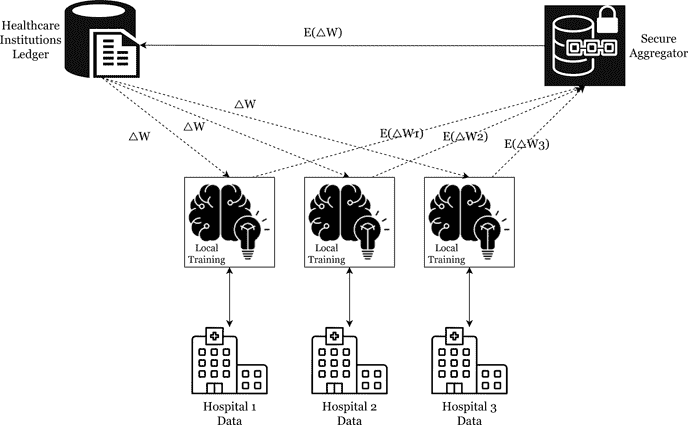

图 11.2 医疗系统架构。

- **中间人攻击：** C 医院位于 A 医院和 B 医院之间，以拦截并可能操纵正在传输的数据。

- **重放攻击：** C 医院监听 A 医院和 B 医院之间的对话。为了尝试重新插入数据或启动未经许可的数据请求，它尝试重新发送被拦截的交易。

- **身份冒充：** 通过伪造签名或更改其 IP 地址，C 医院试图冒充 A 医院或 B 医院。

为了防止这些攻击，可以提出几种机制：

- **端到端加密：** 在医院之间传输数据时使用接收者的公钥进行加密。这保证了即使在发生中间人攻击的情况下，C 医院无法没有匹配私钥的情况下解码或更改数据。

- **哈希和 Nonce 验证：** 每个区块包含一个 `nonce` 值，以确保区块的哈希对应于特定的模式。当区块链检查 `nonce` 和哈希值时，重放攻击会被识别。重用的 `nonce` 值表示存在重放尝试。

- **IP 验证和数字签名：** 如果 C 医院冒充 A 医院或 B 医院，数字签名验证将失败。IP 地址验证也被作为额外的安全层，以更好地反制身份冒充企图 [2]。

### 11.2.2 共享敏感数据

由于医疗信息的隐私特性，医生和其他医疗专业人员交流敏感患者数据具有挑战性。由于缺乏真实且医疗数据，基于机器学习和深度学习的医疗模型尚未广泛使用。

**上述问题可以通过如下解决：**

区块链技术和联邦学习（`FL`）允许多位医生合作者之间进行分布式学习，同时保护患者的隐私。当联邦学习和区块链结合使用时，它提供了额外的安全层。联邦学习也称为协作学习。它是一种机器学习技术，通过在多个持有本地数据样本的去中心化服务器上训练一个全局模型，而无需交换数据 [18]。最初，由全局模型为本地模型分配权重。它使用该医疗机构的本地数据集对本地模型进行训练，并将所有本地模型的权重发送到全局模型。所有本地模型权重都经过加密并发送到聚合器，使用安全多方计算（`SMPC`）对权重进行聚合，并训练全局模型，如图 11.2 所示。

`SMPC` 也称为 `MPC`（多方计算），允许双方共同工作，使用机密数据计算函数，从而实现能够保护个人输入隐私的精确“黑盒”计算。`SMPC` 也称为隐私保护计算、安全计算或 `MPC`，是一种变革性的密码学技术。它在不向彼此披露输入的情况下，允许几个人使用私有输入计算函数并显示公共输出。

加密和秘密共享被用于在处理阶段保证机密性和隐私。由于 `SMPC` 允许用户在仍使用共享系统的同时保护其数据，因此它是至关重要的 [19]。它在不交换数据的情况下，允许许多参与者构建一个健壮的机器学习模型，并更新所有本地模型的权重。同样，本地模型将进行训练，全局模型将在不共享原始数据的情况下进行训练。因此，医疗数据的隐私得到了保护。

因此，解决异构数据访问、数据安全、隐私和访问权限等重要挑战是可能的。假设所有本地模型的权重在不加密的情况下直接发送到全局模型。在这种情况下，利用逆向工程可能进行的攻击可以从仅本地生成的更新中获取敏感数据，这是一个问题 [20]。因此，为了避免这个问题，对权重进行加密然后发送到全局模型。许多加密算法（如同态算法）可以用于加密权重。使用同态加密加密的数据可以在不需要先解密的情况下进行计算。在整个聚合过程中，这一特性对于保护数据隐私至关重要 [21]。通过这种方式，全局模型在不共享原始数据的情况下进行更新。`SMPC` 旨在异构数据集上进行训练 [22]。

### 11.2.3 医疗欺诈

医疗欺诈是一种组织犯罪活动，在同行、提供者、医生和受益人的帮助下提交虚假索赔。对医疗保险（`Medicare`）数据的分析暴露了大量欺诈医生。他们使用模糊的诊断名称来支持最昂贵的药物和疗法。保险公司是受这些不道德行为影响最严重的实体之一 [23]。

结果，以下是医疗欺诈的类型：

- 虚假索赔
- 高编码（`Upcoding`）
- 幻账单（`Phantom billing`）
- 拆分收费（`Unbundling`）

为了检测医疗欺诈，使用区块链和联邦学习在不损害敏感患者信息的情况下识别数据中的可疑模式。

患者创建自己的 ID 和密码。他们在门户网站上提交报告，合适的医生将看到这些报告。在咨询医生后，医院将更新患者的个人资料。医生获取患者私钥的权限以访问其医疗记录，患者将提供其私钥 [1]。只有这样，医生才能访问患者的数据。通过这种方式，知道私钥的人就可以访问数据。因此，隐私和安全将得到维护。

## 11.3.2 临床试验与研究

区块链技术创建的不可变账本可以记录所有的临床试验数据，确保数据完整性和监管合规性。此外，它还能够高效、透明地管理患者同意书 [28]。由于其不可变性，数据隐私和安全得到了维护。

## 11.3.3 医疗账单与理赔处理

通过智能合约，区块链可以自动处理发票和理赔，在减少错误和行政费用的同时避免欺诈理赔 [25]。智能合约中编写的内容或条件将仅按顺序执行。由于智能合约，隐私和安全得到了维护。

## 11.3.4 处方管理

区块链技术可以记录每一笔处方交易，确保药物的真实性并按照处方给药。因此，由于其不可变性，药物错误和处方欺诈的概率会降低 [29]。

## 11.3.5 挑战

医疗数据的敏感性、医疗系统的复杂性以及不断变化的网络威胁环境，为行业的隐私和安全带来了多重障碍。一些挑战包括：

### 11.3.6 网络攻击与数据泄露

**勒索软件**：使用勒索软件进行的攻击，网络犯罪分子加密数据并要求索钱以解密，是医疗机构特别频繁的攻击。**钓鱼攻击**：钓鱼尝试欺骗员工暴露登录详情或下载有害软件，导致机密信息泄露。**高级持续性威胁**：长期的、高水平的攻击旨在缓慢窃取机密数据。

### 11.3.7 互操作性问题

互操作性是指不同的区块链网络和系统之间通信、共享数据并作为一个单一实体工作的能力。允许各种区块链平台相互交互并从彼此的功能中受益至关重要，这提高了区块链技术的整体有效性、扩展性和实用性。随着向以患者为中心的互操作性发展，出现了许多涉及参与、安全、隐私、同意和治理的问题。在维护个人隐私的同时，要确保各种医疗系统和提供者之间顺利、安全的数据共享是困难的。缺乏建立的数据交换协议和格式可能会导致风险和成本 [30]。

### 11.3.8 内部危险

接触私有信息的员工可能会滥用这些信息或造成危害。数据泄露可能由于员工的无意行为导致，例如处理数据不当或落入钓鱼攻击。

### 11.3.9 复杂的监管框架

国际化医疗机构受多种行政法规的约束，这些法规可能难以管理且相互矛盾。

### 11.3.10 过时的系统

许多医疗机构仍在使用过时的技术，这些技术更难保护安全且更容易受到攻击。由于技术复杂且成本高昂，将最新的安全技术集成到旧系统中是十分困难的。

### 11.3.11 数据的数量与复杂性

医疗系统产生海量数据，使得有效的安全和监控具有挑战性。医疗数据包含了结构化和非结构化数据——例如实验室结果、图片和医疗记录。

5. J. Golosova 和 A. Romanovs, “区块链技术案例概述，” 里加技术大学第 59 届国际信息技术与管理科学科学会议论文集 `ITMS 2018`, pp. 1–6, 2018, doi: [10.1109/ITMS.2018.8552978](https://doi.org/10.1109/ITMS.2018.8552978).

6. A. A. Siyal, A. Z. Junejo, M. Zawish, K. Ahmed, A. Khalil, 和 G. Soursou, “区块链技术在医疗与保健领域的应用：挑战与未来展望,” Cryptography, vol. 3, no. 1, pp. 1–16, 2019, doi: [10.3390/cryptography3010003](https://doi.org/10.3390/cryptography3010003).

# 12 在工业物联网（IIoT）支持的铸造中实现区块链

Divya Mobarsa, Amit Sata, Minal Shukla and Yuri Nikolaichik

DOI: [10.1201/9781003545620-16](https://doi.org/10.1201/9781003545620-16)

## 12.1 引言

铸造可能是最早的工业工艺之一。其历史可以追溯到公元前 3000 年。它最终成为生产需要强度和韧性的复杂部件不可或缺的手段，特别是对于能源、飞机和汽车等领域。高压压造和熔蜡铸造需要更新以满足当今世界对效率和准确性的需求。尽管有了这些进步，运营效率、透明度和数据保护方面仍然存在一些极其复杂的问题 [1]。工业物联网（IIoT）由于提供实时监控，极大地影响了这些金属铸造过程的管理。然而，由于这种互连性，该系统容易受到制造单元数据操纵和错误记录的影响。此外，IIoT 系统的去中心化可能会导致数据完整性下降，从而降低供应链活动的可靠性。本章旨在提供一个改进的框架，以确保在 IIoT 支持的铸造供应链中数据传输的真实性和完整性，从而解决这些问题。区块链技术最初是为比特币业务开发的，目前被认为是一种很好的替代方案 [2]。区块链提供的去中心化账本系统具有不可变性和安全性，可以解决所有 IIoT 数据处理问题。智能合约通过自动化供应链提高了运营的效率、透明度和可追溯性。通过从根本上改变行业的运营方式，将区块链技术整合到 IIoT 支持的铸造中具有提高整体生产质量、降低成本和加强供应链的潜力。

## 12.2 前期工作

物联网代表了一种数字化转型，将传统的工业系统与创新的数字技术集成，通过关联网络中的设备、装置和传感器来实现快速信息交换和决策。这种关系提高了效率和生产力，并能够对工业活动进行更好的监控、控制和优化。IIoT 的一些重要组件包括传感器网络、云计算基础设施和通信协议。工业 4.0 旨在通过物联网（IoT）、增材制造和机器人技术优化并维持生产过程。本文讨论了利用区块链技术和增材制造克服当前挑战的可能性，并为未来集成供应链提出了建议 [1]。

本章介绍基于区块链的 IIoT 平台，以解决物联网行业中的安全、信任和连接问题。它利用智能应用场景广播维护服务和制造设备信息 [2]。该研究提出了一种协作架构，利用区块链技术为压力铸造过程生成数据库，以确保数据完整性、安全性和按需访问控制 [3]。研究发现，必须对工业领域此类不断增加的数据生成进行调查，以促进知情决策和运营监管。它将物联网与机器学习相结合，从物联网传感器中获取环境数据，并应用大数据技术。混合预测模型使用随机森林分类来发现制造系统中的异常和问题 [4]。

区块链与物联网的结合允许公用事业、工程建筑、制造业、石油和天然气等公司灵活地重新构想其行业结构。这项研究引入了区块链技术的新型利用。区块链技术和物联网允许制造业、公用事业、油气、工程和建筑在内的行业灵活地重组其组织结构 [5]。针对连续铸造机的通用部分，建议了一种由数字孪生控制的监控和追溯系统。该系统允许在高温和油污染的情况下进行预测性维护和剩余寿命预测 [6]。

这项工作专注于零缺陷制造检测方法，并创建了一个基于轻量级深度残差网络的区块链质量控制平台。该系统可以实时运行，使推理时间缩短了 2.2%。设计了一种两阶段训练程序以简化过程，最初使用从更复杂的网络获取的特征图训练轻量级网络。该方法在两个真实场景中通过了验证，显示了 F1 分数准确率的提高 [7]。

文章探讨了工业 DevOps 的结合以及将工业 4.0 技术集成到铁路车辆制造商的供应链管理系统中。该系统采用系统思维和领域驱动的设计方法来识别多层级结构，最终创建了基于区块链技术的实时云制造服务系统 [8]。工业 4.0 为定制化、智能化和环保型生产加速了工业流程。

然而，由于安全障碍，这些计划被推迟了。这些问题可以通过区块链技术来解决。然而，关于其在生产过程中应用的研究刚刚开始。这项研究检查了如何在保持成本效益、灵活性和制造能力的同时使用区块链技术。此外，它为该领域的未来研究提供了战略计划 [9]。第四次工业革命通过需要复杂且可扩展的生产设施来彻底改变企业运营。可以使用人工智能（AI）和多智能体系统（MAS）技术。MAS 是一种捕捉各种生产单元之间相互连接的建模方法。它使得在不对正在进行的操作造成任何干扰的情况下执行真实的预测试成为可能。

本章研究了 MAS 和区块链技术如何在竞争性环境中提高知识和理解力 [10]。由于模块化建筑的日益普及，建筑经理正越来越强调场外生产管理。支持物联网的建筑信息模型（BIM）平台提供了增强的可见性和协作。然而，它们经常遇到如单点故障以及需要保证来自不同来源的修改来源等障碍。该项目旨在为模块化建筑开发一个名为区块链支持的物联网建筑信息模型（IoT-BIM）的平台 [10]。

该平台将解决当前系统的局限性，并促进实际应用的实施。后续研究应优先考虑在各种情况下对平台进行优化和评估 [11]。工业物理系统、`IIoT`、数字孪生、海量数据和云计算是正在变革金属成型行业的工业 4.0 技术领域。这些技术预计将增强供应链、原材料采购、工具设计、生产工艺、能源效率、成本、质量保证和客户服务 [12]。

钢链协议栈旨在利用区块链技术创建一个标准化且透明的框架，以改进钢铁行业的供应链。这种方法将物理钢卷/钢棒与加密交易哈希关联起来，确保了从开始到结束的一致完整性 [13]。本章探讨了基于区块链的物联网应用遇到的困难和问题，重点关注物联网作为去中心化的数据源管理和传感器解决方案。文中深入探讨了区块链技术与物联网的交汇点，研究了必要的准备工作、挑战和未来的潜在用途。此外，还深入研究了区块链在物联网方面的可能性 [14]。文章介绍了一个旨在将区块链技术集成到 AI 增强型工业流程中的框架，并强调了其提供的特定需求和潜在效益。

本文分析了人工智能和区块链增强产品设计、协作和供应链效率及速度的能力 [15]。在工业 4.0 中将 `IIoT` 与区块链结合可以带来实时监控、库存优化和符合可持续性标准等优势。它缓解了延迟、不准确和中间环节的问题，同时促进了环境、社会和经济效益。本综述研究了前性的研究方向 [16]。论文提出了一种基于区块链的系统，用于有效管理建筑材料和库存，增强监控能力并确保透明度。这种方法促进了合作，减轻了材料供应延迟并减少了法律冲突。该系统将经济批量批量与区块链智能合约相结合，以增强决策能力并降低材料成本 [17]。

研究调查了全球电子供应链的增长以及相关的可靠性挑战，建议建立一个基于区块链的证书机构系统进行有效的芯片数据管理。该系统将减少多种风险，包括回收、翻新、克隆和过度生产 [18]。研究检查了工业 4.0 采矿业内的运营效率和安全问题，特别关注了区块链和数字水印技术的应用。它引入了一种在微控制器设备上执行这些解决方案的创新方法 [19]。使用家用电器的人数越来越多，导致环境影响加剧和资源消耗增加。电气电子设备价值链的循环化可以显著减少废物并促进可持续实践。这种方法增强了监测和追踪物体的能力，同时将原材料重新整合到系统中 [20]。云制造的协作依赖于信任。本研究提出了一种名为“Blocktrust”的信任机制，利用区块链技术来解决这一问题。私有的 `Blocktrust` 点对点网络提供了快速交易速度并对成员实施限制 [21]。本章介绍了 `InterMat`，这是一个用于发现和交换材料数据的框架，它利用区块链技术并结合了云平台。它促进了材料数据交换的全过程，包括数据产生、管理、发现、共享、跟踪和评估。

`InterMat` 解决了与从多个平台交换集成材料数据相关的困难 [22]。本章分析了制造领域中小企业（SMEs）在实施 `IIoT` 技术时面临的挑战，并探索了潜在的区块链技术解决方案。旨在指导中小企业制定长期数字化计划和策略 [23]。基于区块链的物联网应用使用安全服务利用区块链技术。然而，它需要大量的能量和计算资源，为 `BIoT` 的实施带来了障碍。在将区块链技术与物联网集成时，能源效率、安全、吞吐量、延迟、分叉问题、安全性、法律关注、智能合约、存储和网络广播技术只是本章研究的困难之一。

此外，它为未来的研究路径提出了建议，以应对这些问题并创建有效的 `BIoT` 应用 [24]。本章介绍了一个利用区块链技术的中小型智能工厂系统框架。该框架将电致材料的质量控制模块与产品追溯模块连接起来，增强了生产质量和供应链的物流水平。电致领域的发展特别依赖于此 [25]。

## 12.3 框架

金属铸造工艺包含多个子工艺，如蜡模的制作和组装、陶瓷壳的制造、去毛、清洁和精光、测试和质量评估、脱蜡、加热、熔化和浇铸。整个过程中的每个子步骤都需要某些设备来执行。金属铸造过程主要涉及使用各种专用设备和单元。这些包括负责准备制作模型所需蜡的蜡准备单元。半自动和自动注蜡机将蜡注入模具以创建模型。陶瓷浆料准备单元（由浆料搅拌机、滚筒和雨淋砂机等设备组成）用于制备陶瓷浆料。高压罐单元用于脱蜡、收集和回收蜡。预热炉用于在铸前加热模具。熔化单元（包括熔化炉、冷却塔、坩埚和料斗）用于熔化金属。

去毛单元（由落模机、喷丸机、焊接设备和切割机组成）用于对铸件进行精光。数控机床用于内部模具制造和精光处理。最后，质量检测单元配备了光谱仪、通用试验机、冲击试验设备、无损检测设备、显微镜和测量设备，以确保铸件的质量。这些机器通常会产生大量的工艺参数数据，但它们无法连接到互联网以收集和传输这些信息。这限制了它们用于过程监控和数据分析的能力 [5]。可以设计一系列特殊的物联网网关，用于从大多数单元收集数据。图 12.1 展示了金属铸造过程中使用的不同材料和主要设备。

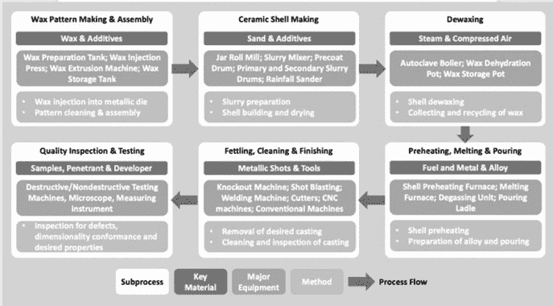

图 12.1 现有的金属铸造工艺。返回文本。

数据分析和过程监控可以从获取机器数据中获益。或者，可以采用区块链原理将数据流传输到分布式服务器，而不是依赖于当前 IIoT 系统中常见的将数据流传输到中心化服务器系统的传统做法。图 12.2 展示了将 IIoT 和区块链整合到当前金属铸造厂设置中的综合性方法。

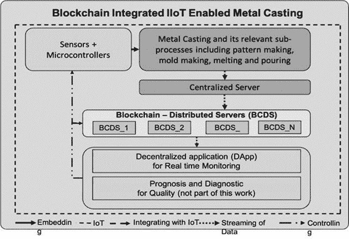

图 12.2 IIoT 与区块链与现有金属铸造工艺的集成。返回文本。

## 12.4 实现

如前所述，区块链是一种不可更改的去中心化数字账本系统，因其保持高度保护和匿名性的能力而受到广泛关注。它的运行不需要任何特定的中央机构或存储库。使用合适的加密哈希值通常可以保护利用区块链原理的交易。哈希函数是一种数学过程，它将输入的数值值转换为简短的输出数值值。哈希函数可以处理任何长度的输入，并可靠地产生预定长度的输出。这些输出随后使用公钥和私钥对进行数字签名和验证 [8]。

交易信息被视为一个“区块”，即交易的集合。然后，它被记录为一系列事件，如果没有负责记录、修改和确认交易的社区的同意，这些事件将无法被更改或修改。每个包含交易信息的单个区块都与先前的交易链相连，最终形成区块链。这些区块通过多化的共识过程和协议进行验证，以验证区块链网络。区块链自构想以来已经发生了显著演变，现在可以存储货币和信息 [6]。

此外，数字钱包被赋予了特殊的意义，它是允许个人进行交易的电子设备。强调在 IIoT 驱动的精密铸造过程中整个区块链部署的主要特征是互操作性（IIoT 系统与区块链系统交互的能力）、透明性、可追溯性和问责制 [11]。

图 12.3 展示了在 IIoT 驱动的金属铸造过程中，发生的每笔交易中每个区块的进展及其整合到区块链中的基本阶段。最初，传感器在金属铸造过程的几个点收集数据，包括温度、压力、湿度和其他相关因素。接下来，对数据进行处理和结构化以插入区块链。准备好的数据通过网络安全地传送，通常使用适用于 IIoT 环境的协议。

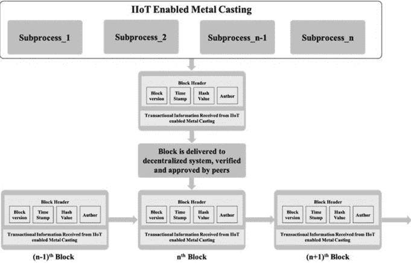

图 12.3 适用于 IIoT 驱动的金属铸造的区块链实现。返回文本。

验证数据完整性和真实性，以确保获取的信息源于可靠来源且在整个传输过程中未被篡改。随后，根据预设标准实施智能合约，自动执行金属铸造步骤的特定元素，例如质量评估或调度。经过验证的数据被组织成区块，包括精确的时间和安全的加密代码。为了确保区块的完整性并防止篡改，对其进行了加密。采用基于权益证明（Proof of Stake）的共识程序来验证区块链上新上传交易的真实性。

一旦达成共识，新区块就会被添加到区块链中。“区块链”一词指的是一系列相互连接的区块，其他区块与前一个区块相连。区块链分布在多个去中心化的网络节点上。每个系统节点都维护区块链的精确副本，确保冗余和容错能力。使用加密密钥来控制对区块链的访问。权限决定了个人在区块链上查看、写入或执行智能合约的具体权利。

最后，现在对存储在区块链上的数据进行合规性审计是可行的。

分析可能为减少流程和提高质量提供重要见解。一旦数据被添加到区块链，它就变得不可更改，保证了所有交易和过程参数的可靠且可验证的记录。如前所述，从每台设备获得的数据首先发送到云端服务器，然后发送到区块链，以提高隐私性和安全性。向区块链广播之前先将记录广播到云端服务器，主要由于与部署智能合约相关的巨大成本影响。每笔交易（涉及每秒间隔一次从每台设备收集数据并发送到区块链服务器）都是直接处理的，不会产生与云服务器相关的过高费用。每笔交易的成本约为 0.03 ETH（如图 12.3 所示）。如果金属铸造厂不在中间层使用云端服务器，此项交易的成本将非常高。铸造厂在每月平均生产 40 吨铸件的同时，必须每秒获取 115 个过程参数。将区块链与 IIoT 驱动的金属铸造相结合将产生巨大的财务影响。

## 12.5 讨论

区块链技术正在改变金属铸造行业，它改进了数据完整性、安全性、可追溯性、透明度、供应链优化和质量保证。它为数据传输提供了分布式、不可更改的记录，消除了对中间人和可信第三方的需求。区块链技术促进了业务活动的透明化，改进了库存管理，并为金属铸造过程提供了不可更改的记录，在缩短交期和减少浪费的同时保持了质量控制措施和合规文件。在区块链技术中，欺诈和伪造得到了防止，因为它为制造产品生成唯一的数字指纹，确保了汽车和航空等行业产品的真实性。这进一步允许安全的数据交换，增加了合作并保护了知识产权。

包括 IIoT 在内的区块链确保了顺畅连接，降低了运营成本，并促进了基于当前事实的本地去中心化决策。

金属铸造的工业物联网（IIoT）正在研究区块链技术，该技术可能应用于去中心化工业物联网、合规性、经济影响、可扩展性、能源效率、隐私和实时监控等领域。金属铸件的关键操作（如供应链协调和生产跟踪）正通过智能合约实现自动化。网络安全对于保护关键制造数据至关重要，同时数据隐私和优化也同样关键。通过解决可扩展性问题并研究第 2 层解决方案和共识程序，主要的区块链计算负担正在减轻。绿色区块链技术和优化的共识过程是与可持续性和能源效率相关的两个进一步研究领域。

分布式账本用于提供不可篡改的可追溯性，并扩展实时监控和追溯能力。研究正涉及整个区块链网络的合规性、标准化和互操作性。另一个研究领域是人工智能、机器学习与区块链的集成，AI 模型可用于检测异常和优化生产参数。

## 12.7 结论

金属铸造结合了区块链和工业物联网技术来提高数据安全性和完整性。区块链为工业数据追溯和防篡改提供了去中心化的账本，而工业物联网设备提供了质量控制和实时监控。与利益相关者的协议通过智能合约实现自动化，确保在符合输出标准后进行支付。通过将工业物联网与区块链相结合，制造商、供应商和消费者可以建立信任、增强产品质量并减少数据操纵。这减少了缺陷、降低了生产成本、提高了需求预测准确性并减少了制造延迟。智能合约的实时执行减少了争议并增强了信任。预测性维护通过降低运营成本和非计划停机时间增加了运行时间。这种集成可能会加速全球金属铸造生态系统内的创新与协作。准确性、真实性和数据可靠性促进了更强大的商业关系。区块链和工业物联网可以提高生产吞吐量、优化资源利用、降低成本、提高可持续性并提升效率。然而，其采用可能会带来困难，因为它可能会影响标准做法并需要行业参与进行调整。

## 参考文献

1. Ghimire, Turusha, Atharva Joshi, Samgeeth Sen, Chinmay Kapruan, Utkarsh Chadha, and Senthil Kumaran Selvaraj. “Blockchain in additive manufacturing processes: Recent trends & future possibilities.” *Materials Today: Proceedings* 50 (2022): 2170–2180. 返回正文。⏎

2. Singh, N., H. P. Singh, A. Mishra, A. Khare, M. Swarnkar, and S. K. Almas. “Blockchain cloud computing: Comparative study on DDoS, MITM and SQL injection attack.” In *2024 IEEE International Conference on Big Data & Machine Learning (ICBDML)*, Bhopal, India, 2024, pp. 73–78. [`doi.org/10.1109/ICBDML60909.2024.10577412`](https://doi.org/10.1109/ICBDML60909.2024.10577412). 返回正文。⏎

3. Deng, Jianxin, Gang Liu, and Xiangming Zeng. “Blockchain-based security access control system for sharing squeeze casting process database.” *Integrating Materials and Manufacturing Innovation* 13.1 (2024): 92–104. 返回正文。⏎

4. Shahbazi, Zeinab, and Yung-Cheol Byun. “Smart manufacturing real-time analysis based on blockchain and machine learning approaches.” *Applied Sciences* 11.8 (2021): 3535. 返回正文。⏎

5. Rane, Santosh B., and Yahya Abdul Majid Narvel. “Re-designing the business organisation using disruptive innovations based on blockchain-IoT integrated architecture for improving agility in future Industry 4.0.” *Benchmarking: An International Journal* 28.5 (2021): 1883–1908. 返回正文。⏎

6. Han, Zhoupeng, et al. “Digital twin-driven 3D visualisation monitoring and traceability system for general parts in the continuous casting machine.” *Journal of Advanced Mechanical Design, Systems, and Manufacturing* 14.7 (2020): JAMDSM0100. 返回正文。⏎

7. Leontaris, Lampros, et al. “A blockchain-enabled deep residual architecture for accountable, in-situ quality control in industry 4.0 with minimal latency.” *Computers in Industry* 149 (2023): 103919. 返回正文。⏎

8. Matenga, Alice Elizabeth, and Khumbulani Mpofu. “Blockchain-based cloud manufacturing SCM for collaborative enterprise manufacturing: A case study of transport manufacturing.” *Applied Sciences* 12.17 (2022): 8664. 返回正文。⏎

9. Song, Jinwoo, Jinbo Wang, and Young B. Moon. “Blockchain applications of manufacturing systems: a survey.” *ASME international mechanical engineering congress and exposition*. Vol. 85567. American Society of Mechanical Engineers, 2021. 返回正文。⏎

10. Kaswan, Kuldeep Singh, Jagjit Singh Dhatterwal, Sanjay Kumar, and Amit Pandey. “Industry 4.0 multiagent system-based knowledge representation through blockchain.” In *Artificial Intelligence and Industry 4.0*, Aboul Ella Hassanien, Jyotir Moy Chatterjee, and Vishal Jain, eds. Academic Press, an imprint of Elsevier, Netherlands, pp. 93–115, 2022. 返回正文。⏎

11. Wu, Liupengfei, Weisheng Lu, Fan Xue, Xiao Li, Rui Zhao, and Maohong Tang. “Linking permissioned blockchain to the Internet of Things (IoT)-BIM platform for off-site production management in modular construction.” *Computers in Industry* 135 (2022): 103573. 返回正文。⏎

12. Liu, Heli, et al. “Industry 4.0 in metal forming industry towards automotive applications: A review.” *International Journal of Automotive Manufacturing and Materials* (2022): 2–2. 返回正文。⏎

13. Datta, Sreemana, and Parichay Bhattacharjee. “SteelChain—Blockchain-Based Transparent Supply Chain Framework for the Steel Industry.” *Advances in Thermal Engineering, Manufacturing, and Production Management: Select Proceedings of ICTEMA 2020*. Springer Singapore, 2021. 返回正文。⏎

14. Sharma, Arunima, and Ramesh Babu Battula. “Challenges and issues in blockchain-based IoT services.” In *Blockchain-Based Internet of Things*, Debashis De, Siddhartha Bhattachya, and Joel J. P. Rodrigues, eds. Springer, pp. 47–80, 2022. 返回正文。⏎

15. Patel, Dhruv, Chandan Kumar Sahu, and Rahul Rai. “Security in modern manufacturing systems: Integrating blockchain in artificial intelligence-assisted manufacturing.” *International Journal of Production Research* 62.3 (2024): 1041–1071. 返回正文。⏎

16. Soori, Mohsen, Fooad Karimi Ghaleh Jough, Roza Dastres, and Behrooz Arezoo. “Blockchains for industrial Internet of Things in sustainable supply chain management of industry 4.0, a review.” *Sustainable Manufacturing and Service Economics* 3 (2024): 100026. 返回正文。⏎

17. Basheer, Mohammad, Faris Elghaish, Tara Brooks, Farzad Pour Rahimian, and Chansik Park. “Blockchain-based decentralised material management system for construction projects.” *Journal of Building Engineering* 82 (2024): 108263. 返回正文。⏎

18. Xu, Xiaolin, Fahim Rahman, Bicky Shakya, Apostol Vassilev, Domenic Forte, and Mark Tehranipoo. “Electronics supply chain integrity enabled by blockchain.” *ACM Transactions on Design Automation of Electronic Systems (TODAES)* 24.3 (2019): 1–25. 返回正文。⏎

19. Evsutin, Oleg, and Yaroslav Meshcheryakov. “利用区块链技术和数字水印为矿业企业提供数据真实性”. *Sensors* 20.12 (2020): 3443. 返回正文

20. Fernandes, Leonardo, et al. “关于采用区块链和物联网技术促进电子电气（EEE）价值链循环经济的综述”。 (2023). 返回正文

21. Vatankhah Barenji, Reza. “一种基于区块链技术的云制造信任系统”. *Journal of Intelligent Manufacturing* 33.5 (2022): 1451–1465. 返回正文

22. Wang, Changchang, et al. “InterMat: 一基于区块链的材料数据发现与共享基础设施”。 *Processes* 11.11 (2023): 3168. 返回正文

23. Kumar, Ravinder, Rahul Sindhwani, and Punj Lata Singh. “工业物联网实施的挑战：通过区块链进行分析与缓解”. *Journal of Global Operations and Strategic Sourcing* 15.3 (2022): 363–379. 返回正文

24. Zafar, Saima, et al. “区块链与物联网的融合：挑战与解决方案”. *Annals of Telecommunications* 77.1 (2022): 13–32. 返回正文

25. Wang, Qiyuan, Jingzhi Li, Muhong Zheng, Xie Ma, and Bin Wang. “从实际应用角度出发基于区块链的电色材料质量控制与追溯性框架”. *Computational Intelligence and Neuroscience* 2022.1 (2022): 7376168. 返回正文

# 13 区块链在药物追溯和数据完整性中的作用

# 区块链技术在医疗保健中的应用

**作者：** Nimmagadda Chandra Paul, M. L. S. N. S. Lakshmi, B. Gangadhara Rao, and Sumit Badotra

**DOI：** [10.1201/9781003545620-17](https://doi.org/10.1201/9781003545620-17)

## 13.1 引言

区块链技术是一种去中心化的数字账本，在许多计算机上保存不可篡改、透明且安全的交易记录。区块链的每个区块都包含交易列表，每笔交易都与前一个交易连接形成链。它确保了数据是防篡改的，因为一旦记录，在不影响所有后续区块的情况下，无法更改任何交易。区块链技术用于数据安全、行政效率和互操作性，以解决医疗行业的问题。它提供了一个透明的系统和去中心化机制，以提高药物追溯性，保证临床试验数据的完整性，并促进电子健康记录（`EHR`）的管理与交换。区块链技术可应用的其他健康部门见图 13.1。

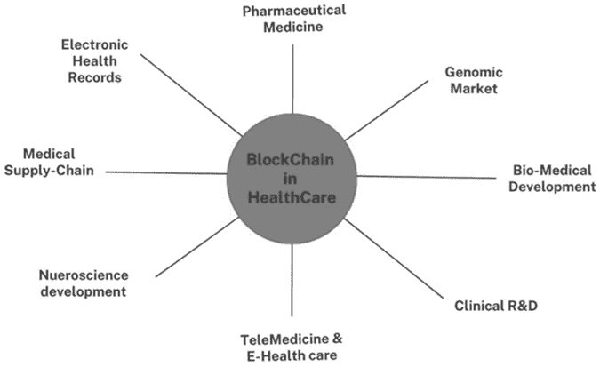

图 13.1 医疗保健领域的区块链技术。返回正文

2008 年，一个匿名人物开始使用中本聪（Satoshi Nakamoto）的名字，并在《比特币：点对点电子现金系统》白皮书中介绍了区块链技术。区块链的首次应用是比特币的基础，这种去中心化的加密货币允许在不需要中介的情况下进行点对点交易。随着这种扩展，区块链技术的重点从仅仅应用于货币扩展到其他领域，包括供应链管理、金融和医疗保健。以太坊（`Ethereum`）等平台引入了智能合约的概念，智能合约将协议条款直接写入代码中并自动执行。这种创新通过自动化和保护许多医疗保健操作（包括保险理赔）影响了其他领域。理解区块链的基本思想和工作原理对于充分理解其对医学领域的影响至关重要。区块链在许多计算机上维护不可篡改且透明的交易记录。每笔交易都在“区块”中被跟踪，并与其他每个区块连接形成一条“链”。因此，这种结构确保了每条数据都带有时间戳并经过验证，从而避免了篡改。在下一节中，我们将讨论区块链技术在医疗保健领域的目标。

## 13.2 目标

区块链在医疗保健领域的目标所示图 13.2，在本节中简要讨论。区块链使用加密算法保护数据，这使得第三方和未经授权的方很难更改数据。区块链通过保护医疗记录免受泄露、篡改和未经授权的访问，增强医疗数据的安全性。区块链技术提供的高级加密算法确保了医疗记录的机密安全性。例如，`Guardtime` 与爱沙尼亚政府合作，努力使用区块链保护超过百万份健康记录。`Guardtime` 的 `KSI` 维护所有更改和访问的持续日志，产生了不可篡改的审计追踪，降低了数据泄露风险，并可能检测恶意访问尝试 [1]。另一个示例是 `SimplyVital Health` 的基于区块链的 `Health Nexus` 平台，它实现了医疗提供者之间患者数据的安全共享。

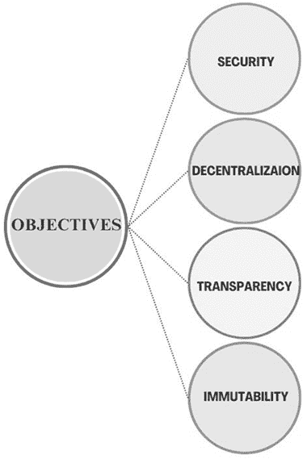

图 13.2 区块链领域的应用。返回正文

该平台在将患者数据存储到去中心化网络之前对其加密，并确保只有授权的人才能访问。通过中心化数据存储去中心化可以降低风险，同时也提高了整体数据安全 [2]。美国食品监督管理局（`FDA`）也在研究使用区块链技术来保护临床试验数据。`FDA` 通过将数据保存在区块链上，可以确保试验数据的不可篡改性，并确保数据安全、准确和真实。由于每个数据输入都经过哈希处理并与前一个连接，更改几乎是不可能的。这些示例说明了区块链技术如何可能为医疗保健领域的健康信息带来急需的安全性，因为它防止了未经授权的访问并进一步确保了患者的隐私和完整性 [3]。单点故障的减少以及控制在多个节点上的分布使得系统更具韧性，消除了对中央权威的需求。

此外，区块链技术允许由所有网络用户维护去中心化的数据收集，结果防止了任何一方获得整个数据集的控制权，从而实现了去中心化。例如，`Medicalchain` 将是一个使用区块链技术进行交换和存储的电子健康记录（`EHR`）去中心化网络。这种方法赋予了患者对健康信息的完全控制，并允许根据需要访问医疗专业人员。这种去中心化的方法通过避免将健康记录存储在单一的易受攻击位置，消除了数据泄露和非法访问的可能性 [4]。例如，`IBM` 与疾病控制与预防中心合作，使用区块链来追踪公共卫生数据。在收集和共享数据方面的去中心化提高了健康信息的安全性和韧性。即使少数网络节点发生故障或遭到破坏，也能确保健康信息始终可用 [5]。此外，`SimplyVital Health` 开发的去中心化网络 `Health Nexus` 为其与其他医疗保健提供者之间的患者数据提供了安全交换。此类网络降低了数据泄露的风险，并使数据共享变得高效得多，因为消除了对中央存储库的需求 [2]。另一个促进患者、提供者和利益者之间信任的流程是健康流程和交易的透明化。

区块链技术为每项操作创建一个开放、可审计的记录，确保每笔交易仅对所有活动的授权方可见。这在实时的一个良好例子是基于区块链的、旨在增强药品供应链透明度的项目：`MediLedger`。`MediLedger` 在生产和分配链的每一个步骤都提供了可追溯性和可验证性，因为每笔交易都记录在区块链上。在这方面，透明度有助于提高整个供应链的信任价值，因为它确保了患者获得真实的处方，并有助于销毁伪劣品 [6]。

另一个是临床试验的区块链应用。`FDA` 和其他机构正在研究使用区块链来追踪和验证临床试验数据。可以使用区块链来记录试验数据；因此，任何更改将是透明且可追溯的，使利益相关者能够确保数据的完整性和透明度。除了减少欺诈或数据篡改的机会外，这增加了对结果的信心 [3]。

此外，[MyClinic.com](http://MyClinic.com) 是基于区块链技术的远程医疗网络之一。区块链将为患者与健康提供者之间的交互提供透明度。患者可以确保其数据得到妥当和公开的处理，因为他们可以查看谁访问了他们的医疗记录以及这些交互的原因 [7]。一旦上传，即可确保数据永久且不可侵犯地记录在区块链上。这确保了数据在上传后就无法被删除或更改。区块链技术的一个基本组件是不可篡改性，从而增强了数据的可靠性和完整性。例如，使用区块链技术确保临床试验期间数据的正确性就是一个目前正在进行的例子。`FDA` 一直在研究区块链技术，以创建临床试验数据的不可篡改记录。区块链上的每个条目都被赋予一个时间戳，然后它与上一个条目链接，使其几乎不可能在不被察觉的情况下被更改。它控制了对数据的篡改，并通过确保临床试验结果真实可靠为研究发现提供了信心 [6]。

另一个例子是 `MedRec`，由 `MIT` 区块链开发的 `EHR` 系统。对于永久性健康记录，`MedRec` 将确保数据被提交后无法被更改或删除。这种不可篡改性降低了医疗错误的概率，并由于医疗保健人员获得了准确的患者病史，促进了对患者的护理 [4]。此外，自主身份识别初创公司 `Evernym` 利用区块链构建不可破坏的患者 ID，以确保记录的真实性。在下一节中，我们将讨论区块链在医疗行业的各种应用。

## 13.3 区块链在医疗领域的应用

区块链技术在医疗领域有许多前景广阔的应用，如图 13.2 所示。

### 13.3.1 电子健康记录（EHR）管理

`EHR` 的主要目的是以去中心化的方式安全地维护患者健康记录，如图 13.3 所示，这包含了患者数据、疾病记录和实验室检测报告。通过这种方式，区块链通过增强 `EHR` 的可访问性和不可更改性，增加了数据的准确性并保护了隐私。区块链技术引入了处理 `EHR` 问题的新方法。其中一个项目是 `MIT` 研究人员开发的 `MedRec`。`MedRec` 使用区块链技术开发了一个去中心化网络来存储 `EHR`。

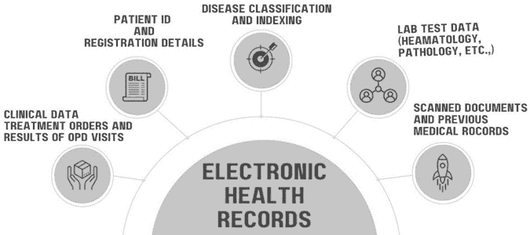

图 13.3 管理患者健康记录。返回文本。

在这样的架构下，患者可以自我管理其健康信息，并根据需要为其他医疗提供者提供访问权限。`MedRec` 在区块链上维护记录，并提供了一种途径，使患者数据安全加密、不可篡改且仅供授权方访问，同时解决了隐私担忧并降低了数据泄露的风险 [4]。另一个案例是区块链公司 `Guardtime` 与英国国家医疗服务中心伦敦 `NHS` 的合作。在这里，区块链系统旨在保护患者数据，同时确保 `EHR` 是准确且不可破解的。这种技术记录了对 `EHR` 的每次访问和修改，创建了不可逆且透明的审计追踪，增强了数据的安全信赖 [8]。

此外，初创公司 `SolveCare` 构建了一个基于区块链的 `EHR` 管理和患者护理协调平台。他们的系统利用区块链技术创建了一种开放安全的方式来追踪患者交互和医疗记录。这通过确保患者对健康信息拥有控制权并可以轻松地与许多提供者共享，提高了系统的有效性。这也确保了数据的准确性 [9]。

### 13.3.2 供应链管理

区块链技术有助于追踪药物从生产者到消费者的过程，从而减少了假药进入系统的可能性。由于区块链技术结合了所有交易的不可篡改且透明的记录，它可以极大地增强医疗供应链的管理。一个典型的例子是 `MediLedger`，这是一种基于区块链的药品追溯工具。`MediLedger` 遵循了从制造商到终端用户的整个药物供应链。由于任何交易都会被记录在区块链上，`MediLedger` 使链中的任何一点都是公开且可追溯的。区块链创造了透明度，通过帮助防止假劣药品、消除欺诈和加速召回，保护了患者安全并建立了对药物供应链的信任 [6]。

`Food Trust` 区块链项目中的健康部门是 `Walmart` 与 `IBM` 合作的一个范例。在使用该网络时，药品和食品的可追溯性得到了提高。得益于这项采用区块链对药物和食品来源进行实时监控的技术进步，`Walmart` 能够更迅速响应其安全担忧和召回相关问题。`Walmart` 通过增加供应链内部可见性，确保客户获得真实且健康的产品 [5]。

一种区块链系统已被开发用于跟踪和管理医疗设备。`VeChain` 平台提供了保证，根据设备位置和状态的实时信息，确保产品生命周期每一步都符合安全和质量要求。这种基于区块链的跟踪系统允许医疗专业人员获得有关设备的准确可靠信息，防止假劣或低质量设备进入流通 [10]。

### 13.3.3 健康数据互操作性

健康数据互操作性旨在简化医疗提供者和系统之间的数据流动。区块链允许去中心化控制和标准化数据格式，促进了健康领域的信息流动。它为健康信息的交换提供去中心化且标准的平台，为增强健康数据的互操作性提供了强有力的应对。最著名的例子之一是由区块链公司 `SolveCare` 开发的 `Health Information Exchange` 网络。该网络利用区块链技术创建去中心化的通用的健康数据账本。它实现了多个医疗系统之间的无缝互操作，减少了数据孤岛并增强了护理协调，正如 `Solve.Care` 确保患者信息始终在不同的服务提供者之间共享，因为这可以通过其他授权组织可访问的单一、不可篡改的记录来实现 [9]。这是另一个使用 `MedRec` 平台并整合各医院 `EHR` 系统的例子。`MedRec` 使用区块链技术在不同的医疗系统之间共享和管理 `EHRs`。无论信息在何处生成，这种集成确保了患者的病历是最新的且可用的，并允许健康数据的标准化。基于区块链的方法减少了互操作问题，并简化了医疗提供者之间的护理转移。`Mayo Clinic` 和 `BlockMedx` 区块链创业的基本目标是通过基于区块链的技术增强处方药数据的互操作性，该技术允许跨不同药店和医疗提供者之间安全透明地跟踪处方数据。该系统增加了数据的一致性和可用性，减少了药物错误风险，并通过保证一致且易于获取的处方信息增加了患者安全 [7]。

### 13.3.4 以患者为中心的护理

以患者为中心的护理理念让个人对自己的健康数据拥有控制权和所有权。区块链赋予患者通过其健康数据来增强其自主性和参与管理的能力，因为他们可以向选定的提供者提供这些数据的权限。区块链技术使患者对自己的医疗记录获得更大的控制和访问，这是对以患者为中心的治疗的重大贡献。一个很好的例子是应用于 `MyClinic` 的区块链技术。它是一个以患者为中心的健康记录系统，允许患者通过 `MyClinic` 个人管理他们的 `EHRs`，并在需要时与其他健康从业人员共享。通过这种方式，患者被赋予了管理自己健康信息、轻松分享并决定治疗方案的能力 [7]。另一个是基于区块链的 `Patientory`。通过 `Patientory`，患者现在可以在安全的区块链网络上拥有并管理他们的健康数据。患者对于谁访问其数据仍有裁量权，并可以轻松地与医生、研究人员或其他组织共享，以进行直接护理或首要研究项目。这种赋能让患者更积极参与护理决策，并获得更强的参与感 [11]。`Health Nexus` 是由 `SimplyVital Health` 公司开发的基于区块链的平台，专注于以患者为中心的护理协调。通过使用 `Health Nexus`，患者能够追踪他们的实时护理互动并控制谁访问其健康信息。这种方法带来更好结果（更高效和个性化的治疗）的两个优势包括患者对其健康管理的参与度更高，以及不同提供者之间的护理协调更佳 [2]。

### 13.3.5 医疗设备管理

医疗设备管理的目标是跟踪医疗设备的使用和维护。区块链可以生成关于设备如何使用、维护和运行的开放记录，从而为高效设备的安全和管理提供监管。区块链技术提供了每个设备生命周期不可破解、不可篡改的记录，包括其制造阶段、整个各个使用期间，直到其终结。这将增强医疗设备管理。值得注意的例子包括 `VeChain` 的区块链技术，它能够实时跟踪医疗设备，如图 13.4 所示 [10]。

每台设备都使用 `VeChain` 的技术在区块链上进行精确注册，从而产生了关于生产、分配和使用的详尽历史。这种可追溯性有助于确认合规性、制止伪品并确认医疗产品的合法性 [10]。`Modum` 使用区块链技术。`Modum` 在存储过程中捕捉医疗设备的状态，并利用物联网传感器和区块链技术对其进行运输。传感器捕捉的参数包括温度和湿度，由区块链存储这些数据。这种方法在理想条件下为医疗设备提供了安全高效的存储和运输 [12]。`Patientory` 是一家初创公司，开发了一种基于区块链的应用程序，用于控制和跟踪医疗领域的医疗设备。由于实时跟踪的支持，`Patientory` 技术确保了医疗设备的及时维护和维修。由于对设备维护、维修和使用的记录是不可改且透明的，区块链账本提高了运营效率和合规性 [11]。

### 13.3.6 远程医疗

患者信息保护与远程医疗交换。区块链技术通过确保远程医疗会议的安全性和完整性，可以保护患者数据并在远程患者护理中建立信任。区块链技术在远程医疗的应用具有优势，因为它为管理患者数据和通信提供了一个透明且安全的结构。当然，值得提到的是 `Healthereum`，它利用区块链实现医疗从业人员与患者之间的安全虚拟会诊，并监控患者的参与。`Healthereum` 利用区块链技术为所有远程医疗接触创建一个去中心化账本。这将确保患者信息保持私密，并将访问限制在允许的人员。由于所有记录的内容都记录在区块链中且无法删除，这种透明度培养了患者和医生之间的信任 [13]。这是一个由区块链驱动的平台，`MyClinic` 使用区块链技术进行虚拟会诊，并确保患者与医疗专业人员之间的信息安全可靠。`MyClinic` 在区块链中存储每位患者及其咨询历史的数据，从而使所有信息都是安全的、不可更改的，并且仅供提供明确同意的人员访问。这增强了远程医疗的整体患者体验，如图 13.5 所示，并确保了患者数据的安全 [7]。

图 13.5 医生通过远程医疗会议协助患者。返回文本。

基于区块链的医疗保健平台 `SolveCare` 也支持现代远程医疗系统，它使用区块链来监控和管理患者日程、咨询和医疗数据。通过这种方式，患者可以在治疗期间通过远程医疗监控其个人健康信息，且医疗系统内的所有交互都安全地存储。`SolveCare` 使用区块链技术增强患者积极性，以强化远程医疗服务，使其更加安全和透明 [14]。因此，这些用例揭示了区块链技术如何在处理医疗行业面临的许多问题的同时，增强各个领域的安全性、透明效率。

## 13.4 区块链在医疗领域实施的挑战与局限

尽管区块链在提高安全性、互操作性和数据完整性方面具有潜力，但在医疗领域实施区块链面临着巨大的挑战和局限。以下是主要障碍：

### 13.4.1 技术挑战

1. **扩展性与性能问题：** 区块链技术严重的扩展性问题源于其共识机制以及每个区块都需要复制到网络中每个节点的要求。这可能会阻碍区块链网络满足医疗行业的速度和性能需求。例如，尽管 `Ethereum` 区块链被广泛使用，由于其在交易吞吐量和延迟方面的限制，处理实时健康数据可能具有挑战性 [15]。

2. **与现有系统的集成：** 将区块链与当前的医疗系统和 `EHR` 平台集成面临着巨大的挑战和成本。许多医疗机构依赖过时的系统，不太可能与区块链技术兼容。例如，将区块链连接到现有的 `EHR` 系统需要进行重大转型以确保数据完整性和互操作性，这在技术上既复杂又昂贵 [4]。

3. **数据存储限制：** 区块链中每个区块可以存储的数据量是固定的，使得直接在区块链上存储大型健康记录是不现实的。相反，区块链上存储的是离链数据的哈希或引用。然而，这种方法可能无法满足医疗行业对全面数据存储的需求，并可能使整体健康记录的管理和检索复杂化 [16]。

### 13.4.2 监管与合规障碍

1. **应对医疗法规：** 除了确保严格隐私和安全标准的法规外，医疗保健是监管标准最高的行业之一。在医疗领域应用区块链可能需要经过一个相当复杂的监管环境，美国的立法正受《健康保险可携带性与责任法案》（`HIPAA`）的考量。这些区块链解决方案的设计应考虑到法规以及管理医疗数据的特殊需求 [17]。

2. **确保数据隐私与安全：** 区块链可以通过依赖加密技术来确保增强安全性，但在保护用户隐私方面存在问题。医疗数据中可以找到应当受保护的敏感个人信息 [8]。在某些医疗背景下，关于隐私和透明度之间需要取得的正确平衡产生了疑问，因为区块链技术使得保密性变得必要。

3. **处理使用区块链的法律影响：** 在医疗领域使用区块链的法律影响仍在考虑中。必须解决如数据所有权、不可更改记录的合法性，以及如果怀疑发生了某些数据泄露由谁承担责任等问题。修改或删除区块链中输入错误的患者健康数据将变得非常困难，这会引发一些法律困境 [18]。

### 13.4.3 利益相关者的阻力与采用障碍

1. **对变革的文化抵制：** 先进医疗技术的采用往往面临文化阻力。由于区块链技术相对较新且难以理解，医疗机构 [19] 和专家可能不太采用它。这种阻力将通过对其优势的合理证明和对采用区块链系统的充分支持来解决。

2. **新技术的成本与投资**

采用区块链技术涉及巨大的开发、集成和维护成本。如果采用区块链技术的收益出现得太晚，对于医疗保健公司而言，投资成本可能是无法负担的[20]。培训成本、系统更新和合规性可能会严重阻碍其深度应用。

## 3. 培训与教育的需求

要在医疗保健领域有效使用区块链，需要对区块链技术及其应用有深入的了解。为此，医疗提供者还需要充分的培训和准备，以便有效地与区块链技术协作[21]。培训计划应涵盖医疗服务中区块链应用的技术和实践领域，以确保有效实施。

## 13.5 区块链医疗技术的未来趋势

区块链技术有望在未来几年医疗领域带来重大进展，其发展可能从根本上改变各个领域，如图 13.6 所示。

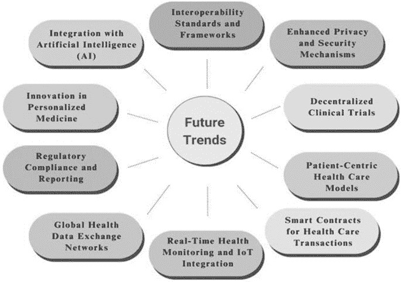

图 13.6 区块链医疗保健的未来趋势

整合人工智能[22,23]可以增强数据分析，从而改进决策。开发互操作性标准[16]将促进不同健康系统之间的无缝通信。两种隐私保护技术（零知识证明和安全多方计算）有望增强数据安全。此外，去中心化临床试验[15]预计将降低成本并增加数据透明度。这将确保个人掌控自己的健康记录，因为患者通过以患者为中心的区块链模型处于核心地位，而`smart contracts`将简化日常行政任务，从而降低成本；生产力将会很高。它将与物联网设备集成，实现实时健康监测；国际健康数据交换网络[7]将促进跨国健康数据共享，以更好地应对公众的健康需求。个性化医疗[24]将通过安全的基因数据交换以及区块链缓解监管合规和报告的能力[25]而取得进展。所示模式涉及并表明区块链技术为许多方面的改进提供了一个有前景的平台：以患者为中心的护理、数据安全与保护、互操作性以及医疗部门的整体效率。这些创新可能会带来更好的健康成果。

## 13.6 结论

区块链技术具有通过解决核心问题彻底改变医疗行业的巨大潜力，这些包括以患者为中心的护理、数据安全和互操作性。区块链提供的去中心化、不可篡改的结构保证了医疗数据和交易的机密性、透明性和完整性。实践应用表明区块链如何增强医疗领域的安全性和生产力。Guardtime 的安全电子健康解决方案、Patientory 的安全患者数据管理以及 MediLedger 的处方追踪就是此类。可扩展性问题和监管合规是仍存在的一些问题，但可以通过增加创新和支持它们的立法来解决。

## 参考文献

1. M. M. Hassan, J. P. McDaniel, and M. Zulkernine, “Blockchain-Based EHR for Improved Data Management in Health Care Systems,” IEEE Access, vol. 7, pp. 104290–104305, 2019.

2. J. Zhang, H. Yang, and Q. Zhao, “Blockchain-Based Privacy Preservation for Health Data Management,” IEEE Transactions on Biomedical Engineering, vol. 66, no. 7, pp. 1920–1931, Jul. 2019.

3. R. K. Gupta and A. Jain, “Blockchain-Based Health Information Exchange for Improved Interoperability,” IEEE Transactions on Biomedical Engineering, vol. 68, no. 4, pp. 1052–1060, Apr. 2021.

4. C. S. Lee, “Blockchain-Based Medical Device Management: The VeChain Case,” IEEE Transactions on Biomedical Engineering, vol. 68, no. 7, pp. 2096–2103, Jul. 2021.

5. J. D. O’Connell, “Modum: Integrating Blockchain with IoT for Medical Device Monitoring,” IEEE Access, vol. 8, pp. 132456–132465, 2020.

6. R. A. Williams and M. J. Klein, “IBM Food Trust Network: Enhancing Supply Chain Transparency in Healthcare,” IEEE Transactions on Engineering Management, vol. 68, no. 2, pp. 1056–1063, Apr. 2021.

7. R. B. K. Shah, “Healthereum: A Blockchain-Based Platform for Telemedicine,” IEEE Transactions on Biomedical Engineering, vol. 67, no. 5, pp. 1342–1351, May 2020.

8. A. K. Patel and M. B. Puri, “Patientory: Blockchain-Based Patient Data Management,” IEEE Journal of Biomedical and Health Informatics, vol. 24, no. 7, pp. 1920–1935, Jul. 2020.

9. M. A. Ansari, D. Singh, “Human Detection for Real Time Surveillance: A Comprehensive Survey,” Multimedia Tools and Applications, vol. 80, pp. 8759–8808, 2021.

10. R. K. Dewang, M. P. Yadav, S. Awasthi, O. Raj, K. Mewada, “Data Secure: An Application Allows Developers to Store User Securely Using Blockchain and IPFS,” Multimedia Tools and Applications, vol. 83, no. 15, pp. 4541–4517, 2024.

11. Xie Y, Zhang J, Wang H, Liu P, Liu S, Huo T, Duan Y, Lu L, Ye Z, “Applications of Blockchain in the Medical Field: Narrative Review,” Journal of Medical Internet Research, vol. 23, no. 10, pp. e2613, 2021.

12. P. Shelke, N.P. Sable, S. Dedgaon, R. Mirajkar, “Applications of Blockchain: A Use Case,” In Nature-Inspired Methods for Smart Healthcare Systems and Medical Data. Springer Nature, Switzerland, pp. 67–88, 2023.

13. Zhuang, Yu, et al. “Applying blockchain technology for health information exchange and persistent monitoring for clinical trials.” AMIA Annual Symposium Proceedings. Vol. 2018. American Medical Informatics, 2018.

14. Gaynor, Mark, Kathleen Gillespie, Allison Roe, Erica Crannage, and J. E. Tuttle-Newhall, “Blockchain Applications in the Pharmaceutical Industry,” Blockchain in Healthcare Today 7, 2024.

15. A. M. Stout, “The Challenges of Blockchain Technology in Healthcare,” IEEE Journal of Biomedical and Health Informatics, vol. 24, no. 4, pp. 1140–1147, Apr. 2020.

16. C. S. Haynes, “Legal and Regulatory Issues in Implementing Blockchain in Healthcare,” IEEE Consumer Electronics Magazine, vol. 9, no. 5, pp. 78–85, Sep. 2020.

17. R. P. Chiu 和 M. J. Malan, “医疗领域区块链采用的经济影响,” IEEE Engineering Management Review, vol. 47, no. 2, pp. 60–70, Jun. 2019.

18. P. Zhang, J. White, D. C. Schmidt, G. Lenz, and S. T. Rosenbloom, “FHIRChain: 应用区块链实现安全且可扩展的临床数据共享,” Computational and Structural Biotechnology Journal, vol. 16, pp. 267–278, 2018.

19. N. Goenkaa, A. K. Sharmab, S. Tiwaric, N. Singhd, V. Yadave, S. Prabhuf, and K. Chadaga, “基于正则化体积卷积网络基于 T1 加权 MRI 图像阿尔茨海默症检测,” Cogent Engineering, vol. 11, no. 1, p. 2314872, 2024. [https://doi.org/10.1080/23311916.2024.2314872].

20. M. A. Engelhardt, “将医疗挂挂在链上：医疗领域区块链技术简介,” Technology Innovation Management Review vol. 7, no. 10, pp. 22–34, 2017.

21. T. T. Kuo, H. E. Kim, and L. Ohno-Machado, “用于生物医学和医疗应用的区块链分布式账本技术,” Journal of the American Medical Informatics Association, vol. 24, no. 6, pp. 1211–1220, 2017.

22. M. Chen, J. Yang, Zhou, Y. Hao, J. Zhang, and L. Hu, “区块链用于医疗领域安全高效的数据共享,” IEEE Access, vol. 7, pp. 147674–147687, 2019.

23. Q. Xia, E. B. Sifah, A. Smahi, S. Amofa, and X. Zhang, “BBDS: 云环境下电子病历的基于区块链数据共享,” IEEE Access, vol. 6, pp. 53924–53936, 2017.

24. K. Bajaj, D. K. Singh, and M. A. Ansari, “基于自编码器的图像去噪深度学习器,” Procedia Computer Science, vol. 171, pp. 1535–1541, 2020.

25. S. Ahmad, I. Shakeel, S. Mehfuz, and J. Ahmad, “云、边缘、雾和物联网计算范式的深度学习模型：综述、最新进展与未来方向,” Computer Science Review, vol. 49, p. 100568, 2023.

# 14 利用区块链提升金融效率和安全性

K. Sankar, Balajee Maram, G. Uma Devi, Pravin R. Kshirsagar, and Shaik Saidhbi

DOI: `10.1201/9781003545620-18`

## 14.1 引言

名为“利用区块链提升金融效率和安全性”的章节深入探讨了区块链技术如何通过高度透明化、防欺诈和数据安全进一步改变金融运营。讨论涵盖了区块链如何通过其去中心化的特性驱动流化的金融处理流程，从而降低成本并为金融和供应链等领域提供信任场所[1]。

### 14.1.1 在金融领域的重要性

区块链技术的使用通过重新考虑执行和/或记录金融操作的方式，对金融行业产生重大影响。这一点通过几个关键因素得到了强调：

*   **提高安全性：** 贪污、网络攻击和非法入侵是典型系统面临的一些风险。区块链技术由于其去中心化的特性和加密安全特征，减少了这些风险。这确保了数据的完整性，并为金融等领域提供了信任[2]。

*   **透明度和可追溯性：** 区块链作为一个开放、不可篡改的记录，允许网络内的双方对交易有更好的视图。这创造了透明度，对于合规和审计非常重要[3]。

*   **效率与成本节省：** 传统的金融交易通常涉及许多中间环节，如结算中心和银行。区块链通过点对点交易消除了这些中间人，从而可以降低交易手续费并加快结算时间[4]。

*   **智能合约带来的创新：** 由于智能合约是直接编写在代码中的自动执行程序，复杂的金融协议可以自动化。这减少了人工处理和监管[5]。

*   **准入与包容性：** 区块链可以帮助实现更好的金融包容性，因为它允许没有银行账户的人也能访问金融工具；只需要一个数字钱包[6]。

*   区块链技术解决了当前金融领域的大部分问题，并提供了更好的安全性、更高的透明度和更高的效率。这种应用正日益以旨在促进创新和机遇的方式改变金融运营和服务。

## 14.2 区块链技术基础

区块链本质上是一个跨多个计算机记录交易的去中心化分布式账本系统。这种系统确保了数据的完整性和安全性，因为除非网络达成共识，否则无人更改记录。主要特征包括透明性、不可篡改性以及使用加密技术保护数据[7]。

### 14.2.1 区块链如何工作

区块链指的是一个去中心化且完全透明的数据库，产生网络中的交易记录。所有交易都经过验证并分组在一个`区块`中，并与之前的交易`链`相连，形成一个持续且绝对不可更改的过程[8]。每个区块详细记录时间戳、交易数据以及上一个区块的加密哈希，将它们连接在一起。这种加密链接确保了更改先一个区块将强制重新计算所有后续区块，这在没有网络共识的情况下在计算上是不行的。交易通过共识机制——无论是`工作量证明`还是`权益证明`进行验证和确认，这在区块添加到链中之前需要网络中许多参与者的同意。

## 14.3 区块链为金融服务带来的利益

首先，区块链技术对金融服务有益，因为它使服务变得更加透明、安全和高效。它减少了甚至消除了中间机构，因为交易变得更快速、更廉价。它还确保了记录的安全和不可篡改，从而降低了欺诈的风险。智能合约的自动化流程还确保了支付、贷款、资产管理以及所有其他操作的顺畅进行[9]。

## 14.3.1 利用区块链技术防欺诈

区块链技术固有的特性使防欺变得容易得多。原因在于交易所具有的去中心化、不可篡改性、透明性和加密安全性。所有这些特性都提供了一个安全且信赖的环境，从而减少了欺诈活动[10]。

*   **去中心化：** 传统系统非常脆弱，并可能导致欺诈，因为它们有一个控制点，容易受到操纵。区块链的去中心化特性将数据分布在网络的各个节点上，网络中没有中心权威机构。由于这种去中心化，任何单一实体都会发现极难操纵该系统——从而减少了欺诈的可能性。

*   **不可篡改性：** 交易一旦记录在区块链上，就无法被更改或删除。这一属性使得所有交易记录都是永久性的且不可防篡改的。如果有人要修改之前记录的交易，随后的每一个区块都必须更新；这在计算上是不可行的，因为大多数网络必须达成共识。这一因素使得欺诈者完全无法篡改交易历史或掩盖痕迹[11]。

*   **透明性：** 这就是区块链成为一本公开书籍的地方，其中发生的每笔交易都可以被网络参与者轻松查看。简单来说，所有操作都公开以便于审计和验证，这使得欺诈活动很难不被察觉。这为欺诈交易带来了可能的追踪、持续监控和实时验证，有助于在金融系统中将其消灭在萌芽状态。

*   **加密安全性：** 区块链创建了先进的加密技术来保护数据。所有交易都经过加密，然后通过加密哈希函数与上一个交易连接。这些链接建立了一个抗篡改和抗欺诈的交易链。此外，使用公钥和私钥对的数字签名确保了只有授权用户才能发起交易，避免了未经授权的访问和欺诈[12]。

*   **智能合约：** 智能合约是自动执行的协议，其条款直接写在区块链上的代码行（函数）中，确保了不需要中间环节即可自动执行。一旦满足标准，它们会自动强制并执行合同。结果是，自动化减少了对干预方的的需求，同时大幅减少了人为错误的可能性，并确保交易完全按照合同发生，这意味着在合同的认真执行过程中，欺诈的机会更少了[13]。

*   **可审计性：** 区块链的透明性和不可篡改性为链上发生的每件事都提供了可审计的记录。因此，它在欺诈的调查和检测中起着重要作用。所有交易的完整且可审计的账本向审计师或监管机构开放，以便快速识别和预防欺诈。

*   **共识机制：** 这些被区块链网络用作交易的验证系统。这些机制在将移动的交易记入账本时，需要网络中多个实体的共识。这一过程通过集体验证，确保了没有欺诈交易会被接受验证，只有有效的交易才能进入区块链[14]。

*   **176 降低交易对手风险：** 区块链大大降低了交易对手风险，因为业务双方可能存在完全信任。这种共享信息的透明性也降低了金融等交易中的欺诈风险 [15]。
*   **区块链技术防欺诈：** 区块链建立在去中心化且不可篡改的账本之上，透明且加密安全。这些特性极大地增强了安全性，使得防欺诈非常有效。
*   **透明性与可追溯性：** 区块链实现了对产品或交易的实时追踪和追踪。其不可篡改的账本允许所有参与方验证货源的真实性和来源，培养了责任和诚信 [16]。

## 14.4 公共账本的优点

区块链技术在不同应用中带来的透明度、安全性和信任的提高可以总结在公共账本中。换句话说，透明性允许网络中的每个人访问交易历史。

它交付了责任制，这是信任建立的方式。这在两个对立方相互依赖的环境中尤其如此，例如在供应链管理中 [17]。

去中心化公共账本较不易受到且最难攻击的一面使其成为用户更安全的威慑：所有交易都经过加密，并将相邻交易链连接在一起，使得在没有网络共识的情况下几乎无法修改或更改。这将减少篡改、欺诈和未经授权访问的可能性。

### 14.4.1 不可篡改

一旦数据被写入公共账本，就无法被删除，也无法被更改。它为交易记录增加了完整性和永久性，因此使历史变得准确且可验证。这将对任何过去的数据强制完整性，因为通过这种方式，没有任何单一机构可以通过后门更改历史来实施欺诈或掩盖其行为 [3,18]。

### 14.4.2 信任与去中心化

公共账本运行在分布式系统中，这种系统取决于参与者的共识，但没有中心机构或第三方来促进这一过程。这种非常去中心化的方法有助于培养所有参与者之间的信任，因为他们都依赖共识机制来对交易进行验证。在整个网络中，没有单一实体拥有控制权，因此提供了一种简单的检测方法，并使系统设计中的篡改变得实现，从而使系统更加民主和安全 [19]。

### 14.4.3 可审计性与可追溯性

公共账本是透明且不可篡改的，这提供了确定的可验证审计追踪。每笔交易都带有时间戳，并追溯到之前的交易，以跟踪资产移动，并向审计人员和监管机构验证每笔交易的真实性。这对于合规和法务会计非常有帮助。

### 14.4.4 更低的成本和更高的效率

公共账本可以降低交易成本并提高效率，因为消除了任何第三方，并为人们提供了 `P2P` 。通过中间机构进行金融交易的技术会收取费用并花费处理交易的时间。这些都通过公共账本实现，从而减少了相关成本并提高了交易处理速度 [20]。

### 14.4.5 可访问性与包容性

公共账本对任何互联网用户可用，这使得金融包容成为常态。它创建了一个通道，让个人和组织（尤其是没有银行服务或银行服务不足经济地区的个人）能够与全球经济接轨。在这方面，可访问性通过赋予个人更多参与金融操作的权力，可能对鼓励创新和增长产生积极影响。

### 14.4.6 改进的合约执行

这增强了许多合约类型应用中合约执行的效率和可靠性。

尽管如此，重要的是公共账本提供了较高水平的利益，这些利益源于透明度、安全性、信任、不可篡改性、可审计性、运营效率、可访问性和执行合约的能力。这使其成为增加金融和其他相关系统应用程序可靠性和有效性的有力手段。

### 14.4.7 区块链技术中的审计追踪

审计追踪对于任何处理敏感信息或财务数据的系统都是至关重要的，因为它们提供了交易的问责、透明度和完整性。区块链技术通过内置的不可篡改性、透明度和去中心化特性提供了非常强大的审计追踪能力。这解释了区块链如何增强审计追踪：

- `不可篡改性`：区块链本身是不可篡改的。账本上记录的交易无法被删除或更改。
- `透明度`：由于区块链像一本开本，每笔交易对网络内的每个参与者都是可见的。每笔交易的透明度保证了每个人的追溯和验证。因此，它创建了信任和问责制。对于审计师来说，它实际上提供了对包含完整准确交易历史账本的实时访问，极大地简化了审计过程，从而减少了欺诈或错误报告的风险。
- `去中心化`：区块链是一种去中心化的方法，在网络中的多个节点之间处理、转发和存储数据，没有单一的控制点或故障点。
- `时间戳`：这在审计中非常有用，它可以帮助审计师按照事件的时间顺序进行追踪并验证任何交易的时间。
- `效率与自动化`：通过智能合约，区块链还可以执行审计过程的部分内容。智能合约是自动化合约，其条件被硬编码以自动执行。这是一种通过电子平台执行的协议，通过预设的要求决定合约何时被执行和记录。这种自动化减少了对人工验证的需求，减少了错误，并确实增强了审计有效性。

在当前技术帮助下，区块链可以被认为是构建和巩固审计追踪的安全可靠工具。这种技术基于不可更改性、开放性、分布式、时间戳、通过加密保护的安全、追溯能力、有效性以及与监管机构合作以增强审计质量和信誉等特性。凭借这些特性，区块链将有助于建立问责制，因为它能够约束多个部门的欺诈活动，特别是在金融领域或任何需要严格审计的领域。

## 14.5 比较结果与讨论

对所应用的各种工具进行比较分析，代表了它们的一些显著特征、优势和缺点，如表 14.1 所示。

表 14.1 比较结果 返回文本。⏎

| 则 | 使用区块链提升金融效率和安全性 | 使用区块链技术增强金融透明度 | 区块链金融金融：增强交易的安全性和可靠性 | 利用分布式账本实现更高效、更安全的金融表现 |
| --- | --- | --- | --- | --- |
| 与趋势的相关性 | 与金融市场和技术趋势高度相关，同时解决了效率和安全性问题。 | 关注透明度，这是一个关键特征，但范围比效率和安全性窄。 | 解决了同样的效率和安全性问题，但描述性更强。 | 相关，但“分布式账本”是一个更技术术语，在专业领域之外较为人知。 |
| 清晰度与简单性 | 非常清晰；因此广大读者可以轻松阅读。 | 简单，但在这种变体中，重点仅在一个方面——透明度。 | 具有描述性且稍长，尽管仍然相对清晰。 | 技术性术语（如“分布式账本”）的存在使其对普通读者的可读性较低。 |
| 关注点 | 在金融效率和安全性这两个核心价值之间保持平衡。 | 仅关注透明度，平衡性较差 | 类似的平衡，但在安全和效率之间更详细一些。 | 重点关注优化，但方式非常依赖于技术方面；例如，分布式账本。 |
| 目标受众 | 目标受众/适用于技术和非技术关注的金融专业人士 | 受众将更倾向于监管机构和与透明度相关的群体。 | 可能有类似的目标受众，但可能有深入的见解。 | 熟悉区块链和金融系统相关主题的高级技术受众 |
| 潜在影响 | 影响巨大，因为它解决了金融领域的两个大痛点：效率和安全 | 中等；虽然透明度是一个大问题，但不是最关键的。 | 高影响；侧重于金融安全和效率方面的关键改进 | 中等；技术性质可能使其仅对小众受众感兴趣 |

## 14.6 挑战与风险

尽管具有优点，区块链技术仍面临挑战和风险。首先，扩展性问题影响交易的完成速度，这显著增加了成本。另一个方面与监管不确定性有关，这可能会产生法律问题。关于环境问题，能源消耗是一个问题。最后的安全漏洞包括被攻击的概率或 `51% 攻击`，可能会损害区块链系统的可靠性 [5]。

### 14.6.1 局限性

- `扩展性问题`：区块链网络面临扩展性问题，特别是当网络内部交易增加时。这导致交易时间变慢且费用增加。这意味着区块链无法在大规模范围内金融活动。
- `能量消耗`：验证过程（如工作量证明协议所示）可能会消耗大量的能量，这往往会引发环境关注。这种高能耗成本可能会抑制在资源分配能力有限或对类环境元素监管严格的地区实施该项技术的潜在应用。
- `安全性与隐私`：虽然区块链技术确实通过信息的去中心化增加了安全性，但它并非不可攻破，且容易受到攻击，主要是 `51% 攻击`。公共区块链还存在隐私问题，因为交易数据往往会对网络上的任何人公开 [9]。
- `互操作性`：区块链本身并不天然具备互操作性，区块链解决方案的碎片化可能会持续存在。因此，当金融机构需要将多个系统整合到一个实现中时，缺乏标准可能成为的一项挑战。

### 14.6.2 未来展望

- `可扩展性解决方案的改进`：预计最新的应用，例如比特币的层 2 解决方案（如 `Lightning`）或使用权益证明（`Proof of Stake`）机制，将在不牺牲安全性的情况下极大提高可扩展的可能性。
- `监管框架`：更复杂的监管可以为金融部门提供法律层面的确定性，并引发区块链技术的又一波采用浪潮。全球各国政府和其他监管机构正初步尝试制定有关税务、安全和隐私的框架 [7]。
- `去中心化金融 (DeFi) 集成`：随着这一新兴经济系统的出现，DeFi 或将彻底改变金融服务行业的面貌。在这里，贷款、保险、交易等交易是在没有第三方参与的情况下执行的。DeFi 的发展将推动区块链进一步实现其提高金融效率的初级目标。
- `跨行业采用`：随着区块链互操作性的增强，它将在金融领域之外，被应用于医疗服务、供应链管理和政府服务，这将增强整个金融系统的实用性和集成性。

## 14.7 结论

“金融领域的区块链技术”这一章节详述了区块链技术在金融领域的变革性。区块链凭借其去中心化和不可篡改的账本，使得每笔金融交易和操作更加安全、透明和高效。包括智能合约、资产代币化和 DeFi 在内的关键创新改变了传统的金融实践，降低了成本并提高了流动性，同时也为全新的业务模式开辟了道路。区块链在多个金融流程中的整合——从基础的支付结算安排到合规与风险管理的棘手问题——概述了它在解决行业内百年难题方面的巨大潜力。创建防篡改审计追踪、减少操作复杂性和提高监管合规性等能力，为金融机构和客户带来了巨大的优势。然而，区块链在金融领域的广泛应用在监管、技术局限性以及行业标准的需求方面仍面临困难。如果想释放区块链改变金融服务的全部潜力，就必须找到解决所有问题的方法。展望未来，持续的创新和试点项目将进一步探索和完善区块链应用，持续驱动金融科技的进一步发展。随着技术的成熟和监管框架的不断演进，区块链将在未来占据金融的核心地位，为增长、效率和转型带来新的机会。

## 参考文献

1. Jadhav, K. (2024). Systematic literature review on innovations and risks in financial blockchain applications. Proceedings of the 3rd International MultiDisciplinary Conference: “Integrated Sciences and Technologies,” IMDCIST 2023, Yola, Nigeria. European Alliance for Innovation. 返回正文。⏎
2. Daidai, F., & Tamnine, L. (2024). Blockchain technology adoption and future trends in financial applications. In Blockchain Applications in Finance. Springer International Publishing. 返回正文。⏎
3. Bogucharskov, A.V., Pokamestov, I.E., & Tropina, Z.N. (2024). Blockchain disruption in trade finance: A global perspective. Journal of Global Economic Review, 7(1), 250260. 返回正文。⏎
4. Arnosti, N., & Weinberg, S. “Challenges of Decentralization in Blockchain Finance: The Road Ahead for Cryptocurrencies”, IEEE Transactions on Blockchain and FinTech, 15(2), 2024, 98109. 返回正文。⏎
5. Daidai, F., & Tamnine, L. “Blockchain Technology in Finance: A Literature Review”, Journal of Theoretical and Applied Electronic Commerce Research, 18(1), 2023,125145. 返回正文。⏎
6. Karthikeyan, D., Amutha, B., Mekata Devi, K., Singh, N., & Anglin Kuruba, P. “Hybrid Rater to Quantify and Measure the Severity of Infection and Spread of Infection in Muskmelon”, Bulletin of Electrical Engineering and Informatics (BEEI), 13(3), 8759–8808. [`doi.org/10.11591/eei.v13.5432`](https://doi.org/10.11591/eei.v13.5432). 返回正文。⏎
7. Schröder, T., Atkinson, J., & Elsässer, P. “Connected Blockchain Regenerative Finance: Charting a Path Toward Regeneration”, Frontiers in Environmental Science, 11, 2234. 返回正文。⏎
8. Bogusz, C.I., Laurell, C., & Sandström, C. “Tracking the Digital Evolution of Entrepreneurial Finance: Crowdfunding, Blockchain Technologies, and Cryptocurrencies”, IEEE Engineering Management, 70(4), 2023, 1099110. 返回正文。⏎
9. Kim, T., & Zhang, Y. “Blockchain Applications in Decentralized Finance: A Comprehensive Review”, Journal of Banking & Finance, 152, 2023, 106125. 返回正文。⏎
10. Coyne, J., & McMickle, P. “Can Blockchains Serve an Accounting Purpose?”, Journal of Emerging Technologies in Accounting, 14(2), 2017, 101–111. 返回正文。⏎
11. Hashim, F., Shuaib, K., & Sallabi, F. “Connected Blockchain Federations for Electronic Health Records”, Cryptography, 6(3), 2022, 47. 返回正文。⏎
12. Madloom, J. “Dynamic Cryptography Integrated Decentralized Applications with Blockchain”, Wasit Journal of Computer and Mathematics Science, 1(2), 2022, 21–33. 返回正文。⏎
13. Li, M., & Xiao, P. “Network Blockchain Security Sharing Model Based on Fuzzy Logic”, Computational Intelligence and Neuroscience, 2022, 1509000. 返回正文。⏎
14. Lykidis, I., Drosatos, G., & Rantos, K. “The Use of Blockchain Technology in eGovernment Services”, Computers, 10(12), 2021, 168. 返回正文。⏎
15. Ansari, M.A., & Singh, D.K. “Human Detection Techniques for Real Time Surveillance: A Comprehensive Survey”, Multimedia Tools and Applications, 80, 2021, 8759–8808. [`doi.org/10.1007/s11042-020-10103-4`](https://doi.org/10.1007/s11042-020-10103-4). 返回正文。⏎
16. Pincheira, M., Vecchio, M., & Giaffreda, R. 农业食品溯源系统中区块链与物联网集成的表征与成本。Systems, 10(3), 57, 2022a. 返回文本。⏎
17. Dewang, R.K., Yadav, M.P., Awasthi, S., Raj, O., Mewada, A., & Bawankule, K.L. “数据安全应用: 一种允许开发者使用区块链和 IPFS 安全存储用户数据的应用”, 多媒体态工具与应用, 83(15), 2024, 45491–45517. 返回文本。⏎
18. Saari, A., Junnila, S., & Vimpari, J. 区块链对房地产领域的宏伟承诺：系统性综述。Applied Sciences, 12(23), 11940, 2022b. 返回文本。⏎
19. Yeh, K.H., Yang, G.Y., Butpheng, C., Lee, L.F., & Liu, Y.H. “跨区块链交易的安全互操作管理方案”, Symmetry, 14(12), 2022, 2473. 返回文本。⏎
20. Zhang, X., Xue, M., & Miao, X. “基于风险评估模型的许可链区块链共识算法”, 无线通信与移动计算, 2022, 2022, 1–21. 返回文本。⏎

# 15 利用区块链赋能生物技术：当前应用、挑战与未来机遇

Asad Khan, Mohd. Aquib Ansari, Arvind Mewada, Greetta Pinheiro 和 Amrendra Singh Yadav

DOI: [10.1201/9781003545620-19](https://doi.org/10.1201/9781003545620-19)

## 15.1 引言

区块链 [1, 2, 3] 是一种去中心化且不可更改的账本技术，其关注度已远超在 `Bitcoin` 等加密货币中的最初应用。通过实现安全、透明且防篡改的记录，区块链具有变革包括金融、供应链管理和医疗保健在内的各个行业的潜力。生物技术领域也开始探索利用区块链来解决近年来面临的一些紧迫挑战。生物技术 [4,5,6,7] 是一个应用生物系统和生物来开发产品和技术的领域，是医学、农业和环境可持续发展的核心。

供应链确实具有非常复杂的结构，并随着海量数据的产生以及对知识产权（IP）保护的高需求。随着生物技术的蓬勃，管理和保护数据、研究完整性以及整个供应链的透明度也面临着挑战。这些内在挑战促使人们采用区块链技术，特别是在生物技术领域。显而易见，生物技术需要大量的基因组数据以及临床试验结果或研究发现，数据管理确实成为与安全问题同等迫在眉睫的优先事项。图 15.1 展示了生物信息学数据共享系统的区块链整体架构。传统系统往往无法确保防止数据泄露、未经授权的访问以及研究数据操纵的此类措施。

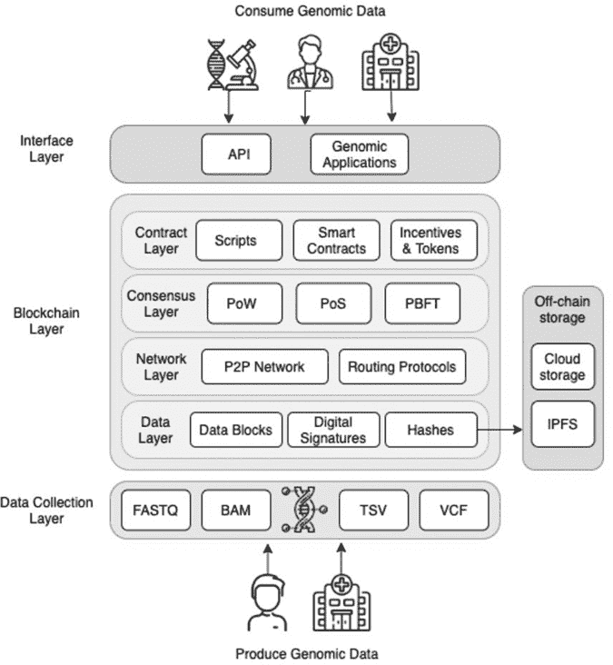

图 15.1 生物信息学数据共享系统的区块链架构。 返回文本。⏎

区块链技术确实通过提供这种去中心化、安全且不可更改的交易记录提供了一种令人印象深刻的解决方案。此外，生物技术行业在知识产权管理方面面临巨大挑战。生物技术创新的专利过程往往充满争议且复杂，导致了诉讼。在这方面，区块链通过提供创新的透明且不可更改的记录，可以解决专利管理。

最终，由制造商、分析师、控制人员以及零售商组成的生物技术区块链链已成为一个重要角色。区块链技术确实通过提供这种去中心化、安全且不可更改的交易记录提供了一种令人印象深刻的解决方案。除了防止伪造和符合监管要求，区块链的能力确保了高度透明和可追溯。本综述章节旨在提供区块链应用的全面概述。

在本章中，15.2 节概述了区块链技术的核心思想、最重要的特性和类型。在第 3 节中，分析了区块链在生物技术中的应用，例如。15.4 节讨论了生物技术实施区块链的困难、障碍和特殊性。15.5 节全面审查了现有的安排方案。15.6 节探讨了区块链与生物技术结合的前景和未来探索。在最后一节，本章对最重要的发现以及对生物技术重要性的总结进行了结束。

## 15.2 区块链基础

大多数情况下，区块链 [8] 是一种分布式账本框架，记录组织计算机之间的交易。传统数据库将数据存储在中心位置，而区块链在去中心化的网络上运行。因此，所有参与者（节点）都可以访问相同的数据。区块链通过将每笔交易记录在 `块` 中来工作。因此，形成了一个块链，被称为 `区块链`。块中的数据由加密算法保护，从而确保一旦记录，就是不可更改的。共识机制取决于特定区块链的设计，它控制新块的添加。共识算法是区块链网络所有参与者对分布式账本状态达成共识的过程。这些中最常用的共识机制是工作量证明 (`PoW`)。节点解决复杂的算法以确定数据的合法所有者。第一个解决问题的节点获得添加新块的权利，并获得加密货币奖励。然而，这确实消耗了大量的能量。

此外，委托权益证明（Delegated Proof of Stakes）显著提高了运行效率，因为代币持有者可以提名一组特定的代表人，由他们负责验证交易和添加新区块。委托权益证明的过程比 `PoW` 和 `PoS` 快得多，并且具有额外的优势。它应用了如拜斯庭容错等机制，确保区块链即使在节点抵制或行为异常的情况下也能成功运行。这一特性对于私有链或联盟链区块链尤为重要。总来说，密码学、去中心化数据库、透明度和稳定性的特征，使得区块链技术成为行业中重视信用、数据完整性和安全性最重要的领域（如生物技术）的极理想选择。密码学、去中心化数据库、透明度和结构基础的基本原理，使区块链特别适用于信誉完整性以及数据真实性和安全性至关重要的行业，例如生物技术。

### 15.2.1 区块链类型与平台

区块链技术主要分为公有链、私有链和联盟链三大类。公链的示例包括 `Bitcoin` 和 `Ethereum`。这些区块链对所有人开放且完全去中心化。这些类型的区块链在生物技术领域可能发挥重要作用，因为它们的特性对于信息的透明验证至关重要，特别是在涉及临床试验数据时。然而，私有链仅限于单个实体或一组组织。它们主要存在于银行和依赖供应链的行业，这些行业对隐私和效率敏感。在生物技术领域，这些私有链可以存储敏感的患者信息或安全地移动专利研究数据。联盟链是半去中心化的，由一组机构管理而非单一机构。因此，它们极大地平衡了开放性和隐私性，并适用于解决生物技术中的协作挑战，例如多中心临床试验和基于联盟的研究倡议。

区块链平台的出现是为了满足生物技术领域的特定需求。例如，`Ethereum` 以其智能合约能力而闻名，用于构建包括生物技术在内的多个行业的去中心化应用程序。因此，它具有自动化 IP 管理和临床试验工作流等复杂流程的活性。`Hyperledger Fabric` 是由 Linux Foundation 开发的模块化许可区块链平台；其目前在企业中的应用归功于扩展性、隐私特性和即插即用组件等因素。`Hyperledger Fabric` 可以促进生物技术领域的安全数据共享和供应链管理。`Corda` 最初为金融领域定制，作为一个优先考虑互操作性和隐私的许可区块链平台脱颖而出。它特别擅长处理多个组织需要共享数据而不向所有参与者暴露数据的场景。这种独特的架构使得 `Corda` 成为生物技术领域不可估量的工具，特别是在管理合同、保护知识产权和确保合规性方面。

## 15.2.2 与生物技术相关的关键特性

区块链的一些独特属性使其成为生物技术领域不可或缺的应用。最重要的是，它的不可篡改性意味着一旦区块链中的数据被输入，就无法以任何方式进行更改。这种特殊性对于维护生物技术中临床试验和研究的保存工作，以及 IP/文档中的数据完整性是必要的。另一个非常重要的优势是高透明度；区块链系统的实施使得组织中的所有利益相关者能够访问相同的信息，从而增加了透明度并减少了可能的人为错误或欺诈行为，这在临床试验和供应链管理背景下都具有高度相关性。区块链技术的一个显著特征是其去中心化的特性。

它通过消除中心权威，消除了由于弱环节导致的脆弱性，并消除了单点控制。这一特性在全球供应链和协作研究环境中证明是非常有利的。区块链技术的另一个特性是它是高度安全的，因为区块链技术使用的加密方法能够抵抗数据篡改和未经授权的访问。在数据保护至关重要的生物技术领域，区块链是保护敏感数据的可行方法。此外，将条款直接编码到编程代码中的自执行协议被称为智能合约，它们提供了巨大的优势。智能合约 最小化了对中间环节的依赖，增加了运行效率，并在不需要第三方参与的情况下执行协议。这在生物技术流程中的 IP 许可、临床试验管理和供应链交易中可能非常有用。

## 15.3 区块链在生物技术中的应用

### 15.3.1 供应链管理

这意味着生物技术的供应链从使用区块链中获益，因为它提供了开放的、带有时间戳的交易记录。生物技术产品制造网络的典型成员包括原材料供应商、制造商、监管机构和分销商。在制药行业，产品必须是可溯且真实的，因为假药将产生可怕的后果。现代研究已经证明，区块链技术确实可以通过其对所有供应链交易的不可更改记录来提高生产网络的效率。一个很好的例子是 `MediLedger` 项目，它通过区块链追踪药品，确保只有正品到达终端用户。农业领域也利用区块链技术进行了进一步研究，用于追踪并确保转基因生物（GMOs）等生物技术产品的来源和完整性得到验证。

`VeChain` 在制药行业的使用是区块链技术在生物技术生产网络中的卓越应用。`VeChain` 区块链平台允许制药公司跟踪从生产到配送的整个生命周期。这防止了假货的流通并确保遵守监管标准。尽管区块链为库存网络提供了关键收益，但区块链与现有库存网络框架结合以及区块链方案的灵活性仍然存在障碍。未来的评估可以探索结合区块链与各种技术（如物联网）的混合模型，以进一步开发生产网络的可检测质量和能力。

### 15.3.2 数据管理与安全

生物技术领域产生海量数据，从基因组序列到临床试验结果。管理和保护这些数据是一项重大挑战，考虑到这些信息的敏感性。区块链去中心化且安全的架构为生物技术的数据管理提供了一个有前景的解决方案。一些研究探索了使用区块链来管理和保护生物医学数据。例如，已建议使用区块链来管理基因组数据，隐私和数据所有权是关键关注的问题。

诸个人基因组计划（Personal Genome Project）等项目已经尝试使用区块链技术让个人对其基因组数据拥有控制权，同时确保其安全性和私密性。另一个基于区块链技术的项目是 Iryo Network [12]，它是一个实现医疗数据管理的平台示例。通过区块链实现，Iryo 让患者对自己的数据拥有完全控制权——只有拥有适当权限的人才能读取患者记录。它可以扩展到管理基因组和其他敏感的生物技术信息。然而，与大多数解决方案一样，区块链并非没有问题，包括存储问题和合规性问题。进一步的研究可能会确定如何将此类解决方案整合到大型生物系统中，以及如何实施支持区块链技术管理大数据的适当法律法规。

### 15.3.3 知识产权与许可

生物技术业务中一个受保护良好的领域主要基于知识产权（IP）措施，因为遗传学、制药学和其他相关理念的增长只能通过专利和许可来保护。知识产权的管理和保护并非易事，因为这需要许多方的协助，并需要遵守多个不同的法律体系。将区块链原理应用于生物技术领域知识产权的实现，可以是增强程序安全性以及易于记录领域所有权和其他交易的有效方法 [11]。一些研究表明，区块链技术是高效的，可以应用于专利、版权和许可等知识产权。在区块链上记录的知识产权交易想法将有助于减少盗窃事件的发生，并有助于追踪和执行许可。

其他利用区块链实施的示例还包括新加坡知识产权局（IPOS），它展示了区块链如何为知识产权流程带来更高的效率。Poet 策略 [13] 是一种基于区块链的控制计算机内容自由的解决方案。尽管 Poet 策略最初是为数字媒体设计的，但它可以应用于生物技术领域的知识产权管理，以确保专利和许可得到透明的记录和执行。专利监管的复杂性在不同司法辖区之间发生根本性变化，是利用区块链进行领域知识产权管理的主要障碍之一。区块链与现有的专利和许可框架相结合，并为知识产权委员会制作标准化的区块链结构，可以作为未来探索的主题。

## 15.3.4 临床试验与研究完整性

临床初步研究是生物技术的基础性组成部分，特别是在开发新药物和治疗方法方面。然而，对临床试验完整性的担忧往往由于数据操纵、缺乏透明度和利益冲突等问题而引发。区块链不可更改和直观的本质使其成为确保检查和临床初步信息可信度的理想解决方案。临床试验的有效性一直是多项研究的主题，这些研究建议使用区块链技术。例如，Benchoufi 和 Ravaud [14] 得出结论，区块链可以对临床试验的每一步进行时间标记和检查，这意味着区块链确保了数据的完整性和试验的规范进行。另一个特征也可以追溯到试验结果的操纵，这是区块链将协助制药公司解决的另一个关键问题。

`ClinTrial Token` 是利用区块链技术解决临床试验问题的一个实例。由于试验数据通过 `ClinTrial Token` 存储在区块链上，数据是可靠、透明且符合设定标准的。总而言之，这种方法在增强试验可靠性方面可能产生巨大作用，从而增强投资者对制药业务的信心。考虑到与临床试验透明度相关的区块链优势，仍然存在一些问题，例如数据隐私以及在整个行业中实施的问题。对于未来的工作，可能会提议将进一步的透明度和隐私相结合，这些研究可以通过区块链实施，并可以开展能更好地激励在临床试验中使用区块链的研究。

### 15.3.5 个性化医疗与基因组学

生物技术领域一个快速发展的领域是个性化医疗，它关注考虑患者遗传特征的靶向疗法。然而，在遗传数据的安全管理和共享方面面临巨大挑战。区块链技术提供了一个很有前景的解决方案，专门用于保护敏感信息并促进大型数据集（如基因组数据）的安全共享。在区块链应用领域已实施了多计划。例如，EncrypGen [15] 使用区块链让人类能够自愿安全地向研究人员贡献其遗传标记。同样，Nebula Genomics 利用区块链共享基因组数据，人们可以将数据卖给研究人员或制药公司。

Shivom 项目是一个基因组数据共享的区块链技术系统。通过区块链，Shivom 让客户能够与研究人员和制药公司共享基因组数据，同时决定谁可以使用这些信息。这种方法的益处在于，有可能在不侵犯个人隐私权的情况下推动个性化医疗的研究。然而，在个人医疗背景下应用区块链时，需要解决的主要问题之一是数据保护，另一方面是出于研究目的共享数据的能力。进一步的研究可以在采用区块链结合隐私技术的方向进行，以便在不损害个人隐私的情况下安全共享数据。但众所周知，区块链解决方案处理海量基因组数据的适用性是未来关注的核心问题之一。

## 15.4 挑战与局限性

### 15.4.1 技术挑战

识别区块链为生物技术领域带来的收益至关重要。研究人员在使用区块链技术时还会遇到许多技术问题，包括可扩展性、互操作性和能源消耗问题。截至目前，可扩展性仍然是区块链中最突出的技术问题。即使是像 `Bitcoin` 和 `Ethereum` 这样的公共区块链，在特定时间内只能处理一定数量的交易，导致等待时间和高昂的单笔费用。这种限制对于需要大量计算或涉及数千次交易的生物技术实际应用来说尤为显著。

数据共享与协作是生物技术领域至关重要的概念，但由于不同区块链系统之间无法协作而面临困境。例如，不同类型区块链之间的数据传输通常是不可行的，因此区块链技术的应用非常复杂。最后，能源消耗是一项重大挑战，因为它严重阻碍了基于 `PoW` 的区块链网络的运行。基于 `PoW` 的区块链网络运行所需的巨大能源需求引发了人们对此类系统随时间产生的环境影响和可持续性的关注。这对于生物技术等行业尤为相关，因为该行业正日益关注可持续方法。

### 15.4.2 监管与伦理问题

尽管存在禁止某些区块链用途的趋势（特别是针对与生物技术相关的应用），但其仍然受到严格监管，在利用之前，必须解决各种问题。法律上的不确定性威胁着整个应用领域，这一点至关重要，尤其是涉及基于区块链的交易或其应用的智能合约时。在生物技术等高度监管且风险极高的行业中，这可能起到威慑作用。数据隐私是另一个主要挑战，特别是在使用大数据分析时。

区块链记录的不可篡改性引发了对数据所有权的担忧。同样，在收集敏感数据（尤其是基因组数据）的生物技术领域，遵循《通用数据保护条例》（General Data Protection Regulation）等数据隐私法律变得非常重要。此外，在生物技术中使用区块链技术还存在伦理问题。例如，数据所有权和知情同意随之而来。例如，个性化医疗对数据所有权以及为了经济目的可能利用基因组信息提出了质疑，其中敏感数据的商业化超过了其伦理限制。这些必须解决这些伦理问题，以确保该技术在生物技术领域得到负责任的利用。

191

### 15.4.3 采用与实施挑战

必须解决并弥合许多问题，才能促进区块链技术在生物技术行业中的采用和应用。对变革的抵制将是区块链技术采用面临的最大挑战。这里的大多数利益相关者在依赖传统技术的组织中工作了数十年，使得他们很难转向区块链系统。高昂的费用或有时甚至是极其惊人的成本是一个巨大的障碍。使用区块链实施和维护解决方案的成本极高。

财务优势可能会随着时间的推移而产生，但由于短期内理解有限，最终对开发和集成的投资将非常有限。复杂性也不利于区块链的采用。技术链非常复杂，而开发区块链解决方案所需的技能非常专业。对于缺乏相关人力配置的组织来说，这可能是一个巨大的障碍，因为他们无法采用并有效使用该技术。

## 15.5 现有解决方案的比较分析

基于区块链在生物技术领域的潜在用途和不同特性，目前有多种区块链平台。在本节中，作者描述了应用于生物技术领域最有前景的区块链解决方案，并对它们在特定任务中的优缺点进行了比较。

`Ethereum vs. Hyperledger Fabric`：`Ethereum` 非常灵活并支持智能合约，使其适用于知识产权（IP）管理和临床试验过程。然而，它是一个公共平台，存在扩展性问题，使其不太适合处理敏感数据。另一方面，`Hyperledger Fabric` 是一个开源的区块链联盟（`BCC`），在实施智能合约时增强了隐私且使用灵活；这适合在供应链和安全信息交换中使用它的大型组织。

`Corda vs Quorum`：`Corda` 是许可性的且开放的，因此它非常适合建立平台，让不同组织能够安全地共享数据。与 `Quorum` 类似（基于 `Ethereum` 但仅允许某些参与者访问），`Vital` 提供的匿名性与使用智能合约的可能性相结合。这两个平台在处理各种合同和遵守生物技术监管方面将都是非常合适的；然而，颜色的选择取决于每个应用程序的需求。

本节还讨论了区块链在生物技术中成功应用的几个真实世界案例，并对此类方法的有效性及其潜在后果进行了评估。

`MediLedger Project`：证明区块链改进了供应链并防止假产品流通的项目之一是 `MediLedger`，它利用区块链追踪药物产品。因此，192 页显示了使用区块链如何增强生物技术产品的安全性和对标准的合性。

`EncrypGen`：如 `EncrypGen` 等基于区块链的应用（它通过区块链管理基因组数据）描述了区块链如何帮助人们安全地控制其数据和信息的使用与共享。这些观点反映了该平台的有效性以及区块链在个性化医疗中重构数据方面的潜力。

`IPOS Blockchain Patent Platform`：`IPOS` 实施了区块链技术来管理专利。专利纠纷的风险被消除，专利流程得到了加速，证明了区块链平台管理生物技术领域所有形式知识产权的可行性。

## 15.6 未来方向与研究机会

将区块链技术与其他相对现代的技术（人工智能 [16,17,18,19,20]）、物联网和大数据相结合，为生物技术的发展提供了巨大的机会。例如，将区块链与人工智能相结合，可以使个性化医疗中的治疗计划和患者数据分析更加有效。同样，将区块链与物联网相结合可以通过允许追踪服务来提高生物技术产品供应链的问责制。尽管在将区块链应用于生物技术方面已取得进展，但仍存在许多研究挑战。这些包括开发生物技术采用区块链的标准框架、研究区块链安排的适应性和互操作性，以及开发保护性区块链技术。

## 15.7 结论

区块链技术可以解决生物技术领域一些最紧迫的问题，例如供应链透明度、知识产权管理和数据安全。无论何种情况下，为了掌握这一潜力，必须解决一些特定的监管和数据收集困难。后续的研究重点应放在克服这些障碍，并研究区块链与生物技术交叉领域的新兴机会。

## 参考文献

1. Pandey, Muskan, and Barkha Singhal. “生物制造中的区块链技术：当前视角与未来挑战。” In SK Hafizul Islam, Arup Kumar Pal, Debabrata Samanta, Siddhartha Bhattacharyya, (Eds.), Blockchain Technology for Emerging Applications. Massachusetts, USA: Academic Press, pp. 207–237, 2022. 返回文本。⏎

2. 193Yadav, Amrendra Singh, Nikita Singh, and Dharmender Singh Kushwaha. “区块链与共识机制的演进及其现实世界的应用。” Multimedia Tools and Applications 82.22 (2023): 34363–34408. 返回文本。⏎

3. Azaria, Azaria, Ariel Ekblaw, Thiago Vieira, and Andrew Lippman. “MedRec: 使用区块链进行医疗数据访问和权限管理。” In Proceedings of the 2nd International Conference on Open and Big Data (OBD), Vienna, Austria, pp. 25–30, Aug. 2016. [`doi.org/10.1109/OBD.2016.11`](https://doi.org/10.1109/OBD.2016.11). 返回文本。⏎

4. Vashishth, Tarun Kumar, Vikas Sharma, Kewal Krishan Sharma, Pranshul Sethi, Tanu Chaudhary, Abhay Bhardwaj, “区块链对生物医学和医疗保健的未来影响。” In Prasun Kumar, Aparna Kumari (Eds.), Blockchain for Biomedical Research and Healthcare: Concept, Trends, and Future Implications. Singapore: Springer Nature Singapore, pp. 367–404, 2024. 返回文本。⏎

5. Najumnissa Jamal, D., R. Karthikha, and M. S. Affia Thabassum. “采用区块链应用于生物医学和医疗系统的前性问题与挑战。” In Prasun Kumar and Aparna Kumari (Eds.), Blockchain for Biomedical Research and Healthcare: Concept, Trends, and Future Implications. Singapore: Springer Nature Singapore, pp. 269–301, 2024. 返回文本。⏎

6. Balakrishnan, Arpita, et al. “生物信息学中区块链的新兴趋势：医疗保健的革命。” In Rajiv Pandey, Sam Goundar, and Shahnaz Fatima (Eds.), Distributed Computing to Blockchain: Architecture, Technology, and Applications, London, UK: Elsevier Academic Press, pp. 389–404, 2023. 返回文本。⏎

7. Racine, Valérie. “区块链能解决基因组生物库的伦理困境吗？” Science and Engineering Ethics 27.3 (2021): 35. 返回文本。⏎

8. Rizzardi, Alessandra, Sabrina Sicari, and Alberto Coen-Porisini. “物联网驱动的区块链用于管理医疗供应链并保护医疗记录。” Future Generation Computer Systems 161 (2024): 415–431 返回文本。⏎

9. Teoh, Bryan Phern Chern. “应对区块链三角困境：一个供应链困境。” Advanced Maritime Technologies and Applications: Chapters from the ICMAT 2021. Springer International Publishing, 2022. 返回文本。⏎

10. Simon, Richard, and Sameek Roychowdhury. “在临床试验中实施个性化癌症基因组学。” Nature Reviews Drug Discovery 12.5 (2013): 358–369. 返回文本。⏎

11. Iryo, Takamasa, and Michael J. Smith. “论单向网络中平衡交通流模式的唯一性。” Transportation Research Procedia 23 (2017): 283–302. 返回文本。⏎

12. Aslam, Tehreem, Ayesha Maqbool, Maham Akhtar, Alina Mirza, Muhammad Anees Khan, Wazir Zada Khan, and Shadab Alam. “基于区块链的增强 ERP 交易完整性架构和 PoET 共识。” Computers, Materials & Continua 70.1 (2022): 1089–1109. 返回文本。⏎

13. Benchoufi, Mehdi, and Philippe Ravaud. “改进临床研究的区块链技术。” Trials 18.1 (2017): 1–5. 返回文本。⏎

14. DeFrancesco, Laura, and Ariel Klevecz. “你的 DNA。” Nat 37.10 (2019): 842–847. 返回文本。⏎

15. Singh, Dushyant, et al. “城市监控的人群检测。” Procedia Computer Science 171 (2020): 350–359. 返回文本。⏎

16. Dewang, Rupesh, et al. “数据安全应用：使用 IPFS 安全存储的应用。” Multimedia Tools and Applications 83.15 (2024): 4549–4517. 返回文本。⏎

17. Rusia, Mayank, Dushyant Kumar, and Mohd Aquib Ansari. “一种基于深度学习的面部估计方法。” Cybernetics and Information Technologies 24.2 (2024): 105–121. 返回文本。⏎

18. Ahmad, Shahnawaz, Shabana Mehfuz, and Javed Beg. “云入侵检测的扩展卷积神经网络的高效安全密钥管理。” Concurrency and Computation: Practice and Experience 35.23 (2023): e7806. 返回文本。⏎

19. Singh, Satya Prakash, Mohd Aquib Ansari, and Lalit Kumar. “使用 Weblog Expert 进行网站数据挖掘分析。”2023 IEEE 12th International Conference on Communication Systems and Network Technologies (CSNT). IEEE, 2023. 返回文本。⏎

20. Ahmad, Shahnawaz, et al. “用于云、边缘、雾和物联网计算的深度学习模型：综述、近期进展与未来方向。” Computer Science Review 49 (2023): 100568. 返回文本。⏎

区块链技术通过增强安全性和速度改变了金融交易 [3]。资产代币化、跨境支付和智能合约是进一步的区块链金融应用。交易类型将决定金融领域的理想区块链。私有链更适合私有交易，而公链则具有透明性。在选择金融区块链模型时，交易速度、安全性和监管合规性至关重要。金融活动类型也会影响这一选择。区块链以透明且不可更改的方式记录交易，改进了金融运营。由于其去中心化的特性，欺诈和操纵被大幅减少 [4, 5]。金融科技公司利用 `AI` 及其许多应用创建数字交易平台，让低收入女性以及中微企业能够接触主流金融市场。

金融工业 4.0 中的 `AI` 和区块链正在解决风险管理、欺诈检测和投资组合优化问题。`AI` 还帮助金融机构提供实时金融数据和 24/7 客户服务。金融工业 4.0 中的 `AI` 和区块链正在开启金融服务创新与增长的新纪元，可能会提高企业和客户的效率、准确性和可访问性。

### 16.1.1 工业革命背景

*   **1765 年的煤炭**：蒸汽动力和制造机械化始于 18 世纪，引发了第一次工业革命。机械化纺织机在同一时期产生的线产量是传统机器的八倍。蒸汽因其效能而受到关注。它的工业用途是生产力最显著的提升。在没有人类的情况下，蒸汽机可以驱动织布机。蒸汽轮和（100 年后的）蒸汽机等技术让人们和货物更短的时间内运行更远，导致了进一步的进步。

*   **1870 年的燃气**：随着 19 世纪电力和生产线的兴起，第二次工业革命开始。亨利·福特（1863–1947）在芝加哥的一家屠宰场发明了大规模生产，猪被挂在传送带上，每位屠夫只需宰杀一只。“亨利·福特（1863–1947）将这些概念落实到汽车制造中，改变了行业。”以前，整辆车在一个地点组装；而现在，传送带上的小批量生产更高效且更具成本效益。

*   **1969 年的电子与核能**：20 世纪 70 年代标志着使用计算机和内存可编程控制引发的第三次工业革命的开始。自从这些技术引入以来，生产可以在无需人工干预的情况下实现自动化。著名的例子是运行预设序列而无需人工干预的机器人。

*   **2000 年的互联网与可再生能源**：“工业 4.0”指的是企业在第三次工业革命进步的基础上使用信息和通信技术。通过网络链接，“可以建立并扩展在线数字孪生体，用于基于计算机的制造过程”。这允许设施之间相互通信并传输有关自身的信息 [6, 3]。智能工厂通过赛博物理生产系统创建，这些系统连接所有系统并需要极少的人工干预。当这些赋能者结合时，工业 4.0 可能会彻底改变制造业。例如能够预见问题并启动维修操作的机器，或适应生产变化的自组织物流。图 16.1 描述了工业革命。

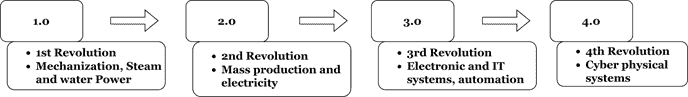

图 16.1 工业革命层级图。返回正文。⏎

### 16.1.2 技术参与

图 16.2 显示现金支付、数字支付和网上银行等技术进步如何影响每个人的日常生活。投资技术正在演进，正如在线交易 App 所示。`AI` 和机器学习改进了数字市场管理。

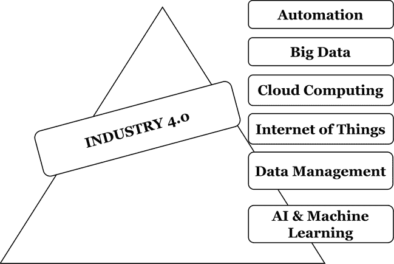

图 16.2 工业 4.0 涉及的技术。返回正文。⏎

股市复杂且多变化。选择一个有效的投资计划是困难的。挑战在于准确预测。股票价格受政治、市场和经济的影响。投资者的决策也会影响它们。环境状况会显著影响股价。严格的分析使得为股价和其他参数找到简单的线性函数方程变得困难。因此，虽然许多基础投资模型可以推荐投资，但它们很难预测股价和其他参数。`AI` 涉及自组织、学习和自适应。

## 16.2 理论框架

### 16.2.1 人工智能与股票交易工业 4.0 的关系

现代金融市场得益于 `AI` 简化了市场运营并增加了交易灵活性 [7]。从开立账户到交易，一切都是电子化的。技术改进了实用性且没有取代智能 [8]。金融市场现在依赖交易软件和工具。许多交易系统允许在线交易。

股票交易 4.0 使用 `AI` 等尖端技术来提高交易效率。`AI` 在股票交易 4.0 中的目的是实时分析海量数据并做出预测和判断。利用 `AI` 改进交易体验的有很多：

*   **风险意识**：企业利用机器学习、处理速度和大数据来分析合规风险。这得益于 `AI` 技术帮助投资者识别交易模式。它在所有市场实时发生。

*   **AI 股票交易**：实时金融笔记、数据、趋势公司和市场信息让投资者能够交易。这是通过语音识别实现的。

*   **建议与提示**：股票建议通过识别技术提供，这帮助投资者做出明智选择并最大化交易机会。

*   **减少人为错误**：因为交易者不需要为了交易策略等建议与人类互动。数据科学迅速克服投资挑战。

#### 16.2.1.1 金融业 AI 形成的主要步骤

可以考虑包括金融业 `AI` 在内的各种步骤，如图 16.3 所示。

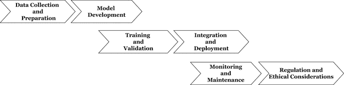

图 16.3 金融业 AI 形成步骤。返回正文。⏎

*   **数据收集与准备**：第一步是收集和处理大量的金融数据以输入 `AI` 算法。

*   **模型开发**：涉及选择合适的 `AI` 算法并开发能够分析金融数据并做出预测或建议的模型。

*   **训练与验证**：模型必须在大数据中进行训练以提高准确性；之后，对这些模型进行验证以确保其有效性。

*   **集成与部署**：`AI` 模型必须与现有的金融系统集成，并部署给终端用户。

*   **监控与维护**：`AI` 模型开发后，需对其性能进行监控并进行相应的更新，以确保有效性。

*   **监管与伦理考量**：金融服务行业受到高度监管。因此，在充分考虑现有法律法规的同时，应关注伦理问题来开发和部署 `AI`。

### 16.2.2 工业 4.0 中的金融科技主要领域

金融科技（FinTech）是经济增长最快的领域之一，它利用技术来改进和自动化金融服务。工业 4.0 中主要的金融科技应用包括：

*   **移动与数字银行**：移动设备和互联网连接的进一步渗透也改变了移动银行和移动商户服务的水平。

*   **区块链技术**：区块链技术增加了金融交易的透明度、安全性和效率。

*   **人工智能与机器学习**：`AI` 和机器学习将自动化大多数涉及风险管理、欺诈检测和投资管理的金融流程。

*   **机器人投顾**：自动化投资管理服务（通常被称为机器人投顾）变得越来越流行，因为它们能为个人提供个性化的投资建议。

*   **数字货币**：如 `Bitcoin` 和 `Ethereum` 等数字货币正变得日益主流，导致人们对扩展基于区块链的新型金融产品服务的兴趣增加。

*   **保险科技（Insurtech）**：金融科技公司正在利用数字化和数据技术，通过提供新的产品、服务和渠道来转型保险行业。

### 16.2.2.1 AI 如何在金融行业 4.0 中留下足迹的？

金融行业 `AI` 的理论框架基于几个核心概念和原则。一个核心概念是使用机器学习算法分析和处理大量的金融数据，例如市场趋势、客户行为和风险因素。另一个重要概念是使用人工神经网络根据这些数据进行预测和决策。

如 `图 16.4` 所示，金融领域 `AI` 的概念模型通常包含以下元素：

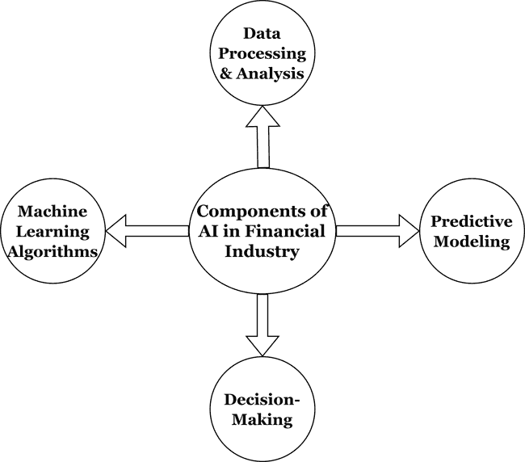

图 16.4 金融行业中的 AI 组件。返回文本。⏎

*   **数据处理与分析**：`AI` 算法提取、清洗并处理金融数据以供进一步使用。

*   **机器学习算法**：这些算法使用具有潜力的算法（如决策树、随机森林和神经网络）对处理过的金融数据进行分析和预测。

*   **预测建模**：该技术利用机器学习算法的输出结果，来获取对市场未来趋势、客户行为和风险因素的预判。

*   **决策制定**：这意味着将预测建模模块应用于决策过程中，例如寻找投资的最佳方法或将风险降至最低。

*   **总而言**，金融行业 `AI` 的概念模型旨在利用先进技术和算法来改进决策并增强金融操作的效率。

### 16.2.2.2 区块链技术如何在金融行业 4.0 中留下足迹的？

[9]、[10]、[11]、[12]、[13] 以及 [14]：区块链在工业 4.0 中是至关重要且充满前景的。它主要与 `Bitcoin` 和其他加密货币相关。

`图 16.5` 展示了区块链技术如何通过提供去中心化、安全高效的解决方案来影响许多方面。

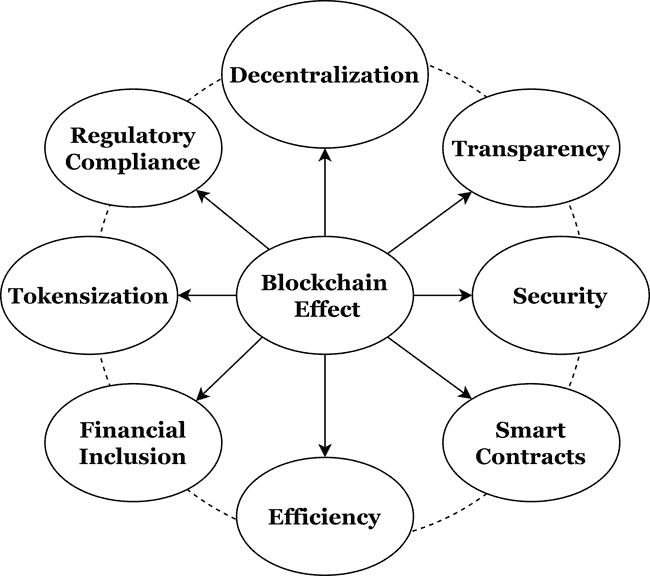

图 16.5 区块链技术影响图。返回文本。⏎

## 16.3 理论与实践意义

### 16.3.1 为什么我应该对人工智能充满信心？

手机上的面部识别、在线购物推荐、寻找完美的工作、以及使用 `Google Maps` 处理不可预测的交通，都是 `AI` 让我们的生活变得更简单的例子。[15]：`AI` 驱动的 `Jarvis` 根据标准创建并管理投资组合。它可以消除复杂环境下标准金融衡量指标的缺陷。[16]：事实上，使用机器学习和 `AI` 进行量化投资正在快速发展。

### 16.3.2 AI 在股票市场 4.0 中的应用与挑战

`AI` 被应用于股票交易领域的各个方面，如 `图 16.6` 所示。

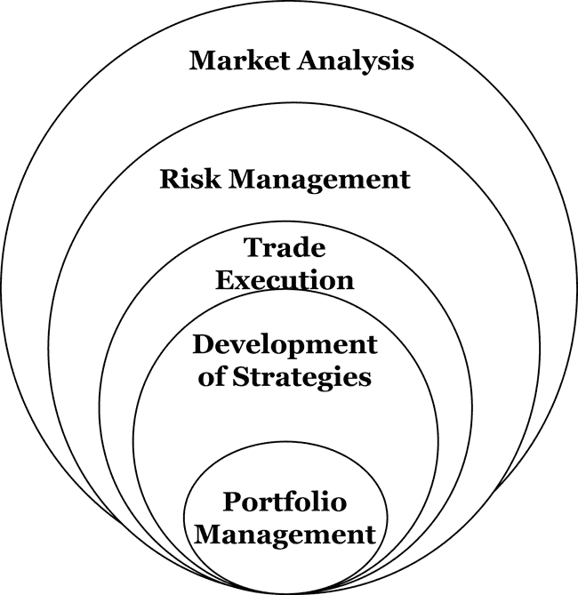

图 16.6 AI 在股票交易中的应用。返回文本。⏎

*   **投资组合管理**：利用风险承受能力、投资期限和绩效目标等参数，`AI` 算法可以优化投资组合的构成。

*   **交易策略开发**：`AI` 可用于在大量数据集中发现关系和模式，从而创建交易策略。这些策略可能基于基本分析、技术分析或两者的结合。

*   **交易执行**：`AI` 可以根据预设参数或规则自动执行交易。可以使用跟踪市场并在条件满足时执行交易的算法设置。

*   **风险管理**：通过对交易和组合进行实时监控，`AI` 可以在风险发生后进行分析和控制。例如检测异常交易模式、留意市场状况，并据此对交易进行任何必要的调整 [5]。

* **市场分析：** 通过市场数据分析，AI 可以为交易员做出正确决策提供洞察，例如从市场数据中发现模式和趋势、预测价格变化，甚至提供实时的市场分析。

AI 可能会提高股票交易效率、降低成本并提高准确性。然而，只有当数据和算法最优时，AI 才是最准确的；这些领域的错误或偏见将导致错误 [17]。在主动管理的股票基金中，AI 顾问正在取代人工选股。贝莱德（BlackRock）是美国最著名的投资管理选股机构，拥有一个基于 AI 的自学习投资程序。AI 股票交易采用机器人顾问（Robo-Advisors），扫描海量数据并在最佳时机和价格进行交易。AI 交易员更具远见，并能有效控制公司的交易，降低风险并获得更多回报 [18,19]。尽管如此，金融部门在采用 AI 技术方面仍面临许多挑战。主要阻碍之一是缺乏足够培训和技能的技术人员来建立 AI 系统。

在购买和大规模实施方面，AI 的成本非常昂贵。由于 AI 系统有效运行需要海量数据，隐私问题也随之产生，给金融机构带来了安全问题。通过 AI 实现的进一步自动化还导致了失业，以及员工的重新部署。其准确性受限，因为它还取决于训练 AI 系统的数据质量，这些数据有时会在结果输出中传达偏见。许多消费者对金融领域的 AI 仍表示怀疑，因为他们一直不信任一个存储其财务状况和其他资产的 AI 驱动系统 [20]。AI 系统的部署在技术上是复杂的，因为它必须与现有流程对接。AI 领域也存在人才短缺，这使得金融机构难以找到合格的专业人士来开发和实施这些系统。最后，与 AI 开发和实施相关的高成本使得机构难以证明投资的合理性。

金融领域 AI 引发的挑战包括：金融 AI 系统缺乏透明度或存在偏见、数据质量、监管、专业知识、风险管理以及黑箱算法。金融 AI 算法是复杂的，投资者很难评估基于 AI 的投资策略。存在偏见的 AI 系统可能导致错误的财务输出。AI 算法根据可用的大量数据生成预测，而质量对于精度至关重要 [6]。投资者分析 AI 驱动的投资风险具有挑战性，因为这些风险在金融领域没有得到精确的控制和监管。AI 主题发展非常快，许多投资者无法理解 AI 驱动投资技术相关的风险和收益。AI 算法可以快速处理大量数据，提供实时的财务选择，这增加了投资者风险管理的复杂性。AI 算法确实可以是“黑箱”系统，使投资决策对投资者而言不可理解或无法理解。因此，上述问题凸显了让知情的投资者充分了解 AI 驱动投资策略的潜在危险和收益，以及投资的审慎性质的重要性。

## 16.4 结论、启示与未来研究方向

作为对金融文献的贡献，本文进一步分析了第四次工业革命（工业 4.0）引发的 AI 在金融行业的作用。它描绘了从第一次工业革命开始的技术演变，并作为金融科技（或 FinTech 4.0）的一部分，对 AI 和股票交易得出了见解。研究显示了 AI 和区块链如何通过以更低的成本提供更好的安全性、效率和包容性且无需中介，来改变金融部门。鉴于这一模式，技术可以进一步影响金融部门并提供增长机会。

工业 5.0 将是指从以技术为中心的流程转向人机协作。因此，工业 5.0 将强调 AI 与人类专业知识的结合，反而能够产生高度个性化、高效且创新的输出（见图 16.7）。因此，如果制造业和金融服务无法跟上行业变化，工业 5.0 将使它们过时。

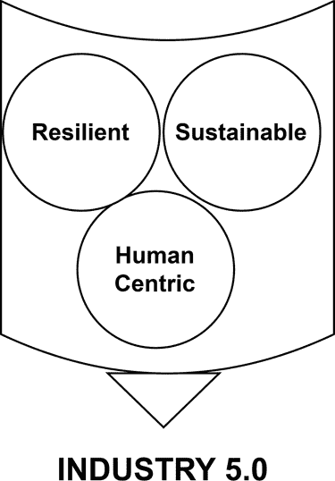

图 16.7 工业 5.0 的核心价值。返回文本。⏎

尽管 AI 带来了各种优势，但高成本仍是主要障碍之一。必须克服实施 AI 在效率和隐私方面的成本，以便金融机构能够充分采纳和实施 AI。未来的方向应该是使技术更易于获取且负担得起。

此外，未来的研究应该对投资者进行调查，以评估他们对 AI 的了解以及 AI 的整合如何影响投资选择。对 AI 与新技术的协同进行进一步研究可能会为投资者和企业带来更好的决策。通过解决对成本和隐私的担忧，可以在金融部门充分利用 AI。

## 参考文献

1.  Addula, S. R., Meduri, K., Nadella, G. S., and Gonaygunta, H. (2024). AI and blockchain in finance: Opportunities and challenges for the banking sector. IJARCCE, 13(2), 184–190. 返回文本。⏎

2.  Pal, A., Tiwari, C. K., and Behl, A. (2021). Blockchain technology in financial services: A comprehensive review of the literature. Journal of Global Operations and Strategic Sourcing, 14(1), 61–70. 返回文本。⏎

3.  Ghandour, A. (2021). Opportunities and challenges of artificial intelligence in banking: Systematic review. TEM Journal, 10(4), 1581–1587. 返回文本。⏎

4.  Rane, N., Choudhary, S., and Rane, J. (2023). Blockchain and Artificial Intelligence (AI) integration for revolutionising security and transparency in finance. SSRN Electronic Journal. [10.2139/ssrn.464253](http://dx.doi.org/10.2139/ssrn.464253). 返回文本。⏎

5.  Santos, H., Damasio, J., Ulbrich, A., and Vieira, R. (2021). Opportunities and challenges in fall risk management using EHRs and artificial intelligence: A systematic review. In Proceedings of the 23rd International Conference on Enterprise Systems. [`doi.org/10.5220/0010424306263`](https://doi.org/10.5220/0010424306263). 返回文本。⏎

6.  Kshetri, N. (2021). Blockchain and sustainable supply chain management in developing countries. International Journal of Information Management, 60, 102376. 返回文本。⏎

7.  Tadapaneni, N. R. (2020). Artificial Intelligence in Finance and Investments. IEEE International Conference on System, Computation, Automation and Networking (ICSAN), Pondicherry, India, 2020, pp. 1–5. 返回文本。⏎

8.  Morkunas, V. J., Paschen, J., and Boon, E. (2019). How blockchain technologies impact your business model. Business Horizons, 62(3), 295–306. 返回文本。⏎

9.  Viriyasitavat, W., and Hoonsopon, D. (2019). Blockchain characteristics and consensus in modern business processes. Journal of Industrial Information Integration, 13, 32–39. 返回文本。⏎

11. Chang, V., Baudier, P., Zhang, H., Xu, Q., Zhang, J., and Arami, M. (2020). 区块链如何影响金融服务——专家访谈的概述、挑战与建议。Technological Forecasting and Social Change, 158, 120166. 返回正文

12. Hughes, A., Park, A., Kietzmann, J., and Archer-Brown, C. (2019). 超越比特币：区块链和账本技术对企业的意义。Business Horizons, 62(3), 273–281. 返回正文

13. Beck, R., Avital, M., Rossi, M., and Thatcher, J. B. (2017). 商业与信息系统研究中的区块链技术。Business, Information Systems Engineering, 59(6), 381–384. 返回正文

14. Boratyńska, K. (2019). 数字转型对金融科技服务价值创造的影响：一种创新方法。Journal of Promotion Management, 25(5), 631–639. 返回正文

15. Chopra, R., and Sharma, G. D. 2021. 人工智能在股市预测中的应用：批判、回顾与研究议程。Journal of Risk and Financial Management, 14, 526. 返回正文

16. Gao, Z. (2020). 人工智能在股票投资中的应用。Journal of Physics: Conference Series, 1453(1), 012069. [`doi.org/10.1088/1742-6596/1453/1/012069`](https://doi.org/10.1088/1742-6596/1453/1/012069). 返回正文

17. Jan, Z., Ahamed, F., Mayer, W., Patel, N., Grossmann, G., Stumptner, M., and Kuusk, A. (2023). 工业 4.0 的人工智能：应用、挑战与机会的系统性综述。Expert Systems with Applications, 216, 119456. 返回正文

18. Wu, B., and Duan, T. (2019). 区块链技术在金融市场的应用。Journal of Physics: Conference Series, 1176, 042094. 返回正文

19. Peres, R. S., Jia, X., Lee, J., Sun, K., Colombo, A. W., and Barata, J. (2020). 工业 4.0 中的工业人工智能——系统性综述、挑战与展望。IEEE Access, 8, 220121–220139. [`doi.org/10.1109/access.2020.3042874`](https://doi.org/10.1109/access.2020.3042874). 返回正文

20. Murinde, V., Rizopoulos, E., and Zachariadis, M. (2022). 金融科技革命对银行未来的影响：机遇与风险。International Review of Financial Analysis, 81, 102103. 返回正文

# 17 使用区块链进行国际支付：效率、安全与可行性的全面分析

Arvind Mewada, Mohd. Aquib Ansari, Niharika Keshari, Nagendra Singh, and Amrendra Singh Yadav

DOI: [10.1201/9781003545620-22](https://doi.org/10.1201/9781003545620-22)

## 17.1 引言

随着互联网技术的快速发展，电子货币传输或国际支付正在迅速增长。如今，国际支付系统在执行全球电子商务活动中发挥着重要作用。根据世界银行统计，2024 年全球国际支付总额已达到 11.53 亿美元，预计到 2028 年将增加到 21.8 亿美元[[1]](#C_024_c17.xhtml#r17_1)。印度是一个主要的全球贸易国家，由于其广泛的线下进出口产生了大量的国际支付。尽管如此，现有的国际支付模式面临繁琐的流程和高昂的费用。此外，由于这些支付系统面临安全威胁，还会暴露用户隐私风险[[2]](#C_024_c17.xhtml#r17_2)。因此，印度对国际支付的需求日益增长，这阻碍了电子商务的发展。

比特币引入了区块链技术的开创性概念。区块链最大的优势在于它能够以较低成本确保交易并建立信任。这种特性已引起全球政府、金融机构的关注[[3]](#C_024_c17.xhtml#r17_3)。这被称为区块链的第一代。第二代区块链技术引入了智能合约，使股票、贷款和房地产等资产的功能化。第三代区块链技术进一步扩展了其范围，为银行和金融行业提供了解决方案[[4]](#C_024_c17.xhtml#r17_4),[[5]](#C_024_c17.xhtml#r17_5)。

印度国家转型委员会（NITI Aayog）是政府的智库。NITI Aayog 在 2020 年 1 月发布了一份名为《区块链：印度战略》的讨论草案。该报告强调了区块链技术在印度的发展历程[[6]](#C_024_c17.xhtml#r17_6)。印度政府已在多个领域发起了各项区块链计划。例如，2020 年 2 月启动了“马哈拉施特拉邦区块链沙盒”，专注于电子政务、土地登记和公共记录保存等区块链应用[[7]](#C_024_c17.xhtml#r17_7)。2017 年建立的 IndiaChain 项目也旨在建立一个部门间信息和服务的区块链平台[[8]](#C_024_c17.xhtml#r17_8)。

在银行领域，印度 ICICI 银行于 2016 年 8 月将区块链技术整合到其电子商务融资系统中。此外，2022 年 12 月，印度储备银行（RBI）推出了数字卢比，一种利用区块链技术的中央银行数字货币。与加密货币不同，电子卢比（ER）具有内在价值并受 RBI 监管。印度银行（SBI）也在积极开发基于区块链的国际支付系统[[9]](#C_024_c17.xhtml#r17_9)。

## 17.2 相关工作

区块链是一种数字分布式账本，利用加密技术来保护并链接被称为“区块”的数字记录。这些区块通过加密“哈希”按顺序连接，形成了一个安全的区块链。区块链的基础原理自 20 世纪 80 年代以来一直在演变，但在比特币出现后在全球范围内流行。Chaum [[10]](#C_024_c17.xhtml#r17_10)曾进行了一项早期创新，提出了盲签名。这是一种加密方法，在实现自动支付的同时，确保收款人、交易金额和时间对第三方匿名。在加密领域取得进展后，Haber 和 Stornetta [[11]](#C_024_c17.xhtml#r17_11)提出了数字文档时间戳的概念。这通过嵌入记录中的时间戳增强了其安全性和真实性。

作者 Finney [[12]](#C_024_c17.xhtml#r17_12) 通过“可重用工作证明”概念在该领域进行了更深入的扩展高级研究。这为一个安全且透明的数字货币支付系统奠定了基础，该系统可以独立于传统银行或中央机构运行。这项研究贡献以 2009 年完成的首笔比特币交易的形式给出了结论。在这次交易中，研究人员向一位朋友转移了十个比特币 `BTC`，这标志着区块链技术的出现。

Bhaskar 和 Chuen [[13]](#C_024_c17.xhtml#r17_13) 建立了名为“比特币市场（Bitcoin Market）”的首个比特币交易所。这标志着区块链发展的一个重要里程碑。Buterin [[14]](#C_024_c17.xhtml#r17_14) 紧随其后，引入了被称为“智能合约”的概念，这是以太坊为平台不可或缺的一部分，该平台旨在去中心化应用以及数字货币之外的交易。

Swan [[15]](#C_024_c17.xhtml#r17_15) 根据区块链技术的应用范围进行了一项研究。这项研究突显了区块链在金融领域的潜力。随后，Patki 和 Sople [[16]](#C_024_c17.xhtml#r17_16) 分析了区块链对传统金融机构的影响。他们发现了区块链对印度商业银行的影响。Zhang [[17]](#C_024_c17.xhtml#r17_17) 探索了区块链在国际支付系统中的应用。作者注意到区块链具有创建全球集成化清算系统和降低交易成本的潜力。

Deng [[18]](#C_024_c17.xhtml#r17_18) 分析了区块链在国际支付系统中的创新潜力。他为区块链的试点和更广泛的应用提出了策略。同样，Mori [[19]](#C_024_c17.xhtml#r17_19) 对 Ripple 进行了案例研究。他证明了区块链在支付和结算过程中的优势。Li [[20]](#C_024_c17.xhtml#r17_20) 检查了现有传统国际支付模型的局限性。他提供了基于区块链的支付系统的详细信息，并强调了它们面临的挑战。

Shen 等人 [[21]](#C_024_c17.xhtml#r17_21) 提出了一种基于区块链的国际支付系统。他们描述了区块链在简化交易方面的优势。Roy 等人 [[22]](#C_024_c17.xhtml#r17_22) 比较了国际支付中使用的各种区块链支付模型。Deng [[23]](#C_024_c17.xhtml#r17_23) 同样强调了区块链解决传统国际支付系统瓶颈的潜力。尽管有这些优势，Deng 警告说，与基于国际支付的区块链技术实施相关的风险仍需彻底探索。

本章的文献表明，效率低下、高成本和安全风险是传统国际支付中最突出的挑战。这使得这些问题成为该领域研究人员的关注焦点。区块链的出现通过引入去中心化、防篡改、匿名和可追溯的系统，为这些痛点提供了有前景的解决方案。

本章探讨了区块链技术克服现有国际支付系统局限性的潜力。首先，本章从理论上研究了区块链的优势，它简化了支付流程，提高了支付效率，降低了交易成本，并确保了交易的安全性和真实性。然后设计了一个基于区块链的国际支付系统案例研究，该研究整合了现实操作。最后，本章提出了在国际支付中实施区块链的建议，为印度开发和商业化基于区块链的支付系统提供了宝贵的见解。

## 17.3 区块链技术概述

区块链集成了分布式存储、点对点传输、加密算法、共识机制、时间戳和激励结构，核心是一种去中心化的、集体维护的、可靠的账本技术。由于其去中心化、防篡改、匿名和安全的特性，区块链在数字货币、国际支付等领域具有巨大的应用价值。区块链由多个区块连接成链，如图 17.1 所示。

图 17.1 区块结构

# 区块链技术在国际支付中的应用

## 区块链架构与核心特性

区块体存储通过的交易，而区块头包含重要的元数据。这些元数据包括前一个区块的哈希、当前区块的哈希、时间戳、随机数 `nonce` 以及 Merkle 根。

区块链架构分为六层，如图 17.2 所示。

**图 17.2 区块链层架构**

DPoS（委托权益证明）是一种区块链共识机制，代币持有者通过选举代表，由这些代表创建新区块并在区块链上验证交易。该系统旨在使区块链操作更加民主和高效。PBFT 是一种共识算法，旨在即使某些节点表现异常或恶意，也能在区块链和分布式网络中达成一致的决策。它专门用于解决拜占庭容错问题，即在网络出现欺诈或故障的情况下仍保持系统的安全稳定。激励层包含发行和分配机制，主要用于鼓励节点参与区块链交易的安全验证。合约层包含各种算法，如脚本代码和智能合约，这些算法用于实现可编程功能。应用层则包含了区块链在各个领域的应用场景和案例。

区块链数据的记录、传输、验证和存储不需要第三方机构的信誉担保。相反，它们完全依赖数学方法，使分布式节点实现信任共识。区块链系统采用没有中央服务器的 P2P 网络。这种网络结构由许多高度自主的节点组成，它们地位平等，在扁平拓扑中自由连接，实现了资源共享。在区块链中，去中心化降低了交易的复杂性，节省了成本，并缓解了（连接中断和信息延迟）问题，确保了在没有中介（组织或中间人）或服务器的情况下实现高效的价值转移。

区块链是通过加密方法确保数据安全和不可篡改的关键技术。哈希函数是该安全层下的独特工具，在维护数据的真实性和完整性方面起着至关重要的作用。这种哈希函数具有强抗碰撞性，用于链接区块。它确保交易信息的完整。如果单个节点尝试篡改已上传到区块链的交易数据，那么当这种情况发生时，哈希值就会改变，导致包含该交易的区块失效。除非有人能够控制整个网络的 51%，从而操纵区块链，否则其他节点将拒绝任何篡改数据的尝试。由于区块链的完整性，篡改单个节点没有任何影响。通过基于公钥加密的 PoW 等机制，区块链的授权和验证提供了强大的抗攻击保护。

此外，时间戳技术被用于为数据添加时间维度，确保每笔交易记录的可追溯性和真实性。智能合约作为数字承诺，使区块链数据变得可编程，用于增强传统金融资产的管理和交易，并为可编程金融系统奠定基础。它们的特点是去中心化和自主性。去中心化意味着智能合约由去中心化存储和验证的程序代码执行，确保了资金转账的公平公正。自主性意味着一旦满足特定条件，合约将在没有外部干预的情况下自动执行，确保了交易处理的安全准确。通过利用区块链智能合约的可编程性，可以消除复杂的中心化清算过程，显著降低成本，提高效率，并实现金融产品的快速便捷交易。

尽管区块链中的交易信息会广播到整个网络，但交易节点的身份保持匿名。每个节点之间不需要相互信任，这意味着身份信息不得公开披露。这实现了匿名性，保护了用户隐私。区块链系统中的每个账户身份都由一个可以随意更改的钱包地址表示。该地址通过加密技术生成，使得无法推断用户的身份或私钥。没有人能确定与账户对应的交易用户身份，确保了每笔交易都是匿名进行的。

区块链是由所有节点共同维护的分布式共享账本。分布式数据存储和交易记录允许所有用户参与到这个记账系统中。账本上的数据是公开透明的，允许任何人通过公共接口检查、追踪和审计信息。这种公共透明性确保了区块链数据的防篡改性，并允许对操作行为的合规性进行公共监督。因此，区块链系统内的交易信息是开放透明的，防止一个节点欺骗另一个节点。区块链的透明性促进了国际贸易活动中的开放高效运行。

## 17.4 利用区块链技术解决国际支付中的挑战

常见的国际支付方法包括银行电汇（见图 17.3）、国际信用卡和第三方支付服务，其中银行电汇是主要的汇款方式。这些传统的支付结算涉及多个中间实体的中心化架构。因此，支付清算过程可能变得繁琐，导致业务处理速度慢、支付效率低和成本高。此外，长期且复杂的支付程序对银行人员提出了很高要求，且操作错误会对交易双方产生严重后果。区块链技术的出现为传统国际支付的挑战提供了可能的解决方案。将区块链集成到这一过程中，可以消除中介、简化结算程序、提高支付效率并降低成本，使国际支付更快速、更具效益。此外，区块链降低了执行国际支付时的操作风险并保护了用户隐私。

### 17.4.1 支付效率提升

支付效率主要指的是流程以及相关的时间成本。简化这些交易流程并减少时间成本是国际贸易中非常重要的一点，因为它确保了资金的顺畅流动并有助于降低外汇风险。传统的电汇系统包含多个步骤，例如汇款行、代理行、支付系统和收汇行。每个组织或机构都运行着自己独立的会计系统，这导致了资金记录、清算以及与对方银行对账等复杂程序。随后，这种结构或框架导致了国际交易处理时间过长、支付效率低的问题。例如，执行国际汇款电汇的银行通常需要 3–5 个工作日。然而，国际信用卡或第三方支付服务需要 3–7 天进行处理。在制造商从供应商处购买原材料的大型交易中，等待资金结算数日所产生的机会成本是巨大的。这些延迟可能会影响生产计划，影响公司的订单履行能力，并可能危及业务关系和财务稳定。

区块链技术消除了中间介人或机构，并行缩短了支付时间，并保持了适当的安全性。这使得汇款人和接收人能够进行直接的 P2P 支付和结算。此外，支付可以 24/7 进行处理，不受假期限制，实现了即时到账。此外，提现方便且没有隐藏成本。

Stellar (`XLM`)、Ripple (`XRP`)、Corda 和 IBM 是全球范围内使用的区块链平台，用于构建基于区块链的国际支付系统。Ripple 因其快速和低交易成本成为一个流行的平台，促进了实时国际交易。Ripple 是一种去中心化的共识机制，能够在 3 秒内完成交易，显著提高了结算效率（参见图 17.4）。

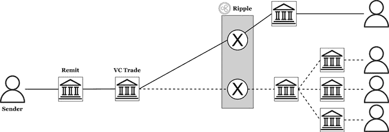

**图 17.4 Ripple 转账系统。返回正文。⏎**

国际支付的效率对交易者具有重要意义。在竞争激烈的国际市场中，汇率波动极大影响交易运营。国际企业通过缩短结算时间来加速资金周转，同时降低长期资本占用相关的汇率风险，为市场繁荣做出了贡献。

### 17.4.2 国际支付系统的成本比较

传统的国际支付系统在印度非常复杂，交易成本也相当高。印度银行对汇款收取约 `INR 500` 到 `INR 1,500` 不等的费用，并收取电信费等额外费用。例如，`SBI` 或 `HDFC Bank` 根据汇款金额收取交易费，取决于交易规模和目的地。随后，每笔汇款的总成本落在 `INR 800` 到 `INR 2,000` 之间。

区块链技术具有显著简化国际支付流程的潜力，通过降低支付成本并为交易者节省手续费。麦肯锡的一份报告评估了区块链技术在国际支付中的引入。它将全球交易成本从每笔近 `$26` 降至每笔 `$15`，在国际支付系统采用 Ripple 区块链技术后，双方节省了约 42% 的金额。印度一家知名银行将每笔交易的费用从 `INR 400` 降至低至 `INR 50`。这项技术为用户节省了高达 87.5% 的费用，极大地减少了支付成本。

此外，传统的国际支付系统需要信赖的中央银行来促进不同银行之间的支付和结算。它们还需要维护单独的保证金账户以最小化交易风险。由于旧的支付方式，大量资金会被占用一段时间，随后由于资金利用率低，外贸增长受到不利影响。这种新方法特别惠及了中小企业。然而，像 `Ripple` 等平台通过实现实时支付，消除了区块链的国际支付系统中对中间银行的需求。这种方法只需要一个保证金账户，显著减少了资金占用并提高了资金利用率。

### 17.4.3 增强国际交易的安全性和信任

区块链技术的固有特性确保了国际支付的安全性、透明度并降低了相关风险。基于区块链的支付方法采用“推”模式，这意味着当用户向商家发送付款时，不需要提供个人信息或银行账户。相反，系统使用安全的哈希函数将加密信息的哈希值发送给商家。由于哈希函数的单向性，个人信息得到保护且不会泄露。此外，`Ripple` 采用匿名交易，为用户提供了额外的隐私保护。

相比之下，传统的支付系统采用需要实名交易的中心化“拉”模式。为了完成交易，用户必须向商家提供个人信息和银行账户。商家利用这些信息提现。因此，商家积累了大量的用户数据，如银行账户和其他个人交易详情。这些隐私信息容易被商家泄露或出售，还面临被犯罪分子窃取的风险，导致用户遭受损失。因此，采用基于区块链的支付系统可以增强用户隐私并提高在线交易的安全性。

此外，传统的国际支付由于依赖商业信用而存在巨大风险。进出口双方必须自行管理贸易风险。主要的挑战之一是确保进口方的付款和出口方的货运信息准确可靠。一旦进口方汇出资金，他们无法跟踪或控制支付过程中的中间环节，也无法看到出口方的运输状态。交易双方完全依靠商业信用进行交易，这让他们容易受到商业欺诈。即使没有欺诈，糟糕的经营行为或市场波动也可能产生恶意，加剧这些风险并导致交易者遭受损失。这些问题可能会损害国际贸易的信任并严重阻碍其增长。

区块链技术可以缓解国际支付中的这些贸易风险。交易参与者不需要中间机构的背书。相反，他们将交易合同信息上传到区块链，由贸易中的所有方共同维护交易详情并验证其一致性。如果一方不确认交易信息，该交易将无效。一旦进口方和出口方验证了交易信息，区块链系统即可实现自动支付。

支付流程始于进口商根据合同向出口商支付预付款。随后，出口商通过物流公司运送货物。物流公司在核实货物信息后，将运单上传至区块链网络。一旦进口商在区块链上确认了交易细节，剩余余额将得到结算。因此，基于区块链的国际支付可以有效解决信任危机、降低支付风险、节省时间、加速企业资金回笼，并促进国际贸易的快速可持续发展。

## 17.5 区块链实施的挑战与建议

在国际支付结算中实施区块链技术的主要障碍是其核心技术的固有局限性。仍有许多重大挑战需要解决，包括能耗、信用问题、加密算法的安全性、区块容量以及漫长的交易确认时间。这些技术障碍阻碍了区块链解决方案的更广泛采用。作为一个主要的贸易大国，我国必须加强在区块链核心技术自主研发方面的投入。金融科技公司应特别关注国内外相关行业的研究成果，投入更多的人力和财力资源，积极开发国际支付中的区块链关键技术和业务模式。这种积极的方法将使我们能够建立技术储备，并确立我们在技术时代的领先地位。

区块链的去中心化本质与当前的集权金融模式形成了鲜明对比。因此，我们将区块链技术引入国际支付体系时，建立相应的监管框架是至关重要的。众所周知，没有哪个国家或机构可以独立地监管区块链技术。因此，全球所有的金融机构和监管机构必须共同努力，制定一套适用于全球贸易结算的区块链监管策略。这项技术应当在监管、创新和实际应用之间取得平衡。

为了建立基于区块链的国际支付体系，我们需要借鉴英国的监管沙盒机制。它允许在不同领域开展试点项目。例如，选择自由贸易区内的交易结算银行进行区块链试点运行，可以提供宝贵的信息。这种方法让研究人员或开发者在进行规模实施之前，完善技术和监管政策。

区块链技术本质上是跨学科的，需要数学、计算机科学、网络安全、通信工程和金融领域的专业知识。然而，印度目前缺乏更多具备这种复合技能的高端人才。为了弥补这一空白，印度的领先大学正在其数学、计算机科学或网络安全课程中引入专业的区块链课程。建议聘请来自不同机构的国内外知名区块链专家来支持人才培养。此外，与金融科技公司合作有助于为区块链专家参与国际业务交易做好准备。

此外，有必要在行业指南中建立统一的体系，以便在国际贸易交易中实施区块链技术。

这些标准的建立促进了企业之间的健康竞争，提高了客户的满意度。它增强了金融市场的有效性，并降低了潜在的应用风险。此外，统一的行业标准对于监控市场和制定更好的政策也是必要的。为此，各国和金融机构应在区块链术语、编码、技术开发以及产品服务的标准化等基本方面达成共识。

## 17.6 结论

区块链具有增强国际支付处理能力和降低效率的潜力。区块链作为一种去中心化的可信系统存在，其结果是交易成本、处理时间和金融交易安全性的降低。区块链利用密码学来保护用户隐私并降低数据泄露和欺诈的风险。此外，区块链具有透明且不可篡改性；因此，所有交易都是安全且可追踪的。这同时也增加了对国际支付系统的信任，在考虑国际贸易和全球电子商务时非常重要，因为银行和支付系统必须提供快速安全的支付。然而，仍然需要更多的研究、合作和投资才能充分释放区块链在国际支付系统中的真正力量。区块链领域的可扩展性和安全性问题必须通过政府、其他金融机构及技术公司之间的合作来解决，以满足全球金融需求。这是一个技术挑战，需要解决能源效率、合规性问题，并愿意通过创新来推动区块链在国际支付中更广泛、更全球化的应用。但事实证明，区块链不仅仅是一场技术变革。它是国际支付未来后的强大力量，以更低的成本为世界金融系统带来更高的效率和安全性。

## 参考文献

1. N. Singh, H. P. Singh, A. Mishra, A. Khare, M. Swarnkar, and S. K. Almas. Blockchain cloud computing: Comparative study on DDoS, MITM and SQL injection attack. In 2024 IEEE International Conference on Big Data & Machine Learning (ICBDML), Bhopal, India, pp. 73–78, 2024. `https://doi.org/10.1109/ICBDML60909.2024.10577412`. 返回正文。⏎

2. Whenan Wang, Linkai Zhu, and Shiyang Song. A study on privacy protection technology for cross-border transactions based on blockchain technology. In Sixth International Conference on Computer Information Science and Application Technology (CISAT 2023), vol. 12800, pp. 567–572, 2023. 返回正文。⏎

3. R. S. Veena, G. Khambra, R. Sayal, N. Singh, et al. An energy efficient IPv6 packet delivery outline for industrial IoT over G.9959 protocol based Wireless Sensor Network (WSN). SN Computer Science, 5:813, 2024. `https://doi.org/10.1007/s42979-024-03195-4`. 返回正文。⏎

4. R. K. Dewang, M. P. Yadav, S. Awasthi, O. Raj, Arvind Mewada, and K. L. Bawankule. Data secure application: an application that allows developers to store user data securely using blockchain and IPFS. Multimedia Tools and Applications, 83(15):45491–45517, 2024. 返回正文。⏎

5. Michael Crosby, Pradan Pattanayak, Sanjeev Verma, Vignesh Kalyanaraman, et al. Blockchain technology: Beyond bitcoin. Applied Innovation, 2(6–10):71, 2016. 返回正文。⏎

6. Nagendra Singh and Yogendra Kumar. Security and privacy requirements in 5G healthcare. In Block Chain for 5G Healthcare Applications, pp. 1–30, Nov 2021. IET Publication. `https://doi.org/10.1049/PBHE035E_ch1`. 返回正文。⏎

7. Kratika Narain, and G. Doctor. 印度基于区块链的政府服务探索。收于 Sanjay Vyas, Vipin Kumar Shukla, Sanjay Gupta, Amit Prasad (编)，《区块链技术：机遇、挑战与应用》，pp. 127–144. 佛里达州 Boca 市：CRC Press, 2022。返回文本。

8. Ajay Kumar Bharti, Anil Kumar, Pankaj Chauhan, Pradeep Jain. 印度采用区块链技术的新兴领域及面临的挑战研究。收于 2019 年第 2 届女性技术学院电气与计算机工程会议 (WITCON ECE)，pp. 146–153. IEEE, 2019。返回文本。

9. Amarpreet Singh Virdi and Akansha Mer. 金融科技与银行：印度视角。收于 Nader Naifar & Ahmed Elsayed (编)，《绿色金融工具、金融科技与投资策略：后疫情时代的可持续投资组合管理》，瑞士沙姆：Springer, 2023，pp. 261–281。返回文本。

10. David Chaum. 用于不可追踪支付的盲签名。收于 David Chaum, Ronald L. Rivest, and Alan T. Sherman, 编，《密码学进展》，pp. 199–203. Springer US, 1983。返回文本。

11. Stuart Haber and W. Scott Stornetta. 如何为数字文件时间戳。Springer, 1991。返回文本。

12. Hal Finney. RPOW 可重用工作证明。2004。[`nakamotoinstitute.org/finney/rpow/`](https://nakamotoinstitute.org/finney/rpow/)。返回文本。

13. Nirupama Devi Bhaskar and David Lee Kuo Chuen. 比特币交易所。收于《数字货币手册：比特币、创新、金融工具与大数据》，pp. 537–551。荷兰阿姆斯特丹：Elsevier, 2024。返回文本。

14. Vitalik Buterin. 下一代智能合约和去中心化应用平台。白皮书 3(37), 2014。返回文本。

## 参考文献

15. M. Swan. 去中心化金融：区块链、预测与估值。《经济学人：颠覆性的金融》，纽约 2016。返回文本。

16. Aarti Patki and Vinod Sople. 印度银行业：区块链实施、挑战与未来之路。《银行与金融技术杂志》，4(1):65–73, 2020。返回文本。

17. Wei Xuan Zhang. 金融领域区块链技术的现状与趋势。《移动信息系统》，2022(1):7908625, 2022。返回文本。

18. Qing Deng. 区块链技术在跨境支付的应用分析。收于 第 5 次金融创新与经济发展国际会议 (ICFIED 2020)，pp. 287–295。Atlantis Press, 2020。返回文本。

19. Taketoshi Mori. 金融科技：区块链与证券结算。《证券运营与托管杂志》，8(3):208–227, 2016。返回文本。

20. Xiang Hong Li. 基于区块链的跨境电子商务支付模型。收于 2021 年第 2 次电子商务与互联网技术国际会议 (ECIT)，pp. 67–73。中国杭州。IEEE, 2021。

21. Xiang-Dong Shen, Xi Chen, Ran Ji, and Ren-Hong Wu. 韩、中、日跨境电子商务的新生态系统基于区块链。《韩国贸易杂志》，24(5):87–105, 2020。返回文本。

22. Avishek Roy, Md Ahsan Habib, Shahid Hasan, and Abu Taher Md Shifat. 一种基于联盟链区块链的确保审计性的可扩展跨境支付系统。收于 第 6 次电气信息与通信国际会议 (EICT), IEEE, 2023。返回文本。

23. Qing Deng. 区块链技术在跨境支付的应用分析。收于 第 5 次金融创新与经济发展国际会议论文集 (ICFIED 2020)，pp. 287–295。Atlantis Press, 2020。ISBN 978-94-6252923-6。[`doi.org/10.2991/aebmr.k.200306.050`](https://doi.org/10.2991/aebmr.k.200306.050)。返回文本。

## 18. 微电网能源交易的区块链驱动解决方案

Mohd Bilal, Ahsan Waseem, Salman Hameed, Zenab Elgamal. DOI: [`10.2991/aebmr.k.200306.050`](https://doi.org/10.2991/aebmr.k.200306.050)

## 18.1 引言

全球需求的增长与城市化直接成正比。传统能源系统使用化石燃料，会导致温室气体排放。电厂远离利用区，导致了传输损耗，使得系统效率降低。

气候变化和如《巴黎协定》等国际协议强调了开发更多基于可再生能源的系统。可再生能源具有间歇性，其整合是一个主要关注的问题。基于可再生能源的发电取决于地理位置、风速、生物质燃料的可用性和太阳辐射。将这些发电单元有效整合到电网中是一项挑战。从微电网到电网的安全能源交易也是一项挑战。这正是去中心化的微电网是解决快速增长的需求并纳入可再生能源的解决方案。在去中心化系统中，使用了太阳能光伏 (PV)、风力涡电机、生物气发电厂、水电系统等各种能源，以及电池、超级电容器和燃料电池。这些系统产生的能量在本地利用，减少了对集中系统的依赖。微电网可以并网运行，也可以独立运行。当某地的电力供应成本极高或能源韧性至关重要（如自然灾害或电网故障）时，独立微电网变得非常重要。当主电网故障时，微电网可以将电网变成岛。微电网的自给自足提供了能源安全，以确保紧急情况下供应不中断。

微电网使用了先进控制系统，允许实时监控和优化能量流，并发电量匹配电力负载需求模式。当可再生能源不足以满足负载需求时，储能设备必须提供满足缺口所需的能量。反之，当发电量超过本地消费时，并网微电网可以将多余电力回馈给大网，有助于提高整体电网的稳定性和效率。

为了充分理解微电网的技术方面，将其核心组件进行分解是重要的。

### 18.1.1 发电单元

这些包括太阳能电池板、风力涡电机等可再生能源，有时为了可靠性使用化石燃料或生物燃料的备用发电机。在微电网中包含多样化的能源允许在可再生能源出现停机时也能持续发电。

### 18.1.2 储能系统

电池是微电网中最常见的储能形式，它允许在发电高峰期（例如白天的太阳能发电）产生的剩余能量被存储起来，并在发电低谷或需求较高时后续使用。锂离子电池和新兴的储能系统（例如固态电池和流体电池）增强了储能解决方案的容量和耐用性。

### 18.1.3 电力分配与管理

微电网发电并存储的能量必须得到有效分配。这是通过复杂的控制系统实现的，该系统监控能量流、确保可靠性并平衡供需。电力电子变流器用于光伏系统中的 AC–DC 转换，以及电池的 AC 负载转换。图 18.1 展示了基于区块链技术的微电网能量交易。

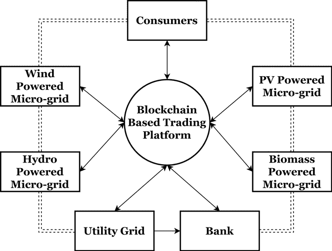

图 18.1 基于区块链的微电网能量交易。返回文本。⏎

在微电网中使用基于点对点（P2P）的能量交易是革命性的。传统消费者从公用电网购买电力，电网从化石燃料发电厂获取电力。产生剩余能量并卖回电网的消费者是“产消费者”，因为他们既消费又生产电力。去中心化的能量交易可以带来更动态、高效的市场。它将优化局部能源，并促进基于再生能源的发电，这种方式对环保。

区块链提供了安全、透明且去中心化的账本；产消费者之间的能量交易可以在没有任何中间环节的情况下进行。`Smart contracts`是自动执行的合同，其条款直接写入代码中。当满足预定义的条件时，它们会自动处理能量交易。`Smart contracts`为参与者提供了无缝且低成本的交易，减少了对传统公用电网运营商的依赖。

微电网 P2P 能量交易的一个良好示例是纽约的布鲁克林微电网。该项目引起了国际关注，因为它使用了一种创新的系统，允许当地居民通过区块链相互购买剩余的太阳能。在屋顶安装了光伏系统的人可以将剩余电力卖给其他公民，而无需电力公用公司的参与。布鲁克林微电网开发了一个组织良好的多玩家能源市场，使纽约市许多社区能够接入其能源消耗，并帮助减少碳足迹。

除了布鲁克林微电网，还有其他成功的早期实施，包括澳大利亚的 `Power Ledger`。这些系统促进了再生能源的产生和利用，减少了发电的中心化程度，从而降低了传统发电和输电的低效率以及支出。

尽管如此，许多研究承认，微电网的公用级集成并非没有问题。首先，安装可再生发电设备（如太阳能/暖、通风和空调 HVAC 板板、风力机和储能系统设备）具有高昂的固定成本。然而，这些技术在近期有所下降；基础设施、控制系统和定期维护的初始成本仍可能累加，形成重大的成本负担，通常对发展中地区或小型社区而言。

政府补贴、公私合作伙伴关系（PPP）以及如能源即服务平台等新创新概念已缓解了部分财务成本。然而，要实现微电网的广泛普及，需要进一步降低微电网技术的价格，并提高对可用融资方案的认识。

其次，存在地理和环境因素等障碍。某些地区可能更有再生能源的生产。例如，靠近海岸的地区可能记录到高风速，因此适合风力发电机。同时，山区或森林茂密的地区严重缺乏直接阳光，使得太阳能电池板适用。在这种情况下，必须进行可行性研究，以确定特定地点更合适的发电方法。

此外，使用连接到传统集中电网的微电网可能会引发法律和政策问题。公用公司和电网运营商利用去中心化系统的速度通常缓慢，因为这威胁了他们目前的模式。日益需要监管变革，以允许新的能量交易方法来适应微电网和 P2P 交易平台。

另一个挑战是技术因素：微电网技术的复杂性以及运行和支持微电网所需的专业知识。微电网运营商必须具备充分的技术背景来监控电力的实时调度、充电和电网同步。例如，沿海地区可能经历高风速，使风力发电机成为理想选择，但山区或森林地区的光照有限，阻碍了太阳能电池板的效率。在这种情况下，必须进行现场评估以确定最佳的发电方案。

微电网与现有的集中电网集成可能会带来监管和政策挑战。公用公司和电网运营商往往不愿接受去中心化能源系统，因为它们破坏了传统的业务模式。必须更新监管框架以鼓励创新并适应新的能量交易模型，使微电网和 P2P 交易平台蓬勃发展。

微电网面临某些挑战，尽管这些损害了目前和近期的前景，但这些系统的未来极其光亮。随着再生能源技术成本降低以及气候变化问题广为人知，微电网可能会成为未来电力系统的主要基础设施之一。微电网提供局部的发电和消费，是传统集中系统的一种可持续且低脆弱性的选择。微电网提供了额外优势，包括减少温室气体排放、减少传输损耗和改善空气质量，符合全球应对气候变化的目标。此外，微电网可以为能源短缺的农村或其他地区提供新的投资机会和收入来源，从而刺激当地的能源生产和商业。

本章剩余部分安排如下：[18.2](#C_025_c18.xhtml#h18_2) 描述 P2P 能量交易，[18.3](#C_025_c18.xhtml#h18_3) 介绍区块链技术的工作原理，[18.4](#C_025_c18.xhtml#h18_4) 探索通过加密货币支持能量交易推进可持续性，[18.5](#C_025_c18.xhtml#h18_5) 总结本章。

区块链是另一种随着`bitcoins`等货币的流行而备受关注的技术，其固有的特性非常适合能源市场。区块链是一种分布式数据库框架，能够在没有中介的情况下建立安全且透明的数字交易。它在能源市场中也同样重要，在那里公用公司或电网运营商等中介控制着电力和资金的流动。

在去中心化的能源系统中，区块链可以为通过`P2P`进行能源交易提供平台，产销者（即生产者也是消费者）可以轻松地与消费者交易剩余电量。`Smart contracts`具有程序化且自动执行的条款，能够完成这些交易，实现能量的实时传输和支付。最后，由于区块链的去中心化本质，能源交易得到了保护并保持了透明性。交易数据的不可改性通过`cryptographic hashing`和`consensus protocols`确保免受篡改。然而，通过减少中介，区块链能够最大限度地降低交易折扣成本，并优化能源交易的运营方面。

### 18.2.2 智能合约在能源市场中的作用

区块链技术在能源交易中最重要的重要元素之一是`smart contracts`。这些智能合约一旦满足特定的预设条件，就会自动计算或约定执行。例如，`smart contract`可以出售产销者太阳能电池板产生的额外电力，并在电池充满后将其存储在其中。同样，例如，当价格跌到某一水平以下时，消费者可以使用`smart contract`向他们售卖电力。`Smart contracts`消除了能源交易中对人工干预的需求，使得交易更高效且更不容易出错。此外，由于`smart contracts`是自动执行的，它们减少了双方之间的潜在争议，因为`blockchain`会自动强制执行合约条款。这种自动化可以大幅减少与能源交易相关的运营成本。[表 18.1] 总结了微电网能源交易的关键方面以及区块链技术的作用，突显了其优势（例如去中心化、降低成本）和挑战（例如可扩展性、监管障碍）。

**表 18.1 微电网能源交易的关键方面以及区块链技术的作用** 返回文本。⏎

| 方面 | 描述 | 应用 | 局限性 | 特性 |
| :--- | :--- | :--- | :--- | :--- |
| 去中心化 | 微电网在本地、独立运行或与主电网连接。 | 本地能源发电和消费。 | 与中央电网的协调可能复杂。 | 减少对中央公用事业依赖。 |
| 本地发电 | 使用太阳能和风能等本地可再生能源。 | 降低传输损耗并增强能源自主性。 | 可再生能源生产的波动性 | 促进可持续能源实践 |
| 灵活性与韧性 | 适应能源需求和条件的变化。 | 增强电网可靠性和响应 | 需要稳健的基础设施 | 适应不断扩大的电网网络 |
| 点对点交易 | 无中介的直接交易。 | 个性化能源交易 | 潜在的性 | 赋能本地能源市场 |
| 安全交易 | 区块链提供不可篡改的账本。 | 确保安全性和透明度 | 潜在的消耗 | 减少欺诈 |
| 智能合约 | 写入代码的自动执行合约。 | 自动化能源协议 | 设计和管理的复杂性 | 减少管理开销 |
| 透明度与信任 | 不可变的记录增强了透明度。 | 构建参与者之间的信任 | 需要全面的数据 | 提供可审计的交易环境 |
| 高效结算 | 实时交易结算。 | 改善现金流和效率 | 对区块链性的依赖 | 加速流动性 |
| 降低成本 | 通过消除中介降低交易费用。 | 减少总体成本 | 初期实施和集成 | 使能源交易具有经济可行性 |
| 增强的可扩展性 | 区块链支持随网络增长的可扩展系统。 | 处理增加的交易量 | | |

### 18.2.3 能源代币化与加密货币的出现

代币化是区块链在能源交易方面的重要部分之一。它将物理能量（如`Kilowatt-hours`）转换为数字代币，用于交易。这些代币代表一定数量的电力，用户可以在去中心化市场中进行交换。它能够创建特定于能源的加密货币，用于能源交易。

`Power Ledger`及主要创新使用户可以在不使用传统交易所技术的情况下买卖能源代币。这些能源代币也可以在全球范围内存储或传输，允许用户进行跨国能源交易。

此外，代币化为个人和企业提供了新的投资机会。通过购买能源代币，投资者可以有效为可再生能源项目提供资金，并从这些项目未来产生的能源销售中获益。这促进了可再生能源的扩张，并使能源投资变得民主化，让普通消费者也能参与能源市场。

### 18.2.4 货币挖掘与能源消耗

虽然区块链技术为能源市场带来了许多益处，但承认某些挑战也是重要的，特别是加密货币挖掘的能源密集型本质。挖掘是验证并将新交易添加到`blockchain`的过程。在`Bitcoin`等网络中，挖掘涉及解决复杂的数学问题，这一过程被称为`proof-of-work`，它需要大量的计算能力，随之产生的是大量的电力。

`proof-of-work`挖掘的高能消耗引发了人们对区块链技术环境影响的担忧。以`Bitcoin`为例，仅过去几年的消耗就超过了某些小国家，导致了人们的批评，认为加密货币挖掘增加了全球能源需求而不是减少了它。

由于区块链是一项领先技术，并有助于探索更高效能的共识机制以解决相关问题，权益证明（Proof-of-Stake）是其中一种机制，它通过让用户“质押”部分加密货币资产来确认交易，显著降低了能量消耗，而不是依赖于高能耗消耗。以太坊为第二大区块链平台最近已转向权益证明模型，能耗降低了 99% 以上。

此外，一些区块链项目甚至在探索“绿色挖矿”理念，使用可再生能源运行其挖矿操作。这些项目通过利用太阳能、风能或水电结合矿矿基础设施，将区块链的可持续性与更广泛的可持续目标、安全性和隐私相结合，从而减少加密货币挖矿对环境的影响。

区块链技术在能源市场的核心优势之一是它提供了更高的安全性——现有的能源系统将交易记录存储在中心化的数据库和服务器中，这些容易受到黑客攻击和破解。然而，区块链的分布式账本将交易数据的存储去化到不同的节点上，消除了任何单点故障风险。由于由于，基于区块链的能源市场从本质上更安全。

此外，区块链采用最先进的密码学来保护数据，使所有交易都经过加密并可供人工验证。这维护了能源交易过程的完整性，并帮助用户提高隐私性。在传统能源市场中，客户数据通常是中心化的，许多参与者都可以访问这些数据，为可能的未经授权的数据访问打开了大门。区块链提供了一种方法，让用户对自己的数据拥有更多的所有权控制权：只有持有正确加密密钥的人才能访问信息。

### 18.2.5 在推动能源市场透明化的作用

区块链在能源市场中的另一个重要方面是透明度。关于发电、分配和定价的信息存在于孤岛中，并由传统能源系统的中心化实体控制；因此，消费者难以获取实时准确信息。这种不透明性引发了价格操纵和价格失灵，并在能源市场中造成了信任差距。区块链的本质是去中心化的，这意味着所有参与者同时拥有相同的信息。这种透明度允许消费者就能源消耗和购买做出明智决策。例如，消费者可以观察他们所用电力的来源（是来自可再生能源还是化石能源）以及实时电价。

## 18.3 在微网能源交易中使用区块链

区块链技术深刻地影响了能源市场的运行。在最基本的形式下，区块链是一种去中心化的账本，它在多台计算机上公开且安全地记录交易。将此应用于能源交易，区块链促进了产销者与消费者之间的电力直接交换，消除了公用公司等中间商。区块链能源市场中的每笔交易都记录在分布式账本上，对所有方开放。这种透明度使得所有方能够相信交易是正确完成的并受到加密哈希的保护，使其变得不可更改且防篡改。智能合约是区块链的重要部分；例如，如果产销者有多余电力，而另一个消费者需要能量，智能合约可以在满足条件时自动促进交易。

#### 18.3.2 点对点交易

P2P 能源交易是一种创新模型，个人通过区块链直接交换电力，绕过公用公司。几个基于区块链的平台先驱了 P2P 交易。这些平台允许产销者在邻里之间将其剩余能量变现。

**表 18.2 能源交易与可持续性中的区块链技术**

| 技术名称 | 应用场景 | 局限性 | 独特之处 |
| :--- | :--- | :--- | :--- |
| Power Ledger | 微网 P2P 能源交易平台，允许产销者交易剩余的可再生能源。 | 某些地区的监管障碍以及由于区块链使用的扩展性问题。 | 基于智能合约的自动交易。 |
| Brooklyn Microgrid | 利用区块链进行邻里本地能源交易的社区微网。 | 限于小型社区；扩展面临挑战。 | 能源独立促进了可再生能源的采用。 |
| Grid+ | 去中心化自治（DeA）能源市场为微网参与者提供实时能源定价和交易。 | 区块链网络成本相对较高。 | 实时能源定价；微网内能源利用高效。 |
| WePower | 连接绿色能源生产者与消费者的可再生能源交易平台。 | 与传统电网集成复杂；在某些地区采用可能更快。 | 能源代币化增加了流动性和可访问性。 |
| SunContract | P2P 能源市场，允许用户使用区块链买卖可再生能源。 | 取决于国家的监管框架和政策。 | 可再生生产者与消费者之间的直接连接。 |
| Electrify | 促进微网内分布式能源资源之间的交易。 | 有限的试点项目需要更广泛的国家电网集成。 | 通过区块链实现能源定价竞争；适用于多种能源。 |

| TransActive Grid | 专注于微网本地能源共享的区块链能源平台。 | 需要智能电表等先进基础设施才能实现完整功能。 | 实时能源分配和交易；社区驱动的可持续性模型。 |
| --- | --- | --- | --- |
| Energy Web Chain | 用于加速低碳能源转型和去中心化交易的开源区块链平台。 | 区块链操作对计算能力要求高。 | 专为能源领域设计，重点关注合规性和去碳化。 |
| Share&Charge | 利用区块链技术实现微网内电动汽车充电的能量 P2P 交易。 | 受限于与电动汽车相关的基础设施；仍处于新兴阶段。 | 促进电动汽车与可再生微网的整合。 |
| LO3 Energy | 开发用于社区微网去中心化能源交换的区块链平台。 | 处于开发早期；在大电网的可扩展性面临挑战。 | 社区驱动的能源交易；对能源进行去中心化控制。 |

## 18.4 通过加密货币支持的能源交易推进可持续发展

由区块链、大数据和人工智能驱动的加密货币支持交易，代表了一种实现可持续性的革命性方法。它促进了客户之间（即生产和使用太阳能、风能等替代能源的组织）剩余可再生能源的交易。可再生能源的采用鼓励减少对化石燃料的依赖，并减少 `CO[2]` 排放。实时能源交易改善了可再生能源的整合和质量，减少了能源浪费并提高了电网效率。来自印度和非洲的案例研究强调了基于区块链的微网在提供电力、减少碳足迹和促进欠发达地区经济增长方面的影响。此外，绿色挖矿策略和去中心化区块链系统平衡了能源的生产与消费，并鼓励能源利用，使我们的环境和周围强化了加密货币在可持续发展中的作用。表 18.3 描述了加密货币支持的能源交易对环境的影响。

### 表 18.3 加密货币支持的能源交易的环境影响

| 方面 | 描述 | 对可持续性的影响 |
| --- | --- | --- |
| 减少碳排放 | 促进可再生能源的使用，减少对化石燃料的依赖。 | 减少温室气体排放和碳足迹。 |
| 能源整合 | 通过实时交易优化可再生能源的使用。 | 提高可再生能源的使用效率。 |
| 能源生产去中心化 | 鼓励本地化能源生产和消费。 | 减少对中心化化石燃料发电的需求。 |
| 能源获取（非洲） | 非洲基于区块链的系统支持可再生能源采用和本地交易。 | 促进当地经济发展和可持续性。 |
| 绿色挖矿 | 利用可再生能源进行加密货币挖矿以减少对环境的影响。 | 降低矿操作的碳足迹。 |

## 18.5 结论

在本章中，我们回顾了关于区块链在微网去中心化能源交易中应用的大量文献。研究了区块链如何允许 P2P 能源交易，通过智能合约提高交易的透明度、效率和自动化。这强调了区块链在可再生能源整合中的作用，提供了电网灵活性分布式能源自主性。它还探索了分时定价以及在微网层面整合波动性可再生能源资源的优势。

它还指出了主要问题，例如区块链网络的可扩展性、传统共识机制的能耗以及监管的复杂性。通过对这些主题进行批判性审查，强调了对更高效的区块链模型的需求，并欢迎建立允许去中心化交易的监管框架。这项工作为未来研究奠定了基础，以研究人工智能和物联网与区块链相结合，以优化微网系统并演进可持续性和能源市场。

## 参考文献

1. Y.-C. Tsao and V.-V. Thanh, “Toward blockchain-based renewable energy microgrid design considering default risk and demand uncertainty,” `Renew. Energy`, vol. 163, pp. 870–881, 2021, doi: [10.1016/j.renene.2020.09.016](https://doi.org/10.1016/j.renene.2020.09.016).

2. K. Zhang, J. Yu, C. Lin, and J. Ning, “Blockchain-based access control for dynamic device management in microgrid,” `Peer-to-Peer Netw. Appl.`, vol. 15, no. 3, pp. 1653–1668, 2022, doi: [10.1007/s12083-022-01316-5](https://doi.org/10.1007/s12083-022-01316-5).

3. M. Bilal, A. A. Algethami, Imdadullah, and S. Hameed, “Review of computational intelligence approaches for microgrid energy management,” `IEEE Access`, vol. 12, pp. 123294–123321, 2024, doi: [10.1109/access.2024.3440885](https://doi.org/10.1109/access.2024.3440885).

4. S. Seven, G. Yao, A. Sen, and M. Muyeen, “Peer-to-peer energy trading in virtual plant based on smart contracts,” `IEEE Access`, vol. 8, pp. 17571–17526, 2020.

5. R. Rai, M. Mewada, A. Ansari, and D. Kumar, “Optimizing wireless sensor networks: Dynamic load balancing with blockchain,” In `2024 3rd International Conference on Power Energy and.`, 2024, pp. 350–355.

6. A. Waseem, M. Bilal, N. Danish, and S. Hameed, “Revolutionizing Rural Development: Blockchain-Powered Microgrid,” In `2024 3rd International Conference on Power Energy`, 2024.

7. M. Sakib, S. Mustajab, K. Anwar, and M. Alam, “BiLSTM based energy demand forecasting and synchronization among smart grids,” In `2024 IEEE International Conference on Power Electronics Control and Energy Systems`, Delhi, India, 2024, pp. 969–974.

8. R. S. Veena, G. Khambra, R. Sayal, and N. Singh, “An energy efficient IPv6 packet delivery outline for industrial IoT,” `SN Comput. Sci.`, vol. 5, p. 813, 2024.

9. Y. Wu, Y. Wu, H. Cimen, J. C. Vasquez, and J. M. Guerrero, “P2P energy trading: Blockchain-enabled P2P energy society with multi-scale flexibility,” `Energy Rep.`, vol. 8, pp. 3614–3628, 2022.

10. N. Singh, H. P. Singh, A. Mishra, A. Khare, M. Swarnkar, and S. K. Almas, “Blockchain cloud computing: Comparative study on DDoS, MITM and SQL injection attack,” In `2024 IEEE International Conference on Big Data & Machine Learning (ICBDML)`, Bhopal, India, 2024, pp. 73–78.

11. X. Wang, F. Yao, and F. Wen, “区块链技术在现代电力系统中的应用：简述,” `Energies`, vol. 15, no. 13, p. 4516, 2022, doi: [10.3390/en15134516](https://doi.org/10.3390/en15134516). 返回正文。

12. I. A. Umoren, S. S. A. Jaffary, M. Z. Shakir, K. Katzis, and H. Ahmadi, “电动车辆微微网中基于区块链的能量交易,” `IEEE Consum. Electron. Mag.`, vol. 9, no. 6, pp. 66–71, 2020, doi: [10.1109/MCE.2020.2988904](https://doi.org/10.1109/MCE.2020.2988904). 返回正文。

13. D. Han, C. Zhang, J. Ping, and Z. Yan, “基于区块链的去中心化能量交易与智能合约架构,” `Energy`, vol. 199, p. 117417, 2020, doi: [10.1016/j.energy.2020.117417](https://doi.org/10.1016/j.energy.2020.117417). 返回正文。

14. N. Singh, T. Chakrabarti, P. Chakrabarti, V. Panchenko, D. Budnikov, I. Yudaev, and V. Bolshev, “热电联产经济负荷调度的启发式优化技术方案分析,” `Appl. Sci.`, vol 13, no. 18, p. 10380, 2023, doi: [10.3390/app131810380](https://doi.org/10.3390/app131810380). 返回正文。

15. Z. Guan, X. Lu, W. Yang, L. Wu, N. Wang, and Z. Zhang, “智能电网中基于区块链和 ABE 的高效隐私保护能量交易,” `J. Parallel Distrib. Comput.`, vol. 147, pp. 34–45, 2021, doi: [10.1016/j.jpdc.2020.08.012](https://doi.org/10.1016/j.jpdc.2020.08.012). 返回正文。

16. O. Marin, T. Cioara, and I. Anghel, “使用多代标准的建筑多能交易区块链解决方案,” `Futur. Internet`, vol. 15, no. 5, p. 177, 2023, doi: [10.3390/fi1505177](https://doi.org/10.3390/fi1505177). 返回正文。

17. M. R. Islam, M. Rashid, M. A. Rahman, M. H. S, and A. Binong, “基于区块链的加密货币挖掘对能量消耗的综合分析,” `Int. J. Adv. Comput. Sci. Appl.`, vol. 13, no. 4, pp. 590–598, 2022, doi: [10.14569/IJACSA.2022.013069](https://doi.org/10.14569/IJACSA.2022.013069). 返回正文。

18. V. Sondhiya, K. Dwivedi, S. Almas, and N. Singh, “通过物联网环境的深度学习进行微电网能量,” In Nagendra Singh, Sitendra Tamrak, Arvind Mewada, and Sanjeev Kumar (Eds.), 电系统运行与分析中的人工智能, Boca Raton, Florida: Auerbach Publications, Taylor, 2023. 返回正文。

19. R. Alt and E. Wende, “能源市场中的区块链技术——与《欧洲能源》的采访,” `Electron. Mark.`, vol. 30, no. 2, pp. 325–330, 2020, doi: [10.1007/s12525-020-00423-6](https://doi.org/10.1007/s12525-020-00423-6). 返回正文。

20. S. Shukla, D. Pandey, and N. Singh, “用于可再生能源的高升压直流转交流变换器电网连接,” In Gulshan Sharma, Pitshou, Sudeep Tanwar (Eds.), 能源 4.0 趋势、挑战与应用, Boca Raton, Florida: CRC Press, 2024. 返回正文。

21. G. van Leeuwen, T. AlSkaif, M. Gibescu, and W. van Sark, “用于微电网社区的双边交易的集成基于区块链能量管理平台,” `Appl. Energy`, vol. 263, p. 114613, 2020, doi: [10.1016/j.apenergy.2020.114613](https://doi.org/10.1016/j.apenergy.2020.114613). 返回正文。

22. N. Singh, A. Mishra, M. Gupta, K. Dwivedi, and M. Swarnkar, “满足农村电气化负载需求的微电网实施,” In `2023 第三届能源、电力与电气国际会议（EPEE）`, 武汉, 中国, 2023, pp. 1058–1061, doi: [10.1109/EPEE59859.2023.10351810](https://doi.org/10.1109/EPEE59859.2023.10351810). 返回正文。

23. H. T. Doan, J. Cho, and D. Kim, “智能电网中通过区块链的点对点能量交易：一种基于双向拍卖的博弈方法,” `IEEE Access`, vol. 9, 2021, doi: [10.1109/ACCESS.2021.306873](https://doi.org/10.1109/ACCESS.2021.306873). 返回正文。

24. E. Mengelkamp, J. Gärttner, K. Rock, L. Orsini, and C. Weinhardt, “设计微电网市场,” `Energy`, vol. 199, p. 117417, 2020, doi: [10.1016/j.energy.2020.117417](https://doi.org/10.1016/j.energy.2020.117417). 返回正文。

25. O. Marin, T. Cioara, and I. Anghel, “使用多代标准的建筑多能交易区块链,” `Futur. Internet`, vol. 15, no. 5, p. 177, 2023, doi: [10.3390/fi1505177](https://doi.org/10.3390/fi1505177). 返回正文。

26. M. R. Islam, M. Rashid, M. A. Rahman, M. H. S, and A. Binong, “基于区块链的挖掘对能量消耗的综合分析,” `Int. J. Adv. Comput. Sci. Appl.`, vol. 13, no. 4, pp. 590–598, 2022, doi: [10.14569/IJACSA.2022.013069](https://doi.org/10.14569/IJACSA.2022.013069). 返回正文。

27. R. Alt and E. Wende, “能源市场中的区块链技术——与《欧洲能源》的采访,” `Electron. Mark.`, vol. 30, no. 2, pp. 325–330, 2020, doi: [10.1007/s12525-020-00423-6](https://doi.org/10.1007/s12525-020-00423-6). 返回正文。

28. V. Sondhiya, K. Dwivedi, S. Almas, and N. Singh, “通过物联网环境的深度学习进行微电网能量管理,” In Nagendra Singh, Sitendra Tamrak, Arvind Mewada, and Sanjeev Kumar (Eds.), 电系统运行与分析中的人工智能, Boca Raton, Florida: Auerbach Publications, Taylor, 2023. 返回正文。

29. S. Shukla, D. Pandey, and N. Singh, “用于可再生能源的高升压直流转交流变换器电网连接,” In Gulshan Sharma, Pitshou, Sudeep Tanwar (Eds.), 能源 4.0 趋势、挑战与应用, Boca Raton, Florida: CRC Press, 2024. 返回正文。

30. G. van Leeuwen, T. AlSkaif, M. Gibescu, and W. van Sark, “用于微电网社区的双边交易的集成基于区块链能量管理平台,” `Appl. Energy`, vol. 263, p. 114613, 2020, doi: [10.1016/j.apenergy.2020.114613](https://doi.org/10.1016/j.apenergy.2020.114613). 返回正文。

31. N. Singh, A. Mishra, M. Gupta, K. Dwivedi, and M. Swarnkar，“满足农村电气化负载需求的微电网实施，”In 2023 第三届能源、电力与电气国际会议（EPEE），武汉，中国，2023, pp. 1058–1061, doi: [10.1109/EPEE59859.2023.10351810](https://doi.org/10.1109/EPEE59859.2023.10351810). 返回正文。

32. H. T. Doan, J. Cho, and D. Kim，“智能电网中通过区块链的点对点能量交易：一种基于双向拍卖的博弈方法，”IEEE Access, vol. 9, 2021, doi: [10.1109/ACCESS.2021.306873](https://doi.org/10.1109/ACCESS.2021.306873). 返回正文。

社会影响可以描述为任何创新或创业活动对社会及其机构产生的相对影响——即对社会福利、平等或公正的相对影响。技术的社会影响关注区块链技术如何产生积极的社会结果，这些结果体现在更大的开放性、更去中心化的控制以及对必要服务的增强访问[5]。此外，它通过确保所有人都能在点对点之间安全地转账资金，让每个人在传统的缺乏银行的经济系统中也能获得完整的金融服务[6]。它还能提高医疗和教育等部门服务的透明度和可访问性。例如，用于医疗保健的区块链技术可以加速患者数据管理；从而，患者可以轻松地管理自己的医疗记录，同时帮助医疗提供者提供更好的护理[7]。同样，在教育领域使用区块链验证学术资历，可以更方便在全球网络范围内共享和认证资质。

## 19.1.2 区块链与管理实践

区块链引入管理实践具有根本性的影响。传统上，管理系统倾向于层级化，信息流和决策的指令由中央权威发布。区块链通过去中心化的点对点网络重新揭示了所有这些传统模型以进行控制[2]。这种去中心化允许了更民主的管理框架，使利益相关者能够更好地了解决策过程和运营的进展情况[1]。在企业环境中，区块链技术可以提高供应链的透明度，加强企业社会责任（CSR）工作，并确保业务运营的问责制。例如，基于区块链的供应链能够从起点追踪到终点，从而确保伦理采购实践并减少分销中的低效率[8]。除上述之外，区块链还提供了有关 CSR 活动的透明度。其原因是活动记录被维护着，以检查任何增强利益相关者信任的公司倡议[9]。

## 19.2 目标与大纲

本章重点介绍了以下目标：

*   解释区块链，阐明其基本原理，并概述其最关键的问题。
*   讨论区块链如何在治理、医疗保健、金融和教育领域产生社会影响。
*   分析区块链在重塑管理态度方面的转型潜力，使决策系统向着更加开放、去中心化和包容性的方向发展。
*   分析围绕整合区块链技术的问题和伦理困境。

## 19.3 区块链的社会影响

*   **治理的转型：** 区块链技术显著改变了金融体系，从而引入了新的治理方法，通过去中心化的权力结构赋能个人和社区。通过建立分布式控制模型并将透明度制度化，区块链实现了一个增强问责制和公平性的结构。本节讨论了区块链的分布式特性如何转变传统的治理结构，并通过包容、信任、防欺诈和对基本服务的获取推动社会赋能。

### 19.3.1 去中心化及其在社会赋能中的作用

去中心化是区块链技术最具变革性的方面。传统上，集权机构掌握着权力和管辖权，往往导致效率低下、腐败和排除[10]。

### 19.3.2 重塑传统治理机制

去中心化从本质上改变了治理机制，因为决策时不需要中间人或中央权威。根据[1]，由于区块链本质上是一个集体决策的网络，将不会允许任何人在决策过程中限制控制机制。从自上而下的治理模型通过点对点网络模型，个人及其群体在对他们影响最深远的决策中被赋予了更广泛的影响力。

### 19.3.3 决策的包容性

区块链技术允许所有参与者拥有平等的决策份额。根据[5]，它消除了中间人，并为其他群体提供了由于财务或官僚限制而无法获得的无限制访问机会。

### 19.3.4 增强透明度和问责制

区块链技术改进了许多部门的透明度和问责制。它通过提供不可篡改且可验证的交易和决策记录来实现。区块链分发到网络中，每笔交易都按时间顺序记录并供所有人查看。这一特征使得在没有多数共识的情况下进行更改几乎是不可能的。因此，区块链技术促进了更强大的问责制[4]。

### 19.3.5 区块链作为构建信任的机制

信任被认为是现代治理和管理结构中最基础的挑战之一。区块链技术通过生成所有网络成员可见的不可篡改交易记录而大显身手。这使得欺骗或腐败变得不可能，因为任何交易都会获得公开且不可逆的记录。公共服务正是在这种低信任环境中考虑的；在这些环境中，不透明的过程往往导致了治理结构内部公众信任的侵蚀。通过去中心化账本减少欺诈和腐败至关重要，区块链的去中心化账本确保了交易是透明且可验证的[8]。总之，任何此类欺诈方可以检测并遏制欺诈行为，因为他们必须在交易进入区块链之前同意验证交易。由于此原因，区块链不仅震慑了腐败行为，还催生了透明且问责的治理。这种完整性对于公众对政府和企业系统充满信心至关重要[2]。

### 19.3.6 区块链在缓解社会不平等中的作用

区块链技术通过使金融系统和基本服务的民主化，可以显著减少社会不平等。传统的金融和治理模型往往排斥特定的社会群体，影响经济和社会发展。凭借其去中心化和全包容的方法，区块链为金融包容和公平服务访问提供了新途径。

### 19.3.7 金融包容

区块链创新促进金融包容是区块链发挥重要作用的另一个领域。由于区块链允许同行之间不直接通过银行进行交易，它也为没有银行服务的人群（特别是在发展中国家）提供了巨大的利益[11]。通过提供一个安全的数字空间来促进交易，让无法获得传统银行设施的人参与经济活动成为可能，从而实现了全面的金融包容[1]。

### 19.3.8 为欠服务社区提供平等的服务机会

区块链技术促进了金融包容性，并使欠发达社区能够获得基本服务。例如，它可以安全地存储和验证个人身份证明、土地权和学习文件。这反过来有助于解决在物流困难或腐败问题情况下获取此类文件的问题[12]。此外，区块链技术允许患者安全地维护和共享健康信息；因此，它提高了医疗服务的效率，同时减少了医疗获取的不平等[7]。

### 19.3.9 区块链与管理实践的整合

区块链技术正在迅速重构技术金融体系以及基础业务管理流程。其去中心化的特性、透明度、可责性和安全性允许人们重新思考管理框架。将区块链整合到管理实践中可以转变组织治理和利益相关者管理，有助于企业社会责任和社会影响力投资。

### 19.3.10 重新考虑组织治理

当前组织治理形式的典型是权威集中在顶层的结构。此类框架往往充满了效率低下、透明度问题以及本可以更便利却耗费巨大的决策过程。然而，区块链的去中心化方法打破了传统模式（在传统模式中决策可能分散在节点或参与者之间）。

### 19.3.11 分布式决策制定

在传统的企业环境中，决策是耗时且繁琐的，并且涉及多个层级的批准。区块链则将决策权分配给各个利益相关者。通过去中心化的决策，区块链技术使员工、合作伙伴和其他相关人员能够积极参与治理过程。向民主化决策的转变提升了组织层级的包容性和公平性，让参与者在重大事务上有发言权。此外，它降低了少数个人做决策的概率，并减少了利益冲突[13]。

### 19.3.12 利益相关者管理与区块链

利益相关者管理通常涉及多方（如员工、客户、投资者和监管机构）之间利益的敏感平衡。区块链通过提供所有互动和交易的透明且不可篡改的记录，增强了利益相关者管理。这样，通过透明度，所有利益相关者将拥有相同的信息，减少了误解或争纷的机会[8]。此外，区块链技术增强了利益相关者的参与。在去中心化系统中，利益相关者可以通过投票或就关键问题发表观点来对重大决策表达担忧，以确保他们的利益得到解决。股东可能参与政策制定层面，以决定公司级决策或资源在区块链网络中的分配方式，而这些将被记录在区块链上[14]。

这增加了透明度并在利益相关者之间建立了信任，他们可以核实自己的贡献已获得认可。此外，区块链通过自动处理分红发放或利润分配过程，加速了利益相关者的参与。自动执行分红或利润分配功能可以通过智能合约进行利用，在特定条件下自动将资金转给利益相关者，从而促进了准确和及时的支付[2]。有了这种自动化，行政负担减轻了，因为与利益相关者管理相关的流程变得有效且高效[15]。

### 19.3.13 区块链与 CSR

在大多数 CSR（企业社会责任）计划中，随着更多利益相关者要求企业对社会的环境的影响提供广泛证明，透明度和责任制问题出现了。

透明度是成功 CSR 计划的基石。公司应该证明其 CSR 活动的真实性，而不仅仅将其视为促销工具。在这方面可以使用区块链。区块链可以帮助公司追踪和验证其整个产品或服务的生命周期，从而通过可验证的数据对 CSR 声明进行认证[8]。这种透明度通过提供直观验证公司声明背后真相的手段，在消费者、投资者和其他利益相关者之间建立了信任。此外，根据研究，区块链技术的应用还可以防止“洗绿”等事件（洗绿涉及公司虚假地夸大甚至伪造环境证明），从而维持 CSR 项目的合法性[9]。区块链可以证明 CSR 项目中的资金分配情况。例如，如果公司声称将部分利润捐给慈善，区块链可以确保资金最终进入目标接收者的口袋[1]。区块链中的记录为 CSR 活动赋予了更多合法性，从而使公司更加负责任[16]。

### 19.3.14 增强 CSR 报告

投资在近年来经历了重大的转型，重点日益转向在获得财务回报的同时创造社会和环境效益。区块链技术在确保管理社会影响力投资的透明度、问责制效率方面已变得关键[17]。投资者可以利用基于区块链的平台直接且安全地支持项目级或公司级的倡议。这些平台实现了去中心化投资，通常使用加密货币或代币发行项目股份或资助特定的社会倡议[18]。例如，区块链平台可以通过提供每项投资的详细、不可篡改的记录为可再生能源项目融资[19]。区块链的整合解决了传统投资框架中常见的挑战，引入了前所未有的透明度和安全性。这种透明度在利益相关者之间建立了信任，并确保投资的影响得到准确的衡量和验证[1]。区块链创建不可篡改记录交易历史的能力允许投资者随时间跟踪贡献的影响[18]。

此外，自动化影响评估和报告流程减少了行政成本，提升了效率[15]。此类系统的成功取决于区块链内数据的输入和存储质量，能够根据数据决策来优化策略。最终，区块链促进的透明度和问责制可以确保社会影响力投资实现预期目标，交付可衡量的可持续效益[16]。

## 19.4 区块链技术的优势

在本部分，我们将讨论区块链技术在各行业中的优势。

### 19.4.1 供应链管理中的区块链

供应链管理（SCM）包含了涉及众多中介的复杂网络。这种过程在过去主要是低效、延迟且不透明的。区块链技术试图通过使用实时跟踪记录、保障认证以及建立利益相关者之间的信任来重构供应链。通过提供不可篡改的注册表，区块链确保了供应链中的任何参与者都能平等地获取信息，从而减少欺诈、伪造和不道德的采购行为。

### 19.4.2 追溯性与伦理采购

区块链在提供产品追溯性和符合伦理采购标准的产品方面已被证明有效。这具有重要意义，其挑战在于消费者信任，这促使许多食品和零售公司采用该技术。例如，`IBM` 与沃尔玛合作开发了一个基于区块链的食品平台，名为 `Food Trust`。2018 年，该公司要求所有叶类蔬菜类别的供应商加入其区块链网络，以加强食品安全。此举帮助公司在几秒钟内追踪受污染的产品，而非数几天，从而降低了与食品传播疾病相关的风险[20]。

此外，这种合作带来了透明度，因为客户可以获得有关产品历史真实信息；在这种情况下，这些信息是从伦理角度获取的。雀巢也将区块链应用于其供应链管理中。该公司与 `Open SC` 启动了一个区块链系统，追踪从新西兰农场到中东仓库的整个过程。这使得雀巢能够确保供应链中的每一个环节都符合安全标准和伦理采购要求[21]。这些示例说明了区块链技术如何提高供应链的透明度，确保负责任的采购，并满足消费者对伦理采购产品日益增长的需求。

### 19.4.3 成本节省与供应链效率

随着区块链变得更加透明和高效，商业领域也从中受益。例如，马士基（Maersk）与 `IBM` 合作开发了 `Trade Lens`，这是一个实时集装箱跟踪系统。这使得供应链中的参与者能够协作。通过自动化文档流程和纸质文件的数字化，马士基能够在降低成本的同时提高航运运营效率。德比斯（De Beers）也将 `Tracr` 技术应用于其钻石追溯，以确保其真实性且来源伦理。该计划通过实时追踪钻石产地提供了透明度和功能性改进。这些插图解释了区块链创新的未来如何降低成本、加速流程并提高供应链流程的安全性。

### 19.4.4 区块链对医疗记录安全管理的影响

健康的特点是需要安全且有效地管理海量信息。最核心的医疗健康问题是确保妥善管理医疗记录。区块链技术允许医疗患者安全地管理其健康数据，同时允许授权的提供人员访问记录。医疗行业的一个代表性案例是 `Medi Ledger Project`，这是由辉瑞（Pfizer）和基因泰（Genentech）等制药巨头发起的计划，利用区块链技术对药物进行认证和追踪，确保假药无法进入供应链[22]。

### 19.4.5 区块链确保健康记录更好的安全性与患者隐私

区块链通过提供一种去中心化且安全的健康记录管理方法缓解了这些问题，显著限制了未经授权访问或数据篡改的机会。爱沙尼亚使用由 `e-Health Foundation` 领导的区块链系统来保护其公民的健康记录。该区块链框架确保患者与提供者之间所有的交互都可靠地记录在不可篡改的账本中，确保了完全的透明度和责任制[22]。爱沙尼亚的区块链解决方案确保任何特定的健康记录仅供授权方访问，在不损害透明度的情况下显著提高了患者隐私。总部位于爱沙尼亚、专从事区块链技术的公司 `Guard Time` 开发了 `KSI Blockchain`，用于保护大多数医疗系统的医疗记录和信息的完整性。`Guard Time` 的区块链产品通过防止数据泄露和确保患者信息的保密，确保了医疗记录的安全。

### 19.4.6 教育：基于区块链的凭证与普及性

区块链技术在教育领域大有可为，主要是验证学术凭证和增强教育普及性。该技术通过基于区块链的教育成就安全账本确保完整性，防止篡改并允许简便的验证流程。这不仅简化了旨在减少欺诈的程序，还减少了雇主或教育机构验证时带来的麻烦程度。

### 19.4.7 使用区块链技术验证教育文件

验证教育凭证耗时时长、成本高昂，且在大多数情况下是不准确的。当学术机构可以在不可逆的账本上验证数字毕业证的真实性时，区块链技术将很快结束这种情况。麻省理工学院（MIT）通过推出其“数字毕业证倡议”引领了这项创新，允许毕业生获得由区块链支持的数字毕业证。索尼全球教育（Sony Global Education）通过创建一个平台进入区块链领域，该平台其他功能还包括协助保护和传输学术数据。这一突破性平台使学生能够将官方的、认证的学术成就与相关机构和雇主共享，从而简化录取和招聘流程[23]。

### 19.4.8 区块链作为扩大发展地区教育机会的答案

区块链验证文件的真实性，并显著扩大了教育机会，特别是在无法获得常规教育系统的偏远地区。区块链允许学生参与国际教育结构，这通过去中心化的学生记录检查以及考勤和其他成绩认证系统来实现。这种应用体现在非洲广播联盟（ABU）利用区块链追踪学生文件，并为整个非洲国家的学生提供学术材料。学生可以通过 ABU 访问的区块链平台向潜在雇主和教育机构展示他们的凭证，从而使他们具备在全球竞争中获得优势所需的资源[24]。

### 19.4.9 通过区块链设计社会商业模式

区块链技术帮助社会创业者设计去中心化的业务模式，赋能社区并增强透明感。区块链技术确保了资源的高效配置和透明化，从而建立了信任和负责任的利益相关者。例如，`BanQu` 是一种区块链技术，允许贫困人口根据记录的交易建立经济身份。`BanQu` 使边缘群体能够通过获取金融服务和全球供应链来改善生计，而无需参与资源处理中的腐败行为；相反，这种做法是透明的[19]。该平台将小农户和农民与全球市场连接起来，实现了公平贸易实践和经济机会。此外，基于区块链的溯源平台 `Provenance` 通过为生产社会公益的产品提供透明且可追踪的供应链解决方案来支持社会创业者。通过 `Provenance`，消费者可以追溯产品源地和产品，同时确认对确保受支持的伦理企业的积极影响支持[25]。

### 19.4.10 通过去中心化平台进行众筹和影响追踪

社会创业者可以通过去中心化众筹接入全球投资者社区，同时资金使用的全透明度可以得到保障。使用此类网站，捐赠者可以通过公开的去中心化账本查看他们的资金去向；通过这种方式，所有资金分配都符合捐赠者的目标[6]。这是为了在捐赠者方面建立信任和透明度，他们实时查看自己资助的项目。最重要的是，区块链技术有助于以极高的精度追踪每项活动背后的社会和环境影响。这有助于向赞助人和利益相关者提供准确的数据，从而提升信誉。

### 19.4.11 区块链实施中的挑战与伦理考量

区块链技术以去中心化、透明和安全的系统改变了许多行业。除了其巨大的前景外，区块链的实施面临重重挑战和伦理问题。这些包括隐私担忧、法律和监管问题的挑战、生态影响以及在弱势社会中区块链的伦理使用。

### 19.4.12 平衡透明度与数据隐私问题

透明度是其核心优势之一；所有交易在账本上均可见。然而，这种特性有时会与隐私需求冲突，特别是涉及敏感的个人或财务数据。在公链等情况下，整个交易历史对所有人开放，可能会无意中泄露个人信息。这种困境导致了严重问题，特别是在隐私问题突出的医疗保健和金融行业。

### 19.4.13 保护区块链上敏感信息的解决方案

使用最先进的加密和隐私增强技术来保护敏感信息至关重要。`零知识证明` 和安全多方计算是新兴的解决方案。`零知识证明` 允许一方在不揭示底层数据的情况下验证某个陈述是真实的，从而防止秘密信息的泄露。

### 19.4.14 发现可持续的替代方案

尽量减少区块链技术环境足迹的努力导致了共识机制的高能变体和混合方法。例如，`Ethereum` 是一个主要从 `PoW` 迁移到 `PoS` 的区块链网络，`Ethereum 2.0` 升级将其能耗降低了高达 99.95%[8]。其他环保选项包括 `权威证明` 和 `委托权益证明`，这些技术已由 `VeChain` 和 `EOS` 等平台采用，以降低资源需求。

### 19.4.15 确保在弱势社区中的伦理使用

区块链解决方案必须由负责任的技术引导，以帮助难民、无银行账户人员等弱势群体。然而，此类努力必须解决监控风险、数据剥削以及在弱势社会中使用区块链的伦理问题。

## 19.5 未来方向

区块链技术是一项不断演新的创新，具有转型治理和管理的巨大潜力。它与人工智能和物联网（`IoT`）等前沿技术的整合将产生社会影响。例如，区块链在农业和医疗保健领域的应用可以确保产品溯源并符合行业标准 [26]。爱沙尼亚对区块链的采用证明了其简化行政的能力。去中心化自治组织进一步促进了参与式治理。在商业领域，区块链通过共享账本增强可持续性，正如 `Provenance` 等平台所展示的，它可以验证供应链主张。通过 `智能合约` 实现运营自动化提升了效率，正如 `IBM` 在全球供应链中的应用所示。通过将伦理标准与运营效率相结合，区块链技术有望重塑治理和管理，确保可持续增长。

## 19.6 结论

去中心化、透明且负责任的区块链为社会影响提供了强大的力量。通过区块链对实时数据的监控和验证，可以实现伦理采购、消除欺诈并让企业在可持续性方面更进一步。区块链的不可篡改性为各利益相关者实施 `CSR` 倡议提供了信誉保障。更重要的是，当创新解决方案关注绝对透明时，区块链将改变治理和管理。区块链具有支持可持续业务模式和伦理行为的力量；因此它是企业和政府认真应对社会和环境问题的选择。通过这种进步和采用，它可以引导走向更公平、更可持续的未来。

## 参考文献

1. Singh, N., Singh, H. P., Mishra, A., Khare, A., Swarnkar, M., & Almas, S. K. “Blockchain cloud computing: Comparative study on DDoS, MITM and SQL injection attack”, In 2024 IEEE International Conference on Big Data & Machine Learning (ICBDML), Bhopal, India, pp. 73–78, 2024. [`doi.org/10.1109/ICBDML60909.2024.1057742`](https://doi.org/10.1109/ICBDML60909.2024.1057742)。

2. Iansiti, M., & Lakhani, K. R. “The truth about blockchain”, Harvard Business Review, 95(1), 118–127, 2017.

3. Singh, N., & Kumar, Y. “5G 医疗保健中的安全与隐私需求”，收于 Block Chain for 5G Healthcare Applications. IET Publication, pp. 1–30, 2021 年 11 月。[`doi.org/10.1049/PBHE035E_ch1`](https://doi.org/10.1049/PBHE035E_ch1)。

4. Zheng, Z., Xie, S., Dai, H., Chen, X., & Wang, H. “区块链技术概述：架构、共识与未来趋势”，收于 2017 IEEE International Congress on Big Data (BigData Congress), pp. 557–564, 2017。[`doi.org/10.1109/BigDataCongress.2017.85`](https://doi.org/10.1109/BigDataCongress.2017.85)。

5. Veena, R. S., Khambra, G., Sayal, R., Singh, N., Dhandayuthapani, V. B., & Sar, S. K. “基于 G.9959 协议的无线传感器网络（WSN）工业物联网高效 IPv6 数据包传输概述”，SN Computer Science, 5, 813, 2024。[`doi.org/10.1007/s42979-024-03195-4`](https://doi.org/10.1007/s42979-024-03195-4)。

6. Dewang, R. K., Yadav, M. P., Awasthi, S., Raj, O., Mewada, A., & Bawankule, K. L. “数据安全应用：允许开发者使用区块链和 IPFS 安全存储用户数据的应用程序”，Multimedia Tools and Applications, 83(15), 45491–45517, 2024。

7. Azaria, A., Ekblaw, A., Vieira, T., & Lippman, A. “MedRec: 使用区块链进行医疗数据访问和权限管理”，收于 2016 2nd International Conference on Open and Big Data (OBD), pp. 25–30, 2016。[`doi.org/10.1109/OBD.2016.11`](https://doi.org/10.1109/OBD.2016.11)。

8. Saberi, S., Kouhizadeh, M., Sarkis, J., & Shen, L. “区块链技术及其与可持续供应链管理的关系”，International Journal of Production Research, 57(7), 2117–2135, 2019。[`doi.org/10.1080/00207543.2018.1533261`](https://doi.org/10.1080/00207543.2018.1533261)。

9. Morkunas, V. J., Paschen, J., & Boon, E. “区块链技术如何影响你的业务模式”，Business Horizons, 62(3), 295–306, 2019。[`doi.org/10.1016/j.bushor.2019.01.009`](https://doi.org/10.1016/j.bushor.2019.01.009)。

10. Singh, N., Sasirekha, S. P., Dhakne, A., Sai Thrinath, B. V., Ramya, D., & Thiagarajan, R. “用于医疗保健系统的具有学习能力的物联网混合模型”，Measurement: Sensors, 24, 1–14, 2022。[`doi.org/10.1016/j.measen.2022.100567`](https://doi.org/10.1016/j.measen.2022.100567)。

11. Zhu, H., & Zhou, Z. Z. “区块链技术在中国股权众筹应用的分析与展望”，Financial Innovation, 2(1), 1–13, 2016。[`doi.org/10.1186/s40854-016-0044-7`](https://doi.org/10.1186/s40854-016-0044-7)

12. Sharples, M., & Domingue, J. “区块链与声誉：一种用于教育记录、声誉和奖励的分布式系统”，收于 Adaptive and Adaptable Learning: 11th European Conference on Technology Enhanced Learning, EC-TEL 2016, Lyon, France, 2016 年 9 月 13–16 日, Proceedings 11, pp. 490–496, 2016。

13. Beck, R., Avital, M., Rossi, M., & Thatcher, J. B. “业务信息系统研究中的区块链技术”，Business & Information Systems Engineering, 59(6), 381–384, 2017。[`doi.org/10.1007/s12599-017-0505-1`](https://doi.org/10.1007/s12599-017-0505-1)

14. Goenkaa, N., Sharmab, A., Tiwaric, S., Singhd, N., Yadave, V., Prabhuf, S., & Chadaga, K. “基于 T1 加权 MRI 图像的正则 ConvNet 检测阿尔茨海默症”，Cogent Engineering, 11(1), 2314872, 2024。[`doi.org/10.1080/2331916.2024`](https://doi.org/10.1080/2331916.2024)。

15. Nofer, M., Gomber, P., Hinz, O., & Schiereck, D. “区块链”，Business & Information Systems Engineering, 59(3), 183–187, 2017。[`doi.org/10.1007/s12599-017-0467-3`](https://doi.org/10.1007/s12599-017-0467-3)

16. Di Vaio, A., & Varriale, L. “用于可持续绩效供应链管理的区块链技术：证据”，International Journal of Information Management, 52, 10214, 2020。[`doi.org/10.1016/j.ijinfgt.2019.0910`](https://doi.org/10.1016/j.ijinfgt.2019.0910)。

17. Dutta, P., Choi, T.-M., Somani, S., & Butala, R. “供应链运营中的区块链技术：应用、挑战与研究机会”，Transportation Research E: Logistics and Transportation Review, 142, 102067, 2020。[`doi.org/10.1016/j.tre.2020.102067`](https://doi.org/10.1016/j.tre.2020.102067)。

18. Karthikeyan, D., Amutha, B., Devi, K., Singh, N., & Kuruba, P. “量化和衡量感染严重程度”，Bulletin of Electrical Engineering and Informatics (BEE), 13(3), 1667–1675, 2024。[`doi.org/10.1159/eei.v13i.5432`](https://doi.org/10.1159/eei.v13i.5432)。

19. Kim, H., & Laskowski, M. “面向本体论驱动的供应链溯源区块链设计”，Intelligent Systems in Accounting, Finance, and Management, 25(1), 18–27, 2018。[`doi.org/10.1002/isaf.1424`](https://doi.org/10.1002/isaf.1424)。

20. Kamath, R. “区块链上的食品溯源：沃尔特的猪肉和芒果试点”，The Journal of the British Blockchain Association, 1, 372, 2018。[`doi.org/10.31585/jbba-1-2018`](https://doi.org/10.31585/jbba-1-2018)。

21. Faiyaz, M. S., Srivastava, G., Singh, S., & Kumar, S. “供应链区块链与工业 4.0 的新趋势”，收于 Supply Chain Management, CRC Press, pp. 93–118。

22. Mettler, M. “医疗保健中的区块链：革命开始”，收于 2016 IEEE 18th International Conference on E-Health Networking, Applications and Services (Healthcom), 德国慕尼黑, pp. 1–3, 2016。[`doi.org/10.1109/HealthCom.2016.774910`](https://doi.org/10.1109/HealthCom.2016.774910)。

23. Henderson, A., & Romeike, P. D. “教育中的区块链：机会、应用与威胁”，European Journal of Open, Distance and E-learning, 21(2), 73–81, 2018。[`doi.org/10.2478/eurodl-2018-0006`](https://doi.org/10.2478/eurodl-2018-0006)。

24. Boukis, A. “探索区块链技术对品牌-消费者关系的影响：未来的研究议程”，Journal of Product & Brand Management, 28(3), 258–272, 2019。[`doi.org/10.1108/JPBM-03-2018-1782`](https://doi.org/10.1108/JPBM-03-2018-1782)。

25. Ben-Sasson, E., Chiesa, A., Garman, C., Green, M., Miers, I., Tromer, E., & Virza, M. “Zerocash：来自比特币的去中心匿名支付”，收于 2014 IEEE Symposium on Security and Privacy. Berkeley, CA, USA: IEEE, pp. 459–474, 2014。

# 20 播种改革的种子：区块链对种子管理的影响

Sumit Kumar Sharma, Bhawna, Arvind Mewada, and Mohd. Aquib Ansari

DOI: [10.1201/9781003545620-25](https://doi.org/10.1201/9781003545620-25)

## 20.1 引言

粮食安全是任何经济体的关键支柱，它取决于与农业资源管理相关的食品供应链。这意味着农业资源管理不当不仅影响产量，还会影响任何国家的粮食安全。种子是农业生产中无价资产；其质量和可用性是评估农业过程的关键参数。农民获取种子的便利性不仅提高了产量，还能帮助农民做出明智决策。传统的供应链方法由于涉及中间商等外部参与，阻碍了流程的运行；供应链中加入假种子是这一过程变得不可靠且不透明的原因。

此外，未经许可使用研究人员成果的违规行为导致了知识产权侵权案件，增加了供应链的延迟和选择性。这些挑战为新兴技术解决方案在该领域的整合打开了大门，从而改进种子供应链管理，并增加农民对供应种子质量的信心。技术似乎是一种变革性技术，能够彻底包括农业在内的各种过程。其不可篡改和去中心化的特性为验证和记录交易提供了安全透明的平台。通过利用区块链资源，可以解决现有种子管理系统中面临的挑战，例如可追溯性、有效性和知识产权问题 [1]。国际行业负责管理高质量种子的供应以帮助作物生产并确保粮食安全；然而，自其成立以来，该行业一直面临共同的挑战：知识产权、供应链和质量问题、运输造成的损害以及通常范围内高质量种子可用性方面的违规行为 [2,3]。

另一个影响种子顺畅交付的因素是因素的复杂性，例如农民偏好从优质种子转向高产种子、法规变化以及影响土壤并最终影响种子供应的气候变化。这些影响种子供应的快速变化使得在管理种子供应方面实施新型技术解决方案变得必要，使其具有可追溯性，增加透明度，并使供应链中的参与者对其链中的角色负责 [4,5]。由于区块链通过在参与者在链中执行任何操作时为每个参与者分配哈希值来记录所执行的交易，由于区块链技术创建了去中心化的数字账本，它通过问责、追溯和可靠响应管理交易，使这种技术增强了供应链管理等流程中的信任、效率和可追溯性 [6]。

## 20.2 理解种子供应链

各种利益相关者参与种子供应链，这影响了种子的质量 [7]。种子管理是一个复杂的过程，涉及研究人员、制造商和农民。挑战包括竞争、安全问题以及知识产权（IPR）的盗窃 [8,9]。认证机构在确保种子获得批准并符合质量标准方面起着关键作用 [10]。

其他挑战包括消除采购中的中间商，这增加了零售商的成本。库存管理和存储也是问题 [11]。农民是种子的主要消费者，气候和土壤属性的变化影响供应。数据碎片化和不同格式的数据存储使得集体处理信息变得困难 [12]。

数据的可靠性和精度是导致评估指标不可靠的担忧。如果没有在种子经过的每个点提供可靠的记录来源，无法实现差距消除和追溯。数据安全是影响供应链的主要问题。区块链技术为供应链管理中的当前挑战提供了解决方案 [13,14]。它提供了以分布式方式记录每一步的功能，确保每个参与者都能知情并跟踪每批次的状态 [15]。

本章旨在探索区块链技术在种子管理中的应用。它将研究区块链如何提高种子可追溯性，确保种子可以追溯到合法供应商并维持质量标准。建议的研究总结了区块链视角，以保护育种者和生产者等利益相关者的知识产权。通过分析这些方面，该研究为种子管理提供了见解，区块链技术在增强供应链管理可靠性方面发挥着至关重要的作用。

## 20.3 种子管理中的挑战

种子供应管理涉及一个复杂的利益相关者网络，包括种子育种者、监管机构、分销商、零售商和农民。每个利益相关者在确认种子真实性、质量和及时交付的不同阶段起着至关重要的作用 [16,17]。然而，现有的种子供应链面临许多挑战，可能会阻碍其效率和有效性。利益相关者面临的主要挑战包括可溯性缺乏，这是首要关注的问题之一。迫切需要稳健的可溯系统来跟踪种子在整个供应链中的来源、流转和质量 [15]。

# 农业领域的区块链

## 20.4 区块链作为种子管理的解决方案

数据碎片化是另一个问题，关于种子质量、生产和分发的信息往往分散在多个系统中并呈碎片化。这种碎片化阻碍了数据分析和决策。质量问题也是一个主要关注点，因为确认种子质量至关重要。污染、假种子和低质种子会严重影响作物产量和农民收入。知识产权（IPR）安全是另一个关键挑战，因为保护与种子品种相关的知识产权对于创新和安全至关重要。然而，执行知识产权的挑战可能导致盗版和非法种子生产。上述挑战会对种子供应链产生重大的负面影响。缺乏可溯性会阻碍交付、增加成本并损害利益相关者之间的信任 [18,19]。数据碎片化碍了数据驱动的决策，并阻止了趋势和模式的识别。质量问题可能导致作物失败、农民财务损失以及损害种子制造商的声誉 [20]。此外，知识产权保护不足会抑制创新，并限制对种子研发的投资。

区块链是一种创新技术，允许在多台计算机之间进行安全且可见的交易记录。它充当分布式账本，数据在块中收集，并使用密码学技术同时链接。这产生了一个区块链，因此得名区块链。这种技术是一种不可篡改、去中心化且透明的数字账本，记录了跨多个计算机的交易。每笔交易都被插入一个区块中，并与之前的区块链接，形成一条链 [16,21]。

这条区块链分布在计算机网络中，使其具有很高的安全抗篡改能力。通过区块链进行种子管理的关键要点包括：不可篡改性，确保数据一旦在区块链上通过验证，就无法被修改或删除，从而保护种子记录的完整性；透明性确保区块链上的每笔交易对所有参与者都可见，推进了问责和透明度；区块链的可溯性能够实现从生产到使用的种子追踪，降低假种子或低质种子的风险，并增强对供应链的信任。种子的主要流程从育种者作为第一个参与者开始，延伸到作为最终用户的农民。

可以使用几种关键方法有效监控这一过程。合同管理涉及维护与被许可者相关的所有信息、角色以及操作记录。支付管理确保每笔交易都被记录，并准确更新库存账本。种子质量管理侧重于追踪高需求种子，实现高效的实时供应链管理。

此外，验证和知识产权管理确保所有交易都由区块链上的参与者验证。同时，知识产权为作者安全地保存，作者在链内保留哈希所有权。可以建立一个分类区块链网络，以促进安全高效的种子管理 [22]。该网络可以引入关键利益相关者，如种子生产者和农民。智能合约或将协议直接转化为代码的自动执行合同可以自动化许多流程，如支付交易、质量检查。

区块链用于种子管理的主要优势包括通过区块链实现的改进的可溯性，便于追踪从源到用户的种子。种子的每一步（包括生产、加工和分配）都可以记录在区块链上 [23]。这增加了透明度和责任感，同时降低了假劣质种子的风险。卓越的知识产权保护是另一个优势，因为区块链可以更好地保护与种子品种相关的知识产权。通过在区块链上记录所有权详情、许可和版税支付，侵犯知识产权变得变得困难。

## 20.5 实施框架

能够处理与种子管理相关问题的区块链实施需要下面定义的步骤和执行逻辑，这些逻辑因每个用例和环境而异。为了实施区块链，需要若干集成步骤。该过程从识别参与者/利益相关者及其角色开始，包括农民、种子生产者、监管机构、分销商、零售商和技术支持供应商。接下来，需要定义区块链类型，并选择适用于组织内部利益相关者的私有链，或适用于大量利益相关者并确保更高透明度的公链。然后设置智能合约，为种子认证、财务交易和质量检查等操作建立规则。

基于区块链的系统技术组件包括智能合约，它能够自动化并执行认证、支付、追溯和合规性检查的规则。其中的关键组件是 `ERC-721` 令牌，它是开发者在创建区块链系统身份验证机制时必须遵循的模板[25]$。例如，智能合约仅对经过验证的种子交付处理支付。代币化涉及为种子批次分配唯一代码，从而实现对这些批次的追溯并确保安全性。通过哈希和数字签名等加密方法管理种子数据的完整性和安全性，允许数据在环境内安全移动。

分布式存储确保了所有与种子相关的数据点（如认证、物联网（IoT）监控日志和交易记录）都安全地存储在分布式系统中，防止因故障导致的数据丢失。该系统的其他重要属性包括账本，账本必须具有不可篡改性，以防止对记录的任何篡改或更改。实施访问控制根据角色分配权限，例如监管机构是唯一授权分配证书哈希密钥的人。集成环境可能利用 `Oracle` 或 `SAP` 等平台来获取处理所需的数据。

工作流从在系统中注册种子开始，然后将与其相关的数据属性上传到分布式存储中，如图 20.1 所示。一旦种子进入区块链网络，所有阶段的追溯便开始，并在数据点通过系统移动时在每个阶段进行核实。每当发生新的购买行为时，系统中的每个节点都会创建与支付结算相关的交易。最重要的是，这种基于区块链的种子管理系统的实施步骤和流程指南，使每个利益相关者能够在虚拟模型中执行所需操作，同时不影响其物理流程，并提供更具安全性的且无缝的管理流程。

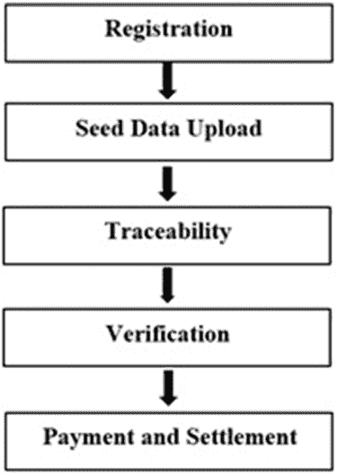

图 20.1 基于区块链的种子管理系统工作流。返回正文。⏎

## 20.6 案例研究或假设性场景

以下是利用区块链技术进行种子管理的模拟或实时示例。为了提高农民购买新品种的信心，目前在印度正在测试一个项目，该项目利用区块链在供应链移动过程中验证具有可追溯性的种子认证[26,27]。在这一方法中，向持有种子批次的用户提供一个基于哈希的 QR 代码，允许他们跟踪来源和分发阶段，并验证与特定种子相关的认证。

分析该试点项目的结果揭示了通过使用区块链进行种子认证和追溯所实现的几项优化。首先，它通过尽可能减少参与该过程的人力资源并消除纸质工作引起的延迟，减少了支出和时间。其次，区块链的不可篡改性确保了只有符合监管机构维持的标准的高质量种子传递给农民。最后，农民对种子追溯数据的访问性提高了流程的透明度，使他们能够做出明智的决策，有助于提高作物产量。通过分析这一实时应用可以很清楚，将区块链技术集成到种子管理中从多个角度优化了农业生产过程。

## 20.7 未来趋势与研究方向

区块链技术通过与人工智能（AI）和物联网（IoT）等新兴技术相结合，彻底改变了种子管理系统[28,29]。以下方法提供了这些集成如何工作的概述。区块链网络中用于预测分析的 AI 记录大量实时数据并存储记录网络上发生交易的数据点。AI 算法随后分析这些大数据块，帮助开发预测系统，协助农民在资源分配和种子选择等各种过程中做出明智决策，最终提高产量。例如，在区块链网络生成的数据上训练的 AI 模型可以识别生产与种子利用之间的模式。这种识别出的模式可以为特定的土壤类型、天气或气候条件推荐最合适的种子。

通过物联网设备（如土壤传感器、湿度传感器和跟踪器）进行实时数据采集，有助于从农田收集土壤状况、天气和土壤水分水平的数据点。区块链的集成确保了根据每个利益相关者指定的角色通过适当的访问控制机制访问这些数据，减少不同用户之间共享的数据污染风险。在种子管理中提出的区块链网络应用在监管合规和质量保证方面具有巨大潜力。区块链网络内的监管合规为种子生产、认证和分发过程提供了不可篡改的记录，确保在整个供应周期符合所有当地和全球法规。这不仅简化了审计过程，还增强了供应系统利益相关者之间的信任。另一方面，质量保证通过区块链管理的从生产到购买的端到端追溯来实现。每个节点的智能合约确保了自动化的质量措施，并保证只有经过认证的高质量种子到达终端农民。然而，尽管有这些优点，在种子管理中实施区块链仍面临重大问题。主要挑战之一是实施成本高昂，因为创建、设置和维护区块链是一项昂贵的投资，特别是对于农业部门种子管理等资源密集型流程而言。

为了克服这一问题，政府机构必须鼓励实施补贴。此外，还存在采纳障碍，因为参与种子供应管理的各种利益相关者（如小型供应商和农民）缺乏适应区块链等解决方案所需的所需的技能和知识。这一障碍可以通过开展大众化教育活动为这些利益相关者提供技能和知识来克服。

## 20.8 结论

农业部门正面临着土壤退化、资源稀缺和供应链效率低下等问题的困扰，迫切需要创新解决方案。区块链技术凭借其内在的安全性和不可篡改性，为解决这些挑战提供了极具前景的可能性。通过允许创建从种子到货架的农业方法的去中心化且可审计记录，区块链可以显著提高该行业的效率、消费者信任度以及可持续性。

区块链对农业的广泛影响是深远的。它能够提高精度和问责制，减少食品欺诈和伪造，并增强可追溯性。通过优化供应链，区块链可以减少食物浪费并确保新鲜货及时交付。此外，它通过赋予农民公平的利益和获取市场数据的渠道来激励他们。

为了充分实现区块链在农业中的能力，需要各种投资者的共同努力。政府、行业领袖、政策制定者和技术提供者必须通力合作开发强大的区块链解决方案，验证监管框架并鼓励广泛接受。通过采用这种变革性技术，我们可以创造一个更高效、可持续且公正的农业未来。

## 参考文献

1. M. S. Farooq, Z. K. Ansari, A. Alvi, F. Rustam, I. D. L. T. Díez, J. L. V. Mazón, C. L. Rodríguez, and I. Ashraf, “基于区块链的小麦作物供应链透明可靠框架，”PLoS One, vol. 19, pp. 1–21, 2024, doi: [10.1371/journal.pone.0295036](https://doi.org/10.1371/journal.pone.0295036). 返回文本。

2. V. Puri, A. Kataria, and V. Sharma, “医疗 4.0 中物联网的人工驱动去中心化框架，”Trans. Emerg. Telecommun. Technol., vol. 35, no. 4, p. e4245, Apr. 2024, doi: [10.1002/ett.4245](https://doi.org/10.1002/ett.4245). 返回文本。

3. N. Singh, A. Sharma, Indraneel, S. Prabhud, and K.Chadaga, “用于增强作物生产的基于 IoT 的温室技术：监控、控制通信技术的全面研究，”Syst. Sci. Contr. Eng., vol. 12, no. 1, Jan 2024, doi: [10.1080/21642583.2024.2306825](https://doi.org/10.1080/21642583.2024.2306825). 返回文本。

4. R. Ahuja, S. Chugh, and R. Singh, “种子链：变革种子供应链的安全透明区块链驱动框架，”Futur. Internet, vol. 16, no. 4, pp. 1–20, 2024, doi: [10.3390/fi16040132](https://doi.org/10.3390/fi16040132). 返回文本。

5. R. K. Dewang, M. P. Yadav, S. Awasthi, O. Raj, A. Mewada, and K. L. Bawankule, “数据安全：使用区块链和 IPFS 安全存储数据的应用程序，”Multimed. Tools Appl., vol. 83, no. 15, pp. 45491–45517, 2024. 返回文本。

6. N. Singh, H. P. Singh, A. Mishra, A. Khare, M. Swarnkar and S. Almas, “区块链云计算：DDoS、MITM 和 SQL 注入攻击对比研究，”2024 年 IEEE 大数据与机器学习国际会议 (ICBDML)，孟买买，印度，pp. 73–78, doi: [10.1109/ICBDML60909.2024.1057742](https://doi.org/10.1109/ICBDML60909.2024.1057742). 返回文本。

7. J. J. Lohith, S. Shreya, and J. Hamsa Priya, “解锁农业供应链中的效率：通过区块链技术的安全透明方法，”Int. Conf. Emerg. Technol. Comput. Sci. Intercip. Appl., vol. 2024, pp. 1–9, 2024, doi: [10.1109/ICETCS61022.2024.1054431](https://doi.org/10.1109/ICETCS61022.2024.1054431). 返回文本。

8. U. Peddibhotla, S. C. Chandran, P. Kumar, and R. Kumar, “数字钱包和区块链增强的印度农业供应链管理，”2024 年第 16 届通信与网络国际会议 (COMSNETS)，孟买，印度，pp. 427–429, 2024. 返回文本。

9. A. Nair, U. Peddibhotla, S. C. Chandran, and R. Kumar, “IoT 与区块链生态系统确保农业供应链的可追溯性和可靠性，”2024 年第 16 届通信与网络国际会议 (COMSNETS)，孟买，印度，pp. 388–390, 2024. 返回文本。

10. K. G. Gulen and A. Karaagac, “土耳其区块链技术的食品供应链综述，”J. Glob. Strateg. Manag., vol. 2018, pp. 13–27, 2024, doi: [10.20460/jgsm.2023.314](https://doi.org/10.20460/jgsm.2023.314). 返回文本。

11. M. Al Hemairy, M. Abu Talib, A. Khalil, A. Zulfiqar, and T. Mohamed, “用于验证、认证和等效性的区块链框架和平台...（此处原文重复内容已略）...” 返回文本。

12. U. Nookrat, S. Srinivas, R. Sagar, and M. Kalyani, “用于 IoT 的高效 IPv6 数据包概述，”Int. J. Sci., vol. 2, pp. 109–114, 2024. 返回文本。

13. T. K. Agrawal, V. Kumar, R. Pal, and Y. Chen, “基于区块链的智能合约研究，”Comput. Indus. Eng., vol. 15, p. 10730, 2021. 返回文本。

14. S. N. Khan, F. Loukil, and E. Ghedira, “区块链的应用与未来趋势，”Peer-to-Peer Net. Appl., vol. 14, pp. 2901–2925, 2021. 返回文本。

15. C. O. Ordoñez, G. R., and J. C., “区块链与可持续性：综述，”Front. Sustain. Food., vol. 8, p. 13476, 2024. 返回文本。

16. H. R. Hasan, A. Musam, K. Salah, M. Omar, and D. Boscovic, “智能农业：用于可信产品的 IoT 与区块链，”Comp. Electr. Agr., vol. 22, p. 10974, 2024. 返回文本。

17. N. Mahalingam and P. Sharma, “用于农业系统的智能区块链技术，”Multimed. Tools Appl., vol. 83, no. 4, pp. 10297–10320, 2024. 返回文本。

18. R. S. Veena, G. Khambra, R. Sayal, and N. Singh, “用于 WSN 的高效 IPv6 数据包概述，”SN Comput. Sci., vol. 5, p. 813, 2024. 返回文本。

19. M. A. Ansari and D. K. Singh, “实时监控中的人体检测技术：综述，”Multimed. Tools Appl., vol. 80, pp. 8759–8808, 2021. 返回文本。

20. N. Singh, S. P. Sasirekha, A. Dhakne, B. V. Sai Thrinath, D. Ramya, and R. Thiagarajan, “用于健康系统的具有学习能力的 IoT 混合模型，”Meas.: Sens., vol. 24, pp.1–14, 2022. 返回文本。

21. I. Saputra, M. Wahyudi, R. K. Serli, A. Yoraeni, N. Ruhyana, and I. Sutedja, “通过区块链上的动态智能合约交互增强环境数据管理”, 2024 年国际信息技术研究与创新会议 (ICITRI), Universitas Nusa Mandiri, 雅加达，印度尼西亚, 2024, pp. 341–346.257.

22. A. Padmavathi, G.C. Reddy, and G. Santhosh, “通过抵消水平提高信誉的区块链信用系统”, 2024 年 IEEE 计算、电力与通信技术国际会议 (IC2PCT), Greater Noida，印度, 2024 年 2 月, pp. 1181–1186.

23. S. Kably, N. Alaoui, M. Arioua, K. Chougdali, S. Khoulji, and M. D. Gómez-López, “为农业物联网定制的区块链框架”, 自然计算与人工计算相互作用国际工作会议, 瑞士恰姆, pp. 461–473, 2024.

24. A. Pokale, H. Azath, V. Muneeswaran, and D. Saravanan, “迈向韧性农业供应链：验证区块链技术对可持续性影响的框架”, 2024 年 IEEE 电气、电子与计算机科学国际学生会议 (SCEECS), Greater Noida，印度, pp. 1–9, 2024.

25. X. Zinyan, S. Z. B. Omain, S. F. Khatib, and J. Lei, “区块链技术在农产品供应链中的应用：基于 WOS 数据库的引引空间计量学分析”, 国际学术经济与管理科学杂志, vol. 13, no. 2, pp. 487–509, 2024.

26. A. H. C. Hung, “中国农村区块链的奇案：揭示权力、利润与监控”, 大数据社会, vol. 11, no. 2, p. 20539517241259674, 2024.

### 参考文献

27. T. R. C. Konfo, A. B. P. Chabi, A. A. Gero, C. Lagnika, F. Avlessi, G. Biaou, and D. Sohounhloue, “通过可持续解决方案提高生产者收入的农食品近期气候智能创新”, 农业食品研究杂志, vol. 15, p. 100985, 2024.

28. N. Singh and Y. Kumar, “5G 医疗保健中的安全与隐私需求”, 用于 5G 医疗保健应用的区块链, pp. 1–30, 2021 年 11 月. IET 出版, doi: `10.1049/PBHE035E_ch1`.

29. R. Gao, S. Huang, and B. Li, “成本信息约束下投资决策的绿色农食品区块链技术”, IAENG 国际应用数学杂志, vol. 54, no. 1, pp. 82–91, 2024.

# 索引

- 访问控制 [58], [62]
- 人工智能 (AI) [74], [77], [90], [95], [149], [155], [168–169], [192], [197–207], [254]
- 非对称加密 [81]
- 审计追踪 [177–178]
- 可审计性 [175], [177–178]
- 审计 [72], [74–75]
- 认证 [58], [62], [64]
- 大数据 [198–201]
- 生物技术 [183–192]
- 区块链 [80], [90], [93], [104–105], [118–119], [133–134]
- 区块链技术 [1–30], [35–66], [71–78], [147–155], [158–169], [172–181], [183–192], [197–207], [209–220], [222–229], [235–237], [248–251]
- 区块链物联网集成 (BIoT) [17–30], [99]
- 布鲁克林微电网 [224], [229]
- 碳减排 [232]
- 央行数字货币 (CBDCs) [77]
- 认证机构 [249], [251]
- 临床试验 [9–10], [113], [142], [159], [161], [168–169], [184], [186], [188–189]
- 兼容性 [37–39], [42–43]
- 复杂性 [37–39], [42–44]
- 共识算法 [7–8], [13–35]
- 共识构建 [48–49]
- 共识机制 [20–21], [23], [28], [59], [64–65], [152–153], [173], [175–177], [212], [214]
- 联盟链 [135], [186]
- Corda [186], [191]
- 企业社会责任 (CSR) [236], [240], [245]
- 成本最小化 [72], [75]
- 成本降低 [216–217], [220]
- 成本节省 [173], [176–177], [180]
- 假药 [162–163]
- 假种子 [250–251]
- 跨链安全 [88]
- 众筹 [243]
- 加密货币 [201–202], [209–210], [216]
- 加密货币挖掘 [228]
- 加密哈希函数 (CHF) [82], [94]
- 加密哈希值 [5–6], [152]
- 加密密钥 [62], [64–65]
- 加密方法 [252]
- 加密安全 [173], [175–176], [178]
- 加密学 [80]
- 数据分片 [250–251]
- 数据完整性 [36–38], [82], [147–154], [158–169]
- 数据管理 [183–184], [187–188], [190]
- 数据隐私 [58], [63], [133], [136], [188], [190–191], [205], [207], [244]
- 数据保护 [52]
- 数据安全 [133], [136]
- 数据共享 [121], [123]
- DDoS 攻击 [61–62]
- 去中心化 [17–20], [23], [35–38], [48–49], [51], [58], [63–64], [107], [124], [134], [158–169], [172–178], [180], [183], [185–187], [197], [202–203], [211], [214–215], [218–219], [235], [237], [239], [249], [251]
- 去中心化自治组织 (`DAOs`) [73]
- 去中心化能源系统 [222], [226], [228]
- 去中心化金融 (`DeFi`) [72–78], [180–181]
- 去中心化账本 [147], [152–154], [226], [229]
- 深度学习 (`DL`) [90], [98]
- 委托权益证明机制 (`DPoS`) [85]
- 数字身份 [71], [74]
- 数字卢比 (`₹`) [210]
- 数字签名 [62], [64], [83]
- 数字转型 [197], [206]
- 数字孪生 [149–150]
- 分布式账本技术 (`DLT`) [4–5], [18–20]
- 分布式存储 [252]
- 药物溯源 [158], [162–163], [169]
- 边缘计算 [100]
- 教育凭证 [236], [242]
- 电子健康记录 (`EHRs`) [8–10], [14], [106], [136], [142], [158–159], [161–163], [167]
- 实证研究 [40–45]
- EncrypGen [189], [192]
- 终端安全 [64]
- 能源消耗 [126], [179–180], [185], [190]
- 能源效率 [154–155]
- 能源安全 [222]
- 能源存储系统 [223–224]
- 能源代币化 [226]
- 以太坊 [186], [191]
- 以太坊区块链 [1], [3], [10]
- 伦理采购 [122], [241]
- 农民 [249–250], [253]
- 快速结算 [75]
- 联邦学习 (`FL`) [100], [134], [139]
- 效率 [172–173], [176–177], [179–181]
- 金融包容 [74], [76], [78], [173], [177], [238]
- 金融 4.0 [197–199], [201–203], [206]
- 金融科技 (`FinTech`) [201], [206]
- 食品安全 [248], [255]
- 欺诈检测 [72], [74], [197], [201], [205]
- 欺诈预防 [172], [174–176], [178]
- `GDPR` [201], [205]
- 基因组数据 [184], [187–190]
- 治理转型 [236–237]
- 绿色矿业 [228]
- 洗绿 [240]
- 电网同步 [225]
- 健康数据互操作性 [160], [163], [168–169]
- 医疗 4.0 [104]
- 医疗应用 [26–28], [48], [55]
- 医疗数据安全 [1], [3–6], [8–11], [13]
- 医疗欺诈 [140–141]
- 医疗记录 [236], [241–242]
- `HIPAA` [143], [167]
- 同态加密 [88], [140]
- `HR` 就绪 [38–39], [42–44]
- 人力资源管理 (`HRM`) [35–46]
- 人机协作 [119–120]
- 混合区块链 [135]
- `Hyperledger Fabric` [186], [191]
- `IBM Blockchain` [216]
- 身份伪装 [138]
- 不可篡改性 [5–6], [8], [10], [50–51], [107], [124], [134–135], [158–169], [173], [175–178], [183], [185–189]
- 不可篡改账本 [235], [237], [251], [255]
- 不可篡改记录 [152–154]
- 实施框架 [252]
- 工业物联网 (`IIoT`) [147–155]
- 工业 4.0 [148–150], [155]
- 工业 5.0 [47], [55], [118–119], [206]
- 内部威胁 [143]
- 知识产权 (IP) [183–184], [186], [188], [192]
- 知识产权 (IPR) [248], [250–251]
- 智能学习模型 (ILMs) [90], [95]
- 中间人 [72], [75–76]
- 国际支付 [209–211], [215–220]
- 物联网 (IoT) [10], [13], [17–30], [90], [104], [107], [120–121], [164–165], [168–169], [245], [254]
- 互操作性 [6], [10], [13], [100], [113], [126], [143], [152], [179–180], [190–192]
- IoT 架构 [19], [21–22], [91]
- 密钥管理 [62], [64–65]
- 延迟与实时处理 [28–29]
- 老旧系统 [126]
- 机器学习 [90], [97], [148], [155], [197], [199], [201–202], [205]
- 中间人攻击 [138]
- 市场分析 [204–205]
- 医疗设备管理 [161], [164–165]
- 医疗供应链管理 [9]
- MediLedger [161], [163]
- MediLedger 项目 [187], [191–192]
- MedRec [161–163]
- Merkle 树 [86]
- 金属铸造 [147], [150–155]
- 微电网 [222–224]
- 多因素身份验证 (MFA) [141]
- 不可抵赖 [85]
- 以患者为中心的护理 [161], [164], [168–169]
- 点对点 (P2P) 能源交易 [223], [226], [229]
- 点对点 (P2P) 网络 [235], [237]
- 点对点 (P2P) 交易 [173], [177], [211], [214], [216]
- 感知易用性 (PEOU) [37–45]
- 感知有用性 (PU) [37–45]
- 许可访问 [6]
- 许可链 [94]
- 无许可链 [94]
- 个性化医疗 [184], [189], [192]
- 钓鱼攻击 [53–54]
- 投资组合管理 [204]
- 后量子密码学 (PQC) [88]
- Power Ledger [224], [229]
- 实用拜占庭容错 (PBFT) [7–8], [20], [23]
- 预测性分析 [254]
- 预测性维护 [149], [155]
- 预测性建模 [202]
- 处方管理 [142]
- 隐私 [123]
- 隐私与数据完整性 [17–18], [23–24], [29]
- 隐私与数据安全 [111]
- 隐私与安全 [159–169]
- 隐私挑战 [53]
- 隐私保护 [215], [217–218]
- 私有链 [95], [135], [186]
- 私有密钥管理 [60], [62], [65]
- 私有密钥安全 [54]
- 权益证明 (PoS) [7–8], [20], [23], [28–29], [85], [108], [126], [135], [153], [185], [190], [212], [214], [244]
- 工作量证明 (PoW) [20], [23], [28], [63], [65], [85], [108], [126], [135], [185], [190], [212], [214], [228], [244]
- 产消费者 [7]
- 公有链 [7], [49], [53], [58]
- 公钥加密 [17–18]
- 公有账本 [253]
- QR 码验证 [250], [254]
- 质量保证 [150], [152], [154–155]
- 质量控制 [40–43]
- 量子计算 [66]
- 抗量子算法 [137], [142]
- 勒索软件攻击 [147–150], [152], [154–155], [223]
- 实时监控 [19], [64], [147], [149]
- 监管挑战 [77], [126], [231]
- 监管合规 [6], [100], [105]
- 监管框架 [38–39], [42–44]
- 可再生能源 [138]
- 重放攻击 [216–218]
- Ripple (XRP) [72], [75], [197], [200], [204–205]
- 风险管理 [6], [13]
- 机器人投资顾问 [99], [105], [126], [154–155], [167–168]
- 可扩展性 [6], [12–13], [18]
- 可扩展性挑战 [11–12], [51–52], [178–180], [190–191], [219–220]
- 可扩展性问题 [28], [77], [108]
- 安全多方计算 (SMPC) [88], [139]
- 安全性 [3], [6]
- 安全与隐私担忧 [100]
- 安全攻击 [57–66]
- 安全机制 [179–180]
- 安全漏洞 [249–251]
- 种子链 [25–27], [249–251]
- 智能城市 [61–62]
- 智能合约漏洞 [5–6], [9–10], [13], [18], [22–25], [27], [36–37], [47], [50], [58], [61–62], [64], [72–73], [75–76], [107], [121], [136], [142], [147], [152–155], [158], [168–169], [173], [175], [178], [180–181], [185–187], [191], [197], [203], [210], [214–215], [223], [226], [229], [239], [245], [251–252]
- 智能合约 [4–5], [9]
- 智能设备 [235–236], [245]
- 社会影响 [239]
- 利益相关者管理 [216]
- Stellar (XLM) [199–201], [204–205]
- 股票交易 [43–44]
- 结构方程模型 (SEM) [147–150], [152], [154–155]
- 供应链 [25–26], [71], [78], [113], [118], [126], [159], [162–163], [169], [183–184], [187], [191–192], [240–241]
- 供应链管理 (SCM) [240]
- 可持续性 [26], [92], [95], [230], [232], [245]
- SWIFT 转账 [53], [61–62]
- 女巫攻击 [53], [59], [61]
- 对称加密 [36–45]
- 技术接受模型 (TAM) [114], [161], [165–166], [169]
- 远程医疗 [114], [164]
- 代币化 [181], [226–227], [238], [252]
- 资产代币化 [181]
- 可溯性 [9], [13], [18], [147], [149–150], [152], [154–155], [176–178], [249], [251], [253]
- 贸易执行 [211], [218]
- 贸易金融 [216], [220]
- 交易效率 [222], [224]
- 传输损失 [72], [74–75], [77], [125], [147], [149–150], [152], [154], [172–173], [175–178], [235], [237], [240], [249], [251], [253]
- 透明度 [6–7], [9], [215–216], [223], [226], [229], [230], [232], [245]
- 零知识证明 (ZKPs) [87], [100], [105], [244]
