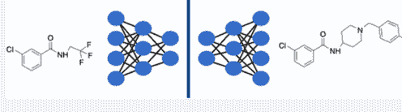
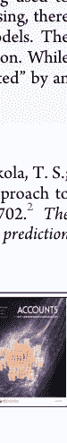
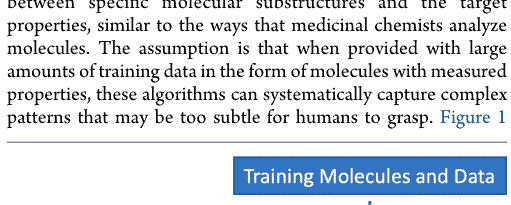
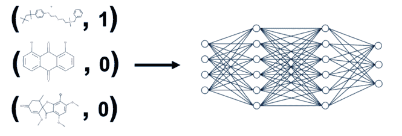
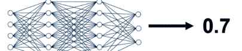
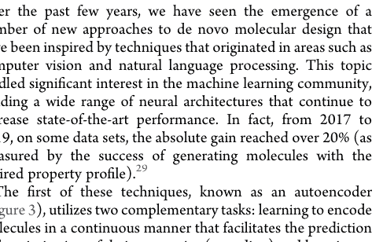
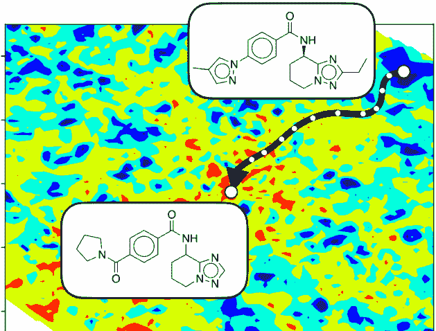
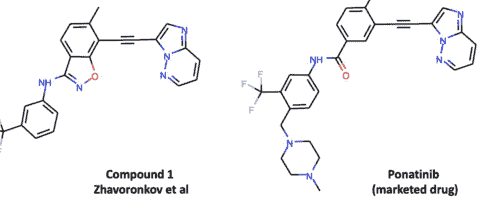

# 深度学习在分子生成与分子属性预测中的应用

## 访问权限

## 文章推荐

摘要：计算机硬件和软件的最新进展引发了深度神经网络的革命，这影响了从翻译到计算机视觉的多个领域。深度学习也影响了药物发现的许多领域，包括化学图像分析和有机分子合成新路径的设计。虽然这些领域的工作尚不完全，但本述（Account）将对相关范围进行全面的综述。在本述中，我们将重点关注药物发现中深度学习的两个关键领域：分子性质预测和新分子的从头生成建议。

构效关系（QSAR）定量发展中最重大的进展之一来自于应用深度学习方法预测药物发现中分子的生物活性和物理性质。研究人员现在不再通常使用专家定义的化学特征来构建模型，而是使用深度学习对复杂的非线性表示进行建模。这些表示带来了顶尖的性能。虽然深度学习改变了许多研究人员处理 QSAR 的方式，但它并非万灵药。与任何其他机器学习技术一样，设计和创建训练集的任务仍然是一个根本性的挑战性问题，例如识别仍然不确定的关键领域。多项研究已经开发了评估模型置信度的方法。

深度学习也为新分子结构的生成做出了贡献。深度学习不再依赖人工设计开启了新的可能性。最初为图像生成和语言翻译开发的技术被应用于分子生成。这些深度学习方法已与上述预测模型结合使用，并被用于生成具有特定预测生物特征的新分子。虽然这些生成算法看起来很有前景，但关于生成设计提出的分子的合成和测试的报告较少。评估生成模型产生的分子的多样性、质量和最终价值仍然是一个开放性问题。该领域已经产生了许多基准，但需要对如何通过清单来评估分子达成共识。

- Yang, K.; Wang, J.; Jin, W.; Cole, C.; Eid, P.; Gao, G.; Guzman-Perera, A.; Hopper, T.; Kelley, B.; Mathja, M.; Palmer, A.; Watts, Y.; Vakkola, J.; Jenkins, T.; Balalay, R. Learning Molecular Representations for Property Prediction. J. Chem. Med. 2019, 59, 3370–3388. 用于药物信息学系统的深度神经网络的设计与应用。
- Stokes, J. M.; Wang, K.; Swanson, J.; Wen, Y.; Cubillos-Buiz, A.; Donghia, N. M.; MacNair, C. R.; French, S.; Carlafee, L. A.; Bloomer-Ackman, J.; Tran, V. M.; Chiapeno-Pepe, A.; Badran, H.; Andrews, I. W.
- Chory, E. J.; Church, M.; Brown, E. D.; Jaakumock, T. S.; Balaraj, R.; Collins, J. J. A Deep Learning Approach to Antibiotic Discovery. Cell. 2020, 180, 688–702. 深度学习性质预测方法在新型抗生素的发现中。

文章

- *Jin, W.; Balay, R.; Jaakkola, T. Junction Tree Variational Autoencoder for Molecular Graph Generation, Proc. Mach. Learn. **2018**, 80, 2232–2332. 一种基于图的生成算法，克服了早期基于序列方法的局限性。

也许该领域面临的最重大挑战是缺乏可用于构建和预测模型的优质数据。为了取得进展，我们需要在产生数据的制药行业人员与创建新方法的学术界人员之间建立合作机会。

基于数据的新分子的生成和评估是新药设计中的关键任务。在药物发现的早期，迭代在很大程度上是人工和直觉驱动的。科学家会测试一组化合物，检查产生的数据，并利用对基础科学的理解来合成分子。20世纪90年代的构效关系（QSAR）为化合物与性质之间的联系建立了一个框架。

在过去的几年里，分子和性质预测领域经历了一场深度学习驱动的革命。计算机硬件软件的进步使得自然语言处理现在适用于分子性质，包括生物活性、ADME 以及与靶点的相互作用。深度学习不再依赖于专家定义的模型，而是使研究人员能够开发可以直接在大型数据集上训练的模型。由于所采用神经网络的深度和复杂性，这些模型的性能优于传统的 QSAR 方法。本文提供了分子性质预测的机器学习方法的概述。使用带有相关数据的训练集创建一个模型，该模型可预测一组实验观测值。

| 训练与数据 | 新分子 | 预测模型 | 预测值 |

**图 2. Stokes 发现新型抗生素的过程。**

最近的文献表明，许多新架构在性能上优于神经网络模型。深度学习在药物发现中的成功案例是 Tox21 挑战，该挑战要求机器学习方法预测实验毒性分析的结果。Hoechriter 小组提交的一个方案使用了深度学习，并在 16 个基准测试中赢得了 11 个。回顾过去，Yang 等人和一个药物合作伙伴联盟报告了在 19 个公共基准测试和 15 个私有数据集上取得了与现有基准模型相当或更好的结果。他们分别应用了神经网络。Stokes 等人在 2020 年的一篇论文描述了如何从 ZINC 数据库的 1 亿个化合物库中发现一种新型抗生素。该方法被用于生成图2 所示的内容。产生了一系列标记和天然产物以筛选出 80% 标记为活性 (1) 的分子，其余标记为不活性 (0)。然后使用深度学习模型从包含 107 万种市售分子的数据库中筛选分子。随后，他们识别出了八种与训练模型时使用的分子不同的抗生素。

此外，即使是大型训练集也不能保证模型能够成功泛化到新的化学空间。模型与原始训练集的偏差越大，模型正确预测目标属性的难度就越。。未来的问题在于：建立估计方法无法充分评估模型预测正确的概率。

当使用学习模型预测分子的生物学或活性属性时，理解预测中的不确定性至关重要。虽然直觉上认为人们对与训练集相似的分子的预测会更有把握，¹⁶，但该领域尚未就评估不确定性达成可靠的方法共。随着该领域向更复杂的分子发展，量化相似性和评估机器学习模型中的不确定性变得更加困难。2020 年的一篇论文使用了五个基准数据集，选择了几种量化神经网络模型不确定性的方法。这些作者探索了既有策略估计预测模型误差的能力。

- 集成方法，通过改变网络参数来创建模型集成，并将方差作为不确定性的衡量标准。
- 一种均值-方差估计方法，通过训练网络同时预测特定分子的预测值均值和方差。
- 基于分子指纹或潜空间表示（如第 3.2 节所述）的距离的方法。
- 基于并（Union-based）的方法，将神经网络与潜空间表示相结合，以产生输出及相关的不确定性。

作者得出结论，所研究的方法中没有一种能够跨数据集一致地估计不确定性。尽管已有许多关于估计不确定性的发表报告，⁷，但仍需进一步研究以创建可以在实践中使用的可靠方法。

预测分子模型的准确性取决于数据的准确性。考虑到海量的参数，神经网络需要足够的数据来实现最优的分子表示并最终实现预测集。虽然传统的基于分子指纹的模型可以在数百个分子上进行训练，但这些数据量对于神经网络来说是不够的。训练它们需要数千个分子。遗憾的是，在许多药物发现场景中，获取大量样本可能是不可行的。典型的药物优化工作会产生几千个分子，这可能为训练神经网络提供足够的数据。

如上所述，模型的性能取决于用于训练模型的数据量。在某些机器学习领域中，可以通过修改训练示例来增强数据。例如，在分析图像时，可以通过模糊处理或在数据中插入元素来创建一个更大的数据集。遗憾的是，这种增强在分子上是不可能的。对分子的任何改变都可能剧烈影响背景下的分子属性。多项研究方向旨在通过生成额外数据或寻找更有效的数据增强方法来解决这些局限性。一个已被证明非常有效的方向是建议使用来自相关任务的数据（例如 Netflix 风格的推荐系统）目标训练。另一类工作方法是使用分子结构的编码器来改进学习到的表示。此类方法在计算机视觉和自然语言处理中已被证明成功，并在分子属性预测背景下显示出类似的益处.³⁴。然而，对训练数据的关键依赖意味着激活一组候选对象需要固定的训练预算。这些学习方法为其属性（编码）的探索和优化提供了系统化的方法。通过为具有多样属性的实验数据收集提供信息，研究人员有望加强药物发现过程。

解码连续表示以生成新分子。在另一种方法中，可以使用另一种类型的深度神经网络（RNN）来生成新分子.³⁵ RNN 设计用于学习文本或语音等序列数据。当对 RNN 进行训练以生成分子时，它会学习分子的哪些部分属于正在连接的原子或基团。这些连接取决于它已经过的分子部分。通过将分子在每一步视为原子的序列，可以生成极概率为有效的分子。在另一种被称为强化学习（RL）的方法中，智能体学习一系列动作以达到特定目标.³⁷ RL 最著名的例子是 AlphaGo，这是一个由 Google 开发的程序，它在游戏中击败了特大师.³⁹ 在分子设计中，生成模型定义了通过增加键来生长或改变分子。在 2019 年的一篇论文中，Zhao 等使用 RL 生成了具有多个目标的分子，包括与目标分子的相似性和多样性。

在过去的几年里，我们看到了许多从头分子设计新方法的出现，这些方法受到了计算机视觉和自然语言处理等领域技术的启发。该领域在机器学习社区，特别是化学领域引起了极大兴趣，以提高最先进的性能。例如，从2017年开始在某些数据集上，绝对增益（通过生成分子的质量衡量）超过了20%。

这些技术中的第一个被称为编码器，利用了复杂的任务：在连续潜空间中编码分子，以便对其属性进行预测和优化（编码），并学习具有改进属性的分子图的最优表示（解码）。⁴⁰ 如图4 所示。

生成模型在从头分子设计中的首次应用使用了分子结构的简化线条输入系统（SMILES）表示，该表示被转换为潜向量并进一步优化到所需的属性.³¹ 新的优化向量随后被解码为代表输出分子的 SMILES 字符串。该方法的关键假设是空间中的表示是平滑的，与分子空间的离散性质形成对比。然而，研究发现，构建的潜空间远平滑：具有相似属性的分子在潜空间中可能并不相似。解释的这可以通过 SMILES 表示作为起点的影响来桥接——相似的分子可能具有非常不同的 SMILES 字符串。然而，还有其他影响因素，例如性质梯度（结构非常相似但属性巨大的化学品）和合成过程的化学限制。最近的工作显著推进了从头生成模型的发展。分子表示探索了可以有效处理分子图的编码和解码算法。

ACS Chem. Rev. 2023, 123, 24–263

图 4。连续表示的一个示例，以及在隐藏空间中用于生成新分子的解码器。

properties.$^{29}$这种方法可以被视为匹配分子对（MPA)$^{24,45}$ 的神经版本，其中模型学习隐藏空间中能够导致属性改进的轨迹。这种表述即使在隐藏空间并不小的情况下也能提供稳健的性能，并支持多样化输出的生成。

尽管许多论文都在描述生成式模型，但只有极少数的研究报道了基于生成式模型的分子合成。最早报道关于生成式算法设计的分子进行合成以及化学和生物测试的论文之一，是由默克（Merck）及其同事于2018年发布的，他们成功设计了视黄醇X受体（RXRs）或过氧化物体增殖激活受体（PPARs）的激动剂$^{46}$

图 5。由生成模型设计的化合物1与标记药物ponatibinib的对比。

使用QSAR模型预测了每个生成分子的活性。随后的生物分析显示，这些化合物是双重PPAR和RXR抑制剂，$EC_{50}$值在60到13 nM之间。

Zhavorov等人生成的子集报道这些分子是DDR1的强效抑制剂，DDR1是一种通常与纤维化相关的蛋白酪氨酸激酶家族蛋白$^{47}$ 该论文在媒体中引起了极大关注，并引发了“21天设计药物”的报道。这项工作被认为具有意义，为了证明其在生化模型中的选择性，作者证明了一种分子在细胞中具有活性，并在小鼠模型中表现出合理的药代动力学。这些结果最初提供了强有力的反馈$^{48}$ Murcko指出，隐藏空间中显示的分子与之前发表的DDR1抑制剂具有惊人的相似性，包括标记药物ponatibinib（图5）。这一争议凸显了在评估生成方法“发明”的分子之重要性方面的困难。

近期许多论文建议了评估生成式模型产生分子的方法$^{49}$。这些基准测试侧重于评估生成式模型探索化学空间和利用已知信息的能力。由Brown及其同事发布的GuacMolchem基准通过一系列测试来评估生成器生成的分子的有效性、新性和多样性，从而评估探索能力。该软件还了一种目标引导的方法，用于评估生成式模型关注特定化学空间的能力。评估生成式模型产生的分子多样性的另一种方法是将生成的分子与化学空间的详尽探索进行比较。

该领域的另一个问题是在药物发现过程的何时应用生成式模型。鉴于探索大型化学空间的困难，可以想象在合成性评估$^{50}$以及机器学习在合成分子的合成中的应用$^{51}$。生成模型产生分子的合成可能会变得困难或耗时。

倾向于在市售的化合物库上进行这种命中发现，因为这些库廉价且易于获得。在发现后期，工艺设计策略很大程度上由结果评估驱动。生成式模型提供了超越合成构建块的手段。如果生成模型预测的分子具有可接受的ADMET毒性，发现可能意味着投入资源进行困难的合成。随着生成式模型更广泛的应用，该领域将对自动化分子生成方法的范围、局限性和应用有更多的认识。

## 作者信息

通讯作者

Regina Balazaki — 马萨诸塞理工学院计算机科学与人工智能实验室，马萨诸塞州剑桥市 02139，美国；电子邮箱：regina@mit.edu

作者

W. Patrick Walters — Relay Therapeutics，马萨诸塞州 02142，美国；orcid.org/0000-0023-7895

完整信息请参阅：

作者未声称具有财务利益。

## 个人传记

W. Patrick Walters在马萨诸塞州的Relay Therapeutics领导计算与信息小组。他的小组专注于计算方法的新颖应用，通过整合模拟和实验数据来驱动药物发现。在加入Relay之前，他在Vertex Pharmaceuticals工作了20多年，担任全球建模与信息学负责人。他在亚利利桑那大学获得博士学位，在构象分析方面积累了专业知识。在获得博士学位之前，他曾在Instruments担任化学家和软件开发人员。他拥有科罗拉多大学的化学学士学位。

Regina Balazaki是马萨诸塞理工学院工程与计算机科学系教授，也是该校计算机科学与人工智能实验室的成员。在MIT，她领导生物学机器学习小组，并担任James Clinic（一个专注于机器学习与健康的中心）的教职负责人。她的研究兴趣包括自然语言处理和肿瘤学。她曾是哥比亚大学Rossel的博士后研究，并在尼日尔大学Gen Bonn担任了一年的博士后研究。

在过去的几年里，人工智能在药物发现领域引起了巨大的兴趣、热情和应用的激增。尽管一些小组发表了具有前景的结果，但需要注意的是，药物发现是一个需要平衡参数的复杂过程。为了实现针对目标的活性，药物发现必须避免副作用并确保安全递送。

最后，生成机器学习模型最关键的要素之一是数据。不幸的是，训练这些模型所需的大数据存在制药公司或出版商的内部数据库中。大量的实验数据可用于扩展质量，随着该领域的发展，我们可能能够创建出哪些分子包含错误。预测的质量和可靠性取决于所使用的数据。只有当个人收集到易于使用的数据集时，领域才能向前发展。虽然我们不认为AI是药物发现的万灵药，但它将成为用于开发药物的广泛技术中的另一种工具。

- 1) Yang, K.; Kwan, S.; Jin, W.; Cole, J.; E, P.; Gao, H.; Jiang, S.; Wu, A.; Ho, J.; Walters, W. P.; Baker, T.; He, M.; Mathe, A.; Milner, R.; Vakkala, J.; Jaaskeler, R.; Machine Learning for Molecular Property Prediction. J. Med. Chem. Int 2019, *62*, 5919.
- 2) Win, W.; Balazarski, R.; Jaaskeler, T. Junction Variational Autoencoder for Molecular Property Generation. Proc. Mach. Learn. Res. 2019, *12*, 1-10.
- 3) Cherkashev, A.; Nurakul, E. N.; Foches, J.; Varenek, A.; Ishkan, I.. Cronin, M.; Dearden, J.; Gramatica, P.; Martin, Y. C.; Todeschini, R.; Consoni, V.; Vuzic, M. E.; Camer, R.; Benini, R.; Rath, L.; Lathfeer, J.; Jericho, A.; A. Deep Learning for Anthropogenic Toxicity
- 4) A. QSAR

建模：你曾去何处？你要去何方？J. Med. Chem. 2014, 57, 4997–5010.

(5) Schneider, G., Fecher, U. 药物分子的计算机设计。Nat. Rev Drug Discovery 2005, 5, 649–663.

(6) LeCun, Y., Bengio, Y., Hinton, G. 深度学习。Nature 2015, 521, 436–443.

# 参考文献

(7) Rogers, D., Hahn, M. 扩展指纹连接性。J. Chem. Inf. 2010, 31, 742–754.

(8) Mauri, A., Consoni, V.; Pavan, M.; Tozogni, R. 用于分子描述符的 Dragon。Molecular Modeling 2006, 32, 55–64.

(9) Lee, Y.; Qassbani, A.; Butler, C.; Ryu, H.; Jenkins, J. P.; Schenker, J. D. 通过计算学习和化学归一化预测生物活性。Proc. Am. Natl. Sci. 2016, 113, 352–357.

(10) May, A.; Clarkson, G.; Unterteich, H.; Steier, M.; Winter, J. K.; Clemard, H.; Eves, D. H. ChemBL 上药物靶预测的大规模机器学习。2019, 9, 5441–5451.

(11) Coley, C. W.; Barinski, R.; Green, W. H.; Hajoski, J.; Jenkins, S. M. 用于预测分子性质的分子描述符卷积。J. Am. Chem. Soc. 2016, 138, 3339–3347.

(12) Kermorener, S.; Cilic, M. 用于预测分子性质的图卷积网络。J. Chem. Inf. Model. 2019, 39, 992–1000.

(13) Duvernard, D.; Maclain, A.; Adams, R.; Iparragurre, B.; Richard, H.; Tapinski, G.; Urban, J. 用于预测分子活性和性质的深度神经网络。Bioinformatics and Structural Biology 2015, 22, 2254.

(14) Gimenez, J.; Schneider, S. L.; Fine, P. V.; Vinyals, O.; Hahn, E. J. 量子化学的神经传递。Chem. Phys. 2017, 72, 1265–1270.

(15) Kipf, T.; Welling, M. 基于图卷积网络的半监督分类。arXiv (Computer Science: Learning). September 2016, 1609.02907, https://arxiv.org/abs/1609.02907.

(16) Maymay, A.; Glekberger, J.; Unterteich, H.; Steier, S. 使用深度学习进行毒性预测。Front. Environ. Sci. 2018, 50.

(17) French, R. E.; Sun, J.; Wu, D.; Bai, E. E.; Ma, Y. H.; Li, S.; Yan, Y. J.; Wang, R.; Bansal, V. S. 分子活性预测的潜力。J. Am. Chem. Soc. 2017, 139, 1333.

(18) Shi, L. P.; Peng, R. 相似空间学习是提高 QSAR 预测准确性的良好工具。J. Chem. Inf. Comput. Soc. 2004, 44, 197–202.

(19) Hirsfeld, L.; Wang, Q.; Q, J. B.; Barkley, R. C. 用于分子性质预测神经网络不确定性量化。J. Chem. Inf. Model. 2018, 35, 1097–1118.

(20) Thomas, S. 多样数据集下 QSAR 预测误差估计中领域适用性指标的相对重要性。J. Chem. Inf. Model. 2015, 55, 1098–1117.

(21) Benavides, D.; Baines, M. 交叉验证下 QSAR 模型误差估计。J. Chem. Anal. 2016, 6.

(22) Vander, A. T.; Chiao, L.; Ashby, J.; Smith, R. 用于分子发现的高性能框架。人工智能与应用国际会议 (AIAS), 2019, pp. 304–308.

(23) Wang, Y.; Lee, M.; Lee, L.; Toutanova, K. BERT: 用于语言理解的双向 Transformer 训练。arXiv (Computer Science: Language), October 2018, 1810.04805, https://arxiv.org/abs/1810.04823 (访问 2020-10-28).

(25) Reker, D.; Schneider, P.; Schneider, G. 用于药物发现的主动学习。2020.

(25) Werniger, M.; Liu, J.; Ritchie, G.; Ghosh, M.; Putta, S. 药物发现过程中的支持机学习。J. Chem. Inf. Comput. Soc. 2003, 43, 667–673.

(27) Kone, K. D.; Hahn, P.; Adams, F.; Leuing, J.; Borwein, I.; Robbaerts, R.; Baxendale, A. 快速扩张化学空间和索引的自由能计算估计。J. Chem. Inf. 2021.

(28) Reker, D.; Schneider, P.; Schneider, G. 用于化学性质预测的主动学习。Med. 2017.

(29) Jin, Y.; Wang, K.; Barkley, R.; Rajnik, K. 用于分子预测的多任务图到图翻译。arXiv (Computer Science: Learning), December 2018, 1812.01328, https://arxiv.org/abs/1812.01328 (访问 2020-10-28).

(30) Gómez-Domínez, R.; Jin, Y.; Wang, J.; Hernandez-Lozano, M.; Sanchez, J.; Jbera, A.; Tirado, D.; Perez-Pazqui, A. 使用分子数据驱动表示的自动化化学设计。ACS Chem. Sci. 2018, 4, 2608–2616.

(31) Silver, D.; Huang, A.; MacKay, J. C.; Adams, S. R.; Dreesves, A.; Vinyals, O.; Vácek, I.; Maddman, D.; Mien, H.; Snezson, G.; Grave, J.; Kumarski, A.; Schrittiel, J.; Leach, A.; Silver, M.; Hassabis, D. 深度神经网络精通围棋。Science 2016, 539, 483–488.

(32) Morgan, P.; Ajay, I.; Trostrup, A. 用于分子设计的深度学习。Nature 2018, 559, e01785.

(33) Zhang, Z.; Lee, H. S.; Li, J.; Fine, R. 使用机器学习优化分子性质预测。J. Chem. Inf. Model. 2015, 55, 11–20.

(34) Oliveira, M.; Schachtler, J.; Engqvist, O.; Hahn, M. 用于强化学习的深度从头。Journal of Learning. 2017, 8, 11–15.

(35) Silver, D.; Huang, A.; MacKay, J. C.; Adams, S. R.; Dreesves, A.; Vinyals, O.; Vácek, I.; Maddman, D.; Mien, H.; Snezson, G.; Grave, J.; Kumarski, A.; Schrittiel, J.; Leach, A.; Silver, M.; Hassabis, D. 深度神经网络精通围棋。Science 2016, 539, 483–488.

(36) Li, Y.; Yin, O.; Dyer, C.; Pasquiani, R.; Battaglia, L. 分子深度生成模型。arXiv (Computer Science: Learning), 2018, 1803.03324, https://arxiv.org/abs/1803.03324 (访问 2020-10-28).

(37) Yang, Y.; Jin, R.; Ren, S.; Hamilton, W.; Leskovec, J. 使用深度自编码器生成分子。arXiv (Computer Science: Machine Learning), February 2018, 1802.08277, https://arxiv.org/abs/1802.08277 (访问 2020-10-28).

(40) Li, Y.; Yang, L.; Lu, J. 多目标条件深度从头设计。J. Chem. Inform.

(41) Li, Y.; Yang, L.; Lu, J.; Perez-Pazqui, A. 用于生成式图到图翻译的深度从头设计。J. Chem. Inf. 2018, 360–365.

(42) Vander, A. T.; Chiao, L.; Ashby, J.; Smith, R. 用于分子发现的高性能框架。人工智能与应用国际会议 (AIAS), 2019, pp. 304–308.

(43) Wang, Y.; Lee, M.; Lee, L.; Toutanova, K. BERT: 用于语言理解的双向 Transformer 训练。arXiv (Computer Science: Language), October 2018, 1810.04805, https://arxiv.org/abs/1810.04805 (访问 2020-10-28).

(44) May, A.; Clarkson, G.; Unterteich, H.; Steier, M.; Winter, J. K.; Clemard, H.; Eves, D. H. ChemBL 上药物靶预测的大规模机器学习。2019, 9, 5441–5451.

(45) Coley, C. W.; Barinski, R.; Green, W. H.; Hajoski, J.; Jenkins, S. M. 用于预测分子性质的分子描述符卷积。J. Am. Chem. Soc. 2016, 138, 3339–3347.

(46) Kermorener, S.; Cilic, M. 用于预测分子性质的图卷积网络。J. Chem. Inf. Model. 2019, 39, 992–1000.

(47) Duvernard, D.; Maclain, A.; Adams, R.; Iparragurre, B.; Richard, H.; Tapinski, G.; Urban, J. 用于预测分子活性和性质的深度神经网络。Bioinformatics and Structural Biology 2015, 22, 2254.

(48) Gimenez, J.; Schneider, S. L.; Fine, P. V.; Vinyals, O.; Hahn, E. J. 量子化学的神经传递。Chem. Phys. 2017, 72, 1265–1270.

(49) Kipf, T.; Welling, M. 基于图卷积网络的半监督分类。arXiv (Computer Science: Learning). September 2016, 1609.02907, https://arxiv.org/abs/1609.02907.

(50) Maymay, A.; Glekberger, J.; Unterteich, H.; Steier, S. 使用深度学习进行毒性预测。Front. Environ. Sci. 2018, 50.

(51) French, R. E.; Sun, J.; Wu, D.; Bai, E. E.; Ma, Y. H.; Li, S.; Yan, Y. J.; Wang, R.; Bansal, V. S. 分子活性预测的潜力。J. Am. Chem. Soc. 2017, 139, 1333.

(52) Shi, L. P.; Peng, R. 相似空间学习是提高 QSAR 预测准确性的良好工具。J. Chem. Inf. Comput. Soc. 2004, 44, 197–202.

(53) Hirsfeld, L.; Wang, Q.; Q, J. B.; Barkley, R. C. 用于分子性质预测神经网络不确定性量化。J. Chem. Inf. Model. 2018, 35, 1097–1118.

(54) Thomas, S. 多样数据集下 QSAR 预测误差估计中领域适用性指标的相对重要性。J. Chem. Inf. Model. 2015, 55, 1098–1117.

(55) Benavides, D.; Baines, M. 交叉验证下 QSAR 模型误差估计。J. Chem. Anal. 2016, 6.

(56) Reker, D.; Schneider, P.; Schneider, G. 用于药物发现的主动学习。2020.

(57) Werniger, M.; Liu, J.; Ritchie, G.; Ghosh, M.; Putta, S. 药物发现过程中的支持机学习。J. Chem. Inf. Comput. Soc. 2003, 43, 667–673.

(58) Kone, K. D.; Hahn, P.; Adams, F.; Leuing, J.; Borwein, I.; Robbaerts, R.; Baxendale, A. 快速扩张化学空间和索引的自由能计算估计。J. Chem. Inf. 2021.

(59) Reker, D.; Schneider, P.; Schneider, G. 用于化学性质预测的主动学习。Med. 2017.

(60) Jin, Y.; Wang, K.; Barkley, R.; Rajnik, K. 用于分子预测的多任务图到图翻译。arXiv (Computer Science: Learning), December 2018, 1812.01328, https://arxiv.org/abs/1812.01328 (访问 2020-10-28).

(61) Gómez-Domínez, R.; Jin, Y.; Wang, J.; Hernandez-Lozano, M.; Sanchez, J.; Jbera, A.; Tirado, D.; Perez-Pazqui, A. 使用分子数据驱动表示的自动化化学设计。ACS Chem. Sci. 2018, 4, 2608–2616.

(62) Silver, D.; Huang, A.; MacKay, J. C.; Adams, S. R.; Dreesves, A.; Vinyals, O.; Vácek, I.; Maddman, D.; Mien, H.; Snezson, G.; Grave, J.; Kumarski, A.; Schrittiel, J.; Leach, A.; Silver, M.; Hassabis, D. 深度神经网络精通围棋。Science 2016, 539, 483–488.

(63) Morgan, P.; Ajay, I.; Trostrup, A. 用于分子设计的深度学习。Nature 2018, 559, e01785.

(64) Zhang, Z.; Lee, H. S.; Li, J.; Fine, R. 使用机器学习优化分子性质预测。J. Chem. Inf. Model. 2015, 55, 11–20.

(65) Oliveira, M.; Schachtler, J.; Engqvist, O.; Hahn, M. 用于强化学习的深度从头。Journal of Learning. 2017, 8, 11–15.

(66) Silver, D.; Huang, A.; MacKay, J. C.; Adams, S. R.; Dreesves, A.; Vinyals, O.; Vácek, I.; Maddman, D.; Mien, H.; Snezson, G.; Grave, J.; Kumarski, A.; Schrittiel, J.; Leach, A.; Silver, M.; Hassabis, D. 深度神经网络精通围棋。Science 2016, 539, 483–488.

(67) Li, Y.; Yin, O.; Dyer, C.; Pasquiani, R.; Battaglia, L. 分子深度生成模型。arXiv (Computer Science: Learning), 2018, 1803.03324, https://arxiv.org/abs/1803.03324 (访问 2020-10-28).

(68) Yang, Y.; Jin, R.; Ren, S.; Hamilton, W.; Leskovec, J. 使用深度自编码器生成分子。arXiv (Computer Science: Machine Learning), February 2018, 1802.08277, https://arxiv.org/abs/1802.08277 (访问 2020-10-28).

(69) Li, Y.; Yang, L.; Lu, J. 多目标条件深度从头设计。J. Chem. Inform.

(70) Li, Y.; Yang, L.; Lu, J.; Perez-Pazqui, A. 用于生成式图到图翻译的深度从头设计。J. Chem. Inf. 2018, 360–365.

(71) Vander, A. T.; Chiao, L.; Ashby, J.; Smith, R. 用于分子发现的高性能框架。人工智能与应用国际会议 (AIAS), 2019, pp. 304–308.

(72) Wang, Y.; Lee, M.; Lee, L.; Toutanova, K. BERT: 用于语言理解的双向 Transformer 训练。arXiv (Computer Science: Language), October 2018, 1810.04805, `https://arxiv.org/abs/1810.04805` (访问 2020-10-28).
