## 机器学习与人工智能在教育中的应用（教育技术与教学设计进展）


---

### 教育技术与教学设计进展（AETID）丛书

**丛书编辑：** Lawrence A. Tomei (罗伯特·莫里斯大学，美国)  
**ISSN：** 2326-8905 | **eISSN：** 2326-8913

#### 使命

教育在实施和向儿童及成人学习者分发的方式上经历了，并仍在经历着巨大的变革。在现代教育中，传统的课堂学习体验已演变为包含技术资源，并为所有年龄段的学生提供在线课堂机会，无论其地理位置如何。从远程教育、大规模开放在线课程（MOOCs）到课堂上的电子平板，技术现在已成为学习不可或缺的一部分，也正在影响教育工作者向学生传递信息的方式。

*教育技术与教学设计进展（AETID）丛书*探索利用技术过程和资源促进学习和提高教育绩效的新研究和理论。该丛书考察可整合到 K-12 课堂中以提高包括 STEM 教育和语言学习在内的所有学科技能和学习能力的技术。此外，它还研究面向青少年和成人学习者的全在线课堂的出现，以及可能出现的沟通和问责挑战。涵盖的热门主题包括自适应学习、游戏化学习、虚拟学校环境和社交媒体影响。学校管理者、教育工作者、学者、研究人员和学生将发现该丛书是其课堂中有效设计和实施学习技术的绝佳资源。

#### 涵盖领域

*   课堂响应系统
*   教育中的数字鸿沟
*   虚拟学校环境
*   教学设计模型
*   自带设备（BYOD）
*   教学设计
*   自适应学习
*   高等教育技术
*   协作工具
*   K-12 教育技术

IGI Global 目前正在接受该系列出版物的稿件投稿。如欲提出版本书系列的提案，请联系我们的采购编辑 `Acquisitions@igi-global.com` 或访问 `http://www.igi-global.com/publish`。

*教育技术与教学设计进展（AETID）丛书*（ISSN 2326-8905）由 IGI Global 出版，地址：701 E. Chocolate Avenue, Hershey, PA 17033-1240, USA, www.igi-global.com。本系列由可单独购买的标题组成；每个标题均经过编辑，使其在内容上区别于系列中的任何其他标题。定价和订购信息请访问 `http://www.igi-global.com/book-series/advances-educational-technologies-instructional-design/73678`。邮政局：请将所有地址变更发送至上述地址。版权所有 © 2022 IGI Global。保留所有权利，包括翻译成其他语言的权利。未经出版商书面许可，不得以任何形式或任何方式（图形、电子或机械方式，包括复印、录音、录像或信息存储和检索系统）复制或使用本系列的任何部分，但非商业性、教育性使用（包括课堂教学目的）除外。本系列表达的观点属于作者，不一定代表 IGI Global 的观点。

#### 本系列书目

*   **面向不同能力学生的辅助技术**  
    Sangeeta Dhamdhere-Rao (现代文理科学学院，印度) 和 Frederic Andres (国立情报学研究所，日本)  
    Information Science Reference • 版权 2022 • 305 页 • 精装 (ISBN: 9781799847366) • 定价 US $195.00 (我方价格)

*   **数字化转型对教师培训模式的影响**  
    Ana Afonso (LE@D, 阿贝尔塔大学，葡萄牙 & CISUC, 科英布拉大学，葡萄牙), Lina Morgado (阿贝尔塔大学，葡萄牙) 和 Licínio Roque (科英布拉大学，葡萄牙)  
    Information Science Reference • 版权 2022 • 313 页 • 精装 (ISBN: 9781799895381) • 定价 US $195.00 (我方价格)

*   **利用苏格拉底教育策略增强教学与学习：新兴研究与机遇**  
    Frank G. Giuseffi (威廉·伍兹大学，美国)  
    Information Science Reference • 版权 2022 • 172 页 • 精装 (ISBN: 9781799871729) • 定价 US $175.00 (我方价格)

*   **为后 COVID-19 时代的技术依赖培养教职人员**  
    Papia Bawa (SUNY Brockport, 美国)  
    Information Science Reference • 版权 2022 • 283 页 • 精装 (ISBN: 9781799892359) • 定价 US $195.00 (我方价格)

*   **技术增强语言教学与学习中的新兴概念**  
    Bin Zou (西交利物浦大学，中国), Michael Thomas (利物浦约翰摩尔斯大学，英国), David Barr (阿尔斯特大学，科尔雷恩，英国) 和 Wen Jia (南京农业大学，中国)  
    Information Science Reference • 版权 2022 • 347 页 • 精装 (ISBN: 9781799889816) • 定价 US $195.00 (我方价格)

*   **远程、混合与 Hyflex 教学实践应用案例**


### 书目列表

#### Deaf Education and Challenges for Bilingual/Multilingual Students

**作者**：Millicent Malinda Musyoka (Lamar University, USA)

**出版信息**：Information Science Reference • copyright 2022 • 407pp • H/C (ISBN: 9781799881810) • US $195.00 (our price)

---

#### Handbook of Research on Creating Spaces for African Epistemologies in the Inclusive Education Discourse

**作者**：Mbulaheni Obert Maguvhe (University of South Africa, South Africa) and Mfundo Mandla Masuku (School of Built Environment and Development Studies, University of KwaZulu Natal, Durban, South Africa)

**出版信息**：Information Science Reference • copyright 2022 • 488pp • H/C (ISBN: 9781668444368) • US $245.00 (our price)

---

#### Redefining Teacher Education and Teacher Preparation Programs in the Post-COVID-19 Era

**作者**：Prince Hycy Bull (Gardner-Webb University, USA) and Gerrelyn Chunn Patterson (North Carolina Central University, USA)

**出版信息**：Information Science Reference • copyright 2022 • 281pp • H/C (ISBN: 9781799882985) • US $195.00 (our price)

---

#### Conceptual Analyses of Curriculum Inquiry Methodologies

**作者**：Sandy White Watson (University of Louisiana at Monroe, USA), Stacie Austin (University of Louisiana at Monroe, USA) and Jeremy Bell (University of Louisiana at Monroe, USA)

**出版信息**：Information Science Reference • copyright 2022 • 325pp • H/C (ISBN: 9781799888482) • US $195.00 (our price)

---

#### Practical Peer-to-Peer Teaching and Learning on the Social Web

**作者**：Shalin Hai-Jew (Kansas State University, USA)

**出版信息**：Information Science Reference • copyright 2022 • 497pp • H/C (ISBN: 9781799864967) • US $195.00 (our price)

---

#### Designing, Constructing, and Programming Robots for Learning

**作者**：Nikleia Eteokleous (Frederick University, Cyprus) and Efi Nisiforou (University of Nicosia, Cyprus)

**出版信息**：Information Science Reference • copyright 2022 • 368pp • H/C (ISBN: 9781799874430) • US $195.00 (our price)

---

#### Policies, Practices, and Protocols for the Implementation of Technology Into Language Learning

**作者**：Abir El Shaban (Innovate Your Classroom (IC) Consulting, Canada) and Reima Abobaker (Savannah College of Art and Design, USA)

**出版信息**：Information Science Reference • copyright 2022 • 245pp • H/C (ISBN: 9781799882671) • US $195.00 (our price)

---

#### Handbook of Research on Global Education and the Impact of Institutional Policies on Educational Technologies

**作者**：Maria José Loureiro (ICT Competence Center, Research Center on Didactics and Technology in the Education of Trainers, University of Aveiro, Portugal), Ana Loureiro (Polytechnic Institute of Santarém, Portugal & University of Aveiro, Portugal) and Hannah R. Gerber (Sam Houston State University, USA & The University of South Africa, South Africa)

**出版信息**：Information Science Reference • copyright 2022 • 443pp • H/C (ISBN: 9781799881933) • US $245.00 (our price)

---

#### Creativity as Progressive Pedagogy Examinations Into Culture, Performance, and Challenges

**作者**：Ambika Gopal Raj (California State University, Los Angeles, USA)

**出版信息**：Information Science Reference • copyright 2022 • 413pp • H/C (ISBN: 9781799882879) • US $225.00 (our price)

---

#### Strategies and Digital Advances for Outcome-Based Adult Learning

**作者**：Janice E. Jones (Cardinal Stritch University, USA) and Mette L. Baran (Cardinal Stritch University, USA)

**出版信息**：Information Science Reference • copyright 2022 • 335pp • H/C (ISBN: 9781799847489) • US $195.00 (our price)

---

#### Applying Mobile Technologies to Chinese Language Learning

**作者**：Xiaoge Xu (University of Nottingham Ningbo China, China)

**出版信息**：Information Science Reference • copyright 2022 • 295pp • H/C (ISBN: 9781799848769) • US $175.00 (our price)

---

#### Handbook of Research on Pedagogies and Early Intervention Strategies for Combatting Socio-Pathological Behaviors

**作者**：Sheryl Beverley Buckley (University of South Africa, South Africa), Ivana Babic (Silvija Strahimira Kranjčevića, Lovreć, Croatia), Vladimir Kadum (University "Jurja Dobrile" Pula, Croatia) and Maja Hmelak (University of Maribor, Slovenia)

**出版信息**：Information Science Reference • copyright 2022 • 500pp • H/C (ISBN: 9781799885092) • US $265.00 (our price)

---

#### Cases on Technologies in Education From Classroom 2.0 to Society 5.0

**作者**：Jonathan Bishop (Congress of Researchers and Organisations for Cybercommunity, E-Learning, and Socialnomics, UK)

**出版信息**：Information Science Reference • copyright 2022 • 274pp • H/C (ISBN: 9781799868781) • US $195.00 (our price)

---

#### Poverty Impacts on Literacy Education

**作者**：Jill Tussey (Buena Vista University, USA) and Leslie Haas (Xavier University of Louisiana, USA)

**出版信息**：Information Science Reference • copyright 2022 • 325pp • H/C (ISBN: 9781799887300) • US $195.00 (our price)

---

#### TESOL Guide for Critical Praxis in Teaching, Inquiry, and Advocacy

**作者**：Jenifer Crawford (University of Southern California, USA) and Robert A. Filback (University of Southern California, USA)

**出版信息**：Information Science Reference • copyright 2022 • 547pp • H/C (ISBN: 9781799880936) • US $245.00 (our price)

---

#### Education 3.0 and eLearning Across Modalities

**作者**：Jeff D. Borden (Institute for Inter-Connected Education, USA)

**出版信息**：Information Science Reference • copyright 2022 • 400pp • H/C (ISBN: 9781799880325) • US $195.00 (our price)

---

#### Teaching Practices and Language Ideologies for Multilingual Classrooms

**作者**：Ashok Bhusal (The University of Texas at El Paso, USA)

**出版信息**：Information Science Reference • copyright 2021 • 210pp • H/C (ISBN: 9781799833390) • US $195.00 (our price)

---

#### Practical Perspectives on Educational Theory and Game Development

**作者**：Fabio Perez Marzullo (Federal University of Rio de Janeiro, Brazil) and Felipe Antonio de Oliveira (Arco Labs, Brazil)

**出版信息**：Information Science Reference • copyright 2021 • 252pp • H/C (ISBN: 9781799850212) • US $185.00 (our price)

---

#### Deep Fakes, Fake News, and Misinformation in Online Teaching and Learning Technologies

**作者**：Rebecca J. Blankenship (Florida Agricultural and Mechanical University, USA)

**出版信息**：Information Science Reference • copyright 2021 • 271pp • H/C (ISBN: 9781799864745) • US $195.00 (our price)

---

#### Handbook of Research on Developing a Post-Pandemic Paradigm for Virtual Technologies in Higher Education

**作者**：Sandra Maria Correia Loureiro (Business Research Unit, ISCTE, Instituto Universitario de Lisboa, Portugal) and João Guerreiro (Business Research Unit, ISCTE, Instituto Universitario de Lisboa, Portugal)

**出版信息**：Information Science Reference • copyright 2021 • 432pp • H/C (ISBN: 9781799869634) • US $245.00 (our price)

---

#### Handbook of Research on Barriers for Teaching 21st-Century Competencies and the Impact of Digitalization

**作者**：Harpreet Kaur Dhir (Hacienda La Puente Unified School District, USA)

**出版信息**：Information Science Reference • copyright 2021 • 468pp • H/C (ISBN: 9781799869672) • US $245.00 (our price)

---

#### Strategies for Student Support During a Global Crisis

**作者**：Jeffrey D. Herron (Campbellsville University, USA) and Taurean Douglas (Indiana University Bloomington, USA)

**出版信息**：Information Science Reference • copyright 2021 • 283pp • H/C (ISBN: 9781799870005) • US $195.00 (our price)

---

#### Handbook of Research on Supporting Social and Emotional Development Through Literacy Education

**作者**：Jill Tussey (Buena Vista University, USA) and Leslie Haas (Xavier University of Louisiana, USA)

**出版信息**：Information Science Reference • copyright 2021 • 571pp • H/C (ISBN: 9781799874645) • US $245.00 (our price)

---

#### Handbook of Research on Future Opportunities for Technology Management Education

**作者**：Basheer Ahmed Khan (Alpherg Global Business Management Consultants, UK), Matthew H. S. Kuofie (Saint Leo University, USA) and Sonika Suman (Savitribai Phule Pune University (SPPU), India)

**出版信息**：Information Science Reference • copyright 2021 • 533pp • H/C (ISBN: 9781799883272) • US $255.00 (our price)

---

#### Handbook of Research on Empowering Early Childhood Educators With Technology

**作者**：Valerie Harlow Shinas (Lesley University, USA), Chu N. Ly (Framingham State University, USA) and Sule Yilmaz Ozden (Sakarya Üniversitesi, Turkey)

**出版信息**：Information Science Reference • copyright 2022 • 320pp • H/C (ISBN: 9781799891680) • US $195.00 (our price)


---


---


---


---


---


---


---


---


---


**作者**：Rupanada Misra（美国罗格斯大学） Leo Eyombo（美国霍华德大学）和 Floyd T. Phillips（美国纽约健康与行为研究所）

**出版信息**：Information Science Reference • 2019 年版权 • 120 页 • 精装 (ISBN: 9781522533986) • 定价 US $125.00 (我方价格)

---

#### *高等教育语境下的跨文化外语教学与学习*

**作者**：A.V. Senthil Kumar（印度 Hindusthan 文理学院）

**出版信息**：Information Science Reference • 2019 年版权 • 314 页 • 精装 (ISBN: 9781522577249) • 定价 US $195.00 (我方价格)

---

#### *研究与教学实践中的多模态叙事*

**作者**：Piotr Romanowski（波兰华沙大学）和 Ewa Bandura（波兰雅盖隆大学）

**出版信息**：Information Science Reference • 2019 年版权 • 323 页 • 精装 (ISBN: 9781522581284) • 定价 US $175.00 (我方价格)

---

#### *负责任的创业教育：新兴研究与机遇*

**作者**：J. Bernardino Lopes（葡萄牙特拉什-奥什-蒙特斯和上杜罗大学） Maria Clara Viegas（葡萄牙波尔图理工学院）和 José Alexandre Pinto（葡萄牙波尔图理工学院）

**出版信息**：Information Science Reference • 2019 年版权 • 418 页 • 精装 (ISBN: 9781522585701) • 定价 US $185.00 (我方价格)

---

#### *教育技术与持久学习的新世界*

**作者**：Giacomo Marzi（英国林肯大学）和 Andrea Caputo（英国林肯大学）

**出版信息**：Business Science Reference • 2019 年版权 • 198 页 • 精装 (ISBN: 9781522582892) • 定价 US $165.00 (我方价格)

---

#### *欧洲视角下的学习社区与创客运动机遇*

**作者**：Liston W. Bailey（美国凤凰城大学）

**出版信息**：Information Science Reference • 2019 年版权 • 307 页 • 精装 (ISBN: 9781522563617) • 定价 US $185.00 (我方价格)

---

#### *美国视角下的学习社区与创客运动机遇*

**作者**：Bradley S. Barker（美国内布拉斯加大学林肯分校）

**出版信息**：Information Science Reference • 2019 年版权 • 222 页 • 精装 (ISBN: 9781522583073) • 定价 US $185.00 (我方价格)

---

#### *整体论与教育中的跨学科行动研究*

**作者**：Bradley S. Barker（美国内布拉斯加大学林肯分校）

**出版信息**：Information Science Reference • 2019 年版权 • 396 页 • 精装 (ISBN: 9781522583103) • 定价 US $185.00 (我方价格)

---

#### *智能学习环境案例集*

**作者**：Veronika Bohac Clarke（加拿大卡尔加里大学）

**出版信息**：Information Science Reference • 2019 年版权 • 458 页 • 精装 (ISBN: 9781522558736) • 定价 US $195.00 (我方价格)

---

#### *语言课堂中评估素养与教师自编测试研究手册*

**作者**：Abtar Darshan Singh（阿联酋哈姆丹·本·穆罕默德智慧大学） Shriram Raghunathan（印度 VIT 博帕尔大学） Edward Robeck（美国地球科学研究所）和 Bibhya Sharma（斐济南太平洋大学）

**出版信息**：Information Science Reference • 2019 年版权 • 421 页 • 精装 (ISBN: 9781522561361) • 定价 US $195.00 (我方价格)

---

#### *教育中 3D 打印的跨学科与国际视角*

**作者**：Eddy White（美国亚利桑那大学）和 Thomas Delaney（美国俄勒冈大学）

**出版信息**：Information Science Reference • 2019 年版权 • 410 页 • 精装 (ISBN: 9781522569862) • 定价 US $255.00 (我方价格)

---

#### *用于自适应超媒体系统学习者模型管理的贝叶斯网络：新兴研究与机遇*

**作者**：Ieda M. Santos（阿联酋高等教育学院） Nagla Ali（阿联酋高等教育学院）和 Shaljan Areepattamannil（阿联酋高等教育学院）

**出版信息**：Information Science Reference • 2019 年版权 • 346 页 • 精装 (ISBN: 9781522570189) • 定价 US $195.00 (我方价格)

---

#### *数字时代 TPACK 研究手册*

**作者**：Mouenis Anouar Tadlaoui（摩洛哥 Abdelmalek Essaadi 大学） Mohamed Khaldi（摩洛哥 Abdelmalek Essaadi 大学）和 Rommel Novaes Carvalho（巴西巴西利亚大学）

**出版信息**：Information Science Reference • 2019 年版权 • 199 页 • 精装 (ISBN: 9781522574132) • 定价 US $165.00 (我方价格)

---

#### *组织数字化转型的教育与社会维度*

**作者**：Margaret L. Niess（美国俄勒冈州立大学） Henry Gillow-Wiles（美国南俄勒冈大学）和 Charoula Angeli（塞浦路斯塞浦路斯大学）

**出版信息**：Information Science Reference • 2019 年版权 • 490 页 • 精装 (ISBN: 9781522570011) • 定价 US $255.00 (我方价格)

---

#### *英语教育课程改革倡议研究手册*

**作者**：Paula Peres（葡萄牙波尔图理工学院） Fernando Moreira（葡萄牙波尔图大学 & 葡萄牙阿威罗大学）和 Anabela Mesquita（葡萄牙波尔图理工学院）

**出版信息**：Information Science Reference • 2019 年版权 • 372 页 • 精装 (ISBN: 9781522562610) • 定价 US $185.00 (我方价格)

---

#### *工学结合倡议的全球视角*

**作者**：Christopher Denman（阿曼苏丹卡布斯大学）和 Rahma Al-Mahrooqi（阿曼苏丹卡布斯大学）

**出版信息**：Information Science Reference • 2019 年版权 • 372 页 • 精装 (ISBN: 9781522558460) • 定价 US $225.00 (我方价格)

---

## *Jon Talbot（英国切斯特大学）*

**出版信息**：Information Science Reference • 2019 年版权


### 图书目录

#### Methods for Analyzing and Leveraging Online Learning Data
**作者**：Shalin Hai-Jew (Kansas State University, USA)  
**出版信息**：Information Science Reference • copyright 2019 • 344pp • H/C (ISBN: 9781522569770) • US $185.00 (our price)

#### Technology-Supported Teaching and Research Methods for Educators
**作者**：Lazarus Ndiku Makewa (Lukenya University, Kenya), Baraka Manjale Ngussa (University of Arusha, Tanzania), Joshua Michael Kuboja (University of Arusha, Tanzania)  
**出版信息**：Information Science Reference • copyright 2019 • 436pp • H/C (ISBN: 9781522575283) • US $185.00 (our price)

#### Educational Research in the Age of Anthropocene
**作者**：Vicente Reyes (University of Queensland, Australia), Jennifer Charteris (University of New England, Australia), Adele Nye (University of New England, Australia), Sofia Mavropoulou (Queensland University of Technology, Australia)  
**出版信息**：Information Science Reference • copyright 2019 • 348pp • H/C (ISBN: 9781522559153) • US $195.00 (our price)

#### Ubiquitous Inclusive Learning in a Digital Era
**作者**：Ebba Ossiannilsson (International Council for Open and Distance Education (ICDE), Norway & European Distance and e-Learning Network (EDEN), UK & Swedish Association for Distance Education (SADE), Sweden)  
**出版信息**：Information Science Reference • copyright 2019 • 352pp • H/C (ISBN: 9781522553175) • US $185.00 (our price)

#### Advanced Methodologies and Technologies in Modern Education Delivery
**作者**：Mehdi Khosrow-Pour, D.B.A. (Information Resources Management Association, USA)  
**出版信息**：Information Science Reference • copyright 2019 • 300pp • H/C (ISBN: 9781522562924) • US $185.00 (our price)

#### Creating Caring and Supportive Educational Environments for Meaningful Learning
**作者**：Kisha Daniels (Duke University, USA), Katrina Billingsley (South University – High Point, USA)  
**出版信息**：Information Science Reference • copyright 2019 • 959pp • H/C (ISBN: 9781522573654) • US $395.00 (our price)

#### Business Community Engagement for Educational Initiatives
**作者**：Mikhail Epshtein (College of Staten Island (CUNY), USA)  
**出版信息**：Business Science Reference • copyright 2019 • 295pp • H/C (ISBN: 9781522557487) • US $185.00 (our price)

#### Technology-Assisted ESL Acquisition and Development for Nontraditional Learners
**作者**：Seda Khadimally (North American University, USA)  
**出版信息**：Information Science Reference • copyright 2019 • 325pp • H/C (ISBN: 9781522569510) • US $195.00 (our price)

#### Handbook of Research on Immersive Digital Games in Educational Environments
**作者**：Aliane Loureiro Krassmann (Federal Institute of Education Science and Technology Farroupilha, Brazil), Érico Marcelo Hoff do Amaral (Federal University of Rio Grande do Sul, Brazil), Felipe Becker Nunes (Federal University of Rio Grande do Sul, Brazil), Gleizer Bierhalz Voss (Federal Institute of Education Science and Technology Farroupilha, Brazil), Manuel Constantino Zunguze (Pedagogical University, Mozambique)  
**出版信息**：Information Science Reference • copyright 2019 • 304pp • H/C (ISBN: 9781522532231) • US $175.00 (our price)

#### Implicit Pedagogy for Optimized Learning in Contemporary Education
**作者**：Jurka Lepičnik Vodopivec (University of Primorska, Slovenia), Lucija Jančec (Dormitory "Podmurvice" Rijeka, Croatia), Tina Štemberger (University of Primorska, Slovenia)  
**出版信息**：Information Science Reference • copyright 2019 • 695pp • H/C (ISBN: 9781522557906) • US $265.00 (our price)

#### Diverse Learning Opportunities Through Technology-Based Curriculum Design
**作者**：Demetrick Williams (Rowan University, USA), N. Nsombi Harkness (The Independence Center CNA School, USA)  
**出版信息**：Information Science Reference • copyright 2019 • 335pp • H/C (ISBN: 9781522557999) • US $175.00 (our price)

#### Advanced Online Education and Training Technologies
**作者**：Maki Habib (The American University in Cairo, Egypt)  
**出版信息**：Information Science Reference • copyright 2019 • 296pp • H/C (ISBN: 9781522555193) • US $175.00 (our price)

#### Open and Social Learning in Impact Communities and Smart Territories
**作者**：Lídia Oliveira (University of Aveiro, Portugal), Ana Luísa Rego Melro (University of Aveiro, Portugal)  
**出版信息**：Information Science Reference • copyright 2019 • 310pp • H/C (ISBN: 9781522570103) • US $185.00 (our price)

#### Outcome-Based Strategies for Adult Learning
**作者**：Janice E. Jones (Cardinal Stritch University, USA), Mette L. Baran (Cardinal Stritch University, USA), Preston B. Cosgrove (Cardinal Stritch University, USA)  
**出版信息**：Information Science Reference • copyright 2019 • 274pp • H/C (ISBN: 9781522558675) • US $175.00 (our price)

#### Handmade Teaching Materials for Students With Disabilities
**作者**：Shigeru Ikuta (Otsuma Women's University, Japan)  
**出版信息**：Information Science Reference • copyright 2019 • 305pp • H/C (ISBN: 9781522557128) • US $175.00 (our price)

#### English as a Foreign Language Teachers' TPACK Emerging Research and Opportunities
**作者**：Mehrak Rahimi (Shahid Rajaee Teacher Training University, Iran), Shakiba Pourshahbaz (Shahid Rajaee Teacher Training University, Iran)  
**出版信息**：Information Science Reference • copyright 2019 • 396pp • H/C (ISBN: 9781522562405) • US $185.00 (our price)

#### Globalized Curriculum Methods for Modern Mathematics Education
**作者**：Adedeji Tella (University of Ibadan, Nigeria)  
**出版信息**：Information Science Reference • copyright 2019 • 192pp • H/C (ISBN: 9781522562672) • US $135.00 (our price)

#### Mission-Driven Approaches in Modern Business Education
**作者**：Brent Smith (Saint Joseph's University, USA)  
**出版信息**：Business Science Reference • copyright 2019 • 205pp • H/C (ISBN: 9781522561583) • US $175.00 (our price)

#### Multicultural Andragogy for Transformative Learning
**作者**：David P. Peltz (University of Phoenix, USA), Anthony C. Clemons (Columbia University, USA)  
**出版信息**：Information Science Reference • copyright 2019 • 400pp • H/C (ISBN: 9781522549727) • US $215.00 (our price)

#### Metasystems Learning Design of Open Textbooks Emerging Research and Opportunities
**作者**：Elena Railean (Russian Institute for Advanced Studies at Moscow Pedagogical State University, Russia)  
**出版信息**：Information Science Reference • copyright 2019 • 319pp • H/C (ISBN: 9781522534747) • US $185.00 (our price)

#### Emerging Trends in Cyber Ethics and Education
**作者**：Ashley Blackburn (University of Houston – Downtown, USA), Irene Linlin Chen (University of Houston – Downtown, USA), Rebecca Pfeffer (University of Houston – Downtown, USA)  
**出版信息**：Information Science Reference • copyright 2019 • 216pp • H/C (ISBN: 9781522553052) • US $145.00 (our price)

#### Handbook of Research on Virtual Training and Mentoring of Online Instructors
**作者**：Jared Keengwe (University of North Dakota, USA)  
**出版信息**：Information Science Reference • copyright 2019 • 307pp • H/C (ISBN: 9781522559337) • US $175.00 (our price)

#### Coaching for Student Retention and Success at the Postsecondary Level Emerging Research and Opportunities
**作者**：Ruth Claire Black (Imperial College London, UK)  
**出版信息**：Information Science Reference • copyright 2019 • 511pp • H/C (ISBN: 9781522563228) • US $225.00 (our price)

#### Emerging Trends, Techniques, and Tools for Massive Open Online Course (MOOC) Management
**作者**：Ricardo Queirós (Polytechnic Institute of Porto, Portugal)  
**出版信息**：Information Science Reference • copyright 2018 • 211pp • H/C (ISBN: 9781522559481) • US $135.00 (our price)

#### Computer-Mediated Learning for Workforce Development
**作者**：Dominic Mentor (Teachers College, Columbia University, USA)  
**出版信息**：Information Science Reference • copyright 2018 • 348pp • H/C (ISBN: 9781522550112) • US $185.00 (our price)

#### Handbook of Research on Student-Centered Strategies in Online Adult Learning Environments
**作者**：Carlton J. Fitzgerald (New England College, USA), Simona Laurian-Fitzgerald (University of Oradea, Romania), Carmen Popa (University of Oradea, Romania)  
**出版信息**：Information Science Reference • copyright 2018 • 319pp • H/C (ISBN: 9781522541110) • US $185.00 (our price)

#### Learning Strategies and Constructionism in Modern Education Settings
**出版信息**：Information Science Reference • copyright 2018 • 554pp • H/C (ISBN: 9781522550853) • US $245.00 (our price)


### 书目列表

#### Cross-Cultural Perspectives on Technology-Enhanced Language Learning
**作者**：Dara Tafazoli (University of Córdoba, Spain), M. Elena Gomez Parra (University of Córdoba, Spain), Cristina A. Huertas-Abril (University of Córdoba, Spain)  
**出版信息**：Information Science Reference • 版权 2018 • 403 页 • 精装 (ISBN: 9781522554639) • 定价 US $195.00

#### International Student Mobility and Opportunities for Growth in the Global Marketplace
**作者**：Krishna Bista (Morgan State University, USA)  
**出版信息**：Information Science Reference • 版权 2018 • 325 页 • 精装 (ISBN: 9781522534518) • 定价 US $195.00

#### Global Perspectives on Social Media in Tertiary Learning and Teaching Emerging Research and Opportunities
**作者**：Inna Piven (Unitec Institute of Technology, New Zealand), Robyn Gandell (Unitec Institute of Technology, New Zealand), Maryann Lee (Unitec Institute of Technology, New Zealand), Ann M. Simpson (Unitec Institute of Technology, New Zealand)  
**出版信息**：Information Science Reference • 版权 2018 • 160 页 • 精装 (ISBN: 9781522558262) • 定价 US $135.00

#### Assessing Social Support and Stress in Autism-Focused Virtual Communities Emerging Research and Opportunities
**作者**：Amit Saha (Wake Forest Baptist Medical Center, USA), Nitin Agarwal (University of Arkansas at Little Rock, USA)  
**出版信息**：Information Science Reference • 版权 2018 • 131 页 • 精装 (ISBN: 9781522540205) • 定价 US $135.00

#### Learner Experience and Usability in Online Education
**作者**：Imed Bouchrika (University of Souk Ahras, Algeria), Nouzha Harrati (University of Souk Ahras, Algeria), Phu Vu (University of Nebraska at Kearney, USA)  
**出版信息**：Information Science Reference • 版权 2018 • 316 页 • 精装 (ISBN: 9781522542063) • 定价 US $195.00

#### Pedagogy Development for Teaching Online Music
**作者**：Carol Johnson (University of Melbourne, Australia), Virginia Christy Lamothe (Belmont University, USA)  
**出版信息**：Information Science Reference • 版权 2018 • 368 页 • 精装 (ISBN: 9781522551096) • 定价 US $195.00

#### Enhancing Education Through Open Degree Programs and Prior Learning Assessment
**作者**：Carolyn N. Stevenson (Purdue University Global, USA)  
**出版信息**：Information Science Reference • 版权 2018 • 306 页 • 精装 (ISBN: 9781522552550) • 定价 US $185.00

#### Innovative Applications of Online Pedagogy and Course Design
**作者**：Ramesh C. Sharma (Wawasan Open University, Malaysia)  
**出版信息**：Information Science Reference • 版权 2018 • 451 页 • 精装 (ISBN: 9781522554660) • 定价 US $195.00

#### Enhancing Social Presence in Online Learning Environments
**作者**：Michael Marmon (University of North Texas, USA)  
**出版信息**：Information Science Reference • 版权 2018 • 317 页 • 精装 (ISBN: 9781522532293) • 定价 US $185.00

#### Digital Technologies and Instructional Design for Personalized Learning
**作者**：Robert Zheng (University of Utah, USA)  
**出版信息**：Information Science Reference • 版权 2018 • 391 页 • 精装 (ISBN: 9781522539407) • 定价 US $195.00

#### Curriculum Development for Gifted Education Programs
**作者**：Jessica Cannaday (Azusa Pacific University, USA)  
**出版信息**：Information Science Reference • 版权 2018 • 284 页 • 精装 (ISBN: 9781522530411) • 定价 US $175.00

#### Curriculum Internationalization and the Future of Education
**作者**：Semire Dikli (Georgia Gwinnett College, USA), Brian Etheridge (Georgia Gwinnett College, USA), Richard Rawls (Georgia Gwinnett College, USA)  
**出版信息**：Information Science Reference • 版权 2018 • 360 页 • 精装 (ISBN: 9781522527916) • 定价 US $195.00

#### Handbook of Research on Integrating Technology Into Contemporary Language Learning and Teaching
**作者**：Bin Zou (Xi'an Jiaotong-Liverpool University, China), Michael Thomas (Liverpool John Moores University, UK)  
**出版信息**：Information Science Reference • 版权 2018 • 626 页 • 精装 (ISBN: 9781522551409) • 定价 US $265.00

#### Technology Management in Organizational and Societal Contexts
**作者**：Andrew Borchers (Lipscomb University, USA)  
**出版信息**：Information Science Reference • 版权 2018 • 365 页 • 精装 (ISBN: 9781522552796) • 定价 US $195.00

#### Engaging Adolescent Students in Contemporary Classrooms Emerging Research and Opportunities
**作者**：Prathiba Nagabhushan (St. Mary MacKillop College, Australia)  
**出版信息**：Information Science Reference • 版权 2018 • 216 页 • 精装 (ISBN: 9781522551553) • 定价 US $135.00

#### Impact of Learning Analytics on Curriculum Design and Student Performance
**作者**：Manoj Kumar Singh (Mekelle University, Ethiopia), Zenawi Zerihun (Mekelle University, Ethiopia), Neerja Singh (Ram Manohar Lohia Avadh University, India)  
**出版信息**：Information Science Reference • 版权 2018 • 215 页 • 精装 (ISBN: 9781522553694) • 定价 US $175.00

#### Integrating Multi-User Virtual Environments in Modern Classrooms
**作者**：Yufeng Qian (Northeastern University, USA)  
**出版信息**：Information Science Reference • 版权 2018 • 342 页 • 精装 (ISBN: 9781522537199) • 定价 US $185.00

#### Written Corrective Feedback for L2 Development Emerging Research and Opportunities
**作者**：Qi Guo (Baoji University of Arts and Sciences, China)  
**出版信息**：Information Science Reference • 版权 2018 • 167 页 • 精装 (ISBN: 9781522551034) • 定价 US $125.00

#### Handbook of Research on Students' Research Competence in Modern Educational Contexts
**作者**：Vardan Mkrttchian (HHH University, Australia), Lubov Belyanina (Astrakhan State University, Russia)  
**出版信息**：Information Science Reference • 版权 2018 • 518 页 • 精装 (ISBN: 9781522534853) • 定价 US $295.00

#### Emerging Technologies and Work-Integrated Learning Experiences in Allied Health Education
**作者**：Indu Singh (Griffith University, Australia), Karun Raghuvanshi (Caterpillar of Australia Pty Ltd, Australia)  
**出版信息**：Information Science Reference • 版权 2018 • 382 页 • 精装 (ISBN: 9781522538509) • 定价 US $195.00

#### Differentiated Instructional Design for Multicultural Environments Emerging Research and Opportunities
**作者**：Diane Stottlemyer (Walden University, USA)  
**出版信息**：Information Science Reference • 版权 2018 • 174 页 • 精装 (ISBN: 9781522551065) • 定价 US $130.00

#### The Community of Inquiry Framework in Contemporary Education Emerging Research and Opportunities
**作者**：Peggy Semingson (The University of Texas at Arlington, USA), Pete Smith (The University of Texas at Arlington, USA), Henry I. Anderson (The University of Texas at Arlington, USA)  
**出版信息**：Information Science Reference • 版权 2018 • 139 页 • 精装 (ISBN: 9781522551614) • 定价 US $125.00

#### Visual Approaches to Cognitive Education With Technology Integration
**作者**：Anna Ursyn (University of Northern Colorado, USA)  
**出版信息**：Information Science Reference • 版权 2018 • 387 页 • 精装 (ISBN: 9781522553328) • 定价 US $195.00

#### Handbook of Research on Educational Design and Cloud Computing in Modern Classroom Settings
**作者**：K.C. Koutsopoulos (EUROGEO, Greece), Konstantinos Doukas (Doukas School, Greece), Yannis Kotsanis (Doukas School, Greece)  
**出版信息**：Information Science Reference • 版权 2018 • 497 页 • 精装 (ISBN: 9781522530534) • 定价 US $275.00

#### Emerging Self-Directed Learning Strategies in the Digital Age
**作者**：Frank G. Giuseffi (Lindenwood University, USA)  
**出版信息**：Information Science Reference • 版权 2018 • 257 页 • 精装 (ISBN: 9781522534655) • 定价 US $165.00

#### Cultivating Diverse Online Classrooms Through Effective Instructional Design
**作者**：Karen L. Milheim (Walden University, USA)  
**出版信息**：Information Science Reference • 版权 2018 • 355 页 • 精装 (ISBN: 9781522531203) • 定价 US $195.00

#### Handbook of Research on Program Development and Assessment Methodologies in K-20 Education
**作者**：Viktor Wang (Grand Canyon University, USA)  
**出版信息**：Information Science Reference • 版权 2018 • 633 页 • 精装 (ISBN: 9781522531326) • 定价 US $275.00

#### Optimizing Student Engagement in Online Learning Environments
**作者**：Linda Daniela (University of Latvia, Latvia), Miltiadis Lytras (Deree-The American College of Greece, Greece)  
**出版信息**：Information Science Reference • 版权 2018 • 305 页 • 精装 (ISBN: 9781522554301) • 定价 US $185.00


### 图书目录

#### Supporting Multiculturalism in Open and Distance Learning Spaces
**作者**：Elif Toprak (土耳其阿纳多卢大学) and Evrim Genc Kumtepe (土耳其阿纳多卢大学)  
**出版信息**：Information Science Reference • 版权 2018 • 381 页 • 精装 (ISBN: 9781522530763) • 定价 US $195.00 (我方价格)

#### Innovative Technology Training Frameworks in CALL Emerging Research and Opportunities
**作者**：Sandra Morales (英国纽卡斯尔大学)  
**出版信息**：Information Science Reference • 版权 2018 • 100 页 • 精装 (ISBN: 9781522537649) • 定价 US $125.00 (我方价格)

#### Handbook of Research on Pedagogical Models for Next-Generation Teaching and Learning
**作者**：Jared Keengwe (美国北达科他大学)  
**出版信息**：Information Science Reference • 版权 2018 • 454 页 • 精装 (ISBN: 9781522538738) • 定价 US $295.00 (我方价格)

#### Handbook of Research on Mobile Technology, Constructivism, and Meaningful Learning
**作者**：Jared Keengwe (美国北达科他大学)  
**出版信息**：Information Science Reference • 版权 2018 • 454 页 • 精装 (ISBN: 9781522539490) • 定价 US $265.00 (我方价格)

#### Deviant Communication in Teacher-Student Interactions Emerging Research and Opportunities
**作者**：Eletra Gilchrist-Petty (美国阿拉巴马大学亨茨维尔分校)  
**出版信息**：Information Science Reference • 版权 2018 • 133 页 • 精装 (ISBN: 9781522527794) • 定价 US $125.00 (我方价格)

#### Culturally Engaging Service-Learning With Diverse Communities
**作者**：Omobolade O. Delano-Oriaran (美国圣诺伯特学院) Marguerite W. Penick-Parks (美国威斯康星大学奥什科什分校) and Suzanne Fondrie (美国威斯康星大学奥什科什分校)  
**出版信息**：Information Science Reference • 版权 2018 • 359 页 • 精装 (ISBN: 9781522529002) • 定价 US $225.00 (我方价格)

#### Enhancing Education and Training Initiatives Through Serious Games
**作者**：John Denholm (英国曼彻斯特大学 & 英国华威大学) and Linda Lee-Davies (英国曼彻斯特大学 & 美国费尔利·迪金森大学沃克斯顿学院)  
**出版信息**：Information Science Reference • 版权 2018 • 311 页 • 精装 (ISBN: 9781522536895) • 定价 US $185.00 (我方价格)

#### A Simplex Approach to Learning, Cognition, and Spatial Navigation Emerging Research and Opportunities
**作者**：Pio Alfredo Di Tore (意大利萨莱诺大学)  
**出版信息**：Information Science Reference • 版权 2018 • 116 页 • 精装 (ISBN: 9781522524557) • 定价 US $125.00 (我方价格)

#### Digital Transformation and Innovation in Chinese Education
**作者**：Hiller A. Spires (美国北卡罗来纳州立大学)  
**出版信息**：Information Science Reference • 版权 2018 • 362 页 • 精装 (ISBN: 9781522529248) • 定价 US $195.00 (我方价格)

#### Applications of CALL Theory in ESL and EFL Environments
**作者**：James Perren (美国联合国际大学) Kenneth B. Kelch (美国联合国际大学) Jin-suk Byun (美国联合国际大学) Seth Cervantes (美国联合国际大学) and Setareh Safavi (美国联合国际大学)  
**出版信息**：Information Science Reference • 版权 2018 • 360 页 • 精装 (ISBN: 9781522529330) • 定价 US $195.00 (我方价格)

#### Visual Imagery, Metadata, and Multimodal Literacies Across the Curriculum
**作者**：Anita August (美国圣心大学)  
**出版信息**：Information Science Reference • 版权 2018 • 295 页 • 精装 (ISBN: 9781522528081) • 定价 US $210.00 (我方价格)

#### Cases on Audio-Visual Media in Language Education
**作者**：Catherine Hua Xiang (英国伦敦政治经济学院)  
**出版信息**：Information Science Reference • 版权 2018 • 419 页 • 精装 (ISBN: 9781522527244) • 定价 US $195.00 (我方价格)

#### Handbook of Research on Digital Content, Mobile Learning, and Technology Integration Models in Teacher Education
**作者**：Jared Keengwe (美国北达科他大学)  
**出版信息**：Information Science Reference • 版权 2018 • 474 页 • 精装 (ISBN: 9781522529538) • 定价 US $225.00 (我方价格)

#### Gaming Innovations in Higher Education Emerging Research and Opportunities
**作者**：Robert Costello (英国纽卡斯尔学院)  
**出版信息**：Information Science Reference • 版权 2018 • 178 页 • 精装 (ISBN: 9781522529811) • 定价 US $135.00 (我方价格)

#### Extending the Principles of Flipped Learning to Achieve Measurable Results Emerging Research and Opportunities
**作者**：William Swart (美国东卡罗来纳大学)  
**出版信息**：Information Science Reference • 版权 2018 • 149 页 • 精装 (ISBN: 9781522529842) • 定价 US $155.00 (我方价格)

#### Handbook of Research on Mobile Devices and Smart Gadgets in K-12 Education
**作者**：Amar Ali Khan (巴基斯坦国家科技大学 (NUST)) and Sajid Umair (巴基斯坦白沙瓦农业大学)  
**出版信息**：Information Science Reference • 版权 2018 • 399 页 • 精装 (ISBN: 9781522527060) • 定价 US $265.00 (我方价格)

#### Open and Distance Learning Initiatives for Sustainable Development
**作者**：Umesh Chandra Pandey (印度英迪拉·甘地国立开放大学) and Verlaxmi Indrakanti (印度安纳德维哈尔女子学院)  
**出版信息**：Information Science Reference • 版权 2018 • 427 页 • 精装 (ISBN: 9781522526216) • 定价 US $225.00 (我方价格)

#### Optimizing Open and Distance Learning in Higher Education Institutions
**作者**：Umesh Chandra Pandey (印度英迪拉·甘地国立开放大学) and Verlaxmi Indrakanti (印度安纳德维哈尔女子学院)  
**出版信息**：Information Science Reference • 版权 2018 • 438 页 • 精装 (ISBN: 9781522526247) • 定价 US $195.00 (我方价格)

#### End-User Considerations in Educational Technology Design
**作者**：Rod D. Roscoe (美国亚利桑那州立大学) Scotty D. Craig (美国亚利桑那州立大学) and Ian Douglas (美国亚利桑那州立大学)  
**出版信息**：Information Science Reference • 版权 2018 • 400 页 • 精装 (ISBN: 9781522526391) • 定价 US $225.00 (我方价格)

#### Optimizing STEM Education With Advanced ICTs and Simulations
**作者**：Ilya Levin (以色列特拉维夫大学) and Dina Tsybulsky (以色列特拉维夫大学)  
**出版信息**：Information Science Reference • 版权 2017 • 344 页 • 精装 (ISBN: 9781522525288) • 定价 US $180.00 (我方价格)

#### Handbook of Research on Classroom Diversity and Inclusive Education Practice
**作者**：Christina M. Curran (美国北爱荷华大学) and Amy J. Petersen (美国北爱荷华大学)  
**出版信息**：Information Science Reference • 版权 2017 • 552 页 • 精装 (ISBN: 9781522525202) • 定价 US $235.00 (我方价格)

#### Handbook of Research on Instructional Systems and Educational Technology
**作者**：Terry Kidd (美国休斯顿大学市中心分校) and Lonnie R. Morris, Jr. (美国芝加哥职业心理学学院)  
**出版信息**：Information Science Reference • 版权 2017 • 493 页 • 精装 (ISBN: 9781522523994) • 定价 US $265.00 (我方价格)

#### Applying the Flipped Classroom Model to English Language Arts Education
**作者**：Carl A. Young (美国北卡罗来纳州立大学) and Clarice M. Moran (美国肯尼索州立大学)  
**出版信息**：Information Science Reference • 版权 2017 • 277 页 • 精装 (ISBN: 9781522522423) • 定价 US $185.00 (我方价格)

#### Digital Tools and Solutions for Inquiry-Based STEM Learning
**作者**：Ilya Levin (以色列特拉维夫大学) and Dina Tsybulsky (以色列特拉维夫大学)  
**出版信息**：Information Science Reference • 版权 2017 • 371 页 • 精装 (ISBN: 9781522525257) • 定价 US $180.00 (我方价格)

#### Exploration of Textual Interactions in CALL Learning Communities Emerging Research and Opportunities
**作者**：Jonathan R. White (瑞典达拉纳大学)  
**出版信息**：Information Science Reference • 版权 2017 • 195 页 • 精装 (ISBN: 9781522521426) • 定价 US $120.00 (我方价格)

#### Mobile Technologies and Augmented Reality in Open Education
**作者**：Gulsun Kurubacak (土耳其阿纳多卢大学) and Hakan Altinpulluk (土耳其阿纳多卢大学)  
**出版信息**：Information Science Reference • 版权 2017 • 366 页 • 精装 (ISBN: 9781522521105) • 定价 US $185.00 (我方价格)

#### Cases on STEAM Education in Practice
**作者**：Judith Ann Bazler (美国蒙茅斯大学) and Meta Lee Van Sickle (美国查尔斯顿学院)  
**出版信息**：Information Science Reference • 版权 2017 • 375 页 • 精装 (ISBN: 9781522523345) • 定价 US $195.00 (我方价格)


### 书目列表

#### 利用教育技术推动 STEM 学习研究手册
**作者**：María-Soledad Ramírez-Montoya (墨西哥蒙特雷理工大学)  
**出版信息**：Information Science Reference • 2017 年版权 • 590 页 • 精装 (ISBN: 9781522520269) • 定价 US $300.00 (我方价格)

#### 将自我与社会意识融入虚拟学习
**作者**：Andrew Stricker (美国空军大学)、Cynthia Calongne (美国科罗拉多技术大学)、Barbara Truman (美国中佛罗里达大学) 和 Fil Arenas (美国空军大学)  
**出版信息**：Information Science Reference • 2017 年版权 • 363 页 • 精装 (ISBN: 9781522521822) • 定价 US $200.00 (我方价格)

#### 二语学习课堂中的跨文化响应力
**作者**：Kathryn Jones (美国拉马尔大学) 和 Jason R. Mixon (美国拉马尔大学)  
**出版信息**：Information Science Reference • 2017 年版权 • 327 页 • 精装 (ISBN: 9781522520696) • 定价 US $175.00 (我方价格)

#### 变革性数字内容与学习技术研究手册
**作者**：Jared Keengwe (美国北达科他大学) 和 Prince Hycy Bull (美国北卡罗来纳中央大学)  
**出版信息**：Information Science Reference • 2017 年版权 • 453 页 • 精装 (ISBN: 9781522520009) • 定价 US $230.00 (我方价格)

#### 无缝学习的数字工具
**作者**：Süleyman Nihat Şad (土耳其伊诺努大学) 和 Martin Ebner (奥地利格拉茨理工大学)  
**出版信息**：Information Science Reference • 2017 年版权 • 398 页 • 精装 (ISBN: 9781522516927) • 定价 US $200.00 (我方价格)

#### 多元文化主义与技术增强语言学习
**作者**：Dara Tafazoli (西班牙科尔多瓦大学) 和 Margarida Romero (加拿大拉瓦尔大学)  
**出版信息**：Information Science Reference • 2017 年版权 • 339 页 • 精装 (ISBN: 9781522518822) • 定价 US $190.00 (我方价格)

#### MOOCs 时代的写作与作文研究手册
**作者**：Elizabeth A. Monske (美国北密歇根大学) 和 Kristine L. Blair (美国杨斯顿州立大学)  
**出版信息**：Information Science Reference • 2017 年版权 • 457 页 • 精装 (ISBN: 9781522517184) • 定价 US $270.00 (我方价格)

#### 云技术在数字化网络课堂与学习社区中的整合
**作者**：Binod Gurung (美国新墨西哥州立大学) 和 Marohang Limbu (美国密歇根州立大学)  
**出版信息**：Information Science Reference • 2017 年版权 • 329 页 • 精装 (ISBN: 9781522516507) • 定价 US $200.00 (我方价格)

#### 探索技术浸润教育的新时代
**作者**：Lawrence Tomei (美国罗伯特·莫里斯大学)  
**出版信息**：Information Science Reference • 2017 年版权 • 388 页 • 精装 (ISBN: 9781522517092) • 定价 US $200.00 (我方价格)

#### 21 世纪课堂的学生驱动学习策略
**作者**：Nor Aziah Alias (马来西亚马拉工艺大学) 和 Johan Eddy Luaran (马来西亚马拉工艺大学)  
**出版信息**：Information Science Reference • 2017 年版权 • 434 页 • 精装 (ISBN: 9781522516897) • 定价 US $205.00 (我方价格)

#### 让远程学习体验人性化研究手册
**作者**：Maria Northcote (澳大利亚埃文代尔高等教育学院) 和 Kevin P. Gosselin (美国德克萨斯 A&M 大学)  
**出版信息**：Information Science Reference • 2017 年版权 • 530 页 • 精装 (ISBN: 9781522509684) • 定价 US $285.00 (我方价格)

#### 面向 K-12 教师培养的技术教学内容知识 (TPACK) 框架：新兴研究与机遇
**作者**：Margaret L. Niess (美国俄勒冈州立大学)  
**出版信息**：Information Science Reference • 2017 年版权 • 173 页 • 精装 (ISBN: 9781522516217) • 定价 US $135.00 (我方价格)

#### 眼动追踪技术在教育研究中的应用
**作者**：Christopher Was (美国肯特州立大学)、Frank Sansosti (美国肯特州立大学) 和 Bradley Morris (美国肯特州立大学)  
**出版信息**：Information Science Reference • 2017 年版权 • 370 页 • 精装 (ISBN: 9781522510055) • 定价 US $205.00 (我方价格)

#### 构建、发展与维持高质量电子学习项目研究手册
**作者**：Kaye Shelton (美国拉马尔大学) 和 Karen Pedersen (美国在线学习联盟)  
**出版信息**：Information Science Reference • 2017 年版权 • 412 页 • 精装 (ISBN: 9781522508779) • 定价 US $225.00 (我方价格)

#### 语言学习课堂中的翻转教学法与数字技术
**作者**：John Paul Loucky (日本西南女学院大学) 和 Jean L. Ware (日本东海大学福冈短期大学)  
**出版信息**：Information Science Reference • 2017 年版权 • 313 页 • 精装 (ISBN: 9781522508243) • 定价 US $165.00 (我方价格)

#### 数字时代外语教育研究手册
**作者**：Congcong Wang (美国北爱荷华大学) 和 Lisa Winstead (美国加州州立大学富勒顿分校)  
**出版信息**：Information Science Reference • 2016 年版权 • 460 页 • 精装 (ISBN: 9781522501770) • 定价 US $275.00 (我方价格)

#### 通过有意义的电子学习实施变革现代教育
**作者**：Badrul H. Khan (美国 McWeadon Education)  
**出版信息**：Information Science Reference • 2016 年版权 • 341 页 • 精装 (ISBN: 9781522504665) • 定价 US $185.00 (我方价格)

#### 科学教育中的知识可视化与视觉素养
**作者**：Anna Ursyn (美国北科罗拉多大学)  
**出版信息**：Information Science Reference • 2016 年版权 • 431 页 • 精装 (ISBN: 9781522504801) • 定价 US $205.00 (我方价格)

#### 提高在线教学的生产力与效率
**作者**：Patricia Dickenson (美国国家大学) 和 James J. Jaurez (美国国家大学)  
**出版信息**：Information Science Reference • 2016 年版权 • 327 页 • 精装 (ISBN: 9781522503477) • 定价 US $185.00 (我方价格)

#### 面向下一代教育的可穿戴技术与移动创新
**作者**：Janet Holland (美国恩波里亚州立大学)  
**出版信息**：Information Science Reference • 2016 年版权 • 364 页 • 精装 (ISBN: 9781522500698) • 定价 US $195.00 (我方价格)

#### 在在线学习环境中建立教师即时性
**作者**：Steven D'Agustino (美国福特汉姆大学)  
**出版信息**：Information Science Reference • 2016 年版权 • 356 页 • 精装 (ISBN: 9781466699953) • 定价 US $185.00 (我方价格)

#### 通过基于 Web 的教学变革教育
**作者**：Mahesh Raisinghani (美国德克萨斯女子大学)  
**出版信息**：Information Science Reference • 2016 年版权 • 391 页 • 精装 (ISBN: 9781466699328) • 定价 US $185.00 (我方价格)

#### 虚拟现实在教育中的新兴工具与应用
**作者**：Dong Hwa Choi (美国帕克大学)、Amber Dailey-Hebert (美国帕克大学) 和 Judi Simmons Estes (美国帕克大学)  
**出版信息**：Information Science Reference • 2016 年版权 • 360 页 • 精装 (ISBN: 9781466698376) • 定价 US $180.00 (我方价格)

#### 基于云的 STEM 教育以改善学习成果研究手册
**作者**：Lee Chao (美国休斯顿大学维多利亚分校)  
**出版信息**：Information Science Reference • 2016 年版权 • 481 页 • 精装 (ISBN: 9781466699243) • 定价 US $300.00 (我方价格)

#### 面向大规模开放在线课程 (MOOCs) 的以用户为中心设计策略
**作者**：Ricardo Mendoza-Gonzalez (墨西哥阿瓜斯卡连特斯理工学院)  
**出版信息**：Information Science Reference • 2016 年版权 • 323 页 • 精装 (ISBN: 9781466697430) • 定价 US $175.00 (我方价格)

#### 电子学习系统中估计与控制技术研究手册
**作者**：Vardan Mkrttchian (澳大利亚 HHH 大学)、Alexander Bershadsky (俄罗斯奔萨国立大学)、Alexander Bozhday (俄罗斯奔萨国立大学)、Mikhail Kataev (俄罗斯托木斯克控制系统与无线电电子国立大学 & 俄罗斯托木斯克理工大学尤尔加分校) 和 Sergey Kataev (俄罗斯托木斯克国立师范大学)  
**出版信息**：Information Science Reference • 2016 年版权 • 679 页 • 精装 (ISBN: 9781466694897) • 定价 US $235.00 (我方价格)

#### 数字时代学习成果与机遇研究手册
**作者**：Viktor Wang (美国佛罗里达大西洋大学)  
**出版信息**：Information Science Reference • 2016 年版权 • 851 页 • 精装 (ISBN: 9781466695771) • 定价 US $425.00 (我方价格)

#### 数字时代主动学习与翻转课堂模式研究手册
**作者**：Jared Keengwe (美国北达科他大学) 和 Grace Onchwari (美国北达科他大学)  
**出版信息**：Information Science Reference • 2016 年版权


### 图书目录

#### 现代教育中应用学习理论与设计研究手册
**作者**：Elena A. Railean（摩尔多瓦欧洲大学，摩尔多瓦）、Gabriela Walker（美国南达科他大学）、Atilla Elçi（土耳其哈桑·卡伦朱大学）、Liz Jackson（香港大学，香港）  
**出版信息**：Information Science Reference · 2016 版权 · 866 页 · 精装 (ISBN: 9781466696341) · US $400.00 (our price)

#### 在线课程中互动、临场感与参与度战略管理研究手册
**作者**：Lydia Kyei-Blankson（美国伊利诺伊州立大学）、Joseph Blankson（美国俄亥俄北方大学）、Esther Ntuli（美国爱达荷州立大学）、Cynthia Agyeman（美国俄亥俄大学）  
**出版信息**：Information Science Reference · 2016 版权 · 611 页 · 精装 (ISBN: 9781466695825) · US $235.00 (our price)

#### 交互式多媒体听力软件的智能化设计
**作者**：Vehbi Turel（土耳其宾格尔大学）  
**出版信息**：Information Science Reference · 2015 版权 · 448 页 · 精装 (ISBN: 9781466684997) · US $215.00 (our price)

#### 利用虚拟与个人学习环境实现最优学习
**作者**：Krista Terry（美国阿巴拉契亚州立大学）、Amy Cheney（美国阿巴拉契亚州立大学）  
**出版信息**：Information Science Reference · 2016 版权 · 375 页 · 精装 (ISBN: 9781466688476) · US $185.00 (our price)

#### 计算机辅助语言学习中个体差异研究手册
**作者**：Mehrak Rahimi（伊朗沙希德·拉贾伊教师培训大学）  
**出版信息**：Information Science Reference · 2015 版权 · 571 页 · 精装 (ISBN: 9781466685192) · US $325.00 (our price)

#### 协作与混合学习中的模糊逻辑建模
**作者**：Sofia J. Hadjileontiadou（希腊希腊开放大学）、Sofia B. Dias（葡萄牙里斯本大学）、José A. Diniz（葡萄牙里斯本大学）、Leontios J. Hadjileontiadis（希腊亚里士多德塞萨洛尼基大学）  
**出版信息**：Information Science Reference · 2015 版权 · 519 页 · 精装 (ISBN: 9781466687059) · US $195.00 (our price)

#### 教育技术融合与主动学习研究手册
**作者**：Jared Keengwe（美国北达科他大学）  
**出版信息**：Information Science Reference · 2015 版权 · 470 页 · 精装 (ISBN: 9781466683631) · US $305.00 (our price)

#### 数字教材使用与开发中的心理学与教学学考量
**作者**：Elena Railean（摩尔多瓦欧洲研究大学 & 摩尔多瓦科学院，摩尔多瓦）  
**出版信息**：Information Science Reference · 2015 版权 · 321 页 · 精装 (ISBN: 9781466683006) · US $175.00 (our price)

#### 通过大规模开放在线课程（MOOCs）实现宏观层面学习：未来策略与预测
**作者**：Elspeth McKay（澳大利亚皇家墨尔本理工大学）、John Lenarcic（澳大利亚皇家墨尔本理工大学）  
**出版信息**：Information Science Reference · 2015 版权 · 306 页 · 精装 (ISBN: 9781466683242) · US $200.00 (our price)

#### 翻转课堂体验的实施与关键评估
**作者**：Abigail G. Scheg（美国西部州长大学）  
**出版信息**：Information Science Reference · 2015 版权 · 333 页 · 精装 (ISBN: 9781466674646) · US $175.00 (our price)

#### 以教育研究变革学习的未来
**作者**：Helen Askell-Williams（澳大利亚弗林德斯大学）  
**出版信息**：Information Science Reference · 2015 版权 · 381 页 · 精装 (ISBN: 9781466674950) · US $185.00 (our price)

#### 中学基于 Web 的智能英语教学
**作者**：贾吉友（中国北京大学）  
**出版信息**：Information Science Reference · 2015 版权 · 354 页 · 精装 (ISBN: 9781466666078) · US $185.00 (our price)

#### 语言翻译与口译教学法研究手册
**作者**：崔莹（中国山东大学威海分校）、赵伟（中国山东大学威海分校）  
**出版信息**：Information Science Reference · 2015 版权 · 458 页 · 精装 (ISBN: 9781466666153) · US $325.00 (our price)

#### EFL 与 ESL 课堂高效写作教学方法论
**作者**：Rahma Al-Mahrooqi（阿曼苏丹卡布斯大学）、Vijay Singh Thakur（阿曼佐法尔大学）、Adrian Roscoe（阿曼苏丹卡布斯大学）  
**出版信息**：Information Science Reference · 2015 版权 · 417 页 · 精装 (ISBN: 9781466666191) · US $185.00 (our price)

#### 在线学习环境中的师生互动
**作者**：Robert D. Wright（美国北德克萨斯大学）  
**出版信息**：Information Science Reference · 2015 版权 · 450 页 · 精装 (ISBN: 9781466664616) · US $185.00 (our price)

#### 数学教育技术融合案例
**作者**：Drew Polly（美国夏洛特北卡罗来纳大学）  
**出版信息**：Information Science Reference · 2015 版权 · 521 页 · 精装 (ISBN: 9781466664975) · US $200.00 (our price)

#### 通过技术渗透式教学与学习促进全球素养技能
**作者**：Jared Keengwe（美国北达科他大学）、Justus G. Mbae（肯尼亚东非天主教大学）、Simon K. Ngigi（肯尼亚东非天主教大学）  
**出版信息**：Information Science Reference · 2015 版权 · 325 页 · 精装 (ISBN: 9781466663473) · US $185.00 (our price)

#### 元宇宙中的学习：共存于真实虚拟性中
**作者**：Eliane Schlemmer（巴西 UNISINOS - 圣利奥波尔杜）、Luciana Backes（巴西 UNILASALLE - 卡诺阿斯）  
**出版信息**：Information Science Reference · 2015 版权 · 356 页 · 精装 (ISBN: 9781466663510) · US $180.00 (our price)

#### 科学教育中基于研究的教学法案例
**作者**：Eugene de Silva（美国弗吉尼亚研究所）  
**出版信息**：Information Science Reference · 2015 版权 · 425 页 · 精装 (ISBN: 9781466663756) · US $195.00 (our price)

#### K-12 教育中的平板电脑：整合体验与启示
**作者**：Heejung An（美国威廉·帕特森大学）、Sandra Alon（美国威廉·帕特森大学）、David Fuentes（美国威廉·帕特森大学）  
**出版信息**：Information Science Reference · 2015 版权 · 346 页 · 精装 (ISBN: 9781466663008) · US $175.00 (our price)

#### 作为社会文化系统的电子学习：多维分析
**作者**：Vaiva Zuzevičiūtė（立陶宛米科拉斯·罗梅里斯大学）、Edita Butrimė（立陶宛立陶宛健康科学大学）、Daiva Vitkutė-Adžgauskienė（立陶宛维陶塔斯·马格努斯大学）、Vladislav Vladimirovich Fomin（立陶宛维陶塔斯·马格努斯大学）、Kathy Kikis-Papadakis（希腊科技研究基金会）  
**出版信息**：Information Science Reference · 2014 版权 · 349 页 · 精装 (ISBN: 9781466661547) · US $195.00 (our price)

#### 信息资本主义与全球化对教学与学习的影响
**作者**：Blessing F. Adeoye（尼日利亚拉各斯大学）、Lawrence Tomei（美国罗伯特·莫里斯大学）  
**出版信息**：Information Science Reference · 2014 版权 · 300 页 · 精装 (ISBN: 9781466661622) · US $195.00 (our price)

#### 通过技术融合吸引语言学习者：理论、应用与成果
**作者**：Shuai Li（美国佐治亚州立大学）、Peter Swanson（美国佐治亚州立大学）  
**出版信息**：Information Science Reference · 2014 版权 · 368 页 · 精装 (ISBN: 9781466661745) · US $185.00 (our price)

#### 变革社会中教育与技术研究手册
**作者**：Viktor Wang（美国佛罗里达大西洋大学）  
**出版信息**：Information Science Reference · 2014 版权 · 1217 页 · 精装 (ISBN: 9781466660465) · US $495.00 (our price)

#### 改善学习机会的教育技术使用与设计
**作者**：Mehdi Khosrow-Pour, D.B.A.（美国信息资源管理协会）  
**出版信息**：Information Science Reference · 2014 版权 · 359 页 · 精装 (ISBN: 9781466661028) · US $215.00 (our price)

#### K-12 环境中写作教学数字工具研究手册
**作者**：Rebecca S. Anderson（美国孟菲斯大学）、Clif Mims（美国孟菲斯大学）  
**出版信息**：Information Science Reference · 2014 版权 · 684 页 · 精装 (ISBN: 9781466659827) · US $325.00 (our price)

#### 通过视觉表征策略教授批判性思维的案例
**出版信息**：Information Science Reference · 2014 版权 · 精装


### 书籍列表

#### *Online Tutor 2.0 Methodologies and Case Studies for Successful Learning*

**作者**：Francisco José García-Peñalvo (University of Salamanca, Spain) and Antonio Miguel Seoane Pardo (University of Salamanca, Spain)  
**出版信息**：Information Science Reference • copyright 2014 • 384pp • H/C (ISBN: 9781466658325) • US $195.00 (our price)

#### *Andragogical and Pedagogical Methods for Curriculum and Program Development*

**作者**：Viktor Wang (Florida Atlantic University, USA) and Valerie C. Bryan (Florida Atlantic University, USA)  
**出版信息**：Information Science Reference • copyright 2014 • 501pp • H/C (ISBN: 9781466658721) • US $205.00 (our price)

#### *Promoting Active Learning through the Flipped Classroom Model*

**作者**：Jared Keengwe (University of North Dakota, USA) Grace Onchwari (University of North Dakota, USA) and James N. Oigara (Canisius College, USA)  
**出版信息**：Information Science Reference • copyright 2014 • 355pp • H/C (ISBN: 9781466649873) • US $175.00 (our price)

#### *The Social Classroom Integrating Social Network Use in Education*

**作者**：Gorg Mallia (University of Malta, Msida, Malta)  
**出版信息**：Information Science Reference • copyright 2014 • 568pp • H/C (ISBN: 9781466649040) • US $175.00 (our price)

#### *Cross-Cultural Considerations in the Education of Young Immigrant Learners*

**作者**：Jared Keengwe (University of North Dakota, USA) and Grace Onchwari (University of North Dakota, USA)  
**出版信息**：Information Science Reference • copyright 2014 • 359pp • H/C (ISBN: 9781466649286) • US $175.00 (our price)

#### *Academic Knowledge Construction and Multimodal Curriculum Development*

**作者**：Douglas J. Loveless (James Madison University, USA) Bryant Griffith (Texas A&M University-Corpus Christi, USA) Margaret E. Bérci (College of Staten Island-CUNY, USA) Evan Ortlieb (Monash University, Australia) and Pamela M. Sullivan (James Madison University, USA)  
**出版信息**：Information Science Reference • copyright 2014 • 487pp • H/C (ISBN: 9781466647978) • US $175.00 (our price)

#### *Pedagogical Considerations and Opportunities for Teaching and Learning on the Web*

**作者**：Michael Thomas (Liverpool John Moores University, UK)  
**出版信息**：Information Science Reference • copyright 2014 • 338pp • H/C (ISBN: 9781466646117) • US $175.00 (our price)

#### *Technology Platform Innovations and Forthcoming Trends in Ubiquitous Learning*

**作者**：Francisco Milton Mendes Neto (Rural Federal University of Semi-Arid, Brazil)  
**出版信息**：Information Science Reference • copyright 2014 • 317pp • H/C (ISBN: 9781466645424) • US $175.00 (our price)

#### *Advancing Technology and Educational Development through Blended Learning in Emerging Economies*

**作者**：Nwachukwu Prince Ololube (University of Education, Port Harcourt, Nigeria)  
**出版信息**：Information Science Reference • copyright 2014 • 301pp • H/C (ISBN: 9781466645745) • US $175.00 (our price)

#### *Packaging Digital Information for Enhanced Learning and Analysis Data Visualization, Spatialization, and Multidimensionality*

**作者**：Shalin Hai-Jew (Kansas State University, USA)  
**出版信息**：Information Science Reference • copyright 2014 • 349pp • H/C (ISBN: 9781466644625) • US $175.00 (our price)

#### *Cases on Communication Technology for Second Language Acquisition and Cultural Learning*

**作者**：Joan E. Aitken (Park University, USA)  
**出版信息**：Information Science Reference • copyright 2014 • 611pp • H/C (ISBN: 9781466644823) • US $175.00 (our price)

#### *Exploring Technology for Writing and Writing Instruction*

**作者**：Kristine E. Pytash (Kent State University, USA) and Richard E. Ferdig (Research Center for Educational Technology - Kent State University, USA)  
**出版信息**：Information Science Reference • copyright 2014 • 368pp • H/C (ISBN: 9781466643413) • US $175.00 (our price)

#### *Cases on Educational Technology Planning, Design, and Implementation A Project Management Perspective*

**作者**：Angela D. Benson (University of Alabama, USA) Joi L. Moore (University of Missouri, USA) and Shahron Williams van Rooij (George Mason University, USA)  
**出版信息**：Information Science Reference • copyright 2013 • 435pp • H/C (ISBN: 9781466642379) • US $175.00 (our price)

#### *Common Core Mathematics Standards and Implementing Digital Technologies*

**作者**：Drew Polly (University of North Carolina at Charlotte, USA)  
**出版信息**：Information Science Reference • copyright 2013 • 364pp • H/C (ISBN: 9781466640863) • US $175.00 (our price)

#### *Technologies for Inclusive Education Beyond Traditional Integration Approaches*

**作者**：David Griol Barres (Carlos III University of Madrid, Spain) Zoraida Callejas Carrión (University of Granada, Spain) and Ramón López-Cózar Delgado (University of Granada, Spain)  
**出版信息**：Information Science Reference • copyright 2013 • 393pp • H/C (ISBN: 9781466625303) • US $175.00 (our price)

#### *Cases on Interdisciplinary Research Trends in Science, Technology, Engineering, and Mathematics Studies on Urban Classrooms*

**作者**：Reneta D. Lansiquot (New York City College of Technology of the City University of New York, USA)  
**出版信息**：Information Science Reference • copyright 2013 • 414pp • H/C (ISBN: 9781466622142) • US $175.00 (our price)

#### *Cases on Inquiry through Instructional Technology in Math and Science*

**作者**：Lesia Lennex (Morehead State University, USA) and Kimberely Fletcher Nettleton (Morehead State University, USA)  
**出版信息**：Information Science Reference • copyright 2012 • 676pp • H/C (ISBN: 9781466600683) • US $175.00 (our price)

#### *Cases on Building Quality Distance Delivery Programs Strategies and Experiences*

**作者**：Stephanie Huffman (University of Central Arkansas, USA) Shelly Albritton (University of Central Arkansas, USA) Barbara Wilmes (University of Central Arkansas, USA) and Wendy Rickman (University of Central Arkansas, USA)  
**出版信息**：Information Science Reference • copyright 2011 • 349pp • H/C (ISBN: 9781609601119) • US $180.00 (our price)

#### *Distinctive Distance Education Design Models for Differentiated Instruction*

**作者**：Richard G. Fuller (Robert Morris University, USA) Gary William Kuhne (Penn State University, USA) and Barbara A. Frey (D. Ed. University of Pittsburgh, USA)  
**出版信息**：Information Science Reference • copyright 2011 • 227pp • H/C (ISBN: 9781615208654) • US $180.00 (our price)

#### *Designing Instruction for the Traditional, Adult, and Distance Learner A New Engine for Technology-Based Teaching*

**作者**：Lawrence A. Tomei (Robert Morris University, USA)  
**出版信息**：Information Science Reference • copyright 2010 • 470pp • H/C (ISBN: 9781605668246) • US $180.00 (our price)

#### *Online Education and Adult Learning New Frontiers for Teaching Practices*

**作者**：Terry T. Kidd (Texas A&M University, USA)  
**出版信息**：Information Science Reference • copyright 2010 • 376pp • H/C (ISBN: 9781605668307) • US $180.00 (our price)

---


701 E. Chocolate Ave., Hershey, PA 17033

在线订购请访问 [`www.igi-global.com`](http://www.igi-global.com/) 或致电 717-533-8845 x100

如需预订本系列新书，请联系： Acquisitions@igi-global.com

周一至周五 8:30 - 5:00 pm (est) 或 24 小时传真 717-533-8661

---

献给我挚爱的家人

### 编辑/贡献者名单

- Ajhar Bin Ahmad, University Kuala Lumpur Malaysia France Institute (UniKL MFI), Malaysia
- Mustafa Duran, North American University, USA
- Dennis Foung, The University of British Columbia, Canada
- Edoardo Naggiar, University of Phoenix, USA
- Mahbubur Rahman, North American University, USA
- Jaime Selwood, Hiroshima University, Japan
- Kewei Sha, University of Houston-Clear Lake, USA
- Faruk Taban, North American University, USA
- Trinh Ngoc Thanh, Ho Chi Minh City University of Technology and Education, Vietnam
- Yetkin Yildirim, Rice University School Mathematics Project, USA

### 简介：主题概述


### 学习与教学的模式与范式已显著从昨天的传统学习教学方法，转向当今时代的学习教学模式与方法。鉴于当前的教育与社会背景，学习者不再仅局限于与人类生成、开发和中介的学习与教学实践进行学习和交流，这些实践已为机器辅助的沟通、学习和教学工具铺平了道路。

### 在当今世界将非常规、新兴技术置于教育及其他领域的情境中

考虑到当今先进的技术驱动世界，其中包含技术辅助学习与教学、沟通与信息交换，以及在学习、教学与评估范式内收集、编码、挖掘、处理、分析和综合数据（这些数据代表并有助于解释信息与沟通），已被证明需要更具创新性、更多技术调控、更少人工生成的教学设计、交付、实施与评估。21 世纪的内容共享与沟通胜任力，取决于数据的收集与分析，并利用更真实、独特的技术工具将这些数据分享给最终用户和学习者。

在远程学习与教学的当前教育情境中，伴随数据收集、分析、评估与共享的多种手段的影响，相关实践已发生演变。换句话说，过去几年收集、描述、阐释、开发内容的范式，已实质性转变为生成新平台，学习者、教育工作者、教学设计师、教育技术专家、教育领导者及教育领域的其他利益相关者已开始通过这些平台分享其跨学科内容，这种方式有利于由更真实、情境化且引人入胜的设计模型、模式、框架和技术所支持的新颖、更普适的学习与教学。

### 目标读者

制作这一重要学术项目的需求，源于数字世界中数据驱动研究的当前需求，以及 21 世纪教育、社会、教育技术导向和沟通情境的近期变革，这呼吁对深度学习学科感兴趣的学习者给予特别关注。本书特别聚焦于机器学习（`MI`）、人工智能（`AI`）、数据编码与分析、基于 `MI` 与 `AI` 驱动的教学设计及各类系统设计模型、执行项目管理系统、数字及/或在线学习教学实践，以及用于开展基于研究的教学与学习活动的评估与评价的最先进设备、工具、方法和策略。

本书至关重要，它将特别引起经验丰富的 `MI`、`AI` 和深度学习学者、研究人员及从业者，以及从事或对这些学科感兴趣的教育工作者的强烈共鸣，并对他们具有实质性用处。本书也由所有撰稿章节作者、其合著者及主编本人共同完成，旨在为教育技术专家、教学设计师、计算机科学家、数据分析师、数据科学家以及相关讨论与进一步研究领域的特殊兴趣小组（`SGIs`）提供帮助。最后，这一亟需的学术著作经过编辑出版，希望能吸引新兴学者。因此，期望它能为这些青年学者在上述领域的当前和未来研究提供启迪，因为他们不仅在理论与实践中，而且从若干不同的观察视角来建构本书内容的精髓，以进一步推进其学术探究，并在现在和未来完成扎实且相关的作品。

### 本书三个部分下 12 个章节的梗概

#### 第一部分（第 1-4 章）

##### 第 1 章：面向应用的机器学习与深度学习——基于 Python 的实践研究

机器学习是研究计算机算法的学科，这些算法能通过经验和使用数据自动改进。不同于依赖人类专家从数据中提取特征的传统机器学习技术，深度学习利用多层人工神经网络从原始输入中逐步提取更高层级的特征。由于社会对数字数据的使用和采纳日益增加，数字依赖度近期也持续增长。在现代社会，我们日复一日地处理大数据，机器学习和深度学习技术在处理和分析这些大数据方面至关重要，应用范围包括但不限于从购物行为到医疗记录元数据等日常体验，以改善不同医学领域的治疗和疗法。撇开复杂精深的数学方程，本章将通过几个基于 `Python` 的实践项目来介绍机器学习和深度学习技术。

##### 第 2 章：计算机视觉中的机器学习

计算机视觉是计算机科学的一个研究领域，它赋予计算机人类般的感知能力。计算机视觉的目标是理解图像及其所描绘的内容。计算机视觉已从简单的模式识别演变了很长时间，发展到解决各种复杂的现实问题。如今，计算机视觉已应用于科学领域的各个域，不局限于计算机科学。它在医学、生物学、物理学和化学等领域也被广泛使用。计算机视觉近期的飞速发展归功于机器学习（`ML`）的影响。`ML` 是人工智能的一个子领域。机器学习是一种让计算机从提供的数据中学习并随时间提升性能的方法。当今的计算机视觉问题很复杂，需要正确选择算法。本章将讨论一些在计算机视觉中广泛使用的机器学习算法。理论概念将结合现实世界的计算机视觉问题——人体皮肤检测进行阐述。

##### 第 3 章：基于卷积神经网络的音乐疗法情绪调节

人类通过面部表情进行交流和表达情绪。面部表情是表达情绪的重要组成部分。面部特征可视为眼睛、嘴巴和鼻子。在本论文中，我们考虑这些面部特征进行情绪检测，并使用卷积神经网络（`CNN`）对其进行处理。主要有六种基本情绪类型，如恐惧、厌恶、愤怒、悲伤、快乐和惊讶。这些情绪可分为积极情绪和消极情绪两类。积极情绪是指没有消极性的感觉，如快乐、平静。消极情绪是指抑郁、沮丧的感觉，如愤怒、悲伤、恐惧。本章描述了在 `CNN` 中处理图像并给出输出的分步方法。`CNN` 对不同情绪进行分类。进一步将情绪分为消极和积极，当检测到消极情绪时，播放音乐以改变一个人的情绪。

##### 第 4 章：基于 IPA 语音数据编码与分析的语音识别——现象学研究中的描述性编码、模式编码与语音转写


#### 现象学研究的第一轮调查

在本现象学研究的第一轮调查中，研究人员进行了广泛的编码过程（即描述性编码），所有先前的代码均在文本描述下被识别出来。此第一轮编码是在对所有参与者提供的原始数据进行初步解构阶段后，随着代码的形成而完成的。随后，大量涌现的主题在结构描述下被识别出来。下一步包含第二轮编码：模式编码。在编码阶段涉及第二种编码类型时，研究人员通过元编码发现了所有参与者共同的言语模式。研究人员通过基于 IPA 的元转录应用了元编码技术。从语言学角度来看，研究人员采用了一种此前未在 CALL 领域及现象学研究设计范畴中使用过的数据分析类型：数据分析中的语音学。

#### 第二部分（第 5-8 章）

##### 第 5 章：教学分析、设计、开发、实施与评价（ADDIE）中的深度学习

本章的重点和范围在于深度学习（DL）技术在教学分析、设计、开发、实施与评价中的应用，旨在提升此处 21 世纪的学习与教学模式。远程学习系统的最新趋势为深度学习技术与这些系统的融合提供了绝佳机会，从而影响学习、教学以及此类系统的设计与开发方式。深度学习技术提供数据驱动的决策与分析结果，可与教育技术相融合。现有的教育技术与远程学习系统缺乏此类集成的深度学习服务，而这些服务本可影响 21 世纪的整体教育学习系统。学习者与教师同样能从这类深度学习融合的教育工具中受益。作者希望在本章后续章节中进一步展开阐述上述深度学习服务的应用与启示。

##### 第 6 章：通过社交网络技术实现学习精通——基于系统方法的综合文献综述

本文献综述旨在为读者提供全面信息，说明成人学习者如何通过使用社交网络技术自主掌握其学习。通过这一广泛的综述，读者有望拓宽视野，了解社交网络工具在进步的高等教育组织中的作用，包括从系统视角出发，聚焦于教育过程中应用的两种流行教学系统设计（ISD）模型，探讨其对学习、教学、教学设计和项目管理的贡献。此外，还将介绍社交网络在基于项目管理的在线学习设计（PMBOLD）领域的一些创新应用，以及将社交网络技术融入学习与教学所带来的若干潜在风险与挑战。

##### 第 7 章：预防胜于治疗——大学英语课程中仪表盘的应用

高等教育中人工智能的常见用途之一是学习仪表盘，其旨在收集和分析学生信息并向学生提供反馈。尽管关于语言学习中仪表盘的研究有限，但本文描述了为大学英语课程设计、开发和评价的一款仪表盘，旨在为学习设计者、教师和研究人员提供洞见。课程诊断报告是在咨询学科负责人后开发的，并进行了学生试点。试点结果显示学生对该仪表盘感到满意，该仪表盘展示了前一届学生的平均分及改进建议。尽管如此，学生仍要求提供更好的建议和复杂的可视化呈现，以了解他们在课程中的地位。通过描述整个开发和评价过程，本文提供了关于未来仪表盘如何设计得拥有更好的可视化效果，以及该项目对仪表盘知识甚少的教师的潜在价值的洞见。

##### 第 8 章：语料库辅助语法教学材料开发

本章关注语料库数据在语法教学学习材料开发中的实施。语料库辅助实施分为本章的两个主要范围，包括理论考量和实践教学活动。前一范围旨在回顾语法教学中的关键理论概念、相关教学框架及语料库辅助教学法的特征。同时，后一范围概述了语料库辅助语法教学中三个特定阶段的实践教学活动：观察、概括与再现。总体而言，语料库辅助语法教学能够揭示不同英语变体中的语言使用模式，并通过对语言模式和选定语言数据的分析，培养语法解释能力。

#### 第三部分（第 9-11 章）

##### 第 9 章：实施 STEM 教育新资源——新冠疫情后的 21 世纪技能

在一个快速变化的世界中，尤其是在新冠疫情期间，教育目标必须被提炼和修正。本文源于一项基于研究发现的研究，并认识到 21 世纪技能的个别层面，这些层面能为利用应用技能和数字素养的适应与转型铺平道路。21 世纪技能（21CS）也因数字素养而备受瞩目，因为疫情带来了尽管遭受挫折仍需继续教学和学习的当前需求。研究得出结论：21CS 涵盖了相关要求，且在结合 STEM 教育和基本技能融入当前教学模式时效果最佳。

##### 第 10 章：高等教育在线课程教师培训的执行项目管理计划——三层变革模型

本章聚焦于一个计划采用三层变革模型执行的基于项目管理的在线学习设计（PMBOLD）项目。该 PMBOLD 项目引入了一个在线教师培训项目，拟在当今后疫情时代的高等教育组织中以执行管理层面实施。基于流行的分析、设计、开发、实施与评价（ADDIE）设计框架，该项目被呈现为所有大学变革推动者的路线图，特别是那些目前面临管理抉择、必须决定是完全转向在线学习还是在后疫情时代继续混合式学习的人员。该干预计划的目标是为当今在行政运营和教学活动中实施远程学习和电子学习的高等教育机构带来可靠的组织变革。拟议的在线教师培训项目将具有课程与教学设计聚焦的启示，以及实质性的管理应用。

##### 第 11 章：在线教育的问题与可能的补救措施


本章旨在探讨 COVID-19 如何扩大了不同社会经济地位学生之间的成就差距。本章将论证，来自较低社会经济阶层的学生接受的教育质量低于来自较高社会经济阶层的学生，后者在某些情况下甚至接受了比疫情前面对面学习更好的教育。这些不断扩大的成就差距，连同长期缺勤和学生动机下降，是在线教育面临的由疫情带来的最大问题之一。本章将进一步探讨如何补救其中一些问题。通过解决这些问题，在线学习乃至整个教育体系都能比 COVID-19 造成的中断之前变得更强大。

##### 结论：本书对该领域的影响与贡献

鉴于数据驱动决策的新兴参数现在能更有效、更准确地协助最佳且明智的教学领导力，从而有助于利用各年级（即从 K-12 到高等教育）的学习/教学环境，并促进优化远程和在线学习设置，深度学习、MI（多元智能/机器智能）及 AI 在这些领域的研究、实践与科学探索前所未有地蓬勃发展。在这些 21 世纪的交际、学习与教学情境下，以及由于这些领域范式的各种变革（包括它们在当今教育、研究型和科学环境中提出的具体启示），这本编著将显著促进 MI 和 AI 相关文献的发展，特别是在教育领域。

我衷心感谢所有撰稿章节作者、他们的合著者、教职员工、学者、研究人员、从业者及其相关研究领域的领导者，感谢你们坚持不懈、通力合作，使这本书得以面世。我还要向编辑顾问委员会（EAB）的每一位尊敬的成员以及所有同行评审员致以衷心感谢，他们顽强、坚韧且无私地投入了宝贵时间和持续努力，确保了该学术项目的顺利开发与完成。感谢大家从项目伊始直至这漫长、艰辛却极具回报的过程结束，始终做出的宝贵贡献、承诺与奉献！本书的最终完成让我欣喜若狂，同时我也对你们每一个人自项目启动至今持续不断的协作与不懈努力表示最深切的感激！能与你们共同完成这段精彩的学术旅程，我感到无比荣幸！

### 第一部分

#### 第一章

##### Python 实战研究

*   **Naciye Celebi**  
    Sam Houston State University, USA
*   **Tze-Li Hsu**  
    Sam Houston State University, USA
*   **Qingzhong Liu**  
    Sam Houston State University, USA

#### 摘要

机器学习是研究计算机算法的一门学科，这些算法通过经验和使用数据自动改进。不同于依赖人类专家从数据中提取特征的传统机器学习技术，深度学习利用多层人工神经网络从原始输入中逐步提取更高层级的特征。由于社会对数字数据的使用和采纳日益增加，数字依赖性也持续增长。在现代社会，我们日复一日地处理大数据；机器学习和深度学习技术在处理和分析这些大数据方面至关重要，应用范围包括但不限于我们的日常体验，从购物行为到医疗记录的元数据，以改善不同医学领域的治疗和疗法。撇开复杂精深的数学方程不谈，在本章中，作者将通过几个 Python 实战项目来介绍机器学习和深度学习技术。

#### 介绍

在当今世界，大多数人听说过机器学习，他们会想象这是一种超级机器人或终结者，将毁灭世界，但机器学习到底是什么？奠定人工智能研究基础的计算机科学家 Arthur Samuel 将机器学习定义为“一种无需显式编程即可赋予计算机学习能力的研究领域”。机器学习是计算机科学，使计算机能够从过去的经验（输入数据）中学习并进行未来预测。为什么我们如此重视机器学习？因为它为分析海量数据提供了智能替代方案。机器学习通过开发快速高效的算法和数据驱动模型来处理实时数据，能够生成准确的结果和分析。机器学习系统有不同类型，根据以下标准将它们划分为综合板块有助于区分：

*   是否由人类训练，分为监督学习、无监督学习、半监督学习和强化学习。
*   是否通过自我不断学习（在线学习或批量学习）。
*   是简单地通过分析新数据点与已知数据点的关系来运作，还是通过识别训练数据中的模式并开发预测模型来运作，即基于实例的学习和基于模型的学习。

这些标准并非相互独立，可以组合使用。

深度学习与传统机器学习有何不同？一般来说，深度学习是机器学习的一个子集，其算法的设计功能与机器学习几乎完全相同，但存在差异：深度学习拥有多层（或多级）人工神经网络，每一层对所传达数据的理解不同或执行不同的功能。简单来说，它类似于人脑中存在的神经连接。例如，我们有一组苹果和橙子的照片。假设我们需要使用机器学习算法和深度学习模型分别识别苹果和橙子的照片。从机器学习的角度来看，机器学习算法需要先将这些苹果和橙子的图像表示为特征向量，然后根据特征向量对这些图像进行分类。但深度学习利用多层网络从原始图像输入中逐步提取高层特征，无需将每张图像表示为特征向量。

为什么深度学习与传统机器学习存在这么大的差异？答案在于结构化数据的可获得性，以及传统机器学习算法的不同设计和深度学习的多层结构。我们需要标记苹果和橙子的照片以确定两种水果的成分。这些数据足以训练一个机器学习算法，随后该算法将基于其先前学习到的许多其他水果照片的标记继续工作。从深度学习的角度来看，主要区别在于深度学习不一定需要结构化/标记的图像数据（或特征向量）来对两种水果进行分类。为解决此问题，图像数据（苹果和橙子）被输入不同层级的神经网络，每个网络以层级方式定义图像的特定特征。将数据处理通过不同层级的神经网络后，系统会找到相关标识符，通过图片区分这两种水果。


"学习事物的最好方法就是去实践"。在本章中，我们将通过 Python 动手实践，结合应用来学习机器学习和深度学习。我们将使用来自 UC Irvine 机器学习存储库、Kaggle 数据集以及 Amazon AWS 数据集的数据。Kaggle (Kaggle, 2010) 是一个用于分享想法、竞赛、学习新知识和编码技巧，以及讨论现实世界机器学习应用各类案例的平台。在本章中，我们的目标是提供一些问题，并展示如何利用 Kaggle 可用的数据集来解决它们。我们将讨论机器学习类别——监督学习、无监督学习和强化学习，并将通过分步指南结合方法讨论一些应用。项目应用列表如下。

*   **1) 分析物体图像**
    *   这是一个图像分类问题，通常采用卷积神经网络（`CNN`）（卷积神经网络, 2021）可取得良好效果。
*   **2) 在皮肤扫描中检测黑色素瘤**
    *   该问题可细分为图像分类和语义分割，即对图像中的每个像素进行分类，我们同样将使用 `CNNs` 来识别皮肤病变图像中的黑色素瘤。
*   **3) 自动对新闻文章及假新闻进行分类**
    *   这属于自然语言处理（`NLP`）（自然语言处理, 2021）范畴，更具体地说是文本分类与分析，可使用循环神经网络（`RNNs`）（循环神经网络, 2021）、`CNNs`，或结合大规模特征挖掘的传统机器学习技术来解决。
*   **4) 有毒评论分类与人类行为分析**
    *   这也是一个文本分类问题，将使用相同的 `NLP` 工具。
*   **5) 信用卡欺诈检测**
    *   这是异常检测，可用无监督学习解决。
*   **6) 泰坦尼克号问题**
    *   这是一个监督学习示例，我们将利用乘客数据（即姓名、年龄、性别、社会经济阶层等）构建一个预测模型，以解决“哪类人更有可能存活？”这一问题。

本章将在应用中展示并使用机器学习/深度学习的标准工作流。工作流定义了任何机器学习任务中实施的阶段。典型阶段包括数据收集、数据准备、选择模型、训练模型、评估模型和进行预测。

#### 入门：安装

完成动手实践需要安装 Anaconda 环境。Anaconda 是本章将使用的 Python 环境，可在以下网站获取：

*   <https://www.anaconda.com/>

成功在您的机器上安装 Anaconda 后，打开安装的 Anaconda 命令提示符，并手动安装几个额外的包，即 `pydotplus`，它将用于可视化决策树。您可以使用 `pip` 安装该包：

```
pip install pydotplus
```

另一种方式是使用 `conda` 运行安装此包：

```
conda install -c anaconda pydotplus
```

安装完 `pydotplus` 后，我们需要使用 `pip` 安装 `tensorflow`：

```
pip install tensorflow
```

`Tensorflow` 将在本章后续用于深度学习。如果您未在电脑上安装它，可以使用 Google Colab，网址为：

*   <https://colab.research.google.com/notebooks/intro.ipynb#recent=true>

Google Colab 允许用户通过浏览器编写和执行任意 Python 代码，而且是免费的！让我们开始吧！我们的第一个动手实践是图像分类。

#### 什么是图像分类？

请看下面这张图片，每当看到这张图片时，人们都会瞬间认出它是一栋房子。退一步思考，分析人类是如何得出这一结论的。每当展示这张图片时，任何人都会将其归类为所属的类别（本例中为房子）。这就是图像分类的全部内容。图像分类是一种用于分析图像并识别图像所属“类别”的技术。类别通常是一个标签，例如“房子”、“狗”、“花”等。

在我们的示例中，我们输入一张房子的图片。图像分类就是计算机检查图像并告诉你它是一栋房子的方法（或者是它是房子的概率）。

| 图 1 房子图片 (Huber 2017) |
| --- |
|  |

在开始实现任务之前，我们将逐步完成以下步骤：

*   **1) 设置 Jupyter Notebook 或 Google Colab**
*   **2) 导入必要的库**
*   **3) 加载并预处理数据**
*   **4) 创建验证集**
*   **5) 定义模型结构**
*   **6) 训练模型**
*   **7) 进行预测**

在我们的物体分类任务中，我们将从了解 `MNIST` 数据集开始，该数据集包含 70,000 张由美国人口普查局的学生和员工手写的数字小图像。在该数据集中，每张图像都标注了其代表的整数。这个集合被称为机器学习界的“Hello World”：每当人们开发新的分类算法时，都会使用这个数据集。他们有兴趣看看算法在 `MNIST` 数据集上的表现如何，而每个学习机器学习的人迟早都会接触到这个数据集。我们将使用 `Scikit-Learn` 函数下载该数据集。让我们从如何获取 `MNIST` 数据集开始：

*   

上传数据集时，`Scikit-Learn` 使用 `DESCR` 键描述数据集，使用 `data` 键包含一个数组（每行一个实例，每列一个特征），还有一个 `target` 键，包含标签数组。

*   

在该数据集中，共有 70,000 张图像，每张图像有 784 个特征。每张图像表示为 28 × 28 像素，每个特征代表一个像素的强度，范围从 0 到 255。让我们分析数据集中的一个数字。为此，我们需要将向量重塑为 28 × 28 的数组，并使用 `Matplotlib` 的 `imshow()` 函数显示它（注意：如果您在自己的电脑上运行代码而不是 Google Colab，则需要在电脑上安装 `matplotlib` 包）：

*   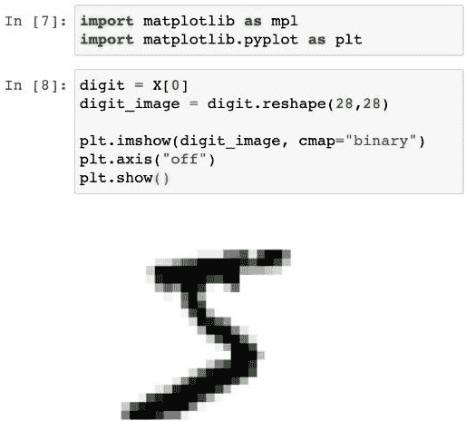

选取数据集中的第一个数字后，显示为数字“5”。我们可以验证它确实是数字 5：

*   

在开始任何分类步骤之前，创建测试集是必要的。`MNIST` 数据集已划分为训练集（前 60,000 张图像）和测试集（后 10,000 张图像）：

*   

##### 重塑与归一化图像

在 `MNIST` 数据集中，数组是三维的。此外，数据集需要归一化，因为这是任何卷积神经网络模型的要求。我们可以通过将 RGB 代码除以 255（最大 RGB 代码减去最小 RGB 代码）来实现这一点。这可以通过以下代码完成：

*   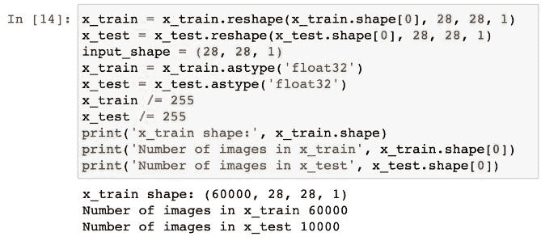

##### 构建卷积神经网络


#### 使用 Keras API 构建模型

下一步是使用 Keras API 构建模型，其后端使用 TensorFlow。存在多个高级 TensorFlow API，例如 `Keras` 和 `Estimators`，它们有助于利用高级知识生成神经网络。然而，由于它们在实现阶段各不相同，这可能会导致混淆。在实现阶段，我们将采用最直接的 API，即 `Keras`。因此，将导入来自 `Keras` 的 `Sequential`（序贯）模型，并添加 `Conv2D`、`MaxPooling`、`Flatten`、`Dropout` 和 `Dense` 层。此外，`Dropout` 层通过在训练期间随机丢弃部分神经元来应对过拟合，而 `Flatten` 层在构建全连接层之前将二维数组展平为一维数组。

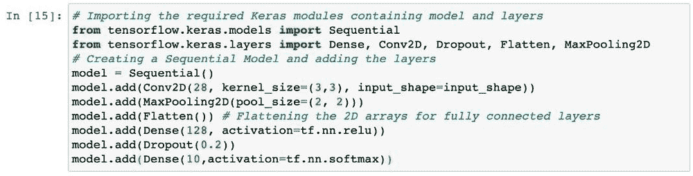

##### 编译与拟合模型

下一步是创建一个未优化的空 CNN。此处我们采用 `adam` 优化器，损失函数设为 `sparse_categorical_crossentropy`，评价指标为 `accuracy`。然后使用训练数据拟合模型，并将 epochs（轮数）设置为 10。

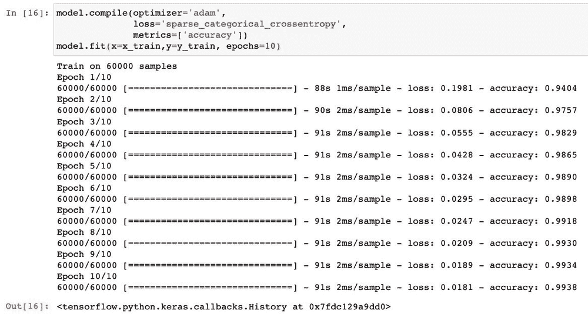

针对优化器、损失函数、评价指标和轮数创建具有不同参数的模型将对我们有所帮助。在训练中，轮数可以设得更大。但即使在较小的值 10 下，我们也能达到 99% 以上的训练准确率。由于 MNIST 数据集不需要大量计算资源，因此很容易尝试不同的参数。

##### 评估模型

最后，我们使用以下代码通过 `x_test` 和 `y_test` 评估训练好的模型：


使用 CNN 模型我们达到了 98.5% 的准确率。在许多图像分类场景中（例如人脸检测），我们无法容忍 0.1% 的错误率，因为打个比方，这将导致 1000 例中出现 1 例差错。我们还可以进行单独预测，模型将通过以下代码将图像分类为 `9`：

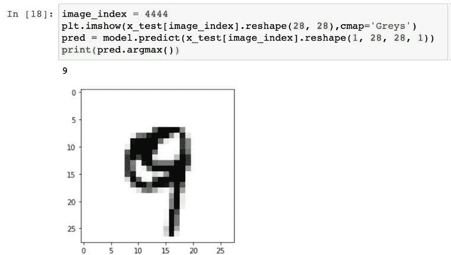

##### 恭喜！

借助卷积神经网络，我们使用 TensorFlow 的 Keras API 对手写数字进行了分类。我们实现了 98% 以上的准确率。

#### 利用深度学习进行皮肤癌（黑色素瘤）检测

黑色素瘤是一种侵袭性强且危险的肿瘤，当黑素细胞开始失控生长时就会发生（美国癌症协会 2019）。据估计，2020 年美国将有约 100,350 例新发黑色素瘤被确诊（约 60,190 例男性和 40,160 例女性），预计约 6,850 人将死于黑色素瘤（约 4,610 名男性和 2,240 名女性）。与其他某些类型的皮肤癌相比，黑色素瘤要罕见得多。但黑色素瘤更为严重，因为如果不在早期识别和治疗，它更有可能扩散到全身。在早期阶段，黑色素瘤并不容易被检测出来，因为它几乎与普通痣或良性发育不良性病变难以区分。检测的困难性加上黑色素瘤的侵袭性，甚至给专业皮肤科医生带来了难题，使他们不得不权衡如何进行后续处理。常规检测流程是由皮肤科医生对可疑区域进行肉眼观察。然而，诊断准确率与皮肤科医生的专业经验密切相关。如果在早期发现黑色素瘤，可以通过手术将其从体内完全切除。因此，早期检测对于提高生存率至关重要。如今，用于医疗目的的自动检测或诊断算法越来越流行，研究人员利用计算机视觉对皮肤镜图像进行分析以检测皮肤癌。

皮肤癌的数字图像有潜力用于公众教育，协助医疗提供者进行早期检测，并通过远程皮肤科诊疗、临床决策支持和自动化风险评估直接支持远程分析。深度学习技术已证明其在应对此类挑战性问题上的强大能力。在海量数据集的帮助下，这些技术取得了与人类专家相当甚至在许多情况下超越专家的成果。例如，深度学习技术依赖于大量数据的输入，适合分析电子健康记录（EHR）以改进诊断（Myszczynska 等人，2020）。此外，在利用深度学习技术进行医学影像分析以协助医生完成分类、检测和分割任务方面也取得了进展。

##### 构建黑色素瘤检测模型

我们的第二个实战演示展示了如何构建和调优用于黑色素瘤检测的 CNN 模型。对于数据集，我们使用了 HAM10000 数据集，并在 Google Colab GPU 上进行处理。您可以在 Kaggle 的以下链接找到该数据集：`https://www.kaggle.com/kmader/skin-cancer-mnist-ham10000`。

###### 步骤 1：导入必要的库

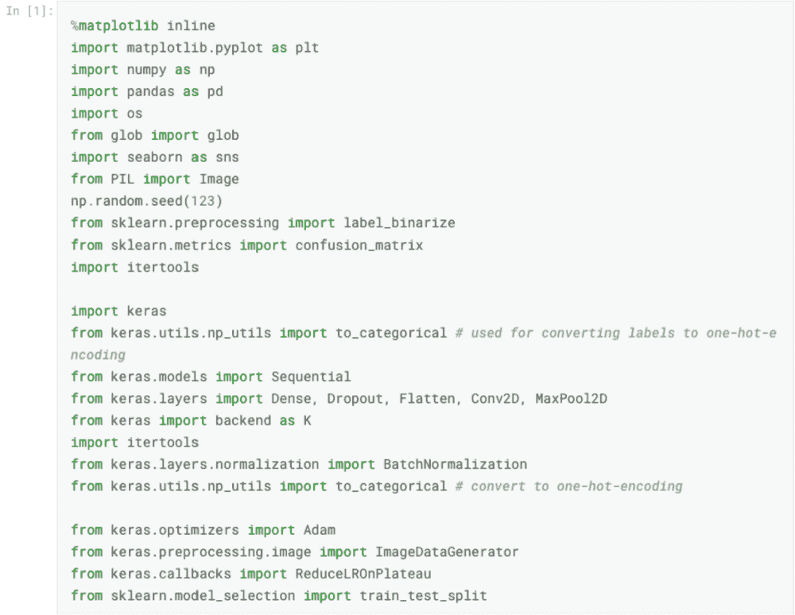

然后我们需要定义一个函数来绘制验证损失/准确率曲线。（验证损失是在训练好的网络中运行验证数据集后的误差——基本上它显示了模型的准确程度）。

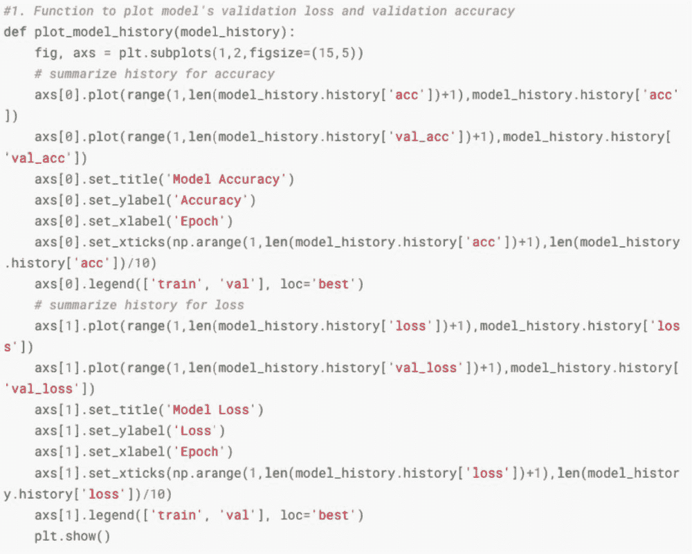

###### 步骤 2：创建图像与标签的字典

以下代码展示了如何合并数据集的两个文件夹，并创建相应的标签字典。

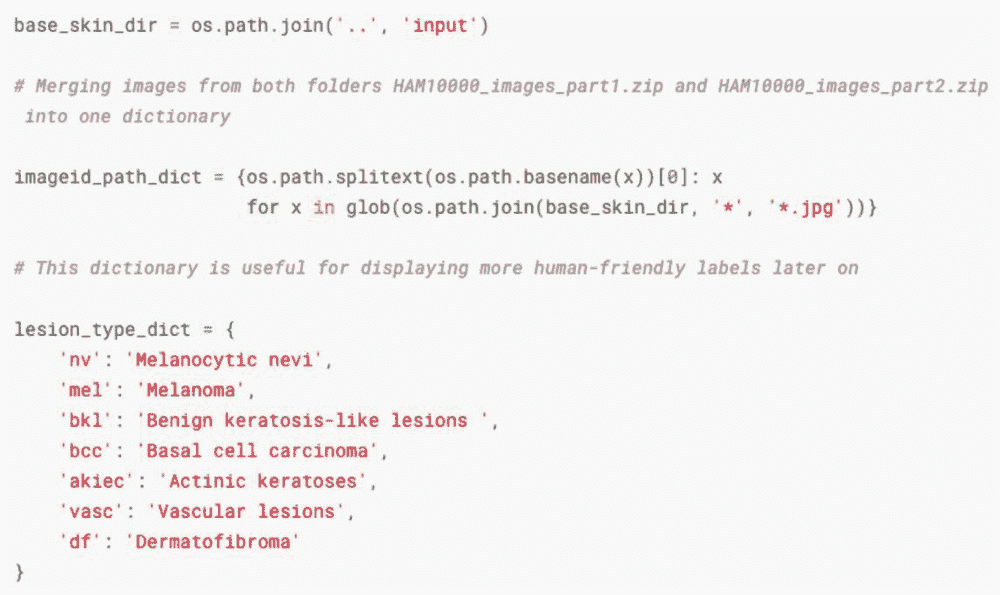

###### 步骤 3：读取与处理数据

加载数据集后，创建一个路径将图像文件夹与清晰文件夹连接起来，并合并新列以更好地提供数据：

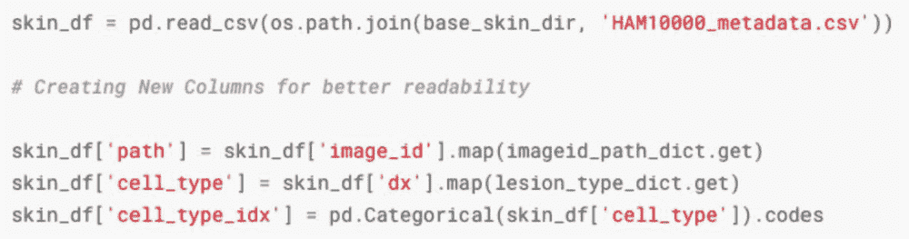

现在让我们可视化数据集的样本：

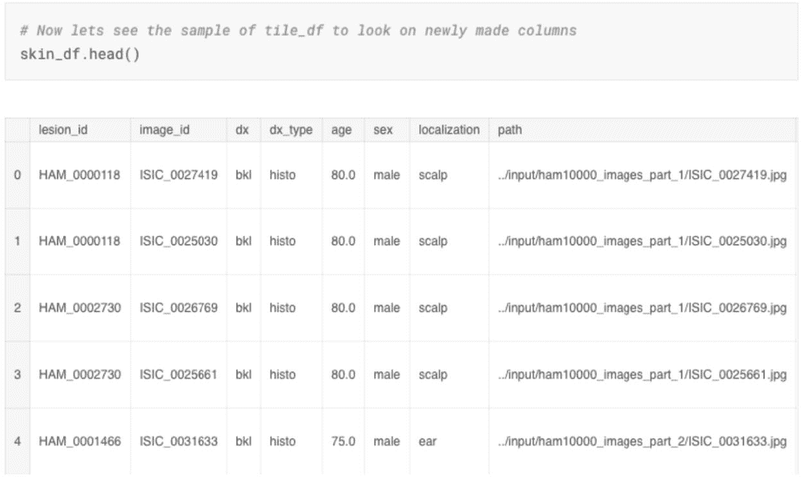

###### 步骤 4：探索性数据分析 (EDA)

以下代码展示了数据的分布情况，可视化有助于我们更好地理解数据。

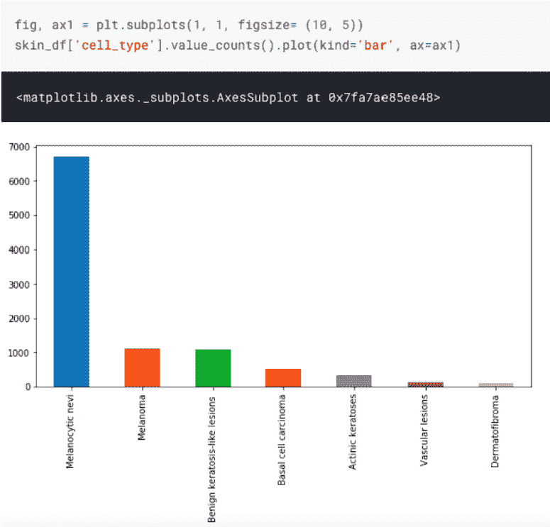

###### 步骤 5：加载与调整图像大小

图像被调整大小以适配深度学习模型。

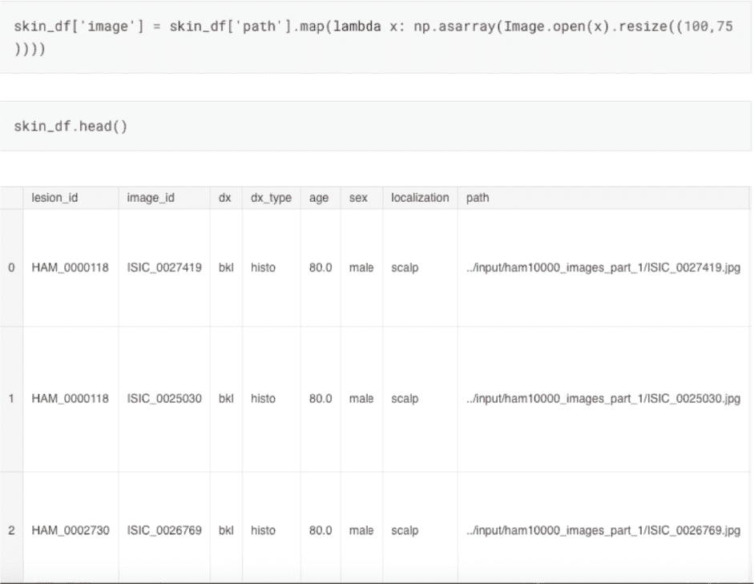

现在让我们看看数据的样子：

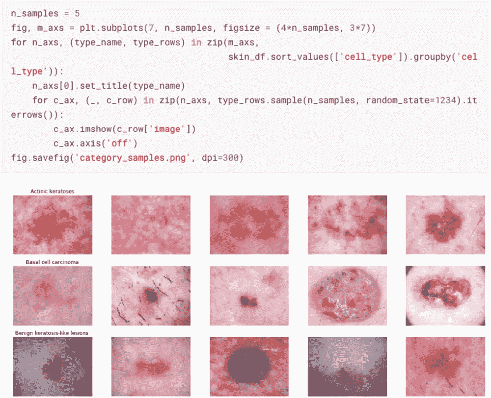

###### 步骤 6：划分训练集与测试集

下一步是将数据集按 8:2 的比例分别划分为训练集和测试集。

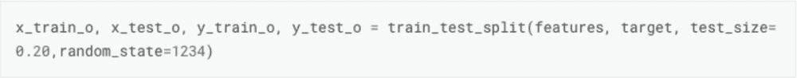

###### 步骤 7：归一化

归一化在许多情况下通常是有益的。它提高了模型的数值稳定性，且往往能缩短训练时间。减去均值对 `x_train`、`x_test` 数据集进行归一化，随后再除以它们的标准差。

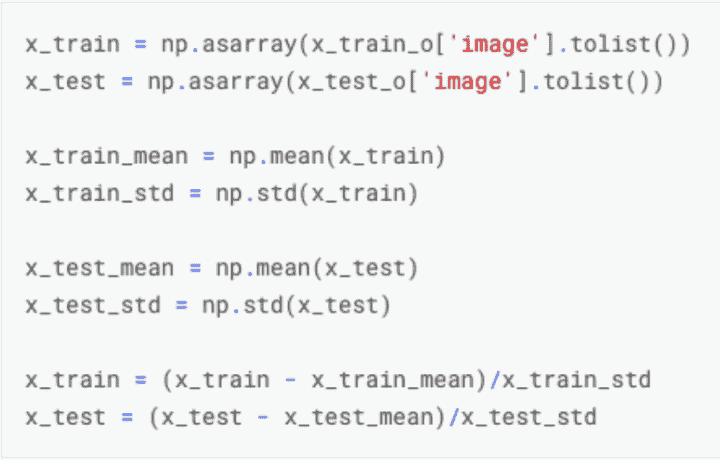

###### 步骤 8：CNN 模型构建


我们从输入图像开始，随后对数据集应用滤波器或特征图，从而得到卷积层。下一步是使用修正线性单元函数（ReLU）打破图像的线性。现在图像已准备好进行池化步骤。池化完成后，得到池化特征图。在将池化特征图输入神经网络之前，将其展平。

###### 步骤 9：设置优化器与退火策略

一旦层被添加到模型中，我们需要设置：

*   评分函数。
*   损失函数（观测标签与预测标签之间的误差率）——有助于衡量模型在已知标签图像上的表现有多差。
*   优化算法——用于迭代和改进参数（滤波器核值、权重和神经元偏置）以最小化损失。

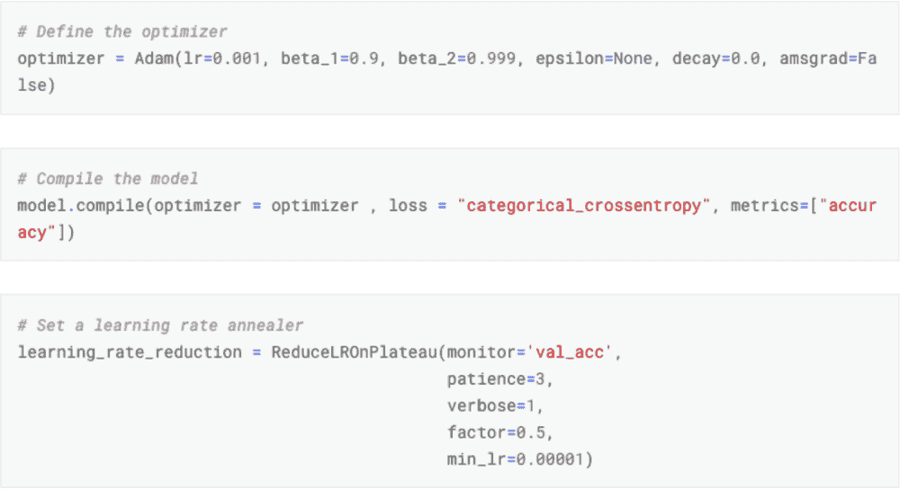

###### 步骤 10：拟合模型

将 CNN 模型拟合到 `x_train`、`y_train`。我们选择了 10 的批次大小和 50 个 epochs。

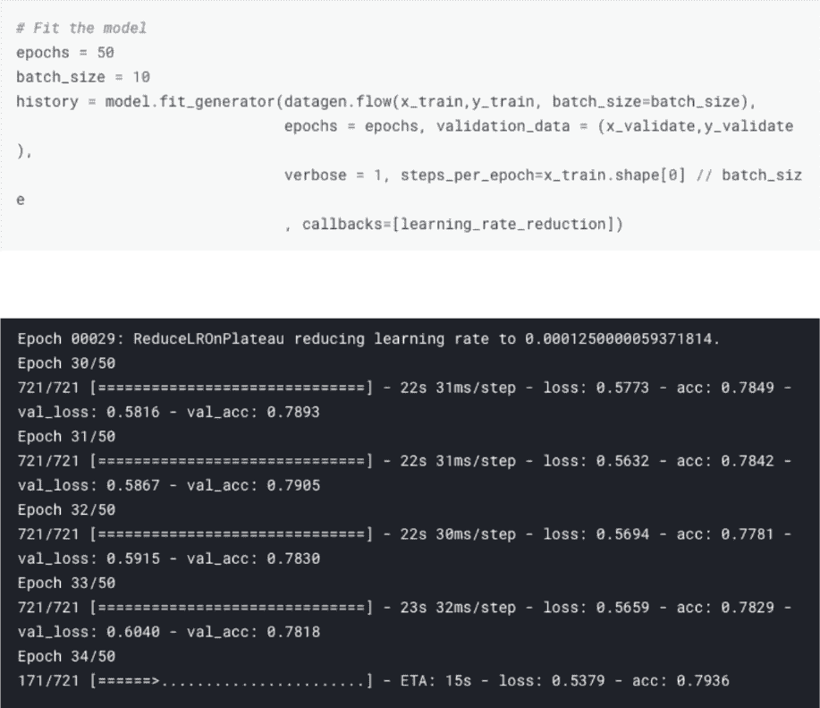

###### 步骤 11：模型评估


#### CNN 模型评估

CNN 模型的测试和验证准确率由以下代码行表示，并绘制了混淆矩阵。我们还确定了分类错误的图像数量。

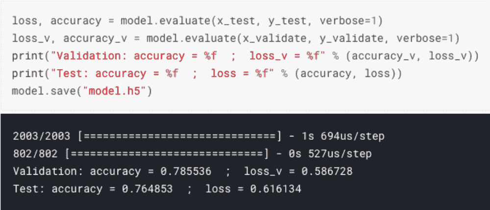

恭喜！

我们已成功为皮肤癌检测任务训练了一个 CNN 模型，该模型的准确率约为 76%。

#### 虚假新闻检测

##### 简介

阅读新闻的目的是什么？为什么人们在日常生活中阅读新闻？作为人类，阅读新闻是我们的天性，旨在学习和探索我们周围发生的事情，并随时了解这个世界。此外，理解正在发生什么以及为什么发生是我们的责任。新闻是我们公共话语的一部分，也是共享的智力试金石，它们帮助我们成为社区中的一个个体并了解当前的事态。新闻可以被定义为一座桥梁，连接着世界各地的人们。了解过去和现在可以预示未来。新闻阅读可以指导人们的社会生活、政治信仰以及新主题的发现。通过阅读新闻，人们可以联系到那些可能需要帮助的人。根据 Wan-Ifra 的《世界新闻媒体趋势报告》（2012 年 3 月），有 25 亿人阅读新闻，并且这些数字正日益增加，因为社区变得更有意识，阅读新闻正成为全球数十亿人的一种习惯。在远古时代，乡下人会向归来的探险家询问他们对自然界和邻村发生事件的观察。如今，新闻阅读的普及度不断提高，正成为关于公共事务、政治和社会生活的重要信息来源。随着技术使用的广泛增长，许多人从在线来源阅读新闻，因为它无处不在且易于访问各种新闻。在线新闻随时随地可访问。在线新闻网站实时每分钟更新新闻。因此，人们永远不会错过当前的新闻更新。假设报纸在午夜印刷，午夜之后发生的任何事情将在第二天发表。在这类情况下，人们必须等待 24 小时才能通过最新版报纸获知新闻，与在线新闻相比，这似乎成了“陈旧新闻”。另一方面，在线新闻在几秒钟内就在互联网上发布，且免费，我们无需为访问在线新闻付费。根据皮尤研究中心的数据（Mitchell 等人，2016），85% 的美国成年人从在线来源获取新闻。由于技术的出现，这些数字呈指数级增长，许多人利用互联网阅读新闻。他们期望在持续更新的同时，获得高质量的新闻内容。这些事实随后引出一个问题：在线阅读新闻有多可靠？我们能相信在线阅读的内容吗？近年来，在线新闻阅读令人生疑，在某些情况下旨在误导人们。社交媒体成为传播虚假新闻的理想温床，还有一些网站为取乐而撒谎（Breaking News, 2021）。建立一个有效的虚假新闻识别检测系统至关重要。因此，我们提出了一个用于识别虚假新闻的检测系统。

##### 虚假新闻表征

目前尚无公认的虚假新闻定义（Shu 等人，2019），如今在线虚假新闻倾向于在许多领域具有侵入性和多样性。根据维基百科（虚假新闻）的定义，虚假新闻是：一种黄色新闻或宣传，由故意的错误信息或骗局组成，通过传统印刷和广播新闻媒体或在线社交媒体传播。虚假新闻说服人们接受虚假或有偏见的故事。例如，许多人和组织在社交媒体上传播虚假新闻，出于经济和政治原因（Zhang 等人，2019）。据报道，虚假新闻曾影响 2016 年美国总统大选（Bovet 和 Makse，2019）。Xiang 等人（2021）提到，COVID-19 大流行期间的信息影响了公众对风险的认知和控制大流行的可接受方式。毫无疑问，虚假新闻改变了我们在日常生活中解读和应对事物的方式。因此，虚假新闻检测是一个亟待解决的关键问题。

###### 数据集

在本实操实验中，我们使用 Kaggle 的公开数据集，可在以下地址获取：`https://www.kaggle.com/clmentbisaillon/fake-and-real-news-dataset`。该数据集包含两个文件，一个用于真实新闻（共 21417 篇“真实”文章），一个用于虚假新闻（共 23481 条“虚假”推文）。

##### 实施步骤

###### 1. 导入库并加载数据

首先，我们导入必要的库并将数据集加载到 iPython 笔记本中：

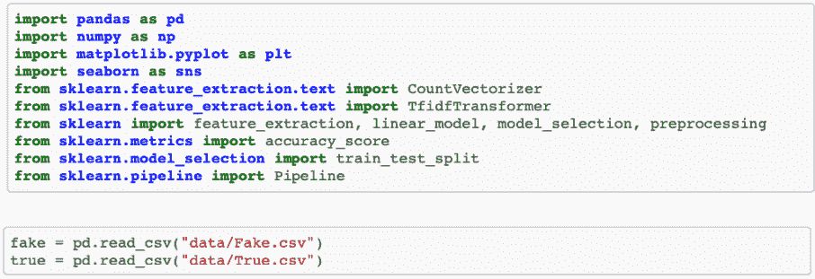

###### 2. 检查文章大小

接下来，让我们看看文章的大小：


###### 3. 合并数据框

现在让我们合并数据框：


###### 4. 打乱数据

下一步是打乱数据以防止偏差：


###### 5. 数据清洗

让我们看看数据的样子：

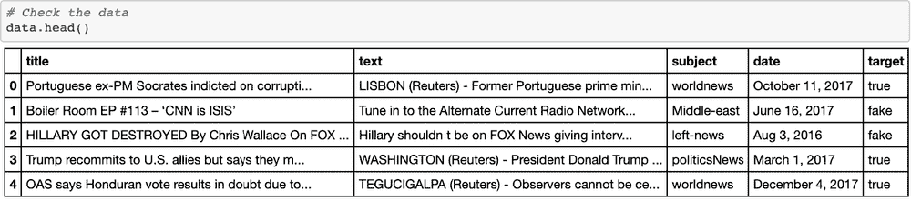

为了提高训练模型的性能，清洗数据至关重要。让我们移除日期和标题，然后将文本转换为小写：

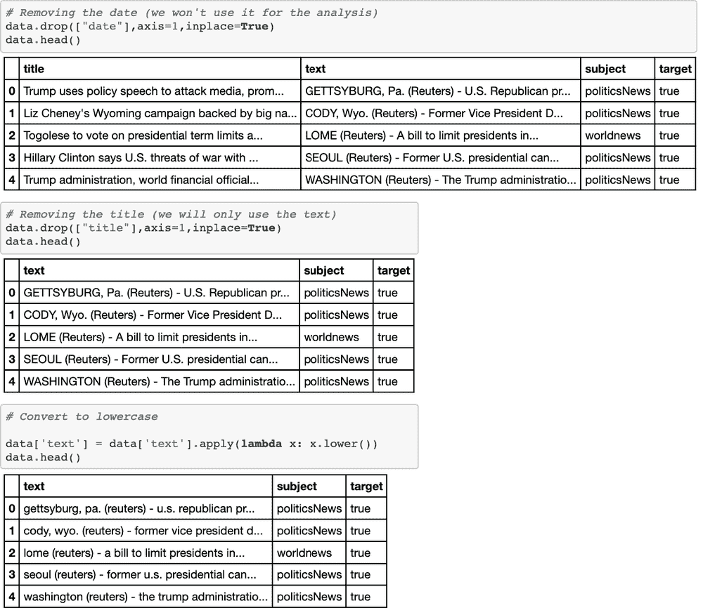

###### 6. 文本预处理

文本分类模型的性能高度依赖于语料库中的单词以及从这些单词创建的特征。停用词（常用词）和其他噪声元素会增加特征维度，但无助于区分文档。我们在数据中使用了一些预处理步骤，以在特征转换前减小语料库规模并增加上下文。

1.  **移除停用词**：在自然语言处理中，无用的词（数据）被称为停用词。停用词是常用词（如 `some`、`there`、`which`），搜索引擎在为搜索建立索引条目和恢复搜索查询结果时都会被编程忽略（GeekforGeeks, 2019）。
2.  **移除空白和标点符号**：我们从数据中移除了空白和标点符号（如 `""`、`"@"`、`"."`）
3.  **词形还原**：词形还原将每个单词转换为其词根形式，也返回单词的基本形式或字典形式。（如 `player`、`playing`、`play`）我们对数据进行了词形还原，得到了每个单词的词根。
4.  **N-grams**：N-grams 将附近的单词组合成单个特征，这有助于为那些本身意义不大的单词提供上下文。

让我们移除标点符号和停用词：

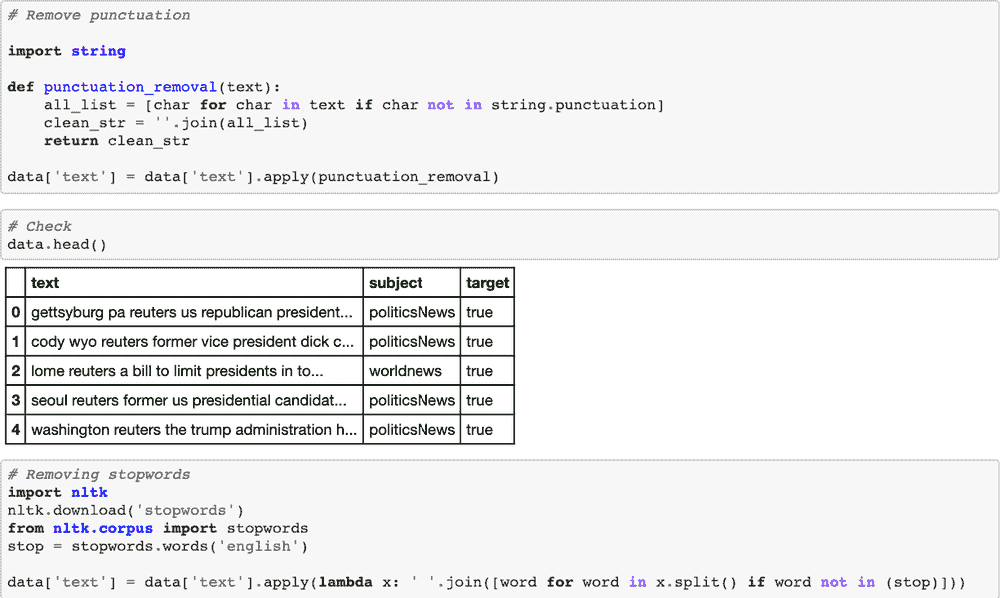

###### 7. 建模

词频-逆文档频率是一种统计量，表示一个单词在语料库中对文档的重要程度。它随着单词在文档中出现的次数成比例发展。使用 TF-IDF，我们找到了虚假新闻和真实新闻数据集中单词的相对重要性。

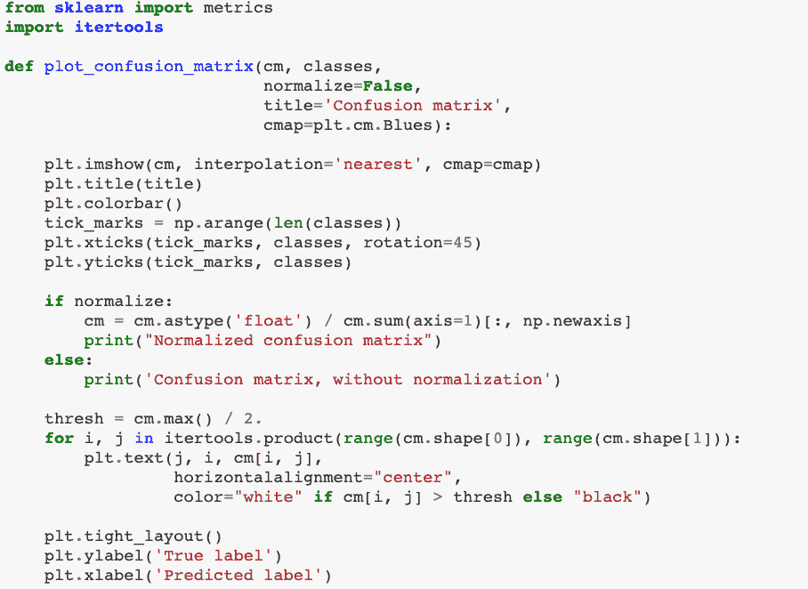

最后，我们将拆分数据并应用逻辑回归模型：

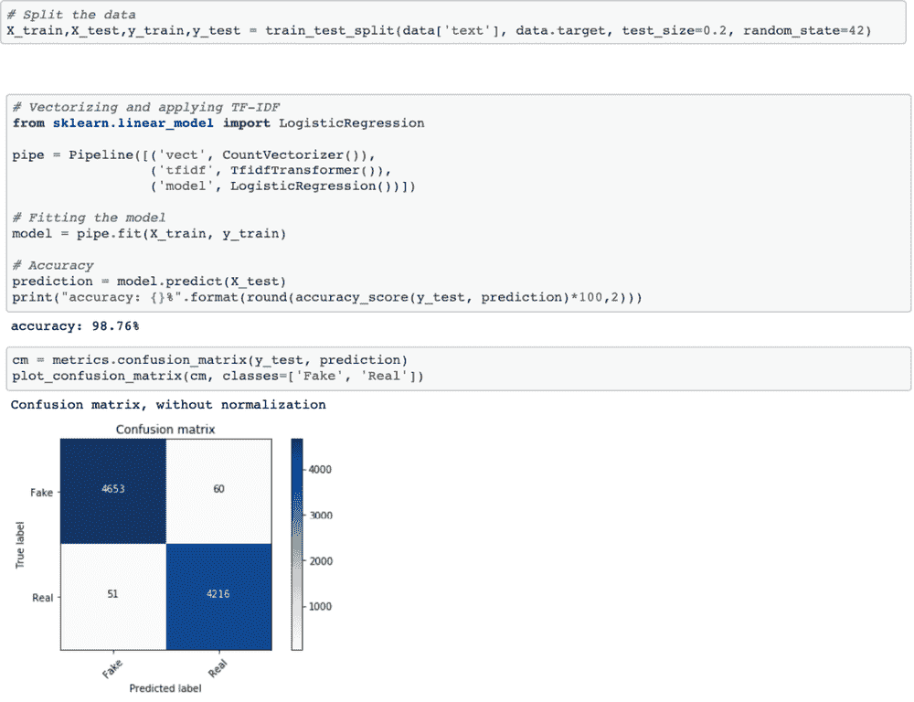

恭喜！

我们获得了 98.76% 的准确率。

#### 有毒评论分类

Twitter 和 Reddit 等社交媒体平台和在线论坛为人们提供了就众多问题和事件表达意见的途径。在某些情况下，人们的评论包含露骨语言，这可能会伤害读者。包含露骨语言的评论可分为多种类别，如有毒、侮辱、淫秽、威胁和身份仇恨。伤害和骚扰的威胁意味着许多人最终不敢表达自己，也不去寻求不同的观点。


##### 组织和公司已开始标记评论并屏蔽被认定为使用冒犯性语言的用户，以保护社交媒体平台用户免受在线论坛或社交媒体网站上攻击性语言的侵害。有必要开展公共教育，宣传社交媒体网站上恶性评论的风险。已经开发并部署了许多机器学习模型来过滤暴力语言，保护用户免遭网络骚扰，特别是疫情期间的年龄歧视内容（Xiang 等人，2021）。

在本实操实验中，我们将使用 Kaggle 提供的数据集，可在此处找到：

*   https://www.kaggle.com/c/jigsaw-toxic-comment-classification-challenge/data

现在让我们开始行动。

##### 步骤 1：导入库

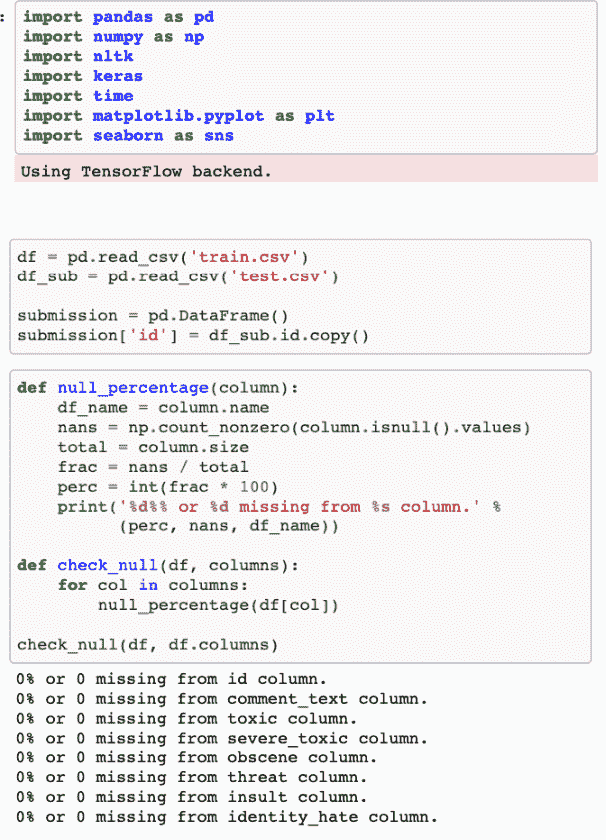

##### 步骤 2：数据预处理

###### 移除标点符号的准备工作

下一步将是移除停用词。因此，我们导入了包含所有标点字符的 `string` 库，并向其中添加了数字，将它们也一并移除。

*   

###### 词干提取和词形还原

词干提取是将屈折形式的单词转换为其词干或根形式的方法。大量同源词被转换为词根。例如，“player”、“playing”、“play”等词均基于“play”。这有助于以更高的准确度完成训练过程。词形还原是将屈折形式归类在一起的过程。从 `nltk` 导入了 `Stemmer` 和 `Lemmatizer`。

*   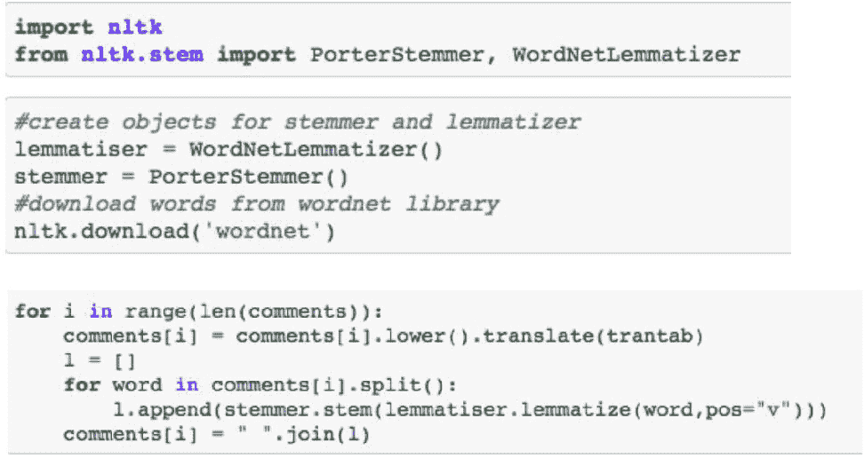

###### 应用计数向量化器

使用 `Count Vectorizer`（计数向量化器）的目的是将单词字符串转换为单词矩阵。列标题即为单词本身，单元格值表示单词出现的频率（Vectorizer，2021）。因此，我们将之前执行的自定义停用词列表作为参数传递，'lowercase' 和 'regular expression' 使用默认值。

*   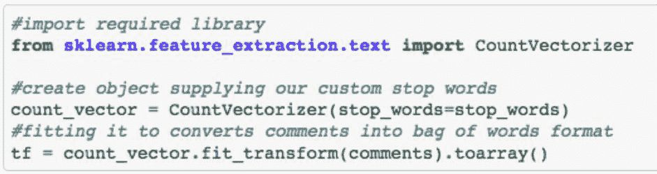

##### 步骤 3：将数据集拆分为训练集和测试集

由于使用 `train_test_split` 导致系统内存不足，我们在一开始就打乱了所有索引。`shuffle` 函数执行将前 2/3 的值分配给训练集、剩余 1/3 的值分配给测试集的任务。

*   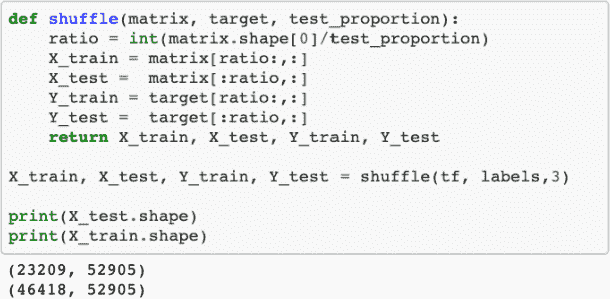

##### 步骤 4：实现

让我们定义所有评估指标：

*   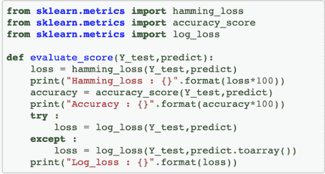

我们将从头实现二元相关法。它不考虑标签之间的相互依赖关系，基本上为每个标签创建一个单独的分类器。

*   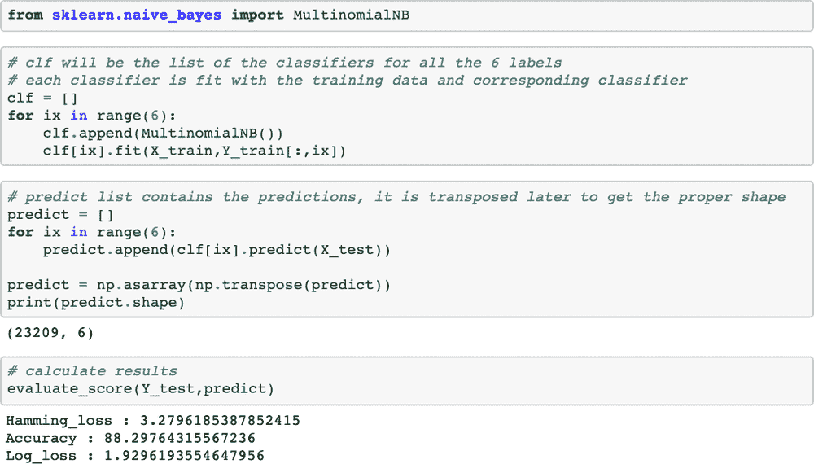

##### 步骤 5：适应算法

###### 1. MLKNN

这是 K 近邻算法改进的多标签版本。由于在我们的实验中，该问题与页面分类问题略微相似，`MLKNN` 算法应该能给出足够的结果。然而，所需的时间复杂度较大，因此最好在数据集的较小部分上对其进行训练。

*   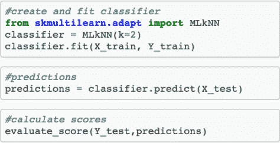

###### 2. BP-MLL 神经网络

这是单隐藏层前馈神经网络的架构，如下所示——输入层与隐藏层全连接，隐藏层与输出层全连接。由于在本例中我们有六个输出标签，输出层将有六个节点。这里的模型架构很简单，如下所示：

*   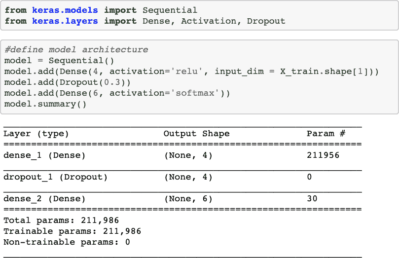

下一步是选择最佳模型，在微调神经网络架构的参数或选择效果最好的分类器+转换方法组合后。我们使用 `GridSearchCV` 进行神经网络模型优化，参数网络包含不同数量的轮次、隐藏层节点数和学习率。批次大小保持固定。

*   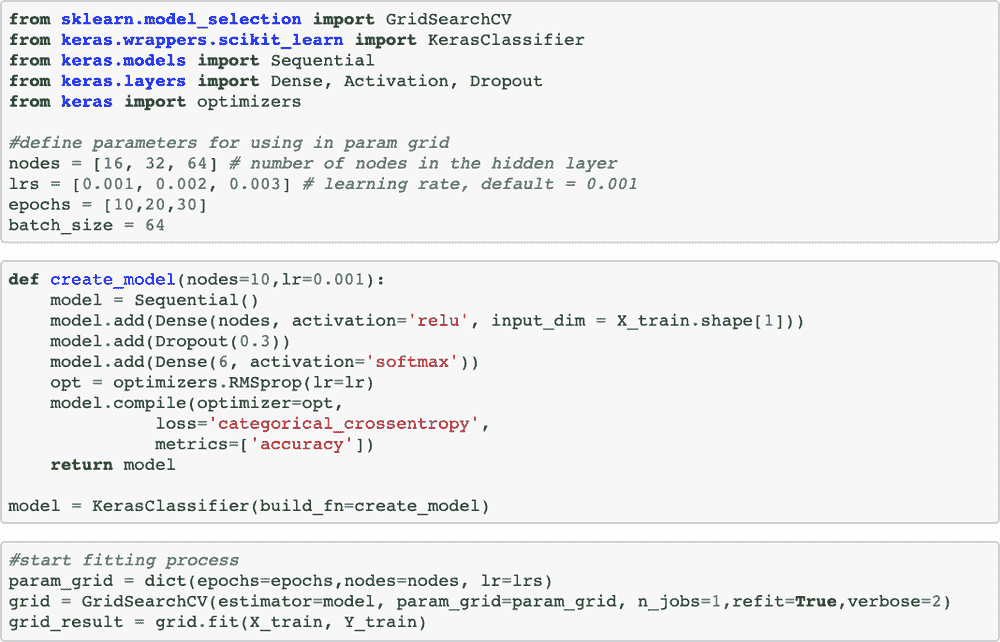

恭喜！

您已成功完成恶性评论分类。

#### 使用机器学习检测信用卡欺诈

机器学习技术彻底改变了技术领域，其日常应用范围从推荐购物商品到自动柜员机（ATM）的流程检查。我们越来越多地基于金融和银行系统的技术使用信用卡。如今大多数人经常使用信用卡。在机器学习的编辑讨论中，（Odden 和 Melzer 2019）总结了机器学习技术在日常生活不同方面的应用和影响，特别是机器学习技术在美国脆弱老龄化人口的老龄化研究中的应用。当今社会，信用卡欺诈的老年受害者越来越多。在我们接下来的实操体验中，我们将使用以下数据集：

*   https://www.kaggle.com/mlg-ulb/creditcardfraud

##### 步骤 1：导入库

第一步是导入必要的库，随后上传数据集。数据集外观如下：

*   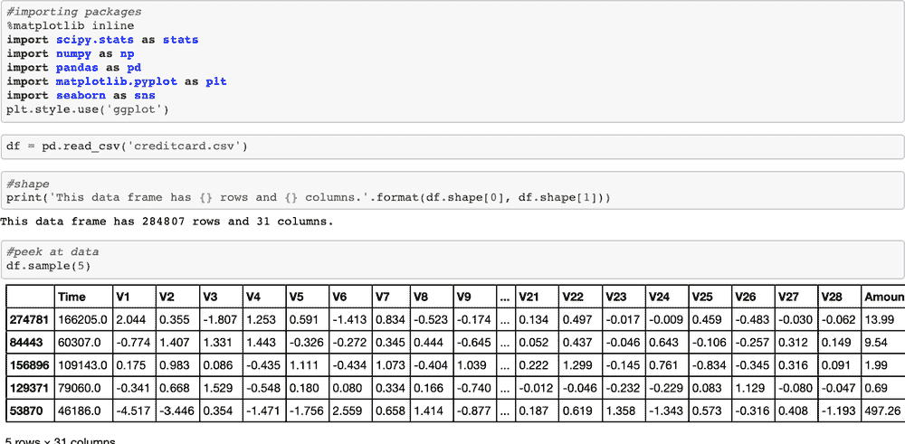

##### 步骤 2：探索性数据分析 (EDA)

由于几乎每个预测变量都已匿名化，在本实验中，我们决定在 EDA 期间专注于非匿名化的预测变量——交易时间和金额。完整数据集包含 284,807 笔交易。但是，基于平均值和最大值，所有交易货币价值的分布严重右偏。绝大多数交易金额相对较小，只有一小部分交易接近最大值。

*   

| 图 2. ­ |
| --- |
| 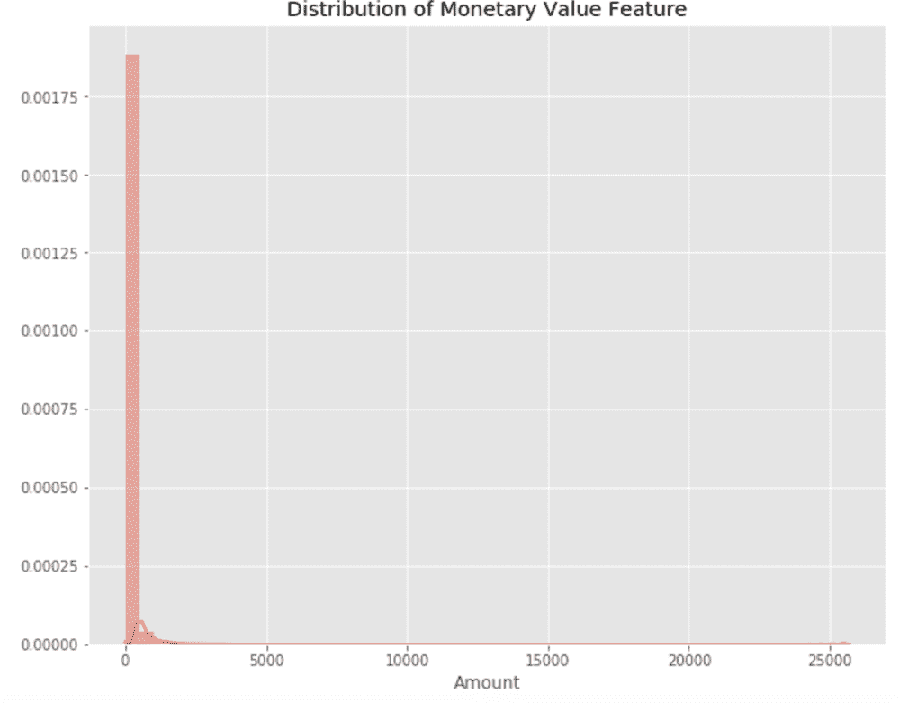 |

该数据集中所有信用卡交易的平均金额约为 88 美元。最大交易的货币价值约为 25,691 美元。

类别分布如何？有多少笔交易是欺诈性的，有多少笔不是？

*   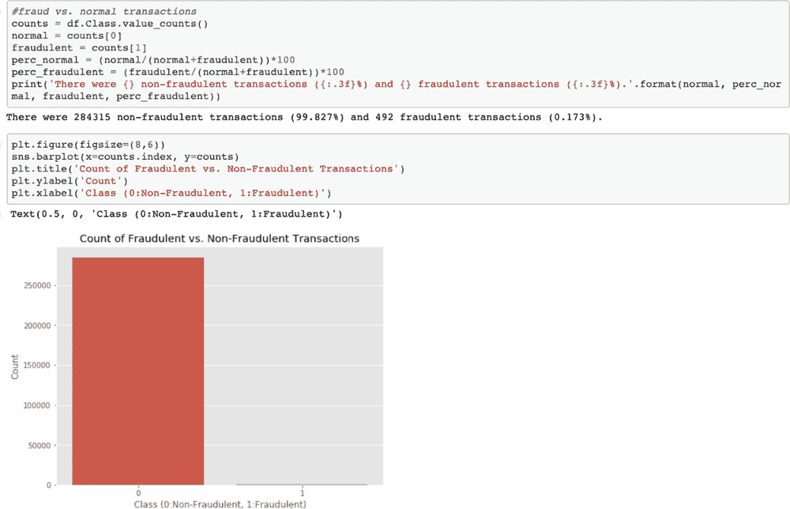

###### 创建具有平衡类别分布的子样本数据集

让我们看看需要多少正常交易的随机样本？

*   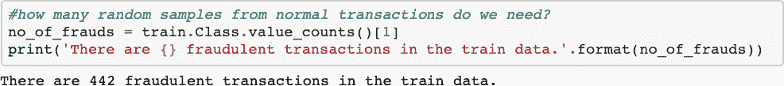

##### 步骤 3：异常值检测与移除

异常值检测是一个复杂的问题。减少交易数量（从而减少算法可用的知识量）与过多的异常值扭曲预测结果之间的权衡，并非简单合理，高度依赖于数据和目标。

*   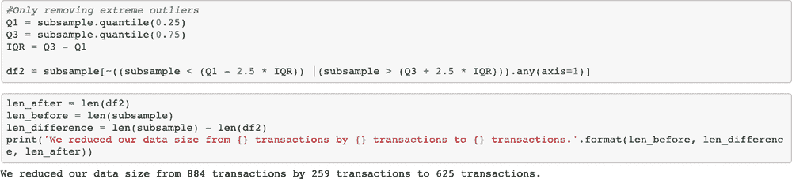

##### 步骤 4：使用 t-SNE 进行降维以实现可视化

可视化类别可以显示它们是否清晰可分。然而，使用每个预测变量创建 30 维图是不现实的。相反，使用诸如 `t-SNE` 之类的降维过程，我们可以将这些高维分布可视化为低维可视化。在此体验中，我们倾向于使用 `t-SNE`。

*   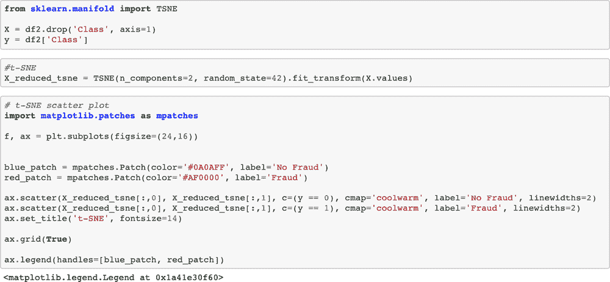

| 图 3. |
| --- |
| 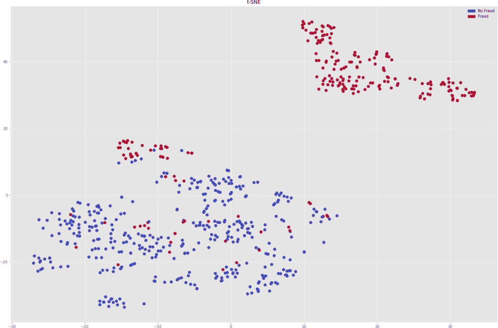 |

##### 步骤 5：分类算法

为了检验算法的性能，我们将平衡数据集分为两部分（80/20）。为避免过拟合，我们因此使用了 k 折交叉验证。这意味着我们将训练数据分成 k 部分（折），然后在 k-1 折上应用模型，再对第 k 个留出折进行预测。然后对每一折重复此方法并比较生成的预测结果。

*   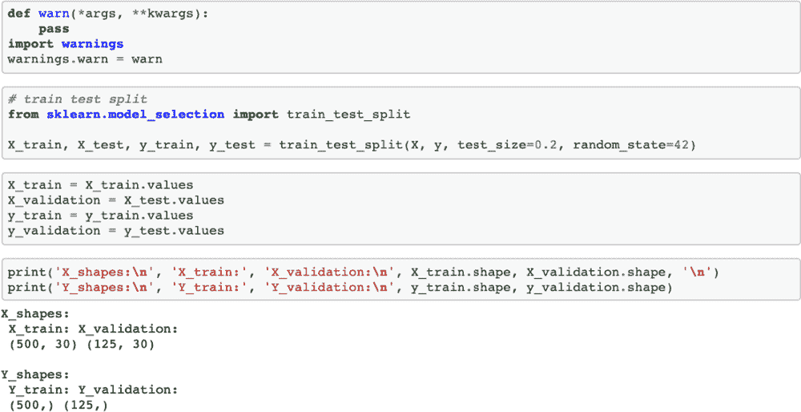


#### 算法选择与泰坦尼克号生存预测实战

##### 算法性能分析

为了找出哪种算法在我们的数据上表现最佳，让我们快速分析一些最流行的分类算法：

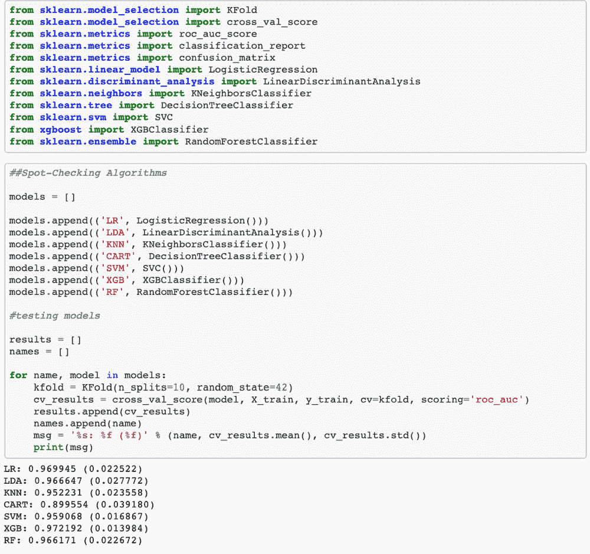

以下是算法对比情况：

![Figure978-1-7998-7776-9.ch001.g52.png)如上所示，不同算法的表现各异。下一步是决定选择哪种算法？`LR`、`Random Forest` 或 `XGBoost` 可能是不错的选择。让我们可视化 `Random Forest` 模型。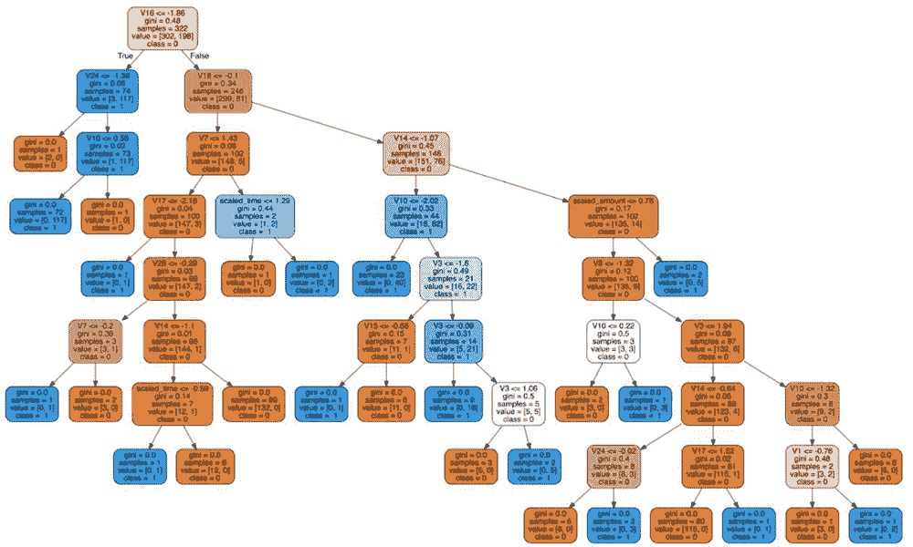 |
| --- |

##### 泰坦尼克号生存者

本实战旨在开发一个机器学习模型，以预测泰坦尼克号乘客的生存情况。

###### 步骤 1. 导入库并加载数据

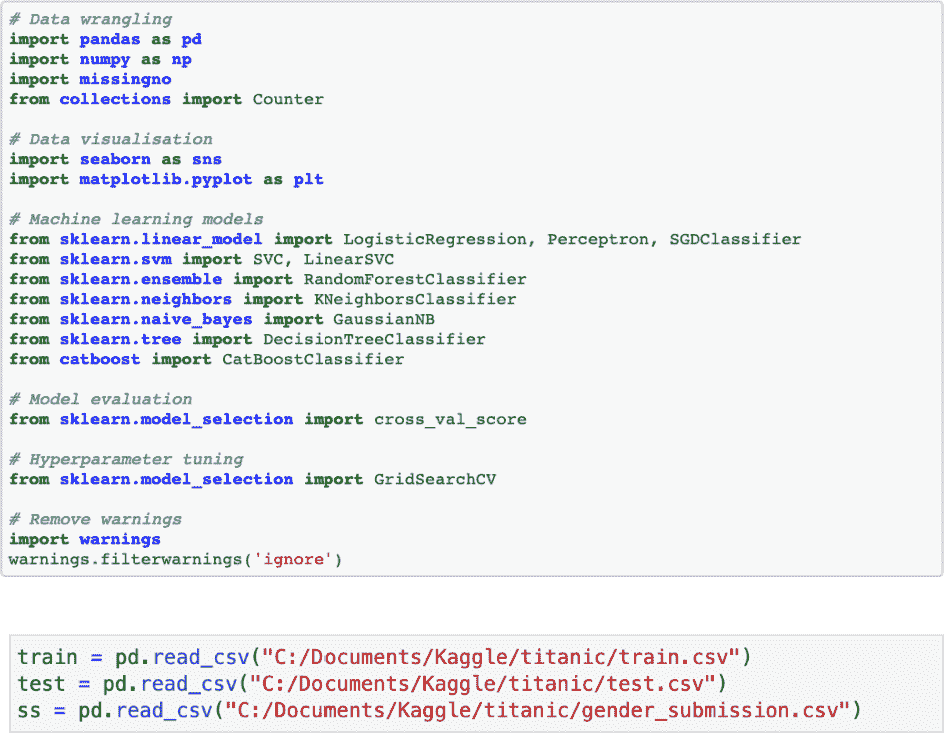

让我们看看数据集：

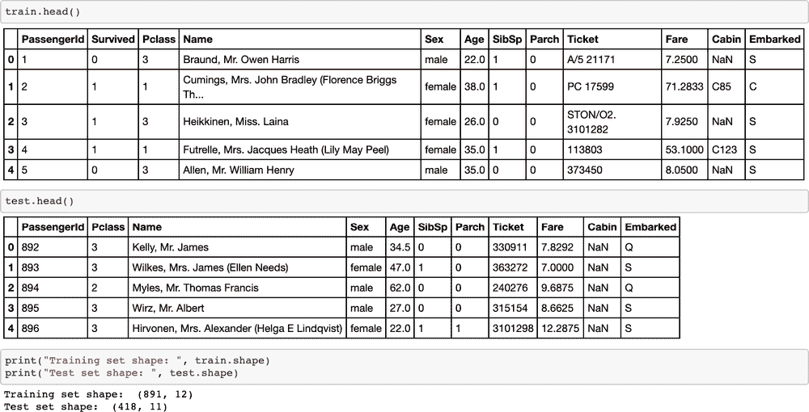

注意测试集比训练集少一列，即 `Survived` 列。这是因为 `Survived` 是我们的响应变量，有时也称为目标变量。我们的目标是分析训练集中的数据，并预测测试集中乘客的生存情况。

###### 步骤 2: 探索性数据分析 (EDA)

探索性数据分析是通过可视化和分析数据来提取洞见的过程。换句话说，我们希望总结数据中的重要特征和趋势，以便更好地理解数据集。

####### 2.1 数据类型、缺失数据与汇总统计

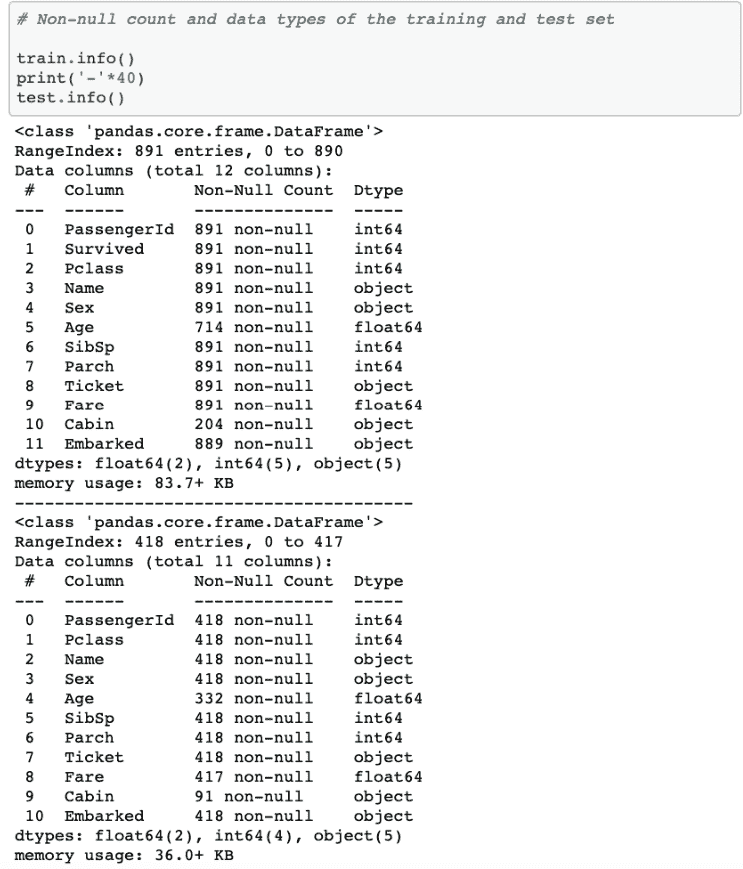

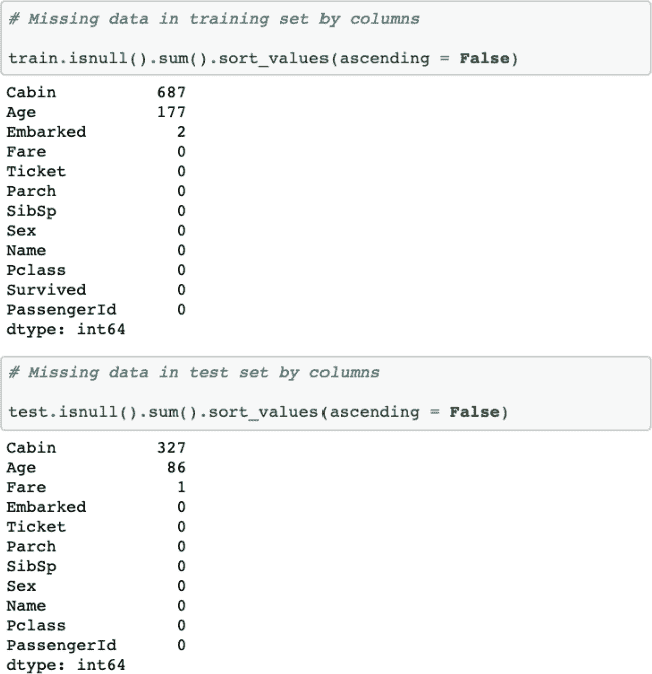

训练集中的 `Age`、`Cabin` 和 `Embarked` 列存在缺失数据，而测试集中的 `Age`、`Fare` 和 `Cabin` 列存在缺失数据。

####### 2.2 特征分析

数据框由行和列组成。行数对应数据集中的观测值数量，而列（有时称为特征）代表描述这些观测值的特征。在我们的数据集中，行是泰坦尼克号上的乘客，而列是描述乘客的特征，如年龄、性别等。在继续之前，区分分类变量和数值变量也很重要。顾名思义，分类变量的值属于两个或多个类别之一，这些类别通常没有内在顺序。我们数据中的一个例子是 `Sex` 特征。每位乘客都被明确分类为男性或女性。另一方面，数值变量具有连续分布。数值变量的例子包括 `Age` 和 `Fare` 特征。

了解特征是数值变量还是分类变量有助于我们更合理地构建分析。例如，计算性别等分类变量的平均值是没有意义的，因为性别是二元分类，因此其值没有内在顺序。

**检测并移除数值变量中的异常值**

异常值是具有极端值且不符合大多数数据模式的数据点。解决这个问题很重要，因为异常值倾向于将数据拉向极端，可能导致模型预测不准确。

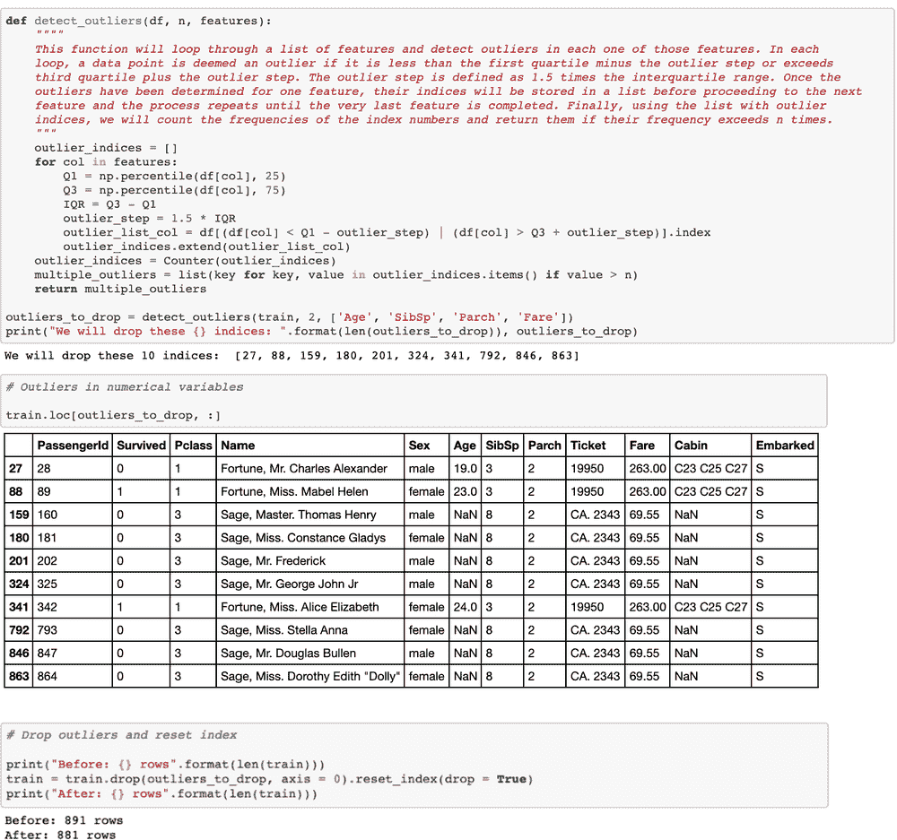

###### 步骤 3: 数据预处理

数据预处理是为模型训练准备数据集的过程。在本节中，我们将执行以下预处理步骤：

*   删除并填补缺失值
*   数据转换（对数转换）
*   特征工程
*   特征编码

####### 3.1 删除并填补缺失值


为简化本教程，`Ticket` 和 `Cabin` 列均被删除，但如果您有时间，可以研究它们看看是否有助于改进模型。

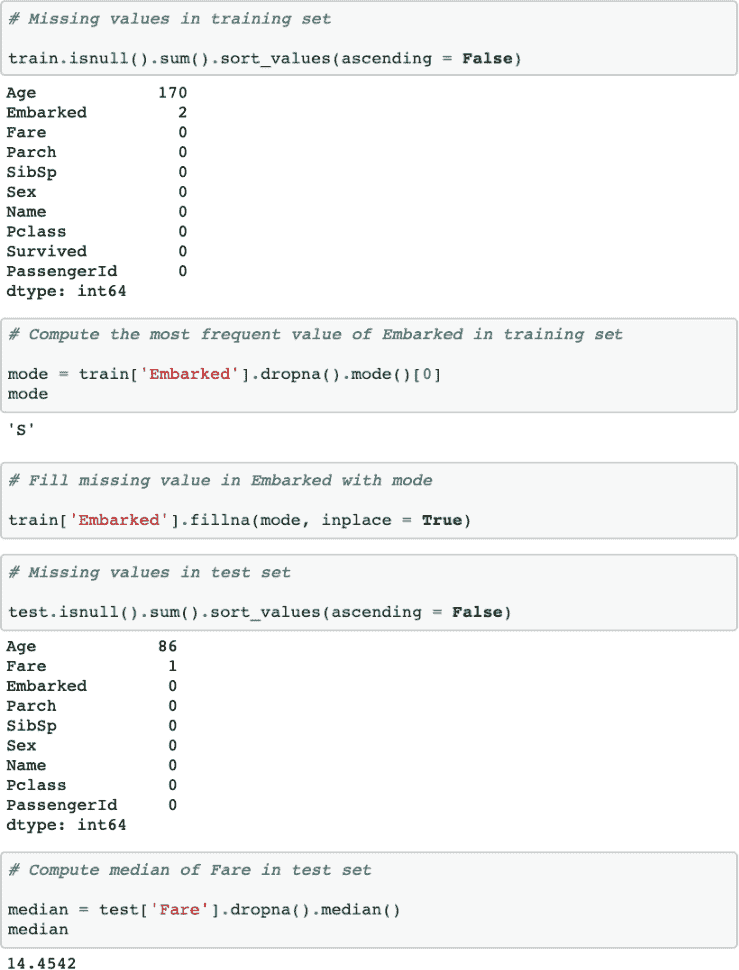

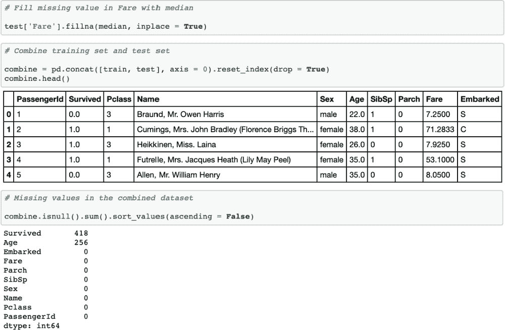

我们可以忽略 `Survived` 列中的缺失值，因为它们全部来自测试集。现在我们需要填补 `Age` 列中的缺失值。目标是利用与 `Age` 相关性最高的特征来预测 `Age` 的值。但首先，我们需要将 `Sex` 转换为数值，其中 `0 = male`，`1 = female`。

###### 步骤 4: 建模

`Scikit-learn` 是 Python 中最流行的机器学习库之一，我们将在本项目的建模部分使用它。由于泰坦尼克号问题是一个分类问题，我们需要使用分类模型（也称为分类器）在数据上进行训练以做出预测。

####### 4.1 划分训练数据

我们首先需要将训练数据划分为自变量（预测变量），用 `X` 表示，以及因变量（响应变量），用 `Y` 表示。`Y_train` 是训练集中的 `Survived` 列，`X_train` 是除 `Survived` 列外训练集中的其他列。我们的模型将学习基于所有 `X_train` 对生存情况 `Y_train` 进行分类，并对 `X_test` 进行预测。


####### 4.2 预测

######## 4.2.1 逻辑回归


######## 4.2.2 支持向量机


######## 4.2.3 K-近邻算法 (KNN)


######## 4.2.4 决策树


######## 4.2.5 随机森林


###### 步骤 5: 使用 SVM 进行交叉验证


恭喜！

您已成功完成泰坦尼克号生存预测。

##### 结论

通过一系列实战练习，我们能够将机器学习和深度学习技术应用到日常生活的真实数据中。由于我们的社会产生的数据量日益庞大，数字化依赖也在近期持续增长。我们需要基于输入数据获得更好的预测，机器学习和深度学习技术在现代社会中至关重要，它们与我们的日常体验息息相关，范围涵盖从购物行为到医疗记录元数据，以改善不同医学领域的治疗和疗法。机器学习研究对普通大众至关重要，也对包括老年人和互联网使用日益增加的儿童在内的弱势群体至关重要。我们还注意到，机器学习技术常被应用于观察性数据，包括不同社交媒体网站上的非研究数据。在社会中使用非研究数据具有挑战性。医疗技术也需要通过机器学习得到改进，社会可以通过机器学习在医疗技术方面的最新进展受益。医疗技术的进步与机器学习水平的提高相结合，意味着许多皮肤相关问题可以通过黑色素瘤皮肤扫描检测结果来检测或预防。


我们依靠关于可用服务的信息，利用包括智能手机和平板电脑在内的智能设备来满足日常生活中的各种需求，因此，开发语音命令以搜索个人所需服务，对于通过机器学习技术利用这些智能设备筛选有用且准确的信息至关重要。人们可以要求智能设备搜索有用信息，以满足现代社会中的个人需求，从而造福日常生活。例如，在大流行期间，人们需要通过互联网获取可用服务和健康信息，以获取准确信息，许多人正在自我教育关于健康与预防、疾病与治疗选择、护理服务以及有益健康行为的知识，尤其是在当下的大流行期间。机器学习为改善智能设备提供的服务提供了有用信息。由于智能设备的普及。网络犯罪和网络赋能犯罪是现代社会的关键问题，这些网络犯罪的成本在全球范围内不断增加。在美国，应对这些网络安全问题的成本估计每年约为 1200 亿美元，每年影响超过 50 万个就业岗位 (Lewis 2018; Demirdjian and Mokatsian 2015)。基于社交媒体上的数字多媒体数据，不同年龄段的人群也面临着不同的网络安全威胁。机器学习和深度学习技术可以改善生活的不同方面。

#### 参考文献

American Cancer Society. (2019). What Is Melanoma Skin Cancer? https://www.cancer.org/cancer/melanoma-skin-cancer/about/what-is-melanoma.html

Bovet, A., & Makse, H. A. (2019). Influence of fake news in Twitter during the 2016 US presidential election. Nature Communications , 10, 7. doi:10.1038/s41467-018-07761-2

Convolutional neural network. (2021). In Wikipedia. Available: https://en.wikipedia.org/wiki/Convolutional\_neural\_network

Demirdjian, Z. S., & Mokatsian, Z. (2015). The cost of cyber crimes to business and society. ASBBS Proceedings, 22(1), 104.

Geeks for Geeks. (2019). Removing stop words with NLTK in Python. Available at: https://www.geeksforgeeks.org/removing-stop-words-nltk-python/

Huber, H. (2017). The most beautiful home for sale in every state in America. Architectural Digest. https://www.architecturaldigest.com/gallery/most-beautiful-home-for-sale-in-every-state-in-america

IFRA. (2012). WAN. Available: http://www.wan ifra.org/microsites/world-press-trends

Kaggle. (2010). Your Machine Learning and Data Science Community. https://www.kaggle.com/

Lewis, J. A. (2018). Economic impact of cybercrime-no slowing down. https://a51.nl/sites/default/files/pdf/economic-impact-cybercrime.pdf

Mitchell, A., Gottfried, J., Barthel, M., & Shearer, E. (2016). How Americans get their news. Pew Research Center’s Journalism Project. Available: https://www.journalism.org/2016/07/07/pathways-to-news/

Myszczynska, M. A., Ojamies, P. N., Lacoste, A. M. B., Neil, D., Saffari, A., Mead, R., Hautbergue, G. M., Holbrook, J. D., & Ferraiuolo, L. (2020). Applications of machine learning to diagnosis and treatment of neurodegenerative diseases. Nature Reviews. Neurology , 16(8), 440–456. https://www.nature.com/articles/s41582-020-0377-8?13571

Natural language processing. (2021). In Wikipedia. Available: https://en.wikipedia.org/wiki/Natural\_language\_processing

Odden, M. C., & Melzer, D. (2019). Machine Learning in Aging Research. J Gerontol A. , 74(12), 1901–1902. doi:10.1093/gerona/glz074

Recurrent neural network. (2021). In Wikipedia. Available: https://en.wikipedia.org/wiki/Recurrent\_neural\_network

Shu, K., Wang, S., & Liu, H. (2019). Beyond news contents: The role of social context for fake news detection. Proceedings of the twelfth ACM international conference on web search and data mining. https://arxiv.org/pdf/1712.07709.pdf

The Breaking News Meme Generator. (n.d.). Break Your Own News. https://breakyourownnews.com/

Vectorizer. (2021). https://scikitlearn.org/stable/modules/generated/sklearn.feature\_extraction.text.CountVectorizer.html

Xiang, X., Lu, X., Halavanau, A., Xue, J., Sun, Y., Lai, P.H., & Wu, Z. (2021). Modern senicide in the face of a pandemic: an examination of public discourse and sentiment about older adults and COVID-19 using machine learning. The Journals of Gerontology: Series B, 76(4), e190-e200. doi: 10.1093/geronb/gbaa128

Zhang, J., Cui, L., Fu, Y., & Gouza, F. B. (2019). Fake News Detection with Deep Diffusive Network Model. arXiv preprint arXiv:1805.08751

### 第 2 章

**A. B. M. Rezbaul Islam**  
Sam Houston State University, USA

#### 摘要

计算机视觉是计算机科学的一个研究领域，它赋予了计算机人类感知的能力。计算机视觉的目标是理解图像及其内容。计算机视觉已从简单的模式识别发展到解决各种复杂的现实问题。如今，计算机视觉已应用于科学领域的各个域，不局限于计算机科学。它也广泛用于医学、生物学、物理学和化学等领域。计算机视觉近期的飞速发展归功于机器学习 (ML) 的影响。ML 是人工智能的一个子领域。机器学习是一种让计算机从提供的数据中学习并随时间提高其性能的方法。计算机视觉问题复杂，需要正确选择算法。在本章中，将讨论一些在计算机视觉中广泛使用的机器学习算法。理论概念与现实世界的计算机视觉问题相关，例如人类皮肤检测。

#### 引言

机器学习是过去几十年计算机视觉研究中被引用最多的词汇。海量数据的可用性以及对数据分析的需求，使得机器学习成为每位数据科学家的必选项。如今，很难找到一项未使用机器学习进行的数据分析。机器学习为高性能数据分析开启了新纪元，有时甚至超越人脑，这实在非同寻常 (Steinberg, 2017)。与其他研究领域类似，计算机视觉受益于机器学习，因此许多计算机视觉研究人员在研究中使用机器学习。在计算机视觉中，问题域差异很大。图像分割、分类、识别、特征提取是一些最常用的问题域。在机器学习兴起之前，其他技术——滤波、波长分析、直方图处理、傅里叶变换、形态学算法——被用于特定任务。尽管如此，图像差异很大，这些方法在执行特定工作时各有其局限性。


##### 机器学习并非新概念

1949 年，唐纳德·赫布在名为《行为的组织》的书中提出了这一概念。在书中，作者介绍了一种基于人脑细胞相互作用的模型。赫布写道：“当一个细胞反复协助激发另一个细胞时，第一个细胞的轴突会在与第二个细胞胞体接触的地方发展出突触小瘤（如果已存在则将其扩大）。”（Keith, 2019）。然而，神经生理学家麦卡洛克和数学家沃尔特·皮茨早在 1943 年就发明了人脑神经元的概念。著名的艾伦·图灵利用同一概念创建了“图灵测试”。弗兰克·罗森布拉特于 1958 年设计了第一个人工神经网络——“感知机”，用于模式和形状识别。与其他突破性技术不同，机器学习在 1980 年代和 1990 年代处于休眠状态。IBM 等科技巨头和研究实验室——AT&T 贝尔实验室——在 21 世纪初让机器学习重获新生。在 21 世纪，利用机器学习实现的最重大的计算机视觉突破是 AlexNet（Krizhevsky, 2012）和 GoogleBrain（2012）。AlexNet 是 ImageNet 竞赛的获胜者。值得一提的是，ImageNet 是一个拥有庞大图像数据库的图像分类竞赛。赛后，许多计算机视觉研究人员将其视为契机，利用机器学习开发各种计算机视觉应用模型。本章将重点关注机器学习算法及其在计算机视觉中的各种实现。此外，还将简要讨论与预先存在方法的相关对比。

##### 计算机视觉

人们理所当然会问什么是计算机视觉，以及为什么机器学习是计算机视觉应用的宝贵工具。计算机视觉是计算机科学的一个领域，它处理数字图像和视频以处理和理解视觉数据。计算机视觉的重点是发现模式、物体及其各种属性。为了发现这些属性，研究人员试图构建一个类似于人类视觉过程的计算机模型。计算机视觉的核心概念是“教导”或训练计算机系统理解图像或视频的最小部分，并理解该部分。基于这种理解，特定算法解释结果。研究结果常用于图像和物体识别、分割、语音生成、自动驾驶汽车、人脸识别、增强现实和混合现实以及医学图像处理。尽管如此，计算机视觉的任务并非易事。其中涉及多个挑战。模仿人类视觉是最大的挑战，因为我们并不完全确定人类视觉是如何处理事物的——让计算机“看”原来非常困难。发明一种像我们一样“看”的机器是一项欺骗性的棘手任务，不仅因为让计算机做到这一点很难，还因为我们首先并不完全确定人类视觉是如何工作的。研究生物视觉需要了解感知器官（如眼睛）以及大脑感知的解释。虽然在绘制这一过程和发现系统使用的技巧与捷径方面已取得很大进展，但像任何涉及大脑的研究一样，前路漫漫。

图像和视频是计算机视觉的主要可用数据。目前，人人都能接触到相机；人们拍摄大量照片并录制视频。这种海量的图像和视频数据可用于各种目的。例如，执法人员可能利用这些数据识别关注人员；计算机科学家可能想为身体有障碍的人开发基于手势的计算机访问方式；农民可能想通过拍摄患病作物的照片来识别作物病害。实现清单可以很长，且新的挑战性问题每天都在涌现。这些需求要求某种能精准解决问题的高效方法。解决棘手计算机视觉问题的努力之一就是使用机器学习算法。

##### 机器学习

机器学习是一个训练计算机系统解决现实问题的过程，重点关注图像分类、物体检测、分割等。机器学习通常分两步：训练和测试。在训练阶段，机器学习方法从输入数据中“学习”某些特征，所学知识用于在测试数据上执行任务。

训练阶段至关重要。机器学习算法的性能深度依赖于训练。每种机器学习方法都有其独特的训练方式。训练阶段可以用一个简单的例子来解释：假设我们想训练一个婴儿识别苹果。婴儿没有关于苹果的任何先验知识。更具体地说——苹果长什么样、苹果的形状和颜色。要让婴儿识别苹果，我们可以给婴儿看一个苹果。婴儿会看一眼苹果，然后尝试学习苹果的形状、颜色和纹理等特征。之后，如果我们把苹果放进水果篮，问婴儿哪个是苹果，婴儿就能认出苹果。基于训练过程，所有机器学习可分为：监督学习、无监督学习和半监督学习。这些方法各有优缺点，根据问题领域选择使用。

##### 监督学习

监督学习使用标记数据进行训练。标记数据包含已知的知识，用于训练机器学习模型。监督机器学习技术如今很普遍。许多模型被开发并用于图像分类、物体检测。然而，目前有大量可用数据——文本、图像、视频、时间序列——但极少数是标记的。标记数据需要领域专家知识，且耗时昂贵。

###### 半监督学习

半监督机器学习结合了监督和无监督机器学习的优势。它在半监督学习中使用少量标记数据和大量未标记数据。因此，它不依赖于标记数据的可用性。

###### 无监督学习

无监督机器学习不需要任何标记数据。因此，这种方法寻找给定数据的潜在模式。聚类就是此类机器学习技术的一个例子。

###### 表 1. 机器学习算法分类法

| 机器学习算法类别 | 机器学习算法示例 | 在计算机视觉中的实现 |
| --- | --- | --- |
| 监督学习 | 线性回归 | 预测 |
|  | 神经网络 | 分类、检索、检测、分割、识别 |
|  | 支持向量机 | 分类、回归、异常值检测 |
|  | 随机森林 | 分类、回归 |
|  | 朴素贝叶斯 | 分类、预测 |
| 无监督学习 | K-means 聚类 | 基于图像数据特征的聚类 |
|  | 谱聚类 | 将未标记数据分配到组 |
|  | 层次聚类 | 通过迭代分组创建聚类树 |
|  | 主成分分析 | 降低数据复杂度并识别相似性 |
| 半监督学习 |  | 使用未标记数据训练模型 |

##### 监督机器学习


##### 监督学习

监督学习是一种机器学习技术，用于从带标签的训练数据中获取信息（模式、特征）（Rieke, 1997）。通常，训练数据包含一组带标签/已知的数据实例。例如，在图像分类问题中，模型旨在对图像进行分类，训练数据将包含已知类别的实例。监督机器学习算法分析训练数据，从中学习，然后利用该学习成果执行各种任务。监督算法还可以通过将新实例与训练阶段获得的学习知识进行映射，来给未见过的实例打标签。然而，这需要在归纳偏置的帮助下对训练数据进行泛化。监督算法广泛应用于各种应用中。将监督算法应用于问题领域的过程需遵循以下步骤。

###### 训练数据选择

监督算法高度依赖训练数据。性能与训练数据的选择有关。选择正确的训练数据集至关重要。例如，在动物图像分类中，训练数据可能是单一动物（猫、狗等）或同类型的多种动物。然而，训练数据集应能代表现实世界的实例。收集一组输入实例，并确定相应的输出。此过程可借助统计度量或人工专家参与来完成。

###### 特征选择

选择训练数据后，需要选择一些特征作为学习函数。这些特征将被监督算法学习，并用于未来的预测。当监督算法能从训练数据集中更好地学习时，将表现出高准确性。通常，训练数据会被转换为特征向量，以表示可用特征的数量。特征数量的选择应谨慎，因为数据可能具有多个维度，这会增加算法为获得更好预测而学习的复杂度。

###### 学习函数结构

鉴于存在各种监督算法，学习函数结构需要预先确定。完成这些后，算法需要通过训练数据进行训练。此外，一些监督算法在训练阶段提供选择特定参数的灵活性。这些参数因问题而异，需要自适应调整。监督算法的性能评估可通过与训练数据集不同的测试集来衡量。这将指示算法的学习准确性。

###### 监督算法的工作原理

监督学习使用已知数据集通过特征训练算法以进行预测。该已知数据集也称为训练数据，与期望输出相关联。监督学习通过学习特征与输出之间的关系来建立模型，随后用于对新数据集（测试数据集）进行预测。

| 图 1. 监督学习概览 |
| --- |
|  |

给定形式为 `{(t1,f1)………(tn,fn)}` 的实例训练集，其中 `ti` 是训练样本的第 `i` 个特征向量，`fi` 是标签（已知类别）。监督算法试图映射一个函数：`T → F`。该函数称为假设空间。有时它也用作评分函数，即函数返回最大分值。存在各种监督学习算法，它们借助条件概率使用概率模型，例如朴素贝叶斯。目前有许多可用于不同目的的监督学习算法。为正确的问题领域选择合适的学习算法非常重要。选择监督学习算法需要更多考量。

###### 偏差-方差权衡

在监督学习中，偏差表示模型平均预测与期望预测的实际/正确值之间的差异。如果监督学习模型具有高偏差，表明该模型对训练数据过于宽容并过度简化了模型。如果模型过度简化，则无法学习训练数据的复杂模式和关联，这可能导致测试结果出现高误差。另一方面，方差是目标预测估计随训练数据不同而变化程度的指标。换句话说，随机变量与期望值的差异程度。高方差的模型过度关注训练数据且不对数据进行泛化。但这也会导致测试结果出现非常高的错误率。应在偏差和方差之间进行权衡，以获得更好的预测结果。预测误差是偏差和方差平衡的指标。此外，预测误差是偏差和方差之和（Allikmets, 1998）。

###### 训练数据可用性与函数复杂度

监督学习依赖于训练数据的质量。问题是，模型需要多少数据才能表现更好？这没有确切的答案。但众所周知，训练数据的质量和数量是模型性能的单一最重要因素。因此，所需训练数据量的答案是——视情况而定。这取决于模型试图完成的任务、模型的预期性能、可用的输入特征、训练数据和提取特征中的噪声量等。例如，如果模型试图预测简单的事物，那么任何具有高偏差和低方差的算法都能从少量训练数据中学习。另一方面，如果模型试图实现需要输入特征间大量交互的复杂任务，则需要大量训练数据。如上所述，虽然没有所需训练数据的经验界限，但基于实验，各研究者提出了一些建议。在回归情况下，根据十分之一经验法则，每个类别需要十个训练实例（Haldar, 2015）。这些数字会随回归模型的变体而变化。在计算机视觉中，使用深度神经网络进行图像分类每个类别几乎需要 1000 张图像（Warden, 2017）。一个高效的监督学习模型会根据可用训练数据量自动调整偏差和方差的权衡。

###### 输入数据的维度

在各个领域，输入数据集和选定特征可能具有多个维度。在这种情况下，模型的学习过程可能会很困难，尽管预期预测可能仅依赖少数特征。原因在于，多维数据会使算法困惑，导致模型具有高方差。在这种情况下，模型需要调整为低方差和高偏差。尽管如此，如果能手动或借助可用的特征选择算法移除无关特征，模型仍能准确地表现更好。

除了上述问题外，其他一些因素也可能影响学习算法的选择。数据的异质性起作用。异质性意味着特征向量包含各种类型——离散、计数、连续等。在这种情况下，某些算法更易于实现且表现更好。监督算法——线性回归、支持向量机、逻辑回归、神经网络——要求数值输入特征具有相似的范围。然而，数据冗余也很重要。如果输入数据高度相关，则会出现数值不稳定性。线性回归、逻辑回归对此类数据表现不佳。

###### 部分监督学习算法

####### 人工神经网络 (ANN)


##### 人工神经网络与监督学习算法

当前，最主流的监督学习算法均基于**人工神经网络（Artificial Neural Network, ANN）**。近期各类模型的爆发式增长使得许多计算机视觉相关应用变得高效可行。早在 1950 年代和 1960 年代，Frank Rosenblatt 便以“感知机（Perceptrons）”之名提出了相关概念。感知机接收多个输入并产生单个二进制输出。如图 2 所示，它接收三个输入并产生一个输出，输入数量可多可少。

###### 图 2. 感知机概览


输出基于输入的权重计算得出。输入权重代表输入的重要性。输出 0 或 1 取决于加权和 （其中 `wj` 为权重，`xj` 为输入本身）是大于还是小于阈值。用代数表达式表示为：


在机器学习领域，ANN 类似于统计模型，所有这些模型均受人脑结构启发。人工神经网络是相互连接的神经元集合，它们相互传递信息并产生期望输出。在计算机视觉中，研究者们使用多种神经网络，例如：

*   **前馈神经网络**：最简单的人工神经网络。输入单向传播，通过输入节点流向输出。有时包含隐藏层，仅使用前向传播。前馈神经网络与感知机概念非常相似。
*   **径向基函数神经网络**：考虑任意数据点相对于中心的距离。通常包含两层——一层组合特征，另一层为输出层。距离度量多采用欧氏距离，但也可根据问题领域使用其他度量。
*   **循环神经网络（Recurrent Neural Network, RNN）**：保存某层的输出并反馈至输入，以指导该层的预测。第一层类似前馈神经网络，计算所有特征与权重的乘积之和。循环在数值计算完成后开始，因此每一步层都会“记住”部分信息。此外，在 RNN 中，每层作为计算的记忆单元。若预测错误，可根据学习率微调以改进结果。RNN 广泛应用于语音合成（text-to-speech conversion）。
*   **卷积神经网络（Convolutional Neural Network, CNN）**：分类问题中最常用的神经网络，以突破性准确率著称。CNN 是一种深度学习算法，接收图像输入，为图像中的各个对象分配权重和偏置，使不同对象相互可分。CNN 架构与神经元连接方式相关，复现了人脑预测机制。CNN 的一个重要显著特征是：它能利用滤波器捕捉图像中的空间和时间依赖性。基础 CNN 架构由卷积层、池化层和全连接层组成。

####### 卷积层

卷积层是 CNN 的第一部分，包含核/滤波器。滤波器尺寸可动态定义。这些滤波器以步长值从图像起始移动至末尾，遍历整幅图像并执行矩阵乘法，将结果堆叠。所有结果与偏置结合，形成卷积特征输出或特征图。每个核生成一张特征图。滤波器的尺寸和深度取决于输入图像。例如，RGB 图像的滤波器深度为三，二值图像深度为一。卷积层的主要目标是从输入图像中提取特征——如边缘、颜色、梯度方向。初始卷积层提取基础特征，随着网络加深，后续卷积层学习特定特征。

####### 池化层

池化层缩减卷积特征尺寸，降低维度。它提取与训练数据相关的主导特征。池化层分两类：最大池化和平均池化。最大池化返回核卷积区域的最大值，平均池化返回平均值。卷积层与池化层的组合通常代表 CNN 中的一个“层”。层数可根据需求复杂度增减，但层数越多不代表预测效果越好。

每组卷积与池化层组合后，通常接一个激活函数层。目前可用激活层众多，但研究者最常用**修正线性单元（Rectified Linear Unit, ReLU）**。ReLU 层将特征图中所有负值置零，因此传递给池化层的值均为非负。

####### 全连接层

全连接层（`FC-Layer`）是一种前馈神经网络。其输入为网络最后一个池化层的输出。池化层输出被展平（将三维矩阵展开为向量），该向量连接至全连接层并执行相同计算。最终层多使用 Softmax 激活函数（主要为 ReLU），输出任意输入值属于目标类别的概率。

###### 图 3. 卷积神经网络（CNN）结构


*[@copyright of Mathworks]*

一些著名的 CNN 架构包括：`Alexnet`、`Googlenet`、`Resnet`、`VGG-16` 和 `VGG 19`。这些 CNN 均在超过百万规模的数据集上预训练，具备按 ImageNet 定义分类 1000 个类别的能力。这些架构经过精心设计和测试以达到最优性能。研究者可将其用于自身数据集，此方法称为**“迁移学习”**。与从头构建 CNN 相比，迁移学习提供了一种更简便的图像分类途径。这些主流 CNN 模型开放修改，可适配特定分类任务。

##### 朴素贝叶斯分类器

**朴素贝叶斯**是基于贝叶斯定理的概率分类器。它是构建分类器的简单方法，为问题实例分配类别标签。它具有高度可扩展性，解决问题所需特征数量呈线性增长。朴素贝叶斯分类器别名众多——简单贝叶斯、独立贝叶斯。无论名称如何，所有朴素贝叶斯分类器均假设特定特征的值独立于其他特征值。在应用中，朴素贝叶斯是用于分类的条件概率模型。

 (2)

所有特征由向量表示，并分配概率。但若特征数量庞大，此方法建模效率低下。此外，**高斯朴素贝叶斯**假设对于连续数据，每个类别服从高斯分布。

##### 支持向量机


##### 支持向量机 (SVM)

支持向量机 (SVM) 是一种用于分析数据和模式的监督机器学习算法。SVM 在高维空间中构建一组超平面。这些平面可用于分类。它是一种非概率二元分类器。因此，它可以应用于与计算机视觉相关的问题，尤其是分类。例如，人类皮肤分类。在训练期间，会将一组带标注的皮肤和非皮肤像素提供给 SVM 进行训练。SVM 拥有一种训练算法，可构建一个模型，该模型尝试将像素分配到两个训练类别中，从而使其成为一种非概率二元线性分类器。SVM 模型将像素表示为空间中的点，经过映射后，皮肤和非皮肤像素被尽可能清晰且宽阔的间隙分开。然后将新像素映射到同一空间中，并根据它们落在间隙的哪一侧来预测其所属类别。(Han, 2006) 利用基于主动学习的 SVM 来检测用于手势识别的皮肤像素，声称该方法可迁移至其他应用。

##### 监督机器学习算法探讨

如今，监督机器学习算法主要用于解决各种计算机视觉问题。人工神经网络 (ANN) 可以检测变量之间复杂的非线性关系。它需要较少的统计训练，且许多算法均可用。这些算法可用于分类和回归问题。然而，在人工神经网络中，用户没有做出所有决策的自主权，它像个“黑箱”一样工作。ANN 的结果高度依赖于可用的优质“训练数据”。在某些计算机视觉问题领域，公开可用的训练数据不多，例如医学图像分析。尽管如此，K-近邻算法 (KNN) 是一种简单的算法，与 ANN 相比分类速度更快。它也能处理噪声数据。但是，随着属性数量的增加，计算开销会变得很大。由于 KNN 赋予所有属性同等重要性，分类效果较差。朴素贝叶斯是一种适用于大数据集的简单实用算法，可用于二分类和多分类。然而，它更复杂且计算开销大 (Uddin, Khan, Hossain, & Moni, 2019)。模型过拟合也是朴素贝叶斯算法的一个问题。

##### 计算机视觉中的监督学习算法

###### 人类皮肤检测

计算机视觉在监督学习方面有广泛的应用。本节将讨论一个著名的计算机视觉问题——人类皮肤检测。人类皮肤检测是图像处理中广泛使用的基础环节。各种包含人类内容的图像应用都将皮肤检测作为主要步骤。皮肤检测是指在图像或视频中将人类皮肤像素与非皮肤像素区分开的过程 (Zuo, Fan, Blasch, & Ling, 2017)。各种人机交互 (HCI) 应用——人脸检测、人脸跟踪 (Mohanty & Raghunadh, 2016; Shakir¹, George, & Tuama, 2015)、手势识别 (Rautaray & Agrawal, 2015)、计算健康信息学、网络内容过滤——都深度依赖高效的皮肤检测。皮肤检测也被用作一般人员检测的主要步骤。人类皮肤检测的主要挑战在于人类外观与其他物体存在巨大差异。此外，许多因素使得皮肤检测成为一个极具挑战性的问题。其中，最显著的是光照变化。光照变化是影响皮肤分割性能的最重要因素 (St¨orring, Koˇcka, Andersen, & Granum, 2003)。光照变化（室内、室外、阴影、各种光色的存在）会导致人类肤色发生变化。来自直射光的面部阴影可能遮挡某些面部区域。这可能导致面部形状呈现不均匀。

另一方面，面部明亮区域可能是由于光的自然漫射，导致面部出现额外的亮度。此外，不同种族群体拥有多种肤色。同一种族群体内部个体之间肤色不同，不同种族群体成员之间肤色也不同。高加索人、非洲人和亚洲人拥有从白到深再到棕的不同肤色色调 (Tan, Chan, Yogarajah, & Condell, 2011)。图像中的阴影和复杂背景是正确皮肤检测的另一个关键部分。许多现实世界的背景物体具有相似的肤色。肤色可能接近其他图像伪影，如家具、衣服、发色等。这种多样性几乎是无限的。这导致皮肤检测器产生误检 (Kakumanu, Makrogiannis, & Bourbakis, 2007)。此外，图像来源是一个不可控因素。互联网、报纸上的图像可能经过多次修改和滤镜处理。这使得颜色信息变得不可靠。相机特性给皮肤检测带来了额外的困难。由于这些及其他原因，为任何特定应用选择一个特定的三色颜色空间具有挑战性。此外，设计能在所有可能约束下检测人类皮肤的皮肤检测模型尚未实现。因此，迫切需要一种能克服上述挑战、分离皮肤和非皮肤像素的人类皮肤检测方法。

研究人员一直在努力寻找一种能够尽管面临挑战仍能检测皮肤的技术。皮肤检测可被视为一个二分类问题。主要有两种类型的皮肤检测——基于像素或基于区域。在基于像素的检测中，通过将像素与其邻域进行比较，将其分类为皮肤像素或非皮肤像素。基于特定三色颜色空间和特定颜色分量数值范围的皮肤检测即属于此类。另一方面，基于区域的皮肤检测侧重于皮肤像素的空间排列，并结合强度和纹理的附加信息。一些研究人员结合基于颜色的方法使用了纹理 (Dahmani & Larabi, 2014; Holden, Lee, & Owens, 2005; Kang, Lee, & Jung, 2004; Vadakkepat, Lim, De Silva, Jing, & Ling, 2008) 信息。小波、轮廓波 (Chai, Phung, & Bouzerdoum, 2001; Jaimes & Sebe, 2007) 是结合颜色线索使用的纹理特征之一。卷积神经网络 (CNN) 近期在图像分类和目标检测方面受到广泛关注。但 CNN 无法建立像素与其邻域之间明确的关系。由于皮肤像素在空间上彼此靠近，CNN 缺乏理想的性能表现。鉴于所有先前的工作，颜色线索提供了主要的信息来源。尽管强调基于颜色的分析，但大量应用将受益于一种在缺乏颜色线索时仍能执行皮肤检测的系统。此外，上述方法严重依赖颜色信息，在缺乏全局信息的情况下，可能导致错误检测。鑑于可供选择的方法众多，要挑选出一种能在多样化条件下投射出令人满意准确度的方法是很困难的。

###### 基于贝叶斯统计的皮肤检测

在统计模型中，皮肤检测被视为一个概率问题。有许多基于皮肤和肤色总体分布的技术，它们使用特定的颜色模型以更好地检测皮肤。基于大量的训练集，这些策略估计某个像素与皮肤相关联的概率。这些方法使用直方图、查找表、基于距离的检测器、朴素贝叶斯和高斯分布。


##### 基于直方图的方法（非参数化）

为了理解数据，绘图是一种有用的方法。此外，直方图是另一种以图形方式表示数据的有用工具，如图 2 所示。数据集中出现的每个值都有其自己的垂直条。直方图的形状揭示了数据的频率分布。直方图的频率被表示为概率分布。直方图中某个柱的高度与该颜色为肤色的概率（似然）成正比（公式 3 和 4）。对应似然值大于预定义阈值 `θ` 的新像素被分类为肤色像素（公式 5），否则被分类为背景。(Gomez, 2002) 提出了一种基于 RGB 颜色空间的简化概率理论。

| 图 4. 图像的直方图 |
| --- |
|  |

```
 (3)
```

其中，`P(rgb|skin)` 表示一个像素的条件概率，即该像素是否为肤色像素。

```
 (4)
```

其中 `P(rgb|∼ skin)` 表示一个像素的条件概率，即该像素是否为非肤色。如果新像素满足给定阈值 `θ`，则将其标记为肤色。

```
 (5)
```

直方图的主要优点是简单且易于实现，能取得良好的性能。然而，直方图无法提供像素之间的任何空间关系，这使得无法确定感兴趣的单个特征。

###### 查找表 (LUTs)

**查找表 (LUTs)** 是肤色检测最快的方法，因为它不依赖于算术运算。在非参数化技术中，没有概率密度特征的具体定义。基于单一直方图的查找表 (LUT) 模型是建模肤色簇的常用方法。该技术使用一组训练肤色像素，这些像素来自于所选肤色检测程序颜色空间中肤色像素的分布。训练技术很简单，但以这种方式填充直方图需要大量的肤色数据集。

###### 贝叶斯分类器方法

**贝叶斯分类器方法** 基于贝叶斯定理。贝叶斯分类器考虑来自训练数据的两个直方图（肤色像素和非肤色像素），并将其归一化以提供概率分布。条件概率密度函数通过贝叶斯规则给出（公式 6）。

```
 (6)
```

其中，彩色像素 `x` 的条件概率密度函数为 `P(skin|x)`。此外，`P(skin)` 和 `P(∼ skin)` 分别是肤色和非肤色的先验概率。`P(x|skin)` 和 `p(x|∼ skin)` 是给定像素 `x` 的先验概率密度。

(Choi, Han, Chung, & Ryou, 2011) 提出了一种基于 YCbCr 颜色空间的贝叶斯分类器。(Erdem, Ulukaya, Karaali, & Erdem, 2011) 采用了基于贝叶斯的后滤波技术，以减少 Viola-John 人脸检测器的误报。(Zarit 等人, 1999) 对 Fleck HS、HSV、RGB、CIE Lab 和 YCbCr 中直方图方法的整体性能进行了比较研究。(Phung, Bouzerdoum, & Chai, 2005) 研究了通道的箱数种类与检测率之间的权衡。

与基于直方图的方法（也称为非参数化技术）相关的优缺点众多。该方法的优点包括训练和实现简单、训练速度快，以及不依赖于簇的形状 (Vezhnevets, 2003)。然而，该方法的一个主要缺点是依赖于训练集，这需要收集大量的肤色像素。此外，实现基于直方图的模型需要大量内存，特别是在需要精细分辨率时。

##### 参数化模型

**参数化模型** 包括基于高斯分布的模式分类。这是一种启发式方法，依赖于肤色分布，该分布可以基于颜色空间中的高斯分布进行建模。大多数高斯分布产生一条对称的钟形曲线。正态分布取决于均值 `µ` 和标准差 `σ`。均值决定中心位置，标准差决定高度和宽度。随机变量 `x` 的概率密度函数 (PDF) 由 `P(x)` 给出（公式 7）(Duda, 2012)。

```
 (7)
```

其中，`x` 是正态随机变量。

单高斯模型 (SGMs)、高斯混合模型 (GMMs)、高斯模型簇 (CGMs)、椭圆模型 (EMs) 等的演进，旨在弥补 LUT 存储需求过大的缺点。同样，它们仅需极少量的训练集即可实现良好的泛化。在 SGM 中，均值向量周围应存在平滑的高斯分布。GMM 通过高斯 PDF 的归一化加权和来建模更复杂的分布 (Yang & Ahuja, 1998)。它弥补了 SGM 在处理一般肤色分割问题中失控条件的无能，以及 SGM 因其峰值处分布的不对称性而无法逼近实际分布的事实 (Lee & Yoo, 2002)。GMM 模型最吸引人的特点是其评估过程简单且内存开销低。训练技术比前几种方法耗时更长。(Caetano, Olabarriaga, & Barone, 2003) 对单高斯分布和高斯分布组合的整体性能进行了比较研究，结果证实混合方法仅在相关工作区域内提高性能。然而，肤色簇呈椭圆形，使用高斯模型会导致较高的误报率。(Lee & Yoo, 2002) 提出了一种“椭圆边界模型”，其性能优于 SGM。该模型定义如下（公式 8）

```
 (8)
```

非参数化方法主要基于预定义训练集中肤色和非肤色像素的直方图。与参数化模型相比，直方图方法不依赖于簇的形状，训练效率高。它们可用于每个像素访问内存所需的若干时钟周期中。结论是，非参数化模型通常优于参数化模型，但代价是存储需求高。

##### 无监督机器学习

在机器学习中，无监督学习的问题是在未标记数据中寻找隐藏结构。无监督算法能发现有监督算法和人工观察无法发现的未知模式。由于没有可能输出的指示，无监督算法无法被训练。此外，由于这些算法不知道输出，无监督学习算法不能直接应用于分类或回归。与受限于优质训练数据需求的有监督算法不同，无监督算法可以发现数据模式 (Islam, 2019)。在某些真实应用中，训练数据质量稀疏时，可以使用无监督算法。与有监督学习相比，无监督算法有一些未探索的领域。有许多无监督算法可用，但最著名的包括——聚类、主成分分析、关联规则、Apriori 等。本章将详细讨论聚类算法，因为它是计算机视觉中应用最广泛的算法。

##### 聚类技术


##### 聚类

聚类是将数据划分为相似对象组的过程。在每个组（称为簇）中，对象根据相同和不同的属性进行比较和分组。如果数据以簇的形式表示，将会丢失一些细节，但能实现简化。大多数数据聚类问题被认为是 NP-hard 问题。聚类方法可分为不同的范式：划分聚类、层次聚类、基于密度的聚类和谱聚类。

###### 划分聚类

顾名思义，在划分聚类中，数据被划分为互不重叠的子集，使得每个数据实例恰好被分配到一个子集中。例如，`K-means`（Steinhaus, 1956）和 `K-medoids` 是此类方法最著名的例子。`K-means` 聚类采用迭代方法。首先，它选择簇的均值，通常称为质心。随后，它将数据点分配给其最近的质心。这种方法在计算速度和使用简便性方面很高效（Shapiro, 1992）。然而，主要缺点是随机播种技术的脆弱性。如果初始播种点选择不当，结果将不尽如人意。为此，提出了一种名为 `K-means++`（Arthur & Vassilvitskii, 2007）的改进方法来加以改善。不过，`K-mediod` 也是 `K-means` 的一种改进，用于处理离散数据，它将最接近数据点中心的数据点作为相应簇的代表。

####### K-means 聚类

在本研究中，使用 `K-means` 聚类进行聚类。`K-means` 是一种将数据点划分为预定义数量的不相交簇的聚类方法。“K”指的是聚类前定义的簇的数量。为了决定数据点属于特定簇，会考虑各种距离参数。表 1 列出了一些用于聚类的距离参数。

**表 1：用于聚类的一些距离参数**

| 距离度量 | 公式 | 时间复杂度 |
| --- | --- | --- |
| 城市街区距离 |  | O(n) |
| 欧氏距离 |  | O(n) |
| 平均距离 |  | O(n) |
| Czekanowski 系数 |  | O(2n) |

`K-means` 算法将给定数据划分为预定义数量的簇。算法从一组随机的 K 个中心点 σ 开始。在每次迭代中，数据点被分配给最近的中心点（公式 9）。为了确定邻近性，使用各种距离度量。通常，只能分配给一个中心点。如果到中心点的距离相等，则随机选择其中一个度量。最初，根据簇的数量分配随机质心值。如图 5 所示（黑色部分）。

**图 5. K-means：可能的初始质心位置**


 (9)

随后，根据观测值与相应中心点之间的均值重新定位中心点（公式 10）。

 (10)

簇的更新将持续进行，直到所有观测值相对于中心点保持不变，且中心点也保持不变。如前所述，`K-means` 算法试图优化目标函数（公式 11）。然而，观测值和质心的数量是有限的，因此每次迭代都会产生更好的聚类结果。图 6 显示了第一次迭代后的初始簇质心位置。图 7 描绘了第二百次迭代后的质心位置。

**图 6. K-means：第一次迭代**


**图 7. K-means：第二百次迭代后**


 (11)

其中


`K-means` 的主要缺点是性能高度依赖于初始簇质心。质心选择不当可能会分割本应属于同一组的数据，并可能导致某些质心更倾向于离群点。

###### 层次聚类

在这种方法中，簇通过自底向上或自顶向下的方法形成。该数据集由树状图表示。在初始层级，簇沿着层次结构形成。单链接聚类是一种经典的自底向上方法，其中数据点逐渐聚合在一起形成簇。在每一步中，计算所有成对距离以找到最小值。距离最小的点被连接在一起。重复这些步骤，直到所有点都被连接。这将产生一种树结构，树的深度可用于确定簇。此外，层次聚类适用于具有不同形状和任意类型属性的数据集。然而，时间复杂度相对较高，且需要预设若干簇。该类别中一些值得一提的算法有 `BIRCH`、`CURE` 和 `ROCK`。

###### 基于密度的聚类

基于密度的聚类是著名的聚类技术之一。该技术使用连通性和密度函数进行聚类。在基于密度的聚类中，数据点根据密度、连通性和边界进行分离。簇在连通稠密分量的基础上形成，然后向密度方向扩展。这一特性赋予了基于密度的聚类发现任意形状和去除离群点的能力。`DBSCAN`、`OPTICS`、`DBCLASD` 和 `DENCLUE` 是常用的聚类算法。`DBSCAN` 算法使用基于密度的概念来定义簇。它利用两个连通函数——密度可达和密度连通——将每个数据点定义为核心点或边界点。`DBSCAN` 然后任意访问点，直到访问完所有点。然而，如果该点是核心点，它会尝试围绕自身扩展并形成簇。根据实验结果，它倾向于在发现任意形状簇方面表现出簇的鲁棒性。

###### 基于网格的聚类

在基于网格的聚类中，数据点在不同粒度级别被划分为多个部分（网格），以便单独进行聚类。这种方法的处理时间显著更快，因为它只关注特定网格部分的统计特性。计算完所有网格后，结果会被整合和分析。这种方法使其能够独立地在网格上执行聚类，而不是在整个数据集上。该技术高度依赖网格，网格的大小在性能中起着至关重要的作用。对于高度不规则的数据分布，某些网格可能无法充分形成以获得正确结果。一些著名的基于网格的聚类方法有 `Wave Cluster`、`STING` 和 `CLIQUE`。特别是，`CLIQUE` 的编写使其能够自动发现具有高密度簇的子空间，且不需要任何数据分布假设。其实验结果证明，该聚类可以高效地扩展维度，因此在高维数据聚类方面非常高效。

###### 谱聚类


###### 各种现有的聚类方法

各种现有的聚类方法采用迭代方法来达到局部最小值，并使用不同的初始聚类起始点来寻找功能簇。相比之下，谱聚类使用从距离矩阵提供的最大特征向量作为矩阵的一种形式。谱聚类通常降低 K-means 聚类的维度。它考虑输入数据相似度矩阵的范围。这些聚类方法将簇视为图划分。因此，它不对簇的统计特性做任何强假设；因此，在时间复杂度方面，它非常快。然而，其缺点是它对参数的选择敏感，且对于大型数据集计算成本高昂。

###### 各种聚类算法的讨论

划分算法主要适用于数值数据集。然而，一种名为 K-modes 的 K-means 变体已被开发用于分类数据。此外，它们基于某些假设来划分数据集。因此，它们需要预先指定聚类的数量。聚类结果致力于将相似的点归为同一簇。这些点可以是质心或类中心，具体取决于所使用的聚类算法。然而，无论算法如何选择，目标始终相同：最小化同一簇内的距离并最大化不同簇之间的距离。此外，K-means 的质心代表属于同一簇的数据点的最小距离。

层次聚类方法创建数据库的层次分解，并将其表示为树状图。该算法是检测异常值和处理噪声数据的更有效方法。BIRCH 使用一种称为 CF-tree 的层次数据结构进行多阶段聚类。在 BIRCH 中，第一次扫描确定一个良好的聚类，更多的扫描可以提高簇的质量。但它仅适用于数值数据。此外，它对顺序敏感，这意味着，对于相同的数据点，它可以展示多个簇，但顺序不同。然而，它对于非均匀数据大小和形状存在性能限制。原因在于，当数据点在最后阶段重新分配时，它严重依赖质心值。因此，簇的质量依赖于参数。

基于密度的聚类算法适当处理任意形状的点集合以及不同大小的簇。此外，它们可以有效地分离噪声。基于网格的算法在大型数据库上表现良好。它还可以在检测异常值的同时找到各种任意形状的簇。一个著名的基于网格的算法是 STING。

###### 聚类有效性评估

聚类结果需要评估，且该过程并不简单。要评估簇，需要考虑最能代表目的的划分。这个评估过程称为聚类有效性。一般来说，有三种方法来研究聚类有效性。第一种基于外部准则。这意味着聚类算法的结果是基于预先指定的结构进行评估的。第二种方法基于内部准则。在这种方法中，基于各种邻近矩阵来评估簇。最后一种使用相对测量。此外，聚类评估是通过与另一个簇的比较来完成的。这个簇是同一聚类的结果，但当时使用了不同的参数。

有两个标准被提出用于聚类评估和最优聚类方案的选择（Berry & Linoff, 2004）。其中之一是紧凑性。该属性描述了两个簇彼此有多近。紧凑性的标准度量是方差，应将其最小化。另一个是分离度。它衡量两个簇之间的差异。一些常见的方法是测量两个不同簇之间的距离：

单链接测量簇中最近成员之间的距离（公式 12）。

 (12)

其中 `G` 表示索引点集合 `G = {i1, i2......it}`，`H` 是不相似度分数。然而，单链接遭受链式问题。换句话说，如果需要合并两个组，它只需要一对紧密的点而忽略其他点。结果，簇可能非常分散且不够紧凑。

全链接测量最远成员之间的距离

 (13)

全链接避免了上述的链式问题，但它遭受拥挤问题。此外，其分数 `H` 基于成对最坏情况下的不相似度。因此，结果可能很紧凑，但分离得不够明显。

质心比较测量簇中心之间的距离。这两种方法基于统计检验，其主要缺点是计算成本高。另一方面，平均链接旨在找到最佳聚类方案，即可以用特定假设和参数定义的聚类算法。

###### 有效性指数

聚类结果的定量评估称为聚类有效性方法。有三个标准：外部、内部和相对标准。在外部标准方法中，检查数据点以得出它们是否随机结构的结论。该分析基于以数据集随机结构陈述形式表达的零假设。该假设基于统计检验，导致计算上复杂的过程。对于内部标准，目的是仅使用数据集固有的数量和特征来评估算法的聚类结果。统计检验是上述验证方法的基础。因此，主要挫折在于，由于需要考虑内部或外部标准，它需要大量计算。为此，提出了一种不同的验证方法——相对标准。它基于相关标准，排除了任何统计检验的要求。最终，它根据指定的标准为预先定义的方案选择最佳聚类方法。

然而，本研究采用的聚类方法是 K-means 聚类。它是硬聚类的一个例子，因为聚类对象可能具有皮肤或非皮肤类别的成员资格。为了评估硬聚类，使用了著名的 Dunn 指数和类 Dunn 指数。一个用于硬聚类的簇有效性指数在 (Dunn,1974) 中被提出，它试图识别紧凑且分离良好的簇，并给出簇的数量。对于特定数量的簇，该指数定义为（公式 14、15、16）。

 (14)

其中 `d(C[i], C[j])` 表示两个簇 `C[i]` 和 `C[j]` 之间的不相似函数，定义为：

 (15)

`Diam (c)` 表示簇的直径，可视为簇离散程度的度量。簇 `C` 的直径可定义如下

 (16)

##### 计算机视觉中的无监督学习算法

###### 基于颜色的图像分割


##### 计算机视觉中的图像分割

在计算机视觉中，一个重要的现实问题是图像分割。图像分割意味着根据像素特征将图像划分为不同的区域。这些区域可用于识别物体或边界，以便进行进一步分析。此外，图像分割使我们能够将前景与背景分离，识别图像中物体的位置，并定位分隔两个物体的边界。在实践中，相机可以在一张图像中捕捉大量物体。分离/分割对于解决当前的现实世界问题至关重要。

分割技术基于像素的信息来分离或区分物体。一张典型的图像可能包含数百万个单独的像素，分割使我们能够将具有相似特征的像素与其他像素分开。因此，聚类是图像分割的一个很好的选择。在医学图像处理中，分割特别有用，医生希望将健康细胞与癌细胞分开。例如 `K-mean` 聚类等聚类技术将根据相似属性（形状、颜色等）将物体与不同的物体分离开来。

###### 基于聚类的图像分割示例

下面给出了一个简单的基于颜色的图像分割示例。

| 图 8. 基于聚类的图像分割示例。（图片来源：维基百科） |
| :--- |
|  |

在该示例中，使用 `K-means` 聚类根据颜色信息对图像进行分割。如图所示，原始蝴蝶图像被分割为三个不同的簇。其中一个包含蝴蝶，其他簇包含图像中存在的不同花朵。

##### 结论

在本章中，描述了各种类型的机器学习算法，重点关注计算机视觉。计算机视觉的研究领域广阔，其应用也是如此。新兴的机器学习无疑加速了计算机视觉的发展步伐。各个研究人员发明了新算法，它们在学习范式中各有其位置。然而，许多学生有兴趣学习这些新颖的机器学习技术及其可能的实现。本章可以作为那些感兴趣读者的起点。

#### 参考文献

Allikmets, R., Wasserman, W. W., Hutchinson, A., Smallwood, P., Nathans, J., Rogan, P. K., & Dean, M. (1998). Organization of the ABCR gene: Analysis of promoter and splice junction sequences. *Gene*, 215(1), 111–122. PubMed

Arthur, D., & Vassilvitskii, S. (2007). k-means++: The advantages of careful seeding. In *Proceedings of the eighteenth annual acm-siam symposium on discrete algorithms* (pp. 1027–1035). ACM.

Berry, M. J., & Linoff, G. S. (2004). *Data mining techniques: for marketing, sales, and customer relationship management*. John Wiley & Sons.

Caetano, T. S., Olabarriaga, S. D., & Barone, D. A. (2003). Do mixture models in chromaticity space improve skin detection? *Pattern Recognition*, 36(12), 3019–3021. doi:10.1016/S0031-3203(03)00116-X

Chai, D., Phung, S. L., & Bouzerdoum, A. (2001). Skin color detection for face localization in human-machine communications. In *Proceedings of the sixth international symposium on signal processing and its applications* (cat. no. 01ex467) (Vol. 1, pp. 343–346). Academic Press.

Choi, B., Han, S., Chung, B., & Ryou, J. (2011). Human body parts candidate segmentation using laws texture energy measures with skin color. In *13th international conference on advanced communication technology (icact2011)* (pp. 556–560). Academic Press.

Dahmani, D., & Larabi, S. (2014). User-independent system for sign language finger spelling recognition. *Journal of Visual Communication and Image Representation*, 25(5), 1240–1250. doi:10.1016/j.jvcir.2013.12.019

Duda, R. O., Hart, P. E., & Stork, D. G. (2012). *Pattern Classification*. Academic Press.

Erdem, C., Ulukaya, S., Karaali, A., & Erdem, A. T. (2011). Combining haar feature and skin color based classifiers for face detection. In *2011 IEEE international conference on acoustics, speech and signal processing (icassp)* (pp. 1497–1500). doi:10.1109/ICASSP.2011.5946777

Gomez, G. (2002). On selecting colour components for skin detection. In *Object recognition supported by user interaction for service robots* (Vol. 2, pp. 961–964). doi:10.1109/ICPR.2002.1048465

Haldan, M. (n.d.). How Much Training Data Do You Need? https://medium.com/@malay.haldar/how-much-training-data-do-you-need-da8ec091e956

Han, J., Award, G. M., Sutherland, A., & Wu, H. (2006, April). Automatic skin segmentation for gesture recognition combining region and support vector machine active learning. In *7th International Conference on Automatic Face and Gesture Recognition (FGR06)* (pp. 237-242). IEEE. https://venturebeat.com/2017/12/08/6-areas-where-artificial-neural-networks-outperform-humans

Holden, E.-J., Lee, G., & Owens, R. (2005). Australian sign language recognition. *Machine Vision and Applications*, 16(5), 312–320. doi:10.1007/s00138-005-0003-1

Islam, A. R., Alammari, A., & Buckles, B. (2019). Skin detection in image and video founded in clustering and region growing. In *Mobile multimedia/image processing, security, and applications 2019* (Vol. 10993, p. 109930V). doi:10.1117/12.2518765

Jaimes, A., & Sebe, N. (2007). Multimodal human–computer interaction: A survey. *Computer Vision and Image Understanding*, 108(1-2), 116–134. doi:10.1016/j.cviu.2006.10.019

Kakumanu, P., Makrogiannis, S., & Bourbakis, N. (2007). A survey of skin-color modeling and detection methods. *Pattern Recognition*, 40(3), 1106–1122. doi:10.1016/j.patcog.2006.06.010

Kang, H., Lee, C. W., & Jung, K. (2004). Recognition-based gesture spotting in video games. *Pattern Recognition Letters*, 25(15), 1701–1714. doi:10.1016/j.patrec.2004.06.016

Krizhevsky, A., Sutskever, I., & Hinton, G. E. (2012). Imagenet classification with deep convolutional neural networks. *Advances in Neural Information Processing Systems*, 25, 1097–1105.

Lee, J., Y., & Yoo, S. I. (2002). An elliptical boundary model for skin color detection. *Proc. of the 2002 international conference on imaging science, systems, and technology*.

Mohanty, R., & Raghunadh, M. (2016). Skin color segmentation based face detection using multi-color space. *International Journal of Advanced Research in Computer and Communication Engineering*, 5(5), 470–475.

Mohri, M., Rostamizadeh, A., & Talwalkar, A. (2018). *Foundations of Machine Learning*. MIT Press.

Pete Warden's Blog. (n.d.). How Many Images Do You Need to Train A Neural Network? https://petewarden.com/2017/12/14/how-many-images-do-you-need-to-train-a-neural-network

Phung, S. L., Bouzerdoum, A., & Chai, D. (2005). Skin segmentation using color pixel classification: Analysis and comparison. *IEEE Transactions on Pattern Analysis and Machine Intelligence*, 27(1), 148–154. doi:10.1109/TPAMI.2005.17

Rieke, F., Warland, D., & de Ruyter, V. S. (1997). *Spikes: Exploring the neural code*. MIT Press.

Shakir, H. R., George, L. E., & Tuama, G. K. (2015). Single face detection based on skin color and edge detection. Academic Press.

Shapiro, L. (1992). *Computer vision and image processing*. Academic Press.

Steinhaus, H. (1956). Sur la division des corp materiels en parties. *Bull. Acad. Polon. Sci*, 1(804), 801.

Störring, M., Kočka, T., Andersen, H. J., & Granum, E. (2003). Tracking regions of human skin through illumination changes. *Pattern Recognition Letters*, 24(11), 1715–1723. doi:10.1016/S0167-8655(02)00327-6

Tan, W. R., Chan, C. S., Yogarajah, P., & Condell, J. (2011). A fusion approach for efficient human skin detection. *IEEE Transactions on Industrial Informatics*, 8(1), 138–147. doi:10.1109/TII.2011.2172451

Uddin, S., Khan, A., Hossain, M. E., & Moni, M. A. (2019). Comparing different supervised machine learning algorithms for disease prediction. *BMC Medical Informatics and Decision Making*, 19(1), 1–16. doi:10.1186/s12911-019-1004-8


#### 参考文献

Vadakkepat, P., Lim, P., De Silva, L. C., Jing, L., & Ling, L. L. (2008). Multimodal approach to human-face detection and tracking. *IEEE Transactions on Industrial Electronics*, 55(3), 1385–1393. doi:10.1109/TIE.2007.903993

Vezhnevets, V., Sazonov, V., & Andreeva, A. (2003, September). A survey on pixel-based skin color detection techniques. *Proc Graphicon*, 3, 85–92.

Yang, M.-H., & Ahuja, N. (1998). Gaussian mixture model for human skin color and its applications in image and video databases. In *Storage and retrieval for image and video databases vii* (Vol. 3656, pp. 458–467). doi:10.1117/12.333865

Zarit, B. D., Super, B. J., & Quek, F. K. (1999). Comparison of five color models in skin pixel classification. In *Proceedings international workshop on recognition, analysis, and tracking of faces and gestures in real-time systems. in conjunction with iccv'99* (cat. no. pr00378) (pp. 58–63). 10.1109/RATFG.1999.799224

Zuo, H., Fan, H., Blasch, E., & Ling, H. (2017). Combining convolutional and recurrent neural networks for human skin detection. *IEEE Signal Processing Letters*, 24(3), 289–293. doi:10.1109/LSP.2017.2654803

#### 关键术语与定义

**计算机视觉**：计算机科学的一个研究领域，处理图像和视频。其目标是从图像和视频中提取重要信息。

**人体皮肤检测**：从图像或视频中检测人体皮肤的过程。它在计算机视觉中有各种应用。

**机器学习**：人工智能领域的一部分。它由各种算法组成，可用于分析数据并从数据中获取洞察。

**监督学习**：机器学习算法的一种技术。它使用已知数据，通过统计模型对未知数据进行预测。

**测试数据**：不带已知标签/信息的数据集。计算机模型使用该数据进行实际应用。

**训练数据**：带有已知标签的数据集。此类数据用于训练计算机模型以实现预期应用。

**无监督学习**：一种机器学习技术。它不需要任何已知数据。它通过自身发现各种数据信息。

### 第 3 章

**Ladly Patel**  
斯里克里希纳理工学院，印度

#### 摘要

人类通过面部表情进行交流和表达情绪。面部表情是表达情绪的重要组成部分。面部特征可视为眼睛、嘴巴和鼻子。在本章中，作者考虑了这些面部特征用于情绪检测，并使用 `convolutional neural network (CNN)` 对其进行处理。主要有六种基本情绪类型：恐惧、厌恶、愤怒、悲伤、快乐和惊讶。这些情绪可分为两类：积极情绪和消极情绪。积极情绪是指没有消极性的感觉，如快乐、中性。消极情绪是指抑郁、沮丧的感觉，包括愤怒、悲伤、恐惧。本章描述了在 `CNN` 中处理图像并给出输出的分步方法。`CNN` 对不同情绪进行分类。进一步将情绪分为消极和积极，当检测到消极情绪时，播放音乐以改变一个人的情绪。

#### 介绍

`convolutional neural network (CNN)` 是一种神经网络，由一个或多个卷积层组成，用于图像处理、物体或图像分类、分割。它主要用于处理大量数据，且仅一个 `CNN` 算法即可提取特征、对物体或图像进行分类并给出期望的快速结果。`CNN` 处理速度更快。`CNN` 由三层组成，分别是第一层卷积层、第二层池化层和最后的全连接层。`CNN` 有许多应用，但主要用于图像相关应用。`CNN` 的一些应用包括图像分类、图像分割、图像中的物体检测、天气预报等。研究工作包含关于图像处理和分类的信息，通过分析面部特征来检测情绪，以及处理图像并对其进行分类以获得期望输出的算法及其代码片段。还展示了图像如何在卷积层的不同层中逐步处理并输出。本章展示了 `CNN` 所有层的各种方程。在本章中，`CNN` 检测人的情绪，然后将情绪分类为积极和消极情绪，在后期阶段针对消极情绪给予音乐疗法，使人的情绪从消极转为积极。此处仅考虑两种积极情绪，即快乐和中性，而仅考虑两种消极情绪，即悲伤和愤怒。已提取并绘制了从消极到积极情绪的面部表情变形。此处通过序列图展示了架构中的整体流程。本章还展示了不同情绪的数据集和示例数据集。为所有情绪绘制了直方图。还展示了 `CNN` 混淆矩阵，并在表格中展示了人工预测和神经网络预测。

##### 背景

`Convolutional neural networks`（卷积神经网络）一词最早由 Yann LeCun 于 1980 年提出。`Convolutional neural network (CNN)` 是一类深度学习神经网络。卷积网络的灵感来源于对动物视觉皮层神经元间模式的观察。`convolutional neural network` 是一种用于图像识别和处理的人工神经网络，旨在处理像素数据。`CNN` 由输入层、隐藏层和输出层组成。`CNN` 从图像中提取特征。`CNN` 中的输入层是灰度图像。输出层由多类标签组成。隐藏层由卷积层、`ReLu` 层、池化层和全连接神经网络组成。为了训练 `CNN`，每个输入图像都需要通过多个卷积层系列（带有核）、`ReLu` 层、池化层，最后到达全连接层，以便以 0 到 1 之间的概率值对物体或图像进行分类。为本章进行了一些调查，以证明 `CNN` 最适合处理和分类图像。部分调查列举如下：

*   在一篇 2012 年由 Deng J 发表的论文中，作者描述了一个用于检测情绪的分层框架，它包含两层：第一层是外部层，显示初步和表层情绪；第二层是内在层，显示心理和共鸣情绪。基于这两层，构建了一个名为 `Resonance Arousal Valence model`（共鸣唤醒效价模型）的音乐情绪模型。该模型在三维连续空间中显示情绪。基于强度、音高、和声等特征，音乐将被传递给该模型。为了高效地用多个情绪标签说明音乐，实现了使用 `KNN` 方法的监督多类标签。

*   在一篇 2015 年由 H.Jing 发表的论文中，作者为监测老年人设计了机器人内部的认知情绪模型。通过结合 `Gabor filter`（Gabor 滤波器）、`k-Nearest neighbour algorithm`（k-最近邻算法）和 `Local Binary Pattern algorithm`（局部二值模式算法），提取并识别面部特征。面部特征影响机器人的情绪状态，称为 `AVS emotion space`（AVS 情绪空间）。随后，使用 `simulated annealing algorithm`（模拟退火算法）分析智能家居环境对认知情绪模型的优化。最后，使用 `cognitive reappraisal strategy`（认知重评策略）和 `Euclidean distance`（欧氏距离）获得不同情绪状态间的转换概率。仿真和实验已进行测试以减少消极情绪。


#### 相关研究综述

*   **Jain (2019)**：提出使用深度卷积神经网络（`Deep Convolutional Neural Networks, DNNs`）将图像分类为不同情绪。训练数据集采用 `Cohn-Kanade` 和 `JAFE`。
*   **Kuo (2015)**：构建基于情绪的音乐系统，利用模糊逻辑控制器控制音乐速率，采用自适应分区遗传算法生成旋律。和弦基于音乐理论生成，配器基于概率概念，整个流程可通过虚拟工作室技术（`Virtual Studio Technology`）呈现给用户。
*   **Lozano (2014)**：利用网络摄像头识别老年人情绪。面部特征提取采用主动形状模型（`Active Shape Model`），训练集使用 `JAFFE` 和 `MMI` 数据库，分类器为支持向量机（`Support Vector Machine, SVM`）。
*   **Perikos (2015)**：构建基于 Ekman 六种基本情绪的识别系统。采用 Viola-Jones 算法进行人脸检测，提取区域特征与几何视图，分类器结合支持向量机（`SVM`）与多层感知机神经网络（`Multilayer Perceptron Neural Network`），实验数据集为 `JAFFE` 和 `Kohn Kanade`。
*   **Piatkowska (2012)**：实现基于支持向量机的自发性情绪检测系统。人脸检测使用 Viola-Jones 算法，纹理编码采用局部二值模式（`Local Binary Patterns`）。
*   **Sarkar R (2017)**：从音乐中提取低级时域与频谱特征，采用无监督学习方法，聚类算法对比 `K-means` 与凝聚层次聚类（`Agglomerative clustering`），在标准数据集上融合特征与算法实验。
*   **Sourina (2012)**：提出基于脑电（`EEG`）的音乐治疗算法，依据唤醒-效价（`Arousal-Valence`）二维情绪模型识别六种情绪（恐惧、沮丧、悲伤、快乐、愉悦、满足），无需音乐治疗师介入即可自动调整治疗曲目，音频素材来源于国际情感数字化声音库（`International Affective Digitized Sounds, IADS`）。
*   **Y.Li (2013)**：提出动态贝叶斯网络（`Dynamic Bayesian Network`）框架，用于面部特征跟踪与表情识别。

#### 现有方法的局限性

综上所述，现有方法存在以下主要局限：

*   **过拟合** 问题普遍存在。
*   **Viola-Jones 算法** 无法检测倾斜人脸。
*   **EEG 算法** 仅适用于二维（`2D`）情绪模型。
*   **KNN 方法** 需预先确定近邻数 `K`，且计算开销大。
*   **K-means 算法** 在全局聚类场景下表现不佳。
*   **凝聚层次聚类** 缺乏回溯机制。
*   **支持向量机（`SVM`）** 要求训练/测试数据规模较小，且训练耗时长。

相比之下，卷积神经网络（`CNN`）在图像处理上展现出更高的效率与速度。`CNN` 的典型应用包括：

*   图像识别与目标检测。
*   地理区域气候理解。
*   广告推荐系统。
*   人脸识别应用。

#### 本章核心内容

##### 研究背景与动机
人类主要通过面部表达情绪，情绪进而影响行为与心境。当因工作压力等原因导致心境不佳时，人们常通过听音乐缓解。本章旨在实现一种**基于深度学习的自动情绪驱动音乐播放系统**，利用摄像头监测面部、检测情绪，并据此自动播放音乐以改善用户心境，无需人工干预。

##### 系统设计目标
1.  **检测目标**：聚焦识别两种负面情绪——**悲伤（`sad`）** 与 **愤怒（`anger`）**。
2.  **干预机制**：检测到负面情绪时自动播放音乐，引导情绪向 **快乐（`happy`）** 与 **中性（`neutral`）** 转化；检测到正面情绪时自动停止播放。
3.  **可视化呈现**：
    *   绘制播放音乐前后的情绪转化直方图。
    *   绘制模型训练过程中的误差率与准确率曲线。

##### 应用场景与价值
*   **心理疗法**：作为自动化心理干预手段，将悲伤、愤怒转化为快乐、中性。
*   **多场景部署**：适用于企业、家庭、学校、医院等场景的情绪疏导。
*   **医疗辅助**：用于癌症患者疼痛管理的音乐治疗。
*   **车载监测**：实时监测驾驶员情绪，发现负面情绪及时干预，保障行车安全。

##### 技术路线概述
本章将详细阐述如何利用卷积神经网络（`CNN`）跨层处理图像、提取特征并完成分类，最终实现上述闭环系统。


#### 情绪与音乐对情绪调节的影响

##### 情绪概述

面部被认为是人类最显著的部分。人类可通过眼睛、嘴巴等表达悲伤、快乐、愤怒等多种情绪。根据 Don Hockenbury 和 Sandra E. Hockenbury 合著的《Discovering Psychology》一书，情绪是一种复合心理状态，包含三个独特成分：主观体验、生理反应和行为反应。通常情绪被称为感觉，包含愤怒、仇恨、喜悦、爱等体验。

心理学家 Paul Eckman 于 1972 年指出，厌恶、恐惧、惊讶、悲伤、愤怒和快乐这六种基本情绪普遍存在于整个人类社会中。情绪可分为积极情绪和消极情绪，二者均与特定的生理活动模式相关。过去几十年间，心理学、神经科学、医学等领域对情绪进行了大量研究。

**积极情绪**是指无痛苦或不适的感觉。Frederickson 于 2009 年识别出十种最常见的积极情绪：感激、兴趣、喜悦、希望、自豪、爱、灵感、敬畏、宁静和愉悦。积极情绪带来诸多健康益处：血压正常、降低心脏病风险、体重健康、血糖水平正常、延长寿命等。当人们拥有积极想法时，会感到快乐，皮质醇水平下降，大脑产生血清素，从而产生幸福感。

**消极情绪**是指导致人感到沮丧或不快的感觉。最常见的消极情绪包括恼怒、悲伤、愤怒、内疚、焦虑、恐惧、绝望、气馁、冷漠、挫败和失望。消极情绪对健康的不利影响包括：产生慢性压力，导致激素水平改变；耗尽大脑中产生快乐所需的化学物质；损害免疫系统。若消极情绪长期持续，会触发大脑杏仁核区域（负责恐惧和焦虑）。长期愤怒或压力会导致心率因肾上腺素释放而增加，睾酮生成增加，皮质醇升高，进而引发高血压、情绪变化、肌肉无力、呼吸模式改变等。

通过分析面部表情（眼睛、嘴巴等）可判断人的当前情绪。根据心理学定义，心境是一种情绪状态，相较于情绪，心境较不具体、强度较低，多由事件引发。人际交流中常通过面部表情传达情绪。由于背景元素、光照条件、姿态和面部表情等干扰，利用计算机自动分析面部表情以检测情绪颇具挑战，但目前正处于研究热潮中。应用场景包括：课堂学生行为监测、驾驶员情绪分析、老年健康监测、提升低落情绪、心理治疗等。

全球调查显示，2017 年 147 个国家超 15.4 万人处于悲伤、担忧、愤怒或疼痛中。世界卫生组织数据表明，全球 3 亿人患抑郁症，研究显示印度抑郁症患者最多。改善低落情绪的途径包括锻炼、观看励志影片、会见亲友、听音乐等。本文重点探讨音乐如何帮助将消极情绪转化为积极情绪。

##### 音乐在日常生活中的作用

音乐在日常生活中扮演重要角色，可用于娱乐或提升情绪。人类文明伊始音乐便已存在，逐渐成为社会文化的组成部分。早期音乐旋律简单，随时间推移发展出多种类型、节奏、调式等复杂形式。

音乐分为快节奏和慢节奏两类。长期听快节奏音乐可能损伤耳膜，增加皮质醇和去甲肾上腺素分泌（这两种激素在战斗情境下产生），长期暴露甚至导致抑郁、挫败等健康问题。相比之下，慢节奏、柔和或古典音乐能舒缓大脑、缓解压力、提升情绪。柔和音乐能放松身心、改善情绪，将悲伤、愤怒等消极情绪转化为快乐等积极情绪。

古典音乐的益处包括：增加大脑各区域血流量，激活认知与情绪中枢；促使大脑释放多巴胺（一种在神经细胞间传递信号并提升情绪的化学物质）。研究表明，听古典音乐可增强学习能力、降低血压、帮助癌症患者缓解疼痛和减压。Duke Cancer Institute 研究发现，活检时听古典音乐可减轻疼痛和焦虑。2013 年《Journal of Positive Psychology》研究显示，听欢快音乐两周内可改善情绪、提升幸福感。美国音乐治疗协会（AMTA）建议通过音乐治疗管理压力、增强记忆、减轻疼痛。因此，音乐类型的选择对情绪调节至关重要，如选择柔和音乐以缓解压力。

##### 音乐对阿尔茨海默病和痴呆症患者的支持

研究建议，对阿尔茨海默病和痴呆症患者，音乐可提供情感和行为支持。阿尔茨海默病会缓慢破坏记忆及其他关键精神功能。但音乐记忆保存在与音乐记忆相关的大脑区域，不受疾病侵害。因此音乐可作为心理治疗手段。陪伴患者听音乐能训练并保存其音乐记忆。


#### 情绪检测与音乐疗法系统

###### 概述

患者在听音乐时也能表达自己的感受。听音乐有助于释放名为**褪黑素**的睡眠激素，从而改善失眠患者的睡眠质量。听柔和愉快的音乐可以降低人类悲伤、愤怒等负面情绪的水平。一个人不应长时间处于这些负面情绪中，因为这会通过扰乱睡眠模式、升高血压、导致激素失衡等方式影响人的身心。如果一个人长时间处于悲伤中，负面情绪的强度会逐渐增加，若不加治疗，会导致抑郁症。抑郁症被称为一种情绪障碍，表现为持续倾向于感到悲伤，以及对日常生活中的任何工作都缺乏兴趣。音乐疗法可用于治疗抑郁、悲伤和愤怒，它包含声乐和器乐形式的音乐来治疗患者。

音乐疗法能刺激大脑的不同部位。音乐能积极影响控制焦虑和压力的大脑区域，促使释放多种激素，如**多巴胺**（让人感觉良好）、**催乳素**（帮助人们建立联系）和**催产素**（有助于产生信任感）。在音乐疗法中听励志歌曲有助于治疗抑郁症。大脑两侧耳朵上方的颞叶被称为**听觉皮层**。该区域的脑细胞按声频系统排列，对高低频率敏感。听觉皮层分析音乐，收集音量、音高、速度和旋律等信息。因此，由于人在听音乐时听到的节奏和音调，音乐能影响我们的情绪。听音乐时，我们的心跳会与之同步。音乐的音高、节奏和节拍在大脑左右半球都会被处理，古典音乐和柔和音乐可用作患者的心理治疗。

##### 系统描述

这里描述了一个基于深度学习方法的系统，它将通过实时视频中的面部表情自动检测人的情绪。本章将展示如何借助音乐将负面情绪转化为正面情绪。本研究仅考虑两种负面情绪（愤怒和悲伤），并将其转化为正面情绪（快乐和中性）。在实时视频中，人的面部逐帧作为输入，作为原始图像发送进行预处理。经过此步骤后，预处理后的图像作为输入送入**卷积神经网络 (CNN)**，在其中提取特征并分类为负面或正面情绪，从而识别情绪。如果检测到的情绪是悲伤等负面情绪，则自动播放快乐的音乐，并通过摄像头持续监测和处理人的面部表情；当发现人的情绪转变为快乐等正面情绪时，音乐将自动停止。此类应用可用作心理治疗，以治愈悲伤、焦虑、抑郁、阿尔茨海默病、痴呆症以及疼痛管理。

本书章中使用的少量图片取自互联网，版权归不同来源所有。

##### 系统架构

下图展示了本研究的建议方法：

| Figure 1. Architecture overview of emotion detection and transforming emotions through playing music |
| :--- |
|  |

上图 Figure 1 展示了架构概览。从摄像头获取的面部视频帧作为输入，传递给预处理模型以去除噪声、裁剪面部、将图像转换为灰度图并将图像大小调整为 `48x48` 像素。预处理的输出作为输入送入 `CNN`，进一步处理图像并将情绪分类为正面情绪和负面情绪。本工作涉及两种负面情绪（愤怒和悲伤）和两种正面情绪（快乐和中性）。一旦检测到负面情绪，系统将播放音乐，将人的情绪从负面转变为正面。一旦发现情绪为正面，音乐自动停止。为训练 `CNN` 模型，使用了 `FER-2013` 数据集，并将数据集划分为测试集和训练集。绘制了情绪直方图，并测量了每种情绪的强度。

| Figure 2. Block diagram of emotion detection and transforming emotions through playing music. |
| :--- |
|  |

Figure 2 的架构不同模块解释如下：

###### 数据集

训练模型使用了**面部表情识别 (FER-2013)** 数据集。它是 Kaggle 面部表情识别数据集，包含 `48x48` 像素的面部灰度图像。这是一个所有人都可以访问的公开数据集。为分析面部表情和识别情绪，本研究还考虑了一些印度面部图像。数据集包含中性、快乐、悲伤、惊讶、恐惧、愤怒、厌恶等各种表情的图像。为划分模型，在所有图像数据集上使用了称为 **K 折交叉验证** 的交叉验证方法。交叉验证用于避免数据集的过拟合和欠拟合。该验证用于检查模型质量。它是一种重采样方法，用于在数据集上评估 `CNN` 模型。数据集划分为测试集和训练集。在 K 折交叉验证中，数据集将被分成 K 个折叠或子集，然后在所有子集上执行训练，并使用一个子集 (K-1) 来训练模型。本模型使用 `k = 10`，即 9 部分图像用于训练数据，1 部分图像用于测试数据。交叉验证使用 `Scikit-learn` 计算，在数据集上使用了 `SciPy` Python 库。正面情绪和负面情绪数据集的数据可视化如下图 Figure 3 和 Figure 4 所示。

| Figure 3. Visualization of a number of positive emotions dataset |
| :--- |
|  |

| Figure 4. Visualization of a number of negative emotions dataset |
| :--- |
|  |

####### 视频帧捕获
使用摄像头进行视频捕获；第 n 帧的面部表情被送入预处理。

####### 预处理
预处理是本工作所需的重要步骤，使用 **Haar 特征** 从捕获的图像中仅裁剪出包含面部的区域，有助于裁剪面部区域。获得裁剪后的面部后，其为 `RGB` 格式，单个像素的大小为 `(255*255*255)` 3 通道。这难以处理，因此通过将图像转换为灰度图进一步减小尺寸，将每个像素降为 `255` 单通道。获得的图像已准备好处理，但还需进一步匹配训练图像的尺寸，因此将图像大小调整为训练图像尺寸 `48x48`。随后送入 `CNN` 处理。

###### 卷积神经网络

**卷积神经网络 (CNN)** 由具有特殊架构的多层神经网络组成，用于识别数据中的复杂特征。它通常用于处理图像数据以进行识别和分类图像特征。


#### Convolutional Neural Network

A Convolutional Neural Network consists of an input layer, an output layer, and multiple hidden layers. The hidden layers, as part of the CNN, contain a series of convolutional layers that convolve through multiplication or other dot products. The `RELU` layer is an activation function, followed by another convolution called the pooling layer. Fully connected layers are referred to as hidden layers because these inputs and outputs are masked by the activation function and the final convolution layer. The final convolution layer contains backpropagation so that the weights of the final product are more accurate.

##### How CNN Works

All input images must pass through multiple convolutional layers containing pooling, filters, and fully connected layers, after which the `softmax` function is applied to classify objects with probabilities ranging from 0 to 1. The figure below illustrates the complete flow of a CNN, demonstrating how an input image is processed and how objects are classified based on numerical values. Similar to how the human brain recognizes objects by detecting features, CNNs classify images by identifying features. The CNN diagram is shown in Figure 5.

| Figure 5. CNN with Multiple Convolutional Layers |
| :--- |
|  |
| *Source: https://towardsdatascience.com/a-comprehensive-guide-to-convolutional-neural-networks-the-eli5-way-3bd2b1164a53* |

A CNN primarily consists of three layers:

*   **Input Layer**
*   **Hidden Layer**
*   **Output Layer**

###### Input Layer

The input layer will have the width, height, and depth of the input image. It represents the pixel matrix.

###### Hidden Layer

The hidden layer is located between the input and output layers, where artificial neurons receive a set of weighted inputs and produce an output using an activation function. A CNN consists of many hidden layers, which improves the accuracy of the results. The hidden layer contains Convolution, `RELU`, and Pooling layers for feature learning, and Fully Connected and `SOFTMAX` layers for classification.

####### Feature Learning Layers

**Convolutional Layer**: It is the building block of a CNN, performing a dot product operation between two matrices, where the first matrix contains a set of learnable parameters called the `kernel`, and the second matrix is a restricted portion of the receptive field. It is the integral of the product of two functions, showing how one function modifies the other. The input image is represented as a `48x48` matrix, the `kernel` size is `3x3`, and the stride is `1`. The convolutional layer applies filters to the input image and creates an output feature map. The stride is the amount by which the `kernel` moves across the image. The output of the first convolutional layer is the feature map, calculated using Formula (1). The feature map is shown in Figure 6, and the image output after the convolutional layer is shown in Figure 7.

```
nxn * fxf = n-f+1 x n-f+1  (1)
```

Here, `n` is the input image represented as a `48x48` matrix, and `f` is the filter or `kernel` size of `3x3`.

Therefore, the output dimension reduces to `46x46`, which is the feature map.

| Figure 6. Image Processing in Convolutional Layer to Obtain Feature Map |
| :--- |
|  |

| Figure 7. Image Output After Convolutional Layer |
| :--- |
|  |

**ReLU**: `ReLU` stands for Rectified Linear Unit, used for non-linear operations. The `ReLU` layer applies the element-wise activation function `maximum(0,x)`, setting negative values to zero. Here, the volume size remains unchanged, and there are no hyperparameters. No `kernel` size is required here.

The output of `ReLU` is calculated using Formula (2):

```
ƒ(x) = maximum(0,x)  (2)
```

Here, `x` is given as input to the neuron.

The input matrix of the image is passed to the `ReLU` layer, replacing all negative values in the matrix with zero, as shown in Figure 8.

| Figure 8. ReLU Operation |
| :--- |
|  |

**Pooling Layer**: When the image size is large, the number of trainable parameters should be reduced. The pooling layer is placed between successive convolutional layers. Its purpose is to reduce the spatial dimensions of the image; pooling is an independent process, so the image depth remains unchanged. A common type of pooling layer applied to image matrices is Max Pooling. We calculate Max Pooling using Formula (3).

 (3)

Where `W` is the weight of the matrix in the input image cell, `F` is the filter size taken as `2x2`, and `S` is the stride taken as `2`.

The matrix performing max pooling is shown in Figure 9.

| Figure 9. Pooling Operation |
| :--- |
|  |

####### Classification Layers

Fully Connected layers and `SOFTMAX` layers are used in CNNs to classify images.

**Fully Connected Layer and SOFTMAX**: All neurons in one layer are connected to all neurons in another layer. To classify images, the flattened matrix must pass through the fully connected layer. It detects the emotion and classifies it as positive or negative emotion. The final fully connected layer will use the `Softmax` activation function to classify the image features given as input into different classes based on the given training dataset. The output is in the form of an `n`-dimensional matrix. The number of nodes in the `softmax` layer is the same as the output layer.

###### Output Layer

The output of the hidden layer is fed into `softmax`, which converts the outputs of all classes into probability scores for all classes.

Based on the detected negative emotion (such as sadness), the system will automatically play cheerful music to shift the person's emotion from negative (sad) to positive (happy); once a happy emotion is detected, the music will stop automatically. The detected emotion is shown in Figure 10.

| Figure 10. Emotion Classified as Sad After CNN Processing |
| :--- |
|  |

##### TensorFlow and Emotion Regulation

`Tensor flow` is an open-source framework containing AI libraries, which has graphs displaying data flow for model building. This facilitates building complex neural networks with many layers. It is mainly used for classification, prediction, and creation. When a person listens to happy or soothing music, a beneficial hormone called dopamine is secreted, which makes the person feel happy, shifting the emotion from sadness to happiness. If soothing or classical music is played, a person in an angry emotion will feel relaxed because their blood pressure returns to normal, resulting in a neutral emotion. During anger, a person's blood pressure and heart rate increase rapidly due to high levels of adrenaline hormone; listening to soothing music lowers the adrenaline level, thereby normalizing heart rate and blood pressure.

###### Emotion Classification

The CNN classifies emotions into negative and positive emotions. This study considers two negative emotions (Anger and Sadness) and two positive emotions (Happy and Neutral). Once a negative emotion is detected, a histogram of the negative emotion is plotted. After playing soothing music, the negative emotion transforms into a positive emotion, and a histogram is plotted. The camera continuously monitors the person's face to detect any changes during the process; this process runs in a loop. Different bar charts are plotted for all emotions.

###### Music Dataset

The music dataset is created manually using a brute-force method. It contains happy music and relaxing music. `Pygame` acts as the music library in Python, responsible for controlling audio. The size of the given dataset is `2 Mb`.

###### Algorithm Used

The algorithms used in the proposed system are as follows:


#### 情绪检测与音乐播放系统实现步骤

##### 步骤 1：数据收集与预处理
从 Kaggle 收集 FER-2013 数据集，并额外加入包含 19083 张图像的印度人脸数据集。所有图像均经过裁剪和调整大小为 48x48 像素的灰度图。每张人脸图像被标记为 4 种情绪类别：愤怒、悲伤、快乐和中性。使用 k-fold 交叉验证方法将数据集划分为训练集和测试集。音乐数据集为人工创建，包含快乐和舒缓的音乐。

##### 步骤 2：视频帧预处理
对从视频帧中获取的人脸图像进行预处理。

##### 步骤 3：人脸检测
在给定图像中检测人脸。

##### 步骤 4：图像裁剪与灰度化
裁剪人脸图像并转换为灰度图像。

##### 步骤 5：输入层格式验证
管道检查所有送入输入层的图像是否均为形状为 `(1, 48, 48)` 的 `numpy` 数组。

##### 步骤 6：卷积层输入
`numpy` 数组将被传入卷积层。

##### 步骤 7：特征图生成
卷积层生成特征图，其输出形式为 `(nxn)*(f*f) = (n-f+1)x(n-f+1)`。

##### 步骤 8：ReLU 激活层
输出被送入 ReLU 层，将图像矩阵中所有负值替换为零。ReLU 层的输出使用公式 `f(x)=max(0,x)` 计算。

##### 步骤 9：池化层
特征图被传递到池化层，通过最大池化方法减小图像尺寸。该方法在特征图上使用 2x2 滤波器，仅保留具有最大值的像素。该层的输出计算公式如下：


##### 步骤 10：神经网络训练
在像素值上训练网络时，执行神经网络的前向传播和反向传播。

##### 步骤 11：Softmax 分类
`Softmax` 函数为 4 个情绪类别给出概率值。模型根据训练数据集将情绪分类为消极和积极，并预测情绪为悲伤或愤怒。

##### 步骤 12：音乐播放与可视化
若检测到消极情绪则自动播放音乐，当情绪转为积极时停止播放。为所有情绪绘制柱状图和直方图。

重复步骤 2 至步骤 11，以持续监控人脸情绪变化。系统的序列图如图 11 所示：

| Figure 11. Emotion detection and transforming emotions through playing music sequence diagram |
| --- |
|  |

上图描述了检测情绪并根据图 10 中的情绪与音乐数据库匹配播放音乐的完整流程顺序。以下代码为 Python 实现，读者可使用任意编程语言实现。

##### 代码片段：库导入与数据划分
以下代码片段展示了不同的 Python 库以及测试图像和训练图像的划分方式：

```python
###### Library
import numpy as np # linear algebra
import pandas as pd # data processing, CSV file I/O (e.g. pd.read_csv)
import matplotlib
import cv2
import os
import numpy as np
#import pygame
from keras.models import Sequential, Model
import argparse
from keras.layers.core import Dense, Dropout, Flatten, Activation
from keras.preprocessing.image import load_img, img_to_array
from keras.layers.convolutional import Conv2D
from keras.optimizers import Adam
from keras.layers.pooling import MaxPooling2D
from keras.preprocessing.image import ImageDataGenerator
import matplotlib as mpl
#from matplotlib import pyplot as plt
os.environ['TF_CPP_MIN_LOG_LEVEL'] = '2'
mpl.use('TkAgg')
from matplotlib import pyplot as plt

###### Read command line argument
ap = argparse.ArgumentParser()
ap.add_argument("--mode", help="train/display")
a = ap.parse_args()
mode = a.mode

###### Variables
train_dir = '../input/data_4/data/train/' # Training Images
val_dir = '../input/data_4/data/val/' # Testing Images
###### test_dir = '../input/data/data/test/'
batch_siz = 64 # number of images in the training set should be divided by batch size leaving zero remainder.
num_epoch = 100
EmotionCount = 4
```

##### 代码片段：混淆矩阵计算
以下代码片段用于计算模型的混淆矩阵：

```python
def plot_confusion_matrix(cm, classes, title='Confusion matrix', cmap=plt.cm.Blues):
    cm = cm.astype('float') / cm.sum(axis=1)[:, np.newaxis]
    plt.figure(figsize=(10,10))
    plt.imshow(cm, interpolation='nearest', cmap=cmap)
    plt.title(title)
    plt.colorbar()
    tick_marks = np.arange(len(classes))
    plt.xticks(tick_marks, classes, rotation=3)
    plt.yticks(tick_marks, classes)
    fmt = '.2f'
    # mt = 'd'
    thresh = cm.max() / 2.
    for i, j in itertools.product(range(cm.shape[0]), range(cm.shape[1])):
        plt.text(j, i, format(cm[i, j], fmt),
                 horizontalalignment="center",
                 color="white" if cm[i, j] > thresh else "black")
    plt.ylabel('True label')
    plt.xlabel('Predicted label')
    plt.tight_layout()
```

##### 代码片段：实时视频/图像情绪检测
使用 CNN 在实时视频或给定图像中检测四种情绪的代码片段：

```python
###### dictionary which assigns each label an emotion (alphabetical order)
emotion_dict = {0: "angry", 1: "sad", 2: "happy", 3: "neutral"}

###### start the webcam feed
cap = cv2.VideoCapture(0)
count = 0
while True:
    # Find haar cascade to draw bounding box around face
    ret, frame = cap.read()
    if not ret:
        break
    facecasc = cv2.CascadeClassifier('haarcascade_frontalface_default.xml')
    count = count + 1 # number of faces detected correctly
    gray = cv2.cvtColor(frame, cv2.COLOR_BGR2GRAY)
    faces = facecasc.detectMultiScale(gray, scaleFactor=1.3, minNeighbors=5) # minNeighbors "How much area is taken to remove the noise"
    # a = 0
    for (x, y, w, h) in faces:
        cv2.rectangle(frame, (x, y-50), (x+w, y+h+10), (255, 0, 0), 2)
        roi_gray = gray[y:y + h, x:x + w]
        # Image is cropped from video and processed.
        cropped_img = np.expand_dims(np.expand_dims(cv2.resize(roi_gray, (48, 48)), -1), 0)
        prediction = model.predict(cropped_img)
        probab_dis(prediction[0])
```

#### 数据集描述
设计的系统使用面部表情识别数据集（FER-2013）进行训练和测试，该数据集为公开数据集，同时也包含用于面部表情分析的印度人脸私有数据集。数据集包含中性、快乐、悲伤、惊讶、恐惧、愤怒、厌恶等各种表情的图像。

| Figure 12. Overview of FER-2013 |
| --- |
|  |

图 12：展示了 FER-2013 中快乐、悲伤、愤怒等不同情绪的图形化表示。Y 轴表示数据集中的图像数量，X 轴表示不同情绪（原文 Y-axis 重复，此处修正为 X 轴）。

| Figure 13. Example of images in FER-2013 dataset |
| --- |
|  |

图 13 展示了带有悲伤、愤怒、快乐等不同情绪的数据集图像。本项目仅考虑愤怒和悲伤两种消极情绪，播放音乐后转化为快乐等积极情绪。

数据集总大小为 38 MB，包含 15104 张训练图像和 3979 张测试图像。数据集中的图像经过多步预处理：裁剪人脸、调整大小至 48x48 像素、转换为灰度图像以及去除噪声。

#### 模型训练
训练网络时，在所有图像数据集上使用交叉验证方法（即 k-fold 交叉验证），批次大小为 64，训练 40 个周期。训练集中包含 3995 张愤怒图像、6279 张快乐图像、2000 张中性图像和 4830 张悲伤图像。测试集中包含 958 张愤怒图像、1774 张快乐图像和 1247 张悲伤图像。

交叉验证是一种重采样方法，用于评估 CNN 模型在数据集上的表现。

在 k-fold 交叉验证中，选择特定的 k 值（例如 k=10，即 10-fold 交叉验证）。k 值决定了数据集中测试数据和训练数据的划分比例。


##### 交叉验证中的 Scikit-learn 与 SciPy

Scikit-learn 是用于计算交叉验证的工具，而 SciPy 是用于处理数据集的 Python 库。此处我将 `k` 取为 10，意味着 `k-1` 个图像子集（即 9 部分图像）将用于训练数据，1 部分图像用于测试数据。

#### 系统实现

在该系统中，我使用摄像头作为输入，实时视频中检测到人脸后，逐帧作为输入传递给 CNN 模型。图像帧在传递给 CNN 模型前会进行预处理，如人脸裁剪、调整大小至 48x48 并转换为灰度图像。CNN 通过提取特征处理人脸图像，随后将情绪分类为消极或积极情绪。

#### 系统输出与分析

系统输出如图 14 所示，当检测到悲伤或愤怒等消极情绪时，会自动播放音乐将其转变为快乐等积极情绪，并附带情绪直方图。x 轴显示图像的像素数，y 轴显示情绪的强度级别。

图 14、15、16 和 17 绘制了悲伤、快乐、愤怒和中性情绪的柱状图，由此我们可以测量播放音乐前后情绪的强度级别。x 轴为情绪类别，y 轴为百分比。

##### 图 14. 播放音乐前检测到悲伤人脸 & 悲伤情绪直方图图形化绘制


在图 15 中，播放音乐后悲伤情绪转变为快乐，音乐自动停止，并绘制了直方图。

##### 图 15. 播放音乐后的快乐人脸 & 快乐人脸直方图图形化绘制


##### 图 16. 播放音乐前的愤怒人脸 & 愤怒人脸直方图图形化绘制


在图 16 中，人物处于愤怒状态，该状态由 CNN 检测到，并绘制了愤怒情绪的直方图。

##### 图 17. 播放音乐后的中性人脸 & 中性人脸直方图图形化绘制


在图 17 中，人物处于中性状态，该状态由 CNN 检测到，并绘制了中性情绪的直方图。

##### 图 18. 显示模型准确率与错误率


在图 18 中，左侧显示了在核大小为 3x3 的情况下，模型在测试数据和训练数据上的准确率。X 轴显示轮次，Y 轴显示准确率，随着轮次增加，训练数据的模型准确率也随之增加。图 18 右侧显示了模型的错误率，表明模型预测的正确程度。X 轴显示轮次，Y 轴显示损失率，随着轮次减少，模型数据的损失增加。

##### 图 19. 显示 CNN 模型中的混淆矩阵


图 19 揭示了 CNN 模型中图像的混淆矩阵，通过比较实际模型与预测模型，提供了关于模型在训练数据后检测情绪准确性的信息。

混淆矩阵由一个表格组成，用于描述分类模型在已知真实值的测试数据集上的性能。

##### 图 20. 情绪的人工预测与神经网络预测


图 20 对应表 1，显示了情绪的人工预测与神经网络预测。它展示了 CNN 在图像上的准确率。不同情绪下 CNN 的百分比如上所示，使用了图 20 中展示的混淆矩阵。

计算 CNN 预测值的公式如下，


##### 结论

在本章中，卷积神经网络通过检查一个人的面部表情来识别人脸情绪。人脸特征（眼睛、嘴巴、鼻子）将被卷积神经网络检测并处理。如果检测到的情绪为消极情绪（如悲伤和愤怒），则会自动播放音乐，将一个人的情绪转变为积极情绪（如快乐和中性）。一旦检测到积极情绪，音乐将自动停止。CNN 易于实现且训练速度快。它在测试数据上具有良好的准确率。用于训练 CNN 的数据集是 FER-2013。CNN 通过各层进行图像处理的过程已逐步展示。本章还包含用于处理和分类图像的 CNN 架构算法和代码片段。本章展示了音乐如何通过释放多巴胺等有益激素来影响人的情绪。聆听音乐有许多健康益处，如降低血压、缓解疼痛。本章的应用包括：可用作心理治疗以治疗抑郁症、焦虑管理、愤怒管理、阿尔茨海默病患者的记忆保持、癌症患者的疼痛管理。本章绘制了积极和消极情绪的直方图，并针对不同性能指标绘制了图表。

本章解释的概念未来可结合人脑信号实现，脑信号可通过脑电图 (EEG) 连同面部表情一起测量。音乐将根据脑信号变化播放，以检测情绪。

#### 参考文献

Deng, J. J. L. (2012). Music Emotion Retrieval Based on Acoustic Features . In Hu, W. (Ed.), Advances in Electric and Electronics. Lecture Notes in Electrical Engineering (Vol. 155). Springer. doi:10.1007/978-3-642-28744-2\_22

Jain, D., Shamsolmoali, P., & Sehdev, P. (2019). Extended deep neural network for facial emotion recognition. Pattern Recognition Letters , 120, 69–74. doi:10.1016/j.patrec.2019.01.008

Jing, H. (2015). Cognitive emotion model for eldercare robot in smart home. China Communications, 12(4), 32-41. doi:10.1109/CC.2015.7114067

Kuo, P., Li, T.-H. S., Ho, Y.-F., & Lin, C.-J. (2015). Development of an automatic emotional music accompaniment system by fuzzy logic and adaptive partition evolutionary genetic algorithm. IEEE Access: Practical Innovations, Open Solutions , 3, 815–824. doi:10.1109/ACCESS.2015.2443985

L., L., & F., V. (2014). Facial Expression Recognition from Webcam Based on Active Shape Models and Support Vector Machines. In Ambient Assisted Living and Daily Activities. IWAAL. Lecture Notes in Computer Science, vol 8868. Springer.

Li, Y. (2013). Simultaneous Facial Feature Tracking and Facial Expression Recognition. IEEE Transactions on Image Processing, 22(7), 2559-2573. doi:10.1109/TIP.2013.2253477

Mayank Mishra. (2020, August 26). Convolutional Neural Network, Explained. https://towardsdatascience.com/convolutional-neural-networks-explained-9cc5188c4939

Mishra, A. P. (2017, August 21). Introduction to Convolution Neural Network. Retrieved from https://www.geeksforgeeks.org/introduction-convolution-neural-network/

P., Z. H. (2015). Recognize Emotions from Facial Expressions Using a SVM and Neural Network Schema. In Engineering Applications of Neural Networks. EANN. Communications in Computer and Information Science, vol 517. Springer.

Piątkowska, E. M. (2012). Computer Recognition of Facial Expressions of Emotion . In Perner, P. (Ed.), Lecture Notes in Computer Science: Vol. 7376. Machine Learning and Data Mining in Pattern Recognition. MLDM . Springer. doi:10.1007/978-3-642-31537-4\_32

Sarkar, R. D. (2018). Emotion Based Categorization of Music Using Low Level Features and Agglomerative Clustering. In Computer Vision, Pattern Recognition, Image Processing, and Graphics. NCVPRIPG. Communications in Computer and Information Science, vol 841. Springer.

Sourina, O. (2012). Real-time EEG-based emotion recognition for music therapy. Journal on Multimodal User Interfaces, 5(1-2), 27-35.

### 第 4 章


#### 现象学研究中的描述性编码、模式编码与语音转写

**Seda Khadimally**


北美大学，美国

#### 摘要

在本现象学探究的第一轮编码中，研究者进行了广泛的编码过程（即描述性编码），所有先前的编码均在质地描述下被识别出来。这一轮编码是在对所有参与者提供的原始数据进行初步解构阶段后形成编码时完成的。随后，大量涌现的主题在结构描述下被识别出来。下一步包含第二轮编码：模式编码。在编码阶段涉及第二种编码类型时，研究者通过元编码发现了所有参与者共同的语言模式。研究者运用基于 IPA 的元转写技术应用了元编码技术。从语言学角度来看，研究者采用了一种此前在 CALL 领域及现象学研究设计范畴中均未曾使用的数据分析类型：数据分析中的语音学。

#### 引言

根据 Moustakas (1994) 的观点，现象学数据的组织与分析始于研究者研读转写访谈并投入现象学分析的方法与程序之中。作者指出，这些程序涉及数据的水平化，意指与主题和问题相关的每一个视域或陈述（口头或书面）都具有同等价值。基于这些水平化的陈述，研究者可以建构意义或意义单元，并将它们归类为共同的范畴或主题。在此过程中，研究者需要精简和缩略数据，或移除重叠的冗余或重复性陈述。接着，利用这些聚类后的意义和主题，建构出参与者生活体验的质地描述。

Moustakas (1994) 阐述道，通过运用这些质地描述，现象学研究者进而可以建构结构描述，并将质地与结构融入意义单元中。最后，研究者建构出所研究现象的本质。本现象学研究中大量编码和分析的数据，采用相同的推导范畴意义和主题的方法呈现给读者。这些现象学数据分析的基本方法与程序，结合诸如还原、悬置、驾驭 (Vagle, 2014) 等额外技术，以及其他分析编码数据的方法，极大地协助完成了这一综合数据分析。

###### 编码与主题编码的建构

现象学家通过故事——或通过讲述故事——来分析数据。他们的数据分析基于由每位研究参与者单独讲述的描述中衍生出的意义本质，来建构编码和主题。因此，现象学家在数据分析阶段从这些描述中提取主题意义。根据 Englander 和 Robinson (2009) 的观点，现象学访谈者通过开放的态度并反思自身的早期记忆，可以向受访者展现共情能力。此类反思可能包含被视为早期情感记忆的一种鲜活、持久的意义 (Englander, 2007)。通过彻底的数据分析，现象学研究为研究者提供了对特定社会情境中某一当前议题、问题或现象的深度理解。

###### 描述性编码与模式编码

在报告本现象学研究所有参与受访者得出的结果与结论的过程中，该研究聚焦于移动技术辅助的英语作为第二语言 (ESL) 学习与教学，采用了两种编码技术：1) 描述性编码 和 2) 模式编码。这些编码技术在基于音频录音数据和 Van Manen (2001) 制定的书面生活体验描述 (LED) 方案数据的所有分析的报告与呈现中至关重要。这 12 位研究参与者（即成人 ESL 学习者）在一对一访谈中完成了这些 LED 方案，访谈问题旨在深入理解其描述背后意义的本质，关乎他们个人在移动学习 (m-Learning) 辅助下，是否感觉自己已转变为更自主、更发达的语言学习者。

这些 LED 方案中的书面轶事极大地帮助分析、编码和解释数据。收集到的数据不仅为一组预期的有效且可靠的发现提供了依据，也为与这 12 位参与者各自亲身经历的现象相关的未来研究¹ 提供了更广阔方向的坚实基础。从音频访谈录音中引发的数据，以及访谈期间额外要求参与者完成的书面方案衍生出的数据，共同引领了一个彻底的分析与解释过程，进而实质性地帮助发现每位参与者口头表述和书面陈述中，关于研究问题与研究课题的意义本质。

最重要的是，如果没有实施一套现象学数据报告技术，整个分析过程以及最终这项特定的研究发现呈现都是不可能的。就本研究的数据分析过程而言，Van Manen (2007) 的反思性写作技术脱颖而出。正是通过这些特定的数据分析技术，所有经过编码、分类、解释和构建的数据目前才得以呈现给读者。同时也将提供若干建议和进一步探索的方向，期望追随这一现象学研究的学者能巩固这些报告发现的效度和信度。也期盼能寻求替代性理论框架和最佳实践，以进一步丰富技术支持的成人 ESL 学习与教学文献。

##### 背景

###### 所应用的描述性现象学数据分析方法

Husserl 和 Heidegger 认为，世界被描述为众多世界中的一条特定线索，而人类作为有意识的存在，将其视为真理之一 (Sloan & Bowe, 2014)。这两位独特现象学方法的先驱——但主要是 Husserl——最早于 1970 年发展了该方法，为 Giorgi (1986) 后来在描述性现象学的具体程序下将其形式化铺平了道路。因此，借鉴前辈和当代描述性现象学家的成果，采用了描述性现象学数据分析的特定程序。应用描述性现象学的基本公理——即聚焦于人类体验的本质，或人类经历了什么以及他们在意向意识状态下如何经历该现象——导致了现象学纯粹性的使用。在本研究中，现象学纯粹性以对现象纯粹的现象学态度加以应用，研究者的任何解释均被研究者本人最小化，再次通过悬置法，以最少的感知、判断、偏见或对现象的预设观念来实现。


##### 遵循胡塞尔的描述性现象学方法

遵循胡塞尔的描述性现象学方法，描述性现象学的其他当代先驱，如 Amedeo Giorgi（1979、1986 和 2009）和 Moustakas（1994），也在此方法基础上进行了发展，提出了现象学数据分析的替代途径。自 20 世纪 70 年代诞生以来（Giorgi, Giorgi, & Morley, 2017），现象学心理学数据分析方法为更清晰地描绘亲历特定现象的参与者的意识铺平了道路。本现象学研究严重依赖的正是这种描述性数据分析方法。也就是说，在现象学研究中常用的各类定性数据分析方法中，选择了描述性数据分析方法用于本探究。

##### 选择描述性数据编码与分析的理由

有两个理由支持这一特定的数据分析相关选择：

1.  研究问题由主要学习理论（成人教育学）和辅助学习理论（社会建构主义）支撑，二者共同奠定了本研究的总体主题（即研究参与者是否感觉自己已发展及/或转变为自主的英语学习者）。
2.  本研究的本体论而非单纯认识论意涵（即同样是指成人 ESL 学生可能发生的发展性变化，或其身份向自我导向、独立的英语学习者的转变，这将在后文进一步解释）。

特别是后者，发挥了重要作用，因为它有助于证明本现象学探究的哲学和心理学基础的合理性，二者密不可分，且均有助于基于研究参与者关于其亲历与研究现象相关经验的个人陈述，来论证选择描述性数据分析方法的正当性。

根据 Giorgi 等人（2017）的观点，现象学研究中执行良好的数据分析有一个简单的标准，即参与者提供的描述必须足够好，或称充分。基于这一标准，从所有 12 名成人 ESL 学生那里收集的数据完成的分析，预期将为整体且明确地理解这些学生个别陈述的意义本质，提供充分——或简单说，足够好——的启示；这些学生共同经历了关于他们在英语习得和/或发展过程中个别使用移动技术这一现象的特定体验。从音频记录获得的信息和参与者在书面 LED 协议上的书面描述，均被分析为有意义的分析单元。此时必须指出，在一对一访谈中从每一位 12 名成人英语学习者那里获得的数据，产生的描述类型比从书面 LED 协议获得的要丰富得多，这验证了 Giorgi, Giorgi, 和 Morley（2017）关于口头叙事与书面叙事在长度、丰富度、真实性和个性化程度上的差异的观点。

Giorgi 等人（2017）确立，研究的真正现象学性质规定只能分析第一人称陈述，而不能包含第三人称观点，研究者即属于后者。否则，数据分析过程可能会受到显著影响，因为获得的数据可能会失真，结果可能出现偏差，或不够普遍、无法推广到该领域的其他研究，这与原计划背道而驰。因此，贯穿本研究数据分析的最佳解决方案是恰当运用超越论还原和现象学悬置（Husserl, 1931）。

为了强化这一论点，以确保描述性现象学数据分析过程的成功，必须借鉴 Giorgi 等人（2017）的公理，他们主张研究者需尝试基于其获得的原始数据来描述亲历经验——且必须极其谨慎地进行——一旦开始对这些原始数据进行彻底的现象学哲学分析，就必须运用现象学-心理学还原。为在数据分析阶段进一步支持这一论点，作者主张这种还原，或研究者的这种特殊态度，即现象学悬置，只有当研究者能够搁置其意识中所有先前的知识或判断，仅考虑并处理呈现或给予其意识的那类数据，而非其意识中当前存在的直觉时，才算成功。在 Giorgi, Giorgi, 和 Morley（2017）的论证中，这些由每位参与者呈现给研究者的原始数据，随后应被极其谨慎地完整描述和分析。

因此，为了更清晰地描绘上述学习与发展理论为何主导本研究，以及个体对某种存在（或现象）的意识如何随其当下或未来的思维、行动或行为的显著改变而形成，可以深入考察 Merleau-Ponty（1963）关于行为总体改变的发现。根据 Merleau-Ponty（1963）的观点，改变后的行为以一系列行动的多重性出现或显现，也称为显现的流形。借助这位杰出人物提出的概念，在描述性数据分析方法下解释的显现流形，以及基于本研究选定的一所特定学校组织的成人 ESL 学习者的一对一访谈描述，能帮助读者更深入、清晰地理解那些定性上被改变和转化了的思维、意识、理据、存在、生成、成长与发展——或受访者作为成人的自我新的、修正后的版本。

##### 应用的数据分析程序与方法：Van Kaam 七步法

在本研究的数据分析阶段，应用的主要方法是 Van Kaam（1966）七步法²，包含以下步骤：平列化、还原为不变成分（Moustakas, 1994）、个别质地描述、个别结构描述，最后通过综合形成综合质地描述和结构描述，从而达致意义本质。根据 Moustakas（1994）的观点，现象学数据的组织与分析始于研究者研读转录的访谈记录，并投入现象分析的方法与程序之中。


作者提供了这些程序涉及数据水平化，意味着与主题和问题相关的每个层面或陈述（口头或书面）都具有同等价值。基于这些水平化的陈述，本研究的研究者构建了意义或意义单元，然后将它们聚类为共同的类别或主题。在此过程中，研究者精简和缩略了数据，并删除了重叠的冗余或重复陈述，Moustakas (1994) 称之为不变成分。接下来，利用这些聚类后的意义和主题，开发了所有 12 位参与者关于其现象生活体验的个体质地描述。利用这些质地描述，研究者随后形成了个体结构描述。最后，将这些个体质地描述和个体结构描述汇集成最终的综合质地-结构描述类别，实现了质地与结构的整合，从而建构出与所经历现象相关的意义本质。

下图展示了在研究数据分析阶段应用的这一详细分析过程：

| Figure 1. 数据分析过程中的 Noema-Noesis 关系 |
| --- |
|  |
| *注：该插图由研究者本人绘制，有助于识别数据分析过程中待探索现象的质地（noematic）和结构（noetic）维度。* |

本研究中彻底分析的数据通过参考 Moustakas (1994) 修改版的 Van Kaam (1966) 七步现象学数据分析法呈现给读者（见前页 Figure 5）。下图表示在追求从参与者关于所研究现象的生活体验描述中获取意义本质时，noema 与 noesis 之间的关系，该图辅助采用类似的 Van Kaam 数据分析方法来推导范畴意义和主题。因此，数据分析过程导致发现了最关键意义的本质。该数据分析方法在研究中的应用方法将进一步详细讨论。此外，Van Kaam (1966) 的 7 步基本现象学数据分析方法和程序还结合了诸如还原、悬置、勒缰等额外技术，所有这些都极大地促进了数据分析的完成。

在本现象学研究的数据分析阶段，基于每位研究参与者所经历的每个国际体验的 noetic 和 noematic 两方面推导意义，是意向性的基本功能。Cilesiz (2010) 阐述了现象学研究者的目标是达到个体现象生活体验的本质，因为他/她确定并定义了该现象。关于在现象学数据分析中寻找意义普遍本质的重要性，Van Manen (1990) 指出：

> 现象的本质是一个普遍性，可以通过研究支配该现象本质的实例或特定表现的结构来描述……普遍性或本质只能通过研究在生活体验中遇到的特例或实例来直观或把握。（第 10 页）

正如 Natanson (1973) 所指，寻找普遍本质对本研究数据分析阶段的显著性至关重要，因为每一个从所有 12 位成人 ESL 学习者描述意义中衍生出的本质，都极大地帮助呈现了该现象的真实模式和真实本质——以及集体性、一致性和相似性——因为它是在生活世界中由所有这些研究参与者在其国际意识中单独地生活和感知的。换句话说，为了在这些与同一现象相关的生活体验中，建立 noema³（即“何物”，以此方式呈现的事物，现象的显现，或被感知为如此之物，Husserl, 1931）与 noesis（“如何”或现象显现于其光照下的完美自证性，Husserl, 1931）之间的联系，推导出了有意义的数据单元。接下来，这些意义单元被聚类。最后，这些被提取并连接在一起的意义群被归类为一般主题。

在对本研究收集的所有数据集进行分析期间，每位学生参与者在其意识心态中所经历的现象，而非现象作为主体本身，构成了关键角色。为了以公式化和结构化的方式描述上述讨论的构成意识意向性的 noema-noesis 关系在本研究中是如何实现的，使用了以下程序。

为了进行本现象学研究的数据分析，所用的分析方法是原始（7 步）Van Kaam 方法的 7 步修改版的修改版：

1.  通过水平化持有对待探现象的具体描述。通过水平化技术，将转录材料中与生活体验相关的每个表达列为一个代码，并应用还原和消除技术以确定所有不变成分，判断这些表达中是否有些是必要的。因此，通过交叉引用，被判定为不必要的代码被还原和/或消除。接下来，这些代码被聚类，不变成分被主题化，这要求将相似和/或相同的代码归类为主题。

2.  对这一现象持有最纯粹、最朴素的现象学态度，以避免任何潜在的偏见或预设观念。

3.  完整且整体地阅读和重读每位 12 位成人 ESL 学生给出的所有描述，旨在捕捉相关现象作为一个整体的印象，并更深入地识别它。

4.  这些描述被重读和再识别，从而建构了意义单元，这实质性地帮助获得对这一整体的各个方面、角度视角、不同部分或更深层感知、或维度的更深入理解。

5.  下一步是建构体验的个体质地描述。从这些质地描述中，建构了个体结构描述，这允许对质地和结构进行有意义的整合（综合质地-结构描述），进而导致对现象意义和本质的更清晰、更明确的理解。这种持续尝试感知参与者呈现给研究者的实际内容及其呈现方式的深度分析，允许进行综合。这种彻底的综合实现了本数据分析旨在达到的 noema（客体）与 noesis（对客体的感知行为）相关性的清晰理解。


*   6\. 对每个意义单元进行了编码和聚类，然后根据这些编码组的重现性、规律性、相似性和一致性，将它们再次聚类为更明确的编码，进而明确揭示出总体主题——这些总体主题有助于将每个重新编码和重新分组（或再聚类）的意义单元进行分类，使其与所有 12 位受访者关于该现象的生活体验相一致，从而揭示其心理和哲学基础。

*   7\. 最后，将这 12 位成人 ESL 学生在意识状态下对该现象各自生活体验的描述的总体结构呈现并阐述出来，从而对该被体验现象的**意向对象**（the what，即“是什么”）和**意向行为**（the how，即“如何”）达成了更深层、更显著、更独特、更明确、更公开且更清晰的理解。

##### 格式塔理论及其与现象学数据分析的关系

格式塔理论的基本原则与现象学研究范式相一致，因为这些原则能够引导我们对研究中特定现象的人类基本体验获得清晰且全面的理解。为了证实格式塔式感知研究参与者个体生活世界（从体验视角出发）与基于现象学探究原则进行数据编码和分析的方法论之间的这种联系，Braungardt (2016) 提供了以下论述：

> 格式塔理论家主张，当人类心智的感知系统形成一个格式塔时，整体拥有其独立于部分的实在性。格式塔心理学家库尔特·考夫卡说“整体不同于部分之和”时，并非意指整体大于部分之和。格式塔原则并非一种相加原则；它是关于我们称之为格式塔的那些意义单元独立存在的理论。从严格的科学观点来看，这很难证明。但就生活体验而言，我们知道整个视野可能显得清晰或混乱。有些人的面容看起来放松，另一些则显得紧张、疲惫或心不在焉。一种基于硬性证据和客观化特质的纯行为主义方法，除了言语报告本身外，没有语言来描述这种特质。（第 2 段）

由于格式塔现象不仅存在于人类感知的单一形式中，还体现在记忆、决策、学习以及生活的其他领域，因此感知的特征、感知的质量包括分组、物体的运动、形状、颜色、声音、音调、重音、节奏、韵律、旋律，以及由人类意识创造的其他感知质量 (Braungardt, 2016)。因此，受试者的生活体验可以呈现为多种表征形式。正是通过这些被体验经验的多种表征形式，研究者完成了整个数据分析过程。

##### 格式塔式数据分析方法：通过数据可视化呈现事物

在本研究的数据编码和分析阶段，采用格式塔视角审视通过数据可视化呈现的事物至关重要。本现象学研究采用的数据分析方法能为读者提供一种全景式和整体性的理解，即格式塔式 (Giorgi, Giorgi, & Morley, 2017) 审视呈现或显现之物的方式——这些显现之物不一定是客观存在之物。正是这些事物帮助本研究的研究者能够推导出源自深层含义的具体编码和编码主题，最初是通过解构内容——或拆解参与者来自面对面访谈和参与者书面 LED 描述的叙述——然后在分析过程中将它们重构为单一意义单元。本研究的认识论和本体论前提与每位参与者感知其体验所研究现象（即作为成人二语习得者在英语学习与发展中的移动学习）的个体方式相一致。

每个个体的感知、思维和情感，均源于他们在生活世界中将事物视为部分与整体、抽象与具体的方式。对特定研究现象的部分与整体的感知，只能通过五种感官知觉来看、听、想、尝、触和感受，从而导致将部分感知为整体。这种观察事物的方式解释了在生活世界中以格式塔方式感知事物的基本原则。

在此背景下，关键在于注意到：所有参与者与该现象相关的个体生活体验方式，最初需要通过声音（音素）进行分析，随后通过视觉进行分析。第一种分析类型——语音编码（通过元转写）——是在第一编码循环和第二编码循环中，通过一种基于 IPA 的特殊语音编码系统（声音/元音编码）以及一种名为 `NCH Software (WavePad Sound Editor software program)` 的特定软件程序来实施的。后一种数据分析类型——数据可视化应用——是在初步全面的语音编码之后，于第二编码循环的模式编码下实施的。每个已识别的语音编码主题均通过一种名为 `Wordle` 的特定数据可视化软件进行可视化呈现。每个视觉图像都代表了参与的成人 ESL 学生在面对面访谈中描述其与该现象相关的体验感受和感知时所表达的情感、情绪、思想和观点。

数据可视化使得对语音编码数据的分析理解更加清晰，因为它允许对最初通过声音编码的音频数据（来自参与者面对面访谈的音频录音）进行视觉表征。在语言学领域，特别是语音学中，这些声音也称为音素。这种数据可视化类型使人们能更深入地掌握每位参与者经历了什么体验以及他们如何经历该体验，这是现象学家在现象学探究中应寻求的两个核心问题 (Moustakas, 1994)。因此，捕捉研究参与者如何个体性地感知该生活体验的部分与整体至关重要。因此，为了充分理解每位参与者在亲身经历该现象时是如何看、想、感和感知的，研究者完成了一个整体性的数据可视化过程，生成了每个语音编码陈述的图像。

##### 第一编码循环：基于质地描述和结构描述的描述性编码

###### 访谈问题 1：请详细描述一个您在课堂中使用移动技术的生活体验情境。

####### 通过主题分析识别出的编码

在第一类编码中，选取、高亮并标记了以下三位参与者各自提供的语句块以进行编码 (Saldaña, 2009)。描述性编码⁴ 极大地协助总结了以下摘录的主要主题 (Saldaña, 2008)。根据前三位学生参与者（成人 ESL P1、P2 和 P3）对访谈问题 1 的综合回答，识别出了以下 11 个编码：


##### 参与者访谈记录

###### 参与者 1
上一节课……呃……我们进行了两三次测验，老师呃……给我们……那……那……那个……呃啊……[停顿]……我们需要用视频来回答测验，所以我们可以暂停测验……暂停视频，抱歉。而且，这是我第一次在课堂活动中使用技术。我发现它很吸引人，而且我真的全情投入地作答，所以我发现它真的很有趣。

###### 参与者 2
在这个[托福阅读与写作]课上……呃……我们使用移动技术……啊……为了进行学术词汇表测验，这非常有用，因为比如说，就我而言，我不能在家用电脑；我用手机，而且它非常具有教学性且简单……呃……因为当我在车上时，我就用它。这很好。对我来说，管理我的时间。而且，这很好[语气平静]。

###### 参与者 3
呃……还有，在口语课上，我们用……呃……我们用手机录制口语测验，然后，我们可以再听一遍，接着，我们知道我们的优势和劣势，这样我们就能改进自己。所以，那对我们非常有帮助。

##### 文本描述（识别出的编码）

| 编码 | 描述 |
| :--- | :--- |
| **编码 1** | 这是我第一次在课堂活动中使用技术。 |
| **编码 2** | 我真的全情投入地作答。 |
| **编码 3** | 我发现它很吸引人。 |
| **编码 4** | 我发现它真的很有趣。 |
| **编码 5** | 这非常有用。 |
| **编码 6** | 这非常具有教学性且简单。 |
| **编码 7** | 对我来说，管理我的时间。 |
| **编码 8** | 这很好。 |
| **编码 9** | 我们知道我们的优势和劣势。 |
| **编码 10** | 我们可以改进自己。 |
| **编码 11 | 那对我们非常有帮助。 |

值得注意的是，前三位受访者对这一详细情境的描述中衍生出的每个编码——他们在利用移动学习工具进行英语习得和/或发展时个别经历了这一情境——都清晰地描绘了他们与所研究现象相关的个人想法和感受。以下三位受访者每个人都感觉到并认为移动技术在他们的学习和发展过程中非常有用，特别是凸显了以下主题：

##### 结构描述（编码形成的主题）

###### 编码 1 的主题
自我实现与个体经验的认知 (Vagle, 2014)、投入、兴趣及课堂活动参与

###### 编码 2 的主题
投入、兴趣及课堂活动参与

###### 编码 3 的主题
移动学习在课堂内外的效用与可供性

###### 编码 4 的主题
兴趣及课堂活动参与

###### 编码 5 的主题
知识巩固（他们个人英语学习的巩固）

###### 编码 6 的主题
移动学习在课堂内外的可供性与效用

###### 编码 7 的主题
时间管理（时间效能）

###### 编码 8 的主题
自主学习（成人教学法学习）/ 自我实现与个体经验的认知 (Vagle, 2014)

###### 编码 9 的主题
自主学习 / 自我评估（成人教学法学习）：评估移动技术在个人英语学习和发展经验中的优势和/或劣势

###### 编码 10 的主题
自主学习（成人教学法学习） / 以下领域的自我提升：阅读理解与能力、写作技能发展、学术词汇习得与发展、以及口语流利度进步

###### 编码 11 的主题
1. 知识巩固（他们个人英语学习的巩固）
2. 自我实现与经验认知
3. 移动学习在课堂内外的效用与可供性

##### 表 1. 描述性编码架构

| 编码（文本描述） | 编码主题（结构描述） |
| :--- | :--- |
| **编码 1：** 这是我第一次在课堂活动中使用技术 | - 自我实现与个体经验的认知 (Vagle, 2014)、投入、兴趣及课堂活动参与 |
| **编码 2：** 我真的全情投入地作答 | - 投入、兴趣及课堂活动参与 |
| **编码 3：** 我发现它很吸引人 | - 移动学习在课堂内外的效用与可供性 |
| **编码 4：** 我发现它真的很有趣 | - 兴趣及课堂活动参与 |
| **编码 5：** 这非常有用 | - 知识巩固（他们个人英语学习的巩固） |
| **编码 6：** 这非常具有教学性且简单 | - 移动学习在课堂内外的可供性与效用 |
| **编码 7：** 对我来说，管理我的时间 | - 时间管理（时间效能） |
| **编码 8：** 这很好 | - 自主学习 / 自我实现与个体经验的认知 (Vagle, 2014) |
| **编码 9：** 我们知道我们的优势和劣势 | - 自主学习 / 自我评估：评估移动技术在个人英语学习和发展中的优势和/或劣势 |
| **编码 10：** 我们可以改进自己 | - 自主学习 / 以下领域的自我提升：阅读理解与能力、写作技能发展、学术词汇习得与发展、以及口语流利度进步 |
| **编码 11：** 那对我们非常有帮助 | - 知识巩固（他们个人英语学习的巩固）<br>- 自我实现与经验认知<br>- 移动学习在课堂内外的效用与可供性 |

**注。** 此图展示了 11 个编码，它们有助于描述前三位参与者对其在 ESL 习得和发展中移动技术个人经历的感知、想法和感受，从而导向对其与移动学习现象相关的个人亲身经历的自我实现。

在该节选的末尾，值得注意的是，基于学生参与者与所研究现象相关的个人学习和发展经验，他们的自我认知与实现 (Vagle, 2014)。这种认知似乎源于每位参与者在其意向意识中对现象的认知 (Husserl, 1931)，这巩固了本研究的超验前提。编码过程的这一初始阶段所采用的编码类型，有助于描述和理解所有三位学生对当前情境的认知（即：他们过去缺乏在课堂实践中使用移动技术的经历、他们对当下自我提升的实现与欣赏、他们对在学习过程中使用移动技术的优势和劣势的理解、他们新习得知识和英语技能的巩固、他们对移动工具在近期学习经历中以及潜在未来经历中的可供性的认知），以及他们可能采取的未来行动。

##### 第二轮编码（模式编码）：基于 IPA 元转录的语音编码


###### 语音数据分析：深化对参与者有意识意向性及对研究现象感知的理解

在第二轮编码，即模式编码中，研究者采用了元转写，其中包含语音（音素）的拼写，旨在寻找与生活体验现象相关的共同语言模式。在编码过程的第一轮——描述性编码中，所有先前的编码均在质性描述下被识别出来。这第一轮编码是在对所有参与者提供的原始数据进行初步解构阶段后，随着编码的形成而完成的。随后，大量涌现的主题在结构性描述下被识别出来。下一步包含编码的第二轮：模式编码。当编码阶段中的第二种编码类型被采用时，研究者通过元编码找到了所有参与者的共同语言模式。她利用基于 IPA（国际音标）的元转写技术应用了元编码技术。⁵ 身为语言学家，因此从语言学角度出发，研究者采用了一种此前在 CALL（计算机辅助语言学习）领域及现象学研究设计范畴中均未被应用的数据分析类型：数据分析中的语音学。这种特定类型的模式编码——语音编码，正是使这项现象学探索具有独创性、真实性、独创性和独特性的原因。

为了在对收集数据的分析第二阶段中解读语音编码，研究者基于所有合并的访谈记录，重温并重读了描述性编码模式表（见表 1）。她此前已在描述性编码阶段构建了这两种编码模式。接着，她定位出所有 12 位成人 ESL（英语作为第二语言）学生参与者提供的最高频使用、或最一致、反复出现的质性描述。随后，她分析了在这些反复出现的编码下，每个质性描述中脱颖而出的特定语调和重音（高重音和低重音）。她推导出这一系列突出语音的目标，是为了找出每位受访者在经历与其探究现象相关的个体体验时的感受。为了实现这一目标并完成编码过程的第二轮（即模式编码），研究者参考了官方且通用的语音字母系统，包括其相关的交互式图表以及所有语言学家（包括她自己）使用的独特编码系统。

国际音标协会⁶ (1999) 是一个为语音学家及从事语言学研究者而成立的组织，它提供交互式、普适性且最新的语音编码图表和系统，协助这些从业者在解读说话者所用语言中特定词重音、语调及其他语言要素背后的含义时进行分析。在第二轮编码（模式编码）期间，研究者利用这些语音图表来描述受访者在访谈中最常用的口头陈述的目的、意图和含义。研究者的语音编码过程专门聚焦于作为音素的特定元音，而非辅音，从而从参与主体的口头陈述中产生了涌现的重音、节奏、语调和修辞。她通过特别参考专为英语语言设计的、独特且特定的语音编码类型的词重音图表、附加符号图表和超音段图表（均由 IPA 组织专门设计），推导出了这些语调和高或低重音。

参考 IPA 并为了通过每个语音编码进行显著的数据分析实践，研究者利用了大量资源——包括广泛的编码模式和框架——在考察每位 12 位成人 ESL 学习者在一对一访谈中口头回答所有四个访谈问题时的发言时。基于每位 12 位学生参与者回答的相似性、规律性、一致性和重复性，特定陈述被选出并归入同一编码类别。下一步是根据重音（高或低重音）、节奏，以及他们的语调和发音，确定这些相似甚至完全相同的陈述在语气、词重音和风格方面的特征。

这只有通过识别一些突出的单词才能实现，这些单词随后被分解为其音节（即隐范畴要素），进而导致识别出特别涌现的元音。这些元音依据其语音特征进行了详细分析（元音——语调和词重音图表见 Figure 2）。

语音分析有助于更深入地掌握每位受访者所提供的（质性）描述所衍生含义的本质。换句话说，通过利用 IPA 系统内的特定语音编码，研究者能够详细理解每位参与者在其有意识的意向性中所指的含义和意图，以及他们为何（目的）以特定方式（如何→意向行动）说出那些话（何事→意向对象）。辨别主体口头陈述的目的和意图对研究者至关重要，这与胡塞尔现象学探究和分析的方法直接一致，后者可被称为一种对直觉体验现象的哲学。

Sokolowksi (2000) 后来在此有意识意向性概念的基础上构建了他的观点，并将其扩展至：一个体验现象的个体如何在特定情境和语境下，通过空意向性或充满意向性，直觉地领会呈现给他的每一个具体和抽象事物的身份，并基于他的记忆、感知、想象和预期来实现这一领会。为了发展这一概念——事物向主体显现的有意识意向性，本现象学研究的研究者进行了这项声音（即音素）分析，因为她寻求了解她的参与研究主体在一对一交谈中，在其个体意识、情境和语境下所感受、思考、感知和意图的内容。

研究者意识到，当她寻找事物的本质特征和意义时，她需要进入某种更深层次的探究，而非基础或原始探究，这进而导致她偏离了原始的、基础的、自然态度，从而产生了现象学态度。从哲学观点来看，这也与本章前文讨论的本现象学研究的哲学和心理学前提完美契合，在数据分析过程中，从原始的、自然的、朴素的现象学态度转向更深刻和哲学的态度，不仅会以一种对话互动的方式丰富她及其主体的体验，还会带来其基于研究的现象学态度的范式转移：从自然态度转向超验态度 (Sokolowski, 2000)。


##### 现象学态度与元转写分析

###### 现象学态度的转变

根据 Sokolowski (2000) 的观点，自然态度与现象学态度之间存在明确区别，因为现象学家致力于理解现象学的真实内涵。本研究的探索者认为，当现象学研究者着手调查与特定现象相关的意义时，他们会从一种与之相关的原始方法入手。这种态度被视为最基本的立场，即 Sokolowski (2000) 所称的“默认视角”或人类原本所处的视角。Sokolowski (2000) 将转入现象学态度比作成为一名哲学家，这验证了本特定现象学数据分析过程中所做的哲学尝试。支持这一论点的是，Sokolowski (2000) 指出，研究者从现象学立场出发审视事物并进行分析性描述，所有特定意向性都将这些意向性与世界信念相关联，连同世界作为其自身的相关项。基于这一断言，研究者采纳并实施了从自然态度向现象学态度的这一特定转变，进而使她持有一种超验态度。事实上，正如 Sokolowski (2000) 所建议的，这种超验态度是一种更为全面和彻底的态度。

###### 元转写

随着她对自己分析态度的这一新现象学转变，研究者能够更全面、更深入地理解其研究对象谈话背后的思维——和（意向性）意识——过程，以及他们所使用的语言，因为她从他们的回答中挑选了与他们个人使用移动技术进行英语学习和发展的生活体验相关的特定答案——以及他们作为自我导向、自主的成人 ESL 学习者在个人发展和可能的转变方面的体验。在此过程中，IPA 显著帮助识别了这些音位，这些音位被确定为由语音符号（通过使用官方 IPA 字母表）标记的特定声音表征。换句话说，在这种语音编码过程中，每个被识别的语音代码都源自某些在语音上突出的声音，因为它们源自所有 12 名学生在所有面对面访谈中的口头陈述。本数据分析部分侧重于参与者的质地描述，其中发现了先前结构化的描述性编码图式（即表 1）中的共性。重复性陈述（描述）以及这些描述中反复出现的代码和代码主题被从该图表中定位并选出。

| 图 2. 国际音标 (IPA, 2015) - 用于分析中元编码的完整图表 |
| --- |
|  |
| *注：此处展示了最新的开放获取 IPA 图表。IPA 元音图表可在本图和下一图中查看，其中仅演示了元音图表。来源：https://www.internationalphoneticassociation.org/sites/default/files/IPA_Kiel_2015.pdf* |

| 图 3. 所有元音的 IPA 语音代码图表（用其独特特征标注的声音），用于通过语调和词重音寻找参与者的共同语言模式 |
| --- |
|  |
| *注：用于元转写⁷ 的 IPA 元音图表在模式编码过程中显著协助识别共同语言模式，从而导向彻底的语义分析。来源：https://linguistics.ucla.edu/people/keating/IPA/IPA_Kiel_2018_symbollist.pdf* |

通过参考该元音图表上所标注的 IPA 语调和词重音（每位参与者均使用），研究者发现了每位受访者在叙述其经历的相关现象及其经历方式时，实际所指、所感知及情感所感。语音转写（元转写）的汇编导致了发现每位参与者归因于其在 ESL 习得和发展中利用移动技术的体验的更深层意义。在二语习得 (SLA) 文献中，这一过程也称为语音识别。总之，编码第二阶段中的元转写过程，使得理解每位受试者说一个词、几个词或沿特定句法说较长短语时的含义成为可能。

###### 基于语音编码（使用音位）的元转写：源自研究对象生活体验描述的意义本质

在本现象学研究中，可发现两类转写：1) 研究者在完成 12 次面对面访谈后对音频录音的转写；2) 基于第一组转写的书面访谈数据，使用 IPA 的语音转写（基于 IPA 的语音编码）。以下所有语音代码均源自图 7（英语元音 IPA 语音代码图表）。每个语音代码均源自一个在特定句法中位于特定音节内的元音的查找、选择和聚类过程。语音编码是通过使用访谈期间选定受访者所说出的先前转写陈述完成的。每个被识别的元音称为音位。音位也称为声音单位。因此，研究者通过以极其细致和热切的方式语音分析这些元音，识别出每个声音单位，完成了第二类转写。

以下语音代码构建于第二轮编码（模式编码）之下，源自所有 12 位受访者（12 名成人 ESL 学习者）对所有四个开放式访谈问题的回答。作为元转写的产物，或通过识别声音的语音拼写，或元音，进行了广泛的基于 IPA 的语音分析。元转写作为对早先已由研究者逐一转写并置于书面文本形式的音频录音访谈的现有转写的——或超越——语音转写的实施而涌现。换句话说，元转写作为第一种转写形式（研究者已听取并转写为书面形式的来自所有 12 次访谈的先前转写音频录音）的第二种形式而完成。最后，通过外推作为第一轮编码：描述性编码图式（见表 1）下受访者 11 个选定的描述性（质地）代码一部分的最常用和最重复陈述，创建了一个通用的、统一的语言模式。

*   **描述性（质地）代码 1**：first, time, technology, class
*   **美式英语质地转写**：It was my first time using technology in class
*   **IPA 语音转写**⁸：`ɪt wəz maɪ fɜrst taɪm ˈjuzɪŋ tɛkˈnɑləʤi ɪn klæs`
*   **单词 1 的语音代码**：first
*   **发音**：`\fɜrst\`
*   **识别的元音**：
*   
*   **单词 2 的语音代码**：time
*   **发音**：`/taɪm/`
*   **识别的元音 1**：
*   
*   **识别的元音 2**：
*   
*   **单词 3 的语音代码**：technology
*   **发音**：`/tɛkˈnɒlədʒi/`
*   **识别的元音 1**：
*   
*   **识别的元音 2**：
*   
*   **识别的元音 3**：
*   
*   **识别的元音 4**：


##### 报告的发现


*   **单词 4 的语音代码：** `class`
*   **发音：** `/klæs/`
*   **识别出的元音：**
*   

在该研究参与者的这一陈述中，源自该参与者个体质性描述并经过语音分析的焦点词如下：

**描述性（质性）编码 1：** First, Time, Technology, Class（第一次、时间、技术、课堂）

基于该参与者陈述中上述每个已识别的 IPA（语音）代码，并对上述 4 个单词中每个相关元音（i, i, o, a）的所有给定描述进行彻底分析后，解读出了特定的语调和重音。应用于这些声音（在图中进行语音描述的元音）的高重音，产生了关于这位成人 ESL 学生在研究现象中个体生活体验的以下主题：

| 图 4. 利用声波进行情感和感知检测 |
| --- |
|  |

| *通过说话者使用音素（声音）中的高/低重音、语调、节奏和元音发音来检测情感和感知* |
| --- |
| **描述性（质性）编码 1：** 我第一次在课堂上使用技术 |
| **注。** 该参与者先前录制的音频访谈数据后来被加载到由 `NCH Software` 开发的名为 `WavePad` 的音频编辑软件中，用于语音识别和辨别说话者语调和节奏中的高低重音，以及辨识说话者在言语过程中的感知、思想和感受，这些与她作为成人 ESL 学习者在课堂上使用移动学习技术进行英语习得和发展有关。使用该语音识别软件最终导致识别出以下 4 个编码主题。`WavePad v 9.04` © `NCH Software` 来源：https://www.nch.com.au/index.html |

*   **编码主题：** 从 7 个元音的语音（IPA）编码中分类出的主题
    *   1. 发现利用移动技术进行课堂学习
    *   2. 惊讶
    *   3. 使用移动技术学习时的满足感和热情
    *   4. 对移动学习在英语语言技能学习和发展过程中的赞赏

**报告的发现：** 在这种模式编码分析中，详细的语音编码练习直接与句法或语言符号系统重叠，因为该受访者陈述中正确构建的句法有助于更清晰地理解语言符号系统——即口头或书面陈述的语块语法排序（Sokolowski, 2000）——这进而使研究者能够进行显著的语音分析。因此，这种语音分析不仅提供了报告过程中语言的伴随范畴部分（Sokolowski, 2000），而且最重要的是，它允许更深入地理解这位学生口头陈述中所蕴含的意义和主题的特质、真实性、细微差别、独特性和丰富性，这些体验与研究现象相关，即成人 ESL 学习者在课堂内外使用移动技术进行英语习得和/或发展的过程。在第二轮编码阶段，完全相同的语音/模式编码分析方法应用于以下 15 个描述性（质性）编码，每个编码都蕴含其本质、独特而真实的意义，以及由本研究研究者提炼出的主题。

*   **描述性（质性）编码 2：** really engaged answer（真正投入地回答）。
*   **美式英语质性转写：** I really engaged in the answer
*   **IPA 语音转写：** `aɪ ˈrɪli ɛnˈgeɪʤd ɪn ði ˈænsər`
*   **单词 5 的语音代码：** `really`
*   **发音：** `/ˈɹɪːlɪ/`
*   **识别出的元音 1：**
*   
*   **识别出的元音 2：**
*   
*   **单词 6 的语音代码：** `engaged`
*   **发音：** `/ɛnˈɡeɪdʒ/`
*   **识别出的元音 1：**
*   
*   **识别出的元音 2：**
*   
*   **识别出的元音 3：**
*   
*   **单词 7 的语音代码：** `answer`
*   **发音 IPA：** `/ˈæn.sɚ/`
*   **识别出的元音 1：**
*   
*   **识别出的元音 2：**
*   

#### 未来研究方向

本研究的发现呼应了 Vagle (2014) 对现象学的看法，他指出这种定性研究是一种以特定方式和人生哲学共同生活的方式；它是对他人如何在其自身的意识意向性中体验自身经历的一种遭遇。因此，根据 Vagle (2014) 的观点，从事现象学实践本身就是一门技艺。将“技艺”这一特定术语赋予现象学实践，正是本探索的研究者在试图解决其研究问题、回答其三个核心问题，以及确保研究每个要素与其设计——现象学——相一致时所从事的工作。在从事这项现象学实践技艺的过程中，她从各个 vantage points（观察角度/视角）审视了其探究的每个组成部分，这符合现象学家的预期，他们常在描述性、新鲜、心理和哲学层面寻求事物的本质。

在这方面，对于未来可能从事像本研究这样全面的现象学探究的初学者现象学家，第一个方向和建议是将现象学视为一门技艺，并在其能力、经验、专长和实践范围内将其磨练到最好。该领域未来研究的第二个建议是，至关重要的是，他们应怀着超验现象学研究根本性质的灵感承担这一任务。这项任务包括从头到尾采用和实践描述性数据编码和分析过程的基本要素。未来的现象学研究者尤其必须铭记，现象学探究原则下的描述性数据编码和分析，关注的是作为人在特定情境或情形中的基本要素，以及在意识意向性下以“存在性”感知该情境，而不是被指向对象——或者说是“存在性”，而非仅仅是“做”或“属于性”。

正是通过这种承认、理解和欣赏，他们才能更深入地探究其人类受试者所给出描述背后意义的基本本质，这些受试者知晓他们自己的“存在性”以及他们在自己变革或转型范式中的“成长性”（无论在何种层面）。这样，正如 Vagle (2014) 也建议的那样，未来的现象学研究者可以开发和构建一个显著的单一主题模式——或主题范畴——这可能有助于全面而有意义地理解其研究参与者在提供关于特定研究现象的个人生活体验叙述时，真正所指的那些存在论（本体论）和认识论（知识论）层面。

##### 结论


正是通过这些先验现象学（Husserl, 1931）最初设计的组成部分，本现象学探索的研究者始终铭记：现象学植根于仿佛初次相遇般地遭遇事物，并怀有最高程度的共情。因为在与受访者的一对一访谈中，她以全新的感知倾听来自他们的事物。她仿佛初次聆听一般倾听他们，仿佛受访者对其经历的描述，每当她收到一份新的个体对该生活体验的叙述、一个个人叙事，或关于其研究现象的描述时，都是全新的。该研究现象为：在英语学习与发展过程中是否利用移动学习技术，给所有 12 名成人 ESL 学习者在认识论和本体论层面带来了可能的转变；以及他们是否感知到自己的英语学习或作为成人学习者和自主学习者（成人学习，即成人教育学）的身份发生了任何变化，因为他们在课堂内外的情境中都借助移动技术经历了这一现象。借鉴本研究的组成部分与发现，未来的现象学家能够以这种全新的方式聆听其研究对象关于其亲身生活体验的叙述。每当他们这样做时，都能接纳参与者的观点，或当他们在面对面的情境中倾听故事时，能够成功收集相关数据——并以全新的方式感知这些数据，仿佛初次感知一般（Moustakas, 1994）。

#### 参考文献

Braungardt, J. (2016). Gestalt psychology. *Philosophical Explorations*. Retrieved from `http://braungardt.trialectics.com/sciences/psychology/gestalt-psychology-2/`

Cilesiz, S. (2010). A phenomenological approach to experiences with technology: Current state, promise, and future directions for research. *Educational Technology Research and Development*. Advance online publication. doi:`10.1007/s11423-010-9173-2`

Englander, M. (2007). The interview: Data collection in descriptive phenomenological human scientific research. *Journal of Phenomenological Psychology*, 43(1), 13–35. doi:`10.1163/156916212X632943`

Englander, M., & Robinson, P. (2009). A phenomenological pedagogical method for educating nurses and caregivers how to increase their own sensitivity to their empathic abilities. *Nordic Journal of Nursing Research & Clinical Studies*, 29(94), 38–40. doi:`10.1177/010740830902900409`

Giorgi, A. (1979). The relationships among level, type, and structure and their importance for social science theorizing: A dialogue with Shutz. *Duquesne Studies in Phenomenological Psychology*, 3, 81-92. doi:`10.5840/dspp197939`

Giorgi, A. (1986). Theoretical justification for the use of descriptions in psychological research. In *Qualitative research in psychology: Proceedings of the international association for qualitative research*. Pittsburgh, PA: Duquesne University Press.

Giorgi, A. (2009). *The descriptive phenomenological method in psychology: A modified Husserlian approach*. Duquesne University Press.

Giorgi, A., Giorgi, B., & Morley, J. (2017, January). The descriptive phenomenological psychological method. In book: *The Sage handbook of qualitative research in psychology* (2nd ed.). Retrieved from `https://www.researchgate.net/publication/318451180_The_Descriptive_Phenomenological_Psychological_Method`

Husserl, E. (1931). *Ideas: General introduction to pure phenomenology* (Boyce Gibson, W. R., Trans.). George Allen & Unwin.

Lester, S. (1999). An introduction to phenomenological research. *Stan Lester Developments*. Retrieved from `www.sld.demon.co.uk/resmethy.pdf`

Merleau-Ponty, M. (1963). *The structure of behavior* (Fischer, A., Trans.). Beacon Press.

Moustakas, C. (1994). *Phenomenological research methods*. Sage. doi:`10.4135/9781412995658`

Natanson, M. A. (1973). *Phenomenology and the social sciences*. Northwestern University Press.

Saldaña, J. (2008). *The coding manual for qualitative researchers*. Sage.

Sloan, A., & Bowe, B. (2014, May). Phenomenology and hermeneutic phenomenology: The philosophy, the methodologies, and using hermeneutic phenomenology to investigate lecturers’ experiences of curriculum design. *SpringerLink*, 48(3), 1291–1303. doi:`10.1007/s11135-013-9835-3`

Smith, D. (2016). Phenomenology. In E. N. Zalta (Ed.), *The Stanford Encyclopedia of philosophy* (Winter 2016 ed.). Retrieved from `https://plato.stanford.edu/archives/win2016/entries/phenomenology/`

Software, N. C. H. (2004). *WavePad Sound Editor* (Version 7.04) [Computer software]. Retrieved from NCH software official web site at: `https://www.nch.com.au/index.html`

Sokolowski, R. (2000). *Introduction to phenomenology*. Cambridge University Press.

The International Phonetic Association (IPA). (1999). IPA Alphabet Charts. Retrieved from `https://www.internationalphoneticassociation.org/content/history-ipa`

Vagle, M. (2014). *Crafting phenomenological research*. Left Coast Press.

Van Kaam, A. (1966). *Existential foundations of psychology*. Duquesne University Press.

Van Manen, M. (2001). *Researching lived experience: Human science for an action sensitive pedagogy*. Althouse Press.

Van Manen, M. (2007). Phenomenology of practice. *Phenomenology & Practice*, 1, 11–30. `http://www.maxvanmanen.com/files/2014/03/Max-Phenomenology-of-Practice1.pdf`

#### 关键术语与定义

**成人教育学**：指针对成人的教学或成人学习（Knowles, 1970）的术语，更侧重于过程而非所教内容。在成人教育学习中，案例研究、角色扮演、模拟和自我评估等策略最为有用。教师扮演促进者或资源提供者的角色，而非讲授者或评分者。成人教育学对学习设计做出以下假设：1) 成人需要知道为什么需要学习某事；2) 成人需要通过经验学习；3) 成人将学习视为解决问题；4) 当主题具有即时价值时，成人学习效果最好。

**括弧法**：在现象学研究中，在从参与者视角诠释现象意义的过程中，研究者可通过此法移除其偏见。括弧法也称为悬置判断。

**勒缰法**：现象学探究中的一种数据分析技术。

**描述性数据编码与分析**：一种现象学心理学数据编码与分析方法，旨在深入理解拥有与特定现象相关的亲身生活体验的参与者意识的更清晰图景。

**描述性现象学**：关注人类体验的本质，即人类经历了什么以及他们在意向性意识状态下是如何经历该现象的。这通向现象学的纯粹性。在本研究中，现象学纯粹性通过对现象持纯粹现象学态度来应用，研究者的任何诠释均被最小化，再次由研究者（Lester, 1999）通过悬置法或括弧法，以最少的感知、判断、偏见或预设观念来实现。

**附加符**：由 IPA 组织确定的、英语特有的语音编码类型。

**清晰度**：清晰、缓慢且确定地说出或发音单词或表达的行为。

**认识论的**：指对事物或现象的认知或知识的术语。


##### 术语表

###### Epoché
基于参与者对该现象的生活体验，现象学家使用括弧技术，也称为 epoché（Sokolowski, 2000）。通过该技术，他们搁置自己关于该现象的经验和/或假设；他们试图用全新的视角描述这些体验，就像第一次经历一样对待这些体验。

###### ESL
`English as Second Language` 的首字母缩写。

###### Horizonalizing
这是现象学研究中的一种数据分析技术，其中与主题和问题相关的每个视域或陈述（口头或书面）都具有同等价值。研究者处理这些 horizonalized 陈述，可以构建意义或意义单元，然后将它们聚类为共同的类别或主题。在此过程中，研究者需要减少和缩减数据，或删除冗余或重叠的重复陈述。接下来，利用这些聚类的意义和主题，开发出参与者生活体验的质地描述。

###### Intonation
语音中声音的升降。

###### IPA
`International Phonetic Alphabet` 的首字母缩写。

###### LED Protocols
指著名现象学家 Van Manen（2001）制定的生活体验描述协议。

###### M-Learning
`mobile learning` 的缩写。

###### Noesis and Noema
据《斯坦福哲学百科全书》2016 年冬季版记载：在《观念 I》（第一卷，1913 年）中，胡塞尔引入了两个希腊词来阐述他的 Bolzano 区分版本：noesis 和 noema，源自希腊动词 noéō (νοέω)，意为感知、思考、意向，名词形式为 nous 或心智。意识的意向过程称为 noesis，而其理想内容称为 noema。胡塞尔将意识行为的 noema 既描述为理想意义，也描述为“作为意向对象的对象”。因此，现象，或作为显现的对象，变成了 noema，或作为被意向的对象。胡塞尔 noema 理论的解释有多种，相当于胡塞尔基本意向性理论的不同发展（Smith, 2016）。

###### Ontological
指从存在主义观点出发，实体或现象的存在性。

###### Pattern Coding
一种特殊的编码系统，有助于发现研究参与者口头或书面陈述中的共性、相似性或反复出现的模式。

###### Phonemes
在语音学中，它们被定义为声音单位。

###### Social Constructivism
社会建构主义是一种学习观，建立在学习以学习者为中心并促进其主动参与的假设之上，学习者依据自己的现实建构自己的知识。Vygotsky（1978）的社会建构主义理论规定，学生通过批判性思维获得建构自己意义的能力。

###### Stress
语音中通过发出响度和重音，给音节或单词施加强度。

###### Suprasegmental
根据 IPA，它是英语特有的一种独特的语音编码类型。

###### Syncategorematic Elements
将单词拆分为音节以进行正确识别。

###### Van Kaam (1966) Method
对于现象学数据分析的实施，Moustakas（1994）提出的最著名且最常用的数据分析方法之一是 7 步修正版 van Kaam 过程，本研究采用了该过程。

---

##### 尾注

1. 未来研究方向见第 25 页。

2. 对于现象学数据分析的实施，Moustakas（1994）提出的最著名且最常用的数据分析方法之一是 7 步修正版 van Kaam 过程，本研究采用了该过程。

3. 据《斯坦福哲学百科全书》2016 年冬季版记载：

   在《观念 I》（第一卷，1913 年）中，胡塞尔引入了两个希腊词来阐述他的 Bolzano 区分版本：noesis 和 noema，源自希腊动词 noéō (νοέω)，意为感知、思考、意向，名词形式为 nous 或心智。意识的意向过程称为 noesis，而其理想内容称为 noema。胡塞尔将意识行为的 noema 既描述为理想意义，也描述为“作为意向对象的对象”。因此，现象，或作为显现的对象，变成了 noema，或作为被意向的对象。胡塞尔 noema 理论的解释有多种，相当于胡塞尔基本意向性理论的不同发展（Smith, 2016）。

4. 来自音频录音（访谈）的完整描述的基本构成要素：源自面对面半结构化访谈中受访者引发的情感和想法的意义聚类和主题。

5. 通过元编码寻找共同语言模式（Sokolowski, 2000）：在第二轮编码（Pattern Coding）中，采用了 Sokolowski（2000）建议的元编码技术。为实施元编码，根据国际语音协会（IPA）确定的独特语音特征，识别了每个元音（声音或音素）的语音代码。这些元音均从 12 名学生在半结构化访谈中给出的质地描述中精心挑选。*元编码（元转录）来源：`https://linguistics.ucla.edu/people/keating/IPA/inter_chart_2018/IPA_2018.html`

6. IPA (1999)：`https://www.internationalphoneticassociation.org/content/history-ipa`

7. 通过对音频录音转录陈述中已选声音（元音，也称音素）进行元转录，破译了所有参与者语调、重音和节奏中规律性、一致性和频率的特定模式。检测到的该信息导致了一个显著的模式编码过程，该过程需要元代码（Sokolowski, 2008）。本研究将该第二轮编码（Pattern Coding）过程中应用的每个元代码描述为英语中的元音/音素或声音单位。

8. 此次大量主题数据分析中完成的所有 IPA 语音转录（元转录）均检索自以下相同（语音学）来源：`https://en.wiktionary.org/wiki`；`https://tophonetics.com/`

---

### 第 2 节

### 第 5 章

*   **Mahbubur Rahman**
    North American University, USA

*   **Mustafa Duran**
    North American University, USA

#### 摘要

作者强调深度学习（DL）技术在教学分析、设计、开发、实施和评估教育工具中的应用范围，这些工具可增强 21 世纪的学习和教学模式。远程学习系统的最新趋势为 DL 技术与这些系统的集成提供了绝佳机会，这将影响学习、教学、设计及此类系统的开发方式。DL 技术提供数据驱动的决策和分析结果，可与教育技术集成。现有的教育技术和远程学习系统缺乏此类集成的 DL 服务，而这些服务能影响 21 世纪的整体教育学习系统。学习者和教师也能从这种集成了 DL 的教育工具中受益。作者在本章中进一步详述上述 DL 服务的应用与启示。

#### 引言


#### 21 世纪学习与教学：深度学习驱动的 ADDIE 整合

21 世纪学习与教学的模式与模型在大约十年前进入了远程学习时代。因此，这带来了将远程学习成功整合并实施到现有系统中的挑战，并引入了电子学习管理系统的概念。另一方面，自 21 世纪初以来，深度学习（DL）一直在影响人类生活的方方面面。电子学习系统也不例外。因此，深度学习驱动的 ADDIE 可以为 21 世纪的学习与教学模式与模型增值。

ADDIE 可以在 21 世纪的学习与教学模式与模型中发挥重要作用。教师和学生是该模型的关键受众。因此，作者将推进分析，考虑 ADDIE 对他们的影响，以及高效实施 ADDIE 所涉及的挑战。以下章节和小节重点介绍并解释了 ADDIE 辅助的教学与学习模式与模型、其影响及应用。

##### 背景

现有的在线学习服务包括 Moodle、Jenzabar 和 Blackboard（Community M., 2021; Community J., 2021; Community B., 2021）。这些服务为机构、教师和学生提供基本的在线学习管理服务（例如图 1、图 2）。教师可以上传课程资料、录播课程和讨论主题。学生也可以查看课程资料和录播课程。因此，这些在线学习服务已成为 21 世纪远程学习模型不可或缺的一部分。此外，这些电子学习管理系统还提供与学习者注册、参与度和保留率相关的分析服务。例如，佛罗里达南方学院使用 Jenzabar Analytics 管理招生和保留数据（Community J., 2021）。Blackboard Analytics 为各种数据分析和预测提供深度洞察，以提高招生管理、招生与保留、教学设计以及风险学生识别的有效性（Community B., 2021）。

然而，这些系统缺乏 ADDIE 辅助的在线学习模式与模型，这正是整合此类 ADDIE 辅助服务的动力所在。多项研究支持这种整合，正如（Muniasamy & Alasiry, 2020）、（Engelbrecht, 2003）和（Martens, Gulikers, & Bastiaens, 2004）所建议的。受深度学习的研究、应用和启示的启发，作者旨在本章中提供整合此类服务的指南。

ADDIE 将把深度学习服务整合到现有的远程学习系统中。深度学习服务应与学习系统的模式与模型保持一致，以产生更好的影响。当今的深度学习技术几乎应用于人类生活的所有方面（Deng & Yu, 2014; Zhou, Zhang, Liu, Qiu, & He, 2019; Mahdavifar & Ghorbani, 2019; Zhu, Xie, Han, & Guo, 2020）。通过卷积神经网络（CNN）和循环神经网络（RNN）等不同的深度学习技术，深度学习技术可以比现有方法更高效地推进数据驱动分析。数据驱动分析可以影响与预测天气、供应链关系、股票价格、疾病、语言翻译等相关的决策——几乎涵盖了人类生活的所有方面！

| 图 1. Moodle 的课程概览页面 |
| --- |
|  |

然而，作者此处关注深度学习技术对 ADDIE 的影响，因为多项研究表明这种影响和重要性迫在眉睫（Ahad, Tripathi, & Agarwal, 2018; Paris & Paris, 2001; Doleck, Lemay, Basnet, & Bazelais, 2019）。深度学习技术全方位影响的特性也有助于 ADDIE。因此，ADDIE 可以为电子学习管理系统提供更有益的分析服务。后续章节将介绍深度学习整合 ADDIE 的概念及其对 21 世纪学习与教学模式与模型的总体影响。

| 图 2. Jenzabar 电子学习系统的课程管理页面 |
| --- |
|  |

##### ADDIE 辅助教学

由于互联网技术的进步，教学的模式与模型自 21 世纪初以来一直在发生变化（Agarwal & Day, 2020; Banica, 2017; Hirschheim, 2005）。该技术提供的远程访问服务允许轻松、全天候地访问电子学习系统。在此远程访问之上叠加的深度学习驱动服务会对系统产生重大影响。作者将 ADDIE 辅助的教学模式与模型定义为由 ADDIE 中包含的不同深度学习驱动服务管理和支持的教学。ADDIE 中用于教学的服务可以包括针对不同主题的增强搜索结果、学生绩效管理和数据安全管理，这些服务可以按如下方式影响整体教学模式与模型。

###### ADDIE 提供的增强搜索结果

如今，每个人都在互联网上搜索特定信息。教师也不例外。他们需要搜索并总结搜索结果以进行分析、讨论和演示。ADDIE 可以通过将最先进的深度学习驱动搜索引擎整合到在线学习管理系统中（例如图 1），为任何课程相关主题提供增强的搜索结果。该搜索引擎可以针对给定主题搜索不同网站，以查找该主题在不同资源、网站和领域中的应用和启示。因此，教师和学生都可以获得同一主题在不同领域中的最新信息和知识。

| 图 3. 与现有 Jenzabar 电子学习系统集成的 CGI 生成搜索主题选项，可通过最先进的深度学习搜索算法搜索与不同领域相关的主题 |
| --- |
|  |

多维搜索主题涉及的技术包括网络爬虫，它可以扫描或抓取网页，以创建其设定查找数据的索引（NT, 2021）。最后，索引之上的深度学习模型可以推荐搜索主题在不同领域中的相似性（Rahman, 2020）。因此，教师可以搜索并获取感兴趣主题在不同网页中的结果，并在课程门户上总结结果供学生参考。这对学生非常有趣且有益，因为他们可以从不同视角理解学科内容。例如，计算机科学系的学生可以找到不同编程语言在不同领域中的应用和启示。同样，语言系的学生只需查看翻译成相应语言的搜索结果，即可学习不同语言。


##### ADDIE 模型对学生表现管理的增强

现有的电子学习系统提供与课程相关的必要课程作业（例如：作业、测验、讨论等）。部分学生在课程中表现优异，而另一些则可能不尽如人意。根据学生在课程中的表现，学生可被分类为优秀或有风险。ADDIE 模型可通过应用最先进的深度学习（DL）分类器技术（Zhang S. a., February 2019）分析学生表现，将学生分入不同类别，并向相关人员推荐相应措施（如：辅导服务、课程作业截止日期延长等）。因此，ADDIE 模型能提供更好的学生表现管理系统，从而影响学生在课程中的成功率。

深度学习技术可与推荐系统集成，在分析学生表现的同时为特定学生提供特定推荐（Mu, 2018）。远程学习系统可提供与学生表现相关的数据给 ADDIE 模型，以设计推荐系统。基于深度学习的表现监控系统在其他学科中也日益流行（Sundaravadivel, Kesavan, Kesavan, Mohanty, & Kougianos, 2018）（Yolcu, Oztel, & Bunyak, 2019）。因此，这将影响 21 世纪的学习模式与范式。

教师需要花费一定时间批改课程作业，这需要大量时间。ADDIE 模型可通过在系统中引入自然语言处理（如：NLP）服务，为提交的作业提供推荐成绩。NLP 可基于给定的评分标准进行训练以对作业评分，随后整合进系统以优化评分工作。它能为正确的提交给出比错误提交更好的成绩。另一方面，每个机构都有关于抄袭的政策。ADDIE 模型可为教师提供基于深度学习的抄袭检测服务（如：(Community T., 2021)），以高效处理此类抄袭相关政策。因此，ADDIE 模型可在机构政策、有效规划中发挥重要作用。

上述讨论的 ADDIE 模型提供的服务，教师和残障学生均可受益。现有的深度学习服务可定制化，为残障人士提供教学辅助。因此，ADDIE 模型在制定机构残障政策方面可发挥重要作用。

##### ADDIE 模型对数据安全管理的增强

安全漏洞可能发生，并给电子学习管理系统带来威胁。ADDIE 模型可分析现有网络数据流量，检测可能的网络攻击并采取即时必要措施。当今的深度学习算法在分析数据时可提供推断结果、因果效应（Ke & Xie, 2009）（Batmaz, Yurekli, Bilge, & Kaleli, 2019）。该技术可与电子学习管理系统集成，以分析网络流量、访问情况，进而检测潜在入侵者、黑客、拒绝服务攻击（Ferrag, Maglaras, Moschoyiannis, & Janicke, 2020）（Berman, Buczak, Chavis, & Corbett, 2019）。结果，系统中的现有数据可得到更安全的保护。

数据是深度学习技术分析的核心。然而，出于减少非特权访问、网络攻击、保障组织福祉等各种原因，数据需要得到保护。21 世纪学习模式与范式的远程访问特性也带来了安全顾虑。然而，基于深度学习的安全管理系统可消除此类顾虑。

组织因安全漏洞遭受数百万至数十亿美元的损失（Obderbeck, 2016）。远程学习系统也不例外。过去几年来，教育机构已发生多起网络攻击企图（如：图 4）。攻击者窃取机构雇主身份（如：(Gandhi, et al., 2011)，(Kwon, Liu, & Hwang, 2013)），继而发动攻击。21 世纪的学习模式与范式必须融入远程学习功能，为专业人士提供便捷的在线学习访问。ADDIE 模型基于深度学习的网络安全措施可确保此类安全访问、电子学习系统的数据管理。网络安全措施可分析流量并识别其中的潜在威胁。相同措施可用于识别针对教育人员、学生等身份窃取的潜在企图。身份管理服务可与基于深度学习的身份服务集成，为数据访问提供更安全的保障（Arsenovic, Sladojevic, Anderla, & Stefanovic, 2017）。因此，ADDIE 模型有助于降低与数据安全相关的管理成本。

| 图 4. 系统近期网络攻击示例。攻击者在可疑邮件中提供了恶意链接。 |
| --- |
|  |

##### ADDIE 辅助学习

教师和学生是电子学习系统中最重要的两类参与者。作者已在上文阐述 ADDIE 辅助教学对参与者的影响。该影响亦可延伸至学习层面。作者将 ADDIE 辅助学习模式与范式定义为：由 ADDIE 中包含的不同服务所管控、管理、支持的学习方法、工具。它可以是与学生课程主题相关的增强搜索结果、数字化学习、指导、职业辅助，从而在提升学生整体学习成果的同时促进职业成功。作者在以下小节中论述了 ADDIE 辅助学习的影响与益处。

###### ADDIE 模型提供的数字化学习辅助

数字化学习辅助（如：DLA）可为学生提供与课程主题、作业、家庭作业相关的最新信息。DLA 在学生端接收、处理的最新信息，可由教师端基于深度学习的搜索服务进行组织。学生可通过 DLA 提供的搜索服务理解核心概念，以及概念在不同领域的应用。

DLA 可在电子学习系统上具有可视化呈现（如：图 5），就像多年前 Microsoft Word 文档提供此类辅助一样。此类可视化不仅能为学生提供课程相关帮助，还能在困难时期提供心理支持。DLA 确保为学生提供 7×24 小时辅助。Amazon、Google、Microsoft 多年来一直在构建数字助手，以向客户提供此类 7×24 小时辅助（Maedche, et al., 2019）。作者此处为 21 世纪学习者的学习模式与范式考虑类似类型的 DLA，其可成为学生日常学习活动的组成部分。

| 图 5. Jenzabar 电子学习管理系统上 DLA 的可视化呈现 |
| --- |
|  |


有些学习者需要持续的帮助。然而，导师无法做到这一点。DLA（数字学习助手）可以发挥至关重要的作用，为相应学生提供持续帮助。在协助过程中，DLA 可以识别有风险的学生，并向学生推荐相应的成功措施。通过这种方式，DLA 可以将与学生表现相关的反馈提供给教师端的增强型学生表现管理系统。多项研究已推荐了 DLA 的重要性，如 (Brock & Smith, 2007)、(Myles, Ferguson, & Hagiwara, 2007)、(Chatterley & Chojecki, 2010)。

###### 基于 ADDIE 的数字指导辅助

数字指导辅助（DMA）可以为学生提供持续的指导服务，其中包括通俗易懂的难点概念摘要、可视化呈现、流程模拟、以及翻译成学生母语的课程内容。深度学习（DL）正在给自然语言处理（例如 `NLP`）带来革命 (T. Young, 2018) (D. W. Otter, 2021)。由深度学习支持的类似 NLP 服务可以与 ADDIE 集成，以学生自己的语言提供指导辅助（例如图 6）。DMA 可以为学生提供 7×24 小时的指导辅助。因此，这可以提高学生的整体表现。

**图 6.** Moodle 学习系统提供的现有成绩单服务。ADDIE 可以在此基础上提供 NLP 服务，使课程内容以请求的语言呈现。

```

```

语言可能成为 21 世纪学习模式和模型的障碍。一些学习者因缺乏内容所用语言的能力而难以理解内容。然而，与 ADDIE 集成的 NLP 服务可以在将内容翻译成相应语言的同时消除此类障碍。

DMA 的持续指导服务需要对学生表现进行持续分析并给出必要的建议。教师端由 ADDIE 提供的增强型学生表现管理可以将有风险学生的信息提供给学生端的 DMA。然后 DMA 可以根据学生的表现推荐指导方案。DMA 还可以遵循不同资源中关于学业成功的指南，并将这些指南推荐给学生。

###### 基于 ADDIE 的数字职业辅助

成功的职业生涯需要成功的培训和指导。因此，21 世纪的学习模式和模型应具备此类职业指导和辅助服务。数字职业辅助（例如 DCA）可以为学生提供 7×24 小时的职业相关信息和指南。每个学生都有特定的职业目标。DCA 可以配置为提供针对特定学生的职业目标、建议、推荐等。教师也可以从 DCA 获取热门职业的信息，进而设计课程大纲以满足需求。

DCA 可以连接到招聘门户网站（Job Search | Indeed, 2021）（LinkedIn, 2021），以便向匹配其兴趣、技能的学生发送即时通知。机构的学生职业服务可以与 DCA 并行工作，为学生提供更强化的职业辅助。

简历在成功的求职面试中起着重要作用。DCA 可以集成简历评析服务，使学生能够获得必要的建议和评析以更新简历。DCA 中基于深度学习的服务可以对简历进行优劣分类，并提供必要的建议以制作一份优秀的简历 (Cocarascu & Toni, 2018) (Sun & Vasarhelyi, 2018)。

基于深度学习的视频分析是一个新兴领域 (Nishani & Çiço, 2017)，通过整合此类服务，ADDIE 可以更有利于学生未来的职业发展。学生可以准备录制的模拟面试视频，然后上传到 DCA。DCA 可以对学生模拟面试的录制视频会话提供反馈。学生可以根据 DCA 的反馈提高面试技巧。通过这种方式，ADDIE 可以在各方面促进学生的职业发展。

##### 与 ADDIE 相关的挑战

正如上文所述，ADDIE 可以为在线学习平台提供宝贵的服务。教师、学生和其他相关专业人士都能从中受益。ADDIE 的实施和维护可以在相关领域创造许多机会，也有助于就业领域。教育工作者可以在最先进的学习技术系统中工作。学习者也可以学习此类技术在 21 世纪学习模式和模型中的应用。

然而，它也面临挑战。挑战包括 ADDIE 的正确实施和管理。ADDIE 的实施需要深度学习、软件、硬件技术方面的专业知识。深度学习需要足够的数据进行训练。这些数据需要由数据库服务器、数据中心等妥善管理。此类服务的管理也需要深度学习、云相关技术方面的专业知识 (Shi, 2021) (Zhang, Yan, Chen, & Li, 2018) (Bisong, 2019)。最后，相关组织需要为基于 ADDIE 的电子学习管理系统的开发、部署和维护分配必要的资金。作者在下文中提供了对挑战的更深入分析及相应的解决措施。

###### 与增强搜索和 DLA 相关的挑战

增强搜索服务需要连接、处理多个数据源。这是一个复杂的过程，需要在 ADDIE 中进行搜索引擎的设计、开发和部署。此外，商业网络爬虫的引入成本可能会限制搜索分析 (Mirtaheri, et al., 2014)。

另一方面，DLA 和其他相关代理（例如 DMA、DCA 等）从增强搜索引擎接收输入，然后呈现给学习者。因此，增强搜索引擎需要包含多重连接功能，以确保教师和学习者的并发访问。通过遵循现有指南，对深度学习支持的搜索引擎进行适当规划、准确实施和维护，可以克服所有这些挑战。相关机构可以与信息技术部门讨论其系统中此类深度学习支持服务的正确实施和维护。

###### 与 ADDIE 增强型学生表现管理相关的挑战

增强型学生表现管理系统需要足够的数据来提供针对特定学生的推荐和剽窃分析 (Najafabadi, et al., 2015)。因此，ADDIE 需要高效地处理和管理学生记录以提供此类推荐。需要引入额外的数据库服务器来维护和处理此类分析。这可能需要额外的预算来维护此类服务器。

相反，也有开源服务器可用于管理学生表现 (Ven K., 2012) (Ven & Verelst, 2011) 和其他推荐服务。一旦 ADDIE 能够访问服务器中的学生数据，它就可以进行分析并提供针对特定学生的推荐。ADDIE 中集成的深度学习服务可以提供此类推荐。


##### 与 ADDIE 增强数据安全管理相关的挑战

使分布式系统安全是一项挑战（Y Xin, 2018）。潜在的黑客和入侵者可能会试图窃取学生的身份及其财务凭证。然而，在电子学习系统中实施适当的安全措施可以减少此类网络攻击。安全措施包括创建强密码、多因素认证（Ometov, et al., 2018）以及在电子学习系统中集成其他必要的安全服务。

ADDIE 服务是数据驱动的。数据需要防范网络攻击。网络攻击可能随时发生。因此，也需要 7×24 小时的安全服务来管理数据安全（Singh, Jeong, & Park, 2020）。现有的网络和系统管理员可以接受基于 DL 的安全服务培训，以便在电子学习系统中集成和管理此类服务。

##### 与 ADDIE 数字辅助相关的挑战

作者在上文解释了 ADDIE 的不同类型的数字辅助。此类数字辅助最具挑战性的部分在于其目标受众的接受度。学习者习惯于从人类那里获得帮助。ADDIE 的数字辅助是一个新概念。通过提供 7×24 小时持续高效的按需服务，可以使该概念在学习者中普及。教育专业人员应接受关于如何高效操作此类数字辅助的适当指导。

另一个挑战可能源于使用数据以从 ADDIE 获取决策的许可。可能需要发布并经相关人员同意与数据访问权限相关的特殊协议。这可能需要相关个人接受额外的培训和提高意识。ADDIE 的多维搜索引擎可以配置为向受众推荐相关协议和协议，以克服此类挑战。

##### 结论

DL 技术在不同的科学、工程和社会经济领域均有应用。作者提出了将 DL 技术与 ADDIE 集成的几种方式，并在此阐述了其对 21 世纪学习和教学模式的应用和影响。虽存在挑战，但也有显著成果。ADDIE 可确保所有人轻松、安全地访问远程学习系统。因此，这将有助于更接近“全民教育”的目标（UNESCO, 2020）。

21 世纪的学习和教学模式正因远程学习系统而进步。为跟上此类进步，需要采取有效措施。ADDIE 可为此类有效措施，帮助相关专业人员在其领域更具成效。作者在本章中对实施、应用及相关挑战进行了深入分析。遵循此类措施，将 ADDIE 纳入远程学习系统可进一步增强 21 世纪的学习和教学模式。

#### 参考文献

Agarwal, R., & Day, A. E. (2020, March 25). The Impact of the Internet on Economic Education, The Journal of Economic Education. Research in Economic Education, 29(2), 99–110. doi:10.1080/00220489809597943

Ahad, M. A., Tripathi, G., & Agarwal, P. (2018). Learning analytics for IoE based educational model using deep learning techniques: Architecture, challenges and applications. Smart Learning Environments, 7(1), 7. Advance online publication. doi:10.1186/s40561-018-0057-y

Arsenovic, M., Sladojevic, S., Anderla, A., & Stefanovic, D. (2017, September 14). FaceTime – Deep Learning Based Face Recognition. IEEE 15th International Symposium on Intelligent Systems and Informatics, 6. Retrieved from https://www.researchgate.net/profile/Andras-Anderla/publication/320734297_FaceTime-Deep_learning_based_face_recognition_attendance_system/links/5b5683dda6fdcc8dae3fcbd7/FaceTime-Deep-learning-based-face-recognition-attendance-system.pdf

Banica, L. (2017). The impact of internet-of-things in higher education. Scientific Bulletin – Economic Sciences, 1-7. Retrieved from http://economic.upit.ro/repec/pdf/2017_1_6.pdf

Batmaz, Z., Yurekli, A., Bilge, A., & Kaleli, C. (2019). A review on deep learning for recommender systems: Challenges and remedies. Artificial Intelligence Review, 52(1), 1–37. doi:10.1007/s10462-018-9654-y

Berman, D., Buczak, A., Chavis, J., & Corbett, C. (2019). A Survey of Deep Learning Methods for Cyber Security. Information (Basel), 10(4), 122. Advance online publication. doi:10.3390/info10040122

Bisong, E. (2019). Building Machine Learning and Deep Learning Models on Google Cloud Platform: A Comprehensive Guide for Beginners. Apress. doi:10.1007/978-1-4842-4470-8

Brock, T. P., & Smith, S. R. (2007). Using digital videos displayed on personal digital assistants (PDAs) to enhance patient education in clinical settings. International Journal of Medical Informatics, 76(11-12), 829–835. doi:10.1016/j.ijmedinf.2006.09.024

Chatterley, T., & Chojecki, D. (2010, April). Personal digital assistant usage among undergraduate medical students: Exploring trends, barriers, and the advent of smartphones. Journal of the Medical Library Association: JMLA, 98(2), 157–160. doi:10.3163/1536-5050.98.2.008

Cocarascu, O., & Toni, F. (2018, December 1). Combining Deep Learning and Argumentative Reasoning for the Analysis of Social Media Textual Content Using Small Data Sets. Computational Linguistics, 44(4), 833–858. doi:10.1162/coli_a_00338

Community, B. (2021, February 10). Learning Management Systems (LMS) & Software | Blackboard. Retrieved from https://www.blackboard.com/teaching-learning/learning-management

Community, J. (2021, February 10). Cloud ERP and Student Information Systems for Higher Education - Jenzabar. Retrieved from https://jenzabar.com/products

Community, M. (2021, February 10). Course Homepage. Retrieved from https://docs.moodle.org/310/en/Course_homepage

Community, T. (2021). Turnitin. Retrieved from Turnitin: https://www.turnitin.com/

Deng, L., & Yu, D. (2014). Deep Learning: Methods and Applications. Foundations and Trends in Signal Processing, 197-387. 10.1561/2000000039

Doleck, T., Lemay, J. D., Basnet, R. B., & Bazelais, P. (2019, November). Predictive analytics in education: a comparison. Springer Science+Business Media, 13. Retrieved from https://link.springer.com/article/10.1007%2Fs10639-019-10068-4

Engelbrecht, E. (2003). A look at e-learning models: investigating their value for developing an e-learning strategy. Progressio, 25(2), 38-47. doi:https://citeseerx.ist.psu.edu/viewdoc/download?doi=10.1.1.471.2543&rep=rep1&type=pdf

Ferrag, M. A., Maglaras, L., Moschoyiannis, S., & Janicke, H. (2020). Deep learning for cyber security intrusion detection: Approaches, datasets, and comparative study. Journal of Information Security and Applications, 102419.

Gandhi, R., Sharma, A., Mahoney, W., Sousan, W., Zhu, Q., & Laplante, P. (2011, March 07). Dimensions of Cyber-Attacks: Cultural, Social, Economic, and Political. IEEE Technology and Society Magazine, 30(1), 28–38. doi:10.1109/MTS.2011.940293

Hirschheim, R. (2005, July). The internet-based education bandwagon: Look before you leap. Communications of the ACM, 48(7), 5. doi:10.1145/1070838.1070844

Job Search | Indeed. (2021, April 16). Retrieved from indeed: https://www.indeed.com/

Ke, F., & Xie, K. (2009). Toward deep learning for adult students in online courses. The Internet and Higher Education, 12(3), 136–145. doi:10.1016/j.iheduc.2009.08.001

Kwon C., Liu W., Hwang I. (2013, June 17). Security analysis for Cyber-Physical Systems against stealthy deception attacks. 2013 American Control Conference, 5. 10.1109/ACC.2013.6580348


#### 参考文献

LinkedIn. (2021, April 16). Retrieved from LinkedIn: https://www.linkedin.com/

Maedche, A., Legner, C., Benlian, A., Berger, B., Gimpel, H., Hess, T., Hinz, O., Morana, S., & Söllner, M. (2019). AI-Based Digital Assistants. *Business & Information Systems Engineering*, 61(4), 535–544. doi:10.1007/s12599-019-00600-8

Mahdavifar, S., & Ghorbani, A. A. (2019). Application of deep learning to cybersecurity: A survey. *Neurocomputing*, 347, 149–176. doi:10.1016/j.neucom.2019.02.056

Martens, R. L., Gulikers, J., & Bastiaens, T. (2004). The impact of intrinsic motivation on e-learning. *Journal of Computer Assisted Learning*, 20(5), 368–376. doi:10.1111/j.1365-2729.2004.00096.x

Mirtaheri, S. M., Dinçktürk, M. E., Hooshmand, S., Bochmann, G. V., Jourdan, G.-V., & Onut, I. (2014). A brief history of web crawlers. *arXiv preprint arXiv:1405.0749*.

Mu, R. (2018). A Survey of Recommender Systems Based on Deep Learning. *IEEE Access: Practical Innovations, Open Solutions*, 6, 69009–69022. doi:10.1109/ACCESS.2018.2880197

Muniasamy, A., & Alasiry, A. (2020). Deep Learning: The Impact on Future eLearning. *International Journal of Emerging Technologies in Learning*. Retrieved from https://web.b.ebscohost.com/abstract?direct=true&profile=ehost&scope=site&authtype=crawler&jrnl=18630383&AN=141224512&h=22lxxZB5v7kH1implI2%2fUYPQJNCC%2fkpDwIQahhYgmEyAJzaAOZTrXfG26gXi2L459BBCW5etsn6lv3b9c7rFhg%3d%3d&crl=c&resultNs=AdminWebAuth&resultLoca

Myles, B. S., Ferguson, H., & Hagiwara, T. (2007, May 1). Using a Personal Digital Assistant to Improve the Recording of HomeWork Assignments by an Adolescent With Asperger Syndrome. *Focus on Autism and other Developmental Disabilities*, 22(2). doi:10.1177/10883576070220021001

Najafabadi, M. M., Villanustre, F., Khoshgoftaar, T., Seliya, N., Wald, R., & Muharemagic, E. (2015). Deep learning applications and challenges in big data analytics. *Journal of Big Data*, 1(1), 1. Advance online publication. doi:10.1186/s40537-014-0007-7

Nishani, E., & Çiço, B. (2017). Computer vision approaches based on deep learning and neural networks: Deep neural networks for video analysis of human pose estimation. In *2017 6th Mediterranean Conference on Embedded Computing (MECO)* (pp. 1-4). IEEE Xplore.

NT, B. (2021, April 16). Top 50 open source web crawlers for data mining. Retrieved from bigdata-madesimple.com: https://bigdata-madesimple.com/top-50-open-source-web-crawlers-for-data-mining/

Obderbeck, D. (2016). Cybersecurity, data breaches, and the economic loss doctrine in the payment card industry. *Maryland Law Review (Baltimore, Md.)*, 75(4). https://digitalcommons.law.umaryland.edu/cgi/viewcontent.cgi?referer=https://scholar.google.com/&httpsredir=1&article=3718&context=mlr

Ometov, A., Bezzateev, S., Makitalo, N., Andreev, S., Mikkonen, T., & Koucheryavy, Y. (2018, January 5). Multifactor Authentication: A Survey. *Cryptography*, 31(1), 1. Advance online publication. doi:10.3390/cryptography2010001

Otter, D. W., Medina, J. R., & Kalita, J. K. (2021). A Survey of the Usages of Deep Learning for Natural Language Processing. *IEEE Transactions on Neural Networks and Learning Systems*, 32(2), 604–624. doi:10.1109/TNNLS.2020.2979670

Paris, S. G., & Paris, A. H. (2001). Classroom Applications of Research on Self-Regulated Learning. *Educational Psychologist*, 36(2), 89–101. doi:10.1207/S15326985EP3602_4

Rahman, M. (2020, October 24). A Novel index-based multidimensional data organization model that enhances the predictability of the machine learning algorithms. doi:10.5121/csit.2020.101210

Shi, S. a. (2021). Towards scalable distributed training of deep learning on public cloud clusters. Academic Press.

Singh, S. K., Jeong, Y.-S., & Park, J. H. (2020, September). A deep learning-based IoT-oriented infrastructure for secure smart city. doi:10.1016/j.scs.2020.102252

Sun, T., & Vasarhelyi, M. (2018). Embracing Textual Data Analytics in Auditing with Deep Learning. *Semantic Scholar*. doi:10.4192/1577-8517-v18_3

Sundaravadivel, P., Kesavan, K., Kesavan, L., Mohanty, S. P., & Kougianos, E. (2018, August 29). Smart-Log: A Deep-Learning Based Automated Nutrition Monitoring System in the IoT. *IEEE Transactions on Consumer Electronics*, 390 - 398. doi:10.1109/TCE.2018.2867802

UNESCO. (2020). Education for all 2000-2015: Achievements and challenges. Retrieved from https://en.unesco.org/gem-report/report/2015/education-all-2000-2015-achievements-and-challenges

Ven, K., & Verelst, J. (2011). An Empirical Investigation into the Assimilation of Open Source Server Software. *Commun. Assoc. Inf. Syst.* doi:10.17705/1CAIS.02809

Ven, K., & Verelst, J. (2012, July 3). A Qualitative Study on the Organizational Adoption of Open Source Server Software. *Information Systems Management*, 29(3), 170–187. doi:10.1080/10580530.2012.687305

Xin, Y., Kong, L., Liu, Z., Chen, Y., Li, Y., Zhu, H., Gao, M., Hou, H., & Wang, C. (2018). Machine Learning and Deep Learning Methods for Cybersecurity. *IEEE Access: Practical Innovations, Open Solutions*, 6, 35365–35381. doi:10.1109/ACCESS.2018.2836950

Yolcu, G., Oztel, I., & Bunyak, F. (2019, May 03). Deep learning-based face analysis system for monitoring customer interest. *Journal of Ambient Intelligence and Humanized Computing*, 11(1), 237–248. doi:10.1007/s12652-019-01310-5

Young, T., Hazarika, D., Poria, S., & Cambria, E. (2018). Recent Trends in Deep Learning Based Natural Language Processing. *IEEE Computational Intelligence Magazine*, 13(3), 55–75. doi:10.1109/MCI.2018.2840738

Zhang, Q., Yan, Z., Chen, Z., & Li, P. (2018). An Efficient Deep Learning Model to Predict Cloud Workload for Industry Informatics. *IEEE Transactions on Industrial Informatics*, 14(7), 3170–3178. doi:10.1109/TII.2018.2808910

Zhang, S. a. (2019). Deep Learning Based Recommender System: A Survey and New Perspectives. Association for Computing Machinery.

Zhou, L., Zhang, C., Liu, F., Qiu, Z., & He, Y. (2019). Application of Deep Learning in Food: A Review. *Comprehensive Reviews in Food Science and Food Safety*, 18(6), 1793–1811. doi:10.1111/1541-4337.12492

Zhu, W., Xie, L., Han, J., & Guo, X. (2020). The Application of Deep Learning in Cancer Prognosis Prediction. *Cancers (Basel)*, 12(3), 603. doi:10.3390/cancers12030603

#### 关键术语与定义

**Artificial Intelligence (AI)**：人工智能（例如 `AI`）是能够执行需要人类智能的任务的智能程序、机器。AI 的一些示例包括文本编辑器或自动更正、搜索和推荐算法、聊天机器人、数字助手等。

**Causal Inference**：因果推断允许研究人员通过遵循不同的估计策略和假设，基于数据得出因果结论。

**Classifier**：分类器利用一些训练数据来理解输入数据与类别之间的关系。分类器属于监督学习，其中数据集是带标签的。

**Computer-Generated Imagery (CGI)**：计算机生成图像（例如 `CGI`）是由计算机图形学应用、计算机模拟结果、计算机动画等创建的图像。

**Convolutional Neural Network (CNN)**：卷积神经网络（例如 `CNN`）是一种可以分析图像数据并区分数据中观察到的不同物体的 `DL` 算法。

**Cyberattack**：网络攻击是指通过非特权或未经授权访问计算机、网络系统，试图暴露、篡改、禁用、破坏、窃取或获取信息的任何行为。

**Cybersecurity**：网络安全是保护计算机系统和网络免受网络攻击的措施。网络攻击包括信息泄露、硬件系统被盗或损坏、与系统相关的服务中断或误导。


##### Deep Learning (DL)

深度学习（如 `DL`）是机器学习的一个子集，它使机器能够从多维、复杂的数据集中解决复杂问题。`DL` 的一些示例包括自动驾驶汽车、自然语言处理、视觉识别、欺诈检测等。

##### Deep Learning Technologies

深度学习技术定义了遵循 `DL` 概念的技术。深度神经网络（如 `DNN`）、循环神经网络（如 `RNN`）、卷积神经网络（如 `CNN`）是 `DL` 技术的一些示例。

##### Deep Neural Network (DNN)

深度神经网络（如 `DNN`）是一种在输入层和输出层之间具有多层的人工神经网络（如 `ANN`），这些层允许学习最优地表示给定训练数据的特征。

##### Digital Assistant

数字助手是一种计算机程序，可以通过完成不同任务（如接听电话、执行基本任务等）来协助用户。Amazon Echo 和 Google Home 是数字助手的流行示例。

##### Image Analysis

图像分析是从数字图像中提取有意义信息的过程。该过程包含简单的图像分析（如读取条形码标签），也包含复杂的分析（如识别图像中的不同物体）。`CNN` 是图像分析的一个示例。

##### Inferential Outcome

推断结果是指推断统计，它对观察到的组间差异是可靠的还是可能偶然发生的概率做出判断。

##### Machine Learning (ML)

机器学习（如 `ML`）是 AI 的一部分，它可以使用数据自动学习并改进学习。`ML` 的一些现实示例包括虚拟个人助手、视频监控、恶意软件过滤等。

##### Multidimensional Search

搜索操作在多个维度而非单一维度中进行。搜索复杂度随着维度数量的增加而增加。维度可以通过搜索关键字相关联。

##### Natural Language Processing (NLP)

`NLP` 是人工智能（如 `AI`）的一个分支，它可以通过 `RNN` 帮助计算机理解、解释和操纵人类语言。`NLP` 的一些常见示例包括电子邮件过滤器、智能助手、语言翻译、预测文本等。

##### Recurrent Neural Network (RNN)

循环神经网络（如 `RNN`）是一种 `ANN`，它可以识别数据的序列特征并利用模式预测下一个可能的场景。它通常用于语音识别和自然语言处理（如 `NLP`）。

### Chapter 6

基于系统方法的综合文献综述

*   Seda Khadimally  

      

    北美大学，美国

#### ABSTRACT

本文献综述旨在为读者提供全面的信息，说明成人学习者如何通过使用社交网络技术自主掌握学习。通过这项广泛的综述，读者有望拓宽视野，了解社交网络工具在进步的高等教育组织中的作用，包括从系统视角出发，它们对学习、教学、教学设计和项目管理的贡献，并重点关注应用于教育过程的两种流行教学系统设计（`ISD`）模型。此外，还将介绍社交网络在基于项目管理的在线学习设计（`PMBOLD`）领域的一些创新应用，以及将社交网络技术融入学习和教学所涉及的许多潜在风险和挑战。

#### INTRODUCTION

根据 Tomei 和 Morris (2013) 的说法，“社交网络被定义为一种基于 Web 的服务，允许个人在网络参数内构建公共档案，这些参数允许用户准许或限制那些经双方同意共享连接的人”（第 141 页）。博客、社交网络、内容社区或虚拟社交世界等应用都可以归属于社交媒体的范畴，社交媒体可被称为“一组建立在 Web 2.0 的意识形态和技术基础之上的基于互联网的应用程序”（Aymerich-Franch & Fedele, 2015, 第 54 页）。大学生倾向于出于娱乐和学习目的采用社交媒体应用（Cao, Aijan, & Hong, 2013）。Dahlstrom (2012) 断言：“学生使用各种社交媒体应用程序，它已成为他们日常生活中不可或缺的一部分，用于个人和学习目的。” Cao 等人 (2013) 指出，今天的学习者拥有独特的教育机会，可以随时随地掌控掌中的移动技术和智能手机。Bicen 和 Cavus (2011) 假设，随着信息和通信技术（`ICTs`）的进步，最近出现了一系列社交网络站点（`SNSs`）（引自 Benson & Morgan, 2014）。

然而，在其他流行的社交网络工具（如 Twitter、Instagram、Pinterest、Tumblr 等）中，没有哪一个 `SNS` 像 Facebook 那样成功，Facebook 更被视为一种用于学习、教学和交流的技术工具。换句话说，直到今天，Facebook 在所有其他社交网络应用程序中占据主导地位。从系统视角来看，Boyd 和 Ellison (2008) 断言社交网络工具允许用户执行以下操作：1) 在在线系统中构建半公开或公开的档案，2) 基于个人的连接创建用户列表，3) 查看其他用户的档案和共同好友，以及他们通过系统的连接，此外还有他们自己的连接（引自 Benson & Morgan, 2014）。

#### BACKGROUND

关于技术支持的学习和教学的教学价值，信奉者和怀疑论者之间的持续争论，并不表明 21 世纪的课堂存在一种一刀切的模式。虽然一些学校系统采用并实施完全面对面的方法，让学生与内容、彼此以及教师互动，但另一些则选择完全在线教育，以利用学生的学习和教师的教学实践。这里的争论并不源于教师是否应该在课堂相关活动中实施基于技术的资源。关键的教学决策不是基于“技术资源的使用水平，而是基于在教育环境中\[妥善\]使用技术并采用方便的教学方法”（Sezer, Yilmaz, & Yilmaz, 2013, 第 141 页）。因此，为了在课堂内外利用各种 Web 2.0 技术优化有效的学习和教学，教师需要考虑几个因素。


##### 技术融合的设计考量

这些设计考量涉及教师自身的设计相关决策，并结合其确定的学习目标、所处的教育情境、对将基于技术的资源融入课程的个人态度与认知、所面对的学习者群体类型、这些学习者以往的教育背景、学习风格、偏好、学习技能及认知处理能力的差异（Clark & Mayer, 2011）。学习者当前使用这些技术的自信心与舒适度水平、其对软硬件使用的偏好、预算编制等行政事务以及学校管理层对课堂使用基于技术资源的支持、教育政策制定者、家长及其他利益相关者的参与，以及知识产权使用中的法律与伦理问题——即版权法的合规遵守——均可被列为有效教学设计的额外考量因素。

鉴于千禧一代（Tomei & Morris, 2013）以相对以学生为中心的方式主导自身学习过程的当前教育环境，有必要进行一次彻底的回顾。本文旨在借鉴当前教育技术文献，为读者提供这样一次全面回顾。通过此次回顾，期望读者能拓宽视野，深入了解上述与将基于技术的资源融入学习/教学相关的考量因素与议题。文末包含的这一广泛回顾与个人评价，尤能揭示为何、为谁以及如何将这些基于技术的资源融入课程，而非探讨它们是否应该被融入。本次文献回顾选定了一项具体技术：社交网络。希望通过这一深入回顾，读者能拓展现有知识，了解该技术符合深度学习且为学习者完全掌握的学习类型的教学价值，以及将其融入学校教育活动时可能面临的某些潜在挑战；即成人学习与教学情境。

##### 社交媒体对学习与教学环境的贡献：从以教师为中心向以学生为导向的学习与教学转型

关于社交媒体对当今学生转变为自主学习者的效用，可以断言，随着各类移动学习技术的出现，它们对学生转变为自主、独立的学习者产生了巨大影响。这一角色体现在新兴的范式转移中：昨天传统的、以教师为中心的学习，现已被以学生为中心的学习和/或学习者生成内容所取代。在这方面，Kukulska-Hulme（2010）指出，社交媒体充当了催化剂，实现了“教学法的重心从教师主导的内容传递转向学生生成内容和学生生成学习情境”（第 2 页）。

在近期的研究中，Yildiz 和 Scharaldi（2015）发现“该领域的研究数量与学术支持呈增长趋势”（第 259 页）。由麦克阿瑟基金会资助的“数字媒体与学习计划”于 2008 年发布了“数字青年研究”项目的报告发现，支持儿童利用数字媒体进行非正式学习。研究结果报告称：“青年参与基于同伴的、自主导向的在线学习”（Ito, 2008, Digital Youth Research, para. 9）。Ito（2008）指出，社交媒体为年轻学习者带来了表达自由，并允许他们获得“在课堂环境中不太明显的青年自主权。青年在线上尊重彼此的权威，且往往比向成人学习更有动力向同伴学习。与教师预设的学习目标和课堂环境相比，他们的努力也主要是自主导向的”（para. 11）。

##### 由马尔科姆·诺尔斯提出的成人教育学（早期 1970 年代）

自主学习的理念在于学习者控制并调节其大部分学习活动。成人通过一个过程学习，在此过程中他们可以调节学习方式、地点、时间以及学习速度；即学习的节奏。Brookfield（1986）解释道：“成年期的达成伴随着成人开始将自己视为自主导向的个体”（引自 Simonson et al., 2012, 第 51 页）。根据 Knowles（1980）的观点，成人教育学包含以下四个假设：

1.  自我概念
2.  经验
3.  学习准备度
4.  学习取向

民主参与是成人教育学的另一关键组成部分。在 Knowles 的自主学习法下，一旦成人 ESL（英语作为第二语言）学习者成功将以往经验的信息迁移至当前知识，转型转变便开始了（Murray, 2008）。

自主（即自主学习）学习构成了一种载体，帮助成人学习者感受到自己是主流教育的有机组成部分。若是如此，通过使用远程教育（DE）媒体与技术，成人学习者极有可能积极参与社会，从而成为社会环境中积极、社会化且参与度高的成员。他们倾向于并能够主导自己的学习过程，而非作为被动、边缘化的学习群体。Murray（2008）称这一现象为数字时代的范式转移。

##### 数字技术在网络一代自主学习中的作用

当前教育情境中的新常态是由技术驱动的教学法类型（Chuang, 2013），而非拒绝适应新变化、维持现状的传统教学方法。这种转移始于移动设备，随着它们成为独立、自主且精通技术的学习者，能够利用便携式数字技术在不受时空限制的情况下理解并应用给定内容。利用移动技术在课堂内外进行深度学习是一个完整的过程，能引导成人学生逐步主导自己的学习，从而成为自我调节的学习者（Ormrod, 2008）。因此，可以断言，通过社交网络技术自主学习的实用性高度契合 Knowles 关于成人学习的理论方法——成人教育学。就其创造多元化学习情境的能力而言，Fuegen（2012）认为，凭借其巨大潜力，这些技术支持学习者的社会化，从而有助于创造有利于开放、互动交流的学习与教学情境，以及足以弥合当今“交易距离”鸿沟的对话类型。


##### 现代学习环境中的成人学习者：技术、自主学习与社会网络

###### 当代学生特征与技术演进

Glen (2000) 指出，当今学生更倾向于互动式学习环境，他们希望在作业选择、反馈形式以及学习机会方面拥有多样化选项，从而能够作为自主学习者利用各种资源，创造个性化且有意义的学习体验。当代学生渴望掌控自己的学习过程，通过动手实践完成任务，并采用探究式方法解决个人学习体验中的问题。

除了新千年学生的演变，Gitonga 和 Murungi (2015) 指出，技术的演进提供了创新、互动且高效的学习机会，能够呈现学生可能难以掌握的多元化内容领域。Lehtinen (2006) 认为，得益于技术进步，特别是互联网的发展，数字世界的学生能够随时随地学习。

###### 基于成人教育学方法的学习精通

当成人教育学方法融入教学的有效设计、开发、实施与评估中时 (Reiser & Dempsey, 2007)，这些数字技术为学生参与美国社会、经济和政治生活提供了替代路径。Katzlinger 和 Herzog (2014) 主张教师应组织能够促进和支持学生自我调节学习过程的学习环境。Knowles (1984) 指出，由于成人具有自主性，针对他们的教学应允许他们自行发现事物、获取知识，仅在必要时或犯错时才依赖他人指导。教师应组织能够促进和支持学生自我调节学习过程的学习环境。

在远程教育 (DE) 应用成人教育学的框架下，信息与通信技术 (ICTs) 被设计用于学习，以促进和培育创新学习文化。成人学习者远程、异步使用 ICTs，能获得支持创新和独立学习的重要体验性研究。这些在线远程学习技术引领成人 ESL 学习者在全球背景下进行社会连接和互动，不仅电子化地参与所提供的内容，还参与他人正在学习、构建和传播的信息。对此，Ally、McGreal、Schafer、Tin 和 Cheung (2007) 认为，移动学习 (m-Learning) 是一个新领域，它利用移动计算设备，在正确的时间、地点将学习内容传递给正确的人，这极有可能成为成人学习者自主学习和持续教育中不可或缺、有机的一部分。

###### 社会网络与成人学习者的学习流动性

社会网络对成人学习者具有巨大潜力且具有成本效益，因为它们不仅支持社会化网络学习类型，还支持学习者通过重构内容自行建构知识的类型。因此，教师应重视为成人学习者创造有意义且相关的学习体验。

当前关于成人学习者在学习过程中使用社会网络的文献表明，社交媒体工具允许他们首先通过模仿教师和同伴，最终在移动技术支持下自主地继续学习课堂外的世界。Mazman 和 Usluel (2009) 发现，社交媒体使成人学习者能在共享共同兴趣的公共平台上与讲师协作互动、与其他学生互动。当聚焦成人学生的学习时，这些成人学习者最终会掌握一系列英语语言能力。若属实，则教学设计师和教师应考虑手持设备对成人学习者的巨大影响，因为他们利用这些工具通过在线社交平台进行社交和学习。

Newby、Lehman、Rushell 和 Stepich (2010) 指出，成人学习最好在学生进行社会化网络、协作解决问题并按自己的节奏建构知识的环境中得到促进。关于协作知识建构理论，Yang (2012) 进一步发现，学生在移动学习 (m-Learning) 环境中学习更便捷，因为它支持合作学习。这种学习类型促进了学生对社会网络的使用，这解释了成人学习者使用移动技术和社会网络的交融程度。

综合当前文献，可以得出结论：成人学生利用移动技术在课堂内外的学习体验得到了优化。

随着社会网络与移动技术的重叠，教学设计师和教师在为这一学习群体制定教案时，还应关注最新的教学设计框架。促进深入理解社会网络与移动学习如何交融的最杰出移动学习框架之一是 Park (2011) 的四类教学框架。该框架包含以下四类：
1. 高交易距离与社会化移动学习活动
2. 高交易距离与个性化移动学习活动
3. 低交易距离与社会化移动学习活动
4. 低交易距离与个性化学习活动

值得注意的是第三类（即低交易距离与社会化移动学习）。Park (2011) 移动学习相关框架的这一特定领域对学习者通过社交网络服务 (SNSs) 进行社交和学习具有教学启示。第三类清晰地展示了前述社会网络与移动工具学习之间的重叠。在此语境下的推论是：当学习者利用移动技术登录 SNSs 以实现社交、建立网络，最重要的是为了学习时，他们彼此更加接近，地理距离的障碍几乎被消除。这种（即移动学习—社会网络协作）可作为教学设计师在涉及社会网络和成人学习者的教学设计过程伊始考虑的良好教学分析。

教学设计师和教师的另一考量是积极的沟通与对话，当学生和教师通过相互使用社交媒体参与非正式学习和教学活动时。当设计有效教学的教学主体考虑创建非正式学习社区时，他们也会回顾 Keegan (1995) 的等效性理论中嵌入的主体间性要素（引自 Simonson、Smaldino、Albright 和 Zvacek, 2012）。主体间性在教师和学习者以人工方式（Simonson et al., 2012）——或重构现实——重建非正式学习环境时产生。正是通过这些社会化网络的、重构的、在线的、非正式学习社区，教学设计师或教师才能观察到教师与成人学习者之间非结构化但持续的对话式互动水平。

###### 替代学习技术：大规模开放在线课程 (MOOCs)


##### MOOCs：优势、劣势及对深度学习的影响

###### 概述

MOOCs 目前为教学设计师、授课教师、学习者和教育领导者提供了替代性的教育机会。总体而言，MOOCs 采用的策略与社交网站所用的策略相似，旨在“连接大众，并具有学科专家参与指导内容、协调海量免费在线材料的额外优势”（Chen, Barnett, & Stephens, 2013, p. 3）。根据 Carr 和 Duderstadt (2012) 的观点，“MOOCs 被引证为最有益的领域包括：增加了无障碍选项、增加了学生参与的潜力，并拓展了终身学习机会”（引自 Chen et al., 2013, p. 4）。除了增强无障碍性，MOOCs 还为全球学习者带来了额外优势，如灵活性，以及有可能“在一些边缘化且在技术及其他资源方面被剥夺权利的国家实现高等教育的民主化”（de Waard, 2011，引自 Chen et al., 2013, p. 4）。例如，根据 Leber (2013) 的报道，“随着 Coursera、edX 和 Udacity 等在线教育平台在过去一年中突然涌现，支持者们大力宣扬其在高等教育获取机会最少的国家实现教育民主化的潜力”（第 1 段，引自 Chen et al., 2013, pp. 4-5）。此外，与普遍看法相反，甚至年幼的学习者也可以参加 MOOCs，而不仅仅是成年人（如大学生、在职专业人士等）。

###### 优势

随着先进教育技术的出现，MOOCs 已成为当今按需提供的非传统且相对非正式的学习和教学环境。来自世界各地的数千名教育工作者共享同一学习平台，只为见证其 K-12 学生表现出的显著学习动机和准备度。可汗学院就是这些在线学习平台的绝佳典范，其中通用核心州立标准得以顺利应用。来自多个州的教师分享了他们学生的教育成功案例，这些案例得到可汗学院采纳并实施的通用核心州立标准指南的支持，可汗学院是最现代和流行的远程学习平台之一。如今，许多教育工作者利用可汗学院，帮助 CCSS 在他们的课堂中落地生根。在涉及教案规划和为学生应对现实生活情境和场景做准备时，许多教师将这些平台视为运用通用核心州立标准进行教学的有效载体。

MOOCs 的主要目标之一是“增强学生参与度[并改善]学生成果”（Chen et al., 2013, p. 5）。Trowler 和 Trowler (2010) 指出，学生参与度是“学生及其所在机构为优化学生体验、提升学习成果和学生发展、以及机构绩效和声誉，而投入时间、精力和其他相关资源”（引自 Chen et al., 2013, p. 5）。MOOCs 可以帮助在线或远程课程教师实现这一目标。

近期研究表明，MOOCs 可以帮助教师理解“识别学生的学习风格并相应调整教学策略”的关键程度（Chen, Barnett, & Stephens, 2013, p. 5）。在面向大量学生设计的 MOOCs 实施过程中，这些在线课程教师应设法理解学生的学业责任，以及他们自己需要履行的责任和教学角色——作为促进者。关于 MOOCs 面向的大规模受众，Carr (2012) 指出，直到今天，“全球已有超过一百万人参加过 MOOCs”（Chen et al., 2013, p. 3）。McAuley、Stewart、Siemens 和 Cormier (2010) 补充道，“从务实角度来看，MOOCs 为大量原本可能因时间、地理位置、正式先修要求或经济困难等原因而被排除在外的人群提供了受教育机会”（引自 Chen et al., 2013, p. 6）。因此，基于对学生多样化学习风格的扎实分析和欣赏来实施差异化在线教学，是学生参与度和这些课程整体成功的核心。从系统视角来看，这是一个至关重要的现象，需要通过持续的形成性反馈、评估以及向全球更广泛的学习者推广终身学习机会，进一步以系统化的方式进行探究。

###### 劣势

目前与 MOOCs 相关的一些挑战不容忽视。围绕这些开放在线课程存在持续的争议，特别是在“个性化教学、学生表现评估、以及长期管理和监督”（Chen, Barnett, & Stephens, 2013, p. 6）方面。这些问题需要进一步解决、调查以及长期可持续的解决方案，以在免费、开放、在线教育文献中产生可靠结果。当今一些高等职业机构拒绝加入这些课程，因为他们认为 MOOCs 与其总体使命和核心学术理念相悖。

此外，考虑到其面向全球数百万学生的免费提供和开放形式，MOOCs 实际上可能给机构带来巨大成本。事实上，没有免费的午餐，尤其是在涉及商业利润的地方。例如，Kolowich (2013b) 指出，“通过 edX 进行课程开发协助，每门课程的费用高达 250,000 美元，每次开课还需额外支付 50,000 美元费用”（引自 Chen et al., 2013, p. 7）。此外，Chen et al. (2013) 强调，“对于自行开发课程的教师，人力资源需求包括课程开发（通常 100 小时）和课程管理（每周 8-10 小时），这还要加上现有的教授职责”（p. 7）。

因此，考虑到 MOOCs 给教育领导者带来的这些挑战，应更深入地探索 MOOCs 的潜在价值。MOOCs 的技术驱动型教育价值（即学生学习发展、创新、参与度、内容的真实性和意义、动机、互动、项目式学习、协作、差异化教学设计、实施与评估等）应更加审慎地审视。MOOCs 当然有未来；然而，正如学者所建议的，教学设计师、编辑和学习者不应指望在不久的将来在这一领域取得突破性进展。毕竟，自 2008 年 Siemens 和 Downes 推出“连接主义与连接性知识”课程以及 2012 年 4 月 Coursera 上线以来，MOOCs 仍处于起步阶段（Chen et al., 2013）。

##### 社交网络对深度学习的影响：从系统视角回顾学习掌握

如果没有在项目启动阶段对需求进行彻底诊断，或弄清新项目为何迫切需要、是什么，项目可能最终变得不可持续，或无法满足最终用户、客户或其执行发起人的需求，正如 Lynch 和 Roecker (2007) 所指出的。根据 Lynch 和 Roecker (2007) 的观点，一份构建良好的项目章程会在项目开始时列明项目的内容和理由。项目章程在项目经理与团队成员启动项目时将发挥极大的工具性作用。


##### 系统思维在在线学习设计与实施中的应用

系统思维假定，在任何教育情境中，若不包含该组织内密不可分且相互依存的各个部分，就无法实现成功的创新或变革。基于在线学习设计与实施中的系统方法前提，寻找当前问题的长期、可持续解决方案至关重要。Could（2012）指出，一个问题往往是另一个问题的症状，系统思考者需要弄清自己能向上游追溯多远，以便在其职权范围内识别出某个特定问题。

###### 历史背景：AIM 项目

系统方法最早是在卡内基公司资助的“清晰化教学媒体”（AIM）项目（1964–1968）中引入的。该项目由查尔斯·韦德迈耶在威斯康星大学麦迪逊分校主持。AIM 被视为社会性、协作性和**PMBOLD**设计与实施的第三代。AIM 项目是**PMBOLD**历史上的一个里程碑。这一第三代可持续学习项目为当今的社交网络站点和 MOOCs（大规模开放在线课程）铺平了道路。社交媒体网站和 MOOCs 被视为当今可持续且绿色的学习、设计与教学应用，被公认为被称为 **PMBOLD** 起源的事物的演进版本。

###### 系统化过程中的社交网络

在一个系统化的过程中，来自世界各地的学习者通过利用社交网络应用来优化其学习和个人发展，从而获得随时随地学习的机会。从系统思维的角度来看，所有社交媒体工具都是务实的在线技术，协作学习、项目与数据集管理、教学设计、实施、评估以及持续反馈均在其中得以可持续地开展和促进。举例来说，教学设计师和教育工作者利用这些工具可以将教学分解为更小的组件，与学习者及其他教师在非正式学习情境中互动，从而在课堂环境之外创建协作式在线学习环境。

##### 采用系统方法的社交网络技术促进有效学习与教学：面向学习者掌握学习的两个教学系统设计（ISD）模型

当涉及系统思维和系统理论或模型时，社交网络很大程度上可受益于以下两个教学系统设计（ISD）模型：

1.  **Dick and Carey 模型** 由 Dick、Carey 和 Carey（2009）构建
2.  **正向模型** 由 Visser 和 Sclundt-Bodien（2009）构建

###### Dick and Carey 教学系统设计（ISD）模型

在创建和实施成功设计、并达成预定学习成果的过程中，该模型敦促设计师制定有效的教学策略。策略制定基于从该模型前五个阶段获得的信息。在该模型倒数第二阶段，通过形成性评估（即一对一、小组和现场试用评估）收集的数据（Reiser & Dempsey, 2007）引向系统层面的评估，这发生在设计教学的实际实施之前。

这是该模型的一个附加价值，特别是因为精通学习（Gagne, Wager, Golas, & Keller, 2005）是教育活动所追求的。在整个评估过程的最后阶段，测验项目的价值效度与先前设定的绩效目标会被修订。也就是说，重新评估、再审视教学的有效性，并在必要时加以改进，以达成预期目标、符合先前设定的教学基准与标准，以及实现每一个计划的学习成果。关于这一最终修订阶段，Dick、Carey 和 Carey（2009）强调：“修订不是在教学设计（ID）过程结束时发生的一个离散事件，而是一个利用信息重新评估假设和决策的持续过程”（第 8 页）。作者提供的这一陈述与上述整个过程的迭代本质（Johnson, 2007）并不矛盾。

这种面向课堂的教学模型还“反映了许多商业、工业、政府和军事培训环境中使用的基本设计过程，以及绩效技术的影响和计算机在教学中的应用”（Gustafson & Branch, 2002, p. 62）。研究表明 Dick & Carey ID 模型的有效性，在于它与特定学习理论（如 Robert Gagné 的《学习条件》（1985）以及 Fischer 和 Immordino-Yang 的《认知信息加工》（2008）理论）保持一致并深受其影响（Dick, Carey, & Carey, 2009）。根据 Reiser 和 Dempsey（2007）的说法，除了他在书中讨论的五类或五个领域的学习外，Gagné（1985）还专门描述了九个教学事件。这些被定义为他在教学实施前为达成预期学习成果而认为至关重要的教学活动。针对特定学业收益的类似教学事件也体现在 Dick and Carey ID 模型中。这些教学事件是独立但相互关联的教学组成部分，赋予了模型流动性，特别是当设计师倾向于从序列的任何一步开始流程时。因此，由于其与 Gagné 学习框架要素的一致性和契合度，以及与基于大脑的学习方法的吻合性，人们可以发现这一以课堂为基础的模型在教育环境中颇具威力。值得注意的是，该模型还包含了行为主义、认知主义和建构主义学习方法的组成部分。

###### 逆向教学系统设计（ISD）模型

该 ISD 模型主要侧重于在教学设计过程中确定学生学习成果（SLOs）。逆向设计模型的基本原则是最初专注于基于确定 SLOs 来设计有效教学，然后逆向开发课程材料和教学，以帮助学生达成预期成果。该模型被描述为一种“始于终、终于终”的逆向设计，“即一种设计课程或单元的方法，它始于最终目标并朝着该目标进行设计”（Childre, Sands, & Pope, 2009, p. 7）。

在这方面，该模型与前一个 ID 模型毫无二致。正如 Dick and Carey ISD 模型的情况一样，在逆向设计教学模型中，掌握特定技能被视为教育活动中采用的一项相当有力的学习技巧。特别是逆向设计教学模型中的前两种评估类型，可类比于 Dick and Carey ISD 模型，这使教育工作者能够为学习者采用有效且高效的绩效评估和标准参照测试，以获取更深层次的知识并掌握内容。

##### 将社交网络融入学习与教学的优势


##### 创建自主、有意义、互动和协作的学习环境

由于当今技术的进步，大量的在线社交网络站点（SNS）应运而生。其中包括 Facebook、Myspace、Twitter、维基、博客和虚拟世界（Bicen & Cavus, 2011，引自 Benson & Morgan, 2014）。将社交媒体工具引入课堂环境意义重大，因为它们是非常强大的学习工具。网络一代（Glenn, 2000）的成员认识到自己在“塑造这个日益全球化、相互关联的社会的未来”方面发挥的重要作用（Wesch, 2008, p. 7，引自 Yildiz & Scharaldi, 2015, p. 259）。通过 SNS，学生可以创造新的表达形式和新的社会行为规则。他们可以分享自己的创意作品，例如他们制作的视频、设计的在线互动游戏，或根据个人喜好定制的 SNS。随后，他们可以从同伴那里在线获得反馈和回应，这些反馈通常是即时的，且包含广泛的信息。这种信息交换极大地增强了这些学习者的媒体技能和知识储备，特别是因为这种在线的、通常是异步的交换，赋予了他们根据自己的学习需求和个人学习风格、按自己的节奏进行学习、创作和分享的能力。通过社交网络获得的这些学习收益表明，社交媒体和数字世界极有可能降低数字时代学生自主学习的门槛。

今天，毫无疑问，社交网络已经展示了其鼓励协作和真实生活技能的能力，学习者可借此将知识迁移到现实场景中。得益于社交网络技术，学生有机会与他们的网络同伴和教师协作参与知识建构社区，从而感觉自己身处一个虚拟但合法的学习环境中，并能在其中轻松社交。根据 Moore 和 Kearsley（2012）的观点，“对许多学生来说，这是一种减少孤立感的宝贵方式”（p. 171）。社交网络促进了学习者与学习者、学习者与教师、学习者与内容之间更有意义、更丰富的交流。最后一种互动类型（即学习者-内容互动）在所有三种类型中脱颖而出，因为它允许当今数字教育发生新的范式转变：以学习者为中心的学习方法，取代了昨天过时的以教师为中心的教育。最后，群体似乎以这样一种方式影响了本研究的发现：事实证明，社交媒体确实在年轻用户/学习者心中引发了严重的担忧和道德问题。本研究的大样本包括经常将 SNS 作为其私人领域一部分的大学生。根据 Livingstone（2008）的观点，“尽管这第一代数字原住民与新媒体联系紧密，但青少年对社交媒体日益增长的使用也引起了公众舆论和学者的关注”（Aymerich-Franch & Fedele, 2014, p. 56）。

本研究的发现表明，社交媒体可能给这些年轻人带来风险，特别是对他们的隐私。青少年似乎创造了一种“卧室文化”，在数字学习环境中，这代表了这些年轻学习者与学校或家庭相关义务分离的私人休闲活动。简单来说，他们想利用这些社交媒体工具进行社交，而不是主要将其作为学习的载体。一些研究甚至表明，“学生认为某些社交媒体（如 Facebook）并非为教育设计，而是为社交设计”（Hewitt & Forte，引自 Aymerich-Franch & Fedele, 2014, p. 58）。在这些数字空间中，年轻学习者倾向于为自己创建既基于个人又基于群体的身份，他们在这里体验到的是一种亲密感和社区感（Aymerich-Franch & Fedele, 2014）。

听起来虽矛盾，尽管他们不希望公共领域与私人领域发生冲突，年轻人似乎却频繁公开使用社交媒体。由于这个原因，研究结果显示，学生往往选择不将它们作为私人生活的一部分使用。换句话说，他们不希望自己的个人界限被跨越。支持这一论点的是，研究结果表明，当他们选择通过多种媒体模式以非正式方式学习以增强其语言和视觉素养（Clark & Mayer, 2011）时，他们倾向于将正式教育活动排除在私人领域之外，这一问题进一步引发了关于使用社交网络站点的教育和教学价值的疑问。

##### 与身份管理和隐私相关的通过社交学习网络技术学习的固有问题：类比福柯的全景敞视监狱设计


###### 根据 Benson 和 Morgan (2014) 的观点

根据 Benson 和 Morgan (2014) 的观点，隐私是指“个人自由决定其生活中哪些方面保留在私人领域、哪些属于公共领域的权利”（第 57 页）。然而，这些年轻学习者通过使用这些社交媒体工具变得越公开，他们的身份就越容易受到潜在网络掠夺者的侵害，后者可能会跟踪他们，将他们选作网络受害者。此外，虽然一些学生表示他们积极地认为社交媒体是学习的潜在载体（例如观看教师讲座、与教师和同伴进行讨论、收听与主题相关的播客等），但另一些学生（研究中近一半的受访者）表示，他们严重担心社交媒体网络是否会导致身份管理和隐私问题。因此，学生似乎拒绝将他们通常“在私人领域使用的社交媒体用于教育目的，以保持其社交生活和学业生活的分离”（Hewitt & Forte, 2006; Selwyn, 2009, 引自 Aymerich-Franch & Fedele, 2014, 第 58 页）。

这些社交媒体网站的年轻用户“可能会泄露可用于营销和商业目的的信息，根据 Barnes (2006) 的观点，这使他们的私人领域面临多余的在线广告。关于该主题的另一项发现是，这些社交媒体网站可能‘允许高度监控。政府机构、大学官员或家长可以访问社交网站，而年轻用户却认为那是私人空间’”（引自 Aymerich-Franch & Fedele, 2014, 第 57 页），这再次使这些年轻用户不再信任这些网站，或认为它们完全私密。此时可以用一个好的隐喻来描述这种监控机制，那就是福柯的全景敞视监狱设计（Barnes, 2006; Fuchs, 2010, 引自 Aymerich-Franch & Fedele, 2014, 第 58 页）。

##### 社交网络作为深度学习的可持续应用：系统视角的评估

AIM 包含的技术有印刷学习材料、广播电视节目、录音磁带指导和函授辅导、家庭实验工具包、当地图书馆资源以及电话会议。此外，AIM 计划中明确阐述的基本内容包括学生咨询与支持、当地学习小组举行的讨论，以及学生在假期使用大学实验室。

AIM 的作用在于，它是模拟在线和远程学习与教学作为一个整体系统的首个试点项目（Moore & Kearsley, 2012），社交媒体被认为在学生学习方式以及教师规划、管理、设计、交付和评估教学产品的方式上，与该系统有明显的共同点。AIM 是一个测试教师角色和职责能否去中心化、以及通过转变教师和学习者的角色能否改进教学的项目。与其基础相似，社交媒体应用程序也基于促进以学生为中心的学习方法的前提运作——且在混合和在线教育环境中，教师提供的指导和帮助极少。

##### 在社交媒体上启动的发展项目中描述的教育领导力

###### 工作场所的招聘策略

当今的学习型组织和高效领导者已开始确保员工不仅接受正规培训，还接受非正规教育和职业发展，以保障工作场所的整体成功。例如，这些组织已开始通过在其多个部门全面采用社交媒体工具，以适应当今全球经济的需求。Muyia 和 Nafukho (2015) 强调指出：“随着社交媒体渗透到我们的日常生活中，组织和人力资源开发专业人员正在探索如何利用社交媒体工具来增强工作场所的学习与发展”（第 93 页）。

毫无疑问，当今的领导者正在寻找顶尖人才；即那种拥有技术专长、需要大量数字技能、对正规和非正规学习环境都具有高度适应性、并具备相当文化敏感性和接受建设性反馈意愿的多元化工作者——或全球公民。当今的工作者需要能够回应客户和消费者的需求与期望。Hunt (2010) 引用了一项 Career Builder 调查，该调查表明，当今的雇主越来越多地利用社交媒体进行招聘。Hunt (2010) 还讨论道：“此时，社交媒体既不能、也不应取代传统招聘方法；然而，组织有必要在线上补充其招聘力度。用社交媒体为传统招聘策略助力，需要了解不同网站的运作方式”（第 38 页）。

##### 一个典范的社交媒体学习平台倡议：在课堂中利用 Facebook

在这门高级成人学术英语作为第二语言（ESL）预备课程中，学生和教师对社交媒体的使用促进了他们的积极沟通与对话（见图 1-3）。在这种非正式和在线学习情境中，Keegan (1995) 的等效理论中嵌入的主体间性要素，这种要素存在于教师和学习者之间，被以一种人工方式重新创造出来（Simonson et al., 2012）。此外，通过这个以 Facebook 为社交网络工具促进的非正式学习社区示例，可以观察到该课程教师与其成人 ESL 学生之间非结构化但持续的、对话式的互动水平。

这种对话过程不仅表明这是一个相当非正式的学习情境，还展示了 Moore (1990) 所称的、针对这门成人 ESL 学术预备课程中整个学习群体的积极且鼓励性的教学行为。最重要的是，所有作业、任务、课程安排以及课程提醒都以指导性方式设计和交付这一事实，能让人领会到一种建构主义性质的学习/教学环境。鉴于在教师最初指导下设计、开发和交付的课程内容的这种脚手架特性，以及基于她提供的持续、积极和即时反馈，可以观察到该课程教师在这门学术预备 ESL 课程中采用并实施了建构主义学习方法。

###### 图 1

该图展示了一组成人学生利用社交媒体（即 Facebook）作为非正式学习社区进行的在线互动。使用该社交网络技术工具的教育情境是高等教育机构的一门高级学术预备 ESL 课程。

```

```

###### 图 2

成人 ESL 学生利用社交媒体（即 Facebook）作为非正式学习社区

```

```

###### 图 3

成人学习者利用社交媒体（即 Facebook）作为非正式的、自主导向的学习社区

```

```

#### 未来研究方向


#### 文献综述总结

通过这篇关于社交网络技术在成人学习者通过自主性、所有权和深度学习掌握其学习中的角色和影响的综合文献综述，期望教学设计师、教育技术专家以及寻求设计、开发、交付和评估创新、真实、引人入胜、激励性和有意义内容的教育工作者（Allen & Sites, 2012）能从本综述提供的综合信息中获益良多。然而，仍需进一步审查该技术的角色、益处和机遇，以及社交媒体应用可能对基于 PMBOLD 和系统思维原则的新设计解决方案和/或课程构成的进一步趋势、问题和挑战。特别应关注针对本综述中讨论的特定学习者群体量身定制的特定设计模型。只有到那时，社交网络在学习中的教学法、教学、技术和 PMBOLD 相关影响才能被更好地理解和欣赏。

##### 结论

为本文献综述的目的，选择社交网络技术作为载体，旨在深入呈现该技术给学习领域、混合与在线课程设计以及教学带来的最佳实践、风险和挑战。在创建融合教学法与技术的协作性、互动性和项目制在线学习环境的过程中，最常被认可的考量因素之一是关注当今“数字原住民”的学习需求、差异和偏好（Prensky, 2010）。这一教学设计原则跨越所有学科，为由社交媒体工具支持的教育情境提供了务实、长期且可持续的解决方案。从系统思维的角度来看，本文献综述为读者呈现了一幅全景图，展示了为通过数字化和网络化学习掌握自身学习体验的学习者创建高效且富有成效的学习环境的利弊。

#### 参考文献

Allen, M., & Sites, R. (2012). *Leaving ADDIE for SAM: An agile model for developing the best learning experiences*. ASTD Press.

Aymerich-Franch, L., & Fedele, M. (2014). Students’ privacy concerns on the use of social media in higher education. In *Cutting-Edge Technologies and Social Media Use in Higher Education* (pp. 1–436). IGI Global. doi:10.4018/978-1-4666-5174-6.ch002

Barnes, S. B. (2006). A privacy paradox: Social networking in the United States. *First Monday*, 11(9), 1–11. doi:10.5210/fm.v11i9.1394

Benson, V., & Morgan, S. (2014). *Cutting-Edge Technologies and Social Media Use in Higher Education*. IGI Global. doi:10.4018/978-1-4666-5174-6

Cao, Y., Aijan, H., & Hong, P. (2013). Using social media applications for educational outcomes in college teaching: A structural equation analysis. *British Journal of Educational Technology*, 44(4), 581–593. doi:10.1111/bjet.12066

Carr, N. (2012, September 27). The crisis in higher education. *MIT Technology Review*. Retrieved from https://www.technologyreview.com/featuredstory/429376/the-crisis-inhigher-education/

Chen, X., Barnett, D. R., & Stephens, C. (2013, September 20-21). Fad or future: The advantages and challenges of massive open online courses (MOOCs). Paper session presented at the Research-to Practice conference in adult and higher Education, Lindenwood University, St. Charles, MO.

Childre, A., Sands, J. R., & Pope, S. T. (2009). Backward design: Targeting depth of understanding for all learners. *Teaching Exceptional Children*, 41(5), 6–14. doi:10.1177/004005990904100501

Clark, R. C., & Mayer, R. E. (2011). *E-learning and the science of instruction* (3rd ed.). Pfeiffer. doi:10.1002/9781118255971

de Waard, I. (2011, July 25). Explore a new learning frontier: MOOCs. *Learning Solutions Magazine*. Retrieved from http://www.learningsolutionsmag.com/articles/721/explore-anew-learning-frontier-moocs

Dick, W., Carey, L., & Carey, J. O. (2009). *The systematic design of instruction*. Upper Saddle. Pearson Press.

Fischer, K., & Immordino-Yang, M. H. (2008). *The Jossey-Bass reader on the brain and learning*. Jossey-Bass.

Fuchs, C. (2010). StudiVZ: Social networking in the surveillance society. *Ethics and Information Technology*, 12(2), 171–185. doi:10.1007/s10676-010-9220-z

Gagné, R. M. (1985). *The conditions of learning* (4th ed.). Holt, Rinehart, & Winston.

Gagné, R. M., Wager, W. W., Golas, K. C., & Keller, J. M. (2005). *Principles of instructional design* (5th ed.). Cengage Learning.

Glenn, J. M. (2000). Teaching the net generation. *Business Education Forum*, 54(3), 6–14.

Gustafson, K., & Branch, B. (2002). *Survey of instructional models* (4th ed.). Retrieved from https://www.eric.ed.gov/PDFS/ED477517.pdfi

Hewitt, A., & Forte, A. (2006). Crossing boundaries: Identity management and student/faculty relationships on Facebook. Paper presented at the CSCW Conference, Toronto, Canada.

Hunt, K. G. (2010, November/December). Finders keepers: Social media strategies help find top talent. *Journal of Property Management*, 36-40.

Ito, M. (2008). Digital youth research: Digital media and learning initiative. Retrieved from http://digitalyouth.ischool.berkeley.edu/blog/5.html

Johnson, R. (2007). Instructional design model comparison. EDUC 533.

Khan Academy Official Web Site. (n.d.). An Uncommon Approach to the Common Core. Retrieved from https://www.khanacademy.org/commoncore

Kolowich, S. (2013b, April 29). Why some colleges are saying no to MOOC deals, at least for now. *The Chronicle of Higher Education*. Retrieved from http://chronicle.com/article/Why-Some-Colleges-Are-Saying/138863/

Kukulska-Hulme, A. (2010). Mobile learning as a catalyst for change. *Open Learning*, 25(3), 181–185. doi:10.1080/02680513.2010.511945

Leber, J. (2013, March 15). In the developing world, MOOCs start to get real. *MIT Technology Review*. Retrieved from https://www.technologyreview.com/news/512256/in-thedeveloping-world-moocs-start-to-get-real/

Livingstone, S. (2008). Taking risky opportunities in youthful content creations: Teenagers’ use of social networking sites for intimacy, privacy and self-expression. *New Media & Society*, 10(3), 393–411. doi:10.1177/1461444808089415

Lynch, M. M., & Roecker, J. (2007). *Project managing e-learning: A handbook for successful design, delivery and management*. Taylor and Francis Group. doi:10.4324/9780203946992

Mazman, S. G., & Usluel, Y. K. (2009). The usage of social networks in educational context. *World Academy of Science, Engineering and Technology*, 49(1).

McAuley, A., Stewart, B., Siemens, G., & Cormier, D. (2010). The MOOC model for digital practice. Retrieved from http://www.elearnspace.org/Articles/MOOC_Final.pdf

Moore, M. G. (1990). Background and overview of contemporary American distance education. *Contemporary issues in American distance education*. Pergamon Press.

Moore, M. G., & Kearsley, G. (2012). *Distance education: A systems view of online learning* (3rd ed.). Cengage Learning.

Muyia, H. M., & Nafukho, F. M. (2015). Keeping it social: Transforming Workplace Learning and Development through Social Media. In *Handbook of Research on Innovative Technology Integration in Higher Education*. Hershey, PA: IGI Global. doi:10.4018/978-1-4666-8170-5

Newby, T. J., Lehman, J., Russell, J., & Stepich, D. A. (2010). *Instructional technology for teaching and learning: Designing instruction, integrating computers, and using media* (4th ed.). Allyn & Bacon.

Prensky, M. (2010). *Teaching digital natives: Partnering for real learning*. Corwin.

Reiser, R. A., & Dempsey, J. V. (2007). *Trends and issues in instructional design and technology* (4th ed.). Pearson.

Reiser, R. A., & Dempsey, J. V. (2007). *Trends and issues in instructional design and technology* (4th ed.). Pearson.


#### 参考文献

Selwyn, N. (2009). Faceworking: Exploring students’ education-related use of Facebook. *Learning, Media and Technology*, 34(2), 157–174. doi:10.1080/17439880902923622

Simonson, M., Smaldino, S., Albright, M., & Zvacek, S. (2012). *Teaching and learning at a distance: Foundations of distance education* (5th ed.). Allyn & Bacon: Pearson Education.

Tomei, L. A., & Morris, R. (2013). Top 10 technologies for designing 21st century instruction. *International Journal of Information and Communication Technology Education*, 9(3), 80–93. doi:10.4018/jicte.2013070106

Trowler, V., & Trowler, P. (2010). *Student engagement executive summary*. The Higher Education Academy. Retrieved from http://eprints.lancs.ac.uk/61684/1/Student_Engagement_Project_Executive_Summary._Nov_2010.pdf

Yildiz, M. N., & Scharaldi, K. (2015). Integrating Mobile Technologies in Multicultural Multilingual Multimedia Projects. In Keengwe, J., & Maxfield, M. (Eds.), *Advancing Higher Education with Mobile Learning Technologies: Cases, Trends, and Inquiry-Based Methods* (pp. 254–277). doi:10.4018/978-1-4666-6284-1.ch014

#### 关键术语与定义

**AIM**：AIM 是将远程教育作为一个整体系统这一想法的首次测试 (Moore & Kearsley, 2012)。它测试了教师职能可以分散化的理论的可行性，以及当这些职能由专家团队组装并通过各种媒体传递时，教学是否能得到改进。AIM 包含的技术包括印刷学习指南和函授辅导、广播电视节目、录音带、电话会议、家庭实验工具包以及当地图书馆资源。此外，项目中还明确包含了学生支持与咨询、当地学习小组讨论以及假期期间对大学实验室的使用。

**自主学习**：以自我导向或自我调节方式进行的学习类型。通常与大龄青少年和成人学习者相关联。

**认知加工**：通过运动大脑功能和感官行为收集所有信息，并有效、智能地操作这些数据（即存储、恢复、转换和实施）。

**教学设计**：也称为教学系统设计 (`ISD`)，`ID` 是系统地实践设计、开发和交付物理及数字教学资源，旨在实现高效、有效、引人入胜、赋能、情境化和真实的学习与教学。

**主体间性**：由多个有意识的心智共享并存在于它们之间的事物。

**千禧一代**：出生于本千禧年（即 2000 年）的人。

**MOOCs**：在线、互动、开源的课程，参与人数无限制，与会者可在网络上公开访问这些课程。

**全景监狱设计**：一种隐喻，用于指代与个人主张隐私权相关的监控机制。

**PMBOLD**：基于项目管理的在线学习设计 (`Project Management-based Online Learning Design`) 的首字母缩写。

**SLOs**：学生学习成果 (`Student Learning Outcomes`) 的首字母缩写。

### 第 7 章：大学英语课程中仪表板的使用

*   **Dennis Foung**  
    不列颠哥伦比亚大学，加拿大

*   **Joanna Kwan**  
      
    香港理工大学，香港

#### 摘要

高等教育中人工智能的常见用途之一是学习仪表板，旨在收集和分析学生信息并向学生提供反馈。尽管关于语言学习中仪表板的研究有限，但本章描述了为大学英语课程设计的仪表板的设计、开发和评估，旨在为学习设计者、教师和研究人员提供见解。在咨询学科负责人后开发了课程诊断报告，并对学生进行了试点。试点结果显示学生对该仪表板感到满意，显示了前一届学生的平均分数和改进建议。尽管如此，学生仍要求更好的建议和复杂的可视化图表以了解他们在课程中的地位。通过描述整个开发和评估过程，本章提供了关于未来仪表板如何设计得具有更好的可视化效果，以及该项目对几乎不了解仪表板的教师的潜在价值的见解。

#### 引言

人工智能 (`AI`) 的概念在教育领域并不新鲜。与任何新兴研究领域的发展类似，教育领域的 `AI` 研究已从概念研究发展到对教育情境下的学习和教学具有实际意义的实证研究。Roll 和 Wylie (2016) 分析了 40 年来某期刊上发表的教育 `AI` 论文，发现实证研究的比例从 1994 年的 5% 增长到 2014 年的 71%。一般来说，`AI` 是指计算机执行的模拟智能人类行为的任务 (Hwang et al., 2020)。在教育方面，这可能意味着模拟教师的角色以提供反馈、提供课程信息或进行教学。

仪表板是 `AI` 在教育中的应用之一。根据 Verbert et al. (2013) 的描述，学习仪表板可以被描述为一种信息应用，它收集关于人们（即学生）的个人信息（如行为、习惯和兴趣），并通过对收集信息的分析帮助个人提高自我认知。例如，仪表板可以收集关于学生个性和学业表现的信息，并为他们提供选课建议。在高等教育背景下，各种学习管理系统 (`LMSs`)，如 `Blackboard` 和 `Moodle`，为学生提供仪表板以帮助他们了解课程进度。这些仪表板作为课程网站的一部分嵌入在 `LMS` 中。虽然 Aljohani et al. (2019) 表明，参与这些仪表板可以提高对其他课程工具的参与度，但这些仪表板是与情境无关的，其成功与否可能受教师如何设计课程的影响。

由于这些仪表板的局限性，一个大学英语项目有动力设计和开发一个量身定制的学习面板，以更好地告知学生他们的进度以及如何解决弱点。本文报告了学习仪表板——课程诊断报告 (`CDR`) 的设计、开发和评估。本文的目标如下：

1.  让其他学习设计者、教师和 `AI` 研究人员探索其情境下的更多可能性；以及
2.  为学习仪表板开发的不断增长的知识体系做出贡献。

首先，本文将描述设计过程，包括利益相关者及其观点。随后将描述开发过程，包括利益相关者要求的功能如何在平台上实现及其技术考量。然后本文将描述 `CDR` 如何被评估，以及学生和教师如何看待它。最后，本文将总结经验教训，并为其他 `AI` 研究人员、从业者和一线教师提供建议。

本文将为该领域做出重大贡献，因为 `CDR` 具有高成本效益，且“自主研发”的学习仪表板在语言学习情境中并不常见。

#### 文献综述

##### 学习仪表板研究趋势


##### 语言学习中的学习分析与仪表盘

过去二十年来，教育领域中数据追踪和使用数字技术的趋势促使高等院校考虑分析和可视化从 `LMSs` 收集的大量数据的方法，以辅助学习并改进教学法（Thomas et al., 2017）。越来越多的研究开始关注学习仪表盘日益普遍的应用。Schwendimann 等人（2017）将学习仪表盘定义为关于学习者、过程和情境的各种学习指标的单一或多重可视化的组合与展示。Kim 等人（2016）开发的学习仪表盘旨在可视化学习者的登录时间与频率及其使用仪表盘的频率等因素。研究发现使用频率与学习者的学习成就呈正相关。Sedrekyan 等人（2020）考察了仪表盘设计与学习过程中的调节性认知和行为机制之间的关系。他们报告了一个利用学习分析仪表盘促进学习调节的案例研究，以此展示其构想。

然而，现有的其他仪表盘研究（如 Elaachak 等人，2015；Mottus 等人，2015；Ramos-Soto 等人，2015）主要集中在概念的解释和验证上，并未达到为利益相关者识别合适信息或有效数据呈现方法的目的——更遑论评估学习仪表盘的影响了（Baker, 2007; Few, 2006; Schwendimann 等人，2017）。这些研究大多集中在大学环境中，与学校环境相比，大学环境为学习分析（`LA`）研究提供了更大的抽样规模和更大的灵活性。然而，这些研究缺乏针对学习和教学模式的具体可视化，也缺乏关于学习仪表盘使用频率和模式的共识（Schwendimann 等人，2017）。此外，香港高等教育背景下的 `LA` 研究非常少（如 Choi 等人，2018；Foung, 2019；Wong & Li, 2019），关于学习仪表盘的讨论仍不普遍。

##### 语言学习中的学习分析与仪表盘

`LA` 已开始在语言学习情境中发挥重要作用。Wen 和 Song（2020）通过整合 `LA`、学习设计和教师探究，调查了 `LA` 在课堂协作语言学习中的应用。他们的研究表明，基于合理理论的直观 `LA` 指标和可视化能够反映协作写作的过程，从而为学习设计和教师探究提供参考。此外，他们发现教师相信创新教学方法、渴望与研究人员合作并专注于自身专业发展，对于 `LA` 有效支撑其他两个因素至关重要。Peeters 等人（2020）通过应用 `LA` 方法，研究了学生在社交网络站点上进行学术写作任务同伴协作时的自我调节学习策略。他们得出结论：学生使用自我调节学习策略与其学习表现呈正相关，且在计算机支持的协作学习中需要相关的支持机制。Viberg 等人（2020）提出了 `MALLAS` 框架，旨在辅助学习研究人员和设计师，同时利用 `LA` 支持第二语言学习者在移动情境下的自我调节学习。

关于在语言学习情境中使用学习仪表盘的研究很少。一项研究利用在线仪表盘收集非英语母语研究生在研究写作课程中对 `Blackboard` `LMS` 的参与度信息，协助教师进行课程设计和个性化反馈策略，以满足学生的需求和能力（Link & Li, 2015）。同样——但更以学习者为中心——仪表盘被创建用于考察学习因素，包括课程大纲、活动的预期用法和学习者的实际在线行为，并告知在线语言学习者其语言学习模式中哪些指标会导致学习成功或失败（Thomas 等人，2017）。`TimeTracker App` 旨在帮助作为成年移民工人的第二语言学习者记录学习目标语言所花费的时间，以及这对他们持续学习东道国语言的投入度和动机的影响（Viberg 等人，2021）。

为了使学习仪表盘在任何情境下（不仅限于语言学习）都能有效并成功实施，必须考虑上述研究中反映的因素：利益相关者（即教师、专业人员和学生）对在线应用、工具和仪表盘使用的熟悉程度；学习和教学指标及目标；以及仪表盘设计和可视化的以用户为导向的定制化。这些因素为我们大学英语项目 `CDR` 的设计和开发奠定了基础。

#### 项目背景

##### 学生的语言背景

本研究在一所香港的英语授课大学进行，该校近 96% 的学生以中文/粤语为母语（香港理工大学，2020）。也就是说，大多数学生是英语作为第二语言的使用者/讲者，他们满足了大学入学的最低英语语言要求：本地入学需在香港中学文凭考试（`HKDSE`）英语科达到 3 级；国际入学需雅思（`IELTS`）总分 6 分，或托福（`TOEFL`）网考 80 分、笔考 550 分（香港理工大学，2021）。然而，大多数直接从中学升学的学生对高等教育中的学术英语还比较陌生。

##### 学生接触在线平台的情况

该大学订阅了 `Blackboard Collaborate` 作为 `LMS`，`Microsoft Office 365` 用于内部教职员工和学生的邮件及日常工作应用，`Turnitin` 用于作业提交和查重等。学生入学后即获得大学门户的访问权限，所有这些在线学习资源和应用均可在门户中找到。大学提供相应的培训研讨会、指南和信息技术支持服务（`ITSO`，香港理工大学，2021）；因此，总体而言，学生具备使用大学门户和在线学习资源所需的知识。

尽管如此，学生对这些在线学习平台的使用仅限于获取简要信息，例如课程更新、教师对作业的手写/打字扫描反馈和评估结果、下载课程资料、上传作业、完成必修在线练习和查收大学邮件。学生无法在这些在线平台上按课程、学期或学年追踪自己的学习进度。当学生对频繁使用这些平台或资源不感兴趣，甚至弃用这些平台时，问题往往会随之而来，导致错过重要的在线课程信息和更新。鉴于这些问题，`CDR` 工具旨在充当预警系统（Foung, 2019），通过提供评估结果和改进建议来吸引学生的注意力，同时为更充分地利用类似的学习仪表盘/平台贡献新思路。

##### 英语课程详情


根据大学的英语语言要求，学生必须修读三门“学术英语”（EAP）课程中的两门，以学习文体并获取基础的学术写作和口语技能。这两门课程都涉及学习使用学术资料，以及学术论文写作和学术口头报告的评估要求。所修课程取决于学生在香港中学文凭考试（HKDSE）中取得的英语科成绩。课程诊断报告（CDR）工具聚焦于这三门课程，它们是四分之三学生修读的核心英语课程。为达成这些课程的预期学习成果，学生须在每门课程中完成三项评估：两次写作作业和一次口语作业。写作和口语作业的文体取决于具体课程。例如，在其中一门课程中，前两项作业分别是一篇 500 词的问题-解决方案论文和一篇 800 词的议论文；随后是学术报告评估。在所有三门课程中，学生都会获得一个总体评估等级，以及每个写作维度（包括内容、结构、语言和引用）或每个口语维度（包括内容、表达、语言和发音/流利度）的等级。CDR 是基于每门课程第一次写作作业的总体等级和各维度等级开发的。CDR 的机制将在下一节详细解释。

##### 课程诊断报告的设计与开发

###### 课程诊断报告的开发

鉴于人工智能和仪表盘的发展，项目团队成立旨在为香港一所大学的“学术英语”项目（三门课程）开发一个仪表盘。该智能仪表盘被命名为“课程诊断报告”（CDR）。本节将描述 CDR 的开发过程与特色，以及开发过程中发现的关键关切/问题。

###### 规划与开发

CDR 项目经历了几个主要开发阶段。项目团队组建完成后（成员包括一名教学人员和一名项目助理/程序员），团队进行了头脑风暴、咨询利益相关者、开发原型并评估其有效性。该项目获得了由大学管理的项目资助支持。

在头脑风暴阶段，提出了一系列可能的算法、开发语言和托管平台。关于算法，建议挖掘过往学生数据以开发决策树或其他复杂的数据挖掘方法，预测学生在课程中的表现是否不佳。在开发语言和托管平台方面，最初建议用某种指定编程语言开发移动设备应用程序。还有建议分别开发学生版和教师版，以便双方最大化利用该工具。这些想法被提交给了统筹这三门课程的五位学科负责人。尽管有项目资助，但他们的支持对于成功实施试点至关重要，因此必须慎重考虑他们的意见。

在咨询阶段，项目团队向学科负责人展示了初步构想并寻求支持。虽然学科负责人总体上支持 CDR 的开发，但他们的关切/兴趣点与项目团队截然不同。关于这些会议的详细讨论（作为高等教育创新的讨论）已记录在 Foung（2019）的另一篇论文中。从项目运营角度来看，表 1 概述了项目团队与学科负责人之间可解决的差异。

学科负责人认为，CDR 作为一个项目，会影响教师的工作量，这是一个极具影响力的出发点。因此，决定只开发一个学生平台，让学生在极少协助下即可使用（从而教师无需解决技术问题）。具体而言，CDR 平台应简便且无需安装；因此，简单的 HTML 页面被认为最为理想。为使 CDR 能为给予学生的反馈提供简单的依据，建议使用简单平均值，而非更复杂的数据挖掘方法。学科负责人一个非常具体的关切是 CDR 中呈现的语言/文本。他们不希望文本给学生（进而给教师）造成任何压力或焦虑。相反，呈现给学生的文本应具有激励性，并清晰地指明改进方向。因此，项目团队与学生紧密合作，开发 CDR 中呈现的文本。

**表 1. 利益相关者视角的差异**

| 项目团队 | 学科负责人 | 解决方案 |
| --- | --- | --- |
| 预测准确性 | 易于理解/辩解 | 使用简单平均值 |
| 教师版和学生版 | 学生版（考虑教师工作量） | 学生版 |
| 平台兼容性 | 易用/简易实施 | 基于简单 HTML |
| — | 激励性语言 | 需进一步咨询（原型） |

咨询阶段结束后，项目团队确信基本开发原则可指导 CDR 的开发。兼职学生程序员负责开发工作。CDR 由数个 HTML 页面配合 jQuery 支持构成（即基于学生输入的 IF 操作），学生程序员开发了一个原型用于测试。一大挑战是学生程序员事务繁忙，且开发需求（即页面设计和措辞）需恰当得当。学生程序员无法在初稿后对 CDR 进行修改。项目负责人具备基本的 jQuery 和 HTML 知识，得以继续开发流程。团队开发了多个原型以获取学科负责人反馈，并进一步修订以增强可读性或为 CDR 提供准确的资源链接。项目团队和学科负责人对用于试点的最终原型均感满意（详见结果部分）。下一节将描述该原型的特色。

###### 试点课程诊断报告

####### 运作

CDR 设计为易用、激励性强且可解释。在考虑上述设计原则并与学科负责人进行多轮咨询后，开发了 CDR 原型供学生试用。以下描述试点中 CDR 的特色。

该工具作为网页托管，可通过公开 URL 访问。学生需在完成课程第一项作业后使用该工具了解自己的进度。点击 URL 后，学生将看到一个包含 CDR 总体介绍和用于输入第一项作业成绩的单选按钮的着陆页（图 1）。所有课程的第一项作业均包含四个维度等级和一个总体等级。例如，其中一门课程的第一项作业是问题-解决方案论文，需录入的等级包括内容展开、结构、语言运用、学术规范及作业总体等级。学生通过单选按钮录入等级后，将看到一份“诊断报告”页面，显示录入的等级、总体评语以及学生可采取的改进未来作业的行动建议。在线查看报告后，学生可输入电子邮箱地址，将报告发送至其邮箱。

**图 1. CDR 着陆页**


##### “诊断报告”页面的功能

该页面包含三个重要元素（图 2）。首先是学生输入的成绩。这样做一个显而易见的原因是允许学生核对所录入成绩的准确性。其次是一个总体评语：“高于平均水平”、“低于平均水平”或“后 5%”。总体评语基于学生的平均分与前一届学生获得的平均分。例如，如果录入的成绩优于前一届学生获得的平均分，将显示“高于平均水平”。如果成绩低于平均分，将显示“低于平均水平”。如果成绩处于前一届学生的后 5%，将显示“后 5%”。此总体评语使学生能够了解自己在前一届学生中的排名。第三是学生应采取行动的列。如果学生高于平均水平，将有一条总体评语鼓励他们继续提升技能。当且仅当学生低于平均水平或处于后 5% 时，系统才会向他们展示应采取的行动。这些行动包括专门为该课程设计的课程型活动、学科负责人从自主学习中心挑选的材料、相关图书馆书籍以及由同一单位（即语言中心）设计的在线课程。所有这些材料和活动均由相应的学科负责人挑选并推荐，旨在帮助在某些评估环节成绩较低的学生。例如，如果学生在语言方面获得“低于平均水平”的成绩，系统会建议他们完成课程型语言活动、自主语言学习中心的特定语法材料以及语言中心设计的语法课程。其中大多数包含链接，以便学生在准备好时访问这些资源。

**图 2.** “诊断报告”页面截图

所有三门课程都有各自的 CDR（即报告内容不同）。它们通过不同的 URL 访问。所有课程 CDR 页面的设计非常相似。除各课程首次作业的组成部分成绩可用的单选按钮不同外（即不同作业的组成部分成绩可能不同），CDR 登录页面完全相同。尽管设计和布局相似，但不同课程 CDR 的诊断报告页面内容各异。各课程的平均分不同，推荐的材料也针对具体课程。然而，不同课程的 CDR 外观相似，并为学生提供相似的功能。

##### 课程诊断报告的评估

###### 方法论

在与利益相关者共同设计出初步原型后，CDR 由另一组主要利益相关者——学生——进行评估。以下描述了原型的评估过程并呈现了结果。总体而言，CDR 在修读三门课程的学生中进行了试点。试用 CDR 后，学生被要求填写问卷，并受邀参加焦点小组访谈。

###### 参与者

共有 569 名大一或大二学生参与了 CDR 的试点，他们来自商科、土木与环境工程学科以及健康科学学科。这些学生正在修读开放 CDR 的课程之一。由于数据收集安排，这些学生应已完成该课程的第一次作业。根据所修课程不同，他们的英语熟练程度各异。在整个样本中，59% 的学生在 HKDSE 英语科考获 3 级或以下（相当于雅思 5.48 或以下）；29% 考获 4 级（相当于雅思 6.31–6.51）；12% 考获 5 级或以上（相当于雅思 6.81 或以上）。项目组认为该样本具有代表性，能反映实际学生群体。

########## 数据收集

CDR 试点在学期中段教学进行期间实施，以避免与学期内的任何评估截止日期或考试冲突。修读英语课程的学生刚刚收到第一次评估的结果，并获得了 CDR 试点所需的分项成绩。

###### 程序

除了获得大学官方伦理审查批准外，研究团队还事先征得了任课教师的许可，以便在其课堂上开展研究。在 23 天内共进行了 39 次课堂访问。访问期间，研究人员花费前 5 分钟向学生介绍 CDR 项目及 CDR 工具。随后学生获得 5 至 10 分钟时间尝试使用该工具，录入其第一次评估的分项成绩，项目组成员在此期间协助需要进一步澄清的学生。鼓励学生输入实际成绩，以便将其首次评估表现与修读同一课程的前几届学生进行比较。向学生保证输入的数据不会被收集或存储在服务器上。

随后，项目组成员向所有学生分发问卷，邀请他们在 CDR 试用后填写。提醒学生参与研究完全自愿，不会对其课程成绩产生任何影响，通过问卷收集的所有数据仅用于学术研究目的，并将匿名保存或报告。不愿参与的学生被指示交回空白问卷。共收回 569 份已填妥的问卷。

为收集更多关于学生对该工具看法的信息，项目组成员在每个班级邀请一到两组、每组一至四名志愿者，在完成问卷后立即参加为期 30 分钟的焦点小组访谈。共进行了 9 次小组访谈，涉及 28 名学生，均使用英语进行。访谈前，所有受访者均获得项目的进一步书面详情，并需提供签署的知情同意书。每组或个人均获得数分钟准备时间，所有访谈均以英语进行，并经同意后进行语音录制。

###### 工具

**问卷：** 问卷包含三部分：A 部分含 9 个问题，采用 5 点量表表示同意程度；B 部分询问参与者具体信息，包括性别、专业、HKDSE 英语科成绩、英语课程第一次评估成绩及其他英语考试成绩（如有）；C 部分询问参与者全名及签署同意书。

**访谈提纲：** 6 个访谈问题涉及学生用户对 CDR 实用性、优缺点的看法，CDR 提供的改进建议的实用性，他们试用工具时的行为，使用工具后的英语学习动机，以及 CDR 应增加的额外功能和改进建议。

########## 数据分析


#### 项目评估研究

作为一项项目评估研究，收集的数据接受了简单的描述性分析，以了解学生如何感知 CDR。计算了问卷的描述性统计，包括平均值和标准差。对访谈脚本进行了简单的内容分析。项目团队检查了访谈脚本，并确定了数据中反复出现的主题。本评估研究旨在确定学生在工具感知和采取行动方面识别出的最常见主题。其他主题在当前研究中被认为不那么重要。

##### 结果

总体而言，学生对 CDR 感到满意，并将其视为学习的有用工具。下表 2 总结了学生试用 CDR 后分发的问卷结果。他们认为该工具很有用，所有感知维度的平均值均高于 3 分（满分 5 分），且他们发现结果比较（平均值：3.47）比提供的建议（平均值：3.27）更有用。学生认为其他课程也应使用类似的工具。这些问题中较小的标准差（<1）表明学生对 CDR 的总体看法相似，因为他们的评分集中在平均值附近。

另一个积极的发现是，使用该工具后，学生普遍表现出较高的行动意愿（在三项建议行动中，平均得分均在 3 分或以上）。学生最愿意参考非课程类在线资源（平均值：3.27），其次是基于课程的在线活动和在线课程。他们最不可能咨询建议的书籍，平均得分低于 3 分（满分 5 分；2.95）。这些发现表明，学生不仅认为该工具有用，而且它还促使他们参考了一些如果没有该工具可能不会参考的资源。

###### 表 2. 描述性统计摘要

| (n=569) | | M | Std. Dev. |
| --- | --- | --- | --- |
| **工具感知 (5)** | | | |
| (1) 工具：用户友好 | | 3.85 | 0.88 |
| (2) 实用性：结果比较 | | 3.47 | 0.89 |
| (3) 实用性：建议 | | 3.27 | 0.87 |
| (4) 实用性：了解优势与劣势 | | 3.34 | 0.91 |
| (5) 其他课程拥有类似工具 | | 3.69 | 0.94 |
| **基于工具的行动 (4)** | | | |
| (6) 基于课程的在线活动 | | 3.13 | 0.76 |
| (7) 书籍 | | 2.95 | 0.76 |
| (8) 在线（非基于课程）资源 | | 3.27 | 0.71 |
| (9) 在线课程 (MOOC) | | 3.09 | 0.75 |

访谈数据通过识别与工具感知和采取行动相关的数据中反复出现的主题，接受了简单的内容分析。在关于工具感知的已识别主题中，学生最感兴趣的是了解更多关于他们在课程中的地位。一些学生明确提到需要知道给定成绩下他们的位置，而另一些学生则要求更多的可视化，以便更精确地展示他们的位置。以下学生引语反映了这些观点：

> 该工具很有用，特别是成绩比较部分。这名学生希望成绩比较能像那样详尽，显示学生在班级或队列中作业每个组成部分所达到的真实位置，以及成绩范围。（学生 F）
>
> 关于成绩比较，建议增加学生在队列中个人位置的饼图。（学生 K）

在采取行动方面，学生要求提供更具体的在线材料，包括特定的在线语言练习或电子书的特定页面。他们觉得已经完成了要求的基于课程的活动并感到厌倦，因此需要更多非基于课程的活动。以下引语例证了学生对使用工具后采取行动的看法。

> ……更倾向于更具体的建议，并且至少为每个写作组成部分提供 2 个相关资源的直接链接。（学生 O）
>
> 做 IndiWork 的建议毫无意义，因为 IndiWork 本身感觉像是一项强制性作业，学生可能已经完成了至少 50%。（学生 C）

总之，学生普遍认为该工具很有用，特别是用于成绩比较，但他们希望比较能以可视化的方式呈现，精确地显示他们在课程中的位置。在采取行动方面，学生愿意根据工具使用情况采取行动，但他们更倾向于在线和具体的语言练习，而不是他们被迫完成的基于课程的材料。这些反馈为研究团队提供了更多见解，了解如何改进该工具以及仪表盘研究如何向前发展。

##### 启示与建议

试点研究的结果为仪表盘提供了新的视角。以下段落试图整合本项目的经验教训，并建议仪表盘如何进一步发展。

###### 咨询/困境的重要性

在规划过程中，很明显不同的利益相关者对仪表盘需求的感知截然不同。虽然团队寻求通过算法开发和技术进步来追求创新，但学科负责人等利益相关者更关注工作量和学生动机。过去的仪表盘研究中曾讨论过“为利益相关者提供正确信息”，但重点更多在于如何为不同利益相关者的使用设计仪表盘，以便提供“正确信息”满足他们的需求（Few 2007; Schwendimann et al., 2017）。这项试点研究扩展了这一理解，并表明不同的利益相关者可能需要发挥有影响力的作用，不仅确保为自己，也为其他利益相关者提供“正确信息”。因此，就其他利益相关者（如学生）的需求，与不同利益相关者（如技术团队和学科负责人）进行咨询非常重要。

###### 意外的使用

虽然项目团队预期学生以特定方式使用 CDR，但学生寻找方法来增强他们的体验。一些成绩较好的学生报告说，他们故意输入较差的成绩，以便查看提高组成部分成绩的建议。这是意料之外的，因为最初的说明是输入他们的实际成绩。此外，原本不指望成绩较好的学生采取任何主要行动来改进。这一发现有两个启示。

首先，告知学生进度不仅涉及学生当前的进度。Verbert et al. (2013) 将仪表盘描述为收集学生个人信息的应用程序。在该项目中，意外的使用表明学生的个人信息包括他们的预期信息或规划所需的信息（即为了未来改进自己的建议，即使他们不需要）。其次，重要的是要注意学生会寻找方法来增强他们的体验，因此应允许灵活性。例如，如果学生的成绩直接从学习管理系统检索，且仪表盘建议只能以这种方式生成，学生将无法增强自己的体验。因此，仪表盘设计应允许更多的灵活性。

###### 可视化/精确位置的需求


需要对可视化进行个性化设计，以便学生在与其他学生对比时了解自己的位置。学生对个性化反馈的需求并不令人意外，且已在文献中得到强调（Link & Li, 2015）。此外，过往研究已描述了多种可视化的使用（Mottus et al., 2015; Ramos-Soto et al., 2015）。本研究提供了另一个“个性化反馈”的具体案例。在本试点研究中，学生有兴趣精确了解自己与往届学生相比的表现。因此，“个性化反馈”不仅限于他们需要做什么（即建议），还包括他们目前的表现如何。未来的项目除提供个性化建议外，还需考虑学生的个性化进度。

从学生角度来看，对复杂可视化的需求显而易见。然而，这给技术专家提出了一个问题：简单的 HTML 仪表盘如何提供复杂的功能？项目团队并非网页开发人员，但似乎没有简单的技术解决方案来满足复杂可视化的需求。换句话说，可能需要聘请开发人员进一步探索技术选项，为学生提供复杂的可视化。未来的项目团队应探索这一可能性，并在简单的技术设计与学生需求之间取得平衡。

##### 面向所有人的高性价比非专业解决方案

本项目展示了一种适合任何想尝试仪表盘的教师的有效解决方案，建议有兴趣使用仪表盘的教师从类似的简单解决方案入手。本项目包含一个简单的界面，依然具有高性价比且易于使用。虽然许多其他过往项目（如 Elaachak et al., 2015; Mottus et al., 2015; Ramos-Soto et al., 2015）包含设计精良的仪表盘，但它们技术复杂，需要开发人员或（内部）计算机科学家进行开发。本项目基于学生试点研究的结果，效果与先前研究相当，并为学生提供了令人满意的仪表盘体验。然而，该仪表盘 CDR 仅需非专业计算知识即可开发和维护（`HTML` 配合 `jQuery`）。因此，CDR 适合由无专业计算知识的教师、教学发展基金和/或助教实施。这种实施方式可为教师和学生提供更多机会。

##### 结论

本文描述了一个学习仪表盘 CDR 的设计、开发与评估。该仪表盘界面易用，学生和学科负责人均对其设计和功能表示满意。通过深入讨论利益相关者的需求、开发中的挑战及评估过程，本文为学习设计者、教师和 AI 研究者提供了充足的细节，以便他们在各自情境中探索未来机会，并为日益丰富的学习仪表盘文献库做出贡献。研究凸显了与利益相关者磋商、应对意外使用的灵活性以及更复杂的可视化的必要性，同时也展示了无技术知识的教师也能轻松实施的潜力。

本文为该领域做出了两项重要贡献：（1）从学习仪表盘开发角度来看，开发的 CDR 是一种低成本解决方案（而非由承包商设计的昂贵开发项目），课程讲师在无需太多支持的情况下，即可复制该设计并在自己的课程中实施 CDR；（2）语言学习情境下的学习仪表盘研究尚属罕见。

##### 致谢

本研究获研究所颁发的教学提升基金资助。

#### 参考文献

Aljohani, N. R., Daud, A., Abbasi, R. A., Alowibdi, J. S., Basheri, M., & Aslam, M. A. (2019). An integrated framework for course adapted student learning analytics dashboard. *Computers in Human Behavior*, 92, 679–690. doi:10.1016/j.chb.2018.03.035

Baker, B. M. (2007). A conceptual framework for making knowledge actionable through capital formation (D.M. dissertation). University of Maryland University College, College Park, MD, USA.

Choi, S. P. M., Lam, S. S., Li, K. C., & Wong, B. T. M. (2018). Learning analytics at low cost: At-risk student prediction with clicker data and systematic proactive interventions. *Journal of Educational Technology & Society*, 21(2), 273–290. https://www.jstor.org/stable/26388407

Elaachak, L., Belahbibe, A., & Bouhorma, M. (2015). Towards a system of guidance, assistance and learning analytics based on multi agent system applied on serious games. *Iranian Journal of Electrical and Computer Engineering*, 5(2), 344–354. doi:10.11591/ijece.v5i2.pp344-354

Few, S. (2006). *Information dashboard design*. O’Reilly.

Few, S. (2007). *Dashboard confusion revisited*. Perceptual Edge.

Foung, D. (2019). Making good suggestions in analytics-based early alert systems: Shaping minds and changing behaviours. *Journal of Applied Research in Higher Education*, 12(1), 109–123. doi:10.1108/JARHE-12-2018-0264

Hong Kong Examinations and Assessment Authority. (2012). Results of the benchmarking study between IELTS and HKDSE English language examination. www.hkeaa.edu.hk/DocLibrary/MainNews/press\_20130430\_eng.pdf

Hwang, G. J., Xie, H., Wah, B. W., & Gašević, D. (2020). Vision, challenges, roles and research issues of artificial intelligence in education. *Computers and Education: Artificial Intelligence*, 1, 100001. Advance online publication. doi:10.1016/j.caeai.2020.100001

Information Technology Services Office, The Hong Kong Polytechnic University. (2021). IT services for students. https://www.polyu.edu.hk/its/students/it-services-for-students/

Kim, J., Jo, I., & Park, Y. (2016). Effects of learning analytics dashboard: Analyzing the relations among dashboard utilization, satisfaction, and learning achievement. *Asia Pacific Education Review*, 17(1), 13–24. doi:10.1007/s12564-015-9403-8

Link, S., & Li, Z. (2015). Online interaction and learning analytics. In Dixon, E., & Thomas, M. (Eds.), *Researching language learner interactions online: From social media to MOOCs* (pp. 369–385). CALICO.

Mottus, A. K., Graf, S., & Chen, N.-S. (2015). Use of dashboards and visualization techniques to support teacher decision making. In *Ubiquitous learning environments and technologies* (pp. 181–199). Springer. doi:10.1007/978-3-662-44659-1\_10

Peeters, W., Saqr, M., & Viberg, O. (2020). Applying learning analytics to map students’ self-regulated learning tactics in an academic writing course. In *Proceedings of the 28th International Conference on Computers in Education* (pp. 245–254). Retrieved from http://urn.kb.se/resolve?urn=urn:nbn:se:kth:diva-293681

Ramos-Soto, A., Lama, M., Vazquez-Barreiros, B., Bugarin, A., Mucientes, M., & Barro, S. (2015). Towards textual reporting in learning analytics dashboards. In *IEEE 15th International Conference on Advanced Learning Technologies* (pp. 260–264). 10.1109/ICALT.2015.96

Roll, I., & Wylie, R. (2016). Evolution and revolution in artificial intelligence in education. *International Journal of Artificial Intelligence in Education*, 26(2), 582–599. doi:10.1007/s40593-016-0110-3

Schwendimann, B. A., Rodríguez-Triana, M. J., Vozniuk, A., Prieto, L. P., Boroujeni, M. S., Holzer, A., Gillet, D., & Dillenbourg, P. (2017). Perceiving learning at a glance: A systematic literature review of learning dashboard research. *IEEE Transactions on Learning Technologies*, 10(1), 30–41. doi:10.1109/TLT.2016.2599522


### 第八章：理论考量与实践教学活动

**Trinh Ngoc Thanh**  
胡志明市技术教育大学，越南

#### 摘要

本章旨在关注语料库数据在语法教学学习材料开发中的应用。语料库辅助应用分为本章的两大主要范围：理论考量与实践教学活动。前一范围旨在回顾语法教学中的关键理论概念、相关教学框架以及语料库辅助教学法的特征。同时，后一范围概述了语料库辅助语法教学中三个特定阶段——观察、概括与再现——的实践教学活动。总体而言，语料库辅助语法教学能够揭示不同英语变体中的语言使用模式，并通过对语言模式和选定语言数据的分析，培养语法解释能力。

#### 引言

教学与理解在语法教学中的关系，被视为语法形式及其潜在意义映射中的关键议题（Batstone & Ellis, 2009）。近期关于语法教学作用的争论，仅承认接触目标语是获得语法能力和话语能力的关键因素，但同时强调语法教学在教学实践中作为必要组成部分发挥作用的程度（Mystkowska-Wiertelak & Pawlak, 2011）。根据 Nassaji 和 Fotos (2004) 的观点，支持语法教学的主张至少有四点：包括对形式的注意或觉察的作用（参见 Swain & Lapkin, 2001）、教学干预对习得语法知识的益处（参见 Lightbown, 2000）、学习目标语时对准确性的强调（参见 Swain & Lapkin, 1989），以及课堂情境中语法教学的积极证据。

语料库语言学通过语料库辅助教学法应用于语言学习情境，包括数据驱动学习的实施（Johns, 1991）和语料库辅助发现式学习（Huang, 2008）。根据 Johns (1991) 的观点，数据驱动学习通常指一种机器学习类型，计算机从大量文本中检索语言信息，并充当信息提供者，以便利学习者从关键词语境一致性（keyword-in-context concordance）的呈现中扫描模式并进行概括。语料库辅助发现式学习进一步通过研究、发现和反思（Huang, 2008）以及识别、分析和解释观察结果（Bernardini, 2000）来引起对语言形式和知识的关注。最重要的是，在语法学习的核心层面，语料库辅助发现式学习基于真实的语言证据和学习者对发现式学习任务的投入来构建语法描述（Johns, 1991）。

考虑到上述关于语料库辅助教学法在语法教学中实施的理论概览，特别是在连接教学与理解这一特定方面，本文的三个理论问题（TQ）如下：

1.  **TQ1**：语法教学中的关键组成部分和框架有哪些？
2.  **TQ2**：语料库语学如何融入语法教学？
3.  **TQ3**：语料库资源如何按照阶段序列进行改编以用于语法教学？

主要章节根据上述三个 TQ 进行组织。针对 TQ1，第一节：语法教学的关键组成部分，首先回顾语法教学中的关键理论概念，包括可理解输入、准确性、流利度和词汇。这四个选定组成部分是基于“关注形式/关注意义”的区分，或语法教学中语法形式与衍生意义之间的关系进行回顾的。同时，第二节：语法及其相关教学框架中的理论框架回顾，解释了转换生成语法、系统功能语法和词汇语法方法的机制。这三个选定框架进一步将形式-意义界面阐述为人类认知、教学法和语用学的更大理论考量。

第三节：语料库辅助语法教学通过回顾语料库辅助教学法的特征及其在语法教学情境中的实施，回应 TQ2。本节回顾了可从语料库语言学转移至语法教学实践的资源和要素。基于对语料库语言学如何融入语法教学活动的回顾，第四节：实践教学活动通过呈现两个语料库辅助语言分析教学案例研究及后续实践教学活动，回应 TQ3。在选定的英式英语和美式英语变体中，选择了“moment 表达”和“比较词汇”的考察，以展示语料库辅助改编在观察、概括和再现阶段中的应用。

#### 第一节：语法教学的关键组成部分

本节回顾语法教学中的关键组成部分。我们将首先回顾可理解输入的理论观点——Krashen 输入假说中的关键要素。后续回顾将聚焦于准确性、流利度和词汇的定义——这三个是语言习得中输入转化的相关概念。

##### 可理解输入


###### 可理解性输入的概念

可理解性输入的概念可被界定为两个相互融合的组成部分，包括从理论上构成输入的要素类型，以及从实践上促进理解的机制类型。根据 Mystkowska-Wiertelak 和 Pawlak (2011) 的观点，输入的构成通常最初源于非干预主义者的理论视角，他们相信在课堂环境中目标语言的自然习得：具体而言，这种习得由词汇、句法、音系和语用学这些相互关联的系统构成，以及这些系统如何将语言形式与语言功能、语言功能与语言使用联系起来。此外，自然习得可以通过 Krashen (1982) 的“监控模型”这一实质性框架来解释，该模型指出：当存在一条自然路径，使语言信息从可理解性输入流向并与人类现有的语言机能发生互动时，语言习得就会发生 (Mystkowska-Wiertelak & Pawlak, 2011)。

###### 输入假说

在监控模型提出的各项假说中，输入假说从理解目标语言信息的重出发，刻画了可理解性输入的概念，因此当输入水平超出我们当前的知识水平时，语言习得就会发生 (Krashen & Terrell, 1983)。在 `i+1` 作为可理解性输入的表征中，`i` 表示学习者当前的能力水平，而 `+1` 标志着发展的下一阶段，学习者在此阶段经历理解目标语言信息的**意义**而非**形式**的过程——无论是口语还是书面语形式 (Krashen & Terrell, 1983; 引自 Lee, 2018)。

###### 可理解性输入的制约因素

然而，输入能否成功传递为可理解性输入，很大程度上取决于某些制约因素。

####### 微调与语外语境

首要条件是输入通过持续不断的例句流进行微调的程度，其目的是促进语言发展特定阶段下一结构的习得。持续不断的例句流被描述为未习得语法的容器，而该容器中下一结构的传递，很大程度上取决于语外语境，如视觉辅助的帮助和熟悉话题的参照 (Krashen, 1985)。

####### 内部语言处理器与情感过滤器

第二个条件是内部语言处理器的作用，它作为转化所提供输入习得的装置 (Chomsky, 1975)。在此内部过程中，该装置本身依据内部规则运作以理解输入，但这种运作受制于一个“情感过滤器”——一个假想的阻碍，它阻止输入在被用于语言习得之前变得可理解 (Krashen, 1985, p. 81)。

###### 理解与技能发展

最后，在理解与技能发展的关系中，可理解性输入被视为两个相反方向的结果。依据理解假说和技能建构假说 (Krashen, 2017)，可理解性输入的积累很可能在习得者内部理解其所产出的内容时促进技能发展；同时，当技能发展的过程在口语和书面语中引发自动化时，可理解性输入被视为技能发展的结果。

与理解和技能发展相关的是可理解性输入在多大程度上成为最优输入。根据 Krashen 和 Mason (2020) 的观点，提供可理解性输入不足以保证语言习得，因为无法保证所提供的输入被完全传递，且语言习得过程并不要求理解所提供输入的每一部分。此外，最优输入被认为应足够有趣，能让人暂时分心，并且在语言结构和学习机会方面应足够密集，以便逐步处理习得语言新层面的过程 (Krashen & Mason, 2020)。

##### 准确性、流利度与词汇

前述可理解性输入 `i+1` 应从学习者当前的能力 `i` 定位，并尝试在 `+1` 水平上习得语言；在此过程中，存在某些可能阻碍输入被学习者理解的条件，包括 (a) 带有特定辅助的输入微调，(b) 内部语言处理器的可用性，以及 (c) 理解与技能发展之间的关联。在回顾准确性、流利度和词汇这三个关键术语的过程中，本节将从“关注形式”与“关注形式”的区别出发，进一步探讨前两个条件 (a) 和 (b)。

##### 关注形式（复数）与关注形式（单数）

首先，带有特定辅助的输入微调问题，可与特定语境下“关注形式”（复数 forms）与“关注形式”（单数 form）中的形式与意义接口联系起来。“关注形式”（复数）与“关注形式”（单数）分别指代显性教学法，二者在侧重点上各有不同：前者侧重语法形式（复数形式的 –s），后者侧重基于已习得结构的意义导向推导 (Ellis, 2006)。尽管仍存疑虑，认为形式与意义之间的联系可能不足以促进交际能力的发展，但在特定教学语境中，教学指令中对语法形式的关注对于目标语言的习得也是必要的。Fotos (1998) 指出，在 EFL（英语作为外语）学习语境中，由于 EFL 语境缺乏真实语境中的交际使用机会，甚至在语言课堂上也缺乏此类机会，因此显性语法形式教学是必要的。因此，语法形式的正规教学应在交际教学框架内进行修正，以便通过与学习任务设计的互动、促进 L2 学习者对目标形式的理解以及 L2 学习者对正确形式的觉察，来实现准确性的提升 (Fotos, 1998)。


###### 语法及其相关教学框架

###### 形式与意义的接口：准确性与流利度

提升准确性与“**关注形式**”这一流派相关，因为它是推动二语学习者掌握语法结构、通过纠正性反馈避免语法错误的关键焦点 (Ellis, 2006)。而流利度的获得则将“**关注意义**”流派与自动化概念以及以意义为导向的语言使用联系起来。

在输入相关方面，自动化概念将流利度与公式化序列或词汇序列（即词语在更大结构中的组合）的学习联系起来，而非单个单词 (Gholami et al., 2017)。根据 Nation 和 Webb (2011) 的观点，这种词汇序列可以表现为搭配（如 `make the bed`、`do homework`）、词汇串（如 `as a result of`、`on the other hand`）和习语（如 `get out of hand`、`pull someone’s leg`）。

尽管公式化语言在双系统方法中显著辅助了语言处理和信息检索的认知努力 (Wray, 2002)，甚至在分析基于规则的语言方面提供了优势 (Conklin & Schmitt, 2008)，但通过习得公式化序列实现类母语者的流利度仍面临挑战。在这种情况下，内部语言处理器在习得公式化序列时，由于某些限制，可能难以与所提供序列的相关语言层面（如单词、词素、字母、发音）进行有效互动。这些限制的成因可能包括语言习得中的死记硬背惯例 (Sinclair, 1991)、不同类型二语学习者对准确性或流利度的注意监控差异 (Krashen, 2003)，以及在注意、提取和生成三个阶段中习得词汇项的程序 (Nation, 2001)。

###### 语法及其相关教学框架

上一节回顾了“**关注形式**”与“**关注意义**”两个流派之间的形式-意义接口。在教学应用层面，前者可通过关注语法形式和准确性来指导，后者则可结合关注意义和流利度。在流利度与准确性的关联中，前文对公式化序列的论述引出了两个核心问题：第一，词汇序列教学是否有助于目标形式的习得；第二，语法教学中的指导是否为语言习得建构所必需。本节将通过回顾语法概念及选定教学框架（包括生成语法、系统功能语法和词汇语法法）进一步探讨这两个问题。

除词汇外，语法也被视为创造语言意义的手段。二者的主要区别在于：词汇关联词的语义层面和词汇资源，而语法关联句法和结构层面；具体而言，语法提供组织模式，词汇则填充结构化模式中的各个槽位 (Sinclair, 2000)。Larsen-Freeman (2014) 提出了三维语法框架，将语法划分为形式（形句法）、意义（语义）和用法（语用）三个维度。该框架展示了这三个维度在语法与交际的契合及语法教学法建构中的相互作用；与“**关注形式/关注意义**”中的形式-意义接口相比，三维框架中“**用法**”维度的加入，强调了语言与语境在结构编码中的关系 (Levinson, 1983)。根据 Larsen-Freeman (2014) 的观点，该框架将语境扩展为社会语境（如说话者间的社会关系）、话语语境（如相关文本产生的语言语境、语体与语域）或预设（即对对话语境的普遍假设）。

####### 语法教学方法的建构

为二语学习者建构合适的语法教学法，首要问题是确定教学焦点，这将影响语法教学中指导的处理方式。

**1. 基于语法分析的教学框架**  
语法教学可从八大词类分析转向子系统学习（包括音系、形态、句法），并通过 **3P 阶段**（呈现-练习-产出）过渡到包含特定语言项目及其功能的简短对话 (Hinkel & Fotos, 2002)。

**2. 对比分析视角的适应：生成语法与系统功能语法**  
语法教学可归类为 Chomsky 的转换生成语法和 Halliday 的系统功能语法两种视角。

- **Chomsky 的转换生成语法**：Chomsky (1957) 认为语言由人脑内天生的结构组成，普遍词类范畴存在于所有语言中。正如 Xiao (2017) 所回顾，Chomsky (1957) 的另一亮点在于：句子由短语结构规则的生成过程形成（如 `S→ NP+VP`、`VP→ V+NP`、`NP→Det+N`），而转换部分指句子的表层结构与深层结构。表层结构代表句子的表现（如语音表征），深层结构则是句子的潜在意义和范畴（如语义表征）。

- **Halliday 的系统功能语法**：句子的意义侧面是 Halliday (1973) 系统功能语法的核心强调，其规定语言由概念、人际和语篇三大功能组成。这些功能分别代表人类对世界的体验（即世界的现实或群体间共享的意识形态）、人类与文本的互动（即说话者/作者与文本的联系），以及文本的语篇组织（即为交际目的构建文本） (Halliday, 1985)。

**3. 语法解释教学框架**  
基于“单句中词语排列编码语法关系”这一假设，语法解释教学框架也值得纳入语法教学。结合教学内容知识及语言教师认知与语法教学语境的互动 (Sanchez & Borg, 2014)，语法解释的提供应体现语法知识向教学认知层面的适应，旨在将有意义的输入转化为二语学习者的认知。为促进语法教学中的解释过程，应创设能适当将语法形式与其指示意义相联系的学习任务 (Batstone & Ellis, 2009)。此外，语法解释任务可视为词汇语法法中词汇与语法的妥协，基于“语言模式在意义与结构上不可分割”的理解 (Sinclair, 2000)。


###### 语料库辅助语法教学

###### 理论基础

基于词汇语法法被视为词汇与语法的统一系统这一前提，语法阐释应在文本环境的习惯养成中进行研究，该环境包括周围共现文本的构建（如功能词）和话语功能（如体裁和语域）（Gledhill, 2011）。这种方法在利用语法和语用规则知识分析公式化序列（如搭配、词汇束）以及从语料库资源开发阐释任务方面特别有用（Mystkowska-Wiertelak & Pawlak, 2011）。基于这一点，下一节将回顾语料库的使用如何遵循语料库辅助语法教学的教学启示来辅助语法教学。

###### 语料库辅助语法教学

在英语教学语境中，语料库数据的使用取决于其在提供真实语言数据获取方面的实用性，因为有人认为实际使用的语言与规则规定的语法并不相同，且在形式和正式程度上各不相同（Huang, 2008）。在语言教学和学习材料开发的应用中，语料库语言学可用于词典的编纂，无论是印刷版（如《柯林斯高阶英语学习词典》、《麦克米伦英语词典》、《牛津高阶英语学习词典》）还是在线检索（如*当代美语语料库*、*英国国家语料库*、*剑桥在线词典*）。除了词典，语料库语言学还被应用于数据驱动学习，作为通过语料库数据创建语法练习和语法学习活动来增强“形式阐释”和“功能实现”的手段（Johns, 1990, p. 293）。这些语法练习和学习活动在提升意识的本质上是独特的（Meunier, 2002），其目的是以归纳方式促进学习者发现目标语言的规律性模式（Johns & King, 1991）。

我们接下来的回顾关注可以从语料库资源中得出哪些实证证据来创建语法练习和语法学习活动。

首先，语言教师可以利用特定词汇项的语料库共现线（即搜索词位于中间、周围为上下文的文本行）作为语言证据，供学习者观察语法和词汇的用法，随后进入概括与所观察搜索词相关的模式和规则的下一阶段（Liu & Jiang, 2009）。共现线的观察可以通过引导学习者关注屏幕上的电脑或印刷讲义，并考察词汇项在特定语境中的使用情况，以归纳方式进行（Nesi & Basturkmen, 2009）。

其次，词频表可作为手段，供学习者观察特定词汇项的排名，并跨选定的语言变体和语言语境对这些词汇项进行比较（O'Keeffe & Farr, 2003）。通常，词频表以最低频率十为起点提取为高频词表，表中的高频词汇项可能反映专业语料库在用法和重点方面的特征（Warren, 2009）。

####### 语言实践与语境化

语料库辅助语法教学的另一个考量点在于*语言实践*，其重点在于如何在意义建构过程中中介认知过程，通过语言的使用来发展知识和经验（Swain, 2006）。就语料库辅助语法教学中的应用而言，语言实践可以与语料库辅助探究的以下阶段相结合：

1.  观察所选词汇的语言模式的再现情况。
2.  通过比较方法，概括对已识别语言模式的解释。
3.  再现常规文本或创作创新文本（Gavioli, 2001）。

这一概念也可以融入语境化语法教学中，其中语法教学结合了词汇语法法、语料库的实施和语境化（Liu & Jiang, 2009）。来自语料库数据的语境化对语法教学有益，因为它提供了从文本迁移的相关语境供学习者阐释语法，这与纸质学习材料形成对比（Charles, 2007）。特别是，语境化中嵌入的信息可以是话语功能、体裁、言语事件和专业语言，所有这些都应在语法建构中构建相关的语言环境（Perez-Llantada, 2009）。

####### 在语法课中实施语料库语言学

本节接下来的关注点是教师如何在语法课中实施语料库语言学。根据 McEnery 等人（2006）的观点，语料库语言学可以被视为“语言学探究的一种新哲学途径”（p. 6），这种语言学探究首先可以在从自底向上到自顶向下处理的转变中进行（Flowerdew, 2009）。在自底向上处理中搜索特定词汇项，将导致对搜索项的特定模式进行分析和分类；而自顶向下处理则侧重于分析体裁特定要求如何影响频繁模式和结构的出现。例如，Flowerdew (2008) 阐释了词汇项 *focus* 的主动与被动语态的自顶向下选择，是如何来自于对 *focus* 及其相关模式的自底向上搜索。

来自语料库数据的语言学探究也被设计在语法练习中，包括观察/研究任务和较自由的创意写作活动。在 Johns (1990) 中，作者阐释了关于 *that*-从句观察/研究任务的语法练习设计，学习者从《新科学家》周刊（提取的语料库）的 *that*-从句共现行中识别与 *that*-从句相关的动词，随后比较两组 *that*-从句的引用语，最后凭借自己的创造力完成含 *that*-从句的句子。

进行语言学探究的第三种方式是提取万维网作为语料库数据来源，并从那里执行在线搜索。Boulton (2012) 将 Google 作为共现线的典型案例进行了回顾，学习者可以借此提取符合自己需求的语言数据结果；然而，使用 Google 搜索应考虑相关问题，包括获取和评估结果的训练，更不用说从该搜索引擎提取的语言数据的可靠性和频率问题了。

##### 实践教学活动

本节建议采用语料库辅助语法教学作为教学方法的教学活动。继前文关于语言实践的讨论，现尝试按以下程序介绍语法阐释方面的教学活动：观察、概括和再现。在选定的英式英语和美式英语变体中，第一个教学案例演示了从以下公式化序列探索动作持续时间在瞬间表达中的表现：`V+ momentarily`、`V+ for a moment` 和 `V+ in a moment`。在对英语变体的类似关注下，第二个教学案例进一步结合了 Google 搜索功能，为以下词汇的比较任务设计教学活动：(1) `coffee house`–`coffee shop` 和 (2) `discount`–`concession`。注意，本节中缩写 `T` 和 `Ss` 将分别代表教师和学生。

###### 教学案例 1：瞬间表达

########## 数据收集


######## 本教学案例的数据

本教学案例的数据收集自可用语料库：**英语语料库** (子语料库：英式和美式)、**当代美式英语语料库 (COCA)** 和 **英国国家语料库 (BNC)**。我还从其他在线资源收集了数据，例如 **Google.com** (地区：美国)、**Google.co.uk** (英国网页) 以及在线词典：**牛津**、**朗文** 等。**表 1** 给出了关于两种英语变体中“moment 表达”资源的进一步细节：

######## 表 1：moment 表达的可用语料库

| 表达 | 资源 |
| --- | --- |
| momentarily<br>for a moment<br>in a moment | 英语语料库 (子语料库：英式 & 美式)<br>在线网站<br>在线词典<br>COCA<br>BNC |

########## 数据分析

选择 **WordSmith 6.0** 作为分析从语料库中提取的文本数据的工具。使用 **WordSmith 6.0** 时，主要关注以下特征：节点（即调查的关键词）左侧前五个词 (L5 到 L1) 和右侧前五个词 (R5 到 R1)，以及簇（即节点的模式）。还对文本数据进行了结构分析，以从词法语法学角度解释一个句子中单词的排列如何编码其语法关系。来自 **WordSmith** 和结构分析的发现旨在量化英式和美式“moment”表达中动作的持续时间：`V+ momentarily`、`V+ for a moment` 和 `V+ in a moment`。

######## 教学步骤

基于语言化的关注，本节分三个阶段呈现 moment 表达的教学步骤：观察、概括和再现。具体而言，学生最初利用已有知识感知形式/意义的联系；随后，教师开发教学活动以提高学习者对新建构的形式/意义联系的意识。完成上述三个阶段后，将综合关键观察的总结。

########### 观察

**教师 (T)** 设计热身活动，向 **学生 (Ss)** 介绍 moment 表达：`momentarily`、`for a moment` 和 `in a moment`。**T** 可以展示来自英式和美式英语两种变体的以下结构 `V+ momentarily`、`V+ for a moment` 和 `V+ in a moment` 的一些例子，并让 **Ss** 预测主要动词所指示的动作持续时间。

之后，**T** 向 **Ss** 展示 `momentarily` 作为前置修饰语所搭配的动词列表，并引导 **Ss** 关注与 `momentarily` 搭配的动词频率对比。在演示了节点 `momentarily` 的 L1 和 R1 位置后，**Ss** 讨论 `momentarily` 在句子结构中用法的意义。在两种英语变体中，`momentarily` 后面的主要动词均为被动语态和过去时。还值得注意的是，动词 `distract` 的过去时被动形式是一个显著模式，在英式英语中与 `momentarily` 相关联。

######### 图 1. 来自英语语料库 (左) 和 WordSmith 6.0 (右) 的 momentarily 模式


########### 概括

解释任务源自 `momentarily` 模式 (图 1) 中的显著簇 `was momentarily distracted`。**T** 对选定的公式化序列 `was momentarily distracted` 执行示例搜索。通过这些解释，**Ss** 将量化等价公式化序列 `in a moment` 和 `for a moment` 中动作的持续时间。

以下示例显示 `in a moment` 作为 `momentarily` 在美式英语中的同义表达，因为两个动作之间没有延迟。同时，由于被认定为两个后续动作之间存在延迟，`for a moment` 被视为 `momentarily` 在英式英语中的同义词。

**(美式)**：“官员周一表示，一幅 17 世纪伦勃朗的画作在加州一家豪华酒店的私人艺术展览中被盗，当时一位策展人 `was momentarily distracted` (瞬间分心/稍微分心)” (Dawn, 2011)

**(英式)**：“农民安静地走进来，坐在钱前。当助手 `was momentarily distracted` (被一阵咳嗽分了心/分心片刻) 时，他拿出他唯一的一卢比，放在面对那堆卢比的柜台上。然后他等待他的钱去吸引钱” (Leggett, 2000)

########### 再现

######### 活动 1：界定动作的持续时间

使用以下引语，**T** 提高学生对 3 个同义表达的意识：`momentarily`、`for a moment` 和 `in a moment`。

> 我的一位英国朋友说，他在美国乘坐航班时差点心脏病发作，因为美国飞行员宣布飞机将 “momentarily” 离地起飞。在朋友说的英式英语中，“momentarily” 意为 “for a moment (片刻/一会儿)”，他认为飞行员暗示飞机起飞后很快就会坠毁。然而在美式英语中，“momentarily” 意为 “in a moment (马上/片刻之后)”，飞行员只是在安抚不耐烦的乘客 (Tharoor, 2003)

或者，**T** 可以要求 **Ss** 解释以下两个句子中 `be in the air` 这一动作的持续时间。建议答案在括号中：

*   **●** The plane would be in the air `for a moment`. (英式英语，短动作)
*   **●** The plane would be in the air `in a moment`. (美式英语，长动作)

######### 活动 2：查阅词典

**T** 可以让 **Ss** 查阅英式和美式英语的在线或纸质词典（如 **牛津**、**剑桥**、**麦克米伦**、**朗文** 词典等）中关于 moment 表达的条目：`momentarily`、`for a moment` 和 `in a moment`。**Ss** 解读这些资源中的释义和例句，以量化主要动词所指示的动作持续时间。根据 **Ss** 的水平，**T** 可以设定任务，让 **Ss** 解读来自其他在线资源（如 **Google 搜索** 和在线报纸）的例句，以探索这三种表达在英式和美式英语中关于动作持续时间方面的体貌。

########## 进一步建议应用

此活动展示了语料库数据如何用于探讨副词短语在特定时间框架内的强调功能。除了关注 moment 表达对搭配动词动作时间长度的衡量外，还有其他一些值得探讨的主题，例如频率副词（如 `often`、`frequently`、`usually`、`occasionally`）在一般现在时时间框架内对动词搭配的强调。在动词时态的完成体方面，**T** 可以收集指示完成时的副词数据，并引导 **Ss** 分析最近完成的动作体或从过去持续到现在的动作的持续体。同时，对于高级 **Ss**，可以分析将来时间框架中各种副词用法和动词时态（一般现在时、现在进行时、`be going to` 和一般将来时）。

###### 教学案例 2：比较词汇

####### 购买咖啡的场所

########## 数据收集

教学案例 2.1 比较英式和美式英语中的 `coffee shop` 和 `coffee house`。用于设计教学活动的语料库数据提取自 **英语语料库** (子语料库：英式和美式)，进一步的语言探索数据收集自 **Google 搜索**。

########## 数据分析

与教学案例 1 类似，教学案例 2.1 也实施 **WordSmith 6.0** 和节点模式（即关键词左侧五个词和右侧五个词）来设计相关教学活动。数据解释将依据词语共现模式来分析这两个项目之间的区别。

######## 教学步骤


######### 教学案例 2.1：Coffee House 与 Coffee Shop

教学案例 2.1 在两种英语变体中对比了 coffee house 和 coffee shop。针对 coffee shop 和 coffee house 设计语法教学活动，展示了教师如何从节点位置分析词语模式，并结合日常用法中的相关描述信息。教学活动遵循观察、概括和再现三个阶段的相似流程。

########### 观察

观察任务的目的是帮助学生识别 coffee house 和 coffee shop 这两个词项在英式英语和美式英语中规律性地存在。教师首先向学生呈现从英语语料库（子语料库：英式和美式）中提取的 coffee shop 和 coffee house 的节点模式。教师可以通过引导学生关注 L1 位置，提高他们的语言觉悟，并对这两个词项在两种语言语境中的用法进行初步分析。

L1 位置上提取的节点模式显示，coffee shop 和 coffee house 在美国通常作为指称对象常见。中心位置不存在 coffee shop，以及 L1 位置冠词的特征，引出了一个假设：在英国喝咖啡的情况相对较少。

| 图 2. 英式和美式英语中 coffee house 和 coffee shop 的模式 |
| --- |
|  |

########### 概括

在概括阶段，学生就 coffee shop 和 coffee house 这一主题进行 Google 在线文章搜索。根据搜索结果，他们依据以下建议标准对发现进行分类：

1.  场所大小：
2.  本地命名习惯：
3.  固定顾客群体：
4.  室内设计：

学生与其他学生分享发现，教师将协助学生判断哪个建议标准可能是现实语境中 coffee shop 和 coffee house 用法差异的主要成因。

########### 再现

教师可以开展另一项比较任务，探讨“购物场所”这一相似概念在英式和美式英语变体中的表达差异。建议的比较项目包括：汽车修理场所在美式英语中的 auto body shop 与英式英语中的 repair shop；购买日用品场所在美式英语中的 grocery store 与英式英语中的 corner shop。

########## 进一步建议应用

购买咖啡场所词汇的对比展示了语料库语言学如何应用于跨英语变体的语言使用文化内涵研究。特定词语语境中识别出的语言模式，揭示了语言使用如何反映日常生活中事物的现实及其在另一词语语境中的对应关系。利用语料库数据的进一步类似教学计划，可指向文学作品中饮食与动物文化的探究。关于性别和社会差异在语言使用中的体现，可结合提取的文本片段和对话进行文本分析。

######### 教学案例 2.2：Discount 与 Concession

########## 数据收集

教学案例 2.2 区分了 concession 和 discount 作为“原价减免金额”这一指称对象的差异。语料库数据收集情况见表 2：

**表 2. discount 和 concession 的可用语料库**

| 表达 | 资源 |
| --- | --- |
| discount<br>concession | 英语语料库（子语料库：英式和美式）<br>在线词典<br>COCA<br>BNC<br>Google |

########## 数据分析

使用 WordSmith 6.0 和 Google 搜索进行数据分析。目的是将语言分析与搜索相结合，在社会语言学语境下诠释语言使用。换句话说，语法分析扩展为与特定语境下的人口统计数据和社会政策相关联。

########## 教学流程

########### 观察

语法教学的观察阶段可从观察英语语料库中 concession 和 discount 在英式和美式英语中的高频搭配开始。学生分析在英式和美式子语料库中，哪种词性充当中心名词 concession 和 discount 的前置修饰语。教学活动可进一步结合词典释义，对分析出的模式进行解释。

| 图 3. 英式和美式英语中 concession 和 discount 的模式 |
| --- |
|  |

图 3 中提取的 concession 和 discount 模式首先显示，在美式英语中，形容词作为中心名词 discount 的前置修饰语是主要模式。程度形容词组（deep, great, large, substantial）可视为对“通常价格的减少”这一含义程度的补充信息（《朗文当代英语词典》，无日期）。同时，concession 似乎与带有人类语义值的前置修饰语（adult, student）搭配，这一模式也符合“向学生、老年人等提供的通常价格的减免”这一定义（《剑桥词典》，无日期）。

########### 概括

概括阶段的语法教学活动可基于四个项目：student, senior, discount, concession 的 2x2 词语组合概率展开。教师可统计所选语料库资源和 Google 搜索引擎中的命中数和搜索结果，并协助学生结合其在其他学科领域（如经济学、社会研究、地理、历史）的背景知识和先验知识来解读这些统计数据。

| 图 4. student, senior, discount, concession 的 2x2 组合 |
| --- |
|  |

图 4 的统计数据预测，从 1993 年到 2007 年，学生群体似乎在英国享有优先权，而老年公民群体似乎在美国享有优先权。这一解读可进一步与该时期或更长时期内这些国家的人口统计背景相联系。

########### 再现

再现阶段的语法教学活动旨在将前期已识别的发现和模式进一步巩固，并结合跨学科知识进行深度拓展。教师可引入社会政策相关知识，促进关于人口社会结构和福利问题对语言模式产生影响的讨论。建议主题包括：英国的教育政策和美国的老年公民国家政策。阅读材料可从教育部和退休与残疾政策办公室等指定机构电子检索。

########## 进一步建议应用

教学案例 3 展示了社会语言学如何作为一个跨学科领域，与语料库语言学结合，在区分近义词相关含义并结合人口统计数据解释从收集的语料库数据中涌现的语言模式方面发挥作用。近义词的探究可在经济学、教育学、政治学等不同研究领域的比较研究中进行。本教学案例的另一个拓展方面是将语料库数据从特定人群扩展，并结合说话人的人口统计细节进行诠释，以可视化涌现语言模式的意义。

##### 结论


##### 语料库语言学在语法教学中的整合

本章旨在介绍如何将语料库语言学整合到语法教学辅助中。理论概念、教学框架和语料库辅助教学法的回顾，为利用语料库资源设计实用教学活动提供了背景，这些活动作为观察、概括和再现阶段在语法教学循环中的一种改编。本章对语料库辅助教学法领域做出了重要贡献，提供了朝向语料库辅助发现学习方向教授语法的实用建议，因此主要旨在将学习者参与引入语言洞察的源泉（Huang, 2008）。另一贡献是展示了如何使学习者能够准确、有意义且得体地使用语法（Larsen-Freeman, 2014）。最后，它考虑了教师互动在语法学习中的作用，考量到当学习者与学习材料互动时产出增加，以及通过假设检验手段对语言知识的精炼（Hinkel & Fotos, 2002）。

在调节语料库语言学与语法教学之间联系时，有几个新维度值得考量。首先，是从语法知识习得向语言技能习得的过渡，以及语料库辅助教学如何进一步助力从知识到技能的转变。例如，写作技能的教学可借助语料库资源进行改编，通过公式化序列的前期教学来提升写作技能（Park, 2019）。在写作技能教学中，学习者语料库的特定用法也有助于教师开展语料库相关研究，以诊断学习者在语言学习中的困难并提供合适的纠正性反馈（Ying, 2018）。其次，学习者概况的多样性是在实施语料库辅助教学前必须牢记的另一维度。尽管有报道称语料库辅助教学通过关键词表和共现行教学词汇，在阅读能力方面是有效的（Xu et al., 2019），但使用语料库资源的教学活动对低水平学习者可能具有挑战性，因此应更多地关注协作学习活动，并为这一特定群体设计可理解性材料（Hadley and Charles, 2017）。最后，教师对语料库辅助教学有用性的看法也是首要关切，考虑到可能存在的障碍，如技术困难、耗时的准备工作、以及他们在数据解读方面缺乏自信（Farr, 2008），还有语料库辅助教学是否可能匹配特定的教学情境和学习成果（Poole, 2020）。

#### 参考文献

Batstone, R., & Ellis, R. (2009). Principled grammar teaching. *System*, 37(2), 194–204.

Bernardini, S. (2000). Systematising serendipity: proposals for concordancing large corpora with language learners. In Burnard, L., & McEnery, T. (Eds.), *Rethinking Language Pedagogy from a Corpus Perspective*. Peter Lang.

Boulton, A. (2012). What data for data-driven learning? *EuroCALL Review*, 20(1), 23–27.

Charles, M. (2007). Reconciling top-down and bottom-up approaches to graduate writing: Using a corpus to teach rhetorical functions. *Journal of English for Academic Purposes*, 6(4), 289–302.

Chomsky, N. (1957). *Syntactic structures*. Mouton.

Chomsky, N. (1975). *Reflections on language*. Random House.

Conklin, C., & Schmitt, N. (2008). Formulaic sequences: Are they processed more quickly than nonformulaic language by native and nonnative speakers? *Applied Linguistics*, 29(1), 72–89.

Dictionary, C. (n.d.). Concession. https://dictionary.cambridge.org/dictionary/english/concession

Ellis, R. (2006). Current issues in the teaching of grammar: An SLA perspective. *TESOL Quarterly*, 40(1), 83–107.

Farr, F. (2008). Evaluating the use of corpus-based instruction in a language teacher education context: Perspectives from the users. *Language Awareness*, 17(1), 25–43.

Flowerdew, L. (2008). Corpus linguistics for academic literacies mediated through discussion activities. In Belcher, D., & Hirvela, A. (Eds.), *The Oral-Literate Connection: Perspectives on L2 Speaking, Writing and Other Media Interactions* (pp. 268–287). University of Michigan Press.

Flowerdew, L. (2009). Applying corpus linguistics to pedagogy: A critical evaluation. *International Journal of Corpus Linguistics*, 14(3), 393–417.

Fotos, S. (1998). Shifting the focus from forms to form in the EFL classroom. *ELT Journal*, 52(4), 301–307.

Gavioli, L. (2001). The learner as researcher: Introducing corpus concordancing in the classroom. *Learning with Corpora*, 108-137.

Gholami, L., Karimi, M. N., & Atai, M. R. (2017). Formulaic focus-on-form episodes in adult EFL communicative interactions. *System*, 68, 72–86.

Gledhill, C. (2011). A lexicogrammar approach to checking quality: Looking at one or two cases of comparative translation. *Perspectives on Translation Quality*, 9, 71–97.

Hadley, G., & Charles, M. (2017). Enhancing extensive reading with data-driven learning. *Language Learning & Technology*, 21(3), 131–152.

Halliday, M. A. K. (1973). *Explorations in the Functions of Language*. Edward Arnold.

Halliday, M. A. K. (1985). *An Introduction to Functional Grammar*. Edward Arnold.

Hinkel, E., & Fotos, S. (2002). From theory to practice: A teacher’s view. In *New perspectives on grammar teaching in second language classrooms* (pp. 1–12). Taylor & Francis.

Huang, L. S. (2008). Using Guided, Corpus-Aided Discovery to Generate Active Learning. *English Teaching Forum*, 46(4), 20-27.

Johns, T. (1990). From printout to handout: Grammar and vocabulary teaching in the context of data-driven learning. *English Language Research Journal*, 4, 27–45.

Johns, T. (1991). Should you be persuaded: Two samples of data-driven learning materials. In Johns, T., & King, P. (Eds.), *Classroom Concordancing*. Birmingham University-Centre for English Studies.

Johns, T., & King, P. (Eds.). (1991). *Classroom Concordancing*. English Language Research Journal (New Series) 4. Special Issue. University of Birmingham.

Krashen, S. (1982). *Principles and practice in second language acquisition*. Pergamon.

Krashen, S. (1985). *The input hypothesis*. Longman.

Krashen, S. (2003). *Explorations in language acquisition and use: The Taipei lectures*. Heinemann.

Krashen, S. (2017). The case for comprehensible input. *Language Magazine*, 7, 17.

Krashen, S., & Mason, B. (2020). The optimal input hypothesis: Not all comprehensible input is of equal value. *CATESOL Newsletter*, 5.

Krashen, S., & Terrell, T. (1983). *The Natural Approach: Language acquisition in the classroom*. Pergamon.

Larsen-Freeman, D. (2014). Teaching grammar. In *Teaching English as a Second of Foreign Language* (pp. 256–270). Heinle Centage Learning.

Lee, J. F. (2018). Comprehensible input. *The TESOL encyclopedia of English language teaching*, 1-7.

Leggett, T. (2000). Money attract Money. http://www.leggett-zen.com/training_stories/zsm2_13.htm

Levinson, S. C. (1983). *Pragmatics*. Cambridge University Press.

Lightbown, P. M. (2000). Classroom SLA research and second language teaching. *Applied Linguistics*, 21(4), 431–462.

Liu, D., & Jiang, P. (2009). Using a Corpus‐Based lexicogrammatical approach to grammar instruction in EFL and ESL contexts. *Modern Language Journal*, 93(1), 61–78.

Longman Contemporary Dictionary of English. (n.d.). Discount. https://www.ldoceonline.com/dictionary/discount

McEnery, T., Xiao, R., & Tono, Y. (2006). *Corpus-based Language Studies*. Routledge.


#### 参考文献

Meunier, F. (2002). The pedagogic value of native and learner corpora in EFL grammar teaching. In Granger, S., Hung, J., & Petch-Tyson, S. (Eds.), *Computer Learner Corpora, Second Language Acquisition and Foreign Language Teaching* (pp. 119–141). John Benjamins.

Mystkowska-Wiertelak, A., & Pawlak, M. (2011). Theoretical perspectives on grammar learning and teaching. In *Production-oriented and comprehension-based grammar teaching in the foreign language classroom* (pp. 29–59). Springer.

Nassaji, H., & Fotos, S. (2004). Current developments in research on the teaching of grammar. *Annual Review of Applied Linguistics*, 24.

Nation, P. (2001). *Learning vocabulary in another language*. Cambridge University Press.

Nation, P., & Webb, S. (2011). Content-based instruction and vocabulary learning. *Handbook of Research in Second Language Teaching and Learning*, 2, 631-644.

Nesi, H., & Basturkmen, H. (2009). Lexical bundles 121 and discourse signaling in academic lectures. In Flowerdew, J., & Malhberg, M. (Eds.), *Lexical Cohesion and Corpus Linguistics* (pp. 23–44). John Benjamins.

O’Keeffe, A., & Farr, F. (2003). Using language corpora in initial teacher education: Pedagogic issues and practical applications. *TESOL Quarterly*, 37(3), 389–418.

Park, E. (2019). The Effectiveness of Corpus-aided Instruction to Improve Second Language College Students’ Academic Writing. *현대영어교육*, 20(3), 15-25.

Pérez-Llantada, C. (2009). Textual, genre and social features of spoken grammar: A corpus-based approach. *Language Learning & Technology*, 13(1), 40–58.

Poole, R. (2020). “Corpus can be tricky”: Revisiting teacher attitudes towards corpus-aided language learning and teaching. *Computer Assisted Language Learning*, 1–22.

Rembrandt drawing stolen from California hotel. (2011). *Dawn*. https://www.dawn.com/news/652239/rembrandt-drawing-stolen-from-california-hotel

Sanchez, H. S., & Borg, S. (2014). Insights into L2 teachers’ pedagogical content knowledge: A cognitive perspective on their grammar explanations. *System*, 44, 45–53.

Sinclair, J. (2000). Lexical grammar. *Naujoji Metodologija*, 24, 191–203.

Sinclair, J. M. (1991). *Corpus, concordance, collocation*. Oxford University Press.

Swain, M. (2006). Languaging, agency and collaboration in advanced language proficiency. In Byrnes, H. (Ed.), *Advanced Language Learning: The Contribution of Halliday and Vygotsky* (pp. 95–108). Continuum.

Swain, M., & Lapkin, S. (1989). Canadian immersion and adult second language teaching—What’s the connection. *Modern Language Journal*, 73, 150–159.

Swain, M., & Lapkin, S. (2001). Focus on form through collaborative dialogue: Exploring task effects. In Bygate, M., Skehan, P., & Swain, M. (Eds.), *Researching Pedagogic Tasks: Second language Learning, Teaching and Testing* (pp. 99–118). Pearson Education.

Tharoor, S. (2003). Meanwhile: British English versus American English. *The New York Times*. https://www.nytimes.com/2003/03/14/opinion/IHT-meanwhile-british-english-versus-american-english.html

Warren, M. (2009). Why Concgram. In Greaves, C. (Ed.), *Concgram 1.0: A Phraseological Search* (pp. 1–11). John Benjamins.

Wray, A. (2002). *Formulaic language and the lexicon*. Cambridge University Press.

Xiao, R. (2017). Combining transformative generative grammar and systemic functional grammar: Linguistic competence, syntax and second language acquisition. *International Journal of English and Literature*, 8(4), 37–42.

Xu, M., Chen, X., Liu, X., Lin, X., & Zhou, Q. (2019). Using Corpus-Aided Data-Driven Learning to Improve Chinese EFL Learners Analytical Reading Ability. In *International Conference on Technology in Education* (pp. 15-26). Singapore: Springer.

Ying, H. (2018). Application of Corpora to English Writing Teaching. In *5th International Conference on Education, Language, Art and Inter-cultural Communication (ICELAIC 2018)* (pp. 223-226). Atlantis Press.

### 第 9 章：新冠疫情后的 21 世纪技能

**Nurefsan Guneri**  
密苏里大学堪萨斯城分校，美国

**Yusuf Ozgel**  
休斯顿独立学区，美国

**Yetkin Yildirim**  
莱斯大学，美国

**Faruk Taban**  
北美大学，美国

#### 摘要

在一个快速变化的世界中，尤其是在新冠疫情期间，教育目标必须得到完善和修正。本章源于一项基于研究发现的研究，认识到 21 世纪技能的各个方面，这些方面可以利用应用技能和数字素养为适应和转型铺平道路。21 世纪技能（21CS）也因数字素养而备受关注，因为疫情带来了尽管遭受挫折仍需继续教学和学习的当前需求。研究结论表明，21CS 涵盖了相关要求，且在结合 STEM 教育和基础技能融入当前教学模式时效果最佳。

#### 引言

在最近向在线学习转变之前，教育工作者就已理解 21 世纪技能在为学生提供全面教育方面发挥的重要作用。这些技能通常被视为社交和情感工具，使学生能够批判性地思考新问题、与他人有效沟通，并激励自己独立工作。疫情前对雇主的一项调查发现，雇主最看重求职者的软技能，如沟通、写作、口语和自主性（世界经济论坛，2016）。对于 K-12 阶段的学生而言，培养这些技能是教育的关键部分，其重要性至少不亚于任何特定的课程内容。这在 STEM 领域尤为真实，因为技术变革的快速步伐使得几乎无法预测学生在未来职业工作中将面临的具体问题。这导致了对项目式学习或小组主导学习的兴趣日益增加，这些方法能更好地培养 STEM 学生成为灵活的问题解决者，使其具备应对现代职场中可能出现的任何挑战的能力。

但新冠疫情带来的中断使得这些 21 世纪技能对学生变得更加关键，学生现在的任务是在不可预见的中断和情绪压力中驾驭自己的学习。随着在线学习自主性的增强，学生面临着保持动力和投入课业的新挑战。研究表明，学生参与社交网络对其学业成功有重大影响，而社交隔离的增加对学生的身心健康和表现产生了不利影响（Stadtfeld 等，2019）。而与新冠相关的新压力源——对家庭成员安全的担忧、经济崩溃、就业前景的不确定性甚至教育本身的未来——只会加剧隔离带来的问题。一项在疫情早期几周在瑞士进行的研究发现，与封锁前相比，学生平均抑郁程度更高、焦虑程度更高、压力更大、孤独感更强（Elmer 等，2020）。虽然这不足为奇，但这些发现确实强调了学生所承受的压力程度，并有助于解释为何在向在线学习转变的过程中学业表现有所下滑。


##### K-12 STEM 教育中的 21 世纪技能

###### COVID-19 对 STEM 学习的影响

布鲁金斯学会的一项研究将学生在 COVID 期间的学业成就和成长与 2019 年的学业成就和成长进行了比较（Kuhfeld 等人，2020）。虽然他们注意到整体学习都有所下降，但发现数学和其他 STEM 学科受影响最严重——学生在这些课程中的落后程度超过其他任何学科。研究人员推测，阅读或语言艺术等学科更容易让家长在家教学，而更专业的 STEM 学科则因缺乏教师和专家的指导而受损更大（Kuhfeld 等人，2020）。也可能是因为在向在线学习过渡的过程中，STEM 教育不得不放弃许多向更具吸引力的项目式课程迈进的教学成果，退回到更容易让学生掉队的讲座式模式。研究早已表明，利用更多现实生活情境应用、促进合作与小组工作、增加动手活动，能极大地改善 STEM 教学（Myers & Fouts, 1992）。不幸的是，这些正是在线学习让变得更加困难的事情。

###### 对 21 世纪技能的迫切需求

毫无疑问，STEM 学生急需帮助。他们目前面临着前所未有的社会和情感挑战，同时在线和混合教育的不确定性使得传授本可帮助他们应对挑战的 21 世纪技能变得更加困难。许多教育工作者自身都勉强应付，在驾驭新学习平台和即兴创新教育模式的困难夹击下，他们在某些情况下忽视了对学生成长至关重要的“软”技能。此外，优先考虑创造力、批判性思维和协作的教学法在在线和混合课堂环境中可能单纯就更难执行。21 世纪技能变得更难教授，偏偏正是学生最需要它们的时候。

###### 章节目标

本章旨在提高对 K-12 STEM 教育中持续需要 21 世纪技能的认识，并提出一些将其融入 STEM 课堂的实用方法，即使该课堂必须在线上进行。如果非要说有什么是 COVID 时代教育的必要组成部分，这些技能应被视为核心，因为它们教会学生如何适应陌生问题并有效沟通困难情绪（Jerald, 2009）。通过在课程中融入更多关于社会和情感技能的讨论，以及在在线项目中优先考虑协作沟通，教育工作者可以向学生展示如何更流畅地在不同学习模式间切换，并帮助他们缓解孤独感。除此之外，沟通、信息素养和适应力方面的这些课程，仍然是帮助学生为一个可能瞬息万变的世界做好准备的最佳途径，正如 COVID-19 所戏剧性地展示的那样。

###### 什么是 21 世纪技能？

归根结底，基础教育的吸引力在于其帮助学生为成年生活和职场做准备的能力。Kaufman（2019）的一项研究确定，高中校长普遍认为高中教育的作用是为上大学、进入职场、参军以及拥抱积极的社会生活做准备。但同一研究也发现，许多职场人士认为即将入职的高中和大学毕业生对现代职场的要求准备严重不足（Kaufman, 2019）。大多数商业领袖的共识是，缺乏的是所谓的“21 世纪技能”，其中包括批判性思维、团队合作、协作和沟通技能，这些对潜在员工而言毋庸置疑地重要。

许多不同的研究者都列出了自己认为必不可少的 21 世纪技能清单，但广义上讲，该术语指的是一组让学生能够驾驭快速变化世界的能力。这些技能超越了简单的课程内容，包括解决问题、自我导向、协作和适应性等抽象过程。它们不要求精通某个特定领域，而是要求熟悉一系列在几乎任何职业或人生道路中都有用的技能。这些技能在教育研究中引发了大量讨论；Chalkiadaki（2018）通过对 40 篇研究论文的综合回顾，追溯了该术语不断演变的用法。作者得出结论，21 世纪技能可以概括为四大基本类别：个人技能、社交技能、知识与信息管理技能、数字素养。

####### 个人技能

个人技能指学生个体特质的发展。其中，创造力被发现是被引用最多的 21 世纪技能，深受教育工作者和雇主重视（Chalkiadaki, 2018）。在此语境下，创造力意味着在职场中创新的能力，以及好奇心和想象力。解决问题被视为另一项必不可少的个人技能。在知识广泛获取的时代，应用信息的能力变得更有价值。自我导向或自主性也被认为极其宝贵，例如自我调节和自我发展的能力。合理推理、探究和做出明智决策的能力等其他个人技能也被认为是必不可少的。

####### 社交技能

下一类必备技能关乎学生与他人沟通相处的能力。这些社交技能包括熟练有效的口头和书面沟通、冲突管理、全球意识和包容多元的开放态度。协作也被视为同等重要。这些技能的良好结合能减少冲突和误解，提高职场或生活中的生产力。许多大学在招生申请中会主动寻找具有强大领导力和合作技能的学生（Sahin, 2014）。鉴于劳动力市场日益全球化和多元化，掌握第二语言也很重要（Chalkiadaki, 2018）。

####### 知识与信息管理技能

知识与信息管理技能与一个人吸收和保留信息的能力相关。在这个时代，学习通常基于技术和互联网，被称为电子学习（Balcaen, 2008）。学生必须熟练掌握吸收和管理信息的技能，尤其是来自技术的信息，因为这变得越来越普遍。

####### 数字素养

数字素养是学生驾驭技术的熟练程度，是最突出、最重要的 21 世纪技能之一。随着技术和世界对技术的依赖不断演变，学生利用技术的能力变得越来越重要。数字时代带来了一种新工具，有志学生必须对此充满信心。数字素养涉及一系列子技能，都与有效利用媒体、互联网和其他技术的能力有关。

###### 为什么 K-12 是关键窗口期

研究发现，21 世纪技能在较年轻时更容易教授（Chalkiadaki, 2018）。孩子更具可塑性，在支持性环境下更容易学习 21 世纪技能。另一方面，已在职场的成年人获取这些技能和习惯要困难得多。此外，在竞争激烈的经济环境下，企业不太倾向于主动教导成年人非专业化的技能组合，尤其是当可以直接雇佣已具备这些技能的人时。因此，K-12 教育阶段是教授 21 世纪技能的最佳时机。归根结底，优先教授 21 世纪技能将造就一代更强大、更适应变化的孩子，让他们为高中毕业后的生活做好更充分的准备。


##### 在全球竞争环境中培养适应性技能

在全球竞争环境中，多功能且适应性强的技能组合是最宝贵的资源。在 COVID-19 疫情期间，K-12 STEM 教育工作者必须感到一种新的紧迫感，帮助学生获得这些新能力和 21 世纪技能。这些技能所培养的协作、适应性和批判性思维，在充满挑战和不确定性的时代对学生尤其有用。它们可以帮助学生培养应对 COVID-19 疫情的韧性，并为未来的挑战做好准备 (English & Kitsantas, 2013)。

###### 课堂技能培养

几十年来，一直有呼声要求建立一种“新模式”的教育，将这些技能视为与传统内容同等重要，并致力于让学生为竞争激烈的全球市场做好准备 (Bellanca, 2010)。这一新模式设想以更多自主导向、基于项目的学习为教育核心。它旨在更加“个性化”，给予学生与其兴趣和技能水平相匹配的有意义的挑战。这旨在给予学生更多的选择权、自我决定权和自我激励。支架式支持将不同于旧的“讲座模式”，学生将获得来自同伴、教师和领域专家的反馈和评估的新机会。

例如，芝加哥高中体验过这种更多基于项目、个性化教育方法的学生，已经培养了责任感，并认为学校感觉像是他们的第二个家 (George Washington University, n.d.)。舒适的互动、开放的讨论，以及为其理想职业路径提供的现场实践机会使这成为可能。对于对农业感兴趣的学生，学校提供学习种植植物所需的区域，学生还有机会解剖不同类型的植物以进行进一步研究。对于对烹饪和烹饪艺术感兴趣的学生，学校设有厨房，学生可以与同伴一起分步烹饪，使用他们在学校种植的农产品。对于对环境科学、生物学甚至兽医护理等其他学科感兴趣的学生，学校饲养马、山羊等动物，学生可以照料它们，并在特定时间段内承担相应责任。一些学生表示，他们不介意长时间通勤上学，因为他们觉得付出努力、看到成果并与同伴分享经验是值得的。他们珍视学校提供的机会。师生双方都充满动力，并已为大学阶段的实际应用做好准备。

学校除提供必修课程外，还提供学生可选择的选修课程 (George Washington University, n.d.)。通过将学生纳入正轨，学校帮助他们在高中阶段完成一年的大学课程，使他们过渡到大学变得更加容易。大多数学生获得了许多不同的机会，包括实习和跟随他们未来渴望成为的专业人士实习。这样，他们提前建立了人脉。他们不仅充满动力和灵感，而且自信满满、得心应手地踏上自己偏好的职业道路。一些学生有机会通过参与条件与实际工作几乎相同或非常相似的课程，亲眼见证其所选职业路径中一天的工作状况。例如，一名学生表示想从事机械工程领域。他能够体验该领域的各种选择，并自主地表现出色。他使用机械工程师会用到的机器进行测量、切割和建造。这不仅为他提供了经验，也增强了他对理想职业的信心。

通过模仿现实生活实际经验的第一手体验，学生能够顺利过渡，并在毕业前积累了大量研究、互动、协作和实践经验，因此尽管在大多数职业中需要独立工作，他们仍能游刃有余。这也为他们在奖学金和实习方面打开了新的大门，因为大学认可那些为其理想道路付出额外努力和奉献的学生。等他们上大学时，他们不再对专业犹豫不决，也不再担心在专业上能否成功，而是能对提前做出的选择充满信心。他们可以更深入地钻研想要从事的专业领域，并在该专业的不同方向进行专攻，而不是对想追求的目标只有模糊的概念，或在追求过程中举步维艰 (George Washington University, n.d.)。

然而，这些新模式通常是围绕传统的线下课堂设计的，因为在 COVID-19 疫情使在线学习无处不在之前，在线学习尚未普及。现在教育已转向在线，这些模式是否仍能作为学生学习的有用指南？可以从中调整什么来帮助学生在今天获得这些关键的 21 世纪技能？

###### 基于项目的学习

根据现有研究，学生在体验式、协作式环境中学习效果最好 (Blinkoff, 2021)。将知识从实际应用中抽离出来的基于评估的教学，无法让大多数学生实现长期学习。此外，这种理论方法并不总能促进大学入学准备。学生需要应用技能，而不仅仅是特定内容的技能。提供这些技能的最佳方式是让他们在异质环境中协作 (Paulus, 2018)。作为 21 世纪的教育工作者，必须超越讲座范式，让孩子们自我学习，教师成为这一过程的促进者 (Bellanca, 2010)。许多研究者提倡这种“主动”学习，它包含在日常教学中进行的迭代、互动、引人入胜且有意义的练习，并因其能培养学生的创造力和开放心态而受到赞誉 (Blinkoff, 2021)。因为主动学习要求参与学生进行沟通和协作，他们必须积极专注、通力合作，并为不同场景贡献自己的想法和解决方案。

基于项目的学习或许是 K-12 课程中最常见的主动学习形式。这种教学方式让学生面对现实世界的问题，要求他们学习概念、应用信息并与他人协作以解决问题 (Marx et al., 1994)。基于项目的学习让学生对自己的学习负责，因为他们“积极参与知识建构和意义建构的过程”(Mergendoller et al., 2006)。这培养了宝贵的 21 世纪技能，如自我导向和自我调节。学生被教导如何“设定目标、规划行动方案、选择适当策略、自我监控和自我评估学习”(English & Kitsantas, 2013)。


####### 项目式学习与自主学习

也被称为“自我调节学习”，这种自主性是项目式学习的基本特征，可通过深思熟虑的课程规划来培养。策略包括向学生展示项目的总体问题和目标，以便他们根据已知而非待学的知识来构建问题框架。这是第一阶段。接下来，当学生开始为其核心问题寻找可能的解释时，他们必须运用自我控制和自我观察。在项目的第三阶段，学生得出结论并进行自我反思和展示。这使学生能够将最初想要实现的目标与最终获得的结论或结果建立联系。当学生在这三个阶段得到有效引导时，他们能够发展出自主性和自我调节能力，未来可承担甚至主导类似项目。项目式学习在培养学生成为自主、自我激励的思考者方面的益处显而易见。研究表明，这种学生自我调节与学业成功高度相关（Zimmerman, 2008; Zimmerman & Kitsantas, 1999）。

另一种相关的主动学习类型是轮转站模式，学生分组经历项目的不同阶段，体验多种类型的挑战。从一组移动到另一组，学生可能有机会在平板电脑上编写代码，然后移动到另一个站点阅读段落并寻找主旨，再移动到另一个站点使用 3D 模型展示研究发现。这同时发展动作技能、社交技能和智力能力。学生不只是坐着听讲师授课；他们通过多种不同的学习模式熟悉手头的主题。学生不仅相互交流，还进行绘画、写作、解释、展示和构建创作，并为自己的工作感到自豪，这滋养了他们通过个人兴趣范围和爱好学习和探索世界的渴望。一旦这种学习的兴奋感和渴望在学生内心点燃，就会触发自主感和责任感，学习不再是被强迫的（Brandt & Thompson, 2020）。

对 21 世纪技能胜任力的系统性回顾支持这样的观点：项目式和轮转站学习方法教授协作以及自主性（Chalkiadaki, 2018）。这很重要，因为虽然协作常被吹捧为一项基本的 21 世纪技能，但它并不容易教授。良好的协作取决于多种复杂的社交技能，包括领导力、决策制定、建立信任、沟通和冲突管理（Carpenter & Pease, 2013）。这正是项目式学习如此有效的原因：它允许教育者通过设计支持这些技能成长的体验来间接培养它们。当学生共同解决问题时，他们学会如何在社区中工作、给予和接受批评，并学会如何驾驭多样化的方法和观点。

项目式学习还教导学生关注过程结果（English & Kitsantas, 2013）。虽然学校通常教导学生区分对错答案，但在现实世界中，这种情况很少见。在现实世界中，可以采取多条路径达到预期目标，或者一个问题可能有不同的答案，这些答案可能无法具体地被视为对或错。这就是为什么教导学生关注得出解决方案的过程而非解决方案本身如此有价值的原因。这是一项更具迁移性的 21 世纪应用技能，项目式学习非常适合强调这种学生意识。在项目的不同阶段，学生从同伴反思和评价中受益，并更加清楚地认识到他们得出最终结果的途径。这最终使他们成为团队中更熟练的一员。在项目式学习的所有阶段中，学生进入反思和规划的循环反馈回路，这些是具有现实应用的基本技能。

####### 在线项目式学习

显然，项目式学习是让学生在课堂上获得所需 21 世纪技能的绝佳方式，但当教学转向在线时，项目式学习的次要益处是否仍然适用？目前可用的研究不多，但早期案例研究表明，可以有效地将项目式学习适应虚拟环境（Miller et al., 2021）。高度积极且经验丰富的教师已能将其项目式课程改编到线上，并视这些项目为远程学习期间维持社交联系的关键（Miller et al., 2021）。另一项研究发现，在线项目式学习仍对学生动机、参与度和自主性产生积极影响，但学生自己不认为在线项目像面对面项目那样有价值（Abuhmaid, 2020）。这种认知对其学业表现的影响尚不清楚，但教育者应注意到，通过社交媒体在线沟通的困难造成了新障碍，使学生间的小组工作更加困难和令人沮丧。项目式学习的益处虽然仍然存在，但可能在很大程度上被在线学习固有的孤立和缺乏动力所削弱。因此，为了提供学生所需的 21 世纪教育，在线教育者可能需要用其他旨在促进软技能的活动来补充项目式课程。

####### 在线教授自主性

疫情前，研究发现学生在在线环境中比面对面环境更频繁地使用自我调节学习策略（Lee & Tsai, 2011; Sletten, 2017）。但 2020 年对 20,000 名初中和高中生的调查发现，只有 41% 的学生能激励自己在家完成学业（Mathewson, 2020）。这是使在线学习成为课堂有效替代方案的最大障碍。然而，这些结果可能与学生在 COVID-19 破坏之前接受的教育类型有很大关系。在已经通过允许学生按自己的节奏学习和确定自己的目标来优先考虑 21 世纪技能的学校中，教学没有因 COVID-19 而严重中断（Mathewson, 2020; Levine, 2020）。学生被鼓励承担责任并积极参与自身学习的程度越高，他们就越容易过渡到高效的在线学习。

但对于大多数学生来说，问题依然存在。当在线学习使学生比以往任何时候都更缺乏学习动力时，如何教授自主性？自我导向学习研究所为学校、家长和学生提供许多资源，以促进这项基本的 21 世纪技能。他们建议，一个有助于促进自主性的重要改变是将问责制从自上而下的师生模式转变为更以社区为中心的模式（Institute of Self-Directed Learning, 2021）。当学生对自己的学习负责的对象不是权威人物，而是学生自己制定的一套规范或行为准则时，他们的自主性最强。


####### 社区与协作在在线学习中的重要性

######## 社区感对学生动机的影响

研究表明，无论是在线还是面对面，社区感都对学生动机有直接影响。学生的动机与其在课堂或学术社区中的归属感直接相关（Ryan & Deci, 2000）。当学生感觉对学习社区投入更多时——通常是因为他们感到自己的智力和努力得到认可，并能看到自身能力随时间增长——他们更有可能坚持学习并实践自主学习（Carpenter & Pease, 2013）。

在在线学习中创建此类社区的一种策略是制定数字课堂的社区协议。学生应共同决定学习目标、数字空间中的适当行为，以及如何相互监督以维护这些协议。通过每节课回顾这些协议，教育者可以建立问责文化，培养学生对自己工作的主人翁感（Henry, 2020）。这种在在线课堂中培养信任和尊重文化的方法，有助于弥补在线学习带来的去个性化问题，让学生在情感上更有安全感，从而提高学业表现。

######## 在线教学协作

虚拟学习增加了教师创建高效协作环境的难度，但仍存在成功案例。许多教师利用视频聊天应用的“分组讨论室”功能，在特定作业中快速创建学生小组。然而，更有效且长期的协作通常源于课程规划。前文提到的建立在线社区感的方法在此同样适用。

有意识的沟通至关重要：如果学生理解为何被要求分组合作（而非单独完成），他们更有可能投入协作项目（Columbia Center for Teaching and Learning, n.d.）。这也可能意味着为学生选择一个适当复杂的问题共同解决，这可能要求他们结合各自的技能组合。

学生在协作团队环境中练习的批判性思维和解决问题技能，也能培养关键的人际交往技能，增强学生自信。尽管目前大多数教育平台是在线的，但仍需要一种模式让学生能与教师、教育工作者、其他学生、朋友和家人协作（Bisen, 2021）。这将使学生了解沟通方法和沟通文化。既然大多数学生必须通过在线课堂平台会面，他们可以利用分组讨论室功能和平台创建的在线小组等资源。虽然他们可能不面对面互动，但仍能理解信息共享、协作和团队合作的文化。

学习者可以讨论想法、反思彼此的工作，同时反思自身的优势和不足，并从彼此身上学习改进。除了这些技能，在线小组还能激发每位学习者的自主感和责任感。小组作业通常要求展示成果，小组成员必须有效沟通协作，才能在展示项目时准确传递信息。为有效完成任务，团队成员均分责任。这有助于建立相互尊重、问责和信任，从而培养人际关系。

######### 案例研究：南布朗克斯社区特许高中

南布朗克斯社区特许高中在向在线学习过渡方面表现相对出色（Levine, 2020）。该校教育工作者成功建立了高效的在线协作和班级社区，其成功经验提供了有益的案例研究。

首先，校方政策要求在疫情前就为每位学生配备设备。这意味着至少所有学生都有参与在线课程所需的工具，且师生均已熟悉学校选定的在线学习管理系统。但更重要的是，疫情前学校使用的导师小组制度，提供了一个内置的社区结构，有效减少了每位学生的孤立感（Levine, 2020）。在面对面教学时，一小群学生会定期与导师会面，讨论职业和情感发展。这些预先建立的信任关系在疫情爆发后变得无价，使学校能每天与学生联系，从而减少学生孤立感，增强问责制。结果，当学习转向在线时，该校出勤率下降幅度远小于其他学校，学生仍保持对学习的投入。这种信任和问责制对于创建协作环境至关重要（Columbia Center for Teaching and Learning, n.d.）。

##### 结论

尽管全球疫情期间在线教学和学习面临明显挑战，但 COVID-19 带来的教育变革也包含乐观理由。至少，它引起了对学生社会情感需求的新关注。自疫情开始以来，全国 83%以上的州更加重视社会情感学习，2020 年一些学校复课时，重点转向为学生提供软技能培训（Edna Bennett Pierce Prevention Research Center, n.d.）。短期内，这些技能帮助学生应对疫情带来的损失和变化；长期来看，它们将装备学生成长并发展 21 世纪技能。过去几十年，教育界逐渐达成共识：社会情感学习非次于学科学习，实为学科学习创造条件（The Aspen Institute, n.d.）。疫情迫使教育工作者比以往更直接地面对这些需求，这可能为未来教育树立有益先例。

向虚拟学习的转变也暴露了“一刀切”教育模式的严重局限，迫使机构采取急需的个性化步骤。不考虑学生各种天赋或学习模式的自上而下教育模式，在“孩子们分散在各自家庭中独立学习”的情况下变得“完全无法管理”（Mandel, 2020）。从这个角度看，疫情加速了教育界已在进行的变革，可能对学生大有裨益。2020 年向在线学习的转变诚然仓促，许多机构未准备好支持师生过渡。但它展示了通过更多课程规划和支持，个性化学习的潜力。至少，在线学习已常态化，随着更复杂的教学工具开发，它可能成为个性化、21 世纪教育的重要组成部分。因为学校越能激发学生的个人兴趣和能力，这些学生在现实生活中成功的准备就越充分（Brandt & Thompson, 2020）。


最后，COVID-19 期间的学习状态几乎要求学生实践宝贵的 21 世纪技能——适应能力。教授 21 世纪技能的全部目的在于让学生能够在不可预测的环境中茁壮成长，而疫情无疑就是这样的环境。当然，仅仅熬过困难是不够的。学生仍需被教导：变化并非“坏事或令人厌恶”，而是不可避免的，并能为新想法和解决方案创造机会（Martin, 2020）。这样，他们将永远能把疫情不仅视为一项挑战，更视为自身韧性的例证。应对 COVID-19 并非易事，但学生被迫学会的灵活性和适应能力，希望能给他们信心去面对未来无论发生什么。

#### 参考文献

Abuhmaid, A. (2020). The Efficiency of Online Learning Environment for Implementing Project-Based Learning: Students’ Perceptions. *International Journal of Higher Education*, 9(5), 76. Advance online publication. doi:10.5430/ijhe.v9n5p76

Balcaen, P., & Hirtz, J. (2008). Developing critically thoughtful e-learning communities of practice. *International Journal on E-Learning*, 5(3), 173–182.

Bellanca, J., & Brandt, R. (Eds.). (2010). *21st Century Skills: Rethinking how students learn*. Solution Tree Press. http://dspace.vnbrims.org:13000/jspui/bitstream/123456789/4209/1/21st%20Century%20Skills%20Rethinking%20How%20Students%20Learn.pdf

Bisen, I., Arslan, E., Yildirim, K., & Yildirim, Y. (2021). Artificial Intelligence and Machine Learning in Higher Education, Machine Learning Approaches for Improvising Modern Learning Systems. *Advances in Educational Technologies and Instructional Design*, 1–17.

Blinkoff, E., Golinkoff, R., Hadani, H., & Hirsh-Pasek, K. (2021, February 17). Playful learning and 21st-century skills line the path to education reform: Our responses to your questions. Retrieved from the Brookings Institution website: https://www.brookings.edu/blog/education-plus-development/2021/02/17/playful-learning-and-21st-century-skills-line-the-path-to-education-reform-our-responses-to-your-questions/

Brandt, C., & Thompson, J. (2020). Carpe Diem: Evolving Education After COVID-19. Retrieved from the Center for Assessment website: https://www.nciea.org/blog/professional-development/carpe-diem-evolving-education-after-covid-19

Carpenter, J., & Pease, J. (2013). Preparing Students to Take Responsibility for Learning: The Role of Non-Curricular Learning Strategies. *Journal of Curriculum and Instruction*, 7(2), 38–55. doi:10.3776/joci.2013.v7n2p38-55

Chalkiadaki, A. (2018). A Systematic Literature Review of 21st Century Skills and Competencies in Primary Education. *International Journal of Instruction*, 11(3), 1–16. doi:10.12973/iji.2018.1131a

Columbia Center for Teaching and Learning. (n.d.). Collaborative Learning. Retrieved at: https://ctl.columbia.edu/resources-and-technology/teaching-with-technology/teaching-online/collaborative-learning-online/

Elmer, T., Mepham, K., & Stadtfeld, C. (2020). Students under lockdown: Comparisons of students’ social networks and mental health before and during the COVID-19 crisis in Switzerland. *PLoS One*, 15(7), e0236337. doi:10.1371/journal.pone.0236337

English, M., & Kitsantas, A. (2013). Supporting Student Self-Regulated Learning in Problem- and Project-Based Learning. *The Interdisciplinary Journal of Problem-Based Learning*, 7(2). Advance online publication. doi:10.7771/1541-5015.1339

English, M. C., & Kitsantas, A. (n.d.). Supporting student self-regulated learning in problem- and project-based learning. *Purdue e-Pubs*. https://docs.lib.purdue.edu/ijpbl/vol7/iss2/6/

George Washington University. (n.d.). Opportunity Structures for Preparation and Inspiration in STEM (OSPrI). Retrieved at https://ospri.research.gwu.edu/

Henry, L. (2020). Fostering a Strong Community in a Virtual Classroom. Retrieved from the George Lucas Education Foundation website: https://www.edutopia.org/article/fostering-strong-community-virtual-classroom

Institute of Self-Directed Learning. (2021). A 2021 Landscape Analysis and Recommendations for Transforming Educational Practice. Retrieved at: https://static1.squarespace.com/static/5e386db54376d45a8a76e551/t/603441e3440afd5b1d7e2968/1614037476732/SDL+2021+Landscape+Analysis+Exec+Summary.pdf

Jerald, C. (2009). Defining a 21st century education. *The Center for Public Education*. http://www.mifras.org/know/wp-content/uploads/2014/06/Defininga21stCenturyEducation_Jerald_2009.pdf

Kaufman, K. (2019). What Skills Do 21st Century High School Graduates Need to Have to Be Successful in College and Life? In Sahin, A., & Mohr-Schroeder, M. (Eds.), *STEM Education 2.0* (pp. 337–349). doi:10.1163/9789004405400_018

Kuhfeld, M., Soland, J., Tarasawa, B., Johnson, A., Ruzek, E., & Lewis, K. (2020, December 3). How is COVID-19 affecting student learning? Retrieved from the Brookings Institution website: https://www.brookings.edu/blog/brown-center-chalkboard/2020/12/03/how-is-covid-19-affecting-student-learning/

Lee, S., & Tsai, C. (2011). Students’ perceptions of collaboration, self-regulated learning, and information seeking in the context of Internet-based learning and traditional learning. *Computers in Human Behavior*, 27(2), 905–914. doi:10.1016/j.chb.2010.11.016

Levine, E. (2020). Transitioning and Sustaining Competency-Based Education During School Closures. Retrieved from the Aurora Institute website: https://aurora-institute.org/cw_post/transitioning-and-sustaining-competency-based-education-during-school-closures/

Mandel, B. (2020, April 20). Distance Learning Isn’t Working. Retrieved from The Atlantic Monthly website: https://www.theatlantic.com/ideas/archive/2020/04/just-give-distance-learning/610222/

Martin, A. (2020, June 21). Coping with change: Teaching adaptability will help kids grow. Retrieved from: https://theconversation.com/coping-with-change-teaching-adaptability-will-help-kids-grow-19726

Marx, R., Blumenfeld, P., Krajcik, J., Blunk, M., Crawford, B., Kelly, B., & Meyer, K. (1994). Enacting Project-Based Science: Experiences of Four Middle School Teachers. *The Elementary School Journal*, 94(5), 517–538. Advance online publication. doi:10.1086/461781

Mathewson, T. (2020). ‘Self-directed learning’ skills are key to making remote instruction work. Retrieved from The Hechinger Report website: https://hechingerreport.org/self-directed-learning-skills-are-key-to-making-remote-instruction-work/

Mergendoller, J., Markham, T., Ravitz, J., & Larmer, J. (2006). Pervasive management of project based learning: Teachers as guides and facilitators. *Handbook of Classroom Management: Research, Practice, and Contemporary Issues*, 583-615. https://www.researchgate.net/publication/313562021_Pervasive_management_of_project_based_learning_Teachers_as_guides_and_facilitators

Miller, E., Reigh, E., Berland, L., & Krajcik, J. (2021). Supporting Equity in Virtual Science Instruction Through Project-Based Learning: Opportunities and Challenges in the Era of COVID-19. *Journal of Science Teacher Education*, 32(6), 642–663. doi:10.1080/1046560X.2021.1873549

Myers, R., & Fouts, J. (1992). A cluster analysis of high school science classroom environments and attitude toward science. *JRST*, 29(9), 929–937. doi:10.1002/tea.3660290904

Paulus, F., Ohmann, S., Von Gontard, A., & Popow, C. (2018). Internet gaming disorder in children and adolescents: A systematic review. *Developmental Medicine and Child Neurology*, 60(7), 645–659. doi:10.1111/dmcn.13754

Ryan, R., & Deci, E. (2000). Self-determination theory and the facilitation of intrinsic motivation, social development, and well-being. *The American Psychologist*, 55(1), 68–78. doi:10.1037/0003-066X.55.1.68


#### 参考文献

Sahin, A., Gulacar, O., & Stuessy, C. (2015). High School Students’ Perceptions of the Effects of International Science Olympiad on Their STEM Career Aspirations and Twenty-First Century Skill Development. *Research in Science Education*, 45(6), 785–805. doi:10.1007/s11165-014-9439-5

Sletten, S. (2017). Investigating flipped learning: Student self-regulated learning, perceptions, and achievement in an introductory biology course. *Journal of Science Education and Technology*, 26(3), 347–358. doi:10.1007/s10956-016-9683-8

Stadtfeld, C., Vörös, A., Elmer, T., Boda, Z., & Raabe, I. J. (2019). Integration in emerging social networks explains academic failure and success. *Proceedings of the National Academy of Sciences of the United States of America*, 116(3), 792–797. doi:10.1073/pnas.1811388115

World Economic Forum. (2016). *The Future of Jobs: Employment, Skills, and Workforce Strategy for the Fourth Industrial Revolution*. Retrieved from https://www3.weforum.org/docs/WEF_Future_of_Jobs.pdf

Zimmerman, B. (2008). Investigating self-regulation and motivation: Historical background, methodological developments, and future prospects. *American Educational Research Journal*, 45(1), 166–183. doi:10.3102/0002831207312909

Zimmerman, B., & Kitsantas, A. (1999). Acquiring writing revision skill: Shifting from process to outcome self-regulatory goals. *Journal of Educational Psychology*, 91(2), 241–250. doi:10.1037/0022-0663.91.2.241

### 第 10 章：三层变革模型

**Seda Khadimally**  
  
北美大学，美国

#### 摘要

本章重点介绍一个基于项目管理的在线学习设计（PMBOLD）项目，该项目计划采用三层变革模型执行。PMBOLD 项目引入了一个在线教师培训项目，提议在当今后疫情时代的高等教育组织的高管管理层面实施。基于流行的分析、设计、开发、实施和评价（ADDIE）设计框架，该项目被呈现为所有大学变革推动者的路线图，特别是那些目前面临管理抉择的人：是完全过渡到在线学习，还是在后疫情时代继续混合式学习。该干预计划的目标是，在当今实施远程学习和电子学习于行政运营和教学活动的高等教育机构中，带来可靠的组织变革。该拟议的在线教师培训项目将具有课程与教学设计（ID）层面的启示，以及实质性的管理应用。

#### 引言

在该计划中的教育干预于行政层面实施之前、期间和之后，变革推动者必须明确强调目标，必须规划并执行长期培训——而非仅限于单次、为期一天的研讨会（Anderson, 2010）——并必须进行后续跟进，以便该电子学习项目能产生积极成果。因此，在项目的每个阶段，所有变革推动者都将负责在实施电子学习于教学设计和课程活动的高等教育组织中带来可持续的转型。每位变革促进者将负责从该过程一开始直到结束，以绝对的清晰度阐述变革的关键性。他们将负责让每一位组织成员参与整个决策过程，使他们成为整个项目的一部分。这无疑需要高度的关注和倾听才能实现。此外，每位变革推动者所需带来的广泛专业知识和技能储备，有望帮助他们应对途中可能出现的一些固有问题和挑战。

#### 第一层：启动项目

根据 Lynch 和 Roecker (2010) 的观点，每个组织和每个项目都有其特定需求，因此项目经理需要针对特定的组织文化和项目情境定制这些需求。在此背景下，敏捷设计模型将为该项目的经理和团队成员提供可靠的参考，他们均致力于成功启动、规划、执行、控制和收尾这一基于技术的培训项目。

在该在线教师培训新项目的启动阶段，将有三个主要交付成果：
1. 建立强有力的商业论证与可靠的项目章程
2. 陈述初步项目范围
3. 确保所有支持项目开发的团队成员有效参与 (Lynch & Roecker, 2007)

关于本阶段的第一个交付成果，该拟议行动计划将作为一个具体项目，为所有执行赞助商提供有力的推介，项目期间将与他们保持持续关系。在任何组织中管理新项目都需要时间、资源以及协作努力来规划、设计、开发和评估成果。因此，项目章程将指导该项目启动的第一阶段，随后允许在任何高等教育组织内进行有效的项目管理和开发行动。

根据 Dick、Carey 和 Carey (2009) 的观点，远程教育（DE）的规划至关重要，它需要纳入所有在远程教育课程的成功设计、交付和评价中发挥关键作用的不同组成部分，包括学习者、内容本身、课程交付方式、学习环境、技术工具等。采用类似的方法，Moore 和 Kearsley (2012) 也强调了使用学校系统所有必要组成部分和子组成部分的重要性——无论是在传统的面对面环境，还是在线的、异步的、虚拟学习环境中。最重要的是，如果该在线异步课程的讲师和设计师设法将一些微妙元素融入课程大纲，例如文化、学习风格的多样性 (Bloom, 1968)、语言、教育背景、学习目标、偏好、需求、兴趣，她将最终成功设计、开发和交付针对所授各类主题的有效且高效的教学。

##### 范围定义

应用语言学领域极其多元。作为一名拥有充足正规培训和教学法知识的讲师，项目章程是项目经理及其团队的商业论证；即，它为项目赞助商和所有其他关键利益相关者提供了选择该项目并需要完成它的理由 (Allen & Sites, 2002)。该教师培训项目的章程将清晰且全面地呈现即将启动的项目类型、原因和方式（见图 1——本项目将使用的项目章程模板，Lynch & Roecker, 2007）。


###### 在线课程讲师培训项目章程

####### 定义项目范围

关于定义旨在协助所有高等教育课程讲师进行技术支持教学实践的在线课程设计项目的范围，将由项目团队所有成员共同编写项目章程。项目章程不仅将详尽地编写，还将为执行发起人和项目团队的每位成员提供其所需的角色和职责。成本、基于项目的需求、其他必要资源、计划时间表、项目相关风险以及其他相关变量将从一开始就明确阐述，以便预先防止在启动和开发阶段可能出现的任何问题。如果在启动阶段未能对需求进行彻底诊断，或未能明确为何所有在线课程讲师都极其需要这一新培训项目，该项目可能最终变得不可持续，或无法满足高等教育机构部分在线讲师的培训需求（Lynch & Roecker, 2007）。根据 Lynch 和 Roecker (2007) 的观点，一份完善的项目章程是在项目开始时就准备好项目的“内容”和“原因”。因此，在项目的这个阶段，一份详尽、清晰且全面的讲师培训项目章程将对项目启动起到关键作用。

####### 项目章程模板

下面的项目章程模板将用于为该在线课程讲师培训项目创建一份全面的项目章程：

| 图 1. 项目章程模板（改编自 Lynch & Roecker, 2007） |
| --- |
|  |

######## 项目章程模板说明

该模板的布局和内容为建议，应根据组织和/或项目要求进行修改。模板的字段及其内容描述如下：

*   **项目标题**：项目的标题。这可能是一个新的在线注册系统、一个新的课程管理系统、一门新课程等。
*   **项目经理**：项目经理的姓名。
*   **描述**：清晰描述项目边界的项目描述。模板提供了三个子字段以协助描述项目。
    *   **项目需求**：概述项目原因的短段落。该字段的示例包括：
        > 一个新的在线注册系统，用于取代人工电话注册系统，以提高客户满意度并提供 24x7 注册服务。
    *   **项目描述**：描述项目边界的段落，可能包含项目的高层级交付成果。该段落是初步的项目范围说明书，可能描述项目交付成果包含的内容和不包含的内容。该说明书将在项目规划阶段（第 3 章所述）进一步细化。然而，此处概述的边界必须在细化过程中予以遵守。
*   **项目开始日期**：项目的计划开始日期——计划的项目章程签署日期。
*   **预计完成日期**：项目投入生产或课程交付的日期。
*   **目标**：本课程开发的目标。示例可能为“开发并交付新的在线产品线——一门销售课程”。

######## 假设、制约因素和风险

*   **假设**：项目中假设条件的摘要。示例可能为：本课程的每位学员均可使用 Microsoft Word 和 Excel。此外，学员将至少拥有 56kb 的互联网接入和电子邮件客户端的访问权限。
*   **制约因素**：本项目制约因素的摘要。示例可能为：本项目将使用现有的互联网开发应用程序和现有资源进行开发。
*   **风险**：本项目潜在风险的概述。本项目的一个风险示例可能是：信息技术支持人员有限，难以支持该新课程的设计、开发和测试。

######## 资源

*   **财务**：项目的预计预算，以整数货币单位计算。该项目是项目总预算的一个条目。
*   **人员**：完成本项目所需的总人数。该数值为完成项目所需的全职人员和全职等效人员总数之和。
*   **物料**：完成项目所需物料的概述——而非用于生产环境中运行项目交付成果。示例可能为：10 套课程创作应用软件，10 台可访问拥有 120 GB 存储空间的开发服务器的台式个人电脑。

######## 方法

完成本项目的高层级步骤和里程碑日期的概述。针对新在线课程的示例可能为：

*   初始课程原型 – dd/mm/yyyy
*   可用性研究 – dd/mm/yyyy
*   优化课程原型 – dd/mm/yyyy

#### 第二层级：教学设计

##### ADDIE：应用于在线课程讲师培训的流行教学设计模型

本项目的主要目标是依据 ADDIE 模型的教学原则和建构主义学习框架设计该在线课程，这将极大地辅助每位在线课程讲师促进其学生的有意义学习。项目范围结合实现所有高等教育学生有意义学习的目标，有助于更好地理解和欣赏该设计项目的认识论、哲学和教学法基础。

在后疫情时代，利用尖端教育技术进行教学已变得至关重要、切题且及时。由于当今数字时代注册各类学术课程的高等教育学生多为大龄青少年或成年人，在线课程讲师要利用合适的社交媒体工具迎合他们的需求，并帮助他们转变为自我导向的学习者，这可能构成真正的挑战。因此，分析、设计、开发、实施和评估（ADDIE）教学设计框架能为整个项目管理团队提供坚实基础，帮助讲师全面学习如何管理和利用社交网络工具，进而为所有学习者创造真实、有意义、可记忆、有激励性和引人入胜的活动。

因此，为了克服潜在挑战和风险，创建基于项目的、精通技术的、协作的、互动的、真实的、有效的和引人入胜的活动，并由一系列社交网络应用（如 Facebook、Twitter、Instagram 等）提供支持，面向在线讲师设计的整个在线课程将基于 ADDIE 教学设计框架（见图 2）。

| 图 2. ADDIE，本电子学习项目采用的流行教学设计模型（来源：Gagné, Wager, Golas, & Keller, 2005, p. 13） |
| --- |
|  |

##### ADDIE 在项目启动阶段讲师培训在线课程设计中的应用


###### 在 ADDIE 教学设计模型的第一阶段

在 ADDIE 教学设计模型的第一阶段，彻底的分析帮助项目经理创建了一份需求分析调查（见图 3 中的调查问题 1、2、3、8 和 10），她使用 `SurveyMonkey` 设计了该调查。在实施此调查的过程中，她通过发送在线调查链接，从该学校所在地的所有课程教师那里收集了必要的数据。这项调查直观地展示了相关学校所在地教师的技术需求。随后，她根据从该分析中得出的数据设计了每周的教学大纲。收集到的数据表明，一些必要的技术工具已被教师在课堂内外使用，而另一些则没有。因此，大多数在线教师报告的数据显示，所有教师都需要参与进来，无论是在课堂上使用尖端技术方面，还是在学校管理层对其在课堂内外使用创新数字工具的态度和鼓励方面。

####### 在线教师培训对高效在线教学的重要性

这门在线教师培训课程对所有在大学任教的在线教师至关重要，特别是对于那些因疫情出现而转向使用在线技术工具教学的教师而言。通过使用社交媒体工具，教师可以在英语教学的所有技能上，逐步建立其新获得的教学知识。这些新的技术辅助教学技能将与 21 世纪数字素养高度契合。教师利用社交媒体技术进行教学应用，对支持学生的知识建构过程尤为关键，因为他们将最初通过搭建学生学习的脚手架来传授内容。随着这些教师的学生开始提高对学科内容的理解和实践，教师将逐渐让他们自主学习学科内容，并利用一系列社交媒体工具。嵌入该项目启动阶段的这种教学/学习方法，直接与建构主义学习教学法（Vygotsky, 1978）相一致。从教学设计的角度来看，关于使用社交网络工具教学重要性的另一个注记是，为在线课程教师设计的这门在线课程的整个生命周期，将主要遵循 `ADDIE` 的原则。

####### 差距分析：运用 3 种策略识别差距

1.  在完成对组织现行体系的分析并生成分析结果的过程中，项目管理团队可以使用基于差距分析的策略。第一种策略有助于确立具体且清晰的目标。这通常发生在组织深入审视其使命宣言、战略目标及其宗旨时，伴随组织的学习、成长与发展而发生。

2.  第二种策略是分析该组织所有业务运营和流程的现状。收集相关数据可通过全面的数据收集方法实现，如调查、访谈、在线问卷、组织内部观察、头脑风暴会议，以及组织知识库内的其他文档信息。项目经理及其团队将寻求收集与教师及其他员工绩效水平相关的数据，以及各类资源的分配情况。

3.  关于第二种差距分析策略，项目管理团队将组织先前设定的目标与其现状进行比较，以查看是否达成，这至关重要。在系统分析过程中，项目管理团队需要使用的第三种策略是制定一份面向未来且全面的行动计划，该计划必须列明团队为缩小已识别差距所必须采取的每一具体步骤。这个综合性的在线教师培训项目，不仅为项目团队提供了一份在高等教育机构实现未来状态所需采取的具体步骤清单，还允许他们在弥合该高等教育组织现状与未来状态之间的差距时，达成目标。

######## 图 3a. 在线课程教师技术需求调查


######## 图 3b. 在线课程教师技术需求调查


######## 图 3c. 在线课程教师技术需求调查


######## 图 3d. 在线课程教师技术需求调查


######## 图 3e. 在线课程教师技术需求调查


######## 图 3f. 在线课程教师技术需求调查


####### 内容传递方法：在线课程设计项目教师培训的单元-模块-主题（UMT）模型

这门在线教师培训课程的设计基于一个支持性的教学设计模型——`UMT`。整个设计过程引导该课程设计的项目经理考虑纳入一系列因素。这些因素可列举为：内容、所有大学教师的背景培训、学生学习体验将要经历的过程（即方法论，包括学习环境类型及所有社交网络应用），以及评估教师培训/学习体验的方法。“遵循这一过程，教师会发现，利用社交网络技术教授成人学习者‘是一种令人兴奋且充满活力的体验，学习者和[教师]都会欢迎它’”（Moore & Kearsley, 2012, p. 152）。

####### 工作分解结构（WBS）

特别是在项目启动阶段，组建一支由执行发起人、主题专家（`SMEs`）、教育设计师、教学技术专家、在线课程教师和学校管理人员（Hirumi, 2013）组成的可靠团队至关重要，所有这些人员都应全力支持。这些团队成员中的每一位都是该项目所围绕的学习与教学领域的专家。

每位团队成员的角色和职责已为该项目的成功执行及其交付成果而明确界定。在这方面，Lynch 和 Roecker（2007）指出，教学设计师通常“负责新项目的规划和执行阶段”（第 2 段）。然而，在项目持续进行期间，一些团队成员可能因其角色、职责以及在计算机辅助教育（`CAE`）方面的整体专业知识，加上他们监督执行和开发该项目相关收益和/或风险的能力，而持续被需要。这些人员包括项目经理、资深大学教师（即一些有终身教职的经验丰富的教师）和项目主管。


##### 项目启动阶段

在整个项目启动阶段，确保所有团队成员有效参与至关重要，这些成员将在整个项目期间支持其开发。团队成员将被告知：如果项目经理可能无法按照项目章程的提议授权或促进每位团队成员的参与，执行发起人可能不得不作为谈判者介入项目经理与这些团队成员之间的冲突，这些冲突可能在项目实施后期出现。

预计团队成员中的变革阻力、部分讲师可能从未使用过社交网络工具、角色和职责模糊，以及未能履行分配的任务，将是导致此类项目干预的主要原因，这可能导致项目执行、控制和收尾阶段出现重大延误。变革阻力作为潜在的抑制因素，将在规划和执行阶段详细解决。在这种情况下，执行发起人的角色是确保整个项目的稳定性、顺利开发和可持续性。

##### 风险管理计划：克服员工潜在阻力的策略

随着项目经历规划、开发和执行阶段，从潜在抵制员工那里获得成功的认同对于项目的有效性和持续时间至关重要，直到其完成整个生命周期。遵循以下策略以有效部署基于社交网络技术的在线讲师培训项目，将显著影响所有变革工作，从而缓解可能需要管理的任何新出现的问题或挑战。

###### 1. 从潜在抵制员工那里建立认同

从潜在抵制员工那里建立认同将是一项艰巨但最终有益的任务。为了有效管理这一社交网络支持的讲师培训项目并提高所有项目部署工作的成功率，每位变革促进者都必须遵循某些步骤。遵循这些步骤特别有助于获得可能抵制这一变革过程的员工的认同（见图 4）。

关于如何应对组织中的抵制员工，Lawrence (1969) 提供了以下策略，每位被分配特定角色和职责的变革代理人都必须使用：
*   让相关人员参与变革的制定
*   让他们了解阻力的真实性质
*   阐明新想法的技术方面
*   强调员工专家的新绩效标准
*   鼓励他们以不同方式思考
*   利用阻力迹象作为指导和把握技术变革时机的实用预警信号

变革阻力可能是计划、开发和执行这一为学校在线课程讲师设计的新电子培训项目的变革代理人的主要障碍。它不仅可能阻碍全组织范围的目标转型，还可能导致善于在教学实践中利用社交网站的年轻一代课程教师与不善于利用者之间产生怨恨。因此，为了从抵制员工那里建立认同并成功管理实施工作，在项目的这些阶段将使用额外的策略。

变革代理人将负责以正确的方式提出正确的问题。最重要的是，他们需要将自己的感受投射给员工，并反思他们在该地区或学区其他此类教育组织中关于变革的先前经验。这将帮助这些变革代理人为在线讲师和员工树立良好的榜样，后者反过来可以用同样的方式模仿这些行为。最初识别员工的抵制，运用同理心，并以一种方式与抵制员工交谈，使他们最终能够理解为什么实施这一新的讲师培训项目需要创新。

作为一个务实的项目，这份执行管理计划可以作为克服上述潜在抑制因素之一——阻力（尤其是来自老员工的阻力）的可靠指南。如果高等教育机构的资深教师表现出极端程度的抵制，这份行动计划将允许所有变革促进者在问题初期有效处理局面。项目的任何变化都可能被这些老员工情绪化地接受，并被视为人身攻击。他们随后可能会将自己的感受（例如对未知的恐惧、对不确定性的挫败感、对知识缺乏的焦虑、因变革代理人传达的信息不清晰而产生的困惑）卷入这一过程。

另一个策略是解释并清晰阐明为什么现在而不是以后需要这种为大学在线课程讲师设计的创新电子培训项目。就此而言，应立即采取行动。这预计将是一个持续的工作并伴随修订，该过程将在变革实施后长期继续。在此期间，将进行跟进以衡量所有项目实施工作的有效性，持续评估将至关重要，这将要求一个持续的、迭代的评估计划。

| 图 4. 风险管理计划表单 (Lynch & Roecker, 2007) |
| --- |
|  |
| *来源: http://cw.routledge.com/textbooks/9780415772204/resources/default.asp* |

###### 2. 用户参与模式

关于 ISD 项目实施的成败，我还了解到项目规模与其对用户参与系统创建的影响之间存在直接关系。Wagner 和 Piccoli (2007) 在讨论这一关系时提出了这一观点。根据研究人员的说法，如果用户认为项目对其工作的影响是积极的，他们会更致力于全身心投入项目；然而，在此阶段之前和流程开始后，这种参与度往往会下降，他们不再给予同等的关注。

就 ISD 实施与风险管理之间的关系而言，这是一个值得密切关注的有趣点。根据 Amrit、van Hillegersberg 和 van Diest (2013) 的研究，用户参与可能基于这两个变量而变化：类型和深度。Lynch 和 Gregor (2004) 指出，用户参与的程度取决于用户是咨询性的（组织内自愿参与的部分用户）、代表性的（例如选定用户的参考组）还是共识小组（当多个用户参与时）。此外，关于参与的深度，Lynch 和 Gregor (2004) 还提供了一个三层用户参与框架，包含“过程阶段、频率和发言权”。

##### 变更管理计划


##### Lynch 和 Roecker (2010) 关于项目参数与交付物

Lynch 和 Roecker (2010) 指出，新项目的规划、开发和执行阶段均存在参数和交付物。作者还指出，敏捷模型的变量和交付物在项目的规划和准备阶段得到了清晰的阐述。根据 Lynch 和 Roecker (2010) 的说法，“这些变量包括成本、进度、需求和风险，随着每一个变量被更充分地了解，必须在每个阶段结束时做出继续/终止的决策”（第 11 段)。在涉及规划、开发和执行阶段时，本电子学习项目将借鉴 Lynch 和 Roecker (2010) 提出的项目原则，他们解释说，一个 PMBOLD 项目“超越了静态内容的单纯交付。相反，它包含协作，无论是同步还是异步，以及与同伴学生的某种共享学习体验”（第 2 段）（关于变更请求和基于 ADDIE 与 IPECC 的迭代设计，请参见图 5 和图 6）。

上述变更原则将直接与 Hirumi (2013) 关于电子学习设计的研究相一致，该研究聚焦于三层教学法-技术框架。与这一三层教学技术框架类似，本 ESL 教师在线培训项目将基于教师利用社交网络应用进行教学，应被视为一项行动计划。该计划不仅应突显电子学习互动中可能出现的一些问题（即人-人、人-内容和人-工具互动），还应雄辩地阐明将著名理论框架整合到电子学习项目规划、设计和开发实践中的必要性。关于指导教学法和技术培训的理论框架，值得注意的是，Vygotsky 的社会建构主义 (1978) 被选为指导该电子学习项目形成的主要学习理论框架。

##### 组织变革与领导力

组织变革通常被视为一项大规模行动。它需要一种旨在对所有组织成员行动、沟通、分享甚至相互反应所依据的价值观产生巨大影响的领导力。因此，对变革的抵制不能被视为这一变革过程中的独立现象。事实上，它将被视为组织变革中的驱动力和催化剂。

##### 图表

| 图 5. 项目变更请求表 (Lynch & Roecker, 2007) |
| --- |
|  |

| 图 6. 基于 ADDIE 和 IPECC ISD 模型的迭代设计 (Lynch & Roecker, 2007) |
| --- |
|  |

| *来源: http://cw.routledge.com/textbooks/9780415772204/resources/default.asp* |

##### 进度、预算与人员配置

###### 进度

预计本项目将在 6 个月内完成（从 2022 年 1 月初至 2022 年 7 月底）（参见图 6 - 具体时间线，包括项目采购计划、执行、控制、修订、纠正、变更请求以及收尾）。

###### 预算

除了时间，预算将是在项目期间分配的另一项关键资源。通过流行的社交网络应用 Facebook 进行课程开发的费用，相当于每门教师培训课程 10,000 美元，每次开设课程并需要开发和/或修改时，另收 2,000 美元费用。

###### 人员配置

项目经理、执行发起人、主题专家 (SME)、教育设计师、教学技术专家、课程讲师，以及学校行政人员 (Hirumi, 2013)，包括主管、系主任、助理主任、其他项目协调员和员工，他们充分理解在每个教室（从初级到高级水平）利用强大的社交媒体工具教授 ESL 的必要性。

##### 沟通管理计划

所有成功的电子学习项目在规划、开发、执行和评估过程中，都是所有利益相关者在整个项目每一步协作工作的成果。

Lynch 和 Roecker (2010) 建议组建一个庞大的项目团队成员网络，从分析和启动阶段一直运行到项目结束。考虑到这一点，本在线 ESL 教师培训课程设计项目将在项目的所有阶段（从启动到规划、设计、开发、执行、评估，直至收尾）遵循通用的项目管理原则。

除了执行高效、有效的高校教师在线培训这一主要目的外，也旨在让每位教职员工和所有工作人员同意参与其中。然而，项目经理和团队成员清楚地认识到，在该技术辅助教师培训项目的这些特定阶段，这种情况可能并不常见。因此，所有参与这一变革过程的利益相关者之间持续、诚实和开放的沟通，是该在线教师培训项目成功执行和收尾的关键。

##### 在线课程设计的促进

为了给所有在线教师学员提供与内容、讲师及同伴充分互动的机会，并使他们专注于任务，将选择多种引人入胜的教学方法。这些方法将有助于促进学生与讲师之间的主动学习与协作，同时鼓励他们独立、自主地探索自己的学习经验，这对于创建以学生为中心的学习环境至关重要。因为这是一个异步学习/教学环境，“诸如基于问题的学习、协作和学生主导的讨论等策略效果很好”（Smaldino, Lowther, & Russell, 2011, 引自 Simonson et al., 2012, p. 204）。在由异步技术支持的二/外语学习环境中，讲师促进学习过程并鼓励学生承担起对自己学习过程的责任和所有权，这是至关重要的。

本在线课程设计的促进借鉴了一个先前在澳大利亚悉尼一所研究型大学实施的示范性电子学习项目，该项目中所有教职员工及时学会了应对项目的扩展应用和规划期、设定的时间线、长期的项目开发阶段，以及学习和评估期 (Ward, West, Peat, & Atkinson, 2010)。在这些阶段中，教职员工和学生普遍体验并享受了该在线课程设计提供的所有电子学习活动。

##### 采购计划

项目团队将使用以下三种策略为项目的有效执行和成功完成采购资源：

1.  内部开发，
2.  外包（来自 Facebook 等知名社交网络站点），
3.  将课程设计定制为创新教学产品。

##### 与 ISD 实施相关的风险与挑战


###### ISD 实施中的外包风险与收益

除了项目团队成员将采用的第二种策略（即外包）的优势之外，也可能出现许多与外包相关的劣势。机密信息可能会泄露。此外，根据 Dennis 等人（2009）的观点，内部人员无法学习创建系统所需的技能。因此，在新的 ISD 实施过程中，可能会出现一些外包的弊端。确实，随着外包策略的采用，技术技能的所有权可能会转移或被完全取代。也就是说，技术诀窍将不同于高层管理、中层管理、最终用户，当然也不同于参与新 ISD 实施的团队技术专家的诀窍。此外，预算相关的问题不可避免地会浮现，且确实存在危及 ISD 相关技术或其他机密信息的风险。

尽管如此，外包仍有可能在一定程度上减少用户参与，这未必是坏事。Lin 和 Shao（2000）断言外包倾向于减少用户参与，且系统影响可能会降低用户态度。前者未必会对项目生命周期造成损害或致命威胁。然而，例如，软件产品开发的生命周期确实可能因最终用户、消费者或客户的过度参与而受到损害。因此，就 SDLC 的成败而言，可以得出结论：潜在出现的问题未必源于技术故障或项目团队为创建新系统而外包时缺乏技术技能。这些似乎构成了 ISD 实施与风险管理之间多边关系的固有风险。最终，通过在系统实施期间进行外包，项目管理团队可能会缓解一些与 ISD 管理相关的问题。

#### 第三层级

##### 评估计划

Marion（2002）指出，组织文化可以通过全面质量管理（TQM）得到加强，TQM 是指一种提高学校有效生产力的策略。有效的 TQM 将在本讲师培训在线课程设计项目的项目控制和收尾阶段实施。

面向所有大学讲师的电子培训计划将通过利用“组织的人际维度”（Marion, 2002, p. 245）来实现。Marion（2002）还强调，TQM 可以通过“隐性地承认组织文化的整体性质，即包含生产过程所有要素的性质”（p. 245）来维持（见图 6）。

当今高等教育机构的教育氛围强调人际关系，这导致每位学校成员都认为，在缺乏沟通得以维持的健康组织氛围的情况下，无法获得生产力。在本项目的控制和收尾阶段，SME（主题专家）的作用不会被忽视。SME 的实质性职责将极大地有助于降低与项目相关的任何潜在风险和挑战。如果项目经理不是本项目所在的电子学习和远程学习领域的专家，SME 也能缓解该项目面临的挑战。评估计划将有助于确定 SME 在项目中的关键角色和参与度。

本培训讲师提案大纲的重点之一，是传达这样一个信息：在评估整体培训计划质量、进行修订并结束项目时，将实施成功的组织文化领导力。如果没有大学所倡导的道德价值观内化、每位在线课程讲师内嵌的教学技能、全体员工集体思维的习惯以及教育机构的教学理念（即非常规智慧），这是不可能实现的。在项目质量控制和收尾阶段，将尊重和重视的其他价值观是学校文化。所有这些都将通过项目实施过程中的持续形成性评估以及项目完成后的总结性评估得以维持。

| 图 7a. 在线课程讲师同伴绩效评估表——在线学习团队评估 |
| --- |
|  |
| *注：本同伴绩效评估表为参与本项目管理型在线课程设计项目的每位在线课程教师受训者而创建。通过上述同伴绩效评估表，每位在线讲师受训者需对评估问题作出回应，以评估其同伴在整个培训计划中的表现。* |

| 图 7b. 在线课程讲师同伴绩效评估表——在线学习团队评估 |
| --- |
|  |

#### 未来研究方向

对于电子学习、在线课程设计和教师培训领域及其管理应用的未来研究而言，重要的是要强调社交媒体工具的使用，这些工具能极大地影响教学实践，前提是鼓励并培训每位在线课程讲师有效地将这些应用整合到他们的教案和实际课堂实践中。在执行监督层面，未来的研究者、实践者和相关领域的领导者必须规划、设计、实施和评估妥善执行进度安排、预算编制和人员配备所需的所有资源，在执行整个在线培训项目的过程中，所有这些都应以正确的方式并出于正确的理由进行分配。

##### 结论

在任何高等教育组织中实现可持续的电子学习项目实施，都需要包容性。所有变革推动者必须在整个变革过程中持续纳入抵制变革的员工、同事或主管。邀请他们参与变革过程，是成功推动全校变革的前奏。此外，这可以为参与电子培训计划的所有讲师、员工和项目主管营造一个参与式、民主且和平的工作环境。关于参与式领导力，Goleman（1995）指出，民主型领导者通常通过持续参与来建立共识。在为在线课程讲师设计的基于社交网络技术的培训项目的这些阶段中，还有其他步骤需要采取。该项目经理与其团队一起，借鉴 Kotter（1996）提出的三层变革模型，制定了强有力的项目章程。该变革模型将有效克服潜在挑战，其中之一是讲师在项目中固有的抗拒变革心理。本提案受到启发的 Kotter（1996）八步模型包括：建立紧迫感、组建强有力的指导联盟、创建愿景、沟通愿景、授权他人采取行动落实愿景、创造短期胜利、巩固改进并推动进一步变革，以及为后疫情时代高等教育机构的未来变革和持续学术增长确立新方法制度化。

#### 参考文献

Allen, M., & Sites, R. (2012). *Leaving ADDIE for SAM: An agile model for developing the best learning experiences*. ASTD Press.


#### 参考文献

Amrit, C., van Hillegersberg, J., & van Diest, B. (2013). Involving End Users to Mitigate Risk in IS Development Projects. *Journal of Organizational and End User Computing*, 25(3), 67–82. doi:10.4018/joeuc.2013070105

Anderson, D. (2010). *Organization development*. Sage Publications, Inc.

Dennis, A., Wixom, B. H., & Tegarden, D. (2009). *System analysis design UML version 2.0: An object-oriented approach* (3rd ed.). John Wiley & Sons.

Dick, W., Carey, L., & Carey, J. O. (2009). *The systematic design of instruction*. Pearson Press.

Gagné, R. M., Wager, W. W., Golas, K. C., & Keller, J. M. (2005). *Principles of instructional design* (5th ed.). Cengage Learning.

Goleman, D. (1995). *Emotional intelligence: Why it can matter more than IQ*. Bantam Books.

Hirumi, A. (2013). Three levels of planned elearning interactions: A framework for grounding research and the design of eLearning programs. *Quarterly Review of Distance Education*, 14(1), 1–16. http://search.proquest.com/docview/1373183285?accountid=35812

Knowles, M. S. (1980). *The modern practice of adult education: From pedagogy to andragogy*. Prentice Hall/Cambridge.

Kotter, J. (1995). Why transformation efforts fail. *Harvard Business Review*. Retrieved from http://www.csc.mnscu.edu/docs/LeadingChange.pdf

Lawrence, P. R. (1969). How to deal with resistance to change. *Harvard Business Review*. Retrieved from https://hbr.org/1969/01/how-to-deal-with-resistance-to-change

Lin, W. T., & Shao, B. B. M. (2000). The relationship between user participation and system success: A simultaneous contingency approach. *Information & Management*, 37(6), 283–295. doi:10.1016/S0378-7206(99)00055-5

Lynch, M. M., & Roecker, J. (2007). *Project managing e-learning: A handbook for successful design, delivery and management*. Taylor and Francis Group. doi:10.4324/9780203946992

Lynch, T., & Gregor, S. (2004). User participation in decision support systems development: Influencing system outcomes. *European Journal of Information Systems*, 13(4), 286–301. doi:10.1057/palgrave.ejis.3000512

Marion, R. (2005). *Leadership in education: Organizational theory for the practitioner*. Merrill/Prentice-Hall.

Moore, M. G., & Kearsley, G. (2012). *Distance education: A systems view of online learning* (3rd ed.). Cengage Learning.

Simonson, M., Smaldino, S., Albright, M., & Zvacek, S. (2012). *Teaching and learning at a distance: Foundations of distance education* (5th ed.). Allyn & Bacon: Pearson Education.

Vygotsky, L. S. (1978). *Mind and society: The development of higher mental processes*. Harvard University Press.

Wagner, E. L., & Piccoli, G. (2007). Moving beyond user participation to achieve successful IS design. *Communications of the ACM*, 50(12), 51–55. doi:10.1145/1323688.1323694

Ward, M., West, S., Peat, M., & Atkinson, S. (2010). Making it real: Project managing strategic e-learning development processes in a large, campus-based university. *Journal of Distance Education*, 24(1), 21–42. http://search.proquest.com/docview/867666585?accountid=35812

Yeatts, D. E., Folts, W., & Knapp, J. (2000). Older workers’ adaptation to a changing workplace: Employment issues for the 21st century. *Educational Gerontology*, 26(6), 565–582. doi:10.1080/03601270050133900

#### 关键术语与定义

**ADDIE**：分析、设计、开发、实施和评估的首字母缩写。它是项目管理、系统设计和教学设计领域常用的一种教学设计模型。

**ID**：教学设计的首字母缩写。

**PMBOLD**：基于项目管理的在线学习设计的首字母缩写。

**SMEs**：学科专家的首字母缩写。

**TQM**：全面质量管理的首字母缩写。

**UMT**：单元-模块-主题教学设计模型的首字母缩写。

**WBS**：工作分解结构的首字母缩写。

### 第 11 章

#### 作者

*   **Yetkin Yildirim**  
    美国莱斯大学

*   **Kamil Yildirim**  
    美国莱斯大学

*   **Emin Alp Arslan**  
    美国莱斯大学

*   **Ibrahim Eren Bisen**  
    美国莱斯大学

#### 摘要

本章旨在探讨 COVID-19 如何扩大了不同社会经济地位学生之间的成就差距。本章将表明，与社会经济地位较高的学生相比，社会经济阶层较低的学生接受了质量较低的教育；而在某些情况下，前者接受的教育甚至比疫情前的面对面学习更好。这些不断扩大的成就差距，连同长期缺勤和学生动机下降，是在线教育面临的由疫情带来的最大问题之一。本章进而探讨如何补救其中一些问题。通过解决这些问题，在线学习甚至整个教育体系都能在 COVID-19 的冲击之后变得比以往更强大。

#### 引言

冠状病毒带来了近年来世界上最大的变革之一。受影响最深的机构之一便是教育。当紧急在线学习于 2020 年初接管教育时，许多人认为这只是暂时的干扰，因此未采取适当的预防措施。当教育完全转为在线进行时，一些机构此前忽视的预防措施反噬了它们，导致许多学生失去了受教育的机会。机构未能适应虚拟环境，成为损害许多学生教育的关键因素。2020 年在线学习的普及导致教育质量下降，成就差距进一步扩大，尤其是对困难家庭而言。

在线学习有多种类型，包括完全通过互联网进行的课程、视频会议以及独立的教育软件程序。但本章将“在线学习”定义为在教师帮助下，部分或完全通过互联网进行的学习。我们也可以将在线学习分为两类：完全作为面对面学习替代品或替代方案的学习，以及与面对面教学相结合以提供学习增强的在线混合学习。

在线学习确实提供了灵活性，并在一定程度上使学习更易获得。然而，由于 COVID-19 导致的这种转变速度惊人，其结果好坏参半。事实上，到 2020 年 4 月，全球 190 多个国家的 14 亿多名学生突然被关在学校门外（Sheppard, 2021）。这就是在线学习与紧急远程教学的区别。如果得法，在线学习在许多情况下可以与面对面教学一样富有成效，甚至在某些情况下更有成效；但由于这场前所未有的停摆而被迫转向在线环境，却产生了相反的效果。不仅教育质量下降，而且不同社会经济水平（不成比例地影响黑人和西班牙裔学生）之间的教育差距也在不断扩大。

#### 对成就差距和经济的影响


##### 教育成就差距与 COVID-19 的影响

黑人/西班牙裔学生与白人学生之间一直存在着持续的教育成就差距。事实上，据估计，这一差距每年因生产力损失而使美国经济付出高达 5000 亿美元的代价（Auguste 等人，2009 年）。虽然近年来在缩小这一差距方面已取得进展，但学业成就的差距依然巨大，而紧急转向虚拟学校的做法预计将进一步扩大这一差距（斯坦福教育政策分析中心，无日期）。这一差距不仅对少数族裔造成不成比例的伤害，也损害了整体经济。据估计，如果这一差距在 2009 年得到弥补，如今的 GDP 可能会高出 4260 亿至 7050 亿美元（Dorn 等人，2020 年）。弥合这一差距是一项至关重要的事业，但随着 COVID-19 的阴霾笼罩，近期前景黯淡。预计平均 K-12 学生将因 COVID-19 造成的教育损失而终身少赚约 70,000 美元（Dorn 等人，2020 年）。

###### 数字鸿沟与接入不平等

在讨论向在线学习转变时，重要的是要记住，计算机和互联网的接入仍然不平等。根据经济合作与发展组织（OECD）的数据，几乎所有优势群体的 15 岁青少年都有电脑，但近四分之一的弱势学生没有。联合国贸易和发展会议指出，这一情况凸显了“弥合数字鸿沟”的紧迫需求。

还必须注意到，美国以外的许多国家，尤其是发展中国家，情况甚至更糟（Vegas 等人，2020 年）。疫情前，低收入国家 90% 的儿童和中等收入国家 50% 的儿童在离开学校时，尚未掌握必要的基本中等教育技能（Vegas 等人，2020 年）。相比之下，美国等高收入国家只有 30% 的儿童缺乏这一水平的学业成就。但即使是 30% 的儿童也太多了，因为这意味着 30% 的儿童将在缺乏过成功生活所需技能的情况下离开学校（Vegas 等人，2020 年）。但疫情过后，这些数字只会变得更糟。本就落后于其他国家学生的贫困国家儿童，现在将面临更恶劣的条件。2020 年 4 月中旬，约 90% 的高收入国家提供远程学习，而只有 25% 的低收入国家提供任何类型的远程学习（Vegas 等人，2020 年）。低收入国家的大多数远程学习通过电视和广播提供，其效果不如在线学习。尽管随着疫情缓解，这些数字可能会有所改善，但低收入国家（低社会经济地位人群更多集中于此）与提供有效远程教育的高收入国家之间，在比例上仍存在巨大差距。

###### 性别差异

紧急转向在线学习对女孩的影响远大于男孩。在一些国家，女孩本就缺乏受教育机会。当 COVID-19 来袭、教育转为线上时，那些本就难以获得教育的女孩面前竖起了更多歧视性障碍（Sheppard，2021 年）。此外，在这些国家，女孩一旦辍学，面临性别暴力的几率更高，且承担更多家庭责任，这使她们更难重返校园。这加剧了问题的严重性。

###### 教育中的社会经济特权

世界各地的富裕家庭有能力确保其子女接受良好教育，无论疫情如何。一些此类家庭聘请了私人导师或教师在家授课，避免了感染病毒的风险（Vegas 等人，2020 年）。在大多数情况下，学生在这种个性化关注下学到的比在传统课堂上更多。一些富裕家长还找到了能为子女提供额外学习辅助的在线平台。这些平台通常价格昂贵，低收入家庭无法负担。尽管采取这些做法的富裕家庭仅占人口的一小部分，但这仍表明 COVID-19 形势正在扩大不同社会经济地位学生之间的教育差距。

##### COVID-19 的负面影响

到 2020 年 4 月，全球约 94% 的学习者正感受到疫情对其教育的影响（UNSDG，2020 年）。但即使在 COVID-19 造成干扰之前，教育已处于危机之中。全球约有 2.5 亿儿童不上学或无法上学，约 8 亿成年人文盲（UNSDG，2020 年）。疫情只是加剧了我们原有的问题；它增加了失学儿童的数量，延缓了许多学生日常接受的教育进程，并在某些情况下降低了儿童所接受教育的有效性。

这些影响以不同程度波及全球各个社会经济阶层。学龄前儿童和小学生错失了学习和练习亟需培养的社交技能的机会。在低社会经济地位地区，大多数父母工作的儿童错失了所需的适当食物和营养，许多人错失了可获得的教育机会，这些问题将在未来进一步恶化。在中等、高等和研究生教育中，教育机构更多地能够通过在线讲座提供教学连续性，这使得高等教育机构更容易适应 COVID-19 带来的问题。但许多地方性和规模较小的高等教育机构缺乏适当的技术基础设施，且未获得充分支持。

##### 对策

鉴于 COVID-19 导致不同社会经济水平学生之间的差距不断扩大，现在比以往任何时候都更需要考虑不同的学习范式，为无论何种身份的学生提供学习机会。在线教育必须尽可能易于获取，同时不损害其效率和有效性。此外，许多学习者在疫情期间处于脆弱的情绪状态，在线教育提供者必须将此纳入考量（Carter 等人，2020 年）。若能做到这一点，所有学习者都将更容易适应在线课程并更轻松地学习。同样重要的是要记住，许多学习者在自我安排课业进度方面效率不高，且在家庭环境中工作往往效率较低（Carter 等人，2020 年）。

尽管 COVID-19 的危机具有独特性，但关于在线学习主题的大量既有研究仍具参考价值。先前的研究表明，为了为所有类型的学生创建有效的在线学习环境，教师需要运用周密的教学设计与规划，以及系统化的设计与开发模型（Hodges，2020 年）。此外，为班上每位学生创建有效的在线环境将有助于缩小不同社会经济水平学生之间的成就差距。然而，这两个因素需要正确实施，才能真正帮助创建有效的在线学习环境。遗憾的是，眼下并非如此，特别是考虑到教育机构被迫以极快的速度转向在线学习。

###### 调节变量

| 图 1. 在线教育设计的调节变量 |
| --- |
|  |
| *注. 转载自 Hodges 等人撰写的“紧急远程教学与在线学习的区别”，2020 年。版权归 Educase Review 所有。* |


##### 在线学习环境的有效性研究

在著作《在线学习：研究告诉我们的内容——是否、何时及如何》中，作者确定了在线学习环境必须考虑的九个变量（Means, 2014）。在每个维度内，都存在不同的“选项”。然而，并非所有选项在任何情况下都能良好协作以创建有效的在线学习环境。例如，对于成人班级，异步教学通常更有益；而对于青少年课堂，同步教学可能更有效。另需注意的是，选择某些选项可能会改变其他选项的有效性。例如，师生比会改变在线课堂的许多其他因素。随着班级学生数量增加，教师实施某些教学选项的难度也会加大。例如，大班课教师可能不得不求助于自动化反馈来源，因为逐一向所有学生提供反馈变得更加困难。因此，要创建有效的在线学习环境，教师需要根据学生年龄等多个因素，为每门课程选择合适的选项。这能在很大程度上缩小疫情期间加剧的不同社会经济阶层学生之间的成就差距。使用正确的选项可以提升全班学生的整体学习效果，帮助落后的学生重回正轨。事实上，这不仅有助于缩小不同社会经济水平学生间的成就差距，还能缩小在线学习与面对面学习之间的效果差距。

###### 提升在线学习的有效性

要使在线学习环境达到与面对面学习环境同等的有效性，必须考虑两个重要因素。在面对面学习中，学生能从外部来源获得大量支持，如图书馆和同伴群体，这些仅存在于学校环境中。讲座只是面对面学习的一部分；这些支持因素才是使面对面学习更有效、更成功的关键。而在在线学习中，学生获得的支持较少，尤其是当教师无法面对面帮助学生、讲座成为课程中更大甚至最大的组成部分时（Hodges et al., 2020）。为提高在线学习效果，机构需要寻找资源和其他因素来替代这些补充支持。仅靠讲座并不总能有效教学。事实上，在在线环境中寻找学习者支持尤为重要，因为该环境让一些学生（包括许多低社会经济阶层学生）更难专注于讲座。在线学习环境中有许多可用的学习者支持选项。这些学生可获得的选项在很大程度上有助于在线学习环境，并使其更加有效。特别是现在，由于 COVID-19，这些学习者支持更加必要，因为极大比例的学生别无选择，只能接受在线学习。

###### 节奏把控与防拖延技能

此外，自我调节学习——即由元认知、策略性行动和学习动机引导的学习——在在线学习环境中也至关重要。由于学生不会在教室里与教师面对面，他们需要具备独立工作和学习的能力。例如，当学生尝试利用在线资源辅助学习、完成在线教师布置的课堂作业或家庭作业时，这些技能必不可少。然而，这些技能并不容易习得和展现。许多学生在独自学习时存在节奏把控和拖延问题。虽然这种并发症在面对面学习中也存在，但在在线学习环境中，它更加明显，后果也可能更严重。节奏把控和拖延在 COVID-19 期间一直是学生的大问题。许多学生每天花费大量时间在线，这导致日子模糊不清，更容易失去时间感。这可能导致他们无法按时完成作业。此类学生需要教师制定的时间线支持，或一种始终能清晰查看时间线和作业截止日期的方式。这样做也有助于缩小不同社会经济阶层学生间的成就差距，因为它让那些在在线学习中遇到困难的学生（可能是低社会经济阶层学生）更容易应对。

###### 技术可及性

此外，学生对技术的访问权限并不相同。一些学生可能网络连接差、设备质量低，导致在线作业耗时更长。其他学生可能不太熟悉在线学习环境中使用的界面和应用程序。因此，他们必须先学会使用这些界面和应用程序，才能高效地参加课程。处于这些境况的学生通常来自较低的社会经济阶层。我们需要支持有这些问题的学生，并努力确保他们拥有足够的设备以有效参与在线学习。此外，可以说是导致学生难以自我控制节奏的最大因素——尤其是在 COVID-19 期间——是缺乏动力。这种缺乏动力也可能由学生使用的设备质量引起。而且，无论其他因素如何，缺乏动力做作业的学生往往会拖延作业（Carter, 2020）。

###### 教师如何激励学生

教师帮助学生控制节奏的一种方式是激励那些缺乏动力的学生。最简单有效的方法是通过与学生频繁沟通，确保他们跟上课程进度并理解所学内容。清楚自己在做什么的学生更有可能按要求行事。这种沟通可以意味着通过查看学生的参与度和表现来密切监控学生投入度，并向表现较差的学生提供个性化帮助。持续的沟通也有助于教师评估学生的技术访问情况。教师的个性化帮助将保证学生与教师之间有更多互动。已经有许多在线教学工具可用于监控学生，使教师更容易做到这一点。教师能够通过有用的视频和网站为学生提供异步支持。例如，教师可以在每章课程后提供总结视频。这有助于学生理解信息，并复习本章学过的主题。截止日期是学生的另一大激励因素。这些截止日期必须严格，不应宽松。如果教师对截止日期过于宽容，这几乎肯定只会在长远来看损害学生，学生会试图利用教师的善意和好意。如果学生觉得通过拖延可以逃避责任，可以肯定他们会这么做。最后，长期作业的进度报告有助于确保学生按计划进行。


##### 学生动机与自我调节

学生动机在学生的自我调节中或许扮演着最大的角色，尤其是在在线环境中。动机与内化的影响已被研究，并显示出通过鼓励高质量学习和概念理解来提高学生表现（Deci 等人，1991）。甚至人工智能技术也能帮助预测学生表现，这是学生动机的一个重要指标。实现这一点的一种方法是分析在线学习者的眼动追踪数据（Sharma 等人，2020）。AI 会寻找那些回溯和重读的学生，这些行为与更有动力、更投入的学生密切相关。人工智能促进这一过程的另一种方式是

###### 家庭参与

为了帮助强制执行截止日期和监督学生，教师可以请求学生家庭的参与（这很可能仅适用于 K-12 阶段的学生）。通常，家庭可以监控孩子的进度，并确保他们按时完成作业。现在大多数学生都在家上学，这一点尤为有帮助。除此之外，家庭还可以为孩子提供精神和情感上的支持与鼓励。最后，家庭还能让教师更容易与学生沟通并了解他们的需求，从而使教师能够提供充分的在线学习环境。

##### 经济政策

经济政策研究所制定了一项计划，以应对远程学习带来的这些问题。该计划描述了“三个 R”：救济、复苏和重建（Garcia & Weiss, 2020）。思路是首先在疫情期间为学校提供资金，以帮助提高远程学习的有效性（救济）。接下来，将对教育进行投资，帮助受疫情影响的学生赶上进度（复苏）。最后，旨在建立一个基础，以便未来的学校停摆能得到更好的管理，并帮助学校了解学生能力和局限的各个方面（重建）（Garcia & Weiss, 2020）。

###### 救济阶段

关于救济阶段，经济政策研究所提供了一份清单，列出了疫情期间帮助学生所需采取的最低限度措施。他们呼吁学校和社区机构帮助儿童解决饮食问题，并提供更多的咨询和心理健康支持。学校必须想办法监测学生需求，不仅为了帮助这些学生，也为了能够提供学生学习所需的资源。学校必须能够提供技术支持，同时提供互联网接入和用于完成学业的设备，以缩小数字鸿沟和低质量设备带来的劣势。在疫情期间，需要对有特殊需求的学生和英语学习者给予关怀，以及任何其他可能需要更专业帮助的学生。

###### 复苏阶段

复苏阶段将帮助受影响的学生恢复到疫情前预期的学业进度水平。学校应免除绩效评估，转而采用诊断性和基于课程的考试。这将同时帮助学生和学校；从诊断性评估中收集的数据可用于评估需要进行多大程度的复苏阶段工作。大量教师因疫情造成的问题而面临离职压力，因此必须制定策略来留住这些教师。需要建立更好的技术和深思熟虑的系统，以适应学生和教师的情感学习与联结。学校和教师在复苏阶段必须牢记的最重要因素之一是，必须同时提高学习质量和学习时间数量，以弥补疫情期间因质量和数量下降而损失的学业进度。

###### 重建阶段

至于重建阶段，机构应利用这一机会重组教育体系并重新构想学习方法。这是一个提供更有效学习的更好系统、并帮助改善教育可及性以缩小不同社会经济水平和不同背景学生之间教育成就差距的机会。学校必须开始更多地关注学生的独特技能和学习的细微差别。通过奖励认知和社会情感技能的发展，可以缩小许多机会差距，不偏袒任何一种类型的学生，并以全人教育方法继续前行。通过考量贫困和种族/社会经济鸿沟的影响，学校可以帮助朝着教育领域的全人教育方法迈出第一步。

##### 给教育机构的政策建议

为防止 COVID-19 大流行成为教育领域的多代灾难，急需新政策。支持面临 COVID-19 导致的教育挑战的国家的最大国际运动是“拯救我们的未来”计划，由乐高基金会提供支持。该运动由一些最大的人道主义组织指导，如联合国儿童基金会（UNICEF）、联合国教科文组织（UNESCO）、联合国难民署（UNHCR）、世界粮食计划署（WFP）、非洲教育发展协会（ADEA）和“教育至上”组织。本文提出的所有政策均基于联合国和教育界制定的指导方针（联合国可持续发展集团，2020）。这些建议的教育政策可分为多个类别：在复课的同时减轻病毒传播、精准分配教育资金以减轻病毒影响、在保持教育质量不变的前提下增强所有地区教育的韧性、重组传统教育体系同时增加教与学的积极变革。

###### 减轻病毒传播

复课最重要的第一步是减轻病毒传播。要恢复到疫情前的教育状态，首先必须限制病毒传播。机构需要提供必要的安全措施，以确保学生的身心健康。这可能包括设立更多洗手和消毒液站点、在每所学校配备可进行 COVID-19 检测的护士、实施小班教学或错峰上课以防止拥挤等。机构需要倾听所有学生的担忧，无论其年龄和年级。对于机构而言，采取超出当地卫生官员建议的措施，而非仅遵循最低限度的安全建议，会更安全。


###### 第二组政策建议：精准分配资金以减轻疫情对教育质量的影响

第二组政策建议旨在解决学区和高等教育机构精准分配其从地方/联邦政府及捐赠者处获得资金的需求，以减轻 COVID-19 对教育质量的影响。由于疫情及随后的封锁措施引发的经济衰退，政府不得不投入更多资金用于公共安全；在某些情况下，尤其是缺乏资本同时为所有部门提供资源的第三世界国家，这导致教育机构的资金被迫减少（联合国可持续发展集团，2020）。政府增加税收或税基并非易事，因此教育机构需要审慎使用所获得的资金。教育界一直在努力将这种资金减少控制在最低限度，但如果无法防止资金流失，机构可以限制社团和其他活动的经费。教育部门也可利用其在国家层面的强大声音，就这一问题提出关切。

####### 加强教育韧性，保障质量与公平

机构需要在保持教育质量不变的前提下，增强各领域教育的韧性。在向在线学习过渡期间，所有教育机构在不同程度上犯下的一个重要错误是缺乏对大流行病和自然灾害等紧急情况的准备。关注在线学习中的平等与包容性，有助于学校在未来更具韧性。如果机构希望强化课程和班级结构，就需要了解所有人的问题，而非仅关注特权阶层的问题。必须优先考虑面临失学威胁的学习者的需求。如果学校能以这种方式解决这些问题，学生和学校自身都将获益良多。

####### 强化风险管理与应急响应能力

机构可采取的第二项政策是强化风险管理和应急援助小组的能力（联合国可持续发展集团，2020）。学校需要能够在各个层面（个人、组织和机构）建立风险管理和应急援助小组。这些小组需具备制定和实施应急预案的能力。最后，学校必须确保拥有强有力的领导力、协调机制和便捷的咨询渠道。任何校董会都能制定政策和目标，但要落实这些政策和目标，强有力的领导者必须管理并协调同事以达成政策目标。协作也能提供来自学生、教师和行政人员所需的投入。

###### 重构传统教育体系以实现教学与学习的积极变革

最后，传统教育部门需要重组，以实现教学和学习的积极变革。自疫情伊始，我们现行体系的弊端已在全球范围内暴露无遗。各类教育机构的关闭清楚地表明，无法简单回归 COVID-19 之前的生活。联合国关于此事的报告明确且坚定，以下是报告建议的一些政策主张。校董会需专注于减轻个人的学习损失并防止潜在的学生辍学，整合学生学习其希望专注领域技能的项目，如就业能力项目（联合国可持续发展集团，2020）。此外，教育机构需为所有学生提供网络连接，消除技术获取的障碍，并改善数据可及性。即使学生处于自主学习环境中，也应被视为学生而非客户。最后，教育机构需支持各层面的衔接与灵活性。

###### 为什么要确保在线学习对课堂上的每个学生都有效？

迟早，目前的 COVID-19 疫情将会结束。世界将恢复原貌，学生最终能重返校园。尽管仍有少数学生将继续在线学习，但大多数学生将回归面对面教学。然而，师生双方都将不得不应对疫情中断造成的学习损失。其次，更重要的是，由于当前形势显然增加了学校教学的难度，如果学生能在此时的在线环境中有效学习，疫情结束重返校园后，他们可能会成为更优秀的学生。确保疫情期间的教育有效性，只会强化疫情后涌现的教育形式，使其影响力更大（Vegas & Winthrop, 2020）。如前所述，疫情期间的学习对大多数学生而言充满挑战。如果学校和教师通过创建最佳在线环境并提供最大支持，确保学生学到所需的一切，学生可能会以更优秀学习者的姿态走出疫情。此外，由于 COVID-19，许多学生通过疫情带来的非凡经历习得了新技能。例如，许多学生，尤其是低社会经济地位的学生，不得不独自或与兄弟姐妹留在家中，父母不在身边。在这种情况下，年长的兄弟姐妹不得不学会在家照顾弟弟妹妹的同时进行学习。这些技能对学习者至关重要，能帮助他们在未来场景（尤其是大学，如果他们选择就读）中学习，届时他们必须在没有他人帮助和支持的情况下自主学习。此外，如果教师支持学生获得自我调节学习技能，这些技能在几乎所有课堂环境中都极具益处。如果所有学生都能在疫情和在线学习经历中学到有益的新技能，疫情后教育将在很大程度上得到改善（Carter et al., 2020）。再者，如果教师致力于促进家长参与子女教育，这种参与可在疫情后延续，同样对学生大有裨益。这就是为什么学校和教师必须确保能创建有效的在线学习环境，支持每一位学生，无论其社会经济地位如何（Auguste et al., 2009）。

####### 疫情导致的学习时间减少将阻碍学生表现

疫情导致的学习时间减少几乎肯定会阻碍学生表现，对某些群体影响更大。据估计，学生学业进步在一个学年内平均会增加 0.3 到 0.7 个标准差（Garcia & Weiss, 2020）。2019-2020 学年因疫情提前结束，经济政策研究所估计学业表现至少损失了 0.1 个标准差。这表明，2020 年初学生因疫情至少损失了预期学业进步的三分之一。然而，这种学习倒退不应简单外推至 2020-2021 学年。COVID-19 在 2020 年春季突如其来，被迫实施了紧急远程教学。学校和教师有更多时间规划和准备下一学年，因此学习时间减少的现象应不那么普遍，其对教育的冲击也不那么巨大。


##### 疫情期间的学生脱离与教师挑战

###### 学生脱离与长期缺勤

学生脱离，尤其是长期缺勤，也是疫情期间可能严重损害学生的因素。有迹象表明，学生缺课天数越多，缺勤与学生成果之间的负面关系就越明显（Balfanz 等，2020）。这令人担忧，因为疫情助长的缺勤行为——因更容易逃避后果——使得学习时间减少带来的后果变得更加严重。长期缺勤似乎尤为是学业表现下降和辍学几率增加的主要指标。联合国将预期中辍学率的急剧上升称为“毁灭一代人的灾难”。

###### 教师支持与适应挑战

事实证明，教师也需要帮助。薄弱的支持系统未能连贯地帮助教师适应在线环境，导致他们在疫情期间缺乏教学装备。虽然略超三分之二的公立学校教师接受过适应虚拟环境的指导（这仍然令人担忧地偏低），但更多教师认为这仅“有些用处”，甚至在某些情况下“完全没用”。大多数教师在疫情前从未设想过在线学习，更别提尝试或实施过。即使技术娴熟的教师克服了技术障碍，许多教师也缺乏如何在线开展教学的经验，只能即兴制定教学计划和课程，这可能损害教育质量。教师还必须应对在虚拟环境中建立情感纽带的困难。存在着对学习至关重要的情感纽带，而在线环境使得教师与学生建立有意义的关系变得尤为困难。

##### 结论

由 COVID-19 引发的紧急在线学习带来了许多意想不到的问题。从不同社会经济水平学生教育成就差距的加速扩大，到应对在线环境带来的挑战，大多数研究都指向紧急在线学习的失败以及学校应急政策的缺位。幸运的是，教师和学校可以做很多事情来提高远程学习的质量和可及性。教师可以采用不同的调节变量以适应其课堂和学校的条件。许多策略可以使在线学习像面对面学习一样有效，途径包括允许更多地获取外部资源以及利用学习者支持。教师和家长可以抽出一些自己的时间来监控学生的技能和动机。通过教师和家长的持续监督以及稍严格的截止日期，可以预防拖延症。管理者可以通过自上而下调整学校政策，来监控教师的宽容度和学生的进度。增加对技术的资金投入，能极大地改善虚拟教室对学生的可及性，尤其是那些家庭原本不太可能拥有相关设备的学生。通过考虑所有这些补救措施，家长和教师都能帮助提高在线学习的功效和可及性。这些解决方案有助于提高我们经济的生产力，并为所有人提供更美好的未来。正如我们已经提到的，如果我们不立即行动，教育成就差距可能会让那些已经落后的人彻底掉队。我们学生的未来正处于关键时刻。

#### 参考文献

Auguste, B., Hancock, B., & Laboissiere, M. (2009, June 1). The economic cost of the US education gap. Retrieved October 18, 2020, from https://www.mckinsey.com/industries/public-and-social-sector/our-insights/the-economic-cost-of-the-us-education-gap

Balfanz, R., Fagell, P. L., Weinberger, S. G., International, P., Allensworth, E., Fagell, P. L., . . . Russo, A. (2020, May 18). Absenteeism matters to schools and students. https://kappanonline.org/absenteeism-school-matters/

Bisen, I., Arslan, E., Yildirim, K., & Yildirim, Y. (2021). Artificial Intelligence and Machine Learning in Higher Education, Machine Learning Approaches for Improvising Modern Learning Systems . Advances in Educational Technologies and Instructional Design , 1–17.

Carter, R. A., Jr., Rice, M., Yang, S., & Jackson, H. A. (2020, June 25). Self-regulated learning in online learning environments: Strategies for remote learning. Retrieved October 18, 2020, from https://www.emerald.com/insight/content/doi/10.1108/ILS-04-2020-0114/full/html

Deci, E. L., Vallerand, R. J., Pelletier, L. G., & Ryan, R. M. (1991). Motivation and education: The self-determination perspective. Educational Psychologist , 26(3-4), 325–346. doi:10.1080/00461520.1991.9653137

Dorn, E., Hancock, B., Sarakatsannis, J., & Viruleg, E. (2020, June 1). COVID-19 and student learning in the United States: The hurt could last a lifetime. Retrieved October 18, 2020, from https://www.mckinsey.com/industries/public-and-social-sector/our-insights/covid-19-and-student-learning-in-the-united-states-the-hurt-could-last-a-lifetime

Garcia, E., & Weiss, E. (2020, September 10). COVID-19 and student performance, equity, and U.S. education policy: Lessons from pre-pandemic research to inform relief, recovery, and rebuilding (Rep.). Economic Policy Institute.

Heitz, C., Laboissiere, M., Sanghvi, S., & Sarakatsannis, J. (2020, April 23). Getting the next phase of remote learning right in higher education. Retrieved October 18, 2020, from https://www.mckinsey.com/industries/public-and-social-sector/our-insights/getting-the-next-phase-of-remote-learning-right-in-higher-education

Hodges, C., Moore, S., Lockee, B., Trust, T., & Bond, A. (2020, March 27). The Difference Between Emergency Remote Teaching and Online Learning. Retrieved October 18, 2020, from https://er.educause.edu/articles/2020/3/the-difference-between-emergency-remote-teaching-and-online-learning

Means, B., Bakia, M., & Murphy, R. (2014). Learning online: What research tells us about whether, when and how . Routledge. doi:10.4324/9780203095959

Means, B., Toyama, Y., Murphy, R., Bakia, M., & Jones, K. (2009, May). Evaluation of Evidence-Based Practices in Online Learning: A Meta-Analysis and Review of Online Learning Studies. Retrieved October 18, 2020, from https://eric.ed.gov/?id=ED505824

Sharma, K., Giannakos, M., & Dillenbourg, P. (2020). Eye-tracking and artificial intelligence to enhance motivation and learning. Smart Learning Environments , 7(1), 1–19. doi:10.1186/s40561-020-00122-x

Sheppard, B. (2021, May 17). "Years Don't Wait for Them" Increased Inequalities in Children's Right to Education Due to the COVID-19 Pandemic. Human Rights Watch. https://www.hrw.org/report/2021/05/17/years-dont-wait-them/increased-inequalities-childrens-right-education-due-covid

Stanford Center for Education Policy Analysis. (n.d.). Racial and Ethnic Achievement Gaps. Retrieved December 23, 2020, from https://cepa.stanford.edu/educational-opportunity-monitoring-project/achievement-gaps/race/

UNSDG. (2020, August). UN Policy Brief: Education during COVID-19 and beyond. United Nations Sustainable Development Group. Retrieved December 28, 2020, from https://unsdg.un.org/resources/policy-brief-education-during-covid-19-and-beyond

Vegas, E., & Winthrop, R. (2020, October 23). Beyond reopening schools: How education can emerge stronger than before COVID-19. Retrieved January 02, 2021, from https://www.brookings.edu/research/beyond-reopening-schools-how-education-can-emerge-stronger-than-before-covid-19/

#### 关键术语与定义

**成就差距**：这指的是特定社会经济水平学生在学业成功和进步方面的差距。

**异步学习**：这指的是学生在不同的时间和地点参与学习的学习方式。


##### 术语定义

**Chronic Absenteeism（长期缺勤）**：指全年缺勤大量上学天数（通常为学年天数的 10% 或以上）。

**Emergency Online Learning（应急在线学习）**：指 2020 年初从面对面教育紧急转向在线教育。

**Face-to-Face Learning（面对面学习）**：指学生和教师/讲师在物理上处于同一地点的学习环境中进行的学习。

**Procrastination（拖延）**：指将学业拖延到截止日期才完成。

**Remote Learning（远程学习）**：指学生和教师/讲师不在同一地点的学习环境中进行的学习。

**Self-Regulated Learning Skills（自我调节学习技能）**：指使人能够理解和控制自身学习的技能，如时间管理。

**Student Motivation（学生动机）**：指学生学习和参与课堂的意愿。

**Synchronous Learning（同步学习）**：指学生同时参与学习的学习方式。

#### 参考文献

Abuhmaid, A. (2020). The Efficiency of Online Learning Environment for Implementing Project-Based Learning: Students’ Perceptions. *International Journal of Higher Education*, 9(5), 76. Advance online publication. doi:10.5430/ijhe.v9n5p76

Agarwal, R., & Day, A. E. (2020, March 25). The Impact of the Internet on Economic Education. *The Journal of Economic Education. Research in Economic Education*, 29(2), 99–110. doi:10.1080/00220489809597943

Ahad, M. A., Tripathi, G., & Agarwal, P. (2018). Learning analytics for IoE based educational model using deep learning techniques: Architecture, challenges and applications. *Smart Learning Environments*, 7(1), 7. Advance online publication. doi:10.1186/s40561-018-0057-y

Aljohani, N. R., Daud, A., Abbasi, R. A., Alowibdi, J. S., Basheri, M., & Aslam, M. A. (2019). An integrated framework for course adapted student learning analytics dashboard. *Computers in Human Behavior*, 92, 679–690. doi:10.1016/j.chb.2018.03.035

Allen, M., & Sites, R. (2012). *Leaving ADDIE for SAM: An agile model for developing the best learning experiences*. ASTD Press.

Allikmets, R., Wasserman, W. W., Hutchinson, A., Smallwood, P., Nathans, J., Rogan, P. K., & Dean, M. (1998). Organization of the ABCR gene: Analysis of promoter and splice junction sequences. *Gene*, 215(1), 111–122. PubMed

American Cancer Society. (2019). *What Is Melanoma Skin Cancer?* https://www.cancer.org/cancer/melanoma-skin-cancer/about/what-is-melanoma.html

Amrit, C., van Hillegersberg, J., & van Diest, B. (2013). Involving End Users to Mitigate Risk in IS Development Projects. *Journal of Organizational and End User Computing*, 25(3), 67–82. doi:10.4018/joeuc.2013070105

Anderson, D. (2010). *Organization development*. Sage Publications, Inc.

Arsenovic, M., Sladojevic, S., Anderla, A., & Stefanovic, D. (2017, September 14). FaceTime – Deep Learning Based Face Recognition. *IEEE 15th International Symposium on Intelligent Systems and Informatics*, 6. Retrieved from https://www.researchgate.net/profile/Andras-Anderla/publication/320734297_FaceTime-Deep_learning_based_face_recognition_attendance_system/links/5b5683dda6fdcc8dae3fcbd7/FaceTime-Deep-learning-based-face-recognition-attendance-system.pdf

Arthur, D., & Vassilvitskii, S. (2007). k-means++: The advantages of careful seeding. In *Proceedings of the eighteenth annual acm-siam symposium on discrete algorithms* (pp. 1027–1035). ACM.

Auguste, B., Hancock, B., & Laboissiere, M. (2009, June 1). The economic cost of the US education gap. Retrieved October 18, 2020, from https://www.mckinsey.com/industries/public-and-social-sector/our-insights/the-economic-cost-of-the-us-education-gap

Aymerich-Franch, L., & Fedele, M. (2014). Students’ privacy concerns on the use of social media in higher education. In *Cutting-Edge Technologies and Social Media Use in Higher Education* (pp. 1–436). IGI Global. doi:10.4018/978-1-4666-5174-6.ch002

Baker, B. M. (2007). *A conceptual framework for making knowledge actionable through capital formation* (D.M. dissertation). University of Maryland University College, College Park, MD, USA.

Balcaen, P., & Hirtz, J. (2008). Developing critically thoughtful e-learning communities of practice. *International Journal on E-Learning*, 5(3), 173–182.

Balfanz, R., Fagell, P. L., Weinberger, S. G., International, P., Allensworth, E., Fagell, P. L., ... Russo, A. (2020, May 18). Absenteeism matters to schools and students. https://kappanonline.org/absenteeism-school-matters/

Banica, L. (2017). The impact of internet-of-things in higher education. *Scientific Bulletin – Economic Sciences*, 1-7. Retrieved from http://economic.upit.ro/repec/pdf/2017_1_6.pdf

Barnes, S. B. (2006). A privacy paradox: Social networking in the United States. *First Monday*, 11(9), 1–11. doi:10.5210/fm.v11i9.1394

Batmaz, Z., Yurekli, A., Bilge, A., & Kaleli, C. (2019). A review on deep learning for recommender systems: Challenges and remedies. *Artificial Intelligence Review*, 52(1), 1–37. doi:10.1007/s10462-018-9654-y

Batstone, R., & Ellis, R. (2009). Principled grammar teaching. *System*, 37(2), 194–204.

Bellanca, J., & Brandt, R. (Eds.). (2010). *21st Century Skills: Rethinking how students learn*. Solution Tree Press. http://dspace.vnbrims.org:13000/jspui/bitstream/123456789/4209/1/21st%20Century%20Skills%20Rethinking%20How%20Students%20Learn.pdf

Benson, V., & Morgan, S. (2014). *Cutting-Edge Technologies and Social Media Use in Higher Education*. IGI Global. doi:10.4018/978-1-4666-5174-6

Berman, D., Buczak, A., Chavis, J., & Corbett, C. (2019). A Survey of Deep Learning Methods for Cyber Security. *Information (Basel)*, 10(4), 122. Advance online publication. doi:10.3390/info10040122

Bernardini, S. (2000). Systematising serendipity: proposals for concordancing large corpora with language learners. In Burnard, L., & McEnery, T. (Eds.), *Rethinking Language Pedagogy from a Corpus Perspective*. Peter Lang.

Berry, M. J., & Linoff, G. S. (2004). *Data mining techniques: for marketing, sales, and customer relationship management*. John Wiley & Sons.

Bisen, I., Arslan, E., Yildirim, K., & Yildirim, Y. (2021). Artificial Intelligence and Machine Learning in Higher Education, Machine Learning Approaches for Improvising Modern Learning Systems. *Advances in Educational Technologies and Instructional Design*, 1–17.

Bisong, E. (2019). *Building Machine Learning and Deep Learning Models on Google Cloud Platform: A Comprehensive Guide for Beginners*. Apress. doi:10.1007/978-1-4842-4470-8

Blinkoff, E., Golinkoff, R., Hadani, H., & Hirsh-Pasek, K. (2021, February 17). Playful learning and 21st-century skills line the path to education reform: Our responses to your questions. Retrieved from the Brookings Institution website: https://www.brookings.edu/blog/education-plus-development/2021/02/17/playful-learning-and-21st-century-skills-line-the-path-to-education-reform-our-responses-to-your-questions/

Boulton, A. (2012). What data for data-driven learning? *EuroCALL Review*, 20(1), 23–27.

Bovet, A., & Makse, H. A. (2019). Influence of fake news in Twitter during the 2016 US presidential election. *Nature Communications*, 10, 7. doi:10.1038/s41467-018-07761-2

Brandt, C., & Thompson, J. (2020). Carpe Diem: Evolving Education After COVID-19. Retrieved from the Center for Assessment website: https://www.nciea.org/blog/professional-development/carpe-diem-evolving-education-after-covid-19

Brock, T. P., & Smith, S. R. (2007). Using digital videos displayed on personal digital assistants (PDAs) to enhance patient education in clinical settings. *International Journal of Medical Informatics*, 76(11-12), 829–835. doi:10.1016/j.ijmedinf.2006.09.024

Caetano, T. S., Olabarriaga, S. D., & Barone, D. A. (2003). Do mixture models in chromaticity space improve skin detection? *Pattern Recognition*, 36(12), 3019–3021. doi:10.1016/S0031-3203(03)00116-X


#### 参考文献

Cao, Y., Aijan, H., & Hong, P. (2013). Using social media applications for educational outcomes in college teaching: A structural equation analysis. *British Journal of Educational Technology*, 44(4), 581–593. doi:10.1111/bjet.12066

Carpenter, J., & Pease, J. (2013). Preparing Students to Take Responsibility for Learning: The Role of Non-Curricular Learning Strategies. *Journal of Curriculum and Instruction*, 7(2), 38–55. doi:10.3776/joci.2013.v7n2p38-55

Carr, N. (2012, September 27). The crisis in higher education. *MIT Technology Review*. Retrieved from https://www.technologyreview.com/featuredstory/429376/the-crisis-inhigher-education/

Carter, R. A., Jr., Rice, M., Yang, S., & Jackson, H. A. (2020, June 25). Self-regulated learning in online learning environments: Strategies for remote learning. Retrieved October 18, 2020, from https://www.emerald.com/insight/content/doi/10.1108/ILS-04-2020-0114/full/html

Chai, D., Phung, S. L., & Bouzerdoum, A. (2001). Skin color detection for face localization in human-machine communications. In *Proceedings of the sixth international symposium on signal processing and its applications* (cat. no. 01ex467) (Vol. 1, pp. 343–346). Academic Press.

Chalkiadaki, A. (2018). A Systematic Literature Review of 21st Century Skills and Competencies in Primary Education. *International Journal of Instruction*, 11(3), 1–16. doi:10.12973/iji.2018.1131a

Charles, M. (2007). Reconciling top-down and bottom-up approaches to graduate writing: Using a corpus to teach rhetorical functions. *Journal of English for Academic Purposes*, 6(4), 289–302.

Chatterley, T., & Chojecki, D. (2010, April). Personal digital assistant usage among undergraduate medical students: Exploring trends, barriers, and the advent of smartphones. *Journal of the Medical Library Association: JMLA*, 98(2), 157–160. doi:10.3163/1536-5050.98.2.008

Chen, X., Barnett, D. R., & Stephens, C. (2013, September 20-21). Fad or future: The advantages and challenges of massive open online courses (MOOCs). Paper session presented at the Research-to Practice conference in adult and higher Education, Lindenwood University, St. Charles, MO.

Childre, A., Sands, J. R., & Pope, S. T. (2009). Backward design: Targeting depth of understanding for all learners. *Teaching Exceptional Children*, 41(5), 6–14. doi:10.1177/004005990904100501

Choi, B., Han, S., Chung, B., & Ryou, J. (2011). Human body parts candidate segmentation using laws texture energy measures with skin color. In *13th international conference on advanced communication technology (icact2011)* (pp. 556–560). Academic Press.

Choi, S. P. M., Lam, S. S., Li, K. C., & Wong, B. T. M. (2018). Learning analytics at low cost: At-risk student prediction with clicker data and systematic proactive interventions. *Journal of Educational Technology & Society*, 21(2), 273–290. https://www.jstor.org/stable/26388407

Chomsky, N. (1957). *Syntactic structures*. Mouton.

Chomsky, N. (1975). *Reflections on language*. Random House.

Clark, R. C., & Mayer, R. E. (2011). *E-learning and the science of instruction* (3rd ed.). Pfeiffer. doi:10.1002/9781118255971

Cocarascu, O., & Toni, F. (2018, December 1). Combining Deep Learning and Argumentative Reasoning for the Analysis of Social Media Textual Content Using Small Data Sets. *Computational Linguistics*, 44(4), 833–858. doi:10.1162/coli_a_00338

Columbia Center for Teaching and Learning. (n.d.). Collaborative Learning. Retrieved at: https://ctl.columbia.edu/resources-and-technology/teaching-with-technology/teaching-online/collaborative-learning-online/

Community, B. (2021, February 10). Learning Management Systems (LMS) & Software | Blackboard. Retrieved from https://www.blackboard.com/teaching-learning/learning-management

Community, J. (2021, February 10). Cloud ERP and Student Information Systems for Higher Education - Jenzabar. Retrieved from https://jenzabar.com/products

Community, M. (2021, February 10). Course Homepage. Retrieved from https://docs.moodle.org/310/en/Course_homepage

Community, T. (2021). Turnitin. Retrieved from Turnitin: https://www.turnitin.com/

Conklin, C., & Schmitt, N. (2008). Formulaic sequences: Are they processed more quickly than nonformulaic language by native and nonnative speakers? *Applied Linguistics*, 29(1), 72–89.

Convolutional neural network. (2021). In *Wikipedia*. Available: https://en.wikipedia.org/wiki/Convolutional_neural_network

Dahmani, D., & Larabi, S. (2014). User-independent system for sign language finger spelling recognition. *Journal of Visual Communication and Image Representation*, 25(5), 1240–1250. doi:10.1016/j.jvcir.2013.12.019

de Waard, I. (2011, July 25). Explore a new learning frontier: MOOCs. *Learning Solutions Magazine*. Retrieved from http://www.learningsolutionsmag.com/articles/721/explore-a-new-learning-frontier-moocs

Deci, E. L., Vallerand, R. J., Pelletier, L. G., & Ryan, R. M. (1991). Motivation and education: The self-determination perspective. *Educational Psychologist*, 26(3-4), 325–346. doi:10.1080/00461520.1991.9653137

Demirdjian, Z. S., & Mokatsian, Z. (2015). The cost of cyber crimes to business and society. *ASBBS Proceedings*, 22(1), 104.

Deng, L., & Yu, D. (2014). Deep Learning: Methods and Applications. *Foundations and Trends in Signal Processing*, 197-387. 10.1561/2000000039

Deng, J. J. L. (2012). Music Emotion Retrieval Based on Acoustic Features. In Hu, W. (Ed.), *Advances in Electric and Electronics*. *Lecture Notes in Electrical Engineering* (Vol. 155). Springer. doi:10.1007/978-3-642-28744-2_22

Dennis, A., Wixom, B. H., & Tegarden, D. (2009). *System analysis design UML version 2.0: An object-oriented approach* (3rd ed.). John Wiley & Sons.

Dick, W., Carey, L., & Carey, J. O. (2009). *The systematic design of instruction*. Pearson Press.

Dick, W., Carey, L., & Carey, J. O. (2009). *The systematic design of instruction*. Upper Saddle. Pearson Press.

Dictionary, C. (n.d.). Concession. https://dictionary.cambridge.org/dictionary/english/concession

Doleck, T., Lemay, J. D., Basnet, R. B., & Bazelais, P. (2019, November). Predictive analytics in education: a comparison. *Springer Science+Business Media*, 13. Retrieved from https://link.springer.com/article/10.1007%2Fs10639-019-10068-4

Dorn, E., Hancock, B., Sarakatsannis, J., & Viruleg, E. (2020, June 1). COVID-19 and student learning in the United States: The hurt could last a lifetime. Retrieved October 18, 2020, from https://www.mckinsey.com/industries/public-and-social-sector/our-insights/covid-19-and-student-learning-in-the-united-states-the-hurt-could-last-a-lifetime

Duda, R. O., Hart, P. E., & Stork, D. G. (2012). *Pattern Classification*. Academic Press.

Elaachak, L., Belahbibe, A., & Bouhorma, M. (2015). Towards a system of guidance, assistance and learning analytics based on multi agent system applied on serious games. *Iranian Journal of Electrical and Computer Engineering*, 5(2), 344–354. doi:10.11591/ijece.v5i2.pp344-354

Ellis, R. (2006). Current issues in the teaching of grammar: An SLA perspective. *TESOL Quarterly*, 40(1), 83–107.

Elmer, T., Mepham, K., & Stadtfeld, C. (2020). Students under lockdown: Comparisons of students’ social networks and mental health before and during the COVID-19 crisis in Switzerland. *PLoS One*, 15(7), e0236337. doi:10.1371/journal.pone.0236337

Engelbrecht, E. (2003). A look at e-learning models: investigating their value for developing an e-learning strategy. *Progressio*, 25(2), 38-47. doi:https://citeseerx.ist.psu.edu/viewdoc/download?doi=10.1.1.471.2543&rep=rep1&type=pdf

English, M. C., & Kitsantas, A. (n.d.). Supporting student self-regulated learning in problem- and project-based learning. *Purdue e-Pubs*. https://docs.lib.purdue.edu/ijpbl/vol7/iss2/6/

English, M., & Kitsantas, A. (2013). Supporting Student Self-Regulated Learning in Problem- and Project-Based Learning. *The Interdisciplinary Journal of Problem-Based Learning*, 7(2). Advance online publication. doi:10.7771/1541-5015.1339


#### 参考文献

Erdem, C., Ulukaya, S., Karaali, A., & Erdem, A. T. (2011). Combining haar feature and skin color based classifiers for face detection. In *2011 IEEE international conference on acoustics, speech and signal processing (icassp)* (pp. 1497–1500). doi:10.1109/ICASSP.2011.5946777

Farr, F. (2008). Evaluating the use of corpus-based instruction in a language teacher education context: Perspectives from the users. *语言觉察*，17(1)，25–43。

Ferrag, M. A., Maglaras, L., Moschoyiannis, S., & Janicke, H. (2020). Deep learning for cyber security intrusion detection: Approaches, datasets, and comparative study. *信息安全与应用杂志*，102419。

Few, S. (2006). *信息仪表盘设计*。O’Reilly。

Few, S. (2007). *仪表盘困惑再探讨*。Perceptual Edge。

Fischer, K., & Immordino-Yang, M. H. (2008). *Jossey-Bass 关于大脑与学习的读本*。Jossey-Bass。

Flowerdew, L. (2008). Corpus linguistics for academic literacies mediated through discussion activities. In Belcher, D., & Hirvela, A. (Eds.), *口语-读写连接：第二语言口语、写作及其他媒介互动的视角* (pp. 268–287). 密歇根大学出版社。

Flowerdew, L. (2009). Applying corpus linguistics to pedagogy: A critical evaluation. *国际语料库语言学杂志*，14(3)，393–417。

Fotos, S. (1998). Shifting the focus from forms to form in the EFL classroom. *ELT Journal*，52(4)，301–307。

Foung, D. (2019). Making good suggestions in analytics-based early alert systems: Shaping minds and changing behaviours. *高等教育应用研究杂志*，12(1)，109–123。doi:10.1108/JARHE-12-2018-0264

Fuchs, C. (2010). StudiVZ: Social networking in the surveillance society. *伦理与信息技术*，12(2)，171–185。doi:10.1007/s10676-010-9220-z

Gagné, R. M. (1985). *学习条件*（第 4 版）。Holt, Rinehart, & Winston。

Gagné, R. M., Wager, W. W., Golas, K. C., & Keller, J. M. (2005). *教学设计原理*（第 5 版）。Cengage Learning。

Gandhi, R., Sharma, A., Mahoney, W., Sousan, W., Zhu, Q., & Laplante, P. (2011, March 07). Dimensions of Cyber-Attacks: Cultural, Social, Economic, and Political. *IEEE 技术与社会杂志*，30(1)，28–38。doi:10.1109/MTS.2011.940293

Garcia, E., & Weiss, E. (2020, September 10). COVID-19 and student performance, equity, and U.S. education policy: Lessons from pre-pandemic research to inform relief, recovery, and rebuilding (Rep.). 经济政策研究所。

Gavioli, L. (2001). The learner as researcher: Introducing corpus concordancing in the classroom. *语料库学习*，108-137。

Geeks for Geeks. (2019). Removing stop words with NLTK in Python. Available at: https://www.geeksforgeeks.org/removing-stop-words-nltk-python/

George Washington University. (n.d.). Opportunity Structures for Preparation and Inspiration in STEM (OSPrI). Retrieved at https://ospri.research.gwu.edu/

Gholami, L., Karimi, M. N., & Atai, M. R. (2017). Formulaic focus-on-form episodes in adult EFL communicative interactions. *System*，68，72–86。

Gledhill, C. (2011). A lexicogrammar approach to checking quality: Looking at one or two cases of comparative translation. *翻译质量视角*，9，71–97。

Glenn, J. M. (2000). Teaching the net generation. *商业教育论坛*，54(3)，6–14。

Goleman, D. (1995). *情商：为什么它比智商更重要*。Bantam Books。

Gomez, G. (2002). On selecting colour components for skin detection. In *面向服务机器人的用户交互支持物体识别*（第 2 卷，pp. 961–964）。doi:10.1109/ICPR.2002.1048465

Gustafson, K., & Branch, B. (2002). *教学模式调查*（第 4 版）。Retrieved from https://www.eric.ed.gov/PDFS/ED477517.pdfi

Hadley, G., & Charles, M. (2017). Enhancing extensive reading with data-driven learning. *语言学习与技术*，21(3)，131–152。

Haldan, M. (n.d.). How Much Training Data Do You Need? https://medium.com/@malay.haldar/how-much-training-data-do-you-need-da8ec091e956

Halliday, M. A. K. (1973). *语言功能探索*。Edward Arnold。

Halliday, M. A. K. (1985). *功能语法导论*。Edward Arnold。

Han, J., Award, G. M., Sutherland, A., & Wu, H. (2006, April). Automatic skin segmentation for gesture recognition combining region and support vector machine active learning. In *第 7 届自动人脸与手势识别国际会议 (FGR06)* (pp. 237-242). IEEE. https://venturebeat.com/2017/12/08/6-areas-where-artificial-neural-networks-outperform-humans

Heitz, C., Laboissiere, M., Sanghvi, S., & Sarakatsannis, J. (2020, April 23). Getting the next phase of remote learning right in higher education. Retrieved October 18, 2020, from https://www.mckinsey.com/industries/public-and-social-sector/our-insights/getting-the-next-phase-of-remote-learning-right-in-higher-education

Henry, L. (2020). Fostering a Strong Community in a Virtual Classroom. Retrieved from the George Lucas Education Foundation website: https://www.edutopia.org/article/fostering-strong-community-virtual-classroom

Hewitt, A., & Forte, A. (2006). Crossing boundaries: Identity management and student/faculty relationships on Facebook. Paper presented at the CSCW Conference, Toronto, Canada.

Hinkel, E., & Fotos, S. (2002). From theory to practice: A teacher’s view. In *第二语言课堂语法教学新视角* (pp. 1–12). Taylor & Francis。

Hirschheim, R. (2005, July). The internet-based education bandwagon: Look before you leap. *ACM 通讯*，48(7)，5。doi:10.1145/1070838.1070844

Hirumi, A. (2013). Three levels of planned elearning interactions: A framework for grounding research and the design of eLearning programs. *远程教育季刊*，14(1)，1–16。http://search.proquest.com/docview/1373183285?accountid=35812

Hodges, C., Moore, S., Lockee, B., Trust, T., & Bond, A. (2020, March 27). The Difference Between Emergency Remote Teaching and Online Learning. Retrieved October 18, 2020, from https://er.educause.edu/articles/2020/3/the-difference-between-emergency-remote-teaching-and-online-learning

Holden, E.-J., Lee, G., & Owens, R. (2005). Australian sign language recognition. *机器视觉与应用*，16(5)，312–320。doi:10.1007/s00138-005-0003-1

Hong Kong Examinations and Assessment Authority. (2012). Results of the benchmarking study between IELTS and HKDSE English language examination. www.hkeaa.edu.hk/DocLibrary/MainNews/press\_20130430\_eng.pdf

Huang, L. S. (2008). Using Guided, Corpus-Aided Discovery to Generate Active Learning. *英语教学论坛*，46(4)，20-27。

Huber, H. (2017). The most beautiful home for sale in every state in America. *建筑文摘*。https://www.architecturaldigest.com/gallery/most-beautiful-home-for-sale-in-every-state-in-america

Hunt, K. G. (2010, November/December). Finders keepers: Social media strategies help find top talent. *物业管理杂志*，36-40。

Hwang, G. J., Xie, H., Wah, B. W., & Gašević, D. (2020). Vision, challenges, roles and research issues of artificial intelligence in education. *计算机与教育：人工智能*，1，100001。提前在线出版。doi:10.1016/j.caeai.2020.100001

IFRA. (2012). WAN. Available: http://www.wan ifra.org/microsites/world-press-trends

Information Technology Services Office, The Hong Kong Polytechnic University. (2021). IT services for students. https://www.polyu.edu.hk/its/students/it-services-for-students/

Institute of Self-Directed Learning. (2021). A 2021 Landscape Analysis and Recommendations for Transforming Educational Practice. Retrieved at: https://static1.squarespace.com/static/5e386db54376d45a8a76e551/t/603441e3440afd5b1d7e2968/1614037476732/SDL+2021+Landscape+Analysis+Exec+Summary.pdf


#### 参考文献

Islam, A. R., Alammari, A., & Buckles, B. (2019). 基于聚类和区域生长的图像和视频肤色检测。载于 *Mobile multimedia/image processing, security, and applications 2019*（第 10993 卷，第 109930V 页）。doi:10.1117/12.2518765

Ito, M. (2008). 数字青年研究：数字媒体与学习计划。检索自 http://digitalyouth.ischool.berkeley.edu/blog/5.html

Jaimes, A., & Sebe, N. (2007). 多模态人机交互：综述。 *Computer Vision and Image Understanding*, 108(1-2), 116–134. doi:10.1016/j.cviu.2006.10.019

Jain, D., Shamsolmoali, P., & Sehdev, P. (2019). 用于面部情绪识别的扩展深度神经网络。 *Pattern Recognition Letters*, 120, 69–74. doi:10.1016/j.patrec.2019.01.008

Jerald, C. (2009). 定义 21 世纪教育。 *The Center for Public Education*. http://www.mifras.org/know/wp-content/uploads/2014/06/Defininga21stCenturyEducation_Jerald_2009.pdf

Jing, H. (2015). 智能家庭中养老机器人的认知情绪模型。 *China Communications*, 12(4), 32-41. doi:10.1109/CC.2015.7114067

Job Search | Indeed. (2021, April 16). 检索自 indeed: https://www.indeed.com/

Johnson, R. (2007). 教学设计模型比较。 *EDUC 533*.

Johns, T. (1990). 从打印输出到讲义：数据驱动学习语境下的语法与词汇教学。 *English Language Research Journal*, 4, 27–45.

Johns, T. (1991). 你该被说服吗：数据驱动学习材料的两个样本。载于 Johns, T., & King, P. (Eds.), *Classroom Concordancing*. Birmingham University-Centre for English Studies.

Johns, T., & King, P. (Eds.). (1991). *Classroom Concordancing*. English Language Research Journal (New Series) 4. Special Issue. University of Birmingham.

Kaggle. (2010). 你的机器学习与数据科学社区。 https://www.kaggle.com/

Kakumanu, P., Makrogiannis, S., & Bourbakis, N. (2007). 肤色建模与检测方法综述。 *Pattern Recognition*, 40(3), 1106–1122. doi:10.1016/j.patcog.2006.06.010

Kang, H., Lee, C. W., & Jung, K. (2004). 视频游戏中基于识别的手势检测。 *Pattern Recognition Letters*, 25(15), 1701–1714. doi:10.1016/j.patrec.2004.06.016

Kaufman, K. (2019). 21 世纪高中毕业生要在大学和生活中取得成功需要具备哪些技能？载于 Sahin, A., & Mohr-Schroeder, M. (Eds.), *STEM Education 2.0* (pp. 337–349). doi:10.1163/9789004405400_018

Ke, F., & Xie, K. (2009). 面向在线课程成人学生的深度学习探索。 *The Internet and Higher Education*, 12(3), 136–145. doi:10.1016/j.iheduc.2009.08.001

Khan Academy Official Web Site. (n.d.). 应对共同核心标准的非同寻常之道。检索自 https://www.khanacademy.org/commoncore

Kim, J., Jo, I., & Park, Y. (2016). 学习分析仪表盘的效果：分析仪表盘利用率、满意度与学习成就之间的关系。 *Asia Pacific Education Review*, 17(1), 13–24. doi:10.1007/s12564-015-9403-8

Knowles, M. S. (1980). *The modern practice of adult education: From pedagogy to andragogy*. Prentice Hall/Cambridge.

Kolowich, S. (2013b, April 29). 为何部分高校目前拒绝 MOOC 合作。 *The Chronicle of Higher Education*. 检索自 http://chronicle.com/article/Why-Some-Colleges-Are-Saying/138863/

Kotter, J. (1995). 变革努力为何失败。 *Harvard Business Review*. 检索自 http://www.csc.mnscu.edu/docs/LeadingChange.pdf

Krashen, S., & Mason, B. (2020). 最优输入假设：并非所有可理解输入价值均等。 *CATESOL Newsletter*, 5.

Krashen, S. (1982). *Principles and practice in second language acquisition*. Pergamon.

Krashen, S. (1985). *The input hypothesis*. Longman.

Krashen, S. (2003). *Explorations in language acquisition and use: The Taipei lectures*. Heinemann.

Krashen, S. (2017). 可理解输入的论据。 *Language Magazine*, 7, 17.

Krashen, S., & Terrell, T. (1983). *The Natural Approach: Language acquisition in the classroom*. Pergamon.

Krizhevsky, A., Sutskever, I., & Hinton, G. E. (2012). 基于深度卷积神经网络的 ImageNet 分类。 *Advances in Neural Information Processing Systems*, 25, 1097–1105.

Kuhfeld, M., Soland, J., Tarasawa, B., Johnson, A., Ruzek, E., & Lewis, K. (2020, December 3). COVID-19 如何影响学生学习？检索自布鲁金斯学会网站：https://www.brookings.edu/blog/brown-center-chalkboard/2020/12/03/how-is-covid-19-affecting-student-learning/

Kukulska-Hulme, A. (2010). 移动学习作为变革催化剂。 *Open Learning*, 25(3), 181–185. doi:10.1080/02680513.2010.511945

Kuo, P., Li, T.-H. S., Ho, Y.-F., & Lin, C.-J. (2015). 基于模糊逻辑和自适应划分进化遗传算法的自动情感音乐伴奏系统开发。 *IEEE Access: Practical Innovations, Open Solutions*, 3, 815–824. doi:10.1109/ACCESS.2015.2443985

Kwon C. Liu W. Hwang I. (2013, June 17). 面向隐蔽欺骗攻击的网络物理系统安全分析。 *2013 American Control Conference*, 5. 10.1109/ACC.2013.6580348

L., L., & F., V. (2014). 基于主动形状模型和支持向量机的网络摄像头面部表情识别。载于 *Ambient Assisted Living and Daily Activities*. IWAAL. Lecture Notes in Computer Science, vol 8868. Springer.

Larsen-Freeman, D. (2014). 语法教学。载于 *Teaching English as a Second of Foreign Language* (pp. 256–270). Heinle Centage Learning.

Lawrence, P. R. (1969). 如何应对变革阻力。 *Harvard Business Review*. 检索自 https://hbr.org/1969/01/how-to-deal-with-resistance-to-change

Leber, J. (2013, March 15). 在发展中世界，MOOC 开始变得务实。 *MIT Technology Review*. 检索自 https://www.technologyreview.com/news/512256/in-thedeveloping-world-moocs-start-to-get-real/

Lee, J. F. (2018). 可理解输入。 *The TESOL encyclopedia of English language teaching*, 1-7.

Lee J. Y. Yoo S. I. (2002). 用于肤色检测的椭圆边界模型。 *Proc. of the 2002 international conference on imaging science, systems, and technology*.

Lee, S., & Tsai, C. (2011). 学生对基于互联网学习与传统学习语境下协作、自我调节学习和信息搜寻的感知。 *Computers in Human Behavior*, 27(2), 905–914. doi:10.1016/j.chb.2010.11.016

Leggett, T. (2000). 金钱吸引金钱。 http://www.leggett-zen.com/training_stories/zsm2_13.htm

Levine, E. (2020). 学校停课期间基于能力的教育转型与维持。检索自 Aurora Institute 网站：https://aurora-institute.org/cw_post/transitioning-and-sustaining-competency-based-education-during-school-closures/

Levinson, S. C. (1983). *Pragmatics*. Cambridge University Press.

Lewis, J. A. (2018). 网络犯罪的经济影响——无减缓迹象。 https://a51.nl/sites/default/files/pdf/economic-impact-cybercrime.pdf

Li, Y. (2013). 同步面部特征跟踪与面部表情识别。 *IEEE Transactions on Image Processing*, 22(7), 2559-2573. doi:10.1109/TIP.2013.2253477

Lightbown, P. M. (2000). 课堂二语习得研究与第二语言教学。 *Applied Linguistics*, 21(4), 431–462.

LinkedIn. (2021, April 16). 检索自 LinkedIn: https://www.linkedin.com/

Link, S., & Li, Z. (2015). 在线互动与学习分析。载于 Dixon, E., & Thomas, M. (Eds.), *Researching language learner interactions online: From social media to MOOCs* (pp. 369–385). CALICO.

Lin, W. T., & Shao, B. B. M. (2000). 用户参与与系统成功的关系：一种同步权变法。 *Information & Management*, 37(6), 283–295. doi:10.1016/S0378-7206(99)00055-5

Liu, D., & Jiang, P. (2009). 在 EFL 和 ESL 语境中采用基于语料库的词汇语法教学法进行语法教学。 *Modern Language Journal*, 93(1), 61–78.


#### 参考文献

Livingstone, S. (2008). Taking risky opportunities in youthful content creations: Teenagers’ use of social networking sites for intimacy, privacy and self-expression. *New Media & Society*, 10(3), 393–411. doi:10.1177/1461444808089415

Longman Contemporary Dictionary of English. (n.d.). Discount. https://www.ldoceonline.com/dictionary/discount

Lynch, T., & Gregor, S. (2004). User participation in decision support systems development: Influencing system outcomes. *European Journal of Information Systems*, 13(4), 286–301. doi:10.1057/palgrave.ejis.3000512

Lynch, M. M., & Roecker, J. (2007). *Project managing e-learning: A handbook for successful design, delivery and management*. Taylor and Francis Group. doi:10.4324/9780203946992

Maedche, A., Legner, C., Benlian, A., Berger, B., Gimpel, H., Hess, T., Hinz, O., Morana, S., & Söllner, M. (2019). AI-Based Digital Assistants. *Business & Information Systems Engineering*, 61(4), 535–544. doi:10.1007/s12599-019-00600-8

Mahdavifar, S., & Ghorbani, A. A. (2019). Application of deep learning to cybersecurity: A survey. *Neurocomputing*, 347, 149–176. doi:10.1016/j.neucom.2019.02.056

Mandel, B. (2020, April 20). Distance Learning Isn’t Working. Retrieved from The Atlantic Monthly website: https://www.theatlantic.com/ideas/archive/2020/04/just-give-distance-learning/610222/

Marion, R. (2005). *Leadership in education: Organizational theory for the practitioner*. Merrill/Prentice-Hall.

Martens, R. L., Gulikers, J., & Bastiaens, T. (2004). The impact of intrinsic motivation on e-learning. *Journal of Computer Assisted Learning*, 20(5), 368–376. doi:10.1111/j.1365-2729.2004.00096.x

Martin, A. (2020, June 21). Coping with change: Teaching adaptability will help kids grow. Retrieved from: https://theconversation.com/coping-with-change-teaching-adaptability-will-help-kids-grow-19726

Marx, R., Blumenfeld, P., Krajcik, J., Blunk, M., Crawford, B., Kelly, B., & Meyer, K. (1994). Enacting Project-Based Science: Experiences of Four Middle School Teachers. *The Elementary School Journal*, 94(5), 517–538. Advance online publication. doi:10.1086/461781

Mathewson, T. (2020). ‘Self-directed learning’ skills are key to making remote instruction work. Retrieved from The Hechinger Report website: https://hechingerreport.org/self-directed-learning-skills-are-key-to-making-remote-instruction-work/

Mayank Mishra. (2020, August 26). Convolutional Neural Network, Explained. https://towardsdatascience.com/convolutional-neural-networks-explained-9cc5188c4939

Mazman, S. G., & Usluel, Y. K. (2009). The usage of social networks in educational context. *World Academy of Science, Engineering and Technology*, 49(1).

McAuley, A., Stewart, B., Siemens, G., & Cormier, D. (2010). The MOOC model for digital practice. Retrieved from http://www.elearnspace.org/Articles/MOOC_Final.pdf

McEnery, T., Xiao, R., & Tono, Y. (2006). *Corpus-based Language Studies*. Routledge.

Means, B., Toyama, Y., Murphy, R., Bakia, M., & Jones, K. (2009, May). Evaluation of Evidence-Based Practices in Online Learning: A Meta-Analysis and Review of Online Learning Studies. Retrieved October 18, 2020, from https://eric.ed.gov/?id=ED505824

Means, B., Bakia, M., & Murphy, R. (2014). *Learning online: What research tells us about whether, when and how*. Routledge. doi:10.4324/9780203095959

Mergendoller, J., Markham, T., Ravitz, J., & Larmer, J. (2006). Pervasive management of project based learning: Teachers as guides and facilitators. *Handbook of Classroom Management: Research, Practice, and Contemporary Issues*, 583-615. https://www.researchgate.net/publication/313562021_Pervasive_management_of_project_based_learning_Teachers_as_guides_and_facilitators

Meunier, F. (2002). The pedagogic value of native and learner corpora in EFL grammar teaching. In Granger, S., Hung, J., & Petch-Tyson, S. (Eds.), *Computer Learner Corpora, Second Language Acquisition and Foreign Language Teaching* (pp. 119–141). John Benjamins.

Miller, E., Reigh, E., Berland, L., & Krajcik, J. (2021). Supporting Equity in Virtual Science Instruction Through Project-Based Learning: Opportunities and Challenges in the Era of COVID-19. *Journal of Science Teacher Education*, 32(6), 642–663. doi:10.1080/1046560X.2021.1873549

Mirtaheri, S. M., Dinçktürk, M. E., Hooshmand, S., Bochmann, G. V., Jourdan, G.-V., & Onut, I. (2014). A brief history of web crawlers. arXiv preprint arXiv:1405.0749.

Mishra, A. P. (2017, August 21). Introduction to Convolution Neural Network. Retrieved from https://www.geeksforgeeks.org/introduction-convolution-neural-network/

Mitchell, A., Gottfried, J., Barthel, M., & Shearer, E. (2016). How Americans get their news. Pew Research Center’s Journalism Project. Available: https://www.journalism.org/2016/07/07/pathways-to-news/

Mohanty, R., & Raghunadh, M. (2016). Skin color segmentation based face detection using multi-color space. *International Journal of Advanced Research in Computer and Communication Engineering*, 5(5), 470–475.

Mohri, M., Rostamizadeh, A., & Talwalkar, A. (2018). *Foundations of Machine Learning*. MIT Press.

Moore, M. G. (1990). Background and overview of contemporary American distance education. *Contemporary issues in American distance education*. Pergamon Press.

Moore, M. G., & Kearsley, G. (2012). *Distance education: A systems view of online learning* (3rd ed.). Cengage Learning.

Mottus, A. K., Graf, S., & Chen, N.-S. (2015). Use of dashboards and visualization techniques to support teacher decision making. In *Ubiquitous learning environments and technologies* (pp. 181–199). Springer. doi:10.1007/978-3-662-44659-1_10

Muniasamy, A., & Alasiry, A. (2020). Deep Learning: The Impact on Future eLearning. N/A: *International Journal of Emerging Technologies in Learning*. Retrieved from https://web.b.ebscohost.com/abstract?direct=true&profile=ehost&scope=site&authtype=crawler&jrnl=18630383&AN=141224512&h=22lxxZB5v7kH1implI2%2fUYPQJNCC%2fkpDwIQahhYgmEyAJzaAOZTrXfG26gXi2L459BBCW5etsn6lv3b9c7rFhg%3d%3d&crl=c&resultNs=AdminWebAuth&resultLoca

Mu, R. (2018). A Survey of Recommender Systems Based on Deep Learning. *IEEE Access: Practical Innovations, Open Solutions*, 6, 69009–69022. doi:10.1109/ACCESS.2018.2880197

Muyia, H. M., & Nafukho, F. M. (2015). Keeping it social: Transforming Workplace Learning and Development through Social Media. In *Handbook of Research on Innovative Technology Integration in Higher Education*. Hershey, PA: IGI Global. doi:10.4018/978-1-4666-8170-5

Myers, R., & Fouts, J. (1992). A cluster analysis of high school science classroom environments and attitude toward science. *JRST*, 29(9), 929–937. doi:10.1002/tea.3660290904

Myles, B. S., Ferguson, H., & Hagiwara, T. (2007, May 1). Using a Personal Digital Assistant to Improve the Recording of HomeWork Assignments by an Adolescent With Asperger Syndrome. *Focus on Autism and other Developmental Disabilities*, 22(2). doi:10.1177/10883576070220021001

Mystkowska-Wiertelak, A., & Pawlak, M. (2011). Theoretical perspectives on grammar learning and teaching. In *Production-oriented and comprehension-based grammar teaching in the foreign language classroom* (pp. 29–59). Springer.

Myszczynska, M. A., Ojamies, P. N., Lacoste, A. M. B., Neil, D., Saffari, A., Mead, R., Hautbergue, G. M., Holbrook, J. D., & Ferraiuolo, L. (2020). Applications of machine learning to diagnosis and treatment of neurodegenerative diseases. *Nature Reviews. Neurology*, 16(8), 440–456. https://www.nature.com/articles/s41582-020-0377-8?13571

Najafabadi, M. M., Villanustre, F., Khoshgoftaar, T., Seliya, N., Wald, R., & Muharemagic, E. (2015). Deep learning applications and challenges in big data analytics. *Journal of Big Data*, 1(1), 1. Advance online publication. doi:10.1186/s40537-014-0007-7

Nassaji, H., & Fotos, S. (2004). Current developments in research on the teaching of grammar. *Annual Review of Applied Linguistics*, 24.


#### 参考文献

Nation, P., & Webb, S. (2011). 基于内容的教学与词汇学习。*第二语言教学与学习研究手册*, 2, 631-644。

Nation, P. (2001). *外语词汇学习*。剑桥大学出版社。

自然语言处理。 (2021)。载于 *维基百科*。获取自：https://en.wikipedia.org/wiki/Natural_language_processing

Nesi, H., & Basturkmen, H. (2009). 学术讲座中的词汇捆绑 121 与话语标记。载于 Flowerdew, J., & Malhberg, M. (Eds.)，*词汇衔接与语料库语言学* (pp. 23–44)。John Benjamins。

Newby, T. J., Lehman, J., Russell, J., & Stepich, D. A. (2010). *教学与学习的教学技术：教学设计、计算机整合与媒体应用* (第 4 版)。Allyn & Bacon。

Nishani, E., & Çiço, B. (2017). 基于深度学习和神经网络的计算机视觉方法：用于人体姿态估计视频分析的深度神经网络。载于 *2017 年第六届地中海嵌入式计算会议 (MECO)* (pp. 1-4)。IEEE Xplore。

NT, B. (2021, 4 月 16 日). 面向数据挖掘的 50 大开源网络爬虫。检索自 bigdata-madesimple.com：https://bigdata-madesimple.com/top-50-open-source-web-crawlers-for-data-mining/

O’Keeffe, A., & Farr, F. (2003). 在初任教师教育中使用语言语料库：教学法问题与实际应用。*TESOL Quarterly*, 37(3), 389–418。

Obderbeck, D. (2016). 网络安全、数据泄露与支付卡行业中的经济损失原则。*马里兰法律评论 (巴尔的摩, 马里兰州)*，75(4)。https://digitalcommons.law.umaryland.edu/cgi/viewcontent.cgi?referer=https://scholar.google.com/&httpsredir=1&article=3718&context=mlr

Odden, M. C., & Melzer, D. (2019). 老龄化研究中的机器学习。*J Gerontol A.*, 74(12), 1901–1902。doi:10.1093/gerona/glz074

Ometov, A., Bezzateev, S., Makitalo, N., Andreev, S., Mikkonen, T., & Koucheryavy, Y. (2018, 1 月 5 日). 多因素认证：综述。*密码学*, 31(1), 1. 网络先行出版。doi:10.3390/cryptography2010001

Otter, D. W., Medina, J. R., & Kalita, J. K. (2021). 深度学习在自然语言处理中应用的综述。*IEEE 神经网络与学习系统汇刊*, 32(2), 604–624。doi:10.1109/TNNLS.2020.2979670

P., Z. H. (2015). 使用 SVM 和神经网络模式从面部表情识别情绪。载于 *神经网络工程应用. EANN. 计算机与信息科学通讯*, 第 517 卷。Springer。

Paris, S. G., & Paris, A. H. (2001). 自我调节学习研究在课堂中的应用。*教育心理学家*, 36(2), 89–101。doi:10.1207/S15326985EP3602_4

Park, E. (2019). 语料库辅助教学提高二语大学生学术写作能力的有效性。*现代英语教育*, 20(3), 15-25。

Paulus, F., Ohmann, S., Von Gontard, A., & Popow, C. (2018). 儿童和青少年网络游戏障碍：系统评价。*发育医学与儿童神经病学*, 60(7), 645–659。doi:10.1111/dmcn.13754

Peeters, W., Saqr, M., & Viberg, O. (2020). 应用学习分析绘制学生在学术写作课程中的自我调节学习策略。载于 *第 28 届计算机教育国际会议论文集* (pp. 245–254)。检索自 http://urn.kb.se/resolve?urn=urn:nbn:se:kth:diva-293681

Pérez-Llantada, C. (2009). 口语语法的文本、体裁与社会特征：基于语料库的方法。*语言学习与技术*, 13(1), 40–58。

Pete Warden 的博客。 (n.d.)。训练一个神经网络需要多少图像？https://petewarden.com/2017/12/14/how-many-images-do-you-need-to-train-a-neural-network

Phung, S. L., Bouzerdoum, A., & Chai, D. (2005). 基于颜色像素分类的肤色分割：分析与比较。*IEEE 模式分析与机器智能汇刊*, 27(1), 148–154。doi:10.1109/TPAMI.2005.17

Piątkowska, E. M. (2012). 面部情绪表情的计算机识别。载于 Perner, P. (Ed.)，*计算机科学讲座笔记: 第 7376 卷. 模式识别中的机器学习与数据挖掘. MLDM*。Springer。doi:10.1007/978-3-642-31537-4_32

Poole, R. (2020). “语料库可能很棘手”：重审教师对语料库辅助语言学习与教学的态度。*计算机辅助语言学习*, 1–22。

Prensky, M. (2010). *教授数字原住民：为真实学习而合作*。Corwin。

Rahman, M. (2020, 10 月 24 日). 一种新型基于索引的多维数据组织模型，增强了机器学习算法的可预测性。doi:10.5121/csit.2020.101210

Ramos-Soto, A., Lama, M., Vazquez-Barreiros, B., Bugarin, A., Mucientes, M., & Barro, S. (2015). 面向学习分析仪表板的文本报告。载于 *IEEE 第 15 届先进学习技术国际会议* (pp. 260–264)。10.1109/ICALT.2015.96

循环神经网络。 (2021)。载于 *维基百科*。获取自：https://en.wikipedia.org/wiki/Recurrent_neural_network

Reiser, R. A., & Dempsey, J. V. (2007). *教学设计与技术的趋势与问题* (第 4 版)。Pearson。

伦勃朗素描从加州酒店被盗。 (2011)。*黎明报*。https://www.dawn.com/news/652239/rembrandt-drawing-stolen-from-california-hotel

Rieke, F., Warland, D., & de Ruyter, V. S. (1997). *脉冲：探索神经编码*。MIT Press。

Roll, I., & Wylie, R. (2016). 教育中人工智能的演变与革命。*国际人工智能教育期刊*, 26(2), 582–599。doi:10.1007/s40593-016-0110-3

Ryan, R., & Deci, E. (2000). 自我决定理论与内在动机、社会发展和幸福感的促进。*美国心理学家*, 55(1), 68–78。doi:10.1037/0003-066X.55.1.68

Sahin, A., Gulacar, O., & Stuessy, C. (2015). 高中生对国际科学奥林匹克对其 STEM 职业志向和二十一世纪技能发展影响的感知。*科学教育研究*, 45(6), 785–805。doi:10.1007/s11165-014-9439-5

Sanchez, H. S., & Borg, S. (2014). 对 L2 教师教学内容知识的洞察：从语法解释看其认知视角。*System*, 44, 45–53。

Sarkar, R. D. (2018). 基于低层特征和凝聚层次聚类的音乐情感分类。载于 *计算机视觉、模式识别、图像处理与图形学. NCVPRIPG. 计算机与信息科学通讯*, 第 841 卷。Springer。

Schwendimann, B. A., Rodríguez-Triana, M. J., Vozniuk, A., Prieto, L. P., Boroujeni, M. S., Holzer, A., Gillet, D., & Dillenbourg, P. (2017). 一目了然地感知学习：学习仪表板研究的系统文献综述。*IEEE 学习技术汇刊*, 10(1), 30–41。doi:10.1109/TLT.2016.2599522

Sedrakyan, G., Malmberg, J., Verbert, K., Järvelä, S., & Kirschner, P. A. (2020). 关联学习行为分析与学习科学概念：设计用于支持学习调节的反馈型学习分析仪表板。*人类行为中的计算机*, 107, 105512。doi:10.1016/j.chb.2018.05.004

Selwyn, N. (2009). 面子工作：探索学生与教育相关的 Facebook 使用。*学习、媒体与技术*, 34(2), 157–174。doi:10.1080/17439880902923622

Shakir, H. R., George, L. E., & Tuama, G. K. (2015). 基于肤色和边缘检测的单人脸检测。Academic Press。

Shapiro, L. (1992). *计算机视觉与图像处理*。Academic Press。

Sharma, K., Giannakos, M., & Dillenbourg, P. (2020). 眼动追踪与人工智能增强动机与学习。*智能学习环境*, 7(1), 1–19。doi:10.1186/s40561-020-00122-x


#### 参考文献

Sheppard, B. (2021, 5 月 17 日). “Years Don’t Wait for Them” Increased Inequalities in Children’s Right to Education Due to the COVID-19 Pandemic. *Human Rights Watch*. https://www.hrw.org/report/2021/05/17/years-dont-wait-them/increased-inequalities-childrens-right-education-due-covid

Shi, S. a. (2021). *Towards scalable distributed training of deep learning on public cloud clusters*. Academic Press.

Shu, K., Wang, S., & Liu, H. (2019). Beyond news contents: The role of social context for fake news detection. *Proceedings of the twelfth ACM international conference on web search and data mining*. https://arxiv.org/pdf/1712.07709.pdf

Simonson, M., Smaldino, S., Albright, M., & Zvacek, S. (2012). *Teaching and learning at a distance: Foundations of distance education* (5th ed.). Allyn & Bacon: Pearson Education.

Sinclair, J. (2000). Lexical grammar. *Naujoji Metodologija*, 24, 191–203.

Sinclair, J. M. (1991). *Corpus, concordance, collocation*. Oxford University Press.

Singh, S. K., Jeong, Y.-S., & Park, J. H. (2020, 9 月). A deep learning-based IoT-oriented infrastructure for secure smart city. 10.1016/j.scs.2020.102252

Sletten, S. (2017). Investigating flipped learning: Student self-regulated learning, perceptions, and achievement in an introductory biology course. *Journal of Science Education and Technology*, 26(3), 347–358. doi:10.1007/s10956-016-9683-8

Sourina, O. (2012). Real-time EEG-based emotion recognition for music therapy. *Journal on Multimodal User Interfaces*, 5(1-2), 27-35.

Störring, M., Kočka, T., Andersen, H. J., & Granum, E. (2003). Tracking regions of human skin through illumination changes. *Pattern Recognition Letters*, 24(11), 1715–1723. doi:10.1016/S0167-8655(02)00327-6

Stadtfeld, C., Vörös, A., Elmer, T., Boda, Z., & Raabe, I. J. (2019). Integration in emerging social networks explains academic failure and success. *Proceedings of the National Academy of Sciences of the United States of America*, 116(3), 792–797. doi:10.1073/pnas.1811388115

Stanford Center for Education Policy Analysis. (n.d.). *Racial and Ethnic Achievement Gaps*. Retrieved December 23, 2020, from https://cepa.stanford.edu/educational-opportunity-monitoring-project/achievement-gaps/race/

Steinhaus, H. (1956). Sur la division des corp materiels en parties. *Bull. Acad. Polon. Sci*, 1(804), 801.

Sundaravadivel, P., Kesavan, K., Kesavan, L., Mohanty, S. P., & Kougianos, E. (2018, 8 月 29 日). Smart-Log: A Deep-Learning Based Automated Nutrition Monitoring System in the IoT. *IEEE Transactions on Consumer Electronics*, 390 - 398. 10.1109/TCE.2018.2867802

Sun, T., & Vasarhelyi, M. (2018). Embracing Textual Data Analytics in Auditing with Deep Learning. *Semantic Scholar*. doi:10.4192/1577-8517-v18_3

Swain, M. (2006). Languaging, agency and collaboration in advanced language proficiency. In Byrnes, H. (Ed.), *Advanced Language Learning: The Contribution of Halliday and Vygotsky* (pp. 95–108). Continuun.

Swain, M., & Lapkin, S. (1989). Canadian immersion and adult second language teaching—What’s the connection. *Modern Language Journal*, 73, 150–159.

Swain, M., & Lapkin, S. (2001). Focus on form through collaborative dialogue: Exploring task effects. In Bygate, M., Skehan, P., & Swain, M. (Eds.), *Researching Pedagogic Tasks: Second language Learning, Teaching and Testing* (pp. 99–118). Pearson Education.

Tan, W. R., Chan, C. S., Yogarajah, P., & Condell, J. (2011). A fusion approach for efficient human skin detection. *IEEE Transactions on Industrial Informatics*, 8(1), 138–147. doi:10.1109/TII.2011.2172451

Tharoor, S. (2003). Meanwhile: British English versus American English. *The New York Times*. https://www.nytimes.com/2003/03/14/opinion/IHT-meanwhile-british-english-versus-american-english.html

The Breaking News Meme Generator. (n.d.). *Break Your Own News*. https://breakyourownnews.com/

The Hong Kong Polytechnic University. (2020). *PolyU in figures 2019/20*. https://www.polyu.edu.hk/irpo/polyu_in_figures/euni_figure_1920.pdf

The Hong Kong Polytechnic University. (2021). *JUPAS – General entrance requirement*. https://www51.polyu.edu.hk/eprospectus/ug/jupas/general-entrance-requirements

Thomas, M., Reinders, H., & Gelan, A. (2017). Learning analytics in online language learning: Challenges and future directions. In Wong, L. L. C., & Hyland, K. (Eds.), *Faces of English education: Students, teachers, and pedagogy* (pp. 197–212). Routledge. doi:10.4324/9781315205618-13

Tomei, L. A., & Morris, R. (2013). Top 10 technologies for designing 21st century instruction. *International Journal of Information and Communication Technology Education*, 9(3), 80–93. doi:10.4018/jicte.2013070106

Trowler, V., & Trowler, P. (2010). *Student engagement executive summary*. The Higher Education Academy. Retrieved from http://eprints.lancs.ac.uk/61684/1/Student_Engagement_Project_Executive_Summary._Nov_2010.pdf

Uddin, S., Khan, A., Hossain, M. E., & Moni, M. A. (2019). Comparing different supervised machine learning algorithms for disease prediction. *BMC Medical Informatics and Decision Making*, 19(1), 1–16. doi:10.1186/s12911-019-1004-8

UNESCO. (2020). *Education for all 2000-2015: Achievements and challenges*. Retrieved from https://en.unesco.org/gem-report/report/2015/education-all-2000-2015-achievements-and-challenges

UNSDG. (2020, 8 月). *UN Policy Brief: Education during COVID-19 and beyond*. United Nations Sustainable Development Group. Retrieved December 28, 2020, from https://unsdg.un.org/resources/policy-brief-education-during-covid-19-and-beyond

Vadakkepat, P., Lim, P., De Silva, L. C., Jing, L., & Ling, L. L. (2008). Multimodal approach to human-face detection and tracking. *IEEE Transactions on Industrial Electronics*, 55(3), 1385–1393. doi:10.1109/TIE.2007.903993

Vectorizer. (2021). https://scikitlearn.org/stable/modules/generated/sklearn.feature_extraction.text.CountVectorizer.html

Vegas, E., & Winthrop, R. (2020, 10 月 23 日). Beyond reopening schools: How education can emerge stronger than before COVID-19. Retrieved January 02, 2021, from https://www.brookings.edu/research/beyond-reopening-schools-how-education-can-emerge-stronger-than-before-covid-19/

Ven, K., & Verelst, J. (2011). An Empirical Investigation into the Assimilation of Open Source Server Software. *Commun. Assoc. Inf. Syst.* 10.17705/1CAIS.02809

Ven, K., & Verelst, J. (2012, 7 月 3 日). A Qualitative Study on the Organizational Adoption of Open Source Server Software. *Information Systems Management*, 29(3), 170–187. doi:10.1080/10580530.2012.687305

Verbert, K., Duval, E., Klerkx, J., Govaerts, S., & Santos, J. L. (2013). Learning analytics dashboard applications. *The American Behavioral Scientist*, 57(10), 1500–1509. doi:10.1177/0002764213479363

Vezhnevets, V., Sazonov, V., & Andreeva, A. (2003, 9 月). A survey on pixel-based skin color detection techniques. *Proc Graphicon*, 3, 85–92.

Viberg, O., Wasson, B., & Kukulska-Hulme, A. (2020). Mobile-assisted language learning through learning analytics for self-regulated learning (MALLAS): A conceptual framework. *Australasian Journal of Educational Technology*, 36(6), 34–52. doi:10.14742/ajet.6494

Vygotsky, L. S. (1978). *Mind and society: The development of higher mental processes*. Harvard University Press.

Wagner, E. L., & Piccoli, G. (2007). Moving beyond user participation to achieve successful IS design. *Communications of the ACM*, 50(12), 51–55. doi:10.1145/1323688.1323694

Ward, M., West, S., Peat, M., & Atkinson, S. (2010). Making it real: Project managing strategic e-learning development processes in a large, campus-based university. *Journal of Distance Education*, 24(1), 21–42. http://search.proquest.com/docview/867666585?accountid=35812

Warren, M. (2009). Why Concgram. In Greaves, C. (Ed.), *Concgram 1.0: A Phraseological Search* (pp. 1–11). John Benjamins.


#### 参考文献

Wen, Y., & Song, Y. (2021). Learning analytics for collaborative language learning in classrooms: From the holistic perspective of learning analytics, learning design and teacher inquiry. *Journal of Educational Technology & Society*, 24(1), 1–15. https://www.jstor.org/stable/26977853

Wong, B. T. M., & Li, K. C. (2020). A review of learning analytics intervention in higher education (2011–2018). *Journal of Computers in Education*, 7(1), 7–28. doi:10.1007/s40692-019-00143-7

World Economic Forum. (2016). *The Future of Jobs: Employment, Skills, and Workforce Strategy for the Fourth Industrial Revolution*. Retrieved from https://www3.weforum.org/docs/WEF_Future_of_Jobs.pdf

Wray, A. (2002). *Formulaic language and the lexicon*. Cambridge University Press.

Xiang, X., Lu, X., Halavanau, A., Xue, J., Sun, Y., Lai, P.H., & Wu, Z. (2021). Modern senicide in the face of a pandemic: an examination of public discourse and sentiment about older adults and COVID-19 using machine learning. *The Journals of Gerontology: Series B*, 76(4), e190-e200. doi:10.1093/geronb/gbaa128

Xiao, R. (2017). Combining transformative generative grammar and systemic functional grammar: Linguistic competence, syntax and second language acquisition. *International Journal of English and Literature*, 8(4), 37–42.

Xin, Y., Kong, L., Liu, Z., Chen, Y., Li, Y., Zhu, H., Gao, M., Hou, H., & Wang, C. (2018). Machine Learning and Deep Learning Methods for Cybersecurity. *IEEE Access: Practical Innovations, Open Solutions*, 6, 35365–35381. doi:10.1109/ACCESS.2018.2836950

Xu M., Chen X., Liu X., Lin X., & Zhou Q. (2019). Using Corpus-Aided Data-Driven Learning to Improve Chinese EFL Learners Analytical Reading Ability. In *International Conference on Technology in Education* (pp. 15–26). Singapore: Springer.

Yang, M.-H., & Ahuja, N. (1998). Gaussian mixture model for human skin color and its applications in image and video databases. In *Storage and retrieval for image and video databases vii* (Vol. 3656, pp. 458–467). doi:10.1117/12.333865

Yeatts, D. E., Folts, W., & Knapp, J. (2000). Older workers’ adaptation to a changing workplace: Employment issues for the 21st century. *Educational Gerontology*, 26(6), 565–582. doi:10.1080/03601270050133900

Yildiz, M. N., & Scharaldi, K. (2015). Integrating Mobile Technologies in Multicultural Multilingual Multimedia Projects. In J. Keengwe & M. Maxfield (Eds.), *Advancing Higher Education with Mobile Learning Technologies: Cases, Trends, and Inquiry-Based Methods* (pp. 254–277). doi:10.4018/978-1-4666-6284-1.ch014

Ying H. (2018). Application of Corpora to English Writing Teaching. In *5th International Conference on Education, Language, Art and Inter-cultural Communication (ICELAIC 2018)* (pp. 223–226). Atlantis Press.

Yolcu, G., Oztel, I., & Bunyak, F. (2019, May 03). Deep learning-based face analysis system for monitoring customer interest. *Journal of Ambient Intelligence and Humanized Computing*, 11(1), 237–248. doi:10.1007/s12652-019-01310-5

Young, T., Hazarika, D., Poria, S., & Cambria, E. (2018). Recent Trends in Deep Learning Based Natural Language Processing. *IEEE Computational Intelligence Magazine*, 13(3), 55–75. doi:10.1109/MCI.2018.2840738

Zarit, B. D., Super, B. J., & Quek, F. K. (1999). Comparison of five color models in skin pixel classification. In *Proceedings international workshop on recognition, analysis, and tracking of faces and gestures in real-time systems* (cat. no. pr00378) (pp. 58–63). doi:10.1109/RATFG.1999.799224

Zhang, J., Cui, L., Fu, Y., & Gouza, F. B. (2019). Fake News Detection with Deep Diffusive Network Model. *arXiv preprint arXiv:1805.08751*.

Zhang, S. a. (2019). *Deep Learning Based Recommender System: A Survey and New Perspectives*. Association for Computing Machinery.

Zhang, Q., Yan, Z., Chen, Z., & Li, P. (2018). An Efficient Deep Learning Model to Predict Cloud Workload for Industry Informatics. *IEEE Transactions on Industrial Informatics*, 14(7), 3170–3178. doi:10.1109/TII.2018.2808910

Zhou, L., Zhang, C., Liu, F., Qiu, Z., & He, Y. (2019). Application of Deep Learning in Food: A Review. *Comprehensive Reviews in Food Science and Food Safety*, 18(6), 1793–1811. doi:10.1111/1541-4337.12492

Zhu, W., Xie, L., Han, J., & Guo, X. (2020). The Application of Deep Learning in Cancer Prognosis Prediction. *Cancers (Basel)*, 12(3), 603. doi:10.3390/cancers12030603

Zimmerman, B. (2008). Investigating self-regulation and motivation: Historical background, methodological developments, and future prospects. *American Educational Research Journal*, 45(1), 166–183. doi:10.3102/0002831207312909

Zimmerman, B., & Kitsantas, A. (1999). Acquiring writing revision skill: Shifting from process to outcome self-regulatory goals. *Journal of Educational Psychology*, 91(2), 241–250. doi:10.1037/0022-0663.91.2.241

Zuo, H., Fan, H., Blasch, E., & Ling, H. (2017). Combining convolutional and recurrent neural networks for human skin detection. *IEEE Signal Processing Letters*, 24(3), 289–293. doi:10.1109/LSP.2017.2654803

---

### 作者简介

**Seda Khadimally** 拥有长达二十年的学术研究、写作、编辑和出版经验与专长。她出版了第一本编著书籍《Technology-Assisted ESL Acquisition and Development for Nontraditional Learners》，由 IGI Global 出版。作为一位多产的作者，她曾在地区性、国家级和国际性会议上发表论文，会议举办地点包括多所著名学术机构。她撰写了大量文章、书籍章节、综合性书评以及其他高质量学术著作，发表于广受赞誉的学术期刊，目前担任多个知名学术期刊的同行评审员及编辑顾问委员会成员，涉及教育领导力和教育技术领域。

在伊斯坦布尔大学获得英语语言文学（英语语文学）文学士（BA）学位后，她在加州大学伯克利分校学习国际工商管理，并以优异成绩毕业。随后，Khadimally 博士在 Yeditepe 大学获得教育学硕士（M.Ed.）学位，专业为教育管理与控制。接着，她在哈佛大学获得教育技术领域的文科硕士（ALM）学位。最终，她由凤凰城大学（UOPX）高级研究学院（SAS）授予教育学博士（Ed.D.）学位，专业为教育领导力，专攻方向为教育技术。其博士论文题目为“A Phenomenological Exploration of Adult ESL Students Utilizing Mobile Learning Technologies”。

除了自 2020 年起担任北美大学（NAU）教职成员的学术隶属关系外，Khadimally 博士自 2007 年起还先后在哈佛大学、莱斯大学和斯坦福大学等多所高等教育机构任职。此外，她目前在休斯顿的多个教育机构任教并担任教育领导者，涵盖现场与在线教学、所有年级层次，主要领域包括英语教学、硕士和博士级学术研究与写作过程、高级学术写作、审稿与编辑、教学指导、学术与同伴指导、专业学习共同体培训等。

---

**Emin Alp Arslan** 是莱斯大学 RUSMP 的研究员。

**Ibrahim Eren Bisen** 是莱斯大学 RUSMP 的研究员。


#### Naciye Celebi

Naciye Celebi 于 2017 年在北美大学获得计算机科学学士学位，2019 年在萨姆休斯顿州立大学获得数字取证硕士学位。她目前是萨姆休斯顿州立大学计算机科学系数字与网络取证项目的博士生。她曾担任网络取证情报中心的研究员。她目前的研究方向为多媒体取证。她曾在研究项目中从事机器学习和深度学习应用工作。

#### Mustafa Duran

Mustafa Duran 目前是北美大学的讲师，教授计算机科学导论、系统编程、操作系统和数据结构课程。此外，他已连续 3 个学期为 QA 自动化工程训练营教授核心 Java 课程。Duran 教授于 1999 年在土耳其伊斯坦布尔的马尔马拉大学获得计算机教育学士学位。大学毕业后，他在土耳其伊斯坦布尔的法提赫大学继续担任讲师。随后，他于 2011 年在同一机构获得计算机科学硕士学位。Duran 的硕士论文由兰伯特出版公司以学术研究书籍的形式出版。在完成硕士学业后，Duran 教授于 2012 年在土耳其伊斯坦布尔的伊尔迪兹技术大学开始攻读博士学位。在此期间，他成功修读了图像处理、人工智能与机器学习等课程，此外还涉及虹膜分割、CNN 新闻分类、视频跟踪等内容。他于 2018 年移居美国，已婚并育有两个可爱的孩子。自 2019 年以来，Duran 教授居住在德克萨斯州里士满。他的爱好包括骑行、探访新地方和旅行。他对机械原理和日常修缮也极感兴趣。最后，他非常享受与家人共度闲暇时光，尤其是在假期和全家外出度假时。

#### Dennis Foung

Dennis Foung 是不列颠哥伦比亚大学（UBC）新闻、写作与媒体学院艺术研究与写作学科（ASRW）的讲师。他拥有语言教育博士学位，并在语言研究、人力资源管理与开发、专业与职业教育以及数据科学等领域拥有多项学术资质。加入 ASRW 之前，Dennis 是 UBC 教学、学习与技术中心学习分析团队的成员。他在香港和加拿大教授学术素养已逾 10 年。Foung 博士对大数据研究及其在教学情境中的应用有浓厚兴趣。他已在期刊和书籍章节中发表论文，并担任过多个基于分析的项目的首席研究员。

#### Nurefsan Guneri

Nurefsan Guneri 是莱斯大学 RUSMP 的研究员。

#### Tze-Li Hsu

Tze-Li Hsu 于 2014 年在佛罗里达州立大学获得社会学博士学位，自 2015 年起担任萨姆休斯顿州立大学社会学系的终身教职教员。作为社会学助理教授，他在本科生/研究生层面教授多门课程，包括社会统计学、族裔研究导论和老龄社会学。他关注心理健康、老龄化、性别差异、婚姻状况在老龄化及人生历程视角下的交叉影响。他在研究生阶段接受过高级统计训练，包括结构方程建模、潜在增长曲线分析，并管理过多个大规模项目。其学术成果可见于《社会学谱系》和《亚洲人口研究》。他的研究利用美国中年发展调查（MIDUS）数据，考察婚姻状况与心理健康的关联，特别关注不同年龄组的差异以及老年人心理幸福感的各个维度。此外，他还利用健康与退休研究（HRS）数据，对社会经济地位与幸福感关联中的潜在中介因素感兴趣。他目前的研究议程聚焦于这一主题，借鉴跨学科理论、高级统计方法，并关注年龄以及老年人心理健康与幸福感的更广泛维度。他在这些主题上的研究已发表多篇论文，另有多篇处于审稿或修订阶段，并荣获 2013 年《社会学谱系》杰出论文奖。他经常在全国性会议、研讨会和工作坊上展示研究成果。

#### A.B.M. Rezbaul Islam

A.B.M. Rezbaul Islam 是美国德克萨斯州萨姆休斯顿州立大学计算机科学系助理教授。他获得美国北德克萨斯大学计算机科学与计算机工程博士学位。博士期间，他与爱荷华大学和明尼苏达州梅奥诊所合作从事医学图像处理研究。他在图像处理、机器学习和数据挖掘方面发表过多篇期刊和会议论文。攻读博士学位前，他在软件行业工作多年。他获得孟加拉国沙贾拉尔科技大学计算机科学与工程学士学位，以及韩国亚洲大学计算机工程硕士学位。他目前的研究兴趣包括图像处理、计算机视觉和机器学习。

#### Joanna Kwan

Joanna Kwan 目前是香港理工大学的项目助理，负责实践共同体和教学卓越方面的全校性倡议。她参与过各类政府资助的研究项目，涉及学术英语、跨学科写作、全校英语、香港英语、语言（教育）政策以及香港高校的学习分析。她在英国约克大学学习英语语言与语言学，在英国爱丁堡大学学习应用语言学。她持有 CELTA 资格证书。https://orcid.org/0000-0001-5569-9179。

#### Qingzhong Liu

Qingzhong Liu 目前是萨姆休斯顿州立大学副教授。他的研究兴趣包括数字取证、网络安全、多媒体计算与计算机视觉、生物信息学、计算智能和计算应用。他曾荣获 2015 年大休斯顿地区欺诈影响奖和 2017 年 SHSU 卓越学术与创造性活动奖。自 2013 年起，他一直担任 ACM 信息隐藏与多媒体安全研讨会技术程序委员会委员，并自 2019 年起担任 ACM 多媒体会议技术程序委员会委员及领域主席之一。2020 年，斯坦福大学将他列入人工智能和图像处理领域全球前 2% 科学家榜单。作为唯一发明人，他在多媒体取证领域拥有三项专利。他的研究获得美国陆军、NSF、NIJ 和 NIH 的资助。

#### Trinh Ngoc Thanh

Trinh Ngoc Thanh 拥有台湾淡江大学英语博士学位。他目前是胡志明市工业大学外语学院的英语讲师。他的主要研究兴趣包括语料库语言学、二语写作和国际关系。他最近的出版物收录于名为《面向非传统学习者的技术辅助 ESL 习得与发展》（IGI Global 出版）的书籍中。

#### Yusuf Ozgel

Yusuf Ozgel 是莱斯大学 RUSMP 的研究员。

#### Ladly Patel

Ladly Patel 是 Sri Krishna Institute of Technology 计算机科学与工程系助理教授。她已在 Dayananda Sagar University 完成大数据方向的 Mtech 学位。她在知名期刊上发表过 6 篇论文，并参加过 3 次会议。


#### Mahbubur Rahman

Mahbubur Rahman 是 North American University 计算机科学系的助理教授，自 2020 年 1 月起在此任职。他于 2010 年 12 月在 Texas Tech University 获得计算机科学硕士学位，并于 2015 年 5 月在 University of Houston 获得计算机科学博士学位。获得博士学位后，他在 University of Texas Medical Branch 从事了两年博士后研究工作。随后，他在加利福尼亚州担任了两年软件工程师。

Rahman 博士在机器学习、数据挖掘和算法优化领域拥有丰富的研发经验，横跨工业界与学术界。在工业界研究生涯中，他开发了一种从非结构化数据集中提取可区分特征的新方法，并对结构化数据集进行了多维分析，以发现有趣的群组。Rahman 博士对学术研究也做出了重大贡献。他引入了一种支持数据建模的机器学习算法，可增强算法的可预测性。他在博士后研究阶段开发的基于聚类的预测模型正被用于不同的研究项目。他正将这些深度学习模型应用于优化算法，并将其转换到不同的编程环境中。截至目前，Rahman 博士在其研究领域已发表五篇期刊论文和两篇会议论文。他非常有兴趣探索机器学习和人工智能在教育领域的应用。

#### Faruk Taban

Faruk Taban 在 University of Southern California 获得材料工程理学硕士学位，在 University of Nevada 获得机械工程博士学位。他曾在 Western Nevada College 和 University of Denver 任教。自 2017 年起，他担任 North American University (NAU) 的教务长兼学术事务副校长。此外，Taban 博士目前还担任 NAU 的临时校长。

#### Kamil Yildirim

Kamil Yildirim 是 Rice University RUSMP 的研究员。

#### Yetkin Yildirim

Yetkin Yildirim 是 Rice University School Mathematics Project (RUSMP) 的 STEM 项目主任。Yildirim 博士于 2000 年在 University of Texas at Austin 获得土木工程博士学位，并获德克萨斯州注册为专业工程师。Yildirim 博士曾于 1999 年至 2002 年担任 Harmony Public Schools 校长。他还曾担任工程教育研究中心 (EERC) 主任，在那里他开展了关于科学、技术、工程和数学 (STEM) 教育中基于模型的学习活动新发展的研究。他担任德克萨斯路面保护中心 (TPPC) 主任达十年之久，并在 UT Austin 土木工程系担任教职十五年。

