# 优化与机器学习在图像处理和物联网中的应用


献给我认识的最坚强、最美丽的人，我已故的母亲 . . . 我每天都在思念她 . . . 以及我亲爱的小侄女 Shubhi


泰勒与弗朗西斯
泰勒与弗朗西斯集团
http://taylorandfrancis.com


## 前言

机器学习与优化之间的相互作用是新兴研究领域中最重要的发展之一。然而，机器学习并不仅仅是优化技术的消费者，而是一个正在快速发展的领域，本身也在产生新的优化思想。优化公式和技术在开发从大数据中提取关键信息的算法中发挥着至关重要的作用。此外，硬件、软件和通信技术等领域的迅速发展，促进了互联感官设备的出现，这些设备可以提供来自现实世界的观察和数据测量。此类互联和基于互联网的设备数量与日俱增。随着这些发展，对安全、维护和研究的需求也有所增加。云端需要安全、可靠地维护不断增加的数据量。此类要求扩展了物理世界与网络世界之间的连接和交互。除了数据量的增加，优化的需求也已出现。此外，图像在任何领域都发挥着重要作用，例如自动化、安全、医学和其他现实生活应用。各种基于人工智能的技术在图像上工作以实现特定目标。在这样的工具中，优化是另一种标准方法，用于促进研究人员。图像处理的应用遍及所有领域，从自动化系统和智能医疗设备到农业工具和安全。

这本书涵盖了从优化和机器学习的基础到高级应用的最先进技术。本书使研究人员了解不同的优化方法。其中许多技术从不同子领域汲取灵感。在本书的章节中，与物联网和图像处理相关的各种优化方法提供了深入分析。智能处理是开发智能物联网优化应用程序的关键。本书详细介绍了物联网在不同领域的各种应用，例如构建智慧城市、网络中的验证方案、废弃物管理以及优化聚类。还介绍了机器学习方法，以应对物联网数据带来的挑战，例如在智慧城市方面。机器学习在图像处理领域的研究中发挥着至关重要的作用。此类应用包括草药药物识别、火灾预测以及医学影像中的心脏预测。机器学习用于物联网数据和基于云的优化的潜力与挑战也进行了讨论。

本书包含11章，组织如下。第1章介绍了钢桥损伤检测优化方法的最新技术。下一章详细介绍了物联网结构及其在各个领域的进展。第3至7章介绍了物联网在多个领域的应用，如聚类、智慧城市、智慧医疗、废弃物管理以及用于验证方案的网络。第8章至第11章包含人工智能和计算机视觉在实时问题中的应用，如农业、火灾预测、使用草药图像的识别，以及使用医学图像进行疾病预测。

本书丰富了机器学习和优化在物联网和图像处理中的应用的整体概念。

## 致谢

能有此荣幸，向本书所有贡献者表示我深深的谢意，他们共同努力，在优化、机器学习、物联网和图像处理这一热门领域呈现了其最新研究成果。我对所有作者在整个过程中对我的支持、耐心和信任表示由衷的感谢。自从我开始在机器学习、优化、物联网和图像处理领域进行研究之旅以来，这本书一直深藏在我心中。随着时间的推移，我也在物联网领域获得了知识。为了探索这些领域，初学者可以寻找支撑高级应用阶段的基础理论。读者会发现本书有助于概念澄清。没有这些支持性作者的贡献，这段旅程本不可能完成。

此外，我还要感谢出版商及其为本书付出的非凡努力，使其以可读且具有呈现性的形式呈现给光彩照人、充满热情的读者和研究人员。整个出版团队持续的努力使本书得以出版。

我的感谢之链如果忘记感谢全能的上帝赐予的祝福、关怀和爱，无疑将是不完整的。正因如此，我才能成功享受这段旅程并出版这本书。

我希望读者会觉得内容引人入胜且令人愉快。祝阅读愉快！

## 泰勒与弗朗西斯

泰勒与弗朗西斯集团

http://taylorandfrancis.com

## 编者简介

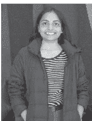

妮迪·古普塔博士目前在哈里亚纳邦库鲁克舍特拉国家技术学院计算机应用系担任助理教授。在此之前，她在喜马偕尔邦哈米尔普尔国家技术学院数学与科学计算系担任助理教授。她于2018年获得中国政府颁发的总统国际奖学金计划，赴北京中国科学院自动化研究所国家模式识别实验室进行博士后研究。她目前担任Isnartech Pvt Ltd.的联合首席调查员，参与多个基于人工智能的项目。她于2013年和2018年分别从印度贾巴尔普尔PDPM信息技术设计与制造学院获得硕士和博士学位。她于2008年从印度阿拉哈巴德中央大学（AU）获得计算机科学学士学位，并于2010年从阿拉哈巴德JK应用物理与技术学院获得计算机科学硕士学位。她在计算机科学和应用领域通过了国家级资格考试UGC NET和GATE。她是多家享有声誉的Scopus索引国内外会议和期刊的杰出审稿人。她在印度主持过技术会议、发表过演讲并举办过研讨会。她自2022年以来一直是IEEE技术学会的会员。她在多家享有声誉的期刊和国内/国际会议上发表了15多篇论文，以及两个书章节。她在学术访问期间探索过多个国家。她的研究兴趣包括计算机视觉、机器学习、人工智能、图像处理、模式识别、医学影像、文档成像和CAD系统。

## 泰勒与弗朗西斯

泰勒与弗朗西斯集团

http://taylorandfrancis.com

### 贡献者

- **阿希什·巴尔迪**
  旁遮普玛哈拉贾兰吉特·辛格技术大学
  巴廷达，旁遮普邦，印度

- **乌尔瓦希·班萨尔**
  B.R. Ambedkar国家技术学院
  贾兰达尔
  贾兰达尔，旁遮普邦，印度

- **奇努**
  贾兰达尔B.R. Ambedkar国家技术学院
  贾兰达尔，旁遮普邦，印度

- **妮莎·戴维**
  马哈拉杰阿格森大学
  巴迪，喜马偕尔邦，印度

- **贾耶什·德维迪**
  太平洋高等教育与研究大学
  乌代浦，拉贾斯坦邦，印度

- **萨蒂什·库马尔·因杰蒂**
  卡卡蒂亚理工科学院
  瓦朗加尔，特伦甘纳邦，印度
  国家技术学院
  瓦朗加尔，特伦甘纳邦，印度

- **阿比谢克·凯沙尔瓦尼**
  ABES工程学院
  加济阿巴德，北方邦，印度

- **穆扎米尔·汗**
  莫拉纳阿扎德国家技术学院
  博帕尔，印度

- **尼哈·基绍尔**
  马哈拉杰阿格森大学
  巴迪，喜马偕尔邦，印度

- **索贾尼亚·科特**
  卡卡蒂亚理工科学院
  瓦朗加尔，特伦甘纳邦，印度
  国家技术学院
  瓦朗加尔，特伦甘纳邦，印度

- **普什彭德拉·库马尔**
  莫拉纳阿扎德国家技术学院
  博帕尔，印度


- **尼提什·库马尔·马哈拉**
  莫拉纳·阿扎德国家理工学院
  印度博帕尔

- **丽玛·森**
  VIT-AP大学
  印度安得拉邦

- **苏米特·库马尔·马哈纳**
  马希希·马克兰德什瓦尔
  （被认定为大学）
  印度哈里亚纳邦穆拉纳-安巴拉

- **安舒尔·沙尔马**
  国家理工学院
  印度喜马偕尔邦哈米尔普尔

- **A. 马尼马兰**
  VIT-AP大学
  印度安得拉邦

- **巴尔蒂·沙尔马**
  马希希·马克兰德什瓦尔
  （被认定为大学）
  印度哈里亚纳邦穆拉纳-安巴拉
  潘尼帕特理工学院
  印度哈里亚纳邦萨马尔卡

- **苏布·纳曼**
  旁遮普兰吉特·辛格王公技术大学
  印度旁遮普邦巴廷达
  CT大学
  印度旁遮普邦卢迪亚纳

- **桑亚姆·沙尔马**
  旁遮普兰吉特·辛格王公技术大学
  印度旁遮普邦巴廷达
  太平洋高等教育与研究大学
  印度拉贾斯坦邦乌代浦

- **鲁帕·帕胡贾**
  B. R. 阿姆贝德卡国家理工学院
  印度旁遮普邦贾兰达尔

- **卡马莱什·库马尔·辛格**
  瓦拉纳西印度大学
  印度北方邦瓦拉纳西

- **萨克希·帕特尼**
  研究教授
  韩国加遥大学

- **达姆·拉杰·辛格**
  贾加特普研究生学院
  印度北方邦瓦拉纳西

- **阿努布哈夫·库马尔·普拉萨德**
  联合理工学院
  印度北方邦普拉亚格拉杰纳伊尼，
  印度

- **斯米蒂·斯内尔**
  瓦拉纳西印度大学
  印度北方邦瓦拉纳西

- **奇特兰詹·库马尔·雷**
  B. R. 阿姆贝德卡国家理工学院
  印度旁遮普邦贾兰达尔

- **奥贾斯维·温迪亚查拉姆**
  瓦拉纳西印度大学
  印度北方邦瓦拉纳西

# 1 钢桥损伤检测演进优化方法的最新进展

安舒尔·沙尔马

印度喜马偕尔邦哈米尔普尔国家理工学院土木工程系

## 1.1 引言

钢桥健康监测涉及利用包含被分析钢桥动态模态信息的收集振动响应，进行钢构件内部损伤位置识别和损伤程度确定。用于收集数据的传感器面临因运行条件下不需要的噪声导致数据污染的挑战，可通过确定最佳传感器布置位置来有效消除。多目标优化技术利用 N 个帕累托最优解，来研究并实现钢桥损伤判定实际问题中更现实的结果。自 20 世纪 90 年代以来可用的多目标优化技术，被用于解决诸如损伤识别、运筹学、加固决策、使用寿命预测等钢桥相关问题。优化技术准确且可靠的结果使研究人员能够将这些技术应用于各个领域 [1, 2]。

优化被应用于在特定条件下，为期望问题（系统设计、决策制定）获得完美且高效的解（最小值或最大值）[3]。所选参数用于对具有多个目标的优化技术进行分类。利用优化技术的计算机程序被用于求解钢桁架桥复杂几何问题的最优解。

本章按时间顺序组织。第一节介绍了利用优化技术进行钢桥健康监测的相关内容。第二节简要描述了优化模型的重要性。第三节详细介绍了优化模型中涉及的不同阶段。最后，第四节包括在解决钢桥问题时，对优化方法改进应用所得出的结论和未来展望。

## 1.2 优化模型

优化模型包含四个阶段，这些阶段独立应用以实现最佳结果，如图 1.1 所示。第 1 阶段包括可靠数据的收集，优化模型的计算精度直接依赖于此 [4–6]。第 2 阶段包括通过识别决策变量、形成模型目标函数和模型边界条件约束公式来开发问题。某些步骤旨在关注问题中重要元素的考虑，以及用于形成描述系统的数学方程的大量已知和未知变量、模型复杂度和从模型中达到的精度程度。第 3 阶段包括所选参数的估计和模型数学描述的开发 [7, 8]。模型验证和性能使用 R² 和均方根值等统计工具进行评估。所选模型参数的输入使用敏感性分析进行分析。用于模型公式的数据与用于模型验证的数据不同。第 4 阶段涉及根据问题的具体性质选择合适的优化算法。第 3 阶段和第 4 阶段执行迭代，可能导致重复第 2 阶段以获得所需结果。

优化模型必须具有有效性（真实系统与模型推断匹配的程度）和可处理性（便捷分析的实际性质），如图 1.2 所示。模型应当足够充分；否则会导致错误计算。

优化涉及某些困难，包括对特定函数进行评估的高成本，以及目标函数和约束函数被不需要的噪声污染。目标函数中不连续性的出现，在应用既定标准方法时构成了另一障碍。

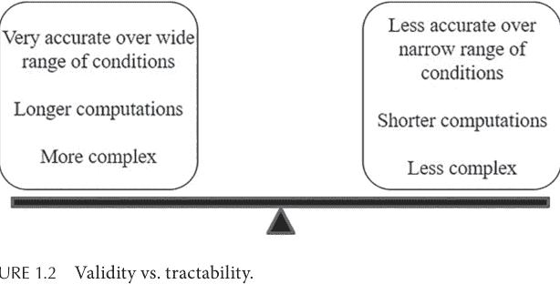

## 1.3 优化阶段

基于模型的损伤检测优化模型中的细分阶段在以下小节中详细阐述，并研究了相关文献。

### 1.3.1 第 1 阶段：数据采集与损伤表征

用于分析的数据采集通过优化安装在钢桥上的传感器完成 [4]。收集的数据无线传输并存档为文件，无论现场还是非现场，均使用计算机系统进行。

### 1.3.2 第 2 阶段：问题公式化

优化问题是用目标函数来界定的，该函数描绘了模型的主要目标，即通过一组已知或未知变量在一组约束条件内对目标函数结果进行最大化或最小化，如图 1.3 所示。

### 1.3.3 第 3 阶段：目标特征与函数的开发

钢桥的目标特征是从原始时域数据中使用均值、最大值、方差、频率响应函数、谱密度、频率、模态形状等方法提取的数值。基于钢桥测量响应之间的残差，使用数值分析形成目标函数以优化目标特征。无法确定任何特定领域中不同钢桥的每一次损伤实例，是现行方法的主要局限；因此，需要在该领域进行更深入的研究，以找到解决这一问题的合适方案。

时域方法利用峰值加速度、时间矩、均方根（rms）、均值、中位数等特征，来指示结构任何构件中损伤的存在。Askan 等人通过在基于模型的技术中直接输入基于时程的响应，采用基于敏感性的方法估计了参数 [9]。Masri 等人提出将时响应数据用于神经网络的训练和测试，以进行损伤检测 [10]。Lu 和 Liu 使用基于敏感性方法的模型更新方法，采用桥梁或车辆加速度的时程响应 [11]。

频域方法包含基于观察信号响应共振或抗共振偏移导致的幅值变化的特征。频率响应函数包含与结构固有频率相关的有意义信息 [12, 13]。收集的结构响应是透射率函数所需的唯一测量值，无需测量激励输入。各项研究表明它们在损伤敏感性方面表现出色。Zhou 等人和 Kumar 等人的研究显示，从结构的频率响应函数中提取了多种损伤指标，例如透射率、频率响应函数曲率、应变能等 [14, 15]。

模态域特征提供关于结构的直接且具有物理意义的信息，比其他域特征更易于解释。显示损伤敏感性的特征包括固有自频率、基于模态形状的模态保证准则


和它们的导数 [16]、模态应变、模态应变能 [17]、残余力向量、阻尼 [18]、动态柔度矩阵及其组合，例如模态阻尼和应变能计算分布 [19]。发现模态曲率在与基于响应的方法结合应用时很有用，但与基于模型的方法结合时无法提供有意义的结果。

时域分析对结构的非线性响应能给出合适的结果，并最大限度地减少数据约减，而数据约减是导致数据中有意义信息丢失的主要原因。其局限性包括计算时程响应所需的时间和精力。频域分析在特定频率范围内提供准确的损伤信息。模态域分析仅需要结构在运行条件下收集的响应，无需任何激励输入测量。

#### 1.3.4 第 4 阶段：模型开发、验证与性能评估

优化程序中的模型开发阶段包括问题及目标函数的数学描述、各种输入/输出参数、输入变量和软件开发的估计。该阶段具有迭代性质，不理想的结果可能导致返回优化模型定义和制定阶段。模型验证与性能评估涉及对优化模型整体的检查。所选参数以及为模型运行选择的假设在此阶段进行验证。通过 R² 值和均方根误差值检查测量数据与回归线的拟合度。优化模型的性能通过均方误差值确定。输入参数的测试通过敏感性分析进行。该阶段也会发生迭代，不理想的结果会被退回到模型定义和制定阶段。

敏感性研究有助于最小化参数空间，并根据确定输入参数对所考虑结构输出特性影响的特性，选择合适的目标特征。敏感性分析可以在局部或全局进行。局部敏感性分析涉及模型输出对微小输入扰动的引入，而全局敏感性分析涉及输入全局范围变化的研究。全局敏感性分析克服了局部敏感性分析的局限性，如局部变化、正态性和线性假设 [20, 21]。对各种全局敏感性分析的综述，一次覆盖一个范围，基于灵敏度度量、差分敏感性分析和回归系数，应用于统计检验。输入变量的变化对模型方差的影响通过筛选方法确定。参数空间用于设计实验方法；如果参数非线性增加，则优先采用随机抽样策略 [22]。优化模型中的误差可以通过任何标准方法进行评估，例如 R² 值或均方根误差方法。

#### 1.3.5 第 5 阶段：优化算法选择

这是一种机器学习技术，通过比较各种可用解决方案来开展研究，以便在已知约束下找到最佳替代方案。不同的优化问题需要不同的建模方法来获得所需的最优解，如图 1.4 所示。优化问题可以是单目标（例如，寻找成本最低的电动汽车）或多目标（寻找成本最低且舒适度最高的电动汽车）导向。

##### 1.3.5.1 数学规划优化方法

具有复杂性质的钢桥优化问题可以通过数学规划轻松求解，这涉及检查其数学结构以确定合适的优化技术。使用数学工具进行优化包括微积分、线性规划、变分法、非线性规划、二次规划、几何规划和动态整数规划。Masoumi 和 Akgul 选择线性规划作为优化方法，以概率和成本矩阵作为输入，根据成本最小化的优先级确定受损钢桥 [23]。Albayrak 和 Albayrak 开发了一个数学模型，以证明在钢桥中以最低成本支出使用所考虑的钢构件截面 [24]。Togan 和 Daloglu 将遗传算法结果与顺序二次规划、顺序凸规划和进化策略等数学模型进行比较，以确定移动荷载下钢桁架桥的最小重量 [25]。Assimi 等人使用遗传编程研究了空间钢桁架结构，以获得最优截面和

## 优化算法

### 数学规划方法
- 微积分方法
- 变分法
- 线性规划
- 非线性规划
- 几何规划
- 二次规划
- 动态整数规划

### 随机过程方法
- 统计决策理论
- 马尔可夫过程
- 排队论
- 更新论
- 模拟方法
- 可靠性理论

### 统计方法
- 回归分析
- 聚类分析、模式识别
- 实验设计
- 确定性分析（因子分析）
- Davidon-Fletcher-Powell (DFP) 法
- Broyden-Fletcher-Goldfarb-Shanno (BFGS)
- 对称秩 1 更新方法 (SR1)

### 基于梯度的方法
- 最速下降法
- 线性共轭梯度法
- 非线性共轭梯度法
- 非线性共轭梯度法
- 牛顿法
- 拟牛顿法
- 信赖域方法
- 顺序线性规划 (SLP)
- 顺序二次规划 (SQP)
- 可行方向修正法 (MMFD)

### 群体智能与进化计算方法
- 遗传算法 (GA)
- 粒子群优化 (PSO)
- 蚁群优化 (ACO)
- 萤火虫群优化 (GSO)
- 差分进化 (DE)
- 人工蜂群 (ABC)
- 布谷鸟搜索算法 (CSA)
- 遗传编程
- 进化编程
- 模拟退火
- 协和搜索
- 禁忌搜索

### 多目标方法

### 经典多目标方法
- 加权和法
- ε-约束法
- 加权矩阵法
- 目标规划

### 基于 Pareto 的方法
- 多目标遗传算法 (MOGA)
- 非支配排序 GA (NSGA)。
- 精英非支配排序 GA (NSGA-II)
- 多目标粒子群优化 (MOPSO)
- Pareto 存档进化策略 (PAES)
- 强度 Pareto 进化算法 (SPEA)
- 小众 Pareto GA (NPGA)

### 非基于 Pareto 的方法
- 聚集方法
- 向量评估遗传算法 (VEGA)
- 字典序排序
- 目标向量方法
- 博弈论

图 1.4 优化算法的主要类型流程图。

钢构件内部的连接性，以实现钢桁架的最小重量 [26]。

数学规划方法灵活且结构简单，可以轻松求解与钢桥相关的复杂非线性现实世界问题。它提高了个人最终决策的准确性。数学模型的不确定性始终是一个问题，因为它们是由经验公式计算得出的，并且是多个过程的表示。输入参数与有限约束下的输出参数校准不佳会影响数学模型的准确性。

##### 1.3.5.2 基于标量化的优化方法

多目标优化在约束条件下工作，并有助于获得同时存在冲突的一个或多个目标的最优解。在为现实问题寻找单一解时，一个目标的变化可能会降低其他目标；为应对这类问题，采用多目标优化方法来获得最优解。如今存在的大量多目标优化方法包括基于加权的方法、基于目标规划的方法、基于 ε-约束的方法、基于 Pareto 和非 Pareto 的方法。对基于 Pareto 方法的进一步细分产生了基于 Pareto 的精英和非精英方法。精英方法由基于 Pareto 存档的进化策略、强度 Pareto 进化算法、精英非支配排序遗传算法和基于 Pareto 信封的选择算法组成。非精英方法涉及多目标小众和非支配排序遗传算法。

基于种群的非 Pareto 方法包括字典序排序、向量评估遗传算法、接触定理、博弈论、非代际遗传算法。Kim 和 Weck 讨论了使用自适应变化的加权和方法，而不是选择事先设定的权重，以确定双目标优化的 Pareto 最优解 [27]。Ok 等人研究了将随机 Pareto 最优解应用于成功评估双跨钢连续实验室桥梁损伤位置。传感器噪声的抵消通过在适当荷载条件下收集大量数据集来完成 [28]。Liang 等人评估并比较了非支配排序遗传算法 II、多目标粒子群优化器和群组搜索优化器的性能，用于确定


平面钢桁架结构的最优重量 [29]。Li 等人通过分析主成分分析、小波分解和非支配排序遗传算法测得的冲击响应，确定了复合板上传感器的最优位置 [30]。

多目标优化方法既适用于复杂空间也适用于非复杂空间，并有助于在帕累托最优前沿上寻找点。加权法适用于凸问题，但 ε-约束法可用于凸问题或非凸问题。目标规划需要选择一组确定的期望目标，并找到到它们的最小距离。其局限性包括需要选择适当的约束值。

##### 1.3.5.3 随机过程优化方法

随机优化方法是在当今现代系统分析、设计和运行中的宝贵资产，可应对系统噪声渗透的困难、系统的高度非线性行为或涉及高维度的分析。随机优化方法用于分析使用具有已知概率的随机变量定义的工程问题 [31]。随机方法包括马尔可夫过程、可靠性理论、统计决策理论、更新论、排队论和仿真方法。Huang 等人使用随机建模来观察钢构件的疲劳裂纹增长，并优化了桥梁剩余寿命期间所需的经济高效的维护修复 [32]。Frangopol 等人提出了基于随机动态规划的优化方法用于规划钢桥维护，并确定了钢桥网络中最合适的组合 [33]。

随机过程优化方法结合了线性规划和仿真，有助于最小化不确定性并获得准确且有意义的结果。最佳解是在反复改进和开发替代方案后获得的。这些模型由于不需要的噪声而损坏，会在优化函数中产生误差。

##### 1.3.5.4 统计优化方法

经验模型旨在通过统计方法分析实验数据，以寻找现实世界物理情况的更精确、更准确的表示。统计优化方法使用响应数据集构建数学模型，以提取关于桥梁结构中损伤位置和严重程度的有意义知识。统计优化方法包括各种方法，如模式识别、因子分析、回归分析、实验设计和聚类分析。Ferreras–Alcove 等人开发了一种统计技术，用于分析受监控钢桥的焊接接头在可变温度和交通诱导应变条件下的任何不规则性 [34]。Seo 等人通过多元回归模型确定了钢桥的荷载等级 [35]。车辆在桥上行驶时的轴重和轴宽对荷载等级有显著影响 [35]。Kim 等人利用基于应力谱的疲劳预测模型确定了钢桥各构件中出现的裂缝 [36]。Yang 和 Nagarajaiah 使用基于各种可能损伤概率场景字典的稀疏回归应用，研究了钢架结构中的损伤检测，并推导出最适合提供的测试信号的特定损伤场景。聚类分析在不使用数据标签的情况下，分析特定结构损伤检测中收集的数据的固有模式和内部框架 [37]。Park 等人对钢梁进行了实验以获取阻抗数据，这些数据通过应用于主成分投影的聚类算法进行处理 [38]。Cao 等人研究了模糊聚类算法，以了解铁路钢桁架拱桥中损伤的位置和程度 [39]。Yadollahi 等人将模糊因子分析应用于影响钢桥可持续维护和康复的选定因素 [40]。因子分析（FA）是一种数据最小化技术，用于在较小数据集中捕捉变量之间的方差。FA 的步骤包括因子提取、因子数量的确定、因子的解释和旋转。Widaman 就选定的模型参数，阐述了因子分析与主成分分析技术之间的差异 [41]。

回归能够轻松处理多维问题并具有更好的可解释性。当收集的数据存在稀疏性、过拟合或有意义数据集丢失时，回归模型会受到影响。聚类方法在形成满足单一目标的参数组方面很成功。由于多个影响目标函数，导致收敛率低、质心选择和局部最优确定，聚类算法在实际结构中的应用受到限制。因子分析有助于使用选定因子解释多个结果之间的相关性。研究因子的选择是一项繁琐的任务，需要具备解释它们之间模式的技能。因子分析与主成分分析的主要区别在于：前者是隐性变量的测量模型，而后者是变量的线性组合。

##### 1.3.5.5 基于梯度的优化方法

基于梯度的数学优化方法使用梯度信息来确定最佳收敛行为。基于梯度的方法可以细分为拟牛顿法、最速下降法、信赖域法、共轭梯度法、牛顿法和非线性共轭梯度法。Davidon–Fletcher–Powell 法、对称秩 1 更新法和 Broyden–Fletcher–Goldfarb–Shanno 法包含在拟牛顿法中。同样，序列二次/线性规划和修正可行方向法是处理非线性约束优化问题的算法。由于在求解可微分非线性规划问题时具有更好的收敛特性和稳健的结果，序列二次规划算法是一种常用方法。Lin 和 Gea 讨论了基于梯度的变换方法在钢梁锚、钢架或钢桥等复杂问题设计中的应用 [42]。Raju 等人使用缩减梯度法估计了钢构件的优化自重 [43]。Hare 等人对结构工程中应用的非梯度优化技术进行了文献综述 [44]。基于梯度的优化方法需要极少的信息，是一个简单的迭代过程。可以评估大规模问题，但精度较低。

##### 1.3.5.6 群体和进化优化方法

各研究者通过开发数学模型，将受自然过程和生物启发的优化方法应用于现实世界的复杂问题。达尔文进化、社会群体行为、觅食过程等是生成自然启发式优化算法背后的一些自然过程。群体智能和进化计算方法是两种具有各自独立特征的优秀优化方法，用于处理优化和难以求解的搜索问题 [45–47]。由这两种方法组成的混合算法相互增强彼此的效率、准确性和性能，在应用于复杂问题时能产生丰硕的结果。群体智能由分散、自组织以及自然或人工系统的集体响应所表现出的智能行为定义。与自然相关的有机框架是群体智能发展的基本原因，而进化优化则始于对随机种群的评估，通过对适应个体的迭代选择来产生后代个体，随后进行突变、生存选择和终止。群体智能和进化方法包括遗传算法、萤火虫群优化、差分进化粒子群优化、蚁群优化、遗传编程、人工蜂群、进化规划、杜鹃搜索算法、模拟退火、禁忌搜索、和声搜索等。Wang 等人应用多层遗传算法来确定钢桁架桥的损伤。还对多层遗传算法和常规遗传算法的结果进行了比较 [48]。Shabbir 和 Omenzetter 使用粒子群优化更新了斜拉钢行人桥的有限元模型，以获得物理上有意义的结果 [49]。

Cao 等人计算了改进粒子群优化算法在确定钢桁架结构构件最优形状和尺寸方面的效率 [50]。Mohan 和 Baskaran 对蚁群优化在工程领域各种问题中的应用进行了文献综述 [51]。Camp 和 Bichon 在对钢空间桁架进行最优重量和成本参数设计（同时保持中等性能）时，对蚁群优化、遗传算法和经典优化技术进行了比较研究 [52]。Kaipa 和 Ghose 介绍了关于萤火虫群优化在工程领域中的工作原理、演化及应用的研究 [53]。Yang 和 Peng 研究了人工蜂群优化，以在铁路钢桥上实现更快的收敛速度和更好的传感器布置，从而提高全局搜索能力 [54]。Jayanthi 等人提出了杜鹃搜索算法，作为遗传算法和蚁群优化算法的对比，以提供改进的钢桁架设计结果 [55]。Hasancebi 研究了进化策略在钢桁架中的应用，以最优确定与钢桁架相关的几何设计变量 [56]。Hasancebi 应用模拟退火算法来获得钢架结构的最优设计 [57]。Yoo 等人就土木工程问题中和声搜索算法的应用提供了概述 [58]。Mishra 等人应用蚁狮优化算法来检测损伤，并在钢桥中获得局部最优时实现更好的收敛性 [59]。Perera


et al. 采用遗传算法和粒子群优化方法对带有建模误差的反问题钢桁架进行了优化[60]。

群体和进化优化方法具有灵活性，并根据问题要求进行应用。群体方法的复杂性导致分析耗时且结果不可预测，这是一个严重的局限性。它们基于观察自然，然后在计算机程序中模仿自然。因此，这些系统易于适应新情况。应用基于进化的优化技术以实现最优解不需要梯度信息。

## 1.4 结论

本研究考察了过去几十年的文献，重点关注应用于钢桥问题的不同优化算法。研究中详细概述了优化模型——优化模型类型；优化模型中涉及的不同阶段；关于数学规划的理论和应用相关概述；应用于钢桥的随机、统计、梯度、群体与进化、多目标等基于优化的方法——基于先前研究中应用于不同问题的不同优化模型，讨论了潜在的结论。

- 使用优化算法进行传感器的最优布置可减少因不需要的噪声导致的数据污染，并减少损伤判定所需的传感器总数。
- 钢桥设计可以进行优化，有助于降低结构总重量并最小化成本开支。
- 多优化算法能够同时为各种输入变量提供多个优化解。
- 通过在设计中仅部署两个变量（即面板数量和桁架深度）的进化算法，提高了大量节点桁架的效率和最优配置。
- 敏感性分析对于评估输入变量的微小变化很有用；此外，现代开发的软件被用于得出最优断面。
- 可通过优化算法优化建筑材料的用量，以提高钢桥的疲劳寿命。
- 复杂结构中优化技术应用减少的一些可能原因包括：
- 通过优化过程使用重量最小化的想法不一定能反映最低成本，尤其是在使用钢筋混凝土等复合材料进行建筑时。
- 与重量优化相比，成本优化的准确性仅限于更简单、较小的问题，例如小型结构构件的优化。
- 优化过程未将美观性纳入考虑，而这会影响结构的设计过程。
- 多优化算法的结果在很大程度上取决于优化模型制定的准确性。因此，必须投入大量时间和资源来为特定问题开发可靠的优化模型。

## 未来研究方向

此处提供的想法可作为优化方法发展的未来范围补充：

- 可将各种软计算工具进行混合，例如神经-遗传、模糊-遗传、神经-模糊-遗传等，这可能有助于分析钢桥。
- 钢桥材料的优化，可用于火灾导致的高温条件下而不失去其刚度或强度。
- 遗传算法算子（如重复、倒位、优势隔离等）的应用可用于钢桥优化。
- 各种节点的非线性响应（包括转动刚度等）可纳入未来研究。
- 应提供模拟不同类型连接的指南。
- 梁中的单位宽度和间距应纳入外梁的优化研究中。
- 应考虑可用资源对成本和结构周围环境的影响。

## 利益声明

作者声明在本章的出版中，不存在利益冲突。

## 参考文献

- [1] Cho, J.H., Wang, Y., Chen, R., Chan, K.S., Swami, A.: 多目标系统建模与优化综述. IEEE Communications Surveys & Tutorials 19(3), 1867–1901 (2017).
- [2] Nabavi, S., Gholampour, S., Haji, M.S.: 使用蚱蜢优化算法(GOA)和结构时域响应进行框架单元损伤检测. Evolving Systems 13(2), 307–318 (2022).
- [3] Sarma, K.C., Adeli, H.: 钢结构生命周期成本优化. International Journal for Numerical Methods in Engineering 55(12), 1451–1462 (2002).
- [4] Sony, S., Laventure, S., Sadhu, A.: 结构健康监测中下一代智能传感技术文献综述. Structural Control and Health Monitoring 26(3), 1–22 (2019).
- [5] Sharma, A., Kumar, P., Vinayak, H.K., Walia, S.K.: 使用希尔伯特变换配合根-MUSIC和ESPRIT技术识别钢桁架桥节点偏差. International Journal of Civil Engineering 19, 653–668 (2021).
- [6] Sharma, A., Kumar, P., Vinayak, H.K., Patel, R.K., Walia, S.K.: 使用Savitzky-Golay滤波器、希尔伯特变换、MUSIC和ESPRIT的钢桁架桥振动基础状态监测. Journal of Engineering, Design and Technology 20(5), 1297–1319 (2022).
- [7] Arora, J.S.: 将设计问题制定为优化问题. 航空航天工程百科全书 (2010). https://onlinelibrary.wiley.com/doi/abs/10.1002/9780470686652.eae494, 19/08/2021.
- [8] Zakian, P., Kaveh, A.: 工程结构抗震设计优化：全面综述. Acta Mechanica 234(4), 1305–1330 (2023).
- [9] Askan, A., Akcelik, V., Bielak, J., Ghattas, O.: 基于非线性最小二乘优化的无弹性全波形反演方法的参数敏感性分析. Comptes Rendus Mécanique 338(7–8), 364–376 (2010).
- [10] Masri, S.F., Nakamura, M., Chassiakos, A.G., Caughey, T.K.: 神经网络法用于结构参数变化检测. Journal of Engineering Mechanics 122(4), 350–360 (1996).
- [11] Lu, Z.R., Liu, J.K.: 使用测得动力响应识别桥面结构损伤和车辆参数. Computers & Structures 89(13–14), 1397–1405 (2011).
- [12] Kim, Y.S., Eun, H.C.: 特定频率范围内基于FRF的损伤检测方法比较. Advances in Materials Science and Engineering 2017(8), 1–9 (2017).
- [13] Garcia-Palencia, A., Santini-Bell, E., Gul, M., Catbas, N.: 基于FRF的损伤检测算法，使用实验收集的数据. Structural Monitoring and Maintenance 2(4), 399–418 (2015).
- [14] Zhou, Y.L., Qian, X., Cao, H., Magd, A.W.: 使用基于扩展余弦指标的频率响应函数集合进行结构损伤检测. Journal of Physics: Conference Series 843(1), 1–7 (2017).
- [15] Kumar, K.A., Reddy, D.M.: 频率响应曲率方法在梁和板状结构损伤检测中的应用. IOP Conference Series: Materials Science and Engineering 149(1), 1–12 (2016).
- [16] Simoncelli, M., Aloisio, A., Zucca, M., Venturi, G., Alaggio, R.: 钢桥可靠性中的腐蚀强度与位置. Journal of Constructional Steel Research 206, 107937 (2023).
- [17] Tan, Z.X., Thambiratnam, D.P., Chan, T.H., Razak, H.A.: 使用基于模态应变能的损伤指数和人工神经网络检测钢梁损伤. Engineering Failure Analysis 79(9), 253–262 (2017).
- [18] Yang, D.S., Wang, C.M.: 使用改进的车辆扫描法识别阻尼桥的模态特性. Engineering Structures 256, 114060 (2022).
- [19] Dammika, A.J., Kawarai, K., Yamaguchi, H., Matsumoto, Y., Yoshioka, T.: 桥梁实验结构健康监测的分析阻尼评估互补方法. Journal of Bridge Engineering 20(7), 1–12 (2014).
- [20] Iooss, B., Lemaître, P.: 全局敏感性分析方法综述. 复杂系统仿真-优化不确定性管理. Springer, Boston, MA (2015).
- [21] Svendsen, B.T., Petersen, Ø.W., Froseth, G.T., Rønnquist, A.: 使用敏感性分析改进全尺寸钢桥有限元模型更新. Structure and Infrastructure Engineering 19(3), 315–331 (2022).
- [22] Liu, D., Bao, Y., Li, H.: 基于机器学习的结构模态参数随机子空间识别方法. Engineering Structures 274, 115178 (2023).
- [23] Masoumi, F., Akgül, F.: 基于线性规划的桥梁损伤基础维修优化方法. International Journal of Engineering and Technology 4(5), 668–671 (2012).
- [24] Albayrak, G., Albayrak, U.: 平面桁架系统成本优化的非线性规划方法. International Journal of Engineering and Technology 10(2), 167–170 (2018).
- [25] Toğan, V., Daloglu, A.T.: 使用连续和离散设计变量在优化方法中进行移动荷载下桥梁桁架优化. Indian Journal of Engineering and Materials Sciences 16(8), 245–258 (2009).


- [26] Assimi, H., Jamali, A., Zadeh, N.N.: 空间桁架结构的尺寸与拓扑优化：基于遗传规划和Nelder-Mead混合算法。*莫达雷斯机械工程* 17(6), 32–40 (2017).

- [27] Kim, I.Y., Weck, O.L.: 双目标优化的自适应加权和方法：帕累托前沿生成。*结构与多学科优化* 29(2), 149–158 (2005).

- [28] Ok, S.Y., Jung, S., Song, J.: 面向传感器噪声的鲁棒桥梁损伤识别的多目标优化方法。*冲击与振动* 2018(8), 1–13 (2018).

- [29] Liang, J.C., Li, L.J., He, J.N.: 基于智能算法的钢结构性能基础多目标最优设计。*土木工程优化国际期刊* 5(1), 79–101 (2015).

- [30] Li, P., Huang, L., Peng, J.: 基于NSGA-II和小波分解的结构冲击监测传感器分布优化。*传感器* 18(12), 1–15 (2018).

- [31] Sharma, A., Kumar, P., Vinayak, H.K., Patel, R.K., Walia, S.K.: 用于分析钢桥的建模与数据挖掘技术综述。*国际软件计算与测试杂志* 7(1), 1–15 (2021).

- [32] Huang, T.L., Zhou, H., Chen, H.P., Ren, W.X.: 疲劳影响钢桥构件的随机建模及最优检测和维护策略。*智能结构与系统* 18(3), 569–584 (2016).

- [33] Frangopol, D.M., Liu, M.: 利用随机动态规划进行桥梁网络维护优化。*结构工程期刊* 133(12), 1772–1782 (2007).

- [34] Ferreras-Alcovic, I., Chrysanthopoulos, M.K., Andersen, J.E.: 基于温度、交通和应变测量的焊接桥梁接头结构健康监测回归模型。*结构健康监测* 14(6), 648–662 (2015).

- [35] Seo, J., Czaplewski, T.M., Kimm, J.H., Hatfield, G.: 用于确定复杂钢桥载荷等级的集成结构健康监测系统与多元回归模型。*测量* 75(11), 308–319 (2015).

- [36] Kim, J.H., Jeong, M.C., Lee, T.H., Lee, W.W., Kong, J.S.: 基于可变应变谱特征的钢桥疲劳预测模型开发。*损伤力学国际期刊* 26(7), 951–967 (2017).

- [37] Yang, Y., Nagarajaiah, S.: 通过盲特征提取与稀疏表示分类相结合进行结构损伤识别。*机械系统与信号处理* 45(1), 1–23 (2014).

- [38] Park, S., Lee, J.J., Yun, C.B., Inman, D.J.: 利用PCA数据压缩和k-means聚类算法的电机阻抗基础无线结构健康监测。*智能材料系统与结构期刊* 19(4), 509–520 (2008).

- [39] Cao, B., Ding, Y., Zhao, H., Song, Y.: 利用模糊聚类分析进行高速铁路桁架拱桥损伤识别。*结构监测与维护* 3(4), 315–333 (2016).

- [40] Yadollahi, M., Nazari, R., Spanos, N.J., Minner, N.: 可持续桥梁维护与改造项目的模糊因子分析应用。管理科学与工程管理国际期刊 12(4), 225–236 (2017).

- [41] Widaman, K.F.: 公因子分析与主成分分析：在表示模型参数方面的差异偏差。多元行为研究 28(3), 263–311 (1993).

- [42] Lin, P.T., Gea, H.C.: 多学科设计优化中的基于梯度的变换方法。结构与多学科优化 47(5), 715–733 (2013).

- [43] Raju, P.M., Rao, G.R., Kumari, G.H., Gowthami, E.: 弯曲钢构件自重估计数学模型。土木工程优化国际期刊 7(2), 241–255 (2017).

- [44] Hare, W., Nutini, J., Tesfamariam, S.: 结构工程中非梯度优化方法综述。工程软件进展 59(5), 19–28 (2013).

- [45] Ab Wahab, M.N., Nefti-Meziani, S., Atyabi, A.: 群体优化算法全面综述。PLoS One 10(5), 1–36 (2015).

- [46] Zhou, A., Qu, B.Y., Li, H., Zhao, S.Z., Suganthan, P.N., Zhang, Q.: 多目标进化算法：最新技术综述。群体与进化计算 1(1), 32–49 (2011).

- [47] Sarjamei, S., Massoudi, M.S., Sarafraz, M.E.: 基于淘金热优化算法的桁架结构损伤检测。土木工程优化国际期刊 12(1), 69–89 (2022).

- [48] Wang, F.L., Chan, T.H., Thambiratnam, D.P., Tan, A.C.: 利用多层遗传算法对复杂钢桁架桥进行损伤诊断。土木结构健康监测期刊 3(2), 117–127 (2013).

- [49] Shabbir, F., Omenzetter, P.: 利用粒子群优化对全尺寸桥梁结构进行模型更新。第22届大洋洲结构力学与材料会议，11月26日，959–964 (2012).

- [50] Cao, H., Qian, X., Chen, Z., Zhu, H.: 桁架结构尺寸与形状优化的改进粒子群优化。工程优化 49(11), 1939–1956 (2017).

- [51] Mohan, B.C., Baskaran, R.: 综述：基于蚁群优化的多个工程领域近期研究与实现。专家系统与应用 39(4), 4618–4627 (2012).

- [52] Camp, C.V., Bichon, B.J.: 利用蚁群优化设计空间桁架。结构工程期刊 130(5), 741–751 (2004).

- [53] Kaipa, K.N., Ghose, D.: 萤火虫群优化：理论、算法与应用。Springer Nature, Gewerbestrasse, Switzerland (2017).

- [54] Yang, J., Peng, Z.: 改进的ABC算法优化桥梁传感器布置。传感器 18(7), 1–18 (2018).

- [55] Jayanthi, V., Manigandan, M., Velrajkumar, G., Saravanan, M.: 利用布谷鸟搜索算法优化桁架结构。先进结构与岩土工程国际期刊 3(2), 1–4 (2014).

- [56] Hasancebi, O.: 利用进化策略在指定设计域内优化桁架桥。工程优化 39(6), 737–756 (2007).

- [57] Hasansüeki, O., Çarbaş, S., Saka, M.P.: 改进结构优化中模拟退火的性能。*结构与多学科优化* 41(2), 189–203 (2010).

- [58] Yoo, D.G., Kim, J.H., Geem, Z.W.: 协和搜索算法概述及其在土木工程中的应用。*进化智能* 7(1), 3–16 (2014).

- [59] Mishra, M., Barman, S.K., Maity, D., Maiti, D.K.: 利用振动数据的蚁狮优化算法进行结构损伤检测。*土木结构健康监测期刊* 9(1), 117–136 (2019).

- [60] Perera, R., Fang, S.E., Ruiz, A.: 将粒子群优化和遗传算法应用于带有建模误差的多目标损伤识别逆问题。*力学* 45(5), 723–734 (2010).

# 2 物联网及其发展
Anubhav Kumar Prasad,¹ Dharm Raj Singh² 和 Abhishek Kesharwani³

¹ 联合技术学院, 那尼, 普拉亚格拉杰, 乌塔拉普拉代什邦, 印度
² 贾加特普研究生学院, 瓦拉纳西, 乌塔拉普拉代什邦, 印度
³ ABES工程学院, 加济阿巴德, 乌塔拉普拉代什邦, 印度

## 2.1 引言

对于帮助人类舒适以及以多种方式帮助人类的设备需求日益增长，范围从诸如操作灯泡等家庭活动到健康和安全监测，这促成了名为物联网（IoT，Internet of Things）的新技术领域 [1, 2]。物联网的概念非常简单——使机器之间以及机器与人类之间能够进行通信。这种通信通过互联网进行，因此被称为物联网。这里，事物是指物理对象，可进一步分为两类：智能对象 [3–5] 和非智能对象 [6–8]，换句话说，就是有智能和没有智能的对象。我们将现在转向物联网生态系统的组件或贡献者。

### 2.1.1 物联网组件

物联网的组件包括设备/事物、存储或云、数据分析部分和用户界面。图 2.1 显示了物联网组件。


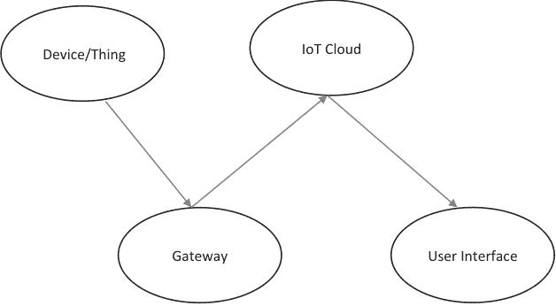

图 2.1 物联网组件。

#### 2.1.1.1 设备/物

这可以被视为一种具有传感器的跟踪设备，可用于从体温监测到接近检测等场景。根据需求，传感器可以是不同类型，例如压力传感器、湿度传感器、光线检测传感器、RFID 标签等。这些设备或对象大致可分为两类：智能对象和非智能对象。

##### 2.1.1.1.1 智能对象

智能对象的基本理念是，除存储和网络功能外，还提供处理和计算能力。其目的是在任何框架中尽量减少人工交互，而这可以通过智能对象来实现。因此它们被称为物联网的“基础构件”。例如，一款能够测量心率的智能手表可以不时检查心率读数，并自行处理数据，以提醒佩戴者注意任何与心率相关的问题。在这里，不需要人工干预，因为智能手表正在自行收集和计算数据，产生所需的输出。智能对象的特性如下：

- 1. 物理形状：对象必须具有物理形状，以便放置到合适的位置。例如，智能手表必须具有足够紧凑的物理形状，以适合戴在人的手腕上。
- 2. **唯一标识符：** 独特的物理身份可由人类用于将其与其他设备区分开来。例如，电视遥控器和功能手机可以根据其唯一识别码进行区分。
- 3. **通信：** 智能对象必须能够通过互联网作为通信介质发送和接收数据。
- 4. **唯一名称和地址：** 智能对象在网络基础设施中的身份必须是唯一的，以便在同一介质上轻松与其他设备识别。这涉及同一对象的非物理标识符。
- 5. **处理能力：** 作为智能对象，它必须能够根据环境进行处理。
- 6. **感知能力：** 具备感知能力的原因是从环境中收集数据以便进行处理。例如，负责处理室温的对象必须能够感知其周围环境的温度。

##### 2.1.1.1.2 非智能对象

存在对仅用于收集和传输数据的设备/对象的需求。传感器和执行器是此类对象的示例。

- 1. **传感器：** 它可以简单地被视为智能对象的一部分，用于收集数据，换句话说，就是感知环境。其作用是将数据发送到物联网系统的指定对象进行处理。
- 2. **执行器：** 执行器的作用是根据控制器的指令执行物理动作。控制系统或控制器所需的数据由传感器提供。例如，冰箱中的传感器将温度数据发送给控制系统，控制系统根据其算法指示执行器增加或降低温度。因此，简单来说，执行器是一种根据控制系统发送的电子信号执行物理活动的装置。

#### 2.1.1.2 物联网云

“云”一词专门指服务器上的数据存储。云的使用可扩展到数据处理或其他类型的服务。

云计算 [9] 将在后面的章节中详细讨论。物联网云负责从对象收集数据，以及对其进行处理、管理和归档。换句话说，对象收集的数据在物联网云中存储并使用各种 AI/ML 算法（如支持向量机、k-最近邻等）转换为信息。

#### 2.1.1.3 用户界面

用户界面是用于监控和操作已加工数据的软件。用户界面必须设计为以最低复杂度提供最大交互。

##### 2.1.1.3.1 物联网架构

物联网架构取决其实施角色和所需的行业领域 [10]。基于这些，可用以下四种架构：

- 1. 感知层：该层包含与数据收集相关的对象。传感器和执行器属于此层。该层可能会也可能不会处理数据，这取决于智能或非智能对象配置类型。它就像连接物理世界和数字世界所需的端点设备。
- 2. 网络层：该层连接感知层与其他服务器、通信设备和网络设备。该层负责传输由感知层的传感器和执行器收集的数据。该系统的两个主要组件是 DAS（数据采集系统）和网络/互联网网关。DAS 的主要职责是将模拟信号转换为数字信号，即数据聚合和转换部分。
- 3. 处理层：从网络层接收的数字信号最终发送到数据中心，软件应用程序将在那里访问数据。因此，该层（处理层）负责进行预处理。这里边缘 IT 或边缘分析 [11] 登场了。
- 4. 应用层：用户交互在此层进行。这只是一个用户可以操作的应用程序，用于监控数据并控制物联网设备的工作。例如，用户可能只需在应用程序界面中选择所需的颜色，即可更改智能灯泡的颜色。

#### 2.1.1.4 物联网的发展

物联网发展史可以通过智能对象和非智能对象来描述。控制循环是一条根据其接收到的数据触发某些操作的消息。这种动作触发可能是基于决策的操作，也可能不是。例如，读取条形码并验证数据是非智能对象任务。

另一方面，当有人进入房间时打开灯泡可能是智能对象任务，因为它应该在黑暗时打开灯泡。控制循环中做出的决策必须满足应用程序延迟要求，这通常被称为控制循环的长度。如果每次计算都将数据发送到服务器，这可能会减慢数据预期用途的工作速度。例如，开启庭院大门延迟半分钟可能会减少能够进入庭院的车辆数量。这表明，随着需求的增长，物联网设备开始借助 AI 变得智能。物联网的最早示例可以追溯到 1980 年代，当时一群大学生改装了一台可口可乐自动售货机，以追踪其内容物。然而，该技术笨重，不尽如人意，且效率有限。该技术并未启用 AI，因为它是为非决策任务而设计的。凯文·阿什顿于 1999 年引入的用于宝洁（Procter & Gamble）产品供应链追踪的 RFID（射频识别）芯片，被视为第一个物联网设备链。

对此表现出浓厚兴趣，LG 公司于 2000 年宣布了其第一款智能冰箱。2007 年，第一代 iPhone 发布，到 2008 年，联网设备数量已超过地球人口。

2009 年，Google 开始测试其第一辆无人驾驶汽车，到 2011 年，Google 的 Nest Smart 推出。物联网设备的使用也已扩展到医疗保健领域，其中 AIoT（AI 赋能的物联网）设备可以读取人类健康相关数据（如心跳）并处理数据以了解该人是否有心脏问题，并基于此生成警告消息。当前研究正在致力于读取特定于人类健康监测的物联网设备数据，以判断该人是否有健康问题。这些物联网设备安装在房间内，而非由人佩戴。随着 5G 技术的引入，物联网设备在数据处理和与服务器通信方面现在更加先进。


##### 2.1.1.4.1 边缘设备

边缘设备 [12] 是网络层的一部分，负责设备到服务器的连接。这对于实现更好的连接是必需的，因为本地设备使用蓝牙 [13]、Wi-Fi [14]、Zigbee [15] 和 NFC [16] 等协议，而云使用 AMQP、MQTT、CoAP 和 HTTP 等协议。边缘设备可以被视为智能网关，能够在两个来源之间安全地翻译、排序和移动数据。这是为了高效、有效地适应不同协议所必需的。

###### 2.1.1.4.1.1 蓝牙

为提供较短范围（约 10 m）设备的无线连接，爱立信于 1994 年引入了蓝牙技术。它是一种低功耗技术，能够在低带宽（1–3 Mbps）连接的嘈杂环境中发送和接收信号。它是一个工业、非授权、科学和医疗（ISM）频段，范围从 2.4 GHz 到 2.485 GHz。它遵循父母-子女模型，一个父母最多支持七个子女。一个 piconet [17] 中的父母也可以是另一个 piconet 中的子女，并且可以切换角色。在 IIoT [18] 环境中，短数据突发不断进行交互，而处理数百个传感器所需的设置是蓝牙相对于 WiFi 的优势。随着对更好连接和更快数据传输需求的增加，蓝牙 5 [19] 已经推出，其范围是原来的四倍，广播消息容量相比蓝牙 4 [20] 提高了 800%，速度也提升了一倍。

###### 2.1.1.4.1.2 WiFi

在范围和带宽方面，WiFi 的覆盖范围比蓝牙更好。其范围约为 50 m，传输频率在 2.4 GHz 到 5 GHz 之间。然而，与蓝牙相比，它耗电更多。使用 WiFi 进行数据传输的最远距离约为 418,429 m。就像局域网一样，WiFi 有不同版本：802.11a、802.11b、802.11g、802.11n 和 802.11ac。对于每个标准，成本都是一个主要因素，因为需要不同的硬件配置。考虑到 IoT 的需求，开发了两个标准：WiFi HaLow (802.11ah) 和 HEW (802.11ax)。

###### 2.1.1.4.1.3 Zigbee

蓝牙分为两类：传统型和低能耗（LE）。这两类主要基于功耗问题。传统型运行在 1 W 的能量下，而 LE 可以使用 10–100 mW 的能量运行。然而，为了增加传输范围，需要另一种协议，因此出现了 Zigbee。它是一种开发为开放全球市场连接标准的无线技术，功耗较低。Zigbee 连接标准基于 IEEE 802.15.4 物理层无线规范，并在未授权的无线频段中工作，包括 2.4 GHz、868 MHz 和 900 MHz。由于使用了网状拓扑，其延迟较高，因此不适合 IIoT。

##### 2.1.1.4.2 云计算

云计算 [9] 中的“云”术语用于指示远程服务器上的数据访问和存储。云的架构可分为三类 [21]: 云即基础设施、云即平台和云即服务。它们广为人知，称为 IAAS、PAAS 和 SAAS。其理念是根据用户需求满足不同的要求。IAAS 提供原始云；即，为用户提供基础设施，例如服务器、处理、存储等。在 PAAS 的情况下，用户获得构建和运行应用程序的完整平台。它提供所有要求，例如服务器、操作系统、存储等。SAAS 是一种软件分发模型，服务通过互联网提供给最终用户。用户可以直接使用此类服务，例如在线编辑器和共同编译器，无需在系统中安装。云中用户的存储空间 [22] 使用两种不同的方法处理：NAS 和 SAN。前者，即网络访问服务，使用单个存储设备的 RAID 配置，而后者，即存储区域网络，拥有多个存储设备。两者之间的主要区别在于 NAS 存在单点故障，而 SAN 不是这种情况。此外，数据可以以原始格式存储，也可以使用文件系统以文件形式存储。云架构包括几个关键模块 [23]: 资源供应模块、用户交互界面和带有服务目录的系统资源管理模块 [24–25]。

### 2.1.2 云计算的网络安全属性

#### 2.1.2.1 身份验证 [26]

为了授权实体，需要验证该实体的身份。这可以通过密码系统、PIN（个人识别号）或生物识别来完成。此外，消息认证也用于身份验证。这里，实体可以是机器对机器、人对人或混合类型。传输层套接字（TLS）是这种身份验证的一种方式 [27]。

#### 2.1.2.2 授权 [28]

成功身份验证后，下一步是授予实体合法的服务/资源。例如，用户只能从已获授权的 ATM 中提取一次允许的限额 [29]。

#### 2.1.2.3 审计 [30]

尽管实体在身份验证后已获得所请求的服务/资源，但审计该实体是明智的，以确保没有欺诈活动。

#### 2.1.2.4 机密性（隐私）[31]

这与避免/确保没有数据泄露有关。未授权实体不应能够泄露包括 ID 和密码在内的个人信息。

#### 2.1.2.5 可用性

这与资源管理有关，与操作系统中的资源管理相同。如果资源可用，则必须将所请求的资源分配给授权实体。同时，如果实体已离开，则必须释放已使用的资源。这类似于 Java 编程语言中的垃圾回收器。负载均衡硬件和软件专门用于此任务 [32]。

#### 2.1.2.6 不可否认性 [33]

不可否认性与消息的有效性和合法性有关。这里，身份验证用于消息验证。出于安全目的，实体必须通过背书其签名来承担责任 [34–35]。为此，用户身份管理协议（U-IDMP）[36]。

### 2.1.3 安全协议

#### 2.1.3.1 谓词加密

谓词加密是另一种加密范式，其中发送方-接收方基于谓词演算生成密钥 [37]。为了评估加密数据，与谓词相关的秘密令牌使用 f(a) = 1 进行评估，其中 f 是谓词函数。如果方程/条件满足，则解密加密数据并确认数据来自合法发送方。虽然这是一种有效的机制，但同时也是复杂的。这就是为什么它在业界未被广泛接受的原因。但这确实为解决传统问题（如网络审计日志 [38]、共享医疗记录 [39]、不可信的远程存储 [40] 等）提供了新方向。

#### 2.1.3.2 云计算中数据存储的动态审计协议

云计算的理想场景是用户和云所有者可以进行审计，以检查运行是否顺畅合法。但这并不有效，因为审计需要保证公正。因此，第三方必须是能够进行非偏向审计的专家审计员。审计协议应具有以下属性——动态审计和批量审计——并且最重要的是，审计的所有级别都必须保持机密性。

#### 2.1.3.3 全同态加密

同态加密有两种类型 [41]：部分同态加密（PHE）和全同态加密（FHE）。PHE 能够对加密数据提供单一操作，而 FHE 能够对加密数据执行多个操作，包括数据的加法和乘法。加法同态加密使用 Paillier [42] 和 Goldwasser–Micali 密码系统完成，而乘法同态加密使用 RSA 和 El Gamal 密码系统实现。有趣的事实是，这两种操作仅在加密数据上执行，并且这些操作不知道用于解密的秘密密钥。

### 2.1.4 私有信息检索（PIR）

在这种情况下 [43–45]，用户可以自由地从数据库中检索数据，而无需实际知道数据来自哪个数据库。这是 1-out-of-n 遗忘转移的较弱版本。简单的解决方案是将整个数据库副本发送给用户，实际上，从量子设置的角度来看，这是一种解决方案。就非平凡解决方案而言，我们有两种实现方式：使服务器计算受限，或假设存在多个不协作的服务器，每个服务器都拥有数据库副本。


## 2.2 云计算协议

### 2.2.1 HTTP

超文本传输协议（HTTP）基于请求–响应形式的消息传递。它是半双工 TCP 连接，因此是一种无连接协议。HTTP 遵循 REST [46, 47] 准则，该准则负责 Web 服务指南。Cloud IoT Core 支持 HTTP 1.1。可以向服务器发送请求，对数据执行创建、更新、读取和删除操作。这可以通过 HTTP PUT、GET、POST 和 DELETE 等方法实现。CRUD（创建-读取-更新-删除）操作让用户可以直接与目标资源交互并对其进行修改 [48]。HTTP 还为客户端和服务器提供一种称为内容协商 [49] 的机制。数据必须使用 base64 编码，并且此任务需要更多的网络和 CPU 资源。

### 2.2.2 MQTT

MQTT（消息队列遥测传输）[50–52] 协议旨在用于传感器网络。由于它主要针对传感器设计，因此最适合 IoT 和云。它由 IBM 开发，是一种轻量级的机器对机器通信方法。该协议背后的基本思想是，传感器并非用于处理，而是用于将数据传输到预定的中心位置。它使用全双工通信，是一种面向连接的协议。

## 2.3 结论

物联网（IoT）极大地改善并改变了我们生活的许多方面，带来了前所未有的益处和困难。医疗保健、农业、制造业、交通运输和智慧城市只是 IoT 转变的几个领域，它提高了效率、产量和便利性。对于企业、政府和个人而言，能够连接并与物体和设备通信、实时收集和分析数据以及自动化操作，开辟了新的机遇。智能家居、可穿戴技术、网联汽车和智能供应链只是 IoT 突破所实现的几个应用。通过提供个性化体验、最大限度地利用资源并实现预测性维护，这些进步提高了我们的生活质量。通过促进智能能源管理、减少浪费和精准农业等，IoT 还为环境可持续性做出了贡献。

## 参考文献

- [1] Ashton, K. (2009). 那“物联网”的事。 *RFID 杂志*, 22(7), 97–114.
- [2] Ding, S., Ward, H., & Tukker, A. (2023). 物联网如何影响物流行业的可持续性绩效——一个中国案例研究。 *更清洁的物流与供应链*, 6, 100094.
- [3] Koohang, A., Sargent, C. S., Nord, J. H., & Paliszkiewicz, J. (2022). 物联网（IoT）：从意识到持续使用。 *国际信息管理杂志*, 62, 102442.
- [4] Sinha, B., & Dhanalakshmi, R. (2022). 智慧农业中物联网的最新进展与挑战：一项综述。 *未来一代计算机系统*, 126, 169–184.
- [5] Friess, P., & Ibanez, F. (2022). 将物联网提升到下一个水平。在 *物联网应用——从研究和创新到市场部署* (第 3–6 页)。River Publishers.
- [6] Wojcicki, K., Biegańska, M., Paliwoda, B., & Górna, J. (2022). 工业中的物联网：研究概况、应用、挑战与机遇——一项综述。 *能源*, 15(5), 1806.
- [7] Salih, K. O. M., Rashid, T. A., Radovanovic, D., & Bacanin, N. (2022). 针对工业市场的物联网综合综述。 *传感器*, 22(3), 730.
- [8] Mishra, S., & Tyagi, A. K. (2022). 基于物联网的云应用中机器学习技术的作用。 *基于人工智能的物联网系统*, 105–135.
- [9] Bharanay, S., Sharma, S., Khalaf, O. I., Abdulsahib, G. M., Al Humaimedy, A. S., Aldhyani, T. H., & Alkahtani, H. (2022). 可持续云计算中节能技术的系统综述。 *可持续性*, 14(10), 6256.
- [10] Gazis, V., Götz, M., Huber, M., Leonardi, A., Mathioudakis, K., Wiesmaier, A., Zeiger, F., & Vasilomanolakis, E. (2015, August). 物联网技术综述。在 *2015 年国际无线通信与移动计算会议（IWCMC）* (第 1090–1095 页)。IEEE.
- [11] Chaudhary, H. A. A., Guevara, I., John, J., Singh, A., Margaria, T., & Pesch, D. (2022). 面向边缘分析的低代码物联网应用开发。在 *IFIP 国际物联网会议* (第 293–312 页)。Springer.
- [12] Wang, Z., Zhou, Z., Zhang, H., Zhang, G., Ding, H., & Farouk, A. (2022). 6G 空天地一体化电力物联网中的人工智能云边端协作。 *IEEE 无线通信*, 29(1), 16–23.
- [13] Barua, A., Al Alamin, M. A., Hossain, M. S., & Hossain, E. (2022). IoT 和可穿戴设备中蓝牙低能耗的安全与隐私威胁：一项全面综述。 *IEEE 通信学会开放期刊*, 3, 251–281.
- [14] Khanh, Q. V., Hoai, N. V., Manh, L. D., Le, A. N., & Jeon, G. (2022). 5G 中物联网的无线通信技术：愿景、应用与挑战。 Wireless Communications and Mobile Computing, 2022, 1–12.
- [15] Lazaro, A., Villarino, R., & Girbau, D. (2018). 基于能量收集的物联网应用 NFC 传感器综述。 Sensors, 18(11), 3746.
- [16] Shree, S. S., & Poovathy, J. F. G. (2022, August). 物联网及相关概念中的通信技术：一项综述。在 2022 第三届智能计算仪器与控制技术国际会议 (ICICICT) (第 310–314 页)。IEEE.
- [17] Kalanandhini, G., Aravind, A., Vijayalakshmi, G., Gayathri, J., & Senthilkumar, K. K. (2022, May). 基于体域网和散射网架构的物联网蓝牙技术。在 AIP 会议论文集 (第 2393 卷, 第 1 期, 第 020121 页)。AIP Publishing LLC.
- [18] Arnold, L., Jöhnk, J., Vogt, F., & Urbach, N. (2022). 工业物联网平台的架构特征——一种分类法和五种普遍原型。 Electronic Markets, 32(2), 927–944.
- [19] Mohamed, K. S. (2022). 物联网设备的蓝牙 5.0 调制解调器设计 (第 45–73 页)。Springer.
- [20] Padiya, S. D., & Gulhane, V. S. (2022). 物联网应用中蓝牙版本（4.0、4.2、5、5.1 和 5.2）分析。在 实施下一代无线通信的数据分析与架构 (第 153–178 页)。IGI Global.
- [21] Ullah, A., Nawi, N. M., & Ouahame, S. (2022). 云计算中 VM 任务分配系统的最新进展：2015 至 2021 年综述。 Artificial Intelligence Review, 1–45.
- [22] Huawei Technologies Co., Ltd. (2022). 云计算中的存储基础。在 云计算技术 (第 197–250 页)。Springer Nature.
- [23] Priyadarshini, I., Bhola, B., Kumar, R., & So-In, C. (2022). 面向空间物联网 (IoST) 的新型云架构。 IEEE Access, 10, 15118–15134.
- [24] Chyad, H. S., Mustafa, R. A., & George, D. N. (2022). 基于智能云管理的云资源建模。 电气工程与信息学通报, 11(2), 1134–1142.
- [25] Malik, S., Tahir, M., Sardaraz, M., & Alourani, A. (2022). 面向云数据中心的资源利用率预测模型：使用进化算法和机器学习技术。 应用科学, 12(4), 2160.
- [26] Dolan, E., & Widayanti, R. (2022). 针对热点网络用户实施身份验证系统以提高计算机网络安全性。 网络与 IT 服务管理国际期刊, 2(1), 88–94.
- [27] Pohlmann, N. (2022). 传输层安全 (TLS)/安全套接层 (SSL)。在 数字化中网络安全系统概念、原则、机制、架构和特性教程：网络安全 (第 439–473 页)。Springer Fachmedien Wiesbaden.
- [28] Mihailescu, M. I., & Nita, S. L. (2022). 面向云环境的具有生物识别身份验证和授权的可搜索加密方案。 密码学, 6(1), 8.


[29] Halpert, B. (2011). *云计算审计：安全与隐私指南* (第21卷). John Wiley & Sons.

[30] Yang, C., Xiao, J., Liu, Y., & Liu, Y. (2022). 面向云计算的可证明云数据传输与高效完整性审计. *无线通信与移动计算*, 2022.

[31] Abdulsalam, Y. S., & Hedabou, M. (2022). 云计算中的安全与隐私：技术综述. *未来互联网*, 14(1), 11.

[32] Tabassum, N., & Mujeed, S. (2022). 云计算中的可用性与负载均衡. *电子犯罪调查国际期刊*, 6(1), 22–22.

[33] Chen, F., Wang, J., Li, J., Xu, Y., Zhang, C., & Xiang, T. (2022). TrustBuilder：面向物联网云应用的不可否认方案. *计算机与安全*, 116, 102664.

[34] Divya, K. S., Roopashree, H. R., & Yogeesh, A. C. (2022). 基于多方计算的不可否认网络安全系统. *先进计算机科学与应用国际期刊*, 13(3).

[35] Liu, S. G., Liu, R., & Rao, S. Y. (2022). 适用于智能家居的安全高效双方协作SM9签名方案. *国王萨乌德大学期刊-计算机与信息科学*, 34(7), 4022–4030.

[36] Mahalle, P. N., & Railkar, P. N. (2022). *物联网身份管理*. CRC Press.

[37] Shahzad, K., Zia, T., & Qazi, E. U. H. (2022). 物联网应用中功能加密综述. *传感器*, 22(19), 7567.

[38] Chen, C. M., Chaudhry, S. A., Yeh, K. H., & Aman, M. N. (2022). 云、雾和物联网的安全、信任与隐私. *安全与通信网络*, 2022, 1–2.

[39] Karumanchi, M. D., Sheeba, J. I., & Devaney, S. P. (2022). 面向供应链管理数据完整性问题的集成云与物联网. *测量：传感器*, 24, 100445.

[40] Chen, Q., Jiang, M., Guo, Y., Zhang, D., Jia, W., & Zheng, W. (2022). 面向物联网数据安全的高效多比特功能加密. *安全与通信网络*, 2022.

[41] Halder, S., & Newe, T. (2022). 基于云辅助工业物联网的同态加密安全时间序列数据共享. *未来世代计算机系统*, 133, 351–363.

[42] Chor, B., Kushilevitz, E., Goldreich, O., & Sudan, M. (1998). 私有信息检索. *计算机协会期刊 (JACM)*, 45(6), 965–981.

[43] Yu, X., Bai, H., Yan, Z., & Zhang, R. (2022). VeriDedup：具有完整性和重复证明的可验证云数据去重方案. *IEEE 可靠与安全计算交易*, 20(1), 680–694.

[44] Ke, P., & Zhang, L. F. (2022年6月). 具有结果验证的双服务器私有信息检索. 载于 *2022 IEEE 国际信息理论研讨会 (ISIT)* (第408–413页). IEEE.

[45] Lu, Y., & Jafar, S. A. (2023). 关于带有私有编码侧信息的单服务器私有信息检索. *IEEE 信息论交易*.

[46] Karmakar, A., Raghuthaman, A., Kote, O. S., & Jayapandian, N. (2022年4月). 云计算应用：研究挑战与机遇. 载于 *2022 可持续计算与数据通信系统国际会议 (ICSCDS)* (第1284–1289页). IEEE.

[47] Bhimani, P., & Panchal, G. (2018). 基于IOT-AMQP的消息传递保证与客户端状态更新. 载于 *智能通信与计算技术* (第15–22页). Springer.

[48] Sommer, P., Schellroth, F., Fischer, M., & Schlechtendahl, J. (2018年8月). 工业生产系统的面向消息的中间件. 载于 *2018 IEEE 第14届自动化科学与工程国际会议 (CASE)* (第1217–1223页). IEEE.

[49] Katsikeas, S., Fysarakis, K., Miaoulakis, A., Van Bementen, A., Askoxylakis, I., Papaefstathiou, I., & Plemenos, A. (2017年7月). 基于MQ遥测传输协议的轻量级安全工业物联网通信. 载于 *2017 IEEE 计算机与通信研讨会 (ISCC)* (第1193–1200页). IEEE.

[50] Ngethe, M. I., Kiplimo, Y. C., & Aoki, S. (2022年11月). 模型火箭中消息队列遥测传输协议的实现. 载于 *可持续研究与创新会议论文集* (第29–32页).

[51] Pearson, B., Zhang, Y., Zou, C., & Fu, X. (2022年5月). FUME：消息队列遥测传输代理模糊测试. 载于 *IEEE INFOCOM 2022-IEEE 计算机通信会议* (第1699–1708页). IEEE.

[52] Hegedus, C., Varga, P., & Franko, A. (2018年5月). Arrowhead框架中的安全可信互云通信. 载于 *2018 IEEE 工业网络物理系统 (ICPS)* (第755–760页). IEEE.

# 3 基于SA和BO算法的全连接物联网集群最小传输功率最优配置

Sowjanya Kotte 和 Satish Kumar Injeti

卡卡提亚技术科学学院和瓦朗格尔国立技术学院，特伦加纳邦，印度

## 3.1 引言

物联网 (IoT) 已发展成为我们当代生活方式的重要组成部分 [1]。物、物，更多的物，包括每天为我们服务的设备，都需要高效地进行通信，以便在人为交互和干预相对较少的情况下带来舒适感。就节点间通信而言，能源使用效率至关重要。因此，有必要提出各种策略来确保效率，使信号发送和接收之间不浪费能源，并且不同节点之间不浪费时间。尽管如此，传输能量减少会导致连接问题。因此，近年来，研究人员一直在寻找可能的解决方案，致力于开发最有效的解决方案，其中节点已知以最小功率发送消息，并将它们结合起来形成完全连接的网络 [2, 3]。高能效天线已被用于无线局域网 (WLAN) 以降低功耗，如文献 [4] 所记载。另一种选择是将收获的能量无线传输到节点以满足其电力需求 [5]。物联网网络日益多样化，产生新问题，既需要重新研究现有解决方案，又需要开发全新解决方案，并呈现了一项通过控制方法和集群选择关注无线传感器网络 (WSN) 电池寿命延长的综述 [6]。集中式连接方法效率低下是由于收集和同步协调节点间信息传输所需的额外通信开销和延迟。然而，拥有计算每个节点所需功率的数学模型至关重要。无线传感器网络 (WSN) 的集中式控制系统是一种可行的替代方案，因为它以较低的能源需求提供全区域覆盖，并且由于其强大的处理能力，中央单元可以在收集所有必要信息后做出决策。WSN 也可以从集中式中枢中受益，该中枢提供众多网络优势，包括最优节点部署与放置、节能集群和数据聚合。粒子群优化 (PSO) 是所采用的技术之一，并且已经汇编了一些这些想法。已经证明 PSO 实现简单、计算效率高且收敛快速 [7]。否则，正如所讨论的，传感器节点的最优布置可能需要一个繁琐且计算要求高的过程 [8]。使用集群 WSN 可以延长网络寿命。研究人员通常构建带有集群拓扑的简单网络，不考虑任何障碍 [9]。由于对无线数据采集的兴趣激增，在多个区域部署大量传感器是不可避免的。由于传感器密度高且每个传感器都是自包含的，重新充电很困难，因为相关的后勤问题。因此，集群 WSN 的能源效率成为确保其长期可行性和可靠性的关键因素。网络可靠性和能源效率受通信开销的负面影响。通过使用数据聚合，可以降低与远程基站通信所需的能源，同时仍能实现相同的性能水平 [10]。距离较近的传感器基于高效的网络结构方法形成集群以进行数据采集。


Using PSO, a clustering technique can be developed that helps to reduce energy consumption in networks. These nodes have a much longer lifespan when selected by the PSO algorithm, which takes into account their remaining energy when selecting cluster heads (CHs) [11]. Particle swarm optimization has been applied to a routing protocol to reduce energy consumption. The authors explained how PSO can outperform the genetic algorithm when it comes to calculating cheaper energy paths [12]. Furthermore, they have considered the deployment of nodes to maximize coverage. Using the PSO algorithm, they are able to increase coverage without increasing the number of nodes [13]. In [14], each node's transmission power calculated using particle swarm optimization (PSO) to avoid establishing unconnected zones among sensor clusters. There is evidence that the proposed PSO algorithm is more energy efficient than the more usual use of nodes with only a single transmission power. Authors [15] proposed a game-theory-based adaptive power transmit control algorithm for IoT wireless sensor networks. Energy-Efficient Transmission Range Optimization Model for WSN-Based Internet of Things proposed in [16]. The Electrostatic Discharge Algorithm (ESDA) is a new algorithm that has been designed, implemented and utilized to reduce the amount of energy that a sensor node requires while simultaneously ensuring that each node is fully connected [17].

From the literature survey, it is evident that seeking a better solution for this particular engineering optimization problem is still open for further research and that no such novel optimization algorithms were explored. This made us attempt to implement Smell Agent Optimization (SAO)-Based Butterfly Optimization (BO) algorithms to minimize energy consumptions by identifying the appropriate transmission power while simultaneously guaranteeing that the entire network is properly linked. To evaluate the savings in energy, a comparison will be made with other existing meta-heuristic optimization techniques from the literature.

## 3.2 WIRELESS SENSOR NETWORKS

### 3.2.1 Clustered WSNs

Extending the life of a WSN network is made possible through the use of clustering. In clustered WSNs, most classic routing approaches are based on the premise that no obstacles exist [9]. Sensor networks (WSN) are becoming increasingly popular for a variety of purposes, including generating reports on factors such as temperature and humidity, as well as light and chemical activity. This trend is expected to continue in the future. Observers (such as base stations) collect the sensor data that is sent forth.

Rechargeable WSNs are challenging because of its dense deployment and independent nature. As a result, improving the project’s energy efficiency is a top priority. Data aggregation in these networks reduces communication network overhead, resulting in significant energy savings [10]. Sensors can be split into tiny groups termed “clusters” to assist data aggregation through an effective network organization. There is a cluster head and several member nodes in each cluster [18]. The flow of data in a networked cluster is shown in Figure 3.1A.

### 3.2.2 Energy Saving in WSNs

Due to the limited energy capacity of wireless sensors, they remain a research priority. A WSN energy efficiency study was first conducted by Heinzelman et al. over a decade ago using clustering, and beam forming to save needless transmissions has been recommended by them. There have been several advancements in sensor nodes since that time, including additional capabilities. As a result, despite the research field’s maturity, this movement toward IoT will necessitate further research [19, 20].

The development of sensors and energy models is the first stage in coming up with ideas for ways to save energy. The CPU, the sensing unit and the communication unit are the three subsystems that use battery power, according to [21]. In addition, the authors claim that many wireless node events can be tweaked to reduce power waste. Packet overhead, idle listening, overhearing, over-emitting, collisions and state transitions are some of the most common causes of network congestion. By determining the best transmission power for each node in the network, researchers hope to minimize state transitions and connect all sensor nodes in a single cluster. For the time being, we won’t be considering any of the other energy-wasting activities.

It may be possible to save energy by changing sensor states, even though doing so requires some of the sensor’s energy. Energy savings can be achieved, for example, by putting the nodes into sleep mode, which disables the vast majority of their functions [22]. Because the focus of this research is on network connectivity, it will not take into account the various node states. Once the network link is established for stationary sensors, the next phase of the network goal can then be to change modes.

### 3.2.3 Problem Emergence

The primary goal of this research is to locate each sensor node in a WSN in such a way that it consumes the least amount of power possible. While transmitting minimum power, sensors on the network’s edge tends to link to inward nearby sensors. As a result, sensors that are located between the network’s edges and its core tend to provide complete connectivity

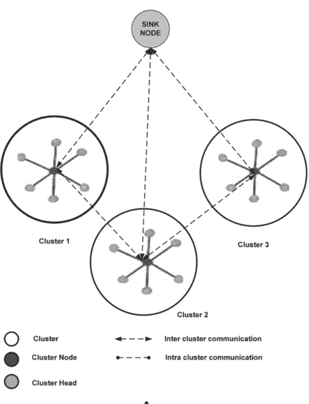

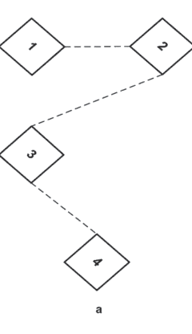

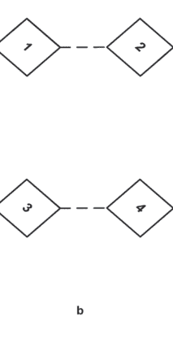

FIGURE 3.1 (A) Clustered wireless sensor networks topology. (B) System model. (C) (a) Fully connected network; (b) disconnected network.

throughout all dimensions. Computationally, it becomes hard to check every conceivable location that each sensor can do to guarantee effectiveness as the network increases. Therefore, meta-heuristic search strategies are used to identify the best answer. The cost of calculation is sometimes sacrificed to achieve the best possible result.

### 3.2.4 Modeling of System

In this study, a single group of $N$ wireless sensors is used to create a mesh network. Each measurement packet should be routed to a sink node to achieve this goal. Both sensor and sink nodes are contained within a square in the global neighbor matrix $\Gamma$, and it is defined as:

$$
\Gamma_{ij}(\gamma) = \begin{cases} 0, if \rho_j < \rho_{th} \\ 1, if \rho_j \ge \rho_{th} \end{cases}
$$ (3.1)

where $\gamma_i$ symbolizes the transmitting power of the node $i$, and $\rho_j$ specifies the power received by the node $j$. Receiver sensitivity is measured by $\rho_{th}$. Following Eq. (3.1), a signal is said to be connected between two nodes when the sensitivity of the receiver is insufficient to handle the received power. As depicted in Figure 3.1B, the signal intensity in each node's circular area is sufficient to ensure connectivity. Each circle's signal intensity is $\rho_{th}$. This indicates that the signal will be able to be received by any receiver within this circle area.

$$
\frac{P_R}{P_t} = \frac{A_r}{d^2} \frac{A_t}{\lambda^2}
$$ (3.2)

A receiver's signal power $P_R$ is proportional to the transmitter's output power $P_t$, and $d$ is the receiver's distance from the transmitter. $A_r$ and $A_t$ indicate the relative effective regions of the receiving and sending antennas, and $\lambda$ represents the signal's wavelength being sent in Eq. (3.2), referred to as the Friis formula [14]. For each sensor node, a single isotropic broadcast and reception antenna is employed to represent the effective area of antenna's $A_{isotropic}$ because this work does not concentrate on antenna design for sensors.

$$
A_{isotropic} = A_r = A_t = \frac{\lambda^2}{4\pi}
$$ (3.3)

So Eq. (3.2) is further simplified as:

$$
\frac{P_R}{P_t} = \left(\frac{\lambda}{4\pi}\right)^2
$$ (3.4)

Eq. (3.1) is used to calculate the global neighbor matrix, and then the algorithm decides the connected pair of nodes as described in the next section.

### 3.2.5 Checking of Network Full Connectivity

For a system to be considered fully connected, it must have at least one active connection link and be capable of forming an uninterrupted path, as illustrated in Figure 3.1C(a). Fake fully connected networks are generated when every node has a single connecting link and cannot be connected individually, as depicted in Figure 3.1C(b). Full connectivity can be readily achieved and checked in small networks with a few nodes. However, the sheer number of nodes in a real IoT application makes figuring out how well each one is connected computationally is visually difficult.

The first step in determining connectivity is to calculate the Laplacian matrix of the global neighbor matrix \(\Gamma\) . \(n\) is the total number of nodes, and \(deg\left(n_i\right)\) is the number of other nodes connected to the \(i^{th}\) node, \(n_i\):

$$
L = \left(l_{ij}\right)_{n \times n}
$$ (3.5)

$$
l_{ij} = \left\{\begin{array}{l}deg\left(n_i\right) \text{ if } i = j \\ -1 \text{ if } i \neq j \text{ and } \Gamma_{ij} = 1 \\ 0 \text{ otherwise}
\end{array}\right.
$$ (3.6)

$$
deg\left(n_i\right) = \Gamma^2_{ij} \longleftrightarrow i = j
$$ (3.7)

There are nodes connected to \(i^{th}\) node if \(i = j\), and the square of their neighbor matrix is equal to the number of nodes connected to node \(i\). Eigenvalues of the Laplacian matrix are obtained using the following equation:

$$
L . E = \psi . E
$$ (3.8)


其中，\(\psi\) 是一个 \(n \times 1\) 特征向量，满足 Eq. (3.8) 中的所有以下条件。要构建一个向量，每个特征值可以组合为 \(\psi\)：

\[
\psi = \left[ \psi_1, \psi_2, \psi_3, \dots, \psi_n \right]^t \tag{3.9}
\]

完全连接状态只有当 \(\psi_2\) 为正时才能实现，如记号 \(\psi_1 < \psi_2 < \psi_3 < \dots < \psi_n\) 所示。它也被称为“\(\Gamma\) 的代数连通度”，可以通过观察其第二小的拉普拉斯特征值 \(\psi_2\) 并检查节点之间是否至少存在一条连接来确定。在这些条件下，完全连接网络必须具有足够的传输功率。

## 3.3 所研究的优化算法

### 3.3.1 蝴蝶优化算法（BOA）

蝴蝶的觅食和交配行为在一种名为 BOA 的元启发式算法中得到建模。与其他元启发式算法相比，BOA 的特点在于每只蝴蝶都有其独特的气味。以下是气味的一个可能公式：

\[
f = cI^a \tag{3.10}
\]

根据此公式，\(c\) 表示感官模态，\(I\) 是刺激强度；\(a\) 表示取决于香味吸收程度 \(f\) 的幂指数。

感官模态指数 \(c\) 理论上可以取 \([0, \infty]\) 范围内的任何值。对于 BOA，其值由优化问题的特异性决定。在算法的最优搜索阶段，感官模态 \(c\) 可以表示为：

\[
c(t+1) = c(t) + \left[ \frac{0.25}{c(t) \cdot \text{Maxit}} \right] \tag{3.11}
\]

Maxit 是允许的最大迭代次数，且 \(c\) 固定为 0.01。此外，算法包含两个关键阶段：全局搜索阶段和局部搜索阶段。对于蝴蝶的全局搜索移动，我们可以制定数学模型：

\[
X_N^d(t+1) = X_N^d(t) + \left(r^2 \cdot \text{gbest} - X_N^d(t)\right) \cdot f_N \tag{3.12}
\]

其中，\(r\) 是 \([0,1]\) 范围内的随机数，\(X_N^d\) 是第 \(i\) 只蝴蝶的解向量。在此情况下，gbest 是第 \(i\) 只蝴蝶所有现有解中当前的最佳解，\(f\) 表示香味。局部搜索可以表示为：

\[
X_N^d(t+1) = X_N^d(t) + \left(r^2 \cdot X_j^d(t) - X_k^d(t)\right) \cdot f_N \tag{3.13}
\]

其中，\(X_j^d\) 和 \(X_k^d\) 分别是第 \(j\) 只和第 \(k\) 只蝴蝶的解，它们分别从解空间中随机选择。这表明，如果 \(X_j^d\) 和 \(X_k^d\) 在同一次迭代中，蝴蝶将执行随机游走。如果允许这种随机游走发生，解将更加多样化。

蝴蝶对食物和配偶的搜索可以在局部和全局范围内进行。出于这个原因，建立了一个概率开关 \(p\) 以在传统的全局搜索和密集的局部搜索之间转换。BOA 在每次迭代中生成一个 \([0,1]\) 范围内的随机数，并将其与概率开关 \(p\) 进行比较，以决定搜索应该是全局还是局部。

### 3.3.2 嗅觉代理优化（SAO）算法

大多数人是通过嗅觉对世界获得最初印象的。绝大多数生物都可以利用嗅觉检测周围环境中是否存在有毒化学物质。借助人类嗅觉来创建 SAO 是自然而然的想法。然而，事实证明，绝大多数生物代理在狩猎、交配和避免危险的过程中都将嗅觉用于相同的主要功能。这导致开发了一种广泛的嗅觉代理，作为一种旨在最大化效率的算法 [23]。

#### 3.3.2.1 SAO 算法的步骤

SAO 围绕三种独特模式构建。根据前一段中概述的过程，推导出了这些模式。检测气味分子并确定是否寻找源是代理的初始操作阶段。在 SAO 算法演化过程的第二步中，代理使用第一种模式的选择来跟随分子寻找气味的源。使用第三种选项可防止代理在追踪丢失时被限制在小范围内。

#### 3.3.2.2 嗅闻模式

我们以随机选择的初始位置开始该过程，其中气味分子向代理的方向扩散。例如，如果气味分子的数量为 \(N\)，且 \(d\) 表示超空间中的决策变量数量（阈值数量），则使用 Eq. (3.8)：

\[
x = \begin{bmatrix}
x_1^1 & x_1^2 & \cdots & x_1^{d-1} & x_1^d \\
x_2^1 & x_2^2 & \cdots & x_2^{d-1} & x_2^d \\
\vdots & \vdots & \vdots & \vdots & \vdots \\
x_{N-1}^1 & x_{N-1}^2 & \cdots & x_{N-1}^{d-1} & x_{N-1}^d \\
x_N^1 & x_N^2 & \cdots & x_N^{d-1} & x_N^d
\end{bmatrix} \tag{3.14}
\]

\[
x_N^d = x_{min,d} + \left(x_{max,d} - x_{min,d}\right) \cdot \text{rand} \tag{3.15}
\]

为了在搜索空间中找到其最优位置，代理使用 Eq. (3.14) 构建位置向量。\(x_{max,d}\) 和 \(x_{min,d}\) 是决策变量的最大和最小限制，其中 rand() 的值范围为 0 到 1。

确定气味分子将以由 Eq. (3.16) 决定的初始速度从源/起点扩散：

\[
v_N^d = v_{min,N} + \left(v_{max,N} - v_{min,N}\right) \cdot \text{rand}() \tag{3.16}
\]

每个气味分子都代表几何数值空间中的一个潜在解。利用 Eq. (3.14) 中向量的位置和 Eq. (3.16) 中分子的速度，我们可以定位这些潜在解的位置（气味分子）。由于气味分子的布朗扩散，使用 Eq. (3.17) 更新香味分子的速度。

\[
x_N^d(t+1) = x_N^d(t) + v_N^d(t+1) \cdot \Delta t \tag{3.17}
\]

假设在优化过程中，代理每次只走一步，\(t\) 被视为 1。例如，直到达到最后一次迭代，算法逐渐将其迭代次数增加 1。结果，气味分子移动到 Eq. (3.18) 作为其新位置。

\[
x_N^d(t+1) = x_N^d(t) + v_N^d(t+1) \tag{3.18}
\]

每个香味分子的扩散速度与其蒸发和在搜索空间中移动的速度相关。由于香味分子在到达代理位置之前不均匀地扩散，Eq. (3.19)：

\[
v_N^d(t+1) = v_N^d(t) + v \tag{3.19}
\]

\[
v = r_1 \sqrt{3KT/m} \tag{3.20}
\]

在 Eq. (3.20) 中，\(v\) 表示随时间更新的速度分量。气味粒子的温度 \(T\) 和质量 \(m\) 分别影响代理的动能。由 \(k\) 表示的嗅觉常数对该效应进行归一化。算法的稳定性不受温度 \(T\) 或质量 \(m\) 的影响，两者都与气味分子的初始化相关。\(m\) 和 \(T\) 的概念源于理想气体理论。为节省时间，实验结果表明 \(m\) 和 \(T\) 的值分别为 0.175 和 0.825。Eq. (3.17) 中气味分子的新位置将被评估其适宜性。这标志着嗅闻模式的结束以及定位代理 \(x_{best}^d\) 的能力。

#### 3.3.2.3 追踪模式

当代理被赋予寻找异味源的任务时，此模式模拟代理的行为。分子在寻找气味源时可能会检测到比当前位置浓度更高的新位置，代理使用 Eq. (3.21) 移动到该新位置。

\[
x_N^d(t+1) = x_N^d(t) + r_2 \cdot olf \cdot \left(x_{gbest}^d(t) - x_N^d(t)\right) - r_3 \cdot olf \cdot \left(x_{worst}^d(t) - x_N^d(t)\right) \tag{3.21}
\]

其中，\(r_2\) 和 \(r_3\) 是 (0,1) 范围内的随机数。相对而言，\(r_2\) 和 \(r_3\) 都会对 \(olf\) 对 \(x_{gbest}^d(t)\) 和 \(x_{worst}^d(t)\) 的影响进行惩罚。嗅闻模式为代理提供了一种方法来找到其当前位置 \(x_{gbest}^d(t) 和适应度最差的点 \(x_{worst}^d(t)\)。这使代理能够更有效地追踪气味的路径。Eq. (3.21) 展示了如何利用这些信息来改善算法在探索与开发之间的平衡。嗅觉能力在很大程度上受到嗅叶大小以及个体心理和生理状态的影响；因此，\(olf\) 的值应谨慎选择。低 \(olf\) 值有利于局部搜索，而高 \(olf\) 值有利于全局搜索，因为前者在 SAO 检测全局搜索中气味的能力方面表现出更大的优势。


#### 3.3.2.4 随机模式

由于气味分子的离散性，如果它们在相对搜索空间的广阔区域内扩散，其浓度和强度会随时间变化。因此，追踪变得更加困难，气味会丢失，导致代理难以跟随。代理可能在此刻无法继续追踪，从而导致局部最小值。当这种情况发生时，代理进入随机模式：

\( x_N^d \left( t+1 \right)=x_N^d \left( t \right)+r_4 * SL \) (3.22)

随机数 \( r_4 \) 通过随机增加 \( S \) 的步长来惩罚 \( SL \) 的值。如果代理丢失踪迹，或者追踪模式无法获得最佳适应度或定位气味源，分子将使用 Eq. (3.22) 执行随机步进。

因此，分子将始终尝试保留其在搜索路径上气味分子浓度最高的位置。如前所述，当代理跟踪当前位置 \( x_{gbest}^d \left( t \right) \) 代理和最差位置 \( x_{worst}^d \left( t \right) \) 代理时，此信息会在 Eq. (3.21) 中用于追踪，尽管代理受优化问题限制，只能在可行区域内搜索。

## 3.4 结果与讨论

实验中选择的传输功率最小值为 −30 [dBm]。最大功率设置为在随机分布区域内提供 28.284 [m] 距离的连接，而传输频率设置为在 915 [MHz] 范围内提供最低衰减值，该频率通常用于 WSN 应用。最后，灵敏度（定义为信息恢复所需的最小接收功率）设置为 −60 [dBm]。表 3.1 列出了本研究中使用的所有参数值。根据 [14]，只有 10 种可能的场景。然而，场景 1 和 3、场景 2 和 5、场景 4 和 6 以及场景 7 和 9 是相同的。因此，在本文中，总场景从 10 种减少到 6 种。实验在同一平台上进行。使用在 Windows 10 (64-bit) 上运行的 MATLAB® R2022a，配备 Intel® Core® i5-5000 处理器（主频 2.9 GHz）和 8 GB 内存，来比较每种算法的输出。

| 参数 | 值 |
|---|---|
| 传感器节点总数 | 20 |
| 传感器传输功率范围 | −30 [dBm] |
| 传感器传输频率 (f) | 915 [MHz] |
| 传感器随机位置区域 (L×L) | 20 [m] × 20 [m] |
| 传感器灵敏度 (\( P_{th} \)) | −60 [dBm] |

SOA 和 BOA 方法已在 [14] 研究的场景中开发并应用。论文中有六种不同的场景，每种场景在 20 m² 区域内分布着 20 个传感器。已对多种知名算法进行了比较研究，例如粒子群优化 (PSO)、简单方法 (SM)、静电放电算法 (ESDA)、差分进化 (DE)、遗传算法 (GA)、电磁类算法 (EM)、黑洞 (BH) 算法、正弦余弦算法 (SCA) 和海鞘群算法 (SSA)。然而，值得注意的是 [14] 中只有十种可能性。并且观察到，通过所调查方法部署的传感器的传输范围在考虑范围内，即 –30 [dBm]。为了解决任何优化问题，首先设置算法参数是必不可少的。在执行 SOA 和 BOA 算法之前，先进行参数敏感性分析，然后分配值，如表 3.2 所示。

| 算法 | 参数 | 描述 | 分配值 |
|---|---|---|---|
| HCCPSOBOA | \(\Phi_1, \Phi_2\) | 控制参数 | 2.05 |
| | \(N\) | 代理总数 | 50 |
| | \(d\) | 维度 | 20 |
| | Maxit | 最大迭代总数 | 1000 |
| | \(c\) | 感觉模态索引 | 0.01 |
| | \(a\) | 功率指数 | 0.1 |
| | \(p\) | 概率开关 | 0.5 |
| | \(V_{max} V_{min}\) | 代理速度限制 | 5, -5 |

为了公平比较，每种场景由 SOA 和 BOA 算法运行 20 次，并将最佳结果列于表 3.3。从表 3.3 可以看出，BOA 结果略好于 ESDA 结果。但与 BOA、ESDA 以及所有其他现有结果相比，SOA 的结果非常出色。SOA 在所有场景中获得的最佳结果在表 3.3 中以粗体显示。原因非常清楚，

### 表 3.3 使用不同算法的结果比较。

| 场景 | SOA | BOA | ESDA | PSO | SM | DE | GA | BH | EM | SSA | SCA |
|---|---|---|---|---|---|---|---|---|---|---|---|
| 场景 1 | -5.866 | -5.184 | -5.044 | -3.624 | 2.827 | -4.026 | -0.343 | Inf | Inf | -4.074 | 4.353 |
| 场景 2 | -8.613 | -7.857 | -7.683 | -6.669 | -2.699 | -6.758 | -1.090 | -6.798 | 7.214 | -5.841 | 7.636 |
| 场景 3 | -6.947 | -6.504 | -6.260 | -3.353 | 2.827 | -5.725 | -2.499 | -5.112 | 5.878 | -5.161 | 7.610 |
| 场景 4 | -5.949 | -5.415 | -5.044 | -5.113 | 3.842 | -4.014 | -0.529 | -4.281 | Inf | -3.389 | 8.473 |
| 场景 5 | -7.973 | -7.458 | -7.288 | -6.669 | -2.744 | -6.475 | -1.639 | -6.031 | 3.445 | -3.400 | 5.682 |
| 场景 6 | -5.390 | -4.763 | -4.507 | -5.226 | 3.865 | -3.363 | -1.766 | Inf | Inf | -0.541 | 6.532 |

例外情况是，对于 SOA，所有其他实验算法均根据其进化策略单独执行。SOA 标记的最佳值分别为场景 1 至 6 的 –5.866 [dBm]、-8.613 [dBm]、-6.947 [dBm]、-5.949 [dBm]、-7.973 [dBm] 和 -5.390 [dBm]，且在所有算法中 BH 和 EM 表现不佳。主要原因是 SOA 算法利用收敛过程中的不同阶段来解决高维优化问题。

已实现的 SOA 和 BOA 算法对六个场景的收敛曲线草图如图 3.2 所示。迭代次数和目标函数值分别显示在 x 轴和 y 轴上。可以从图 3.2 得出以下观察。对于场景 1，SOA 算法在第 728 次迭代时收敛到最佳解，而 BOA 在第 466 次收敛。对于场景 2，SOA 和 BOA 分别在第 755 次和第 527 次收敛；对于场景 3，分别在第 707 次和第 509 次收敛；对于场景 4，分别在第 730 次和第 649 次收敛；对于场景 5，分别在第 860 次和第 781 次收敛；对于场景 6，分别在第 870 次和第 395 次收敛。SOA 和 BOA 的平均收敛次数分别为 775 次和 554 次迭代。BOA 的平均收敛时间为 5.22 秒，而 SOA 为 10.54 秒，这是由于其强大的进化过程。表 3.4 总结了所考虑的各种场景下 SOA 和 BOA 得出的传感器传输功率。每个传感器的传输功率与其他传感器不同。传输功率因场景而异，从场景 1 变化到场景 6。场景 1–6 的平均最小和最大传感器传输功率为 SOA 的 –20.5 dBm 和 –23.9 dBm，以及 BOA 算法的 –20.1 dBm 和 –23.8 dBm。

### 场景-1

### 场景-2

### 场景-3

### 场景-4

### 场景-5

### 场景-6

### 图 3.2 被调查算法在场景 1–6 中的收敛特性比较。

### 表 3.4 由 BOA 和 SOA 获得的六种不同场景下的每个传感器传输功率

| | BOA | | | | | | SOA | | | | |
|---|---|---|---|---|---|---|---|---|---|---|---|
| | 1 | 2 | 3 | 4 | 5 | 6 | 1 | 2 | 3 | 4 | 5 | 6 |
| 传感器 1 | -17.6 | -18.7 | -21.8 | -26.3 | -25.7 | -14.7 | -17.9 | -19.2 | -21.9 | -26.7 | -25.9 | -15.1 |
| 传感器 2 | -21.7 | -25.7 | -28.8 | -15.7 | -28.7 | -16.4 | -22.0 | -26.2 | -28.9 | -16.1 | -28.9 | -16.8 |
| 传感器 3 | -16.7 | -21.7 | -28.8 | -28.6 | -22.7 | -25.7 | -17.0 | -22.2 | -28.9 | -29.0 | -22.9 | -26.1 |
| 传感器 4 | -28.7 | -16.7 | -28.8 | -28.2 | -18.7 | -19.2 | -29.0 | -17.2 | -28.9 | -28.6 | -18.9 | -19.6 |
| 传感器 5 | -25.7 | -19.7 | -21.8 | -15.7 | -22.6 | -19.2 | -26.0 | -20.2 | -21.9 | -16.1 | -22.8 | -19.6 |
| 传感器 6 | -13.0 | -25.7 | -22.8 | -16.4 | -17.6 | -22.7 | -13.3 | -26.2 | -22.9 | -16.8 | -17.8 | -23.1 |
| 传感器 7 | -18.7 | -21.7 | -28.8 | -16.7 | -16.1 | -25.7 | -19.0 | -22.2 | -28.9 | -17.1 | -16.3 | -26.1 |
| 传感器 8 | -16.7 | -16.4 | -14.9 | -28.7 | -28.7 | -22.7 | -17.0 | -16.9 | -15.0 | -29.1 | -28.9 | -23.1 |
| 传感器 9 | -21.7 | -19.2 | -28.8 | -16.7 | -28.7 | -28.7 | -22.0 | -19.7 | -28.9 | -17.1 | -28.9 | -29.1 |
| 传感器 10 | -21.7 | -22.7 | -25.8 | -14.7 | -28.7 | -13.7 | -22.0 | -23.2 | -25.9 | -15.1 | -28.9 | -14.1 |
| 传感器 11 | -28.7 | -28.6 | -28.8 | -17.6 | -25.7 | -21.4 | -29.0 | -29.1 | -28.9 | -18.0 | -25.9 | -21.8 |
| 传感器 12 | -28.7 | -28.7 | -28.8 | -28.7 | -25.7 | -28.5 | -29.0 | -29.2 | -28.9 | -29.1 | -25.9 | -28.9 |
| 传感器 13 | -21.7 | -16.2 | -9.7 | -28.2 | -28.7 | -19.7 | -22.0 | -16.7 | -9.8 | -28.6 | -28.9 | -20.1 |
| 传感器 14 | -21.7 | -25.7 | -28.8 | -18.7 | -16.2 | -22.7 | -22.0 | -26.2 | -28.9 | -19.1 | -16.4 | -23.1 |
| 传感器 15 | -28.7 | -22.7 | -25.8 | -22.7 | -16.2 | -22.7 | -29.0 | -23.2 | -25.9 | -23.1 | -16.4 | -23.1 |
| 传感器 16 | -10.7 | -28.7 | -21.8 | -22.7 | -19.2 | -19.7 | -11.0 | -29.2 | -21.9 | -23.1 | -19.4 | -20.1 |
| 传感器 17 | -21.7 | -22.7 | -28.8 | -19.2 | -28.7 | -19.6 | -22.0 | -23.2 | -28.9 | -19.6 | -28.9 | -20.0 |
| 传感器 18 | -28.7 | -28.7 | -22.8 | -15.7 | -19.2 | -22.7 | -29.0 | -29.2 | -22.9 | -16.1 | -19.4 | -23.1 |
| 传感器 19 | -16.7 | -22.7 | -17.7 | -16.4 | -18.7 | -19.2 | -17.0 | -23.2 | -17.8 | -16.8 | -18.9 | -19.6 |
| 传感器 20 | -21.7 | -8.1 | -6.8 | -5.4 | -25.7 | -17.6 | -22.0 | -8.6 | -6.9 | -5.8 | -25.9 | -18.0 |
| 平均传输功率 | -21.6 | -22.0 | -23.8 | -20.1 | -23.1 | -21.1 | -22.3 | -22.5 | -23.9 | -20.5 | -23.3 | -21.5 |

### 3.4.1 计算复杂度

HCCPSOBOA 的计算复杂度为 O(t(N × D))，其中 t 表示迭代次数，D 表示变量数量，N 表示解的数量。此计算的复杂度与 CCPSO、BOA、GA、DE、EM 和 SCA 相当。然而，SSA 在平均情况下的计算复杂度为 O(t(N × log(N)))，在最坏情况下为 O(t(N^2))，而 BH 为 O(t(N^2 × D))。这表明，由于每次迭代中对解进行排序，SCA 和 BH 的计算复杂度比其他算法更差。

## 3.5 结论

本文介绍了 SOA 和 BOA 方法，以确定各种传感器节点的传输功率以节省传感器


在保持所有节点完全连接的同时节约能量。与使用连续电源的传感器系统相比，SOA 方法可将总网络传输功率降低多达 1 dBm。所提出的 SOA 和 BOA 算法在文献中已与 PSO、DE、GA、BH、SSA、EM 和 SCA 进行了比较，结果非常令人满意。SOA 在所有六种场景中均优于其他被考察的算法。SOA 在每种场景中始终能够找到解决方案（即，找到一个完全连接的网络）。未来，通过增加额外频率，可能还会支持其他无线技术，如 Wi-Fi、WiMAX、Zigbee 和 Bluetooth。通过将传输速率和功率使用纳入排序，也对节能和网络连接进行了评估。并且，针对这一工程优化问题寻找更好解决方案的工作仍在继续，因为许多高效的优化算法混合变体仍在不断发展。

## 参考文献

- [1] V. Rodoplu 和 T. H. Meng，“移动无线网络最小能量，”IEEE 通信特定领域杂志，第 17 卷，第 8 期，第 1333–1344 页，1999 年 8 月。http://dx.doi.org/10.1109/49.779917.
- [2] X. Li 和 H. Jiang，“人工智能技术与工程应用，”应用计算电磁学会期刊 (ACES)，第 32 卷，第 05 期，第 381–388 页，2021 年 7 月，[在线]。可用：https://journals.riverpublishers.com/index.php/ACES/article/view/9611.
- [3] A. A. Aziz, Y. A. Şekercioğlu, P. Fitzpatrick 和 M. Ivanovich，“延长电池供电无线传感器网络寿命的分布式拓扑控制技术综述，”IEEE 通信调查与教程，第 15 卷，第 1 期，第 121–144 页，2013 年。http://dx.doi.org/10.1109/SURV.2012.031612.00124.
- [4] S. Jahanbakhsh, M. Ojaroudi 和 S. Kazemi，“用于无线局域网 (WLAN) 应用的小型低功率整流天线，”应用计算电磁学会期刊 (ACES)，第 30 卷，第 3 期，第 332–337 页，2015 年。
- [5] X. Jin, J. M. Caicedo 和 M. Ali，“混凝土中嵌入式智能传感器天线的近场无线传输，”应用计算电磁学会期刊 (ACES)，第 30 卷，第 03 期，第 261–269 页，2021 年 8 月，[在线]。可用：https://journals.riverpublishers.com/index.php/ACES/article/view/10587.
- [6] A. A. Aziz, Y. A. Şekercioğlu, P. Fitzpatrick 和 M. Ivanovich，“延长电池供电无线传感器网络寿命的分布式拓扑控制技术综述，”IEEE 通信调查与教程，第 15 卷，第 1 期，第 121–144 页，2013 年。http://dx.doi.org/10.1109/SURV.2012.031612.00124.
- [7] R. V. Kulkarni 和 G. K. Venayagamoorthy，“无线传感器网络中的粒子群优化：简要综述，”IEEE 系统、人与控制论论文集 C 部分：应用与综述，第 41 卷，第 2 期，第 262–267 页，2011 年 3 月。http://dx.doi.org/10.1109/TSMCC.2010.2054080.
- [8] R. M. Shubair, S. A. Jimaa 和 A. A. Omar，“使用最小平均混合范数算法的鲁棒自适应波束成形，”应用计算电磁学会期刊 (ACES)，第 23 卷，第 3 期，第 262–269 页，2022 年 6 月，[在线]。可用：https://journals.riverpublishers.com/index.php/ACES/article/view/16151.
- [9] H. P. Gupta, S. V. Rao, A. K. Yadav 和 T. Dutta，“障碍物环境中集群无线传感器网络的地理路由，”IEEE 传感器期刊，第 15 卷，第 5 期，第 2984–2992 页，2015 年 5 月。http://dx.doi.org/10.1109/JSEN.2014.2385734.
- [10] O. Younis, M. Krunz 和 S. Ramasubramanian，“无线传感器网络中的节点聚类：最近发展与部署挑战，”IEEE 网络，第 20 卷，第 3 期，第 20–25 页，2006 年 5 月。http://dx.doi.org/10.1109/MNET.2006.1637928.
- [11] Latif, Nurul Mu’azzah Abdul 等。“使用粒子群优化的无线传感器网络能量感知聚类。”2007 年 IEEE 第 18 届个人、室内和移动无线通信国际研讨会 (2007): 1–5
- [12] S. Sarangi 和 B. Thankchan，“使用粒子群优化的无线传感器网络新型路由算法，”IOSR 计算机工程期刊，第 4 卷，第 26–30 页，2012 年。
- [13] S. Khezri, K. Faez 和 A. Osmani，“基于修改的离散二进制 PSO 的 WSN 网络传感器布置。”载于 2010 年计算智能与通信网络国际会议论文集，CICN 2010，第 200–204 页，2010 年。http://dx.doi.org/10.1109/CICN.2010.49.
- [14] G. L. da Silva Fre, J. de Carvalho Silva, F. A. Reis 和 L. Dias Palhao Mendes，“面向物联网完全连接集群的最小传输功率粒子群优化实现。”载于 IWT 2015 - 2015 年电信国际研讨会，电气与电子工程师学会 Inc.，2015 年 8 月。http://dx.doi.org/10.1109/IWT.2015.7224573.
- [15] K. Yadav 和 S. A. Saad，“基于博弈论的 IoT 无线传感器网络自适应发射功率控制算法，”印度科学与技术杂志，第 14 卷，第 7 期，第 690–697 页，2021 年 9 月。http://dx.doi.org/10.17485/IJST/v14i7.1258.
- [16] M. J. Piran, S. Verma, V. G. Menon 和 D. Y. Suh，“基于 WSN 的物联网节能传输范围优化模型，”计算机、材料与连续介质，第 67 卷，第 3 期，第 2989–3007 页，2021 年 3 月。http://dx.doi.org/10.32604/cmc.2021.015426.
- [17] M. A. Alanezi, H. R. E. H. Bouchekara, M. S. Javaid 和 M. S. Shahriar，“使用静电放电算法实现物联网最小传输功率的完全连接集群，”应用计算电磁学会期刊，第 36 卷，第 3 期，第 336–345 页，2021 年。http://dx.doi.org/10.47037/2020.ACES.J.360313.
- [18] A. A. Abbasi 和 M. Younis，“无线传感器网络聚类算法综述，”*计算机通信*，第 30 卷，第 14–15 期，第 2826–2841 页，2007 年 10 月。http://dx.doi.org/10.1016/j.comcom.2007.05.024.
- [19] M. Abdelaal 和 O. Theel，“长寿命无线传感器网络最近的节能努力：简明综述。”载于 *IFIP 无线与光通信网络国际会议, WOCN*，IEEE 计算机学会，2014 年 10 月。http://dx.doi.org/10.1109/WOCN.2014.6923052.
- [20] W. R. Heinzelman, A. Sinha, A. Wang 和 A. P. Chandrakasan，“无线微传感器网络的可扩展能量算法与协议。”载于 *ICASSP，IEEE 声学、语音和信号处理国际会议论文集*，电气与电子工程师学会 Inc.，2000 年，第 3722–3725 页。http://dx.doi.org/10.1109/ICASSP.2000.860211.
- [21] M. Abdelaal 和 O. Theel，“长寿命无线传感器网络最近的节能努力：简明综述。”载于 *IFIP 无线与光通信网络国际会议, WOCN*，IEEE 计算机学会，2014 年 10 月。http://dx.doi.org/10.1109/WOCN.2014.6923052.
- [22] L. D. P. Mendes, J. J. P. C. Rodrigues 和 M. Chen，“时隙 ALOHA 无线传感器网络的跨层休眠与速率自适应机制。”载于 *2010 年信息与通信技术融合国际会议, ICTC 2010*，2010 年，第 213–217 页。http://dx.doi.org/10.1109/ICTC.2010.5674661.
- [23] A. T. Salawudeen, M. B. Mu’azu, Y. A. Sha’aban 和 A. E. Adedokun，“一种新型嗅觉代理优化 (SAO)：广泛的 CEC 研究与工程应用 [公式已呈现]，”*基于知识的系统*，第 232 卷，2021 年 11 月。http://dx.doi.org/10.1016/j.knosys.2021.107486.

# 4 智慧城市与智慧城市移动性的物联网优化

Nisha Devi¹ 和 Neha Kishore²

¹ 电子与通信工程系，
玛哈拉贾·阿格森大学，巴迪，喜马偕尔邦，印度

² 计算机科学与工程系，
玛哈拉贾·阿格森大学，巴迪，喜马偕尔邦，印度

## 4.1 引言

计算机在处理数字或符号时能够同样有效地运作，这一能力催生了一类计算机系统。其中最著名的系统是专家系统。人工智能 (AI) 是指开发这些系统所依据的知识体系 [1]。AI 的目标是使计算机能够像人类一样进行推理。这一变化将增强各个领域的数字化革命。世界可能通过将一切连接到数字平台而实现自主。机器学习和数据分析是使物理对象和环境自主所需的两个模块。数据分析将分析随时间产生的所有数据，以找出先前的模式并提升未来的有效性，而机器学习将制定策略，以协助网络中各种设备的学习，使其自动化和独立 [2]。将机器学习和数据分析集成到传感器和嵌入式系统中以构建智能系统，目前是工业增长的关注点。IoT 对充满植入式智能设备（有时称为“智能对象”）的世界的预期，是推动这一运动的最主要概念之一，


这些组件通过互联网或蓝牙、红外线等其他通信介质互连[3]。以下小节将讨论 AI、IoT 及其应用。

### 4.1.1 人工智能

AI 是研究赋予机器人智能，使其能够执行以前需要人类智力才能完成的工作的一门学科。基于 AI 的系统在功能、适用性、适应性和处理速度方面正在快速发展。机器执行不常见任务的能力不断提升。这些领域产生的所有数据都为智能提供了贡献。要揭示这些数据背后的基本原理，分析至关重要。AI 是一种有效利用数据的方法，使其具有意义、可供提供数据的人理解，并且可定制。这是关于开发用于分析数据并从中解读有意义信息的工具和策略的研究[2]。

### 4.1.2 物联网（IoT）

IoT 基本上是“Internet”和“things”两个词的组合，其中 Internet 是一个全球互联的计算机网络网络，为全世界多个用户服务，并基于 TCP/IP 协议运行。不同的个人、公共、教育、企业、部委、安全机构网络通过一系列关键的电磁、无线和光纤网络技术相互连接[4]。IoT 能够预测并响应环境变化，因为它是一个广泛的开放式智能对象网络，这些对象能够自我组织、共享信息和资源、响应事件，并根据环境变化修改其行为。IoT 可以为万物提供随时随地的连接[5, 6]。

### 4.1.3 IoT 应用

图 4.1 展示了 IoT 在智慧城市各个组件中的应用。它包括智能门禁系统、家庭和办公室智能照明、自动门和车库、智能恒温器和湿度控制器、交通管理、街道智能照明、污染监测与上报、智能停车解决方案等，应用于工业、医疗、农业、家庭自动化、交通、物流管理等领域。IoT 还为智慧城市提供了多种创新且全面的应用，这些应用显著有助于降低能源消耗及其他环境影响。

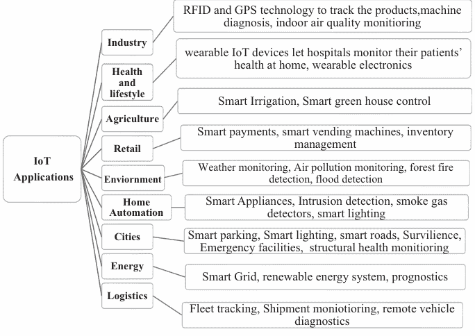

图 4.1 IoT 的应用。

本章后续部分的结构如下：在第 4.2 节中，将简要介绍智慧城市，接着是智慧城市的常见问题、IoT 在智慧城市中的作用以及 IoT 对智慧城市的优化。第 4.3 节讨论智慧城市中的智能交通、其全球和区域视角以及智能交通对喜马偕尔邦的影响，随后是结论和未来展望。

## 4.2 智慧城市

智慧城市是一个技术先进的都市区，部署不同的电气设备和传感器以获取信息，这些信息用于处理资源、服务和资产，并进一步用于改善城市各地的多种运营。

### 4.2.1 智慧城市的常见问题

“智慧城市”的理念已成为政策制定者议程中更加重要的一部分，旨在通过寻找和识别智能解决方案来提高为居民提供的生活质量。由于人口增长和高速城市化，城市必须提高所提供资源和服务的质量与效率，同时促进可持续和长期的经济增长。智慧城市面临某些常见问题：

- 1. 支持智慧城市的基础设施不足
- 2. 数据隐私与公开性
- 3. 私营部门与公共部门之间的协调
- 4. 无法实施智慧城市倡议
- 5. 政治不兼容和立法意愿不足
- 6. 缺乏技术技能
- 7. 安全与黑客
- 8. 生活质量与隐私侵犯之间的不平衡
- 9. 社区教育及其对智慧城市发展的支持

### 4.2.2 IoT 在智慧城市中的作用

AI 和 IoT 的现代进步在智慧城市的发展中发挥着重要作用。这两者都基于智能医疗、交通、系统基础设施、环境管理、治理、可持续性和生活质量等应用。智慧城市代表了一种理想化的城市发展形式[7]。智能城市的概念通常基于多种因素，包括商业化、物流和运输、医疗、旅游等。智慧城市的这些领域可以通过提高城市的智能化水平、改善物与人之间的交互、优化通用资源的使用，并通过改善市民的信息访问来提升商业机会，从而从 IoT 中受益。由于该技术有潜力降低碳排放、能源利用、交通管理和基础设施老化，从而减少对生态和人类的有害影响并促进生态可持续性，因此 IoT 在智慧城市中的集成还可以为居民提供合适的整体生活条件[8]。

### 4.2.3 通过 IoT 优化智慧城市

由于人口增长和城市化，全球对智慧城市的压力不断增加。为克服这些压力源，智慧城市需要在之前的技术基础上进行优化，并需要智能健康系统、智能家电、智能产业、智能基础设施、智能嵌入式系统和智能交通。

图 4.2 展示了智慧城市的 IoT 优化应用：智能农业、智能电网、智慧城市服务、智能健康、智能交通、智能产业等。

#### 4.2.3.1 基于 IoT 的能源优化

智慧城市是指其内部和外部都拥有多种能耗设备并且完全联网的城市。因此，能源优化对于充分利用可用能源是必要的。为了提高智慧城市的能源效率，需要一种基于 IoT、5G 和云计算的模型。

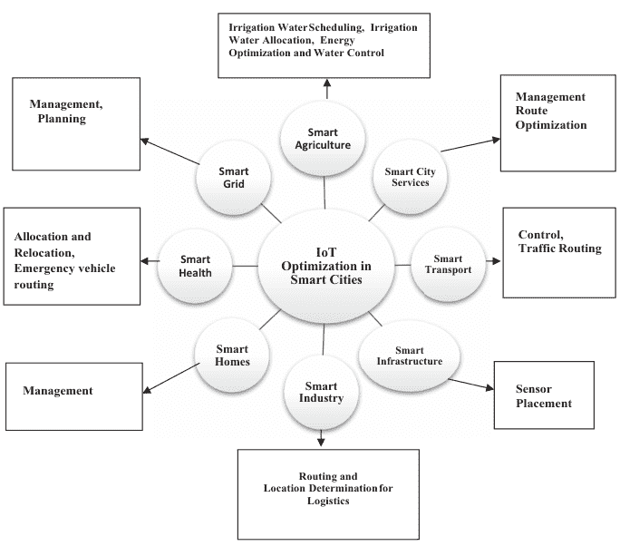

图 4.2 基于 IoT 的智慧城市优化应用。

可以使用具有 IoT 功能的节能传感器，5G 可以实现与智能能耗设备的快速通信。智能 IoT 设备产生的数据可以通过 5G 通信通道存储在云中。通过该应用程序，智能设备的功能会被跟踪。如果出现任何问题，控制管理可以通过通信通道从云中获取信息并解决问题[9]。

#### 4.2.3.2 基于 IoT 的智能交通优化

大多数智慧城市每天都面临严重的交通问题。交通控制系统是智慧城市的一大问题，尽管某些区域已经实现自动化且成本效益高。每个有交通信号灯的路口都安装了集成 IoT 传感器的摄像头，用于监控过往车辆的行驶情况。此外，云端处理优化后的车流数据。使用来自不同信号路口的信息执行算法，以确定交通流向并管理信号灯。当交通拥堵时，使用 IoT 传感器向最近的交通控制设施发送警报通知[10]。

#### 4.2.3.3 使用 IoT 的智能农业

IoT 结合了多种当前的尖端产品和技术，包括无线传感器网络（WSN）、认知无线自组织网络、云计算、大数据和用户应用。在智能农业中使用 IoT 技术是不可避免的，它将提高生产力、提供卫生绿色食品、推动食品可追溯性，并在提高生产能力的同时减少人力投入。在智能农业领域，根据所需活动使用各种常见传感器。位置传感器、机械传感器、电化学传感器、光学传感器和气流传感器只是用于对传感器分类的几个基本类别。这些传感器用于收集大气成分、空气温度/气压/湿度、土壤湿度/温度、空气湿度、植物湿度、降水量、风速/风向和日照辐射等数据。这些自主传感器提供高度可靠的数据，表现出优异的能源效率并实现独立性[11]。

#### 4.2.3.4 基于 IoT 的智能医疗

“智能医疗”这一术语描述了利用技术为人们提供更好医疗服务的方式。这可能表现为开发用于改进疾病诊断的仪器，或使用算法进行更好的排程


为改善医疗服务，必须在适当的时间将急救车辆派遣给有需要的人。物联网（IoT）极大地便利了急救车辆的调度和移动。通过车辆与车辆（V2V）及车辆与基础设施（V2I）通信，物联网提供的连接使车辆位置以及特定区域交通流量的实时指标成为可能。然后可以利用这些信息来决定救援车辆的最佳路径以及如何最佳地部署它们来帮助有需要的人。

#### 4.2.3.5 智能家居优化

家庭能源管理一直是优化的主要应用。为了优化智能家居，有许多要求需要维持舒适度、电力流动限制、运行时间、可能存在或消耗的最大功率以及可切换电器的可用性。智能电表和物联网技术用于管理和监控单个电器以及对它们进行调度。微电网（用于控制家庭电力供应中打开和关闭的电源并用于收集数据）由物联网设备实现。从这些物联网设备收集的数据可以分析以改进能源消耗模式，这将为客户节省成本并提升舒适度。

#### 4.2.3.6 智慧城市的智能基础设施

智能生活领域还包括对公共服务（如文化活动、旅游和教育）的管理与改进，这些服务有助于提升市民的整体生活质量。这涵盖了与发展更智能的城市基础设施（例如，智能家居、智能建筑等）相关的所有元素。物联网使智能建筑的各种设施实施迅速扩展，包括用于监测建筑结构完整性的工具、用于管理空调和雨水排水的工具、用于控制经过验证的建筑物准入的安全系统、视频监控和人员移动跟踪。

## 4.3 智慧城市的智能出行

智慧城市是利用信息和通信技术、商业策略及解决方案来提高生产力、向公众共享知识并提升居民福祉的发达地区。

利用信息和通信技术，智慧城市的使命是增强经济发展与社会福祉 [12]。智慧城市理念的关键原则之一是智能出行。由于在交通和交通科学的每个领域都使用了大量技术解决方案，将技术整合到交通运输领域的潜力正在增长 [13]。信息和通信技术正以快速的速度发展，成为智慧城市的决定因素。当地政府今天面临的最大问题之一是城市出行 [14]。由于私家车数量不断增加、交通事故、交通网络中的拥堵道路、公共空间减少以及经济停滞，地方议会被要求为城市交通创建环保且可持续的解决方案。“智能出行”的理念提出，可以利用各种最新和历史数据，结合信息和通信技术来优化出行时间，从而减少空间使用、交通拥堵、事故和危险气体排放。智能出行指标必须作为可持续城市出行规划过程的一部分建立。在设计和实施阶段，广泛采用的智能出行概念（一种整体概念）着重于城市居民的需求以及他们的生活质量和健康。所选指标应当能够通过指标进行量化，以作为实现可持续目标的指导 [15]。这些指标跟踪信息和通信技术被采用的速度。为了推动更好的交通选择及其同步，依赖大数据收集和分析的应用和系统被称为“智能出行”。向零排放车辆过渡、引入新的共享（汽车/出行）模式、促进车辆之间以及与其他相关交通数据（行人、基础设施等）的连接（也称为“V2X”或“车联万物”），以及自动驾驶车辆都是智能出行革命的一部分 [16]。

创建强大的未来智慧城市有许多关键要求，这些要求也被视为创新和可持续技术的基础。未来智慧城市的理念对于提高居民的生活水平和福祉至关重要。智慧城市是一个广泛的概念，对于传统城市来说，采取小步快跑更为有效。然而，利用技术驱动的规划从头开始打造一座智慧城市将是一个更好的选择。鉴于城市中可用的交通服务日益增多以及技术的改进，需要一个创新的“移动即服务”（MaaS）计划，以平稳且智能地整合多种交通方式，并根据旅客的需求为他们提供有效的出行服务 [17]。

### 4.3.1 智慧城市中的联网和自动驾驶汽车（CAVs）

配备不同传感器以收集周围环境数据的车辆被称为CAVs。车辆内置的计算机随后处理这些数据，使车辆能够自动运行。预计随着CAVs的部署，驾驶员和弱势道路使用者将享有更卓越的道路安全性、更高的可达性以及更小的环境影响。推广自动驾驶和环保出行取决于连接性 [18]。出行被视为一种授予人们获取关键服务的方法，而非本身就是目的。即使在人口最稠密的地区，使用联网自动驾驶车辆也将扩大道路容量并缓解拥堵。然而，随着CAVs越来越受欢迎，驾驶员将失去对车辆的控制。这增加了安全风险，因为这使得对手更容易发动有效攻击。与此同时，汽车连接性的不断增强暴露了更多可能的安全漏洞，并为网络攻击创造了更多入口点。CAV的发展必然必须应对重大的攻击和安全漏洞。由于无线车辆连接（包括蓝牙、VANET和蜂窝网络）的扩展，潜在的车辆漏洞正变得更加明显。因此，网络攻击可能被用来利用这些漏洞，并对CAVs的性能和功能产生负面影响 [19, 20]。

### 4.3.2 全球视角

气候变化、交通拥堵和数字革命的相互作用使得出行行业发生重大变化成为可能。“移动即服务”预计将成为二十一世纪的新商业范式。它结合了共享、电动、联网和自动驾驶汽车。现在，考虑人们如何从一个地点移动到另一个地点比车辆本身更重要。国际交通论坛估计，如果当前努力保持现有步伐，到2050年全球交通活动量将增加四倍以上 [21]。为应对这一问题，交通政策制定者必须重新考虑公共空间的分配方式并对其进行修改，以容纳更多人。未来的解决方案将需要城市和立法改进，例如增加停车位、铺设自行车道以及推进公共交通网络的发展 [22]。预计到2030年，智能出行市场价值将达到约2503亿美元，2022年至2030年的复合年增长率（CAGR）为20.09% [23]。

以色列的交通每年都在恶化。WAZE的数据显示，2021年10月的交通量相比2020年2月（新冠疫情首次在以色列出现前不久）增长了27%。据统计，以色列是交通最糟糕的经合组织（OECD）国家。大众交通基础设施的建设速度远慢于私家车数量增长的速度。在以色列，交通拥堵的年度成本估计为400亿新谢克尔（约115亿欧元），到2030年该成本预计将上升至500亿新谢克尔（142.5亿欧元）。TomTom指数估计，平均每位以色列司机每年在交通中浪费150–200小时 [24]。为了加速创新商业和技术理念的采用，芬兰政府正在制定监管要求。该法案推进芬兰提供移动即服务（MaaS）并建立依赖数据互操作性和开放接口的数字出行未来的目标。它是更广泛的交通法典计划的一部分 [25]。智能出行是智慧城市的基石之一，侧重于利用交通系统协助城市交通和可持续出行 [26]。

### 4.3.3 区域视角

根据Market Research Future（MRFR）2022年的研究，到本世纪末，先进交通设施市场预计将增长惊人的3200亿美元。随着智慧城市项目的推进，政府正倾向于采用物联网（IoT）、人工智能（AI）、5G互联网接入、云工程等前沿技术工具 [27]。

根据Niti Aayog的数据，到2030年，印度40%的公交车将为电动车；此外，印度为电动车（EV）公交车提供需求并满足该需求的企业也支持这一目标 [28]。据印度总理称，将建设100个智慧城市。智慧城市项目的目标是建设未来适用的城镇，这些城镇可以通过回收废物来满足自身的水电需求。智慧城市无疑将满足越来越多城市居民的需求。根据TomTom的数据，过去四年中，孟买、班加罗尔和德里常年位列世界十大最拥堵城市之列。根据IQAir的数据，2019年进行的一项全球污染物调查显示，30个最污染城市中有21个位于印度，使该国上升至第五位。


总体而言。这些仅是智能交通解决方案必要的几个迹象示例 [29, 30]。

### 4.3.4 喜马偕尔邦智慧城市发展

喜马偕尔邦内阁通过了《电动汽车草案政策》，这是一项全面战略，旨在创建和推广可持续交通系统，将喜马偕尔邦打造为电动出行发展的全球中心 [31]。该电动汽车草案政策的唯一目标是到2025年，至少有15%的汽车转换为电池电动汽车（BEVs）。喜马偕尔路运公司（HRTC）目前运营50辆电动出租车和75辆电动客运巴士，主要集中在智慧城市西姆拉及一些较小城市 [32]。在各地安装适当数量的充电站，是《电动汽车政策-2021》生效的首要且最重要的条件。实施零排放水平等政策，有助于使山城和旅游热点实现无污染。

## 4.4 结论

集成的即服务移动（Mobility as a Service）概念和智能移动革命，在解决智慧城市日益严重的交通拥堵问题方面可能具有重要意义。除了COVID-19时代之外，出行需求随交通拥堵而增加。由于增长和人口密集化，产品和服务的需求，以及员工和通勤者的人数，相应有所增长。公路出游越来越受欢迎，铁路、航空和海运出行也是如此。由于汽车提供点对点运输，它能满足许多城市中大部分出行需求。在一天中的特定时段，汽车出行需求经常超过道路容量，导致空气污染、人员受伤、财产损失、时间浪费和燃料浪费等不利后果。新兴技术日益普及，旨在减轻负面影响，并将城市交通引向更绿色、更安全的道路。示例包括电动汽车、共享自行车和电动滑板车。智能移动已经到来，并且无论面临何种障碍都将继续存在。行业参与者若采取积极主动的态度，并乐于探索未知领域，将能更好地为印度智能移动的成功故事做出贡献。然而，当前的建设必须考虑不断扩大的城市人口的需求，并设计能够适应城市交通需求变化速度及其动态特性的解决方案。

## 参考文献

- [1] Simmons, A. B., & Chappell, S. G. (1988). 人工智能：定义与实践。IEEE Journal of Oceanic Engineering, 13(2), 14–42.
- [2] Ghosh, A., Chakraborty, D., & Law, A. (2018). 物联网中的人工智能。CAAI Transactions on Intelligence Technology, 3(4), 208–218.
- [3] Fortino, G., & Trunfio, P. (2014). 基于智能对象的物联网：技术、中间件与应用。Springer。
- [4] Nurnberg, G. (2012). 互联网的诞生：4月12日，课程。
- [5] Kosmatos, E. A., Tselikas, N. D., & Boucouvalas, A. C. (2011). 将RFIDIS和智能对象集成到统一的物联网架构中。Advances in Internet of Things: Scientific Research, 1, 5–12. http://dx.doi.org/10.4236/ait.2011.11002.
- [6] Madakam, S., Lake, V., Lake, V., & Lake, V. (2015). 物联网（IoT）：文献综述。Journal of Computer and Communications, 3(05), 164.
- [7] Glasmeier, A., & Christopherson, S. (2015). 关于智慧城市的思考。Cambridge Journal of Regions, Economy and Society, 8(1), 3–12.
- [8] Rejeb, A., Rejeb, K., Simske, S., Treiblmaier, H., & Zailani, S. (2022). 物联网与智慧城市的全景：关于我们已知与需要知道的回顾。Internet of Things, 19, 100565.
- [9] Humayun, M., Alsaqer, M. S., & Jhanjhi, N. (2022). 基于IoT的智慧城市能源优化。Applied Artificial Intelligence, 1–17.
- [10] Liu, C., & Ke, L. (2022). 云辅助的物联网智能交通系统及智慧城市交通控制系统。Journal of Control and Decision, 1–14.
- [11] Quy, V. K., Hau, N. V., Anh, D. V., Quy, N. M., Ban, N. T., Lanza, S., Randazzo, G., & Muzirafuti, A. (2022). IoT支持的智能农业：架构、应用与挑战。Applied Sciences, 12(7), 3396.
- [12] Rosayyan, P., Paul, J., Subramaniam, S., & Ganesan, S. I. (2023). 基于边缘计算和IoT传感器的智慧城市紧急车辆优先系统最优控制策略。Measurement: Sensors, 26, 100697.
- [13] Brčić, D., Slavulj, M., Šojat, D., & Jurak, J. (2018年5月). 智能移动在智慧城市中的作用。载于第五届道路与铁路基础设施国际会议（CETRA 2018）（第17–19页）。
- [14] Savastano, M., Suciu, M. C., Gorelova, I., & Stativià, G. A. (2023). 智慧城市中的移动有多智能？通过ICT应用分析公民价值认知。Cities, 132, 104071.
- [15] https://www.ippi.org.il/smart-mobility-shaping-a-new-world-2/.
- [16] Eiza, M. H., Cao, Y., & Xu, L. (编). (2020). 迈向可持续和经济的智能移动：塑造智慧城市的未来。World Scientific。
- [17] Rajabi, E., Nowaczyk, S., Pashami, S., Bergquist, M., Ebby, G. S., & Wajid, S. (2023). 基于知识的人工智能即服务移动框架。Sustainability, 15(3), 2717.
- [18] Campisi, T., Severino, A., Al-Rashid, M. A., & Pau, G. (2021). 连接与自动驾驶汽车（CAVs）时代智慧城市的发展：从出行模式到城市规模。Infrastructures, 6(7), 100.
- [19] Wang, Z., Wei, H., Wang, J., Zeng, X., & Chang, Y. (2022). 可持续城市中连接与自动驾驶汽车的安全问题与解决方案：综述。Sustainability, 14(19), 12409.
- [20] Ghosh, S., Zaboli, A., Hong, J., & Kwon, J. (2023). 自动驾驶汽车感知系统威胁分析的综合方法。IEEE Access, 11, 14752–14777.
- [21] Voda, A. I., & Radu, L. D. (2019). 人工智能如何应对智慧城市挑战？载于《智慧城市：问题与挑战》（第199–216页）。Elsevier。
- [22] Yeh, S., Gil, J., Kyle, P., Kishimoto, P., Cazzola, P., Craglia, M., Edelenbosch, O., Fragkos, P., Fulton, L., Liao, Y., Martinez, L., McCollum, D. L., Miller, J., Pereira, R. H. M., & Teter, J. (2022). 改善未来出行需求预测：一条采用开放科学跨学科方法的途径。Progress in Energy, 4(4), 043002.
- [23] 智能移动市场规模，2022年10月检索自 https://www.globenewswire.com/news-release/2022/08/12/2497710/0/en/SmartMobility-Market-Size-to-Worth-Around-USD-250-3-Bn-by-2030.html.
- [24] TomTom指数，2022年10月检索自 https://www.ippi.org.il/smart-mobility-shaping-a-new-world-2/.
- [25] 即服务移动（Mobility as a Service），2022年10月检索自 https://data.europa.eu/en/news-events/news/smart-mobility-finland.
- [26] Rey-Moreno, M., Periáñez-Cristóbal, R., & Calvo-Mora, A. (2023). 对可持续城市移动、即服务移动（MaaS）及采用模式的思考。International Journal of Environmental Research and Public Health, 20(1), 274.
- [27] 面向自力更生印度的智能移动与交通，2022年10月检索自 https://timesofindia.indiatimes.com/blogs/voices/smart-mobility-and-transportation-for-atmanirbhar-bharat/.
- [28] 各类电动出行细分市场的Status Co分析，2022年10月检索自 https://www.niti.gov.in/sites/default/files/2021,04/FullReport_Status_quo_analysis_of_various_segments_of_electric_mobility-compressed.pdf.
- [29] 印度的智慧城市，2022年10月检索自 https://economictimes.indiatimes.com/news/india-unlimited/smart-cities.
- [30] 电动汽车，2022年10月检索自 https://www.financialexpress.com/auto/industry/smart-mobility-transition-challenges-electric-cars-internet-connected-cars-smart-scooters/2282780/.
- [31] 喜马偕尔邦的智能移动，2022年10月检索自 https://www.google.com/search?q=smart+mobility+in+Himachal&rlz=1C1CHBF_enIN890IN891&oq=smart+mobility+in+Himachal&aqs=chrome.69157j0i22i30j0i390l4.12260j0j4&sourceid=chrome&ie=UTF-8.
- [32] 喜马偕尔邦的电动汽车，2022年10月检索自 https://www.outlookindia.com/website/story/india-news-himachal-pradesh-to-convert-15-per-cent-of-transport-to-electric-vehicles-by-2025/403317.


# 5 电子废弃物管理中的物联网应用

Smriti Snehil,¹ Ojaswi Vindhyachalam²
and Kamalesh Kumar Singh¹

1 Department of Metallurgical Engineering, Indian Institute of Technology, Banaras Hindu University, Varanasi, India
2 Faculty of Law, Banaras Hindu University, Varanasi, India

## 5.1 引言

With the development and advancement of new technologies, contemporary electrical and electronic equipment, collectively known as e-products, is being discarded in massive amounts at regular intervals. On the one hand, this discarded equipment contains harmful and carcinogenic elements such as lead, nickel, cadmium and substances such as furans, halides etc. that present serious threats to human life and the environment. On the other hand, it hosts many precious metals such as gold, silver, platinum, palladium and valuable metals like copper, aluminum, iron etc., which are the main motivation factor to recycle the electronic waste. The recycling of e-waste gives the opportunity to recover these valuable metals to put back them into their respective use and support the concept of a circular economy.

The handling the electronic waste involving proper identification, segregation and disposal becomes significantly important in deciding the fate of electronic waste.

Before deep diving into understanding the scope and mechanism of the management of electronic waste using modern artificial intelligence techniques, let us understand the terms and concepts associated with them.

“Electronic waste,” or “e-waste,” is a term that incorporates all kinds of electrical and electronic equipment and their parts that have been discarded after use. In other words, the electronic products that are nearing the end of their useful lives are collectively known as “e-waste.” Some examples of e-waste are discarded e-products, such as computer monitors, keyboards, printers, calculators, circuit boards, cathode ray tubes, memory chips, cords and cables, fans, etc. E-waste is one of the most rapidly growing waste streams in the world. According to e-waste collection reports, the total e-waste generated across the globe has reached over 50 million tons. Just in 2019, the e-waste generated across the globe was approximately 53.6 million tons [1]. It is predicted [2] that the global e-waste generation in 2030 will be 75 million tons and approximately 111 million tons in the 2050. This ever growing waste stream cannot be ignored and calls for the utmost care in its handling and processing. E-waste is either sent for recycling or simply thrown into a landfill. The recycling rates are improving gradually but are still low in developing countries.

A proper e-waste management system can contribute to minimize the landfill proportion. Various approaches are in practice to handle e-waste management.

Processing e-waste involves three critical steps:

- 1. Collection of E-Waste: This first step involves the collection of e-waste from households and industries. Further, the dumped waste is collected from bins by recycling units for processing.
- 2. Preprocessing: The collected e-waste is segregated based on many factors such as remaining life, hazardousness and ability to be recycled. After segregation, the parts of the wastes are dismantled and shredded into pieces using hammer mills. This is the initial part of processing e-waste.
- 3. End-Processing (Finishing): This stage involves further processing of metals and non-metals. Recyclable and materials that can be kept and used in other applications are kept and anything remaining is discarded.

Due to poor collection rates, only 20% of e-waste is recycled, whereas 4% joins the residential waste stream. Seventy-six percent of e-waste is disposed of illegally, either in open air incineration or in landfill, which in either case is a hazardous practice for humankind and the environment. To maximize the disposal of e-waste in legal centers of processing, the collection rate is extremely important and depends on the tracking of the movement of e-waste.

There are two approaches—producers’ responsibility and users’ responsibility—which are basically complementary to each other. In either case, the collection rate is dependent upon the active participation of both the producers and the users. The producers’ responsibility may be collective or individual. The producers’ responsibility approach to take back the discarded electronic equipment started in Germany and the Scandinavian countries in the 1990s and became obligatory in most parts of the developed world. However, in developing countries, progress is slow. Hence a collective effort at all levels is crucial to bring back the discarded e-waste into the collection system. To make the efforts effective at the local level, e-waste collection facilities need to be established and monitored.

The monitoring and tracking of the generation and management of such massive amounts of harmful waste become crucial and thus need the intervention of technologies such as the Internet of Things (IoT) to reduce the harmful impact of e-waste.

## 5.2 物联网

The “Internet of Things” is a term used for digitally connected smart devices that are linked with Internet connectivity, sensors and other hardware tools to exert control via the web. Billions of devices in everyday use, such as cars, smart watches and electrical appliances all comprised of computer chips and connected with high-bandwidth communication tools and sensors, collect data and respond intelligently to users [3].

There are five major components of Internet of Things: (1) devices, (2) connectivity, (3) analytics and data management, (4) cloud and (5) user interface. These components together are responsible for the functioning of Internet of Things services.

Devices that are comprised of sensors form the backbone of the Internet of Things system. Sensors detect all types of changes, including the most minute ones in the environment. The main purpose of sensors is to collect data from the surroundings. A wide range of sensors, such as temperature and humidity sensors, gyro sensors and wireless and Bluetooth sensors,
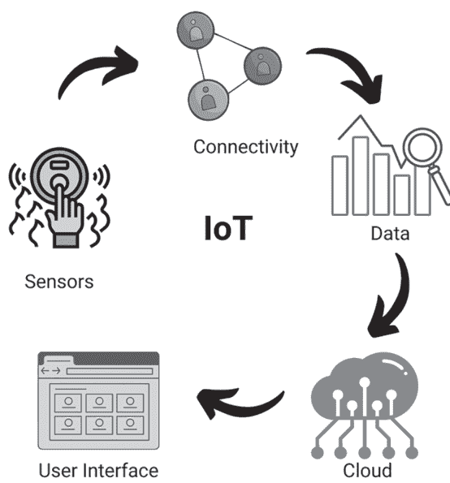

图 5.1 物联网组件。

measure various physical phenomena. Connectivity of the sensors or the devices can be established in a variety of ways including Bluetooth and satellites. Communication involves the transmission and reception of data that enables IoT devices to perform the functions they are designed for. After the establishment and connection of the IoT devices, the sensors function on collecting data from their surroundings, which is stored on the cloud. An IoT cloud is a web-based network that stores the data collected by the sensors of devices. The wide range of data collected on the cloud is then analyzed to leverage and automate processes. Now that the surrounding data has been collected and analyzed, it needs to be presented to the user for application. “User interface” is the term collectively used for the features that are used to interact with the computer systems. It includes screens, buttons, tabs etc.

IoT has a diverse range of applications including smartphones, home appliances and automobiles. Here are some of the most common applications of IoT:[4]

- **Self-Driven Cars:** IoT plays a major role in enabling the self-driving feature in cars. Cars have remote sensors, cameras and radar and are wirelessly connected to the cloud, which provides information about the movement of the car as well as the road on which it is being driven.
- **Agriculture:** Scaling up of various agricultural techniques has been facilitated with the help of Internet of Things. Smart irrigation, livestock tracking and prediction farming are some of the most prominent approaches that use IoT.
- **Healthcare:** The healthcare unit, especially during the pandemic, saw various significant applications of IoT. Telemedicine, vaccine cold chain monitoring and inventory management during the manufacturing process saw extensive usage of IoT. Medical research and maintaining patient records also witnessed streamlining due to the noteworthy capability of IoT to manage massive amounts of data.
- **Supply Chain Management Upgradation:** Supply chain management (SCM) is the entire process that consolidates the process of delivering products and services to customers right from the procurement of raw materials. IoT facilitates the process by introducing smart routes and enabling trackers to keep track of the product at every step.
- **Smart City:** One of the major and most diverse applications of IoT is the development of the smart city. Incorporating the IoT technologies to fulfill infrastructural requirements and using it to tackle some key concerns like traffic, electricity and waste management and to make living more convenient is the concept of smart cities.

IoT uses real-time data and thus has an enormous number of applications in day-to-day life. With the evolution of technologies, new products are being launched and discarded on a regular basis, ultimately leading to the generation of electronic waste in massive quantities. Evidently, one of the major concerns becomes the management of this electronic waste worldwide. IoT has seen its application in solving this issue to a significant extent. In the next section, the use of Internet of Things for the management of electronic waste is elaborated on.


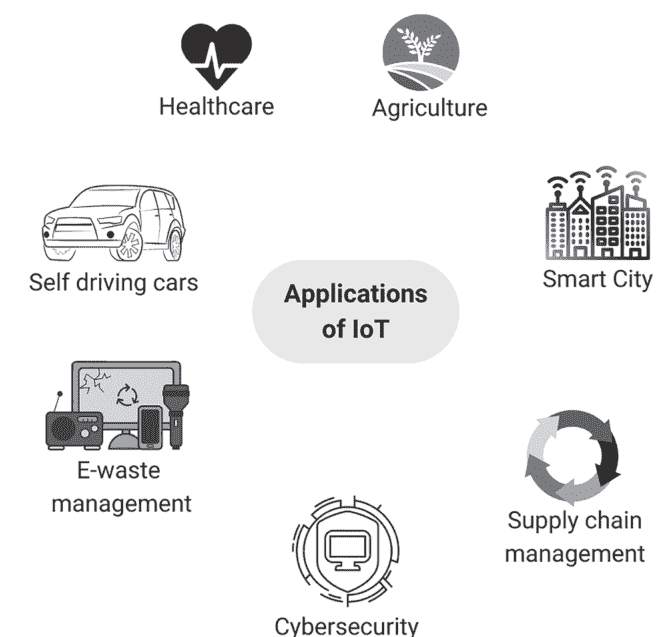

图 5.2 物联网应用。

## 5.3 基于物联网的电子废弃物管理

电子废弃物的产生是这个技术驱动世界中一个不断增长的现象。因此，对无用产品的管理和妥善处置变得至关重要 [5]。物联网及其他人工智能领域，尤其是大数据，可以为电子废弃物的妥善管理创建可持续架构 [6]。

图 5.3 中的图表展示了电子废弃物管理系统如何利用物联网技术来跟踪和收集电子废弃物。垃圾桶是废弃物管理系统中最基本的组件之一，因为它们启动了电子废弃物管理的循环。这些垃圾桶利用智能垃圾桶传感器技术，该技术可使用实时数据感知位置、监测垃圾桶温度并检查垃圾桶的

- 管理服务器：电子废弃物数据发送至垃圾收集单元，以便从垃圾桶中收集
- 云：App/网站从用户发送电子废弃物数据并引导他们前往垃圾桶；传感器收集垃圾桶层级数据
- 智能电子废弃物收集箱 A
- 智能电子废弃物收集箱 B

图 5.3 基于物联网的电子废弃物管理系统工作原理。

垃圾桶用于常规收集废物。使用这些“智能垃圾桶”有助于垃圾收集单元优先处理需要清理的区域，从而有助于高效收集垃圾 [17]。这些智能废弃物垃圾桶安装在城市的不同区域，相关信息由传感器共享到云端。

云将收集到的数据发送给行政服务器以进行分析并相应采取行动。根据需求，行政单位决定特定目的地是否需要清理。如果需要清运，垃圾卡车会被派往相应区域收集电子废弃物。移动应用程序和网站也可以集成到系统中，以便直接与消费者利用连接优势。有意移除其电子废弃物的消费者可以使用移动应用程序上传和分享其垃圾信息 [7]。这些应用程序可以引导消费者前往智能垃圾桶，向他们提供关于收集垃圾类别的详细信息，并使收集单元能够从正确地点收集废物。

电子废弃物管理通常遵循此流程 [8]。许多国家已成功利用物联网应用高效管理电子废弃物，澳大利亚和马来西亚就是其中两个国家。它们根据自身的研究和需求，对传统管理方法进行了改进。接下来将讨论这两个国家的案例。

近年来，研究表明，由于全国范围内大规模使用技术，澳大利亚是全球最大的电子废弃物生产国之一。管理如此大量的废弃物具有挑战性。因此，这些废弃物要么被随意丢弃，要么在危险条件下回收。废弃物处置不当可能导致空气、水和土壤受到铅和镉等有害元素的污染。饮用水中铅等有害化学物质的高浓度有许多有害影响，长期来看可能导致神经系统损伤。

为解决这一问题，澳大利亚政府最近与州和领地政府合作制定了各种规则和法规 [9]。在合作中，各政府制定了各种方案，包括国家电视和计算机回收计划（NTCRS）。NTCRS 的作用是从家庭、办公室和其他机构收集原材料。该计划提供免费的电子废弃物收集和回收服务。收集、运输和回收过程由澳大利亚政府监督和促进。回收过程产生一系列组件，这些组件将进一步用于加工成可用组件。还有一些无价值的材料被消除并送往填埋场处置。

但是，根据该计划，只有台式机、笔记本电脑、打印机和其他计算机外设可以回收。

马来西亚作为电子废弃物的主要生产国之一，实施了一些地方立法框架和规则，以收集、运输和处置电子废弃物 [10]。家庭和工业是马来西亚电子废弃物的主要贡献者。各种机构负责监督在马来西亚收集的电子废弃物。

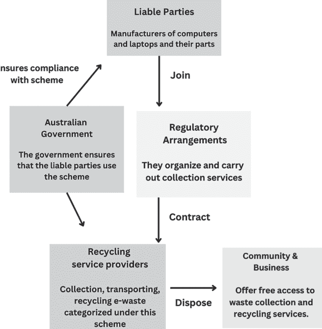

图 5.4 典型模型中各机构的角色与职责。

回收设施接受马来西亚的工业和家庭电子废弃物流，以实现电子废弃物的部分和完全回收 [9]。许多部分回收设施专注于可重复使用的电气和电子设备（EEE）及其组件的分类，并产出可用于其他应用的有用部件。典型的可重复使用设备包括投影仪、台式机和笔记本电脑、DVD 播放器、硬盘驱动器等。

为了有效分类和分离复杂的电子废弃物流，Ramya 等人结合了两种算法方法，即 FHGO（分数亨利气体优化）和马群优化，并通过该模型达到了 0.95 的准确率 [11]。Guo 和 Zhong 在考虑消费者行为、回收价格和同伴压力等因素的基础上，开发了一种基于闭环供应链模型的以客户为中心的物联网模式，用于电子废弃物管理 [12]。

## 5.4 基于物联网的电子废弃物管理系统的监管环境

世界在 1980 年代开始认真对待日益严重的电子废弃物问题 [13]。1989 年举行的《巴塞尔公约》[14] 是解决和防止将危险废物从发达国家运往发展中国家的重要一步。渐渐地，世界上的较大经济体纷纷效仿，出台了本国立法，以控制和管制其境内或跨境的电子废弃物流动。美国于 2004 年通过了《电子废弃物回收法》，并通过联邦《资源节约与回收法》管制电子废弃物流动。欧盟通过指令 2012/19EU 监管其 24 个成员国，该指令于 2019 年出台。同样，澳大利亚、新西兰、巴西、日本、台湾、中国、南非以及许多其他国家遵循联合国《巴塞尔公约》精神，通过本国立法控制电子废弃物。印度通过《2016 年电子废弃物管理与处置规则》管制其电子废弃物。

物联网设备是相对较新的进入者，但在过去十年的技术领域中一直是关注焦点。它提供了访问实时数据以及对通过多个连接设备运行的系统进行更好控制的能力。然而，对于消费者和企业来说，隐私和数据方面存在明显的安全风险。世界经济论坛《全球风险报告》[15]（2020 年）指出，由于连接设备之间的通信和巨大的数据传输，安全、防护和隐私是物联网设备用户的主要关切。物联网技术具有固有的生成和收集大量个人数据的能力。实际上，物联网环境面临两大广泛挑战：物联网网络安全和物联网隐私。

在美国，《2019 年网络安全改进法》[13] 指导产品制造商确保其制造的物联网产品达到最低安全水平。美国国家标准与技术研究院（NIST）关注政府采购的物联网设备的网络安全问题。然而，私营部门并未施压要求合规。欧盟和英国有各自的 NIS（网络和信息系统）指令，2018 年，该指令通过管制数字服务提供商的 NIS 法规为国家物联网基础设施提供网络安全。

欧盟的物联网隐私通过《一般数据保护条例》[14]（GDPR），即指令 95/46/EC，确保了安全


[18] 关于个人数据。美国没有像 GDPR 这样的具体法律，而是有单独的联邦和州法律，如 Gramm–Leach–Bliley Act (GLBA)、The California Consumer Privacy Act (SB-1121) [6]。

为应对世界各地面临的挑战，威胁已通过各种保护物联网设备及其内在数据的举措得到承认和解决。印度立法试图通过其 2016 年《电子废弃物管理和处理规则》和 2000 年《信息技术法》为物联网环境提供一些安全保障 [16]。此外，制定统一的国际立法可能是一个好方法，而不是仅在地区或国家层面处理物联网安全。

## 5.5 结论

由于技术快速变化和消费者对快速更换的需求，全球电子废弃物的存量正在增长。由于电子废弃物的危险性质，立法正在变得更加严格。在这种情况下，物联网在废弃物管理（尤其是电子废弃物管理）中的应用，是实现电子废弃物最优利用、翻新、再利用和回收以支持循环经济的希望。

可以得出结论，由于电子废弃物以越来越快的速度产生，其管理以及充分利用技术潜力从废弃物中提取“价值”无疑至关重要。因此，开发更高效的电子废弃物识别和回收方法论，是发展中国家和发达国家在不久的将来应该关注并着手解决的问题。

## 参考文献

- [1] Rao, D., Singh, K., Morrison, C., & Love, J. 通过两级浸出和溶剂萃取工艺从电子废弃物中回收铜和金。分离与净化技术，263 (2021) 118400. https://doi.org/10.1039/c9ra07607g.
- [2] https://ewastemonitor.info/wp-content/uploads/2020/11/FUTURE-E-WASTE-SCENARIOS_UNU_2019.pdf 第 19 页。
- [3] Bharadwaj, A. S., Rego, R., & Chowdhury, A. 基于物联网的固体废弃物管理系统：作为智慧城市应用的带架构解决方案的概念方法。2016 年 IEEE 年度印度会议 (INDICON) (2016). https://doi.org/10.1109/indicon.2016.7839147.
- [4] Kang, K. D., Kang, H., Ilankoon, I. M. S. K., & Chong, C. Y. 使用物联网的电子废弃物收集系统：马来西亚的家庭电子废弃物管理。《清洁生产杂志》，252 (2020) 119801. https://doi.org/10.1016/j.jclepro.2019.119801.
- [5] Islam, M. T., Huda, N., Baumber, A., Shumon, R., Zaman, A., Ali, F., Hossain, R., & Sahajwalla, V. 面向电子废弃物的消费者行为全球综述及其对循环经济的影响。《清洁生产杂志》，316 (2021) 128297. https://doi.org/10.1016/j.jclepro.2021.128297.
- [6] https://www.rfpage.com/applications-of-internet-of-things-iot/.
- [7] Nirre, K., Mulay, P. S., & Chaskar, U. M. 面向智慧城市的基于物联网的固体废弃物管理系统。2017 年智能计算与控制系统国际会议 (ICICCS) (2017). https://doi.org/10.1109/iccons.2017.8250546.
- [8] Pardini, K., Rodrigues, J. J., Kozlov, S. A., Kumar, N., & Furtado, V. 基于物联网的固体废弃物管理解决方案：一项调查。传感器与执行器网络期刊，8(1) (2019) 5. https://doi.org/10.3390/jsn8010005.
- [9] 使用物联网的垃圾和废弃物管理及收集系统的系统方法。Strad Research，8(5) (2021). https://doi.org/10.37896/sr8.5/.041.
- [10] Yong, Y. S., Lim, Y. A., & Ilankoon, I. M. S. K. 马来西亚电子废弃物管理策略和回收操作分析：挑战与未来前景。《清洁生产杂志》，224(16) (2019).
- [11] Ramya, P. 基于混合优化启用深度学习的物联网云平台电子废弃物管理。工程软件进展，176 (2023) 103353.
- [12] Guo, R., & Zhong, Z. 面向 WEEE 管理的以客户为中心的基于物联网的新型闭环供应链模型。先进工程信息学，55 (2023) 101899.
- [13] https://www.congress.gov/bill/116th-congress/house-bill/1668.
- [14] http://www.basel.int/.
- [15] 世界经济论坛 (weforum.org).
- [16] Sharma & Sharma. 《信息技术法律与实践》, Universal LexisNexis®, 第 7 版 (2021) 272–277.
- [17] Vishnu, S., Ramson, S. R., Senith, S., Anagnostopoulos, T., Abu-Mahfouz, A. M., Fan, X., Srinivasan, S., & Kirubaraj, A. A. 智慧城市中的物联网支持固体废弃物管理。《智慧城市》，4(3) (2021) 1004–1017. https://doi.org/10.3390/smartcities4030053.
- [18] Kaneen, C. K., & Petrakis, E. G. M. 迈向评估物联网应用中的 GDPR 合规性。程序计算机科学，176 (2020) 2989–2998.

# 6 智慧医疗系统中的物联网力量

Chinu¹ 和 Urvashi Bansal²

1 研究生，计算机科学与工程系，贾兰达尔 B. R. Ambedkar 国家技术学院，印度

2 助理教授，计算机科学与工程系，贾兰达尔 B. R. Ambedkar 国家技术学院，印度

## 6.1 引言

物联网设备通过监测患者的身体参数以识别疾病，并利用互联网与医疗服务提供者共享数据，从而在改善患者生活质量方面发挥着至关重要的作用。物联网在医疗保健领域有着众多应用，该领域也被称为医疗物联网（IoMT）。IoMT 是一个互联设备网络，用于存储患者数据，远程连接患者与医生，并根据物联网设备测量的参数提出解决方案。医疗保健行业通过使用人工智能和物联网实现自动化。如今，借助 IoMT，节省了成本和时间。对于常规体检，无需在医院长时间排队。患者可以轻松使用智能可穿戴设备监测身体参数，医生可以通过互联网连接设备远程查看患者数据的统计信息。

物联网在扩大人类与外界互动选择的同时，同时也增强了自由度。借助前沿协议和算法，物联网已成为推动全球通信的重要因素。它将许多小工具、可穿戴技术、家用电器和电子设备连接到互联网 [1]。

本章阐述了医疗领域中物联网的概念。第 6.2 节解释了基于物联网的智慧医疗系统架构。第 6.3 节解释了医疗物联网使用的文献分析。第 6.4 节描述了医疗系统中使用的各种基于物联网的设备。构建更好的医疗系统的技术、伦理和经济障碍也是本研究的重点，如第 6.5 节所述。最后，我们讨论了物联网在医疗领域的挑战和未来前景。

## 6.2 基于物联网的智慧医疗架构

医疗保健领域是率先使用物联网技术的关键领域之一。这是因为物联网设备能够将以患者为中心的护理流程与实质性的长期成本降低相结合。物联网概念既强大又深刻，为了让物联网拼图的所有部分完美契合，它们都必须是精心考虑的框架的一部分。物联网架构就此登场，尤其是在物联网设备管理方面。

虽然每个物联网（IoT）系统都独一无二，但它们都拥有相似的架构以及通用流程。物体是物联网的第一个组件，即带有嵌入式传感器和执行器的关联物品，使它们能够检测周围环境并捕获随后发送到物联网网关的数据。收集大量原始数据的物联网数据采集系统和网关，将其转换为数字化流，在分析前进行分析和预处理，构成了下一步骤 [2]。

边缘计算设备负责进一步的数据处理和改进的分析，代表第三层。此外，此层还可使用机器学习和可视化技术。然后数据被移动到数据中心，这些数据中心可能本地安装或托管在云端。数据在此被存储、处理并彻底检查以获取有意义的见解。

图 6.1 表示了智慧医疗系统中使用的物联网架构。在此图中，我们讨论了架构的分阶段分析。在第一阶段，收集不同的智能设备（如传感器、执行器、监视器、探测器、视频系统等）以收集信息。在第二阶段，从不同设备收集的数据是非结构化的，我们需要对数据进行预处理。模拟数据必须合并并转换为数字形式，以提取有意义的数据


### 阶段 1：设备集合

不同设备（如传感器、监视器、摄像头、执行器、探测器、视频系统等）相互互连，以收集实时信息。

### 阶段 2：数据采集 & 预处理

在这一步骤中，模拟数据首先被转换为数字数据。在数字化数据上，执行预处理步骤以从数据中提取有意义的信息。

### 阶段 3：数据存储

数据被移至不同的数据中心和云端进行存储。

### 阶段 4：数据分析

对收集的数据进行复杂分析，以改进传统医疗系统的决策。

图 6.1 基于 IoT 的智能医疗系统架构。

为进一步处理。在第三阶段，预处理的数据在数字化和汇总后被传输到不同的存储设备（如数据中心或云端）。在最后阶段，最终数据被管理和审查。先进的分析被应用于此数据，以产生有助于准确决策的有用业务洞察 [3]。

## 6.3 相关工作

Oryema 等人设计了一个用于医疗服务的互操作消息系统 [4]。设计该消息系统时遵循受限应用协议和 IoT 国际标准。

Ashfaq 等人讨论了用于医疗系统的 IoT 技术综述。讨论了基于 IoT 的医疗系统中使用的各种传感器 [5]。

作者基于医疗物联网深入探讨了文献，并探索了智能医疗系统中使用的机器学习和边缘计算方法。

Joyia 等人准备了一份详细的文献综述，在其研究工作中讨论了医疗物联网的各种挑战、应用、架构和优势 [6]。

Kumar 等人提出了一种利用区块链和 IoT 的新型医疗框架，并使用 Healthcare 4.0 流程展示了其实现 [7]。论文中展示的各种结果的仿真验证了所提出的方法。虽然错误率较低，但它影响了整体系统性能。

Bao 等人提出了一种使用 IoT 和云技术的智能医疗系统 [8]。作者提出了一种易于使用的关键字搜索机制，以减少患者和医生双方资源共享的开销。该研究工作还使用加密方法分析了安全机制。Amin 等人提出了一种使用 IoT 和云技术的认知医疗框架 [9]。

该框架用于智慧城市，为医生和患者解决医疗相关问题提供了良好的平台。该研究工作还提出了一种基于脑电图技术的用于脑部问题的病例研究。论文中显示的结果验证了所提出的框架。Dive 等人为婴儿设计了一个名为 Smart Log 的基于 IoT 的框架 [10]。婴儿缺乏必需营养素会导致严重疾病。该研究工作提出了一种使用 IoT 和云技术的自动营养监测系统。使用基于贝叶斯网络的算法计算每种食物餐中的营养水平。Maji 等人提出了 ikardo 自动心脏病监测系统。该系统是基于 IoT 的智能医疗系统的又一补充。作者对基于 IoT 的语音激活设备进行了综述。该研究工作还展示了语音激活 IoT 设备的挑战、应用和前景 [11]。

Elayan 等人提出了一种用于心脏病预测的数字孪生框架。心电图分类器预测心脏病，并考虑人体指标以进行进一步分析。作者采用机器学习以获得更好的结果。基于 IoT 的可穿戴设备需要出于安全目的验证数据 [3]。Chinaeji 等人讨论了基于区块链的优化方法，以低成本和低错误率验证数据 [12]。Wu 等人提出了一种基于 IoT 的轻量低功耗可穿戴传感器，有助于识别与患者健康相关的生命体征 [13]。数据加密应用于数据安全 [14]。Verma 和 Sood 讨论了智能家居应用中的基于雾计算和 IoT 的患者健康监测系统。所提出的模型在边缘使用嵌入式数据挖掘、分布式存储和警报服务，以减少通过云端传输数据的延迟 [15]。

Balasundaram 等人提出了一种基于 IoT 的多模设备，用于在紧急情况（如心脏病发作、事故等）中快速诊断患者参数 [16]。Hennebelle 等人提出了一种名为 HealthEdge 的智能医疗框架，旨在使用 IoT-边缘计算系统预测 2 型糖尿病。该框架利用机器学习算法评估结果 [17]。Vishvanath 等人提出了一种使用 IoT 的自动血糖和温度监测系统。该设备有助于随时随地有效维护和整理患者数据 [18]。为了为支持 IoT 的医疗系统创建隐私保护环境，本文提出了一种基于区块链的框架。所提出的设计在安全生成和维护医疗认证的同时提高效率 [19]。

## 6.4 基于 IoT 的医疗设备

- **连续血糖监测**：这对糖尿病患者来说非常困难。借助智能血糖监测设备，IoT 设备解决了这个问题 [20]。此类设备会自动保存记录，如果血糖水平超过正常范围，还会向患者发出警报。

- **心率监测设备**：要测量心率，患者必须使用典型的连续心脏监测系统持续连接到设备上，这限制了他们的活动。支持 IoT 的心率监测设备允许患者自由活动，并持续更新患者的心率信息。

- **手部卫生监测设备**：这些设备使用传感器，提醒人们在进入病房前对双手进行消毒。

- **抑郁症和情绪监测设备**：此类设备通过测量患者的血压、心率甚至眼动，帮助医生了解患者的精神状态。这些设备可以检测抑郁症状，但有时准确性较差。

- **疾病监测系统**：IoT 也有助于疾病检测。一个例子是帕金森病监测系统。此设备不仅帮助医疗提供者每日追踪疾病症状，还让患者无需在医院长时间停留即可自由生活 [21]。图 6.2 展示了医疗行业中使用的 IoT 设备示例。

- **联网吸入器**：这些设备避免突然发生的情况，如哮喘发作。这种支持 IoT 的设备通过收集和分析传感器感知的环境数据来监测发作频率，并向医疗提供者提供相关信息。当患者忘记携带吸入器时，该设备也会提醒患者使用吸入器 [22]。

- **可吞服传感器**：支持 IoT 的设备（如可吞服传感器）有助于人体内部检查，以追踪胃部并找到内出血源。

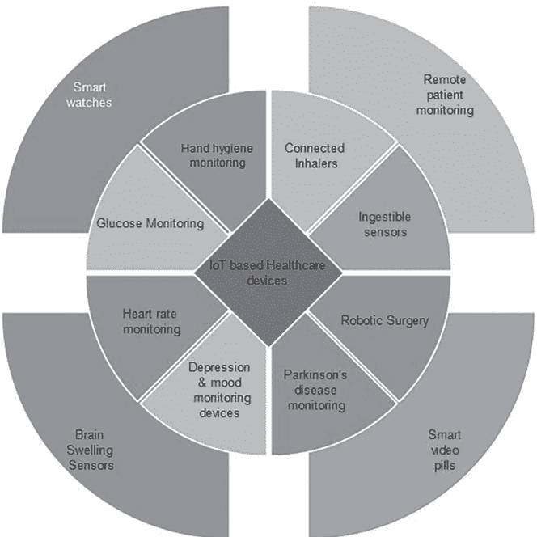

图 6.2 基于 IoT 的智能医疗设备。

- **机器人设备**：基于 IoT 的微型机器人设备在手术中帮助医生。

- **脑肿胀传感器**：此类设备通过测量大脑压力，帮助外科医生检查引起脑肿胀和损伤的各种参数。

- **智能药丸**：这些药丸在人体内移动，以图像形式收集信息并发送到智能手表或可穿戴设备等设备。借助应用程序，医疗提供者分析胃肠道问题 [23]。

- **远程患者监测设备**：远程设备收集患者的血压、血糖、血氧和心率等数据，并远程共享给医疗提供者。


## 6.5 智能医疗系统中物联网面临的挑战

在医疗系统中，物联网为患者和医疗服务提供者提供远程支持。根据文献，我们发现物联网领域存在各种挑战。我们将此类挑战分为技术、伦理和经济三类。表 6.1 解释了使用物联网的智能医疗系统中出现的所有技术、伦理和经济挑战。

### 6.5.1 技术挑战

借助可穿戴传感器，患者健康状况可以很容易地进行跟踪，但主要挑战是数据量非常大，需要高效算法和低复杂度基础设施来处理。传感器生成的数据是非结构化的，需要时间来实现快速传输。此外，物联网平台应对医疗服务提供者和患者都友好易用。

- **关键处理与响应时间**：用于智能医疗的物联网设备需要传感器来捕获患者身体数据。从物联网设备收集的数据是非结构化的，需要高性能计算设备，这会增加成本和时间。

- **连接问题**：使用物联网设备进行更快更快速的通信以及可靠的互联网连接是远程患者监护所必需的。

| 技术挑战 | 伦理挑战 | 经济挑战 |
|---|---|---|
| 关键处理与响应时间 | 数据隐私与安全性 | 高基础设施资源成本 |
| 异构设备 | 设备伦理 | 设备维护成本 |
| 通信协议不统一 | 实践伦理 | 大数据 |
| 利益相关方关联与实施 | 数据伦理 | |
| 连接问题 | 无开放标准 | |
| 设备监测与感知 | | |
| 物联网网络编程模型 | | |
| 数据分发与互操作性 [24] | | |

- **异构设备**：物联网本质上就是设备的互连。设备可以是我们在家中、汽车、办公室——任何地方使用的任何可穿戴设备。由于设备的异构性，互操作性是主要挑战。

- **通信协议不统一**：每个供应商都有针对设备的协议，由于这种不统一，设备之间会出现通信问题。

- **利益相关方关联与实施**：任何直接或间接与医疗领域物联网相关的人员均属于利益相关方类别。应通过研讨会和访谈从医院工作人员、医生和患者那里收集数据来改进物联网系统。应分析收集到的数据，以提高基于物联网的医疗服务质量。所有医生、患者和医院工作人员都应接受关于正确使用基于物联网的医疗服务的培训 [5]。

- **设备监测与感知**：传感器在数据的实时感知和监测中起着重要作用。传感器应始终保持活跃状态以实时捕获数据。主要挑战是维护物联网标签和传感器的能源效率。这一领域有大量研究空间，因为处理传感器的异构性是实时数据捕获的主要挑战。

- **物联网网络编程模型**：为了在医疗领域有效实施物联网，需要动态编程模型。这些模型不仅可以维护工作流，还可以为最终用户提供用户友好的界面 [15]。

- **数据分发与互操作性**：处理多模态数据是技术领域中最大的挑战。应探索有效技术来对物联网数据进行建模。

### 6.5.2 伦理挑战

- **数据隐私与安全性**：在使用物联网的智能医疗系统中，安全性是一个主要问题。黑客可以滥用医生和患者的个人信息来创建虚假身份。黑客可以以他们的名义购买药品和医疗设备，然后出售，这是不道德的。数据所有权也是与电子设备相关的主要问题。借助入侵检测系统，我们可以在一定程度上确保安全性。

- **数据伦理**：信息隐私是 H-IoT 设计与实施的主要问题 [25]。从伦理和法律两个层面来看，健康数据通常被视为高度敏感的数据。虽然保密性对于确保数据无法关联到特定个人至关重要，但作者也认为，用户应对其数据拥有完全控制权，并且每次都能追踪第三方。

- **实践伦理**：IOMT 可能会将患者状态的评估限制在少数易于量化或可测量的因素上，这可能导致对技术影响的过度乐观评估。利用技术，有可能限制使医疗专业人员能够获取此类信息的交流。因此，提供者必须采取行动防止这种情况发生，并确保在患者与护理人员之间建立信任关系。例如，监测可以用来发起对话，而不是完全取代对话 [26]。

- **设备伦理**：由于设备和应用场景的多样性，伦理考量具有挑战性。尽管技术可以显著改善医疗保健，但它也对我们对个人隐私和信息隐私的期望构成威胁，因为这使得外部人员可以轻松观察和评估用户的生活。

- **无开放标准**：用户和设备制造商缺乏开放标准，也成为医疗领域物联网的一大主要问题。

### 6.5.3 经济挑战

- **高基础设施和资源成本**：在智能医疗中实施物联网时，我们需要在技术规格与成本之间保持平衡。内存存储容量、低功耗和处理能力是我们需要平衡成本与技术要求的因素 [15]。

- **维护成本**：由于物联网设备使用传感器来捕获数据，传感器应始终保持活跃状态以获取实时数据。为了获得数据的准确性，维护传感器和设备需要高昂的成本。

- **大数据**：物联网设备会产生海量非结构化数据。需要用较短时间高效地对数据进行结构化处理的技术。在智能医疗系统领域，处理大数据是一项重大挑战 [15]。

## 6.6 结论

在本研究工作中，讨论了与医疗领域相关的各种物联网应用。需求上升、5G 连接和物联网技术的进步，以及医疗 IT 软件的日益普及，都是推动基于物联网的医疗系统增长的促成因素。患者的诊断、治疗和康复都高度依赖物联网。预测分析和物联网数据收集将改善医疗保健并降低人为错误率。数据处理、资源管理、安全性、隐私性、互操作性、利益相关方参与和实际实施只是物联网在医疗保健领域面临的几个问题。目前，物联网成功面临的最大障碍是安全性。由于大量设备正在产生海量非结构化数据，数据处理和资源管理在不久的将来将变得困难。医疗领域物联网系统协同工作并通过利益相关方协作创造价值的能力将决定其成败。

很可能，苹果、谷歌和三星等数字巨头致力于弥合健身监测应用与真实医疗服务之间差距的举措将有助于这一过程。尽管存在缺点，但物联网概念将继续把握并重塑医疗环境，医疗领域更大的数字化转型是不可避免的。因此，看来时机已经成熟，应迈过障碍，开始向互联医疗设备过渡。

## 参考文献

- [1] Pradhan, Bikash, Saugat Bhattacharyya, and Kunal Pal. “基于物联网的医疗设备应用。” 医疗工程期刊 2021 (2021). https://doi.org/10.1155/2021/6632599.

- [2] AVsoft. “什么是物联网架构？附物联网架构示例解释。” 访问时间：2022 年 12 月 20 日。https://www.avsystem.com/blog/what-is-iot-architecture/.


- [3] Wipro. “医疗保健行业中的物联网 | 医疗保健物联网应用— Wipro.” 2022年11月19日访问. https://www.wipro.com/business-process/what-can-iot-do-for-healthcare-/. 

- [4] Oryema, Brian, Hyun Su Kim, Wei Li, and Jong Tae Park. “面向IoT医疗服务的不可操作消息系统的设计与实现.” 2017年第14届IEEE年度消费者通信与网络会议, CCNC 2017 (2017): 45–51. https://doi.org/10.1109/CCNC.2017.7983080.

- [5] Ashfaq, Zarlish, Abdur Rafay, Rafia Mumtaz, Syed Mohammad Hassan Zaidi, Hadia Saleem, Syed Ali Raza Zaidi, Sadaf Mumtaz, and Ayesha Haque. “医疗物联网（IoMT）生态系统赋能技术综述.” Ain Shams工程杂志 13, no. 4 (2022年6月1日). https://doi.org/10.1016/j.asej.2021.101660.

- [6] Joyia, Gulraiz J., Rao M. Liaqat, Aftab Farooq, and Saad Rehman. “医疗物联网（IOMT）：医疗领域的应用、优势与未来挑战.” 通信期刊 12, no. 4 (2017): 240–247. https://doi.org/10.12720/jcm.12.4.240–247.

- [7] Kumar, Adarsh, Rajalakshmi Krishnamurthi, Anand Nayyar, Kriti Sharma, Vinay Gorrow, and Ekhos Oshain. “利用医疗4.0流程进行新型智能医疗设计、仿真与实现.” IEEE Access 8 (2020): 118433–118471. https://doi.org/10.1109/ACCESS.2020.3004790.

- [8] Bao, Yangyang, Weidong Qiu, and Xiaochun Cheng. “面向物联网和云辅助智能医疗系统的安全轻量细粒度可搜索数据共享.” IEEE物联网期刊 9, no. 4 (2022年2月15日): 2513–2526. https://doi.org/10.1109/JIOT.2021.3063846.

- [9] Amin, Syed Umar, M. Shamim Hossain, Ghulam Muhammad, Musaed Alhussein, and Md Abdur Rahman. “病理检测与监测的认知智能医疗.” IEEE Access 7 (2019): 10745–10753. https://doi.org/10.1109/ACCESS.2019.2891390.

- [10] Sundaravadivel, Prabha, Kavya Kesavan, Lokeshwar Kesavan, Saraju P. Mohanty, and Elias Kougianos. “Smart-Log：基于深度学习的物联网自动化营养监测系统.” IEEE消费电子汇刊 64, no. 3 (2018): 390–398. https://doi.org/10.1109/TCE.2018.2867802.

- [11] Spachos, Petros, Stefano Gregori, and M. Jamal Deen. “语音激活的医疗物联网设备：设计挑战与新兴应用.” IEEE电路与系统II汇刊：简要报告 69, no. 7 (2022): 3101–3107. https://doi.org/10.1109/TCSII.2022.3179680.

- [12] Elayan, Haya, Moayad Aloqaily, and Mohsen Guizani. “面向智能上下文感知IoT医疗系统的数字孪生.” IEEE物联网期刊 8, no. 23 (2021): 16749–16757. https://doi.org/10.1109/JIOT.2021.3051158.

- [13] Chineaie, Mohammad Hosseini, Hassan Habibi Gharakheili, and Vijay Sivaraman. “使用区块链日志合同最佳见证医疗IoT数据.” IEEE物联网期刊 8, no. 12 (2021): 10117–10130. https://doi.org/10.1109/JIOT.2021.3051433.

- [14] Wu, Taiyang, Fan Wu, Chunkai Qiu, Jean Michel Redoute, and Mehmet Rasit Yuce. “面向物联网连接医疗应用的刚挠性可穿戴健康监测传感器贴片.” IEEE物联网期刊 7, no. 8 (2020): 6932–6945. https://doi.org/10.1109/JIOT.2020.2977164.

- [15] Lohiya, Ritika, and Ankit Thakkar. “物联网的应用领域、评估数据集与研究挑战：一项系统综述.” IEEE物联网期刊 8, no. 11 (2021): 8774–8798. https://doi.org/10.1109/JIOT.2020.3048439.

- [16] Verma, Prabal, and Sandeep K. Sood. “雾辅助物联网支持的智能家居患者健康监测.” IEEE物联网期刊 5, no. 3 (2018): 1789–1796. https://doi.org/10.1109/JIOT.2018.2803201.

- [17] Balasundaram, A., Sidheswar Routray, A. V. Prabu, Prabhakar Krishnan, Prince Priya Malla, and Moinak Maiti. “面向急诊护理中患者健康参数高效诊断的基于物联网（IoT）的智能医疗系统.” 18, no. 9 (2023). https://doi.org/10.1109/JIOT.2023.3246065.

- [18] Hennebelle, Alain, Huned Materwala, and Leila Ismail. “HealthEdge：面向集成物联网、边缘和云计算系统中2型糖尿病预测的基于机器学习的智能医疗框架.” 第14届环境系统、网络与技术国际会议（ANT）00 (2023): 331–338. https://doi.org/10.1016/j.procs.2023.03.043.

- [19] Vishvanath, D., A. Ramchandra, and M. Koban. “基于物联网的温度和氧气水平监测及数据可视化.” 新兴智能计算与信息学国际会议（ESCI） (2023): 1.

- [20] Namasudra, Suyel, Pratima Sharma, Ruben Gonzalez Crespo, and Vimal Shanmuganathan. “面向物联网医疗系统的基于区块链的医疗证书生成与验证.” IEEE消费电子杂志 12, no. 2 (2023年3月1日): 83–93. https://doi.org/10.1109/MCE.2021.3140048.

- [21] Gia, Tuan Nguyen, Mai Ali, Imed Ben Dhaou, Amir M. Rahmani, Tomi Westerlund, Pasi Liljeberg, and Hannu Tenhunen. “基于物联网的连续血糖监测系统：一项可行性研究.” Procedia计算机科学 109 (2017): 327–334. https://doi.org/10.1016/j.procs.2017.05.359.

- [22] Gatuillat, Arthur, Youakim Badr, Bertrand Massot, and Ervin Sejdic. “医疗物联网：医学中涉及网络物理系统的近期贡献综述.” IEEE物联网期刊 5, no. 5 (2018年10月1日): 3810–3822. https://doi.org/10.1109/JIOT.2018.2849014.

- [23] Ordr. “10个医疗物联网（IoT）示例.” https://ordr.net/article/iot-healthcare-examples/.

- [24] Intellectsoft. “医疗保健中的物联网：优势、用例与挑战 [指南].” 2022年10月4日访问. https://www.intellectsoft.net/blog/iot-in-healthcare/.

- [25] IoT，表1显示了基于物联网的智能医疗系统中的挑战类型，2020年.

- [26] DZone IoT. “医疗保健中物联网使用的伦理—DZone IoT.” 2022年10月11日访问. https://dzone.com/articles/the-ethics-of-iot-usage-in-healthcare.

# 7 物联网中恶意路由验证方案

Bharti Sharma,¹ Sakshi Patni² and Sumit Kumar Mahana³

¹ MMIC TBM (MCA)，马哈里希·马克南德什瓦尔大学（被认可大学），穆拉纳-安巴拉，哈里亚纳邦，印度  
² 嘉泉大学，城南，韩国  
³ 库鲁克谢特拉国立理工学院，印度  

## 7.1 引言

物联网（IoT）是一种无处不在的全球网络，通过收集、处理和分析由IoT传感器设备产生的数据，支持并提供观测和管理物理世界的系统。预计联网设备数量将在2022年大幅增加至600亿个[1–3]。我们的日常用品，包括车辆、冰箱、风扇、灯光、手机以及其他运营技术（例如正在成为全球联网系统的制造基础设施），是这一扩张的关键驱动力。很明显，安全将是实现和使用大多数IoT应用的关键推动因素，特别是IoT传感器节点之间的安全路由[4]。因此，必须创建方法，为IoT技术实现的设备提供安全的路由连接。IoT是21世纪最重要的技术之一。通过嵌入式设备将家用电器、汽车、恒温器和婴儿监视器等日常用品连接到互联网的能力，使得人、流程与事物之间的持续通信成为可能[5]。得益于低成本计算机、云、大数据、分析和移动技术，物理对象在交换和收集数据时只需极少的人工参与。在当今的超连接环境中，数字技术有能力记录、监控和改变链接事物之间的每一次交互。尽管两者存在冲突，但物理世界与数字世界共存[6]。

到2025年，互联网节点可能位于普通物品中——据NIC称，包括“食品容器、家具、纸质文档等”。从“公众需求与技术改进相结合可能会促进物联网（IoT）的广泛普及，而物联网（IoT）如同当前互联网一样，能极大地促进经济发展”这一理念出发，它识别了潜在的未来前景[7]。它还强调，此类设备的广泛使用可能伴随着风险。事实上，它强调，“如果普通设备开始带来信息安全问题，IoT可能会将此类危险传播得比迄今的互联网更广泛”[8, 9]。

物联网及其他联网计算机系统已成为人们日常生活中不可或缺的组成部分，如图7.1所示。这些网络的规模、不同层级的异质性、新网络技术和新商业模式的出现，都在不断扩展[10–13]。旧的网络架构和协议面临压力，在应对新环境时有时甚至表现不佳，这与复杂度的增加同步。因此，需要新的架构来支持新应用、高效利用网络资源

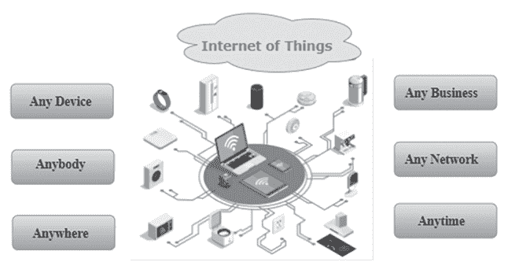

图7.1 物联网。


并满足当前及可预见的网络需求。互联网在今天的日常生活中扮演着巨大的角色。无论是在家里、学校、银行还是公司办公室，我们都能随处找到无线网络 [14–16]。许多网络设计依赖于启发式方法和直觉，随后通过模拟和测试来验证。当发现问题或性能不足时，相同的设计循环会重复进行。我们认为，基于直觉和启发式方法的设计无法满足网络架构和协议的新兴需求，因为它通常在考虑的系统功能范围上受到限制，容易低估某些因素的重要性，并导致性能不佳，或者更糟的是，无法预见潜在的对抗性交互，从而导致灾难性的实现。

相反，网络应当使用数学上系统且合乎逻辑的方法来设计和控制。通过使用无线网络，互联网安全的新方面已被揭示。信息现在可以使用无线电波而非电缆来发送，消除了对电线的需求。信息暴露度随之增加，随之而来的还有漏洞。由于传输的数据暴露无遗，出现了新的安全问题 [17]。

物联网的商业应用包括油井感知、智能车辆交通系统、游戏和农业，以及智能家居、可穿戴技术、医疗保健、汽车工业和智能电网技术等应用。物联网研究的主要集中领域是各种物联网节点的安全性，以保障物联网网络的完美运行 [18]。

设计、实施和保障物联网网络安全是最受欢迎的物联网研究课题之一，吸引了来自标准化组织以及学术界和商业界的众多研究人员。迄今为止，已有许多旨在解决物联网安全问题的构想。本章重点介绍物联网中的安全路由协议。此外，我们还开发了一种用于恶意路由验证方案的框架。

本章其余部分的组织安排如下：第7.2节定义了物联网中的安全问题。第7.3节重点介绍了所提方法论——可验证密钥方案（VKS）。第7.4节介绍了结果与讨论，随后是结论与未来展望。

## 7.2 物联网中的安全问题

安全涵盖所有旨在保护、修复并确保计算机系统中的数据免受敌对攻击的方法。身份盗窃、计算机系统感染、个人数据泄露和经济间谍活动等潜在风险，仅是日常头条中提及的安全问题的几个例子。用于保护基于网络或连接互联网的设备的保护技术被称为“物联网安全”。物联网是一个广泛的术语，随着技术的不断发展，其范围也在不断扩大。几乎所有现代电子产品，包括手表、恒温器和游戏机，都以某种方式连接到互联网或其他设备 [19]。

为防止这些设备被黑客攻击，会部署一系列被称为“物联网安全”的方法、计划和资源。具有讽刺意味的是，物联网的连接性正是使这些设备更容易受到黑客攻击的原因。与物联网安全相关的各种安全问题包括：

- **数据与信息泄露**：在任何物联网智能环境中，个人信息都可能轻易泄露，在缺乏能够屏蔽恶意软件和其他敌对入侵者的充分安全系统的情况下，这会导致安全漏洞 [20]。
- **窃听**：恶意攻击者可能利用不稳定的网络连接，窃取连接的物联网设备之间传输的数据，或物联网智能环境内部及跨环境以及互联网中传输的数据。这可能导致其他严重的安全漏洞 [21, 22]。
- **物联网设备安全**：由于缺乏专门的、全球公认的物联网安全标准或安全评估框架，一些设备可能在制造时就带有薄弱的安全基线，包括过时且未打补丁的嵌入式操作系统和软件；脆弱、可猜测或硬编码的密码；不安全的数据传输和存储等。因此，这些物联网设备容易受到各种安全威胁和攻击 [23]。
- **黑客攻击**：智能环境中物联网设备获取的大多数数据和信息可能存储在可通过互联网访问的平台（如“云”）上。众所周知，许多基于云的物联网系统和设备存在安全缺陷，容易受到黑客攻击和攻击，因为数据传输（例如摄像头的视频画面）在通过互联网传输时甚至可能未经加密。
- **勒索软件与物联网设备劫持**：由于安全性松散、缺乏特定的全球公认物联网安全标准和评估框架，以及物联网设备使用量的增加，许多物联网设备很快可能成为勒索软件攻击的易攻击目标 [24]。
- **缺乏主动设备监控**：物联网设备监控可能很复杂。这是因为当前使用的大多数监控技术和工具，尤其是那些专注于云的技术和工具，在历史上旨在监控时间序列指标数据，而不关注当代物联网设备或其操作。在基于物联网的智能环境中，由于缺乏主动物联网设备监控解决方案，很难获得完整的网络可见性。此外，可用于直接监控部署在基于物联网的智能环境中的特定物联网设备的技术并不多 [25, 26]。
- **缺乏有效且可靠的安全协议**：不充分的物联网安全标准、评估框架和保护措施可能导致智能环境中的安全漏洞，危及个人数据外泄 [26]。
- **拒绝服务（DoS/DDoS）**：由于技术进步，黑客可能试图对传感器本身或基于物联网的智能环境网络中现有的集线器执行拒绝服务（DoS/DDoS）攻击 [7]。攻击者还可以进入网络，并使用清除发送（CTS）和请求发送（RTS）等方法向物联网设备发送大量消息，这可能导致针对真实物联网设备的拒绝服务攻击 [27–29]。

## 7.3 恶意路由的拟议框架

作者们为参与的物联网设备提出了可验证密钥方案（VKS）模型。最初，从现有网络中创建了一个经过身份验证的物联网设备池，并为其分配了单独的密钥。通过向邻居设备发送虚假数据包并请求最短路径来选择一组经过身份验证的节点，恶意设备会丢弃数据包并被列入可疑设备名单。可疑设备会进一步使用同一方案进行验证，并检查数据包是否已到达目的地。在此整个过程中，会识别出恶意设备。然后制作一份经过验证的设备列表，并为其分配新密钥。

- **簇头创建**：既然现在已创建物联网设备的身份验证列表，将根据因子x选择一个簇头。该因子x取决于多个参数，如物联网设备与其他设备的距离、电池电量等。簇头的数量取决于网络的参与节点。然而，簇头仅与经过身份验证的节点列表进行通信并请求最短路径。每个簇头会将身份验证列表广播给其簇中的经过身份验证的节点（物联网设备），如图7.2所示。
- **簇头通信**：每个簇头会与其他簇头通信并共享其身份验证列表，因此，如果经过身份验证的节点进入另一个簇头的网络范围，其请求可以由簇头批准。
- **中间节点**：这些是处于两个网络覆盖范围内的节点。这些中间节点用于簇间通信。
- **新密钥生成**：新密钥 = 簇头给出的物联网设备ID（I）+ 验证函数（f）。A（调整）= 完整网络的参与节点总数 / 各单独簇的身份验证列表。

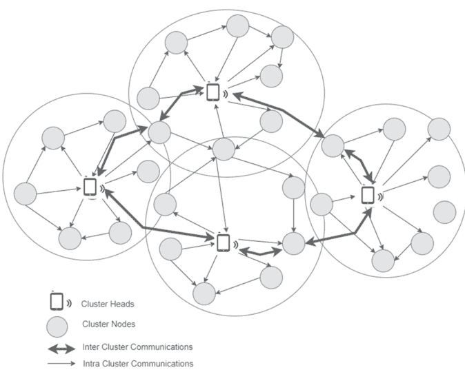

图7.2 大型网络中物联网设备管理及安全密钥传输方案。


通知方案：在此方案中，如果认证方案发现密钥不是新的，则认为节点为恶意节点，并向该节点发送虚假数据，其损失无关紧要且无效。

## VKS 模型的伪代码

```
Key ()
{
X=RNG();
Function(f) = Aproxy(value of node, adjustment, X)
{
int apr, node;
node = X + node
New key(nk) = node + adjustment;
check the authenticated list
if nk is already in the authenticated list, then
adjustment++;
calculate the nk value;
return nk;
}
}
New_generate_key(nk, sizeof network)
{
y = nk % size of network;
return 1;
}
Enter the value of l in authenticated list of nodes
l is now a distinguished value for all the nodes participating.
At each device:
verification(1)
{
 Verify the l with the log table given by admin.
 If l matches the value in the authenticated nodes list, then
 Send a success message to the participating node
 else {
 Discard the device
 }
}
```

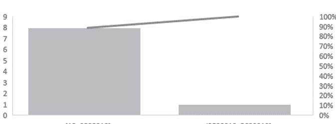

图 7.3 流量级与检测精度对比。

## 7.4 结果与讨论

实验在 Cooja 模拟器中进行，该模拟器与 Java 8 配合良好。它需要 Ubuntu（32 位）作为操作系统。模拟器的设置为最小内存 2 GB、2.5 GHz 处理器和 Contiki-2。在我们的仿真中，使用了 Cooja 的网络、仿真控制、注释、节点输出和时间线工具。

仿真涉及多于两个网络，并且每次仿真中数据包数量都会发生变化。数据包数量范围从 10 到 500,000，如图 7.3 所示。

## 7.5 结论与未来展望

建议使用 VKS 模型来避免 IoT 设备的恶意路由和 DDOS 攻击。密钥验证和新密钥生成不仅能防止恶意攻击，还能防止其他漏洞。该模型已使用 Cooja 模拟器进行验证，且本章提供了伪代码。

## 参考文献

- [1] M. S. Rahman, A. Basu, T. Nakamura, H. Takasaki, 和 S. Kiyomoto，“PPM：家庭能源管理系统的隐私策略管理器”，J. Wireless Mobility Network, Ubiquitous Computing Dependable Applications，第 9 卷，第 2 期，第 42–56 页，2018年。
- [2] D. Shin, V. Sharma, J. Kim, S. Kwon, 和 I. You，“基于 PMIPv6 的智能家居 IoT 网络中路由优化的安全高效协议”，IEEE Access，第 5 卷，第 11100–11117 页，2017年。
- [3] B.-C. Chifor, I. Bica, V.-V. Patriciu, 和 F. Pop，“智能家居物联网设备的安全授权方案”，Future Generation Computer Systems，第 86 卷，第 740–749 页，2018 年 9 月。
- [4] A. Jacobsson, M. Boldt, 和 B. Carlsson，“智能家居自动化系统的风险分析”，Future Generation Computer Systems，第 56 卷，第 719–733 页，2016 年 3 月。
- [5] V. Sivaramon, H. Gharaikheili, C. Fernandes, N. Clark, 和 T. Karlidchuk，“家庭中的智能 IoT 设备：安全和隐私影响”，IEEE Technology & Society Magazine，第 37 卷，第 2 期，第 71–79 页，2018 年 6 月。
- [6] M. Tao, J. Zuo, Z. Liu, A. Castiglione, 和 F. Palmieri，“面向基于 IoT 的智能家居的多层云架构模型及基于本体的安全服务框架”，Future Generation Computer Systems，第 78 卷，第 1040–1051 页，2018 年 1 月。
- [7] A. Jacobsson 和 P. Davidsson，“面向智能家居的隐私与安全模型研究”，载于 IEEE 第 2 届世界物联网论坛论文集，意大利米兰，第 727–732 页，2015 年 12 月。
- [8] J. C. S. Sicato, P. K. Sharma, V. Loia, 和 J. H. Park，“智能家居网络中网络威胁的 VPN 过滤恶意软件分析”，Applied Sciences，第 9 卷，第 13 期，第 2763 页，2019年。
- [9] S. Chhabra 和 A. K. Singh，“应对共居威胁的安全虚拟机分配方案”，International Journal of Web Engineering and Technology，第 15 卷，第 1 期，第 96–115 页，2020年。
- [10] B. Ali 和 A. Awad，“基于 IoT 的智能家居网络与物理安全漏洞评估”，Sensors，第 18 卷，第 3 期，第 817 页，2018年。
- [11] A. Hassan，“IoT 设备和传感器网络中轻量级加密算法的实现”，载于《未来技术会议论文集》，Springer，Cham，第 130–146 页，2023年。
- [12] A. K. Sangaiah, A. Javadpour, F. Ja’fari, H. Zavieh, 和 S. M. Khaniabadi，“SALA-IoT：带有学习自动机休眠调度算法的自减物联网”，IEEE Sensors Journal，http://dx.doi.org/10.1109/JSEN.2023.3242759。
- [13] D. Airehrour, J. A. Gutierrez, 和 S. K. Ray，“SecTrust-RPL：面向物联网的安全信任感知 RPL 路由协议”，Future Generation Computer Systems，第 93 卷，第 860–876 页，2019年。
- [14] S. Chhabra 和 A. K. Singh，“基于安全密钥共享的云环境安全性增强”，Journal of Communication Software and Systems，第 16 卷，第 3 期，第 296–306 页，2020年。
- [15] A. O. Bang, U. P. Rao, P. Kaliyar, 和 M. Conti，“基于 RPL 控制消息的路由攻击和缓解技术评估：一项调查”，ACM Computing Surveys (CSUR)，第 55 卷，第 2 期，第 1–36 页，2022年。
- [16] S. Chhabra 和 A. K. Singh，“超越闪电：基于密钥管理的云计算时代信息安全系统综述”，International Journal of Computer Engineering and Applications，第 XI 卷，第 XII 期，2018 年 1 月 10 日。
- [17] N. Kshetri，“区块链能否增强物联网？”，IT Professional，第 19 卷，第 4 期，第 68–72 页，2017年。
- [18] W. Wang, P. Xu, 和 L. T. Yang，“云辅助物联网中安全的数据收集、存储和访问”，IEEE Cloud Computing，第 5 卷，第 4 期，第 77–88 页，2018 年 7 月。
- [19] S. Suhail, C. S. Hong, Z. U. Ahmad, F. Zafar, 和 A. Khan，“在 IoT 中引入安全来源：要求与挑战”，载于国际安全物联网研讨会 (SIoT) 论文集，第 39–46 页，2016 年 9 月。
- [20] S. Gali 和 V. Nidumulolu，“面向物联网的基于元启发式安全路由协议的智能信任感知方案”，Cluster Computing，第 25 卷，第 3 期，第 1779–1789 页，2022年。
- [21] L. Xiao, X. Wan, X. Lu, Y. Zhang, 和 D. Wu，“基于机器学习的 IoT 安全技术：IoT 设备如何利用 AI 增强安全性？”，IEEE Signal Processing Magazine，第 35 卷，第 5 期，第 41–49 页，2018 年 9 月。
- [22] B. Rakesh，“移动汇聚点支持的物联网中新型身份验证和安全信任基础 RPL 路由”，Cyber-Physical Systems，第 9 卷，第 1 期，第 43–76 页，2023年。
- [23] A. K. Singh, S. Chhabra, R. Gupta, 和 D. Saxena，“RCDS：多租户云的可靠客户端检测系统”，SN Computer Science，第 1–14 页，2023年。Springer。
- [24] A. O. Bang, U. P. Rao, P. Kaliyar, 和 M. Conti，“基于 RPL 控制消息的路由攻击和缓解技术评估：一项调查”，ACM Computing Surveys (CSUR)，第 55 卷，第 2 期，第 1–36 页，2022年。
- [25] A. Seyfollahi, M. Moodi, 和 A. Ghaffari，“MFO-RPL：一种利用飞蛾火焰优化器的面向 IoT 应用的安全基于 RPL 的路由协议”，Computer Standards & Interfaces，第 82 卷，第 103622 页，2022年。
- [26] G. Savithri, B. K. Mohanta, 和 M. Kumar Dehury，“物联网应用中安全挑战与协议概述”，载于 2022 年 IEEE 国际物联网、电子与机电会议 (IEMTRONICS)，加拿大多伦多，第 1–7 页，2022年，http://dx.doi.org/10.1109/IEMTRONICS55184.2022.9795794。
- [27] S. Chhabra 和 A. K. Singh，“云计算环境的全面愿景：新兴挑战与未来研究方向”，arXiv 预印本，arXiv:2207.07955v1。
- [28] C. Ge, W. Susilo, J. Baek, Z. Liu, J. Xia, 和 L. Fang，“云中数据共享的可验证且公平的基于属性的代理重加密方案”，IEEE Transactions on Dependable and Secure Computing，第 19 卷，第 5 期，第 2907–2919 页，2021年。
- [29] Y. Chen, Y. Su, M. Zhang, H. Chai, Y. Wei, 和 S. Yu，“FedTor：物联网中联邦学习的匿名框架”，IEEE Internet of Things Journal，第 9 卷，第 19 期，第 18620–18631 页，2022 年 10 月 1 日，http://dx.doi.org/10.1109/JIOT.2022.3162826。

# 8 基于人工智能和计算机视觉技术的农业应用

Chitranjan Kumar Rai* 和 Roop Pahuja

Dr. B. R. Ambedkar 国家技术学院仪表与控制工程系，印度旁遮普邦贾兰达尔

## 8.1 引言

农业在每个国家的地位由所生产农产品的质量和数量决定。在印度，农业雇佣了超过一半的人口，但仅贡献 17.5% 的 GDP [1]。除提供就业外，该行业还保障全球粮食安全。然而，气候变化、害虫和新兴传染病危及粮食安全、减贫、农业驱动的发展、作物产量等。这些变量导致每年全球总产量损失 15%–20% [2]。因此，农业领域需要高效且现代的方法来应对如此重大的损失，特别是在疾病预防和控制方面。通过目视观察检测植物疾病是一项受智力驱动的程序，可能涉及视觉误解、偏见和错误，因此需要

* 通讯作者：chitranjnr.ic.18@nitj.ac.in


丰富的人类知识 [3]。通过使用计算图像处理技术，可以开发出一种新工具，帮助农民识别和预防农作物疾病 [4]。这项技术还可以帮助非专业人士，例如不是农业专家的人，监测和控制疾病。基于图像的植物病害检测系统通常包含五个阶段：图像采集、预处理、图像分割、特征选择与提取以及病害分类 [5]。每个阶段都同样重要，并根据植物叶片上观察到的具体症状，对病害诊断过程做出不同的贡献。为了根据独特症状或易于察觉的斑点/病变将感染与其他相似感染区分开来，特征提取步骤在对不同疾病进行分类中至关重要。

深度学习方法是从传统机器学习演变而来的表示学习方法，能够从原始数据中自动识别特征，而无需在特征提取方面具备大量技术专长。这一优势使得这些技术可用于处理各种农业环境中的图像。卷积神经网络 (CNNs) 是一种流行的深度学习方法。CNNs 是使用数学运算和连接模式的人工神经网络。这包括卷积、初始化、池化、激活、全连接等。公开可用的深度学习数据集数量不断增加，以及高质量图形处理单元 (GPUs) 的可用性，是推动深度学习技术发展的一些因素。

此外，迁移学习的进步以及 TensorFlow、PyTorch、Theano 等强大框架的出现，正在打破计算机科学与其他科学（包括农业科学）之间的障碍。因此，CNN 技术在农业应用中的使用日益增加。尽管农业领域中 CNN 应用的数量有所增加，但这些系统的现状尚未被认为进行了彻底分析。这意味着这些系统的开发和优化仍未得到解答。尽管之前的研究者已经探讨了在各种应用（例如图像分类、目标检测和语义分割）中使用基于 CNN 的机器视觉技术，但他们并未专注于为农业开发这些系统。一些研究集中在利用基于 CNN 的系统进行畜牧养殖和植物病害检测，但没有任何研究专注于开发用于整个农业应用的系统。本研究旨在回顾和调查农业中使用的基于 CNN 的计算机视觉系统的各个方面。

## 8.2 计算机视觉

当今的技术与创新时代正在迅速改变我们的生活。此类技术的潜力远超我们最疯狂的想象。像计算机视觉这样的现代技术的引入，正在各个领域做出重大贡献。在各个行业中，农业是开始以其运营方式使用计算机视觉的行业。每个国家凭借其农业产业在全球市场中脱颖而出，该产业被视为推动经济的领域。产量丰富的国家主导出口市场。然而，许多国家的人力成本高、制造工艺欠发达且缺乏自动化，这增加了所生产商品的成本。

人类通过使用大脑处理的视觉来解读现实世界，以理解其环境。计算机视觉是计算机科学的一个领域，它使用计算机系统或机器来实现可比的结果。随着世界变得更加人性化，计算机视觉的这个分支致力于教育计算机，以便其能够理解和掌握视觉环境。借助计算机视觉，计算机可以评估一系列图像或视频，并从中得出准确的项目识别结果。计算机视觉科学正在农业领域崭露头角。计算机视觉已经渗透到农业部门的整个运作中，从通过自动化提高产量到降低生产成本。凭借其自动化和检测能力，计算机视觉在农业领域开始占据一席之地。人工智能是最近最重要的农业突破之一。得益于无人机、机器人、传感器、算法和机器学习，农业正在迅速数字化。借助我们使用的数字工具，我们可以快速收集海量数据，并真正每天优化作物养护流程。

### 8.2.1 农业中计算机视觉的潜在应用

计算机视觉–人工智能模型在种子和土壤质量分析、灌溉管理、除草、植物病害检测、产量预估、畜牧养殖等领域对农业行业做出了重大贡献。接下来将讨论图 8.1 中所示的当前存在的一些最显著贡献。

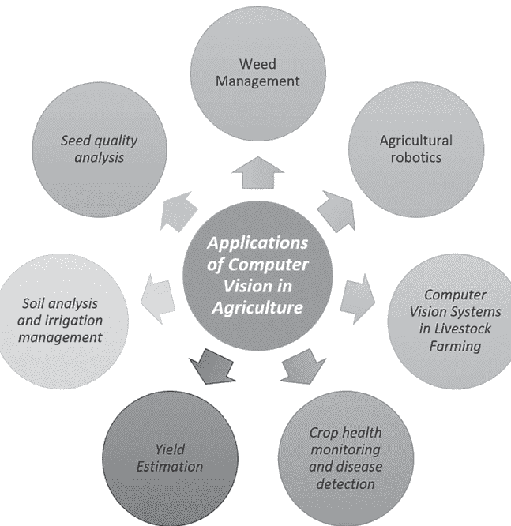

图 8.1 农业中计算机视觉的应用。

#### 8.2.1.1 种子质量分析

商业种子业务的主要目标是在适当的时间、以适当的数量，向合适的农民提供质量合格的种子。除了是一个耗时且繁琐的过程之外，将劣质种子与优质种子分离还需要专用设备、已建立的基础设施和大量时间。通过收集种子批的形态信息，计算机视觉技术可以帮助提高种子批的质量。然后可以使用此过程来评估种子的发育。深度学习主要解决了经典计算机视觉的性能问题，从而使种子品种识别广泛应用。Li 等人开发的 SeedSortNet 使用基于计算机视觉的 CNN 模型对玉米和向日葵植物进行种子分选，分别取得了 97.33% 和 99.56% 的准确率，结果令人期待 [6]。Taheri-Garavand 等人构建了一个修改后的 VGG16 模型，用于利用种子图像自动识别鹰嘴豆品种 [7]。Zhao 等人使用七种模型来检测种子表面缺陷以提高育种产量 [8]。对于大豆数据集，MobileNet-V2 模型展示了良好的检测准确率。关于在种子业务中使用计算机视觉模型，已经进行了大量研究。这些模型极大地提高了种子业务的自动化能力。

#### 8.2.1.2 土壤分析与灌溉管理

农业中土壤和灌溉管理的主要重点是维护和增强土壤的动态特性，以提高作物产量 [9]。确定土壤质地的标准程序包括收集土壤样本、将其带到实验室，然后在使用前对结果进行干燥、破碎和过滤。近年来，图像处理性能和图像捕获方法的开发有了显著提高。因此，基于计算机视觉的图像分析方法在包括土壤和灌溉科学在内的各个领域引起了广泛关注。该技术使用摄像机获取土壤图像，然后在计算机上使用简单软件进行分析。Zhang 等人设计了一种基于小波变换技术的土壤质地分类方法，用于区分不同土壤类型 [10]。因此，使用计算机视觉技术来整合和利用自动化农业生产管理、作物灌溉和产量预估非常重要。Zhang 等人使用 CNN 方法对灌溉水分配中的中心支轴灌溉系统进行了识别和监测 [11]。Kamyshova 等人提供了一种基于计算机视觉的技术，用于在低延迟模式下利用植物指示器系统优化作物灌溉 [12]。该研究还提供了一种基于算法的方法，用于生成玉米灌溉图。

#### 8.2.1.3 杂草检测

杂草是在农业中被认为有害的植物，因为它们会与作物争夺土壤中可用的水分和其他养分。在发现杂草处喷洒农药可降低对作物、人类、动物和水资源污染的危险。杂草的智能识别和控制对农业进步至关重要。田间杂草检测方法主要涉及计算机视觉技术，例如标准图像处理和深度学习


[13, 14]。但随着计算能力的提升，AlexNet、VGGNet、ResNet 等深度学习算法可以利用其增强的表达图像数据的能力，获取更多关于杂草空间和语义特征的信息。这避免了传统特征提取方法的问题。

#### 8.2.1.4 作物健康监测与病害检测

深度学习和计算机视觉的进步，为评估作物整体健康状况带来了新的、有希望的方法。一个用于管理病虫害状况并消除重大损失的智能决策支持系统，最终将能够快速识别作物病害、胁迫和营养不足，从而提高作物质量。无人机已成为精准农业和耕作的重要组成部分。无人机技术日益普及，导致这类飞机的市场显著增长。凭借飞行并覆盖长距离的能力，无人机可以使用已安装的相机收集大量数据。由于公共图像数据集（如 PlantVillage 和 PlantDoc [15, 16]）的增加，研究人员已为作物健康监测和病害检测开发了各种深度学习模型 [17, 18]。各研究人员广泛使用 PlantVillage 数据集，利用深度学习解决病害识别的挑战 [19–22]。其他多项研究表明，预训练模型可以利用准确率、召回率、精确率、F1 分数等性能指标，及时且准确地识别疾病 [19, 23, 24]。需要注意的是，找出能够提供疾病准确信息的病斑位置，花费了一些研究工作 [18, 25, 26]。多份其他出版物介绍了他们使用基于深度学习的计算机视觉检测水分胁迫和作物营养不足的研究结果。与人工操作相比，使用计算机视觉技术进行实时作物生长监测和估算被吃掉的叶面积，可以识别由于营养不良引起的作物微小变化，并为及时管理提供坚实、准确的基础 [27, 28]。这些研究为实现无病农业迈出了富有成效的步伐。

#### 8.2.1.5 畜牧养殖中的计算机视觉系统

迄今为止，我们一直专注于植物和作物，但农业远不止于玉米、小麦、番茄和苹果。动物是我们农业体系的另一个重要组成部分，需要比植物更多的监控

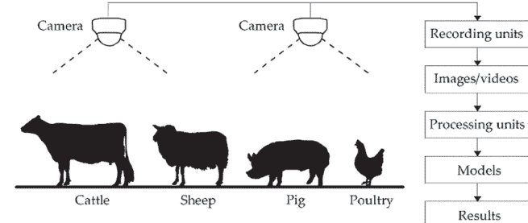

图 8.2 用于监控动物的计算机视觉系统示意图 [30]。

畜牧市场是广泛使用人工智能的一个行业。预计到 2026 年，人工智能投资将迅速扩张，计算机视觉有望占据该行业最大份额 [29]。图 8.2 描绘了计算机视觉系统的关键组成部分，包括相机、记录设备、处理单元和模型。动物（例如，牛、羊、猪、家禽等）在计算机视觉系统应用中，由安装在天花板和走廊等固定区域的相机进行监控 [30]。一项新研究开展了计算机视觉和深度学习系统，以精确且实时的数据监控奶牛。该算法根据皮毛花纹有效识别奶牛，评估其位置，理解奶牛的活动并监测其行动能力 [31]。最近有许多关于非侵入式计算机视觉技术识别牛只行为的潜力的研究，并发现计算机视觉系统正逐渐取代传统的直接观察方法 [32]。

#### 8.2.1.6 产量估算

作物产量估算和产量测绘是精准农业中的两个基本过程。这有助于农民更有效地利用现有资源，并更准确地了解其农田情况。拥有准确产量预估的农民可以更有效地管理作物物流、储存和销售，并考虑损失。农民及其他利益相关者必须具备必要的产量估算工具，以便对收获后规划做出明智决策 [33]。根据多项研究，基于图像数据集的深度学习产量估算优于传统技术。无人机（UAV）图像可能为获取高精度遥感数据提供低成本方案。Sanches 等人使用从无人机获取的数据集，来估算无人机的潜力并预测甘蔗田产量 [34]。为了估算大豆产量，You 等人基于遥感图像使用了 CNN 和 RNN 的混合模型 [35]。另一项由 Russello 进行的研究，将卫星图像与 CNN 结合，用于预测作物生产力 [36]。对于柑橘等园艺作物，计算机视觉方法更加直接，通过在收获前计数水果数量来进行估算 [37]。

## 8.3 卷积神经网络架构

CNN 是一种多层网络，有助于在图像中发现模式。CNN 通常有三层：卷积层、池化层和全连接层，如图 8.3 所示。卷积层是第一层，用于从输入图像中提取关键特征。池化层的目的是减少卷积后提取的特征图大小，从而降低计算成本和估算时间。全连接层由权重和偏置组成，通常位于输出层之前。该层中的神经元具有完全连接性，有助于在输入和输出之间建立映射关系。

本节总结并梳理了用于农业应用的多种 CNN 架构，适用于不同的计算机视觉任务。图 8.4 描绘了用于检测植物图像中疾病的三种不同 CNN 架构。需要注意的是，接下来部分介绍的 CNN 架构

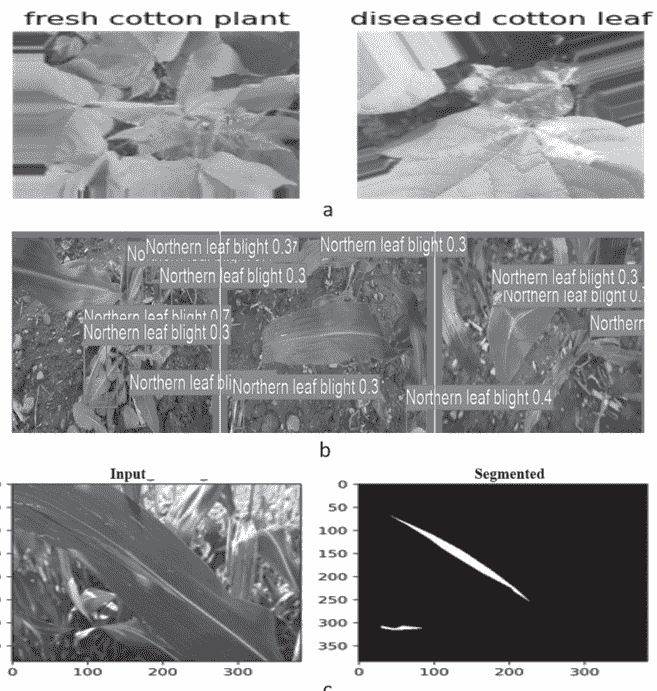

图 8.4 三种计算机视觉应用任务示例：(A) 图像分类，(B) 目标检测，(C) 语义分割。

并非局限于此。其他更复杂的网络配置尚未用于农业。

### 8.3.1 图像分类架构

在不同的计算机视觉任务中，图像分类架构最为常见，负责预测图像的类别。早期研究人员研究了使用前馈连接和浅层网络（如 AlexNet 和 LeNet）的 CNN，发现这些网络对某些棘手问题的泛化能力不佳 [38, 39]。因此，添加了多个卷积层来构建极深

表 8.1 图像分类的卷积神经网络架构

| 参考文献 | 目标与应用 | 作物/牲畜 | 年份 | 模型架构 | 准确率 |
| :--- | :--- | :--- | :--- | :--- | :--- |
| [44] | 杂草分类 | 玉米、小麦、甜菜 | 2018 | AlexNet 和 VGGNet | 98.23% |
| [45] | 病害识别 | 葡萄 | 2022 | DeepLabV3 | 97.75% |
| [46] | 灌溉效率 | 葵花 | 2022 | SFAO-Deep CNN | 92% |
| [47] | 种子分类 | — | 2020 | VGG16 | 99.9% |
| [48] | 牛发声分类和畜牧监测 | 牛 | 2021 | CNN（作者定义） | 81.96% |
| [49] | 棉花病害分类 | 棉花 | 2023 | 修改的 AlexNet | 97.98% |
| [50] | 水果分类 | 水果 | 2023 | XGBoost | 98.30% |

网络以提升性能（如 VGG16、ResNet50、InceptionV2 等）[24, 40–42]。提出了若干新想法来提高计算效率（如 GoogLeNet、MobileNet）[17, 43]。用于图像分类农业应用的两种最常见架构是 ResNet50 和 VGG16。前者可能是平衡处理速度和检测准确率的最佳模型，因此很受欢迎。后者是处理大型图像数据集的广为人知且早期的准确模型。单一网络有时可能无法正确分类复杂农业景观中的图像。有必要使用多个模型来提升性能。在模型组合中，CNN 通常用于第一阶段来提取特征，然后其他模型使用这些特征对图像进行分类。表 8.1 总结了该领域的一些研究。

### 8.3.2 目标检测架构

目标检测是计算机视觉中的关键技术，专注于在视频和图像中对对象进行分类和定位。目标检测架构由不同类型的网络组成，例如快速检测网络、快捷连接网络和基于区域的网络。第一组主要包括单发检测器（SSD）系列和 YOLO 系列 [26, 51, 52]。第二组包括两阶段目标检测器架构（例如 R-CNN、Fast-RCNN、Faster-RCNN、Mask-RCNN 等），它提取感兴趣区域，然后使用分类器对对象进行分类 [22, 26, 53, 54]。这些网络从各种角度（例如处理速度或准确率）都很有效。它们广泛应用于


表 8.2 用于目标检测的卷积神经网络架构

| References | Objective and Application | Crop/Livestock | Year | Models Architecture | Accuracy |
| :--- | :--- | :--- | :--- | :--- | :--- |
| [57] | 产量预测 | 草莓 | 2019 | Faster R-CNN 模型 CNN | 84.1% |
| [58] | 自动鼻印检测与识别 | 牛 | 2021 | YOLOv3-ResNet50 | 99.13% |
| [59] | 杂草检测 | 大豆 | 2020 | SSD, Faster R-CNN | 85% |
| [60] | 柑橘病害检测 | 柑橘 | 2022 | 两阶段深度 CNN | 94.37% |
| [61] | 种子分级 | 玉米 | 2019 | 深度 CNN | 98.2% |
| [62] | 植物健康检测 | 辣椒和马铃薯叶 | 2023 | YOLOv5 | 93% |
| [63] | 动物检测与计数 | 鹿 | 2023 | YOLOv4 | 70.45% |

各种农业应用。其中大多被使用过，但 SSD、YOLOv3 和 Faster R-CNN 使用最多 [41, 55, 56]。这是因为 SSD 和 YOLOv3 处理速度更快，而 Faster R-CNN 在平衡速度和准确率方面表现更好。表 8.2 列出了使用 CNN 进行目标检测的计算机视觉技术早期研究。

### 8.3.3 语义/实例分割架构

图像分割是计算机视觉中使用的一种方法，它在像素级别工作以确定给定图像包含的内容。图像识别（为整个图像分配一个或多个标签）和目标检测（通过在图像周围绘制边界框来查找图像内的项目）与该过程不同。图像识别使用一个或多个标签对整个图像进行标记。图像分割过程提供关于更细粒度图像内容的信息。编码器和解码器是语义模型的标准组件。编码器负责将图像转换为高级语义，而解码器负责将高级语义转换为可解释的图像。在两种情况下，仅保留感兴趣区域。实例分割模型的开发速度比语义分割模型慢，因为它们需要更多计算机资源，且在实时处理方面可能效率较低。与语义分割模型相比，当前实例分割方法的准确率更高，不论处理速度如何。一种广泛使用的实例分割模型是

| References | Objective and Application | Crop/Livestock | Year | Models Architecture | Accuracy |
| :--- | :--- | :--- | :--- | :--- | :--- |
| [68] | 识别灌溉系统问题 | — | 2020 | Mask R-CNN | — |
| [69] | 牛分割 | 牛 | 2019 | Mask R-CNN | 92% |
| [70] | 杂草分割 | 甜菜 | 2020 | Res-UNet | 98.3% |
| [71] | 牲畜分类 | 牛 | 2020 | Mask R-CNN | 96% |
| [72] | 作物病害定量 | 玉米 | 2023 | DeepLabV3+ | 96% |
| [73] | 植物病变分割 | 马铃薯，西红柿 | 2022 | CANet | 92% |
| [74] | 叶片病害分割 | 西红柿 | 2022 | DS-DETR | 96.40% |

Mask R-CNN，该模型同时执行目标分类、目标检测和实例分割 [64, 65]。该模型相当成功。农业应用经常使用 DeepLab、UNet 和 Mask R-CNN，因为它们具有高效的设计和性能 [66, 67]。利用深度学习计算机视觉的图像分割早期工作部分总结于表 8.3 中。

## 8.4 农业中计算机视觉技术分析

农业是当代人类文明的基础，对人类生命至关重要。作为一种新兴技术，计算机视觉技术与用于计算机视觉解决方案的人工智能算法相结合，将成为提升农业生产力的关键，并在未来农业应用和研究中拥有广阔前景。对于自动化和机器人耕作，计算机视觉技术将在农业中得到更有效的应用。计算机视觉智能技术应用于农业自动化生产管理的多个领域，包括作物自动化、生长监测、病害防治、果实采摘等。为了进一步确保农业生产力、质量和粮食安全，计算机视觉技术将被更广泛地用于解决现有农业问题。未来农业生产力、质量和经济增长都将受益于计算机视觉技术的应用，这也将推动农业生产、效率、质量、生态、安全和智能化的提升。

### 8.4.1 农业中计算机视觉的优势

尽管农业行业的数字化进展缓慢，但基于深度学习的人工智能系统的实际应用已获得显著动力。使用计算机视觉识别病害的应用结合了遗传资源知识与人工智能知识。这使农民和推广人员能够迅速响应并拯救作物。

- 基于深度学习的计算机视觉系统可用于自动化各种任务，例如植物健康监测和杂草检测。它还可用于提高畜牧管理效率。
- 使用计算机视觉技术、无人机数据和光谱信息的深度学习有助于开发更复杂的智能系统。
- 尽管深度学习和计算机视觉具有优势，但许多挑战仍然存在。其中包括数据质量问题和计算能力要求。
- 预计各种农业活动日益增加的自动化将继续吸引深度学习研究人员的兴趣。

### 8.4.2 计算机视觉在农业领域面临的挑战

由于人工智能的快速发展，计算机视觉技术预计将在农业生产自动化中广泛应用。然而，它也被用于管理单个作物的生产。尽管农业技术取得了进步，但计算机视觉技术在广泛应用之前还有很长的路要走。

- 目前，缺乏能够提供农业部门信息的综合数据库。这是因为在研究方案开发过程中收集的数据不统一，不能反映农业行业的实际状况。例如，计算机视觉系统在用于质量检验时只能识别特定昆虫物种。它们目前尚未应用于管理和预防病虫害的其他农业田间作业。
- 除了需要扩展的数据库和应用程序外，研究人员还发现了其他可能影响所收集数据质量的问题。其中包括环境系统响应时间差和图像采集延迟。
- 计算机视觉技术是一个涉及开发各种计算机相关技术（如人工智能和模式识别）的研究领域。该领域的一些技术成就需要大量专业知识。如果该技术用于农业自动化，将需要更多从业人员和专业人员。
- 计算机视觉技术必须解决农业自动化中的许多挑战和互补缺口。该技术在教育和培训、应用推广或科学研究等各种能力方面都急需。
- 使用计算机视觉技术时，必须考虑问题的独特特征，以选择合适的图像采集、处理和分类算法。这是确保准确结果所必需的。在将计算机视觉技术付诸实践时，没有一种始终不变的标准方法或途径。

## 8.5 结论

印度经济是一种高度依赖农业的农业经济。农业部门不仅支持印度经济，还支持工业部门以及进出口国际贸易。尽管农业部门对印度经济的贡献正在下降，但它是全国就业人数最多的部门。人工智能跨学科的影响力不断增长。深度学习模型变得更加智能，能够轻松处理复杂任务。农业是一个可能从技术进步中受益匪浅的部门。随着一些国家未能满足供需需求，使用技术改进制造至关重要。


和整体效率。计算机视觉在农业领域正取得良好进展。尽管存在障碍，正如任何上市技术一样，人工智能驱动的计算机视觉服务必须在技术被完全采用之前解决相关问题。在使用此类现代技术之前，有各种需要考虑的事项。然而，技术突破和变革正将我们带入一个数字世界。建议保持乐观，以便利用未来主义技术最大限度地提高农业产量。

## 参考文献

- [1] Ministry of Agriculture & Farmers Welfare: GoI: Annual report 2018–19. Ministry of Agriculture & Farmers Welfare. 1–224 (2018).
- [2] Deshpande, T.: State of agriculture in India. PRS Legislative Research. 1–29 (2017).
- [3] Vishnoi, V.K., Kumar, K., Kumar, B.: A comprehensive study of feature extraction techniques for plant leaf disease detection. Springer (2021).
- [4] Prasad, S., Kumar, P., Hazra, R., Kumar, A.: Plant leaf disease detection using Gabor wavelet transform. Lecture Notes in Computer Science (Including Subseries Lecture Notes in Artificial Intelligence and Lecture Notes in Bioinformatics). 7677 LNCS, 372–379 (2012). https://doi.org/10.1007/978-3-642-35380-2_44.
- [5] Rai, C.K., Pahuja, R., Chhabra, J.K.: Implementation of virtual instrumentation system for estimation of eaten leaf area using digital image processing. International Conference on Image Information Processing (ICIIP). 472–476 (2022). https://doi.org/10.1109/iciiip53038.2021.9702652.
- [6] Li, C., Li, H., Liu, Z., Li, B., Huang, Y.: SeedSortNet: A rapid and highly efficient lightweight CNN based on visual attention for seed sorting. PeerJ Computer Science. 7, 1–21 (2021). https://doi.org/10.7717/peerj-cs.639.
- [7] Taheri-Garavand, A., Nasiri, A., Fanourakis, D., Fatahi, S., Omid, M., Nikoloudakis, N.: Automated in situ seed variety identification via deep learning: A case study in chickpea. Plants. 10 (2021). https://doi.org/10.3390/plants10071406.
- [8] Zhao, G., Quan, L., Li, H., Feng, H., Li, S., Zhang, S., Liu, R.: Real-time recognition system of soybean seed full-surface defects based on deep learning. Computers and Electronics in Agriculture. 187, 106230 (2021). https://doi.org/10.1016/j.compag.2021.106230.
- [9] Kushwaha, N., Elbeltagi, A., Mehan, S., Malik, A., Yousuf, A.: Comparative study on morphometric analysis and RUSLE-based approaches for micro-watershed prioritization using remote sensing and GIS. Arabian Journal of Geosciences. 15 (2022). https://doi.org/10.1007/s12517-022-09837-2.
- [10] Zhang, X., Younan, N.H., King, R.L.: Soil texture classification using wavelet transform and maximum likelihood approach. International Geoscience and Remote Sensing Symposium (IGARSS). 4, 2888–2890 (2003).
- [11] Zhang, C., Yue, P., Di, L., Wu, Z.: Automatic identification of center pivot irrigation systems from landsat images using convolutional neural networks. Agriculture (Switzerland). 8 (2018). https://doi.org/10.3390/agriculture8100147.
- [12] Kamyshova, G., Osipov, A., Gataullin, S., Korchagin, S., Ignar, S., Gataullin, T., Terekhova, N., Suvorov, S.: Artificial neural networks and computer vision-based phytoindication systems for variable rate irrigation improving. IEEE Access. 10, 8577–8589 (2022). https://doi.org/10.1109/ACCESS.2022.3143524.
- [13] Wang, A., Xu, Y., Wei, X., Cui, B.: Semantic segmentation of crop and weed using an encoder-decoder network and image enhancement method under uncontrolled outdoor illumination. IEEE Access. 8, 81724–81734 (2020). https://doi.org/10.1109/ACCESS.2020.2991354.
- [14] Krogh Mortensen, A., Dyrmann, M., Karstøft, H., Nyholm Jorgensen, R., Gislum, R.: Semantic segmentation of mixed crops using deep convolutional neural network. CIGR-AgEng Conference. 1–6 (2016).
- [15] Hughes, D.P., Salathe, M.: An open access repository of images on plant health to enable the development of mobile disease diagnostics. ArXiv. (2015). https://doi.org/10.1111/1755-0998.12237.
- [16] Singh, D., Jain, N., Jain, P., Kayal, P., Kumawat, S., Batra, N.: PlantDoc: A dataset for visual plant disease detection. ACM International Conference Proceeding Series. 249–253 (2020). https://doi.org/10.1145/3371158.3371196.
- [17] Zhang, X., Qiao, Y.U.E., Meng, F., Fan, C., Zhang, M.: Identification of maize leaf diseases using improved deep convolutional neural networks. IEEE Access. 6, 30370–30377 (2018). https://doi.org/10.1109/ACCESS.2018.2844405.
- [18] Ozguven, M.M., Adem, K.: Automatic detection and classification of leaf spot disease in sugar beet using deep learning algorithms. Physica A: Statistical Mechanics and its Applications. 535, 122537 (2019). https://doi.org/10.1016/j.physa.2019.122537.
- [19] Chen, J., Chen, J., Zhang, D., Sun, Y., Nanehkaran, Y.A.: Using deep transfer learning for image-based plant disease identification. Computers and Electronics in Agriculture. 173, 105393 (2020). https://doi.org/10.1016/j.compag.2020.105393.
- [20] Hassan, S.M., Maji, A.K., Jasiński, M., Leonowicz, Z., Jasińska, E.: Identification of plant-leaf diseases using cnn and transfer-learning approach. Electronics (Switzerland). 10 (2021). https://doi.org/10.3390/electronics10121388.
- [21] Ferentinos, K.P.: Deep learning models for plant disease detection and diagnosis. Computers and Electronics in Agriculture. 145, 311–318 (2018). https://doi.org/10.1016/j.compag.2018.01.009.
- [22] Zhang, Y., Song, C., Zhang, D.: Deep learning-based object detection improvement for tomato disease. IEEE Access. 8, 56607–56614 (2020). https://doi.org/10.1109/ACCESS.2020.2982456.
- [23] Thangaraj, R., Anandamurugan, S., Kaliappan, V.K.: Automated tomato leaf disease classification using transfer learning-based deep convolution neural network. Journal of Plant Diseases and Protection. 128, 73–86 (2021). https://doi.org/10.1007/s41348-020-00403-0.
- [24] Wang, G., Sun, Y., Wang, J.: Automatic image-based plant disease severity estimation using deep learning. Computational Intelligence and Neuroscience. 2017 (2017). https://doi.org/10.1155/2017/2917536.
- [25] Guo, Y., Zhang, J., Yin, C., Hu, X., Zou, Y., Xue, Z., Wang, W.: Plant disease identification based on deep learning algorithm in smart farming. Discrete Dynamics in Nature and Society. 2020 (2020). https://doi.org/10.1155/2020/2479172.
- [26] Hammad Saleem, M., Khanchi, S., Potgieter, J., Mahmood Arif, K.: Image-based plant disease identification by deep learning meta-architectures. Plants. 9, 1–23 (2020). https://doi.org/10.3390/plants9111451.
- [27] Gupta, H., Pahuja, R.: Estimating morphological features of plant growth using machine vision. 10 (2019). https://doi.org/10.1018/IJAEIS.2019070103.
- [28] Rai, C.K., Pahuja, R.: Digital image processing-based virtual instruments for the detection and classification of eaten leaves. Journal of East China University of Science and Technology. 65, 877–885 (2022). https://doi.org/10.5281/ZENODO.7081544.
- [29] Global artificial intelligence in livestock farming market. https://www.globenewswire.com/news-release/2021/07/30/2272238/0/en/Global-Artificial-Intelligence-in-Livestock-Farming-Market.html.
- [30] Li, G., Huang, Y., Chen, Z., Chesser, G.D., Purswell, J.L., Linhoss, J., Zhao, Y.: Practices and applications of convolutional neural network-based computer vision systems in animal farming: A review. Sensors. 21, 1–42 (2021). https://doi.org/10.3390/s21041492.
- [31] Tassinari, P., Bovo, M., Benni, S., Franzoni, S., Poggi, M., Mammi, L.M.E., Mattoccia, S., Di Stefano, L., Bonora, F., Barbaresi, A., Santolini, E., Torreggiani, D.: A computer vision approach based on deep learning for the detection of dairy cows in free stall barn. Computers and Electronics in Agriculture. 182, 106030 (2021). https://doi.org/10.1016/j.compag.2021.106030.
- [32] Rony, M., Barai, D., Riad, Hasan, M.Z.: Cattle external disease classification using deep learning techniques. 2021 12th International Conference on Computing Communication and Networking Technologies, ICCCNT 2021. (2021). https://doi.org/10.1109/ICCCNT51525.2021.9579662.
- [33] Wei, M.C.F., Maldaner, L.F., Ottoni, P.M.N., Molin, J.P.: Carrot yield mapping: A precision agriculture approach based on machine learning. Ai. 1, 229–241 (2020). https://doi.org/10.3390/ai1020015.
- [34] Sanches, G.M., Duft, D.G., Kölln, O.T., Luciano, A.C. dos S., De Castro, S.G.Q., Okuno, F.M., Franco, H.C.J.: The potential for RGB images obtained using unmanned aerial vehicle to assess and predict yield in sugarcane fields. International Journal of Remote Sensing. 39, 5402–5414 (2018). https://doi.org/10.1080/01431161.2018.1448484.
- [35] You, J., Li, X., Low, M., Lobell, D., Ermon, S.: Deep Gaussian process for crop yield prediction based on remote sensing data. Proceedings of the Thirty-First AAAI Conference on Artificial Intelligence, AAAI'17 AAAI Press, San Francisco, California, USA. 4559–4565 (2017).


- [36] Russello, H.: 基于卫星图像的作物产量预测卷积神经网络. IBM Centers for Advanced Studies. (2018).

- [37] Dorj, U.O., Lee, M., Yun, S.S.: 基于图像处理的果实检测与计数的柑橘园产量估计. Computers and Electronics in Agriculture. 140, 103–112 (2017). https://doi.org/10.1016/j.compag.2017.05.019.

- [38] Krizhevsky, A., Hinton, G.E.: 基于深度卷积神经网络的ImageNet分类. NIPS. 1–9 (2012).

- [39] Ahila Priyadharshini, R., Arivazhagan, S., Arun, M., Mrinalini, A.: 基于深度卷积神经网络的玉米叶病分类. Neural Computing and Applications. 31, 8887–8895 (2019). https://doi.org/10.1007/s00521-019-04228-3.

- [40] Yang, K., Zhong, W., Li, F.: 使用深度学习的复杂背景下叶片分割与分类. Agronomy. 10 (2020). https://doi.org/10.3390/agronomy10111721.

- [41] Selvaraj, M.G., Vergara, A., Ruiz, H., Safari, N., Elayabalan, S., Ocimati, W., Blomme, G.: 基于AI的香蕉病虫害检测. Plant Methods. 15, 1–11 (2019). https://doi.org/10.1186/s13007-019-0475-z.

- [42] Esgario, J.G.M., Krohling, R.A., Ventura, J.A.: 用于咖啡叶片生物胁迫分类与严重程度估计的深度学习. Computers and Electronics in Agriculture. 169 (2020). https://doi.org/10.1016/j.compag.2019.105162.

- [43] Chen, J., Zhang, D., Nanehkaran, Y.A.: 使用深度迁移学习和增强轻量网络识别植物病害. Multimedia Tools and Applications. 79, 31497–31515 (2020). https://doi.org/10.1007/s11042-020-09669-w.

- [44] Chavan, T.R., Nandedkar, A.V.: AgroAVNET用于作物和杂草分类：自动耕作迈出的一步. Computers and Electronics in Agriculture. 154, 361–372 (2018). https://doi.org/10.1016/j.compag.2018.09.021.

- [45] Ji, M., Wu, Z.: 基于深度学习和模糊逻辑的葡萄黑痘病自动检测与严重程度分析. Computers and Electronics in Agriculture. 193, 106718 (2022). https://doi.org/10.1016/j.compag.2022.106718.

- [46] Kumbi, A.A., Birje, M.N.: 基于深度CNN的向日葵原子优化方法用于IoT中的最优水分控制. Wireless Personal Communications. 122, 1221–1246 (2022). https://doi.org/10.1007/s11277-021-08946-7.

- [47] Gulzar, Y., Hamid, Y., Soomro, A.B., Alwan, A.A., Journaux, L.: 基于卷积神经网络的种子分类系统. Symmetry. 1–29 (2020). https://doi.org/10.3390/sym12122018.

- [48] Jung, D.H., Kim, N.Y., Moon, S.H., Jhin, C., Kim, H.J., Yang, J.S., Kim, H.S., Lee, T.S., Lee, J.Y., Park, S.H.: 基于深度学习的牛叫声分类模型及带噪声过滤的实时牲畜监测系统. Animals. 11, 1–16 (2021). https://doi.org/10.3390/ani11020357.

- [49] Rai, C.K., Pahuja, R.: 使用改进的深度卷积神经网络对病害棉叶和棉株进行分类. Multimedia Tools and Applications. 1–14 (2023). https://doi.org/10.1007/s11042-023-14933-w.

- [50] Alharbi, A.H., Alkhalaif, S., Asiri, Y., Abdel-Khalek, S., Mansour, R.F.: 使用增强海鞘群算法与融合式深度学习的自动水果分类. Computers and Electrical Engineering. 108, 108657 (2023). https://doi.org/10.1016/j.compeleceng.2023.108657.

- [51] Liu, W., Anguelov, D., Erhan, D., Szegedy, C., Reed, S., Fu, C.Y., Berg, A.C.: SSD：单发多框检测器. Lecture Notes in Computer Science (Including Subseries Lecture Notes in Artificial Intelligence and Lecture Notes in Bioinformatics). 9905 LNCS, 21–37 (2016). https://doi.org/10.1007/978-3-319-46448-0_2.

- [52] Redmon, J., Divvala, S., Girshick, R., Farhadi, A.: 你只看一次：统一的实时目标检测. Proceedings of the IEEE Computer Society Conference on Computer Vision and Pattern Recognition. 2016-December, 779–788 (2016). https://doi.org/10.1109/CVPR.2016.91.

- [53] Girshick, R., Donahue, J., Darrell, T., Malik, J.: 用于精确目标检测和分割的基于区域的卷积网络. IEEE Transactions on Pattern Analysis and Machine Intelligence. 38, 142–158 (2016). https://doi.org/10.1109/TPAMI.2015.2437384.

- [54] Masood, M.H., Saim, H., Taj, M., Awais, M.M.: 水稻作物早期病害诊断. ICLR. 1–5 (2020).

- [55] Liu, J., Wang, X.: 基于改进YOLOv3卷积神经网络的番茄病虫害检测. Frontiers in Plant Science. 11, 1–12 (2020). https://doi.org/10.3389/fpls.2020.00898.

- [56] Shill, A., Rahman, M.A.: 基于YOLOv3和YOLOv4的植物病害检测. 2021. International Conference on Automation, Control and Mechatronics for Industry 4.0, ACMI 2021. 8–9 (2021). https://doi.org/10.1109/ACMI53878.2021.9528179.

- [57] Chen, Y., Lee, W.S., Gan, H., Peres, N., Fraisse, C., Zhang, Y., He, Y.: 基于高分辨率航空正射影像的深度神经网络草莓产量预测. Remote Sensing. 11, 1–21 (2019). https://doi.org/10.3390/rs11131584.

- [58] Shojaeipour, A., Falzon, G., Kwan, P., Hadavi, N., Cowley, F.C., Paul, D.: 通过少样本深度迁移学习对混种牛的自动口鼻部检测与生物特征识别. Agronomy. 11 (2021). https://doi.org/10.3390/agronomy11112365.

- [59] Sivakumar, A.N.V., Li, J., Scott, S., Psota, E., Jhala, A.J., Luck, J.D., Shi, Y.: 在UAV图像中对中后季节杂草检测的目标检测与基于补丁分类深度学习模型比较. Remote Sensing. 12 (2020). https://doi.org/10.3390/rs12132136.

- [60] Syed-Ab-Rahman, S.F., Hesamian, M.H., Prasad, M.: 使用端到端基于锚点的深度学习模型的柑橘病害检测与分类. Applied Intelligence. 52, 927–938 (2022). https://doi.org/10.1007/s10489-021-02452-w.

- [61] Ni, C., Wang, D., Vinson, R., Holmes, M., Tao, Y.: 基于深度卷积神经网络的玉米籽粒自动检测机. Biosystems Engineering. 178, 131–144 (2019). https://doi.org/10.1016/j.biosystemseng.2018.11.010.

- [62] Khalid, M., Sarfraz, M.S., Iqbal, U., Aftab, M.U., Niedbala, G., Rauf, H.T.: 使用深度卷积神经网络的实时植物健康检测. Agriculture (Switzerland). 13, 1–26 (2023). https://doi.org/10.3390/agriculture13020510.

- [63] Rančić, K., Blazojević, B., Bezdan, A., Ivošević, B., Tubić, B., Vranešević, M., Pejak, B., Crnojević, V., Marko, O.: 使用卷积神经网络从UAV图像中进行动物检测与计数. Drones. 7, 179 (2023). https://doi.org/10.3390/drones7030179.

- [64] Afzaal, U., Bhattarai, B., Pandeya, Y.R., Lee, J.: 基于Mask R-CNN的草莓病害实例分割模型. Sensors. 21 (2021). https://doi.org/10.3390/s21196565.

- [65] He, K., Gkioxari, G., Dollár, P., Girshick, R.: Mask R-CNN. IEEE Transactions on Pattern Analysis and Machine Intelligence. 42, 386–397 (2020). https://doi.org/10.1109/TPAMI.2018.2844175.

- [66] Wang, C., Du, P., Wu, H., Li, J., Zhao, C., Zhu, H.: 基于DeepLabV3+和U-Net融合的黄瓜叶病严重程度分类方法. Computers and Electronics in Agriculture. 189, 106373 (2021). https://doi.org/10.1016/j.compag.2021.106373.

- [67] Gowroju, S., Aarti, Kumar, S.: 使用UNET和形态学图像处理的强健瞳孔分割. 2021 International Mobile, Intelligent, and Ubiquitous Computing Conference, MIUCC 2021. 105–109 (2021). https://doi.org/10.1109/MIUCC52538.2021.9447658.

- [68] Albuquerque, C.K.G., Polimante, S., Torre-Neto, A., Prati, R.C.: 使用Mask R-CNN和UAV影像的智能灌溉系统喷水检测. 2020 IEEE International Workshop on Metrology for Agriculture and Forestry, MetroAgriFor 2020—Proceedings. 236–240 (2020). https://doi.org/10.1109/MetroAgriFor50201.2020.9277542.

- [69] Qiao, Y., Truman, M., Sukkarieh, S.: 基于Mask R-CNN的精准畜牧业牛体分割与轮廓提取. Computers and Electronics in Agriculture. 165, 104958 (2019). https://doi.org/10.1016/j.compag.2019.104958.

- [70] Fawakherji, M., Potena, C., Prevedello, I., Pretto, A., Bloisi, D.D., Nardi, D.: 用于精准农业中作物/杂草分割的GAN数据增强. CCTA 2020—4th IEEE Conference on Control Technology and Applications. 279–284 (2020). https://doi.org/10.1109/CCTA41146.2020.9206297.

- [71] Xu, B., Wang, W., Falzon, G., Kwan, P., Guo, L., Sun, Z., Li, C.: 使用Mask R-CNN在四旋翼机航拍图像中进行牲畜分类与计数. International Journal of Remote Sensing. 41, 8121–8142 (2020). https://doi.org/10.1080/01431161.2020.1734245.

- [72] Divyanth, L.G., Ahmad, A., Saraswat, D.: 基于玉米田图像的作物病害定量两阶段深度学习分割模型. Smart Agricultural Technology. 3, 100108 (2023). https://doi.org/10.1016/j.atech.2022.100108.

- [73] Shoaib, M., Shah, B., Hussain, T., Ali, A., Ullah, A., Alenezi, F., Gechev, T., Ali, F., Syed, I.: 基于深度学习的植物病灶分割模型,


亚型鉴定与生存概率估计。《植物科学前沿》。13, 1–15 (2022). https://doi.org/10.3389/fpls.2022.1095547.
[74] Wu, J., Wen, C., Chen, H., Ma, Z., Zhang, T., Su, H., Yang, C.: DS-DETR：一种用于番茄叶片病害分割和损伤评估的模型。《农学》。12, 1–16 (2022). https://doi.org/10.3390/agronomy12092023.

# 9 基于草药图像的人工智能智能识别系统

## 使用各种机器学习模型进行决策

Sanyam Sharma,1,2 Subh Naman,1,3 Jayesh Dwivedi2 和 Ashish Baldi1*

1 药物创新实验室，制药科学与技术系，马哈拉贾·兰吉特·辛格旁遮普技术大学，巴廷达，15001，旁遮普 2 太平洋高等教育与研究大学，乌代浦，拉贾斯坦 3 制药科学学院，CT大学，费罗泽普尔路，卢迪亚纳

* 通讯作者：+91-8968423848, baldiashish@gmail.com

## 9.1 引言

阿育吠陀，作为印度医学最古老、最传统的实践，对于建立专门的补救措施和疗法至关重要。阿育吠陀中使用的药物由植物成分以及动物、金属或矿物质物质制成。印度是传统药物和药用草本植物的丰富来源，使其成为寻找新药物的理想场所。阿育吠陀是一种印度传统医学体系，至今仍被使用，因为它能整体性地治疗各种疾病，疗效显著。它强调意识、心智、身体和灵魂的完全统一[1, 2]。

草本植物在颜色、质地和气味方面与其他植物不同。草本植物鉴定通常采用器官感官技术，该技术主要依赖于植物学家。仅根据其独特特征，同一科中不同草本植物物种由于其相同的物理特征而变得更难以区分。与人类不同，人工智能辅助技术应能够准确区分各种物种[3]。

可通过芳香和药用植物提取出酚类、花青素、类胡萝卜素和生育酚等生物活性物质，具有多种治疗益处和药理作用[4]。然而，与其他植物识别一样，由于专家意见难以获取，物理识别药用和芳香植物的工作具有挑战性且耗时。由于这些问题，已经开发出许多自动植物或叶片识别系统，其中大多数使用机器学习技术[5–7]。

计算机科学的一个分支叫做“人工智能”，旨在赋予机器额外的智能。学习是任何认知行为的基本前提之一。当今大多数科学家都同意，没有学习就不能存在智力。因此，机器学习（ML）是人工智能（AI）研究的主要子领域之一，也是研究领域中增长最快的领域之一[8]。系统利用人工智能开始学习，基于先前训练/学习的经验来预测新对象。它通过提取特征来学习，指的是特定的可量化特征，例如更具启发性和排他性的特征[9]。图9.1描绘了通过机器学习模型进行识别的基本步骤。

## 9.2 相关工作

拉克西米及其作者开发了一款名为“MedLeaf”的移动应用程序，以帮助根据叶片识别印度尼西亚植物。该特征提取从85个不同物种的3502张印度尼西亚植物照片库中提取叶片特征，采用了几何特征和LBP。该模型使用PNN分类器开发。使用复合特征（85%）的准确率显示优于单独使用单一特征[10]。

通过分析叶片照片，卡尔曼及其合作者开发了一个用于识别油棕植物营养缺乏的自动化程序。为了创建数据集，他们使用了52张带标签的油棕植物叶片照片。然后将数据集按6:1:2的比例分为三类：训练数据集、模型选择数据集和测试数据集。开发的识别模型采用了ANN分类方法。作者用于评估识别模型有效性的性能指标包括召回率、精确率、F1分数和准确率。作者得出结论，构建的模型在性能指标测试中取得了积极结果。为了改进开发的识别模型的使用，还基于该模型创建了一个安卓应用程序[11]。

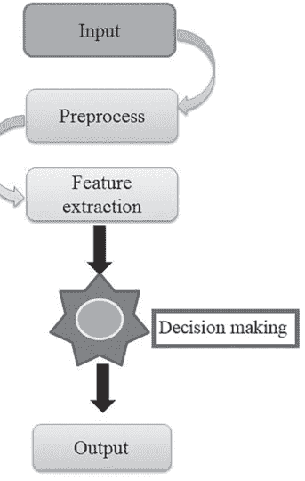

图9.1 机器学习模型工作流。

基于番茄叶片照片，埃尔哈苏尼和斯马兰达奇开发了一种用于诊断番茄疾病的自动化工具。该识别模型使用CNN分类技术开发，并在7176张番茄叶片照片上进行了训练。该模型已识别出十种不同的番茄植物疾病。使用了准确率、平均损失曲线和其他性能指标，结果报告为满意[12]。

秋山及其同事开发了一款用于植物叶片识别的移动应用程序，他们考察了三种CNN模型，即MobileNetV2、MobileNet和VGG19。使用了33个不同类别的图像来构建模型开发的数据库。为了比较三种CNN模型，使用了包括F1分数、退出率和计算时间在内的各种性能指标。在所有性能指标中，作者发现MobileNetV2 CNN模型是三种中最好的一种[13]。

唐及其团队提出了一种基于CNN的葡萄疾病诊断模型。针对小型和低延迟模型，提出了一种由轻量级CNN和通道注意力（CA）机制组成的独特技术。骨干网络为ShuffleNet V1和V2，采用挤压-激励（SE）块作为CA技术来改进ShuffleNet设计。该模型由一个可用数据集支持，包含4062张葡萄叶片照片，分为四个类别——三个健康类别和一个病害类别。实验结果表明，所提技术已成功且达到可接受的准确度[14]。

基于叶片分析，杨和郭比较了各种用于植物疾病诊断的ML模型。作者得出结论，机器学习模型是一种关键且有效的技术，可在分析大量数据后快速获得可验证的结果[15]。

费伦蒂诺斯提出了一种基于植物叶片分析进行植物病害识别的深度CNN模型。该模型的训练和开发是在一个约89,000张图像的免费可用数据库上进行的。数据库中的照片包括两种类型的图像，即实验室环境下和原始种植条件下的图像。开发的模型结果显示，使用VGG CNN技术的准确率为99.71%[16]。

德卢纳及其同事提出了一种用于识别菲律宾地区植物的自动化系统。数据集由12种不同的草本植物物种创建。用于开发此自动识别系统，采用了基于ANN的神经网络。为了训练数据集，使用了50张图像。使用Python借助开发的神经网络对数据集进行训练，对整个数据集的识别准确率达到98.16%。为了测试数据集，使用了约72张样本图像。借助MATLAB®，训练好的神经网络在未知样本识别中达到了98.61%的准确率[17]。

在与植物相关的数据集上，约瑟夫及其同事对几种传统特征提取和深度CNN方法进行了比较研究。将HOG特征描述子与KNN相结合以及HOG-BOW与SVM和MLP分类器相结合，分别与从零开始训练以及使用微调变体的AlexNet和GoogleNet作为深度CNN架构进行了对比。测试了三种基于植物数据集的图像识别系统，发现它们表现出色。作者得出结论，增强的深度CNN架构通常优于传统特征描述子方法[18]。

基于在自然栖息地拍摄的叶片图像分析（这些图像可能受到各种照明条件和复杂背景的影响），普齐及其合作者提出了一款用于植物物种计算机化识别的移动应用程序。这项研究的主要目标是构建和设计一个能够自动识别和分割目标叶片的系统。它侧重于显著性提取以选择目标叶片，并采用区域生长方法进行分类，该方法同时利用显著性图中的数据和每个像素的颜色特征[19]。

穆尼萨米及其团队开发了一个基于k-NN技术的机器学习模型。该创建的系统在32个不同物种组的640片叶子上进行了评估，准确率为83.5%。使用色彩直方图方法，准确率进一步提高到87.3%。开发的模型也非常用户友好且稳健[20]。

为了对在英国kew皇家植物园采集的44种植物物种进行无监督特征可视化，李及其团队创建了一个CNN模型。除了使用框方法外，还采用了基于反卷积网络的可视化技术（DN），以便通过CNN模型了解提取的特征。研究发现，不同阶次的叶脉已被用于表示每种植物。作者得出结论，使用这些CNN特征配合不同分类器的实验结果显示出一致性和优越性，与依赖手工制作特征的最先进的方法相比[21]。


## 9.3 机器学习：拓宽视野

目前增长最快的计算机科学领域是机器学习，其应用领域涵盖营销、医疗保健、生产、网络安全和移动性等多个方面。三种要素触手可得并被结合使用：(1) 计算机中更快、更强大的部件，如多核处理器和广义 GPU；(2) 利用这些计算结构的计算机程序；以及 (3) 针对特定问题的几乎无限的训练数据集，如数字照片、数字化文件。社交媒体帖子或其他类型的信息是这种技术字面意义上“爆炸”的主要原因。ML 是一种 AI 类型，能够在未经过专门训练的情况下执行任务。相反，它采用一种称为“通过学习进行训练”的过程，从分配任务的先前样本中学习。推理是训练后在新数据上执行任务的技术 [22]。它对于数据难以分析的情况尤其有帮助，例如审查图像和视频录像，并且特别有助于从持续增加的海量数据中获取数据 [23]。计算机视觉是分析数字图像和电影并得出结论的科学。它旨在从工程角度自动化人类视觉界面可以完成的任务 [24]。基于计算机视觉的机器学习过程的两个阶段是特征提取和分类。

### 9.3.1 机器学习模型的各个步骤

使用摄像机/手机/智能手机进行数据采集是构建基于 ML 的图像识别模型框架中的第一步，如图 9.2 所示。要构建在线图像数据库，收集的适当照片可以上传到服务器。对图像进行进一步处理，以使其适合应用机器学习模型。可以使用各种提取技术，在颜色、形状和大小的背景下提取各种特征。在使用特征提取技术后，进一步使用降维技术来优化结果。可以应用其他机器学习模型，包括 ANN、CNN、RNN 等，用于系统训练和优化。下一节将详细解释这些针对草药特定反应的每个操作。

## 9.4 创建图像数据库

完成此操作的最简单方法是使用配备至少 1000 万像素摄像头的手机。此外，由于相机的传感器和像素优于手机

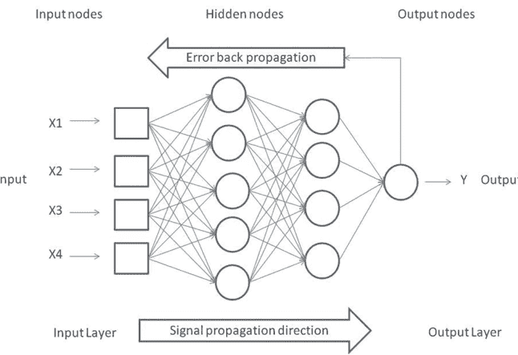

图 9.2 人工神经网络的基本表示。

，也可以使用相机。拍摄图像时，背景应为白色或清晰，因为在繁忙背景下拍摄的照片可能会产生不必要的噪声，影响我们的机器学习算法，最终导致结果不准确。可以拍摄草药和香料的照片，并将其发布到可以随时随地访问的在线图像数据库，例如 Google Drive、Microsoft Community 等。根据用于捕捉草药/香料实体照片的相机质量，图像数据集可以以 Zip 文件的形式提交，并明确分为正常、高端和中等等类别 [25]。数据库中应为每种图像提供清晰的类别。

根据 Walch 和 Mäder 的说法，Swedish Leaf、ICL、Leafsnap 和 Flavia 数据库中的照片是在受控环境下拍摄的。然而，使用的图像数量和物种因数据库而异。另一方面，ImageCLEF 数据库提供了广泛的叶片图片，用于自然环境下的叶片识别 [7]。

Mzoughi 及其同事使用 k-NN 分类器检测了 ImageCLEF 2011 中的叶片照片，该数据集包含 71 种植物的 5436 张图像。由于数据集中每种植物物种的叶片形状大致相似，因此该数据集的分类极其困难。尽管照片之间存在相似之处，但研究人员仍能通过对不同叶片类型使用各种属性，以 82.1% 的准确率对叶片进行分类 [26, 27]。

根据 Ma 及其同事的研究，对于 ImageCLEF 的叶片图像，方向梯度金字塔直方图、顶帽变换和 Haar 小波变换产生了 90% 的分类准确率。顶帽变换用于消除嘈杂背景中的小对象，PHOG 是一种常见的形状描述子，通过形状的局部形式和空间配置来定义图像。表 9.1 列出了可用的在线服务器数据库 [28]。

### 表 9.1 在线服务器数据库列表

| 序号 | 数据库名称 | 结果与特征 | 参考文献/网站链接 |
|---|---|---|---|
| 1 | ImageCLEF11/Image-CLEF12/ImageCLEF13 | 各数据库中的物种和照片总数如下：ImageCLEF11 的 5436 张照片代表 71 个物种；Image-CLEF12 由 126 个物种的 11,572 张图像组成；Image-CLEF13 由 250 个物种的 26,077 张图像组成。 | [29–32] |
| 2 | PlantCLEF14, PlantCLEF15, PlantCLEF16, Plant-CLEF17 | Plant-CLEF14 由 500 个物种的 60,961 张图像组成；Plant-CLEF15 由 1000 个物种的 113,205 张图像组成；Plant-CLEF16 由 1000 个物种的 121,205 张图像组成；Plant-CLEF17 由 10,000 个物种的 256,287 张图像组成。 | [29–32] |
| 3 | Flavia | 该集合包括 33 种不同植物物种的 1907 张照片，这些照片排列良好、无噪声，且亮度和颜色差异极小或几乎没有差异。 | [33] |
| 4 | ICL | 数据集中包含完全在中国培育的叶片图像。总共有 16,851 张照片，代表 220 种植物物种。 | [34–36] |
| 5 | Leafsnap | 该数据集中的 30,866 张叶片照片均来自美国东北部，代表 185 个不同物种。史密森尼藏品中仅 23,147 张照片质量良好。其余照片是在各种不同情况下使用手机拍摄的。 | [30, 37, 38] |
| 6 | VITHERB | 关于越南植物物种的图像 | http://viherb.com.vn/ |
| 7 | plant_leaves | 健康植物叶片的图像 | https://data.mendeley.com/datasets/hb74ynkjcn/1 |
| 8 | American Botanical Council | 药用植物信息目录 | http://www.herbalgram.org/ |
| 9 | ImageCLEF 2013 | 植物图像数据库 | https://www.imageclef.org/2013/plant |
| 10 | CIFAR-10 | 植物及其他物品图像数据库 | https://www.cs.toronto.edu/~kriz/cifar.html |
| 11 | Plant CV | 不同物种植物的图像 | https://www.quantitative-plant.org/dataset |
| 12 | PlantVillage 数据集 | 一组用于病害植物叶片的图像和标签 | https://www.kaggle.com/datasets/emmarex/plantdisease |
| 13 | Pl@ntNet-300K | 不同物种植物的数据集 | https://zenodo.org/record/4726653#.YmowC_NBxQI |
| 14 | 叶片图像数据库 | 不同植物图像的数据集 | https://data.mendeley.com/datasets/hb74ynkjcn/4 |
| 15 | DiaMOS Plant | 用于识别和追踪植物疾病的数据库 | https://francescamalloci.com/category/projects/ |

## 9.5 特征提取

然而，与其从人类先验知识入手，不如说在概念上理解软件程序的关键步骤是提取有用且有效的视觉特征并从中构建模型。大多数图像识别和检索系统都基于颜色、纹理和形状，因为它们是最常见的视觉特征。但它们的工作效果在很大程度上取决于如何使用图像属性。三种不同的特征提取方法是基于区域的、全局的和基于块的特征 [39]。

### 9.5.1 颜色特征

颜色是捕获图像中最重要的方面之一。特定颜色属性在特定 RGB 空间或模型的背景下描述。文献中已使用 RGB、HIS、LUV 和 HSV 等颜色空间。定义颜色空间后，可以从图像或感兴趣区域中检索颜色特征。颜色直方图、颜色一致性向量 (CCV)、颜色共现图和色彩矩 (CM) 只是彩色图像中存在的一些主要颜色特征 [40]。

#### 9.5.1.1 颜色直方图

颜色直方图是对图像颜色分布的图形描述。直方图的数据是通过记录图像中各自颜色模型中每种可能颜色的出现情况来得出的 [40]。

#### 9.5.1.2 颜色一致性向量

颜色一致性向量 (CCV) 方法比颜色直方图方法更复杂。它通过确定每个像素是连贯还是不连贯来工作。与属于微小连接分量的不连贯像素相反，连贯像素是大型连接分量 (CC) 的组成部分。确定我们用来判断连接分量是否足够大的标准，是使该策略发挥作用的关键步骤 [40]。

#### 9.5.1.3 色彩矩

色彩矩是有助于根据图像的多种颜色特征将其区分开来的度量。计算色彩矩后，它们提供了图像间颜色相似性的度量。对于图像检索等应用，这些相似性值可以与频率进行比较。


| 颜色方法 | 优点 | 缺点 |
| :--- | :--- | :--- |
| 直方图 | 简单且基础的计算 | 高维度、无空间信息、对噪声敏感 |
| SCD | 按需可扩展且紧凑 | 无空间信息，且若数据被压缩，则可靠性较低。 |
| DCD | 紧凑、稳健且感知性强 | 空间数据需要后处理 |
| CM | 稳健、紧凑 | 尚不足以表示所有颜色 |
| 共现矩阵 | 统计信息 | 计算成本极高，且易受噪声、旋转和尺度影响。 |
| CSD | 统计信息 | 非常易受旋转、噪声和尺度影响。 |

数据库中分类的图像。图像的颜色矩可借助概率分布进行计算/测量。CM 是其中最基础却又强大的特性之一 [40]。表 9.2 展示了各种颜色方法的不同优缺点。

### 9.5.2 形状特征

形状是人类识别和区分现实世界事物的关键线索，其目标是对包括各种方向直线在内的简单几何模式进行编码。基于轮廓和基于区域的方法是形状特征提取方法的两大主要类别。前一种方法从整个区域提取特征，而后一种方法仅从形状边界计算形状特征。形状特征是图像特征提取中非常重要的特征。形状特征的各种属性包括过渡、尺度不变性和旋转、可辨识性（相似物体的图像包含相似特征）、抗噪性（特征应尽可能对噪声稳健）、仿射不变性（保持形状特征的形状畸变不应改变描述子）、可靠性、遮挡不变性、统计独立性。形状描述子是用于表示某个形状方面的一组数字。描述试图以人类直观的方式量化形状。描述子通常以向量形式存在。简单的几何特征通常只能区分差异显著的形状；因此，它们常被用作过滤器以消除误报，或与其他形状描述子结合使用以区分形状 [41]。

### 9.5.3 纹理特征

多种图像可以利用纹理的不同表征方式。假设人类视觉系统利用纹理进行解释和检测。通常，颜色是像素属性，而纹理只能从一组像素中确定。已经研究了多种提取纹理特征的方法。根据特征提取所在的领域，它们可分为两类：提取空间纹理特征的方法和提取频谱纹理特征的方法 [42]。

#### 9.5.3.1 空间方法

通过在源图像域中计算像素统计信息或识别局部像素模式，该方法可提取纹理特征。

#### 9.5.3.2 频谱方法

通过将图像转换到频域，然后从转换后的图像中计算特征，可以识别纹理特征。部分优缺点包含在表 9.3 中。

表 9.3 空间和频谱纹理特征提取的优缺点

| 方法 | 优点 | 缺点 |
|---|---|---|
| **空间方法** | 相关、易于解释，且可在不丢失任何形状信息的情况下提取 | 频域易受噪声和畸变影响，且特征是从畸变图像中计算得出的。 |
| **频谱方法** | 可靠，且所需计算较少 | 无语义含义；因此，需要足够大小的方形图像部分。 |

Lin 及其同事提出了一种基于视觉一致性的特征提取方法，用于识别长宽比、矩形度、垂直偏心率、形状复杂度和水平结构等特定特征，以定义叶片薄片。作者还使用惯性轴方法旋转叶片，这必须在特定方向下进行。这样做是为了模拟人们通常观察物体的方式。结果表明，同一植物的特征在薄片中表现出极好的一致性，变化可忽略不计，而长宽比、垂直偏心率和形状复杂度在不同植物的薄片中表现出最大的变化 [43]。Patil 和 Manza 从照片中收集了几何信息，包括叶片的最大直径、宽度、长度、长宽比和形状因子。此外，研究人员还从叶片中提取了光滑度、矩形度、生理宽度、薄度、生理长度周长比、直径周长比和脉络特征等形态特征 [44–49]。

## 9.6 数据增强

当给予大量数据时，深度学习方法通常表现良好。一般来说，我们向算法提供的数据越多，算法得分越高。随着数据量的增加，深度学习模型的性能会更好。然而，收集大量数据伴随着自身的一系列挑战。深度学习网络永远无法被喂入海量数据。这是一种通过修改现有照片来为机器学习模型训练阶段生成大量数据的方法。换句话说，这是一种可用于扩展训练深度学习模型所用数据集的方法 [50]。图像增强方法的不同类型如下。

- 1. 翻转：该方法支持将图像左右或上下翻转，以创建不同的图像 [51]。
- 2. 旋转：特定图像的旋转不会影响其属性。因此，在图像增强中，图像会以不同角度旋转，以创建单幅图像的多个集 [52]。
- 3. 图像平移：通过图像平移，我们可以改变图像的位置，从而从单幅原始图像中创建不同的图像集 [53]。
- 4. 噪声添加：该方法在原始图像中添加不必要的噪声，从而创建包含噪声的新图像集。通过此方法创建的新图像集可使机器学习模型高效地训练以去除图像中的噪声 [53]。
- 5. 图像模糊：该技术模糊原始清晰图像，以创建完全不同的模糊图像集。众所周知，模型中的图像来源并非相同，输入图像的质量无法固定。有时质量良好，有时质量粗糙。使用模糊方法创建的新图像子集可使模型在使用不同质量图像时更加稳健。图 9.3 描绘了草本图像识别模型的流程图。

### 数字成像

香料/草本植物/掺杂物/混合物的测试样本

用于数字成像的相机/智能手机

基于云的服务器在线草本/香料图像数据库

参考香料/草本植物、其品种及掺杂物的图像

### 图像处理

将数字图像转换为计算模型可理解的形式

### 特征提取实现

- 颜色特征
- 纹理特征
- 形状特征

### 图像降维

### 图像增强

### 机器学习模型实现

- CNN
- ANN
- RNN
- K-NN
- MLP

交互式界面包含图像上传选项，可在上述机器学习模型上运行

机器学习模型解释数据以进行图像识别

利益相关者在界面中上传图像

界面将与模型一起分析图像以识别所需图像

草本植物

## 9.7 基于机器学习模型的分类技术

使用降维技术从图像中减少各种不需要的特征后，可使用图像增强技术增加生成的图像集。最后，基于机器学习模型的不同分类技术被用于图像，以从中提取所需特征并使其兼容，以获得丰硕的结果。基于机器学习模型的分类技术使用一系列算法进行分类，并根据既定标准（例如使用训练数据集）将概念、模式和对象识别、理解和分组到预定类别中。使用分类算法，预测计算用于将数据分配到预定组或子群体中。分类是将传入数据映射到给定类别的过程。这些技术将根据训练将未排序的数据归类到特定类别中。许多标准（如欧氏距离、构建超平面、非线性关系和激活函数等）控制着分类算法在输入和输出之间的工作方式 [54, 55]。一些常见的基于机器学习技术的分类模型将在后续章节中描述。

当从照片中提取特征时，模型“查看图像”，所选特征与特定问题和对象高度相关。过去为了分类性能，手动提取典型特征是必要的，但这也是一项耗时且需要专家的任务。此外，目前许多特征无法通过手动正确提取。因此，长期以来一直在寻求一种能够自动识别与特定挑战相关特征的方法，而无需明确说明 [56]。

### 9.7.1 人工神经网络 (ANN)

人工神经网络 (ANN) 基于构成人脑生物神经网络的1000亿个神经元的判断和架构，该网络以其惊人的并行处理器而闻名 [57, 58]。如图 9.4 所示，它处理非线性统计信息，然后并行分析因变量和自变量之间的非线性连接。为了识别新模式，非线性统计模型（即 ANN）在输入和输出之间表现出复杂的关联。ANN 的主要优势是它能从样本数据集中自适应学习。随机函数逼近是 ANN 最常见的用途。此类技术可用于高效开发解决方案。


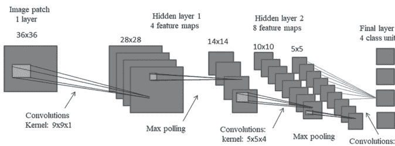

图 9.4 卷积神经网络的基本表示。

指定分布。与使用整个数据集不同，ANN 也可以基于样本数据得出研究结果，并可用于增强当前的数据分析方法，因为它们具有强大的预测能力 [59, 60]。

ANN 中存在不同的层，具体说明如下：

- 1. 输入层：ANN 的输入层（即第一层）接受文本、数字、音频片段、图像像素等格式的数据。

- 2. 隐藏层：ANN 模型的中心包含隐藏层。可能只有一个隐藏层（如感知机），也可能有多个隐藏层。这些隐藏层使用提供的数据执行多种数学计算并识别模式。

- 3. 输出层：通过框架中心进行严格计算得到的结果在输出层中得到。许多因素和超参数会影响神经网络的表现。这些因素在决定 ANN 表现好坏方面起着重要作用。这些因素包括权重、偏置、学习率、批大小等。ANN 中的每个节点都被赋予指定的权重。网络中的每个节点都有一个权重。使用传递函数来确定偏置和输入权重因子。根据节点的激活信息，我们得到最终结果。此外，我们使用误差函数分析预期结果与实际结果之间的差异，然后使用反向传播调整神经网络的权重 [58–60]。

### 9.7.2 卷积神经网络（CNN）

CNN 是一种深度神经网络，使用滤波器来学习输入图像的多种特征。因此，它可以识别图像的主要元素并区分不同事物 [7, 61]。例如，CNN 从区分猫和狗的特征中获取知识，因此在输入猫和狗时可以轻松区分两者。CNN 与其他机器学习方法的区别在于其能够自行预处理输入。因此，您可能不需要在数据预处理上花费大量资金。滤波器在冷启动期间可能有助于保留特征工程，但随着训练的进展，它们能够适应所学特征并开发自己的滤波器。因此，CNN 始终根据新输入不断变化 [62–64]。

### 9.7.3 循环神经网络（RNN）

RNN 特别擅长处理时间序列及其他序列数据。我们介绍了一些目前最流行的循环设计，例如长短期记忆网络（LSTM）和门控循环单元，以及循环神经网络，将其视为前馈网络的扩展，能够分析变长（甚至无限长）序列 [65]。RNN 是专门用于时间建模的前馈深度神经网络。RNN 的特点在于能够按时间增量传递信息。RNN 的结构中包含一个额外的特征矩阵，用于跨时间步的连接，这改进了时间域的学习和输入序列特性的利用。RNN 在每个时间步都经过训练，生成基于现有输入和先前时间步知识的预测输出。RNN 包含三个操作阶段。在第一阶段，它通过隐藏层向前传播并生成预测。第二步使用损失函数将预测值与真实值进行比较。损失函数显示模型的表现如何。损失函数值越低，模型越好。然后，它利用反向传播中的误差信息，在最终阶段（节点）确定每个位置的梯度。梯度是网络权重在每个点调整的量 [66]。RNN 的基本表示如图 9.5 所示。

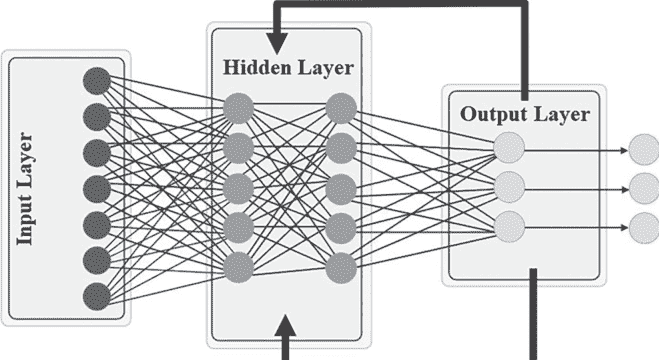

图 9.5 循环神经网络的基本表示。

### 9.7.4 最近邻（k-NN）

一种非参数且学习缓慢的方法，它记录所有可用示例，并使用距离函数等度量指标来区分新测试样本，通常被认为是 k-NN 模型（图 9.6）。当对数据几乎没有或没有先前经验时，它被选为最佳方法。k-NN 的应用包括语音、视频识别、医疗保健、金融、手写识别、图像识别及任何类型的模式分类、政治科学和统计估计。当 k-NN 技术接收到新数据时，它只需将其划分为与原始数据几乎相同的类别。k-NN 方法在训练阶段仅保留信息 [67, 68]。

### 9.7.5 多层感知机（MLP）

多层感知机（MLP）是对前馈神经网络的一种改进。三种不同类型的层是输入层、输出层和隐藏层。所有需要处理的输入数据都被传递到输入层。输出层管辖的任务示例包括预测和分类。MLP 的实际计算机制由位于输出层和输入层之间的无数隐藏层组成 [69]。与不同模型相关的各种综述已整理到表 9.4 中。

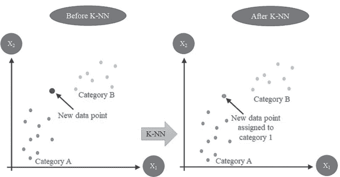

图 9.6 最近邻（k-NN）的基本表示。

| 序号 | 植物部分 | 数据集 | ML 模型/分类器 | 结果 | 参考文献 |
| :--- | :--- | :--- | :--- | :--- | :--- |
| **人工神经网络** | | | | | |
| 1. | 叶片 | 63 | ANN 和 MATLAB | 研究发现，当包含 8 个输入特征时，系统的复杂度最低，因为它们需要的输入量和计算量最少。就数据集中的 63 张叶片照片而言，系统的准确率为 94.4%。 | [77] |
| 2. | 叶片 | 自研数据集 | ANN | 提出的系统准确率为 91.98%，其性能优于研究中使用的其他方法。熵被用作分类叶片的主要标准。 | [78] |
| 3. | 叶片 | 自研数据集 | ANN | 研究发现，所提方法的实验结果能够提取叶片数据更精确的叶脉结构以用于模式 | [79] |
| 4. | 叶片 | 1907 | ANN | 用于测试的数据集包括 6 个物种的药用草本植物数据集和 32 个物种的 Flavia 数据集（1907 张图片，每个物种 50~60 片叶子）（每个 30 张图片）。由于 k-NN 和朴素贝叶斯分类器是懒学习算法，SVM 和 PNN 的准确率可比且高于这些分类器。 | [80] |
| 5. | 叶片 | 自研数据集 | ANN | 叶片识别的准确率为 93.3%。 | [81] |
| 6. | 叶片 | 自研数据集 | ANN | 利用形态-颜色特征作为输入创建了一个 ANN 模型，其对 20 种药用植物的叶片进行分类的准确率为 98.3%。 | [82] |
| 7. | 叶片 | 自研数据集 | ANN | 使用 Python 创建了一个参数改进的 ANN 模型，在整个数据集上的识别率为 98.16%。 | [83] |
| 8. | 叶片 | 自研数据集 | ANN | 熵被选为分类叶片的主要特征，结果准确率为 91.98%。 | [78] |
| 9. | 叶片 | 自研数据集 | ANN | ANN 的准确率为 97.3%，且处理数据速度快于直接神经网络方法，后者在叶片样本的模式识别中的准确率为 84.4%。 | [79] |
| 10. | 叶片 | Flavia | ANN & k-NN | 两种机器学习模型的准确率分别为 93.3% 和 85.9%。 | [84] |


### 卷积神经网络

### 表 9.4（续）

| S. No. | Plants Parts | Datasets | ML Model/Classifier | Outcomes | Ref. |
|---|---|---|---|---|---|
| 11. | Leaves | Self-developed dataset | CNN | With top-3 final scores on all other datasets and nearly perfect top-1 match results on the Flavia dataset, the dual-path CNN method outperforms a number of other CNN methods. | [85] |
| 12. | Weed and crop species | 10,413 | CNN | The system is able to classify 22 species with an accuracy of 86.2%. | [86] |
| 13. | Flowers and leaves | Self-developed dataset | CNN | In comparison to the traditional CNN plant image identification model, the results are based on successful area selection, which can more efficiently extract picture features and increase identification accuracy. | [87] |
| 14. | Leaves of Thai herbal plants | Self-developed datasets of >2500 images | CNN | Model was successful in identifying the Thai herbal plants with recall of 0.75 and precision of 0.8. | [88] |
| 15. | Flowers and leaves of herbal plants | 3 different datasets | CNN | Accuracy for identifying the herbal plants from 3 different datasets are found to be an average of 87.19%. | [62] |
| 16. | Leaves of Vietnamese herbal plants | VN-plant snapshot datasets | CNN | Accuracy for identifying the herbal plants is 88.26% when evaluated in different frameworks, VGG16, Resnet50, InceptionV3, DenseNet121. | [62] |
| 17. | Medicinal leaves | Self-developed datasets of >2500 images | CNN | The developed model with Gabor filter found accuracy of 98% in identification of medicinal plants. | [89] |
| 18. | Leaves of ayurvedic plant | Self-developed datasets of >2500 images | CNN | Developed model with SVM and softmax classifier achieved an accuracy of 96.7%. | [77] |
| **Nearest Neighbor (k-NN)** | | | | | |
| 19. | Leaves of Bangladeshi medicinal plants | Self-developed datasets of 500 images | CNN | Accuracy of the developed model has been found to be 88.16%. | [90] |
| 20. | Leaves of indigenous plants of Kerala | Self-developed datasets of >64,000 images | CNN | Model accompanied with pretrained model of VGG16 and VGG19 achieved an accuracy of 97.8% and 97.6%. | [91] |
| 21. | Leaves | 640 leaves datasets | k-NN | Initially the accuracy was 83.5%, which was further increased to 87.5% by using the color histogram technique. | [92] |
| 22. | Leaves | Swedish leaves datasets | k-NN | SPM and LLC have been utilized for extracting shape features of the leaves, and accuracy was found to be 96.6%. | [93] |
| 23. | Leaves | 1500 image datasets | k-NN | DHNG has been utilized for the pattern recognition of leaves, and accuracy was found to be 71.5%. | [94] |
| 24. | Leaves | 640 | k-NN | 640 leaf sample images of different sizes, shapes and orientations were tested in the experiment, and it was found that they outperformed k-NNC and NNC with accuracy rates of 97.5% and 79.7%. The disadvantage of the suggested strategy is that it consistently works only when deformations do not alter the lengths of the major and minor axis. | [95] |
| 25. | Leaves | 640 leaves datasets | k-NN | Initially the accuracy was 83.5% which was further increased to 87.5% by using the color histogram technique. | [20] |
| 26. | Leaves | Swedish leaves datasets | k-NN | SPM and LLC has been utilized for extracting shape features of the leaves, and accuracy was found to be 96.6%. | [93] |
| 27. | Leaves | 1500 images datasets | k-NN | DHNG has been utilized for the pattern recognition of leaves, and accuracy was found to be 71.5%. | [94] |
| **Multilayer Perceptron (MLP)** | | | | | |
| 28. | Grape leaves | Self-developed dataset | MLP | Used for the detection of black rot, downy mildew diseases, and the accuracy was found to be 96.6 %. | [96] |
| 29. | Kalmegh and tulsi leaves | Self-developed dataset | MLP | Overall accuracy was found to be 80%. | [97] |

## 9.8 VALIDATION OF DEVELOPED MODEL

After applying all the steps mentioned in Figure 9.4, a machine-learning-based model for the identification of images can be formed which could be later utilized for the identification of required herbal and spice images. But for making a model robust, the validation of the model is one of the important steps and should be performed at the end to test the working suitability of the model. Accuracy, precision, true positive (TP), false positive (FP), true positive ratio (TPR), false positive ratio (FPR), sensitivity, specificity, miss rate, recall, F1 score and CPU elapsed time are some of the parameters employed for the validation of a developed machine learning model [70, 71].

- **Accuracy:** Accuracy is the proportion of trial data forecasts that were correct. It is simple to determine by dividing the total number of forecasts by the proportion of accurate estimations. It can be calculated as follows:

```
Accuracy (%) = \frac{Correct prediction}{Total no. of prediction} \times 100
```

Accuracy above 70% is generally considered good for a machine learning model [72].

- **Precision:** The proportion of particular examples (true positives) among all the examples predicted belong to a certain class known as precision [73]. It can be calculated as follows:

```
Precision = \frac{True positive}{True positive + False positive}
```

- TP: True positive occurs when an observation related to a specific class is actually more common than you would have thought [74].

- TN: True negative happens when you predict that a piece of information doesn't really fit into a category, and it actually does not [74, 75].

- Recall: Recall is the proportion of examples anticipated to belong to a class relative to all of the examples that actually do [76].

## 9.9 TRANSFER LEARNING

To achieve the desired accuracy, a new machine learning model must be developed using a great deal of data. For achieving high accuracy, it is necessary to train the model on large datasets; otherwise, the developed model will not work well. Developing a new model for identification of herbs requires a large dataset that is quite not possible. To overcome this problem, the concept of transfer learning came into play. Transfer learning is an approach in which a pretrained model can be applied in a developing model. The model has already been pretrained in large datasets such as ImageNet and can be used for extracting the feature from images of the new model. As discussed, a CNN model has been largely employed for the identification of herbal images, so in this chapter further we have discussed the various CNN-model-based transfer learning models that can be employed for the identification of herbal plants [98]. Various CNN pretrained models are discussed next.

### 9.9.1 VGGNet

VGG-16, presented at ILSVRC2014, was the Visual Geometry Group's (VGG) first successful ImageNet architecture, which was followed by VGG-19 [98]. By substituting numerous small kernel-sized filters for a single big kernel-sized filter, these models improve upon AlexNet and for VGG-16 and VGG-19, creating 13 and 16 convolution layers, correspondingly.

### 9.9.2 CaffeNet

This CNN model resembles AlexNet a bit. In contrast to AlexNet, CaffeNet inserts the pooling layer well before the normalization procedure and does not employ data augmentation. CaffeNet therefore marginally enhances AlexNet's computational performance by doing data dimension reduction prior to normalization.

### 9.9.3 Inception

The GoogLeNet model, also known as Inception-V1, made an effort to increase VGGNet's effectiveness in terms of memory consumption and runtime without compromising accuracy [99]. This was accomplished by removing the VGGNet activation functions that were duplicated or zero due to their correlations. In order to approximate the sparse interconnections among the activation functions, GoogleLeNet developed and incorporated the Inception module. Three additional versions were released after Inception-V1 that substantially improved the architecture. Batch normalization was utilized by Inception-V2 for training [100]. To increase the computation cost of convolution layers, Inception-V3 suggested a factorization technique [101]. A uniformly simplified Inception-V3 design with much more Inception modules was released in Inception V-4 [102].

### 9.9.4 ResNet

Accuracy saturation and disappearing gradients may result from CNN models having too many layers. This issue is addressed by residual learning, which serves as the foundation of ResNet CNN [98]. At the conclusion of each convolution layer, CNN models that came before ResNet learned features at various levels of abstraction. ResNet does not learn features; instead, it learns residuals, which are the learned features from the input for each convolution layer. Identity shortcut connections, which include linking a layer’s input to x other layers, are used to do this [103]. ResNet variants like ResNet-34, ResNet-50 and ResNet-101 use a varied number of layers.

### 9.9.5 Xception

Extreme Inception, sometimes known as Xception, is a modified Inception-V3. This CNN model uses depth-wise separable convolution to separately train the picture’s spatial and channel dimensions. Xception performs a little better on ImageNet while having approximately the same number of variables as InceptionV3 [104].

## 9.10 CONCLUSION AND FUTURE PROSPECTS

Manual identification of medicinal plants/herbal medicines involves a substantial amount of labor and is subject to human error. Automatic plant identification might be a solution to these issues, but developing such a system involves great resources, including a sizable database, in-depth understanding of plant morphology and expertise in computer programming. The majority of current research on autonomous plant identification systems tests its effectiveness using pre-existing datasets that were created in a confined space. Therefore, more research on images under different lighting circumstances and with complicated backgrounds needs to be


done. 此外，还应使用规模相当大的数据集来提供更好的训练。这将提高已建立识别系统的准确性。医疗领域中药材使用的发展可能会受到更高准确性的影响，改进自动识别系统将对环境保护产生重大影响。该研究领域的检验将受到未来技术发展的显著影响。

一种面向消费者、使用户能够无论身在何处、何时都利用手机识别植物的系统，可能是植物识别系统的一项新兴发展。然而，这项技术需要一个强大的解码器，能够在各种情况下识别植物的任何部分。因此，有必要创建一个包含多种植物物种及其各种环境条件的数据库。此外，未来的草本植物识别系统应能够自动推导植物特征的数学模型。出于此原因，利用3-D扫描将特别有帮助，因为它将记录每一个物理测量值。

## 参考文献

- [1] Babu N, Shankar M, Babu N. 互补和替代医学概述. *Am J Oral Med Radiol*. 2016;3(3):134–145.
- [2] Jaiswal YS, Williams LL. 阿育吠陀一瞥——印度传统医学被遗忘的历史与原则. *J Tradit Complement Med*. 2017;7(1):50–53.
- [3] Che Soh A, Yusuf UK, Radzi NFM, Ishak AJ, Hassan MK. 基于人工智能技术的芳香草药分类. *Pertanika J Sci Technol*. 2017;25.
- [4] Altemimi A, Lakhssassi N, Baharlouei A, Watson DG, Lightfoot DA. 植物化学品：从植物提取物中提取、分离和鉴定生物活性化合物. *Plants*. 2017;6(4):42.
- [5] Sladojevic S, Arsenovic M, Anderla A, Culibrk D, Stefanovic D. 基于深度神经网络的叶片图像分类植物病害识别. *Comput Intell Neurosci*. 2016;29;2016.
- [6] Singh V, Misra AK. 使用图像分割和软计算技术检测植物叶片病害. *Inf Process Agric*. 2017;4(1):41–49.
- [7] Wäldchen J, Mäder P. 基于图像的物种识别机器学习. *Methods Ecol Evol*. 2018;9(11):2216–2225.
- [8] Shavlik JW, Dietterich T, Dietterich TG. *机器学习导读*. Morgan Kaufmann; 1990;1–11.
- [9] Došilović FK, Brčić M, Hlupić N. 可解释人工智能：一项调查. In: *20th 41st International Convention on Information and Communication Technology, Electronics and Microelectronics*. IEEE; 2018;210–215.
- [10] Laxmi GF, Herdiyeni Y, Arkeman Y. 使用模糊局部二值模式和多目标遗传算法识别药用植物. In: 2017 International Conference on Computer, Control, Informatics and Its Applications. IEEE; 2017:29-34.
- [11] Culman MA, Gomez JA, Talavera J, Quiroz LA, Tobon LE, Aranda JM, et al. 基于物联网识别油棕营养缺乏症的新型应用. In: 2017 5th IEEE International Conference on Mobile Cloud Computing, Services, and Engineering (MobileCloud). IEEE; 2017;169–172.
- [12] elhassouny A, Smarandache F. 使用卷积神经网络识别番茄叶片病害的智能移动应用. In: 2019 International Conference of Computer Science and Renewable Energies (ICCSRE). IEEE; 2019;1–4.
- [13] Akiyama T, Kobayashi Y, Sasaki Y, Sasaki K, Kawaguchi T, Kishigami J. 应用于北海道植物的基于CNN的移动叶片识别系统. In: 2019 IEEE 8th Global Conference on Consumer Electronics (GCCE). IEEE; 2019;324–325.
- [14] Tang Y, Chen M, Wang C, Luo L, Li J, Lian G, et al. 基于视觉的水果采摘机器人的识别与定位方法：一篇综述. Front Plant Sci. 2020;11:510.
- [15] Yang X, Guo T. 植物病害研究中的机器学习. March. 2017;31:1.
- [16] Ferentinos KP. 植物病害检测与诊断的深度学习模型. Comput Electron Agric. 2018;145:311–318.
- [17] De Luna RG, Baldovino RG, Cotoco EA, De Ocampo ALP, Valenzuela IC, Culaba AB, et al. 使用人工神经网络识别菲律宾草本药用植物叶片. In: 2017 IEEE 9th International Conference on Humanoid, Nanotechnology, Information Technology, Communication and Control, Environment and Management (HNICEM). IEEE; 2017;1–8.
- [18] Joseph DS, Pawar PM, Pramanik R. 使用卷积神经网络进行智能植物病害诊断：一篇综述. Multimed Tools Appl. 2022;1–67.
- [19] Putzu L, Di Ruberto C, Fenu G. 使用显著性图在复杂背景中检测叶片的移动应用. In: International Conference on Advanced Concepts for Intelligent Vision Systems. Springer; 2016;570–581.
- [20] Munisami T, Ramsurn M, Kishnah S, Pudaruth S. 使用K-近邻分类器、形状特征和颜色直方图进行植物叶片识别. Procedia Comput Sci. 2015;58:740–747.
- [21] Lee SH, Chan CS, Wilkin P, Remagnino P. Deep-plant：使用卷积神经网络进行植物识别. In: 2015 IEEE International Conference on Image Processing (ICIP). IEEE; 2015;452–456.
- [22] Mjolsness E, DeCoste D. 科学中的机器学习：现状与未来前景. Science. 2001;293(5537):2051–2055.
- [23] Chin K, Hellebrekers T, Majidi C. 软机器人感知与控制的机器学习. Adv Intell Syst. 2020;2(6):1900171.
- [24] Sonka M, Hlavac V, Boyle R. 图像处理、分析与机器视觉. Cengage Learning; 2014.
- [25] Fenrich R, Hull JJ. 创建图像数据库的问题. In: Proc IWFHR-III. Buffalo, New York; 1993:112–121.
- [26] Mzoughi O, Yahiaoui I, Boujemaa N, Zagrouba E. 基于语义的先进植物物种识别叶片图像自动结构化. Multimed Tools Appl. 2016;75(3):1615–1646.
- [27] Mzoughi O, Yahiaoui I, Boujemaa N, Zagrouba E. 叶片物种识别的语义形状模型. In: International Conference on Advanced Concepts for Intelligent Vision Systems. Springer; 2015;661–671.
- [28] Ma L-H, Zhao Z-Q, Wang J. ApLeafs：基于Android的植物叶片识别系统. In: International Conference on Intelligent Computing. Springer; 2013;106–111.
- [29] Aptoula E, Yanikoglu B. 基于叶片的植物识别形态特征. In: 2013 IEEE International Conference on Image Processing. IEEE; 2013;1496–1499.
- [30] Rejeb Sfar A, Boujemaa N, Geman D. 细粒分类和植物物种识别的置信集. Int J Comput Vis. 2015;111(3):255–275.
- [31] Yanikoglu B, Aptoula E, Tirkaz C. 从照片中自动植物识别. Mach Vis Appl. 2014;25(6):1369–1383.
- [32] Wang B, Brown D, Gao Y, La Salle J. March：用于移动叶片图像检索的多尺度拱高描述. Inf Sci (Ny). 2015;302:132–148.
- [33] Wu SG, Bao FS, Xu EY, Wang Y-X, Chang Y-F, Xiang Q-L. 使用概率神经网络进行植物分类的叶片识别算法. In: 2007 IEEE International Symposium on Signal Processing and Information Technology. IEEE; 2007;11–16.
- [34] Hu R, Jia W, Ling H, Huang D. 快速植物叶片识别的多尺度距离矩阵. IEEE Trans Image Process. 2012;21(11):4667–4672.
- [35] Wang X, Liang J, Guo F. 基于双尺度分解和局部二值描述子的植物叶片特征提取算法. Digit Signal Process. 2014;34:101–107.
- [36] Aakif A, Khan MF. 基于叶片的植物自动分类. Biosyst Eng. 2015;139:66–75.
- [37] Kalyoncu C, Toygar Ö. 几何叶片分类. Comput Vis Image Underst. 2015;133:102–109.
- [38] Zhao C, Chan SSF, Cham W-K, Chu LM. 使用叶片形状进行植物识别——一种模式计数方法. Pattern Recognit. 2015;48(10):3203–3215.
- [39] Robins A, Rountree J, Rountree N. 编程教学与学习：一篇评述与讨论. Comput Sci Educ. 2003;13(2):137–172.
- [40] Satpute MR, Jagdale SM. 水果颜色、大小、体积、形状和纹理特征提取技术：一篇综述. Int Res J Eng Technol. 2016;3:703–708.
- [41] Meruliya T, Dhameliya P, Patel J, Panchal D, Kadam P, Naik S. 水果形状和纹理特征提取的图像处理-综述. Int J Comput Appl. 2015;129(8):30–33.


- [42] Patel A, Kadam P, Naik S. 水果颜色、大小和形状特征提取技术：技术综述. *国际计算机应用杂志*. 2015;130(16).

- [43] Lin F-Y, Zheng C-H, Wang X-F, Man Q-K. 基于 Gabor 变换和 LBP 算子的植物叶片多分类. 收录于：*智能计算国际会议*. Springer; 2008:432–439.

- [44] Patil VR, Manza RR. 基于叶片架构的特征提取方法. *国际计算机科学与软件工程先进研究*. 2015;5(7):1025–1029.

- [45] Bagal VC, Manza RR. 基于叶片架构的植物物种特征提取. 收录于：*2016 年电气、电子与优化技术国际会议 (ICEEOT)*. IEEE; 2016:4079–4081.

- [46] Vijayalakshmi B. 叶片图像检索的新形状特征提取方法. 收录于：*2012 年第四届信号与图像处理国际会议论文集 (ICSIP 2012)*. Springer; 2013:235–245.

- [47] Fotopoulou F, Laskaris N, Economou G, Fotopoulos S. 基于多维嵌入序列相似性 (MESS) 方法的先进叶片图像检索. *模式分析与应用*. 2013;16(3):381–392.

- [48] Shabanizade M, Zahedi M, Aghvami SA. 叶片识别中局部描述子与全局特征的组合. *信号图像处理*. 2011;2(3):23.

- [49] Wang H, Tian D, Li C, Tian Y, Zhou H. 植物叶片锯齿特征提取. *PLOS One*. 2019;14(2):e0204714.

- [50] Shorten C, Khoshgoftaar TM. 面向深度学习的图像数据增强综述. *大数据杂志*. 2019;6(1):1–48.

- [51] Clap P, Min H, Vandenberg N, Dowling J, Holloway L, Haworth A. 面向深度学习应用的医学图像数据增强技术综述. *医学成像与放射肿瘤学杂志*. 2021;65(5):545–563.

- [52] Mikołajczyk A, Grochowski M. 用于改进图像分类问题中深度学习的数据增强. 收录于：*2018 年国际跨学科博士研讨会 (IIPhDW)*. IEEE; 2018:117–122.

- [53] Shijie J, Ping W, Peiyi J, Siping H. 基于卷积神经网络的图像分类数据增强研究. 收录于：*2017 年中国自动化大会 (CAC)*. IEEE; 2017:4165–4170.

- [54] Omondiagbe DA, Veeramani S, Sidhu AS. 乳腺癌诊断的机器学习分类技术. 收录于：*IOP 会议系列：材料科学与工程*. IOP Publishing; 2019:012033.

- [55] Kesavaraj G, Sukumaran S. 数据挖掘分类技术研究. 收录于：*2013 年第四届计算、通信与网络技术国际会议 (ICCCNT)*. IEEE; 2013:1–7.

- [56] Soofi AA, Awan A. 机器学习中的分类技术：应用与问题. *基础与应用科学杂志*. 2017;13:459–465.

- [57] Bambil D, Pistori H, Bao F, Weber V, Alves FM, Gonçalves EG, et al. 利用机器学习和人工神经网络，通过颜色学习资源、形状和纹理进行植物物种识别. *环境系统与决策*. 2020;40(4):480–484.

- [58] Sharifzadeh M, Sikinioti-Lock A, Shah N. 集成可再生能源发电的机器学习方法：人工神经网络、支持向量回归和高斯过程回归的比较研究. 可再生能源与可持续能源评论. 2019;108:513–538.

- [59] Chen M, Challita U, Saad W, Yin C, Debbah M. 基于人工神经网络的无线网络机器学习：教程. IEEE 通信调查与教程. 2019;21(4):3039–3071.

- [60] Prieto A, Atencia M, Sandoval F. 人工神经网络与机器学习的进展. 神经计算. Elsevier; 2013;121:1–4.

- [61] Lu J, Tan L, Jiang H. 卷积神经网络 (CNN) 应用于植物叶片病害分类的综述. 农业. 2021;11(8):707.

- [62] Bao HY, Wen RJ, Li XY, Zhao C, Chen ZN. 基于人工智能的中医药处方简要概述. TMR 现代草药医学. 2021;4(2):13.

- [63] Roslan NAM, Diah NM, Ibrahim Z, Hanum HM, Ismail M. 自动植物识别：相关算法综述. 收录于：2022 年 IEEE 第 18 届信号处理与应用国际研讨会 (CSPA). IEEE; 2022;5–9.

- [64] Taori T, Gupta S, Bhagat S, Gajre S, Manthalkar R. 基于 Gabor 分解数据图像、恒等映射分布式 CNN 和注意力 RNN 的跨任务认知负荷分类. IETE 研究杂志. 2022;1–17.

- [65] Medsker LR, Jain LC. 循环神经网络. 设计与应用. 2001;5:64–67.

- [66] Joshua Thomas J, Pillai N. 基于双向循环神经网络的图像描述生成深度学习框架. 收录于：智能计算与优化国际会议. Springer; 2018;219–230.

- [67] Auleria M, Arrahmah AI, Saputra DE. 基于 K-近邻的对象识别分类综述. 收录于：2021 年数据科学及其应用国际会议 (ICODSA). IEEE; 2021;274–280.

- [68] Amrutha K, Prabu P. 基于机器学习的手语识别系统. 收录于：2021 年信息技术创新趋势国际会议 (ICIIT). IEEE; 2021;1–6.

- [69] Boughrara H, Chtourou M, Amar C Ben. 基于构建性训练算法的 MLP 神经网络人脸识别系统. 收录于：2012 年多媒体计算与系统国际会议. IEEE; 2012;233–238.

- [70] Son J, Shin JY, Kim HD, Jung K-H, Park KH, Park SJ. 视网膜眼底图像中多种异常发现筛查的深度学习模型开发与验证. 眼科学. 2020;127(1):85–94.

- [71] Yang J, Zhang K, Fan H, Huang Z, Xiang Y, Yang J, et al. 使用背部图像进行脊柱侧弯筛查的深度学习算法开发与验证. 通讯生物学. 2019;2(1):1–8.

- [72] Yue Z, Ma L, Zhang R. 肺炎诊断深度学习模型的比较与验证. 计算智能与神经科学. 2020;(2020):1–8.

- [73] Madani A, Arnaout R, Mofrad M, Arnaout R. 使用深度学习进行超声心动图快速准确的视图分类. NPJ 数字医学. 2018;1(1):1–8.

- [74] Dvoršak G, Dwivedi A, Štruc V, Peer P, Emeršiˇc Ž. 基于耳朵图像的亲缘关系验证：深度学习模型的探索性研究. 收录于：2022 年生物识别与取证国际研讨会 (IWBF). IEEE; 2022:1–6.

- [75] Yamashita R, Kapoor T, Alam MN, Galimzianova A, Syed SA, Ugur Akdogon M, et al. 利用基于深度学习的风险分层系统和 US 电影剪辑图像，降低假阳性甲状腺结节活检率. 放射学人工智能. 2022;4(3):e210174.

- [76] Geetharmani G, Pandian A. 使用九层深度卷积神经网络识别植物叶片病害. 计算机与电气工程. 2019;76:323–338.

- [77] Dileep MR, Pournami PN. AyurLeaf：药用植物分类的深度学习方法. 收录于：TENCON 2019—2019 年 IEEE 第 10 区会议 (TENCON). IEEE; 2019;321–325.

- [78] Wable PB, Chilveri P. 基于神经网络的叶片识别. 收录于：2016 年自动控制与动态优化技术国际会议论文集 (ICACDOT). Pune; 2016;645–648.

- [79] Fu H, Chi Z. 叶片图像静脉图案提取的组合阈值和神经网络方法. IEE 视觉、图像与信号处理期刊. 2006;153(6):881–892.

- [80] Harish BS, Hedge A, Venkatesh O, Spoorthy D, Sushma D. 使用形态特征和 Zernike 矩进行植物叶片分类. 收录于：2013 年计算、通信与信息学进展国际会议论文集 (ICACCI). Mysore; 2013;1827–1831.

- [81] Janani R, Gopal A. 使用图像特征和 ANN 识别选定药用植物叶片. 收录于：2013 年先进电子系统国际会议 (ICAES). 2013;238–242.

- [82] Anami B, Nandyal S, Govardhan D. 基于组合颜色、纹理和边缘特征的印度药用植物识别与分类方法. 国际计算机应用杂志. 2010;10:6.

- [83] Luna RG de, Baldovino RG, Cotoco EA, Ocampo ALP de, Valenzuela IC, Culaba AB, et al. 使用人工神经网络识别菲律宾草药植物叶片. 收录于：2017 年 IEEE 第 9 届人形、纳米技术、信息技术、通信与控制、环境与管理国际会议 (HNICEM). 2017;1–8.

- [84] Satti V. 使用机器视觉技术进行植物识别的自动叶片识别系统. 国际工程科学与技术杂志. 2013 年 4 月 1 日;5(4):874.

- [85] Shah MP, Singha S, Awate SP. 使用边缘化形状上下文和形状+纹理双路径深度卷积神经网络进行叶片分类. 收录于：2017 年 IEEE 图像处理国际会议 (ICIP). IEEE; 2017;860–864.

- [86] Dyrmann M, Karstoft H, Midtiby HS. 使用深度卷积神经网络进行植物物种分类. 生物系统工程. 2016;151:72–80.

- [87] Xiaoyu S, Liting J, Yang Z, Yue S, Tong L. 基于有效区域筛选的复杂背景下植物图像识别. 激光与光电子学进展. 2020;57(4).


- [88] Mookdarsanit L, Mookdarsanit P. 基于卷积神经网络的具有药用特性的泰国草药识别. Suan Sunandha Sci Technol J. 2019;6(2):34–40.

- [89] Amulya K, Deepika K, Kamakshi P. 基于优化超参数的CNN方法用于预测药用或非药用叶片. Adv Eng Softw. 2022;172:103181.

- [90] Bhuiyan M, Abdullahil–Oaphy M, Khanam RS, Islam M. MediNET: 基于CNN的孟加拉国普通药用植物识别深度学习方法. In: 软计算技术与应用. Springer; 2021;371–380.

- [91] Paulson A, Ravishankar S. 基于AI的本土药用植物识别. In: 2020高性能应用先进计算和通信技术(ACCTHPA). IEEE; 2020;57–63.

- [92] Larese MG, Namias R, Craviotto RM, Arango MR, Gallo C, Granitto PM. 使用叶脉图像特征的豆科植物自动分类. Pattern Recognit. 2014;47(1):158–168.

- [93] Wang X, Feng B, Bai X, Liu W, Latecki LJ. 用于鲁棒形状分类的轮廓碎片词袋. Pattern Recognit. 2014;47(6):2116–2125.

- [94] Amin AHM, Khan AI. 使用分布式层次图神经元(DHGN)方案和k-NN分类器的2-D叶片形状一次性分类. Procedia Comput Sci. 2013;24:84–96.

- [95] Chaki J, Parekh R, Bhattacharya S. 使用神经分类器的纹理和形状特征的植物叶片识别. Pattern Recognit Lett. 2015;58:61–68.

- [96] Waghmare H, Kokare R, Dandawate Y. 使用反色局部二值模式特征和机器学习进行葡萄植物疾病的检测和分类，用于自动决策支持系统. In: 第2届信号处理与集成网络国际会议(SPIN). IEEE; 2016;513–518.

- [97] Mukherjee G, Chatterjee A, Tudu B. 基于形态特征的Kalmegh和Tulsi叶片成熟度识别. In: 2017年第三届计算智能与通信网络研究国际会议(ICRCICN). IEEE; 2017;1–5.

- [98] Kensert A, Harrison PJ, Spjuth O. 使用深度卷积神经网络的迁移学习对细胞形态变化进行分类. SLAS Discov Adv Life Sci R&D. 2019;24(4):466–475.

- [99] Shi L, Zhang Y, Cheng J, Lu H. 用于基于骨架的动作识别的双流自适应图卷积网络. In: IEEE/CVF计算机视觉与模式识别会议论文集. 2019;12026–12035.

- [100] Ioffe S, Szegedy C. 批量归一化：通过减少内部协变量偏移加速深度网络训练. In: 国际机器学习会议. PMLR; 2015;448–456.

- [101] Szegedy C, Vanhoucke V, Ioffe S, Shlens J, Wojna Z. 重新思考计算机视觉的Inception架构. In: IEEE计算机视觉与模式识别会议论文集. 2016;2818–2826.

- [102] Szegedy C, Ioffe S, Vanhoucke V, Alemi AA. Inception-v4、Inception-ResNet及残差连接对学习的影响. In: 第三十一届AAAI人工智能会议. 2017.

- [103] He K, Zhang X, Ren S, Sun J. 图像识别的深度残差学习. IEEE. 2016;770–778.

- [104] Chollet F. Xception：使用深度可分离卷积的深度学习. In: IEEE计算机视觉与模式识别会议论文集. 2017;1251–1258.

# 10 基于分数阶光流和烟雾特性的CNN火灾预测

Muzammil Khan, Pushpendra Kumar 和 Nitish Kumar Mahala

莫拉纳·阿扎德国家技术学院，博帕尔，印度，数学、生物信息学与计算机应用部

## 10.1 引言

火灾在公共和森林区域经常发生突发、影响大且范围广，且难以扑灭。因此，为了保护建筑物、办公室、森林或工作场所免受火灾，早期检测变得非常重要 [1, 2]。

借助烟雾可以进行火灾的早期检测，因为烟雾是火焰出现前的起始阶段，并且通过安装在许多公共场所的数码摄像机从远处可以高度可见 [3]。

然而，烟雾在初期很小，并且与火相比具有不同的颜色、形状和纹理。因此，烟雾检测是火灾早期预防中的关键步骤 [4]。

随着数码摄像机技术的最近快速发展，摄像机变得非常实惠和经济 [5]。

这些摄像机要么安装在山顶，要么安装在建筑物的墙壁或天花板上，并且它们以图像序列的形式连续录制视频。由于手动处理这些大量视频数据极其繁琐，自动分类此类事件的方法是当务之急。计算机视觉和深度学习算法共同构成了一种复杂的技术，正在图像处理的各个领域（如人脸识别、图像检索、监控、目标检测和分类）中变得越来越普遍 [6–10]。视频中烟雾形式的火灾特征检测是其富有成效的应用之一 [11]。

文献中关于视频烟雾检测的工作数量众多。通常，烟雾检测框架可分为两类：(1)基于传统计算机视觉的方法和(2)基于深度学习的方法 [12]。基于计算机视觉的方法依赖于数学公式，而深度学习方法基于训练 [13]。

在 [14] 中，Hanh 等人使用空中森林视频进行了直接火灾检测，其中借助 RGB、YCbCr 和 HSI 颜色空间检测火灾区域。

Xu 等人 [15] 提出了一种基于深度域自适应技术的框架，该框架利用合成数据使用卷积神经网络 (CNN) 对烟雾进行特征描述。

此外，Muhammad 等人 [16] 讨论了一种计算复杂度低的精调 GoogleNet 架构。

然而，自然视频中火灾和烟雾的检测在动态纹理识别方面面临基本障碍。为此，[17] 中采用了带有 SVM 或随机森林分类器的预训练 CNN 模型。

Luo 等人 [18] 基于从背景动态更新中获得的暗通道识别了可疑区域。

Pundir 等人 [11] 使用局部极值共现模式来表征 HSV 颜色空间中前景区域、烟雾强度和色调。

Ahn 等人 [19] 利用 CNNs 使用室内 CCTV 视频开发了一个基于计算机视觉的早期火灾检测模型 (EFDM)。在他们的实验中，他们从 EFDM 得到了火灾检测速度，比一般火灾探测器快 307 秒。所有这些深度学习技术都使用图像（视频）数据集。

在基于视觉的技术中，物体运动通常借助光流提取 [13]。光流场是通过假设不同图像帧中的同一物体不显示其强度值的任何变化来估计的 [20–22]。基于光流的方法用于查找像素位置的运动速度值 [23]。

在 [1] 中，确定了光流，用于带有自适应背景减法算法的移动斑块分类。

[3] 中提出的双重深度学习框架采用光流计算来基于特征表征运动。

在 [2] 中，Mueller 等人开发了两种光流估计方法，用于估计火灾和饱和火焰的动态纹理。他们的方法为分类任务中的神经网络提供特征向量。

Wu 等人 [24] 在视频烟雾检测中执行了带有稠密光流估计器的局部二值模式，其中颜色图被转换为带有指定 HSV 参数值的 HSV 颜色空间。

所有这些技术都依赖于基于整数阶导数的变分模型，通过光流提取火灾和烟雾的动态特征。然而，众所周知整数阶导数适用于局部和平滑函数，而火灾和烟雾在纹理、颜色、形状等特征中表现出较大且不连续的变化 [7, 25, 26]。

因此，在进行火灾早期预测时，我们将通过使用基于非线性变分模型的分数阶光流来评估其动态特征来进行烟雾检测，该模型推广了传统的基于整数阶导数的变分模型。

分数阶导数处理任意阶微分并提供长期记忆，这允许计算函数中的非局部变化 [23, 27]。文献中有几种这些导数的定义，其中比较著名的有 Riemann–Liouville、Marchaud、Grünwald–Letnikov 分数阶导数 [28, 29]。

本章提出了一种新型基于 CNN 的火灾预测框架，使用分数阶光流和烟雾特性。通过其动态和静态特征检测烟雾。静态特征以烟雾颜色含量的形式估计，而动态特征则通过使用广义非线性分数变分模型确定为分数阶光流。光流借助颜色图表示，并用于查找图像（视频）的活动区域。现在，使用静态特征和颜色图的烟雾运动敏感通道，开发了一个二进制掩码。该二进制掩码用于从颜色图中提取活动烟雾区域。分割后的颜色图和参考图像同时用于训练和测试专门为火灾预测设计的新型 CNN 架构。该架构借助 VGG16 和 DenseNet121 模型开发。为了进行全面评估，结果按以下方式评估：


不同的指标，如分类准确率（Acc）、召回率（R）、精确率（P）、F1 分数（F1）、汉明损失（H-loss）和 AUC（曲线下面积）。此外，使用 16 个火焰-烟雾视频和 19 个正常（非烟雾）视频生成光流颜色映射数据集。所提框架的性能通过学习曲线和 ROC 曲线与各种现有模型进行对比。

## 10.2 方法论

所提框架的完整方法论如图 10.1 所示。本章使用的视频数据集收集自 [30, 31]。该数据集由 16 个烟雾视频（346 帧）和 19 个正常视频（250 帧）组成。这些视频涵盖多个室内和室外场景，如房间、森林和道路，在云层、光照变化和雾气等不同条件下拍摄。现在，从每个视频中提取两个时相关的图像帧，并将其调整大小为 384×384。这些调整大小后的帧使用基于非线性分数阶变分模型进行处理。该过程为每对图像帧生成相应的分数阶光流场。由于该流场是一个矢量场，因此根据 [32] 所述使用颜色轮将其转换为颜色映射。该颜色映射是一张 RGB 图像，其尺寸与参考图像相同。因此，此处共得到 324 张烟雾颜色映射和 228 张正常视频颜色映射。此外，使用这些颜色映射以及从相应参考图像中获取的烟雾颜色信息，为每对图像构建一个二值掩模。该二值掩模在相应的颜色映射中分割出烟雾活动区域，与其余部分分离。最后，包含 324 张烟雾分割颜色映射和 228 张正常视频分割颜色映射以及相应参考图像的数据集，被用于所提 CNN 架构的训练和测试。

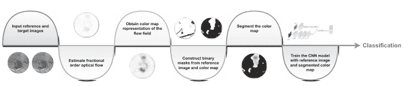

FIGURE 10.1 火焰-烟雾运动检测的所提框架。

## 10.3 分数阶光流估计

### 10.3.1 非线性分数阶变分光流模型的公式

在任意像素位置，设在时空坐标 (X,Y,T) 和 (X+δX,Y+δY,T+δT) 处的强度值分别为 J(X,Y,T) 和 J(X+δX,Y+δY,T+δT)。通过采用数据守恒假设（BCA）[20]，可得

J(X+δX,Y+δY,T+δT) = J(X,Y,T)  (10.1)

其中，J:Ω ⊂ R^3 → R 是表示矩形图像序列的体积。因此，利用 Eq. (10.1) 中的泰勒级数展开，得到

(∇J)^T w + J_T = 0  (10.2)

其中，∇J = (J_X, J_Y)^T 表示空间区域的强度梯度，w = (μ,v)^T 是所需的光流场，μ(X,Y) 和 v(X,Y) 分别为其 X 和 Y 分量。这里，J_T 表示强度的时间导数。使用 Eq. (10.2) 进行光流估计的问题被称为位错问题。为了将此问题转化为适定问题，需要通过引入称为平滑约束 [20] 的附加约束进行正则化。该约束基于以下假设：图像平面中任意像素的所有相邻像素都一致运动。平滑项的一般形式如下：

F(μ,v,∇μ,∇v) = F_1(μ,v) + F_2(∇μ,∇v)  (10.3)

其中，F_1 和 F_2 是本质上凸的标量值函数。这里，F_2(∇μ,∇v) 基于像素流速率。因此，通常情况下，光流利用以下变分泛函 [20, 33] 进行估计：

E(w) = ∫_Ω [(∇J^T w + J_T)^2 + F_1(μ,v) + F_2(∇μ,∇v)] dX  (10.4)

其中 X = (X,Y)。分数阶导数能有效保留图像中纹理和边缘等不连续信息。此外，分数阶导数可针对最优分数阶 α 进行求解，此时解稳定 [26, 34, 35]。因此，在所提模型中，\( F_2\left(\nabla \mu, \nabla v\right) \) 被基于分数阶导数的项 \( F_2\left(D_+^\alpha \mu, D_+^\alpha v\right) \) 所取代。

#### 10.3.1.1 非线性分数阶变分模型

本章提出了以下非线性分数阶变分模型，通过嵌入 Charbonnier 范数 [36] 和 Marchaud 分数阶导数 [37]，使估计的光流更加准确和鲁棒。

\( E(\boldsymbol{w}) = \int_\Omega \left[ \psi\left(\nabla \mathcal{J}^T \boldsymbol{w} + \mathcal{J}_T\right) + F_1\left(\mu, v\right) + F_2\left(D_+^\alpha \mu, D_+^\alpha v\right) \right] d\boldsymbol{X} \quad (10.5) \)

其中，\( \psi\left(z\right) = \sigma \sqrt{1 + \left(\frac{z}{\sigma}\right)^2} \) 描述了变量 z 中的 Charbonnier 范数，\( \sigma \) 表示一个小的正参数，根据 Bruhn et al. [36] 选取。函数 \( F_1 \) 和 \( F_2 \) 由 \( F_1\left(\mu, v\right) = \beta^2 \boldsymbol{w}^T \boldsymbol{w} \) 和 \( F_2\left(D_+^\alpha \mu, D_+^\alpha v\right) = \lambda e^T \left(D_+^\alpha \boldsymbol{w}^T \odot D_+^\alpha \boldsymbol{w}^T\right)e \) 给出，其中 \( \beta, \lambda \in \mathbb{R}^+ \) 且 \( D_+^\alpha \mathcal{Z} = \left(D_\mathcal{X}^\alpha \mathcal{Z}, D_\mathcal{Y}^\alpha \mathcal{Z}\right)^T \)。这里，\( D_\mathcal{X}^\alpha \mathcal{Z} \) 和 \( D_\mathcal{Y}^\alpha \mathcal{Z} \) 分别表示与 \( \mathcal{X} \) 和 \( \mathcal{Y} \) 相关的 \( \mathcal{Z} \) 的 Marchaud 微分，适用于 \( \alpha \in (0, 1) \)。符号 \( \odot \) 表示 Hadamard 积，\( e \in \mathbb{R}^{2 \times 1} \) 是所有条目均为 1 的列向量。观察到，当 \( \sigma \to 0 \) 时，模型 (5) 倾向于展示一个基于 \( L_1 \) 范数的模型，且当 \( \alpha \in \mathbb{Z}^+ \) 时，所提模型描述了一个基于整数阶的模型。此外，在所提工作中采用 Charbonnier 范数和 Marchaud 导数的动机如下：

- Charbonnier 范数是一种众所周知的稳健统计量，相比于二次方法对离群点的敏感度更低 [36]。
- 由于 Charbonnier 范数本质上是非二次的，非线性模型能够在存在光流不连续性的情况下产生令人满意的结果 [36]。
- 其凸性确保了极小化问题具有唯一解。这使其优于非凸 Lorentzian 范数 [38]。
- Charbonnier 范数可以通过使用 \( \sigma \) 缩放为 \( L_1 \) 范数 [36]。
- Marchaud 导数很有用，因为它也可用于那些不连续的函数（例如图像）。

为进行光流估计，泛函 Eq. (10.5) 需要进行极小化。设 \(\mu \equiv \mu(\mathcal{X}, \mathcal{Y})\) 和 \(\nu \equiv \nu(\mathcal{X}, \mathcal{Y})\) 为两个任意函数，使得所需光流解 \(\boldsymbol{w}^\star\) 的偏差 \(\boldsymbol{w}\) 可表示为

\(\boldsymbol{w} = \boldsymbol{w}^\star + \epsilon \boldsymbol{\Phi}\) (10.6)

其中 \(\epsilon\) 表示一个实变量，\(\boldsymbol{\Phi} = (\eta, \phi)^T\)。让我们按以下方式描述 Eq. (10.6) 阶数为 \(\alpha\) 的 Marchaud 微分：

\(D_+^\alpha \boldsymbol{w}^T = D_+^\alpha \boldsymbol{w}^\star^T + \epsilon D_+^\alpha \boldsymbol{\Phi}^T\) (10.7)

将 Eqs. (10.6) 和 (10.7) 的右侧代入表达式 (10.5) 并采用 \(\psi\) 的定义，得到以下变量标量值函数：

\(E(\epsilon) = \int_\Omega \left[ \sigma \sqrt{1 + \left( \frac{\nabla \mathcal{J}^T (\boldsymbol{w}^\star + \epsilon \boldsymbol{\Phi}) + \mathcal{J}_T}{\sigma} \right)^2} + \beta^2 (\boldsymbol{w}^\star + \epsilon \boldsymbol{\Phi})^T (\boldsymbol{w}^\star + \epsilon \boldsymbol{\Phi}) + \lambda e^T \left[ \left( D_+^\alpha \boldsymbol{w}^\star^T + \epsilon D_+^\alpha \boldsymbol{\Phi}^T \right) \odot \left( D_+^\alpha \boldsymbol{w}^\star^T + \epsilon D_+^\alpha \boldsymbol{\Phi}^T \right) \right] e \right] dX\) (10.8)

当 \(\epsilon = 0\) 时，该函数给出所需解；因此，Eq. (10.8) 对 \(\epsilon\) 的导数在 \(\epsilon = 0\) 处消失 [39]。

\(0 = \int_\Omega \left[ \left\{ \frac{(\nabla \mathcal{J}^T \boldsymbol{w}^\star + \mathcal{J}_T) (\nabla \mathcal{J}^T \boldsymbol{\Phi})}{\psi (\nabla \mathcal{J}^T \boldsymbol{w}^\star + \mathcal{J}_T)} \right\} + 2\beta^2 \boldsymbol{w}^\star^T \boldsymbol{\Phi} + 2\lambda \left\{ e^T \left( D_+^\alpha \boldsymbol{w}^\star^T \odot D_+^\alpha \boldsymbol{\Phi}^T \right) e \right\} \right] dX\) (10.9)

对 Eq. (10.9) 应用 Fubini 定理 [40]、[23] 中的定理和 Marchaud 导数 [37]，可得

\(\int_\Omega e^T \left( D_+^\alpha \boldsymbol{w}^\star^T \odot D_+^\alpha \boldsymbol{\Phi}^T \right) e dX = \int_\Omega \left[ \left\{ \left( D_{-}^\alpha D_+^\alpha \right)^T e \right\} \boldsymbol{w}^\star \odot \boldsymbol{\Phi} \right] dX\) (10.10)


因此，将 Eq. (10.10) 的右边代入 Eq. (10.9) 得到以下表达式：

$$0 = \int_{\Omega} \left[ \left\{ \frac{(\nabla \mathcal{J}^T \boldsymbol{w}^* + \mathcal{J}_{\mathcal{T}})(\nabla \mathcal{J})}{\psi(\nabla \mathcal{J}^T \boldsymbol{w}^* + \mathcal{J}_{\mathcal{T}})} + 2\beta^2 \boldsymbol{w}^* + 2\lambda \right\} \left\{ \left( D_{-}^\alpha D_+^\alpha \right)^T e \right\} \boldsymbol{w}^* \right] dX$$ (10.11)

其中 \( D_{-}^\alpha D_+^\alpha = (D_{-\mathcal{X}}^\alpha D_{\mathcal{X}}^\alpha, D_{-\mathcal{Y}}^\alpha D_{\mathcal{Y}}^\alpha)^T \)，且 \( D_{-\mathcal{X}}^\alpha \) 和 \( D_{-\mathcal{Y}}^\alpha \) 分别表示相对于 \( \mathcal{X} \) 和 \( \mathcal{Y} \) 的左 Marchand 导数。因此，根据变分法的概念，从 Eq. (10.11) 对图像帧中的每个像素得到一组欧拉-拉格朗日方程 [41]

$$\frac{(\nabla \mathcal{J}^T \boldsymbol{w}^* + \mathcal{J}_{\mathcal{T}})(\nabla \mathcal{J})}{\psi(\nabla \mathcal{J}^T \boldsymbol{w}^* + \mathcal{J}_{\mathcal{T}})} + 2\beta^2 \boldsymbol{w}^* + 2\lambda \left\{ \left( D_{-}^\alpha D_+^\alpha \right)^T e \right\} \boldsymbol{w}^* = O_{2\times 1}$$ (10.12)

其中 \( o_{2\times 1} \in \mathbb{R}^{2\times 1} \) 是零向量，且 \( \boldsymbol{w} = (\mu, \nu)^T \)。

### 10.3.2 数值解

#### 10.3.2.1 导数离散化方案

估计的光流分量及其对应的参考图像大小相同，均为 \( m \times n \)。因此，\( \mu \) 和 \( \nu \) 的离散化描述如下：

$$\boldsymbol{w} \equiv \boldsymbol{w}(i, j) = \boldsymbol{w}(i\Delta h, j\Delta h)$$

其中，像素位置由索引对 \( (i, j) \) 指定，\( \Delta h \) 表示图像帧中像素的边长，通常等于 1。现在，为了数值实现目的，Marchand 导数的离散化在 Grünwald–Letnikov 导数 [29] 的帮助下进行：

$$D_{+}^\alpha \boldsymbol{w}^T = \sum_{k=0}^{\infty} \omega_k^{(\alpha)} E_X^{-k} \boldsymbol{w}^T$$ (10.13)

其中 \( E^{-k} = \left( \begin{array}{c} E_{\mathcal{X}}^{-k} \\ E_{\mathcal{Y}}^{-k} \end{array} \right)^T \) 以及 \( E_{\mathcal{X}}^{-k}, E_{\mathcal{Y}}^{-k} \) 分别是表示从 \( (i,j) \) 在 \( \mathcal{X} \) 和 \( \mathcal{Y} \) 方向移动 \(-k\) 步的算子。术语 \( \omega_k^{(\alpha)} = (-1)^k \binom{\alpha}{k} \) 表示从展开 \( (1-z)^k \) 得到的二项式系数，并使用以下递归公式计算：

$$\omega_0^{(\alpha)} = 1, \omega_k^{(\alpha)} = \left( 1 - \frac{\alpha+1}{k} \right) \omega_{k-1}^{(\alpha)}$$ (10.14)

其中 \( k=1,2,3,\dots \)，采用 Eq. (10.13) 中的 Grünwald–Letnikov 导数定义 [29]，得到

$$D_-^\alpha D_+^\alpha w^T = -\sum_{k=-\infty}^0 \omega_{|k|}^{(\alpha)} E_{\mathcal{X}}^{-k} w^T - \sum_{k=0}^\infty \omega_k^{(\alpha)} E_{\mathcal{X}}^{-k} w^T$$ (10.15)

由于 \( \sum_{k=0}^\infty \omega_k^{(\alpha)} = 0 \)，Eq. (10.15) 重排如下

$$D_-^\alpha D_+^\alpha w^T = -\sum_{k=-\infty}^0 \omega_{|k|}^{(\alpha)} \nabla \left( E_{\mathcal{X}}^{-k} w^T \right) - \sum_{k=0}^\infty \omega_k^{(\alpha)} \nabla \left( E_{\mathcal{X}}^{-k} w^T \right)$$ (10.16)

其中 \( \nabla \left( E_{\mathcal{X}}^{-k} w^T \right) = E_{\mathcal{X}}^{-k} w^T - (Rw)^T \)，且 \( R \) 表示一个算子，当作用于 \( \boldsymbol{a} \in \mathbb{R}^n \) 时，提供 \( \left[ \boldsymbol{a} \dots \boldsymbol{a} \right] \in \mathbb{R}^{m \times n} \)。进一步，对 Eq. (10.16) 两边左乘 \( e^T \)，得到

$$e^T D_-^\alpha D_+^\alpha w^T = -\sum_{k=-\infty}^0 \omega_{|k|}^{(\alpha)} e^T \nabla \left( E_{\mathcal{X}}^{-k} w^T \right) - \sum_{k=0}^\infty \omega_k^{(\alpha)} e^T \nabla \left( E_{\mathcal{X}}^{-k} w^T \right)$$ (10.17)

由于所提出的算法旨在应用于图像处理领域，Eq. (10.17) 近似为

$$e^T D_-^\alpha D_+^\alpha w^T \approx -\sum_{k=-W}^0 \omega_{|k|}^{(\alpha)} e^T \nabla \left( E_{\mathcal{X}}^{-k} w^T \right) - \sum_{k=0}^W \omega_k^{(\alpha)} e^T \nabla \left( E_{\mathcal{X}}^{-k} w^T \right)$$ (10.18)

其中窗口掩膜大小指定为 \( W \)。接下来，对 Eq. (10.18) 重写以得到以下表达式：

$$\left\{ (D_-^\alpha D_+^\alpha)^T e \right\} w \approx \sum_{(\overline{i}, \overline{j}) \notin \wp(i,j)} \omega_{p_{\overline{i}\overline{j}}}^{(\alpha)} \{ w(i,j) - w(\overline{i}, \overline{j}) \}$$ (10.19)

其中位于 \( (i, j) \) 处像素的所有沿通过 \( (i, j) \) 的 \( \mathcal{X} \) 和 \( \mathcal{Y} \) 方向的邻域像素都包含在集合 \( \mathscr{P} \) 中，且 \( p_{ij} = \max\big[\big|\overline{\imath} - i\big|, \big|\overline{\jmath} - j\big|\big] \)。

#### 10.3.2.2 数值方案

以下讨论展示了利用表达式 (10.19) 和系统 Eq. (10.12) 推导出的两个光流分量的离散方程组：

$$
\begin{bmatrix} 
\frac{1}{\boldsymbol{\psi}\big(\nabla \mathcal{J}^T \boldsymbol{w} + \mathcal{J}_\mathcal{T}\big)} \mathcal{J}_{\mathcal{X}\mathcal{X}} + \boldsymbol{K} & \frac{1}{\boldsymbol{\psi}\big(\nabla \mathcal{J}^T \boldsymbol{w} + \mathcal{J}_\mathcal{T}\big)} \mathcal{J}_{\mathcal{X}\mathcal{Y}} \\ 
\frac{1}{\boldsymbol{\psi}\big(\nabla \mathcal{J}^T \boldsymbol{w} + \mathcal{J}_\mathcal{T}\big)} \mathcal{J}_{\mathcal{X}\mathcal{Y}} & \frac{1}{\boldsymbol{\psi}\big(\nabla \mathcal{J}^T \boldsymbol{w} + \mathcal{J}_\mathcal{T}\big)} \mathcal{J}_{\mathcal{Y}\mathcal{Y}} + \boldsymbol{K} 
\end{bmatrix}
\boldsymbol{w}
= 2\lambda \sum_{(\overline{\imath}, \overline{\jmath}) \in \mathscr{P}(i,j)} \boldsymbol{\omega}_{p_{ij}}^{(\alpha)} \overline{\boldsymbol{w}} - \frac{1}{\boldsymbol{\psi}\big(\nabla \mathcal{J}^T \boldsymbol{w}\big)} \mathcal{J}^T
$$ (10.20)

为方便起见，我们对 Eq. (10.20) 中的各项进行缩写：

$$
\begin{aligned}
\mathcal{J}_{xx} &= \mathcal{J}_{\mathcal{X}}^2, & \mathcal{J}^T &= \big( \mathcal{J}_{\mathcal{X}} \mathcal{J}_T, \mathcal{J}_{\mathcal{Y}} \mathcal{J}_T \big)^T \\
\mathcal{J}_{yy} &= \mathcal{J}_{\mathcal{Y}}^2, & \boldsymbol{w} &= \big( \mu(\overline{\imath}, \overline{\jmath}), \nu(\overline{\imath}, \overline{\jmath}) \big), \\
\mathcal{J}_{xy} &= \mathcal{J}_{\mathcal{X}} \mathcal{J}_{\mathcal{Y}}, & \boldsymbol{K} &= 2\beta^2 + 2\lambda \sum_{(\overline{\imath}, \overline{\jmath}) \in \mathscr{P}(i,j)} \boldsymbol{\omega}_{p_{ij}}^{(\alpha)}
\end{aligned}
$$

最后，使用以下迭代方程组估计每个像素处的光流 \( \boldsymbol{w} \)：

$$
\boldsymbol{w}^{(n+1)} = \mathfrak{T}^{(n)} \Bigg[ 2\lambda \sum_{(\overline{\imath}, \overline{\jmath}) \in \mathscr{P}(i,j)} \boldsymbol{\omega}_{p_{ij}}^{(\alpha)} \overline{\boldsymbol{w}}^{(n)} - \frac{1}{\boldsymbol{\psi}\big(\nabla \mathcal{J}^T \boldsymbol{w}^{(n)} + \mathcal{J}_\mathcal{T}\big)} \Big( \mathcal{J}_{\mathcal{X}\mathcal{Y}} \boldsymbol{w}_{id}^{(n)} + \mathcal{J}^T \Big]
$$

其中 \(\boldsymbol{w}_{ud} = (\boldsymbol{v}(i, j), \mu(i, j))^T\)，\(\mathcal{I}^{(n)} = \left(\mathcal{I}_{\mu}^{(n)}, \mathcal{I}_{v}^{(n)}\right)^T\)，

$$
\mathcal{I}_{\mu}^{(n)} = \left( \frac{1}{\psi \left( \nabla \mathcal{J}^T \boldsymbol{w}^{(n)} + \mathcal{J}_{\mathcal{T}} \right)} \mathcal{J}_{\mathcal{X}} + 2\beta^2 + 2\lambda \sum_{(\bar{i}, \bar{j}) \in \varphi(i, j)} \omega_{p_y}^{(\alpha)} \right)^{-1}
$$

且 \(\mathcal{I}_{v}^{(n)} = \left( \frac{1}{\psi \left( \nabla \mathcal{J}^T \boldsymbol{w}^{(n)} + \mathcal{J}_{\mathcal{T}} \right)} \mathcal{J}_{\mathcal{Y}} + 2\beta^2 + 2\lambda \sum_{(\bar{i}, \bar{j}) \in \varphi(i, j)} \omega_{p_y}^{(\alpha)} \right)^{-1}\)。采用外层不动点迭代技术将此非线性系统转换为线性方程组。此外，采用 Gauss–Seidel 方法 [42, 43] 求解得到的线性系统。分阶光流估计算法的伪代码如算法 1 所示，并在图 10.2 中说明。

```
Algorithm 1: Fractional order optical flow estimation algorithm
Input: \(\mathcal{J}_1, \mathcal{J}_2\) (reference and target image frames), \(\alpha, \beta, \lambda, W, N_{warp}, N_{pyr}\) and \(N_{it}\)
Output: Optical flow field \(\boldsymbol{w} = (\mu, \nu)\)
Set up image pyramids \(\mathcal{J}_1^{pyr(k)}\) and \(\mathcal{J}_2^{pyr(k)}\)
for \(k = N_{pyr}-1\) to 0 do
    \(\mathcal{J}_1 = \mathcal{J}_1^{pyr(k)}, \mathcal{J}_2 = \mathcal{J}_2^{pyr(k)}\);
    if \(k == N_{pyr}-1\) then
        Set \(\boldsymbol{w} = \mathbf{0}\);
    else
        Upsample \(\mu, \nu\) to the current level;
    if \(k \neq N_{pyr}-1\) then
        Update \(\mathcal{J}_1 = warping(\mathcal{J}_1, \boldsymbol{w})\);
    Initialize \(\delta\boldsymbol{w}\) to zero with \(size == size(\mathcal{J}_1)\);
    for \(w = 1\) to \(N_{warp}\) do
        Compute \(\mathcal{J}_{\mathcal{X}}\), \(\mathcal{J}_{\mathcal{Y}}\) and \(\mathcal{J}_{\mathcal{T}}\), using \(\mathcal{J}_1\) and \(\mathcal{J}_2\);
        for \(it = 1\) to \(N_{it}\) do
            Compute fractional order derivatives of order \(0 < \alpha < 1\) of \(\delta\boldsymbol{w}\);
            Update \(\delta\boldsymbol{w}\) using Eq. 21;
        Update \(\boldsymbol{w} = \boldsymbol{w} + \delta\boldsymbol{w}\);
        Update \(\mathcal{J}_1 = warping(\mathcal{J}_1, \delta\boldsymbol{w})\);
        Initialize \(\delta\boldsymbol{w}\) to zero;
```


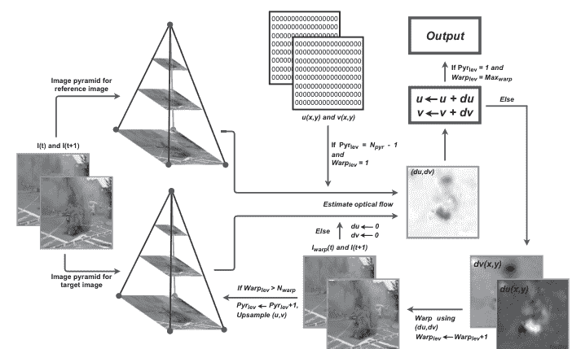

图 10.2 分数阶光流估计的拟议算法。

## 10.4 从颜色映射中提取烟雾运动活跃区域

图 10.3 说明了从颜色映射中提取烟雾运动活跃区域的算法。参考图像和目标图像使用分数阶光流估计算法进行处理。该算法生成它们相应的分数阶光流场，以矢量图形式表示。在矢量图表示中，每个矢量表示相对于参考图像的像素流动（运动）。为了在 CNN 架构的训练和测试中利用此流场，矢量图按 [32] 中所述转换为颜色映射。这些颜色映射的尺寸与参考图像相同。在颜色映射中，不同颜色勾勒各种流动方向，颜色饱和度表示流动幅值。然而，颜色映射的蓝色通道对向上运动更敏感。一般来说，烟雾显示向上扩散的趋势 [44]，因此从颜色映射中提取蓝色通道。因此，使用蓝色通道开发了一种动态二值掩膜。由于燃料和空气供应的多样性，烟雾也呈现黑色、灰色和近白色 [45]，因此还根据颜色信息构建了一种静态二值掩膜。最后，这些动态和静态二值掩膜被融合以生成

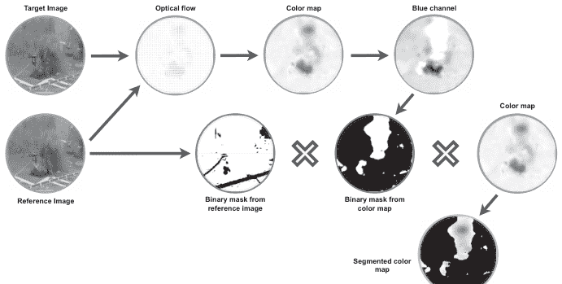

图 10.3 从估计的颜色映射中分割烟雾运动活跃区域的拟议算法。

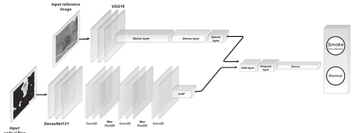

图 10.4 用于烟雾火灾预测的拟议 CNN 架构设计。

用于分割相应颜色映射的结果掩膜。此外，用于烟雾检测的拟议 CNN 模型的架构在图 10.4 中有所说明。

## 10.5 实验、结果与讨论

### 10.5.1 性能评估指标

在二分类中，模型的鉴别性能最好借助混淆矩阵 [46] 来描述。这是一个 2×2 的矩阵，其中行和列分别表示实际数据和预测数据。在这里，第一行包含 \( t_p \) 和 \( f_n \)，而第二行包含 \( f_p \) 和 \( t_n \)。CNN 模型性能分析中使用的评估指标通常源自混淆矩阵。本章根据拟议工作的要求考虑以下指标。

- 1. **准确率 (Acc)**: Acc 提供所有预测中正确预测的比例 [47]。它定义为

  \( CA = \frac{t_p + t_n}{t_p + f_p + f_n + t_n} \)

  该指标通常无法很好地描述鉴别性能，如果一个类的样本很少而另一个类的样本数量非常多。

- 2. **召回率 (R)**: 这给出了所有正样本中被正确分类的正样本的比例 [46]。它也称为灵敏度，并表示为

  \( R = \frac{t_p}{t_p + f_n} \)

  它不能用于对所有正确预测样本集中真正样本的总体比例进行分类。

- 3. **精确率 (P)**: 它计算所有被正样本分类的样本中被正确分类的正样本的比例 [46]。它也称为“正预测值”（PPV）。它表示为

  \( P = \frac{t_p}{t_p + f_p} \)

  它不提供关于正类中真正样本比例的任何信息。

- 4. **F1 分数 (F1)**: 它定义为 \( R \) 和 \( P \) 的调和平均 [48]。F1 的值根据 \( R \) 和 \( P \) 是否都很小或都很大而可以很小或很大。它表示为

  \( F1 = \frac{t_p}{t_p + \frac{1}{2}(f_n + f_p)} \)

- 5. **汉明损失 (H-Loss)**: 这提供了所有预测样本中被错误分类的样本的比例 [49]。它定义为

  $$H-loss = \frac{f_p + f_n}{t_p + f_p + f_n + t_n}$$

除了这些指标，模型的性能还使用 AUC（曲线下面积）进行测试。该 AUC 给出了 ROC 曲线下的面积 [50]。因此，该面积的较大值对应较高的真正率 (TPR)。然而，通常认为大于 50% 的 AUC 值是可接受的。

### 10.5.2 实验讨论

实验在 Windows 11 平台、16 GB RAM 上使用 Google Colab 和 MATLAB® 软件 [51] 进行。实验在包含 324 张和 228 张参考图像及其分别对应的烟雾和正常视频的颜色映射的数据集上进行。为了分析拟议框架的性能，已使用了各种指标。此外，拟议框架与不同的现有模型进行了全面比较，以表格形式、学习曲线和 ROC 曲线进行了讨论。

第一个实验讨论了通过实现拟议变分模型获得的估计分数阶光流场。参数值设置为 $\sigma = 0.4, \beta = 0.1, \lambda = 200, \text{and } \alpha = 0.7$。从 [30, 31] 收集的图像帧（视频）大小各不相同；因此，在光流估计中，这些帧已调整为 $384 \times 384$ 大小。烟雾和非烟雾视频的少量参考图像样本及其相应的光流场在图 10.5 中有所示。图 10.5 的第一行和第二行分别说明烟雾视频的参考图像和相应的光流场，而第三行和第四行分别表示非烟雾（正常）视频的参考图像和光流场。由于烟雾倾向于向上扩散，并且特定光流通道对向上运动更敏感，颜色映射通道的这一特征在烟雾的相应颜色映射中清晰可见。对于非烟雾情况，物体通常不倾向于向上移动，这可以从图 10.5 中的光流中看出。此外，估计的分数阶光流对场景中存在的照明变化等异常值高度不敏感。这表明了

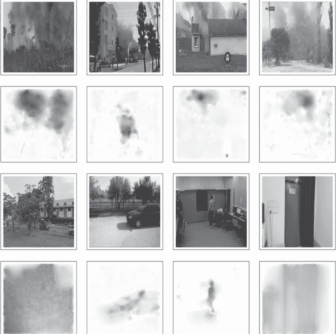

图 10.5 烟雾-火灾参考图像样本（第一行）和相应光流场（第二行）、非烟雾图像（第三行）和相应光流场（第四行）。

所提出变分模型非线性特性的重要性，并使颜色映射成为分类烟雾和正常场景的有用工具。获得的颜色映射表明估计的流场是密集的并保留运动边缘。最后，生成的数据集用于拟议 CNN 模型的训练和测试。

第二个实验在表 10.1–10.2 中从不同指标和参数数量方面全面比较了拟议 CNN 框架与各种现有模型。表 10.1–10.2 中所有现有模型的训练和测试均在

| 模型 | CNN 架构 | 准确率 | 召回率 | 精确率 | F1 分数 | 汉明损失 |
| :--- | :--- | :--- | :--- | :--- | :--- | :--- |
| **拟议模型** | **VGG16 和 DenseNet121** | **1.00** | **1.00** | **1.00** | **1.00** | **0.00** |
| Majid 等人 [52] | ResNet50 | 0.82 | 0.71 | 1.00 | 0.83 | 0.18 |
| Majid 等人 [52] | VGG16 | 0.64 | 1.00 | 0.64 | 0.78 | 0.36 |
| Saeed 等人 [53] | Adaboost-LBP | 1.00 | 1.00 | 1.00 | 1.00 | 0.00 |
| Muhammad 等人 [54] | AlexNet | 0.64 | 1.00 | 0.64 | 0.78 | 0.36 |
| Khan 等人 [55] | VGG16 | 0.64 | 1.00 | 0.64 | 0.78 | 0.36 |
| Wang 等人 [56] | VGG16 | 0.98 | 1.00 | 0.98 | 0.99 | 0.02 |
| He 等人 [57] | 残差学习 | 0.95 | 0.95 | 0.97 | 0.96 | 0.05 |

| 模型 | CNN 架构 | 参数数量 |
| :--- | :--- | :--- |
| **拟议 CNN 模型** | **VGG16 和 DenseNet121** | **10,553,346** |
| Majid 等人 [52] | ResNet50 | 70,786 |
| Majid 等人 [52] | VGG16 | 70,786 |
| Saeed 等人 [53] | Adaboost-LBP | 171,110,274 |
| Muhammad 等人 [54] | AlexNet | 171,110,274 |
| Khan 等人 [55] | VGG16 | 72,142,146 |
| Wang 等人 [56] | VGG16 | 8,237,442 |
| He 等人 [57] | 残差学习 | 4,194,690 |

相同的参考图像数据集。拟议模型使用了颜色映射以及图像数据集。为了将拟议 CNN 模型与 Majid 等人 [52] 进行比较，已从其模型中移除了注意力层。这些比较表明，拟议算法比其他现有模型表现更好。可以观察到，表 10.1 为拟议框架描绘了 1.00 的满意准确率得分，而 Saeed 等人 [53] 的模型也提供了 1.00 的准确率得分，但所需参数数量比拟议模型多出 17 多倍。这验证了拟议框架的适用性。

在最后一个实验中，拟议 CNN 模型与各种现有模型的性能在图 10.6–10.8 中以学习曲线和 ROC 曲线形式说明。可以看出，对于拟议 CNN 模型的学习曲线，训练曲线和验证曲线在仅 4 个时代后收敛并重合，而其他模型要么需要更多


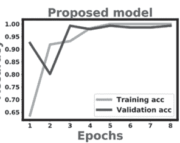

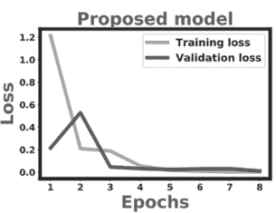

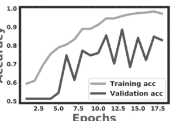

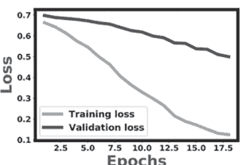

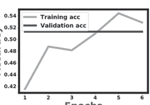

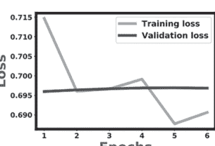

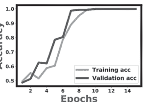

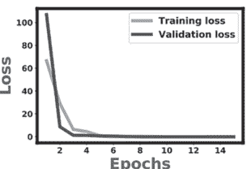

图 10.6 准确率和损失方面的学习曲线：所提出的框架（第一行），Majid 等人 [52] 配合 ResNet50（第二行），Majid 等人 [52] 配合 VGG16（第三行），Saeed 等人 [53]（第四行）。

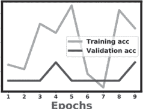

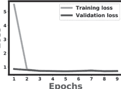

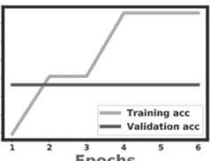

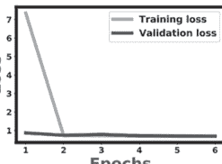

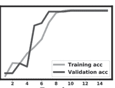

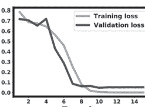

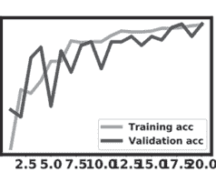

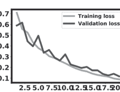

图 10.7 准确率和损失方面的学习曲线：Muhammad 等人 [54]（第一行），Khan 等人 [55]（第二行），Wang 等人 [56]（第三行），He 等人 [57]（第四行）。

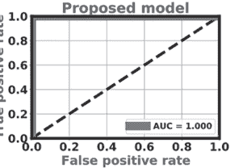

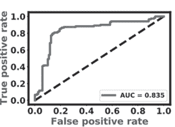

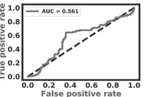

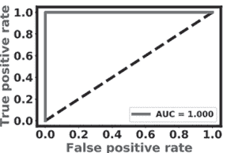

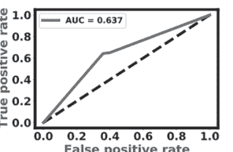

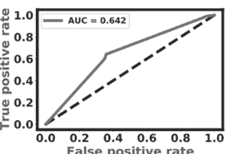


图 10.8 ROC 曲线：所提出的框架，Majid 等人 [52] 配合 ResNet50，Majid 等人 [52] 配合 VGG16（第三行），Saeed 等人 [53]，Muhammad 等人 [54]，Khan 等人 [55]，Wang 等人 [56]，He 等人 [57]。

epochs 或未收敛。此外，给定模型的 AUC 分数为 1，这验证了可接受的分类性能。

## 10.6 结论与未来工作

本章提出了一种基于分数阶光流和烟雾动态及静态特征的新型基于 CNN 的火灾预测框架。实验所用数据集包含共 16 个火灾-烟雾视频和 19 个非烟雾视频。动态特征通过基于分数导数的变分模型估计为光流场。所得光流场密集、鲁棒且保留烟雾图案的移动边缘。静态信息以烟雾颜色含量的形式描述，用于形成基于颜色的二值掩码。利用这些二值掩码，从颜色图中成功分割出烟雾活动区域。所提出的 CNN 架构已在颜色图和图像数据集上进行训练和测试。估计结果明显优于其他现有模型。未来工作涉及将所提出的工作推广到确定场景中的火灾-烟雾分数。

## 致谢

Pushpendra Kumar 和 Nitish Kumar Mahala 承认孟买 NBHM 就编号 02011/24/2021 NBHM (R.P)/R&D-II/8669 的拨款提供的支持。Pushpendra Kumar 还承认新德里 SERB 就编号 EEQ/2020/000154 的拨款提供的支持。作者 Muzammil Khan 衷心感谢新德里 MHRD、印度政府。

## 参考文献

- [1] Sergey V Ablameyko, N Brovko, and R Bogush. 基于运动与对比度的视频烟雾检测。*Journal of Computer Science and Cybernetics*, 28(3):195–205, 2012.
- [2] Martin Mueller, Peter Karasev, Ivan Kolesov, and Allen Tannenbaum. 视频中火焰检测的光流估计。*IEEE Transactions on Image Processing*, 22(7):2786–2797, 2013.
- [3] Arun Singh Pundir and Balasubramanian Raman. 基于图像的双深度学习烟雾检测模型。*Fire Technology*, 55(6):2419–2442, 2019.
- [4] Viet Thang Nguyen, Cong Hoang Quach, and Minh Trien Pham. 基于深度学习的室内环境监控摄像头视频烟雾检测。收录于 *International Conference on Recent Advances in Signal Processing, Telecommunications & Computing*, 82–86, 2020。
- [5] James Pincott, Paige Wenbin Tien, Shuangyu Wei, and John Kaiser Calautit. 面向室内火灾和烟雾检测的视觉迁移学习方法的开发与评估。Building Services Engineering Research and Technology, 2022. http://dx.doi.org/10.1177/01436244221089445.
- [6] Shubhangi Chaturvedi, Pritie Khanna, and Aparajitha Ojha. 面向环境安全的基于视觉的室外烟雾检测技术综述。ISPRS Journal of Photogrammetry and Remote Sensing, 185:158–187, 2022.
- [7] Pushpendra Kumar, Muzammil Khan, and Shreya Gupta. 基于分数阶 TV 模型的 IR 视频监控系统的开发。收录于 International Conference on Control, Automation, Power and Signal Processing, 1–7, 2021。
- [8] Pushpendra Kumar. 基于分数阶 tv 模型的热-可见视频监控系统的开发。Journal of Physics: Conference Series, 1950:012026, 2021. IOP Publishing.
- [9] Zhigang Tu, Wei Xie, Dejun Zhang, Ronald Poppe, Remco C Veltkamp, Baoxin Li, and Junsong Yuan. 变分和基于 CNN 的光流技术综述。Signal Processing: Image Communication, 72:9–24, 2019.
- [10] Snehlata Shakya and Sanjeev Kumar. 使用分数阶光流对云层运动进行表征和预测。IET Image Processing, 13(8):1375–1381, 2019.
- [11] Arun Singh Pundir and Balasubramanian Raman. 用于烟雾检测的深度信念网络。Fire technology, 53(6):1943–1960, 2017.
- [12] Gaohua Lin, Yongming Zhang, Qixing Zhang, Yang Jia, Gao Xu, and Jinjun Wang. 基于体积局部二值模式的动态纹理视频序列烟雾检测。KSII Transactions on Internet and Information Systems, 11(11):5522–5536, 2017.
- [13] Simon Baker, Daniel Scharstein, JP Lewis, Stefan Roth, Michael J Black, and Richard Szeliski. 光流的数据库和评估方法。International Journal of Computer Vision, 92(1):1–31, 2011.
- [14] Hanh Dang-Ngoc and Hieu Nguyen-Trung. 航空森林火灾监控——使用航空视频评估森林火灾检测模型。收录于 International Conference on Advanced Technologies for Communications, 142–148, 2019。
- [15] Gao Xu, Yongming Zhang, Qixing Zhang, Gaohua Lin, and Jinjun Wang. 基于合成烟雾图像的深度域自适应视频烟雾检测。Fire Safety Journal, 93:53–59, 2017.
- [16] Khan Muhammad, Jamil Ahmad, Irfan Mehmood, Seungmin Rho, and Sung Wook Baik. 基于卷积神经网络的监控视频火灾检测。IEEE Access, 6:18174–18183, 2018.
- [17] Rishabh Bansal, Arun Singh Pundir, and Balasubramanian Raman. 基于深度学习的动态纹理。收录于 Region 10 Conference, 2609–2614, 2017。
- [18] Yanmin Luo, Liang Zhao, Peizhong Liu, and Detian Huang. 基于运动特征和卷积神经网络的火灾烟雾检测算法。Multimedia Tools and Applications, 77(12):15075–15092, 2018.
- [19] Yusun Ahn, Haneul Choi, and Byungseon Sean Kim. 使用基于计算机视觉的 CCTV 开发建筑早期火灾检测模型。Journal of Building Engineering, 65:105647, 2023.
- [20] Berthold KP Horn and Brian G Schunck. 确定光流。Artificial Intelligence, 17(1-3):185–203, 1981.
- [21] Muzammil Khan and Pushpendra Kumar. 一种面向应用导向光谱运动估计的分数阶变分水平集模型。Expert Systems with Applications, 219:119628, 2023.
- [22] Sana Rao and Hanzi Wang. 通过带非本地导向核的加权导向滤波进行光流估计。The Visual Computer, 39(3):835–845, 2023.
- [23] Muzammil Khan and Pushpendra Kumar. 光流估计中基于分数阶变分模型的非线性建模。Optik, 261:169136, 2022.
- [24] Yuanlu Wu, Minghao Chen, Yan Wo, and Guoqiang Han. 基于稠密光流和卷积神经网络的视频烟雾检测。Multimedia Tools and Applications, 80(28):35887–35901, 2021.
- [25] Daniel YT Chino, Leticia PS Avalhais, Jose F Rodrigues, and Agma JM Traina. Bowfire：通过集成像素颜色和纹理分析对静态图像中的火灾进行检测。收录于 Conference on Graphics, Patterns and Images, 95–102, 2015。
- [26] Kenneth S Miller and Bertram Ross. 分数微积分与分数微分方程导论。Wiley, 1993.
- [27] Pushpendra Kumar and Muzammil Khan. 基于分数阶光流的 COVID-19 疑似病例早期预测。收录于 International Conference on Information Systems and Computer Networks, 1–7, 2021。
- [28] Bernhard Riemann. 关于积分和微分的一般理解的尝试。Gesammelte Werke, 62, 1876.
- [29] Fausto Ferrari. Weyl 和 Marchau 导数：一段被遗忘的历史。Mathematics, 6(1):6, 2018.
- [30] 火灾分割图像数据集。https://www.kaggle.com/datasets/diversiai/fire-segmentation-image-dataset.
- [31] 森林火灾数据集。https://www.kaggle.com/datasets/kutaykutlu/forest-fire.
- [32] 颜色。http://members.shaw.ca/quadibloc/other/colint.htm.
- [33] Muzammil Khan and Pushpendra Kumar. 用于水下运动估计的基于视觉的分数阶 TV 模型。收录于 IEEE Bombay Section Signature Conference, 1–6, 2021。
- [34] Dali Chen, Hu Sheng, et al. 用于运动估计的分数阶变分光流模型。Philosophical Transactions of the Royal Society A: Mathematical, Physical and Engineering Sciences, 371(1990):20148, 2013.
- [35] Pushpendra Kumar and Muzammil Khan. 基于 Charbonnier-Marchaud 的多光谱视觉系统运动估计分数变分模型。Journal of Physics: Conference Series, 2327:012031, 2022. IOP Publishing.


- [36] Andrés Bruhn, Joachim Weickert, and Christoph Schnörr. 卢卡斯/卡纳德与霍恩/舒恩克：结合局部和全局光流方法. 计算机视觉国际期刊, 61(3):211–231, 2005.

- [37] A Marchaud. 关于实变函数的导数与差分. 博士论文, Impr. Gauthier-Villars, 1927.

- [38] Deqing Sun, Stefan Roth, and Michael J Black. 光流估计的秘密及其原理. 在 IEEE 计算机学会计算机视觉与模式识别会议上, 2432–2439, 2010.

- [39] Tom M. Apostol. 微积分，第一卷：一元微积分，附线性代数导论（第1卷）. John Wiley & Sons, 2007.

- [40] Guido Fubini. 关于多重积分. 林奈国家学院院刊, 16:608–614, 1907.

- [41] S.V. Fomin 和 M Gelfand. 变分法. Dover Publications, 2012.

- [42] Mahinder Kumar Jain. 科学与工程计算的数值方法. New Age International, 2003.

- [43] Richard Hamming. 科学家和工程师的数值方法. Courier Corporation, 2012.

- [44] Shi Jie, Wang Wei, Gao Yuanqi, and Yu Nanpeng. 野火监控摄像头的最佳部署和智能烟雾检测算法. IEEE Access, 8:72326–72339, 2020.

- [45] Wang Yue, Wee Chua Teck, Chang Richard, and Trung Pham Nam. 基于纹理和颜色特征的实时烟雾检测. 在国际模式识别会议上, 2012.

- [46] Mohammad Hossin 和 Md Nasir Sulaiman. 数据分类评估的评价指标综述. 数据挖掘与知识管理流程国际期刊, 5(2):1, 2015.

- [47] Charles E. Metz. ROC 分析的基本原理. 核医学研讨会, 8:283–298, 1978. Elsevier.

- [48] Abdel Aziz Taha 和 Allan Hanbury. 3D 医学图像分割评估指标：分析、选择与工具. BMC 医学影像, 15(1):1–28, 2015.

- [49] Sebastian Destercke. 基于概率集的多标签预测：汉明损失情况. 在基于知识系统的信息处理与不确定性管理国际会议上. Springer, 496–505, 2014.

- [50] Sarang Narkhede. 理解 AUC-ROC 曲线. 走向数据科学, 26(1):220–227, 2018.

- [51] Janez Demšar, Tomaž Curk, Aleš Erjavec, Črt Gorup, Tomaž Hočevar, Mitar Milutinović, Martin Možina, Matija Polajnar, Marco Toplak, Anže Starič 等人. Orange: Python 中的数据挖掘工具箱. 机器学习研究杂志, 14(1): 2349–2353, 2013.

- [52] Saima Majid, Fayadh Alenezi, Sarfaraz Masood, Musheer Ahmad, Emine Selma Gündüz, and Kemal Polat. 基于注意力的 CNN 模型用于实世界图像中的火灾检测与定位. 专家系统与应用, 189:116114, 2022.

- [53] Faisal Saeed, Anand Paul, P Karthigaikumar, and Anand Nayyar. 基于卷积神经网络的早期火灾检测. 多媒体工具与应用, 79(13):9083–9099, 2020.

- [54] Khan Muhammad, Jamil Ahmad, and Sung Wook Baik. 基于卷积神经网络的监控期间早期火灾检测，用于有效的灾害管理. Neurocomputing, 288:30–42, 2018.

- [55] Salman Khan, Khan Muhammad, Shahid Mumtaz, Sung Wook Baik, and Victor Hugo C. de Albuquerque. 雾态 IoT 环境中烟雾检测的节能型深度 CNN. IEEE 物联网杂志, 6(6):9237–9245, 2019.

- [56] Zilong Wang, Tianhang Zhang, Xiqang Wu, and Xinyan Huang. 基于外部烟雾图像和深度学习预测瞬态建筑火灾. 建筑工程期刊, 47:103823, 2022.

- [57] Kaiming He, Xiangyu Zhang, Shaoqing Ren, and Jian Sun. 图像识别的深度残差学习. IEEE 计算机视觉与模式识别会议, 770–778, 2016.

# 11 基于集成学习技术的心脏疾病早期预测

## 一种处理心脏病问题的机器学习技术

Rima Sen 和 A. Manimaran

数学系，高级科学学院，VIT-AP 大学，印度

## 11.1 引言

心血管疾病近年来已成为全球死亡的主要原因。多种先进技术甚至不同的统计预测方法正越来越多地被用于心血管疾病预测。在使用当前算法的情况下，此类诊断方法在识别心脏病患者方面效果不足。它们在服务质量方面也面临巨大障碍 [1–3]。准确检测疾病和高效治疗患者都是服务质量的关键方面。诊断不足可能导致不利结果 [4, 5]。年龄、性别、吸烟、肥胖、体力活动不足、不良饮食、家族病史、胆固醇、高血压和饮酒都是心脏病的风险因素，遗传风险因素 [6] 也是，包括高血压和糖尿病。一些风险因素是可以预防的。除了上述变量外，饮食习惯、肥胖和体力活动不足等生活方式选择也是实质性风险因素 [7–9]。冠状动脉心脏病、心绞痛、充血性心力衰竭、心肌病、先天性心脏病、心律失常和心肌炎都是心脏疾病的例子 [10]。根据风险因素手动计算患心脏病的可能性过于具有挑战性。为了应对医疗保健行业中的此类医疗紧急情况，已开发出一种基于集成学习技术的预测系统。学习技术已被证明在协助决策和基于医疗保健行业产生的大量数据进行预测方面是有效的 [11–13]。因此，本文采用一种称为分类的机器学习方法，通过检查患者数据并分类心脏病的存在，从风险变量预测心脏病风险。它包括几种监督算法 [14, 15] 的集成技术，如朴素贝叶斯 [16] 和决策树 [17]、支持向量机 [18] 以及随机森林 [19] 模型，以提高预测心脏病风险的准确性，解决医疗保健领域面临的挑战。

### 11.1.1 问题陈述

心脏病的主要挑战在于其识别。多种工具可以预测心脏病，但它们要么太昂贵，要么在量化人类心脏病风险方面无效。早期发现心脏病可以降低心脏疾病的死亡率和整体后果。然而，在所有情况下都不可能每天精确监测患者，医生的24小时咨询也无法获得，因为这需要更多的智能、时间和技能 [20]。由于海量数据的可用性，可以使用各种机器学习算法来分析数据中的隐藏趋势。医疗数据中的隐藏模式也可用于健康诊断 [21, 22]。在本研究中，基于多数投票（max voting）的集成学习技术应用于医疗数据集，以提高性能和准确性指标。克利夫兰数据集 [23] 被用于训练模型并在测试后获得良好结果。

问题陈述框架如图 11.1 所示。


图 11.1 问题陈述框架。

## 11.2 相关工作

已开发出多项利用自动化技术预测心脏病的研究 [24]。尽管这些算法在医疗领域有益，但存在一些缺点。本文将讨论其中一些实现及其局限性，以强调所提议学习技术的重要性。参见表 11.1。

## 11.3 方法论

### 11.3.1 数据集描述

在本研究中，使用了一个名为克利夫兰数据集 [23] 的 Kaggle 数据集，包含 298 个实例和 14 个属性。数据集特征的简要描述在表 11.2 中讨论。

该数据集包括年龄在 29 至 79 岁之间的患者。男性患者的性别值为 1，而女性患者的性别值为 0。四种不同形式的胸部不适（CP）被视为心脏病。心脏病导致血流减少的症状引起 1 型心绞痛。由于冠状动脉狭窄，流向心脏肌肉的血流


### 表 11.1 相关工作

| 序号 | 作者 | 年份 | 使用的方法 | 优势 | 局限性 | 准确率 |
|---|---|---|---|---|---|---|
| 1 | Saxena et al. | 2016 | Saxena et al. [25]提出了一种基于克利夫兰数据集、使用爬山算法和决策树算法的新方法。该模型中的知识提取是利用进化学习完成的。 | 该模型利用知识提取方法和进化学习技术来加速模型性能。 | 与现有算法相比，该方法在准确率方面表现较差。 | 该模型的准确率为86.7%。 |
| 2 | Kannan et al. | 2019 | 利用UCI克利夫兰数据集，Kannan et al. [26]提出了多种机器学习技术，包括逻辑回归、支持向量机和随机森林随机梯度提升。 | 机器学习方法高效地解决了问题陈述。 | 与其他技术相比，该方法的计算时间稍长。 | 本文的最佳准确率为86.51%。 |
| 3 | Thirumalai et al. | 2019 | Thirumalai et al. [27]提出了一种混合机器学习算法，使用决策树、朴素贝叶斯、k-近邻和遗传算法等多种方法来分类心脏病的存在与否。 | 遗传算法与学习技术相结合，提高了模型的准确率。 | 与其他方法相比，该方法的性能会明显下降。 | 使用该方法，达到了88.7%的准确率。 |
| 4 | Bhunia et al. | 2019 | Bhunia et al. [28]使用了八种算法，包括逻辑模型、决策树、随机森林分类器、J48算法、朴素贝叶斯、支持向量机和k-近邻来检测心脏病。 | 一种适用于心脏病检测的好方法。 | 该方法对更复杂的模型无法产生不错的准确率得分。 | 该研究的最佳准确率为56.76%，训练数据集的总计算时间为0.04秒。 |
| 5 | Latifah et al. | 2020 | Latifah et al. [29]介绍了两种用于心脏病分类的机器学习模型的比较研究：逻辑回归和随机森林，使用了包含3656条记录的Framingham数据集。 | 本文的比较研究有助于在这些算法中选择最合适的方法。 | 与其他算法相比，该方法存在显著的准确率下降。 | 模型在使用逻辑回归进行分类时达到85.04%的准确率，使用随机森林分类器时达到84.4%的准确率。 |
| 6 | Khan et al. | 2020 | Khan et al. [30]对几种用于心脏病分类的机器学习技术进行了探索性研究，包括逻辑回归、随机森林、k-近邻和朴素贝叶斯分类器。该分析基于UCI克利夫兰数据库。 | 多种学习技术有助于模型高效运行。 | 与其他方法相比，该方法的准确率得分较低。 | 逻辑回归模型的准确率为85.71%。 |
| 7 | Long et al. | 2021 | Long et al. 在[31]中提出了一种用于冠状动脉疾病早期预测的聚合区域曲线技术。该方法对被弱像素包围的医学图像有积极的预测结果。 | 聚合区域技术是利用医学图像检测冠状动脉疾病的有效方法。 | 如果每个数据值的属性数量超过训练数据样本的数量，该方法的性能将不佳。 | 还提到，在所有这些监督模型中，SVM对冠状动脉疾病早期预测影响最大，最高准确率为90.10%。 |
| 8 | Thomas et al. | 2021 | Thomas et al. 在[32]中建议了一种用于心脏病早期预测决策的混合系统。该混合系统结合了遗传算法和递归特征消除。对于数据预处理，使用了SMOTE和标准缩放方法。 | 作为一种先进的预处理方法，混合系统增强了模型性能。 | 与其他方法相比，该方法的准确率得分较低。 | 该方法的准确率为86.6%。 |
| 9 | Liu et al. | | Liu et al. [33]使用了一种新颖的多模态学习方法来预测心血管疾病。该技术通过构建CNN模型对心电图和心声音图进行了编码。特征已通过GA进行特征选择优化。SVM用于分类。结果使用隐马尔可夫模型进行评估。 | 使用隐马尔可夫模型有助于模型对结果进行评估，而CNN模型提高了准确率。 | 模型结构复杂，实际应用时无法正确实现。 | 达到的受试者工作特征曲线值为0.936。 |
| 10 | Obasi et al. | | Obasi et al. 在[34]中提出了一种使用随机森林、贝叶斯分类和逻辑回归来预测心脏病及其风险因素的方法。该数据集包含18个风险因素。 | 构建心脏病预测模型的有效方法。 | 与其他技术相比，该方法存在明显的性能下降。 | 随机森林、贝叶斯分类器和逻辑回归的准确率分别为92.44%、61.96%和59.7%。 |

### 表 11.2 数据集描述

| 序号 | 属性名称 | 属性描述 |
|---|---|---|
| 1 | Age | 人物年龄（岁） |
| 2 | Sex | 提及人物的性别 [1: 男性; 0: 女性] |
| 3 | Cp | 胸痛类型 [1: 典型型; 2: 非典型型心绞痛; 3: 非心绞痛疼痛; 4: 无症状] |
| 4 | Trestbps | 静息血压（mm Hg） |
| 5 | Chol | 血清胆固醇（mg/dl） |
| 6 | FBS | 空腹血糖（mg/dl） |
| 7 | Restecg | 静息心电图结果 |
| 8 | Thalach | 最大心率 |
| 9 | Exang | 运动诱发的心绞痛 |
| 10 | Oldpeak | 相对于静息状态，运动引起的ST段压低 |
| 11 | Slope | 峰值运动ST段斜率 |
| 12 | Ca | 荧光下显色的主要血管数量 |
| 13 | Thal | [3-正常; 6-固定缺损; 7-可逆缺损] |
| 14 | Condition | 类属性 |

受限。1型心绞痛是一种由于精神或情绪压力而引起的胸部不适。非心绞痛性胸部不适可能由多种因素引起。它并不总是归因于真正的心脏病。第四类（无症状）可能不是心脏病的症状。静息血压读数通过属性TRESTBPS测量。胆固醇水平以CHOL测量。FBS代表空腹血糖水平；如果小于120 mg/dl，则赋值为1；如果高于120 mg/dl，则赋值为0。静息心电图结果表示为RESTECG，最高心率通过属性THALACH测量，EXANG是运动诱发的心绞痛，无痛时报告为0，有痛时报告为1。运动诱发的ST段压低称为OLDPEAK，而SLOPE是峰值运动ST段斜率，CA是荧光下显色的主要血管数量，而THAL是运动测试持续时间（分钟），CONDITION是目标属性。类属性对于健康患者的得分为0，对于心脏病患者的得分为1[23]。

### 11.3.2 数据集可视化

以下方式对前面的数据集进行可视化，以便高效地解读数据集。

- 图 11.2 显示了患有心脏病的人数与未患有心脏病的人数的对比。

- 在图 11.3 中，条形图表示特征及其重要性值，其中重要性值是指该特征被大量使用的概率。


图 11.2 数据集描述。


图 11.3 表示数据集重要特征的条形图。


- 各特征不同属性值的比较通过图 11.4–11.8 中的柱状图展示。
- 克利夫兰数据集的统计描述也在图 11.9 中显示，以解读每个属性的模式。


图 11.4 按 FBS 划分的心脏病频率。


图 11.5 按 slope 划分的心脏病频率。


图 11.6 心脏病与 sex 的对比。


图 11.7 根据胸痛经历显示的心脏病频率。


图 11.8 目标变量的分布。

| | age | sex | cp | trestbps | chol | fbs | restecg | thalach | exang | oldpeak | slope |
|---|---|---|---|---|---|---|---|---|---|---|---|
| 计数 | 297.000000 | 297.000000 | 297.000000 | 297.000000 | 297.000000 | 297.000000 | 297.000000 | 297.000000 | 297.000000 | 297.000000 | 297.000000 |
| 均值 | 54.542088 | 0.676768 | 2.158249 | 131.693603 | 247.350168 | 0.144781 | 0.986633 | 149.599327 | 0.326599 | 1.055556 | 0.602694 |
| 标准差 | 9.049736 | 0.468500 | 0.964859 | 17.762006 | 51.997583 | 0.352474 | 0.994914 | 22.941562 | 0.469761 | 1.165123 | 0.618187 |
| 最小值 | 29.000000 | 0.000000 | 0.000000 | 94.000000 | 126.000000 | 0.000000 | 0.000000 | 71.000000 | 0.000000 | 0.000000 | 0.000000 |
| 25% | 48.000000 | 0.000000 | 2.000000 | 120.000000 | 211.000000 | 0.000000 | 0.000000 | 133.000000 | 0.000000 | 0.000000 | 0.000000 |
| 50% | 56.000000 | 1.000000 | 2.000000 | 130.000000 | 243.000000 | 0.000000 | 1.000000 | 153.000000 | 0.000000 | 0.800000 | 1.000000 |
| 75% | 61.000000 | 1.000000 | 3.000000 | 140.000000 | 276.000000 | 0.000000 | 2.000000 | 166.000000 | 1.000000 | 1.600000 | 1.000000 |
| 最大值 | 77.000000 | 1.000000 | 3.000000 | 200.000000 | 564.000000 | 1.000000 | 2.000000 | 202.000000 | 1.000000 | 6.200000 | 2.000000 |

图 11.9 克利夫兰数据集的统计描述。

### 11.3.3 已实现的算法

心脏病预测方面有许多开放的存储库数据集 [35, 36]；然而，本研究考虑了克利夫兰数据集。所提出的框架采用了集成机器学习方法。

#### 11.3.3.1 集成学习技术

集成学习是一种广泛的机器学习元方法，通过结合不同模型的预测来提高预测性能 [14, 15]。机器学习中有几种集成技术，例如最大投票、平均法、加权平均、堆叠、装袋、混合和提升 [37]。与单个模型相比，集成模型可以以更高的准确性推断出更好的决策 [38]。

本章考虑了使用最大投票分类器的朴素贝叶斯 [16]、决策树 [17]、支持向量机 [18] 和随机森林 [19] 的集成模型，以提高所提模型的准确性和性能。

#### 11.3.3.2 朴素贝叶斯分类器

贝叶斯定理（又称贝叶斯规则，以 Thomas Bayes 命名）在概率论中关联两个随机事件的条件概率和边缘概率。它常用于基于数据计算后验概率。“朴素贝叶斯分类器”术语指基于贝叶斯定理的一种简单的概率分类 [39, 40]。

##### 11.3.3.2.1 贝叶斯定理：

$P(A|B) = \frac{P(B|A) \times P(A)}{P(B)} , where A, B = events$

$P(A|B) = $ probability of occurrence of $A$ given $B$ is true.

$P(B|A) = $ probability of occurrence of $B$ given $A$ is true.

$P(A), P(B) = $ the independent probabilities of $A$ and $B$.

朴素贝叶斯分类器假设类的某个特定特征的存在（或不存在）对任何其他特征的存在（或不存在）没有影响。朴素贝叶斯分类器的好处在于只需要少量训练数据来估计分类所需的参数（变量均值和方差）[41, 42]。

在本研究中，将朴素贝叶斯的概率方法添加到模型中，提高了获得更准确预测数据的机会。

#### 11.3.3.3 决策树

决策树是一种使用分支策略说明决策每个可行结果的图形。为了解决这些分类问题，决策树技术更强大。这种方法有两个步骤：创建树并将树应用于数据集 [43, 44]。

本章在所有决策树方法中选择了 Gini 指数算法 [45]。Gini 指数是构建决策树的关键标准。它是一个衡量决策树分割效果的函数。本质上，它帮助我们确定哪个分割器是最优的，以便构建纯决策树。该指标的值在 0 到 0.5 之间。使用 Gini 不纯度的目的是优化分割，并利用纯决策树开发更好的集成算法 [46]。

#### 11.3.3.4 支持向量机

支持向量机是用于回归 [47] 或分类 [48] 的监督学习。支持向量机模型是通过超平面支持向量线性分离或分类收集的数据点的适当模型。该分类器的主要目的是映射数据点 [49]。基本上，映射技术通过支持向量或核估计来执行。该映射包含线性和非线性数据信息 [50, 51]。

本章使用了径向基核函数 [52]。当数据不可线性分离时，径向基核是一个良好的分类器。

#### 11.3.3.5 随机森林

随机森林是一种由决策树和多数投票机制驱动的分类集成学习技术 [53]。这种方法在构建树的过程中增加了一些额外的随机性。在分割节点时，它不是寻找关键特征，而是在随机特征组中寻找最佳特征 [54]。结果，它降低了决策树中的过拟合并减少了方差，从而提高了准确性 [55–57]。

在所提模型中，估计器的数量为 1000。这样的最大估计器数量既提高了模型性能，又减少了决策树中的过拟合 [58]。

#### 11.3.3.6 最大投票分类器

最大投票分类器是一种元分类器，采用多数投票来合并任何分类器 [59]。大多数分类器预测的类标签将是最终类标签。以下术语定义了最终类标签 $d_j$：

```
$d_j = mode\{C_1, C_2, ..., C_n\}$
```

其中 $\{C_1, C_2, ..., C_n\}$ 指的是参与投票技术的个体分类器 [60]。最大投票算法如下所示：

##### 11.3.3.6.1 最大投票算法

令 $c_{i,j}$ 为第 $i$ 个分类器在 $j$ 标签类上的预测得分：

```
$\sum_{i=1}^n c_{i,j} = \max_{j=1,...,m} = \sum_{i=1}^n c_{i,j}$
```

集成分类器做出更好决策的可能性为：

$$P_{ensemble} = \sum_{k=\lceil \frac{n}{2} \rceil + 1}^{n} \binom{n}{k} p^k (1-p)^{n-k}$$

其中 $n$ 为观察值的数量，$p$ 为每个观察值的概率。

为预测心脏病，使用了学习技术。首先，数据被分为训练数据和测试数据，并用于基于支持向量机集成、朴素贝叶斯、决策树分类器和随机森林方法训练所提方法。然后，使用测试数据对模型进行预测测试，以获得最佳准确性并发现模型的行为。该算法对心脏病的存在和不存在分别输出类别 1 和 0 [61]。

本章还对所提集成方法与其他个别监督学习算法（逻辑回归、支持向量机、决策树分类器、朴素贝叶斯分类器和 k-最近邻分类器）进行了比较分析，以基于克利夫兰数据集确定心脏病预测的适当模型。

### 11.3.4 所提模型架构

分类是一种从信息提取中预测结果的监督学习过程 [62]。本研究建议利用分类算法诊断心脏疾病，并采用算法集成来提高分类准确性。此数据的分类是使用名为克利夫兰数据集的医学数据集进行的。该数据集已分为训练集和测试集（70:30），并使用训练数据训练所有个体分类器。使用测试数据集评估分类器的效率。本章详细说明了每个分类器的运行。

系统架构概述了系统在克利夫兰数据集的背景下如何进行集成学习。

所提系统的流程从收集信息开始，并提取属性的重要特征，以选择要在所提模型中使用的属性。然后对相关数据进行预处理并转换为合适的格式 [63]。接着，数据被分为两类：训练和测试。使用训练数据，采用集成学习算法训练模型。通过使用测试数据分析模型，确定系统的准确性和模型结果。在本研究中，系统按以下步骤实现：


- 1. 数据集收集
- 2. 数据预处理
- 3. 属性选择
- 4. 结果预测（疾病）

#### 11.3.4.1 数据集收集

最初，Cleveland 数据集 [23] 从 Kaggle 收集。该数据集包含 298 个实例和 14 个属性。数据集收集后即被分为训练数据和测试数据。训练数据集用于学习预测模型，而测试数据集用于评估模型。整个数据的 70% 用于训练模型，而 30% 的数据用于测试。

#### 11.3.4.2 数据预处理

将原始数据转换为可理解格式的方法称为数据预处理 [64]。导入数据集、划分数据集、属性缩放等操作均属于数据预处理的一部分。数据预处理对于提高模型的准确性至关重要。

#### 11.3.4.3 属性选择

属性或特征选择包括为心脏病预测系统选择合适的属性 [65]。这用于提高所提系统的效率。患者记录由数据集中给定的 14 个特征中的两个数据集特征（性别和年龄）唯一标识。其余属性由医疗信息组成。医疗信息是预测心脏病的重要属性。模型的属性选择基于相关性矩阵（图 11.10），该矩阵应用于所有 13 个属性及目标值，以选择相关性最高且最为正相关的特征 [66, 67]。

#### 11.3.4.4 结果预测（疾病）

通过集成朴素贝叶斯、支持向量机、决策树分类器和随机森林来执行心脏病预测。为寻找医疗领域疾病预测的有效方法，对所提方法与其他单独算法进行了比较研究。观察到，在 Cleveland 数据集的背景下，集成技术的准确性优于其他现有单独算法 [16–19, 68]。


图 11.10 相关性矩阵。

### 11.3.5 性能评估标准

所提方法的性能通过四个指标来确定：精确率、准确率、召回率和 F1 分数 [69]。在二元分类器预测中，利用真正例、真负例、假正例和假负例的数量来分析这四个指标。

真实预测的百分比称为“准确率”。召回率衡量分类器发现所有正样本的能力。精确率是指分类器避免将负样本标记为正样本的能力。F1 分数评估 [0,1] 范围内的值，它是精确率和召回率的调和平均数 [70]。

指标使用以下公式计算：

精确率：真正例 /（真正例 + 假正例）

准确率：（真正例 + 真负例） /（真正例 + 假正例 + 真负例 + 假负例）

召回率：真正例 /（真正例 + 假负例）

F1 分数：2 ×（精确率 × 召回率） /（精确率 + 召回率）

### 11.3.6 拟议方法的算法

- 1. 选择最合适的数据集
- 2. 导入从调查中收集的数据（Cleveland 数据集）
- 3. 数据处理，即执行清理、数据集成、数据转换，最后进行维度缩减
  - 执行缺失值/NA 值分析并删除这些异常值。
  - 如果发现重复项，则合并数据。
  - 执行数据标准化以加速方法的性能。
- 4. 基于概率值的特征或属性选择
  - 如果概率值较大：
    - 则考虑该特征以供后续使用。
  - 否则：
    - 删除该列。
- 5. 数据的训练-测试划分（70:30）
  - 如果是训练数据：
    - 使用该数据进行模型训练。
  - 否则：
    - 用于测试模型效率。
- 6. 使用朴素贝叶斯、支持向量机、决策树和随机森林分类器构建集成模型。

  集成模型 = 朴素贝叶斯 + 支持向量机 + 决策树 + 随机森林

- 7. 使用构建的模型训练划分后的数据集。
- 8. 超参数调优，并重复步骤 7 直至模型达到最佳拟合。
- 9. 就准确率、精确率、召回率和 F1 分数对模型进行评估。
- 10. 得出最佳拟合的训练模型。
- 11. 将训练好的模型应用于测试数据集。
- 12. 执行分类技术以确定心脏病的存在与否。
- 13. 获得整个过程的二元结果作为输出：1 表示存在心脏病；0 表示不存在心脏病。

```
If outcome is 0:

Print(" the person does not have heart disease")

Else (outcome is 1):

Print(" the person has heart disease")
```

## 11.4 实验与结果

本节考察了集成学习算法的研究结果。使用名为 Cleveland 数据集的医学数据集（包含 13 个不同参数，目标值除外）来对心脏病的存在与否进行分类。在使用集成方法对数据进行训练后，将训练好的模型应用于测试数据，结果达到 92% 的准确率，表明该方法对心脏病预测最具前景。所提方法的四个性能指标得分如表 11.3 所示。

将不同监督算法的准确率、F1 分数、精确率和召回率绘制在图 11.11 和图 11.12 中，以便与所提方法的指标进行比较。

模型的性能通过混淆矩阵（图 11.13）来列举。可以得出结论，所提方法

| 性能指标 | 计量值 |
|---|---|
| 准确率 | 95.51 |
| 精确率 | 92.34 |
| 召回率 | 90.81 |
| F1 分数 | 96.78 |


图 11.11 所提方法与其他监督算法（如逻辑回归、朴素贝叶斯分类器、k-近邻、支持向量机和决策树）的准确率对比。

### 性能得分对比


图 11.12 所提方法与其他监督算法（如逻辑回归、朴素贝叶斯分类器、k-近邻、支持向量机和决策树）的四个性能指标（准确率、精确率、召回率和 F1 分数）对比。


图 11.13 算法的混淆矩阵结果：逻辑回归、朴素贝叶斯分类器、k-近邻分类器、支持向量机、决策树和所提集成方法。

与其他现有方法相比，所提方法具有相对较低的错误值和更高的正确预测度量。

还观察到，训练模型的计算时间为 1.73 秒，远少于其他方法的计算时间。

因此，从性能指标和计算时间两方面来看，已证明所提方法更为合适。

## 11.5 结论

在医疗领域，最重要的领域之一是心脏病预测，它利用患者可用的数据来预测心脏病的存在或不存在。对于心脏病预测，有多种工具和策略可用。在这项研究中，使用了几个监督算法（朴素贝叶斯分类器、支持向量机、决策树和随机森林）的集成来分类心脏病。对原始数据（如清理和检测缺失值）进行预处理以提升性能。本研究的关键方面是特征选择，它提高了算法的准确性，甚至关注算法行为。将集成方法应用于数据，在应用于测试数据时达到 95.51% 的准确率。与现有研究工作相比，结果得到了显著改进。该


本研究的局限性在于仅采用了 Kaggle 数据集；然而，作者计划在未来将该方法应用于不同的数据集。

## 参考文献

- [1] Dwivedi, Amit Krishna, Syed Anas Imtiaz, 和 Esther Rodriguez-Villegas. “心音自动分析与分类算法的系统综述.” IEEE Access 7 (2018): 8316–8345.
- [2] Tsanas, Athanasios, 等. “将非线性语音分析算法映射至标准指标，可实现帕金森病平均症状严重程度的临床有用量化.” Journal of the Royal Society Interface 8.59 (2011): 842–855.
- [3] Satu, Md Shahriare, 等. “基于半监督学习算法探索重要心脏疾病因素.” 2018 International Conference on Computer, Communication, Chemical, Material and Electronic Engineering (IC4ME2). IEEE, 2018.
- [4] Lee, Heon Gyu, Ki Yong Noh, 和 Keun Ho Ryu. “挖掘生物信号数据：使用 HRV 的线性和非线性特征进行冠状动脉疾病诊断.” Pacific-Asia Conference on Knowledge Discovery and Data Mining. Springer, Berlin, Heidelberg, 2007.
- [5] Budholiya, Kartik, Shailendra Kumar Shrivastava, 和 Vivek Sharma. “基于优化 XGBoost 的有效心脏病预测诊断系统.” Journal of King Saud University-Computer and Information Sciences 34.7 (2022): 4514–4523.
- [6] Johri, Amer M., 等. “使用常规风险因素、颈动脉超声和内斑块新生血管化组合的多类冠状动脉疾病预测深度学习人工智能框架.” Computers in Biology and Medicine 150 (2022): 106018.
- [7] Thomas, J., 和 R. Teresa Princy. “使用数据挖掘技术的人类心脏病预测系统.” 2016 International Conference on Circuit, Power and Computing Technologies (ICCPCT). IEEE, 2016.
- [8] Nahar, Jesmin, 等. “心脏病诊断的计算智能：一种医学知识驱动方法.” Expert Systems with Applications 40.1 (2013): 96–104.
- [9] Khazaee, Ali. “使用粒子群优化的心跳分类.” International Journal of Intelligent Systems and Applications 5 (2013): 25–33. http://dx.doi.org/10.5815/ijisa.2013.06.03.
- [10] Amin, Mohammad Shafenoor, Yin Kia Chiam, 和 Kasturi Dewi Varathan. “预测心脏病的重要特征和数据挖掘技术识别.” Telematics and Informatics 36 (2019): 82–93.
- [11] Ayon, Safial Islam, Md Milon Islam, 和 Md Rahat Hossain. “冠状动脉心脏病预测：计算智能技术的比较研究.” IETE Journal of Research 68.4 (2022): 2488–2507.
- [12] Riyaz, Lubna, 等. “使用机器学习技术的心脏病预测：定量综述.” International Conference on Innovative Computing and Communications: Proceedings of ICICC 2021, Volume 3. Springer, Singapore, 2022.
- [13] El-Hasnony, Ibrahim M., 等. “基于多标签主动学习的心脏病预测机器学习模型.” Sensors 22.3 (2022): 1184.
- [14] Mishra, Nilamadhab, 等. “使用机器学习算法进行心脏骤停预测的可视分析：一项健康教育意识倡议.” Handbook of Research on Instructional Technologies in Health Education and Allied Disciplines. IGI Global, 2023: 331–363.
- [15] Mohapatra, Debasis, 等. “面向心脏病预测的分布保持型训练-测试分割定向集成分类器.” International Journal of Information Technology 14.4 (2022): 1763–1769.
- [16] Balakrishnan, Baranidharan. “冠状动脉疾病预测各种分类器模型的全面性能分析.” International Journal of Cognitive Informatics and Natural Intelligence (IJCINI) 15.4 (2021): 1–14.
- [17] Reddy, V. Sai Krishna, 等. “使用决策树和朴素贝叶斯分类器进行心血管疾病预测.” Journal of Physics: Conference Series 2161.1 (2022). IOP Publishing.
- [18] Behera, Mandakini Priyadarshani, 等. “使用带支持向量机的改进粒子群优化进行心脏和肝脏疾病预测的混合机器学习算法.” Procedia Computer Science 218 (2023): 818–827.
- [19] Wang, Jing, 等. “基于云随机森林的冠心病风险评估.” Artificial Intelligence Review 56.1 (2023): 203–232.
- [20] Mishra, Nilamadhab, 等. “使用机器学习算法进行心脏骤停预测的可视分析：一项健康教育意识倡议.” Handbook of Research on Instructional Technologies in Health Education and Allied Disciplines. IGI Global, 2023: 331–363.
- [21] Shah, Devansh, Samir Patel, 和 Santosh Kumar Bharti. “使用机器学习技术的心脏病预测.” SN Computer Science 1.6 (2020): 1–6.
- [22] Gaidai, O., Y. Xing, R. Balakrishna, 等. “心血管疾病和癌症死亡率预测.” Cancer Innovation 2.2 (2023): 140–147.
- [23] 数据集链接。https://www.kaggle.com/datasets/johnsmith88/heart-disease-dataset.
- [24] Dileep, P., 等. “使用基于集群的双向 LSTM (C-BiLSTM) 算法的自动心脏病预测.” Neural Computing and Applications (2022): 1–14.
- [25] Saxena, Kanak, 和 Richa Sharma. “高效心脏病预测系统.” Procedia Computer Science 85 (2016): 962–969.
- [26] Kannan, R., 和 V. Vasanthi. “带 ROC 曲线的心脏病预测和诊断机器学习算法.” Soft Computing and Medical Bioinformatics. Springer, 2019: 63–72.
- [27] Mohan, Senthilkumar, Chandrasegar Thirumalai, 和 Gautam Srivastava. “使用混合机器学习技术的有效心脏病预测.” IEEE Access 7 (2019): 81542–81554.
- [28] Chaurasia, Vikas, 和 Saurabh Pal. “使用数据挖掘技术的早期心脏病预测.” Caribbean Journal of Science and Technology 1 (2013): 208–217.
- [29] Latifah, Firda Anindita, Isnandar Slamet, 和 Sugiyanto. “使用逻辑回归算法和随机森林算法的心脏病分类比较.” AIP Conference Proceedings 2296.1: (2020). AIP Publishing LLC.
- [30] Khan, Zameer, 等. “心脏病预测各种分类技术的实证研究.” 2020 IEEE 5th-International Conference on Computing Communication and Automation (ICCCA). IEEE, 2020.
- [31] Chen, Joy Iong Zong, 和 P. Hengjinda. “使用机器学习方法早期预测冠状动脉疾病：一项比较研究.” Journal of Artificial Intelligence 3.01 (2021): 17–33.
- [32] Thomas, Frank Mathews, 和 Anit James. “使用机器学习的心脏中风预测：比较分析与实施.” Proceedings of the National Conference on Emerging Computer Applications (NCECA) 4.1: (2022).
- [33] Li, Pengpai, Yongmei Hu, 和 Zhi-Ping Liu. “通过整合多模态特征与机器学习方法预测心血管疾病.” Biomedical Signal Processing and Control 66 (2021): 102474.
- [34] Obasi, Thankgod, 和 M. Omair Shafiq. “迈向比较和使用机器学习技术检测和预测心脏病发作及疾病.” 2019 IEEE International Conference on Big Data (Big Data). IEEE, 2019.
- [35] Gupta, Chiradeep, 等. “使用监督机器学习技术的心脏病预测.” Journal of Physics: Conference Series 2161.1 (2022). IOP Publishing.
- [36] Magesh, G., 和 P. Swarnalatha. “心脏病预测中通过基于集群的 DT 学习 (CDTL) 进行最优特征选择.” Evolutionary Intelligence 14 (2021): 583–593.
- [37] Thenmozhi, K., 和 P. Deepika. “使用不同决策树技术的分类进行心脏病预测.” International Journal of Engineering Research and General Science 2.6 (2014): 6–11.
- [38] Gupta, Aditya, Vibha Jain, 和 Amritpal Singh. “预测 post-COVID-19 并发症的堆叠集成智能机器学习模型.” New Generation Computing 40.4 (2022): 987–1007.
- [39] Khan, Arsalan, 等. “基于机器学习算法的心血管疾病预测新研究.” Health & Social Care in the Community 2023 (2023).
- [40] Chandrasekhar, Nadikatla, 和 Samineni Peddakrishna. “通过机器学习技术和优化提高心脏病预测准确性.” Processes 11.4 (2023): 1210.
- [41] Mienye, Ibomoiye Domor, Yanxia Sun, 和 Zenghui Wang. “心脏病风险预测的改进集成学习方法.” Informatics in Medicine Unlocked 20 (2020): 100402.
- [42] Karuppaiah, Kalaivani, N. Balamurugan, 和 R. Venkatesh. “使用改进的基于遗传算法的朴素贝叶斯分类器诊断心脏病.” Using Multimedia Systems, Tools, and Technologies for Smart Healthcare Services. IGI Global, 2023: 117–140.


## Index

### A

- 准确率 (Acc), 9, 12, 15, 75, 112, 126–127, 146–147, 170, 198–199
  - 特征的组合, 126
  - 交通流水平 vs. 检测, 100
- 激活函数, 138, 148
- 主动设备监测，缺乏, 97
- 执行器, 23–24, 80
- 自适应变化加权和方法, 9
- 付加同型加密, 29
- 高级分析, 81
- 农业/农业, 30, 55, 71, 95, 103–105
  - 农业中计算机视觉技术分析, 114–116
  - 计算机视觉, 105–110
  - 卷积神经网络架构, 110–114
  - 使用 IoT 的智慧农业, 59
- AI 支持的 IoT (AIoT), 25
- 气流传感器, 59
- AlexNet, 108, 128, 147
- G 的代数连通性, 42
- 模拟数据, 81
- 分析, 69
- 心绞痛, 183
- 蚁群优化, 13
- 花青素, 125
- 蚁狮优化器, 13
- 应用层, 24–25
- IoT 架构, 24
  - 云计算, 27
  - 边缘设备, 26–27
- 曲线下面积 (AUC), 160, 171
- 心律失常, 183
- 人工蜂群, 13
- 人工智能 (AI), 54–55, 125
  - 基于 AI 的智能识别系统, 125
  - 使用 ML 模型的分类技术, 138–146
  - 数据增强, 136
  - 特征提取, 133–136
  - 未来前景, 148–149
  - 图像数据库, 130
  - 机器学习, 129
  - 现有技术, 126–129
  - 迁移学习, 147–148
  - 开发模型的验证, 146–147
- 人工神经网络 (ANN), 104, 138–140, 另见卷积神经网络 (CNNs)
- 属性选择, 197
- 审计, 28
  - 云计算中数据存储的协议, 29
- 澳大利亚，其中的电子废物, 74
- 身份验证, 27–28
- 授权, 28
- 可用性, 28, 183
- 平均, 193
- 阿育吠陀, 124–125

### B

- 婴儿监视器, 93–94
- 装袋法 (Bagging), 193
- 巴塞尔公约, 76
- 电池电动汽车 (BEVs), 64
- 基于贝叶斯网络的算法, 82
- 贝叶斯定理, 194
- 大数据, 59, 61, 72, 89, 94
- 二项式系数, 165
- 生物活性物质, 125
- 生物识别, 27
- 黑洞算法 (BH 算法), 47
- 混合 (Blending), 193
- 基于区块链的优化方法, 82–83
- 蓝牙, 26
  - 传感器, 69–70
  - 技术, 26
- 图像模糊, 136
- 提升法 (Boosting), 105, 193
- 脑肿胀传感器, 84
- 气味分子的布朗扩散, 44
- Broyden–Fletcher–Goldfarb–Shanno 方法, 12
- IoT 的“基础构建块”, 22
- 蝴蝶优化 (BO), 37
- 蝴蝶优化算法 (BOA), 42–43, 47

### C

- 斜拉钢人行桥有限元模型, 13
- CaffeNet, 147
- 微积分, 7
  - 变分法, 7, 164
- 加州消费者隐私法案, 77
- *调用 (R)*, 170
- 心肌病, 183
- 心血管疾病, 182
- 类胡萝卜素, 125
- 汽车, 62, 69, 71, 93–94
- CCPSOBOA 算法参数, 47
- 中心集线器, 36
- 通道注意力机制 (CA 机制), 127
- Charbonnier 范数, 162
- 胸部不适 (CP), 184, 189
- 分类, 128, 196
  - ANN, 138–140
  - 图像架构, 111–112
  - CNN, 140
  - 疾病, 104
  - k-NN, 141–142
  - 机器学习模型, 142–146
  - MLP, 141
  - RNNs, 140
  - 土壤纹理分类方法, 107
  - 使用机器学习模型的技术, 138–146
- 分类准确率 (Acc), 131, 160, 196
- 清除发送 (CTS), 97
- Cleveland 数据集, 183–184, 191, 193, 196–197, 200
- 云, 23–24, 69
  - 作为基础设施, 27
  - 作为平台, 27
  - 作为服务, 27
- 云计算, 27
  - 的网络安全属性, 27–28
  - 协议, 30
  - 中数据存储的动态审计协议, 29
- 聚类分析, 11
- 聚类 WSN, 36–38
- 集群头 (CHs), 37
- 创建, 97–98
- 电子废物收集, 68
- 冲突, 38
- 颜色连贯矢量 (CCV), 133
- 颜色共现图, 133
- 颜色特征, 133
- 颜色直方图, 128, 133
- 颜色映射, 159–160, 168, 171, 173, 177
- 颜色方法，优点和缺点, 134
- 颜色矩 (CM), 133–134
- 通信, 21, 23, 70
  - 集群头通信, 98
  - 介质, 55
  - 技术, 60–61
  - 单元, 38
- 计算图像处理技术, 104
- 计算机系统感染, 96
- 计算机视觉, 105
  - 农业中计算机视觉技术分析, 114–116


- 农业中计算机视觉的优势，115
- 农业领域计算机视觉面临的挑战，115-116
- 计算机视觉-人工智能模型，105
- 计算机视觉智能技术，114
- 作物健康监测与疾病检测，108
- 计算机视觉在农业中的潜在应用，105-110
- 种子质量分析，106-107
- 土壤分析与灌溉管理，107
- 畜牧养殖中的系统，108-109
- 杂草检测，107-108
- 产量估算，109-110
- 机密性，28-29, 88
- 混淆矩阵，169-170, 200, 202
- 先天性心脏病，183
- 充血性心力衰竭，183
- 共轭梯度法，12
- 连接和自动驾驶汽车（CAVs），62
- 连通分量（CC），133
- 连接式吸入器，84
- 连通性，35, 38, 40, 62, 69, 96
  - 代数的，42
  - 设备到服务器，26
  - 问题，87
- 构建超平面，138
- 接触定理，9
- 连续血糖监测，83
- 卷积神经网络（CNNs），104, 140, 158
  - 应用于计算机视觉任务，111
  - 图像分类架构，111-112
  - 目标检测架构，112-113
  - 语义/实例分割架构，113-114
  - 基于CNN的火灾预测，158
  - 基于CNN的系统，104-105
  - 实验，结果，169-177
  - 分数阶光流估计，161-168
- Cooja模拟器，100
- 冠心病，183
- 相关矩阵，197-198
- CPU，30, 38
  - 流逝时间，146-147
- 创建-读取-更新-删除（CRUD），30
- 关键处理和响应时间，86
- 作物健康监测与疾病检测，108
- 作物产量估算，109
- 布谷鸟搜索算法，13
- 文化活动，60
- 以客户为中心的物联网，75
- 网络安全改进法案，76

### D

- 损伤检测，11
  - 基于模型的，4
  - 神经网络的训练和测试，5
- 损伤识别，1
- 损伤指标，5
- 损伤灵敏度，5-6
- 达尔文进化，12
- 数据聚合，24, 36, 38
  - 模拟的，81
  - 分析，54-55, 139
  - 与信息泄露，96
  - 增强，136
  - 分发和互操作性，87
  - 加密，83
  - 伦理，88
  - 收集，36, 129
  - 管理，69
  - 预处理，140, 197
- 数据集收集，197
- 数据集可视化，190-191
- Davidon-Fletcher-Powell法，12
- 决策树，183, 194
- 解码器，113
- 基于反卷积网络的可视化技术（DN），128
- DELETE方法，30
- 拒绝服务（DoS），97
- DenseNet121，159-160
- 部署，36
  - CAVs的部署，62
  - 节点的部署，37
- 抑郁和情绪监测设备，84
- 导数离散化方案，164-166
- 实验设计，11
- 探测器，80, 158
- 设备监测与感知，87
- 设备/事物，22, 69
  - 非智能对象，23
  - 智能对象，22-23
- 差分进化（DE），13, 47
- 差分进化粒子群优化，13
- 数字技术，94
- 数字孪生框架，82
- 疾病分类，104
- 疾病监测系统，82, 84
- 电动汽车政策草案，64
- 无人机，105, 108
- 云计算中数据存储的动态审计协议，29
- 动态二值掩模，168-169
- 动态整数规划，7

### E

- 早期火灾检测模型（EFDM），158
- 窃听，96
- 心电图分类器，82
- 经济间谍活动，96
- 边缘计算设备，80
- 边缘设备，26-27
- 教育，60, 116
- 拉普拉斯矩阵的特征值，41-42
- 电动出行，64
- 电化学传感器，59
- 类电磁算法（EM），47
- 电子废弃物（E-waste），67-68
  - 物联网，69-72
  - 基于物联网的管理，72-75
  - 处理，68
  - 监管环境，76-77
- 电子废弃物回收法案，76
- 静电放电算法（ESDA），37, 47
- El Gamal密码体制，29
- 经验模型，10
- 编码器，113
- 后处理，68
- 节能意识聚类，36
- 能源效率，36
  - 天线，36
  - 聚类WSN，36
  - 物联网标签和传感器的能源效率，87
  - 智慧城市中的能源效率，58-59
  - WSN，38
- 基于物联网的能源优化，58-59
- WSN中的节能，38
- 集成学习技术，183, 193，另见机器学习（ML）
  - 数据集描述，184-189
  - 数据集可视化，190-191
  - 实验和结果，200-202
  - 实现的算法，193-196
  - 方法论，184-200
  - 模型架构，196-197
  - 性能评估标准，198-200
  - 问题陈述，183
  - 相关工作，184
- 基于ε约束的方法，9
- 优化模型中的误差，7
- 数据伦理，88
- 设备伦理，88
- 实践伦理，88
- 欧氏距离，138
- 欧拉-拉格朗日方程，164
- 进化编程，13
- 专家系统，54
- 提取技术，129
- 极端Inception（Xception），148

### F

- F1分数（F1），146-147, 160, 170, 198
- 因子分析（FA），11
- 假阳性（FP），134, 146-147
- 假阳性比率（FPR），146-147
- 特征提取，104, 133
  - 颜色特征，133
  - 形状特征，134
  - 纹理特征，135
- 特征选择，104
- 联邦资源保护与回收法案，76
- 前馈连接，111
- 精加工，68
- 火灾，157
- 5G技术，25
- Flavia数据库，130
- 翻转，136
- 觅食过程，12
- 分数阶亨利气体优化（FHGO），75
- 分数阶导数，159, 161
- 分数阶光流估计，161
  - 非线性分数阶变分光流模型，161-164
  - 数值解，164-167
- 香氛分子的扩散速度，44
- 频率，4, 6, 51, 134
- 频域方法，5-6
- 频率响应函数，4-5
- Fubini定理，163
- 全同态加密（FHE），29
- 模糊聚类算法，11
- 模糊因子分析，11

### G

- 博弈论，9
- 基于博弈论的自适应功率发射控制算法，37
- 门控循环单元，140
- 高斯-赛德尔法，167
- 一般数据保护条例（GDPR），76-77
- 遗传算法（GA），7, 13, 34, 37
- 遗传编程，7, 13
- 几何规划，7
- GET方法，30
- Gini指数算法，194
- 全局邻域矩阵，40-41
- 全局敏感性分析，6-7
- 萤虫群优化，13
- 基于目标规划的方法，9
- Goldwasser–Micali密码体制，29
- Google Colab，171
- Google Drive，130
- GoogLeNet模型，128, 147-148
- Google的Nest Smart，25
- 基于梯度的优化方法，12
- Gramm–Leach–Bliley法案（GLBA），77
- 图形处理单元（GPUs），104
- Grünwald–Letnikov分数阶导数，159, 164-165
- 陀螺仪传感器，69-70

### H

- 黑客攻击，96
- 汉明损失（H-loss），160, 171
- 和声搜索，13
- 医疗4.0流程，82
- 医疗单元，71
- HealthEdge，83
- 根据FBS的心脏病频率，191-192
- 心率监测设备，84
- 草药图像识别，137
- 草药，125, 130
  - 识别，147
  - 药用，125, 149
- 异构设备，87
- ANN中的隐藏层，139
- 高基础设施和资源成本，89
- 物联网设备劫持，96
- 喜马偕尔邦，智慧城市发展，64
- 喜马偕尔路面运输公司（HRTC），64
- HOG特征描述子，128
- 家用电器，58, 70, 93-94
- 家庭能源管理，60
- 同态加密，29
- 马群优化，75
- HTTP PUT方法，30
- 湿度传感器，69-70
- 超文本传输协议（HTTP），30

### I

- IAAS，27
- ICL，130
- 身份盗窃，96
- 空闲监听，38
- 图像
  - 获取，104
  - 增强方法，136
  - 分类，104, 111-112
  - 数据库，130
  - 基于图像的系统，104
  - 处理，165
  - 识别，113
  - 分割，104, 113
  - 移位，136
- ImageCLEF数据库，130
- Inception，147-148
- Inception-V1，另见GoogLeNet模型
- Inception-V2，148
- Inception-V3，148
- Inception-V4，148
- 推断，129
- 信息隐私，88
- 可吞服传感器，84
- ANN中的输入层，139
- 智慧城市，57
- 互联网
  - 节点，94
  - 安全，95
- 医疗物联网（IoMT），79-81
- 物联网（IoT），21, 35, 55, 69, 79, 93-94
  - 进步，25
  - 应用，55-56
  - 基于物联网的智慧医疗架构，80-81
  - 智慧医疗系统中物联网面临的挑战，86-89
  - 云，23-24
  - 商业应用，95
  - 组件，21-27, 70
  - 设备安全，96
  - 电子废弃物，69-72
  - 基于物联网的电子废弃物管理，72-75
  - 基于物联网的医疗设备，83-85
  - 基于物联网的智慧医疗，59-60
  - 网络，36
  - 通过物联网优化智慧城市，58-60
  - 云计算协议，30
  - 基于物联网的电子废弃物管理系统的监管环境，76-77
  - 物联网中的安全问题，95-97
  - 智慧城市中的物联网，57
  - 技术，60
- 研究的优化算法，42
  - BOA，42-43
  - 计算复杂度，50
  - 研究算法的收敛特性，49
  - 使用不同算法的结果比较，48
  - SAO算法，43-46
  - 传感器传输功率，50
- IQAir，63-64
- 灌溉管理，107

### K

- k-NN技术，128

### L

- 全局邻域矩阵的拉普拉斯矩阵，41-42
- Leafsnap，130
- 学习
  - 学习曲线，174-175
  - 学习技术，183
- 字典序，9
- LG，25
- 轻量级CNN，127
- 线性规划，7, 12
- 畜牧养殖中的计算机视觉系统，108-109
- 牲畜追踪，71


- 钢桥荷载评级, 11
- 地方议会, 61
- 位置传感器, 59
- 长短期记忆网络 (LSTM), 140
- 损失函数, 140
- 低能耗 (LE), 26

## M

- 机器学习 (ML), 54, 82, 125, 129
  - 使用的分类技术
  - 机器学习模型, 138–146
  - 其中的步骤, 129

- 维护成本, 89

- 马来西亚，其中的电子废弃物, 74

- 恶意路由
  - 针对的拟议框架, 97–99
  - 结果与讨论, 100
  - 中的安全问题, 95–97

- Marchaud 导数, 162–163
  - 离散化, 164

- Marchaud 微分, 163

- Marchaud 分数导数, 159

- 市场研究未来研究 (MRFR), 63

- 马尔可夫过程, 10

- mask R-CNN, 114

- 数学模型, 7, 9

- 数学规划优化方法, 7–10

- MATLAB 软件, 171

- 最大投票法, 193
  - 算法, 195–196
  - 分类器, 195

- 最大值, 4

- 平均值, 4

- 机械传感器, 59

- “MedLea”, 126

- 消息队列遥测传输 (MQTT), 30

- 指标, 61, 171, 198

- 微电网, 60

- Microsoft 社区, 130

- 中间节点, 98

- 漏检率, 146–147

- MobileNet-V2 模型, 107, 127

- 即服务的出行, 61–63

- 模态曲率, 6

- 模态域分析, 6

- 模型更新方法, 5

- 模态形状, 4

- 监视器, 68, 80

- 多目标优化技术, 1

- 多层感知机 (MLP), 141

- 多模态设备, 83

- 多层遗传算法, 13

- 乘同态加密, 29

- 心肌炎, 183

## N

- 朴素贝叶斯分类器, 194

- 朴素贝叶斯模型, 183

- 美国国家标准与技术研究院 (NIST), 76

- 国家电视和计算机回收计划 (NTCRS), 74

- 最近邻 (k-NN), 141–142

- 网络与信息系统 (NIS), 76

- 网络可靠性, 36

- 网络层, 24, 26

- 网络寿命, 36

- 云计算的网络安全属性, 27–28

- 新密钥生成, 98

- 牛顿法, 12

- 噪声添加, 136

- 非心绞痛胸部不适, 189

- 非支配排序遗传算法 II, 9–10

- 非代际遗传算法, 9

- 非线性共轭梯度法, 12

- 非线性分数阶变分光流模型, 161–164

- 非线性规划, 7

- 非线性关系, 138

- 非基于 Pareto 的方法, 9

- 不可否认性, 28

- 非智能对象, 21, 23

- 通信协议的不一致性, 87

- 无开放标准, 88

- 通知方案, 99

- Pareto 最优解, 1

- 数值方案, 166–167

## O

- 目标检测, 104, 112–113

- 对象运动, 158

- 嗅觉能力, 45

- 在线服务器数据库, 131–132

- 运筹学, 1

- 基于光流的方法, 158–159

- 光流, 158–159, 166

- 光学传感器, 59

- 最优节点部署, 36

- 优化, 2
  - 数据采集与损伤表征, 4
  - 基于 IoT 的能源优化, 58–59
  - 问题公式化, 4
  - 模型, 2–3
  - 模型开发、验证与性能评估, 6–7
  - 目标特征与函数, 4–6
  - 阶段, 4
  - 流程, 3
  - 优化算法选择, 7–14
  - 基于 IoT 的智慧城市优化, 58
  - 基于 IoT 的智能交通优化, 59
  - 工作框架, 5

- ANN 中的输出层, 139–140

- 过度发射, 38

- 偷听, 38

## P

- 平台即服务 (PAAS), 27

- 数据包开销, 38

- Paillier 密码系统, 29

- 参数敏感性分析, 47

- 参数空间, 7

- 基于 Pareto 的精英和非精英方法, 9

- 基于 Pareto 的方法, 9

- 部分同态加密 (PHE), 29

- 粒子群优化 (PSO), 36, 47
  - 另请参阅 嗅觉代理优化 (SAO)
  - 算法, 37
  - 差分进化, 13

- 密码系统, 27

- 模式识别, 11, 116

- 性能评估指标, 169–171

- 个人数据泄露, 96

- 个人识别号码 (PIN), 27

- 酚类, 125

- PHOG, 131

- 物理对象, 21, 54, 94

- 物理形状, 22

- PlantDoc, 108

- 植物叶片识别, 127, 151

- PlantVillage, 108

- PNN 分类器, 126

- 阳性预测值 (PPV), 170

- POST 方法, 30

- 精确率 (P), 146–147, 160, 170, 198

- 谓词加密, 28–29

- 预测农业, 71

- 结果预测, 197

- 预测计算, 138

- 预处理, 104
  - 数据, 197
  - 电子废弃物, 68

- 数据隐私, 88

- 私有信息检索 (PIR), 29

- 处理层, 24

- 处理能力, 23

- 生产者责任, 69

- IoT 网络的编程模型, 87

- 云计算协议, 30

- PyTorch, 104

## Q

- 二次规划, 7

- 拟牛顿法, 12

- 排队论, 10

## R

- 径向基核函数, 195

- 射频识别 (RFID), 25

- 随机森林模型, 183, 195

- SAO 算法的随机模式, 46

- 随机数, 42–43, 46

- 勒索软件, 96

- R-CNN, 113

- 召回率 (R), 146–147, 160, 198

- WSN 充电, 38

- 回收设施, 75

- 循环神经网络 (RNNs), 140

- 递推公式, 165

- 回归, 11

- 回归分析, 11

- 基于 IOT 的电子废弃物管理系统的监管环境, 76–77

- 可靠性理论, 10

- 远程患者监测设备, 85

- 更新理论, 10

- 请求发送 (RTS), 97

- ResNet, 108, 148

- ResNet50, 112

- 资源配置模块, 27

- 改造决策, 1

- Riemann–Liouville 分数导数, 159

- 机器人设备, 84

- ROC 曲线, 160, 171, 173, 176

- 均方根误差方法, 7

- 旋转, 11, 136

- RSA 密码系统, 29

- R² 值, 7

## S

- 软件即服务 (SAAS), 27

- 海螂群算法 (SSA), 47

- 基于标量化的优化方法, 9–10

- 气味分子速度, 44

- 安全
  - 数据安全, 88
  - IOT 中的安全问题, 95–97

- 安全协议, 28
  - 云计算中数据存储的动态审计协议, 29
  - 全同态加密 (FHE), 29
  - 缺乏有效可靠的, 97
  - 谓词加密, 28–29

- 种子质量分析, 106–107

- SeedSortNet, 106–107

- 自动驾驶汽车, 71

- 语义/实例分割的架构, 113–114

- 语义分割, 104, 113

- 感知
  - 能力, 23
  - 层, 24
  - 单元, 38

- 灵敏度, 5–6, 146–147

- 传感器, 23, 36, 38, 59, 80–81

- 感觉模态指数, 42

- 顺序凸规划与进化策略, 7

- 顺序二次规划, 7

- 使用寿命预测, 1

- 浅层网络, 111

- 形状特征, 134

- ShuffleNet V1 和 V2, 127

- 简单方法 (SM), 47

- 模拟退火, 13

- 模拟, 100
  - 方法, 10
  - WSN 参数, 46

- 正弦余弦算法 (SCA), 47

- 单发检测器 (SSD), 112–113

- 基于 IoT 的智慧农业, 59

- 智能垃圾桶, 73

- 智慧城市, 56, 71
  - 智慧城市中的 CAVs, 62
  - 常见问题, 56–57
  - 喜马偕尔邦的发展, 64
  - 其中的 IoT, 57
  - CAVs, 62
  - 全球视角, 62–63
  - 区域视角, 63–64
  - 喜马偕尔邦的智慧城市发展, 64

- 智慧医疗, 59–60
  - 基于 IOT 的智慧医疗架构, 80–81
  - 智慧医疗系统中 IOT 的挑战, 86–89
  - 经济挑战, 89
  - 伦理挑战, 88
  - 基于 IOT 的医疗设备, 83–85
  - 相关工作, 81–83
  - 技术挑战, 86–87

- 智能家居优化, 60

- 智慧城市的智能基础设施, 60

- 智能灌溉, 71

- Smart Log, 82

- 智能电表, 60

- 智慧城市的智能出行, 60

- 智能对象, 21–23, 54–55

- 智能药丸, 85

- 基于 IoT 的智能交通优化, 59

- 嗅觉代理优化 (SAO), 37
  - 算法, 43, 47
  - 随机模式, 46
  - 嗅闻模式, 43–45
  - 步骤, 43
  - 跟踪模式, 45

- 烟雾检测框架, 158

- 从颜色图中提取烟雾运动活跃区域, 168–169

- SAO 算法的嗅闻模式, 43–45

- 社会群体行为, 12

- 土壤分析, 107

- 土壤纹理分类方法, 107

- 空间方法, 135

- 空间钢桁架结构, 7–9

- 特异性, 146–147

- 谱密度, 4

- 谱方法, 135–136

- 挤压激励模块 (SE 模块), 127

- 堆叠, 193

- 利益相关方关联与实施, 87

- 状态转换, 38

- 静态二进制掩码, 168–169

- 统计决策理论, 10

- 统计优化方法, 10–12

- 钢桥健康监测, 1–2
  - 优化模型, 2–3
  - 优化阶段, 4–14

- 最陡下降法, 12

- 基于随机动态规划的优化, 10

- 随机过程优化方法, 10

- 存储区域网络, 27

- 应变能, 5

- 供应链管理 (SCM), 71

- 支持向量机, 183, 194–195

- 群体与进化优化方法, 12–14

- 群体智能, 12–13

- 瑞典叶子, 130

- 对称秩 1 更新法, 12

- 系统资源管理模块, 27

## T

- 禁忌搜索, 13

- 温度传感器, 69–70

- TensorFlow, 104

- 纹理特征, 135–136

- Theano, 104

- 恒温器, 93–94

- 时域方法, 5–6

- 时域响应数据, 5

- 生育酚, 125

- 旅游, 60

- 可处理性, 2–4

- 基于传统计算机视觉的方法, 158

- 传统能源, 26

- SAO 算法的跟踪模式, 45

- “培训学习”过程, 129

- 迁移学习, 104, 147–148
  - CaffeNet, 147
  - inception, 147–148
  - ResNet, 148
  - VGGNet, 147
  - Xception, 148

- 可传递性, 5

- 传输层套接字 (TLS), 28

- 真正例 (TP), 146–147

- 真正例率/比例 (TPR), 146–147, 171

- 信赖域方法, 12

- 1 型心绞痛, 189

## U

- 数学模型的不确定性, 9

- UNet, 114

- 唯一标识符, 23

- 唯一名称和地址, 23

- 无人机 (UAV) 图像, 110


## U

- 用户身份管理协议 (U-IDMP), 28
- 用户交互界面, 27
- 用户界面, 24, 69–70
- 物联网架构, 24–27
- 云计算的网络安全属性, 27–28
- PIR, 29
- 安全协议, 28–29
- 用户责任, 69

## V

- 开发模型的验证, 146–147
- 有效性, 2–4
- 方差, 4
- 向量评估遗传算法, 9
- 车辆到万物 (V2X), 61
- 可验证密钥方案 (VKS), 95, 97
  - 伪代码, 99
- VGG-16, 112, 147, 159–160
- VGG19, 127, 147
- VGGNet, 108, 147
- 摄像机, 157–158
- 视频系统, 80
- 视觉一致性依赖方法, 135
- 视觉几何组 (VGG), 147

## W

- 废物箱, 72
- 小波变换技术, 107
- 杂草检测, 107–108
- 加权平均, 193
- 基于加权的方法, 9
- WiFi, 26
- 无线局域网 (WLANs), 36
- 无线传感器网络 (WSN), 36–37, 59
  - 网络全连接性检查, 41–42
  - 聚类, 37–38
  - 能量节约, 38
  - 系统建模, 40–41
  - 用于仿真的参数, 46
  - 问题出现, 38–40
- 无线传感器, 69–70

## Y

- 产量估算, 109–110
- 产量制图, 109
- YOLO 系列, 112
- YOLO V3, 113

## Z

- Zigbee, 26–27
