# 工程应用的人工智能与机器学习技术


## 关于编者

Ravichander Janapati 博士目前在 Warangal 的 SR 大学担任 ECE 系副教授。他是 IEEE 高级会员，毕业于 JNTU Hyderabad 的电子与通信工程专业。他在 Jawaharlal Nehru Technical University, Anantapur 获得了自组织无线传感器网络领域的博士学位和数字电子与通信系统的 MTech 学位。他的研究领域是无线传感器网络和脑机接口。

Usha Desai 博士目前担任印度 Bengaluru 的 S.E.A 工程与技术学院教授及院长（研发）。她获得了 REVA University, Bengaluru 的生物医学信号处理博士学位，以及来自印度 Karnataka, Belagavi 的 Visvesvaraya Technological University (VTU) 的 MTech 和 BE 学位。她获得了 DST 国际旅行资助，在韩国济州岛举行的第 39 届 IEEE EMBS 国际年会上发表研究论文。她在泰国曼谷 Shinawatra University 组织了创新研究发展国际会议（ICIRD-2024）。她曾在享有盛誉的 IEEE 国际会议上担任组织者和会议主席。此外，她还在许多著名会议上发表过论文，并撰写了 50 多篇研究出版物。她撰写了五本关于生物医学保健的书籍。她拥有六项专利。她目前是 IEEE 高级会员和 ISTE 终身会员。

Steven Fernandes 博士在从 Karunya 技术与科学学院获得电子与通信工程博士学位以及从 Manipal 技术学院获得微电子硕士学位后，在 Alabama-Birmingham 大学开始了他的博士后研究。在那里，他参与了 NIH 资助的项目。他还在 Central Florida 大学进行了博士后研究。这项研究包括参与 DARPA、NSF 和 RBC 资助的项目。Steven 目前的研究领域专注于利用人工智能技术从大数据中提取有用模式。这包括使用深度学习的强大计算机视觉应用以及使用医学图像处理的计算机辅助诊断。

Rakesh Sengupta 博士是一位认知科学家，专注于视觉、注意力和工作记忆。在撰写论文期间，Rakesh 在意大利 Trento 大学的心智/脑科学中心（CiMeC）担任访问学者两年。他于 2015 年在 Hyderabad 大学神经与认知科学中心完成博士学位。他目前的研究包括构建用于基于选择性调谐的认知架构的视觉工作记忆模块，以及使用计算、理论、行为和神经影像方法构建人类运动系统的计算模型。

**Shubham Tayal 博士**是印度 Hyderabad Synopsys India Pvt. Ltd. 的版图设计工程师。他在本科和研究生阶段的教学与研究经验超过八年。他获得了 Kurukshetra 国家技术学院的微电子与 VLSI 设计博士学位；Faridabad YMCA 科学技术大学的 VLSI 设计 MTech 学位；以及 Rohtak MDU 的电子与通信工程 BTech 学位。他的研究兴趣包括多栅半导体器件的仿真与建模、数字/模拟领域的器件-电路协同设计、机器学习和物联网。

## 贡献者

- **Ashiru Aliyu Zainulabidin**
  生物化学系
  科学与人文学院
  SR 大学, Warangal
  Telangana, 印度

- **Dani Mahendra**
  计算机科学与工程学院
  维洛尔理工学院
  Bhopal, Madhya Pradesh, 印度

- **Ashoka Hadagali**
  生物技术系
  B.M.S. 工程学院
  Bengaluru, 印度

- **Das Debanjan**
  可负担医疗卓越中心
  印度理工学院 (IIT)
  Kharagpur, 印度

- **Babu D Ramesh**
  商学院
  SR 大学, Warangal
  Telangana, 印度

- **Desai Usha**
  计算机科学工程系（物联网—网络安全与区块链技术）
  东南亚工程与技术学院
  Bengaluru, 印度

- **Behra Saswati**
  计算机科学与工程系
  S.E.A. 工程与技术学院
  Bengaluru, Karnataka, 印度

- **Deshpande Shubhada**
  孟买大学
  Maharashtra, 印度

- **Bhattacharya Eishani**
  计算机科学与工程学院
  维洛尔理工学院
  Bhopal, Madhya Pradesh, 印度

- **Devi Manju**
  电子与通信工程系
  牛津工程学院
  Bengaluru, 印度

- **Cevallos Manuel E**
  医学教育部, 医学院
  克赖顿大学
  Phoenix, AZ, 美国

- **Eldo Jessica**
  计算机科学与工程系
  克莱斯特大学, Kengeri 校区
  Bangalore, 印度

- **Cook Carina**
  计算机科学与信息学
  艺术与科学学院
  克赖顿大学
  Omaha, NE, 美国

- **Eswaran Sivaraman**
  电气与计算机工程系
  科廷大学马来西亚分校
  Miri, Sarawak, 马来西亚

- **Fernandes Steven L**
  计算机科学与信息学
  艺术与科学学院
  克赖顿大学
  Omaha, NE, 美国

- **Kumar Susheel K**
  信息技术系
  玛尼帕尔技术学院
  Bengaluru
  玛尼帕尔高等教育学院
  Manipal, 印度

- **G S Nijaguna**
  信息科学工程系
  S.E.A. 工程与技术学院
  Bengaluru, Karnataka, 印度

- **M T Thasleema**
  计算机科学系
  喀拉拉中央大学
  Kasargod, Kerala, 印度

- **Gaud Chirra Anudeep**
  计算机科学与工程,
  共生技术学院
  Pune
  和
  共生国际（自治大学）
  Pune, 印度

- **Maji Arnab Kumar**
  信息技术系
  东北丘陵大学
  Shillong, Meghalaya, 印度

- **Marry Ann**
  计算机科学与工程系
  克莱斯特大学, Kengeri 校区
  Bangalore, 印度

- **Hazarika Ruhul Amin**
  信息技术系
  玛尼帕尔技术学院
  Bengaluru
  玛尼帕尔高等教育学院
  Manipal, 印度

- **Mathur Sanjeev Kumar**
  ITS 管理学院
  Ghaziabad, Uttar Pradesh, 印度

- **Joshi Saee**
  计算机科学与工程学院
  维洛尔理工学院
  Bhopal, Madhya Pradesh, 印度

- **Naik Nithesh**
  机械与工业工程系
  玛尼帕尔技术学院
  玛尼帕尔高等教育学院
  Manipal, Karnataka, 印度

- **K Manjunath**
  农业工程系
  S.E.A. 工程与技术学院
  Bengaluru, Karnataka, 印度

- **Natarajan Jayapandian**
  计算机科学与工程系
  克莱斯特大学, Kengeri 校区
  Bangalore, 印度

- **Krudwig Cole J**
  计算机科学与信息学
  艺术与科学学院
  克赖顿大学
  Omaha, NE, 美国

- **Nath Keshab**
  计算机科学与工程系
  Bhattadev 大学
  Bajali, Assam, 印度


Nowlen Frances M
医学教育部
医学院
克雷顿大学
美国亚利桑那州凤凰城

Sengupta Rakesh
认知科学系
科学与人文学院
SR大学，瓦朗加尔
印度特伦甘纳邦

P R Krishna Kumar
计算机科学与工程系
S.E.A 工程与技术学院
印度卡纳塔克邦班加罗尔

Singh Nirmit Pratap
计算机科学与工程学院
维洛尔技术学院
印度中央邦博帕尔

Reddy Bhavanam Gireesh
计算机科学与工程
共生技术学院
浦那
和
共生国际大学（被认可大学）
印度浦那

Sinha Aparna
电气工程系
印度理工学院 (IIT)
印度鲁尔基

Roy Kumar Sekhar
计算机科学与工程系
马尼帕尔技术学院
班加罗尔
马尼帕尔高等教育学院
印度马尼帕尔

Sk Mahmudul Hassan
信息技术系
马尼帕尔技术学院班加罗尔
和
马尼帕尔高等教育学院
印度马尼帕尔

S Pradeep
生物技术系
B.M.S. 工程学院
印度班加罗尔

Sufyan Aminu Jibril
生物化学系
科学与人文学院
SR大学，瓦朗加尔
印度特伦甘纳邦

Sardar Tanvir H
计算机科学与工程系
GITAM 技术学院
GITAM 大学
印度班加罗尔

Sujith Annie
计算机科学与工程系
乔蒂技术学院
印度班加罗尔

Saxena Akash
工程与技术学院
哈里亚纳中央大学
印度

Thirunavukkarasu Muthu Kumar
生物技术系
科学与人文学院
SR大学
印度特伦甘纳邦瓦朗加尔

Tojo Laya
电子与通信工程系
牛津工程学院
印度班加罗尔

V Shibina
计算机科学系
克拉拉邦中央大学
印度克拉拉邦卡萨尔戈德

Yasmin Huda
计算机科学与工程系
基督大学，肯盖里校区
印度班加罗尔

Zade Nilima
计算机科学与工程，
共生技术学院浦那
共生国际大学（被认可大学）
印度浦那

# 沟通中的 AI

用于在西班牙语中练习临床访谈的聊天机器人 (BOTES)

曼努埃尔·E·塞瓦略斯，史蒂文·L·费尔南德斯，
卡琳·库克，科尔·J·克鲁德威，
以及弗朗西丝·M·诺林

## 1.1 引言

沟通是一个复杂且多方面的过程，是人类存在和知识传播的基石。它涉及交换信息、经验、情感和想法；促进相互理解；并融入文化背景。不仅如此，它编织了社会纽带的结构，将我们联系在一起并促进个人成长。沟通不仅仅是人类行为的一部分；它是社会生存的必需品。其重要性在个人和职业领域都显而易见。有效的沟通不仅仅是一项技能；它是医学、商业和人际关系中成功的关键，激励我们不断改进沟通技巧 [1]。

### 1.1.1 医疗保健中的 AI

医疗保健中人工智能（AI）的应用前景呈积极趋势 [2]。具有通信功能的聊天机器人可以回答电子邮件和问题，协助安排日程，并在与保险和前台相关的客户服务中执行其他公共关系职能。这种交互也可以用任何语言进行。在管理方面，AI 可以帮助分析数据、准备报告和总结会议。

机器学习（ML）可用作预测模型来分析数据，为患者分诊或诊断开发算法（精确模型），并分析影像以进行放射图像解读和组织病学图像诊断。开发用于缝合等自动化手术的外科机器人是 ML 能力的一个示例。

此外，自然语言处理可以解读和分类临床病历、研究分析和出版物、患者互动以及出院表格互动。它还可以将处方翻译成患者的主要语言，或用母语阐明概念。

### 1.1.2 医疗保健沟通中的 AI

AI 正在彻底改变医疗保健沟通。易于访问、低成本以及过去几十年的显著改进，使 AI 被视为当前和未来医疗保健系统设计的一部分。然而，在医疗保健中实施 AI 之前，需要考虑四个主要因素：与现有医疗保健系统的集成、AI 的准确性和可靠性（需要频繁“培训”和更新）、人文“亲和因素”以及 HIPAA 合规性（个人数据保护）。在采用该工具之前，需要认真调查和解决 AI 模型中的伦理问题 [2, 3]。

AI 在医疗保健沟通中可以改善患者护理、简化流程并改善结果。以下是益处的全面列表：

- 1. AI 辅助的医学教育：它可以改善医疗专业人员培训中的沟通技巧，与患者互动讨论疾病形式并协助他们，并提供个性化互动。
- 2. AI 虚拟健康助手和 AI 辅助的患者监测：与患者的互动可以帮助提醒患者用药时间和健康追踪，与老年患者互动，避免孤立，并直接与医疗服务联系以安排预约或处理紧急情况 [4, 5]。
- 3. AI 增强的远程医疗：它是偏远患者或交通受限患者（例如）的重要解决方案。它可以纳入图像并分析症状。此外，由于它可以为患者互动实时翻译语言，因此至关重要 [3]。
- 4. AI 驱动的聊天机器人：聊天机器人可以全天候访问，提供基本信息并提供健康指导。它可以作为分诊的一部分使用。
- 5. 自然语言处理：它可以增强对人类语言的语音识别、理解和解释，这是一项补充医学转录、医学编码和聊天机器人的技能。
- 6. 情感分析：它与评估情感语音对话相关，有助于改善患者沟通。它还可以评估患者反馈的特征并解释焦虑和抑郁 [6]。
- 7. AI 增强的患者沟通：它有助于在网络和个人健康门户上查找信息，向医疗保健提供者传递个人消息，并跟踪预约和处方提醒。
- 8. 语言翻译：与聊天机器人和自然语言处理相关联的强有力纽带减少了语言障碍。

### 1.1.3 临床或医学访谈

临床或医学访谈是医师用来收集患者数据（如主诉及特征、个人和家族病史以及社会因素）的系统性和标准化问卷 [7]。这也是医师通过建立信任（医患关系的核心特征）与患者建立融洽关系的时候。这种信任通过临床访谈中的行为建立——一次目标明确、问题扎实的访谈，尊重时间，可以澄清患者的疑虑和问题，向患者表现出同情和关怀，并进行全面评估 [8–10]。

一年级医学生从一开始就接触这份问卷，以熟悉问题、问题的措辞、分块排列的问题顺序、对话中的停顿和强化，以及培养融洽关系并促进与患者建立卓越参与度的其他技能。

英语能力有限（LEP）的个人在医疗保健方面面临显著的差距，例如对医学诊断的理解降低、对用药和生活方式建议的依从性降低、药物并发症增加，以及与英语使用者相比对医疗服务的满意度降低 [11]。迁移、缺乏适当的医学培训、认证医学口译员数量不足等多种因素与这种健康差距相关 [12]。例如，当将迁移因素纳入健康决定因素时，Maldonado 等人在其文章中引用：“与美国公民相比，墨西哥移民难以获得医疗服务的可能性高出 18%，无证移民没有保险的可能性高出 45%” [13]。

提供语言一致的护理（即患者和医师使用同一种语言进行沟通）可以帮助克服这些语言障碍 [14]。2023 年，Mustafa 等人强调了医患关系中与语言障碍相关的六个已确定主题：沮丧、缺乏融洽关系、信任问题、患者不满、依从性问题以及对患者安全的威胁 [15]。

### 1.1.4 人口统计

亚利桑那州凤凰城的西班牙裔人口比美国全国平均水平高出 2.27% [16–19]。此外，30.6% 的凤凰城居民表示在家说西班牙语 [20]。然而，在美国，只有 6% 的医师自认为是西班牙裔，只有 2% 的非西班牙裔医师说西班牙语 [21]。这种失衡是临床访谈过程中一个坚固的语言障碍。它给学生、医师和患者带来焦虑和沮丧，影响包容性患者安全（因为他们无法清楚理解建议和处方）[22]。

了解亚利桑那州凤凰城的人口统计情况后，克雷顿大学的西班牙语临床技能俱乐部是一个面向有兴趣学习和练习西班牙语医学访谈的健康专业学生的俱乐部。该俱乐部拥有不同年级的医学生和医师助理学生，接受所有水平的西班牙语使用成员。他们的使命是缩小语言障碍差距。

生成式人工智能是一种强大的新工具，可以应用于医学教育。一种生成式 AI 是聊天机器人，即与用户进行对话的计算机程序。例如，Baglivo 等人描述了 AI 聊天机器人在回答疫苗相关问题和提供教育支持方面的有效性 [23]。AI 聊天机器人也可用于教学语言 [24–27]。

## 1.2 目的

我们使用生成式人工智能开发了西班牙语聊天机器人（BOTES），它扮演患者角色，以便学生可以练习访谈，在


图 1.1 BOTES 应用。

西班牙语。该应用旨在提升西班牙语临床访谈技能，促进包容性医疗保健，并作为个人日常练习的可随时使用的 24/7 工具（图 1.1）。

## 1.3 材料与方法

该方案分为两个阶段：A 部分是 BOTES beta 应用程序的设计，BOTES 是一种针对西班牙语临床技能的聊天机器人 AI。其目标是构建一个可以加载特定西班牙语临床病例的应用程序，其中聊天机器人扮演患者角色，学生担任面试者。该应用程序可在桌面电脑、iPhone 或 Android 智能手机上使用。B 部分是一份包含 BOTES 反馈的满意度调查，旨在修改和更新当前的 beta 版本。

### 1.3.1 A 部分

BOTES 应用利用尖端技术（包括 GPT-4 [27]）来创建个性化聊天机器人，以促进西班牙语临床对话。通过丰富聊天机器人的知识库，大力支持西班牙语，该应用增强了跨文化和全球知识整合（图 1.2）。实现包含一个检索模块，用于搜索包含临床数据和对话片段的综合知识库，并将这些信息馈送到由 GPT-4 驱动的生成模块，以合成准确且符合语境的响应。由 Firebase [28] 支持的强大后端基础设施存储并同步西班牙语临床病例数据库，允许管理员

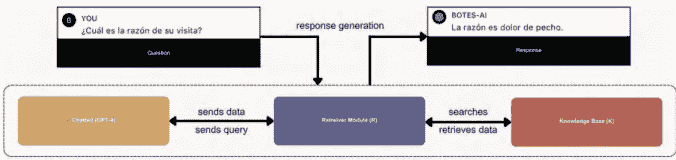

图 1.2 拟议 BOTES 应用工作模型的框图。

执行自动更新，并确保所有用户都能访问最新信息。移动应用前端可在 iOS 和 Android 平台上使用，并集成了语音转文字功能，能够准确模拟临床病例对话并提供口头响应。开发过程涉及使用临床对话数据（包括患者介绍、主要诉症和病史）训练 BOTES 应用程序，利用 GPT-4 的能力支持西班牙语医疗临床对话，并显著提升实践沟通技能。Firebase 维护西班牙语临床病例数据库的安全存储，并在 iOS 和 Android 平台上进行广泛测试，以确保在各种医疗环境中都有强大的性能。BOTES 应用的设计和构建包含表 1.1 所示的以下阶段。

### 1.3.2 B 部分

设计了一个聊天机器人以加快医疗访谈练习的频率。BOTES 提供给克雷顿大学凤凰城分校的 13 名一年级西班牙语临床技能俱乐部医学生。所有学生都受邀使用 Qualtrics 软件参与一项自愿且匿名的在线调查。调查探讨了满意度、优势和劣势，并请求针对未来更新提供反馈。克雷顿大学的机构审查委员会批准了方案 #2004602-01。

此外，用户在使用应用程序后接受了后续问题调查，其回答使用 DistilBERT 模型 14 进行分析，该模型对每个问题输出平均情感得分，得分范围在 0.0 到 1.0 之间，其中 1.0 表示最积极。该模型将在下文详细说明。

### 输入：

- 具有特征 {Qi, Fi,j} 的评论集 C，其中 Qi 是第 i 个问题，Fi,j 是问题 Qi 的第 j 条反馈
- 预训练情感分析模型 M（DistilBERT 模型：“distilbert-base-uncased-finetuned-sst-2-english”）

### 输出：

- 每个问题的平均情感得分

| 阶段 | 描述 |
| :--- | :--- |
| 1. 定义组件 | 指定大语言模型（GPT-4）、知识库（K）、Firebase 后端基础设施以及受支持的平台（iOS 和 Android）。 |
| 2. 丰富知识库 | 为知识库（K）添加大量西班牙语支持，以实现跨文化和全球知识整合。 |
| 3. 开发检索模块 | 创建检索模块（R），根据用户查询（q）在知识库（K）中搜索相关数据（D）。 |
| 4. 开发生成模块 | 实现生成模块（G），使用检索到的数据（D）通过 GPT-4 生成准确且符合语境的响应（r）。 |
| 5. 设置 Firebase 后端 | 建立 Firebase 后端以存储和同步西班牙语临床病例数据库（S）。 |
| 6. 启用自动更新 | 允许管理员对临床病例数据库（S）执行自动更新，以确保用户拥有最新信息。 |
| 7. 开发移动应用界面 | 构建可在 iOS 和 Android 平台上使用的移动应用界面。 |
| 8. 集成语音转文字功能 | 集成语音转文字功能以模拟临床病例对话并提供口头响应。 |
| 9. 训练 BOTES 应用程序 | 使用临床对话数据训练 BOTES 应用程序，重点关注患者介绍、主要诉症和病史。 |
| 10. 测试和部署应用程序 | 在 iOS 和 Android 平台上进行广泛测试，以确保强大的性能以及在 Firebase 中安全存储临床病例数据库。 |

### 步骤：

- 1. 定义问题集：
     Q = {Q1, Q2, ..., Qn}  
     从调查中初始化问题集。
   
- 2. 定义反馈评论集：
     F = {F_i,j | i ∈ [1, m_i]}  
     初始化反馈评论集，其中 F_i,j 是第 i 个问题的第 j 条反馈。
   
- 3. 展平评论并将其与问题关联：
     flattened_comments = ⋃_{i=0}^{n} {Q_1 | j ∈ [1, m_i]}  
     questions = ⋃_{i=0}^{n} {F_ij | j ∈ [1, m_i]}  
     将反馈评论的嵌套结构展平为单个列表，并创建相应的问题列表。
   
- 4. 使用 M 对 flattened_comments 进行情感分析：
     sentiments = M(flattened_comments)

将预训练情感分析模型 M 应用于展平的评论。输出是每条评论的情感预测列表，包括情感标签（例如，'积极'、'消极'）和置信度得分。

- 5. 提取情感标签 sentiment_labels 和得分 sentiment_scores：
   sentiment_labels = {sentiment[label] | sentiment ∈ sentiments}
   sentiment_scores = {sentiment[score] | sentiment ∈ sentiments}
   从情感分析结果中提取情感标签和置信度得分。

- 6. 创建带有 Question、Comment、Sentiment 和 Score 列的 DataFrame sentiment_df：
   sentiment_df = Question : questions, Comment : flattened_comments,
   Sentiment : sentiment_labels, Score : sentiment_scores
   构建一个包含反馈评论、其关联问题、情感标签和情感得分的 DataFrame。

- 7. 计算每个问题的平均情感得分：
   average_sentiment_score = mean(groupbyQuestion)
   按“问题”对 DataFrame 分组并计算每个问题的平均情感得分。

- 8. 返回 average_sentiment_scores：
   return average_sentiment_scores
   返回每个问题的平均情感得分。

## 1.4 结果

此 beta 测试应用的满意度调查参与率为 31%。总体评分为 75% 满意度。使用 1 到 5 的等级对应用的四个特性进行了评估，其中 1 为最低，5 为最高：（a）提高记忆力，（b）学生的自信心，（c）减轻学习过程中的压力，（d）帮助更频繁地练习问题。各领域的平均结果分别为 5、4.67、4.33 和 4.67（图 1.3）。

正面评论包括随时练习用西班牙语进行访谈的机会、练习医学西班牙语理解的可能性，以及根据要评估的主题修改临床病例的可能性（图 1.4）。100% 的参与者表示未来愿意使用 BOTES。

我们开发了一套利用自然语言处理技术来评估和可视化文本数据情感的情感分析系统。流程始于将与特定问题关联的反馈评论整合到单个列表中。来自 transformer 库的 distilbert-base-uncased-finetuned-sst-2-english 预训练情感分析模型对这些评论进行评估，生成情感标签（例如，积极、消极）和情感得分。情感得分是一个表示所分配置信度级别的数值。


### BOTES：正面特征

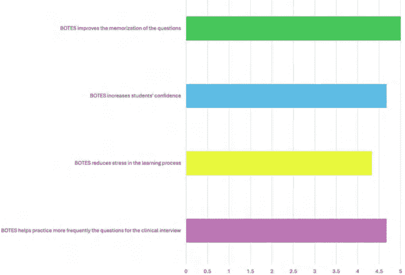

**图 1.3** 使用 BOTES 获得的正面特征平均结果。

情感，表示评论表达特定情感的概率。我们的情感分析系统旨在定量测量和比较不同问题反馈评论中表达的情感。情感分数提供了一种标准化的方式来评估文本数据的情感基调，有助于识别用户反馈中的趋势和模式。这些分数被系统地组织到一个 DataFrame 中，包含原始问题、评论、情感标签和分数。要计算每个问题的平均情感分数，我们按问题列对 DataFrame 进行分组，并使用 pandas 中的 groupby 方法接着 mean 函数来计算每组内情感分数的平均值。这会得到一个平均情感分数，反映每个问题的平均情感置信度。这些分数使用图 1.5 进行可视化，清晰比较不同问题的平均情感，从而实现对用户反馈的全面分析。

这些情感分数表明用户对该应用总体持有强烈的积极情感。来自问题反馈的平均情感分数为 0.959。

用户反馈描述了一些将纳入更新版本的修改。这些评论包括添加预加载的临床场景，用户可以选择与之练习，例如表现出胸痛或肺炎症状的患者。另一项建议是在启动临床面试模拟之前简化设置流程。

BOTES 的一个重大局限性是，对于西班牙语经验较少的学生，很难捕捉西班牙语声音。

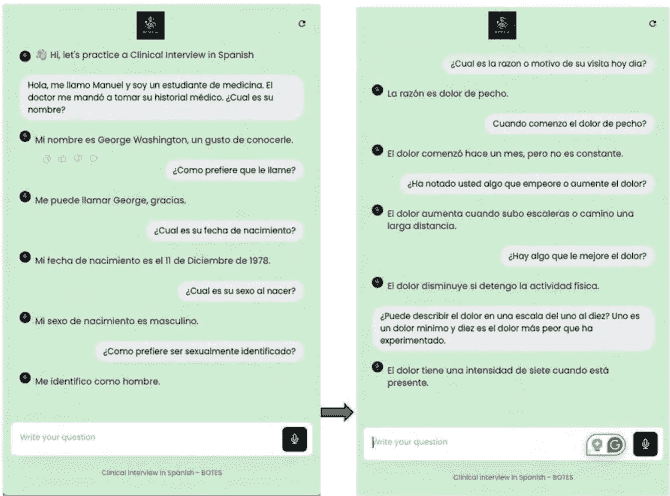

| | |
|---|---|
| 你好，我叫曼努埃尔，我是一名医学生。医生告诉我要采集病史。你叫什么？<br>-我是乔治·华盛顿，很高兴认识你。<br>你希望我怎么称呼你？<br>-你可以叫我乔治，谢谢。<br>你的出生日期是什么？<br>-我出生于1978年12月11日。<br>你出生时的性别是什么？<br>-我的出生性别是男性。<br>你希望如何被性别识别？<br>-我认同自己是男性。 | 您今天就诊的原因或动机是什么？<br>-原因是胸痛。<br>胸痛是什么时候开始的？<br>-疼痛始于一个月前，但不是持续性的。您是否注意到有什么会加重或增加疼痛？<br>-上楼梯或长距离行走时疼痛会加重。<br>有什么能减轻疼痛吗？<br>-停止体力活动后疼痛会减轻。<br>您能用1到10的等级描述疼痛吗？1表示轻微疼痛，10表示您经历过的最剧烈疼痛。<br>-当疼痛存在时，其强度为7。 |

**图 1.4** 医疗西班牙语理解的 BOTES 典型训练样本。机器人与一名医学生之间的西班牙语临床面试示例。(a) 绿色部分为西班牙语临床面试；(b) 在表格中，同一对话被翻译成英语。

用户提出了一些改进建议，包括延长应用程序接收语音输入的时长、提供更全面的临床场景，以及进行界面改进，例如通过删除“@”符号来增大空格键，并区分消息颜色以提高清晰度。这些建议表明用户希望获得一个更易于使用且更全面的工具，表明 BOTES 应用程序有望成为医学生和专业人士提升临床西班牙语技能的宝贵资产。高评分和积极的用户反馈证实了该应用程序在提升实用沟通技能方面的有效性，使其成为医学教育和培训中不可或缺的工具。

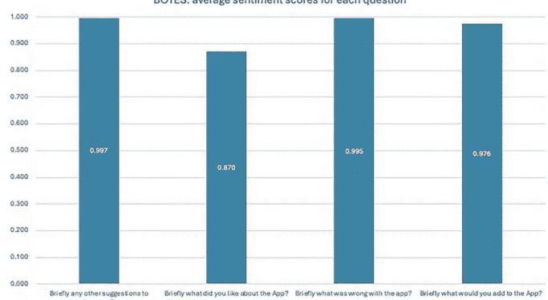

**图 1.5** 来自问题反馈的情感分析结果。

## 1.5 结论

西班牙语聊天机器人（BOTES）可以促进临床面试的记忆和练习，为与西班牙裔和西班牙语人群（英语水平有限）进行面试做准备，以解决由西班牙语到英语的语言障碍造成的差距。该工具可以帮助学生练习西班牙语临床面试，从而实现更快速、更准确的面试，并改善与临床环境中西班牙语使用者的关系。此外，拥有一个常规且快速的询问临床问题的流程，将增强面试者的信心，使他们在面试中有更多时间表现出同情心，并对患者采取整体方法。问题的流程将把面试变成患者的一种对话体验，而不仅仅是对每个问题打勾。

需要强调的是，BOTES 应用程序旨在促进学习和增加练习。它不打算取代人工面试。

局限性：主要局限性是使用来自不同国家的西班牙语使用者来测试模型。其他西班牙语国家使用的口音、沟通速度和词汇有所不同，这导致机器人在解释对话时出现一些错误。为了避免这一重大变量，决定使用墨西哥西班牙语（美国课堂中最常用的语言）来标准化机器人。

下一步是采纳反馈并升级该应用程序，使其作为西班牙语临床面试的辅助工具。由于聊天机器人可以解释不同语言，基础版 BOTES 应用程序可以升级为支持多种语言，以促进外语面试的学习，减少其他文化中的语言障碍。

### 1.5.1 声明与声明

该工作获得了克雷顿大学颁发的2023–2024年度教师卓越中心资助：克雷顿大学的西班牙语临床技能面试聊天机器人。
作者曼努埃尔·E·塞瓦略斯获得了该奖项。

### 1.5.2 伦理批准

克雷顿大学的机构审查委员会批准了本研究的问卷和方法，方案编号 #2004602–01。

## 参考文献

- [1] Tariq, Z. N. (2023). 沟通过程的生命：一种批判性和哲学性的沟通过程研究。*Qlantic Journal of Social Sciences and Humanities*, 4(4), 297–309. https://doi.org/10.55737/qjssh.498899116
- [2] Davenport, T., & Kalakota, R. (2019). 医疗保健中人工智能的潜力。*Future Healthcare Journal*, 6(2), 94–98. https://doi.org/10.7861/futurehosp.6-2-94
- [3] Jiang, F., Jiang, Y., Zhi, H., Dong, Y., Li, H., Ma, S., Wang, Y., Dong, Q., Shen, H., & Wang, Y. (2017). 医疗保健中的人工智能：过去、现在和未来。*Stroke and Vascular Neurology*, 2(4), 230–243. https://doi.org/10.1136/svn-2017-000101
- [4] Boyle, P. (2023, August 8). 人工智能如何帮助医生与患者沟通。美国医学院协会。https://www.aamc.org/news/how-ai-helping-doctors-communicate-patients
- [5] Malamas, N., Papangelou, K., & Symeonidis, A. L. (2022). 关于改善定位医疗虚拟助手性能的研究。*Healthcare (Basel, Switzerland)*, 10(1), 99. https://doi.org/10.3390/healthcare10010099
- [6] Gallegos, C., Kausler, R., Alderden, J., Davis, M., & Wang, L. (2024). 人工智能聊天机器人能改善心理健康吗？：一项范畴综述。*Computers, Informatics, Nursing: CIN*。提前在线出版。https://doi.org/10.1097/CIN.0000000000001155
- [7] Lichtenstein, P. R. (1990). 第3章：医疗面试。载于 H. K. Walker, W. D. Hall, & J. W. Hurst (Ed.), *临床方法：病史、体格检查和实验室检查* (第3版)。波士顿：Butterworths。https://www.ncbi.nlm.nih.gov/books/NBK349/
- [8] Pearson, S. D., & Raeke, L. H. (2000). 患者对医生的信任：许多理论，少量措施，和很少数据。*Journal of General Internal Medicine*, 15(7), 509–513. https://doi.org/10.1046/j.1525-1497.2000.11002.x
- [9] Adekunle, T. A., Knowles, J. M., Hantzmon, S. V., DasGupta, M. N., Pollak, K. I., & Gaither, S. E. (2023). 患者-临床医生互动中信任与不信任的定性分析。*PEC Innovation*, 3, 100187. https://doi.org/10.1016/j.pecinn.2023.100187
- [10] Greene, J., & Wolfson, D. (2023). 医生关于与患者建立信任的观点。*The Hastings Center Report*, 53(Suppl 2), S86–S90. https://doi.org/10.1002/hast.1528
- [11] Greek, A. A., Kieckhefer, G. M., Kim, H., Joesch, J. M., & Baydar, N. (2006). 按种族/族裔、语言和家庭收入划分的哮喘儿童常规医疗来源的家庭看法。*Journal of Asthma*, 43(1), 61–69. https://doi.org/10.1080/02770900500448639
- [12] Mecham, J. C., Salazar, M. M., Perez, R. M., Castaneda, U., Stamps, B. G., Chavez, A. S., & Kling, J. M. (2022). 探讨影响伦理西班牙语使用的因素

- 医学生及改进方案。医学教学与学习，34(5)，522–529。https://doi.org/10.1080/10401334.2021.1949996

- [13] Maldonado, A., Martinez, D. E., Villavicencio, E. A., Crocker, R., & Garcia, D. O. (2024). 无国界医疗：识别南亚利桑那州墨西哥移民医疗服务使用频率的决定因素。种族族裔健康差异杂志。在线提前出版。https://doi.org/10.1007/s40615-024-02024-x

- [14] Garcia, M. E., Williams, M., Mutha, S., Diamond, L. C., Jhi, J., Handley, M. A., Pathak, S., & Karliner, L. S. (2023). 语言一致性医疗：一项考察医师非英语语言能力评估实施的定性研究。普通内科医学杂志，38(14)，3099–3106。https://doi.org/10.1007/s11606-023-08354-6

- [15] Mustafa, R., Mahboob, U., Khan, R. A., & Anjum, A. (2023). 语言障碍对医患关系的影响：一项定性研究。巴基斯坦医学杂志，39(1)，41–45。https://doi.org/10.12669/pjms.39.1.5805

- [16] 美国的西班牙裔或拉丁裔（2020年）。美国人口普查局。https://www.census.gov/search-results.html?q=hispanic+or+latino+in+the+US&page=1&stateGeo=none&searchtype=web&cssp=SERP&_charset_=UTF-8

- [17] Frey, W. (2018年3月14日). 美国将在2045年成为“少数族裔白人”国家。布鲁金斯学会。https://www.brookings.edu/blog/the-avenue/2018/03/14/the-us-will-become-minority-white-in-2045-census-projects/

- [18] 美国人口普查局。(2020年)。亚利桑那州总人口。https://www.census.gov/search-results.html?q=arizona+population&page=1&stateGeo=none&searchtype=web&cssp=SERP&_charset_=UTF-8

- [19] 快速事实，美国人口普查局。(2020年)。亚利桑那州的西班牙裔或拉丁裔。https://www.census.gov/quickfacts/fact_table/phoenixcityarizona/RH1725221#qf-headnote-b

- [20] 美国人口普查局。(2020年)。亚利桑那州凤凰城总人口。https://data.census.gov/profile/Phoenix_city,_Arizona?g=160XX00US0455000

- [21] Balch, B. (2023年7月18日). 美国需要更多会说西班牙语的医生。美国医学院协会(AAMC)。https://www.aamc.org/news/united-states-needs-more-spanish-speaking-physicians#:~:text=Yet%20%C2%20only%206%25%20of%20physicians,Spanish%20Dspeaking%20%C2%20Anaya%2020says

- [22] Al Shamsi, H., Almutairi, A. G., Al Mashrafi, S., & Al Kalbani, T. (2020). 语言障碍对医疗保健的影响：一项系统综述。阿曼医学杂志，35(2)，e122。https://doi.org/10.5001/omj.2020.40

- [23] Baglivo, F., De Angelis, L., Casigliani, V., Arzilli, G., Privitera, G. P., & Rizzo, C. (2023). 探索人工智能聊天机器人在公共卫生教育中的可能应用：可行性研究。JMIR 医学教育，9，e51421。https://doi.org/10.2196/51421

- [24] Nghi, T. T., Phuc, T. H., & Thang, N. T. (2019). 应用人工智能聊天机器人进行外语教学：一项实证研究。科学与技术研究国际杂志，8(12)，897–902。

- [25] Kohnke, L. (2023). 教学聊天机器人：一种补充语言学习工具。未来高等教育，54(3)，133–141。https://doi.org/10.1177/2347631120983481

- [26] Kumar, P. S., Sindhu, P., Jahnavi, A., Charan, B. P., & Prashanth, S. (2023). 基于自然语言处理的大学聊天机器人系统。载于《人机界面技术进步与应用》（第301–312页）。CRC Press。

- [27] Aicham, J., Adler, S., Agarwal, S., Ahmad, L., Akkaya, I., Aleman, F. L., Almeida, D., Altenschmidt, J., Altman, S., Anadkat, S., Avila, R., Babuschkin, I., Balaji, S., Balcom, V., Baltescu, P., Bao, H., Bavarian, M., Belgum, J., Bello, I., ... Zoph, B. (2023). GPT-4 技术报告。ArXiv。/abs/2303.08774

- [28] Google 开发者。(2023年)。Firebase 文档。https://firebase.google.com/docs

# 2 胃肠道疾病的人工智能驱动诊断辅助

Bhavanam Gireesh Reddy, Nilima Zade, Shubhada Deshpande, Chira Anudeep Gaud, Saswati Behra, and Nithesh Naik

## 2.1 引言

胃肠道疾病对全球人民构成严重威胁，导致数百万病例以及巨大的经济和社会成本。从胃肠道感染和胃肠道溃疡等简单情况，到胃癌等更复杂的疾病，早期体征及相关症状可能被忽视，导致诊断延迟和患者并发症。预防性管理和及时诊断被公认为治疗这些疾病的主要独立因素，最终提升患者护理质量。通过医学影像与人工智能（AI）的融合，可以辅助疾病预后和预测。目前大量临床影像数据的可用性，使研究人员和临床医生能够利用机器学习（ML）技术创建新模型，成功预测胃部疾病的存在及性质。另一种常用方法是训练人工智能模型对胃肠道内镜图像进行分类。超过8000张真实临床图像已被收集到一个名为 Kvasir v2 数据集的大型集合中。该数据集涵盖了临床实践中常见的几乎所有胃肠道疾病，包括糜烂、溃疡、息肉和恶性疾病。

本研究聚焦于利用 Kvasir v2 数据集借助 AI 辅助诊断胃肠道疾病所带来的机遇与挑战。研究探讨了模型训练和模型评估过程的技术。不同疾病可能有相似症状，且不同机构可能给出不同诊断，这就是为什么经常会出现差异。计算机辅助诊断的使用有助于从业者更快速、更审慎地做出决策 [1]。通过应用尖端的 ML 算法，这项工作旨在弥补胃肠道健康障碍早期识别与延误缓解方面的这些差距。该研究实现了基于 CNN 和迁移学习方法的特征提取，利用内镜图像识别和分类胃部区域的各种胃肠道疾病。通过突出模型性能并展示 AI 如何通过个性化治疗方案、及时诊断和干预提升患者生存率，确立了 AI 模型的实用价值。这项研究预计将改善胃肠道障碍管理的当前方法和计划，对全球公共卫生计划产生重大影响。

检测不仅有助于改善及时治疗，还促进预防措施的建立。预测模型准确性不足的问题，已通过在训练和测试阶段引入正则化和丢弃技术来解决。这些技术有助于更准确地确定图像中显现的具体疾病。基于 AI 的计算机辅助诊断能有效诊断胃部疾病，丰富医疗领域，并拓展优质疾病管理的前景。

本章余部分组织如下。第 2.2 节介绍了著名研究人员的已发表工作。第 2.3 节阐述了本工作采用的方法和程序。第 2.4 节讨论了结果，第 2.5 节总结了未来可能的工作方向。

## 2.2 文献综述

[2] 的作者们对 12 种不同的预测胃癌模型进行了系统综述。观察到，强鉴别模型使用了临床发现及显微图像。建议将独立数据集与数据集划分技术结合用于验证。利用称为 TCGA 数据集的癌症基因组图谱，[3] 的作者们提出了用于检测胃癌的 MultiDeepCox-SC 模型。使用 CPH，即 Cox 比例风险模型，MultiDeepCox-SC 考虑了 DeepCox-SC 风险评分、年龄和 10 个基因的表达。病理图像被用于训练 DeepCox-SC 模型。然后，使用 Cox 回归技术，将模型输出（即 DeepCox-SC 风险评分）与临床信息（年龄）和基因表达（10 个基因）合并。样本数量为 y，即 442 张全切片病理图像。达到的准确率为 83.3%。拟方法的训练阶段基于使用细胞密度和 Cell Profiler 软件选定的补片，这些补片会影响性能。需要更多补片的高倍显微图像来提高性能。[4] 的作者们提出了 XGBoost 模型，使用 25,942 名和 1431 名患者的个体患者数据作为预测数据集来预测胃部疾病。每位参与者必须有一个数据标签（病例：y = 1，对照：y = 0）。他们将 89 名患者归为病例组（y = 1），这些患者在 122 个月内被发现患有胃癌。达到的准确率为 77.7%，AOC 为 89.9%。他们观察到所采用的数据集数量不足，因此为提高准确率，需要采用大型数据集进行训练并更准确地预测。[5] 的作者们对 11 种不同的机器学习模型进行了系统分析，使用公共医疗数据集预测疾病。观察到，最强的模型是 k-近邻（KNN），并有

准确率为 93.5%。数据划分是随机进行的，且有些模型依赖于参数，k 的值因模型而异，这会影响准确率。选择适当的参数有助于提高准确率。文献 [6] 的作者提出了 GC 风险（胃癌风险）模型，利用 450 名患者的医院数据来预测胃癌。阳性预测的准确率为 83.6%。训练在选定的参数上进行，如身体质量指数 (BMI)、癌症病史等，主要聚焦于多基因风险评分 (PRS) 和单核苷酸多态性 (SNP) 以预测胃癌，这会影响准确率。所使用的数据集也较小，为了更准确地预测，需要使用更大的数据集。

文献 [7] 的作者利用伊朗 Ayatollah Taleghani 医院胃癌数据库中的 2029 个个体数据点，对六种不同的机器学习模型进行了系统分析以预测胃癌。XGBoost 被认定为六种不同机器学习模型中的最佳模型，因为它在选定特征上获得 83.4% 的准确率，在所有特征上获得 65.2% 的准确率。训练模型通过使用 Relief 算法在选定特征上进行训练。然而，该模型需要在更大的数据集上进行验证，以获得更好的预测和结果。

文献 [8] 的作者利用不同图像的合并数据集，对机器学习模型和基于深度学习的模型进行了系统分析以预测胃癌。对于特征选择，他们使用了迁移学习技术，并使用蜻蜓算法作为优化器。提出的算法包括广义归一化 (GN)-Bayes、C-k-最近邻 (C-KNN)、LD（线性判别）和 ResNet50。与以往研究相比，这些模型获得的准确率很有前景，但增加了计算成本和拼接开销。

文献 [9] 的作者提出了神经网络 spss-v.18，使用 430 名患者数据作为 Baghban 诊所的数据集来预测胃癌。获得的正确预测率为 92%。所提方法的训练阶段基于选定的特征，他们没有将家族病史作为预测特征。这会影响预测准确率，因为癌症也可能源于家族病史。为预测选择合适的特征可以提高性能和正确预测百分比。

文献 [10] 的作者利用 133 名患者的数据，对不同机器学习模型进行了系统分析。在六种不同的机器学习模型中，随机森林被认定为疾病预测的最佳模型。获得的准确率为 80.8%。特征数量较多，而数据集较小。因此，可能会发生过拟合。将特征数量减少到仅预测所需的特征，将提高性能和准确率。

文献 [11] 的作者提出了人工智能模型“MIL-gastro cancer”模型，利用 1200 名个体患者数据来预测胃癌。获得的准确率为 92%。在训练阶段，模型使用 10 倍和 5 倍放大图像，这会影响准确率。此外，还需要大规模的手动像素级处理，这会花费大量时间。为了获得更好的准确率，可以借助代码进行数据增强和像素级处理。

研究 [12] 对使用深度学习模型和技术对息肉进行分割的最新研究进行了概述。研究 [13] 使用息肉数据集和性能指标对深度学习模型进行了统计考察。在该研究中，Kvasir-SEG（一个用于息肉检测、定位和分割的开放获取结肠镜图像数据集）被用作基准，以评估许多当代最先进方法的准确率和速度。研究 [14] 提供了息肉检测技术比较分析的结果，概述了各方法之间差异的后续研究，并提供评估数据集和性能指标定义，以便不同方法可以进行比较。

## 2.3 方法

### 2.3.1 数据描述与数据预处理

Kvasir v2 数据集已从 Kaggle 网站 [15] 下载。Kvasir v2 数据集中的图像已被证明对胃肠道疾病的分类数据很有用。这是来自临床环境的新、高质量内镜图像的集合。该数据集涵盖了多种胃肠道病理，包括良性 (B) 病理（如糜烂、溃疡和息肉）以及恶性 (M) 病理（如肿瘤和癌症），还有其他如胃炎、食管炎和巴雷特食管等。样本分为八组，每组提供各种胃肠道疾病及其区分特征。由于其丰富的特征以及来自内镜和结肠镜的各种输入图像类型，所提数据集可用于构建和测试基于 AI 的预测模型，以提高诊断准确率和分类效果。该数据集的开放获取特性是选择这一功能丰富的数据集进行研究的额外动力。数据已被分为 80% 用于训练数据，20% 用于验证数据。现代机器学习算法（包括 CNN 和迁移学习模型 ResNet50）已成为本研究的重点。此外，InceptionV3、Xception、Visual Geometry Group 19 (VGG19) 和长短期记忆网络 (LSTM) 已用于实验和比较。

表 2.1 显示了数据划分后的训练集和测试集。由于数据不平衡，癌症类型未选择任何图像用于训练，但模型实现后能正确识别该类别。

| 序号 | 类别 | 训练数据图像 | 测试数据图像 |
|---|---|---|---|
| 1 | 正常 | 993 | 86 |
| 2 | 糜烂 B | 983 | 101 |
| 3 | 息肉 B | 975 | 88 |
| 4 | 溃疡 B | 997 | 107 |
| 5 | 胃炎 B/M | 1000 | 88 |
| 6 | 食管裂孔疝 B/M | 967 | 105 |
| 7 | 不典型增生 B/M | 392 | 112 |
| 8 | 癌症 M | 0 | 112 |

### 2.3.2 模型训练与架构

InceptionV3、Xception、VGG19、LSTM 和 ResNet50 已在数据上实现。这种深度学习模型以其强健的性能而闻名。模型的训练数据为数据的 80%，其余数据划分为验证数据和测试数据。对信息进行预处理，提取特征，使用的技术是迁移学习模型。模型使用 Adam 优化器进行优化，并从图像中提取所需特征。应用最大池化和展平层，将图像转换为单维图像。此表示通过卷积层传递。模型包含 32 层，最终产生最终输出。在训练过程中，会获得每个时期的验证准确率、验证损失和模型准确率。模型训练 100 个时期。由于数据集较大或其他因素，可能会发生过拟合。为解决此问题，采用了 dropout 函数，在训练期间丢弃一些层，并使用 L2 正则化来防止过拟合。这些技术有助于提高准确率。图 2.1 显示了考虑的八组疾病数据。图 2.2 显示了模型架构的工作流，图 2.3 显示了所开发深度学习方法的架构配置。图 2.4 给出了深度学习模型的实现细节。

验证数据用于评估模型，模型的适用性通过使用验证数据获得的图表所给出的准确率进行评估。

方程 2.1 所表示的数学模型提供了一套先进的深度学习规则。为解决训练非常深层神经元时遇到的梯度消失问题，使用了残差块，这使得检查残差函数比直接尝试学习优先映射插值更容易。

```
y = F(x) + W2 / sigma(W1 + b1) + b2              (2.1)
```

以下是元素的详细说明：

- x: 块的输入。
- W1 和 W2: 可学习的权重参数。
- b1 和 b2: 偏置项。
- sigma: SoftMax 激活函数。
- F(x): 表示块旨在学习的残差映射。
- H(x) = W2sigma(W1x + b1) + b2: 表示学习到的残差映射。
- y: 块的输出。

算法步骤如下

输入：

- 设 X 表示输入。
- 初始卷积和池化：


- 正常
- 癌症
- 食管裂孔疝
- 不典型增生
- 胃炎
- 糜烂
- 息肉
- 溃疡

**图 2.1** Kvasir v2 数据集中的疾病类别图像。

- 输入经过初始卷积层，随后进行最大池化：
  - C1 = Conv(X, W1) + b1
  - P1 = Max Pooling(C1)
  - W1 = 初始卷积层的权重
  - b1 = 偏置项
- 残差块：
  - ResNet50 由多个残差块组成，每个包含多个卷积层：
    - R = Residual Block(Pi-1, {Wij}_{j=1}^{Ni}) (4)
    - Pi-1 = 前一个池化层或残差块的输出
    - Wij = 块 i 中卷积层的权重
    - Ni = 块 i 中的卷积层数量
  - 最终层：
    - 全局平均池化 (GAP):
      - G = GAP(Rfinal)
    - 最终连接层：
      - FC1 = G.WFC1 + bFC1
      - FC2 = ReLU(FC1.WFC2 + bFC2)
      - WFC1, WFC2 是权重矩阵，bFC1, bFC2 是偏置向量。
    - SoftMax 激活函数：
      - y^ = Softmax(FC2)
      - Softmax(z)_i = e^{z_i} / \sum_{j=1}^{C} e^{z_j}
      - C = 类别数量
    - L2 正则化：
      - L2 正则化可应用于权重
      - 正则化损失 = Categorical Crossentropy(y^, ytrue) + λ·||WFC1||_2^2 + λ·||WFC2||_2^2
      - λ 是正则化参数。

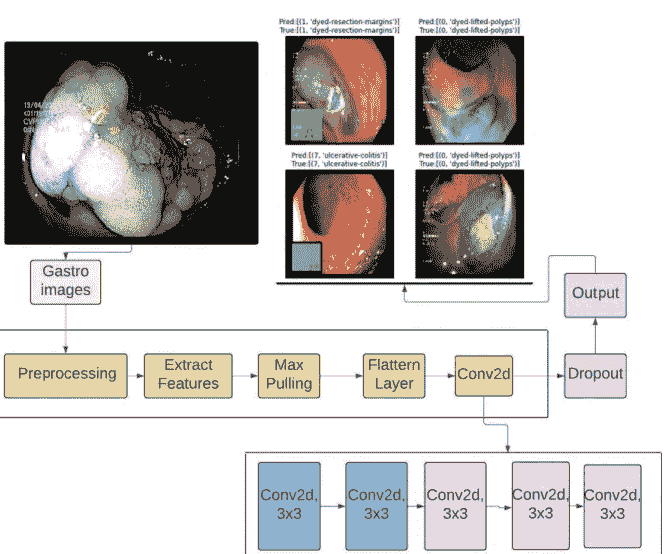

**图 2.2** 模型架构的工作流程。

| 特征 | 详情 |
| :--- | :--- |
| 开发的深度学习方法的架构配置 | |
| 层 | 描述 |
| 基础模型 | ResNet50, InceptionV3, Xception, VGG19 和带有 keras notop 预训练权重的 LSTM |
| 归一化 | 提供的代码中未使用 |
| 密集层 | 具有 128 个单元的密集层。激活：Sigmoid。正则化：L2 正则化 |
| 丢弃层 | 具有 0.5 单元的丢弃 |
| 输出层 | 单元数等于类别数 (8) 的密集层。激活：SoftMax |
| 模型编译 | 优化器：AdamW (学习率：0.0001)，损失：类别交叉熵，指标：准确率 |
| 训练期间的回调 | EarlyStopping(88 个时代), ModelCheckpoint, ReduceLROnPlateau |
| 训练 | 使用 fit 模型。最大时代：100。在属于 8 个类别的 6400 张图像上进行训练。 |
| 评估 | 模型在每个时代后在验证集上进行评估。指标：验证损失和准确率 |

**图 2.3** 开发的深度学习方法的架构配置。

为评估模型的有效性，在机器学习中实现了混淆矩阵。该矩阵对比了数据集的实际病例数与模型产生的预测病例数，如图 2.4 所示。准确率按照公式 2.2 计算。

| | 实际数量 |
|---|---|
| 预测数量 | TP | FP |
| | FN | TN |

| 实现 | ResNet 50 | InceptionV3 | Xception | VGG19 | LSTM |
| :--- | :--- | :--- | :--- | :--- | :--- |
| 卷积层 | 具有不同滤波器大小 (32, 224, 224, 3) 的多个卷积层(50)，"Sigmoid" / SoftMax 激活函数。 | 具有不同滤波器大小 (32, 299, 299, 3) 的多个卷积层(48)，"Sigmoid" / Softmax 激活函数。 | 具有不同滤波器大小 (32, 299, 299, 3) 的多个卷积层(71)，"Sigmoid" / Softmax 激活函数。 | 具有不同滤波器大小 (64, 224, 224, 224, 3) 的多个卷积层(16 和 (3)个完全连接层)，"Sigmoid" / SoftMax 激活函数。 | LSTM 是循环神经网络类型，具有不同滤波器大小 (64, 224, 224, 3) 的多个卷积层(32)，"Tanh" / Softmax 激活。 |
| 最大池化层 | 1 | 不适用 | 不适用 | 不适用 | 2 |
| 丢弃层 | 0.5 | 0.5 | 0.5 | 不适用 | 0.5 |
| 展平层 | 1 | 不适用 | 不适用 | 1 | 1 |
| 密集层 | 具有 128 个单元的全连接层 | 具有 128 个单元的全连接层 | 具有 128 个单元的全连接层 | 不适用 | 256 |
| 损失函数 | 类别交叉熵 | 类别交叉熵 | 类别交叉熵 | 类别交叉熵 | 类别交叉熵 |
| 批大小 | 32 | 32 | 32 | 64 | 64 |
| 优化器 | AdamW | AdamW | AdamW | AdamW | AdamW |
| 验证集划分比例 | 20%，以准确率作为评估指标 | 20%，以准确率作为评估指标 | 20%，以准确率作为评估指标 | 20%，以准确率作为评估指标 | 20%，以准确率作为评估指标 |
| 每个时代步数 | 每个时代 200 步 (100 个时代) | 每个时代 200 步 (100 个时代) | 每个时代 200 步 (100 个时代) | 每个时代 100 步 (100 个时代) | 每个时代 100 步 (100 个时代) |

**图 2.4** 深度学习模型的实现细节。

```
Accuracy = \left( \frac{TP + TN}{TP + TN + FP + FN} \right)
```

以下是各元素的分解：真阳性：TP，真阴性：TN，假阳性：FP，假阴性：FN。

## 2.4 结果与讨论

基于 Kvasir v2 数据集的胃部疾病预测取得了有希望的结果，展示了深度学习算法在基于内镜图像辅助早期检测和分类胃部疾病方面的潜力。本文在此介绍了该研究的关键发现，并讨论了其临床意义及进一步研究的领域。图 2.5 显示了验证误差与训练误差之间的差距。训练误差计算为模型预测与其训练数据中实际值之间的差异。另一方面，验证误差是通过将模型预测与未用于训练的独立数据集的实际值进行比较来确定的。理想情况下，训练误差和验证误差应相似。然而，在图像中，在大多数时代内，训练误差（蓝色线）被观察到高于验证误差（红色线）。这种差异表明模型对训练数据出现了过拟合。过拟合是一种可以通过采用正则化技术来解决的建模问题。已使用 L2 正则化来缓解过拟合问题。图 2.6 描绘了一个旨在预测胃部疾病的模型的性能。该图包含两条线，分别显示训练准确率和验证准确率。训练准确率指示模型在训练数据上的预测表现，而验证准确率则衡量其在单独的未见数据集上的性能。理想情况下，这两条线应高度一致。从图中可以解读出几种情况。相似的训练和验证准确率表明该模型具有泛化能力，能够对新数据进行准确预测，代表着积极的结果。

损失图

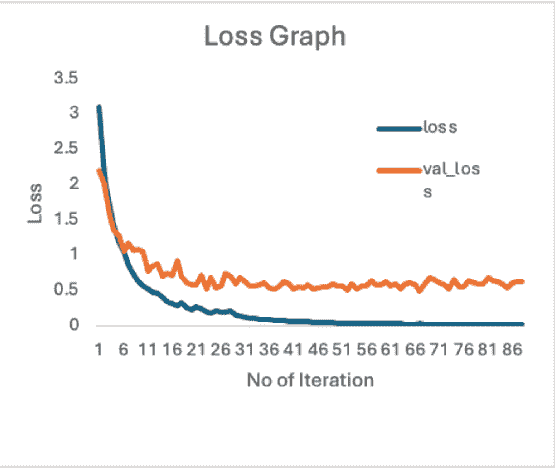

**图 2.5** 验证误差与训练误差之间的差距。

准确率图

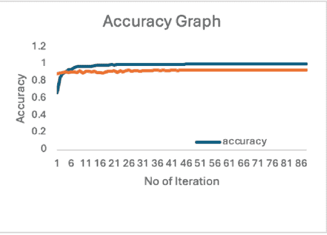

**图 2.6** 训练准确率与验证准确率的比较。

训练准确率超过验证准确率可能表明存在过拟合。这表明在训练期间，模型在训练数据上运行有效，但在处理未见数据时会遇到困难。解决此问题可能需要对模型进行调整或增加更多训练数据。图 2.7 显示了训练阶段的混淆矩阵，图 2.8 显示了测试阶段的混淆矩阵。该模型总体表现良好，在大多数类别中均具有高准确率。然而，它在区分微妙的糜烂与正常组织方面存在一些困难，可能会将息肉与不典型增生混淆。胃炎始终被准确识别，而食管裂孔疝有时会被误认为息肉。该模型正确识别了癌症，仅有

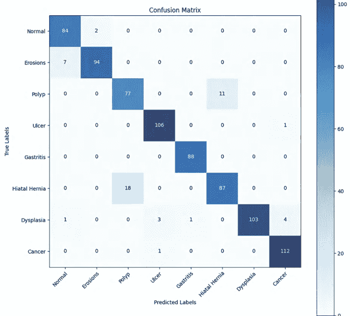

**图 2.7** 训练阶段混淆矩阵。

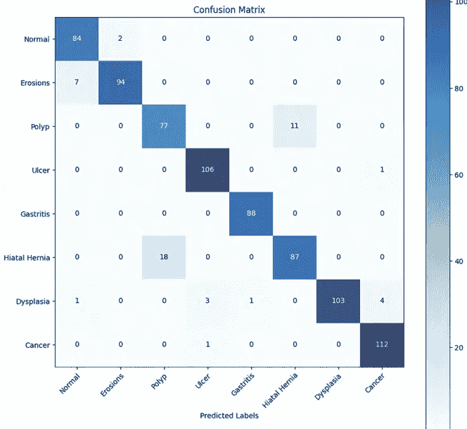

**图 2.8** 测试阶段混淆矩阵。

一次误分类。考虑到癌症可能缺乏训练数据，这是一个相对较好的结果，但仍显示出轻微的误分类脆弱性。

表 2.2 介绍了各种优化器及其在训练期间使用 SoftMax 激活函数对 ResNet50 模型分类胃肠道疾病性能的影响。所选优化器在最小化均方误差方面的有效性被发现是决定模型性能的重要因素。如表 2.2 所示，Adam 和 AdamW 成为最有效的算法，达到了 94% 的得分，展示了其优化能力。同样，随机梯度下降 (SGD) 方法获得了 91% 的得分，而 RMSprop 获得了 88% 的等级。相比之下，Nadam 获得了显著较低的 60.4% 得分。基于这些结果和表格的描述，Nadam 被认为不适合作为疾病预测的优化器。表 2.3 展示了所提工作与已发表工作的对比，考虑了所使用的数据集和模型所达到的准确率。使用所提模型，达到了 98.6% 的准确率。


表 2.2 所用优化器的比较研究

| 激活函数 | 优化器 | 准确率 (%) |
|---|---|---|
| SoftMax | AdamW | 94 |
| | Adam | 94 |
| | RMSProp | 88 |
| | SGD | 91 |
| | Nadam | 60.4 |

表 2.3 胃肠道疾病检测与已发表结果的比较

| 参考文献编号 | 数据集 | 模型 | 精确率 | 召回率 | F1 | 准确率 |
|---|---|---|---|---|---|---|
| [11] | 91 例 GC 患者的 175 张数字照片 | CNN | – | – | – | 92 |
| [14] | ETIS-LaribPolypDB | CNN | 0.69 | 0.495 | 0.125 | – |
| [14] | CVC-ClinicDB | CNN | 0.10 | 0.49 | 0.165 | – |
| 本研究 | ETIS-LaribPolypDB | ResNet50 | 0.79 | 0.65 | 0.69 | 82 |
| 本研究 | CVC-ClinicDB | ResNet50 | 0.7 | 0.65 | 0.6 | 85 |

表 2.4 与已发表结果的比较

| 参考文献编号 | 数据集 | 模型 | 精确率 | 召回率 | F1 | 准确率 |
|---|---|---|---|---|---|---|
| [13] | Kvasir-SEG | ResNet34 | 0.8435 | 0.8496 | 0.8206 | 94.93 |
| 本研究 | Kvasir-SEG | ResNet50 | 0.71 | 0.79 | 0.64 | 92 |
| | Kvasir 数据集（息肉） | | 0.895 | 0.875 | 0.885 | 98.6 |

表 2.3 显示了研究 [10, 13] 给出的结果。在 [13] 中，使用 CNN 模型，数据包含息肉图像。为比较目的，考虑了 91 例 GC 患者的 175 张数字照片、ETIS-LaribPolypDB、CVC-ClinicDB（息肉）数据集。使用 ResNet50 模型获得的结果显示，ETIS-Larib PolypDB 数据集的准确率为 82%，CVC-ClinicDB 数据集的准确率为 85%，取得了显著进步。此外，精确率、召回率和 F1 分数显著提高，表明模型的鲁棒性得到了增强。

表 2.4 将发表的研究 [12]（使用 ResNet34 模型和 Kvasir-SEG（息肉）数据集）的结果与我们使用 ResNet50 模型和 Kvasir-SEG（息肉）及 Kvasir 数据集（息肉）两个数据集的结果进行了比较。使用 Kvasir 数据集（息肉）时，准确率达到 98.6%。为什么 ResNet34 在 Kvasir-SEG 上的准确率优于 Kvasir 数据集？Kvasir-SEG 和 Kvasir 数据集都与医学图像分析相关，具体用于胃肠内镜。然而，它们的用途不同，包含的数据类型也不同。Kvasir-SEG 更专门用于分割任务，而 Kvasir 数据集则满足更广泛的检测和分类需求。Kvasir-SEG 用于训练和评估图像分割的机器学习模型，而不是分类。它帮助模型学习如何勾勒内镜图像中息肉的边界。ResNet34 的跳跃连接使其能够保留高层和低层特征，这对于需要精确边界检测的分割任务尤其有益。这一能力与 Kvasir-SEG 查找息肉边缘的任务非常契合。

表 2.5 ResNet34 和 ResNet50 模型在 Kvasir 数据集上的性能

| 模型 | 精确率 | 召回率 | F1 | 准确率 |
|---|---|---|---|---|
| ResNet34 | 0.69 | 0.62 | 0.71 | 90.5 |
| ResNet50 | 0.95 | 0.94 | 0.94 | 94 |

表 2.5 给出了我们 ResNet34 和 ResNet50 模型的性能。此外，精确率、召回率和 F1 分数显著提高，表明模型的鲁棒性得到了增强。Kvasir 数据集涵盖了更广泛的胃肠道疾病和解剖位置，增加了任务的复杂性。类别、疾病和区域的多样性使得模型更难有效地学习所有变化，ResNet34 可能会在图像内容的变异性方面遇到困难。对于分类，模型需要学习更抽象、更高层次的特征。考虑到 Kvasir 数据集的多样性，ResNet34 可能不如更专业或更深入的模型适合复杂医学影像数据集中的多类分类任务。使用 ResNet34 和 ResNet50 模型对 Kvasir 数据集获得的结果表明，ResNet50 表现更好，准确率达到 94.6%。ResNet50 占据优势。胃肠道疾病检测系统所提方法的源代码可在 GitHub 仓库 [16] 中找到。

表 2.6 显示了使用所提 ResNet50 模型对所考虑的不同类别图像获得的结果。准确率超过 97%，甚至达到 100%。精确率、召回率和 F1 分数也名列前茅。所提算法的源代码可在 GitHub 仓库 [16] 中找到。

表 2.6 ResNet50 模型在 Kvasir 数据集上的类别性能分析

| 类别 | 精确率 | 召回率 | F1 | 准确率 |
|---|---|---|---|---|
| 正常 | 0.913 | 0.923 | 0.918 | 99.7 |
| 糜烂 | 0.922 | 0.979 | 0.95 | 97.2 |
| 息肉 | 0.895 | 0.875 | 0.885 | 98.6 |
| 溃疡 | 0.972 | 1 | 0.986 | 100 |
| 胃炎 | 0.967 | 1 | 0.983 | 100 |
| 裂孔疝 | 0.956 | 0.829 | 0.888 | 98 |
| 异常增生 | 0.963 | 0.92 | 0.941 | 99.4 |
| 癌症 | 1 | 0.991 | 0.995 | 100 |

## 2.5 结论

在本研究中，CNN 模型 ResNet50 在 Kvasir v2 数据集上进行了训练，采用了多种优化器。对这些优化器性能进行比较所得结果表明，Adam 和 AdamW 是最高效的，准确率达到 94%。发现这些优化器的预测准确率比其他优化器高出 14%。与已发表的工作相比，表明所提模型 ResNet50 在不同数据集和不同 CNN 算法之间具有鲁棒性和增强的性能。该模型表现更准确，总体准确率为 98.6%。该模型在 Kvasir v2 数据集上进行训练和测试，这是一组来自胃肠道不同区域的通用开源图像，带有息肉、溃疡等疾病标签的注释，以及专门用于分割任务的 Kvasir 数据集子集 Kvasir-SEG，该子集提供带有像素级分割掩码的图像，这些掩码指示胃肠道内息肉或其他异常区域的确切边界。模型 ResNet50 的性能也在 Kvasir-SEG 和 Kvasir v2 数据集上进行了测试。该模型表现更准确，总体准确率为 94%。模型的类别性能显示，所考虑的不同类别的预测准确率超过 97%，其中三个类别达到 100%。对于最痛苦的胃炎和溃疡以及最可怕的癌症，准确率均为 100%。这些结果使我们得出结论，开发一种新颖、高效的诊断工具以及一种支持胃肠道专业人士的泛化良好的基准测试技术已完成。

本研究的未来方向包括通过实施数据增强方法和结合多种模型来评估其性能，从而提高准确率。还设想开发一个应用程序，帮助个人主动预测疾病。该应用程序将允许医疗从业者输入其活动和医疗报告图像，使模型能够生成预测。在医学领域应用深度模型为改进预测提供了巨大的潜力。

### 2.5.1 致谢

我们感谢协和技术学院的领导对研究工作的支持。

### 2.5.2 资金来源

该工作得到协和国际大学研究支持基金的支持。
无利益冲突。
特此所有作者声明无利益冲突。

### 2.5.3 伦理声明

不适用，因为本章不涉及根据《生物伦理法》对动物或人类受试者进行研究；未诱导或影响受访者的心理或社会行为。

## 参考文献

- [1] Zade, N., K. Gupta, S. Mutha, O. Mengshetti, G. Joshi, 和 R. K. Iyer. “使用 LSTM 进行股票市场趋势技术分析与价格预后。” 2023 年第 7 届多学科研究与创新技术国际研讨会（ISMSIT），安卡拉，土耳其，2023 年，第 1–5 页，https://doi.org/10.1109/ISMSIT58785.2023.10304934.
- [2] Gu, Jianhua, Ru Chen, Shao-Ming Wang, Minjun Li, Zhiyuan Fan, Xinqing Li, Jiachen Zhou, Kexin Sun, 和 Wenqiang Wei. “普通人群胃癌风险预测模型：系统综述。” 癌症预防研究 15, no. 5 (2022): 309–18.
- [3] Wei, Ting, Xin Yuan, Ruitian Gao, Luke Johnston, Jie Zhou, Yifan Wang, Weiming Kong, Y. Xie, Y. Zhang, D. Xu, 和 Z. Yu. “利用表达数据和带组织病理学图像的深度学习模型进行胃癌生存预测。” 癌症科学 114, no. 2 (2023): 690–701.
- [4] Taninaga, Junichi, Yu Nishiyama, Kazutoshi Fujibayashi, Toshiaki Gunji, Noriko Sasabe, Kimiko Iijima, 和 Toshio Naito. “利用机器学习算法和全面体检数据预测未来胃癌风险：一例对照研究。” 科学报告 9, no. 1 (2019): 12384.
- [5] Keniya, Rinkal, Aman Khakharia, Vruddhi Shah, Vrushabh Gada, Ruchi Manjalkar, Tirth Thaker, Mahesh Warang, 和 Ninad Mehendale. “使用机器学习从各种症状预测疾病。” 可于 SSRN 3661426 (2020) 查阅。
- [6] Park, Boyoung, Sarah Yang, Jeonghee Lee, Il Ju Choi, Young-II Kim, 和 Jeongseon Kim. “使用流行病学风险评估模型和多基因风险评分预测胃癌风险。” 癌症 13, no. 4 (2021): 876.
- [7] Afrash, Mohammad Reza, Mohsen Shafiee, 和 Hadi Kazemi-Arpanahi. “基于生活方式因素建立机器学习模型以预测胃癌早期风险。” BMC 胃肠病学 23, no. 1 (2023): 6.
- [8] Mohammad, Farah, 和 Muna Al-Razgan. “基于深度特征融合和优化的胃部疾病分类方法。” 传感器 22, no. 7 (2022): 2801.
- [9] Charati, Jamshid Yazdani, Ghasem Janbabaei, Nadia Alipour, Soraya Mohammadi, Somayeh Ghorbani Gholiabad, 和 Afsaneh Fendereski. “胃癌生存预测"


Cancer Patients by Artificial Neural Network Model。” Gastroenterology and Hepatology From Bed to Bench 11, no. 2 (2018): 110.

[10] Ferjani, Marouane. (2020). 基于机器学习的疾病预测。https://doi.org/10.13140/RG.2.2.18279.47521。

[11] Huang, Binglu, Shan Tian, Na Zhan, Jingjing Ma, Zhiwei Huang, Chukang Zhang, Hao Zhang, F. Ming, F. Liao, M. Ji, and J. Zhang. “基于数字病理图像深度学习的胃癌准确诊断与预后预测：一项回顾性多中心研究。” EBioMedicine 73 (2021)。

[12] Gupta, Mayuri, and Ashish Mishra. “基于深度学习的图像分割检测息肉的系统综述。” 人工智能评论 57, no. 1 (2024): 7。

[13] Jha, Debesh, Sharib Ali, Nikhil Kumar Tomar, Håvard D. Johansen, Dag Johansen, Jens Rittscher, Michael A. Riegler, and Pål Halvorsen. “基于深度学习的结肠镜下实时息肉检测、定位与分割。” IEEE Access 9 (2021): 40496–510。

[14] Bernal, Jorge, Nima Tajkbaksh, Francisco Javier Sanchez, Bogdan J. Matuszewski, Hao Chen, Lequan Yu, Quentin Angermann, O. Romain, B. Rustad, I. Balasingham, and K. Pogorelov. “视频结肠镜中息肉检测方法的比较验证：MICCAI 2015 内镜视觉挑战赛结果。” IEEE 医学图像汇刊 36, no. 6 (2017): 1231–49。https://doi.org/10.1109/TMI.2017.2664042。

[15] https://www.kaggle.com/datasets/plhalvorsen/kvasir-v2-a-gastrointestinal-tract-dataset。2024 年 1 月访问。

[16] https://github.com/Bhavanam-Gireesh-Reddy/Stomach-Disease-Prediction。

# 3 基于数据的故障诊断与预测性维护技术

Aparna Sinha 和 Debanjan Das

## 3.1 引言

在工业 4.0 新时代，各行业需要不断发展并适应新技术的应用，使其具备自感知和自持续能力。工业机器、设备和系统的维护与健康诊断在确保多个行业的安全性、可靠性和生产效率方面发挥着至关重要的作用。故障是一种异常状态，可能会阻止工业设备执行其所需功能。这会导致系统一个或多个特性属性偏离其可接受条件，属于不允许的偏差 [Gao et al., 2015]。由于使用时间延长、老化、恶劣工作条件等原因，机器健康状况可能会恶化，导致非计划停机和事故，并影响行业的产量和制造成本 [Webert et al., 2022]。需要注意的是，维护成本约占行业制造成本的 15% 到 60% [Shukla et al., 2022]。传统的健康监测技术涉及按计划间隔进行人工检查，这取决于操作员的经验，且容易出现人为错误。另一种原始策略是纠正性维护或“运行至故障”，即在故障发生后进行维护 [Nunes et al., 2023]，导致意外生产停止并缩短相关设备的使用寿命。为了减轻因意外生产停止造成的经济损失，一种被称为预测性维护（PdM）的主动方法应运而生，它能在故障发生前预测故障。这使得安全关键操作中的停机时间减少，资产寿命延长，行业产量和效率得到提升。本章旨在为工业系统及其相关机器和设备的整体预测性维护（PdM）开发一个故障诊断框架。

一般来说，现有的故障诊断技术大致可分为基于模型和基于数据两类。基于模型的方法涉及复杂的数学建模 [Topan et al., 2016]，但它们需要深入了解相关机器的内部工作原理，且难以用于实时应用。可以通过将基于数据的人工智能（AI）和机器学习（ML）方法与物联网（IoT）相结合来缓解这些挑战。物联网（IoT）通过实现实时和远程监测、数据采集与分析，在预测性维护中发挥着关键作用，而这些对于

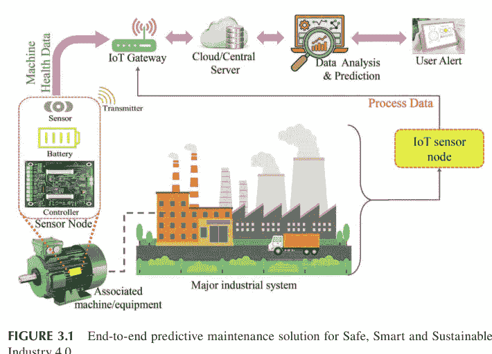

预测设备故障以及优化维护计划和成本至关重要。此外，IoT 技术具有高度可扩展性，适用于监测大型工业运营中的数千个资产。工业物联网（IIoT）[Yang et al., 2022] 有助于提高工业系统的可靠性、安全性、稳健性和实时性。图 3.1 展示了一个此类现实工业场景，其中 IoT 平台被用于高效的预测性维护（PdM）。

## 3.2 预测性维护的数据类别

在工业领域，预测性维护依赖于两类数据——工艺数据和相关的机器健康数据，每类数据都能对系统或机器的状况提供独特的见解。如图 3.1 所示，这两类数据均通过 IoT 平台获取。现在，我们先详细讨论这两类数据。

### 3.2.1 工艺数据

工艺数据是指与系统实时运行或功能相关的信息。这包括各种系统工艺指标，例如温度、压力、流量、速度、浓度、电压、电流等。这些工艺数据通常通过分布式控制系统（DCS），例如监控控制与数据采集（SCADA）系统获取，或者使用 IoT 平台获取。工艺数据有助于监测系统在运行过程中的性能。通过分析这些指标，工业操作员可以检测到异常行为或偏离正常运行范围的情况，这些可能预示着问题在升级为故障之前存在潜在隐患。

### 3.2.2 机器健康数据

健康数据提供关于机器/设备状况或完整性的信息。它反映了设备的物理或结构健康状况。健康数据通常通过传感器收集，包括振动、声波、超声波等指标。通过分析健康数据，可以预测设备的使用寿命和故障率。

## 3.3 工业中常见的故障

在工业领域，故障可能发生在各个行业，由于使用时间延长、老化、过热、泄漏、不利的工作环境、绝缘不良等原因，会影响系统、子系统和机器。这些故障对运行和产量产生不利影响，引发安全问题，并导致大量停机时间。本节将讨论一些常见的工业故障。

大型工业系统通常会遭受各种随时间逐渐累积的故障现象，最终导致灾难性事故、意外停机和产量显著损失。锅炉就是其中一个关键工业系统，广泛应用于发电厂、石油化工、纺织、建筑施工以及造纸等各个行业。这些锅炉常常会遭受不同的故障，例如腐蚀 [Nugraha et al., 2023]、结渣 [Xu et al., 2021]、结垢 [Shohet et al., 2019]、结块 [Sinha et al., 2023b] 等。利用不同的工艺数据对工业系统中此类故障进行早期检测和预测至关重要。

除了主要的工业系统外，还有几台关联机器和辅助设备有助于控制这些系统的各种运行。这些包括泵、电机、阀门、风扇、输送带等，这些机器中可能会出现各种机械和电气故障。泵容易出现气蚀故障 [Liu et al., 2023]、密封件损坏和腐蚀 [Ahmad et al., 2020]，可以通过振动和声发射信号等健康数据进行检测。另一种重要的工业机器是电机，它会遭受不同的定子 [Sinha and Das, 2023b]、转子 [Xu et al., 2022] 和轴承 [Sinha et al., 2023a] 故障。阀门在调节、引导或控制工业系统中流体流动方面发挥着重要作用，它们会遭受泄漏、间隙、裂纹和缺口等故障 [Jafari et al., 2014]。工业风机和鼓风机会出现灰尘积聚、叶片损坏、错位等问题 [Ciaburro et al., 2023; Dhamande et al., 2023]，这些也可以通过对振动和声学等健康数据进行智能分析来检测。

通过安装传感器节点来进行机器健康诊断的持续健康数据采集，传感器节点包含传感器、电池、微控制器和收发器。在这些组件中，与传感器和电池相比，微控制器和收发器较不容易出现故障。为了实现可持续的解决方案，节点架构必须能够对这些电子元件进行自健康监测。可充电锂离子电池因其比其他电池类型具有更高的能量密度、更低的自放电率和更长的使用寿命而被广泛使用 [Liu et al., 2022]。然而，随着充放电循环次数的增加，它们也会随时间劣化。由于电池为整个传感器节点提供电源，


其及时的健康预测至关重要 [Sinha et al., 2022]。节点的另一个关键组件是传感器，它们会遭受各种故障，例如漂移、偏差、完全失效和精度退化 [Sinha and Das, 2023c]。这些故障的存在可能掩盖或指示关联机器的故障；因此，自动传感器故障检测变得非常重要 [Sinha and Das, 2023d]。在现实世界的工业场景中，传感器和关联机器可能同时发生故障。在此类情况下，需要进行传感器故障隔离和校正，才能成功监测工业机器的健康状况 [Sinha and Das, 2023a]。

## 3.4 预测性维护：利与弊

传统上，工业运营商按照计划进行预防性维护（PM），而不考虑机器的状况和维护的必要性。这通常会导致更高的维护成本和资源利用效率低下。另一方面，反应性维护（RM）仅在故障发生后执行，导致意外停机和更高的维修成本。预测性维护可以克服这些欠维护和过度维护方法带来的挑战。它是一种主动的维护策略，使用数据驱动的方法来预测工业机器或系统可能发生故障的时间，并允许提前进行维护以防止故障。以下小节将讨论 PdM 的优缺点。

### 3.4.1 预测性维护的优势

PdM 的一些重要优势列于以下：

- **减少停机时间:** PdM 通过在完全故障前识别潜在问题来减少意外机器故障。这确保维护安排在计划停机期间，从而最大限度地减少非计划运行中断。
- **成本效率:** PdM 避免重大设备故障并优化维护计划，从而最大限度地减少昂贵的紧急维修和加班人工成本。
- **延长设备寿命:** 早期检测故障可防止机器受到过度损坏，使其能够更高效地运行更长时间。
- **改善安全性:** 早期识别潜在危险和机器故障可降低因机械故障造成事故和受伤的风险，确保更安全的工作环境。
- **数据驱动的洞察:** PdM 分析通过传感器和物联网收集的数据，以实时监测设备性能，提供有关机器健康状况和效率的宝贵洞察，并协助明智决策。
- **资产管理:** PdM 仅在必要时进行维护，从而优化资源使用，帮助实现高效的资产管理。
- **提高可靠性:** PdM 策略确保设备得到良好维护和监控，提高可靠性，减少生产中断的频率和严重程度，从而提高产量。
- **能源效率:** PdM 通过保持机器处于最佳工作状态，避免故障机器过度消耗能量，从而提高能源效率。
- **环境效益:** PdM 有助于使机器保持在最佳工作状态，防止意外故障，提高能源效率，并减少浪费、排放及对环境的不利影响。因此，工业界可以在降低能源消耗的同时实现可持续发展目标。

为了更好地理解，表 3.1 总结了 PdM 相对于传统 PM 和 RM 策略的优势。尽管有许多优势，PdM 也面临其自身的一系列挑战，将在下一小节中讨论。

### 3.4.2 预测性维护的劣势

PdM 的主要劣势如下：

- **初始成本高:** 建立 PdM 系统需要在技术（包括传感器、数据采集工具和预测分析软件）上进行大量初始投资。预算有限的中小企业可能难以承担高昂的初始成本。
- **技术专长:** PdM 实施中的另一项挑战是需要具备数据分析、机器学习和状态监测技术方面的专业知识。工业界需要雇佣或培训这些领域的专业人员，导致额外开支。
- **兼容性问题:** PdM 不适用于所有类型的设备（例如，低关键性或简单机器），因此对于此类资产，传统维护策略更有道理。另一项挑战可能出现在将 PdM 系统与现有系统（如企业资源计划（ERP）、计算机化维护管理系统（CMMS）或监控控制和数据采集（SCADA））集成时，这需要大量定制。
- 误报: PdM 系统有时会产生假阳性（预测不会发生的故障）或假阴性（未能预测即将发生的故障）。此类预测错误分别会导致不必要的维护或错过维护。
- 网络安全风险: 使用物联网设备和基于云的平台的 PdM 系统通常容易受到网络攻击，导致数据泄露、运营中断和资产安全受损。
- 文化阻力: 从传统维护策略转向 PdM 需要组织内部的文化变革。员工和管理层可能会抵制采用新技术或新流程，尤其是当他们习惯于当前做法时。

对于考虑实施 PdM 的工业界而言，权衡这些劣势与潜在长期效益非常重要，需要考虑设备类型、可用资源和技术采用准备情况等因素。

## 3.5 预测性维护蓝图

预测性维护涉及一种系统性的状态监测方法，从实时数据采集到机器故障的检测和预测。工业预测性维护工作流程的关键步骤如图 3.2 所示。PdM 涉及的步骤详细分解将在以下小节中解释。

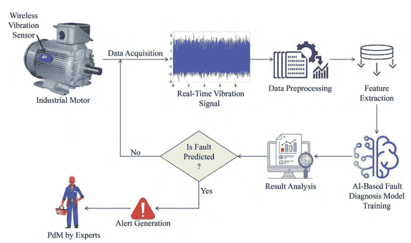

图 3.2 工业预测性维护实施的通用工作流程。

### 3.5.1 数据采集

数据采集构成了 PdM 策略的基础，因为它提供了有效故障诊断和预测所需的原始信息。PdM 数据收集中常用的传感器如下：

- (i) 振动传感器: 这些传感器测量旋转机械中的振动。振动异常可能表明磨损、不对齐或其他任何故障。
- (ii) 声学传感器: 这些传感器有助于检测机器产生的声波。异常的声学数据可能表明各种故障，例如泄漏、裂纹等。
- (iii) 温度传感器: 这些传感器常用于检测过热，这是机械或电气问题的迹象。它们也用于在仓库管理等关键应用中保持最佳环境。
- (iv) 超声波传感器: 超声波传感器捕获高频声音，以检测泄漏、电气放电、结构材料疲劳或轴承润滑问题。
- (v) 流量传感器: 这些传感器测量流体系统中的流量，以检测任何异常或堵塞的存在。
- (vi) 接近传感器: 这些传感器可以通过测量移动部件的距离或定位来识别对齐问题。
- (vii) 电流/电压传感器: 这些传感器监测电气机器的健康状况，以检测尖峰、短路等故障。

在某些工业应用中，使用数据采集系统（DAQ）来收集传感器数据并将其转换为数字形式以供进一步分析。它们包含信号调节器，通过滤波或放大来处理原始传感器信号。DAQ 系统还包括模数转换器（ADC），将模拟传感器信号转换为数字数据，以便计算机进行分析。不同传感器的有效性在很大程度上取决于安装的方式和位置。传感器安装不当可能导致误读、遗漏故障和诊断不准确。

#### 3.5.1.1 传感器安装

为了确保收集的数据（例如，振动、温度、声音等）准确反映机器的真实状况，正确的传感器安装至关重要。正确的传感器定位可确保读数一致，并有助于最大限度地减少外部因素的噪声。这使得对关键工业机器和系统进行可靠的趋势分析和故障诊断成为可能。此处讨论了一些常见的传感器安装技术。

- (i) 直接/接触安装: 传感器直接安装在待测机器上，使传感器与机械始终接触并获取实时数据。但是，它们没有被牢固固定，and


可能会因传感器移动而导致数据丢失。这种安装方式通常用于将振动传感器安装在电机或泵的外壳上。

- (ii) 磁吸安装：在此过程中，传感器使用磁铁进行安装，可实现快速安装和拆卸。这通常用于临时或便携式应用。这种安装方式也用于将某些振动传感器安装在电气机器上。它不如永久安装提供牢固的接触，也不适用于非金属表面。

- (iii) 螺柱安装：这是一种永久性传感器安装方法，传感器使用带螺纹螺柱通过螺栓或螺钉固定到位。这种安装常用于将振动传感器安装在旋转机械上。连接牢固，传感器移动最小，但安装可能耗时且可能需要对设备进行某些改造。

- (iv) 胶粘安装：这是一种半永久性传感器安装方式，传感器使用强力工业胶或环氧树脂直接安装在机器表面上。这种安装方式用于将轻型加速度计或温度计安装在非金属表面上。但是，它不适用于重型传感器或高振动环境，因为随时间推移胶水可能会减弱，影响采集数据的可靠性。

图 3.3 展示了这些传感器安装技术的图示表示。除此之外，还必须确定合适的数据采集方式（在线/离线），同时考虑必要性和可用资源，如下一小节所述。

#### 3.5.1.2 在线和离线数据采集

可通过持续采集和分析数据来进行实时健康监测。例如，SCADA 等企业系统会采集并传输工艺数据。另一个示例包括通过物联网传感器在偏远地区进行在线数据采集，这些传感器可以将数据无线发送到云存储。在某些应用中，数据处理和分析在传输前在传感器节点本地进行。这被称为边缘计算，可减少延迟、传输功率和带宽使用。

除了在线数据采集外，健康监测数据有时也会定期或手动采集。操作员使用便携式传感设备在特定间隔内手动记录数据。数据记录仪常用于没有

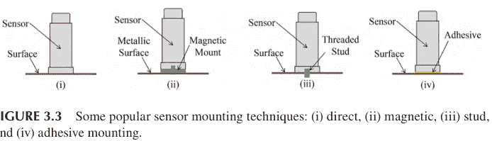

持续网络连接的区域，以按固定间隔采集和存储传感器数据，供后续分析使用。在使用收集的原始数据进行模型训练和分析之前，必须进行适当的清洗和预处理，以使其适合统计分析，这将在下一小节中解释。

#### 3.5.1.3 数据预处理

在 PdM 蓝图中，数据预处理是最重要的步骤之一，它通过处理噪声、缺失值和不一致性，将原始传感器数据转换为干净、结构化且有用的格式。PdM 数据预处理涉及的关键步骤如下：

- 在 PdM 中，传感器可能失效、可能发生通信错误或数据可能丢失，从而导致缺失值。缺失数据可以通过插补、前向/后向填充、插值或删除缺失记录来处理。

- 传感器数据通常包含噪声、异常值或不一致性，这些都可能影响模型性能。使用平滑、低通滤波器或统计方法（例如 Z 分数、四分位距）进行数据清洗，有助于删除无关或错误的数据。

- 数据可以通过归一化或标准化进行重新缩放，以使其适合统计模型。

除了这些预处理步骤外，PdM 策略还面临数据不平衡的挑战，这将在下一小节中详细解释。

#### 3.5.1.4 数据不平衡问题

在实际场景中，工业机器大多在健康状态下运行，故障实例少之又少。因此，正常运行数据远多于故障数据。这常常导致数据不平衡问题，即训练好的 AI 模型可能会偏向多数类（正常运行），而无法正确预测罕见但关键的故障事件。因此，尽管准确率很高，训练好的模型在检测故障方面将无效。为解决数据不平衡问题，可以应用以下方法：

- 通过插值对故障类数据进行过采样可以帮助平衡数据集。SMOTE（合成少数类过采样技术）是一种广泛使用的算法，它生成合成数据样本来缓解不平衡问题。

- 无监督学习算法（例如自动编码器）可用于故障检测，因为它们仅使用健康数据进行训练。

- 提升算法（例如 AdaBoost、XGBoost）通过给误分类实例（尤其是少数类实例）赋予更高权重，确保高效处理数据不平衡问题。

- 生成对抗网络（GANs）也可以根据原始数据集中的模式生成逼真的合成故障数据，从而平衡数据集。

- 带分层采样的交叉验证将确保训练集和测试集划分均衡，并且训练好的模型在健康和故障两类数据上都能得到评估。

收集的数据预处理后，即适合进行进一步的训练和分析。根据应用和资源可用性，模型训练可以在边缘设备或本地/云服务器上执行。物联网的引入为传感器节点与服务器之间的无线数据通信铺平了道路。这已在下一小节中简要说明。

#### 3.5.1.5 数据通信

传感器采集的数据通过物联网网关，使用下文提到的不同协议，无线传输到集中式数据库或云存储：

- Wi-Fi/Bluetooth/Zigbee 用于短距离无线通信。
- 蜂窝网络（4G/5G）用于长距离无线传输。
- LoRaWAN/NB-IoT 用于低功耗、长距离无线传输。这些协议最适合工业应用。

### 3.5.2 特征工程

在预测性维护中，特征工程是最关键的步骤之一。它涉及从原始数据创建新的、更相关的特征，以帮助数据驱动模型更好地理解底层模式，从而使对机器健康和故障的预测更加准确。常见的特征提取技术如下：

- (i) 时域特征：这些特征直接从随时间变化的原始传感器信号中推导出来。它们易于计算，并通常能提供关于机器健康状况的有价值信息。表 3.2 给出了几个时域特征的数学公式。这里，_x<sub>i</sub>_ 表示时刻 _i_ 的传感器值，_N_ 是时间窗口内观测值的总数。

- (ii) 频域特征：在工业系统中，许多故障表现为原始传感器信号频率含量的变化。在这种情况下，需要使用诸如傅里叶变换等技术将原始时间序列数据转换为频域，从而提取频域特征。不同频域特征的数学表示如表 3.3 所示。这里，_x_(_n_) 是离散时域信号，_j_ 是虚数单位，_N_ 表示样本总数，_C_ 表示频谱质心。

- (iii) 时频域特征：时频域特征结合时间和频率信息，以捕获信号中更复杂的模式。它们对于分析非平稳信号特别有用，此类信号的频率含量随时间变化 [Boashash, 2015]。推导时频域特征的一些常用技术包括短时傅里叶变换（STFT）、小波变换和 Hilbert-Huang 变换（HHT）。


#### 表 3.2
各种时域特征及其公式

| 时域特征 | 公式 |
| --- | --- |
| 均值 ($\mu$) | $\mu = \frac{1}{N} \sum_{i=1}^{N} x_i$ |
| 方差 (Var) | $\text{Var} = \frac{1}{N} \sum_{i=1}^{N} (x_i - \mu)^2$ |
| 标准差 ($\sigma$) | $\sigma = \sqrt{\frac{1}{N} \sum_{i=1}^{N} (x_i - \mu)^2}$ |
| 均方根 (RMS) | $\text{RMS} = \sqrt{\frac{1}{N} \sum_{i=1}^{N} x_i^2}$ |
| 峰峰值 (P-to-P) | P-to-P = $max(x_i) - min(x_i)$ |
| 偏度 ($S$) | $S = \frac{\frac{1}{N} \sum_{i=1}^{N} (x_i - \mu)^3}{\sigma^3}$ |
| 峰度 ($K$) | $K = \frac{\frac{1}{N} \sum_{i=1}^{N} (x_i - \mu)^4}{\sigma^4}$ |
| 峰值因数 (CF) | $\text{CF} = \frac{max(x_i)}{\text{RMS}}$ |
| 能量 ($E$) | $E = \sum_{i=1}^{N} x_i^2$ |

#### 表 3.3
各种频域特征及其公式

| 频域特征 | 公式 |
| --- | --- |
| 离散傅里叶变换/DFT ($X(f_k)$) | $X(f_k) = \sum_{n=0}^{N-1} x(n) e^{-j2\pi kn/N}$ |
| 功率谱密度 (PSD) | $\text{PSD}(f_k) = \frac{|X(f_k)|^2}{N}$ |
| 峰值频率 | Peak Frequency = $f_k$ where max $|X(f_k)|$ |
| 频谱带宽 | Spectral Bandwidth = $\sqrt{\frac{\sum_{k=0}^{N-1} (f_k - C)^2 |X(f_k)|}{\sum_{k=0}^{N-1} |X(f_k)|}}$ |
| 频谱熵 | Spectral Entropy = $- \sum_{k=0}^{N-1} P(f_k) \log_2 P(f_k)$ |
| 频带能量比 | Band Energy Ratio = \(\frac{\sum_{f_{low}}^{f_{high}} |X(f_k)|^2}{\sum_{k=0}^{N-1} |X(f_k)|^2}\) |
| 频率方差 | Frequency Variance = \(\frac{\sum_{k=0}^{N-1} (f_k - C)^2 |X(f_k)|}{\sum_{k=0}^{N-1} |X(f_k)|}\) |

提取了多种多样的特征后，选择最相关、最有信息量的特征并消除无关或冗余特征变得至关重要。适当的特征选择可以显著提高模型准确性，并减少过拟合和计算复杂度。特征选择方法大致可分为三种类型：

- (i) 过滤方法：在此方法中，特征基于统计标准进行排序，并选择排名靠前的特征。示例：皮尔逊相关、卡方检验等。
- (ii) 包装方法：此方法使用 ML 模型来评估特征子集。通过迭代添加或删除特征并评估模型性能来确定最优特征子集。这是一个计算开销较大的过程。示例：前向选择、后向消除和递归特征消除。
- (iii) 嵌入式方法：此方法在训练过程中执行特征选择，通常嵌入在 AI 模型中。与包装方法相比，其计算复杂度较低，并考虑特征之间的交互。示例：LASSO（L1 正则化）、岭回归（L2 正则化）、随机森林、梯度提升等。

### 3.5.3 故障诊断的模型训练

在数据收集、预处理和特征工程之后，会开发出适合的机器学习（ML）或深度学习（DL）模型，以检测或预测工业机器和系统中的故障。故障检测有助于实时识别和响应问题，确保设备故障在发生时得到处理。对于故障检测和故障类型识别，必须使用分类模型。另一方面，故障预测/预后旨在预测未来故障，从而实现主动维护并减少停机时间。当我们希望预测下一次故障发生和剩余使用寿命（RUL）时，会选择回归模型。因此，故障检测和预后模型是预测性维护的两个关键组成部分，在维护机械健康和防止故障方面发挥着不同但互补的作用。表 3.4 基于几个重要标准比较了这两种模型。为了高效构建和评估模型，数据集必须分为训练集、测试集和验证集。

### 3.5.4 预测性维护中的模型部署

模型部署是开发预测性维护系统的最后一步。训练好的 ML 或 DL 模型会从开发环境移至生产环境，以进行实时预测。已部署的模型必须能够处理不断变化的数据和条件。对 PdM 模型进行适当部署可以显著减少停机时间，提高运营效率，并降低维护成本。部署架构大致可分为三种类型，如下所述：

- (i) 边缘部署：模型部署在本地边缘设备上，例如传感器节点中的微控制器和嵌入式系统。数据分析在本地进行，大幅降低延迟、传输功率需求和带宽使用。但是，模型必须轻量级，才能成功部署在资源受限的边缘设备上。
- (ii) 云部署：模型部署在云服务器/基础设施上（例如，AWS、Azure、Google Cloud 等），使其易于用于大型数据集和复杂模型。但是，此方法面临由于网络速度导致延迟增加的挑战，并且经常面临数据隐私问题。
- (iii) 本地/内部部署：模型部署在本地服务器或行业自身的 IT 基础设施中。本地数据处理和分析确保低延迟和改进的数据安全性。此部署过程不适合中小型企业，因为它涉及高昂的基础设施成本，并可能需要重大的硬件升级。

#### 表 3.4
故障检测与预后模型的比较

| 标准 | 故障检测 | 故障预后 |
| --- | --- | --- |
| 目标 | 故障发生后实时检测故障 | 估计故障发生前的时间或预测未来劣化 |
| 模型类型 | 分类 | 回归 |
| 数据类型 | 标记数据 | 历史时间序列数据 |
| 时间范围 | 短期分析 | 长期分析 |
| 模型复杂度 | 通常更简单 | 更复杂 |
| 可解释性 | 易于解释 | 较难解释 |
| 决策 | 被动 | 主动 |
| 使用的算法 | 决策树、SVM、随机森林等 | SVR、GPR、LSTM 等 |
| 评估指标 | 混淆矩阵、准确率、F1 分数等 | RMSE、MAE、AE、RUL 准确率等 |

注释：SVM：支持向量机；SVR：支持向量回归器；GPR：高斯过程回归器；LSTM：长短期记忆网络；RMSE：均方根误差，MAE：平均绝对误差；AE：绝对误差。

### 3.5.5 预测性维护的用户界面

必须设计合适的用户界面（UI），为行业中的维护团队、工程师和操作员提供便捷的访问途径，以获取已部署 PdM 模型生成的实时预测和洞察。下面将讨论为预测性维护设计的 UI 的一些理想特性：

- 用于实时机器数据和预测概览的中心仪表板。这将包括实时数据馈送、颜色编码的警报、数据趋势等，以便于可视化。
- 可以将弹出通知和 SMS/电子邮件警报与 UI 集成，以便在系统检测到异常或预测故障即将发生时通知操作员。
- 可以将数据可视化元素（例如，时间序列图、热图等）纳入 UI，以便实现交互式数据探索和模式调查。
- 生成与 RUL 预测相一致的过去和即将进行的维护活动的维护日历。
- 为操作员、技术人员和工程师实施不同的访问级别，以便他们只能查看与其任务相关的信息。
- 显示模型性能指标，如准确率、精确率、召回率等，以便用户可以跟踪错误预测并确保模型高效运行。

### 3.6 预测性维护中的可解释人工智能

基于 AI 的模型用于现代工业中高效且准确的预测性维护。然而，其黑盒特性阻止维护人员和操作员将其视为足够可信以用于实际部署 [Sinha and Das, 2023a]。可解释人工智能（XAI）通过为决策和预测提供可理解的解释和根本原因分析，在揭秘复杂模型方面发挥着重要作用，从而增强用户与 AI 系统之间的信任 [Chowdhury et al., 2023]。在具有严格监管要求的行业（例如，航空航天、医疗保健）中，自动化决策通常需要提供解释。使用 XAI 通过为模型结果提供清晰的推理来确保监管合规。XAI 还使工程师能够通过了解错误预测背后的原因来识别 PdM 模型改进的领域。在各种可用的 XAI


方法，其中最常用的两种是 SHAP 和 LIME。然而，这些方法通常需要除实际预测模型之外的额外解释程序，并且可能与所有类型的 ML 模型不兼容。为了缓解这一缺点，可解释提升机（EBM）最近被引入，以在预测过程中提供结果解释 [Liu and Sun, 2023]。所有这三种方法在以下小节中已简要说明。

#### 3.6.1 Shapley 加性解释（SHAP）

SHAP 是一种用于解释 ML 模型输出的强大工具。它识别哪些输入特征对模型预测具有最显著的影响。因此，通过识别贡献最高的特征，它协助通过有针对性的特征工程来改进模型。SHAP 利用多种可视化技术，例如摘要图、力图、依赖图和瀑布图，以帮助解释预测结果。例如，维护工程师可以通过使用 SHAP 查看哪些传感器读数（如振动、声学、温度等）对预测机器故障影响最大。

#### 3.6.2 局部可解释模型不可知解释（LIME）

LIME 是一种旨在解释单个预测而非整体模型行为的方法。通过专注于单个预测的局部解释，LIME 提供了关于特定输入特征如何对模型输出做出贡献的见解，从而更容易解释和信任 ML 算法的结果。LIME 解释可以通过条形图、决策边界和特征贡献值来可视化。例如，如果 ML 模型预测即将发生故障，LIME 可以通过考虑各种传感器读数的当前状态来帮助解释为何做出该特定预测。

#### 3.6.3 可解释提升机（EBM）

EBM 是一种可解释的 ML 算法，在保持高预测准确性的同时，为预测提供人类可理解的解释。它结合了加法模型和提升技术的优势，以提供准确的预测和相关解释，从而做出明智的决策。例如，在制造业和能源领域，EBM 可以预测设备故障，同时解释各种传感器读数的影响。

### 案例研究

#### 用例 I：火电厂阀门故障预后

**问题描述：** 阀门故障是火电厂的主要关注点，因为阀门是电厂的关键部件之一。它经常导致运营中断、安全隐患和维护成本增加。因此，需要一种智能预测性维护方案来进行阀门健康预测。

**数据集描述：** 从一家火电厂获得了各种过程和健康数据，例如温度、压力、振动和蒸汽膨胀。数据以 10 分钟间隔采集，包含总共 56 个输入特征。

**数据预处理与特征工程：** 原始数据包含几个缺失值，已通过插值处理。之后，数据集经过平滑处理以去除噪声，并进行标准化以进行数据缩放。数据准备完成后，使用随机森林算法进行特征选择以降维。选择了对故障发生影响最大的前 10 个输入特征（如图 3.4 所示）。

**故障预后模型：** 为了高效的预测性维护，必须确定阀门在完全故障前的剩余工作日（RWD）。为此，已使用 EBM 模型来预测阀门健康状况，并对预测解释提供有用的见解。RWD 的估计可以在图 3.5 中可视化，其中红线表示实际 RWD，绿色散点图表示预测 RWD。

**模型解释：** 使用 EBM 进行阀门健康预后的额外好处是获得预测结果的内置解释。使用 EBM 模型的预测局部解释如图 3.6 所示，其中橙色和蓝色条分别表示特定输入特征对模型输出的正面和负面影响。

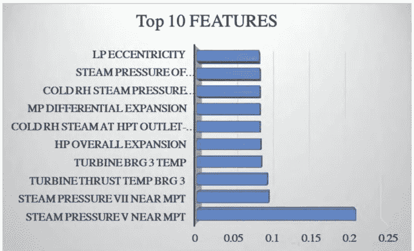

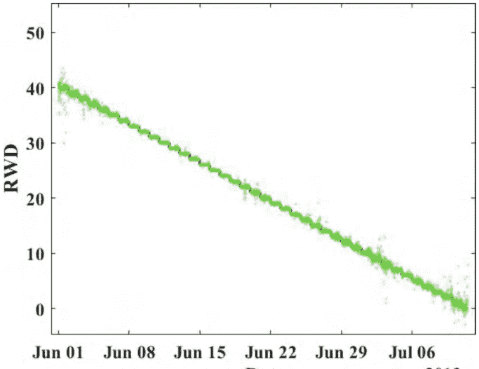

FIGURE 3.5 使用 EBM 进行阀门健康预后的 RWD 估计。

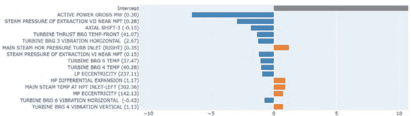

FIGURE 3.6 使用 EBM 对预测结果进行局部解释。

#### 用例 II：HVAC 冷水机故障检测

**问题描述：** 冷水机是供暖、通风和空调（HVAC）系统中最昂贵和最关键的设备之一。与所有其他机器一样，它可能发生阀门、管道、换热器、风扇、泵等的各种故障。冷水机故障可能导致 HVAC 其他组件故障并引起安全问题。

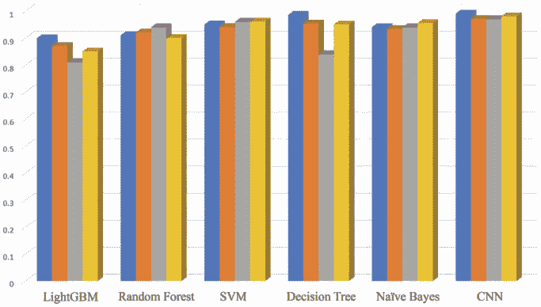

FIGURE 3.7 各种模型用于 HVAC 故障检测的评估指标。

因此，早期检测和诊断冷水机故障对于降低 HVAC 系统的维护成本和突然运营中断至关重要。

**数据集描述：** 以 5 分钟间隔从 HVAC 单元获得了各种传感器数据。收集的数据包括排风流量、水温、空气温度等，包含 25 种故障类型。原始数据集中的输入特征数量为 27 个。

**数据预处理与特征工程：** 原始数据经过清洗和平滑处理以去除任何噪声元素。然后对数据进行归一化，以使其适合进一步的统计处理和分析。为了降低数据集的维度，应用了随机森林算法，该算法选择对 HVAC 故障影响最大的前 10 个特征。移除不相关和冗余的特征，以优化数据集并降低故障检测模型的复杂性。

**故障检测模型：** 数据准备和特征选择后，训练了多种常见的 ML 和 DL 分类模型。数据集按 70:15:15 的比例划分为训练、测试和验证数据。最佳模型基于评估指标（例如，准确率）选择。图 3.7 展示了不同 ML 和 DL 模型评估指标的比较。从该分析中可以清楚地看出，卷积神经网络（CNN）给出了最高的准确率（99.5%），可用于本用例中的故障检测。

### 3.7 结论

本章讨论了在现代工业中，利用系统过程数据和机器健康数据，AI 和 ML 在预测性维护方面的应用各个方面。通过利用海量传感器数据和先进算法，AI 和 ML 在 IoT 的支持下可以提供设备健康状况的实时洞察，以高精度预见故障，并实现更高效的维护策略。除了工业机器和系统外，还必须关注用于数据采集的传感器节点组件的健康监测，以获得可持续的预测性维护解决方案。这些技术不仅最大限度地减少非计划停机时间、降低维护成本，还能延长机械寿命、提高运营效率，并提升各行业的安全性。然而，各行业在采用预测性维护策略时，还需要应对某些挑战，例如高安装成本、提升行业操作人员技能以及网络安全问题。本章解释了不同的感知设备及其如何有效使用以实现成功的预测性维护。还通过实际案例研究讨论了各种预测性维护步骤，例如数据采集、特征工程、故障诊断和模型部署，以使读者全面了解预测性维护的实施。AI 模型的可解释性，借助 SHAP、LIME 和 EBM 等工具，增强了其可信度和透明度，使这些智能解决方案对工程师和决策者可及。因此，将 AI 和 ML 集成到预测性维护中，代表了各行业管理和维护其关键资产方式的技术和文化转变。这种演变对于确保各行业和组织更可靠、更具成本效益且更可持续的运营至关重要。

### 参考文献

- Ahmad, Z., Rai, A., Maliuk, A. S., and Kim, J.-M. (2020). Discriminant feature extraction for centrifugal pump fault diagnosis. IEEE Access, 8:165512–165528.
- Boashash, B. (2015). Time-frequency signal analysis and processing: A comprehensive reference. Academic Press.
- Chowdhury, D., Sinha, A., and Das, D. (2023). XAI-3DP: Diagnosis and understanding faults of 3-D printer with explainable ensemble AI. IEEE Sensors Letters, 7(1):1–4.
- Ciaburro, G., Padmanabhan, S., Maleh, Y., and Puiayu-Romero, V. (2023). Fan fault diagnosis using acoustic emission and deep learning methods. Informatics, 10:24. MDPI.
- Dhamande, L. S., Bhaurkar, V. P., and Patil, P. N. (2023). Vibration analysis of induced draught fan: A case study. Materials Today: Proceedings, 72:657–663.
- Gao, Z., Cecati, C., and Ding, S. X. (2015). A survey of fault diagnosis and fault-tolerant techniques—part I: Fault diagnosis with model-based and signal-based approaches. IEEE Transactions on Industrial Electronics, 62(6):3757–3767.
- Jafari, S., Mehdigholi, H., and Behzam, M. (2014). Valve fault diagnosis in internal combustion engines using acoustic emission and artificial neural network. Shock and Vibration, 2014(1):823514.
- Liu, G., and Sun, B. (2023). Concrete compressive strength prediction using an explainable boosting machine model. Case Studies in Construction Materials, 18:e01845.
- Liu, K., Peng, Q., Sun, H., Fei, M., Ma, H., and Hu, T. (2022). A transferred recurrent neural network for battery calendar health prognostics of energy-transportation systems. IEEE Transactions on Industrial Informatics, 18(11):8172–8181.


刘, X., 牟, J., 徐, X., 秋, Z., 和董, B. (2023). 基于不同信号的泵空化故障检测方法综述。*过程*，11(7):2007.

努格拉, A. D., 哈里安托, H., 和姆夫利胡恩, M. A. (2023). 与电厂系统减缓和经济分析相关的故障；来自印度尼西亚苏拉亚电厂的研究案例。*工程成果*，17:101004.

努涅斯, P., 桑托斯, J., 和劳查, E. (2023). 预测性维护的挑战：综述。*CIRP制造科学与技术期刊*，40:53–67.

肖赫特, R., 坎迪尔, M. S., 和麦克阿瑟, J. (2019). 基于模拟数据集的锅炉故障分类机器学习算法。*IOP会议系列：材料科学与工程*，609:062007.

舒克拉, K., 内夫蒂-梅齐亚尼, S., 和戴维斯, S. (2022). 预测性维护技术的启发式方法：局限性与范围。*机械工程进展*，14(6):16878132221101009.

辛哈, A., 艾哈迈德, S. F., 和达斯, D. (2023a). 可解释人工智能在轴承故障检测系统中的应用：赢得人类信任。收录于：*2023 IEEE古瓦哈蒂分会会议 (GCON)*，第1–6页，印度古瓦哈蒂，2023年6月23–25日。

辛哈, A., 和达斯, D. (2023a). 预测性维护范式中传感器和机器故障检测与隔离的可解释深度学习方法。*测量科学与技术*，35(1):015122.

辛哈, A., 和达斯, D. (2023b). 基于振动信号的感应电机可解释定子故障诊断的机器学习方法。收录于：*2023年国际仪器与测量技术会议 (I2MTC)*，第1–6页。

辛哈, A., 和达斯, D. (2023c). SNRepair：物联网网络中传感器故障和自校准的系统性解决。*IEEE传感器期刊*，23(13):14915–14922.

辛哈, A., 和达斯, D. (2023d). XAI-LCS：低成本传感器AI故障诊断的解释。*IEEE传感器快报*，7(12):1–4.

辛哈, A., 达斯, D., 和帕拉瓦拉萨, S. K. (2023b). dClink：500兆瓦燃煤锅炉中具有自动特征选择能力的数据驱动结渣预测框架。*能源*，276:127448.

辛哈, A., 达斯, D., 乌杜塔帕利, V., 和曼蒂, S. P. (2022). iThing：面向可持续工业物联网设计具有电池健康自监测功能的下一代物。*IEEE仪器与测量交易*，71:1–9.

托潘, P. A., 拉马丹, M. N., 法托尼, G., 查哈亚迪, A. I., 和瓦尤努戈罗, O. (2016). 基于卡尔曼滤波器的锂聚合物电池荷电状态 (SOC) 和健康状态 (SOH) 估计。收录于：*2016年第2届科学与技术-计算国际会议 (ICST)*，第93–96页。

韦伯特, H., 多布, T., 考普, L., 和西蒙斯, S. (2022). 工业4.0中的故障处理：定义、过程与应用。*传感器*，22(6):2205.

徐, L., 黄, Y., 岳, J., 董, L., 刘, L., 查, J., 于, M., 陈, B., 朱, Z., 和刘, H. (2021). 650兆瓦燃煤公用锅炉水冷壁结渣监测与吹灰改进。*能源学会期刊*，96:106–120.

徐, Y., 刘, J., 万, Z., 张, D., 和姜, D. (2022). 基于时频分析的域对抗神经网络转子故障诊断。*机器*，10(8):610.

杨, D., 马哈茂德, A., 哈桑, S. A., 和吉德隆, M. (2022). 客座编辑：5G及以后无线通信中的工业物联网和传感器网络。*IEEE工业信息学交易*，18(6):4118–4121.

# 4 治疗发现中肽酶抑制剂预测的机器学习应用

阿明努·吉布里勒·苏富扬，穆图·库马尔·蒂鲁纳瓦卡拉苏，阿利尤·宰努拉比丁·阿希鲁，和拉凯什·森古普塔

## 4.1 引言

酶是生物分子，最常见的是蛋白质，能加速生物体内的化学反应。由于这些过程包括新陈代谢、DNA复制和蛋白质合成，它们对生物体的生存至关重要。高度选择性和高效的酶在加速化学反应的过程中自身不会发生改变 [1]。正因如此，酶的失调在疾病预防中起着至关重要的作用。作为生物标志物，酶可以作为疾病诊断以及疾病监测和治疗的有用标志物 [2]。癌症、糖尿病或神经系统疾病等疾病可能通过酶的水平或活性变化而被指示 [3]。这是由于它们的特异性、可成药性和生物标志物潜力，使它们成为控制疾病的有吸引力的靶点。该过程可以使用小分子、抗体或其他治疗药物进行调节。因此，酶是治疗任何疾病的绝佳靶点 [4]。酶的生物类包括具有类似特性（如底物特异性、反应机制或生物过程）的酶功能组。了解这种生物类可能有助于识别潜在的治疗靶点 [5]。诸如肽酶等酶生物类中，疾病机制的特定靶点已变得普遍。通常，特定酶为治疗干预提供特定靶点 [6]。针对这些酶可以有效治疗代谢障碍和癌症，以及炎症性疾病、神经系统疾病和传染性疾病 [7]。

肽酶是一类关键的蛋白酶，是治疗癌症、心血管疾病和传染病的靶点，参与蛋白质的降解和加工。酶通过分解蛋白质来调节许多细胞过程。肽酶失调会导致疾病，并可作为有效治疗的靶点 [8]。

通过了解这种酶的功能和调节，研究人员可以期待制定适当的疾病诊断、治疗和预防策略。因此，前文强调的酶在疾病控制中的重要性清楚地指出了一个领域，研究人员应继续探索酶作为干预靶点的功能、调节和治疗潜力 [9]。

因此，设计与酶相互作用以抑制与疾病相关的酶活性的药物非常重要。制药公司和其他行业发现，用于预测酶抑制的计算方法（如机器学习（ML）模型）很有价值 [10]。我们的研究通过全面的机器学习模型扩展了相关模型，预测特定酶肽酶生物类的配体活性。

这些模型能够对肽酶酶生物类进行广泛的配体活性预测，从而快速识别潜在抑制剂并加速药物发现。与覆盖范围狭窄、准确性有限且不够全面的当前机器学习模型相比，我们的工作旨在通过提供专门针对肽酶的模型来彻底改变酶抑制预测 [11]。

这种方法将使研究人员能够快速可靠地识别各种肽酶酶的潜在抑制剂，从而加速药物发现，并为治愈多种疾病开辟新的治疗途径。我们的工作有望催化药物发现（尤其是人类健康领域）的革命。

## 4.2 材料与方法

### 4.2.1 数据集检索

与肽酶酶生物类相关的配体已从治疗靶点数据库 (https://db.idrblab.net/ttd/full-data-download) 下载。检索到的数据集包含靶点信息、药物信息、TTD药物与公共数据库之间的交叉匹配ID、TTD中药物和小分子的同义词，以及带有活性数据的靶点-化合物映射。

### 4.2.2 数据集准备

所有对肽酶酶生物类具有活性的配体均已制备为机器学习模型构建的数据集。该生物类包含200种不同的肽酶，共有56,903种显示对这些酶具有活性的配体。去除重复项后，保留了31,224种唯一配体。数据集通过配体的SMILES构建；根据其IC50值将其分为两类：IC50 <1000 nM的配体标记为活性 (1)，IC50 >1000 nM的配体标记为非活性 (0)。得到的活性和非活性配体数量分别为14,384和16,840。PubChem ID已用于从PubChem数据库中检索相应的SMILES。


### 4.2.3 分子表示

在机器学习中，指纹是分子结构和性质的数值表示，能够实现对分子的分析与比较。结构指纹，如 MACCS 和 Morgan，将分子信息编码为算法可处理的格式 [12]。这些指纹用于各种应用，包括虚拟筛选以识别潜在药物候选物、QSAR 建模以预测生物活性、分子相似性搜索，以及按相似性或活性对分子进行分组的聚类/分类 [13]。利用指纹，机器学习模型可以高效处理和分析大型分子数据集，加速药物发现与开发 [14]。

MACCS（分子访问系统）将分子结构和性质编码为 166 位二进制向量。MACCS 是化学信息学和药物发现中广泛使用的指纹方法。在这里，选择了四种不同的指纹。利用哈希算法，MACCS 捕获各种分子特征，包括原子类型和数量、键类型和数量、环系统和连接性，以及官能团和片段 [15]。

Morgan 指纹，特别是 Morgan 2 和 Morgan 3，是环形指纹，能够捕获分子结构和原子邻域，提供更全面的分子拓扑表示 [16]。

子结构指纹是一种分子指纹，用于识别分子中特定子结构或官能团的存在。这种指纹方法将分子分解为其组成部分，如环、链和官能团，并生成一个二进制向量，指示每个子结构的存在或不存在 [17]。这里使用这些指纹构建了机器学习模型，以选择表现最佳的模型。

### 4.2.4 机器学习模型构建

为四种指纹中的每一种构建了机器学习模型，每种肽酶酶-配体数据集共生成 32 个模型。使用准备好的酶生物类数据集生成了八种机器学习算法。创建机器学习模型使用了 Google Colab Notebook。首先，将必要的 Python 包导入工作区，包括 Matplotlib、RDKit、sklearn 等。随后，调用了以下模型来预测乳腺癌的状态。

#### 4.2.4.1 随机森林分类器

这是一种机器学习集成技术，基于数据的随机子集构建多个决策树，用于分类、回归等任务 [18]。

##### 4.2.4.1.1 逻辑回归

逻辑回归关注预测变量与结果变量之间的关系，可应用于预测二元或多类结果，因此是医疗保健及其他领域的重要技术 [19]。

##### 4.2.4.1.2 朴素贝叶斯 (NB)

最简单的贝叶斯网络模型基于贝叶斯定理的应用构建，用于产生“概率分类器”，即受监督的机器学习方法 [20]。

##### 4.2.4.1.3 梯度提升

这种机器学习方法称为树的梯度提升，使用伪残差作为目标，从而与其他提升方法区分开来。它使用功能空间提升，通过组合许多弱预测模型（通常是简单的决策树）来创建强集成 [21]。

##### 4.2.4.1.4 极端梯度提升 (XGB)

XGB 是一种基于梯度提升的集成方法，通过逐步添加模型并调整学习率来构建模型 [22]。

##### 4.2.4.1.5 K-近邻 (KNN)

简单来说，K 近邻是一种非参数、简单的机器学习算法，适用于回归和分类问题 [23]。

##### 4.2.4.1.6 AdaBoost 分类器

它收集被错误分类的数据点并赋予它们更大的权重。在随后的迭代中，密切监控权重更高的数据点。直到达到较低的错误率，该过程被重复 [24]。

### 4.2.5 特征选择与模型优化

由于性能优越，Morgan 2 指纹和随机森林被选为进一步分析的最佳模型。使用随机森林进行特征选择，以降低维度并增强模型可解释性。使用 Optuna 对 RF 模型的超参数进行了 5000 步的优化。最终模型基于优化过程中获得的最佳参数生成。

### 4.2.6 模型评估

使用精确度、准确率、召回率、F1 分数、ROC、AUC 和 MCC 等指标对优化后的模型进行了评估，以评估其在盲测数据集上的预测能力。

## 4.3 结果与讨论

### 4.3.1 模型性能评估

为四种指纹中的每一种开发了八种机器学习模型，使用肽酶酶生物类数据集总共生成了 32 个模型 (https://github.com/MuthuBIN/PeptidaseBioclassPrediction)。该研究的总体工作流程如图 4.1 所示。使用指纹生成的机器学习算法已进行了评估。每个使用的模型都使用外部验证指标进行了验证，以评估模型的预测能力。模型的评估准确率指标列于表 4.1–4.4 中。通过以下参数进行了进一步评估：预测准确率是指模型正确区分活性和非活性病例的能力。精确度和召回率分是两个重要参数，用于评估正负目标的预测性能 [25]。测试的精确度和召回率的加权调和平均值称为 F1 度量，它量化了测试的准确性。

根据性能指标，四种构建模型中表现最佳的是 Morgan 2。该模型表现出最佳的准确性、预测能力、捕获复杂分子关系的能力以及在识别潜在抑制剂方面的鲁棒性，如表 4.1 所示。

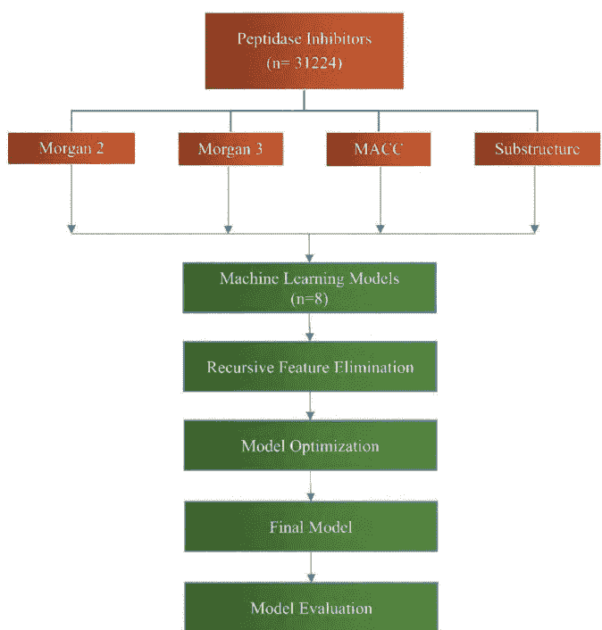

图 4.1 肽酶模型生成的总体工作流程。

#### 表 4.1
使用 Morgan 2 指纹在测试肽酶生物类数据集上的机器学习模型性能指标

| 序号 | 模型名称 | 精确度 0 | 精确度 1 | 召回率 0 | 召回率 1 | F1 分数 0 | F1 分数 1 | 准确率 |
|---|---|---|---|---|---|---|---|---|
| 1 | 随机森林 | 0.84 | 0.84 | 0.87 | 0.81 | 0.86 | 0.83 | 0.84 |
| 2 | 逻辑回归 | 0.77 | 0.76 | 0.76 | 0.72 | 0.79 | 0.74 | 0.77 |
| 3 | KNN | 0.86 | 0.82 | 0.84 | 0.83 | 0.85 | 0.83 | 0.84 |
| 4 | 朴素贝叶斯 | 0.74 | 0.68 | 0.72 | 0.70 | 0.73 | 0.69 | 0.71 |
| 5 | XGB | 0.80 | 0.83 | 0.87 | 0.75 | 0.83 | 0.78 | 0.81 |
| 6 | LGB | 0.79 | 0.82 | 0.86 | 0.73 | 0.82 | 0.77 | 0.80 |
| 7 | AdaBoost | 0.67 | 0.67 | 0.77 | 0.55 | 0.77 | 0.60 | 0.67 |
| 8 | 决策树 | 0.80 | 0.76 | 0.80 | 0.77 | 0.80 | 0.77 | 0.77 |

#### 表 4.2
使用 Morgan 3 指纹在测试肽酶生物类数据集上的机器学习模型性能指标

| 序号 | 模型名称 | 精确度 0 | 精确度 1 | 召回率 0 | 召回率 1 | F1 分数 0 | F1 分数 1 | 准确率 |
|---|---|---|---|---|---|---|---|---|
| 1 | 随机森林 | 0.84 | 0.85 | 0.88 | 0.81 | 0.86 | 0.83 | 0.84 |
| 2 | 逻辑回归 | 0.76 | 0.74 | 0.79 | 0.72 | 0.77 | 0.73 | 0.75 |
| 3 | KNN | 0.85 | 0.83 | 0.86 | 0.83 | 0.85 | 0.83 | 0.84 |
| 4 | 朴素贝叶斯 | 0.72 | 0.70 | 0.76 | 0.65 | 0.74 | 0.67 | 0.71 |
| 5 | XGB | 0.81 | 0.82 | 0.86 | 0.76 | 0.83 | 0.79 | 0.81 |
| 6 | LGB | 0.79 | 0.82 | 0.86 | 0.74 | 0.82 | 0.77 | 0.80 |
| 7 | AdaBoost | 0.67 | 0.68 | 0.77 | 0.57 | 0.72 | 0.62 | 0.68 |
| 8 | 决策树 | 0.79 | 0.76 | 0.79 | 0.76 | 0.79 | 0.76 | 0.78 |

评估模型的性能准确率观察到在 0.71–0.84 范围内。特别注意到肽酶类酶使用 Morgan 2 指纹和随机森林模型表现最佳，准确率为 0.84。如表 4.2 所示，尽管 Morgan 3 在结构上与 Morgan 2 相似，但其性能指标略低，准确率范围为 0.68–0.84。这可能是因为 Morgan 3 更有效地捕获高阶分子相互作用，而那些相互作用可能与肽酶活性预测无关。应用 Morgan 2 有助于有信心地识别有前途的化合物，从而使整个药物发现过程更加快速。例如，与 MACCS 指纹相比，MACCS 指纹具有固定的预定义长度，并且


表 4.3
带有 MACC 指纹的机器学习模型在测试肽酶生物类数据集上的性能指标

| 序号 | 模型名称 | 精确率 0 | 精确率 1 | 召回率 0 | 召回率 1 | F1 分数 0 | F1 分数 1 | 准确率 |
|---|---|---|---|---|---|---|---|---|
| 1 | 随机森林 | 0.82 | 0.81 | 0.84 | 0.79 | 0.83 | 0.80 | 0.82 |
| 2 | 逻辑回归 | 0.74 | 0.73 | 0.78 | 0.68 | 0.76 | 0.76 | 0.74 |
| 3 | KNN | 0.83 | 0.79 | 0.81 | 0.80 | 0.82 | 0.79 | 0.81 |
| 4 | NB | 0.72 | 0.53 | 0.37 | 0.84 | 0.49 | 0.65 | 0.58 |
| 5 | XGB | 0.80 | 0.79 | 0.82 | 0.77 | 0.81 | 0.98 | 0.80 |
| 6 | LGB | 0.75 | 0.77 | 0.83 | 0.68 | 0.79 | 0.72 | 0.76 |
| 7 | AdaBoost | 0.67 | 0.64 | 0.72 | 0.58 | 0.69 | 0.61 | 0.65 |
| 8 | 决策树 | 0.77 | 0.74 | 0.78 | 0.73 | 0.78 | 0.74 | 0.74 |

表 4.4
带有子结构指纹的机器学习模型在测试肽酶生物类数据集上的性能指标

| 序号 | 模型名称 | 精确率 0 | 精确率 1 | 召回率 0 | 召回率 1 | F1 分数 0 | F1 分数 1 | 准确率 |
|---|---|---|---|---|---|---|---|---|
| 1 | 随机森林 | 0.82 | 0.84 | 0.87 | 0.78 | 0.85 | 0.81 | 0.83 |
| 2 | 逻辑回归 | 0.74 | 0.73 | 0.78 | 0.68 | 0.76 | 0.76 | 0.74 |
| 3 | KNN | 0.85 | 0.82 | 0.84 | 0.83 | 0.85 | 0.82 | 0.84 |
| 4 | NB | 0.60 | 0.62 | 0.81 | 0.36 | 0.69 | 0.46 | 0.60 |
| 5 | XGB | 0.82 | 0.82 | 0.86 | 0.78 | 0.84 | 0.86 | 0.82 |
| 6 | LGB | 0.78 | 0.80 | 0.85 | 0.72 | 0.81 | 0.76 | 0.79 |
| 7 | AdaBoost | 0.67 | 0.64 | 0.72 | 0.58 | 0.69 | 0.61 | 0.65 |
| 8 | 决策树 | 0.77 | 0.74 | 0.78 | 0.73 | 0.78 | 0.74 | 0.74 |

专注于预定义子结构，而摩尔根指纹基于分子上下文，除了原子类型外还包括键级，以生成独一无二的指纹。如表 4.3 所示，MACC 指纹达到的准确率在 0.58–0.82 之间。同样，表 4.4 中列出的子结构指纹的准确率范围为 0.65–0.83。尽管它们在某些应用中可能有益，但在这项研究中这些指纹并不那么有用。MACC 的固定长度特性可能遗漏了环形摩尔根指纹捕获的微妙分子特征。同样，子结构指纹侧重于特定片段的存在或缺失，与能够捕获分子特征之间更复杂关系的摩尔根 2 相比，对于当前任务而言信息量较少。

摩尔根 2 的半径值不同，摩尔根 3 更为全面，能够捕获更长范围的相互作用。这些指纹特别适用于识别复杂的分子关系，因此非常适合虚拟筛选、QSAR 建模和分子相似性搜索等应用。它们捕获微妙分子特征的能力使得摩尔根 2 成为研究人员的宝贵工具，有助于识别潜在药物候选物并探索分子结构-活性关系。通过利用此指纹，科学家可以更深入地了解分子相互作用并加速药物发现 [26]。

### 4.3.2 特征选择与模型优化

重要特征是根据得分最高的随机森林模型预测的。采用五折交叉验证的递归特征消除（RFE）方法应用于摩尔根 2 指纹，总计 2,047 个特征。RFE 选取了 1,726 个特征并排除了其余特征（图 4.2 和图 4.3）。基于这些特征，创建了一个新数据集，用于通过 Optuna 进行超参数调优来优化八个模型，如表 4.5 所示。Optuna 系统中的高效算法识别了这些超参数的最佳组合，包括决策树数量、最大深度以及分裂节点所需的最少样本数。它在准确率方面表现出色，范围在 0.71 到 0.8 之间（表 4.5）。需要注意的是，随机森林和 LGB 在最优参数下达到了最高准确率 0.85。

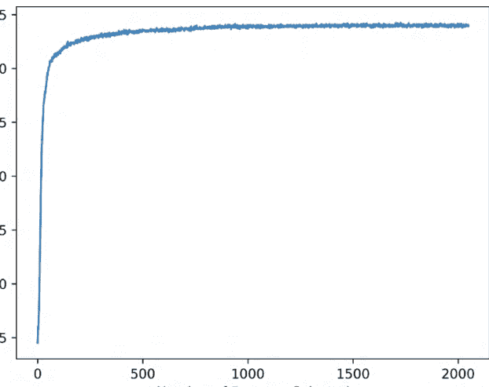

图 4.2 带有 5 折交叉验证的递归特征消除（RFE）图。

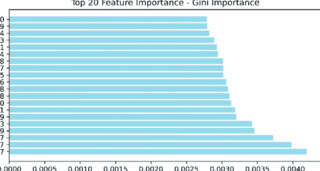

图 4.3 在 2048 个摩尔根指纹中排名靠前的特征，代表基于基尼重要性的重要性。

表 4.5 Optuna 超参数调优过程中获得的模型最佳超参数

| 序号 | 模型名称 | 优化参数 | 准确率 |
|---|---|---|---|
| 1 | 随机森林 | Random_state=85, max_depth=84, n_estimators=100, min_samples_split=2 | 0.85 |
| 2 | 逻辑回归 | C=0.17496662701821752, max_iter=1000, solver=’liblinear’) | 0.77 |
| 3 | KNN | KNeighborsClassifier(n_neighbors = 7, leaf_size = 39, p = 1) | 0.84 |
| 4 | NB | 无 | 0.71 |
| 5 | XGB | colsample_bytree=0.77, importancelearning_rate=0.09, max_depth=10, n_estimators=470, | 0.85 |
| 6 | LGB | max_depth=64, n_estimators=1040 | 0.85 |
| 7 | AdaBoost | 无 | 0.67 |
| 8 | 决策树 | 无 | 0.78 |

表 4.5 展示了在分析过程中产生最高性能指标的超参数最佳组合。

### 4.3.3 模型评估

本研究通过在不同阈值下绘制真阳性率与假阳性率来确定 ROC 曲线的 AUC，以评估模型性能。

AUC ROC 长期以来被视为二分类器的有效评估指标 [27]。图 4.4 显示了模型评估的所有曲线。值得注意的是，模型的平均 ROC-AUC 为 0.91。观察到生成模型的 ROC-AUC 在 0.76 到 0.92 之间。此外，模型在两个类别中均表现出高精度，并具有显著的 F1 分数和召回率值。

### 4.3.4 马修斯相关系数（MCC）

如图 4.5 所示，观察到 MCC 值在 0.32–0.69 范围内，表明预测类别与实际类别之间存在强相关性。XGB 模型获得了最高的 MCC 分数（0.69），证实了其卓越性能。从预测角度来看，我们的模型前景看好，因为较高的 MCC 值意味着该模型既能对两个类别的实例进行标记。MCC 指标在不平衡数据集上的模型性能估计中很有用，因为它同时考虑了真阳性和假阴性 [28]。

### 4.3.5 模型比较

XGB 模型在准确率、ROC-AUC 和 MCC 方面均表现出最高值，性能最佳 [29]。这些结果表明，所提出的配合最优指纹的算法与配体活性预测在

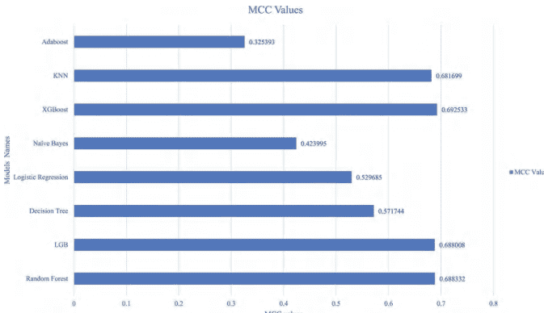

图 4.5 基于马修斯相关系数的模型性能评估。

酶生物类 [30]。所得结果表明，机器学习方法在预测酶生物类活性方面具有可靠性和准确性的良好能力。所得模型可用于虚拟筛选以及药物发现应用 [31]。

## 4.4 结论

这是酶抑制预测研究中的一项突破，因为它在机器学习层面提供了一种全方位的方法，能够非常准确地预测配体对肽酶的活性。它利用了摩尔根 2 的优势，因此在准确率指标方面表现出色。这一成就为药物发现与开发打开了广阔的前景，使科学家能够加速先导化合物识别、缩短实验方法的时间和成本、探索更广泛的潜在治疗靶点，并为疾病提供更有效的治疗。这也可能为缓解当前模型覆盖率低、过于集中于特定酶生物类以及预测不可靠和不准确等缺陷提供一个集成解决方案。因此，我们的研究可能通过能够创建更有效的治疗方法来预防广泛疾病，并为更好的人类健康结果铺平道路，从而改变药物发现的格局。但是，我们的研究本身不仅限于药物发现，还将在个性化医疗、精准农业和生物技术领域找到应用。总之，我们用于跨多类生物催化剂预测酶抑制的综合机器学习方法在这一广阔领域做出了重要贡献，并有望迅速成为药物发现及随后人类健康领域的重要加速器。


### 4.4.1 声明

### 4.4.2 利益冲突

作者不存在任何利益冲突。

### 4.4.3 数据可用性

本研究使用的所有数据集均已存放在提供的链接的 GitHub 仓库中：https://github.com/MuthuBIN/PeptidaseBioclassPrediction.

## 参考文献

- [1] Robinson, P. K. (2015). 酶：原理与生物技术应用. Essays in Biochemistry, 59, 1.
- [2] Dhama, K., Latheef, S. K., Dadar, M., Samad, H. A., Munjal, A., Khandia, R., & Joshi, S. K. (2019). 压力相关疾病/障碍中的生物标志物：诊断、预后和治疗价值. Frontiers in Molecular Biosciences, 6, 91.
- [3] Karve, T. M., & Cheema, A. K. (2011). 小改变，巨大影响：蛋白质翻译后修饰在细胞稳态和疾病中的作用. Journal of Amino Acids, 2011(1), 207691.
- [4] Janero, D. R. (2014). 药物发现的未来：增强先导物表征和评估治疗潜力的赋能技术. Expert Opinion on Drug Discovery, 9(8), 847–858.
- [5] Borhani, S. (2023). 使用无细胞系统进行胰岛素制造的替代方法 (马里兰大学巴尔的摩分校博士论文).
- [6] Romero, R., Vieira, A. S., Iglesias, E. L., & Borrajo, L. (2014). BioClass：一种生物医学文本分类工具. 载于第八届计算生物学与生物信息学实际应用国际会议 (PACBB 2014) (第 243–251 页). Springer International Publishing.
- [7] Makhoba, X. H., Viegas, C., Jr., Mosa, R. A., Viegas, F. P., & Pooe, O. J. (2020). 多靶点药物方法在治疗某些复杂疾病中的潜在影响. Drug Design, Development and Therapy, 11, 3235–3249.
- [8] Yücel, S. S., & Lemberg, M. K. (2020). 信号肽肽酶型蛋白酶：功能范围从有限蛋白水解到蛋白质降解的多功能调节因子. Journal of Molecular Biology, 432(18), 5063–5078.
- [9] Liu, Q., Li, S., Dupuy, A., Mai, H. L., Sailliet, N., Logé, C., & Brouard, S. (2021). 外泌体作为各种疾病预防和治疗的新型生物标志物和药物递送工具：当前视角. International Journal of Molecular Sciences, 22(15), 7763.
- [10] Honarparvar, B., Govender, T., Maguire, G. E., Soliman, M. E., & Kruger, H. G. (2014). 基于结构的酶药物设计综合方法：分子建模、光谱学和实验生物活性. Chemical Reviews, 114(1), 493–537.
- [11] Nag, S., Baidya, A. T., Mandal, A., Mathew, A. T., Das, B., Devi, B., & Kumar, R. (2022). 推动药物发现与开发的深度学习工具. 3 Biotechnology, 12(5), 110.
- [12] Ucak, U. V., Ashyrmamatov, I., & Lee, J. (2023). 从指纹重构无损分子表示. Journal of Cheminformatics, 15(1), 26.
- [13] Vyas, R., Bapat, S., Jain, E., S. Tambe, S., Karthikeyan, M., & D. Kulkarni, B. (2015). 基于机器学习的分类方法在先导分子虚拟筛选中的应用研究. Combinatorial Chemistry & High Throughput Screening, 18(7), 658–672.
- [14] Lavecchia, A. (2019). 药物发现中的深度学习：机遇、挑战与未来展望. Drug Discovery Today, 24(10), 2017–2032.
- [15] Fernández-de Gortari, E., García-Jacas, C. R., Martinez-Mayorga, K., & Medina-Franco, J. L. (2017). 数据库指纹 (DFP)：表示分子数据库的一种方法. Journal of Chemometrics, 9, 1–9.
- [16] Tayyebi, A., Alshami, A. S., Rabiei, Z., Yu, X., Ismail, N., Talukder, M. J., & Power, J. (2023). 使用机器学习预测有机化合物水溶性：基于描述符和指纹模型的比较研究. Journal of Cheminformatics, 15(1), 99.
- [17] Li, Y., Liu, X. Z., You, Z. H., Li, L. P., Guo, J. X., & Wang, Z. (2021). 基于蛋白质序列和药物子结构指纹信息预测药物-靶点相互作用的计算方法. International Journal of Intelligent Systems, 36(1), 593–609.
- [18] Malik, A. A., Phanus-Umporn, C., Schaduangrat, N., Shoombuatong, W., Isarankura-Na-Ayudhya, C., & Nantasenamat, C. (2020). HCVPred：一种用于预测丙型肝炎病毒 NS5B 抑制剂生物活性的网络服务器. Journal of Computational Chemistry, 41(20), 1820–1834.
- [19] Hastie, T., Tibshirani, R., & Wainwright, M. (2015). 稀疏统计学习. Monographs on Statistics and Applied Probability, 143, 8.
- [20] Fernando, Z. T., Trivedi, P., & Patni, A. (2013). DOCAID：使用朴素贝叶斯分类进行预测性医疗分析. 载于第二届学生研究研讨会 (SRS), 国际计算、通信与信息学进展会议 (ICACCI'13) (第 1–5 页).
- [21] Hastie, T., Tibshirani, R., Friedman, J., Hastie, T., Tibshirani, R., & Friedman, J. (2009). 提升与加法树. 载于《统计学习要素：数据挖掘、推断与预测》(第 337–387 页). Springer 统计学系列.
- [22] Friedman, J. H. (2001). 贪婪函数逼近：一种梯度提升机. 统计学年刊. 数理统计学会, 29, 1189–1232.
- [23] Larose, D. T. (2006). 数据挖掘方法与模型. John Wiley & Sons.
- [24] Asselman, A., Khaldi, M., & Aammou, S. (2023). 基于机器学习 XGBoost 算法增强学生表现预测. Interactive Learning Environments, 31(6), 3360–3379.
- [25] Roy, S. N., Mishra, S., & Yusuf, S. M. (2021). 机器学习中药物发现的兴起. 载于《医疗保健中机器学习的技术进步》(第 119–138 页). Springer 计算智能研究系列.
- [26] Marshall, S. A., Morgan, C. S., & Mayo, S. L. (2002). 静电学显著影响设计的同源结构域变体的稳定性. Journal of Molecular Biology, 316(1), 189–199.
- [27] van Erkel, A. R., & Pattynama, P. M. (1998). 接收者操作特性 (ROC) 分析：基本原理及在放射学中的应用. European Journal of Radiology, 27, 88–94.
- [28] Chicco, D., Warrens, M. J., & Jurman, G. (2021). 马修斯相关系数 (MCC) 在二元分类评估中比科恩的 Kappa 值和 Brier 得分更具信息量. IEEE Access, 9, 78368–78381.
- [29] Bekkar, M., Djemaa, H. K., & Alitouche, T. A. (2013). 不平衡数据集上模型评估的评价指标. Journal of Information Engineering and Applications, 3(10).
- [30] Tandon, A. *深度绘画：连接化合物生物特征与其结构信息的化学信息学方法* (约翰·古腾堡美因茨大学博士论文, 美因茨, 2024).
- [31] Alazmi, M., & Motwalli, O. (2024). 使用机器学习启用的分子动力学模拟，从 Morganella morgani 中发现针对乙酰转移酶 1 型细菌酶的天然化合物基先导分子. *Processes*, *12*(6), 1047.

# 5 利用放射组学和机器学习增强乳腺癌检测

使用 MRI 数据集的综合分析

Ruhul Amin Hazarika, Sk Mahmudul Hassan, K Susheel Kumar, Tanvir H Sardar, 和 Kumar Sekhar Roy

## 5.1 引言

乳腺癌仍然是公共卫生的重要负担 [1]。它是女性中最常见的癌症，并在全球范围内造成大量死亡 [2]。为了取得成功的治疗结果和患者生存率，有必要采用更高效的早期诊断方法 [3, 4]。

本研究整合了放射组学和机器学习 (ML) 方法，以改进乳腺癌早期检测。我们的分析通过 MRI 数据集实现。我们的基础数据集是 QIN Breast DCE-MRI 数据集。它包含 67 人的 MRI 扫描，其中 29 例为正常乳腺组织诊断病例，38 例为乳腺癌患者病例。因此，这证明了我们的模型在早期乳腺癌诊断中的重要性和相关性 [5]。

标准医学影像被转换为放射组学，作为高维数据的详细数组。最后，对其进行仔细分析，以确定用于识别扫描区域内良性或恶性组织确切位置的模式，如图 5.2 至 5.5 所示。该过程使用有助于组织类型鉴别的特征提取算法。此类算法包括灰度共生矩阵和灰度运程长度矩阵，如公式 5.1 所示。

```
P(i, j) = \frac{n_{ij}}{N}
```


这里，P(i, j) 表示遇到具有特定强度值且位于预定义空间关系的像素对的概率。因此，该算法对准确的组织描述至关重要 [6]。

进一步，提取的特征将通过各种高级机器学习算法进行处理，包括支持向量机和决策树等。给定不同的特征，这些算法将把它们分类到不同的类别中，从而确定癌症的存在。

这种方法有望彻底改变乳腺癌诊断领域。放射组学与机器学习的结合解决了常规影像分析中的多个问题，例如人为解读的主观性。机器学习使用可靠、客观的过程来分析图像并识别不可见模式 [7]。

为完善我们的模型，采用主成分分析（PCA）来降低数据复杂性并强调预测癌症最重要的特征，如方程 5.2 所示。

```
PCA : X = P\Sigma Q^T
(5.2)
```

互信息也用于选择最具信息量的特征，提高我们诊断的准确性 [2]。

这种精心的选择过程提高了我们的模型从 MRI 扫描中识别和预测乳腺癌的效率和精度。所提研究的框图如图 5.1 所示。

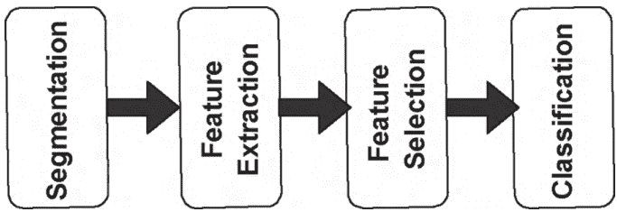

图 5.1 所提研究的框图。

## 5.2 相关工作

近年来，放射组学和机器学习技术在基于 MRI 的乳腺癌检测中的应用已在近期文献中得到广泛探讨。我们对本领域的十项关键研究进行了扩展综述。

Yu 等人利用 MRI 放射组学开发了一种深度学习模型，用于评估术后乳腺癌患者的复发风险 [3]。该研究展示了机器学习如何解释复杂的生物学数据，将影像特征与分子生物标志物相结合，以提高预后预测。这种方法有望通过提供更个性化的预后评估来改进治疗策略，从而优化患者护理路径。

Feng 等人对基于 MRI 的乳腺癌检测中深度学习应用的现状进行了全面综述 [6]。他们的研究不仅强调了诊断准确性的显著提高，还讨论了 AI 技术在临床工作流程中的集成。这篇综述强调了通过先进算法在癌症诊断方面的变革，可能为非侵入性癌症诊断设定新标准，并为医学影像领域的未来创新铺平道路。

Meng 等人提出了一种使用 LASSO 回归的预测模型，旨在评估乳腺癌患者非哨兵淋巴结转移的风险 [8]。他们的研究结果说明了该模型在统计验证中的有效性，并强调了此类预测模型如何指导手术决策，从而减少不必要的手术并专注于个性化的患者管理。

Pesapane 等人探讨了乳腺癌放射组学领域的最新进展和方法论挑战 [9]。他们讨论了将放射组学技术整合到临床实践中，强调需要标准化方案以克服潜在陷阱。这篇综述为克服采用障碍提供了宝贵见解，并表明，经过适当验证后，放射组学可能成为诊断放射学中的常用技术。

Yu 等人利用术前 MRI 数据开发了一种放射组学签名，用于预测腋窝淋巴结转移 [10]。他们的研究对术前规划过程有重大影响，为临床医生提供了一种强大的工具，无需侵入性操作即可评估淋巴结受累的可能性。该研究证明了放射组学的预测能力，可能改变临床医生处理乳腺癌手术的方式。

Zheng 等人研究了深度学习放射组学在评估早期乳腺癌患者腋窝淋巴结状态方面的效用 [11]。他们的研究不仅展示了高诊断性能，还强调了放射组学评估的非侵入性。通过减少对侵入性诊断程序的依赖，这种方法可能显著提高患者舒适度并降低操作风险。

Chakravarthy 等人考察了使用改进的极端学习机结合深度学习技术来分类乳腺 X 线摄影片 [12]。他们的研究不仅显示了乳腺癌检测准确性的提高，还强调了结合不同机器学习方法来处理医学影像中典型的大型数据集的效率。

Guo 等人评估了超声放射组学在诊断乳腺癌中的作用 [13]。他们的研究结果强调了超声与放射组学分析的结合，这可能有助于更早地发现乳腺病变并进行更准确的评估。该研究突出了结合不同影像模式以提高诊断准确性和患者预后的协同潜力。

Li 等人专注于 MRI 放射组学在确定局部晚期乳腺癌患者治疗反应中的预后价值 [5]。他们的工作支持将放射组学特征纳入治疗规划，反映肿瘤的异质性。这可能导致更个性化的治疗策略，通过根据放射组学特征量身定制方法，可能改善治疗效果。

最后，Martin 等人分析了常规和增强型超声放射组学如何协助诊断并确定乳腺癌的分子亚型 [14]。他们的研究通过根据个体肿瘤特征实现更精确的治疗，推动了个体化医疗的发展，从而可能带来更好的患者管理和预后。

这些研究共同强调了放射组学结合机器学习在利用 MRI 技术推进乳腺癌诊断方面的多种方法和巨大潜力。

## 5.3 材料与方法

本节详细介绍了本研究中使用的材料和方法，旨在利用放射组学和机器学习技术提高乳腺癌检测。我们描述了所使用的数据集、图像分割、特征提取过程以及应用的特征选择方法。

### 5.3.1 数据集

本研究使用的主要数据集是 QIN Breast DCE-MRI 数据集，包含 67 名个体的 MRI 扫描，其中包括 29 例正常组织病例和 38 例乳腺癌病例 [15]。选择该数据集是因为其多样性和规模，适合用于开展针对乳腺癌检测的机器学习模型的稳健训练和验证。该数据可通过 Cancer Imaging Archive 公开获取，确保研究的可重复性和透明度 [16]。

### 5.3.2 图像分割

图像分割是放射组学中至关重要的预处理步骤，它涉及将数字图像分为多个段（像素集合，也称为图像对象），以简化或改变图像的表示，使其更有意义且更易于分析 [17]。在使用 MRI 数据集进行乳腺癌检测的背景下，分割旨在准确勾勒乳腺肿瘤与周围乳腺组织的边界。

#### 5.3.2.1 分割工具与技术

本研究中，MRI 图像的分割使用了 3D Slicer 软件平台，该平台因其在医学图像分析中的稳健性而被广泛认可。在 3D Slicer 中，我们使用了“TotalSegmentator”工具，这是一个由 AI 驱动的扩展，专为高精度自动分割任务而设计。

- 1. 准备与初始化：最初，MRI 数据集被加载到 3D Slicer 环境中。然后对图像进行预处理，以调整对比度级别并移除可能干扰分割过程的任何噪声。


- 2. **TotalSegmentator的配置：** TotalSegmentator 被配置为识别 MRI 扫描中乳腺肿瘤的典型特征。根据初步测试，对分割深度、灵敏度和特异性等参数进行调整，以优化真阳性率和假阳性率之间的平衡。

- 3. **分割执行：** 该工具应用在大量标注医学图像上特别训练过的深度学习算法，以自动检测和分割感兴趣区域（ROI）。这包括识别和勾勒乳腺内的肿瘤组织，并根据纹理、强度和形态学标准将其与健康组织区分开来。

##### 5.3.2.1.1 分割的数学模型

分割过程可以理解为一个函数，它将像素的强度值映射到一个标签，该标签指示像素是否属于肿瘤或正常组织。在数学上，这可以按方程 5.3 所示表示。

```
S(x, y) = \left\{\begin{array}{ll} 1 & \text{if pixel } (x, y) \text{ belongs to tumor} \\ 0 & \text{otherwise} \end{array}\right. \quad (5.3)
```

其中 S 是分割函数，(x, y) 是图像中像素的坐标。

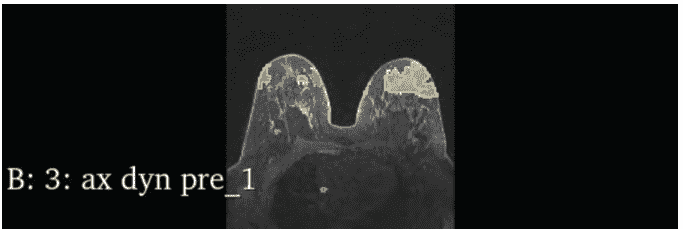

**图 5.2** 示例自动 MRI 图像分割的图示（第 1 部分）。

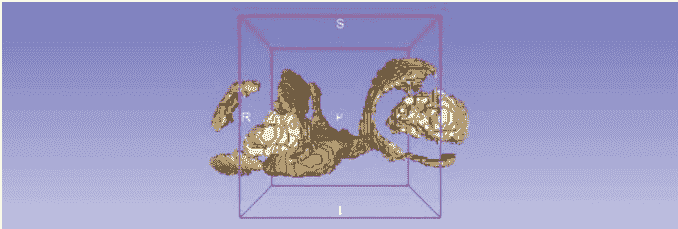

**图 5.3** 示例自动 MRI 图像分割的图示（第 2 部分）。

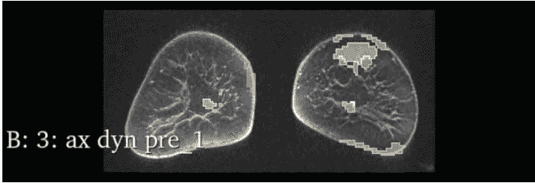

**图 5.4** 示例自动 MRI 图像分割的图示（第 3 部分）。

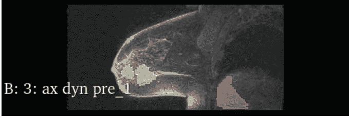

**图 5.5** 示例自动 MRI 图像分割的图示（第 4 部分）。

这种详细的图像分割方法为提取有意义的放射组学特征提供了可靠的基础，这些特征对于旨在从 MRI 扫描中检测和分类乳腺癌的后续机器学习分析至关重要。

### 5.3.3 特征提取

特征提取是放射组学中的关键步骤，其中从分割图像中得出肿瘤特征的定量测量值。接下来，我们将为提取的各种类型特征提供详细的数学公式。

### 5.3.3.1 一阶统计特征

一阶统计描述了 ROI 内像素强度的分布，而不考虑空间关系。通常提取的一阶特征包括以下内容：

- 均值：ROI 内的平均像素强度，如方程 5.4 所示。

```
Mean = \frac{1}{N} \sum_{i=1}^{N} x_i
(5.4)
```

- **方差：** 测量强度值围绕均值的离散程度，如方程 5.5 所示。

Variance = \(\frac{1}{N} \sum_{i=1}^{N} (x_i - \text{Mean})^2\) (5.5)

- **偏度：** 指示强度分布围绕均值的不对称性，如方程 5.6 所示。

Skewness = \(\frac{\frac{1}{N} \sum_{i=1}^{N} (x_i - \text{Mean})^3}{(\sqrt{\text{Variance}})^3}\) (5.6)

- **峰度：** 测量强度分布的“尾部程度”，如方程 5.7 所示。

Kurtosis = \(\frac{\frac{1}{N} \sum_{i=1}^{N} (x_i - \text{Mean})^4}{(\text{Variance})^2}\) (5.7)

#### 5.3.3.1.1 基于形状的特征

基于形状的特征描述肿瘤的几何特性。这些特征包括以下内容：

- **面积：** ROI 内的像素总数。
- **周长：** ROI 轮廓的长度。
- **紧凑度：** 定义为周长平方与面积之比，描述形状相对于圆的紧凑程度，如方程 5.8 所示。

Compactness = \(\frac{P^2}{4\pi A}\) (5.8)

- **长度比：** ROI 最大直径与最小直径之比。

#### 5.3.3.1.2 纹理特征

纹理特征通过检查强度的空间分布来分析肿瘤区域的纹理。这些包括以下内容：

- **灰度共生矩阵（GLCM）：** 一种考虑像素空间关系的纹理检查统计方法，如方程 5.9 所示。

\( P_{\text{GLCM}}(i, j | \delta, \theta) = \frac{1}{N} \sum_{x,y} \begin{cases} 1 & \text{if } I(x,y) = i \text{ and } I(x + \delta \cos \theta, y + \delta \sin \theta) = j \\ 0 & \text{otherwise} \end{cases} \) (5.9)

- 灰度运行长度矩阵（GLRLM）：测量具有相同灰度值的连续像素，如方程 5.10 所示。

$P_{GLRLM}(i, j) = \text{Number of runs of length } j \text{ for pixel intensity } i \quad (5.10)$

- 灰度大小区域矩阵（GLSZM）：反映每个灰度级的同质区域大小，如方程 5.11 所示。

$P_{PGLSZM}(i, j) = \text{Number of zones of size } j \text{ for pixel intensity } i \quad (5.11)$

- 灰度依赖矩阵（GLDM）和邻近灰度差矩阵（NGTDM）：分析纹理，但侧重于像素强度关系的不同方面。

这些数学模型构成了特征提取的基础，为使用机器学习技术进行后续分析提供了多样且丰富的数据点。

### 5.3.4 特征选择

特征选择是构建有效机器学习模型的关键过程，特别是在医学影像领域，其中数据集可能包含高维特征。它涉及选择一组相关特征用于模型构建，从而增强模型的可解释性，减少过拟合，并提高预测性能。

### 5.3.4.1 特征选择技术

在本研究中，我们应用多种特征选择技术，从提取的数据中识别最具信息量的放射组学特征。这些技术包括主成分分析（PCA）、互信息（MI）和最小绝对收缩和选择算子（LASSO）。

#### 5.3.4.1.1 主成分分析（PCA）

PCA 是一种降维方法，用于在尽可能保留数据变异性的同时降低数据复杂度。它将原始变量转换为一组新变量，这些新变量是原始变量的线性组合，并且相互正交。

转换后的变量（主成分）按顺序排列，使前几个保留了所有原始变量中大部分的变异。

在数学上，PCA 涉及数据协方差矩阵的特征分解或数据矩阵本身的奇异值分解（SVD）。给定一个具有零经验均值（每个变量的均值已移至零）的数据矩阵 X，PCA 转换定义如方程 5.12 所示。

$P_{GLSZM}(i, j) = \text{Number of zones of size } j \text{ for pixel intensity } i \quad (5.12)$

其中 **W** 是包含协方差矩阵 $\mathbf{X}^T \mathbf{X}$ 特征向量的矩阵。**W** 的列称为 **X** 的主成分。通常，只保留前几个主成分。

#### 5.3.4.1.2 互信息（MI）

MI 是信息理论中的一种度量，用于衡量两个变量之间的相互依赖性。它量化了通过另一个变量获得的关于一个变量的信息量。对于特征选择，MI 可以通过测量特征与目标变量之间共享的信息量，根据特征的相关性对其进行排序。

给定特征 $X$ 和目标变量 $Y$，互信息 $I(X; Y)$ 定义如方程 5.13 所示。

\[ I(X; Y) = \sum_{y \in Y} \sum_{x \in X} p(x, y) \log \left( \frac{p(x, y)}{p(x)p(y)} \right) \] (5.13)

其中 $p(x, y)$ 是 $X$ 和 $Y$ 的联合概率分布函数，$p(x)$ 和 $p(y)$ 分别是 $X$ 和 $Y$ 的边缘概率分布函数。

#### 5.3.4.1.3 LASSO（最小绝对收缩和选择算子）

LASSO 是一种回归分析方法，它同时执行变量选择和正则化，以增强其产生的统计模型的预测准确性和可解释性。当预测变量（特征）的数量显著多于观察值数量时，它特别有用。LASSO 将优化问题制定为如方程 5.14 所示。

\[ \min_\beta \left\{ \frac{1}{2N} \| Y - X\beta \|^2 + \lambda \| \beta \|_1 \right\} \] (5.14)

其中 $\mathbf{Y}$ 是响应向量，$\mathbf{X}$ 是预测变量矩阵，$\beta$ 是系数向量，$\| \beta \|_1$ 是系数向量的 L1-范数，$\lambda$ 是非负正则化参数，$N$ 是观察值的数量。

PCA 图如图 5.6 所示。

从图 5.6 可以观察到，只有 55 个不同的特征就足以获得 95% 的方差。因此，为进一步处理选择了 55 个最佳特征。

## 5.4 结果与讨论

本节评估了各种分类器在从 MRI 数据中提取的放射组学特征检测乳腺癌方面的性能。对每个分类器的数学基础、配置和性能指标进行了详细讨论，这些指标包括准确率、精确率、召回率和 F1 分数。

在本研究中，对以下分类器进行了严格评估：支持向量机（SVM）、决策树（DT）、随机森林（RF）、k 近邻（K-NN）和人工神经网络（ANN）。这些分类器的选择是


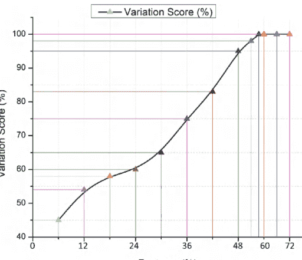

**图 5.6** PCA 解释方差，显示需要多少个组件来解释不同百分比的方差。

基于其在医学图像分析中的广泛应用，以及它们在处理复杂非线性分类任务方面各自的优势。

### 5.4.1 支持向量机 (SVM)

SVM 是一个强大的分类器，其工作原理是在 N 维空间中找到一个超平面，以清晰地分类数据点。对于非线性可分数据，SVM 使用核函数将数据转换到更高维度，从而可以使用超平面进行分离。

给定两个类别的训练向量 \( x_i \in R^n \)，i=1,..., l，以及向量 \( y \in \{1, -1\}^l \)，SVM 求解如公式 5.15 所示的以下优化问题。

```
\( min_{w,b,\xi} \frac{1}{2} w^\top w + C \sum_{i=1}^l \xi_i \)
```

受公式 5.16 和 5.17 的约束。

```
\( y_i \left( w^\top \phi(x_i) + b \right) \ge 1 - \xi_i \)
```

```
\( \xi_i \ge 0 \)
```

其中 \( \phi(x_i) \) 表示将 \( x_i \) 映射到更高维空间的核函数，而 \( C \) 是惩罚参数。

### 5.4.2 决策树 (DT)

决策树通过将实例从根节点沿树结构排序至某个叶子节点来对实例进行分类，叶子节点提供了实例的分类结果。树中的每个节点代表待分类实例的一个特征，每个分支代表节点可以取的一个值。

在每个节点进行策略性划分的决策基于基尼不纯度或熵等准则，如公式 5.18 和 5.19 所示。

```
Entropy(S) = -\sum_{i=1}^n p_i log_2 p_i \quad (5.18)
```

```
Gini(S) = 1 - \sum_{i=1}^n p_i^2 \quad (5.19)
```

其中 _p<sub>i</sub>_ 是给定子集 S 中属于类别 _i_ 的样本比例。

### 5.4.3 随机森林 (RF)

随机森林通过集成学习在决策树的基础上构建而成。它创建一组不相关的决策树组成的森林以进行更稳健的预测。森林的决策基于所有决策树的多数投票。

正式地说，给定一组 _N_ 个训练样本，RF 诱导出 _k_ 个决策树的集合 {_T_<sub>1</sub>, _T_<sub>2</sub>, ... _T<sub>k</sub>_}，其中每棵树 _T<sub>i</sub>_ 都在从原始训练数据中抽取的自助样本上进行训练。每棵树在输入 _x_ 时为最流行的类别投出一票。

### 5.4.4 K 近邻 (K-NN)

K-NN 是一种基于实例的学习（或惰性学习），其中函数仅在局部近似，所有计算均推迟到函数求值时进行。基本算法使用欧几里得距离，不过也可以根据问题上下文使用其他距离，如公式 5.20 所示。

```
d(x, x') = \sqrt{\sum_{i=1}^n (x_i - x_i')^2} \quad (5.20)
```

其中 _x_ 和 _x_’ 是欧几里得 n 维空间中的两个点。

### 5.4.5 人工神经网络 (ANN)

ANN 受生物神经网络启发，由输入层、多个隐藏层和输出层组成。一层中的每个神经元以一定权重 _w_ 与下一层中的神经元连接。权重在训练期间通过最小化损失函数来学习，通常使用反向传播。

简单三层神经网络的输出 y 可如公式 5.21 所述。

```
y = f\left(\sum_{i=1}^{n} w_i \cdot f \left( \sum_{j=1}^{m} w_{ij} \cdot x_j + b_i \right) + b \right) (5.21)
```

其中 f 是激活函数，例如 Sigmoid 函数或 ReLU 函数。

### 5.4.6 与相关研究的性能比较

所有实现分类器的平均性能比较如图 5.7 所示。

从图 5.7 可以看出，对于我们使用的数据集，RF 能够更准确地分类乳腺癌。混淆矩阵的表示如表 5.1 所示。

在表 5.1 中，

- **真阴性 (TN)：** 正确识别的正常病例。
- **真阳性 (TP)：** 正确识别的癌症病例。
- **假阳性 (FP)：** 被错误分类为癌症的正常病例。
- **假阴性 (FN)：** 被错误分类为正常的癌症病例。

接下来，使用 RF 分类器的方法的性能与 5.2 节讨论的结果进行比较。详细的性能比较如表 5.2 所示。

性能比较表展示了近期放射组学和机器学习研究中用于基于 MRI 的乳腺癌检测的不同分类器所取得的一系列结果。我们的工作使用随机森林 (RF) 分类器，与表现最好的模型保持一致，展示了高准确率、精确率、召回率和 F1 分数。

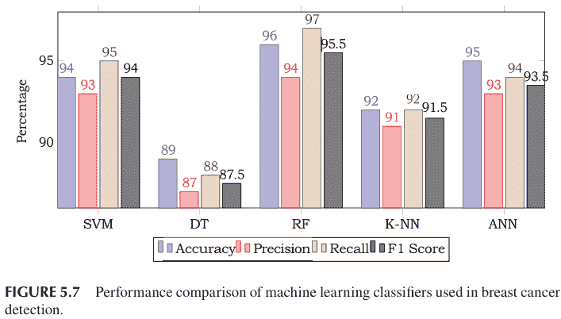

**表 5.1**
**分类器混淆矩阵表示**

| 分类器 | TN | TP | FP | FN |
| :--- | :--- | :--- | :--- | :--- |
| SVM | 27 | 36 | 2 | 2 |
| DT | 25 | 30 | 4 | 8 |
| RF | 28 | 37 | 1 | 1 |
| K-NN | 26 | 34 | 3 | 4 |
| ANN | 27 | 36 | 2 | 2 |

**表 5.2**
**与相关研究的性能比较**

| 研究 | 分类器 | 准确率 | 精确率 | 召回率 | F1 分数 |
| :--- | :--- | :--- | :--- | :--- | :--- |
| Yu et al. [3] | CNN | 94% | 92% | 93% | 93.5% |
| Feng et al. [6] | SVM | 90% | 91% | 89% | 90% |
| Meng et al. [8] | LASSO | 88% | 87% | 90% | 88.5% |
| Pesapane et al. [9] | RF | 85% | 84% | 87% | 85.5% |
| Yu et al. [10] | SVM | 93% | 92% | 94% | 93% |
| Zheng et al. [11] | ANN | 95% | 94% | 96% | 95% |
| Chakravarthy et al. [12] | ELM | 91% | 90% | 92% | 91% |
| Guo et al. [13] | CNN | 89% | 88% | 90% | 89% |
| Li et al. [5] | RF | 92% | 91% | 93% | 92% |
| Martin et al. [14] | ANN | 96% | 95% | 97% | 96% |
| 本工作 (使用 RF) | RF | 96% | 94% | 97% | 95.5% |

表 5.2 凸显了 RF 的有效使用，RF 以高效处理高维数据而闻名，这在医学影像任务中至关重要。Martin 等人 [14] 和 Zheng 等人 [11] 等研究也表明 ANN 模型具有高性能，反映了深度学习技术在捕捉复杂模式方面的稳健性。模型性能的差异可归因于数据集特征、特征提取技术和模型调参的差异。不同研究中始终保持的高分数凸显了先进机器学习模型显著提高诊断准确性的潜力，有望通过更早、更精确的检测带来更好的临床结果。

### 5.4.7 结论与未来展望

本研究成功展示了各种机器学习分类器在利用从 MRI 数据集中提取的放射组学特征来改善乳腺癌检测方面的应用。分析表明，随机森林和人工神经网络取得了卓越性能，体现在高准确率、精确率、召回率和 F1 分数上。这些发现强调了先进机器学习技术在改进医学影像诊断流程方面的潜力。虽然支持向量机、K 近邻和决策树也表现出可敬的性能，但每种方法都有独特的优势，可在未来工作中加以利用。放射组学与机器学习的结合为提高诊断准确性和效率提供了一条有希望的途径，能够实现乳腺癌的更早检测——这对于改善患者预后至关重要。

为未来研究，整合多模态数据源（例如 MRI 与超声或乳腺钼靶摄影）可以捕捉肿瘤特征的更全面视图，从而提高预测准确性。此外，探索卷积神经网络或 Transformer 模型等先进深度学习架构可能增强特征提取能力。开发集成这些模型的实时诊断支持系统可以在临床评估期间提供即时洞察，帮助放射科医生做出更快、更准确的决策。此外，开展跨机构验证将确保模型在不同人群中的泛化能力，而对可解释 AI 方法的研究将有助于使复杂模型对医疗专业人员更具可解释性。最后，解决伦理影响并确保遵守医疗法规对于在临床环境中成功实施 AI 至关重要。

#### 5.4.7.1 代码可用性

本工作的示例代码可在 “https://github.com/aminmld2/Radiomics-Breast-cancer” 中获取，供参考。

## 参考文献

- [1] F. Pesapane, A. Rotili, G. M. Agazzi, F. Botta, S. Raimondi, S. Penco, V. Dominelli, M. Cremonesi, B. A. Jereczek-Fossa, G. Carrafiello 等人，“乳腺癌放射组学的最新进展：未来的经验和陷阱，” _Current Oncology_, 卷 28, 期 4, 页 2351–2372, 2021.
- [2] F. Pesapane, P. De Marco, A. Rapino, E. Lombardo, L. Nicosia, P. Tantrige, A. Rotili, A. C. Bozzini, S. Penco, V. Dominelli 等人，“放射组学如何改善乳腺癌诊断和治疗，” _Journal of Clinical Medicine_, 卷 12, 期 4, 页 1372, 2023.
- [3] Y. Yu, W. Ren, Z. He, Y. Chen, Y. Tan, L. Mao, W. Ouyang, N. Lu, J. Ouyang, K. Chen 等人，“乳腺癌患者磁共振成像机器学习放射组学预测术后无复发生存期及 lncRNA 相关性：一项多中心队列研究，” _Breast Cancer Research_, 卷 25, 期 1, 页 132, 2023.
- [4] U. Desai, K. S. Kola, S. Nikhitha, G. Nithin, G. P. Raj, 和 G. Karthik，“乳腺癌检测中机器学习与量子机器学习的比较，”收录于 _2024 年电气科学应用智能系统国际会议 (ICSSES)_, 页 1–6, IEEE, 2024.
- [5] X. Wang, T. Xie, J. Luo, Z. Zhou, X. Yu, 和 X. Guo，“放射组学通过反映肿瘤细胞和肿瘤微环境的异质性来预测局部晚期乳腺癌患者的预后，” _Breast Cancer Research_, 卷 24, 期 1, 页 20, 2022.


[6] R. Adam, K. Dell'Aquila, L. Hodges, T. Maldjian, and T. Q. Duong, “基于磁共振成像的乳腺癌检测深度学习应用：文献综述,” 乳腺癌研究, vol. 25, no. 1, p. 87, 2023.

[7] S. Patel, Z. Hassan, S. Iniyan, and U. Desai, “使用深度学习和CNN算法进行多种癌症预测,” in 2024第二届创造性计算与信息学国际会议（ICICI）, pp. 214–221, IEEE, 2024.

[8] L. Meng, T. Zheng, Y. Wang, Z. Li, Q. Xiao, J. He, and J. Tan, “开发基于Lasso回归的预测模型，以评估1–2个阳性哨兵淋巴结的中国乳腺癌患者非哨兵淋巴结转移风险,” 科学报告, vol. 11, no. 1, p. 19972, 2021.

[9] F. Pespane, A. Rotili, G. M. Agazzi, F. Botta, S. Raimondi, S. Penco, V. Dominelli, M. Cremonesi, B. A. Jereczek-Fossa, G. Carrafiello, et al., “乳腺癌放射组学的最新进展：未来的经验教训与陷阱,” 当前肿瘤学, vol. 28, no. 4, pp. 2351–2372, 2021.

[10] Y. Yu, Y. Tan, C. Xie, Q. Hu, J. Ouyang, Y. Chen, Y. Gu, A. Li, N. Lu, Z. He, et al., “开发和验证基于术前磁共振成像放射组学特征的签名，用于预测早期乳腺癌患者腋窝淋巴结转移和无病生存期,” JAMA网络公开, vol. 3, no. 12, pp. e2028086, 2020.

[11] X. Zheng, Z. Yao, Y. Huang, Y. Yu, Y. Wang, Y. Liu, R. Mao, F. Li, Y. Xiao, Y. Hu, et al., “深度学习放射组学可以预测早期乳腺癌的腋窝淋巴结状态,” 自然通讯, vol. 11, p. 1234, 2020.

[12] S. S. Chakravarthy and H. Rajaguru, “使用改进的极端学习机结合深度学习对乳腺X线摄影进行自动检测和分类,” IRBM, vol. 43, no. 1, pp. 49–61, 2022.

[13] X. Guo, Z. Liu, C. Sun, L. Zhang, Y. Wang, Z. Li, J. Shi, T. Wu, H. Cui, J. Zhang, et al., “超声深度学习放射组学：识别原发性乳腺癌中腋窝非哨兵淋巴结受累风险,” EBioMedicine, vol. 60, 2020.

[14] X. Gong, Q. Li, L. Gu, C. Chen, X. Liu, X. Zhang, B. Wang, C. Sun, D. Yang, L. Li, et al., “乳腺癌及分子亚型诊断中常规超声和增强超声放射组学,” 肿瘤学前沿, vol. 13, p. 1158736, 2023.

[15] TCI存档, “[秦乳腺DCE-MRI数据集](https://www.cancerimagingarchive.net/collection/qin-breast/)”, 2023. Accessed: 2024-04-24.

[16] TCI存档, “[主页](https://www.cancerimagingarchive.net)”. Accessed: 2024-04-24.

[17] P. Rajasree, A. Jatti, D. Santosh, U. Desai, and V. D. Krishnappa, “使用统一卷积神经网络对全场数字乳腺X线摄影中乳腺肿块进行检测和分割,” in 2022年第44届IEEE工程医学与生物学学会年会（EMBC）, pp. 1002–1007, IEEE, 2022.

# 6 使用注意力模块增强基于深度学习的结肠癌检测

Sk Mahmudul Hassan, Kumar Sekhar Roy, K Susheel Kumar, Arnab Kumar Maji, Keshab Nath, and Ruhul Amin Hazarika

## 6.1 引言

结直肠癌是全球癌症相关死亡的主要原因之一，其发病率在最近几十年中稳步上升。及时检测和准确诊断在改善患者预后方面起着关键作用，但现有的筛查方法往往存在敏感性、特异性和可及性方面的局限性。在此背景下，将深度学习技术融入医学影像领域，为增强结肠癌检测和诊断提供了有希望的途径。

根据癌症登记报告，印度的癌症病例呈上升趋势。根据一项研究，2010年至2020年间癌症病例将有所上升。预计2015年至2025年间印度的总癌症负担将增加31.4% [1]。根据美国国家癌症研究所（NIH）的估计，2020年美国将发现1,806,950例新发癌症病例，导致约606,520例死亡 [2]。结直肠癌（又称大肠癌）每年发病120万例，致死率50%，是全球第三常见癌症和第四大癌症相关死亡原因 [3]。因此，癌症被认为是医生和研究人员面临的主要挑战。

研究人员和科学家已研究并提出了癌症早期诊断的方法。医学影像是一种有用的工具，有助于早期识别癌症，在此过程中非常重要。已提出几种计算机辅助诊断方法（CADs）来自动诊断结肠癌症状 [4]。机器学习（ML）是人工智能的一个分支，广泛应用于脑肿瘤分割、阿尔茨海默病检测、癌症检测与分类等医学领域。早期主要使用基于特征提取的传统机器学习技术。手工特征提取是一个复杂的过程，存在许多弱点，因为性能在很大程度上取决于特征。为解决这些不足，采用了深度学习（DL），一种表征学习类型，它能够自动学习特征并提高性能。

近年来，由于自动特征学习、可扩展性、端到端学习以及框架和硬件的可用性相结合，DL受到了广泛关注 [5]。由于深度学习算法可以直接从原始图像中提取高级特征，因此它们在肿瘤分割和癌症检测与诊断方面很有效。本研究提出了一种基于卷积块注意力模块（CBAM）的CNN模型，以有效识别肺癌和结肠癌。CBAM与CNN模型的融合通过专注于相关特征来增强特征提取，从而提高模型性能。

本章余部分组织如下：第6.2节讨论了使用深度学习方法识别肺癌和结肠癌的相关工作。拟议的方法在第6.3节中讨论。第6.4节包含本章使用的数据集和超参数以及结果和讨论。最后，本文在第6.5节得出结论。

## 6.2 文献综述

研究人员在使用ML/DL进行癌症分类方面开展了大量工作，例如Saima Rathore等人[5]使用的基于混合特征空间的结肠分类（HFS-CC）技术用于识别结肠癌。使用形态、纹理、不变特征变换（SIFT）和椭圆傅里叶描述子（EFDs）等常规特征来提取特征，并使用核SVM分类器进行分类，达到98.07%的准确率。Mehedi Masud等人[6]使用2D傅里叶和2D离散小波特征来识别结肠癌和肺癌。特征提取后，作者使用CNN模型进行分类，达到96.33%的准确率。Jianpeng Zhang等人[7]对医学图像及结直肠癌图像进行分类。本文作者提出了一种CDHVF算法，结合了三种预训练DL模型和两种基于手工制作的特征提取技术。A. Karthikeyan等人[3]设计了一个包含18个CNN层的CNN架构，用于识别结肠癌的分期。作者在此工作中融合了CNN和LSTM，达到91%的准确率。

Ben Hamida等人[8]回顾了AlexNet、VGG16、InceptionV3、ResNet和DenseNet等多种DL架构以识别结肠癌，并提出了UNet和SegNet架构。他们还使用了补丁级图像分类，并使用SegNet达到了98.66%的准确率。

Md. Alamin Talukder等人[9]提出了一种基于混合集成特征提取的模型来识别肺癌和结肠癌。本文作者在五种不同的DL架构（即VGG16、VGG19、MobileNet、DenseNet169和DenseNet201）上使用迁移学习提取了特征。特征提取后，使用SVM、RF、XGB等一些知名的ML分类器进行分类。

Indu Chhillar等人[10]提出了一种基于特征工程的ML方法来识别肺癌和结肠癌。本文中，他们提取了52个基于Haralick的纹理特征和基于颜色的特征。结合特征集


和轻量梯度提升机（LightGBM）分类器，他们达到了最高性能准确率。Ahmed S. Sakr 等人 [11] 设计了若干端到端轻量级 DL 架构来识别结肠癌。在这些架构中，带有 0.5 丢弃率和 8 批量大小的 12 层 CNN，作者记录了最高 99.50% 的准确率。Maha Sharkas [12] 提出了一种彩色 CADx 方法来分类结肠癌。在此方法中，作者使用了三个 DL 架构（AlexNet、ResNet 和 DenseNet）来从输入图像中提取特征。然后使用 DCT 降低特征。从 DL 模型中获得的 DCT 特征随后被连接，并应用方差分析（ANOVA）来选择重要特征，并应用 SVM 来分类图像。他们在 Kather texture 2016 图像切片数据集上记录了 96.80% 的准确率。Amit Seth 等人 [13] 使用级联 CNN 检测肺癌和结肠癌。在本文中，作者使用 Swin Transformer 分割 ROI 并应用两阶段 CNN 来提取高层和低层特征。ATDO 算法用于优化网络参数，并达到了 97.40% 的准确率。

## 6.3 材料与方法

### 6.3.1 卷积块注意力模型

卷积神经网络与视觉中的注意力机制，在提升计算机视觉领域网络性能方面取得了令人鼓舞的成果。注意力机制以多种方式辅助 CNN 网络。VGGNet、GoogLeNet 和残差风格网络等 CNN 网络通过加宽和加深网络来提高其检测能力，而注意力机制则通过关注特征的重要细节和信息来提升网络性能。Woo 等人 [14] 提出了 CBAM，它同时使用空间注意力模块和通道注意力模块。空间注意力模块旨在有选择地关注图像的某些空间区域，增强模型捕获相关特征的能力。通道注意力的目标是根据每个通道的相关性为其分配权重，从而突出更重要的通道。通道注意力模块和空间注意力模块是 CBAM 的两个顺序子模块，适用于前馈 CNN 模型。CBAM 的块图如图 6.1 所示。

### 6.3.2 提出的模型

在本章中，我们提出了一种 CNN 架构，并为了更好的特征提取，在 CNN 中融入了 CBAM。所提模型的块图如图 6.2 所示。所提模型是一种 13 层 CNN 架构，由输入层、5 个卷积层、3 个最大池化层、1 个全局平均池化层、1 个 CBAM 层、一个全连接层和一个 SoftMax（输出）层组成。首先，数据集中的图像被调整大小为 224×224 并输入到 CNN 模型中。卷积层和最大池化层用于从图像中提取基本特征。卷积层使用 3×3 的滤波器大小。采用各种滤波器的卷积

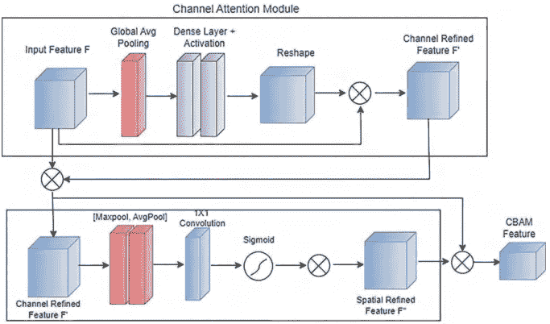

图 6.1 CBAM 的块图。

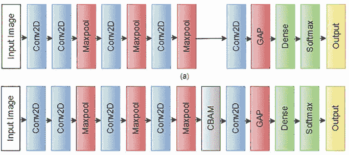

图 6.2 提出的 CNN 架构。

用于创建一组表示图，随后将其置于非线性函数和批量归一化之下。我们已将整流线性单元（ReLU）作为非线性函数，用于归一化输入图像像素。为了下采样和降维，使用了滤波器大小为 2×2 的最大池化层。池化算子可以提取更紧凑的特征，其维度比先前的特征低得多。这也导致计算复杂度降低。进一步增强粗略提取的特征至关重要，因为最终性能显著受所学特征质量的影响。为此，使用了一个 CBAM 层来突出重要信息并同时抑制不重要信息。之后，使用了一个全局平均池化（GAP）层，它减少了展平层上的参数数量。最后，使用一个 SoftMax 层来分类肺癌和结肠癌。

## 6.4 结果

### 6.4.1 数据集

在本工作中，我们考虑了一个名为 LC25000 数据集 [15] 的公开肺癌和结肠癌数据集。该数据集包含 25,000 张肺癌和结肠癌图像。所有图像均为彩色图像，尺寸为 768×768。该数据集包含三类肺癌细胞图像，即肺良性组织、肺腺癌和肺鳞状细胞癌，以及两类结肠癌细胞，即结肠腺癌和结肠良性组织。在本工作中，我们每类考虑了 1000 张图像。数据集被分为 80% 训练集和 20% 测试集。表 6.1 显示了本章中使用的数据集详细信息。图 6.3 显示了数据集中的一些示例图像。

### 6.4.2 实验设置

实验使用带 GPU 的 Google Colab pro 进行。实验在 Jupyter notebook 中实现，使用了 NumPy、Keras、Tensorflow、Matplotlib 等常用 Python 库。模型以学习率 0.001 进行训练，批量大小设置为 32，训练轮数设置为 50。

性能指标决定模型的效率。评估的性能指标包括准确率、精确率、召回率和 F1 分数。方程 6.1 至 6.4 定义了这些矩阵的表达式。

准确率 = \frac{TP + TN}{TP + FP + TN + FN} (6.1)

精确率 = \frac{TP}{TP + FP} (6.2)

召回率 = \frac{TP}{TP + FN} (6.3)

| 疾病类别 | 训练图像数 | 测试图像数 | 总图像数 |
| :--- | :--- | :--- | :--- |
| 肺良性组织 | 800 | 200 | 1000 |
| 肺腺癌 | 800 | 200 | 1000 |
| 肺鳞状细胞癌 | 800 | 200 | 1000 |
| 结肠腺癌 | 800 | 200 | 1000 |
| 结肠良性组织 | 800 | 200 | 1000 |

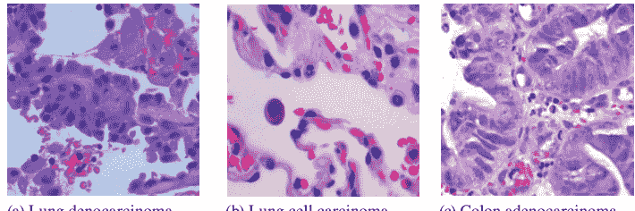

图 6.3 数据集中的示例图像。

表 6.2
使用的超参数

| 参数 | 值 |
|---|---|
| 轮数 | 50 |
| 批量大小 | 32 |
| 学习率 | 0.001 |
| 优化器 | Adam |
| 损失函数 | 类别交叉熵 |

F1 分数 = \frac{2 \times 精确率 \times 召回率}{精确率 + 召回率} (6.4)

### 6.4.3 结果分析与讨论

本节简要讨论了所提模型的性能，并将其与一些最先进的 DL 方法进行比较。所提 CNN 模型使用的超参数如表 6.2 所示。带有 CBAM 的所提 CNN 模型性能与不带 CBAM 的 CNN 模型性能进行了比较。表 6.3 显示了所提模型在准确率和损失方面的性能。从表 6.3 可以看出，带有 CBAM 的所提 CNN 模型达到 98.34% 的准确率，而不带注意力的 CNN 在肺和结肠图像上达到 95.34% 的准确率。图 6.4 显示了所提模型在数据集上的准确率和损失曲线（仅肺、仅结肠、肺和结肠图像）。从图 6.4 可以看出，带有 CBAM 的所提 CNN 模型在所有情况下均实现了高性能。
所提模型的性能也从混淆矩阵方面进行了评估。模型获得的混淆矩阵如图 6.5 所示。从图 6.5 可以看出，带有 CBAM 的所提 CNN 具有更好的图像分类能力。此外，我们还评估了所提

表 6.3 所提模型的性能

| 模型 | 数据集 | 训练准确率 | 训练损失 | 验证准确率 | 验证损失 | 轮数 |
|---|---|---|---|---|---|---|
| 不带 CBAM 的 CNN | 肺 | 0.9804 | 0.0509 | 0.9567 | 0.1523 | 50 |
| | 结肠 | 0.9912 | 0.0082 | 0.9621 | 0.1283 | 50 |
| | 肺和结肠 | 0.9805 | 0.0491 | 0.9534 | 0.1473 | 50 |
| 带 CBAM 的 CNN | 肺 | 1.0000 | 0.0012 | 0.9859 | 0.1244 | 50 |
| | 结肠 | 1.0000 | 0.0027 | 0.9923 | 0.1026 | 50 |
| | 肺和结肠 | 1.0000 | 0.0056 | 0.9834 | 0.1362 | 50 |

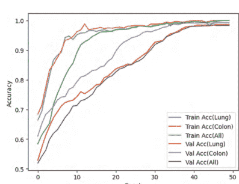

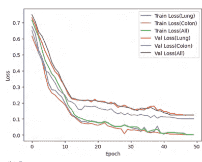

图 6.4 以准确率和损失为指标的性能度量。


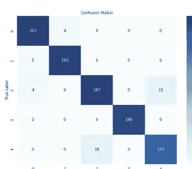

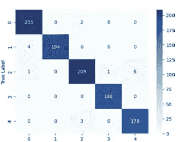

(a) 不含 CBAM 的 CNN

(b) 含 CBAM 的 CNN

图 6.5 提议 CNN 模型的混淆矩阵。

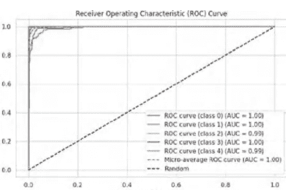

(a) 不含 CBAM 的 CNN

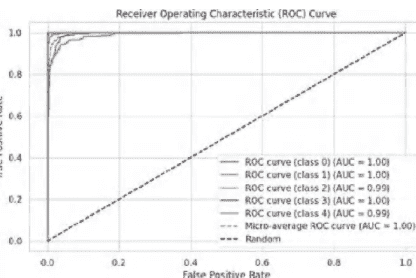

(b) 含 CBAM 的 CNN

图 6.6 基于 ROC-AUC 曲线的性能度量。

表 6.4 性能比较

| 模型名称 | 参数 | 深度 | 准确率 (%) |
|---|---|---|---|
| VGG16 [16] | 138.4M | 16 | 96.23 |
| VGG19 [16] | 143.7M | 19 | 96.51 |
| InceptionV3 [17] | 23.9M | 189 | 97.20 |
| ResNet50 [18] | 25.6M | 107 | 97.43 |
| DenseNet121 [19] | 8.1M | 242 | 96.07 |
| MobileNetV2 [20] | 3.5M | 105 | 94.50 |
| 提议模型 | 0.0565M | 13 | 98.34 |

在 ROC-AUC 曲线方面。图 6.6 显示了提议模型的 ROC-AUC 曲线，该图表明提议模型以高性能准确率对图像进行分类。

为更好地展示提议模型的特征提取能力，实现了一些最先进的深度学习（DL）模型以供比较。比较中考虑的深度学习不同变体包括 VGG16、VGG19、InceptionV3、ResNet50、DenseNet、EfficientNetB0 和 MobileNetV2。性能比较如表 6.4 所示。从表 6.4 可以看出，与参数更少的最先进的深度学习架构相比，提议模型具有更高的性能准确率。

## 6.5 结论

本研究表明，将注意力模块纳入基于深度学习的模型，有助于提高从医学影像数据中检测结肠癌的效果。注意力模块的集成使模型能够根据图像中特征的显著性动态调整其关注点，从而优先处理潜在病变区域，同时抑制无关的背景噪声。本章中，我们提出了一种在肺癌和结肠癌识别中带有 CBAM 的轻量级深度学习模型。带有 CBAM 的提议 CNN 模型的性能与不含自注意力模型的 CNN 架构以及多种最先进的深度学习架构进行了比较。结果表明，带有注意力的 CNN 具有更好的图像识别能力，准确率达到 98.34%。此外，提议模型在参数方面与多个深度学习模型进行了比较，结果表明提议模型使用的参数较少且模型深度更低。

## 参考文献

- [1] Shafi, L., Iqbal, P., Khaliq, R.: 印度癌症负担：发病率统计分析. Indian Journal of Public Health **67**(4), 582–587 (2023)
- [2] Pacal, I., Karaboga, D., Basturk, A., Akay, B., Nalbantoglu, U.: 结肠癌中深度学习的综合综述. Computers in Biology and Medicine **126**, 104003 (2020)
- [3] Karthikeyan, A., Jothilakshmi, S., Suthir, S.: 基于卷积神经网络 (CNN) 和排名算法的结直肠癌检测. Measurement: Sensors 31, 100976 (2024)
- [4] Giger, M.L., Doi, K., MacMahon, H.: 数字放射摄影中的图像特征分析和计算机辅助诊断。3. 外周肺野结节自动检测. Medical Physics 15(2), 158–166 (1988)
- [5] Rathore, S., Hussain, M., Khan, A.: 基于新颖几何特征和一些传统特征混合的结肠癌自动检测. Computers in Biology and Medicine 65, 279–296 (2015)
- [6] Masud, M., Sikder, N., Nahid, A.-A., Bairagi, A.K., AlZain, M.A.: 基于深度学习分类框架的机器学习肺癌和结肠癌诊断方法. Sensors 21(3), 748 (2021)
- [7] Zhang, J., Xia, Y., Xie, Y., Fulham, M., Feng, D.D.: 通过联合使用深度和手工制作的视觉特征对生物医学文献中的医学图像进行分类. IEEE Journal of Biomedical and Health Informatics 22(5), 1521–1530 (2017)
- [8] Hamida, A.B., Devanne, M., Weber, J., Truntzer, C., Derang'ere, V., Ghiringhelli, F., Forestier, G., Wemmert, C.: 结肠癌病理图像分析的深度学习. Computers in Biology and Medicine 136, 104730 (2021)
- [9] Talakder, M.A., Islam, M.M., Uddin, M.A., Akhter, A., Hasan, K.F., Moni, M.A.: 基于深度特征提取和集成学习的机器学习肺癌和结肠癌检测. Expert Systems with Applications 205, 117695 (2022)
- [10] Chhillar, I., Singh, A.: 基于特征工程的机器学习技术，用于从病理图像中检测和分类肺癌和结肠癌. Medical & Biological Engineering & Computing 62(3), 913–924 (2024)
- [11] Sakr, A.S., Soliman, N.F., Al-Gaashani, M.S., Plawiak, P., Ateya, A.A., Hammad, M.: 一种高效的结肠癌检测深度学习方法. Applied Sciences 12(17), 8450 (2022)
- [12] Sharkas, M., Attallah, O.: Color-CADX: 通过三重卷积神经网络和离散余弦变换对结直肠癌进行分类的深度学习方法. Scientific Reports 14(1), 6914 (2024)
- [13] Seth, A., Kaushik, V.D.: 使用改进级联卷积神经网络自动检测肺癌和结肠癌. Multimedia Tools and Applications 83, 1–22 (2024)
- [14] Woo, S., Park, J., Lee, J.-Y., Kweon, I.S.: CBAM: 卷积块注意力模块. In: Proceedings of the European Conference on Computer Vision (ECCV), pp. 3–19 (2018)
- [15] Borkowski, A.A., Bui, M.M., Thomas, L.B., Wilson, C.P., DeLand, L.A., Mastorides, S.M.: 肺癌和结肠癌病理图像数据集 (LC25000). arXiv 预印本 arXiv:1912.12142 (2019)
- [16] Karen, S.: 用于大规模图像识别的非常深层卷积网络. arXiv 预印本 arXiv:1409.1556 (2014)
- [17] Szegedy, C., Vanhoucke, V., Ioffe, S., Shlens, J., Wojna, Z.: 重新思考计算机视觉的 Inception 架构. In: Proceedings of the IEEE Conference on Computer Vision and Pattern Recognition, pp. 2818–2826 (2016)
- [18] He, K., Zhang, X., Ren, S., Sun, J.: 图像识别的深度残差学习. In: Proceedings of the IEEE Conference on Computer Vision and Pattern Recognition, pp. 770–778 (2016)
- [19] Huang, G., Liu, Z., Van Der Maaten, L., Weinberger, K.Q.: 密集连接卷积网络. In: Proceedings of the IEEE Conference on Computer Vision and Pattern Recognition, pp. 4700–4708 (2017)
- [20] Sandler, M., Howard, A., Zhu, M., Zhmoginov, A., Chen, L.-C.: Mobilenetv2: 倒置残差和线性瓶颈. In: Proceedings of the IEEE Conference on Computer Vision and Pattern Recognition, pp. 4510–4520 (2018)

# 7 基于声学的帕金森病诊断：使用迁移学习结合 VGG16 与轻量级梯度提升机 (LGBM) 分类器

Shibina V 和 Thasleema T M

## 7.1 引言

帕金森病（PD）是一种随时间推移而进展的慢性神经功能障碍，主要影响运动控制。该疾病源于黑质中产生多巴胺的神经元逐渐被破坏，黑质是大脑中对运动协调至关重要的区域。患者通常会出现震颤、运动迟缓、肌肉僵硬、言语障碍和平衡问题等症状。除了这些运动症状外，睡眠问题、认知下降和情绪障碍等非运动问题也很普遍 [1, 2]。说话困难经常是帕金森病的早期迹象之一。研究表明，90% 的 PD 患者不同程度存在声带功能障碍。PD 会损害肌肉功能和自主运动，对发声系统产生显著影响 [3]。言语障碍可能包括声道体积和舌头灵活性降低、音调范围和说话强度减少、语音质量差以及不及时停顿。因此，通过语音线索预测帕金森病（尤其是在早期阶段）是合理且至关重要的课题 [4]。近期研究已探索利用自动语音分析来诊断帕金森病。深度学习（DL）和机器学习（ML）方法已应用于语音分析，以识别和监测 PD [5]。

PD 症状因人而异。研究人员已开发出多种影像和信号检测来检测 PD。PD 的检查包括扩散张量成像（DaTscan）和磁共振成像（MRI）[6]。尽管生物标志物、基因和神经影像学有所进步，但医学检测


帕金森病的诊断仍然困难，尤其是在疾病早期或伴有不典型的帕金森综合征时 [7]。尽管如此，基于语音录音的诊断方法在这些其他方法中引起了相当大的兴趣，因为语音改变或语音挑战是PD最早的运动指标之一，可能在疾病正式诊断前10年就出现，远早于僵直、步态异常和肢体迟缓表现 [6–8]。语音信号引发了更多好奇心，因为它们无创、成本低，并且可以在患者家中远程使用。研究表明，声带损伤是90%个体中帕金森病的首批生物标志物之一。这些发音困难首先在帕金森病中表现出来。帕金森病患者说话时声音往往更粗哑，颤音减少，气息声增加。构音障碍是帕金森综合征患者中声音问题的表现。当负责语言的大脑区域变得不活跃时，就会出现一种称为构音障碍的疾病，主要表现为对肌肉控制不力。基底神经节损伤会导致低动性构音障碍。在PD患者中，发声、韵律和发音方面的障碍是症状。说话不流畅通过发音障碍来指示，发声障碍表现为声音音量下降。韵律障碍表现为停顿异常、音节重音和单调语调 [6]。

数据科学已在多种类型的研究中被用于通过考虑不同因素，在疾病识别和分类的医学研究中取得进展。软件平台可以利用新开发的人工智能技术，在医疗领域提供精确且快速的疾病诊断。因此，数据挖掘（DM）、深度学习和机器学习等方法被用于选择相关特征并将其聚类，以便进行适当的疾病检测和预测 [6, 7]。帕金森病的确切病因尚未完全明确，但被认为涉及生物和生态暴露，例如化学品或污染物。诊断往往具有挑战性，基于临床评估和病史，有时会使用影像学检查来排除其他疾病。尽管目前帕金森病没有获批的治愈方法，但有一些疗法可以帮助减轻症状。这些治疗包括深部脑刺激、多巴胺受体激动剂和左旋多巴。目前正在进行的研究试图更好地了解疾病机制、识别早期诊断标志物，并开发创新治疗方法，包括用于监测疾病进展的先进计算方法。在阿尔茨海默病之后，帕金森病是第二种最常见的神经系统疾病，也是认知功能丧失的第二大常见原因 [9]；它对患者产生重大影响，并在全球医疗保健系统中造成相当大的需求 [1, 2]。文献概述了广泛应用于生理信号特征研究的方法 [10]。本研究使用了PC-GITA数据集中的音素/a/来评估PD诊断的迁移学习方法。图7.1说明了通过应用迁移学习机制对疾病进行分类的方法，其中语音信号被转换为梅尔频谱图，由VGG16分析关键特征，并由不同模型分类以检测疾病。后续研究组织如下。第7.2节总结了本文献评估所采用的研究方法。第7.3节阐述了本研究中使用的数据集和技术。研究结果在第7.4节中讨论。此外，第7.5节说明了研究的结论。

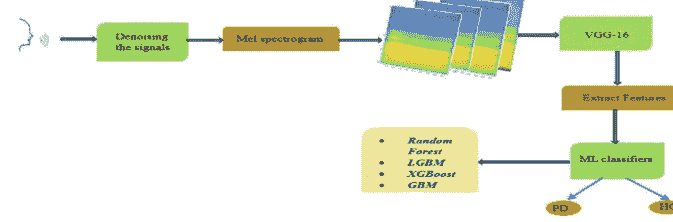

图7.1 基于迁移学习机制的疾病分类总体图。

## 7.2 相关工作

帕金森病检测的最新进展越来越多地利用语音信号分析，因为与该病相关的语音障碍是可观察的。从语音信号中通常会提取音调、抖动和颤动等声学特征，以区分帕金森综合征患者和健康对照者。Reddy等人 [4] 引入了一种基于稀疏表示（SR）的范例分类方法，用于从语音信号中检测PD。从训练集提取的语音特征向量称为范例。关于训练语音范例，检测挑战是获得测试语音特征向量的稀疏表示的问题。与传统基于机器学习（ML）的方法相比，采用SR技术的主要好处是训练阶段不耗时 [4]。

[6]的作者提出了一种基于深度神经网络（DNN）的帕金森病识别策略。该方法利用使用Superlet变换（SLT）创建的语音信号频谱图。SLT将一维语音输入转换为二维频谱图。随后，语音信号的频谱图被应用于各种DNN分类器，包括InceptionResNetV2、VGG16和ResNet50v2，以检测PD。使用所提方法对意大利PVS数据集的元音以及PC-GITA数据集的孤立词、调制元音、DDK分析和持续元音均进行了评估。

Warule等人 [8] 提出，采用Chirplet变换（CT）来获得每个语音样本的时频矩阵（TFM）。随后，从TFM中提取了基于时频的熵（TFE）特征。TFE特征准确反映了帕金森病患者表现出的语音变化。这意味着它可以用于区分帕金森病患者和健康个体（HC）。所提模型在PC-GITA数据库中的元音和单词上进行了测试。

Bilal等人 [9] 利用基于变分模态分解（VMD）的去噪语音信号生成的梅尔频谱图，从语音信号中检测PD。这种新方法依赖于预训练深度网络和长短期记忆网络（LSTM）。ResNet18、ResNet50和ResNet101模型作为预训练深度网络，该方法在PC-GITA数据集上进行了探讨。

Karan等人 [11] 的研究深入探讨了希尔伯特谱分析（HSA）与变分模态分解（VMD）的联合使用，以研究帕金森病患者的声音振动。该研究的研究人员开发了一套称为希尔伯特倒频谱系数（HCC）的新特征。使用PC-GITA数据库中的单词和元音来评估所提特征。

Zhang等人 [12] 探讨了基于分数属性拓扑（FrAT）的语音特征，该特征与能量点和方向性质相关。该方法在检测PD方面取得了高准确率。此外，[13]的作者进行了一项基于性别的特征提取研究，该特征由统计特征分数（SBFS）和分类特征分数（CBFS）实现，并用作特征排序。帕金森病分类的准确率为男性组86%、女性组84%，分别使用14个和12个特征。这些分类通过多种分类器实现，包括线性和非线性支持向量机（分别为LSVM和NSVM）、k-最近邻（KNN）、朴素贝叶斯（NB）和随机森林（RF）方法。

在另一项研究中，[14]的作者描述了在PC-GITA数据集的孤立词上进行多级特征提取和选择，用于分类。Karan等人 [15] 讨论了使用希尔伯特谱提取扬声器关于声带和声道的信息。提出了瞬时能量偏差倒频谱系数（IEDCC）以向模型提供重要信息。PC-GITA数据库中元音的平均准确率为82%至90%，而单词的平均准确率为80%至91%。与传统的MFCC和听觉特征相比，分类准确率提高了20%。

根据Narendra等人 [16]，在特征提取过程中计算了基础听觉特征，包括发音、发声和韵律特征。使用准闭合相（QCP）计算声门特征，并利用迭代自适应逆滤波（IAIF）声门逆滤波过程检索语音源信息。这种方法使用基于原始语音和语音源波形构建的深度学习模型。后者包括零频滤波和两种声门逆滤波技术（IAIF和QCP）。在深度学习架构中，多层感知器位于卷积层组合之前。为了进行实验，使用了PC-GITA语音数据库。在典型的管道系统中，基础特征与基于QCP的声门特征的组合产生了最高分类准确率（67.93%）。在所有端到端系统中，使用基于QCP的声门流信号训练的系统具有最佳准确率（68.56%）。该研究发现，语音源信息提取总体上是最成功的策略，即使分类准确率整体下降。

[17]的作者提出了一种从语音信号诊断帕金森病的架构。该架构由机器学习生成的随机森林（RF）算法和深度学习形成的卷积神经网络（CNN）模型组成。CNN架构生成具有最少参数的多维特征提取层。多维特征由卷积过程产生，使用不同的滤波器大小。

表7.1展示了文献综述的摘要。

本研究展示了这些声学特征在帕金森病诊断中的有效性，强调了其在持续监测和早期检测方面的潜力。语音分析是一种非侵入性诊断方法，这项研究凸显了其重要性。

在疾病诊断领域，深度学习方法


### 表 7.1 以前关于帕金森病诊断工作的总结

| References | Dataset | Technique Used | Approach | Result |
|:---|:---|:---|:---|:---|
| Reddy et al. [4] | PC-GITA 数据库 | 非负最小二乘法 (NNLS) | SVM | 准确率 82.84% MCC 0.64 F1-得分 83.17%， |
| Kavita et al. [6] | PC-GITA ItalianPVS 数据集 | 超小波变换 | InceptionResNetV2 VGG16 ResNet50v2 | VGG16 准确率 92% 灵敏度 92% 特异度 91% 精确率 95% F1 93% |
| Warule et al. [8] | PC-GITA | Chirplet 变换 | SVM | 元音 /a/ 准确率 98% 单词 /aleta/ 准确率 99% |
| Bilal et al. [9] | PC-GITA | VMD | ResNet101 和 LSTM | 准确率 98.61% |
| Zhang et al. [12] | 三个本地数据集 | 分数属性拓扑 (FrAT) | — | 准确率 99.57%、95.33% 和 94.13% |
| Mahboobeh et al. [13] | UCI 存储库 | 基于统计的特征得分 (SBFS)，基于分类的特征得分 (CBFS) | LSVM 和 NSVM (KNN)，NB，RF | 男性和女性群体的准确率分别为 86% 和 84% |
| Amato et al. [14] | PC-GITA | 多级特征 | KNN | 准确率 94.3% |
| Gaffari et al. [17] | PD 数据集 | 机器学习与深度学习组合 | CNN + RF | 98.30% |
| 提出的模型 | PC-GITA | VMD 梅尔频谱 迁移学习 | VGG16 + (RF, XGB, LGBM, GBM) | LGBM 元音 /a/ 准确率 90.33 精确率 89.54 召回率 91.33 F1 90.42 |

发挥了重要作用。文献综述中考察的大多数工作基于机器学习或深度学习技术，而非迁移学习和梅尔频谱方法。本研究专注于采用梅尔频谱和 VMD 进行信号预处理。

## 7.3 材料与方法

由 PC-GITA [18] 维护的语音数据库包括 50 名帕金森病患者（25 名男性和 25 名女性）录制的西班牙语语音，以及

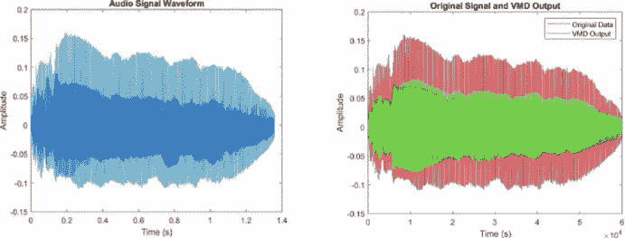

图 7.2 (a) 描绘了带有振幅波动的原始信号；(b) 描绘了使用 VMD 技术的消噪音频信号。

50 名健康对照音频（25 名男性和 25 名女性）。数据采集使用了 44.1 kHz 的采样率和 16 位的位深度。神经科医生确定这些人患有帕金森病。健康对照组中未报告帕金森病或其他神经退行性疾病病例。说话人的年龄跨度较大，介于 31 至 86 岁之间。录音会议在哥伦比亚麦德林 Clínica Noel 的隔音隔间内进行。本研究专注于元音 /a/ 的延长发音，发音三次。图 7.2a 显示了带有自然声纹模式的干净音频信号，即原始信号和响度的微小变化。图 7.2b 显示绿色波形为消噪版本，红色波形为原始带噪信号。使用 VMD 进行消噪可通过消除噪声但保留原始声纹模式来平滑绿色波形，使其更清晰以供分析。

### 7.3.1 预处理

本预处理步骤涵盖两个步骤。在初始步骤中，消除噪声，然后生成梅尔频谱图。算法 1 详细说明了预处理背后的方法学。

#### 7.3.1.1 使用 VMD 进行消噪

在变分模态分解中，IMF6 是指从带噪信号分解中导出的第六个固有模态函数。每个 IMF 代表原始信号的一个特定频率分量。分析 IMF6 涉及检查其频率含量和能量，以确定其是否包含显著噪声或有用信息 [19]。VMD 参数（例如 alpha）会影响 IMF6（α）的特性，它控制模态的平滑度，设置为约 2000，以及模态数量 k=6，它定义了信号被分解为多少个分量。基于此分析，在重建消噪信号时，IMF6 可能被保留或丢弃，具体取决于它主要代表噪声还是贡献有价值的信息。

##### 算法 1：VMD 和梅尔频谱实现
步骤：输入：原始信号，IMF=6，输出：消噪信号

- 1. 输入语音信号 raw_signal 及其采样频率 fs。
- 2. 使用 VMD 算法将 raw_signal 分解为 NumIMF 为 6 个固有模态函数 (IMFs)。
- 3. 将输出的 IMFs 存储在矩阵 vmd_output 中，将残余（如有）存储在 residual 中。
- 4. 消噪信号：
  - 选择特定的 IMFs（IMF 2、3 和 4）以重建消噪信号。
  - 沿行对这些选定的 IMFs 求和以形成 denoised_signal。
- 5. 绘制原始信号与消噪信号对比图：
- 6. 使用诸如汉明窗、重叠长度 50% 和滤波器组归一化等参数计算 denoised_signal 的梅尔频谱。
- 7. 结束。

固有模态函数 (IMF) 是变分模态分解过程的组成部分，用于将诸如语音波形等复杂信号分解为更简单的振荡模式。提供的代码中的六个 IMF 各代表原始音频源中的一个不同频率带。分解过程的收敛容差值为 1e-7。它设定了一个阈值，当变化低于此数字时终止迭代优化。较低的容差值会产生更准确的分解，但需要增加计算时间。IMF 1 擅长捕获噪声和高频振荡，这些可能存在于语音或背景噪声中。IMF 2 具有略低的频率范围，使语音过渡更快速。中频包含在 IMF 3 中，它经常捕获基本语音元素；较低频率分量（如延长元音）体现在 IMF 4 中。IMF 5 和 IMF 6 表示更慢的振荡，IMF 6 捕获整体基线趋势。消噪通过重叠 IMFs 2、3 和 4 来重建信号，这些被认为具有最重要的语音特性，噪声和无关频率分量最少。消噪信号通过移除来自调频分量 (IMF) 1 和 5 的干扰来提高清晰度，后者可能传输高频噪声和较不具信息量的较慢趋势。它与源信号进行比较，以找出消噪信号表现优异的地方。为了更好地理解噪声降低后语音信号的声学特征，从消噪信号创建梅尔频谱图以显示其随时间变化的频率含量 [9, 11, 19]。图 7.3 将 1 到 6 的 IMF 与时间轴绘制在一起，这使得对信号基本模式和频率的全面检查成为可能；每个 IMF 代表从原始信号中提取的独特振荡模式。

#### 7.3.1.2 从消噪信号生成梅尔频谱图

信号的梅尔频谱图是一种频率与时间的表示，它将输入信号转换为梅尔频率尺度，该尺度与人类

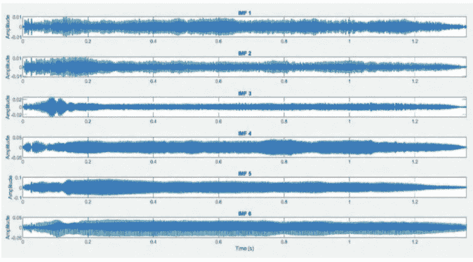

**图 7.3** 描绘了从音频信号中提取的 1 到 6 的 IMF 时间图。

听觉感知。过程从信号预处理开始，可能涉及使用窗函数进行归一化和分帧。接下来，对每个帧应用短时傅里叶变换 (STFT) 以捕获信号随时间变化的频率含量。然后将得到的频谱转换为梅尔尺度，这是一种反映人类音高感知的对数尺度。这是通过梅尔滤波器组实现的，该滤波器组按照梅尔尺度应用重叠的三角滤波器。可对梅尔频谱图应用对数压缩以增强对比度并突出显著特征。最终的梅尔频谱图是一个二维表示，其中时间在 x 轴上表示，y 轴上颜色强度表示频率和梅尔频率带的幅度。这种表示对音频和语音分析有好处，因为它以模仿人类听觉的方式捕获信号的基本特征 [3, 9, 11]。

分解后，信号会进行消噪。这是通过仅使用第二、第三和第四个 IMF 来重建信号来完成的，这些 IMF 包含最有用的语音信息。对这些 IMF 求和可得到信号的消噪版本，并通过可视化图表将其与原始信号进行比较。最后，使用 256 长度的汉明窗、128 个样本的重叠和带宽归一化为消噪信号创建梅尔频谱图。梅尔频谱图以可视化方式表示信号随时间变化的频率含量，映射到与人类听觉感知一致的梅尔尺度。这种方法可视化语音模式很有用，可应用于语音分析和诊断与语音相关的障碍。可选：对梅尔频谱图应用对数压缩以增强动态范围并突出显著特征。这涉及对功率谱取对数，通常添加一个小常数以防止对零取对数。最后，可将梅尔频谱图调整大小以满足机器学习模型输入所需的特定尺寸，例如 224x224 像素以兼容 VGG16，确保其格式正确，以便进行进一步分析或分类任务。图 7.4 绘制了 PD 和 HC（健康对照）个体的预处理信号。


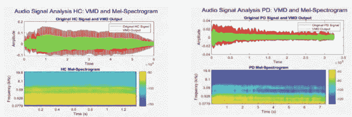

图 7.4 (a) 绘制预处理的健康对照信号；(b) 绘制预处理的帕金森病患者信号。

### 7.3.2 迁移学习方法

机器学习中使用的一种方法被称为迁移学习，即为某一功能生成并优化的模式被重新用作后续任务的基准点。与传统机器学习相比，迁移学习通过使用预训练模型作为跳板，从一个附加任务开始。传统机器学习方法的明显局限性以及生物医学治疗中多模态信号数据量的增加，促使研究人员采用深度学习进行信号处理 [20]。预训练的深度迁移学习（DTL）框架和传统机器学习模型可作为从语音数据诊断帕金森病的自动化方法。本研究聚合了从深度预训练架构（VGG16）中检索到的特征，以产生判别性特征向量。迁移学习是一种广泛使用的方法，通过使用预训练模型来处理新任务。预训练模型已使用全面的基准数据集（如 ImageNet）进行训练。迁移学习主要涉及利用在大数据集上解决一个问题所获得的知识，来处理与较小或不同数据集相关的问题。域和任务组件划定了迁移学习的范畴。域 ‘a’ 由两个组件构成：第一个是特征空间，由 ‘x’ 表示；第二个是概率分布，由分数 p(x) 表示 [21]。

```
d = (x, p(x)) (7.1)
```

集合 x 的一个元素由表达式 x = {x1, x2, x3, .....xn } 表示。预测函数 ‘f(x)’ 和标签空间 “z” 是任务 ‘t’ 的两个组件。第一个组件是预测函数 [21]。

```
t = (z, f(x)) (7.2)
```

在处理数据集有限或未标记的数据集时，深度学习可能难以处理。通过使用迁移学习，可以缓解这一问题，迁移学习利用大数据集中的知识来处理数据量有限的模型。迁移学习的实现可以通过两种主要方法完成：第一种称为特征提取，第二种称为微调。作为固定特征提取器，特征提取方法使用在大数据集（如 ImageNet）上预训练的卷积神经网络（ConvNet）。预训练的 ConvNet 权重用于为新任务提取特征；然而，网络的权重不会改变。微调技术涉及在新数据集上重新训练预训练 ConvNet 的某些层，同时保持 ConvNet 的某些层处于静态状态。为了进行微调，通过反向传播过程调整重新训练层的权重。这使模型能够适应新数据。使用这些策略，迁移学习使已训练模型能够有效地应用于需要在有限数据集上完成的新任务，从而提高性能 [21, 22]。由牛津视觉几何小组构建的 VGG16 是一种卷积神经网络（CNN）架构，在 2014 年的 ILSVRC（ImageNet）竞赛中获胜。它还被称为 OxfordNet。该设计有 13 个卷积层和 3 个全连接层。输入尺寸默认设置为 224×224 RGB 图像。卷积层使用固定的 3×3 过滤器大小。VGG16 在大型数据集（ImageNet）上进行了训练；因此，它学会了识别众多低级和高级特征，这些特征可以推广到其他数据集，尽管目标数据集（频谱图图像）与 ImageNet 数据（自然图像）有显著差异 [21]。在为机器学习模型准备频谱图图像的预处理阶段，会执行几个关键步骤，以确保数据适合模型训练和评估。首先，从输入集加载图像，并将其调整大小为 224 × 224，这是许多深度学习模型（如 VGG16）的标准尺寸，以确保输入尺寸一致。接着进行归一化，其中像素值最初范围为 0 到 255，通过除以 255.0 缩放到 [0, 1] 范围。这一步通过提供一致尺度的输入数据，帮助模型更快收敛并表现更好。然后应用标签编码，使用 LabelEncoder 将分类标签（如 'healthy' 和 'patient'）转换为数值。这种编码将分类数据转换为整数，使其与需要数值输入的机器学习算法兼容。通过遵循这些预处理步骤（加载和调整图像大小、归一化像素值、编码标签以及拆分数据），数据集已有效为后续模型训练和评估做好准备。在 VGG16 之上构建了一个序贯模型，它展平特征并添加一个带有 256 个单元的密集层，随后是批归一化和 0.5 的退出（dropout）用于正则化。最终层是一个带有 Sigmoid 激活函数的单一单元，使其适用于二分类。模型使用 Adam 优化器进行编译，学习率为 0.0001，损失函数为二元交叉熵。最后，VGG16 模型进行了 5 个 epoch 的训练，使用 80% 的数据进行训练，20% 用于验证。采用早停法来减轻过拟合。此拆分使用固定随机状态执行，以确保可重复性。在此处针对 PD 和 HC 的分类中，已使用四种分类器。

### 7.3.2.1 LGBM

帕金森病是一种复杂的神经系统疾病，每年影响全球数百万人。LightGBM 分类器是一种以强大预测能力著称的梯度提升框架，能够有效地区分帕金森病患者和健康对照者。LightGBM 主要使用决策树作为基础模型以加速训练并提高效率。在 LightGBM 中，“决策树”指的是增强集成中使用的基础模型。LightGBM 通过采用一种称为“基于直方图的决策树”的独特形式的决策树，提高了训练速度和效率。分类器的准确性在很大程度上取决于调整适当的超参数，以发现数据中隐藏的模式。网格搜索是一种系统的方法，用于调查参数组合（如估计器数量 (_n_est)、学习率 (_lr_)、叶子数量 (_n_leaf)、lambda (_l_) 和 alpha (_a_)），以最大化这些超参数 [22, 23]。

### 7.3.2.2 XGBoost

XGBoost 是一种构建在梯度提升框架之上的集成机器学习方法。在回归、分类、排名和预测分析方面，该算法似乎是最佳算法之一。该算法使用梯度下降来增强不充分的数据集特征，使其适用于多种目的。可扩展性是 XGBoost 的关键特征，可通过并行和分布式计算实现高效的内存管理和训练 [22]。可以使用 XGBoost 对数据进行分类和预测，XGBoost 是一种梯度提升分类器。其思路是通过结合结果，将平均学习者提升并转化为卓越的学习者。使用早期阶段的错误修正方法来创建新模型，直到不再需要更改为止 [22, 24]。

### 7.3.2.3 随机森林

这种方法经常作为集成的一个组成部分应用，对涉及回归和分类的问题非常有利。为每个决策树随机选择数据样本。每个决策树在数据集的备选部分上进行训练，导致每棵树产生不同的输出。对每个决策树的结果进行投票，可产生最佳结果 [24]。

### 7.3.2.4 梯度提升

梯度提升（GB）通过从次优模型迭代创建的每个新模型来减少损失函数。

损失函数使用梯度下降方法计算。因此，它被用于更准确地拟合新模型。因此，研究结果带来了总体精度的提高。相反，增强不能无限期进行；这样做会导致模型过拟合 [22]。

## 7.4 结果与讨论

### 7.4.1 评估参数

评估过程中考虑的四个因素是准确率、召回率、精确率和 F1 分数。所提研究模型的准确率充当其有效性的指标。召回率描述了所提研究项目预测患有 PD、HD 和健康个体的能力。测量所提模型对 PD 和健康患者正预测的精确率。模型的准确率、精确率和召回率使用混淆矩阵计算，如公式 7.3 所示


to 7.6. 真阳性 (TP) 表示准确的决策分类。假阳性 (FP) 表示错误的决策分类；TN 表示正确的负类分类，而 FN 表示错误的正类分类 [19].

\( Accuracy = \frac{TP + TN}{TP + TN + FP + FN} \) (7.3)

\( Precision = \frac{TP}{TP + FP} \) (7.4)

\( Recall = \frac{TP}{TP + FN} \) (7.5)

\( F1 - Score = 2 \frac{Precision * Recall}{Precision + Recall} \) (7.6)

### 7.4.2 实验发现

本研究评估了四种机器学习模型——随机森林 (random forest)、LightGBM、XGBoost 和梯度提升机 (GBM)——使用从 VGG16 深度学习模型提取的特征，以区分帕金森病患者与健康个体。使用四项主要指标来评估模型：平均 F1 分数、平均测试准确率、平均精确率和平均召回率。LightGBM 是表现最佳的模型，准确率为 90.33%，召回率和精确率分别为 89.54% 和 91.33%。凭借 90.42% 的 F1 分数，LightGBM 是这项任务中最成功的分类器，体现了这种平衡。XGBoost 的准确率为 88.66%，F1 分数为 88.82%，略逊于 LightGBM，但仍表现出强劲的性能。随机森林的准确率为 87.00%，被认为可靠；然而，其精确率 (85.35%) 和召回率 (89.33%) 略低于 LightGBM 和 XGBoost，表明假阳性率较高。由于精确率和召回率表现不够均衡，GBM 的 F1 分数最低 (86.79%)，尽管其精确率最高 (92.00%)。总体而言，LightGBM 优于所有其他模型，在处理分类任务时展现出所有指标上的全面性能。从 VGG16 提取的特征为这些机器学习模型提供了坚实的基础，凸显了将基于深度学习的特征提取与传统分类器相结合，用于帕金森病诊断等复杂任务的潜力。尽管 GBM 达到了最高精确率，但 LightGBM 在精确率、召回率和 F1 分数之间的更优平衡使其成为该分类任务中最合适的模型。进一步的研究和开发可能涉及优化超参数或改进特征提取流程，以提升其他模型的性能。图像通过一系列卷积层和池化层输入到这个修改后的 VGG16 模型中，生成捕捉输入图像不同元素的特征图。经过几层处理，224 × 224 × 3 的图像可以转换为 7 × 7 × 512 的特征图 [25]。随后，将这些特征图转换并展平为一维向量。然后，这些展平的特征适合纳入机器学习分类器中，包括随机森林、GBM、XGB 和 LGBM。对这些模型采用分层五折交叉验证，以确保更可靠的性能估计。本研究选择使用 VGG16 的预训练权重作为特征提取的基础，该方法能高效地从与 ImageNet 差异很大的图像数据（如频谱图）中提取细粒特征。因此，该技术节省了时间和资源，同时为各种应用（例如疾病分类）提供了强大且广泛适用的特征表示，而无需大量的再训练或大型数据集。结果在表 7.2 中汇总，该表展示了每个测试模型在关键性能指标上的实验概览。图 7.5 绘制了准确率、召回率、精确率和 F1 分数等评估参数的图表。

#### 表 7.2
实验中各性能指标获得的结果

| 模型 | 平均测试准确率 | 平均精确率 | 平均召回率 | 平均 F1 分数 |
|---|---|---|---|---|
| Random Forest | 87.00 | 85.35 | 89.33 | 87.29 |
| LightGBM | 90.33 | 89.54 | 91.33 | 90.42 |
| XGBoost | 88.66 | 87.66 | 90.00 | 88.82 |
| GBM | 88.99 | 92.00 | 89.32 | 86.79 |

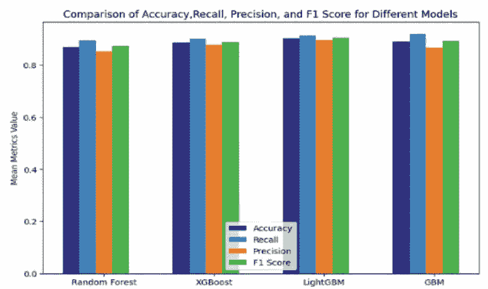

图 7.5 四个模型间评估参数的比较图。

LightGBM 模型的交叉验证结果表明性能强劲，大多数准确率分数紧密集中在 0.92 附近，表明可靠性稳定。随机森林的交叉验证准确率分数范围从 0.80 到 0.88，中位数约为 0.84，表明不同折叠之间具有中等变异性。该模型达到 87.00% 的准确率、85.35% 的精确率、89.33% 的召回率和 87.29% 的 F1 分数，表现良好。XGBoost 在五折交叉验证中的准确率分数范围从 0.85 到 0.91，中位数约为 0.88。这种稳定性反映了模型的可靠性。XGBoost 的准确率为 88.66%，精确率为 87.66%，召回率为 90.00%，F1 分数为 88.82%，表现良好，尤其是在正确识别阳性病例方面。在这些模型中，LightGBM 分类器取得了最出色的结果。总体而言，LightGBM 实现了高准确率，尽管其性能可能取决于数据子集而针对此任务略有波动。这种偶尔变化的稳定性凸显了其潜在有效性。LightGBM 是一种专为高速高效梯度提升而设计的提升算法，展示了其处理大量复杂数据的能力，交付了 90.42% 的 F1 分数、89.54% 的精确率、91.33% 的召回率和 90.33% 的准确率。这些指标反映了 LightGBM 在精确率（最小化假阳性）和召回率（减少假阴性）之间实现平衡的能力，这对于医疗环境中的诊断准确性至关重要。LightGBM 实现的高准确率表明该分类器非常适合此任务，预示着其在更广泛临床应用方面的潜力。

用于早期帕金森病检测的拟议策略利用语音特征和迁移学习机制，具有潜力，但存在需要考虑的某些限制。一个缺点是数据集规模相对较小，这可能会限制模型充分捕捉与帕金森病相关的各种语言特征的功能。更大的数据集可能会增强模型的学习能力，并提高其识别与疾病相关的细微语音特征的精度。此外，依赖高质量音频录音也存在挑战，因为现实世界数据通常包含噪声，而所使用的降噪技术可能无法完全解决这些噪声。此外，由于 VGG16 最初是针对图像数据训练的，因此其从梅尔频谱图中提取帕金森病特定特征的能力可能有限。该方法的计算需求可能限制其在资源有限地区或治疗环境中的应用。为了确认该模型作为诊断工具的鲁棒性和适用性，在更大、更多样化的现实世界数据集上进行评估至关重要。未来的迭代中可以采用更复杂的预处理方法来提升模型性能。目前，该模型使用变分模态分解进行降噪，但添加自适应滤波、基于深度学习的降噪或专门针对音频信号定制的数据增强，可以使模型对录音质量和环境噪声的变化更具鲁棒性。这些改进将帮助模型推广到现实世界数据，确保在多样且嘈杂的数据集中保持一致的准确性。最终，这些改进可以提高该模型作为早期帕金森病检测实用工具的有效性，扩大其在各种临床和现场环境中的适用性。这项研究通过利用人工智能 (AI) 分析语音信号（一种非侵入性生物标志物


PD症状。通过利用先进的深度学习和机器学习方法，本研究开发了一种稳健的方法论，有助于及时和准确的PD诊断，最终促进个体化患者管理。此外，整合多模态数据，例如将语音特征与步态模式或书写分析等其他生物标志物相结合，可能增强诊断工具的稳健性和适用性，从而创建更全面的PD症状特征。

## 7.5 结论

本研究通过应用强大的人工智能技术，在帕金森病的及时识别方面实现了重大进步。VGG16模型被用于稳健的特征提取。这通过将语音信号转换为梅尔频谱图并利用变分模态分解来降低噪声来实现。随后，使用多种机器学习算法对特征进行分类，LightGBM分类器展现了卓越性能，F1得分达到90.42%，精确度为89.54%，召回率为91.33%，准确率为90.33%。未来，数据集可以扩展以包含更广泛的数据，可以纳入改进的预处理和深度学习架构，并可以整合多模态数据以提供更全面的诊断工具。此外，预处理技术的进步可以进一步增强输入数据的清晰度和相关性，使模型能够更有效地关注与PD相关的微妙特征。同样，采用先进或新颖的深度学习框架，如基于变压器的模型或结合多个神经网络的集成，可能增强框架观察和泛化PD相关特征的能力。此外，超参数调优有望进一步提升模型性能，而实时监测和临床整合有望彻底改变早期帕金森病的识别，从而实现及时和个体化的患者管理。综上所述，本研究表明采用梅尔频谱图和强大的人工智能算法检测PD具有高准确性的可行性，为非侵入性诊断提供了一条有希望的途径。随着未来研究在改进数据、优化模型和临床整合的基础上延续这些发现，这种方法可能成为对抗帕金森病的宝贵工具。

### 7.5.1 数据可用性

本研究所用和/或分析的数据集可在合理请求后从通信作者处获得。

## 参考文献

- [1] Laganas, Christos, Dimitrios Iakovakis, Stelios Hadjidimitriou, Vasileios Charisis, Sofia B. Dias, Sevasti Bostantzopoulou, Zoe Katsarou, L. Klingelhoefer, H. Reichmann, D. Trivedi, and K. R. Chaudhuri. “基于电话连续语音数据的帕金森病检测。”《IEEE生物医学工程汇刊》69，第5期（2021年）：1573–84。https://doi.org/10.1109/TBME.2021.3116935.

- [2] Keserwani, Pankaj Kumar, Suman Das, and Nairita Sarkar. “比较研究：使用机器学习、深度学习和自然启发算法预测帕金森病。”《多媒体工具与应用》83，第27期（2024年）：69393–441。https://doi.org/10.1007/s11042-024-18186-z.

- [3] Veetil, Iswarya Kannoth, V. Sowmya, Juan Rafael Orozco-Arroyave, and E. A. Gopalakrishnan. “基于语音数据的强健语言独立帕金森病检测。”《人工智能工程应用》129（2024年）：107494。https://doi.org/10.1016/j.engappai.2023.107494.

- [4] Reddy, Mittapalle Kiran, and Paavo Alku. “基于范例的稀疏表示用于从语音中检测帕金森病。”《IEEE/ACM音频、语音和语言处理汇刊》31（2023年）：1386–96。https://doi.org/10.1109/TASLP.2023.3260709.

- [5] Hireš, Máte, Peter Drotár, Nemuel Daniel Pah, Quoc Cuong Ngo, and Dinesh Kant Kumar. “关于基于语音的帕金森病检测机器学习方法的跨数据集泛化。”《医学信息学国际期刊》179（2023年）：105237。https://doi.org/10.1016/j.ijmedinf.2023.105237.

- [6] Bhatt, Kavita, N. Jayanthi, and Manjeet Kumar. “基于高分辨率超小波变换的语音信号帕金森病检测技术。”《应用声学》214（2023年）：109657。https://doi.org/10.1016/j.apacoust.2023.109657.

- [7] Abumalloh, Rabab Ali, Mehrbakhsh Nilashi, Sarmahin Samad, Hossein Ahmadi, Abdullah Alghamdi, Mesfer Alrizq, and Sultan Alyami. “利用深度学习进行帕金森病诊断：计量分析与文献综述。”《老化研究评论》96（2024年）：102285。https://doi.org/10.1016/j.arr.2024.102285.

- [8] Warule, P., S. P. Mishra, and S. Deb. “使用啁啾变换对语音信号进行时频分析以实现帕金森病自动诊断。” *Biomedicine Engineering Letters* 13（2023年）：613–23。https://doi.org/10.1007/s13534-023-00283-x.

- [9] Er, Mehmet Bilal, Esme Isik, and Ibrahim Isik. “基于结合CNN和LSTM的增强语音信号带变分模态分解的帕金森病检测。”《生物医学信号处理与控制》70（2021年）：103006。https://doi.org/10.1016/j.bspc.2021.103009.

- [10] Desai, U., C. G. Nayak, and G. Seshikala. “EMD技术在心动过速搏动检测中的应用。” 2016年通信与信号处理国际会议（ICCSP），印度梅尔马鲁瓦图尔（2016年）：1420–24.

- [11] Karan, Biswajit, and Sitanshu Sekhar Sahu. “基于语音信号变分模态分解-希尔伯特谱的帕金森病预测改进框架。” *Biocybernetics and Biomedical Engineering* 41，第2期（2021年）：717–32。https://doi.org/10.1016/j.bbe.2021.04.014.

- [12] Zhang, Tao, Liqin Lin, and Zaifa Xue. “基于分数属性拓扑的帕金森病检测语音特征提取方法。”《专家系统与应用》219（2023年）：119650。https://doi.org/10.1016/j.eswa.2023.119650.

- [13] Hasanzadeh, Mahboobeh, and Hamid Mahmoodian. “一种基于语音分析的性别分析早期帕金森病诊断特征选择的新型混合方法。”《应用声学》211（2023年）：109561。https://doi.org/10.1016/j.apacoust.2023.109561.

- [14] Amato, Federica, Luigi Borzi, Gabriella Olmo, and Juan Rafael Orozco-Arroyave. “基于孤立词分析的帕金森病语音分类算法。”《健康信息科学与系统》9（2021年）：32。https://doi.org/10.1007/s13755-021-00162-8.

- [15] Karan, Biswajit, Sitanshu Sekhar Sahu, Juan Rafael Orozco-Arroyave, and Kartik Mahto. “用于帕金森病语音自动检测和评估的希尔伯特谱分析。”《生物医学信号处理与控制》61（2020年）：102050。https://doi.org/10.1016/j.bspc.2020.102050.

- [16] Narendra, N. P., B. Schuller, and P. Alku. “使用声源信息从语音中检测帕金森病。”《IEEE/ACM音频、语音和语言处理汇刊》29（2021年）：1925–36。https://doi.org/10.1109/TASLP.2021.3078364.

- [17] Celik, Gaffari, and Erdal Başaran. “提出一种基于卷积神经网络和随机森林的语音信号帕金森病诊断新方法。”《应用声学》211（2023年）：109476。https://doi.org/10.1016/j.apacoust.2023.109476.

- [18] Orozco-Arroyave, J. R., J. D. Arias-Londono, J. F. Vargas-Bonilla, M. C. Gonzalez-Rátiva, and E. Noth. “用于帕金森病患者分析的新西班牙语语音库数据库。” 第13届语言资源与评估会议论文集（2014年）：342–47.

- [19] Visvanathan, P., and P. M. D. R. Vincent. “使用变分模态分解和机器学习算法预测步态神经退行性疾病。”《应用人工智能》38，第1期（2024年）。https://doi.org/10.1080/08839514.2024.2389375.

- [20] Rezaee, Khosro, Somayeh Savarkar, Xiaofeng Yu, and Jingyu Zhang. “一种用于表面肌电信号中帕金森病分类的混合深度迁移学习方法。”《生物医学信号处理与控制，A部分》71（2022年）：103161。https://doi.org/10.1016/j.bspc.2021.103161.

- [21] Jahan, Nusrat, Arifatun Nesa, and Md. Abu Layek. “使用带迁移学习的ResNet50进行帕金森病检测。”《计算机视觉与信号国际期刊》11（2021年）：17–23.

- [22] Nishat, M. M., T. Hasan, S. M. Nasrullah, F. Faisal, M. A.-A.-R. Asif, and M. A. Hoque. “采用提升算法检测帕金森病。” 2021年第十届信息学、电子与视觉国际会议（ICIEV）和2021年第五届成像、视觉与模式识别国际会议（icIVPR），日本北九州（2021年）：1–7。https://doi.org/10.1109/ICIEVicIVPR52578.2021.9564108.

- [23] Swain, B. K., S. Mohapatra, M. Mishra, and Renu Sharma. “帕金森病识别统一方法：不平衡缓解与网格搜索优化的LightGBM提升。”《医学与生物工程与计算》62，第11期（2024年）：3471–91。https://doi.org/10.1007/s11517-024-03139-3.

- [24] Lamba, Rohit, Tarun Gulati, Anurag Jain, and Pooja Rani. “一种基于语音的帕金森病早期检测混合决策支持系统。”《阿拉伯科学与工程期刊》48（2023年）：2247–60。https://doi.org/10.1007/s13369-022-07249-8.

- [25] Kumar, S., P. Kaur, and G. Singh. “一种用于肺部CT扫描图像中恶性和良性检测的改进深度学习方法。” *Cluster Computing* 22，第5期（2019年）：11369–80。https://doi.org/10.1007/s10586-017-1590-4.


# 8 基于机器学习的 QSAR 建模进展

## 通过预测精度和数据整合增强药物发现

Hadagali Ashoka, Pradeep S, Manjunath K, Nijaguna G S, 和 D Ramesh Babu

## 8.1 引言

当今医疗保健面临的主要挑战之一是许多疾病的发病率不断上升，其中许多疾病具有复杂且多因素的成因（Vaishya et al., 2024）。环境、遗传和生活方式因素的复杂相互作用导致癌症、神经退行性疾病和代谢性疾病等病症的发展（Hotamisligil, 2006; Bray et al., 2012; Wyss-Coray, 2016）。由于现有治疗方案往往效果有限、不良反应不利或毒性水平较高，这凸显了开发新型、更有效、更安全药物的迫切需求（Vos et al., 2020）。

识别合适候选分子的困难以及临床前和临床试验中涉及的高昂成本，使得传统的药物发现和开发程序仍然缓慢且昂贵。在药物发现的初始阶段实施这些程序，有助于识别具有高标准质量药理学模式的化合物，确保针对特定相互作用和卓越药代动力学（PK）特性的最具前景和优化的先导分子。这些进展可能有助于识别效果更好且不良反应最少的化合物。

本章探讨了一种基本的药物发现工具，即基于机器学习（ML）方法的定量结构-活性关系（QSAR）建模及其复杂的应用。利用 QSAR 模型基于化学结构预测化合物的生物活动，有助于促进有前景药理学化合物的识别，同时降低药物开发过程中的成本。尽管如此，传统 QSAR 方法在准确性、可解释性和泛化方面可能面临问题，尤其是在处理大型和复杂的数据集时。

机器学习方法是一种革命性的方法，通过结合多种方法（如集成模型、深度学习和混合方法）来克服这些限制。基于机器学习的 QSAR 模型可以增强可解释性，协助更稳健的特征选择，并通过实施这些策略来提高预测性能。尽管深度学习和神经网络有助于改进模式识别，但集成方法（即结合多个模型的方法）能够确保最大限度地减少过拟合并改善泛化（Cherkasov et al., 2014）。本章探讨了 QSAR 中广泛的机器学习方法，重点关注提高预测准确性和筛选药物候选物的进展。

通过集成数据融合技术和化学信息学工具，QSAR 建模得以进一步推进，这有助于研究人员结合各种化学和生物学数据来源。这种方法产生更全面的模型，能够准确预测化合物的行为和有效性。这些改进不仅加速了药物发现和开发，还通过将药物开发定制为特定疾病模式，影响了个体化医疗的到来。

利用 QSAR 建模的类似数据驱动方法也变得越来越重要，因为它能够通过将实际研究结果与临床应用相关联来增强转化医学。得益于 ChEMBL、ZINC 等开放获取数据库的普及，大规模体内（in silico）研究变得可行。这既提高了预测模型的可靠性，又降低了药物开发所需的资源。

研究人员可以通过 QSAR 建模识别对预测化合物生物学特性至关重要的有用分子描述符。正如一些研究所示，特征选择和特征学习可以通过删除不必要的数据并专注于用于预测肠道吸收和血脑屏障渗透等特性的相关分子描述符来提高模型精度，这两者对于评估药物生物利用度至关重要（Dara et al., 2022）。

本章为个体化医疗和高效的药物开发管道提供了途径，使其成为计算机辅助药物发现领域研究人员和专家的宝贵资源。这些努力通过加深我们对面向 QSAR 及其应用的机器学习技术的理解，有助于开发有效、经济且定制化的治疗方案。这些尝试增强了制药行业简化药物发现的能力，并有助于揭示复杂疾病的可行治疗剂。

## 8.2 具有混合多特征选择和特征学习方法的 QSAR 方法学

一个广泛的机器学习管道，旨在高效地开发和优化模型，尤其是在药物发现的 QSAR 建模领域，通过图 8.1 所示的流程图表示。它演示了从初步数据收集和预处理到最终文档和
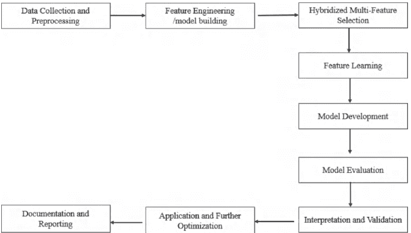

图 8.1 模型开发和优化的机器学习管道。

报告阶段。管道中的每个步骤都建立在前一个步骤之上，确保在模型开发、评估和使用方面采取全面的方法。这种组织化的工作流有助于始终解决特征工程、选择、学习和模型验证等关键任务，最终促进模型在实际应用中的改进和部署。该过程始于数据收集和预处理，涉及从多种来源收集原始数据，并通过清洗、归一化和转换来准备数据，以确保其一致性和分析准备情况。下一步是模型构建或特征工程，它识别和设计关键分子描述符，并构建一个涵盖相关数据特征的初始模型。进一步是混合多特征选择，它应用创新的选择技术来增强特征集和降维，并通过主要关注最适用的变量来提高模型效率。在特征学习中，模型揭示所选特征中的复杂模式，这是理解数据中非线性关系的重要步骤。下一步是模型开发，在其中应用改进的算法来创建和训练预测模型。一旦制定，模型评估将精确评估性能指标，例如准确性，以确保可靠性和稳健性。解释和验证使研究人员能够理解模型的预测，用外部标准验证其有效性，并进行必要的调整。然后将模型应用于实际应用。在应用和进一步优化步骤中，它被改进以用于实际使用，并通过附加数据进行改进。最后，文档和报告保证对模型性能进行全面文档记录，并获得洞察和未来建议，使该领域的其他专业人员的工作变得方便和一致。这种有组织的流程有助于创建精确、稳健且可解释的模型，以实现 QSAR 在药物发现中的有效和重要应用。

### 8.2.1 数据收集与预处理

#### 8.2.1.1 数据获取

要进行包括化合物及其生物活性模型的研究或研究，获得结构良好的数据集至关重要。此类数据集通常包含有关化合物的信息，以及与其生物活性相关的数据，例如半最大解离常数（Ki）、抑制浓度（IC50）或其他活性指标，这些指标显示化合物与特定生物靶标相互作用的效果。

##### 常见数据来源：

- **ChEMBL:** 最广泛使用的开放获取数据库之一，该数据库提供了广泛的生物活性化合物及其活性库。ChEMBL 由欧洲生物信息学研究所（EBI）维护，其中包含大量关于药物类似化合物的定量生物活性统计数据，涵盖众多靶标、通路和生物体。EC50、Ki、IC50 和其他对化合物评估至关重要的值可供研究人员使用（Mendez et al., 2019）。

- **PubChem:** 由国家生物技术信息中心（NCBI）维护，PubChem 是一种替代性开放获取资源，提供关于化合物的全面信息。它包含许多小分子的生物活性数据，这些数据源自高通量筛选（HTS）和其他实验测试。它对于检索化合物数据和生物活性非常有价值，使研究人员能够调查化学结构与生物活性之间的趋势和关联（Kim et al., 2021）。

- **专有数据库：** 一些研究人员或组织也可能依赖专有数据库，例如通过内部实验结果生成的数据库或 CAS（化学文摘服务）数据库。这些数据库通常提供独家或经过策划的数据集，可能包含公共资源中找不到的专门生物活性数据。此类专有数据库对于查找高质量的定制数据很有价值，但通常涉及许可协议。

- **数据质量和标准化的重要性：** 高质量的数据集允许更精确和可靠的分析，尤其是在整合来自不同来源的数据时。研究人员通常使用标准格式并应用严格的质量检查，以确认 IC50 和 Ki 值等数据点在不同化合物和测试条件下具有可比性。数据清洗和标准化可以包括删除重复项、标准化化合物格式以及确认活性值，以尽量减少不同实验条件下的任何潜在差异。

#### 8.2.1.2 数据清洗

数据清洗是为分析准备高质量数据集的重要步骤。此过程涉及多个步骤，旨在确保数据的准确性、一致性和完整性，这对于在研究中产生显著结果非常重要。


涉及化学化合物和生物活性。研究人员可以通过解决常见问题（如缺失值、重复条目和不相关特征）来提高其发现的可靠性。

##### 8.2.1.2.1 删除重复项

重复项可能源于合并众多数据集，或由于同一化合物的重复记录而产生。重复条目可能会过度代表某些数据点，从而歪曲结果，尤其在统计分析或机器学习模型中。删除重复项通常涉及查找并删除具有相似化学标识符（如 SMILES 字符串或 InChI 密钥）的记录，这些标识符专门用于说明分子结构。仔细检查可确认仅删除冗余记录，而不会丢失重要信息（Spelmen & Porkodi, 2018）。

##### 8.2.1.2.2 处理缺失值

包含生物活性数据的数据集中缺失值相当常见，通常是由于实验结果不足或无法评估所有化合物的某些属性所致。处理缺失数据的方法有多种：

- **删除：** 如果缺失数据很少，可以忽略包含缺失值的行。
- **插补：** 如果数据量大且假设缺失是随机的，则可以使用均值、中位数或基于模型的插补等方法来近似缺失值。
- **高级技术：** 对于缺失值普遍存在的数据集，可以使用基于模型的插补（例如回归或期望最大化算法）或 k-最近邻（KNN）插补等方法，以在不引入偏差的情况下保持数据集的完整性（Little & Rubin, 2019）。

##### 8.2.1.2.3 筛选不相关的化合物或特征

并非所有化合物或特征都与研究目标相关。不相关的化合物（例如具有非目标生物活性或分子量超出预期范围的分子）会限制下游分析的质量。此外，应筛选掉不相关的特征（例如特定分析中与化合物活性无关的变量），以合理化分析并防止计算效率低下。特征选择算法（例如递归特征消除（RFE）或方差阈值）可以帮助识别并仅保留最相关的变量（Hastie et al., 2009）。

##### 8.2.1.2.4 确保数据一致性和完整性

数据集间的一致性至关重要，尤其是在多中心研究中，数据可能以不同方式收集或标记。此步骤包括：

- **标准化单位和格式：** 标准化化学标识符（InChI 或 SMILES）并将值转换为统一尺度（例如，IC50 值的 µM）。
- **验证化合物身份：** 通过与 ChEMBL 或 PubChem 等数据库交叉引用，反复确认每个化合物均已正确标记且可被识别。
- 生物活性值验证：确认活性测量值在可接受范围内，以发现任何可能的数据录入错误或异常值。

高效的数据清洗能显著提升数据完整性，使其适合进行有意义的分析和预测建模。

#### 8.2.1.3 标准化

在数据分析中，标准化是机器学习的重要预处理步骤，它修改特征的尺度，使其对模型训练和评估的贡献相似。此过程确保数值范围较高的特征不会主导模型的学习过程，这对于对特征尺度敏感的算法尤为重要，例如基于距离的模型（如 k-最近邻和聚类算法）以及基于梯度的模型（如神经网络和线性回归）。接下来将讨论常用的标准化技术。

##### 8.2.1.3.1 最小-最大缩放

此技术将数据缩放到固定范围（通常为 [0,1] 或 [-1,1]），实现以下公式：

```
X_{scaled} = \frac{(X - X_{min})}{(X_{max} - X_{min})}
```

其中 X 表示特征值，Xmin 和 Xmax 分别是 X 的最小值和最大值。该方法在保持数据内部关系和比例的同时，确保所有值在一致范围内，从而提高模型性能和收敛时间。

##### 8.2.1.3.2 标准化（Z-Score 标准化）

此技术将数据缩放到均值为零、标准差为一，计算公式如下：

```
X_{standardized} = \frac{(X - \mu)}{\sigma}
```

其中 σ 是标准差，μ 是特征值的均值。Z-Score 标准化主要适用于特征服从正态分布的情况，通常用于假设数据服从正态分布的算法。

选择标准化技术取决于具体的数据集和模型要求。最小-最大缩放常用于有界数据，而当特征分布近似正态时，优先选择 Z-Score 标准化（Goodfellow et al., 2016; Kuhn & Johnson, 2013）。

### 8.2.2 特征工程/模型构建

在计算机辅助药物发现和化学信息学中，特征工程包括从原始分子结构中创建有用的变量（描述符），这些变量进一步用于模型构建中的预测分析。计算描述符的方法与计算这些分子描述符的过程相关，这些描述符是捕获分子各种物理、化学和结构属性的定量说明。这些描述符作为机器学习模型的输入，有助于预测毒性、生物活性或其他化学属性。

### 8.2.2.1 分子描述符类型

#### 8.2.2.1.1 2D 描述符

二维描述符表示不考虑 3D 空间排列的分子属性。原子计数、分子量和拓扑指数是典型示例，用于回顾分子结构特征，如形状、大小和支化程度。

#### 8.2.2.1.2 3D 描述符

考虑分子中原子的 3D 排列，涵盖表面积、分子体积和形状指数等空间特征。当 3D 构象影响生物活性时，这些描述符至关重要。

#### 8.2.2.1.3 基于指纹的描述符

分子指纹将分子表示为二进制向量，其中每个位指定特定化学片段（例如子结构或路径）或结构亚基的存在或缺失。常见的指纹类型包括 Morgan（环形）和 MACCS 密钥指纹，主要适用于基于相似性的搜索和聚类。

#### 8.2.2.2 描述符计算工具

多种工具和库可协助计算这些描述符，包括以下内容：

##### 8.2.2.2.1 PaDEL

PaDEL-Descriptor 是一款用于计算大量指纹和分子描述符的软件工具，提供 797 个描述符（663 个 1D 和 2D 描述符，以及 134 个 3D 描述符）以及 10 种指纹。这些指纹和描述符主要使用化学开发工具包计算，并增加了原子型电拓扑状态描述符、分子线性自由能关系描述符、McGowan 体积、环计数以及来自 Laggner、Klekota 和 Roth 的子结构标识符等功能。PaDEL-Descriptor 采用了灵活的设计，包含可轻松集成到定量构效关系（QSAR）软件中的库组件，以及独立接口。它采用主/从模式利用多个 CPU 核心，优化描述符计算的速度。PaDEL-Descriptor 是开源且免费可用的软件，这使其与其他描述符计算工具有所不同，提供与 Linux、Windows 和 macOS 兼容的命令行和图形用户界面，并支持 90 多种分子文件格式。凭借其广泛的描述符库和多线程功能，PaDEL 是化学信息学研究的宝贵资源。该软件可从 http://padel.nus.edu.sg/software/padeldescriptor 下载（Yap, 2011）。它


是一款开源软件，可计算多种分子描述符和指纹（例如，PubChem 和 MACCS 指纹）。它主要因其广泛的二维和三维描述符集以及用户友好的基于 Java 的界面工具包而被青睐。RDKit 是一种常用于 Python 和 C++ 的开源化学信息学库，提供多种指纹算法（例如 Morgan 和 RDKit 指纹）和分子描述符。由于其与 Python 的集成，它被广泛用于机器学习流水线中，允许与 TensorFlow 和 scikit-learn 等库兼容以进行模型训练（Bento et al., 2020）。

##### 8.2.2.2.2 Molecular Operating Environment (MOE)

MOE 是一个商业软件套件，具有广泛的化学信息学功能，包括基于量子力学的 2D、3D 和描述符计算。MOE 通常适用于制药研究中的药物发现与开发，因为它拥有强大的图形用户界面，并能与分子建模工作流集成（Vilar et al., 2008）。

#### 8.2.2.3 Role of Deep Learning Model Building

描述符在模型构建中起着至关重要的作用，因为它们将原始化学结构转换为涵盖基本分子特征的机器可读特性。这种阐述使模型能够高效地学习和预测众多分子性质或生物活性。描述符的质量和重要性直接影响预测的准确性以及模型的可解释性，因此描述符选择是机器学习和化学信息学中的关键步骤。

机器学习中的一个关键步骤是特征选择，它通过选择最合适的特征来提升模型性能、减少过拟合并提高模型的可解释性。实现这一目标的方法多种多样，大致可分为单变量和多变量方法。

##### 8.2.2.3.1 Univariate Feature Selection

在此方法中，每个特征与目标变量之间的关联会分别进行评估。ANOVA、t 检验和卡方检验常被用作统计工具。单变量特征选择能够轻松高效地识别与结果变量具有统计显著相关性的特征，但不能反映特征之间的交互作用。该方法广泛应用于预处理步骤中，特别是在处理高维数据集时，因为它提供了一个初步过滤器来删除无关特征（Chandrashekar & Sahin, 2014）。

##### 8.2.2.3.2 Multivariate Feature Selection

这些技术考虑特征之间的交互作用及其对模型的综合影响，不同于单变量方法。这些技术包括以下内容：

###### 8.2.2.3.2.1 Recursive Feature Elimination (RFE)

一种迭代方法，在完整的特征集上训练模型，按重要性对其进行排序，并迭代消除最不重要的特征。它适用于能够自动对特征进行排序的算法，如 SVM 和线性回归。

##### 8.2.2.3.2 LASSO Regression

一种标准化回归形式，通过为大系数添加惩罚项来补充模型，从而高效地将不重要的特征系数驱动至零。该技术在线性模型中很有用，在处理高度相关特征时经常被优先采用。

##### 8.2.2.3.3 Tree-Based Methods (e.g., Random Forests)

随机森林和其他集成树基方法根据特征在降低模型不纯度方面的影响对特征进行排序。这些方法可靠且能够处理目标与特征之间的线性和非线性关系（Guyon & Elisseeff, 2003; Tibshirani, 1996）。

结合单变量和多变量方法可以通过首先过滤无关特征，然后通过研究交互作用来改进选择，从而为训练机器学习模型生成更稳健的特征集，进而提升模型性能。

### 8.2.3 HYBRIDIZED MULTI-FEATURE SELECTION

混合多特征选择是机器学习中的一种先进特征选择技术，它发挥多种技术的优势，以改进特征子集并提升模型性能。这种方法结合了包装法、过滤法和嵌入式技术等方法，以提供更全面且高效的特征选择过程。在单一方法可能无法覆盖所有相关模式的多面数据集中，混合选择尤其有价值。

### 8.2.3.1 Key Components of Hybridized Multi-Feature Selection

#### 8.2.3.1.1 Combining Techniques

混合方法集成了多种特征选择方法来改进特征集。例如，将过滤法与包装法（如递归特征消除 (RFE)）及基于相关性的特征选择相结合，可以帮助基于相关性删除无关特征，然后根据模型性能进一步缩小集合。这种分层选择方法利用了过滤法的速度和效率进行初步过滤，并利用包装法的准确性进行更复杂的选择（Liu & Yu, 2005）。

#### 8.2.3.1.2 Consensus Approach

在此方法中，通过结合多种特征选择技术的结果来选择特征，形成一个共识集。不同的共识方法包括以下内容：

##### 8.2.3.1.2.1 Voting

该策略包括选择在多种方法中经常被识别为重要的特征。在包装法、过滤法和嵌入式技术中反复出现的特征被视为可靠且稳健的，因为它们无论采用何种选择方法都能始终表现出显著性。投票是构建可靠特征子集的一种简单方法，特别是在结合多种技术时（Saeys et al., 2007）。

#### 8.2.3.1.2 Ensemble Selection

这种方法创建一个集成特征集，通过聚合使用不同特征子集构建的表现最佳模型的特征，来提高泛化能力和稳健性。集成选择通常通过训练具有不同特征子集的多个模型并选择最准确模型中使用的特征来采用。这种方法利用特征选择结果的多样性，结合各自的优势，以提升最终模型的预测能力。

#### 8.2.3.2 Advantages of Hybridized Multi-Feature Selection

- **提高准确性：** 混合特征选择通过结合多种方法，最大限度地降低单一方法可能忽略重要特征的风险。
- **增强稳健性：** 共识方法（尤其是集成选择）通过平均不同选择方法的偏差来增强稳健性。
- **大数据集效率：** 预先应用过滤方法可以最小化维度，使计算密集型包装法或嵌入式方法仅专注于特征子集。

#### 8.2.3.3 Practical Application

混合多特征选择在高维数据领域（如化学信息学、基因组学和文本处理）中备受青睐，在这些领域中，单一特征选择方法可能难以在可解释性、准确性和计算可行性之间取得平衡。

### 8.2.4 FEATURE LEARNING

QSAR 建模中的特征学习是一个重要过程，包括将原始化学描述符转换为能够捕获数据中相关模式的有意义表示。这种方法通常采用三种主要策略：深度学习模型、迁移学习和降维。

### 8.2.4.1 Deep Learning Models

深度学习架构（如卷积神经网络 (CNN) 和自动编码器）对于从原始分子数据中学习复杂的非线性特征表示非常有效。CNN 通常应用于图像识别，可以调整以处理网格状数据结构，从而提供分子特征的空间理解。另一方面，自动编码器对于无监督特征提取很有用，它将高维数据压缩到低维潜在空间中，随后可以将其输入 QSAR 模型以提高预测准确性（LeCun et al., 2015）。

### 8.2.4.2 Transfer Learning

鉴于 QSAR 数据集通常较小，迁移学习通过利用在类似的大型数据集上预训练的模型，提供了一种有效的解决方案。例如，在大型化学数据库上训练的模型可以提取并传输有意义的特征到


较小的 QSAR 数据集。该技术不仅能降低计算开销，还能通过让 QSAR 模型从相似化学域“继承”已学知识，从而提升模型性能，进而优化对新化合物的泛化能力（Pan & Yang, 2010）。

#### 8.2.4.3 降维

诸如 t 分布随机邻域嵌入（t-SNE）和主成分分析（PCA）等技术，对于可视化和简化高维分子数据非常有价值。t-SNE 在将复杂数据集聚类并可视化为两维或三维方面尤其有效，从而更容易解释化学空间分布。PCA 是一种线性降维技术，能保留数据中最具信息量的成分，在保持 QSAR 建模所需方差的同时，有助于减少噪声和计算需求（van der Maaten & Hinton, 2008）。

这些方法中的每一种都能提升特征质量，从而使 QSAR 模型具有更好的预测准确性、可解释性和鲁棒性。

### 8.2.5 模型开发

模型开发过程是 QSAR 建模中的关键阶段，主要侧重于数据划分、选择合适的机器学习算法以及训练模型。这种结构化方法确保模型能够基于化学描述符准确预测化合物的生物活性。

### 8.2.5.1 划分数据集

正确的数据集划分对于确保模型能够泛化到新数据至关重要。通常，数据集按 80/10/10 或 70/15/15 的比例划分为训练集、验证集和测试集。训练集用于拟合模型，验证集有助于调整超参数，测试集则提供对模型性能的无偏评估。这种方法可最大限度地减少过拟合，并允许进行稳健的性能评估（Hastie et al., 2009）。

### 8.2.5.2 算法选择

选择合适的机器学习算法对于准确高效的 QSAR 建模至关重要。一些广泛使用的算法包括以下算法：

- 随机森林（RF）：一种流行的集成方法，通过构建多个决策树来提高预测准确性。它以其对过拟合的鲁棒性以及处理大型高维数据集的能力而闻名（Breiman, 2001）。
- 支持向量机（SVM）：一种强大的分类器，通过使用核函数，能够很好地处理线性和非线性数据。SVM 在高维空间中特别有效，因此适用于 QSAR 应用（Cortes & Vapnik, 1995）。
- 梯度提升机（GBM）：该算法按顺序构建模型以纠正前一模型的错误，从而实现高准确性。GBM 因其多功能性和在 QSAR 建模中的强大预测能力而被广泛使用（Friedman, 2001）。
- 神经网络（NN）：神经网络（尤其是深度神经网络）可以捕捉 QSAR 数据中的复杂非线性关系，尽管它们可能需要更大的数据集和仔细调谐以避免过拟合（LeCun et al., 2015）。

### 8.2.5.3 训练模型

选择算法后，使用精炼后的特征集对模型进行训练。会进行超参数优化以提高模型性能。网格搜索和随机搜索是两种常用的超参数调优技术。网格搜索会穷举评估指定范围内的所有超参数组合，而随机搜索则从分布中随机采样超参数，通常能在高维空间中更快地找到最优值（Bergstra & Bengio, 2012）。这种迭代训练过程有助于生成具有高预测准确性和泛化能力的模型。

总体而言，包括数据集划分、算法选择和训练在内的结构化模型开发方法，确保创建出能够有效捕捉 QSAR 数据中潜在关系的稳健预测模型。

### 8.2.6 模型评估

模型评估是 QSAR 建模中的关键步骤，有助于验证模型的预测准确性和可靠性。评估包括选择适当的性能指标，并通过交叉验证技术验证模型的鲁棒性。

### 8.2.6.1 性能指标

为模型评估选择合适的指标对于理解模型预测效果至关重要。常用指标包括以下指标：

- R²（决定系数）：该指标说明因变量中可由自变量预测的方差比例。它常用于回归模型，以指示模型预测与实际数据的匹配程度，数值越接近 1 表示拟合效果越好（Draper & Smith, 1998）。
- RMSE（均方根误差）：RMSE 提供预测误差平均幅度的估计，对大错误的惩罚大于小错误。它对于需要精确预测的 QSAR 模型特别有用，因为它能揭示模型在现实条件下的表现（Willmott & Matsuura, 2005）。
- MAE（平均绝对误差）：与 RMSE 不同，MAE 提供预测值与实际值之间绝对差的平均值，以一种不太重惩罚大错误的方式直观地衡量模型准确性。在单个预测误差不那么关键的应用中，MAE 特别有价值（Hyndman & Koehler, 2006）。
- **准确率（分类任务）：** 在分类模型中，准确率衡量被正确分类的实例所占百分比。该指标对于需要根据生物活性对化合物进行分类的 QSAR 任务至关重要，但应与精确率、召回率和 F1 分数等其他指标相平衡，以确保全面评估（Powers, 2020）。

### 8.2.6.2 交叉验证

交叉验证是一种用于评估 QSAR 模型稳定性和泛化能力的有效技术。最常用的方法是 k 折交叉验证，其中将数据集分为 k 个子集（折），并训练 k 次模型，每次使用不同的折作为验证集，其余折作为训练集。这种技术通过在不同数据子集上提供模型性能的稳健估计，降低了过拟合的可能性。当数据有限时，留一法交叉验证（LOOCV）可能很有用，因为它会迭代地将每个数据点用作验证样本，尽管可能计算开销较大（Ron Kohavi, 1995）。

使用这些性能指标和交叉验证技术，可确保 QSAR 模型既准确又可靠，从而提高其在实际应用中的预测能力。

### 8.2.7 解释与验证

在 QSAR 建模中，模型解释和验证至关重要，因为它们有助于确保模型的预测不仅准确，而且易于理解并可应用于现实数据。

### 8.2.7.1 模型解释

解释 QSAR 模型涉及理解单个特征如何对预测做出贡献。在复杂模型（如神经网络和集成方法）中，这尤其具有挑战性，这些模型通常充当“黑箱”。用于特征分析的两种流行的模型无关解释技术包括以下技术：

- **SHAP（SHapley Additive exPlanations）：** SHAP 基于博弈论，计算每个特征对模型预测的贡献。通过为特征分配“Shapley 值”，SHAP 提供了关于其重要性及其对单个预测影响方向的见解。该方法在 QSAR 建模中被广泛使用，因为它有助于识别最具影响力的化学描述符，从而促进对驱动生物活性的分子性质的洞察（Lundberg & Lee, 2017）。
- **LIME（Local Interpretable Model-Agnostic Explanations）：** LIME 通过生成模型的本地可解释近似来为单个预测提供解释。LIME 扰动数据样本并检查这些扰动如何影响预测，为每个实例提供一个可解释的线性模型。该方法有助于更好地理解本地层面的特征重要性，帮助研究人员确定影响活性预测的化合物中的特定结构元素（Ribeiro et al., 2016）。


在 QSAR 中使用 SHAP 和 LIME 进行模型解释，可确保预测透明，使研究人员能够验证分子特征与生物活性之间关系的生物学合理性。

### 8.2.7.2 外部验证

外部验证包括在训练中未使用的独立数据集上测试模型。这是 QSAR 建模中的重要步骤，因为它衡量了模型推广到新数据的能力，从而验证其预测稳健性。经充分验证且外部性能强劲的模型表明，模型学习到的关系不仅仅是训练数据的产物，而是可以推广到其他数据集。外部验证对于确认 QSAR 模型能够可靠地预测各种化学化合物的生物活性至关重要（Tropsha, 2010）。

将模型解释方法纳入并进行严格的外部验证，可提高 QSAR 模型在药物发现和化学安全性评估中的可靠性、可解释性和适用性。

### 8.2.8 应用与进一步优化

在 QSAR 建模中，应用与进一步优化阶段对于在实际场景中使用模型并不断改进其准确性和可靠性不可或缺。

#### 8.2.8.1 预测

一旦 QSAR 模型开发并验证完成，即可用于预测新化合物的生物活性。这种预测能力是 QSAR 建模在药物发现、环境毒性评估和化学安全性中的核心目的。通过输入未经验证化合物的化学描述符，研究人员可以估计生物反应或毒理学特性，从而减少对耗时且昂贵的实验程序的需求（Cherkasov et al., 2014）。QSAR 模型的预测有助于筛选庞大的化学结构库，使研究人员能够将重点放在最有希望的候选物上，以便进一步研究和开发。

#### 8.2.8.2 迭代优化

QSAR 模型受益于迭代增强，这是一个在新数据可用时更新模型的过程。通过持续整合新数据、重新评估特征集并尝试多种机器学习技术，模型的准确性和泛化能力可随时间得到提升。例如，整合创新的分子描述符或使用集成学习技术可以提高模型的预测性能。频繁优化模型使其能够适应不断发展的化学数据，并增强其稳健性，使其成为实际应用中更为强大的工具（Fourches et al., 2010）。迭代修改在数据快速变化的领域中尤其有价值，例如药理学，其中新化合物不断被合成和验证。

通过将预测应用与迭代优化相结合，QSAR 模型可成功用于筛选和优化化学化合物，对药物开发、毒理学和材料科学等领域做出重大贡献。

### 8.2.9 文档与报告

QSAR 建模中有效的文档和报告对于透明度、可重复性以及与更广泛科学界共享研究结果至关重要。适当的文档使研究人员能够详细描述建模过程，而发布研究结果则为该领域提供了重要见解。

#### 8.2.9.1 结果文档

从特征选择和数据准备到模型训练、评估和解释，QSAR 建模过程的每个步骤都需要得到充分文档化。这意味着记录所使用的具体技术，例如特征工程策略、数据清洗技术和算法选择，并为每个选择提供解释。如果记录完善，包括性能指标和误差分析，其他研究人员可以审查、重复和评估该过程（Goodman et al., 2016）。研究人员通过提供全面的文档，支持 QSAR 建模的最佳实践以及旨在扩展这些发现的未来研究。

#### 8.2.9.2 发布结果

为了向科学界传达发现和进展，必须准备报告或出版物。建模方法论的新颖方面，例如使用混合特征选择和先进的特征学习技术（如迁移学习、深度学习模型），经常在 QSAR 研究的出版物中被强调。通过发现数据中的复杂模式，这些最先进的技术可以显著提升预测能力，使其成为 QSAR 领域的一项宝贵贡献（Hansen et al., 2009）。通过发布研究结果，研究人员促进信息交流，推动 QSAR 方法论的进一步发展，并为不同建模方法的有效性提供实证证据。文档和出版不仅提高了 QSAR 研究的可信度和重要性，还通过为其他研究人员提供复制和扩展的基础，支持化学、毒理学和药理学中计算模型的持续进步。

## 8.3 结论

定义的 QSAR 方法强调了在化学信息学中开发分析模型的多层方法的重要性。研究人员可以通过融合混合特征选择和特征学习方法，生成更精确地代表化学结构与生物功能之间复杂网络的 QSAR 模型。数据收集和准备是该过程的主要阶段，可确保数据集充足且质量优异。然后借助复杂的特征选择算法找到最相关的化学描述符，从而降低噪声并提高模型 *可解释性*。通过使用深度学习和迁移学习等特征学习方法，模型能够从高维数据中提取复杂模式，从而做出更准确的估计。当这些方法结合使用时，所产生的模型具有一致性和普遍适用性，这对于毒理学、材料科学和药物开发中的应用不可或缺（Cherkasov et al., 2014）。

这种方法论解决了 QSAR 建模固有局限性中的数据多样性和非线性关联问题。由于其灵活性，当新数据和计算技术可用时，该方法论可以持续升级。因此，它通过增强可靠 QSAR 模型的开发来影响实验科学，这些模型能够成功预测广泛生物化学物质的生物活性，得益于计算化学的进步（Tropsha, 2010）。

## 参考文献

- Bento, A. P., Hersey, A., Félix, E., Landrum, G., Gaulton, A., Atkinson, F., Bellis, L. J., De Veij, M., & Leach, A. R. (2020). 基于 RDKit 的开源化学结构整理流水线。 *化学信息学期刊*，*12*(1)，51。https://doi.org/10.1186/s13321-020-00456-1
- Bergstra, J., & Bengio, Y. (2012). 用于超参数优化的随机搜索。 *机器学习研究期刊*，*13*，281–305。
- Bray, F., Jemal, A., Grey, N., Ferlay, J., & Forman, D. (2012). 根据人类发展指数（2008–2030）的全球癌症转变：一项基于人群的研究。 *柳叶刀肿瘤学*，*13*(8)，790–801。https://doi.org/10.1016/S1470-2045(12)70211-5
- Breiman, L. (2001). 随机森林。 *机器学习*，*45*(1)，5–32。https://doi.org/10.1023/A:1010933404324
- Chandrasekhar, G., & Sahin, F. (2014). 特征选择方法综述。 *计算机与电气工程*，*40*(1)，16–28。https://doi.org/10.1016/j.compeleceng.2013.11.024
- Cherkasov, A., Muratov, E. N., Fourches, D., Varnek, A., Baskin, I. I., Cronin, M., Dearden, J., Gramatica, P., Martin, Y. C., Todeschini, R., Consonni, V., Kuz'min, V. E., Cramer, R., Benigni, R., Yang, C., Rathman, J., Terfloth, L., Gasteiger, J., Richard, A., & Tropsha, A. (2014). QSAR 建模：你过去在哪里？我们将走向何方？ *药物化学期刊*，*57*(12)，4977–5010。https://doi.org/10.1021/jm4004285
- Cortes, C., & Vapnik, V. (1995). 支持向量网络。 *机器学习*，*20*(3)，273–297。https://doi.org/10.1007/BF00994018
- Dara, S., Dhamercherla, S., Jadav, S. S., Babu, C. M., & Ahsan, M. J. (2022). 药物发现中的机器学习：综述。 *人工智能评论*，*55*(3)，1947–1999。https://doi.org/10.1007/s10462-021-10058-4
- Draper, N. R., & Smith, H. (1998). *应用回归分析*（第 1 版）。Wiley。https://doi.org/10.1002/9781118625590
- Fourches, D., Muratov, E., & Tropsha, A. (2010). 相信，但要验证：关于化学信息学和 QSAR 建模研究中化学结构整理的重要性。 *化学信息与建模期刊*，*50*(7)，1189–1204。https://doi.org/10.1021/ci100176x
- Friedman, J. H. (2001). 贪婪函数逼近：一种梯度提升机。 *统计学年鉴*，*29*(5)。https://doi.org/10.1214/aos/1013203451


Goodfellow, I., Bengio, Y., & Courville, A. (2016). 深度学习. The MIT Press.

Goodman, S. N., Fanelli, D., & Ioannidis, J. P. A. (2016). 研究可重复性意味着什么? Science Translational Medicine, 8(341). https://doi.org/10.1126/scitranslmed.aaf5027

Guyon, I., & Elisseeff, A. (2003). 变量和特征选择导论. Journal of Machine Learning Research, 3, 1157–1182.

Hansen, K., Mika, S., Schroeter, T., Sutter, A., Ter Laak, A., Steger-Hartmann, T., Heinrich, N., & Müller, K.-R. (2009). 用于艾姆斯致突变性体外预测的基准数据集. Journal of Chemical Information and Modeling, 49(9), 2077–2081. https://doi.org/10.1021/ci900161g

Hastie, T., Tibshirani, R., & Friedman, J. (2009). 统计学习的要素. New York: Springer. https://doi.org/10.1007/978-0-387-84858-7

Hotamisligil, G. S. (2006). 炎症与代谢疾病. Nature, 444(7121), 860–867. https://doi.org/10.1038/nature05485

Hyndman, R. J., & Koehler, A. B. (2006). 再论预测精度的度量. International Journal of Forecasting, 22(4), 679–688. https://doi.org/10.1016/j.ijforecast.2006.03.001

Kim, S., Chen, J., Cheng, T., Gindulyte, A., He, J., He, S., Li, Q., Shoemaker, B. A., Thiessen, P. A., Yu, B., Zaslavsky, L., Zhang, J., & Bolton, E. E. (2021). PubChem 2021：新的数据内容和改进的 Web 界面. Nucleic Acids Research, 49(D1), D1388–D1395. https://doi.org/10.1093/nar/gkaa971

Kuhn, M., & Johnson, K. (2013). 应用预测建模. New York: Springer. https://doi.org/10.1007/978-1-4614-6849-3

LeCun, Y., Bengio, Y., & Hinton, G. (2015). 深度学习. Nature, 521(7553), 436–444. https://doi.org/10.1038/nature14539

Little, R., & Rubin, D. (2019). 缺失数据的统计分析，第三版 (第 1 版). Wiley. https://doi.org/10.1002/9781119482260

Liu, H., & Yu, L. (2005). 走向用于分类和聚类的特征选择算法集成. IEEE Transactions on Knowledge and Data Engineering, 17(4), 491–502. https://doi.org/10.1109/TKDE.2005.66

Lundberg, S., & Lee, S.-I. (2017). 解释模型预测的统一方法（第 2 版）. arXiv. https://doi.org/10.48550/ARXIV.1705.07874

Mendez, D., Gaulton, A., Bento, A. P., Chambers, J., De Veij, M., Félix, E., Magariños, M. P., Mosquera, J. F., Mutowo, P., Nowotka, M., Gordillo-Marañón, M., Hunter, F., Junco, L., Mugumbate, G., Rodriguez-Lopez, M., Atkinson, F., Bosc, N., Radoux, C. J., Segura-Cabrera, A., ... Leach, A. R. (2019). ChEMBL：走向生物测定数据的直接提交. Nucleic Acids Research, 47(D1), D930–D940. https://doi.org/10.1093/nar/gky1075

Pan, S. J., & Yang, Q. (2010). 迁移学习综述. IEEE Transactions on Knowledge and Data Engineering, 22(10), 1345–1359. https://doi.org/10.1109/TKDE.2009.191

Powers, D. M. W. (2020). 评估：从精确率、召回率和 F 度量到 ROC、知情度、显著性和相关性. https://doi.org/10.48550/ARXIV.2010.16061

Ribeiro, M. T., Singh, S., & Guestrin, C. (2016). “我为什么要信任你？”：解释任何分类器的预测. Proceedings of the 22nd ACM SIGKDD international conference on knowledge discovery and data mining (pp. 1135–1144). https://doi.org/10.1145/2939672.2939778

Ron Kohavi, C. S. (Ed.). (1995). 关于用于精度估计和模型选择的交叉验证和自助法的研究（第 2 卷）. ICAI, San Mateo, CA: Morgan Kaufmann. https://dl.acm.org/doi/proceedings/10.5555/1643031

Saeys, Y., Inza, I., & Larrañaga, P. (2007). 生物信息学中特征选择技术综述. Bioinformatics, 23(19), 2507–2517. https://doi.org/10.1093/bioinformatics/btm344

Spelmen, V. S., & Porkodi, R. (2018). 处理不平衡数据综述. 载于 _2018 年汇聚技术当前趋势国际会议（ICCTCT）_ (pp. 1–11). https://doi.org/10.1109/ICCTCT.2018.8551020

Tibshirani, R. (1996). 基于 Lasso 的回归缩减与选择. _皇家统计学会系列 B 期刊：统计方法论_, _58_(1), 267–288. https://doi.org/10.1111/j.2517-6161.1996.tb02080.x

Tropsha, A. (2010). QSAR 模型开发、验证和应用的最佳实践. _分子信息学_, _29_(6–7), 476–488. https://doi.org/10.1002/minf.201000061

Vaishya, R., Misra, A., Vaish, A., & Singh, S. K. (2024). 印度糖尿病和肺结核联合流行病：事实、护理差距和挑战的叙述性综述. _糖尿病杂志_, _16_(5), e13427. https://doi.org/10.1111/1753-0407.13427

van der Maaten, L., & Hinton, G. (2008). 使用 t-SNE 可视化数据. _机器学习研究杂志_, _9_(86), 2579–2605.

Vilar, S., Cozza, G., & Moro, S. (2008). 医药化学与分子操作环境（MOE）：QSAR 和分子对接在药物发现中的应用. _医药化学当前专题_, _8_(18), 1555–1572. https://doi.org/10.2174/156802608786786624

Vos, T., Lim, S. S., Abbafati, C., Abbas, K. M., Abbasi, M., Abbastifard, M., Abbasi-Kangevari, M., Abbastabar, H., Abd-Allah, F., Abdelalim, A., Abdollahi, M., Abdollahpour, I., Abolhassani, H., Aboyans, V., Abrams, E. M., Abreu, L. G., Abrigo, M. R. M., Abu-Raddad, L. J., Abushouk, A. I., ... Murray, C. J. L. (2020). 1990–2019 年 204 个国家和地区 369 种疾病和伤害的全球负担：全球疾病负担研究 2019 的系统分析. _柳叶刀_, _396_(10258), 1204–1222. https://doi.org/10.1016/S0140-6736(20)30925-9

Willmott, C., & Matsuura, K. (2005). 在评估平均模型性能时，平均绝对误差（MAE）相对于均方根误差（RMSE）的优势. _气候研究_, _30_, 79–82. https://doi.org/10.3354/cr030079

Wyss-Coray, T. (2016). 衰老、神经退行性变化和脑部年轻化. _自然_, _539_(7628), 180–186. https://doi.org/10.1038/nature20411

Yap, C. W. (2011). PaDEL 描述符：用于计算分子描述符和指纹的开源软件. _计算化学杂志_, _32_(7), 1466–1474. https://doi.org/10.1002/jcc.21707

# 9 带非线性转移函数的反馈鞘中心-外围神经网络稳定性分析：一种能量函数方法

Rakesh Sengupta and Usha Desai

## 9.1 引言

先前的研究人员（Sengupta, Bapiiraju, 和 Pattanayak, 2024）开发了一种稳定性分析方法，该方法可应用于具有低于线性转移函数的反馈鞘中心-外围神经网络。该方法可用于在各种参数下分析网络的稳定性，如 Rajmakers, Van Der Maas, 和 Molenaar (1996) 在距离依赖型鞘中心-外围神经网络中所展示的那样。该方法还可扩展到具有时变时滞的随机离散时间反馈神经网络，如 Hou et al. (2013) 所示，以及切换神经反馈神经网络，如 Jie, Yanli, 和 Kai (2012) 所示。这些研究共同强调了稳定性分析方法在不同类型神经网络中的通用性和适用性。

在本章中，我们展示了之前工作中开发的一种稳定性分析方法的新应用，以研究由低于线性转移函数特征化的反馈鞘中心-外围神经网络的动力学（Grossberg, 1968）。受审查的网络架构表现出对理解各种认知过程至关重要的动力学，使其成为计算神经科学和人工智能研究感兴趣的主题（Sengupta, Surampudi, 和 Melcher, 2014；Verma and Sengupta, 2023）。通过采用我们的稳定性分析方法，我们旨在提供对这类网络行为的见解，揭示其稳定性特性及其对生物和人工系统中信息处理的潜在影响。这项调查有望阐明神经计算背后的基本原理，并可能为从模式识别到短期记忆等多种应用的神经启发算法的设计和优化提供信息（Sengupta et al., 2024；Vindhya et al., 2024）。

尽管先前的研究主要集中于稳定性分析方法在不同形式反馈神经网络中的各种应用（Cohen and Grossberg, 1983），但将此类方法应用于具有类似 sigmoid 的激活函数的网络（尤其是在鞘模型语境下）仍存在差距。鞘反馈网络由于其固有的兴奋与抑制相互作用平衡，为稳定性分析带来了独特挑战，特别是在顺序和瞬态输入等复杂输入条件下。这些网络对于模拟工作记忆和注意力等认知功能至关重要，其中随时间变化的刺激动态响应起着关键作用。我们的工作旨在通过整合经典分析稳定性条件和基于 Lyapunov 的方法来填补这一差距，以提供对网络稳定性的更稳健理解。在大量输入集可能驱动网络走向不稳定的场景中（例如易发生灾难性抑制的加法模型），这一点尤其重要。本研究的结果将有助于更深入地理解鞘网络的动态行为及其在建模生物记忆和认知系统方面的相关性。

## 9.2 方法

具有 N 个节点的反馈中心-外围鞘神经网络可由以下动态方程描述：

```
dot{x} = \frac{dx_i}{dt} = -Ax_i + (B - x_i)\left(\sum_{k=1}^N C_{ki}f(x_k) + I_i\right) - (D + x_i)\sum_{k \neq i}^N E_{ki}f(x_k) \quad (9.1)
```

- x_i : 表示网络中第 i 个神经元的膜电位或激活水平。它是时间 t 的函数。
- A：表示神经元 i 的膜电位衰减率。它影响神经元 i 的膜电位在无外部输入时返回静息状态的速度。通常保持为 1 以模拟生物神经元（Usher and Cohen, 1999）。
- B：表示神经元 i 在无外部输入时倾向于接近的基线或静息激活水平。
- C_{ki}：表示从神经元 k 到神经元 i 的兴奋性连接权重。它影响神经元 i 的激活水平在多大程度上受网络中其他神经元激活水平的影响。
- f(x_k)：表示神经元 k 的激活函数，应用于其膜电位 x_k。该函数通常将非线性引入网络动力学。


- \( I_i \): 表示神经元 \( i \) 的外部输入或输入偏置。它可以表示感觉输入、反馈信号，或任何其他对神经元 \( i \) 激活水平的外部影响。

- \( D \): 表示神经元 \( i \) 的泄漏或抑制速率。它影响神经元 \( i \) 的激活水平受活动抑制的程度。

- \( E_{ki} \): 表示从神经元 \( k \) 到神经元 \( i \) 的抑制连接权重。它影响神经元 \( i \) 的激活水平受网络中其他神经元激活水平抑制的程度。

考虑到所有神经元等距相互影响的全连接网络情况，我们可以通过令 \( C_{ii} = 1 \)，且当 \( i \neq j \) 时 \( C_{ij} = 0 \)，以及 \( E_{ij} = 1, \forall i, j \)，简化方程 9.1 为

\[
\frac{dx_i}{dt} = -x_i + (B - x_i)f(x_i) - (D + x_i)\sum_{k \neq i}^N f(x_k) + I_i \quad (9.2)
\]

在本工作中，我们有兴趣将分流网络应用于计数的生物现象，因此我们打算将动力学范围限制在正激活值上。此外，我们打算将分流版本与 Sengupta et al. (2014) 探讨的加法版本进行比较。

因此我们选择小于线性的激活函数：

\[
f(x) = \left\{ \begin{array}{l} 0 \\ \frac{x}{1+x} \text{ for } x \le 0 \\ 1+x \text{ for } x > 0 \end{array} \right. \quad (9.3)
\]

### 9.2.1 稳定性分析：稳态

考虑到模型的限制，我们选择关注网络的稳态活动，即在没有外部输入时 \(\frac{dx_i}{dt} = 0\)。鉴于方程 9.3，我们将在工作的下一部分使用以下恒等式：

\( f(x) - x = -xf(x) \quad (9.4) \)

如果我们将总兴奋输入定义为 \( E \left( E = f(x_i) \right) \)，将总抑制输入定义为 \( H \left( H = \sum_{k \neq i}^N f(x_k) \right) \)。现在，在稳态下，活动应与节点索引 \( i \) 的排列无关，我们可以将节点的稳态活动表示为 \( x[n] \)（\( n \) 是稳态下活跃节点的数量）。

\( 0 = -x[n] + (B - x[n])E - (D - x[n])H \quad (9.5) \)

使用方程 9.4 和 9.5，我们有

\[
x[n] = \frac{BE - DH}{1 + E + H}
\]

现在考虑到 \( H = (n - 1)E \)，且 \( E = f(x[n]) = \frac{x[n]}{1 + x[n]} \)，我们可以写成

\[
x[n] = \frac{(B - (n - 1)D)f(x[n])}{1 + nf(x[n])}
\]

使用方程 9.4，我们可以写成

\[
(1 + n)x[n] = (B - (n - 1)D + n)f(x[n])
\]

使用方程 9.3 允许我们计算稳态激活为

\[
x[n] = \frac{(B - 1 - (n - 1)D)}{1 + n}
\]

### 9.2.2 稳定性分析：非发散

为了获得稳定的稳态活动，我们还必须将非发散条件添加到稳定性分析中。如果 \( x_i \) 和 \( x_j \) 分别是第 \( i \) 个和第 \( j \) 个节点的活动，那么非发散条件就变为 \( \frac{d(\Delta x)}{dt} \)，并且需要具有负斜率，其中 \( \Delta x = x_i - x_j \)。

根据方程 9.2，我们有（使用方程 9.4）

\[
\frac{d(\Delta x)}{dt} = -\Delta x - \Delta x \sum_k^N f(x_k) + (B + D)(f(x_i) - f(x_j))
= -\Delta x - (B + D)\Delta x(\frac{f(x_i)}{x_i}\frac{f(x_j)}{x_j}) - \Delta x \sum_k^N f(x_k)
\]

这可以使用方程 9.4 进行简化。此外，我们利用靠近稳态时 \( f(x_i) \rightarrow f(x[n]) \) 这一事实。因此我们有

\[
\frac{d(\Delta x)}{dt} = \Delta x [ 1 - nf(x[n]) - (B + D)(\frac{f(x[n])}{x[n]})^2 ]
\]

通过替换 \( a = B + D - nD \)，并考虑到非发散要求 \( \Delta x \) 的系数小于 0，我们可以使用方程 9.7 和 9.8 写出（如

\[
1 + nf(x[n]) = a \frac{f(x[n])}{x[n]} \text{ and } \frac{f(x[n])}{x[n]} = \frac{1 + n}{a + n}
\]

\[
(B + D)(1 + n) + a(a + n) \geq 0 \tag{9.12}
\]

### 9.2.3 稳定性：能量函数

Sengupta et al. (2024) 已探索了一种能量函数公式来研究不同类型神经网络的稳定性。我们在此使用相同的形式主义来探索此处提出的网络的稳定性。能量函数 (H) 构造为

\( H = \sum \int dH_i \propto \sum \int \dot{x_i} d\dot{x_i} \quad (9.13) \)

使用方程 9.2 和 9.7，我们可以写出（在替换 \( a = B + D - nD \) 后）：

\( d\dot{x_i} = -d\dot{x_i} \left(1 + nf(x_i)\right) - (B - x_i) \frac{f(x_i)}{x_i} d\dot{x_i} \)
\( = -d\dot{x_i} \left[ a \frac{f(x_i)}{x_i} + (B - x_i) \left( \frac{f(x_i)}{x_i} \right)^2 \right] \quad (9.14) \)

现在使用方程 9.13 和 9.14，在稳态下根据方程 9.9 替换 \( B - x_i = a'\) 后，我们可以写出

\( dH_i = \dot{x_i} d\dot{x_i} = - \left[ a \frac{f(x_i)}{x_i} + a' \left( \frac{f(x_i)}{x_i} \right)^2 \right] \dot{x_i}^2 dt \quad (9.15) \)

由此构造的 Lyapunov 函数将呈下降斜率，如果以下条件成立

\( a'(1 + n) + a(a + n) \geq 0 \quad (9.16) \)

通过两种稳定性条件形式的相似性，我们可以断定方程 9.12 和 9.15 之间的差异是因为后者也考虑了前者所排除的赢者通吃（WTA）动力学。事实上，如果满足方程 9.15，那么它也保证了方程 9.12 中给出的非发散标准。

### 9.2.4 比较稳定性条件

非发散条件由以下不等式给出

\( (B + D)(1 + n) + a(a + n) \geq 0 \)

其中 \( a = B + D - nD \)，\( n \) 表示具有正激活的神经元数量。要使该条件被违反，不等式必须反转，即，

\[
(B + D)(1 + n) + a(a + n) < 0
\]

代入 \( a = B + D - nD \)，不等式变为

\[
(B + D)(1 + n) + (B + D - nD)(B + D - nD + n) < 0
\]

该不等式提供了网络变得不稳定的阈值。如果该不等式被违反，网络将无法维持稳定激活，导致发散。

Lyapunov 稳定性条件源自能量函数，可以表示为

\[
a'(1 + n) + a(a + n) \ge 0
\]

其中 \( a' = B - x[n] \)，\( x[n] \) 是具有正激活的神经元的稳态激活。

要发生不稳定，当以下条件被违反时

\[
a'(1 + n) + a(a + n) < 0
\]

展开 \( a' = B - x[n] \)，不等式变为

\[
(B - x[n])(1 + n) + (B + D - nD)(B + D - nD + n) < 0
\]

这提供了系统无法满足 Lyapunov 稳定性的阈值。如果该不等式成立，系统将变得不稳定并偏离其平衡状态。

非发散和 Lyapunov 稳定性标准对于确保分流网络的稳定性都是必要的。然而，Lyapunov 条件更为严格，因为它考虑了网络的能量函数，与非发散条件相比，在更受限的场景下可能失效。通过比较这两个不等式，我们可以识别网络可能发散或无法维持稳定性的参数范围。特别是，\( B \)、\( D \) 和 \( n \) 的某些组合可能满足一个条件但不满足另一个，从而提供了网络在不同输入条件下的鲁棒性洞察。

非发散条件（方程 9.12）更为严格，主要取决于全局网络参数 \( B \)、\( D \) 和活跃神经元数量 \( n \)。Lyapunov 稳定性条件（方程 9.15）引入了一个额外的局部因子 \( a' = B - x[n] \)，它取决于神经元的实际激活水平 \( x[n] \)。这增加了更多细微差别，并可能导致系统在 Lyapunov 意义下似乎稳定，但不满足全局非发散条件的情况。

要使 Lyapunov 条件得到满足而非发散条件不满足：

- **Lyapunov 条件** 取决于局部激活 \( x[n] \)，即使网络的全局抑制效应显著，也可以得到满足。
- **非发散条件** 取决于全局网络参数 \( B \) 和 \( D \)，并且在活跃神经元数量 \( n \) 较大时变得严格。


因此，可以得出以下结论：

- 当 $B$ 足够大，足以压制抑制 $D$ 的影响时，两个稳定性条件均满足。
- 与非发散条件相比，Lyapunov 条件往往更为宽松。它允许局部神经元活动水平补偿全局抑制效应，尤其是当单个神经元活动 \(x[n]\) 相对于 $B$ 较低时。
- 但是，如果 $D$ 较大且 $B$ 相对较小，或者活跃神经元的数量 \(n\) 变得很大，则非发散条件会在 Lyapunov 条件失效之前被违反。

Lyapunov 稳定性条件可以满足而非发散条件不满足的事实表明以下几点：

- **局部稳定性**：Lyapunov 条件基于神经元活动的当前状态反映局部稳定性，而非发散条件则要求考虑整个网络动态的全局稳定性。
- **瞬态稳定性的潜力**：当 Lyapunov 条件满足但非发散条件不满足时，系统可能在最终发散之前表现出瞬态稳定性或短期收敛到平衡状态。
- **网络对噪声的鲁棒性**：Lyapunov 条件可能表明网络可以容忍小的扰动或噪声，因为它反映了系统在特定情况下恢复稳定的能力。

Lyapunov 稳定性条件对神经元活动的当前状态更为敏感，并在某些情况下允许网络保持稳定，而在这些情况下非发散条件可能会指示全局不稳定。但是，当非发散条件被违反时，即使局部稳定性条件暂时成立，网络也更可能表现出长期不稳定性。

## 9.3 结果

在本节中，我们介绍了用于模拟分流递归网络动态的算法。接下来提供的伪代码概述了更新神经元活动、应用外部输入以及随时间检查稳定性条件的步骤。

### 9.3.1 网络同时输入的模拟

```
Algorithm 1 Shunting Recurrent Neural Network Simulation
1: Input: Number of neurons \(N\), number of inputs \(num\_inputs\), parameters \(B\), \(D\), time step \(dt\), simulation duration \(t\_end\)
2: Output: Stability condition statuses
3: Initialize neuron activities \(x\) with random values
4: Initialize external inputs \(I\) as zeros
5: Set transient input duration `transient_duration` and value `transient_value`
6: Set noise mean `noise_mean` and standard deviation `noise_stddev`
7: Compute number of simulation steps `num_steps` as `t_end/dt`
8: `for t = 1 to num_steps do`
9: `if t <= transient_duration then`
10: Apply transient input: `I[1: num_inputs] = transient_value`
11: `else`
12: Set input to zero: `I[1: num_inputs] = 0`
13: `end if`
14: Initialize rate of change `dx_dt` to zeros
15: `for i = 1 to N do`
16: Compute self-excitatory term: `self_excitation = (B - x[i]) · f(x[i])`
17: Compute inhibitory term: `inhibition = (D + x[i]) · Σ_{k≠i} f(x[k])`
18: Compute external input term: `input_term = I[i]`
19: Update rate of change: `dx_dt[i] = -x[i] + self_excitation - inhibition + input_term`
20: `end for`
21: Add Gaussian noise to rate of change: `noise = noise_mean + noise_stddev · randn(N, 1)`
22: Update neuron activities with noise: `x = x + dt · (dx_dt + noise)`
23: `end for`
```

分流网络模拟中使用了以下参数（表 9.1）。除了模拟网络外，我们还使用方程 9.12 和 9.15 给出的两个准则来评估其稳定性。

非发散条件确保网络活动不会无界增长，从而指示稳定性或网络行为不佳。Lyapunov 稳定性条件通过检查小扰动是否会导致发散或保持有界来评估稳定性。通过评估这些条件，我们可以确定网络是否在稳定范围内运行，或者其动态是否可能导致不稳定性。比较这些准则有助于理解不同参数和输入值对网络稳定性的影响。

网络的仿真结果如图 9.1 和 9.2 所示，分别展示了网络的动态，并将分析稳态预测与仿真得到的结果进行了比较。

### 9.3.2 顺序呈现

图 9.3 所示的仿真结果突出了网络在顺序输入呈现下的动态，参数为 `B = 2.2` 和 `D = 0.1`，包含八个顺序输入。该图展示了神经元激活如何随时间演变，反映了网络处理和保留信息的能力。值得注意的是，网络

#### TABLE 9.1 分流网络仿真参数

| 参数 | 值 | 描述 |
| :--- | :--- | :--- |
| 神经元数量 (N) | 10 | 网络中神经元的总数 |
| 输入数量 (num_inputs) | 4 | 接收外部输入的神经元数量 |
| 参数 B (B) | 5 | 自兴奋影响参数 |
| 参数 D (D) | 0.1 | 抑制影响参数 |
| 时间步长 (dt) | 0.01 | 仿真的时间增量 |
| 仿真持续时间 (t_end) | 10 | 仿真总时间 |
| 步数 (num_steps) | 1000 | 总离散时间步数 |
| 瞬态输入持续时间 (transient_duration) | 100 | 输入被钳制的持续时间 |
| 瞬态输入值 (transient_value) | 0.33 | 瞬态期间外部输入的幅值 |
| 噪声均值 (noise_mean) | 0 | 高斯噪声的均值 |
| 噪声标准差 (noise_stddev) | 0.03 | 高斯噪声的标准差 |

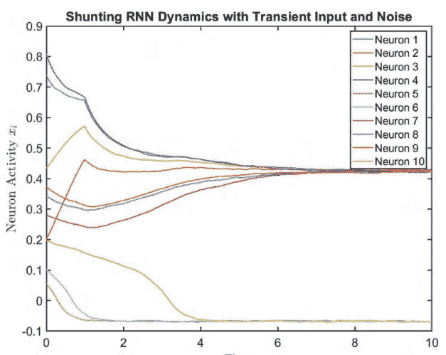

图 9.1 神经元激活随时间变化的动态。该图展示了网络中所有 10 个神经元的激活水平随时间的变化。图示说明了当网络响应瞬态输入和噪声时，神经元激活如何变化。初始瞬态期很明显，随后激活达到稳定。不同颜色的线代表单个神经元，图示展示了网络接近稳态时的整体行为。

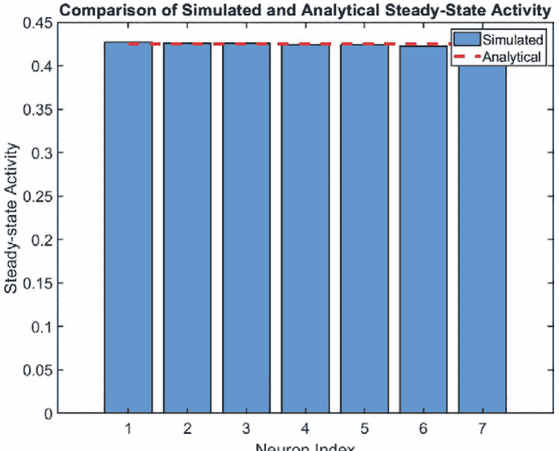

图 9.2 分析与仿真神经元激活的比较。柱状图将神经元激活的分析稳态值 x[n] 与仿真结束时的仿真值进行了比较。分析值使用公式 x[n] = ((B - 1 - ((n-1)D)) / (1 + n)) 计算，其中 n 是激活大于零的神经元数量。仿真值来自应用瞬态输入后网络的最终状态。这种比较有助于验证仿真与理论预测的准确性。

表现出类似于工作记忆动态的行为，其中代表较新输入的神经元保持较高的激活水平，而与旧输入相关的神经元激活较低。这种偏爱较新输入的倾向是工作记忆的特征，其中较新的信息更易于获取且比旧信息保留得更有效。观察到的模式凸显了网络优先处理近期数据的能力，模拟了人类记忆过程的时间特性。

## 9.4 讨论

本章全面考察了分流递归网络的稳定性准则，结合了分析法和 Lyapunov 函数法。我们从多个角度推导和比较了稳定性条件，包括经典分析准则（参见方程 9.12）和基于能量的 Lyapunov 稳定性方法（参见方程 9.15）。我们的分析还得到了仿真的补充


（参数见表 9.1）探讨了网络对同时和序列瞬态输入的响应（图 9.1、9.2 和 9.3）。仿真表明，分流网络能够有效管理瞬态输入，并表现出类似于工作记忆过程的动力学，其中近期输入优先于旧输入（图 9.3）。这些发现验证了理论稳定性标准，并凸显了分流网络在建模短期记忆方面的实际意义，为其在认知系统中的鲁棒性和适用性提供了宝贵见解。

一个显著的观察是，加法循环网络在处理大量输入时，比分流网络更容易快速达到灾难性抑制水平。在加法网络中，抑制反馈的积累可能导致神经元激活的过度抑制，从而引起不稳定性和网络性能的快速下降（Endress 和 Szabó，2017）。这种现象通常被称为灾难性抑制，限制了网络在较长时间内或处理大量输入时保持稳定激活的能力。

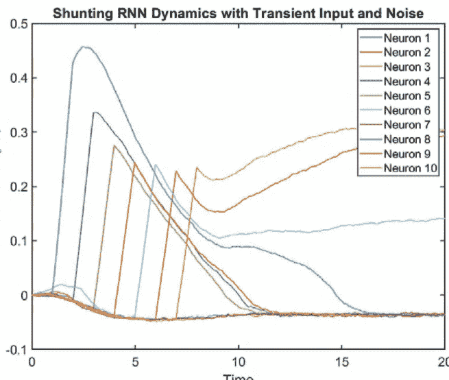

图 9.3 序列输入呈现下的神经元激活动态。该图显示了网络中神经元随时间的激活水平，使用参数 B = 2.2、D = 0.1 和八个序列输入。该图说明了与工作记忆动态的相似性，即与旧输入相比，近期输入被更突出地记住。这种行为在激活模式中很明显，即由近期输入激活的神经元保持较高的激活水平，高于与较早输入相关的神经元。

相比之下，分流循环网络通过其分流抑制和兴奋性反馈的组合，更有效地缓解了这一问题。分流机制有助于平衡兴奋和抑制，防止神经元激活的过度抑制，并使网络能够处理更多输入而不会陷入不稳定。这种平衡带来了更稳定、更稳健的激活动态，即使输入数量增加也是如此。

分流循环网络建模工作记忆过程的能力对短期记忆架构具有重要意义。其动态特性（即优先处理近期输入）与生物短期记忆系统的行为非常接近（Vindhya 等人，2024）。这使其成为开发需要有效处理时序信息的模型的有前途的候选者。观察到的与工作记忆动态的相似性表明，分流网络可以被利用来创建生物学上合理的短期记忆模型，从而可能增强我们对记忆过程的理解，并为设计具有类似能力的人工系统提供指导。

## 9.5 结论

本文对分流循环网络的稳定性标准进行了详尽分析，综合了解析方法和 Lyapunov 函数方法。我们的研究验证了理论稳定性条件，并证明分流网络能够有效管理瞬态输入，表现出类似于工作记忆过程的动态。与容易在大量输入下出现灾难性抑制的加法网络不同，分流网络由于其平衡的兴奋和抑制而保持稳定性和鲁棒性。这种能力不仅凸显了其实际优势，还将分流网络定位为生物短期记忆系统的有前途模型，为其在认知和人工系统中的潜在应用提供了见解。

## 参考文献

- Cohen, M. A., 和 S. Grossberg (1983). 竞争神经网络的全局模式形成和并行记忆存储的绝对稳定性。IEEE Transactions on Systems, Man, and Cybernetics 5, 815–826.
- Endress, A. D., 和 S. Szabó (2017). 干扰与记忆容量限制。Psychological Review 124(5), 551.
- Grossberg, S. (1968). 心理假设的一些生理和生物化学后果。Proceedings of the National Academy of Sciences 60(3), 758–765.
- Hou, L., H. Zhu, S. Zhong, Y. Zhang, 和 Y. Zeng (2013). 具有时变延迟的随机离散时间循环神经网络的不那么保守的稳定性标准。Neurocomputing 115, 72–80.
- Jie, L., G. Yanli, 和 Z. Kai (2012). 切换中性循环神经网络的稳定性和 l2-增益分析。载于第 31 届中国控制会议论文集，第 2100–2105 页。IEEE.
- Raijmakers, M. E., H. L. Van Der Maas, 和 P. C. Molenaar (1996). 距离依赖型中心开-周围关分流神经网络的数值分岔分析。Biological Cybernetics 75(6), 495–507.
- Sengupta, R., S. Bapiraju, 和 A. Pattanayak (2024a). 使用新型能量函数形式主义探索循环神经网络的涌现属性。载于机器学习、优化与数据科学国际会议，第 303–317 页。Springer.
- Sengupta, R., A. Shukla, R. Janapati, 和 B. Verma (2024b). 使用生物神经网络模型对个体化和感知平均的时间动态进行比较。International Journal of Hybrid Intelligent Systems 20(2), 145–158.
- Sengupta, R., B. R. Surampudi, 和 D. Melcher (2014). 数字的视觉感知来源于循环中心开-周围关神经网络的动态。Brain Research 1582, 114–124.
- Usher, M., 和 J. D. Cohen (1999). 额叶模型中的短期记忆和选择过程。载于《认知神经科学中的连接主义模型：第 5 届神经计算与心理学研讨会，伯明翰，1998 年 9 月 8–10 日》，第 78–91 页。Springer.
- Verma, B. K., 和 R. Sengupta (2023). 使用循环神经网络的人类数量解码器中行为现象和适应效应的出现。Scientific Reports 13(1), 19571.
- Vindhya, L. S., R. Gana Prasanna, R. Sengupta, 和 A. Shukla (2024). 使用中心开-周围关循环神经网络对串行记忆任务中的首因效应、近因效应和线索回忆进行建模。载于机器学习、优化与数据科学国际会议，第 405–414 页。Springer.

# 10 ChatGPT
其性能与美德探究的批判性分析

Nirmir Pratap Singh, Mahendra Dani, Eishani Bhattacharya, Saee Joshi, Akash Saxena, Sanjeev Kumar Mathur, 和 Usha Desai

## 10.1 引言

在最近的过去，世界接触到了一种大型语言模型软件，它能够根据传达给它的某些提示自行生成文本。当它在发布第一周触及 100 万用户这一神奇数字时，世界感到震惊。原因：它具有像人类一样生成文本的非凡能力。然而，像 ChatGPT 这样的 AI 聊天机器人的概念并不新鲜。事实上，历史表明，第一个聊天机器人 ELIZA（由 Joseph Weizenbaum 于 20 世纪 60 年代开发）[1]，出现在 Google 或 Facebook（现为 Meta）等巨头启动很久以前。AI 的历史可以追溯到 20 世纪中旬在达特茅斯的一个基于 AI 的夏季研究项目 [2, 3]，后来为决策的不同机器学习算法的发展铺平了道路 [4]。随后的几年见证了神经网络、遗传算法等不同机器学习技术的创建 [3, 5]。ChatGPT 所做的是，它在通过大规模数据集进行广泛训练的过程中生成类似人类的文本响应，使其能够学习不同的语法、语法和更多内容 [6]。

ChatGPT 在推出第一周就获得了巨大关注，因为它能够生成关于自由派和保守派的有偏见的响应等文本 [7]。大型语言模型（LLMs），如 ChatGPT、BERT（来自 Transformer 的双向编码器表示）、ELMO（来自语言模型的嵌入）和 Transformer-XL，由于在这些自然语言处理任务中的准确性和性能，使用了文本摘要、情感分析、语言翻译等不同用例 [8]，但令人惊讶的特征是“准确性”。

ChatGPT 已通过许多考试，例如美国医学执照考试、《今日心理学》言语语言智力智商测试和运营管理考试 [9]，这些对于像 ChatGPT 这样的聊天机器人来说是巨大的里程碑；但其成功在许多考试中的失败中失去了光彩，例如


来自印度的联合入学考试（主考和高级考）。还有许多类似于 JEE 的例子，其中 ChatGPT 的回答令人不满意。

有关公共卫生的有趣研究已发表 [10]。该研究为公共卫生领域以及从 ChatGPT 得出的推论的含义做出了贡献。此外，[11] 的研究探讨了全球变暖这一非常关键的问题以及框架在理解该问题中的作用，同时提出了应对这种致命威胁的可行解决方案。关于解决编程错误，[12] 特别参考了 ChatGPT，讨论了关于推论得出的非常有趣的研究。此外，在各种参考文献中，研究人员对框架的滥用表达了严重关切，同时讨论了该框架如何成为高等教育和研究的福音 [13]。

在 [14] 中，作者们主张用该框架取代课堂教师，因为该框架基于语言处理模型，并且可以非常勤勉地与人类互动 [14]。[15] 的作者们还讨论了因滥用该框架而禁止 ChatGPT 的问题。

基于上述讨论，在本研究章节中，我们将深入分析 ChatGPT 在科学、技术、商业和社会问题等不同领域给出的回答，研究目标列于以下：

- 1. 了解和分析 ChatGPT 界面的框架。
- 2. 确定用于评估 ChatGPT 界面的潜在问题领域。
- 3. 分析从界面获得的响应并得出有意义的结论。
- 4. 根据调查和结果分析提出建议，并为研究提供方向感。

第 10.2 节描述了 ChatGPT 框架的基本细节，第 10.3 节阐明了基准细节以及这些基准在 ChatGPT 平台上应用的结果。最后，第 10.4 节展示了分析得出的主要结论。ChatGPT 是人工智能领域的一场重大革命，因为声称该框架为人类用户提出的所有关键查询提供答案。社区对使用该框架解决工程设计、语言处理、信息共享、文档编写和政策制定等问题的反应不一，许多其他应用也从该框架中受益。在本章中，我们评估了 ChatGPT 在特定基准上的表现。这些基准基于数学能力和关键生成设计，已在图 10.1 中以图示形式展示。

#### 10.2.2.1 预训练

预训练是模型使用大型数据集语料库进行预训练的初始阶段。数据集源自书籍、文章和网站。还使用了互联网上的大量文本数据来训练模型。监督和无监督机器学习技术都用于使用派生的数据集训练模型。作为一种基于语言的模型，自然语言处理方法也用于此阶段。

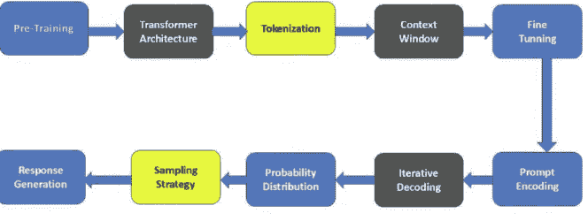

图 10.1 ChatGPT 算法。

#### 10.2.2.2 Transformer 架构

Transformer 架构是一种常用于机器学习（更常用于自然语言处理（NLP）任务）的神经网络架构 [14]。Transformer 架构用于自注意力机制，这使模型能够捕获数据序列中不同位置之间的依赖关系。Transformer 架构的组件包括编码器和解码器、自注意力、多头注意力、位置编码和前馈网络，如图 10.2 所示。

一个带有一个中心节点和 5 个子节点的圆角矩形树状图 图 10.2 Transformer 架构的组件。

- 编码器处理输入序列，而解码器生成输出序列。编码器和解码器都由多层组成。
- 自注意力允许模型在进行预测时对序列中的不同元素赋予重要性。它根据每个元素与序列中其他元素的相关性为每个元素分配权重。通过同时考虑所有元素，模型可以高效地捕获不同位置之间的依赖关系。
- 多头注意力意味着对不同输入和层并行使用自注意力机制。每个头关注输入的不同子空间，使模型能够同时捕获不同类型的信息。这有助于提高模型学习复杂模式的能力。
- 位置编码是一种用于将位置信息注入输入嵌入的技术。它为模型提供序列中元素的相对或绝对位置感。


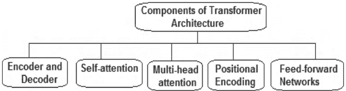

图 10.2 Transformer 架构组件。

- Transformer 架构中的每个层还包含前馈神经网络。这些网络处理自注意力机制的输出，使模型能够学习复杂关系并捕捉高级特征。

#### 10.2.2.3 分词（Tokenization）

分词是最重要的过程之一。当向 ChatGPT 提供输入时，这些输入会被分割为称为 token 的更小输入。这些 token 可以是句子中的字符、子词或单词。例如，输入“Sky is blue”可能被分词为 ["Sky", "is", "blue"]。分词在解码输入中的作用包括文本分段、词汇表创建、输入编码、处理未登录词、序列长度管理和高效计算，如图 10.3 所示。

- 文本分段：分词是将输入分解为更小 token 的过程。这些 token 可以是字符、子词或单词。分词为输入提供了结构化表示，使模型能够系统地处理它。
- 词汇表创建：大规模文本数据处理效率不高。分词为模型创建 token 的字典或词汇表。每个 token 都会被分配一个数值，该数值在训练和推理过程中用于处理输入。使用数值而非文本 token 可以提高模型的计算效率。
- 输入编码：分词后，输入文本通过将每个 token 映射到词汇表中对应的数值表示来进行编码。这种编码使模型能够将输入解释为一系列数字，神经网络可以高效地处理这些数字。编码后的 token 作为模型层和操作的输入。
- 处理未登录词：分词有助于处理未登录词（OOV），即不存在于模型词汇表中的单词。当遇到 OOV 单词时，分词过程通常将其分解为属于词汇表的子词或字符。

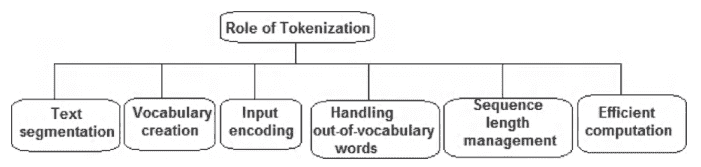

图 10.3 分词的作用。

vocabulary。这样一来，即使模型在训练期间未见过某个特定单词，它仍然可以根据其熟悉的子词或字符来理解并生成响应。

- **序列长度管理：** 分词有助于管理序列长度，尤其在内存或计算资源受限的模型中。如果输入超过了模型能够处理的最大序列长度，分词允许将其分割为较小的块或分段。这使模型能够以滑动窗口方式处理输入，并在生成响应时考虑有限上下文。

- **高效计算：** 通过将文本表示为数值 token，分词使神经网络内能够进行高效计算。可以对 token 表示执行向量操作，利用硬件加速和并行处理能力。这加快了训练和推理过程，使训练像 ChatGPT 这样的大规模语言模型变得更加可行。

#### 10.2.2.4 上下文窗口（Context Window）

处理序列长度限制很重要。ChatGPT 以 token 块处理输入文本，通常一次 2048 个。这有助于模型考虑有限上下文，并提高响应预测的准确性。

#### 10.2.2.5 微调（Fine Tuning）

预训练后，模型会使用受监督机器学习方法在特定任务上进一步微调。微调使用 OpenAI 创建的自定义数据集。微调很重要，因为它可以针对特定任务进行定制。在预训练期间，模型在海量数据库上进行训练，这有助于其理解语言。但微调是在人类审核员的帮助下，使用狭窄的任务特定数据集进行的。微调的其他优势包括人类监督和指导、偏差减少以及提高模型的安全性和响应能力。

#### 10.2.2.6 提示编码（Prompt Encoding）

提示编码是将基于文本的 token 编码为数值表示的过程。如第 10.2.2.3 节所讨论，该过程用于提高模型的效率。

#### 10.2.2.7 迭代解码（Iterative Decoding）

作为生成式 AI 模型，ChatGPT 以迭代方式生成响应。它从起始 token 开始，根据上下文和前序 token 预测下一个 token。它会持续迭代，直到遇到结束 token。当达到结束 token 时，它停止迭代，响应生成完毕。

#### 10.2.2.8 概率分布（Probability Distribution）

在每个解码步骤中，模型为下一个 token 分配词汇表上的概率分布。此预测源自 Transformer 模型最后一层的输出。下一个 token 的预测基于概率分布。例如，当模型被提示人类呼吸时，它可能会给单词 water “carbon dioxide” 分配更高的概率。

#### 10.2.2.9 采样策略（Sampling Strategy）

ChatGPT 在解码过程中使用贪心采样、核采样和温度采样方法进行解码。在贪心采样中，模型选择概率最高的 token。该策略倾向于高置信度预测，但可能导致重复或过于确定性的响应。Top-k 采样将 token 的选择限制在预定义子集中，其中 k 表示累积概率阈值。模型从共同占据至少阈值概率的最小 token 集合中进行采样。这种技术引入了多样性并减少了重复相同响应的机会。温度缩放是解码期间使用的另一种策略。它引入了一个温度参数，用于控制采样过程的随机性。较高温度（高于 1.0）鼓励模型探索更广泛的 token 范围，从而产生更多样化和更具创造性的响应。较低温度（低于 1.0）使采样过程更加集中和确定性，生成更保守且更精确的响应。调整温度可以影响模型响应生成中探索与利用之间的平衡。

#### 10.2.2.10 响应生成（Response Generation）

这是算法的最终阶段。ChatGPT 根据概率分布和所选采样策略生成响应。模型选择下一个 token 并继续生成响应。此过程重复，直到生成结束 token 或达到最大响应长度。

##### 10.2.2.10.1 ChatGPT 的工作流（Workflow of ChatGPT）

ChatGPT 的工作流可分为六个过程，即：用户提示、模型响应、用户跟进、模型响应、迭代对话和互动来回，如图 10.4 所示。

#### 10.2.2.11 用户提示（User Prompt）

用户与 ChatGPT 之间的对话始于用户的提示或查询。提示或查询是模型的基于文本的输入。例如，“全球变暖的影响是什么？”

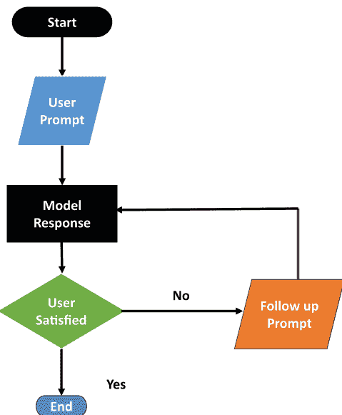

图 10.4 ChatGPT 的工作流。

#### 10.2.2.12 模型响应（Model Response）

如第 10.2.2 节所讨论，输入提示由模型解码并生成响应。响应基于概率分布、上下文背景和采样策略。

#### 10.2.2.13 用户跟进（User Follow-Up）

用户存在两种可能的状态。要么用户对响应满意，要么用户不满意。如果用户满意，对话可能会结束；否则，可以通过提供不同的输入来开始新对话。如果用户对响应不满意，则通过提供跟进提示，对话可能会继续。

## 10.3 ChatGPT 性能评估（EVALUATION OF THE PERFORMANCE OF CHATGPT）

在本节中，作者对 ChatGPT 的性能进行了全面分析。表 10.1 和表 10.2 展示了从界面提出的问题的性质，响应分析详细呈现，并伴有成功率分析。通过检查表 10.1 和表 10.2，可以得出结论，一个


### 表 10.1 用于评估 ChatGPT 框架的基准函数

| 类别 | 问题 | 频率 | 详情 |
| :--- | :--- | :--- | :--- |
| 数学 | M-1 几何 | 1 | 如果在平行四边形 ABCD 中，A、B、C 的坐标分别为 (1, 2)、(3, 4) 和 (2, 5)，那么对角线 AD 的方程是 |
| 数学 | M-2 排列组合 | 3 | 在 MISSISSIPPI 字母的所有不同排列中，有多少种情况四个 I 不会相邻？ |
| 数学 | M-3 复数理论 | 1 | 求给定复数的复共轭 |
| 数学 | M-4 数论 - 洛厄尔·普特南数学竞赛 | 2 | 一只蚱蜢从坐标平面的原点出发，进行一系列跳跃。每次跳跃长度为 5，每次跳跃后，蚱蜢所在的点的两个坐标都是整数；因此，第一次跳跃后蚱蜢有 12 个可能位置。蚱蜢到达点 (2021, 2021) 所需的最少跳跃次数是多少？ |
| 数学 | M-5 微积分 | 1 | 积分 |
| 数学 | M-6 千禧年奖问题（未解决） | 2 | 问题是，对于所有可以由算法快速验证给定解（即在多项式时间内）的问题，是否也可以由算法快速找到该解。由于前者描述的是称为 NP 的问题类，而后者描述的是 P，因此该问题等同于询问 NP 中的所有问题是否也属于 P。 |
| 数学 | M-7 排列组合 | 2 | 从 2 名男性和 3 名女性组成的群体中组建一个 3 人委员会。这有多少种方式？这些委员会中有多少个由 1 名男性和 2 名女性组成？ |
| 数学 | M-8 排列组合 | 4 | 在一个小村庄，有 87 个家庭，其中 52 个家庭最多有 2 个孩子。在一个农村发展计划中，将选择 20 个家庭提供援助，其中至少 18 个家庭必须最多有 2 个孩子。选择有多少种方式？ |
| 数学 | M-9 排列组合 | 2 | 使用 0 到 9 的数字，可以构造多少个 5 位电话号码，如果每个号码都以 67 开头且没有数字出现超过一次？ |
| 数学 | M-10 排列组合 | 3 | 若 2^nC3:C3 = 11 : 1，求 n |
| 数学 | M-11 几何 | 1 | 平行四边形的两条边沿直线 x + y = 3 和 x - y + 3 = 0。如果其对角线在 (2,4) 相交，则其中一个顶点是 |
| 数学 | M-12 几何 | 1 | 点 (3/2, 0) 与曲线 y = √x, x > 0 之间的最短距离 |
| 数学 | M-13 几何 | 1 | 如果直线 3x + 4y - 24 = 0 在点 A 与 x 轴相交，在点 B 与 Y 轴相交，那么三角形 OAB 的内心是（其中 O 为原点） |
| 数学 | M-14 几何 | 1 | 顶点为 (0,0)、(3,4) 和 (4,0) 的三角形的垂心是 |

### 表 10.2 用于评估 ChatGPT 框架的基准函数

| 类别 | 问题 | f | 详情 |
| :--- | :--- | :--- | :--- |
| 算法设计 | 遗传算法与算子 G-1 | 1 | 哪种算法更好：梯度下降还是遗传算法？ |
| | G-2 | 1 | 我们可以说一个算法稳定的因素有哪些？ |
| | G-3 | 1 | 遗传算法的基本编码步骤是什么？遗传工程中的进化算子是什么？ |
| 旅行 | 通过 AI 系统规划旅行 T-1 | 1 | 我的预算是 2000 美元，德国的最佳目的地是哪些？ |
| | T-2 | 1 | 德国所需的家庭清单。 |
| | T-3 | 1 | 针对国际学生在苏黎世（瑞士）等昂贵城市攻读硕士学位的有效预算计划。（苏黎世是地球上第二昂贵的城市） |
| | T-4 | 1 | 告诉我一些印度尼西亚的非热门目的地。 |
| 市场营销 | E-1 | 1 | ChatGPT 在营销中的风险 |
| | E-2 | 1 | 确保 ChatGPT 合乎道德营销的风险评估 |
| 事件组织 | 事件组织 (EM-1) | 1 | 假设你要组织 IPL 并提供一个完整的管理计划以顺利进行。 |
| | (EM-2) | 1 | 为科技公司组织活动制定计划，以吸引最多的人。 |
| | (EM-3) | 1 | 在印度等国家组织文化活动时需要注意哪些要点？ |
| 金融 | 投资与财务规划 (F-1) | 1 | 财务规划有多重要，在什么年龄开始了解它比较合适？ |
| | 印度废钞 (F-2) | 1 | 请阐述您对 2016 年印度废钞以及印度最新 2000 卢比废钞的看法。 |
| 社会经济问题与成瘾 | 行为成瘾 (SC-1) | 1 | 提供一些对抗社交媒体成瘾的方法。 |
| 教育 | 高效学习过程 | 1 | 为了使学习和获取知识的过程更高效，印度教育体系需要做出哪些必要改变？ |
| 研究 | 进行研究的指导 | 1 | 如何在 AI 领域进行研究？ |
| 环境 | 空气污染 (En-1) | 1 | 解释如何防止空气污染。 |
| | 噪音污染 (En-2) | 1 | 噪音污染的影响及对人类的噪音临界水平。 |
| | 水污染 (En-3) | 1 | 水污染的基本来源是什么？ |
| 健康 | Covid-19 (H-1) | 1 | Covid-19 的主要原因是什么？ |
| | Covid-19 (H-2) | 1 | 发达国家如何防止 Covid-19 的传播？ |
| | 肥胖 (H-3) | 1 | 说明肥胖的严重性，并建议预防和治疗的方法。 |
| | 癌症 (H-4) | 1 | 建议一些传播癌症意识和早期检测重要性的方法。 |
| | AI 与医疗保健 (H-5) | 1 | AI 增强的医疗保健有哪些最近的进展？ |

涵盖数学、算法设计、社会分析、政策制定等多种领域的大量问题被纳入评估。

框架进行了一次基础数学计算测试。这与几何有关。发现通过单次提示，框架会给出错误答案。因此，该框架在此问题上的成功率极低（M-1）。对一个排列组合的基础问题进行了测试。提示后它确实得出了答案，但存在回答重复的情况（M-2）。在一个复数的基础问题（M-3）中，需要应用共轭的简单核心概念；ChatGPT 表现非常出色并给出了正确答案，证实 ChatGPT 甚至了解数学的基础概念。还对来自洛厄尔·威廉·普特南数学竞赛的一道非常困难的问题进行了测试，该问题需要非常高的解题水平。它应用了正确的概念，但计算没有做正确。接着又问了另一个基于几何的问题，它不仅应用了错误的概念，还计算错误，与之前只出现计算错误的问题不同。又问了一个几何问题，这里也应用了错误的概念。这个问题可以使用直接公式或长方法来解决，ChatGPT 选择了长方法。它正确地应用了所有概念，但在最后应用了几个错误的概念，惨遭失败。悬而未决的问题：在梯度下降和遗传算法这两种算法中，哪一种更好？要求 ChatGPT 对此作出回应。它表示在所有条件下，每种算法都有其自身的重要性和优势。要求它提及我们可以说一个算法稳定的因素，它列出了诸如鲁棒性、收敛性、精度、可扩展性、验证和


敏感性分析。遗传算法的基本编码步骤是什么？遗传工程中的进化算子有哪些？ChatGPT通过陈述二进制编码、实数值编码和排列编码等编码方法以及选择、交叉、变异、精英保留和自适应等进化算子，非常准确地回答了这个问题。

有人要求ChatGPT在2000美元预算内推荐德国的最佳旅游目的地，它给出了包含德国前五座城市的满意回答。它列出了不同的费用，如食物、住宿、交通以及许多其他活动，包括如何削减成本。有人询问ChatGPT关于德国家庭的情况，它给出了包含家具、床上用品、照明等日常必需品的适当回答。苏黎世是世界上最昂贵的城市之一。对于在苏黎世学习的学生来说，有效的预算是生存于这个城市的必需品。有人向ChatGPT提出了同样的问题。它给出了正确的回答，陈述了所有重要方面，如旅行费用、住宿等，甚至建议做许多大学提供的兼职工作。

ChatGPT在回答中列出了前五个地点，如比利东岛、德拉万群岛、摩罗泰岛、瓦卡托伊和塔纳托拉查，就像我们在搜索引擎上搜索的那样（T-1 到 T-4）。ChatGPT提供了所有主要风险以及减轻这些风险的方法。ChatGPT的回答强调了风险评估的重要性，并给出了需要考虑的主要框架。ChatGPT以易于理解、清晰简洁的方式回答了这个查询（E-1 和 E-2）。它涵盖了组织IPL时可能包含的所有方面。这表明ChatGPT具有良好的组织和管理能力。ChatGPT非常巧妙地涵盖了场地、时间、时长、安全安排等所有要点，甚至包括增加活动影响力的推广活动。它给出了涵盖了解文化、传统、安全、场地等所有要点的满意回答，但一个问题是它无法想到如何在一个像印度这样文化、宗教和语言多样的国家里不伤害其他宗教和文化的感情（EM-1 到 EM-3）。正是在这里，它不止一次，而是两次失败了。ChatGPT提供了关于财务规划的深入知识，就像财务顾问为初学者提供的那样。它为查询提供了全面的回答（F-1）。

ChatGPT简要介绍了去货币化的目标。此外，它通过提供去货币化的利弊来简化该过程，以确保普通人更好地理解（F-2）。尽管ChatGPT的知识仅限于2021年9月，但它通过将当前（2023年）去货币化（2000卢比纸币）视为假设性情况来应对这一问题，并提供了全面的回答。ChatGPT通过提供清晰简洁的答案有效地回答了问题。它提出了应对社交媒体成瘾的所有主要方法，无论其程度是轻微还是严重（SC-1）。ChatGPT提供了切中要害且相关的回答。然而，印度的新教育政策（NEP）涵盖了其中的大多数要点。由于ChatGPT的知识仅限于2021年9月，它没有关于NEP的任何信息。ChatGPT给出了进行研究的步骤。它充当研究领域初学者的导师。ChatGPT给出的答案涵盖了所有必要的主要方面。

ChatGPT的回答全面且切中要害。它涵盖了所有必要的要点。它回答了问题而没有偏离主题。ChatGPT的回答包括所有必要的要点：影响、措施等。ChatGPT的回答全面，并提供了所有污染源的信息。ChatGPT提供了COVID-19的原因及适当解释。ChatGPT提供了包含最多建议的满意回答。ChatGPT在这些提示的回答中做得相当不错。它包括所有主要要点，对用户的问题给出满意回答。它提供了疾病的影响以及预防和应对疾病的方法。ChatGPT包括所有主要要点，对用户的问题给出满意回答。它提供了提高意识的方法以及应对疾病的方法。ChatGPT的回答强调了AI增强的医疗保健最近的进步（H-1 到 H-5）。

### 10.3.1 讨论

根据评估，作者得出结论，该框架对理论概念、设计算法和流程的基础知识反响良好。在此有必要指出，在对ChatGPT框架在数学和精确数值问题上的性能进行评估时，框架的响应是不稳定的。在提示时，响应会被编辑。应在更大的基准数据集上对该框架进行评估，以求就涉及公共卫生、收入和其他关键问题的设计获得富有成效的建议。对该框架是一个大大的肯定，因为它可以为关键问题提供优势。我们发现，对于某些数学问题，框架给出的答案不准确。可以说，持续提示可以产生更好的结果。然而，在对框架进行算法设计和其他知识型问题的评估时，性能被认为是满意的。在对框架进行与一般行为、社会和健康相关问题的评估时，框架提供的回答也被认为是满意的。在我们的下一项工作中，我们将设计算法，并评估ChatGPT与统计工具的相互性能。

## 参考文献

- [1] Okuda, Takuma, and Sanae Shoda. “面向金融行业的基于AI的聊天机器人服务。” Fujitsu Scientific and Technical Journal 54.2 (2018): 4-8.
- [2] McCarthy, John, Marvin L. Minsky, Nathaniel Rochester, and Claude E. Shannon. “关于达特茅斯人工智能夏季研究项目的提案，1955年8月31日。” AI Magazine 27.4 (2006): 12.
- [3] Jordan, Michael I., and Tom M. Mitchell. “机器学习：趋势、视角与前景。” Science 349.6245 (2015): 255–260.
- [4] Domingos, Pedro. *主算法：追求终极学习机器将如何重塑我们的世界*. Basic Books, 2015.
- [5] Sallam, Malik. “ChatGPT在医疗保健教育、研究和实践中的效用：关于有前景的观点和合理担忧的系统综述。” *Healthcare* 11.6 (2023). MDPI.
- [6] Brown, Tom, B. Mann, N. Ryder, M. Subbiah, J. D. Kaplan, P. Dhariwal, A. Neelakantan, P. Shyam, G. Sastry, A. Askell, and S. Agarwal. “语言模型是少样本学习者。” *Advances in Neural Information Processing Systems* 33 (2020): 1877–1901.
- [7] McGee, Robert W. “Chat GPT是否对保守派存在偏见？一项实证研究。” *An Empirical Study* (February 15, 2023) (2023).
- [8] Elkassem, Asser Abou, and Andrew D. Smith. “ChatGPT在放射学报告中的潜在应用场景。” *American Journal of Roentgenology* 221 (2023): 373–376.
- [9] Frieder, Simon, Luca Pinchetti, Ryan-Rhys Griffiths, Tommaso Salvatori, Thomas Lukasiewicz, Philipp Petersen, and Julius Berner. “Chat-GPT的数学能力。” *arXiv preprint arXiv:2301.13867* (2023).
- [10] Biswas, Som S. “Chat GPT在公共卫生中的作用。” *Annals of Biomedical Engineering* 51.5 (2023): 868–869.
- [11] Biswas, Som S. “Chat GPT在全球变暖中的潜在应用。” *Annals of Biomedical Engineering* 51.6 (2023): 1126–1127.
- [12] Surameery, Nigar M. Shafiq, and Mohammed Y. Shakor. “使用Chat GPT解决编程错误。” *International Journal of Information Technology & Computer Engineering (IJITC)* 3.1 (2023): 17–22.
- [13] Fuchs, Kevin. “探索高等教育中NLP模型的机遇与挑战：Chat GPT是福是祸？” *Frontiers in Education* 8 (2023).
- [14] Ausat, Abu Muna Alm aududi, Berdinata Massang, Mukhtar Efendi, Nofirman Nofirman, and Yasir Riady. “Chat GPT能否取代课堂中教师的角色：一项基础分析。” *Journal on Education* 5.4 (2023): 16100–16106.
- [15] Yu, Hao. “从教育与教学角度反思学术界是否应禁止Chat GPT。” *Frontiers in Psychology* 14 (2023): 1181712.
- [16] Mhlanga, David. “教育中的开放式人工智能：ChatGPT面向终身学习的负责任且合乎伦理的使用。” *Education, the Responsible and Ethical Use of ChatGPT Towards Lifelong Learning*. February 11, 2023. (2023).
- [17] Chen, Tzeng-Ji. “ChatGPT和其他人工智能应用加速科学写作。” *Journal of the Chinese Medical Association* 86.4 (2023): 351–353.
- [18] Aydin, Ömer, and EnisKararslan. “OpenAI ChatGPT生成的文献综述：医疗保健中的数字孪生。可在SSRN 4308687上查阅 (2022).
- [19] Street, Daniel, and Joseph Wilck. “‘让我们聊聊’：ChatGPT和大型语言模型在法务会计实践中的有效应用原则。” 可在SSRN 4351817上查阅 (2023).
- [20] Vaswani, A. “注意力就是你所需要的一切。” *Advances in Neural Information Processing Systems* 30 (2017).
- [21] Shetty, S. S., C. Singh, S. B. Rao, U. Desai, and P. M. Srinivas. “基于Twitter数据的非法药物消费促进预测。” 在《新兴融合技术与生物医学系统国际会议》中，2022年9月23日（pp. 647–657）。新加坡：Springer Nature。


# 11 使用多分辨率CNN框架的眼底图像修复与增强

Laya Tojo, Manju Devi, and Annie Sujith

## 11.1 引言

医学图像检查在疾病识别中起着重要作用。它侧重于数字图像的检查和评估。各种图像处理方法和计算机工具用于疾病识别。最近的研究表明，生物医学图像处理的快速进展至关重要，因为它们减少了对侵入性诊断程序的需求。在计算机辅助诊断技术的帮助下，用于检测和诊断心脏缺陷、肿瘤、阿尔茨海默病、癌症、骨缺陷、水肿等各种疾病的各种技术得到了改进。观察眼底图像有助于分析青光眼、糖尿病性视网膜病变、视网膜撕裂、年龄相关性黄斑变性、视网膜色素变性等关键视网膜疾病。使用普通眼底相机拍摄的图像质量较低。图像大多由于噪声、模糊、低对比度特征和不均匀照明而退化。因此，必须有效地从眼底图像中去除噪声，以便应用疾病检测技术，以及检测和评估视网膜血管中的微小变化，这非常重要。血压升高和血糖水平升高是青光眼和高血压性视网膜病变等公认眼病的主要原因。这些疾病可以在没有明显症状的情况下发展到下一阶段，而一般症状包括视网膜内微血管异常和渗漏。为了诊断和治疗包括年龄相关性黄斑变性（AMD）和糖尿病在内的眼科疾病，眼底摄影是必不可少的。人眼的屈光不正、相机校准不当和高闪光是导致视网膜图像质量退化的主要原因。视网膜图像被视为低光照图像。由于传感器质量和眼睛范围的原因，它们没有完全的照明。在视网膜图像中，低光照条件和噪声主要是由于相机对焦不佳、眼动、虹膜反射和镜片质量造成的。由于视网膜是眼球非常敏感的部分，高闪光可能导致偏头痛等健康问题。因此，视网膜图像的增强和去噪是必要的。视网膜图像由于不当的图像获取条件和设置，容易受到各种模糊效应的影响。视网膜图像通常由眼科医生用于诊断特定病症。由于诊断不可靠、相机设置不佳、眼球运动、照明不一致和瞳孔散大，眼底相机通常无法获取更高质量的视网膜图像。有许多医学图像噪声，如光子噪声、周期性噪声、高斯噪声、脉冲噪声、斑点噪声、高斯噪声等。这些噪声在很大程度上会降低图像质量。我们采用了加性高斯白噪声（AWGN），因为它在数学上易于建模。为了恢复模糊的视网膜图像并增强视网膜图像的清晰度，该工作中采用了多分辨率双CNN算法。

## 11.2 相关工作

研究人员试图解决的一个众所周知的问题是去噪。近年来，深度学习算法已取代非线性滤波器、色度和亮度噪声分离、线性平滑滤波器、块匹配算法、小波变换滤波器、随机场机器学习算法等去噪方法。关于医学图像去噪的研究非常少。医学图像是包含视觉和有意义信息的图像。但它们会被斑点噪声、高斯噪声、量化噪声等不同噪声损坏。在[1]中，使用DenseNet-121卷积神经网络对X射线图像进行了医学图像分类任务。与随机初始化的模型相比，精调模型更受去噪技术的影响。PSNR和SSIM之间没有显著差异。借助两个数据集，分析了AlexNet CNN模型的效率。它证明了噪声和谐覆盖疾病症状区域的图像组相对于CNN具有更好的效果。CNN[2]的多尺度空洞卷积通过实现空洞卷积保留上下文信息并扩展感受野。残差学习有助于加快学习过程。总变分（TV）方法[3]与传统的去噪技术（如线性平滑、中值滤波、使用FFT和DCT的变换域方法）相比，可以去除噪声并保留边缘。通过使用二阶（高阶）正则化方法，已将产生的不良伪差最小化，而[4]提出了一种有效的深度卷积神经网络模型，用于在有限训练数据集上对医学图像进行去噪，通过结合批量归一化和残差学习；训练过程加快，性能得到改善。局限性是医学图像压缩导致的伪差。

通过添加非稀疏惩罚函数，实现了混合噪声降低，从而改善了暗图像的视觉质量[5]。该神经网络由卷积操作、批量归一化和ReLU层以及卷积操作组成，将噪声图像补丁映射到干净版本，从而解决了低光照去噪问题。基于泊松噪声模型的低光照图像去噪[6]在不牺牲噪声降低的前提下保留图像细节。在工作[7]中，通过利用基于超像素的自适应去噪和亮度自适应对比度增强，消除了伪差、模糊和增强问题。基于自适应Sigmoid函数的技术[8]有效消除了噪声并提高了眼底图像的对比度。该方法已被证明对于用于计算机辅助临床诊断的彩色视网膜图像的预处理是有效的。方法[9]采用与非相似分组 curvelet 调整的自适应直方图均衡化，通过包含 curvelet 特征采用联合增强去噪方法，以更好地保留边缘。通过自适应直方图增强方法防止了光晕振铃伪差。缺点是它无法解决与亮度相关的问题。在三种方法中，对比度拉伸（CS）、直方图均衡化（HE）和对比度受限自适应直方图均衡化（CLAHE）方法证明了低质量图像得到了纠正，并且眼底图像上的图像去噪效果良好[10]。已经开展了许多基于CNN的视网膜图像分类工作[11–13]。CNN分类框架有助于在不需要任何预处理边缘检测阶段的情况下对图像进行分类。VGG19模型使用视网膜数据库进行微调，并采用迁移学习方法[14]。[15]中提出了一种融合原始视网膜图像和图像背景信息的眼底图像增强技术。[16]开发了深度CNN，有助于分析眼底图像，它具有18个卷积层和3个全连接层。它已被证明在诊断和分级糖尿病性视网膜病变方面是准确的。该技术在一定程度上帮助眼科医生进行早期诊断和跟踪视网膜疾病[17]。应用MR-DCNN算法后，STARE数据集的视网膜图像的修复和增强图像取得了良好效果，本工作中明确提到了我们的结果与现有视网膜图像增强技术的比较。

## 11.3 拟议方法

噪声输入被输入到我们的MR-DCNN模型中（图11.1）。带有噪声的图像由方程 _y_=_n_+_x_ 表示，其中 _x_ 表示干净输入，_n_ 是标准偏差为 σ 的 AWGN，而 _y_ 是损坏的数据。该拟议方法主要有四个模块，作为基本构建块。

- (1) FEB_CNN，2个特征提取块
- (2) EB_CNN，一个增强块
- (3) CB_CNN，一个压缩块
- (4) RB_CNN，一个重建块。

在FEB中组合稀疏特征；因此可以提取多样特征。通过引入稀疏性，可以提取局部和全局特征。这有助于有效地处理损坏的噪声信息。

EB_CNN结合两个子网络的特征，从而增加了检索到的特征。CB CNN降低了计算成本。重建块 RB CNN重建高质量的干净图像。图11.1显示了用于图像去噪的拟议多分辨率双CNN。它由2个16层结构和4个主要模块组成。稀疏块是有益的，因为它们增强了有效性和性能。FEB_CNN由两个子网络组成：FEBnet1 和


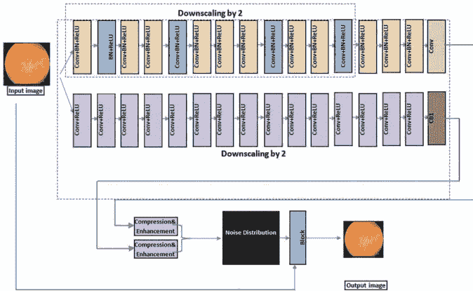

### 图 11.1 MR-DCNN架构。

FEBnet2。通过利用 FEB 块中的稀疏性，实现了空洞卷积。假设网络以 y 为输入、x 为输出。特征提取块任务的函数定义为

$$FEBj = F_j(y), j = 1,2$$ (11.1)

特征提取函数由 Fj(y) 表示，第 j 个网络提取的特征记为 FEBj。EB 可分为增强块 1 (EB1) 和增强块 2 (EB2)。特征提取块的输出将发送到增强块。

$$OE1 = E(FEB1, FEB2)$$ (11.2)

其中 OE1 表示增强块 EB1 的输出，E 表示增强块 EB1 和 EB2 的功能。

压缩块 (CB_CNN) 由三个压缩块组成：CB1、CB2 和 CB3。与 FEBnet1 关联的一个压缩块是 CB1，如图 11.1 所示。另一个压缩块 CB2 位于增强块之间，按如下方式增强检索到的特征：

压缩块 CB2 的输出为

$$OCB2 = C1(OE1)$$ (11.3)

其中 C1 表示压缩函数。

EB2 收集的附加数据如下

$OE2 = E(OCB2, y)$ (11.4)

OE2 代表增强块 EB2 的输出。

以下是 CB3 的输出：

$OCB3 = C1(OE2)$ (11.5)

重建潜在的清洁输入 y 是关键目标。残差运算产生潜在图像 y：

$x = y - OCB$ (11.6)

其中 ‘-’ 表示残差运算。通过在所提多分辨率双 CNN 中融入这些参数，我们获得了许多好处：
- 借助双网络，可以提取复杂图像中的众多特征甚至微小细节。
- 借助压缩块，实现了内存使用量、计算成本的降低以及冗余信息的消除。
- 小型滤波器在很大程度上降低了去噪器的复杂性。

双网络 FEBnet1 和 FEBnet2 的实现减少了计算操作，从而提升了性能。

## 11.4 实验结果

### 11.4.1 CNN 层下采样的影响

CNN 可通过宽度、高度和深度三种方式变化（图 11.2）。宽度和高度表示层的大小，而深度表示 CNN 内部块的数量。在 CNN 层内部，我们有不同尺寸的宽度 × 高度块。我们将宽度和高度从 32 × 32 变化到 16 × 16，从而引入了多分辨率 CNN。通过下采样，计算复杂度大幅降低。2 层双 CNN 架构有助于以更详细的方式进行特征提取。

在所提工作中，CNN 的宽度和高度为 32 × 32，在与 64 个 3 × 3 滤波器卷积后，总操作数为 940 万次。将 CNN 层下采样 2 倍后，操作数从 940 万次大幅降至 230 万次。

我们开发了一个名为多分辨率双 CNN 的双 16 层网络。初始参数和权重如下：总共有 128 个批次。训练模型中有 30 个时代。所使用的优化算法是 Adam。该研究中的 MR-DCNN 模型使用 Matlab 2020 进行训练和测试。所有分析均在一台配备 Intel® CoreTM i5–8265U 1.60 GHz 处理器和 8 GB 内存的计算机上进行。使用标准数据集和从 SRM 医学院医院收集的自定义数据集来与当前方法比较结果。


#### 图 11.2 CNN 的 D 视图。

使用 TRV-50 眼底相机拍摄了分辨率为 700 × 605 的 STARE 数据库眼底图像。向眼底图像添加了不同 σ 值的高斯噪声，以测试 MR-DCNN 算法的效率和性能。与当前方法相比，所提算法将对眼底图像进行去噪，从而提高视觉清晰度。与原始图像相比，在恢复后的图像中血管特征非常清晰。它还可用于进一步的图像分析和疾病诊断。图 11.3 显示了来自热门 STARE 数据库的视网膜图像。由于引入了多分辨率双 CNN，所提 MR-DCNN 可以获取并保持更好的清晰边缘细节，从而获得更好的 PSNR、SSIM 和 MSE 值并增强视觉质量，如表 11.1 所示。

### 11.4.2 训练和测试数据集

训练数据包括 400 张图像（320 张来自真实噪声和合成图像，20 张视网膜图像）。灰度图像和彩色图像是 256 × 256 合成噪声图像的一部分。真实噪声图像收集自不同的数字设备，如 Canon、Nikon、Sony A5 等。视网膜图像来自 STARE 数据库 [18]、Kaggle 数据库 [19] 和 DRIVE 数据库 [20]。CNN 学习这些噪声图像，在数据上进行训练并自动生成模型文件。根据噪声级别强度，它提取特定特征并存储在模型文件中（特征提取）。在训练阶段，将各种噪声图像、噪声类型和滤波器的信息输入 CNN。CNN 使用训练期间提供的可用信息并自动生成模型文件。在我们的实验中，进行了多次迭代以开发良好的训练数据。

### 11.4.3 视网膜图像数据库

视网膜图像可通过直接图像拍摄或从公开可访问的数据库获取。以下是我们在训练阶段使用的一些数据库。


#### 图 11.3 STARE 数据集。

#### 表 11.1

使用 MR-DCNN 方法在 STARE 数据集上获得的 PSNR、SSIM 和 MSE 值

| 图像 | PSNR | SSIM | MSE |
| :--- | :--- | :--- | :--- |
| Im001 | 39.31 | 0.929 | 0.0004 |
| Im002 | 39.82 | 0.946 | 0.0017 |
| Im003 | 38.12 | 0.917 | 0.0018 |
| Im004 | 41.31 | 0.953 | 0.0013 |
| Im005 | 38.32 | 0.934 | 0.0006 |
| Im006 | 40.64 | 0.956 | 0.0014 |
| Im007 | 40.65 | 0.964 | 0.0058 |
| Im008 | 39.81 | 0.949 | 0.0044 |
| Im009 | 44.44 | 0.955 | 0.0012 |
| Im010 | 38.27 | 0.958 | 0.0451 |
| Im011 | 38.44 | 0.981 | 0.0027 |
| Im012 | 39.56 | 0.943 | 0.004 |
| Im013 | 36.84 | 0.946 | 0.0028 |
| Im014 | 39.15 | 0.912 | 0.0008 |
| Im015 | 37.17 | 0.923 | 0.0021 |
| Im016 | 39.25 | 0.984 | 0.0009 |

### 11.4.3.1 STARE 数据库

STARE 数据库 [18] 是通过扫描和数字化视网膜成像照片生成的，即视网膜结构分析。这些照片使用带有 8 位颜色通道和 35 度窄视场的 700 × 605 像素相机拍摄。

### 11.4.3.2 DRIVE 数据库

DRIVE（用于血管提取的数字视网膜图像）[20] 眼底图像数据库对所有人开放。该集合的眼底照片来自 453 名参与团体糖尿病视网膜病变筛查计划的参与者，年龄范围从 31 岁到 86 岁。该数据库包含 40 张眼底图像，其中 20 张用于训练，20 张用于测试。

### 11.4.3.3 Kaggle 数据库

Kaggle 数据库 [19] 包含 3200 张视网膜图像。这些图像来自三种不同的眼底相机。

### 11.4.4 训练和去噪工作流程

在训练阶段，提取局部特征和全局特征。由于初始收敛误差较大，以优化的方式进行迭代。算法中设定了最优值。进行迭代，直到收敛误差减小并达到最优值。经过 100 次迭代后，生成一个模型文件。在测试阶段使用此模型文件。所提 MR-DCNN 在 STARE 数据库 [18] 的 100 张视网膜图像上进行测试。CNN 在这里使用测试图像进行分类和特征提取。测试代码中提供给 CNN 的模型文件包含增强、特征提取、压缩和重建块中可用的数据。CNN 将输入数据转换为类似块，并与这些块进行比较。如果匹配，则使用特定滤波器进行去噪并给出输出。

### 11.4.5 定量分析

视网膜图像来自 STARE 数据集。我们使用此数据集来分析性能。向图像添加了 σ=15、25、30、50 的高斯噪声，以测试 MR-DCNN 算法的性能。表 11.2 显示了所提 MR-DCNN 方法与用于视网膜图像的类似现有去噪和增强方法在受高斯噪声影响的视网膜图像上的性能比较，且我们的 PSNR 结果优于现有方法。

表 11.2 显示了 MR-DCNN 方法与各种现有技术（如 CLAHE-HPF-GF、Morphology-CLAHE-Wiener 和 CLAHE-Median-Order 滤波器）在受高斯噪声影响的视网膜图像上的性能比较。如表 11.2 所示，多分辨率双 CNN 方法对给定视网膜图像产生了最佳效果。

表 11.3 描述了 MR-DCNN 方法在易受高斯噪声影响的视网膜图像上的性能比较，与类似的现有去噪和增强方法相比，我们的 SSIM 结果优于现有方法，如图 11.4 所示。

测试时间也是评估去噪方法的重要因素之一。表 11.4 列出了 20 张视网膜图像相对于 CPU 和 GPU 的运行时间。表格左侧是 CPU 运行时间，右侧是 GPU 运行时间。


表 11.2 受高斯噪声影响的视网膜图像性能对比

| 图像 | MR-DCNN PSNR | CLAHE + HPF + GF PSNR | 形态学滤波 + CLAHE + 维纳滤波器 PSNR | CLAHE + 中值 + 阶次滤波器 PSNR |
|---|---|---|---|---|
| IM001 | 39.31 | 35.34 | 35.337 | 28.87 |
| IM002 | 39.82 | 36.04 | 38.067 | 28.83 |
| IM003 | 38.12 | 32.96 | 32.079 | 28.76 |
| IM004 | 41.31 | 40.39 | 39.118 | 28.82 |
| IM005 | 38.32 | 33.38 | 31.455 | 28.82 |
| IM006 | 40.64 | 39.29 | 39.333 | 28.88 |
| IM007 | 40.65 | 37.18 | 36.888 | 28.82 |
| IM008 | 39.81 | 36.48 | 37.081 | 28.82 |
| IM009 | 44.44 | 43.59 | 50.723 | 28.82 |
| IM010 | 38.27 | 38.65 | 44.657 | 28.88 |
| IM011 | 38.44 | 35.48 | 35.374 | 28.78 |
| IM012 | 39.56 | 38.69 | 41.729 | 29.95 |
| IM013 | 36.84 | 33.00 | 32.210 | 28.88 |
| IM014 | 39.15 | 29.10 | 26.073 | 26.83 |
| IM015 | 37.17 | 30.35 | 28.716 | 28.76 |
| IM016 | 39.25 | 33.72 | 32.476 | 28.91 |

表 11.3 对受高斯噪声改变的视网膜图像，对比拉伸-中值滤波器、直方图均衡化-中值滤波器和对比度受限自适应直方图均衡化滤波器与 MR-DCNN 方法的性能对比

| 图像 | CS+ 中值滤波器 SSIM | HE+ 中值滤波器 SSIM | CLAHE + 滤波器 SSIM | MR-DCNN SSIM |
|---|---|---|---|---|
| IM001 | 0.93 | 0.81 | 0.86 | 0.9915 |
| IM002 | 0.9 | 0.84 | 0.86 | 0.987 |
| IM003 | 0.89 | 0.77 | 0.82 | 0.9908 |
| IM004 | 0.88 | 0.84 | 0.88 | 0.9891 |
| IM005 | 0.91 | 0.78 | 0.79 | 0.996 |
| IM006 | 0.89 | 0.86 | 0.89 | 0.9908 |
| IM007 | 0.85 | 0.79 | 0.89 | 0.9877 |
| IM008 | 0.93 | 0.82 | 0.83 | 0.9628 |
| IM009 | 0.83 | 0.71 | 0.86 | 0.9861 |
| IM010 | 0.88 | 0.74 | 0.88 | 0.989 |
| IM011 | 0.84 | 0.67 | 0.87 | 0.9858 |
| IM012 | 0.93 | 0.83 | 0.87 | 0.9857 |
| IM013 | 0.78 | 0.72 | 0.9 | 0.9649 |
| IM014 | 0.87 | 0.78 | 0.86 | 0.992 |
| IM015 | 0.87 | 0.77 | 0.86 | 0.9862 |
| IM016 | 0.86 | 0.71 | 0.85 | 0.9706 |
| IM017 | 0.88 | 0.76 | 0.86 | 0.9915 |
| IM018 | 0.87 | 0.77 | 0.85 | 0.9968 |
| IM019 | 0.86 | 0.71 | 0.78 | 0.9955 |


图 11.4 STARE 数据库中的去噪视网膜图像。

该算法在实时患者眼底图像上测试时取得了良好效果。图 11.5 显示了原始图像、噪声图像和增强图像，其 PSNR 和 SSIM 值分别为 [39.82,.9635]、[39.46,0.9592]、[38.25,.9494] 和 [39.74,.9625]。结果证明，我们的算法在去除患者眼底图像噪声方面效果良好。

表 11.4
视网膜图像相对于 CPU 和 GPU 的运行时间。
256 x 256 噪声图像运行时间对比

| 图像 | CPU | GPU |
| :--- | :--- | :--- |
| | Intel® Core (TM)-i5-8265U, 8 GB 内存 | Intel® Core (TM)-i7-10750H, 16 GB 内存, Nvidia 显卡 |
| IM001 | 48.6299 s | 14.5316s |
| IM002 | 47.7581s | 15.8592s |
| IM003 | 50.9669s | 14.8875s |
| IM004 | 47.5364s | 14.6168s |
| IM005 | 50.3911s | 14.4957s |
| IM006 | 51.6053s | 14.5612s |
| IM007 | 48.3878s | 15.5624s |
| IM008 | 49.8061s | 14.6321s |
| IM009 | 48.2659s | 15.7894s |
| IM010 | 48.0096s | 14.6257s |
| IM011 | 52.4495s | 15.5416s |
| IM012 | 46.5275s | 14.8592s |
| IM013 | 50.3584s | 14.8675s |
| IM014 | 51.9647s | 15.6268s |
| IM015 | 48.7629s | 14.9557s |
| IM016 | 49.3895s | 14.1252s |


图 11.5 患者视网膜数据集中的去噪视网膜图像。

## 11.5 结论

我们提出了 MR-DCNN 算法的开发，通过去除噪声效果来提升自然图像在视觉感知和清晰度方面的表现。通过在双重网络中引入稀疏机制并降低 CNN 层的宽度和高度，我们可以降低计算复杂度，实现更好的性能和速度。根据实验结果，所提出的 MR-DCNN 方法可以在不牺牲 PSNR、SSIM 或 MSE 值的情况下提升视觉质量。MR-DCNN 有助于恢复视网膜图像的锐利边缘、边界和可见性。在我们的工作中，增强部分略显局限；尽管我们使用大部分自然图像数据集进行了训练。算法的增强部分使其也能用于眼底图像。在训练阶段，模型将在训练数据上自我训练并自动生成模型文件。

## 11.6 未来展望

医学图像去噪是一个相当有用的领域，该领域仍有许多工作待做。在本工作中，我们使用了图像恢复来去除模糊，并使用图像增强来增强图像。在未来工作中，我们需要探索硬件。眼底镜本身需要修改以获取清晰图像。

## 参考文献

- [1] Yamashita, R., Nishio, M., Do, R.K.G. 卷积神经网络：放射学概述与应用。Insights Imaging 9, 611–629 (2018)。https://doi.org/10.1007/s13244-018-0639-9
- [2] Wang, Y., Wang, G., Chen, C. 基于卷积神经网络的多尺度空洞卷积用于图像去噪。Multimedia Tools Applications 78, 19945–19960 (2019)。https://doi.org/10.1007/s11042-019-7377-y
- [3] Thanh, L.T., Thanh, D.N.H. 基于总变量正则化和 Anscombe 变换的医学图像去噪方法。在 2019 年第 19 届通信与信息技术国际研讨会 (ISCIT) 上，2019 年，第 26–30 页。https://doi.org/10.1109/ISCIT.2019.8905207
- [4] Jifara, W., Jiang, F., Rho, S. 使用卷积神经网络进行医学图像去噪：一种残差学习方法。超级计算机杂志 75, 704–718 (2019)。https://doi.org/10.1007/s11227-017-2080-0
- [5] Zhang, L., Zhao, D., Xu, D., Lu, D. 基于神经网络的低光照图像去噪方法。在 2017 年第 3 届 IEEE 计算机与通信国际会议 (ICCC) 上，2017 年，第 1868–1872 页。https://doi.org/10.1109/CompComm.2017.8322862
- [6] Yang, Q., Jung, C., Fu, Q., Song, H. 基于泊松噪声模型和加权总变量正则化的低光照图像去噪。在 2018 年第 25 届 IEEE 图像处理国际会议 (ICIP) 上，2018 年，第 3199–3203 页。https://doi.org/10.1109/ICIP.2018.8451840
- [7] Li, L., Wang, R., Wang, W., Gao, W. 同时用于去噪和对比度放大的低光照图像增强方法。在 2015 年 IEEE 图像处理国际会议 (ICIP) 上，2015 年，第 3730–3734 页。https://doi.org/10.1109/ICIP.2015.7351501
- [8] Anilet Bala, A., Aruna Priya, P., Maik, V. 基于曲率变换的直方图均衡化 Sigmoid 映射的视网膜图像增强。物理学杂志：会议系列 (1964)。计算电子与通信工程进展。
- [9] Erwin, E. 使用对比度受限自适应直方图均衡化和滤波器变化改善视网膜眼底图像质量。在 2019 年信息学、多媒体、网络与信息系统国际会议 (ICIMCIS) 上，2019 年 10 月 24–25 日，雅加达。
- [10] Ervin, E. 使用对比度拉伸、直方图均衡化和 CLAHE 方法结合中值滤波器提高视网膜图像质量。图像、图形和信号处理国际杂志，2020 年 4 月。
- [11] El-Hag, N.A., Sedik, A., El-Shafi, W., El-Hoseny, H., Khalaf, A.A.M., El-Fishawy, A.S., Al-Nuaimy, W., Abd El-Samie, F.E., El-Banby, G.M. 基于卷积神经网络的视网膜图像分类。显微研究与技术 84(3), 394–414 (2021)。https://doi.org/10.1002/jemt.23596. 2020 年 12 月 22 日在线出版。
- [12] Das, A., Giri, R., Chourasia, G., Bala, A.A. 使用迁移学习方法分类视网膜疾病。在 2019 年通信与电子系统国际会议 (ICCES) 上，2019 年，第 2080–2084 页。https://doi.org/10.1109/ICCES45898.2019.9002415
- [13] Gayathri, S., Ponnusami, P., Gopi, V.P. 用于眼底图像中糖尿病视网膜病变分类的轻量级 CNN。生物医学信号处理与控制 6(7), 102115 (2020)。https://doi.org/10.1016/j.bspc.2020.102115
- [14] Chen, C., Chuah, J.H., Ali, R. 使用卷积神经网络在眼底图像中进行视网膜血管分割。在 2021 年高性能大数据与智能系统国际会议 (HPBD&IS) 上，2021 年，第 261–265 页。https://doi.org/10.1109/HPBDIS53214.2021.9658459
- [15] Shaban, M., Oğur, Z., Mahmoud, A., Switala, A.E. 用于糖尿病视网膜病变筛查和分期的卷积神经网络。2020 年 6 月。
- [16] Shrestha, S. 使用新型自适应中值滤波器进行图像去噪。信号图像处理 5(4), 1–13 (2014)。
- [17] Hegde, N., Krishna, S., Manvi, S.S. 基于人工智能的糖尿病视网膜病变诊断系统。在 人机界面技术进步与应用 中，2023 年，第 213–230 页。CRC Press。
- [18] 眼底图像数据库。http://cecas.clemson.edu/~ahoover/stare/
- [19] 眼底图像数据集。https://www.kaggle.com/datasets/iamachal/fundus-image-dataset
- [20] DRIVE 训练集。https://datasets.activeloop.ai/docs/ml/datasets/drive-dataset/


# 12 基于改进支持向量机分类器的乳腺癌检测研究应用

Jayapandian Natarajan, Ann Marry, Huda Yasmin, Jessica Eldo, Sivaraman Eswaran, Nilima Zade, and Krishna Kumar P R

## 12.1 引言

癌症公认为最难治疗、识别或检测的疾病之一。人工智能（AI）和机器学习（ML）的进步有望显著提升癌症诊断和检测 [1]。这些技术可以大幅提高医疗应用中的预测准确性 [2]。这使得 AI 和 ML 的研究成为一个开放于发现和研究的广阔领域。乳腺癌涉及乳腺组织的不规则生长，仍然是影响女性最常见的疾病之一 [3]。它已知是导致女性大量癌症相关死亡的主要原因。根据世界卫生组织的数据，仅在 2020 年一年，乳腺癌在全球造成了约 658,000 人死亡 [4]。当乳腺细胞发生突变时，细胞生长可能变得不可控制，从而导致肿瘤形成，即乳腺癌 [5]。不受控制地生长的乳腺细胞有可能导致突变，进而引起肿瘤形成并导致乳腺癌。图 12.1 说明了使用机器学习算法进行乳腺癌检测的基础分类模型。根据该图，图像数据库作为输入。图像经过处理，从而进行特征提取。根据提供的特征，分类器被训练以检测细胞是恶性还是良性。如果细胞被证明是良性的，则分类为非癌细胞，否则分类为癌细胞。这些恶性细胞还会侵犯邻近细胞并迅速扩散，可能危及生命。现有的乳腺癌检测方法包括乳腺 X 线摄影、超声、MRI、活检和细针吸取 [6]。使用乳腺 X 线摄影预测正确结果的成功率为 87%，活检为 85%–100%，细针吸取为 60%–96%。每种方法各自过于复杂。活检是一种昂贵的技术，尽管有效，而细针吸取包括从肿块中提取细胞以进行进一步诊断。


图 12.1 癌症检测分类模型。

这使得在有或没有人类协助的情况下进行学习成为可能。机器学习方法适用于癌症的诊断和检测 [7]。这可以帮助有效预测恶性和良性细胞。图 12.1 中的每个组件对于算法的正常运行都至关重要。模型包括输入、预处理、特征提取、分类器，然后是输出。输入部分包括乳腺癌数据集，即需要诊断的图像。例如，威斯康星乳腺癌数据集是乳腺癌相关研究中广泛使用的数据集 [8]。本研究章节也使用同一数据集。数据集图像经过处理，包括清洗数据以消除噪声，并提取图像的属性，这些属性用于训练分类器。构建一个分类器，它在检测癌细胞方面起着关键作用。这些包括各种机器学习算法，如支持向量机、k-近邻、朴素贝叶斯、决策树、随机森林以及其他常用于这些目的的算法。它们负责自动将数据排序或分类到一个或多个类别集合中。本章旨在比较五种不同的机器学习算法，即随机森林、k-近邻（KNN）、决策树、支持向量机（SVM）和逻辑回归，应用于威斯康星乳腺癌数据集。

## 12.2 文献综述

几位研究人员已对机器学习算法在检测不同人体器官癌症方面的分析、评审和比较进行了研究。为此目的广泛研究的算法包括 k-近邻和支持向量机。2009 年，MIT 钦奈的研究人员进行的一项研究发现，基于增强后的图像灰度信息提取形态特征后，SVM 可以有效地对含有癌细胞的图像进行分类。2019 年，美国托莱多大学的一名学生进行的非线性机器学习算法比较研究，比较了五种算法，即多层感知机（MLP）、高斯朴素贝叶斯（NB）、k-近邻（KNN）算法、分类和回归树（CART）以及支持向量机（SVM），应用于威斯康星乳腺癌数据集。研究结果表明，多层感知机在准确性和精确性方面优于其他研究的算法 [9]。另一项对六种算法（包括 GRU-SVM 4、MLP、线性回归、SoftMax 回归、最近邻（NN）搜索和支持向量机（SVM））的比较，同样基于威斯康星诊断性乳腺癌数据集，发现了类似结果，所有算法均显示出 90% 以上的准确率，其中 MLP 算法达到 99.04% 的准确率。阿联酋哈利法大学和美国麻省理工学院的教授进行的对 SVM、随机森林和贝叶斯网络的比较研究表明，在三者中 SVM 的准确率更高，但随机森林具有正确肿瘤分类的最高概率。使用预处理的 CT 扫描图像以及 MRI 和超声图像，对肺癌检测进行了使用遗传优化、SVM 和 KNN 算法的类似测试。这些研究在图像上使用了像素分割并从中提取特征以识别癌性生长。SVM 算法通过基于数据训练模型，成功显著降低了假阳性率并正确分类了癌细胞 [10]。埃塞俄比亚一所大学进行的一项研究使用网格搜索来观察 KNN 在癌症检测中最优超参数 [11]。研究得出结论，KNN 算法的性能从 90.1% 提高到 94.35%，具体取决于网格搜索中选择的超参数或 K 值。一项类似的研究报告使用了遗传算法来提高 KNN 的分类性能，并成功降低了其计算时间。总体而言，SVM 和 MLP 显示了最准确的结果，并成功地以高精度对图像进行了分类和分割 [12–13]。

## 12.3 问题陈述

乳腺癌主要有两种类型：良性和恶性。良性肿瘤通常不会扩散到身体的其他部位，很少侵犯邻近细胞和组织 [14]。它们大多不会复发，可以通过合适的化疗程序或手术切除。相反，恶性肿瘤被认为是危及生命的，因为它们常常侵犯邻近细胞和组织 [15]，扩散到身体的其他部位，并可能导致慢性癌症甚至死亡。乳腺癌包含一组多样化的疾病，每种都有独特的亚型和特定的分子特征 [16]。这种复杂性导致为每种亚型开发有效治疗方法面临挑战。导致乳腺癌治疗困难的其他因素包括药物耐药性、患者需求和保留情况。尽管研究正在进行，但仍缺乏能够准确预测疾病进展的预测性生物标志物，这使得为个体患者提供针对性治疗变得困难。数百万人受到乳腺癌的影响。这是一个可怕的问题，一直是无数研究和讨论的主题，探讨如何在女性中传播关于其风险和影响的意识。该领域的研究对于改善早期检测方法、了解风险因素以及开发有效的治疗选择至关重要。早期诊断增加了成功治疗的机会，并减少了对激进干预的需求 [17]，而通过研究开发的预防策略可以帮助降低疾病发病率。该领域研究的重要性超出了对患者的直接影响，对社会和科学进步具有更广泛的影响 [18]。通过减轻人类痛苦、提高医疗效率并为更广泛的科学知识体系做出贡献，乳腺癌研究可以造福科学界和整个社会 [19]。乳腺癌被认为是城市地区女性中最常见的癌症类型，农村地区第二常见 [20]。不幸的是，大多数病例在晚期才被发现，原因是缺乏对该疾病的认识以及乳腺癌筛查项目的获取有限 [21]。因此，创建乳腺癌早期检测的新方法至关重要。我们的目标是实施创新方法，帮助在乳腺癌的早期阶段进行检测。我们的实验旨在识别一种可靠的乳腺癌检测算法。为此，我们使用了五种机器学习算法，并评估和比较了结果，以确定准确率最高的模型。本研究的发现可能对临床实践和公共卫生政策具有实际指导意义，并改善癌症检测技术 [22]。进一步研究这些算法以及如何利用它们早期识别乳腺癌以改善受影响个体的结果至关重要。

## 12.4 拟议的乳腺癌检测

使用机器学习算法检测提供的数据集中恶性或良性细胞的存在。本研究章节将威斯康星乳腺癌诊断（WBCD）数据集作为其样本数据。Wolberg 博士及其同事在威斯康星大学医院收集了该数据集。在三年期间，数据定期收集。该数据集可在 Kaggle 网站上获取。总共有 699 个病例。它具有多种特征，有助于区分良性和恶性细胞。对于每个细胞核，计算 10 个实值特征。


- 1. 从核中心到其边界的平均距离，即半径。
- 2. 核内像素强度的变异性，即纹理。
- 3. 核边界周围的总长度，即周长。
- 4. 核边界内围合的总空间，即面积。
- 5. 核边界平滑或不规则程度的度量，即光滑度。
- 6. 一个按（周长的平方除以面积减1.0）计算的比率，称为紧凑度。
- 7. 核边向内弯曲的程度，即凹陷度。
- 8. 凹陷点是沿核边向内弯曲段的计数。

数据根据发生情况的共同点被划分为两个类别：良性（458个实例）和恶性（241个实例）。随后，原始数据经过处理以去除噪声并提高制造精度。此外，这减少了数据不一致和冗余。预处理后对数据应用分类。可以将各种机器学习方法应用于此。机器学习算法可分为监督学习和无监督学习方法。与无监督数据没有预设目标或数据集不同，监督学习使用一组数据来训练机器。监督学习是分类过程中最推荐的策略。通过使用特定数据集进行训练，计算机获取知识，并基于从该数据中得出的模型生成预测。机器学习已被证明在一些现实世界应用中具有重要意义。例如，在社交网络、语音识别、医疗专家系统、农业、金融等领域。分类是机器学习的一个分支；如前所述，监督学习从给定的示例及其历史观察中获取知识。顾名思义，该方法的主要重点是将传入的数据分类到某些预先存在的类别中。用于分类威斯康星癌症数据集的三种不同机器学习算法是KNN、DT和SVM。

### 12.4.1 支持向量机（SVM）

支持向量机是一种机器学习算法，通过结合监督最大边距与相关学习，用于解决与回归和分类相关的挑战。这些模型通常简称为SVM，在包括信号处理、图像和语音识别以及自然语言处理在内的众多领域得到应用。使用核方法，SVM能高效地执行回归分析和分类。SVM算法的主要目标是在任何维度空间（如1D和2D）中识别最佳超平面，以便将数据点显著划分为不同的对象类别。超平面的配置方式是，在考虑各类别最近点的同时，超平面两侧尽可能留有最大空间。所关注特征的数量决定了维度。例如，对于两个特征，超平面将仅为一条直线；对于三个特征，超平面将为一个2D平面，以此类推。硬边距和软边距是用于超平面的两种边距类型。硬边距或最大边距超平面是介于两个尽可能远离的类别之间的几乎中间位置的超平面。要求数据易于区分且线性可分，可用方程12.1表示。对于所有训练样本\((x_i, y_i)\)，这可以断言为使权重\(\|w\|\)最小化，相对于

```
y_i (w^T x_i + b) \ge 1
(12.1)
```

其中，\(w^T\) 是权重向量，\(x_i\) 是一个数据点，\(b\) 是偏置。

当异常值使得分离数据变得困难时，会应用软边距来减轻边距要求的严格程度。

这允许一定程度的误分类，并由一个惩罚项来抵消，该惩罚项表示允许数据点位于边界错误一侧的代价。如方程12.2所示，最小化权重

```
\|w\| + C \sum \xi_i
(12.2)
```

其中，\(\xi_i\) 是每个数据点的误分类程度，\(C\) 是误分类率。\(C\) 平衡了用于正则化边距最大化和误分类惩罚的参数。

较大的\(C\)值会使其表现得像硬边距SVM；较小的值会导致更柔和的边距SVM，这些SVM更灵活并允许更多误分类。当数据无法线性分离时，SVM采用核技巧。为了更容易定位超平面，它隐式地将初始输入数据点划分到高维特征空间中。它避免用于决策边界或非线性函数的显式映射。常用的核函数示例包括Sigmoid、线性、多项式和径向基函数。当核写为满足如方程12.3所示功能的特征映射时，计算更简单。

```
k(x, x') = \langle \varphi(x), \varphi(x') \rangle_V.
(12.3)
```

SVM广泛应用于许多不同的应用中，包括地质声波、地震液化潜力、一般数据分类、面部识别和生物识别、手写识别、表面纹理分类、语音识别、隐写术检测，以及本章的主题：癌症检测。这是因为SVM可以根据独特特征将未知数据分类到不同的类别中。SVM可以使用各种成像技术并结合监督学习方法进行训练，以检测和区分恶性细胞和正常细胞。AI模型可以使用机器学习技术来消除假阳性、分类良性或恶性癌症生长，并预测癌性生长造成的危害程度。这有助于早期诊断癌症，并帮助医生诊断适当的癌症类型和治疗方案。图12.2表示了SVM整体分类过程的框图，相应的算法步骤如图12.3所示。


FIGURE 12.2 SVM标签预测和分类过程。


FIGURE 12.3 拟议研究中SVM分类的算法步骤。

### 12.4.2 K-近邻算法（KNN）

这是一种监督学习技术，根据其邻居的分类对输入进行分类。由于KNN算法使用距离作为分类基础，两点之间越接近，其相似性就越高。欧氏距离和曼哈顿距离是查找两点之间距离的两种不同方法。新点的属性根据与其相邻的点（即其邻居）进行标记。KNN算法是一种流行的机器学习算法，算法步骤如表12.1所示。

在分类之前，通过将新元素的相似度量与邻近K个元素的相似度量进行比较，将新元素放置在共享特征大部分出现的类别中。K是该算法中邻居的总数，是一个正整数。此数字使用欧氏距离公式计算。

$d = \sqrt{[(x_2 - x_1)^2 + (y_2 - y_1)^2]}$ (12.4)

#### 表 12.1
拟议研究中应用的KNN分类算法步骤

#### 拟议算法步骤：K-近邻

- 步骤1：开始
- 步骤2：
  - 1. 确定‘K’的值：选择要考虑的最近邻居数量（K）。
  - 2. 计算距离：使用选定的距离度量（例如欧氏距离）计算新数据点与数据集中所有其他数据点之间的距离。
  - 3. 选择K-最近邻居：根据计算出的距离，识别最接近新数据点的‘K’个数据点。
  - 4. 将新数据点分配给其‘K’个最近邻居中最频繁的类别（多数投票）。
- 步骤3：停止。

KNN算法是一种非参数算法，它不对现有数据做出假设。

### 12.4.3 决策树学习

该算法是一种监督机器学习方法，适用于分类和回归任务，构建一种树结构模型。它能够处理复杂数据，并作为机器学习中集成方法的基础。它既支持数值数据也支持类别数据，基于特征或属性进行决策，以得出预测或结果。这些模型因其直观性和可解释性而闻名，在数据挖掘、模式识别和决策支持系统等多个领域备受青睐。此外，它可以应用于癌症检测，利用其基于特征或属性进行决策的能力。可以将其整合到更全面的癌症检测方法中，并与其他机器学习技术或临床评估相结合，以提高准确性。在我们的二类分类问题中，我们应用ID3算法来开发决策树。决策树算法遵循以下步骤：

- 1. 在输入属性中选择最具信息量的特征，并将其指定为树的根节点。
- 2. 根据所选属性的值将训练数据集划分为更小的组。
- 3. 对每个子集继续迭代，递归重复步骤1和2，直到树结构中每个分支的末端形成叶节点。

在使用决策树算法进行分类时，整个输入训练数据集作为起点。决策树算法的深度在分类任务中至关重要；较高的深度可能导致过拟合问题。树的大小对应于其包含的节点数量，每个节点在二类分类中都发挥作用。


### 12.4.4 随机森林算法

这是一种受监督的学习技术，可应用于分类和回归任务。它遵循集成学习的概念，通过提供多种分类器样本来提高检测准确率。它包含给定数据集的不同子树的多个决策树，对所有结果取平均值，从而改进预测。它不使用单个决策树，而是结合多个决策树以提高决策准确率，从而产生更稳健的结果。由于特征选择基于随机性，它最大限度地减少了不同决策树获得的数据之间的相关性。使用随机森林算法有很多优点，例如相比其他 ML 算法需要更少的训练时间、能够预测高度准确的输出，以及能够很好地处理大型数据集。在数据缺失的情况下，结果的准确率受影响不大。该算法用于消除过拟合和偏差，并确保整体方差以进行精确预测。

### 12.4.5 逻辑回归

这种统计方法使用逻辑函数来表示二元因变量。通过估计观测值属于特定类别的概率，它将线性回归转换为分类器。岭回归和 LASSO 等正则化技术经常用于防止过拟合，L2 正则化应用于分类模型。正则化项控制参数的增长，超参数值“lambda”通过交叉验证发现。如果 lambda 过高，可能导致欠拟合；如果等于 0，则没有正则化效果。因此，在选择 lambda 时，必须平衡偏差与方差的权衡。描述肿瘤细胞特征的输入数据被送入模型，然后转换为 NumPy 数组。训练好的模型在训练集和测试集上进行准确率评估。然后使用该模型来预测肿瘤的恶性程度。逻辑回归模型可以提供明智的临床决策和精确的预测。

## 12.5 结果与讨论

在将机器学习算法应用于 WBCD 数据集后，基于每个算法的准确率、精确率、召回率以及 F-度量进行了对比研究。表 12.2 列出了拟议研究所考虑的材料和方法的详细信息。准确率对于衡量预测的正确性至关重要，最初由分类正确的样本（真正例和真反例）占所有实例的比例计算得出。精确率通过指示真正例占实际正例数量的比例来衡量预测的正确性。召回率旨在评估模型检测相关事件的准确程度。最后，F-度量是一种用于衡量模型性能的性能指标，它合并了精确率和召回率，从而评估所考虑算法的有效性。表 12.3 给出了使用 DT、SVM、KNN、LR 和 RFA 的性能度量结果。其中，LR 达到最高精确率 99.4%，而使用 SVM 则达到 98.26% 的召回率、98.2% 的 F-度量和 98.27% 的准确率。

**表 12.2**
**乳腺癌图像分类实验设置**

| 组件 | 详情 |
|---|---|
| 数据集 | WBCD 数据集 |
| 数据集来源 | Kaggle |
| 总实例数 | 699 |
| 类别 | 良性（458 个实例），恶性（241 个实例） |
| 对比算法 | SVM、KNN、DT、RFA、LR |
| 训练/测试划分 | 70% 训练，30% 测试 |
| 评估指标 | 准确率，精确率，召回率，F-度量 |
| 预处理步骤 | 数据清洗，噪声降低，特征提取 |

**表 12.3**
**性能度量结果 (%)**

| 分类器 | 精确率 | 召回率 | F-度量 | 准确率 |
|---|---|---|---|---|
| 决策树 | 95.07 | 95.23 | 95.15 | 94.28 |
| 支持向量机 | 98.15 | 98.26 | 98.2 | 98.27 |
| K 最近邻 | 97.16 | 97.34 | 97.25 | 97.25 |
| 逻辑回归 | 99.4 | 96.4 | 92.98 | 97.63 |
| 随机森林算法 | 96.9 | 94 | 95 | 96.5 |

图 12.4 展示了拟议方法和现有方法的准确率水平，其中 x 轴标签 1、2、3、4、5 分别代表 DT、RFA、LR、SVM 和 KNN。图 12.4 绘制用于分析各种数据集，并比较准确率水平。实验结果显示 DT 的准确率为 94.28%，同时 RFA 的总体准确率为 96.5%。接下来较高的一致性水平是使用 KNN 和 LR 算法，均为 97%。最后，使用拟议的 SVM 算法达到了 98.27% 的总体准确率。

图 12.5 讨论了不同机器学习算法的精确率水平，其中 x 轴标签 1、2、3、4、5 分别表示 DT、SVM、KNN、LR 和 RFA。本实验中使用 DT 和 RFA 提供的精确率数值几乎相同，分别为 95% 和 96%。在此例中，SVM 提供 98.15%，KNN 为 97%。在本研究中，LR 的精确率水平为 99.4%。图 12.6 讨论了不同机器学习算法的召回率水平，其中 x 轴标签 1、2、3、4、5 分别表示 DT、SVM、KNN、LR 和 RFA。本实验中使用决策树（DT）和随机森林算法（RFA）提供的数值几乎相同，分别为 95% 和 96%。在此例中，支持向量机（SVM）达到 98.26%，K 最近邻（KNN）算法提供 97% 的结果，逻辑回归（LR）的召回率为 96.4%。


**图 12.4** 准确率比较。


**图 12.5** 精确率比较。

图 12.7 显示了不同机器学习算法的 F-度量，其中 x 轴标签 1、2、3、4、5 分别表示 DT、SVM、KNN、LR 和 RFA。在此实验中，DT 和 RFA 提供几乎相同的值，即 95%，SVM 为 98.2%，KNN 算法提供 97.25%。在此 F-度量中，LR 分类器为 92%。


**图 12.6** 召回率比较。


**图 12.7** F-度量比较。

## 12.6 结论

拟议研究利用 WBCD 数据集和 ML 算法，为高效检测乳腺癌提供了有价值的见解。我们的研究结果表明，SVM 达到了最高的总体准确率 98.27%，在预测性能上超越了其他算法。KNN 也展现了强劲的性能，达到了 97.25% 的准确率。KNN 基于最近邻分类肿瘤的简便性和有效性，使其成为初步诊断筛查的实用工具。逻辑回归（LR）的准确率为 97.63%，展现了其在处理二元分类问题方面的优势，能够提供清晰且可解释的结果，这在临床环境中至关重要。随机森林算法（RFA）的准确率为 96.50%，因其集成学习方法而被证明有效，能够降低过拟合和偏差的风险。决策树虽然只实现了 94.28% 较低的准确率，但仍提供显著的可解释性和实现简便性，使其在医疗保健的决策支持系统中非常有用。我们的比较分析强调了为诊断任务的要求选择最适用且最有效的机器学习算法的重要性。尽管 SVM 在本研究中成为最准确的算法，但 KNN 和 RFA 等其他算法也展现了有希望的结果，表明它们在不同诊断场景中可能具有价值。未来研究应着重于进一步完善这些算法，并探索其在其他类型癌症和医疗状况中的适用性。此外，结合多种算法并利用集成学习技术，可能在诊断应用中产生更高的准确率和稳健性。总之，利用机器学习算法检测乳腺癌前景巨大。SVM 的卓越成就，加上 KNN、LR、RFA 和 DT 的优势，展示了这些技术提高诊断准确率和快速检测乳腺癌的潜力。机器学习的持续进步及其在医学诊断中的应用，无疑将有助于改善全球患者的医疗结果和生活质量。

## 参考文献

- [1] Iqbal, M. J., Javed, Z., Sadia, H., Qureshi, I. A., Irshad, A., Ahmed, R., Malik, K., Raza, S., Abbas, A., Pezzani, R., & Sharifi-Rad, J. 癌症诊断中人工智能与机器学习的临床应用：展望未来. Cancer Cell International, 21(1), 270. (2021)
- [2] Shehab, M., Abualigah, L., Shambour, Q., Abu Hashem, M. A., Shambour, M. K. Y., Alsalibi, A. I., & Gandomi, A. H. 医疗应用中的机器学习：最新方法综述. Computers in Biology and Medicine, 145, 105458. (2022)
- [3] Feng, Y., Spezia, M., Huang, S., Yuan, C., Zeng, Z., Zhang, L., Ji, X., Liu, W., Huang, B., Luo, W., Liu, B., & Ren, G. 乳腺癌的发展与进展：风险因素、癌症干细胞、信号通路、基因组学和分子发病机制. Genes & Diseases, 5(2), 77–106. (2018)
- [4] Osouli Tabrizi, S., Mehdizadeh, A., Naghdi, M., Sanaat, Z., Vahed, N., & Farshbaf Khalili, A. Omega-3 脂肪酸对乳腺癌女性健康结局的有效性：系统综述. Food Science & Nutrition, 11(8), 4355–4371. (2023)
- [5] Kabel, A. M. 乳腺癌肿瘤标志物：新视野. Journal of Oncological Sciences, 3(1), 5–11. (2017)
- [6] Singh, R., Deo, S. V. S., Dhamija, E., Mathur, S., & Thulkar, S. 使用超声和超声引导细针吸附细胞学（USG-FNAC）评估早期乳腺癌患者腋窝分期的准确性：一项前瞻性研究. Indian Journal of Surgical Oncology, 11, 726–734. (2020)


- [7] Vicini, S., Bortolotto, C., Rengo, M., Ballerini, D., Bellini, D., Carbone, I., Preda, L., Laghi, A., Coppola, F., & Faggioni, L. 肿瘤学中人工智能与放射组学当前影像应用的叙述性综述：聚焦三种最常见的癌症. 医学放射学, 127(8), 819–836. (2022)

- [8] Yedjou, C. G., Tchounwou, S. S., Aló, R. A., Elhag, R., Mochona, B., & Latinwo, L. 乳腺癌诊断与分类中的机器学习算法应用. 科学学术研究国际期刊, 2(1), 3081. (2021)

- [9] Shamshirband, S., Esmaeilbeiki, F., Zarehaghi, D., Neyshabouri, M., Samadianfard, S., Ghorbani, M. A., Mosavi, A., Nabipour, N., & Chau, K. W. 萤火虫优化算法与支持向量机及多层感知机混合模型在不同深度土壤温度预测中的比较分析. 计算流体力学工程应用, 14(1), 939–953. (2020)

- [10] Kaur, P., Singh, G., & Kaur, P. 基于深度学习分类的多类SVM自动乳腺X线摄影乳腺癌图像的智能检测与验证. 医学信息学解锁, 16, 100151. (2019)

- [11] Belete, D. M., & Huchaiah, M. D. 用于HIV/AIDS测试结果预测的机器学习模型超参数优化中的网格搜索. 计算机与应用国际期刊, 44(9), 875–886. (2022)

- [12] Rajasree, P. M., Jatti, A., Santosh, D., Desai, U., & Krishnappa, V. D. 基于统一卷积神经网络的全场数字乳腺X线摄影中乳腺肿块检测与分割. 在2022年第44届IEEE工程与医学与生物学学会国际年会(EMBC)上, 格拉斯哥, 苏格兰, 英国, 2022, 第 1002–1007 页.

- [13] Desai, U., Kola, K. S., Nikitha, S., Nithin, G., Raj, G. P., & Karthik, G. 乳腺癌检测中机器学习与量子机器学习的比较. 在2024年电气科学智能系统应用国际会议(ICSSES)上, Tumakuru, 印度, 2024, 第 1–6 页.

- [14] Compton, C., & Compton, C. 癌症的本质与起源. 癌症：体内的敌人：癌症病因、复杂性和后果的全面教科书, 2020, 第 1–23 页.

- [15] Kozlowski, M., & Tarlac, S. 癌性肿瘤的生命：生物学与物理学方面. Sultan Tarlac. (2023)

- [16] Begg, C. B., Orlow, I., Zabor, E. C., Arora, A., Sharma, A., Seshan, V. E., & Bernstein, J. L. 识别病因学上不同的癌症亚型：涉及乳腺癌的示范项目. 癌症医学, 4(9), 1432–1439. (2015)

- [17] Bruix, J., Reig, M., & Sherman, M. 肝细胞癌患者循证诊断、分期与治疗. 胃肠病学, 150(4), 835–853. (2016)

- [18] Chapman, A. R. 走向理解享受科学进步及其应用的权利. 在Manisuli Ssenyonjo (编), 经济、社会及文化权利 (第 375–410 页). Routledge. (2017)

- [19] Evans, R. G., & Stoddart, G. L. 生产健康，消费医疗保健. 在《为什么有些人健康而另一些人不健康？》(第 27–64 页). Routledge. (2017)

- [20] Malvia, S., Bagadi, S. A., Dubey, U. S., & Saxena, S. 印度女性乳腺癌流行病学. 亚太临床肿瘤学杂志, 13(4), 289–295. (2017)

- [21] Ginsburg, O., Yip, C. H., Brooks, A., Cabanes, A., Caleffi, M., Dunstan Yatao, J. A., & Anderson, B. O. 乳腺癌早期检测：分阶段实施方法. 癌症, 126, 2379–2393. (2020)

- [22] Mateo, J., Steuten, L., Afrimos, P., André, F., Davies, M., Garralda, E., Geissler, J., Husereau, D., Martinez-Lopez, I., Normanno, N., Reis-Filho, J. S., & Voest, E. 向癌症患者提供精准肿瘤学. 自然医学, 28(4), 658–665. (2022)

泰勒与弗朗西斯
泰勒与弗朗西斯集团
http://taylorandfrancis.com

# 索引

## A

- 准确率, 100, 174
- 加性高斯白噪声 (AWGN), 154
- 高等教育中的人工智能, 138
- 产品构思中的人工智能, 139
- AI 工作流, 139
- 算法设计, 138
- 方差分析 (ANOVA), 113
- Android, 5
- 人工智能 (AI), 1, 166
- 人工神经网络 (ANN), 73
- 注意力权重, 140
- AUC (曲线下面积), 53, 86

## B

- 基准评估, 138
- BERT (来自Transformer的双向编码器表示), 137
- 偏差, 142
- 人工智能中的偏差消除, 142
- 模糊, 164
- BOTES, 3, 10
- 乳腺癌, 64, 166

## C

- 类别交叉熵, 84
- 通道注意力, 82
- 字符级分词, 141
- 聊天机器人, 1, 3, 10
- ChatGPT, 137
- ChatGPT 界面分析, 138
- ChatGPT 性能, 144
- ChEMBL, 109
- 化学文摘社, 109
- 化学信息学, 52
- 分类, 168
- 临床决策, 174
- 临床访谈, 2, 4
- 临床技能, 4
- CNNs, 14
- 结肠癌, 79
- 通信, 1
- 复数理论, 145
- 复杂关系学习, 141
- 压缩, 156
- 计算效率, 142
- 混淆矩阵, 86
- 基于上下文的标记预测, 143
- 上下文理解, 144
- 上下文窗口, 142
- 对话循环, 144
- 卷积块注意力模块, 80
- 卷积神经网络, 1, 115
- 卷积神经网络, 80
- 关键, 144
- 模型响应周期, 143
- 模型安全增强, 142
- 分子描述符, 112
- 分子操作环境, 113
- Morgan 指纹, 52
- MSE, 158
- 多领域人工智能应用, 139
- 多头注意力, 140
- 多分辨率, 155
- 互信息, 72

## N

- 朴素贝叶斯, 167
- 自然语言处理, 2, 137


- 邻近灰度差值矩阵 (NGTDM), 71
- 神经计算, 125
- 神经网络, 111, 141
- 神经退行性疾病, 94
- 非癌细胞, 166
- 核采样, 143
- 数值编码, 141

- 递归特征消除, 111, 113
- 残差网络 50 (ResNet50), 5
- 响应分析, 144
- 响应评估, 138
- 响应生成, 139, 143
- ROC (受试者工作特征曲线), 53, 86
- 基于角色的 AI 适应性, 139
- 均方根误差 (RMSE), 117

## O

- 中心兴奋-周边抑制, 125
- OOV (词表外) 词汇, 141

## S

- 安全性与可靠性, 30
- 采样, 139
- 采样随机性控制, 143
- 采样策略, 139
- 尺度不变特征变换, 80
- 分割, 67
- 自注意力, 140
- 自身健康监测, 32
- 传感器安装, 36
- 传感器节点, 32
- 情感分析, 137
- 情感分析系统, 7
- 情感得分, 8
- 序列分块, 142
- 序列长度管理, 141
- 序列到序列学习, 140
- 分流网络, 124, 134, 135
- SMILES, 110
- 社会经济分析, 138
- 西班牙语, 3, 4, 10
- 稀疏机制, 155
- 空间注意力, 82
- 语音信号, 90
- SSIM, 158
- 稳定性分析, 124–127
- 稳定性准则, 129, 133, 135
- STARE, 158
- 开始标记, 143
- 结构-活性关系, 57
- 结构化输入表示, 141
- 子词分词, 141
- 成功率, 144
- 成功率分析, 144
- 监督学习, 140, 174
- 支持向量机 (SVM), 73, 116, 168
- 调查, 5, 7
- Swin Transformer, 81

## P

- PaDEL, 112
- 神经网络中的并行处理, 142
- 帕金森病, 89
- 模式识别, 173
- 肽酶, 51
- 排列组合, 145
- 个体化治疗, 1
- 药代动力学 (PK) 特性, 106
- 凤凰, 3
- 人口, 3
- 位置编码, 140
- 精确度, 100
- 预测准确率, 5, 17
- 预测性维护, 30
- 预处理, 170
- 预训练, 139
- 预防性维护, 33
- 主成分分析, 65, 116
- 概率分布, 140, 143
- 过程数据, 31
- 提示词, 139
- 提示词编码, 140, 142
- PSNR, 158
- PubChem, 109
- 公共卫生推断, 138

## Q

- QSAR 建模, 52
- 定量构效关系, 106

## R

## T

- 任务特定数据集, 142
- 温度采样, 143
- 文本预处理, 141
- 文本分割, 141
- 治疗靶点, 50
- 阈值, 143
- 分词, 139, 142
- Top-k 采样, 143
- 训练数据集, 7
- 传递函数, 124
- 迁移学习, 97
- Transformer, 138
- Transformer 架构, 139
- Transformer-XL, 137

## U

- 无监督学习, 140
- 用户界面, 43

- 用户提示词, 144
- 用户满意度, 144

## V

- 验证准确率, 12
- 变分模态分解 (VMD), 91, 94
- NLP 中的向量运算, 142
- VGG16, 98
- VGGNet, 81
- 声带, 92

## W

- 工作记忆, 125, 133–135

