# 应用深度学习：设计并实现你自己的神经网络解决现实世界问题


## 献词

我亲爱的父母  
已故的 Shri Jai Singh  
Smt. Nachtro Devi  
&  
我的妻子 Palwinder Kaur 和  
我的儿子 Bhavik Mehra 和  
我的女儿 Anushka Mehra  
— Dr. 尼拉杰·库马尔  

我亲爱的父母：  
Shri Krishan Lal Tekchandani  
Smt. Kanta Tekchandani  
和  
我的妻子 Varsha Tekchandani 和  
我的儿子 Tarun Tekchandani 和  
我的女儿 Medha Tekchandani  
— Dr. 拉杰库马尔·泰克昌达尼  

## 作者简介

- Dr. 尼拉杰·库马尔（SMIEEE）（2019、2020、2021 年 WoS 高被引研究员）现任 Thapar 工程技术学院（被认定为大学）计算机科学与工程系 DCT 院长兼全职教授，地点位于印度旁遮普邦帕提亚拉。他还在印度及国外的多个机构担任兼职教授。他在顶级期刊和会议上发表了 600 多篇技术研究论文（DBLP 链接），这些论文被全球知名研究人员引用超过 40,000 次，当前 h 指数为 110（Google Scholar 链接）。他被列入 2019、2020 和 2021 年 Web of Science（WoS）高被引研究员名单。他指导过许多攻读博士学位（16 人）和 M.E. / M.Tech 学位（24 人）的研究学者。他的研究得到全球多个竞争性机构的资助。他广泛的研究领域包括绿色计算与网络管理、物联网、大数据分析、深度学习和网络安全。

- Dr. 拉杰库马尔·泰克昌达尼（B.Tech, M.Tech, Ph.D, CSE）现任 Thapar 工程技术学院（被认定为大学）计算机科学与工程系助理教授，地点位于印度旁遮普邦帕提亚拉。他之前曾在贾兰德尔旁遮普邦 Dr. B.R 阿姆贝德卡国家技术学院计算机科学与工程系工作。他在计算机科学与工程领域拥有十四年的学术经验。他在顶级期刊和会议上发表了大量技术研究论文，当前 h 指数为 12。他正在指导攻读博士学位的研究学者，并指导过 M.E. / M.Tech（18 人）。他广泛的研究领域包括深度学习、机器学习、认知科学、自然语言处理和软件代码克隆检测。

## 致谢

有几个人在我们撰写本书期间给予了持续不断的支持，我们想向他们表示感谢。首先，我们要感谢父母和家人一直以来的鼓励——没有他们的支持，我们绝无法完成本书。

我们感谢在深度学习学习过程中支持我们、并帮助我们学习应用深度学习相关实操课程的课程和公司。感谢提供的所有隐性支持。

我们谨感谢 Mr. Vibhu Bansal 对本书进行的悉心技术审校。我们也感谢 BPB 出版社的团队给予支持、为我们提供了充裕的时间来完成本书，并允许我们出版本书。

最后，我们要感谢 Shri. Chamunda Nandikeshwar Maa 赋予我们足够的力量和耐心，使我们能够撰写如此详尽的深度学习著作。

希望本书能为全球读者带来美妙的喜悦和体验。

谢谢，并致以良好祝愿  

**Dr. 尼拉杰·库马尔**  
DCT 院长兼教授  
计算机科学与工程系  
Thapar 工程技术学院 - 旁遮普邦帕提亚拉  

**Dr. 拉杰库马尔·泰克昌达尼**  
助理教授  
计算机科学与工程系  
Thapar 工程技术学院 - 旁遮普邦帕提亚拉  

## 前言

本书涵盖了深度学习的许多不同方面以及深度学习在计算机科学及其他相关领域中的重要性。本书还介绍了深度学习在现实世界中的重要性。它展示了深度学习技术对于计算机科学各个方面的重要性。本书阐述了神经网络的基础理解。它还强调了卷积神经网络在基于图像的分类中的重要性。此外，所有深度学习概念均在使用 Python 库的实操课程中实现。本书提供了关于深度学习和机器学习在全球有用性的信息。

本书为深度学习读者采取理论与实践相结合的方法。它以最简单的方式，结合现实世界示例，涵盖了所有与深度学习相关的概念。它将涵盖机器学习、深度学习技术、神经网络和卷积神经网络的信息。它可用于各个领域的分类目的。通过通读全书，你可以设计自己的神经网络。

本书分为 08 章。它们将涵盖人工智能、机器学习、深度学习、神经网络的直觉、CNN、目标检测与定位、RNN、LSTM 和 GANs 的基础知识。本书还在每章末尾包含复习问题、选择题、Web 资源以及使用 Python 的实操课程，以激发读者探索深度学习技术的兴趣和乐趣。详情如下：

- **Chapter 1: 人工智能和机器学习基础** - 简要介绍机器学习及其类型，并对分类和回归问题进行适当解释。本章简要解释了聚类算法，并附带解答示例。读者将了解二分类和多分类与回归之间的区别。读者将理解聚类的主要概念及其类型。此外，这将提供关于各种聚类算法及其应用的见解。此外，机器学习和人工智能的基础知识在本章中使用 Python 实现。

- **Chapter 2: 使用 Python 进行深度学习简介** - 涵盖深度学习概念的基础知识，以及 Python 中使用的库和数据集。此外，它还讨论了各种损失函数。本章还涵盖了单层神经元。此外，讨论了 SVM 分类器的基础知识和性能指标。

- **Chapter 3: 神经网络直觉** - 本章将深入探讨神经网络的直觉。在本章中，我们将从感知器的激活函数入手学习。此外，我们还讨论了梯度下降、代价函数的工作原理，以及 log-likelihood 与 MSE 之间的关系。此外，还详细描述了线性回归的梯度下降以及神经网络中的反向传播及其相应的损失函数。在本章中，我们探讨了集成对代价函数导数的影响。最后，讨论了各种计算图，以及梯度和不同类型的激活函数，并附有示例。

- **Chapter 4: 卷积神经网络** - 本章将介绍卷积神经网络。在本章中，我们探讨了 CNN 的各种层。我们讨论了 CNN 中填充、步长和池化的概念，并附有合适的示例，同时还包括一维和二维卷积。我们还可视化了二维卷积中三维滤波器的工作原理。此外，我们在“CNN 是如何工作？”部分展示了 CNN 的工作原理的一个示例说明。最后，讨论了 CNN 案例研究及其架构和相应参数。最后，读者可以通过通读本章，为图像分类构建自己的 CNN 模型。

- **Chapter 5: 目标定位和目标检测** - 在本章中，我们探讨了与计算机视觉相关的各种任务，例如目标检测、定位、分类和分割。此外，我们还讨论了从场景或图像中提取各种对象。我们还分析了图像分割的两个部分：语义分割和实例分割。在本章中，我们将了解广泛使用的目标检测算法 YOLO 的工作原理。最后，你将使用卷积神经网络（如 RCNN、Fast RCNN 和 Faster RCNN）研究和比较各种目标检测算法。最后，你将在 COCO 数据集上探索图像分割算法 Mask RCNN。

- **Chapter 6: 神经网络中的序列建模和循环神经网络（RNN）** - 它主要关注循环神经网络。在本


本章中，我们借助合适的示例和数学公式探讨了循环神经网络的基础知识。此外，我们还借助另外三种神经网络实现了循环神经网络。我们还使用矩阵增量可视化了 RNN 中的循环关系。此外，我们阐述了与 RNN 相比的时间反向传播概念。此外，本文讨论了各种序列预测以及 RNN 在现实世界中的应用。最后，读者可以通过实操课程构建自己的 RNN。

第 7 章：门控循环单元、长短期记忆网络和孪生网络 - 本章将重点介绍 GRU、LSTM 和孪生网络。在本章中，我们讨论了简单门控循环单元，并深入了解输入和单元更新单元。此外，我们讨论了完整门控循环单元，并展示了完整 GRU 中相关性门的概念。此外，我们涵盖了从 GRU 到 LSTM 的转换。我们还看到了输入门、输出门和遗忘门等各种门，并展示了 LSTM 相对于 RNN 的重要性。此外，我们理解了 LSTM 中的反向传播概念。在本章中，我们还讨论了 LSTM 的各种应用以及长短期记忆网络的类型，如基础型、堆叠式、CNN、编码器–解码器和双向型。最后，讨论了孪生网络和三元损失函数。

第 8 章：生成对抗网络 - 本章将主要关注 GAN 的直觉。我们讨论了 GAN 的架构，以及生成器和判别器函数。此外，我们讨论了在 GAN 训练过程中用于真实图像和伪造图像分类的反向传播工作原理。此外，本章还讨论了各种类型的 GAN，例如 Cycle GAN、Pix GAN、Dual GAN、Stack GAN 等等。最后，详细讨论了 GAN 在现实世界中的各种应用。

## 彩色图片

请按照链接下载本书的 *彩色图片*：

**https://rebrand.ly/o1ptsh1**

我们提供来自分类丰富的图书和视频目录的代码包，可在 **https://github.com/bpppublications** 获取。快去看看吧！

## 勘误

BPB 出版社为自己的工作感到无比自豪，并遵循最佳实践，确保内容的准确性，为订阅者提供愉悦的阅读体验。我们的读者就是我们的镜子，我们会利用读者的反馈来反思和改进在出版过程中可能出现的人为错误（如有）。为了保持质量并帮助任何因不可预见的错误而遇到困难的读者，请写信至：

**errata@bpbonline.com**

BPB 出版社的家人非常感谢您的支持、建议和反馈。

你知道吗？BPB 为每本出版的图书都提供电子书版本，并提供 PDF 和 ePub 文件。您可以在 www.bpbonline.com 升级到电子书版本，作为印刷书客户，您有资格获得电子书副本的折扣。如需了解更多详情，请联系我们：

**business@bpbonline.com**

在 www.bpbonline.com 上，您还可以阅读一系列免费技术文章，订阅各种免费通讯，并获取 BPB 图书和电子书的独家折扣和优惠。

## 盗版

如果您在互联网上发现我们任何形式的非法副本，如果您能提供位置地址或网站名称，我们将不胜感激。请联系 business@bpbonline.com 并提供材料链接。

## 如果您有兴趣成为作者

如果您在某个主题上有专长，并有兴趣撰写或参与编写图书，请访问 www.bpbonline.com。我们已与成千上万像您一样的开发者和技术专业人士合作，帮助他们与全球技术社区分享见解。您可以提交通用申请，申请我们正在招募作者的特定热门主题，或提交您自己的想法。

## 评论

请留下评论。读完并使用本书后，为什么不在您购买图书的网站上留下评论呢？潜在读者随后可以查看并使用您中肯的意见来做出购买决策。BPB 可以了解您对我们产品的看法，我们的作者也可以看到您对其图书的反馈。谢谢！如需了解有关 BPB 的更多信息，请访问 www.bpbonline.com。

## 加入本书的 Discord 空间

加入本书的 Discord 工作区，获取最新动态、优惠、全球技术动态、新版本发布以及与作者的会议：https://discord.bpbonline.com


## 第 1 章 人工智能与机器学习基础

### 简介

人工智能是机器（尤其是类似于人类智能的计算机系统）表现出智能过程的体现。人工智能的过程包括学习、推理和自我纠正。本章介绍了与人工智能相关的基本概念，例如模式、分类和回归问题。在本章中，我们简要描述了机器学习算法的基本概念及其类型，例如深度学习和浅层学习技术。

### 结构

在本章中，我们将涵盖以下主题：

- 模式
- 类内变异性
- 类间相似性
- 模式分析任务
- 机器学习中的数据及其类型
- 机器学习特征集
- 回归类型
- 分类
- 聚类
- 凝聚层次聚类
- 分裂聚类算法
- 聚类应用
- 人工智能与机器学习基础实践课

### 目标

读完本章后，你将能够理解机器学习的基本概念及其类型。你将理解分类和回归问题的类型。你将简要了解聚类算法，并能够在R中执行聚类算法。

### 模式

在过去几年中，模式分析一直是研究界的新兴趋势之一。模式可以被定义为一组对象中重复事件或元素的一种主题。这些元素以可预测的方式重复出现。在数字世界中，模式几乎无处不在。例如，衣服的颜色、语音模式等等。它可以通过某种算法在数学或物理上观察到。

模式可以是针对常见问题的一种经过验证的特定解决方案。1979年，Alexander引用说：每种模式都是一个三部分规则，它表达了特定上下文、问题和解决方案之间的关系。根据“四人帮”的说法，模式可以概括为四个不同的部分：模式可有用的上下文、模式所解决的问题、用于形成解决方案的力量以及解决这些力量的解决方案。

示例 1：考虑以下示例，并尝试完成这些模式。

- 1,2,3,4,5,6,...,24,25,26,27,28.
- 1,3,5,7,9,11,...,25,27,29,31,33
- 2,3,5,7,11,13,...,29,31,37,41,43
- 1,4,9,16,25,36,...,121,144,169,196


- 1,2,4,8,16,32,64,...,1024,2048,4096,8192
- 1,1,2,3,5,8,13,...,55,89,144,233,377
- 1,1,2,4,7,13,24,...,81,149,274,504,927
- 3,5,12,24,41,63,..., 201,248,300,357,419
- 2,7,12,17,22,27,32,...,42,47,52,57,62
- 1,6,19,42,59,...,95,117,156,191,?

如前示例所示，起初填充模式很容易，但随着我们向下推进，会变得有些复杂。因此，模式被定义为数据中的任何规律或结构，而模式分析是对数据中模式的自动发现。

## 模式表示

在计算机科学领域，模式是通过向量特征值来表示的。特征是任何独特的特性、品质或方面。特征可以是数值型（例如宽度和高度）或符号型。假设一个对象有 d 个特征；那么这些 d 个特征的组合可以表示为一个 d 维列向量，称为特征向量。由 d 维特征向量定义的空间称为特征空间。然后，对象在特征空间中表示为一些点，该表示称为散点图。图 1.1 显示了各种模式表示：

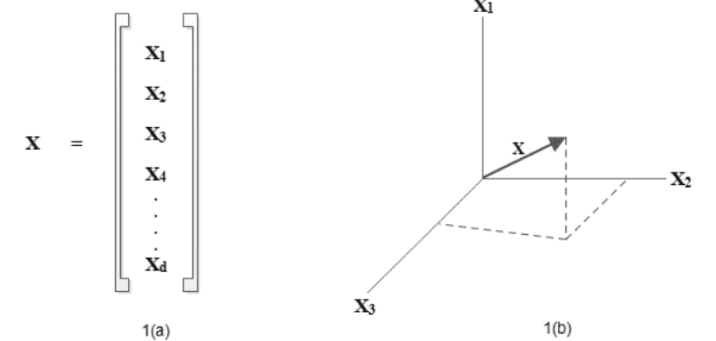

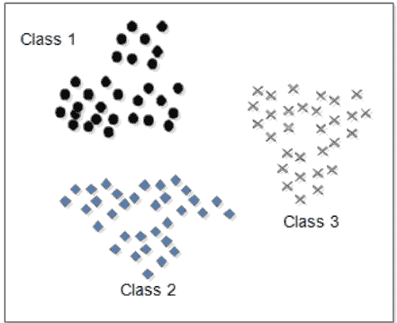

图 1.1 (a)-(c)：模式表示、向量的维度空间以及不同类别的模式。

图 1.1(a)—(c) 表示大小为 d 的向量、向量的维度空间以及模式类别。

## 模式分析

这是模式识别的一个阶段，利用数据中现有的知识，通过数据分析技术发现模式。模式分析处理来自同一来源的数据中模式的自动检测，并对来自该来源的数据进行预测。来自该来源的信息可以是任何形式，例如文本、图像、家谱、商业交易记录等。

从有限数据集中识别模式面临着非常独特且不同的挑战。因此，为了设计有效的模式分析算法，应考虑以下三个关键特性。

## 鲁棒性

设计有效的模式分析算法的第一个挑战是：在实时应用中，由于无线信道的随机性或人为错误，数据可能会被噪声破坏。因此，在设计算法时，必须牢记算法必须能够识别近似模式，并能平稳处理噪声数据，以免影响模式或数据分析技术的输出。具有此属性的算法被认为是鲁棒的。

## 计算效率

随着数据量与日俱增，设计的算法必须能够处理更大的数据集，因为数据随时间呈指数级增长。因此，如果算法对小对象工作良好，它也应该对大数据集工作良好。基本上，计算高效的算法是指其资源规模随数据大小的增加呈多项式增长的算法。

## 统计能力

这是算法应具备的最基本属性，表明算法识别的模式是真实的，并与数据集属性具有偶然关系。我们可以这样定义此属性：如果将算法应用于来自同一来源的新数据，它应能识别相似类型的模式。因此，算法的输出应对数据源敏感，而非对特定数据集敏感。所以，如果算法仅对特定数据集敏感，可以简称为稳定；如果算法从来自同一来源的所有数据集中得出相似类型的模式，则该算法可以称为统计稳定。

## 模式类别

模式类别可以定义为一组可能不完全相同的相似对象的集合。一个类包含典型示例、原型、范式以及学习/训练样本。图 1.2 表示不同类型的类变异性：

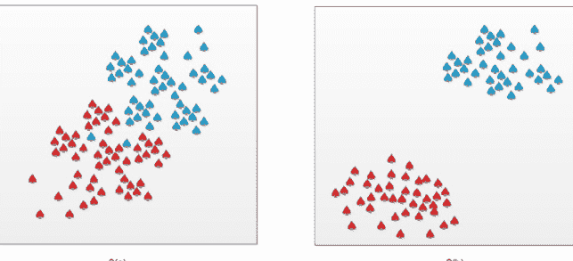

图 1.2 (a)：类间低变异性和类内高变异性。(b) 类内低变异性和类间高变异性。

模式类中存在以下两种变异性和一种相似性：

- 类内变异性
- 类间变异性

机器学习算法必须处理这些变异性和相似性。

## 类内变异性

它指的是特定对象在特定类别得分中的偏差，不属于系统性差异的一部分。基本上，它是类内变异性。它可用于映射不同类型的对象。如果谈到土地覆盖物，则裸土、森林和岩石可以使用类内变异性进行映射。它是用于机器学习的特定类别所有样本之间存在的变异。

类内变异性使用名为**特征空间**的工具，通过光谱签名根据特征预测模式。因此，根据具体要求，可以选择合适的特征空间。

## 类间变异性

类间变异性是指数据集中不同类别之间的变异性。当需要分离数据集中存在的不同类别时，可以使用它。此外，对象分类的准确性取决于类间变异性。*图 1.2(a)* 表示具有低类间和高类内变异性的模式，而*图 1.2(b)* 表示具有低类内和高类间变异性的模式。对于理想的聚类算法，类内变异性应最小，而类间变异性应最大。这是获得不同模式类别的重要标准。在分类中，存在标记数据集，因此类间和类内变异性在监督学习中不存在。类间和类内变异性取决于距离度量。

## 类间相似性

在类间相似性中，数据相似，彼此几乎最近且属于同一簇。结果计算为总距离之和与数据集中一个簇内所有距离之和的比值。类间相似性可以在*图 1.3*中看到：

| 0D | I1 |
|---|---|
| B8 | 2Z |

图 1.3：类间相似性

如果观察 I1，I 和 1 看起来相似，但实际上是不同的。这里，I 代表字母，1 代表数字。因此，这显示了类间相似性。类间相似性显示了与其他类别的相似性。

## 模式分析任务

在讨论数据中模式的重要性时，模式分析的主要目标是将数据特征作为其他特征值的函数进行频繁预测。因此，预计与模式分析相关的任务会隔离一个共同特征，即其预测意图。训练数据以 (X, Y) 的形式到达，其中 X 是称为向量的特征集，表示为 X= { x'1, x'2,... x'n}。需要一个函数 f' 来根据特征集 X' 预测类别标签 Y'。基本上，模式分析任务有三种类型：监督、半监督和无监督任务。我们将详细讨论所有这些类型的任务。

## 模式分类—监督任务

监督任务是每个输出都带有内置标签的模式分析任务。对于这类任务，可以寻找以下形式的模式：

```
f(x, y) = L(y, g(x))
```

其中 L 表示损失函数，g 是预测函数。它给出了真实值 y 与预测函数输出之间的差异，因此在检测模式时，预期损失为零。图 1.4 显示了使用特征提取进行分类的过程：


## Figure 1.4: 模式分类

例如，如果我们将标签设置为 Y = 野生动物，即一个类，那么特征集为 X = {Canines, stripes, carnivores}。如果某个特定对象，例如老虎，具有这些特征，那么我们的预测算法 f 会预测该对象老虎属于 Y。图 1.4 描绘了模式分类过程，其中 X 表示特征向量。

## 模式聚类 - 无监督任务

无监督任务没有标签。这类任务仅提供训练数据，而标签应针对测试数据的使用进行预测。基本上，用于无监督任务的两种方法称为聚类分析和主成分分析。聚类分析是机器学习的一个分支，用于对未标记或未分类的数据进行分组。

聚类分析用于对具有其他属性的数据集进行分组的无监督任务。聚类分析识别当前数据样本中的共同特征，然后根据来自同一数据源的新数据中是否存在此类共同实体，进一步做出反应。

## 半监督任务

在半监督任务中，特定标签或特征是部分已知的。例如，考虑一个排序的情况，我们仅在训练集中具有相对顺序。但我们的目标是提供来自同一来源的新数据的相同顺序。对于这类问题，假设一个值函数，并在训练数据过程中对其值提出建议。因此，使用值函数的输出来评估来自同一来源的新数据。

在另一种情况下，可能存在一种传导情况，其中关于标签的部分信息已存在。在这种情况下，仅部分数据带有内置标签到达，因此任务变为预测未标记数据的标签。这里的主要目标是结合查询成本和泛化误差。

## 机器学习中的数据及其类型

数据可以定义为相对于定量或定性变量的一组值。如今，几乎一切都可以表示为数据。了解不同的数据类型对于机器学习模型至关重要。从机器学习的角度来看，数据大体上可分为以下四种基本类型：

- 1. 数值数据
- 2. 文本数据
- 3. 时间序列数据
- 4. 类别数据

图 1.5 显示了机器学习中使用的不同类型的数据集：

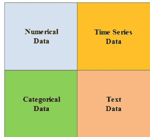

**图 1.5：** 数据类型

### 数值数据

数值数据是数据点为数值的一种数据类型。它也可称为定量数据。例如，上个月售出的汽车数量。数值数据可分为离散数据或连续数据。离散数据是一组不同的值，而连续数据是指定范围内的任何值。例如，学生的分数为 10、20、30、40、50 和 60。那么，这被称为 0 到 100 范围内的数值数据。

### 时间序列数据

时间序列数据可定义为在固定时间间隔内收集的一系列数字。它在金融领域有应用。时间序列上附带有一个时间值。因此，它可以是类似于作为时间趋势出现的时间戳的东西。例如，每月测量一次环境传感器数据是时间序列数据。数值数据与时间序列数据的区别在于，时间序列遵循隐含的顺序，而数值数据可能由一组值组成，但没有任何顺序序列。

### 文本数据

基本上，单词就是文本数据。在使用机器学习技术时，我们使用适当的函数（如单词构建函数 word2vec）将单词转换为数字。例如，阅读本书时，你实际阅读的就是文本数据。

### 类别数据

类别数据是由大量标签值而非数值组成的一组变量。在类别数据中，值的总数由固定集合表示。

类别变量也可称为名称。例如：

- 颜色变量包含：绿色、蓝色、红色
- 宠物变量包含：猫、狗
- T恤尺寸：S、M、L 和 XL

图 1.6 显示了类别数据的柱状图：

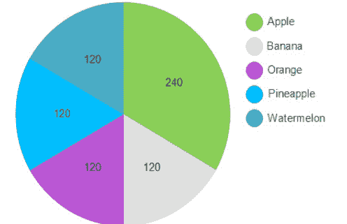

图 1.6: 类别数据表示

图 1.6 显示了类别数据的柱状图，其中水果类别分为五个类别，例如苹果、香蕉等，并显示了每种水果的数量。在这里，每个值代表一个不同的类别。

### 类别数据的问题

某些机器学习算法可很好地处理类别数据。例如，使用决策树算法（如基于信息增益的分割理论）适合直接从类别数据中学习，无需执行任何数据转换。但是，许多机器学习算法无法处理标记数据，因为它们要求所有输入和输出变量均为数值状态。

这可以被视为基于聚类的算法的约束，因此类别数据必须转换为数值数据。此外，如果输出变量是类别数据，则需要将预测转换为类别形式，以便可用于特定类型的应用。

因此，现在出现了如何将类别数据转换为数值数据的问题。

将类别数据转换为数值数据可以使用以下编码技术：

- 整数编码
- 独热编码

这两种技术将分别如下说明。

### 整数编码

整数编码是将类别数据转换为数值数据的第一步。在此过程中，每个唯一对象或类别被分配一个不同于其他类别的值。例如，我们有三个对象，即苹果、香蕉和橙子。表 1.1 展示了整数编码的示例：

| Class | Number |
|-------|--------|
| Apple | 1 |
| Banana | 2 |
| Orange | 3 |

表 1.1: 整数编码

整数编码可以轻松逆转，即 1 → 苹果，2 → 香蕉，3 → 橙子。

整数编码的优势在于，整数值之间具有数值排序关系，机器学习算法可以轻松理解。

### 独热编码

在机器学习中，独热编码包括一组位，这些位使用唯一的 1 位表示来表示唯一类别（高/开启），其余位的值为 0（低/关闭）。它用于多类分类。除此之外，数据中仅存在一个单个 0 位而其余位均为 1 的表示称为单冷编码。表 1.2 表示 0 到 9 的数字的独热和二进制表示：

| Number | Binary representation | One-hot representation |
|---|---|---|
| 0 | 0000 | 0000000001 |
| 1 | 0001 | 0000000010 |
| 2 | 0010 | 0000000100 |
| 3 | 0011 | 0000001000 |
| 4 | 0100 | 0000010000 |
| 5 | 0101 | 0000100000 |
| 6 | 0110 | 0001000000 |
| 7 | 0111 | 0010000000 |
| 8 | 1000 | 0100000000 |
| 9 | 1001 | 1000000000 |

表 1.2: 二进制和独热表示

独热编码通常用于表示状态机的不同状态。此外，在二进制或格雷码中，解码器有助于确定机器的状态。但在独热状态机的情况下，不需要解码器。

表 1.3 表示标签编码方法，其中对象按类别划分；例如，苹果被标记为类别 1：

| Fruit name | Categorical | Calories |
|---|---|---|
| Apple | 1 | 95 |
| Banana | 2 | 70 |
| Orange | 3 | 65 |

表 1.3: 标签编码


表 1.4 表示独热编码，其中每个对象只有一个单个 1 位（高电平）。

| 苹果 | 香蕉 | 橙子 | 卡路里 |
|---|---|---|---|
| 1 | 0 | 0 | 95 |
| 0 | 1 | 0 | 70 |
| 0 | 0 | 1 | 65 |

## 机器学习特征集

在模式识别和机器学习中，特征可以定义为现象的可计算特征或属性。选择有效、信息丰富且具有区分度的特征在分类、回归和模式识别中起着重要作用。不同类型的特征将如下讨论。

### 手工特征

手工特征是指用于不同算法的派生属性，其中数据本身存在于图像中。例如，边缘和角是可以从图像中提取的两种简单特征。基于微分（变化率）的简单边缘检测算法（如拉普拉斯算法）通过确定图像中强度快速变化的区域来工作。

要用简单的语言来理解，我们知道通常的图像只不过是一个 2D 矩阵（当存在多个通道（如 RGB（**红色、绿色和蓝色**）时，则为多个矩阵）。图 1.7 表示灰度图像，强度值范围为 0 到 255：

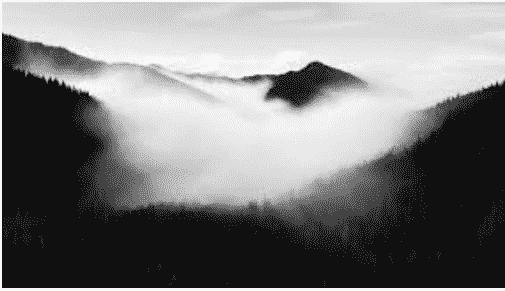

**图 1.7：灰度图像**

在灰度图像（8 位）（或黑白图像）的情况下，图像通常是一个二维矩阵，像素值范围从 0 到 255，其中 255 表示完全白色，0 表示完全黑色，0 到 255 的范围表示灰度图像，如图 1.7 所示。

### 时空特征

时空特征捕捉视频中的独特形状。它提供了一种自确定的事件表示，这些事件随时间在场景中不同类型的运动中发生。时空特征通常直接从视频中提取，避免了跟踪和运动分割等预处理技术可能出现的故障。

因此，运动和空间特征在有限时间间隔内结合，形成时空特征。此类特征通常用于人体动作识别系统，如图 1.8 所示：

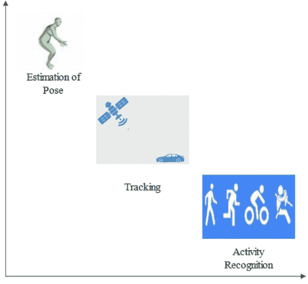

图 1.8：时空特征的应用

### 区分特征

区分特征主要用于人脸识别，如图 1.9 所示：

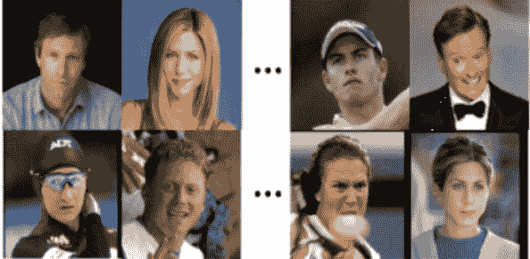

图 1.9：人脸图像

当特征学习应用于这些图像时，它们输出为区分特征。图 1.10 显示了由身高和时间等参数组成的数据集的区分特征：

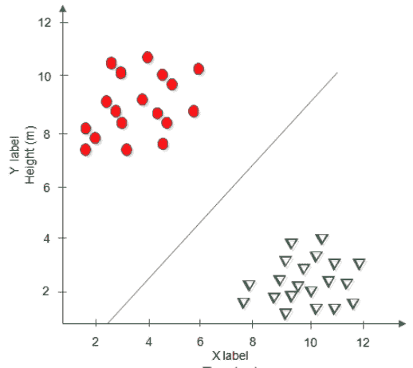

图 1.10：区分特征

## 人工智能

在计算机科学中，人工智能也称为机器智能。它是机器展现的智能，例如人类展现自然智能。AI 包括推理、自校正和学习的过程。它可以分为强 AI 和弱 AI。强 AI 也称为通用人工智能，基本上是一个包含全面人类认知能力的 AI 系统。这种 AI 系统可以在没有人类干预的情况下找到解决方案，即使面对不熟悉的任务。此外，弱 AI（又称狭义 AI）是针对特定任务训练和设计的 AI 系统。

例如，Siri（Apple 的虚拟个人助理）被认为是弱 AI。图 1.11 表示 AI 的图像：


## 机器学习及其目标

机器学习可以定义为对统计模型和算法的科学研究，计算机系统利用它们在不使用明确指令的情况下执行特定任务。因此，它依赖于推理和模式。它可以被视为人工智能（AI）的一个子集。良好的泛化能力是机器学习算法的主要目标。

以下是机器学习算法的目标：

- 回归
- 二元和多分类
- 聚类
- 推荐系统
- 监督和非监督异常检测

这些将如下说明：

### 回归

回归是一个优雅的词，用来描述模型会将连续值（响应）分配给数据观测值，而不是离散类。我们将在即将到来的章节中详细讨论回归。

### 分类

与分类相关的问题涉及将数据点插入预定义的类别中。在某些情况下，分类问题执行将类分配给观测值，而在其他情况下，主要目标是预测观测值（针对给定类别）的可能性。我们将在分类章节中进一步详细讨论分类。

图 1.12 表示基于不同场景的分类：

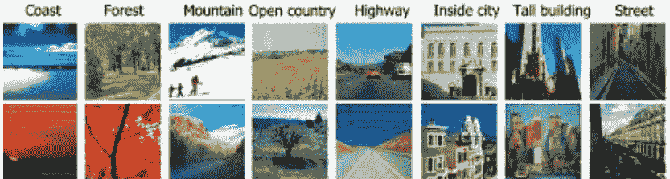

图 1.12：基于不同场景的图像分类

### 聚类

聚类被定义为一种非监督技术，用于确定给定数据集的对齐和组织。它是将信息收集到簇或组中的一种方法。每个簇由一个封闭的数据点集和簇的中心点组成。簇的中心点是所有数据点的平均值。我们将在聚类章节中详细讨论这一点。

图 1.13 显示了基于场景且无任何标签的图像聚类示例：


图 1.13：基于场景的图像聚类示例。

图 1.12 包含各种标签，而图 1.13 不包含任何标签。这正是监督学习（分类）和非监督学习（聚类）之间的准确区别。在监督学习的情况下，我们有关于待分类新对象的标签的先验知识，但在非监督学习的情况下，我们没有任何标签的先验知识。我们必须基于类间、类内变异性和类间相似性自己分配标签。

考虑图 1.13，尝试将场景聚类为世界七大奇迹的簇。

### 推荐系统

另一种可以解决的问题是推荐系统，也称为推荐引擎。这些系统是一种数据过滤系统，它们为不同类型的应用提供推荐，例如书籍、产品、文章、餐厅、音乐、电影等。在推荐系统中，两种常见的方法是协同过滤和基于内容的过滤。

推荐系统的使用在 Amazon 和 Netflix 上很常见。Netflix 制作推荐系统以让观众保持忙碌，并意图提供大量内容供观看。因此，为了让用户继续观看 Netflix，他们提供此类推荐，例如"Alex 首选"、"因为您观看了..." 和"为您推荐"。

Amazon 也做同样的事情，以通过追加销售增加销售额、通过用户参与度维持销售等等。他们提供诸如"与您浏览的商品相关"、"购买此商品的顾客也购买了"和"更多值得考虑的商品"等推荐。

### 异常检测

另一种问题是异常检测。我们认为来自特定来源的数据是合理且行为良好的，但实际上大多数情况并非如此。有时，由于测量中的错误或故障以及欺诈，会存在无关数据。有时，这可能是由于异常测量，揭示了劣化的电子元件或硬件。

异常有时甚至可能表示真正的问题，且不易描述。例如，考虑制造缺陷。在这种情况下，异常检测提供了一定程度的质量控制，并有助于了解为最大限度减少缺陷所采取的步骤是否实际上已起作用。在这两种情况下，确定异常值可能会有所帮助，并且可以在这些情况下仔细应用特定的机器学习算法。

## 机器学习技术

机器学习技术分为两种广泛的学习技术，即深度学习和浅层学习，机器学习的两种技术的进一步分类如图 1.14 所示：


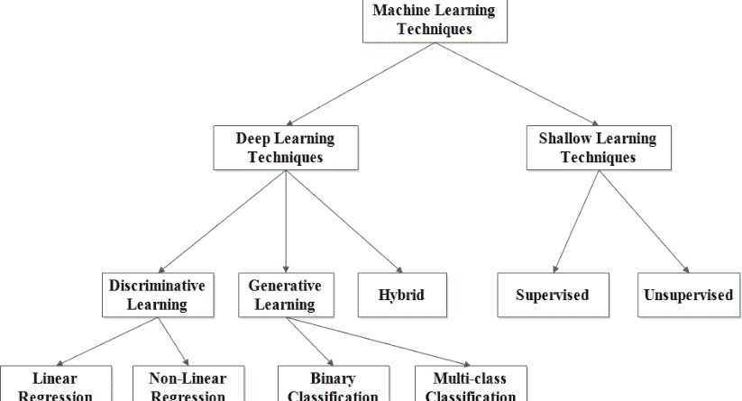

图 1.14: 机器学习技术的类型

以下将讨论所有这些不同类型的机器学习技术。

## 深度学习技术

深度学习是机器学习的一个分支，由神经网络组成，这些网络可以自动训练分类器以用于分类。当我们面临多类分类问题时，它非常有用。深度学习也可以称为深度神经网络或深度神经学习。图 1.15 显示了构成神经网络的神经元隐藏层：

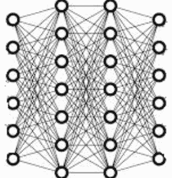

图 1.15: 神经网络

现在，让我们讨论不同类型的机器学习技术。

### 判别式学习技术

使用**判别模型**时，如果要为给定对象 D 预测标签 Cᵢ，则根据朴素贝叶斯定理：

P(A|B) = \frac{P(B|A)P(A)}{P(B)} \quad (1.1)

其中 P(A) 是事件 A 发生的概率。P(B) 是事件 B 发生的概率。P(B | A) 是在事件 A 已发生的条件下事件 B 发生的概率。P(A | B) 是在事件 B 已发生的条件下事件 A 发生的概率。

**示例 2：** 我们想找出如果患者是酒鬼，其患癌症的概率。**ABC** 是用于诊断癌症的测试。

- A 表示事件 *患者患有癌症*。以往数据告诉我们，来诊所的患者中有 10% 患有癌症。P(A) = 0.2。
- B 表示试纸测试事件 *患者是酒鬼*；诊所中有 5% 的患者是酒鬼。P(B) = 0.08。
- 总体而言，在被诊断患有肝病的患者中，有 7% 是酒鬼。这是 B | A：在患者患有癌症的条件下，患者是酒鬼的概率是 5%。

应用朴素贝叶斯定理，我们得到，

P(A | B) = (0.05 * 0.2)/0.08 = 0.125。

因此，如果患者是酒鬼，则其患癌症的概率为 12.5%。

设 "Cᵢ 表示标签/类，d 表示对象。因此，通过应用朴素贝叶斯定理，我们得到对象 d 是否属于特定类 Cᵢ。

P(Cᵢ|d) = \frac{P(d|Cᵢ)P(Cᵢ)}{P(d)} \quad (1.2)

其中

- P(Cᵢ) = 假设 Cᵢ 的概率。
- P(d) = 对象 d 的概率
- P(d|Cᵢ) = 在 Cᵢ 的条件下 d 出现的概率。
- P(Cᵢ|d) = 在 d 的条件下 Cᵢ 出现的概率。

通常情况下，给定训练数据集，我们需要最可能的标签。因此，在这种情况下，最大后验（MAP）标签函数写作如下：

```
$f(y) = arg[max_z (p(\frac{d}{c_t}))]$ (1.3)
```

我们可以将判别式学习技术分为以下两部分：

- 1. 线性回归
- 2. 逻辑回归

这两种回归将在下一节中讨论。

### 回归的类型

基于监督学习的问题分为两部分：(i) 回归和 (ii) 分类。两者都可用于构建简洁模型，该模型可以使用属性变量并找到因变量的值。

当输入变量是连续值或实值时，该问题被称为回归问题。例如，体重、薪水等等。

回归有多种模型。图 1.16 显示了回归模型的类型：

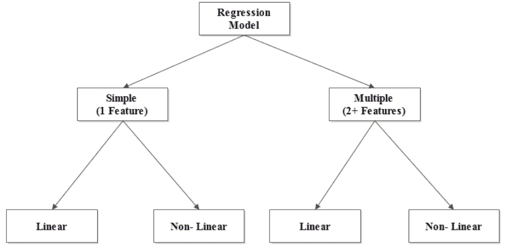

图 1.16: 回归模型的类型

为了正确理解回归，让我们考虑以下示例。

**示例 3：** 这里给出了四句话。我们需要识别哪一个是回归任务：

- 预测你朋友的年龄
- 预测你朋友的体重
- 预测人的国籍
- 预测明天股市是否会上涨

你有什么猜测吗？那么，让我们现在讨论这四句话。预测人的年龄和体重是回归任务的一种，因为它们是实值，而预测国籍属于分类任务，股市变化是离散值，例如是或否。

**示例 4：** 这里给出了四句话。我们需要识别哪一个是回归任务，哪一个是分类任务：

- 预测人的身高
- 根据其笔迹预测人的性别
- 预测人的 BMI
- 预测人的国籍

预测身高和 BMI 是回归任务，而预测人的性别和国籍是分类任务。

### 线性回归

线性回归是一种使用最合适超平面拟合信息的回归类型。它可以定义为一种用于建模自变量与因变量之间关系的线性方法。_图 1.17_ 显示了使用线性回归得到的模式：

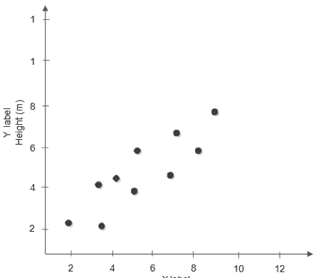

图 1.17: 线性回归

> 请参阅第 9 章以详细了解超平面。

## 函数逼近

机器学习的统计和几何方法与数学中的函数逼近方法相关。作为示例，假设我们有一个基于分类的学习任务。因此，我们要确定对宇宙中对象进行分组的可能方法。在图 1.18 中，我们展示了属于任何两个类或 。的对象宇宙：

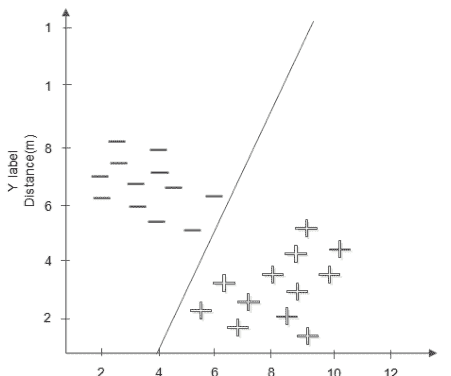

图 1.18: 两类中的线性判别（）

使用函数逼近过程，我们可以描述一个将各种对象划分为不同区域的曲面。直线和线性回归方法是最简单的函数逼近方法之一。

### 逻辑回归

逻辑回归是一种广义线性回归模型。它是一种用于机器学习统计的方法，并定义为一种可用于与分类相关的问题的机器学习算法。它是一种基于概率概念的分析方法。当因变量为二元变量时，它是效果最佳的回归分析。与其他回归分析方法类似，逻辑回归可以基于预测分析。它用于定义数据，以及寻找二元变量与一个或多个不显著的、间隔的、有序的自变量之间的关联，等等。

它基本上是一种分类方法，可用于将观察值分配为离散集的类别。例如，收到的电子邮件是否为垃圾邮件、在线交易是否为欺诈、肿瘤是良性还是恶性，等等。因此，基本上，逻辑回归通过使用 sigmoid 函数将其输出转换为返回值“0”或“1”，即二元分类。

为了更好地理解线性回归，让我们考虑一个示例。

**示例 5：** 我们有 XYZ 银行的信用卡违约数据，想知道客户当前的信用卡余额是否表明该客户在近期会或不会在信用卡上违约。为了将客户分类为低风险或高风险违约者，我们可以基于其当前余额定义一个线性回归模型。但是，如果你观察图 1.19(a)，当余额小于 5,000 时，线性模型预测概率为负值；当余额大于 20,000 时，模型预测概率值大于 1。在此，基于线性模型的预测是不合理的，因为概率值必须介于 0 和 1 之间。现在，你观察到在图 1.19(b) 中，逻辑回归线是一条 sigmoid 曲线，概率值介于 0 和 1 之间。因此，对于这个示例，逻辑回归模型比线性回归模型效果更好。

*图 1.19 (a)–(b) 显示了线性回归和逻辑回归中观察到的模式之间的差异：*


逻辑回归假设倾向于将逻辑函数的代价函数限制在 0 到 1 之间。因此，线性函数无法进行描述，因为它们的值可能大于 1，有时甚至小于 0。

```
0 \le h_\theta(x) \le 1
```

上述方程表示逻辑回归假设的期望。

## Sigmoid 函数

我们使用 Sigmoid 函数将预测值映射为概率。该函数可以将任何类型的实值转换或映射为介于 0 和 1 之间的另一个值。在机器学习中，我们使用 Sigmoid 函数将得到的预测值映射为概率。图 1.20 显示了 Sigmoid 函数的曲线：

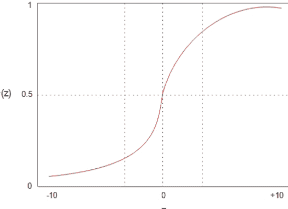

图 1.20：Sigmoid 函数

Sigmoid 函数可表示如下：

```
$\sigma(z) = \frac{1}{1+e^{-z}}$ (1.5)
```

其中 z 是 Sigmoid 函数发生变化的值。

## 逻辑回归的假设表示

逻辑回归模型可定义如下：

```
$Z = \beta_a + \beta_b X$ (1.6)
```

其中 X 是一个自变量，Z 是观察到的因变量，β_a 和 β_b 是两个参数。逻辑回归的假设表示是 Z 的 Sigmoid 函数。

```
$h_\varphi(x) = \sigma(Z) = Sigmoid (Z)$ (1.7)
```

即，

$h_\varphi(x) = \frac{1}{1+e^{-(\beta_a + \beta_b x)}}$ (1.8)

上述方程表示逻辑回归的假设。

## 决策边界

由于我们希望分类器根据概率输出一组类别，因此每当使用预测函数向分类器提供输入时，分类器必须返回介于 0 和 1 之间的概率值。

因此，现在要将其映射到离散类别（a = 家养动物 / b = 野生动物，真 / 假），我们选择一个阈值，例如 0.5。因此，高于 0.5 时，我们将值分类为类别“a = 家养动物”，低于 0.5 时，我们将值分类为类别“b = 野生动物”。

例如，如果您观察图 1.21，当 y = 0.7 时，我们将其分类为正值；当 y = 0.2 时，我们将其分类为负值：

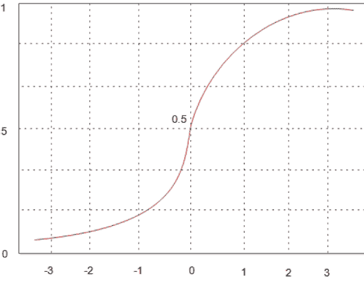

图 1.21：决策边界

逻辑回归分为两种类型：

- 二元逻辑回归
- 多类逻辑回归

## 二元逻辑回归

二元或二项逻辑回归处理的是因变量的检测结果只能为两种值（1 或 0）的情况。例如，存活 versus 死亡 或 失败 versus 获胜。在二元逻辑回归中，输出被编码为 0 或 1。因此，这意味着所进行的回归是一种直截了当的解释。这种回归可用于基于预测器（即自变量）的观察值来预测某个病例的几率。

## 多类逻辑回归

多类逻辑回归处理的是输出可能超过两种类型且不在有序序列中的情况。它通过多个二元逻辑回归的组合来比较多个组。

例如，假设我们想要研究学士、硕士和博士学生之间行为的差异。多类逻辑回归将学士学生与硕士和博士学生进行比较，同样也会将硕士学生与学士和博士学生进行比较。对于每个独立类别，至少会进行两次比较。

更多示例如下：

- 人的本性（粗鲁、内向和谦逊）
- 花的颜色（绿色、黄色和红色）

## 代价函数

在线性回归中，代价函数表示被优化的目标函数；也就是说，在线性回归的情况下，我们首先定义一个代价函数，然后将其最小化，以开发出错误率最低的模型。

图 1.22 表示使用逻辑回归进行代价函数估计的相应图表：

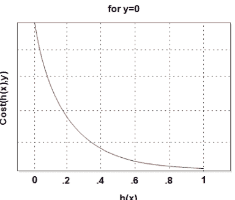

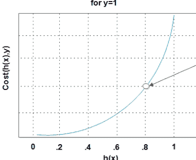

图 1.22：逻辑回归的代价函数

在逻辑回归的情况下，代价函数定义为负对数似然或二元交叉熵函数，记为 Cost(h_φ(x), y)，其方程如下：

```
Cost(h_φ(x), y) = {
  -log(1 - h_φ(x))   if y = 0
  -log(h_φ(x))       if y = 1
} (1.9)

where h_φ(x) = 1 / (1 + e^-(β_a + β_b x))
```

如从图 1.22 观察到，y = 1 时代价函数的值可以通过 h_φ(x) = 0.8 的值来确定。

因此，对于此场景，代价函数写作如下：

Cost(0.8, 1) = -log(0.8)

因此，通过求解上述方程，我们得到

-log(0.8) = 0.096

上述两个代价函数被重写为单个代价函数如下：

Cost(h_φ(x), y) = -y log(h_φ(x)) - (1 - y) log(1 - h_φ(x))

## 非线性回归

非线性回归是一种回归分析形式，其中数据使用具有模型参数非线性组合的函数进行建模。该函数包含一个或多个自变量。在这种回归类型中，数据通过逐次逼近方法进行拟合。

非线性回归的统计模型如下：

b ~ f(a, β)

其中 a 是自变量向量，b 表示观察到的因变量集合。β 是函数 f 为非线性的参数集合。

让我们以酶动力学中的 Michaelis–Menten 模型为例。

f(a, β) = β1 a / (β2 + a)

该模型具有一个自变量 a 和两个参数 β1 和 β2。该函数是非线性的，因为它无法由两个 β 的线性组合来表示。

## 线性可分和非线性可分数据

为了更好地理解可能可分的数据，让我们考虑由蓝色和红色表示的两个类。如果有一条直线可以将蓝色点和红色点彼此区分开，则该数据集是线性可分的。

图 1.23 表示数据集的线性可分数据：

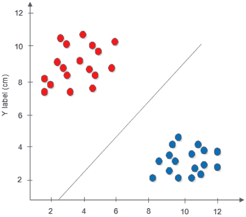

图 1.23：线性可分数据

图 1.24 表示非线性可分数据，如下所示：

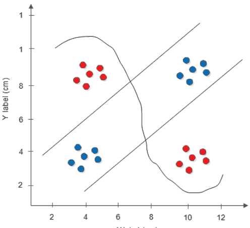

图 1.24：线性不可分数据

## 单个神经元的数学定义

逻辑回归本身就是一个神经元，如图 1.25 所示。可以使用多个逻辑回归构建多个神经元。我们还可以通过将分隔符视为单个线性函数，代数方法定义线性可分数据，即如果输入为 ($x_1, x_2, x_3$)。那么，分隔符是一个如下所示的函数：

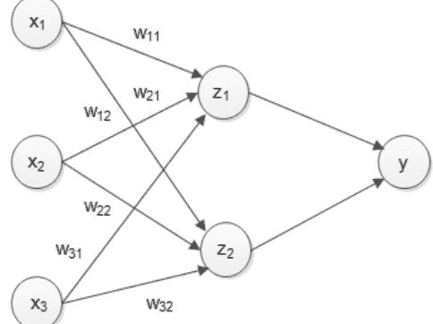

图 1.25：多类对象构建神经网络

```
$z_1 = w_{11} * x_1 + w_{21} * x_2 + w_{31} * x_3$ (1.15)
$z_2 = w_{12} * x_1 + w_{22} * x_2 + w_{32} * x_3$ (1.16)
$y = z_1 + z_2 + b$ (1.17)
```

其中 w11、w21、w31、w12、w22、w32 是权重，b 是关联的偏置值。

## 生成式学习

生成式学习技术通过构建正值和负值的单独模型来工作。我们可以将生成式学习技术视为类的蓝图模型。要创建这类模型，生成式学习方法使用联合概率分布。分类是一种生成式学习技术，将如下讨论。

## 分类

分类可以定义为一种受监督的学习方法，在其中系统从提供给它的输入数据（标签）中学习，然后使用它来对新对象进行分类。分类的类型可以是二元或多类分类。


现实世界中的一些分类问题包括生物特征识别、手写识别、语音识别、文档分类、语音识别等。图 1.26 显示了使用特征向量 X 的静态模式分类。它由训练阶段和测试阶段等阶段组成。在训练阶段，通过使用特征提取方法从图像中提取多个特征来训练分类器。此外，在测试阶段，分类器将类别标签“老虎”分配给输入图像：

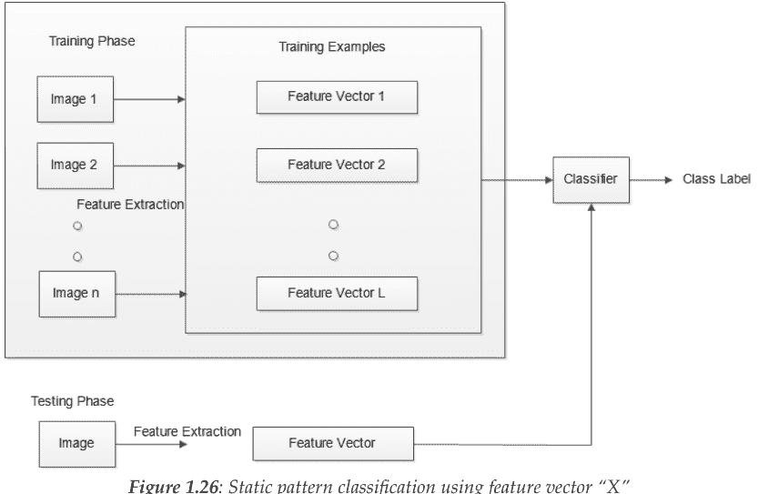

文献中不同类型的分类算法如下：

- 最近邻
- 决策树
- 线性分类器
- 随机森林
- 支持向量机
- 神经网络
- 提升树

受监督任务的分类如下：

- 二分类
- 多类分类

## 分类

图 1.27 显示了二分类和多类分类所观察模式之间的区别：

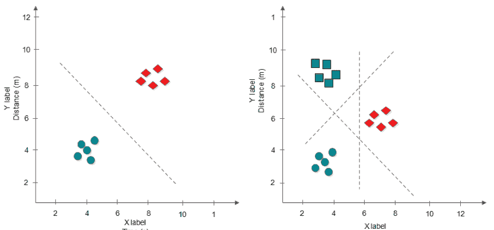

图 1.27：二分类和多类分类

表 1.5 显示了二分类和多类分类之间的比较：

| 序号 | 参数 | 二分类 | 多类分类 |
|---|---|---|---|
| 1 | 学习技术 | 受监督 | 受监督 |
| 2 | 目标变量的特征 | 仅存在两个类别或目标类别，因此目标变量最多可取两个分类值。 | 存在多个类别或目标类别，因此目标变量可取多个分类值中的一个。 |
| 3 | 输出变量的性质 | 离散 | 离散 |
| 4 | 示例 | 单一医疗状况的医疗诊断（患病 vs 未患病）。 | 在手写字母识别中，类别数量为 26。 |
| 5 | 编码 | 整数编码，独热编码 | 独热编码 |

表 1.5：二分类与多类分类

与二分类相关的问题涉及通过识别相关特征的值，将任何对象分配给一个类别。例如，考虑系统需要识别某人的医疗状况（例如疾病症状是否存在）以诊断疾病的情况。因此，只有两种情况，即疾病存在或不存在。所以，基本上，二分类中只有两个类别。

## 多类分类

在模式识别的许多实时应用中，可能存在两个以上的类别，例如 c₁ c₂... cₙ。这种分类称为多类分类。例如，根据 MNIST 数据集，类别数为 0 到 9。多类分类说明每个部分只分配一个标签。图 1.27 描绘了二分类和多类分类之间观察到的模式差异。

现在，让我们做一个练习。这里给出了三个问题。你需要识别哪些是分类问题类型。

- 基于面积预测房屋成本
- 预测明年股市涨幅
- 预测明天德里的天气。有什么猜测吗？

天气预测属于分类问题。图 1.28 描绘了不同动物的多类图像分类：

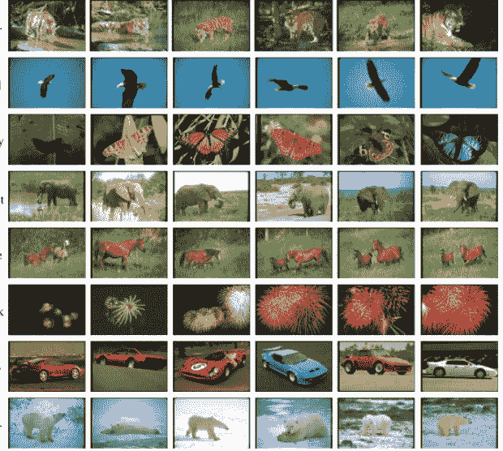

图 1.28：多类图像分类

## 决策树

决策树是一种分类方法，其结果以类似树状结构的流程图形式给出，其中树的分支表示结果，节点表示属性的值。类别由树节点表示。

让我们举一个例子，我们需要根据属性对猫、麻雀和蝙蝠进行分类。图 1.29 显示了我们示例的决策树：

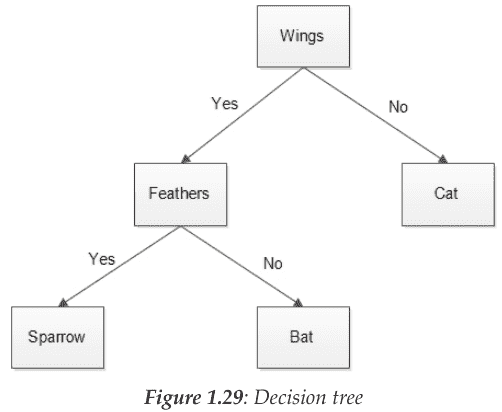

## ID3 算法

构建决策树的主要算法是 ID3。它遵循贪心、自上而下的搜索方法遍历可能的分支。它使用熵和信息增益来构建决策树。

## 熵

熵定义为数据集无序性、不确定性或不纯度的度量。它控制数据分割的决策。ID3 算法使用熵来确定样本的同质性。在数学上，熵可以表示如下：

```
E(S) = \sum_{j=1}^n -P_j log_2 P_j	(1.18)
```

其中 P_j 是数据集中类 j 的概率。

## 信息增益

信息增益是特征关于类别所提供的信息的度量。它用于构建决策树。决策树算法最大化信息增益。它基于数据集分割后熵的减少。X 对 Y 的信息增益表示如下。表 1.6 表示包含各种产品类型的训练数据集：

```
I(Y, X) = E(Y) - E(Y|X)
```

其中 ’E(Y|X)’ 是给定 X 时 Y 的熵。

## 示例：

| YOP（生产年份） | 市场竞争 | 类型 | 盈利/亏损 |
| :--- | :--- | :--- | :--- |
| YOP < 2010 | 是 | 类型 A | 亏损 |
| YOP < 2010 | 否 | 类型 A | 亏损 |
| YOP < 2010 | 否 | 类型 B | 亏损 |
| 2010 < YOP < 2015 | 是 | 类型 A | 亏损 |
| 2010 < YOP < 2015 | 是 | 类型 B | 亏损 |
| 2010 < YOP < 2015 | 否 | 类型 B | 盈利 |
| 2010 < YOP < 2015 | 否 | 类型 A | 盈利 |
| YOP > 2015 | 是 | 类型 A | 盈利 |
| YOP > 2015 | 否 | 类型 B | 盈利 |
| YOP > 2015 | 否 | 类型 A | 盈利 |

表 1.6：产品类型数据

在这里，利润是类属性，因为它描述了产品是否盈利。这里，P 是获得盈利的可能性，N 是获得亏损的可能性。这里，P = 5 且 N = 5。首先，计算类属性的熵。

```
Entropy(class) = \frac{-P}{P+N} log_2 \left(\frac{P}{P+N}\right) - \frac{N}{P+N} log_2 \left(\frac{N}{P+N}\right)
= \frac{-5}{5 + 5} log_2 \left(\frac{5}{5 + 5}\right) - \frac{5}{5 + 5} log_2 \frac{5}{5 + 5}
Entropy(class) = 1
```

现在要找到根节点，需确定每个属性的信息增益、熵和增益。

- YOP

信息增益：

```
I(P_i, N_i) = \frac{-P}{P+N} \log_2 \left(\frac{P}{P+N}\right) - \frac{N}{P+N} \log_2 \left(\frac{N}{P+N}\right)
```

| YOP | P_i | N_i | I(P_i, N_i) |
|---|---|---|---|
| YOP < 2010 | 0 | 3 | 0 |
| 2010 < YOP < 2015 | 2 | 2 | 1 |
| YOP > 2015 | 3 | 0 | 0 |

表 1.7：YOP 的信息增益

熵：

```
Entropy = \frac{\sum(P_i+N_i)}{P+N} I(P_i, N_i)
= \frac{0+3}{5+5}(0) + \frac{2+2}{5+5}(1) + \frac{3+0}{5+5}(0)
Entropy(Age) = 0.4
```

增益：

```
Gain(Age) = Entropy(class) - Entropy(Age)
Gain(Age) = 1 - 0.4 = 0.6
```

同样，为其他属性计算。

- 市场竞争

信息增益：

| 市场竞争 | P_i | N_i | I(P_i, N_i) |
|---|---|---|---|
| 是 | 1 | 3 | 0.8112 |
| 否 | 4 | 2 | 0.9182 |

表 1.8：市场竞争的信息增益

熵（市场竞争）= 0.875

增益（市场竞争）= 1 - 0.875 = 0.125

- 类型

信息增益：

| 类型 | P_i | N_i | I(P_i, N_i) |
|---|---|---|---|
| 类型 A | 3 | 3 | 1 |
| 类型 B | 2 | 2 | 1 |

表 1.9：产品类型的信息增益

熵（类型）= 1

增益（类型）= 1 - 1 = 0

现在，如果观察到 gain (YOP) = 0.6 大于其他两个属性的增益。因此，YOP 将成为根节点。现在，在 YOP 属性中，有三个值，它们将成为根节点的分支，如图 1.30 所示。

现在，观察表 1.6。对于所有 **YOP < 2010**，结果为 **亏损**，而对于所有 **YOP > 2015**，结果为 **盈利**，但对于 **2010 < YOP < 2015**，有两个亏损和两个盈利。图 1.30 显示了相同的决策树：

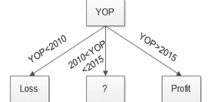

图 1.30：不完整的决策树。

因此，对于 2010 < YOP < 2015，再次创建一个表并从计算类属性熵开始重复相同的过程。表 1.10 显示了从 2010 年到 2015 年的筛选数据：

| YOP（生产年份） | 市场竞争 | 类型 | 盈利/亏损 |
|---|---|---|---|
| 2010 < YOP < 2015 | 是 | 类型 A | 亏损 |
| 2010 < YOP < 2015 | 是 | 类型 B | 亏损 |
| 2010 < YOP < 2015 | 否 | 类型 B | 盈利 |
| 2010 < YOP < 2015 | 否 | 类型 A | 盈利 |

表 1.10："2010<YOP<2015" 的数据


求解后，我们得到 Gain (Market competition) = 1 和 Gain (Type) = 0。因此，此处 Gain (Market competition) > Gain (Type)。因此，这次“市场理想”将成为根节点，如图 1.31 所示：

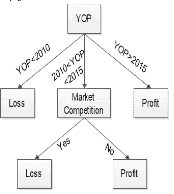

图 1.31：完整的决策树

## 聚类

它是一种无监督的学习方法。当一种学习方法需要从包含输入数据的给定数据集中推导出参考，但没有任何标记的响应时，该方法称为无监督学习。通常，它可以用作一个过程，以发现数据集示例集合中的表达结构、描述性底层过程、生殖特征和分组特征。

聚类是将数据点或人口划分为若干簇的过程，使得属于同一组的数据点与同一组的其他数据点更相似，与其他组的数据点更不相似。这本质上是基于其间相似性和不相似性的对象集合。

例如，图 1.32 显示了已聚类、已组成且可以归类为单一组的数据点：

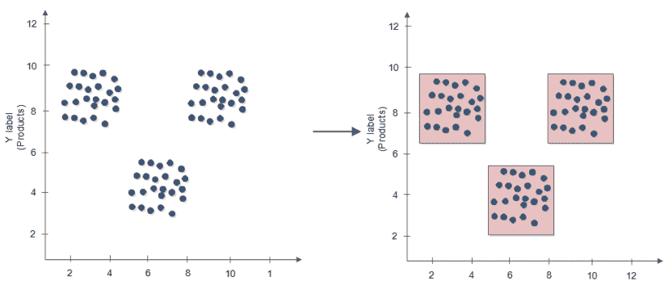

图 1.32：簇的分类

簇不必呈球形，如图 1.33 所示：

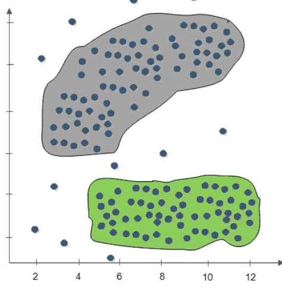

图 1.33：球形簇

## 聚类的必要性

聚类在确定无标签数据中存在的内在分组方面起着重要作用。簇没有特定的定义形状。这完全取决于用户及其需求。例如，用户希望找到数据缩减非均质分组的代表。因此，在给定的数据集中，会观察确定自然簇、其属性、适合且有用的分组，或异常值检测。

## 不同的聚类方法

以下是不同的聚类方法：

- 分区方法
- 层次方法
- 基于密度的方法
- 基于网格的方法

### 分区方法

分区方法将对象划分为K个簇，然后将每个分区视为一个对象。此技术用于优化相似度的客观度量函数。**基于随机搜索的K-means聚类大型应用(CLARANS)** 是分区聚类方法的一个示例。

### 层次方法

在这种方法中，基于层次结构，簇形成树状结构。此外，通过使用先前形成的簇，形成新的簇。示例：**基于层次结构的平衡迭代缩减聚类(BIRCH)** 和 **基于代表的聚类(CURE)**。它可以分为两类：

- 1. 分割（自上而下方法）
- 2. 聚合（自下而上方法）

我们将在下一节讨论这两种算法。

### 基于密度的方法

在这种方法中，簇被视为与空间中较高密度区域具有一些差异和相似性的密集区域。基于密度的方法具有合并两个或多个簇的良好能力和准确性。例如，用于识别聚类结构的点排序(OPTICS)、带噪声的应用基于密度的空间聚类(DBSCAN)等。

### 基于网格的方法

在基于网格的方法中，当前数据空间被框定为由有限数量单元组成的网格状结构。在此网格上执行的聚类操作与数据对象的数量无关且速度快。例如，QUEST中的聚类(CLIQUE)、波形簇、统计信息网格(STING)等。

## 聚类算法

以下部分讨论与不同类型聚类方法相关的聚类算法。

### K-means聚类算法——分区方法

K-means聚类算法是最简单的学习算法之一，属于无监督学习，可以解决聚类问题。该算法将n个观测值划分为k个种子点，每个观测值都归入具有最近均值（作为簇样本）的簇中。

k-means聚类算法背后的主要思想是定义k个中心，每个簇一个中心。该算法的主要目标是最小化簇质心与其各自数据点之间的距离之和。

该算法可以通过以下步骤执行：

- 将对象划分为k个子集。
- 识别分区的平均点（簇质心）。
- 将每个数据点分配到特定的簇中。
- 计算每个点到簇质心的距离，并将数据点分配到到簇质心距离最小的簇中。
- 在重新分配数据点后，再次确定新簇的质心。

图 1.34 显示了应用K-means聚类后观察到的模式。现在，让我们讨论K-means算法的一些优缺点：

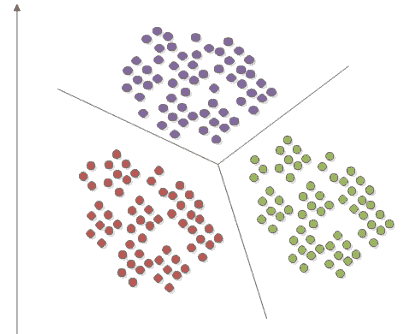

图 1.34：K-means聚类

K-means聚类算法的优点如下：

- 它健壮、快速且易于理解。
- 它在大规模数据集中高效且可衡量。
- 簇之间不重叠。

K-means聚类算法的缺点如下：

- 它对非线性变换不不变。
- 它无法处理带有噪声和异常值的数据。
- 它不适用于类别数据。

**示例 6：** 考虑 _表 1.11_ 中的数据。给定的属性是学生姓名及其三门科目的成绩。

| 学生姓名 | 英语 | 印地语 | 数学 |
|---|---|---|---|
| Tarun | 65 | 81 | 85 |
| Medha | 70 | 90 | 78 |
| Bhavik | 55 | 65 | 65 |
| Anushka | 62 | 76 | 70 |
| Devam | 83 | 86 | 55 |
| Farhan | 74 | 58 | 80 |
| Gouri | 60 | 70 | 50 |
| Himanshu | 91 | 75 | 85 |

_表 1.11:_ 学生成绩数据

步骤 1：让我们假设三个种子或簇头是前三名学生，即 Tarun、Medha 和 Bhavik，如下表所示：

| 簇头 | 学生姓名 | 英语 | 印地语 | 数学 |
|---|---|---|---|---|
| C₁ | Tarun | 65 | 81 | 85 |
| C₂ | Medha | 70 | 90 | 78 |
| C₃ | Bhavik | 55 | 65 | 65 |

表 1.12：三个簇头

步骤 2：计算簇头与这些属性之间的欧氏距离。

欧氏距离：

D(p, q) = (∑(pᵢ - qᵢ)²)^1/2   (1.23)

其中 p 和 q 是要计算欧氏距离的点。

让我们计算学生 Tarun 与簇头 C₂ 之间的距离。

D(A, C₂) = ((65 - 70)² + (81 - 90)² + (85 - 78)²)^1/2  
D(A, C₂) = 12.45

同样，计算所有点的欧氏距离。我们得到第一次迭代结果，如表 1.13 所示：

| 学生姓名 | 英语 | 印地语 | 数学 | C₁的距离 | C₂的距离 | C₃的距离 | 最近簇分配 |
|---|---|---|---|---|---|---|---|
| Tarun | 65 | 81 | 85 | 0 | 12.45 | 27.49 | C₁ |
| Medha | 70 | 90 | 78 | 12.44 | 0 | 29.68 | C₂ |
| Bhavik | 55 | 65 | 65 | 27.49 | 29.98 | 0 | C₃ |
| Anushka | 62 | 76 | 70 | 16.09 | 18 | 13.96 | C₃ |
| Devam | 83 | 86 | 55 | 35.34 | 26.72 | 36.40 | C₂ |
| Farhan | 74 | 58 | 80 | 25.196 | 32.31 | 25.199 | C₃ |
| Gouri | 60 | 70 | 50 | 37.027 | 35.83 | 16.58 | C₃ |
| Himanshu | 91 | 75 | 85 | 26.683 | 26.739 | 42.37 | C₁ |

表 1.13：最近簇分配

现在，观察新分配的簇。两名学生被分配到 C₁ 和 C₂，四名学生被分配到 C₃。现在，计算簇的均值。簇 C₁ 的英语均值为 (65+91)/2 = 78。同样，计算所有簇的均值。表 1.14 显示了成为新簇头和旧种子的簇均值：

| 簇 | 英语 | 印地语 | 数学 |
|---|---|---|---|
| C₁ | 78 | 78 | 85 |
| C₂ | 76.5 | 88 | 66.5 |
| C₃ | 62.75 | 67.25 | 66.25 |
| 种子 1 | 65 | 81 | 85 |
| 种子 2 | 70 | 90 | 78 |
| 种子 3 | 55 | 65 | 65 |

表 1.14：簇头比较

表 1.14 表示迭代 1 后新簇头与旧种子的比较。相同的程序可以重复用于迭代 2。

### 凝聚式聚类算法 [层次]

该聚类算法也称为自下而上方法。凝聚式聚类算法也不需要预先指定簇的数量。起初，自下而上的算法将数据集视为大量单个簇，并进一步将其聚合为簇对，直到所有簇都合并为一个包含所有簇数据的单个簇。

以下是凝聚式（自下而上）算法的步骤：

- 1. 首先将所有数据点作为各自的簇。
- 2. 每次迭代后计算欧氏距离，然后合并距离最小的两个簇。
- 3. 当迭代达到单个合并簇时停止。否则，重复步骤 2。


图 1.35 显示了凝聚式聚类算法的示例：

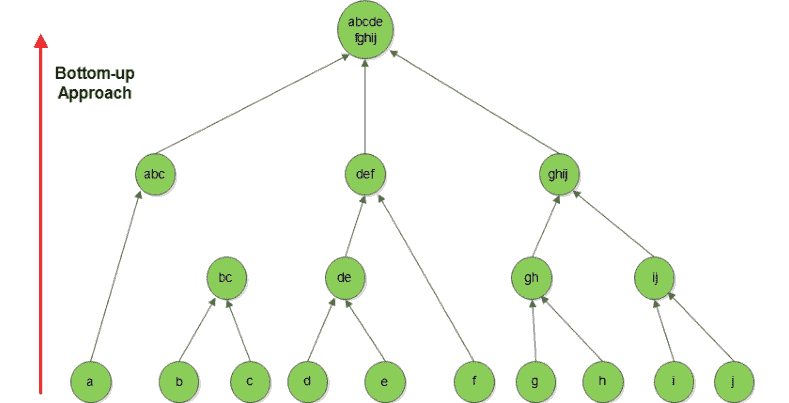

**图 1.35：** 凝聚式聚类

考虑数据集 {a, b, c, d, e, f, g, h, i, j}。在底部，所有数据点都在各自的集群中。使用自底向上方法，我们将每个数据放入一个单一集群。

**示例 7：** 我们将使用 _表 1.11_ 作为此示例。给定的属性是学生姓名和三门科目的成绩。

### 步骤 1：将每个观测值分配到集群并计算欧几里得距离。

让我们计算梅达到塔伦的距离：((70-65)^2 + (90-81)^2 + (78-85)^2)^{1/2} = 12.44。同样，计算所有情况。如果您在 _表 1.15_ 中观察，最小距离是 **塔伦** 和 **梅达** 之间的 12.44。它们被合并形成一个新集群 C₁，

| | 塔伦 | 梅达 | 巴维克 | 阿努什卡 | 德万 | 法尔罕 | 古里 | 希曼舒 |
|---|---|---|---|---|---|---|---|---|
| 塔伦 | 0 | | | | | | | |
| 梅达 | 12.44 | 0 | | | | | | |
| 巴维克 | 27.49 | 31.92 | 0 | | | | | |
| 阿努什卡 | 16.09 | 18 | 13.96 | 0 | | | | |
| 德万 | 35.34 | 26.72 | 36.40 | 27.67 | 0 | | | |
| 法尔罕 | 25.199 | 32.31 | 25.19 | 23.83 | 33.01 | 0 | | |
| 古里 | 35 | 28 | 16.58 | 20.97 | 27.38 | 47.02 | 0 | |
| 希曼舒 | 26.68 | 26.73 | 42.37 | 32.66 | 34.42 | 19.05 | 49.10 | 0 |

**表 1.15：** 集群之间的距离

表 1.16 表示构建集群 C₁ 后的新距离矩阵。

| | C₁ (塔伦 + 梅达) | 巴维克 | 阿努什卡 | 德万 | 法尔罕 | 古里 | 希曼舒 |
|---|---|---|---|---|---|---|---|
| C₁ (塔伦 + 梅达) | 0 | | | | | | |
| 巴维克 | 49.5 | 0 | | | | | |
| 阿努什卡 | 26.5 | 13.96 | 0 | | | | |
| 德万 | 42.5 | 36.40 | 27.67 | 0 | | | |
| 法尔罕 | 26.5 | 25.19 | 23.83 | 33.01 | 0 | | |
| 古里 | 54.5 | 16.58 | 20.97 | 27.38 | 47.02 | 0 | |
| 希曼舒 | 37.5 | 42.37 | 32.66 | 34.42 | 19.05 | 49.10 | 0 |

**表 1.16：** 将“塔伦”和“梅达”合并到集群“C₁”后的距离

重复相同的过程进行后续迭代。我们得到如图 1.36 所示的树状图输出：

## 集群树状图

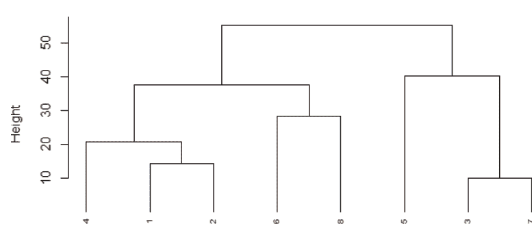

m hclust (*, "complete")

**图 1.36：** 示例 7 中凝聚式层次聚类的树状图。

## 分裂聚类算法 [层次]

该聚类算法也称为自顶向下方法。在该算法中，无需预先指定集群的总数。这种聚类方法需要一种技术来分割包含完整数据的集群，并通过递归方式继续分割集群，直到数据被分割成一组单个集群。

以下是分裂（自顶向下）算法的步骤：

- 1. 首先将所有数据点放入一个集群中。
- 2. 每次迭代后，从指定的（内聚）集群中移除外部数据点。
- 3. 当迭代达到无法进一步分解的单个集群时停止。

图 1.37 显示了一个分裂聚类算法的示例：

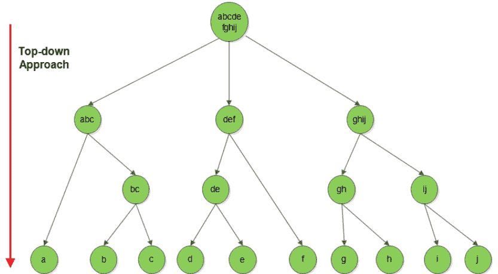

**图 1.37：** 分裂聚类

考虑数据集 {a, b, c, d, e, f, g, h, i, j}。在顶部，所有数据都在一个单一集群中。然后，使用自顶向下方法，我们将每个数据放入其自己的集群。

**示例 8：** 我们将再次使用同一个表 1.11 作为此示例。给定的属性是学生姓名和三门科目的成绩。

### 步骤 1：将每个观测值分配到集群并计算欧几里得距离。

表 1.17 给出了各个集群之间的相应距离：

| | 塔伦 | 梅达 | 巴维克 | 阿努什卡 | 德万 | 法尔罕 | 古里 | 希曼舒 |
|---|---|---|---|---|---|---|---|---|
| 塔伦 | 0 | | | | | | | |
| 梅达 | 12.44 | 0 | | | | | | |
| 巴维克 | 27.49 | 31.92 | 0 | | | | | |
| 阿努什卡 | 16.09 | 18 | 13.96 | 0 | | | | |
| 德万 | 35.34 | 26.72 | 36.40 | 27.67 | 0 | | | |
| 法尔罕 | 25.199 | 32.31 | 25.19 | 23.83 | 33.01 | 0 | | |
| 古里 | 35 | 28 | 16.58 | 20.97 | 27.38 | 47.02 | 0 | |
| 希曼舒 | 26.68 | 26.73 | 42.37 | 32.66 | 34.42 | 19.05 | 49.10 | 0 |

**表 1.17：** 集群之间的距离

如果我们观察前面的表格，最大距离是 47.02，位于法尔罕和古里之间。因此，法尔罕和古里现在已成为两个新集群的种子。

现在，使用 K-means，将集群分配给相应的集群中心。然后，再次找出两个集群中各自的最大距离并重复该过程，直到每个对象都进入独立的集群。

## 聚类应用

- **城市规划**：聚类可用于对房屋进行分组或聚类，并且可以根据地理和其他相关因素研究不同组的价值。
- **图书馆**：聚类可用于根据数据和主题对不同类型的书籍进行聚类。
- **生物学**：聚类也可用于不同动植物的分类。
- **营销**：聚类可用于为营销目的说明和确定消费群体。
- **保险**：聚类可用于识别客户及其计划并识别欺诈行为。
- **地震研究**：通过了解受地震影响的地区，我们可以找出危险区域。

这些是聚类算法最常见的应用。

## 弱监督学习

这是一种机器学习技术，旨在使用有限或较少数量的标记数据，或者我们可以说，极少地使用训练示例。它也称为自学习或自举法。它从几个训练集开始，然后进行分类器的训练，并且还使用一些测试示例。

随着训练集的增加，分类器的性能也会提高，从而实现自学习。

### 最大似然估计 (MLE)

最大似然估计 (MLE) 是估计最能描述观测值的模型参数（如均值、方差等）的最常用方法。

设模型参数为 θ，观测值为 Y。

可以使用朴素贝叶斯定理计算给定 \(Y\) 时 \(\theta\) 的概率。

\(P(\theta \mid Y) = \frac{P(Y|\theta)P(\theta)}{P(Y)}\) (1.24)

让我们假设数据是 **独立且同分布 (IID)** 的。在这里，同分布意味着数据来自具有相同参数类型的共同分布。

但现在，我们想计算给定参数值时新观测值的概率，也就是说，计算 "\(\theta\)" 的似然。对于 IID \(Y\)，"\(\theta\)" 的似然函数可以写作每个数据点概率的乘积。

\(L_Y(\theta) = \prod_{y \in Y} p(y|\theta)\) (1.25)

要计算对数似然，对前面的公式 1.25 取对数：

\(L_Y(\theta) = \sum_{y \in Y} log[p(y|\theta)]\) (1.26)

对前面的公式求导以计算最大对数似然。

让我们举一个伯努利试验（抛硬币）的例子。伯努利分布是一种离散概率分布，将 *成功* 的值取为 \(p\)，将 *失败* 的值取为 \(q=1-p$。

该分布在可能结果 \(l\) 上的 **概率质量函数 (PMF)** 如下：

\(f(l; p) = p^l(1 - p)^{1-l}\) (1.27)

让我们假设抛几次硬币，得到的结果为 "$y_1,.....,y_n$"，结果要么是 "正面"，要么是 "反面"。设 "p" 为出现 "正面" 的概率。假设硬币抛掷 "100" 次，其中 "40" 次出现 "正面"，则 "p=0.4"。使用 MLE，我们将证明 "p=\sum y_i / n" 这个猜测是 "p" 最可能的值。

那么，让我们写出似然函数。

```
$L_Y(p) = f(y_i; p) = \prod_{y \in Y} p^{\sum y_i}(1-p)^{n-\sum y_i}$ (1.28)
```

两边取对数，得到：

```
$log L_Y(p) = \sum y_i log p + (n - \sum y_i)log(1 - p)$ (1.29)
```

为了最大化，将函数的一阶导数设为 0。

```
$\frac{\partial log L_Y(p)}{\partial p} = 0$ (1.30)
```

```
$\frac{\sum y_i}{p} - \frac{n-\sum y_i}{1-p} = 0$ (1.31)
```

求解，得到：

```
$p = \frac{\sum y_i}{n}$ (1.32)
```

公式 1.32 表示我们观测值的 p 的最可能值。

## 统计模型

统计模型可以定义为一种数学模型，它代表关于样本数据生成的一组统计假设。统计模型表示数据生成过程。表 1.18 基于各种参数对统计建模与机器学习进行了比较分析：

| 参数 | 统计建模 | 机器学习 |
|---|---|---|
| 图表与模型 | 它使用模型进行预测。 | 图表用于数据的训练和测试。 |
| 置信区间 | 捕获参数的不确定性和变异性。 | 捕获信息增益中的不确定性。 |
| 参数与权重 | 统计建模更侧重于幅度。此处使用参数来解释数据。 | 在这种情况下，使用权重来最大化手动调整和评分准确性。 |
| 分布 | 使用先验定义明确的分布。 | 使用未知的先验分布。 |


| 参数 | 统计建模 | 机器学习 |
|---|---|---|
| 假设 | 做出先验假设。 | 不做先验假设。 |
| 拟合 | 分布的最佳拟合。 | 泛化或学习模型的最佳拟合。 |

表 1.18: 机器学习与统计建模的区别

统计模型由一组概率分布函数组成，可用于定义数据或随机变量表示的不同变异性。在这类模型中，定义模型不变性是通过使用群论来完成的。所有类型的统计估计量和统计假设检验都可以通过统计模型推导出来。因此，统计建模使我们能够找出任何事件发生的概率。

让我们以图 1.38 所示的一对骰子为例：

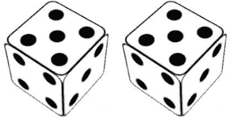

图 1.38: 一对骰子

我们来讨论关于骰子的两个统计假设。

- 无偏骰子对的统计假设

  当两个骰子均无偏时，每个面（如 1、2、3、4、5 或 6）出现的概率为 1/6。基于此假设，我们可以按如下方式计算一对骰子面朝上为 4 的概率。

  1/6 × 1/6 = 1/36

  同样，我们可以计算任何事件发生的概率，例如（1 和 3）、（2 和 4）、（5 和 6）等等。

- 加权骰子对的统计假设

  当两个骰子均加权时，每个面（如 1、2、3、4、5 或 6）出现的概率为 1/8。

基于前面的假设，我们可以按如下方式计算加权骰子对面朝上为 4 的概率：

$$
\frac{1}{8} \times \frac{1}{8} = \frac{1}{64}
$$

然而，对于加权骰子的情况，由于其他面的概率未知，我们无法找出其他非平凡元素的概率。如果你观察前面两个假设，第一个假设属于统计假设，因为在这种情况下，通过使用该假设，我们可以确定任何事件发生的概率。

对于第二个假设情况，它不属于统计假设，因为在这里，我们无法通过使用该假设来确定事件的概率。

### 超平面

在几何中，超平面可以定义为其环境空间的维度比其子空间的维度多一的子空间。因此，如果相应空间的维度为三，则该空间的超平面为二维。超平面可以用于任何存在子空间维度概念的通用空间中。

图 1.39 展示了二维的超平面，其空间维度为三：

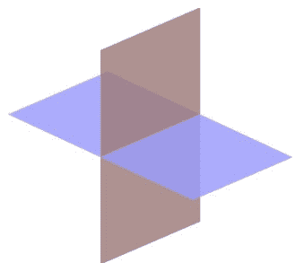

*图 1.39: 2-D 超平面*

在机器学习中，超平面可以定义为用于数据点分类的决策边界。位于超平面一侧的数据点可以被归为一类，位于超平面另一侧的数据点则可被归为另一类。

超平面的维度取决于特征的数量。因此，假设输入特征为两个，那么超平面就是一条直线。然而，如果特征数量为三个，则超平面变为一个 2-D 平面。2 特征超平面的方程如下：

$y = mx + b$ (1.33)

其中 $m$ 是直线的斜率，$b$ 是 $y$ 轴上的截距。具有两个以上特征的超平面方程如下：

$w^T x + b = 0$ (1.34)

其中 $w$ 是一组权重，$b$ 是偏置，$x$ 表示输入向量，$w^T x$ 表示两个向量的点积。假设我们有两个向量：

$x = \begin{pmatrix} 1 \\ x \\ y \end{pmatrix} \text{ and } w = \begin{pmatrix} -b \\ -m \\ 1 \end{pmatrix}$

那么，

$w^T x = -b * 1 + (-m) * x + 1 * y$ (1.35)

$w^T x = y - mx - b$ (1.36)

图 1.40 展示了一条直线，其中 R$^2$ 表示 2-D 子空间：

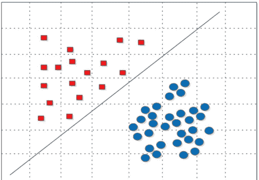

图 1.40: R$^2$ 中的超平面是一条直线

当 R³ 为 3-D 子空间时，图 1.41 展示了一个 2-D 平面：

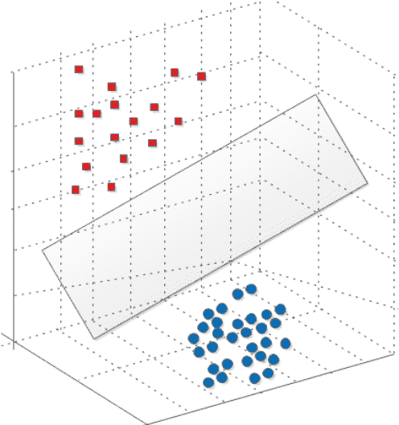

图 1.41: R³ 中的超平面是一个 2-D 平面

前两个图分别表示两种不同类型的超平面。

超平面主要用于 **自然语言处理 (NLP)**、图像分类和生物科学中的支持向量机。在 NLP 中，支持向量机用于超文本分类，因为它们可以减少标记训练实例的数量。在生物科学中，这两者的结合用于对蛋白质进行分类。

## AI 和机器学习基础实操课

R 是一种开源编程语言和免费环境，专注于统计计算和图形表示。它主要由统计学家和数据挖掘人员用于开发统计软件和执行数据分析。

以下是为 Windows 下载和安装 R 的步骤：

- 1. 下载 R。首先，访问 cran.r-project.org/bin/windows/base，然后单击链接 **下载适用于 Windows 的 R**。

- 2. 运行 .exe 文件

  下载完成后，运行 .exe 文件，然后按照安装说明进行操作。

- 3. 启动 R。安装完成后，启动 R。

- 4. 运行你的脚本。要运行新脚本，请单击 File，然后选择 New Script。然后，在 R Editor 中输入你的脚本。例如，输入以下语法以打印 Hello World 表达式：

  print ("Hello World")

  最后，按 F5 运行你的脚本。你将在 R Console 中看到结果：

  [1] “Hello World”

## 以下是为基于 Linux 的系统下载和安装 R 的步骤

在 Ubuntu 中安装 R 有两种方法：一种是通过终端，另一种是通过 Ubuntu 软件中心。

## 通过终端

- 1. 按 Ctrl + Alt + T 打开终端：

```
sudo apt-get update
sudo apt-get install r-base
```

## 聚类

表 1.19 表示聚类的示例数据集：

| ID | 公司 | 固定费用 | ROR | 成本 | 负载 |
|---|---|---|---|---|---|
| 1 | Amazon | 1.060 | 9.300 | 151 | 55.8 |
| 2 | Flipkart | 0.800 | 10.200 | 202 | 56.0 |
| 3 | HP | 0.910 | 11.400 | 222 | 65.0 |
| 4 | Dell | 0.870 | 15.300 | 312 | 45.9 |
| 5 | Ebay | 1.000 | 8.900 | 121 | 46.8 |
| 6 | Snapdeal | 1.150 | 9.200 | 212 | 56.4 |
| 7 | Clubfactory | 0.934 | 11.760 | 198 | 59.2 |
| 8 | LG | 0.811 | 12.090 | 189 | 50.0 |
| 9 | Samsung | 0.750 | 9.650 | 209 | 49.0 |
| 10 | Firstcry | 1.212 | 10.012 | 216 | 48.9 |

表 1.19: 示例数据集

## 1. 绘制 ROR 与成本之间的聚类图

解决方案：

- 步骤 1: 使用前面的数据制作 Excel-CSV 文件。
- 步骤 2: 打开 R-Studio。
- 步骤 3: 编写命令：

```
data1 <- read.csv("your CSV file path")
print(data1)
plot(Cost ~ ROR,data1)
```

现在，如果你观察图 1.42，图表不够密集。因此，让我们从互联网上获取一个数据集：

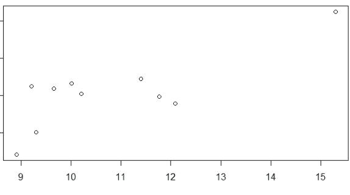

图 1.42: 使用 ROR 和 成本 的数据聚类

在以下 URL 中，你可以找到许多数据集：

**https://vincentarelbundock.github.io/Rdatasets/datasets.html**

在这里，我们使用了来自英格兰和威尔士艾滋病报告延迟主题的项目 aids。首先，从链接下载文件，然后编写以下命令：

```
Data2 <- read.csv ("your CSV file path")
print(Data2)
plot(quarter ~ y,Data2)
```

运行程序，你将看到以下输出图表：

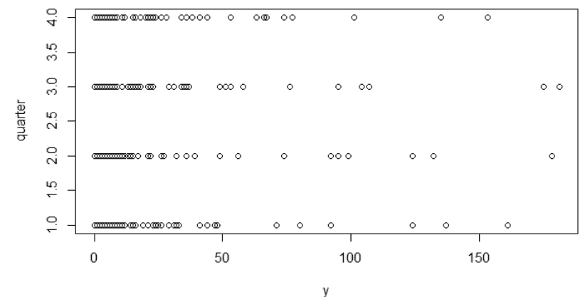

图 1.43: 季度图

## 给你的问题

- 使用表 1.19，绘制成本与负载之间的聚类图。
- 观察图 1.43，并说明所观察到的模式是线性还是非线性。
- 对成本与负载之间的图重复问题 2。

## 多元线性回归

下载并导入数据集 vehicle：

导入文件后，要在控制台窗口中查看数据集的起始行，请键入以下命令：

```
head(vehicle)
```

然后按 Enter。你将在表 1.20 中看到以下输出，作为具有众多特征的数据集。

| | 车辆 | fm | 里程 | lh | lc | mc | 州 |
|---|---|---|---|---|---|---|---|
| 1 | 1 | 0 | 863 | 1.1 | 66.30 | 697.23 | MS |
| 2 | 2 | 10 | 4644 | 2.4 | 233.03 | 119.66 | CA |
| 3 | 3 | 15 | 16330 | 4.2 | 325.08 | 175.46 | WI |
| 4 | 4 | 0 | 13 | 1.0 | 66.64 | 0.00 | OR |
| 5 | 5 | 13 | 22537 | 4.5 | 328.66 | 175.46 | AZ |
| 6 | 6 | 21 | 40931 | 3.1 | 205.28 | 175.46 | FL |

表 1.20: 名为“Vehicle”的数据集。


现在，要查看里程、劳动工时和劳动成本之间的相关性，请键入以下命令：

```
pairs(vehicle[3:5])
```

如果你观察到以下图表，劳动工时和劳动成本之间存在强相关性，但里程和劳动工时之间的相关性不强。

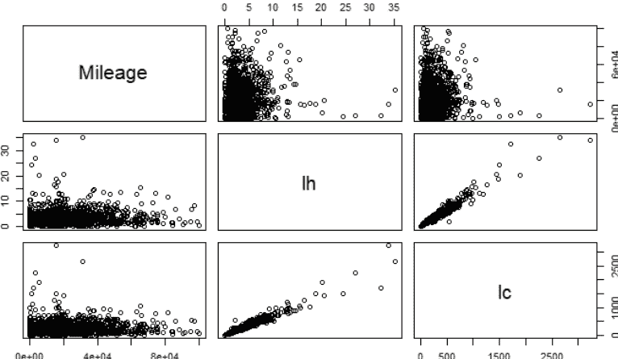

图 1.44：使用里程和成本参数的线性回归

创建多元线性回归模型。在控制台窗口中键入以下命令：

```
results <- lm(lc~Mileage+lh,vehicle)
```

```
results
```

您将看到以下输出：

```
Call:
lm(formula = lc ~ Mileage + lh, data = vehicle)

coefficients:
(Intercept)      Mileage           lh
1.375e+00   -8.475e-05    7.355e+01
```

使用前面的数据，我们得到以下线性模型：

```
lc = 1.375e+00 - 8.475*10^-5 Mileage + 73.55 lh
```

## 给你的问题

- 使用数据集 vehicle，绘制劳动工时、劳动成本和 mc 之间的相关性图表。
- 使用劳动工时、劳动成本和 mc 变量创建多元回归模型。

## K-均值聚类

使用以下链接下载并导入数据集 *iris*：

https://gist.github.com/netj/8836201

在 R 控制台中键入以下命令：

```
iris <- read.csv("E:/R-programs/iris.csv")
View(iris)

iris.features = iris

iris.features$variety <- NULL

View(iris.features)

results <- kmeans(iris.features, 3)

results
```

您将看到如 *图 1.45* 所示的以下输出：

```
K-means clustering with 3 clusters of sizes 38, 50, 62

Cluster means:
   sepal.length sepal.width petal.length petal.width
1     6.850000    3.073684    5.742105    2.071053
2     5.006000    3.428000    1.462000    0.246000
3     5.901613    2.748387    4.393548    1.433871

Clustering vector:
[1] 2 2 2 2 2 2 2 2 2 2 2 2 2 2 2 2 2 2 2 2 2 2 2 2 2 2 2 2 2 2 2 2 2 2 2 2 2 2 2 2 2 2 2 2 2 2 2 2 2
[56] 3 3 3 3 3 3 3 3 3 3 3 3 3 3 3 3 3 3 3 1 3 3 3 3 3 3 3 3 3 3 3 3 3 3 3 3 3 3 3 3 3 3 3 3 3 3 1 1 1
[111] 1 1 1 1 3 1 1 1 1 1 3 1 3 1 3 1 3 3 1 1 1 1 1 3 1 1 1 1 3 1 1 3 1 1 3 1 1 1 3 1 1 1 1 3
within cluster sum of squares by cluster:
[1] 23.87947 15.15100 39.82097
 (between_SS / total_SS =  88.4 %)

Available components:

[1] "cluster"      "centers"      "totss"        "withinss"     "tot.withinss" "betweenss"    "size"
[8] "iter"         "ifault"
```

图 1.45：使用 R 进行 K-均值聚类。

现在，键入以下命令：

```
table(iris$variety, results$cluster)
```

| | 1 | 2 | 3 |
|---|---|---|---|
| 山鸢尾 | 0 | 50 | 0 |
| 变色鸢尾 | 2 | 0 | 48 |
| 维吉尼亚鸢尾 | 36 | 0 | 14 |

要绘制图表，请键入以下命令：

```
plot(iris[c("petal.length", "petal.width")], col = results$cluster)
```

图 1.46 表示三个聚类，分别为山鸢尾、变色鸢尾和维吉尼亚鸢尾：

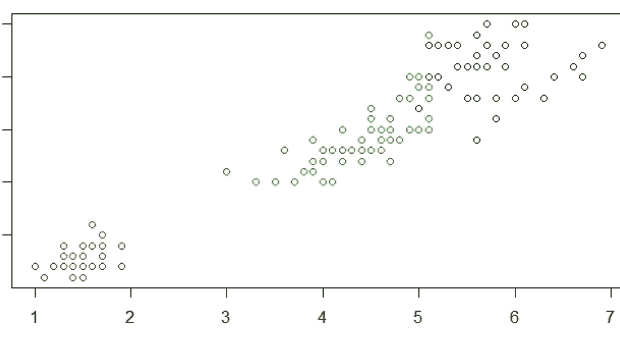

图 1.46：数据聚类

## 凝聚层次聚类

使用以下链接下载并导入 iris 数据集：

https://forge.scilab.org/index.php/p/rdataset/source/tree/master/csv/datasets/USAArrests.csv

在 R 控制台中键入以下命令：

```
df <- USAArrests
```

```
df <- na.omit(df)
```

```
d <- dist(df, method = "euclidean")
```

```
hc1 <- hclust(d, method = "complete" )
plot(hc1, cex = 0.6, hang = -1)
```

图 1.47 描绘了聚类的树状图表示：

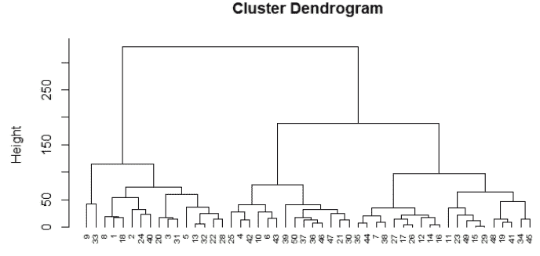

图 1.47：聚类形成

## 决策树

使用以下链接下载并导入 Cardiotocographic 数据集：

https://archive.ics.uci.edu/ml/datasets/cardiotocography

在 R 控制台中键入以下命令：

```
#Data Preparation
entry <- Cardiotocographic
str(entry)
entry$NSPF <- factor(entry$NSPF)

#Data partition into training and validation datasets
set.seed(1234)
pd <- sample(2,nrow(entry),replace = TRUE,prob = c(0.8,0.2))
```

```
train <- entry[pd==1,]
validate <- entry[pd==2,]

#Decision Tree with party package
library(party)
tree <- ctree(NSPF~LB+AC+FM,data = train)
tree
plot(tree)
```

图 1.48 表示使用 R 针对该数据集的决策树：

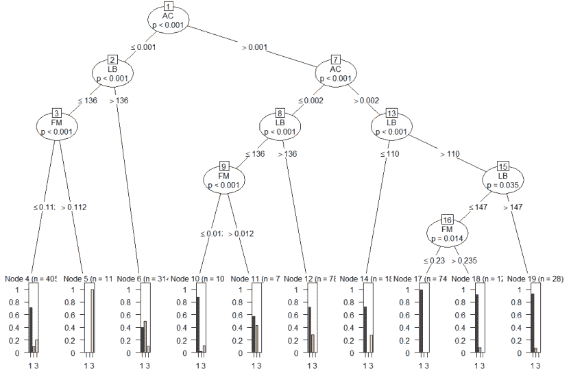

图 1.48：决策树形成

## 结论

机器学习是人工智能的一个子集，其目标是协助机器自行记忆和学习。机器学习算法使其能够对不同观测数据集中的模式进行分类，构建解释世界并进行预测的模型，而无需分类编程模型和规则。本章对机器学习及其类型提供了简要概述，并对分类和回归问题进行了恰当解释。本章还对带有解答示例的聚类算法进行了简要说明。

读完本书后，读者将掌握机器学习及其类型的基本知识。读者将了解二分类和多分类以及回归之间的区别。读者将理解聚类及其类型的主要概念。

下一章将介绍基于 Python 的深度学习，涵盖 Python 编程语言概述，以及实现机器学习算法所需的一些有用数据集和库。

## 复习问题

- 1. 区分类内变异性和类间变异性？
- 2. 请用示例解释独热编码一词。
- 3. 机器学习算法的目标是什么？
- 4. 请解释回归一词及其类型。
- 5. 什么是逻辑回归？请解释逻辑回归的不同类型。
- 6. 什么是 Sigmoid 函数？它在机器学习中有何用途？
- 7. 区分二分类和多分类？
- 8. 请用合适的示例解释弱监督学习一词。
- 9. 请解释不同的聚类方法。
- 10. 什么是 MLE？
- 11. 用于机器学习算法快速收敛的各种技术有哪些？

## 判断正误

- 1. 聚类分析将变量分类为因变量或自变量。
- 2. 分裂聚类算法也称为自顶向下方法。
- 3. 聚类必须在 400 个或更多样本上进行。
- 4. 在聚类分析中，彼此之间距离较小的对象比距离较大的对象更相似。
- 5. 二分类是一种判别式学习技术。
- 6. 统计建模使用图表进行预测。
- 7. 聚类是一种监督学习技术。
- 8. Sigmoid 函数用于将预测值映射到概率。
- 9. 统计模型表示数据生成过程。
- 10. 回归是一个优雅的词，用于描述模型将离散（响应）分配给数据观测值。

## 选择题

- 1. 在线性回归中，我们使用以下哪种技术来确定数据点的最佳拟合线？
- a. 最大似然估计
- b. 对数损失
- c. 最小平方误差
- d. 同时选择 a 和 b

- 2. 如果在线性回归中拟合一个 2 次多项式，会发生什么？
- a. 2 次多项式更有可能欠拟合数据
- b. 2 次多项式更不容易欠拟合数据
- c. 以上都不是
- d. 无法断言

- 3. 当训练数据规模增加时，方差和偏差会如何变化？
- a. 方差降低，偏差升高
- b. 方差降低，偏差降低
- c. 方差升高，偏差升高
- d. 方差升高，偏差降低

- 4. 在逻辑回归中，我们使用哪种技术来确定数据的最佳拟合？
- a. 最大似然估计
- b. 对数损失
- c. 最小平方误差
- d. 同时选择 a 和 b

- 5. 以下哪种指标不能应用于逻辑回归输出以与目标进行比较？
- a. 均方误差
- b. 对数损失
- c. 准确率
- d. AUC-ROC


6. 假设我们有一枚无偏硬币，我们想要确定正面朝上的概率。以下哪个选项在这种情况下可能为真？
a. 赔率将为 1
b. 赔率将为 0
c. 赔率将为 0.5
d. 以上都不是

7. 以下哪种方法是层次聚类的一种类型？
a. 凝聚
b. K-means
c. OPTICS
d. DBSCAN

8. 以下哪个参数用于设置重要性值？
a. 设置
b. 数值
c. 缩放
d. 以上都不是

9. 逻辑回归模型具有以下特征：
a. 多个因变量
b. 多个自变量
c. 只有一个自变量
d. 以上都不是

10. 用于描述逻辑回归模型中自变量之间存在相关性的术语是：
a. 相关性
b. 多重共线性
c. 回归
d. 以上都不是

## 答案

| 1 | c |
|---|---|
| 2 | a |
| 3 | d |
| 4 | a |
| 5 | a |
| 6 | c |
| 7 | a |
| 8 | c |
| 9 | b |
| 10 | b |

## Web 资源

- 机器学习与模式识别：https://dzone.com/articles/machine-learning-and-pattern-recognition
- 受监督机器学习中的回归与分类：https://www.geeksforgeeks.org/regression-classification-supervised-machine-learning/
- 机器学习中的线性回归：https://www.geeksforgeeks.org/ml-linear-regression/
- 概率概念详解：最大似然估计：https://towardsdatascience.com/probability-concepts-explained-maximum-likelihood-estimation-c7b4342fdbb1
- 数据科学家应该了解的五种聚类算法：https://towardsdatascience.com/the-5-clustering-algorithms-data-scientists-need-to-know-a36d136ef68
- 为什么在机器学习中对数据进行独热编码：https://machinelearningmastery.com/why-one-hot-encode-data-in-machine-learning/
- 模式识别：http://www.cse.msu.edu/~cse802/notes/802intro_course

## 加入本书的 Discord 工作空间

加入本书的 Discord 工作空间，获取最新更新、优惠、全球科技动态、新版本发布以及与作者的会议：

https://discord.bpbonline.com


## 第 2 章

### 使用 Python 进行深度学习简介

### 简介

深度学习是人工智能（AI）中的一种机器学习技术，它允许系统通过使用多层神经网络训练自身来执行图像和语音识别等任务。它也被称为深度神经网络学习。本章简要介绍了 Python 编程语言，以及一些用于深度学习的重要库和数据集。本章还介绍了与深度学习相关的各种损失函数。

### 结构

在本章中，我们将介绍以下主题：

- 人工智能和深度学习
- Python 简介
- 机器学习数据集
- 机器学习库
- 神经网络
- SVM
- 注释与分类
- 分割
- 目标检测
- 语义分析
- 损失函数
- 实操环节

### 目标

学习本章后，你将理解深度学习和 Python 的基本概念。你还将理解注释与分类之间的区别。你将简要了解机器学习数据集、库和损失函数。

### 人工智能与深度学习

要理解人工智能，我们必须知道什么是智能。智能可以定义为从经验中学习、解决问题、规划以及利用所获得的知识来适应现有情况的能力。基本上，智能是对信息的理解和学习，并将其应用于各种应用。

人工智能可以定义为机器表现出的智能。它包括学习、推理和自我纠正的过程。AI 的应用无处不在。它可以应用于不同领域。例如，AI 被应用于医疗保健等行业，用于手术室中的手术。AI 的典型图像如图 2.1 所示：


图 2.1：典型的 AI 图像

AI 分为两大类：强人工智能和弱人工智能。强人工智能系统是指能够执行类似人类典型任务的系统。弱人工智能，也称为专用人工智能，是另一种受限于狭窄或特定领域的机器智能技术。它通过自动化耗时任务，并以人类有时无法的方式估算数据来模拟人类感知。

机器学习是 AI 的一个子集，其中机器通过经验学习，无需任何人工干预即可获得知识或技能。机器学习专注于开发计算机程序来访问信息，并利用这些信息自行学习，无需任何人工干预。

机器学习算法可分为以下两类：

- 浅层学习是记忆信息而非理解信息的过程。在浅层学习中，机器只是在应用中记忆并重复相同的内容。
- 深度学习是人工智能中的一种机器学习技术，它允许系统通过使用多层神经网络训练自身来执行图像和语音识别等任务。它也被称为深度神经网络学习。

### 深度学习简介

在深度学习中，术语 *deep* 指的是神经网络中隐藏层的总数。与传统神经网络（拥有两到三个隐藏层）相比，深度神经网络可以拥有多达 150 个隐藏层。

深度学习中的模型由大量标记数据集进行训练，然后神经架构直接从数据集中学习特征，无需任何人工手动特征提取。

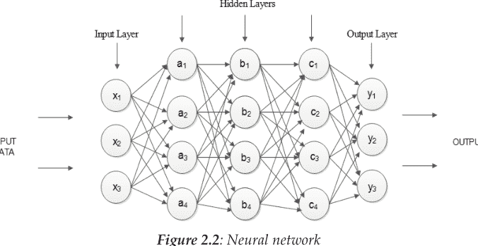

图 2.2 展示了一个具有 **1** 个输入、**1** 个输出和 **3** 个隐藏层的神经网络。

### Python 简介

Python 是一种 **面向对象编程（OOP）** 语言，具有高级编程语言的能力。它是一种可移植语言，且语法易学。这就是 Python 成为流行语言的原因。

它最初于 1991 年在 *荷兰 Stichting Mathematisch Centrum* 开发，首个版本为 0.9。它是一种开源语言，可从 **www.python.org** 下载。它同时具有 C 和 *Java* 的特点。Python 是一种解释型语言。解释型语言是指程序被转换为字节码，并由虚拟机执行字节码的编程语言。让我们讨论一下 Python 编程语言的一些特性。

### Python 的特性

Python 编程语言的特性如下：

- **多用途语言**：它支持函数式编程和面向对象编程。
- **易学**：Python 的语法简单，初学者易于上手。
- **可扩展**：它支持大型程序。
- **开源**：它由 Python 开发者社区支持，因此错误可以轻松修复。
- **大量模块**：它拥有大量模块，可覆盖编程的各个方面。

### 机器学习数据集

数据集被定义为大量数据的集合。机器学习算法使用三个数据集：

- 训练数据集
- 验证数据集
- 测试数据集

### 训练数据集

训练数据集被定义为用于学习目的或拟合权重的数据集。我们使用训练数据集训练分类器。不过，对于分类器的训练，仅可用训练数据集和验证数据集。训练期间不得使用测试数据集。训练数据集在三个数据集中最大。

当我们将训练数据集通过神经网络运行时，它会教会神经网络对不同参数进行加权，并调整权重系数，以使损失最小。损失是实际值与预测值之间的差异。

### 验证数据集

现在，一旦模型使用训练数据集进行训练，就需要对其进行评估，以检查模型的准确性。这就是验证数据集的用途。它用于计算模型的误差率或损失，从而决定训练模型的准确性。这是准确训练模型的重要方面。那么，验证数据集会影响模型吗？会，但属于间接影响。通过使用验证数据集的结果，模型会调整其参数以达到更高的准确率。

### 测试数据集

测试数据集用于在训练阶段后对模型进行最终评估。模型完全训练后（即训练和验证模型后），测试数据集只使用一次。虽然验证数据集和测试数据集的功能几乎相似，但使用验证数据集进行测试并非良好实践。


图 2.3 展示了机器学习中数据集的可视化：


图 2.3：机器学习中的数据集可视化

以下是机器学习中一些最常用的数据集。

### ImageNet

ImageNet 是一个遵循 WordNet 层次结构的数据库。WordNet 是英文单词的词汇数据库。它将单词分组为同义词集（一组同义词），并记录这些同义词之间的关系。

WordNet 包含约 100,000 个短语，ImageNet 为每个短语包含约 10,000 张图像。其大小约为 150 GB，包含约 1,500,000 张带有相应类别标签的图像。图 2.4 显示了 ImageNet 数据集的一个样本：

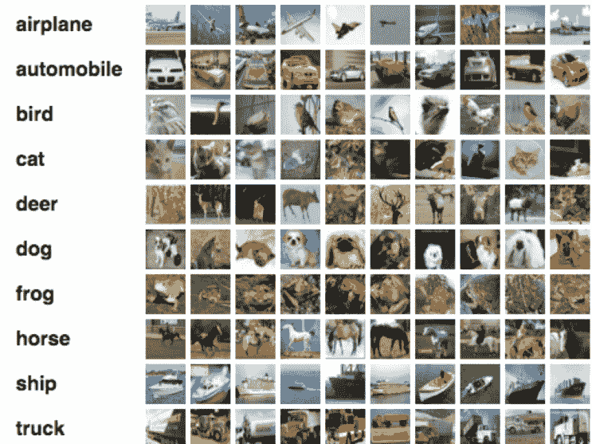

图 2.4：ImageNet 数据集
(https://gluon-cv.mxnet.io/build/examples_classification/demo_cifar10.html)

### 美国国家标准与技术研究院数据库 (MNIST)

它是机器学习算法中流行的数据集之一。该数据集包含手写数字，训练集约有 60,000 个示例，测试集约有 10,000 个示例。它可用于几乎所有机器学习技术，并且在数据预处理中所需的精力和时间较少。图 2.5 显示了 MNIST 数据集的一个样本：

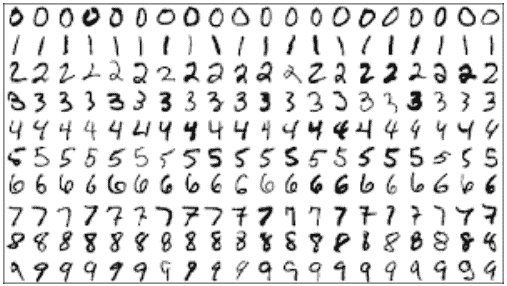

图 2.5：MNIST 数据集

其大小约为 50 MB，包含 10 个类别的约 70,000 张图像。

## 机器学习库

库被定义为用特定编程语言编写的一组函数和例程。一套强大的库使研究人员和开发人员能够更轻松地执行复杂程序，而无需编写多行代码。

大多数深度学习库都基于基于图的模块，因为深度学习算法的所有概念都基于计算图。用于实现机器学习和深度学习算法的 Python 库如下：

- Numpy
- Theano
- Keras
- TensorFlow
- Pandas
- SciPy
- PyTorch
- Matplotlib
- NLTK

让我们讨论一下机器学习中一些最常用的库。

### Numpy

Numpy 是一个由通用数组处理包组成的库。它使用 Python 编程语言编写，并为大型多维数组和支持这些数组的数学函数提供辅助支持。

它支持 Fortran 和 C/C++ 的集成工具。它具有有用的数学功能，例如傅里叶变换和线性代数。Numpy 可以与广泛的数据库集成，因为它可以用于定义任意数据类型。

在核心层面，Numpy 提供出色的 ndarray 对象，即 n 维数组的缩写。ndarray 是一个数组对象，可用于存储多个相同数据类型的对象。

Numpy 包含以下功能：

- 大型数组对象
- 与 Fortran 和 C/C++ 语言轻松集成
- 广播函数
- 有用的傅里叶变换和线性代数功能

### Numpy 中的数组

Numpy 的主要对象是同质性质的多维数组。数组是一张元素表格，大多是数字，且数据类型相同。在 Numpy 中，维度表示为轴，轴的总数称为阶。Numpy 的数组类称为 n 维数组。我们将在实践部分讨论如何在 Numpy 中创建数组。

### 数组索引

数组索引的基础对于分析和操作数组对象非常重要。以下是在 Numpy 中进行数组索引的常见方式：

- **切片**：Numpy 中的数组可以像 Python 列表的切片一样进行切片。要对数组进行切片，请为数组的每个维度定义一个切片。
- **布尔数组索引**：当用户想要从数组中选取满足特定条件的元素时，通常使用此方法。

### Theano

Theano 是一个使用 Python 语言编写的库，允许用户定义和优化数学表达式的多维数组。它是最常用的深度学习库之一，并作为神经网络构建模块工作。

Theano 库帮助用户优化中央处理器/图形处理器 (CPU/GPU) 的利用率，从而提高数据计算能力的性能。

### Keras

Keras 是一个基于神经网络的开源库，使用 Python 编写。它由 Google 工程师 Francois Chollet 设计，以实现带有深度神经网络的程序的快速执行。它是一个用户友好、可扩展且模块化的库。

该库可以在 Theano 和 TensorFlow 之上运行。它封装了其他库（例如 Theano 和 TensorFlow）的功能。

Keras 是一个高级应用程序编程接口 (API)，用于定义层、模型创建以及设置多个输入/输出 (I/O) 模型。但是，它不处理低级 API，例如张量的创建、计算图等。

### TensorFlow

TensorFlow 是一个用于数据流和不同类型任务编程的开源免费库。该库由 Google 于 2015 年 11 月发布。它是深度学习应用（如神经网络）中最常用的库。

TensorFlow 是一个符号数学库，使用 Python 编程语言编写，但现在有一个名为 tensorflow.js 的 JavaScript 移植版可用于同样的目的。

### Pandas

Pandas 是一个专为数据分析设计的流行 Python 库。它是一个由 Wes McKinney 设计的开源免费库，使用 C 和 Python 编程语言编写。

它提供了可用于处理时间序列和结构化数据的富有表现力的数据结构。它提供了大型数据集的基于标签的切片、子集化和花式索引。

### SciPy

SciPy 是实现机器学习算法最常用的库。它包含用于线性代数、集成和优化的多个模块。它是一个用于科学、数学和工程的 **伯克利软件发行版 (BSD)** 授权库。

BSD 许可证是一组自由软件许可证，对所涵盖软件的使用和分发几乎不施加限制。此库依赖于 Numpy，因为构建此库的主要原因是将其与 Numpy 数组集成。

### PyTorch

PyTorch 是一个基于 Torch 库的开源机器学习库。它最常用于自然语言处理和计算机视觉等应用程序。

它使用 Python 和 C++ 编程语言编写。它具有以下功能：

- 它提供基于自动微分系统构建的深度神经网络。
- 它通过 GPU 支持张量计算。

### Matplotlib

Matplotlib 是一个专为 Python 编程语言和 Numpy 设计的绘图库。它由 *迈克尔·德罗特博姆* 在 2003 年开发。

它提供面向对象的 API，以使用 GPU 将图表嵌入到不同的应用程序中。Matplotlib 中有一个 Pyplot 模块，提供类似 MATLAB 的接口。

表 2.1 显示了最常用机器学习库之间的比较：

| 名称 | 开发者 | 接口 | 适用模型 | 多 GPU 支持 | 分布式 |
| :--- | :--- | :--- | :--- | :--- | :--- |
| NumPy | Travis Oliphant | Python, C | RNN*, CNN**, DNN*** | 是 | 是 |
| Theano | Université de Montréal | Python | RNN, CNN, DNN | 否 | 否 |
| Keras | Francois Chollet | Python | RNN, CNN, DNN | 否 | 否 |
| TensorFlow | Google | Python, C++, JAVA | RNN, CNN, DNN | 是 | 是 |
| Pandas | Wes McKinney | Python, C | RNN, CNN, DNN | 是 | 否 |
| SciPy | Travis Oliphant | Python, C, C++, Fortran | RNN, CNN, DNN | 是 | 是 |
| PyTorch | Ronan Collobert | C++, R, Python, MATLAB, JavaScript | RNN, CNN, DNN | 是 | 否 |
| Matplotlib | John D. Hunter | Python | RNN, CNN, DNN | 是 | 否 |

表 2.1：机器学习库比较

*RNN → 循环神经网络。
**CNN → 卷积神经网络。
***DNN → 深度神经网络。

## 神经网络

神经网络可以定义为设计用于识别模式的神经元或神经元电路网络。神经网络分为两种类型：由真实生物神经元组成的生物神经网络，以及旨在解决 AI 问题的人工神经网络。


Figure 2.6 shows an image of the biological neuron:

图 2.6 显示生物神经元图像：

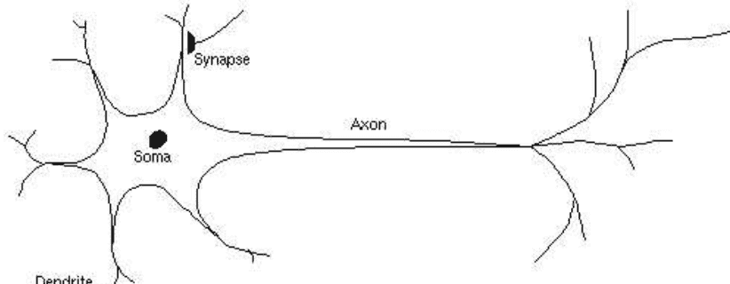

Figure 2.6: Biological Neuron structure (https://cs.stanford.edu/people/eroberts/courses/soco/projects/neural-networks/Neuron/index.html)

图 2.6：生物神经元结构（https://cs.stanford.edu/people/eroberts/courses/soco/projects/neural-networks/Neuron/index.html）

Here, neurons are living cells with dendrites and axons which form interconnections using synapses. The signal transmits through soma, also known as the cell body. Every cell has multiple dendrites, each of which receives weighted inputs, and the total input of the cell is the sum of all these weighted inputs. Artificial neural networks work similarly.

这里，神经元是带有树突和轴突的活细胞，它们通过突触形成互连。信号通过体（也称为细胞体）传输。每个细胞有多个树突，每个树突接收加权输入，细胞的总输入是所有这些加权输入的总和。人工神经网络的工作原理类似。

Figure 2.7 shows a single-layer artificial neural network with an input layer, a hidden layer, and an output layer:

图 2.7 显示具有输入层、隐藏层和输出层的单层人工神经网络：

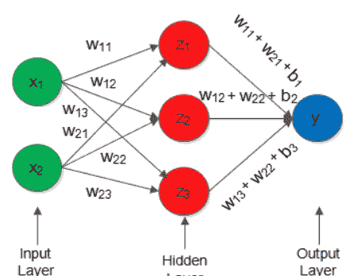

Figure 2.7: Single-layer feed-forward neural network

图 2.7：单层前馈神经网络

Connections among neurons are modeled as weights, which are learnt to train the classifier. All the weights are summed. This process is known as a linear combination. The output of the neural network is controlled by an activation function that defines the range of the output either between 0 and 1 or between –1 and 1. Details about neural networks are provided in the upcoming chapters.

神经元之间的连接建模为权重，这些权重是为了训练分类器而学习的。所有权重都求和。此过程称为线性组合。神经网络的输出由激活函数控制，该函数定义输出范围在 0 到 1 或 -1 到 1 之间。即将在后续章节中介绍神经网络的详细信息。

## Support Vector Machine (SVM)

## 支持向量机 (SVM)

SVM is a discriminative classifier based on supervised learning used to analyze data for regression and classification. SVM uses the concept of decision planes or hyperplanes, which defines decision boundaries to maximize the margin between classes. It helps in separating the data based on the outputs or labels. The vectors which define these decision planes are known as support vectors.

SVM 是一种基于监督学习的判别式分类器，用于分析数据以进行回归和分类。SVM 使用决策平面或超平面的概念，用于定义决策边界以最大化类别之间的间隔。它有助于根据输出或标签分离数据。定义这些决策平面的向量称为支持向量。

Figure 2.8 shows an example of SVM in which objects belong to two different classes:

图 2.8 显示 SVM 的示例，其中对象属于两个不同的类别：

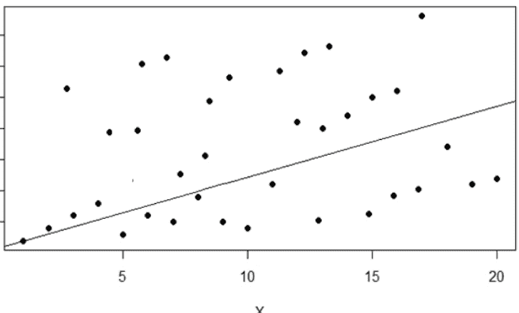

Figure 2.8: SVM: linear classifier

图 2.8：SVM：线性分类器

The separating line defines the boundary between the two classes.

分隔线定义两个类别之间的边界。

## Annotation and classification

## 标注与分类

Both annotation and classification are used to organize the data such as image, text, and so on, but the process of both is different.

标注和分类都用于组织图像、文本等数据，但两者的过程不同。

Annotation is the process of fixing labels to the training dataset of any form, say, text, image, audio, and video. It is an essential step in pre-processing the data in supervised learning. Machine learning techniques learn to recognize the patterns using annotated data; that is, when a machine learning algorithm has processed enough data annotation, it learns to recognize the same patterns with new data that is unannotated.

标注是将标签固定到任何形式的训练数据集（如文本、图像、音频和视频）的过程。它是监督学习中数据预处理的关键步骤。机器学习技术使用标注数据学习识别模式；也就是说，当机器学习算法处理了足够的数据标注后，它会学会使用未标注的新数据识别相同的模式。

For example, while building a system that defines dogs in images, we need a set of images with annotated (labeled) data to train a model which can identify the image of the dog while testing the system. Figure 2.9 shows an annotated image of the dog. This process is manually performed by humans to label the images. Information about the image can be extracted by using various filters, which are explained in the further chapters:

例如，在构建定义图像中狗的系统时，我们需要一组带有标注（标记）数据的图像来训练模型，以便在测试系统时识别狗的图像。图 2.9 显示狗的标注图像。此过程由人工手动执行以标记图像。可以使用各种滤波器提取图像信息，将在后续章节中介绍：


Figure 2.9: An annotated image of the dog

图 2.9：狗的标注图像

Classification is a process of extracting information about classes from the data. It is an automatic process performed by the system.

分类是从数据中提取类别信息的过程。它是系统执行的自动过程。

### Segmentation in deep learning

### 深度学习中的分割

In image processing, image segmentation is the method of splitting a digital image into several segments (say, sets of pixels). The main aim of segmentation is to change or simplify the representation of an image into something that is more meaningful and easier to analyze.

在图像处理中，图像分割是将数字图像分割成多个段（例如像素集）的方法。分割的主要目的是将图像的表示改为更有意义且更易于分析的形式，或简化图像表示。

Segmentation refers to the act of segmenting data according to the need in order to refine your analysis based on a defined context:

分割是指根据需求对数据进行分段的行为，以便基于定义的上下文细化分析：


Figure 2.10: Image segmentation

图 2.10：图像分割

Figure 2.10 shows the image before and after segmentation.

图 2.10 显示分割前后的图像。

### Object detection

### 对象检测

Object detection is a technique related to image processing and computer vision that deals with the detection of instances of the objects of a class, such as animals, humans, cars, and so on, from videos or images. Object detection techniques typically use deep learning and machine learning algorithms to provide good results.

对象检测是与图像处理和计算机视觉相关的一种技术，用于从视频或图像中检测类对象（如动物、人类、汽车等）的实例。对象检测技术通常使用深度学习和机器学习算法来提供良好的结果。

### Image processing basics for object detection

### 对象检测的图像处理基础

Image processing is a method of processing an image by means of a digital computer. It is used by object detection algorithms to extract meaningful information from an image. Image processing includes importing of the image by using some tool, then manipulating and analyzing the image, and finally, providing meaningful information regarding the image.

图像处理是一种使用数字计算机处理图像的方法。对象检测算法使用它从图像中提取有意义的信息。图像处理包括使用某些工具导入图像，然后操作和分析图像，最后提供有关图像的有意义信息。

### Defining an image

### 定义图像

An image is defined as a set of two-dimensional arrays arranged specifically in rows and columns. An image consists of a finite number of pixels, each of which has a specific value for a specific location. An image can be of the following types:

图像定义为按行和列特定排列的二维数组集合。图像由有限数量的像素组成，每个像素在特定位置都有特定值。图像可以为以下类型：

- Binary image: Binary image consists of two-pixel elements 0 and 1, where 0 represents black and 1 represents white. The binary image is also known as a monochrome image.

- 二值图像：二值图像由两个像素元素 0 和 1 组成，其中 0 表示黑色，1 表示白色。二值图像也称为单色图像。

- 8-bit color image: This image has 256 different colors in it and is also known as a grayscale image. This image has pixel values ranging from 0 to 255, where 0 represents black and 255 represents white, and other colors range between these values.

- 8 位彩色图像：该图像中有 256 种不同的颜色，也称为灰度图像。该图像的像素值范围为 0 到 255，其中 0 表示黑色，255 表示白色，其他颜色介于这些值之间。

- 16-bit color image: This image has 65,536 colors in it. This image is also known as a high-colored format image. It has different color distributions compared to the grayscale image. It is classified in Red, Green, and Blue (RGB) image format.

- 16 位彩色图像：该图像中有 65,536 种颜色。该图像也称为高彩色格式图像。与灰度图像相比，它具有不同的颜色分布。它分类为红绿蓝（RGB）图像格式。

The following is the syntax of the image representation:

以下是图像表示的语法：

```
F[p, q] = [ F[1,1] ... F[0, N - 1] ; ... ... ; F[M - 1,0] ... F[M - 1, N - 1] ]
```

Where p represents the row, q represents the column, and M and N represent the total number of rows and columns, respectively.

其中 p 表示行，q 表示列，M 和 N 分别表示行数和列数的总数。

When we humans look at some video or image, we can instantly recognize our objects of interest. The actual goal of object detection is to replicate such intelligence by creating an AI-based system.

当我们人类观看某个视频或图像时，可以立即识别我们感兴趣的对象。对象检测的实际目标是通过创建基于 AI 的系统来复制这种智能。

Figure 2.11 shows the object detection process:

图 2.11 显示对象检测过程：


Figure 2.11: Vehicle detection using object detection

图 2.11：使用对象检测进行车辆检测

## Semantic analysis

## 语义分析

Semantic analysis is the task of building structures that approximate concepts from a large set of documents. It generally does not involve a prior semantic understanding of the documents. Various features of semantic analysis are as follows:

语义分析是从大量文档中构建近似概念结构的任务。它通常不涉及对文档的事先语义理解。语义分析的各项特征如下：

- Extracts useful information from large-size unstructured data

- 从大型非结构化数据中提取有用信息

- Finds specific meanings of the words used in different languages

- 查找不同语言中使用的单词的特定含义

For example, if we search *Jaguar* on Google, we get the following results:

例如，如果我们在 Google 上搜索 *Jaguar*，我们会得到以下结果：

- An operating system

- 一种操作系统

- A car

- 一辆汽车

- A football team

- 一支足球队

- An animal and so many others

- 一种动物以及许多其他结果

Here, the aim of semantic analysis is to provide you with the actual content for the word *Jaguar*, for which the user is actually looking for. So how does it work?

在这里，语义分析的目的是为单词 *Jaguar* 提供用户实际寻找的实际内容。那么它是如何工作的？

It will look for the contextual clues that the user was looking for in the past. For example, it will look if you searched for a car in your past or explored the zoo in the past. Then, accordingly, it provides optimized search results to the user.

它将查找用户过去寻找的上下文线索。例如，它会查看您过去是否搜索过汽车或探索过动物园。然后，相应地，它向用户提供优化的搜索结果。

| S.no. | Machine learning | Semantic reasoning |
| :--- | :--- | :--- |
| 1. | The machine learns from experience and performs a task. | It is the process of teaching the machines what should they know to perform a task. |
| 2 | It requires classification and prediction for the execution of tasks. | It requires current domain knowledge. |
| 3. | It relies on big data and processing power. | It relies on knowledge models and content. |
| 4. | It is easy to learn and achieve a set of tasks. | Sourcing and maintenance are difficult. |

| 序号 | 机器学习 | 语义推理 |
| :--- | :--- | :--- |
| 1. | 机器从经验中学习并执行任务。 | 教会机器执行任务所需知道的内容的过程。 |
| 2 | 任务执行需要分类和预测。 | 需要当前领域知识。 |
| 3. | 依赖大数据和处理能力。 | 依赖知识模型和内容。 |
| 4. | 易于学习并完成一组任务。 | 来源和维护困难。 |

Table 2.2: Comparison between machine learning and semantic reasoning

表 2.2：机器学习与语义推理的比较

Table 2.2 shows the comparison between machine learning and semantic reasoning.

表 2.2 显示机器学习与语义推理之间的比较。

## Loss functions

## 损失函数

In neural networks, a loss function is used in optimizing the weight values of a model. A loss function performs mapping of the decisions to their associated weights. The loss function is also known as the **error function**.

在神经网络中，损失函数用于优化模型的权重值。损失函数将决策映射到其关联的权重。损失函数也称为 **误差函数**。

A cost function is usually an average loss for the entire dataset used for training the model. But a loss function is generally used for a single example in the training dataset. Although loss function and cost functions are interchangeable or used as synonyms of each other, they are actually different.

成本函数通常是用于训练模型的整个数据集的平均损失。但是损失函数通常用于训练数据集中的单个示例。尽管损失函数和成本函数可以互换或相互作为同义词使用，但实际上它们是不同的。


## 二分类损失函数

二分类是将对象分配到两个不同类别的过程，分类通常基于应用于输入特征的预定义规则。例如，电子邮件的分类，即根据其主题行判断电子邮件是否为垃圾邮件，是二分类的一种类型。

## 二元交叉熵损失函数

熵用于表示不确定性或混乱程度。随机变量 Y（概率分布为 p(Y)）的熵定义如下：

```
CE = f(y) = \begin{cases} -\int p(y)logp(y) dy, & \text{if } y \text{ is continuous} \\ -\sum_y p(y) logp(y), & \text{if } y \text{ is discrete} \end{cases}
```

其中 CE 表示交叉熵。CE 值越小，表示分布越确定；反之，熵值越大，表示分布的不确定性越大。目标值 t 和预测值 p 的交叉熵损失定义如下：

```
L = -tlog(p) - (1 - t) log(1 - p) = \begin{cases} -log(1 - p), & \text{if } t = 0 \\ -log(p), & \text{if } t = 1 \end{cases}
```

其中 L 是二元交叉熵损失函数。我们通常使用 Sigmoid 函数来表示二元交叉熵损失，如下图所示：


图 2.12: Sigmoid 曲线

示例 1：假设有两个类别 C1 和 C2。Label1 [0, 1] 表示类别 C1 的标签，C2 表示类别 C1 的 Sigmoid 得分。

那么，类别 C2 的标签为 Label2 = (1 – Label1)，Sigmoid 得分为 P2 = (1 – P1)。

Sigmoid 得分的计算公式如下：

```
P_i = \frac{1}{1 + e^{-p_i}}
```

交叉熵损失公式如下：

```
L = -t_i log(P_i) + (1 - t_i) log(1 - P_i)
```

因此，二元交叉熵损失公式如下：

```
L(Binary) = -t_1 log(P_1) + (1 - t_1) log(1 - P_1)
```

平均二元交叉熵损失公式如下：

```
L_{mean} = \frac{1}{N} \sum_{i=1}^{N} -t_1 log(P_1) + (1 - t_1) log(1 - P_1)
```

其说明示例如下表 2.3 所示：

| S.No. | 目标 ($t_i$) | 预测 ($p_i$) | 代价/损失函数值 |
|---|---|---|---|
| 1. | $t_i = 0$ | $p_i = 0$ | CE = - 0 * log(0) + (1 - 0) * log(1 - 0)) = 0 (最小值) |
| 2. | $t_i = 1$ | $p_i = 1$ | CE = - 1 * log(1) + (1 - 1) * log(1 - 1)) = 0 (最小值) |
| 3. | $t_i = 0$ | $p_i = 1$ | CE = - 0 * log(1) + (1 - 0) * log(1 - 1)) = $\infty$ (最大值) |
| 4. | $t_i = 1$ | $p_i = 0$ | CE = - 1 * log(0) + (1 - 1) * log(1 - 0)) = $\infty$ (最大值) |

**表 2.3:** 二元交叉熵损失函数计算

表 2.3 表示二元交叉熵损失函数的值。当目标值和预测值相同时，损失为 0（最小值）；当值不同时，损失最大为 $\infty$（最大值）。

## 铰链损失函数

在机器学习中，铰链损失是一种用于训练分类器的损失函数。该损失通常在 **支持向量机 (SVM)** 分类器中计算，用于标签类别 1 和 -1 的最大边际分类。铰链损失会惩罚错误的预测，也会惩罚正确但不自信的预测。

对于目标值 t 和预测值 p，铰链损失公式如下：

$L = max(0, 1 - p * t)$

它简化了 SVM 的计算，但与交叉熵损失相比会最大化损失。当有人希望在不需要太高精度的情况下进行实时决策时，常会使用它。

**示例 2：** 让我们以一个假设的 SVM 为例，包含两个项目 +1 和 -1（例如男性和女性）。SVM 分类器接受预测器值，并提供 -1 到 +1 之间的值，例如 -0.2354。

在这里，如果计算得到的输出值为负值，则预测为 -1；如果值为正值，则预测为 +1。但是，SVM 中还有一个 *边际* 术语。假设边际为 0.2，一组实际值和计算值如 **表 2.4** 所示：

| S.No. | 目标 ($t_i$) | 预测 ($p_i$) | 代价/损失函数值 |
|---|---|---|---|
| 1. | $t_i = -1$ | $p_i = -1$ | $L = max (0, 1 - (-1) * (-1) = 0$ (最小值) |
| 2. | $t_i = + 1$ | $p_i = + 1$ | $L = max (0, 1 - (1) * (1)) = 0$ (最小值) |
| 3. | $t_i = -1$ | $p_i = + 1$ | $L = max (0, 1 - (1) * (-1)) = 2$ |
| 4. | $t_i = + 1$ | $p_i = - 1$ | $L = max (0, 1 - (-1) * (1)) = 2$ |

**表 2.4:** 铰链损失计算

如果观察上述表格，在使用 SVM 时，如果计算得到的输出值给出了正确的分类并且也大于边际，则表示铰链损失最小。但是，如果计算得到的输出值给出了正确的分类但低于边际，则会有较小的铰链损失。

另一方面，如果计算值给出了错误的分类，则总会有较大的铰链损失。

## 回归损失函数

回归涉及对多个自变量和一个因变量之间线性关系的建模。

### 均方误差损失函数

平方误差损失是实际值和预测值之差的平方：

```
L = (t – p)²
```

相应的代价函数是这些平方误差值的均值。

均方误差 (MSE) 损失函数通过对误差求平方来减少模型的误差，公式如下：

```
MSE = 1/n Σᵢⁿ (tᵢ – pᵢ)²
```

**示例 3：** 让我们考虑 *表 2.5* 中所示的以下数据示例，并求出 MSE。

| S.No. | 目标值 (t) | 预测值 (p) | 误差 | 平方误差损失 |
|---|---|---|---|---|
| 1. | 4.5 | 3.4 | 4.5 – 3.4 = 1.1 | (1.1)² = 1.21 |
| 2. | 1.5 | 2.1 | 1.5 – 2.1 = − 0.6 | (−0.6)² = 0.36 |
| 3. | 11.4 | 12.1 | 11.4 – 12.1 = − 0.7 | (−0.7)² = 0.49 |
| 4. | 13.3 | 10.2 | 13.3 – 10.2 = 3.1 | (3.1)² = 9.61 |
| 5. | 11.0 | 12.0 | 11.0 – 12.0 = – 1.0 | (−1.0)² = 1.0 |
| 6. | 10.9 | 14.2 | 10.9 – 14.2 = – 3.3 | (−3.3)² =10.89 |
| 7. | 8.5 | 7.3 | 8.5 – 7.3 = 1.5 | (1.2)² = 1.44 |
| 8. | 11.2 | 9.8 | 11.2 – 9.8 = 1.4 | (1.4)² = 1.96 |
| 9. | 10.2 | 11.1 | 10.2 – 11.1 = − 0.9 | (−0.89)² = 0.7921 |
| 10. | 9.0 | 7.5 | 9.0 – 7.5 = 1.5 | (1.5)² = 1.25 |
| | **求和** | | | **18.1121** |
| | **均方误差 =** 1/n Σᵢⁿ (tᵢ – pᵢ)² | | | **18.1121/10=1.81121** |

*表 2.5: 平方误差损失计算*

如表 2.5 所示，MSE 的值为 1.82。

### 绝对误差损失函数

绝对误差损失是预测值和实际值之间的差值，不考虑正负号。它也称为 L1 损失，公式如下：

```
L = |t - p|
```

示例 4：让我们考虑 *表 2.6* 中所示的以下实例并求出绝对误差损失：

| S.No. | 目标值 (t) | 预测值 (p) | 误差 | 绝对误差损失 |
|---|---|---|---|---|
| 1. | 4.5 | 3.4 | 4.5 - 3.4 = 1.1 | | 1.1 | = 1.1 |
| 2. | 1.5 | 2.1 | 1.5 - 2.1 = - 0.6 | | - 0.6 | = 0.6 |
| 3. | 11.4 | 12.1 | 11.4 - 12.1 = - 0.7 | | - 0.7 | = 0.7 |
| 4. | 13.3 | 10.2 | 13.3 - 10.2 = 3.1 | | 3.1 | = 3.1 |
| 5. | 11.0 | 12.0 | 11.0 - 12.0 = - 1.0 | | - 1.0 | = 1.0 |
| 6. | 10.9 | 14.2 | 10.9 - 14.2 = - 3.3 | | - 3.3 | = 3.3 |
| 7. | 8.5 | 7.3 | 8.5 - 7.3 = 1.2 | | 1.2 | = 1.2 |
| 8. | 11.2 | 9.8 | 11.2 - 9.8 = 1.4 | | 1.4 | = 1.4 |
| 9. | 10.2 | 11.1 | 10.2 - 11.1 = - 0.9 | | - 0.89 | = 0.89 |
| 10. | 9.0 | 7.5 | 9.0 - 7.5 = 1.5 | | 1.5 | = 1.5 |

表 2.6: 绝对误差损失计算

绝对误差损失计算如表 2.6 所示。

### Huber 损失

它是均方误差和平均绝对误差的组合。对于小误差呈二次性，对于大误差呈线性。它由 delta 参数表示。

```
L_\delta = \begin{cases} 0.5(t - p)^2, & \text{if } |t - p| < \tau \\ \tau |t - p| - 0.5\tau^2, & \text{Otherwise} \end{cases}
```

其中 \(\tau\) 是一个参数，使得 \(\tau \in \mathbb{R}^+\)，且 R 是实数。


示例 5：假设，我们取 τ = 0.65，则 Huber 损失计算如下：

| 序号 | 目标值 (t) | 预测值 (p) | 误差 \|t-p\| | 如果 \|t-p\| < τ，Huber 损失 = 0.5(t-p)² | 如果 \|t-p\| > τ，Huber 损失 = τ\|t-p\| - 0.5τ² |
|---|---|---|---|---|---|
| 1. | 4.5 | 3.4 | \|4.5 - 3.4\| = 1.1 | NA | 0.65(1.1) - 0.5(0.65)² = 0.504 |
| 2. | 1.5 | 2.1 | \|1.5 - 2.1\| = 0.6 | 0.5(0.6)² = 0.18 | NA |
| 3. | 11.4 | 12.1 | \|11.4 - 12.1\| = 0.7 | NA | 0.65(0.7) - 0.5(0.65)² = 0.243 |
| 4. | 13.3 | 10.2 | \|13.3 - 10.2\| = 3.1 | NA | 0.65(3.1) - 0.5(0.65)² = 1.803 |
| 5. | 11.0 | 12.0 | \|11.0 - 12.0\| = 1.0 | NA | 0.65(1.0) - 0.5(0.65)² = 0.504 |
| 6. | 10.9 | 14.2 | \|10.9 - 14.2\| = 3.3 | NA | 0.65(3.3) - 0.5(0.65)² = 1.934 |
| 7. | 8.5 | 7.3 | \|8.5 - 7.3\| = 1.2 | NA | 0.65(1.2) - 0.5(0.65)² = 0.568 |
| 8. | 11.2 | 9.8 | \|11.2 - 9.8\| = 1.4 | NA | 0.65(1.4) - 0.5(0.65)² = 0.698 |
| 9. | 10.2 | 11.1 | \|10.2 - 11.1\| = 0.9 | NA | 0.65(0.9) - 0.5(0.65)² = 0.373 |
| 10. | 9.0 | 7.5 | \|9.0 - 7.5\| = 1.5 | NA | 0.65(1.5) - 0.5(0.65)² = 0.763 |

Huber 损失函数在表 2.7 中计算。

## 多类分类损失函数

在机器学习领域，多类分类被定义为将实例分类为三个或更多类别的问题。（如前所述，将实例分类为两个类别称为二元分类。）

电子邮件是多类分类的一个示例，因为它们不仅仅被分类为非垃圾邮件或垃圾邮件（那是 20 世纪 90 年代的情况！）。现在，我们还可以将电子邮件分类为其他各种类别，例如主页、工作、促销、论坛、社交等。

## 多类交叉熵损失

多类交叉熵损失函数是二元交叉熵损失函数的简化形式。输入向量 X 及其对应的独热编码目标向量 t 的损失定义如下：

\( L(X_i, t_i) = - \sum_{j=1}^n t_{ij} * \log(p_{ij}) \)

其中，前一公式中的 \( t_i \) 是一个独热编码向量（\( t_{i1}, t_{i2}, ...... t_{in} \）），

\( t_{ij} = \left\{ \begin{array}{ll} 1, & \text{如果第 } i \text{ 个元素属于类别 } j \\ 0, & \text{否则} \end{array} \right. \)

\( P_{ij} \) 是第 \( i \) 个元素属于类别 \( j \) 的概率。

## KL 散度

KL 散度，也称为 _Kullback-Leibler 散度_，是衡量一个概率分布与另一个概率分布之间差异的指标。

对于概率分布 R 和 S，从 S 到 R 的 KL 散度由以下公式给出：

\( D_{KL}\left(\frac{R}{S}\right) = \left\{ \begin{array}{ll} - \sum_x R(x) \log \frac{S(x)}{R(x)} = \sum_x R(x) \log \frac{R(x)}{S(x)}, & \text{对于离散分布} \\ - \int R(x) \log \frac{S(x)}{R(x)} . dx = \int R(x) \log \frac{R(x)}{S(x)} . dx, & \text{对于连续分布} \end{array} \right. \)

**示例 6：** 设 P 和 Q 为以下图和表中显示的分布。那么，KL 散度计算如下：


### 图 2.13: 结果的二项分布

| x | A | B | C |
|---|---|---|---|
| 分布 R(x) | 1/2 | 1/4 | 1/4 |
| 分布 S(x) | 1/4 | 1/2 | 1/4 |

### 表 2.8: 分布函数

KL 散度计算如下。从 S 到 R 的 KL 散度如下：

```
D_{KL}(R/S) = \sum_x R(x)log \frac{R(x)}{S(x)}

= \frac{1}{2} log \frac{1/2}{1/4} + \frac{1}{4} log \frac{1/4}{1/2} + \frac{1}{4} log \frac{1/4}{1/4}

= 0.1505 + (-0.075) + 0

= 0.0755
```

```
D_{KL}(S/R) = \sum_x S(x)log \frac{S(x)}{R(x)}

= \frac{1}{4} log \frac{1/4}{1/2} + \frac{1}{2} log \frac{1/2}{1/4} + \frac{1}{4} log \frac{1/4}{1/4}

= 0.1505 + (-0.075) + 0

= 0.0755
```

## 混淆矩阵

在机器学习中，混淆矩阵也称为误差矩阵。混淆矩阵被表示为一个表格，用于定义分类模型在一组测试数据上的性能，其中我们拥有已知的真实或正确值。

它还允许构建算法性能，因为它也允许轻松识别类别之间的一种混淆。例如，假设一个类相对于另一个类被错误标记。大多数性能指标都是从混淆矩阵定义的。

混淆矩阵基本上是分类问题预测结果的摘要。在这里，错误和正确预测的数量通过一系列计数值来描述，然后进一步按各个类别进行细分。

混淆矩阵描绘了分类模型在进行预测时产生混淆的多种方式。它还让我们认识到，不仅分类器所犯的故障很重要，而且所犯的不同类型的错误也很重要。

| 实例数 | 类别 1 – 预测 | 类别 2 – 预测 |
|------------------|----------------------|----------------------|
| 实际 – 类别 A | FP | TN |
| 实际 – 类别 B | TP | FN |

### 表 2.9: 混淆矩阵语法

其中 TP 表示真正例

FP 表示假正例

TN 表示真负例

FN 表示假负例

与混淆矩阵相关的术语描述如下：

- 真正例（TP）：当实际类别和预测类别均为 1 时的情况。
- 真负例（TN）：当实际类别和预测类别均为 0 时的情况。
- 假正例（FP）：当实际类别为 0，而数据点的预测类别为 1 时的情况。
- 假负例（FN）：当实际类别为 1，而数据点的预测类别为 0 时的情况。

## 准确率

在机器学习中，准确率定义为机器学习模型做出的正确预测的总数。可以使用混淆矩阵的参数轻松计算。

$$A = \frac{TN + TP}{TN + TP + FN + FP}$$

## 精确率

精确率定义为机器学习模型返回的正确文档的总数。与准确率一样，它也可以使用混淆矩阵的参数计算，如下所示：

$$P = \frac{TP}{TP + FP}$$

## 召回率或灵敏度

灵敏度定义为机器学习模型返回的正例或真实值的总数。可以使用混淆矩阵的参数计算灵敏度，如下所示：

$$S = \frac{TP}{TP + FN}$$

## 特异度

与灵敏度相反，特异度定义为我们机器学习模型返回的负例或错误值的总数。使用混淆矩阵参数，可以按如下方式计算：

$$Sc = \frac{TN}{TN + FP}$$

## F-度量

在二元分类的情况下，F-度量是测试准确性的一种度量。它根据测试的精确率和召回率计算，其中精确率是真正例结果的数量除以所有正例结果的数量（包括未正确识别的），召回率是真正例结果的数量除以所有本应被识别为正例的样本的数量。

示例 7：假设我们有无限数量的类别 1 数据元素和一个类别 2 的单个元素，且机器学习模型对测试数据的所有实例都预测为类别 1。表 2.10 表示包含预测值和实际值的混淆矩阵。

| N=150 | 预测--"否" | 预测--"是" |
|---|---|---|
| 实际--"否" | 50 | 10 |
| 实际--"是" | 5 | 85 |

### 表 2.10: 混淆矩阵

将表 2.10 改写为表 2.11 中的混淆矩阵形式：

| N=150 | 预测--"否" | 预测--"是" | 总计 |
|---|---|---|---|
| 实际--"否" | TN = 50 | FP = 10 | 60 |
| 实际--"是" | FN = 5 | TP = 85 | 90 |
| 总计 | 55 | 95 | |

### 表 2.11: 修订后的混淆矩阵

- 准确率：

A = \frac{TN + TP}{TN + TP + FN + FP}
= \frac{50 + 85}{50 + 85 + 5 + 10}
\Rightarrow \frac{135}{150} = 0.9

- 精确率：

P = \frac{TP}{TP + FP}
\Rightarrow \frac{85}{85 + 10} \Rightarrow \frac{85}{95} = 0.8947


- * 召回率或灵敏度：
  
  S = \frac{TP}{TP + FN}
  = \frac{85}{85 + 5}
  \Rightarrow \frac{85}{90} = 0.9444

- * 特异度：
  
  Sc = \frac{TN}{TN + FP}
  \Rightarrow \frac{50}{50 + 10} \Rightarrow \frac{50}{60} = 0.8333

- * F-度量：
  
  Fm = \frac{2 * Recall * Precision}{Recall + Precision}
  = \frac{2 * 0.9444 * 0.8947}{0.9444 + 0.8947}
  \Rightarrow \frac{1.6899}{1.8391} = 0.9188

## 特征映射

特征映射是在图上表示特征及其相关信息的过程。此过程可确保仅可视化具有相关信息的特征以及有用信息，而其他不相关特征则从图中排除。

在早期，特征数量并不令人担忧，但如今，数据量以及数据所包含的特征呈指数级增长。因此，确定减少特征数量的便捷方法变得至关重要。

## 恒等映射

恒等映射确保任何多层神经网络的输出等于其输入。具有恒等映射的神经网络也称为复制器。恒等映射简化了无监督学习的过程，此外，此类神经网络的隐藏层可用于数据压缩和特征检测。

恒等映射函数如图 2.14 所示：


图 2.14：恒等映射函数

在此，相同的输入在恒等函数 H 中处理，并检索到相同的输出；即，X_i = X_j。

## 结论

在本章中，我们讨论了 Python 中使用的库和数据集以及深度学习概念的基础知识。此外，我们还讨论了各种损失函数。讨论了单层神经元。在下一章中，我们将继续介绍神经网络。

## 复习问题

- 1. 解释机器学习算法的两大类别。
- 2. Python 编程语言有哪些不同的特性？
- 3. 什么是数据集？解释机器学习中使用的不同类型的数据集。
- 4. 解释 MNIST 数据集。
- 5. 列举一些常见的机器学习库并对其进行解释。
- 6. 区分机器学习和语义推理。
- 7. 解释分割过程。
- 8. 什么是损失函数？请举例说明。
- 9. 解释混淆矩阵在机器学习中的重要性。
- 10. 解释学习率这个术语。

## 判断正误

- 1. 人工智能是机器学习的一个子集。
- 2. 训练数据集被定义为用于学习目的或拟合权重的数据集。
- 3. Python 是一种开源编程语言。
- 4. Theano 是一个包含通用数组处理包的库。
- 5. 二分类是一种判别式学习技术。
- 6. SVM，也称为支持向量网络，是一种基于无监督学习的判别式分类器。
- 7. 损失函数用于优化模型的参数值。
- 8. 机器学习中的准确率被定义为我们的机器学习模型所做的正确预测的总数。
- 9. 灵敏度可定义为我们的机器学习模型返回的正数或真值的总数。
- 10. 恒等映射确保任何多层神经网络的输出等于其输入。

## 选择题

- 1. 记住信息而非理解的过程。
   a. 浅层学习
   b. 深度学习
   c. 人工智能
   d. a 和 b 都是

- 2. 在 SVM 中，核技巧是一种用于什么的技术？
   a. 分析数据
   b. 转换数据
   c. 都不是
   d. 无法确定

- 3. 以下哪项不是机器学习库？
   a. Keras
   b. Theano
   c. TensorFlow
   d. Annotation

- 4. 将标签固定到任何形式的训练数据集（例如文本、图像、音频和视频）的过程称为：
   a. 分类
   b. 标注
   c. 回归
   d. a 和 b 都是

- 5. 将数字图像分割成多个段（例如像素集）的方法称为：
   a. 分割
   b. 分类
   c. 回归
   d. 都不是

- 6. 哪个术语用于表示机器学习模型的不确定性或无序性？
   a. 准确率
   b. 精确率
   c. 分割
   d. 都不是

- 7. 由以下哪项给出机器学习模型返回的正数或真值总数：
   a. 精确率
   b. 准确率
   c. 灵敏度
   d. 都不是

- 8. 与 SVM 相关的损失是：
   a. 铰链损失
   b. Huber 损失
   c. 交叉熵损失
   d. 都不是

## 答案

| 1 | a |
|---|---|
| 2 | a |
| 3 | d |
| 4 | b |
| 5 | a |
| 6 | a |
| 7 | c |
| 8 | c |

## 深度学习入门实操

### 1. Python 安装

使用 Python 需要先安装它。我们将讨论在 Windows 和 Linux 操作系统上安装 Python。

### Windows 操作系统

在 Windows 操作系统上安装 Python，请按以下步骤操作：

- i. 打开 Web 浏览器并输入 https://www.python.org/downloads/。
- ii. 单击 Windows 安装程序 Python-ABC，其中 ABC 是 Python 的版本。
- iii. 运行下载的文件并接受默认设置。

### Linux 操作系统

在 Linux 操作系统上安装 Python，请按以下步骤操作：

- i. 打开 Web 浏览器并输入 https://www.python.org/downloads/。
- ii. 单击 Linux 安装程序 Python-ABC 压缩文件，其中 ABC 是 Python 的版本。
- iii. 解压 zip 文件。
- iv. 在终端中输入以下命令：

```
run/configure script
make
make install
```

### 2. 在 Python 中安装库

打开 Anaconda 提示符并输入以下命令：

- Numpy
  - pip install numpy
- Theano
  - conda install theano
- Keras
  - pip install keras
- TensorFlow
  - pip install tensorflow
- Pandas
  - pip install pandas
- SciPy
  - pip install scipy
- PyTorch
  - conda install pytorch -c pytorch
- Matplotlib
  - pip install matplotlib
- scikit-learn
  - pip install scikit-learn

### 3. Python 中的 Hello World

安装 Python 后，打开 Python，创建新文件并输入以下命令：

```
print ("Hello World")
```

保存并运行程序。您将看到以下输出：

```
In [2]: runfile('E:/python/hello.py', wdir='E:/python')
Hello World
```

### 4. Numpy 教程

打开 Python，创建新文件并输入以下程序：

```
### Create an 1d array from a list
import numpy as np
list1 = [0,1,2,3,4]
arr1d = np.array(list1)
```

```
### Print the array and its type
print(type(arr1d))
arr1d
Output:
### class 'numpy.ndarray'
### array([0, 1, 2, 3, 4])
```

```
import numpy as np
a = np.arange(15).reshape(3, 5)
print (a)
print (a.shape)
print (a.ndim)
print (a.sum(axis=0))
print (a.sum(axis=1))
print (a.min(axis=0))
print (a.min(axis=1))
print (a.max(axis=0))
print (a.max(axis=1))
print (a.size)
print (a.dtype.name)
```

```
a1 = np.array([(2,3,4),
(5,6,7)])
print (a1)
i=np.array([1,2])
print(i)
```

```
x= np.arange( 10, 30, 5 )
print(x)
A = np.array( [[1,1],
[0,1]] )
B = np.array( [[2,0],
[3,4]] )
print (A)
C= np.vstack((A,B))
print("C=", C)
```

```
D = np.hstack((A,B))
print("D=", D)
print(B[1,0])
print(B[-1])
A.dot(B)
W = A.dot(B)
print ("W=", W)
a2 = np.ones((2,3), dtype=int)
print ("a2=", a2)
b = np.random.random((2,3))
print ("b=", b)
c = np.random.rand(2,3)
print ("c=", c)
d = np.random.randn(2,3)
print ("d=", d)
e = np.arange(12)**2
print(e)
i=np.array([1,2,10])
print(e[i])

Output:
[[ 0 1 2 3 4]
 [ 5 6 7 8 9]
 [10 11 12 13 14]]
(3, 5)
2
[15 18 21 24 27]
[10 35 60]
[0 1 2 3 4]
[ 0 5 10]
[10 11 12 13 14]
[ 4 9 14]
15
int32
[[2 3 4]


[5 6 7]
[1 2]
[10 15 20 25]
[[1 1]]
[0 1]
C= [[1 1]
[0 1]
[2 0]
[3 4]]
D= [[1 1 2 0]
[0 1 3 4]]
3
[3 4]
W= [["5 4"
[3 4]]
a2= [[1 1 1]
[1 1 1]]
b= [[0.91802615 0.46922649 0.67960262]
[0.29389018 0.63678064 0.83550583]]
c= [[0.74128202 0.38181123 0.44933832]
[0.78071759 0.78509342 0.28749691]]
d= [[-0.44994895 1.001945853 -0.27080901]
[ 1.01003777 -0.45218222 -0.8513663 ]]
[ 0 1 4 9 16 25 36 49 64 81 100 121]
[ 1 4 100]

## 5. Python 中的第一个机器学习程序

打开 Python 并创建一个新文件，然后键入以下命令：

```
pip install dm-tree
```

```
import tree
from sklearn import tree
features = [[140, 1], [130, 1], [150,0], [170,0]]
labels = [0,0,1,1]
pip install sklearn
import sklearn
clf = sklearn.tree.DecisionTreeClassifier()
clf = clf.fit(features, labels)
print (clf.predict([[150,0]]))
```

保存并运行程序。您将看到以下输出：

```
runfile('E:/Python/hello.py', wdir='E:/Python')[1]
```

现在，观察前面的程序，该程序使用训练数据来预测类的标签。

## 6. R 中的 SVM

- i. 从 https://archive.ics.uci.edu/ml/machine-learning-databases/00193/ 下载数据集，或者也可以手动创建数据集。
- ii. 打开 R Studio 并导入数据集。
- iii. 键入以下命令：
  ```
  View(SVM)
  plot(SVM, pch=16)
  model <- lm(Y ~ X, SVM)
  abline(model)
  ```

图 2.15 展示了使用 SVM 分类器对数据点进行分类：


图 2.15: 使用 SVM 进行分类

## 7. 在 R 中创建 Sigmoid 曲线

- i. 打开 R Studio
- ii. 键入以下命令。
  (Sigmoid 函数)

```
> sigmoid = function(x) { 1 / (1 + exp(-x))}
> x <- seq(-5, 5, 0.01)
> plot(x, sigmoid(x), col='blue')
```

图 2.16 展示了在 R 中使用 Sigmoid 激活函数的 Sigmoid 曲线：


图 2.16: 在 R 中使用激活函数的 Sigmoid 曲线

## 8. 在 Python 中创建 Sigmoid 曲线

打开 Python 并编译以下程序：

```
from matplotlib import pylab
import pylab as plt
import numpy as np
#sigmoid = lambda x: 1 / (1 + np.exp(-x))
def sigmoid(x):
    return (1 / (1 + np.exp(-x)))
mySamples = []
mySigmoid = []
### generate an Array with value ???
### linspace generate an array from start and stop value
### With requested number of elements. Example 10 elements or 100 elements.
x = plt.linspace(-10,10,10)
y = plt.linspace(-10,10,100)
### prepare the plot, associate the color r(ed) or b(lue) and the label
plt.plot(y, sigmoid(y), 'b', label='linspace(-10,10,100)')
### Draw the grid line in background.
plt.grid()
### Title & Subtitle
plt.title('Sigmoid Function')
#plt.subtitle('Sigmoid')
### place the legend box in bottom right of the graph
plt.legend(loc='lower right')
### write the Sigmoid formula
plt.text(4, 0.8, r'$\sigma(x)=\frac{1}{1+e^{-x}}$', fontsize=15)
#resize the X and Y axes
plt.gca().xaxis.set_major_locator(plt.MultipleLocator(1))
plt.gca().yaxis.set_major_locator(plt.MultipleLocator(0.1))
### plt.plot(x)
plt.xlabel('X Axis')
plt.ylabel('Y Axis')
### create the graph
plt.show()
```

图 2.17 展示了在 Python 中使用 Sigmoid 激活函数的 Sigmoid 曲线。


图 2.17: 在 Python 中使用激活函数的 Sigmoid 曲线

## 加入本书的 Discord 空间

加入本书的 Discord 工作区，获取最新动态、优惠、全球技术动态、新版本发布以及与作者的会议：

https://discord.bpbonline.com


## 第 3 章

### 简介

神经网络可以定义为由一组节点或神经元组成的网络。神经网络可以是生物神经网络（由生物神经元组成），也可以是用于解决与人工智能（AI）相关问题的人工神经网络。本章介绍了与 AI 相关的基本概念，例如神经元、神经网络以及前馈神经网络和反向传播神经网络。在本章中，我们将简要介绍激活函数的基本概念及其类型，并配合计算图技术进行说明。

### 结构

在本章中，我们将介绍以下主题：

- 神经元简介
- 神经网络
- 前馈神经网络
- 梯度下降
- 用于线性和非线性回归的梯度下降
- 用于二元交叉熵成本分析的梯度下降
- 感知机
- 计算图
- 反向传播
- 激活函数
- 实践环节

## 目标

通读本章后，您将能够理解神经网络的基本概念。您将理解梯度下降的概念，并大致了解感知机。您将能够区分不同的激活函数。

## 神经元简介

神经元是神经系统的主要功能单元。也称为生物神经元，它是一种神经细胞，用于通过身体细胞传输数据或信息。这些神经细胞负责以化学和电信号的形式传递信息或数据。


图 3.1: 生物神经元

图 3.1 展示了一个典型的生物神经元。要理解人工神经网络，首先应了解生物神经元的工作原理。生物神经元由一个内部含有细胞核的细胞体组成。

生物神经元的细胞体以电信号形式向其他神经元传输信号。神经元用于向其他神经元传输信号的路径称为轴突。

为了接收传输的信号，每个神经元都使用连接到每个神经元细胞体的树突。一个神经元的轴突与另一个神经元的树突之间存在一个微小间隙，称为突触。因此，每当信号到达神经元末端时，就会释放神经递质，它跨越突触将传输信号传递给下一个神经元。

## 神经网络

神经网络是一种由一组节点或神经元组成的网络。它可以是由生物神经元组成的生物网络，也可以是基于解决与 AI 相关问题的人工智能。

图 3.2 将神经网络描述为一个盒子，其中训练部分（即学习过程）获取输出和输入，对系统或内部状态进行训练并定期更新。

### 训练部分：


### 测试部分：


图 3.2: 神经网络

测试部分获取输入和内部状态，并相应地预测输出。该过程也称为模型拟合。图 3.3 展示了具有两个隐藏层的神经网络：


图 3.3: 神经网络

表 3.1 列出了神经网络的发展历史：

| 年份 | 神经网络类型 | 发明者 |
|---|---|---|
| 1847 | 梯度下降 | Louis Augustin Cauchy |
| 1943 | MCP (McCulloch 和 Pitts) | Walter S. McCulloch |
| 1957 | 感知机 | Frank Rosenblatt |
| 1969 | 感知机的局限性 | Minsky 和 Papert |
| 1986 | 反向传播 (UAT) | Rumelhart, McClell, 和 George Cybenko |

表 3.1: 神经网络类型

图 3.4 展示了深度学习的发展历程：


图 3.4: 深度学习的发展历程

- 卷积神经网络 (CNN)
- 长短期记忆网络 (LSTM)
- 深度置信网络 (DBN)
- 修正线性单元 (ReLU)
- 生成对抗网络 (GAN)

## McCulloch 和 Pitts 网络

众所周知，深度神经网络中最重要的单元被称为感知机或人工神经元。然而，朝着我们今天使用的感知机方向迈出的实际第一步，实际上是 McCulloch 和 Pitts 在 1943 年通过模拟生物神经元的功能而迈出的。

在生物神经元中，树突是神经元的组成部分，负责传导电信号以使细胞活跃。索马（或称细胞体）是树突信号汇聚并传递给其他细胞的地方。图 3.5 展示了 McCulloch 和 Pitts 神经网络。原则上，神经元或节点在树突中接收信号（输入），然后在索马中像 CPU 一样对其进行进一步处理，并通过类似电缆的结构将生成的输出传递给其他连接的神经元（轴突），再突触到另一个神经元的树突：


图 3.5: McCulloch 和 Pitts 神经网络

我们的感官器官与外界相互作用，并将视觉和听觉信息传递给神经元。假设您正在观察周围的不同物体，例如朋友、汽车、鸟类等。那么，大脑接收到的信息由“笑或不笑”神经元集合接收，这有助于您决定是否要笑。只有当各自的标准（稍后详述）得到满足时，每个神经元才会被激活/触发，具体如下。


示例 3.1：使用 McCulloch 和 Pitts 网络描述的阶跃函数可以实现 AND 门的逻辑。

Table 3.2 显示了使用单个神经元的 AND 逻辑真值表：

## AND 函数

| 输入 x1 | 输入 x2 | x1 AND x2 | 输出 (x1+x2) |
|---|---|---|---|
| 0 | 0 | 0 | 0 |
| 0 | 1 | 0 | 1 |
| 1 | 0 | 0 | 1 |
| 1 | 1 | 1 | 2 |

Table 3.2: 使用单个神经元的 "AND" 逻辑真值表。

考虑阈值 T = 2 的值，以下条件成立。

输出 = 1；如果 T ≥ 2

否则，

输出 = 0；如果 T < 2

使用神经网络实现 AND 门如图 3.6 所示：


图 3.6：AND 逻辑门

## 前馈 (FF) 神经网络

前馈神经网络是一种基于 AI 的神经网络类型，其中神经元或节点之间的连接不形成任何循环。它是基于 AI 技术的最简单的神经网络之一。

在前馈神经网络中，数据或信息的传输是单向的，即通过输入节点传输，经过隐藏节点，并在输出节点或神经元处生成输出的前向方向。

它们也被称为多层感知机。**卷积神经网络 (CNNs)** 和 **循环神经网络 (RNNs)** 是前馈神经网络的特殊情况。

图 3.7 显示了只有一个隐藏层的前馈神经网络，如下所示：


**图 3.7：前馈神经网络**

**示例 3.2：** 使用以下训练数据的前馈神经网络，用于预测学生是否在深度学习课程中成功。

_训练数据 -> 输入和目标_

**输入：** 样本数 (N) = 3，每个样本的输入特征数 (D) = 2。因此，样本空间的大小为 _x = N x D = 3 x 2._

我们有三个学生（样本）的训练数据，这表示每个学生包含两个特征，如下：

- 是否拥有技术学位
- 每个用户在深度学习课程上花费的小时数

\[x_{N \times D} = \begin{bmatrix} 0 & 3.5 \\ 1 & 2 \\ 1 & 0.5 \end{bmatrix}\]

其中第一列表示学生是否拥有技术学位，即，如果学生拥有则为 _1_，如果学生没有则为 _0_。第二列表示每天在深度学习科目上花费的小时数。

目标：学生在深度学习科目中成功的矩阵由（目标）以下给出：

$$y_{N \times K} = \begin{bmatrix} 1 \\ 1 \\ 0 \end{bmatrix}$$

其中 1 表示成功的学生，0 表示在深度学习中不成功的学生。

我们的目标是使用 sigmoid 激活函数进行多类分类。权重定义如下：

$$w_{D \times M} = \begin{bmatrix} 0.5 & 0.1 & -0.3 \\ 0.7 & -0.3 & 0.2 \end{bmatrix}$$

对前一个矩阵进行转置：

$$w_{M \times D}^T = \begin{bmatrix} 0.5 & 0.7 \\ 0.1 & -0.3 \\ -0.3 & -0.2 \end{bmatrix}$$

前一个矩阵表示输入到神经网络。然后我们训练网络。训练的目的是使预测接近目标。

此外，我们在 Z1、Z2、Z3 处有偏置，如下所示。

$$b = \begin{bmatrix} b_1 = 0.4 \\ b_2 = 0.1 \\ b_3 = 0 \end{bmatrix}$$

本例的前馈神经网络如下所示：


\( p(y = 1|x) \) 的维度为 \( N \times K \)，因为 \( y = \begin{bmatrix} y_1 \\ y_2 \\ y_3 \end{bmatrix} = \sigma(\tanh(xw + b)v + c) \)。

因此，以下内容的维度为：

\( y = [((x_{N \times D})(w_{D \times M}) + b_{N \times M}) \cdot v_{M \times K}] + c_{N \times K} \)
\( y = [(k_{N \times M} + b_{N \times M}) \cdot v_{M \times K}] + c_{N \times K} \)
\( y = [(k'_{N \times M}) \cdot v_{M \times K}] + c_{N \times K} \)
\( y = [k''_{N \times K}] + c_{N \times K} \)
\( y = k'''_{N \times K} \)

其中 \( k \) 表示输出向量的大小或样本预测的类别数：

\( p(y = 1|x) \)

第一个学生的特征集 \( x \) 的值为 \( x_1\)（拥有技术学位）和 \( x_2 \)（每天花费的小时数），如下所示：

\( x = \begin{bmatrix} x_1 \\ x_2 \end{bmatrix} = \begin{bmatrix} 0 \\ 3.5 \end{bmatrix} \)
\( z_1 = \tanh(\sum_{i=1}^{2} w_{i1} x_i + b_1) \)
\( z_1 = \tanh(w_{11}x_1 + w_{21}x_2 + b_1) \)
\( z_1 = \tanh(0.5 * 0 + 0.7 * 3.5 + 0.4) \)
\( z_1 = 0.993 \)
\( z_2 = \tanh(\sum_{i=1}^{2} w_{i2} x_i + b_2) \)
\( z_2 = \tanh(w_{12}x_1 + w_{22}x_2 + b_2) \)
\( z_2 = \tanh(0.1 * 0 + (-0.3) * 3.5 + 0.1) \)
\( z_2 = -0.739 \)
\( z_3 = \tanh(\sum_{i=1}^{2} w_{i3} x_i + b_3) \)
\( z_3 = \tanh(w_{13}x_1 + w_{23}x_2 + b_3) \)
\( z_3 = \tanh(-0.3 * 0 + 0.2 * 3.5 + 0) \)
\( z_3 = 0.604 \)

现在，\( p(y=1|x) \) 由以下给出：

\( p(y=1|x) = \sigma(\sum_{j=1}^3 V_j z_j + c) \)
\( p(y=1|x) = \sigma(v_1z_1 + v_2z_2 + v_3z_3 + c) \)
\( p(y=1|x) = \sigma(0.8 * 0.993 + 0.1 * -0.74 + (-0.1) * 0.604 + 0.2) \)
\( p(y=1|x) = \sigma(0.86) \)

现在，

\( Sigmoid(x) = \frac{1}{1 + e^{-x}} \)
\( = \frac{1}{1 + e^{-0.86}} \)
\( p(y=1|x) = \frac{1}{1.423} = 70\% \)

由此，预测学生 1 在深度学习科目中成功的概率为 70%：

\(\begin{bmatrix} z_1 \\ z_2 \\ z_3 \end{bmatrix} = tanh \left( \begin{bmatrix} w_{11} & w_{21} \\ w_{12} & w_{22} \\ w_{13} & w_{23} \end{bmatrix} \begin{bmatrix} x_1 \\ x_2 \end{bmatrix} + \begin{bmatrix} b_1 \\ b_2 \\ b_3 \end{bmatrix} \right)\)

\(\begin{bmatrix} z_1 \\ z_2 \\ z_3 \end{bmatrix} = tanh \left( \begin{bmatrix} 2.45 \\ -1.05 \\ 0.7 \end{bmatrix} + \begin{bmatrix} 0.4 \\ 0.1 \\ 0 \end{bmatrix} \right)\)

\(\begin{bmatrix} z_1 \\ z_2 \\ z_3 \end{bmatrix} = tanh \left( \begin{bmatrix} 2.85 \\ -0.95 \\ 0.70 \end{bmatrix} \right) = \begin{bmatrix} 0.993 \\ -0.740 \\ 0.604 \end{bmatrix}\)

\(\begin{bmatrix} z_1 \\ z_2 \\ z_3 \end{bmatrix} = tanh(w^T x + b)\)

\( x = \begin{bmatrix} 0 & 3.5 \\ 1 & 2 \\ 1 & 0.5 \end{bmatrix}_{3*2} \)

\( y = \sigma(v^T tanh(w^T x + b) + c) \)
\( y = \sigma(v^T . z + c) \)

## 使用矩阵形式的前馈网络的一般公式

考虑以下训练样本数据，包含三个样本，每个样本有两个特征：

$$ x = \begin{bmatrix} x_1 & x_2 \\ x_3 & x_4 \\ x_5 & x_6 \end{bmatrix}_{3*2} $$

$$ y = \begin{bmatrix} y_1 \\ y_2 \\ y_3 \end{bmatrix} = \sigma(tanh(xw+b)v+c) $$

$$ xw = \begin{bmatrix} x_1 & x_2 \\ x_3 & x_4 \\ x_5 & x_6 \end{bmatrix}_{3*2} \begin{bmatrix} w_{11} & w_{12} & w_{13} \\ w_{21} & w_{22} & w_{23} \end{bmatrix}_{2*3} $$

$$ xw + b = \begin{bmatrix} x_1 w_{11} + x_2 w_{21} & x_1 w_{12} + x_2 w_{22} & x_1 w_{13} + x_2 w_{23} \\ x_3 w_{11} + x_4 w_{21} & x_3 w_{12} + x_4 w_{22} & x_3 w_{13} + x_4 w_{23} \\ x_5 w_{11} + x_6 w_{21} & x_5 w_{12} + x_6 w_{22} & x_5 w_{13} + x_6 w_{23} \end{bmatrix} + \begin{bmatrix} b_1 & b_2 & b_3 \\ b_1 & b_2 & b_3 \\ b_1 & b_2 & b_3 \end{bmatrix} $$

$$ xw + b = \begin{bmatrix} k_1 & k_2 & k_3 \\ k_4 & k_5 & k_6 \\ k_7 & k_8 & k_9 \end{bmatrix} + \begin{bmatrix} b_1 & b_2 & b_3 \\ b_1 & b_2 & b_3 \\ b_1 & b_2 & b_3 \end{bmatrix} $$

$$ y = \sigma \left( tanh \begin{bmatrix} k_1+b_1 & k_2+b_2 & k_3+b_3 \\ k_4+b_1 & k_5+b_2 & k_6+b_3 \\ k_7+b_1 & k_8+b_2 & k_9+b_3 \end{bmatrix}_{3*3} \right) v + c $$

$$ v = \begin{bmatrix} v_1 \\ v_2 \\ v_3 \end{bmatrix}_{3*1} $$

$$ y = \left[ \sigma \left( tanh \begin{bmatrix} k_1+b_1 & k_2+b_2 & k_3+b_3 \\ k_4+b_1 & k_5+b_2 & k_6+b_3 \\ k_7+b_1 & k_8+b_2 & k_9+b_3 \end{bmatrix}_{3*3} \right) \begin{bmatrix} v_1 \\ v_2 \\ v_3 \end{bmatrix}_{3*1} \right] + c $$

$$ y = \left[ \left( \begin{bmatrix} z_1 & z_2 & z_3 \\ z_4 & z_5 & z_6 \\ z_7 & z_8 & z_9 \end{bmatrix}_{3*3} \right) \begin{bmatrix} v_1 \\ v_2 \\ v_3 \end{bmatrix}_{3*1} \right] + c $$

$$ y = \begin{pmatrix} z_1 \times v_1 + z_2 \times v_2 + z_3 \times v_3 \\ z_4 \times v_1 + z_5 \times v_2 + z_6 \times v_3 \\ z_7 \times v_1 + z_8 \times v_2 + z_9 \times v_3 \end{pmatrix}_{3*1} + c_{1*1} $$

$$ y = \begin{pmatrix} y_1 \\ y_2 \\ y_3 \end{pmatrix}_{3*1} $$


## 使用 Softmax 激活函数的两类前馈网络

Sigmoid 到 Softmax 激活函数的转换：在此，我们考虑 one-hot 编码，其中输出表示形式为 0 或 1。例如，考虑使用某些数字表示的一些车型，如下所示：

0-Alto, 1- Santro, 2- BMW, 3- Honda City, 4- Bentley, 和 5- Lamborghini。

以下矩阵表示其 one-hot 编码表示。

| 模型 | 索引 | 编码 |
|------|------|------|
| Alto | 0 | 1 0 0 0 0 0 |
| Lamborghini | 5 | 0 0 0 0 0 1 |
| Santro | 1 | 0 1 0 0 0 0 |
| Honda City | 3 | 0 0 0 1 0 0 |
| Alto | 1 | 0 1 0 0 0 0 |
| Bentley | 4 | 0 0 0 0 1 0 |
| BMW | 2 | 0 0 1 0 0 0 |
| Alto | 0 | 1 0 0 0 0 0 |
| Santro | 1 | 0 1 0 0 0 0 |

作为目标指示器的 Softmax 输出矩阵如下所示：

y = [1
1
0]

使用 1-hot 编码的输出指示器矩阵 = y = [0 1
0 1
1 0] 3*2


图 3.9：两类输出的前馈神经网络

$w = \begin{bmatrix} 0.5 & 0.1 & -0.3 \\ 0.7 & -0.3 & 0.2 \end{bmatrix}_{2*3}$

$x = \begin{bmatrix} 0 \\ 3.5 \end{bmatrix}_{2*1}$

$v = \begin{bmatrix} 0 & 0.8 \\ 0.4 & 0.5 \\ 0.5 & 0.4 \end{bmatrix}_{3*2}$

$c = \begin{bmatrix} 0.3 \\ 0.5 \end{bmatrix}_{2*1}$

$z = \tanh \left( \begin{bmatrix} 0.5 & 0.7 \\ 0.1 & -0.3 \\ -0.3 & 0.2 \end{bmatrix} \begin{bmatrix} 0 \\ 3.5 \end{bmatrix} + \begin{bmatrix} 0.4 \\ 0.1 \\ 0 \end{bmatrix} \right)$

$z = \begin{bmatrix} 0.993 \\ -0.740 \\ 0.604 \end{bmatrix}$

$a_1 = \sum_{j=1}^3 v_{j1} z_j + c$

$a_2 = \sum_{j=1}^3 v_{j2} z_j + c$

$a_1 = v_{11} z_1 + v_{21} z_2 + v_{31} z_3 + c$

$a_1 = 0 * 0.993 + 0.4 * (-0.7440) + 0.5 * 0.604 + 0.3$

$a_1 = 0.307$

$a_2 = v_{12} z_1 + v_{22} z_2 + v_{32} z_3 + c$

$a_2 = 0.8 * 0.993 + 0.5 * (-0.740) + 0.4 * 0.604 + 0.5$

$a_2 = 1.166$

应用 Softmax 激活函数，我们得到以下等式：

$S(x_i) = \frac{e^{x_i}}{\sum_j e^{x_j}}$

应用 Softmax 激活函数，我们得到以下方程：

$p(y=1|x) = \frac{exp(w_1^T x)}{exp(w_1^T x) + exp(w_0^T x)}$

$p(y = 0|x) = \frac{exp(w_0^T x)}{exp(w_1^T x) + exp(w_0^T x)}$

\(1 - p(y = 1|x) = p(y = 0|x)\)

将 \(p(y = 1|x)\) 除以 \(exp(w_1^T x)\)，我们得到以下结果：

\(= \frac{1}{1 + \frac{exp(w_0^T x)}{exp(w_1^T x)}}\)

\(= \frac{1}{1 + exp(w_0 - w_1)^T x}\)

\(p(y = 0|x) = \frac{exp(0.306)}{exp(0.306) + exp(1.166)}\)

\(p(y = 0|x) = 0.30\)

\(p(y = 1|x) = 1 - p(y = 0|x)\)

\(p(y = 1|x) = 1 - 0.30 = 0.70\)

\(P(y|x) = Softmax(v^T z + c)\)

\(P(y|x) = Softmax\left( \begin{bmatrix} 0 & 0.4 & 0.5 \\ 0.8 & 0.5 & 0.4 \end{bmatrix}_{2*3} \begin{bmatrix} 0.993 \\ -0.740 \\ 0.604 \end{bmatrix} + \begin{bmatrix} 0.3 \\ 0.5 \end{bmatrix} \right)\)

此外，它也可以用一般方式表示，如下所示：

\(P(y|x) = Softmax(tanh(xw + b)v + c)\)

\(P(y|x) = \begin{bmatrix} y_{0|x} \\ y_{1|x} \end{bmatrix} = \begin{bmatrix} 0.30 \\ 0.70 \end{bmatrix}\)

神经网络是 Sigmoid、Tanh 和 ReLU 等非线性分类器。从逻辑回归到神经网络的转换是将一个神经元与神经元网络连接起来。最基本的方法是使用前馈方法，如下所示：


图 3.10：双输入前馈神经网络

$a = w_1x_1 + w_2x_2 + b$
$p(y|x) = \frac{1}{1 + e^{-a}}$

预测 = round ( p(y|x) ) = 1 如果 p(y|x) 否则 0。

图 3.11 表示具有一个隐藏层的前馈神经网络，包含三个神经元 z1、z2 和 z3：


图 3.11：具有一个隐藏层的前馈神经网络

```
i = 1,2; j = 1,2,3

p = sigmoid(\sum_i w_{ij}x_i + b_j)

p(y|x) = sigmoid ( \sum_j (v_j z_j) + c )
```

## 感知器

感知器是一种执行二分类的线性分类器。它是对 McCulloch–Pitts 网络的改进。它只有一个输入层和一个输出层。感知器将实数作为输入，并将二进制（0 或 1）作为输出。图 3.12 显示了一个单层感知器，其中权重 [w1, w2, w3, w4] 和输入 [x1, x2, x3, x4] 通过处理单元传递，神经元根据权重和输入分别给出结果为一 (1) 或零 (0)。


图 3.12：感知器学习单元

感知器处理单元的最终输入由以下给出：

```
I = \sum_{j=1}^n x_j * w_j \qquad (3.1)
```

其中 n 是输入向量的大小。

### 感知器学习规则

感知器的工作原理如图 3.12 所示。在图中，有四个输入，即 \([x_1, x_2, x_3, x_4]\)，权重 \([w_1, w_2, w_3, w_4]\)，以及一个输出 Y。感知器的学习算法如下：

- 随机初始化网络连接的权重。
- 不放回地随机选择一个训练集样本。
- 对权重和输入执行仿射变换任务，即 \(l = \sum_i(w_{ij}x_i + b_j)\)。
- 将仿射变换的输出传递给激活函数以确定类标签。
- 使用感知器学习规则对权重进行更新。
- 重复上述步骤以获得输入的正确值。

感知器中使用的激活函数是 Sign 或二进制激活函数。符号激活函数的方程如下：

```
sign(x) = \begin{cases} -1; & \text{if } x < 0 \\ 0; & \text{if } x = 0 \\ 1; & \text{if } x > 0 \end{cases}
```

图 3.13 显示了符号激活函数：

**图 3.13：** 符号或阶跃激活函数

神经网络的输入向量如下所示：
\( x = (x_1, x_2, x_3, ..... ...., x_n) \)

与输入向量关联的权重向量如下所示：
\( w = (w_1, w_2, w_3, .... ....., w_n) \)

然后，通过应用仿射变换 \(\sum_{j=1}^n x_j * w_j\)，我们得到以下方程：

\( w_1.x_1 + w_2.x_2 + w_3.x_3 + ... + w_n.x_n + w_0 \)
\( = \sum_{l=1}^n w_l.x_l + w_0 \)
\( = \sum_{l=1}^n w_l.x_l + w_0.x_0 ; \; 其中 \; x_0 = 1 \)
\( = \sum_{l=1}^n w_l.x_l + w_0 \quad (3.2) \)

在方程 (3.2) 中应用符号激活函数，我们得到以下二分类：

### 情况 1：

- \( 若 \sum_{l=1}^n w_l . x_l . + w_0 < 0 \; 或 \; \sum_{l=1}^n w_l . x_l . < w_0 \)
- 类标签 = -1

### 情况 2：

- \( 若 \sum_{l=1}^n w_l . x_l . + w_0 \ge 0 \; 或 \; \sum_{l=1}^n w_l . x_l . \ge w_0 \)
- 类标签 = 1

## 多层感知器 (MLP)

多层感知器 (MLP) 也可以称为多层神经网络，它由一个或多个隐藏层、一个输入层和一个输出层组成。单层感知器只能学习线性函数，而多层感知器可以学习非线性函数。图 3.14 显示了一个包含一个隐藏层、一个输入层和一个输出层的多层感知器：


图 3.14：多层感知器

感知器将 x1、x2、....、x3（带有 +1 偏置项）作为输入，并输出 y1 和 y2（求和输入 + 偏置）。偏置的主要目的是为每个节点提供一个可学习的常数值（以及节点通常接收的正常输入）。激活函数获取来自神经元的单个输出并对其执行数学操作。我们在许多有趣的问题中使用了许多激活函数，将在以下各节中讨论。

### 感知器学习的类型

学习规则是指修改神经网络偏置和权重的方法。它被称为训练算法或训练规则。

训练规则的主要目标是训练神经网络，使其能够执行任务。神经网络有各种类型的训练或学习规则。它们分为监督学习算法、无监督学习算法和强化学习算法三大类机器学习，如下所述。

### 监督学习

在监督学习中，训练规则提供了一个适当的训练集（示例集），例如：

```
S = {(x1, t1), (x2, t2), ...... , (xn, tn)}
```


其中 S 表示训练集，x_n 表示神经网络的输入，t_n 表示目标（输出）值。在这种学习方式中，当输入应用到神经网络时，实际输出值与目标输出值进行比较。然后，使用学习规则来调整或更新神经网络的偏置和权重值。感知器学习规则属于监督学习范畴。在感知器学习规则中，偏置和权重的更新使用以下公式：

```
w_{new} = w_{old} + ep^{T}
bias_{new} = bias_{old} + e
```

## 无监督学习

对于无监督学习算法，偏置和权重的更新仅响应神经网络的输入。这里，目标输出不可用。那么，如果我们甚至不知道神经网络应该执行什么，如何为其提供训练呢？许多无监督学习算法执行某种类型的聚类算法。

## 强化学习

强化学习方法与监督学习几乎类似。唯一的区别在于：监督学习中为每个神经网络输入提供真实输出；而在这里，学习算法仅获得一个等级。该分数或等级可定义为神经网络相对于一组输入的性能度量。强化学习不如监督学习常见。它最适合基于控制系统的应用。

## 梯度下降

梯度下降是一种基于机器学习的优化技术，通过向全局最小值或最陡下降方向移动（由梯度的负值定义），以递归方式最小化损失或误差函数。

在机器学习中，梯度下降的实践用于更新模型参数，例如神经网络中的权重或偏置。


图 3.15：梯度下降计算

### 梯度下降的基础

梯度是一个具有向量值的函数，表示函数图像切线的斜率，并指向函数增长最快的方向。换句话说，它是指示函数斜率的导数。

考虑一个带有代价函数的 3-D 图，如图 3.15 所示。主要目标是从山的右上角（最高处）向深蓝色大海，即向山底移动。箭头表示从任何已知点出发的最陡下降路径，即使代价函数以最快速度减小的方向。

从山顶开始，我们沿下降梯度指示的方向向下山坡迈出第一步。在下一步中，我们重新计算最陡下降方向（从最新点的坐标出发），并沿其指定方向再迈一步。我们重复此过程，直到到达图的目标位置，或者到达不再需要下山的点，即局部最小点。图 3.16 展示了梯度下降的过程：


图 3.16：梯度下降过程

这是一个迭代过程，旨在最小化函数（即全局最小值）。以下公式展示了梯度下降如何更新权重因子以实现局部/全局最小值：

```
w' = w - \eta * \frac{\partial L}{\partial w} (3.3)
```

其中，
w' 是更新后的权重因子，
'w' 是当前权重因子，
"-" 符号表示减法，
"\eta" 是向全局最小值迈出的小步长，即学习率，
"\frac{\partial L}{\partial w}" 是最快增加方向（变化率）。

梯度下降的思想描述如下。

让我们考虑一个机器学习模型，其中一组数据点位于 2D 空间中。同时，假设信息与一群学生的体重和身高相关联。我们希望预测这些变量之间的关系，以便可以预测新学生的身高或体重。这是监督深度学习方法的一个简单案例。

现在，在空间中画一条主观线，经过某些绘制的数据点。直线方程写作如下：

```
Y = wX + b (3.4)
```

其中 w 是斜率/权重，b 是其在 Y 轴上的截距/偏置。如果 b = 0，则直线过原点；如果 b = 1，则表示它通过 y = 1 的值。斜率 w 决定直线的方向。w 和 b 的不同值对应不同的直线。神经网络试图找到最佳拟合直线，以最小损失将两个类别分开。


图 3.17：数据点

图 3.17 显示了上述直线方程 Y = wX + b 的图像。现在，让我们按照以下方式绘制上述示例中斜率变化的图像：


图 3.18：直线斜率 (m)

图 3.18 显示了直线的斜率，可数学表示如下：

直线斜率 (w) = \frac{y 轴方向的变化}{x 轴方向的变化}

上述方程表示直线斜率的方程。

## 深度学习模型

给定一组输入和输出，深度学习模型可对新输入或一组输入进行输出预测。深度学习的基本过程如图 3.19 所示。

实际值与预测值之间的差通常称为误差。

误差 = y(目标值或实际值) – a(预测值)


图 3.19：深度学习过程

此误差指的是深度学习或机器学习中的误差或代价函数的概念。我们已在前面的章节中详细讨论了代价函数。

## 与梯度下降函数相关的参数

以下是与梯度下降函数相关的参数。

### Epoch（训练轮次）

Epoch 被定义为在向全局最小值移动时权重更新的次数。大多数情况下，用户决定迭代次数或所需的更新次数，以最小化计算复杂度或最小化相应的损失函数。

全局最小值不必为零，但应尽可能小。

### 权重更新

\( w' = w - \eta * \frac{\partial L}{\partial w} \)

梯度下降的权重更新算法如下：

```
Weight_Update_Algo(k, old_wt){
    for (till global minima is achieved) or (predefined no. of epochs)
    {
        for (each weight k)
        {
            new_wt = old_wt - ηw
            new_bias = old_bias - ηw
        }
    }
}
```

### 学习率 (η)

学习率被定义为向目标位置移动的步长大小。随学习率增加，每个步长可以覆盖更多范围。但存在越过地面最低点的可能性。图 3.20 展示了不同类型的学习率：


图 3.20：学习率类型

通过保持较低的学习率，可以自信地向最陡下降方向移动，因为我们会频繁重新计算它。保持较低的学习率可以获得更高精度，但确定梯度更耗时，因此到达底部需要大量时间。

## 代价函数

代价函数描述了模型在给定参数集下进行预测时的强度。代价函数也有其自身的梯度和曲线。曲线的斜率说明了如何更新参数，以使模型更加精确。

### 梯度下降中的代价函数及其关系

我们在第 2 章《使用 Python 深度学习简介》中讨论了各种损失函数，例如 MSE、交叉熵损失函数和铰链损失函数。在本节中，探讨了代价函数及其与梯度下降的关系。

### 对数似然

考虑以下均方误差函数。

\( L = \sum_{n=1}^{N} (target_n - prediction_n)^2 \)

\( L = \Sigma_{n=1}^N(t_n - y_n)^2 \quad (3.5) \)

其中 \( t_n \) 表示目标值，\( y_n \) 表示预测值。

当误差服从高斯分布时，最小化平方误差等同于最大化对数似然（MLE）。随机变量高斯分布的概率密度函数 PDF 如下：

\( t_n = \prod_{n=1}^N \frac{1}{\sqrt{2\pi\sigma^2}} exp(\frac{-1}{2\sigma^2} (t_n - y_n)^2) \quad (3.6) \)

\( t_n \sim N(y_n, \sigma^2) \)

其中 \( y_n \) 是均值，\( \sigma^2 \) 是高斯 PDF 的方差。对于 MLE：

\( y_n \sim f(x_n; w) \)

以及

\( w = arg max(L) \)

对数似然等价性与均方误差函数之间的关系


对于 MLE，最大化 L 的对数比最大化 L 本身更方便。对数是单调递增函数，如下所示：

$$
\log L = \sum_{n=1}^N \log\left[\frac{1}{\sqrt{2\pi\sigma^2}} \exp\left(\frac{-1}{2\sigma^2}(t_n - y_n)^2\right)\right]
$$

因为

$$
\log (m * n) = \log m + \log n
$$

将公式 (3.8) 应用于公式 (3.7)，得到如下结果：

$$
\log L = \sum_{n=1}^N \left[\log \frac{1}{\sqrt{2\pi\sigma^2}} + \log\left(\exp\left(\frac{-1}{2\sigma^2}(t_n - y_n)^2\right)\right)\right]
$$

$$
\log L = \sum_{n=1}^N \left[\log \frac{1}{\sqrt{2\pi\sigma^2}} + \frac{-1}{2\sigma^2}(t_n - y_n)^2\right]
$$

$$
(\log L) = \sum_{n=1}^N C_1 - C_2 \sum_{n=1}^N (t_n - y_n)^2
$$

其中，\( C_1 = \log \frac{1}{\sqrt{2\pi\sigma^2}} \)（常数_1）和 \( C_2 = \frac{-1}{2\sigma^2} \)（常数_2）。由于 \( t_n \)（目标）和 \( y_n \)（预测）尽可能接近，平方误差函数 \( \sum_{n=1}^N(t_n - y_n)^2 \) 的值取得最小。因此，随着平方误差函数值的减小，根据公式 \( (\log L) = \sum_{n=1}^N C_1 - C_2 \sum_{n=1}^N(t_n - y_n)^2 \)，对数似然值取得最大。最后，为了最小化平方误差函数的值，\( t_n \) 和 \( y_n \) 的值必须互相接近。此外，如果预测值接近实际值，则会导致最大对数似然。

在二分类中，我们使用二元交叉熵代价函数，而非平方误差。

$$
L = -\frac{1}{N} \sum_{n=1}^N t_n \log(y_n) + (1 - t_n) \log(1 - y_n)
$$

二元交叉熵的对数似然等价形式如下：

$$
t_n \sim \text{Bernoulli}(y_n)
$$

$$
L = \prod_{n=1}^N y_n^{t_n} * (1 - y_n)^{(1-t_n)}
$$

$$
-\log(L) = - \sum_{n=1}^N t_n \log(y_n) + (1 - t_n) \log(1 - y_n)
$$

### 基于伯努利分布的类别交叉熵损失函数

掷骰子的 MLE 如下所示：

{1, 1, 6, 3, 2, 5, 4, 3}

t(n, k) = 1，如果在第 n 次掷骰子中出现 k，如下所示：

t(1, 1) = 1
t(2, 1) = 1
t(3, 6) = 1

类别分布的概率质量函数（PMF）如下：

$$
L = \prod_{n=1}^N \prod_{k=1}^6 w_k^{t_{nk}} \tag{3.11}
$$

$$
L = \prod_{n=1}^N \prod_{k=1}^6 w_k^{t_{nk}}
$$

类别交叉熵损失如下所示：

$$
L = \sum_{n=1}^N \sum_{k=1}^6 t_{nk} \log y_{nk} \tag{3.12}
$$

$$
\text{Loss} = - \sum_{k=1}^6 t_k \log y_k \tag{3.13}
$$

对于 (1, 1)

$$
\text{Loss} = (-1) \log(1) = 0
$$

对于 (1, 0.5)

$$
\text{Loss} = (-1) \log(0.5) = 0.65
$$

对于 (1, 0.25)

$$
\text{Loss} = (-1) \log(0.25) = 1.356
$$

对于 (1, 0)

$$
\text{Loss} = (-1) \log(0) = \infty
$$

## 线性回归的梯度下降

当输入变量为连续值或实值时，该问题被称为回归问题。例如，员工的体重、工资等。

线性回归是一种回归类型，它使用最合适的超平面来拟合信息。它被定义为建模自变量和因变量之间关系的线性方法。图 3.21 显示了线性回归中获得的模式：


### 图 3.21：线性回归

在线性回归的情况下，模型旨在根据给定的输入值 X 获得预测 Y 值的回归线（最佳拟合线）。在训练期间，模型确定代价函数以计算实际获得值（y）与预测值（p）之间的均方根（RMS）误差。

$$
C = \text{MSE} = \frac{1}{n}\sum_{i=1}^n(y_i - y_{\text{predicted}})^2 \tag{3.14}
$$

$$
y_{\text{predicted}} = mx_i + b
$$

将 \( y_{\text{predicted}} \) 的值代入公式 (3.14)，得到以下结果：

$$
C = \text{MSE} = \frac{1}{n}\sum_{i=1}^n (y_i - (mx_i + b))^2
$$

通过应用微积分法则 \(\frac{\partial f}{\partial x}(x^n) = n.x^{n-1} \cdot \frac{\partial}{\partial x}(x)\)，得到以下方程：

$$
\frac{\partial C}{\partial m} = \frac{1}{n}\sum_{i=1}^n 2 (y_i - (mx_i + b))^{2-1} * \frac{\partial}{\partial m}(y_i - mx_i - b)
$$

$$
\frac{\partial C}{\partial m} = \frac{1}{n}\sum_{i=1}^n 2 (y_i - (mx_i + b)) * (-x_i)
$$

$$
\frac{\partial C}{\partial m} = \frac{2}{n} \sum_{i=1}^n (y_i - (mx_i + b)) * (-x_i)
$$

$$
\frac{\partial C}{\partial m} = \frac{2}{n} \sum_{i=1}^n -x_i(y_i - (mx_i + b))
$$

$$
\frac{\partial C}{\partial m} = -\frac{2}{n} \sum_{i=1}^n x_i(y_i - (mx_i + b)) \tag{3.15}
$$

同样，

$$
\frac{\partial C}{\partial b} = \frac{\partial}{\partial b} \left[ \frac{1}{n} \sum_{i=1}^n (y_i - (mx_i + b))^2 \right]
$$

通过应用微积分法则 \(\frac{\partial f}{\partial x}(x^n) = n.x^{n-1} \cdot \frac{\partial}{\partial x}(x)\)，得到以下方程：

$$
\frac{\partial C}{\partial b} = \frac{1}{n} \sum_{i=1}^n 2 (y_i - (mx_i + b))^{2-1} * \frac{\partial}{\partial b}(y_i - mx_i - b)
$$

$$
\frac{\partial C}{\partial b} = \frac{1}{n} \sum_{i=1}^n 2 (y_i - (mx_i + b)) * (-1)
$$

$$
\frac{\partial C}{\partial b} = \frac{2}{n} \sum_{i=1}^n -(y_i - (mx_i + b))
$$

$$
\frac{\partial C}{\partial b} = -\frac{2}{n} \sum_{i=1}^n (y_i - (mx_i + b)) \tag{3.16}
$$

\(\frac{\partial C}{\partial m}\) 和 \(\frac{\partial C}{\partial b}\) 给出梯度下降曲线的斜率。它给出方向，对于增量，使用逐步学习率。以下方程用于寻找最优极小值：

$$
m_{\text{current}} = m_{\text{current}} - \text{learning rate} * \frac{\partial C}{\partial m} \tag{3.17}
$$

$$
b_{\text{current}} = b_{\text{current}} - \text{learning rate} * \frac{\partial C}{\partial b} \tag{3.18}
$$

这些方程告诉我们，我们会在 m（斜率）上带来什么变化，这样如果将其代入 \(y_{\text{predicted}} = mx_i + b\)，损失就会尽可能地减少。损失函数是衡量预测值与实际值相似程度的指标。如果损失最小，模型表现良好。

线性回归梯度下降的伪代码如下：

```
m_current = b_current = 0;
for i in range(iterations);
y_predicted = m_current * x + b_current;
cost = 1/n * sum(for value in y - y_predicted);
md = -2/n * sum(x * (y - y_predicted));
bd = -2/n * sum((y - y_predicted));
m_current = m_current - learning rate * md;
b_current = b_current - learning rate * bd;

print("m_curr = , b_curr=, iteration =, md =, bd =, cost= ", m_curr, b_curr, i, md, bd, cost);
```

### 示例 3.3：线性回归梯度下降中代价/损失函数计算

考虑以下示例 x = [1, 2, 3]，输出 y = [6, 7, 8]，以及 m_current = b_current = 0。我们需要找到斜率 m 和 b 的值以实现全局极小值，使代价最小（参见表 3.3）。

$$
y_{\text{predicted}} = 0 * x + 0
$$

$$
y_{\text{predicted}} = 0
$$

$$
md = - \frac{2}{3} * \sum(x_i * (y_i - y_{\text{predicted}_i}))
$$

对于迭代（i = 1）：

$$
md = - \frac{2}{3} * [1 * 6 + 2 * 7 + 3 * 8]
$$

$$
md = -29.3333
$$

| 迭代 | 参数 | \(-\frac{2}{n}\) | \(-\frac{1}{n}\) | 代价/损失函数 |
|---|---|---|---|---|
| i = 0 | m | 2.93 | 1.46 | 49.66（对于 i = 0）<br>2.56（对于 i = 1）。代价函数随迭代次数增加而减少。例如，对于 i = 199，代价函数值 = 0.00013034 |
| i = 1 | m | 2.56 | 2.10 | |
| i = 0 | b | 1.40 | 0.70 | |
| i = 1 | b | 1.34 | 1.03 | |
| i = 0 | md | -29.33 | -14.66 | |
| i = 1 | md | 3.64 | -6.42 | |
| i = 0 | bd | -14.0 | -7 | |
| i = 1 | bd | 0.53 | -3.36 | |

### 表 3.3：线性回归梯度下降中 \(-\frac{2}{n}\)、\(-\frac{1}{n}\) 和代价/损失函数的结果

同样，

$$
m_{\text{current}} = m_{\text{current}} - \text{learning rate} * md
$$

$$
m_{\text{current}} = 0 - 0.1 * -29.3333
$$

\( m_{\text{current}} = 2.93333 \)；同样，通过使用前面推导的公式/方程，我们可以找到其他值，如表 3.3 所示。

## 梯度下降算法的不同类型

以下是各种梯度下降算法。它包括 vanilla 下降算法、ADAGRAD、梯度爆炸和梯度消失。

### Vanilla 下降算法

Vanilla 下降算法是最简单的梯度下降技术之一。*vanilla* 一词代表纯净或不含任何杂质。在 Vanilla 下降算法中，我们通过确定代价函数的梯度，朝着全局极小值的方向迈出小步。

Vanilla 下降算法的伪代码如下：

```
update = learning rate(α) * gradient of the parameters
parameter(new) = parameter(old) - update
```


要对参数进行更新，需要计算当前参数的梯度，然后将其与学习率相乘。这里，学习率决定了我们以多快的速度收敛到全局最小值。

## ADAGRAD

ADAGRAD下降算法使用自适应技术来更新学习率。根据之前梯度变化的迭代情况，学习率按以下方式更新。ADAGRAD下降算法的伪代码如下：

```
gradient_component = previous_gradient_component + (gradient * gradient)
learning_rate_change = square root(grad_component) + epsilon
adapted learning_rate = learning rate * learning_rate_change
update = adapted learning rate(alpha) * gradient of the parameters
parameter(new) = parameter(old) – update
```

其中epsilon是一个常数，用于控制学习率变化的速率。

## 消失和爆炸梯度问题

有时候，梯度会逐层不断减小。当层数过多时，梯度会变得非常小以至于无法使用。这个问题称为消失梯度问题。另一方面，如果在训练过程中梯度增加了非常大的值，以至于超过了梯度曲线的全局最小值，那么这种情况就会导致爆炸梯度问题。

## 神经网络中的反向传播

反向传播算法是一种人工神经网络算法，其中信息沿前向方向流动，但误差传播沿反向方向流动。反向传播算法最初提出于20世纪70年代，但通过Rumelhart等人在1986年的一篇出版物而广为人知。图3.22展示了一个带有单个隐藏层的反向传播神经网络：


图3.22：神经网络中的反向传播

反向传播包括以下组件：

- 使用梯度下降进行权重初始化和调整/更新。
- 在网络中进行前向传播以确定输出值。
- 使用定义的损失函数计算误差。
- 如果误差很大，我们需要进行反向传播，并使用梯度下降调整权重，然后再次进行前向传播并检查误差，直到达到全局最小值。
- 如果我们想要获得良好的学习效果，会尝试将代价函数保持在最小值。

## 二元交叉熵损失函数下神经网络反向传播的推导

模型的主要目标是最小化或优化损失函数。线性回归的交叉熵损失函数如下所示：

```
L = -\frac{1}{N} \sum_i [y_i log(a_i) + (1 - y_i) log(1 - a_i)] (3.19)
```

其中y_i是目标值，a_i是预测值：

```
z = wx_i + b
```

另外，

```
a_i = \sigma(z_i)
a_i = \frac{1}{1 + e^{-z_i}}
```

通过应用链式法则：

```
\frac{\partial L}{\partial w} = \frac{\partial L}{\partial a} * \frac{\partial a}{\partial z} * \frac{\partial z}{\partial w} (3.20)
```

现在，

```
\frac{\partial z}{\partial w} = \frac{\partial}{\partial w}(wx_i + b)
\frac{\partial z}{\partial w} = x_i (3.21)
```

因此，将方程(3.21)代入方程(3.20)，得到方程(3.22)：

```
\frac{\partial L}{\partial w} = \frac{\partial L}{\partial a} * \frac{\partial a}{\partial z} * x_i (3.22)
```

另外，由于a_i = \sigma(z_i)，

```
\frac{\partial a}{\partial z} = \frac{\partial}{\partial z}(\sigma(z_i))
\frac{\partial a}{\partial z} = \frac{\partial}{\partial z}\left(\frac{1}{1 + e^{-z_i}}\right)
\frac{\partial a}{\partial z} = \frac{\partial}{\partial z}\left(\frac{1}{1+e^{-z_i}}\right) (3.23)
```

我们知道：

```
\frac{\partial}{\partial x}\left[\frac{f(x)}{g(x)}\right] = \frac{g(x)(\frac{\partial}{\partial x}(f(x))-f(x)(\frac{\partial}{\partial x}(g(x)))}{(g(x))^2} (3.24)
```

同样，

$$
\frac{\partial}{\partial z}\left(\frac{1}{1+e^{-z_i}}\right) = \frac{\left[(1+e^{-z}) * \frac{\partial}{\partial z}(1) - 1 * \frac{\partial}{\partial z}(1+e^{-z})\right]}{[(1+e^{-z})^2]}
$$

$$
= \frac{(1+e^{-z}) * 0 - \left[\frac{\partial}{\partial z}(1) + \frac{\partial}{\partial z}(e^{-z})\right]}{[(1+e^{-z})^2]}
$$

$$
\frac{\partial a}{\partial z} = \frac{\partial}{\partial z}\left(\frac{1}{1+e^{-z_i}}\right) = \frac{e^{-z}}{(1+e^{-z})^2} \quad (3.25)
$$

从方程(3.19)可知：

$$
L = -\frac{1}{N} \sum_i [y_i log(a_i) + (1-y_i) log(1-a_i)]
$$

考虑对a求导，我们得到以下方程：

$$
\frac{\partial L}{\partial a} = \frac{\partial}{\partial a}\left(-\frac{1}{N} \sum_i y_i log_e(a_i) + (1-y_i) log_e(1-a_i)\right)
$$

$$
\frac{\partial L}{\partial a} = -\frac{1}{N} \sum_i \left[ \left(\frac{\partial}{\partial a} (y_i log_e(a_i))\right) + \left(\frac{\partial}{\partial a} ((1-y_i) log_e(1-a_i))\right) \right] \quad (3.26)
$$

为了计算$\frac{\partial L}{\partial a}$，首先对方程(3.26)的第一部分（即$y_i log(a_i)$）关于a进行求导，我们得到以下结果：

$$
\frac{\partial}{\partial a} (y_i log_e(a_i))
$$

因为

$$
\frac{\partial}{\partial x} [f(x) \times g(x)] = f(x). \frac{\partial}{\partial x} (g(x)) + \frac{\partial}{\partial x} (f(x)). g(x)
$$

$$
\frac{\partial}{\partial a} (y_i log_e(a_i)) = y_i * \frac{\partial}{\partial a} (log_e(a_i)) + \frac{\partial}{\partial a} (y_i) * log_e(a_i) \quad (3.27)
$$

因为$\frac{\partial}{\partial a} (log_a x) = \frac{1}{x log_e a} \cdot \frac{\partial x}{\partial a}$，且$\frac{\partial}{\partial a} (y_i) = 0$（因为$y_i$为常数，$\frac{\partial}{\partial a} (constant) = 0$）

将此应用于方程(3.27)，我们得到以下结果：

$$
\frac{\partial}{\partial a} (y_i log_e(a_i)) = y_i * \frac{1}{a_i * log_e(e)} * \frac{\partial a_i}{\partial a} + 0 * log_e(a_i)
$$

$$
\frac{\partial}{\partial a} (y_i log_e(a_i)) = y_i * \frac{1}{a_i * log_e(e)} * 1 + 0 * log_e(a_i)
$$

由于$log_e(e) = 1$，将其代入上一式后，我们得到以下结果：

$$
\frac{\partial}{\partial a} (y_i log_e(a_i)) = \frac{y_i}{a_i} + 0
$$

$$
\frac{\partial}{\partial a} (y_i log_e(a_i)) = (\frac{y_i}{a_i})$$ (3.28)

此外，对方程(3.26)的第二部分（即$(1 - y_i) log_e(1 - a_i)$）关于a进行求导，我们得到如下结果：

$$
\frac{\partial}{\partial a} [(1 - y_i) log_e(1 - a_i)]
$$

因为

$$
\frac{\partial}{\partial x} [f(x) \times g(x)] = f(x). \frac{\partial}{\partial x} (g(x)) + \frac{\partial}{\partial x} (f(x)). g(x)
$$

$$
\frac{\partial}{\partial a} [(1 - y_i) log_e(1 - a_i)] = (1 - y_i) * \frac{\partial}{\partial a} [log_e(1 - a_i)] + \frac{\partial}{\partial a} [(1 - y_i)] * log_e(1 - a_i)
$$

由于$[(1 - y_i)]$是常数，所以$\frac{\partial}{\partial a} [(1 - y_i)] = 0$（因为$\frac{\partial}{\partial a} [(constant)] = 0$），应用此规则，我们得到以下方程：

$$
\frac{\partial}{\partial a} [(1 - y_i) log_e(1 - a_i)] = (1 - y_i) * \frac{\partial}{\partial a} [log_e(1 - a_i)] + 0 * log_e(1 - a_i)
$$

$$
\frac{\partial}{\partial a} [(1 - y_i) log_e(1 - a_i)] = (1 - y_i) * \frac{\partial}{\partial a} [log_e(1 - a_i)] + 0
$$

$$
\frac{\partial}{\partial a} [(1 - y_i) log_e(1 - a_i)] = (1 - y_i) * \frac{\partial}{\partial a} [log_e(1 - a_i)]$$ (3.29)

由于$\frac{\partial}{\partial a} (log_a x) = \frac{1}{x log_e a} . \frac{\partial x}{\partial a}$，将此应用于方程(3.29)，我们得到以下结果：

$$
\frac{\partial}{\partial a} [(1 - y_i) log_e(1 - a_i)] = (1 - y_i) * \frac{1}{(1 - a_i) * log_e e} * \frac{\partial}{\partial a} (1 - a_i)
$$

由于$log_e(e) = 1$且$\frac{\partial}{\partial a} (1 - a_i) = -1$，将这些代入上一式，我们得到以下方程(3.30)：

$$
\frac{\partial}{\partial a} [(1 - y_i) log_e(1 - a_i)] = - \left( \frac{(1-y_i)}{(1-a_i)} \right)$$ (3.30)

因此，将方程(3.28)和方程(3.30)的值代入方程(3.26)，我们得到以下结果：

$$
\frac{\partial L}{\partial a} = - \frac{1}{N} \sum_i \left( \frac{y_i}{a_i} - \frac{(1-y_i)}{(1-a_i)} \right)$$ (3.31)


将方程 (3.25) 和方程 (3.31) 代入方程 (3.22)，得到以下方程：

$$\frac{\partial L}{\partial w} = \frac{1}{N} \sum_i - \left( \frac{y_i}{a_i} - \frac{(1-y_i)}{(1-a_i)} \right) * \frac{e^{-z_i}}{(1+e^{-z_i})^2} * x_i$$

改写并将 \(\frac{e^{-z_i}}{(1+e^{-z_i})^2} = \frac{1}{1+e^{-z_i}} * \frac{e^{-z_i}}{1+e^{-z_i}}\) 代入前面的方程，得到以下方程：

$$\frac{\partial L}{\partial w} = \frac{1}{N} \sum_i - \left( \frac{y_i(1-a_i) - a_i(1-y_i)}{a_i * (1-a_i)} \right) * \frac{1}{1+e^{-z_i}} * \frac{e^{-z_i}}{1+e^{-z_i}} * x_i$$

改写并将 \(e^{-z_i} = 1 + e^{-z_i} - 1\) 代入前面的方程，得到以下方程：

$$\frac{\partial L}{\partial w} = \frac{1}{N} \sum_i - \left( \frac{y_i - y_i a_i - a_i + y_i a_i}{a_i * (1-a_i)} \right) * \frac{1}{1+e^{-z_i}} * \frac{1+e^{-z_i} - 1}{1+e^{-z_i}} * x_i$$

改写并将 \(\frac{1+e^{-z_i}-1}{1+e^{-z_i}} = \frac{1+e^{-z_i}}{1+e^{-z_i}} - \frac{1}{1+e^{-z_i}}\) 代入前面的方程，得到以下方程：

$$\frac{\partial L}{\partial w} = \frac{1}{N} \sum_i - \left( \frac{y_i - a_i}{a_i * (1-a_i)} \right) * \frac{1}{1+e^{-z_i}} * \left[ \frac{1+e^{-z_i}}{1+e^{-z_i}} - \frac{1}{1+e^{-z_i}} \right] * x_i$$

由于 \(\frac{1+e^{-z_i}}{1+e^{-z_i}} = 1\)，将其代入前面的方程，得到以下方程：

$$\frac{\partial L}{\partial w} = \frac{1}{N} \sum_i - \left( \frac{y_i - a_i}{a_i * (1-a_i)} \right) * \frac{1}{1+e^{-z_i}} * \left[ 1 - \frac{1}{1+e^{-z_i}} \right] * x_i \quad (3.32)$$

由于 \(a_i = \frac{1}{1+e^{-z_i}}\) (3.33)

将方程 (3.33) 代入方程 (3.32)，得到以下结果：

$$\frac{\partial L}{\partial w} = \frac{1}{N} \sum_i - \left( \frac{y_i - a_i}{a_i * (1-a_i)} \right) * a_i * (1-a_i) * x_i$$

$$\frac{\partial L}{\partial w} = \frac{1}{N} \sum_i -(y_i - a_i) * x_i$$

因此，

$$\frac{\partial L}{\partial w} = \frac{1}{N} \sum_i x_i * (a_i - y_i) \quad (3.34)$$

前面的方程表示最小化的损失函数。从方程 (3.34) 可以看出，该方程消除了所考虑激活函数的影响是件好事，因为 \(\frac{\partial L}{\partial w}\) 直接取决于预测值和实际值 \((a_i - y_i)\) 之间的差异，而我们的主要目标是减小这一差异，以获得最佳拟合。

下面的公式展示了用于更新权重因子以实现局部/全局极小值的梯度下降算法。

$$w' = w - \eta * \frac{\partial L}{\partial w}$$

将 \(\frac{\partial L}{\partial w}\) 代入前面的方程，得到更新后的权重。\(\frac{\partial L}{\partial w}\) 表示梯度下降的斜率，\(\eta\) 表示学习率。\(\frac{\partial L}{\partial w} = \frac{1}{N} \sum_i x_i * (a_i - y_i)\)（方程 (3.34)）的维度等于 \(D \times K\)，如下所示：

$$\frac{\partial L}{\partial w} = [((x_{N \times D})(a_i - y_i)_{N \times K})]$$
$$\frac{\partial L}{\partial w} = [((x_{D \times N}^T)(a_i - y_i)_{N \times K})]$$
$$\frac{\partial L}{\partial w} = \left( \frac{\partial L}{\partial w_{D \times K}} \right)$$

交叉熵函数最适用于具有 sigmoid 激活函数的神经元。此外，误差越大，神经元学习得越快，因为 \(\frac{\partial L}{\partial w} \propto (a[predicted] - y[actual])\)。它不依赖于激活函数或其导数 \(\delta'(z)\)。

## 示例 3.4

让我们举一个例子，其中参数及其值如下：


### 图 3.23: 具有输入层、隐藏层和输出层的神经网络

图 3.23 显示一个单层人工神经网络：

| 参数 | 值 |
|:---|:---|
| W1 | −0.2 |
| W2 | 0.1 |
| W3 | 0.5 |
| W4 | −0.2 |
| W5 | 0.3 |
| W6 | 0.5 |
| W7 | 0.4 |
| W8 | −0.1 |
| B1 | −0.2 |
| B2 | 0.2 |
| B3 | 0.3 |
| B4 | 0.3 |

### 表 3.4: 参数和值

输入和输出向量如下：

| I/O 状态 | 值 |
|:---|:---|
| X1 | 0 |
| X2 | 1 |
| y1 | 0 |
| y2 | 1 |

### 表 3.5: 输入/输出状态及对应值

## 隐藏层计算

隐藏神经元 \(h_1(z_1)\) 的净输入如下：

$$
\begin{aligned}
h_1(z_1) &= x_1w_1 + x_2w_3 + B_1 \\
&= (-0.2) * 0 + (0.5) * 1 - 0.2 \\
h_1(z_1) &= 0.3
\end{aligned}
$$

\(h_1(\sigma_1)\) 处的激活函数输出：

$$
\begin{aligned}
h_1(\sigma_1) &= \frac{1}{1 + e^{-z_1}} \\
&= \frac{1}{1 + e^{-0.3}} \\
h_1(\sigma_1) &= 0.57
\end{aligned}
$$

第二个隐藏神经元 \(h_2(z_2)\) 的净输入如下：

$$
\begin{aligned}
h_2(z_2) &= x_1w_2 + x_2w_4 + B_2 \\
&= (0.1) * 0 + (-0.2) * 1 + 0.2 \\
h_2(z_2) &= 0.0
\end{aligned}
$$

\(h_2(\sigma_2)\) 处的激活函数输出如下：

$$
\begin{aligned}
h_2(a_2) &= \frac{1}{1 + e^{-z_2}} \\
&= \frac{1}{1 + e^{-0.0}} \\
&= 0.5
\end{aligned}
$$

## 输出层计算

输出神经元 \(y_1(z_3)\) 的净输入如下。

$$
\begin{aligned}
y_1(z_3) &= \sigma_1w_5 + \sigma_2w_7 + B_3 \\
&= (0.57) * 0.3 + 0.5 * 0.4 + 0.3 \\
&= 0.671
\end{aligned}
$$

\(y_1(a_1)\) 处的激活函数输出：

$$
\begin{aligned}
y_1(a_1) &= \frac{1}{1+e^{-z_3}} \quad (3.37) \\
&= \frac{1}{1 + e^{-0.671}} \\
&= 0.661
\end{aligned}
$$

输出神经元 \(y_2(z_4)\) 的净输入：

$$
\begin{aligned}
y_2(z_4) &= \sigma_1w_6 + \sigma_2w_8 + B_4 \\
&= (0.57) * 0.5 + 0.5 * -0.1 + 0.3 \\
&= 0.635
\end{aligned}
$$

\(y_2(a_2)\) 处的激活函数输出：

$$
\begin{aligned}
y_2(a_2) &= \frac{1}{1 + e^{-z_4}} \\
&= \frac{1}{1 + e^{-0.635}} \\
&= 0.65
\end{aligned}
$$

## 损失计算

错误计算为预测输出与实际输出的差值。这里，我们使用了平方误差损失函数，可以定义如下：

$$L = -\frac{1}{N} \sum_i [y_i \log(a_i) + (1 - y_i) \log(1 - a_i)] \quad (3.38)$$

$$
\begin{aligned}
L &= -0.5 [0 * \log(0.661) + (1 - 0) * \log(1 - 0.661)] - 0.5 [1 * \log(0.65) \\
&\quad + (1 - 1) \log(1 - 0.65)] \\
L &= 0.23 + 0.09 \\
L &= 0.32
\end{aligned}
$$

## 错误反向传播

权重和偏差是损失函数的参数。参数更新的目标是通过改变权重和偏差的值，将损失函数的值最小化为 0。因此，如果 L(W,B) 趋近于 0，W5 的值必须是多少，可以用偏导数表示如下：

$$\frac{\partial L(W,B)}{\partial w_5} = \frac{\partial L(W,B)}{\partial a_1} * \frac{\partial a_1}{\partial z_3} * \frac{\partial z_2}{\partial w_5} \quad (3.39)$$

已知：

$$\frac{\partial L}{\partial w} = \frac{1}{N} \sum_i x_i * (a_i - y_i)$$

因此，

$$
\begin{aligned}
\frac{\partial L(W,B)}{\partial W_5} &= \frac{1}{N} \sum_i x_1 * (a_1 - y_1) \\
&= \frac{1}{N} * x_1 * (a_1 - y_1) \\
&= \frac{1}{2} * 0 * (a_1 - y_1) \\
&= 0
\end{aligned}
$$

$$
\begin{aligned}
\frac{\partial L(W,B)}{\partial W_6} &= \frac{1}{N} \sum_{i} x_2 * (a_1 - y_2) \\
&= \frac{1}{N} * x_2 * (a_1 - y_2) \\
&= \frac{1}{2} * 1 * (0.661 - 1) \\
&= -0.1675
\end{aligned}
$$

$$
\begin{aligned}
\frac{\partial L(W,B)}{\partial W_7} &= \frac{1}{N} \sum_{i} x_1 * (a_2 - y_1) \\
&= \frac{1}{N} * x_1 * (a_2 - y_1) \\
&= \frac{1}{2} * 0 * (a_2 - y_1) \\
&= 0
\end{aligned}
$$

$$
\begin{aligned}
\frac{\partial L(W,B)}{\partial W_8} &= \frac{1}{N} \sum_{i} x_2 * (a_2 - y_2) \\
&= \frac{1}{2} * 1 * (0.65 - 1) \\
&= -0.175
\end{aligned}
$$

现在，更新后的权重可以如下给出：

$$new_{weight} = old_{weight} - learning_{rate} * \Delta W$$

因此，

$$
\begin{aligned}
W_5 &= W_5 - 0.1 * 0 \\
W_5 &= 0.3
\end{aligned}
$$

同样，我们可以如表 3.6 所示找到其余更新后的权重：

| 权重 | 使用梯度下降更新后的权重值 |
|:---|:---|
| $W_5$ | $W_5 = W_5 - learning_{rate} * \Delta W_5 = 0.3 - 0.1 * 0 = 0.3$ |
| $W_6$ | $W_6 = W_6 - learning\_rate * \Delta W_6 = 0.5 - 0.1 * -0.1675 = 0.51675$ |
| $W_7$ | $W_7 = W_7 - learning\_rate * \Delta W_7 = 0.4 - 0.1 * 0 = 0.4$ |
| $W_8$ | $W_8 = W_8 - learning\_rate * \Delta W_8 = -0.1 - 0.1 * -0.175 = -0.0825$ |

此外，梯度下降沿着最陡下降方向下降代价函数。每一步的大小由梯度下降的学习率决定。

斜率可分为以下两部分：

- 1. 当斜率为负时：
  - \(\varphi_j = \varphi_j - (负值)\)
  - 因此，\(\varphi_j\) 的值增加。


### 图 3.24: 当斜率为负时

图 3.24 显示，当斜率为负时，\(\varphi_j\) 的值增加。

- 2. 当斜率为正时：
  - \(\varphi_j = \varphi_j - (正值)\)
  - 因此，\(\varphi_j\) 的值减少。


图 3.25 显示，当斜率为正时，\(\varphi_j\) 的值会降低：


图 3.25：斜率为正时

## 以均方误差函数为损失函数的反向传播

让我们举一个例子，其中参数及其值给定如下：


图 3.26：单层神经网络

上述图 3.26 显示了一个单层人工神经网络：

| 参数 | 值 |
|------------|--------|
| \(W_A\) | -0.1 |
| \(W_B\) | 0.2 |
| \(W_C\) | 0.6 |
| \(W_D\) | -0.3 |
| \(W_E\) | 0.4 |
| \(W_F\) | 0.6 |
| \(W_G\) | 0.5 |
| \(W_H\) | -0.2 |
| \(B_A\) | -0.1 |
| \(B_B\) | 0.3 |
| \(B_C\) | 0.4 |

表 3.7：参数和值

输入和输出向量给定如下：

| 输入/输出状态 | 值 |
|---|---|
| Xa | 0 |
| Xb | 1 |
| Oa | 0 |
| Ob | 1 |

表 3.8：输入/输出状态和值

## 隐藏层计算

隐藏神经元的净输入给定如下：

```
$$g_1(i_1) = x_a w_a + x_b w_c + B_a$$
$$= (-0.1) * 0 + (0.6) * 1 - 0.1$$
$$= 0.5$$
```

第一个神经元的激活函数输出：

```
$$g_1(a_1) = \frac{1}{1 + e^{-i_1}}$$
$$= \frac{1}{1 + e^{-0.5}}$$
$$= 0.63$$
```

第二个隐藏神经元的净输入给定如下：

g_2(i_2) = x_a w_b + x_b w_d + B_b
= (0.2) * 0 + (-0.3) * 1 + 0.3
= 0.0

第二个神经元的激活函数输出：

g_2(a_2) = \frac{1}{1 + e^{-i_2}}
= \frac{1}{1 + e^{-0.0}}
= 0.49

## 输出层计算

输出神经元的净输入给定如下：

O_a(i_3) = a_1 w_e + a_2 w_g + B_c
= (0.623) * 0.41 + (0.5)^2 + 0.4
= 0.90

第一个神经元的激活函数输出：

O_a(y_1) = \frac{1}{1 + e^{-i_3}}
= \frac{1}{1 + e^{-0.9}}
= 0.713

输出神经元的净输入给定如下：

O_b(i_4) = a_1 w_f + a_2 w_h + B_c
= (0.623) * 0.60 + (-0.2) * (0.5) + 0.2
= 0.409

第二个神经元的激活函数输出：

O_b(y_2) = \frac{1}{1 + e^{-i_4}}
= \frac{1}{1 + e^{-0.413}}
= 0.60

## 损失计算

误差计算为预测输出与实际输出之差。在这里，我们使用了平方误差损失函数，其给定如下：

```
l(W, B) = \sum_{i=1}^m 0.5 (O_i - Y_i)^2 \quad (3.40)
```

其中 W 和 B 分别表示相应的权重和偏置。

```
l(W, B) = (0.50) * (0.710)^2 + 0.5 * (0.4)^2
```

```
l(W, B) = 0.17
```

## 计算误差的反向传播

反向传播的主要参数是偏置和权重。在执行参数更新时，目标是改变偏置，权重应以这样的方式进行更改，使得损失函数达到 0。为了实现这一点，实际输出和目标输出的值应接近或相同。

那么，如果 l(W, B) = 0，We 的值应该是多少。

换句话说，我们可以说 l(W, B) 如何随 We 值的变化而变化，这可以表示为以下偏导数：

```
\partial l(W, B)/\partial W_e
```

使用链式法则：

```
\frac{\partial l(W, B)}{\partial W_e} = \frac{\partial l(W, B)}{\partial y_1} * \frac{\partial y_1}{\partial i_3} * \frac{\partial i_3}{\partial W_e}
```

```
\frac{\partial l(W, B)}{\partial y_1} = \frac{\partial(0.5(O_a - y_1)^2 - 0.5(O_b - y_2)^2)}{\partial y_1}
```

```
= 2 * 0.5(O_a - y_1)^{2-1}(-1) + 0
```

```
= -(O_a - y_1)
```

```
= -(0 - 0.710)
```

```
= 0.710
```

在损失函数中使用 0.5 的主要目的是为了使导数的计算保持简单。我们知道：

```
\frac{\partial f(x)}{\partial x} = f(x) * [1 - f(x)]
```

\(\frac{\partial y_1}{\partial i_3} = (1 - y_1) * y_1\)
\(= (1 - 0.710) * 0.710\)
\(= 0.20\)

另外，

\(i_3 = a_1 W_e + a_2 W_g + B_c\)

因此，

\(\frac{\partial i_3}{\partial W_e} = 1 * a_1 * W_e^0 + 0 + 0\)
\(\frac{\partial i_3}{\partial W_e} = a_1 = 0.620\)

将 a1 的值代入上述方程，我们得到以下结果：

\(\frac{\partial l(W, B)}{\partial W_e} = 0.710 * 0.620 * 0.20\)
\(\frac{\partial l(W, B)}{\partial W_e} = 0.1\)

同样，计算 wf、wg 和 wh 的权重。我们得到以下结果：

\(\frac{\partial l(W, B)}{\partial W_f} = -0.060\)
\(\frac{\partial l(W, B)}{\partial W_g} = 0.069\)
\(\frac{\partial l(W, B)}{\partial W_h} = -0.049\)

为了泛化，我们可以将输出神经元 j 的误差表示为以下形式：

\(Error_j = -(y_j) * (1 - y_j) * (O_1 - y_1)\)

现在，输出神经元 j 的梯度给定如下：

\(\frac{\partial l(W, B)}{\partial W_p} = Error_j * a_h\)

其中 $a_h$ 是隐藏神经元的输出。同样，

$$
\frac{\partial l(W, B)}{\partial B_c} = 0.150
$$
$$
\frac{\partial l(W, B)}{\partial B_a} = -0.09
$$

## 集成对成本函数导数的影响

考虑以下成本函数作为 C：

$$
c = \frac{(y-a)^2}{2}
							(3.41)
$$
$$
\frac{\partial c}{\partial a} = \frac{\partial}{\partial a}\left\{ \frac{(y - a)^2}{2} \right\}
$$
$$
\frac{\partial c}{\partial a} = \frac{1}{2} * \frac{\partial}{\partial a} (y - a)^2
$$
$$
\frac{\partial c}{\partial a} = 2 * \frac{1}{2} * (y - a) * (-1)
$$
$$
\frac{\partial c}{\partial a} = (a - y)
							(3.42)
$$

现在，正如我们所知，根据链式法则：

$$
\frac{\partial c}{\partial w} = \frac{\partial c}{\partial a} * \frac{\partial a}{\partial z} * \frac{\partial z}{\partial w}
							(3.43)
$$

将方程 (3.42)、(3.21) 和 $\frac{\partial a}{\partial z} = \partial'(z)$ 代入方程 (3.43)，我们得到以下方程 (3.44)：

$$
\frac{\partial c}{\partial w} = (a - y) * \partial'(z) * x
							(3.44)
$$

由于 $\frac{\partial a}{\partial z} = \partial'(z) = a(1 - a)$，如果将激活函数视为 Sigmoid 并将其代入方程 (3.44)，我们得到以下方程 (3.45)：

$$
\frac{\partial c}{\partial w} = (a - y) * \partial'(z) * x
							(3.45)
$$

另外，

$$
\frac{\partial c}{\partial b} = \frac{\partial c}{\partial a} * \frac{\partial a}{\partial z} * \frac{\partial z}{\partial b}
							(3.46)
$$

由于：

\(\frac{\partial z}{\partial b} = \frac{\partial}{\partial b}(wx_i + b)\)

\(\frac{\partial z}{\partial b} = 1 \quad (3.47)\)

将方程 (3.42) 和 (3.47) 代入方程 (3.46)，我们得到以下方程 (3.48)：

\(\frac{\partial c}{\partial b} = (a - y) * \partial'(z) * 1 \quad (3.48)\)

\(\frac{\partial c}{\partial b} = (a - y) * \partial'(z) \quad (3.49)\)

如方程 (3.16) 所示，\(\frac{\partial c^*}{\partial b} = (a - y)\) 是前面为线性回归推导的梯度下降结果。因此，在将方程 (3.42) 的左边代入方程 (3.49) 后，我们可以写出：

\(\frac{\partial c^*}{\partial b} = \frac{\partial c^*}{\partial a} * \partial'(z)\)

由于 \(\partial'(z) = a(1 - a)\)，并采用了 Sigmoid 激活函数，所以：

\(\frac{\partial c^*}{\partial b} = \frac{\partial c^*}{\partial a} * a(1 - a) \quad (3.50)\)

将方程 (3.50) 中的 \(\frac{\partial c^*}{\partial b} = a - y\) 替换，我们得到以下方程：

\(\frac{\partial c^*}{\partial a} * a(1 - a) = a - y \quad (3.51)\)

\(\frac{\partial c^*}{\partial a} = \frac{a - y}{a(1 - a)} \quad (3.52)\)

对方程 (3.52) 关于 \(a\) 进行积分，我们得到以下结果：

\(\int \partial c^* = \int \frac{a - y}{a(1 - a)} . da \quad (3.53)\)

现在，应用部分积分来求解方程 (3.53)：

\(\mathcal{C} = \int \frac{a - y}{a(1 - a)} . da \quad (3.54)\)

使用利用部分积分的积分规则：

\(\frac{a - y}{a(1 - a)} = \frac{A}{a} + \frac{B}{1 - a} \quad (3.55)\)

\((a - y) = A(1 - a) + B(a) \quad (3.56)\)

在 *方程 (3.56)* 中令 $1 - a = 0$，我们得到 $a = 1$。因此，将 $a$ 代入 *方程 (3.56)* 后，我们得到以下方程：

$(1 - y) = A(1 - 1) + B(1)$

$B = (1 - y)$ (3.57)

在 $(a - y) = A(1 - a) + B(a)$ 中令 $a = 0$，我们得到：

$-y = A(1) + 0$

$A = -y$ (3.58)

将 $A$（来自 *方程 3.58*）和 $B$（来自 *方程 3.57*）的值代入 *方程 (3.55)* \(\frac{a-y}{a(1-a)} = \frac{A}{a} + \frac{B}{1-a}\)，我们得到以下方程：

\(\frac{a-y}{a(1-a)} = \frac{-y}{a} + \frac{1-y}{1-a}\) (3.59)

因此，对 *方程 (3.59)* 关于 a 进行积分后，我们得到以下方程 (3.60)：

\(\int \partial c^* = \int \frac{a-y}{a(1-a)} da = -y \int \frac{1}{a} da + (1 - y) \int \frac{1}{1-a} da\) (3.60)

由于 \(\int \frac{1}{a} da = \log(a)\) 和 \(\int \frac{1}{1-a} da = -(\log(1 - a))$，将这些值代入 *方程(3.60)*：

\(C = \int \frac{a-y}{a(1-a)} da = -y \log(a) - (1 - y) \log(1 - a) + c\)

\(\int \frac{a-y}{a(1-a)} da = C \text{ ( i.e. Binary entropy cost function )}\) (3.61)

\(C \text{ ( that is, Binary entropy cost function )}\)

我们注意到，当我们对成本函数的导数进行积分时，输出结果是原始的二元交叉熵函数 (3.61)，因为导数和积分彼此是逆运算。

## 计算图

所有深度学习库，例如 Keras 或 Tensorflow，都构建在图上，即计算图之上。这些计算图在处理深度学习应用中至关重要。计算图是一种有向图，其中节点表示为数学方程。这些图表示

一种用于表达和评估数学方程的方法。例如，让我们考虑一个简单的数学表达式：q = x + y。

前面方程的计算图可以绘制如下：


图 3.27：q = x + y 的计算图

前面的计算图由一个加法节点（带有 + 号的节点）和两个输入 x 和 y 以及一个输出 q 组成。

让我们再考虑一个方程，它与前一个方程略有不同，可以表示如下：

h = (x + y) * z

前面方程的计算图可以绘制如下：


图 3.28：h = (x + y) * z 的计算图

## 前向传播

前向传播是计算计算图所表示的数学方程值的过程。进行前向传播意味着我们将值从变量向前方向传递，即从输入（左侧）到输出（右侧）。

让我们通过为所有输入变量赋值来举一个例子。假设需要为所有输入变量赋以下值。

```
x = 1; y = 2; z = 3
```

通过为输入变量赋以下值，我们可以执行前向传播并得到每个节点上输出变量的以下值。

首先，我们使用 x = 1 和 y = 2 的值，如下所示得到 q = 3。计算图如下所示：


图 3.29：q = 3 的计算图
q = x + y
q = 1 + 2
q = 3

然后，我们使用 q = 3 和 z = 3，从左到右（即向前方向）得到 h = 9。计算图如下所示：


图 3.30：h = 9 的计算图
h = (x + y) * z
h = (1 + 2) * 3
h = 9

## 后向传播

在后向传播中，我们的目的是计算每个输入相对于输出最终值的梯度。在使用梯度下降训练神经网络时，梯度至关重要。

让我们考虑一个例子，我们要寻找以下梯度值：

\(\frac{\partial h}{\partial x}; \frac{\partial h}{\partial y}; \frac{\partial h}{\partial z}\)

我们首先通过确定输出最终值相对于输出最终值本身的导数来启动后向传播。因此，它以最终值为 1 的恒等导数结束。

\(\frac{\partial h}{\partial h} = 1\)

因此，计算图如下所示：


图 3.31：后向传播的计算图

此外，我们使用 * 运算符执行后向传播。在这里，我们计算了 q 和 z 处的梯度值。由于 h = q*z，我们知道：

\(\frac{\partial h}{\partial z} = q\)

\(\frac{\partial h}{\partial q} = z\)

此外，我们已经从前向传播中知道了 z 和 q 的值。因此，我们得到以下结果：

```
\frac{\partial h}{\partial z} = 3
```

以及

```
\frac{\partial h}{\partial q} = 3
```

此外，我们分别计算 x 和 y 处的梯度值，如下所示：

```
\frac{\partial h}{\partial x}; \frac{\partial h}{\partial y}
```

尽管 x 和 h 在图中仅相隔两个跳跃（图 3.31）。为了熟练计算这些值，我们将使用微分链式法则。通过应用链式法则，我们得到如下结果：

```
\frac{\partial h}{\partial x} = \frac{\partial h}{\partial q} * \frac{\partial q}{\partial x}
\frac{\partial h}{\partial y} = \frac{\partial h}{\partial q} * \frac{\partial q}{\partial y}
```

但我们知道 \frac{\partial h}{\partial y}=3，\frac{\partial q}{\partial x} 和 \frac{\partial q}{\partial y} 的值很简单，因为 q 直接依赖于 x 和 y。

```
q = x + y =>> \frac{\partial q}{\partial x} = 1, \frac{\partial q}{\partial y} = 1
```

因此，我们得到如下结果：

```
\frac{\partial h}{\partial x} = \frac{\partial h}{\partial q} * \frac{\partial q}{\partial x} = 3 * 1 = 3
```

此外，对于输入 y：

```
\frac{\partial h}{\partial y} = \frac{\partial h}{\partial q} * \frac{\partial q}{\partial y} = 3 * 1 = 3
```

## 带有局部梯度和相应即将到来梯度的计算图

图 3.32 表示 e = c * d 的相应计算图，用于计算局部梯度（LG）和即将到来的梯度（UG）。


图 3.32：e = c*d 的计算图，用于 UG 和 LG

$$
\frac{\partial d}{\partial b} = \frac{\partial}{\partial b}(b + 1)
$$
$$
\frac{\partial d}{\partial b} = 1
$$

此外，

$$
\frac{\partial e}{\partial d} = \frac{\partial}{\partial d}(c * d)
$$
$$
\frac{\partial e}{\partial d} = c = 3
$$
$$
\frac{\partial e}{\partial c} = \frac{\partial}{\partial c}(c * d)
$$
$$
\frac{\partial e}{\partial c} = d = 2
$$

以及，

$$
\frac{\partial c}{\partial a} = \frac{\partial}{\partial a}(a + b)
$$
$$
\frac{\partial c}{\partial a} = b = 1
$$

然后：

$$
\frac{\partial e}{\partial a} = \frac{\partial e}{\partial c} * \frac{\partial c}{\partial a}
$$
$$
\frac{\partial e}{\partial a} = 2 * 1 = 2
$$

如果 $a$ 的值增加 $1$，即 $a = 3$，那么：

$$
c = a + b = 3 + 1 = 4
$$
$$
e = c * d = 4 * 2 = 8
$$

正如我们所见，之前 $e$ 的值等于 6。但如果我们将 $a$ 更改 $1$，则 $e$ 会发生 2 个单位的变化。

## 计算图中的前向传播微分和后向传播微分

在前向传播微分中，如图 3.33 所示，我们检查输入对每个节点的影响：


**图 3.33：** 计算图中的前向微分

在后向传播微分中，如图 3.34 所示，我们检查每个节点对输出的影响：


**图 3.34：** 计算图中的后向微分

$$
\frac{\partial z}{\partial x} = \frac{\partial z}{\partial y} * \frac{\partial y}{\partial x}
$$

激活函数 f(x, y, z) = (x + y) * z 的简单计算图。

考虑 3D 空间中的以下激活函数 f(x, y, z) = (x + y) * z，其中 x = -2，y = 5 和 z = -4。我们试图使用 UG 和 LG 的乘法来求 ∂f/∂x 和 ∂f/∂y。


图 3.35：函数的计算图

我们知道：

q = x + y
\frac{\partial q}{\partial x} = 1

以及

\frac{\partial q}{\partial y} = 1

此外，

f = qz
\frac{\partial f}{\partial q} = z = -4

以及

\frac{\partial f}{\partial z} = q = 3

我们需要使用局部梯度和即将到来的梯度的乘法来找到 \(\frac{\partial f}{\partial x} \frac{\partial f}{\partial y} \frac{\partial f}{\partial z}\)，如下所示。因此，通过应用链式法则，其中 \(\frac{\partial f}{\partial q}\) 是即将到来的梯度，\(\frac{\partial q}{\partial x}\) 是局部梯度，我们得到以下结果：

\(\frac{\partial f}{\partial x} = \text{即将到来的梯度}\left(\frac{\partial f}{\partial q}\right) * \text{局部梯度}\left(\frac{\partial q}{\partial x}\right)\)

\(\frac{\partial f}{\partial x} = \frac{\partial f}{\partial q} * \frac{\partial q}{\partial x}\) (3.62)

我们知道 \(\frac{\partial q}{\partial x} = 1\)。因此，代入方程 (3.49)：

\(\frac{\partial f}{\partial x} = -4 * 1\)

\(\frac{\partial f}{\partial x} = -4\)

现在，

\(\frac{\partial f}{\partial y} = \frac{\partial f}{\partial q} * \frac{\partial q}{\partial y}\)

我们知道 \(\frac{\partial q}{\partial y} = 1\)；因此，

\(\frac{\partial f}{\partial y} = -4 * 1\)

\(\frac{\partial f}{\partial y} = -4\)

## 使用 Sigmoid 激活函数在复杂计算图中进行前向和后向传播微分

考虑以下 Sigmoid 激活函数 \(f(w, x) = \frac{1}{1+e^{-(w_0*x_0+w_1*x_1+w_2*x_2)}}\)
其中 \(Z = w_0 * x_0 + w_1 * x_1 + w_2 * x_2\) 取值为 \(w_0 = 2.00, w_1 = -3.00, w_2 = -3.00\) 和 \(x_0 = -1.00, x_1 = -2.00, x_2 = 1.00\)。


## 前向传递微分

图3.36展示了Sigmoid函数的前向传递微分：


**图3.36:** Sigmoid函数计算图中的前向传递微分

$f(w, x) = \frac{1}{1+e^{-(w_0x_0+w_1x_1+w_2x_2)}}$

在图3.36的前向传递微分中，网络输出f = 0.73。从图3.36的右侧开始，我们按以下方式计算f的值：

```
Z = w_0x_0 + w_1x_1 + w_2x_2
Z = (2.00)(-1.00) + (-3.00)(-2.00) + (-3.00)(1.00)
Z = (-2.00) + (6.00) + (-3.00)
Z = (4.00) + (-3.00)
Z = (1.00) see fig.3.36
```

而且，在图3.36中继续向前传递时，下一个节点是 *(-1)，将z变为 -z (-1.00)。继续向前，下一个节点是 $e^{-z} = e^{-1} = \frac{1}{e} = \frac{1}{2.73} = 0.37$。之后，加上 "1" 使其变为 $1 + e^{-z} = 1.37$。最后，1.37被传递到节点 $\frac{1}{x}$，使其变为 $\frac{1}{1.37} = \frac{1}{1+e^{-z}} = 0.73 = f(w, x)$。

## Sigmoid函数的后向/反向传递微分

已知：$f(x) = e^x$

\(\frac{\partial f}{\partial x} = e^x \quad (3.63)\)

以及

\( f(x) = ax \)

\( \frac{\partial f}{\partial x} = a \quad (3.64) \)

同样，

\( f(x) = \frac{1}{x} \)

\( \frac{\partial f}{\partial x} = -\frac{1}{x^2} \quad (3.65) \)

以及

\( f(x) = c + x \)

\( \frac{\partial f}{\partial x} = 1 \quad (3.66) \)

从图3.37可以看出，Sigmoid门在后向/反向传递微分中，通过后续局部梯度与即将到来的梯度相乘，其输出为0.20。


图3.37: Sigmoid函数计算图中的反向传递微分

\( f(w, x) = \frac{1}{1+e^{-(w_0*x_0+w_1*x_1+w_2*x_2)}} \)

此外，在后向传递或微分过程中，Sigmoid门的输出通过**加法**门分配到各个权重上（$z = w_0x_0 + w_1x_1 + w_2x_2$）。**加法**门充当梯度分发器，**最大值**门充当梯度路由器，**乘法**门充当梯度开关。

*图3.37* 中Sigmoid门的反向传递微分输出按以下方式计算。从 *图3.37* 的右侧开始，我们按以下方式计算UG和LG：

**步骤 1：**

$$
\frac{\partial f}{\partial f} = 1 = (UG)
$$

**步骤 2：** 通过使用 *公式 (3.65)*，我们将在 *图3.36* 的前向传递中计算出的 $x = 1.37$ 值代入，得到以下局部梯度：

$$
\frac{\partial f}{\partial x} = \frac{\partial}{\partial x}\left(\frac{1}{x}\right) = -\frac{1}{x^2} = -\frac{1}{(1.37)^2} = -0.53 = (LG)
$$

此外，此处的净值为 $T = UG \times LG = (1) \times (-0.53) = -0.53$。值 $T = -0.53$ 现被视为 *步骤 3* 的UG。

**步骤 3：** 在这一步中，节点的值为 $ax = +1x$。通过使用 *公式 (3.64)*，我们得到以下LG：

$$
\frac{\partial f}{\partial x} = \frac{\partial}{\partial x}(ax) = a = +1 = (LG)
$$

此外，此处的净值为 $U = UG \times LG = T \times LG = (-0.53) \times (+1) = -0.53$。值 $U = -0.53$ 现被视为步骤 4的UG。

**步骤 4：** 在这一步中，节点在前向传递过程中的值为 $x = -1$（请参阅 *图3.36*）。因此，通过使用 *公式 (3.63)*，我们在此步骤中计算以下局部梯度：

$$
\frac{\partial}{\partial x} (\exp) = \frac{\partial}{\partial x} e^x = e^x = e^{-1} = \frac{1}{e} = \frac{1}{2.73} = 0.37 = (LG)
$$

此外，此处的净值为 $V = UG \times LG = U \times LG = (-0.53) \times (0.37) = -0.20$。值 $V = -0.20$ 现被视为步骤 5的UG。

**步骤 5：** 进一步在 *图3.37* 中沿反向方向移动到下一个节点，我们发现此处节点的值为 $ax = * -1x$。通过使用 *公式 (3.64)*，我们得到以下LG：$\frac{\partial f}{\partial x} = \frac{\partial}{\partial x}(ax) = a = -1 = (LG)$

此外，此处的净值为 $W = UG \times LG = V \times LG = (-0.20) \times (-1) = 0.20$。值 $W = 0.20$ 现被视为步骤 5的UG。

Sigmoid门的输出为 $W = 0.20$。此外，我们可以使用对Sigmoid激活函数的微积分，证明Sigmoid门的反向/后向传递微分的相同结果（即 $W = 0.20$）。

Sigmoid激活函数如公式 (3.67) 所示：

\(\sigma(x) = \frac{1}{1+e^{-x}}\) (3.67)

对公式 (3.67) 关于x求导，我们得到以下结果：

\(\frac{\partial \sigma(x)}{\partial x} = \frac{e^{-x}}{(1 + e^{-x})^2}\)
\(= \frac{e^{-x}}{1 + e^{-x}} * \frac{1}{1 + e^{-x}}\)
\(= \frac{1 + e^{-x} - 1}{1 + e^{-x}} * \frac{1}{1 + e^{-x}}\)
\(= (1 - \sigma(x)) * \sigma(x)\)
\(\frac{\partial \sigma(x)}{\partial x} = (1 - 0.73) * 0.73\)
\(\frac{\partial \sigma(x)}{\partial x} = (0.27) * 0.73\)
\(\frac{\partial \sigma(x)}{\partial x} = 0.20\)

## 激活函数

激活函数是通过确定加权和来决定节点或神经元是否应被激活的函数。激活函数的目的是将非线性特性引入节点或神经元的输出中。

没有任何激活函数的神经网络实际上被视为仅具有线性特性的回归模型。

激活函数使得反向传播（在神经网络中起重要作用）成为可能，因为梯度与错误一起提供，以更新偏置和权重。

## 非线性激活函数的必要性

没有激活函数的神经网络只是一个基本的线性回归模型。正是激活函数对神经元的输入执行（非线性）变换，使其能够适应并执行和学习更复杂的计算。让我们讨论一些常用的激活函数。

## 不同类型的激活函数

### 线性激活函数

线性函数是一种激活函数，其数学方程与直线相同，如下所示：

y = mx (3.68)

其中x和y是坐标，m是常数。

无论神经网络中存在多少层，如果所有层都具有线性特性，则最终层的激活函数就是输入层的线性激活函数。线性激活函数的范围从 [-∞, ∞] 不等。线性激活函数仅用于输出层。让我们举一个线性激活函数的应用示例。

示例 3.5：房屋价格计算被视为一个回归问题。该问题取决于总建筑面积、房间数量、浴室数量及相应价格等特征。它包含因变量和自变量。在线性函数的方程 ᷑ = ᷑ ᷑ 中，᷑ 是自变量，y 是因变量。

房屋成本可能低或高，因此在此处输出层使用线性激活函数。图3.38描绘了线性激活函数的曲线：


图3.38: 线性激活函数

### Sigmoid函数

它是一种非线性激活函数，绘图时会呈现S形图。其范围介于0和1之间。它易于理解和使用。

Sigmoid激活函数的方程如下所示：

P = \frac{1}{1+e^{-x}} (3.69)

图3.39描绘了Sigmoid函数的图像：


图3.39: Sigmoid激活函数

它常用于分类（二分类）情况，其中输出层提供的结果要么是1，要么是0。Sigmoid激活函数的值在0到1范围内变化。预测输出如下所示：

Output = \begin{cases} 1, & Result > 0.5 \\ 0, & Result \le 0.5 \end{cases}

因此，如果结果值大于0.5，则预测输出为1；否则，预测输出为0。

### ReLU激活函数

修正线性单元（ReLU）是最常用的激活函数。与线性和Sigmoid激活函数不同（后者实现于神经网络的输出层），ReLU实现于神经网络的隐藏层。


ReLU激活函数的方程如下：

f(x) = max(0, x) (3.70)

因此，ReLU函数的目的是去除负值。如果x为正，则输出x；如果x为负，则输出0。

图3.40显示了ReLU激活函数的曲线：


图3.40：ReLU激活函数

ReLU没有消失梯度的问题，这是Tanh或Sigmoid等其他激活函数所遭受的问题。

## 漏ReLU激活函数

ReLU也并非没有缺点，其中一些如下：

- ReLU不是以零为中心的。
- 它在零点不可微。

除了这些缺点，ReLU激活函数还有一个主要问题，称为“濒死ReLU问题”（Dying ReLU问题），即某些ReLU神经元对所有输入都“死亡”，无论输入什么都保持不活跃。

因此，没有梯度流动，如果神经网络中存在大量“死”神经元，则其性能会受到影响，可以通过使用漏ReLU来纠正，使其在x = 0左侧（即负轴）的斜率发生变化，从而产生“泄漏”并扩展ReLU的范围。

漏ReLU是修复“濒死ReLU问题”的一种尝试。当x < 0时，函数不再为零，而是具有一个很小的负斜率0.01，即f(x) = 0.01x（漏ReLU）和f(x) = αx（参数化ReLU）。ReLU的范围是

图3.41显示了漏ReLU激活函数的图：


图3.41：漏ReLU激活函数

## Tanh激活函数

Tanh或双曲正切函数与Sigmoid激活函数相似，但效果优于Sigmoid函数。本质上，该函数是Sigmoid激活函数的一种数学平移形式。不过，两者具有类比关系，可以互相推导：

```
$f(x) = \tanh(x) = \frac{2}{1+e^{-2x}} - 1$ (3.71)
```

图3.42显示了tanh激活函数的曲线：


图3.42：Tanh激活函数

tanh激活函数的输出范围为-1到1。与Sigmoid激活函数类似，tanh的形状也是S形的。

tanh和Sigmoid激活函数通常用于前馈网络。

## Softmax激活函数

Softmax激活函数通过计算每个输出的指数，并使用计算出的指数之和对每个数字进行归一化，将logits转换为概率，使得最终输出向量之和为1（1）。所有概率之和也为1（1）。

> “Logits”定义为多类神经网络最终线性层的数值输出。

Softmax函数通常应用于神经网络的最后一层。Softmax函数的方程如下：

S(x_i) = \frac{e^{x_i}}{\sum_j e^{x_j}} (3.72)

示例3.6：设logits得分为：\vec{v} = {2.0, 1.0, 0.1}

- 1. 当x = 2.0时，\Sigma_j = 3.1。
  
  S(x_i) = \frac{e^2}{\sum_j e^{3.1}}
  
  S(x_i) = 0.7

- 2. 当x = 1.0时，\Sigma_j = 3.1。
  
  S(x_i) = \frac{e^1}{\sum_j e^{3.1}}
  
  S(x_i) = 0.2

- 3. 当x = 0.1时，\Sigma_j = 3.1。
  
  S(x_i) = \frac{e^{0.1}}{\sum_j e^{3.1}}
  
  S(x_i) = 0.1

## 二进制阶跃激活函数

在神经网络中，二进制阶跃激活函数是一种以阈值为中心的激活函数，即如果输入到激活函数的值低于或高于预定义阈值，神经元就会被激活并将信号不做任何更改地发送到下一层。图3.43显示了二进制阶跃激活函数的曲线：


图3.43：二进制阶跃激活函数

但是，二进制阶跃激活函数不是最常用的激活函数，因为它不允许多值输出。

## ArcTan激活函数

ArcTan激活函数将输入映射到(-π/2, π/2)范围内。该激活函数的导数对于较大的输入值呈二次收敛。图3.44显示了ArcTan激活函数的图。

```
f(x) = tan^{-1}x

f'(x) = \frac{1}{x^2 + 1}

(3.73)
```


图3.44：ArcTan激活函数

## 参数化ReLU激活函数

参数化ReLU（PReLU）是另一种漏ReLU激活函数，它不是使用预定义的斜率0.01，而是通过神经网络的一个参数\(\alpha x, x < 0\)来调整。图3.45描绘了参数化ReLU激活函数的图：

```
\( f(x) = \begin{cases} \alpha x, x < 0 \\ x, x \ge 0 \end{cases} \) (3.74)

\( f'(x) = \begin{cases} \alpha, x < 0 \\ 1, x \ge 0 \end{cases} \)
```


图3.45：参数化ReLU激活函数

## 指数ReLU激活函数

类似于漏ReLU，指数ReLU对负值具有较小的斜率。图3.46显示了指数ReLU激活函数的图：

```
\( f(x) = \begin{cases} \alpha(e^x - 1), \\ \quad \text{for } x < 0 \\ x \text{ for } x > 0 \end{cases} \) (3.75)

\( f'(x) = \begin{cases} f(x) + \alpha, \\ \quad \text{for } x < 0 \\ 1, x \ge 0 \end{cases} \)
```


图3.46：指数ReLU激活函数

所有激活函数的摘要见表3.9：

| 序号 | 激活函数 | 方程 | 导数 | 图 |
|---|---|---|---|---|
| 1. | 恒等（线性） | y(x) = x | y'(x) = 1 | 线性函数图 |
| 2. | Sigmoid（逻辑回归） | f(x) = 1 / (1 + e^-x) | y'(y) = y(1-y) | Sigmoid函数图 |
| 3. | 二进制阶跃 | f(x) = {1, x > 0 \\ 0, x <= 0} | y'(y) = 0 | 二进制阶跃图 |
| 4. | Tanh | \( f(x) = \tanh(x) = \frac{2}{1 + e^{-2x}} - 1 \) | \(\gamma'(\gamma) = 1 - \gamma(\gamma)^2\) | ![Tanh图] |
| 5. | ReLU | \( f(x) = \max(0, x) = \begin{cases} x, & x \ge 0 \\ 0, & x < 0 \end{cases} \) | \( f'(x) = \begin{cases} 1, x \ge 0 \\ 0, x < 0 \end{cases} \) | ![ReLU图] |
| 6. | ArcTan | \( f(x) = \tan^{-1}x \) | \(\gamma'(\gamma) = \frac{1}{\gamma^2 + 1}\) | ![ArcTan图] |
| 7. | SoftPlus | \( f(x) = log_e(1 + e^x) \) | \(\gamma'(\gamma) = \frac{1}{\gamma^{-x} + 1}\) | ![SoftPlus图] |
| 8. | 漏ReLU | f(x) = { ax, x < 0 ; 0.1x, x >= 0 } | f'(x) = { a, x < 0 ; 0.1, x >= 0 } | 漏ReLU激活函数图 |
| 9. | 参数化ReLU（用于替代濒死ReLU） | f(x) = { ax, x < 0 ; x, x >= 0 } | f'(x) = { a, x < 0 ; 1, x >= 0 } | 参数化ReLU图 |
| 10 | 指数ReLU | f(x) = { a(e^x - 1), for x < 0 ; x for x > 0 } | f'(x) = { f(x) + a, for x < 0 ; 1, x >= 0 } | 指数ReLU图 |

表3.9：激活函数及其方程、导数和对应图的列表

## 结论

本章主要深入探讨神经网络的直觉。本章我们从感知机学到了激活函数。此外，我们讨论了梯度下降、代价函数的工作原理以及对数似然与MSE之间的关系。此外，还详细描述了线性回归的梯度下降以及神经网络中的反向传播及其对应的损失函数。同时，我们还探讨了积分对代价函数导数的影响。最后，结合示例讨论了各种计算图、梯度以及不同类型的激活函数。在下一章中，我们将从**卷积神经网络（CNN）**及其相应类型开始。

## 复习问题

- 1. 解释前馈神经网络。
- 2. 什么是感知机？
- 3. 解释模型拟合一词？
- 4. 解释MNIST数据集？
- 5. 列举一些常见的机器学习库并解释它们。
- 6. 区分机器学习和语义推理？
- 7. 解释分割过程。
- 8. 什么是激活函数？举例说明。
- 9. 解释梯度下降及其用途。
- 10. 解释学习率一词。

## 判断题

- 1. 前馈神经网络是一种基于人工智能的神经网络，其中神经元或节点之间的连接不形成任何循环。
- 2. 感知机是一种执行二分类的线性分类器。
- 3. 梯度是一个具有向量值的函数，表示函数图像的切线斜率，并指向函数增加最快的方向。
- 4. 强化学习方法与监督学习方法类似。
- 5. 前向传递是计算由计算图表示的数学方程值的过程。
- 6. 计算图可以描述为一种有向图，其中节点类似于数学计算。
- 7. 激活函数的目的是将非线性特性引入节点或神经元的输出中。


## 多项选择题

- 1. **反向传播是指：**
  - a. 将错误向后传输至网络以调整输入
  - b. 感知器曲线函数的另一种名称
  - c. 将错误向后通过网络传输，以允许调整权重，使网络能够学习
  - d. 以上都不是

- 2. **人工神经网络具有以下特点：**
  - a. 对结果的解释
  - b. ANN可以确保节点故障
  - c. 固有并行性
  - d. 噪声处理

- 3. **在后向传递中，目的是计算每个输入相对于输出最终值的以下哪项？**
  - a. 均值
  - b. 梯度
  - c. 求和
  - d. 微分

- 4. **感知器将其接收到的所有加权输入值相加，如果超过某个值，则输出1；否则只输出0。**
  - a. 错误
  - b. 正确
  - c. 无法确定
  - d. 有时

- 5. **神经网络的应用是：**
  - a. 数据验证
  - b. 风险管理
  - c. 销售预测
  - d. 以上皆是

- 6. **在梯度下降中，新权重可计算为：**
  - a. new_wt = old_wt - ∇w
  - b. new_wt = old_wt + ∇w
  - c. new_wt = old_wt * ∇w
  - d. new_wt = old_wt / ∇w

## 实践环节

### 1. 在Python中绘制线性函数

```python
def linear(x):
    return x

plot(x)

def linear(x):
    a = []
    for item in x:
        a.append(item)
    return a
```


图 3.47: 在Python中绘制线性函数

### 2. 在Python中绘制Sigmoid函数

```python
def linear(x):
    return 1 / (1 + np.exp(-x))
plot(x)
```

```python
import matplotlib.pyplot as plt
import numpy as np
import math
def sigmoid(x):
    a = []
    for item in x:
        a.append(1/(1+math.exp(-item)))
    return a
```


图 3.48: 在Python中绘制Sigmoid函数

### 3. 在Python中绘制ReLU函数

```python
def linear(z):
    return z (z > 0)
plot(z)
def relu(x):
    a = []
    for item in x:
        a.append(max(0, item))
    return a
```


图 3.49: 在Python中绘制ReLU函数

### 4. 在Python中绘制Leaky ReLU

```python
def dReLU(x):
    return 1. * (x > 0)

plot(x)
```

```python
def leaky_relu(x):
    a = []
    for item in x:
        a.append(max(0.1*item, item))
    return a
```


图 3.50: 在Python中绘制Leaky ReLU函数

### 5. 在Python中绘制tanh函数

```python
def tanh(z):
    return (2/(1 + np.exp(-2*z))-1)
plot(z)
```

```python
def tanh(x):
    a = []
    for item in x:
        a.append((2/(1+np.exp(-2*item)))-1)
    return a
```


```python
x = np.arange(-10., 10., 0.2)
x = np.arange(-10., 10., 0.2)
sig = tanh(x)
plt.plot(x,sig)
plt.show()
```

### 6. 感知器学习的Python代码

```python
import numpy as np
class Perceptron(object):
    def __init__(self, no_of_inputs, threshold=50, learning_rate=0.02):
        self.threshold = threshold
        self.learning_rate = learning_rate
        self.weights = np.zeros(no_of_inputs + 1)

    def predict(self, inputs):
        summation = np.dot(inputs, self.weights[1:]) + self.weights[0]
        if summation > 0:
            activation = 1
        else:
            activation = 0
        return activation

    def train(self, training_inputs, labels):
        for _ in range(self.threshold):
            for inputs, label in zip(training_inputs, labels):
                prediction = self.predict(inputs)
                self.weights[1:] += self.learning_rate * (label - prediction) * inputs
                self.weights[0] += self.learning_rate * (label - prediction)
```

### 7. Python中的前馈网络代码

```python
import numpy as np
import matplotlib.pyplot as plt

Nclass = 500

X1 = np.random.randn(Nclass, 2) + np.array([0, -2])
X2 = np.random.randn(Nclass, 2) + np.array([2, 2])
X3 = np.random.randn(Nclass, 2) + np.array([-2, 2])
X = np.vstack([X1, X2, X3])

Y = np.array([0]*Nclass + [1]*Nclass + [2]*Nclass)

# let's see what it looks like
plt.scatter(X[:,0], X[:,1], c=Y, s=100, alpha=0.5)
plt.show()

# randomly initialize weights
D = 2 # dimensionality of input
M = 3 # hidden layer size
K = 3 # number of classes
W1 = np.random.randn(D, M)
b1 = np.random.randn(M)
W2 = np.random.randn(M, K)
b2 = np.random.randn(K)
```

```python
def sigmoid(a):
    return 1 / (1 + np.exp(-a))
```

```python
def forward(X, W1, b1, W2, b2):
    Z = sigmoid(X.dot(W1) + b1) # sigmoid
    # Z = np.tanh(X.dot(W1) + b1) # tanh
    # Z = np.maximum(X.dot(W1) + b1, 0) # relu
    A = Z.dot(W2) + b2
    expA = np.exp(A)
    Y = expA / expA.sum(axis=1, keepdims=True)
    return Y
```

```python
# determine the classification rate
# num correct / num total
def classification_rate(Y, P):
    n_correct = 0
    n_total = 0
    for i in range(len(Y)):
        n_total += 1
        if Y[i] == P[i]:
            n_correct += 1
    return float(n_correct) / n_total
```

```python
P_Y_given_X = forward(X, W1, b1, W2, b2)
P = np.argmax(P_Y_given_X, axis=1)
```

```python
# verify we chose the correct axis
assert(len(P) == len(Y))
```

```python
print("Classification rate for randomly chosen weights:", classification_rate(Y, P))
```

### 输出


### 8. Python中线性回归的梯度下降代码

```python
import numpy as np
def gradient_descent (x,y):
    m_curr = b_curr = 0
    iterations = 2
    learning_rate = 0.1
    n=len(x)
    for i in range(iterations):
        y_pred = m_curr*x + b_curr
        print("y_pred = ",y_pred)
        f= sum([val**2 for val in (y-y_pred)])
        print("f=", f)
        g= sum((y-y_pred)**2)
        print("g=", g)
        cost = (1/n)*sum((y-y_pred)**2)
        cost1 = (1/n)*sum([val**2 for val in (y-y_pred)])
        e=sum(x*(y-y_pred))
        print("e=", e)
        print("total=",sum(x*(y-y_pred)))
        md = -(2/n)*sum(x*(y-y_pred))
        bd = -(2/n)*sum(y-y_pred)
        m_curr = m_curr - learning_rate * md
        b_curr = b_curr - learning_rate * bd
        print("m_curr = , b_curr=, iteration =, md =, bd =, cost=, cost1= ", m_curr, b_curr, i, md, bd, cost, cost1)
x=np.array([1,2,3])
y=np.array([6,7,8])
```

```python
gradient_descent (x,y)
Output:
y_pred = [0 0 0]
f= 149
g= 149
e= 44
total= 44
m_curr = , b_curr=, iteration =, md =, bd =, cost=, cost1=
2.9333333333333336 1.4000000000000001 0 -29.333333333333332 -14.0
49.666666666666664 49.666666666666664
y_pred = [ 4.33333333 7.26666667 10.2 ]
f= 7.688888888888892
g= 7.688888888888892
e= -5.466666666666672
total= -5.466666666666666
m_curr = , b_curr=, iteration =, md =, bd =, cost=, cost1=
2.568888888888889 1.3466666666666667 1 3.644444444444448
0.5333333333333335 2.5629629629629638 2.5629629629629638
```

对于第200次迭代，输出为：

```python
y_pred = [5.98311724 6.99637697 8.00963671]
f= 0.00039102027379503434
g= 0.00039102027379503434
e= -0.004781325193253139
total= -0.004781325193253139
m_curr = , b_curr=, iteration =, md =, bd =, cost=, cost1=
1.0129409835969365 4.970582102510175 199 0.0031875501288354258
-0.007246050675462357 0.00013034009126501145 0.00013034009126501145
```

可以看出，对于y_pred（预测值）的相应值，损失函数会降低。

## 加入我们书籍的Discord空间

加入本书的Discord工作区，获取最新动态、优惠、全球技术动态、新书发布以及与作者的会议：

https://discord.bpbonline.com


## 第 4 章

### 卷积神经网络

CNN是深度学习的核心。本章讨论了卷积神经网络（CNN）的概念、架构、组件以及各种应用中使用的参数。本章也讨论了全连接层与CNN层之间的区别。MNIST、ImageNet和CIFAR-10等数据集包含各种不同尺寸的图像，用于卷积神经网络的研究。CNN的主要目标是基于输入数据集和反向传播训练不同的滤波器，以执行图像分类。机器学习与深度学习的区别在于，在深度学习中，滤波器是自动训练的，并且对象被分类，而在机器学习中，滤波器保持固定。

本章还讨论了图像处理的基本概念，例如滤波器大小、滤波器类型、相关性、卷积、填充和步幅，这些有助于读者理解CNN。他们可以为不同的应用设计自己的CNN模型用于图像分类。

此外，在本章中，通过适当的示例讨论了一维、二维和三维卷积。此外，详细讨论了整个CNN架构及各种组件，例如卷积、ReLU、最大池化、全连接层和Softmax。在后续部分中，在讨论了卷积神经网络的所有层之后，将讨论CNN


以示例展示 CNN 的工作原理。在本章的最后部分，详细讨论了 LeNet-5、AlexNet、ZFNet、VGGNet、Identity mapping、ResNet、Inception 模块和 GoogLeNet 等多种 CNN 案例研究。

## 结构

在本章中，我们将介绍以下主题：

- CNN 简介
- CNN 架构
- CNN 的各层
- 图像表示
- 相关性
- 卷积
- 空间滤波器
- CNN 中的填充
- CNN 中的步幅
- 一维卷积
- 二维卷积
- 二维卷积中三维滤波器的可视化
- CNN 的学习
- 卷积层中 ReLU 的重要性
- CNN 中的池化
- 最大池化
- CNN 中的全连接层
- CNN 的实现（CNN 的工作原理）
- CNN 案例研究：Lenet-5、Alexnet、ZFNet、VGGNet、ResNet、GoogLeNet 和 Inception 模块

## 目标

学完本章后，你将能够理解图像分类中 CNN 的基本工作原理。你将了解卷积神经网络的架构，并对 CNN 的各种层有广泛的概念。你将能够理解最大池化、步幅以及不同类型卷积神经网络的概念。你将能够将卷积滤波器应用于一维和二维域。此外，在本章中，你将了解 CNN 在实际场景中的学习和工作方式。最后，你将精通各种卷积神经网络案例研究，可以将其应用于解决现实世界中的分类问题。

## 卷积神经网络（CNN）简介

计算机将输入图像视为不同像素值的集合。根据输入图像的大小和分辨率，它看到一个像素数组，其中 1 表示输入图像为黑白图像。例如，我们有一个如图 4.1 所示大小的 RGB 输入图像：


图 4.1：灰度图像

在图像处理中描述图像时，我们需要坐标系。用于关联各元素的坐标系称为用户空间。图 4.2 显示了图像空间域表示中使用的坐标系：


图 4.2：空间域坐标系

因此，使用坐标系，计算机将图像视为如图 4.3(a) 所示大小的像素值集合。数字 3 的空间表示和二进制表示如图 4.3(b) 所示。


**图 4.3** (a)：原始图像。

**图 4.3** (b)：空间域中的输入。

**图 4.3** (c)：图 4.3(b) 空间域表示中的二进制表示。

神经网络通常由以下三层组成：

- **输入层**：它是神经网络的第一层。它将输入传递给模型。该层的神经元总数与输入数据的特征总数相同。将图像作为输入时，神经元总数等于表示图像的像素总数。

- **隐藏层**：输入层的输出通过隐藏层传递。根据数据和模型的大小，可以有多个层。每个隐藏层可能具有不同数量的特征。隐藏层对加权输入执行计算，并提供净输出，该输出与激活函数一起作为输入馈送到下一层，以提供实际输出。

- **输出层**：这是神经网络的最后一层，提供与给定输入相对应的输出。通过使用 SoftMax 等激活函数，每个类别的输出被转换为概率值。图 4.4 显示了具有单个隐藏层的神经网络。


图 4.4：带有隐藏层的传统神经网络（h）

我们在第三章《神经网络直觉》中已经讨论过被称为多层感知机的传统神经网络。

## 传统神经网络的缺点与 CNN 的出现

传统神经网络有许多缺点，尤其是在谈到图像处理时。这些网络为每个输入使用一个感知机，这使得它们不适合大权重。例如，我们有一个像素大小为 (424*424) 的 RGB 图像。那么，需要更新 15,000 个权重，这变得困难并可能导致过拟合。这些神经网络的另一个缺点是，当将图像输入它们时，会导致空间信息的丢失。例如，如果我们考虑大小为 (1024*1024) 的图像，那么像素总数为 1,048,576。因此，当我们将输入视为 1,048,576，并将这些数量的输入值输入到全连接网络中时，神经网络变得复杂。如果隐藏层中的神经元数量为 1,000，那么权重参数的数量为 1,048,576 x 1,000 = 1,048,576,000。因此，很难处理如此大量的参数。此外，我们知道，在考虑图像时，图像中的像素值（强度）高度相关。因此，当我们将图像的像素值展平时，空间关系被破坏。此时卷积神经网络应运而生。卷积神经网络基于邻域工作，因为在图像处理的图像中，大部分有用信息位于中心像素的邻域内。我们可以通过将其与现实世界场景相关联来更好地理解这一点，如下所示。

例如，假设我想了解我在塔帕尔大学图像处理三年级班级中一名叫塔伦的学生的信息。现在，我想获取关于他的信息，例如他图像处理学得怎么样，是否打板球，是否是一名优秀的游泳运动员等等。那么，获取这些信息的最佳方式是什么？向整个塔帕尔大学打听塔伦来获得这些答案是个好办法吗？我能获得关于塔伦的有用信息吗？此外，我会获得大量可能对我无用且难以总结的信息。那么，解决办法是什么？可能，我会向塔伦的同学提问，因为他们与塔伦关系亲近，了解很多关于他的情况，并且会对所提问题返回有效且集中的答案。处理图像时也是如此。图像中位于邻域内的像素值之间存在强相关性。因此，与远处像素相比，关于一个像素的大部分有用信息存在于其邻域内。卷积神经网络处理与邻域像素值相关的卷积滤波器。

传统神经网络的另一个缺点是，这些网络对输入图像和输入图像的平移图像产生不同反应。例如，如果一辆车在一张图片中出现在图像顶部，而在另一张图片中出现在图像底部，神经网络在每次输入后都会自我修正，并假设车始终出现在图像底部。因此，为了克服上述约束和挑战，CNN 的需求应运而生，如下所述。

CNN 是具有单个或多个卷积层的神经网络。这些网络由能够学习偏置和权重的神经元组成。这些网络与 **人工神经网络（ANN）** 类似，但网络中的参数数量较少。ANN 与 CNN 的主要区别在于，CNN 将图像作为输入并探索邻域。CNN 主要用于图像处理、分类、分割，也用于其他自相关数据。

与简单神经网络相比，CNN 的优势在于更容易训练，并且在相同数量的隐藏层下拥有更少的参数。

## CNN 架构

CNN 架构是根据人脑内神经元的连接配置设计的。典型的 CNN 架构如 **图 4.5** 所示：


图 4.5：卷积神经网络

## CNN 的各层

**图 4.5** 所示的各种 CNN 层如下。

- **输入层**：该层以图像形式获取输入并将其传递给卷积层。CNN 的输入层以图像作为输入，维度为：_(宽 * 高 * 深)_。图像是像素值矩阵的表示。例如，如果我们有一个宽度 = 48、高度 = 48 的 RGB 图像，则输入图像的维度为 (48 * 48 * 3)。这里，深度 3 表示图像的通道 _R_、_G_ 和 _B_。

- **卷积层**：卷积层的主要目标是提取输入图像的特征。该层创建特征图以预测


使用从左到右再从上到下扫描输入图像像素值的过滤器，对每个特征进行分类。特征图是通过在输入图像上滑动过滤器以计算卷积运算而得到的输出。在图 4.5 中，第二层充当卷积层，由卷积滤波器组成。如果将其视为神经网络，则第一层是输入层（输入图像），第二层充当隐藏层（卷积层 1）。神经元只是嵌入在权重参数中的一个过滤器。过滤器只是应用于输入层元素的一个问题。例如，它询问图像中每个像素是否包含边缘元素。全连接层与卷积层的区别在于，在全连接层中，每个神经元都与输入的每个元素相连，并且该神经元会对输入的每个元素提出问题。在 CNN 中，我们关注图像及其像素值（强度），它们高度相关。像素值不仅仅是随机数。像素元素之间存在高度空间相关性。因此，如果我们将全连接层应用于图像，首先，我们会将其展平，并且嵌入在神经元权重参数中的过滤器会对每个输入像素提出问题，并收集响应。在这些响应中，大多数值都相当低或为零；只有少数响应具有感兴趣的高值。此外，输入像素值的展平在很大程度上破坏了像素之间的空间关系。这就是为什么为了保留空间关系并仅检索有用信息，CNN 中使用卷积层。卷积过程在邻域而非整个输入中工作。与卷积网络相关的超参数是要应用的滤波器数量和每个滤波器的大小。滤波器的大小是相关的参数或权重的数量。滤波器的大小取决于我们在图像中寻找哪种类型的特征。有时，我们需要 3 × 3、5 × 5、7 × 7 等等。此外，我们可以通过想象自己在一架飞机上来理解这一点。当它刚从跑道起飞时，只能看到机场和一些地勤人员，即我们的局部区域，也就是 3 × 3（覆盖局部区域）。随着上升，向上的视野会变得更大（全局区域）。滤波器大小的情况也一样。这取决于我们想看什么。如果我们只想看图像的局部区域，则需要 3 × 3 滤波器。否则，如果我们想看全局区域，则应用 5 × 5、7 × 7 或任何其他大尺寸滤波器。全连接层与 CNN 的区别如图 4.6 所示：


图 4.6：全连接层与 CNN 层的区别

- **池化层：** 池化层执行下采样。它提取从卷积层获得的信息，并保留进行预测所需的最重要信息。不必要的信息不会被传递到下一层进行进一步处理。与池化相关的超参数是窗口大小和窗口步幅。池化用于减小特征图或激活图的大小。例如，卷积后得到的 224 x 224 x 3 大小的特征图，在应用某些窗口大小和步幅的池化后可以减小到 112 x 112 x 3。

- **全连接层：** 该层将一层的每个节点与另一层的每个节点相连。该层将权重应用于池化层生成的输出，以预测正确标签。全连接层的主要目的是从池化层获取池化后的特征图，并使用这些特征图对图像进行分类以预测标签。与全连接层相关的超参数是全连接层的数量以及每个全连接层中的神经元数量。

- **输出层：** 该层生成最终值以预测图像的类别。

## 图像的矩阵表示

几乎每个数字图像都有自己的矩阵。在计算机中，数字图像表示为像素矩阵。在数字灰度图像中，每个像素由 {0, 1, 2, ..., 255} 之间的整数表示，即 f(x,y) = z，其中 (x,y) 是空间位置，z 是位置 (x,y) 处的相应强度级别。

从图 4.7 可以看出，黑色用 0 表示，白色用 1 表示：


| 0 | 16 | 32 | 48 | 64 | 80 | 96 | 112 | 128 | 144 | 160 | 176 | 192 | 208 | 224 | 240 |
|---|---|---|---|---|---|---|---|---|---|---|---|---|---|---|---|
| 1 | 17 | 33 | 49 | 65 | 81 | 97 | 113 | 129 | 145 | 161 | 177 | 193 | 209 | 225 | 241 |
| 2 | 18 | 34 | 50 | 66 | 82 | 98 | 114 | 130 | 146 | 162 | 178 | 194 | 210 | 226 | 242 |
| 3 | 19 | 35 | 51 | 67 | 83 | 99 | 115 | 131 | 147 | 163 | 179 | 195 | 211 | 227 | 243 |
| 4 | 20 | 36 | 52 | 68 | 84 | 100 | 116 | 132 | 148 | 164 | 180 | 196 | 212 | 228 | 244 |
| 5 | 21 | 37 | 53 | 69 | 85 | 101 | 117 | 133 | 149 | 165 | 181 | 197 | 213 | 229 | 245 |
| 6 | 22 | 38 | 54 | 70 | 86 | 102 | 118 | 134 | 150 | 166 | 182 | 198 | 214 | 230 | 246 |
| 7 | 23 | 39 | 55 | 71 | 87 | 103 | 119 | 135 | 151 | 167 | 183 | 199 | 215 | 231 | 247 |
| 8 | 24 | 40 | 56 | 72 | 88 | 104 | 120 | 136 | 152 | 168 | 184 | 200 | 216 | 232 | 248 |
| 9 | 25 | 41 | 57 | 73 | 89 | 105 | 121 | 137 | 153 | 169 | 185 | 201 | 217 | 233 | 249 |
| 10 | 26 | 42 | 58 | 74 | 90 | 106 | 122 | 138 | 154 | 170 | 186 | 202 | 218 | 234 | 250 |
| 11 | 27 | 43 | 59 | 75 | 91 | 107 | 123 | 139 | 155 | 171 | 187 | 203 | 219 | 235 | 251 |
| 12 | 28 | 44 | 60 | 76 | 92 | 108 | 124 | 140 | 156 | 172 | 188 | 204 | 220 | 236 | 252 |
| 13 | 29 | 45 | 61 | 77 | 93 | 109 | 125 | 141 | 157 | 173 | 189 | 205 | 221 | 237 | 253 |
| 14 | 30 | 46 | 62 | 78 | 94 | 110 | 126 | 142 | 158 | 174 | 190 | 206 | 222 | 238 | 254 |
| 15 | 31 | 47 | 63 | 79 | 95 | 111 | 127 | 143 | 159 | 175 | 191 | 207 | 223 | 239 | 255 |

图 4.7：从黑色到白色强度级别的灰度图像矩阵表示。

同样，计算机中的 RGB 彩色图像由三个不同的灰度图像矩阵表示，分别表示“红色”、“绿色”和“蓝色”。

## 空间滤波

空间滤波是图像处理中用于根据邻域强度更改像素强度的一种技术。通过使用空间滤波过程，输入图像将使用尺寸为 (x, y) 的滤波器 F 进行卷积，其中 x 是滤波器的高度，y 是滤波器的宽度。用于计算输入图像 I(i, j) 卷积的数学方程 (4.1) 如下：

```
I'(i, j) = I(i, j) * F(x, y)  (4.1)
```

要理解空间滤波，我们需要了解图像处理中两个非常重要的概念，即相关性和卷积。在接下来的小节中，我们将详细讨论这些内容。

## 相关性

相关性是将滤波器或核在空间图像上移动，以在每个位置计算乘积和（SoP）的方法。它是滤波器在图像上位移的函数。相关性过程如图 4.8 所示：


图 4.8：空间域中的相关性过程

因此，我们可以说，相关性输出的第一个值对应于滤波器的第零（0th）位移，如图 4.9 所示：


图 4.9：1 维中滤波器的第零位移。

相关性输出的第二个值对应于第一个位移，如图 4.10 所示，依此类推：


图 4.10：1 维中滤波器的第一个位移。

假设我们有一个图像 $I$ 和一个核/滤波器 $F$。那么，1-D 互相关的数学表示如下。

```
F.I(x) = \Sigma_{i=-N}^{N} F(i)I(x+i) \qquad (4.2)
```

2D 空间图像中的互相关非常简单。首先，我们选取特定大小的核，并将滤波器定位在图像空间域的局部区域上，所选区域的大小与滤波器相同。通过将相同的滤波器在图像的整个区域上移动来重复此过程。

同样，2-D 相关性的数学表示如下：

```
F.I(x,y) = \Sigma_{j=-N}^{N} \Sigma_{i=-N}^{N} F(i,j)I(x+i, y+j) \qquad (4.3)
```

### 示例 4.1

假设我们有如下的 3 × 3 输入图像：

```
I(x, y) = \begin{bmatrix} 1 & 2 & 3 \\ 4 & 5 & 6 \\ 7 & 8 & 9 \end{bmatrix}
```

使用的滤波器是平均滤波器，用于求输入图像的相关性。

```
F = \begin{bmatrix} 1/9 & 1/9 & 1/9 \\ 1/9 & 1/9 & 1/9 \\ 1/9 & 1/9 & 1/9 \end{bmatrix}
```


然后，相关性如下所示：

\( I(x, y).F = \begin{bmatrix} 1 & 2 & 3 \\ 4 & 5 & 6 \\ 7 & 8 & 9 \end{bmatrix} \cdot \begin{bmatrix} 1/9 & 1/9 & 1/9 \\ 1/9 & 1/9 & 1/9 \\ 1/9 & 1/9 & 1/9 \end{bmatrix} = \begin{bmatrix} C_{11} & C_{12} & C_{13} \\ C_{21} & C_{22} & C_{23} \\ C_{31} & C_{32} & C_{33} \end{bmatrix} \)

假设我们要计算 \( C_{22} \)。这里，它是一个中心像素。因此，我们可以在不进行任何填充的情况下计算互相关。该点的相关性可表示如下，即除了位于 \( C_{22} \) 的 5（五）之外的所有值的乘积之和。

\( C_{22} = 1 * \frac{1}{9} + 2 * \frac{1}{9} + 3 * \frac{1}{9} + 4 * \frac{1}{9} + 6 * \frac{1}{9} + 7 * \frac{1}{9} + 8 * \frac{1}{9} + 9 * \frac{1}{9} = 4.44 \)

\( = \begin{bmatrix} 1 & 2 & 3 \\ 4 & 5 & 6 \\ 7 & 8 & 9 \end{bmatrix} \cdot \begin{bmatrix} 1/9 & 1/9 & 1/9 \\ 1/9 & 1/9 & 1/9 \\ 1/9 & 1/9 & 1/9 \end{bmatrix} = \begin{bmatrix} C_{11} & C_{12} & C_{13} \\ C_{21} & 4.44 & C_{23} \\ C_{31} & C_{32} & C_{33} \end{bmatrix} \)

同样，假设我们要计算 \( C_{11} \)。现在，这是一个边界像素。因此，首先，我们需要对输入图像矩阵进行零填充（填充是为了在处理前匹配输入图像的大小），如下所示：

\( I(x, y) = \begin{bmatrix} 0 & 0 & 0 & 0 \\ 0 & 1 & 2 & 3 \\ 0 & 4 & 5 & 6 \\ 0 & 7 & 8 & 9 \end{bmatrix} \)

所以，

\( I(x, y).F = \begin{bmatrix} 0 & 0 & 0 & 0 \\ 0 & 1 & 2 & 3 \\ 0 & 4 & 5 & 6 \\ 0 & 7 & 8 & 9 \end{bmatrix} \cdot \begin{bmatrix} 1/9 & 1/9 & 1/9 \\ 1/9 & 1/9 & 1/9 \\ 1/9 & 1/9 & 1/9 \end{bmatrix} \)

\( C_{11} = 0 * \frac{1}{9} + 0 * \frac{1}{9} + 0 * \frac{1}{9} + 0 * \frac{1}{9} + 0 * \frac{1}{9} + 2 * \frac{1}{9} + 0 * \frac{1}{9} + 4 * \frac{1}{9} + 5 * \frac{1}{9} = \frac{11}{9} \)

因此，我们得到如下结果：

\( \begin{bmatrix} 1 & 2 & 3 \\ 4 & 5 & 6 \\ 7 & 8 & 9 \end{bmatrix} \cdot \begin{bmatrix} 1/9 & 1/9 & 1/9 \\ 1/9 & 1/9 & 1/9 \\ 1/9 & 1/9 & 1/9 \end{bmatrix} = \begin{bmatrix} \frac{11}{9} & C_{12} & C_{13} \\ C_{21} & 4.44 & C_{23} \\ C_{31} & C_{32} & C_{33} \end{bmatrix} \)

## 卷积

图像处理中另一个重要术语是卷积。卷积过程几乎与相关过程相同，但有一个小的区别。在卷积过程中，滤波器首先旋转 180 度，然后应用于图像的空间域。

卷积相对于相关的优势在于，卷积具有结合律，而相关不具有此属性。通过结合律，卷积允许将多个滤波器卷积为一个单一滤波器，并进一步将该滤波器卷积到图像上。

假设我们有一个图像 $I$ 和一个滤波器 $F$。那么，1-D 卷积的数学表示如下所示：

$F * I(x) = \sum_{i=-N}^{N} F(i)I(x - i)$ (4.4)

图 4.11 显示了一个 1-D 卷积示例。


图 4.11: 一维卷积。

在 2-D 卷积的情况下，内核会在垂直和水平方向上翻转。2-D 的数学表示如下所示：

$F * I(x, y) = \sum_{j=-N}^{N} \sum_{i=-N}^{N} F(i, j)I(x - i, y - j)$ (4.5)

示例 4.2: 让我们取一个 $5 * 5$ 的输入图像 $I$，如下所示：

| 1 | 1 | 1 | 0 | 0 |
|---|---|---|---|---|
| 0 | 1 | 1 | 1 | 0 |
| 0 | 0 | 1 | 1 | 1 |
| 0 | 0 | 1 | 1 | 0 |
| 0 | 1 | 1 | 0 | 0 |

并且我们有一个大小为 3 * 3 的内核 F，如下所示：

| 1 | 0 | 1 |
|---|---|---|
| 0 | 1 | 0 |
| 1 | 0 | 1 |

那么，

$F * I = [1 1 1 0 0; 0 1 1 1 0; 0 0 1 1 1; 0 0 0 1 1 0; 0 1 1 0 0] * [1 0 1; 0 1 0; 1 0 1]$

$= 1 * 1 + 0 * 0 + 0 * 0 + 1 * 1 + 1 * 0 + 1 * 1 + 0 * 0 + 1 * 1 + 0 * 0 + 1 * 1 = 4$

$= [4]$

同样，

$= 1 * 1 + 1 * 0 + 0 * 1 + 1 * 1 + 0 + 1 * 1 + 1 * 1 * 0 + 0 * 1 + 1 * 0 + 1 * 1 = 3$

$= [4 3]$

同样，我们可以获得所有其他值并得到如下结果：

| 4 | 3 | 4 |
|---|---|---|
| 2 | 4 | 3 |
| 2 | 3 | 4 |

## 空间滤波器

空间滤波器是用于滤波或传递某些频率分量的滤波器。例如，允许高频通过的滤波器称为高通滤波器。

空间滤波器由以下两个元素组成：

- 一个邻域（通常是一个小矩形）。
- 对邻域所包围的空间图像像素执行预定义操作。

滤波过程生成一个新的像素矩阵，其坐标与邻域中心的坐标相同。空间滤波器大致分为平滑滤波器和锐化滤波器，如下所述。

## 平滑滤波器（低通滤波器）

在图像处理中，平滑滤波器用于噪声降低和图像模糊。模糊是输入图像中去除少量信息的预处理任务。模糊也可用于图像中的噪声降低。

平滑滤波器有以下两种类型：

- 线性平滑滤波器（均值滤波器）
- 非线性平滑滤波器（序统计量滤波器）

## 线性平滑滤波器（均值滤波器）

线性平滑滤波器或均值滤波器是滤波掩码邻域内包围的像素的平均值或均值。这些滤波器也称为低通平均滤波器。这些滤波器通过用滤波掩码定义邻域内的强度级别来替换输入图像中每个像素的值来工作。

均值滤波器有以下两种类型：

- 方框滤波器或平均滤波器：在方框滤波器中，滤波器的所有系数都相同。图 4.12 显示了一个方框滤波器：

| 1 | 1 | 1 |
|---|---|---|
| 1 | 1 | 1 |
| 1 | 1 | 1 |

图 4.12: 方框或平均滤波器

- 加权平均滤波器：在加权平均滤波器中，滤波器的系数不同。中心像素的值高于其余系数的值：

| 1 | 2 | 1 |
|---|---|---|
| 2 | 4 | 2 |
| 1 | 2 | 1 |

图 4.13: 加权平均滤波器

## 非线性平滑滤波器（序统计量滤波器）

序统计量滤波器基于对输入图像中被滤波掩码遮盖区域内像素进行排序的原理。然后，中心像素的值被排名结果计算出的像素值所替换。

非线性平滑滤波器分类如下：

- 最小值滤波器：该滤波器也称为最小值滤波器，在此滤波器中，中心像素的值被滤波窗口中存在的最小像素值所替换。

- 最大值滤波器：该滤波器也称为最大值滤波器，中心像素的值被滤波窗口中存在的最大像素值所替换。

- 中值滤波器：它是非线性平滑滤波器类别中最好的滤波器。它在对像素值进行排序后，用强度值的中值替换像素的邻域。


图 4.14: 中值滤波器

图 4.15 表示平滑滤波器对图像的影响。在此，平均滤波器和中值滤波器应用于失真的图像：


图 4.15: 平滑滤波器的效果

## 锐化滤波器（高通滤波器）

锐化滤波器用于突出强度的过渡。这些滤波器也称为导数滤波器。锐化滤波器基于一阶和二阶导数。它们与平滑滤波器正好相反；即，这些滤波器从输入图像中去除模糊并突出边缘处的强度过渡。

任何函数的导数都定义为相对于差分的差分。这些差分可以以多种方式定义。图像中存在的各种类型的不连续性，如斜坡、边缘、孤立点、阶跃以及恒定强度，如图 4.16 所示：


图 4.16: 图像的水平扫描线部分

一阶和二阶导数用于如下方式找出图像中的这些不连续性。为了定义一阶导数，我们有以下三个条件：

- 一阶导数在平坦段或具有恒定强度的区域中应为 $0$。
- 一阶导数在强度变化的起始处（阶跃）不应为 $0$。
- 一阶导数沿斜坡不应为 $0$。

在一维中，一阶导数定义如下所示：

$f'(x) = f(x + 1) - f(x)$ (4.6)


为了定义二阶导数，我们有以下三个条件：

- 二阶导数在平坦段或恒定强度区域中应为 $0$。
- 二阶导数在强度变化开始处（阶跃）不应为 $0$。
- 二阶导数在斜坡处不应为 $0$。

二阶导数（拉普拉斯滤波器）如下给出，并在以下小节拉普拉斯滤波器中推导。

\( f''(x) = f(x - 1) + f(x + 1) - 2f(x) \quad (4.7) \)

## 拉普拉斯滤波器

拉普拉斯滤波器是一种边缘检测滤波器，通过计算一阶导数的变化率来计算空间图像的二阶导数。

对于二变量图像 \( f(x, y) \)，拉普拉斯算子如下给出：

\( \nabla^2 f(x,y) = \frac{\partial^2 f}{\partial x^2} + \frac{\partial^2 f}{\partial y^2} \quad (4.8) \)

拉普拉斯滤波器被称为线性运算，因为任意阶导数均为线性运算。我们知道一元函数 \( f(x) \) 的一阶导数如下给出：

\( \frac{\partial f}{\partial x} = \lim_{h \to 0} \frac{f(x+h)-f(x)}{h} \quad (4.9) \)

在图像中，最小像素间距为单位间距，因此 \( h = 1 \)。将其代入方程 (4.9)，可得以下方程。

\( f'(x) = \frac{\partial f}{\partial x} = f(x + 1) - f(x) \quad (4.10) \)

其二阶导数如下给出：

\( \frac{\partial^2 f}{\partial x^2} = f'(x + 1) - f'(x) \quad (4.11) \)

\( f'(x + 1) = f(x + 2) - f(x + 1) \quad (4.12) \)

将方程 (4.10) 和方程 (4.12) 代入方程 (4.11)，可得以下方程：

\( \frac{\partial^2 f}{\partial x^2} = f(x + 2) - f(x + 1) - [f(x + 1) - f(x)] \)

\(\frac{\partial^2 f}{\partial x^2} = f(x+2) - 2f(x+1) + f(x)\) (4.15)

因此，在考虑像素邻域时，我们采用以下约定：

| (x-1,y-1) | (x-1,y) | (x-1,y+1) |
|---|---|---|
| (x,y-1) | (x, y) | (x,y+1) |
| (x+1,y-1) | (x+1,y) | (x+1,y+1) |

使用上述约定，方程 (4.15) 中函数 \(f\) 的自变量替换如下：

| x | x-1 |
|---|---|
| x+1 | x |
| x+2 | x+1 |

\(\frac{\partial^2 f}{\partial x^2} = f(x+1) - 2f(x) + f(x-1)\) (4.16)

重排方程 (4.16) 的项，可得以下方程 (4.17)：

\(\frac{\partial^2 f}{\partial x^2} = f(x+1) + f(x-1) - 2f(x)\) (4.17)

我们知道图像中像素的强度值表示为 \(z = f(x, y)\)，即它依赖于 \(x\) 和 \(y\) 两个值。在微积分中，我们知道当某个变量的值依赖于多个变量时，求其微分需要使用偏导数。

求相对于 \(x\) 的偏导数时，令 \(y\) 为常数。同样，求相对于 \(y\) 的偏导数时，令 \(x\) 为常数。利用此方法，方程 (4.17) 更新如下：

\(\frac{\partial^2 f}{\partial x^2} = f(x+1, y) + f(x-1, y) - 2f(x, y)\) (4.18)

同样，沿 \(y\) 方向使用方程 (4.17) 可求得相对于 \(y\) 的导数。

\(\frac{\partial^2 f}{\partial y^2} = f(y+1) + f(y-1) - 2f(y)\) (4.19)

再次在方程 (4.19) 中使用相对于 \(y\) 的偏导数，可得以下方程：

\(\frac{\partial^2 f}{\partial y^2} = f(x, y+1) + f(x, y-1) - 2f(x, y)\) (4.20)

为了将拉普拉斯滤波器表示为离散形式，我们使用以下方程：

\(\nabla^2 f = \frac{\partial^2 f}{\partial x^2} + \frac{\partial^2 f}{\partial y^2}\) (4.21)

因此，将方程 (4.18) 和方程 (4.20) 代入方程 (4.21)，可得方程 (4.22) 如下：

```
\nabla^2 f(x, y) = f(x + 1, y) + f(x - 1, y) + f(x, y + 1) + f(x, y - 1) - 4f(x, y) \quad (4.22)
```

使用方程 (4.22)，拉普拉斯滤波器的标准核如下：

| 0 | 1 | 0 |
|---|---|---|
| 1 | -4 | 1 |
| 0 | 1 | 0 |

拉普拉斯滤波器分为两种类型：正拉普拉斯滤波器和负拉普拉斯滤波器。

负拉普拉斯滤波器由十字模式中的负值组成，位于元素数组的中心。滤波器的角落为正值或零。滤波器的中心元素应为正值。它用于找出图像的内向边缘。以下滤波器是一个 3*3 负拉普拉斯滤波器示例：

```
[ 0 -1 0 ]
[ -1 4 -1 ]
[ 0 -1 0 ]
```

正拉普拉斯滤波器由十字模式中的正值组成，位于元素数组的中心。滤波器的角落应为零。滤波器的中心元素应为负值。它用于找出图像的外向边缘。以下滤波器是一个 3*3 正拉普拉斯滤波器示例：

```
[ 0 1 0 ]
[ 1 -4 1 ]
[ 0 1 0 ]
```

如果添加对角线元素，则拉普拉斯滤波器表示如下：

| 1 | 1 | 1 |
|---|---|---|
| 1 | -8 | 1 |
| 1 | 1 | 1 |

示例 4.3：让我们以一条 1-D 扫描线（强度值的水平扫描）为例，如图 4.17 所示：

| 5 | 5 | 5 | 4 | 3 | 2 | 2 | 2 | 1 | 3 | 3 | 3 | 2 | 2 | 2 | 2 | 4 | 4 | 4 |
|---|---|---|---|---|---|---|---|---|---|---|---|---|---|---|---|---|---|---|


图 4.17：锐化（高通）滤波器的结果

黑点表示的值为扫描 1-D 线上的强度值。

从图中可以观察到，它包括强度斜坡、强度阶跃和恒定强度段等不连续性。方形中的黑点显示强度的变化或开始，即强度过渡。

现在，我们知道 1-D 中的一阶导数如下给出：

```
f'(x) = f(x + 1) - f(x)
```

在扫描线中，第一个值 f(0) 被视为邻域。因此，我们从第二个值开始，即 f(1)：

```
f'(1) = f(1 + 1) - f(1)
f'(1) = f(2) - f(1)
f'(1) = 5 - 5 = 0
```

同样，

```
f'(2) = f(2 + 1) - f(2)
f'(2) = f(3) - f(2)
f'(2) = 4 - 5 = -1
```

同样，我们可以按以下方式计算剩余值：


图 4.18：图 4.17 强度值上的一阶导数。

此外，二阶导数如下给出：

```
f''(x) = f(x - 1) + f(x + 1) - 2f(x)
```

因此，

```
f''(1) = f(1 - 1) + f(1 + 1) - 2f(1)
f''(1) = f(0) + f(2) - 2f(1)
f''(1) = 5 + 5 - 2 * 5
f''(1) = 0
```

并且

```
f''(2) = f(2 - 1) + f(2 + 1) - 2f(2)
f''(2) = f(1) + f(3) - 2f(2)
f''(2) = 5 + 4 - 2 * 5
f''(2) = -1
```

图 4.19 显示了图 4.17 中考虑的输入强度值集上的二阶导数：


图 4.19：图 4.17 强度值上的二阶导数

扫描线的一阶和二阶导数如图 4.20 所示：


图 4.20：f(x) 和 f''(x) 的导数表示

让我们将这些拉普拉斯滤波器应用于图像，并分析这些滤波器如何给出图像的外向和内向边缘。考虑如图 4.21 所示的以下示例图像：


图 4.21：输入灰度图像。

当我们在图像上应用正拉普拉斯滤波器时，得到如图 4.22 所示的结果：


**图 4.22：** 正拉普拉斯滤波器对图 4.21 输入图像的影响

此外，当我们在图像上应用负拉普拉斯滤波器时，得到如图 4.23 所示的结果：


**图 4.23：** 负拉普拉斯滤波器对图 4.21 输入图像的影响

## 边缘检测

图像处理中最重要的学习内容是边缘检测。边缘检测是 CNN 在图像处理中首先执行的操作。


图 4.24：图像中的边缘

在边缘检测中，我们通常有两类——垂直边缘检测和水平边缘检测。图 4.25 显示了图像的垂直边缘和水平边缘：


图 4.25：水平和垂直边缘检测

## 图像梯度

图像梯度定义为图像在位置 (x, y) 处的一阶导数向量。它用于确定输入图像中边缘的方向和强度。它表示如下：


$$ grad f(x, y) = \nabla f(x, y) = \left[ \frac{\partial f}{\partial x}(x, y), \frac{\partial f}{\partial y}(x, y) \right] = [G_x, G_y] \quad (4.23) $$

这个向量指向 f(x, y) 变化率最大的方向。图像梯度的幅值如下所示：

$$ Mag\left( \nabla f(x, y) \right) = \sqrt{G_x^2 + G_y^2} \quad (4.24) $$

另外，图像梯度的方向如下所示：

$$ \beta\left( \nabla f(x, y) \right) = \tan^{-1} \left( \frac{G_y}{G_x} \right) \quad (4.25) $$

让我们举一个例子，其中仅在水平方向上存在强度级别的变化，如图 4.26 所示：


**图 4.26：** 水平方向上的像素强度值变化

对于仅在 x 方向上的变化，图像梯度如下所示：

$$ \nabla f(x, y) = \left[ \frac{\partial f}{\partial x}(x, y), 0 \right] $$

同样，仅在垂直方向上的强度级别变化如图 4.27 所示：


**图 4.27：** 垂直方向上的像素强度值变化

对于仅在 y 方向上的变化，图像梯度如下所示：

\(\nabla f(x, y) = \left[0, \frac{\partial f}{\partial y}(x, y)\right]\)

另外，图 4.28 显示了两个方向都有变化的场景：


图 4.28：两个方向上的像素强度值变化

对于 x 和 y 两个方向的变化，图像梯度如下所示：

\(\nabla f(x, y) = \left[\frac{\partial f}{\partial x}(x, y), \frac{\partial f}{\partial y}(x, y)\right]\)

因此，图像梯度的方向如下所示：

\(\beta(\nabla f(x, y)) = \tan^{-1}\left(\frac{\frac{\partial f}{\partial y}(x, y)}{\frac{\partial f}{\partial x}(x, y)}\right)\)

让我们举一个例子。假设我们有一个包含边缘的放大的图像区域，如图 4.29 所示：


图 4.29：图像“I”包含直线边缘段的放大部分。

在图 4.29 中，每个方块包含一个像素值，我们想找出图中存在的边缘的幅值和方向。在这里，白色方块表示像素值为 1，灰色方块显示像素值为 0。

现在，梯度的值计算如下：

| | y | y+1 | y+2 |
|---|---|---|---|
| x | 0 | 1 | 1 |
| x+1 | 0 | 0 | 1 |
| x+2 | 0 | 0 | 0 |

前面的表格显示了从图 4.29 中提取的区域（表示边缘）的二进制表示。相同的提取区域在图 4.30 中显示：


$$G_x = \frac{\partial f}{\partial x}(x, y) = \sum_{0}^{n-1} (x+1) - x + \sum_{0}^{n-1} (x+2) - (x+1)

G_x = \frac{\partial f}{\partial x}(x, y) = (0 - 0) + (0 - 1) + (1 - 1) + (0 - 0) + (0 - 0) + (0 - 1) = -2

G_x = \frac{\partial f}{\partial x}(x, y) = -2$$

并且

$$G_y = \frac{\partial f}{\partial y}(x, y) = \sum_{0}^{m-1} (y+1) - y + \sum_{0}^{m-1} (y+2) - (y+1)$$

$$ G_y = \frac{\partial f}{\partial y}(x,y) = (1 - 0) + (0 - 0) + (0 - 0) + (1 - 1) + (1 - 0) + (0 - 0) = 2 $$
$$ G_y = \frac{\partial f}{\partial y}(x,y) = 2 $$

因此，要计算边缘的幅值或强度，我们知道如下：

$$ Mag \left( \nabla f(x,y) \right) = \sqrt{G_x^2 + G_y^2} $$
$$ = \sqrt{(-2)^2 + 2^2} $$
$$ Mag \left( \nabla f(x,y) \right) = 2\sqrt{2} $$

另外，梯度向量的方向如下所示：

$$ \beta\left( \nabla f(x,y) \right) = \tan^{-1}\left( \frac{G_y}{G_x} \right) $$
$$ = \tan^{-1}\left( \frac{2}{-2} \right) $$
$$ = \tan^{-1}(-1) $$
$$ \beta\left( \nabla f(x,y) \right) = -45^\circ = 135^\circ $$


图 4.31：带有梯度向量方向的图像（含直线边缘）放大部分。

现在，图像中的边缘始终与梯度向量的方向垂直。因此，图像中的边缘表示如下：


图 4.32：边缘和垂直梯度向量的检测

## 图像梯度算子

要计算图像梯度，我们需要计算 x 和 y 方向的偏导数，即 \(\frac{\partial f}{\partial x}(x, y)\) 和 \(\frac{\partial f}{\partial y}(x, y)\)。

根据公式 (4.9) 和公式 (4.10)，我们知道：

\(G_x = \frac{\partial f}{\partial x}(x, y) = f(x + 1, y) - f(x, y)\)

前面的方程通过使用以下掩模实现：


**图 4.33：** \(G_x\)（“x”方向上的梯度向量）的一维掩模

并且

\(G_y = \frac{\partial f}{\partial y}(x, y) = f(x, y + 1) - f(x, y)\)

可以通过以下掩模实现：


**图 4.34：** \(G_y\) 的一维掩模

但是，如果我们想检测对角边缘的方向，我们需要一个 2D 掩模。Roberts 交叉梯度算子是用于检测对角边缘的第一个算子。它们使用图像的 2D 空间梯度。

让我们考虑如图 4.35 所示的图像区域：


**图 4.35：** 图像区域

Roberts 滤波器基于计算对角差分。Roberts 交叉梯度滤波器如下所示：


**图 4.36：** Roberts 滤波器。

如图 4.36 所示，这些掩模可用于计算 Roberts 算子。然后，Gx 可以计算如下：

$$G_x = \frac{\partial f}{\partial x}(x, y) = (a_9 - a_5)$$

并且 Gy 可以给出如下：

$$G_y = \frac{\partial f}{\partial y}(x, y) = (a_8 - a_6)$$

但是，这些 2×2 大小的滤波器在确定边缘方向方面效率不高。因此，我们转向 Sobel 算子和 Prewitt 算子。

### Sobel 滤波器

Sobel 滤波器可以定义如下：

| -1 | -2 | -1 |
|---|---|---|
| 0 | 0 | 0 |
| 1 | 2 | 1 |

| -1 | 0 | 1 |
|---|---|---|
| -2 | 0 | 2 |
| -1 | 0 | 1 |

**图 4.37：** Sobel 滤波器

当我们在图像中应用这些滤波器时，如图 4.37 所示，我们得到 $G_x$ 如下：

$$G_x = \frac{\partial f}{\partial x}(x, y) = (a_7 + 2a_8 + a_9) - (a_1 + 2a_2 + a_3)$$

并且 $G_y$ 如下：

$$G_y = \frac{\partial f}{\partial y}(x, y) = (a_3 + 2a_6 + a_9) - (a_1 + 2a_4 + a_7)$$

### Prewitt 滤波器

在 CNN 中，用于边缘检测最常用的滤波器是 Prewitt 滤波器。它用于检测图像的垂直和水平边缘。图像中的边缘是通过取图像中对应像素强度的差值来计算的。Prewitt 滤波器定义如下：

| -1 | -1 | -1 |
|---|---|---|
| 0 | 0 | 0 |
| 1 | 1 | 1 |

| -1 | 0 | 1 |
|---|---|---|
| -1 | 0 | 1 |
| -1 | 0 | 1 |

**图 4.38：** Prewitt 滤波器

如图 4.38 所示，这些 Prewitt 滤波器用于计算图像中的边缘方向。让我们将这些滤波器应用于图 4.36。

然后，Gx 通过以下方程计算：

\( G_x = \frac{\partial f}{\partial x}(x, y) = (a_7 + a_8 + a_9) - (a_1 + a_2 + a_3) \)

并且 Gy 可以给出如下：

\( G_y = \frac{\partial f}{\partial y}(x, y) = (a_3 + a_6 + a_9) - (a_1 + a_4 + a_7) \)

### 示例 4.4：用于垂直边缘检测的 Prewitt 滤波器

用于检测图像垂直边缘的 Prewitt 滤波器（内核）是一个 3×3 滤波器，给出如下：

| 1 | 0 | -1 |
|---|---|---|
| 1 | 0 | -1 |
| 1 | 0 | -1 |

当我们将前面的滤波器应用于输入图像时，它作为一阶导数工作并计算特定区域像素强度的差异。

假设我们有一个大小为 6×6 的灰度图像，表示如下：

| 3 | 0 | 1 | 2 | 7 | 4 |
|---|---|---|---|---|---|
| 1 | 5 | 8 | 9 | 3 | 1 |
| 2 | 7 | 2 | 5 | 1 | 3 |
| 0 | 1 | 3 | 1 | 7 | 8 |
| 4 | 2 | 1 | 6 | 2 | 8 |
| 2 | 4 | 5 | 2 | 3 | 9 |

用于检测图像垂直边缘的滤波器（内核）是一个 3×3 滤波器，给出如下。

| 1 | 0 | -1 |
|---|---|---|
| 1 | 0 | -1 |
| 1 | 0 | -1 |

因此，为了获得图像的垂直边缘，我们必须将图像像素矩阵与上述 3×3 滤波器进行卷积，如下所示：


现在，我们取图像像素矩阵的一部分，并与滤波器矩阵进行卷积，如下所示：

```
[3  0  1  2  7  4]
[1  5  8  9  3  1]
[2  7  2  5  1  3]
[0  1  3  1  7  8]
[4  2  1  6  2  8]
[2  4  5  2  3  9]   [1  0 -1]
                      [1  0 -1]
                      [1  0 -1]
= 3 * 1 + 1 * 1 + 2 * 1 + 0 * 0 + 5 * 0 + 7 * 0 + 1 * (-1) + 8 * (-1) + 2 * (-1)
   = -5
```

因此，

```
[3  0  1  2  7  4]
[1  5  8  9  3  1]
[2  7  2  5  1  3]
[0  1  3  1  7  8]
[4  2  1  6  2  8]
[2  4  5  2  3  9]   [1  0 -1]   [ -5       ]
                      [1  0 -1]
                      [1  0 -1]
```

同样，

```
[3  0  1  2  7  4]
[1  5  8  9  3  1]
[2  7  2  5  1  3]
[0  1  3  1  7  8]
[4  2  1  6  2  8]
[2  4  5  2  3  9]   [1  0 -1]   [   -4   ]
                      [1  0 -1]
                      [1  0 -1]
```

因此，最终我们得到如下输出：

```
[3  0  1  2  7  4]
[1  5  8  9  3  1]
[2  7  2  5  1  3]
[0  1  3  1  7  8]
[4  2  1  6  2  8]
[2  4  5  2  3  9]   [1  0 -1]   [ -5  -4   0   8 ]
                      [1  0 -1]   [-10 -2   2   3 ]
                      [1  0 -1]   [  0  -2  -4  -7]
                                   [ -3  -2  -3 -16]
```

为了更清晰地理解这一点，让我们举另一个例子，如下所示：

| 10 | 10 | 10 | 0 | 0 | 0 |
|---|---|---|---|---|---|
| 10 | 10 | 10 | 0 | 0 | 0 |
| 10 | 10 | 10 | 0 | 0 | 0 |
| 10 | 10 | 10 | 0 | 0 | 0 |
| 10 | 10 | 10 | 0 | 0 | 0 |
| 10 | 10 | 10 | 0 | 0 | 0 |

| 1 | 0 | -1 |
|---|---|---|
| 1 | 0 | -1 |
| 1 | 0 | -1 |

| 0 | 30 | 30 | 0 |
|---|---|---|---|
| 0 | 30 | 30 | 0 |
| 0 | 30 | 30 | 0 |
| 0 | 30 | 30 | 0 |


## 图 4.39：垂直边缘检测

图 4.39 展示了垂直边缘检测的一个示例。

## 水平边缘检测

Prewitt 滤波器用于检测图像的水平边缘，该 3*3 滤波器如下所示：

| 1 | 1 | 1 |
|---|---|---|
| 0 | 0 | 0 |
| -1 | -1 | -1 |

## 示例 4.5：考虑大小为 6*6 的图像，如下所示：

| 10 | 10 | 10 | 0 | 0 | 0 |
|---|---|---|---|---|---|
| 10 | 10 | 10 | 0 | 0 | 0 |
| 10 | 10 | 10 | 0 | 0 | 0 |
| 0 | 0 | 0 | 10 | 10 | 10 |
| 0 | 0 | 0 | 10 | 10 | 10 |
| 0 | 0 | 0 | 10 | 10 | 10 |

用于检测图像水平边缘的滤波器是一个 3*3 滤波器，如下所示：

| 1 | 1 | 1 |
|---|---|---|
| 0 | 0 | 0 |
| -1 | -1 | -1 |

为了获取图像的水平边缘，我们需要将图像像素矩阵与上述 3*3 滤波器进行卷积，如下所示：

```
[[10 10 10 0 0 0] [10 10 10 0 0 0] [10 10 10 0 0 0] [0 0 0 10 10 10] [0 0 0 10 10 10] [0 0 0 10 10 10]] * [[1 1 1] [0 0 0] [-1 -1 -1]]
```

然后，我们取图像像素矩阵的一部分，并与滤波器矩阵进行卷积，如下所示：

```
[[10 10 10 0 0 0] [10 10 10 0 0 0] [10 10 10 0 0 0] [0 0 0 10 10 10] [0 0 0 10 10 10] [0 0 0 10 10 10]] * [[1 1 1] [0 0 0] [-1 -1 -1]]
```

```
= 10 * 1 + 10 * 0 + 10 * -1 + 10 * 1 + 10 * 0 + 10 * -1 + 10 * 1 + 10 * 0 + 10 * -1
```

```
= 0
```

因此，

```
[[10 10 10 0 0 0] [10 10 10 0 0 0] [10 10 10 0 0 0] [0 0 0 10 10 10] [0 0 0 10 10 10] [0 0 0 10 10 10]] * [[1 1 1] [0 0 0] [-1 -1 -1]] = [[0] [] [] [] [] []]
```

同样，我们可以使用卷积计算所有值，并得到以下结果：

```
[[10 10 10 0 0 0] [10 10 10 0 0 0] [10 10 10 0 0 0] [0 0 0 10 10 10] [0 0 0 10 10 10] [0 0 0 10 10 10]] * [[1 1 1] [0 0 0] [-1 -1 -1]] = [[0 0 0 0] [30 10 -10 -30] [30 10 -10 -30] [0 0 0 0]]
```

## CNN 中的填充

我们在前几个小节中讨论过卷积运算，即互相关和卷积。卷积层中使用的简单卷积技术存在一些问题。

当我们使用 f × f 的内核对大小为 m × n 的图像应用简单卷积时，得到的结果图像大小为 (m - f + 1) × (n - f + 1)。

例如，假设我们有一个大小为 (6 * 6) 的图像和一个大小为 (3*3) 的内核。这里，n = 6 且 f = 3，它们之间卷积运算的结果如下所示：

```
(6 - 3 + 1 ) * (6 - 3 + 1 ) = 4 * 4
```

因此，结果矩阵的大小为 4 * 4，如下所示：

```
[3 0 1 2 7 4]   [1 0 -1]   [-5 -4 0 8]
[1 5 8 9 3 1] * [1 0 -1] = [-10 -2 2 3]
[2 7 2 5 1 3]   [1 0 -1]   [0 -2 -4 -7]
[0 1 3 1 7 8]              [-3 -2 -3 -16]
[4 2 1 6 2 8]
[2 4 5 2 3 9]
```

因此，每次执行卷积操作后，结果图像的大小都会缩小。我们讨论过第一个卷积层的情况，但在深度神经网络中，我们需要使用更多卷积层。因此，每次卷积后，它都会缩小，最终图像会丢失所有相关信息。

为了克服这个问题，我们使用填充。它是将零层或与边界像素相似的像素值添加到输入图像的过程，以消除上述问题。填充用于处理卷积的边界像素。填充用于在应用卷积后生成相同大小的图像。填充的量取决于滤波器的大小。如果滤波器的大小是 u × v，那么添加到输入图像的行数为 p = (u - 1)，分别位于图像的顶部和底部。同样，添加到输入图像的列数为 p = (v - 1)，分别位于图像的左侧和右侧。例如，考虑一个大小为 5 × 5 [m × n] 的输入图像和相应滤波器大小为 3 × 3 [u × v]。那么，应用填充后结果图像的大小为 3 × 3 [u × v]。由于滤波器大小为 7 × 7 [(m + (u - 1) × (n + (v - 1)))]，所以 (u - 1) = (3 - 1) = 2 行被填充在顶部和底部。同样，图像左侧和右侧填充的列数为 (v - 1) = (3 - 1) = 2，如下图所示：


图 4.40：零填充

填充防止结果矩阵缩小。假设 p 是添加到原始图像的零填充层数。那么，(n * n) 图像在填充后变为 (n + 2p) * (n + 2p) 图像。因此，在使用 (f * f) 内核应用卷积操作后，我们得到如下输出图像：

```
(n + 2p - f + 1) × (n + 2p - f + 1) (4.26)
```

例如，考虑一个 5 × 5 图像和大小为 3 × 3 的滤波器。因此，在顶部、底部、左侧和右侧应用 (1+1=2) 的填充后，结果图像为 7 × 7。因此，在将其与 3 × 3 滤波器进行互相关后，对于 [n = 5, p = 1, f = 3] 我们得到输出图像为 (n + 2p − f + 1) × (n + 2p − f + 1) = (5 + 2 × 1 − 3 + 1) × (5 + 2 × 1 − 3 + 1) = 5 × 5。

示例 4.6：例如，通过向 (6 * 6) 图像添加一层填充并使用 (3 * 3) 滤波器，我们在卷积操作后得到输出。

假设输入 (6 * 6) 图像如下所示：

| 1 | 2 | 3 | 1 | 3 | 5 |
|---|---|---|---|---|---|
| 2 | 2 | 5 | 4 | 2 | 5 |
| 0 | 6 | 9 | 6 | 2 | 2 |
| 2 | 0 | 1 | 9 | 4 | 0 |
| 5 | 5 | 4 | 6 | 7 | 6 |
| 6 | 1 | 3 | 7 | 1 | 5 |

图 4.41：大小为 的输入图像

大小为 (3 * 3) 的内核如下所示。

| 1 | 0 | -1 |
|---|---|---|
| 1 | 0 | -1 |
| 1 | 0 | -1 |

图 4.42：滤波器

然后，我们有以下内容：

图 4.43：未应用填充的卷积

如图 4.44 所示，如果不应用填充，结果矩阵为 4 * 4。因此，将输入图像用 0 填充如下所示：

| 0 | 0 | 0 | 0 | 0 | 0 | 0 | 0 |
|---|---|---|---|---|---|---|---|
| 0 | 1 | 2 | 3 | 1 | 3 | 5 | 0 |
| 0 | 2 | 2 | 5 | 4 | 2 | 5 | 0 |
| 0 | 0 | 6 | 9 | 6 | 2 | 2 | 0 |
| 0 | 2 | 0 | 1 | 9 | 4 | 0 | 0 |
| 0 | 5 | 5 | 4 | 6 | 7 | 6 | 0 |
| 0 | 6 | 1 | 3 | 7 | 1 | 5 | 0 |
| 0 | 0 | 0 | 0 | 0 | 0 | 0 | 0 |

图 4.44：将零填充到输入图像

现在，应用卷积算子，我们得到以下内容：


图 4.45：填充一层后的卷积

如图 4.45 所示，如果我们添加一层填充，我们就能得到图像的实际大小，并且图像的缩小得到了减少。

## CNN 中的步长概念

在执行卷积操作时，滤波器从上到下、从左到右移动穿过输入图像，水平移动时有预定义的列变化，随后垂直移动时有预定义的行变化。

预定义的移动量，滤波器对输入图像所具有的称为步长。二维中水平和垂直移动的默认步长为 (1,1)。然而，我们可以相应地更改步长大小。步长大小与结果特征图的大小直接相关：


图 4.46：步长为 1（一）的卷积


例如，我们有一个大小为 6*6 的输入图像；当应用步幅 (1,1) 并使用大小为 3*3 的滤波器执行卷积运算时，得到的矩阵大小为 4*4，如图 4.46 所示：


图 4.47：步幅为二的卷积

另外，当在 7*7 的输入图像上应用步幅 (2, 2) 时，得到的矩阵大小为 3*3，如图 4.47 所示。在 2D 卷积中，卷积运算的输出大小如下所示：

```
Output_{Size} = \frac{N - F}{Stride} + 1
```

其中 N 是输入图像的大小，F 是滤波器的大小。

### 示例 4.7
假设我们有如下大小为 (7 * 7) 的图像像素矩阵，如图 4.48 所示：


图 4.48：大小为 7*7 的输入图像

以及大小为 (3 * 3) 的滤波器，如图 4.49 所示：


图 4.49：大小为 3*3 的输入滤波器“F”

那么，卷积输出的大小如下所示：

### 情况 1：步幅 = 1

```
Output_Size = (N - F) / Stride + 1
Output_Size = (7 - 3) / 1 + 1
Output_Size = 5
```

### 情况 2：步幅 = 2

```
Output_Size = (N - F) / Stride + 1
Output_Size = (7 - 3) / 2 + 1
Output_Size = 3
```

### 情况 3：步幅 = 3

```
Output_Size = (N - F) / Stride + 1
Output_Size = (7 - 3) / 3 + 1
Output_Size = 2.33
```

现在，如果观察情况 3，输出大小为 2.33，这不可能是输出的大小。因此这里使用了填充的概念，我们之前已经讨论过；也就是说，如果对输入像素矩阵应用大小为 (1 * 1) 的填充，在这种情况下，我们得到如下结果：

| 0 | 0 | 0 | 0 | 0 | 0 | 0 | 0 | 0 |
|---|---|---|---|---|---|---|---|---|
| 0 | | | | | | | | 0 |
| 0 | | | | | | | | 0 |
| 0 | | | | | | | | 0 |
| 0 | | | | | | | | 0 |
| 0 | | | | | | | | 0 |
| 0 | | | | | | | | 0 |
| 0 | | | | | | | | 0 |
| 0 | | | | | | | | 0 |
| 0 | 0 | 0 | 0 | 0 | 0 | 0 | 0 | 0 |

图 4.50：对 7*7 输入图像进行一层填充后的输入图像大小为 9*9

然后，如图 4.50 所示，在图像的所有边缘各填充一层后，输入图像的大小变为 (9 * 9)，我们可以如下计算输出大小。

如果在输入图像上应用填充 P，那么与输入图像大小相同的输出图像如下所示：

```
Output_Size with padding = \frac{N + (2 \times P) - F}{Stride} + 1

Output_Size with padding = \frac{N + (2 \times P) - F}{Stride} + 1

Output_Size with padding = \frac{7 + (2 \times 1) - 3}{1} + 1

Output_Size = 7
```

因此，当填充 = 1 且步幅 = 1 时，输出图像的大小与输入图像的大小相同。这里，N 是输入图像的大小或维度，P 是填充，F 是滤波器的大小。

## 一维卷积

图 4.51 显示了一个全连接网络。它由输入层、隐藏层和输出层组成。输入层由从修正版国家标准与技术数据库（MNIST）数据集中获取的图像组成。MNIST 数据集是手写数字的集合，通常用于训练各种图像处理系统。该数据集也广泛用于机器学习领域的训练和测试。它包含 60,000 个训练样本和 10,000 个测试样本。第一层包含 784 × 1,000 个参数。784 个像素值在输入层中被展平：


MNIST 数据集：28 X 28 像素（784 个像素）
第一层权重：78K 个参数

典型图像：256 X 256 像素（56,000 个像素）
第一层权重：560K 个参数

参数太多，无法扩展到真实图像

图 4.51：全连接神经网络

图 4.52 显示了一个卷积神经网络，它由输入图像（输入层）和未完全连接的隐藏层组成：


图 4.52：带有一个大小为二的单一滤波器的卷积神经网络。

它包含一个滤波器大小为二的单一滤波器，也就是说，有两个权重参数 w1 和 w2。滤波器本身并无特殊之处，它只是一个问题，嵌入在其权重参数中。例如，在图 4.53 中，滤波器是一个问题，它通过将滤波器嵌入权重参数（w1 = 1 和 w2 = -1）来询问两个输入值（x1 和 x2）之间的差值。因为 y = w1 x1 + w2 x2，所以 y = 1 * x1 + (-1) * x2 = x1 - x2。在图 4.52 中，步幅为二且没有填充。

图 4.53 详细说明了一维卷积（1-D）的过程：


图 4.53：一维卷积过程

输入被展平为一维空间。在此图中，滤波器的数量为二，每个滤波器的滤波器大小为二，也就是说，w1 和 w2 的步幅为二，两端各填充（零）一层，以获得相似大小的输出特征。因此，图 4.53 中的滤波器数量为二，这意味着它在输入层中的每个输入上提出两个不同的问题。每个单独的滤波器都嵌入在其权重参数中。在图 4.53 中间，显示了一个块为 1*L。它表示针对一维数据的一个滤波器的响应，其中 L 表示输出特征的维度。此外，L 根据滤波器大小、步幅和填充而变化。它是针对这样一个滤波器的响应。所以，如果有两个滤波器，则得到两个响应，以此类推。如果有 N 个滤波器，则有 N 个大小为 1*L 的响应。

## 二维卷积

众所周知，图像显示在二维空间 (x, y) 中，这些空间位置与其邻域高度相关，因此我们不能像前一节所示（参见图 4.53）那样将整个二维空间展平为一维空间。如果将图像展平为一维空间，那么与相邻像素的空间关系将被破坏，如果在展平的图像上应用一维卷积，那么与特征相关的大量信息将丢失。因此，二维卷积的需求应运而生。在图 4.54 中，使用三维滤波器应用二维卷积。尽管滤波器是三维的，但卷积是二维的；为什么呢？这是因为深度固定，我们只在 x 和 y 方向移动。我们滤波器的深度应与图像的深度匹配。如图 4.54 (b) 右侧所示，如果图像大小为 H × W × C，那么滤波器大小应为 w × h × C，也就是说，滤波器深度 C’ 应与图像深度 C 匹配。由于深度固定，我们只在 x 和 y 方向移动。这就是为什么应用三维滤波器得到的二维卷积。例如，输入图像大小为 224 × 224 × 3，滤波器大小为 3 × 3。那么，默认情况下，此滤波器被视为三维滤波器，以便在二维卷积期间其深度与所考虑图像的深度匹配。因此，应用于 224 × 224 × 3 图像的三维滤波器大小为 3 × 3 × 3。你也可以根据想要提取的特征类型（如精细级别或粗糙级别特征）应用不同大小的滤波器。其他可能的滤波器大小可以是 5 × 5 × 3、7 × 7 × 3、11 × 11 × 3 等等。你可以检查每个滤波器的深度都与输入图像的深度匹配。为了更清楚，假设图像为 512 × 512 × 32。那么，三维滤波器大小可以是 3 × 3 × 32、5 × 5 × 32、7 × 7 × 32 或 11 × 11 × 32 等等。此外，计算数量取决于滤波器大小和滤波器数量。假设图像大小为 224 × 224 × 3，滤波器大小为 3 × 3 × 3，那么在对图像进行此滤波器卷积时，这 27 个值会产生一个单一值，如图 4.54 (a) 所示。同样，如果沿 x 和 y 方向在整个图像上移动滤波器，则得到一个大小为 224 × 224 × 1 的单一特征图或激活图，如图 4.54 (b) 所示。所以如果使用 N 个这样的 3 × 3 × 3 滤波器，则将检索出 N 个大小为 224 × 224 的激活图。最后，例如，如果大小为 3 × 3 × 3 的此类滤波器数量为 N = 64，则输出特征图大小为 224 × 224 × 64。此外，图 4.55 至 4.57 有更详细的说明：


图 4.54：(a)：二维卷积 (b) 在大小为 (H, W, C) 的图像上应用深度匹配 “C” 的三维滤波器 f = (w, h, C) 进行的二维卷积。


图 4.55：使用输入体的初始 3*3 块进行卷积 (a)：图像展平 (b) 第一个三维滤波器 (w0) 展平 (c) 第二个三维滤波器 (w1) 展平 (d) 输出体 o[..,..,0] 和 o[..,..,1] (e) 二维卷积


## 2-D 卷积中 3-D 滤波器的可视化/展开

在图 4.55 到 4.56 中，借助一个 7 × 7 × 3 的输入卷积图像和一个步长为 2 的 3 × 3 × 3 滤波器，演示了 2-D 卷积的过程。这里，图像的深度为 3。因此，在图 4.55 到 4.57 中，图像和滤波器被展开为三个通道，即通道编号 1、2 和 3。输入图像有三个通道，例如通道编号 1 x[:,:,0]、2 x[:,:,1] 和 3 x[:,:,2]，因为深度为 3。它包含两个滤波器，即 w[0] 和 w[1]，每个滤波器都有三个通道，分别为 [w0=w0[:,:,0]、2 w0[:,:,1] 和 3 w0[:,:,2]] 以及 [w1=w1[:,:,0]、2 w1[:,:,1] 和 3 w1[:,:,2]]。这意味着，尺寸为 w[0] 的滤波器嵌入在三个滤波器通道的权重参数中，如图 4.55 (b) 所示。因此，在图 4.55 中，第一个块通道编号 1 x[:,:,0] 将与滤波器的第一个通道 w0[:,:,0] 进行卷积，并返回九个值。同样，x[:,:,1] 将与 w0[:,:,1] 进行卷积（逐元素相乘），并返回另一组九个值。最后，x[:,:,2] 将与 w0[:,:,2] 进行卷积，并返回另一组九个值。在对输入图像的同一块进行卷积后，我们得到了 27 个值。最后，通过在卷积过程中获得的这 27 个值相加，在图 4.55(d) 中输出卷积的位置 (0,0) 处找到的最终值为 -2：

- -1 + -1 = -2 位于空间位置 (0,0)。

同样，在图 4.56 中，使用步长为 2 的相同滤波器与输入卷积的另一个 3 × 3 块进行卷积。同样，如我们讨论的图 4.56 的卷积过程，滤波器应用于从位置 x(0,2) 开始的输入块，输出在输出卷积块的位置 o(0,1) 处检索为 -4（以蓝色突出显示），如图 4.56 所示：

图 4.56 [a,b,c,d,e]：使用步长为 2 对输入卷积的另一个 3 × 3 块进行卷积。(a)：图像展开 (b) 第一个 3-D 滤波器 (w0) 展开 (c) 第二个 3-D 滤波器 (w1) 展开 (d) 输出卷积 o[:,:,0] 和 o[:,:,1] (e) 二维卷积

此外，在图 4.57 中，第二个滤波器 w1（嵌入在其三个通道内）与输入卷积的第一个块进行卷积。卷积过程与图 4.55 到 4.56 中讨论的相同。将所有 27 个值相加，结果存储为输出卷积特征图 o[:,:,1] 中位置 (0,0) 处的 2（参见图 4.57）。同样，第二个滤波器将以步长为 2 的值在整个图像上移动，并检索相对于第二个滤波器 w1 的完整 3 × 3 特征图。因此，我们应用了两个滤波器 w1 和 w2，并得到了两个 3 × 3 响应，即 o[:,:,0] 和 o[:,:,1]。整个特征图的大小是 3 × 3 × 2。因此，如果我们有 N 个滤波器，在这种情况下整个特征图的大小是 3 × 3 × N。这里，滤波器是 3-D 的，但由于深度是固定的，我们只在 x 和 y 方向移动，因此卷积的输出是 2-D 的（考虑单层，即只有一个滤波器 N = 1），如图 4.56 (e) 所示（参见图 4.56 (e) 输出内的小块，二维卷积）：

图 4.57 [a,b,c,d,e]：使用第二个滤波器 w1 对输入卷积的初始 3 × 3 块进行卷积 (a)：图像展开 (b) 第一个 3-D 滤波器 (w0) 展开 (c) 第二个 3-D 滤波器 (w1) 展开 (d) 输出卷积 o[:,:,0] 和 o[:,:,1] (e) 二维卷积

## 简化的 2-D 卷积

本节详细演示 2-D 卷积。在图 4.58 中，使用 5 × 5 × 3 滤波器对 32 × 32 × 3 图像进行卷积：


Figure 4.58: 用 5 × 5 × 3 滤波器对 32 × 32 × 3 图像进行卷积

图 4.59 显示获取一个值所需的计算次数：

## 卷积层


Figure 4.59: 计算激活映射单个值的计算次数

由于滤波器的大小是 5 × 5 × 3，因此会进行 75 次乘法，并将这 75 个结果相加以得到一个单值。

图 4.60 显示尺寸为 5 × 5 × 3 的 3-D 滤波器的卷积过程：


Figure 4.60: 使用尺寸为 5 × 5 × 3 的 3-D 滤波器进行卷积的过程

在使用单个尺寸为 5 × 5 × 3 的滤波器对 32 × 32 × 3 的输入图像进行卷积后，我们得到单个输出激活映射，大小为 28 × 28 × 1。这里，大小会减小，因为我们没有对输入图像进行 2 的填充，且步长为 1：

```
Output_{size with padding} = \frac{N + (2 \times P) - F}{Stride} + 1
```

前面的公式计算激活映射的大小。因此，在这种情况下，N = 32，P = 0，F = 5，步长 = 1，其中 N 是输入图像大小，P 是填充，F 是滤波器大小。

通过将这些值代入方程 [OutputSize with padding = \frac{N+(2\times P)-F}{Stride} + 1]，我们得到以下结果：

```
Output_{size with padding} = \frac{32 + (2 \times 0) - 5}{1} + 1 = 28
```

因此，激活映射的大小为 (28 × 28)。此外，如果滤波器数量为两个，则总激活映射数量也为两个，大小均为 28 × 28，如图 4.61 所示：


Figure 4.61: 使用两个尺寸为 5 × 5 × 3 的 3-D 滤波器进行卷积的过程

根据图 4.62，如果在 32 × 32 × 3 的卷积中使用的滤波器数量为六个，则输出特征映射或激活映射的数量也为六个：

例如，如果我们有 6 个 5 × 5 滤波器，我们将得到 6 个单独的激活映射


Figure 4.62: 使用六个尺寸为 5 × 5 × 3 的 3-D 滤波器进行卷积的过程

图 4.63 介绍了理解逐层卷积过程的一个重要方面：


图 4.63 [a,b,c]：(a) 一个 32 × 32 × 3 的输入图像。(b) 第一个卷积层的结果 28 × 28 × 6。(c) 第二个卷积层的结果 24 × 24 × 10。

它包含两个卷积层。在第一个卷积层中，图 4.63 (a) 中的 32 × 32 × 3 图像使用六个尺寸为 5 × 5 × 3 的滤波器进行卷积，并返回输出特征映射大小为 28 × 28 × 6（填充 = 0，步长 = 1），如图 4.63(b) 所示。此外，如果我们想要查看所有映射，那么在下一个卷积过程中深度应匹配。滤波器的深度应与图像或输出特征或激活映射的深度相同；否则，同时，您的滤波器将无法看到每一个东西。例如，如果滤波器的深度没有完全匹配，则它可能会聚合前三个滤波器生成的响应，如果图像或激活映射的总大小为六个，则可能不知道其余三个滤波器发生了什么。由于所有响应都应一次性看到，这种聚合仅在滤波器深度与图像或输出激活映射深度匹配时才可能。进一步的聚合可以理解为，就像我们对同一个像素 (x,y) 提出 50 个问题。这意味着我们应用了 50 个滤波器，并得到 50 个响应，因为第一个卷积层的输出充当下一个卷积层的输入。现在，第一个滤波器后检索的这 50 个响应应一次性看到。这就是为什么要聚合所有 50 个响应，第二个滤波器的深度应为 50。因此，在图 4.63 (b) 中，应用第一个滤波器后，输出激活或特征映射大小为 28 × 28 × 6。这充当下一个卷积层的输入。第一个卷积层后生成六个大小为 28 × 28 的响应。在第二个卷积层中，滤波器应一次性看到所有这六个响应。因此，要聚合所有响应，滤波器的大小必须为 5 × 5 × 6。在图 4.63(b) 中，在下一个卷积层中应用了十个 (10) 个大小为 5 × 5 × 6 的滤波器。在对第一个卷积的输出应用第二个卷积后，输出特征或激活映射大小为 24 × 24 × 10，如图 4.63 (c) 所示。特征映射的大小减小是因为没有填充。

```
Output_{Size with padding} = \frac{28 + (2 \times 0) - 5}{1} + 1 = 24
```

这里，N = 28，P = 0，F = 5，步长 = 1。


Figure 4.64: 在 32 × 32 × 3 图像上对单个 5 × 5 × 3 滤波器进行卷积


在图 4.64 到 4.65 中，如果我们对输入图像（图 4.64，尺寸为 32 x 32 x 3）使用 10（十）个尺寸为 5 x 5 x 3 的滤波器进行卷积，以获得相同尺寸的输出特征图或激活图，那么我们需要对输入图像的所有边进行两个像素的填充，步幅设为 1。可以按如下公式计算：

```
Output_Size with padding = \frac{32 + (2 \times 2) - 5}{1} + 1 = 32
```


示例：
输入体积：32 x 32 x 3
10 个 5 x 5 滤波器，步幅为 1，
填充 2

输出体积大小：
(32 + 2 * 2 - 5)/1 + 1 = 32
在空间上，因此
32 x 32 x 10

图 4.65：通过填充两个像素得到十个相同尺寸的输出特征图或激活图

这里，N = 32，P = 2，F = 5，stride = 1，此类滤波器的数量为 10。因此，输出特征图或激活图的大小为 32 x 32 x 10。

## 图层中的参数数量

图 4.66 表示与该图层关联的参数数量。由于滤波器大小为 5 x 5 x 3，参数数量为 5 x 5 x 3 + 1 = 76（+1 为偏置）。用于对 32 x 32 x 3 图像进行卷积的此类滤波器总数为十个（10）。因此，参数总数为 76 x 10 = 760。计算图层参数数量的一般规则为 [(滤波器大小 + 偏置) * 用于卷积的滤波器数量]：

示例：
输入体积：32 x 32 x 3
10 个 5 x 5 滤波器，步幅为 1，
填充 2


该图层的参数数量？
每个滤波器有 5 x 5 x 3 + 1 = 76 个参数
76 x 10 = 760

+1 为偏置

图 4.66：图层参数数量的计算

## CNN 的学习方式

CNN 如何学习？给定任意图像，网络已被训练，然后在第一个卷积层中学习一组独立的滤波器。那么，问题来了：我们学习的是什么类型的东西？例如，在图 4.67 (a) 中，我们学习低级特征，如颜色块、边缘等。如果我们考虑这些低级滤波器并将其应用于图像，那么起初，我们不会得到耳朵、眼睛等特征，而是得到一些点、边缘等。在下一个卷积层中，我们汇总这些响应，得到一些有意义的信息，如眼睛、耳朵、鼻子等，然后在第三个（下一个）卷积层中再次汇总这些响应，我们会得到更有意义的特征，如脸部的一些部分。通过反复汇总响应，我们最终能看到脸部。此外，我们开始应用全连接层，然后展开这些全连接层。相应地，我们得到眼睛、耳朵、鼻子等的置信度。最后，我们得到两个类别的置信度：(i) 脸部 (ii) 非脸部，如图 4.67 (b) 所示。当将随机图像展示给学习或训练好的模型时，基于这些随机图像的置信度，少数图像会被分类为人脸类别，少数会被分类为非人脸类别。

## 第一卷积层权重


图 4.67：[a; b] (a) 低级滤波器。(b) 有意义的特征，如边缘、鼻子、眼睛和脸部

同样，图 4.68 显示了一个在 ImageNet 数据集图像上训练的卷积网络。在这里，将汽车图像展示给网络，并在第一个卷积层中为低级特征、边缘和颜色块学习滤波器。此外，这些特征或响应被汇总，以获取更多有意义的信息（中级特征），如汽车大灯、一些网格和大量有用的颜色信息。最后，这些中级特征在下一个卷积层中被汇总，以获得更多有意义的响应（高级特征），如清晰的大灯、汽车设计中的蜂窝结构等。最后，分类器被训练，以便基于训练模型对一些随机汽车图像进行分类：


图 4.68：在 ImageNet 数据集上训练的卷积网络的特征可视化（Zeiler & Fergus 2013）

在图 4.69 (a) 中，CNN 的学习是针对输入图像（汽车大灯）进行的。此输入图像用于学习 5 x 5 和 32 的滤波器；带有不同参数的此类滤波器用于卷积，如图 4.69 (b) 所示。由于要学习的滤波器数量为 32，因此第一层卷积后得到的响应或激活图数量为 32，如图 4.69 (c) 所示：


图 4.69：(a) 输入图像为汽车大灯。(b) 32 个不同参数的 5 x 5 滤波器。(c) 32 个激活图 [一个滤波器返回一个激活图]

在第一个卷积层中检索到的特征是低级特征，因为我们只能看到汽车大灯的一些边缘和边界。此外，在图 4.70 中，训练了一个 CNN 模型，以便通过使用卷积层序列提取低级、中级和高级特征，来执行汽车、卡车、飞机、船舶和马之间的分类。CONV-RELU-CONV-RELU-POOL | CONV-RELU-CONV-RELU-POOL | CONV-RELU-CONV-RELU-POOL | FC 系列用于训练卷积网络，如图 4.70 所示：


图 4.70：通过一系列卷积层训练卷积网络。

要详细了解，请参阅“CNN with example（实现：CNN 如何工作？）”部分。

## 2-D 卷积示例

考虑尺寸为 (6 * 6 * 3) 的 RGB 图像，如图 4.71 所示：


图 4.71：RGB 图像尺寸


尺寸为 (3 * 3 * 3) 的滤波器如图 4.72 所示。当我们在两者之间执行卷积时，得到一个 4 * 4 的特征矩阵，如图 4.73 所示：


要计算结果矩阵的第一个元素，让我们从输入图像中取出一个 3 * 3 * 3 的元素块，并将其与 3 * 3 * 3 滤波器进行卷积，如图 4.74 所示：


同样，结果矩阵的所有值都可以通过以步幅 1 移动内核来计算。

在卷积中，我们需要检测图像的不同特征，因此需要使用多个滤波器。在多滤波器卷积的情况下，卷积是逐个独立对所有滤波器进行的，然后将所有卷积的结果混合以得到最终输出。

如图 4.75 所示，我们有一个尺寸为 3 * 3 * 3 的输入 RGB 图像：


图 4.75：使用多个 3-D 滤波器对图像进行不带填充的卷积

当我们应用两个尺寸为 3 * 3 的滤波器时，我们得到两个大小为 4 * 4 的结果矩阵。同样，当我们组合这两个矩阵时，我们得到大小为 4 * 4 * 2 的最终输出。

## 3-D 卷积

在前面的部分中，我们讨论了 2-D 卷积。现在，假设我们有一个视频，并希望从视频的不同帧中提取相关特征。众所周知，视频只不过是一系列随时间变化的帧（图像）。因此，如果视频的刷新率为 60 Hz，则意味着每秒有 60 帧在移动，每一帧包含不同的信息。与视频相关的特征称为时空特征。时空一词是两个特征的组合——空间，即 (x,y)，以及时间，即 (t)。因此，为了在视频中检测这些时空特征，我们需要对其进行 3-D 卷积：


图 4.76：[a, b] (a) 3 维卷积 (b) 四个大小为 512*512*3 的帧与滤波器 1 和 2 进行卷积

现在，要应用的滤波器与我们在“2-D 卷积”部分中使用的相同的 3-D 滤波器。与 2-D 卷积不同，现在卷积也是 3-D 的，因为我们在 x、y 和 z 方向上移动滤波器。在 3-D 卷积中，滤波器的运动也沿着 z 方向，同时沿着 x 和 y 方向。


z方向由时间 $t$ 表示，表示时间特征 $s$，如图 4.76 (a) 所示。因此，如果我们得出结论，$x$ 和 $y$ 方向表示空间（2-D）特征，而方向 $z$ 表示作为时间特征的第三维。3-D 卷积在时空域上工作。3-D 滤波器的工作方式与 2-D 中的卷积类似。唯一的区别是，在 2-D 卷积中，它作用于单个图像，即只有一帧。但在 3-D 卷积中，它作用于随时间变化的多帧，如图 4.76 (a) 所示。为了更清晰，我们取了一个包含四帧的视频，每帧大小为 512*512*3，但在不同时间间隔 $t$ 处具有不同的信息，如图 4.76 (b) 所示。这些帧与大小为 3*3*3 的滤波器 1 进行卷积，使用相同的填充。应用卷积后，我们得到每帧大小为 512*512 的四个不同响应。一般来说，如果 $T$ 是视频中的帧数，那么每个滤波器生成 $T$ 个响应，空间维度为 (H*W)，如图 4.76 (b) 所示。

## 卷积层中 ReLU 的重要性

我们在之前的章节中讨论了 ReLU 激活函数。它代表整齐线性单元。它有助于向学习模型添加非线性，这有助于更好地为任何一般化案例训练模型权重。

图 4.77 显示了 ReLU 激活函数的曲线：


**图 4.77：** ReLU 激活函数

对于小于 0 的值，ReLU 不更新参数，所有负值都被视为零。因此，ReLU 函数移除负值。如果 $x$ 为正，它输出 $x$；如果 $x$ 的值为负，则输出 0。

ReLU 激活函数的方程如下：

```
A(x) = max(0, x) (4.26)
```

让我们来看一个卷积神经网络中 ReLU 的示例。

### 示例 4.8：假设应用卷积算子后，我们得到如图 4.78 所示的特征映射值：

| 0.77 | 0.11 | -0.4 | -0.2 | 0.1 | 0.9 | 0.21 | -0.7 |
|---|---|---|---|---|---|---|---|
| 0.62 | 0.2 | 0.91 | -0.8 | 0.75 | 0.89 | 0.1 | -0.9 |
| 0.21 | -0.7 | 0.98 | -0.1 | 0.9 | 0.23 | -0.1 | 0.12 |
| 0.21 | 0.23 | 0.91 | -0.4 | 0.12 | -0.7 | 0.12 | 0.14 |
| 0.91 | 0.21 | -0.8 | 0.11 | 0.21 | -0.7 | 0.21 | 0.01 |
| 0.65 | 0.45 | 0.21 | -0.1 | 0.31 | 0.1 | -0.7 | 0.12 |
| 0.68 | -0.3 | 0.21 | -0.9 | 0.1 | 0.8 | 0.7 | 0.61 |
| 0.21 | -0.4 | 0.12 | -0.5 | 0.78 | 0.12 | 0.90 | 0.11 |

**图 4.78：** 特征或激活映射

将这些值代入方程 4.26，我们得到以下结果：

```
A(0.77) = max(0,0.77)
A(0.77) = 0.77
```

同样地，

```
A(-0.4) = max(0, -0.4)
A(-0.4) = 0
```

同样地，对于所有可能的值，我们得到的结果如图 4.79 所示：

| 0.77 | 0.11 | -0.4 | -0.2 | 0.1 | 0.9 | 0.21 | -0.7 |
|---|---|---|---|---|---|---|---|
| 0.62 | 0.2 | 0.91 | -0.8 | 0.75 | 0.89 | 0.1 | -0.9 |
| 0.21 | -0.7 | 0.98 | -0.1 | 0.9 | 0.23 | -0.1 | 0.12 |
| 0.21 | 0.23 | 0.91 | -0.4 | 0.12 | -0.7 | 0.12 | 0.14 |
| 0.91 | 0.21 | -0.8 | 0.11 | 0.21 | -0.7 | 0.21 | 0.01 |
| 0.65 | 0.45 | 0.21 | -0.1 | 0.31 | 0.1 | -0.7 | 0.12 |
| 0.68 | -0.3 | 0.21 | -0.9 | 0.1 | 0.8 | 0.7 | 0.61 |
| 0.21 | -0.4 | 0.12 | -0.5 | 0.78 | 0.12 | 0.90 | 0.11 |

| 0.77 | 0.11 | 0 | 0 | 0.1 | 0.9 | 0.21 | 0 |
|---|---|---|---|---|---|---|---|
| 0.62 | 0.2 | 0.91 | 0 | 0.75 | 0.89 | 0.1 | 0 |
| 0.21 | 0 | 0.98 | 0 | 0.9 | 0.23 | 0 | 0.12 |
| 0.21 | 0.23 | 0.91 | 0 | 0.12 | 0 | 0.12 | 0.14 |
| 0.91 | 0.21 | 0 | 0.11 | 0.21 | 0 | 0.21 | 0.01 |
| 0.65 | 0.45 | 0.21 | 0 | 0.31 | 0.1 | 0 | 0.12 |
| 0.68 | 0 | 0.21 | 0 | 0.1 | 0.8 | 0.7 | 0.61 |
| 0.21 | 0 | 0.12 | 0 | 0.78 | 0.12 | 0.90 | 0.11 |

**图 4.79：** 应用 ReLU 激活函数后的特征映射

## 创建第一个卷积层

现在，让我们创建第一个卷积层，不包含展平和池化层。如图 4.80 所示，如果我们有输入 a[0] 和初始权重 w[1]，那么神经网络的方程如下：

```
z[1] = w1a0 + b1
```

其中 b1 是偏差，卷积层的最终输出如下：

```
a[1] = h(z[1])
```

其中 h 表示 ReLU 激活函数：


**图 4.80：** 卷积层

## CNN 中的池化层

CNN 中的池化层用于减小特征映射的大小以加快计算速度，并使特征检测更加稳健。池化过程是在特征映射的每个通道上扫描一个 2-D 滤波器，最终减少滤波器扫描的图像区域内的特征，而不会丢失太多重要信息。假设我们有一个卷积操作后获得的大小为 (n_h * n_w * n_c) 的特征映射。那么，池化后的输出大小如下：

$$
\frac{(n_h - f + 1)}{s} * \frac{(n_w - f + 1)}{s} * n_c
$$

其中 n_h 表示特征映射的高度
n_w 表示特征映射的宽度
n_c 表示特征映射中的总通道数
f 表示使用的滤波器大小
s 表示步长

池化层显著减少了训练网络所需的学习参数数量和计算时间。池化分为以下两部分：

- 最大池化
- 平均池化

### 最大池化

最大池化是一种池化过程，它选择并提供滤波器扫描的特征映射区域中的像素最大值。因此，最大池化将输出作为特征映射中最突出的特征。池化不需要任何参数：

| 1 | 3 | 2 | 1 |
|---|---|---|---|
| 2 | 9 | 1 | 1 |
| 1 | 3 | 2 | 3 |
| 5 | 6 | 1 | 2 |

图 4.81：特征或激活映射

假设我们有一个卷积操作后获得的特征映射，如图 4.81 所示。现在假设步长为 2，我们要计算填充后的特征映射。因此，我们将 2*2 滤波器放置在特征映射上，如图 4.82 所示，并计算该区域内像素的最大值：


**图 4.82：** 大小为 2*2 的最大池化滤波器

同样地，我们可以使用步长 2 计算所有汇聚值，如图 4.83 所示：


**图 4.83：** 步长为 "2" 的最大池化

让我们举另一个例子。这一次，我们有一个大小为 (5 * 5) 的特征映射，如图 4.84 所示：

| 1 | 3 | 2 | 1 | 3 |
|---|---|---|---|---|
| 2 | 9 | 1 | 1 | 5 |
| 1 | 3 | 2 | 3 | 2 |
| 8 | 3 | 5 | 1 | 0 |
| 5 | 6 | 1 | 2 | 9 |

**图 4.84：** 大小为 5*5 的特征映射

现在假设步长为 1，滤波器大小为 (3 * 3)，我们要计算填充后的特征映射。因此，我们将 (3 * 3) 滤波器放置在特征映射上，如图 4.85 所示，并计算该区域内像素的最大值：


**图 4.85：** 大小为 3*3 的最大池化滤波器

同样地，在图 4.86 中，最大池化应用的步长值为 1（一）：


**图 4.86：** 步长为 1（一）的最大池化

同样地，我们可以使用步长 1 计算所有汇聚值，如图 4.87 所示：


**图 4.87：** 应用最大池化后的汇聚输出

### 示例 4.9：以下示例展示最大池化，如图 4.88 (a) 所示。它包含一个大小为 224 × 224 × 3 的输入图像。首先使用大小为 3 × 3 的 64 个滤波器、步长为 1 和填充为 1 对其进行卷积。将 224 × 224 × 3 与 3 × 3 × 3 滤波器进行卷积后，输出特征大小为 224 × 224 × 64；即，检索到 64 个大小为 224 × 224 的激活或特征映射。应用卷积后，大小为 2 × 2 的最大池化层以步长 2 应用于特征映射。因此，应用最大池化后，特征映射减少到 112 × 112 × 64。如果我们想在层内聚合，则执行最大池化。此外，执行最大池化时，深度保持不变，不受影响；即，保持为 64。而且，4*4 图像通过使用步长为 2 的 2*2 滤波器的最大池化减少为 2*2 图像，并保留最大特征值，如图 4.88 (b) 所示：


图 4.88：[a-b] (a) 使用大小为 3*3*3 的 64 个滤波器、填充和步长为 1 进行卷积，并使用 2*2 滤波器进行最大池化（112*112*64）（b）对 4*4 图像进行步长为 2 的最大池化

此外，图 4.89 展示了另一组数值的同类最大池化：

卷积层（3 x 3 滤波器，步长 1，填充 1）
池化层（2 x 2 最大池化，步长 2，填充 0）

| 0 | 0 | 0 | 0 | 0 | 0 |
|---|---|---|---|---|---|
| 0 | 1 | 5 | 3 | 9 | 0 |
| 0 | 4 | 4 | 7 | 5 | 0 |
| 0 | 6 | 7 | 5 | 6 | 0 |
| 0 | 6 | 5 | 3 | 1 | 0 |
| 0 | 0 | 0 | 0 | 0 | 0 |


图 4.89：步长为 2 且填充为 1 的 2*2 最大池化


## 平均池化

平均池化是一种池化过程，它选择并提供滤波器扫描的特征图区域中像素的平均值，而最大池化则将输出作为特征图中最突出的特征。平均池化提供滤波器扫描区域中特征的平均值。假设我们有一个卷积操作后获得的 4x4 大小的特征图，如图 4.90 所示：

| 1 | 3 | 2 | 1 |
|---|---|---|---|
| 2 | 9 | 1 | 1 |
| 1 | 3 | 2 | 3 |
| 5 | 6 | 1 | 2 |

**图 4.90：** 特征图或激活图

让我们假设步长为 2，滤波器大小为 2*2，我们想要计算填充后的特征图。因此，我们将 2*2 滤波器放置在特征图上，如图 4.91 所示，并计算该区域内所有像素值的平均值：


**图 4.91：** 2*2 平均池化

同样，我们使用步长 2 计算所有汇聚值，如图 4.92 所示：


图 4.92：步长为 2 的 2*2 平均池化后的汇聚特征图

## 全连接层

全连接层，也称为 FC 层，是 CNN 的重要组成部分。FC 层驱动分类的最终输出。它以汇聚特征图的形式获取输入。它将前几层的输出展平，并将其转换为一个由不同值组成的单个向量，其中每个值表示特定标签的特征。

例如，如果输入图像显示猫，那么代表毛发或胡须的特征具有较高的概率值。

考虑三个汇聚特征图，如图 4.93 所示：

| 0.77 | 0.11 | 0.9 |
|---|---|---|
| 0.62 | 0.2 | 0.91 |
| 0.21 | 0.12 | 0.98 |

| 0.9 | 0.21 | 0.1 |
|---|---|---|
| 0.89 | 0.1 | 0.9 |
| 0.23 | 0.1 | 0.12 |

| 0.65 | 0.45 | 0.21 |
|---|---|---|
| 0.68 | 0.3 | 0.21 |
| 0.21 | 0.4 | 0.12 |

图 4.93：汇聚特征图或激活图。

图 4.94 显示了展平后的全连接层：


图 4.94：展平的特征图或激活图

现在，既然我们已经讨论了卷积神经网络的几乎所有层，让我们举一个检测尺寸为 (32 * 32 * 3) 且数字为 “7” 的图像的示例，如图 4.95 所示：


图 4.95：表示大小为 (32 * 32 * 3) 的数字 “7” 的图像

现在，在第一个卷积层中，我们使用六个大小为 (5 * 5)、步长为 1 且无填充的滤波器。因此，应用第一个卷积层后，我们得到如图 4.96 所示的输出：


图 4.96：第一个卷积层的输出

如图 4.96 所示，当我们使用六个大小为 (5 * 5) 的滤波器时，我们得到的输出是尺寸为 (28 * 28 * 6) 的特征图。现在，让我们应用汇聚层，并使用滤波器大小为 (2 * 2)、步长为 2 且无填充的最大汇聚。

如图 4.97 所示，应用第一个汇聚层后的输出尺寸为 (14 * 14 * 6)：


图 4.97：应用滤波器大小为 (2*2) 的最大汇聚层后的输出

现在，在第二个卷积层中，当我们使用 16 个大小为 (5 * 5) 的滤波器时，我们得到的输出是尺寸为 (10 * 10 * 16) 的特征图，如图 4.98 所示：


现在，让我们应用第二个汇聚层，同样，我们使用滤波器大小为 (2 * 2)、步长为 2 且无填充的最大汇聚。

如图 4.99 所示，应用第二个汇聚层后的输出是尺寸为 (5 * 5 * 16) 的汇聚特征图：


因此，应用第二个汇聚层后，我们得到大小为 (5 * 5 * 16) = 400 的输出。现在，让我们通过将其分为 400 个节点来展平输出，如图 4.100 所示：


现在，让我们构建大小为 120 个节点的第一个全连接层。我们将展平的 400 个节点连接到全连接层 1 的 120 个节点，如图 4.101 所示：


图 4.101：第一个全连接层

假设我们使用另一个大小为 84 个节点的全连接层。我们将第一个全连接层的 120 个节点连接到全连接层 2 的 84 个节点，如图 4.102 所示：


图 4.102：第二个全连接层

因此，最终，我们有 84 个节点可以输入到 SoftMax 单元输出中。当我们需要进行数字识别时，输出必须有 10 个数字。因此，我们必须使用以下 10 输出的 Softmax：

```
Softmax = {0,1,2,3,4,5,6,7,8,9}
```

因此，根据最高概率，神经网络提供准确的输出，如图 4.103 所述：


图 4.103：卷积神经网络的最终输出

因此，让我们使用表 4.1 简要总结上面的示例，如下所示：

| 层 | 激活形状 | 激活大小 |
|---|---|---|
| 输入 | (32 * 32 * 3) | 3072 |
| 卷积层 1 | (28 * 28 * 6) | 4704 |
| 汇聚层 1 | (14 * 14 * 6) | 1176 |
| 卷积层 1 | (10 * 10 * 16) | 1600 |
| 汇聚层 2 | (5 * 5 * 16) | 400 |
| 全连接层 1 | (120 * 1) | 120 |
| 全连接层 2 | (84 * 1) | 84 |
| 输出 | (10 * 1) | 10 |

表 4.1：图 4.103 中卷积神经网络的参数

## 带示例的卷积神经网络（实现：CNN 的工作原理？）

我们从一个简单的分类问题开始，需要预测这张图像中是 X 还是 O。我们需要训练我们的 CNN，以便在向其展示新对象时进行正确的分类。图 4.104 展示了该问题。图 4.105 展示了空间域中 X 或 O 的空间表示。图 4.106 定义了通过平移、缩放和旋转获得的 X 或 O 的各种可能空间位置。图 4.107 代表了决定两幅图像之间相似性的问题。寻找两幅图像之间相似性的一种方法是通过匹配。因此，寻找两幅图像之间的相似性基本上是一个度量学习问题。如果我们想确定它是 X 还是 O，那么它就变成了一个分类问题。最后，如果我们想知道图像中包含什么，那么这基本上是一个目标检测问题。图 4.108 表示特定像素的值，其中白色强度像素用 1 表示，而黑色强度像素用 -1 表示。图 4.109 中像素值处的 X（叉号）代表图 4.108 中两幅图像不匹配的区域。图 4.110 表示两幅图像互不匹配。卷积网络（ConvNets）像图 4.111 所示匹配图像的像素。它们匹配图像的区域。图 4.112 表示 X 的三种可能匹配模式。基本上，这些被称为卷积滤波器，它们应用于给定图像以生成激活图来训练模型：

像素的二维数组


图 4.104：简单的分类问题


图 4.105：空间域中 “X” 或 “O” 的空间表示


图 4.106：“X” 或 “O” 的各种可能空间位置


图 4.107：决定两幅图像之间相似性的问题


图 4.108：强度表示 [白色（值为 1）和黑色（值为 -1)]


图 4.109：图 4.108 中的不匹配区域


图 4.110：两幅图像之间不匹配的表示


图 4.111 (a-b): 图像碎片需由 CNN 进行匹配 (a == b)

| 1 | -1 | -1 |
|---|---|---|
| -1 | 1 | -1 |
| -1 | -1 | 1 |

| 1 | -1 | 1 |
|---|---|---|
| -1 | 1 | -1 |
| 1 | -1 | 1 |

| -1 | -1 | 1 |
|---|---|---|
| -1 | 1 | -1 |
| 1 | -1 | -1 |

图 4.112 (a-b-c): “X” 的匹配模式 [CNN 滤波器] (a) 用于右对角线 “\” 的第一个滤波器 (b) 用于中间区域的第二个滤波器 (c) 用于左对角线 “/” 的第 3 个滤波器

## 卷积

图 4.113 至 4.117 表示分量匹配。第一个滤波器对左上角和右下角的像素值产生高响应，如图 4.113 和 4.116 所示。第二个滤波器对中间区域产生高响应，如图 4.115 所示。第三个滤波器对右上角和左下角的像素值产生高响应，如图 4.114 和 4.117 所示：


### 图 4.113: 第一个滤波器（右对角线）对左上角像素值的响应


### 图 4.114: 第三个滤波器（左对角线）对右上角像素值的响应


### 图 4.117: 第三个滤波器（左对角线）对左下角像素值的响应

## 第一个卷积层的结果

图 4.118 至 4.137 表示卷积过程。卷积过程是逐元素进行的，如图 4.118 至 4.129 所示，用于第一个模式或第一个滤波器。我们将此滤波器应用于整个图像并检索了此滤波器的特征图，如图 4.134 所示。同样，相同的滤波器（第一个滤波器）在图 4.130 至 4.131 中应用于图像的中间部分。在图 4.129 和 4.132 中，中心像素已被替换为平均值。第一个滤波器的整个特征或激活图在图 4.133 和 4.134 中显示：


图 4.118: 第一个滤波器对左上角像素值的卷积


图 4.119: 卷积过程逐元素（像素）进行


图 4.120: 第一个滤波器对显示“X”的图像左上角区域左上角像素的逐元素卷积结果


图 4.121: 针对显示“X”的图像左上角区域的逐元素卷积过程的后续移动


图 4.122: 针对显示“X”的图像左上角区域的逐元素卷积过程的继续后续移动


图 4.123: 针对显示“X”的图像左上角区域第二行（左侧元素）的逐元素卷积过程的继续后续移动


### 图 4.124: 针对显示“X”的图像左上角区域第二行（中间元素）的逐元素卷积过程的继续后续移动


### 图 4.125: 针对显示“X”的图像左上角区域第二行（右侧元素）的逐元素卷积过程的继续后续移动


图 4.126: 针对显示“X”的图像左上角区域第三行（左侧元素）的逐元素卷积过程的继续后续移动


图 4.127: 针对显示“X”的图像左上角区域第三行（中间元素）的逐元素卷积过程的继续后续移动


图 4.128 (a-b): 针对显示“X”的图像左上角区域第三行（右侧元素）的逐元素卷积过程的继续后续移动


图 4.129: 第一个滤波器的卷积结果（中心像素），通过对图 4.120-4.128 中检索的所有逐元素值求平均得到


### 图 4.130: 第一个滤波器对显示“X”的图像中间区域左上角像素的逐元素卷积结果

同样，


### 图 4.131: 显示“X”的图像中间区域的逐元素卷积过程的继续后续移动


图 4.132: 第一个滤波器的卷积结果（中心像素），通过对图 4.131 中检索的所有逐元素值求平均得到


图 4.133: 对整个图像进行卷积的过程


图 4.135 显示了针对三个滤波器的三个激活图，如所示：


基本上，每个滤波器都在向每个像素提问。因此，这里的三个滤波器充当问题。这三个像素正在向每个像素提问三个不同的问题，并得到了如右侧图所示的响应。图 4.135 分为左、中、右三个部分。左部分表示用于训练网络的图像，中间部分包含滤波器（三个），右侧层表示响应或激活图。针对每个滤波器，都存在一个激活图或特征图。这里有三个滤波器。因此，激活图的数量也是三个，代表图像的不同模式。每个滤波器向像素提问，例如，你是对角线元素吗，或者你是中间像素？作为回报，每个像素相应地生成响应。例如，如果相应的像素是对角线元素，那么它在第一个卷积层期间生成高响应（参见第一个激活图中右侧的位置 (1,1) 或 (2,2)）。同样，检查图 4.135 中第二个和第三个激活图的高响应。此外，图 4.136 和 4.137 显示与图 4.135 相同的图像，但以抽象形式表示。此外，这些激活图中的响应被聚合，该聚合值作为 CNN 下一个卷积层的输入。聚合是通过对同一像素 (x,y) 的第一个滤波器、第二个滤波器和第三个滤波器的响应进行聚合来完成的。例如，我们将像素位置 (0,0) 的第一个滤波器、第二个滤波器和第三个滤波器的响应聚合为 (0.77+0.33+0.33)/3：


### 图 4.136: 滤波器（第一个、第二个和第三个）对表示“X”的图像的结果


### 图 4.137: 带有相应激活图的图 4.135 的抽象表示

## CNN 中的池化

池化用于缩小图像堆栈。它用于减小特征的大小。它独立于参数；也就是说，池化不需要任何参数。需要注意的是，如果我们想减小图像的大小，那么我们必须使用双线性插值等图像处理方法。但是，如果我们想减小特征或激活图的大小，那么池化在 CNN 中被使用。在大图像的情况下，比如 1024*1024，有太多响应。因此，为了聚合这些信息，使用池化。通常，使用最大池化来获得一组稳健的特征。最大池化给出最大值。这是一种非民主方法；也就是说，不考虑投票，我们只选取最大值。池化的优势是什么？可以通过以下现实生活示例来理解。假设我们有一个 80 名学生的班级，我们给每个学生布置了一个项目。因此，如果我们要求班上的每个学生都必须提交个人项目，那么我们会得到 80 个项目。此外，我们不想评估所有这些


80 个项目。因此，为了减轻我们的负担，我们改变方法，创建由四名学生组成的小组，并将一个项目分配给这四名学生。现在，遵循这种方法，我们需要检查 20 个项目。后来，我们决定给每个小组的学生打分。因此，为了在成绩之间进行区分，我们需要决定在分配的项目中，四人中谁做了最多的工作。因此，我们将最高分给在项目中贡献最大的学生。最大池化的概念也是如此。我们在一组响应中选择最大响应，如图 4.138 所示。最大池化的步骤如下：

- 1. 选择窗口大小为二（参考图 4.138）
- 2. 选择步长为二（参考图 4.139）
- 3. 在激活图上移动窗口（参考图 4.140 和 4.142）
- 4. 从每个窗口中选择最大值（参考图 4.138 至 4.145）


图 4.138: 最大池化

当我们将滤波器（问题）应用到同一像素 (x,y) 时，该像素会针对每个滤波器（问题）生成响应，从而我们拥有所寻找的模式。但是，当我们对同一像素聚合所有这些滤波器响应（平均）时，就没有人回答我们有这个模式。如果使用平均池化，那么一切都会被削弱。如果我们想在层内进行聚合，则使用最大池化，如图 4.138 所示。因此，我们使用最大池化，因为它在层内生成最大（高）响应。得益于池化，计算量大幅减少：

| 0.77 | -0.11 | 0.11 | 0.33 | 0.55 | -0.11 | 0.33 |
| --- | --- | --- | --- | --- | --- | --- |
| -0.11 | 1 | -0.11 | 0.33 | -0.11 | 0.11 | -0.11 |
| 0.11 | -0.11 | 1 | -0.33 | 0.11 | -0.11 | 0.55 |
| 0.33 | 0.33 | -0.33 | 0.55 | -0.33 | 0.33 | 0.33 |
| 0.55 | -0.11 | 0.11 | -0.33 | 1 | -0.11 | 0.11 |
| -0.11 | 0.11 | -0.11 | 0.33 | -0.11 | 1 | -0.11 |
| 0.33 | -0.11 | 0.55 | 0.33 | 0.11 | -0.11 | 0.77 |

| 1.00 | 0.33 | | |
| --- | --- | --- | --- |
| | | | |
| | | | |
| | | | |

图 4.139: 步长为二的 (2*2) 最大池化

| 0.77 | -0.11 | 0.11 | 0.33 | 0.55 | -0.11 | 0.33 |
| --- | --- | --- | --- | --- | --- | --- |
| -0.11 | 1 | -0.11 | 0.33 | -0.11 | 0.11 | -0.11 |
| 0.11 | -0.11 | 1 | -0.33 | 0.11 | -0.11 | 0.55 |
| 0.33 | 0.33 | -0.33 | 0.55 | -0.33 | 0.33 | 0.33 |
| 0.55 | -0.11 | 0.11 | -0.33 | 1 | -0.11 | 0.11 |
| -0.11 | 0.11 | -0.11 | 0.33 | -0.11 | 1 | -0.11 |
| 0.33 | -0.11 | 0.55 | 0.33 | 0.11 | -0.11 | 0.77 |

| 1.00 | 0.33 | 0.55 | |
| --- | --- | --- | --- |
| | | | |
| | | | |
| | | | |

图 4.140: 步长为二的 (2*2) 随后（窗口移动）最大池化

| 0.77 | -0.11 | 0.11 | 0.33 | 0.55 | -0.11 | 0.33 |
| --- | --- | --- | --- | --- | --- | --- |
| -0.11 | 1 | -0.11 | 0.33 | -0.11 | 0.11 | -0.11 |
| 0.11 | -0.11 | 1 | -0.33 | 0.11 | -0.11 | 0.55 |
| 0.33 | 0.33 | -0.33 | 0.55 | -0.33 | 0.33 | 0.33 |
| 0.55 | -0.11 | 0.11 | -0.33 | 1 | -0.11 | 0.11 |
| -0.11 | 0.11 | -0.11 | 0.33 | -0.11 | 1 | -0.11 |
| 0.33 | -0.11 | 0.55 | 0.33 | 0.11 | -0.11 | 0.77 |

| 1.00 | 0.33 | 0.55 | 0.33 |
| --- | --- | --- | --- |
| | | | |
| | | | |
| | | | |

图 4.141: 步长为二的 (2*2) 随后（窗口移动）最大池化


图 4.142: 步长为二的 (2*2) 随后（窗口移动）最大池化


图 4.143: 最大池化后的最终单一激活图。


| 0.33 | -0.11 | 0.55 | 0.33 | -0.11 | -0.11 | 0.77 |
| --- | --- | --- | --- | --- | --- | --- |
| -0.11 | 0.11 | -0.11 | 0.33 | -0.11 | 1 | -0.11 |
| 0.55 | -0.11 | 0.11 | -0.33 | 1 | -0.11 | 0.11 |
| 0.33 | 0.33 | -0.33 | 0.55 | -0.33 | 0.33 | 0.33 |
| 0.11 | -0.11 | 1 | -0.33 | 0.11 | -0.11 | 0.55 |
| -0.11 | 1 | -0.11 | 0.33 | -0.11 | 0.11 | -0.11 |
| 0.77 | -0.11 | -0.11 | 0.33 | 0.55 | -0.11 | 0.33 |

最大池化

| 0.33 | 0.55 | 1.00 | 0.77 |
| --- | --- | --- | --- |
| 0.55 | 0.55 | 1.00 | 0.33 |
| 1.00 | 1.00 | 0.11 | 0.55 |
| 0.77 | 0.33 | 0.55 | 0.33 |

图 4.144: 最大池化后的多个激活图

| 0.77 | -0.11 | 0.11 | 0.33 | 0.55 | -0.11 | 0.33 |
| --- | --- | --- | --- | --- | --- | --- |
| -0.11 | 1 | -0.11 | 0.33 | -0.11 | 0.11 | -0.11 |
| 0.11 | -0.11 | 1 | -0.33 | 0.11 | -0.11 | 0.55 |
| 0.33 | 0.33 | -0.33 | 0.55 | -0.33 | 0.33 | 0.33 |
| 0.55 | -0.11 | 0.11 | -0.33 | 1 | -0.11 | 0.11 |
| -0.11 | 0.11 | -0.11 | 0.33 | -0.11 | 1 | -0.11 |
| 0.33 | -0.11 | 0.55 | 0.33 | 0.11 | -0.11 | 0.77 |

| 1.00 | 0.33 | 0.55 | 0.33 |
| --- | --- | --- | --- |
| 0.33 | 1.00 | 0.33 | 0.55 |
| 0.55 | 0.33 | 1.00 | 0.11 |
| 0.33 | 0.55 | 0.11 | 0.77 |

| 0.33 | -0.55 | 0.11 | -0.11 | 0.11 | -0.55 | 0.33 |
| --- | --- | --- | --- | --- | --- | --- |
| -0.55 | 0.55 | -0.55 | 0.33 | -0.55 | 0.55 | -0.55 |
| 0.11 | -0.55 | 0.55 | -0.77 | 0.55 | -0.55 | 0.11 |
| -0.11 | 0.33 | -0.77 | 1 | -0.77 | 0.33 | -0.11 |
| 0.11 | -0.55 | 0.55 | -0.77 | 0.55 | -0.55 | 0.11 |
| -0.55 | 0.55 | -0.55 | 0.33 | -0.55 | 0.55 | -0.55 |
| 0.33 | -0.55 | 0.11 | -0.11 | 0.11 | -0.55 | 0.33 |

| 0.55 | 0.33 | 0.55 | 0.33 |
| --- | --- | --- | --- |
| 0.33 | 1.00 | 0.55 | 0.11 |
| 0.55 | 0.55 | 0.55 | 0.11 |
| 0.33 | 0.11 | 0.11 | 0.33 |

最大池化

| 0.77 | -0.11 | 0.11 | 0.33 | 0.55 | -0.11 | 0.33 |
| --- | --- | --- | --- | --- | --- | --- |
| -0.11 | 1 | -0.11 | 0.33 | -0.11 | 0.11 | -0.11 |
| 0.11 | -0.11 | 1 | -0.33 | 0.11 | -0.11 | 0.55 |
| 0.33 | 0.33 | -0.33 | 0.55 | -0.33 | 0.33 | 0.33 |
| 0.55 | -0.11 | 0.11 | -0.33 | 1 | -0.11 | 0.11 |
| -0.11 | 1 | -0.11 | 0.33 | -0.11 | 0.11 | -0.11 |
| 0.77 | -0.11 | -0.11 | 0.33 | 0.55 | -0.11 | 0.33 |

| 0.33 | 0.55 | 1.00 | 0.77 |
| --- | --- | --- | --- |
| 0.55 | 0.55 | 1.00 | 0.33 |
| 1.00 | 1.00 | 0.11 | 0.55 |
| 0.77 | 0.33 | 0.55 | 0.33 |

图 4.145: 使用单个 2*2 最大池化函数的多个激活图

## CNN 中使用整线性单元 (ReLU)

ReLU 用作在 CNN 中用于将负值改为零的激活函数。我们应用此方法来消除卷积生成的激活图中的负值。我们应用 ReLU 来引入稀疏性。图 4.146 至 4.149 显示了 ReLU 对我们在图 4.137 中得到的三个激活图的影响。如果在 ReLU 上应用 ReLU，则获得相同的输出：


图 4.148: ReLU 对整个第一个激活图的影响


图 4.149: ReLU 激活函数对图 4.137 中检索的三个激活图的影响

层被堆叠，如图 4.150 所示。第一个卷积层的输出成为卷积网络中下一个卷积层的输入：


图 4.150: 第一个卷积层 (CONV_ReLU_POOL) 在表示“X”的输入图像上的输出。

## 深度堆叠

卷积层可以重复多次，前一层的输出充当下一层的输入，如图 4.151 所示：


图 4.151: 卷积层的深度堆叠

该过程类似于 conv-pool、conv-pool 等等。我们希望将层堆叠多深取决于我们自己。我们需要决定在哪里停止，然后聚合响应。并非每次都可以应用滤波器等等。我们需要聚合响应并进行投票。如图 4.151 所示，4*4 的响应最终被聚合，其中左上角 (1.00) 是显示 X 的图像左上角部分的响应，右上角 (0.55) 是右上角部分的响应，左下角 (0.55) 是左下角部分的响应，右下角 (1.00) 是显示给卷积网络的图像 X 右下角部分相对于滤波器 1 的响应。同样，对于其余两个滤波器，会生成聚合响应（参见图 4.151）。在 CNN 中，我们不能提出非常具体的问题（滤波器）。如果我们提出非常具体的问题，则 CNN 模型会变得复杂，如果变得复杂，则可能导致数据过拟合。因此，通常我们会提出非常一般性的问题，例如左线、右线和中心元素（滤波器），从而获取全局信息并防止模型过拟合。提出问题意味着应用滤波器，这些问题是使用所提议的目标函数构建的。

## CNN 中的全连接层

经过深度堆叠后，我们以二维数组的形式获得大量聚合特征（参见图 4.151）。我们可以使用一个卷积层的输出作为下一个卷积层的输入，并且在神经网络中有称为隐藏单元的中间类别。我们可以堆叠尽可能多的层，但最终它们都最终会对 X 或 O 进行投票。谁获得的票数最多，谁就获胜。因此，为了投票，我们需要将这些减少的二维特征集（图 4.151）展平为一维特征集，如图 4.152 所示：


图 4.152: 作为一维数组的展平特征或激活图


投票取决于某个值预测 X 或 O 的强度。图 4.153 显示了对 X 的投票。这里，你可以看到某些响应很高，如图 4.153 中加粗的线所示（1.00）。因此，在进行对 X 的投票时，它们比其他响应贡献更多。其他响应对 X 的投票影响不大。同样，当向 CNN 显示带有 O 的图像时，模型会根据目标函数使用一些新滤波器进行训练，该目标函数生成一组新的聚合二维激活映射或特征映射。此外，这些特征映射被展平为一维数组，以便可视化，如图 4.154 所示。图 4.154 显示了对 O 的投票。这里，你可以看到一些具有高响应的加粗绿色线在对 O 的投票中贡献更多：


**图 4.153：** 高响应（加粗线）和低响应（细线）用于对模式 "X" 进行投票

特征值列表变成投票列表。在图 4.152 和 4.153 中，一维数组中的值充当 X 或 O 的投票列表：


**图 4.154：** 高响应（加粗绿色线）和低响应（细线）用于对模式 "O" 进行投票

图 4.155 显示了一些图像的随机特征值列表。目标是训练后的模型将此预测为 X 或 O。因此，对于预测，会进行投票。训练后的模型中的高响应（由黑色和绿色加粗线显示）对投票贡献更多，如图 4.155 至 4.156 所示。对 X 的投票计算为 (0.90+0.87+0.96+0.89+0.94)/5 = 0.92（仅使用高响应（加粗黑色线）进行投票）。请参阅 *图 4.157*。同样，对 O 的投票计算为 (0.65+0.45+0.44+0.53)/4 = 0.51（仅使用高响应（加粗绿色线）进行投票）。请参阅 *图 4.158*。

最后，X 的投票更高，所以 X 获胜，这意味着显示给训练网络的图像被分类为 X 类别，因为它的概率高于 O（图 4.159 和 4.160）。CNN 的工作原理就是这样。CNN 中剩下的还有一件事是它如何自动训练其滤波器。这个问题的答案是 **反向传播**。


**图 4.155：** 对某些输入图像应用卷积层后的随机特征值集合


**图 4.156：** 高响应（加粗黑色和绿色线）在对输入图像分类为“X”或“O”的投票中的贡献


图 4.157：对“X”的投票为“0.92”，即 92%


图 4.158：对“O”的投票为“0.51”，即 51%


图 4.159：“X”和“O”的投票值


图 4.160：显示给训练网络的随机图像被分类为“X”

图 4.161 显示了一个单层全连接网络：


图 4.161：全连接网络

我们可以使用多个全连接网络，如图 4.162 所示。但我们不需要更多的全连接层，因为权重会变得指数级：


图 4.162：用于分类的多个全连接网络

图 4.163 和 4.164 显示了分类 X 或 O 的完整 CNN 模型：


# 反向传播

反向传播是 CNN 中最后也是最有用的组件。机器学习和深度学习的区别在于，在深度学习中，滤波器是自动训练（变化）的，并且对象被分类，但在机器学习中，滤波器保持固定。但这些魔法数字（滤波器）是如何出现的？答案是反向传播。所有这些滤波器都是自行学习的，你不必了解它们。深度神经网络会自行完成此操作。因此，反向传播的基本原理是，最终答案中的错误用于确定网络调整和变化的程度。

例如，在这种情况下，如果我们知道我们输入的是 X 并且为 X 获得了 0.92 票，那么误差是 0.08，如果我们为 O 获得了 0.51 票，那么我们知道误差为 0.49，如图 4.165 至 4.168 所示。0.49 的误差应该为零。如果将所有获得的误差相加，那么总误差为 (0.08 + 0.49 = 0.57)，如图 4.169 所示。那么这个 0.57 的误差会发生什么？这个错误有助于称为梯度下降（反向传播）的过程，如第 3 章：神经网络直觉中所讨论的。

因此，对于每个滤波器（魔法数字），每个投票权重都会以小量（学习率）上下调整，以查看误差如何变化。使用梯度下降，我们试图达到局部/全局最小值，即误差函数值最小的点。（有关梯度下降的更多信息，请参阅第 3 章：神经网络直觉）。此外，我们训练卷积网络来处理应用于输入图像的所有类型的变换，例如平移、旋转和缩放：

| | 正确答案 | 实际答案 | 误差 |
|---|---|---|---|
| X | 1 | | |


| | 正确答案 | 实际答案 | 误差 |
|---|---|---|---|
| X | 1 | 0.92 | |


| | 正确答案 | 实际答案 | 误差 |
|---|---|---|---|
| X | 1 | 0.92 | 0.08 |


| | 正确答案 | 实际答案 | 误差 |
|---|---|---|---|
| X | 1 | 0.92 | 0.08 |
| O | 0 | 0.51 | 0.49 |


图 4.168：“O” 情况下的误差 [正确 – 实际 = 1-0.51=0.49]

| | 正确答案 | 实际答案 | 误差 |
|---|---|---|---|
| X | 1 | 0.92 | 0.08 |
| O | 0 | 0.51 | 0.49 |
| | | 总计 | 0.57 |


图 4.169：CNN 模型的总误差 [0.08+0.49 = 0.57]

## CNN 案例研究

以下是 CNN 中的案例研究，说明如下：

- LeNet-5
- AlexNet
- ZFNet
- VGGNet
- ResNet
- GoogLeNet

### LeNet-5

LeNet-5 由 Yann LeCun、Leon Bottou、Yoshua Bengio 和 Patrick Haffner 于 1998 年提出。它是第一个 CNN 架构。LeNet-5 的目标是识别手写和机器打印的数字。

图 4.170 显示了 LeNet-5 的架构：


图 4.170：LeNet-5 架构。“来源：Y. LeCun、L. Bottou、Y. Bengio 和 P. Haffner. 用于文档识别的基于梯度的学习。IEEE 论文集，1998 年 11 月”

表 4.2 显示了 LeNet-5 的详细架构：

| 层 (l) | 输入大小 | 滤波器数量 ($n_c^l$) | 滤波器大小 (F) | 填充 (P) | 步幅 (S) | 输出大小 | 可训练参数 | 连接 |
|---|---|---|---|---|---|---|---|---|
| 卷积层 1 | 32 * 32 * 1 | 6 | (5 * 5 * 1) | 0 | 1 | 28 * 28 * 6 | 权重 + 偏差 = (F * F * $n_c^{l-1}$ * $n_c^l$ + $n_c^l$) = (5 * 5 * 1) * 6 + 6 = 156 | 28 * 28 * 156 = 122304 |
| 池化层 1（平均池化） | 28 * 28 * 6 | 1 | (2 * 2) | 0 | 2 | 14 * 14 * 6 | (系数 + 偏差) * 滤波器 (1 + 1) * 6 = 12 | 14 * 14 * 30 = 5880 |
| 卷积层 2 | 14 * 14 * 6 | 16 | (5 * 5 * 6) | 0 | 1 | 10 * 10 * 16 | 权重 + 偏差 = (F * F * $n_c^{l-1}$ * $n_c^l$ + $n_c^l$) = (5 * 5 * 6) * 16 + 1 = 2416 | 28 * 28 * 2416 = 1894144 |
| 池化层 2（平均池化） | 10 * 10 * 16 | 1 | (2 * 2) | 0 | 2 | 5 * 5 * 16 | (系数 + 偏差) * 滤波器 (1 + 1) * 16 = 32 | 5 * 5 * 80 = 2000 |


| 层 (l) | 输入大小 | 过滤器数量 (nl) | 过滤器大小 (F) | 填充 (P) | 步长 (S) | 输出大小 | 可训练参数 | 连接 |
|---|---|---|---|---|---|---|---|---|
| 全连接层 1 (120 * 1) | | NA | NA | NA | NA | 120 | 权重 + 偏置 = (400 * 120) + 120 = 48210 | 120 |
| 全连接层 2 (84 * 1) | | NA | NA | NA | NA | 84 | 权重 + 偏置 = (120 * 84) + 84 = 10164 | 84 |
| 输出 | | NA | NA | NA | NA | 10 | = 84 * 10 + 10 = 8420 | |

表 4.2: LeNet-5 参数 [输入: ]

## AlexNet

AlexNet 由 Alex Krizhevsky、Ilya Sutskever 和 Geoffrey Hinton 于 2012 年提出。AlexNet 的目标是使图像分类过程更加准确。

AlexNet 架构包含五个卷积层、三个池化层和两个全连接层。它在两个 GPU 上分为两部分。由于它是一个庞大的网络，为了增强 AlexNet 的处理能力，一部分由一个 GPU 处理，第二部分由第二个 GPU 处理，如图 4.171 所示：


图 4.171: AlexNet 架构。来源: Krizhevsky, Alex, Ilya Sutskever, and Geoffrey E. Hinton, “Imagenet classification with deep convolutional neural networks”, Advances in neural information processing systems, 2012

每个卷积网络都需要非常特定的输入类型。AlexNet 将输入图像设为 227 * 227 * 3。因此，如果您的图像大小为 1024 * 1024 * 3 等，则需要使用双线性插值调整图像大小。但这可能不太有用，因为大多数调整大小操作都是有损的；也就是说，大部分图像信息可能会丢失。因此，另一种方法是处理图像的不同部分，然后组合这些特征。

图 4.172 显示了 AlexNet 的架构：


图 4.172: 简化的 AlexNet 架构。“来源: Krizhevsky, Alex, Ilya Sutskever, and Geoffrey E. Hinton, “Imagenet classification with deep convolutional neural networks”, Advances in neural information processing systems, 2012”

表 4.3 显示了 AlexNet 的详细架构视图。最后一个全连接层的输出被馈送到 1,000 个 SoftMax 输出神经元，这些神经元提供不同 1,000 个类标签上的类别分布。随着网络深入，我们应用越来越多的过滤器，也就是说，我们提出越来越多的问题，但由于卷积、步长和池化，我们的空间分辨率不断降低。在某个时刻，我们必须决定在哪里停止，现在我们需要将其展开。这样一来，在 AlexNet 架构中，我们得到了类似 6*6*256 的特征向量，这就是我们获得的重要特征。如果进行大量聚合，则有用信息将会丢失，我们只能得到可能对分类帮助不大的全局信息。

我们希望达到那个极限，感觉在此之后，如果继续前进，将会有巨大的损失，而且可能不是解决分类问题的非常合适的特征向量大小。我们可以看到，AlexNet 中的大部分权重实际上来自全连接层；也就是说，(4096*4096) 是 AlexNet 中全连接层 1 和全连接层 2 之间存在的权重数量，如图 4.172 所示。此外，我们不使用太多全连接层，因为权重会呈指数增长。

| 层 (l) | 输入大小 | 过滤器数量 (n_c) | 过滤器大小 (F) | 填充 (P) | 步长 (S) | 输出大小 |
|---|---|---|---|---|---|---|
| 卷积层 1 | 227*227*3 | 96 | (11*11*3) | 0 | 4 | 55*55*96 |
| 池化层 1 (最大池化) | 55*55*96 | 1 | (3*3) | 0 | 2 | 27*27*96 |
| 卷积层 2 | 27*27*96 | 256 | (5*5*96) | 2 | 2 | 27*27*256 |
| 池化层 2 (最大池化) | 27*27*256 | 1 | (3*3) | 0 | 2 | 13*13*256 |
| 卷积层 3 | 13*13*256 | 384 | (3*3*256) | 1 | 1 | 13*13*384 |
| 卷积层 4 | 13*13*384 | 384 | (3*3*384) | 1 | 1 | 13*13*384 |
| 卷积层 5 | 13*13*384 | 256 | (3*3*384) | 1 | 1 | 13*13*256 |
| 池化层 3 (最大池化) | 13*13*256 | 1 | (3*3) | 0 | 2 | 6*6*256 |
| 全连接层 1 | 6*6*256 = 9,216 | NA | NA | NA | NA | 4,096 |
| 全连接层 2 | 4,096 | NA | NA | NA | NA | 4,096 |
| 全连接层 3 | 1,000 | NA | NA | NA | NA | 1,000 (类别得分) |

表 4.3: AlexNet 参数 [输入:]

AlexNet 中的输出大小过滤器按以下方式获得：

$$Output_{Size\ with\ padding} = \frac{N + (2 \times P) - F}{Stride} + 1$$

$$Output_{Size} \text{ with padding} = \frac{227 + (2 \times 0) - 11}{4} + 1 = \frac{227 - 11}{4} + 1 = 55$$

因此，在对 (227 x 227 x 3) 的输入图像应用 96 个大小为 (11 x 11 x 3) 的过滤器（填充 = 0，步长 = 4）后，输出特征图的大小为 (55 x 55 x 96)，如表 4.3 所示。此外，如果应用步长为 2 且零填充的 (3 x 3) 最大池化，则输出图像的大小为 (27 x 27 x 96)（参阅表 4.3）：

$$Output_{Size} \text{ with padding} = \frac{55 + (2 \times 0) - 3}{2} + 1 = \frac{55 - 3}{2} + 1 = 27$$

## ZFNet

ZFNet 紧随 AlexNet 之后于 2013 年出现。它由 Zeiler 和 Fergus 提出。它与 AlexNet 相似，但在第一个卷积层中不使用 11*11 过滤器，而是使用步长为 2 的 7*7 过滤器大小。此外，在卷积层 3、4 和 5 中，ZFNet 使用 512、1024 和 512 个过滤器，而不是 AlexNet 中的 384、384 和 256。它包含的过滤器和参数/权重比 AlexNet 更多（参阅图 4.173）：


## VGGNet (16 层架构)

VGGNet 是 K. Simonyan 和 A. Zisserman 于 2014 年在牛津大学提出的另一种卷积神经网络模型。VGGNet 被认为是迄今为止 CNN 的最佳版本模型之一。图 4.174 显示了 VGGNet 的架构。它是最对称的网络之一。它在每个卷积层中使用 3*3 过滤器，步长为 1，填充为 1，以及步长为 2 的 2*2 最大池化：


图 4.174: VGGNet 架构 “来源: K. Simonyan 和 A. Zisserman, 面向大规模图像识别的非常深层卷积网络. 牛津大学”

VGGNet 拥有 16 个需要训练权重的层。VGGNet 是一个非常大的网络，拥有约 1.38 亿个参数（大约）。表 4.4 显示了 VGGNet 的详细架构。特征总数为 2400 万，总内存消耗为 2400 万 * 4 字节 = 93 MB/图像。参数总数为 1.38 亿：

| 层 | 输入大小 | 过滤器数量 (n_c) | 过滤器大小 (F) | 填充 (P) | 步长 (S) | 输出大小 | 参数数量 (过滤器大小 * 过滤器数量) |
|---|---|---|---|---|---|---|---|
| 卷积层 1 | 224 * 224 * 3 | 64 | (3 * 3 * 3) | 相同 | 1 | 224 * 224 * 64 | (3 * 3 * 3) * 64 |
| 卷积层 2 | 224 * 224 * 64 | 64 | (3 * 3 * 64) | 相同 | 1 | 224 * 224 * 64 | (3 * 3 * 64) * 64 |
| 池化层 1 (最大池化) | 224 * 224 * 64 | 1 | (2 * 2) | 0 | 2 | 112 * 112 * 64 | 0 |
| 卷积层 3 | 112 * 112 * 64 | 128 | (3 * 3 * 64) | 相同 | 1 | 112 * 112 * 128 | (3 * 3 * 64) * 128 |
| 卷积层 4 | 112 * 112 * 128 | 128 | (3 * 3 * 128) | 相同 | 1 | 112 * 112 * 128 | (3 * 3 * 128) * 128 |
| 池化层 2 (最大池化) | 112 * 112 * 128 | 1 | (2 * 2) | 0 | 2 | 56 * 56 * 128 | 0 |
| 卷积层 5 | 56 * 56 * 128 | 256 | (3 * 3 * 128) | 相同 | 1 | 56 * 56 * 256 | (3 * 3 * 128) * 256 |
| 卷积层 6 | 56 * 56 * 256 | 256 | (3 * 3 * 256) | 相同 | 1 | 56 * 56 * 256 | (3 * 3 * 256) * 256 |
| 卷积层 7 | 56 * 56 * 256 | 256 | (3 * 3 * 256) | 相同 | 1 | 56 * 56 * 256 | (3 * 3 * 256) * 256 |
| 池化层 3 (最大池化) | 56 * 56 * 256 | 1 | (2*2) | 0 | 2 | 28 * 28 * 256 | 0 |
| 卷积层 8 | 28 * 28 * 256 | 512 | (3 * 3 * 256) | 相同 | 1 | 28 * 28 * 512 | (3 * 3 * 256) * 512 |
| 卷积层 9 | 28 * 28 * 512 | 512 | (3 * 3 * 512) | 相同 | 1 | 28 * 28 * 512 | (3 * 3 * 512) * 512 |
| 卷积层 10 | 28 * 28 * 512 | 512 | (3 * 3 * 512) | 相同 | 1 | 28 * 28 * 512 | (3 * 3 * 512) * 512 |
| 池化层 4 (最大池化) | 28 * 28 * 512 | 1 | (2 * 2) | 0 | 2 | 14 * 14 * 512 | 0 |
| 卷积层 11 | 14 * 14 * 512 | 512 | (3 * 3 * 512) | 相同 | 1 | 14 * 14 * 512 | (3 * 3 * 512) * 512 |


| 层 | 输入大小 | 滤波器数量 ($n_l$) | 滤波器大小 ($F$) | 填充 ($P$) | 步幅 ($S$) | 输出大小 | 参数数量 (滤波器大小 * 滤波器数量) |
| :--- | :--- | :--- | :--- | :--- | :--- | :--- | :--- |
| 卷积层 12 | 14 * 14 * 512 | 512 | (3 * 3 * 512) | Same | 1 | 14 * 14 * 512 | (3 * 3 * 512) * 512 |
| 卷积层 13 | 14 * 14 * 512 | 512 | (3 * 3 * 512) | Same | 1 | 14 * 14 * 512 | (3 * 3 * 512) * 512 |
| 池化层 5 (最大池化) | 14 * 14 * 512 | 1 | (2 * 2) | 0 | 2 | 7 * 7 * 512 | 0 |
| 全连接层 1 | 7 * 7 * 512 = 25088 | NA | NA | NA | NA | 4096 | (7 * 7 * 512) * 4096 |
| 全连接层 2 | 4096 | NA | NA | NA | NA | 4096 | (4096 * 4096) |
| 全连接层 3 | 1000 | NA | NA | NA | NA | 1000 | (4096 * 1000) |
| 参数总和 | 28 Million | NA | NA | NA | NA | - | 138 Million |

表 4.4: VGGNet 参数 [输入:]

## 神经网络中不同类型的模型拟合与丢弃法

模型拟合是一种方法，用于衡量深度学习模型在用训练数据训练后，在新的测试数据上展示结果的效果。模型拟合分为三部分：欠拟合、平衡拟合和过拟合，如图 4.175 所示：

### 平衡拟合


### 欠拟合


### 过拟合


图 4.175: 不同类型的模型拟合

模型拟合在深度学习中非常重要。如果模型没有被正确拟合，则它在测试数据上可能无法提供正确或准确的输出。

当模型既无法拟合训练数据，也无法在新的测试数据上工作时，就会发生欠拟合。欠拟合模型在训练数据本身上的表现也很差。在图 4.175 中，欠拟合模型由一条直线表示，但它甚至无法区分两类数据。

当模型在 *训练数据* 上被过度训练时，就会发生过拟合。在这种情况下，用户在训练数据本身上获得了模型的非常好的拟合效果。然而，模型无法在新的测试数据上很好地工作。这简单意味着专门针对训练数据学习参数，而这些参数在测试数据上不起作用。

因此，模型必须进行平衡拟合，以便在训练数据和测试数据上都能很好地工作。

神经网络中的 *丢弃法* 术语是指丢弃神经网络中某些层的单元。换句话说，丢弃法是在神经网络的神经元训练阶段忽略某些单元（神经元）的过程。它用于防止数据的过拟合。

因此，丢弃意味着这些神经元在前向传播和后向传播过程中可能都不会被考虑。图 4.176 显示了标准神经网络：


**图 4.176: 神经网络**

图 4.177 显示了应用丢弃法后的神经网络。我们随机丢弃一些神经元，然后使用反向传播调整误差。大误差会被大幅调整，而小误差则会被稍微调整。如果没有误差，我们停止：


图 4.177: 应用丢弃法后的神经网络

**示例 4.10:** 让我们以 CNN 中最大池化层为例来探讨丢弃法。假设我们有来自卷积层的输出特征图，大小如下。

| 4 | 3 | 8 |
|---|---|---|
| 7 | 4 | 2 |
| 6 | 4 | 5 |

图 4.178: 特征图或激活图

然后，我们应用最大池化来获取池化特征图输出。因此，如果在不进行丢弃法的情况下执行最大池化，其输出如图 4.179 所示：


图 4.179: 应用最大池化后的池化特征图

但是，如果在进行丢弃法的情况下执行最大池化，其输出如图 4.180 所示：


## ResNet

ResNet 代表残差网络。像 CNN 这样的深度学习架构已实现了近似人类水平的图像分类结果。然而，随着深度神经网络中层数的增加，模型的准确性会趋于饱和，然后突然下降。

图 4.181 展示了从 2010 年到 2015 年连续多年在 ImageNet 大规模视觉识别挑战赛 (ILSVRC) 上展示的各种 CNN 案例研究，以及误差率和层数：


ILSVRC 用于大规模评估目标检测和图像分类算法。在此，我们注意到从 ILSVRC'10 开始，层数较浅，并在引入 ResNet 的 ILSVRC'15 时增加到 152 层。如图 4.181 所示，从 ILSVRC'10 到 ILSVRC'15，误差率从 28.7% 大幅降低到 3.57%。ResNet 的误差率仅为 3.57%。在图 4.182 中，图表展示了普通网络和 ResNet 在 CIFAR-10 数据集上的性能对比。

CIFAR-10 数据集（加拿大先进研究学院）是一组常用于训练机器学习和计算机视觉算法的图像集合。它包含 60,000 张彩色图像，每张图像大小为 32 × 32，分为 10 个类别，每个类别 6,000 张图像。其中有 50,000 张训练图像和 10,000 张测试图像。它展示了 ResNet 相对于简单卷积网络的优势。在图 4.182 (a) 中，我们可以看到一些实线（测试）和虚线正弦波。实线代表测试数据，而虚线代表训练数据。我们可以在图 4.182(a) 中看到，即使增加了层数，准确率也未提升，反而随着层数增加而出现更高的误差率。

例如，如图 4.182(a) 所示，56 层卷积网络的误差率远高于 20 层卷积网络。因此，ResNet 的需求由此出现 [图 4.182 (b)]。在 ResNet 的情况下，如图 4.182(b) 所示，我们可以看到误差率随层数增加而降低。此外，如果通过添加越来越多的层，ResNet 表现不佳，我们也不会得到比之前或之前各层所取得的成果更差的结果。

## CIFAR-10 实验


图 4.182 [a,b]: 普通网络和 ResNet 在 CIFAR-10 数据集上的性能对比

## 在残差网络 (ResNet) 中学习恒等映射的数学公式

在图 4.183 中，我们考虑了三个层，即第 l 层、第 (l + 1) 层和第 (l + 2) 层：


图 4.183: 卷积神经网络

其中，$a^l$ 是第 l 层的激活函数，$a^{l+1}$ 是第 (l + 1) 层的激活函数，$a^{l+2}$ 是第 (l + 2) 层的激活函数。根据图 4.183，我们可以说第 (l+1) 层的输出如下：

$z^{(l+1)} = w^{(l+1)}. a^l + b^{(l+1)}$

现在，由于我们使用了非线性，则

$a^{(l+1)} = G(z^{(l+1)})$

其中 G 是 ReLU 激活函数。同样，$z^{(l+2)}$ 展开如下：

$z^{(l+2)} = w^{(l+2)}. a^{(l+1)} + b^{(l+2)}$

和

$a^{(l+2)} = G(z^{(l+2)})$

现在，为了建立残差连接，我们将 $a^l$ 连接到 (l + 2) 层，如图 4.184 所示：


在此，我们在非线性之前将 \(a^l\) 连接到 (l + 2) 层，连接后应用非线性。因此，残差连接的输出如下：

\(a^{(l+2)} = G(z^{(l+2)} + a^l)\)

现在，已知：

\(z^{(l+2)} = w^{(l+2)} . a^{(l+1)} + b^{(l+2)}\)

因此，

\(a^{(l+2)} = G(w^{(l+2)} . a^{(l+1)} + b^{(l+2)} + a^l)\)

因此，残差网络意味着从一个层获取输入，然后跳过一个层，并在应用非线性之前将其添加到下一层。

如果接下来的几个层表现不佳，我们将应用 L2 正则化，并不断减小权重，使得 \(w^{(l+2)}\) 和 \(b^{(l+2)}\) 都变得非常低，即几乎等于零。然后，\(a^{(l+2)}\) 减小如下：

\(a^{(l+2)} = G(a^l)\)

由于 \(a^l\) 是定义为 \(a^l = G(z^{(l)})\) 的激活函数：

\(a^{(l+2)} = G(G(z^{(l)})) = G(a^l) = a^l\)


在前面的方程中，我们对 ReLU 应用了 ReLU，即 \( G(G(z^{(l)}))\)，并得到了相同的输出。由于 ReLU 用于将负值替换为零并仅保留正值，例如，我们有一个值 \( z^{(l)} = 0.96 \)，然后我们对其应用 ReLU，即 \( G(z^{(l)}) = G(0.96) = 0.96 = 记为(a^l)\)，即 \( a^l = 0.96 \)。现在如果我们再次对其应用 ReLU，即 \( G(G(z^{(l)})) = G(a^l) = G(0.96) = 0.96 = a^l \)。因此，\( a^{(l+2)} = a^l \)。

因此，通过减少权重和偏置，在 \( a^l \) 中学到的内容会在 \( a^{(l+2)} \) 中重新出现，即恒等映射。通过添加越来越多的层，我们可以获得大量的非线性。在这些残差块中，通过添加越来越多的层，我们可以获得更多性能，或者不会得到比之前已取得的更少的结果。此外，关于 \( z^{(l+2)} \) 和 \( a^l \) 的维度还存在一个问题，因为两者相加以获得残差连接输出。由于 \( a^{(l+2)} = G(z^{(l+2)} + a^l) \)，我们可以看到 \( z^{(l+2)} + a^l \) 是在假设维度相同的前提下相加的。但它们可能有不同的维度，记 \( z^{(l+2)} = 256 \) 和 \( a^l = 128 \)。因此，为了解决这个问题，我们必须学习一个矩阵 \( W_s \)，使得两个维度可以相同。为此，我们可以进行填充，或者将大小减小到固定大小，以便两个因子可以轻松相加。因此，\( a^{(l+2)} \) 的方程修改如下：\( a^{(l+2)} = G(z^{(l+2)} + W_s a^l) \)

图 4.185 展示了各卷积层之间的串联残差连接：


图 4.185：残差连接

图 4.186 和 4.187 分别展示了 34 层普通神经网络和 ResNet 的架构：

## 34 层普通神经网络


图 4.186：34 层普通深度神经网络，图 4.186 中为具有 7x7x3 和 3x3x3 卷积滤波器的 34 层深度神经网络，滤波器数量分别为 64、128、256 和 512，而在图 4.187 中，相同的 34 层深度神经网络是通过由实弧表示的残差连接来表示的。

## 34 层 ResNET

- 图像
- 7*7 卷积, 64, /2
- 池化, /2
- 3*3 卷积, 64
- 3*3 卷积, 64
- 3*3 卷积, 64
- 3*3 卷积, 64
- 3*3 卷积, 64
- 3*3 卷积, 128, /2
- 3*3 卷积, 128
- 3*3 卷积, 128
- 3*3 卷积, 128
- 3*3 卷积, 128
- 3*3 卷积, 128
- 3*3 卷积, 256, /2
- 3*3 卷积, 256
- 3*3 卷积, 256
- 3*3 卷积, 256
- 3*3 卷积, 256
- 3*3 卷积, 256
- 3*3 卷积, 256
- 3*3 卷积, 256
- 3*3 卷积, 512, /2
- 3*3 卷积, 512
- 3*3 卷积, 512
- 3*3 卷积, 512
- 3*3 卷积, 512
- 平均池化
- 全连接, 1000

图 4.187：34 层 ResNET

当我们使用普通神经网络时，训练误差的真实值在层数达到某个值后会显著增加，如图 4.188 所示：


图 4.188：普通深度神经网络训练误差

如果我们使用 ResNet，训练误差值会随着层数增加而显著降低，如图 4.189 所示：


图 4.189：ResNET 训练误差

## Inception 模块

在 CNN 中，Inception 模块使用堆叠的 (1*1) 卷积来更高效地在深度神经网络中执行计算。除了计算成本，这些模块还能有效解决过拟合问题。此外，如果我们想在单个卷积层中混合不同大小的滤波器，它会提供不同的特征，如细粒度或粗粒度特征。所有滤波器，例如 3*3、5*5 和 1*1，都在单个模块中连接，并且还能减少计算量。在进入 Inception 模块之前，首先让我们讨论 (1*1) 卷积。

## (1 * 1) 卷积

大小为 (1*1) 的卷积意味着将输入像素及其所有通道映射到输出像素。它通过降低特征图的维度来减少计算复杂度。1*1 卷积会降低特征图的深度。

假设我们有一个大小为 (12*12*480) 的输入，并想按照以下方式执行 (5*5) 卷积：


如果观察图 4.190，48 个大小为 (5*5) 的滤波器用于对大小为 (12*12*480) 的输入图像进行卷积。那么卷积涉及的操作数量为 (12*12*48)*(5*5*480) = 82.944 百万。但是，如果在使用 (5*5) 滤波器之前使用 (1*1) 卷积，那么激活映射的数量将减少到 16，如图 4.191 所示：


现在，观察图 4.192：


图 4.192：Inception 过程

首先，我们使用了 16 个大小为 (1*1*480) 的滤波器，然后使用 48 个大小为 (5*5*16) 的滤波器对大小为 (12*12*16) 的 (1*1) 卷积后的特征映射进行卷积。因此，在应用 48 个 (5*5*16) 大小的滤波器后，我们得到的最终激活映射数量为 (12*12*48)，与图 4.192 中得到的相同，但计算量减少，如下所示。最终特征图的大小与图 4.192 中保持相同。然后，涉及 (1*1) 卷积后跟 (5*5) 卷积的操作数量。

(1*1*480) 卷积所需的总操作数：

(12 * 12 * 16) * (1 * 1 * 480) = 1.105 百万

(5*5*16) 卷积所需的总操作数：

(12 * 12 * 48) * (5 * 5 * 16) = 2.76 百万

将这两者相加，得到 1.105 + 2.76 = 3.865 百万。总体而言，3.865 百万远小于 82.944 百万。因此，添加 (1*1) 卷积有助于减小模型大小，这对于处理过拟合问题很有好处：


图 4.193：Inception 块的结构

图 4.193 展示了具有四条并行路径的 Inception 块的基本结构。Inception 块中使用了窗口大小为 1*1、3*3 和 5*5 的卷积层。两条中间路径使用 1*1 卷积，然后是 3*3 和 5*5，以在将数据传递给下一层卷积层之前减小输入通道（深度）的大小。因此，在 Inception 模块的右侧（第四条路径）中，使用步幅为 2 的 3*3 最大池化。当我们进行最大池化时，深度不受影响。在这个 Inception 模块中，我们以使输入图像大小保持不变的方式进行池化。为了获得相同的大小，我们必须进行填充，使得输入图像大小保持不变。例如，假设我来自前一层的特征大小为 12*12*480。然后，在应用步幅为 2 的最大池化后，它会减小到，假设为，6*6*480。因此，为了在应用最大池化后使其变为 12*12*480，我们必须在所有边上进行大小为 2 的填充。此外，我们必须应用 48 个大小为 1*1*480 的滤波器，以便我们通过第四条路径获得相同的输出 12*12*48。因此，Inception 模块中每条路径的所有输出大小均为 12*12*48，最终将它们连接起来以获得聚合特征映射，如图 4.193 所示：

## GoogleNet

GoogleNet 是另一种 CNN 架构，它使用九个 Inception 模块的堆栈，最后进行平均池化以预测输出。在 Inception 模块之前最初使用最大池化可以显著降低输入图像的维度大小。GoogleNet 的初始部分类似于 AlexNet，多个块的堆栈取自 VGGNet。

如图 4.194 所示，在 GoogLeNet 的架构中，最初，我们通过应用某些卷积来执行普通卷积以减小输入图像的大小。如果我们直接将 Inception 模块应用于图像，在应用 1*1 卷积后，我们会得到大量的特征映射，这会导致大量的计算和参数。

**GoogLeNet 中侧支的作用：** 在图 4.195 中，第四和第七个 Inception 模块中出现了一些侧支。这些侧支的作用是什么？当我们中间串联 **Inception 模块 (IM)** 时，我们会得到一些特征。借助侧支，我们获取中间特征并进行某种分类，检查这些特征对于最终分类是否有价值。这是一种正则化。我们正在对网络进行正则化，并表示不仅最终特征必须良好，而且我们在此通过侧支获得的所有内容也必须与我的最终分类相关。还需要对我们的分类问题有某种理解


是。通过中间的侧分支，我们可以估计与每个侧分支相关的损失。与侧分支相关的特征也知道它们想要完成什么。如果没有这些侧分支，这些 Inception 模块将通过从最终分类器或输出反向传播来获取损失信息：


图 4.194: GoogLeNet 架构


图 4.195: 简化的 GoogLeNet 架构

残差 Inception 模块：这些 IM 使用残差网络的概念，以便无论这些 IM 在卷积网络的前一层中收集了什么信息，那么至少前一层中获得的那部分信息不应该丢失，前提是接下来的几个层中没有获得更多信息，如图 4.196 所示：


图 4.196: 残差 Inception 模块

## 结论

本章主要关注卷积神经网络。在本章中，我们探讨了 CNN 的各种层。我们通过合适的示例讨论了 CNN 中填充、步幅和池化的概念，以及一维和二维卷积。我们还可视化了二维卷积中三维滤波器的工作原理。此外，我们还在“CNN 的工作原理”部分展示了带有说明性示例的 CNN 工作原理。最后，讨论了带有相应参数的 CNN 案例研究及其架构。最终，读者可以通过阅读整个章节来构建自己的图像分类 CNN 模型。

在下一章中，我们将从对象检测和定位开始。

## Web 资源

- Intel 深度学习课程 https://software.intel.com/en-us/ai/courses/deep-learning/week6.
- 斯坦福大学深度学习课程 http://cs231n.stanford.edu/.
- 理解卷积神经网络初学者指南 https://adeshpande3.github.io/adeshpande3.github.io/A-Beginner’s-Guide-To-Understanding-Convolutional-Neural-Networks/.
- LeNet-5 http://deeplearning.net/tutorial/lenet.html.
- CNN 的直观解释 https://ujjwalkarn.me/2016/08/11/intuitive-explanation-convnets/.

## 主观题

- 1. 绘制并解释通用卷积神经网络的架构。
- 2. 解释 CNN 中不同类型的层。
- 3. 详细解释相关性和卷积术语。
- 4. 解释空间滤波器及其类型。
- 5. 解释不同类型的平滑滤波器。
- 6. 用示例解释拉普拉斯滤波器术语。
- 7. CNN 中有哪些不同类型的池化？
- 8. 绘制并解释 LeNet-5 的架构。
- 9. 绘制并解释 AlexNet 的架构。
- 10. 绘制并解释 VGG-16 的架构。

## 选择题

- 1. **在 CNN 中使用 1×1 卷积时，以下哪项陈述是正确的。**

  - a. 它减少了输入图像的维度。
  - b. 可以实现特征池化。
  - c. 过拟合较少。
  - d. 以上全部。

- 2. **卷积层的输入是大小为 28 * 28 的图像、大小为 7 * 7 的滤波器，步幅为 1。卷积矩阵的大小将是多少？**

  - a. 22 * 22
  - b. 28 * 28
  - c. 21 * 21
  - d. 7 * 7

- 3. **输入图像矩阵 I 是：**

| | | | | | | |
|---|---|---|---|---|---|---|
| 1 | 0 | 0 | 1 | 1 | 0 | 1 |
| 0 | 0 | 1 | 1 | 1 | 0 | 1 |
| 1 | 1 | 1 | 0 | 1 | 0 | 1 |
| 1 | 1 | 0 | 1 | 0 | 0 | 0 |
| 1 | 0 | 1 | 0 | 1 | 1 | 0 |
| 0 | 1 | 1 | 0 | 0 | 1 | 1 |
| 0 | 1 | 1 | 1 | 0 | 1 | 1 |

**滤波器 F 是：**

| 1 | 0 | 0 |
| 0 | 1 | 1 |
| 1 | 1 | 0 |

**步幅为 2 时，卷积输出 C 是什么？**

a.
| 4 | 4 | 3 | 3 | 3 |
| 4 | 4 | 3 | 3 | 2 |
| 3 | 3 | 2 | 1 | 3 |
| 3 | 4 | 3 | 3 | 2 |
| 4 | 3 | 3 | 2 | 4 |

b.
| 4 | 4 | 3 | 3 | 3 |
| 4 | 2 | 3 | 2 | 2 |
| 3 | 2 | 3 | 3 | 3 |
| 3 | 4 | 2 | 3 | 2 |
| 4 | 3 | 2 | 2 | 4 |

c.
| 4 | 3 | 3 |
| 3 | 3 | 3 |
| 4 | 3 | 4 |

d.
| 4 | 3 | 3 |
| 3 | 2 | 2 |
| 3 | 3 | 4 |

- 4. 对于给定的 7*7 输入矩阵，使用大小为 3*3 和步幅为 2 的最大池化，输出将是什么？

| 1 | 2 | 4 | 1 | 4 | 0 | 1 |
| 0 | 0 | 1 | 6 | 1 | 5 | 5 |
| 1 | 4 | 4 | 5 | 1 | 4 | 1 |
| 4 | 1 | 5 | 1 | 6 | 5 | 0 |
| 1 | 0 | 6 | 5 | 1 | 1 | 8 |
| 2 | 3 | 1 | 8 | 5 | 8 | 1 |
| 0 | 9 | 1 | 2 | 3 | 1 | 4 |

a.
| 4 | 6 | 5 |
| 6 | 6 | 8 |
| 9 | 8 | 8 |

b.
| 4 | 5 | 5 |
| 6 | 6 | 8 |
| 9 | 8 | 6 |

c.
| 4 | 5 | 6 |
| 3 | 6 | 8 |
| 9 | 9 | 8 |

d.
| 4 | 3 | 3 |
| 3 | 3 | 3 |
| 4 | 3 | 4 |

- 5. **在 CNN 中，最大池化减少了参数。**

  - a. 错误
  - b. 正确

- 6. 以下内容中“a”的值将是多少？
输入：

| 1 | 1 | 1 | 0 | 0 |
|---|---|---|---|---|
| 0 | 1 | 1 | 1 | 0 |
| 0 | 0 | 1 | 1 | 1 |
| 0 | 0 | 1 | 1 | 0 |
| 0 | 1 | 1 | 0 | 0 |

滤波器：

| 1 | 0 | 1 |
|---|---|---|
| 0 | 1 | 0 |
| 1 | 0 | 1 |

输出：

| ? | | |
|---|---|---|
| | | |
| | | |

  - a. 3
  - b. 4
  - c. 5
  - d. 6

## 答案

| 1 | d |
|---|---|
| 2 | a |
| 3 | c |
| 4 | a |
| 5 | a |
| 6 | b |

## 实操会话 [CNN]

以下 CNN 代码有两个版本：浅层 CNN 和深层 CNN。在这里，浅层 CNN 是指只有一个隐藏层，而深层 CNN 是指多个隐藏层。

下载要使用的任何数据集的 ZIP 文件。

```
# Extract the .zip file
from zipfile import ZipFile
file_name = 'Data.zip'
with ZipFile(file_name, 'r') as zip:
    zip.extractall()
    print("Done")
# Load Libraries
import numpy as np
import matplotlib.pyplot as plt
from keras.models import Sequential
from keras.layers import Dense , Conv2D, Flatten, MaxPooling2D
from keras.utils import np_utils
# Load Dataset from Images
#The dataset folder must contain separate folders for training and testing.
import os
import cv2
# load data from the path specified by the user
def data_loader(path_train, path_test):
    train_list=os.listdir(path_train)
    # Number of classes in the dataset
    num_classes=len(train_list)
    # Empty lists for loading training and testing data images as well as corresponding labels
    x_train=[]
    y_train=[]
    x_test=[]
    y_test=[]

    # Loading training data
    for label,elem in enumerate(train_list):
        path1=path_train+'/'+str(elem)
        images=os.listdir(path1)
        for elem2 in images:
            path2=path1+'/'+str(elem2)

            # Read the image from the directory
            img = cv2.imread(path2)

            # Append image to the train data list
            x_train.append(img)

            # Append class-label corresponding to the image
            y_train.append(label)

        # Loading testing data
        path1=path_test+'/'+str(elem)
        images=os.listdir(path1)
        for elem2 in images:
            path2=path1+'/'+str(elem2)

            # Read the image from the directory
            img = cv2.imread(path2)

            # Append image to the test data list
            x_test.append(img)

            # Append class-label corresponding to the image
            y_test.append(label)

    # Convert lists into numpy arrays
    x_train=np.asarray(x_train)
    y_train=np.asarray(y_train)
    x_test=np.asarray(x_test)
    y_test=np.asarray(y_test)
    return x_train,y_train,x_test,y_test

# path specified by the user
path_train = 'Data/train'
path_test = 'Data/test'
X_train,y_train,X_test,y_test = data_loader(path_train, path_test)
print("Loading Done")
X_train.shape
y_train.shape
X_test.shape
y_test.shape

# Formatting Data and Labels for Deep Learning
input_shape = (X_train.shape[1], X_train.shape[2], X_train.shape[3])

# forcing the precision of the pixel values to be 32 bit
X_train = X_train.astype('float32')
X_test = X_test.astype('float32')

# normalize inputs from 0-255 to 0-1
X_train = X_train / 255.
X_test = X_test / 255.

# one hot encode outputs using np_utils.to_categorical inbuilt function
y_train = np_utils.to_categorical(y_train)
y_test = np_utils.to_categorical(y_test)
num_classes = y_test.shape[1]

# Splitting data into training and validation
from sklearn.model_selection import train_test_split
#Splitting the training data into training and validation
```


```python
X_train, X_val, y_train, y_val = train_test_split(X_train, y_train, test_size=0.2)
```

## 定义浅层 CNN 模型

首先我们定义一个小型 CNN 网络，其中包含一个卷积层，有 32 个过滤器，每个的大小为 (3 × 3)。然后我们对特征图进行展平，接着添加 2 个全连接层。第一个有 100 个神经元，最后一个有 10 个神经元，等于类别总数。

```
model = Sequential()
model.add(Conv2D(32, (3,3), strides = (1,1), padding = 'same' , input_shape=input_shape, activation='relu'))
model.add(Flatten())
model.add(Dense(100, activation='relu'))
model.add(Dense(num_classes, activation='softmax'))
```

## 编译模型

一旦模型定义完成，我们就对其进行编译。在编译过程中，我们提供要使用的损失函数和优化器。并使用 Adam 优化器计算交叉熵损失函数，以准确度作为指标。

```
model.compile(loss='categorical_crossentropy', optimizer='adam', metrics=['accuracy'])
```

## 训练/拟合模型

```
history = model.fit(X_train, y_train, validation_data=(X_val, y_val), epochs=10, batch_size=200)
plt.plot(history.history['acc'])
plt.plot(history.history['val_acc'])
plt.legend(['training', 'validation'], loc = 'upper left')
plt.show()
```

## 评估模型

```
scores = model.evaluate(X_test, y_test)
print("Baseline Error: %.2f%%" % (100-scores[1]*100))
```

## 定义深层模型

现在，我们将定义一个多层卷积神经网络，其中我们将添加两个隐藏层：

```
model = Sequential()
model.add(Conv2D(32, (3, 3), strides=(1, 1), padding = 'same' , input_shape = input_shape, activation = 'relu'))
model.add(Conv2D(32, (3, 3), strides=(1, 1), padding = 'same', activation = 'relu'))
model.add(MaxPooling2D((2, 2), strides=(2, 2), padding = 'valid'))
model.add(Conv2D(64, (3, 3), strides=(1, 1), padding = 'same', activation = 'relu'))
model.add(Conv2D(64, (3, 3), strides=(1, 1), padding = 'same', activation = 'relu'))
model.add(Flatten())
model.add(Dense(500, activation='relu'))
model.add(Dense(100, activation='relu'))
model.add(Dense(num_classes, activation='softmax'))
```

## 分析模型摘要

```
model.summary()
import h5py
```

## 编译模型

```
model.compile(loss='categorical_crossentropy', optimizer='adam',
metrics=['accuracy'])
```

## 训练模型

```
history = model.fit(X_train, y_train, validation_data=(X_val, y_val),
epochs=2, batch_size=200)
model.save_weights('CNN.h5')
plt.plot(history.history['acc'])
plt.plot(history.history['val_acc'])
plt.legend(['training', 'validation'], loc = 'upper left')
plt.show()
```

# 模型最终评估
scores = model.evaluate(X_test, y_test)
print("Baseline Error: %.2f%%" % (100-scores[1]*100))
```

# 加载保存的模型
model = Sequential()
model.add(Conv2D(32, (3, 3), strides=(1, 1), padding = 'same' , input_shape = input_shape, activation = 'relu'))
model.add(Conv2D(32, (3, 3), strides=(1, 1), padding = 'same', activation = 'relu'))
model.add(MaxPooling2D((2, 2), strides=(2, 2), padding = 'valid'))
model.add(Conv2D(64, (3, 3), strides=(1, 1), padding = 'same', activation = 'relu'))
model.add(Conv2D(64, (3, 3), strides=(1, 1), padding = 'same', activation = 'relu'))
model.add(Flatten())
model.add(Dense(500, activation='relu'))
model.add(Dense(100, activation='relu'))
model.add(Dense(num_classes, activation='softmax'))
```

# 编译模型
model.compile(loss='categorical_crossentropy', optimizer='adam', metrics=['accuracy'])
```

# 模型最终评估
scores = model.evaluate(X_test, y_test)
print("Baseline Error: %.2f%%" % (100-scores[1]*100))
model.load_weights('CNN.h5')
```

## 创建模型检查点

```
from keras.callbacks import ModelCheckpoint
filepath='CNN.h5'
checkpoint = ModelCheckpoint(filepath, monitor='val_acc', save_best_only=True, mode='max')
callbacks_list = [checkpoint]
model.fit(X_train, y_train, validation_data=(X_val, y_val), epochs=2, batch_size=200, callbacks=callbacks_list)
```

## 定义学习率衰减和优化器的其他参数

```
from keras.optimizers import SGD, Adam
sgd = SGD(lr = 0.001, momentum = 0.0005, decay = 0.0005)
#adam = Adam(lr=0.001, beta_1=0.9, beta_2=0.999, epsilon=None, decay=0.0005)
#model.compile(loss='categorical_crossentropy', optimizer=adam, metrics=['accuracy'])
model.compile(loss='categorical_crossentropy', optimizer=sgd, metrics=['accuracy'])
model.fit(X_train, y_train, validation_data=(X_val, y_val), epochs=1, batch_size=200)
```

## 模型最终评估

```
scores = model.evaluate(X_test, y_test)
print("Baseline Error: %.2f%%" % (100-scores[1]*100))
```

## Inception 块代码

```
import D2l
from mxnet import NP, NPX
from mxnet.gluon import mm
npx.set_np()
```

```
class inception1(mm.Block):
    def __init__(self, ch1, ch2, ch3, ch4, **kwargs):
        super(inception1, self).__init__(**kwargs)
        # As 1st Path have only a single 1 x 1 convolutional layer
        self.P1_1 = nn.Conv2D(ch1, kernel_size=1, act='relu')
        self.P2_1 = nn.Conv2D(ch2[0], kernel_size=1, act='relu')
        self.P2_2 = nn.Conv2D(ch2[1], kernel_size=3, pad=1, activation='relu')
        self.p3_1 = nn.Conv2D(ch3[0], kernel_size=1, act='relu')
        self.p3_2 = nn.Conv2D(ch3[1], kernel_size=5, pad=2, activation='relu')
        self.p4_1 = nn.MaxPool2D(pool_size=3, stride=1, pad=1)
        self.p4_2 = nn.Conv2D(ch4, kernel_size=1, act='relu')

    def forward(self, x):
        P1 = self.P1_1(x)
        P2 = self.P2_2(self.P2_1(x))
        P3 = self.P3_2(self.P3_1(x))
        P4 = self.P4_2(self.P4_1(x))
        # Concatenate the outputs finally
        return np.concatenate((P1, P2, P3, P4), axis=1)
```

### 加入我们书籍的 Discord 空间

加入本书的 Discord 工作区，获取最新动态、优惠、全球技术动态、新版本以及与作者的交流会：

https://discord.bpbonline.com


## 第 5 章

### 定位与目标检测

## 简介

本章阐述了目标定位和检测的概念。包括计算机视觉及其任务的基础知识。此外，使用特征分类检测不同对象。这些特征使用图像分割来检测。在此过程中，通过提取斜坡、边界、边缘等特征来检测对象。

## 结构

在本章中，我们将涵盖以下主题：

- 计算机视觉
- 图像分类
- 目标定位
- 目标检测
- 图像分割
- 目标检测的 YOLO 算法
- YOLO 中边界框的编码
- 用于目标检测和定位的 CNN
- 基于区域的 CNN
- 区域提议网络
- Mask RCNN

## 目标

阅读本章后，您将能够理解目标检测和定位的问题。它让您大致了解图像是如何被检测并分类到不同类别中的。您将理解各种计算机视觉任务。此外，在本章中，您将能够使用卷积神经网络提取不同对象类别。此外，在本章中，您将能够理解图像如何使用图像分割过程分割成不同段落。最后，完成本章后，您将能够实现用于目标检测的 YOLO 算法。

## 计算机视觉

计算机视觉（CV）是人工智能（AI）的另一个领域，它训练计算机系统读取和理解视觉世界。计算机视觉使用来自视频和数码相机的数字图像，结合深度学习模型来分类和识别不同对象：


当我们观察图 5.2 时，可以看到人们、建筑物和其他物体。它让我们回想起曾经经历过的相同情况。如果我们仔细观察图像，可以看到人群面向同一方向，他们


正在用手机记录某个事件，这告诉我们某种类型的事件正在发生。当我们更仔细地观察图像时，可以发现更多关于图像的信息：


图 5.2：场景中的不同对象

但是计算机如何看待前面的图像呢？对于计算机来说，这张图像实际上就像任何其他图像一样，是一个像素数组。而像素以数值形式存在，代表不同颜色的不同深浅。这里的挑战在于创建或训练计算机机器，使它们能够以人类相同的方式读取和理解这些数字图像。这种训练计算机系统以观察和理解图像的过程称为计算机视觉。

图 5.3 显示了 AI、CV 和 ML 之间的关系：


图 5.3：AI、CV 和 ML 之间的关系

我们已在第 4 章：卷积神经网络中讨论过图像处理概念。图像处理与计算机视觉不同。这两者之间的简要区别如表 5.1 所示：

| S.no. | 计算机视觉 | 图像处理 |
|---|---|---|
| 1. | 计算机视觉专注于图像或视频的符号、语义和几何描述。 | 图像处理专注于语法和低层架构。 |
| 2. | 计算机视觉是人工智能的研究领域。 | 图像处理是信号处理的研究领域。 |
| 3. | 计算机视觉基本上从图像或视频中提取特征以预测对象的描述，例如对象是椅子、汽车等等。 | 图像处理基本上将一张图像转换为另一张图像。 |
| 4. | 图像/视频 → 计算机视觉 → 符号、描述 | 图像 → 图像 |

表 5.1：计算机视觉与图像处理的区别

## 计算机视觉任务

在计算机视觉领域，有以下各种任务：

- 对象识别
  - 图像分类
  - 对象定位
  - 对象检测
- 语义分割
- 实例分割
- 图像字幕

## 对象识别

对象识别一词用于定义一组计算机视觉任务，这些任务涉及在数字图像中识别不同类型的对象。对象识别是深度学习的重要应用之一。


图 5.4：AI、CV 和 ML 之间的关系

对象识别任务的三种主要类型是图像分类、对象定位和对象检测。在这里，图像分类的过程包括预测输入图像中对象的类别。然而，对象定位的过程意味着查找输入图像中对象的位置，并在其周围绘制一个框。对象检测的过程最终结合了这些任务，并对输入图像中的对象进行定位和分类：


图 5.5：AI、CV 和 ML 之间的关系

## 图像分类

图像分类的过程是指一种计算机视觉任务，即从图像中提取不同的对象类别：


图 5.6：图像分类

图 5.6 显示了一个图像分类示例，用于检测猫的标签。但是如何执行此图像分类呢？要从图像中预测标签，需要遵循特定的图像分类流水线，如下所示：

- **输入部分**：输入部分由一组 M 张图像组成，每张图像都标记为不同 L 个类别。该集合称为训练集。
- **学习部分**：此部分用于使用训练数据集学习或训练模型，以了解每个类别的外观。此步骤称为分类器训练。
- **评估部分**：在此部分中，通过向模型提供一组新的图像（称为测试数据集）并要求分类器预测不同图像的标签，来评估模型。

**示例 5.1**：让我们来看一张猫的图片并尝试对其进行预测。该模型使用四个标签进行训练，即马克杯、狗、猫和芒果，因为我们知道计算机将图像视为一个 3-D 像素数组。在图 5.6 中，图片宽度为 220 像素，高度为 300 像素，本质上是一张 RGB 图像。因此，图像包含若干像素。训练后的模型预测图像的标签，如图 5.7 所示：


图 5.7：图像分类

## 使用 CNN 进行图像分类

CNN 可用于图像分类。使用 CNN 进行图像分类时需遵循以下步骤：

- 首先，CNN 接受一张高度、宽度和通道数为 (600, 400, 3) 的输入图像（如图 5.8 所示），并使用 n 个卷积核执行卷积操作。在这里我们使用了四个卷积滤波器，如图 5.8 所示。
- 然后，卷积滤波器的输出被提供给非线性变换，使用 RELU 和最大池化。
- 这些卷积、RELU 和最大池化操作被多次执行。
- 最后，输出被发送到 SoftMax，它提供 0 到 1 之间不同类别的概率。


图 5.8：使用 CNN 进行图像分类

## 对象定位

对象定位涉及定位图像中不同对象的存在，并进一步使用边界框指示对象的位置：


图 5.9：带定位的分类

在对象定位的情况下：

- **深度学习模型的输入**：包含多个对象的图像。
- **深度学习模型的输出**：带有边界框的对象。

假设我们有一张包含一些对象的输入图像，这些对象通过卷积神经网络模型（ConvNet），该模型以不同特征向量的形式提供结果，这些结果进一步提供给 SoftMax 分类器，用于分类图像中的不同对象（假设有四个类别：汽车/背景/自行车/行人）。

现在，我们希望在输入图像中定位这四个对象；为此，我们需要更改 ConvNet 的维度，使其能够提供几个额外的输出，这些输出包含边界框。因此，我们包含四个新数字来标识左上角的坐标 ($x$ 和 $y$) 以及框的高度和宽度 ($b'_x, b'_y, b'_h, b'_w$)。

其中，$b_x$ 表示边界框左上角的 $x$ 坐标。$b_y$ 表示边界框左上角的 $y$ 坐标。$b_h$ 表示边界框的高度。$b_w$ 表示边界框的宽度。

现在，ConvNet 的输出将是四个数字，以及每个类别标签的概率（在此例中为 4）。因此，输出的目标标签如下：

```
$y_{target} = \begin{bmatrix} p_c \\ b_x \\ b_y \\ b_w \\ b_h \\ c_1 \\ c_2 \\ c_3 \end{bmatrix}$
```

其中，$p_c$ 表示对象在图像中存在的置信度，它回答了真正的问题：图像中是否存在对象？而 $c_1, c_2$ 和 $c_3$ 表示如果对象存在于图像中，它告诉对象属于哪个类别，例如类别 1、类别 2 或类别 3。因此，基本上，它最终显示了是哪个对象。


图 5.10：带定位的分类

例如，如图 5.10 所示，如果输入图像中有一个汽车对象，则输出目标标签如下：

```
$$y_{target} = \begin{bmatrix} 1 \\ b_x \\ b_y \\ b_w \\ b_h \\ 0 \\ 1 \\ 0 \end{bmatrix}$$
```

在未检测到任何对象的情况下，输出目标标签如下：

```
$$y_{target} = \begin{bmatrix} 0 \\ ? \\ ? \\ ? \\ ? \\ ? \\ ? \\ ? \end{bmatrix}$$
```

其中，? 表示没有任何信息或含义的位置。

## 对象检测

对象检测是计算机视觉的另一项任务，它处理对象的识别，然后在输入图像中定位它们。


## 目标检测


狗, 狗, 猫

**图 5.11：** 目标检测

目标检测可以使用一种称为 *滑动窗口技术* 的技术来执行。在此技术中，用户训练深度学习模型 *卷积网络*，使其能够检测输入图像中不同对象的实例，并在其上进一步滑动不同大小的窗口。

让我们详细讨论滑动窗口技术。假设我们有一个如 *图 5.12* 所示的大小为 (14*14*3) 的输入图像：


**图 5.12：** 14*14*3 的输入图像

现在应用卷积网络后，我们得到以下结果：


**图 5.13：** 卷积网络输出

在滑动窗口技术中，第一步是将全连接层转换为卷积层，如图 5.14 所示：


**图 5.14：** 全连接层到卷积层的转换

现在，为了简化卷积网络，让我们按图 5.15 所示重新绘制图形：


**图 5.15：** 卷积网络的简化

现在，假设我们有一个大小为 (16*16*3) 的图像，并希望使用滑动窗口技术检测输入图像中的对象。

为此，我们必须从测试图像的像素中创建四个大小为 (14*14*3) 的独立窗口，然后使用卷积网络执行每个窗口以检测测试图像中的不同对象：


**图 5.16：** 测试图像（16*16*3）上的 14*14*3 滑动窗口

现在，对于每个大小为 14*14*3 的滑动窗口，我们使用之前使用的相同数量的滤波器和相同的操作量执行卷积网络操作。最后，我们得到如图 5.17 至 5.20 所示的图像检测部分：


**图 5.17：** 测试图像（16*16*3）上的 14*14*3 滑动窗口


**图 5.18：** 测试图像（16*16*3）上的 14*14*3 滑动窗口


**图 5.19：** 测试图像（16*16*3）上的 14*14*3 滑动窗口


**图 5.20：** 测试图像（16*16*3）上的 14*14*3 滑动窗口

### 图像分割

在计算机视觉和图像处理方面，图像分割被定义为将输入图像分割成各个段的过程。它可以被视为目标检测技术的扩展，其中图像中存在的每个对象都通过像素级分割段进行标记。

与只在对象周围绘制边界框的目标检测技术不同，图像分割过程还有助于找出输入图像中存在对象的实际形状。图像分割的主要目的是改变或简化输入图像的实际表示，使图像更易于理解和分析：


**图 5.21：** 图像分割

图像分割可分为以下两部分：

- 1. 语义分割
- 2. 实例分割

让我们详细讨论这两者。

### 语义分割

语义分割是检测输入图像中不同对象并根据预定义类别对其进行分组的过程。

例如，如果我们观察以下图形，当将语义分割应用于输入图像时，它将 _椅子_ 作为单一类别输出，因此，所有椅子都用相同的颜色着色：


**图 5.22：** 语义分割

### 实例分割

实例分割是更深入地检测输入图像中不同对象并检测预定义类别中不同对象的过程。

例如，如果我们观察以下图形，当将语义分割应用于输入图像时，它检测 *椅子* 并分别划分每把椅子（实例）：


**图 5.23：** 实例分割

### YOLO 算法

YOLO 代表 You Only Look Once。它是用于目标检测的最常见算法。YOLO 将整个输入图像作为单个段，然后预测边界框的坐标以及每个类别属于这些框的概率。

由于其速度，它是所有目标检测算法中最受欢迎的。它每秒可以处理约 45 帧。让我们讨论 YOLO 算法的工作原理。

首先，它获取一个输入图像，假设是一个 100 × 100 图像，如图 5.24 所示：


**图 5.24：** YOLO 的输入

然后，YOLO 算法将输入图像划分为网格，这里假设为 3 × 3 网格：


**图 5.25：** 3 × 3 网格到输入图像

之后，在每个网格图像上应用分类和定位，然后 YOLO 算法预测边界框及其类别概率。

现在，为了训练目的，我们必须将标注数据传递给我们的模型。在此示例中，我们将输入图像分隔为 3 x 3 网格，并假设对象所属的类别有三个，即汽车、行人和摩托车。

现在，对于每个网格，输出标签 y 是一个八维向量，如下所示：

```
y_{target} = \begin{bmatrix} p_c \\ b_x \\ b_y \\ b_w \\ b_h \\ c_1 \\ c_2 \\ c_3 \end{bmatrix}
```

其中 $p_c$ 表示对象存在于图像中的置信度。

$c_1, c_2,$ 和 $c_3$ 显示如果对象存在于图像中，它告诉对象属于哪个类别，例如类别 1、类别 2 或类别 3。

$b_x$ 表示边界框左上角的 x$^{th}$ 坐标。

$b_y$ 表示边界框左上角的 y$^{th}$ 坐标。

$b_h$ 表示边界框的高度。

$b_w$ 表示边界框的宽度。

现在，让我们从图 5.26 中获取第一个网格 ($c_1$)：


**图 5.26：** 图 5.24 中的网格

如果我们观察图 5.26，网格中没有对象；因此，$p_c = 0$ 的值，输出标签给出如下：

```
y_{target} = \begin{bmatrix} 0 \\ ? \\ ? \\ ? \\ ? \\ ? \\ ? \\ ? \end{bmatrix}
```

这意味着网格中没有对象，因此所有其他值都没有意义，这些值标记为 ?。现在，让我们获取另一个网格，例如 (c₂)：


但是 YOLO 算法如何理解输入图像中是否存在对象？现在，如果我们观察图 5.24，输入图像中有两辆汽车。YOLO 算法获取这两辆汽车的中点，并且这些汽车被分配到拥有这两辆汽车对象中点的相应网格中。

所以，现在此网格中有对象，因此 $p_c = 1$ 的值，输出标签给出如下：

```
y_{target} = \begin{bmatrix} 1 \\ b_x \\ b_y \\ b_w \\ b_h \\ 0 \\ 1 \\ 0 \end{bmatrix}
```

同样，对于所有九个网格，我们可以计算输出标签。最终，我们将获得大小为 3 x 3 x 8 的输出。因此，我们的模型将按以下方式进行训练：


**图 5.28：** 模型训练

后向传播和前向传播都将用于训练模型。对于测试目的，我们向训练好的模型提供测试图像，并执行前向传播直到获得 y 的值。

### YOLO 中的边界框编码

我们如何计算 $b_x$、$b_y$、$b_h$ 和 $b_w$ 的值？我们将通过示例说明。让我们从输入图像中获取一个网格，假设为


**图 5.29：** 网格部分

众所周知，$b_x$、$b_y$、$b_h$ 和 $b_w$ 的值是根据特定网格计算的。因此，图 5.27 的输出标签 y 给出如下：


y_{target} = \begin{bmatrix} 1 \\ b_x \\ b_y \\ b_w \\ b_h \\ 0 \\ 1 \\ 0 \end{bmatrix}

这里，\(p_c = 1\) 的值是因为在这个网格中检测到了一个目标。现在，对于这个网格，如何确定 \(b_x, b_y, b_h\) 和 \(b_w\) 的值。在使用 YOLO 算法时，它将坐标分配给网格，如下所示：


图 5.30: 使用 YOLO 分配的坐标

这里 \(b_x\) 和 \(b_y\) 是该网格中目标中点的 x 和 y 坐标。这里，大约是

b_x = 0.40

并且

b_y = 0.30

现在，\(b_h\) 定义为该网格中创建的边界框高度相对于网格本身的比率，这里，假设约为 0.90

因此，

b_h = 0.90

此外，\(b_w\) 定义为边界框宽度相对于整个网格宽度的比率。这里，假设约为 0.50。

因此，

b_w = 0.50

因此，我们得到输出标签 y 如下：

```
y_target = [1
0.40
0.30
0.90
0.50
0
1
0]
```

b_x 和 b_y 的值始终在 0 到 1 的范围内，因为中点始终只会在网格内。

## 交并比 (IOU)

现在，我们得到了边界框。但是，我们如何判断边界框是否给出了良好的结果呢？因此，这里使用了交并比。交并比实际上确定了实际边界框与预测边界框之间的交并比。


图 5.31: 实际边界框与预测边界框

在图 5.31 中，我们可以观察到实际边界框为红色框，预测边界框为蓝色框。那么，我们如何判断预测是否良好呢？

因此，交并比 (IOU) 为两个框创建了一个交并比区域，如图 5.32 所示：


图 5.32: IOU 区域

$IOU = \frac{Intersection Area}{Union Area}$

$IOU = \frac{Region of yellow box}{Region of green box}$

因此，如果

$IOU > 0.5$

那么，预测被认为是良好的。并且，如果

$IOU \le 0.5$

那么，预测被认为是不好的。但是，我们可以根据需要更改 0.5 的阈值。

## 非极大值抑制

非极大值抑制还可以提高 YOLO 算法输出的显著性。请参考图 5.33 中所示的非极大值抑制图像：


图 5.33: 非极大值抑制的输入图像

如果我们观察图 5.33，可以看到目标 *汽车* 在这里被多次检测到。非极大值抑制方法在此用于清理目的，因此每个目标只能进行单次检测。那么它是如何工作的呢？让我们详细讨论一下。

首先，它在所有概率中选择最大的概率。这里，0.9 是所有概率中最高的，因此首先被突出显示，如图 5.34 所示：


图 5.34: 选定的最大概率

现在，它抑制了与当前高概率框具有高 IOU 值的框，如图 5.35 所示：


图 5.35: 框的抑制

在图 5.35 中，概率为 0.6 和 0.7 的框被抑制。抑制框之后，它选取概率最高的另一个框。在此例中，0.8 是 0.9 之后的最高概率，因此相应的框在图 5.36 中被突出显示：


图 5.36: 选定的第二大概率框

接下来，再次将此框的 IOU 与其他框进行比较，并抑制具有高 IOU 的框。


图 5.37: 框的抑制

现在，这些步骤一遍又一遍地重复，直到确定最终边界框，如图 5.38 所示：


图 5.38: 最终边界框

此过程称为非极大值抑制技术。

## 锚框

到目前为止，我们已经了解每个网格可以检测一个目标。那么，如果网格中存在多个目标，该怎么办呢？

YOLO 算法中的锚框概念应运而生。请参考图 5.39 中所示的图像，其中图像在 3 × 3 网格中。


图 5.39: 输入图像

现在，YOLO 将获取目标的中点并创建边界框，如图 5.40 所示：


图 5.40: 带有边界框的输入图像

因此，在此例中，YOLO 正在检测两个目标，即一辆汽车和一个男孩。现在，如果我们使用 IOU 或非极大值抑制技术，只能获得一个检测目标。但是，如果在这里使用锚框，我们可以在单个网格帧中检测这两个目标。但是如何实现呢？

为此，我们实际上使用如图 5.41 所示的两个预定义锚框：


锚框 1


锚框 2

图 5.41: 锚框

现在，如果没有锚框，输出标签 $y$ 将如下所示：

```
y_target = [ pc 
 bx 
 by 
 bw 
 bh 
 c1 
 c2 
 c3 ]
```

但是，带有两个边界框的输出标签 $y$ 将如下所示：

```
y_target = [ pc 
 bx 
 by 
 bw 
 bh 
 c1 
 c2 
 c3 
 pc 
 bx 
 by 
 bw 
 bh 
 c1 
 c2 
 c3 ]
```

其中，前八行由 $p_c, b_x, b_y, b_w, b_h, c_1, c_2,$ 和 $c_3$ 组成，显示第一个锚框的参数，剩余的八行由 $p_c, b_x, b_y, b_w, b_h, c_1, c_2,$ 和 $c_3$ 组成，显示第二个锚框的参数。

因此，目标被进一步分配给相应的锚框，这些锚框与边界框显示出相似性。

现在，如果我们观察前面的图，可以看到锚框 1 的形状与汽车的形状相似，因此锚框 1 分配给汽车，锚框 2 的形状与人的形状相似，因此锚框 2 分配给人。

因为这里使用了两个锚框，因此此处的输出大小将为 $3 \times 3 \times 16$。

## 用于目标检测的 CNN

我们已经在第 4 章：卷积神经网络中深入讨论了 CNN。现在让我们了解 CNN 如何用于目标检测。这里，我们通常将输入图像传递给 CNN，它通过各种卷积层、池化层，并将输出作为目标的类别。

CNN 也可以用于检测输入图像中的多个目标，让我们通过一个示例来讨论。请参考图 5.42 中所示的输入图像：


图 5.42: 用于目标检测的 CNN 输入图像

现在，输入图像被分成四个不同的部分或区域，如图 5.43 所示：


图 5.43: 用于目标检测的输入图像区域

现在，所有这些部分都被视为单独的图像并通过 CNN，CNN 将它们分类为不同的类别。然后，所有区域被进一步组合，以获得带有目标检测的最终原始输入图像。CNN 用于目标检测的问题是什么？

这里的问题是，当我们将图像分成不同区域并执行检测部分时，检测到的目标可能具有不同的空间位置和宽高比。例如，在某些区域中，目标可能覆盖区域的几乎全部，而在某些情况下，目标可能仅覆盖图像区域的一小部分，甚至目标的形状可能不同。

为解决此问题，需要更多数量的区域，这最终将消耗更多计算能力。因此，为解决此问题，我们使用基于区域的 CNN (RCNN)。

## 基于区域的 CNN

为解决处理输入图像大量区域的问题，提出了 RCNN。该算法在输入图像中使用若干个框，并检查这些框中是否存在任何目标。

RCNN 中使用了选择性搜索算法来从输入图像中提取这些目标。那么，什么是选择性搜索算法，它如何用于识别不同的框？选择性搜索算法接受任意大小的输入图像，如图 5.44 所示：


图 5.44: 用于选择性搜索的输入图像

然后，选择性搜索算法生成输入图像的子分割，使得可以从图像中获取多个框（区域），如图 5.45 所示：


图 5.45: 图像子分割

进一步，将相似的较小区域组合以获取较大区域，如图 5.46 所示，这种组合基于纹理、颜色相似性、形状和大小兼容性：


图 5.46: 组合后的区域

然后，最终得到的区域生成检测到的位置，也称为感兴趣区域。RCNN 使用以下步骤在输入图像中检测对象。RCNN 的架构如图 5.47 所示。

- 首先，RCNN 采用预训练的 CNN。
- 之后，模型再次进行训练。模型第一层的训练基于我们要检测的对象类别数量。
- 然后，RCNN 使用选择性搜索算法确定输入图像的感兴趣区域。
- 之后，对感兴趣区域进行重塑，以便其能与 CNN 的输入尺寸匹配。
- 此外，进行 SVM 训练，用于分类图像中的不同对象和背景。
- 这里，针对每个类别训练一个二元 SVM。
- 然后，训练一个线性回归模型，为每个识别出的对象生成边界框。


图 5.47: RCNN 架构

### RCNN 中的边界框回归

现在，假设我们有一个预测的边界框，其坐标如下：

```
P = (P_x, P_y, P_w, P_h)
```

其中 $P_x$ 和 $P_y$ 是中心坐标，$P_w$ 和 $P_h$ 分别是边界框的宽度和高度。

而实际边界框的坐标如下给出：

$g = (g_x, g_y, g_w, g_h)$

然后，回归被配置为执行两个边界框中心之间的尺度不变变换，并对两个框的高度和宽度执行对数尺度变换。


图 5.48: 预测边界框与输出边界框之间的变换

如图所示，所有变换都以 $P$ 作为输入，并可表示如下：

$g_x = P_w d_x(P) + P_x$
$g_y = P_h d_y(P) + P_y$
$g_w = P_w exp(d_w(P))$
$g_h = P_h exp(d_h(P))$

应用这些变换的优点是，所有具有相应函数（例如 $d_i$，其中 $i$ 可以是 $x, y, w$ 和 $h$）的边界框都可以取 -$\infty$ 到 +$\infty$ 之间的值。

目标值可表示如下：

$t_x = \frac{(g_x - P_x)}{P_w}$

and

$t_y = \frac{(g_y - P_y)}{P_h}$

and

$t_w = log \frac{g_w}{P_w}$

and

$t_h = log \frac{g_h}{P_h}$

用于在减少 SSE 损失的同时解决问题的标准回归模型（以及正则化）表示如下：

$L_{regr} = \sum_{i=(x,y,w,h)} (t_i - d_i(P))^2 + \partial(w)^2$

为清晰理解 RCNN，请考虑一个示例。首先，让我们取一张如图 5.49 所示的输入图像：


图 5.49: RCNN 的输入图像

然后，使用选择性搜索算法确定输入图像的感兴趣区域，如图 5.50 所示：


图 5.50: 使用选择性搜索算法得到的感兴趣区域

之后，每个区域根据 CNN 输入大小进行重塑，然后每个区域都经过卷积网络，如图 5.51 所示：


图 5.51: 经过 ConvNet 传递的区域

ConvNet 从区域中提取特征，SVM 用于将这些区域进一步划分为相应的类别，如图 5.52 所示：


图 5.52: 经过 SVM 处理的 ConvNet 输出

之后，使用边界框回归模型来预测检测对象的边界框，如图 5.53 所示：


图 5.53: 边界框回归

现在，我们理解了使用 RCNN 进行对象检测，但 RCNN 也存在某些局限性。让我们来讨论其中一些：

- 由于 RCNN 使用选择性搜索算法从输入图像中提取多达 2,000 个区域。
- 之后，RCNN 必须从输入图像的所有 2,000 个区域中提取特征。
- 现在，假设我们有 n 张输入图像，那么在这种情况下，特征提取的次数将为 n*2,000 次。
- 并且，整个 RCNN 过程遵循以下步骤进行对象检测：
  - i. 它使用选择性搜索算法来确定感兴趣区域。
  - ii. 此外，它使用 CNN 进行特征提取。
- iii. 然后，使用 SVM（线性）来检测对象。
- iv. 最后，使用回归模型来预测精确的边界框。

所有上述步骤使得 RCNN 昂贵且缓慢，因为对于每张新图像，RCNN 花费近 55–60 秒进行对象检测。现在，假设我们有一个大型数据集，并且想要检测数据集中所有图像的对象。这几乎在实际操作中变得不可能。

为解决此问题，我们有另一种称为快速 RCNN 的对象检测算法。

## Fast RCNN

现在，可以做些什么来减少 RCNN 的计算时间？我们可以简单地为每个输入图像只运行一次 CNN，而不是运行约 2,000 次，从而获得感兴趣区域。

Ross Girshick 提出了为每个输入图像仅运行一次 CNN 然后与 2,000 个区域共享特征映射的想法。该算法称为快速 RCNN。在此过程中，首先将输入图像馈送到 CNN，生成特征映射。然后，使用这些特征映射提取感兴趣区域（RoI）。

此外，使用感兴趣区域池化层（RoI）将区域重塑为特定大小，以便它们可以通过全连接层。

让我们通过以下步骤来理解快速 RCNN。快速 RCNN 的架构如图 5.54 所示：

- 与 RCNN 类似，它首先获取输入图像。
- 然后，输入图像通过 ConvNet 生成 RoI。
- 此外，使用 RoI 池化层将感兴趣区域重塑为特定大小。
- 之后，每个区域都通过全连接层。
- 然后，SoftMax 和线性回归层并行用于预测检测对象的边界框。
- 因此，与使用三个独立模型的 RCNN 不同，快速 RCNN 算法仅使用一个模型完成所有步骤，包括生成 RoI、特征提取和边界框预测。


图 5.54: 快速 RCNN 架构

为了理解快速 RCNN，请考虑如图 5.55 所示的输入图像：


图 5.55: 快速 RCNN 的输入图像

然后，输入图像通过 ConvNet 生成 RoI，如图 5.56 所示：


图 5.56: 来自 ConvNet 的感兴趣区域

之后，对提取的 RoI 应用 RoI 池化层以调整其形状大小，如图 5.57 所示：


图 5.57: RoI 池化层

之后，输出通过全连接层进行对象分类，如图 5.58 所示：


图 5.58: 全连接层

最后，全连接层的输出通过 SoftMax 和线性回归层来预测边界框，如图 5.59 所示：


图 5.59: SoftMax 和线性回归层

正如我们所见，快速 RCNN 有效解决了 RCNN 算法面临的问题，但快速 RCNN 算法本身也存在某些局限性。快速 RCNN 同样使用选择性搜索算法，这又很慢，生成 RoI 需要时间。

然而，它通常每张图像的对象检测耗时约 2–3 秒，因此比 RCNN 算法好得多。但是，当我们谈论大型数据集时，即使是快速 RCNN 算法也不够快。因此，我们有另一种算法来解决这个问题，称为更快 RCNN 算法。


## fast RCNN 中的损失函数

在此，损失函数应针对定位和分类两个任务进行优化。因此，损失函数是边界框的分类代价和预测代价之和，如下所示：

```
L = L_{classif.} + L_{bound.}
```

现在，针对背景 RoI，可以通过使用一个指示函数来忽略 L_{bound.} 的值，该函数如下所示：

```
1[u \ge 1] = \begin{cases} 0 & \text{for } u < 0 \\ 1 & \text{otherwise} \end{cases}
```

其中 u 是实际类标签，如下所示：

```
u = [0, 1, ..., K]
```

Fast CNN 的总体损失函数可表示如下：

```
L(P, u, v, t^u) = L_{classif.}(P, u) + 1[u \ge 1] L_{bound.}(t^u, v)
```

已知

```
L_{classif.}(P, u) = -\log P_u \\
L_{bound.}(t^u, v) = \sum_{i=(x,y,w,h)} L_1(t_i^u - v_i)
```

必须使用稳健损失函数来计算边界框损失 L_{bound.}，即通过计算 t_i^u 和 v_i 之间的差异。

其中 P 是 K+1 个类别上的概率分布，如下所示：

```
P = P_0, P_1, .... , P_K
```

v 表示实际边界框，如下所示：

```
v = (v_x, v_y, v_w, v_h)
```

t^u 是预测边界框的修正值，如下所示：

```
t^u = (t_x^u, t_y^u, t_w^u, t_h^u)
```

现在，作为稳健损失函数，我们在此使用了平滑损失函数，因为它对异常值的反应非常小，定义如下：

```
L_1^{Smooth} = \begin{cases} x - 0.5, & x \ge 1 \\ 0.5(x)^2, & \text{otherwise} \end{cases}
```

让我们绘制图 5.60 所示的平滑函数：

y = L_1^{Smooth}(x)


图 5.60：平滑 L1 损失图

## Faster RCNN

此算法是 Fast RCNN 算法的修改形式。Faster RCNN 与 Fast RCNN 的主要区别在于，Faster RCNN 算法使用区域提案网络来生成 RoI，而 Fast RCNN 使用选择性搜索算法。

区域提案网络以输入图像的特征图作为输入，并输出带有物件度得分的对象建议。让我们通过以下步骤来理解 Faster RCNN。Faster RCNN 的架构如图 5.61 所示：

- 首先，输入图像通过 ConvNet，得到特征图。
- 然后，这些特征图通过区域提案网络，得到带有物件度得分的对象建议。
- 此外，这些对象建议通过 RoI 池化层，将这些建议的大小转换为指定的固定大小。
- 然后，RoI 池化层的输出通过一个带有 SoftMax 和回归层的全连接层，来预测边界框，如图 5.62 所示。

输入图像  
深度 CNN  
RPN  
RoI 池化  
区域 CNN 特征  
合并  
边框偏移回归器  
Softmax 分类器  

图 5.61：Faster RCNN  

分类器  
RoI 池化层  
建议  
区域提案网络  
特征图  
卷积层  

图 5.62：Faster CNN 的 SoftMax 和线性回归层  

## 区域提案网络（RPN）

众所周知，卷积层的特征图通过 RPN 传递。然后 RPN 实际上在这些特征图上使用滑动窗口技术。对于每个滑动窗口，它生成 K 个具有不同形状的锚框，如图 5.63 所示：


图 5.63：SoftMax 和线性回归层

我们在前一节中讨论过锚框，它们本质上是不同形状的边界框。对于每个锚框，RPN 预测以下内容：

- 它是对象的概率
- 边界框回归

现在，存在一种可能性，即在从 RPN 获得输出后，可能有一些未分配类别的建议。因此，在这种情况下，可以裁剪每个建议，使每个建议都包含一个对象。

为此，我们使用 RoI 池化层，它从每个锚框中提取固定特定大小的特征图，如图 5.64 所示：


图 5.64：RoI 池化层

之后，RoI 池化层生成的特征图通过一个全连接层，接着是回归和 SoftMax 层，以进行边界框预测。

表 5.2 讨论了各目标检测算法之间的一些差异：

| 目标检测算法 | 每张图像的预测时间 | 特点 | 局限性 |
|---|---|---|---|
| CNN | – | 它基本上将输入图像分割为不同区域，并进一步将每个区域分类为单独的类别。 | 需要大量区域来进行预测，且耗时更多（慢） |
| RCNN | 40 至 50 秒 | RCNN 使用选择性搜索算法创建区域，并可从输入图像中提取约 2,000 个区域。 | 它使用三个模型来进行最终边界框预测，且计算时间较高，因为每个区域都要单独通过 CNN |
| Fast RCNN | 2 秒 | 每个输入图像只提供给 CNN 一次，从中提取特征图，然后进一步使用选择性搜索算法进行预测。它由一个单一模型组成，该模型是 RCNN 中使用的三个模型的组合。 | 即使是 fast RCNN 也使用选择性搜索算法，这又是慢的，因此计算时间较高。 |
| Faster RCNN | 0.1 至 0.2 秒 | 它使用区域提案网络（RPN）代替选择性搜索算法；因此，比 RCNN 和 Fast RCNN 快得多。 | 对象建议的过程又是耗时的。 |

表 5.2：各目标检测算法的比较分析

## 图像分割算法——Mask RCNN

Mask RCNN 是 Faster RCNN 的扩展形式，用于基于像素的图像分割。该算法的主要目标是解耦掩码预测和分类任务。

Mask RCNN 算法使用 Faster RCNN 的框架；类似地，它有一个用于掩码预测的分支。掩码预测分支基本上是一个应用于每个感兴趣区域的小型全连接层网络，用于预测分割掩码。


图 5.65：Mask RCNN

图 5.65 显示了用于图像分割的 Mask RCNN，其中包含 Faster RCNN 以及实例分割部分。Mask RCNN 架构如图 5.66 所示：


图 5.66：Mask RCNN 架构

Mask RCNN 有一个名为 RoI Align 的改进版 RoI 池化层，以便可以将 RoI 准确映射到实际输入图像的区域。图 5.67 显示了 Mask RCNN 算法在 COCO 数据集上做出的一些预测：


图 5.67：Mask RCNN 在 COCO 数据集上的预测

## RoI align

在 Mask RCNN 中，RoI Align 层旨在解决由 RoI 池化层中的量化过程生成的位置误对齐问题。基本上，RoI Align 消除了哈希量化。

例如，它不使用 [x/16]，而是使用 x/16，这样提取的特征可以轻松分配给原始输入像素。图 5.68 显示了 RoI 对齐过程。


图 5.68：RoI Align 运作

## 结论

本章主要关注对象分类和定位。在本章中，我们探讨了与计算机视觉相关的各种任务，如对象检测、定位、分类和分割。此外，我们学习了如何从场景或图像中提取各种对象。我们还分析了图像分割的两个部分，即语义分割和基于实例的分割。我们了解了在本章中最广泛使用的对象检测算法 YOLO 的工作原理。最后，我们使用卷积神经网络研究和比较了各种对象检测算法，如 RCNN、Fast RCNN 和 Faster RCNN。最后，我们在 COCO 数据集上探索了 Mask RCNN 图像分割算法。在下一章中，我们将从 RNN 开始，其中输出不仅取决于当前输入，还取决于历史。


## Web 资源

- 基于深度学习的物体识别温和介绍 https://machinelearningmastery.com/object-recognition-with-deep-learning/.
- 物体检测与识别中的深度学习 https://www.springer.com/gp/book/9789811051517.
- 什么是计算机视觉和物体检测？ https://www.imageannotation.ai/blog/computer-vision-and-object-detection
- 物体检测和人脸识别算法 https://medium.com/swlh/object-detection-face-recognition-algorithms-146fec385205

## 问题

- 1. 解释计算机视觉及其任务。
- 2. 区分图像处理和计算机视觉。
- 3. 什么是图像分割？解释不同类型的图像分割。
- 4. 什么是锚框？
- 5. 用示例解释 YOLO 算法。
- 6. 用示例解释 RCNN 算法。
- 7. 用示例解释 Fast RCNN 算法。
- 8. 用示例解释 Mask RCNN 算法。
- 9. 区分 RCNN、Fast RCNN 和 Faster RCNN。
- 10. 什么是 RoI Align？

## 选择题

- 1. 哪项可使人们可靠地识别人并检测对象？
  - a. 视觉
  - b. 听觉
  - c. 语音
  - d. 感知
- 2. 计算机视觉中有多少种识别？
  - a. 2
  - b. 3
  - c. 1
  - d. 4
- 3. 什么为研究物体识别提供了框架？
  - a. 无监督学习
  - b. 半监督学习
  - c. 监督学习
  - d. 以上皆非
- 4. YOLO 代表。
  - a. You Only Look Once.
  - b. Yours Look Only Once
  - c. Your Object Look One
  - d. 以上皆非
- 5. RCNN 代表？
  - a. Region-based convolution neural network.
  - b. Rationalized convolution neural network.
  - c. Random CNN
  - d. 以上皆非
- 6. 在 Fast RCNN 中，我们使用一个强损失函数作为？
  - a. Cross Entropy.
  - b. MSE.
  - c. Smooth
  - d. 以上皆非
- 7. Mask RCNN 用于？
  - a. Object Detection.
  - b. Image classification.
  - c. Image Segmentation.
  - d. 以上皆非

## 答案

| 1 | a |
|---|---|
| 2 | b |
| 3 | c |
| 4 | a |
| 5 | a |
| 6 | c |
| 7 | c |

## 实操课程（目标定位和检测）

- 1. 为物体检测实现 YOLO 算法。

```python
YOLO algorithm code:
import struct
import numpy as np
from keras.layers import Conv2D
from keras.layers import Input
from keras.layers import BatchNormalization
from keras.layers import LeakyReLU
from keras.layers import ZeroPadding2D
from keras.layers import UpSampling2D
from keras.layers.merge import add, concatenate
from keras.models import Model

def _conv_block1(inp1, convs1, skip=True):
    x = inp1
    count = 0
    for conv in convs1:
        if count == (len(convs1) - 2) and skip:
            skip_connection = x
        count += 1
        if conv['stride'] > 1: x = ZeroPadding2D(((1,0),(1,0)))(x)
        # peculiar padding as darknet prefer left and top
        x = Conv2D(conv['filter'],
                conv['kernel'],
                strides=conv['stride'],
                padding='valid' if conv['stride'] > 1 else 'same',
                name='conv_' + str(conv['layer_idx']),
                use_bias=False if conv['bnorm'] else True)(x)
        if conv['bnorm']: x = BatchNormalization(epsilon=0.001,
                name='bnorm_' + str(conv['layer_idx']))(x)
        if conv['leaky']: x = LeakyReLU(alpha=0.1, name='leaky_' +
                str(conv['layer_idx']))(x)
    return add([skip_connection, x]) if skip else x

def make_yolov3_model():
    input_image = Input(shape=(None, None, 3))
    # Layer 0 => 4
    x = _conv_block1(input_image, [{'filter': 32, 'kernel': 3,
            'stride': 1, 'bnorm': True, 'leaky': True, 'layer_idx': 0},
            {'filter': 64, 'kernel': 3, 'stride': 2,
            'bnorm': True, 'leaky': True, 'layer_idx': 1),
            {'filter': 32, 'kernel': 1, 'stride': 1, 'bnorm': True, 'leaky': True, 'layer_idx': 2},
            {'filter': 64, 'kernel': 3, 'stride': 1, 'bnorm': True, 'leaky': True, 'layer_idx': 3}])

    # Layer 5 => 8
    x = _conv_block1(x, [{'filter': 128, 'kernel': 3, 'stride': 2, 'bnorm': True, 'leaky': True, 'layer_idx': 5}),
    {'filter': 64, 'kernel': 1, 'stride': 1, 'bnorm': True, 'leaky': True, 'layer_idx': 6},
    {'filter': 128, 'kernel': 3, 'stride': 1, 'bnorm': True, 'leaky': True, 'layer_idx': 7}])

    # Layer 9 => 11
    x = _conv_block1(x, [{'filter': 64, 'kernel': 1, 'stride': 1, 'bnorm': True, 'leaky': True, 'layer_idx': 9},
    {'filter': 128, 'kernel': 3, 'stride': 1, 'bnorm': True, 'leaky': True, 'layer_idx': 10}])

    # Layer 12 => 15
    x = _conv_block1(x, [{'filter': 256, 'kernel': 3, 'stride': 2, 'bnorm': True, 'leaky': True, 'layer_idx': 12},
    {'filter': 128, 'kernel': 1, 'stride': 1, 'bnorm': True, 'leaky': True, 'layer_idx': 13},
    {'filter': 256, 'kernel': 3, 'stride': 1, 'bnorm': True, 'leaky': True, 'layer_idx': 14}])

    # Layer 16 => 36
    for i in range(7):
        x = _conv_block1(x, [{'filter': 128, 'kernel': 1, 'stride': 1, 'bnorm': True, 'leaky': True, 'layer_idx': 16+i*3},
        {'filter': 256, 'kernel': 3, 'stride': 1, 'bnorm': True, 'leaky': True, 'layer_idx': 17+i*3}])
    skip_36 = x

    # Layer 37 => 40
    x = _conv_block1(x, [{'filter': 512, 'kernel': 3, 'stride': 2, 'bnorm': True, 'leaky': True, 'layer_idx': 37},
    {'filter': 256, 'kernel': 1, 'stride': 1, 'bnorm': True, 'leaky': True, 'layer_idx': 38},
    {'filter': 512, 'kernel': 3, 'stride': 1, 'bnorm': True,
    'leaky': True, 'layer_idx': 39}])

    # Layer 41 => 61
    for i in range(7):
        x = _conv_block1(x, [{'filter': 256, 'kernel': 1, 'stride': 1, 'bnorm': True, 'leaky': True, 'layer_idx': 41+i*3},
        {'filter': 512, 'kernel': 3, 'stride': 1, 'bnorm': True,
        'leaky': True, 'layer_idx': 42+i*3}])
    skip_61 = x

    # Layer 62 => 65
    x = _conv_block1(x, [{'filter': 1024, 'kernel': 3, 'stride': 2,
        'bnorm': True, 'leaky': True, 'layer_idx': 62},
        {'filter': 512, 'kernel': 1, 'stride': 1, 'bnorm': True, 'leaky': True,
        'layer_idx': 63},
        {'filter': 1024, 'kernel': 3, 'stride': 1, 'bnorm': True,
        'leaky': True, 'layer_idx': 64}])

    # Layer 66 => 74
    for i in range(3):
        x = _conv_block1(x, [{'filter': 512, 'kernel': 1, 'stride': 1, 'bnorm': True, 'leaky': True, 'layer_idx': 66+i*3},
        {'filter': 1024, 'kernel': 3, 'stride': 1, 'bnorm': True,
        'leaky': True, 'layer_idx': 67+i*3}])

    # Layer 75 => 79
    x = _conv_block1(x, [{'filter': 512, 'kernel': 1, 'stride': 1, 'bnorm': True, 'leaky': True, 'layer_idx': 75},
        {'filter': 1024, 'kernel': 3, 'stride': 1, 'bnorm': True,
        'leaky': True, 'layer_idx': 76},
        {'filter': 512, 'kernel': 1, 'stride': 1, 'bnorm': True,
        'leaky': True, 'layer_idx': 77},
        {'filter': 1024, 'kernel': 3, 'stride': 1, 'bnorm': True,
        'leaky': True, 'layer_idx': 78},
        {'filter': 512, 'kernel': 1, 'stride': 1, 'bnorm': True,
        'leaky': True, 'layer_idx': 79}], skip=False)

    # Layer 80 => 82
    yolo_82 = _conv_block1(x, [{'filter': 1024, 'kernel': 3,
        'stride': 1, 'bnorm': True, 'leaky': True, 'layer_idx': 80},
        {'filter': 255, 'kernel': 1, 'stride': 1, 'bnorm': False,
        'leaky': False, 'layer_idx': 81}], skip=False)

    # Layer 83 => 86
    x = _conv_block1(x, [{'filter': 256, 'kernel': 1, 'stride': 1,
    'bnorm': True, 'leaky': True, 'layer_idx': 84}], skip=False)
    x = UpSampling2D(2)(x)
    x = concatenate([x, skip_61])

    # Layer 87 => 91
    x = _conv_block1(x, [{'filter': 256, 'kernel': 1, 'stride': 1,
    'bnorm': True, 'leaky': True, 'layer_idx': 87},
    {'filter': 512, 'kernel': 3, 'stride': 1, 'bnorm': True,
    'leaky': True, 'layer_idx': 88},
    {'filter': 256, 'kernel': 1, 'stride': 1, 'bnorm': True,
    'leaky': True, 'layer_idx': 89},
    {'filter': 512, 'kernel': 3, 'stride': 1, 'bnorm': True,
    'leaky': True, 'layer_idx': 90},
    {'filter': 256, 'kernel': 1, 'stride': 1, 'bnorm': True,
    'leaky': True, 'layer_idx': 91}], skip=False)

    # Layer 92 => 94
    yolo_94 = _conv_block1(x, [{'filter': 512, 'kernel': 3, 'stride':
    1, 'bnorm': True, 'leaky': True, 'layer_idx': 92},
    {'filter': 255, 'kernel': 1, 'stride': 1, 'bnorm': False,
    'leaky': False, 'layer_idx': 93}], skip=False)

    # Layer 95 => 98
    x = _conv_block1(x, [{'filter': 128, 'kernel': 1, 'stride': 1,
    'bnorm': True, 'leaky': True, 'layer_idx': 96}], skip=False)
    x = UpSampling2D(2)(x)
    x = concatenate([x, skip_36])

    # Layer 99 => 106
    yolo_106 = _conv_block1(x, [{'filter': 128, 'kernel': 1,
    'stride': 1, 'bnorm': True, 'leaky': True, 'layer_idx': 99},
    {'filter': 256, 'kernel': 3, 'stride': 1, 'bnorm': True,
    'leaky': True, 'layer_idx': 100},
    {'filter': 128, 'kernel': 1, 'stride': 1, 'bnorm': True,
    'leaky': True, 'layer_idx': 101},
    {'filter': 256, 'kernel': 3, 'stride': 1, 'bnorm': True,
    'leaky': True, 'layer_idx': 102},
    {'filter': 128, 'kernel': 1, 'stride': 1, 'bnorm': True,
    'leaky': True, 'layer_idx': 103},
    {'filter': 256, 'kernel': 3, 'stride': 1, 'bnorm': True,
    'leaky': True, 'layer_idx': 104}])
```


```python
{'filter': 255, 'kernel': 1, 'stride': 1, 'bnorm': False,
 'leaky': False, 'layer_idx': 105}], skip=False)
model = Model(input_image, [yolo_82, yolo_94, yolo_106])
return model
```

```python
class WeightReader:
    def __init__(self, weight_file):
        with open(weight_file, 'rb') as w_f:
            major, = struct.unpack('i', w_f.read(4))
            minor, = struct.unpack('i', w_f.read(4))
            revision, = struct.unpack('i', w_f.read(4))
            if (major * 10 + minor) >= 2 and major < 1000 and minor < 1000:
                w_f.read(8)
            else:
                w_f.read(4)
            transpose = (major > 1000) or (minor > 1000)
            binary = w_f.read()
            self.offset = 0
            self.all_weights = np.frombuffer(binary, dtype='float32')

    def read_bytes(self, size):
        self.offset = self.offset + size
        return self.all_weights[self.offset - size:self.offset]

    def load_weights(self, model):
        for i in range(106):
            try:
                conv_layer = model.get_layer('conv_' + str(i))
                print("loading weights of convolution #" + str(i))
                if i not in [81, 93, 105]:
                    norm_layer = model.get_layer('bnorm_' + str(i))
                    size = np.prod(norm_layer.get_weights()[0].shape)
                    beta = self.read_bytes(size)  # bias
                    gamma = self.read_bytes(size)  # scale
                    mean = self.read_bytes(size)  # mean
                    var = self.read_bytes(size)  # variance
                    weights = norm_layer.set_weights([gamma, beta,
                                                      mean, var])
                    if len(conv_layer.get_weights()) > 1:
                        bias = self.read_bytes(np.prod(conv_layer.get_weights()[1].shape))
                        kernel = self.read_bytes(np.prod(conv_layer.get_weights()[0].shape))
                        kernel = kernel.reshape(list(reversed(conv_layer.get_weights()[0].shape)))
                        kernel = kernel.transpose([2, 3, 1, 0])
                        conv_layer.set_weights([kernel, bias])
                    else:
                        kernel = self.read_bytes(np.prod(conv_layer.get_weights()[0].shape))
                        kernel = kernel.reshape(list(reversed(conv_layer.get_weights()[0].shape)))
                        kernel = kernel.transpose([2, 3, 1, 0])
                        conv_layer.set_weights([kernel])
            except ValueError:
                print("no convolution #" + str(i))

    def reset(self):
        self.offset = 0
```

### 2. 实现图像分割代码

```python
import os
import sys
import random
import math
import numpy as np
import skimage.io
import matplotlib
import matplotlib.pyplot as plt

### Root directory of the project
ROOT_DIR = os.path.abspath("../")

import warnings
warnings.filterwarnings("ignore")

### Import Mask RCNN
sys.path.append(ROOT_DIR)  # To find the local version of the library
from mrcnn import utils
import mrcnn.model as modellib
from mrcnn import visualize
### Import COCO config
sys.path.append(os.path.join(ROOT_DIR, "samples/coco/"))  # To find local version
import coco

%matplotlib inline
### Directory to save logs and trained model
MODEL_DIR = os.path.join(ROOT_DIR, "logs")

### Local path to trained weights file
COCO_MODEL_PATH = os.path.join(".", "mask_rcnn_coco.h5")

### Download COCO trained weights from Releases if needed
if not os.path.exists(COCO_MODEL_PATH):
    utils.download_trained_weights(COCO_MODEL_PATH)

### Directory of images to run detection on
IMAGE_DIR = os.path.join(ROOT_DIR, "images")
class InferenceConfig(coco.CocoConfig):
    # Set batch size to 1 since we'll be running inference on
    # one image at a time. Batch size = GPU_COUNT * IMAGES_PER_GPU
    GPU_COUNT = 1
    IMAGES_PER_GPU = 1

config = InferenceConfig()
config.display()
```

# 加入本书的 Discord 空间

加入本书的 Discord 工作区，获取最新动态、优惠、全球技术动态、新书发布以及与作者的交流会议：

https://discord.bpbonline.com


## 第 6 章

### 神经网络和循环神经网络 (RNN) 中的序列建模

## 引言

本章阐述了神经网络和循环神经网络中的序列建模。它包含了循环神经网络、前馈网络以及神经网络和循环神经网络中反向传播的概念。此外，还讨论了各种梯度和裁剪操作。而且，本章的最终总结是序列的预测、生成和分类。**循环神经网络 (RNNs)** 类似于标准神经网络，但它们处理的是序列数据。

## 结构

在本章中，我们将涵盖以下主题：

- 序列数据
- 序列数据的应用
- 序列预测
- 序列生成
- 序列分类
- 序列到序列的预测
- 循环神经网络 (RNN)
- RNN 的实现
- 循环关系的表示
- RNN 时间中的反向传播 (BPTT)
- 梯度爆炸和消失
- 梯度裁剪
- RNN 的应用。
- 截断反向传播
- 复习问题
- 选择题
- Web 资源
- 实操课

## 目标

阅读本章后，你将能够理解 RNN 的基本工作原理。你将能够区分简单神经网络和循环神经网络。你将能够通过示例实现循环神经网络。而且，你将能够理解使用水平和垂直矩阵增量表示循环关系。此外，RNN 时间中的反向传播 (BPTT) 将配合合适的图表进行解释。最后，你将能够理解 RNN 的局限性，并通过引入门控循环单元 (GRU) 和长短期记忆网络 (LSTM) 来了解其解决方案。

### 序列数据

在日常生活中，序列几乎无处不在。序列可以定义为一组元素，其中每个元素都有索引；也就是说，元素按其到达顺序编号。在序列数据的情况下，允许重复；也就是说，多个元素可以在序列中多次出现。这些序列包含大量信息，例如语音信号、传感器数据等等。图 6.1 展示了序列数据：


我们在第 4 章：卷积神经网络和第 5 章：定位与目标检测中讨论了卷积神经网络 (CNN) 和前馈神经网络。在这两种神经网络中，输入的大小都是固定的。

例如，在图像分类中，我们向卷积神经网络输入了一张固定尺寸的图像 (28 × 28)，如图 6.2 所示。在这里，输入图像的尺寸始终固定；也就是说，所有训练图像和测试图像在输入神经网络之前都会缩放到这个指定尺寸：


因此，在卷积神经网络的例子中，每个输入都与未来或之前的输入无关。因此，假设我们输入一张苹果的图像，就会得到苹果的预测结果，如图 6.3 所示：


如果我们输入一张汽车图像，则会得到汽车的预测结果，如图 6.4 所示：


图 6.4: 输入到 CNN 以及汽车的预测结果

因此，在这里的计算、决策和输出都与所有输入图像完全无关。但在许多其他应用程序中，输入不能是固定大小。而且，连续的输入可能相互依赖，或者说可能不相互独立。

为了理解这一点，让我们举个自动补全的例子，它在我们在手机上输入短信时使用。假设我们已给出第一个字符 d；我们想要预测下一个字符 e，以及后续字符，直到得到完整单词，如下所示：


图 6.5: 单词预测


所以，这里的连续输入并非相互独立，因为在预测字符 e 时，我们需要知道模型的前一个输入以及当前输入。此外，这里输入单词的长度以及预测的总次数都不是固定的。例如，单词 have、input 和 character 的总字符数各不相同。

另外，如果我们观察图 6.5，可以看到每个网络（用红蓝绿表示）都在执行相同的任务；也就是说，它以字符作为输入并以字符作为输出。

让我们详细介绍图 6.5 中的每个垂直网络，以了解它们是什么。每个垂直网络由输入层（红色）、隐藏层（蓝色）和输出层（绿色）组成，这些层通过完全连接层连接，如图 6.6 所示：


图 6.6：完全连接网络

这类问题被称为序列学习问题，其中输入以序列数据的形式存在。因此，我们需要查看输入数据的序列，这些数据是相互依赖的，最后预测输出。

另外，这里的每个输入都对应一个时间戳。让我们举另一个例子来正确理解它。假设我们被分配了一个任务，即预测给定句子中不同的词性（POS）标签，例如句子中的名词、动词、副词和形容词，如图 6.7 所示。假设我们有一个句子 man is a social animal：


图 6.7：语音标记预测（POS 预测）

现在，在一个句子中，一旦我们看到单词 social（它是一个形容词），我们就可以肯定地说下一个单词是名词，即 man 或 animal。因此，当前输出（即名词）既取决于当前输入，也取决于前一个输入。此外，输入的大小不是固定的，因为句子可以包含任意数量的单词。

如图 6.7 所示，我们正在为每个时间戳预测输出。再次说明，每个网络都在执行相同的任务，即以单词作为输入并以标签作为输出。

有时，我们不想在每个阶段都预测输出，而只想在最后阶段预测输出。因此，在这种情况下，模型必须先查看完整的序列，然后再预测输出。

考虑图 6.8 中句子 The movie was boring and long 的电影评论极性预测案例：


图 6.8：电影评论极性预测

如果我们观察图 6.8，可以看到极性预测不仅取决于前一个单词，还取决于出现过的单词。

同样，这里句子可以由任何内容组成，而不仅仅是单词。例如，视频可以被视为一系列图像。例如，Surya Namaskar 的视频，如图 6.9 所示：


## 序列生成

序列生成过程生成一个新的输出序列，该序列具有与其他序列相同的特性。

例如：

- Given: [a, c, e], [g, i, k]
- Predict: [c, e, g]

序列生成的其他一些示例如下：

- **音乐生成**：如果给定一组音乐示例，模型必须生成与提供的音乐组件具有相同属性的新音乐组件。
- **文本生成**：如果给定一组文本数据，例如莎士比亚小说中的一些单词，模型必须生成与提供的莎士比亚文本组件具有相同属性的新单词或句子组件。
- **手写预测：**如果给定某人的一组手写数据，模型必须生成与提供的手写数据组件具有相同属性的新单词或句子组件的手写。

此外，使用单个输入观察生成序列也属于序列生成过程。

例如，输入图像的文本（自动）描述是其中的一部分。也就是说，我们给定一张输入图像，并需要生成描述该输入图像的单词序列，如图 6.10 所示：


图 6.10：图像的文本描述

## 序列分类

序列分类是为输入序列预测类标签的过程。例如，在图 6.11 中：

- Given: a, b, c, d, e
- Predict: “bad” 或 “好”


图 6.11：图像的文本描述

序列分类旨在构建一个模型，该模型使用数据集（X-Labeled）进行分类，以便模型可以预测即将到来的未见序列类模型。

这里，输入数据序列可以是实数或离散数等数值形式，因此，此序列分类过程被称为离散序列分类。

序列分类的一些其他应用如下：

- **异常序列检测**：这里，模型获得一组确定的观测序列，模型需要预测提供的序列是否显示异常行为。
- **DNA 序列分类**：当提供 DNA 序列的 AGCT 值时，模型需要预测 AGCT 值属于非编码区域还是编码区域。
- **语义分析中**：给定表示推文或某部电影评论的短语或段落时，模型需要预测该短语是消极还是积极。

## 序列到序列预测

这是在给定输入序列时预测输出序列的过程。

例如，在图 6.12 中：

- **给定序列**：a, b, c, d, e.
- **预测序列**：f, g, h, i, j.


图 6.12：序列到序列预测模型

它是序列预测的扩展版本，在其中不是预测序列中的新值，而是预测整个序列，该序列可能与旧序列长度相同也可能不同。

对于时间序列输入和输出序列，该问题被称为时间序列预测建模。

序列到序列预测的一些更多示例如下：

- **预测文本摘要**：在这种情况下，模型获得一份文本文档；模型必须预测较短的序列，或者说文本摘要，该摘要必须包含有关原始文本文档的所有重要信息。
- **多步时间序列问题的预测**：当给定一系列时间戳观测值时，模型必须预测未来时间戳的一系列观测值的即将到来的序列。
- **程序执行**：当给定一个数学方程或某些文本程序时，模型必须预测数值或字母序列，这些序列应描述程序的输出。

## 循环神经网络（RNN）

你知道 Google 的自动完成功能如何预测用户在 Google 搜索图标中输入的剩余单词吗？

首先是收集大量最频繁出现的连续单词，如图 6.13 所示：


图 6.13：收集大量最频繁出现的连续单词

这些数据被输入到 RNN 中，RNN 通过确定经常出现的单词序列来分析数据，并构建一个预测句子中下一个单词的模型，如图 6.14 所示：


现在，假设用户输入一个句子，例如 **在 New 吃什么食物最好**，如图 6.15 所示：


因此，Google 会推荐该句子最常见的自动补全单词是 Delhi，即 **在 New Delhi 吃什么食物最好**，如图 6.16 所示：


## 为什么需要 RNN？

在前馈神经网络中，数据仅向前流动，从输入节点开始，然后通过隐藏节点，最后移动到输出节点。前馈神经网络的问题如下：

- 没有前景。
- 决策始终取决于当前输出。
- 对过去观察没有记忆。
- 这些神经网络中没有循环或环路。
- 无法处理序列数据。
- 无法记忆之前的输入数据。
- 仅考虑当前输入。

使用 RNN 可以解决上述所有问题。在 RNN 的图 6.17 中，来自 X 输入节点的 B 进入 h 隐藏状态，来自 h 隐藏状态的 A 输出进入 Y 输出节点，中间的 C 显示隐藏层中发生的情况。这里的隐藏层产生的数据会输入到下一层隐藏层。这样模型就能有效地处理序列数据，因为它会将当前输入与之前接收到的输入一起考虑：


图 6.17：循环神经网络

RNN 的优势如下：

- 它可以有效地处理序列数据。
- 由于其内部内存，它可以记忆之前的输入。
- 除了当前输入外，它还会考虑之前的输入。

## RNN 的实现

在表 6.1 中，我们列出了神经网络实现的三个问题：

| 问题 1（固定规则） | 问题 2（轮询调度） | 问题 3（轮询调度 + 天气作为输入） |
|---|---|---|
| 如果天气晴朗，则喝青柠汁；如果下雨，则喝热咖啡。 | 在这种情况下，输出必须作为输入反馈。网络需要记住上次提供的饮料。青柠汁 --> 热咖啡 --> 橙汁（不考虑天气作为输入） | 如果是晴天，则重复上一天的饮料；如果是雨天，则根据轮询调度提供第二天的饮料。在这里我们需要获取今天的天气作为输入。 |

让我们举一个例子来彻底理解 RNN。一个男孩喝三种饮料，即热咖啡（雨天）、青柠汁（晴天）和橙汁，如图 6.18 所示：


图 6.18：男孩喝这些液体

现在，每天新的一天，他都会看看外面的天气。如果是晴天，他那天喝柠檬水；如果是雨天，他那天喝热咖啡，如图 6.19 所示：


图 6.19：男孩根据天气喝饮料（固定规则问题）

因此，前面的模型可以使用简单的神经网络轻松建模。例如，如果神经网络的输入是晴天，则输出是柠檬水，如图 6.20 所示：


图 6.20：晴天作为神经网络的输入

如果神经网络的输入是雨天，那么输出是 **热咖啡**，如图 6.21 所示：


图 6.21：雨天作为神经网络的输入

因此，让我们使用 one-hot 编码对所有实例进行向量表示，如图 6.22 所示：


图 6.22：饮料和天气的 one-hot 编码向量

因此，我们可以重新定义神经网络，如图 6.23 所示：


图 6.23：天气输入为晴天（固定规则编码）的神经网络向量表示

另外，图 6.24 显示了天气输入为雨天时的神经网络向量表示：


图 6.24：天气输入为雨天（固定规则编码）的神经网络向量表示

因此，整体神经网络可以如图 6.25 所示表示：


图 6.25：神经网络的工作原理

## 固定规则问题的矩阵表示

```
[ 0 1 ]   [ 1 ]   [ 0 ]
[ 1 0 ] x [ 0 ] = [ 1 ]  [Orange juice]
[ 0 0 ]           [ 0 ]

[ 0 1 ]   [ 0 ]   [ 1 ]
[ 1 0 ] x [ 1 ] = [ 0 ]  [Hot coffee]
[ 0 0 ]           [ 0 ]
```

前面的问题看起来很简单，可以使用简单的神经网络轻松解决。但现在让我们看看复杂的问题。

现在，假设男孩每隔一天喝一种液体；也就是说，如果有一天他喝热咖啡，第二天他喝柠檬水，第三天他喝橙汁，如图 6.26 所示：


### 星期一


### 星期二


### 星期三


### 星期四


### 星期五


### 星期六


图 6.26：男孩每隔一天喝不同的饮料

因此，这里不是简单的神经网络。这里可以使用 RNN。所以，如果输入是热咖啡，RNN 的输出是柠檬水；如果输入是柠檬水，则输出是橙汁；如果 RNN 的输入是橙汁，则输出再次变成热咖啡，并继续这样，如图 6.27 所示。因此，我们将使用置换矩阵来实现这种循环表示：


图 6.27：RNN 输入-输出模型

置换矩阵：

```
\[ \begin{bmatrix} 0 & 0 & 1 \\ 1 & 0 & 0 \\ 0 & 1 & 0 \end{bmatrix} \begin{bmatrix} a \\ b \\ c \end{bmatrix} = \begin{bmatrix} c \\ a \\ b \end{bmatrix} \tag{6.1} \]
```

可以看到，置换矩阵会产生不同的置换，即 \(\begin{bmatrix} a \\ b \\ c \end{bmatrix}\) 会被转换为 \(\begin{bmatrix} c \\ a \\ b \end{bmatrix}\)，如果我们将 \(\begin{bmatrix} c \\ a \\ b \end{bmatrix}\) 作为输入，则 \(\begin{bmatrix} 0 & 0 & 1 \\ 1 & 0 & 0 \\ 0 & 1 & 0 \end{bmatrix} \begin{bmatrix} c \\ a \\ b \end{bmatrix} = \begin{bmatrix} b \\ c \\ a \end{bmatrix}\)，并且如果我们将 \(\begin{bmatrix} b \\ c \\ a \end{bmatrix}\) 作为输入，则 \(\begin{bmatrix} 0 & 0 & 1 \\ 1 & 0 & 0 \\ 0 & 1 & 0 \end{bmatrix} \begin{bmatrix} b \\ c \\ a \end{bmatrix} = \begin{bmatrix} a \\ b \\ c \end{bmatrix}\)。因此，我们使用置换矩阵得到了循环顺序 \(\begin{bmatrix} a \\ b \\ c \end{bmatrix} \rightarrow \begin{bmatrix} c \\ a \\ b \end{bmatrix} \rightarrow \begin{bmatrix} b \\ c \\ a \end{bmatrix} \rightarrow \begin{bmatrix} a \\ b \\ c \end{bmatrix}\)。同样，在图 6.28 中，置换矩阵用于咖啡、青柠汁和橙汁的 one-hot 编码作为输入，以决定第二天的饮料。这是一个简单的循环神经网络，前一天的输出作为输入反馈：

图 6.28 显示了图 6.27 中所示 RNN 输入-输出模型的相应神经网络：


图 6.28：我们示例的循环神经网络（轮询调度）

因此，让我们看看神经网络中如何进行矩阵乘法，如图 6.29 所示。这与我们在等式 (6.1) 中展示的相同：


图 6.29：咖啡作为 RNN 的输入

同样，我们可以找出所有其他输入组合的结果，如图 6.30 和 6.31 所示：

| 0 0 1 |
| 1 0 0 |
| 0 1 0 |
x
[Image: 柠檬]
[神经网络图]
=
| 0 |
| 0 |
| 1 |
[Image: 柠檬水]

图 6.30：柠檬水作为 RNN 的输入

另外，

| 0 0 1 |
| 1 0 0 |
| 0 1 0 |
x
[Image: 橙汁]
[神经网络图]
=
| 1 |
| 0 |
| 0 |
[Image: 咖啡]

图 6.31：橙汁作为 RNN 的输入

这就是本例中整个 RNN 的样子，如图 6.32 所总结：

| RNN | i1 | i2 | i3 |
|---|---|---|---|
| o1 | 0 | 0 | 1 |
| o2 | 1 | 0 | 0 |
| o3 | 0 | 1 | 0 |


## 图 6.32: 示例的 RNN 流程图


根据图 6.32 所示的矩阵，我们可以可视化图 6.32 所示的神经网络，如果输入读取为列 \(\begin{bmatrix} i_1 \\ 0 \\ 1 \\ 0 \end{bmatrix}\)，则输出可视化为行 \([o_1\ 0\ 0\ 1]\)。如果输入读取为列 \(\begin{bmatrix} i_2 \\ 0 \\ 0 \\ 1 \end{bmatrix}\)，则输出作为行 \([o_2\ 1\ 0\ 0]\) 返回，如果输入读取为列 \(\begin{bmatrix} i_3 \\ 1 \\ 0 \\ 0 \end{bmatrix}\)，则输出作为行可视化为 \([o_3\ 0\ 1\ 0]\)。这是一种通过置换矩阵实现的循环排列。

现在，让我们看看同一场景的更复杂的示例。现在，假设男孩在晴天（即星期一）喝柠檬水，那么第二天，他只有在下雨天才会更换饮料，也就是说，如果星期二是晴天，他就再次喝柠檬水。如果星期二下雨，第二天他喝热咖啡，如果星期三是雨天，他喝柠檬汁，而如果星期三又是晴天，他就不更换饮料；也就是说，他再次喝热咖啡，此过程如图 6.33 所示：


图 6.33: RNN 示例（表 6.1 中的问题 3 [循环排程 + 输入为天气]）

现在，让我们看看针对本例中星期二情况的 RNN；这里星期一男孩喝了柠檬水，所以星期二的输入是柠檬水，且星期二的天气是晴天，因此 RNN 可以如图 6.34 所示表示：


图 6.34: 星期二的 RNN 示例

因此，这里有两个参数同时依赖饮料和天气，因为我们的 RNN 模型依赖于昨天的饮料来预测今天的饮料，同时也依赖昨天的天气以及今天的天气。

## 神经网络 1 (NN1)

第一个神经网络 (NN1) 表示如下：

$$
\begin{bmatrix}
FM(NN1) & i_1 & i_2 & i_3 \\
o_1 & 1 & 0 & 0 \\
o_2 & 0 & 1 & 0 \\
o_3 & 0 & 0 & 1 \\
- & - & - & - \\
o_4 & 0 & 0 & 1 \\
o_5 & 1 & 0 & 0 \\
o_6 & 0 & 1 & 0
\end{bmatrix}
\begin{bmatrix}
i_1 \\
i_2 \\
i_3
\end{bmatrix}
=
\begin{bmatrix}
1 \\
0 \\
0 \\
- \\
0 \\
1 \\
0
\end{bmatrix}
$$

我们将创建一个矩阵作为食物矩阵，根据前一天的饮料来选择第二天的饮料。此食物矩阵 (FM) 的结构是单位矩阵

| | IM | i1 | i2 | i3 |
|---|---|---|---|---|
| | o1 | 1 | 0 | 0 |
| | o2 | 0 | 1 | 0 |
| | o3 | 0 | 0 | 1 |

和置换矩阵

| | PM | i1 | i2 | i3 |
|---|---|---|---|---|
| | o4 | 0 | 0 | 1 |
| | o5 | 1 | 0 | 0 |
| | o6 | 0 | 1 | 0 |

其大小为 [6 x 3]。此食物矩阵的前三行是单位矩阵，其余部分表示置换矩阵。它将与表示当天饮料的大小为 [3x1] 的输入向量相乘，例如，热咖啡 \(\begin{bmatrix} i_1 \\ i_2 \\ i_3 \end{bmatrix} = \begin{bmatrix} 1 \\ 0 \\ 0 \end{bmatrix}\)。它会生成 [6x1] 向量，表示相同饮料（热咖啡）\(\begin{bmatrix} 1 \\ 0 \\ 0 \end{bmatrix}\) 或第二天饮料（青柠汁）\(\begin{bmatrix} 0 \\ 1 \\ 0 \end{bmatrix}\)，具体取决于循环排程。置换矩阵将当天饮料转换为第二天饮料。

根据表 6.1 中的问题 3，天气也将在决定是供应当天饮料还是第二天饮料方面发挥关键作用。因此，在此 RNN 中，输出将依赖于前一天的饮料（历史）以及作为天气的输入向量；也就是说，如果是晴天，则供应当天（饮料 | 果汁），如果是雨天，则根据循环排程供应第二天的饮料。因此，为了将天气作为输入，我们需要构建一个天气矩阵 (WM)。如果输入天气为晴天 \(\begin{bmatrix} i_1 & 1 \\ i_2 & 0 \end{bmatrix}\)，则供应当天饮料；否则如果是雨天 \(\begin{bmatrix} i_1 & 0 \\ i_2 & 1 \end{bmatrix}\)，则供应第二天饮料，如表 6.2 所示。这里有两个神经网络：NN1(FM) 和 NN2 (WM)。

## 神经网络 2 (NN2)

| 天气 (晴天) [顶部 --- 将被选中 (当天饮料)] | 天气 (雨天) [底部 --- 将被选中 (根据 RR 排程的次日饮料)] |
|---|---|
| 1 | 0 |
| 1 | 0 |
| 1 | 0 |
| 0 | 1 |
| 0 | 1 |
| 0 | 1 |
| [WM(NN2) ...] | [WM(NN2) ...] |
| o1 1 0 | o1 1 0 |
| o2 1 0 | o2 1 0 |
| o3 1 0 | o3 1 0 |
| o4 0 1 | o4 0 1 |
| o5 0 1 | o5 0 1 |
| o6 0 1 | o6 0 1 |
| [i1 1] = [i2 0] | [i1 0] = [i2 1] |

表 6.2: (神经网络 2)

现在，我们将合并两个神经网络，以制定表 6.1 中讨论的问题 3 的解决方案：

```
= (
  [FM(NN1) i1 i2 i3
   o1 1 0 0
   o2 0 1 0
   o3 0 0 1
   o4 0 0 1
   o5 1 0 0
   o6 0 1 0]
) (
  [WM(NN2) i1 i2
   o1 1 0
   o2 1 0
   o3 1 0
   o4 0 1
   o5 0 1
   o6 0 1]
) [i1 1]
+ (
  [FM(NN1) i1 i2 i3
   o1 1 0 0
   o2 0 1 0
   o3 0 0 1
   o4 0 0 1
   o5 1 0 0
   o6 0 1 0]
) (
  [WM(NN2) i1 i2
   o1 1 0
   o2 1 0
   o3 1 0
   o4 0 1
   o5 0 1
   o6 0 1]
) [i1 0]
[i2 1]
```

```
= (
  [FM(NN1) ...
   o1 1 ...
   o2 0 ...
   o3 0 ...
   o4 0 ...
   o5 1 ...
   o6 0 ...]
) + (
  [WM(NN2) ...
   o1 0 ...
   o2 0 ...
   o3 0 ...
   o4 1 ...
   o5 1 ...
   o6 1 ...]
)      Eq. (6.2)
```

```
= [ F(NN_F) ...
   o1 1 ...
   o2 0 ...
   o3 0 ...
   o4 1 ...
   o5 2 ...
   o6 1 ...] MAX OPERATION [ F(NN_F) ...
   o1 0 ...
   o2 0 ...
   o3 0 ...
   o4 0 ...
   o5 1 ...
   o6 0 ...] = [ F(NN_F) ...
   o1 + o4 0 ...
   o2 + o5 1 ...
   o3 + o6 0 ...] = [0 1 0] (Next day drink) = Lime juice
```

图 6.35: 通过矩阵注释实现循环神经网络

在图 6.35 中，NN1 [FM(NN1) - | o1 1 | o2 0 | o3 0 | -- -- | o4 0 | o5 1 | o6 0] 与 NN2 [WM(NN2) - | o1 0 | o2 0 | o3 0 | -- -- | o4 1 | o5 1 | o6 1] 相加。

[F(NN_F) - | o1 1 | o2 0 | o3 0 | -- -- | o4 1 | o5 2 | o6 1]，并将结果检索为 NN_F。在此结果上，应用非线性操作 MAX 以检索第二天饮料作为 [F(NN_F) - | o1 0 | o2 0 | o3 0 | -- -- | o4 0 | o5 1 | o6 0]。此外，为了得到第二天饮料，我们将以下列方式添加结果：[F(NN_F) - | o1 + o4 0 | o2 + o5 1 | o3 + o6 0]。输出 [0|1|0] 表示第二天饮料为青柠汁，并给出表 6.1 中引入的问题 3 的解决方案。相同内容以图示形式表示于图 6.36（如下所示）至图 6.43。图 6.44 和 6.45 使用图 6.35 中所示的矩阵表示实现：


图 6.36: 参数合并

因此，这里有一个更复杂的 RNN，其中这两个参数可以合并，如图 6.36 所示。首先，让我们讨论饮料矩阵；这里，我们将第一个输入作为咖啡，当我们用饮料矩阵乘以它时，我们得到以下结果：


图 6.37: 作为 RNN 输入的咖啡

同样，当柠檬水作为 RNN 的输入时，我们得到以下输出，如图 6.38 所示：


图 6.38: 作为 RNN 输入的柠檬水

最后，当橙汁作为 RNN 的输入时，我们得到以下输出，如图 6.39 所示：


图 6.39: 作为 RNN 输入的橙汁

那么，饮料矩阵在这里做什么？它获取今天饮料的向量，然后返回今天饮料的向量以及明天饮料向量的拼接。

现在，让我们看看天气矩阵；首先，让我们将晴天作为输入，然后我们得到以下输出，如图 6.40 所示：


图 6.40: 作为天气矩阵输入的晴天

同样，当我们将雨天作为输入时，我们将得到以下输出，如图 6.41 所示：


图 6.41: 作为天气矩阵输入的雨天

因此，天气矩阵告诉我们根据我们的场景，男孩会喝哪种饮料。现在，假设昨天是咖啡，那么今天的输入是咖啡，假设今天天气是雨天，那么我们最终会得到饮料和天气的参数输出并将它们相加，如图 6.42 所示：


图 6.42: 添加两个参数

因此，如果我们观察前一张图，可以很容易地看到输出中的最大数字是 2，因此现在我们将使用合并过程提取这个值 2。另外，这里的 food 参数显示今天是什么饮料，明天将是什么饮料，而 weather 参数显示选择哪一个；也就是说，我们是应该选择当天的天气作为输入，还是应该选择第二天。

现在，让我们最终合并它；它首先使用一个非线性向量，通过将最大项转换为 1 而将所有其他项转换为 0 来实现输入的非线性，最后，将顶部和底部项相加以得到最终输出，如图 6.43 所示：


图 6.43: RNN 的最终输出

对于这个示例，实际的循环神经网络如图 6.44 所示：


图 6.44: RNN 结构

对于我们热咖啡和雨天的输入向量，RNN 如图 6.45 所示：


图 6.45: RNN 结构的实现

现在，为了计算误差，进行反向传播，神经网络最终如图 6.46 所示：


图 6.46: 带有反向传播的 RNN 结构

## 序列预测

序列预测是一种使用现有序列数据来预测序列中即将出现的值的方法。这些序列可以以符号形式出现，例如单词中的字母或时间序列问题中的数值。图 6.47 显示了序列预测模型的示例。

例如：

- 给定字母：a, b, c, d, e
- 预测：f


图 6.47: 序列预测问题示例

在这里，我们将讨论序列预测过程的不同模型。为此，我们使用以下术语：

- x: 输入序列的值，可以由时间戳绑定，例如 x(1)。
- u: 隐藏状态的值，可以由时间戳绑定，例如 u(1)。
- y: 输出状态的值，可以由时间戳绑定，例如 y(1)。

让我们逐一讨论每个模型，如下所示。

## 一对一序列预测模型

一对一序列预测模型为每个输入数据提供单个输出。图 6.48 显示了一对一序列预测模型：


图 6.48: 一对一序列预测模型

在这里，初始时间戳的内部状态等于 0，随后内部状态随不同的时间步骤变化，如图 6.49 所示：


图 6.49: 不同时间戳上的一对一序列预测模型

在这种情况下，在进行序列预测时，模型为每个时间戳输入信号产生一个时间戳结果。

## 一对多序列预测模型

一对多序列预测模型为每个输入数据提供多个输出。图 6.50 显示了一对多序列预测模型：


图 6.50: 不同时间戳上的一对多序列预测模型

在这里，内部状态随每个生成的输出值而变化。这种模型可用于图像字幕生成过程，其中将输入图像提供给模型，模型将单词生成作为输出。

## 多对一序列预测模型

多对一序列预测模型为多个输入数据提供一个输出。图 6.51 显示了多对一序列预测模型：


图 6.51: 不同时间戳上的多对一序列预测模型

在这里，内部状态在每个输入值之前发生变化，然后才产生实际输出值。在这种情况下，模型使用一系列最近产生的观测值来预测时间戳的进一步值。

## 多对多序列预测模型

多对多序列预测模型为多个输入数据提供多个输出。图 6.52 显示了多对一序列预测模型：


图 6.52: 不同时间戳上的多对多序列预测模型

它是一对多模型和多对一模型的组合。在这里，模型使用最近的一系列观测值来预测多个输出值。

**在多对多序列预测模型中，输入的数量不必与输出总数匹配。**

## RNN 架构

现在，为了理解 RNN 的工作原理，让我们讨论 RNN 的基本架构，如图 6.53 所示：


**图 6.53: RNN 架构**

我们可以使用以下函数来表示 RNN：

```
h_{(t)} = f_c(h_{(t-1)} \times x_{(t)}) (6.3)
```

其中

- h(t) 是新状态；[历史向量]，
- f_c 是带有参数 c 的函数，
- h(t – 1) 是旧状态；[先前历史向量]，
- x(t) 是时间步 t 的输入向量。

## 与 RNN 实现的连接

为了更好地理解 RNN，让我们以自然语言处理用例为例介绍 RNN。假设模型获得以下四个字母 HELL，模型需要预测最后一个字母为 O。RNN 的常见形式可以在图 6.54 中解释：


图 6.54: RNN 输入-输出模型

现在，让我们使用上述 RNN 结构来预测单词 HELLO 的第五个字母。在上述结构中，名为 RNN 的中心框对输入向量和输入向量的先前状态使用了递推公式 [方程 (6.3)]。

因此，这里字母 H 是第一个字母，没有其先前的输入。之后，字母 E 被提供给 RNN，其中将当前输入 E 和先前输入状态 H 与递推公式一起使用。

这是根据输入的不同时间戳进行的。因此，假设在时间戳 t 时，RNN 的输入是 E，那么在时间戳 t-1 时输入是 H。最后，使用递推公式，我们得到当前状态。公式如下：

```
h_{(t)} = f_c(h_{(t-1)}, x_{(t)})
```

其中 h(t) 是当前状态。

h_{(t-1)} 是先前状态。

x_(t) 是当前输入。

现在，我们拥有每个字母 HELL 的所有先前输入和当前输入状态；因此，所有这些输入都分别提供给每个字母的神经网络。在这里，每个输入被称为时间戳输入。

现在，假设我们在这里使用的激活函数是 tanh 激活函数，那么时间戳 t 的当前状态如下：

```
h_(t) = tanh(W_(hh) * h_(t-1) + W_(xh) * x_(t)) (6.4)
```

其中 W_(hh) 是循环输入的权重 [NN-1（完全连接网络，以 h_(t-1) 作为输入并产生输出 h_(t)];（参见表 6.3）。W_(xh) 是输入神经元的权重。[NN-2（将 x 转换为 h 的矩阵乘法]。NN-1 和 NN-2 具有相同的维度，因此 W_(hh)h_(t-1) 和 W_(xh)x_(t) 之间的加法是可能的（参见表 6.3）。在这里，我们可以观察到循环神经元只取连续的先前状态来获得输出。如果我们有更长的序列，结果可以通过使用多个先前状态来获得。

因此，从当前状态，我们可以使用以下方程计算输出状态：

```
y_(t) = W_(hy) * h_(t)
```

W_(hy) 是 NN-3，它将转换状态（参见表 6.3），我们可以计算输出：

| NN-1 | NN-2 | NN-3 |
| :--- | :--- | :--- |
| W_(hh) | W_(xh) | W_(hy) |
| 完全连接网络，以 h_(t-1) 作为输入并产生输出 h_(t) | 将“x”的维度转换为“h”的矩阵乘法，使得 h’_t 和 h’’_t 之间的加法成为可能 | 将 h_t 转换为 y_t |
| h’_t = W_(hh) * h_(t-1) | h’’_t = W_(xh) * x_(t) | y_t = W_(hy) * h_(t) |
| x_(t) = h’_t + h’’_t | | |
| h_t = tanh(h’_t + h’’_t) | | |
| 这些可以与图 6.35 所示的神经网络实现。 | | |


| NN-1 | NN-2 | NN-3 |
| :--- | :--- | :--- |
| | tanh 是一种非线性激活函数，就像我们在图 6.35 中使用过的 MAX 操作（非线性）一样。 | |

hₜ = 
$$
\begin{bmatrix}
F(NN_F) & - \\
o_1 & 0 \\
o_2 & 0 \\
o_3 & 0 \\
- & - \\
o_4 & 0 \\
o_5 & 1 \\
o_6 & 0
\end{bmatrix}
$$

表 6.3：RNN 中的神经网络权重

1. 当前输入 x(t) 提供给神经网络。
2. 然后，通过使用当前输入和先前状态，我们确定输入的当前状态 h(t)。
3. 因此，当前状态 h(t) 成为即将到来的输入的先前状态 h(t-1)。
4. 现在，根据需要，可以使用尽可能多的时间步。
5. 在所有时间步完成后，使用最终状态来确定输出。

获得的输出与实际输出进行比较，从而生成误差百分比。

最后，使用反向传播过程来更新权重值，相应地，神经网络被训练。

## 循环关系的表示

我们可以使用称为命名标注或文本标注的分类问题，进一步将循环方程泛化。在给定的句子中，我们需要找出其中的名称。例如，我们可以从自然语言工具包（NLTK）库中提供的各种语料库中选取句子。

- S1: AB De Villiers 被称为 360 度球员。
- S2: Rohit Sharma 对阵名为 Shaheen Afridi 的巴基斯坦投球手表现非常出色。

在这个问题中，输入是表示为 x^{<t>} = (10,000 × 1) 的句子，它被转换为一个维度为 10,000 的输入向量。

广义方程如下：

$$h^{<t>} = g( W_{hh} \times h^{<t-1>} + W_{hx} \times x^{<t>} + b_a ) \quad (6.5)$$

它按维度进一步展开如下：

$$\{h^{<t>}|(100 x 1)\} = g \left( \begin{matrix} W_{hh} \\ \end{matrix} \right) \times \{h^{<t-1>}|(100 x 1)\} + \left( \begin{matrix} W_{hx} \\ \end{matrix} \right) \times \{x^{<t>}|(10000 x 1)\} + \{b_a(bias)\}$$

### 用于表示循环关系的矩阵增广

$$( W_{hh(100x100)} | W_{hx(100x10000)} = W_{h(100x10100)}: [Using Horizontal Concatenation] (6.6)$$

$$( \frac{h^{<t-1>}}{(100x1)} \\ \frac{x^{<t>}}{(10000x1)} ) = (h^{<t-1>}, x^{<t>})_{(10100x1)}: [Using Vertical Concatenation] (6.7)$$

$$:: W_{h(100x10100)}[h^{<t-1>}, x^{<t>}]_{(10100x1)} = h^{<t>}(100 x 1) (6.8)$$

使用前面的方程，循环关系表示如下：

$$h^{<t>} = g_1(W_h[h^{<t-1>}, x^{<t>}] + b_a) (6.9)$$

该弧线（蓝色）展示了使用 $h^{<t-1>}$ 和 $h^{<t>}$ 的循环关系。在这个循环关系中，$h^{<t-1>}$ 用于求 $h^{<t>}$。

$$y^{<t>} = g_2(W_y h^{<t>} + b_y) (6.10)$$

这里，$g_1$ 和 $g_2$ 表示激活函数，$g_1$ = tanh/ReLU，$g_2$ = sigmoid（生成 0 到 1 之间的值）。我们使用 tanh 是因为 $h^{<t-1>}$ 被修改为 $h^{<t>}$，使用的是 tanh。

现在，让我们总结一下前面的过程，步骤如下：

现在，让我们来看看这些状态是如何计算的，以及在我们的案例中如何获得最终输出。因此，我们给出了四个字母 HELL，可以按以下方式进行 one-hot 编码：

| H | E | L | L |
|---|---|---|---|
| 1 | 0 | 0 | 0 |
| 0 | 1 | 0 | 0 |
| 0 | 0 | 1 | 0 |
| 0 | 0 | 1 | 0 |

这些输入使用 one-hot 编码过程进行编码。现在，将使用权重 $W_{(xh)}$ 将输入转换为隐藏状态。因此，将大小为 (3x4) 的随机权重分配给 $W_{(xh)}$，如下所示：

| W(xh) | | | |
|---|---|---|---|
| 0.29 | 0.85 | 0.57 | 0.48 |
| 0.90 | 0.87 | 0.69 | 0.19 |
| 0.54 | 0.10 | 0.56 | 0.50 |

图 6.55：权重 $W_{(xh)}$ 的随机值

对于第一个输入 H，要计算隐藏状态，我们必须求出以下内容的值：

$W_{(xh)} \times x_{(t)}$

通过使用矩阵乘法，我们得到以下输出：

| W(xh) | | | | H 的编码值 | = |
|---|---|---|---|---|---|
| 0.29 | 0.85 | 0.57 | 0.48 | 1 | 0.29 |
| 0.90 | 0.87 | 0.690 | 0.19 | 0 | 0.90 |
| 0.54 | 0.10 | 0.56 | 0.50 | 0 | 0.54 |
| | | | | 0 | |

图 6.56：$W_{(xh)} \times x_{(t)}$ 的值

对于循环神经元权重 \( W_{(hh)} \)，它是一个 (1x1) 矩阵，如下所示：

\( W_{(hh)} = [0.43] \)

同样，偏置是一个 (1x1) 矩阵，如下所示：

\( Bias = [0.56] \)

由于字母 H 的前一状态为 [0,0,0]，因为它前面没有字母。因此，\( W_{(hh)} \times h_{(t-1)} + bias \) 的值可以分两步计算，如下所示。

\( W_{(hh)} \times h_{(t-1)} \) 给出如下：


图 6.57：\( W_{(hh)} \times h_{(t-1)} \) 的值

\( W_{(hh)} * h_{t-1} + bias \) 给出如下：


图 6.58：\( W_{(hh)} \times h_{(t-1)} + bias \) 的值

因此，由于我们使用 tanh 激活函数，可以通过以下方程求出当前状态：

\( h_{(t)} = tanh(W_{(hh)} \times h_{(t-1)} + W_{(xh)} \times x_{(t)}) \)

对于字母 H，我们知道没有后续隐藏状态；因此，我们可以对输出应用 Tanh 激活函数，得到状态的当前值。

这同样可以分两步完成，如下所示。

首先，计算 (\( W_{(hh)} \times h_{(t-1)} + W_{(xh)} \times x_{(t)} \))，我们得到以下内容：


图 6.59：\( (W_{(hh)} \times h_{(t-1)} + W_{(xh)} \times x_{(t)}) \) 的值

现在计算 \( h_{(t)} = \tanh(W_{(hh)} \times h_{(t-1)} + W_{(xh)} \times x_{(t)})\)，我们得到以下内容：


图 6.60：\( h_{(t)} = \tanh(W_{(hh)} \times h_{(t-1)} + W_{(xh)} \times x_{(t)}) \) 的值

现在，我们得到了字母 H 的输出。我们进入下一个字母，这里字母 E 提供给神经网络。之前的输出 \( h_{(t)} \) 在这里变为 \( h_{(t-1)} \)，输入 E 在这里是 \( x_{(t)} \)。

因此，当前状态如下所示：

\( h_{(t)} = \tanh(W_{(hh)} \times h_{(t-1)} + W_{(xh)} \times x_{(t)}) \)

现在，\( (W_{(hh)} \times h_{(t-1)} + bias) \) 可以再次分两步计算，如下所示：

首先，计算 \( W_{(hh)} \times h_{(t-1)} \)，我们得到以下内容：

h(t-1)


图 6.61：\( W_{(hh)} \times h_{(t-1)} \) 的值

现在，计算 \( W_{(hh)} \times h_{(t-1)} + bias \)，我们得到以下内容：


图 6.62：\( W_{(hh)} \times h_{(t-1)} + bias \) 的值

现在，W(xh) x x(t) 的值可以如下给出：

| W(xh) | | | |
|---|---|---|---|
| 0.29 | 0.85 | 0.60 | 0.49 |
| 0.90 | 0.87 | 0.70 | 0.19 |
| 0.53 | 0.10 | 0.56 | 0.50 |

| E |
|---|
| 0 |
| 1 |
| 0 |
| 0 |

| Value |
|---|
| 0.85 |
| 0.90 |
| 0.10 |

图 6.63：W(xh) x x(t) 的值

现在，找出字母 E 的当前状态 h(t) 的值，如下所示：

```
h(t) = tanh(W(hh) x h(t-1) + W(xh) x x(t))
```

首先，得到 W(hh) x h(t-1) + W(xh) x x(t) 的值，如图 6.64 所示：

| W(hh) x h(t-1) | W(xh) x x(t) | 和 |
|---|---|---|
| 0.86 | 0.85 | 1.71 |
| 0.95 | 0.90 | 1.85 |
| 0.90 | 0.10 | 1.00 |

图 6.64：W(hh) x h(t-1) + W(xh) x x(t) 的值

现在计算 tanh(W(hh) x h(t-1) + W(xh) x x(t))，我们得到以下内容：

| 输入 | tanh 输出 |
|---|---|
| 1.71 | 0.94 |
| 1.85 | 0.95 |
| 1.00 | 0.80 |

图 6.65：tanh(W(hh) x h(t-1) + W(xh) x x(t)) 的值

现在，让我们使用以下方程求出字母 E 的 y(t) 值：

```
y(t) = W(hy) x h(t)
```

| w(hy) | | | |
|---|---|---|---|
| 0.37 | 0.97 | 0.83 | |
| 0.39 | 0.28 | 0.66 | |
| 0.64 | 0.10 | 0.33 | |
| 0.91 | 0.32 | 0.14 | |

| h(t) |
|---|
| 0.94 |
| 0.95 |
| 0.76 |

| y(t) |
|---|
| 1.90 |
| 1.14 |
| 0.96 |
| 1.27 |

图 6.66：y(t) 输出值


现在，通过对 y(t) 应用 SoftMax 激活函数，可以确定字母出现的概率，如图 6.67 所示：


图 6.67: y(t) 即将出现的字母的概率

现在，如果我们观察前面的概率，最高概率是 0.42，对应字母 H，那么是否意味着 H 应该出现在字母 E 之后？

不，在这里，我们为字母 H 获得最高概率是因为网络只针对两个字母进行了训练，因此到目前为止网络什么也没学到。所以，我们迄今为止讨论的是 RNN 中的前向传播。

## RNN 中的反向传播

现在，让我们了解 RNN 中的反向传播，以了解 RNN 中权重更新的过程是如何进行的。

我们知道，在前向传播中，输入值进入网络，然后在每个时间戳只向前移动。但在使用反向传播时，我们会沿时间向后移动以更新权重，因此我们也称其为时间反向传播（BPTT）。请参阅图 6.68 了解示例：


图 6.68: RNN 在时间上的展开

假设 \( y_{(t)} \) 是我们进行预测后得到的值，\( Y(t) \) 是实际输出值；交叉熵损失可按如下计算：

\( E(t)[Y(t), y(t)] = -Y(t)log(y(t)) \) (6.11)
\( E(t)[Y, y] = -\Sigma Y(t)log(y(t)) \) (6.12)

因此，我们需要为所有输入时间戳计算此损失，然后将它们相加以得到总损失。这里，每个时间戳的权重相同。让我们简要概述 RNN 中反向传播应遵循的步骤：


图 6.69: 循环神经网络（多对多）


图 6.70: 时间反向传播（BPTT）

- 1. 首先，使用预测值和实际输出值计算交叉熵损失（误差）。
- 2. 必须对每个时间戳展开网络。
- 3. 必须对每个时间戳及其相应的权重参数计算梯度。
- 4. 这些梯度随时间不断减小。如果它们变得非常小，可能无法长时间记忆（见图 6.70 中的彩色线，这些线以反向表示，代表时间反向传播 [BPTT]）。图 6.70 中梯度从 $y_t$ 减小到 $y_1$。
- 5. 最后，更新 RNN 的权重。


图 6.71: 时间反向传播（BPTT）相对于循环关系参数（如公式 (6.5 到 (6.10)] 所示）。

让我们深入了解反向传播的过程。在进入 RNN 的反向传播之前，我们必须准确了解参数的维度。因此，让我们先按如下方式定义参数：

\(x_i \in R^n\)

其中 n 表示输入是 n 维实数：

\(s_i \in R^d\)

其中 d 表示 \(s_i\) 是 d 维实数：

\(y_i \in R^k\)

其中 k 表示输出有 k 个类别。因此，

\(U \in R^{n*d}\)

和

\(V \in R^{d*k}\)

和

\(W \in R^{d*d}\)

为了更好地理解这些参数，请观察图 6.72：


图 6.72: RNN 的参数

## 现在如何训练网络？

前面问题的答案是使用反向传播。让我们通过字符自动完成的一个示例来理解这一点。我们假设单词由词汇表中的四个字符组成，即 (d、e、p 和 <stop>)，如图 6.73 所示。这里 <stop> 表示单词已完成。

在每个时间戳，我们希望预测其中一个字母。这项任务最合适的输出函数是什么？（SoftMax）这项任务最合适的损失函数是什么？（交叉熵）。请参阅图 6.73：


现在，假设我们随机初始化 U、V 和 W 的值，并且 RNN 通过前向传播预测概率，如图 6.74 所示：


图 6.74: 下一个字母预测示例

我们还知道概率的实际值或真实值，如图 6.75 所示：


图 6.75: 下一个字母预测示例

那么，网络在这里产生的总损失是多少。我们如何进行反向传播以最小化此损失并在此更新权重参数（U、V 和 W）？

针对前面提到的问题，我们应该了解按以下方式描述的随时间变化的反向传播的基本现象。

因此，这里总损失是每个时间戳上所有损失的总和。损失表示如图 6.76 所示。


图 6.76: 下一个字母预测示例

因此，仔细观察前面的图，网络的总交叉熵损失按如下给出：

\( L(\theta) = \sum_{t=1}^{T} L_t(\theta) \)

时间戳 t 处的损失按如下给出：

\( L_t(\theta) = -log(y_{tc}) \)

这里，c 是时间戳 t 的真实类别

T 是时间戳的总数；

\(\gamma_{tc}\) 是时间戳 t 处字符的预测概率。

现在，对于反向传播，我们还需要找出关于 U、V 和 W 的梯度。

因此，首先，让我们看看损失函数 \(L(\theta)\) 关于 V 的导数，如下所示：

\[
\frac{\partial L(\theta)}{\partial V}
\]

这里，V 是一个矩阵，因此我们可以按如下方式写出：

\[
\nabla_V L(\theta)
\]

因此，我们在前一章的反向传播部分讨论过如何进行此导数。因此，我们可以写出如下内容：

\[
\frac{\partial L(\theta)}{\partial V} = \sum_{t=1}^T \frac{\partial L_t(\theta)}{\partial V} \quad (6.13)
\]

求和中的每一项都是损失函数关于输出层权重的导数。现在，让我们看看损失函数关于 W 的导数，如下所示：

\[
\frac{\partial L(\theta)}{\partial W}
\]

可以按如下给出：

\[
\frac{\partial L(\theta)}{\partial W} = \sum_{t=1}^T \frac{\partial L_t(\theta)}{\partial W} \quad (6.14)
\]

- 现在，根据导数的链式法则，\(\frac{\partial L_t(\theta)}{\partial W}\) 的值可以通过将从 \(L_t(\theta)\) 到 W 的所有路径的梯度相加来确定。
- 那么，你能说出连接 W 与损失函数 \(L_t(\theta)\) 的所有路径是什么吗？因此，这里我们将有 t 条路径。
- 现在，让我们先考虑这里的最后一条路径 \(L_4(\theta)\)。
- 这里我们知道，\(L_4(\theta)\) 的值取决于 S4 的值；

S4 的值取决于 S3 的值和 W 的值；

S3 的值取决于 S2 的值和 W 的值；

S2 的值取决于 S1 的值和 W 的值；

S1 的值取决于 S0 的值和 W 的值；

其中 S0 是固定的起始状态。


图 6.77: 对前序状态的依赖

因此，如果我们观察前面的图，可以说网络是有序的。当我们谈论有序网络时，这里每个状态的值是按顺序逐个计算的，例如 S1-S2-S3-S0 等等。

因此，根据链式法则，我们有：

\(\frac{\partial L_4(\theta)}{\partial W} = \sum_{t=1}^{T} \frac{\partial L_t(\theta)}{\partial S4} \frac{\partial S4}{\partial W}\)

现在，\(\frac{\partial L_t(\theta)}{\partial s4}\) 我们在前一章的反向传播部分已经讨论过了。现在，让我们找出 \(\frac{\partial S4}{\partial W}\) 的值

因此，我们知道：

\(S4 = \sigma(W(S3 + B))\)

现在，S4 的最终导数，即 \(\frac{\partial S4}{\partial W}\) 可以分为以下两部分：

**显式导数**：在计算 \(\frac{\partial S4}{\partial W}\) 的显式导数时，我们可以将所有其他输入视为常数。

**隐式导数**：在此部分中，我们将所有连接 S4 与 W 的间接路径相加。

因此，我们可以将前面的总导数写为显式导数和隐式导数之和，如下所示：

\(\frac{\partial S4}{\partial W} = \frac{\partial^* S4}{\partial W} + \frac{\partial S4}{\partial S3} \frac{\partial S3}{\partial W}\)

其中 \(\frac{\partial^* S4}{\partial W}\) 是显式导数，\(\frac{\partial S4}{\partial S3} \frac{\partial S3}{\partial W}\) 是隐式导数。显式导数中的 * 号表示我们仅对 W 求导，并将所有其他参数视为常数。

因此，我们现在有

\(\frac{\partial S4}{\partial W} = \frac{\partial^* S4}{\partial W} + \frac{\partial S4}{\partial S3} \frac{\partial S3}{\partial W}\)

同样，\(\frac{\partial S3}{\partial W}\) 可以分为显式和隐式两部分，如以下方程所示：

\(\frac{\partial S4}{\partial W} = \frac{\partial^* S4}{\partial W} + \frac{\partial S4}{\partial S3}\left(\frac{\partial^* S3}{\partial W} + \frac{\partial S3}{\partial S2} \frac{\partial S2}{\partial W}\right)\)

同样，\(\frac{\partial^* S3}{\partial W}\) 是显式导数，\(\frac{\partial S3}{\partial S2} \frac{\partial S2}{\partial W}\) 是隐式导数。同样，我们有 \(\frac{\partial S2}{\partial W}\)，可以进一步分为显式和隐式部分，如下所示：

\(\frac{\partial S4}{\partial W} = \frac{\partial^* S4}{\partial W} + \frac{\partial S4}{\partial S3} \frac{\partial^* S3}{\partial W} + \frac{\partial S4}{\partial S3} \frac{\partial S3}{\partial S2}\left(\frac{\partial^* S2}{\partial W} + \frac{\partial S2}{\partial S1} \frac{\partial S1}{\partial W}\right) \quad (6.14)\)

因此，这里 \(\frac{\partial^* S2}{\partial W}\) 又是显式导数，\(\frac{\partial S2}{\partial S1} \frac{\partial S1}{\partial W}\) 是隐式导数。

现在，我们可以再次按如下方式写出：

\(\frac{\partial S4}{\partial W} = \frac{\partial^* S4}{\partial W} + \frac{\partial S4}{\partial S3} \frac{\partial^* S3}{\partial W} + \frac{\partial S4}{\partial S3} \frac{\partial S3}{\partial S2} \frac{\partial^* S2}{\partial W} + \frac{\partial S4}{\partial S3} \frac{\partial S3}{\partial S2} \frac{\partial S2}{\partial S1}\left(\frac{\partial^* S1}{\partial W}\right)\)

因此，前面的方程显示了计算最终导数的完整公式。现在，为了简化计算，我们对网络中的一些路径进行了短路；因此，我们可以按如下方式写出：


$$
\frac{\partial S_4}{\partial W} = \frac{\partial S_4}{\partial S_4} \frac{\partial^* S_4}{\partial W} + \frac{\partial S_4}{\partial S_3} \frac{\partial^* S_3}{\partial W} + \frac{\partial S_4}{\partial S_2} \frac{\partial^* S_2}{\partial W} + \frac{\partial S_4}{\partial S_1} \frac{\partial^* S_1}{\partial W}
$$

我们通过如下方式对等式的某些部分进行短路，从而得到了前述等式：

$$
\frac{\partial S_4}{\partial S_3} \frac{\partial S_3}{\partial S_2} \frac{\partial^* S_2}{\partial W} : - \frac{\partial S_4}{\partial S_2} \frac{\partial^* S_2}{\partial W}
$$

和

$$
\frac{\partial S_4}{\partial S_3} \frac{\partial S_3}{\partial S_2} \frac{\partial S_2}{\partial S_1} \left( \frac{\partial^* S_1}{\partial W} \right) : - \frac{\partial S_4}{\partial S_1} \frac{\partial^* S_1}{\partial W}
$$

并且，前述等式可以写作如下形式：

$$
\frac{\partial S_4}{\partial W} = \frac{\partial S_4}{\partial S_4} \frac{\partial^* S_4}{\partial W} + \frac{\partial S_4}{\partial S_3} \frac{\partial^* S_3}{\partial W} + \frac{\partial S_4}{\partial S_2} \frac{\partial^* S_2}{\partial W} + \frac{\partial S_4}{\partial S_1} \frac{\partial^* S_1}{\partial W} = \sum_{N=1}^{4} \frac{\partial S_4}{\partial S_N} \frac{\partial^* S_N}{\partial W}
$$

因此，最终，我们可以将其写为损失函数的导数形式，如下所示：

$$
\frac{\partial L_4(\theta)}{\partial W} = \frac{\partial L_4(\theta)}{\partial S_4} \frac{\partial S_4}{\partial W} \tag{6.15}
$$

现在，我们知道

$$
\frac{\partial S_4}{\partial W} = \sum_{N=1}^{4} \frac{\partial S_4}{\partial S_N} \frac{\partial^* S_N}{\partial W}
$$

将前述代入 \(\frac{\partial L_4(\theta)}{\partial W} = \frac{\partial L_4(\theta)}{\partial S_4} \frac{\partial S_4}{\partial W}\)，可得如下结果：

$$
\frac{\partial L_4(\theta)}{\partial W} = \frac{\partial L_4(\theta)}{\partial S_4} \sum_{N=1}^{4} \frac{\partial S_4}{\partial S_N} \frac{\partial^* S_N}{\partial W}
$$

此处 N=4 用于我们预测字母的用例；通常，对于 N = t，可以写作如下形式：

$$
\frac{\partial L_t(\theta)}{\partial W} = \frac{\partial L_t(\theta)}{\partial S_t} \sum_{N=1}^{t} \frac{\partial S_t}{\partial S_N} \frac{\partial^* S_N}{\partial W} \tag{6.16}
$$

前述等式清楚地定义了关于时间的反向传播。因此，我们已完成关于 V 和 W 的推导，同样，也可以计算关于 U 的导数。

现在，让我们讨论一下此处的反向传播问题，如图 6.78 所示：


图 6.78: RNN 中反向传播的问题

### RNN 中梯度消失和梯度爆炸问题

在梯度消失中，所发生的情况是，当我们从模型中得到预测输出时，通过将实际输出减去预测输出来计算误差，如下所示：

$e = \text{Actual Output} - \text{Predicted Output}$

然后，我们使用前述等式计算误差。在此之后，我们使用以下等式计算误差对权重变化或任何其他变量变化的影响：

\(\Delta w = n.\frac{\partial e}{\partial w}\)

其中 w 是参数的权重，n 此处是学习率。然后，必须将权重变化加到旧权重上，以获得新权重，如下所示：

$w = w + \Delta w$

那么，此处可能发生什么情况？你能说出来吗？此处，如果 \(\frac{\partial e}{\partial w}\) 的值远小于 1，例如 0.00002，如下所示：

$$
\frac{\partial e}{\partial w} \ll 1
$$

因此，如果我们将学习率与这一项相乘，而学习率同样小于 1，那么得到的权重变化几乎可以忽略不计。

让我们举个例子：

> "我去了德里………………'"

> "其中少数人会说………………"

现在，我们需要预测 speaks 之后是什么。为此，我们需要回溯时间，查看实际的上下文是什么，这变得非常复杂。

正因为如此，我们需要进行大量迭代，因此误差的变化会变得非常小或几乎可以忽略不计。在这种情况下，此处得到的新权重几乎与旧权重相同。为便于正确理解这一点，请看图 6.79：


图 6.79: 梯度消失问题

同样，当我们讨论梯度爆炸问题时。它与梯度消失问题正好相反。此处，如果 \(\frac{\partial e}{\partial w}\) 的值远大于 1，即，

$\frac{\partial e}{\partial w} \gg 1$

当存在一些长期依赖时，在这种情况下 \(\frac{\partial e}{\partial w}\) 会快速增加，其值会变得非常大，因此新权重会与旧权重有显著差异，如图 6.80 所示：


图 6.80: 梯度爆炸问题

现在，让我们从数学角度讨论这些问题与此处用例的关系。众所周知，

$\frac{\partial L_t(\theta)}{\partial W} = \frac{\partial L_t(\theta)}{\partial S_t} \sum_{N=1}^{t} \frac{\partial S_t}{\partial S_N} \frac{\partial^* S_N}{\partial W}$

因此，现在从前述等式中，我们将取出项 \(\frac{\partial S_t}{\partial S_N}\)，并围绕此项在此处讨论梯度消失和梯度爆炸问题。

现在，让我们再次展开项 \(\frac{\partial S_t}{\partial S_N}\)，如下所示：

$$
\frac{\partial S_t}{\partial S_N} = \frac{\partial S_t}{\partial S(t-1)} \frac{\partial S(t-1)}{\partial S(t-2)} \cdots \cdots \frac{\partial S(N+1)}{\partial S_N}
$$

因此，我们可以再次将前述等式写作如下形式：

$$
\prod_{i=N}^{t-1} \frac{\partial S(i+1)}{\partial S_i}
$$

现在，让我们取前述等式中的一项，如下所示：

$$
\frac{\partial S(i+1)}{\partial S_i}
$$

或者，我们也可以写作如下形式：

$$
\frac{\partial S_i}{\partial S(i-1)}
$$

现在，我们知道 \(a_i\) 是一个预激活函数，如下所示：

$$
a_i = WS(i-1) + b
$$

并且是在应用非线性激活函数后的表示，可以表示如下：

$$
S_i = \sigma(a_i)
$$

现在，使用微分链式法则，我们可以将 \(\frac{\partial S_i}{\partial S(i-1)}\) 写作如下形式：

$$
\frac{\partial S_i}{\partial S(i-1)} = \frac{\partial S_i}{\partial (a_i)} \frac{\partial (a_i)}{\partial S(i-1)} \tag{6.17}
$$

现在，让我们展开 \(a_i\) 和 \(S_i\)，得到如下结果：

$$
a_i = [a_{i1}, a_{i2}, a_{i3}, \dots, a_{id}]
$$

$$
S_i = [\sigma(a_{i1}), \sigma(a_{i2}), \sigma(a_{i3}), \dots, \sigma(a_{id})]
$$

其中 \(a_i\) 是一个 d 维向量，S 是应用于 \(a_i\) 的非线性激活。

现在，因为我们感兴趣的是求解

$$
\frac{\partial S_i}{\partial S(i-1)} = \frac{\partial S_i}{\partial (a_i)} \frac{\partial (a_i)}{\partial S(i-1)}
$$

所以，\(\frac{\partial S_i}{\partial(a_i)}\) 可以表示如下：

$$
\frac{\partial S_i}{\partial(a_i)} = \left[ \begin{matrix} \frac{\partial S_{i1}}{\partial a_{i1}} & \frac{\partial S_{i2}}{\partial a_{i1}} & \frac{\partial S_{i3}}{\partial a_{i1}} & \cdots \\ \frac{\partial S_{i1}}{\partial a_{i2}} & \frac{\partial S_{i2}}{\partial a_{i2}} & \frac{\partial S_{i3}}{\partial a_{i2}} & \cdots \\ \cdots & \cdots & \cdots & \\ \cdots & \cdots & \cdots & \frac{\partial S_{id}}{\partial a_{id}} \end{matrix} \right]
$$

前述矩阵可以写作如下形式：

$$
\frac{\partial S_i}{\partial(a_i)} = \left[ \begin{matrix} \sigma'(a_{i1}) & 0 & 0 & 0 \\ 0 & \sigma'(a_{i2}) & 0 & 0 \\ 0 & 0 & \cdots & \cdots \\ 0 & 0 & \cdots & \sigma'(a_{id}) \end{matrix} \right]
$$

前述矩阵也可以写作如下形式：

$$
\frac{\partial S_i}{\partial(a_i)} = diagonal(\sigma'(a_i))
$$

和

$$
\frac{\partial(a_i)}{\partial S(i - 1)} = W
$$

因此，我们可以写

$$
\frac{\partial S_i}{\partial S(i - 1)} = diagonal \left( \sigma'(a_i) \right) . W
$$

所以，前述等式的模可以写作如下形式：

$$
\left\| \frac{\partial S_i}{\partial S(i - 1)} \right\| = \left\| diagonal \left( \sigma'(a_i) \right) . W \right\|
$$

现在，我们知道如果 ||z|| = ||xy||，则可以写成 ||z|| <= ||x|| . ||y||

因此，我们可以写

$$
\left\| \frac{\partial S_i}{\partial S(i - 1)} \right\| \leq \left\| diagonal \left( \sigma'(a_i) \right) \right\| . \|W\|
$$

现在，由于我们使用的是逻辑激活函数，因此可以说 \(\sigma(a_i)\) 是一个有界函数，因而 \(\sigma'(a_i)\) 此处也是有界的。


现在，对于逻辑激活函数，我们能得到的最大界值是 0.25，或者说 ¼。因此，我们可以写，

$$\sigma'(a(i)) \le 0.25 = \beta$$

因此，

$$\left\| \frac{\partial S(i)}{\partial S(i-1)} \right\| \le \beta . \|W\|$$

我们将 $\|W\|$ 记为 $\alpha$，因此可以按如下方式写出

$$\left\| \frac{\partial S(i)}{\partial S(i-1)} \right\| \le \beta . \alpha$$

现在，让我们考虑乘积项

$$\left\| \frac{\partial S_t}{\partial S_N} \right\| = \left\| \prod_{i=N+1}^{t} \frac{\partial S(i)}{\partial S(i-1)} \right\|$$

因此，

$$\frac{\partial S_t}{\partial S_N} \le \prod_{i=N+1}^{t} \beta . \alpha \quad (6.18)$$

或者

$$\frac{\partial S_t}{\partial S_N} \le (\beta . \alpha)^{t-N}$$

那么，现在如果

$$\beta . \alpha << 1$$

对于前面的等式，梯度将消失。如果

$$\beta . \alpha >> 1$$

对于前面的等式，梯度将爆炸。

因此，如果梯度消失，权重将不会更新；如果梯度爆炸，梯度可能会取非常大的值，在训练神经网络时这是不可接受的。

那么，如何避免这两个问题？你能说出来吗？避免这两个问题的一种方法是使用截断反向传播，在该方法中，我们将乘积项限制为 $T$（< t-N）个项，如图 6.81 所示：


避免梯度爆炸问题的另一个技巧。假设我们有一个梯度向量，其幅值非常大；即，

$||\partial W|| >> 1$

一种方法是将其归一化，使其幅值小于 N，即，

$||\partial W|| < N$

现在，让我们总结一下避免梯度消失和梯度爆炸问题的解决方案。为了避免梯度爆炸问题，我们可以使用以下方法：

- 使用基于时间的截断反向传播：如前所述，我们可以使用截断 BPT 来避免梯度爆炸问题，因为反向传播过程不必总是从最后一个时间戳开始，我们可以选择一个较小的时间戳，例如 8。
- 使用某些方法调整学习率，例如 RMS 传播。
- 在阈值处裁剪梯度：

在这里，如果梯度高于阈值，我们会对其进行裁剪。

为了避免梯度消失问题，我们可以使用以下方法：

- 使用 ReLU 激活函数：由于 ReLU 函数的界为 1，在计算梯度时输出为 1，因此我们可以使用 ReLU 激活函数来解决这个问题。
- 使用某些方法调整学习率，例如 RMS 传播。
- 使用 LSTM 和 GRU：

一些神经网络，例如 GRU 和 LSTM，专门用于解决基于时间的反向传播中的梯度消失问题。

## 现实世界中的 RNN 应用

### 图像字幕

RNN 可用于通过分析输入图像中存在的不同活动来为输入图像生成字幕。例如，图 6.82 的图像字幕输出为“一个男孩在打板球”。


图 6.82: 输入到 RNN 的图像字幕

### 时间序列预测


图 6.83: RNN 时间序列应用

任何时间序列预测问题，例如如图 6.83 所示预测一周的股票价格，都可以使用 RNN 来解决。

### 自然语言处理 (NLP)

RNN 也可用于文本挖掘和情感分析等 NLP 问题。图 6.84 显示了 NLP：


图 6.84: RNN NLP 应用

让我们以情感分析为例，如下所示：

句子 1：下雨时，去找彩虹

句子 2：天黑时，去找星星

前面的两个句子都是积极句子，并且都基于句子的顺序。

### 机器翻译

当给定一种语言的输入时，RNN 可以用于将输入语言数据翻译成输出的不同其他语言：


图 6.85: RNN 机器翻译应用

如图 6.85 所示，在机器翻译中使用 RNN 是将英语更改为输出中的印地语。

## 结论

本章主要关注循环神经网络。在本章中，我们借助合适的示例和数学公式探讨了循环神经网络的基础知识。我们借助另外三个神经网络实现了循环神经网络。我们还使用矩阵增广可视化了 RNN 中的递归关系。此外，我们阐释了与 RNN 相对的时间反向传播概念。而且，讨论了各种序列预测模型。最后，讨论了现实世界中 RNN 的各种应用。最后，读者可以通过实操课构建自己的 RNN。循环神经网络的主要局限性是梯度消失问题。我们可以使用 GRU 和 LSTM 来克服这一问题，我们将在即将到来的章节中介绍。

## 复习题

- 1. 用示例解释序列数据的术语。
- 2. 什么是序列预测？
- 3. 什么是序列分类？
- 4. RNN 与 CNN 有何不同？
- 5. 解释 RNN 中的前向传播。
- 6. 解释 RNN 中的反向传播。
- 7. RNN 反向传播过程中会出现哪两类问题？
- 8. 如何避免 RNN 中的梯度消失问题？

## 选择题

- 1. 在处理 RNN 中的梯度爆炸问题时，哪种方法更好？
  - a. 使用 LSTM 和 GRU b. 使用 Dropout
  - c. 使用梯度裁剪方法。d. 以上都不是
- 2. Dropout 不能用于以下哪个层？
  - a. RNN 层 b. CNN 层
  - c. 仿射层 d. 以上都不是
- 3. 序列预测问题可以使用哪种神经网络来解决？
  - a. RNN b. CNN c. ANN d. 以上都不是
- 4. RNN 可以展开为具有无限长度的全连接神经网络。
  - a. 错误 b. 正确
- 5. 反向传播计算的是
  - a. 相对于输入的 SSE b. 相对于权重的 SSE
  - c. 相对于输出的 SSE d. 以上都不是
- 6. 任何神经网络中的 ReLU 永远不会饱和。
  - a. 错误 b. 正确

## 答案

| 1 | c |
|---|---|
| 2 | a |
| 3 | a |
| 4 | b |
| 5 | c |
| 6 | a |

## 实操

### 1. RNN 代码

创建训练数据矩阵

```
Vocab size = 8000
unknown = "UNKNOWN_TOKEN";
sentence_start = "SENTENCE_START";
sentence_end = "SENTENCE_END";
read = csv.reader(f, skipinitialspace=True)
reader.next()
# Split full comments into sentences
sentences = itertools.chain(*[nltk.sent_tokenize(x[0].decode('utf-8').lower()) for x in reader])
# Append SENTENCE_START and SENTENCE_END
sentences = ["%s %s %s" % (sentence_start_token, x, sentence_end_token) for x in sentences]
print "Parsed %d sentences." % (len(sentences)))
token_sentences = [nltk.word_tokenize(sent) for sent in sentences]
```

```
# Count the word frequencies
word_freq = nltk.FreqDist(itertools.chain(*tokenized_sentences))
print "Found %d unique words tokens." % len(word_freq.items())
```

```python
# Get the most common words and build index_to_word and word_to_index
vectors
vocab = word_freq.most_common(vocabulary_size-1)
index_to_word = [x[0] for x in vocab]
index_to_word.append(unknown_token)
word_to_index = dict([(w,i) for i,w in enumerate(index_to_word)])
```

```python
# Replace all words not in our vocabulary with the unknown token
for i, sent in enumerate(tokenized_sentences):
    tokenized_sentences[i] = [w if w in word_to_index else unknown_token for w in sent]
```

```python
print "\nExample sentence: '%s'" % sentences[0]
print "\nExample sentence after Pre-processing: '%s'" % tokenized_sentences[0]
```

```python
# Create the training data
X_train = np.asarray([[word_to_index[w] for w in sent[:-1]] for sent
in tokenized_sentences])
y_train = np.asarray([[word_to_index[w] for w in sent[1:]] for sent
in tokenized_sentences])
```

### 2. 使用 NumPy 创建 RNN 类

```python
class RNN_Numpy:

def __init__(self, word_dim, hidden_dim=100, bptt_truncate=4):
    self.word_dim = word_dim
    self.hidden_dim = hidden_dim
    self.bptt_truncate = bptt_truncate
    # Randomly initialize the network parameters
    self.U = np.random.uniform(-np.sqrt(1./word_dim),
    np.sqrt(1./word_dim), (hidden_dim, word_dim))
    self.V = np.random.uniform(-np.sqrt(1./hidden_dim),
    np.sqrt(1./hidden_dim), (word_dim, hidden_dim))
    self.W = np.random.uniform(-np.sqrt(1./hidden_dim),
    np.sqrt(1./hidden_dim), (hidden_dim, hidden_dim))
```


## 3. 前向传播

```python
def forward_propagation(self, x):
    T = len(x)
    s = np.zeros((T + 1, self.hidden_dim))
    s[-1] = np.zeros(self.hidden_dim)
    o = np.zeros((T, self.word_dim))
    for t in np.arange(T):
        s[t] = np.tanh(self.U[:, x[t]] + self.W.dot(s[t-1]))
        o[t] = softmax(self.V.dot(s[t]))
    return [o, s]
```

## 4. 反向传播

```python
def gradient_check(self, x, y, h=0.001, error_threshold=0.01):
    bptt_gradients = self.bptt(x, y)
    model_parameters = ['U', 'V', 'W']
    for pidx, pname in enumerate(model_parameters):
        parameter = operator.attrgetter(pname)(self)
        print "Performing gradient check for parameter %s with size %d." % (pname, np.prod(parameter.shape))
        it = np.nditer(parameter, flags=["multi_index"], op_flags=["readwrite"])
        while not it.finished:
            ix = it.multi_index
            original_value = parameter[ix]
            parameter[ix] = original_value + h
            gradplus = self.calculate_total_loss([x],[y])
            parameter[ix] = original_value - h
            gradminus = self.calculate_total_loss([x],[y])
            estimated_gradient = (gradplus - gradminus)/(2*h)
            # Reset parameter to original value
            parameter[ix] = original_value
            # The gradient for this parameter calculated using
            backpropagation
            backprop_gradient = bptt_gradients[pidx][ix]
            # calculate The relative error: (|x - y|/(|x| + |y|))
            relative_error = np.abs(backprop_gradient - estimated_gradient)/(np.abs(backprop_gradient) + np.abs(estimated_gradient))
            # If the error is too large fail the gradient check
            if relative_error > error_threshold:
                print "Gradient Check ERROR: parameter=%s ix=%s" % (pname, ix)
                print "+h Loss: %f" % gradplus
                print "-h Loss: %f" % gradminus
                print "Estimated_gradient: %f" % estimated_gradient
                print "Backpropagation gradient: %f" % backprop_gradient
                print "Relative Error: %f" % relative_error
                return
            it.iternext()
        print "Gradient check for parameter %s passed" % (pname)
```

```python
RNNNumpy.gradient_check = gradient_check
grad_check_vocab_size = 100
np.random.seed(10)
model = RNNNumpy(grad_check_vocab_size, 10, bptt_truncate=1000)
model.gradient_check([0,1,2,3], [1,2,3,4])
```

## 加入我们书籍的 Discord 空间

加入本书的 Discord 工作区，获取最新动态、优惠、全球科技动态、新版本发布以及与作者的互动会议：

https://discord.bpbonline.com


## 第 7 章

### 门控循环单元、长短期记忆网络和暹罗网络

本章阐述了门控循环单元 (GRU)、长短期记忆网络 (LSTM) 和暹罗网络的概念。LSTM 网络用于序列预测。暹罗网络用于查找文本相似性和图像之间的相似性。此外，还描述了用于度量相似性的三元损失最小化函数。LSTM 网络是一种能够学习序列预测问题中顺序依赖性的循环神经网络。

### 结构

在本章中，我们将涵盖以下主题：

- 简介
- 简单 GRU
- 潜在单元更新单元
- 更新或输入单元/门
- 单元更新单元/门
- 完整门控循环单元
- 从 GRU 到 LSTM 的过渡
- 遗忘门
- LSTM 中的潜在单元更新单元
- 输出门
- LSTM 中的反向传播
- LSTM 的应用
- LSTM 的变体
- 暹罗网络中使用的相似性度量
- 暹罗网络
- 三元损失

## 简介

在上一章中，我们讨论了使用 RNN 进行序列预测。RNN 对短期依赖效果较好；然而，它存在某些局限性，如下所示：

- 由于梯度消失问题，如果我们想要使用具有多个隐藏层的长 RNN 链，RNN 将难以记住所有过去的信息；也就是说，它只能记住过去发生的事件中的一定量信息。因此，当需要更深入地回溯上下文时，这会限制 RNN 的有效性，从而影响其性能。
- RNN 的另一项局限性是，对需要向后传递的信息以及需要遗忘多少关于过去事件的信息，控制非常薄弱。

使用 LSTM 可以缓解上述两个问题。它们是一种特殊的 RNN。与 RNN 不同，LSTM 能够学习长期依赖。在讨论 LSTM 之前，我们将先讨论 GRU。从 RNN 到 LSTM，在 LSTM 中，我们将隐藏层节点替换为门控单元，如图 7.1 所示。

## 简单 GRU

存在两种依赖关系：短期依赖和长期依赖。例如，Rohit 被称为强打手。他是孟买印度人队的队长。Rohit 和他之间存在依赖关系。另一个例子是，有五个人与我们一起前往 Himani Chamunda 寺庙，他们都是优秀的远足者。“five and people”和“people and are”之间存在短期依赖；五个人和 them 之间存在长期依赖。RNN 能够学习短期依赖，但由于梯度消失（如在 RNN 的反向传播中讨论的那样），无法记住长期依赖。

这里出现的问题是，为了解决依赖关系，需要记住主语是单数还是复数 / 男性还是女性。需要某种隐藏状态表示来理解这些短期和长期依赖关系，并记住它们，直到需要记住更有趣的信息为止。在 GRU 中，有两个基本概念：何时记住和记住什么，分别表示为 [更新单元 \(\gamma_u\)] 和 [单元 \(\tilde{c}_t\)]。

\(\gamma_u = 1, \gamma_u = 0, \gamma_u = 0, \gamma_u = 0 \dots\dots\dots\dots\dots\dots\dots\dots\dots\dots\dots\gamma_u = 0 \quad (7.1)\)
\(c_t = 1, c_t = 1, c_t = 1, c_t = 1 \dots\dots\dots\dots\dots\dots\dots\dots\dots\dots\dots c_t = 1 \quad (7.2)\)

在门控循环单元中，最重要的问题是 GRU 中的门是什么意思。假设在一个计算机科学课程中，有 50 名学生，他们的深度学习课程安排在上午 10:30。因此，学生可以在上午 10:30（时间 = t）之前进入，之后不允许进入。因此，它变成一个 50 维的位向量，如果位值 \(\gamma_u = 1\) 表示允许进入课堂，0 表示不允许进入。该值可能在 0 和 1 之间变化。门控输入 \(\gamma_u\)（何时记住）存储在单元输入 \(\tilde{c}_t\)（记住什么）中。

### 潜在单元更新单元

\(\tilde{c}_t = tanh[(W_c (c_{t-1}, x_t) + b_c] \quad (7.3)\)

可以将其可视化为时间 = t 时的单元或记忆值。在方程 (7.3) 中，神经网络由 \((W_c, b_c)\) 参数化，其中 \(W_c\) 是权重，\(b_c\) 是相应的偏置，输入为 \((c_{t-1}, x_t)\)。这里使用 tanh 激活函数，因为其范围是 -1 到 1，我们正在处理更新什么的问题。

### 更新或输入单元

\(\gamma_u = \sigma[(W_u (c_{t-1}, x_t) + b_u] \quad (7.4)\)

可以将其可视化为允许或阻止某些信息的门。在方程 (7.4) 中，神经网络由 \((W_u, b_u)\) 参数化，其中 \(W_u\) 是权重，\(b_u\) 是相应的偏置，输入为 \((c_{t-1}, x_t)\)。这里使用 sigmoid 激活函数，因为其范围是 0 到 1，我们正在处理更新问题。在这里，我们关心是否需要更新相应的单元值 (\(\tilde{c}_t$)。这取决于门控输入 (\(\gamma_u$)。潜在单元不会直接更新，而是通过 \(\gamma_u$ 进行门控以获得实际更新。更新单元与单元的逐元素乘法有助于产生门控效果，如方程 (7.5) 所示。


## 单元更新单元

```
c_t = \gamma_u \odot \tilde{c}_t + (1 - \gamma_u) \odot c_{t-1} (7.5)
```

如果 \(\gamma_u = 1\)，则表示用 \(c_t\) 更新单元内容，否则保持不变；如果 \(\gamma_u = 0\)，则 \(c_t = c_{t-1}\)。

## 全门控循环单元

与简单 GRU 相比，全 GRU 包含一个额外的相关性门。它用于显示单元状态中每个位的相关性。它是另一个由 \((W_r, b_r)\) 参数化的神经网络，其中 \(W_r\) 是权重，\(b_r\) 是相应的偏置，输入为 \((c_{t-1}, x_t)\)。它用 \(\gamma_r\) 表示。它包括以下方程：

```
\tilde{c}_t = tanh[(W_c (\gamma_r \odot c_{t-1}, x_t) + b_c] (7.6)

\gamma_u = \sigma[(W_u (c_{t-1}, x_t) + b_u] (7.7)

Relevance Gate: \gamma_r = \sigma[(W_r (c_{t-1}, x_t) + b_r] (7.8)

c_t = \gamma_u \odot \tilde{c}_t + (1 - \gamma_u) \odot c_{t-1} (7.9)
```

## 从 GRU 到 LSTM 的转换

在 LSTM 中，没有相关性门[方程 (7.10)]，而在 LSTM 中，有两个新门：遗忘门（\(\gamma_f\)）和输出门（\(\gamma_o\)）。GRU 的以下潜在单元更新单元（\(\widetilde{c}_t\)）和单元更新门（\(c_t\)）更新如下：

```
\tilde{c}_t = tanh[(W_c (h_{t-1}, x_t) + b_c] (7.10)
```

```
c_t = \gamma_u \odot \tilde{c}_t + (1 - \gamma_u) \odot c_{t-1} (7.11)
```

在这个方程中，\(\gamma_u \odot \tilde{c}_t\) 表示要更新的内容，而 \((1 - \gamma_u) \odot c_{t-1}\) 表示不更新的内容。因此，在 LSTM 中，此方程 (7.11) 如方程 (7.12) 所示进行了修改：

```
c_t = \gamma_u \odot \tilde{c}_t + \gamma_f \odot c_{t-1} (7.12)
```

在 GRU 中，\(h_t = c_t\)（关于 \(h_t\) 请参考第 6 章：神经网络和循环神经网络（RNN）中的序列建模，第 6.8.2 节，它是一个（100 x 1 维历史更新向量）），但在 LSTM 中 \(h_t \neq c_t\)，遗忘门使用 \((W_f, b_f)\) 参数化，其中 \(W_f\) 是权重，\(b_f\) 是相应的偏置，输入为 \((h_{t-1}, x_t)\)。遗忘门的方程在方程 (7.13) 中表示。LSTM 将单独学习遗忘门。

\(\gamma_f = \sigma[(W_f (h_{t-1}, x_t) + b_f]\) (7.13)
\(\gamma_u = \sigma[(W_u (h_{t-1}, x_t) + b_u]\) (7.14)

输出门使用 \((W_o, b_o)\) 参数化，其中 \(W_o\) 是权重，\(b_o\) 是相应的偏置，输入为 \((h_{t-1}, x_t)\)。

\(\gamma_o = \sigma[(W_o (h_{t-1}, x_t) + b_o]\) (7.15)

在 GRU 中，最终输出等于单元更新；即 \(h_t = c_t\)，但在 LSTM 中，输出门用于生成最终输出，如方程 (7.16) 所示：

\(h_t = \gamma_o \odot \tanh c_t\) (7.16)

前面描述的 LSTM 门控单元如图 7.1 所示：


Figure 7.1: LSTM 门控单元

为什么我们要从隐藏层节点转向门控单元？在 LSTM 中使用门控单元有什么优势？

假设在序列预测示例中，我们想在 500 个时间步之后而不是第 5 或第 10 个时间步预测序列，RNN 中使用的隐藏层节点到那时会忘记所有信息，但 LSTM 中使用的门控单元能长时间记住它。为此，首先，我们应该了解隐藏层节点的行为。我们在 RNN 中使用的隐藏层节点是传统的 ANN 节点，ANN 节点具有两个工作功能。

- 求和
- 激活


Figure 7.2: 从 RNN 到 LSTM 的转换

让我们考虑一些信息来自各种来源，ANN 节点首先将所有这些来自不同来源的值相加，然后传递到激活部分。

让我们举个例子来更好地理解这一点。从图 7.2 中，考虑 RNN 部分。现在，假设从分支 h(t - 1) 到 h(t)，权重是 w(t - 1)。

从分支 I(t) 到 h(t)，权重是 w(t)，那么隐藏节点 h(t) 的值可以表示为权重与先前状态信息的乘积之和，如下方程所示：

```
h(t) = h(t - 1) x w(t - 1) + x(t) x w(t)
```

现在，求和部分通过激活部分传递，可以写为：

```
Out(h(t)) = σ(h(t - 1) x w(t - 1) + x(t) x w(t))
```

或者我们可以写成：

```
Out(h(t)) = 1 / e^-(h(t-1) x w(t-1) + x(t) x w(t))
```

现在，此输出被馈送到下一个神经网络节点，即 h(t + 1)，这是 RNN 中使用的传统 ANN 节点的行为。

那么，现在让我们看看 LSTM 的门控单元，它用于替代 RNN 的隐藏节点。LSTM 的门控单元如图 7.1 所示。它有三个门：输入门（i）、遗忘门（f）和输出门（o）。使用 Sigmoid 函数将输出调整到 0 和 1 之间。遗忘门中的 0 值忽略旧记忆，而将输入门置为 0 则忽略新计算的状态。

在图 7.1 中，c(t) 是一个记忆或单元更新单元，用于存储有意义的信息。它也称为单元状态，如图 7.3 所示。图 7.1 中显示的门将在“遗忘门”至“输出门”部分详细说明。


Figure 7.3: LSTM 的单元状态（c(t) 或 ）的 LSTM

LSTM 单元状态的方程可以如下给出：

```
c_t = \gamma_u \odot \tilde{C_t} + \gamma_f \odot c_{t-1}
```

或者

```
c(t) = i(t) \otimes c'(t) + f(t) \otimes c(t-1)
```

这可以从图 7.1 和 7.3 中轻松观察到。现在，为了了解 LSTM 门控单元的工作原理，让我们先讨论 LSTM 门控单元中使用的所有门。

## 遗忘门

它是 LSTM 单元的第一个门，用于决定保留哪些数据或信息以及哪些信息要忘记。遗忘门也称为记忆向量。它来自两个不同来源的输入，如下：

- 来自先前隐藏层节点的输出，即 h(t − 1)。
- 最后，当前输入，即 x(t)。
- 并将其与先前的内存状态值 c(t-1) 相乘。

遗忘门如图 7.4 所示：


Figure 7.4: LSTM 的遗忘门

遗忘门的方程可以写成如下：

$$\gamma_f = \sigma[(W_f (h_{t-1}, x_t) + b_f]$$

或者

$$f(t) = \sigma[(W(F)[h(t-1), x(t)] + b(t)]$$

其中 Wf 和 bf 分别是权重和偏差。在遗忘门的输入和输出中，我们使用 Sigmoid 激活函数；因此，它返回 0 到 1 之间的值，遗忘门输出值如下：

- 0—完全忘记内存单元中存在什么信息。
- 表示完全，提供内存单元中存在的所有信息。

## LSTM 中的输入调制门或潜在单元更新单元

它不使用 Sigmoid（σ）激活函数，而是使用 tanh 激活函数。它创建一个新候选值向量。输入调制门如图 7.5 所示：


Figure 7.5: LSTM 的输入或潜在单元更新调制门 \(\tilde{c}_t\) 或 \(c'(t)\)

这里，由于输入门使用 Sigmoid 激活函数，它将再次给出 0 到 1 之间的值。

现在，由于 LSTM 单元方程将先前状态单元与当前输入相加，因此，使用 Sigmoid 激活函数只能帮助向内存添加更多数据，而不会从内存中删除或忘记数据。例如，如果输出是 0 到 1 之间的浮点数，则该数字永远不会以 0 作为输出，因此，内存永远不会忘记数据。因此，我们使用输入调制门，它使用 tanh 激活函数，输出范围在 -1 到 1 之间，从而允许单元状态忘记或删除内存中的数据。

输入调制门的方程如下所示：

```
\(\tilde{c}_t = tanh[(W_c (h_{t-1}, x_t) + b_c]\)
```

或者

```
\(c'(t) = tanh[(W(c)[h(t - 1), x(t)] + b(c)]\)
```

## 输入门或更新门

输入门有助于找出哪种类型的信息以及哪些信息应移动到 LSTM 的单元状态中。它也称为保存向量。输入门的架构与遗忘门相同，因为它使用 Sigmoid 激活函数。


图 7.6: LSTM 的输入 i(t) 或更新 $\gamma_u$ 门

输入门的方程如下所示:

$\gamma_u = \sigma[(W_u (h_{t-1}, x_t) + b_u]$

或

$i(t) = \sigma[(W(i)[h(t - 1), x(t)] + b(i)]$

其输入如下:

- 先前隐藏层节点的输出，即 h(t - 1)。
- 最后，当前输入，即 x(t)。

输出经过 sigmoid 函数处理，其结果值介于 0 和 1 之间。

## 输出门

它也是基于 sigmoid 激活函数的 ANN 节点。它决定了单元状态的哪部分以及多少部分将作为 LSTM 单元的输出，并将作为神经网络下一隐藏状态的输入。

它也被称为焦点向量。输出门的方程如下所示:

$\gamma_o = \sigma[(W_o (h_{t-1}, x_t) + b_o]$

或

$o(t) = \sigma[W (o)[h(t - 1, x(t)] + b(o)]$


图 7.7: LSTM 的输出门

因此，最终，LSTM 单元将生成两种不同类型的输出:

- 单元状态 c(t)。
- 隐藏层的输出 h(t)。

现在，如果我们观察图 7.1，可以看到在 RNN 中，先前隐藏层的输出连同当前输入一起提供给每个状态的隐藏层。但在 LSTM 的情况下，当前输入、先前门控单元的输出以及先前门控单元的单元状态被作为输入提供给 LSTM 架构的门控单元。

现在，我们已经讨论了 LSTM 单元中使用的所有门的工作原理，因此最终输出 c(t)，即记忆单元更新，由以下方程给出:

```
$c_t = \gamma_u \odot \widetilde{c}_t + \gamma_f \odot c_{t-1}$
```

或

```
$c(t) = i(t) \otimes c'(t) + f(t) \otimes c(t - 1)$
```

最后，隐藏层的输出由以下给出:

```
$h_t = \gamma_o \odot \tanh c_t$
```

或

```
$h(t) = o(t) \otimes tanh(c(t))$
```

因此，上述步骤描述了 LSTM 中的前向传播。现在，让我们讨论 LSTM 中反向传播的过程是如何进行的。

## LSTM 中的反向传播

反向传播的主要目的是训练神经网络中的神经元。LSTM 也使用一种称为通过时间反向传播的技术，类似于 RNN。

但在 RNN 中，反向传播过程仅更新神经元，而在 LSTM 中，反向传播过程除了更新神经元的权重外，还涉及门控单元的学习。


图 7.8: LSTM 中的反向传播

我们已经讨论了使用通过时间反向传播在 RNN 中进行权重更新。LSTM 中的权重更新过程也与 RNN 相同，因此本章将不讨论 LSTM 的权重更新过程。

在本章中，我们将讨论使用通过时间反向传播来学习 LSTM 的内部门控单元。因此，现在让我们将 LSTM 单元作为反向传播的过程如下:


图 7.9: LSTM 门控单元中的反向传播

因此，这里反向传播训练 LSTM 门控单元中使用的所有这些门。让我们先从块输出 h(t) 开始。在前向传递中，我们计算块输出如下:

```
h_t = \gamma_o \odot \tanh c_t
```

或

```
h(t) = o(t) \otimes \tanh(c(t))
```

现在，在反向传播过程中，如果我们沿着从 $h(t)$ 到 $h(t-1)$ 的路径，如 *图 7.10* 所示:


图 7.10: LSTM 中反向传播的路径

那么，这里的反向传播过程已经涵盖了梯度 $\frac{\partial E}{\partial h(t)}$，其中 $E$ 是这里的交叉熵损失误差。因此，我们不必在这里找出这部分，因此我们需要找到 $o(t)$ 和 $c(t)$ 的梯度，即 $\nabla o(t)$ 和 $\nabla c(t)$。

所以，让我们先计算 $\nabla o(t)$，

$\Delta o(t) = \frac{\partial E}{\partial o(t)}$

应用链式法则，我们得到以下结果:

$\Delta o(t) = \frac{\partial E}{\partial o(t)} = \frac{\partial E}{\partial h(t)} \times \frac{\partial h(t)}{\partial o(t)}$
$\Delta o(t) = \frac{\partial E}{\partial o(t)} = \nabla h(t) \times tanh(c(t))$

因此，

$\Delta o(t) = \nabla h(t) \times tanh(c(t))$

现在，让我们计算 $\nabla c(t)$，

$\Delta c(t) = \frac{\partial E}{\partial c(t)}$

应用链式法则，我们得到以下结果:

$\Delta c(t) = \frac{\partial E}{\partial c(t)} = \frac{\partial E}{\partial h(t)} \times \frac{\partial h(t)}{\partial c(t)}$
$\Delta c(t) = \frac{\partial E}{\partial c(t)} = \nabla h(t) \times o(t) \times (1 - tanh^2(c(t)))$

因此，

$\Delta c(t) = \nabla h(t) \times o(t) \times (1 - tanh^2(c(t)))$

所以，\(\Delta c(t)\) 的更新值如下所示:

\(\Delta c(t)_{updated} = \Delta c(t) + \nabla h(t) \times o(t) \times (1 - tanh^2(c(t)))\)

现在，让我们推导关于 (t) 的反向传播；在前向传递中，我们计算单元状态输出如下:

\(c(t) = i(t) \times o(t) + f(t) \times c(t - 1)\)

在这里，我们需要找出导数，例如 \(\nabla i(t), \nabla o(t), \nabla f(t)\) 和 \(\nabla c(t - 1)\)。

首先，让我们计算 \(\nabla i(t)\)

\(\Delta i(t) = \frac{\nabla E}{\nabla i(t)}\)

应用链式法则，我们得到以下结果:

\(\Delta i(t) = \frac{\nabla E}{\nabla i(t)} = \frac{\nabla E}{\nabla c(t)} \times \frac{\nabla c(t)}{\nabla i(t)}\)

将 \(c(t) = i(t) \times o(t) + f(t) \times c(t - 1)\) 代入前面的方程，我们得到以下结果:

\(\Delta i(t) = \frac{\nabla E}{\nabla i(t)} = \frac{\nabla E}{\nabla c(t)} \times \frac{\nabla (i(t) \times o(t) + f(t) \times c(t - 1))}{\nabla i(t)}\)

求导，我们得到以下结果:

\(\Delta i(t) = \frac{\nabla E}{\nabla i(t)} = \Delta c(t) \times o(t)\)

因此，

\(\Delta i(t) = \Delta c(t) \times o(t)\)

现在，让我们计算 \(\nabla o(t)\)

\(\Delta o(t) = \frac{\nabla E}{\nabla o(t)}\)

应用链式法则，我们得到以下结果:

\(\Delta o(t) = \frac{\nabla E}{\nabla o(t)} = \frac{\nabla E}{\nabla c(t)} \times \frac{\nabla c(t)}{\nabla o(t)}\)

将 \(c(t) = i(t) \times o(t) + f(t) \times c(t - 1)\) 代入前面的方程，我们得到

\(\Delta o(t) = \frac{\nabla E}{\nabla o(t)} = \frac{\nabla E}{\nabla c(t)} \times \frac{\nabla (i(t) \times o(t) + f(t) \times c(t - 1))}{\nabla o(t)}\)

求导，我们得到以下结果:

\(\Delta o(t) = \frac{\nabla E}{\nabla o(t)} = \Delta c(t) \times i(t)\)

因此，

\(\Delta o(t) = \Delta c(t) \times i(t)\)

现在，让我们计算 \(\nabla f(t)\)

\(\Delta f(t) = \frac{\nabla E}{\nabla f(t)}\)

应用链式法则，我们得到以下结果:

\(\Delta f(t) = \frac{\nabla E}{\nabla f(t)} = \frac{\nabla E}{\nabla c(t)} \times \frac{\nabla c(t)}{\nabla f(t)}\)

将 \(c(t) = i(t) \times o(t) + f(t) \times c(t - 1)\) 代入前面的方程，我们得到以下结果:

\(\Delta f(t) = \frac{\nabla E}{\nabla f(t)} = \frac{\nabla E}{\nabla c(t)} \times \frac{\nabla (i(t) \times o(t) + f(t) \times c(t - 1))}{\nabla f(t)}\)

求导，我们得到以下结果:

\(\Delta f(t) = \frac{\nabla E}{\nabla f(t)} = \Delta c(t) \times c(t - 1)\)

因此，

\(\Delta f(t) = \Delta c(t) \times c(t - 1)\)

现在，让我们计算 \(\nabla c(t - 1)\)

\(\nabla c(t - 1) = \frac{\nabla E}{\nabla c(t - 1)}\)

应用链式法则，我们得到以下结果:

\(\nabla c(t - 1) = \frac{\nabla E}{\nabla c(t - 1)} = \frac{\nabla E}{\nabla c(t)} \times \frac{\nabla c(t)}{\nabla c(t - 1)}\)

将 \(c(t) = i(t) \times o(t) + f(t) \times c(t - 1)\) 代入前面的方程，我们得到以下结果:

\(\nabla c(t - 1) = \frac{\nabla E}{\nabla c(t - 1)} = \frac{\nabla E}{\nabla c(t)} \times \frac{\nabla (i(t) \times o(t) + f(t) \times c(t - 1))}{\nabla c(t - 1)}\)


求导后，我们得到如下结果：

\(\nabla c(t-1) = \frac{\nabla E}{\nabla c(t-1)} = \Delta c(t) \times f(t)\)

因此，

\(\nabla c(t-1) = \Delta c(t) \times f(t)\)

因此，使用前面的等式，我们可以学习 LSTM 单元中所有门的参数。现在，让我们通过一个数值示例来正确理解 LSTM。

我们可以如图 7.11 所示重新绘制 LSTM 单元：


图 7.11: LSTM 单元结构

这里，我们将输入调制门的输出视为 \(a(t)\) 而非 \(c'(t)\)，因为单元状态输出是 \(c(t)\)，为了避免混淆，我们做出此假设。这里，$*$, $\times$, $\otimes$ 和 $\odot$ 都表示乘法运算。

### 示例 7.1

现在，假设单元中不同门的输出如下所示：

\(Gate(output) = \begin{bmatrix} a(t) \\ i(t) \\ f(t) \\ o(t) \end{bmatrix}\)

所有门的参数 W 如下所示：

$$W = \begin{bmatrix} W(a) \\ W(i) \\ W(f) \\ W(o) \end{bmatrix}$$

所有门的参数 U 如下所示：

$$U = \begin{bmatrix} U(a) \\ U(i) \\ U(f) \\ U(o) \end{bmatrix}$$

偏置如下所示：

$$b = \begin{bmatrix} b(a) \\ b(i) \\ b(f) \\ b(o) \end{bmatrix}$$

现在，定义数值如下：

$$W(a) = \begin{bmatrix} 0.40 \\ 0.20 \end{bmatrix}$$

$$W(i) = \begin{bmatrix} 0.90 \\ 0.8 \end{bmatrix}$$

$$W(f) = \begin{bmatrix} 0.70 \\ 0.40 \end{bmatrix}$$

$$W(o) = \begin{bmatrix} 0.55 \\ 0.45 \end{bmatrix}$$

并且

$$\begin{bmatrix} U(a) = 0.15 \\ U(i) = 0.80 \\ U(f) = 0.10 \\ U(o) = 0.25 \end{bmatrix}$$

另外

$$\begin{bmatrix} b(a) = 0.20 \\ b(i) = 0.65 \\ b(f) = 0.15 \\ b(o) = 0.1 \end{bmatrix}$$

假设输入数据如下所示：

$$x(0) = \begin{bmatrix} 1.0 \\ 2.0 \end{bmatrix}$$

$$x(1) = \begin{bmatrix} 0.50 \\ 3.0 \end{bmatrix}$$

现在，让我们计算 t=0 时刻的前向传播。输入调制门的输出如下所示：

$$a(0) = \tanh(W(a) * x(0) + u * out(t - 1) + b(a))$$

$$a(0) = \tanh(W(a) * x(0) + u(a) * out(0 - 1) + b(a))$$

$$a(0) = \tanh\left(\begin{bmatrix} 0.40 \\ 0.20 \end{bmatrix} * \begin{bmatrix} 1.0 \\ 2.0 \end{bmatrix} + 0.15 * 0 + 0.20\right)$$

因此，

$$a(0) = 0.80$$

输入门的输出如下所示：

$$i(0) = \sigma(W(i) * x(0) + u(i) * out(t - 1) + b(i))$$

$$i(0) = \sigma(W(i) * x(0) + u(i) * out(0 - 1) + b(i))$$

$$i(0) = \sigma\left(\begin{bmatrix} 0.90 \\ 0.80 \end{bmatrix} * \begin{bmatrix} 1.0 \\ 2.0 \end{bmatrix} + 0.8 * 0 + 0.65\right)$$

因此，

$$i(0) = 0.95$$

遗忘门的输出如下所示：

$$f(0) = \sigma(W(f) * x(0) + u(f) * out(t - 1) + b(f))$$

$$f(0) = \sigma(W(f) * x(0) + u(f) * out(0 - 1) + b(f))$$

$$f(0) = \sigma\left(\begin{bmatrix} 0.70 \\ 0.40 \end{bmatrix} * \begin{bmatrix} 1.0 \\ 2.0 \end{bmatrix} + 0.10 * 0 + 0.15\right)$$

因此，f(0) = 0.850。最后，输出门的输出如下所示：

$$o(0) = \sigma(W(o) * x(0) + u(o) * out(t - 1) + b(o))$$

$$o(0) = \sigma(W(o) * x(0) + u(o) * out(-1) + b(o))$$

$$o(0) = \sigma\left(\begin{bmatrix} 0.55 \\ 0.45 \end{bmatrix} * \begin{bmatrix} 1.0 \\ 2.0 \end{bmatrix} + 0.25 * 0 + 0.1\right)$$

因此，o(0) = 0.80。现在，单元状态输出如下所示：

state(t) = c(t) = f(t).c(t - 1) + i(t).a(t)

因此，在 t=0 时，单元状态输出变为

c(0) = f(0).c(0 - 1) + i(0).a(0)
c(0) = f(0).c(-1) + i(0).a(0)
c(0) = 0.85 * 0 + 0.95 * 0.80
c(0) = 0.77

最后，隐藏层的输出由以下给出：

out(t) = h(t) = o(t).tanh(c(t))

因此，在 t=0 时，隐藏层的输出变为如下：

out(0) = h(0) = o(0).tanh(c(0))
h(0) = 0.80.tanh(0.77)

因此，h(0) = 0.52。所以，我们可以如下重新绘制图形：


图 7.12: 示例 LSTM 单元

现在，让我们计算 t = 1 时刻的前向传播。输入调制门的输出如下所示：

$$a(1) = \tanh(W(a) * x(1) + u * out(1 - 1) + b(a))$$

$$a(1) = \tanh(W(a) * x(1) + u(a) * out(0) + b(a))$$

$$a(1) = \tanh \left( [0.40 \ 0.20] * [0.50 \ 3.0] + 0.15 * 0.53 + 0.20 \right)$$

因此，

a(1) = 0.85

输入门在 t = 1 时的输出如下所示：

$$i(1) = \sigma(W(i) * x(1) + u(i) * out(1 - 1) + b(i))$$

$$i(1) = \sigma(W(i) * x(1) + u(i) * out(0) + b(i))$$

$$i(1) = \sigma \left( [0.90 \ 0.80] * [0.50 \ 3.0] + 0.8 * 0.53 + 0.65 \right)$$

因此，i(1) = 0.9。遗忘门在 t=1 时的输出如下所示：

$$f(1) = \sigma(W(f) * x(1) + u(f) * out(1 - 1) + b(f))$$

$$f(1) = \sigma(W(f) * x(1) + u(f) * out(0) + b(f))$$

$$f(1) = \sigma \left( [0.70 \ 0.40] * [0.50 \ 3.0] + 0.10 * 0.53 + 0.15 \right)$$

因此，f(1) = 0.88。最后，输出门的输出如下所示：

$$o(1) = \sigma(W(o) * x(1) + u(o) * out(1 - 1) + b(o))$$

$$o(1) = \sigma(W(o) * x(1) + u(o) * out(0) + b(o))$$

$$o(1) = \sigma \left( [0.55 \ 0.45] * [0.50 \ 3.0] + 0.25 * 0.53 + 0.1 \right)$$

因此，o(1) = 0.85。现在，单元状态输出如下所示：

state(t) = c(t) = f(t).c(t - 1) + i(t).a(t)

因此在 t=1 时，单元状态输出变为如下：

c(1) = f(1).c(1 - 1) + i(1).a(1)
c(1) = f(1).c(0) + i(1).a(1)
c(1) = 0.88 * 0 + 0.9 * 0.85
c(1) = 1.52

最后，隐藏层的输出由以下给出：

out(t) = h(t) = o(t).tanh(c(t))

因此在 t=1 时，隐藏层的输出变为如下：

out(1) = h(1) = o(1).tanh(c(1))
h(1) = 0.85.tanh(1.52)

因此，h(1) = 0.77。所以，我们可以如下重新绘制图表：


图 7.13: 示例 LSTM 单元

现在，我们已经得到了前向传播的输出。现在，让我们讨论同一示例的反向传播。现在，让我们计算 t = 1 时刻的反向传播。

要计算反向传播，让我们先计算均方误差，以找出实际输出与预测输出之间的差异。

MSE 如下所示：

$$ E = \frac{(x - x')^2}{2} $$

对前面的等式关于 x 求导，我们得到如下结果：

$$ \delta_x E = x - x' $$

现在，假设 t=0 时前向传播输出的实际值为 1.25，即 \( x^t = 1.25 \)，而我们计算出的值为 0.77。

因此，

\(\delta_x E = 0.77 - 1.25\)
\(\delta_x E = -0.48\)

并且，t=1 时输出的变化为 0，因为没有更多的未来 t 值。因此，我们可以写出

\(\delta Out(t = 1) = -0.48 + 0\)
\(\delta Out(t = 1) = -0.48\)

单元状态的变化如下所示：

\(\delta State(t = 1) = \delta Out(t = 1) * o(1) * \left(1 - \tanh^2(state(t = 1))\right) + \delta(state = 2) * f(2)\)
\(\delta State(t = 1) = -0.48 * 0.85 * \left(1 - \tanh^2(1.52)\right) + 0 * 0\)
\(\delta State(t = 1) = -0.070\)

现在，\(\delta a(t = 1) = \delta State(t = 1) * i(1) * (1 - (a(1))^2\)

\(\delta a(t = 1) = -0.070 * 0.9 * (1 - (0.85)^2)\)

因此，\(\delta a(t = 1) = -0.02\)

同样，\(\delta i(t = 1) = \delta State(t = 1) * a(1) * i(1) * (1 - i(1))\)

\(\delta i(t = 1) = -0.070 * 0.85 * 0.9 * (1 - 0.9)\)

因此，\(\delta i(t = 1) = -0.001\)

同样，\(\delta f(t = 1) = \delta State(t = 1) * \delta State(t = 0) * f(1) * (1 - f(1))\)

\(\delta f(t = 1) = -0.070 * 0.78 * 0.88 * (1 - 0.88)\)

因此，\(\delta f(t = 1) = -0.006\)

并且

\(\delta o(t = 1) = \delta out(t = 1) * \tanh(State(t = 1)) * o(1) * (1 - o(1))\)
\(\delta o(t = 1) = -0.48 * \tanh(1.52) * 0.85 * (1 - 0.85)\)

因此，\(\delta o(t = 1) = -0.05\)

现在，我们知道

\(\delta x(t=1) = W^t * \delta gates(t=1)\)

因此，

\(\delta x(t=1) = \begin{bmatrix} 0.45 & 0.9 & 0.7 & 0.6 \\ 0.25 & 0.8 & 0.45 & 0.4 \end{bmatrix} * \begin{bmatrix} -0.002 \\ -0.001 \\ -0.006 \\ -0.05 \end{bmatrix}\)
\(\delta x(t=1) = \begin{bmatrix} -0.05 \\ -0.03 \end{bmatrix}\)

并且，

\(\delta out(0) = U^t * \delta gates(t=1)\)

\(\delta out(0) = [0.15 \quad 0.8 \quad 0.1 \quad 0.25] * \begin{bmatrix} -0.002 \\ -0.001 \\ -0.006 \\ -0.05 \end{bmatrix}\)

因此，

\(\delta out(0) = -0.02\)


图 7.14: 示例 LSTM 单元


现在，让我们计算 $t = 0$ 时间步的反向传播。要计算 $t=0$ 的反向传播，让我们先计算均方误差，以找出实际输出和预测输出之间的差异。

均方误差（MSE）如下：

\[ E = \frac{(x - x')^2}{2} \]

当我们对前一个方程关于 $x$ 求导时，得到如下结果：

\[ \delta_x E = x - x' \]

现在，假设 $t=0$ 时正向传播输出的实际值为 0.50，即 $x' = 0.50$，而我们计算或预测的值为 0.53。

因此，

\[ \delta_x E = 0.53 - 0.50 \]
\[ \delta_x E = 0.03 \]

现在，来自 $t=1$ 时的反向传播，我们有

\[ \delta out(0) = -0.02 \]

因此，$t=0$ 时输出的变化为 -0.02。所以我们可以写成

\[ \delta Out(t = 0) = 0.03 - 0.02 \]
\[ \delta Out(t = 0) = 0.01 \]

单元状态的变化如下：

\[ \delta State(t = 0) = \delta Out(t = 0) * o(0) * \left(1 - \tanh^2(state(t = 0))\right) + \delta State(t = 1) * f(1) \]
\[ \delta State(t = 0) = 0.01 * 0.8 * (1 - \tanh^2(0.77)) - 0.07 * 0.85 \]
\[ \delta State(t = 0) = -0.05 \]

现在，

\[ \delta a(t = 0) = \delta State(t = 0) * i(0) * \left(1 - \left(a(0)\right)^2 \right) \]
\[ \delta a(t = 0) = -0.05 * 0.95 * (1 - \left(0.81\right)^2) \]

因此，

\[ \delta a(t = 0) = -0.17 \]

另外

\[ \delta i(t=0) = \delta State(t=0) * a(0) * i(0) * (1-i(0)) \]

\[ \delta i(t=0) = -0.05 * 0.8 * 0.95 * (1-0.95) \]

因此，

\[ \delta i(t=0) = -0.001 \]

另外

\[ \delta f(t=0) = \delta State(t=0) * \delta State(t=-1) * f(0) * (1-f(0)) \]

\[ \delta f(t=0) = -0.05 * 0 * 0.85 * (1-0.85) \]

因此，

\[ \delta f(t=0) = 0.00 \]

并且，

\[ \delta o(t=0) = \delta out(t=0) * tanh(State(t=0)) * o(0) * (1-o(0)) \]

\[ \delta o(t=0) = 0.02 * tanh(0.7) * 0.8 * (1-0.8) \]

因此，

\[ \delta o(t=0) = 0.001 \]

现在，我们知道

\[ \delta x(t=0) = W^t * \delta gates(t=0) \]

因此，

\[ \delta x(t=0) = \begin{bmatrix} 0.45 & 0.9 & 0.7 & 0.6 \\ 0.25 & 0.8 & 0.45 & 0.4 \end{bmatrix} * \begin{bmatrix} -0.02 \\ -0.001 \\ 0 \\ 0.001 \end{bmatrix} \]

所以，

\[ \delta x(t=0) = \begin{bmatrix} -0.008 \\ -0.005 \end{bmatrix} \]

并且

\[ \delta out(-1) = U^t * \delta gates(t=0) \]
\[ \delta out(0) = [0.15 \quad 0.8 \quad 0.1 \quad 0.25] * \begin{bmatrix} -0.02 \\ -0.001 \\ 0 \\ 0.001 \end{bmatrix} \]

因此，

\[ \delta out(0) = -0.003 \]


图 7.15：LSTM 单元示例

## LSTM 的应用

LSTM 可用于多种应用，其中一些如下。

### 图像字幕生成

图像字幕生成是为输入图像生成准确描述该图像字幕的过程。基于 LSTM 的图像字幕生成，如下图所示：

| 一个年轻男孩正在打篮球。 | 两只狗在草地上玩耍。 | 一只狗在水中游泳。 |
|---|---|---|
| 一群人沿着街道走。 | 一群身着正装的女性。 | 两个孩子在水中玩耍。 |
| 一名滑雪者正在下滑雪坡。 | 一个穿粉色衬衫的小女孩在荡秋千。 | 一只狗跳过障碍。 |

图 7.16：图像字幕生成

### 手写体生成

手写体生成是给定一组示例，为新短语或句子生成新手写体的过程。以下图片摘自研究文章《使用循环神经网络生成序列》，2014年：


图 7.17：手写体生成

其他一些应用包括序列预测、序列分类、序列生成和序列到序列预测。

## LSTM 的变体

基于架构的差异，LSTM 有多种变体。其中一些如下。

### 原生 LSTM

简单的 LSTM 架构称为原生 LSTM。在此架构中，单个 LSTM 隐藏层与该层的内存单元一起使用。

它包含以下层：

- 输入层
- LSTM 隐藏层
- 全连接层
- 输出层

原生 LSTM 的架构如下图所示：


### 堆叠 LSTM

在这种 LSTM 架构中，多个 LSTM 隐藏层堆叠在另一个 LSTM 层之上。堆叠 LSTM 使模型深度大大增加，从而提高了模型的准确性。

原生 LSTM 的架构如下图所示：


### CNN LSTM

这种混合架构使用 CNN 进行特征提取。最后，使用 LSTM 进行序列预测。这种混合模型用于时间序列问题。

它包含以下层：

- 输入层
- CNN 模型
- LSTM 模型
- 全连接层
- 输出层

CNN LSTM 的架构如下图所示：


图 7.20：CNN LSTM

### 编码器-解码器 LSTM

这种混合架构使用编码器对输入序列进行编码。然后，解码器对模型输出进行解码，以使用户能够读取。它主要用于机器翻译领域。

它包含以下层：

- 输入层
- 编码器模型
- 解码器模型
- 全连接层
- 输出层

编码器-解码器 LSTM 的架构如下图所示：


图 7.21：编码器-解码器 LSTM

### 双向 LSTM

在这种 LSTM 架构中，提供输入数据序列，然后模型在前向和后向两个方向上进行训练。

它包含以下层。

- 输入层
- 前向 LSTM
- 后向 LSTM
- 全连接层
- 输出层

双向 LSTM 的架构如下图所示：


图 7.22：双向 LSTM

## 暹罗网络中使用的相似性度量

相似性度量可以定义为确定两个对象有多相似的度量。我们生活在三维世界中，因此每个对象都有不同的长度、宽度、高度和质量。这些相似性度量用于在“暹罗网络”章节中讨论的暹罗网络。

现在，让我们举两个颜色、形状、大小和密度不同的洋葱的例子：


图 7.23：两个不同的洋葱

这两个洋葱的特征不同，但它们属于同一类洋葱。然而，我们根据它们的特征将它们单独聚类。

现在，让我们举另一个辣椒和青椒的例子，如下图所示：


图 7.24：辣椒和青椒

如果我们观察辣椒和青椒的不同特征，它们在茎的颜色、大小和密度方面相同。颜色是唯一的区别。但是，我们不能仅根据颜色差异将这两个放入不同的簇；因此，这两个属于同一个簇。

假设我们有一个如图 7.25 所示的数据集：

| | 1 | 2 | ... | d |
|---|---|---|---|---|
| a | | | | |
| b | | | | |
| c | | | | |
| d | | | | |

图 7.25：用于距离度量的考虑数据集

其中 a、b、c 和 d 是数据集的行，数据集的维度是 '。这里，我们将找出数据集中两行之间的相似性，例如 a 和 b 之间的相似性，如下：

```
Sim(a,b)
```

它的范围在 0 到 1 之间，即，

```
Sim(a,b) ∈ [0,1]
```

现在，假设数据集是 D。对于属于 D 的所有 a 值，即，

```
∀a ∈ D
```

对于数据集中两个相同行的情况，a 与 a 之间的相似性为 1，如图 7.26 所示：

| | 1 | 2 | ..... | d |
|---|---|---|---|---|
| a | | | | |
| b | | | | |
| c | | | | |
| d | | | | |
| a | | | | |

图 7.26：考虑数据集中的两个相同行

```
Sima,a=1
```

并且对于属于 D 的所有 a 和 b 值，即，

```
∀a,b∈D
```

这里，如果 a 和 b 完全不同，那么

```
Sim(a, b) = 0
```

同样，对于属于 D 的所有 a、b 和 c 值，即，

```
∀a, b, c ∈ D
```

如果有以下条件：

```
Sim(a, b) < Sim(a, c)
```


前面的方程表示 _a_ 与 _c_ 的相似度高于 _a_ 与 _b_。相似度量的值在 0 到 1 之间。因此，如果两个对象的相似度量较低或较小，意味着它们不相似；如果相似度量值大于或接近 1，则意味着它们几乎相似。

现在，在聚类过程中，我们有某些数学度量来估算相似度。让我们讨论其中几个。

## 欧几里得距离或 L2 距离范数

假设我们使用的数据集是密集且连续的 [0, 1..... , _n_]。在这类情况下，在进行聚类时，我们将欧几里得距离用作参数。

欧几里得距离被定义为连接两点（例如 _p_ 和 _q_）的路径长度。假设我们有如图 7.27 所示的两个点：


**图 7.27：** 欧几里得距离度量

因此，此处我们使用勾股定理来计算欧几里得距离，公式如下：

```
d(x, y) = \sqrt{\sum_{i=1}^{N} (x_i - y_i)^2}
```

## 曼哈顿距离

假设有四个点或位置，如图 7.28 所示：


**图 7.28：** 曼哈顿距离度量

现在，我们想求出两个位置之间的距离；此处我们使用曼哈顿距离。曼哈顿距离被定义为它们坐标的绝对距离之和。

从数学上讲，曼哈顿距离如下所示：

```
D(A, B) = |x1 - x2| + |y1 - y2|
```

## 稀疏向量或稀疏数据集的余弦相似度

它确定两个对象的归一化，从而找到分离角 θ。它判断的是两个输入向量，而不是它们的大小。此处，数据对象被视为向量：


**图 7.29：** 余弦角度相似度

公式如下：

$$Cos(x, y) = \frac{x.y}{||x|| * ||y||}$$

**示例 7.2：** 假设我们有两个向量 x 和 y，如下所示：

x = {3,2,0,5}
y = {1,0,0,0}

x.y = 3 * 1 + 2 * 0 + 0 * 0 + 5 * 0

x.y = 3

现在，

$$||x|| = \sqrt{3^2 + 2^2 + 0^2 + 5^2}$$

$$||x|| = 6.16$$

并且

$$||y|| = \sqrt{1^2 + 0^2 + 0^2 + 0^2}$$

$$||y|| = 1$$

因此，

$$Cos(x, y) = \frac{3}{6.16 * 1}$$

$$Cos(x, y) = 0.49$$

我们还可以求出 x 和 y 之间的余弦不相似度，公式如下：

$$dis(x, y) = 1 - Cos(x, y)$$

因此，在我们的例子中

$$dis(x, y) = 1 - 0.49$$

$$dis(x, y) = 0.51$$

现在，如果余弦角为 0 度，则对象 100% 相似；如果 θ 为 90 度，则对象不同。

## Jaccard 相似度

a 和 b 之间的 Jaccard 相似度如下所示：

$$Sim(a, b) = \frac{\sum_{i=1}^d a_i b_i}{\sum_{i=1}^d a_i^2 + \sum_{i=1}^d b_i^2 - \sum_{i=1}^d a_i b_i}$$

**示例 7.3：** 假设我们有两个向量 a 和 b，如下所示：
$a = \{1,2,3,1\}$
$b = \{3,1,2,1\}$

首先，计算 $\sum_{i=1}^d a_i b_i$
$$
\sum_{i=1}^d a_i b_i = 1 * 3 + 2 * 1 + 3 * 2 + 1 * 1
$$
$$
\sum_{i=1}^d a_i b_i = 3 + 2 + 6 + 1
$$

因此，
$$
\sum_{i=1}^d a_i b_i = 12
$$

并且
$$
\sum_{i=1}^d a_i^2 = 1^2 + 2^2 + 3^2 + 1^2
$$
$$
\sum_{i=1}^d a_i^2 = 1 + 4 + 9 + 1
$$

因此，
$$
\sum_{i=1}^d a_i^2 = 15
$$

并且
$$
\sum_{i=1}^d b_i^2 = 3^2 + 1^2 + 2^2 + 1^2
$$
$$
\sum_{i=1}^d b_i^2 = 9 + 1 + 4 + 1
$$

因此，
$$
\sum_{i=1}^d b_i^2 = 15
$$

现在，我们知道，

\(Sim(a, b) = \frac{\sum_{i=1}^d a_i b_i}{\sum_{i=1}^d a_i^2 + \sum_{i=1}^d b_i^2 - \sum_{i=1}^d a_i b_i}\)

将所有值代入前面的方程，我们得到如下结果：

\(Sim(a, b) = \frac{12}{15 + 15 - 12}\)

\(Sim(a, b) = \frac{12}{18}\)

因此，

\(Sim(a, b) = 0.66\)

## Dice 相似度

a 和 b 之间的 Dice 相似度如下所示：

\(Sim(a, b) = \frac{2 \sum_{i=1}^d a_i b_i}{\sum_{i=1}^d a_i^2 + \sum_{i=1}^d b_i^2}\)

让我们再次采用相同的示例。

**示例 7.4：** 假设我们有两个向量 \(a\) 和 \(b\)，如下所示：

\(a = \{1, 2, 3, 1\}\)

\(b = \{3, 1, 2, 1\}\)

首先，计算 \(\sum_{i=1}^d a_i b_i\)

\(\sum_{i=1}^d a_i b_i = 1 * 3 + 2 * 1 + 3 * 2 + 1 * 1\)

\(\sum_{i=1}^d a_i b_i = 3 + 2 + 6 + 1\)

因此，

\(\sum_{i=1}^d a_i b_i = 12\)

并且

\(\sum_{i=1}^d a_i^2 = 1^2 + 2^2 + 3^2 + 1^2\)

\(\sum_{i=1}^d a_i^2 = 1 + 4 + 9 + 1\)

因此，

\(\sum_{i=1}^d a_i^2 = 15\)

并且

\(\sum_{i=1}^d b_i^2 = 3^2 + 1^2 + 2^2 + 1^2\)

\(\sum_{i=1}^d b_i^2 = 9 + 1 + 4 + 1\)

因此，

\(\sum_{i=1}^d b_i^2 = 15\)

现在，我们知道

\(Sim(a, b) = \frac{2 \sum_{i=1}^d a_i b_i}{\sum_{i=1}^d a_i^2 + \sum_{i=1}^d b_i^2}\)

将所有值代入前面的方程，我们得到如下结果：

\(Sim(a, b) = \frac{2 * 12}{15 + 15}\)

\(Sim(a, b) = \frac{24}{30}\)

因此，

\(Sim(a, b) = 0.8\)

## 重叠相似度

a 和 b 之间的重叠相似度如下所示：

\(Sim(a, b) = \frac{\sum_{i=1}^d a_i b_i}{min(\sum_{i=1}^d a_i^2, \sum_{i=1}^d b_i^2)}\)

对于这种情况，我们也采用相同的示例。

**示例 7.5：** 假设我们有两个向量：

a = {1,2,3,1}

b = {3,1,2,1}

首先，计算 $\sum_{i=1}^d a_i b_i$

$\sum_{i=1}^d a_i b_i = 1 * 3 + 2 * 1 + 3 * 2 + 1 * 1$

$\sum_{i=1}^d a_i b_i = 3 + 2 + 6 + 1$

因此，

$\sum_{i=1}^d a_i b_i = 12$

并且

$\sum_{i=1}^d a_i^2 = 1^2 + 2^2 + 3^2 + 1^2$

$\sum_{i=1}^d a_i^2 = 1 + 4 + 9 + 1$

因此，

$\sum_{i=1}^d a_i^2 = 15$

并且

$\sum_{i=1}^d b_i^2 = 3^2 + 1^2 + 2^2 + 1^2$

$\sum_{i=1}^d b_i^2 = 9 + 1 + 4 + 1$

因此，

$\sum_{i=1}^d b_i^2 = 15$

现在，我们知道

```
Sim(a, b) = \frac{\sum_{i=1}^d a_i b_i}{min(\sum_{i=1}^d a_i^2, \sum_{i=1}^d b_i^2)}
```

将所有值代入前面的方程，我们得到如下结果：

```
Sim(a, b) = \frac{12}{min(15,15)}
Sim(a, b) = \frac{12}{15}
```

因此，

```
Sim(a, b) = 0.8
```

## 暹路网络

暹路网络是另一种神经网络类型，它为单个模型拥有多个实例。它们也显示相同类型的架构。在处理数据量有限或没有完整数据集时，我们需要暹路神经网络。

传统神经网络在使用多个类进行训练时学习预测任务。但如果我们想向数据集中插入或删除某些类，传统神经网络无法执行此操作，因为在这种情况下，需要更新整个神经网络并在完整数据集上训练模型。下图显示了一个传统的人工神经网络：


**图 7.30：** 传统 ANN

暹路神经网络使用相似度函数进行学习，可用于训练两张相同的图像，这使得无需重新训练网络即可对新类对象进行分类。

暹路神经网络如图 7.31 所示。在这类网络中，我们给定一对图像，需要找出它们之间的相似程度。解决方法是构建两个相同的网络，如图 7.31 所示：


**图 7.31：** 暹路神经网络

暹路神经网络主要用于一次学习。那么，什么是一次学习？在进入一次学习之前，我们需要知道分类是如何进行的。

分类过程涉及通过提供不同类的大量示例来学习基于神经网络的模型。然后，使用训练好的模型来预测正在训练的类的新对象。

但在一次学习中，为训练目的向模型提供每个类的少量示例。然后，使用训练好的模型来预测训练期间提供的类的许多新对象。

暹路神经网络用于一次学习的情况。暹路网络是一种神经网络架构，包含两个并行运行的神经网络，它们接收不同的输入，然后将它们的输出组合起来进行预测。


图 7.32: 用于签名验证的暹罗神经网络

上图摘自《使用暹罗神经网络进行签名验证》，1993 年。暹罗网络最早于 1993 年被采用来验证签名。在这里，两个不同的神经网络被并行使用，其中一个神经网络输入经过验证人员的签名图像，另一个签名用于验证目的。将两个神经网络的输出结合起来，以获得相似度度量，从而预测签名是否仅属于经过验证的人员。

2015 年，Gregory Koch 研究了一次学习图像识别的暹罗神经网络，其中该模型使用图像验证任务，如图 7.33 所示。

标准暹罗 CNN：在此方法中，两个图像的相似度测量使用 L2 距离度量。

```
L2_d(x, y) = \sqrt{\sum_{i=1}^{N} (x_i - y_i)^2}
```

我们训练 CNN，使相似或正样本对的此值较小，而对于不相似的负样本对，此 L2 范数较大。


图 7.33: 用于图像验证的暹罗神经网络

然后，在图 7.34 所示的新示例 TEST_1,2,3 上测试训练好的模型：


图 7.34: 用于图像验证测试的暹罗神经网络

暹罗网络中使用的两个网络必须相同，并且它们之间必须共享相同的权重。暹罗网络可用于比较两幅图像（例如在人脸识别中），判断两幅图像是否属于同一人。

什么是普通 CNN？当我们有一个输入图像（例如 x(1)）时，我们将图像馈送到 CNN 进行分类过程，如图 7.35 所示：


图 7.35: CNN 分类

而对于输入图像（例如 x(2)），我们将图像馈送到 CNN 进行分类过程，如图 7.36 所示：


图 7.36: CNN 分类

因此，在 CNN 中，我们分别提供图像，但如果我们想确定图像是否属于同一个人，可以在这里使用暹罗网络，它将使用名为 **相似度度量** 的参数来判断图像是否属于同一人。本示例的暹罗网络如图 7.37 所示：


图 7.37: 暹罗网络

从暹罗网络中的两个网络，我们得到输出 $f(x(1))$ 和 $f(x(2))$。因此，这两幅图像之间的相似度距离可表示如下：

```
$d(x(1), x(2)) = f(x(1)) - f(x(2)) < t$
```

因此，在暹罗网络中进行参数学习，使得如果暹罗网络的两个输入图片属于同一人，则 $d(x(1), x(2))$ 在阈值 $t$ 之内。

如果它们属于不同的人，则 $d(x(1), x(2)) > t$。ROC 曲线用于选择阈值。

## 三重损失

训练暹罗神经网络的一种合适方法是使用三重损失函数。三重损失函数是一种用于深度学习技术的损失函数，其中需要将锚点输入与负输入和正输入进行比较。因此，我们可以说它是一种基于距离的损失函数，其通过使用以下三个输入来计算：

- 首先，一个数据点（或者说任意图像）被称为锚点 (A)。
- 正输入 (P)，其中输入与任意输入 (A) 属于同一类。它被视为近似对。
- 最后，负输入 (N)，其中输入与任意输入 (A) 属于不同类。它被视为远离对。

可表示如下：

```
dist(A, P) = ||x_a - x_p||^2 and dist(A, N) = ||x_a - x_n||^2
dist(A, P) <= dist(A, N)
dist(A, P) + \alpha <= dist(A, N)
dist(A, P) is at least "\alpha" less than dist(A, N) i.e dist(A, P) <= dist(A, N) - \alpha
dist(A, P) - dist(A, N) + \alpha <= 0
L(A, P, N) = max(dist(A, P) - dist(A, N) + \alpha, 0)
```

其中，dist(A, P) 是锚点与正输入之间的相似度距离，dist(A, N) 是锚点与负输入之间的相似度距离，而 \alpha 是相应的边际。

有时，网络会遇到难例负样本，它们彼此非常接近。如果 dist(A, N) < dist(A, P)，则这些被视为异常值。

因此，最终，我们需要通过最小化从锚点到正输入的距离来最小化三重损失函数，即 dist(A, P) 应接近 0。同时，最大化从锚点到负输入的距离，dist(A, N) 应大于 dist(A, P)。那么，前面的条件是什么意思？它们表明，在训练暹罗神经网络后，正输入将接近锚点，而负输入将远离锚点。三重损失最小化的结果如图 7.38 所示：


图 7.38: 三重损失最小化

因此，为了学习参数，我们需要一个锚点、正输入和负输入。正输入是彼此相似的输入（或者说图像属于同一人），如图 7.39 所示：


而正输入是彼此相似的输入（或者说图像属于同一人），如图 7.40 所示：


让我们举一个最小化三重损失函数的例子。请考虑以下图：


现在，我们知道

L = max(dist(A, P) - dist(A, N) + α, 0)

现在，我们有

dist(A, P) = 0.2

并且 dist(A, N) = 2.4，假设边际值为 α = 0.4。因此，将这些值代入前面的等式，我们得到：

L = max(0.2 - 2.4 + 0.4, 0)

因此，L = max(-1.8, 0)。故 L = 0。

## 结论

在本章中，我们主要关注了 GRU、LSTM 和暹罗网络。我们学习了带有输入单元和单元更新单元理解的简单门控循环单元。此外，我们讨论了完整门控循环单元，并展示了完整 GRU 中相关门的概念。接着，我们介绍了从 GRU 到 LSTM 的过渡。而且，我们了解了输入门、输出门和遗忘门等各种门，并展示了 LSTM 相对于 RNN 的重要性。此外，我们理解了 LSTM 中反向传播的概念。此外，我们讨论了 LSTM 的各种应用以及各种长短期记忆网络类型，如基础版、堆叠、CNN、编码器-解码器和双向。最后，本章末尾讨论了暹罗网络和三重损失函数。在下一章中，我们将讨论 GAN。

## 问题

- 1. 区分 RNN 和 LSTM。
- 2. 绘制并解释 LSTM 单元状态的框图。
- 3. 定义 LSTM 单元状态中存在的所有输入门。
- 4. 解释 LSTM 中的前向传播。
- 5. 解释 LSTM 中的反向传播。
- 6. 解释 LSTM 的不同变体。
- 7. LSTM 的应用领域有哪些？
- 8. 解释术语相似度度量和三重损失。

## 选择题

- **1. LSTM 代表**
- a. 长短术语方法论
- b. 最小二乘项方法
- c. 长短期记忆
- d. 以上皆非

- **2. 输入调制门使用**
- a. Sigmoid 激活函数
- b. tanh 激活函数
- c. 两者
- d. 以上皆非

- **3. 欧氏距离由以下给出**
- a. \( d(x, y) = \sqrt{\sum_{i=1}^N (x_i - y_i)^2} \)
- b. \( Sim(a, b) = \frac{\sum_{i=1}^d a_i b_i}{min(\sum_{i=1}^d a_i^2, \sum_{i=1}^d b_i^2)} \)
- c. 两者
- d. 以上皆非

- **4. a 和 b 之间的 Dice 相似度表示为**
- a. \( Sim(a, b) = \frac{2 \sum_{i=1}^d a_i b_i}{\sum_{i=1}^d a_i^2 + \sum_{i=1}^d b_i^2} \)
- b. \( d(x, y) = \sqrt{\sum_{i=1}^N (x_i - y_i)^2} \)
- c. \( Sim(a, b) = \frac{\sum_{i=1}^d a_i b_i}{min(\sum_{i=1}^d a_i^2, \sum_{i=1}^d b_i^2)} \)
- d. 以上皆非

- **5. 三重损失用于**
- a. RNN
- b. LSTM
- c. 暹罗网络
- d. 以上皆非


## Web resources

- 理解 LSTM https://colah.github.io/posts/2015-08-Understanding-LSTMs/.
- 情感分析的 LSTM 网络 http://deeplearning.net/tutorial/lstm.html.
- 使用 Python 和 Keras 的 LSTM 循环神经网络进行时间序列预测 https://machinelearningmastery.com/time-series-prediction-lstm-recurrent-neural-networks-python-keras/.
- 动画 RNN、LSTM 和 GRU https://towardsdatascience.com/animated-rnn-lstm-and-gru-ef124d06cf45

## 动手实践

### 1. 用于训练模型的 LSTM 代码

```
import numpy
import matplotlib.pyplot as plt
from pandas import read_csv
import math
from keras.models import Sequential
from keras.layers import Dense
from keras.layers import LSTM
from sklearn.preprocessing import MinMaxScaler
from sklearn.metrics import mean_squared_error
### convert an array of values into a dataset_new matrix
def create_dataset_new(dataset_new, look_back=1):
    data_new_X, data_new_Y = [], []
    for i in range(len(dataset_new)-look_back-1):
        a = dataset_new[i:(i+look_back), 0]
        data_new_X.append(a)
        data_new_Y.append(dataset_new[i + look_back, 0])
    return numpy.array(data_new_X), numpy.array(data_new_Y)
### fix random seed for reproducibility
numpy.random.seed(7)
### load the dataset_new
dataframe = read_csv('airline-passengers.csv', usecols=[1],
engine='python')
dataset_new = dataframe.values
dataset_new = dataset_new.astype('float32')
### normalize the dataset_new
scaler = MinMaxScaler(feature_range=(0, 1))
dataset_new = scaler.fit_transform(dataset_new)
### split into train and test sets
train_size = int(len(dataset_new) * 0.67)
test_size = len(dataset_new) - train_size
train, test = dataset_new[0:train_size,:], dataset_new[train_size:len(dataset_new),:]
### reshape into X=t and Y=t+1
look_back = 1
train_new_X, train_new_Y = create_dataset_new(train, look_back)
test_new_X, test_new_Y = create_dataset_new(test, look_back)
### reshape input to be [samples, time steps, features]
train_new_X = numpy.reshape(train_new_X, (train_new_X.shape[0], 1,
train_new_X.shape[1]))
test_new_X = numpy.reshape(test_new_X, (test_new_X.shape[0], 1,
test_new_X.shape[1]))
### create and fit the LSTM network
model = Sequential()
model.add(LSTM(4, input_shape=(1, look_back)))
model.add(Dense(1))
model.compile(loss='mean_squared_error', optimizer='adam')
model.fit(train_new_X, train_new_Y, epochs=100, batch_size=1,
verbose=2)
### make predictions
train_Predict = model.predict(train_new_X)
test_Predict = model.predict(test_new_X)
### invert predictions
train_Predict = scaler.inverse_transform(train_Predict)
train_new_Y = scaler.inverse_transform([train_new_Y])
test_Predict = scaler.inverse_transform(test_Predict)
test_new_Y = scaler.inverse_transform([test_new_Y])
### calculate root mean squared error
train_Score = math.sqrt(mean_squared_error(train_new_Y[0], train_Predict[:,0]))
print('Train Score: %.2f RMSE' % (train_Score))
test_Score = math.sqrt(mean_squared_error(test_new_Y[0], test_Predict[:,0]))
print('Test Score: %.2f RMSE' % (test_Score))
### shift train predictions for plotting
train_Predict_Plot = numpy.empty_like(dataset_new)
train_Predict_Plot[:, :] = numpy.nan
train_Predict_Plot[look_back:len(train_Predict)+look_back, :] = train_Predict
### shift test predictions for plotting
test_Predict_Plot = numpy.empty_like(dataset_new)
test_Predict_Plot[:, :] = numpy.nan
test_Predict_Plot[len(train_Predict)+(look_back*2)+1:len(dataset_new)-1, :] = test_Predict
### plot baseline and predictions
plt.plot(scaler.inverse_transform(dataset_new))
plt.plot(train_Predict_Plot)
plt.plot(test_Predict_Plot)
plt.show()
```

### 2. 使用窗口方法进行回归的 LSTM

```
import numpy
import matplotlib.pyplot as plt
from pandas import read_csv
import math
from keras.models import Sequential
from keras.layers import Dense
from keras.layers import LSTM
from sklearn.preprocessing import MinMaxScaler
from sklearn.metrics import mean_squared_error
### convert an array of values into a dataset_new matrix
def create_dataset_new(dataset_new, look_back=1):
    data_new_X, data_new_Y = [], []
    for i in range(len(dataset_new)-look_back-1):
        a = dataset_new[i:(i+look_back), 0]
        data_new_X.append(a)
        data_new_Y.append(dataset_new[i + look_back, 0])
    return numpy.array(data_new_X), numpy.array(data_new_Y)
### fix random seed for reproducibility
numpy.random.seed(7)
### load the dataset_new
dataframe = read_csv('airline-passengers.csv', usecols=[1],
engine='python')
dataset_new = dataframe.values
dataset_new = dataset_new.astype('float32')
### normalize the dataset_new
scaler = MinMaxScaler(feature_range=(0, 1))
dataset_new = scaler.fit_transform(dataset_new)
### split into train and test sets
train_size = int(len(dataset_new) * 0.67)
test_size = len(dataset_new) - train_size
train, test = dataset_new[0:train_size,:], dataset_new[train_size:len(dataset_new),:]
### reshape into X=t and Y=t+1
look_back = 3
train_new_X, train_new_Y = create_dataset_new(train, look_back)
test_new_X, test_new_Y = create_dataset_new(test, look_back)
### reshape input to be [samples, time steps, features]
train_new_X = numpy.reshape(train_new_X, (train_new_X.shape[0], 1,
train_new_X.shape[1]))
test_new_X = numpy.reshape(test_new_X, (test_new_X.shape[0], 1,
test_new_X.shape[1]))
### create and fit the LSTM network
model = Sequential()
model.add(LSTM(4, input_shape=(1, look_back)))
model.add(Dense(1))
model.compile(loss='mean_squared_error', optimizer='adam')
model.fit(train_new_X, train_new_Y, epochs=100, batch_size=1,
verbose=2)
### make predictions
train_Predict = model.predict(train_new_X)
test_Predict = model.predict(test_new_X)
### invert predictions
train_Predict = scaler.inverse_transform(train_Predict)
train_new_Y = scaler.inverse_transform([train_new_Y])
test_Predict = scaler.inverse_transform(test_Predict)
test_new_Y = scaler.inverse_transform([test_new_Y])
### calculate root mean squared error
train_Score = math.sqrt(mean_squared_error(train_new_Y[0], train_Predict[:,0]))
print('Train Score: %.2f RMSE' % (train_Score))
test_Score = math.sqrt(mean_squared_error(test_new_Y[0], test_Predict[:,0]))
print('Test Score: %.2f RMSE' % (test_Score))
### shift train predictions for plotting
train_Predict_Plot = numpy.empty_like(dataset_new)
train_Predict_Plot[:, :] = numpy.nan
train_Predict_Plot[look_back:len(train_Predict)+look_back, :] = train_Predict
### shift test predictions for plotting
test_Predict_Plot = numpy.empty_like(dataset_new)
test_Predict_Plot[:, :] = numpy.nan
test_Predict_Plot[len(train_Predict)+(look_back*2)+1:len(dataset_new)-1, :] = test_Predict
### plot baseline and predictions
plt.plot(scaler.inverse_transform(dataset_new))
plt.plot(train_Predict_Plot)
plt.plot(test_Predict_Plot)
plt.show()
```

### 3. 使用时间戳进行回归的 LSTM

```
import numpy
import matplotlib.pyplot as plt
from pandas import read_csv
import math
from keras.models import Sequential
from keras.layers import Dense
from keras.layers import LSTM
from sklearn.preprocessing import MinMaxScaler
from sklearn.metrics import mean_squared_error
### convert an array of values into a dataset_new matrix
def create_dataset_new(dataset_new, look_back=1):
    data_new_X, data_new_Y = [], []
    for i in range(len(dataset_new)-look_back-1):
        a = dataset_new[i:(i+look_back), 0]
        data_new_X.append(a)
        data_new_Y.append(dataset_new[i + look_back, 0])
    return numpy.array(data_new_X), numpy.array(data_new_Y)
### fix random seed for reproducibility
numpy.random.seed(7)
### load the dataset_new
dataframe = read_csv('airline-passengers.csv', usecols=[1],
engine='python')
dataset_new = dataframe.values
dataset_new = dataset_new.astype('float32')
### normalize the dataset_new
scaler = MinMaxScaler(feature_range=(0, 1))
dataset_new = scaler.fit_transform(dataset_new)
### split into train and test sets
train_size = int(len(dataset_new) * 0.67)
test_size = len(dataset_new) - train_size
train, test = dataset_new[0:train_size,:], dataset_new[train_size:len(dataset_new),:]
### reshape into X=t and Y=t+1
look_back = 3
train_new_X, train_new_Y = create_dataset_new(train, look_back)
test_new_X, test_new_Y = create_dataset_new(test, look_back)
```


```python
### reshape input to be [samples, time steps, features]
train_new_X = numpy.reshape(train_new_X, (train_new_X.shape[0], train_new_X.shape[1], 1))
test_new_X = numpy.reshape(test_new_X, (test_new_X.shape[0], test_new_X.shape[1], 1))
### create and fit the LSTM network
model = Sequential()
model.add(LSTM(4, input_shape=(look_back, 1)))
model.add(Dense(1))
model.compile(loss='mean_squared_error', optimizer='adam')
model.fit(train_new_X, train_new_Y, epochs=100, batch_size=1, verbose=2)
### make predictions
train_Predict = model.predict(train_new_X)
test_Predict = model.predict(test_new_X)
### invert predictions
train_Predict = scaler.inverse_transform(train_Predict)
train_new_Y = scaler.inverse_transform([train_new_Y])
test_Predict = scaler.inverse_transform(test_Predict)
test_new_Y = scaler.inverse_transform([test_new_Y])
### calculate root mean squared error
train_Score = math.sqrt(mean_squared_error(train_new_Y[0], train_Predict[:,0]))
print('Train Score: %.2f RMSE' % (train_Score))
test_Score = math.sqrt(mean_squared_error(test_new_Y[0], test_Predict[:,0]))
print('Test Score: %.2f RMSE' % (test_Score))
### shift train predictions for plotting
train_Predict_Plot = numpy.empty_like(dataset_new)
train_Predict_Plot[:, :] = numpy.nan
train_Predict_Plot[look_back:len(train_Predict)+look_back, :] = train_Predict
### shift test predictions for plotting
test_Predict_Plot = numpy.empty_like(dataset_new)
test_Predict_Plot[:, :] = numpy.nan
test_Predict_Plot[len(train_Predict)+(look_back*2)+1:len(dataset_new)-1, :] = test_Predict
### plot baseline and predictions
plt.plot(scaler.inverse_transform(dataset_new))
plt.plot(train_Predict_Plot)
plt.plot(test_Predict_Plot)
plt.show()
```

## 加入本书的 Discord 空间

加入本书的 Discord 工作区，获取最新动态、优惠、全球技术动态、新版本发布以及与作者的会议：

https://discord.bpbonline.com


## 第 8 章

### 生成对抗网络

### 简介

**生成对抗网络（GAN）** 是近年来研究的一项革命性和创新性理念。研究人员已将 GAN 应用于各个领域，例如计算机视觉、时间序列合成、自然语言处理、视频生成、语义分割等，并在各自领域取得了显著成功。GAN 在计算机视觉方面展现了惊人的成果，例如逼真的图像生成、面部属性操纵、图像到图像的转换等等。

### 结构

在本章中，我们将涵盖以下主题：

- GAN 简介
- 生成模型基础
- 生成对抗网络
- 理解概率分布
- GAN 的数学推广
- GAN 训练挑战
- GAN 损失函数
- GAN 类型
- GAN 应用
- DCGAN 的实现

### 目标

阅读完本章后，读者将能够理解 GAN 的工作原理及其架构。您将了解生成器和判别器在真实图像与伪造图像分类中的工作原理。此外，您将能够理解 GAN 如何在数据集上进行训练，以及在训练阶段反向传播的作用。此外，您还可以理解 GAN 中概率分布和损失函数的概念。最后，讨论了各种类型的 GAN，以便读者更深入理解，并结合其在各个领域的应用。

### GAN 简介

GAN 的功劳归于伊恩·古德费洛（Ian Goodfellow）及其在蒙特利尔大学的同事研究人员，时间是 2014 年。GAN 是一种深度学习技术，用于生成相当逼真的合成样本，这些样本看起来与真实样本不同且无法区分，尽管它们与原始样本一样真实。从某种意义上说，GAN 可以被视为机器人艺术家，生成令人印象深刻的输出，或者说，生成艺术。GAN 是用于半监督和无监督学习的技术。

要直观地理解 GAN 的工作原理，请考虑一个伪造者和艺术商人的例子。伪造者是试图模仿任何著名艺术家（例如毕加索）创作伪造画作的人。最初，伪造者制作伪造画作的效率不高，因此他试图将自己的一些伪造作品与真正的毕加索作品混合，并展示给艺术商人。经过评估后，艺术商人立即认出那是赝品，并将其退还给伪造者。然后，伪造者尝试改进自己的艺术，学习制作更令人信服的伪造画作，艺术商人可能会再次拒绝，因为他是这方面的专家。随着时间的推移，伪造者变得足够称职，能够模仿毕加索的风格并创作更好的画作。另一方面，艺术商人成为发现赝品的专家。在这种竞争情境下，伪造者达到了这样的专业水平，可以生成出色的伪毕加索画作，甚至能让艺术商人感到困惑。

这就是 GAN 背后的准确理念，其中两个网络——生成器（伪造者）和判别器（艺术商人）——都是神经网络，相互竞争，在各自领域成为专家，最终达到这样一个点：在判别器的间接帮助下，生成器可以生成特定领域（如前面示例中的绘画）的逼真样本。

图 8.1 展示了由渐进式 GAN 生成的一组逼真但虚假的人类面部：


图 8.1：由渐进式 GAN 生成的逼真但虚假的人类面部样本

GAN 这个领域非常年轻，该领域正在进行大量工作。本章侧重于对该主题进行基本介绍，以及您在进入该领域之前应该了解的所有基本概念和术语。

### 生成模型基础

深度学习主要处理监督学习和无监督学习，以及两大类模型：描述性模型和生成模型。应当清楚了解这些术语，以便更好地理解这些概念。

监督学习目前是深度学习的一个主导分支，处理的是判别模型。在这里，算法学习从输入（变量 X）到输出（变量 Y）的映射。算法的主要目标是高效地学习这种映射，以便当给算法一个新输入时，它可以预测正确的输出。通常，当今大多数深度学习应用都属于此类。例如，图像分类、自然语言处理、语音识别、目标检测等等。

从数据分布的角度来看，判别模型对输入数据分布的数据点进行分类，换句话说，哪些输入数据点属于哪个输出类别。判别模型学习输入分布中存在的类别的边界。无监督学习是深度学习的另一个分支，近年来越来越受欢迎。它涉及总结或自动学习和发现数据分布中存在的模式，或理解输入数据中存在的相关性，以便它可以生成与输入数据分布匹配且看起来属于原始数据集的新数据样本。

训练后，当给生成模型一个随机输入时，它试图将其转换为看起来属于输入原始数据集的新样本。因此，总体而言，生成模型总结数据分布。如今，这些生成模型因其在生成数据集中不存在的新的可信样本方面提供的前景而越来越受欢迎，并有机会创建一个健壮的数据集。拥有一个多样化的数据集，深度学习模型可以学习得更好并成功执行。

### 生成对抗网络

为了更好地理解 GAN，请尝试理解 GAN 中的各个术语：

- **生成式**：能够生成新事物的。
- **对抗式**：以竞争方式工作的。
- **网络**：任何深度学习模型。

名称本身就暗示了 GAN 背后的基本理念。这是一种无监督深度学习架构，其中两个深度学习模型（例如神经网络或卷积神经网络）以对抗的方式进行训练，以生成新样本。

### GAN 架构

GAN 架构涉及以对抗方式工作的两个子网络，一个生成器（G）和一个判别器（D）。在这里，生成器和判别器都是神经网络。


图 8.2 描绘了 GAN 的基本架构：


图 8.2：带有生成器和判别器网络的 GAN 基本架构。

**真实数据集**：它包含作为输入（x）提供给判别器的真实样本。生成器被训练以生成看起来属于原始数据集的新样本。

**随机噪声向量**：它是提供给生成器的输入（z），生成器学习将其转换为假样本。它充当生成器的初始种子或起点。

- **生成器**：它是一个神经网络，以随机噪声向量作为起点并生成新样本（x*）作为输出。

- **判别器**：它是另一个神经网络，以真实图像（x）和假图像（x*）作为输入，并将其识别为真实（1）或假（0）。

这里，生成器网络使用随机噪声向量生成假样本并将其传递给判别器网络。判别器是在真实数据集上训练的网络，将其识别为真实（来自真实数据集）或假样本（生成的图像）。因此，当判别器将其识别为假图像时，生成器知道它需要改进。另一方面，如果判别器感到困惑并将其分类为真实图像，这意味着生成器学得很好。随着生成器的改进，判别器也从反馈中不断完善自身。每次它将图像识别为假图像时，它也会学习并改进对假图像的识别。因此，我们可以说生成器和判别器都从这个设置中持续改进自身。这种学习是一个迭代过程，需要来回移动，以使生成器和判别器都达到专家水平。表 8.1 解释了 GAN 的生成器和判别器网络的输入、输出和目标。

| | 生成器 | 判别器 |
|---|---|---|
| 输入 | 随机噪声向量(z)。 | 真实(x) 和 假(x*) 样本。 |
| 输出 | 新生成的假 (x*) 样本。 | 将输入分类为真实(1)或假(0)。 |
| 目标 | 生成看起来属于原始数据集的样本。 | 正确识别真实和假样本而不混淆。 |

表 8.1：GAN 生成器和判别器网络的输入、输出和目标

## 训练 GAN

GAN 的训练需要按特定顺序单独训练生成器 (G) 和判别器 (D) 网络，如下所示：

- *首先，在冻结生成器网络训练（即将生成器训练设置为 false）的同时，对判别器进行真实数据集训练。
- *现在，利用训练有素的判别器的反馈训练生成器网络。这一次，判别器的训练被冻结。

## GAN 的训练算法

这两个步骤进一步包含一些为训练判别器和生成器而采取的操作。所有这些步骤都以算法的形式解释如下：

对每次迭代重复步骤 1 和步骤 2。

- 1. **训练判别器**
   - a. 两个输入，一个来自真实数据集 (x)，另一个由生成器合成 (x*)，被提供给判别器。
   - b. 判别器网络尝试将其分类为真实 (1) 或假 (0)。
   - c. 计算损失函数或分类误差，并进行反向传播以更新判别器的可训练参数，以最小化误差。

### 2. 训练生成器

- a. 使用随机噪声向量 (z) 作为输入，生成器网络合成一个假样本 (x*)。
- b. 将生成的这个假样本 (x*) 提供给判别器进行分类。
- c. 计算分类误差，并通过生成器网络进行反向传播以更新可训练参数并最大化判别器误差（这样判别器就会将假样本分类为真实样本）。

前面讨论的步骤详细描述如下：

### 步骤 1：训练判别器

根据前面讨论的算法，第一步是训练判别器 (D) 网络。图 8.3 通过在橙色框中突出步骤顺序并为其编号，帮助我们可视化训练过程。提供给判别器的有两个输入：

- 1. 来自真实数据集的样本 (x)
- 2. 来自生成器的假样本 (x*)


图 8.3：对真实和生成样本进行判别器网络训练。

判别器是一个二分类器，它接收输入并尝试将其分类为真实 (1) 或假 (0) 样本。最初，生成器产生任何随机内容，因为它尚未训练，因此判别器从真实数据样本中学习特征。在判别器训练期间，生成器网络的训练被设置为 false。给定的输入通过判别器的神经网络传递，并产生真实 (1) 或假 (0) 的预测值作为输出。

计算损失函数（分类误差或判别器误差）并进行反向传播，以更新神经网络的权重和可训练参数，以最小化误差并获得更好的分类预测。可以使用任何适合特定类型问题的深度学习神经网络和反向传播方法。

### 步骤 2：训练生成器

训练生成器是算法的第二步。图 8.4 显示了训练过程涉及的基本步骤。该过程以随机噪声向量 (z) 的形式开始，作为生成器的输入。它对生成器来说没有任何意义，因为它是噪声，并充当生成器工作的起始种子。


图 8.4：基于来自判别器网络的反馈使用反向传播方法训练生成器网络。

生成器网络将输入向量转换为假样本 (x*)，并将此输出进一步传递给训练有素的判别器以预测其可信性。计算损失函数（生成器损失）或分类误差，并通过判别器网络反向传播到生成器网络，相应地更新网络的权重和参数，以最小化其损失或最大化判别器损失，从而将假样本分类为真实样本。这一次，训练判别器被设置为 false。

因此，很明显生成器训练与判别器紧密集成。间接地，判别器正在帮助生成器网络学得更好。可以说，判别器越好，生成器表现就越好。训练后，我们拥有可以生成新可信样本的训练有素的生成器。保留生成器模型，这是整个训练过程的实际目标。

## 何时停止训练？

我们之前讨论过，对于每次迭代，判别器网络和生成器网络都同时进行训练。判别器的目标是通过正确区分假样本和真实样本来最小化其损失函数（或惩罚生成器）。另一方面，生成器的目标是通过生成一个可信样本来最小化其损失函数（或最大化判别器的损失），该样本使判别器将其分类为真实样本。

这里的情况类似于当一个网络在自己的目标中成功时，另一个网络受到惩罚。这两个网络相互竞争以试图改进。那么，现在出现的问题是何时停止此过程？这种情况类似于博弈论中零和游戏的概念。它是指游戏中一个参与者的收益/损失与另一个参与者的损失/收益相抵消或取消的情况。因此，总和为零被实现。现在，所有零和游戏都有一种状态称为纳什均衡，在该状态下，玩家达到一个点，无论使用任何策略，都不会有人获益或受损。在 GAN 中，当达到以下状态时会进入此状态：

- *当生成器可以生成与真实样本无法区分的可信新样本时。
- *当判别器以 50% 的概率在假样本和真实样本之间感到困惑时。

在这个阶段，GAN 被认为已收敛。但在实际操作中，达到这种状态非常困难，或者说，几乎不可能实现。它被认为是 GAN 的研究问题之一。


## 理解概率分布

在机器学习和深度学习领域，概率分布是一个必须掌握的概念。它有助于更好地理解和分析作为机器学习算法输入的海量数据。分布有助于更好地可视化数据，并了解底层发生了什么。让我们通过一个简单的例子来开始理解这个概念。当我们掷一个骰子时，会有六种可能的结果，因为这是一个随机事件。我们可以借助随机变量来表示随机事件的结果。如果 x 是随机变量，那么其概率分布由 p(x) 描述，这意味着随机事件的所有可能结果及其对应的概率。

对于取离散值的随机变量，例如抛硬币或掷骰子，使用离散概率分布进行表示。对于取连续值的随机变量，例如房价，最好使用连续概率分布来描述。

数据科学领域中广泛使用了20多种不同类型的概率分布，在离散和连续空间中用于建模各种现实生活现象，例如正态分布、二项分布、指数分布、泊松分布等。一些著名的分布如图 8.5 所示：


图 8.5：分布曲线

在所有分布中，我们想在这里讨论一种分布的重要性，称为**正态分布**（或钟形曲线或高斯分布）。这是代表许多现实生活情况行为的分布，因此被广泛应用。这可能就是称其为正态分布的原因。要使一个分布呈正态分布，它应该呈钟形，并围绕其均值对称，如图 8.6 所示：


图 8.6：正态分布曲线

这是连续概率分布的一个示例，其中可以计算 (−∞, +∞) 范围内的所有可能结果。这是最简单的分布，易于理解，但存在各种非常复杂的数据，无法用正态分布表示。这就是为什么还有其他分布可用。

机器学习或深度学习解决的每个现实问题都需要以任何形式存在的数据，例如文本、音频、视频、图像、灰度图等。所有这些数据在内部都以数值形式存储，并遵循某种概率分布。这些分布代表数据集的内置特征。考虑一张狗的图片的示例。狗有一些特殊特征，例如耷拉的耳朵、四条腿等。当创建一个包含大量狗图片的数据集，且它们共享相似的特殊特征结构时，那么该数据集肯定会遵循特定的概率分布。同样，花卉数据集会有一些不同但特定的概率分布。

现在很明显，概率分布代表数据集的关键特征，因此这是一个重要的概念。现在，如果我们想生成一朵花或一只狗的新样本，则需要生成具有与花或狗相似概率分布的样本。现在，如果仔细看一下前面的陈述，这正是我们在 GAN 中试图做的事情。在 GAN 中，生成器网络试图生成具有与真实数据集相似概率分布的新样本。

现在，有必要提及一些关于这些概率分布的要点：

- 图像、音频和视频数据集特有的概率分布是在非常大的空间上非常复杂的分布。
- 这些复杂分布的任何显式表示都是未知的。

然而，我们仍然想生成新样本，那么应该遵循什么方法呢？我们将从从简单且理解良好的分布（例如高斯分布或均匀分布）生成随机变量开始，并将其转换为目标概率分布。存在多种不同的技术可以生成更复杂的随机变量，例如逆变换方法、Metropolis-Hastings 算法、拒绝采样等。

使用上述方法，我们可以通过让随机变量经过一个设计良好的变换函数来生成遵循给定分布的随机变量。因此，简单来说，变换函数的主要目的是将初始概率分布重塑或变形为另一种目标概率分布。

在 GAN 中，想法是使用适当的深度学习模型（例如神经网络或卷积神经网络）来建模变换函数，该模型以简单的 N 维均匀随机变量作为输入，并返回另一个 N 维随机变量，该变量在训练后应遵循所需的概率分布。一旦网络架构设计完成，训练即开始。训练后，网络通过更新网络参数来优化以表示正确的变换函数。

## GAN 的数学概括

让我们再次尝试理解前面的讨论，但这次是从数学角度。GAN 的数学表示中使用了以下术语，如图 8.7 所示：


图 8.7：GAN 的数学表示

以下是图 8.7 中使用的符号列表：

- G → 生成器
- D → 判别器
- D(x) → 判别器对真实样本的输出
- G(z) → 生成器的输出
- D(G(z)) → 判别器对生成样本的输出
- θ₁ → 生成器的参数（权重和偏差等）
- θ₂ → 判别器的参数（权重和偏差等）
- p_data(x) → 真实数据的分布
- x → 来自 p_data(x) 分布的样本
- p_z(z) → 生成器输入的分布
- z → 来自 p_z(z) 的样本，即潜空间
- p_g(x) → 生成样本的分布

GAN 的训练过程以输入（z）（随机噪声向量）开始，这是从具有正态概率分布 p_z(z) 的潜空间中取样，然后给生成器，生成器输出具有概率分布 $p_g(x)$ 的结果，其等于 $G(z)$（生成器输出），即 $p_g(x) = G(z) = x^*$，如图 8.7 所示。潜空间是数据点的一种简单隐藏表示，没有含义，因此从中取样的 (z) 只不过是随机噪声。

判别器在具有概率分布 $p_{data}(x)$（未知）的真实数据样本 $(x)$ 上进行训练，以区分真实（1）和假（0）样本，并将 $D(x)$ 作为范围 {0, 1} 内的输出。这个带有参数 θ₂ 的训练有素的判别器用于识别生成器的输出 $G(z)$，即假样本是真实还是假，并再次给出范围 {0, 1} 内的输出 $D(G(z))$。因此，训练的目标是为生成器网络找到参数 θ₁，使其生成的分布 $p_g(x)$（绿色）与真实数据分布 $p_{data}(x)$（蓝色）紧密匹配，即 $p_g(x) = p_{data}(x)$，如图 8.8 所示：


图 8.8：GAN 训练目标，即 $p_g(x) = p_{data}(x)$

## GAN 训练挑战

训练 GAN 并不像看起来那么简单。判别器和生成器网络在类似游戏的情况下同时进行训练，两个网络都希望在自己的领域成为专家并压倒对方。因此，GAN 会遭受一些常见问题。所有这些问题都是活跃的研究领域，并按以下方式讨论：

- 未能收敛：生成器的改进空间取决于判别器的专业水平。随着训练的进展，生成器达到一个水平，此时判别器无法区分真实样本和假样本。结果，判别器开始以 0.5 的概率给出随机反馈。因此，生成器开始在无用或垃圾反馈上进行训练。最终，模型参数振荡、不稳定，永远不会收敛。


- **模式崩溃**: 在模式崩溃中，训练过程结束后，生成器无法生成某些类别（模式）的样本，或者只能生成属于小子集的样本（部分崩溃），或者在最坏的情况下，只生成一个样本（完全崩溃）。
- **过度泛化**: 当 GAN 从真实数据集中学习了不应该学习或不存在的内容时，就会出现此问题，例如一只有四个头或超过两只眼睛的狗。
- **梯度消失**: 判别器过于成功，以至于无法为生成器提供足够的信息来学习或取得进展。因此，生成器训练可能会因梯度消失而失败。
- **评估生成模型**: 这也是主要关注点之一：如何衡量 GAN 合成样本的保真度，以及如何比较在同一问题上训练但使用不同模型的两个 GAN。
- **对超参数和评估指标高度敏感**: GAN 对 GAN 网络中超参数和评估指标的选择也高度敏感。因此，选择正确的参数是一个耗时且枯燥的过程。

## 生成对抗网络的损失函数

训练 GAN 可能是一项具有挑战性的任务；它需要花费时间和精力来决定参数、合适的优化器、损失函数等，以便进行更好的训练。GAN 的训练以迭代方式进行，因此为了估计模型的当前状态，我们需要某种函数（误差函数）来表示当前状态，以便在模型的下一次迭代或状态中进行一些改进。损失函数承担这一角色；它可以衡量模型的误差或损失，可用于更新模型的权重并在后续迭代中最小化损失。但是，决定 GAN 的损失函数是 GAN 训练中的一个挑战性问题。在 GAN 中，有两个神经网络，即判别器和生成器，试图在类似两人博弈的情况下相互获胜。因此，首先要理解的是一方的得益是另一方的损失。因此，简单来说，我们可以写成：

Generator’s Loss = - (Discriminator’s Loss)

## 标准损失函数 [最小-最大损失]

在 Ian Goodfellow 的一篇论文中，他描述了标准 GAN 的损失函数，即如下表示的 min-max 损失函数：

$$ \min \max V(D, G) = \min \max (E_{x \sim p_{data}(x)}[\log D(x)] + E_{z \sim p_z(z)}[1 - \log D(G(z))]) \quad (8.1) $$

判别器是一个二分类器，生成器网络也依赖于判别器的反馈。因此，为了理解这个损失函数，我们从二元交叉熵损失（二分类问题的损失函数）开始，如下所示：

$$ \text{Loss}(\hat{p}, a) = [a \cdot \log(\hat{p}) + (1 - a) \cdot \log(1 - \hat{p})] \quad (8.2) $$

其中 $a$ = 实际值，$\hat{p}$ = 预测值

判别器在真实数据集和生成样本上都进行训练，从图像映射到概率，因此在计算其损失函数之前要运行两次。另一方面，生成器网络只运行一次，从潜在空间映射到生成的图像样本，并根据来自判别器的反馈计算其损失函数。它们轮流计算损失并更新，然后更新权重以减少损失（错误）。

### 在判别器处：

| log(D(x)) → | 范围 [0,1] | 目标是最大化 | 较高的值表示判别器将样本分类为真实。 |
|---|---|---|---|
| log(D(G(z))) → 或 log[1-D(G(z))] → | 范围 [0,1] | 目标是最小化或最大化 | 较低的值表示判别器正确识别了生成的假样本。 |

### 在生成器处：

| log[1-D(G(z))] → | 范围 [0,1] | 目标是最小化 | 较低的值表示判别器将生成的假样本识别为真实。 |

$D(z)$ = 判别器的函数，将图像映射到概率值。

$G(z)$ = 生成器的函数，将随机向量空间映射到生成样本。

最小-最大损失函数指定最小化生成器损失并最大化判别器损失。图 8.7 显示了判别器的输出，因此让我们先尝试理解这些输出的含义。

## 判别器损失

在判别器训练期间，它在真实和假生成样本上都进行训练，标签分别为 $a = 1$（真实）和 $a = 0$（假）。在真实数据集上训练时，我们有 $a = 1$（实际值）和 $\hat{p} = D(x)$（预测值），即判别器的输出。将这些值代入方程 (8.2)，我们得到以下结果：

$\text{Loss real}(D(x), 1) = [\log(D(x))]$

而在生成样本上训练时，值为 $a=0$（实际值）和 $\hat{p} = D(G(z))$（预测值）。将这些值代入方程 (8.2)，我们得到以下结果：

$\text{Loss fake}(D(G(z)), 0) = [\log(1 - D(G(z)))]$

判别器的总损失是组合损失，即：

$D \text{ Loss} = \text{Loss real} + \text{Loss fake}$

因此，组合方程 (8.3) 和 (8.4)，我们得到以下结果：

$D \text{ Loss} = [\log(D(x)) + \log(1 - D(G(z)))]$

## 生成器损失

同样地，对于生成器，实际值的标签为零，$\hat{p} = D(G(z))$。将这些值代入方程 (8.2)，我们得到以下结果：

## 组合损失

判别器和生成器的损失方程组合起来，以制定一个通用方程，最大化判别器损失并最小化生成器损失：

$\text{Loss} = D.\text{Loss} + G.\text{Loss}$

$\text{Loss} = \min\max[\log D(x) + \log(1 - D(G(z)))]$

$G \to D$

或

$\text{Minmax } V(G, D) = \min\max[\log D(x) + \log(1 - D(G(z)))]$

$G \to D$

请注意，生成器损失与项 $\log(D(x))$ 无关；它被提及只是为了形成一个通用表达式。前面的表达式仅对单个样本有效。对前面的方程取期望 ($E$)，以考虑整个数据集上的损失，因此，最终的 min-max 损失函数如下：

$$ \min\max V(D, G) = \min\max(E_{x \sim p_{data}(x)}[\log D(x)] + E_{z \sim p_z(z)}[1 - \log D(G(z))]) \quad (8.9) $$

## 非饱和损失 (NS-损失)

NS-损失函数是解决最小-最大损失函数情况下生成器饱和问题的方案。它源于生成器损失函数的微小修改。NS-损失函数不是对生成器最小化 $[\log(1 - D(G(z)))]$，而是最大化 $[\log(D(G(z)))]$。因此，这只是一个视角的改变，这意味着生成器的重点是最大化生成样本被识别为真实的概率，而不是最小化图像被识别为假的概率。这一微小变化带来了更好的、更稳定的训练，并向后传递更强的梯度信息来更新生成器的权重，从而实现更好的训练。

在生成器处：

| log[D(G(z))] → | 范围 [0,1] | 目标是最大化 | 较高的值表示判别器将生成的假样本识别为真实。 |

$D(z) = \text{判别器的函数，将图像映射到概率值。}$

$G(z) = \text{生成器的函数，将随机向量空间映射到生成样本。}$

## Wasserstein GAN 损失

这是各种成功 GAN 模型中使用最广泛的损失函数之一。它使用土壤搬运距离（或 Wasserstein-1 距离）来衡量真实和生成概率分布之间的差距。这个损失函数被认为是 $有意义的损失$，因为在这里判别器网络充当 $评论家$，而不是仅仅输出二元概率，它提供了适当的 $距离分数$。这个分数表示两个概率分布之间的距离，并有助于通过将一个概率分布向另一个移动来进一步最小化这种距离。这是 GAN 中的主要目标，即将具有正常概率分布的潜在空间转换为真实数据集的概率分布。这个损失函数在 GAN 模型的训练中取得了惊人的结果。它


即使对于早期技术失效的那些函数集，也显示出了收敛性。该损失函数提供强梯度，允许连续且稳定的训练，并且模式崩溃更少。

## 最小二乘GAN损失

LSGAN损失函数在改进的GAN训练中也显示出巨大的潜力。原始GAN论文在最小-最大损失函数中使用对数损失，而LSGAN使用L2损失。在这里，真实样本产生的损失小于假样本。这个损失函数惩罚那些不符合所需分布的数据点。这意味着更大的错误，即惩罚，最终，更新权重的空间更大，而不是梯度消失。由此，它为模型训练提供了更好的梯度信息。

这是GAN损失函数的基本介绍，但列表并未在此结束。讨论所有这些内容不在本章范围内，因此我们在表8.2中提供了研究人员在各种GAN模型中尝试的各种目标函数列表：

| GAN类型 | 目标函数 |
| :--- | :--- |
| 改进的WGAN | WGAN上无权重裁剪 |
| RWGAN | 放宽的WGAN框架 |
| McGAN | 均值/协方差最小化 |
| GMMN | 最大均值差异 |
| Cramer GAN | Cramer距离 |
| Fisher GAN | 卡方目标 |
| EBGAN | 用自动编码器替代判别器 |
| BEGAN | WGAN和EBGAN合并目标 |
| MAGAN | 源自EBGAN铰链损失上的动态边界 |

## GAN的类型

存在多种不同类型的生成对抗网络，它们的工作方式略有不同，并生成不同类型的输出。在本节中，我们将尝试解释这些不同GAN的基础知识、工作原理以及使用方法。这应该能让你了解该领域的发展情况。

### 香草GAN

香草GAN是各种GAN模型中最简单的一种。之前讨论过的入门级GAN架构基本上就是一个香草GAN模型。在这个模型中，判别器和生成器都使用多层感知机，通过交叉熵损失函数相互竞争进行训练。所有其他必要信息已在GAN基础知识中讨论过。

### 深度卷积GAN

DCGAN是最流行且最成功的GAN架构之一，因此对于该领域的初学者来说，它是开始项目的首选。DCGAN模型被提出是为了克服GAN模型训练中面临的一些问题。我们已经讨论了GAN面临的挑战；主要关注点之一是实现稳定训练。因此，作者提出了一些成功训练高质量生成器的策略。这些是作者在其模型中使用的主要技术。图8.9展示了DCGAN模型生成器结构的基本概念：


图8.9：DCGAN中的生成器结构

在DCGAN中，一个来自均匀分布的100维随机输入向量通过一系列四个分数步幅卷积（转置卷积）层转换为64 x 64像素的图像：

- 正如名称所示，该模型在生成器和判别器网络中都使用卷积神经网络层代替多层感知机。
- 他们用步幅较大或分数步幅的卷积层替换了最大池化层。
- 使用全局平均池化，并移除了最终层的全连接层。
- 在两个网络中都使用了批量归一化。
- 在判别器网络中使用了漏y ReLu。

生成器网络与判别器网络相似，只是顺序相反，除了使用转置卷积层（用于上采样输入图像）代替判别器使用的步幅卷积层（用于下采样输入图像）。

### 条件GAN（cGAN）

GAN在对数据集进行训练后有能力生成新样本。但是，生成器在学习什么以及生成什么类型的图像是不受控制的。因此，这变成了一种尝试随机样本生成直到产生所需结果的蛮力方法。为了使有针对性的图像生成成为可能，Mehdi在2014年提出了他们命名为条件生成对抗网络的模型。

在这个模型中，生成器和判别器在训练过程中都受到某种条件的控制，条件以类标签或书面描述等形式提供，如图8.10所示。这种以类或标签形式提供的额外信息有助于生成器网络将新样本的生成限制在该类或标签中，而不是生成随机样本，并使判别器能够识别带有标签的真实样本：


图8.10：条件GAN的架构

图8.11显示判别器的输出取决于输入给它的条件。现在，如果输入图像是真实的且条件与图像匹配，判别器将输出为真；否则为假。


**图8.11：** 在条件GAN中，判别器既检查图像是真实还是假，如果是真实，则检查是否与输入条件匹配。

如图8.12所示，如果标签“cat”与图像匹配，输出为真，但如果标签与汽车图像不匹配，输出为假：


**图8.12：** 只有当输入图像与条件匹配时，判别器才会输出“真”，该条件可以是“标签”、“标签/标记”或“类”。

图8.10显示，在条件GAN架构中，我们可以看到一些表示上的变化，例如，我们输入到生成器网络的是一个随机噪声向量以及条件。因此，生成器的概率分布由G(z|y)表示，这是一个条件概率。

那么，什么是条件概率？让我们尝试理解这一点。如果x是一个随机变量，那么p(x)是x发生的概率。其发生是独立的，但如果它依赖于其他某些变量（比如y）的发生，那么其概率分布表示为p(x | y)，这意味着在y条件下发生事件x。

表8.3显示了cGAN中生成器和判别器网络的输入、输出和目标：

| cGAN | 生成器 | 判别器 |
| :--- | :--- | :--- |
| Input | 带条件或标签(y)的随机噪声向量(z) | 带标签(y)的真实(x)和假(x*)样本 |
| Output | 带最佳匹配标签的生成假样本 | 输入为真实且带匹配标签的概率得分 |
| Aim | 生成看起来真实且与其标签匹配的样本 | 正确识别真实和假样本对而不混淆 |

表8.3：cGAN中生成器和判别器网络的输入、输出和目标。

因此，在条件GAN中，生成器受到某个标签或类名的条件限制，这迫使生成器生成满足该条件的图像。同样，判别器也被训练为正确识别图像-标签对；否则，它会拒绝。

### 半监督GAN

在监督学习中，模型在有标签数据的帮助下进行训练，数据集中的每个样本都被标记为某个类或标签。因此，这些模型被认为易于训练，并且其预测更可信。另一方面，在无监督学习中，数据没有标签，因此这些模型难以训练且计算复杂。在机器学习中，训练多样化数据集起着非常关键的作用。如今，数据的可用性已不再是问题，得益于互联网，它以文本、图像、音频、视频等形式为我们提供了庞大且几乎无限的数据。但是这些数据没有标签，并且是训练机器学习算法的主要瓶颈之一。对如此大量的数据进行标记根本不可能，因为这是一个非常耗时、繁琐且昂贵的过程。这一过程的复杂性可以从以下事实看出：手动注释ImageNet数据集中约三百万张图像（标记类别）花费了将近两年半的时间。

顾名思义，半监督学习介于监督和无监督方法之间，并使用有标签和无标签的数据元素进行训练。它只使用一小部分有标签的数据（约占完整数据集的2%–3%），并在对新的无标签数据进行分类方面取得了很好的结果，其准确度接近监督学习模型。

在半监督GAN中，判别器是一个多类分类器，而不仅仅是将其二元分类为真实或假，如图8.13所示。现在，判别器是


执行两项任务，即识别样本是真是假及其类别标签。因此，假设半监督 GAN 在包含 10 个类别（数字 0–9）的 MNIST 数字数据集上进行训练，则输出将包含 11 个概率值，其中 10 个分别对应每个类别，另外 1 个对应假样本：


图 8.13：半监督 GAN 的架构。

在 DCGAN 中，目标是在判别器的帮助下训练生成器。最终，我们得到训练好的生成器，而判别器被丢弃。但在这里，重点主要放在判别器上。此处的训练目标是拥有一个半监督多类分类器，其结果可接近受监督分类器。生成器通过提供额外的假样本信息来帮助判别器提高准确率。最后，在训练结束时，生成器被丢弃。

表 8.4 显示了 Semi-SupGAN 中生成器和判别器网络的输入、输出和目标：

| Semi-SupGAN | 生成器 | 判别器 |
| :--- | :--- | :--- |
| 输入 | 随机噪声向量 (z) | 三个输入：来自真实数据集的带标签 (x,y) 和无标签 (x) 样本，以及生成的假 (x*) 样本 |
| 输出 | 逼真的生成假样本 | 指示输入属于 N 个类别之一还是属于假类别的概率得分 |
| 目标 | 生成过于逼真以混淆判别器的样本 | 正确识别真实样本及其类别，并拒绝假样本而不混淆 |

## 双重 GAN

图像到图像翻译属于计算机视觉和图像处理领域，其中一个域的图像被映射到另一个域。图像到图像翻译在众多应用中都有前景，例如黑白转彩色、风格化、图像分割、季节转换、草图转照片等。此前在该领域讨论过的模型，即条件 GAN，在此领域取得了改进，但它需要模型训练所依赖的标注数据。现在，条件 GAN 的主要问题是缺乏标注数据，以及将包含数百万图像的海量数据集转换为标注数据集的困难。为了克服 GAN 训练对标注数据的需求，Zili 提出了一种新方法，即双重 GAN，这是一种受自然语言翻译中双重学习方法启发的无监督双重学习框架。在自然语言翻译的这种双重学习方法中，两个不同的语言翻译器同时进行训练，例如中文到俄文和俄文到中文。在这种安排中，一种翻译成为主任务，逆向翻译成为双重任务。现在，在闭环配对工作中，两个翻译器都通过强化学习进行学习。


图 8.14：双重 GAN 的架构

受前述概念启发，双重 GAN 以无监督方式进行训练，其中分别属于源 (U) 和目标 (V) 图像域的两个无标签、未配对数据集用于训练。如图 8.14 所示，使用了两个生成器网络和两个判别器网络来实现其方法。

现在，双重 GAN 的主任务是训练能够从域 U 映射到域 V 的生成器 GA，即 (GA: U → V)，而反向任务，即双重任务，是训练能够从域 V 反向映射到域 U 的生成器 GB，即 (GB: V → U)。为衡量生成器 GA 和 GB 的学习进度，分别有两个判别器 DA 和 DB，它们可以从各自对应的域中识别假图像和真实图像。

表 8.5 显示了双重 GAN 中生成器和判别器网络的输入、输出和目标：

| 双重 GAN | 输入 | 输出 | 目标 |
|---|---|---|---|
| 生成器 (GA) | 噪声向量 (z) 和来自域 U 的图像 | 域 V 中的新生成样本 | 域 V 中逼真的新样本 |
| 生成器 (GB) | 噪声向量 (z) 和来自域 V 的图像 | 域 U 中的新生成样本 | 域 U 中逼真的新样本 |
| 判别器 (DA) | 域 V 中由 GA 生成的真实样本和生成样本 | 用于识别域 V 中真实或假样本的概率得分 | 正确识别域 V 中的真实或假样本 |
| 判别器 (DB) | 域 U 中由 GB 生成的真实样本和生成样本 | 用于识别域 U 中真实或假样本的概率得分 | 正确识别域 U 中的真实或假样本 |

表 8.5：双重 GAN 中生成器和判别器网络的输入、输出和目标

计算出的损失函数用于为相应模型的更新提供反馈。

## 像素到像素 GAN

像素到像素 GAN 基于条件 GAN，在图像到图像翻译中，它基于某些输入图像（而不是类别、标签或标记）来控制目标图像的生成。该模型由 Phillip 在 2018 年的论文《使用条件对抗网络的图像到图像翻译》中提出。该模型旨在使其适用于通用图像到图像翻译。正如其名称所暗示的那样，Pix2pix 图像是按像素一对一进行翻译的。生成器和判别器网络执行前面模型中讨论的常规任务。判别器识别真实图像和假图像，而生成器的目标是生成图像来混淆判别器，但基于像素一对一的方式。像素到像素模型在源图像和目标图像对上进行训练。图像对是指，如果要训练一个 GAN 将白天图像翻译为夜晚图像，则需要分别在白天和夜晚拍摄的完全相同的图像。由于该模型是通用的，它可以在广泛的图像翻译上进行训练，例如图像转草图、白天到夜晚图像、航拍图转地图视图、热成像转彩色照片等，如图 8.15 所示：


图 8.15：像素到像素 GAN 中的生成器结构

像素到像素 GAN 使用 U-Net 架构，与自动编码器架构类似。自动编码器是可用于计算机视觉中无监督学习的人工神经网络。自动编码器包含两个主要组件：编码器和解码器。编码器的功能是提取图像的主要特征，并将其压缩为压缩的潜在表示（或瓶颈）。第二个组件是解码器，它将此潜在表示作为输入，并试图从中重建原始图像。

图 8.16 显示了自动编码器中编码器–解码器的基本结构。自动编码器是生成模型，其中编码器获取输入图像并逐层将其压缩或下采样为某种表示。解码器将此作为输入来上采样或解压缩它，并在若干层上重新生成图像，如图 8.16 所示：


图 8.16：自动编码器架构

在此下采样上采样过程中，压缩过程中会丢失一些低级和局部信息。在图像到图像翻译中，在输入层和输出层之间共享此低级信息至关重要。因此，为了解决这个问题，U-Net 在具有相同尺寸特征图的对应编码器–解码器层之间使用跳跃连接，以传递此局部信息并能够生成清晰的图像。

图 8.17 显示了 U-Net 架构及层间的跳跃连接。由于编码器和解码器对应层之间的这些跳跃连接形成了类似 U 的形状，因此它被称为 U-Net。作者使用了 Patch GAN（作者创造的术语），其中模型获取一个 n*n 补丁图像，并对该块中的每个像素预测真实或假，从而生成所需的清晰详细图像，例如图像到草图翻译：


图 8.17：U-Net 架构


## Cycle GAN

表 8.6 显示了 Pix-to-pix GAN 中生成器和判别器网络的输入、输出与目的：

| Pix-to-pix | 生成器 | 判别器 |
| :--- | :--- | :--- |
| 输入 | Random Noise Vector (z) 和输入域图像 (x) | 两个输入对：<br>来自源域(x)和目标域(y)的真实图像对 (x, y)<br>来自源域(x)和生成的目标域(y)假图像的图像对 (x, y*) |
| 输出 | 目标域 (y) 中看起来真实的假生成样本 | 补丁中每个像素指示真实或假的概率得分 |
| 目的 | 将域 x 中的输入图像翻译到目标域 y | 正确识别目标域 y 中的图像为真实或假 |

表 8.6: Pix-to-Pix GAN 中生成器和判别器网络的输入、输出与目的

我们在 Pix-to-pix GAN 中讨论过，图像到图像翻译是条件 GAN 的一种特殊类型，其中不是生成随机输出，而是向输入应用某种条件以生成目标图像。因此，要将图像从一个域翻译到另一个域，模型需要在源图像对和目标图像对上进行训练。然而，Cycle GAN 使得在没有这些图像对示例的情况下也能执行此翻译。因此，Cycle GAN 证明是一种成功的非配对图像到图像翻译器，可以以完全无监督的方式进行训练。图 8.18 展示了 Cycle GAN 生成的一些令人印象深刻的结果：


**图 8.18: 使用 Cycle GAN 将域 "X" 翻译到域 "Y" 的图像**

Cycle GAN 背后的思路是完成一个循环，即将一张图像（例如来自域 X 的图像）翻译到另一个域 Y，然后再翻译回域 X。至此循环完成，因此在理想情况下，（原始图像）和（重建图像）应当相同。但如果两幅图像不相同，则会在像素级别计算损失值，旨在尽可能减少此损失并生成尽可能真实的图像，如图 8.19 所示：


**图 8.19: Cycle GAN**

图 8.20 所示的 Cycle GAN 架构包含两个生成器网络，以便在两个域中完成循环，即 GXY（将域 X 翻译到域 Y）和 GYX（将域 Y 翻译回域 X）。对于前向和后向循环，都有两个循环一致性损失，用于更新相应的生成器：


**图 8.20: Cycle GAN 的架构**

为检查两个生成器的性能，有两个判别器：DX 和 DY，它们分别对生成的图像在各自域中给出反馈。因此，除了循环一致性损失外，对抗损失仍然存在，以确保在正确翻译的同时，图像也具有真实感。

表 8.7 显示了 cycle-GAN 中生成器和判别器网络的输入、输出与目的：

| Cycle GAN | 输入 | 输出 | 目的 |
| :--- | :--- | :--- | :--- |
| 生成器 (GXY) | 域 X 中的真实图像或由 (GYX) 生成的图像 | 从 X 到 Y 的新翻译样本 | 域 Y 中的真实新样本 |
| 生成器 (GYX) | 域 Y 中的真实图像或由 (GXY) 生成的图像 | 从 Y 到 X 的新生成样本 | 域 X 中的真实新样本 |
| 判别器 (DX) | 域 X 中的真实和生成样本 | 域 X 中识别真实或假样本的概率得分 | 正确识别域 X 中的真实或假样本 |
| 判别器 (DY) | 域 Y 中的真实和生成样本 | 域 Y 中识别真实或假样本的概率得分 | 正确识别域 Y 中的真实或假样本 |

表 8.7: cycle-GAN 中生成器和判别器网络的输入、输出与目的

## Stack GAN

在之前讨论的 GAN 中，我们介绍了条件 GAN 的一些变体，其中条件通过类、标签或图像来实现。Stack GAN 是另一种特殊情况，其中条件基于文本描述来生成逼真图像。Stack GAN 中有两个生成器网络，分阶段工作并以堆叠方式排列。这就是为什么它被称为堆叠 GAN，如图 8.21 所示：


**图 8.21: Stack GAN 的架构**

该模型背后的思路与画家使用的绘画方法非常相似，画家先画草图，然后再添加精细细节。Stack GAN 使用这种草图细化过程生成图像，并在其他 GAN 中实现了最高质量的图像之一，如图 8.22 所示：


**图 8.22: Stack GAN 两个阶段的输出**

Stack GAN 基于文本描述进行条件生成。Stage-I 生成器根据输入的文本描述生成具有粗略形状和基础颜色的低分辨率图像。Stage-I 的输出（即一张低分辨率图像）连同文本描述一起输入到 Stage-II 生成器中，这有助于生成具有精细细节和鲜明色彩、看起来更逼真的高分辨率图像。

表 8.8 显示了 stack-GAN 中生成器和判别器网络的输入、输出与目的：

| Stack GAN | 输入 | 输出 | 目的 |
|---|---|---|---|
| 生成器 Stage-I | 噪声向量 (z) 和文本描述 | 低分辨率图像 | 生成逼真图像 |
| 生成器 Stage-II | Stage-I 的低分辨率输出和文本描述 | 高分辨率图像 | 生成逼真图像 |
| 判别器 (D_I) | Stage-I 的真实和生成样本 | 识别 Stage-I 中真实或假样本的概率得分 | 正确识别 Stage-I 中的真实或假样本 |
| 判别器 (D_II) | Stage-II 的真实和生成样本 | 识别 Stage-II 中真实或假样本的概率得分 | 正确识别 Stage-II 中的真实或假样本 |

表 8.8: stack-GAN 中生成器和判别器网络的输入、输出与目的

自 Ian Goodfellow 发明原始 GAN 以来，生成对抗网络领域一直是一个活跃的研究领域。GAN 已在许多不同领域展现出前景，包括医学图像、音频、视频、图像合成、3D 成像等。因此，多年来，不同领域的许多研究人员在此领域开展了大量研究，并提出了大量 GAN 变体。在撰写本章时，目前已存在超过 400 个 GAN 变体。从不断增加的 GAN 数量可以清楚看出，不可能在这里涵盖所有这些 GAN。因此，我们仅讨论了部分重要的 GAN 及其对该领域的贡献。列表非常长；不过，我们在表 8.9 中列出了多年来在不同领域提出的一些变体。

## GAN 的应用

在本节中，突出了大量不同的有趣 GAN 应用，以了解 GAN 正在取得成功的问题类型。其中包括生成人脸和卡通人物照片、文本到图像翻译、图像到图像翻译、语义图像到照片翻译、照片到表情符号、人脸老化、照片融合、照片编辑、超分辨率、服装翻译、照片修复、3D 对象生成、视频预测以及更多。请参阅表 8.9，了解不同领域中各种可用 GAN 的概况：

| 领域 | 特定领域的各种 GAN |
|---|---|
| GAN 的核心领域 | GAN, CGAN, DCGAN, BiGAN, ABC-GAN, ACtuAL, AdaGAN, Adaptive GAN, AdvGAN, AM-GAN, ATA-GAN, b-GAN, BCGAN, BEGAN, BEGAN-CS, BRE, BWGAN, CGAN, D2GAN, InfoGAN, Improved GAN, KGAN, Progressive GAN, SAGAN, SGAN, and WGAN |
| 医学 | ciGAN, FBGAN, GANCS, GIN, MAGAN, MedGAN, N2RPP, NCE-GAN, RefineGAN, ScarGAN, SegAN, SeUDA, sGAN, TD-GAN, 等等，Refiner GAN, and tempCycleGAN |
| 跨域 | CatGAN, AlignGAN, ARDA, DiscoGAN, and DTN |
| 语音 | CSG, D-WCGAN, FSEGAN, FusionGAN, MTGAN, MuseGAN, Recycle-GAN, SEGAN, StarGAN-VC, SVSGAN, Text2Shape, RankGAN, VoiceGAN, and VAW-GAN |
| 图像到图像 | BicycleGAN, cd-GAN, contrast-GAN, CycleGAN, DA-GAN, DRPAN, In2I, ModularGAN, pix2pix, StarGAN, Unim2im, DualGAN |
| 图像合成/生成/增强 | VAE-GAN, LAPGAN, S2GAN, MGAN, AC-GAN, AlphaGAN, BAGAN, BGAN, BranchGAN, CDcGAN, CinCGAN, ComboGAN, CT-GAN, CVAE-GAN, DSP-GAN, DTLC-GAN, EnergyWGAN, FusedGAN, FusionGAN, GP-GAN, IntroVAE, IR2VI, LR-GAN, pix2pixHD, Sem-GAN, Attention-GAN, CR-GAN, FC-GAN, manifold-WGAN, ESRGAN |
| 人脸 | acGAN, AttGAN, C-GAN, CA-GAN, Conditional cycleGAN, D-GAN, DeepFD, DF-GAN, DR-GAN, Editable GAN, ELEGANT, ExprGAN, FF-GAN, G2-GAN, GAN-VFS, GC-GAN, GLCA-GAN, IdCycleGAN, Iterative-GAN, LB-GAN, LDAN, M-AAE, MelanoGAN, Pip-GAN, PP-GAN, PS2-GAN, SG-GAN, SiGAN, SL-GAN, Super-FAN, TP-GAN |
| 植物 | ARIGAN |
| 绘画/艺术 | ArtGAN, CAN, Ex-GAN, GAN-ATV, GAWWN, PGGAN, SketchGAN, and SketchyGAN |
| 视频 | DBLRGAN, DeblurGAN, DM-GAN, DTR-GAN, DVGAN, FTGAN, HiGAN, iVGAN, MoCoGAN, MS-GAN, TGANs-C, VGAN, VOS-GAN, Dynamics Transfer GAN, and TV-GAN |
| 文本到图像 | GAN-CLS, AttnGAN, Modified GAN-CLS, StackGAN, textGAN, and WGAN-CLS |
| 3D 对象和形状 | 3D-ED-GAN, 3D-GAN, 3D-IWGAN, 3D-PhysNet, 3D-RecGAN, I-GAN, PrGAN, WS-GAN, HP-GAN, and IterGAN |


## DCGAN 的实现

在这里，我们展示了在名人脸部数据集上训练 DCGAN 模型的完整可用实现，以训练一个生成器模型来生成人脸的假图像，以及一个判别器模型来区分真实图像和假图像。此代码已在 Google Colab（位于 colab.research.google.com）中实现。此处讨论的大部分代码取自（https://github.com/pytorch/examples）用于 DCGAN 实现。本部分以实用的方式详细解释了事物的工作原理。

## 导入库

首先，最初，导入了一些相关的 PyTorch 库，这些库对于训练模型很重要。此处显示了所有必要的库，以支持数据集、绘图和其他功能。

```
from __future__ import print_function
import argparse
import os
import random
import torch
import torch.nn as nn
import torch.nn.parallel
import torch.backends.cudnn as cudnn
import torch.optim as optim
import torch.utils.data
import torchvision.datasets as dset
import torchvision.transforms as transforms
import torchvision.utils as vutils
import numpy as np
import matplotlib.pyplot as plt
import matplotlib.animation as animation
```

## 设置随机种子以实现可重复性

这里将 seed_val 设置为初始值，借助它，可以复现结果。为了生成新结果，可以使用 random.randint() 函数，其值范围为 1 到 10,000，用于初始化 seed_val：

```
seed_val = 999
print("Random Seed: ", seed_val)
random.seed(seed_val)
torch.manual_seed(seed_val)
```

随机种子：999

```
<torch._C_Generator at 0x7efe835bf5a0>
```

## 数据集设置

## 挂载驱动器

这里我们使用了由 Ziwei Liu 等人开发并在题为《从面部各部分响应到人脸检测：一种深度学习方法》（2015年）的论文中发表的大规模名人面部属性数据集，简称 **CelebA**。它包含超过 200,000 张名人面部照片，以及帽子、面部形状、眼镜、发型等注释。数据集 **img_align_celeba.zip** 在 Kaggle 网站上公开可用，大小约为 1.3 GB。可以通过点击文件名然后点击下载图标来下载。为了在代码中访问数据集，首先将数据集上传到连接到您 Gmail 账户的 Google Drive。

然后使用名为 **检查已挂载的驱动器** 的脚本，可以将 Google Drive 挂载到 Google Colab。执行后，前面的脚本会显示一个链接并请求授权访问代码，可以通过点击链接获得。（所有带有详细解释的步骤可以在以下网页找到：*Colab 中的数据集*。）

## 检查已挂载的驱动器

为了检查 Google Drive 是否正确挂载，请运行以下脚本。消息 **您好，Google Drive！** 表示驱动器已正确挂载，现在您可以访问数据集。

```
from google.colab import drive

drive.mount('/gdrive')

with open('/gdrive/My Drive/foo.txt', 'w') as f:
    f.write('Hello Google Drive!')

!cat '/gdrive/My Drive/foo.txt'
```

您好，Google Drive！

## 解压数据集

由于数据集体积较大，通常会被压缩以节省空间。但在使用数据集之前，应将其解压。这是使用以下 Colab 脚本完成的。使用 unzip 命令，数据被提取并准备就绪。

```
#unzip the images
!unzip "/gdrive/My Drive/img_align_celeba.zip"
```

extracting: img_align_celeba/000001.jpg to extracting: img_align_celeba/202599.jpg

## 检查数据集内容

为了检查数据集内容，使用列出命令 ls。它将列出数据集文件夹的所有内容。如输出所示，此数据集中包含超过二十万张图像。

```
!ls "img_align_celeba/"
```

000001.jpg ... 101298.jpg 135065.jpg 168832.jpg 202599.jpg

为了在其他数据集上运行此代码，您只需将新数据集上传到 Google Drive，将驱动器挂载到 Colab，解压数据集，并在新数据集上训练模型即可。

## 设置参数

训练开始前，有一些重要参数需要设置，例如 dataroot，它指定数据集文件夹根目录的路径；以及 workers 的值，它表示使用数据加载器加载数据的线程数，因此数据加载由这些 worker 处理，而不是由主程序处理。

```
dataroot = "." #root of the dataset folder
n_workers = 2 # retrieving the data
batch_size = 128 #batch size
image_size = 64
n_channel = 3 # Number of channels for color images.
latent_vec = 100 # Size of z latent vector
gen_fmap = 64 # Size of feature maps in generator
dis_fmap = 64 # Size of feature maps in discriminator
epochs = 20
learning_rate = 0.0002 # Learning rate
beta1 = 0.5 # Beta1 hyperparam for Adam optimizers
n_gpu = 1 # Number of GPUs available.
```

使用 128 的批次大小，意味着在一次迭代中使用的训练样本数量，如 DCGAN 论文中所述。数据集包含彩色图像，因此 nc，即通道数为三，分别对应红、绿、蓝。生成器的输入是一个潜在向量，即 nz（随机向量噪声），大小为 100。潜在向量的大小可以根据分布的复杂性而变化；例如，对于 MNIST，使用 16 个变量即可获得良好结果，而在复杂数据集的情况下，该值甚至可以增加到 1000。

生成器和判别器的特征图大小均为 64。模型训练 20 个 epochs，训练模型大约花费 90 分钟。学习率设置为较小值以获得更好的学习效果。Beta1 是 Adam 优化器的超参数，用于计算梯度的移动平均值，beta1 控制这些移动平均值的衰减率。这些参数在 DCGAN 论文中有详细描述。最后一个参数 ngpu 指示是否有 GPU 可用。如果该数字大于零，则代码将在 GPU 上运行；否则，将在 CPU 上运行。

## 数据加载器

这里创建了 Dataloader 和 dataset。DataLoader 是一个从数据集加载数据的对象，并提供对图像应用变换以及在训练中轻松传递图像的功能。这里，通过指定其根目录和在将数据作为输入之前应用于数据的变换来创建数据集。

```
### Create the dataloader
dataset = dset.ImageFolder(root=dataroot,
    transform=transforms.Compose([
    transforms.Resize(image_size),
    transforms.CenterCrop(image_size),
    transforms.ToTensor(),
    transforms.Normalize((0.5, 0.5, 0.5), (0.5, 0.5, 0.5)), ]))
```

在此示例中，DCGAN 在面部图像上训练，因此为了更好的训练，所有图像都调整为小的正方形尺寸，且仅聚焦于面部而非背景。**dataloader** 使用复合变换来预处理图像。所有应用于数据集的变换都在 **transforms.compose()** 函数中组合在一起。经过此处理后，PyTorch 将图像从磁盘加载到 RAM。因此，所有变换都在这个函数内部，并逐个应用于输入。在此示例中，应用了以下变换：

- **transforms.Resize()**：所有输入图像均调整为 64 × 64 输入图像。
- **transforms.CenterCrop()**：用于裁剪图像中心，即面部。
- **transforms.ToTensor()**：将输入图像转换为 PyTorch 张量。
- **transforms.Normalize()**：为了更好、更快地学习，归一化有助于减少数据偏差并将其限制在某个范围内。第一个元组参数表示均值，第二个参数表示所有三个通道（即红、绿、蓝）的标准差值。

```
dataloader = torch.utils.data.DataLoader(dataset, batch_size=batch_size, shuffle=True, num_workers=n_workers)
```

这里，使用参数向 **dataloader** 提供有关数据集和批次大小的信息，以便在 epochs 之间打乱数据集以获得更好的训练效果，并指定用于多进程的 worker 数量。

```
device = torch.device("cuda:0" if (torch.cuda.is_available() and n_gpu > 0) else "cpu")
```


这一行检查设备是否可用。如果为 true，则设备为 GPU；否则，设备为 CPU。它使在 CPU 和 GPU 之间切换变得容易，无需更改实际代码。

## 显示一些训练样本

这里，使用 plt.imshow() 函数将训练数据集中的 64 张样本图像以网格形式显示，标题为训练图像。

```
<matplotlib.image.AxesImage at 0x7efe2c1814e0>
```

```python
### Plot some training images
real_batch = next(iter(dataloader))
plt.figure(figsize=(8,8))
plt.axis("off")
plt.title("Training Images")
plt.imshow(np.transpose(vutils.make_grid(real_batch[0].to(device)[:64], padding=2, normalize=True).cpu(), (1,2,0)))
```

图 8.22 显示了训练数据集的样本图像：

真实图像


**图 8.22：** 训练集图像

## 权重初始化

根据论文中给出的模型规范，所有权重均从均值为 0、标准差为 0.2 的正态分布中随机初始化。这些初始值作为输入传递给权重 init() 函数，随后传递给所有卷积层、卷积转置层和批量归一化层。

## 生成器网络

生成器的主要功能是将潜在空间向量映射到训练数据分布。生成器的结构按照 DCGAN 论文中指定的方式构建。创建了一个 Generator 类，包含 init() 和 forward 函数。

```python
### custom weights initialization called on netG and netD
def weights_init(m):
    classname = m.__class__.__name__
    if classname.find('Conv') != -1:
        nn.init.normal_(m.weight.data, 0.0, 0.02)
    elif classname.find('BatchNorm') != -1:
        nn.init.normal_(m.weight.data, 1.0, 0.02)
        nn.init.constant_(m.bias.data, 0)
```

init 函数用于定义生成器模型的所有层，forward 函数用于将输入传递通过所有已定义的层。有五个卷积转置层，后面跟着一个批量归一化层和一个 ReLU 激活函数。最后，生成器的输出通过 tanh 函数。在每个卷积转置层后应用批量归一化函数是 DCGAN 论文的关键贡献：

```python
### Generator Code
class Generator(nn.Module):
    def __init__(self, n_gpu):
        super(Generator, self).__init__()
        self.n_gpu = n_gpu
        self.main = nn.Sequential(
            # input is Z, going into a convolution
            nn.ConvTranspose2d(latent_vec, gen_fmap*8, 4, 1, 0, bias=False),
            nn.BatchNorm2d(gen_fmap * 8),
            nn.ReLU(True),
            # state size. (gen_fmap*8) x 4 x 4
            nn.ConvTranspose2d(gen_fmap*8, gen_fmap*4, 4, 2, 1, bias=False),
            nn.BatchNorm2d(gen_fmap * 4),
            nn.ReLU(True),
            # state size. (gen_fmap*4) x 8 x 8
            nn.ConvTranspose2d(gen_fmap, gen_fmap*4, 4, 2, 1, bias=False),
            nn.BatchNorm2d(gen_fmap * 2),
            nn.ReLU(True),
            # state size. (gen_fmap*2) x 16 x 16
            nn.ConvTranspose2d(gen_fmap*2, gen_fmap, 4, 2, 1, bias=False),
            nn.BatchNorm2d(gen_fmap),
            nn.ReLU(True),
            # state size. (gen_fmap) x 32 x 32
            nn.ConvTranspose2d(gen_fmap, n_channel, 4, 2, 1, bias=False),
            nn.Tanh()
            # state size. (n_channel) x 64 x 64
        )
    def forward(self, input):
        return self.main(input)
```

这里，实例化生成器，并应用权重 **init()** 函数来初始化所有权重和层。最后，可以通过打印模型来检查生成器对象结构，如输出所示。

```python
### Create the generator
G_network = Generator(n_gpu).to(device)

# Handle multi-gpu if desired
if (device.type == 'cuda') and (n_gpu > 1):
    G_network = nn.DataParallel(G_network, list(range(n_gpu)))

### Apply the weights_init function to randomly initialize all weights
### to mean=0, stdev=0.2.
G_network.apply(weights_init)

### Print the model
print(G_network)
```

```
Generator(main):
Sequential(
(0): ConvTranspose2d(100, 512, kernel_size=(4, 4), stride=(1, 1), bias=False)
(1): BatchNorm2d(512, eps=1e-05, momentum=0.1, affine=True, track_running_stats=True)
(2): ReLU(inplace=True)
(3): ConvTranspose2d(512, 256, kernel_size=(4, 4), stride=(2, 2), padding=(1, 1), bias=False)
(4): BatchNorm2d(256, eps=1e-05, momentum=0.1, affine=True, track_running_stats=True)
(5): ReLU(inplace=True)
(6): ConvTranspose2d(256, 128, kernel_size=(4, 4), stride=(2, 2), padding=(1, 1), bias=False)
(7): BatchNorm2d(128, eps=1e-05, momentum=0.1, affine=True, track_running_stats=True)
(8): ReLU(inplace=True)
(9): ConvTranspose2d(128, 64, kernel_size=(4, 4), stride=(2, 2), padding=(1, 1), bias=False)
(10): BatchNorm2d(64, eps=1e-05, momentum=0.1, affine=True, track_running_stats=True)
(11): ReLU(inplace=True)
(12): ConvTranspose2d(64, 3, kernel_size=(4, 4), stride=(2, 2), padding=(1, 1), bias=False)
(13): Tanh()
))
```

## 判别器网络

```python
class Discriminator(nn.Module):
    def __init__(self, n_gpu):
        super(Discriminator, self).__init__()
        self.n_gpu = n_gpu
        self.main = nn.Sequential(
        # input is (n_channel) x 64 x 64
        nn.Conv2d(n_channel, dis_fmap, 4, 2, 1, bias=False),
        nn.LeakyReLU(0.2, inplace=True),
        # state size. (dis_fmap) x 32 x 32
        nn.Conv2d(dis_fmap, dis_fmap*2, 4, 2, 1, bias=False),
        nn.BatchNorm2d(dis_fmap * 2),
        nn.LeakyReLU(0.2, inplace=True),
        # state size. (dis_fmap*2) x 16 x 16
        nn.Conv2d(dis_fmap * 2, dis_fmap * 4, 4, 2, 1, bias=False),
        nn.BatchNorm2d(dis_fmap*4),
        nn.LeakyReLU(0.2, inplace=True),
        # state size. (dis_fmap*4) x 8 x 8
        nn.Conv2d(dis_fmap * 4, dis_fmap * 8, 4, 2, 1, bias=False),
        nn.BatchNorm2d(dis_fmap * 8),
        nn.LeakyReLU(0.2, inplace=True),
        # state size. (dis_fmap*8) x 4 x 4
        nn.Conv2d(dis_fmap * 8, 1, 4, 1, 0, bias=False),
        nn.Sigmoid()
        )
    def forward(self, input):
        return self.main(input)
```

判别器基本上是一个二分类卷积网络，它以图像作为输入并给出一个标量概率（即 0 或 1），从而对 _真实(1)_ 和 _假(0)_ 图像进行分类。正如 DCGAN 论文中所述，判别器由一系列 **Conv2d**、**leakyReLU** 和 **BatchNorm2d** 层组成，最后是 sigmoid 激活函数，用于生成最终概率。

与生成器网络的情况类似，创建判别器，并通过权重 **init()** 函数用随机值进行初始化，最后打印出来以查看判别器对象的结构。

```python
### Create the Discriminator
D_network = Discriminator(n_gpu).to(device)

### Handle multi-gpu if desired
if (device.type == 'cuda') and (n_gpu > 1):
    D_network = nn.DataParallel(D_network, list(range(n_gpu)))

### Apply the weights_init function to randomly initialize all weights
### to mean=0, stdev=0.2.
D_network.apply(weights_init)
```

```
Discriminator(main):
Sequential(
(0): Conv2d(3, 64, kernel_size=(4, 4), stride=(2, 2), padding=(1, 1), bias=False)
(1): LeakyReLU(negative_slope=0.2, inplace=True)
(2): Conv2d(64, 128, kernel_size=(4, 4), stride=(2, 2), padding=(1, 1), bias=False)
(3): BatchNorm2d(128, eps=1e-05, momentum=0.1, affine=True, track_running_stats=True)
(4): LeakyReLU(negative_slope=0.2, inplace=True)
(5): Conv2d(128, 256, kernel_size=(4, 4), stride=(2, 2), padding=(1, 1), bias=False)
(6): BatchNorm2d(256, eps=1e-05, momentum=0.1, affine=True, track_running_stats=True)
(7): LeakyReLU(negative_slope=0.2, inplace=True)
(8): Conv2d(256, 512, kernel_size=(4, 4), stride=(2, 2), padding=(1, 1), bias=False)
(9): BatchNorm2d(512, eps=1e-05, momentum=0.1, affine=True, track_running_stats=True)
(10): LeakyReLU(negative_slope=0.2, inplace=True)
(11): Conv2d(512, 1, kernel_size=(4, 4), stride=(1, 1), bias=False)
(12): Sigmoid()
))
```


## 损失函数与优化器

正如DCGAN论文所强调的，使用了二元交叉熵损失函数和Adam优化器。

```
### Initialize BCELoss function
loss_function = nn.BCELoss()

### Create batch of latent vectors that we will use to visualize
### the progression of the generator
fixed_noise = torch.randn(64, latent_vec, 1, 1, device=device)

### Establish convention for real and fake labels during training
real_label = 1
fake_label = 0
```

## GAN的训练

在定义完GAN的完整框架后，下一步是对模型进行训练。
GAN训练基本包含两部分：第一部分是训练判别器，第二部分是训练生成器。模型在10和20个epoch上进行训练，以观察epoch对GAN学习效果的影响。在判别器的训练中，目标是最大化目标函数，并且这是一个两步过程。在第一步中，判别器在训练集的一批真实样本上进行训练。在前向传播中计算损失，在反向传播中累积梯度。同样，在第二步中，也会累积损失和梯度，但这次是针对当前生成器生成的一批假样本。现在，从两批样本中累积的梯度，调用Adam优化器来更新判别器。

在生成器的训练中，目标是最小化目标函数，以便生成更好的假样本。生成器生成新样本，该样本交给判别器进行真假分类，或者说目标是最大化log(D(G(z)))。基于输出，优化器用于更新生成器的参数。

```
### Training Loop
### Lists to keep track of progress
img_list = []
G_losses = []
D_losses = []
iters = 0
print("Starting Training Loop...")
### For each epoch
for epoch in range(epochs):
    # For each batch in the dataloader
    for i, data in enumerate(dataloader, 0):
        ############################################
        # (1) Update D network: maximize log(D(x)) + log(1 - D(G(z)))
        ############################################
        ## Train with all-real batch
        D_network.zero_grad()
        # Format batch
        real_cpu = data[0].to(device)
        b_size = real_cpu.size(0)
        label = torch.full((b_size,), real_label, device=device, dtype=torch.float)
        # Forward pass real batch through D
        output = D_network(real_cpu).view(-1)
        # Calculate loss on all-real batch
        errD_real = loss_function(output, label)
        # Calculate gradients for D in backward pass
        errD_real.backward()
        D_x = output.mean().item()
```

开始训练循环...

[0/10][0/1583] Loss D: 1.5918 Loss G: 5.4597 D(x): 0.5836 D(G(z)): 0.5501 / 0.0071

[0/10][50/1583] Loss D: 0.3342 Loss G: 33.7150 D(x): 0.8789 D(G(z)): 0.0000 / 0.0000

. . . . . .

[9/10][1500/1583] Loss D: 0.2598 Loss G: 3.2648 D(x): 0.8972 D(G(z)): 0.1281

// 0.0552

[9/10][1550/1583] Loss D: 0.3120 Loss G: 2.8712 D(x): 0.8571 D(G(z)): 0.1281

// 0.0711

```
###### Train with all-fake batch
    # Generate batch of latent vectors
    noise = torch.randn(b_size, latent_vec, 1, 1, device=device)
    # Generate fake image batch with G
    fake = G_network(noise)
    label.fill_(fake_label)
    # Classify all fake batch with D
    output = D_network(fake.detach()).view(-1)
    # Calculate D's loss on the all-fake batch
    errD_fake = loss_function(output, label)
    # Calculate the gradients for this batch
    errD_fake.backward()
    D_G_z1 = output.mean().item()
    # Add the gradients from the all-real and all-fake batches
    errD = errD_real + errD_fake
    # Update D
    optimizerD.step()
```

### 保存模型

接下来，使用torch.save将训练好的模型保存到磁盘，以便日后使用。

```
torch.save(G_network,'dcgan_generator.pth')
```

### 重新加载模型

保存的模型可以使用torch.load函数重新加载到内存中：

```
loaded_G_net= torch.load('dcgan_generator.pth')
```

### 可视化真实图像与生成图像

训练结束后，GAN模型生成了新的名人面孔。在这里，我们将真实图像和生成的图像并排查看。

### 查看新生成的样本

这是由训练好的GAN生成的一个新样本。

将输入数据裁剪到imshow的有效范围内（针对RGB数据，浮点数为[0..1]，整数为[0..255]）。

```
#######################################
### (2) Update G network: maximize log(D(G(z)))
#######################################
G_network.zero_grad()
label.fill_(real_label)  # fake labels are real for generator cost
### Since we just updated D, perform another forward pass of all-fake batch through D
output = D_network(fake).view(-1)
### Calculate G's loss based on this output
errG = loss_function(output, label)
### Calculate gradients for G
errG.backward()
D_G_z2 = output.mean().item()
### Update G
optimizerG.step()
### Output training stats
if i % 50 == 0:
    print('[%d/%d][%d/%d]\tLoss_D: %.4f\tLoss_G: %.4f\tD(x): %.4f\tD(G(z)): %.4f / %.4f'
          % (epoch, epochs, i, len(dataloader),
             errD.item(), errG.item(), D_x, D_G_z1,
             D_G_z2))
### Save Losses for plotting later
G_losses.append(errG.item())
D_losses.append(errD.item())
### Check how the generator is doing by saving G's output on fixed_noise
if (iters % 500 == 0) or ((epoch == epochs-1) and (i == len(dataloader)-1)):
    with torch.no_grad():
        fake = G_network(fixed_noise).detach().cpu()
        img_list.append(vutils.make_grid(fake, padding=2, normalize=True))
    iters += 1
```

下图展示了由训练好的GAN的生成器函数生成的真实图像和假图像作为新生成的样本：


图 8.23: 由GAN生成器函数生成的图像

## 结论

本章主要探讨了GAN的直觉。我们学习了GAN的架构，以及生成器和判别器的功能。此外，我们还讨论了GAN训练过程中用于真假图像分类的反向传播的工作原理。此外，本章还讨论了各种类型的GAN，例如Cycle GAN、PixGAN、Dual GAN、Stack GAN等。最后，详细讨论了GAN在现实世界中的各种应用。

## 选择题

- 1. GNN代表_____。
  - a. 生成式广告网络
  - b. 生成式对抗网络
  - c. 生成对抗网络
  - d. 第一代对抗网络

- 2. 生成式对抗网络(GANs)可以分解为______个部分。
  - a. 4
  - b. 3
  - c. 2
  - d. 1

- 3. _____用于学习生成模型，该模型用概率模型描述数据是如何生成的。
  - a. 对抗的
  - b. 生成的
  - c. 网络
  - d. 判别器

- 4. 在_______中，模型的训练是在对抗环境下进行的。
  - a. 对抗的
  - b. 生成的
  - c. 网络
  - d. 判别器

- 5. ______是最简单的GAN类型。
  - a. 条件GAN
  - b. 香草GAN
  - c. 深度卷积GAN
  - d. 拉普拉斯金字塔GAN

- 6. 以下哪一项是最流行且最成功的GAN实现之一？
  - a. 条件GAN
  - b. 香草GAN
  - c. 深度卷积GAN
  - d. 拉普拉斯金字塔GAN

- 7. 生成器G的目标是
  - a. 最大化判别器的分类误差
  - b. 最小化判别器的分类误差
  - c. 最小化 log(1 - D(G(z)))
  - d. 最大化 log(D(G(z)))

- 8. 以下哪项不是GAN模型的优势？
  - a. 通过向G和D添加输入可以创建条件生成模型
  - b. 采样需要马尔可夫链
  - c. 半监督学习，当分类器可用数据有限时
  - d. 可以通过反向传播轻松进行训练

- 9. 以下哪项不是生成模型的示例？
  - a. 深度图形模型
  - b. 变分自编码器
  - c. GAN模型
  - d. 判别器模型

- 10. 设想一个成功生成苹果图像的GAN。以下哪个命题是错误的？
  - a. 生成器旨在学习苹果图像的分布。
  - b. 判别器可用于将图像分类为苹果与非苹果。
  - c. 训练GAN后，判别器损失最终将达到一个常数值。
  - d. 生成器可以生成未见过的苹果图像。


## 答案

| 1 | b |
|---|---|
| 2 | b |
| 3 | b |
| 4 | a |
| 5 | b |
| 6 | c |
| 7 | d |
| 8 | b |
| 9 | a |
| 10 | b |

## 问题

- 1. 为什么 GAN 被归类为无监督学习？
- 2. 解释 GAN。
- 3. GAN 如何仅从文本创建图像？
- 4. 在哪些用例中更偏好使用 cycle GAN？
- 5. Cycle GAN 与其他类型的 GAN 有何不同？
- 6. 描述 Wasserstein 距离。
- 7. 解释 DCGAN 的判别器。
- 8. 解释 DCGAN 的生成器。
- 9. 生成器和判别器的作用是什么？
- 10. 为什么生成对抗网络（GANs）如此流行？

## 加入本书的 Discord 空间

加入本书的 Discord 工作区，获取最新动态、优惠、全球技术动态、新版本发布以及与作者的会议：

https://discord.bpbonline.com


## 索引

### 符号

- 1-D 卷积 242-244
- 2-D 卷积 244, 245
- 3-D 滤波器卷积 249, 250
- 3-D 滤波器扩展 246, 247
- 3-D 滤波器可视化 246, 247
  - 演示 248-253
  - 示例 257-259
  - 层中参数数量 253
- 3-D 卷积 259-261

### A

- 绝对误差损失函数 93
- 激活函数 176, 184, 186
  - ArcTan 激活函数 182
  - 二进制阶跃激活函数 181, 182
  - 指数 ReLU 激活函数 183
  - Leaky ReLU 激活函数 179, 180
  - 线性激活函数 177
  - 非线性激活函数的需求 176
  - 参数化 ReLU 激活函数 183
  - ReLU 激活函数 178, 179
  - sigmoid 激活函数 178
  - softmax 激活函数 181
  - tanh 激活函数 180
- ADAGRAD 下降算法 145
- 自底向上聚类算法 47
  - 示例 48, 49
  - 执行 47
- AlexNet 310
  - 架构 311
  - 参数 312, 313
- 注释 84
- 异常检测 19
- LSTM 应用
  - 手写生成 505, 506
  - 图像字幕生成 504
- 现实世界中的 RNN 应用
  - 图像字幕生成 468
  - 机器翻译 470
  - 自然语言处理 (NLP) 469, 470
  - 时间序列预测 469
- ArcTan 激活函数 182
- 数组 79
- Numpy 数组索引
  - 布尔数组索引 79
  - 切片 79
- 人工智能 (AI) 1, 16
  - 与深度学习 72, 73
- 人工神经网络 (ANN) 203
- 人工神经元 117
- 平均池化 268
- 平均滤波器 212
- 轴突 115

### B

- 反向传播算法 145
  - 组件 146
  - 神经网络中带二元交叉熵损失函数的推导 147-152
  - 损失计算 154
- RNN 中的反向传播 450-460
- 带二元交叉熵损失函数的反向传播
  - 推导 147-152
  - 误差，计算 154-157
  - 隐藏层计算 152, 153
  - 输出层计算 153, 154
- 带均方误差函数的反向传播 157, 158
  - 误差，计算 160-162
  - 隐藏层计算 158, 159
  - 积分效应，对代价函数导数的影响 162-164
  - 损失计算 160
  - 输出层计算 159
- 后向传递 167-170
- 基于层次结构的平衡迭代缩减聚类 (BIRCH) 43
- Berkeley 源代码发行版 (BSD) 81
- 双向 LSTM 509, 510
- 二分类损失函数 89
- 二元交叉熵损失函数 89, 90
- 二进制阶跃激活函数 181, 182
- 生物神经元 83, 117
- YOLO 中的边界框编码 364-366
  - 锚框 369-371
  - 交并比 (IOU) 366, 367
  - 非最大抑制 367-369
- 盒式滤波器 212
- 问题 11
- 独热编码 12
- 单元状态 483
- 中央处理器/图形处理单元 (CPU/GPU) 80
- CIFAR-10 数据集 321
- CLARANS 43
- 分类 17, 85
- 聚类 17, 18, 41, 42
  - 聚类的需求 43
- 聚类算法 44
  - 自底向上聚类算法 47-49
  - 自顶向下聚类算法 50, 51
  - k-means 聚类算法 44-47
- 聚类应用 51
  - 超平面 55-57
  - 统计模型 53-55
  - 弱监督学习 52, 53
- Quest 中的聚类 (CLIQUE) 44
- 聚类，方法
  - 基于密度的方法 44
  - 基于网格的方法 44
  - 层次方法 43
  - 分区方法 43
- 使用代表进行聚类 (CURE) 43
- 簇
  - 分类 42
- CNN 案例研究
  - AlexNet 310-313
  - Dropout 318, 319
  - GoogleNet 330-333
  - Inception 模块 327, 328
  - LeNet-5 308, 309
  - 模型拟合 316, 317
  - ResNET 320-327
  - VGGNet 313, 314
  - ZFNet 313
- CNN LSTM 508
- 计算图 164, 165
  - 后向传递 167-170

### C

- 后向/反向传递微分
  - 针对 sigmoid 函数 174-176
  - 针对激活函数 171, 172
- 前向传递 165, 166
- 前向传递微分 170
  - 针对 sigmoid 函数 173
- 反向传递微分 170
  - 带局部梯度 168
  - 带上游梯度 168
- 计算机视觉 (CV) 346-348
- 计算机视觉任务 348
  - 图像分类 350
    - 带 CNN 的图像分类 351
  - 图像分割 359
  - 目标识别 348, 349
- 条件 GAN (cGAN) 559-561
- 混淆矩阵 97, 98
  - 准确率 98
  - 示例 99, 100
  - F-度量 98
  - 精确率 98
  - 特异度 98
- 卷积 209-211
- 卷积神经网络 (CNN) 119, 197-200
  - 1-D 卷积 242-244
  - 2-D 卷积 244, 245
  - 2-D 卷积示例 257-259
  - 3-D 卷积 259-261
  - 架构 203
  - 反向传播 306, 307
  - 案例研究 308
  - 卷积 279
  - 卷积层 203, 204
    - 创建卷积层 263
    - 卷积层结果 282, 291, 292
  - 深度堆叠 300, 301
  - 出现 201-203
  - 示例 276
  - 用于目标检测 372, 373
  - 全连接层 205, 269-306
  - 实践环节 336, 337
  - 隐藏层 201
  - 输入层 200, 203
  - 学习 254-256
  - 输出层 201-205
  - 填充 234-238
  - 池化 293-300
  - 池化层 205, 264
  - ReLU 的重要性 261, 262
  - 应用步长 238-241
- 相关性 207-209
- 余弦相似度
  - 针对稀疏向量或稀疏数据集 514, 515
- 代价函数 88, 138
  - 梯度下降中的关系 138-140
- Cycle GAN 567-569

### D

- 数据 9
- 数据集 74
- DCGAN 数据集设置
  - 内容，检查 575
  - 数据加载器 576-578
  - 数据集，解压 575
  - 驱动器，挂载 574
  - 挂载的驱动器，检查 574
  - 参数，设置 575, 576
  - 训练样本，显示 578
- 数据类型 9
  - 类别数据 10
  - 数值数据 9
  - 文本数据 10
  - 时间序列数据 9, 10
- DCGAN 实现 573
  - 数据集设置 574
  - 判别器网络 582
  - GAN 训练 584
  - 生成器网络 579, 580
  - 库，导入 573
  - 损失函数和优化器 584
  - 模型，重新加载 586
  - 模型，保存 586
  - 查看新生成的样本 587
  - 设置随机种子以确保可重复性 573
  - 真实与假图像可视化 586
  - 权重初始化 579
- 深度卷积 GAN 558, 559
- 深度学习 20, 73
  - 实践环节 105-111
  - 深度学习模型 136
    - 错误 136
- 基于密度的方法 44
- 基于密度的带噪声的空间应用聚类 (DBSCAN) 44
- Dice 相似度 517, 518
- 数字图像 206
- 判别式学习技术 21, 22
- 判别模型
  - 使用 21
- 自顶向下聚类算法 50, 51
  - 示例 50
- Dropout 318, 319
- 双 GAN 563, 564

### E

- 边缘检测 223
- 编码器-解码器 LSTM 508, 509
- epoch 136
- 误差函数 88
- 欧氏距离 513
- 梯度爆炸问题 145
- 指数 ReLU 激活函数 183

### F

- Faster RCNN 387
  - 架构 387
- Fast RCNN 381
  - 架构 381
  - 损失函数 386, 387
- CNN 中的全连接层 269
- 特征映射 100
- 特征空间 3
- 前馈 (FF) 神经网络 118, 119
  - 示例 119-122
  - 矩阵形式的表述 123
  - 使用两个类，采用 Softmax 激活函数 124-127
- F-度量 98
- 前向传递 165, 166
- 全 GRU 480

### G

- GAN 损失函数 553
  - LSGAN 损失函数 557
  - 非饱和损失 (NS-loss) 函数 556
  - 标准损失函数 554
  - Wasserstein GAN 损失函数 556, 557
- GAN 类型 557
  - 条件 GAN (cGAN) 559-561
  - Cycle GAN 567-569
  - 深度卷积 GAN 558, 559
  - 双 GAN 563, 564
  - Pix-to-pix GAN 564-567
  - 半监督 GAN 561, 562
  - Stack GAN 569-571
  - 标准 GAN 558
- 门控循环单元 (GRU)
  - 全 GRU 480
  - LSTM 过渡 480-484
  - 简单 GRU 478
- 生成对抗网络 (GAN) 539-542
  - 算法训练 544
  - 应用 571
  - 架构 542, 543
  - 判别器 543, 544
    - 判别器，训练 544-546
  - 生成器 543, 544
    - 生成器，训练 545-547


- 数学概括 550-552
- 随机噪声向量 543
- 真实数据集 543
- 训练 544
- 训练挑战 552, 553
- 生成式学习
- 分类 33-35
- 决策树 37
- 熵 37
- ID3算法 37
- 信息增益 37-41
- 多分类 36
- 生成式模型
  - 基础 541, 542
- GoogleNet 330-333
  - 架构 331
- 梯度下降 132
  - 代价函数 138-140
  - 深度学习模型 136, 137
  - 梯度爆炸问题 145
  - 用于线性回归 140-144
  - 基础 133
  - 过程 134-136
  - 梯度消失问题 145
- 梯度下降算法 144
  - ADAGRAD下降算法 145
  - 基础下降算法 144
- 基于网格的方法 44

## H

- 实操课，AI与ML
- 凝聚层次聚类 63, 64
- 聚类 58-60
- 决策树 64, 65
- k-means聚类 62, 63
- 多元线性回归 60-62
- 铰链损失函数 91
- Huber损失函数 93, 94
- 超平面 55-57

## I

- 恒等映射 101
- 图像 86
  - 8位彩色图像 87
  - 16位彩色图像 87
  - 二值图像 86
- 图像分类 350
  - 评估部分 350
  - 输入部分 350
  - 学习部分 350
- 图像分类，使用CNN 351
- 目标检测 354-358
- 目标定位 352-354
- 图像梯度 223
  - 示例 224-227
  - 算子 228, 229
- 图像矩阵表示 206
- ImageNet 76
- ImageNet大规模视觉识别挑战赛（ILSVRC）320
- 图像分割 85, 86, 359
  - 实例分割 360
  - 语义分割 359
- 图像分割算法 391
- Inception模块 327
  - 1×1卷积 328-330
- 独立同分布（IID）52
- 实例分割 360
- 整数编码 11
- 类间相似性 6, 7
- 类间差异性 6
- 类内差异性 6

## J

- Jaccard相似性 515-517

## K

- Keras 80
- KL散度 95, 96
- k-means聚类算法 44
  - 优点 45
  - 簇中心比较 47
  - 缺点 45
  - 欧氏距离计算 46
  - 执行 44

## L

- 标签编码方法 12
- 拉普拉斯滤波器 216-218
  - 示例 219-222
  - 负拉普拉斯滤波器 218
  - 正拉普拉斯滤波器 218
- Leaky ReLU激活函数 179, 180
- 学习率 137
- LeNet-5 308
  - 架构 309
- 线性激活函数 177
- 线性回归 23, 24
  - 函数逼近 24
- 线性平滑滤波器 212
- 逻辑回归 25, 26
  - 二元逻辑回归 29
  - 代价函数 29-31
  - 决策边界 28
  - 假设表示 27
  - 多项逻辑回归 29
  - Sigmoid函数 27
- 长短期记忆网络（LSTM）
  - 应用 504
  - 反向传播 489-504
  - 实操课 531-535
  - 变体 506
- 损失函数 88
  - 绝对误差损失函数 93
  - 二分类损失函数 89
  - 二元交叉熵损失函数 89, 90
  - 铰链损失函数 91
  - Huber损失 93, 94
  - 均方误差损失函数 92
  - 多分类损失函数 94
  - 多类交叉熵损失函数 95
  - 回归损失函数 92
- 低通平均滤波器 212
- LSGAN损失函数 557
- LSTM门控单元 481-484
  - 遗忘门 484, 485
  - 输入调制门 485, 486
  - 输入门或更新门 486, 487
  - 输出门 487-489
  - 候选单元更新单元 485, 486

## M

- 机器智能 16
- 机器学习 16, 73
  - 异常检测 19
  - 分类 17
  - 聚类 17, 18
  - 深度学习 73
  - 目标 16
  - 推荐系统 19
  - 回归 17
  - 浅层学习 73
- 机器学习数据集 74
  - ImageNet 76
  - MNIST数据集 77, 78
  - 测试数据集 75
  - 训练数据集 75
  - 验证数据集 75
  - 可视化 76
  - WordNet 76
- 机器学习特征集 13
  - 人工智能 16
  - 判别特征 15
  - 手工特征 13, 14
  - 时空特征 14
- 机器学习库 78
  - 比较 82
  - Keras 80
  - Matplotlib 81
  - Numpy 79
  - Pandas 80
  - PyTorch 81
  - SciPy 81
  - TensorFlow 80
  - Theano 80
- 机器学习技术 19, 20
  - 深度学习技术 20
  - 判别学习技术 21, 22
- 曼哈顿距离 514
- 多对多序列预测模型 440
- 多对一序列预测模型 440
- Mask RCNN算法 391, 392
  - RoI align 393
- Matplotlib 81
- 最大似然估计（MLE）52
- 最大池化 264-267
- McCulloch和Pitts神经网络 117, 118
- 均值滤波器 212
  - 盒滤波器或平均滤波器 212
  - 加权平均滤波器 213
- 均方误差损失函数 92
- 模型拟合 115, 316, 317
  - 平衡拟合 318
  - 过拟合 318
  - 欠拟合 317
- 美国国家标准与技术研究院修正数据库（MNIST）77
- 多分类损失函数 94
- 多类交叉熵损失函数 95
- 多层感知机（MLP）130, 131
- 神经元 114, 115
- 非线性回归 31
  - 线性可分数据 31, 32
  - 单个神经元的数学定义 33
  - 非线性可分数据 31, 32
- 非线性平滑滤波器
  - 最大滤波器 213
  - 中值滤波器 213, 214
  - 最小滤波器 213
- 正态分布 549
- NS损失函数 556
- 数值数据 9
- Numpy 79
  - 数组索引 79
  - 数组 79
  - 特性 79

## N

- n维数组 79
- 神经网络 82, 83, 115
  - 反向传播算法 145, 146
  - 前馈（FF）神经网络 118
  - 实操课 188-195
  - 历史 116
  - McCulloch和Pitts网络 117, 118

## O

- 目标检测 86, 354-358
  - 实操课 395
- 图像，定义 86, 87
- 图像处理 86
- 目标定位 352-354
  - 实操课 395
- 面向对象编程（OOP）74
- 目标识别 348, 349
- 一冷编码 12
- 独热编码 12
- 一对多序列预测模型 439
- 一对一序列预测模型 438, 439
- 用于识别聚类结构的排序点（OPTICS）44
- 阶序统计滤波器 213
- 重叠相似性 518-520

## P

- 填充
  - 在CNN中 234-238
- Pandas 80
- 参数化ReLU激活函数 183
- 分区方法 43
- 词性（POS）标记 409
- 模式分析 2, 4
  - 计算效率 5
  - 模式类 5
  - 鲁棒性 4
  - 统计能力 5
- 模式分析任务 7
- 模式分类，受监督任务 7, 8
- 模式聚类，无监督任务 8
- 半监督任务 8
- 模式 2-4
  - 表示 3
- 感知机 117, 128
  - 学习规则 129, 130
  - 多层感知机（MLP）130, 131
  - 学习类型 131
  - 感知机学习 131
  - 强化学习 132
  - 监督学习 131, 132
  - 无监督学习 132
- Pix-to-pix GAN 564-567
- 池化层，在CNN中 264
  - 平均池化 268
  - 最大池化 264-267
- Prewitt滤波器 230
  - 示例 231, 232
  - 水平边缘检测 233, 234
  - 垂直边缘检测 233
- 概率分布 548-550
- 概率质量函数（PMF）52
- Python 74
  - 特性 74
- PyTorch 81

## R

- R 57
  - 安装，用于基于Linux的系统 58
  - 安装，用于Windows 57, 58
- 推荐系统 19
- 修正线性单元（ReLU）178
- 循环神经网络（RNNs）119, 405, 415, 416
  - 优点 417
  - 架构 441
  - 反向传播 450-460
  - 连接，与实现 442-444
  - 梯度爆炸问题 461-466
  - 避免梯度爆炸问题 467
  - 实操课 472-474
  - 固定规则问题的矩阵表示 422-428
  - 神经网络（NN1）428, 429
  - 神经网络（NN2）429-437
  - 实现 418-422
  - 实际应用 468
  - 梯度消失问题 461-466
  - 避免梯度消失问题 468
- 基于区域的CNN（RCNN）373-375
  - 边界框回归 375-380
  - Fast RCNN 381-385
  - 局限性 380, 381
  - 区域建议网络（RPN）389, 390
- 回归 17
  - 生成式学习 33
  - 线性回归 23, 24
  - 逻辑回归 25
  - 非线性回归 31
  - 类型 22, 23
- ReLU激活函数 178, 179
- 递归关系的表示 444, 445
  - 矩阵增广 445-450
- ResNET 320-327
- RGB图像格式 87

## S

- SciPy 81
- 分割 85


- 语义分析 87, 88
- 语义分割 359
- 半监督 GAN 561, 562
- 序列分类 413
- 应用 414
- 序列生成 412
- 示例 412, 413
- 序列预测 437, 438
- 序列预测模型
- 多对多序列
- 预测模型 440
- 多对一序列预测模型 440
- 一对多序列预测模型 439
- 一对一序列
- 预测模型 438, 439
- 序列到序列预测 414
- 示例 415
- 序列数据 406-411
- 锐化滤波器 215
- 一阶导数 215
- 二阶导数 216
- 孪生网络 520-522
- 标准孪生 CNN 523-525
- Sigmoid 激活函数 178
- 相似度度量，在
- 孪生网络 510-513
- 余弦相似度 514, 515
- Dice 相似度 517, 518
- 欧氏距离或 L2 距离范数 513
- Jaccard 相似度 515, 516
- 曼哈顿距离 514
- 重叠相似度 518-520
- 简单 GRU 478, 479
- 单元更新单元 480
- 候选单元更新单元 479
- 更新或输入单元 479
- 单层人工神经网络 83
- 平滑滤波器 212
- 线性平滑滤波器
- (均值滤波器) 212, 213

- 非线性平滑滤波器
- (顺序统计滤波器) 213, 214
- Sobel 滤波器 230
- softmax 激活函数 181
- 空间滤波 206
- 空间滤波器 212
- 边缘检测 223
- 图像梯度 223-227
- 拉普拉斯滤波器 216-222
- Prewitt 滤波器 230-234
- 锐化滤波器 215
- 平滑滤波器 212
- Sobel 滤波器 230
- 堆叠 LSTM 507
- Stack GAN 569-571
- 标准损失函数 554
- 组合损失 555, 556
- 判别器损失 555
- 生成器损失 555
- 统计假设
- 对于无偏骰子对 54
- 对于加权骰子对 54
- 统计信息网格 (STING) 44
- 步幅，在 CNN 中
- 应用 238-241
- 乘积和 (SoP) 207
- 支持向量机 (SVM) 84

## T

- tanh 激活函数 180
- TensorFlow 80
- 测试数据集 75
- 文本数据 10
- Theano 80
- 时间序列数据 9, 10
- 自顶向下方法 50
- 传统神经网络
- 缺点 201, 202
- 训练数据集 75
- 三元损失函数 526-529

## V

- 验证数据集 75
- 原生下降算法 144
- 原生 GAN 558
- 原生 LSTM 506
- 架构 507
- 梯度消失问题 145
- 变异性
- 类间变异性 6, 7
- 类内变异性 6
- 变体，LSTM 506
- 双向 LSTM 509, 510
- CNN LSTM 508
- 编码器-解码器 LSTM 508, 509
- 堆叠 LSTM 507

- 原生 LSTM 506, 507
- VGGNet 313
- 架构 314

## W

- Wasserstein GAN 损失函数 556
- 加权平均滤波器 213
- WordNet 76

## Y

- YOLO 算法 361-364
- 边界框，编码 364-366

## Z

- ZFNet 313

