# 
从新手到高手的机器学习实践指南


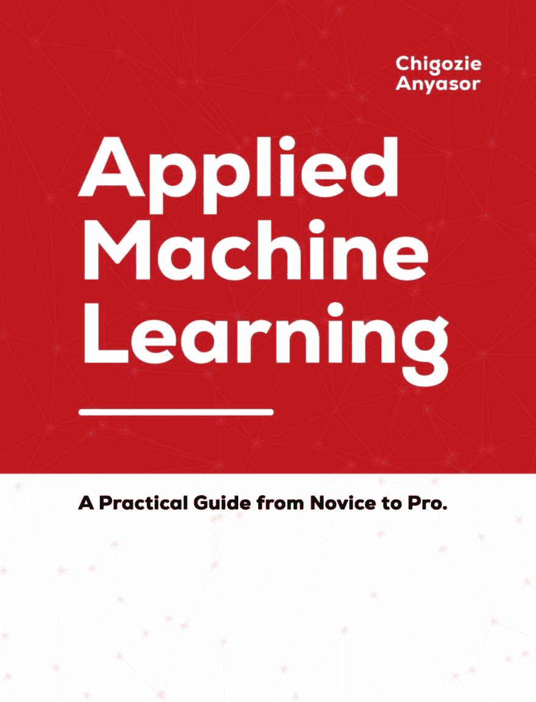应用机器学习：实践指南——从新手到专家。

以商业用例的方法解决学校、银行、零售、保险、电子商务、制造业、供应链等领域的真实问题。


您可以通过以下方式联系作者：

LinkedIn : [`https://www.linkedin.com/in/chigozie-anyasor-9519b938`](https://www.google.com/url?q=https://www.linkedin.com/in/chigozie-anyasor-9519b938&sa=D&source=editors&ust=1720099681633499&usg=AOvVaw2FlUJRUd6ZY3kmls3YVkIf)  

电子邮件：`anyasorc@gmail.com`

您可能感兴趣的其他书籍：

[Curbing Fraud - 通过案例研究方法在银行和金融科技领域遏制欺诈。](https://www.google.com/url?q=https://selar.co/609b11&sa=D&source=editors&ust=1720099681634278&usg=AOvVaw2YOaUAAw-QiiBLFlYBlYYb)

[Data Privacy & Ethical Responsibilities: An enterprise guide to preventing DATA.](https://www.google.com/url?q=https://selar.co/a640z6&sa=D&source=editors&ust=1720099681634503&usg=AOvVaw17_iB-DblzIdUBFpQ0ARQI)  

## 关于作者

|  || Chigozie Anyasor，目前担任 Uridium Works Limited 首席执行官，主导制定具有影响力的策略以实现公司目标。他的主要关注点在于营造动态高效的工作环境，以提升其由熟练工程师组成的团队的生产力。在担任首席执行官之前，Chigozie 在 Sterling Bank plc 积累了超过 14 年的宝贵经验，担任软件工程副经理/负责人。在此期间，他领导了包括企业解决方案工程、自动化与生产力以及企业数据仓库在内的多个关键团队。其在银行行业的丰富经验涵盖团队赋能、促进部门间强大的协作关系以及创新支付系统的设计与实施。他卓越的分析能力、调试问题的熟练程度以及针对业务挑战量身定制的现代技术栈的全面理解尤为突出。Chigozie 还在多个数据科学项目中作出了重要贡献，旨在解决具体的业务难题。教育背景方面，Chigozie 拥有尼日利亚 Babcock University 的计算机科学学士学位，以及美国 Walden University 的数据科学硕士学位。 |

| --- | --- |

## 致谢

写书从来不是孤军作战，本项目离不开众多个人和组织的支持、鼓励和帮助。

首先，我要向我的家人致以最深的感谢，感谢他们在这段旅程中的无条件支持和理解。他们的耐心、鼓励和对我的信任激励我坚持完成这项工作。

我对我的同事和导师表示由衷的感谢，他们的见解、指导和建设性反馈在塑造本书内容方面发挥了不可估量的价值。他们的专业知识和鼓励在细化本文所呈现的思想方面发挥了关键作用。

我也想向致力于确保本书质量和准确性的审稿人和编辑们表达感谢。他们细致入微的关注极大地提升了材料的清晰度和连贯性。

此外，我感谢机器学习的读者和实践者，他们的热情和动力一直激励着我。你们的热情和奉献不断提醒我，在社区中分享知识和专业知识的重要性。

对创造这本书的任何人表示最诚挚的感谢。你们的支持与合作在将“Applied Machine Learning: A Practical Guide from Novice to Pro”付诸实现方面发挥了关键作用。

衷心致谢，

Chigozie Anyasor

## 前言

欢迎来到“Applied Machine Learning”，这是一本深入探讨不断演进的领域的著作，该领域正在彻底改变各行各业、解决复杂挑战，并将我们带入前所未有的创新时代。在这些页面中，我们踏上了一段通过机器学习实践领域的旅程，揭示了工具、方法论和洞见，使个人和企业能够充分利用这一前沿技术的能力。

“Applied Machine Learning”深入探讨机器学习的实际应用，为个人和组织提供利用其潜力的路线图。该书面向初学者和经验丰富的从业者，涵盖基础原理及真实场景。

无论你是初入机器学习世界的学生，还是希望提升技能的专业人士，亦或是正在推动机器学习在组织中融合的行业领袖，本书都将作为指南，帮助你释放机器学习的变革力量。让探索之旅开始吧！

踏入 Applied Machine Learning 的领域就像踏入一个迷人的世界，数据转化为深刻洞察，算法揭示隐藏的奥秘。“Applied Machine Learning: From Novice to Pro”向您发出温暖的邀请，邀请您探索这段令人兴奋的景观，并提供一条针对初学者和资深从业者的全面路线图。

在这段沉浸式旅程中，我拆解了机器学习概念的复杂性，简化了算法，并为您提供将这些原则无缝应用于实际挑战的技能。无论您是首次踏入人工智能领域，还是希望提升专业水平，本书将为您提供所需的知识和实践智慧，帮助您在应用机器学习的多样化领域中遨游。

准备好解锁数据中潜藏的潜力，见证预测分析的奇迹，并观看原始信息如何转化为可操作的智能吧。“Applied Machine Learning: From Novice to Pro”不仅仅是一本指南，它更是一个加入那些利用机器学习创新、解决问题并塑造未来的行列的开放邀请。系好安全带，开始探索吧！

机器学习是一个极具吸引力的领域，它利用计算算法从数据中获取洞察并进行预测，而无需显式编程。它是人工智能的一个子集，专注于创建能够自主从经验中学习和改进的系统。要有效地运用机器学习，数据科学家或有志成为数据科学家的人必须深入理解其原理和内在机制。

在核心层面，机器学习意味着向算法或模型提供相关数据以解决业务问题，使其能够从数据中的模式和关系中学习并改进。随着更多数据被纳入算法或模型，它可以利用已获知识（训练数据）来预测新的数据点。因此，机器学习使企业能够基于观察到的模式做出明智的决策和预测。


-   预测在利用机器学习进行明智决策时发挥关键作用，但必须认识到，仅仅拥有一个预测模型是不够的。真正重要的是如何根据这些预测采取行动。企业必须对模型的结果承担责任并了解其局限性。这凸显了数据科学家或首席数据官在理解模型能力、消除误解并有效利用机器学习以解决业务挑战方面的关键作用。

这本书是一本全面的指南，涵盖了数据科学和分析中广泛使用的各种机器学习技术。它贯穿了整个机器学习流程，从数据预处理开始，一直到模型选择。文本深入探讨了多种回归模型，包括简单回归、多元回归、多项式回归、支持向量回归、决策树回归和随机森林回归，并介绍了如何评估这些模型并为特定任务选择最佳回归模型。

此外，书中还探讨了分类技术，如逻辑回归、k 近邻、支持向量机、朴素贝叶斯、决策树和随机森林分类，帮助读者全面理解如何评估分类模型并选择最适合特定目标的模型。

书中还涉及聚类方法，如 k-means，最后介绍了如何将机器学习模型投入实际应用。总之，这本书是任何希望掌握机器学习技术并将其应用于实际场景的人的不可或缺的资源。

## 机器学习、数据科学和数据分析之间的区别。

机器学习是人工智能的一个重要子集，围绕创建算法和统计模型展开。这些模型使计算机能够从数据中学习而无需显式编程，从而执行特定任务。例如，电子邮件服务中的垃圾邮件过滤器利用机器学习算法根据数据中的模式区分垃圾邮件和合法邮件。

在零售行业，机器学习算法常用于需求预测。通过分析历史销售数据以及天气模式、节假日和经济指标等外部因素，零售商可以更准确地预测产品的未来需求。这有助于他们优化库存管理，减少缺货和积压库存，从而提高客户满意度并增加盈利能力。

在制造行业，机器学习用于预测性维护。通过监控设备传感器和历史维护记录，机器学习算法可以识别即将发生故障的模式。这使制造商能够提前安排维护，减少非计划停机时间，降低维护成本，并优化生产效率。

数据科学则涵盖了使用多种工具和算法对大规模数据集进行全面分析。通过这种分析，数据科学家能够发现隐藏模式并提取可操作的洞察。例如，零售公司可能会使用数据科学技术分析客户购买行为，并据此优化产品推荐。

数据分析专注于检查原始数据以提取洞察并得出结论，常用工具包括 Microsoft Power BI 和 Tableau 等专业软件。这些洞察支持战略决策，识别趋势，并提升整体业务绩效。例如，医疗机构可能会利用数据分析跟踪患者结果，并根据收集的数据优化治疗方案。

## 机器学习类型

机器学习有三种类型：监督学习、无监督学习和强化学习。本书将重点讨论前两种。

监督学习是一种机器学习类型，其中算法从包含标记示例的数据集或指导性规则中学习。这意味着算法在已有期望输出的输入数据上进行训练，从而能够基于新的、未见的数据做出预测和决策。监督学习模型广泛应用于计算机视觉、自然语言处理和预测分析等领域。

让我们来看下面的医疗数据集截图：

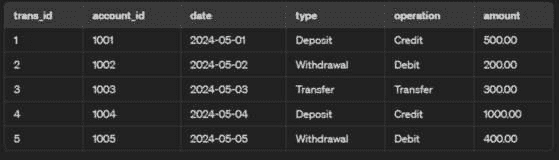

如图所示，该数据集中没有标签列可供指导模型，因此该数据集非常适合用于无监督学习。

## 让我们振作起来。

欢迎！你准备好进入机器学习这个令人兴奋的世界了吗？让我们一起振作起来，一起探索这个充满发现的旅程，保证让我们都感到受益和受激励！话不多说，我们开始吧！

打开 Google Colab：[`colab.research.google.com/`](https://colab.research.google.com/)


要创建一个新笔记本，请按照以下步骤操作：

导航到屏幕左上角的“文件”选项卡。

点击“文件”以打开下拉菜单。

从菜单中选择“新建笔记本”。

这将打开一个新笔记本，供你开始项目或做笔记，如下图所示：


如上图所示，你点击文件，然后选择新笔记本。

要将笔记本的标题从“Untitled”更改为“Getting Pumped”，请执行以下操作：

点击笔记本界面顶部当前标题“Untitled”。

会出现一个文本框，用于编辑标题。

在文本框中输入“Getting Pumped”。

按回车键或点击文本框外部以保存新名称。

你的笔记本现在已重命名为“Getting Pumped”，如下图所示：


## 导入数据

要获取本练习所需的数据集，你可以从银行营销来源（[Bank Campaign](https://www.google.com/url?q=https://github.com/anyasorc/appliedml/blob/main/bankcampaign.csv&sa=D&source=editors&ust=1720099681675968&usg=AOvVaw0Ic9_VBs5RP55ZlbeQk9ds)）下载。然后，将数据集从系统中的位置拖动到 Google Colab 数据文件夹（由橙色文件夹图标指示），如下图所示：

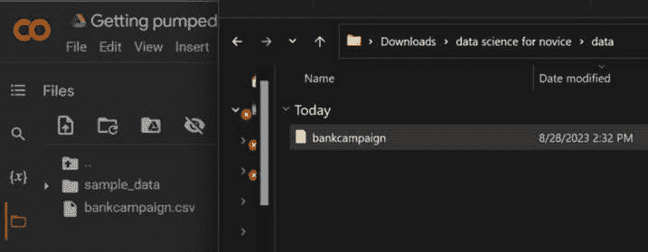

执行上述操作后，会弹出一个警告通知。下面的对话框会提示你保持数据集的副本，因为 Google Colab 经常会删除数据集。


继续操作，只需点击“确定”按钮关闭警告对话框，然后继续完成任务。

## 问题案例

Adefunmi，一家银行的员工，承担了监督一项针对客户的定向营销活动的任务，该活动旨在向同意接收投资机会广告的客户进行推广。为最大化银行的营销投资回报，Adefunmi 采用了系统化的方法，鼓励她的团队依据数据在分配营销资源时做出决策。


-   [为了实现这一目标，她促进了各方利益相关者的协作，最终决定实施机器学习框架。该框架利用已同意类似投资机会的客户过去数据来指导决策。]

1.  Adefunmi 与数据工程师、业务团队和数据科学家紧密合作。这一协作确保数据工程师向数据科学家提供全面的数据访问，数据科学家随后选择使用逻辑回归模型根据历史数据预测客户行为。

## Import the data

要导入数据，您首先需要导入下面所示的库：

``` 
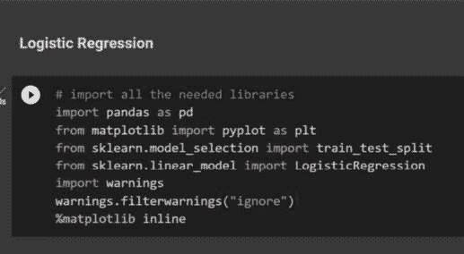
```

如果没有错误，请继续加载数据并查看数据框架，如下图所示：

``` 
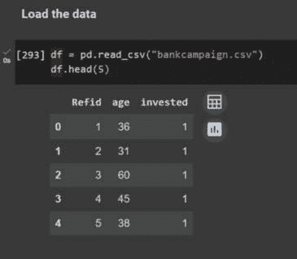
```

下面我们将查看数据框架中的记录总数和列数，如下图所示：

``` 
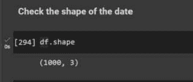
```

接下来，我们将想要使用的特征分配给变量 X 和 y，如下所示：

将 "Age" 分配给 X

将 "invested"（类别）分配给 y

``` 
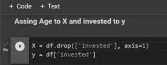
```

使用 Python 的 value_counts() 方法检查 "invested" 类别值的分布。

``` 
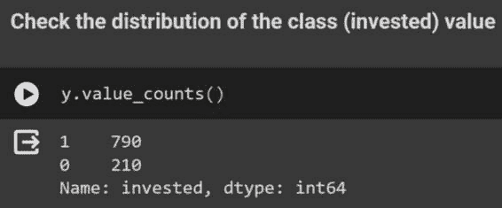
```

分布显示，希望投资的客户（1）共 790 位，而不想投资的客户（0）共 210 位。这种数据不平衡如果不加以解决，可能会对机器学习模型的性能产生负面影响。

## 什么是不平衡数据？

不平衡数据指的是类别在数据集中不均匀分布，即某一类（或几类）的实例数量显著多于其他类。这种不平衡会给机器学习模型带来挑战，因为模型可能会偏向多数类，导致在少数类上的表现不佳。

## 处理数据不平衡

处理数据不平衡至关重要，原因包括提升模型性能、防止模型偏差、改善决策和增强泛化能力。管理不平衡数据的方法包括：

SMOTE（Synthetic Minority Over-sampling Technique）

下采样

上采样

在实施任何解决 "invested" 类不平衡的方法之前，我们先先可视化当前类的分布，如下图所示：

``` 
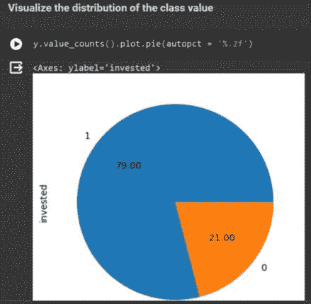
```

我们将使用下采样方法，如下所示：

``` 
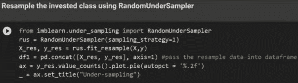
```

应用下采样方法后，类不平衡已得到解决，如下图所示：

``` 
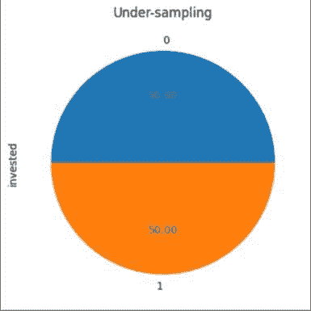
```

接下来，我们将创建一个散点图，观察更倾向于投资的客户年龄分布，如下图所示：

``` 
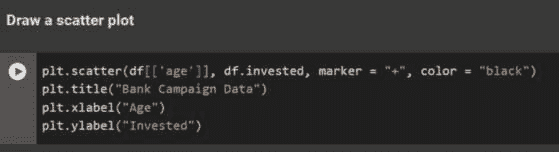
```

输出：

``` 
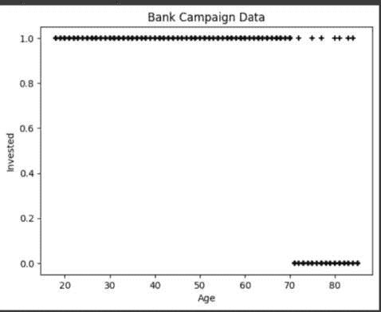
```

## 解读散点图

散点图表明，年龄在 20 到 71 之间的客户在接收针对性广告时更有可能投资。71 岁以上的客户投资意愿较低。因此，广告目标受众应理想为年龄在 20 到 71 之间的客户。

接下来，我们将数据划分，80% 用于训练模型，20% 用于测试，如下图所示：

``` 
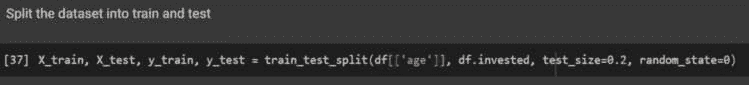
```

下图显示，我们实例化 LogisticRegression 类并将其赋值给变量 lc，然后使用 lc.fit 以 X_train 和 y_train 训练模型。注意：模型训练发生在 lc.fit 中。

``` 
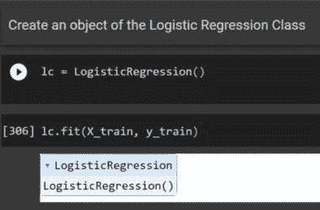
```

接下来，我们将传入 X_test（包含 20% 预留用于测试模型的数据），如下图所示：

``` 
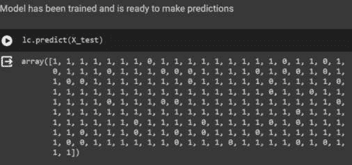
```

上图显示模型预测结果准确。

接下来，我们通过输入年龄值来验证预测的准确性，如下图所示。

根据下图，我输入了年龄 40。模型参考其之前的模式，指出在该年龄段，当受到针对性广告时，客户很可能进行投资。这表明该年龄段的客户是 Adefunmi 所寻找的理想目标受众。

``` 
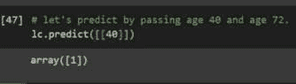
```

下图显示，模型预测 72 岁的客户不会对投资导向的广告感兴趣。显然，这些客户不是 Adefunmi 所寻找的目标受众。

``` 
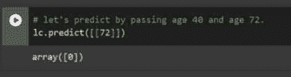
```

受实验取得成功的启发，Adefunmi 指示数据团队收集针对性营销数据，并明确排除 72 岁及以上的个人。

Adefunmi 实施了一套 meticulously（精心）规划且全面的银行营销活动策略。这种方法使银行能够优化资源，使营销活动高度成功，并强烈吸引投资机会感兴趣的客户。

公司可能决定将机器学习模型集成为 API，以便于企业应用。

令人兴奋，不是吗？这只是开始。


Figure 2-21. 模型训练成功，未报错。

图 2-22 显示模型的 R-squared 分数为 0.85122，这意味着大约 85.12%（0.85122 * 100）的因变量变异可以由模型中的自变量解释。高的 R-squared 值表明模型拟合良好，能够解释数据中大部分的变异。

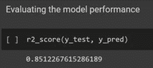

Figure 2-22.

## 对多项式回归模型的 r2_score 解释

R2（读作“R 平方”）得分，也称为决定系数，是一个统计指标，用来量化因变量的方差中有多少可以由自变量（或自变量集）解释。

R2 得分 0.851227 表示大约 85.12% 的因变量方差可以从模型中的自变量中预测。换句话说，模型能够很好地解释数据中的变异。高的 R2 得分表明观测结果与模型预测非常吻合，这意味着模型拟合数据良好，能够较好地捕捉数据的波动。

## 使用多项式回归进行预测

要使用多项式回归进行预测，可以在已训练好的模型上调用 predict 函数，并提供必要的输入参数，如图 2-23 所示。

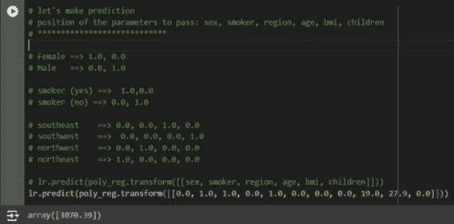

Figure 2-23.

在这一例子中，`sex`、`smoker`、`region`、`age`、`bmi` 和 `children` 是用于预测的输入特征。

### 代码说明

在多项式回归的上下文中，模型在进行预测前需要将输入特征转换为多项式特征。代码片段通过两个步骤实现此转换：

1. 将输入特征 `sex`、`smoker`、`region`、`age`、`bmi` 和 `children` 转换为多项式特征，使用 poly_reg.transform 方法。该转换会生成原特征的多项式组合等附加特征。


预测目标变量：经过转换的特征随后传递给已训练的回归模型 `lr` 的 `lr.predict` 方法，用于预测目标变量。

## 多元线性回归

多元线性回归通过建模依赖变量（也称为目标变量或响应变量）与多个自变量（也称为预测器或特征）之间的关系，扩展了简单线性回归的原理。虽然简单线性回归仅考虑一个预测器，多元线性回归则纳入两个或更多的预测器，从而提供了更全面的分析，说明各种因素如何共同影响依赖变量。

在数据科学中，该方法对于理解和量化多个变量对目标结果的影响至关重要。通过考虑多个预测器，多元线性回归能够实现更准确的预测，并提供对数据中复杂关系的洞察。

使用以下链接下载数据集：[保险数据集](https://www.google.com/url?q=https://www.kaggle.com/datasets/awaiskaggler/insurance-csv&sa=D&source=editors&ust=1720099681734560&usg=AOvVaw3TzaCJRNZGrbHq9PreHILr)。源代码可在此查看：[多元线性回归](https://www.google.com/url?q=https://github.com/anyasorc/appliedml/blob/main/Medical_Insurance_Multiple_Linear_Reg.ipynb&sa=D&source=editors&ust=1720099681734846&usg=AOvVaw0jy2PLIOHE3Kh20p1ZKiiS)

## 导入库

图 2-24 显示了所有必要的导入库。

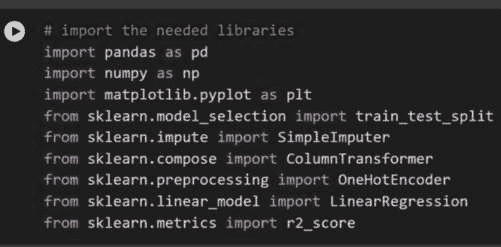

图 2-24。

## 导入并查看数据

图 2-25 展示了数据的导入和查看方式，如下所示。

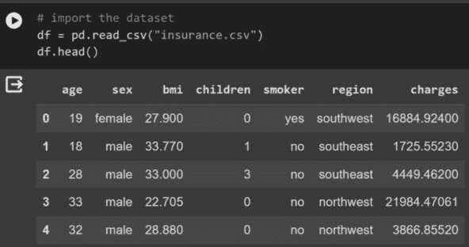

图 2-25。

## 统计 DataFrame 中 'region' 列唯一值的频率

代码 `df.region.value_counts()` 用于计算 DataFrame `df` 中 `region` 列每个唯一值的频率，显示每个地区出现的次数。如图 2-26 所示，该方法同样适用于 `smoker` 特征。

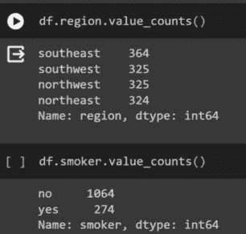

图 2-26。

## 检查缺失值

代码 `df.isna().sum()` 是一系列方法的链式调用，用于计算 DataFrame `df` 中每列的缺失值（NaN）总数，如图 2-27 所示。

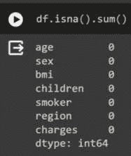

图 2-27。

## 为 X 和 y 赋值

`X = df.iloc[:, :-1].values:`

此行选择 DataFrame `df` 的所有行和除最后一列之外的所有列，并将结果转换为 NumPy 数组。得到的数组 `X` 通常包含特征或预测器，如图 2-28 所示。

`y = df.iloc[:, -1].values:`

此行选择 DataFrame `df` 的所有行和仅最后一列，并将结果转换为 NumPy 数组。得到的数组 `y` 通常包含目标或响应变量，如图 2-28 所示。

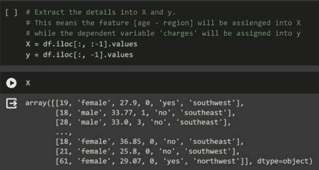

图 2-28

## 查看 X 中的数据

在新代码单元中输入 `X` 并运行，即可查看已赋值给 `X` 的数据，如图 2-29 所示。对 `y` 也可如此操作。

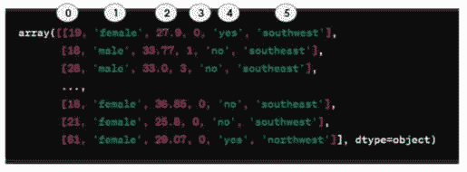

在图 2-29 中，我为列标记了对应的索引位置：第一列 `Age` 位于索引位置 0；第二列 `Sex` 位于索引位置 1；第三列 `BMI` 位于索引位置 2；第四列 `Number of Children` 位于索引位置 3；第五列 `Smoker` 位于索引位置 4；第六列 `Region` 位于索引位置 5。

## 处理缺失值（NaN）

处理缺失值对于数值特征/列是相关的，如图 2-30 所示。我们选择了索引位置为 0、2、3 的特征/列，对应于 `Age`、`BMI` 和 `Number of Children`，如图 2-29 所示。

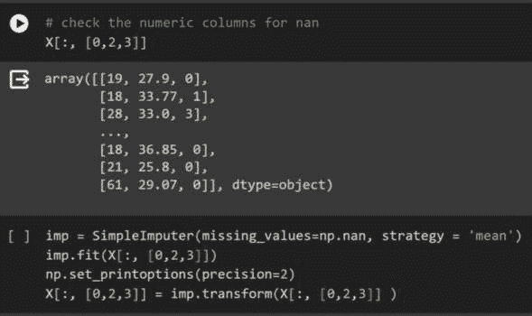

图 2-30. `X[:, [0, 2, 3]]` 的含义是“选择所有行和索引位置为 0、2、3 的列”。因此，`X[:, [0, 2, 3]]` 有效提取 `Age`、`BMI` 和 `Number of Children` 列/特征的所有行数据。

在识别出数值列后，我们将使用 `SimpleImputer` 类计算每列的均值，并用这些均值替换缺失值，如图 2-31 所示。

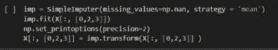

图 2-31.

### 代码说明

`SimpleImputer(missing_values=np.nan, strategy='mean')`

`missing_values=np.nan`: 该参数指定要 impute（填补）的缺失值由 `np.nan` 表示。

`strategy='mean'`: 该参数指定缺失值应替换为其所在列的均值。

`imp.fit(X[:, [0, 2, 3]])`

`X[:, [0, 2, 3]]`: 从数组 `X` 中选择所有行和索引位置为 0、2、3 的列。这些列为数值型。

`.fit(...)`: 该方法基于非缺失值计算每列的均值，并将这些均值存储以供后续使用。

`np.set_printoptions(precision=2)`

该函数用于配置 NumPy 数组的显示方式。此处将打印输出的精度设置为 2 位小数。

`X[:, [0, 2, 3]] = imp.transform(X[:, [0, 2, 3]])`

`X[:, [0, 2, 3]]`: 再次选择从数组 `X` 中所有行和索引位置为 0、2、3 的列。

`imp.transform(...)`: 该方法将在 `.fit(...)` 步骤中计算的均值替换选定列中的缺失值。

`X[:, [0, 2, 3]] = ...`: 此赋值将更新原始数组 `X` 中的选定列，使其包含已用均值替换缺失值的转换后数据。

## ColumnTransformer 和 OneHotEncoder()

机器学习模型本质上不理解文本或 categorical（类别）值，因此需要将它们转换为模型能够处理的数值表示。这就是为什么我们需要将图 2-29 中索引位置 1（`Sex`）、4（`Smoker`）和 5（`Region`）的类别变量进行转换的原因。为此，我们将使用 `ColumnTransformer` 和 `OneHotEncoder`，如图 2-32 所示。

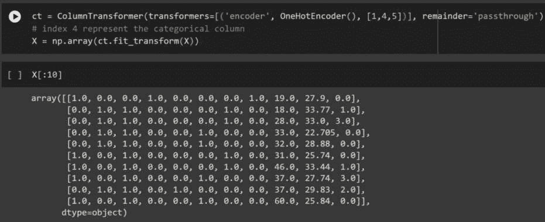

图 2-32.

### 代码说明

`ColumnTransformer`: 来自 `sklearn.compose` 模块的类，用于对数据集的不同列应用不同的预处理转换。

`OneHotEncoder`: 来自 `sklearn.preprocessing` 模块的类，用于将类别特征转换为可以供机器学习算法使用的数值格式。

`np`: 通常用于 NumPy 库的别名，用于进行数组操作。

创建 ColumnTransformer 实例

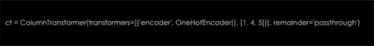

`ColumnTransformer(...)`:

初始化 `ColumnTransformer` 对象，用于对特定列应用指定的转换。

`transformers=[('encoder', OneHotEncoder(), [1, 4, 5])]`:

`'encoder':` 为该转换器指定的名称，可以是任意字符串。

`OneHotEncoder()`: 指定使用 `OneHotEncoder` 进行转换。

`[1, 4, 5]`: 指定用于转换的列的索引位置列表。此处，索引位置为 1、4、5 的列将被一热编码。

`remainder='passthrough'`:

该参数指定未明确转换的列应如何处理。`passthrough` 表示这些列保持不变，直接包含在输出中。

## 分割训练集和测试集

我们需要使用 80:20 的比例将数据集划分为训练集和测试集。这意味着 80% 的数据用于训练模型，剩余的 20% 用于在未见过的数据上评估模型的性能。图 2-32 描绘了这一过程。

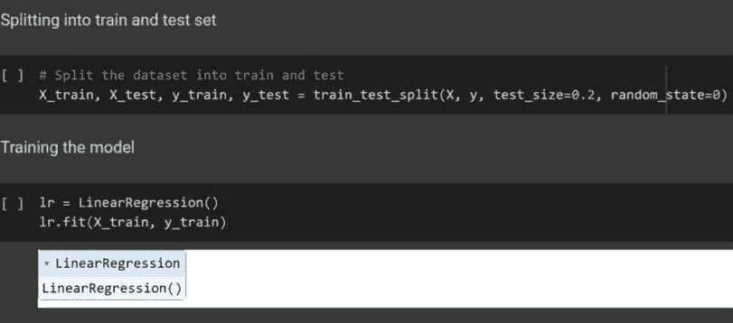

图 2-32.


train`_`test`_`split : 这是 sklearn.model`_`selection 模块中的一个函数，用于将数据集划分为训练集和测试集。X`_`train 和 y`_`train 用于训练模型，X`_`test 和 y`_`test 用于在未见数据上评估模型的性能。

Components of the Function Call :

X: 这是特征矩阵（输入变量）。它包含独立变量或预测器。

y: 这是目标向量（输出变量）。它包含因变量或响应变量。

test`_`size=0.2: 该参数指定要包含在测试集中的数据集比例。这里，0.2 表示 20% 的数据将用于测试，剩余 80% 用于训练。

random`_`state=0: 该参数控制在将数据划分前对数据进行洗牌的操作。传入整数可确保分割的可重复性，即每次使用相同的 random`_`state 值运行代码时，数据划分结果相同。

Output of the Function Call :

X`_`train: 这是特征矩阵的训练子集。包含 X 中 80% 的行。

X`_`test: 这是特征矩阵的测试子集。包含 X 中剩余的 20% 的行。

y`_`train: 这是目标向量的训练子集。包含与 X`_`train 中行对应的 y 中 80% 的行。

y`_`test: 这是目标向量的测试子集。包含与 X`_`test 中行对应的 y 中 20% 的行。

通过使用 test`_`size=0.2，我们确保 20% 的数据被保留用于测试，这有助于评估模型在新数据上的泛化能力。random`_`state 确保数据划分是可重复的，从而在多次运行代码时保持结果一致。

## Training the model

Figure 2-33  说明了如何使用 X`_`train 和 y`_`train 数据集训练机器学习模型。执行结果表明模型已成功训练。

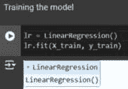

Figure 2-33 .

## Code Explanation

lr = LinearRegression()

这一行创建 LinearRegression 类的实例并将其赋值给变量 lr。

实例 lr 将用于将模型拟合到训练数据并进行预测。

lr.fit(X`_`train, y`_`train)

fit: 该方法在训练数据上训练线性回归模型。

X`_`train: 训练数据的特征矩阵，包含独立变量。

y`_`train: 训练数据的目标向量，包含因变量。

运行此代码后，lr 实例包含已训练好的线性回归模型，可通过 predict 方法对新数据进行预测。

## Predicting with the test data

Figure 2-34  展示了如何使用已训练好的模型 (lr) 和测试数据 (X`_`test) 进行预测。

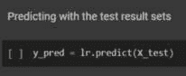

Figure 2-34

## Code Explanation

y`_`pred = lr.predict(X`_`test) :

此代码使用已训练好的线性回归模型 (lr) 对测试数据 (X`_`test) 的因变量值进行预测。预测结果存储在变量 y`_`pred 中。

predict 方法将在训练阶段学习到的关系应用于测试数据，生成这些预测，从而提供模型在未见数据上的性能估计。

## Model Evaluation

在训练机器学习模型后，通过检查 R² 分数来评估其性能是很重要的。R² 分数表示模型在训练数据上的拟合程度，如 Figure 2-35 所示。

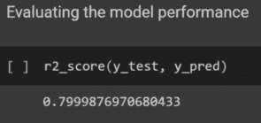

Figure 2-35.

## Code Explanation

r2`_`score(y`_`test, y`_`pred)

R² 分数，也称为决定系数，用于衡量模型预测值与实际值之间的匹配程度。

y`_`test: 测试数据集中因变量的实际观测值。这是我们试图预测的真实输出。

y`_`pred: 训练好的模型对测试数据集 (X`_`test) 生成的因变量预测值。

## Model Result Interpretation

输出 0.7999876970680433 表示大约 80% 的因变量 (y`_`test) 的变异可以通过训练好的模型利用独立变量 (X`_`test) 来预测。  

这表明模型拟合良好，因为模型解释了大部分变异。

# Let’s make a prediction

Figure 2-36  展示了如何使用已训练的机器学习模型进行预测。我们需要提供以下特征进行预测：sex , smoker , region , age , BMI , and number of children，这些特征与训练时使用的特征相同。这些特征作为输入传递给 predict 方法，模型据此返回基于这些特征的预测目标变量值。

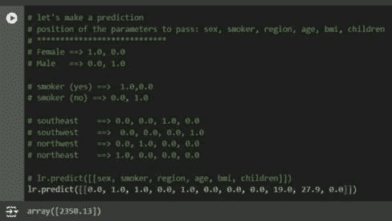

Figure 2-36.

## Support Vector Regression

Support Vector Regression (SVR) 是一种高度有效且灵活的机器学习方法，常用于解决各种回归问题。其独特的设计使其能够通过确定最佳回归线来管理复杂的回归任务，该回归线准确反映输入变量和输出变量之间的关系。

使用以下链接下载数据集：[Insurance Dataset](https://www.google.com/url?q=https://www.kaggle.com/datasets/awaiskaggler/insurance-csv&sa=D&source=editors&ust=1720099681753988&usg=AOvVaw1qEmRxFcDWzY9jJAm9EsET) 。源代码在此：[Support Vector Regression](https://www.google.com/url?q=https://github.com/anyasorc/appliedml/blob/main/Medical_Insurance_Multiple_Linear_Reg.ipynb&sa=D&source=editors&ust=1720099681754452&usg=AOvVaw2p0VIxTh5aYts45SQmqlOd)  

## Import Libraries

Figure 2-37  展示了所有导入的必需库。

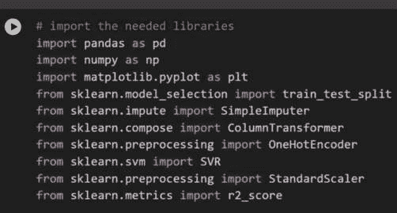

Figure 2-37.

Import and View Data

Figure 2-38   展示了数据的导入和查看过程，如下所示。

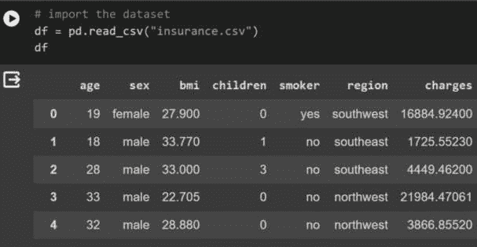

Figure 2-38.

# Calculating the frequency of unique values in a DataFrame column named 'region'.

代码 df.region.value`_`counts()  计算 DataFrame df 中 'region' 列的每个唯一值的频率，并显示每个 region 出现的次数。'smokers' 列的处理方式相同，如 Figure 2-39 所示。

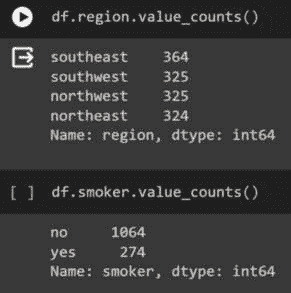

Figure 2-39.

## Check for missing values

代码 df.isna().sum() 是一系列方法的组合，用于计算 DataFrame df 中每列的缺失值（NaN）总数，如 Figure 2-40 所示。

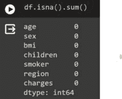

Figure 2-40.

## Assign values to X and y

X = df.iloc`[:, :-1]`.values:

此行选择 df 中的所有行和除最后一列外的所有列，并将结果转换为 NumPy 数组。 resulting array X 通常包含特征或预测器，如 Figure 2-41 所示。

y = df.iloc`[:, -1]`.values:

此行选择 df 中的所有行和仅最后一列，并将结果转换为 NumPy 数组。 resulting array y 通常包含目标或响应变量，如 Figure 2-41 所示。

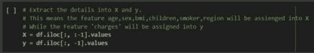

Figure 2-41

# View data in X

在新的代码单元中输入 X 并运行代码，可以查看 X 中赋值的数据，如 Figure 2-42 所示。y 也可以同理处理。


Figure 2-42 . 我已标记列及其对应的索引位置：第一列 Age 在索引位置 0；第二列 Sex 在索引位置 1；第三列 BMI 在索引位置 2；第四列 Number of Children 在索引位置 3；第五列 Smoker 在索引位置 4；第六列 Region 在索引位置 5。

# Addressing missing values (NaN)


处理缺失值对于数值特征/列是相关的，如图 2-43 所示。我们选择了索引位置为 0、2、3 的特征/列，分别对应年龄（Age）、BMI 和 孩子数量（Number of Children），如图 2-42 所示。


图 2-43. X[:,[0, 2, 3]] 表示“选择所有行和索引位置为 0、2、3 的列”。因此，X[:,[0, 2, 3]] 实际上从数据集的所有行中提取了年龄、BMI 和 孩子数量 列。

在识别出数值列后，我们将使用 SimpleImputer 类计算每列的平均值，并用这些平均值替换缺失值，如图 2-44 所示。


图 2-44.

### 代码说明

SimpleImputer(missing_values=np.nan, strategy='mean')

missing_values=np.nan：指定要处理的缺失值用 np.nan 表示。

strategy='mean'：指定缺失值将被用该列的平均值替换。

imp.fit(X[:,[0, 2, 3]])

X[:,[0, 2, 3]]：从数组 X 中选择所有行和索引位置为 0、2、3 的列。这些列被假设为数值型。

.fit(...)：该方法基于非缺失值计算每列的平均值，并将这些平均值存储用于后续使用。

np.set_printoptions(precision=2)

该函数用于配置 NumPy 数组的显示方式。这里将打印输出的精度设置为 2 位小数。

X[:,[0, 2, 3]] = imp.transform(X[:,[0, 2, 3]])

X[:,[0, 2, 3]]：再次选择从数组 X 中所有行和索引位置为 0、2、3 的列。

imp.transform(...)：该方法将在 .fit(...) 步骤中计算出的平均值用于替换选定列中的缺失值。

X[:,[0, 2, 3]] = ...：此赋值将原始数组 X 中的选定列更新为经过转换的数据，缺失值已被替换。

## ColumnTransformer 和 OneHotEncoder()

机器学习模型无法理解文本，因此需要将文本特征转换为数值形式，以便模型能够处理。这也是我们需要将索引位置 1（性别）、4（吸烟者）和 5（地区）的类别变量转换为数值形式的原因，如图 2-42 所示。为了实现这一点，我们将使用 ColumnTransformer 和 OneHotEncoder，如图 2-45 所示。


图 2-45.

ColumnTransformer：来自 sklearn.compose 模块的类，用于对数据集的不同列应用不同的预处理转换。

OneHotEncoder：来自 sklearn.preprocessing 模块的类，用于将类别特征转换为机器学习算法可以更好地进行预测的格式。

np：这是 NumPy 库的常用别名，用于数组操作。

创建 ColumnTransformer 实例


ColumnTransformer(...):

此操作初始化一个 ColumnTransformer 对象，用于对指定列应用特定的转换。

transformers=[('encoder', OneHotEncoder(), \[1, 4, 5\])]：

'encoder'：给这个转换器起一个名字，可以是任意字符串。

OneHotEncoder()：指定使用 OneHotEncoder 进行转换。

\[1, 4, 5\]：指定要转换的列的索引位置。这里，索引为 1、4、5 的列将被一热编码。

remainder='passthrough'：

该参数指定对未明确转换的列应如何处理。'passthrough' 表示这些列将保持不变并包含在输出中。

## 将数据集划分为训练集和测试集

我们需要将数据集划分为训练集和测试集。我们将使用 80:20 的比例，即 80% 的数据用于训练模型，剩余的 20% 用于在未见数据上进行测试。图 2-46 说明了这一过程。

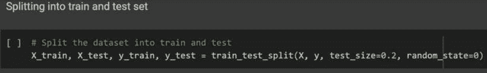

图 2-46.

### 代码说明

train_test_split：这是 scikit-learn 库 sklearn.model_selection 模块中的函数，用于将数据集划分为训练集和测试集。X_train 和 y_train 用于训练模型，X_test 和 y_test 用于评估模型在未见数据上的性能。

函数调用的组成部分：

X：特征矩阵（输入变量），包含独立变量或预测因子。

y：目标向量（输出变量），包含依赖变量或响应变量。

test_size=0.2：指定用于测试的数据集比例。这里，0.2 表示 20% 的数据用于测试，剩余的 80% 用于训练。

random_state=0：控制在划分前对数据进行混洗的参数。传入整数可以确保分割的可重复性，即每次使用相同的 random_state 值运行代码时，数据分割结果相同。

函数调用的输出：

X_train：特征矩阵的训练子集，包含 X 的 80% 行。

X_test：特征矩阵的测试子集，包含 X 剩余的 20% 行。

y_train：目标向量的训练子集，包含与 X_train 中行对应的 y 的 80% 行。

y_test：目标向量的测试子集，包含与 X_test 中行对应的 y 的 20% 行。

使用 test_size=0.2 确保 20% 的数据用于测试，有助于评估模型在新数据上的泛化能力。random_state 确保数据分割可重复，在多次运行代码时结果一致。

## 数据标准化用于 SVR

在机器学习中，特别是使用对输入数据尺度敏感的算法时，标准化数据很常见。标准化将数据转换为均值为零、标准差为一的形式。这对于支持向量回归（SVR）尤为重要，因为 SVR 对输入特征的尺度敏感。图 2-47 说明了如何实现这一点。

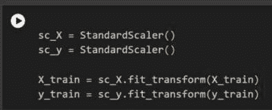

图 2-47.

### 代码说明


创建了两个 StandardScaler 实例：sc_X 用于输入特征 X，sc_y 用于目标变量 y。

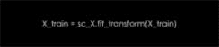

fit_transform 是一种方法，先拟合标准化器到数据（计算 X_train 每个特征的均值和标准差），然后根据这些统计量对数据进行转换。

经过转换后，X_train 中的每个特征的均值为零，标准差为一。

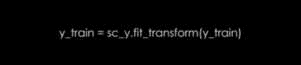

同样，fit_transform 也用于目标变量 y_train。

这在某些机器学习上下文中不常见，但在像 SVR 这样的算法中可能很有用，因为它可以使目标变量的尺度与输入特征保持一致。

## 训练模型

图 2-48 说明了使用 X_train 和 y_train 数据集训练机器学习模型的过程。训练过程的执行表明模型训练成功。

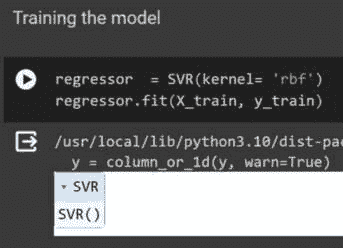

图 2-48.

### 代码说明


SVR：代表 Support Vector Regression，是一种 Support Vector Machine（SVM）用于回归任务的类型。


-   [核心参数 `kernel='rbf'`：该参数指定算法使用的核函数类型。`'rbf'` 代表径向基函数（Radial Basis Function），是一种常用于处理特征与目标变量之间非线性关系的核。RBF 核会将输入特征映射到更高维空间，从而在该空间中可以找到线性分离，使其能够有效捕获复杂模式。]


-   [fit(X_train, y_train)：该方法用于使用训练数据训练 SVR 模型。`X_train` 包含输入特征，`y_train` 包含对应的目标值。  

    在拟合过程中，SVR 算法通过寻找最佳超平面（或决策边界），在指定的容差（epsilon-insensitive 区间）内使数据最佳拟合，从而学习输入特征与目标变量之间的关系。]

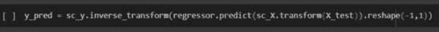

## 使用测试数据进行预测

Figure 2-49  下面的图示了如何使用已训练好的模型（回归器）和测试数据（X_test）进行预测。


Figure 2-49.

### 代码说明


-   [sc_X.transform(X_test)：将与训练数据 X_train 相同的标准化过程应用于测试数据 X_test。  

    `sc_X` 是一个 `StandardScaler` 实例，之前已在 X_train 上拟合。这样可以确保 X_test 使用与训练数据相同的均值和标准差进行标准化，使特征保持相同的尺度。]

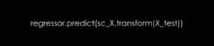

-   [regressor.predict(...)：使用已训练好的 SVR 模型对标准化后的测试数据进行预测。  

    这一步的输出是一个一维数组，包含预测的目标值，但这些预测仍然处于训练时使用的标准化尺度。]


-   [.reshape(-1, 1)：将预测值数组 reshape 为二维数组，列数为 1。`-1` 参数会自动推断行数，基于数组长度。  

    这种 reshaping 是必要的，因为 `StandardScaler` 的 `inverse_transform` 方法要求输入为二维数组。]

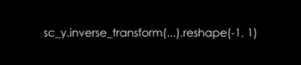

-   [sc_y.inverse_transform(...)：将标准化后的预测值转换回目标变量 y 的原始尺度。  

    `sc_y` 是一个 `StandardScaler` 实例，之前已在 y_train 上拟合。`inverse_transform` 方法撤销标准化，将标准化后的值恢复到原始尺度。]


-   [最终结果 y_pred 是一个数组，包含针对 X_test 的预测目标值，已转换回 y 的原始尺度。]

## 模型评估

训练机器学习模型后，评估其性能非常重要，常用指标是 R² 分数（R² score）。R² 分数反映了模型在训练数据上的拟合程度，如 Figure 2-50 所示。

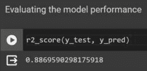

Figure 2-50.

### 代码说明


-   [r2_score 是 scikit-learn 库 `sklearn.metrics` 模块中的函数。  

    它用于通过计算决定系数（R-squared，R²）来评估回归模型的性能。]

-   [y_test 表示测试数据集的真实目标值，即模型试图预测的实际值。]

-   [y_pred 表示回归模型为测试数据集生成的预测目标值。]

## 模型结果解释

R² 值为 0.8869590298175918，约为 88.70%，这表明 SVR 模型表现非常出色，能够捕获目标变量的大部分变异。

这表明模型对给定的回归问题有效且准确，能够基于输入特征提供可靠的预测。

## 让我们进行预测

Figure 2-51  下面的图示了使用已训练机器学习模型进行预测的过程。预测时需要提供以下特征：sex、smoker、region、age、BMI、children 数量，这些特征与模型训练时使用的特征相同。

这些特征作为输入传递给 predict 方法，模型据此返回基于这些特征的预测目标变量值。

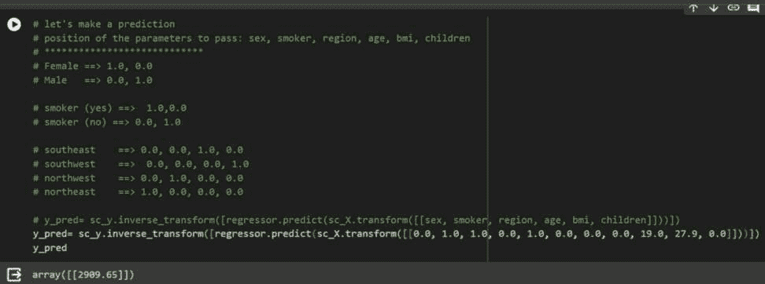

Figure 2-51.

# 决策树回归

决策树回归是一种强大且广泛使用的机器学习技术，用于解决回归问题。其简洁性、可解释性以及捕获复杂关系的能力，使其在需要精确数值预测的各种领域中成为有价值的工具。

使用以下链接下载数据集：[保险数据集](https://www.google.com/url?q=https://www.kaggle.com/datasets/awaiskaggler/insurance-csv&sa=D&source=editors&ust=1720099681775664&usg=AOvVaw1E2aDWzbH0fM19H9MRpxm9) 。源代码在此：[决策树回归](https://www.google.com/url?q=https://github.com/anyasorc/appliedml/blob/main/Master_Class_Decision_Tree_Medical_Insurance%2520\(1\).ipynb&sa=D&source=editors&ust=1720099681776132&usg=AOvVaw24p7irzhaxnJ2mjY2KLZfZ) 

## 导入库

Figure 2-52  显示了所有必要的导入库。


Figure 2-52.

## 导入并查看数据

Figure 2-53  展示了如何导入并查看数据。


Figure 2-53.

## 计算 'region' 列中唯一值的频率

代码 `df.region.value_counts()` 计算 DataFrame `df` 中 `region` 列每个唯一值的出现次数，显示每个地区出现的次数。同样，也可以对 `smoker` 特征使用该方法，如 Figure 2-54 所示。


Figure 2-54.

## 检查缺失值

代码 `df.isna().sum()` 是一系列方法的组合，用于计算 DataFrame `df` 每列的缺失值（NaN）总数，如 Figure 2-55 所示。


Figure 2-55.

## 为 X 和 y 赋值

-   [X = df.iloc[:, :-1].values：该行选取 DataFrame `df` 的所有行和除最后一列之外的所有列，并将结果转换为 NumPy 数组。得到的数组 X 通常包含特征或预测器，如 Figure 2-56 所示。]

-   [y = df.iloc[:, -1].values：该行选取 DataFrame `df` 的所有行和仅最后一列，并将结果转换为 NumPy 数组。得到的数组 y 通常包含目标或响应变量，如 Figure 2-56 所示。]


Figure 2-56.

## 查看 X 中的数据

在新建代码单元格中输入并运行 `X` 以查看分配给 X 的数据，如 Figure 2-57 所示。y 也可以同理查看。

Figure 2-57: 我已为列标记其对应的索引位置：第一列 Age 位于索引 0；第二列 Sex 位于索引 1；第三列 BMI 位于索引 2；第四列 Number of Children 位于索引 3；第五列 Smoker 位于索引 4；第六列 Region 位于索引 5。

## 处理缺失值（NaN）

处理缺失值对于数值特征/列是相关的，如 Figure 2-58 所示。我们选择了索引位置为 0、2、3 的特征/列，即 Age、BMI 和 Number of Children，如 Figure 2-57 所示。


Figure 2-58. `X[:, [0, 2, 3]]` 表示“选择所有行和索引位置 0、2、3 的列”。因此，`X[:, [0, 2, 3]]` 有效提取 Age、BMI 和 Number of Children 列的所有行。

在确定数值列后，我们将使用 `SimpleImputer` 类计算每列的均值，并用这些均值替换缺失值，如 Figure 2-59 所示。


Figure 2-59.


## 代码解释

`SimpleImputer(missing_values=np.nan, strategy='mean')`

`missing_values=np.nan`: 此参数指定要填补的缺失值用 `np.nan` 表示。

`strategy='mean'`: 此参数指定缺失值应被用列的均值替换。

`imp.fit(X[:, [0, 2, 3]])`

`X[:, [0, 2, 3]]`: 此操作选择数组 `X` 中的所有行和索引位置为 0、2、3 的列。这些列被假设为数值型。

`.fit(...)`: 该方法基于非缺失值计算所选列的平均值，并将这些平均值存储以供后续使用。

`np.set_printoptions(precision=2)`

此函数用于配置 NumPy 数组的显示方式。这里将打印输出的精度设置为 2 位小数。

`X[:, [0, 2, 3]] = imp.transform(X[:, [0, 2, 3]])`

`X[:, [0, 2, 3]]`: 再次选择数组 `X` 中的所有行和索引位置为 0、2、3 的列。

`imp.transform(...)`: 该方法在 `.fit(...)` 步骤中计算出的平均值替换选定列中的缺失值。

`X[:, [0, 2, 3]] = ...`: 此赋值将变换后的数据（缺失值已被替换）更新到原始数组 `X` 的选定列中。

## ColumnTransformer 和 OneHotEncoder()

机器学习模型本质上不理解文本或类别特征，因此需要将这些特征转换为数值形式以便模型处理。这就是为什么我们需要将图 2-57 中索引位置 1（Sex）、4（Smoker）和 5（Region）的类别变量进行转换。为此，我们将使用 `ColumnTransformer` 和 `OneHotEncoder`，如图 2-60 所示。


Figure 2-60.

# 代码解释。

`ColumnTransformer`: 来自 `sklearn.compose` 模块的类，用于对数据集的不同列应用不同的预处理转换。

`OneHotEncoder`: 来自 `sklearn.preprocessing` 模块的类，用于将类别特征转换为机器学习算法可以用于预测的数值格式。

`np`: 这是 NumPy 库的常用别名，用于进行数组操作。

## 创建 ColumnTransformer 实例


`ColumnTransformer(...)`:

初始化一个 `ColumnTransformer` 对象，用于对指定列应用特定的转换。

`transformers=[('encoder', OneHotEncoder(), [1, 4, 5])]`:

`'encoder'`: 为该转换器分配的名称，可以是任意字符串。

`OneHotEncoder()`: 指定使用 `OneHotEncoder` 进行转换。

`[1, 4, 5]`: 指定要转换的列的索引位置列表。这里，索引为 1、4、5 的列将被一热编码。

`remainder='passthrough'`:

此参数指定未明确转换的列应如何处理。`'passthrough'` 表示这些列保持不变并随输出一起包含。

## 将数据划分为训练集和测试集

我们需要将数据集划分为训练集和测试集。我们将使用 80:20 的比例，即 80% 的数据用于训练模型，剩余 20% 用于在未见数据上进行测试。图 2-61 说明了这一过程。


Figure 2-61.

## 代码解释

`train_test_split`: 来自 `sklearn.model_selection` 模块的函数，用于将数据集划分为训练集和测试集。`X_train` 和 `y_train` 用于训练模型，`X_test` 和 `y_test` 用于在未见数据上评估模型的性能。

### 函数调用的组成部分：

`X`: 特征矩阵（输入变量），包含自变量或预测器。

`y`: 目标向量（输出变量），包含因变量或响应变量。

`test_size=0.2`: 指定划分到测试集的数据比例。这里 0.2 表示 20% 的数据用于测试，剩余 80% 用于训练。

`random_state=0`: 控制在划分前对数据进行打乱的参数。传入整数可确保结果可重现，即每次运行代码时使用相同的 `random_state` 值，数据划分结果一致。

### 函数调用的输出：

`X_train`: 训练子集的特征矩阵，包含 `X` 中 80% 的行。

`X_test`: 测试子集的特征矩阵，包含 `X` 中剩余的 20% 的行。

`y_train`: 训练子集的目标向量，包含与 `X_train` 中行对应的 `y` 的 80% 数据。

`y_test`: 测试子集的目标向量，包含与 `X_test` 中行对应的 `y` 的 20% 数据。

通过使用 `test_size` 为 0.2，我们确保 20% 的数据被保留用于测试，这有助于评估模型在新数据上的泛化能力。`random_state` 确保数据划分可重复，从而在多次运行时结果保持一致。

## 训练模型

图 2-62 说明了如何使用 `X_train` 和 `y_train` 数据集训练机器学习模型。执行结果表明模型已成功训练。


Figure 2-62.

## 代码解释

`DecisionTreeRegressor(random_state=0)`: 创建 `DecisionTreeRegressor` 类的实例。

`random_state=0`: 设置随机种子以确保可重现性。固定随机状态可保证每次运行代码时结果一致，这对于测试和调试很有用。

`dt.fit(X_train, y_train)`: 将决策树回归模型拟合到训练数据上。

`X_train`: 代表训练数据的特征（输入变量）。

`y_train`: 代表训练数据的目标（输出变量或标签）。

## 使用测试数据进行预测

图 2-63 说明了如何使用训练好的模型（`dt`）和测试数据（`X_test`）进行预测。


Figure 2-63.

## 代码解释

`dt.predict(X_test)`: 使用训练好的决策树回归模型（`dt`）对测试数据（`X_test`）进行预测。

`X_test`: 代表测试数据的特征（输入变量），用于生成预测。

预测得到的目标值存储在变量 `y_pred` 中。

## 模型评估

在训练机器学习模型后，有必要通过检查 R² 分数来评估其性能。R² 分数表示模型在训练数据上的拟合程度，如图 2-64 所示。


Figure 2-64.

## 代码解释

`r2_score` 是 `sklearn.metrics` 模块中的函数，用于通过计算 R 平方（R²）指标来评估回归模型的性能。

`y_test`: 代表测试数据集的实际目标值。这些是模型试图预测的真实值。

`y_pred`: 代表模型在测试数据集上生成的预测目标值。

## 模型结果解释

R² 值为 0.7142644756791616，表明回归模型捕获了目标变量的大部分变异。这意味着约 71.43% 的目标变量的变异可以通过模型中使用的输入特征来解释。

尽管模型表现相当不错，但仍有改进空间。进一步的分析和优化可能有助于增强其预测能力，捕获目标变量的更多变异。

## 让我们进行预测


Figure 2-65 下面的图示了使用经过训练的机器学习模型进行预测的过程。它要求我们提供以下特征用于预测：性别、吸烟状态、地区、年龄、BMI（身体质量指数）以及子女数量，这些特征与模型训练时使用的特征相同。这些特征作为输入传递给 predict 方法，模型根据这些特征返回预测的目标变量值。


Figure 2-65.

## 随机森林回归

随机森林回归是一种广泛用于回归任务的机器学习算法。该算法使用一种技术，即随机选择子集特征和数据点来构建多个决策树。最终预测是将所有决策树的预测结果组合得出的。

使用以下链接下载数据集：[保险数据集](https://www.google.com/url?q=https://www.kaggle.com/datasets/awaiskaggler/insurance-csv&sa=D&source=editors&ust=1720099681790113&usg=AOvVaw0CjSgAWTAoUrmV96Ol1N72)。源代码在此：[随机森林回归](https://www.google.com/url?q=https://github.com/anyasorc/appliedml/blob/main/Master_Class_Random_Forest_Tree_Medical_Insurance%2520\(1\).ipynb&sa=D&source=editors&ust=1720099681790532&usg=AOvVaw1coTkCph-fmx_MHSnMqCAE)。

## 导入库

Figure 2-66 显示了所有必要的导入库。


Figure 2-66.

## 导入并查看数据

Figure 2-67 展示了数据的导入和查看方式，如下所示。


Figure 2-67.

# 计算 DataFrame 中 'region' 列唯一值的频率

代码 `df.region.value_counts()` 计算 DataFrame `df` 中 `region` 列每个唯一区域的出现次数，显示每个区域出现的次数。同样的方法也适用于 `smoker` 特征，如 Figure 2-68 所示。


Figure 2-68.

## 检查缺失值

代码 `df.isna().sum()` 是一系列方法的组合，用于计算 DataFrame `df` 每列的缺失值（NaN）总数，如 Figure 2-69 所示。


Figure 2-69.

## 为 X 和 y 赋值

`X = df.iloc[:, :-1].values:`

此行选择 DataFrame `df` 的所有行和除最后一列之外的所有列，并将结果转换为 NumPy 数组。数组 `X` 通常包含特征或预测器，如 Figure 2-70 所示。

`y = df.iloc[:, -1].values:`

此行选择 DataFrame `df` 的所有行和仅最后一列，并将结果转换为 NumPy 数组。数组 `y` 通常包含目标或响应变量，如 Figure 2-70 所示。


Figure 2-70.

## 查看 X 中的数据

在新建代码单元格中输入 `X` 并运行代码单元格，即可看到 `X` 中赋值的数据，如 Figure 2-71 所示。对 `y` 也可以如此操作。


Figure 2-71. 我已将列与其对应的索引位置标记如下：第一列（Age）在索引位置 0；第二列（Sex）在索引位置 1；第三列（BMI）在索引位置 2；第四列（Number of Children）在索引位置 3；第五列（Smoker）在索引位置 4；第六列（Region）在索引位置 5。

## 处理缺失值（NaN）

处理缺失值对于数值特征/列是相关的，如 Figure 2-72 所示。我们选择了索引位置 0、2、3 的特征/列，对应于 Age、BMI 和 Number of Children，如 Figure 2-71 所示。


Figure 2-72. `X[:, [0, 2, 3]]` 表示“选择所有行和索引位置 0、2、3 的列”。因此，`X[:, [0, 2, 3]]` 有效提取了 Age、BMI 和 Number of Children 列的所有行。

在确定数值列后，我们将使用 SimpleImputer 类计算每列的均值，并用这些均值替换缺失值，如 Figure 2-73 所示。


Figure 2-73.

### 代码说明

SimpleImputer(missing_values=np.nan, strategy='mean')

`missing_values=np.nan`：指定要处理的缺失值为 np.nan。

`strategy='mean'`：指定缺失值应替换为该列的均值。

imp.fit(X[:, [0, 2, 3]])

`X[:, [0, 2, 3]]`：选择所有行和索引位置 0、2、3 的列（假设为数值列）。

.fit(...)：计算选定列中非缺失值的均值，并将这些均值存储用于后续使用。

np.set_printoptions(precision=2)

该函数配置 NumPy 数组的显示方式，这里将输出精度设置为 2 位小数。

X[:, [0, 2, 3]] = imp.transform(X[:, [0, 2, 3]])

再次选择所有行和索引位置 0、2、3 的列。

imp.transform(...)：将缺失值替换为在 .fit(...) 步骤中计算的均值。

X[:, [0, 2, 3]] = ...：更新原始数组 X 中的选定列，使缺失值被替换为转换后的数据。

## ColumnTransformer 和 OneHotEncoder()

机器学习模型不理解文本，因此需要将文本特征转换为数值形式，以便模型能够理解并进行预测。这就是我们需要对索引位置 1（性别）、4（吸烟状态）和 5（地区）的分类变量进行处理的原因，如 Figure 2-71 所示。为此，我们将使用 ColumnTransformer 和 OneHotEncoder，如 Figure 2-74 所示。


Figure 2-74.

### 代码说明

ColumnTransformer：来自 sklearn.compose 模块的类，用于对数据集的不同列应用不同的预处理转换。

OneHotEncoder：来自 sklearn.preprocessing 模块的类，用于将分类特征转换为可以供机器学习算法使用的格式，以提高预测性能。

np：通常用于表示 NumPy 库的别名，用于数组操作。

创建 ColumnTransformer 实例


ColumnTransformer(...):

初始化一个 ColumnTransformer 对象，用于对指定列应用特定的转换。

transformers=[('encoder', OneHotEncoder(), [1, 4, 5])]:

'encoder'：为该转换器指定的名称，可为任意字符串。

OneHotEncoder()：指定使用 OneHotEncoder 进行转换。

[1, 4, 5]：指定要进行一热编码的列索引。这里，索引位置 1、4、5 的列将被一热编码。

remainder='passthrough'：

该参数指定未明确转换的列应如何处理。'passthrough' 表示这些列保持不变，直接包含在输出中。

## 划分训练集和测试集

我们需要将数据集划分为训练集和测试集。我们将使用 80:20 的比例，即 80% 的数据用于训练模型，剩余 20% 用于在未见数据上评估模型性能。Figure 2-75 说明了这一过程。


Figure 2-75.

### 代码说明

train_test_split：来自 sklearn.model_selection 模块的函数，用于将数据集划分为训练集和测试集。X_train 和 y_train 用于训练模型，X_test 和 y_test 用于在未见数据上评估模型性能。

函数调用的组成部分：


X: 这是特征矩阵（输入变量）。它包含独立变量或预测器。

y: 这是目标向量（输出变量）。它包含因变量或响应值。

test_size=0.2：该参数指定要包含在测试集中的数据集比例。这里，0.2 表示 20% 的数据将用于测试，剩余的 80% 将用于训练。

random_state=0：该参数控制在数据划分前对数据进行随机洗桨的操作。传入整数可确保结果的可重复性，即每次使用相同的 random_state 值运行代码时，数据划分结果相同。

函数调用的输出：

X_train：这是特征矩阵的训练子集。它包含 X 中 80% 的行。

X_test：这是特征矩阵的测试子集。它包含 X 中剩余的 20% 的行。

y_train：这是目标向量的训练子集。它包含与 X_train 中行对应的 y 中 80% 的值。

y_test：这是目标向量的测试子集。它包含与 X_test 中行对应的 y 中 20% 的值。

通过使用 test_size=0.2，我们确保 20% 的数据被保留用于测试，这有助于评估模型在新数据上的泛化能力。random_state 确保数据划分是可重复的，从而在多次运行代码时保持结果一致。

## 模型训练

图 2-76 展示了如何使用 X_train 和 y_train 数据集训练机器学习模型。执行结果表明模型训练成功。


Figure 2-76.

## 代码解释

RandomForestRegressor：这一行创建了 RandomForestRegressor 类的实例。

n_estimators=10：指定随机森林中的决策树数量。在此例中，森林包含 10 个决策树。

random_state=0：设置随机种子以确保可重复性。固定随机状态可保证每次运行代码时得到相同的结果，便于调试和测试。


fit：该方法在提供的训练数据上训练随机森林回归模型。

X_train：代表训练数据的特征（输入变量）。

y_train：代表训练数据的目标（输出变量或标签）。

## 使用测试数据进行预测

下图 2-77 展示了如何使用训练好的模型（lr）和测试数据（X_test）进行预测。


Figure 2-77.

## 代码解释

Rf.predict(X_test)：这一行使用训练好的随机森林模型（Rf）对测试数据（X_test）进行预测。

X_test：代表待预测的测试数据特征（输入变量）。

预测的目标值存储在变量 y_pred 中。

## 模型评估

在训练机器学习模型后，评估其性能非常重要，可以通过查看 R² 分数来实现。R² 分数表示模型在训练数据上的拟合程度，如图 2-78 所示。


Figure 2-78.

## 代码解释

r2_score 是 scikit-learn 库 sklearn.metrics 模块中的函数。它用于通过计算决定系数（R²）来评估回归模型的性能。

y_test：代表测试数据集的实际目标值。这些是模型试图预测的真实值。

y_pred：代表回归模型为测试数据集生成的预测目标值。

## 模型结果解释

R² 值为 0.8611562299112945，表明回归模型捕获了目标变量的大部分变异，约 86.12% 的变异由输入特征解释。

这个高 R² 值表明模型表现非常好，能够提供准确可靠的预测。不过，仍需评估模型是否存在过拟合问题，并确保其在不同数据集上的鲁棒性。

## 让我们进行预测

图 2-79 展示了使用训练好的机器学习模型进行预测的过程。我们需要提供以下特征进行预测：sex（性别）、smoker（吸烟者）、region（地区）、age（年龄）、BMI（身体质量指数）和 number of children（子女数量），这些特征与训练时使用的相同。将这些特征作为输入传递给 predict 方法，模型会根据这些特征返回预测的目标变量值。


Figure 2-79.

## 结论

我们将保险数据用于训练和评估多个机器学习模型，包括多项式回归、线性回归、支持向量回归、决策树回归和随机森林回归。以下是这些模型的性能结果：

| # | Model Name | Model R² Score (%) |
|---|------------|-------------------|
| 1 | Polynomial regression | 85.12% |
| 2 | Multiple linear regression | 80% |
| 3 | Support Vector Regression | 88.70% |
| 4 | Decision trees regression | 71.43% |
| 5 | Random Forest Regression | 86.12% |

基于 R² 分数，支持向量回归（SVR）因其最高的 R² 值 88.70% 而被推荐，表明其性能最佳。该高 R² 值意味着 SVR 解释了 88.70% 的目标变量变异，说明 SVR 在提供准确可靠预测方面优于其他模型。

# 第 3 章  

分类

## 分类

在机器学习中，分类问题涉及将数据分类到预定义的类别或类别中。主要目标是构建一个模型，从标记的训练数据中学习，并预测新的、未识别的数据点的类别或类别。这一任务在医学、金融和营销等多个领域都至关重要，因为将数据分类为不同类别有助于分析和决策。

分类问题可以是二分类，即只有两个类别（例如，垃圾邮件 vs. 非垃圾邮件邮件），也可以是多类分类，即有三个或更多类别（例如，在动物园中分类动物种类）。

## 分类模型类型

Logistic Regression Model（逻辑回归模型）

K-Nearest Neighbour (K-NN) Model（k 最近邻模型）

Support Vector Machine (SVM) Model（支持向量机模型）

Naïve Bayes Model（朴素贝叶斯模型）

Kernel SVM Model（核支持向量机模型）

Decision Tree Classification Model（决策树分类模型）

Random Forest Classification Model（随机森林分类模型）

## 分类问题描述

阿隆佐医院（Alonzo Hospital），一家本地医疗机构，已利用技术提升其所有部门的效率。最近，管理层决定聘请数据科学家，开发一个机器学习模型，根据患者输入解读心脏检测结果。该模型分析特定的心脏特征，例如：

age：患者的年龄（以年为单位）。

sex：患者的性别（1 = 男性；0 = 女性）。

cp：胸痛类型（0 = 典型心绞痛，1 = 不典型心绞痛，2 = 非心绞痛，3 = 无症状）。

trestbps：入院时的静息血压（mm Hg）。

chol：血清胆固醇（mg/dl）。

fbs：空腹血糖 > 120 mg/dl（1 = 真；0 = 假）。

restecg：静息心电图结果（0 = 正常，1 = 有 ST-T 波异常，2 = 根据 Estes 标准显示可能或确定性左心室肥厚）。

thalach：达到的最大心率。

exang：运动诱发心绞痛（1 = 是；0 = 否）。

oldpeak：运动时相对于休息的 ST 段下降。

slope：运动时 ST 段的斜率（0 = 上升，1 = 平坦，2 = 下降）。


ca: Number of major vessels (0-3) colored by fluoroscopy.

thal: Thalassemia (1 = normal; 2 = fixed defect; 3 = reversible defect).

Target: 0 indicates the patient's heart is healthy, while 1 indicates the patient's heart is not healthy.

The hospital hired Ade with the primary responsibility of developing a machine learning model to predict the presence of heart disease in patients. Following this, he will collaborate with the front-end development team to create the XYZ Breast Heart Prediction Model.

Patients will input parameters from their device readings into the portal. The self-diagnosis results will display as 0, indicating no presence of heart disease, or 1, indicating the presence of heart disease. If the outcome is 1, patients will be advised to schedule an appointment with the hospital to consult with a specialist.

Implementing this model will help:

Reduce the pressure on hospital staff by streamlining the diagnostic process.

Manage hospital resources more effectively, ensuring that appointments are evenly distributed among available consultants.

Inform decisions about hiring or engaging additional breast cancer specialists as needed.

Note: accuracy_score is a metric used to evaluate the performance of a classification model. It measures the proportion of correctly classified instances out of the total instances.

You can download the dataset for classification via this link: [Heart Disease](https://www.google.com/url?q=https://www.kaggle.com/datasets/arezaei81/heartcsv&sa=D&source=editors&ust=1720099681834178&usg=AOvVaw2Ogt5nu6dVZIvv1V3Km2mc)  

The dataset 'heart.csv' includes data pertaining to heart issues, with a target class indicating whether a patient is diagnosed with heart disease (1) or not (0). Our objective is to apply various machine learning classification models to the data and select the model with the highest accuracy score.

# Logistic Regression 

Logistic regression is a statistical technique used to solve binary classification problems. In binary classification, the outcome variable is categorical with only two classes. Despite its name, logistic regression is primarily used for classification tasks rather than regression. It is particularly useful when the dependent variable is binary, meaning it can have only two possible outcomes, such as 0 or 1, Yes or No, or True or False.

The source code is available here: [Logistic Regression](https://www.google.com/url?q=https://github.com/anyasorc/appliedml/blob/main/Classification_Logistic_Regression%2520\(1\).ipynb&sa=D&source=editors&ust=1720099681835062&usg=AOvVaw1h_ACip0MOpvZdDW-X_rRp)  

## Import Libraries

Figure 3-1  shows all the imported required libraries


Figure 3-1.

## Import and View Data

Figure 3-2  shows how data was imported and viewed as seen below.


Figure 3-2.

## Assign values to X and y

X = df.iloc[:, :-1].values:

This line selects all rows and all columns except the last one from the DataFrame df and converts the result into a NumPy array. The resulting array X typically contains the features or predictors as seen in Figure 3-3 .

y = df.iloc[:, -1].values:

This line selects all rows and only the last column from the DataFrame df and converts the result into a NumPy array. The resulting array y typically contains the target or response variable as seen in Figure 3-3 .


Figure 3-3.

## Splitting into train and test set

We must divide our dataset into training and testing sets. Employing an 80:20 split, 80% of the data will train the model, and the remaining 20% will assess its performance on unseen data. Figure 3-4  visually demonstrates this process.


Figure 3-4.

## Standardizing the data

In the context of machine learning, particularly when using algorithms that are sensitive to the scale of the input data, it is common to standardize the data. Standardization transforms the data such that it has a mean of zero and a standard deviation of one. Figure 3-5 illustrates how to implement it.


Figure 3-5.

## Code Explanation

The code snippet in Figure 3-5  uses the `StandardScaler` class from the `scikit-learn` library to standardize features by removing the mean and scaling to unit variance. This process is essential for many machine learning algorithms to perform optimally. Here's an explanation of each line:

sc = StandardScaler(): This line creates an instance of the `StandardScaler` class. The `StandardScaler` is used to standardize the features of the dataset.

X_train = sc.fit_transform(X_train):

fit_transform: This method first calculates the mean and standard deviation of the `X_train` data (this is the `fit` part).

It then uses these statistics to standardize `X_train` by subtracting the mean and dividing by the standard deviation for each feature (this is the `transform` part).

The result is that `X_train` is now a standardized version of the original training data, where each feature has a mean of 0 and a standard deviation of 1.

X_test = sc.transform(X_test):

transform: This method uses the mean and standard deviation calculated from the `X_train` data to standardize `X_test`.

This ensures that the test data is transformed in the same way as the training data, which is crucial for the consistency of the model's performance.

X_test is now a standardized version of the original test data, following the same scale as `X_train`.

Here's a bit more detail on why standardization is important:

Consistency: It ensures that the training and test data are on the same scale, which is crucial for the performance of many machine learning models.

Algorithm Performance: Algorithms like gradient descent used in logistic regression or neural networks converge faster with standardized data.

Improved Accuracy: Some algorithms, like support vector machines (SVM) and k-nearest neighbors (KNN), are sensitive to the scale of the data and perform better with standardized data.

By using `StandardScaler`, you help ensure that your machine learning model works more effectively and consistently.

## Training the Model

Figure 3-6  illustrates the process of using the X_train and y_train datasets to train the machine learning model. The execution of the training process indicates that the model was successfully trained.


Figure 3-6.

## Code Explanation

Looking at the code snippet in Figure 3-6  cs = LogisticRegression(random_state=0); cs.fit(X_train, y_train) is used to create and train a logistic regression model using the scikit-learn library in Python.

cs = LogisticRegression(random_state=0) :

LogisticRegression is the class for creating logistic regression models.

cs is the variable that will store the instance of the logistic regression model.

random_state=0 is a parameter that ensures the results are reproducible by setting a seed for the random number generator. This way, you get the same results every time you run the code. If random_state is set to None, the seed is randomly selected, which can lead to different results each time you run the model.

cs.fit(X_train, y_train) :

fit is a method used to train the model.

X_train is the training data containing the features (input variables) that the model will learn from.

y_train is the training data containing the target labels (output variables) that correspond to the features in X_train.

## Predicting with the test data

Figure 3-7  below illustrates how we made predictions using the trained model (cs) and the test data (X_test).


Figure 3-7.

## Code Explanation

The line y_pred = cs.predict(X_test) is specifically using a logistic regression model (cs) to make predictions on a test dataset (X_test). Here's a detailed explanation tailored to logistic regression:


cs: 这是一个在您的训练数据上训练得到的逻辑回归模型的实例。在 scikit-learn 中，您可以使用 `LogisticRegression()` 创建该模型，然后通过 `cs.fit(X_train, y_train)` 将其拟合到训练数据。

X_test: 这是用于预测目标变量的测试数据集，包含特征。这些特征应与训练数据同样进行预处理（例如，标准化）。

predict(X_test): 该方法用于根据逻辑回归模型 cs 对输入数据（X_test）进行类别标签的预测。

y_pred 是 X_test 中每条记录的预测类别标签数组。二分类问题中，y_pred 的值要么是 0，要么是 1。

## 模型评估

在训练机器学习模型后，评估其性能非常重要。让我们先查看混淆矩阵（如图 3-8 所示），再考虑准确率。


Figure 3-8.

## 代码解释

`cm = confusion_matrix(y_test, y_pred)` 这行代码使用 scikit-learn 库中的 `confusion_matrix` 函数来评估分类模型的性能。具体解释如下：

confusion_matrix(y_test, y_pred):

- y_test：测试数据集的真实类别标签数组，即实际需要预测的值。

- y_pred：模型为测试数据集生成的预测类别标签数组，基于测试特征（X_test）。

混淆矩阵：

混淆矩阵是一个表格，用于描述分类模型的表现，展示模型相对于真实结果（地面真实）所作的正确和错误预测数量。

二分类问题中，混淆矩阵为 2×2 矩阵，形式如下：

```python
[[TN, FP],
 [FN, TP]]
```

其中：

- TN（True Negative）：模型正确预测的负类实例数量（实际为负且预测为负）。

- FP（False Positive）：模型错误预测的阳性实例数量（实际为负但预测为正）。

- FN（False Negative）：模型错误预测的负类实例数量（实际为正但预测为负）。

- TP（True Positive）：模型正确预测的阳性实例数量（实际为正且预测为正）。

## 混淆矩阵解读

图 3-9 展示了物流回归模型的混淆矩阵。


Figure 3-9.

下面对该混淆矩阵进行解读：

- True Negatives (TN)：77

  这些是实际为负类（例如，无心脏病）且模型正确预测为负的实例。

- False Positives (FP)：21

  这些是实际为负类，但模型错误地预测为正类的实例（例如，预测患有心脏病但实际上没有）。

- False Negatives (FN)：7

  这些是实际为正类（例如，有心脏病）但模型错误地预测为负类的实例（例如，预测无心脏病但实际上有）。

- True Positives (TP)：100

  这些是实际为正类，且模型正确预测为正的实例。

基于此混淆矩阵，可以计算多个性能指标（准确率、精确率、召回率和 F1 分数）：

Accuracy：

准确率的公式如下：

   

在提供的示例中：

TN = 77

TP = 100

FP = 21

FN = 7

将这些值代入公式：


这意味着模型大约正确分类了 86.3% 的实例。

Precision：

精确率的公式如下：


在提供的示例中：

TP = 100

FP = 21

将这些值代入公式：


这意味着大约 82.6% 的模型预测为正的实例实际上是正的。

Recall：

召回率的公式如下：


在提供的示例中：

TP = 100

FN = 7

将这些值代入公式：


这意味着大约 93.5% 的实际正类实例被模型正确识别。

F1 Score：

F1 分数的公式如下：


在提供的示例中：

Precision = 0.826

Recall = 0.935

将这些值代入公式：


## 解读

Accuracy (86.3%)：表示模型正确预测了 86.3% 的实例。

Precision (82.6%)：在模型预测为正的所有实例中，82.6% 实际上是正的，表明存在一定的假阳性。

Recall (93.5%)：模型正确识别了 93.5% 的实际正类实例，表明假阴性较少。

F1 Score (87.8%)：结合精确率和召回率的一个综合指标，表明模型在平衡两者方面表现良好。

## 模型评估

在训练机器学习模型后，评估其性能时，需要检查准确率得分。如图 3-10 所示，准确率反映了模型在训练数据上的拟合情况。


Figure 3-10.

## 代码解释

`accuracy_score(y_test, y_pred)` 是 scikit-learn 库中的函数，用于计算分类模型的准确率。具体解释如下：

输入：

- y_test：测试数据集的真实标签数组，即实际需要预测的值。

- y_pred：模型为测试数据集生成的预测标签数组，基于测试特征（X_test）。

## 模型结果解读

准确率为 0.8634146341463415，表示模型正确预测了 86.34% 的实例。换句话说，每 100 次预测中，模型大约准确预测了 86 次，体现了整体良好的性能。

## 让我们进行预测

图 3-11 展示了使用已训练的机器学习模型进行预测的过程。它要求我们提供以下特征：

- age：患者的年龄（以年为单位）。

- sex：患者的性别（1 = 男性；0 = 女性）。

- cp：胸痛类型（0 = 典型心绞痛，1 = 不典型心绞痛，2 = 非心绞痛，3 = 无症状）。

- trestbps：入院时的静息血压（单位：mm Hg）。

- chol：血浆胆固醇（单位：mg/dl）。

- fbs：空腹血糖 > 120 mg/dl（1 = 是；0 = 否）。

- restecg：静息心电图结果（0 = 正常，1 = 有 ST-T 波异常，2 = 根据 Estes 标准显示可能或肯定的左心室肥厚）。

- thalach：达到的最大心率。

- exang：运动诱发心绞痛（1 = 有；0 = 无）。

- oldpeak：运动时相对于休息的 ST 段下降。

- slope：运动时 ST 段的斜率（0 = 上升，1 = 平直，2 = 下降）。

- ca：由血管造影显示染色的主要血管数量（0-3）。

- thal：地塞米亚（1 = 正常；2 = 固定缺陷；3 = 可逆缺陷）。


Figure 3-11.

## K-Nearest Neighbour (K-NN)

K-Nearest Neighbors (K-NN) 是一种监督机器学习算法，用于分类和回归任务。在分类中，它通过查看数据点最近邻的类别来确定给定数据点的类别。在回归中，它通过求平均值来预测数据点的值，基于其最近邻的值。

源代码可在此查看：[KNN](https://www.google.com/url?q=https://github.com/anyasorc/appliedml/blob/main/Classification_KNN.ipynb&sa=D&source=editors&ust=1720099681856543&usg=AOvVaw08NazI4n392YBuznNNYIms)  

## 导入库

Figure 3-12 显示了所有导入的必要库


Figure 3-12.

## 导入并查看数据

Figure 3-13 显示了数据的导入和查看方式，如下所示


Figure 3-13.

## 赋值给 X 和 y

X = df.iloc[:, :-1].values：

此行选择 DataFrame df 的所有行和除最后一列之外的所有列，并将结果转换为 NumPy 数组。生成的数组 X 通常包含特征或预测器，如 Figure 3-14 所示。

y = df.iloc[:, -1].values：

此行选择 DataFrame df 的所有行和仅最后一列，并将结果转换为 NumPy 数组。生成的数组 y 通常包含目标变量或响应变量，如 Figure 3-14 所示。


Figure 3-14.

## 将数据划分为训练集和测试集

我们需要将数据集划分为训练集和测试集。我们将使用 80:20 的比例，即 80% 的数据用于训练模型，剩余的 20% 用于在未见数据上进行测试。Figure 3-15 说明了这一过程。


Figure 3-15.

## 标准化数据

在机器学习中，特别是使用对输入数据尺度敏感的算法时，标准化数据很常见。标准化将数据转换为均值为零、标准差为一的形式。Figure 3-16 展示了如何实现它。


Figure 3-16.

## 代码解释

Figure 3-16 中的代码片段使用 `scikit-learn` 库的 `StandardScaler` 类来标准化特征，通过消除均值并缩放到单位方差。这一过程对于许多机器学习算法的最佳性能至关重要。以下是每行代码的解释：

sc = StandardScaler()：此行创建 `StandardScaler` 类的实例。`StandardScaler` 用于标准化数据集的特征。

X_train = sc.fit_transform(X_train)：

`fit_transform` 方法首先计算 `X_train` 数据的均值和标准差（这是 `fit` 部分）。

然后，它利用这些统计量标准化 `X_train`，即对每个特征减去均值并除以标准差（这是 `transform` 部分）。

结果是 `X_train` 变成了标准化后的原始训练数据，每个特征的均值为 0，标准差为 1。

X_test = sc.transform(X_test)：

`transform` 方法使用从 `X_train` 数据中计算出的均值和标准差来标准化 `X_test`。

这确保了测试数据以与训练数据相同的方式被转换，这对于模型性能的一致性至关重要。

X_test 现在是标准化后的原始测试数据，与 `X_train` 具有相同的尺度。

下面是关于标准化为何重要的更多细节：

一致性：它确保训练数据和测试数据处于相同的尺度，这对于许多机器学习模型的性能至关重要。

算法性能：像梯度下降用于逻辑回归或神经网络的算法在标准化数据上收敛更快。

改进准确性：一些算法，如支持向量机 (SVM) 和 k-最近邻 (KNN)，对数据尺度敏感，使用标准化数据时表现更好。

通过使用 `StandardScaler`，您可以帮助确保您的机器学习模型更有效、更一致地工作。

## 训练模型

Figure 3-17 展示了使用 X_train 和 y_train 数据集训练机器学习模型的过程。训练过程的执行表明模型已成功训练。


Figure 3-17.

## 代码解释

Referring to the code snippet in Figure 3-17,

cs = KNeighborsClassifier(n_neighbors=5, metric='minkowski', p=2); cs.fit(X_train, y_train) is used to create and train a k-nearest neighbors (K-NN) classifier with the scikit-learn library in Python.

cs = KNeighborsClassifier(n_neighbors=5, metric='minkowski', p=2):

KNeighborsClassifier 是用于创建 k-最近邻分类器的类。

cs 是用于存储 K-NN 分类器实例的变量。

n_neighbors=5 指定使用的邻居数量。在此情况下，算法将考虑最近的 5 个邻居来进行预测。

metric='minkowski' 指定用于查找最近邻的距离度量。Minkowski 距离是一个包含多种特殊情况的广义距离度量。

p=2 设置 Minkowski 度量的参数。当 p=2 时，Minkowski 距离等同于欧几里得距离。

cs.fit(X_train, y_train)：

fit 是用于训练模型的方法。

X_train 是包含特征（输入变量）的训练数据，模型将从中学习。

y_train 是包含目标标签（输出变量）的训练数据，与 X_train 中的特征对应。

The line y_pred = cs.predict(X_test) where cs is a k-nearest neighbors (K-NN) classifier:

cs 是一个已使用 fit 方法在数据集上进行训练的 KNeighborsClassifier 实例。该实例现在包含训练数据，并准备进行预测。

X_test 是测试数据集，包含您希望预测类别标签的特征值（输入变量）。这些是模型在训练过程中未见过的新数据点。

predict 方法用于对新数据进行预测。当您调用 cs.predict(X_test) 时，分类器使用 K-NN 算法确定 X_test 中实例的类别标签。

The predicted class labels for all instances in X_test are stored in the array y_pred. 所有 X_test 中实例的预测类别标签存储在数组 y_pred 中。

## 模型评估

训练机器学习模型后，评估其性能很重要。让我们先查看混淆矩阵，然后再考虑准确率，如 Figure 3-19 所示。


Figure 3-19.

## 代码解释

The line `cm = confusion_matrix(y_test, y_pred)` involves using the `confusion_matrix` function from the `scikit-learn` library to evaluate the performance of a classification model. Here’s a detailed explanation:

confusion_matrix(y_test, y_pred):

y_test: 这是测试数据集的真实类别标签数组。这些是您正在尝试预测的实际值。

y_pred: 这是模型为测试数据集生成的预测类别标签数组。这些预测是由模型根据测试特征 (X_test) 生成的。

混淆矩阵：

混淆矩阵是一个表格，常用于描述分类模型的性能。它显示模型相比实际结果（地面真实）正确和错误地进行了多少预测。

对于二分类问题，混淆矩阵是一个 2x2 矩阵，形式如下：

[[TN, FP],

[FN, TP]]

其中：


TN (True Negative)：正确预测的负类实例数量（实际为负且预测为负）。

FP (False Positive)：错误预测的阳性实例数量（实际为负但预测为阳性）。

FN (False Negative)：错误预测的负类实例数量（实际为正但预测为负）。

TP (True Positive)：正确预测的阳性实例数量（实际为正且预测为阳性）。

## 解读混淆矩阵

混淆矩阵帮助你了解分类模型在预测每个类别正确性方面的表现。

它提供了模型错误类型的详细洞察：

对角线上的高值（TN 和 TP）表明模型表现良好。

非对角线上的高值（FP 和 FN）表明模型存在错误。

通过查看混淆矩阵，你可以获得比单一指标（如准确率）更深入的模型性能理解，这有助于识别模型需要改进的具体领域。

## 混淆矩阵解读

图 3-20 展示了物流回归模型的混淆矩阵。


图 3-20.

下面解读该混淆矩阵：

真负数（TN）：84

这些是实际为负类（例如，无心脏病）的实例，模型正确预测为负类。

假阳性（FP）：14

这些是实际为负类，但模型错误预测为阳性的实例（例如，预测心脏病但实际并无心脏病）。

假阴性（FN）：10

这些是实际为阳性类（例如，恶性肿瘤）的实例，但模型错误预测为负类（例如，预测无心脏病但实际有心脏病）。

真阳性（TP）：97

这些是实际为阳性类，且模型正确预测为阳性的实例。

根据此混淆矩阵，我们可以计算多个性能指标（准确率、精确率、召回率和 F1 分数）。

准确率：

准确率的公式如下：

   

在提供的示例中：

TN = 84

TP = 97

FP = 14

FN = 10

将这些值代入公式：


这意味着模型正确分类了约 86.3% 的实例。

精确率：

精确率的公式如下：


在提供的示例中：

TP = 97

FP = 14

将这些值代入公式：


这意味着约 82.6% 的模型预测为阳性的实例实际上是阳性的。

召回率：

召回率的公式如下：


在提供的示例中：

TP = 97

FN = 14

将这些值代入公式：


这意味着约 93.5% 的实际阳性实例被模型正确识别。

F1 分数：

F1 分数的公式如下：


在提供的示例中：

精确率 = 0.874

召回率 = 0.907

将这些值代入公式：


## 解读

准确率（88.3%）：表明模型正确预测了 88.3% 的实例，显示其整体预测的高准确性。

精确率（87.4%）：在所有被模型预测为阳性的实例中，87.4% 实际上是阳性的。这表明模型的假阳性较少，预测阳性的可靠性较高。

召回率（90.7%）：模型正确识别了 90.7% 的实际阳性实例。这表明假阴性较少，模型能够有效捕获大多数阳性实例。

F1 分数（89%）：将精确率和召回率合并为一个指标，提供平衡的性能评估。89% 的 F1 分数表明精确率和召回率之间取得了良好的平衡，显示模型在分类方面的有效性。

## 模型评估

训练机器学习模型后，评估其性能至关重要，通过查看准确率得分来衡量模型在训练数据上的拟合程度，如图 3-21 所示。


图 3-21.

## 代码解释

scikit-learn 库中的 accuracy_score(y_test, y_pred) 函数用于计算分类模型的准确率。以下是详细说明：

输入：

y_test：测试数据集的真实标签数组。这些是你试图预测的实际值。

y_pred：模型为测试数据集生成的预测标签数组。这些预测基于测试特征（X_test）。

## 模型结果解读

预测结果 0.8829268292682927，转换为百分比约为 88.29% 。

这意味着 K-Nearest Neighbors（KNN）模型的估计准确率约为 88.29%。换句话说，模型预计能够正确分类或预测约 88.29% 的数据实例的类标签。

## 让我们进行预测

图 3-22 如下所示，展示了使用训练好的机器学习模型进行预测的过程。它要求我们提供以下特征进行预测：

age：患者的年龄（以年为单位）。

sex：患者的性别（1 = 男性；0 = 女性）。

cp：胸痛类型（0 = 典型心绞痛，1 = 不典型心绞痛，2 = 非心绞痛，3 = 无症状）。

trestbps：入院时的静息血压（毫米汞柱）。

chol：血清胆固醇（mg/dl）。

fbs：空腹血糖 > 120 mg/dl（1 = 是；0 = 否）。

restecg：静息心电图结果（0 = 正常，1 = 有 ST-T 波异常，2 = 根据 Estes 标准显示可能或确定的左心室肥厚）。

thalach：达到的最大心率。

exang：运动诱发心绞痛（1 = 是；0 = 否）。

oldpeak：运动时相对于休息的 ST 段下降。

slope：运动时 ST 段的斜率（0 = 上升，1 = 平坦，2 = 下降）。

ca：经 fluoroscopy 显色的主要血管数量（0-3）。

thal：瓣膜性贫血（1 = 正常；2 = 固定缺陷；3 = 可逆缺陷）。


图 3-22.

## 支持向量机 (SVM) 模型

支持向量机 (SVM) 是一种监督学习算法，用于机器学习。它具有多功能性，能够处理分类和回归任务。

源代码可在此查看：[支持向量机](https://www.google.com/url?q=https://github.com/anyasorc/appliedml/blob/main/Classification_SVM.ipynb&sa=D&source=editors&ust=1720099681879651&usg=AOvVaw1jVWYgvTUnpL9zAKut35Hf)  

## 导入库

图 3-23 展示了所有导入的必要库：


图 3-22.

## 导入并查看数据

图 3-23 展示了数据导入和查看的过程，如下所示。


图 3-23.

## 赋值给 X 和 y

X = df.iloc\[:, :-1\].values：

此行选择 DataFrame df 的所有行和除最后一列外的所有列，并将结果转换为 NumPy 数组。得到的数组 X 通常包含特征或预测器，如图 3-24 所示。

y = df.iloc\[:, -1\].values：

此行选择 DataFrame df 的所有行和仅最后一列，并将结果转换为 NumPy 数组。得到的数组 y 通常包含目标或响应变量，如图 3-24 所示。


图 3-24.

## 将数据划分为训练集和测试集


我们需要将我们的数据集分割为训练集和测试集。我们将使用 80:20 的比例进行分割，其中 80% 的数据用于训练模型，剩余的 20% 用于在未见过的数据上进行测试。图 3-25 说明了这一过程。


图 3-25.

## 标准化数据

在机器学习中，特别是使用对输入数据尺度敏感的算法时，标准化数据很常见。标准化将数据转换为均值为 0 且标准差为 1 的形式。图 3-26 展示了如何实现它。


图 3-26.

## 代码解释

图 3-5 中的代码片段使用 `StandardScaler` 类（来自 `scikit-learn` 库）来标准化特征，通过去除均值并将其缩放到单位方差。这一过程对于许多机器学习算法的最佳性能至关重要。以下是每行代码的解释：

`sc = StandardScaler()`：这行代码创建了一个 `StandardScaler` 类的实例。`StandardScaler` 用于标准化数据集的特征。

`X_train = sc.fit_transform(X_train)`：

`fit_transform`：该方法首先计算 `X_train` 数据的均值和标准差（这是 `fit` 部分）。

随后，它利用这些统计量对 `X_train` 进行标准化，即对每个特征减去均值并除以标准差（这是 `transform` 部分）。

结果是 `X_train` 变成了标准化后的原始训练数据，每个特征的均值为 0，标准差为 1。

`X_test = sc.transform(X_test)`：

`transform`：该方法使用从 `X_train` 数据中计算出的均值和标准差来标准化 `X_test`。

这确保了测试数据以与训练数据相同的方式被转换，这对于模型性能的一致性至关重要。

`X_test` 现在是标准化后的原始测试数据，与 `X_train` 具有相同的尺度。

下面是关于为什么标准化很重要的更多细节：

一致性：它确保训练数据和测试数据处于相同的尺度，这对于许多机器学习模型的性能至关重要。

算法性能：像逻辑回归或神经网络中使用的梯度下降算法，在标准化数据上会更快收敛。

改进准确率：一些算法，如支持向量机（SVM）和 k 最近邻（KNN），对数据尺度敏感，使用标准化数据时表现更好。

通过使用 `StandardScaler`，我们有助于确保机器学习模型更有效、更一致地工作。

## 训练模型

图 3-27 展示了使用 `X_train` 和 `y_train` 数据集训练机器学习模型的过程。训练过程的执行表明模型训练成功。


图 3-27.

## 代码解释

代码片段 `cs = SVC(kernel='linear', random_state=0); cs.fit(X_train, y_train)` 用于创建和训练一个使用线性核的支持向量分类器（SVC），该模型来自 `scikit-learn` 库。

`cs = SVC(kernel='linear', random_state=0)`：

SVC 是用于创建支持向量分类器的类。

`cs` 是存储 SVC 实例的变量。

`kernel='linear'` 指定 SVC 使用线性核。这意味着类别之间的决策边界是线性的。

`random_state=0` 是一个参数，确保可重复性。它设置随机数生成器的种子，因此多次运行结果一致。

`cs.fit(X_train, y_train)`：

`fit` 是用于训练模型的方法。

`X_train` 是包含特征（输入变量）的训练数据，模型从中学习。

`y_train` 是包含目标标签（输出变量）的训练数据，与 `X_train` 中的特征对应。

## 使用测试数据进行预测

图 3-28 展示了如何使用训练好的模型（`cs`）和测试数据（`X_test`）进行预测。


图 3-28.

## 代码解释

`y_pred = cs.predict(X_test)` 这一行专门用支持向量模型（`cs`）对测试数据集（`X_test`）进行预测。以下是针对 SVM 的详细解释：

`cs`：这是一个已在训练数据上训练的 SVM 模型实例。在 `scikit-learn` 中，可以通过 `SVC()` 创建该模型，然后使用 `cs.fit(X_train, y_train)` 进行训练。

`X_test`：这是包含特征的测试数据集，用于预测目标变量。这些特征应与训练数据（如标准化）进行相同的预处理。

`predict(X_test)`：该方法用于根据 SVM 模型 `cs` 对 `X_test` 中的输入数据预测目标变量的类别标签。

`y_pred` 是一个包含 `X_test` 中每个观测的预测类别标签的数组。对于二分类问题，`y_pred` 中的值将是 0 或 1。

## 模型评估

在训练机器学习模型后，评估其性能很重要。让我们先查看混淆矩阵，如图 3-29 所示。


图 3-29.

## 代码解释

`cm = confusion_matrix(y_test, y_pred)` 这一行使用 `scikit-learn` 库中的 `confusion_matrix` 函数来评估分类模型的性能。以下是详细解释：

`confusion_matrix(y_test, y_pred)`：

`y_test`：这是测试数据集的真实类别标签数组。这些是我们试图预测的实际值。

`y_pred`：这是模型为测试数据集生成的预测类别标签数组。这些预测是基于 `X_test` 的特征，由模型生成。

混淆矩阵：

混淆矩阵是一个表格，用于描述分类模型的性能。它显示了模型在实际值（地面真实）与预测值之间的正确和错误预测数量。

对于二分类问题，混淆矩阵是一个 2x2 矩阵，形式如下：

[[TN, FP],

[FN, TP]]

其中：

TN（True Negative）：正确预测负类的实例数量（实际为负，预测为负）。

FP（False Positive）：错误预测正类的实例数量（实际为负，但预测为正）。

FN（False Negative）：错误预测负类的实例数量（实际为正，但预测为负）。

TP（True Positive）：正确预测正类的实例数量（实际为正，预测为正）。

## 解读混淆矩阵

混淆矩阵帮助你理解分类模型在正确预测每个类别方面的表现。

它提供了关于模型错误类型的详细洞察：

矩阵对角线上的高值（TN 和 TP）表示模型表现良好。

矩阵对角线外的高值（FP 和 FN）表示模型存在错误。

通过查看混淆矩阵，你可以获得比单一指标（如准确率）更深入的模型性能理解，这有助于识别模型需要改进的具体领域。

## 混淆矩阵解读

图 3-30 展示了逻辑回归模型的混淆矩阵。


图 3-30.

让我们解读这个混淆矩阵：

真负数（TN）：74

这些是实际为负类（例如，无心脏病）的实例，模型正确预测为负类。

假阳性（FP）：24


这些是实际类为负，但模型错误预测为正的情况（例如，预测心脏病但实际并无心脏病）。

假阴性（FN）：6

这些是实际类为正（例如，恶性肿瘤），但模型错误预测为负（例如，预测无心脏病但实际有心脏病）的情况。

真阳性（TP）：101

这些是实际类为正，且模型正确预测为正的情况。

从混淆矩阵中，我们可以计算出多个性能指标（准确率、精确率、召回率和 F1 分数）

准确率：

准确率的公式如下：

   

在提供的示例中：

TN = 74

TP = 101

FP = 24

FN = 6

将这些值代入公式：


这意味着模型正确分类了约 85.4% 的实例。

精确率：

精确率的公式如下：


在提供的示例中：

TP = 101

FP = 24

将这些值代入公式：


这意味着模型预测为正的实例中，约 80.8% 实际上是正的。

召回率：

召回率的公式如下：


在提供的示例中：

TP = 101

FN = 6

将这些值代入公式：


这意味着模型正确识别了约 93.5% 的实际正例。

F1 分数：

F1 分数的公式如下：


在提供的示例中：

Precision= 0.808

Recall= 0.944

将这些值代入公式：


## 解释

准确率（85.4%）：这表明模型正确预测了 85.4% 的实例。

精确率（80.8%）：在模型预测为正的所有实例中，80.8% 实际上是正的。这表明假阳性水平适中。

召回率（94.4%）：模型正确识别了 94.4% 的实际正例。这表明假阴性水平较高。

F1 分数（87.0%）：该指标结合了精确率和召回率，表明两者之间取得了良好的平衡。

## 模型评估

在训练机器学习模型后，评估其性能非常重要，通过查看准确率得分来判断模型在训练数据上的拟合情况，如图 3-31 所示。


图 3-31。

## 代码解释

`accuracy_score(y_test, y_pred)` 是 scikit-learn 库中的函数，用于计算分类模型的准确率。详细说明如下：

输入：

y_test：测试数据集的真实标签数组。这些是您试图预测的实际值。

y_pred：模型为测试数据集生成的预测标签数组。这些预测是基于测试特征（X_test）得出的。

## 模型结果解释

输出值 0.8536585365853658 表示 SVM 模型的准确率约为 85.37%。

这意味着模型预计能够正确分类或预测约 85.37% 的数据集中的实例标签。

# 朴素贝叶斯模型

朴素贝叶斯模型是一种广泛使用的机器学习算法，在各种业务应用的分类问题中表现出色。

源代码可在此查看：[朴素贝叶斯](https://www.google.com/url?q=https://github.com/anyasorc/appliedml/blob/main/Classification_Naive_Bayes.ipynb&sa=D&source=editors&ust=1720099681904460&usg=AOvVaw1J0E1CddrbepIsfw_kJOTx)  

## 导入库

图 3-32 显示了所有导入的必要库：


图 3-32。

## 导入并查看数据

图 3-33 显示了数据导入和查看的过程：


图 3-33。

## 赋值给 X 和 y

X = df.iloc\[:, :-1\].values：

这行代码选择 DataFrame df 的所有行和除最后一列外的所有列，并将结果转换为 NumPy 数组。得到的数组 X 通常包含特征或预测器，如图 3-34 所示。

y = df.iloc\[:, -1\].values：

这行代码选择 DataFrame df 的所有行和仅最后一列，并将结果转换为 NumPy 数组。得到的数组 y 通常包含目标或响应变量，如图 3-34 所示。


图 3-34。

## 分割训练集和测试集

我们需要将数据集划分为训练集和测试集。这里采用 80:20 的比例，即 80% 的数据用于训练模型，剩余 20% 用于在未见数据上进行测试。图 3-35 说明了这一过程。


图 3-35。

# 数据标准化

在机器学习中，尤其是使用对输入数据尺度敏感的算法时，通常会对数据进行标准化。标准化将数据转换为均值为 0、标准差为 1 的形式。图 3-36 展示了如何实现。


图 3-36。

## 代码解释

图 3-36 中的代码片段使用 scikit-learn 库的 `StandardScaler` 类来标准化特征，即去除均值并缩放到单位方差。这一步对于许多机器学习算法的最优性能至关重要。以下是每行的解释：

sc = StandardScaler()：创建 `StandardScaler` 类的实例。`StandardScaler` 用于标准化数据集的特征。

X_train = sc.fit_transform(X_train)：

`fit_transform` 方法首先计算 `X_train` 数据的均值和标准差（即 `fit` 部分）。

随后，使用这些统计量对 `X_train` 进行标准化：对每个特征减去均值并除以标准差。

结果是 `X_train` 变为标准化后的版本，每个特征的均值为 0，标准差为 1。

X_test = sc.transform(X_test)：

`transform` 方法使用从 `X_train` 计算得到的均值和标准差，对 `X_test` 进行标准化。

这确保了测试数据与训练数据在相同的尺度上进行变换，这对于模型性能的一致性至关重要。

X_test 现在是标准化后的原始测试数据，与 `X_train` 具有相同的尺度。

此外，标准化的重要性如下：

一致性：确保训练数据和测试数据在相同的尺度上，这对许多机器学习模型的表现至关重要。

算法性能：如逻辑回归中的梯度下降或神经网络中的梯度下降，标准化能加速收敛。

模型准确性：某些算法（如支持向量机（SVM）和 k 近邻（KNN））对数据尺度敏感，标准化后性能更好。

通过使用 `StandardScaler`，可以帮助确保机器学习模型更有效、更一致地工作。

## 训练模型

图 3-37 展示了使用 X_train 和 y_train 数据集训练机器学习模型的过程。执行训练过程表明模型已成功训练。


图 3-37。

## 代码解释

cs = GaussianNB()：

GaussianNB 是用于创建高斯朴素贝叶斯分类器的类。

cs 是用于存储高斯朴素贝叶斯分类器实例的变量。

高斯朴素贝叶斯分类器假设特征服从正态（高斯）分布。


cs.fit(X_train, y_train):

fit 是用于训练模型的方法。

X_train 是包含特征（输入变量）的训练数据，模型将从中学习。

y_train 是包含目标标签（输出变量）的训练数据，与 X_train 中的特征对应。

在训练过程中，高斯贝努利（Gaussian Naive Bayes）模型会为每个类别（classNameSpace class）计算每个特征的均值和方差，然后利用这些统计量进行预测。

## 使用测试数据进行预测

下图 3-38 说明了如何使用已训练好的模型（cs）和测试数据（X_test）来进行预测。


Figure 3-38.

## 代码解释

`y_pred = cs.predict(X_test)` 这一行专门用 Gaussian Naive Bayes 回归模型（cs）对测试数据集（X_test）进行预测。下面是针对 Naive Bayes 模型的详细解释：

cs：这是一个已经在训练数据上训练好的 Naive Bayes 模型实例。在 scikit-learn 中，可以通过 `GaussianNB()` 创建该模型，然后使用 `cs.fit(X_train, y_train)` 进行拟合。

X_test：这是包含待预测目标变量特征的测试数据集。这些特征应与训练数据进行相同的预处理（例如标准化）。

predict(X_test)：该方法用于根据 Naive Bayes 模型 cs 对输入数据（X_test）进行类别标签的预测。

y_pred 是一个包含 X_test 中每条记录预测类别标签的数组。对于二分类问题，y_pred 中的值只能是 0 或 1。

## 模型评估

训练机器学习模型后，评估其性能非常重要。首先我们查看混淆矩阵（如图 3-39 所示），再考虑准确率得分。


Figure 3-39

## 代码解释

`cm = confusion_matrix(y_test, y_pred)` 这行代码使用 scikit-learn 库中的 `confusion_matrix` 函数来评估分类模型的表现。具体解释如下：

confusion_matrix(y_test, y_pred):

y_test：测试数据集的真实类别标签数组。这些是我们想要预测的实际值。

y_pred：模型为测试数据集生成的预测类别标签数组。预测是基于测试特征（X_test）得到的。

混淆矩阵：

混淆矩阵是一张表格，用于描述分类模型的表现，展示模型在实际结果（地面真实）与预测结果之间的匹配情况。

二分类问题的混淆矩阵为 2×2 矩阵，形式如下：

[["TN", "FP"],

["FN", "TP"]]

其中：

TN（True Negative）：模型正确预测负类（实际为负且预测为负）的实例数量。

FP（False Positive）：模型错误预测正类（实际为负但预测为正）的实例数量。

FN（False Negative）：模型错误预测负类（实际为正但预测为负）的实例数量。

TP（True Positive）：模型正确预测正类（实际为正且预测为正）的实例数量。

# 对混淆矩阵的解读

混淆矩阵帮助你了解模型在正确预测每个类别方面的表现。

它提供了模型错误类型的详细洞察：

矩阵对角线（TN 和 TP）数值越高，表示模型在各自类别上的预测越准确。

矩阵非对角线（FP 和 FN）数值越高，表示模型在特定错误上的表现越差。

通过查看混淆矩阵，你可以获得比单一指标（如准确率）更深入的模型性能理解，从而识别模型需要改进的具体方面。

## 混淆矩阵解读

图 3-40 展示了逻辑回归模型的混淆矩阵。


Figure 3-40.

下面对该混淆矩阵进行解读：

True Negatives (TN)：79

这些是实际为负类（例如，无心脏病）的实例，模型正确将其预测为负类。

False Positives (FP)：19

这些是实际为负类，但模型错误地预测为正类（例如，预测有心脏病但实际上没有）的实例。

False Negatives (FN)：11

这些是实际为正类（例如，恶性肿瘤），但模型错误地预测为负类（例如，预测无心脏病但实际上有心脏病）的实例。

True Positives (TP)：96

这些是实际为正类，且模型正确预测为正类的实例。

从这张混淆矩阵可以计算出多个性能指标（准确率、精确率、召回率和 F1 分数）：

Accuracy：

准确率的公式如下：


在提供的示例中：

TN = 74

TP = 96

FP = 19

FN = 11

将这些值代入公式：


这意味着模型正确分类了大约 86.3% 的实例。

Precision：

精确率的公式如下：


在提供的示例中：

TP = 96

FP = 19

将这些值代入公式：


这意味着大约 82.6% 的模型预测为正类的实例实际上是真实的正类。

Recall：

召回率的公式如下：


在提供的示例中：

TP = 96

FN = 11

将这些值代入公式：


这意味着大约 93.5% 的实际正类实例被模型正确识别。

F1 Score：

F1 分数的公式如下：


在提供的示例中：

Precision = 0.8348

Recall = 0.8972

将这些值代入公式：


## 解读

Accuracy (85.37%) : 模型正确预测了 85.37% 的实例，表明其整体预测的准确性较高。

Precision (83.48%) : 在所有被模型预测为正类的实例中，83.48% 实际上是真实的正类。这表明模型产生的假阳性相对较少，预测正类的可靠性较高。

Recall (89.72%) : 模型正确识别了 89.72% 的实际正类实例。这表明假阴性相对较少，模型能够捕获大部分正类实例。

F1 Score (86.50%) : 结合精确率和召回率的加权平均，提供了平衡的性能评估。86.50% 的 F1 分数表明精确率和召回率之间取得了良好的平衡，模型在分类任务中表现良好。

## 模型评估

训练机器学习模型后，评估其性能时检查准确率得分很重要。准确率得分展示了模型在训练数据上的拟合情况，如图 3-40 所示。


Figure 3-40.

## 代码解释

scikit-learn 库中的 `accuracy_score(y_test, y_pred)` 函数用于计算分类模型的准确率。具体解释如下：

输入：

y_test：测试数据集的真实标签数组。这些是我们想要预测的实际值。

y_pred：模型为测试数据集生成的预测标签数组。这些预测是基于测试特征（X_test）得到的。

## 模型结果解读


-   [准确率 0.8536585365853658 表示模型在数据集中正确预测了约 85.37% 的实例的类别标签。]

-   [这表明在模型做出的所有预测中，约 85.37% 是正确的。]

# Kernel SVM 模型

-   支持向量机器 (SVM) 是一种监督学习算法，用于分类和回归任务。

-   源代码在此处提供：[Kernel SVM](https://www.google.com/url?q=https://github.com/anyasorc/appliedml/blob/main/Classification_KernelSVM.ipynb&sa=D&source=editors&ust=1720099681930305&usg=AOvVaw15Y1UPa3yWWLcLQoQ4JQYk) 

## 导入库

-   图 3-41 显示了所有导入的必要库


-   图 3-41.

## 导入并查看数据

-   图 3-42 显示了数据的导入和查看方式，如下所示


-   图 3-42.

## 为 X 和 y 赋值

-   X = df.iloc[:, :-1].values：

-   这行代码从 DataFrame df 中选择所有行和除最后一列之外的所有列，并将结果转换为 NumPy 数组。得到的数组 X 通常包含特征或预测器，如图 3-43 所示。

-   y = df.iloc[:, -1].values：

-   这行代码从 DataFrame df 中选择所有行和最后一列，并将结果转换为 NumPy 数组。得到的数组 y 通常包含目标或响应变量，如图 3-43 所示。


-   图 3-43.

## 划分训练集和测试集

-   我们需要将数据集划分为训练集和测试集。我们将使用 80:20 的比例，其中 80% 的数据用于训练模型，剩余的 20% 用于在未见数据上进行测试。图 3-44 说明了这一过程。


-   图 3-44.

# 数据标准化

-   在机器学习中，特别是使用对输入数据尺度敏感的算法时，通常会对数据进行标准化。标准化将数据转换为均值为零、标准差为一的形式。图 3-45 说明了如何实现。


-   图 3-45.

## 代码解释

-   图 3-45 中的代码片段使用 `StandardScaler` 类（来自 `scikit-learn` 库）来标准化特征，通过消除均值并缩放到单位方差来实现。这一过程对于许多机器学习算法的最佳性能至关重要。以下是每行代码的解释：

-   sc = StandardScaler()：这行代码创建了 `StandardScaler` 类的一个实例。`StandardScaler` 用于标准化数据集的特征。

-   X_train = sc.fit_transform(X_train)：

-   fit_transform：该方法首先计算 `X_train` 数据的均值和标准差（这是 `fit` 部分）。

-   然后使用这些统计量对 `X_train` 进行标准化，即对每个特征减去均值并除以标准差（这是 `transform` 部分）。

-   结果是 `X_train` 变成了标准化后的原始训练数据，每个特征的均值为 0，标准差为 1。

-   X_test = sc.transform(X_test)：

-   transform：该方法使用从 `X_train` 数据中计算出的均值和标准差来标准化 `X_test`。

-   这确保了测试数据以与训练数据相同的方式被转换，这对于模型性能的一致性至关重要。

-   `X_test` 现在是标准化后的原始测试数据，与 `X_train` 具有相同的尺度。

-   关于标准化的重要性的更多细节：

-   一致性：它确保训练数据和测试数据处于相同的尺度，这对于许多机器学习模型的性能至关重要。

-   算法性能：像逻辑回归或神经网络中使用的梯度下降算法，在数据标准化后收敛更快。

-   精度提升：一些算法，如支持向量机器 (SVM) 和 k 最近邻 (KNN)，对数据尺度敏感，使用标准化后表现更好。

-   使用 `StandardScaler`，可以帮助确保您的机器学习模型更有效、更一致地工作。

## 训练模型

-   图 3-46 说明了使用 X_train 和 y_train 数据集训练机器学习模型的过程。训练过程的执行表明模型已成功训练。


-   图 3-46.

## 代码解释

-   cs = SVC(kernel='rbf', random_state=0) 初始化了一个使用 RBF 核的支持向量分类器。

-   RBF 核允许分类器创建非线性决策边界，这对于类别不线性可分的复杂数据集可能更有效。

-   cs.fit(X_train, y_train) 使用训练数据 (X_train) 和对应的标签 (y_train) 训练 SVC。

-   在这一过程中，SVC 学习 RBF 核的参数，并识别定义最优超平面的支持向量，在变换后的特征空间中。

-   训练后的模型可以用于对新的、未见的数据进行预测。

## 使用测试数据进行预测

-   图 3-47 以下说明了如何使用训练好的模型 (cs) 和测试数据 (X_test) 进行预测。


-   图 3-47.

## 代码解释

-   y_pred = cs.predict(X_test) 专门使用核心支持向量机模型 (cs) 在测试数据集 (X_test) 上进行预测。以下是针对核心支持向量机模型的详细解释：

-   cs：这是一个已经在训练数据上训练的核心支持向量机模型实例。在 scikit-learn 中，这可以通过 SVC() 创建，然后使用 cs.fit(X_train, y_train) 进行拟合。

-   X_test：这是包含您希望预测目标变量特征的测试数据集。这些特征应该与训练数据（例如，标准化）处理方式相同。

-   predict(X_test)：该方法用于根据核心支持向量机模型 cs 对输入数据 (X_test) 预测类别标签。

-   y_pred 是一个包含 X_test 中每个观测的预测类别标签的数组。对于二分类问题，y_pred 中的值将是 0 或 1。

## 模型评估

-   在训练机器学习模型后，评估其性能很重要。让我们首先查看混淆矩阵（如图 3-48 所示），然后再考虑准确率。


-   图 3-48.

## 代码解释

-   cm = confusion_matrix(y_test, y_pred) 使用 `scikit-learn` 库中的 `confusion_matrix` 函数来评估分类模型的性能。以下是详细解释：

-   confusion_matrix(y_test, y_pred)：

-   y_test：这是测试数据集的真实类别标签数组。这些是您正在尝试预测的实际值。

-   y_pred：这是模型为测试数据集生成的预测类别标签数组。这些预测是基于测试特征 (X_test) 由模型生成的。

-   混淆矩阵：

-   混淆矩阵是一个表格，常用于描述分类模型的性能。它显示了模型在实际结果（地面真实）与预测结果之间的正确和错误预测数量。

-   对于二分类问题，混淆矩阵是一个 2x2 矩阵，形式如下：

-   [[TN, FP],

-   [FN, TP]]

-   其中：

-   TN (True Negative)：正确预测负类实例的数量（实际为负且预测为负）。

-   FP (False Positive)：错误预测正类实例的数量（实际为负但预测为正）。

-   FN (False Negative)：错误预测负类实例的数量（实际为正但预测为负）。

-   TP (True Positive)：正确预测正类实例的数量（实际为正且预测为正）。


# 解释混淆矩阵

混淆矩阵帮助您了解分类模型在正确预测每个类别方面的表现。

它提供了模型正在犯哪些类型错误的详细洞察：

- 斜线上的高值（TN 和 TP）表示模型表现良好。
- 斜线外的高值（FP 和 FN）表示模型正在出错的区域。

通过查看混淆矩阵，您可以获得比单一指标（如准确率）更深入的模型性能理解，这有助于识别模型需要改进的具体区域。

# 混淆矩阵解释

图 3-49 展示了逻辑回归模型的混淆矩阵。


图 3-49.

让我们解释这个混淆矩阵：

- **真阴性 (TN)：92**

  这些是实际类别为负（例如，无心脏病）且模型正确预测为负的情况。

- **假阳性 (FP)：6**

  这些是实际类别为负，但模型错误预测为正的情况（例如，预测有心脏病但实际上没有）。

- **假阴性 (FN)：1**

  这些是实际类别为正（例如，恶性肿瘤），但模型错误预测为负的情况（例如，预测无心脏病但实际上有心脏病）。

- **真阳性 (TP)：106**

  这些是实际类别为正，且模型正确预测为正的情况。

基于此混淆矩阵，我们可以计算多个性能指标（准确率、精确率、召回率和 F1 分数）：

**准确率：**

准确率的公式如下：

   

在提供的示例中：

TN = 92

TP = 106

FP = 6

FN = 1

将这些值代入公式：


这意味着模型正确分类了约 86.3% 的实例。

**精确率：**

精确率的公式如下：


在提供的示例中：

TP = 106

FP = 6

将这些值代入公式：


这意味着约 82.6% 的模型预测为正的实例实际上是正的。

**召回率：**

召回率的公式如下：


在提供的示例中：

TP = 106

FN = 1

将这些值代入公式：


这意味着约 93.5% 的实际正例被模型正确识别。

**F1 分数：**

F1 分数的公式如下：


在提供的示例中：

Precision=0.9464

Recall=0.9907

将这些值代入公式：


## 解释

- **准确率 (96.59%)**：表明模型正确预测了 96.59% 的实例，体现了其预测的整体准确性。

- **精确率 (94.64%)**：在所有被模型预测为正的实例中，94.64% 实际上是正的。这表明模型的假阳性非常低，预测正值的可靠性很高。

- **召回率 (99.07%)**：模型正确识别了 99.07% 的实际正例。这表明假阴性非常低，模型能够有效捕获绝大多数正例。

- **F1 分数 (96.80%)**：将精确率和召回率结合为一个指标，提供了平衡的性能评估。96.80% 的 F1 分数表明模型在平衡精确率和召回率方面表现出色，能够有效分类实例。

## 模型评估

训练机器学习模型后，评估其性能至关重要，通过检查准确率得分来进行评估。准确率得分展示了模型在训练数据上的拟合程度，如图 3-50 所示。


图 3-50.

## 代码解释

scikit-learn 库中的 `accuracy_score(y_test, y_pred)` 函数用于计算分类模型的准确率。以下是详细说明：

- **输入：**

  - `y_test`：测试数据集的真实标签数组。这些是您试图预测的实际值。

  - `y_pred`：模型为测试数据集生成的预测标签数组。这些预测基于测试特征（X_test）。

## 模型结果解释

准确率为 0.9658536585365853，意味着模型正确预测了数据集中约 96.59% 的实例标签。

这表明模型做出的所有预测中，约 96.59% 是正确的。

## 决策树分类模型

决策树是一种强大的监督机器学习算法，能够有效处理分类和回归任务。它通过将数据集分割为子集来构建树状结构，包含决策节点和叶子节点。在每个决策节点，算法会评估一个特征并确定最佳分割方式，以最大化信息增益或最小化杂质。这个递归过程继续进行，直到数据被适当分割或满足预定义的停止条件。

决策树因其简洁性、可解释性以及能够处理数值和类别数据而受到青睐。它们广泛应用于金融、医疗、营销等领域，用于客户细分、风险评估和预测建模等任务，是数据驱动决策的重要工具。

源代码可在此查看：[决策树分类](https://www.google.com/url?q=https://github.com/anyasorc/appliedml/blob/main/Classification_DecisionTree.ipynb&sa=D&source=editors&ust=17200><![CDATA[<https://github.com/anyasorc/appliedml/blob/main/Classification_DecisionTree.ipynb>]]><![CDATA[>]]></a>)


-   [StandardScaler]()：此行创建了 `StandardScaler` 类的一个实例。`StandardScaler` 用于标准化数据集的特征。

X_train = sc.fit_transform(X_train):

fit_transform：此方法首先计算 `X_train` 数据的均值和标准差（这是 `fit` 部分）。

然后使用这些统计量对 `X_train` 进行标准化，即对每个特征减去均值并除以标准差（这是 `transform` 部分）。

结果是 `X_train` 变成了标准化后的原始训练数据，每个特征的均值为 0，标准差为 1。

X_test = sc.transform(X_test):

transform：此方法使用从 `X_train` 数据计算出的均值和标准差来标准化 `X_test`。

这确保了测试数据以与训练数据相同的方式被转换，这对于模型性能的一致性至关重要。

X_test 现在是标准化后的原始测试数据，遵循与 `X_train` 相同的尺度。

下面是关于标准化为何重要的更多细节：

一致性：它确保训练数据和测试数据处于相同的尺度，这对许多机器学习模型的性能至关重要。

算法性能：像逻辑回归或神经网络中使用的梯度下降算法，在标准化数据上收敛更快。

改进准确性：一些算法，如支持向量机（SVM）和 k 最近邻（KNN），对数据尺度敏感，使用标准化数据时表现更好。

通过使用 `StandardScaler`，你可以帮助确保你的机器学习模型更有效、更一致地工作。

## 训练模型

图 3-55 展示了使用 `X_train` 和 `y_train` 数据集训练机器学习模型的过程。训练过程的执行表明模型已成功训练。


图 3-55。

## 代码解释

参考图 3-55 中的代码片段，

这行代码初始化了一个名为 cs 的 `DecisionTreeClassifier` 对象，并指定了特定参数：

criterion='entropy'：此参数指定决策树节点中决策所使用的准则。'Entropy' 是衡量决策树节点杂乱程度的指标。算法会使用熵来决定每个节点的最佳分割，旨在最小化熵并最大化信息增益。

random_state=0：此参数设置随机种子以确保结果的可重复性。当使用相同的种子（这里是 0）时，每次运行模型的结果都相同。这确保了模型性能和输出在不同运行中保持一致。

cs.fit(X_train, y_train):

fit 是用于训练模型的方法。

X_train 是包含特征（输入变量）的训练数据，模型将从中学习。

y_train 是包含目标标签（输出变量）的训练数据，与 X_train 中的特征对应。

## 使用测试数据进行预测

图 3-56 展示了如何使用训练好的模型（cs）和测试数据（X_test）进行预测。


图 3-56。

## 代码解释

he line y_pred = cs.predict(X_test) 专门使用 `DecisionTreeClassifier` 模型（cs）对测试数据集（X_test）进行预测。以下是针对 `DecisionTreeClassifier` 模型的详细解释：

cs：这是一个 `DecisionTreeClassifier` 回归模型的实例，它已在训练数据上进行了训练。在 scikit-learn 中，可以使用 `DecisionTreeClassifier()` 创建该实例，然后通过 `cs.fit(X_train, y_train)` 对其进行拟合。

X_test：这是包含你想预测目标变量特征的测试数据集。这些特征应与训练数据（例如，标准化）进行预处理。

predict(X_test)：此方法用于根据 `DecisionTreeClassifier` 模型 `cs` 对输入数据（X_test）预测类标签。

y_pred 是一个包含 `X_test` 中每个观测的预测类标签的数组。对于二分类问题，y_pred 中的值将是 0 或 1。

## 模型评估

在训练机器学习模型后，评估其性能很重要。让我们先查看混淆矩阵（如图 3-57 所示），再考虑准确率分数。


图 3-57。

## 代码解释

The line `cm = confusion_matrix(y_test, y_pred)` 使用 `scikit-learn` 库中的 `confusion_matrix` 函数来评估分类模型的性能。以下是详细解释：

confusion_matrix(y_test, y_pred):

- y_test：这是测试数据集的真实类标签数组。这些是你试图预测的实际值。

- y_pred：这是模型为测试数据集生成的预测类标签数组。这些预测是基于测试特征（X_test）由模型生成的。

混淆矩阵：

- 混淆矩阵是一张表格，常用于描述分类模型的性能。它显示了模型在实际结果（地面真实）与预测结果之间的正确和错误预测数量。

- 对于二分类问题，混淆矩阵是一个 2x2 矩阵，形式如下：

[["TN", "FP"],

["FN", "TP"]]

其中：

TN (True Negative)：正确预测负类实例的数量（实际为负，预测为负）。

FP (False Positive)：错误预测正类实例的数量（实际为负，但预测为正）。

FN (False Negative)：错误预测负类实例的数量（实际为正，但预测为负）。

TP (True Positive)：正确预测正类实例的数量（实际为正，预测为正）。

## 解读混淆矩阵

混淆矩阵帮助你理解分类模型在预测每个类别时的准确程度。

它提供了关于模型错误类型的详细洞察：

- 对角线上的高值（TN 和 TP）表示模型表现良好。

- 对角线外的高值（FP 和 FN）表示模型存在错误。

通过查看混淆矩阵，你可以获得比单一指标（如准确率）更深入的模型性能理解，这有助于识别模型需要改进的具体领域。

## 混淆矩阵解读

图 3-58 展示了逻辑回归模型的混淆矩阵。


图 3-58。

让我们解读这个混淆矩阵：

真负数（TN）：98

这些是实际为负类（例如，无心脏病）的实例，模型正确预测为负类。

假阳性（FP）：0

这些是实际为负类，但模型错误地预测为正类（例如，预测有心脏病但实际上没有）的实例。

假阴性（FN）：0

这些是实际为正类（例如，恶性肿瘤），但模型错误地预测为负类（例如，预测无心脏病但实际上有）的实例。

真阳数（TP）：107

这些是实际为正类，且模型正确预测为正类的实例。

从这个混淆矩阵，我们可以计算出几个性能指标（准确率、精确率、召回率和 F1 分数）：

准确率：

准确率的公式如下：

   

在提供的示例中：

TN = 98

TP = 107

FP = 0

FN = 0

将这些值代入公式：


这意味着模型正确分类了约 86.3% 的实例。

精确率：


The formula for Precision is given by:


In the provided example:

TP = 107

FP = 0

Plugging these values into the formula:


This means that approximately 82.6% of the instances predicted as positive by the model were actually positive.

Recall :

The formula for recall is given by:


In the provided example:

TP = 107

FN = 0

Plugging these values into the formula:  


This means that approximately 93.5% of the actual positive instances were correctly identified by the model.

F1 Score:

The formula for F1 Score is given by:


In the provided example:

Precision=1.0

Recall=1.0

Plugging these values into the formula:


## Interpretation

Accuracy (100%) : Indicates that the model correctly predicted 100% of the instances, reflecting perfect overall correctness in its predictions.

Precision (100%) : Of all the instances predicted as positive, 100% were actually positive. This indicates no false positives, highlighting the model's perfect reliability in making positive predictions.

Recall (100%) : The model correctly identified 100% of the actual positive instances. This suggests no false negatives, indicating that the model effectively captures all positive instances.

F1 Score (100%) : Combines precision and recall into a single metric, providing a balanced assessment of the model's performance. The F1 Score of 100% suggests a perfect balance between precision and recall, indicating the model's flawless effectiveness in classifying instances into their respective classes.

## Model Evaluation

After training the machine learning model, it is important to evaluate its performance by checking the accuracy score. The accuracy score shows how well the model fits the data it was trained on, as illustrated in Figure 3-58.


Figure 3-58.

## Code Explanation

The function `accuracy_score(y_test, y_pred)` from the scikit-learn library is used to calculate the accuracy of a classification model. Here’s a detailed explanation:

Inputs:

y_test: This is the array of true labels for the test dataset. These labels are the actual values that you are trying to predict.

y_pred: This is the array of predicted labels that the model has generated for the test dataset. These predictions are based on the test features (X_test).

## Model Result Interpretation

Accuracy (100%): A model accuracy score of 100% indicates that the model made perfect predictions on the dataset. It correctly classified all instances without any errors, achieving the highest level of accuracy possible.

This implies that the model is highly reliable and effective in its task, as it successfully captured all patterns present in the data.

## Random Forest Classification Model

A Random Forest is a type of ensemble learning method that combines the predictions of multiple decision trees to enhance the overall performance and generalization of the model. It can be applied to both classification and regression tasks.

The source code is available here: [Random Forest Classification](https://www.google.com/url?q=https://github.com/anyasorc/appliedml/blob/main/Classification_RandomForest.ipynb&sa=D&source=editors&ust=1720099681982514&usg=AOvVaw2oZc2qjLhRWr9NsCt5PYlQ)  

## Import Libraries

Figure 3-59 shows all the imported required libraries


Figure 3-59.

## Import and View Data

Figure 3-60 shows how data was imported and viewed as seen below


Figure 3-60

Assign values to X and y

X = df.iloc[:, :-1].values:

This line selects all rows and all columns except the last one from the DataFrame df and converts the result into a NumPy array. The resulting array X typically contains the features or predictors as seen in Figure 3-61 .

y = df.iloc[:, -1].values:

This line selects all rows and only the last column from the DataFrame df and converts the result into a NumPy array. The resulting array y typically contains the target or response variable as seen in Figure 3-61 .


Figure 3-61.

## Splitting into train and test set

We need to split our dataset into training and testing sets. We will use an 80:20 split, where 80% of the data will be used to train the model, and the remaining 20% will be used to test it on unseen data. Figure 3-62 illustrates this process.


Figure 3-62.

## Standardizing the data

In the context of machine learning, particularly when using algorithms that are sensitive to the scale of the input data, it is common to standardize the data. Standardization transforms the data such that it has a mean of zero and a standard deviation of one. Figure 3-63 illustrates how to implement it.


Figure 3-63.

## Code Explanation

The code snippet in Figure 3-63 uses the `StandardScaler` class from the `scikit-learn` library to standardize features by removing the mean and scaling to unit variance. This process is essential for many machine learning algorithms to perform optimally. Here's an explanation of each line:

sc = StandardScaler(): This line creates an instance of the `StandardScaler` class. The `StandardScaler` is used to standardize the features of the dataset.

X_train = sc.fit_transform(X_train):

fit_transform: This method first calculates the mean and standard deviation of the `X_train` data (this is the `fit` part).

It then uses these statistics to standardize `X_train` by subtracting the mean and dividing by the standard deviation for each feature (this is the `transform` part).

The result is that `X_train` is now a standardized version of the original training data, where each feature has a mean of 0 and a standard deviation of 1.

X_test = sc.transform(X_test):

transform: This method uses the mean and standard deviation calculated from the `X_train` data to standardize `X_test`.

This ensures that the test data is transformed in the same way as the training data, which is crucial for the consistency of the model's performance.

X_test is now a standardized version of the original test data, following the same scale as `X_train`.

Here's a bit more detail on why standardization is important:

Consistency: It ensures that the training and test data are on the same scale, which is crucial for the performance of many machine learning models.

Algorithm Performance: Algorithms like gradient descent used in logistic regression or neural networks converge faster with standardized data.

Improved Accuracy: Some algorithms, like support vector machines (SVM) and k-nearest neighbors (KNN), are sensitive to the scale of the data and perform better with standardized data.

By using `StandardScaler`, you help ensure that your machine learning model works more effectively and consistently.

## Training the Model

Figure 3-64 illustrates the process of using the X_train and y_train datasets to train the machine learning model. The execution of the training process indicates that the model was successfully trained.


Figure 3-64.

## Code Explanation

RandomForestClassifier(n_estimators=10, criterion='entropy', random_state=0):

This line initializes a Random Forest Classifier object.

n_estimators=10: Specifies the number of decision trees in the random forest. In this case, the random forest will consist of 10 decision trees.

criterion='entropy': Defines the criterion used for splitting nodes. Entropy is a measure of impurity in a group of samples. The decision tree algorithm will use entropy to determine the best split at each node.

random_state=0: Sets the random seed to ensure reproducibility of results. With the same random seed, the random forest will produce the same results when trained on the same data.

cs.fit(X_train, y_train):


这一行在训练随机森林分类器时使用了训练数据（`X_train` 和 `y_train`）。

`X_train`：表示包含用于训练模型的输入特征的特征矩阵。

`y_train`：表示包含训练数据对应标签的目标向量。

## 使用测试数据进行预测

下面的 Figure 3-65 展示了我们如何使用已训练好的模型（`cs`）和测试数据（`X_test`）来进行预测。


Figure 3-65.

## 代码解释

`y_pred = cs.predict(X_test)` 这一行专门用随机森林模型（`cs`）在测试数据集（`X_test`）上进行预测。下面是针对 `RandomForestClassifier` 模型的详细说明：

`cs`：这是一个 `RandomForestClassifier` 实例，已在训练数据上进行了拟合。在 scikit-learn 中，它可以通过 `RandomForestClassifier()` 创建，然后使用 `cs.fit(X_train, y_train)` 进行训练。

`X_test`：这是包含待预测特征的测试数据集。这些特征应与训练数据同样预处理（例如标准化）。

`predict(X_test)`：该方法用于根据随机森林模型 `cs` 对输入数据（`X_test`）进行类别标签的预测。

`y_pred` 是一个数组，包含 `X_test` 中每个观测的预测类别标签。对于二分类问题，`y_pred` 中的值要么是 0，要么是 1。

## 模型评估

在训练机器学习模型后，评估其性能非常重要。我们先查看混淆矩阵（如 Figure 3-66 所示），再考虑准确率得分。


Figure 3-66.

## 代码解释

`cm = confusion_matrix(y_test, y_pred)` 这一行使用 scikit-learn 库中的 `confusion_matrix` 函数来评估分类模型的性能。具体说明如下：

`confusion_matrix(y_test, y_pred)`：

- `y_test`：测试数据集的真实类别标签数组。这些是我们想要预测的实际值。
- `y_pred`：模型为测试数据集生成的预测类别标签数组。模型基于测试特征（`X_test`）生成这些预测。

混淆矩阵：

混淆矩阵是一张表，用于描述分类模型的表现，显示模型在实际结果（地面真实）与预测结果之间的正确和错误数量。

二分类问题的混淆矩阵如下：

```
[[TN, FP],
 [FN, TP]]
```

其中：

- TN（True Negative）：模型正确预测负类的实例数量（实际为负且预测为负）。
- FP（False Positive）：模型错误预测正类的实例数量（实际为负但预测为正）。
- FN（False Negative）：模型错误预测负类的实例数量（实际为正但预测为负）。
- TP（True Positive）：模型正确预测正类的实例数量（实际为正且预测为正）。

## 混淆矩阵解读

Figure 3-67 展示了逻辑回归模型的混淆矩阵。


Figure 3-67.

下面对该混淆矩阵进行解释：

- True Negatives (TN)：98  
  这些是实际为负类（例如，无心脏病）且模型正确预测为负的实例。

- False Positives (FP)：0  
  这些是实际为负类，但模型错误地预测为正类（例如，预测有心脏病但实际上没有）。

- False Negatives (FN)：0  
  这些是实际为正类（例如，恶性肿瘤）但模型错误地预测为负类（例如，预测无心脏病但实际上有心脏病）。

- True Positives (TP)：107  
  这些是实际为正类，且模型正确预测为正的实例。

从这张混淆矩阵可以计算出多个性能指标（准确率、精确率、召回率和 F1 分数）：

准确率：

准确率的公式为：

  

在提供的示例中：

TN = 98  
TP = 107  
FP = 0  
FN = 0  

代入公式：


这意味着模型正确分类了约 86.3% 的实例。

精确率：

精确率的公式为：


在提供的示例中：

TP = 107  
FP = 0  

代入公式：


这意味着约 82.6% 的模型预测为正的实例实际上是正的。

召回率：

召回率的公式为：


在提供的示例中：

TP = 107  
FN = 0  

代入公式：


这意味着约 93.5% 的实际正例被模型正确识别。

F1 分数：

F1 分数的公式为：


在提供的示例中：

Precision = 1.0  
Recall = 1.0  

代入公式：


## 解读

准确率 (100%)：表明模型正确预测了 100% 的实例，整体预测完美无误。

精确率 (100%)：在所有被模型预测为正的实例中，100% 实际为正，说明没有假阳性，模型在做出正预测时完全可靠。

召回率 (100%)：模型正确识别了 100% 的实际正例，说明没有假阴性，模型能够捕获所有正例。

F1 分数 (100%)：结合精确率和召回率的加权平均，F1 分数为 100%，表明精确率与召回率之间达到完美平衡，模型在分类任务上表现 flawless。

## 模型评估

在训练机器学习模型后，评估其性能时，需要检查准确率得分。准确率得分展示了模型在训练数据上的拟合情况，如 Figure 3-68 所示。


Figure 3-68.

## 模型结果解释

准确率 (100%)：准确率得分为 100%，表示模型在数据集上进行了完美预测，没有任何错误，达到了最高可能的准确度。

这意味着模型高度可靠且有效，能够完全捕捉数据中存在的所有模式。

## 代码解释

`accuracy_score(y_test, y_pred)` 是 scikit-learn 库中的函数，用于计算分类模型的准确率。具体说明如下：

输入：

- `y_test`：测试数据集的真实标签数组。这些是我们想要预测的实际值。


y_pred: 这是模型为测试数据集生成的预测标签数组。这些预测是基于测试特征（X_test）生成的。

## Conclusion

我们利用健康数据训练和评估了多个机器学习模型，包括 Logistic Regression Model（逻辑回归模型）、K-Nearest Neighbour (K-NN) Model（k 近邻模型）、Support Vector Machine (SVM) Model（支持向量机模型）、Naïve Bayes Model（朴素贝努利模型）、Kernel SVM Model（核支持向量机模型）、Decision Tree Classification Model（决策树分类模型）和 Random Forest Classification（随机森林分类）。这些模型的性能结果如下：

| # || Model Name || Model Accuracy Score (%) |
| --- | --- | 
| 1 || Logistic Regression || 86.3% |
| 2 || K-Nearest Neighbour (K-NN) || 88.3% |
| 3 || Support Vector Machine (SVM) || 85.4% |
| 4 || Naïve Bayes || 85.4% |
| 5 || Kernel SVM || 96.6% |
| 6 || Decision Tree || 100% |
| 7 || Random Forest || 100% |

决策树和随机森林模型的完美准确率体现了它们在学习和概括心脏数据中的模式方面的强大能力。这些高准确率意味着这些模型在对心脏数据集进行分类时很可能非常可靠，使它们成为心脏数据分类任务的优秀候选者。它们能够捕捉特征之间的复杂关系和交互作用，这可能是其卓越性能的关键因素。

这些模型在诊断心脏疾病或预测心血管风险因素等应用中具有巨大的潜力。在这些任务中，精确分类对于做出明智决策和实施有效干预至关重要，这凸显了利用具有如此强大性能和精度的模型的重要性。

## Chapter 4

## Clustering

聚类就像整理你凌乱的房间。你会把相似的事物放在一起，比如衣服放一堆，书放一堆，玩具放一堆。在机器学习中，情况类似，但针对的是数据。我们将相似的数据点聚在一起，以发现模式和关系，从而更好地理解信息。例如，我们可能会把购买相似商品的客户聚为一组，帮助企业了解客户的偏好。下面是不同行业中聚类应用的简化示例：

Retail（零售）：在零售业，聚类用于客户细分，根据购买行为将客户分组。这有助于零售商针对特定客户细分群体定制营销策略和促销活动。

Healthcare（医疗）：在医疗领域，聚类可用于患者细分，根据医疗史或症状相似的患者进行分组。这有助于医疗提供者个性化治疗方案并预测疾病结果。

Finance（金融）：在金融领域，聚类用于欺诈检测，通过相似性将交易分组以识别潜在欺诈行为。它也用于组合优化，将风险和回报相似的金融资产分组，以优化投资策略。

Manufacturing（制造业）：在制造业，聚类可用于质量控制，根据产品特性将产品分组以识别缺陷或异常。它也用于供应链优化，将供应商或生产流程分组，以提高生产效率。

Marketing（营销）：在营销领域，聚类用于市场细分，根据人口统计或行为相似的消费者分组，以更有效地定位营销活动。它也用于趋势分析，识别消费者偏好或市场行为中的模式和趋势。

Telecommunications（电信）：在电信领域，聚类用于网络优化，根据使用模式将网络用户分组，以优化网络容量和性能。它也用于客户流失预测，根据相似特征将客户分组，以识别有流失风险的客户。

## K-means clustering

K-means 聚类是一种流行的非监督机器学习技术，它根据相似性将数据点分组为不同的簇。算法将每个数据点分配到预先确定的 K 个簇之一中。随后，它迭代调整每个簇的中心，直到簇中心与数据点之间的距离最小化。结果是 K 个包含相似特征的数据点的簇集合。

K-means 聚类广泛应用于图像分割、客户细分和异常检测等领域。它是识别大数据集中模式和结构的有效方式，有助于做出数据驱动的决策。

## Problem statement

Kelly，一家商业银行的新产品经理，希望提升交易量。她邀请数据团队协助开展针对性广告活动。Kelly 的计划是根据年收入和评分对客户进行排序，并将其分组。这种细分能够实现针对性广告投放，利用每个群体的消费习惯。通过以此方式最大化营销努力，银行旨在提高营销参与度，最终增加收入。

源代码在此：[Clustering](https://www.google.com/url?q=https://github.com/anyasorc/appliedml/blob/main/Master_class_week_4_K_MEANS_clustering%2520\(1\).ipynb&sa=D&source=editors&ust=1720099682008589&usg=AOvVaw0QBo2ujXABDk6D9lOu1hg-)  

图 4-1 展示了所有导入的必要库。


图 4-1.

## Import and View Data

图 4-2 展示了数据的导入和查看方式，如下所示。


图 4-2.

## Check for missing values

df.isna().sum() 是一条链式方法，用于计算 DataFrame df 中每列的缺失值（即 NaN 值）的总数，如图 4-3 所示。


图 4-3.

根据问题描述，我们将使用的目标列是 Annual_Income 和 Spending_Score，分别可以通过 iloc 位置索引 5 和 6 访问，如图 4-4 所示。


图 4-4.

## Code Explanation


df.iloc[:, \[5, 6\]：这行代码用于从 DataFrame df 中选择特定的列。

: 表示选择所有行。

\[5, 6\] 表示选择索引位置为 5 和 6 的列。

此操作从 DataFrame 中获取第 5 和第 6 列的数据。

.values：这一属性返回所选数据的 NumPy 数组形式。

它将选取的 DataFrame 片段转换为二维 NumPy 数组。

X\[:10\]：这行代码对 NumPy 数组 X 进行切片，显示前 10 行。

它提供了所选数据的前 10 行的预览。

## Get the number of clusters using the Elbow method.

我们将使用肘部法（Elbow Method）来确定簇的最佳数量，如图 4-5 所示。


图 4-5.

## Code Explanation

代码片段执行 KMeans 聚类，并通过肘部法确定最佳簇数。它计算并绘制了簇内总和平方误差（Within-Cluster Sum of Squares, WCSS）值与簇数的关系图，帮助找到“肘点”，即最佳簇数所在的位置。

wcss = \[\]: 初始化一个空列表，用于存储 KMeans 聚类的簇内总和平方误差（WCSS）值。

WCSS 是 KMeans 聚类形成簇紧凑性的度量。WCSS 值越小，表示簇越紧凑。

for i in range(1, 11): 循环遍历从 1 到 10 的范围，代表待评估的簇数候选值。

kmeans = KMeans(n_clusters=i, init='k-means++', random_state=42): 创建一个包含 i 个簇的 KMeans 聚类对象。

n_clusters=i：指定当前迭代的簇数。

init='k-means++'：使用 k-means++ 初始化方法选择初始簇中心，这可以改善收敛性。


random_state=42: 设置随机种子以确保可重复性。

kmeans.fit(X): 将 KMeans 模型拟合到数据 X 上，其中 X 为待聚类的数据集。

wcss.append(kmeans.inertia_): 将已拟合模型的 WCSS（Within-Cluster Sum of Squares）值追加到 wcss 列表中。

kmeans.inertia_: 获取已拟合 KMeans 模型的 WCSS 值。

plt.plot(range(1, 11), wcss): 绘制聚类数量（横轴）与对应 WCSS 值（纵轴）的折线图。

plt.title('The Elbow method'): 设置图表标题。

plt.xlabel('Number of Clusters'): 设置横轴标签。

plt.ylabel('WCSS'): 设置纵轴标签。

plt.show(): 显示图表。

图中“肘点”的作用是指示最佳聚类数量，即在 Figure 4-6 中，增加聚类数后 WCSS 显著下降的拐点。肘点通常被视为曲线的拐点，在此处 WCSS 的下降速度开始减慢。根据数据，这里的肘点对应数值 6。


Figure 4-6.

## Training the model

为了训练 k-means 聚类模型，我们使用整个数据集并指定从 Figure 4-6 中得到的聚类数。Figure 4-7 展示了在此方式下训练模型的过程。


Figure 4-7.

## Code Explanation

代码片段初始化并训练一个拥有 6 个聚类的 k-means 聚类模型，使用指定的数据集 X。它为每个数据点分配对应的聚类，并将聚类标签存储在变量 y_kmeans 中。

kmeans = KMeans(n_clusters=6, init='k-means++', random_state=42): 初始化 k-means 聚类模型。

n_clusters=6: 指定创建的聚类数量，模型在此尝试识别 6 个聚类。

init='k-means++': 指定初始簇中心的初始化方法。'k-means++' 是一种智能初始化技术，有助于加速收敛。

random_state=42: 设置随机种子，确保每次运行时簇中心的初始化保持一致，保证可重复性。

## Predicting with the test data

下图 Figure 4-8 展示了如何使用已训练好的模型（kmeans）和测试数据（X）进行预测。


Figure 4-8.

## Code Explanation

y_kmeans = kmeans.fit_predict(X): 同时拟合 k-means 模型到数据 X 并为每个数据点分配聚类标签，结果存储在 y_kmeans 中。

kmeans.fit(X): 将 k-means 模型拟合到数据 X，其中 X 为待聚类的数据集。

kmeans.predict(X): 对 X 中的每个数据点预测聚类标签，并将结果赋值给 y_kmeans。

## 查看 y_kmeans 中的预测结果

Figure 4-9 展示了变量 y_kmeans 的内容。


Figure 4-9.

请注意，预测输出的聚类编号范围为 0 到 5（共 6 个，从 0 到 5 计数），因此：

Cluster 1 对应索引位置 0，

Cluster 2 对应索引位置 1，

Cluster 3 对应索引位置 2，

Cluster 4 对应索引位置 3，

Cluster 5 对应索引位置 4，

Cluster 6 对应索引位置 5。

要获得真实的聚类位置，只需在索引位置上加 1 即可。

## 可视化预测结果

Figure 4-10 展示了如何实现可视化。


Figure 4-10.

### 代码说明

Figure 4-10 中的代码片段创建散点图，用于可视化基于年收入和消费评分的银行客户聚类。每个聚类用不同颜色表示，中心点用黄色标记。该可视化有助于了解客户细分及营销策略。

散点图：

plt.scatter(x, y, s, c, label): 用于创建散点图。

x: 数据点的横坐标。

y: 数据点的纵坐标。

s: 标记大小（可选）。

c: 标记颜色（可选）。

label: 散点图的标签（可选）。

数据绘制：

X[y_kmeans == 0, 0]: 选择属于聚类 1 的数据点的横坐标。

X[y_kmeans == 0, 1]: 选择属于聚类 1 的数据点的纵坐标。

同理，X[y_kmeans == 1, 0] 和 X[y_kmeans == 1, 1] 分别选择聚类 2 的坐标，以此类推。

中心点绘制：

plt.scatter(kmeans.cluster_centers_[:, 0], kmeans.cluster_centers_[:, 1], s=300, c='yellow', label='Centroids'): 绘制各聚类中心点。

kmeans.cluster_centers_[:, 0]: 获取中心点的横坐标。

kmeans.cluster_centers_[:, 1]: 获取中心点的纵坐标。

图表定制：

plt.title("Clusters of Bank Customers"): 设置图表标题。

plt.xlabel("Annual Income of Bank Customers"): 设置横轴标签。

plt.ylabel("Spending Score (1-100)"): 设置纵轴标签。

plt.legend(): 显示图例，标明不同聚类及中心点。

plt.show(): 显示图表。

目的：

该代码可视化 k-means 聚类算法形成的聚类及其中心点。

帮助理解数据点的分布及聚类之间基于特征的分离情况。

Figure 4-10 中代码的执行结果如下 Figure 4-11 所示。


Figure 4-11.

## 可视化解读

Cluster 1：该群体客户年收入较低，但消费评分高，表明尽管收入水平较低，仍进行较多交易。

Cluster 2：该群体客户年收入高，但银行交易较少。

Cluster 3：该群体客户年收入低，且银行交易也较少。

Cluster 4：该群体客户年收入高，且消费显著。

Cluster 5：该群体客户年收入较高，且交易适中。

Cluster 6：该群体客户年收入高，但银行交易较少。

从图中可以看出，Kelly 根据消费行为和收入水平的目标客户主要可能出现在 Clusters 1、4、5。这些群体展示了有利的消费行为，尽管年收入有所不同：Cluster 1 包含年收入低但消费评分高的客户，Cluster 4 包含高收入且消费显著的客户，Cluster 5 包含平均年收入较高且交易适中的客户。这些群体为有针对性的营销提供了机会，以最大化参与度和交易量。

## 导出数据到 CSV 文件

要将识别出的目标客户导出到 CSV 文件，我们首先需要调整聚类列，加 1 以便于提取，如 Figure 4-12 所示。


Figure 4-12.

## 聚类分组

执行 Figure 4-12 中的代码后，下一步是对聚类进行分组。分组确保同一聚类的客户数据被组织在一起，便于导出。为此，我们需要遵循 Figure 4-13 中的代码。


Figure 4-13.

### 代码说明

此代码片段按聚类对数据进行分组，为每个聚类创建独立变量。groupby 函数根据 'cluster' 列对数据进行分组，随后使用 get_group 方法提取每个聚类的数据并存储在 cluster_1_data、cluster_2_data 等变量中。


Figure 4-14 说明了将客户数据导出到 CSV 文件的过程，然后可以将其附加到电子邮件并发送给 Kelly。


Figure 4-14 显示了从集群 1、4 和 5 导出客户到您的系统的过程。随后，您可以将导出的文件附加到电子邮件中并发送给 Kelly。

## 让我们进行预测

Figure 4-15 下面展示了使用经过训练的机器学习模型进行预测的过程。对于预测，我们将输入年收入和消费评分。


Figure 4-15. 这表明年收入为 $76 且消费评分为 13 的客户属于集群 2。

## 第 5 章

## 将您的 ML 模型投入运行

将机器学习（ML）模型投入运行是指将模型从开发阶段过渡到生产环境的过程，在那里它可以提供实时预测并为业务带来具体价值。这一关键步骤确保模型的能力能够有效地被利用以解决现实世界的问题。以下是详细的过程：

## 模型开发

在投入运行之前，ML 模型会经历以下几个开发阶段：

数据收集和预处理：收集并清理数据，确保为模型提供高质量的输入。

模型训练：使用算法在处理后的数据上训练模型。

评估：使用多种指标评估模型性能，并进行微调以提高准确性。

## 过渡到生产环境

从开发环境（通常是受控的、有限的环境）过渡到生产环境（实时、运行的环境）涉及以下关键步骤：

a. 模型部署

环境配置：配置必要的基础设施，如服务器或云服务，以托管模型。

集成：将模型集成到现有系统和应用程序中。这可能包括设置 API 或将模型嵌入软件解决方案。

可扩展性：确保基础设施能够处理预期负载并按需扩展。这包括负载均衡和自动扩展机制。

b. 监控和维护

性能监控：持续跟踪模型性能，确保其达到要求的标准。这包括设置仪表盘和告警系统。

错误处理：实施机制，以优雅地处理预测错误和系统故障。

再培训：定期用新数据更新模型，以保持和提高其准确性。这可能涉及自动化再培训管道。

## 创造价值

将 ML 模型投入运行的最终目标是创造价值。这通过以下方式实现：

改进决策：提供可操作的洞察和预测，帮助做出明智的决策。

自动化：简化以前手动执行的流程，提高效率并降低成本。

增强客户体验：为客户提供个性化和及时的服务或产品。

## 挑战和考虑因素

投入运行 ML 模型也面临挑战和考虑因素：

安全性：确保模型及其使用的数据免受未经授权的访问和 breaches。

合规性：遵守关于数据使用和隐私的监管要求和行业标准。

成本管理：在模型生成的价值与基础设施和维护成本之间取得平衡。

## 介绍 Python 中的 API

## 什么是 API？

API（Application Programming Interface，应用编程接口）是构建和交互软件应用程序的规则和协议的集合。API 定义了开发人员可以用于与外部系统或软件组件交互的方法和数据结构。它们使不同软件系统能够通信，实现数据交换和功能共享。

## 为什么使用 API？

API 之所以被广泛使用，有以下几个原因：

集成：API 允许不同的应用和服务协同工作。例如，在电子商务网站中集成支付网关。

自动化：通过连接各种工具和服务来自动化任务。

数据访问：从外部来源获取数据，如天气数据、股票价格或社交媒体动态。

可扩展性：API 通过解耦客户端和服务器，实现可独立演变的可扩展性。

## 介绍使用 Flask 创建 API

Flask 是一种轻量级的 WSGI Web 应用框架，设计时注重简洁和灵活性，使其成为构建 Web API 的 excellent 选择。以下是开始使用 Flask 创建 API 的方法。

### 1\. 设置 Flask

首先，您需要安装 Flask。可以使用 pip 进行安装：

### 2\. 创建简单的 Flask API

让我们从创建一个基本的 API 开始，该 API 处理 GET 请求。

#### 逐步指南

导入 Flask：导入 Flask 库中所需的组件。

初始化 Flask 应用：创建 Flask 类的实例。

定义路由：使用装饰器定义 API 将响应的路由。

运行应用：运行 Flask 应用。

Figure 5-1 显示了一个插图。


Figure 5-1.

## 代码解释


导入库：

Flask：用于创建 Web 应用的主类。

jsonify：用于将 Python 字典转换为 JSON 响应。

request：用于包含 HTTP 请求的数据（例如 POST 请求中发送的数据）。

## 创建 Flask 应用实例


这一行创建了 Flask 类的实例。传递的 \_\_name\_\_ 变量有助于 Flask 确定应用的根路径。

### 定义路由

定义 /hello 路由：


@app.route('/hello', methods=\['GET'\])：此装饰器将 URL /hello 与 hello 函数绑定，并指定该路由响应 GET 请求。

def hello：在客户端向 /hello 发出 GET 请求时执行的函数。

return jsonify({'message': 'Hello, World!'})：函数返回一个包含消息 "Hello, World!" 的 JSON 响应。

定义 /greet 路由：


@app.route('/greet', methods=\['POST'\])：此装饰器将 URL /greet 与 greet 函数绑定，并指定该路由响应 POST 请求。

def greet：在客户端向 /greet 发出 POST 请求时执行的函数。

data = request.get\_json()：获取 POST 请求体中的 JSON 数据。

name = data.get('name')：从 JSON 数据中提取 'name' 键关联的值。

greeting = f"Hello, {name}"：使用提取的 name 创建问候消息。

return jsonify({'message': greeting})：返回一个包含个性化问候消息的 JSON 响应。

## 运行应用


这段代码确保只有当脚本直接运行时（而不是作为模块导入）才运行 Flask 应用。

app.run(debug=True)：启动 Flask 开发服务器并启用调试模式。调试模式提供详细的错误消息并当代码更改时自动重新加载服务器。

### 这些部分是如何协同工作的

GET 请求到 /hello：

当客户端（例如 Web 浏览器或 Postman 等工具）向 http://localhost:5000/hello 发出 GET 请求时，hello 函数被调用。

服务器响应一个 JSON 对象：{"message": "Hello, World!"} 。

POST 请求到 /greet：

当客户端向 http://localhost:5000/greet 发送包含 JSON 体 {"name": "Alice"} 的 POST 请求时，greet 函数被调用。

greet 函数处理传入的 JSON 数据，提取 'name' 值，并构建个性化问候语。

服务器响应一个 JSON 对象：{"message": "Hello, Alice"} 。

## 测试 API

使用 Postman：


GET 请求：输入`http://localhost:5000/hello` 并点击“发送”。

POST 请求：输入`http://localhost:5000/greet`，选择“POST”，将 Body 设置为原始 JSON，并输入`{"name": "Alice"}`。然后点击“发送”。

图 5-2 和图 5-3 展示了 Postman 中的操作。


图 5-2。


图 5-3。

这个 Flask 示例展示了如何设置一个简单的 Web API，能够处理 GET 和 POST 请求。`/hello` 路由返回静态消息，而 `/greet` 路由根据提供的 JSON 数据动态生成个性化问候语。Flask 的简洁和灵活使其成为快速高效构建 Web API 的理想选择。

## 将机器学习模型转换为 API

训练完成后，可以使用 Pickle 库将模型序列化以保存其状态，后续加载该模型用于进行预测。Pickle 是 Python 中用于序列化和反序列化 Python 对象结构的模块，也称为序列化或展平。序列化是将 Python 对象转换为字节流的过程，以便保存到文件或数据库，或通过网络传输。反序列化则是将字节流转换回 Python 对象的逆过程。

### 如何使用 Pickle

以下示例演示如何使用 Pickle 进行序列化和反序列化：

### 示例：序列化和反序列化 Python 对象

**序列化（Pickling）对象**：


在本例中，字典 `data` 被序列化并保存到名为 `data.pkl` 的文件中。该文件可以保存在您应用程序的目录或任何 API 可访问的位置。

**反序列化（Unpickling）对象**：

此代码从 `data.pkl` 读取序列化数据并反序列化为 Python 字典。

以下是输出结果：


## 为 pickle `data.pkl` 文件创建 API


在本 Flask 应用中：

我们定义了一个 `/deserialize` 路由，接受 POST 请求。

在路由函数内部，从 POST 请求的 JSON 负载中提取序列化对象的文件名。

尝试使用 `pickle.load()` 从指定文件中反序列化对象。

如果反序列化成功，返回包含反序列化对象的 JSON 响应。

如果文件未找到或在反序列化过程中发生其他错误，返回错误响应。

为测试该 API 端点，可以向 `/deserialize` 发送 POST 请求，并在 JSON 负载中包含序列化对象的文件名：


## 将第 4 章的无监督学习模型转换为 API

我们将按照以下步骤将第 4 章中的机器学习模型转换为 API：

**将机器学习模型转换为 API**

图 5-4 展示了如何导出我们的机器学习模型（本例中为第 4 章的 `kmeans`），并将其序列化为名为 `model.pkl` 的 pickle 文件。


图 5-4。

### 代码说明

`import pickle` 语句导入 pickle 模块，该模块提供序列化和反序列化 Python 对象的函数。

`open('model.pkl', 'wb')` 语句以二进制写入模式打开名为 `model.pkl` 的文件，该文件用于保存序列化对象。

`with` 语句作为上下文管理器，自动在代码块执行完毕后关闭文件。

在 `with` 块内部，`pickle.dump(kmeans, f)` 使用 `pickle.dump()` 函数将 `kmeans` 对象序列化并写入文件 `f`。该函数接受两个参数：要序列化的对象 (`kmeans`) 和序列化数据写入的文件对象 (`f`)。

执行完此代码后，`kmeans` 对象将被序列化并保存到 `model.pkl` 文件中，随后可以使用 `pickle.load()` 加载。

接下来，将 `model.pkl` 文件复制到您首选的目录并引用它。在我的情况，模型被放在应用程序根目录中，如图 5-5 所示。


图 5-5。

以下是完整代码：


### 代码说明

此代码定义了一个 Flask API，包含单个端点 `/api/custype`，接受 POST 请求。我们逐步解析代码：

**导入**：

`from flask import Flask, jsonify, request`：导入 Flask 框架及处理 JSON 响应和 HTTP 请求的必要模块。

`import pickle`：导入 `pickle` 模块用于序列化和反序列化 Python 对象。

`import numpy as np`：导入 `numpy` 库，用于 Python 中的数值计算。

**Flask 应用初始化**：

`app = Flask(__name__)`：创建 Flask 应用实例。

**API 端点 `/api/custype`**：

`@app.route('/api/custype', methods=['POST'])`：装饰器将 `Custype()` 函数设为 `/api/custype` 端点的 POST 请求处理函数。

`def Custype():`：定义 `Custype()` 函数以处理 `/api/custype` 端点的请求。

**函数内部**：

`data = request.get_json():` 从请求负载中获取 JSON 数据。

`Annual_Income = data.get('Annual_Income') and Spending_Score = data.get('Spending_Score'):` 从 JSON 数据中提取 `'Annual_Income'` 和 `'Spending_Score'` 的值。

`filename = 'model.pkl'`：指定序列化模型的文件名。

**反序列化模型**：

使用 `pickle.load(f)` 从文件 `'model.pkl'` 中反序列化模型。

**进行预测**：

使用加载的模型对提供的 `'Annual_Income'` 和 `'Spending_Score'` 值进行预测。

**构建响应**：

构造包含预测结果的消息，并以 JSON 响应返回。

**异常处理**：

`try-except` 块捕获在预测过程中发生的任何异常，并返回相应的错误响应。

**运行 Flask 应用**：

`if __name__ == '__main__':` 检查脚本是否直接运行。

`app.run(debug=True)`：启动 Flask 开发服务器，开启调试模式。

## 预测消息说明

JSON 响应中返回的预测消息指示根据年收入和消费评分预测的客户所属的聚类。消息包含客户的年收入、消费评分以及所属的聚类编号。

总体而言，这个 Flask API 端点演示了如何通过 POST 请求传入数据，使用已训练的机器学习模型进行预测，并以 JSON 响应的形式返回预测结果。

## 使用 Postman 测试

图 5-6 展示了在本地系统上使用 Postman 测试本地 API 的情况。


图 5-6。

结果解释如第 4 章中对聚类结果的解释，这意味着客户具有高平均年收入，并参与适度的交易活动。

## 部署

该 API 可部署在支持 Python 的各种平台，如 Azure、AWS、PythonAnywhere 和 Aiven。这些平台提供强大的托管服务，可用于部署和管理您的 API。部署后，可将端点 URL 分享给前端开发团队，以便集成到应用程序中。

这些平台中的许多在初始阶段提供免费托管选项，之后通常会收取信用卡费用。在选择托管提供商时，了解条款和价格细节非常重要，以便有效管理成本并做出明智的托管决策。这将帮助您高效地管理费用并根据需求选择合适的托管方案。


我们选择使用 Pythonanywhere（[Pythonanywhere](https://www.google.com/url?q=https://www.pythonanywhere.com/&sa=D&source=editors&ust=1720099682040546&usg=AOvVaw1SAR9Jd7pT-ohjVTBx6gpe)）作为本应用的托管平台，因为其稳健性和灵活性，使其非常适合我们的测试部署。Aiven 提供可靠的应用部署环境，并支持 Python 以及必要库的安装。然而，您可以自由选择任何支持 Python 并能够安装所需库或提供管理依赖关系的环境的部署平台。这种灵活性使您能够根据项目需求和运营偏好选择最合适的平台。

## Step 1: Access PythonAnywhere

在浏览器中访问 [Pythonanywhere](https://www.google.com/url?q=https://www.pythonanywhere.com/&sa=D&source=editors&ust=1720099682041114&usg=AOvVaw0StOAWzfUfgmSVhQZUG3eO) 以访问该平台。图 5-7 展示了 PythonAnywhere 的登陆页面。点击 **plans & pricing** 并点击“Create a Beginner account”按钮，如图 5-8 所示。  

Figure 5-7.

## Step 2: Start the onboarding process

点击图 5-8 中所示的按钮，启动入职流程。完成入职后，继续登录。  

Figure 5-8.

## Step 3: Login form

图 5-9 展示了登录表单，您需要在此输入登录信息以进入仪表盘。  

Figure 5-9.

## Step 4: Navigate to Files

从仪表盘点击 **Files** 链接，如图 5-10 所示。  

Figure 5-10.

## Step 5: Create a directory

为您的应用文件命名目录，点击 **New directory** 按钮创建它，如图 5-11 所示。  

Figure 5-11.

## Step 6: Upload files

进入您创建的 **mysite** 目录。点击 **Upload a file** 按钮，选择 `app.py` 并提交。重复此过程上传 `model.pkl`。上传的文件将如图 5-12 所示。  

Figure 5-12.

## Step 7: Access Web setup

点击 **Web** 链接，如图 5-13 所示。这将引导您进入 API 或应用的设置区域。  

Figure 5-13.

## Step 8: Add a new web app

点击“Add a new web app”按钮，然后选择默认域名的单选按钮，如图 5-14 所示。请注意，显示的名称会根据您的个人入职信息而变化，可能与示例不同。  

Figure 5-14.

## Step 9: Choose a web framework

选择与开发 API 所用的 Python Web 框架相匹配的框架，例如 Flask，如图 5-15 所示。  

Figure 5-15.

## Step 10: Choose Python version

选择您的解决方案所基于的 Python 版本。例如，如果您的 API 使用 Python 3.9 开发，请选择该版本，如图 5-16 所示。  

Figure 5-16.

## Step 11: Set the WSGI configuration file

图 5-17 显示了应用启动时执行的应用文件路径。保持默认设置并点击 **Next**。我们稍后会将路径从 `flask_app.py` 更改为 `app.py`（实际的应用文件名）。目前，点击“Next”按钮进入图 5-18 所示的界面。  

Figure 5-17.

Web 仪表盘显示我们的应用设置成功，如图 5-18 中的浅绿色指示信息所示。  

Figure 5-18.

## Step 12: Edit WSGI configuration

向下滚动至图 5-19 所示区域。点击“WSGI configuration file”链接以编辑文件，并将其更新为启动 API 时应指向的文件。当前指向 PythonAnywhere 主机默认创建的文件，如图 5-20 所示。将图中高亮项更改为图 5-21 中的内容。  

Figure 5-19.  

Figure 5-20.  

Figure 5-21.

## Step 13: Reload the application

向上滚动并点击“Reload anyasorchigozie.pythonanywhere.com”按钮，以刷新应用配置，如图 5-22 所示。  

Figure 5-22.

## Step 14: Access the API

我们的 API 现在可在以下 URL 访问：[`anyasorchigozie.pythonanywhere.com/api/custype`](https://www.google.com/url?q=http://anyasorchigozie.pythonanywhere.com/api/custype&sa=D&source=editors&ust=1720099682046404&usg=AOvVaw3x0oFS1EKDQMIENm_UZnSC)，如图 5-23 所示。  

Figure 5-23. 这与本地测试时的输出相同，表明我们的 API 与模型已成功部署，并可供应用调用以解决业务问题。

## Conclusion

在第 5 章中，我们探讨了如何将机器学习模型转换为 pickle 文件，并无缝地将其集成到应用作为 API。这一过程使我们能够在真实场景中运营机器学习模型。在支持 Python 应用的平台上托管这些 API 对于最大化机器学习在组织中的实用性至关重要。它使企业能够在全企业范围内充分挖掘机器学习投资的价值。

该方法不仅适用于单一行业；一旦模型训练完成，将其转换为 API 并部署，便可实现跨行业的广泛应用。这种做法确保了机器学习的益处 —  — 从改进决策到自动化 —  — 能在各种行业和场景中得到实现。

随着我们机器学习之旅的结束，我鼓励您继续练习并探索 AI 所提供的自动化和创新机遇。手握创作的力量，充满热情地投身于编码实践。祝编码愉快！

## References

Katrina, W. (n.d). *A guide to the types of machine learning algorithms and their applications*. sas.com. https://www.sas.com/en_gb/insights/articles/analytics/Machine-learning-algorithms.html

Namitha, V. (2022). *How Machine Learning Improves Retail Demand Forecasting*. Algonomy. https://algonomy.com/blogs/retail/how-machine-learning-improves-retail-demand-forecasting/

Volodymyr, A. (2024). *Machine Learning Predictive Maintenance: How to Implement It?* Lemberg Solutions. https://lembergsolutions.com/blog/machine-learning-predictive-maintenance-how-implement-it


