# 商业智能与创新在创业中的应用


## 前言

在当今全球经济动态的格局中，技术、商业智能和创新的融合已成为企业家驾驭并蓬勃发展于不断演变的商业环境中的关键。随着世界见证数字革命，其特征是人工智能的广泛应用和智能技术的不断涌现，企业家正处于变革变革的最前沿。

这本经过编辑的参考书《将商业智能与创新应用于创业》（Applying Business Intelligence and Innovation to Entrepreneurship）是由Kannapat Kankaew、Parinya Nakpathom、Alhuda Chnitphattana、Krittipat Pitchayadejanant和Siwaporn Kunnapapdeelert以及来自世界各地的多位作者共同合作完成的。它旨在提供关于技术、商业智能与创新在创业中复杂相互作用的洞察，涵盖各个领域。

在创新经济时代，技术进步推动商业向前发展，企业家在塑造和重新定义行业方面发挥着至关重要的作用。从农产品到快速消费品，从酒店业到文化和土著产品，创业是社区和社会中创造力与循环经济的催化剂。

本书深入探讨创业商业管理的多维领域，强调技术与商业智能之间的共生关系。它探讨了企业家如何利用数字化在各个领域实现可持续性、创新和竞争优势。值得注意的是的书探讨了企业家在当今动态商业环境中面临的挑战，并提供了关于成功商业战略的宝贵见解。

我们的目标是服务于多元化的读者群体，包括学者、研究人员、本科/研究生/博士生以及私营和公共企业的专业人士。内容涵盖一系列话题，从传统的创业和管理，到金融科技初创企业、商业中的加密货币、社区初创企业以及将地方智慧融入创新实践等前沿领域。

推荐的话题涵盖了创业的广泛领域，包括中小企业采用商业智能、社会企业管理中的创新、酒店和旅游业的动态，以及数字营销和营销传播的影响。此外，本书还探讨了配送服务、运营与供应链管理、商业数据科学、创业中的区块链、技术管理和可持续创新等新兴趋势。

在本书中，各章展开对创业格局中技术、商业智能与创新动态相互作用的全面探讨。从关于商业智能对创业导向影响的系统文献综述，到对技术企业孵化器在初创企业发展中作用的深入分析，每一章都提供了宝贵的见解和实践视角。涵盖的多样话题包括区块链技术的颠覆力量、供应链与运营管理的关键作用、数字时代神经营销的变革性影响，以及加密货币和金融科技初创企业的革命性影响。此外，各章还深入探讨了中小型企业采用商业智能、设计思维与创造力在创业创新中的重要性，以及企业董事会中环境、社会和治理绩效的探讨。凭借广泛的范围，这本文集是学者、研究人员、学生和专业人士寻求深入了解数字时代创业不断演变格局的宝贵资源。

第1章采用PRISMA框架进行了广泛的系统文献综述，以深入探讨商业智能（BI）对企业内创业导向（EO）的影响。通过分析知名数据库中的文章，该研究揭示了该领域研究的匮乏，强调了进一步探索的必要性。以“商业智能”和“创业导向”为关键词，审阅了23篇文章，为未来研究人员在BI与创业的动态交叉点识别差距奠定了基础。

第2章聚焦技术企业孵化器（TBIs）的作用，探讨其对初创企业效能和整体发展的影响。通过全面的文献综述和对古吉拉特邦创业生态系统的实证分析，本章建立了一个将TBI支持与运营效能相连接的框架。它提供了关于初创企业从构思到商业化所面临挑战的见解，为旨在改进现有支持系统的企业家和政策制定者提供了宝贵的资源。

第3章探讨区块链技术的颠覆力量及其重塑各行各业创业的潜力。从供应链管理到去中心化金融，本文考察了区块链与创业之间的共生关系。它阐明了创新机遇、挑战以及区块链在初创企业中的变革性作用，强调企业家需要战略性地驾驭不断演变的格局。

第4章深入探讨供应链与运营管理的关键目标，强调其对创业企业成功与可持续性的重要性。通过探讨这些领域的有效管理如何增强竞争力和客户满意度，本章还涉及新兴趋势。它指导企业家采用供应链与运营管理的最佳实践，以在当今动态的商业环境中实现长期成功。

第5章将神经营销作为一种数字营销策略进行考察，探讨其在不断发展的营销传播中的作用。神经营销植根于神经科学，揭示了它如何与数字渠道相结合，强调个性化和情感参与。本章突出了个性化内容、伦理考量以及神经营销在解码数字营销格局中消费者行为方面的变革性影响。

第6章追溯加密货币和金融科技初创企业对商业模式和创业的革命性影响。通过探讨其发展及其对金融服务业的颠覆性影响，本章调查了企业如何采用加密货币、进行首次代币发行（ICO）并将其整合到投资组合中。它还探讨了技术挑战和监管问题，为金融科技与加密货币解决方案的动态融合提供了见解。

第7章聚焦中小型企业（SMEs），探讨采用商业智能系统的要求。强调不断发展的通信技术以及商业智能对可持续竞争优势的重要性，本章分析了阿尔及利亚塞蒂夫工业区中小企业的技术、人力和组织要求。

第8章探讨设计思维与创造力在创业创新中的关联，突出其在问题解决和创意生成中的重要性。通过案例研究和实证证据，它展示了这些概念如何促进创业企业中的创新。本章强调了创造性思维的必要性，以及在当代商业环境中应用设计思维原则来应对创新挑战的重要性。

第9章采用“冠军创业”（championrepreneurship）方法，探讨商业智能和创新对创业与管理的影响。聚焦竞争情报和决策支持系统，它将冠军创业作为一种将创业与管理相结合的概念，面向有志创业者进行编排。该研究强调通过密集应用商业智能和创新，实现创业与管理的同步。


## 前言

利用至今最大的数据集之一，第10章探讨了董事会特征对ESG（环境、社会和治理）绩效的影响。研究结果揭示了董事会规模、会议频率、董事会中的女性、高管薪酬与ESG绩效之间的关系，为全球企业提供了宝贵的见解。本章强调了多元化和负责任的董事会实践在提升ESG绩效方面的重要性。

探讨领导风格与可持续性之间的关系，第11章研究了变革型领导和交易型领导对组织可持续性的影响。该研究采用路径分析来揭示领导风格对可持续性结果的影响，阐明了领导在促进可持续实践中的复杂性。它强调了需要细致入微地理解领导在培育可持续性中的作用。

借鉴公共领域理论，第12章比较了英国政府在华保护英国商业的行为与19世纪中国政府对菲律宾中国商业的做法。本章以私营商业团体为代表，强调了公共领域互动在塑造经济外交政策和促进政府与企业共识中的作用。

研究健康旅游（特别是穆斯林健康旅游）的增长，第13章提出了穆斯林健康游客行为模型。该研究探讨了在选择穆斯林友好型健康目的地时的决策行为，并将Sharia沙龙和水疗中心确定为穆斯林健康旅游业务的形式。本章强调了需要全面了解穆斯林健康游客的独特特征和需求。

我们相信，这本编辑参考书是一份宝贵的资源，为不断演变的创业格局提供了全面的理解。贡献者带来了丰富的知识和专业知识，使本书成为那些在商业、技术和创新交汇处航行的人们的实用指南。

我们向贡献者们的深刻贡献表示感谢，并希望本书能激励并启发下一代企业家和商业领袖。

编辑，

Kannapat Kankaew

国际学院，碧差汶大学，泰国

Parinya Nakpathom

国际学院，碧差汶大学，泰国

## 前言

Alhuda Chnitphattana

国际学院，碧差汶大学，泰国

Krittipat Pitchayadejanant

国际学院，碧差汶大学，泰国

Siwaporn Kunnapadeelert

物流与运输管理学院，帕亚帕沃管理学院，泰国

# 第1章

## 面向企业创业取向的商业智能系统文献综述

Jinumoni Nazir
https://orcid.org/0000-0002-9098-938X
锡金大学，印度

Pradip Kumar Das
锡金大学，印度

### 摘要

商业智能是近期引入创业世界的一种信息工具。本研究基于PRISMA框架进行广泛的系统文献综述，旨在探讨商业智能（BI）对企业中创业取向（EO）的影响。
本研究使用了四种期刊数据库，即Emerald、JSTOR、ScienceDirect和EBSCOhost来收集研究文章。“商业智能”和“创业取向”是用于从期刊数据库中识别研究的关键词。在经历识别、筛选和纳入过程后，23篇文章被最终确定用于本研究，该过程属于PRISMA（系统综述和荟萃分析的首选报告项目）框架。研究发现，该领域开展的研究非常少。因此，这项系统文献综述将为该领域未来的研究人员提供关于可能可以填补的空白的见解。

DOI: 10.4018/979-8-3693-1846-1.ch001

### 引言

在全球范围内，信息呈现出巨大的激增。在通常定义为20–30年前的通信时代之前，信息增长的速度是算术级的。当今，信息呈几何级增长（Sen et al., 2016）。人们开始更频繁地在线生活和工作已有几十年（Corvello et al., 2022）。随着数字化的到来，商业高管被鼓励使用大量数据来协调其运营并产生创新产品以迎合客户（Saleem et al., 2020）。新企业的创立及其推出的发展受到人工智能和大数据等赋能技术的影响（Oukil, 2011）。企业必须努力获取所需数据，以便在竞争激烈、动态且不稳定的市场中做出更好的决策。由于通过电子渠道进行通信、处理和获取的数据日益丰富，商业智能（BI）已变得流行。这些数据可作为商业情报技术的基础（Caseiro & Coelho, 2018）。全球市场组织的战略取向与知识管理相关联，而大数据是与商业智能密切相关的领域（Cadogan, 2012）。企业所处的大数据时代影响着它们处理和使用常规情报（例如，收集、利用）的方式（Gnizy, 2019）。利用大数据，有可能在业务流程中实现4–6%的生产率提升（Müller et al., 2018）。企业在其行业的数字竞争中成功的机会随其创业水平的提高而增加。这是因为企业家对新技术更加开放，并且能快速适应不断变化的趋势（Ismail, 2023）。收集和评估数据是创建情报的两个步骤。整个组织都必须收集有关市场趋势的信息；市场部门并非唯一负责这些工作的部门。得益于大数据，投资和创业在多个领域发现了新机会（Sedkaoui, 2020）。使用大数据技术，例如Hadoop和MapReduce，从大量数据中获取洞察（H. Chen et al., 2012）。为了发现新前景，创业取向（EO）促进勘探活动，并高度重视知识发现（H. Chen & Hsu, 2013）。学者们提出了许多组织特征，以帮助我们理解创业取向在围绕管理者使用信息系统及其感知能力的规范网络中的地位（Roberts et al., 2016）。

另一方面，得益于政府支持和技术辅助交付，小型企业更容易获取市场情报资源。小型公司可能从在线个性化门户中受益。这些门户提供更易于使用和适应的仪表板，提供细分、实时交易数据和客户档案（Carson et al., 2020）。在过去的几十年中，国际商务中最重要的变化之一是使用由互联网实现的数字技术、平台和基础设施（Gnizy, 2019）。根据一项对来自各行业和地区的3000名公司经理、高管和分析师的全球研究，表现最好的组织使用复杂的信息和分析技术的频率是表现不佳组织的五倍（Lavalle et al., 2011）。

由于技术进步、行业趋势和经济波动，商业环境不断变化。随着BI技术和方法的发展，理解它们如何影响创业取向比以往任何时候都更加重要。初创企业或企业已开始采用人工智能来实现业务的顺利运行。如今，将大量数据存储在云端并让员工和管理人员轻松访问变得容易。但是，只有当企业家或商业人士具备足够的知识来使用它时，它才有帮助。因此，尽管商业智能工具已引入商业世界，但我们需要了解BI技术在创业世界中到底发挥了多大帮助。因此，通过这项系统文献综述，我们可以探索BI对企业EO的影响。

### 商业智能（BI）与创业取向（EO）之间的联系

由于创业取向和商业智能在学术界都是相对较新的主题，因此很少有实证研究表明它们之间存在直接相关性。一项研究（Caseiro & Coelho, 2018）探讨了位于不同欧洲国家的各种企业，并说明了商业智能（BI）、创业取向（EO）和初创企业竞争力之间如何相互关联。它通过研究EO如何影响BI对初创企业竞争力的影响，以及BI如何直接影响它来实现这一点。因为商业智能涉及使用信息来做出更好的决策，这可能会影响企业的创业取向，该研究预测EO与BI之间存在有利的关联。受EO影响的企业竞争力可能会从BI技术和属性中受益。建议从业者增加对商业智能（BI）如何影响组织要素的了解，并考虑将BI方法纳入初创企业培训和信息交流中。结果，这些变量之间的间接相关性可以被证明，因为目前没有针对EO和BI直接关系进行更多研究，只有其他特征或子主题，例如大数据分析、商业分析、大


数据使用等。借助 BI，企业家可以通过接收快速且准确的信息来做出明智的决策。因此，有可能以主动（EO 的一个维度）的方式识别并抓住新的机遇。BI 还能帮助他们做出明智的决策并发展战略技能。商业智能培养创新和适应性的文化，从而改善创业取向。企业家成功使用 BI 可能为他们提供竞争优势，并帮助他们更好地管理不断变化的商业环境。

### 研究方法

通过对现有文献进行“PRISMA 2020”系统评价，本研究旨在识别商业智能如何影响创业取向，以解决未来研究议程中需要关注的企业问题。

#### 识别

为识别资源，第一阶段需要从各个数据库（如 Science Direct、Emerald Insight、Ebscohost 和 JStor）中筛选期刊，因为这些数据库是印度社会科学研究评估和资助中主要选用的数据库之一。使用“商业智能” AND “创业取向”等关键词，可以搜索这四个数据库期刊中的资源。本研究仅包括 2010 年至 2023 年间发表的英文研究论文、综述文章、早期引用出版物和同行评议文章。

#### 筛选

为查找相关文章，使用关键词搜索资源。筛选过程共检索到 306 篇文章（Science Direct 59 篇，Emerald Insight 235 篇，EBSCOhost 4 篇，JStor 8 篇）。在汇编过程中发现并删除了 1 篇重复文章。阅读摘要和标题后，筛选出了 37 篇文章，丢弃了 269 篇。此外，还有 13 篇文章无法获取全文。

#### 纳入

作为选拔过程的一部分，先筛选论文标题，再进入摘要筛选。下一阶段根据研究问题选择文章。不过，研究未包括任何全文不可访问的论文。为决定本轮次的出版物是否应纳入我们的研究，我们仔细审阅了每一篇。研究主题的研究未包括任何不包含过程或结果考察的文章。在审阅研究全文后，23 篇文章根据研究问题被纳入。

表 1. 数据库搜索方案的结果

| 期刊数据库 | 文章数 |
|---|---|
| Science Direct | 59 |
| Emerald | 235 |
| EBSCOhost | 4 |
| JStor | 8 |
| 总计 | 306 |

表 2. 纳入与排除标准

| | 标准 |
|---|---|
| 纳入 | 文章、早期引用文章、研究文章、同行评议文章、创业取向、商业智能、大数据分析、市场情报、创业、商业。 |
| 排除 | 全文不可用、学位论文、书籍。 |

### 结果与讨论

基于 2020 年 PRISMA 框架，本研究采用了一种方法来审查与商业智能和创业取向相关的已发表文献。其目的是定位、评估和分析特定研究主题的研究贡献。尽管基于 PRISMA 的评审的主要目的是评估治疗效果，但这类研究也可以有其他目标。按出版年份排列的文章时间顺序表明，该学科的学术兴趣水平正在稳步上升，其中 2019 年和 2022 年是最活跃的年份。

基于年度出版量的图表通过趋势线显示，2010 年至 2023 年间仅发表了少量论文，其中 2019 年和 2022 年的出版量最高（各 5 篇）。这是一个非常新的主题，因此需要更多探索。

就已进行的研究而言，按国家分布，亚洲（伊朗、以色列、印度、孟加拉国、中国和台湾）迄今为止是产出最多的大洲（约占贡献的 57%），其次是欧洲（意大利和其他国家），占贡献的 22%，而南美洲（巴西）、北美洲（美国）和非洲（坦桑尼亚）各贡献 7% 的研究。

接下来是按期刊发表的论文，其中仅《企业信息管理杂志》（发表 3 篇文章）和《管理决策》（发表 2 篇文章）基于此主题发表的期刊数量最多。

图 1. 通过各种期刊数据库识别研究

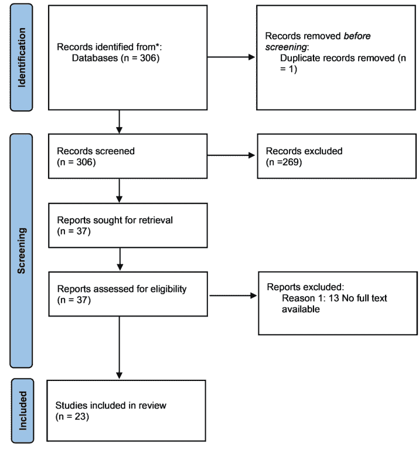

表 3. 按年度统计的研究数量

| 出版年份 | 完成的研究数量 |
|---|---|
| 2013 | 1 |
| 2016 | 2 |
| 2018 | 2 |
| 2019 | 5 |
| 2020 | 4 |
| 2022 | 5 |
| 2023 | 4 |

图 2. 按年度统计的研究数量

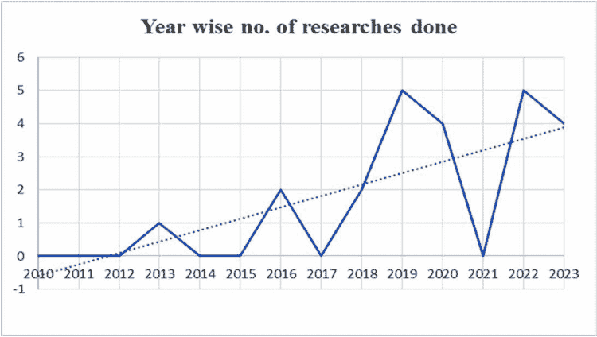

表 4. 按国家统计的研究数量

| 国家 | 完成的研究数量 |
|---|---|
| 欧洲国家 | 3 |
| 中国 | 2 |
| 伊朗 | 2 |
| 台湾 | 1 |
| 美国 | 1 |
| 坦桑尼亚 | 1 |
| 巴西 | 1 |
| 印度 | 1 |
| 以色列 | 1 |
| 孟加拉国 | 1 |

图 3. 按国家统计的研究数量

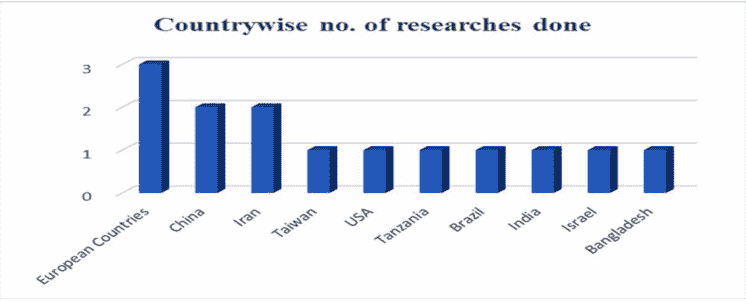

表 5. 按大洲统计的研究数量

| 大洲 | 研究数量 |
|---|---|
| 亚洲 | 8 |
| 欧洲 | 3 |
| 北美洲 | 1 |
| 南美洲 | 1 |
| 非洲 | 1 |

图 4. 按大洲统计的研究数量

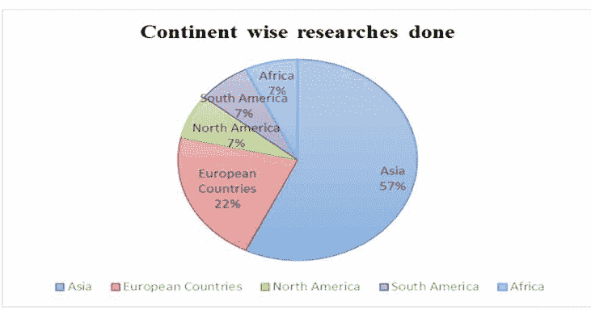

图 5. 按期刊统计的已发表论文数量

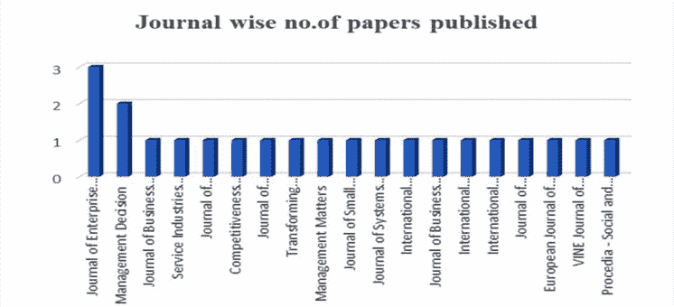

表 6. 论文类型

| 论文类型 | 完成的研究数量 |
| --- | --- |
| 综述论文 | 7 |
| 定量研究 | 11 |
| 定性研究 | 2 |
| 混合研究 | 2 |
| 概念论文 | 1 |

此外，48% 的论文是定量研究，其次是 30% 的综述论文（系统文献综述、文献计量分析、元分析），9% 是定性论文和混合论文，其余是概念论文。

“商业智能”一词范围广泛。它涵盖了一系列用于收集、存储和分析数据以支持决策的方法、流程和技术资源（Wanda & Stian, 2015）。情报研究领域为探索数据收集和分析、信息管理决策及能力提升的进展提供了机会。情报专注于从数据、信息和组织的动态特性中提取价值（López-Robles et al., 2019）。商业智能（BI）是一项有价值的工具，必须为信息收集、分析和分发而创建和利用，以实现更好的决策（Caseiro & Coelho, 2018）。为提供信息和洞察以支持决策，战略情报结合了多种类型的情报，如商业智能、竞争情报和知识管理。情报在其整体性、分析性和实践性方面通过影响创业过程的众多方面，显著影响创业。这包括识别机会、决策和运用思维（Ahmadi et al., 2020）。一项研究展示了数字技术与企业家日常活动之间的相互作用如何塑造其业务性质。周围环境的特性和动态影响各种数字工具的使用方式，且其使用是相互关联的。创业中的数字革命并非有意为之的设计产物，而是一种基于实践的进化现象。研究结果对为企业家服务的软件开发公司、对创业教育感兴趣的大学以及希望了解其工作实践动态的企业家具有重要影响（Corvello et al., 2022）。寻找鼓励创新和利用技术机会的各种战略杠杆的一种方法，是通过数据驱动取向、技能提升和创新发展的战略整合（Visvizi et al., 2022）。

另一方面，在决策过程中贯穿始终并导致新市场进入的方法、程序和选择被称为创业取向（EO）（Lumpkin & Dess, 1996; Covin & Miller, 2014）。EO 对企业的创业过程至关重要，该过程在于识别机会、创新流程和机会利用。它是处理竞争风险和最小化竞争压力的有效方式（Y. C. Chen et al., 2012）。主动性、创新性和风险承担构成了作为组合结构的创业取向的三个组成部分（Covin & Miller, 2014）。创业取向的概念集中于组织的程序、领导视角和企业行动，涵盖通过数字化转型产生新想法。企业可以通过数字化数据收集和分析流程并尽量减少人工劳动，来提高商业智能操作的速度和准确性。因此，一项研究得出结论：数字化通过简化与数据收集、分析和决策相关的程序来改善商业智能；它还提高生产力，并让研究人员从各种来源获取有价值的信息（Ismail, 2023）。在利用信息系统（IS）识别创新机会方面，EO（即带来公司或市场变革的行动）是一个关键组成部分。通过自主权，管理者可以考虑更多的可能性和替代方案，从而提高他们在利用 IS 时发现机会的能力。使用 IS 识别可能性还需要创造力和采取有计划的风险。决策支持系统（DSS）可以为管理者提供识别潜在创新领域所需的信息和理解。DSS 的示例包括商业智能工具和分析（Roberts et al., 2016）。在最近的一项研究（Caseiro & Coelho, 2018）中，该研究对不同欧洲国家的各种初创企业进行了调查，指出 BI 和 EO


显著相互影响。BI 有潜力增强创业导向的各个方面，并促进企业家采取冒险、创新和主动行为。

（López-Robles et al., 2019）的研究主题之一是商业智能，它在未来几年具有最大的增长潜力。该研究对文献中目前可用的绩效定义进行概念分析，量化书目计量学绩效指标，确定关键研究人员和研究主题，并使用 SciMAT（一种书目计量学分析程序）来评估该领域的演变。BI 与 Big Data、文本挖掘、查询、数据仓库和商业智能系统等其他主题领域密切相关。使用和分析大量数据的需求似乎在上升，这可能会导致这种潜在增长。必须强调的是，商业智能在其最广泛的意义上，仅涉及信息技术的创建和应用，而不涉及与商业组织相关的具体细节。现代商业智能解决方案可以捕获和分析几乎任何类型的数据。BI 在信息系统行业一直是一颗冉冉升起的新星，目前正在 Big Data Analytics 运动（Wanda & Stian, 2015）中获得新的推动力。大数据使得以一种革命性的新方式存储和分析情报成为可能。与大数据相关的创业涉及创立新企业并应用新想法，同时利用数据分析来推动成功和创新（Sedkaoui, 2020）。然而，市场情报的分布（BI 的另一个组成部分，特别涉及收集和评估关于市场和客户需求的数据。）促进可接受的决策，将创造性的创业导向融入现有技术或专业知识中，并通过减少错误判断的数量来减轻过度主动行为的负面影响（H. Chen & Hsu, 2013）。让小企业接触市场情报有助于发展营销能力，以最大限度地提高适应性和客户响应。市场情报补充了小企业基于经验的非正式市场知识，指导所有者和管理人员的直觉，并增强他们对创意想法的信心（Carson et al., 2020）。

此外，在一项（Sen et al., 2016）的研究中，已指出大数据对中小企业（SMEs）具有巨大的前景和潜力。通过为各个行业的问题开发实时解决方案，大数据可能促进中小企业之间的联盟。利用开放性进行决策可以帮助实现这一点。在此特定情况下选择中小企业有两个主要原因：由于其一般经济状况，中小企业比大公司能够更快速、更灵活地应对小幅变化；并且能够以高效的方式适应变化。随着中小企业以数字方式生成和维护更多的事务数据，它们可以获得从产品库存到病假等任何方面的更精确、更全面的绩效数据。这使它们能够发现差异性并提高绩效。大数据能够实现显著更准确且不断缩小的客户细分，从而定制商品和服务。中小企业通常能够更快速地适应，遗留问题更少，并且拥有更灵活的 IT 基础设施。大数据可能帮助中小企业专注于创新、提高效率并推出新业务。这意味着一些主要障碍可以被消除。预计中小企业将能够通过专注于大数据所带来的增长前景来评估其使用情况和潜力。中小企业可以将大数据用于多种目的，包括市场细分、需求预测、流程优化、预测性库存规划、预测性维护以及深入的数据分析以识别相关性、风险和机会。由于大数据的广泛应用，中小企业可能能够看到全貌。这种系统性观点基于详细的识别，并将通过全貌提供重要概念。此外，一项研究表明，业务职能（信息系统）战略对于使公司整体业务战略制定得以实现并推动公司内部创新至关重要（Yoshikuni & Dwivedi, 2023）。

根据另一项研究的作者（Oesterreich et al., 2022）的观点，未来理论发展应由其对导致大数据分析（BDA）引发的经济价值的机制日益深入的理解所指导。对于启动新 BDA 计划的管理者和决策者来说，优先考虑 BDA 的社会技术方面很重要。本研究通过对 107 项个别研究的元分析，调查了社会和技术要素在从 BDA 中产生经济价值方面的重要性。

一项书目计量学研究（Rialti et al., 2019）揭示，大数据和 BDA 系统极大地影响组织绩效和决策过程。管理者可以利用 BDA 系统生成的关于未来趋势的预测来决定销售、收入和生产需求。来自 BDA 的实时消费者分析使管理者能够快速响应客户偏好的变化。管理者可以利用 BDA 的洞察力，更好地装备自己，以便在生产和供应链中做出提高组织效率的决策。BDA 系统可以为管理者提供有关销售、制造和供应的信息，使他们能够快速应对变化并做出明智的选择。此外，提高信息质量并促进其在供应链网络中的高效交换，使企业能够更快速、更有效地应对中断（Hyun et al., 2023）。例如，一项研究（Nayak et al., 2019）指出，可穿戴技术高度依赖大数据和大数据分析，因为这些技术可能为医疗保健领域提供商业价值，并从海量信息中提取价值。

符合商业智能使用理念的各个方面，一项基于以色列企业的研究（Gnizy, 2019）广泛实施了大数据（BD）的使用。利用先前研究中的相关组成部分，它评估了国际市场导向（IMO）、国际创业导向（IEO）和国际学习导向（ILO）。BD 对于改善企业的国际创业导向（IEO）至关重要；然而，所包含的来源并未专门讨论 BD 与 IEO 之间的联系。使用 BD 可以提高公司的竞争能力、承担风险的意愿以及对创新领导的渴望——所有这些都是其 IEO 的指标。企业可以通过分析数据使用 BD 来支持其决策和行动，这与寻找和抓住全球市场机会的创业精神一致。企业可以使用 BD 来获取和评估市场情报，发现新趋势，并做出数据驱动的决策——所有这些都是全球环境中创业导向的关键要素。为了将 BD 与典型数据集区分开来，一篇论文（Ciampi et al., 2020）概述了 BD 的特征，例如大小、多样性、速度、可变性、价值、真实性和可视化。成功应用 BD 分析能力（BDAC）需要关键资源，包括人力技能、数据驱动的组织学习、集成方法论、存储、处理以及其他有形和无形资源。

此外，一项研究（Ciasullo et al., 2022）旨在探讨 192 家欧洲大数据中小企业中组织韧性与大数据分析（BDA）技能之间的联系。提高中小企业（SMEs）抵御逆境和关键时刻的能力是本文的目标。建议从业者通过识别中小企业韧性构建能力的微观基础，在危机时期提高其响应能力。对于中小企业（SMEs）而言，激进创新源于在业务运营中有效集成大数据使用（BDU），这使公司战略保持一致并提高运营效率。激进创新和满足消费者需求的尖端商品的创造，是 BDU 帮助中小企业将其业务战略与组织目标相匹配的结果（Wang et al., 2023）。

此外，在另一项对 192 家孟加拉国公司进行的研究中，识别出企业的绩效和敏捷性很大程度上受到其使用商业分析（商业智能的延伸）技能来增强信息质量和创新能力等资源的影响。绩效、敏捷性与商业分析（BA）能力之间的联系受行业动态的调节。使用数据来指导商业决策并提升绩效是 BI 和 BA 共同努力实现的目标。很明显，BA 超越了数据特征的技术要素，并强调组织资源必须如何改变，以便组织成为数据驱动型组织（Khan et al., 2022）。

因此，一项研究（Zeng & Khan, 2019）探讨了 EO 和资源编排如何共同利用大数据在新兴经济体中创造价值。它表明，为了通过整合和协调来自大数据的资源来提高绩效，新兴经济体中的企业必须使用 EO 来创造价值。为了


要理解在新兴经济体中利用大数据进行价值创造的技术，它融合了EO和资源协调理论。它强调资产协调和资源协调对于从大数据中提取价值至关重要。结果凸显了新兴经济体中的企业有必要组织资源并利用创业态度，以便利用大数据创造价值。这意味着，企业可以通过利用数据洞察来控制测试的范围，逐步扩展其概念以降低风险。

### CONCLUSION

关于使系统评述可复制并具有充分科学依据的普遍标准的知识缺乏，这种情况通常很明显。PRISMA框架提供了一种基于最佳实践清单的、经过同行评审的公认方法。作者从306篇文章中广泛审查了23篇文章。只有8项研究（占总数的57%）是在亚洲国家进行的（在所有大陆中最高）。在商业和管理文献中讨论创业取向和商业智能是相对较新的，因此本研究中仅筛选了少数文章。此外，根据趋势线，年份之间的文章发表速度较慢。

在信息系统领域，BI是一个专注于开发和使用信息技术的新兴领域。已观察到，关于BI对EO的影响，目前开展的研究并不多。虽然基于此主题已识别出相关研究，例如大数据分析、战略情报、商业分析、市场情报及其对创业精神、小型企业或任何企业的影响。这些要么是BI的组成部分，要么直接或间接与它相关。利用BI工具进行创业活动可以增强组织的竞争力，进而影响国家在市场中的地位。BI通过思维、决策和影响可能性，对创业产生重大影响。大学、软件开发公司和企业家都受到创业中基于实践的、演进式数字革命的影响。创新发展、技能提升和数据驱动取向可以战略性地整合，以促进创新并利用技术机遇。通过加快数据收集、分析和决策过程，数字化增强了商业智能。EO是承担经过计算的风险并发挥创造力，以在企业或行业内实现变革。BI和EO相互影响很大，这鼓励企业家承担风险、发挥创造力并积极主动。BI的一部分是市场情报，它鼓励决策，整合创业取向，并减少错误决策。接触市场情报有助于中小企业发展营销能力、提高灵活性并增强客户响应能力。它增强了对原创想法的信任，并丰富了非正式市场知识。

The Big Data Analytics (BDA) movement is gaining traction and offers a novel approach to data analysis and archiving. Prioritising the sociotechnical element of BDA, future theory development should concentrate on comprehending the mechanisms arising from BDA-induced economic value.

然而，在组织中提升国际创业取向（IEO）需要使用大数据（BD）。创新领导力、冒险精神和竞争力均可通过BD得到提升。数据驱动的决策、市场情报和决策均得到其支持。体量、多样性、快速性、可变性、价值、真实性和可视化是BD的一些特征。人力技能、数据驱动的组织学习以及包括处理、存储和处理在内的资源对于成功应用是必要的。对于中小企业来说，大数据大有可为，因为它可以创造合作伙伴关系，并为跨多个领域的问题提供快速解决方案。中小企业能够因其能够迅速且灵活地应对经济变化的能力而提升绩效并有效适应。此外，大数据还可以实现精准的消费者细分和个性化产品与服务。关注增长潜力可以帮助中小企业评估大数据的使用和潜力。该技术的应用包括详细数据分析、流程优化、需求预测、市场细分和预测性库存规划。

Therefore, research on this area can assist firms remain up to date with the newest developments in BI technologies and comprehend how developing technologies may be used to achieve entrepreneurial success as they continue to improve.

### CONTRIBUTION OF THE STUDY

本研究旨在提供关于BI方法和工具对企业内创业活动影响的洞察。通过理解这一点，组织可以做出明智的选择，最终带来更好的结果。理解BI与EO之间的联系，有可能提升企业家的能力、承担风险的意愿、创新能力以及整体创业思维。能够有效利用BI进行追求的企业，可以体验到生产率、可持续性和竞争力的提升。因此，本研究将促进增长和就业机会的创造。BI还可以通过使用实时数据和分析，帮助公司优化资源配置。探索这一研究领域也将有助于深入了解BI对资源利用的影响，并发现提高资源管理效率和效果的策略。利用BI开展活动可以帮助组织增强竞争力。这反过来可能影响国家在市场中的地位。BI还可以帮助检测和降低与创业活动相关的风险。因此，本研究可能为企业主提供如何利用BI进行风险管理的建议，从而构建更强大、更可持续的企业，并对全球经济增长和竞争力产生更大影响，鉴于BI驱动的创业活动有助于经济发展的机会。

创新与EO之间的关系非常密切。本研究描述了BI的影响，并提供了关于BI技术如何促进创新、产生想法以及开发造福全社会的产品和服务的洞察。本研究的发现可以帮助政策制定者、商业支持团队和孵化器创建一个能够有效整合BI的环境。这可能为中小企业创造一个氛围。研究获得的知识还可能通过塑造课程开发来影响项目，使有志创业者和学生掌握有效利用BI开展其事业所需的技能和知识。尽管关于商业智能对创业取向影响的研究不多，因此这项系统文献综述将让我们了解该领域未来研究者可以填补的可能空白。

### LIMITATIONS

与更成熟的领域相比，这些新兴领域可能没有得到研究者应有的关注。本研究仅使用了四个数据库，未来研究者在开展研究时也可以使用其他数据库。23篇论文表明，与BI相关的主题相比，相对较少的研究考察了BI对EO的直接影响。仅审查了2010-2023年间发表的文章。时间限制是本研究的另一局限性。

### FUTURE DIRECTIONS

在商业智能与创业取向的交汇处，可能需要一种结合商业、信息系统和创业洞察的研究方法。因此，开发促进研究人员与行业专业人士之间数据共享和分析的协作平台。从23篇文章可以看出，只有非常少的文章考虑了BI对EO的直接影响，而更多的强调放在了相关


BI（如 BDA、市场情报、商业分析等）相关主题，因此可以建议开展纯基于 BI 和 EO 的研究，以获取更深入的知识。由于该领域尚未被充分探索，这对即将入行的研究人员和学者来说是一个很好的机会，可以进一步挖掘该领域。为了发展实用见解并为企业、政策制定者、教育工作者和研究人员提供指导，有必要开展更多关于 BI 对 EO 影响的研究。企业的可持续性和成功越来越依赖于数据，数据可用于塑造创业的未来。企业可以通过了解 BI 如何影响 EO 来优化其 BI 系统的安装。这涉及定制 BI 工具，以解决创业所带来的特定需求和挑战。

### 参考文献

- Ahmadi, M., Baei, F., Hosseini-Amiri, S.-M., Moarefi, A., Suifan, T. S., & Sweis, R. (2020). 在组织中提出经理战略智能、组织发展和创业行为模型. 管理发展期刊, 39(4), 559–579. doi:10.1108/JMD-11-2018-0317
- Cadogan, J. W. (2012). 国际营销、战略导向与商业成功：对前路的反思. 国际营销评论, 29(4), 340–348. doi:10.1108/02651331211242656
- Carson, G., O'Connor, C., & Simmons, G. (2020). 市场情报在小企业营销能力发展中的关键作用. 小企业与企业发展期刊, 27(5), 797–816. doi:10.1108/JSBED-12-2019-0394
- Caseiro, N., & Coelho, A. (2018). 商业智能与竞争力：创业导向的中介作用. 竞争评论, 28(2), 213–226. doi:10.1108/CR-09-2016-0054
- Chen, H., Chiang, R. H. L., & Storey, V. C. (2012). 商业智能与分析：从大数据到重大影响. 管理信息系统季刊, 36(4), 1165–1188. doi:10.2307/41703503
- Chen, H., & Hsu, C.-H. (2013). 非营利服务组织中的创业导向与企业绩效：市场导向的依赖性影响. 服务业期刊, 33(5), 445–466. https://search.ebscohost.com/login.aspx?direct=true&db=crh&AN=86994939&site=ehost-live. doi:10.1080/02642069.2011.622372
- Chen, Y. C., Li, P. C., & Evans, K. R. (2012). 互动与创业导向对组织绩效的影响：对市场驱动和市场引领的洞察. *工业市场营销管理*, 41(6), 1019–1034. doi:10.1016/j.indmarman.2012.01.017
- Ciampi, F., Marzi, G., Demi, S., & Faraoni, M. (2020). 大数据与商业策略的互连：知识管理的一项重大挑战。综述与未来展望. *知识管理期刊*, 24(5), 1157–1176. doi:10.1108/JKM-02-2020-0156
- Ciasullo, M. V., Montera, R., & Douglas, A. (2022). 不确定时期中小企业韧性的构建：大数据分析能力与共同创新的作用. *转型政府：人民. 转型政府*, 16(2), 203–217. doi:10.1108/TG-07-2021-0120
- Corvello, V., De Carolis, M., Vteramo, S., & Steiber, A. (2022). 创业工作的数字化转型. *国际创业行为与研究期刊*, 28(5), 1167–1183. doi:10.1108/IJEBR-01-2021-0067
- Covin, J. G., & Miller, D. (2014). 国际创业导向：概念考量、研究主题、测量问题及未来研究方向. *创业理论与实践*, 38(1), 11–44. doi:10.1111/etap.12027
- Gnizy, I. (2019). 大数据及其在国际企业中通向价值的战略路径. *国际营销评论*, 36(3), 318–341. doi:10.1108/IMR-09-2018-0249
- Hyun, Y., Park, J., Kamioka, T., & Chang, Y. (2023). 基于大数据分析的组织敏捷性：信息系统能力视角. *企业信息管理期刊*, 36(4), 1032–1055. doi:10.1108/JEIM-03-2022-0077
- Ismail, I. J. (2023). 我必须应用这一策略！理解数字化对坦桑尼亚小企业战略导向与可持续竞争优势的中介作用. *管理要务*, 20(1), 53–73. doi:10.1108/MANM-01-2022-0019
- Khan, A., Talukder, M. S., Islam, Q. T., & Islam, A. K. M. N. (2022). 商业分析能力对创新、信息质量、敏捷性和企业绩效的影响：行业动态的调节作用. *VINE 信息与知识管理系统期刊*. doi:10.1108/VJIKMS-01-2022-0027
- Lavalle, S., Lesser, E., Shockley, R., Hopkins, M. S., & Kruschwitz, N. (2011). 大数据、分析及从洞察到价值的路径. *MIT 斯隆管理评论*, 52(2), 21–31.
- López-Robles, J. R., Otegi-Olaso, J. R., Porto Gómez, I., & Cobo, M. J. (2019). 管理与商业中30年的智能模型：一篇计量学评论. 信息管理国际期刊, 48, 22–38. doi:10.1016/j.ijinfomgt.2019.01.013
- Lumpkin, G. T., & Dess, G. G. (1996). 阐明创业导向构念并将其与绩效关联. 管理评论学院, 21(1), 135–172.
- Müller, O., Fay, M., & vom Brocke, J. (2018). 大数据与分析对企业绩效的影响：考虑行业特征的计量分析. 管理信息系统期刊, 35(2), 488–509. doi:10.1080/07421222.2018.1451955
- Nayak, B., Bhattacharyya, S. S., & Krishnamoorthy, B. (2019). 将可穿戴技术产品与大数据分析整合到商业策略中. 系统与信息技术期刊, 21(2), 255–275. doi:10.1108/JSIT-08-2018-0109
- Oesterreich, T. D., Anton, E., Teuteberg, F., & Dwivedi, Y. K. (2022). 社会和技术因素在从大数据分析中创造商业价值中的作用：一项元分析. 商业研究期刊, 153, 128–149. doi:10.1016/j.jbusres.2022.08.028
- Oukil, M.-S. (2011). 中东和北非技术型创业的发展视角. 创新与创业年鉴, 2(1), 6000. doi:10.3402/aie.v2i1.7986
- Rialti, R., Marzi, G., Ciappei, C., & Busso, D. (2019). 大数据与动态能力：一篇计量分析与系统文献综述. 管理决策, 57(8), 2052–2068. doi:10.1108/MD-07-2018-0821
- Roberts, N., Campbell, D. E., & Vijayasarathy, L. R. (2016). 利用信息系统感知创新机会：将后采用使用行为与动态管理能力视角相结合. 管理信息系统期刊, 33(1), 45–69. https://search.ebscohost.com/login.aspx?direct=true&db=crh&AN=116238037&site=ehost-live. doi:10.1080/07421222.2016.1172452
- Saleem, H., Li, Y., Ali, Z., Ayyoub, M., Wang, Y., & Mehreen, A. (2020). 供应链环境下大数据的使用及其结果：信息共享与技术创新的作用. 企业信息管理期刊, 34(4), 1121–1143. doi:10.1108/JEIM-03-2020-0119
- Sedkaoui, S. (2020). 数据分析如何改变创业机会？ *创新科学国际期刊*, *10*(2), 274–294. doi:10.1108/IJIS-09-2017-0092
- Sen, D., Ozturk, M., & Vayvay, O. (2016). 中小企业增长大数据概述. *程序：社会与行为科学*, *235*, 159–167. doi:10.1016/j.sbspro.2016.11.011
- Visvizi, A., Troisi, O., Grimaldi, M., & Loia, F. (2022). 以人为本，数字行动：在创新初创企业中激活数据驱动导向. *欧洲创新管理期刊*, *25*(6), 452–478. doi:10.1108/EJIM-04-2021-0206
- Wanda, P., & Stian, S. (2015). 我的成功秘诀：挪威工业商业智能管理的探索性研究. *计算机科学程序*, *64*(1877), 240–247. doi:10.1016/j.procs.2015.08.486
- Wang, Y., Ali, Z., Mehreen, A., & Hussain, K. (2023). 大数据使用对预测组织创新的渗透效应：商业战略对齐与信息共享的作用. *企业信息管理期刊*, *36*(1), 323–346. doi:10.1108/JEIM-10-2021-0439
- Yoshikuni, A. C., & Dwivedi, R. (2023). 企业信息系统策略促成的战略制定在组织创新性中的作用：资源协调视角. *企业信息管理期刊*, *36*(1), 172–196. doi:10.1108/JEIM-10-2021-0442
- Zeng, J., & Khan, Z. (2019). 新兴经济体中通过大数据创造价值. *管理决策*, *57*(8), 1818–1838. doi:10.1108/MD-05-2018-0572


# 第2章

## 技术企业孵化器在增强创业生态系统中的作用

萨蒂亚·拉纳詹·阿查里亚
印度企业家发展学院，印度

亚米尼·钱德拉
https://orcid.org/0000-0002-7860-9559
印度企业家发展学院，印度

### 摘要

本章考察了技术企业孵化器（TBIs）在提升初创企业效力、可行性及整体发展方面的作用。本章试图通过参考各类可用的相关文献，建立这些 TBIs 提供的支持与其对初创企业整体运营效能影响之间的联系。此外，本章还调查了这些 TBIs 提供的协助，以及从资助理念到商业化全过程中遇到的挑战。通过对古吉拉特邦创业生态系统的实证分析，提出了一个可用于改进现有支持体系的综合框架。

### 介绍

“创业生态系统”一词指的是一个高度相互关联的活动复杂网络。关于生态系统如何相互作用并促进支持创业的互连组件增长，目前知识匮乏。其组成部分之间相互关联、相互强化和维持，常被称为生态系统。考察这些互动对于充分理解环境如何影响居住环境中新就业的发展和扩张至关重要（Acs et al., 2012; Ács et al., 2014, 2016; Alvedalen & Boschma, 2017）。这些组件以一种赋能创业者的方式交织在一起。Van De Ven（1993）指出，多个相互关联的组件共同促进生态系统的发展，其中一些主要与创业者所扮演的角色有关。

创业生态系统的某些特征使其成为各类支持活动的理想场所。这些包括推动当前与未来知识、投资机构的高度关注、技能提升与培训机构、治理、获取法律和金融资源的渠道，以及发明和创造的愿望。近期研究，特别是理论贡献，为识别初创企业环境成功所需的关键特质提供了有用的框架。Van De Ven（1993）是一位突出的研究者，长期与企业合作，并主张工业基础设施有助于创造有利于创业生态系统的支持性环境。该基础设施包括技术管理和实施的功能性安排、基础科学信息服务的提供、融资金额的评估、熟练劳动力、研究设施以及现成的营销和物流支持。大学、政府、专业人士、支持服务、资本服务和人才团队均被引述为商业环境的重要要素（Cohen, 2006; Neck et al., 2004）。

### 定义创业环境和创业生态系统

根据 Spiegel（2017）的定义，创业环境由 11 个特征组成，这些特征为创业者提供安全感、鼓励和资源获取渠道。这些方面包括支持性文化、创业历史、投资人才、网络、顾问和成功企业，以及学术界、虚拟基础设施和市场支持（Spiegel, 2017; Spiegel & Harrison, 2018）。研究人员提出了多种框架来解释创业旅程的作用，这应是多种要素的组合，包括积极文化、简化的政策和领导力、专属资金获取、公平的劳动力利用、用户友好的产品市场，以及各种制度和基础设施支持（Isenberg, 2014）。此外，实体环境中利益相关方之间的互动，以及对各种无形资源（如技能集、服务和资本）的获取，在前沿环境中相互关联，进一步促进了生态系统的发展（Feld, 2012）。

在其一次调查中，牛津全球创新咨询公司推荐了一种识别生态系统差距的简单方法。商业生态系统主要由学术和研究机构、政府机构、商业和工业团体以及其他非营利组织组成。基于巴布森创业生态系统项目的生态系统支持框架旨在培养世界一流的创业者（Isenberg, 2010）。巴布森商业创业关注六个关键领域，这些领域对于在国家层面建立强有力的商业案例至关重要，包括以社会趋势和成功故事为特征的企业治理文化、对创业者可及的金融基础设施，以及由于所使用的教育体系质量和员工素质而形成的高水平员工队伍。每个现代商业环境都如同我们所处的环境一样独特，因为数百个生态系统以复杂和两极分化的方式相互作用（Isenberg, 2011）。

由于这些地区的利益相关方将创业者和初创企业视为具有多种技能和资源，并能够在社会和商业环境中运作的独立实体，因此对创业生态系统的方法对于工业区、郊区和科技集群高度集中的地区具有独特性。关于商业环境的近期出版物。Feld（2012）、Isenberg（2011）和 Spiegel（2017）已提出了有效的公司成功及其对技术创业的影响，但并未明确阐述和展示这些效应的起源和影响。

### 古吉拉特邦创业生态系统

古吉拉特邦是其中一个生态系统，该邦政府从种子阶段起就通过提供早期阶段补助金支持，承诺支持大量初创企业。通过在多所技术和非技术大学进行学生初创干预，古吉拉特邦在其预孵化层面做出了系统性努力。古吉拉特邦的生态系统在很大程度上受到非政府部门生态系统参与者的塑造，特别是从指导、早期投资和孵化的角度来看。在最近的古吉拉特邦预算中，超过20亿卢比被分配给古吉拉特邦政府的多个部门以刺激创业。州政府已启动多个计划来引导这些财务资源。这些突出计划包括：(a) 在古吉拉特邦工业政策（2015）下为初创企业/创新提供援助的计划，该计划强调在州内认定节点机构（NIs）以提供初创企业支持；(b) 由古吉拉特知识协会、技术教育署管理的学生初创与创新政策；以及 (c) 古吉拉特邦（2016-21）电子与 IT/ITeS 初创企业政策，由古吉拉特邦政府（GoG）科学与技术部（DST）管理。

在政府倡议和支持之外，各类企业机构、商业协会和学术界也齐聚一致。值得注意的是，许多州已根据古吉拉特邦生态系统的经验教训，扩大了制度机制。喀拉拉邦、安得拉邦以及全国范围内通过 AICTE 的预孵化和大学初创理念，在很大程度上汲取了古吉拉特邦主导的学术项目的灵感。虽然古吉拉特邦初创生态系统也在构建面向知识驱动型初创需求的现代机制和机构，但它早在 1980 年代就已通过企业家发展中心（CED）、工业推广局（iNDEXTb）等机构将其流程制度化，行动相当及时。

如果观察图 1，艾哈迈达巴德地区拥有最多数量的 DST 认证 TBIs，共计 21 家，其中 8 家同时由商业和公立教育机构支持。这些 TBIs 还监管 NI，并且应强调，它们监管的 33 个 NI 中有 28 个——均在古吉拉特邦工业政策-2015 的初创企业计划下获认可——是在学术机构中建立的。古吉拉特邦各学术机构和大学中开展的研究、项目和孵化活动，是古吉拉特邦生态系统技术与创新价值链供给端的基础。该州的孵化支持结构可以通过表 1 和表 2 大致概述。

| 序号 | 计划和（或）部门 | 孵化中心数量 |
|---|---|---|
| 1 | 创业计划，古吉拉特邦工业专员办公室（GoG） | 33 |
| 2 | 学生创业与创新政策，古吉拉特邦技术教育署（GoG） - 大学孵化器 | 19 |
| 3 | 电子与信息技术部（DeITY），由电子与信息技术部（MEITY）主管 | 2 |
| 4 | 人力资源开发部（MHRD） | 4 |
| 5 | 生物技术部 | 2 |
| 6 | 微型、小型和中型企业部（MSME） | 6 |
| 7 | 科技园区 | 4 |
| 8 | 阿塔尔孵化中心 | 4 |
| 9 | 科学与技术创业园区，DST，GoI | 2 |


#### 表 2. 古吉拉特邦的额外机构设置

| 额外机构设置 | 数量 |
|---|---|
| Fab Labs | 33 |
| 知识产权便利中心 | 4 |
| 预孵化设施 | 57 |
| 区域创新中心 | 4 |

来源：作者

#### 图 1. 古吉拉特邦创业生态系统—各地区机构设置和孵化器分布
(来源：作者)

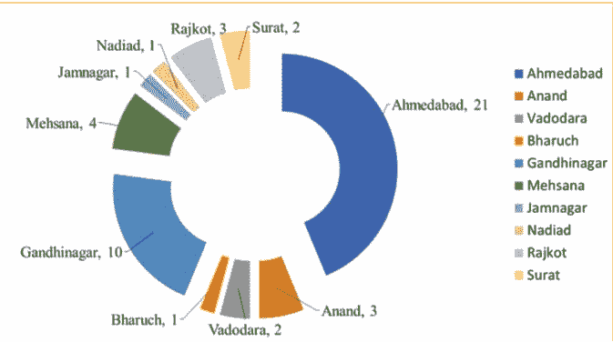

### 在增强创业生态系统方面的技术商业孵化器 (TBIs)

多年来，科学、技术和创新协同发展。创业投入及其周围的支持结构（包括机构设置）对新技术发明的创造有显著影响。在创新者与其他组织之间、在产生和使用研究的跨部门之间，以及在企业内部，开发流动性指标是必要的。建议对推动企业开展研发等技术活动并带来竞争优势的市场激励进行测绘。此类工作还会产生知识溢出，从而推动整体经济增长并提高经济竞争力。

这本质上说明了技术企业家通过开发新概念、获得专利和进入市场所发挥的确切作用。

技术商业孵化器（TBIs）通过提供各种技术、管理及其他行政支持，支持初创企业的早期阶段和发展。国家商业孵化协会（NBIA）认定，孵化器的主要目标是创造盈利、可持续发展的企业。孵化器的目标是帮助有志于创业的业务起步。商业顾问可以帮助弥合从指导到资金支持等许多领域存在的差距。孵化器计划通过为企业家提供基础培训、创办企业的机会，并在特定情况下提供与公司其他潜在未来投资者互动的机会，从而填补这一差距（Burns & Jim, 1996）。

TBIs 旨在利用技术、资源和一手经验来培育创业人才，加速艺术产业的发展，并最终加速技术的销售（Hackett & Dilts, 2004a, 2004b）。它们与学院、研究设施和技术园区密切合作。技术商业孵化器旨在为基于技术的企业、技术领域的新产品和服务开发以及新市场提供支持性环境。

#### 古吉拉特邦的技术商业孵化

古吉拉特邦正在大力投资，构建一个促进创新和初创企业发展的稳固生态系统，以推动就业增长并驱动经济扩张。根据古吉拉特邦政府（GoG）的信息，该州在未来几年内有雄心勃勃的目标：建设约 200,000 平方米的孵化器空间，建设约 100 个孵化器，并至少支持 2,000 家公司。截至目前，古吉拉特邦在过去两年内已为 175 家企业提供总计 2.2 亿印度卢比（300 万美元）的财务支持。到 2021 年，政府已帮助了 2,000 家初创企业。除了获得政府资助的 175 家初创企业外，该州还有 26 家企业由高净值个人赞助。政府已通过隶属于不同部门的多个计划和项目分发了机构孵化支持（参见图 2）。

古吉拉特邦典型的孵化支持模式涉及以指导、咨询和资源的形式帮助初创企业。其中一项非常著名的活动称为“演示日”（Demo-Day），其目的是通过举办一系列从创新者到投资者的投资路演，吸引初创企业投资者社区对尖端初创企业理念的关注。TBIs 通常为初创企业提供专用办公空间或共享办公空间（有时甚至鼓励企业自行设立专用空间），此外还提供用于共享资源和其他孵化活动的实体场所。商业孵化器通常在预定期限内为企业提供专属办公和开发空间。

在与该州 TBI 负责人讨论时观察到，商业孵化器从初创企业发展的最初阶段（从构思到产生收入的阶段）就开始介入，甚至可以延伸到后期增长阶段。然而，由于大多数企业通常在此阶段受益于外部援助，大多数孵化器倾向于专注于相对早期的创业者。孵化的初创企业通常以批次形式录取，在孵化器和加速器的常规孵化程序中每年提供 1-3 个批次。有些孵化器较为通用，而有些则专注于特定行业、市场、技术、阶段或其他重点领域。大多数孵化器在孵化前尝试进行筛选和申请流程。

#### TBI 在提升初创企业运营绩效与可持续性方面的作用

##### 运营绩效

在评估初创企业绩效时，强调了几个可考虑的要素（或因素）。预计较高水平的技术探索将减缓研发（R&D）活动的外包，并使新企业的实施成本更高，因为这样做具有重大影响，并可能导致长期不确定性和知识问题。预计当选择专注于技术相关商品和服务的销售和营销举措时，技术外包水平较低，从而产生这种结果（Koza et al., 1998; Koza & Lewin, 1998; Lavie & Rosenkopf, 2006）。与营销相关的活动经常被忽视且不可靠（例如产品性能信息和预期效益），因此对于包含高水平技术知识和不确定性的产品和服务，至少将销售和营销活动外包。由于市场外包和销售通常较少受探索活动程度的影响，我们预计技术探索活动水平的提高将对研发外包产生重大负面影响。

Ripsas、Shaper 和 Toger（2018）引入的绩效测量工具概念——“初创驾驶舱”（startup cockpit）——关注客户服务、财务愿景和流程等指标。在研究初创企业效率时，这三个指标具有相关性。在评估财务预测时，人们认为还应评估经济生存能力和盈利能力等进一步指标。流动性、烧钱率、利润率分析和投资回报率是绩效评估的进一步子层面。从投资者的角度来看，客户获取成本、客户终身价值和学习曲线可以作为其他指标。

随着初创企业的扩张，决策需要更多信息。因此，经常指出初创企业应专注于被认为最相关的领域，以有效、高效地花费时间和资源。因此，预计初创企业在管理层认为更关键且不太重要的领域会表现得更好。

##### 可持续性

现在，在评估初创企业的可持续性方面，研究人员建议评估实施阶段。根据埃里克·里斯（Eric Ries，2016）的说法，构建、衡量和学习是最初的三个阶段。成功的初创企业在早期阶段完成业务迭代循环模型，直到来自客户反馈的培训和洞察提供了足够的证据，证明商业模式是成功且相关的（Ries, 2016; Ries & Euchner, 2013; Ripsas et al., 2018a, 2018b; Ripsas & Hentschel, 2017）

Croll 和 Yoskovitz（2017）确定了在评估初创企业可持续性时可以调查的五个基本类别，这些包括依从性、共情、平均客户体验、产品/服务活力以及产生的收入。共情是认识到无法满足的实际客户需求的阶段。最关键的方面是，初创企业学会如何回应客户需求并留住客户。如果客户对响应感到满意，他们会向他人推荐产品或服务。这通常是


初创企业的存续。初创企业目前正在规模扩大。毕竟，所有初创企业都必须开始创造收入（盈利类别）。初创企业目前正专注于构建具有韧性且持久的公司模式这一概念。

分析可持续商业运营（SBO，结合商业管理与可持续商业管理）是评估初创企业可持续性的另一种方法。SBO 具体考察机会、环境条件和经济进展等要素如何得到妥善处理（Belz & Binder, 2017）。SBO 专门评估社会责任、经济绩效和环境保护（Kuckertz & Wagner, 2010），并进一步承担涉及环境和社会企业家的公共责任，因为它提供持续的关怀。

### 科学、技术、创新与创业政策框架

其利益相关者的活动在特定政策支持的引导下进行，旨在创造能够促进创新的环境。由于技术企业家数量的增加，推动技术驱动型活动在过去二十年来一直是全球科学、技术和创新政策的焦点。大多数政策工具试图降低创业的监管壁垒，因为技术驱动型创业过程涉及高风险且孵化周期较长。这包括通过改善对资金、信息和培训的获取提供支持，同时培育创业文化。可供技术驱动型企业家使用的支持体系和新的利益相关者已经改变了创业环境。根据《全球初创企业生态系统报告（2023）》，区域经济受技术创业影响更为显著。因此，区域经济战略已调整以纳入创业活动。

将创业经济模式加入当前的科学、技术和创新政策将引发波动。在竞争动态的背景下，需要创新来取代保障，需要定制化来取代专业化。直到最近，科学、技术和创新政策仍集中于专业领域的工作。然而，随着经济向不可预测性转变，创业利益相关者必须适应并进行定制化，以掌握灵活性的艺术（Nicotra et al., 2018; Romano et al., 2014）。政策干预必须根据必要的指标进行调整。

同样重要的是关注特定举措，通过在企业成长各个阶段建立长期的全程扶持结构来支持技术企业家。为此，必须改变相关指标的衡量技术及其追踪进展的能力。区域政策将知识、人力资本和基础设施投资与技术增长轨迹联系起来。

### 结论

尽管天然企业家在不断演进，但数据显示，孵化器已改善并增强了其作为所有领域企业主培训、沟通和咨询枢纽的功能，而非拥有办公室的传统商业中心。孵化器优先提升创新成功率，通过支持企业家克服其早期和成长期挑战，此外还涉及所提供模式和服务的多元化视角与演进（Dettwiler et al., 2006; Mireftekhari, 2017; Schwartz, 2013）。监测新技术发展具有重大影响，并可能有助于支持长期知识和不确定性；这些不确定性源于在选择销售和营销时较低的技术外包水平，预计更高水平的技术勘探将减缓外包研发活动的步伐并增加新企业的进入成本（Koza et al., 1998; Koza & Lewin, 1998; Lavie & Rosenkopf, 2005, 2006b, 2006a）。

图 3. 科学、技术、创新与创业政策的关注领域
（来源：作者）

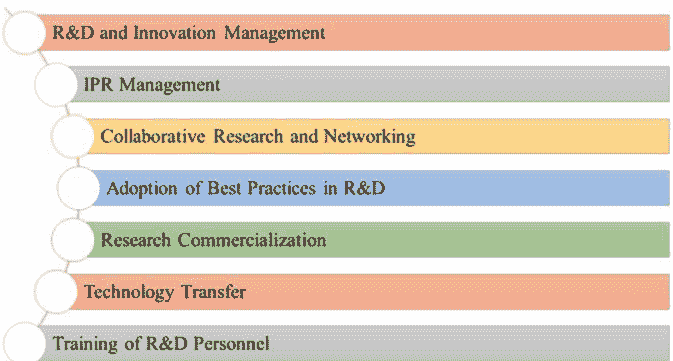

国家科学、技术、创新与创业政策和战略被认为对于最大限度地发挥新兴技术的效益至关重要。以下代表了国家层面政策实施中至关重要的领域，并可作为未来研究的方向（见图 3）。在评估可持续性和绩效效率时，创业体现了企业家的参与、创造力和冒险精神。本章是评估初创企业运营绩效和可持续性的各类文献概述。此外，我们还强调了科学、技术、创新与创业政策在技术企业孵化器支持下提升基于技术应用绩效方面的作用。我们以印度古吉拉特邦作为该领域战略变革生态系统的参考。下一章对该领域的学者有用，并可在评估初创企业生态系统中的各类参与者时提供参考。

### 参考文献

- Acs, Z. J., Autio, E., & Szerb, L. (2012). National Systems of Entrepreneurship: Measurement Issues and Policy Implications. SSRN Electronic Journal. doi:10.2139/ssrn.2008160
- Ács, Z. J., Autio, E., & Szerb, L. (2014). National Systems of Entrepreneurship: Measurement issues and policy implications. Research Policy, 43(3), 476–494. Advance online publication. doi:10.1016/j.respol.2013.08.016
- Ács, Z. J., Autio, E., & Szerb, L. (2016). National Systems of Entrepreneurship: Measurement issues and policy implications. In Global Entrepreneurship, Institutions and Incentives. doi:10.4337/9781784718053.00040
- Alvedalen, J., & Boschma, R. (2017). A critical review of entrepreneurial ecosystems research: Towards a future research agenda. European Planning Studies, 25(6), 887–903. doi:10.1080/09654313.2017.1299694
- Belz, F. M., & Binder, J. K. (2017). Sustainable Entrepreneurship: A Convergent Process Model. Business Strategy and the Environment, 26(1), 1–17. doi:10.1002/bse.1887
- Burns, P., & Jim, D. (1996). Small business and entrepreneurship (Eds). Macmillan.
- Cohen, B. (2006). Sustainable valley entrepreneurial ecosystems. Business Strategy and the Environment, 15(1), 1–14. doi:10.1002/bse.428
- Croll, A., & Yoskovitz, B. (2017). Lean Analytics: use data to build a better startup faster. O'Reilly, 53(9).
- Dettwiler, P., Lindelöf, P., & Löfsten, H. (2006). Business environment and property management issues: A study of growth firms in Sweden. Journal of Corporate Real Estate, 8(3), 120–133. Advance online publication. doi:10.1108/14630010610711748
- Feld, B. (2012). Startup Communities: Building an Entrepreneurial Ecosystem in Your City. In Municipal World.
- Global Startup Ecosystem Report 2023. (n.d.). Startup Genome. https://startupgenome.com/report/gser2023
- Hackett, S. M., & Dilts, D. M. (2004a). A real options-driven theory of business incubation. The Journal of Technology Transfer, 29(1), 41–54. doi:10.1023/B:JOTT.0000011180.19370.36
- Hackett, S. M., & Dilts, D. M. (2004b). A Systematic Review of Business Incubation Research. The Journal of Technology Transfer, 29(1), 55–82. doi:10.1023/B:JOTT.0000011181.11952.0f
- Isenberg, D. (2010). How to Start an Entrepreneurial Revolution. HBR. www.hbr.org
- Isenberg, D. (2011). The Entrepreneurship Ecosystem Strategy as a New Paradigm for Economic Policy: Principles for Cultivating Entrepreneurship. Institute of International and European Affairs.
- Isenberg, D. (2014). What an Entrepreneurship Ecosystem Actually Is. Harvard Business Review.
- Koza, M. P., & Lewin, A. Y. (1998). The Co-evolution of Strategic Alliances. Organization Science, 9(3), 255–264. Advance online publication. doi:10.1287/orsc.9.3.255
- Koza, M. P., Lewin, A. Y., Science, S. O., Issue, S., Partnerships, M., Koza, M. P., & Lewin, A. Y. (1998). The Co-Evolution of Strategic Alliances Linked references are available on JSTOR for this article : The Co-evolution of Strategic Alliances. Organization Science, 9(3), 255–264. doi:10.1287/orsc.9.3.255
- Kuckertz, A., & Wagner, M. (2010). The influence of sustainability orientation on entrepreneurial intentions - Investigating the role of business experience. Journal of Business Venturing, 25(5), 524–539. Advance online publication. doi:10.1016/j.jbusvent.2009.09.001


Lavie, D., & Rosenkopf, L. (2005). 联盟形成中勘探与开发的平衡：多维视角。*2005 年管理学会年会：21 世纪的管理新愿景，AOM 2005*。IEEE。10.5465/ambpp.2005.18778391

Lavie, D., & Rosenkopf, L. (2006a). 联盟形成中勘探与开发的平衡。*管理学会期刊*，49(4), 797–818。doi:10.5465/amj.2006.22083085

Lavie, D., & Rosenkopf, L. (2006b). 联盟形成中勘探与开发的平衡 德克萨斯大学奥斯汀分校。*管理学会期刊*，49(4)。doi:10.5465/amj.2006.22083085

Mireftekhari, S. (2017). *企业孵化器：初创企业挑战的解决方案——对企业孵化器支持初创企业克服新生与小规模之责任的定性视角*。DUO。https://www.duo.uio.no/handle/10852/57517

Neck, H. M., Meyer, G. D., Cohen, B., & Corbett, A. C. (2004). 新企业创造的创业系统视角。在《小企业管理期刊》中（第 42 卷，第 2 期）。doi:10.1111/j.1540-627X.2004.00105.x

Nicotra, M., Romano, M., Del Giudice, M., & Schillaci, C. E. (2018). 创业生态系统与生产性创业之间的因果关系：一个测量框架。*技术转移期刊*，43(3), 640–673。doi:10.1007/s10961-017-9628-2

Oxford Global Innovation Consultancy. (n.d.). *Oxtentia*。牛津全球创新咨询公司。https://www.oxtentia.com/

Ries, E. (2016). *埃里克·莱斯的精益创业*。The Starta。

Ries, E., & Euchner, J. (2013). 谈话：大公司能从初创企业学到什么：与 Eric Ries 的访谈。*研究技术管理*，56(4), 12–16。doi:10.5437/08956308X5604003

Ripsas, S., & Hentschel, B. (2017). 从商业计划到初创驾驶舱。在《众筹创业》中。Springer。doi:10.1007/978-3-658-17031-8_4

Ripsas, S., Schaper, B., & Tröger, S. (2018a). 概念验证的初创驾驶舱。在《创业手册》中。Springer。doi:10.1007/978-3-658-04994-2_21

Ripsas, S., Schaper, B., & Tröger, S. (2018b). 概念验证的初创驾驶舱。在《创业手册》中。Springer。doi:10.1007/978-3-658-05263-8_21-2

Romano, A., Passiante, G., Del Vecchio, P., & Secundo, G. (2014). 智能专业化战略中创新生态系统作为创新创业的推动器。*基于知识的发展国际期刊*，5(3), 271–288。doi:10.1504/IJKBD.2014.065315

Schwartz, M. (2013). 关于孵化器对企业生存影响的对照组研究。*技术转移期刊*，38(3), 302–331。doi:10.1007/s10961-012-9254-y

Spigel, B. (2017). 创业生态系统的关系组织。*创业理论与实践*，41(1), 49–72。提前在线出版。doi:10.1111/etap.12167

Spigel, B., & Harrison, R. (2018). 迈向创业生态系统的过程理论。*战略创业期刊*，12(1), 151–168。doi:10.1002/sej.1268

Van De Ven, H. (1993). 创业基础设施的发展。*企业创业期刊*，8(3), 211–230。doi:10.1016/0883-9026(93)90028-4

# 第 3 章

## 区块链与创业

Kande Archana
印度马拉雷迪工程学院

Aarti Gloth
印度马拉雷迪工程学院

### 摘要

区块链技术已成为一种颠覆性力量，有潜力重塑各行各业的创业和商业企业。其去中心化、不可篡改的账本系统为创新解决方案奠定了基础，促进了透明度、安全性和效率。企业家们正在利用区块链开展众多应用，从供应链管理到代币化资产和去中心化金融（DeFi）。本章深入探讨了区块链与创业之间的共生关系，探索了区块链在初创企业中的变革作用，以及通过首次代币发行（ICO）筹集资金和通过智能合约简化流程。随着这种去中心化账本技术不断发展，企业家面临的不仅是创新机遇，还有监管和可扩展性挑战。全面了解区块链对创业的影响，对于在这个不断发展的环境中航行、培育新的商业模式以及实现区块链技术的全部潜力至关重要。

### 引言

在创业领域，区块链技术的融合催生了前所未有的机遇和创新格局。本次介绍性探讨将着重分析区块链对创业的深远影响，特别强调其正在重塑创业格局的多样化应用。在深入探讨其应用之前，让我们先建立对区块链的基本认识。从本质上讲，区块链是一种去中心化且抗篡改的数字账本，它记录分布式计算机网络中的交易。与传统的中心化系统不同，区块链运行在无需信任的网络上，交易通过共识验证，从而增强安全性和透明度。

区块链的起源可追溯至2009年比特币的发布，其归功于一个被称为中本聪的实体或个人。比特币是区块链技术的开创性应用，引入了去中心化数字货币的概念。然而，区块链的潜力远超加密货币，广泛影响着各个行业和创业活动。区块链技术通过各种应用在创业领域催生了一场变革浪潮：

- 加密货币项目：比特币和以太坊等加密货币使企业家能够创建新的数字货币和去中心化金融平台，彻底改变了我们存储和转移价值的方式。
- 首次代币发行（ICO）：企业家可以通过ICO筹集资金，使项目和初创企业的投资机会民主化。
- 智能合约：这些用代码编写的自动执行合同可以自动化业务流程，减少对中介的需求并增强交易中的信任。
- 供应链管理：区块链在供应链中提供端到端的透明度和可追溯性，减少欺诈，确保产品质量，并建立消费者信任。
- 身份验证：基于区块链的数字身份正在通过提供安全、可验证的身份识别来改变金融、医疗保健和电子商务等行业。
- 知识产权保护：企业家可以使用区块链对知识产权进行时间戳和保护，降低版权侵权的风险。
- 全球市场准入：区块链的去中心化特性促进了进入全球市场，消除了企业家的地理障碍。

尽管区块链应用在创业领域潜力巨大，但企业家必须应对挑战和风险。这些包括监管复杂性、可扩展性问题、互操作性顾虑以及适应不断发展的技术环境的需要。

区块链创业的未来是一幅充满希望的画布。企业家们处于创新的前沿，不断寻找在各行各业应用区块链解决方案的新方法，不断拓展可实现的边界。在这个动态的环境中取得成功取决于适应性、前瞻性思维以及抓住新兴机遇的意愿。

区块链技术与创业的融合是推动传统商业模式变革的强大力量。它有潜力颠覆行业、赋能个人并推动全球经济转型。在本系列的即将推出的部分中，我们将深入探讨区块链在创业中的具体应用，探索现实世界中的案例，并分析塑造这一动态交叉点的监管考量。加入我们，一起踏入区块链及其在创业领域应用的精彩旅程。

### 文献综述

关于区块链与创业交叉领域的文献综述揭示了一个丰富而充满活力的格局，其中蕴含着大量的研究、见解和多样化的观点。本综述旨在概述该领域的关键主题和奠基性著作，阐释迄今积累的知识深度与广度。尽管此列表并非详尽无遗，但它提供了一份对区块链对创业影响的理解有显著贡献的代表性样本。

《供应链管理中的区块链与智能合约：文献综述》（2021）作者：Mohammad T. Uddin, Emmanouil Stiakakis, Sanjiban Sekhor Nath。这篇综述论文提供了关于区块链和智能合约在供应链管理中的应用的见解，阐明了它们对创业的影响。它讨论了区块链在供应链流程中采用所面临的挑战和机遇。

《区块链创业：去中心化和分布式自治组织》（2019）作者：John M. Kline 和 Phillip L. Swint。这篇研究论文探讨了区块链技术推动的去中心化和分布式自治组织（DAO）的出现。它讨论了这些新型组织结构的创业含义以及它们对传统企业带来的挑战。《商业中区块链技术的影响：系统综述》（2018）作者：Simon Oberthür, Carsten H. Gellings 和 Anette Mikes。这篇系统综述考察了区块链技术对


各种业务方面。它提供了企业家在将区块链整合到其运营中时可能遇到的机遇和挑战的见解。

“区块链与物联网：系统文献综述”（2018）Monica Ribeiro、João Marco Cunha 和 Akebo Yamakami 著 本文献综述探讨了区块链与物联网（IoT）的整合及其与创业的相关性。它深入探讨了区块链在基于物联网的创业项目中的潜在应用。

“医疗保健中的智能合约：Prisma项目方法”（2017）Maurizio Veca、Francesco Napolitano 和 Angelo P. Giordano 著 聚焦智能合约，本文讨论了其在医疗保健领域的作用以及该领域创业项目的潜力。它提供了关于区块链技术如何颠覆医疗保健行业、创造创业机会的见解。

“创业中区块链的潜力与挑战”（2017）Carlos Agostinho、Sergio Lopes 和 Bruno Oliveira 著 这篇研究论文评估了区块链技术在创业中的潜力与挑战。它深入探讨了区块链采用的好处，包括增强的透明度和安全性，同时也涉及可扩展性和监管问题。

“区块链与物联网：系统文献综述”（2017）Luca Valcarenghi、Riccardo Rovatti 和 Gianluca M. Cornetta 著 这篇系统文献综述探讨了区块链技术与物联网（IoT）的整合。它讨论了区块链在物联网驱动的创业计划中的潜在应用。

“去中心化应用：利用比特币的区块链技术”（2016）Siraj Raval 和 Maksim Balashev 著 本文提供了关于去中心化应用（DApps）及其与区块链技术联系的见解。它讨论了DApps如何在去中心化、无需信任的生态系统中提供创业机会。

“区块链：简介及其在金融服务领域的创业潜力”（2016）Richard T. Harrison 和 Jongmin Lee 著 着眼于金融服务领域，本文对区块链技术进行了介绍，并探讨了其在FinTech、数字支付和金融创新背景下的创业潜力。

“化工行业的区块链技术：机器对机器电力市场”（2014）Isaac Arthur、Stephanie Hurder 和 Britanny Arthur 著

“比特币：一种点对点电子现金系统”（2008）Satoshi Nakamoto 著 这篇奠基性的白皮书介绍了比特币及其底层区块链技术。

“比特币：一种创新的替代数字货币”（2011）Iwa Salami 著

对比特币和加密货币创业潜力的探讨。

“区块链：机器人流程自动化的新框架”（2016）Nick White 著 讨论了区块链在自动化业务流程方面的潜力及其对创业的影响。

“区块链技术作为颠覆性创新”（2017）Matheus F. C. A. Martins 和 Luis G. G. M. Meirelles 著 探讨了区块链技术的颠覆潜力及其对企业家的影响。

“理解比特币：密码学、工程学与经济学”（2018）Pedro Franco 著 一种跨学科方法，用于理解比特币的技术、经济学及其创业意义。

“首次代币发行：通过加密货币代币销售为增长融资”（2018）Sabrina T. Howell、Marina Niessner 和 David Yermack 著 探讨了ICO及其在创业融资中的作用。

“智能合约：弥合期望与现实之间的差距”（2019）Li Ming Wong 和 Daniel Reijsbergen 著 讨论了智能合约在区块链技术和创业中的影响。

“区块链技术及其应用”（2019）Bhavesh Borisaniy 等人 著 探讨了区块链技术在各行各业的应用，包括创业。

“区块链商业模式”（2020）Karim Lakhani、Marco Lansiti 和 Karim R. Lakhani 著 分析了区块链技术实现的不同商业模式及其对创业的影响。

“创业与区块链：社会科学的新范式”（2021）Jason Potts 和 Chris Berg 著 探讨了区块链技术对创业和社会科学的广泛影响。

### 区块链的演进

区块链技术的演进可分为三个主要阶段，通常称为区块链1.0、2.0和3.0。这些阶段代表了区块链系统发展的不同阶段，每个阶段都具有独特的特征、用例和创新。

**区块链1.0：数字货币（2008 - 2010年代初）：** 区块链1.0等同于比特币的创建以及第一种基于区块链的加密货币的出现。本阶段的主要特点包括：

- 比特币的诞生：Satoshi Nakamoto于2008年发布比特币白皮书，标志着区块链技术的开端。比特币作为一种数字货币，旨在促进无需中介的点对点交易。
- 挖矿与共识：区块链1.0引入了工作量证明（PoW）共识机制的概念，该机制在验证和保障交易安全方面发挥了关键作用。矿工会利用其算力解决复杂的数学难题，以获取新创建的比特币和交易费作为回报。
- 数字货币主导：在此期间，区块链的主要用例是作为数字货币，侧重于点对点支付和金融交易。

#### 区块链2.0：智能合约与去中心化应用（2010年代中期 - 2010年代末）

区块链2.0超越了数字货币，实现了重大飞跃，引入了智能合约概念并扩展了区块链技术的功能：

- 以太坊与智能合约：以太坊由Vitalik Buterin于2015年推出，是一项开创性的进展。它允许开发者使用自执行智能合约创建去中心化应用（DApps），智能合约是基于代码的协议，当预定义条件满足时会自动执行。
- 互操作性：以太坊等区块链平台的出现促成了大量DApps和代币的开发。不同区块链之间的互操作性成为关注焦点，因为各项目旨在解决可扩展性和兼容性问题。
- 首次代币发行（ICO）：区块链2.0也见证了ICO的兴起，这是一种新颖的融资方式，使初创企业能够通过在区块链平台发行代币来筹集资金。这一创新使投资机会的获取更加民主化。

图1. 区块链的演进

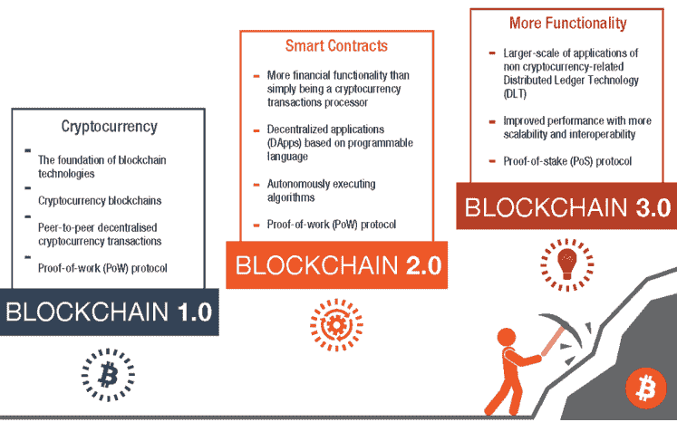

#### 区块链3.0：可扩展性、互操作性和现实世界应用

（2010年代末 - 至今）：区块链3.0代表了区块链技术的当前阶段，其特点是致力于解决可扩展性、互操作性和现实世界应用问题：

- 可扩展性解决方案：为了克服早期区块链的局限性，正在开发各种可扩展性解决方案，例如分片和第2层解决方案（如比特币的闪电网络），以提高交易吞吐量并降低费用。
- 互操作性标准：互操作性是区块链3.0的重点。Polkadot和Cosmos等项目旨在连接多个区块链，实现不同网络之间资产和数据的无缝转移。
- 现实世界用例：区块链技术越来越多地应用于金融以外的现实世界问题。供应链管理、医疗保健、身份验证和投票系统等行业正在探索区块链在透明度、安全性和效率方面的潜力。
- 权益证明（PoS）：许多项目正在从PoW转向PoS共识机制，以降低能耗并提高可扩展性。
- DeFi、NFT和Web3：去中心化金融（DeFi）平台和非同质化代币（NFT）的兴起，表明区块链3.0的用例正在多样化，重点关注去中心化金融服务和独特数字资产。

多年来，区块链技术已取得显著发展，每个阶段都在前一阶段的创新基础上构建。尽管区块链的旅程仍在继续，但变革性应用和技术进一步进步的潜力依然充满希望。

### 区块链技术如何在创业中发挥作用

区块链技术在创业领域通过网络促进交易方面发挥着基本作用。其工作原理如下：

- **去中心化账本：**

区块链是一种去中心化的分布式账本技术。它由一台台计算机（节点）组成的网络构成，这些节点维护着账本的相同副本。当发生交易时，它会被添加到一个区块中，然后该区块与前一个区块相链接，形成交易的时间顺序链。


#### 图2. 区块链技术在创业中的应用


- **交易发起：** 企业家通过创建交易的数字记录来发起交易。此记录可以代表各种类型的交易，包括财务支付、数字资产转移、智能合约创建或供应链数据记录。

- **数字签名：** 区块链上的交易使用数字签名进行保护。企业家使用其私钥对交易进行签名以证明所有权和授权。接收者随后可以使用企业家的公钥验证交易的真实性。

- **验证与共识：** 一旦交易发起，它会被广播到节点网络。这些节点共同验证交易，以确保其遵循规则并遵守共识机制（例如，工作量证明或权益证明）。共识机制因区块链平台而异。

- **挖矿（工作量证明）：** 在工作量证明（PoW）区块链中，矿工竞争解决复杂的数学难题。第一个解决难题的矿工获得将新交易块添加到区块链的权利。此过程资源密集，需要大量计算能力。

- **区块确认：** 一旦包含交易的区块被网络确认，它就会被添加到区块链中。该交易现在被视为最终确定，数据以不可更改且透明的方式记录。

- **不可更改的记录：** 区块链的不可更改性意味着，一旦交易记录在区块链上，就无法被更改或删除。此功能确保了交易记录的完整性，降低了欺诈和纠纷的风险。

- **交易最终性：** 当交易被添加到区块链时，即被视为最终完成。这种最终性是区块链技术的关键优势之一，因为它减少了对中央权威机构验证交易的信任需求。

- **区块链网络：** 不同的区块链网络可能具有不同的交易处理速度、成本和共识机制。公共区块链（如比特币和以太坊）对任何人开放，可以处理全球交易量。私有或联盟区块链可能具有更快的交易速度，并对特定参与者实施受控访问。

- **智能合约：** 除了简单交易外，企业家还可以在某些区块链平台上部署智能合约。智能合约是自执行程序，根据预定义条件自动执行操作。这些可以简化复杂的业务流程并减少对中介的需求。

- **全球交易：** 区块链技术允许跨境交易，无需货币兑换或传统中介。这对全球创业尤其有利，有助于促进国际贸易和合作。

总而言之，区块链技术为创业中的交易进行和记录提供了一个去中心化、透明且安全的环境。它消除了对集中式中介的依赖，降低了欺诈风险，并为创新商业模式、通过智能合约实现的自动化以及高效的全球交易开辟了新的可能性。

### 区块链技术与创业研究详细情况概述

区块链技术和创业已成为研究的焦点，吸引了学者、商业领袖和政策制定者的关注。这两个领域之间的相互作用推动了大量的研究和调查，揭示了两者面临的机遇、挑战和影响。在本概述中，我们将探讨区块链和创业领域的现状，重点介绍关键主题和发现。

一个突出的研究领域考察了企业家和初创公司如何采用区块链技术来颠覆传统商业模式。研究人员已记录了各种用例，如供应链管理、数字身份验证和知识产权保护，以了解其对创业的影响。关于基于区块链的融资机制（如首次代币发行（ICO）和证券代币发行（STO））的研究，分析了这些替代融资方式对初创企业的动态。研究人员探讨了影响ICO成功的因素，以及它们在监管和投资者保护方面带来的挑战。

智能合约作为区块链技术的基石，一直是研究人员感兴趣的课题。他们研究这些自执行合同如何自动化业务运营的各个方面，并增强创业交易中的信任。该领域的研究集中在区块链如何转变供应链管理。它评估区块链在减少欺诈、提高透明度和增强供应链中消费者信任方面的影响。案例研究提供了区块链在此领域实际应用的见解。

关于区块链和加密货币的不断演变的监管环境是一个关键的研究课题。学者们深入研究监管框架带来的挑战和机遇，旨在提供建议，以在创新与合规之间取得平衡。研究调查区块链的去中心化特性如何使企业家能够进入全球市场并在跨国界扩展业务。这种探讨涉及与跨境交易和监管差异相关的挑战。

通过区块链保护知识产权是一个备受关注的课题，尤其对企业家而言。研究人员探讨区块链如何帮助对知识产权进行时间戳和保护，降低侵权风险。区块链技术的安全性和隐私影响是另一个关键研究领域。它涉及探索与创业中区块链应用相关的漏洞、威胁和隐私挑战。了解创业中区块链采用的障碍是一个核心研究主题。这些研究调查可扩展性问题、互操作性挑战以及企业家采纳这一新兴技术的准备情况等因素。

研究人员分析现实世界中的案例研究，以提供关于成功区块链创业项目及其对各行业影响的见解。这些研究为有志于创业的人士提供了宝贵的经验和最佳实践。区块链与创业研究通常采用跨学科方法，借鉴经济学、计算机科学、法律和社会学等领域，以全面理解该技术对创业努力的影响。与区块链和创业快速发展的特性相一致，研究也预测了未来趋势和创新。研究人员试图预测像DeFi（去中心化金融）和NFT（非同质化代币）等新兴技术将如何塑造创业格局。

区块链与创业交叉领域的当前研究图景丰富多样。它涵盖了从实际应用和监管挑战到新兴趋势和创新探索的广泛话题。随着区块链领域不断发展，该领域的研究将继续是宝贵的知识来源，指导企业家、政策制定者和学者利用这种变革性技术的全部潜力。

### 基于创业的商业和经济学研究

创业是商业和经济世界中的驱动力，不断塑造行业、创造就业并推动创新。该领域的研究多方面且充满活力，探索从初创企业到成熟企业的创业活动的各个维度。在这篇全面的概述中，我们将深入探讨商业和经济学的广泛研究


通过创业视角，探讨关键调研领域及其影响。

- **创业生态系统**

  理解促进创业的生态系统是研究中的核心主题。研究探讨了地方、国家和全球因素（包括获取资金、支持性政策、教育机构和社交机会）如何影响创业的发展。

- **初创企业与创新**

  研究通常关注初创企业的动态及其在促进创新中的作用。研究调查了创新商业模式、颠覆性技术和创造性问题解决如何推动经济增长和竞争。

- **创业金融**

  研究创业的金融方面至关重要。该领域的研究深入探讨了资金来源、投资策略，以及众筹、风险投资和天使投资人对企业发展的影响。

- **中小企业（SMEs）**

  中小企业对经济的贡献是一个突出的研究课题。研究分析了中小企业面临的挑战和机遇，包括其在创造就业、经济韧性和国际扩张中的作用。

- **社会与可持续创业**

  研究人员调查创业如何成为社会和环境向善的力量。研究深入探讨了不断发展的社会创业领域，强调创建对社会和地球产生积极影响的企业。

- **创业教育**

  教育在培养创业技能和思维方面的作用是研究的关键领域。研究评估了创业教育计划的有效性及其对创业者成功的影响。

### 女性和少数族裔创业

研究探讨了女性和少数族裔创业者所面临的经历和挑战。它旨在了解影响其成功的因素，并找出在创业中促进多样性和包容性的方法。

### 国际创业

跨境创业是一个不断发展的研究领域。研究调查了国际扩张的动机和挑战，包括市场进入策略、文化因素以及技术在全球化中的作用。

### 技术与数字化创业

数字化转型使技术驱动的创业成为焦点。研究考察了数字化对商业模式、电子商务以及区块链、人工智能和电子健康等领域新兴趋势的影响。

### 创业政策与监管

监管环境在创业中发挥着关键作用。研究评估了政策和法规在支持或阻碍创业活动方面的有效性，重点关注税收、知识产权和企业登记等领域。

### 家族企业与传承

研究探讨了与家族企业相关的独特挑战和机遇。研究调查了传承计划、治理结构以及这些企业的长期可持续性。

### 失败与韧性

失败是创业中固有的一部分，研究承认其在学习过程中的作用。研究考察了导致企业失败的因素以及创业者采用的恢复和蓬勃发展的策略。

- 创业网络与协作

  理解网络和协作在创业中的作用是一个不断发展的领域。研究探讨了创业生态系统如何由网络、联盟和合作伙伴关系塑造。

- 行业特定研究

  创业研究扩展到各个行业，包括医疗保健、农业、金融科技等。研究调查了行业特定的挑战、机遇和创新。

- 影响评估

  评估创业对经济增长、就业创造和社会福祉的影响是核心研究主题。研究人员旨在量化和理解创业活动对更广泛经济的贡献。

通过创业视角进行的商业和经济研究是一个充满活力且不断发展的领域。它为推动经济增长、促进创新和塑造我们现代世界的机制提供了宝贵的洞察。随着创业格局的不断转变，研究仍然是政策制定者、创业者和学者在快速变化的全球经济中驾驭和利用创业力量的重要工具。

### 结论

区块链技术与创业的交汇产生了变革性的可能性，重新定义了商业和创新的格局。在这一总结中，我们汇集了探索的各个要点，突出关键收获，并展望这一动态融合的未来。区块链通过提供挑战传统商业模式的工具和平台，赋能创业者。中介的消除、成本降低以及安全性和透明度的提升，为创新创造了肥沃的土壤。创业者现在可以比以往任何时候都更容易地颠覆行业、创造新的商业模式并进入全球市场。基于区块链的筹资方法，例如 ICOs 和 STOs，使资本获取民主化。创业者现在可以在无需传统金融中介的情况下在全球范围内筹集资金。这既带来了机遇，也带来了挑战，因为监管框架正在演变以适应这些新方法。智能合约作为区块链技术的标志，自动化流程，使业务运营更加高效。这些自动执行合同减少了对人工干预的需求，增强了对协议和交易的信任。它们有可能彻底改变供应链管理、法律流程等。区块链的透明性和可追溯性使其成为供应链管理的变革者。创业者可以利用区块链从生产到交付追踪货物，从而减少欺诈、确保产品质量并建立消费者信任。这种透明性还允许道德和可持续的采购。在区块链上建立安全的数字身份是一项具有深远影响的突破。创业者正在利用这项技术创建可信的身份验证系统，提高安全性并简化金融、医疗保健和电子商务等行业的流程。创业者可以通过区块链的时间戳和安全验证来保护知识产权。这降低了版权侵权的风险，并为内容创作者和创新者保护其作品开辟了新途径。

区块链的去中心化特性为全球市场扩张敞开了大门。创业者可以接触全球的客户和合作伙伴，打破地理障碍。这种全球覆盖可以带来更多机遇和更高的收入潜力。区块链和加密货币的监管环境仍在不断发展。创业者面临监管不确定性和合规挑战。政策制定者和行业利益相关方正在共同努力，在创新与消费者保护之间取得平衡，且各地区的监管差异显著。区块链技术在互操作性和可扩展性方面面临挑战。创业者和开发者需要解决这些问题，以确保区块链解决方案能够与现有系统无缝集成并处理大量交易量。

区块链创业的成功依赖于有远见的领导者，他们能够驾驭复杂的监管环境，适应不断发展的技术，并识别未被开发的机遇。创业精神和创新是区块链持续演进的驱动力。区块链创业的未来充满希望。去中心化金融（DeFi）和非同质化代币（NFT）等新兴趋势正在重塑格局。创业者将继续开创区块链技术的新应用，从跨境支付和汇款到实时数据共享等。区块链生态系统内的协作对其增长至关重要。创业者、开发者、监管者和消费者必须共同努力，塑造一个造福全社会的安全且创新的环境。

总而言之，区块链技术与创业的融合是一种动态且具有变革性的力量，正在重塑行业、打破壁垒并挑战现状。它有可能推动经济增长、促进创新，并在全球范围内赋能个人。随着这一交汇点的不断演变，保持知情、适应性和主动性将是区块链领域创业者成功的关键。


### 参考文献

Alcaraz, C., Zeadally, S., & Chakraborty, S. (2018). 面向物联网的雾计算。调查（伦敦，英国）。

Aste, T., Tasca, P., & Di Matteo, T. (2017). 区块链技术：对社会和工业的可预见影响。IEEE。

Beck, R., & Müller-Bloch, C. (2017). 区块链作为颠覆性创新：参与分布式账本的框架。Research Gate。

Eyal, I., Sirer, E. G. (2018). 仅靠多数还不够：比特币挖矿存在漏洞。ACM。

Howell, S. T., Niessner, M., & Yermack, D. (2018). 首次代币发行：通过加密货币代币销售融资促进增长。NBER。

Kamilaris, A., Fonts, A., & Prenafeta-Boldú, F. X. (2019). 区块链技术在农业和食品供应链中的兴起。Science Direct。

Li, J., & Fan, K. (2017). 区块链系统安全性综述。Research Gate。

Martinez, S., Stöcker, C., & Ward, C. (2017). 从比特币到价值互联网。Audencia。

Mougayar, W. (2016). 商业区块链：下一代互联网技术的承诺、实践与应用。

Nakamoto, S. (2008). 比特币：一种点对点电子现金系统。USSC。

Potts, J., & Berg, C. (2021). 创业与区块链：社会科学的新范式。Science Direct。

Rana, M. E., & Khan, M. A. (2017). 区块链对创业的影响与潜力。Research Gate。

Raval, S. (2016). 去中心化应用：利用比特币区块链技术。Research Gate。

Swan, M. (2015). 区块链：新经济的蓝图。Research Gate。

Tama, B. A., Yao, L., Raissi, H., & Babar, S. A. (2018). 区块链技术在农业和食品供应链中的兴起。Research Gate。

Tapscott, D., & Tapscott, A. (2016). 区块链革命：比特币背后的技术如何改变货币、商业和世界。

Voshmgir, S. (2019). 代币经济：区块链和智能合约如何改变经济格局。

Yli-Huumo, J., Ko, D., Choi, S., Park, S., & Smolander, K. (2016). 当前区块链技术研究在哪里？——系统评述。

Zheng, Z., Xie, S., Dai, H. N., Chen, X., & Wang, H. (2017). 区块链技术概述：架构、共识与未来趋势。

# 第4章
面向创业的运营与供应链管理导论

Ali Said Jaboo
https://orcid.org/0000-0003-1233-4211
Dhofar University, Oman

Ali Mohsin Ba Awain
https://orcid.org/0000-0002-5969-337X
University of Technology and Applied Science, Oman

Khairul Anuar Mohd Ali
https://orcid.org/0000-0001-6631-7463
National University of Malaysia, Malaysia

Al Montaser Mohammed
Zarqa University, Jordan

## 摘要

本章探讨供应链管理与运营管理的主要目标，强调其对创业企业成功与持续发展的重要性。本章深入探讨了这些领域的良好管理如何增强竞争力、实现效率与成本效益，并保障客户满意度。强调了运营与供应链管理在促进商业增长与可持续发展方面的重要性。此外，本章还指出了即将出现的趋势和不断变化的问题，敦促企业家采用最佳实践和方法来管理其供应链与运营，以实现长期成功。

DOI: 10.4018/979-8-3693-1846-1.ch004

## 引言

在这个时代，创业是全球任何金融体系的血液。新公司实施的新颖理念维持着社会，并为美好未来提供广阔前景。然而，如果没有责任感和可持续性，这个未来可能会黯淡无光，未来的世代也无法分享同样的发展。因此，一个新的营销者时代已经到来，他们像任何企业家一样受利润驱动，但对可持续性怀有真正的兴趣。这类营销者存在于所有行业，但在航运和供应链领域，他们会产生直接而深远的影响。鉴于运输在当今世界的影响，研究企业家如何开始转变这一领域至关重要。

此外，世界正在迅速发展，尤其是在商业和企业领域。这影响着企业或现有商业的排他性竞争。许多研究旨在提供各种视角（Zhao and Zhu 2014）。当今企业或商业面临的主要问题是如何创造伟大的想法和增长。如果企业采用正确的制造战略，就可以实现这一目标（Zhao and Zhu 2014）。根据 Gungor 和 Gupta（1999）的观点，制造过程是将一种产品（产出）转化为另一种更高价值或附加值产品（释放）的技术。业务管理在企业的制造过程中起着关键作用，通过业务控制创造的成果对公司的可持续发展至关重要（Heizer and Render, 2015）。

从运营控制的角度来看，各位学者的研究和实践采用了一种富有成效的方法，这不仅带来了新的见解，还为公司带来了实实在在的益处。因此，学者们开始着手在与其他学科的交叉点上研究运营管理（Linderman and Chandrasekaran, 2010），包括人力资源控制（如 Cook et al., 2002）、市场营销（如 Ho and Tang, 2009）或金融（如 Kumar and Turnbull, 2008），以及运营管理与创业的交叉领域（Kickul et al., 2011）。同样，在过去多年中，创业研究有了显著增长，但关于“运营控制与供应链”与创业之间交叉点的调查却极为稀缺。为补充相关知识，本章在说明运营与供应链管理在创业领域的作用方面迈出了重要一步，内容包括：理解运营与供应链管理：驾驭创业格局、运营与供应链管理的关键概念、创业的定义、范围与重要性、创业的重要性、创业的关键目标与目的、运营与供应链管理在创业中的作用、运营与供应链管理中的创业视角，以及本章所涵盖的面向创业的运营与供应链管理的局限性部分。

### UNDERSTANDING OPERATION AND SUPPLY CHAIN MANAGEMENT: NAVIGATING THE ENTREPRENEURIAL LANDSCAPE
### 理解运营与供应链管理：驾驭创业格局

在创业世界中，运营与供应链管理（OSCM）之间的微妙平衡对于实现长期成功至关重要。当企业家努力在市场中立足时，理解运营和供应链的运作方式变得不可或缺。在本次探讨中，我们将踏上一段旅程，揭示 OSCM 的复杂性，阐明其在创业格局中的重要性。

### Defining Operation and Supply Chain Management
### 定义运营与供应链管理

运营管理涉及监督将投入品转化为产品或服务的过程的艺术与科学（Russell and Taylor 2019）。这包括一系列活动，涵盖计划、生产、库存管理、质量控制确保以及流程优化。在高效环境下，运营在及时交付高质量产品或服务方面发挥作用，从而有助于客户满意度和忠诚度（Traynor et al., 2022）。除了运营管理，供应链管理在协调从生产阶段到最终交付给客户的材料、信息和资源流动方面也发挥作用。供应链是连接供应商、制造商、分销商和零售商的网络（Russell and Taylor 2019）。这需要运营协调。一个管理良好的供应链对企业家来说是一种优势，因为它能实现成本效益并对市场需求做出响应。

### The Symbiosis of Operations and Supply Chain Management
### 运营与供应链管理的共生关系

运营与供应链之间的关系对于任何商业项目的成功都至关重要。当运营执行无懈可击时，它有助于简化生产流程、减少浪费并优化资源利用。同样，一


整合且灵活的供应链确保原材料的获取和成品的高效分销（Mohammed and Biswas 2018）。

让我们设想一个场景，一位企业家想要将产品推向市场。这次创业的成功不仅取决于产品特性，还取决于运营和供应链要素的顺畅协调（Krämer and Engell 2018）。从材料采购到制造、包装和分销，每一步都必须小心执行，以确保最终消费者在合适的时间以具有竞争力的价格收到状态良好的产品。

## 创业中OSCM的重要性

在创业世界中，迅速和适应能力至关重要，运营与供应链管理（OSCM）在多个方面发挥作用。

首先，它充当成本控制的工具，帮助企业家识别运营中的低效问题并简化流程，从而降低开支。

其次，有效的OSCM有助于提升产品或服务的质量，这对客户满意度和忠诚度至关重要——两者都是长期商业成功的关键因素（Seyedghorban et al., 2022）。

此外，OSCM与创新密切相关（Shibin et al., 2022）。

为了在市场中保持领先，企业家必须不断努力改进和创新其运营和供应链（Shibin et al., 2022）。

这可能涉及采用新技术、探索采购策略或实施可持续实践。

企业家在OSCM领域适应和创新的能力，可以成为不断变化的商业环境中的差异化因素。

## 运营策略：深入探讨

理解如何有效管理业务流程对于寻求优化运营的企业家至关重要。

这需要一种方法来设计、实施和控制将投入转化为产出的步骤（Roberts et al., 2018）。

运营策略涵盖从选择设施位置和规划产能，到高效管理劳动力和采用相关技术的一系列决策。

效率是战略的支柱。

企业家必须努力消除浪费、降低生产成本并提高生产力（Saidi et al., 2022）。

这可以包括实施专注于减少不增值活动的实践，或采用六西格玛方法进行流程改进和缺陷减少。

此外，灵活性在战略中也发挥作用。

企业家需要能够适应不断变化的市场条件、不断演变的客户偏好以及意外的中断。

通过构建灵活且响应迅速的运营，企业可以成功应对不确定性并抓住新兴机遇（Saidi et al., 2022）。

## 驾驭供应链格局

供应链像一场舞蹈，由一系列相互连接的步骤组成，最终将产品或服务交付给最终消费者。

在创业背景下，理解和优化供应链至关重要（Fernie and Sparks 2018）。

有效的供应链管理包括采购、制造、物流和分销等组成部分（Mentzer et al., 2008）。

采购通过采购材料或组件为供应链奠定基础。

企业家需要根据质量、成本和可靠性等因素明智地选择供应商（Hugos, 2018）。

与供应商建立关系鼓励协作，并可能带来互利共赢。

制造处于供应链的核心，涉及将材料转化为成品。

企业家必须在生产效率、质量控制和可扩展性之间找到平衡。

采用制造原则、准时制库存管理和技术集成等策略有助于优化制造过程（Nakamura et al., 2019）。

物流和分销通过将商品从生产设施移动到消费者手中来完成循环。

高效的物流管理可缩短交货期并降低运输成本。

它确保产品完好无损地到达目的地。

企业家可以利用跟踪系统和数据分析等技术来增强对供应链的可见性和控制力（Hossain et al., 2020）。

## OSCM中的技术主线

在当今的商业世界中，技术在塑造供应链管理（OSCM）领域方面发挥着作用。

技术的融入不仅提高了效率，还促进了创新和竞争力。

在供应链策略中采纳这些进步的企业家，在日益数字化的时代中获得战略优势（Proença et al., 2022）。

自动化是将技术融入运营的最前沿。

企业家可以利用机器人技术和人工智能来自动化任务，从而提高准确性和效率（Ng KK et al., 2021）。

无论是为后台职能实施机器人流程自动化，还是在车间部署制造自动化，自动化都有助于简化流程，同时让人力资源专注于增值活动。

在供应链管理领域，区块链和物联网（IoT）等技术正在彻底改变实践。

区块链通过创建交易记录来确保供应链内的透明度和可追溯性（H Hu et al., 2023）。

物联网设备提供运输途中货物位置和状态的实时数据，有助于决策和对中断的响应（Li C.Z et al., 2018）。

数据分析是从事OSCM的企业家的另一项工具。

通过利用整个供应链和运营过程中产生的大量数据，企业家可以提取洞察（Richey et al., 2023）。

例如，预测分析使需求预测、优化库存水平和缓解中断成为可能（Tan CL et al., 2023）。

## 创业者在OSCM中面临的挑战与机遇

虽然在运营与供应链管理（OSCM）领域运营有其优势，但企业家在过程中也面临挑战。

这些挑战包括供应链中断、需求的不可预测变化以及不断演变的市场动态（Castillo, 2018）。

此外，随着全球供应链日益复杂，企业家必须了解各种因素、法规变化和环境因素。

然而，这些挑战也带来了创新的机遇。

能够主动应对这些障碍并利用新兴趋势的企业家可以获得优势（Elkington and Hartigan 2008）。

例如，将可持续实践融入供应链不仅是一种选择，也是一种战略举措，因为环保意识的消费者正在推动市场偏好。

电子商务的兴起和业务运营的数字化开辟了探索途径（Elkington and Hartigan, 2008）。

平台的兴起通过消费者模式重塑了传统的供应链动态。

企业家可以利用这些变化来构建响应式供应链，以满足不断变化的消费者期望（Scherbakov and Silkina 2021）。

## 运营与供应链管理中的关键概念

当企业家踏上掌握运营与供应链管理（OSCM）的旅程时，他们会遇到一系列为有效业务流程奠定基础的概念（Rushton et al., 2022）。

在本节中，我们将探讨定义OSCM的核心原则，提供每个概念及其对创业项目战略影响的见解。

## 设计与规划供应链

当企业家开始搭建其基础设施时，他们首先要设计和规划供应链。

这涉及绘制供应商生产设施和分销中心的网络图。

这些决策会影响成本以及企业响应市场变化的能力。

规划还涉及预测需求、调配资源以及优化货物和信息的流动。

经过深思熟虑的供应链设计帮助企业家应对不确定性、适应市场动态并抓住增长机遇（Dolgui et al., 2018）。

## 预测客户需求

需求预测充当企业家的水晶球，提供关于客户需求的洞察。

企业家分析数据、市场趋势和外部因素，以准确预测需求（Kim et al., 2017）。

这使他们能够将生产和分销与预期的市场需求相匹配，同时避免库存积压或缺货。

在产品生命周期短的行业中，敏捷的需求预测对于跟上趋势和保持优势至关重要（Jayender and Kundu 2021）。

对需求预测有细致入微的理解，使企业家能够优化资源配置、提高客户满意度，并主动应对市场变化（Jayender and Kundu 2021）。

## 采用精益原则减少浪费

受改进哲学（即精益原则）的启发，企业家在其业务中追求运营卓越（Zhou, 2016）。

通过检查流程和消除不增值活动，企业家可以减少浪费并提高效率。

该方法论的原则超越了车间，渗透到整个组织文化中，培养持续改进的思维。

减少浪费不仅有助于削减成本，还能使企业更具适应性。

实践这些原则的企业家已做好准备，能够应对不断变化的市场需求、提升产品质量并培育创新文化。

因此，精益原则不仅仅是效率工具，更是战略资产，能使企业家在市场中实现长期成功（Kudrekodlu Venkatesh & Venkatesan, 2022）。


## 物流与分销

高效的物流和分销在供应链中发挥着作用，确保产品及时且完好地送达消费者手中（Rushton et al., 2022）。企业家凭借在运输、仓储和订单履行方面的专业知识，擅长优化货物流动（Sarkar et al., 2022）。关键考量包括选址分销中心、选择运输方式以及有效集成技术解决方案。在当今电子商务主导的时代，末端配送能力和实时追踪成为成功的关键因素（Klein and Popp 2022）。在物流和分销方面表现出色的企业家能够通过满足客户对可靠交付的期望而获得竞争优势。这不仅仅是搬运产品，而是创造一种端到端的体验，以提升客户满意度并培养品牌忠诚度。

## 合作与伙伴关系

合作与伙伴关系在当今日益互联的供应链世界中发挥着作用（Al-Omoush et al., 2023）。对于企业家来说，这不仅仅是与供应商、制造商和分销商的交往。而是通过目标一致、信息共享和共同应对挑战来建立关系（Hussain et al., 2023）。这种合作伙伴关系增强了供应链的韧性，使其能够应对中断并促进创新。企业家明白，他们的成功与合作伙伴的成功息息相关（Hussain et al., 2023）。通过合作，他们可以进入市场、分担风险并利用专业知识来应对全球市场的复杂性。企业家不再作为孤立的个体运作，而是将自己定位为互联生态系统的贡献者（MacDonald et al., 2018）。

## 技术与创新

将技术和创新注入OSCM（运营与供应链管理）对企业家来说是一段旅程。技术充当催化剂，提升整个供应链的可见性和控制力（Edsand, 2017）。高级分析和人工智能提供指导决策和预测趋势的洞察。区块链技术确保了重视采购实践的行业中的透明度和可追溯性。物联网（IoT）设备提供实时数据，以优化库存管理和物流运营。创新不仅限于技术本身，还涵盖流程和商业模式（H. Hu et al., 2023）。

拥抱进步的企业家不仅提高了运营效率，还将自己确立为行业先驱。运营与供应链管理（OSCM）领域成为解决问题的平台，在那里，创新不仅是竞争优势，更是推动企业走向未来成功的强大催化剂（Caiado et al., 2023）。

## 创业的定义、范围与重要性

### 创业的定义

从零开始并经营一家公司是企业家工作的核心。寻找盈利的商业模式需要弄清楚客户想要什么，想出满足这些需求的新方法，并坚持到底。这一过程通常需要勇气、独创性以及适应不断变化的市场条件的能力（Diandra and Azmy 2020）。

### 创业的范围

创业涵盖广阔且不断变化的领域，反映了商业和创新的流动性。其核心是构思过程，企业主通过该过程提出、评估并最终实施新的商业概念（Jacobs and Chase 2018）。这一创造性阶段至关重要，因为它为公司未来的发展奠定了框架。下一个关键步骤是构建商业模式，在其中绘制企业的运营、收入流以及对消费者和利益相关者的价值创造。这一框架是从构想到执行的路线图（Nandan, 2013）。对潜在客户进行研究对于任何企业家来说也至关重要。这包括了解市场、寻找理想客户群并研究竞争对手（Sharma, 2021）。这项研究对于确立商业概念的可行性并制定有效的扩张计划至关重要。市场研究是财务规划不可或缺的一部分。企业家需要制定深入的财务计划，详细说明从资本来源到预期收入和支出的一切内容。有效的财务管理对公司的可行性和增长至关重要（Blundel et al., 2017）。创业愿景通过实施公司计划变为现实。这一阶段需要精确的规划、清晰的沟通和策略的有条不紊的执行。要取得成功，企业家需要掌握经营公司日常面临的挑战（Mohanty, 2005）。

运营和供应链管理在实施阶段发挥着至关重要的作用。企业家有责任确保其产品或服务的及时准确交付，同时在不牺牲质量的前提下将费用降至最低（Kumar, 2008）。这包括物流、库存控制、供应商关系和客户支持。在当今快节奏的商业环境中，适应和应对供应链困难的能力至关重要（Korpysa et al., 2020）。人力资源管理专业知识对企业家来说也至关重要。成功的企业需要能够建立和激励团队、创造积极工作环境并让员工快乐高效工作的领导者（Hora and Dutta 2013）。企业主需要了解技术发展如何影响其战略、流程和潜在客户群。法律考量也是创业范围不可或缺的一部分（Rao C.H., 1971）。企业管治、合规、知识产权和雇佣法只是企业家为经营成功业务必须了解的众多法律领域中的几个（Fosso Wamba et al., 2022）。总之，创业是多方面的，需要来自多个领域的知识和能力。它需要一套独特的技能，包括想象力、规划、技巧和灵活性。企业家的工作始终在变化，因为商业世界在发展，企业家需要在动态的全球市场中面对新障碍并抓住机遇。

### 创业的重要性

- **1 经济增长：** 企业家通过创造就业、引入创新和提高生产力来刺激经济增长。他们在产生新财富和推动经济发展方面发挥着关键作用（Jengeta et al., 2021）。

- **2 创新与技术进步：** 企业家通常是技术进步和创新的先驱。他们将新产品和服务带到市场，培育创新文化（Jacobs and Chase 2018）。

- **3 社会变革：** 通过他们的事业，企业家可以解决社会挑战并推动社会变革。他们常常在可持续性、医疗保健和教育等领域推动进步（Jacobs and Chase 2018）。

- **4 个人成就：** 创业为个人提供追求激情、实现个人成长和发挥创造力潜能的机会（Bosma, 2013）。

- **5 全球影响：** 企业家可以通过创造超越国界的解决方案产生全球影响。在全球化和数字化连接的时代，这一点尤其重要（Perrini and Vurro 2006）。

### 创业的重要性

企业家的价值不仅限于创办新公司。创业是经济扩张、新产品创造和社会整体进步的关键因素（Blinova, 2022）。在这里，我们将详细探讨其一些最突出的特点：

**经济增长与就业创造：** 企业家对经济增长和就业创造至关重要。当人们创办企业时，他们不仅直接雇佣人员，还刺激相关行业的增长。中小企业（SMEs）构成了绝大多数创业项目，往往是经济中新就业的主要创造者（Perrini and Vurro 2006）。

**创新与技术进步：** 企业家通常是引入突破性新技术的先驱。他们不断寻求更好的做事方式和解决旧问题的新方法，从而推动技术创新。这一探索带来了尖端产品和服务，推动了医学、计算和绿色能源等众多行业的发展（Janjić and Radenović 2019）。

**竞争与市场活力：** 企业家的努力增强了市场竞争。他们对既有企业和行业构成挑战，通常这会为消费者带来更好的产品、服务和支持。因此，消费者可能从更多选择和更活跃的市场中受益（Sarkar et al., 2001）。

**经济灵活性与韧性：** 企业家精神赋予经济更大的适应性和稳定性。新企业更能通过测试新市场和调整商业策略，快速应对市场变化和结构性变化（Thurik, 2009）。

**社会变革与社区发展：** 让世界变得更好的愿望是许多企业的动力。带有社会使命的创业旨在改善健康、教育和环境等领域的社会。这种方法可以显著提高生活质量和社区凝聚力（Sarkar et al., 2001）。

**全球影响与连通性：** 由于全球化，当今的企业家可以产生国际影响。他们连接市场，刺激国际贸易，并为全球创新网络做出贡献，使世界更加一体化（Fayolle, 2007）。

**个人满足感与技能发展：** 人们可以通过创办自己的企业来追求愿景并取得成功。创业有助于培养批判性思维、创新、领导力和毅力等技能（Fayolle, 2007）。


#### 图 1. 创业的重要性

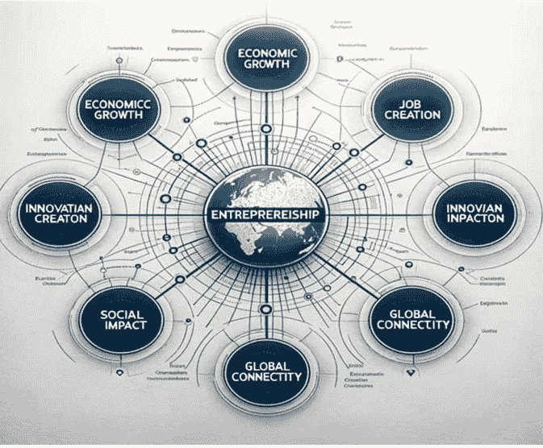

### 财富创造与分配

企业家有助于创造财富，如果能公平分配，可以改善所有人的生活水平。当企业取得成功时，它们会缴纳税款，帮助政府为公民提供基本服务（Kutzhanova et al., 2009）。

下面是图 1，以图形形式总结了成为企业家的价值。不同大小的柱状图代表各种因素，例如“经济增长”、“就业创造”、“创新”、“社会影响”和“全球连接”等。该图表的颜色编码技术，加上清晰的标签和图例，使其特别易于使用。

### 创业的关键目标和宗旨

创业活动旨在完成的众多不同事项，可以从其主要目标和抱负的广泛多样性中看出。下面列出了一些最重要的目标：

- **创新**：创业的主要目标之一是将创新产品、服务或流程推向市场。企业家旨在通过提供满足未被满足需求或改进现有产品的新颖解决方案，来填补市场空白（Hsuan Mikkola and Skjött-Larsen 2004）。

- **价值创造**：企业家致力于为客户、利益相关者和整个社会创造价值。这不仅包括收入和利润方面的经济价值，还包括社会价值，后者可以体现在生活水平提高、获得基本服务或生活质量改善等方面（Belvedere and Grando 2017）。

- **经济增长与就业创造**：创业的一个基本目标是通过创造就业和刺激经济活动来促进经济增长。这在新兴经济体或正在经历快速转型的行业中尤为重要（Mangla et al., 2019）。

- **市场扩张与全球覆盖**：许多创业项目旨在扩大其市场影响力，这可能包括在国内扩大运营规模或探索国际市场。这种扩张有助于多元化收入来源并实现全球足迹（Jacobs and Chase 2018）。

- **可持续实践**：越来越多的企业家将可持续性作为核心目标。这包括采用环保实践、确保道德供应链，并为社区的可持续发展做出贡献（Mor R.S et al., 2022）。

- **个人与职业发展**：对于许多企业家来说，个人成长和专业技能发展是一个关键目标。创业通常涉及持续学习、适应能力，以及领导力和管理技能的锤炼（Jacobs and Chase 2018）。

- **财务独立与财富创造**：实现财务独立并为自己和利益相关者创造财富，是企业家中的共同目标。这种财务成功还可以使他们对新的创业项目或社会事业进行进一步投资（Schönsleben, 2022）。

- **社会影响与社区参与**：社会创业尤其关注对社会问题产生积极影响。目标可以包括解决贫困、教育、医疗保健或环境挑战，并参与和支持当地社区（Mentzer et al., 2008）。

- **行业领导力与影响力**：许多企业家希望成为所在行业的领导者，影响趋势、制定标准，并处于技术和市场发展的最前沿（Grant et al., 2017）。

- **品牌建设与声誉**：建立一个强大且声誉良好的品牌通常是一个关键目标。这涉及建立客户信任、确立市场影响力，并被公认为行业中声誉良好、可靠的实体（Grant et al., 2017）。

## 运营与供应链管理在创业中的关键作用

在创业世界中，一家企业的成功和长期可行性往往取决于运营与供应链管理（OSCM）之间的相互作用。运营与管理良好的供应链之间的关系对创业活动至关重要，它塑造了企业在动态和不可预测的市场中航行的方式。

**提升效率与成本控制：** 从本质上讲，企业家努力最大限度地提高将投入转化为产品或服务的效率。OSCM 提供了简化流程、减少浪费和优化资源利用的工具。高效的运营不仅有助于控制成本，还能增强企业的整体敏捷性，使企业家能够及时应对市场波动，同时保持竞争力（Serale et al., 2018）。

**培养客户满意度与忠诚度：** 运营和供应链在交付满足或超越客户期望的产品或服务方面发挥着作用。一个设计良好的供应链确保材料的可用性和成品的及时交付，从而提高客户满意度。在创业中，建立客户群至关重要，OSCM 在创造积极客户体验和培养品牌忠诚度方面发挥着作用（Khadka & Maharjan 2017）。

**通过适应性应对市场动态：** 创业项目在不断变化的市场中运营，适应性是生存的关键。OSCM 提供了一个框架，帮助企业家构建运营和供应链（Gölgeci et al., 2019）。它使他们能够调整生产水平，有效应对需求变化，并自信地应对中断，确保其企业能够适应并在各种时期中蓬勃发展。

**充分利用资源：** 企业家了解成本效益的重要性，尤其是在资源有限的情况下。OSCM 使企业家能够优化资源配置、降低成本并改善企业的财务状况。通过管理资源，企业家可以进行推动增长的资本投资（Barrena-Martínez et al., 2019）。

**管理风险与构建韧性：** 创业之旅充满了风险，例如供应链中断和市场波动。OSCM 为企业家提供了有效识别、评估和降低这些风险的工具。构建供应链、多元化供应商以及制定应急计划是 OSCM 的各个方面，可确保企业克服意外挑战并变得更强大（Koczbarski et al., 2018）。

**拥抱创新与技术：** 在当今这个进步的时代，OSCM 为创新提供了机会。企业家可以利用人工智能（AI）、物联网（IoT）、区块链等技术，提高供应链的可见性，高效自动化流程，并创建更灵敏的系统。运营与供应链管理（OSCM）的创新不仅能提高效率，还能使企业家在各自行业中成为具有前瞻性思维的领导者（Byun et al., 2018）。

**决策与长期规划：** OSCM 超越了日常运营，还涉及决策和长期规划（Poncelet et al., 2020）。企业家需要考虑设计供应链、预测需求和集成技术等方面，以制定成功路线图。战略性 OSCM 确保运营细节与业务目标保持一致，确保供应链的每个部分都为企业的成功做出贡献。

**友好与道德实践：** 鉴于道德考量在当今商业实践中的重要性，OSCM 为负责任的创业提供了一个框架。企业家可以实施生态举措，确保采购实践，并通过其供应链运营为社会责任做出贡献。这不仅符合消费者的价值观，也能在日益注重意识的市场中为企业未来做好准备。

简单来说，运营和供应链管理不仅仅是创业中的职能；它们发挥着影响企业各个方面的作用（Kim, 2020）。

理解 OSCM 复杂性的企业家不仅能为其运营奠定成功的基础，还能在面对障碍时为长期增长和韧性打下基础，并有能力在各自行业中推动创新。随着企业在不断演变的创业环境中前行，OSCM 充当一种指导力量，塑造通往繁荣和持久成就的道路。

## 运营与供应链管理中的创业视角

运营与供应链管理中的创业视角对任何企业的成功都至关重要，尤其是在它如何与更广泛的战略目标保持一致方面。这一视角涉及几个关键领域：

**公司及供应链中的创业目标：** 企业家致力于将其公司的目标与日常活动和


他们的供应链。通过结合这些流程，他们可以确保供应链不仅有助于实现其他目标，而且实际上帮助从业者更好地完成这些工作（Prostean et al., 2020）。

### 解决冲突的创业目标
创业目标与商业现实并不总是一致。例如，供应链可扩展性或预算限制可能会阻止快速市场扩张的发生。这些紧张局势只有通过在创业家的抱负与实际约束之间取得平衡才能解决（Diandra and Azmy 2020）。

### 客户订单渗透点（OPP）与产品及流程设计的协调
供应链管理高度依赖OPP。在供应链语境下，该术语指产品针对个别买家进行定制的阶段。在保持运营效率的同时满足消费者需求，需要产品设计师、流程设计师与OPP之间的紧密协作（Jacobs and Chase 2018）。

### 目标区域灵活性
快速适应市场变化需要投入资金用于使其成为可能的各种支持性组织、流程和技术。商业成功的关键之一是能够快速响应需求和供应的变化（Nandan, 2013）。

### 面向个性化生产的赋能技术
人工智能（AI）、物联网（IoT）和高级分析都对更具针对性和高效的制造方法的发展做出了贡献。企业主可以通过利用这些创新来关注客户及其需求，从而在市场上获得优势（Sharma, 2021）。

## 结论

创业的特点是不懈追求发现并抓住新机遇，同时解决艰巨的挑战；它是发明与渴望变革性变化的集中体现。这个不断发展的行业范围远远超出了就业增长和GDP贡献等传统经济成功指标。其真正价值在于能够激发创造性思维，消除全球沟通障碍，并加速许多领域的发展。创业者不仅是建立新企业的创新者，还会颠覆既有行业和惯例。

总之，创业与运营和供应链管理（OSCM）之间错综复杂的关系是现代商业成功与创新的基础。理解OSCM至关重要，涵盖高效的供应链设计与规划、准确的需求预测、实施精益原则以减少浪费、以及有效的物流和分销策略等关键概念。这些要素，加上促进协作与伙伴关系以及利用技术和创新，对于运营卓越和竞争优势至关重要。当今商业中一些最重要的理念来源于运营与供应链管理（OSCM）领域。例如，运用精益概念削减浪费并提高产出，改善需求预测的准确性，并设计更高效的供应网络。需要培养牢固的关系与协作，并实施新颖的物流和分销策略。这些理念共同保证OSCM将继续作为当今企业不可或缺的一部分而发展和成长。

### 供应链设计与规划
供应链设计与规划涉及战略性地构建供应链，以优化效率和响应能力。该过程包括关于采购、制造地点、物流和库存管理的决策，旨在平衡成本效益与客户满意度以及应对市场变化的敏捷性。使用历史数据、市场趋势和统计模型来预测未来客户需求。这一关键职能使企业能够就生产、库存管理和资源分配做出明智决策，确保高效满足客户需求，同时最大限度地降低过剩库存和成本。

### 精益原则与减量
精益原则与减量旨在通过消除非增值活动来精简运营，从而提高效率和生产力。该方法强调持续改进、流程中的浪费最小化以及优化资源利用，从而实现成本节约和提升客户价值。

### 物流与分销
供应链管理中的物流与分销涉及从供应商向客户运输货物的协调规划与执行。该过程涵盖仓储、库存管理、运输和订单履行，旨在确保产品及时、具有成本效益地送达，以满足客户需求。

### 协作与伙伴关系
供应链管理中的协作与伙伴关系涉及与供应商、分销商及其他利益相关者建立和维护有效关系。这种协作方式增强沟通、协调目标并促进互惠，从而提升供应链的效率、创新和韧性。

### 运营与供应链管理中的创业视角
运营与供应链管理中的创业视角强调在供应链管理中体现创新、灵活性和战略敏捷性。创业者设定多样化的目标和宗旨，从价值创造和市场扩张到个人成长与社会影响。OSCM在创业中起着关键作用，为高效和可持续的业务运营提供支撑。最后，OSCM中的创业视角强调对敏捷性、战略规划和适应性的需求，将创业热情与系统化运营管理相结合。这种创业与OSCM的融合对于开发具有韧性、有影响力和前瞻性的商业冒险至关重要，并对更广泛的经济和社会进步做出重大贡献。

创业抱负可能从浅显到深刻不等。它们包含不仅创造货币价值，还要创造社会和环境价值的愿景。在追求增长的过程中，许多创业者超越地理和文化等传统障碍，寻找新机遇。创业在很大程度上依赖于广泛的技能，包括领导力、韧性和战略思维，所有这些都可以通过个人成长来发展。此外，从事创业活动经常会产生重大的社会后果，解决可持续性、教育和医疗保健等关键问题。敏捷性和长期思维是采取创业路径的供应链运营的特征。在当今动态且不断变化的商业环境中，创业者需要成为资源管理、趋势预测和快速适应的专家。这需要在运营流程和供应链管理中富有创造力，同时还要对市场动态有扎实的掌握。为了最大限度地提高生产力、削减开支并取悦客户，这种方法至关重要。总而言之，由于创业具有多维性，它需要一种全面的战略，在创造性和现实性的商业策略之间取得平衡。随着世界变得更加复杂和互联，创业者的重要性日益凸显。他们是推动迈向可持续、包容且各方面都繁荣的未来的引擎。

## 运营与供应链管理对创业的影响：全面分析

运营与供应链管理（OSCM）在创业中发挥着超越商业复杂性的作用。OSCM的影响遍及整个格局，影响着竞争力、适应性和可持续性等因素。在此分析中，我们探讨OSCM对创业的影响，考察运营和供应链的战略管理如何塑造企业的成功与发展轨迹。

### 获得竞争优势与市场差异化
成功的基础在于获得优势并在市场中脱颖而出。有效的OSCM成为这种优势的来源（Tönnissen & Teuteborg, 2020）。


在战略性设计和优化供应链的企业中，能够获得竞争优势。经过管理的供应链可确保运营、准时交付和成本效率，使企业在市场中脱颖而出。这种竞争优势不仅体现在成本削减上，还包括构建能够快速适应市场变化的敏捷结构。这一现象与基于资源的观点和动态能力理论相一致。基于资源的观点认为，竞争优势源于企业所拥有的宝贵资源。高效的OSCM随后成为竞争对手难以复制的资源。动态能力理论强调公司有效整合、发展和适应外部能力的能力，以应对快速变化的环境。在此背景下，运营供应链管理（OSCM）作为一种能力，使企业家能够不断适应和创新，从而有助于获得竞争优势（Tönnissen & Teuteborg 2020）。

### 提升运营效率与降低成本

对于旨在优化资源利用并最小化成本的企业来说，运营效率是一项关键指标。OSCM通过精简流程、减少浪费和优化资源配置来发挥提升效率的作用。其影响不仅限于成本节约，还包括建立敏捷的运营框架，以增强企业的整体适应性。从某一视角来看，OSCM与运营效率之间的关系符合系统理论和效率理论所推导的原则。系统理论认为，组织作为由相互关联的组件构成的系统运行，这些组件相互依赖以发挥作用。通过实施OSCM实践，企业家能够有效优化系统，确保各组件协调一致地协同工作。效率理论强调在最大化产出的同时尽量减少资源浪费的重要性。通过整合OSCM实践，企业家遵循这些效率原则，确保资源得到最优利用（Inman & Green 2018）。

### 优先考虑客户满意度并培养忠诚度

在生态系统中，优先考虑客户满意度对于建立客户群至关重要。OSCM在确保产品可用、准时交付且质量始终保持一致方面发挥着作用。OSCM对客户满意度的影响与服务利润链理论相一致，该理论认为，满意的客户会带来更高的忠诚度、重复业务和正面口碑。高效的OSCM有助于构建无缝的供应链，提升客户体验并培养品牌忠诚度（Mahmoud et al., 2018）。这种关系受到客户关系管理（CRM）和服务质量理论原则的强调。CRM强调为盈利而管理和培育长期客户关系的重要性。当以客户为中心的方式设计时，OSCM与CRM原则相一致，以确保整个供应链专注于满足并超越客户期望。此外，服务质量理论强调，持续提供高质量的服务会带来客户满意度和留存率。在OSCM的背景下，服务质量不仅限于产品，还涵盖供应链流程。

### 降低风险并增强韧性

创业型企业本质上面临供应链中断和市场不确定性等风险。OSCM作为一种工具，用于识别、评估和降低风险。运营与供应链管理（OSCM）对风险管理的影响与韧性理论和风险管理框架的原则相一致。韧性理论强调系统吸收冲击、适应并重组以维持功能的能力。有效的OSCM实践通过实现对中断的响应、确保业务连续性和尽量减少风险来增强韧性。从某一视角来看，COSO企业风险管理框架等风险管理框架提供了一种识别和降低风险的方法。高效的OSCM与这些框架相一致，为企业家提供了一种评估和应对供应链风险的途径。这不仅保护企业免受中断影响，还有助于实现长期可持续发展。

### 创新与适应性

创新与适应性也是OSCM对于在动态市场中运营的企业所带来的影响之一。OSCM成为改进的催化剂，使企业能够适应新兴趋势、抓住机遇，并在不断变化的市场中保持领先（Kim & Marcouiller 2018）。这种关系的科学基础在于创新理论和组织学习原则。创新理论认为，企业必须持续创新才能保持竞争力。当被视为一种能力时，OSCM通过培养持续改进的环境来与这一理念相一致。组织学习理论强调适应性和知识获取对于成功的重要性。OSCM作为一种从市场反馈中学习并调整运营的方式，与这些原则相一致，确保企业适应不断变化的环境。

### 全球扩张与市场覆盖

旨在扩张的创业型企业面临物流、海关和分销方面的挑战（Moshood et al., 2021）。OSCM对进入全球市场的影响与商业理论和市场进入战略相一致。国际商业理论强调适应性和对市场做出快速响应的重要性。高效的OSCM实践为企业家提供应对这些挑战所需的工具，并确保供应链能够根据市场需求量身定制。出口、许可和战略联盟等市场进入策略受供应链运营效率的影响。从某一视角来看，OSCM与全球扩张之间的联系符合交易成本经济学，该理论认为市场进入模式的选择受交易效率的影响。有效的OSCM降低与运营相关的交易成本，使国际扩张对企业更具可行性。

### 可持续与合乎道德的实践

在可持续性和道德考量是商业实践基础的时代，OSCM的影响延伸到了责任层面。在供应链中采用合乎道德实践的企业家不仅满足社会责任感消费者的期望，还为其品牌培养了长期的信任和声誉。这些实践与企业社会责任（CSR）理论以及作为道德供应链管理框架之间的联系得到了科学研究的支持（Mani et al., 2020）。CSR理论强调企业超越盈利、为社会福祉做出贡献的重要性（Brin & Nehme 2019）。通过实施在运营和供应链管理中考虑社会影响的实践，企业家将自己定位为负责任的企业公民。道德供应链管理框架（如联合国全球契约）为企业在整个供应链中确保合规实践提供指导。将这些框架纳入其战略的企业家有助于推动合乎道德的创业精神。

### 数据驱动决策

此外，运营与供应链管理的影响还延伸到企业家的数据驱动决策。通过利用进步技术并在其供应链中应用数据分析，企业家能够获得洞察。这种科学关系与数据驱动决策的原则相一致，该原则强调使用数据和分析来指导决策。从某一视角来看，将数据分析整合到运营和供应链管理中与商业智能原则和决策支持系统相契合。商业智能利用数据分析工具为决策提供洞察，而决策支持系统（Nikiforova et al., 2022）。

## 参考文献

Al-Omoush, K. S., de Lucas, A., & del Val, M. T. (2023). 电子供应链协作在协作创新和价值共创中的作用。 *商业研究杂志*, 158, 113647. doi:10.1016/j.jbusres.2023.113647

Barrena-Martínez, J., López-Fernández, M., & Romero-Fernández, P. M. (2019). 迈向社会责任人力资源管理政策和实践的配置：来自学术共识的发现。 *国际人力资源管理杂志*, 30(17), 2544–2580. doi:10.1080/09585192.2017.1332669

Belvedere, V. and Grando, A., (2017). *可持续运营与供应链管理*. John Wiley & Sons.


Blinova, E., Ponomarenko, T., & Knysh, V. (2022). 在采矿业可持续商业发展与循环经济要素背景下分析企业可持续性概念. Sustainability (Basel), 14(13), 8163. doi:10.3390/su14138163

Blundel, R., Lockett, N., & Wang, C. (2017). 探索创业. Sage (Atlanta, Ga.).

Bosma, N., 2013. 全球创业监测 (GEM) 及其对创业研究的影响. Foundations and Trends® in Entrepreneurship, 9(2), pp.143-248.

Brin, P. V., & Nehme, M. N. (2019). 企业社会责任: 理论与模型分析.

Byun, J., Sung, T. E., & Park, H. W. (2018). 技术创新战略: 不同技术领域的技术生命周期如何变化. Technology Analysis and Strategic Management, 30(1), 98–112. doi:10.1080/09537325.2017.1297397

Caiado, R. G. G., Scavarda, L. F., Azevedo, B. D., de Mattos Nascimento, D. L., & Quelhas, O. L. G. (2022). 可持续工业4.0对运营和供应链管理的挑战与收益——指向2030议程的框架. Sustainability (Basel), 14(2), 830. doi:10.3390/su14020830

Castillo, V. E. (2018). 共享经济对末端物流供应链战略影响的探究.

Cook, L. S., Bowen, D. E., Chase, R. B., Dasu, S., Stewart, D. M., & Tansik, D. A. (2002). 服务设计中的人力问题. Journal of Operations Management, 20(2), 159–174. doi:10.1016/S0272-6963(01)00094-8

Diandra, D., & Azmy, A. (2020). 理解创业定义. International Journal of Management. Accounting and Economics, 7(5), 235–241.

Dolgui, A., Ivanov, D., & Sokolov, B. (2018). 供应链中的涟漪效应: 分析与近期文献. International Journal of Production Research, 56(1-2), 414–430. doi:10.1080/00207543.2017.1387680

Edsand, H. E. (2017). 识别哥伦比亚风能扩散的障碍: 技术创新系统及更广泛背景的功能分析. Technology in Society, 49, 1–15. doi:10.1016/j.techsoc.2017.01.002

Elkington, J., & Hartigan, P. (2008). 不合理之人的力量: 社会企业家如何创造改变世界的市场. Harvard Business Press.

Fayolle, A. (2007). *创业与新价值创造: 创业过程的动态*. Cambridge university press. doi:10.1017/CBO9780511488689

Fernie, J., & Sparks, L. (Eds.). (2018). 物流与零售管理: 零售供应链中的新兴问题与新挑战. Kogan page publishers.

Fosso Wamba, S., Queiroz, M. M., Guthrie, C., & Braganza, A. (2022). 人工智能 (AI) 的行业经验: 运营和供应链管理中的利益与挑战. *Production Planning and Control*, 33(16), 1493–1497. doi:10.1080/09537287.2021.1882695

Gölgeci, I., Assadinia, S., Kuivalainen, O., & Larimo, J. (2019). 新兴市场企业的动态能力与国际绩效: 制度发展和距离的调节作用. *International Business Review*, 28(6), 101593. doi:10.1016/j.ibusrev.2019.101593

Grant, D.B., Wong, C.Y. & Trautrims, A. (2017). *可持续物流和供应链管理: 可持续运营和管理的原则与实践*. Kogan Page Publishers.

Gungor, A., & Gupta, S. M. (1999). 环境意识制造与产品回收问题: 一项调查. *Computers & Industrial Engineering*, 36(4), 811–853. doi:10.1016/S0360-8352(99)00167-9

Ho, T. H., & Tang, C. S. (2009). 市场营销与运营管理接口与协调专刊导论. *Production and Operations Management*, 18(4), 363–364. doi:10.1111/j.1937-5956.2009.01037.x

Hora, M., & Dutta, D. K. (2013). 创业型企业与下游联盟伙伴关系: 组合深度和范围对技术创新及商业化成功的影响. *Production and Operations Management*, 22(6), 1389–1400. doi:10.1111/j.1937-5956.2012.01410.x

Hossain, N. U. I., El Amrani, S., Jaradat, R., Marufuzzaman, M., Buchanan, R., Rinaudo, C., & Hamilton, M. (2020). 基于贝叶斯网络的关键基础设施相互依赖建模与评估: 内河港及其周边供应链网络案例研究. *Reliability Engineering & System Safety*, 198, 106898. doi:10.1016/j.ress.2020.106898

Hsuan Mikkola, J., & Skjøtt-Larsen, T. (2004). 供应链整合: 对大规模定制、模块化和延迟策略的影响. *Production Planning and Control*, 15(4), 352–361. doi:10.1080/0953728042000238845

Hu, H., Xu, J., Liu, M., & Lim, M. K. (2023). 疫苗供应链管理: 利用区块链、物联网和机器学习的智能系统. *Journal of Business Research*, *156*, 113480. doi:10.1016/j.jbusres.2022.113480 PMID:36506475

Hugos, M. H. (2018). *供应链管理要点*. John Wiley & Sons.

Hussain, G., Nazir, M. S., Rashid, M. A., & Sattar, M. A. (2023). 从供应链韧性到供应链中断导向: 供应链复杂性的调节作用. *Journal of Enterprise Information Management*, *36*(1), 70–90. doi:10.1108/JEIM-12-2020-0558

Inman, R. A., & Green, K. W. (2018). 精益与绿色结合以影响环境和运营绩效. *International Journal of Production Research*, *56*(14), 4802–4818. doi:10.1080/00207543.2018.1447705

Jacobs, F. R. & Chase, R.B. (2018). *运营与供应链管理*. McGraw-Hill.

Janjić, I., & Rade­nović, T. (2019). 现代企业中创新管理的重要性. *Ekonomika (Nis)*, *65*(3), 45–54. doi:10.5937/ekonomika1903045J

Jayender, P., & Kundu, G. K. (2021). 用于印度汽车行业适应性的面向SCM敏捷性的智能ERP及图论技术. *International Journal of System Assurance Engineering and Management*, 1–22.

Jengeta, M., & Phiri, M. A. (2021). 大学毕业生在动荡经济中对大学创业教育范围的看法: 津巴布韦CUT案例. *Journal of African Education*, *2*(2), 67. doi:10.31920/2633-2930/2021/v2n2a3

Khadka, K., & Maharjan, S. (2017). *客户满意度与客户忠诚度: Trivsel stádtjänster (Trivsel sivouspalvelut) 案例*.

Kickul, J. R., Griffiths, M. D., Jayaram, J., & Wagner, S. M. (2011). 运营管理、创业与价值创造: 跨学科背景下的新兴机遇. *Journal of Operations Management*, *29*(1–2), 78–85. doi:10.1016/j.jom.2010.12.004

Kim, H., & Marcouiller, D. W. (2018). 减轻洪灾风险并增强社区对自然灾害的韧性: 计划质量至关重要. *Environmental Hazards*, *17*(5), 397–417. doi:10.1080/17477891.2017.1407743

Kim, M. Y. (2020). 绿色信用卡服务背景下的道德行为: 个人调节焦点的作用. *International Journal of Advanced Culture Technology*, *8*(1), 107–112.

Kim, T. Y., Dekker, R., & Heij, C. (2017). 基于已安装基础信息的消费品备件需求预测. Computers & Industrial Engineering, 103, 201–215. doi:10.1016/j.cie.2016.11.014

Klein, P., & Popp, B. (2022). 电子商务中的最后一公里配送方式: 感知的可持续性对消费者接受和使用是否重要? Sustainability (Basel), 14(24), 16437. doi:10.3390/su142416437

Koczberski, G., Curry, G. N., Bue, V., Germis, E., Nake, S., & Tilden, G. M. (2018). 通过创新扩散风险并建立韧性: 巴布亚新几内亚小农户中的互惠交换关系、生计脆弱性与粮食安全. Human Ecology: an Interdisciplinary Journal, 46(6), 801–814. doi:10.1007/s10745-018-0032-9

Korpysa, J., Halicki, M., & Lopatka, A. (2020). 项目供应链的创业管理——模型方法. Problems and Perspectives in Management, 18(3), 211–223. doi:10.21511/ppm.18(3).2020.18

Krämer, S., & Engell, S. (2018). 加工厂的资源效率: 监测与改进. John Wiley & Sons.

Kudrekodlu Venkatesh, P., & Venkatesan, V. (2022). 建筑组织的精益就绪因素. [IJEMS]. Indian Journal of Engineering and Materials Sciences, 28(6), 608–619.

Kumar, P., & Turnbull, S. M. (2008). 金融创新的最佳专利与许可. Management Science, 54(12), 2012–2023. doi:10.1287/mnsc.1080.0898

Kumar, S. A. (2008). 创业发展. New Age International.

Kutzhanova, N., Lyons, T. S., & Lichtenstein, G. A. (2009). 技能导向的企业家发展及个人和同伴团队辅导在企业发展中的作用. Economic Development Quarterly, 23(3), 193–210. doi:10.1177/0891242409336547

Li, C. Z., Xue, F., Li, X., Hong, J., & Shen, G. Q. (2018). 用于预制建筑现场装配服务的物联网赋能BIM平台. Automation in Construction, 89, 146–161. doi:10.1016/j.autcon.2018.01.001

Linderman, K., & Chandrasekaran, A. (2010). 运营管理中的学术知识交流. Journal of Operations Management, 28(4), 357–366. doi:10.1016/j.jom.2009.11.012


- MacDonald, A., Clarke, A., Huang, L., Roseland, M., & Seitanidi, M. M. (2018). 多利益相关方伙伴关系 (SDG# 17) 作为实现可持续社区和城市 (SDG# 11) 的手段. 可持续性科学与研究手册, 193-209. Springer.

- Mahmoud, M. A., Hinson, R. E., & Adika, M. K. (2018). 信任、承诺和冲突处理对客户保留的影响: 客户满意度的中介作用. 关系营销期刊, 17(4), 257–276. doi:10.1080/15332667.2018.1440146

- Mangla, S. K., Luthra, S., Jakhar, S. K., Kumar, A., & Rana, N. P. (编). (2019). 供应链运营中的可持续采购. CRC Press. doi:10.1201/9780429466328

- Mani, V., Jabbour, C. J. C., & Mani, K. T. (2020). 中小制造企业的供应链社会可持续性及企业绩效: 来自新兴亚洲经济体的实证证据. 生产经济国际期刊, 227, 107656. doi:10.1016/j.ijpe.2020.107656

- Mentzer, J. T., Stank, T. P., & Esper, T. L. (2008). 供应链管理及其与物流、营销、生产和运营管理的关系. 商业物流期刊, 29(1), 31–46. doi:10.1002/j.2158-1592.2008.tb00067.x

- Mentzer, J. T., Stank, T. P., & Esper, T. L. (2008). 供应链管理及其与物流、营销、生产和运营管理的关系. 商业物流期刊, 29(1), 31–46. doi:10.1002/j.2158-1592.2008.tb00067.x

- Mohammed, F., Biswas, W. K., Yao, H., & Tadé, M. (2018). 磷石膏再利用共生过程的可持续性评估. 更清洁生产期刊, 188, 497–507. doi:10.1016/j.jclepro.2018.03.309

- Mohanty, S. K. (2005). 创业基础. PHI Learning Pvt. Ltd.

- Mor, R.S., Kamble, S.S. & Sangwan, K.S. (2022). 食品行业的运营与供应链管理. Springer Singapore.

- Moshood, T. D., Nawanir, G., Mahmud, F., Mohamad, F., Ahmad, M. H., & Abdul Ghani, A. (2021). 可生物降解塑料产品政策扩展与生物基塑料市场动态: 挑战与机遇. 可持续性 (巴塞尔), 13(11), 6170. doi:10.3390/su13116170

- Nakamura, M., Pendlebury, D., Schnell, J., & Szomszor, M. (2019). 导航可持续发展目标研究的结构. 政策, 11, 12.

- Nandan, H. (2013). 创业基础. PHI Learning Pvt. Ltd.

- Ng, K. K., Chen, C. H., Lee, C. K., Jiao, J. R., & Yang, Z. X. (2021). 智能自动化系统文献综述: 协调理论、实践和未来视角中的概念. 高级工程信息学, 47, 101246. doi:10.1016/j.aei.2021.101246

- Nikiforova, A., Daskevics, A., & Azeroual, O. (2022). NoSQL 安全: 我的数据驱动决策会受到外部影响吗? arXiv 预印本 arXiv:2206.11787.

- Perrini, F., & Vurro, C. (2006). 社会创业: 理论与实践中的创新与社会变革. 社会创业 (第 57–85 页). Palgrave Macmillan UK. doi:10.1057/9780230625655_5

- Poncelet, K., Delarue, E., & D'haeseleer, W. (2020). 长期规划模型中的机组承诺约束: 相关性、陷阱及假设对灵活性的作用. 应用能源, 258, 113843. doi:10.1016/j.apenergy.2019.113843

- Proença, A. P., Gaspar, P. D., & Lima, T. M. (2022). 精益优化技术用于改进生产流和物流管理: 水果配送中心案例研究. 过程 (巴塞尔, 瑞士), 10(7), 1384. doi:10.3390/pr10071384

- Prostean, G., Villahoz, J. J. L., Brancu, L., & Bakacsi, G. (2020). 可持续管理与创业创新. Springer International Publishing. doi:10.1007/978-3-030-44711-3

- Rao, C. H. (1971). 印度的不确定性、创业与佃农制. 政治经济学期刊, 79(3), 578–595. doi:10.1086/259769

- Richey, R. G. Jr, Chowdhury, S., Davis-Sramek, B., Giannakis, M., & Dwivedi, Y. K. (2023). 物流与供应链管理中的人工智能: 研究入门与路线图. 商业物流期刊, 44(4), 532–549. doi:10.1111/jbl.12364

- Roberts, A. P., Stanton, N. A., & Fay, D. T. (2018). 深入, 深入: 潜水跟踪任务期间潜艇指挥与控制的理解. 应用人因工程, 69, 162–175. doi:10.1016/j.apergo.2018.02.003 PMID:29477324

- Rushton, A., Croucher, P., & Baker, P. (2022). 物流与分销管理手册: 了解供应链. Kogan Page Publishers.

- Russell, R. S., & Taylor, B. W. (2019). 运营与供应链管理. John Wiley & Sons.

- Sarkar, B., Takeyeva, D., Guchhait, R., & Sarkar, M. (2022). 不同仓库形状的优化射频识别系统. 基于知识的系统, 258, 109811. doi:10.1016/j.knosys.2022.109811

- Sarkar,M.B., Echambadi, R. A.J., & Harrison,J. S. (2001). 联盟创业与企业市场绩效. 战略管理期刊, 22(6-7), 701–711. doi:10.1002/smj.179

- Sarkar,M.B., Echambadi, R. A.J., & Harrison,J. S. (2001). 联盟创业与企业市场绩效. 战略管理期刊, 22(6-7), 701–711. doi:10.1002/smj.179

- Schönsleben, P. (2022). 物流、运营和供应链管理. 综合物流管理手册: 公司内部及跨公司的运营和供应链管理 (第 7–70 页). Springer Berlin Heidelberg.

- Serale, G., Fiorentini, M., Capozzoli, A., Bernardini, D., & Bemporad, A. (2018). 用于提升建筑和暖通空调系统能效的模型预测控制 (MPC): 问题制定、应用与机遇. 能源, 11(3), 631. doi:10.3390/en11030631

- Seyedghorban, Z., Samson, D., & Swink, M. (2022). OSCM 何去何从? 运营与供应链管理研究过去和未来趋势分析. 决策科学, 53(3), 429–451. doi:10.1111/deci.12519

- Sharma, S. (2021). 创业发展. PHI Learning Pvt. Ltd.

- Shcherbakov, V., & Silinka, G. (2021). 供应链管理开放创新: 网络物流系统中的虚拟集成. 开放创新期刊, 7(1), 54. doi:10.3390/joitmc7010054

- Shibin, K. T., Dubey, R., & Hazen, B. T. (2022). 供应链管理中的偏最小二乘法: 可持续供应链管理实践示例研究. 供应链管理研究方法手册, 221-243. Springer.

- Tan, C. L., Tei, Z., Yeo, S. F., Lai, K. H., Kumar, A., & Chung, L. (2023). 数字化转型时代区块链可见性、供应链集成与供应链绩效之间的关联. 工业管理与数据系统, 123(1), 229–252. doi:10.1108/IMDS-12-2021-0784

- Thurik, A.R. (2009). 创业经济学: 创业、经济增长与政策. 创业、增长与公共政策, 10(6), 219-249.

- Tönnissen, S., & Teuteberg, F. (2020). 区块链技术对运营和供应链管理影响分析: 基于多案例研究的解释模型. 信息管理国际期刊, 52, 101953. doi:10.1016/j.ijinfomgt.2019.05.009

- Traynor, M., Bernard, S., Moreo, A., & O’Neill, S. (2022). 美国餐饮行业第三方在线外卖兴起调查: 扎根理论方法. 国际酒店管理期刊, 107, 103299. doi:10.1016/j.ijhm.2022.103299

- Van Goor, A. R., van Amstel, W. P., & van Amstel, M. P. (2019). 欧洲分销与供应链物流. Routledge.

- Zhao, Y., & Zhu, Q. (2014). 众包研究评述: 现状与未来方向. 信息系统前沿, 16(3), 417–434. doi:10.1007/s10796-012-9350-4

- Zhou, B. (2016). 精益原则、实践与影响: 中小企业 (SMEs) 研究. 运筹学年鉴, 241(1-2), 457–474. doi:10.1007/s10479-012-1177-3


# 第 5 章

作为数字营销策略的神经营销：揭示营销传播演变之谜

**Kavindu Millagala**
https://orcid.org/0000-0002-2274-7434
斯里兰卡澳大利亚管理学院，斯里兰卡

**Nandana Gunasinghe**
斯里兰卡拉贾拉塔大学，斯里兰卡

## 摘要

本章考察了神经营销作为数字营销策略在解读营销传播动态演变中的关键作用。植根于神经科学和心理学，神经营销采用先进的神经科学工具揭示消费者的潜意识反应。在数字革命的背景下，本章阐释了神经营销如何与不断发展的营销传播渠道无缝融合，强调个性化和情感参与。作者探讨了个性化内容在培养消费者信任和忠诚度方面的重要性，并讨论了神经分析作为数字领域评估营销活动成功与否的指标的出现。围绕神经数据负责任使用的伦理考量也得到了探讨，强调了制定行业指南的必要性。本章将神经营销视为一种变革性力量，指导企业在不断变化的数字营销格局中深入理解消费者行为。

## 引言

在一个由快速技术进步和消费者行为转变所主导的时代，营销领域正在经历持续的变革。随着传统营销策略努力应对数字时代带来的挑战，一种创新方法在神经科学和营销的交汇处出现——神经营销。本章深入探讨了将神经营销作为数字营销策略的深远影响，提供了对其解读营销传播演变复杂层次能力的洞察。

“神经营销”一词由 Ale Smidt 于 2002 年提出（Smidt's, 2002），代表了企业理解和与目标受众互动的基本假设的变革。神经营销基于神经科学和心理学的原则，采用脑电图（EEG）、功能性磁共振成像（fMRI）和眼动追踪等复杂工具，解读消费者对营销刺激的潜意识反应（Lee et al., 2007; Plassmann et al., 2012）。通过窥探支撑消费者决策的神经过程，神经营销超越了传统的市场调研方法，提供了对影响购买行为的情感和认知因素的更深入理解。

数字时代营销传播的演变需要重新评估传统策略。涵盖社交媒体、在线广告和网红营销的数字渠道已成为现代营销工具包的组成部分。在此背景下，神经营销因其与数字通信复杂性的无缝契合而变得重要。本章探讨了神经营销作为数字营销策略如何增强在线环境中营销活动的效果。

个性化是当代营销的基石，而神经营销提供了一种独特的视角来实现它。神经数据的分析使营销人员能够根据个人偏好定制内容，创造更加个性化和富有共鸣的消费者体验（Hubert & Kenning, 2008）。本章讨论了个性化在增强消费者参与度以及在品牌与其受众之间建立持久联系方面的作用。

随着企业在数字前沿航行，衡量营销活动的成功需要一种更细致的方法。传统指标往往无法捕捉数字举措的情感和潜意识影响。神经分析应运而生——一组源自神经营销原则的工具和方法论。神经分析通过衡量情感参与度、品牌记忆和其他细微指标，提供了对营销活动效果的更全面理解（Ohme et al., 2010）。本章探讨了将神经分析纳入数字营销评估，为营销人员提供更丰富的数据集以便做出明智决策。

然而，神经营销的采用并非没有伦理考量。神经数据的负责任使用、隐私问题以及对透明实践的需求成为关键问题。本章涉及这些伦理维度，强调制定行业指南以确保神经营销技术伦理应用的重要性。

## 背景

营销传播的演变一直是一段动态的旅程，受社会变化、技术进步和消费者行为转变的影响。曾经是品牌推广基石的传统营销方法，如今正努力应对数字时代的变革力量。随着企业在这片复杂的格局中航行，神经营销作为一种有前景的范式出现，为深入了解消费者认知及其对营销刺激的情感反应提供了可能。

神经营销的根源可以追溯到21世纪初，当时 Ale Smidt 提出了该术语，标志着神经科学、心理学和营销的融合（Smidt's, 2002）。神经营销从探索经济决策神经基础的神经经济学领域汲取灵感，率先将神经科学工具应用于解读消费者大脑与营销信息之间复杂的互动（Lee et al., 2007）。这种跨学科方法将神经营销定位为理解消费者行为的一种革命性力量。

数字化开启了营销传播的新时代，有必要重新评估策略。社交媒体、在线广告和网红营销的兴起改变了品牌与受众互动的方式。在此背景下，神经营销在传统与数字之间架起了一座桥梁，提供了关于人脑如何应对迅速变化的在线传播格局的洞察。

这一演变的一个关键方面是日益强调营销中的个性化。面对信息洪流，消费者寻求与其个人偏好和需求相契合的个性化体验（Hubert & Kenning, 2008）。凭借解码神经数据的能力，神经营销为营销人员提供了定制内容和信息的工具，创造出更加个性化和吸引人的消费者旅程。

然而，数字领域在评估营销活动效果方面面临挑战。传统指标往往无法捕捉数字举措的微妙影响。神经分析应运而生——神经营销的一个分支，它采用神经科学原则来评估营销策略的成功（Ohme et al., 2010）。通过衡量情感参与度、注意力和记忆回忆，神经分析提供了对消费者心理与数字营销之间复杂相互作用的更全面理解。

然而，将神经营销整合到数字策略中并非没有伦理考量。神经数据的收集和使用引发了关于隐私、同意以及负责任地应用这项技术的问题（Plassmann et al., 2012）。随着企业采用神经营销，伦理指南和行业标准变得至关重要，以确保神经科学工具的透明和伦理利用。

## 什么是神经营销？

神经营销的核心是一门多学科领域，它汇集了来自神经科学、心理学和营销的见解，以理解消费者决策和行为的复杂性。在这一创新学科诞生之际，Ale Smidt（2002）提出了该术语，标志着与传统市场调研方法的重大分道扬镳。神经营销利用先进的神经科学工具，包括脑电图（EEG）、功能性磁共振成像（fMRI）和眼动追踪，以深入探究消费者对营销刺激的神经基础（Lee et al., 2007; Plassmann et al., 2012）。

通过采用这些神经科学方法，神经营销超越了传统市场调研的局限。例如，EEG 能够测量脑电活动，提供与注意力、参与度和情感反应相关的认知过程的实时洞察（Lee et al., 2007）。fMRI 提供了对大脑功能区域的了解，有助于识别与偏好和决策相关的神经相关物（Plassmann et al., 2012）。眼动追踪作为另一项关键工具，记录眼动，揭示视觉注意力模式，并帮助优化营销材料中的视觉元素。

神经营销的基础建立在这样一个前提上：消费者的决策往往受潜意识过程和情绪的影响（Lee et al., 2007）。依赖自我报告数据的传统市场调研技术可能无法捕捉这些潜在因素。神经营销通过直接访问神经反应，提供了对消费者行为更准确和全面的理解。

神经营销的应用延伸至产品设计、广告和品牌管理等多个领域。该学科促进了


识别能引发积极情绪反应的刺激物，使营销人员能够定制与消费者在更深层次、情感层面产生共鸣的活动（Plassmann et al., 2012）。对情感的强调植根于这样的认识：情感投入往往先于并影响理性决策。神经营销基于这样的前提：大脑复杂的过程塑造消费者的偏好和选择。通过利用神经科学和心理学洞察，这门学科成为营销人员解码不断变化的市场中消费者决策复杂性的强大工具。

## 揭秘神经营销技术

将神经科学工具融入营销研究，彻底改变了我们对消费者行为的理解。功能性磁共振成像（fMRI）是一种非侵入性成像技术，通过测量血流变化提供大脑活动的实时洞察（Lee et al., 2007）。脑电图（EEG）捕获头皮上的电活动，提供认知过程的高时间分辨率视图（Plassmann et al., 2012）。眼动追踪技术记录眼球运动，使视觉注意力和参与度的分析成为可能（Holmqvist et al., 2011）。这些技术共同为营销人员提供了前所未有的机会，接触消费者的潜意识反应。

### fMRI揭示实时神经反应

功能性磁共振成像（fMRI）是神经营销中一项关键工具，可在消费者接触营销刺激时，提供其神经反应的实时洞察。fMRI植根于神经科学原理，是一种非侵入性的观察人脑手段，使研究人员能够解读影响消费者决策的情感和认知过程的复杂细节（Lee et al., 2007）。fMRI在营销研究中的应用，使我们深入了解个体如何对广告、产品包装和品牌标志等各种元素做出反应。

fMRI的核心在于其能够绘制大脑内血流变化的图谱，从而提供与特定刺激相关的神经活动的空间表征。当个体参与营销内容时，fMRI能够捕捉不同大脑区域的激活情况，揭示由视觉和听觉刺激引发的情感和认知反应（Lee et al., 2007）。这种对神经反应的实时图谱绘制，为营销人员提供了了解消费者潜意识反应的前所未有的洞察。

李及其同事（2007）的研究例证了fMRI在解读营销内容实时神经反应方面的力量。该研究表明，接触品牌标志会导致与奖赏处理相关的大脑腹侧部分被激活。这一发现强调了视觉刺激、情感反应和大脑奖赏系统之间的联系，揭示了品牌亲和力和忠诚度的神经生物学基础。fMRI研究得出的此类洞察，让营销人员了解消费者偏好的神经学基础，并有助于战略性地设计具有视觉冲击力的品牌元素。

此外，fMRI还允许在消费者旅程中探索情感投入。通过分析从初次接触到购买后体验的各个阶段的大脑活动，营销人员能够全面了解消费者反应。fMRI数据的这种时间维度，提供了关于情感影响持久性的宝贵信息，使品牌能够制定旨在建立持久消费者联系的策略（Plassmann et al., 2012）。

将fMRI融入神经营销实践，有助于采取细致入微的方法优化营销活动。营销人员可以识别广告或产品展示中引发情感反应的具体元素，从而指导内容的优化以达到最大影响。例如，Plassmann及其同事（2012）利用fMRI研究消费者对品酒反应的神经相关性。研究结果强调了价格信息在调节味觉神经体验中的作用，凸显了fMRI如何揭示感官感知与外部线索之间复杂的相互作用。

fMRI在神经营销武器库中成为一位强大的盟友，提供消费者神经反应的实时洞察。通过揭示情感和认知过程的神经生物学基础，fMRI使营销人员能够打造更具共鸣和影响力的活动。fMRI促成的神经科学与营销的结合，改变了我们对消费者行为的理解，并赋予企业能力，驾驭现代市场的复杂性。

### EEG捕捉认知动态

脑电图（EEG）作为神经营销中一项关键的神经科学工具脱颖而出，在消费者与营销刺激互动时，提供认知动态的高时间分辨率视图。EEG植根于神经科学原理，是一种记录头皮电活动的非侵入性手段，使研究人员能够深入研究与认知过程相关的快速波动（Plassmann et al., 2012）。EEG的时间精确性使得在消费者与营销内容互动时，能够探索认知反应的动态特性。

EEG在营销研究中的应用超越了传统方法，为注意力、情感投入和记忆编码提供了洞察。EEG的实时特性捕捉了认知反应的即时性，使得在消费者旅程中识别关键时刻成为可能。Plassmann及其同事（2012）的研究例证了EEG在揭示消费者反应时间动态方面的效用。该研究揭示了与消费者选择评估相关的独特EEG模式，阐明了决策过程背后的认知机制。

此外，EEG有助于研究营销接触过程中的注意机制。通过跟踪与注意力相关的神经振荡，研究人员可以辨别指向广告或产品展示中特定元素的认知资源的起伏。这种对注意力动态的细致理解，让营销人员了解视觉和听觉线索的显著性，从而指导内容的优化以达到最大影响（Lee et al., 2007）。

EEG的多功能性体现在其能够在消费者旅程中评估情感投入。识别与情感反应相关的特定EEG特征，使营销人员能够衡量情感体验的强度和持续时间。例如，在观看视频广告时，EEG可以揭示情感投入加剧的时刻，指导在叙事中战略性地放置具有情感影响力的内容（Ohme et al., 2010）。

此外，EEG的便携性促进了在现实世界环境中的研究，使营销人员能够在自然环境中研究消费者反应。这种生态效度提高了EEG研究结果在实际营销场景中的适用性，提供了与真实消费者体验相一致的洞察。此类实地研究使营销人员能够制定与不同情境下消费者产生共鸣的策略，并加深对实际购买决策过程中所涉及认知动态的理解（Ohme et al., 2010）。

EEG作为神经营销工具箱中一项宝贵的工具，实时捕捉消费者反应的认知动态。通过提供关于注意力、情感投入和记忆编码的洞察，EEG使营销人员能够优化内容和设计以达到最大影响。将EEG融入神经营销实践，代表了在理解消费者行为时间细微差别时基本假设的转变，有助于制定更具细致入微性和有效性的营销策略。

### 眼动追踪解码视觉注意力

眼动追踪技术作为神经营销中一种强大的工具，在消费者接触营销刺激时，能提供对视觉注意模式的细致入微理解。这种方法植根于神经科学和心理学，记录眼球运动、注视点和凝视时长，提供宝贵的洞察


研究如何将注意力分配到广告、网站和产品展示中的特定元素（Holmqvist et al., 2011）。眼动追踪在市场营销研究中的应用揭示了视觉刺激与消费者注意力之间错综复杂的相互作用，指导营销人员优化其营销活动的视觉元素。

眼动追踪的本质在于其能够解码个体所感知的视觉层次。通过分析注视的顺序和持续时间，研究人员能够全面了解哪些元素吸引注意力，以及注意力如何在视觉场中转移（Holmqvist et al., 2011）。这些信息对于指导关键元素（如号召性用语按钮或品牌标志）的放置至关重要，以确保最佳的可见性和参与度。

神经营销研究利用眼动追踪来探索视觉刺激对消费者行为的影响。例如，研究表明，某些设计元素（如使用对比色或粗体字体）可以吸引更多的视觉注意力（Holmqvist et al., 2011）。通过利用眼动追踪数据，营销人员可以优化视觉内容，使其与目标受众的视觉偏好保持一致，从而提升营销活动的效果。

眼动追踪技术在评估数字平台的有效性方面尤其有价值，在这些平台中，视觉参与起着关键作用。在网站设计的背景下，眼动追踪揭示了用户从初始登陆页面到后续交互的视觉旅程。这种对视觉注意力的动态理解使营销人员能够优化网站布局，确保关键信息和号召性用语（CTAs）策略性地定位以实现最大可见度（Holmqvist et al., 2011）。

此外，眼动追踪还能深入了解在线广告的用户体验。通过跟踪广告观看过程中的注视模式，研究人员可以识别哪些元素吸引了最多的注意力，以及是否存在分散注意力、使焦点偏离主要信息的干扰因素。这种对视觉注意力的细致理解指导着创建视觉上引人注目的广告，以捕捉并保持受众的参与度（Holmqvist et al., 2011）。

除了优化静态视觉元素外，眼动追踪还对于理解视频内容消费的动态至关重要。通过跟踪视频广告过程中的注视模式，研究人员可以识别关键的视觉参与时刻和潜在的参与度下降点。这些知识为视频叙事中关键信息或情感线索的策略性放置提供了依据，有助于创建更具影响力和情感共鸣的内容。

眼动追踪技术通过解码消费者与营销刺激交互过程中的视觉注意力模式，在神经营销中发挥着关键作用。通过揭示个体所感知的视觉层次，眼动追踪指导视觉内容的优化，从网站设计到视频广告。将眼动追踪整合到神经营销实践中，使营销人员掌握消费者注意力的视觉路线图，从而促进创建更具吸引力和更有效的营销活动。

## 解锁情感驱动因素

## 视觉刺激

视觉刺激（尤其是图像）的重要性正在成为塑造消费者感知和反应的驱动力。在神经科学和心理学原理的指导下，探索视觉刺激需要深入了解颜色、构图和设计等元素如何激活与情感和记忆相关的特定大脑区域（Plassmann et al., 2012）。视觉刺激在营销中的应用不仅能吸引注意力，还能唤起情感并影响决策过程。

颜色作为视觉刺激的基本方面，已在神经营销中得到广泛研究。神经科学研究表明，不同颜色会引发不同的情感反应，触及与情感和感知相关的神经通路（Plassmann et al., 2012）。例如，红色和橙色等暖色可能引发兴奋或紧迫感的情绪，而蓝色和绿色等冷色可能唤起平静或信任感。营销人员利用这些知识，策略性地选择与其希望在品牌或广告材料中传达的情感基调相一致的颜色。

除了颜色之外，视觉刺激的构图在捕捉和保持注意力方面起着至关重要的作用。眼动追踪研究表明，某些构图元素（如焦点和视觉层次）引导观众的视线，并影响图像中不同元素的感知重要性（Holmqvist et al., 2011）。理解这些构图动态使营销人员能够策略性地设计视觉效果，引导观众的注意力指向关键的品牌信息或产品特性。

视觉刺激中的设计元素有助于整体美感和情感影响。图像、图形和文本元素的排列可以引发特定情感，并增强品牌或产品的记忆点。使用 fMRI 进行的神经影像学研究表明，美观的设计会激活大脑中的奖励中心，凸显了审美体验的神经基础（Plassmann et al., 2012）。通过融入具有视觉吸引力的设计元素，营销人员可以创造积极且令人难忘的印象，这种印象超越了意识层面。

此外，视觉刺激的作用还延伸至品牌标志和产品包装，两者在塑造消费者感知方面都至关重要。采用 fMRI 的神经科学研究表明，接触熟悉的品牌标志会激活与积极情绪和奖励处理相关的大脑区域（Lee et al., 2007）。这一发现强调了视觉刺激在建立和强化品牌联想方面的力量。同样，产品包装设计影响消费者的期望，并可以引发影响购买决策的情感反应（Plassmann et al., 2012）。

视觉刺激的动态特性在数字营销背景下尤为明显。在社交媒体和在线内容消费的时代，策略性地使用视觉上引人注目的图像对于吸引用户注意力和促进参与至关重要。研究表明，大脑处理视觉信息的速度快于文本，这使得视觉刺激成为快速有效地传达品牌信息的强大工具（Plassmann et al., 2012）。

## 语言与讲故事

在神经营销领域，语言和讲故事的策略性使用已成为创作与消费者产生共鸣的神经影响力叙事的强大手段。基于神经科学原理，了解语言如何影响大脑活动使营销人员能够定制引发特定情感和认知反应的信息（Lee et al., 2007）。语言的力量超越了单纯的交流；它是通往大脑情感中心的门户，影响着感知、态度和消费者行为。

神经科学研究表明，特定的词语和叙事结构会引发与情感和认知相关的不同大脑活动模式。当语言与基于神经科学的原则保持一致时，它就成为深入情感大脑区域并对受众产生更深远影响的工具（Lee et al., 2007）。词语的选择、语气和叙事结构都有助于信息的情感共鸣。

在神经营销的背景下，讲故事已成为传递品牌信息的引人注目的媒介。当叙事被有效地构建时，它会激活多个大脑区域，包括负责处理情感和形成记忆的区域（Plassmann et al., 2012）。讲故事的神经生物学基础在于其能够刺激催产素等神经化学物质的释放，在讲故事者和受众之间培养连接感和同理心（Plassmann et al., 2012）。这种神经化学反应有助于创造持久且积极的品牌联想。

此外，叙事的结构会显著影响其神经影响。研究表明，遵循经典叙事弧（具有开头、中间和结尾）的故事会引发更高的神经活动，并增强信息编码到记忆中的过程（Plassmann et al., 2012）。营销人员可以


leverage this insight to structure brand narratives that captivate attention, evoke emotions, and are more likely to be retained in the consumer's memory.

The neuroscientific perspective also sheds light on the importance of coherence and congruence in language. Inconsistent or incongruent messaging may lead to cognitive dissonance, triggering negative emotional responses (Lee et al., 2007). Therefore, the alignment of language with brand values, imagery, and overall messaging is crucial for maintaining a positive and coherent consumer experience.

Language in Neuromarketing extends to the realm of persuasion, where specific linguistic elements can influence decision-making processes. Framing, for example, involves presenting information in a way that emphasizes gains or losses, impacting the perceived value of a product or message (Lee et al., 2007). By understanding the neural processes associated with framing, marketers can strategically craft messages that resonate with the motivational and decision-making centres of the brain.

Furthermore, language plays a pivotal role in creating a sense of urgency and motivation. Neurologically informed copywriting involves choosing words and phrases that tap into the brain's reward system and elicit a desire for immediate action (Hubert & Kenning, 2008). This approach aligns with the science of persuasion, where the strategic use of language becomes a catalyst for influencing decisions and shaping consumer behavior.

## Measuring the Unconscious

In the landscape of Neuromarketing, the pursuit of understanding consumer behavior goes beyond traditional self-report data, delving into the realms of the unconscious mind. The limitations of self-report methods, reliant on conscious reflection and articulation of thoughts, necessitate alternative approaches that tap into the implicit and automatic processes guiding decision-making (Hubert & Kenning, 2008). Neuromarketing, with its foundation in neuroscience principles, leverages advanced techniques to measure the unconscious, providing insights unattainable through conventional research methods.

One such approach involves the use of neuroimaging techniques like fMRI and EEG to directly observe brain activity associated with consumer responses (Lee et al., 2007; Plassmann et al., 2012). These technologies offer a window into the neural processes that underlie decision-making, emotion, and memory formation. By bypassing conscious self-reporting, neuromarketers gain access to implicit reactions and preferences, unveiling insights that consumers may not be consciously aware of or able to express.

The application of eye-tracking technology is another avenue for measuring unconscious responses, particularly in the realm of visual attention (Holmqvist et al., 2011). Eye movements and gaze patterns provide valuable information about which elements of a visual stimulus capture attention, guiding marketers in optimizing designs and layouts. Eye-tracking data offers a direct measure of visual engagement, bypassing the need for consumers to verbally articulate their visual preferences or focus areas.

Implicit reaction time measures, rooted in psychological research, constitute an additional method for gauging unconscious responses (Hubert & Kenning, 2008). The speed at which individuals respond to stimuli, such as images or words, reflects the automaticity of their reactions. Faster reaction times indicate stronger associations or preferences, offering a glimpse into the implicit attitudes and preferences that may not be fully accessible through explicit self-report measures.

Furthermore, facial expression analysis provides a non-verbal avenue for understanding emotional responses. Technologies capable of detecting and interpreting facial expressions enable the measurement of emotional states in real-time (Plassmann et al., 2012). Unconscious emotional reactions, often fleeting and subtle, can be captured through facial expressions, offering a more direct and immediate insight into the emotional impact of marketing stimuli.

Implicit association tests (IATs) represent a well-established method in psychology for measuring implicit attitudes and biases (Greenwald et al., 1998). In the context of Neuromarketing, IATs can be adapted to explore implicit associations with brands, products, or marketing messages. By examining the speed with which participants associate stimuli with positive or negative attributes, marketers gain insights into the unconscious associations that influence consumer perceptions.

Neuromarketing techniques, in measuring the unconscious, hold the potential to uncover discrepancies between stated preferences and actual responses. Studies have shown instances where self-report data and neuroimaging results diverge, emphasizing the importance of tapping into unconscious processes to obtain a more comprehensive understanding of consumer behavior (Hubert & Kenning, 2008). This nuanced approach challenges traditional research paradigms and allows for a richer exploration of the factors shaping consumer decision-making.

## Neuromarketing in Action to Transforming Digital Strategies

## Optimizing Websites and User Experiences

Neuromarketing transcends theoretical realms and finds practical application in the digital landscape, particularly in optimizing websites and user experiences. By leveraging neuroscientific insights, marketers can enhance website design, navigation, and call-to-action (CTA) placement, influencing user behavior. A study by Lindstrom (2008) demonstrated that subtle changes in website design, informed by neuromarketing principles, can significantly impact user engagement and conversion rates.

## Enhancing User Engagement Through Visual Hierarchy

In the digital landscape, optimizing user engagement is a paramount goal, and Neuromarketing offers invaluable insights into achieving this objective through the strategic implementation of visual hierarchy. Visual hierarchy involves the deliberate arrangement of elements on a webpage to guide users’ attention and create an intuitive flow of information (Holmqvist et al., 2011). Drawing upon principles of neuroscience, particularly eye-tracking studies, Neuromarketing informs the design process by identifying how users naturally navigate visual stimuli. The integration of these insights into visual hierarchy enhances user engagement by ensuring a seamless and purposeful user experience.

Eye-tracking research, as highlighted by Holmqvist and colleagues (2011), elucidates the patterns of visual attention and fixation durations, guiding the placement of critical elements like call-to-action (CTA) buttons or key information on a webpage. By aligning visual hierarchy with these natural eye movement patterns, marketers can capture and maintain user attention more effectively. Furthermore, understanding the principles of visual hierarchy allows for the strategic emphasis of high-priority content, ensuring that users are guided through a logical and compelling journey on the website.

The application of Neuromarketing in optimizing visual hierarchy extends to considerations of colour, contrast, and font choices. Neuroscientific insights demonstrate that certain colour combinations and contrasts attract more attention, influencing user perception and enhancing the saliency of specific elements (Plassmann et al., 2012). Additionally, font choices, guided by neuromarketing principles, can impact the emotional response of users, contributing to a more engaging and memorable user experience. The harmonious integration of these design elements within the framework of visual hierarchy elevates the overall usability of a website, fostering increased engagement and satisfaction among users.

## Neuromarketing and Persuasive Design Elements

The amalgamation of Neuromarketing principles with persuasive design elements represents a transformative approach to shaping user behavior and enhancing digital experiences. Rooted in the understanding of neural responses to design elements, Neuromarketing guides the strategic incorporation of persuasive techniques that influence user decisions and actions. Hubert and Kenning (2008) emphasize the importance of consumer neuroscience in shaping persuasive design, highlighting


how insights into the brain's reward system and decision-making processes can inform the creation of compelling and influential digital interfaces.

One fundamental aspect of persuasive design influenced by Neuromarketing is the strategic use of visuals and imagery. Neuroscientific research, particularly utilizing fMRI, reveals that visually appealing design activates reward centres in the brain, contributing to a positive emotional response (Plassmann et al., 2012). By aligning design elements with the brain's natural inclination towards aesthetically pleasing visuals, marketers can create persuasive and engaging digital interfaces that captivate users and foster positive brand associations.

The implementation of persuasive design also involves leveraging the science of scarcity and urgency, principles deeply rooted in consumer neuroscience. Hubert and Kenning (2008) discuss how scarcity, the perception of limited availability, triggers neural responses associated with increased desirability. Integrating this principle into digital interfaces, such as limited time offers or exclusive deals, capitalizes on the brain's response to scarcity, motivating users to take prompt and decisive actions. Through the application of Neuromarketing, persuasive design elements can be strategically embedded in websites and applications to influence user decision-making, fostering a sense of urgency, and driving desired behaviours.

Moreover, the concept of social proof, deeply ingrained in persuasive design, finds validation through Neuromarketing insights into the brain's reliance on social validation and conformity (Plassmann et al., 2012). Incorporating elements like customer testimonials, reviews, or social media endorsements into digital interfaces aligns with the brain's natural inclination to trust and follow the actions of others. This integration of social proof not only establishes credibility but also fosters a sense of community, influencing user perceptions and behaviours in a manner that transcends conscious awareness.

The convergence of Neuromarketing principles with the strategic implementation of visual hierarchy and persuasive design elements represents a change in basic assumptions in digital marketing strategies. By understanding and leveraging neural responses to visual stimuli and persuasive techniques, marketers can create digital interfaces that not only capture attention but also guide user behavior in alignment with business objectives. This symbiotic relationship between Neuromarketing and design elements is poised to reshape the digital landscape, offering a more nuanced and effective approach to enhancing user engagement and driving desired outcomes.

## Crafting Compelling Video Ads

### Understanding Brain Activity During Video Ad Viewing

Neuromarketing endeavours to unravel the intricacies of consumer responses to video advertisements by delving into the realm of brain activity. The utilization of neuroimaging techniques such as functional Magnetic Resonance Imaging (fMRI) allows marketers to gain real-time insights into the neural processes engaged during video ad consumption. Research by Lee and colleagues (2007) highlights how fMRI unveils the specific brain regions activated by visual and auditory stimuli, offering a window into the emotional and cognitive responses of viewers. This methodological approach enables the identification of key moments in the video narrative that trigger heightened neural activity, thus providing a roadmap for optimizing video content.

The power of fMRI lies in its ability to map changes in blood flow within the brain, resulting in a spatial representation of neural activation patterns. As individuals engage with video ads, fMRI captures the dynamic interplay of brain regions associated with emotion, memory, and reward processing (Lee et al., 2007). By decoding these neural responses, marketers gain valuable insights into the effectiveness of different elements within the video, ranging from visual aesthetics to narrative structures. This neuroscientific understanding guides the refinement of video content for maximum impact, ensuring that the brain responds in a manner conducive to positive brand associations and heightened emotional engagement.

Furthermore, the temporal dimension of fMRI data allows for a nuanced exploration of the enduring impact of video content on the brain. Studies employing fMRI have demonstrated that certain video elements create sustained neural responses, extending beyond the duration of the ad itself (Plassmann et al., 2012). This insight into the persistence of emotional and cognitive engagement informs marketers about the lasting impact of video ads, enabling them to craft content that resonates with viewers long after the initial exposure.

The integration of fMRI into the study of brain activity during video ad viewing not only enhances the understanding of consumer responses but also provides a quantitative measure of the effectiveness of marketing strategies. By correlating neural activation patterns with key performance indicators, marketers can objectively assess the impact of video content on brand perception and consumer behavior. This data-driven approach aligns with the core principles of Neuromarketing, leveraging neuroscientific insights to inform strategic decision-making in the creation and optimization of video advertising.

## Emotional Engagement Through Storytelling Techniques

Neuromarketing recognizes the profound impact of storytelling techniques on emotional engagement, unravelling the intricate interplay between narrative structures and the human brain. The application of neuroscience principles to storytelling goes beyond conventional self-report methods, tapping into the subconscious reactions and neural responses of individuals. Plassmann and colleagues (2012) highlight the neurobiological basis of storytelling, emphasizing its ability to stimulate the release of neurochemicals such as oxytocin, fostering a sense of connection and empathy between the storyteller and the audience. This neurochemical response forms the foundation for emotional engagement, a critical component in crafting resonant and memorable brand narratives.

The neuroscientific exploration of storytelling involves examining brain regions associated with emotion, memory, and social cognition. Functional Magnetic Resonance Imaging (fMRI) studies reveal that storytelling activates areas such as the amygdala and hippocampus, which play pivotal roles in emotional processing and memory formation (Plassmann et al., 2012). By understanding the neural underpinnings of storytelling, marketers can tailor narratives that align with the brain's natural mechanisms, creating narratives that are not only emotionally impactful but also more likely to be retained in the long-term memory of the audience.

Moreover, the structure of a narrative significantly influences its neurobiological impact. Research underscores the potency of stories following a classic narrative arc, characterized by a beginning, middle, and end. Plassmann and colleagues (2012) reveal that this structure triggers heightened neural activity and enhances the encoding of information into memory. Marketers leveraging Neuromarketing principles in storytelling can strategically structure brand narratives to captivate attention, evoke emotions, and ensure that key brand messages are more effectively embedded in the audience's memory.

The integration of storytelling techniques in Neuromarketing also extends to considerations of visual and auditory elements within the narrative. Eye-tracking studies provide insights into the patterns of visual attention during storytelling, guiding the placement of visuals that complement and enhance the narrative flow (Holmqvist et al., 2011). Additionally, understanding how auditory elements, such as voice tone and pacing, impact neural responses allow marketers to optimize storytelling for maximum emotional resonance. The understanding of brain activity during video ad viewing and the strategic application of storytelling techniques represents pivotal aspects of Neuromarketing. By leveraging neuroimaging techniques and insights into narrative structures, marketers can optimize video content to elicit specific neural responses and enhance emotional engagement. This neuroscientific


这种方法不仅能加深对消费者行为的理解，还为创造更具影响力和记忆点的品牌叙事铺平了道路。

## 社交媒体讲故事的力量

### 神经营销与平台定制内容

神经营销与数字平台的动态格局相交，为消费者行为提供了细致入微的理解，从而指导定制内容的创建。在线平台（从社交媒体到电子商务网站）的多样性，需要一种基于神经科学洞察的自适应方法。李等人（2007年）的研究强调，将内容与每个平台的独特功能和用户体验相匹配至关重要，并承认与不同数字环境相关的独特神经反应。

为平台定制内容涉及战略性地整合与用户特定偏好和注意力模式相契合的视觉和文本元素。正如霍尔姆奎斯特等人（2011年）所概述的眼动追踪研究，揭示了用户如何在各种平台上以视觉方式与内容互动，从而有助于这种理解。掌握了视觉注意力和注视模式的洞察后，营销人员可以优化产品图片、行动号召或社交分享按钮等关键元素的位置，确保最佳的可见性和参与度。

将神经营销原则融入定制内容还延伸到色彩心理学、设计美学和用户界面元素的考量中。神经科学研究表明，颜色选择会引发不同的情绪反应（普拉斯曼等人，2012年）。通过将调色板与品牌或信息所期望的情感基调相匹配，营销人员可以创建既具有视觉吸引力又能引发情感共鸣的内容。此外，眼动追踪研究所告知的视觉层次原则，指导设计元素的排列，以提升用户体验并促进在平台上无缝导航。

理解数字平台上针对定制内容的神经生物学反应，还涉及认识到社交和互动元素的影响。正如普拉斯曼等人（2012年）所强调的，大脑对社会验证的依赖以及社交互动带来的愉悦感，凸显了将社交组件纳入内容的重要性。用户生成内容、交互功能和社交分享功能等策略利用了大脑的社会认知机制，在用户中培养了社区感和参与感。

此外，平台使用的时间动态在内容定制中起着至关重要的作用。某些平台（例如社交媒体）上用户注意力持续时间短，需要简洁且有力的信息传递。神经营销洞察（特别是来自 fMRI 研究的洞察）有助于创建能够迅速吸引注意力并在简短互动过程中保持参与度的内容（李等人，2007年）。这种对数字平台时间限制的适应与神经营销原则一致，优化了内容以适应大脑在数字环境中快速处理信息的特点。

## 策划情感共鸣内容

在神经营销领域，策划情感共鸣内容已成为一项战略必要，利用了关于情绪处理潜在神经机制的神经科学洞察。普拉斯曼等人（2012年）强调了情感参与的神经生物学基础，突出了杏仁核和前额叶皮层等特定大脑区域的作用。将这些洞察应用于内容策划涉及定制消息、图像和讲故事技巧，以引发与品牌目标一致的期望情感反应。

理解情绪的神经关联使营销人员能够制作引发积极情感体验的内容。fMRI 等神经影像技术为在接触各种类型的内容时，大脑情感处理中心的运作提供了一扇窗户（普拉斯曼等人，2012年）。这种神经科学视角使识别最能与大脑情感中心产生强烈共鸣的内容元素（无论是视觉美学、语言选择还是叙事结构）成为可能。通过策划引发积极情感反应的内容，营销人员可以与受众建立更紧密的情感联系。

将神经营销原则融入内容策划还涉及对情感反应个体差异的重视。李等人（2007年）强调了个体间神经激活模式的差异性，突出了个性化方法的重要性。机器学习和数据分析的出现，使基于神经学告知的情感反应对受众进行细分成为可能，从而让营销人员能够针对特定的人口统计学或心理统计学特征定制内容。个性化植根于对情绪处理个体差异的理解，在品牌和消费者之间培养了更亲密、更具共鸣的联系。

此外，对讲故事技巧的神经科学探索有助于情感共鸣内容的策划。普拉斯曼等人（2012年）揭示了讲故事的神经生物学基础，强调了其刺激催产素释放和培养联系感的能力。在内容创作中利用讲故事的营销人员可以战略性地构建与大脑自然机制相一致的叙事，创造超越单纯信息传播的情感共鸣体验。将讲故事融入内容策划提供了一个叙事框架，不仅能吸引注意力，还能在受众记忆中留下印象。

神经营销与面向数字平台的定制内容之间的建设性协作，加上情感共鸣内容的战略策划，代表了当代营销策略中基本假设的转变。通过将神经科学洞察整合到特定于平台的内容创建中，并利用情感参与的神经基础，营销人员可以与受众建立更深层次的联系，增强品牌认知，并推动期望的消费者行为。

## 说服科学与语言及文案撰写

### 神经营销指导用词和框架

在神经营销中，语言的战略运用超越了单纯的沟通，深入探讨了支撑用词和框架对消费者行为影响的神经科学原理。李等人（2007年）强调了语言在影响大脑活动和塑造神经反应方面的作用，凸显了选择与大脑情感和认知中心产生共鸣的词语的重要性。语言处理的神经生物学基础使营销人员能够通过对特定词语如何引发不同神经反应的细致理解，引导消费者的认知和决策。

神经营销关于用词的洞察涉及对不同术语所关联的情感效价的探索。神经科学研究揭示，积极和消极词语会引发不同的神经激活模式，从而影响信息的情感基调（李等人，2007年）。通过将用词与期望的情感反应相匹配，营销人员可以制作引发积极联想并激活大脑奖赏系统的信息。这种基于神经学的用词方法还延伸到语调、风格和文化细微差别的考量，确保所使用的语言真实地与目标受众产生共鸣。

框架，一种根植于神经营销的说服技巧，涉及以强调收益或损失的方式呈现信息，以影响决策过程（李等人，2007年）。大脑对框架效应的易感性在神经影像研究中显而易见，这些研究说明不同的框架如何激活与奖励和风险处理相关的不同神经回路。利用框架技术的营销人员可以战略性地定位其产品或信息，以引发积极联想并减轻感知到的风险，与大脑固有的估值过程相一致。

此外，对语言的神经科学探索还延伸到品牌信息领域。fMRI 等神经影像技术使研究人员能够


调查品牌名称和标语引发的神经反应，提供特定语言元素所激发的情感和认知关联的见解（Lee et al., 2007）。通过理解品牌语言的神经生物学基础，营销人员可以定制其信息传递，以唤起所需的品牌认知并增强沟通策略的整体效果。

将神经营销原则融入用词选择和框架策略，不仅能优化营销信息的效果，还能解决影响决策的认知偏差和启发式。语言与大脑自然处理倾向的契合，有助于形成更顺畅、更具说服力的沟通过程，从而在品牌与消费者之间建立更深层的联系。

## 通过基于神经学的文案创造紧迫感与动机

神经营销通过基于神经学的文案写作，在战略性地创造紧迫感和动机方面展现其潜力。理解大脑如何处理与时间、奖励和动机相关的信息，有助于撰写能够促使用户立即采取行动的引人注目的信息。Hubert 和 Kenning（2008）强调了紧迫感在消费者决策中的重要性，指出大脑对时间敏感线索的敏感性以及边缘系统在处理激励信息中的作用。

基于神经学的文案写作涉及战略性地使用语言和框架，以传达紧迫感和稀缺性。fMRI 研究所观察到的大脑对时间相关线索的反应表明，与感知到的紧迫感相关的神经活动增强（Hubert & Kenning, 2008）。通过融入时间敏感的语言，并在时间情境中框架信息，营销人员可以调动大脑的动机中心，促使产生立即采取行动的欲望。这种神经科学方法与稀缺心理学相一致，其中对有限可用性的感知会触发与更高渴望和动机相关的神经反应。

基于神经学的紧迫感概念延伸至营销传播中视觉元素的考量。眼动追踪研究为视觉刺激消费过程中的视觉注意力模式提供了见解，指导紧急信息和行动号召按钮的放置（Holmqvist et al., 2011）。战略性视觉线索与基于神经学的文案相辅相成，创造出连贯且有影响力的信息，吸引注意力并激励用户立即行动。

此外，大脑对与奖励相关的刺激的反应在激励消费者行为方面发挥着关键作用。关于与奖励预期相关的神经过程的神经科学见解，为创建强调采取特定行动所带来的即时利益或收益的文案提供了依据（Hubert & Kenning, 2008）。通过将信息与大脑的奖励系统相结合，营销人员可以提升产品或服务的感知价值，培养动机感并推动所需行为。

将神经营销原则融入紧迫感和动机的文案策略时，还需考虑认知处理中的个体差异。Lee 和同事（2007）讨论了个体间神经激活模式的差异性，强调个性化方法的重要性。通过根据基于神经学的见解，将基于紧迫感的信息定制为特定受众群体，营销人员可以优化其文案策略在激励和促使立即行动方面的效果。

## 营销传播的未来：作为大脑驱动的景观

当我们展望营销传播的未来，一场变革性的转变正在展开——一个越来越由源自人脑复杂性的见解所驱动的景观。神经营销的出现重新定义了消费者理解的轮廓，超越了传统方法，开启了一个由神经科学原则指导营销策略战略编排的时代。这个大脑驱动的景观不仅挑战了传统方法，还预示着一个新领域的到来，其特征是对支撑决策、情感和感知的神经机制有着深刻的理解。

在这个大脑驱动的未来，先进的神经成像技术（如功能性磁共振成像（fMRI）和脑电图（EEG））的融合变得更加普遍。这些技术提供的实时见解使我们能够观察消费者与营销刺激互动时的神经反应，从而细致地理解大脑如何与内容和体验进行交互。研究人员和营销人员都利用 fMRI 来绘制与情感和认知过程相关的神经激活模式，而 EEG 则在个人在数字景观中导航时捕捉动态的认知动态（Lee et al., 2007; Plassmann et al., 2012）。这种神经科学视角能够更深入地理解消费者反应，指导将营销传播定制为与大脑内在过程相共鸣的形式。

营销传播的未来也以对个体化和个性化策略的更高度重视为特征，以适应消费者的神经多样性。认识到神经反应因人而异，这强调了量身定制方法的重要性，这些方法需考虑不同受众群体独特的认知和情绪特征（Lee et al., 2007）。由神经驱动的见解所指导的机器学习算法和数据分析，为超个性化铺平了道路，确保营销信息在超越普通诉求的层面上产生共鸣。

此外，虚拟现实和增强现实（VR 和 AR）技术的持续发展，也为营销传播的沉浸式和体验式维度做出了贡献。当消费者参与 VR 和 AR 体验时，他们的神经反应被精巧地融入营销叙事的结构之中。神经科学与这些技术的融合，提供了前所未有的机会来创造沉浸式品牌体验，直接影响大脑的感觉和情绪中心，与受众建立持久而难忘的联系（Holmqvist et al., 2011）。

营销传播中大脑驱动景观的出现，也要求重新评估伦理考量。随着解码营销刺激神经反应能力的提升，消费者隐私、同意以及神经科学见解负责任的使用等问题日益凸显。伦理框架必须随技术进步而发展，以确保神经数据得到敏感处理并尊重个人自主权，从而在消费者和营销人员之间建立信任（Hubert & Kenning, 2008）。

此外，营销传播的未来融合了创造力与神经科学，催生了一种新型的营销专业人员——神经创意人员。这些人才既能熟练驾驭叙事和设计的艺术领域，也能游刃有余地应对神经反应和行为经济学的科学版图。创造力与神经科学的建设性合作，不仅能吸引想象力，还能战略性地挖掘大脑的认知和情感回路，从而放大营销信息的影响力（Plassmann et al., 2012）。营销传播的未来正在展开为一个大脑驱动的景观，其中神经科学原则的融合正在重塑策略、技术和伦理考量。源自人类大脑的深刻见解照亮了一条通往更具同理心、个性化和沉浸式营销体验的道路。随着神经科学与营销领域的融合，这种共生关系有望重新定义消费者-品牌互动的本质，开启一个与心灵精密运作相共鸣的战略沟通新时代。

## 结论

作为一种数字营销策略，神经营销正在揭示营销传播的演变，神经科学与营销的融合已成为一个强有力的范式。穿越各章的旅程已


深入探讨了消费者行为的神经科学基础、先进技术在市场研究中的应用，以及神经营销在各个数字领域的战略实施。随着本论述的结束，显而易见，神经营销为营销人员提供了一种变革性的视角，用以解读人脑的复杂运作机制，从而为制定和优化营销策略提供依据。

fMRI、EEG 和眼动追踪等神经影像技术的整合，使营销人员得以窥探营销刺激引发的神经反应。这种神经学视角结合对情感驱动因素和认知动态的理解，使营销人员能够以前所未有的方式定制其方法。通过解码实时神经反应，企业可以打造更具共鸣的信息，优化用户体验，并与受众建立更深层的情感联系。

对视觉刺激、语言和讲故事技巧之力的阐释，揭示了说服的微妙艺术，为营销人员提供了一套精细的工具箱以影响消费者决策。神经营销不仅指导图像和语言的选择，还为内容的战略性布置提供依据，以吸引注意力并保持参与度。植根于神经科学原理的说服科学，强调了在神经生物学层面影响决策的能力。

当我们展望营销传播的未来时，由大脑驱动的版图正浮现为一个以超个性化、沉浸式技术以及创造力与神经科学之间微妙交互为特征的前沿领域。神经创意专业人士擅长将艺术与科学相融合，将成为这一不断演变版图中的关键人物。然而，这一未来愿景也要求我们仔细考虑伦理维度，因为神经数据的处理需要在创新与消费者隐私之间取得微妙的平衡。

必须强调的是，神经营销不仅仅代表一系列技术，而是一种深刻的转变：将消费者视为具有独特神经认知特征的个体。将神经科学原则融入数字营销策略，标志着从一刀切的方法转向更具同理心和个性化的沟通模式。随着营销传播的不断发展，神经科学与营销的共生关系预示了一个未来，届时品牌将能与消费者在人类认知和情感的本质层面上建立连接。

## REFERENCES

- Ariely, D., & Berns, G. S. (2010). 神经营销：商业中神经影像的希望与炒作. Nature Reviews. Neuroscience, 11(4), 284–292. doi:10.1038/nrn2795 PMID:20197790
- Damasio, A. R. (1994). 笛卡尔的错误与人类生活的未来. Scientific American, 271(4), 144. doi:10.1038/scientificamerican1094-144 PMID:7939563
- Falk, E. B., Berkman, E. T., & Lieberman, M. D. (2012). 从神经反应到人口行为：神经焦点小组预测人口层面的媒体效应. Psychological Science, 23(5), 439–445. doi:10.1177/0956797611434964 PMID:22510393
- Häusser, J. A., & Förderer, S. (2019). 基于消费者神经科学的指标可预测在线广告中的回忆、喜好程度和观看时长. Frontiers in Neuroscience, 13, 225.
- Holmqvist, K., Nyström, M., Andersson, R., Dewhurst, R., Jarodzka, H., & Van de Weijer, J. (2011). 眼动追踪：方法与措施的全面指南. Oxford University Press.
- Hsu, M., Yoon, C., Hajcak, G., & Berns, G. S. (2009). 货币损失与大脑：关于任务相关性和动机影响的 ERP 研究. Social Cognitive and Affective Neuroscience, 4(4), 321–329.
- Hubert, M., & Kenning, P. (2008). 消费者神经科学的当前概述. Journal of Consumer Behaviour, 7(4–5), 272–292. doi:10.1002/cb.251
- Kenning, P., & Linzmajer, M. (2011). 消费者神经科学：一门新兴学科及其对消费者政策影响的概述. Journal of Consumer Policy, 34(3), 263–276.
- Knutson, B., Rick, S., Wimmer, G. E., Prelec, D., & Loewenstein, G. (2007). 购买的神经预测因子. Neuron, 53(1), 147–156. doi:10.1016/j.neuron.2006.11.010 PMID:17196537
- Langelben, D. D., Loughhead, J. W., Bilker, W. B., Ruparel, K., Childress, A. R., Busch, S. I., & Gur, R. C. (2009). 使用快速事件相关 fMRI 在个体受试者中区分真话与谎言. Human Brain Mapping, 30(3), 745–757. PMID:16161128
- Lee, N., Broderick, A. J., & Chamberlin, L. (2007). 什么是“神经营销”？未来研究的讨论与议程. International Journal of Psychophysiology, 63(2), 199–204. doi:10.1016/j.ijpsycho.2006.03.007 PMID:16769143
- Lim, S. L., O'Doherty, J. P., & Rangel, A. (2011). vmPFC 和纹状体中的决策价值计算使用由视觉注意引导的相对价值编码. 神经科学期刊：神经科学学会官方期刊, 31(37), 13214–13223. doi:10.1523/JNEUROSCI.1246-11.2011 PMID:21917804
- McCabe, D. P., Roediger, H. L. III, McDaniel, M. A., Balota, D. A., & Hambrick, D. Z. (2010). 工作记忆容量与执行功能之间的关系：支持共同执行注意建构的证据. Neuropsychology, 24(2), 222–243. doi:10.1037/a0017619 PMID:20230116
- Ohme, R., Reykowska, D., Wiener, D., & Choromanska, A. (2009). 额叶 EEG 不对称在广告研究中的应用. Journal of Economic Psychology, 30(5), 856–867.
- Plassmann, H., O'Doherty, J., & Rangel, A. (2007). 眶额叶皮层在日常经济交易中编码支付意愿. 神经科学期刊：神经科学学会官方期刊, 27(37), 9984–9988. doi:10.1523/JNEUROSCI.2131-07.2007 PMID:17855612
- Plassmann, H., Ramsøy, T. Z., & Milosavljevic, M. (2012). 为大脑打造品牌：批判性综述与展望. Journal of Consumer Psychology, 22(1), 18–36. doi:10.1016/j.jcps.2011.11.010
- Smith, D. V., Hayden, B. Y., Truong, T. K., Song, A. W., Platt, M. L., & Huettel, S. A. (2010). 前内侧和后内侧腹内侧前额叶皮层中的不同价值信号. 神经科学期刊：神经科学学会官方期刊, 30(7), 2490–2495. doi:10.1523/JNEUROSCI.3319-09.2010 PMID:20164333
- Venkatraman, V., Dimoka, A., Pavlou, P. A., Vo, K., Hampton, W., Bollinger, B., Hershfield, H. E., Ishihara, M., & Winer, R. S. (2015). 超越传统指标预测广告成功：来自神经生理学方法和市场反应建模的新见解. JMR，市场营销研究杂志, 52(4), 436–452. doi:10.1509/jmr.13.0593
- Yoon, C., Gutchess, A. H., Feinberg, F., & Polk, T. A. (2006). 品牌与人格判断之间神经解离的功能磁共振成像研究. 消费者研究杂志, 33(1), 31–40. doi:10.1086/504132
- Zak, P. J., & Knack, S. (2001). 信任与增长. 经济杂志（伦敦）, 111(470), 295–321. doi:10.1111/1468-0297.00609

# 第6章

## 金融科技初创企业与商业中的加密货币：重塑创业精神

Muhammad Usman Tariq

https://orcid.org/0000-0002-7605-3040

阿布扎比大学，阿联酋 & 格拉斯哥大学，格拉斯哥，英国

### 摘要

本章节通过考察加密货币与金融科技初创企业的革命性交汇点，阐释了它们对商业模式和创业精神的显著影响。本章彻底考察了金融科技的诞生与发展，描绘其在传统金融服务行业内的颠覆性路径。同时，本章探讨了加密货币的历史，揭示了区块链的技术基础及其在企业社区中日益增长的普及度。本文重点介绍了金融科技公司的爆炸式增长，并确定了其驱动力，包括消费者偏好的变化、立法变化和技术突破。本章的主要焦点在于企业如何采用加密货币、利用其进行交易、通过首次代币发行（ICO）筹集资金以及将其纳入投资组合。本章还讨论了在融合金融科技和加密货币解决方案时面临的技术挑战和监管问题。


### 商业中的金融科技初创公司与加密货币概览——重塑创业

在不断演变的现代商业生态环境中，金融科技公司与加密货币正经历着戏剧性的交汇。本章旨在为读者深入了解这些创新力量对公司模式、投资策略和金融交易的重大影响。在探索这一交汇点时，显而易见，金融科技与加密货币之间的互利关系不仅仅是一种短暂的潮流。相反，它是一股影响全球企业方向的革命性力量。

#### 金融科技的发展与兴起：颠覆传统金融服务

要充分认识到这一交汇的重要性，首先必须审视金融科技领域的形成与扩张。金融科技，即“金融技术”的合成词，是指利用技术来改进和简化金融服务。该领域发展迅速，借助数字技术突破颠覆既有的金融服务（Smith, 2017）。本章首先探讨金融科技公司如何在技术进步的推动下，质疑并转变传统金融惯例。通过阐述基本原则并梳理行业的历史发展，我们为理解金融科技在现代企业环境中的关键地位奠定基础。

#### 加密货币概览：历史、区块链技术及在商业中日益增长的接受度

在开始我们的探索之旅时，调查加密货币的世界至关重要。自2009年比特币推出以来，加密货币已从一个专业化的理念发展成为关于金融方向的核心讨论话题（Narayanan et al., 2016）。对加密货币概述的一部分是回顾区块链技术，这是一种去中心化、不可篡改的账本系统。本章解释了加密货币如何在商业领域日益获得接受，因为其去中心化结构、密码学安全性和透明性，为新型金融实践打开了大门（Swan, 2015）。

#### 金融科技初创公司的快速增长：技术进步、客户需求与监管变迁

接下来，本文详细考察了金融企业的爆炸式扩张。数字革命使这些企业家能够通过技术进步提供创新的金融服务和解决方案（Arner et al., 2016）。本文讨论了促成其成功的因素，包括对顺畅便捷金融体验日益增长的需求，以及为创新腾出空间的立法改革的影响（Zohar, 2015）。本章通过考察具体案例和趋势，揭示了金融企业所处的不断变化的环境。

#### 使用加密货币的企业：投资组合、首次代币发行（ICOs）和交易

研究的一个重要方面是公司如何使用加密货币。本文对在交易中使用加密货币、将其纳入投资组合，以及通过首次代币发行（ICOs）进行筹资进行了全面分析。本部分强调了比特币采用的实际影响，洞察了企业如何利用这种创新的数字货币来提高生产力、降低开支并开辟新的融资来源（Catalini & Gans, 2016）。

#### 对创业的影响：金融科技创新促成新商业模式

随着叙事的深入，本文更彻底地考察了金融科技公司和加密货币如何影响创业。其中包括探讨金融科技进步所催生的新商业模式。Demirgüç-Kunt et al. (2020) 考察了点对点借贷、众筹和去中心化金融（DeFi）等颠覆性模式，这些模式颠覆了既有的金融中介，并赋予创业者更多控制权。讨论还涵盖了这些技术如何彻底改变支付、汇款和金融包容性等多个商业领域。

#### 现实案例：金融科技运营中加密货币的有效整合

本章包含了盈利的金融科技初创公司和成功将加密货币纳入其运营的公司的现实案例研究，以展示这些理念如何应用。这些案例研究涵盖多个行业和地理区域，为理解金融科技与加密货币整合的多种应用和结果提供了细致入微的见解（Gai, 2018）。

#### 整合挑战：网络安全风险、技术复杂性和市场波动

然而，这场改变人生的冒险也伴随着困难。本章探讨了企业在整合金融科技和加密货币解决方案时面临的挑战。Cong et al. (2018) 强调，由于技术复杂性、网络安全威胁和市场波动是重大困难，因此有效的整合需要采取战略方法。本部分强调，充分理解并解决这些问题对于在企业运营中利用金融科技和加密货币至关重要。

#### 监管环境：遵守反洗钱（AML）指南、金融法规和消费者保护

管理监管环境是本章涵盖的另一个重要议题。讨论的主题是企业在实施金融科技和加密货币解决方案时需要考虑的监管问题。这些技术的有效和持久整合取决于遵守金融规则、坚持反洗钱（AML）要求以及确保消费者安全（Narayanan et al., 2016）。

#### 展望未来：金融科技初创公司的未来方向及加密货币在商业中的应用

此后，叙事采取前瞻性立场，探讨金融科技企业可能采取的潜在路径以及加密货币在商业世界中不断变化的重要性。通过讨论新兴趋势、可能的创新以及金融技术不断变化的格局，为企业家、投资者和政策制定者预测和适应金融生态系统的动态变化提供了见解（Mishkin et al., 2016）。

本章总结了金融科技公司和加密货币对重新定义商业和创业所产生的深远影响。它强调了这些技术在促进金融行业包容性、效率和创新方面的重要性。本章是一份行动号召，强调各方利益相关者必须合作、创新，并战略性地适应商业领域的金融科技和加密货币。本章为驾驭复杂的金融科技企业和加密货币整合世界提供了一条路径，帮助塑造全球创业的未来，因为我们正站在技术创新与金融变革的交汇点。

### 金融科技与加密货币简介

二十一世纪比特币与金融科技（fintech）的交汇改变了传统金融服务的面貌，并极大地改变了现代商业的本质。本简介探讨了金融科技的起源和发展，追溯其质疑既有金融惯例的颠覆之路。

#### 金融科技的发展与兴起：颠覆传统金融服务

技术与金融的结合，即金融科技，已成为发展金融服务的关键。金融科技公司的出现源于数字技术的快速发展，这改变了个人和组织与金融交互的方式（Arner et al., 2016）。本文首先进行背景回顾，随后定义重要术语，并解释金融科技行业的复杂发展。

金融科技的增长得益于云计算、区块链、人工智能和机器学习等领域的技术进步（Smith, 2017）。金融科技公司通过开发创新方案，满足消费者对无缝、用户友好型金融体验日益增长的需求，挑战了传统的银行范式（Demirgüç-Kunt et al., 2018）。本章探讨了金融科技在民主化金融服务、促进金融包容性以及修复金融行业长期低效问题方面的重要性。

金融科技的颠覆性影响遍及金融服务行业，而不仅仅是面向消费者的应用。金融科技正在重新定义传统银行、民主化投资选择并简化金融流程；例如点对点借贷平台、机器人顾问和移动支付系统（Zohar, 2015）。对具体用例和成功故事的详细考察揭示了金融科技在重塑金融行业方面的广泛应用和革命潜力。

讨论涵盖了推动金融科技企业扩张的因素，例如面向消费者的金融产品的出现、不断演变的监管框架以及尖端技术的融合（Narayanan et al., 2016）。特别是，监管改进在为金融科技创新创造有利气候方面至关重要，因为它允许企业移动


更快速、更灵活地穿梭于复杂的监管环境中（Catalini & Gans, 2016）。

随着本章接近尾声，我们将更仔细地审视金融科技的颠覆性力量，并思考传统金融服务如何因技术的飞速发展而不断演变。本文为深入探讨金融科技与加密货币之间互利共生的关系及其对世界经济的综合影响奠定了基础。

### THE GROWTH OF FINTECH STARTUPS AND ADOPTION OF CRYPTOCURRENCY

在不断变化的金融领域，金融科技公司的爆发式崛起证明了技术创新的革命潜力。本节探讨了促成这些公司快速增长的各种原因，包括重大法律变革、客户需求的增长以及技术进步。

#### Fintech Startups' Rapid Growth: Technological Developments

技术的快速改进显著影响金融科技企业的增长轨迹。这些公司现在可以通过整合机器学习、大数据分析和人工智能等尖端技术来开发创新的金融服务和解决方案（Arner et al., 2016）。随着我们深入技术环境，讨论将聚焦于特定的金融科技应用，阐述这些企业如何利用技术来改善用户体验、优化工作流程并开发创新的金融解决方案（Zavolokina et al., 2016）。

本章探讨了技术敏捷性如何帮助打造一个竞争激烈且充满活力的金融领域。据 Demirgüç-Kunt 等人（2018）称，能够有效利用技术进步的初创企业可以快速响应市场需求，在产品创新方面超越既有金融机构，并从新兴趋势中获益。现实世界的案例研究突出了技术专长成为关键差异化因素的情况，强调了金融机构与技术突破之间互利共生的关系。

#### Customer Demand as the Main Engine

客户需求是金融科技初创企业扩张的主要驱动力之一。本节探讨了数字时代客户期望的变化，并强调人们越来越倾向于选择更便捷、更个性化的金融服务（Gerrard & Cunningham, 2020）。金融科技公司通过将其服务与这些不断变化的偏好相匹配，将自己定位为能够满足技术熟练客户群多样化需求的敏捷颠覆者。

金融科技企业的成功很大程度上取决于其对客户行为的理解。通过利用数据驱动的洞察和以用户为中心的设计理念，这些公司可以定制其产品，以解决传统金融服务中的特定问题，从而获得竞争优势（Lusardi & Mitchell, 2014）。本文探讨了金融科技企业用于提高金融素养、建立客户信任并创造吸引当今消费者的无缝数字体验的策略。

### Regulation Modifications: Handling a Changing Environment

监管环境显著塑造金融企业的发展轨迹。本节探讨了这些公司因立法改革而面临的机遇与障碍，这类改革往往源于对金融领域创新需求的认识（Hodgson & Mei, 2019）。随着各国政府适应数字时代，金融科技友好型立法应运而生，营造了有利于创新和发展的氛围。

然而，在应对监管环境时仍有许多障碍需要克服。本文探讨了金融科技公司必须克服的挑战，例如许可流程、合规要求以及在创新与监管合规之间仔细取得平衡（Ahmed et al., 2020）。报告使用世界各地的例子，展示了不同司法管辖区的监管制度如何促进或阻碍了金融科技企业的出现。

综上所述，本节通过整合技术专长、客户行为和监管细微差别，全面阐释了金融科技公司的快速扩张。本文通过考察这些要素的相互作用，为详细调查金融科技公司如何将加密货币融入其运营、推动更多创新并改变金融环境奠定了基础。

### Adoption of Cryptocurrencies by Businesses: Transactions, ICOs, and Investment Portfolios

加密货币融入企业运营标志着金融环境发生了重大范式转变。本节考察了公司使用加密货币的多种方式，包括交易、代币首次发行（ICO）以及将数字资产加入投资组合。

#### Acceptance of Digital Currency in Transactions

根据 Narayanan 等人（2016）的观点，加密货币（尤其是比特币）已成为进行金融交易的可行手段，颠覆了关于货币和支付方式的固有观念。本节探讨了在商业交易中使用去中心化和加密货币的优缺点，并阐述了实施加密货币所涉及的复杂性。

本章探讨了在交易中使用比特币如何帮助企业提高效率并节省成本。由于具有不可篡改性，区块链技术能够实现安全透明的金融交易，降低欺诈风险并尽量减少对中介的需求（Swan, 2015）。现实世界的案例研究表明，不同行业的公司如何有效地将加密货币纳入其支付系统，突显了这种采用的实用结果和成效。

然而，在交易中使用加密货币并非易事。本文考察了希望进入去中心化数字货币领域的公司必须克服的可扩展性、波动性和技术学习曲线等难题（Catalini & Gans, 2016）。行业案例用于提供洞察，阐明企业成功应对这些挑战所采用的策略。

#### Using Initial Coin Offerings (ICOs) to Raise Money

代币首次发行（ICO）的出现为筹资带来了新的范式，颠覆了传统的融资方式。本节探讨了公司如何通过发行和销售数字代币利用代币首次发行（ICO）筹集资金。本文考察了代币首次发行（ICO）的运作机制、围绕这些筹资方法的法律问题，以及它们对投资者和公司的影响。

为了展示企业应用这一前沿筹资技术的有效案例，本节考察了 ICO 案例研究。本节阐述了代币首次发行（ICO）的优势，包括提高流动性、接触全球投资者群体以及使投资机会民主化的能力（Momtaz, 2017）。同时，本文也批判性地审视了代币首次发行（ICO）的风险和难题，例如市场投机、欺诈活动和监管模糊性。

#### Mixture With Investment Portfolios

随着加密货币越来越受欢迎，企业正将越来越多的数字资产加入其投资组合。本节考察了公司在将加密货币纳入投资计划时所做出的战略决策。通过考察多元化优势、风险管理策略以及加密货币在机构投资组合中地位的变化，对这一范式转变进行了全面概述。

本章基于著名资产管理公司和涉足比特币投资的金融机构的观察。它考察了数字资产如何影响风险调整后的回报、投资组合表现以及对传统投资范式的更广泛影响（Foley et al., 2019）。本节还涵盖了围绕机构比特币投资的监管环境，强调风险缓解和合规措施的重要性。

本节通过总结企业实施加密货币的多个方面，并对其在投资、筹资和交易中的作用提供深入分析，作出总结。本文通过考察现实世界的应用和挑战，解释了加密货币如何颠覆传统商业惯例。

### IMPACT ON ENTREPRENEURSHIP AND BUSINESS MODELS

由于金融科技进步与创业之间的互利共生关系，传统商业环境发生了范式转变。本节探讨了金融科技如何深刻影响创业，考察了新商业模式如何涌现，以及它如何改变支付、汇款和金融包容性等重要业务特征。

#### Fintech Innovations' Impact on Entrepreneurship: New Business Models

创业世界已被金融科技发展彻底改变，为企业提供了应对快速变化的数字经济的新工具和新方法。本文首先考察金融科技如何影响创业，并分析利用技术突破的新商业模式。点对点借贷、众筹和去中心化金融（DeFi）（Demirgüç-Kunt et al., 2020）正是这些颠覆性概念的典型例子，它们挑战了既有的金融中介机构，并实现了资金获取的民主化。


讨论的主题是金融科技如何通过让企业主获得除传统银行渠道之外的融资来源，从而更容易进入市场（Zavolokina et al., 2016）。本部分通过考察案例研究和行业示例，阐明了利用金融科技技术在各自行业中颠覆和创新的企业家的实际影响和成功案例。

此外，本部分探讨了合作型金融科技生态系统，企业家经常与金融科技初创企业合作，以改善消费者参与度、运营效率和整体业务成功（Arner et al., 2016）。文章探讨了金融科技如何支持创新和创业文化，强调技术发展与商业项目之间复杂的关系。

### 对业务方面的变革性影响：金融包容性、汇款和支付

金融科技以超越创业范畴的根本方式改变着公司运营。本部分探讨了金融科技创新如何转变传统方法，重点关注三个关键业务维度：支付、汇款和金融包容性。

- 1. 支付

金融科技对支付产生了广泛影响，包括开发非接触式支付方式、数字钱包和基于区块链的交易。本部分探讨了支付方式从传统方式向金融科技支持的数字环境转变的过程，包括对优势、困难和业务影响的全面总结（Narayanan et al., 2016）。全球支付处理器提供了关于如何集成金融科技解决方案以提高安全性、加快交易并重塑客户支付体验的见解。

- 2. 资金转账

金融科技通过彻底改变个人和公司的跨境资金转账，极大地改变了汇款市场。本部分探讨了尖端金融科技平台和区块链技术如何加快汇款流程、降低成本并提高透明度（Mansoori et al., 2018）。现实世界的示例显示，由金融科技驱动的解决方案如何帮助公司克服跨国商业交易中的困难，增强全球金融可及性。

- 3. 金融包容性

金融科技的进步加速了金融包容性的进程，而金融包容性是可持续经济发展的基本组成部分。本部分探讨了金融科技如何通过向代表性不足的社区提供金融服务来促进包容性经济增长（Demirgüç-Kunt et al., 2018）。本部分考察了基于区块链的解决方案、数字支付系统和移动银行如何帮助弥合金融包容性差距。来自不同地理区域的案例研究突出了金融科技实现金融可及性、推动服务不足市场业务增长的实用方式。

本部分在整个调查中强调了金融科技与创业之间复杂的关系，展示了金融科技对支付、汇款和金融包容性的革命性影响如何促进有利于创业活动的环境。本部分通过融合学术框架、实证数据和现实世界经验，呈现了金融科技如何改变创业面貌并重新思考传统商业模式的全面图景。

### 成功金融科技和加密货币企业的案例研究

对实际案例研究的深入考察说明了金融科技与加密货币集成的革命性影响。本部分探讨了先锋企业的成就，揭示了将金融科技和加密货币集成到各种企业活动中的实际应用、困难和优势。

#### 现实世界示例：金融科技运营中加密货币的有效集成

本部分首先考察了金融科技企业成功将加密货币纳入其业务流程的具体案例，展示了这两种创新力量的互补性。案例研究融合了Coinbase（知名加密货币交易所）和Ripple（利用区块链技术促进国际支付的金融科技企业）等公司的见解（Catalini & Gans, 2016；Narayanan et al., 2016）。

调查深入探讨了这些企业应对加密货币集成挑战所采用的策略。它研究了通过用户友好的界面、安全协议和监管合规来建立用户信任并确保无缝用户体验的问题（Ahmed et al., 2020）。此外，本部分还阐述了这些连接如何影响金融机构的扩张和可扩展性，提供了关于现实世界问题和所学经验教训的宝贵信息。

#### 全方位视角：不同行业和地点的案例研究

为深入理解金融科技与加密货币集成的多种应用和结果，调查纳入了来自不同行业和地理位置的案例研究。案例研究涵盖数字银行、点对点借贷和去中心化金融（DeFi）等多个行业，展示了这些技术在多种环境下的灵活性和适应性（Arner et al., 2016；Foley et al., 2019）。

本部分通过呈现一系列案例研究，探讨了北美、欧洲、亚洲和非洲的成功案例。点对点借贷（Zopa）、数字银行（Revolut）和去中心化金融（Compound）等领域的成功举措即为例证。本部分有条不紊地评估了影响这些企业在相关行业和地区取得成功的监管环境和背景细节（Zavolokina et al., 2016）。

此外，详尽的分析探讨了这些连接如何影响金融包容性，考察了金融科技和加密货币在帮助弱势群体获得金融服务方面发挥关键作用的实例（Demirgüç-Kunt et al., 2018）。除强调这些技术在解决全球金融问题方面的革命性潜力外，讨论还阐明了其对公平经济增长的影响。

本部分评估了金融科技和加密货币项目的利弊及更广泛的影响。分析由理论框架和实证数据支持。本部分通过呈现大量案例，为组织在整合过程中提供了路线图，同时展示了这些技术的多功能性。

#### 挑战与监管考量

比特币与金融机构的结合创造了一个充满障碍和复杂法规的动态环境。本部分全面考察了集成挑战——如技术复杂性、网络安全威胁和市场波动。同时，它审视了复杂的监管环境，强调遵守金融法律、反洗钱（AML）准则和消费者保护的必要性。

##### 集成挑战：技术复杂性、网络安全风险、市场波动

- 1. 技术难题：金融科技与加密货币集成带来复杂的技术障碍。加密货币的基础技术——区块链——本身存在复杂性。可扩展性问题、共识机制和互操作性挑战等是无缝集成的重大障碍（Catalini & Gans, 2016）。金融科技公司需要解决这些复杂问题，以确保其平台的稳定性和可扩展性。

此外，由于区块链技术具有动态性，需要持续更新。跟上技术改进是由创新快速步伐所带来的困难，对于在不断变化的金融科技生态系统中保持安全性和竞争力至关重要（Arner et al., 2016）。

- 2. 网络安全风险：在金融科技项目中使用加密货币会增加网络安全问题的可能性。随着金融交易日益数字化，威胁格局也在扩大。交易所、钱包和加密货币交易容易受到欺诈、黑客攻击和未经授权的访问（Foley et al., 2019）。本部分考察了强有力网络安全措施的必要性，重点强调加密、安全密钥管理和持续监控等全面网络安全策略的重要性（Narayanan et al., 2016）。

金融和加密货币领域网络安全漏洞的案例研究显示了网络安全程序不足可能带来的后果。本部分说明，要保护用户资产并维护生态系统信任，成功的集成需要技术加固和积极主动的网络安全态势。

- 3. 市场波动：由于加密货币市场的内在波动性，金融科技公司面临重大障碍。加密货币的价值可能会剧烈波动，影响用户信心以及使用这些平台的业务可行性（Swan, 2015）。本部分探讨了金融科技公司用于减轻市场波动影响的方法，包括实时分析、风险管理程序以及用于对冲市场波动的创新金融产品（Foley et al., 2019）。

本章还探讨了金融科技公司在向消费者展示加密货币投资可能带来的回报的同时，如何最大限度地降低相关风险所走的平衡线。成功的企业家和行业专业人士


分享他们关于如何对市场波动做出细致入微回应的见解，这对于长期增长和消费者信心至关重要。

### 监管环境：金融法规合规、反洗钱标准与消费者保护

- 金融法规合规：金融服务受复杂监管框架约束，金融科技企业必须在其中导航。本部分探讨遵守金融规则（如许可要求和了解你的客户（KYC）指南）所面临的困难（Arner et al., 2016）。该文强调在国家、地区和全球监管框架内运作的重要性，以确保合规性和金融科技项目的长期可行性。

以合规为中心的技术、战略关系以及与监管机构的主动互动是克服监管难题的关键因素，成功的金融科技企业案例充分证明了这一点。该文强调金融规则具有动态性，并着重指出金融科技公司必须迅速适应这些变化。

- 反洗钱要求：执行严格的反洗钱（AML）要求是金融科技与加密货币融合监管环境中的重要组成部分。本部分探讨实施有效AML措施（如交易监控、报告可疑行为和客户尽职调查）所面临的困难（Narayanan et al., 2016）。该文探讨打击洗钱的国际努力，强调金融科技公司如何维护AML法规，以提供安全且合规的金融行业。

现实世界中的案例表明，违反AML法规会导致声誉受损和法律后果。本部分强调，为确保其平台的完整性，金融科技公司必须实施强大的AML程序，与监管机构合作，并采用尖端技术。

- 消费者保护：随着金融科技平台日益成为金融服务的入口，确保消费者保护至关重要。本段讨论保护消费者利益面临的困难。这些困难包括数据隐私、透明度和补救程序等问题（Zavolokina et al., 2016）。该文探讨金融科技公司保护客户数据、制定和传播明确服务条款以及提供争议解决渠道的义务。

案例研究表明，金融科技公司如何有效地将以客户为中心的策略纳入其中，以建立忠诚度和信任。该文强调消费者保护与金融科技项目持续繁荣之间的互利关系，着重强调遵守法规和实施道德企业行为的重要性。

最后，本部分全面分析金融科技-加密货币交汇点固有的监管问题和集成障碍。该文利用理论框架、实证数据和现实案例，为监管机构、利益相关者和金融科技企业家提供有价值的信息，帮助他们在动态复杂的环境中导航。

### 结论

总而言之，金融科技公司与加密货币的融合引发了商业与创业领域的重大转变，重新定义了既有理念并改变了金融环境。本章已全面审视这些创新力量的影响，强调了凸显其对全球经济综合影响的重要议题。

### 影响摘要：金融科技初创公司与数字货币重新定义商业与创业

金融科技公司与加密货币存在共生关系，为现代时代带来了无与伦比的变革。点对点借贷和去中心化金融（DeFi）是金融科技发展为企业家提供新工具和金融包容性机会的两个例子。同时，在商业运营中采用加密货币已改变了投资组合、交易和筹资。现实世界中的案例研究展示了成功整合这些技术的企业所取得的可观成就，为跨多个行业和地理区域的此类整合的革命性潜力提供了洞察。

本章已探讨金融科技公司的发展，审视客户需求、立法变化和技术进步如何推动其增长。对企业使用加密货币的情况进行了详细审查，揭示了其在投资、交易和首次代币发行（ICO）中的作用。已对企业家精神、公司模式以及支付和金融包容性等重要因素的革命性影响进行了详细分析。

### 强调必要性：鼓励银行业的创造力、效率与多元化

无法高估金融科技公司和加密货币在促进金融行业包容性、效率和创新方面所发挥的作用。这些技术消除了传统障碍，使金融服务的获取民主化，并鼓励创业文化。金融科技进步催生了新的商业模式，使有志于创业的人能够获得以前无法触及的资本和合作机会。由于其去中心化结构，加密货币提高了安全性和透明度，同时重新定义了金融交易中的信任含义。

此外，这些技术不仅影响特定企业，以变革性方式影响更广泛的金融生态系统。金融科技与加密货币的整合改善了支付处理，降低了汇款费用，并在全球范围内提升了金融包容性。这些突破带来的生产力提升和成本降低影响着经济的稳定与增长。

### 行动呼吁：最大化潜在杠杆、保持创新、战略适应与合作

本章以对所有参与金融和加密货币领域各方的行动呼吁结束。由于这些技术发展迅速，需要更多创新才能实现其全部潜力。金融科技公司需要处于技术发展的前沿，调整其方法以利用新机遇并解决新问题。

对监管机构和企业而言，战略适应能力至关重要。随着技术进步，监管环境也预计将随之变化。监管机构在鼓励创新与保持金融稳定、消费者安全和AML合规之间走钢丝。企业家必须保持知识更新，并与监管机构协同工作，才能有效驾驭这个复杂的生态系统。

合作对于未来至关重要。技术开发者、监管者、投资者和企业家必须共同努力，创造一个可持续且包容的金融科技与加密货币未来。最大化这些颠覆性技术的潜在杠杆需要跨行业合作、信息交流以及对道德实践的承诺。

本章强调了金融科技公司和加密货币在改变商业和创业方面的持久影响。凭借推动创新、提高效率和促进包容性的能力，他们将在未来金融领域成为关键参与者。为了让金融科技和加密货币实现其潜力，并惠及消费者、企业和全球经济，我们都必须始终致力于持续创新、战略适应和协作努力。

### 参考文献

Ahmed, R., Ahmed, M., Ahmad, N., & Abidin, S. Z. (2020). Fintech: A Review on its Evolution, Adoption, Challenges, and Future. Journal of Theoretical and Applied Information Technology, 98(1), 83–96.

Aldrich, H. (1999). Organizations evolving. Sage (Atlanta, Ga.).

Amalia, F. (2016). The fintech book: The financial technology handbook for investors, entrepreneurs and visionaries. Journal of Indonesian Economy and Business: JIEB., 31(3), 345. doi:10.22146/jieb.23554

Arner, D. W., Barberis, J., & Buckley, R. P. (2016). The Evolution of Fintech: A New Post-Crisis Paradigm? Georgetown Journal of International Law, 47(4), 1271–1320.

Barbu, C. M., Florea, D. L., Dabija, D. C., & Barbu, M. C. R. (2021). Customer experience in fintech. Journal of Theoretical and Applied Electronic Commerce Research, 16(5), 1415–1433. doi:10.3390/jtaer16050080

Blakstad, S., & Allen, R. (2018). FinTech revolution. Cham, Switzerland: Springer.

Cao, S., Nie, L., Sun, H., Sun, W., & Taghizadeh-Hesary, F. (2021). Digital finance, green technological innovation and energy-environmental performance: Evidence from China's regional economies. Journal of Cleaner Production, 327, 129458. doi:10.1016/j.jclepro.2021.129458

Catalini, C., & Gans, J. S. (2016). Some Simple Economics of the Blockchain. (NBER Working Paper No. 22952). NBER.

Chishti, S., & Barberis, J. (2016). The Fintech book: The financial technology handbook for investors, entrepreneurs and visionaries. John Wiley & Sons. doi:10.1002/9781119218906

Demirgüç-Kunt, A., Klapper, L., & Randall, D. (2020). Digital Financial Inclusion: Lessons from International Experience. The World Bank Research Observer, 35(1), 65–100.

Demirgüç-Kunt, A., Klapper, L., Singer, D., Ansar, S., & Hess, J. (2018). The Global Findex Database 2017: Measuring Financial Inclusion and the Fintech Revolution. [World Bank Policy Research Working Paper, 8440]. World Bank.


Feng, S., Zhang, R., & Li, G. (2022). 环境分权、数字金融与绿色技术创新。*结构变革与经济动态*, 61, 70–83. doi:10.1016/j.strueco.2022.02.008

Foley, S., Karlsen, J. R., & Putniņš, T. J. (2019). 性、毒品与比特币：通过加密货币融资了多少非法活动？*金融学评论*, 32(5), 1798–1853. doi:10.1093/rfs/hhz015

Gomber, P., Kauffman, R. J., Parker, C., & Weber, B. W. (2018). 关于金融科技革命：解读金融服务中创新、颠覆和转型的力量。*管理信息系统杂志*, 35(1), 220–265. doi:10.1080/07421222.2018.1440766

Hanel, A., Bohnsack, R., Marz, D., & Antunes Marante, C. (2021). 数字化转型文献的系统综述：对战略和组织变革的见解与启示。*管理研究杂志*, 58(5), 1159–1197. doi:10.1111/joms.12639

Hughes, L., Dwivedi, Y. K., Misra, S. K., Rana, N. P., Raghavan, V., & Akella, V. (2019). 区块链研究、实践与政策：应用、优势、局限性、新兴研究主题及研究议程。*国际信息管理杂志*, 49, 114–129. doi:10.1016/j.ijinfomgt.2019.02.005

Li, K., Kim, D. J., Lang, K. R., Kauffman, R. J., & Naldi, M. (2020). 我们应如何理解亚洲的数字经济？关键评估与研究议程。*电子商务研究与应用*, 44, 101004. doi:10.1016/j.elerap.2020.101004 PMID:32922241

Lin, B., & Ma, R. (2022). 数字金融如何影响中国的绿色技术创新？来自融资约束视角的证据。*环境管理杂志*, 320, 115833. doi:10.1016/j.jenvman.2022.115833 PMID:35940011

Mansoori, P., Mohapatra, S., & Srinivasan, T. (2018). *跨境支付的未来：中央银行数字货币简介*. International Monetary Fund.

Momtaz, P. (2017). *首次代币发行：利用加密货币代币销售融资增长*. Deloitte University Press.

Murinde, V., Rizopoulos, E., & Zachariadis, M. (2022). 金融科技革命对银行业未来的影响：机遇与风险。*国际金融分析评论*, 81, 102103. doi:10.1016/j.irfa.2022.102103

Narayanan, A., Bonneau, J., Felten, E., Miller, A., & Goldfeder, S. (2016). *比特币与加密货币技术：全面介绍*. Princeton University Press.

Palmié, M., Wincent, J., Parida, V., & Caglar, U. (2020). 金融技术生态系统的演变：关于生态系统中颠覆性创新未来研究的介绍与议程。*技术预测与社会变革*, 151, 119779. doi:10.1016/j.techfore.2019.119779

Panagariya, A. (2022). 数字革命、金融基础设施与创业：印度案例。*亚洲与全球经济*, 2(2), 100027. doi:10.1016/j.agloge.2022.100027

Schilirò, D. (2021). 迪拜的金融科技：发展与生态系统。*国际商业研究*, 14(11), 61–70. doi:10.5539/ibr.v14n11p61

Suryono, R. R., Budi, I., & Purwandari, B. (2020). 金融技术（金融科技）的挑战与趋势：系统文献综述。*信息（巴塞尔）*, 11(12), 590. doi:10.3390/info11120590

Swan, M. (2015). *区块链：新经济蓝图*. O’Reilly Media.

Wilkins, C. (2016). 金融科技与金融生态系统：演变还是革命？加拿大支付协会致辞。

Zavolokina, L., Dolata, M., Schwabe, G., & Kude, T. (2016). 金融科技——对消费者的影响及监管回应。收录于《第24届欧洲信息系统会议（ECIS）论文集》。IEEE.

# 第7章 采用商业智能系统的中小企业要求：阿尔及利亚塞蒂夫工业区实地研究

**希舍姆·梅祖德** https://orcid.org/0000-0001-7237-5563 阿尔及利亚米拉大学中心

## 摘要

本章将讨论中小企业（SMEs）采用商业智能系统并提升竞争力的要求。目前，通信技术正在快速且持续地发展。企业正在采用现代方法和工具，以确保生存并获得持续的竞争优势。这要求紧跟影响商业领域的发展，包括商业智能系统的出现，这些系统是最新且最重要的成本管理工具之一。这些系统涉及塑造大数据、创建准确高效收集数据的机制、分析数据，以及创新处理其理解的方法。由此产生的信息用于在公司内做出各种决策。本章将解决并分析阿尔及利亚塞蒂夫工业区中小企业采用商业智能系统的各种技术、人员和组织要求。

## 引言

众所周知，中小型工业企业对任何国家经济都发挥着突出的发展作用。它们对各种经济、社会和技术变量的积极影响作出了有效贡献。这可以通过它们不断创造创新效用价值、最大化国内生产总值（GDP）、促进该国对外出口以及积极影响其贸易平衡来实现。除了提供永久性和临时性就业机会外，它们还促进了国内技术模式的发展，从而减少对外国实体的技术依赖，并在此领域确立国家主权。然而，这里无法充分讨论许多其他积极方面。与此一致，许多研究人员目前观察到，经济机构采用商业智能（BI）系统的情况显著增加。因此，它将企业工作环境的传统形式转变为更复杂、更具数字特色的形式。由大数据分析支持的产品，从其个性化形式转向集体形式。尽管资源和能力有限，中小型工业企业需要越来越多地适应消费者路径不断变化的性质。它们还需要在数字经济时代采用商业智能和分析（Kotler, 2017, pp. 10, 11, 13, 14）。

目前，技术正在持续且快速地发展，工业企业正在采用现代方法和工具，以确保可持续性并获得竞争优势。这种需求源于跟上影响商业领域的发展的必要性，例如商业智能系统的出现，这些系统被视为最新且最重要的成本管理工具（Blocher, Stout, & Cokins, 2010）。这些系统基于塑造大数据、建立准确高效的数据收集机制、分析数据，以及创新处理和理解数据的方法。显然，由此过程得出的信息随后被用于在工业企业内做出各种决策。BI是目前依赖的最关键机制之一，用于控制和降低产品成本、提高生产质量以满足市场需求，并实现理想的消费者剩余。此外，它还能及时响应客户需求，即战略三角，代表：成本、质量和及时性（Poluha, 2016, pp. 22, 23）。许多研究人员认为，BI系统是满足现代工业企业需求的最优且最有效的解决方案。澳大利亚计算机、“Oracle”、“Gartner Group”和“Teradata”等全球公司的报告强调了信息在克服经济机构面临的各种障碍方面的至关重要性。通过采用和应用BI原则，企业管理层可以


简化决策流程、改善客户关系管理，并对工作环境的变化保持高度警惕（Olszak, 2020, p. 35）。当个人以正确方式使用商业智能（BI）时，它可以为企业带来增值。Cindi Howson 认为，商业智能的高效使用与企业绩效之间存在正相关，因为仅仅获取数据不一定能带来效率和良好结果，而正确地处理、理解和使用数据才是关键标准。（Howson, Successful Business Intelligence: unlock the value of BI and big data, 2014, pp. 5, 6）

本章将尝试研究与中小型工业企业相兼容的商业智能（BI）系统的本质，并考虑这种机构与大企业相比的独特特征。它将识别和分析这些企业成功采用BI系统所需的各种组织、技术和人力要求，使其成为创造价值、提升绩效和做出正确决策的有效工具。

## CHAPTER BACKGROUND

田野实验表明，中小型工业企业倾向于使用BI范畴内的各种技术，力求在市场需求方面获得一定的灵活性，并应对外部商业环境的持续变化。使用这些技术使它们能够拥有组织能力，从而不断感知可用的机会和威胁。因此，它们开始支持获取和利用数据及信息资产（内部和外部）的观点，认为这些资产是有效创造和增强可持续竞争优势的因素。（Rao-Graham, McNaughton, & Mansingh, 2020, p. XIII）众所周知，中小型工业企业具有敏捷和机动的特性，这主要源于其规模小、组织结构简单。这使得它们更容易采用以流程为中心的组织形式，而这种形式随时间推移更能适应外部环境条件。此外，中小型工业企业大多采用三种制造系统之一：作业车间、流水车间和细胞车间。这些制造系统赋予它们与战略三角相关的许多特征：低成本、高质量和及时性。例如，作业车间因其技术特征和结构组成，使中小型工业企业能够轻松快速地修改和改变其产品的类型、数量和特征，从而赋予它们极强的组织敏捷性，并能在短时间内调整其竞争定位。这些特征在大企业中完全缺乏。

中小型工业企业中BI系统的本质与大企业有显著不同。Rao、Mansingh 和 McNaughton 认为，在近过去，大多数研究者和专家都有一个误解，即BI仅适用于大型资源密集型企业。然而，目前这一情况已完全改变，因为中小型工业企业具有固有的组织敏捷性，而成功采用BI只能进一步增强这种敏捷性。（Rao-Graham, McNaughton, & Mansingh, 2020, p. XIII）这构成了一个相当大的研究空白，需要更深入的理论和实地研究来探讨中小型工业企业成功采用BI的要求，同时考虑其独特特征。也就是说，需要对BI成功采用的要求进行系统的规范化和详细说明，主要与建立运营型BI系统的要求、BI系统与运营流程的技术集成要求，以及信息和通信技术（ICT）实践的成熟度水平和建立BI系统的技术要求相关。此外，还涉及负责建立和运营BI的人员培训和资格等人力要求。

## ORGANIZATION OF THE CHAPTER

本章从总体到具体采用连贯的设计。它从第1.4节“工业中小型企业商业智能基本概念”开始，该节阐述了BI系统出现的特征和原因，以及其历史和按时间顺序的发展以奠定基础，特别强调适合工业中小型企业性质的商业智能概念。在第1.5节中，我们深入阐述工业中小型企业采用BI系统所带来的益处和优势。第1.6节通过解释相互作用的不同技术和管理部分，分析商业智能系统的结构框架。第1.7节讨论工业中小型企业在采用BI系统时面临的不同挑战。第1.8节讨论工业中小型企业采用BI系统所需的必要要求，并分为6个小标题。小标题1.8.1、1.8.2和1.8.3解释BI系统的成功要求，1.8.4解释确定其主要目标和分析程序的方法论。同时，1.8.5展示主要发现的分析，小标题1.8.6讨论主要发现。而小标题1.9则详细阐述结论。

## BASIC CONCEPTS OF BUSINESS INTELLIGENCE IN INDUSTRIAL SMALL AND MEDIUM SIZED ENTERPRISES

当前商业环境的特点是复杂性和不稳定性。为了快速响应消费者需求，经济机构面临着使用信息技术和各种决策支持系统的必然性。这需要获取技术通信工具和方法，以从不同来源收集各种数据，对其进行分析，并将其转化为决策过程所需的新知识和有用知识。商业智能（BI）系统在这方面发挥着关键作用，作为一套实践、方法、工具和应用程序，协助企业管理层以可理解和可用的形式收集、整合、分析和呈现数据，从而提升整体绩效和决策水平（Olszak, 2020, p. 35）。因此，BI包括数据仓储、数据挖掘以及报告和查询工具等实践和工具，有助于做出明智决策（Deepmala, Anurag, Amizan, & S.B, 2023, pp. 32, 33）。因此，Lila Rao-Graham、Maurice McNaughton 和 Gunjan Mansingh 认为，商业智能系统为中小型工业企业提供了高组织灵活性，此外还有其源于规模小的固有组织灵活性。这些企业完全缺乏很大程度上约束大企业的正式和官僚组织结构。（Rao-Graham, McNaughton, & Mansingh, 2020, p. 4）

## Conditions and Reasons for the Emergence of Business Intelligence in Industrial Small and Medium Sized Enterprises

自21世纪初以来，工业商业环境中发生的深刻经济和技术变革显著重塑了内部生产活动。全球化、技术进步以及通信、数据存储和信息管理方面的变化，使工业企业从传统的层级模式转向以流程为导向的组织的水平结构。这种转变是詹姆斯·钱皮（James Champy）和迈克尔·哈默（Michael Hammer）引入的再造哲学的一部分，强调以流程为中心的组织。为回应外部压力，企业必须通过持续的发展和创新活动快速适应，


从而需要制定战略、战术和运营决策以保持灵活性（Skyrius，2021年，第7页）。

目前，企业高度依赖数据和信息，由于数据量和数据流的不断增加，导致信息混乱和噪声。决策者使用的数据存在不一致性和不完整性，造成了不确定性并依赖于多种假设。为解决这一问题，成功的企业建立了专注于数据收集和分析的专门组织单元，从而推动了商业智能（BI）和商业分析（BA）领域的发展。因此，这些领域专注于通过专业软件的创新来提取有用数据和信息（Olszak, 2020, p. 3）。

由于颠覆性数字技术的影响，包括云计算、移动计算、大数据分析、机器学习和人工智能的进步以及对社交媒体依赖度的增加，中小型工业企业不得不依赖信息技术和通信（ITC）来适应当前环境条件。许多研究人员普遍认为，信息和通信技术在帮助中小型工业企业提高运营绩效和增强竞争力方面发挥着关键作用。（Rao-Graham, McNaughton, & Mansingh, 2020, pp. 9, 10, 11）

## 商业智能的历史演变

“商业智能”一词由Gartner集团在20世纪90年代中期提出，但其历史根源可追溯至20世纪70年代的管理信息系统（MIS）和20世纪80年代的高管信息系统（EIS）。这些系统改善了计算机化管理支持，MIS提供静态二维报表，EIS引入动态多维报表和趋势分析。20世纪90年代，BI应运而生，为高管提供所需的所有信息（Sharda, Delen, & Turban, 2018, p. 16）。Celina Olszak将BI系统划分为三代：BI 1.0、BI 2.0和BI 3.0。BI 1.0出现于20世纪70年代和80年代，与MIS、EIS和决策支持系统（DSS）密切相关。BI 2.0出现于1990年至2005年间，见证了先进数据仓库、OLAP技术和数据提取方法的持续发展。它使企业能够在线突出其工作，以符合市场要求。最新一代BI 3.0引入了面向企业内大量个人的主动解决方案，与企业运营集成并提供基于云的BI服务（Olszak, 2020, pp. 42, 43）。

企业决策计算的采用始于20世纪70年代，至今已经历五个关键阶段。

### 图 1. 计算采用的连续阶段以及商业智能和分析的出现

来源：(Sharda, Delen, & Turban, 2018, p. 13)

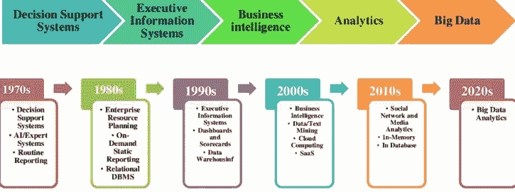

如图（1）所示，我们可以说，自20世纪70年代初决策支持系统出现以来，商业智能（BI）系统已经历五个按时间顺序排列的阶段而出现和发展。20世纪70年代的特征是在决策中依赖管理信息系统（MIS）。这涉及编制关于过去不同时期各种运营、组织和战略变量的报告。高级管理层依赖这些报告来制定未来决策。此外，还运用运筹学和专家系统技术来解决企业管理面临的复杂问题。第二阶段贯穿20世纪80年代，见证了企业管理获取与其活动和领域相关数据方式的重大变化。过去从市场、会计和制造等各个单位捕获数据的传统系统，在企业层面整合为一个统一系统，即企业资源计划（ERP）。在此期间，还引入了关系数据库管理系统（RDBMS）以改善数据捕获、存储和计算机化访问。20世纪90年代，由于高层管理需要更多样化的报告，引入了高管信息系统（EIS）和决策支持系统（DSS）。这些系统专门为高管经理设计，以满足其决策需求。它们包括带有绩效指标和关键指标的可视化信息仪表板，依赖数据仓库来促进和加速决策（Sharda, Delen, & Turban, 2018, pp. 13, 14, 15）。

## 工业中小企业中商业智能的定义

在探索“商业智能”这一术语的概念根源过程中，我们发现了H.P. Luhn在1958年提出的首个定义，他将其定义为理解所呈现事实之间相互关系以及它们如何指导工作朝向预期目标的能力。在商业领域，商业智能是一个为在组织结构的各个部门和部分传播信息而创建和开发的自动化系统（Grossmann & Rinderle-ma, 2015, p. 1）。Laura Zapata-Cantú、Teresa Treviño和 Flor Morton认为，商业智能是指一系列广泛的方法、流程、基础设施、架构和技术，它们协同工作，为管理者提供做出明智和快速决策的解决方案。最终，它依赖于数据的实时分析和汇总，将其转化为有用信息（Zapata-Cantu, Trevino, & Morton, 2020, p. 15）。它也被认为是一种全面的概念，涉及数据结构化、分析工具和软件，以特定方式嵌入，使企业管理者能够同时即时获取数据和信息。因此，决策者可以为明智的行政决策获得清晰的愿景（Sharda, Delen, & Turban, 2018, p. 16）。商业智能包含各种活动、分析手段、工作和必要技术，将数据转化为有用信息，进而转化为知识。因此，这些知识在企业中被用来寻找计划，最终导致采用运营和管理程序以实现经济利润。（Loshin, 2013, p. 7）

因此，商业智能是计算机化媒体设备、手段、技术、计算机软件和基础设施的大型结构。这些元素根据特定配置进行集成，与组织及其管理层次和所采用组织结构的活动和运营保持一致。其主要目的是获取大量数据，以各种形式和来自不同来源，包括企业环境内部和外部，与其活动领域相关。随后，这些数据被组织、分析、处理，并在管理过程中和正确决策的制定中转化为有用信息，从而创造知识。遵循以下按顺序排列的阶段：

- 从各种可用来源收集和整合数据，依赖ETL、数据仓库和数据库。
- 数据分析、组织、信息生成以及与企业活动和运营相关的各种报告的编制。这依赖于OLAP、查询语言和临时分析。
- 通过数据探索获取知识，利用各种数据挖掘技术。
- 基于前序阶段做出正确决策，最终实现组织成功。（Olszak, 2020, p. 41）

众所周知，大型企业与中小企业在组织结构、财务和人力资源、专业水平以及生产和技术能力方面存在显著差异。因此，影响中小企业中商业智能（BI）系统定义和采用的因素与大型企业的因素截然不同。因此，为BI建立一个特定的概念框架至关重要，该框架要准确涵盖推动中小企业中BI定义和采用的关键因素。

在阿尔及利亚，工业中小企业被定义为员工人数在1至250人之间、年营业额不超过40亿阿尔及利亚第纳尔或总年营业额为10亿第纳尔、符合独立条件并通过将原材料和物资转化为半成品或成品从事生产活动的经济实体。（阿尔及利亚人民民主共和国，2017年，第5页）

根据这一定义，阿尔及利亚工业中小企业的特征在全球范围内并无不同，因为分类标准（包括员工人数、年营业额和独立条件）趋于一致。与在很大程度上依赖充足资本、技术资源和人力资本的大型企业不同，中小企业则恰恰相反。其所有者、管理人员和员工通常在有效利用信息和通信技术（ICT）方面的意识和培训水平较低，而ICT是定义和采用BI系统并激活其在价值创造和整体绩效提升中作用的基本支柱。此外，由于财务限制，其为IT和BI项目融资的能力有限。

定义适合工业中小企业的BI系统的另一个关键因素是组织和人员知识水平较低，这决定了其收集、整合、分析和组织必要数据和信息的能力。此外，其横向设计和管理运营流程并将其与BI系统正确集成以有效改善价值创造的能力也至关重要。

图（2）说明了与BI系统概念方面相关的不同因素，这些因素与中小企业的性质和特征相一致。

将BI定义为由设备、工具、技术、计算机程序和计算机中介通信基础设施组成的大型结构，取决于中小企业在ICT管理实践中的特定成熟度水平。这些实践是这些技术要素高效集成和运行的基石。此外，负责ICT和BI系统设计与运营的个人的技术技能在定义中小企业BI方面也至关重要。这确保了对各种数据源的获取、分析和转换


### 图 2. 中小型企业商业智能系统

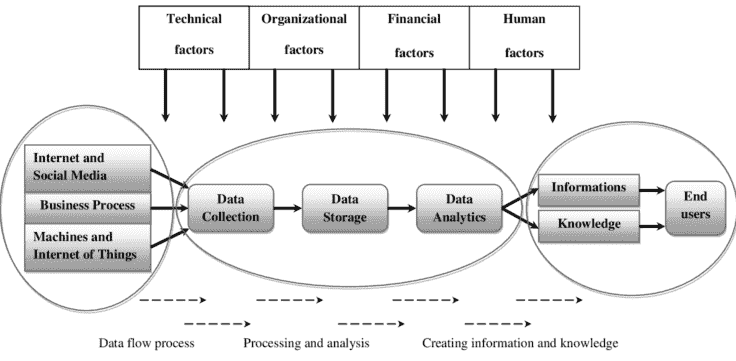

转化为贴合企业性质的相关信息。此外，定义中小企业商业智能（BI）的一个基本因素，是 BI 系统组件与运营流程、活动及组织结构之间的必要整合。这种整合创造了运营商业智能，并根据数据和信息的重要性程度，将所有相关数据和信息传播至整个组织结构中。

## 工业中小型企业商业智能的益处与积极影响

“商业智能”一词是指用于多维数据收集和分析、以改进决策流程的数据、信息、技术和工具的组合。商业智能系统主要旨在为工业中小型企业管理带来诸多益处，尤其是在正确使用的情况下。这些益处可总结如下：

- 在企业内部提供必要的信息和知识，有助于改进决策、绩效和运营效率。
- 在需要时为管理运营提供广泛的关键信息，以应对外部环境变化并快速响应客户需求。（Grossmann & Rinderle-ma, 2015, p. 2）
- 提升企业在进行各项决策方面的经验质量。
- 提供预测与决策行业相关的不同变量场景的能力。
- 发现新知识，使企业能够构建其竞争能力并进入新市场。
- 创造获取新客户的机会。
- 为企业引入新变化，使创新新产品和服务成为可能。
- 改善与供应商、客户和利益相关者的关系。
- 为改进采用的战略提供机会，从而实现竞争优势。
- 通过优化运营并降低各种相关风险，改善企业绩效。（Olszak, 2020, pp. 38, 39）

## 商业智能架构

图（3）展示了企业中商业智能系统的整体工程。它展示了数据从其各种来源到向最终用户交付有用信息的流程。技术人员负责构建数据仓库，并执行访问、操作及结果生成。另一个技术团队负责商业分析，通过用户界面将获得的信息和必要数据共享给经理、高级经理及其他人员。经理和高级经理通过监控和分析实际绩效来管理商业绩效管理（BPM）。

### 图 3. 整体商业智能架构

来源：(Sharda, Delen, & Turban, 2018, p. 17)

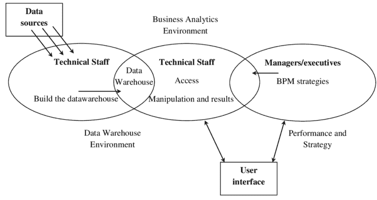

## 商业智能成功的挑战

在过去二十年中，经济企业（尤其是中小型工业企业）采用商业智能所面临的成功挑战多种多样，这些挑战与商业智能系统在提升各种运营流程及其他管理方面绩效能力方面所具有的模糊性有关。最重要的挑战在以下要点中得到凸显：

- 企业管理者迫切需要将商业智能视为不仅仅是与企业运营活动相关的报告提供者。
- 有必要将信息与通信技术（ICT）的组件与部分与商业智能系统相适应，以便后者能够更高效、更有效地运行。
- 缺乏将商业智能系统与企业运营（尤其是受外部环境突然变化影响的运营流程）相结合的清晰战略和合理计划。（Williams, 2016, p. 161）
- 企业可用的信息与通信技术（ICT）资产成熟度不足，这不允许它们以支持业务流程的方式采用商业智能系统。这一挑战需要改进信息与通信技术的管理和治理流程。
- 企业管理层缺乏如何在价值创造过程中部署信息与通信技术和商业智能系统的精确且逻辑的理解。（Gendron, 2013, pp. 5, 6）
- 限制中小型工业企业的财务能力，这可能阻碍它们分配适当预算以满足商业智能领域的投资要求。
- 中小型工业企业中信息与通信技术（ICT）系统的成熟度较低，这对这些企业在采用商业智能方面构成了重大挑战。
- 采用商业智能的成功需要具备高水平的人力技能和组织能力，以按照组织要求控制数据的收集、分析、存储、提取和整合。由于资源有限，这些能力在中小型工业企业中可能缺乏。
- 由于缺乏知识管理经验，中小型工业企业内部可用和获取的知识水平较弱。这给商业智能采用的成功增添了一种挑战，因为后者是塑造知识的最重要来源之一。

## 中小型工业企业采用商业智能系统的要求

大多数经理和商业领袖都有具体明确的管理和运营目标，以及必须在预设期限内实现的受限绩效率。因此，说服他们投资商业智能系统的想法，从根本上取决于这些系统在各个领域将提供的真实收益。这包括增加收入、降低成本、提高盈利能力、加强客户关系、增强供应链灵活性、提高生产率、改善客户服务和提升竞争定位。（Williams, 2016, pp. 162, 163）因此，采用商业智能系统与一组必须满足的采用要求相关联，以确保所需的收益。这些要求最终导致将商业智能与中小型工业企业的战略、计划和业务实践相整合。更具体地说，商业智能系统和各种信息与通信技术（ICT）应通过将其整合到企业的所有业务流程中来发挥创新作用，以提高绩效，而不仅仅是管理这些技术系统的成本，并将其视为仅跟踪业务运营。（Gendron, 2013, pp. 6, 7）

许多研究人员认为，采用商业智能系统的成功因素不仅限于技术因素。还有许多其他因素至关重要。例如，Presthus 认为商业智能是一个社会技术系统，其中技术方面与人力方面同等重要。Yoon、Ghosh 和 Jeong 也强调了人力方面在采用商业智能系统中的关键重要性，因为它们通过创造合适的学习环境来确保积极的社会影响。Yeon、Coronios 等研究人员以及


Popovic强调了组织与管理要求在商业智能采用成功中的关键作用。（Skyrius, 2021, p. 213）

Celina Olszak认为，分析和讨论商业智能概念应从两个基本视角展开：技术视角与管理视角。技术视角作为两者中较早的一种，将商业智能视为一组集成的工具、技术和软件，用于从各种来源收集异构数据，并进行集成、分析与共享。管理视角则侧重于信息和知识作为企业管理战略资源的至关重要性。数据分析不仅能加快决策，还有助于发现未来商业成功的宝贵机会，并维持利润实现。（Olszak, 2020, pp. 38, 39）Sharda、Delen与Turban主张，在为企业采用和设计商业智能系统之前，高层管理应将其视为一种将从根本上改变整个管理方法的工具。对商业智能的投资理由应与企业战略保持一致。它应被视为提高运营与活动效率和效果的手段。采用规划至关重要，包括识别实现商业智能目标可用的组织技能，以及对现行组织文化接受适当变革意愿的预评估。商业智能系统与企业已采用的信息技术系统之间的集成也是必不可少的。（Sharda, Delen, & Turban, 2018, p. 20）

实际上，大多数高管将分配预算投资商业智能的决策与采用流程后特定时期内预期的经济回报挂钩。这种经济回报与将改善其绩效的业务流程密切相关，这些流程被隐含地称为商业智能机会（BIOS）。BIOS是识别使用商业智能以增加收入、降低成本或两者兼顾的最佳方式的系统性方法。这些经济论证取决于所实践的业务流程，并为商业智能系统如何为企业创造价值提供了经济基础。例如，总投资额、达到盈亏平衡点所需的时间、与该投资相关的风险性质和数量，以及最关键的因素——成功因素和要求，以及企业管理层满足这些要求的程度。（Williams, 2016, pp. 69, 70）

在过去，随着商业智能的出现和初步使用，人们曾认为高层管理对企业采用商业智能系统这一想法的支持几乎是该计划成功的唯一条件。然而，企业工作环境中连续发生的剧烈变迁迫使必须采用更加集成的方法。人们开始关注采用商业智能系统这一想法的所有分支和相互关联的方面，即商业智能机会。中小型工业企业与大型企业相比的独特特征也为采用这一想法赋予了特殊性。因此，在这方面将采用分析框架，将采用要求分为三大类：技术要求、组织要求和人力要求。每个方面都互相补充，最终将商业智能集成到中小型工业企业的结构中，以确保最大收益，使这一经济实体成为目前所谓战略三角（成本、质量和及时性）的利益相关方。

## 采用商业智能的组织要求

根据管理科学文献以及思想家彼得·德鲁克（Peter Drucker）的观点，组织被视为任何管理流程框架内实践的第二阶段，紧随规划之后。因此，组织是一项涉及设计组织结构，并实现其各个部分和独立行政单位之间协调与和谐的活动。这是为了使组织能够完全适应环境中不断发生的变化，为其提供组织敏捷性。因此，组织要求是指作为系统的商业智能与整个机构的组织结构之间必须实现的兼容性、和谐与协调。这确保了数据和信息的顺畅流动和正确分配。管理人员和高管必须接收关于所有实践活动和外部环境条件的真实、有用、详细且及时的信息，以实现高绩效和组织效率。因此，运营商业智能系统与组织的整体运营系统相集成。（Howson, Successful Business Intelligence: Secrets of making BI a killer app, 2008, p. 23）导致这些组织要求出现的突出原因之一是工业企业采用的现代组织结构，即扁平结构、水平结构或以运营为中心的结构。此外，决策权的新分配，通过使负责业务运营的个人能够做出各种决策，发挥了关键作用。（Olszak, 2020, p. 3）工作环境的紧急变革、数字经济的出现以及基于质量和创新的竞争，在企业实现高度内部协调的需求方面发挥了决定性作用。商业智能系统在这方面可以发挥关键作用。例如，商业智能系统应满足的一些组织要求包括：

- 识别商业智能应支持的商业决策。
- 识别使用商业智能系统提供的数据和信息应改进的业务流程。
- 评估业务运营潜在改进带来的经济影响。
- 确定组织运营及其员工所需变革的程度和范围。
- 对组织管理层所需信息进行准确描述。（Williams, 2016, pp. 70, 71）

在对阿尔及利亚塞蒂夫工业区许多中小型工业企业的实地访问期间，与32名经理和高管（CIO、CFO、COO和CEO）进行了广泛访谈。为期两个月，就商业智能系统可显著改进的活动提出了14个详细问题。这些问题的选择基于其与企业战略的关联，以及其对创造利益的贡献。访谈得出了以下结果：

- 使用商业智能有助于预测销售趋势并发现新市场。
- 依赖商业智能可显著改善向商店的分销流程。
- 使用商业智能有助于衡量和改善客户满意度。
- 商业智能可用于在供应链管理方面取得重大改进。
- 使用商业智能有助于提高整个企业的生产率。
- 商业智能有助于消除非增值活动。
- 商业智能可用于改善产品间接成本分配。
- 商业智能可用于改善库存管理。
- 商业智能可用于改善不同职能部门之间的协调。
- 商业智能可用于保持高水平的竞争意识。


基于这些访谈的结果，可确保业务智能成功采用的各种组织要求可分为两大类：

- 与建立运营业务智能系统相关的要求，侧重于提供来自内部活动的数据。
- 与管理和控制相关的要求，旨在提供组织结构各部分之间的全面协调，并实现组织效能。

## 与建立运营业务智能系统相关的组织要求

在采用业务智能系统时，必然包括组织的所有运营活动和流程以及所有管理层级，包括供应商、客户以及与组织结构外但与之持续关联的公民的公共数据。（Howson，《成功的商业智能：释放BI和大数据的价值》，2014年，第4页）与此方法一致，组织的运营系统由一组内部活动和流程组成，这些活动和流程将可用资源转化为面向市场的产品和服务。在这些流程的每个步骤中，用户将一组数据输入到运营系统中，然后这些数据被捕获并用于业务智能系统。运营系统（也称为事务处理系统或源系统，也称为企业资源计划（ERP）系统）是与组织相关的定量数据的主要来源。各种活动涉及向这些系统输入大量数据，涵盖许多领域，例如：

- 制造系统：向制造系统输入特定产品的生产订单，记录所用原材料的数量和质量等。
- 销售系统：输入客户采购订单，并附上所有详细信息。
- 供应链系统：产品可用后执行订单并输入运输详细信息。
- 会计系统：记录所有现金和金融交易，如客户发票等。（Howson，《成功的商业智能：让BI成为杀手级应用的秘诀》，2008年，第22页）

### 图4. 运营业务智能
来源：（Howson，《成功的商业智能：让BI成为杀手级应用的秘诀》，2008年，第22页）

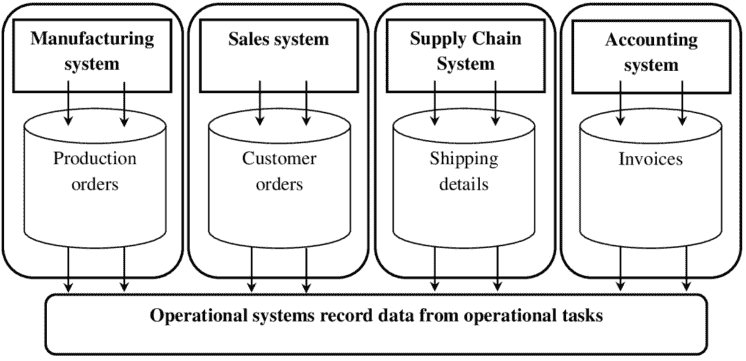

这些运营系统构成了与企业相关的定量数据的主要和确认来源。在运营过程的每个步骤中，都会输入大量数据，涵盖各个领域。

如图（4）所示，运营业务智能（OBI）依赖于真实的运营系统（即进行生产活动的系统）来获取数据。这些数据源自以下子系统：企业资源计划（ERP）、供应链管理（SCM）、客户关系管理（CRM）和会计系统。此外，它还纳入了来自其他内部来源的数据，例如提供销售和库存信息的分销商、显示最受欢迎产品的网站点击流数据，以及电子商务购物车数据。随后，这些数据被提取、转换并加载（ETL）到数据仓库中。（Howson，《成功的商业智能：让BI成为杀手级应用的秘诀》，2008年，第24页）负责业务智能系统的团队将其与运营系统的集成视为确保持续创建与组织内部活动相关的数据的纽带。这有助于数据和信息在组织结构的不同部分之间水平和垂直流动。

因此，由于中小型工业企业的组织结构和运营系统相对简单，提高运营灵活性成为一种可实现的优势，前提是更大程度上依赖于现代技术平台。这些平台用于数字化其运营基础设施和流程。（Rao-Graham、McNaughton和Mansingh，2020年，第3页）这种简化带来了以下成就：

- 为企业提供实时的运营层数据，有助于对所有已开展活动提供即时反馈，并减少与工作绩效相关的时间和错误。
- 消除非增值运营活动，从而降低相关成本。
- 完全消除从一个部门向另一个部门传输的重要信息被歪曲的可能性（与生产特性相关）。这为提高产品质量和潜在降低成本提供了显著机会。
- 使企业对市场需求更加敏感。

## 与管理、控制和协调相关的组织要求集

作为本章开头提到的影响组织工作环境的激进变化的必然结果，组织结构已从依赖精确工作分工、详细专业化和垂直组织作为基本原则的层级职能结构，转变为横向结构。这些结构以流程为主要运作模式。这种转变的主要原因之一是试图为消费者创造更大价值。最初，组织试图提高其产品质量并实现对市场需求的更快响应。他们为其活动构建了一个行政和组织模型，如图（5）所示。

实际上，组织以跨职能流程的形式采用了这种结构，这是由于职能型组织结构所经历的问题和缺点。这些缺点包括对市场要求的响应缓慢、产品和服务质量水平低以及成本通胀。组织管理层试图改善对同一流程有贡献的多个部门和职能活动之间的内部协调。例如，图（5）说明了创新和产品开发流程。最初，负责消费者和市场研究的人员识别消费者偏好、开发产品执行的功能特性以及需求水平。然后，这些信息通过信息系统以详细报告的形式传递给另一个职能部门——研发部门。该部门负责制定所需的产品设计。随后，设计被传递给生产部门，负责人员设计合适的生产线并启动制造流程。之后，销售和分销运营以及一般促销活动开始，接着是售后服务。这些部门之间实际发生的是重要数据和信息（纸质或电子形式）的传输，这些数据和信息对于整个流程中每个步骤的决策至关重要。然而，观察发现，这种数据和信息的传输存在局限性、延迟、错误和歪曲，这是由于传输方法不正确造成的。这往往对生产成本和质量产生负面影响。

### 图5. 产品创新与价值链
来源：（Bhimani、Horngren、Datar和Rajan，2015年，第13页）

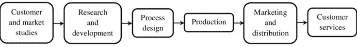

在20世纪90年代，具体来说是1993年，詹姆斯·钱皮和迈克尔·汉默试图引入再造的概念。他们将其定义如下：对企业组织结构及其运营流程进行彻底重新思考和彻底重新设计，以通过降低生产成本、提高质量、更好地满足消费者、缩短对消费者愿望的响应时间以及对外部变化拥有更大灵活性，来实现绩效的显著改进和效率的提升，并提高其活动和实践的协调与集成水平。（Hammer & Champy，1993年，第41-45页）

再造的主要目标是将企业的组织结构从职能型转变为以流程为中心的组织，基于后者是最先进的组织形式并更符合外部环境条件的信念。这涉及从职能和部门中彻底分离，用由具有多种职能专长的人员组成的一组横向业务流程来取代它们，即：

- 产品设计和车间系统设计流程：该流程包括与新产品开发相关的所有活动。由于产品设计与车间系统设计之间存在显著关联，所有这些活动均属于一个流程，即设计新产品和车间系统的流程。
- 企业资源管理流程：这涵盖了与获取资本资源、人力资源以及管理组织内技术相关的所有活动。
- 产品供应流程：该流程包括与获取作为生产系统投入的原材料和各种物资相关的一组活动，最终将产品和服务交付给客户。


- **客户流程：**客户流程包括另一组涉及各种活动的子流程，主要集中在销售和广告推广产品上。它包括收集各种市场信息并选择组织将进行销售的市场，以及提供售后服务。

- **支持运营：**组织为其内外部利益相关者开展一组支持活动。这些活动主要包括与政府实体相关的法律运营，以及提供各种财务信息和创新支持活动。

支持业务流程再造的人士认为，按照运营而非职能和部门对企业活动进行横向组织，能确保数据和决策所需的有用信息实现顺畅、即时的流动。这种流动发生在负责相关运营的个人及其关联人员之间，考虑到他们隶属于不同的职能专业领域，并被授予较高的决策权。这最终保证了能够即时且在问题发生前解决成本、质量和及时性问题。

与此一致，Lila Rao-Graham、Maurice McNaughton 和 Gunjan Mansingh 认为，中小型工业企业采用商业智能能使其更灵活地应对外部环境中的突发变化。这是通过提供必要的协调层级，并确保其组织结构各部分之间数据与信息的持续即时流动来实现的。由于其组织结构简单，与大型企业相比，这尤其有利。（Rao-Graham, McNaughton, & Mansingh, 2020, p. 4）

为了说明与管理、控制和协调相关的组织要求概念，我们参考图（6），该图概述了构成产品设计和车间系统设计流程的活动。

起初，我们可以观察到，新产品及车间系统的设计流程包含三个主要活动。这些活动由三个不同且连续的职能部门执行，如下所示：

- **消费者与市场研究部：**该部门负责挖掘消费者需求，即精确识别拟开发或创新产品的功能特性。

- **研发部：**该部门则负责其成员完成拟定产品的设计。

- **制造或车间部门：**该部门的负责人员为拟定产品的按需量生产设计合适的生产线。

### 图 6. 产品设计和车间系统设计流程

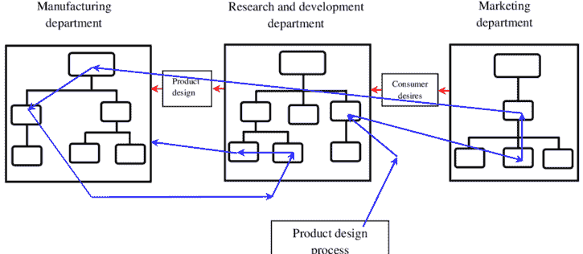

职能组织
业务流程组织
负责实施运营活动的个人中心

关于这一流程整体可以注意到的是，需要高层级协调，以确保构成多功能活动的所有步骤之间数据和信息实现顺畅的横向流动。由于通信工具和机制有限，这种协调在纵向组织结构中证明难以实现。正因如此，商业智能（BI）系统在实现流程负责人之间数据与信息的即时、持续传输方面发挥着有效作用。参考图（5），我们可以看到，商业智能系统确保向负责新产品设计流程的团队提供关键数据和信息。该团队超出单一职能或部门的范围，涵盖各个职能部门。该流程在虚拟形成（同时保持采用的组织类型），包括来自市场部、研发部和生产部门的代表。这有助于减少跨部门工作处理所产生的风险以及与产品特性相关信息被歪曲的可能性。负责产品设计流程的团队会即时获悉产品设计、制造和营销将影响的所有领域。这确保了避免此类问题。此外，中小型工业企业与组织结构简单性相关的自然特征，通过采用信息和通信技术（ICT）和商业智能（BI），更有助于激活组织敏捷性特性。因此，与管理、控制和协调相关的组织要求强制授予构成每个流程的所有个人完全权限，以确保在计划、执行和控制阶段为生产增加价值。这包括授予完整的权限以利用商业智能系统提供的数据和信息，以保证其在决策过程中的应用，并避免因关键信息缺失而立即产生的次要问题。这些要求与实现组织敏捷性紧密相连，后者要求在组织内外获取关键数据和信息时具备一种协调与和谐。这些内容涉及产品的成本和质量及其分发，分发给特定数量的经理、高管和个人，供其在决策中使用。

## 采用商业智能的技术要求

商业智能系统的技术要求充当其底层基础设施，使企业管理能够在商业分析和决策领域获取、处理、管理和使用数据与信息。这些要求随信息技术和通信（ITC）资产而异，但与之紧密集成。中小型工业企业成功采用商业智能的技术要求与大型组织有所不同。这主要归因于中小型企业总体上信息技术和通信实践的成熟度较低。这可归因于多种因素，例如资源有限、该领域人员的专业水平较低，以及管理层在利用信息技术和通信创造价值方面缺乏清晰的愿景。

因此，技术成功要求可分为两大类：

- 与信息技术和通信（ITC）实践成熟度相关的要求。
- 商业智能系统本身特有的技术要求。

## 与信息技术和通信实践成熟度相关的要求集合

Michael Gendron 断言，企业采用商业智能的成功与其在信息技术和通信（ICT）领域实践的成熟度紧密相关。这通过ICT基础设施体现出来，该基础设施支持数据的创建、汇集和传输，进而应用于智能商业解决方案领域。（Gendron, 2013, pp. 4, 5）更准确地说，企业通常可以接触到庞大且多样的ICT资产，使其能够开展电子管理实践。这些技术资产通常用于通用目的，在许多情况下在功能上也适合商业智能目的。（Williams, 2016, p. 189）

为了最大限度地发挥ICT和BI的效益，企业不仅必须使用它们来支持内部运营，还必须以井然有序的方式使用它们，从而最终实现价值创造。为此，中小型工业企业内部的ICT基础设施必须包含以下组件：

- **企业级组件：**这些组件在所有组织部门中运行，但作为一个统一系统运作。用户通过每个计算机程序的前端界面与信息和通信技术（ICT）应用程序及企业系统（如ERP、企业文档管理、企业内容管理或知识管理系统）进行交互。这种交互在名为“企业级组件”的中央层级进行汇总。它包括一大组服务器、数据库、计算机、通信网络、前端软件等。

- **用户组件：**此类别包括用户直接交互并直接每日控制的所有部分。个人使用这些组件来执行其职能活动，例如计算机、打印机、扫描仪和各种软件。

- **服务组件：**服务组件体现为企业内个人直接使用的网络服务，由网络硬件和软件组成。由信息和通信技术部门管理和监控，服务组件涵盖各种服务，例如打印、办公通信、网络存储服务、互联网协议电话等。

- **网络组件：**由一组网络和电信设备组成，包括网络设备、软件、电缆、介质、路由硬件、网络交换及相关物品。


这些组件受信息与通信技术部门的直接控制，但由组织内的个人使用。网络组件涵盖广泛的服务，例如打印、内部和外部办公室通信、网络存储服务和互联网协议电话等。网络服务有多种类型，包括打印服务、通过传真或IP电话进行的内部和外部办公室通信、可通过网络访问的存储以及其他网络共享设备。（Gendron, 2013, 第22、23页）

## 与商业智能系统组件相关的要求

图(7)说明了商业智能系统的一般方面，描绘了其技术方面、组件集成，并解释了为组织中的经理和其他个人生成重要且有用信息的交互作用。

图7. 商业智能系统组件 来源：(Sharda, Delen, & Turban, 2018, 第58页)

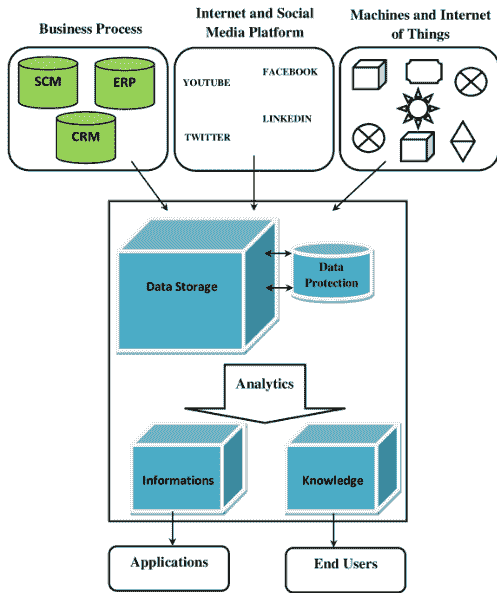

图(7)提供了商业智能系统所有技术方面的详细视图。这些可以分为四组：

- **数据仓库：** 一种将来自各种来源的数据集成的技术。
- **数据提取和传输工具：** 主要负责将来自各种来源（包括事务系统和互联网）的数据转移到企业的数据仓库。
- **数据分析和探索工具：** 使最终用户能够访问和全面分析数据，并提取洞察。
- **数据可视化：** 包含一组负责以透明方式呈现数据和信息、便于最终用户访问的应用程序和工具。（Olsztak, 2020, 第45、46页）

### 采用商业智能的人力要求

商业智能的人力要求涵盖商业分析师应具备的一系列多样化技能，这些人员组成负责设计和运营企业商业智能系统的技术团队。中小型工业企业通常因人力资源有限而难以拥有具备高级技术技能的人员。此外，商业智能、商业分析和数据分析被认为是高度专业和精确的领域，因此在这些领域培训人员对管理层来说是一个重大挑战。

Bert Brijs指出，商业分析师应具备五种技能：

- **数据知识：** 商业分析师应掌握将数据质量与主数据管理相关联，从数据剖析到分析数据比例。这需要深入了解负责创建、使用或修改数据的流程。
- **应用知识：** 涉及熟练使用捕捉组织内真实事件和交易的商业智能应用程序，例如发票、采购和销售订单等。熟悉客户关系管理（CRM）、企业资源计划（ERP）、销售渠道和联机分析处理（OLAP）至关重要，因为它们是主要的数据来源。
- **流程知识：** 获取与组织流程性质相关的知识是商业分析师最关键的技能之一。理解业务流程至关重要，因为它们是重要的数据来源。
- **BI技能：** 包括从使用商业智能中最大化企业价值的技能。这些技能涉及将商业智能组件与组织实践的活动和流程集成，以帮助最大化产生的价值。
- **人际技能：** 包括进行访谈、收集需求、举办研讨会、头脑风暴以及在对立派系之间进行调解等技能。（Brijs, 2013, 第343页）

## 研究方法论

在阿尔及利亚塞蒂夫区工业区20家中小型工业企业的20次实地考察中，我们在两个月内采访了32名经理和高管（首席信息官（CIO）、首席财务官（CFO）、首席运营官（COO）和首席执行官（CEO）），期间我们发放了一份包含两个重要部分的问卷。第一部分关于中小型企业管理层对采用商业智能系统的兴趣，并发放给了20家企业。问卷的第二部分包含14个问题，并发放给了11家企业。它发放给已经采用商业智能系统的企业，并向经理询问了关于采用商业智能的要求以及可以使用BI系统增强的活动。这些问题的选择基于其与企业战略的相关性，以及其对创造价值的贡献。随后，就企业层面已经发生或未来可能发生的BI系统实际应用提出了详细问题。

## 数据视图与分析

问卷的第一部分包含五个问题，发放给20家中小型工业企业，涉及企业管理层对采用BI系统的兴趣程度（问题根据BI系统的技术基础设定）。结果表明，总企业中仅有11家有兴趣采用BI系统，而9家企业完全没有兴趣。基于所得结果，我们设计了14个问题，与负责在企业中采用BI的人员的要求相关。在被调查的32名经理中，85%表示资金不是采用BI的一项困难要求，也不会决定其成功。此外，90%认为设计运营BI被视为其成功的基本要素，因为当其与企业活动和运营活动集成时效果良好。然而，77%承认，通过利用BI系统提供的数据和信息，向执行人员提供完全自由是其采用最成功的要求之一。同时，61%认为依赖电子政务和ICT是采用商业智能系统的关键因素，100%承认负责设计和运营商业智能系统的技术团队的熟练程度在很大程度上决定了采用BI系统的成功。

## 研究结果

显而易见，采用商业智能系统的要求和成功因素众多且多样，这是由于其与组织各个部分的关联所致。这些主要是组织要求，围绕运营商业智能系统的设计，以及与管理、控制和协调相关的要求。它们体现在将商业智能系统集成到组织结构中的方法，以确保数据和信息的垂直和水平流动，从而加强协调水平。除了技术要求外，这些要求集中在企业内部信息技术和通信的高成熟度上。此外，一项关键要求是负责设计和运营商业智能系统的个人必须具备的技能。

## 结论

本章探讨了中小型工业企业采用商业智能的要求。它试图分析成功采用商业智能的主要原因，特别是考虑到此类企业的特征，如资源有限、组织框架简单以及市场份额有限。商业智能系统处理与企业实地研究相关的大量数据，然后对数据进行分析并转化为有用信息。因此，它保证经理和高管做出正确的运营决策，从而有助于降低成本、提高产品质量并快速响应市场需求。

成功要求分为三个部分，即：组织要求，它既包括伴随运营商业智能系统的要求，也包括与管理、控制和协调相关的要求。第一部分非常重要，因为它试图通过改进


流向数据和信息，无论是在战略层面还是运营层面，以确保价值创造。第二部分包括技术要求，而技术要求又细分为与日益增长的 ICT 使用兴趣相关的要求，ICT 被视为实现商业智能运营化的基本要素。除了商业智能的技术要求外，它还分为四个主要要素：数据仓库、数据可视化、数据提取与传输工具、数据分析与探索工具。第三部分关注人力要求，涉及个人在采用商业智能时必须具备的技能，即：数据知识、应用知识、流程知识、BI 技能、人际技能。

## 参考文献

- Bhimani, A., Horngren, C., Datar, S., & Rajan, M. (2015). *管理成本会计*（第六版）. 美国新泽西州: Pearson.
- Blocher, E., Stout, D., & Cokins, G. (2010). *成本管理*（第五版）. 美国: McGraw-Hill.
- Brijs, B. (2013). 商业智能的业务分析. CRC Press.
- Deepmala, S., Anurag S., Amizan, O., & S.B, G. (2023). 商业智能与人力资源管理. 纽约: Routledge.
- Gendron, M. (2013). 商业智能应用：实施有效的信息与通信技术基础设施. John Wiley and sons Inc.
- Grossmann, W., & Rinderle-ma, S. (2015). 商业智能基础. Springer. doi:10.1007/978-3-662-46531-8
- Hammer, M., & Champy, J. (1993). 再造. (M. le sec’h, 译) 巴黎, 法国: Dunod.
- Howson, C. (2008). 成功的商业智能：让 BI 成为杀手级应用的秘诀（第一版）. 美国: McGraw-Hill.
- Howson, C. (2014). 成功的商业智能：释放 BI 和大数据的价值（第二版）. 美国: McGraw-Hill.
- Kotler, P. (2017). 市场营销 4.0：从传统到数字. John Wiley and sons Inc.
- Loshin, D. (2013). 商业智能：精明管理者指南（第二版）. 美国沃尔瑟姆: Morgan Kaufmann.
- Olszak, C. M. (2020). *商业智能与大数据：组织成功的驱动因素*. CRC Press. doi:10.1201/9780429353505
- Poluha, R. (2016). *供应链管理精髓*. 美国: Springer.
- Rao-Graham, L., McNaughton, M., & Mansingh, G. (2020). *面向中小企业的商业智能：迈向商业可持续发展的敏捷路线图*. CRC Press.
- Sharda, R., Delen, D., & Turban, E. (2018). *商业智能分析与数据科学：管理视角*. Pearson.
- Skyrius, R. (2021). *商业智能*. Springer. doi: 10.1007/978-3-030-67032-0
- Williams, S. (2016). *商业智能战略与大数据分析：通用管理视角*. Morgan Kaufmann.
- Zapata-Cantu, L., Trevino, T., & Morton, F. (2020). 利用客户分析获得成功：墨西哥中小企业案例. 在 P. N. Melo & C. Machado (编), *中小企业商业智能与分析* (第 13–24 页). CRC Press.

# 第 8 章：企业家创新中的设计思维与创造力

Mustafa Kayyali
https://orcid.org/0000-0003-3300-262X
叙利亚高等教育排名

## 摘要

本研究探讨了设计思维与创造力在企业家创新领域中的关键作用。随着创业环境的变化，对创新性问题解决和想法产生方式的需求变得越来越明显。迭代且以人为本的设计思维为企业家提供了一个应对创新挑战的特殊框架。本研究探讨了设计思维与创造力之间的相互作用，阐明了这些理念如何融合以促进创业成功。通过对案例研究和实证证据的全面分析，本研究展示了设计思维与创造力对促进创业企业创新的多方面影响。研究结果强调，在当今动态的商业环境中，培养创造性思维并采用设计思维原则作为企业家创新的催化剂至关重要。

## 引言

在当今充满活力且不断变化的企业环境中，创新已成为创业的命脉（Kaplan, 2012）。创造力及设计思维原则的应用已成为创业成功的关键组成部分。企业正处于十字路口，在应对日益激烈的竞争、颠覆性技术的不断进步以及客户口味的反复无常时，持续创新不仅是一种选择，更是生存的必需。本章提案《企业家创新中的设计思维与创造力》植根于这一复杂的机遇与挑战之网，旨在深入探讨设计思维和创造力在滋养创业创新沃土方面所发挥的深远而关键的作用。

归根结底，创业是一项以创新为基础的追求（Weerawardena, 2011）。企业家是变革的建筑师，是拥有非凡能力、能够洞察平凡表象之下隐藏机遇的远见者。他们为新产品、新服务或新商业模式注入生命，将其奉献给世界。然而，通向富有成果的创新之路充满了险阻，布满了甚至能让最聪明头脑也感到困惑的挑战与不确定性（Hannon, 2013）。要在创新之旅中取得成功，企业家必须不仅凭借灵光一现的好点子就穿越这座迷宫；他们必须拥有一种结构化、有条理的方法，能够将想法转化为切实可行的解决方案。而设计思维——一种以人为本的问题解决方法论——正是在此处展开其强大的翅膀、翱翔而起。

企业家是那些敢于梦想宏大、颠覆市场并影响未来的勇敢个体。他们观察世界，思考既有可能又有现实的事物。创业依赖于创新，正是创新驱动这些梦想家将愿景变为现实（Elkington, 2008）。创新是区分企业家的驱动力，无论是推出突破性产品、彻底改变市场，还是创立全新行业。然而，创新是一个复杂且全面的过程，需要一种特殊的能力、视角和方法的结合。它不是单独的努力。正是在这一点上，设计思维和创造力发挥作用，为企业主提供了一套应对创新难题和不确定性的强大工具包。

设计思维已从仅与产品设计领域相关，转变为一种动态且革命性的问题解决和创新方法。虽然这并非新概念，但它在创业领域的应用近年来获得了巨大的动力，并改变了企业看待创新的方式。从根本上说，设计思维是一种富有同理心、以人为本的问题解决方法。它鼓励企业主及其员工深入客户生活，以理解客户的需求、愿望和痛点。通过采用最终用户的视角，企业家可以发现传统分析方法可能忽略的洞察和可能性。

设计思维是一个灵活的框架，可以根据每个创新项目面临的特定困难进行定制；它不是一种通用的方法。

通过头脑风暴、原型设计、测试和迭代，它为企业家提供了一种结构化且灵活的流程。通过这种迭代过程，可以根据现实世界的反馈改进想法，并探索不同的解决方案（Carlgren, 2016）。设计思维从根本上改变了企业家的创新方法。它敦促企业领导者设身处地地考虑客户，从客户的角度看待世界，并进行共情之旅。从以想法为中心转向以用户为中心的这种转变产生了深远的影响。

过去，企业主可以从他们认为的绝妙想法入手，投入大量时间和金钱将其创建出来，然后才发现目标受众并不觉得它有吸引力。这种方法往往会导致代价高昂的失败。相比之下，设计思维主张以共情作为起点。它鼓励企业家在产生想法之前，深入了解客户的需求和痛点。这种对共情的早期投入大大降低了开发偏离目标解决方案的风险。此外，设计思维挑战个人接受对其先入之见的检验，放弃对失败的恐惧，并将失败视为学习和发展不可避免的试金石。在不确定性和风险始终伴随的创业世界中，这种思维转变是一个颠覆性的转折点。它赋予企业家力量，使其将失败视为一种宝贵的洞察来源，而非挫折，这些洞察可以为其创新的下一次迭代提供信息。

设计思维也为协作注入了新的活力。它创造了一种氛围，使跨学科团队能够结合各自的技能和视角，以不受拘束的创造精神来应对挑战性问题（Liedtka, 2011）。通过汇集具有不同背景、经验和专业知识的个人，设计思维促进了协同效应和思想的交叉授粉。在创新往往需要对复杂问题进行整体理解的世界中，跨学科协作是一项强大的资产。它使企业家能够通过汲取丰富的知识和方法库来应对多方面的挑战。无论是整合技术、用户体验设计、心理学还是商业战略，设计思维都鼓励企业家打破部门壁垒，利用团队的集体智慧。

在这场企业家探索的马赛克中，我们提议的书籍《将商业智能和创新应用于创业》成为启蒙的灯塔。它准备照亮创业潜力的走廊，揭示大量可以利用的工具和策略，将设计思维置于前沿，以推动创业成功的引擎。在本章的篇章中，我们将踏上一段深刻的旅程，深入探讨设计思维与创业精神之间错综复杂的共生关系。我们将航行于其理论的微妙潮流中。


在奠定基础之余，我们将发掘实际应用中的隐藏瑰宝，揭示现实世界案例研究的变革力量。在浏览这些章节的过程中，我们邀请所有怀有创业精神的人——无论是经验丰富的行业巨头，还是迈出激动人心第一步的初学者——与我们一起踏上这场探索与发现的奥德赛。我们将共同解读设计思维与创业创新之间微妙的互动，揭开结构化方法论与无拘无束创意交汇处的秘密。我们诚邀您参与这场旅程，从那些走过类似道路的人的故事中汲取灵感，并发挥设计思维所蕴含的无限潜能。

在创业世界中，可能性无限，创新是命脉，本章如同指路明星，照亮通往未来的道路，届时创造力与设计思维将汇聚，铸就通往成功的可持续且富有远见的路径。

设计思维与创业的融合是当代企业环境中的一种颠覆性力量。通过将用户置于创新的中心，并将失败视为通向成功的垫脚石，它挑战了关于创新的传统观念。它将协作重新定义为一种多学科活动，调动多个团队的集体智慧。我们邀请您与我们一起探索创业创新中设计思维和创造力的诸多维度，以充分实现这一强大战略的潜力。我们将共同以共情、想象力和对创新的不懈追求，成功跨越创业的困难，为在不断变化的世界中实现长期成功铺平道路。

## 创业创新中设计思维的理论基础

“设计思维”的理念与实践源于包括工业设计、工程和建筑在内的众多领域，已发展成为创业世界中的关键策略（Johannsson-Sköldberg, 2013）。其声名鹊起归功于其以人为本的问题解决方法，这一方法与当今快节奏商业环境中创业者所面临的机遇与挑战产生深刻共鸣。在这次全面的探讨中，我们将深入剖析设计思维的理论根基及其与创业过程的契合之处，阐释它如何使商业人士得以创新、创造并成功。设计思维是一种涵盖面广的战略，吸收了多个研究领域的影响。其根源体现在工业设计中采用的创新与迭代方法中，其中用户的需求与体验对产品开发至关重要。此外，它与工程和建筑的问题解决方法论有相似之处，后者优先考虑以用户为中心的解决方案。其核心，设计思维强调共情、问题定义、构思、原型设计与协作（Lor, 2017）。这些基本原则构成了支撑其在包括创业在内的各个领域应用的理论基础。

共情是设计思维的基石，核心在于深入了解最终用户的需求、愿望与痛点（Portnoy, 2019）。这种共情视角与创业的本质紧密契合，而在创业中，识别未被满足的市场需求往往是事业起步的点火器。拥抱设计思维的创业者会深入目标受众的世界。通过采用潜在客户的视角，他们能够获得宝贵的洞察，从而创造出创新且引人注目的解决方案。理解用户体验不再仅仅是一个目标，更成为创业事业的驱动力。通过共情研究方法，如用户访谈、观察和调查，创业者可以发现隐藏的痛点和未表达的愿望。凭借这种深入的理解，他们能更好地开发出与目标市场真正产生共鸣的产品或服务。这种共情方法确保创业事业建立在以用户为中心的基础之上，从而在竞争激烈的商业环境中提高成功的可能性。

创业常常面临模糊且复杂的挑战（Amit, 1993）。创业者必须努力识别正确的问题来推动创新与增长。在此背景下，设计思维为有效的问题定义提供了结构化框架。设计思维鼓励创业者清晰、全面地阐述问题陈述（Ihugba, 2014）。这一过程涉及将复杂挑战分解为可管理的组成部分，并探究问题的根源。通过精准定义问题，创业者能够获得清晰度，并关注其事业中需要关注的方面。有效的问题定义对于资源分配、优先级排序和决策至关重要。它使创业者能够将创造力和资源引导向解决最关键的挑战。此外，它确保创业旅程始终与目标受众的需求与愿望保持一致，降低开发偏离目标解决方案的风险。

构思（ideation）阶段即产生想法的过程，是设计思维中与创业高度相关的关键环节。创业者依赖创新生存，而设计思维则提供了一种培养创造力的结构化方法。在设计思维中，构思鼓励创业者及其团队在不做评判的前提下产生大量想法。这种方法推崇一种创造力文化，任何想法都不被视为过于离奇或不切实际。通过暂缓评判，创业者为非传统和突破性的概念敞开了大门。头脑风暴、思维导图和想法草图等技巧是构思过程的重要组成部分。这些方法鼓励团队成员之间的多元思维与协作，从而形成丰富的想法库。创业者可以探索广泛的可能性，从而发现独特且创新的解决方案。构思并不局限于创业的早期阶段；它贯穿于事业的整个生命周期。它激励创业者不断寻求新视角，探索应对不断变化挑战的新方法。通过将构思融入创业思维，创新者能更好地适应不断变化的市场动态并抓住新出现的机遇。

原型设计与测试是设计思维的核心组成部分（Liedtka, 2018），为验证想法和概念提供了结构化方法。在创业语境下，这些原则与最小可行性产品（MVP）的开发以及迭代创新过程无缝契合。创业者常怀大胆的想法和愿景开启其事业。然而，将这些概念转化为有形的产品或服务需要一种系统化的方法。设计思维主张创建原型——即所设想解决方案的缩小版、功能性呈现——以收集用户反馈与洞察。原型设计使创业者能够在真实情境中测试其想法，从而识别优势与劣势。这种迭代方法确保创业者保持敏捷，并能响应不断变化的用户需求与偏好。它还最大限度地降低了在可能与市场需求不符的成熟产品或服务上投入大量资源的风险。测试是一个持续的学习与改进循环。创业者收集用户反馈，改进其原型，并对解决方案进行迭代。这种改进与提升的过程是创业创新的命脉。它使创业者能够使其产品与市场动态和新兴趋势保持同步，从而提高长期成功的可能性。

设计思维高度强调协作与跨学科团队合作，这与创业生态系统产生深刻共鸣（Taajamaa, 2013）。创业事业通常需要多样化的技能、视角和专业知识才能蓬勃发展并实现创新。创业者很少单打独斗；他们与由拥有不同背景、经验和技能的个人组成的多元团队合作。设计思维方法论能够改善团队动态，并在这些创业团队中培养创新文化。设计思维的关键优势之一在于其打破部门墙、鼓励开放沟通的能力。跨学科团队能够无缝协作，汲取各自独特的优势和观点来解决复杂问题。这种跨学科方法在应对需要全面理解商业、技术、用户体验等多个方面的多维挑战时尤其宝贵。此外，设计思维在团队内部推崇共情与积极倾听的思维模式。


这种富有同理心的方法不仅能加强人际关系，还能提升问题解决的质量。团队成员能更加敏锐地感知彼此的需求和观点，从而促进更顺畅的协作和富有创意的头脑风暴会议。在创业项目中采用设计思维的创业者，能够营造一种让每位团队成员都感到受重视并有权贡献其见解和想法的环境。这种包容性的方法常常能带来创新解决方案，超越传统学科的边界，突破创业事业中所能实现的极限。

在创业的动态格局中，设计思维作为一种变革力量应运而生（Welsh, 2013），为创新提供了一种结构化且以人为中心的方法。其同理心、问题定义、构思、原型制作和协作的理论基础与创业流程完美契合，赋予创新者以创造力和韧性驾驭商业世界的复杂性。将设计思维融入创业项目的企业家，能够通过深入了解目标受众、有效定义问题、培育创造力以及采用迭代创新方法来获得竞争优势。此外，他们营造了一种利用多元化团队集体智慧的协作文化，推动其创业事业达到新的成功高度。随着创业格局的不断变化，设计思维原则与创业精神的结合有望成为创新的驱动力和长期成功的源泉。踏上这场革命性旅程的创业者将处于有利地位，能够驾驭不断变化的商业潮汐，挖掘以人为中心的问题解决的无限潜力，并为创新未来铺平道路。

## 创业中设计思维的实际应用

在创业这个动态且不断演变的领域中，设计思维的实际应用已成为一种变革力量（Batat, 2021）。在奠定设计思维的理论基础之后，我们现在踏上探索其在创业情境中切实且有影响力应用的旅程。本节将深入探讨如何在创业的各个阶段利用设计思维，为企业家提供一条路线图，以将创新、同理心和敏捷性注入其创业项目。创业之旅往往始于一个想法——一种推动个人行动的灵感火花。然而，将该想法培育成可行的业务需要的不仅仅是灵感；它要求一种系统的方法来理解市场、识别客户需求并完善概念。设计思维为企业家在这些形成阶段提供了宝贵的工具。

### 同理心与旅程映射
设计思维的核心是同理心——即理解并与潜在客户的经历和需求建立联系的能力（Dam, 2021）。企业家可以采用旅程映射等技术来绘制客户路径，发现痛点和改进机会。这种方法使企业家能够从客户的视角审视其创业项目，为用户中心的创新铺平道路。

### 同理心访谈
在创业早期，另一种强大的工具是同理心访谈。这些访谈涉及与潜在客户的直接对话，使企业家能够更深入地了解他们的需求、偏好和挑战。通过开放式问题和积极倾听，企业家获得可为其业务战略和产品开发提供依据的洞察。

### 想法生成
设计思维鼓励一种自由流动且富有创意的想法生成方法。鼓励企业家进行头脑风暴，不带评判地探索广泛的可能性。这一构思阶段培育了一种创新文化，使企业家能够识别独特的价值主张和商业机会。

### 问题细化
定义问题是创业中的关键步骤。设计思维为问题定义提供了一种结构化方法，将复杂挑战分解为可管理的组成部分。企业家可以细化问题陈述，以确保他们解决的是最关键的问题，并将其创业项目与真正的市场需求保持一致。

一旦创业之旅超越了构思和市场研究阶段，企业家便进入产品和服务开发这一关键阶段。设计思维提供了一个结构化框架来指导这一过程，确保最终产品与用户需求和偏好保持一致。

### 快速原型制作
快速原型制作是设计思维的基石，也是对企业家而言的游戏规则改变者。企业家可以快速且低成本地创建其产品或服务理念的有形表现。这些原型可作为功能模型，用于用户测试和反馈。通过原型制作，企业家可以验证其概念，进行必要的调整，并根据现实世界的洞察完善其产品。

### 迭代改进
创业项目通常需要灵活性和适应性才能取得成功。设计思维的迭代特性与创业中对敏捷性的需求完美契合。企业家可以不断对其产品或服务进行迭代，回应市场反馈和不断变化的用户偏好。这种迭代方法将大量投入于无法引起目标受众共鸣的解决方案的风险降到最低。

### 有效沟通
向内部团队和外部利益相关者传达产品或服务的愿景至关重要。设计以适应不断变化的市场动态。设计思维固有的灵活性与这一要求完美契合。

### 假设验证
假设是创业中固有的一部分，但如果未经验证，可能会带来风险。设计思维鼓励企业家通过用户测试和反馈来验证假设。通过不断测试假设，企业家可以做出明智的决策，并在必要时调整其战略。

### 以客户为中心的决策
在节奏快速的创业世界中，很容易迷恋自己的想法。设计思维强调保持以客户为中心视角的重要性。那些不断寻求用户反馈并优先考虑客户需求的企业家，能够更好地做出与目标受众产生共鸣的战略决策。

### 数据驱动的决策
企业家可以利用由设计思维方法论促成的数据分析和用户洞察来指导其决策。数据驱动的决策能减少不确定性，并为战略规划提供坚实基础。这种以数据为中心的方法使企业家能够保持敏捷并应对市场变化。

## 真实案例研究

为了说明设计思维在创业中的实际影响，让我们探讨一些成功采用这种创新和问题解决方法的企业家的真实案例研究：

- Airbnb：Airbnb 通过应用设计思维原则，创建了一个将旅行者与独特且个性化住宿连接起来的平台，从而颠覆了酒店业（Guttentag, 2017）。创始人进行了广泛的用户研究，入住自己上架的房源以获得第一手见解。这种以用户为中心的方法使 Airbnb 能够不断改进其平台，并根据用户偏好定制其服务。

- IDEO：IDEO 是一家著名的设计与创新咨询公司，在其问题解决方法中体现了设计思维。IDEO 与

众多初创公司和成熟企业开发创新产品和服务。他们对共情、原型设计和跨学科团队合作的强调，始终产生了突破性的解决方案。

- 3. Warby Parker：Warby Parker 是眼镜行业的颠覆者，利用设计思维为消费者提供价格实惠、时尚的眼镜。通过了解传统眼镜购物的痛点，Warby Parker 创建了一个用户友好的在线平台，允许客户虚拟试戴眼镜并收到居家试戴套装。这种创新方法彻底改变了眼镜行业。

- 4. Tesla：Tesla 的创始人埃隆·马斯克通过重新思考电动汽车行业，体现了设计思维的精神。马斯克始终关注用户体验，从直观的触摸屏界面到空中软件更新，使 Tesla 在汽车行业脱颖而出。设计思维的迭代特性体现在 Tesla 不断的产品升级和改进中。

设计思维在创业中的实际应用影响深远且具有变革性（Kurtmollaiev, 2018）。从创意生成和市场调研的早期阶段到创新产品和服务的开发，设计思维为创业成功提供了一个结构化且以用户为中心的框架。其迭代特性与在不断变化的市场动态中应对敏捷性和适应性的需求相一致。那些采用设计思维的成功企业家的现实案例研究，凸显了其颠覆行业、创造以用户为中心的解决方案并获得竞争优势的能力。随着创业环境的不断演变，那些掌握设计思维原则和方法论的人，将能够以共情、创造力和韧性，穿越创新的复杂地形，最终在不断变化的创业世界中铺就持久成功之路。

## 创业中设计思维的未来

当我们站在创业新时代的门槛上时，设计思维的角色正经历着根本性的转变。在这最后一节中，我们将目光投向未来，探讨设计思维如何有望彻底改变创业格局。随着技术的扩展、全球影响力、继续教育的重要性以及其原则的持久价值，设计思维已准备好加速创新、推动创造力，并在不断演变的创业世界中绘制成功之路。

创业中设计思维的未来与技术的快速演变密不可分（Clark, 2008）。区块链、虚拟现实（VR）和人工智能（AI）等新领域有望改变各个行业，并为企业家提供前所未有的机遇（Johansson-Sköldberg, 2013）。设计思维如何与这些前沿技术结合，以推动创新并挑战现有市场？

- 区块链与设计思维：区块链技术以其安全性和透明度著称，正在改变金融、供应链管理和医疗保健等行业。企业家可以利用设计思维发现这些行业中的痛点，并开发基于区块链的解决方案，以增强安全性、可追溯性和信任度。设计思维方法可能会影响区块链应用的以用户为中心的设计，确保它们直观且符合现实世界的需求。

- 虚拟现实（VR）与沉浸式体验：VR 有能力改变众多领域（从娱乐和教育到医疗保健和房地产）的用户体验。企业家可以采用设计思维来开发沉浸式且以用户为中心的 VR 体验。通过与客户共情并了解他们对引人入胜且直观的界面的期望，企业家可以在 VR 领域开创突破性应用。

- 人工智能（AI）与个性化：AI 驱动的技术正越来越多地融入我们的日常生活。企业家可以利用设计思维来发挥 AI 的能力，提供个性化的用户体验。通过共情研究和迭代原型设计，企业家可以开发 AI 驱动的解决方案，以预测用户偏好、增强决策能力并提供定制化建议。

设计思维与新兴技术的融合，为创业创新开辟了一个令人兴奋的新领域（Huq, 2017）。通过将以用户为中心的设计原则与区块链、VR 和 AI 的能力相结合，企业家可以开辟颠覆的新途径，创造出与科技敏锐市场不断变化的需求相契合的解决方案。在日益互联的世界中，设计思维的相关性超越了地理边界。其指导原则——共情、问题定义、创意构思和协作——具有普遍性，且能适应不同的文化背景。当我们展望未来，很明显，设计思维有潜力超越国界，并在全球创业舞台上发挥关键作用。

- 跨文化创新：设计思维对共情的强调，使企业家能够驾驭文化细微差别，并开发出能引起国际受众共鸣的解决方案。通过开展跨文化共情访谈，并了解不同市场的独特需求和偏好，企业家可以创造弥合文化分歧的产品和服务。

- 全球协作：在一个跨学科团队合作与协作不受国界限制的世界里，设计思维培养了一种超越地理约束的协作精神。企业家可以组建多元化的国际团队，带来丰富多彩的视角和专业知识，共同应对全球挑战。这种协作方式不仅推动创新，还为国际市场敞开大门。

- 适应本地环境：设计思维的迭代特性与全球创业中对适应性的需求相一致。企业家可以使用设计思维方法论，不断迭代其产品，以适应不断变化的市场动态和本地偏好。这种灵活性确保创业项目在全球范围内保持相关性和竞争力。

创业中设计思维的未来，其特点在于能够团结文化、促进协作，并使企业家能够创造超越国界的解决方案（Dunne, 2006）。随着世界日益互联，设计思维的普遍原则将继续成为全球创业成功的驱动力。在设计思维这个动态领域中，保持领先对寻求维持竞争优势的企业家至关重要。

这一格局在不断演变，新的方法论、工具和趋势不断涌现。在这种面向未来的背景下，对企业主进行持续教育的重要性无论如何强调都不为过。

- 掌握新工具和技术：设计思维在不断演变，正在开发新的工具和技术来增强创新过程。投资于持续教育的企业家可以及时了解这些进展，并将其纳入创业工具箱。无论是掌握最新的原型设计软件，还是采用前沿研究方法，持续学习都是通往创新的道路。

- 适应不断变化的趋势：创业受到随时间演变的市场趋势和消费者偏好的影响（Finkle, 2001）。通过参与持续教育，企业家可以关注这些变化并相应调整策略。例如，了解可持续发展或数字化转型的最新趋势，可以为产品开发和市场定位提供参考。

- 营造学习文化：除了个人教育，企业家还可以在其组织内培养持续学习的文化（Syam, 2018）。鼓励团队成员追求专业发展，并营造一个庆祝实验和学习的环境，可以在变化面前推动创新和韧性。

创业中设计思维的未来与对持续教育和适应性的承诺相关联（Liedtka, 2011）。通过拥抱持续学习的理念，企业家可以以敏捷性、创造力和竞争优势穿越动态市场。在结束我们对设计思维在创业中未来的探索之时，


在创业领域中应用设计思维时，强调其在创业过程中的持续价值至关重要。设计思维并非昙花一现的趋势；相反，它提供了一种解决问题和创新的永恒方法，在未来的岁月里将继续至关重要。

释放创造潜能：设计思维让企业家能够挖掘自身的创造潜能，建立一个独特想法能够蓬勃发展的环境。通过将共情、构思和合作置于首位，设计思维释放了企业家内心的创新精神，推动突破性解决方案的诞生。

激发创新：创新是创业的命脉，而设计思维是持续创新的催化剂。其迭代特性鼓励企业家根据用户反馈不断改进和完善其产品，确保其事业始终处于各自行业的前沿。

在变幻环境中通往成功的路径：在充满快速变化和不确定性的商业环境中，设计思维提供了一条通往成功的可靠路径。拥抱其原则的企业家可以凭借韧性、适应性和以用户为中心的焦点，驾驭创业旅程的复杂性。

在不断演变的创业世界中，设计思维的未来在于其持久的相关性和变革性影响。随着技术的进步、市场的扩大以及全球联系的加强，拥抱设计思维的企业家将继续开创创新解决方案、颠覆行业，并为其事业和整个世界创造持久价值。作为一种永恒的方法，设计思维依然是企业家在不断变化的环境中走向成功之路上的指路明灯。

## 结论

最终，在《运用商业智能与创新进行创业》这本书的背景下，对“创业创新中的设计思维与创造力”的研究，对我们理解创业如何在现代商业环境中蓬勃发展作出了重大贡献。本章深入探讨了设计思维的理论基础、实际应用、困难与潜力所构成的复杂网络，强调了其在促进创业成功中的关键作用。设计思维本质上就是创业精神。企业家天生就是敢于在他人只看到障碍的地方看到可能性的梦想家。通过创造开创性的产品、服务和商业方法，他们致力于创造价值。然而，途中充满了未知、风险和重大困难。企业家要有效驾驭这片艰难地形，不仅需要独创性的想法，还需要一种系统且充满同理心的问题解决方法。设计思维正是提供了这种范式——以市场反馈为出发点。现实世界中的案例研究阐明了，无论是资深企业家还是新手企业家，都如何利用设计思维来转型其事业、颠覆行业并获得竞争优势。

然而，我们必须承认，将设计思维融入创业活动的道路并非没有挑战。企业家常常面临根深蒂固的组织文化和资源限制。采纳设计思维往往需要文化转变，本章提供了关于如何驾驭这种转变的见解。此外，通过讨论精益方法论和成本效益高的原型制作，它还解决了资源限制问题，使设计思维甚至对资源最为匮乏的初创公司也触手可得。展望未来，设计思维依然是企业家希望与创新的灯塔。人工智能和虚拟现实等新兴技术有望增强设计思维的能力，使企业家能够创造出更具远见的解决方案。创业的全球影响力正在扩大，而设计思维超越了地理和文化边界，成为全球企业家的通用工具。本质上，本章见证了设计思维在创业环境中持久的相关性。通过拥抱其原则并将其适应于各自独特的环境，企业家可以挖掘自身的创造潜能，释放创新，并在商业世界动态的潮流中规划通往成功的航线。本章对所有人都充当着路标，无论是迈出第一步的有志创业者，还是寻求保持创新前沿地位的资深先行者。它鼓励我们所有人去探索设计思维与创业创新交汇处那些看似无穷无尽的机遇。这是一个行动号召，要求我们将共情、创新以及对价值创造的不懈追求注入我们的创业旅程，确保创业精神继续塑造并改善我们所生活的世界。

## 参考文献

- Amit, R., Glosten, L., & Muller, E. (1993). 创业研究中理论发展面临的挑战. Journal of Management Studies, 30(5), 815–834. doi:10.1111/j.1467-6486.1993.tb00327.x
- Batat, W., & Addis, M. (2021). 为幸福设计食物体验：以客户体验视角推进设计思维研究的框架. European Journal of Marketing, 55(9), 2392–2413. doi:10.1108/EJM-12-2020-0893
- Carlgren, L., Rauth, I., & Elmquist, M. (2016). 设计思维的框架化：概念在理念与实践中的体现. *创造力与创新管理*, 25(1), 38–57. doi:10.1111/caim.12153
- Clark, K., & Smith, R. (2008). 释放设计思维的力量. Design Management Review, 19(3), 8–15. doi:10.1111/j.1948-7169.2008.tb00123.x
- Dunne, D., & Martin, R. (2006). 设计思维及其将如何改变管理教育：一次访谈与讨论. Academy of Management Learning & Education, 5(4), 512–523. doi:10.5465/amle.2006.23473212
- Elkington, J., & Hartigan, P. (2008). 不讲理之人的力量：社会企业家如何创造改变世界的市场. Harvard Business Press.
- Elsbach, K. D., & Stigliani, I. (2018). 设计思维与组织文化：面向未来研究的回顾与框架. Journal of Management, 44(6), 2274–2306. doi:10.1177/0149206317744252
- Finkle, T. A., & Deeds, D. (2001). 1989–1998年创业教师市场趋势. Journal of Business Venturing, 16(6), 613–630. doi:10.1016/S0883-9026(99)00051-8
- Guttentag, D. A., & Smith, S. L. (2017). 评估Airbnb作为相对于酒店的颠覆性创新：替代与比较绩效预期. International Journal of Hospitality Management, 64, 1–10. doi:10.1016/j.ijhm.2017.02.003
- Hannon, P. D. (2013). 为什么创业型大学很重要？. Journal of innovation management, 1(2), 10–17.
- Huq, A., & Gilbert, D. (2017). 世界是一个舞台：通过设计思维转变创业教育. Education + Training, 59(2), 155–170. doi:10.1108/ET-12-2015-0111
- Ihugba, O. A., Odia, A., & Njoku, A. (2014). 尼日利亚创业挑战与前景的理论分析. *社会与人文科学国际期刊*, 5(16), 21–34.
- Interaction Design Foundation, Dam, R. F., & Siang, T. Y. (2021). *什么是设计思维以及为什么它如此受欢迎？* IDF.
- Johansson-Sköldberg, U., Woodilla, J., & Çetinkaya, M. (2013). 设计思维：过去、现在与可能的未来. *创造力与创新管理*, 22(2), 121–146. doi:10.1111/caim.12023
- Kaplan, S. (2012). *商业模式创新工厂：在世界变化时如何保持相关性*. John Wiley & Sons. doi:10.1002/9781119205234
- Kurtmollaiev, S., Fjuk, A., Pedersen, P. E., Clatworthy, S., & Kvale, K. (2018). 通过服务设计的组织转型：制度逻辑视角. *服务研究杂志*, 21(1), 59–74. doi:10.1177/1094670517738371
- Liedtka, J. (2018). 为什么设计思维有效. *哈佛商业评论*, 96(5), 72–79.
- Liedtka, J., & Ogilvie, T. (2011). *为增长而设计：面向管理者的设计思维工具包*. Columbia University Press.
- Lor, R. (2017). *教育中的设计思维：文献批判性综述*.
- Portnoy, L. (2019). *为学习而设计：运用设计思维将目标和激情带入课堂*. ASCD.
- Syam, H., Akib, H., Patonangi, A. A., & Guntur, M. (2018). 基于创造力与创新的印尼学习型组织语境下的校长创业素养. *创业教育杂志*, 21(3), 1–13.
- Taajamaa, V., Kirjavainen, S., Repokari, L., Sjöman, H., Utriainen, T., & Salakoski, T. (2013, December). 与歧义共舞：跨学科工程教育中的设计思维. In *2013 IEEE 清华国际设计管理研讨会* (pp. 353-360). IEEE. 10.1109/TIDMS.2013.6981258
- Weerawardena, J., & Mavondo, F. T. (2011). 能力、创新与竞争优势. *工业市场营销管理*, 40(8), 1220–1223. doi:10.1016/j.indmarman.2011.10.012
- Welsh, M. A., & Dehler, G. E. (2013). 结合批判性反思与设计思维以培养整合型学习者. *管理教育杂志*, 37(6), 771–802. doi:10.1177/1052562912470107


# Chapter 9

## 商业智能与创新在创业和管理中的调节作用：基于冠军企业家精神方法

**Harry Orugba Ovarhe**
https://orcid.org/0000-0002-3631-498X
University of Port Harcourt, Nigeria

### 摘要

本研究探讨了利用冠军企业家精神方法，商业智能和创新对创业和管理的调节作用。商业智能捕获的维度包括竞争情报（CI）和决策支持系统（DSS）。创新侧重于选定的单一创新（产品、流程、服务、技术等）和复杂创新（可持续、转型和系统性）。本研究将冠军企业家精神方法视为具有冠军特质和管理才能的企业家，针对创业机会进行统筹。这表明，创业是企业实现其愿景、使命、梦想和创业旅程的可行概念。总之，创业与管理的同步通过密集应用商业智能和创新，增强了潜在和有志企业家配备冠军企业家精神的倾向。

DOI: 10.4018/979-8-3693-1846-1.ch009

### 1. 概述

创业是任何商业活动的发动机室，也是任何国家经济增长和发展的推进器。企业家决定了任何企业新鲜血液的流动。

而管理是协调力量，约束所有活动，以确保有效性和效率，实现企业目标。这意味着管理策略将能够对投入资源和预期产出的计划、组织、指导、激励和控制进行微调，以实现其可行概念。

与创业不同，管理以金字塔形式存在于三个层级，即战略管理（高层管理）、战术管理（中层管理）和运营管理（基层管理）。高层管理负责长期活动：[即总干事（DG）、首席执行官（CEO）、总经理（MD）和总管理（GM）]。中层管理包括中级和职能部门活动：即市场经理、生产经理、财务经理、物流经理、销售与分销管理、人事经理以及更多职能管理层级（Coursera, 2023）。运营管理是处理日常活动的短期层级管理。他们是企业中的主管和工头，负责加强工作和任务功能。他们是执行员工职责的企业动力源。在会计方面，他们是记账员、出纳；在市场营销方面，他们负责品牌、标签、定价、广告。此外，创业是企业创新、技能、风险文化、激情、愿景、梦想和旅程的推进器（Ovharhe, 2023a）。企业家利用内部企业家孵化新思维和新想法，以扩展、延伸、构建和发展商业企业。

Michael Dermer 在 2023 年强调，“Entrepreneur”一词源于法语“entreprendre”，意为开始执行一项通常冗长或复杂的任务。在英语中，我们将其翻译为“承担”。该法语词源于拉丁语（in, en, + prendre），意为“拿取”（Dermer, 2023）。法国人和英国人使用同一个词来命名“企业家”。在法语中，“entrepreneur”一词源自拉丁语 inter prehendere，对应法语动词 entreprendre，意为“抓取”或“控制”。在中世纪，法语动词 entreprendre 曾指“以实现目标的心态迎接挑战并加以控制”，因此法语词 entreprendre 可分析为 entre-predre。因此，entre = 前往；而 predre = 中间。从广义上讲，企业家是那些拥有能力、素质、胜任力、才能和技能的个人，能够前往存在需求和锁定的商业机会之间，借助工具揭示它们以获取利益和满足感。企业家有潜力凭借知识和才能发展风险文化，在混乱渠道之间穿梭，通过为面临挑战、竞争、动态、鲁莽和动荡问题的商业世界创造可能的补救措施。

创业被视为一个泛指术语，其定义因其涵盖面广而引发严重争论，它囊括了人类在可持续性、生存和成功方面的努力。“创业”一词在管理科学、社会科学、法学、政治学、工程学、人力资源、健康、哲学等多个领域引起了广泛关注，关于该概念应如何定义仍存在整体性争议（Ratten, 2023）。

Seth（2023）认为，哈佛商学院（HBS）的“创业研究教父”Howard Stevenson 将其定义为“超越所控制资源的机会追求”。HBS 教授 Tom Eisenmann 进一步解释，“超越所控制资源”意味着资源约束。斯坦福大学斯坦福专业发展中心提供了一个相对简单的定义：在最基本的层面上，创业是指个人或一小群合伙人踏上一条独创的道路来创办一家新企业。有志创业者积极寻找特定的商业冒险，而企业家承担与项目相关的最大风险。因此，如果项目成功，这位企业家也将获益最多。

每个企业家都需要学会如何凭借潜力和能力，在充满宝贵机遇的正确轨道上航行。正确的轨迹是基于愿景和使命的有价值路径，遵循这条路径可以实现创业旅程和梦想。这将使企业家能够成功体验新企业的创建（Yadav, Tripathi, Tripathi, Ghosal, Kumar, Mandal & Singh, 2023）。

根据 Howard Stevenson 的定义，可以推断，机会导航对于企业在短期和长期追求其激情、愿景、使命、梦想和创业旅程至关重要。也就是说，机遇无处不在。机遇存在于人类、土地、空气、水、自然资源开采、人造资源、可再生资源等诸多方面。企业家所需的一切是发展并激活创新技能、创造力、商业智能、决策支持系统、竞争情报、敏感度和管理才能等冠军之翼，以追求和抓取商业机遇。这就是推动冠军特质并促使企业家成为“冠军企业家”的追求（Ovharhe & Woko, 2024）。

机会导航是商业世界中创业可持续性、生存和成功的弧线。企业家需要发展商业容器和终端，以朝正确方向导航，顺应最佳市场趋势。对于企业家朝正确方向导航，商业智能、创造力和创新技能是关键要素。如果没有商业智能、创造力和转型创新关键的应用，创业旅程的成功和管理使命将岌岌可危。创业机会是业务增长的持续改进。尽管气候和人工智能的出现影响了全球市场结构，但如果企业家和管理层配合商业智能、创造力和可持续创新的介入，就不能扼杀创业机遇。在企业环境中识别机遇并持续扫描，结合商业智能、创造力和可持续创新的真实应用，将产生资产回报率、净资产收益率、资本雇佣回报率和投资回报率的净现金流。

此外，为了实现冠军企业家精神，Tom Eisenmann 指出企业家应当“超越所控制的资源”。这是企业家需要超越物理、社会、情感、心理和自然资源进行导航的需求。为了成为冠军，她应当超越有形和无形需求进行创造和创新，以满足人类生计，在与可持续发展目标（SDG）相印证的层面上兼顾地球、人类和利润。在此背景下，企业家应被视为从当下增强的未来的创造者、创新者和发明者。冠军以通过创新、创造和发明造福人类、整个社会、机构和整个地球的未来而闻名，从而打破边界。如果全面应用商业智能、创造力和创新性，冠军企业家精神梦想将很容易实现（Ovharhe & Chukwuemeka, 2023）。为了成为“冠军”式的成功企业家，个人需要识别其整个存在中锁定的潜力。这些潜力可能包括天赋、魅力、技能、能力、头脑风暴想象和创意生成。这些潜力可能体现在经济、技术、社会、物理、情感、心理和心理等概念中。这表明企业家是如何被设计/构建为竞争优势工具或武器，以成为冠军的。如果任何企业家能理解这一概念，作为冠军企业家的愿景和创业旅程将变得容易定义和实现。这就是商业世界中冠军企业家精神的出现。

冠军企业家精神是运用最佳胜任力，识别并利用商业机会，利用商业智能、创造力和创新制定框架，从而在追求商业企业之王的竞争中做出决策的能力、能力和资质。机会的追求并未低估任何渴望成为冠军的创业领域个人，因为他们拥有可持续创新技能、激情、愿景、梦想和风险文化，以印证可持续发展目标（SDG）（Ovharhe, 2023a,b,c）。


心理学家强烈主张，没有两个人的线路（设计或创造）是相同的。每个人都有自己独特的线路，拥有独特的能力、机会、特殊天赋、才华和无穷无尽的资源（Alberta, 2023）。每个人都被锁定并配备了数以百、千、万、亿计的潜能，拥有可持续性、生存和成功的机会。没有人出生于地球是作为浪费资源或自动资产。因此，没有企业家应该是负债，而应是富有资源的资产，以实现高产和丰硕。每个企业家身上都有某种东西，使他/她能够从周围我们所有人可用的资源中创新、发明并创造未来。企业家需要在环境中发现并识别特定机会，并利用其内在的嵌入式创造性技能（Ovharhe & Saturday, 2024）。

值得注意的是，商业智能、创造力和创新是推动企业家梦想和使命以实现目标追求的适用工具。商业智能、创造力和企业创新性是企业家满足客户、社会和机构需求的发动机推进器。Ovharhe (2023c) 据Prof A. B. Akpan (2018) 的营销讲座（该讲座源自Murray et al.）断言，人类需求被分为四十（40）类。他主张有十二（12）项生理需求，而二十八（28）项心理需求。这表明人类心理需求多于人类生理需求。生理需求代表有形（产品）需求，而心理需求是无形（服务）需求。冠军企业家是客户或客户满意度的无形和有形需求的创新者、发明者和创造者。冠军企业家可以是残疾人、侏儒、不稳定或畸形的人，但他们的创新技能和创造力加上商业智能改变了他们状况或障碍的游戏规则（例如：海伦·凯勒、史蒂夫·汪达、彼得·丁克拉吉；好莱坞的尼克·朱维西、科布姆·阿苏夸、阿金与波波及其他诺利伍德人物）。

这些是利用其残疾作为竞争优势，从而在竞争同等性中获得优势的冠军企业家。他们的状况为他们提供了创业机会，成为领先边缘而非落后边缘，因为应用了商业智能、创造力和创新。他们能够展示其创业和管理创新技能，征服自己的商业世界，并通过解锁他们所拥有的商业智能、创造力和创新技能来满足客户的需求（Ovharhe, 2023b; Seth, 2023; OECD, 2023）。

在上述讨论的结尾，该研究寻求利用冠军创业方法，对接商业智能与创新调节作用在创业和管理之间存在的知识差距。

### 2. 创业与管理

初看，在18世纪，爱尔兰经济学家理查德·坎蒂隆深入研究了“企业家”这一术语。坎蒂隆认为，企业家是以确定价格购买生产要素服务，以期以不确定价格出售其产品的人。然而，约瑟夫·熊彼特被大多数学者视为创业之父，他提出了带有理论和概念的范式转变，以发展现代特征和属性。熊彼特断言，创业是创造无形和有形资源以产生财富的过程。他的重点在于“创造”一词。这意味着每个企业家的创造能力是从过去到现在和未来进行创新、头脑风暴、发明和建立网络。这意味着企业家是为短期和长期的人类生计创造资源的创造者。作为创造者，使企业家成为“冠军”。

2024年，巴布森学院（这家拥有冠军创业特质的著名创业学院）的埃里克·贝亚托强调了韧性与联盟接口，与冠军企业家和领导者共同应用商业智能、创造力和创新以实现企业卓越。贝亚托（2024）和奥瓦赫（2024）认为，这些因素要素预计将增强关键进程，以赋能、推广和促进婴幼儿期、妇女和青年企业家，超越当下和可持续发展目标，迈向冠军创业。但是，为了让企业家在企业中获得可持续性、生存和成功的体验，必须具备竞争优势、商业智能和竞争优势。要实现这些，必须制定某些计划、组织、指导、激励、人员配备和控制措施。这将使企业家能够针对目标、战略、政策、程序、预算、实施、监测和反馈设定指标。

这导致了创业与管理之间的同步，正如熊彼特为创业敲响钟声一样，彼得·F·德鲁克用哲学、理论和新术语（即使与创始人如弗雷德里克·泰勒、弗兰克和莉莲·吉尔布雷思、亨利·甘特、亨利·法约尔、马克斯·韦伯等人不同）丰富了管理（Showkat, 2022）。在这一点上，德鲁克认为管理是委派责任和受托职能的手段（Drucker, 1963）。

“企业家”一词源自法语单词entreprendre。它的意思是“承担”。因此，企业家是承担风险的人。这代表了企业家作为风险承担者的实际特征。同样，该术语仍被认为是“去或进入”（Entre）和“之间”（Prendre）。这将企业家描绘为变革推动者、问题解决者和决策者。的确，企业家是问题解决者，通过在混乱、麻烦、需求、动荡和竞争之间承担风险，以思考能力在商业世界中通过缓和落后边缘来创造领先边缘。企业家有能力和素养通过创新未来来为人类有形和无形资源的舒适性、便携性、可达性和可达性提供服务。

另外，中世纪（法语）中企业家一词的意思是抓取或掌控。企业家被塑造为主导并充当变革推动者。不应该有任何事情吓倒企业家，反而应聘用内部创业者来实现创业梦想、愿景和旅程。抓取意味着利用创业机会。

创业与管理的同步是使企业家成为冠军的关键。创业旨在创造社会、行业、商业、宗教、政界、法律、科学、哲学、餐饮、发明管理、款待、健康行业、工程、技术等更多领域的冠军。要成为冠军，需要培养商业智能、创造力和可持续创新的调节作用。

#### 2.1. 企业家类型

企业家是扮演实业家角色并为商业用途成立组织的个人。企业家和内部创业者都是变革推动者，具有专注于客户需求的转型创新本能，同时创造基本替代来源以满足其供应。企业家生来就要发明并创造客户满意度。存在几种不同的企业家类型。其中一些类型包括数字企业家、居家企业家、连续企业家、治疗型企业家、网络企业家、精益企业家、敏捷企业家、传统企业家、社会企业家和企业企业家（Ovharhe & Chukwemeaka, 2023）。但是，在运营中，以下将讨论的将作为企业家类型。

##### 2.1.1. 企业中的企业家类型

Geek（2023）社区概述了企业中暂定的企业家类型，如下所示。

- 1. 创新型企业家：这些人发明新想法、新产品、新生产方法或流程，发现潜在市场并重组企业结构。他们是对国家经济发展做出重大贡献的行业领导者。创新型企业家具有非凡的远见来识别商品和服务的需求。他们总是准备好承担风险，因为他们喜欢


挑战带来的兴奋感，每个挑战都伴随着一定的风险（Manohar et al., 2023）

- 2. **模仿型企业家：** 模仿型企业家是指那些立即复制创新型企业家所做新发明的人。他们自己不进行任何创新；只是模仿他人开创的技术、流程和方法。这类企业家出现在资源或工业基础匮乏、因此无法进行新创新的地方。因此，他们适合于欠发达地区，在那里他们可以模仿已在发达地区确立的发明组合，从而为其行业带来繁荣。

- 3. **法比安型企业家：** 平庸与怀疑论是这类企业家身份的常态。他们非常温和谨慎；不愿被人看到犯错。起初他们不主动也不创新，而是花时间研究事件的发展趋势，然后再在商业领域采取行动。在开展自己的发明和变革转型之前，他们会先观察他人的成功率。他们坚信概念测试及其产品或服务的测试营销，并且在发起市场进攻前非常确定成功率和生存率（Ratten, 2023）。

- 4. **无人机型企业家：** 这些更趋于平庸的企业家，由于其保守本性，不愿在商业环境中采纳和实施变革。他们在商业中强力编排“命中注定”的节奏，因为他们害怕遭受损失。此外，阿赫马杜·贝洛大学（ABU）的 A.B. Akpan 提出了竞争平价，该观点得到 Ovharhe（2021, 2022）关于企业家精神形式的支持。以下进行讨论，具体如下：

- 5. **利基型企业家：** 这些是有激情但缺乏夺取市场所需资源或管理才能的企业家。但是，他们决定从商业阶梯的最低层级起步，试图等待合适的增长机会。你会看到他们从路边小生意开始，然后才拥有自己的商业平台。

- 6. **跟随者：** 他们非常强大，随时准备在任何机会出现时攀登至商业顶峰。他们可能在商业高潮和政治结构中寻找人脉联系。他们总是在商业环境中扫描任何微小的机会以发起进攻。他们的目标不是市场利基企业家，而是商业阶梯顶端的挑战者和领导者。他们对现状不满意，一旦顶端的人犯错，他们就会接管。

- 7. 挑战者（反向企业家）：这些是商业环境中的游击队员和猎豹。他们的箭矢旨在控制市场份额，以便占据第一位，成为企业中的市场领导者。他们的策略是从“跟随者”那里夺取一些市场份额、领土和销售配额，然后对市场领导者发动全面进攻。他们的首要优先事项不是利润最大化，而是掌控市场领导权。这就是竞争平价的关键戏剧所在。

- 8. 领导者：这是商业高潮中雄鹰与狮子存在的地方。他们准备以热情、韧性和竞争力不惜一切代价高飞，占据领导者阶梯。他们寻求游说并操纵所有机构、法律和政治结构、客户、顾客、供应商等。他们像超级企业家和超常企业家一样梦想，拥有资源来改善自己的困境。

#### 2.1.2. 企业家的特征

才华、创新技能和潜力永远不足以在企业家努力或感兴趣和充满激情的领域中获得或体验可持续性、生存和成功。许多企业家拥有这些特质，但并不成功，也从未在其各自领域成为冠军型企业家。这是因为他们缺乏在专业领域从未展现的某种品格。

每个企业家都拥有特质、特征和属性，使他们在所在环境中被视为冠军。这就是他们在获得或体验可持续性、生存和成功时被认可为“冠军型企业家”的原因。与传统企业家一样，冠军型企业家以魅力、充满燃烧激情的热情精神、聚焦远见、风险文化、创造者、学习、开路者、乐观主义者和改变未来的机会主义者、韧性、搭建桥梁者和理念生成者为特征（Blessley & Mudambi, 2022; Ovharhe, 2022; 2023b, 2023c）。这也意味着，潜在的冠军婴儿应具备这些属性。婴儿天生拥有所有这些特性，作为一种惰性模型被编程并锁定在他们内部（Ovharhe & Woko, 2024a,b）。

##### 图 1. 冠军型企业家的特征

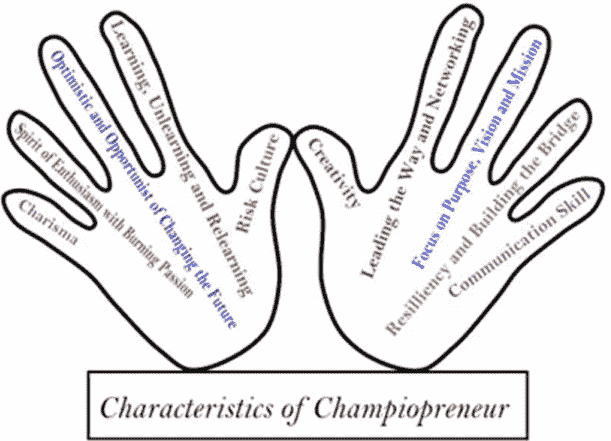

Ovharhe（2022, 2023）确定了企业家（冠军型企业家）的一些共同特征，包括：

- 1. **魅力：** 大多数企业家拥有如同天生天赋的潜力，这种潜力对大多数人来说很难实践或模仿。魅力是企业家拥有的特殊天赋、技能和能力，是无价之宝，使他们成为宝贵的人才资源（例如歌唱、舞蹈、洞察常人无法见到的事物）（Ovharhe, Woko & Ogolo, 2021）。此外，这些特质可归因于大卫王、参孙、钦韦·阿切贝、席琳·狄翁、J.P. 摩根、洛克菲勒、J.K. 罗琳和迈克尔·杰克逊等个人。在商业界，我们拥有尼古拉·特斯拉、埃隆·马斯克、比尔·盖茨、史蒂夫·乔布斯等魅力型领导者（Ovharhe, Okolo, Woko & Igbokwe, 2022）。

- 2. **燃烧激情的热情精神：** 强烈且持久的热情如同在个体内部点燃的火焰，是使他们在商业世界的动荡和竞争时期站稳脚跟、不气馁的因素。激情是每个企业家的驱动力和灵感，因为在商业环境的高风暴和动态时期，所需的关键工具正是热情精神。激情是每个企业家遵循的节奏，以维持、生存并成功于商业之中。治疗性激情是一种高度刺激和激励的概念，它使企业家在艰难时期能够承受每一场灾难和风险，尤其是在后 COVID-19 大流行时期的商业动荡中（Ovharhe, 2021, 2022a, 2023b）。激情是企业家实现其创业旅程的愿景、使命和融合的建筑师。激情是创新、创造力和毅力的枢纽融合（Duckworth; Biraglia & Kadile, in Ovharhe, 2023b）。激情是创业警觉的锚点，它使企业家燃烧着融合，这种融合为支撑不灭的愿景和使命提供燃料（Nordström, Sirén, Thorgren & Vincent; O'Keefe, Dweck & Walton in Ovharhe, 2023a）。

- 3. **改变未来的乐观主义和机会主义：** 企业家必须始终保持积极心态，无论风雨如何。企业家应始终驱散恐惧。他们应适应变化，保持灵活性，并与企业使命保持一致。唯有如此，才能改变未来。改变未来是指发明未见之事并使其可见，从而为整个社会带来额外利益的能力（Ratten, 2023）。

- 4. **学习、摒弃与重新学习：** 从宏观上看，在创业视野下，学习可以被视为获取、存储、保留、利用和传播知识的能力，这种学习会转化为行为改变，从而为预期产出提供投入（Ovharhe, Woko & Ogolo, 2022; Ratten, 2023）。创业学习源于教育、培训和发展计划。学习也可以是正式的、半正式的和非正式的。关键因素是改变和转型。所有学习都可能导致积极、零或负面的学习转型。但其益处在于带着积极结果意图进行的摒弃与重新学习。当企业家在创业旅程中学习新策略、新战术、新模式和实现梦想、愿景和使命的新方法时，就会发生重新学习。而摒弃则是完全抛弃因过时、缺乏联系和创意供应链的知识。

- 5. **风险文化：** 企业家有能力承担大量风险，其目的是从中获利。风险文化是一套与风险意识、警觉、回避、容忍和吸收相关的标准、一致性、规范、态度和行为。它塑造管理层和员工的日常决策，并影响他们所承担的风险。每个治疗性企业家的困境在于管理风险的能力（Ovharhe, 2022a）。这就是风险文化的必要性，它赋予企业家幽默感，使其能够发展风险警觉和风险意识（Chibiuke & Ovharhe, 2022）。此外，风险文化是一种带有谨慎态度的纪律性价值体系，用于在企业环境中处理和应对风险。风险文化使企业家具备监控风险偏好和风险容忍度的能力，以实现财富最大化和利润最大化（Ovharhe & Igbokwe, 2021）。风险


文化可以通过ABC方法轻松分析；风险态度、风险行为和风险能力（Ovharhe et al., 2021, 2022, 2023）。

- **6. 创造力：** 企业家被视为创业先驱眼中的创造者。企业家是极具创造力的问题解决者。创意生成、思考、创新、发明。创新技能是头脑风暴和发明具有经济价值且受稀缺性制约的可市场化和可销售商品与服务的能力。创造力是将尚未存在的事物制造出来，以造福人类的福祉与幸福。创造力是将特定输入（有形/无形）转化为期望输出，以实现有益需求的过程。在创业中，创造力必须具有经济价值。商品和服务具有经济价值这一事实意味着它们具有定价概念，并且可能受稀缺性制约。因此，在此语境下，商品和服务可以是产品创新、流程创新、市场创新、创意创新、技术创新和行政创新（Ovharhe et al., 2021; Manohar, Paul, Strong & Mittal, 2023）。然而，创造力和创新过程所需的技能是情感技能、认知技能和动作技能。因此，创新技能和创造力可以是创意、经验、有形和无形。

- **7. 引领方向与网络：** 创业领导力是实现伟大的非常有趣的特征。企业家是潜在领导者，能够使他们发起、发现并预见未来持有什么。企业家还以其在建立关系、合作伙伴关系和客户关系中的分支网络而闻名。这种引领趋势有助于企业家进行计划、组织、协调、激励、指导和控制。企业家引领方向创造了节奏设定的导向。所有团队和内部创业者都能够深入愿景、使命、核心价值和主张。旅程将容易定义并明确列出要实现的目标（Lim, 2023）。企业家需要建立网络来构建坚实的基础关系以追求他们的业务。网络在筹资和众筹中是必不可少的，尤其是在社会创业中（Mandrinos & Lim, 2023）。

- **8. 关注宗旨、愿景与使命：** 企业家应始终提出能够提升专注度的问题。第一个问题是“我为什么在这里”或“我在这里做什么”？这将回答宗旨的问题。其次；“未来为我持有什么”或“我现在从这里看到未来是什么”？这回答了愿景的一致性。第三；“我实现创业旅程的行动路线是什么”或“我正在走什么路径来实现我的创业梦想”？在关注宗旨、愿景和使命时，不允许有任何分心。任何分心都可能导致企业使命失败并被中止。这将导致边缘处的愿景受损和宗旨贫乏。恰当的专注使企业家能够发展可信的风险文化、创造力和创新技能，学习如何驾驶在正确的行动路径上并瞄准最佳目标（Ratten, 2023）。

- **9. 韧性与建造桥梁：** 企业家在商业流中应有“永远向前，绝不后退”的口号。在创业旅程中，让现金流在短期和长期内循环，是每个企业家的梦想。企业家的功能是在每个商业机会中构建一致的财富创造和价值创造流。但有时企业主应始终不惜一切代价保护和保障他们的桥梁（Blessley & Mudambi, 2022）。破损的桥梁需要大量的维修和维护。像竞争优势这样的韧性策略应成为每个企业家的关切，因为他们希望在商业中持续和生存。制定战斗策略是好的，但企业家不应忽视发展韧性和建造桥梁。为客户、委托人、供应商、政府、法律框架、社区、机构和广大利益相关者构建坚固的桥梁是必不可少的。此外，这加强并建立了关系、合作伙伴关系和客户关系的战略纽带。

- **10. 沟通技巧：** 与所有利益相关者的联络是初创企业的重要商业策略。无论是向上沟通（从底到顶）、向下沟通（从顶到底）还是对角沟通（横断面），企业家都必须学习如何传递信息并获取反馈。沟通也可以是一种必须维持的外部美德，以实现业务的自由流动和更好的理解。沟通是将所有实体绑定为一体的力量。

将宗旨、愿景和使命传达给组织人力资源是商业功能中成功和一致性的可信度。尽管如此，对客户和顾客的有效高效沟通揭示了企业在动荡时代的长寿。因此，有效高效的沟通是企业的竞争优势。企业家需要学习如何生成信息以进行有效沟通。信息应来自可信来源，并且可靠、精确、准确、真实、可信、有效、可验证、全面且有意义。如果企业家在信息美德上准确且口齿伶俐，他们将保持可信的沟通技巧。商业世界需要好的沟通者来与员工、管理层、社区、外部环境（政府、机构和任务）、供应商、客户关系以及整个供应链管理系统进行接口（Yadav et al., 2023）。

### 3. 商业智能概念

商业智能的根本目标是实现精确、准确和自信的决策。作者们认为，商业智能与竞争情报和决策支持系统相关联，因为大量变得更加可获取的准确数据使商业智能能够同步（Huang, Savita & Zhong-jie, 2022）。

商业智能结合分析、数据挖掘、数据可视化、数据工具、数据基础设施和最佳实践，帮助管理层和企业家在短期和长期做出更多数据驱动的决策（Horn, 2023）。商业智能也是一种软件，它提供业务数据，并以报告、仪表盘、图表、曲线图、指标和框架等用户友好的视图呈现。然而，通过将商业智能与竞争情报和决策支持系统相结合，可以在创业中很好地分析商业智能（Zhou, San, Liu & Kozyrkov, 2023）。

Holori, Ahmadi, Khanmohammadi, Ranjbar 和 Kordlouie (2023) 断言，商业智能是一种基本工具，可协助管理层评估投资回报率、股东权益回报率、资产回报率、雇用资本回报率、净现值、成本效益分析和盈亏平衡分析等商业信息。通过使用结构方程模型，商业智能可以产生巨大的产出，从而提升中小企业、大型企业、跨国公司和集团的企业绩效。企业家的决策应在商业智能的干预下得到验证并充满乐观。

模型（图2）在讨论中阐述并图示了商业智能和创新对创业与管理解释性范式的调节作用。

#### 3.1. 竞争情报

竞争情报可以用“知己知彼”一词进行图示（Baskin, 2023）。竞争情报不仅用于盈利性商业，也被军队（用于国防情报）、医护人员（用于诊断、临床发现和结果分析及信息存储）、机构（用于跟踪基准增长和基于活动趋势的比较分析）采用（Cekuls, 2022）。这就是其本质，它也被视为企业情报，因为它有助于生成数据、环境扫描、对事实的科学系统调查以及决策速度（Taranu, 2023; Cloutier, 2013）。


#### 图2. 商业智能与创新在创业和管理中的调节作用：基于冠军创业家方法

#### 创业
- 激情
- 技能
- 风险文化
- 学习
- 创造力
- 发明
- 创新

#### 商业智能
- 决策支持系统 - 处理 - 准确 - 信息 - 报告 - 收集
- 竞争情报 - 战略情报 - 战术情报 - 运营情报

#### 管理
- 规划
- 协调
- 组织
- 指导
- 人员配备
- 激励
- 控制

#### 创新
- 单一创新：产品、流程、市场、服务、技术、行政
- 复合创新：可持续、系统、变革性、职业
- 税后利润 (PAT)、投资回报率 (ROI)、资产回报率 (ROA)、权益回报率 (ROE)、雇用资本回报率 (ROCE)、利息回报率 (ROI) - 客户满意度、客户反馈、顾客量、信任、客户关系、市场份额、销售配额、销售区域、业务扩展、市场/产品开发、多元化

在创业中，竞争情报对于收集和分析商业风险、基于成本的竞争、竞争性定价以及在创意、技术、市场、产品、流程、服务和行政方面的创新信息至关重要 (Dewar, Keller & Malhotra, 2022)。正因如此，企业家和管理层使用竞争情报与数字模型和框架相结合，以实现可持续性、生存和成功，并在企业市场结构中获得领先优势 (Madureira, Popovic & Castelli, 2023)。

各层级管理层为实现有效性和效率而运用商业，因为商业环境鲁莽、动态、竞争激烈且动荡不安 (Hassani & Mosconi, 2022)。由于前方存在诸多不确定性（例如 Covid-19），没有人能预测商业实体的未来。但商业智能的出现协助管理层利用创业职能（风险、文化、精益创业），在速度、客户反馈和信任的持续改进方面取得市场领导地位。

在这方面，竞争情报是企业在数据扫描、收集、编码、清洗和分析之前采用的基于优势的方法，旨在利用关于竞争平等、客户和商业环境的宝贵信息，帮助企业通过快速战略实现获得竞争优势，以促进业务增长和发展 (Maluleke & Chummun, 2023)。

以市场领导者或冠军身份在各方面获胜是竞争情报的底线。竞争情报推动企业在销售区域、销售配额、客户关系管理、市场份额、成本效益以及定价-促销政策方面成为领导者和冠军。这是竞争情报的创业组合。

营销组合或创业组合已扩展为 7P，以适应竞争情报的需求。企业家和管理董事会需要关注该模型，该模型应被采纳为企业仪表盘和指标的框架。该模型假设营销组合 7P 的服务通过其要素（产品/教育服务、价格、促销、地点、人员、实证和流程）作为预测变量，对通过其要素实现竞争优势具有正向影响。这种认知对于维持创业进入并减轻创业退出具有可信度 (Ovharhe & Abada, 2023a,b)。

##### 3.1.1. 竞争情报的要素

在创业和管理职能中“知己知彼”要求商业界高度重视并关注严肃问题，因为市场环境中存在鲁莽、动荡、动态性和竞争性。竞争情报需要某些基础工具来设计仪表盘、指标和框架，以缓解商业环境中的任何负面因素。

采用组织创业范式，Kühn (2006) 和 Handfield 等人 (2023) 支持以下竞争情报要素；即：

- **行业情报**：它涉及由特定创业领域的专家（如农业、研发、建筑、ICT、人工智能、房地产管理、制造、销售与分销、物流和电信）构建的专业数据收集、处理和分析 (Rahchamani & All, 2019)。

- **市场情报**：这是关于产品组合或市场营销组合（产品、价格、促销和地点）的监控收集，用于确定市场份额、客户关系管理、市场分析和市场结构 (Jena, 2019)。

- **创新情报**：创新性是商业智能保障和卓越的核心。竞争情报和商业智能的关键概念必须与产品创新、行政创新、流程创新和技术创新相接口，作为触发企业增长与发展变革的概念。这种方法适用于处理寄售库存系统的企业 (Ahunanya, Ovharhe, Emenike & Otto, 2022a,b; Ovharhe, Ahunanya & Woko, 2022)。

- **销售情报**：企业销售趋势预测是一项重要的数据分析。目前，大数据、机器学习、数据虚拟化和数据科学可以协助计算销售配额、销售区域和销售指标，以实现判断的可信度和认证。数据仪表板显示商业失败与成功的竞争基准。(Rahchamani & All, 2019)。

- **采购和供应链情报**：这是关于通过前向和后向整合满足客户。企业资源计划和供应链中的采购对任何企业的可持续性、生存和成功都非常相关 (Effa, Ovharhe, Ezirim & Igwe, 2023a,b; Handfield, 2023)。

- **ESG 情报**：这是一种情报工具，是一个行业中立的商业智能平台，用于帮助各个行业的公司监控和报告其环境、社会和治理绩效。它可能以外联网形式存在。这是战略情报的更多应用，用于分析环境数据生成 (Maune, 2022)。

一般来说，竞争情报侧重于来自各种系统来源（如新闻媒体、客户反馈、竞争平等分析、特定商业领域的专业专家、贸易展览会和会议、研讨会、政府记录、公开文件、指数和企业档案）的运营信息和战术分析 (Artur, 2020)。此外，竞争情报侧重于收集、处理和分析关于竞争对手及客户反馈的敏感数据，以在企业中获得优势或领先优势 (Zighed et al., 2023)。竞争情报是一个过程，企业在此过程中扫描、生成、收集和处理关于竞争对手及竞争性商业环境的信息，理想情况下将其用于政策制定、决策和计划过程，其企业目标是调整活动以提高绩效 (Cloutier, 2013)。

##### 3.1.2. 竞争情报的层级

业务增长面临的挑战因多种因素而异，这些因素需要竞争情报干预。某些因素包括环境问题、业务和服务类型、业务或服务季节、资本形成和人力资源限制。无论是中小企业还是大型企业，都有其自身独特的挑战。此外，业务中的某些挑战（如紧急情况、风险；安全、大流行病、汇率、通胀率和利率等）都是关键问题和瓶颈，对业务增长产生影响。但某些挑战可以通过波士顿矩阵、安索夫矩阵、SWOT 分析、创业画像、客户画像和管理网格来缓解 (Ovharhe, 2024a,b)。

Ovharhe 和 Igbokwe (2021) 识别出企业面临的某些陷阱和瓶颈作为挑战。这些可以是运营挑战、战术挑战和战略挑战；它们是与工作活动同步进行的日常活动。根据工程、生产、审计、会计、电信和管理等特定领域，这些挑战非常繁多。然而，在创业中，以下列出的项目可以实现。

- **a. 运营情报**

这些是在一年内发生的短期挑战，涉及日常职能。它们是与前线或线性作业打交道时遇到的问题，涉及为企业活动执行的内部创业者。这些挑战包括库存控制、维修与维护、津贴支付、客户满意度、市场-成本定价、产品组合或公司组合分析、资本形成和筹资、雇佣与解雇、金融科技初创企业、加密货币、区块链、创造力和可持续创新等 (Corsaro & D'Amico, 2022)。为了在商业企业中启动智能行动，短期情报是实现使命目标和宗旨的基本必要条件。

在不断演变的导航人类智能、人工智能和商业智能的格局中，运营情报处于创新与创造力的前沿，商业世界中商业机会众多。随着商业企业在由数据驱动决策支持和增强型运营情报塑造的复杂情报中迈向未来前景，冠军创业家梦想的追求


和任务似乎有可能完成法定的企业目标和指标（Davinsi, 2024）。

让所有企业知悉，运营情报（又称反情报）是组织游击战作战工具的前沿，旨在缓解艰难竞争态势中的问题，尤其是在大流行、灾难、动荡以及货币和财政政策的不确定风险（高通胀率、汇率、利率和税收）期间（Business Research Insight, 2024）。有趣的是，Business Research Insight（2024）认为，疫情前后时代将在运营情报的应用下体验到组织健康的商业机会。商业平台、市场规模、份额和增长对后疫情时代2024-2031年持乐观预测，将呈现正向增长，因为运营情报的应用使企业能够克服前疫情时代的冲击和创伤。

###### b. 战术情报

这些是中间层或职能层面的问题，涉及部门层面的挑战：敏捷因素（新技术和人工智能的变化）、现金流入和流出的间歇性分析。新创意生成、市场开发、预测、产品开发、复杂设备、机械和设备的租赁与采购、销售配额、新原型推出、试销、概念测试、市场份额扩大、销售区域、服务质量交付等等（Lim, 2023）。

战术情报是竞争态势中决策支持系统所需的创造性和创新性情报的中间领域和核心，它统筹企业的可持续性、生存和成功。Britannica（2024）指出，战术情报主要回应企业需要执行的计划，通过采取最适当的行动，在竞争态势中实现积极的结果。

战术情报是关于企业部门或职能层面（如生产、电信、采购与供应、物流、营销和财务）为完成使命和企业目标而针对特定目标的具体信息。战术情报属于中期或间歇性周期，为企业在所有参数上提供可信的知识存储、知识记忆和知识传播。它是企业决策支持系统的基础（Wakuthii, 2024）。

战术情报侧重于支持企业职能层面在竞争激烈的市场运营。战术情报与企业的单元或群组层面联络，以推动行动并取得收入产生、顾客光顾频率、资产回报率、投资回报率和权益回报率、客户满意度与反馈（ScienceDirect, 2024）。这就是为何大多数集团、大型公司和跨国企业将战术情报视为秘密和神秘情报的原因，因为其在秘密生成超越正式推理极限的智慧方面发挥作用，使不确定的估计趋向确定性，进而在市场竞争中产生政治、商业、经济、战略和运营优势。（STRATAGEM, 2024）。

###### c. 战略情报

这些是解决围绕企业的长期瓶颈和陷阱的补救措施。它由企业最高领导职能作为最高行政命令加以支撑。挑战可能包括兼并与收购、重组、收购、集团多元化、垂直一体化、水平一体化、前向一体化、后向一体化、企业资源计划、ESG情报、战略情报、供应链管理系统、基准测试、养老金与遣散费、新行业建设、特许经营、特许权、寄售库存系统以及自动化/机器人/人工智能（Alqahtani & Uslay, 2023）。

Britannica（2024）提出，战略情报是长期信息和决策，用于在全球网络接口处制定政策和计划。战略情报是企业未来前景的展望，它验证了商业卓越、气候变化、人工智能、机器学习、数据虚拟化、大数据分析、数据科学、领导力和冠军创业精神（世界经济论坛，2024，Ovhare & Woko，2024a）。企业家更关注将战略情报展望整合到创新技能、创造力、客户反馈、新商业机会、增长和发展中（新兴风险国际，2024）。

#### 3.2 决策支持系统

企业家如果没有概念化的决策来实现其企业目标，就无法有效高效地运作。企业依赖其长期和短期决策来规范受托责任流向和面向任务的法定框架（Kozyrkov, 2023）。在管理表述中，短期决策也可视为运营或可编程决策，而长期决策可视为战略或不可编程决策。可编程决策是由运营（低层）管理（如主管和工头）执行的职能，企业家可在短期将其作为重复和常规的商品销售活动，通过明确的机械程序来解决，例如应用严格的规则和健全的判断，在特定可用时间内找到最佳解决方案和可能的补救措施（O’Callaghan, 2023）。企业家在初创运营中需要的大多数管理决策在企业中都是可编程的，因为其对日常运营活动的影响。相比之下，不可编程决策涉及管理层例外或非经常性的职能，通常是在战略条件下做出，涉及如此多的歧义，以至于没有具体的程序或程序可用。这些由战略（高层）管理执行，如首席执行官（CEO）、总经理（GM）、总干事（DG）、首席医疗主任[CMD（医院）]、医学咨询委员会主席[CMAC（医院）]等（Dewar et al., 2022）。因此，必须做出不可编程决策的管理者依赖艰难的判断、认知创新性、头脑风暴、创造力和战略直觉（Reeves & Whitaker, 2022）。

决策是启动想法、设计框架并分析基本替代方案及可能补救措施的操作性和战略性过程，以便从选择性结果中做出最佳决策。大多数决策是对需要高水平情报的问题做出的反应。这些可能需要销售情报、市场情报和生产情报（Ovharhe & Odegeli, 2024）。

Zhou等人（2023）提出混沌过程，帮助企业家和管理层理解决策支持系统的概念，该系统由商业智能应用程序和复杂创新加以支撑。决策支持系统是一种计算机化程序，用于支持企业中的决策、无偏见的健全判断和分析性行动方案。

决策支持系统（DSS）是一种同步信息系统，支持企业在商品销售活动中的决策职能。DSS服务于企业的管理、运营和规划层级，帮助企业家和管理层就问题解决的补救措施进行决策，这些问题可能迅速变化且不易事先明确（即结构化、非结构化和半结构化决策问题）。决策支持系统可以是完全计算机化的、人工驱动的，或两者的结合（Kozyrkov, 2023）。

虽然学术界将DSS视为支持决策过程的工具，但DSS用户将其用作仪表板工具上的决策智能，以促进企业流程（O’Callaghan, 2023）。DSS包括任何可能增强决策的系统性现象，有些DSS包含决策软件组件。Sprague（1980）对恰当称为DSS的定义如下：


- 1. DSS倾向于针对高层管理人员通常面临的结构不清晰、定义不明确的问题；
- 2. DSS试图将模型或分析技术的使用与传统的数据访问和检索功能相结合；
- 3. DSS特别关注使其能够以交互模式供非计算机专业人员使用的功能；以及
- 4. DSS强调灵活性和适应性，以适应企业环境和用户决策方式的变化。

### 4. 创新在创业与管理中的灵活性

创业领域是创新的基础。企业家是推动创新在商业世界中深入驱动竞争力的舵手。每家公司的创新管理团队都依赖于创业编排，以推动和拉动市场力量竞争平衡的扳机。创业困境中的创新可以分为两种被视为简单创新和复杂创新的工具。简单创新也可以称为“内容创新”。因此，复杂创新被视为“情境创新”。两者都是推动和拉动竞争市场环境中创新结果的工具性支点，因为企业的商业智慧体现在其创新的能力、能力和能力上（Reeves & Whitaker, 2022）

简单创新也可以称为“内容创新”，它是独特概念（如产品创新、流程创新、服务创新、行政创新、市场创新和技术创新）的组件工具性字符串。而复杂创新也可以视为“情境创新”，包含数字创新、可持续创新和变革性创新。这些工具性组件旨在增强简单创新或内容创新。它被应用于特定任务，作为混合或集合创业者。例如，企业家可以使用数字创新来推动数据科学、分析、处理、报告和反馈循环，这与数字创业相关联。不过，随着商业竞争的兴起，数字创业正在飞速向人工智能、金融科技初创企业、加密货币和区块链的大规模全面采用迈进（Anderbjork & Martell, 2021）。与此同时，可持续创新拥抱关于人、地球和利润的三重P概念，这与绿色创业相一致。基本上，可持续创新追求联合国可持续发展目标（SDG）的十七项重点关注。此外，企业家始终在为成本领先、价格领先和市场份额领先而努力；事实是创新带来了不同。因此，创新的核心在于内容创新和情境创新，它们从运营和战略上推动创业者在市场生存。

#### 4.1. 创新

创业涉及创造、理念生成、将未来发明为现在以及为人类创造有形和无形有益资源的艺术与科学。Oyìnlola et al.（2023）强烈主张，商业流程只能通过创新来实现。Ovharhe（2023a,b）认为，创新是企业和有益想法的实际实施，其结果是引入新的有形和无形商品或服务，或对现有商品或服务进行改进，这些商品或服务具有价值和珍宝。他还将创新分为简单创新和复杂创新。例如，简单创新包括产品、流程、服务、行政、市场、数字、社会等更多。而复杂创新包括变革、系统性、可持续以及其他混合和多维创新形式。创新是创业的新生命血流，意味着如果没有创新，就不会有企业家存在的概念。创业的激情、愿景、使命和融合推动力都以创新为支点（Ovharhe, 2023; Kanyi, Wanjau & Kyalo, 2023）。

La Verne（2023）在Drucker的支持下指出，创新是任何工业转型和系统性进程进步的推动力。这是开发更好做事方式的过程，从实施新的有形和无形想法到改进现有想法。创新可以由多种因素激发，包括新技术、不断变化的客户需求以及商业世界、机构和社会大范围内的新兴市场趋势。不过，创业是将创新想法转化为可持续且成功的商业企业的过程。它涉及识别市场需求，开发满足需求的产品、流程、技术、结构和服务，然后创建一种允许产品或服务销售和扩展的商业模式。企业家是承担创办新企业的风险和挑战的个人，也是将新产品和服务推向市场的人。

Jain（2023）表示，创新是将新想法、方法、产品、服务或解决方案转化为具有显著积极影响和价值的宝贵存在的过程。它涉及将创意概念转化为提高效率和效果或满足未满足需求的具体成果。

创新不仅限于技术进步，还包括解决问题、流程、组织实践或商业模式创新的新方法。从本质上讲，创新涉及挑战现状、跳出常规思维，并采取经过计算的风险来推动进步并实现突破性成果（Ntandoyenkosi, 2023）。

创新由好奇心、创造力和改进愿望等多种因素共同驱动。它需要一种拥抱变革、欢迎构思并鼓励实验的思维模式。创新可以在各种环境中发生，例如商业、科学、技术、社会部门或公共服务。它可以带来经济增长、社会进步、生活质量提高和可持续发展（Kanyi, Wanjau & Kyalo, 2023）。

Jain（2023）后来指出，创新可以采取多种形式，不同类型的创新如下所述。

- 产品创新：这涉及开发新产品或改进产品或服务。它可以包括功能、特性、设计、性能或包装方面的创新。它旨在通过满足客户需求、解决问题或引入新颖且理想的产品来为客户创造价值。

- 流程创新：这是提高组织内部流程的效率、效果或质量。它涉及重新思考和重新设计工作流程、技术和系统，以简化运营、降低成本、提高生产力或改善产品或服务的交付。流程创新通常会带来运营效率提高和竞争优势。

- 服务创新：这涉及开发新产品或改进服务、交付方式或客户体验。它专注于提升客户从服务互动中获得的价值和满意度。服务创新可以包括服务设计、定制、可访问性、便利性或个人化方面的创新。它旨在满足不断变化的客户期望并创造竞争优势。

- 可持续创新：这涉及开发和实施对环境、社会和经济产生积极影响的新产品、服务、技术或商业模式。它涉及寻找创造性和高效的解决方案，以应对气候变化、资源枯竭、污染、不平等和贫困等紧迫挑战。

- 社会创新：这涉及开发和实施新颖解决方案，以应对社会、文化、经济或环境挑战。它涉及创造和采用新想法、新产品、新服务或新方法，从而产生积极的社会影响和可持续变革。


技术创新：这是指创造、采用和利用新技术或改进技术，以推动各个领域的进步并改善结果。它涵盖了广泛技术领域的进步，包括但不限于信息技术、生物技术、可再生能源、纳米技术、机器人技术、材料科学和电信。

#### 4.2. 创造力

每个企业家都需要工具来实现她的冠军目标，以保持企业处于商业顶端的可持续性。这正是长期推动冠军企业家精神的动力。Peek（2024）强调，创造力和创新是企业家在商业情报、决策支持系统和竞争情报中不断提及的两个关键词。冠军企业家需要创造力和创新来生存并应对商业中的鲁莽、竞争、动荡和变化（Ovharhe & Saturday, 2024）。

Peek（2024）认为，创造力是以新方式、新模式、新风格思考并应用新产生的想法来解决问题的直觉。《超越思维：创新领导者如何推动卓越成果》（Wiley, 2013）的作者Shawn Hunter将创造力视为构思独特或不同寻常事物的能力、潜力和能力或行为（Ovharhe and Chibiuke, 2024）。它是商业竞争对等中一项关键、战术和逻辑技能，使利益相关者能够适应、对标并创造可能比行之有效的方法更合适的独特方法。

Peek（2024）梳理了莱巴嫩贝鲁特美国大学Arne Dietrich进行的一项研究，该研究将创造力分为四种类型：深思熟虑且情感型、深思熟虑且认知型、自发且情感型、自发且认知型。无论从事哪个专业领域，冠军企业家精神都需要这四种创造力才能有效运作。深思熟虑和认知型创造力使用专注注意力，并依赖大脑中存储的信息之间形成的联系，依赖前额叶皮层；而情感型和自发型创造力源自杏仁核，往往更具本能。擅长从创造力中获取洞察的人能够跳出思维定式思考，并在工作中应用新方法（Stanford Center For Professional Development, 2024）。Peek（2024）总结，创造力是新想法、跳出思维定式思考和头脑风暴的自发发展。创造力是创新的必要前提，但两者并不相同。

##### 4.2.1. 创造力与创新

要提升组织内的创造力，可以考虑给予员工在工作时间内的灵活性，以尝试新事物或探索不同的思路。创建一种企业文化，鼓励和奖励跳出思维定式的思考，从而激发最具创造力的思考者做出最佳工作（Stanford Center For Professional Development, 2024）。

创新是将事物付诸现实的行动，尽管面临挑战和阻力，而不仅仅是沉思。创新需要创造性思维、规划以及新想法的实施（Mark, 2024）。

创新是创造力的实际应用，将产生的想法转化为有形和无形的可市场化商品，在此过程中，新想法的火花被转化、打磨并制造成可能的补救措施、主动解决方案或流程。Hunter在Peek（2024）中提出自己的观点：创新是对对业务具有已实现价值的新事物的实施或创造（Mark, 2024）。

创新并非专属于人类，也适用于其他物种。例如，鸟儿筑巢，兔子、老鼠、蚂蚁挖洞以求生存。创新被归功于运用创意解决问题。借助企业的商业情报，创新将创意转化为品牌产品和服务，以使客户在光顾中受益。一项创新会在产品、服务或行业中带来可证明的、常常是颠覆性的品牌差异化。它是一种根本性的、有形的转变，脱离了常规。

冠军企业家利用创造力和创新将组织从停滞不前转变为竞争市场的领先地位，从而推动企业实现使命目标（Ovharhe & Woko, 2024a）。冠军企业家应始终牢记，创造力先于创新。创造力是商业企业的第一阶段，用以确保某事是可能的，但需要采取行动才能将这种创造力转化为现实。Mark（2024）通过表述来细化创造力的概念：如果企业家进行多方面的新想法头脑风暴，那么企业家就展示了创造力，但直到将想法实施为能够使客户和企业受益的现实之前，他不能被称为冠军企业家。此外，冠军企业家不是为了销售而创造东西，而是创造消费者/客户会被驱动去购买的东西。

Hunter在Peek（2024）中指出，许多商业领袖和普通企业家强调按需生成创造力，而不是建立能够实现持续创造性思维的条件，这最终可能导致创新发展。这就是冠军企业家与创业领导者之间可信的区别。冠军企业家试图从开头就看到结局，不仅仅基于客户或顾客的冲动，而是基于地球、人类和利润的总体利益。

企业家的商业情报被更好地同步，以协调适合客户、企业、社会和市场结构的功能。

#### 4.3. 创业机会

在商业机会框架的思维模式中，重要的是要注意，企业家不应该生产他/她能制造的东西，或生产他/她能销售的东西，而应该生产客户能购买的东西。这正是成功企业家成为冠军的区别所在。这不是关于创新和创造力，而是关于客户需求、客户关注和反馈（Dieffenbacher, 2023）。

Ovharhe and Woko（2024）认为，创业是扫描商业机会、识别商业机会、追逐商业机会和抢占商业机会。它是关于在商业环境中通过利用未被触及、未被满足的需求、重新定位和未被利用的商业方面来专注和追求商业机会。

商业机会可以定义为搜索和追求未被满足的需求，并以新风格和模式将产品定位到服务不足或服务过度的市场，以使客户满意并获得积极反馈。Eckhardt and Shane（2003）阐述了商业机会的四个要素。这四个要素是：

- 特定或明确的需求
- 实现需求的手段、冒险精神和风险文化
- 应用手段以满足需求的方法、风格和模式；以及
- 分析成本效益以回报企业的方法、风格和模式。

如果上述任何要素在短期或长期缺失，就需要冠军企业家的创造力和创新来弥补差距。这一差距可以作为企业领先优势的竞争优势，因为这正是冠军企业家精神所具备的能力（Shane & Venkataraman, 2000）。

哈佛商学院教授克莱顿·克里斯滕森（Clayton Christensen）为有志创业者讲授商业机会的深入事实和理论框架，他提议初创企业应从一个新商业理念开始，满足市场需求、解决客户痛点或改进现有产品。由克里斯滕森提出的cote（2022）识别了三种类型的商业机会，用于探寻创业的可持续性、生存和成功。如下详细讨论；即：


##### 1. 待完成的工作

创新并创造符合客户满意度的未满足需求，要求企业家每天都要认真履行这一工作，直至出现原型，从而推动他们获得客户/消费者的正面反馈，使企业受益。

##### 2. 低端市场机会

此时，企业家通过采用渗透定价策略，在低端细分市场和低价位下避免大量竞争。在这里，他可以凭借其产品和服务获得市场，这将使她建立势头并延伸触角，从而扩展到更广阔的市场，获得更高利润，以与竞争同质化中领先的企业抗衡。此层级的企业家应采用精益创业学说（Ovharhe, 2023）。

##### 3. 新市场机会

当企业家在现有市场中创建新细分市场时，就会出现这种情况。企业家利用威胁竞争对手现有产品和服务的弱点。企业家以客户从未见过的新风格和模式切入，这将激发她将市场纳入掌控和推进的网络。在采用足够商业智能后，企业家应创造并创新低价，而非快速撤脂定价，以捕获并充分利用新细分市场中的商业机会。

在竞争同质化激烈的市场中，需要结合商业智能采取明智行动。仅凭创造力、创新技能和商业潜力来应对动荡时代，永远是不够的；现代竞争情报和决策支持系统要求在追逐商业机会的方式上达成一致。由于瘟疫、动荡、鲁莽以及为争夺冠军的竞争力等消极因素影响企业，追逐商业机会需要采取强硬行动（Ovharhe & Woko, 2024b）。

创业不仅仅关乎创新、创造力和发明，企业家需要更进一步，成为行业中的冠军企业家。有人制造电脑，而另有人将电脑作为谋生技能来学习；有人制造车辆，而另有人将其作为生计来源；有人制造乐器，而另有人用它来奏响旋律。在这整个供应链系统中，企业家可以作为冠军脱颖而出，因为有创造力和创新的商业机会，让人们成为冠军企业家（Thompson, 2009）。在实现商业机会方面，冠军企业家就是“创造者”和“创新者”。

### 5. 商业智能与创新对创业和管理的调节作用

在实际实施中，商业智能与竞争情报和决策支持系统同义。竞争情报结构包括战略情报、战术情报和运营情报。战略情报关注企业的长期活动，例如并购、重组、收购、多元化、新产品开发、推出新产品、自制或外购决策等等。战略决策由企业高层管理层传达，如总经理、副总裁、总干事等。同样，战术情报以企业中层、职能和中级管理层为中心。这立足于企业管理的中期公司事务，涉及销售收入创造、生产预测、市场区域、市场配额、供应链管理系统和电信选择决策（Ahunanya et al., 2022a,b），这由会计管理层、生产经理、市场营销经理和销售经理传达。就持续性而言，运营情报是企业的日常活动和运营。这是涉及每月薪资支付、公用事业采购、维修、保养、光顾频率、光顾时间和光顾数量、盈利能力、投资回报率、盈亏平衡分析等更多内容的短期运营。此外，运营情报由企业的工头、主管和低层管理人员构成。

管理层的所有层级都需要商业智能，以实现短期目标和长期目标，因为创新发生在所有层面。商业智能是企业家的额外竞争优势。本质上，表达创业与管理的融合可以被视为冠军企业家（CHAMPIOPRENEUR）。

#### 5.1. 冠军企业家精神概念

世界在各行各业和各类组织的所有层面都由冠军主导，无论是体育、军事、学术、娱乐、电影、新闻、学术、技术、工程、音乐、制造、物流、在线业务、加密货币等等。商业世界中冠军的境况被称为冠军企业家。冠军企业家在其企业商品化职能中的绩效运营系统被视为冠军企业家精神。冠军企业家精神一词融合了各自领域的商业智能、创新技能和创造力。商业智能的应用取决于企业识别并抓取可用商业机会的能力（Ovharhe & Woko, 2024a）。当商业机会被识别、追求和利用时，需要应用竞争情报和决策支持系统来验证该过程，以实现最佳目标。每个企业实现目标的成功，在于创业家采用被称为“冠军企业家精神”的冠军精神。

冠军企业家精神一词由前缀（champion）和后缀（entrepreneur）组成。简单的代数表达式：

```
Champiopreneur= Champion + Entrepreneur
Let, Champion=Champio (prefix from Medieval Latin)
Where, Entrepreneur= Preneur (suffix from Middle Age French)
Thus, Champio-preneur= Champio + Preneur
Therefore= Champio-preneur= Champiopreneur (synchronization of compound word)
However, Champiopreneurship= Championship + Entrepreneurship
Hence, Champiopreneurship= Ship (Champio + Preneur)
```

不过，基于对应词汇、替代用法和应用；

此外，Champiopreneur ≡ Champiopreneurship

“Champion”一词源自拉丁语“campionem”，意为角斗士、战士。它也意味着为争取机会而战斗或抢夺。冠军不仅仅是战斗，必须有可以利用的机会（Vocabulary.com, 2024）。为了实现商业机会，冠军在采取行动前应具备竞争优势的洞察力。当创业型冠军敏锐地察觉到机会时，这表明需要抢夺者、追逐者和实现者，这为企业家成为冠军企业家创造了空间。冠军企业家配备了创新技能和创造力，通过应用商业智能（竞争情报和决策支持系统）来抓取商业机会，以在商业世界中实现长期和短期目标。这表明冠军企业家具备击败对手并在市场上获胜的能力、容量和能力（Collin, 2024）。

Etymonline（2024）进一步从法语、法兰克语、德语、希伯来语和希腊语解释了冠军一词的含义，意为战斗者、作战士兵、战斗和开展活动。这意味着个人要想生存、存活并作为冠军取得成功，就应在战斗中拥有创新技能和创造力以征服战场。冠军必须学会如何以及何时使用战略情报、战术情报、运营情报和决策系统在市场上开展活动，因为竞争对手不会休息。商业中的情报模式应战略化，以利用迅速开展活动（促销）模式抓取市场上的机会。应内化沟通信号，以捕捉并维持商业环境中的机会。

冠军企业家应当知道，他/她手持哨子吹响开展活动的信号，将授权采取行动，因为在商业战斗中，时机和环境非常重要。冠军企业家是拥有智力、能力、创新技能和创造力，以在竞赛、竞争或战斗中赢得丰厚奖金的个人（Merriam-Webster, 2024）。

冠军企业家应了解十个指标，这些指标将指导他们在市场上的竞赛、竞争和战斗；即：

- 1. 产品和服务的推出应以客户为中心并注重反馈，
- 2. 进入和退出点应清晰表达且全面
- 3. 定位（即市场、产品、物流等）必须设计良好
- 4. 产品或服务的原型应精心培育
- 5. 经验实践的系统化应具有战术性和战略性
- 6. 创业过程的严肃性必须与风险文化相结合
- 7. 测试营销和产品测试必须快速且令人满意
- 8. 团队精神应结合对可能反馈的能力而凝聚
- 9. 错误纠正模型必须配备即时行动的闭环
- 10. 内在和外在奖励必须到位，以作为改变游戏规则的策略

要使冠军企业家取得成功，应遵循上述内容。冠军企业家的动力可能与团队中的其他资源人员不相符。因此，为了在商品化职能中实现可持续冠军地位，这十项指标应保持势头。总而言之，大英百科全书（2024）强调，冠军是代表君主、王室和贵族的对应术语。这可以轻易地说，冠军企业家是市场之王。他们拥有商业世界中最伟大的王权和领导力特质。

#### 5.2. 冠军企业家精神的关联

每个冠军都可以成为王冠、奖杯或权杖的获得者，但仍然贫穷。冠军企业家精神的本质是学习如何凭借奖杯获取财富，


企业形象和美誉度。冠军企业家被培养以从其追求或胜利中获取财富。

以冠军精神，创业是通过转型智能为人类带来有意义的可持续增长和利益，而扫描机会、识别机会、追逐机会和抓取机会的过程。这关乎发现、追求和开发机会，使某人成为具有进取心的创业者，进而成为冠军企业家（Ovharhe & Woko, 2024b）。

冠军创业关乎‘未来的愿景家’、‘开启不可能任务’并带有‘动态竞争精神’。在商业世界中不赢得任何战斗，你就不能成为冠军。冠军企业家是赢得战斗的领导者，因为企业冒险、多事之秋、动态且充满竞争。冠军企业家是商业领袖的冠军。他们是拥有领先竞争优势而非尖端风险的商业对手、挑战者和追随者的王者。冠军企业家具有强大的韧性精神。每个行业领域都需要有人征服并成为市场领导者，才能成为冠军。创造、创新和发明有形及无形可持续商品的未来并在市场中定位，是冠军创业者的特质。冠军创业者的意识是成为第一，或超越以成为第一，并稳居顶级商业机遇之巅（Ovharhe & Woko, 2024a）。

冠军企业家遍布全球各行各业；商业市场、音乐、电影、体育、餐饮、学术、技术、ICT、银行与金融、政治、健康、医疗、工程、戏剧艺术、美术以及任何拥有游戏规则改变者的行业。例如，Koblin（2024）关于超级碗观众人数飙升至1.234亿的洞察，展示了娱乐产业在冠军地位边缘上的辉煌纪录。

克里斯蒂亚诺·罗纳尔多和利昂内尔·梅西是足球体育行业的冠军企业家。迈克尔·杰克逊、多莉·帕顿、碧昂丝在音乐行业拥有其独特的品牌风格和模式（Baysinger, 2024）。每个冠军创业者都应拥有其富有魅力的特殊风格和模式。这种魅力特质，无论是否为人所知，在机会出现时都能提供竞争优势。埃隆·马斯克（X、特斯拉）、马克·扎克伯格（Facebook）、比尔·盖茨（微软）、亚马逊、谷歌等都是其各自专业领域的冠军，正如可口可乐是软饮行业的冠军一样。在尼日利亚和大多数非洲国家的土木建筑行业，朱利叶斯·伯格是冠军创业者（Ovharhe & Woko, 2024a,b）。最重要的问题是：下一个是谁？

冠军企业家的优点在于能够凭借任何微小的商业机会来创造、发明和创新未来。冠军企业家利用其富有魅力的风格和模式来可视化、追求和抓取机会，这揭示了他们所拥有的熟练增值竞争优势。他们不仅满足于领导地位，还希望在广播行业使用CNN的口号‘率先知晓’。‘所有冠军创业者都是领导者，但并非所有领导者都是冠军创业者；’这可能是正式或非正式的领导。有些领导者让自己成为团队的冠军。有些人让团队中的领导者；也让他们成为冠军。在这种情况下，冠军地位不会持久。

Shawn（2023）认为，领导者引导、影响、指导、激励并鼓舞，利用企业建立的框架来实现共同目标。而冠军是像内部创业者或企业家一样，在竞争环境中已经取得成功的人，因其成就而得到认可，并被视为榜样、变革推动者、领跑者和打破纪录的人，供他人追随其里程碑 **(Fernando, 2024)**。因此，冠军创业者是带有魅力体验知识的榜样，供其他创业者在通往冠军创业之旅中实现增长。

Nilima（2024）认为，冠军与领导者之间有很大区别。冠军致力于革新趋势或游戏规则改变者的理念，而领导者则基于结构性框架为他人工作。领导者承担责任，为其环境和人民服务。他以各种方式帮助他们。人们敬重他、爱戴他并尊重他。另一方面，冠军是一颗明星。他通过为所属国家、团队或企业赢得荣誉而让人们感到骄傲。但起初他必须训练自己，不同于依赖组织的领导者。因此，领导者应照顾好自己才能成为冠军。他必须通过付出最佳努力来成名。

冠军精神具有创新并创造维持“率先”商业机会模式的特质。在新闻行业，如半岛电视台、BBC、天空新闻和ABC新闻都是领导者，但必须有人成为冠军创业者。奥运会是决定谁能赢得并保留奖杯、准确遵守游戏纪律规则的冠军标准。冠军创业关乎谁是游戏规则改变者（Ovharhe & Woko, 2024a）。

冠军创业者不仅考虑生存和成功，更关注谁是游戏规则改变者，并更关注可持续性。这就是冠军创业者需要将商业智能、创造力和创新作为首要任务的原因。冠军创业者需要团队（内部创业者）进行决策和竞争情报分析，以实现其商业智能。

J. B. Say认为企业家是创造者，而彼得·F·德鲁克认为企业家是创新者，这一观点得到了约瑟夫·熊彼特和克利斯滕森的支持；Ovharhe et al. (2021)中的国际风险管理实体同意企业家具有风险文化潜能。使用简单线性函数的代数表达式如下；即：

Let Creator = CTR  
Innovator = IVT  
Business Opportunities = BOT  
Charisma = CRM  
Risk Culture = RCT  
Business Intelligence = BIG  
Using linear equation  
Thus Championopreneurship (CPP) = f(CTR, IVT, BOT, CRM)  
Hence: Y = a + b(x₁, xᵢ, xᵢ, xᵢ, xᵢ, ... xₙ).

Where Y = criterion or dependent variable {Championopreneurship (CPP) i.e. win, growth, profit, benefit, client satisfaction}.  
But:  
a = constant = RCT  
b = co-efficient of x = BIG  
x = predictor or independent variable.

Therefore:

Championopreneurship = Risk Culture + Business Intelligence  
(Creator, Innovator, Business Opportunity, Charisma)  
When: CPP = RCT + BIG (CTR, IVT, BOT, CRM)

然而，在可信文化和商业智能的实践中，敬业且充满热情的领导者可以发展自己成为冠军。无法成长为冠军的领导者可能会经历无能和愤世嫉俗（Ovharhe, 2023）。无能和愤世嫉俗是由于无法探索创新技能、创造力、商业机会和商业智能所致。这会导致企业瘫痪，因为企业将经历断断续续的增长。可以观察到，缺乏创造力、风险文化、商业智能、机会和创新，会导致企业陷入无能和愤世嫉俗的状态。

### 6. 理论范式

本研究采用的范式是BCG矩阵和布莱克与穆顿管理网格。

#### A. BCG矩阵分析

美国多产的战略公司提出了一种战术模型来管理企业产品组合。该战术模型被称为波士顿咨询集团（BCG）矩阵。BCG的创始人布鲁斯·亨德森在其1970年的文章_产品组合_中推广了这一概念。冠军企业家、BCG的艾伦·扎宗在该境况下创造了一个奖杯。而Reeves & Moose（2023）与团队合作，为该矩阵注入了新鲜活力。

该矩阵是一种简单的图形工具，用于交叉审查和评估企业在竞争同等条件下愿意提供销售的不同企业产品和服务的产品组合。这以一种称为战略业务单元（SBU）的简单形式表达，同步企业的市场份额和业务增长。它相对地展示了市场份额如何随业务增长率扩张或对比。管理层将其视为SBU（战略业务单元）市场份额与业务增长之间的二维分析。

该表达式如下所示，作为基准与前一年年度比较的规定。

相对市场份额 = 战略业务单元（SBU）在竞争同等条件下领先的销售额。  
市场增长率 = 当前行业每年销售额 - 上一年行业每年销售额。

BCG矩阵有四个单元格，可以通过战略业务单元（SBU）的横轴表达式和纵轴表达式轻松理解。

BCG矩阵的四个单元格是明星产品、现金牛、问号和狗，如图3所示。

##### BCG矩阵

- 1. 明星产品：明星产品代表企业组合中具有快速增长率、现金流收入且在快速增长商业环境中占有大市场份额的业务单元。它们是组合中高度认知的产品，凭借相对市场份额以快速增长率产生现金。然而，由于行业的快速增长，明星产品需要大量资金流入以维持业务单元。开支和


##### 图3. 波士顿咨询集团矩阵

来源：Ovharhe, O. H. (2023d). 《企业家：全球思考，本地行动》。FUPRE 企业家培训计划；模块 9，1-34。
出处：Stern, C. W., & Deimler, M. S. (2006).

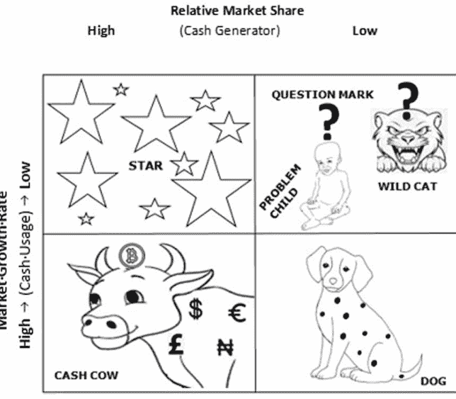

资本支出需要保持持续，并与客户光顾频率和客流量相联系，同时保持收入来源持续流入。明星产品使企业相对于竞争对手获得巨大的竞争优势，因为其威胁如同市场环境中的箭矢。它们凭借良好的企业形象和强大的感知商誉，为企业带来希望与自豪感。企业家利用明星产品提升自身在商业世界中的声誉和企业认同感（Alqahtani & Uslay, 2023）。

企业家渴望被称为冠军。冠军企业家的画像在于成为市场领导者。冠军企业家为了争夺市场份额、销售区域和销售配额而经历的斗争与较量，在于捕捉能够成为市场明星的业务单元。明星产品需要大量广告宣传，在此过程中也宣传了企业的其他产品或业务单元（Yadav, Tripathi, Tripathi, Ghosal, Kumar, Mandal & Singh, 2023）。净现金流是自发且精准的，因为明星产品高客流量和高光顾频率使得现金流出流入（收入）胜过现金流出（支出）。

- 2. **现金牛：**现金牛是指企业或业务单元在竞争成熟阶段拥有广阔市场份额的产品和服务。与明星业务单元不同，现金牛市场增长缓慢，但所需投资资本或种子资本较少（Lim, 2023）。因此，现金牛似乎能产生快速的收入流入，为企业带来巨大的净现金流。现金牛产品是企业的基石或核心优势。凭借现金牛的“角”，可以伤害并攻击竞争对手整个产品组合中看似构成威胁的其他产品或业务单元。当现金牛接近业务周期成熟期末或衰退期时，应整合积极的产品再生策略，以成为冠军企业家精神（Ovharhe et al., 2022）。

企业家利用现金牛业务单元的“角”来保护和支持新推向市场行业的新产品后代。现金牛可以用来养育“问题儿童”或“野猫”（问题产品），使其发展为明星和现金牛，然后才能长出自己的“角”在商业竞争中自卫。这是因为现金牛的“角”在商业世界的竞争中非常具有侵略性和危险性；这就像在游击战中作战。每个想要成为冠军领导者的企业家都需要具备敏锐的“角”，才能在商业世界中生存。

- 3. **问题产品：**企业组合中有些产品或业务单元表现得像野猫或问题儿童。这是一系列被标记为问题产品的业务单元。企业正处于艰难的两难境地，不知该如何应对。问题在于，企业家和内部创业者总是对如何处理它们感到怀疑和担忧。每个企业家或内部创业者都会问：我们该继续坚持下去吗？我们该前进还是收缩？这是因为问题产品（业务单元）的相对竞争市场份额非常低，而业务增长率却很高。问题产品或野猫产品需要大量投资资本来维持和生存，才能成功并密集扩大市场份额（Ratten, 2023）。这需要冠军企业家精神来实现可持续性、生存和成功，以掌握业务单元并照亮市场。

企业家需要更多关注和市场调研来支撑问题产品的业务单元。这就是为什么它们也被称为问题儿童业务单元或产品。问题儿童被认为病得很重，需要诊断干预和免疫才能生存。企业家担心这种干预应持续多久，因为这会消耗人力、物力、财力和实力资源。但好消息是，大多数创业之旅和梦想都始于问题产品，然后再开始培育其成长，进而在商业环境中建立广泛的市场份额。如果企业家和内部创业者忽视问题儿童（问题产品），它们看起来和表现得就像野猫，最终会变成瘦狗，这对企业家来说可能是彻底的损失或失败。因此，在开始之前，冠军企业家需要采用精益创业原则（Ovharhe, 2023a,b,c）。

- 4. 瘦狗：这些会侵蚀企业生命周期的产品或“吸血鬼”业务单元，被视为“瘦狗”。当产品耗尽组织生命周期时，最终可能在缺乏安全工具的深海中击沉企业的船只。瘦狗是吸血鬼产品，因为它们以企业组合的血肉和新鲜血液为食。企业家在处理这类业务单元（瘦狗）时应非常小心，因为它们会导致低市场份额、高债务杠杆、客户反馈/关系差且无人光顾（Ovharhe et al., 2022）。瘦狗是癫痫和瘫痪的产品，会以其宿主为食，直到将其耗尽至死。瘦狗是市场份额和市场增长率都低的业务单元，不产生现金，也不吸引商业环境中的投资形成资本。建议在任何业务单元被视为瘦狗时启动产品线剪枝。这呼吁进行收缩或对瘦狗采取行动。因此，这种瘦狗生命周期的延续不应该存在，因为如果这种产品要生存，需要巨大的现金流支出，这只是以牺牲企业为代价，对竞争对手有利。瘦狗通常源于垂死产品和不良公司名称。因此，在拯救产品生命之前需要做很多工作，因为竞争对手可能将其作为竞争优势来攻击企业的弱点。有时需要采取什么都不做的策略，等待能在短期内产生势头的创业机会。但出于某些特殊和战略原因，某些企业、合作社或财团会维持一些瘦狗产品的生命（Mandrinos & Lim, 2023）。

#### B. 布莱克-莫顿管理方格理论

管理方格是一种卓越的工具性战略工具，用于评估管理工作中领导能力以及对人和生产力的关注。这对于评估内部创业者和企业家的关系、企业如何为增长向前发展（尤其是精益初创和增长）非常重要。管理方格理论由R. R. Blake和J. S. Mouton开发，帮助企业中的领导者和企业家优化最适合商业情报、创造力和创新的领导风格（Blake & Mouton, 1964）。

##### 图4. 布莱克和莫顿管理方格

来源：Ovharhe, O. H. (2023d). 《企业家：全球思考，本地行动》。FUPRE 企业家培训计划；模块 9，1-34

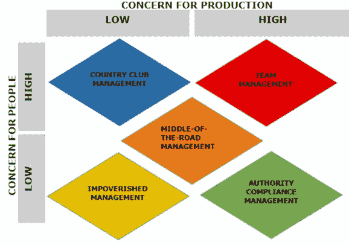

如上图所示，管理方格包含两个维度，第一是关注人，第二是关注生产。管理方格帮助内部创业者和企业家确定最适合的五种基本领导风格模式；（a）乡村俱乐部管理，（b）权威-服从管理，（c）贫瘠管理，（d）中庸管理，（5）团队管理。

- 1. 乡村俱乐部管理（1,9）：这展示了领导者更关注人员而非工作职能。这进一步表明，领导者更关心员工福利，例如员工生病或过生日时，对丧亲者、分娩和社会需求的高度关注，这能激发积极情绪、创新技能、创造力、战略情报、战术情报和运营情报。这营造了一种工作场所友好氛围，大多数员工可能会将其视为

视机会为理所当然，会导致组织增长不足和生产率低下。这种领导模式在员工是自我启动型、自我激励型和自我监控型时可能是可取的，因为他们具备自我导向的能力和目标驱动的职场态度。但在职场中很难见到此类员工；即使拥有这种态度的人，也可能不感兴趣于高社交生活方式（Helmold, 2021; Ovharhe & Chukwuemeka, 2023）。

- 2. 权威-合规型管理（9,1）：这种领导风格中，企业领导者更关注生产率，而非员工的情感和社会待遇。从这个意义上说，领导者不关心个人的生活模式。这是一种雇佣与解雇式的领导——如果有人违反组织的严格规则和基本政策，就会被解雇。领导者更多谈论人工时和工具（即设备、机器、材料、资金）对生产率的影响（Northouse, 2018; Yadav et al., 2023）。领导者的态度是：“市中心那边很酷”，如果你不喜欢这份工作和领导模式，你可以离开。这种工作可能不适合面临巨大竞争的内部创业者和企业家，因为可能缺乏商业智慧、创新、创造力和商业机会，也许他们的对手会利用这一点来攻击他们。持这种态度的初创企业家可能无法长期生存。这种领导风格适合精益创业或中小企业，但在企业家希望通过与职能挂钩的奖金、巨额补偿和大量附加福利来维持业务增长时也很有利，尽管该领导风格具有专制性质，企业仍可能成功（Alqahtani & Uslay, 2023）。

- 3. 贫瘠型管理（1,1）：这种领导模式在任何职场中都是出人意料的，因为它会从屋顶到地基毁掉整个企业。它在所有方面都表现出负面属性，因为对人的关注非常差，对生产率的关注也非常模糊。这是一种在需要分配或分散式管理形式时出现的领导风格。任务、职责和职能被指定给特定的工作范围，中心干预很少。这可能出现在控股公司和子公司、宗教组织以及拥有跨国公司的大型集团中。当领导者可能面临社区骚乱、动荡、危机、大流行病以及汇率、通胀率和利率不稳定时，这种模式对领导者来说是有利的（Helmold, 2021; Ovharhe et al., 2021）。这种领导风格不遵循任何创业模式的主流，更不用说冠军创业精神了。

- 4. 中庸型管理（5,5）：这说明在企业管理中，对员工福利和生产率存在平庸的担忧。领导者的看法是，来自另一个市场环境的回旋和虚构利润，因此领导者似乎表现出对人和生产率关注度各占50%的属性。有时这样做只是为了让企业运转下去。投入的能量不大，因为另一个销售配额和销售区域的组合非常高。因此，只要他们继续为利益相关者创造财富，他们平均会对市场和员工各关注50%（Northouse, 2018; Yadav et al., 2023）。这在某种程度上会发生在那些发现高利润市场和净现金流的新业务单元的企业家身上。收入流似乎非常有利。这是大多数连续外部创业者、超级创业者和外部创业者的做法（Ovharhe, 2023）。

- 5. 团队管理（9,9）：这是被定位最佳的领导方式，能够协调对人和对生产率的高关注度。在这里，将有高昂的士气来完成带有目标的任务，追求商业机会、商业智慧、创造力和创新（Helmold, 2021）。企业家的梦想和旅程将经历向上平滑的斜面运动，尽管商业环境中存在动荡、危机、大流行病和鲁莽行为。将会有向上的印象管理和情感承诺、工作满意度。员工满意度将是体验式的，与员工流失率、留任意向、规范性承诺相比。将体验到许多组织公民行为的属性（利他主义、公民美德、体育精神、礼貌和尽责）（Ovharhe & Chukwuemeka, 2023）。

这种领导风格促进员工之间的团队精神、凝聚力标准、规范和工业和谐。因罢工和工业纠纷产生的申诉将得到友好处理。员工为实现目标的关注度很高；同时，员工的薪酬和福利始终在管理层的心中。竞争对手会对企业业务组合的箭头和威胁感到畏惧，因为他们会看到企业的企业形象和识别（Ratten, 2023）。

管理网格矩阵指明了经理、企业家、内部创业者、社会企业家、连续企业家、超级企业家和外部企业家之间范式转移的模式，即他们在对待员工和生产率关注方面的运作模式。尽管，管理网格并不涵盖管理的广泛方面。这主要涉及对员工和生产率的关注，要求具备商业智慧、创造力和创新，以及抓住商业机会的能力。但是，该网格可以作为领导风格宏观功能的范式转移扩展（Islam, 2023）。

### 7. 结论

创业是任何商品活动的引擎，也是任何国家经济增长和发展的推进器。企业家决定了任何企业新鲜血液的流动。而管理是协调所有活动的力量，以确保有效性和效率。这意味着管理策略将能够对投入资源和预期产出的计划、组织、指导、激励和控制进行微调，以实现可实现的概念。

每个企业家都需要学习如何在正确轨道上导航其潜力和能力，在那里有宝贵的商业机会宝藏。正确轨道是愿景和使命中需要跋涉的宝贵路径，可以完成创业旅程和梦想。这将使企业家能够通过应用商业智慧（竞争情报、决策支持系统）、创造力和创新，成功经历新企业的创建。

商业智慧被采用来提升资产回报率（ROA）、投资回报率（ROI）、使用资本回报率（ROCE）和净资产收益率（ROE）。商业智慧建立在战略情报、战术情报、运营情报和决策支持系统之上，这些能为企业提供市场结构中的竞争优势和冠军优势。然而，如果没有这些概念，企业的增长和发展无法实现，这些概念为企业带来了被视为创造力、创新和创业机会的新鲜血液流动。这是创意生成、网络和头脑风暴的宝库，使创业能够处于领先优势，而不是人工智能科学、数据虚拟化、机器学习和大数据出现的流血边缘。

创业机会、创造力和创新是任何企业在短期和长期商品活动中的成果。通过应用创业创新技能，结合管理政策、决策制定和预算控制实施，企业将在可持续性、生存和成功方面经历商业卓越。这需要一种冠军创业精神，它拥有控制商业世界中动荡、后疫情时代和竞争平价的能力、能力和容量。冠军创业精神是企业增长和发展的关键。


### 致谢
衷心感谢我的 Shuddie；妻子以及我的指数级冠军：Terry、Kerry 和 Jerry。

### 参考文献

- Lena, M. (2019). 营销情报作为战略企业管理的工具。国际心理社会康复杂志，24(8)，7。doi:10.37200/IJPR/V24I8/PR281089

- Zighed Rahma, & Sabri Mekimah. (2023). 竞争情报在通过组织学习提升绩效中的作用：阿尔及利亚初创企业个案研究。商业情报研究杂志，13(1)，53-64。DOI: 10.37380/jisib.v13i1.991

- Ahunanya, V., Ovhare, O. H., Emenike, C. G., & Otto, G. (2022a). 寄售库存系统与微型仓储企业的创业成功。国际社会科学与管理研究杂志，8(5)，18–28。doi:10.56201/ijssmr.v8.no5.2022.pg18.28

- Ahunanya, V., Ovhare, O. H., Emenike, C. G., & Otto, G. (2022b). 尼日利亚钻井液公司中寄售库存系统与淘汰管理。国际社会科学与管理研究杂志，8(5)，1–27。doi:10.56201/ijssmr.v8.no5.2022.pg1.17

- Alberta.alis (2023). 职业洞察：了解自我。Alis。https://alis.alberta.ca/careerinsite/know-yourself/skills-quiz/

- Alqahtani, N., & Uslay, C. (2023). 营销/创业界面研究优先事项（2023–2026）。营销与创业研究杂志。Emerald Insight.

- Amjad, M. (2023). 2023 年创业的七个有前景领域。LinkedIn。https://www.linkedin.com/pulse/7-promising-areas-entrepreneurship-2023-maheen-amjad

- Anderbjork, G., & Martell, J. (2021). 情报之花园：设计强大的数字市场与竞争情报平台（第 1 版）。Technics Publications.

- Apostolopoulos, N., Ratten, V., Petropoulos, D., Liargovas, P., & Anastasopoulou, E. (2021). COVID-19 危机期间的农食品产业与创业：系统文献综述与研究议程。战略变革，30(2)，159–167。doi:10.1002/jsc.2400

- Artur V. (2020). 竞争情报的概念与定义。*管理与领导*。DOI: 10.13140/RG.2.2.14667.34087

- Baskin, K. (2023). 如何使用竞争洞察。*MIT 斯隆管理评论*。https://mitsloan.mit.edu/ideas-made-to-matter/how-to-use-competitive-insight

- Baysinger, T. (2024). *索尼据称为迈克尔·杰克逊目录交易支付约 6 亿美元*。Axios。https://www.axios.com/2024/02/12/sony-michael-jackson-catalog

- Beato, E. (2024). 2024 年：布兰克学院合作与创新之年。https://entrepreneurship.babson.edu/2024-blank-school/

- Blake, R., & Mouton, J. (1964). *管理方格：领导卓越的关键*。Gulf Publishing Co.

- Blessley, M., & Mudambi, S. M. (2022). 贸易战与大流行：食品银行供应链中的中断与韧性。*工业市场营销管理*，*102*，58–73。doi:10.1016/j.indmarman.2022.01.002

- Britannica. (2024). *冠军：君主、王室与贵族*。Britannica。https://www.britannica.com/champion-English-history

- Business Research Insight. (2024). 运营情报平台市场报告概览。https://www.businessresearchinsights.com/market-reports/operations-intelligence-platforms-market-103984

- Cekuls, A. (2022). 扩大竞争情报的范围。*商业情报研究*，*12*(1)，4–5。doi:10.37380/jisib.v12i1.924

- Chibuke, C. U., & Ovharhe, O. H. (2022). 大流行与危机时代尼日利亚风险文化与精益文化的兴起：采用确证性分析。*多学科研究与成长评价国际杂志*，*3*(1)，263–271。doi:10.54660/anfo.2021.3.1.14

- Chibuke, C. U., Ovharhe, O. H., & Abada, A. M. (2022). 大流行与灾难期间尼日利亚微型企业中精益会计预警与创业可持续性的同步化：采用确证性因子分析。*国际商业与管理杂志*，*10*(1)，1–13。doi:10.54660/anfo.2021.2.6.15

- Christensen, C. M. (1997). *创新者的窘境：当新技术导致伟大企业失败*。Harvard Business School Press.

- Cloutier, A. (2013). 基于文献范围综述的竞争情报流程整合模型。*国际战略管理杂志*，*13*(1)，57–72。doi:10.18374/IJSM-13-1.7

- Cole, C. (2022). 如何识别商业与市场机会。Harvard Business School Online.

- Collin (2024). 冠军。https://www.collinsdictionary.com/dictionary/english/champion

- Corsaro, D., & D'Amico, V. (2022). COVID-19 带来的数字化转型如何影响 B2B 的关系方法。商业与工业市场营销杂志，37(10)，2095–2115。doi:10.1108/JBIM-05-2021-0266

- Coursera, S. (2023) 什么是管理？定义、类型、技能与职业。https://www.coursera.org/articles/management

- Dana, L.-P., & Vorobeva, E. (2021). 理解“少数族裔创业”这一术语。In T. M. Cooney (Ed.), 《少数族裔创业帕尔格雷夫手册》（第 15–32 页）。Palgrave Macmillan。doi:10.1007/978-3-030-66603-3_2

- Darwiesh, A., Elhoseny, M., Atassi, R., & El-Baz, A. H. (2023). 用于中小企业风险治理的商业智能系统。In R. El Ayachi, M. Fakir, & M. Baslam (Eds.), 《商业智能》。CBI 2023。商业信息处理讲义，484。Springer。doi:10.1007/978-3-031-37872-0_1

- Davinsi Lab. (2024). 展望未来：2024 年运营情报与安全的未来前景。https://davinsi.com/en/news/navigating-tomorrow-future-outlook-operational-intelligence-and-security-2024

- Derner, M. (2023). 企业家的词源。[视频]。Facebook。https://web.facebook.com/watch/?v=602542661584141

- Dewar, C., Keller, S., & Malhotra, V. (2022). CEO 卓越：区分最佳领导者与其他人的六种心态（第 1 版）。Scribner.

- Dieffenbacher, S. F. (2023). 创造力与创新：差异、示例与定义。Digital Leadership。https://digitalleadership.com/blog/creativity-and-innovation/

- Drucker, P. F. (1993). 创新与创业实践与原则。HarperCollins Publishers Inc.

- Eckhardt, J. T., & Shane, S. A. (2003). 机会与创业。管理杂志，29(3)，333–349。doi:10.1177/014920630302900304

- Effa, G. A., Ovhahre, O. H., Ezirim, A. C., & Igwe, S. (2023a). 尼日利亚的采购可持续性政策与物流绩效。[IJMCS]。国际市场营销与传播研究杂志，7(1)，56–72。doi:10.56201/ijmcs.v7.no1.2023.pg56.72

- Effa, G. A., Ovhahre, O. H., Ezirim, A. C., & Igwe, S. (2023b). 尼日利亚的战略采购举措与物流绩效。[IJMCS]。国际市场营销与传播研究杂志，7(1)，38–55。doi:10.56201/ijmcs.v7.no1.2023.pg38.55

- Elia, G., Margherita, A., & Passiante, G. (2020). 数字化创业生态系统：数字技术与集体智慧如何重塑创业过程。科技预测与社会变革，150，119791。doi:10.1016/j.techfore.2019.119791

- Emergent Risk International (2024). 2024 年战略情报估计：全球颠覆者。https://emergentriskinternational.com/event/strategic-intelligence-estimate-2024-global-disruptors/

- Etymonline (2024). 冠军的词源。Etymonline。https://www.etymonline.com/word/champion

- Farradinna, S., Syafitri, N., Herawati, I., & Jayanti, W. (2023). 创业心理准备（EPR）量表的探索性因子分析。创新与创业杂志，12(1)，66。doi:10.1186/s13731-023-00314-y

- Fernando, G. (2024). 冠军：21 世纪战略领导力模型。Tough Nickel。https://toughnickel.com/business/The-Champion

- Geeks for Geeks. (2023). 创业者类型：创新型、模仿型、谨慎型和落后型创业者。Geeks for Geeks。https://www.geeksforgeeks.org/types-of-entrepreneurs-innovating-imitative-fabian-and-drone-entrepreneurs/

- Gianinazzi, W. (2018). 全球思考，本地行动：一个理念的历史。EcoRev'。政治生态学批判评论，46。doi:10.3917/ecorev.046.0019

- Gupta, P., & Bamel, U. (2023). 电子学习生态系统中元认知与批判性思维的必要性：后新冠时代的新常态。全球商业与组织卓越，43(1)，104–120。doi:10.1002/joe.22208

- Gurcan, F., Ayaz, A., Dalveren, M. G. G., & Derawi, M. (2023). 商业智能战略、最佳实践与最新趋势：基于机器学习的 2003 至 2023 年计量学数据分析。可持续发展（巴塞尔），15(13)，9854。doi:10.3390/su15139854

- Handfield, B. R., Petersen, K., Cousins, P.N., & Lawson, B. (2023). 供应管理整合与绩效结果的组织创业模型。国际运营与生产管理杂志，29 (2)，100–126。Emerald Group Publishing Limited。0144-3577。DOI: doi:10.1108/01443570910932011


Handfield, R., Petersen, K., Cousins, P., & Lawson, B. (2009). 供应管理整合与绩效结果的组织创业模式. 《国际运营与生产管理杂志》, 29(2), 100–126. doi:10.1108/01443570910932011

Hassani, A., & Mosconi, E. (2022). 制造业中小企业的社交媒体分析、竞争情报与动态能力. 《技术预测与社会变革》, 175(1), 1–11. doi:10.1016/j.techfore.2021.121416

Holori, R. B., Ahmadi, F., Khanmohammadi, M., Ranjbar, H. M., & Kordlouie, H. (2023, 秋季). 基于商业智能的管理会计信息系统模型的开发与评估：结构方程建模方法. 《国际财务与管理会计杂志》, 8(31).

Horn, J. (2023). 走进竞争对手的思维：如何预测他们的下一步并为成功定位自己（第1版）. 麻省理工学院出版社. https://mitpress.mit.edu/9780262047883/inside-the-competitors-mindset/ doi:10.7551/mitpress/14628.001.0001

Hossain, M. S., Islam, M. A., Hosen, M., Mohd, T., & Thaker, H. (2023). 女性创业成功的缺失催化剂：新兴经济体的证据. 《全球商业与组织卓越》, 42(5), 50–64. doi:10.1002/joe.22201

Huang, Z., Savita, K. S., & Zhong-jie, J. (2022). 商业智能对初创企业财务绩效的影响. 《信息处理与管理》, 59(1), 102761. doi:10.1016/j.ipm.2021.102761

Islam, M. N. (2023). 应对全球危机中的组织变革管理. 《全球商业与组织卓越》, 42(3), 42–57. doi:10.1002/joe.22189

Koblin, J. (2024). 超级碗收视率升至1.234亿，创历史新高. https://www.nytimes.com/2024/02/12/business/media/super-bowl-ratings-record.html

Jain, N. (2023). 什么是创新？定义、类型、示例与流程. Ideascale.

Kanyi, J. M., Wanjau, K. L., & Kyalo, T. N. (2023). 产品创新与企业家激情对肯尼亚制药制造业企业绩效的作用. 《国际艺术与社会科学杂志》, 6(8), 282.

Knezović, E. (2023). 自我感知就业能力与创业和内部创业意图：六国的证据. 《全球商业与组织卓越》, joe.22205. doi:10.1002/joe.22205

Kozyrkov, C. (2023). 什么是决策智能？Medium. https://towardsdatascience.com/introduction-to-decision-intelligence-5d147ddab767.

Kühn, M. L. (2006). 竞争情报的组成部分：竞争对手情报. 《南非信息管理杂志》, 8(1). doi:10.4102/sajim.v8i1.209

La Verne. (2023). 创新与创业的区别. La Verne. https://laverne.edu/entrepreneurship/wp-content/uploads/sites/81/2023/04/The-difference-between-innovation-and-entrepreneurship.pdf. 拉夫恩大学

Lim, M.W. (2023). 新常态下的变革性营销：对企业对企业营销组合挑战、机遇与解决方案的创新实践-学术整合性综述. 《商业研究杂志》, 160, 113638. Elsevier公司.

Loizos, C. (2011). 精益创业鼓吹者Eric Ries才刚刚起步. PeHUB. https://www.scribd.com/document/377073019/Lean-Startup

Madureira, L., Popovic, A., & Castelli, M. (2023). 竞争情报成熟度模型：系统综述、统一模型与实施框架. 《商业情报研究杂志》, 13(1), 1–29. doi:10.37380/jisib.v13i1.988

Maluleka, M. L., & Chummun, Z. B. (2023). 竞争情报与战略实施：对现有文献综述的批判性考察. 《南非信息管理杂志》, 25(1). https://sajim.co.za/index.php/sajim/article/view/1610. doi:10.4102/sajim.v25i1.1610

Mandrin, S., & Lim, W. M. (2023). 去国际化：组织制度主义视角. 《全球商业与组织卓越》, 42(3), 58–73. doi:10.1002/joe.22195

Manohar, S., Paul J., Strong, C., & Mittal, A. (2023). 感知服务创新的通用量表. 《商业研究杂志》, 160, 113723.

Mark, T. R. (2024). 2024年创业中创造力与创新的重要性. Nexford. https://www.neford.edu/insights/creativity-innovation-in-entrepreneurship

Martins, M. J., Shahzad, F. M., & Xu, S. (2023). 影响创业意图以发起新企业的因素：大学生证据. 《创新与创业杂志》, 12(1), 63. doi:10.1186/s13731-023-00333-9

Maune, A. (2022). 战略竞争情报中移动应用程序的采用与使用：结构方程建模方法. 《商业情报研究杂志》, 12(1).

Merriam-Webster. (2024). 冠军的定义与含义. Merriam-Webster. https://www.merriam-webster.com/dictionary/cham.

Musabayana, T. G., Mutambara, E., & Ngwenya, T. (2023). 建立津巴布韦国家中小企业部门：提升国家经济绩效的重点优先事项. 《创新与创业杂志》, 2023(12), 65. doi:10.1186/s13731-023-00329-5

Nightingale, P., & Coad, A. (2013). 木偶与瞪羚：创业研究中的政治与方法论偏差. (SPRU工作文件系列2013-03). SPRU - 科学与技术政策研究中心, 萨塞克斯大学.

Nilima (2024). 什么使一个人成为领导者，另一个人成为冠军：https://www.quora.com/What-makes-a-person-a-leader-and-another-a-champion#:~:text=There%20is%20a%20big%20difference,to%20his%20environment%20and%20people

Ntandoyenkosi, S. (2023). 创业教育. 《创业创新杂志》, 4(SI). doi:10.14426/jei.v4SI.1674

O'Callaghan, M. (2023). 决策智能：决策中的人机集成（第1版）. CRC Press/Taylor & Francis. doi:10.1201/b23322

OECD. (2023). 中小企业及企业家融资：OECD计分卡，2023年重点. OECD出版社, 巴黎. doi:10.1787/f493861e-en

OECD. (2023). 2023年就业创造与地方经济发展：弥合巨大绿色鸿沟, OECD出版社, 巴黎. doi:10.1787/21db61c1-en

OECD (2023). 重塑全球价值链的风险与机遇. OECD经济部，宏观经济与结构政策分析工作组第1号 (CPE/WP1(2023)8).

OECD. (2023). 中小企业及企业家文件，第36号. OECD出版社. doi:10.1787/a8d13e55

Okhrimenko, I., Stepenko, V., Chernova, O., & Zatsarinnaya, E. (2023). 信息领域对国家经济安全的影响：俄罗斯现实案例. 《创新与创业杂志》, 12(1), 67. doi:10.1186/s13731-023-00326-8

Opuala-Charles, O. S., & Oshilike, I. V. (2023). 尼日利亚的创业、公共政策与经济发展. 《经济学与管理研究杂志》, 4(2), 4–77. SRC, JESMR-210. doi:10.47363/JESMR/2023(4)173

Ovharhe, O. H. (2022a). 可持续发展目标：非洲国家治疗性创业与康复治疗之间的多重共线性. 《国际小企业与创业研究杂志》, 10(3), 1–59. doi:10.37745/ijjbser.2013/vol110n3157

Ovharhe, O. H. (2022b). 可持续发展目标：西非国家的治疗性创业与创业性Injilitis. [WJEDS]. 《世界企业家发展研究杂志》, 7(1), 87–113. doi:10.56201/wjeds.v7.no1.2022.pg87.113

Ovharhe, O. H. (2023). 冠军创业精神：精益创业与企业成长. Impress.

Ovharhe, O. H. (2023). 轻量化创业与客户资助商业：简化版. Lambert学术出版社.

Ovharhe, O. H. (2023). 企业家：全球思维，本地行动. FUPRE创业培训计划 [章节]. 模块, 9, 1–34.

Ovharhe, O. H., & Abada, A. M. (2023). IFRS：创业退出与创业进入. 《美国社会发展与创业杂志》, 2(2), 1–8. doi:10.54536/ajsde.v2i2.1578

Ovharhe, O. H., & Abada, A. M. (2023). IFRS采用对创业进入与创业退出的影响：2006-2017年尼日利亚经验. 《美国社会发展与创业杂志》, 2(2). doi:10.54536/ajsde.v2i2

Ovharhe, O. H., Ahunanya, V., & Woko, E. B. (2022). 寄售库存系统与拉哥斯州的创业生存. 《国际社会科学与管理研究杂志》, 8(5), 29–42. doi:10.56201/ijssmr.v8.no5.2022.pg29.42

Ovharhe, O. H., Chibuike, C. U., & Abada, A. M. (2023). 精益会计与精益创业. 《美国社会发展与创业杂志》, 2(2), 1–8. doi:10.54536/ajsde.v2i2.1578

Ovharhe, O. H., & Chukwuemeka, S. P. (2023). 可持续发展目标：治疗性创业与心理健康状况. 《英国多学科与先进研究杂志》, 4(1), 81–119. doi:10.37745/bjmas.2022.0107

Ovharhe, O. H., & Igbokwe, E. L. (2021). 尼日利亚南南地缘政治区远程工作相关因素对风险文化与创业适应性的分析干预：Covid-19视角. 《教育与实践杂志》, IISTE, 12(3), 34–44. doi:10.7176/JEP/12-34-05

Ovharhe, O. H., & Okolo, B. S. (2022). 可持续发展目标：精益创业与绿色创业. 《国际研究与科学创新杂志》, 9(10), 59–71.


Ovharhe, O. H., Okolo, B. S., Woko, E. B., & Igbokwe, L. (2022). 轻创业与客户融资商业模式. 社会科学与管理研究国际期刊, 8(5), 87–106. doi:10.56201/ijssmr.v8.no5.2022.pg87.106

Ovharhe, O. H., & Saturday, O. (2024b). 女性企业家中的环境污染与孕产妇死亡率. ABC 索引. https://explore.abcdindex.com/ai_portal/login.php.

Ovharhe, O. H., & Woko, B. E. (2024a). 企业家中的环境污染与预期寿命. 经济与管理期刊；JEM.

Ovharhe, O. H., & Woko, B. E. (2024b). 创业机会中的环境污染与婴儿死亡率：冠军创业方法. ABC 索引. https://explore.abcdindex.com/ai_portal/login.php.

Ovharhe, O. H., Woko, E. B., & Ezeocha, V. U. (2021). 远程办公：尼日利亚尼日尔三角洲微型企业中的创业风险与创业生存（COVID-19 大流行前景）. 小企业与创业研究国际期刊, 9(4), 11–28. doi:10.37745/ijsber.2013/vol9n11-28

Ovharhe, O. H., Woko, E. B., & Ogolo, T. M. (2021). 尼日利亚 COVID-19 大流行期间快速消费品领域中采用确认性因子分析的竞争风险战略与创业满意度. 多学科研究与成长评价国际期刊, 2(6), 267–272. doi:10.54660/anfo.2021.3.1.14

Oyinlola M., Kolade O., Okoya S. A., Ajala O., Adefila A., Adediji A., Babaremuk Tijani B., Adejuwon J., Wambui F., Akinlabie E. (2023). 尼日利亚大学中的创业与创新：趋势、挑战与机遇. SSRN. doi:10.2139/ssrn.4419457

Peek, S. (2024). 创造力不等于创新（但你需要两者）. 商业新闻日报. https://www.businessnewsdaily.com/6848-creativity-vs-innovation.html

Rahchamani, A., & All, E. (2019). 营销情报与商业情报对获取竞争优势的影响. 管理与技术评论, 19(5), 52–70. doi:10.20397/2177-6652/2019.v19i5.1794

Ratten, V. (2023). 创业：定义、机遇、挑战与未来方向. 全球商业与组织卓越, 42(5), 79–90. doi:10.1002/joe.22217

Ratten, V. (2023). 创业：定义、机遇、挑战与未来方向. 全球商业与组织卓越, 42(5), 79–90. doi:10.1002/joe.22217

Reddit (2023). 词源学. https://www.reddit.com/r/etymology/

Reeves, M., & Whitaker, K. (2022). 创新管理创新. 战略管理评论, 3(1), 157–167. doi:10.1561/111.00000040

Reeves, M., & Moose, S. (2023). 波士顿咨询集团矩阵. BCG. https://www.bcg.com/about/overview/our-history/growth-share-matrix

Ries, E. (2017 年 10 月 17 日). 创业之道：现代公司如何利用创业管理转型文化并推动长期增长（未删节版）. Random House Audio.

ScienceDirect.com. (2024). 战术情报. https://www.sciencedirect.com/topics/computer-science/tactical-intelligence

Seth, S. (2023). 为什么创业对经济很重要. 商业邮报: 118-121. Tejgaon I/A.

Shane, S., & Venkataraman, S. (2000). 创业作为研究领域的前景. 管理学院评论, 25(1), 217–226. doi:10.5465/amr.2000.2791611

Shawn, M. (2023). 内容权威. https://thecontentauthority.com/blog/leader-vs-champion

Shevlin, H. (2022 年 10 月 21 日). 艺术家已死，AI 将其杀死. IAI 新闻.

Shobhit, S. (2023 年 3 月 16 日). 正如创业定义中所述. https://www.google.com/search?q=Shobhit+Seth+(March+16%2C+2023).&oq=Shobhit+Seth+(March+16%2C+2023).+&gs_lcrp=EgZjaHJvbWUyBggAEEUYOTIHCAE QABiINBIBCTM0NDVqMGoxNagCALACAA&sourceid=chrome&ie=UTF-8

Showkat, A. D. (2022). 泰勒科学管理在现代时代的相关性. 心理学与政治科学期刊, 24(2). doi:10.55529/jpps

Sprague, R. H. (1980). 决策支持系统开发框架. 管理信息系统季刊, 4(4), 1–26. https://www.jstor.org/stable/248957. doi:10.2307/248957

Stanford Center For Professional Development. (2024). 创造力与创新管理：如何激发原创想法. 斯坦福大学. https://online.stanford.edu/creativity-and-innovation-management

Stern, C. W., & Deimler, M. S. (2006). 波士顿咨询集团论战略：经典概念与新视角（第 2 版）. John Wiley & Sons, Inc.

STRATAGEM. (2024). 战术情报中的理解术语 - 第 2 部分. https://www.stratagem.no/understanding-as-a-term-in-tactical-intelligence-part-2/

Taranu, S. (2023). 商业中竞争情报附加价值的测量. 第 17 届商业卓越国际会议论文集, 1328-1336. ISSN 2558-9652. 2023. doi:10.2478/picbe-2023-0119

Thompson, M. (2009). 组织中的冠军：如何在各级培养充满热情的变革推动者. McGraw-Hill.

Vocabulary.com. (2024). 冠军：定义、含义与同义词. Vocabulary.com

Wakuthii, S. (2024). 战术情报精通：军队中的有效知识管理. https://www.linkedin.com/pulse/tactical-intelligence-mastery-effective-knowledge-sarah-wakuthii

World Economic Forum. (2024). 战略情报展望：2024 年将有何动态. https://www.weforum.org/agenda/2023/12/strategic-intelligence-outlook-climate-economy-forecast-2024/

Yadav, S. U., Tripathi, R., Tripathi, A. M., Ghosal, I., Kumar, A., Mandal, M., & Singh, A. (2023). 后 COVID-19 大流行时期印度手工艺品领域中的数字化与创新创业：挑战与机遇. 创新与创业期刊, 12(1), 69. doi:10.1186/s13731-023-00337-5

Yugandhara, R. Y. (2023). 2023-2030 年商业情报市场规模（十亿美元）. 2023 年商业情报市场增长驱动因素与分析. Research Gate. https://www.researchgate.net/publication/369595866_Business_Intelligence_Market_Growth_Drivers_Analysis_2023

Zhou, J., San, O. T., & Liu, Y. (2023). 基于商业情报的企业财务决策支持系统设计与实现. 专业商业评论国际期刊, 8(4), e0873. doi:10.26668/businessreview/2023.v8i4.873

# 第 10 章

## 国际背景下董事会构成、活动与薪酬对 ESG 绩效的影响

Tijani Amara
突尼斯加夫萨大学高等商业管理学院

Ali Ahmadi
https://orcid.org/0000-0002-2170-941X
突尼斯加夫萨大学高等商业管理学院

### 摘要

越来越多的研究表明，董事会构成、活动与薪酬可能影响其环境、社会与治理（ESG）。本章旨在通过检验董事会规模、董事会会议、董事会中的女性、高管薪酬及 ESG 争议对 ESG 绩效的影响，填补文献中的这一空白。运用迄今为止最大的数据集之一——包含来自全球 60 个国家、约 5,500 家上市公司、16 年（2002–2017）期间共 31,040 个公司-年观测值的不平衡面板数据——这些发现具有五个方面。首先，这些结果表明董事会规模与 ESG 绩效正相关。其次，作者显示每年董事会会议次数与环境、社会及治理评分呈正相关。第三，主要实证证据表明，董事会中的女性与企业 ESG 绩效之间的关系具有强烈显著性。第四，这些结果揭示高管薪酬仅对某些地理区域产生积极影响。第五，ESG 绩效与 ESG 争议之间存在负相关。

DOI: 10.4018/979-8-3693-1846-1.ch010

### 引言

企业绩效基本上取决于董事会（Merendino & Melville, 2019），因为董事会负责批准和监督战略目标的实施、治理体系及企业文化的塑造（Castellanos & George, 2020）。成功的董事会还将强调商业伦理与企业责任（Qa'dan & Suwaidan, 2019）。越来越多的研究发现，企业可持续发展绩效与盈利能力之间存在强烈的正相关关系：可持续发展评级高的公司，无论在股票市场价值还是会计绩效方面，都显著优于同行（Birindelli et al., 2018）。换言之，采用环境、社会与治理（ESG）最佳实践能带来长期的竞争优势。

基于这些考量，本研究旨在识别能够提升环境社会治理绩效的董事会特征。更具体地说，根据现有文献（Qa'dan & Suwaidan, 2019; Xie et al., 2019; Arayssi et al., 2020; Armstrong, 2020; Harjoto & Wang, 2020），本分析考察了董事会特征（性别多样性、规模、活动、薪酬及 ESG 争议）对 2002 年至 2017 年间 60 个国家 31,040 个观测样本中 ESG 绩效的影响。聚焦于该样本，可以获得一个更加同质的参考总体，这一点非常重要，因为这些数量庞大的企业构成了各自经济体的主要经济驱动力之一，能够推动向更加包容和可持续的经济转型（Rajesh, 2020）。为代理企业的可持续发展绩效，我们采用了汤森路透的 ESG Asset4 评分，这是一项广泛且经过验证的 CSR 绩效衡量指标，被学者们用于金融企业（Hübel & Scholz, 2020; Kiriu & Nozaki, 2020）和非金融企业（Jackson et al., 2020; Beretta et al., 2020; Hedqvist & Larsson, 2020; Jahmane & Gaies, 2020; Arayssi et al., 2020）。

我们的主要实证证据表明，董事会中的女性与企业 ESG 绩效之间存在非线性关系。本研究在学术文献和企业实践方面均有多方面贡献。事实上，该主题（董事会构成与 ESG 绩效之间的关系）的现有文献主要集中在非金融企业上（Qa'dan & Suwaidan, 2019; Arayssi et al., 2020; Wong et al., 2020; Plastun et al., 2020; Alessandrini & Jondeau, 2020; Ng et al., 2020）。

本文余部分安排如下。第 2 部分介绍文献综述与研究假设。第 3 部分讨论研究方法，包括抽样程序、因变量和自变量的测量以及所采用的方法论。第 4 部分展示并讨论结果，最后，第 5 部分提出结论。


### 文献综述与假设发展

文献中用于描述公司治理对ESG绩效影响的最广泛使用的变量与董事会规模、董事会性别多样性、每年董事会会议次数、董事会薪酬以及ESG争议得分相关。在以下小节中，我们针对公司治理的这些特征各自发展假设。

#### 董事会规模

董事会规模大多因其与企业绩效的关系而被研究。实证研究可分为两类：第一流派的研究赞成较小的董事会，而第二学派主张较大的董事会。由于我们样本中的公司均为上市公司，因此是在强监管环境下运作的大型复杂金融机构，我们预计较大的董事会将更加高效，尤其是在工作量和责任分配方面，以及在利益相关者代表方面的多样性更大，从而改善ESG绩效（Albitar et al., 2020; Zubeltzu-Jaka et al., 2020; Arayssi et al., 2020）。我们的假设与先前研究的结果一致，这些研究显示董事会规模与可持续实践的广度之间存在正相关关系（Baraiabar-Diez & Odriozola, 2019; Harjoto & Wang, 2020; Albitar et al., 2020）。基于上述考虑，提出以下假设以供检验：

**假设1。** *董事会规模对ESG绩效产生积极影响。*

#### 董事会会议

关于每年董事会会议次数（通常被用作董事会活动水平和勤勉程度的代理变量（Baraiabar-Diez & Odriozola, 2019; Bravo & Reguera-Alvarado, 2019)），关于其对非财务绩效的影响也没有共识。由于我们样本中的公司在动态的商业环境中运作，该环境需要增加会议频率以确保合法性，合法性理论为提出董事会会议频率与ESG绩效之间的正相关关系提供了基础。我们的假设与那些发现董事会会议次数与可持续实践之间存在正相关关系的研究一致（Ismail et al., 2019; Bravo & Reguera-Alvarado, 2019; García Martín & Herrero, 2020）。基于上述考虑，检验以下假设：

**假设2。** *董事会会议次数对ESG绩效产生积极影响。*

#### 董事会女性成员

关于董事会女性成员与ESG绩效关系的解释与女性本身的各种特征相关。文献中似乎普遍认同女性董事对可持续发展绩效的积极影响。更详细地说，董事会中的女性积极影响企业的慈善捐赠（Bettinelli et al., 2019; Furlotti et al., 2019; Abd Rahman et al., 2019）、对气候变化的关注（Birindelli et al., 2019）以及基于声誉的CSR措施（Ajaz et al., 2020）。同样，许多研究发现，董事会性别多样性增加了社会和环境报告的范围并减少了环境诉讼（Yuan et al., 2019; Peng, 2020）。这些不一致结果的一个可能解释可能是董事会性别多样性与社会和环境绩效之间存在非线性关系。基于他们的发现，一些研究（如Birindelli et al., 2019; Furlotti et al., 2019; Ajaz et al., 2020; Peng, 2020）指出，董事会中女性比例较高能够改善ESG绩效。考虑到这一证据，我们提出以下假设：

*假设3.* 性别多样性高水平对ESG绩效产生积极影响。

#### 高管薪酬

提供基于ESG的可持续薪酬政策可能在激励企业高管开展碳倡议方面发挥关键作用，进而提升组织合法性和市场价值。作为可持续企业战略的一部分，公司越来越多地使用可持续薪酬政策来激励高管推进社会和环境项目。从经验上看，Baraiabar-Diez et al. (2019); Eklund (2019); Haque & Ntim (2020) 发现可持续薪酬方案能够改善ESG绩效。因此，我们认为，在存在可持续薪酬政策的情况下，董事会及其薪酬委员会可能更有利地评估企业的环境、社会和治理属性，以设计更有效的薪酬安排，这可能提升企业的碳绩效。因此，任何象征性的ESG薪酬政策，即使不要求明确的指南和强制性的减排目标，也可能提升企业的流程导向型ESG绩效（Westling & Mazhari, 2019; Baraiabar-Diez et al., 2019）。因此，我们提出以下假设：

**假设4.** 高管薪酬对ESG绩效产生积极影响。

#### ESG争议

ESG得分传统上被视为影响利益相关者的工具。与环境、社会和治理问题相关的ESG争议话题在文献中得到了调查，原因在于ESG问题或弱点可能对企业财务结果产生的预计负面影响以及处理这些问题的必要性（Iamandi et al., 2018; Markopoulos et al., 2020; Li et al., 2020）。一家公司被视为越有美德，就越可能受到消费者、员工和投资者的赞赏。最重要的是，当这些美德由媒体等外部来源披露时，它们既能建立声誉，也能建立可信度（Javedt et al., 2020）。ESG争议通常基于媒体或公众披露的与ESG相关的企业丑闻，Utz (2019); Aouadi & Marsat (2018) 有趣地发现ESG争议对企业ESG绩效有负面影响。综合来看，可以期待以下假设。

**假设5.** ESG争议对ESG绩效产生负面影响。

### 研究方法

#### 样本选择与数据来源

我们的初始样本基于Thomson Reuters Asset4数据库和Thomson Reuters Eikon中ESG数据的可用性。我们从表1的面板A中包含的60个国家主要证券交易所上市的非金融企业的全部35000家年观测值可用样本开始。随后，我们删除了4960个与我们解释模型中使用的因变量或自变量相关的缺失企业层面数据的观测值。我们的最终样本基于一个不平衡的面板数据集，包含来自5500家上市公司的31040家年观测值，涵盖2002–2017年16年期间。表1显示了样本的年度和国家分布。我们使用Asset4数据集和Thomson Reuters Eikon来收集ESG得分和公司治理数据。Thomson Reuters的ASSET4数据库在我们的研究中被使用，因为它对许多投资者和学者来说易于获取。

#### 因变量

为检验我们的假设，我们使用了Asset4的ESG绩效（ESG SCORE）数据。该得分基于三个维度：环境、社会和公司治理。ESG绩效衡量公司减少环境排放、在生产中高效利用自然资源的能力。

#### 表 1. 样本分布

| 企业 | 每国观测值数量 | 每国百分比 (%) |
|---|---|---|
| 面板A. 按国家划分的样本分布 | | |
| 阿根廷 | 4 | 0.01% |
| 澳大利亚 | 2242 | 7.22% |
| 奥地利 | 127 | 0.41% |
| 巴林 | 2 | 0.01% |
| 比利时 | 125 | 0.40% |
| 百慕大 | 510 | 1.64% |
| 巴西 | 225 | 0.72% |
| 加拿大 | 2103 | 6.77% |
| 智利 | 92 | 0.30% |
| 中国 | 413 | 1.33% |
| 哥伦比亚 | 35 | 0.11% |
| 塞浦路斯 | 15 | 0.05% |
| 捷克 | 20 | 0.06% |
| 丹麦 | 275 | 0.89% |
| 埃及 | 33 | 0.11% |
| 芬兰 | 301 | 0.97% |
| 法国 | 792 | 2.55% |
| 德国 | 490 | 1.58% |
| 希腊 | 64 | 0.21% |
| 香港 | 425 | 1.37% |
| 匈牙利 | 27 | 0.09% |
| 印度 | 514 | 1.65% |
| 印度尼西亚 | 226 | 0.73% |
| 爱尔兰 | 298 | 0.96% |
| 意大利 | 195 | 0.63% |
| 日本 | 3180 | 10.24% |
| 约旦 | 7 | 0.02% |
| 哈萨克斯坦 | 8 | 0.03% |
| 科威特 | 23 | 0.07% |
| 卢森堡 | 74 | 0.24% |
| 马来西亚 | 348 | 1.12% |
| 马耳他 | 2 | 0.01% |
| 毛里求斯 | 10 | 0.03% |
| 墨西哥 | 127 | 0.41% |


#### 表 1. 续表

| 企业 | 每国观测值数量 | 每国百分比 (%) |
|---|---|---|
| 摩洛哥 | 1 | 0.00% |
| 荷兰 | 424 | 1.36% |
| 新西兰 | 195 | 0.63% |
| 尼日利亚 | 4 | 0.01% |
| 挪威 | 153 | 0.49% |
| 阿曼 | 16 | 0.05% |
| 秘鲁 | 37 | 0.12% |
| 菲律宾 | 120 | 0.39% |
| 波兰 | 171 | 0.55% |
| 葡萄牙 | 81 | 0.26% |
| 沙特阿拉伯 | 8 | 0.03% |
| 卡塔尔 | 12 | 0.04% |
| 新加坡 | 365 | 1.17% |
| 南非 | 644 | 2.08% |
| 韩国 | 256 | 0.83% |
| 西班牙 | 428 | 1.38% |
| 斯里兰卡 | 8 | 0.03% |
| 瑞典 | 554 | 1.78% |
| 瑞士 | 627 | 2.02% |
| 台湾 | 783 | 2.52% |
| 泰国 | 152 | 0.49% |
| 土耳其 | 56 | 0.18% |
| 阿联酋 | 24 | 0.08% |
| 英国 | 2780 | 8.95% |
| 美国 | 9804 | 31.63% |
| 津巴布韦 | 5 | 0.02% |
| 总计 | 31040 | 100.00% |
| 面板 B. 按地理区域划分的样本分布 | | |
| 非洲 | 688 | 2.217% |
| 美洲 | 12448 | 40.103% |
| 亚洲 | 6873 | 22.142% |
| 澳大利亚 | 2437 | 7.851% |
| 欧洲 | 8594 | 27.686% |
| 总计 | 31040 | 100.00% |

流程并支持生态高效产品和服务的研发。社会绩效衡量公司在员工中建立信任和忠诚的能力，尊重人权基本公约，做负责任的企业公民，保护公共健康，尊重商业道德并创造增值产品和服务。

遵循 Dalal & Thaker（2019）；Eliwa 等人（2019）；Lopez de Silanes 等人（2019）的文献，本研究通过计算三个得分（社会、环境和公司治理）的算术平均值来衡量 ESG 绩效水平。总体 ESG 得分以百分比表示，范围为 0 至 100 百分比。为捕捉董事会特征对 ESG 绩效的影响，并留出效果显现的时间以减少内生性问题，任何一年的治理变量均与次年的 ESG 指标相关。

### 自变量

我们的计量经济模型中包含的自变量有：董事会规模、董事会中女性所占比例、高管薪酬、每年董事会会议次数以及 ESG 争议得分。

下一节将使用面板数据分析来检验关于董事会特征对 ESG 得分影响的假设。我们估计以下模型以衡量 ESG 绩效与自变量之间的关系：

#### 表 2. 测量方法及其与 ESG 得分预期关系的摘要

| 变量 | 衡量方法 | 与 ESG 得分的预期符号 |
|---|---|---|
| ESG 绩效 (ESGSCORE) | 该得分基于三个维度：环境、社会和公司治理 | 因变量 |
| 董事会规模 (BOARDS) | 银行董事会的董事总人数 | 正 |
| 董事会会议次数 (BOARDM) | 每年董事会会议次数 | 正 |
| 性别多样性 (GENDERD) | 董事会女性总人数除以董事会成员总人数 | 正 |
| 高管薪酬 (ECOMPENS) | 企业报告的支付给所有高级管理人员的总薪酬（美元） | 正 |
| ESG 争议 (ESGCONTR) | ESG 争议得分 | 负 |

ESGSCORE it = β0 + β1 BOARDS + β2 BOARDM + β3 GENDERD + β4 ECOMPENS + β5 ESGCONTR + ε

### 实证结果与讨论

#### 描述性统计

表 3 的面板 A 说明了因变量和自变量的描述性统计。描述性统计表包括最小值、最大值、均值和标准差。所分析企业的 ESG 绩效（ESG 得分）平均水平为 51.4%，最大值为 98%。这表明，按得分定义的标准，2002–2017 年期间企业的可持续发展表现非常令人满意。相比之下，董事会平均会议次数似乎不足，因为一些企业董事会每年没有会议（最小值为零）。同样，女性所占比例（董事会中女性的比例）平均值为 10.4%，最大值为 100%，看来仍然偏低，但表明存在董事会成员全部为女性的企业。此外，高管薪酬范围从 500000 美元到 9.33e+09 美元，均值为 1.28e+07，标准差为 7.50e+07。还很明显，ESG 争议的平均值为 49%，标准差为 21.5%。

##### 表 3. ESG 得分和解释变量的汇总统计

| 变量 | 观测值 | 均值 | 标准差 | 最小值 | 最大值 |
|---|---|---|---|---|---|
| esgscore | 31040 | 51.4273 | 17.90952 | 6.785546 | 98.01675 |
| boards | 31040 | 10.02432 | 3.305228 | 1 | 39 |
| boardm | 31040 | 7.528337 | 3.824497 | 0 | 37.35 |
| genderd | 31040 | 10.39885 | 12.28903 | 0 | 100 |
| ecompens | 31040 | 1.28e+07 | 7.50e+07 | 500000 | 9.33e+09 |
| esgcontr | 31040 | 49.26388 | 21.55324 | 0.08726 | 87.5 |
| 面板 B. 相关性矩阵 | | | | | |
| | esgscore | boards | boardm | genderd | ecompens | esgcontr |
| esgscore | 1.0000 | | | | | |
| boards | 0.3334 | 1.0000 | | | | |
| boardm | 0.4905 | 0.0202 | 1.0000 | | | |
| genderd | 0.2863 | 0.0607 | 0.1776 | 1.0000 | | |
| ecompens | 0.0041 | -0.0038 | -0.0040 | -0.0092 | 1.0000 | |
| esgcontr | -0.3368 | -0.1903 | -0.2183 | -0.0937 | 0.0004 | 1.0000 |

相关性矩阵（表 3 面板 B）突出了研究主要变量之间非常重要的关系。更具体地说，ESG 得分被发现与董事会规模、会议次数和性别多样性呈正相关。这些关系表明，更具道德和责任感的企业倾向于在董事会中任命更多女性，并更频繁地召开仅致力于可持续发展的董事会会议。有趣的是，董事会中女性比例较高与董事会会议次数呈正相关，表明由更多女性董事组成的董事会的企业每年会议次数更多。反之，ESG 争议与企业的董事会规模和每年会议次数呈负相关。

本表显示了 ESG 得分和解释变量的汇总统计。所有变量的企业年观测值数量为 31040。数据来源：Thomson Reuters Asset4 和 Datastream。显著相关系数按常规显著性水平标注：***，1%；**，5%；*，10%。

#### 回归结果与讨论

表 4 显示了方程 (1) 的估计结果，该方程可解决我们关于董事会构成、活动和薪酬对 60 个国家 31040 个观测值样本的 ESG 绩效影响的假设。假设 1 预测董事会规模对企业 ESG 绩效有正向影响。在我们的模型（表 4）中，BOARDS 在全样本和所有不同地理区域中均与 ESG 绩效显著正相关。当涉及交互项时，预测变量效应的最终符号可直接从估计表中读出。确实，与 BOARDS 相关的系数呈现显著效应，董事会规模扩大对 ESG 得分产生正向影响（Baraiab-Diez, & Odriozola, 2019；Harjoto, & Wang, 2020；Albitar et al., 2020）。更大的董事会更有可能由拥有不同技能和态度的董事组成，包括具有强烈可持续发展文化倾向的董事。因此，此结果确实印证了假设 1。

假设 2 预测独立董事会会议与 ESG 绩效之间存在关系，尽管符号是确定的。换句话说，根据现有文献，会议次数对 ESG 绩效有积极影响。我们的结果显示正相关关系：与 BOARDM 相关系数在所有地理区域均为正且显著。此结果与（Ismail, et al., 2019；Bravo, & Reguera-Alvarado, 2019；García Martín, & Herrero, 2020）的研究一致。很可能，董事会过多的会议次数


of directors act as improving components increasing the firm's ESG performance. Therefore, this result does corroborate Hypothesis 2.

Hypothesis 3 predicts a positive relationship between gender diversity and ESG performance. In this case, the hypothesis seems to be confirmed. In all Models presented in Table 4, GENDERD is significant and positively related to ESG SCORE. Hence, consistent with correlation results (see Table 3), the econometric model indicates that the high shares of female in the board are associated with better sustainability performance. This positive effect is broadly consistent with the findings of (Birindelli et al., 2019; Furlotti et al., 2019; Ajaz et al., 2020; Peng, 2020). It is more likely that higher share of gender diversity are served by female with different skills and attitudes, including directors characterized by a strong propensity towards a culture of sustainability. Therefore, this result does corroborate Hypothesis 3.

On the contrary, we reject Hypothesis 4, which predicts a positive relationship between the executive compensation and the extent of sustainability performance. In our regression results (Models Full set, America and Australia), ECOMPENS shows a positive coefficient, but it is never significant for these contexts. For the area of African, Asian and European countries, the hypothesis 4 is verified very strongly (Westling & Mazhari, 2019; Baraiibar-Diez et al., 2019).

##### Table 4. Results of regression models of ESG SCORE

| 变量 | 全样本 | 非洲 | 美洲 | 亚洲 | 澳大利亚 | 欧盟国家 |
|---|---|---|---|---|---|---|
| 董事会规模 | 62.95*** (1.520443) | 11.35*** (1.728296) | 38.98*** (1.723875) | 2.65*** (.1080139) | 38.55*** (3.395974) | 41.67*** (1.65843) |
| 董事会会议数 | 91.32*** (1.941201) | 16.55*** (2.285925) | 51.86*** (1.753598) | 14.55*** (6.409793) | 32.63*** (1.94613) | 55.26*** (1.937374) |
| 性别多样性 | 40.22*** (.2610001) | 2.76*** (.0913684) | 18.07*** (.1890879) | 79.01*** (.1125829) | 6.84*** (.1102734) | 5.71*** (.0651734) |
| 高管薪酬 | 0.09 (9.82e-11) | 4.53*** (1.08e-06) | 0.30 (3.20e-10) | 3.73*** (1.28e-07) | 0.82 (6.42e-08) | 9.44*** (1.67e-07) |
| ESG争议 | -38.59*** (-.1464147) | -5.34*** (-.1226537) | -30.76*** (-.1758814) | -6.81*** (-.0519039) | -8.30*** (-.1070479) | -19.61*** (-.1251948) |
| 观测数 | 31040 | 688 | 12448 | 6873 | 2437 | 8594 |
| F统计量 | 4268.29 | 104.60 | 1572.39 | 2360.10 | 771.94 | 1365.36 |
| Prob > F | 0.0000 | 0.0000 | 0.0000 | 0.0000 | 0.0000 | 0.0000 |
| R平方 | 0.4075 | 0.4340 | 0.3872 | 0.6321 | 0.6136 | 0.4429 |
| 调整后R平方 | 0.4074 | 0.4299 | 0.3870 | 0.6319 | 0.6128 | 0.4425 |

Finally, Hypothesis 5 is verified very strongly: the verification of the ESG controversies seems to negatively impact a firm's ESG performance (see Table 4). The ESG controversies are usually based on public or media disclosure of ESG-related corporate scandals, Aouadi & Marsat (2018); Utz (2019) interestingly found a negative impact of ESG controversies over the firm ESG performance. This occurs because the bad news of such controversies is critical in ESG issues. Finally, although it does refer to the ESG controversies discourages firms to improve the ESG performance or to increase the efficiency and allow deeper focus in specific areas. Therefore, the same Results are highlighted for all geographic areas, (Aouadi & Marsat, 2018; Iamandi et al., 2018; Utz, 2019; Markopoulos et al., 2020; Li et al., 2020), the hypothesis 5 is verified very strongly.

This table shows the results regression for all set of a sample of 31040 observation and those by geographic areas. Data source: Thomson Reuters Asset4 and Datastream. Significant coefficients are indicated by the usual significance levels: ****, 1%; ***, 5%; *, 10%

### CONCLUSION

Based on prior literature demonstrating that boards play a key monitoring role in financial institutions, this study investigates the relationship between board composition (size, activity, gender diversity and compensation) and sustainability performance in a large sample of 31040 observations for 5500 listed firms for the period 2002–2016.

Main findings reveal that size, activity, gender diversity and compensation are positively impacts a firm's ESG performance for all models regression for the whole the sample full set either for each geographic area. For this reason, we support the critical perspective that emphasizes board characteristics, such as board size, number of meetings, share of women in the board and executive compensation are very important to enhancing a firm's ESG performance. The empirical results of this research present a significant effect of ESG controversies on the ESG performance. This shows that the importance of this variable on ESG performance would be even more pronounced if the region were to implement stronger corporate governance measures. Since this variable is significant in forming a good reputation and encouraging the firm to be more involved in societal, environmental and governance activities and performance, firms should strive to increase their ESG score.

This study has important implications, especially for managers and regulators. From a managerial point of view, our work suggests that managers and CEOs should pay more attention to the number of meetings per year, the board size and gender diversity of their boardrooms. To enhance sustainability performance, it is important to appoint a number of women to the board and ensure a high number of meetings. Since larger boards positively influence ESG performance, firm managers should select both male and female directors to increase board size. Contrary, our study suggests evidence to support the effect of executive compensation but not for all geographic areas as a strategic tool that demonstrates the firm’s strong commitment toward ESG performance.

Our study did not investigate the CSR committee, the emission score or environmental innovation, but future research could go in this direction. Recent empirical evidence for non-financial firms shows that a CSR committee is more effective in improving a firm’s corporate social responsibility when it is characterized by a larger proportion of independent directors, by a female chair and a smaller size.

### REFERENCES

Abd Rahman, I. M., Jamil, N. N., & Ismail, K. N. I. K. (2019). Does Political Connection Moderate Women Directors’ Effect on CSR Disclosure? Evidence from Malaysia. *亚洲会计与治理杂志*, 11.

Ajaz, A., Shenbei, Z., & Sarfraz, M. (2020). Delineating the influence of boardroom gender diversity on corporate social responsibility, financial performance, and reputation. *LogForum*, 16(1).

Albitar, K., Hussainey, K., Kolade, N., & Gerged, A. M. (2020). ESG disclosure and firm performance before and after IR. *国际会计与信息管理杂志*.

Alessandrini, F., & Jondeau, E. (2020). Optimal Strategies for ESG Portfolios. 瑞士金融研究所研究论文, (20-21).

Aouadi, A., & Marsat, S. (2018). Do ESG controversies matter for firm value? Evidence from international data. *商业伦理杂志*, 151(4), 1027–1047. doi:10.1007/s10551-016-3213-8

Arayssi, M., Jizi, M., & Tabaja, H. H. (2020). The impact of board composition on the level of ESG disclosures in GCC countries. *可持续性会计、管理与政策杂志*. doi:10.1108/SAMPJ-05-2018-0136

Armstrong, A. (2020). Ethics and ESG. *澳大拉西亚会计、商业与金融杂志*, 14(3), 6–17.

Baraiibar-Diez, E., & Odriozola, D. M. (2019). CSR Committees and Their Effect on ESG Performance in UK, France, Germany, and Spain. *可持续性*, 11(18), 5077. doi:10.3390/su11185077

Baraiibar-Diez, E., Odriozola, M. D., & Fernández Sánchez, J. L. (2019). Sustainable compensation policies and its effect on environmental, social, and governance scores. *企业社会责任与环境管理*, 26(6), 1457–1472. doi:10.1002/csr.1760

Beretta, V., Demartini, M. C., & Trucco, S. (2020). Tone at Top in Integrated Reporting: The Role of Non-Financial Performance. In *非财务信息披露与综合报告：实践与关键问题*. Emerald Publishing Limited. doi:10.1108/S1479-35122020000034009

Bettinelli, C., Del Bosco, B., & Giachino, C. (2019). Women on boards in family firms: What we know and what we need to know. In *家族企业异质性的Palgrave手册* (pp. 201–228). Palgrave Macmillan. doi:10.1007/978-3-319-77676-7_9

Birindelli, G., Dell'Atti, S., Iannuzzi, A. P., & Savioli, M. (2018). Composition and activity of the board of directors: Impact on ESG performance in the banking system. *可持续性（巴塞尔）*, 10(12), 4699. doi:10.3390/su10124699

Birindelli, G., Iannuzzi, A. P., & Savioli, M. (2019). The impact of women leaders on environmental performance: Evidence on gender diversity in banks. *企业社会责任与环境管理*, 26(6), 1485–1499. doi:10.1002/csr.1762

Bravo, F., & Reguera-Alvarado, N. (2019). Sustainable development disclosure: Environmental, social, and governance reporting and gender diversity in the audit committee. *商业战略与环境*, 28(2), 418–429. doi:10.1002/bse.2258

Castellanos, J. D., & George, B. (2020). Boardroom leadership: The board of directors as a source of strategic leadership. *经济与商业评论*, 6(1), 103–119. doi:10.18559/ebr.2020.1.5

Dalal, K. K., & Thaker, N. (2019). ESG and corporate financial performance: A panel study of Indian companies. *IUP公司治理杂志*, 18(1), 44–59.

Eklund, M. A. (2019). Compensation for Non-financial Performance (ESG Scores). In *CEO薪酬的公平性* (pp. 67–74). Springer. doi:10.1007/978-3-030-33554-0_4


Eliwa, Y., Aboud, A., & Saleh, A. (2019). ESG实践与债务成本：来自欧盟国家的证据。*批判性会计视角*，102097.

Furlotti, K., Mazza, T., Tibiletti, V., & Triani, S. (2019). 董事会高层职位中的女性：意大利可持续性报告中披露的性别政策。*企业社会责任与环境管理*，26(1), 57–70. doi:10.1002/csr.1657

García Martín, C. J., & Herrero, B. (2020). 董事会特征是否影响环境绩效？一项对欧盟企业的研究。*企业社会责任与环境管理*，27(1), 74–94. doi:10.1002/csr.1775

Haque, F., & Ntim, C. G. (2020). 高管薪酬、可持续薪酬政策、碳绩效与市场价值。*英国管理杂志*，31(3), 525–546. doi:10.1111/1467-8551.12395

Harjoto, M. A., & Wang, Y. (2020). 董事会网络中心性与环境、社会及治理（ESG）绩效。*公司治理：商业与社会国际杂志* [即将出版 2020].

Hedqvist, L., & Larsson, A. (2020). *ESG还是财务绩效——必须二选一吗？：瑞典和英国Thomson Reuters ESG评分与财务绩效的回归分析。*

Hübel, B., & Scholz, H. (2020). 资产管理中的可持续性风险整合：ESG风险敞口与ESG评级的作用。*资产管理杂志*，21(1), 52–69. doi:10.1057/s41260-019-00139-z

Iamandi, I. E., Constantin, L. G., Munteanu, S. M., & Cernat-Gruici, B. (2019). 欧洲企业ESG行为的映射：一种整体科赫嫩方法。*可持续性（巴塞尔）*，11(12), 3276. doi:10.3390/su11123276

Ismail, A. M., Adnan, Z. H. M., Clark, C., & Said, J. (2019). 董事会能力对环境与社会治理（ESG）实践的影响：来自马来西亚的证据。*国际商业与管理科学杂志*，9(2).

Jackson, G., Bartosch, J., Avetisyan, E., Kinderman, D., & Knudsen, J. S. (2020). 强制非财务披露及其对CSR的影响：一项国际比较。*商业伦理杂志*，162(2), 323–342. doi:10.1007/s10551-019-04200-0

Jahmane, A., & Gaies, B. (2020). 企业社会责任、金融不稳定性与企业财务绩效：线性、非线性与溢出效应——以CAC 40公司为例。金融研究快报，34, 101483. doi:10.1016/j.frl.2020.101483

Javed, M., Rashid, M. A., Hussain, G., & Ali, H. Y. (2020). 企业社会责任对企业声誉和企业财务绩效的影响：负责任领导的调节作用。企业社会责任与环境管理，27(3), 1395–1409. doi:10.1002/csr.1892

Kiriu, T., & Nozaki, M. (2020). 评估企业ESG活动的文本挖掘模型：日本企业应用。亚太金融市场，27(4), 1–12. doi:10.1007/s10690-020-09309-1

Li, P., Zhou, R., & Xiong, Y. (2020). ESG绩效能否影响债券违约率？来自中国的证据。可持续性（巴塞尔），12(7), 2954. doi:10.3390/su12072954

Lopez de Silanes, F., McCahery, J. A., & Pudschel, P. (2019). ESG绩效与披露：一项跨国分析。欧洲公司治理研究所-法律。

Markopoulos, E., Kirane, I. S., Gann, E. L., & Vanharanta, H. (2020, April). 面向环境、社会及治理（ESG）合规的民主化绿色海洋管理框架。载于人机交互与新兴技术国际会议（第21-33页）。Springer, Cham. 10.1007/978-3-030-44267-5_4

Merendino, A., & Melville, R. (2019). 董事会与企业绩效：来自上市公司的经验证据。公司治理：商业与社会国际杂志。

Ng, T. H., Lye, C. T., Chan, K. H., Lim, Y. Z., & Lim, Y. S. (2020). 亚洲的可持续性：金融发展在环境、社会及治理（ESG）绩效中的作用。社会指标研究，150(1), 1–28. doi:10.1007/s11205-020-02288-w

Peng, C. W. (2020). 商业战略与CEO薪酬结构在推动企业社会责任中的作用：迈向可持续发展视角的关联。企业社会责任与环境管理，27(2), 1028–1039. doi:10.1002/csr.1863

Plastun, A., Makarenko, I., Khomutenko, L., & Shcherbakov, P. (2020). SDGs与ESG披露监管：是否有影响？来自世界前50大经济体的证据。管理中的问题与前景，18(2), 231–245. doi:10.21511/ppm.18(2).2020.20

Qa'dan, M. B. A., & Suwaidan, M. S. (2019). 董事会构成、所有权结构与企业社会责任披露：约旦案例。社会责任杂志。

Rajesh, R. (2020). 利用环境、社会及治理评分探索企业可持续性绩效。清洁生产杂志，247, 119600. doi:10.1016/j.jclepro.2019.119600

Utz, S. (2019). 企业丑闻与ESG评估的可靠性：来自国际样本的证据。管理科学评论，13(2), 483–511. doi:10.1007/s11846-017-0256-x

Westling, M., & Mazhari, M. (2019). 可持续性与高级管理人员薪酬：北欧地区可持续性与高级管理人员薪酬关系研究。

Wong, W. C., Batten, J. A., Mohamed-Arshad, S. B., Nordin, S., & Adzis, A. A. (2020). ESG认证能否增加企业价值？金融研究快报，101593.

Xie, J., Nozawa, W., Yagi, M., Fujii, H., & Managi, S. (2019). 环境、社会及治理活动能否改善企业财务绩效？商业战略与环境，28(2), 286–300. doi:10.1002/bse.2224

Yuan, Y., Tian, G., Lu, L. Y., & Yu, Y. (2019). CEO能力与企业社会责任。商业伦理杂志，157(2), 391–411. doi:10.1007/s10551-017-3622-3

Zubeltzu-Jaka, E., Álvarez-Etxeberria, I., & Ortas, E. (2020). 董事会规模对企业社会绩效的影响：一种元分析方法。企业社会责任与环境管理，27(3), 1361–1374. doi:10.1002/csr.1889

# 第11章 转型型与交易型领导力中的可持续性：土耳其纺织业案例

Korhan Arun https://orcid.org/0000-0001-7494-9591 纳米克·凯马尔大学，土耳其

## 摘要

领导力与组织中可持续性的关系是一个备受关注的话题，重点关注转型型和交易型领导风格对组织可持续性的影响。本研究强调了转型型和交易型领导力在推动可持续实践和成果方面的重要性，旨在解决领导风格与可持续性之间的差距。路径分析结果表明，转型型和交易型领导风格对可持续性有显著影响。然而，有趣的是，转型型领导力降低了可持续性支出，而两种领导风格都增加了氮排放。转型型领导力与可持续性负面结果之间的关系需要在现有文献中得到直接解决。在发展中国家的纺织业中，转型型和交易型领导力与环境可持续性呈负相关，转型型领导者可能会降低环境支出。

## 引言

组织中领导力与可持续性关系的话题在近年来引起了广泛关注。根据Metcalf和Benn（2013）的观点，领导力在推动可持续实践和成果方面发挥着关键作用。尽管文献表明，有效的领导力对于促进组织可持续性并实现可持续成果至关重要，但直接探讨这一关系的研究仍然稀缺。因此，本章旨在弥合转型型和交易型领导风格对组织可持续性影响之间的差距。它深入探讨了这些领导风格及其对可持续性结果的影响的细微差别，从而提供了对领导力与可持续性之间关系更全面的理解。

许多研究发现转型型领导力与可持续性之间存在关系。Kafetzopoulos和Gotzamani（2022）研究了领导风格对企业可持续绩效的影响。他们发现，转型型和交易型领导风格对社会和环境可持续绩效有显著影响。此外，Jiang等人（2017）探讨了转型型领导力对员工可持续绩效的影响。他们指出，转型型领导力对组织公民行为产生积极影响，进而有助于可持续绩效。Muralidharan和Pathak（2018）研究了转型型领导力在促进可持续性中的作用。另一方面，Quinn和Dalton（2009）研究了关注可持续性的领导力的必要性，但他们本应聚焦于某种特定的领导风格。

Bass等人（2003）提出，交易型领导力预测短期结果，而转型型领导力在较长时期内表现出更强的预测力。另一方面，Gorgulu（2020）指出，交易型领导者旨在通过有效的奖励机制提高生产力。尽管并未明确关注可持续性，但奖励和激励可以激励员工参与可持续行为。因此，交易型领导力对可持续性的影响可能因具体情境和组织因素而有所不同。需要进一步研究来探讨交易型领导风格与组织可持续性结果之间的直接关系。


## 假设发展

### 组织中环境可持续性的代理指标：可持续性支出与氮排放测量

Wang 等人 (2022) 将每年环境保护支出的增加视为环境保护投资的代理变量，表明首席执行官教育与环境友好行为之间存在潜在联系。此外，Lu 等人 (2020) 强调了利用环境保护投资与技术创新的协同效应来促进企业绩效的重要性，凸显了将环境保护支出与创新努力相结合的战略意义。

Yang 等人 (2020) 发现，组织管理对企业环境保护投资和财务绩效有显著的积极影响，强调了领导力在推动环境保护支出方面的重要性。

纺织行业的生产基础氮排放对环境可持续性有显著影响。由于生产阶段二氧化硫和氮氧化物的排放量大，该行业面临着相当大的挑战。这些排放可能对空气质量、气候变化和人类健康产生负面影响。因此，解决这些问题并朝着纺织行业可持续和环保的生产方法努力至关重要。Guo 等人 (2023) 强调了纺织制造中氮排放的环境意义。基于知识的氮管理对于减轻温室气体排放和反应性氮污染至关重要。Xia 等人 (2017) 发现了这种方法在农业系统中环境可持续性方面的重要性。这种理解可以应用于纺织行业，因为有效的氮控制可以帮助减少负面环境影响。Qian 等人 (2020) 考察了纺织产品对环境的影响，并强调了需要在纺织品生命周期的生产阶段评估和记录化学足迹（包括氮排放）。

### 变革型领导对环境可持续性的影响

领导力在促进可持续性方面的作用超出了组织内部环境。有研究表明，领导支持可以弥补缺乏明确可持续性目标和方向的不足，强调了领导力在推动可持续性策略中的关键作用（Wolf，2011）。在可持续竞争优势方面，良好的领导力和有效的策略执行被提出为可以引导企业环境活动实现可持续竞争优势的关键因素（Amoako，2019）。

Suphattanakul (2017) 识别了变革型领导对组织绩效的影响及其在创造战略性组织变革中的作用，强调了其在战略实施中的相关性。此外，Schlosser 和 Volkova (2022) 强调了变革型领导与更大利益的一致性，表明其有潜力推动提供共享价值的战略领导实践。变革型领导有潜力影响企业内的战略结果，同时也影响企业的环境可持续性结果。

变革型领导在图中归纳为所谓的四个“I”。变革型领导中的这四个“I”（理想化影响（II）、鼓舞性动机（IM）、智力激发（IS）和个性化关怀（IO））对环境可持续性有效。

理想化影响（II）（归属和行为）包含魅力或理想化影响。作为变革型领导的关键组成部分，理想化影响对组织内的环境可持续性产生了显著影响（Singh 等人，2020）。此外，Zong-Bo 等人 (2020) 强调了具有环境特定性的变革型领导者通过展示环境可持续性理念并鼓励环保行为，为员工树立榜样的作用，这与理想化影响的概念相一致（Li 等人，2020）。因此，变革型领导者提供的领导支持，包括管理者通过归属积极展示可持续性的重要性，会影响工作场所的亲环境行为，表明理想化影响在促进环境可持续性方面的潜在影响（Wesselink 等人，2017）。

鼓舞性动机（IM）与环境可持续性之间的关系一直是文献关注的话题。Xenikou 和 Simosi (2006) 强调了变革型领导对绩效的间接积极影响，表明其可能通过 IM 对环境可持续性产生影响。此外，一些作者提出，环境创新间接影响可持续领导力的环境绩效，表明 IM 对促进环境创新及进而可持续性的潜在贡献（Cho & Kao, 2022; Iqbal 等人, 2021）。此外，他们还发现变革型领导对组织承诺有强烈的积极影响，这可能利用 IM 来支持环境可持续性（Cho & Kao, 2022）。此外，Erat 等人 (2020) 强调了可持续组织身份与变革型领导之间的联系，表明 IM 可能影响形成与可持续性一致的组织价值观。

智力激发（IS）是指管理者通过包括语言准则在内的各种方式，激发员工变得更具创造力和创新性。个人创造力与环境可持续性之间错综复杂且多样的主题已吸引了广泛学术领域的兴趣。Awan 等人 (2019) 强调了创造力在应对环境可持续性（特别是在绿色创新背景下）中的关键作用。他们提供了一个广泛适用的范例，说明创造力如何促进绿色创新并能对可持续性产生积极影响。这表明，当个人创造力融入组织实践时，可以对环境可持续性做出重大贡献（Souto, 2022）。此外，Moraru (2021) 指出个人创造力与环境可持续性之间的潜在联系，表明创造力可以与环境和经济可持续性以及社会和人力可持续性的维度相关联。总之，智力激发（IS）可以对环境可持续性产生积极影响，突显了个人创造力作为可持续发展驱动力的潜力。

个性化关怀（IO）是关于关注个人和了解员工。变革型领导者通过充当导师或教练，关注员工的成长和发展需求。从这个意义上说，导师制在促进组织内的环境可持续性方面发挥着至关重要的作用。Reddy 等人 (2021) 强调了同伴间或协作导师关系在促进员工可持续实践中的重要性。同样，Erhabr (2018) 强调了导师计划在培养有效的环境领导者方面的重要作用，表明导师制在培养能够在组织内推动可持续发展倡议的个人方面具有潜力。这些参考文献共同表明，导师制（特别是在同伴间或协作关系中）对于影响员工采用可持续实践起着关键作用。

此外，本章的文献表明，变革型领导可以通过各种中介变量间接影响组织绩效。例如，Çop 等人 (2021) 强调，变革型领导者通过让员工同时参与组织活动和环境，提供环境可持续的结果。此外，Suliman 等人 (2023) 发现，变革型领导提高了组织的总体环境可持续性绩效；然而，他们并未指明环境绩效指标。

**H1:** 变革型领导增加组织中的环境可持续性。更明确地说，TL 增加环境保护支出并减少组织中的生产基础氮排放。


### 交易型领导对环境可持续性的影响

交易型领导一直是大量研究其对组织绩效和员工行为影响的研究课题。Kafetzopoulos 和 Gotzamani（2022）的研究结果表明，这种领导风格对人才工作动机和绩效有积极影响。然而，Khan 和 Jantan（2022）发现交易型领导对创新性工作行为有不利影响。此外，Chuan（2022）的研究揭示，使用这种领导风格会导致多层次营销行业非财务绩效出现负面后果。这些研究强调了仔细权衡交易型领导利弊的重要性。此外，Tanveer 等人（2021）探讨了环境可持续性和财务资源利用对企业财务绩效的影响，表明包括交易型领导在内的领导风格起着中介作用。此外，一些作者发现交易型领导增强了压力与不良行为之间的联系，减轻了环境对工作场所的影响（Yao 等人，2014）。

本章提供的参考文献共同表明，交易型领导对环境可持续性和组织绩效的影响是复杂的，既有积极影响也有消极影响。交易型领导对员工行为、人才动机和组织绩效的影响因不同情境和行业而异。

#### 交易型领导提升组织中的环境可持续性。更具体地说，TL 增加组织的环境保护支出，并降低基于生产的氮排放。

## 方法论

### 样本与测量

为衡量这些关系，结构方程模型用于假设的路径模型。基于生产的氮排放（kg/人）数据来自《可持续发展报告 2023》（www.sdgindex.org）。在制造进口或本地使用的商品时会释放反应性氮。反应性氮与排放到大气中的氨、氮氧化物、氧化亚氮以及可能出口到水生环境的反应性氮有关。这些污染物会危害人类健康和环境（Sustainable 等人，2023）。

按领域划分的环境保护支出，2013-2021 年，来自 TurkStat、2021 年环境保护支出统计，源自 TUIK（土耳其统计局）（TUIK，2023a）。领导力调查来自土耳其色雷斯地区每家纺织公司的最高管理人员。纺织行业在土耳其四大行业中按销售额排名第四（TUIK，2023b）。

由于土耳其纺织行业位于中东、亚洲、北非、东欧和俄罗斯等多个地区的交汇处，具有战略位置，因此意义重大（Kaya 等人，2019）。该行业主要侧重于劳动力和出口，中小企业（SMEs）占该行业 90% 以上（Divrik & Baykal，2023）。然而，该行业在环境可持续性、能源管理、氮排放、能源消耗和定价方面面临挑战。然而，该行业在环境可持续性、能源管理和氮排放，以及能源消耗和定价方面也需要帮助（Alkaya & Demirer，2015；Divrik & Baykal，2023；Hasanbeigi & Price，2012）。尽管经历了衰退时期，土耳其纺织行业的经济重要性体现在其对国家经济的贡献中（Bilgin 等人，2011；Duran & Temiz Dinç，2016）。像 COVID-19 流行病这样的全球事件也影响了该行业，导致制造业变化和经济问题（Sutrisno，2022）。对该行业的发展、生产力和竞争力进行了分析，这反映了土耳其纺织行业的动态性（Başkol，2018；Karabag 等人，2014）（Karabag 等人，2013；Başkol，2018；Alvan & Ghosh，2010）。此外，研究和关注已集中在该行业对环境、废物管理和节能的影响，强调了可持续实践和技术发展的必要性（Gümüş & Akbal，2011；Qingfen 等人，2023；Tunc 等人，2016）。纺织行业对土耳其经济及其以外地区的重要性，还体现在其在贸易、行业内部动态以及对旅游业和农业等其他部门的影响中的地位（Jain，2022；Permata Sari 等人，2019；Tokel 等人，2022）。

此外，色雷斯地区是我国纺织及纺织品制造业的火车头地区，主要集中在泰基尔达市。根据 2018 年 SSI 数据库，色雷斯地区有 488 家企业在纺织行业活跃，该行业雇佣了 56,799 人（Invest in Trakya-Tekirdağ，Edirne Kırklareli，2023）。在线调查发送给了 472 家纺织制造企业；341 家返回，但其中 322 家被认为适合分析。该研究使用 Demir 和 Okan（2008）的土耳其验证版变革型和交易型领导力调查量表。在此版本的量表中，变革型领导有 12 个问题，交易型领导有 10 个问题。变革型领导的子维度包括：理想化影响

### 表 1. 相关系数

| | (1) | (2) | (3) | (4) | (5) | (6) | 调整后的 R 平方 |
|---|---|---|---|---|---|---|---|
| 1. 主动型例外管理 | 1 | | | | | | 0.234 |
| 2. 被动型例外管理 | 0.096 | 1 | | | | | 0.515 |
| 3. 基于生产的氮排放 | 0.056 | 0.01 | 1 | | | | 0.003 |
| 4. 交易型领导 | 0.486 | 0.719 | 0.037 | 1 | | | |
| 5. 变革型领导 | 0.012 | 0.021 | 0.089 | 0.032 | 1 | | 1 |
| 6. 环境保护支出 | 0.02 | 0.074 | -0.311 | 0.126 | -0.018 | 1 | 0.01 |

（特质）、理想化影响（行为）、鼓舞性动机、智力激发和个体化关怀。交易型领导有三个子维度，即条件奖励、主动型例外管理和被动型例外管理（Dhammika 等人，2014；Ismail 等人，2010；Yukl & Gardner，2020）。

表 1 显示模型中变量之间的相关系数及调整后的 R 平方。调整后的 R 平方（R2）是一个重要的统计指标，它考虑回归模型中的预测变量数量，并对模型拟合优度提供更精确的评估。它在回归分析中尤为重要，因为它根据预测变量的数量调整 R 平方值，从而更准确地描绘出自变量能够解释的因变量方差的百分比。调整后的 R 平方值具有重要意义，因为它可以处理回归模型中预测变量较多时可能出现的过拟合问题。与标准 R 平方（随着预测变量增加而倾向于上升）不同，调整后的 R 平方通过考虑添加预测变量的影响并惩罚加入无关变量，对模型的解释力提供了更现实的评估。在研究和数据分析中使用时，较高的调整后 R 平方值意味着模型在考虑显著因素并更好地拟合数据的同时，最大限度地降低了过拟合的风险。这对于保证回归模型的有效性和可靠性至关重要，尤其是在从模型输出中得出结论或预测时。因此，研究人员和分析人员可以从修正后的 R 平方中获益良多，用于评估回归模型的可靠性和有效性，最终提高统计研究的准确性和稳健性。基于表 1 和图 1 中经修正的 R² 值，领导力对环境保护支出的解释比对与生产相关的氮排放更为显著。因此，土耳其的变革型和交易型领导者仍然更关注宏观管理因素（如支出），而非微观或中观管理因素（如生产线）。


### 图 1. 结构方程模型下假设模型的路径模型分析

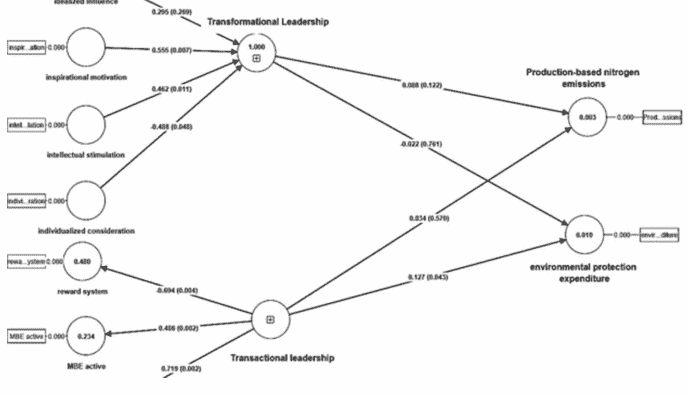

结构方程模型（SEM）在社会科学研究中具有重要意义，因为它分析观测变量和潜在变量之间的复杂关系。SEM 在心理学和社会科学中的实质性应用凸显了其在实证研究中日益增长的重要性（Anderson & Gerbing, 1988）。此外，SEM 已成为社会科学和医学研究中的关键统计工具，表明其被广泛采用以改进分析（Shaheen et al., 2017）。此外，最近的研究强调了 SEM 在社会科学研究中的广泛应用，特别是在态度、行为和绩效测量方面（Al-Qadasi et al., 2021; Ehidiamen et al., 2023）。一些作者还讨论了使用 SEM 的方法论进展和指南，例如在新技术中使用 PLS 路径建模的更新指南（Ali et al., 2018; Hair, 2017; Henseler et al., 2016）。这些方法论进步有助于完善和标准化社会科学研究中的 SEM 实践。因此，SEM 在探索和验证绩效测量领域以及通过路径分析建模环境可持续性预测因子方面的应用，展示了其在这一研究中的多功能性和相关性。

表 2 显示了路径模型结果和其他统计量。根据路径系数，表 2 表明只有交易型领导对环境保护支出有效。路径系数为 0.127，这表明交易型领导与环境保护支出之间存在正相关关系。有趣的是，在纺织行业，变革型领导对可持续性没有显著影响（p 值大于 0.005）。

### 表 2. 路径模型结果

| | 样本均值 (M) | 标准差 (STDEV) | P 值 | 路径系数 |
|---|---|---|---|---|
| 交易型领导 -> 基于生产的氮排放 | 0.037 | 0.06 | 0.57 | 0.034 |
| **交易型领导 -> 环境保护支出** | **0.117** | **0.063** | **0.043** | **0.127** |
| 变革型领导 -> 基于生产的氮排放 | 0.08 | 0.057 | 0.122 | 0.088 |
| 变革型领导 -> 环境保护支出 | -0.017 | 0.072 | 0.761 | -0.022 |

## 讨论与结论

本研究的初步分析表明，变革型领导不显著，而交易型领导方式在可持续性方面具有部分显著性。即使研究表明变革型和交易型领导方式对企业环境方面有积极影响（Changar & Atan, 2021; Tanveer et al., 2021），但我们的结果与文献不同。

根据 Kafetzopoulos 和 Gotzamani 于 2022 年进行的一项研究，交易型领导与可持续组织绩效之间存在显著相关性。虽然该研究未具体说明涉及的环境因素，但表明交易型领导对可持续性结果可能产生积极影响。相比之下，正如 Robertson 和 Carleton 在 2018 年所指出的，关注环境变革的领导者可以间接影响其组织。此外，一项研究发现，变革型领导对员工可持续绩效的影响程度取决于组织成员的组织公民行为。这项研究支持了本研究的结果，即在土耳其纺织行业，变革型领导者对环境具有和谐的热情；然而，影响员工自愿的环保行为并不容易改变。

## 参考文献

Al-Qadasi, N., Zhang, G., & Al-Jubari, I. (2021). 青年对自业就业的态度：也门大学生的证据。*PLoS One*, 16(9), e0257358. doi:10.1371/journal.pone.0257358 PMID:34516592

Ali, F., Rasoolimanesh, S. M., Sarstedt, M., Ringle, C. M., & Ryu, K. (2018). 对部分最小二乘结构方程建模（PLS-SEM）在酒店业研究中应用的评估。International Journal of Contemporary Hospitality Management, 30(1), 514–538. doi:10.1108/IJCHM-10-2016-0568

Alkaya, E., & Demirer, G. N. (2015). 可持续生产方法在土耳其纺织行业扩散的部门评估。Journal of the Textile Institute, 106(11), 1212–1225. doi:10.1080/00405000.2014.985880

Amoako, G. K. (2019). 一个概念框架：企业环境管理活动与可持续竞争优势。Management of Environmental Quality, 31(2), 331–347. doi:10.1108/MEQ-09-2019-0187

Anderson, J. C., & Gerbing, D. W. (1988). 实践中的结构方程模型：综述与推荐的两步法。Psychological Bulletin, 103(3), 411–423. doi:10.1037/0033-2909.103.3.411

Awan, U., Sroufe, R., & Kraslawski, A. (2019). 创造力促进可持续发展：供应商参与作为绿色创新积极影响的边界条件。Journal of Cleaner Production, 226, 172–185. 提前在线出版。doi:10.1016/j.jclepro.2019.03.308

Başkol, M. O. (2018). 土耳其纺织和服装行业的国际竞争力。International Journal of Management Economics and Business, 14(3), 0–0. doi:10.17130/ijmeb.2018343115

Bass, B. M., Avolio, B. J., Jung, D. I., & Berson, Y. (2003). 通过评估变革型和交易型领导力预测单位绩效。The Journal of Applied Psychology, 88(2), 207–218. doi:10.1037/0021-9010.88.2.207 PMID:12731705

Bilgin, M. H., Demir, E., Lau, M. C. K., Kin-Man To, C., & Zhang, Z. (2011). 土耳其手工地毯行业：与若干亚洲国家的比较分析。Journal of the Textile Institute, 102(6), 514–526. doi:10.1080/00405000.2010.498171

Changar, M., & Atan, T. (2021). 变革型和交易型领导力方式在 CSR 环境和伦理方面的作用。Sustainability (Basel), 13(3), 1411. doi:10.3390/su13031411

Cho, C.-C., & Kao, R.-H. (2022). 通过领导力发展可持续工作场所：变革型领导力和组织公民行为的视角。Frontiers in Psychology, 13, 924091. doi:10.3389/fpsyg.2022.924091 PMID:35959035

Çop, S., Olorunsola, V. O., & Alola, U. V. (2021). 通过绿色变革型领导政策实现环境可持续性：绿色团队韧性是否有帮助？Business Strategy and the Environment, 30(1), 671–682. doi:10.1002/bse.2646

Demir, H., & Okan, T. (2008). 互动型与变革型领导：一种量表开发尝试。Yönetim Dergisi: Istanbul Üniversitesi İşletme Fakültesi İşletme İktisadi Enstitüsü, 19(61), Article 61.

Dhammika, K. A. S., & Ahmad, F. bin, Sam, T. L., & Lanka, S. (2014). 交易型和变革型领导的测量：斯里兰卡语境下的效度与信度。Semantic Scholar. https://api.semanticscholar.org/corpusid:55822458

Divrik, B., & Baykal, E. (2023). 中小企业数字化与国际化的关系：来自土耳其纺织和服装行业的证据。Journal of Global Strategic Management, 16, 16. doi:10.20460/JGSM.2023.318

Duran, A., & Temiz Dinç, D. (2016). 土耳其纺织和成衣工业的结构：关税同盟协议之前和之后。İnsan ve Toplum Bilimleri Araştırmaları Dergisi, 5(3), 505. doi:10.15869/itobiad.74629

Ehidiamen Oamen, T., & Moshood Lawal, B. (2023). 使用结构方程模型探索和验证社区药剂师绩效测量领域：对研究的启示与建议。Journal of Scientific Research and Reports, 38–47. doi:10.9734/jsrr/2023/v29i11726

Erat, S., Kitapçı, H., & Akçin, K. (2020). 管理者感知与组织认同：一种比较分析。Sustainability (Basel), 12(6), 2278. doi:10.3390/su12062278

ErhabOr, N. I. (2018). 通过环境教育中的指导培养领导者。Electronic Green Journal, 1(41). doi:10.5070/G314134454

Görgülü, V. (2020). 危机管理中交易型和权威型组织领导风险的负面影响案例研究。Turkish online journal of design art and communication, 10(4), 597–611. doi:10.7456/11004100/020

Gümüş, D., & Akbal, F. (2011). 纺织染料和废水的光催化降解。Water, Air, and Soil Pollution, 216(1–4), 117–124. doi:10.1007/s11270-010-0520-z


- Guo, Y., Zhu, L., Ye, X., Wang, X., Xu, Y., Qian, G., & Wang, L. (2023). 基于化学足迹法的中国纺织工业氮氧化物和二氧化硫排放毒性影响评估. AATCC研究杂志, 10(4), 232–240. doi:10.1177/24723444231161744

- Hair, J. F. (Ed.). (2017). 部分最小二乘结构方程模型（PLS-SEM）入门（第2版）. 塞奇出版社.

- Hasanbeigi, A., & Price, L. (2012). 纺织工业能源使用与节能技术综述. 可再生能源与可持续能源评论, 16(6), 3648–3665. doi:10.1016/j.rser.2012.03.029

- Henseler, J., Hubona, G., & Ray, P. A. (2016). 新技术研究中PLS路径建模的应用：更新指南. 工业管理与数据系统, 116(1), 2–20. doi:10.1108/IMDS-09-2015-0382

- 投资于特拉基亚-特克尔达古. (2023). 纺织业—行业—投资于特拉基亚. 投资于特拉基亚 - 特克尔达古, 埃迪尔内, 基尔克拉雷利. https://www.investintrakya.org.tr/en/36635/Textile-Sector

- Iqbal, Q., Ahmad, N. H., & Li, Y. (2021). 边疆亚洲地区的可持续领导力：管理酌情权与环境创新. 可持续性（巴塞尔）, 13(9), 5002. doi:10.3390/su13095002

- Ismail, A., Mohamad, M., Mohamed, Hj. H. A.-B., Rafiuddin, N., & Zhen, K. (2010). 变革型与交易型领导风格作为个人结果的预测因素. 理论与应用经济学, 6(547), 89–104.

- Jain, D. (2022). 印度纺织及服装业普遍存在的人力资源问题与挑战. 家庭科学国际期刊, 8(3), 227–232. doi:10.22271/23957476.2022.v8.i3d.1378

- Jiang, W., Zhao, X., & Ni, J. (2017). 变革型领导力对员工可持续绩效的影响：组织公民行为的中介作用. 可持续性（巴塞尔）, 9(9), 1567. doi:10.3390/su9091567

- Kafetzopoulos, D., & Gotzamani, K. (2022). 人才管理与领导风格对企业可持续绩效的影响. 欧洲商业评论, 34(6), 837–857. doi:10.1108/EBR-07-2021-0148

- Karabag, S. F., Lau, M. C. K., & Suvankulov, F. (2014). 企业竞争力的决定因素：土耳其纺织及服装业个案. 纺织学会杂志, 105(1), 1–11. doi:10.1080/00405000.2013.811787

- Kaya, Y., Karakan, G. G., & Visileanu, E. (2019). 外汇波动对土耳其纺织业的影响. 布加勒斯特纺织工业, 70(03), 291–296. doi:10.35530/IT.070.03.1591

- Khan, A. Md., & Jantan, A. H. B. (2022). 心理授权在交易型领导力与个人创新关系中的调节作用：来自孟加拉国银行业的证据. 国际商业与管理杂志, 5. doi:10.37227/jibm-2022-09-5488

- Li, Z., Xue, J., Li, R., Chen, H., & Wang, T. (2020). 环境特定性的变革型领导力与员工的环保行为：环保热情与自主动机的中介作用. 心理学前沿, 11, 1408. doi:10.3389/fpsyg.2020.01408 PMID:32670165

- Lu, C., Wang, H., & Li, J. (2020). 环境保护投资与技术创新对企业绩效协同效应的研究. 欧洲商业与管理杂志, 12(11), 1–13.

- Metcalf, L., & Benn, S. (2013). 可持续发展领导力：领导能力的演变. 商业伦理杂志, 112(3), 369–384. Scopus. 提前在线出版. doi:10.1007/s10551-012-1278-6

- Moraru, G.-M. (2021). 未来工程师的创造力：罗马尼亚组织中未被充分利用的资源. 可持续发展管理, 13(1), 21–25. doi:10.54989/msd-2021-0004

- Muralidharan, E., & Pathak, S. (2018). 可持续性、变革型领导力与社会创业. 可持续性（巴塞尔）, 10(2), 567. doi:10.3390/su10020567

- Permata Sari, R. Y., Yuliati, L., & Komariyah, S. (2019). 印度尼西亚行业内贸易：纺织及纺织品工业个案. 国际商业、经济与创业杂志, 4(1), 47. doi:10.24191/jibe.v4i1.14416

- Pultz Schlosser, K., & Volkova, T. (2022). 社会企业战略领导力：交付共享价值. 商业与管理杂志, 20, 36–56. doi:10.32025/JIBM22002

- Qian, J.-H., Qiu, Y.-Y., Yang, Y.-D., Li, Y., Xu, P.-H., & Wang, L.-L. (2020). 棉机织物化学足迹的核算与评估. 布加勒斯特纺织工业, 71(03), 209–214. doi:10.35530/IT.071.03.1678

- Qingfen, Z., Wei, G., & Yuwen, Z. (2023). 中国纺织业经济与污染排放重心的时空轨迹. 管理科学与技术世界期刊. doi:10.57237/j.wjmst.2022.01.006

- Quinn, L., & Dalton, M. (2009). 为可持续发展而领导：实施领导任务. 公司治理（布拉德福德）, 9(1), 21–38. doi:10.1108/14720700910936038

- Reddy, S. M. W., Torphy, K., Liu, Y., Chen, T., Masuda, Y. J., Fisher, J. R. B., Galey, S., Burford, K., Frank, K. A., & Montambault, J. R. (2021). 项目团队分配中创建的不同形式的社会资本如何影响员工采纳可持续发展实践. 组织与环境, 34(1), 43–73. doi:10.1177/1086026619880343

- Robertson, J. L., & Carleton, E. (2018). 揭示环境领导力如何及何时影响员工自愿环保行为. 领导力与组织研究杂志, 25(2), 197–210. doi:10.1177/1548051817738940

- Shaheen, F., Ahmad, N., Waqas, M., Waheed, A., & Farooq, O. (2017). 社会科学与医学研究中的结构方程模型（SEM）：改进分析指南. 商业与社会科学学术研究国际期刊, 7(5), 132–143. doi:10.6007/IJARBSS/v7-i5/2882

- Singh, S. K., Giudice, M. D., Chierici, R., & Graziano, D. (2020). 绿色创新与环境绩效：绿色变革型领导力与绿色人力资源管理的作用. 技术预测与社会变革, 150, 119762. doi:10.1016/j.techfore.2019.119762

- Souto, J. E. (2022). 组织创造力与可持续导向创新作为可持续发展驱动力：克服企业的经济、环境和社会可持续发展挑战. 制造技术管理杂志, 33(4), 805–826. doi:10.1108/JMTM-01-2021-0018

- Suliman, M. A., Abdou, A. H., Ibrahim, M. F., Al-Khaldy, D. A. W., Anas, A. M., Alrefae, W. M. M., & Salama, W. (2023). 酒店业背景下绿色变革型领导力对员工环境绩效的影响：绿色工作投入是否重要? 可持续性（巴塞尔）, 15(3), 2690. doi:10.3390/su15032690

- Suphattanakul, O. (2017). 变革型领导力在有效战略实施中的作用：组织文化的调节效应. 新兴经济体商业与社会评论期刊, 3(2), 253–262. doi:10.26710/jbsee.v3i2.80

- 可持续发展报告. (2023). SDG指数. https://dashboards.sdgindex.org/

- Sutrisno, A. (2022). 新冠肺炎疫情影响下的印度尼西亚纺织业. 赛伯内特学：政府研究杂志, 2(1), 1–8. doi:10.26618/kjgs.v2i1.7853

- Tanveer, A., Anwer, M. A., & Umar, M. (2021). 环境可持续性和财务资源利用对企业财务绩效的影响：领导风格的中介作用. 社会科学与透视年鉴, 2(2), 389–407. doi:10.52700/assap.v2i2.46

- Tokel, D., Dogan, I., Hocaoglu-Ozyigit, A., & Ozyigit, I. I. (2022). 土耳其棉花农业及土耳其棉花的全球经济影响. 天然纤维杂志, 19(15), 10648–10667. doi:10.1080/15440478.2021.2002759

- 土耳其统计局. (2023a). TÜIK - 数据门户. 统计数据门户. https://data.tuik.gov.tr/Kategori/GetKategori?p=Cevre-ve-Enerji-103

- Tunc, M., Kaplan, K., Sisbot, S., & Camdali, U. (2016). 能源管理与优化：土耳其伊斯坦布尔一家纺织厂个案研究. 世界工程杂志, 13(4), 348–355. doi:10.1108/WJE-08-2016-046

- Wang, C., Gou, L., & Li, X. (2022). 教育是否有利于环境友好行为？来自首席执行官的证据. 环境研究与公共卫生国际杂志, 19(18), 11391. doi:10.3390/ijerph191811391 PMID:36141663

- Wesselink, R., Blok, V., & Ringersma, J. (2017). 工作场所的环保行为及管理者和组织的作用. 清洁生产杂志, 168, 1679–1687. doi:10.1016/j.jclepro.2017.08.214

- Wolf, J. (2011). 可持续供应链管理整合：对德国制造业的定性分析. 商业伦理杂志, 102(2), 221–235. doi:10.1007/s10551-011-0806-0

- Xenikou, A., & Simosi, M. (2006). 组织文化与变革型领导力作为业务单位绩效的预测因素. 管理心理学杂志, 21(6), 566–579. doi:10.1108/02683940610684409

- Xia, L., Lam, S. K., Chen, D., Wang, J., Tang, Q., & Yan, X. (2017). 基于知识的氮管理能否以更低的温室气体排放和反应性氮污染产出更多主粮？一项荟萃分析. 全球变化生物学, 23(5), 1917–1925. doi:10.1111/gcb.13455 PMID:27506858


Yang, L., Qin, H., Gan, Q., & Su, J. (2020). 内部控制质量、企业环保投资与财务绩效：中国A股重污染行业实证研究。*International Journal of Environmental Research and Public Health*, 17(17), 6082. doi:10.3390/ijerph17176082 PMID:32825596

Yao, Y.-H., Fan, Y.-Y., Guo, Y.-X., & Li, Y. (2014). 领导力、工作压力与员工行为。*Chinese Management Studies*, 8(1), 109–126. doi:10.1108/CMS-04-2014-0089

Yu Chuan, Y. (2022). 情景规划与领导力对多层次营销（MLM）行业非财务绩效的影响。*International Journal of Accounting Finance in Asia Pacific*, 5(3), 17–38. doi:10.32535/ijfap.v5i3.1728

Yukl, G. A., & Gardner, W. L. (2020). *组织中的领导力* (第9版). Pearson Education, Inc.

# Chapter 12
基于公共领域理论的民间商业群体与国家互动研究：上海与...

Wei Yao
中国南京大学

Yuhong Li
https://orcid.org/0000-0002-3544-4475
中国南京大学

Tingxuan Liu
中国南京大学

## 摘要

本章试图以公共领域理论为出发点，比较19世纪英国政府在保护英国在华商业利益方面的行为与中国政府忽视中国在菲律宾商业利益的行为。本章将中国商会上海分会和菲律宾中华慈善总会作为英国和中国私营商业群体的代表。对于英国，由于英国境内与中央政府竞争的公共领域存在，私营商业群体在实施任何经济外交政策时必须与相关私营商业群体协商。这一过程促进了英国政府与社会之间的共识，并增强了英国政府维持英国在华商业的决心。然而，对于中国，由于中央政府与社会互动的公共领域缺失，尽管中国私营商业群体在海外拥有巨大利益，国家与社会始终无法形成积极互动。与此同时，这种情况也导致菲律宾的华商不得不依靠自身能力来维护当地利益。

## 引言

长期以来，国家与社会的互动一直是大多数学者关注的问题，中央政府作为国家代表所做出的政治决策或外交政策或多或少影响了社会不同群体的利益。特别是在经济方面，国家在“公共利益”中是否考虑私营商业群体的利益，是积极互动的关键。一般而言，“公共利益”被视为国家利益。如果一个国家希望有效动员其社会成员，就必须能够考虑其大多数成员的“公共利益”。根据迈克·芬塔克（Mike Feintuck）对“公共利益”的讨论，可以发现“公共利益”大约有三种功能。第一种功能是，公共利益作为干预私人行为的合法化手段。为了塑造与关系高度绑定的公民，国家会试图改变其生活条件，使其具备国家的核心价值观。第二种治理与功能，“公共利益”是“竞技场”的功能，即由国家利益所代表的“公共利益”的能力。也就是说，国家利益在多大程度上代表了“公众”？第三种功能是社会行为者是否能够自觉代表“公共利益”并与国家互动（Feintuck, 2014）。然而，如果我们将私营商业群体视为社会的一部分，那么为什么有些国家强烈支持这一群体，从而使国家与社会的利益有效地结合在一起呢？然而，在一些国家，由于国家与社会及私营商业群体之间的利益差异，国家与社会之间产生冲突。

从19世纪到20世纪初，作为当时世界上最重要的国家之一，英国不仅能够维护海外国家利益，还极大地保护了英国在华商业的利益。例如，在与中国政府讨论对华加征关税问题时，英国政府不仅征求了中国英国商业组织（如中国商会上海分会）的意见。英国政府还积极与本国其他私营商会谈判，以确保“公共利益”最大化。相反，中国不仅无法在其领土上维护国家的基本主权利益，也无法维护东南亚华商的利益。例如，菲律宾中华慈善总会作为菲律宾的华商协会，在面对美西战争时积极寻求中国政府的帮助，希望获得国家支持，但最终仍不得不依靠自身自给自足。

为什么在中国和英国，私营商业群体在面对相似的利益诉求时，会得到国家截然不同的反馈？为什么中国政府和英国政府对国内商业群体的态度存在如此巨大的差异？本文将以此作为讨论的出发点。

## 研究假设与理论

在19世纪的国际环境中，无论是中国的英国商会还是东南亚华商的商业活动，都是民间自发的商业组织。它们既是行使公民权利的社会一部分，也是国家海外利益的先驱。为了解释国家与社会互动与“私营商业组织”之间的关系，本文将以哈贝马斯的“公共领域”理论为框架进行修订。哈贝马斯认为，公共领域就是这样一个平台。公共领域的一部分由各种对话组成。行为者之间的每一次对话都促使他们聚集成公众群体，从而形成公共领域的一部分。

当行为者（包括国家）围绕其利益进行对话和互动时，与私人利益相关的问题将成为公共问题，从而形成影响行为者之间关系和认知的互动领域。公共领域是国家与社会之间的调解领域，国家与社会将在其中就“公开性”和“公共原则”进行博弈以达成共识（Habermas 1999）。尽管哈贝马斯很好地解释了国家与社会之间博弈的过程，但他解释不足之处在于：如果国家与社会之间存在互动平台，那么国家与社会之间的互动就不应该存在（太多）矛盾。然而，事实是，有些国家在与社会的互动中并没有“公共领域”；有些国家和社会可能拥有“公共领域”，但这不一定能达成“共识”。

关于“公共领域”与“共识”之间的关系，哈贝马斯很好地解释了国家与社会之间共识的形成。将形成一种“共识”，它代表了国家与社会之间的“信任”关系。共识作为一种相互信任的状态，可以帮助公民社会信任代表国家的中央政府的行为，消除治理社会的障碍。同时，“公共领域”也是一种“制度仪式”。“确认仪式”是一种再现社会规则的方式，以实现国家对社会建设的权威效果。“确认仪式”不仅发生在国家授权的各个单位（如学校）中，也发生在社会对国家（中央政府）合法性的反馈中。（例如，民主国家定期举行的选举是一种旨在再现国家合法性的确认仪式。）因此，我们可以说，“公共领域”对于社会与国家的互动至关重要（Bourdieu, 2023a; 2023b）。

“公共领域”的意义也说明了国家与社会互动的逻辑。尽管国家对社会拥有绝对控制权，但社会向国家反馈有两种模式。一种是“从众逻辑”；逻辑服从“意味着社会与国家形成共同的逻辑范畴，从而实现相互的精神认同。简而言之，社会对国家的统治是一种“信任”态度。第二种是“道德服从”：“道德服从”指的是在共享价值的共享领域中进行伦理参与。换句话说，社会对国家的统治是一种“顺从”态度。伦理价值共享意味着社会遵循国家制定的规范（Bourdieu, 2023a）。

通过对“共识”与“公共领域”关系的上述考察，我们可以观察到，在现代国家中，社会始终依赖于国家对其权利的认可。因此，我们将使用“公共领域”和“社会对国家的依赖”作为变量，来探索国家与社会互动的因果机制。

### 假设1
当一个国家的公共领域存在且社会对国家有高度依赖（服从与信任共存）时，这表明国家与社会之间存在积极互动。在这种情况下，国家将支持社会并发展殖民组织。

### 假设2
当一个国家的公共领域存在，且社会对国家的依赖程度较低（服从与信任仅存在于一方）时。这表明国家与社会仅达成了部分共识，但坚持相互互动的原则。

### 假设3
当一个国家的公共领域不存在，但社会对国家的依赖程度较高（服从与信任共存）时，这表明国家直接治理社会，但社会缺乏自主权。


## 表 1. 公共领域依赖假设

| | 公共领域存在（国家与社会之间存在共识） | 公共领域不存在（国家与社会之间不存在共识） |
|---|---|---|
| 社会对国家的高度依赖（服从与信任并存） | 国家支持社会并发展殖民组织。 | 国家直接管辖社会，但社会缺乏自主权。 |
| 社会对国家的低度依赖（服从与信任仅存在单一层面） | 国家与社会仅达成了部分共识，但他们遵循相互作用原则。 | 社会只能通过自立自强来确保其利益。 |

（由作者自绘）

假设 4：当一个国家的公共领域不存在，且社会对国家的依赖程度较低（服从与信任仅存在于单一侧面）时，这表明社会只能通过自立自强来确保其利益。

## 结果

## 中国社团上海分会

## 关于取消厘金和提高关税问题的提案：中国社团上海分会与英国政府的积极互动

在经济方面，上海分会要求废除厘金卡隘。为解决镇压太平天国运动（太平天国运动）引发的财政危机，中国政府设立了厘金卡隘，这类似于捐款，但可以长期实施（Luo 2010）。自此，不加区别地征收厘金，以及官员的勒索，严重阻碍了全国货物的流通。为了进一步发展与中国的贸易，中国的英国商人急于废除厘金卡隘。他们寻求英国政府的支持。义和团运动（义和团运动）之后，上海英国总领事馆与商会就英中之间的谈判进行了磋商。上海分会强烈要求废除厘金卡隘（Dudgeon 1901）。面对大英帝国的全球式微，回应美国关于“开放门户”的要求，英国政府支持了上海分会的诉求，并将取消厘金问题列入了英中续订商约通商章程的谈判议程。

在外交方面，中国社团上海分会要求关税上调必须以取消厘金为前提。为了尽快获得庚子赔款（庚子赔款），德国、俄国、法国等国提出将对华进口关税提高到 10%（Liu & Liu 1984）。这一举措将增加上海分会与中国贸易的成本。得知此事后，上海分会致电伦敦的中国社团总部，反对任何无偿提高关税的行为（Dudgeon 1902b）。如果能够转移取消厘金等商业利益，上海分会愿意承担关税上调的负担。单个部门很难获得公共权力。但当许多单个单位联合行动时，就有可能与公共行为体竞争。上海分会通过中国社团伦敦总部，与众多从事对华贸易的英国商会联络，共同向英国政府施压以影响政府决策。中国社团广泛征求了布里斯托商会、利兹商会和利物浦商会对“取消厘金和提高关税”提案的支持（Spear 1901; Calvert 1901; Barker 1901）。在英国商业界的压力下，英国政府代表在辛丑条约谈判中表示，如果关税提高到 10% 以上，中国政府应取消厘金并给予其他商业让步（Wang 1985）。得到英国政府支持的上海分会的这一议题，也已得到列强的承认。但此时，谈判的焦点是义和团运动（义和团运动）的善后事宜。取消厘金和提高关税的问题被安排在与中国续订商约通商章程的谈判中进行。

## 关于取消厘金和提高关税的筹划：上海分会与英国政府之间的部分共识

在经济方面，上海分会要求对中国的进口关税不应过高。首先，上海分会通过组织动议向英国政府发起集体呼吁。为了向英国政府施压，单个商人/企业的力量是有限的。然而，利用上海分会作为平台，中国的英国商人的诉求得到了集中。1902 年 1 月，英国条约专使麦凯与上海分会委员会共同制定了取消厘金和提高关税的计划。然而，大多数普通成员对将关税税率提高到 15% 的提案表示不满。为解决这一问题，上海分会于 3 月 3 日举行全体会议，讨论该计划并进行投票。会议上的投票否决了麦凯的计划（Mackay 1902a）。如果没有中国的英国商人的支持，对华政策将缺乏实际的执行者。英国政府在认识到上海分会的重要性后，采取了合作态度。

英国政府积极争取委员会成员，试图利用精英阶层的支持来控制集会的结果。查尔斯·约翰·达奇逊和新任上海分会主席詹姆斯·L·斯科特均已与英国政府建立了合作关系。委员会以弃权票过多为由宣布决议无效，并重新召开了会议（Dudgeon 1902a）。另一方面，麦凯向斯科特提交了取消厘金和提高关税的整个计划，建议在下次会议上阐明细节，以争取成员的认可（Mackay 1902c）。鉴于此时与英国政府达成协议存在困难，上海分会也积极寻求其他具有共同利益的组织的支持。当曼彻斯特商会、伍斯特商会等具有直接利益的商会了解到上海的情况后，先后反对了英国政府的计划（Corbett 1902; Manchester Chamber of Commerce 1902）。

曼彻斯特商会致信英国外交部，指出将关税税率提高到 15% 将给贸易带来严重负担。当地商人的言论使英国政府意识到，反对声音不仅限于中国。上海分会的行动代表了英国大部分资产阶级的意志。英国政府并未强力干预上海分会的第二次成员大会。在第二次会议上再次否决原计划后，英国政府选择听取民意，邀请商会代表共同调整麦凯制定的取消厘金和提高关税的计划。在海关副总税务司罗伯特·爱德华·布雷登的协调下，关税税率上调幅度降低到了 12.5%（Zhong 1994）。尽管采取了诸多手段，由于上海分会的存在，英国政府仍无法完全动摇中国英国商人的立场。英国政府最终不得不做出妥协。

其次，上海分会通过向媒体呼吁其诉求并制造舆论压力，干预了英国政府的决策。由中国的英国商人创办的有影响力的报纸《北华捷报》，已成为上海分会最强大的舆论工具之一。在取消厘金和提高关税计划宣布后，爱德华·S·


Little是上海分支机构的一名成员，他撰写了一本名为《从商人角度看中国收入与新条约：反对提高关税》的手册，以推动舆论反对该计划（Little 1902）。《北华捷报》编辑部印刷并出版了这本手册，这不仅影响了上海分支机构许多成员的态度，也在英国公众中引发了广泛讨论。许多直接参与中国贸易的反对者使用《北华日报》等媒体提出了大量有说服力的异议。在上海分支机构第一次大会后，由于弃权票过多，为了赢得会议中保持沉默者的支持，Edward S. Little在《北华日报》上发表了一篇致驻中国英国总领事馆商务参赞的演说，指责英国政府未能妥善规管《天津条约》（天津条约）中关于货物运往内地应收2.5%过路通行费的条款。

他质疑取消厘金和提高关税计划的可行性（Little 1902年3月5日）。在此过程中，英国政府和该计划的支持者也利用舆论进行反击。《泰晤士报》记者J. O. P. Bland发表文章，反驳Little对《天津条约》（天津条约）的解释，并呼吁在中国的英国商人支持该计划，以换取真正的门户开放（Bland 1902）。另一方面，该分支机构采用各种手段引导舆论。《上海汇报》攻击Bland的身份，Bland多年一直是海关雇员，暗示关税提高是因为首席税务官罗伯特·哈特爵士愿意损害英国人的利益，为中国聚敛财富（The National Archives 1902）。Mackay密切关注辩论，将所有报纸剪报寄给兰斯多恩侯爵（Marquess of Lansdowne），遗憾的是指出，除了Bland的文章外，大多数其他评论都反对该计划（Mackay 1902b）。由于中国几乎所有英文报纸都代表英国商人的利益，英国政府在舆论战场上几乎失败了。它不得不就上海分支机构能够接受的关税增加幅度做出让步。

在外交方面，上海分支机构要求英国政府迫使中国政府扩大废除厘金关卡的范围，以畅通中国内地市场。Mackay最初提出的废除厘金关卡计划并未包括盐关卡、地方鸦片关卡等。中国政府已强调上述关卡与厘金关卡的区别，以及在内地调查违法活动和征税的重要性。上海分支机构坚持认为，这些关卡与厘金关卡相同，必须纳入废除范围。上海分支机构通过刊登一系列文章，利用报纸进行了猛烈抨击。文章指出，阻碍内地贸易发展的桎梏不仅仅是厘金关卡。如果不废除盐关卡和地方鸦片关卡，商品流通的敲诈勒索将继续存在（Little 1902年6月25日）。在中国的英国商人舆论压力下，Mackay在条约修改会议上提出废除盐关卡和地方鸦片关卡。

身为中国条约使节的盛宣怀（Sheng Xuanhuai）对范围的突然扩大表示困惑和反对（China, 1994）。参与谈判的地方官员刘坤一（Liu Kunyi）和张之洞（Zhang Zhidong）也坚决抵制（Chen 2018; Zhao 2008）。英国政府通过将盐关卡改名为盐务报告站、将地方鸦片关卡改名为鸦片站，并建立监管体系来妥协。然而，上海分支机构并未领情，发起了另一轮舆论攻势。在中国，英国商人指出，盐关卡仅是名义上的废除。（Little 1902年10月5日）。然而，盐税和鸦片税都是中国政府的重要财政收入来源，尤其用于抵偿外债，包括对英国的债务。英国政府无法支持上海分支机构的要求。如果行为者有特定的基本利益，他们会努力最大化其效用。对这两者而言，最理想的政策是在这一问题领域最大化其基本利益的政策选择（Milner 1997）。最终，英国政府设立出厂税，以换取当地英国商人对该计划的认可。上海分支机构被迫接受这一结果。

所有关于公共权力和私人权力演变的研究都表明，这两类权力都走向了极端，但都提供了彼此不冲突的持久利益（Rothkopf 2012）。在取消厘金和提高关税问题上，英国政府（公共/政府行为者）与上海分支机构（私人/非政府行为者）就公共事务管理进行了激烈的博弈。上海分支机构通过集体动议、舆论攻击等手段向英国政府施压以实现其利益，这体现了私人行为者试图将其权力扩展到公共领域。另一方面，英国政府采取行政强制令、分化组织结构等方法，以维持其在公共事务中的权威。其中，非政府行为者因其内部结构松散、成员利益不一致、易受外部影响，甚至难以实现内部权力，存在明显缺陷。然而，其杠杆作用不可忽视。

然而，上海分支机构与英国政府之间博弈的最终目标，仍是追求最大利益的最大化。尽管英国政府在本问题上采用各种手段，试图压制上海分支机构的诉求，并迫使其配合海外战略。上海分支机构也采用各种方法，基于中国英国商人的意见向政府施压，要求其改变政策。然而，英国政府始终为与中国的英国商人沟通合作提供了一个平台。上海分支机构的各项诉求并未偏离这个平台。显而易见，英国政府充分理解，在市场导向体制下，公共事务掌握在政府和行业两个主导群体手中。他们必须尽最大努力合作（Lindblom 1997）。

基于相互妥协，双方在取消厘金和提高关税问题上达成了协议，为英国在华商业提供了便利。另一方面，上海分支机构也不得不接受对中国机械产品征收额外的出厂税，以保护当地英国商人的利益，并争取当地英国商人对取消厘金和提高关税计划的支持。

## 菲律宾华人慈善协会 Inc.

## 菲律宾设立中国领事馆问题：菲律宾华人慈善协会的非正式殖民主义

在经济方面，菲律宾华人慈善协会 Inc.请求中国政府设立领事馆，以促进中国商业在菲律宾的发展并保护工商业安全。在西班牙统治期间，殖民者制定了各种苛刻法规限制华侨（You 1957）。行业税和店铺税被用来限制华侨商业（Huang & He 2009）。面对这种不公正待遇，菲律宾华人慈善协会将注意力转向其祖国。他们试图寻求中国政府的支持。

1886年，菲律宾华人慈善协会的核心董事，包括叶龙钦（Ye Longqin）、陈谦善（Chen Qianshan）、林光合（Lin Guanghe）和许志螺（Xu Zhiluo）（Philippines 1977），来到中国，提交了一份由290名华商签署的文件，请求中国政府在菲律宾设立领事馆（Wickberg 1965）。与菲律宾华商的利益相比，中国政府更关心设立领事馆的资金问题。新任命的驻美国、西班牙和秘鲁大使张荫桓（Zhang Yinhuan）在香港会见了菲律宾华人慈善协会的代表。他觉得他们始终没有忘记对祖国的眷恋，希望寻求中国政府的保护。然而，这些海外华商尚未


关于提供领事基金问题已明确表态，因此他决定派人前往菲律宾调查情况。在确认能够提供稳定资金后，再进一步讨论设立领事馆一事（Yuan et al. 1998）。随后的调查结果显示，菲律宾华商愿意筹集设立领事馆的资金。然而，外务部仍担心该领事馆会像古巴和新加坡的领事馆一样。华商最初积极筹款，但后来动力减弱（First Pavilion 2003）。实质上，中国政府不希望承担菲律宾领事馆的任何经济负担。

卡蒂普南起义爆发后，菲律宾政府强迫华商运输粮食。起义军因此憎恨华商。菲律宾华商的商店被起义军洗劫。菲律宾华人慈善协会（注册）再次请求中国政府设立领事馆，以保护菲律宾华商行业的安全（Wilson 2004）。然而，驻华西班牙大使声称，起义军对华商的仇恨源于非常普遍的正常贸易竞争（Huang III, 1989）。由此可知，菲律宾华裔在日常生活中所面临的迫害显而易见。在西班牙殖民统治下，海外华人的经济能力受到极大限制（Zhu & Liu 2009）。面对这种借口，中国政府既未追究也未问责菲律宾华商行业的安全问题（Huang III, 1989）。

1898年4月，美西战争爆发（Yang 2019）。鉴于菲律宾华商财产安全形势危急，中国政府在对国际法有所了解后（Yu 1998; Zhu 2017），要求菲律宾英国领事保护华商（Huang & He 2009）。中国政府还要求菲律宾华人慈善协会（注册）筹集资金，支付英国在菲律宾保护华商的费用（Huang III, 1989）。由此可见，中国政府不愿承担保护菲律宾华人的费用。

在外交方面，菲律宾华人慈善协会（注册）请求中国政府设立领事馆，以提高菲律宾华商的政治地位并保障生命安全。1886年，菲律宾华人慈善协会（注册）派遣代表前往中国，请求在菲律宾设立领事馆。会见张荫桓（张荫桓）后，菲律宾外交部以该事属于殖民行政管辖为由予以拒绝。然而，张荫桓（张荫桓）过于轻易地接受了这些口头借口，他在日记中写道，自己深知外交部所面临的困难。他不再坚持（Ren & Ma 2015）。1889年，新任驻美国、西班牙和秘鲁大使崔国因（崔国因）准备在访问马德里期间恢复关于在菲律宾设立领事馆的谈判。然而，由于美国发生了一起意外事件，崔国因（崔国因）匆忙返回。此后此事再无下文（Wang & Wang 2015）。从这两位大使的态度可以看出，中国政府对此事重视有限。

卡蒂普南起义期间，菲律宾华商遭受起义军欺凌。菲律宾华人慈善协会（注册）再次向中国政府提议在菲律宾设立领事馆，并恳请派遣军舰保护海外华人。他们还恳求其他国家保护海外华人，但担心设立领事馆难以迅速实现（Wilson 2004）。中国政府未提及派遣军舰一事。它不愿代表海外华人采取任何军事行动。设立领事馆的请求仅在回应驻华西班牙大使时由中国政府提出。中国政府称海外华人深受迫害。如果能像其他国家一样设立领事馆，情况就不会如此悲惨（Huang III, 1989）。这种假设性的委婉说法自然不能作为请求设立领事馆的正当表述。针对其他国家提供援助的请求，外务部召见驻英国大使杨儒（杨儒），要求菲律宾英国领事保护海外华人（Huang & He 2009）。但当驻华西班牙大使反对英国保护华人的行为时，中国政府未再提及此事（Huang III, 1989）。然而，英国政府承担了保护海外华人的责任，无视了西班牙政府的反对。在菲律宾英国领事的保护下，两名在菲律宾受到虐待的华商蔡燥（蔡燥）和陈党（陈党）的案件胜诉（Huang & He 2009）。中国外务部就此对英国驻华大使表示由衷感谢。同时也希望菲律宾英国领事未来能依据国际法保护海外华人（Huang 1989; Long 2007）。换言之，中国政府已完全忘却对海外华人的责任。

美西战争期间，菲律宾华商深受牵连。然而，菲律宾华人慈善协会（注册）不再请求中国政府派遣军舰。它只恳求尽快在菲律宾设立领事馆以提供保护（Huang IV, 1989）。菲律宾华商的生命安全岌岌可危。驻美国、西班牙和秘鲁大使伍廷芳（伍廷芳）仅建议外务部（外务部）声明，如果西班牙政府仍拒绝在中国在菲律宾设立领事馆，将规定如何补偿海外华人生命和财产的损失。中国对没有领事约束的海外华人惹出的麻烦不承担任何责任（Huang IV, 1989）。这份类似免责声明的表述，远不能满足菲律宾华商在战时确保安全的需求。此时，马尼拉已被美国军队包围。西班牙政府几乎失去控制。为挽救当前危机，西班牙政府同意中国政府在马尼拉临时设立领事（Wilson 2004）。7月29日，外务部任命陈谦善（陈谦善）之子陈纲（陈纲）为菲律宾领事（Liang 2004）。美国军队占领马尼拉后，外务部转而与美国政府谈判。10月4日，伍廷芳（伍廷芳）向外务部通报，美国政府已批准中国在马尼拉设立领事馆（Huang 1989）。

驻美国、西班牙和秘鲁大使的态度在其之前与西班牙外交部的交往中可见一斑。可以说其政治作风松懈甚至懒惰。此外，在与西班牙外交部就设立菲律宾领事馆进行谈判时，张荫桓（张荫桓）强调，招商局（招商局）打算承运货物，以扩大中国政府业务范围（Ren & Ma 2015）。中国官员的各种考量与菲律宾华商所期望的领事角色不同。中国官员对设立领事馆的支持有限。

## 关于中国在菲律宾领事角色的问题：菲律宾华人慈善协会（注册）与中国政府之间的相互不信任

在经济方面，菲律宾华人慈善协会（注册）仍需自行解决许多经济事务。当其辖下的慈善机构中华总医院面临资金短缺时，菲律宾华人慈善协会（注册）在与鸦片进口商讨论后，决定将每盒鸦片80元作为医院资金。同时，菲律宾华人慈善协会（注册）准备对返国华人征收出口税以协助医院筹资。菲律宾华人慈善协会（注册）请求菲律宾总督批准，通知海关办理相关手续（Philippine Chinese Charitable Association Inc. 1977）。领事无法协助菲律宾华人慈善协会（注册）在


解决资金问题，还觊觎菲律宾华商的财务资源。他们对外国经济帝国主义的看法非常强烈。1906年，中国政府命令菲律宾领事召集菲律宾华人慈善总会 Inc. 等商会，讨论联合组织华商公司及建立银行、航运、保险等业务（Philippine Chinese Charitable Association Inc. 1977; Yung 1996; LI 2023）。

在外交方面，菲律宾华人慈善总会 Inc. 请求领事与美国政府谈判，禁止针对华侨的歧视性法规。1906年，美国政府发布法规，要求所有从中国返回马尼拉的中国人停留一周以检测疾病。为防止华侨被敲诈，菲律宾华人慈善总会 Inc. 向中国驻菲律宾领事提出抗议（Philippine Chinese Charitable Association Inc. 1977）。然而，此事一直未得到解决，直至中国政府垮台。华侨进入马尼拉时仍然面临羞辱。他们像囚犯一样被关押数天，接受身体检查和审讯（Arturo 1986; Guo 1999; Yu 1998）。1913年，菲律宾华人慈善总会 Inc. 选举代表，抗议入境检查期间海关检疫医生的严苛对待（Philippine Chinese Charitable Association Inc. 1977）。为进一步争取消除不公平待遇，菲律宾华人慈善总会 Inc. 联合其他商会力量，共同对美国在菲律宾的殖民政府施加压力。1924年，为回应新的移民法案，菲律宾华人慈善总会 Inc. 与华商总会和广东会馆一起，向菲律宾美国总督伦纳德·伍德（Leonard Wood）提交了抗议书。在菲律宾华商社群的压力下，伍德以违反美国宪法为由驳回了该案（Huang & He 2009; Zhuang 2009）。

## DISCUSSION

通过两个海外私人商业团体与其母国政府之间的互动，我们可以发现四种对应不同结果的互动形式。当公共领域存在时，上海分支和英国政府可以围绕公共问题进行积极互动。上海分支通过集体压力、报纸舆论、集会和投票影响英国政府的决策。当上海分支服从并信任英国政府时，英国政府支持它。上海分支成为英国政府的殖民组织。英国政府发展了帝国主义。当上海分支只服从但不信任英国政府时，英国政府与上海分支达成了部分共识，以推广重商主义。

当公共领域不存在时，菲律宾华人慈善总会 Inc. 和中国政府无法围绕公共问题进行积极互动。当菲律宾华人慈善总会 Inc. 服从并信任中国政府时，该总会只能通过提交请愿书和与中国官员私下会面向中国政府提出利益诉求，而不影响其决策。菲律宾华人慈善总会 Inc. 已成为中国政府的一种非正式殖民主义。当菲律宾华人慈善总会 Inc. 服从但不信任中国政府时，它不寻求中国政府的支持，而是采取私下措施解决自身问题。我们认为，公共领域的存在或缺失会影响海外私人商业团体与其母国政府之间的互动和结果。

## CONCLUSION

通过比较上海分支与英国政府，以及菲律宾华人慈善总会 Inc. 与中国政府之间的互动，我们发现公共领域的存在或缺失对海外私人商业团体与母国政府之间的互动有显著影响。正是因为上海分支和英国政府之间存在公共领域，他们才能确立公共问题，利用媒体舆论和集会来推动公共事务的发展。另一方面，由于菲律宾华人慈善总会 Inc. 和中国政府之间缺乏公共领域，他们无法确立公共问题，没有讨论和协调的空间。因此，公共领域是海外私人商业团体能够与母国政府进行积极互动的场所。在公共领域中，双方可以交换诉求，并最终通过妥协达成部分共识，促进共同发展。

## REFERENCES

Arturo, P. (1986年2月). 菲律宾的华人社区：状况与条件. _Sojourn（新加坡）_, _1_(1), 76–91. doi:10.1355/SJ1-1E

Barker, T. B. (1901年7月6日). 利物浦商会致中国协会. F.O.17/1586. 伦敦：国家档案馆. https://discovery.nationalarchives.gov.uk/

Bland, J. O. P. (1902年3月6日). 新的关税提案. The North-China Daily News, 4.

Bourdieu, P. (2023a). 论国家. Collège de France 讲座（1989-1992）. SDX 联合出版公司.

Bourdieu, P. (2023b). 经济人类学. Collège de France 讲座 1992-1993. 上海人民出版社.

Calvert, R. K. (1901年7月3日). 利兹商会致中国协会. F.O.17/1586. 伦敦：国家档案馆. https://discovery.nationalarchives.gov.uk/

Chen, D. X. (2018). 刘坤一传（刘坤一集）. 湖南岳麓出版社有限公司.

Corbett, E. C. (1902年4月8日). 中国的条约修订. F.O. 17/1571. 伦敦：国家档案馆. https://discovery.nationalarchives.gov.uk/

Dudgeon, C. J. (1901年5月31日). 中国协会（上海）致英王驻华总领事. F.O.17/1586. 伦敦：国家档案馆. https://discovery.nationalarchives.gov.uk/

Dudgeon, C. J. (1902a年3月5日). 致詹姆斯·麦凯. F.O.17/1565. 伦敦：国家档案馆. https://discovery.nationalarchives.gov.uk/

Dudgeon, C. J. (1902b年4月2日). 备忘录. F.O.17/1586. 伦敦：国家档案馆. https://discovery.nationalarchives.gov.uk/

Dudgeon, C. J. (1902c年6月25日). 致詹姆斯·麦凯. F.O.17/1578. 伦敦：国家档案馆. https://discovery.nationalarchives.gov.uk/

Feintuck, M. (2014). 监管中的“公共利益”. 中国人民大学出版社.

Guo, X. D. (1999). 开辟“自由”贸易之路：19世纪30年代西方华人对中国社会经济的研究（打“自由”通商之路——19世纪30年代的在西华人对中国社会经济的探研）. 广州：广东人民出版社有限公司.

Habermas, J. (1999). 公共领域的结构转型. Academia Press.

Huang, J. M. (1989). 中美关系史料（光绪朝三、四）. 台北：中央研究院近代史研究所.

Huang, Z. S., & He, S. B. (2009). 菲律宾华侨历史. 广东高等教育出版社.

Li, Y. (2023). 19世纪东南亚“权力平衡与国际主义”规范互动研究：以1898年美西战争为中心. 法学与政治科学杂志 39(4), 454-490. https://drive.google.com/file/d/1wCuW-tGDhUB4dn8qHA0_31zGafPFWF_k/view

Liang, B. Y. (2004). 艰难的外交：晚清中国驻美大使研究（艰难的外交——晚清中国驻美公使研究）. 天津古籍出版社.

Lindblom, C. E. (1997). 政治与市场：世界的政治经济体系. Basic Books.

Little, A. (1902年6月25日). 关税修订. The North-China Herald, 68, No. 1820.

Little, E. S. (1902年3月5日). 新的关税提案. The North-China Daily News, 4.

Little, E. S. (1902年10月5日). 反对批准的抗议. The North-China Herald, 69, No. 1836.

Little, E. S. (1902). 中国税收与新条约：从商人角度抗议提高关税. F.O.17/1579. 伦敦：国家档案馆. https://discovery.nationalarchives.gov.uk/

Liu, X. Y., & Liu, H. Y. (1984). 美国对外关系，1901年，附录：中国事务——威廉·W·罗克希尔（前任驻华专员）报告及随附文件. 山东齐鲁书社有限公司.

Long, D. G. (2007). 跨越市场壁垒：国家、制度与文化之间的海外华商. 中国科学与传媒有限公司.

Luo, Y. D. (2010). 中国厘金史. 商务印书馆.

Mackay, J. (1902a年3月5日). 致兰斯多恩，K. G. 第23号. F.O.17/1565. 伦敦：国家档案馆. https://discovery.nationalarchives.gov.uk/

Mackay, J. (1902b年3月10日). 致兰斯多恩，K. G. 第24号. F.O.17/1565. 伦敦：国家档案馆. https://discovery.nationalarchives.gov.uk/


Mackay, J.（1902年3月11日）。詹姆斯·麦凯致上海中华协会分会。F.O.17/1565。伦敦：国家档案馆。https://discovery.nationalarchives.gov.uk/

曼彻斯特商会。（1902年3月11日）。致国务次官。F.O.17/1579。伦敦：国家档案馆。https://discovery.nationalarchives.gov.uk/

米尔纳，H.（1997年）。利益、制度与信息：国内政治与国际关系。普林斯顿大学出版社。

菲律宾华人慈善协会公司。（1977年）。菲律宾华人慈善协会公司百周年纪念画册。菲律宾华人慈善协会公司出版社。

罗斯科夫，D.（2012年）。权力公司：大企业与政府之间的史诗般竞争及即将到来的清算。法拉尔、施特劳斯和吉鲁出版社。

斯皮尔，H. J.（1901年6月28日）。布里斯托尔商会致中华协会。F.O.17/1586。伦敦：国家档案馆。https://discovery.nationalarchives.gov.uk/

国家档案馆。（1902年3月7日）。布兰德先生与厘金税。F.O.17/1565。伦敦：国家档案馆。https://discovery.nationalarchives.gov.uk/

王，S. H.（1985年）。义和团赔款（庚子赔款）。中央研究院近代史研究所。

王，Y. W.，& 王，L.（2015年）。清代外交史料（第4卷）（清季外交史（第4册））。长沙：湖南师范大学出版社。

维克伯格，E.（1965年）。1850-1898年菲律宾生活中的华人。耶鲁大学出版社。

威尔逊，A. R.（2004年）。1880-1916年殖民时期马尼拉华商精英的野心与身份。夏威夷大学出版社。

杨，L. X.（2019年）。杨生茂文集。南开大学出版社。

尤，B. H.（1957年）。菲律宾。世界知识出版社有限公司。

俞，R. J.（1998年）。1904-1954年菲律宾华人总商会研究。[硕士论文，国立政治大学]。https://ah.nccu.edu.tw/item?item_id=96757

袁，S. Y.（1998年）。张之洞全集：第1卷。张之洞全集第1册。河北人民出版社。

庸，L. Y.（1996年）。*华侨勇士：1942-1945年菲律宾华人抗日运动*。奎松市。马尼拉阿特耐奥大学出版社。

赵，D. X.（2008年）。张之洞全集：第10卷。张之洞全集第十册。武汉出版集团有限公司。

朱，X. K.（2017年）。*《申报》与中法战争研究（《申报》与中法战争研究）*。黄山出版社。

庄，G. T.，& 刘，W. Z.（2009年）。*东亚华人社会的形成与发展：华商网络、移民与一体化趋势*（东亚华人社会的形成和发展——华商网络、移民与一体化趋势）。厦门大学出版社。

# 第13章

## 作为穆斯林健康旅游创新前进道路的回归基础：让伊斯兰教法纳入考量

Aniesa Samira Bafadhal  
https://orcid.org/0000-0002-5666-0660  
印度尼西亚布拉维jaya大学  

### 摘要

健康旅游的快速增长被归功于创造了一个预期将带来新经济实力的健康与预防繁荣时代。提供一种源自伊斯兰教法的不同方法，穆斯林健康旅游在宗教、旅游和健康之间建立了紧密联系。面对理解穆斯林游客作为具有这种独特特征和特定需求的潜在市场的紧迫性，遗憾的是，在选择穆斯林友好型健康目的地时，尚未有模型描述其决策行为。因此，作者提出了一种穆斯林健康游客行为模型。本研究还强调了伊斯兰教法沙龙和水疗中心作为穆斯林健康旅游业务的一种形式。越来越清楚的是，要想真正了解其市场，穆斯林健康旅游业务回归基础是最具创新性的方法。

### 引言

健康旅游的快速发展被认为创造了一个“健康与预防繁荣时代”，并被预言将成为一种“新的经济实力”（Sigrist，2006）。尽管长期以来改善生活质量、健康以及治愈和放松一直是游客的主要动机，但健康旅游已成为世界上增长最快的产业之一（Kim 等人，2015年）。健康旅游结合了健康和旅游两个方面，而这两个方面的参与使健康旅游成为一个有前途的旅游利基市场。另一方面，穆斯林医疗旅游通常由生病并需要治疗以恢复健康的人进行（治愈性）（Smith & Puczkó，2014年）。健康旅游中提供医疗服务，如手术或其他专科干预，而保健旅游则提供朝圣、冥想、水疗等（Smith & Puczkó，2017年）。

日益增强的公众对健康方面的意识，通过全球范围内日益多样化的药品、医疗和治疗商品化得到负责任的回应，为那些过度担忧自身健康的人形成了一个“错误陷阱”。其负面影响是商人对人类对健康天然无限渴望的大规模开发。这种渴望必须被鼓励转变为一种必需，而非非本质的、人为的甚至是务实的。

以对整容手术的高度痴迷为例。美容诊所和外科医院仅以利润为导向的广告，导致国内外患者长途跋涉到诊所重塑面部和身体。这已演变成社会中的一种心理社会疾病，人们过分关注自己认为身体或面部存在的缺陷，甚至在身体异常微不足道时，恐惧变得真实且被夸大，并促使人们不断寻求整容手术以追求永无止境的满足。这种心理障碍被称为身体畸形障碍，而整容手术甚至已成为一种社会和文化现象（Kim，2009；Heyes，2009）。

此外，患者也常常最终接受各种有争议的、规避的和非法的治疗，这些治疗无视道德甚至宗教信仰。世界上作为一种趋势的各种其他治疗方法的例子包括“吸血鬼面部提升”、“变性旅游”、“性旅游”、“自杀旅游”、“裸体旅游”、“堕胎旅游”、“输精管结扎和卵管切除”、“移植旅游”、“生育旅游”、“代孕旅游”等等，它们利用人体器官和血液以及危险化学品进行美容和医疗业务。

相应地，Cohen（1998）断言大众旅游损害了生活在旅游目的地及旅游活动本身的人们的宗教性或灵性水平；其影响是日益增长的世俗化、对宗教和信仰的遵守减弱，以及圣地、仪式和习俗神圣性的丧失。如果这种情况继续下去，旅游可能成为对抗宗教性的一个连贯过程。Joyce（2001）将这种现象称为道德神话。在道德神话的观点中，商业与道德之间没有关系，如果商业活动在道德和伦理下进行，那是一个错误。商业实践中的著名短语“生意就是生意”或“这不是个人的，这纯粹是生意”。

西方或主流医学在满足消费者身心灵需求方面是无效的（Bomar，2013年）。尽管灵性被视为健康的重要维度，但它倾向于越来越世俗化（Smith & Puczkó，2013年）。在这样的时代，商业不仅仅是执行或嵌入于相互关联、嵌套的本地和全球系统。它们可以在正式结构中选择和建立规则和新的目标，包括更有尊严、有德行和道德的尊重，包括灵性，以控制旅游业有害的过度行为。

另一方面，灵性动机长期以来一直是旅行活动的组成部分，可以被视为世界上最古老的非经济形式的旅行（Jackowski & Smith，1992年）。研究已经探讨了宗教方面与旅游之间的关系（Veiga 等人，2017年）。Wahab 等人（1976年）断言游客是理性决策者（homo economicus），试图最大化效用，因此在出行前评估行动的成本和收益。与此同时，根据作者的观点，修改前述术语，一个穆斯林游客是理性和精神的决策者（homo Islamicus），需要以伊斯兰原则为基础，限制进行理性和精神旅行的决策。定义穆斯林游客决策的是 Maslahah 概念（带来善、安全或益处的事物）。并非所有提供效用的目的地都包含 Maslahah，这意味着并非所有目的地都可以访问，也不值得穆斯林游客造访。因此，目标不是最大化穆斯林游客的效用，而是最大化 Maslahah。

治疗和康复是一种旨在治愈一种疾病并维持和改善人类健康的文化。文化受环境、信任和信念的影响，因为一般来说，人类相信某种比感官所能感知到的更强大却看不见的东西（超自然）。治疗也不例外，受拥抱人类生活的宗教信仰的影响。成千上万年前，人们不得不前往遥远的地方治愈自己；因此，健康旅游长期以来一直是一种现象。宗教、健康和旅游并非新现象。


### 穆斯林健康旅游

竞争常常导致穆斯林企业过度支出，并过度反应以创新新产品或服务来吸引顾客。有时，为了追求利润而不考虑后世可能会走极端，导致它们失去真正的价值，因为它们与传统企业相似或无异。同时，竞争优势在消费者眼中使公司区别于其竞争对手。

人们常常将创新误认为是某种令人震惊的、会改变商业运作方式或制造尖端精密产品的东西。然而，这个过程可以很简单。请不要排除看似过于简单的事物，也不要在寻找下一个大事件时忽略眼前的机会。毕竟，创新归根结底是关于给顾客他们所需的东西。

伊斯兰教并不排斥创新。一些术语指伊斯兰教中的创新。Islah、tajdid 和 ijtihad 是良好的创新，而 bidaah 是宗教中的创新，可能是好的也可能是坏的。与此一致，在穆斯林健康旅游企业回归其基本框架的成就与合规之前，它可以回到市场竞争场域之外。这需要一种回归基础的创新方法，即穆斯林健康旅游企业回归专注于完善其框架的基本领域，即作为伊斯兰教法律的 Sharia。

以回归 Sharia 为基础应用创新的一个例子是，目前穆斯林健康应用和设备（医疗和保健两方面）的发展，因此需要医疗设备获得 Halal 认证，如 Sarisae 等人（2023）的研究所示。

当伊斯兰价值观应用于旅游时，不应有任何违抗 Allah ﷻ（至高无上，至尊）的元素，即使是在从想法和概念到实施的各个层面。然而，在宗教更侧重于生活的穆斯林占多数的国家中，灵性不被视为“可选的额外项目”（Smith & Puchkó, 2013）。术语“Muslim”指遵循伊斯兰教的人。从词源学上讲，Muslim 指执行伊斯兰教行为的主体或行为者，其定义取决于对伊斯兰教本身的理解。Islam 源自阿拉伯语单词“Al-Slim”，意为和平、快乐、顺从和向 Allah ﷻ 臣服（Pal, 2011）。

不幸的是，不断增长的健康旅游被视为遵循世俗主义的基石，并对健康旅游的可持续性产生负面影响。如果穆斯林继续参与其中，这将成为一个缺点。这是因为，从过去到现在，伊斯兰教并不将宗教与世俗事务分开。这两者在伊斯兰教中是相互关联的。伊斯兰教不接受将宗教与世俗事务分开的世俗主义。穆斯林健康旅游作为享乐主义和世俗旅游解释的积极替代方案出现。伊斯兰教规范了人类生活的方方面面，包括健康和医学。

通过保持健康（预防）和治疗（治愈）来预防疾病是 Allah ﷻ 在《古兰经》中的命令。此外，Allah ﷻ 通过先知 Muhammad ﷺ（愿阿拉的和平与祝福降临于他）教导人们通过圣训（先知之道）如何保持健康和治疗疾病。有一条引文提及圣训 At-Tirmidzi 说，难道先知 Muhammad ﷺ 自己没有说过：“上帝的仆人啊，使用药物吧，因为上帝没有创造一种没有治疗方法的痛苦。”每个穆斯林都有义务旅行以寻找疾病的治疗方法或保持健康，同时希望 Allah ﷻ 的喜悦来提供治愈。提供一种源自《古兰经》和圣训的不同方法，穆斯林健康旅游在宗教、旅游和健康之间建立了接近关系（Bafadhal, 2021）。这意味着，虽然医疗旅行者的旅行目的是为了健康治疗，但他们的主要关切与其他穆斯林游客在精神相关旅程中相似，其中仪式化的实践非常重要（Teerakunpisut & Kongpiam, 2023）。

Bafadhal（2022）将穆斯林健康旅游定义为：“穆斯林出于真诚的旅行，离开原籍地前往某个医疗服务提供者，作为预防或治疗疾病的努力，以便根据《古兰经》和圣训在身体、心理、心理社会和精神方面的质量上获得改善。”这个术语有几种组合，例如，“halal healthcare tourism”和“Islamic health tourism。”

穆斯林健康旅游由两个主要子集组成，即穆斯林保健旅游和穆斯林医疗旅游，它们具有不同的主体、目的和对象。关于旅行者，穆斯林保健旅游往往由身体状况良好或健康的人进行。然而，他们希望预防疾病并改善健康（预防性）（Bafadhal, 2017）。穆斯林保健旅游是“穆斯林出于真诚的旅行，离开原籍地前往某些医疗服务提供者以预防疾病（预防性），从而在 Allah ﷻ 的祝福下获得优化的福祉和复原力”（Bafadhal, 2017）。这个术语常与其他术语互换使用，例如“Halal wellness and spa。”

被称为“伊斯兰恐惧症”的反穆斯林趋势令人震惊，导致对穆斯林的非理性恐惧、对伊斯兰教的仇恨以及针对个人和穆斯林社区的敌对行动；这引起了许多研究人员的关注（Al Hamarneh & Steiner, 2004）。日益增长的情绪带来了所谓的社群主义，其中穆斯林社区倾向于与同教徒聚集以应对负面刻板印象（Stephenson & Ali, 2010）。穆斯林社区的人数在增加，因此他们的消费需求也变得对企业具有吸引力，以便根据穆斯林市场的要求和期望创建旅游产品（Prayag & Hosany, 2014）。此外，穆斯林已被公认为不断增长的市场，并现在正式获得“消费者”标签（Kesseler, 2015），在此情况下，穆斯林作为穆斯林游客占有特殊地位。

那么，可以假设世界上庞大的穆斯林人口意味着每个穆斯林都有潜力被视为消费需求。尽管穆斯林健康旅游设施、产品和服务与传统的几乎相同，但为了了解市场需求、产品开发、细分和营销，仍然需要进行调整（Bafadhal, 2022）。因此，健康旅游必须专注于子行业或利基市场，因为健康游客寻求的服务并不相同（Smith & Puczkó, 2014）。

此外，清真行业的消费者具有共同价值观，具有普遍性。清真行业的消费者主要是穆斯林，但也包括持有相同价值观的非穆斯林。然而，伊斯兰教中的商业本质上是普遍的，可供穆斯林和非穆斯林消费者享受。这是因为 Islam 是 raḥmatan lil alamin（万物的仁慈），一种尊重人类的宗教。穆斯林健康旅游专注于向穆斯林客户提供医疗保健产品和服务。然而，不可否认的是，穆斯林健康旅游也吸引着希望丰富其健康、知识和旅行体验的非穆斯林游客。这就导致了健康游客的“无国界患者”这一术语。因此，穆斯林健康旅游不仅仅是个人层面的伦理和公平问题。更具包容性的面向穆斯林社区的健康营销是全球环境和公共卫生的关键部分（Bafadhal, 2022）。使对清真产品的需求成为宗教义务和强大的市场力量。已确立，提升穆斯林旅行者的心理健康和满意度对于尽量减少不便旅游体验的影响至关重要（Han et al., 2021）。

非穆斯林占多数的国家应保持宽容，并通过提供穆斯林友好的设施、服务和住宿，来保持前往这些国家的穆斯林游客的信仰。伊斯兰属性的提供在任何程度上都不会给非穆斯林带来不便。旅游目的地经理可以通过为穆斯林分配独特的场所和设施，提供满足穆斯林需求的服务。因此，目的地或旅游产品中的伊斯兰品牌不会仅仅成为吸引穆斯林市场的一个名称（Battour & Ismail, 2015）。因此，如果存在严格的规则、特定的属性和限制，穆斯林和非穆斯林游客都可能决定不前往医疗服务提供者。旅游运营商面临更大的挑战，特别是那些推广清真旅游目的地的运营商（Rahman et al., 2020）。


### 穆斯林健康旅游者行为模型

穆斯林健康旅游行为模型是识别穆斯林游客在选择和购买健康旅游产品或服务时承诺程度的一种相对简单的方法，无论是为了预防疾病（穆斯林养生旅游）还是治疗疾病（穆斯林医疗旅游）。这使得该模型比其他类型的清真旅游更具体、更有区别。鉴于理解穆斯林健康游客作为具有如此独特特征、术语和特定需求的潜在市场的紧迫性，遗憾的是，我们尚未开发出描述穆斯林健康游客关于选择穆斯林友好型健康目的地的决策行为的独特模型。因此，作者提出了“穆斯林健康游客行为模型”，如图1所示。该模型显示了支撑穆斯林健康游客行为的三个主要事项。这三项是先知穆罕默德 ﷺ 的遗训（艾特尔密兹圣训）。作为崇拜的一部分，安拉 ﷻ 命令健康旅行，以增加垂直关系（人类与安拉 ﷻ）、水平关系（人类与人类）和对角线关系（人类与自然）的平衡。

这三种关系包括以下内容。第一，称为 Habluminaallah（神驱动）。重要的驱动力是：
- 宗教虔诚（Taqwa）
- 宗教服从（Taat）
- 虔诚（Saleh）

每种都有不同的层次。这些是穆斯林选择穆斯林友好型健康旅行而非常规健康旅行甚至有争议的旅行的主要动力，以保持与安拉 ﷻ 的关系。第二，称为 Habluminnannas（社会驱动）。这些因素有助于人际关系，包括：
- 穆斯林友好型战略营销刺激，例如产品质量、促销、价格、位置、形象、清真和沙里亚合规服务等；
- 穆斯林社区参考，指来自穆斯林社区的推荐，可能包括核心家庭、同龄人、社区、学者甚至政府——因为所有穆斯林的职责都是 Amar makruf nahi munker（行善和禁止作恶）；以及
- 出于健康目的的 Muamalah 交易（商业）动机也会影响穆斯林的行为。

第三，称为 habluminal’alam（环境驱动），指的是人类与自然之间的关系，即健康旅游的地点和目的地。需要考虑的事项包括：
- 健康目的地的优点，即该目的地的治疗或预防疾病效果越好，游客前来的动机就越强；
- 穆斯林友好型健康目的地也起着至关重要的作用，即设施越能满足穆斯林游客的需求，穆斯林游客选择的动机就越强。

穆斯林健康游客行为模型通过三个阶段形成。第一是决策前阶段，表现为需求识别。当穆斯林生病时，他们可能决定通过穆斯林医疗旅游采取纠正措施。与此同时，当穆斯林身体健康并希望改善健康以避免疾病时，他们可以选择通过穆斯林养生旅游采取预防措施。

第二，是决策阶段。此阶段始于：
- *niyyah*（崇拜意向），每个穆斯林都必须将任何活动视为对安拉 ﷻ 的崇拜形式。因此，有必要将健康旅游形式的崇拜意向向安拉 ﷻ 端正。

- 通过选择效用良好的产品来评估 *Maslahah*（现世与后世的利益）。同时，产品不得违反伊斯兰教法，以便得到安拉 ﷻ 的祝福。

- 需求阶段的满足是满足穆斯林医疗游客的三项需求，

#### 图 1. 穆斯林健康游客行为模型

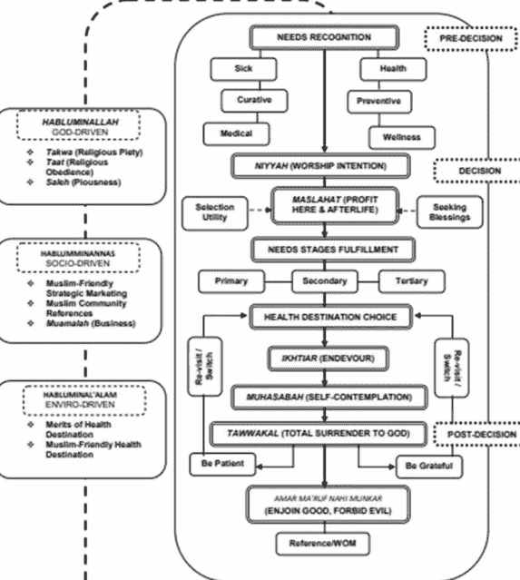

即，_Dharuriyat_（基本需求）、_Hajjiyat_（次要需求）和 _Tahsiniyat_（改善需求）。接下来的 (d) 是健康旅游目的地选择，是在考虑上述许多因素后完成的过程。过程继续进行 (e) _Ikhtiar_（努力），穆斯林必须认真寻求健康改善并寻找最好的专家。然后 (f) 在接受治疗后，穆斯林健康游客应进行 _Muhasabah_（自我反思）并自我完善——铭记并承认安拉 ﷻ 赐予他们所患的疾病，这些疾病可能源于疏忽甚至个人故意行为，如饮酒、吸烟、乱性、吃垃圾食品、食用非清真食品等。

第三，称为决策后阶段。为改善健康或治愈疾病做出如此努力后，接下来的过程如下。首先，是 (a) _tawakkal_（完全信赖安拉 ﷻ），因为安拉 ﷻ 拥有治愈或改善我们健康的全部权力。当我们健康时，必须对安拉 ﷻ 感恩。当我们尚未获得治愈或健康改善时，我们仍然要感恩和耐心。医疗游客在这个阶段也可能决定再次访问或切换到其他穆斯林友好型健康目的地。然后，(b) 最后的过程是，如前所述，_Amar makruf nahi munkar_（行善和禁止作恶）。在穆斯林友好型目的地进行健康旅游后，预计穆斯林会向其他穆斯林游客提供参考、推荐和正面口碑，以便同教兄弟能够获得相同的沙里亚服务并避免非沙里亚服务。

### 讨论与研究结果

本研究的发现旨在概述一种穆斯林健康旅游服务（养生）以预防疾病，特别是沙里亚沙龙和水疗。伊斯兰教教导人们以简单和平衡的方式美化自己，因为安拉 ﷻ 在《古兰经》中说：“我确已将人类创造在最佳形态中。（《杜贡章》4）安拉 ﷻ 以最佳形式创造了人类，改变安拉 ﷻ 的造物使我们成为忘恩负义的人，并改变了安拉 ﷻ 赋予的本性。安拉 ﷻ 在《古兰经》中说：“你们可能厌恶某物，而它对你们有益；你们可能喜爱某物，而它对你们有害；安拉 ﷻ 知道，而你们不知道。”（《巴格拉章》216）

为了预防身体和社会疾病，伊斯兰文明建立了各种公共卫生服务。伊斯兰哈马姆是穆斯林世界的第一家公共浴场。中世纪有两种哈马姆，分别供男性和女性使用。哈马姆最早在罗马时期的6世纪倭马亚王朝时代被引入叙利亚。在倭马亚时期（661-750年），被称为伊斯兰哈马姆的公共浴场在阿拉伯半岛普及开来。特别是，伊斯兰哈马姆基于一种普遍的宗教和文化背景，源于《古兰经》中提到的净身（wudhu）仪式以及土耳其人使用蒸汽室沐浴的做法，称为土耳其哈马姆。因此，伊斯兰哈马姆在中世纪通常建在清真寺旁边。伊斯兰哈马姆也演变成宗教学者、旅行者、前拘留者和希望康复的病人等聚集场所；他们前来进行仪式性清洁并接近安拉 ﷺ。哈马姆是今天水疗的雏形。（Aaland，1978）。

哈马姆拥有如此复杂的卫生和排水系统，配备新鲜水供应（尽管比著名的罗马公共浴场更全面），对公共卫生做出了贡献（Pormann & Savage-Smith，2007）。公共浴场的工作人员包括多个专业人员，如守卫（Hammāmīn）、理发师（Salmānīn）、按摩师（Āstijānān）、拔罐治疗师（Hajjāmīn）等（Mez，1992）。哈马姆是伊斯兰净化仪式的一部分，该概念已被出口到现代沙里亚沙龙、水疗中心和美容诊所（Mez，1992；Smith & Puckzo，2013）。服务包括大净浴、按摩、伊斯迈德眼线、指甲花艺术、修剪胡须、西瓦克牙刷、水疗服务、美容师、理发师、治疗师、按摩师和化妆师（Bafadhal，2017；Bafadhal，2022）。

女性喜爱美丽，非常关注自己的美丽，例如剪发、身体和面部护理，以及清洁指甲和双手。女性经常去美容院让自己变得更美。但是，伊斯兰教如何看待此事？伊斯兰教高度维护和尊重美丽、清洁和整洁的价值观。伊斯兰教始终鼓励穆斯林女性（穆斯利玛）以可接受的方式装饰和美化自己，以崇拜并寻求安拉 ﷺ 的祝福（《古兰经》《牛栏章》26；《光明章》31；《蜜蜂章》14）。

Al-Ghamidi（2013）表示，过去，女性互相梳头、护油、整理和剪发，这些在先知穆罕默德 ﷺ 时代就已经存在。那时，美容院已经普遍存在。然而，建议穆斯林选择服务和运营符合伊斯兰价值观的场所。此外，spa一词来自拉丁语“Solus per Aquam”（SPA）。水是先知穆罕默德 ﷺ 推荐的治疗方法之一，并建议用于退烧，正如先知穆罕默德 ﷺ 所说：“发烧源自地狱之热，请用水来退烧”（布哈里圣训）。Callen（2007）声称，在水疗的发展过程中，它不再仅仅与矿泉泉水和水的治疗用途相关联。水疗现在以美容院中的时尚服务和产品形式呈现，在各大百货商店有售，还可能涉及提供美味健康食品的场所，甚至成为度假的终极目的地。


然而，伊斯兰教并不禁止佩戴珠宝、穿衣、使用香水、化妆，甚至出于健康原因改善视觉外表，或适当美化自己，以在丈夫面前显得美丽。先知穆罕默德曾被问到：“对于喜欢穿漂亮衣服和凉鞋的人们，怎么说呢？”他回答说：“真确地说，安拉是美丽的，他喜爱美。傲慢意味着拒绝真理并蔑视他人”（圣训，Muslim传述）。如上述圣训所述，安拉是美丽的；当然，他的造物也是卓越的。为了他美的美，安拉也喜爱美；从另一个意义上说，美高于最佳形式。

阿布·胡赖拉说，先知穆罕默德说：“凡有头发者，就让他打理它”（圣训，Abu Dawud传述）。先知穆罕默德也不喜欢看到头发凌乱、过长和不整齐。瓦伊尔·本·希杰尔说：“我去见先知时头发很长。安拉的使者看见我时，说：‘坏，坏。’于是我回去剪短了头发。之后早上我又去见他。他（对我说）说：‘我本意不是对你做坏事；这样要好得多。’”（圣训，Abu Dawud传述）。对于女性，先知穆罕默德禁止她们修剪头发。此外，阿卜杜拉·本·乌麦尔传述，先知穆罕默德说：“女性不应剃（她的头发），她只能剪短（缩短）”（圣训，Abu Dawood传述）。

关于染发，阿布·胡赖拉曾被问到：“先知穆罕默德染过发吗？”他回答说：“是的”（圣训，At-Tirmidzi传述）。建议的颜色是红色或黄色/金色。染黑头发是被禁止的，因为担心存在Tadlis（欺骗），就像年长的女人染发以吸引向她求婚或想娶她的男人，或者年长的男人染发以显得头发泛灰，从而吸引他想娶的女人。这种染发行为属于欺骗和谎言。伊本·马哲传述了乌姆·萨拉玛的圣训，安拉的使者先知穆罕默德用花朵遮盖身体，从 Aurat（应遮盖部位）开始，然后到全身。

对于女性，先知在Al-Bukhari的圣训中命令她们整理和编发头发，所述经历为：“Umm Athiyah Umm Jahl 说，我们把先知穆罕默德女儿的头发编成三条辫子，两条在两侧，一条在前面。”。如果伊斯兰教允许男女整体装饰自己，这意味着伊斯兰教维护女性的天性与女性气质。这包括允许女性使用或佩戴男性被禁止的物品，如丝绸和黄金（圣训，At-Tirmidzi传述）。因此，一般来说，女性被允许装饰自己。此外，为了丈夫的高兴而打理头发是 halal（合法的）。但是，如果目的是向 non-mahram（伊斯兰法律中因血缘、哺乳和婚姻而被禁止结婚的所有那些人）炫耀，则变为 haram（非法的）。

伊斯兰教关于着装和化妆的指导成为男女约束自身、避免从事 *Tabarruj（炫耀暴露）* 行为的标准，此类行为在伊斯兰教中是被禁止的。“你们要安顿在家中，不要像早期无知时代那样炫示自己……”先知穆罕默德 ﷺ 补充说：“谁模仿某个民族，谁就是他们中的一员”（圣训，Ahmad传述）。*Tabarruj（炫耀暴露）* 是 *Jahiliyah（无知时代）* 文化（伊斯兰教来临前，麦加人处于无知和任性时期的文化），伊斯兰教对此提出挑战并将其废除。这种文化不仅损害女性的尊严，还导致男性对女性的剥削。伊斯兰教禁止 *Tabarruj（炫耀暴露）*，因为它会消除女性中的羞耻感。伊斯兰教中关于遮盖 aurat 和在合理范围内化妆的命令有特定目的，其中之一就是维护女性的尊严。

如先知穆罕默德 ﷺ 所说：“信仰包含六十到七十个分支，其中最好的就是宣认 *Lā ilāha illallāh（除安拉外，绝无应受崇拜的主，Allah ﷻ）* 和最小的就是从道路上移除有害之物，而谦逊是信仰的一个分支”（圣训，Al-Bukhari传述）。*Tabarruj（炫耀暴露）* 的例子包括：剃或刺青眉毛、涂太多粉底、涂眼影、涂色彩鲜艳的口红、过度化妆、涂指甲油、炫耀珠宝、裸露和暴露 aurat，如头发、脖颈、小腿、大腿等在公共场合；此类行为属于 *Tabarruj（炫耀暴露）* 范畴。相反，伊斯兰教教导其信众在合理范围内装饰自己，遮盖 aurat，举止优雅，并在特定语境下。例如，女性在崇拜 Allah ﷻ 之前装饰自己，或在丈夫或 *Mahram（禁婚亲属）* 面前美化自己。

讽刺的是，健康旅游的发展，其特征是国内外游客数量增加、各种沙龙和水疗中心以及其他形式的健康旅游，也带来了一种有害影响：外国文化的渗透。这可能导致文化转型，最终影响公共生活的各个领域。在公众认知中，水疗和沙龙行业等同于负面耻名（Narendran, 2011）。Young（1973）认为，旅游业可能引发不良活动，如卖淫、性贩卖和艾滋病，以及可能对当地社区产生负面影响的外国文化渗透。不可否认，沙龙和水疗中心、情色按摩店、男同性恋沙龙以及伪装成健康和其他健身业务的卖淫中存在大量跨性别者。尽管一些沙龙和水疗中心以独家价格和服务宣传自己为按摩、水疗和桑拿，但它们却助长卖淫和其他享乐主义。这导致传统沙龙和水疗中心形象负面、耻名斑斑，使穆斯林对使用沙龙和水疗服务产生疑虑和担忧。

伊斯兰法沙龙和水疗中心目前正经历指数级和大规模的增长。然而，关于伊斯兰法沙龙和水疗中心的研究显示出如此糟糕的趋势，即与传统沙龙和水疗中心相比，尤其是在穆斯林国家，很少有研究者关注伊斯兰法沙龙和水疗中心的创新潜力。基于对各种文献的检索，伊斯兰沙龙和水疗中心或伊斯兰法沙龙和水疗中心的概念仍然模糊且研究不足。因此，在世俗化背景下的健康旅游发展中，制定沙龙和水疗伊斯兰法概念是紧迫的，世俗化试图将宗教从人类生活的各个方面（包括旅游和健康）中分离出来。

伊斯兰实践水疗中心提供水疗服务、基于性别的美容师、男女客户的不同房间和服务，以及符合伊斯兰法律的服务（Yaman et al., 2012）。基于此，Bafadhal（2017）表示：“伊斯兰法沙龙和水疗中心的定义是一种商业形式，它提供促进性和预防性健康服务与产品，结合身体、面部、头发和灵魂的美容、化妆品和精神护理，面向男女，尤其是穆斯林，以符合伊斯兰法律作为主要决定因素。”

即便如此，学者们对沙龙和水疗中心是 halal（合法的）还是 haram（非法的）仍有分歧。一些学者认为，在沙龙和水疗中心进行护理和打扮是浪费，并且担心这会导致 haram（非法的）行为，例如模仿野蛮的“Jahiliyah（无知时代）风格”。此外，假如沙龙和水疗中心雇佣男性员工，那么 Khalwat（异性之间过度亲密和非法接触，在伊斯兰教中是被禁止的）可能会发生。由 Sheikh Abdullah ibn Baz 牵头的 Ulama 和 Fatwa Council 曾就理发师剃胡子职业的 haram（非法的）性质发布过 Fatwa（教法判例），因为该职业是在帮助人们犯罪。因此，可以说沙龙服务是 haram（非法的）的，因为它通常提供各种 haram（非法的）服务，如接发、修剪眉毛、刺青以及改变安拉的造物，根据伊斯兰法律，这些对穆斯林来说是 haram（非法的）（圣训，At-Tirmidzi传述）。

一些伊斯兰学者还认为，如果在公共浴场或水疗中心进行护理（而非在家中）是 haram（非法的）的。At-Tirmidzi 传述圣训称，先知说：“凡信仰安拉和末日者，他的妻子不应进入公共浴场。”At-Tirmidzi 传述，来自霍姆斯或叙利亚的一些妇女拜访了‘Aisyah رضي الله عنها，她说：“你们就是那些让女子去公共浴场的人吗？我听到穆罕默德，安拉的使者，说：‘没有一个女人在任何地方脱下衣服，除非在她丈夫的家中，否则她就撕裂了她与她的主之间的面纱。’” 然而，如果护理无法在家中进行，女性去公共浴场是被允许的。女性仍必须小心，并保持 aurat（异性必须遮盖的身体部位）遮盖。

Ibn Taymiyah（1963）说：“学者们说，‘允许妇女在有需要时去公共浴场，就像允许男性一样，只要她们低垂目光并保持贞洁。这也适用于生产后生病或出血的妇女，或必须进行 Ghusl 且只能在公共浴场进行的妇女。’”他还说：“至于妇女，她们可以在必要时（进入公共浴场），只要她们遮盖她们的


“aurat。” 然而，参照伊斯兰教中关于修饰自身和进行净身的命令，部分其他学者认为，去沙龙和水疗中心属于 Makruh（并非罪过，但建议不做之事）。归根结底，只要穆斯林用户在使用服务时遵循伊斯兰教法的指示，学者们并不认为去沙龙是 haram。另外，如果沙龙和水疗中心的经营者提供并推广伊斯兰教禁止的护理和服务，这也是 haram。

处理美容护理和水疗操作时，从伊斯兰角度来看的主要问题是马赫拉姆（Mahram）、奥拉（aurat）以及不同性别之间的隔离问题。《古兰经》命令：“……除非对他们的丈夫、他们的父亲、他们的丈夫的父亲、他们的儿子、他们的丈夫的儿子、他们的兄弟、他们兄弟的儿子、他们姐妹的儿子、他们的妇女、他们右手所拥有的人、或那些没有性欲的男仆，或尚未了解妇女私密方面的儿童，否则不要暴露他们的装饰……”（《古兰经》努尔章：31）。

此外，关于妇女在非穆斯林妇女面前暴露其奥拉（Aurat）的哈拉尔与哈拉姆问题，也存在争议和冲突。一些学者宣称，除非在紧急和危及生命的情况下（如医疗手术、事故和疾病治疗），否则这是 haram。然而，当涉及非紧急的医疗保健时，大多数学者同意，穆斯林妇女不应在非穆斯林妇女面前暴露她们的奥拉。因此，穆斯林妇女应去由穆斯林经营和拥有的沙龙和水疗中心。同时，建议有兴趣开设面向穆斯林用户沙龙和水疗中心的非穆斯林提供穆斯林女性治疗师和工作人员。美容和水疗护理在各国蓬勃发展，因为人们寻求新颖和独特的体验。禁止穆斯林妇女在非穆斯林女性面前不戴希贾布（Hijab）出现，担心非穆斯林女性会向她的丈夫或其他陌生人（该穆斯林妇女的非马赫拉姆）描述穆斯林妇女的身体状况，仿佛那名男子直接看到穆斯林妇女一样。

来自国家伊斯兰教法委员会关于伊斯兰教法沙龙和水疗中心的法特瓦（Fatwa）和特别官方法规亟需制定。穆斯林消费者、穆斯林友好型沙龙和水疗中心的经理以及政府必须协调，在建立教育和培训、法规、认证、质量标准以及伊斯兰教法沙龙和水疗中心的营销方面发挥关键作用。关于伊斯兰教法沙龙和水疗中心的文献和研究有限。通过文献综述对各种文献来源进行审查，并采访印度尼西亚的伊斯兰教法沙龙和水疗中心的业主或经理，Bafadhal（2017）制定了伊斯兰教法沙龙和水疗中心的标准概念，即表 1 中的伊斯兰教法沙龙和水疗中心的显著特征，作为衡量其中一个穆斯林健康旅游目的地合规性的方法。

穆斯林妇女希望获得穆斯林友好型健康目的地的美容服务，当她不得不离开家时，该地点提供最佳服务和保护。

#### 表 1. 伊斯兰教法沙龙和水疗中心的显著特征

| 序号 | 类别 | 显著特征 |
|---|---|---|
| 1 | 服务 | • 禁止修剪或进行 *Tanmis*（拔除面部毛发和多余眉毛）<br>• 禁止使用黑色染发，拔除白发，或优先使用红色和金色染发，尤其是使用草本染发剂<br>• 禁止展示男性或女性的 *Aurah*，尤其是身体的私密部位<br>• 产品必须不含哈拉姆成分，如啤酒浴、血清面部拉提、肉毒杆菌、硅胶和黄金、酒精、猪肉、狗或其衍生物<br>• 允许胶原蛋白注射，如果来源纯净或哈拉尔，例如来自宰杀的牛，以消除严重皱纹<br>• 禁止处理假发和发延伸（人造发），但可以通过从自己身体其他部位取发进行植发<br>• 如果丈夫或主人允许，则允许卷发，否则禁止她卷发<br>• 治疗师必须与客户同性别<br>• 男士允许（*makruh*）剃除腿部、胸部和手部的毛发，但女性禁止<br>• 建议（*sunnah*）剃除腋下毛发，不应留超过 40 天<br>• 禁止暴露 *aurat*，尤其是身体大部分裸露的部位<br>• 建议修剪指甲（允许足部和手部护理）<br>• 建议编发<br>• 建议使用面膜，并用花蜜面膜（*Nurah*）或哈拉尔材料裹敷身体<br>• 建议使用胡须油<br>• 禁止进行 *Qoza'*（剃掉部分头发并保留其他部分）<br>• 女性禁止剪去所有头发以模仿男性<br>• 女性禁止模仿妓女或享乐主义女性的风格<br>• 禁止纹身<br>• 允许用 *henna* 装饰手足，并允许女性在月经期间穿着端庄风格的指甲油，因为月经期间不允许 *Sholat*（祈祷），仍应优先使用 *henna*<br>• 禁止佩戴指甲油，因为它会导致小净（wudhu）不完整<br>• 禁止对牙齿进行 *nasyr*，即锉削和磨尖牙齿尖端<br>• 允许使用哈拉尔油或药膏以及发油（*Dhuns*）进行按摩<br>• 护理不得引起欲望<br>• 护理不得折磨身体<br>• 允许使用天然成分和非致醉成分的芳香疗法。允许泥浴<br>• 允许香料浴<br>• 建议使用 *Kohl* 或 *Itsmid* 石画眼妆<br>• 允许化妆，但必须端庄<br>• 允许进行牙科水疗或使用 *siwak*（天然牙刷）<br>• 允许在护理期间使用香水（如 *Thib*）<br>• 允许特别治疗痤疮和疖肿，例如使用 *Dzaririh* 香水<br>• 允许使用蒸汽淋浴或桑拿（*Ghusl* 擦洗或蒸汽淋浴）<br>• 允许 *Tarjil*（梳头）<br>• 允许 *Ghusl* 草药浴或草药浴，尤其是 *Ghusl sidr*<br>• 允许使用温水或冰水进行护理<br>• 允许女性穿着丝绸和黄金，但不应使用银或金制餐具饮食<br>• 允许治疗因疾病或意外而失去的美貌，而非正常衰老<br>• 只要穆斯林学者委员会根据《古兰经》、《圣训》或 *Ijma* 和 *Qiyas* 不禁止该服务，就可以提供传统或现代服务 |

| 2 | 设施 | • 为陪同女性顾客出行的丈夫或马赫拉姆（监护人，如兄弟、姐妹等）提供候诊室或沙发（穆斯林女性应由丈夫或马赫拉姆陪同）<br>• 男女服务室分开<br>• 诵读《古兰经》经文（《古兰经》是治疗所有疾病的良药）<br>• 为男性和女性客户使用不同的房间和服务，或通常仅服务于穆斯林女性<br>• 设计非穆斯林看不见的封闭房间；担心非穆斯林女性能够向她的丈夫或其他陌生人（该穆斯林女性的非马赫拉姆）描述穆斯林女性的身体和私密部位状况，仿佛那名男子直接看到穆斯林女性一样<br>• 治疗期间，男女皆须穿着遮盖奥拉的沐浴衣<br>• 所用设备不得违反伊斯兰教法，且不得含有任何哈拉姆材料<br>• 设有性别隔离设施或不同时段服务<br>• 提供祈祷室、祈祷垫和朝拜方向<br>• 无表达诱惑和争议信息的音乐<br>• 无具象装饰图案（无人类和动物形态的图片、雕像、小雕像），以避免以物配主（Shirk）<br>• 床、厕所和治疗室不得面向麦加或朝拜方向<br>• 供净身（Wudu’）的水友好型洗手间或厕所<br>• 不同性别的休闲设施分开<br>• 建造位置与厕所或浴室不同的净身设施，因为在厕所中禁止说安拉（®）的名字<br>• 为非穆斯林客户分开房间和设施<br>• 允许哈拉尔食品和饮食产品，如茶和牛奶<br>• 哈拉尔药品和治疗药物（如非酒精和非猪源成分）<br>• 患者伊斯兰着装规范（例如，希贾布或淋浴帽以遮盖头发作为奥拉（私密部位； |

来源：Bafadhal (2017)

接下一页

他们的家，在那里她成为“家庭女王”。她需要舒适的服务，让她们在家中感到受到威胁。她在寻找产品和服务，让她们仿佛处在丈夫或父母的保护下，并被视为家人对待，这样她们就能感到舒适，并能在家外使用穆斯林友好型沙龙和水疗中心来维护她们的尊严、视觉外观和宗教信仰。妇女在伊斯兰教中的崇高地位显而易见。她很重要，有权受到保护，免受各种对她名誉的不尊重。男性控制穆斯林妇女身体的刻板印象是对她们身体的羞辱、对她们心智的嘲弄以及对她们灵魂的羞辱。

“美即是善”的错觉往往具有误导性，导致女性踏上永无止境的旅程。真正的美不仅包括身体，还包括心智和精神。穆斯林妇女被期望美化自己和她们的行为，以


#### 表 1. 续

| No. | Categories | Salient Traits |
| --- | --- | --- |
| 3 | Management | • 雇佣穆斯林治疗师和员工应自律并尊重穆斯林原则；<br>• 必须核对客户的身份证或类似文件，以匹配穆斯林或非穆斯林宗教及性别相关的服务；<br>• 提供不误导的信息，如适当的产品或服务质量，并提供与美容相关的宗教教育，如沐浴和穿衣的祈祷；<br>• 禁止提供导致忽视礼拜时间的服务；<br>• 不雇佣跨性别者作为员工；<br>• 女穆斯林治疗师和员工的伊斯兰着装规范（*头巾*）；<br>• 治疗师和员工穿着得体，遮盖*私密部位*；<br>• 为穆斯林员工提供特定的祈祷时间；<br>• 斋月（*斋月*）期间为穆斯林员工和客户做特别安排；<br>• 合乎道德的市场营销与推广；<br>• 履行企业社会责任；<br>• 缴纳税款；<br>• 基于*天课*（义务性施舍）原则进行慈善捐赠，或进行如*纳法克*和*施舍*等慈善捐赠；<br>• 使用伊斯兰金融机构网络（如沙里亚银行）进行交易、融资和投资，以避免*高利贷*；<br>• 管理和所有权最好由穆斯林掌握；<br>• 如果可能，公司组织架构内应设有沙里亚监督委员会；<br>• 合理的治疗费用；<br>• 治疗师的专业资质；<br>• 医疗保健权利的保护与平等；<br>• 膳食产品、药物、维生素或补充剂的安全认证；<br>• 美容院和水疗产品的清真认证；<br>• 美容院和水疗服务与管理的沙里亚合规认证；<br>• 伊斯兰品牌与标识；<br>• 接受*互助保险*；<br>• 提供口译员和数字参考平台，以尽量减少跨文化或跨境客户的误解，值得考虑。 |

consider the values of rationality, morality, and *Maslahah* (profit for here and the afterlife) in all decisions they make. Sharia salons and spas business are for seeking beauty, brain, and blessing, not blight.

Ibn ’Umar (RAA) narrated that the Prophet Muhammad said, “He who imitates any people (in their actions) is considered to be one of them.” Muslim businessmen innovate but do not imitate conventional business strategies solely by pursuing intimate worship with God—Muslim health tourism business, not innovation resistance. Business innovation is everybody’s business, but innovation for good faith order is not everyone’s cup of tea. In this case, Muslim business people will return their business decisions to the teachings of God, Allah as the ultimate innovator.

### 参考文献

Aaland, M. (1978). 《汗蒸》. Capra Press.

Al Ghamidi, A b S. (2013). 《妇女教法》. Solo: Aqwam.

Al-Hamarneh, A., & Steiner, C. (2004). 伊斯兰旅游：重新思考2001年9月11日后阿拉伯世界的旅游发展策略. 《南亚、非洲和中东比较研究》, 24(1), 175–186. doi:10.1215/1089201X-24-1-175

Bafadhal, A. S. (2017). 《穆斯林健康旅游》. Lambert Academic Publishing.

Bafadhal, A. S. (2021). 面向沙里亚美容院和水疗中心的穆斯林健康旅游原型. 《休闲》, 46(1), 1-24.

Bafadhal, A. S. (2022). 穆斯林健康旅游. In D. Buhalis (Ed.), 《旅游管理与营销百科全书》. Edward Elgar Publishing. doi:10.4337/9781800377486.muslim.health.tourism

Battour, M., & Ismail, M. N. (2016). 清真旅游：概念、实践、挑战与未来. 《旅游管理前沿》, 19, 150-154.

Bomar, P. J. (2013). 关于补充和替代治疗方式的评论. 《国际护理实践杂志》, 19(2), 1–6. doi:10.1111/ijn.12061 PMID:23617443

Callen, K. (2001). 《水疗：呵护身心》. Ebury Press.

Cohen, E. (1988). 旅游中的真实性与商品化. 《旅游研究年鉴》, 15(3), 371–386. doi:10.1016/0160-7383(88)90028-X

Han, H., Lee, S., Ariza-Montes, A., Al-Ansi, A., Tariq, B., Vega-Muñoz, A., & Park, S. H. (2021). 穆斯林旅客在非伊斯兰国家的不便旅游体验及自评心理健康：探索性别和年龄差异. 《国际环境研究与公共卫生杂志》, 18(2), 758. doi:10.3390/ijerph18020758 PMID:33477400

Heyes, C. J. (2009). 诊断文化：身体畸形障碍与整容手术. 《身体与社会》, 15(4), 73–93. doi:10.1177/1357034X09347222

Jackowski, A., & Smith, V. L. (1992). 波兰朝圣者-游客. 《旅游研究年鉴》, 19(1), 92–106. doi:10.1016/0160-7383(92)90109-3

Joyce, R. (2001). 《道德的迷思》. Cambridge University Press. doi:10.1017/CBO9780511487101

Kamassi, A., Abd Manaf, N. H., & Omar, A. (2020). 医疗旅游行业中利益相关者的身份与角色：研究现状. 《旅游评论》, 75(3), 559–574. doi:10.1108/TR-01-2019-0031

Kessler, K. (2015). 清真寺旅游概念化：伊斯兰与宗教旅游的核心特征. 《国际宗教旅游与朝圣杂志》, 39(2), 2.

Kim, H. (2009). 韩国的整容手术痴迷. Syracuse University Honors Program Capstone Projects.

Kim, H., Woo, E., & Uysal, M. (2015). 老年游客的旅游体验与生活质量. 《旅游管理》, 46, 465–476. doi:10.1016/j.tourman.2014.08.002

Pal, A. (2011). 《伊斯兰意味着和平：当今穆斯林非暴力原则的理解》. Greenport: Praeger. doi:10.5040/9798400604997

Pormann, P. E., & Savage-Smith, E. (2007). 《中世纪伊斯兰医学》. Edinburgh University Press. doi:10.1515/9780748629244

Prayag, G., & Hosany, S. (2014). 当中东遇上西方：了解阿联酋年轻游客的动机与认知. 《旅游管理》, 40, 35–45. doi:10.1016/j.tourman.2013.05.003

Rahman, H. H. & Abdul, H. (2004). 伊斯兰前六个世纪的健康科学及其相关机构的发展. IsoIT, 973–984.

Rahman, M., Moghavvemi, S., Thirumoorthi, T., & Rahman, M. K. (2020). 游客认知对清真旅游目的地的影响：结构模型分析. 《旅游评论》, 75(3), 575–594. doi:10.1108/TR-05-2019-0182

Sarisae, S., Benrit, P., & Salaeh, N. (2023). 医疗器械清真认证的必要性：泰国个案研究. 《清真科学与技术杂志》, 2(1), 32–39. doi:10.59202/jhst.v2i1.664

Sigrist, S. (2006). 《健康新视野：新健康市场指南（第20卷）》. Gottlieb Duttweiler Institut/GDI.

Smith, M. K., & Puczkó, L. (2013). 《健康与养生旅游》. Routledge.

Smith, M. K., & Puczkó, L. (2014). 《健康、旅游与好客：水疗、养生与医疗旅行》. Routledge. doi:10.4324/9780203083772

Smith, M. K., & Puczkó, L. (2017). 《Routledge健康旅游手册》. Routledge.

Stephenson, M. L., & Ali, N. (2010). 旅游、旅行与伊斯兰恐惧症：非穆斯林国家中9/11之后的穆斯林之旅. In N. Scott & J. Jafari (Eds.), 《穆斯林世界的旅游》. Emerald Group Publishing Limited.

Teerakunpisut, S., & Kongpiam, P. (2023). 将以好客为导向的患者体验（HOPE）概念应用于穆斯林友好型医疗旅游服务标准. 《社会空间》, 23(1), 400–428.

Vargas-Sánchez, A., & Moral-Moral, M. (2019). 清真旅游：研究现状. 《旅游评论》, 74(3), 385–399. doi:10.1108/TR-01-2018-0015

Veiga, C., Santos, M., Águas, P., & Santos, J. (2017). 千禧一代正在改变全球旅游吗？目的地和企业面临的挑战. 《全球好客与旅游主题》, 9(6), 603–616. doi:10.1108/WHATT-09-2017-0047

Wahab, S., Crompton, J., & Rothfield, L. (1976). 《旅游营销》. Tourism International Press.

Yaman, R., Alias, Z., & Ishak, N. M. (2012). 从伊斯兰视角看美容护理与水疗设计. 《程序：社会与行为科学》, 50, 492–501. doi:10.1016/j.sbspro.2012.08.053

Young, G. (1973). 《旅游：祝福还是祸害？》. Penguin.


## 参考文献汇编

Aaland, M. (1978). 汗水. Capra Press.

Abd Rahman, I. M., Jamil, N. N., & Ismail, K. N. I. K. (2019). 政治关系是否调节女性董事对CSR披露的影响？马来西亚证据. 亚洲会计与治理杂志, 11.

Acs, Z. J., Autio, E., & Szerb, L. (2012). 创业国家体系：计量问题与政策含义. SSRN电子期刊. doi:10.2139/ssrn.2008160

Ács, Z. J., Autio, E., & Szerb, L. (2016). 创业国家体系：计量问题与政策含义. In 全球创业、机构与激励. doi:10.4337/9781784718053.00040

Ács, Z. J., Autio, E., & Szerb, L. (2014). 创业国家体系：计量问题与政策含义. 研究政策, 43(3), 476–494. 提前在线出版. doi:10.1016/j.respol.2013.08.016

Ahmadi, M., Baei, F., Hosseini-Amiri, S.-M., Moarefi, A., Suifan, T. S., & Sweis, R. (2020). 提出组织中管理者战略智力、组织发展与创业行为模型. 管理发展杂志, 39(4), 559–579. doi:10.1108/JMD-11-2018-0317

Ahmed, R., Ahmed, M., Ahmad, N., & Abidin, S. Z. (2020). 金融科技：其演变、采用、挑战与未来综述. 理论与应用信息技术杂志, 98(1), 83–96.

Ahunanya, V., Ovharhe, O. H., Emenike, C. G., & Otto, G. (2022a). 微型仓储企业中的寄售库存系统与创业成功. 社会科学与管理研究国际杂志, 8(5), 18–28. doi:10.56201/ijssmr.v8.no5.2022.pg18.28

Ahunanya, V., Ovharhe, O. H., Emenike, C. G., & Otto, G. (2022b). 尼日利亚钻井液公司中的寄售库存系统与过时管理. 社会科学与管理研究国际杂志, 8(5), 1–27. doi:10.56201/ijssmr.v8.no5.2022.pg1.17

Ajaz, A., Shenbei, Z., & Sarfraz, M. (2020). 董事会性别多样性对企业社会责任、财务绩效和声誉的影响研究. LogForum, 16(1).

Al Ghamidi, A b S. (2013). 女性教法. Solo: Aqwam.

Alberta.alis (2023). 职业洞察：了解自己. Alis. https://alis.alberta.ca/careerinsite/know-yourself/skills-quiz/

Albitar, K., Hussainey, K., Kolade, N., & Gerged, A. M. (2020). IR前后ESG披露与企业绩效. 会计与信息管理国际杂志.

Alcaraz, C., Zeadally, S., & Chakraborty, S. (2018). 物联网的雾计算. 调查（伦敦，英国）.

Aldrich, H. (1999). 演进中的组织. Sage（亚特兰大，乔治亚州）.

Alessandrini, F., & Jondeau, E. (2020). ESG投资组合的最优策略. 瑞士金融研究所研究论文, (20-21).

Al-Hamarneh, A., & Steiner, C. (2004). 伊斯兰旅游：9·11后阿拉伯世界旅游发展战略重思. 南亚、非洲与中东比较研究, 24(1), 175–186. doi:10.1215/1089201X-24-1-175

Ali, F., Rasoolimanesh, S. M., Sarstedt, M., Ringle, C. M., & Ryu, K. (2018). 待客业研究中部分最小二乘结构方程模型(PLS-SEM)使用评估. 国际当代酒店管理杂志, 30(1), 514–538. doi:10.1108/IJCHM-10-2016-0568

Alkaya, E., & Demirer, G. N. (2015). 可持续生产方法在土耳其纺织行业扩散中的部门评估. 纺织学会杂志, 106(11), 1212–1225. doi:10.1080/00405000.2014.985880

Al-Omoush, K. S., de Lucas, A., & del Val, M. T. (2023). 电子供应链协作在协同创新与价值共创中的作用. 商业研究杂志, 158, 113647. doi:10.1016/j.jbusres.2023.113647

Al-Qadasi, N., Zhang, G., & Al-Jubari, I. (2021). 青年对自雇的态度：也门大学生证据. PLoS One, 16(9), e0257358. doi:10.1371/journal.pone.0257358 PMID: 34516592

Alqahtani, N., & Uslay, C. (2023). 市场营销/创业界面研究优先事项（2023–2026）. 市场营销与创业研究杂志. Emerald Insight.

Alvedalen, J., & Boschma, R. (2017). 创业生态系统研究批判性综述：迈向未来研究议程. 欧洲规划研究, 25(6), 887–903. doi:10.1080/09654313.2017.1299694

Amalia, F. (2016). 金融科技书：投资者、企业家和远见者的金融技术手册. 印度尼西亚经济与商业杂志: JIEB., 31(3), 345. doi:10.22146/jieb.23554

Amit, R., Glosten, L., & Muller, E. (1993). 创业研究理论发展面临的挑战. 管理研究杂志, 30(5), 815–834. doi:10.1111/j.1467-6486.1993.tb00327.x

Amjad, M. (2023). 2023年7个有前景的创业领域. LinkedIn. https://www.linkedin.com/pulse/7-promising-areas-entrepreneurship-2023-maheen-amjad

Amoako, G. K. (2019). 概念框架：企业环境管理活动与可持续竞争优势. 环境质量管理, 31(2), 331–347. doi:10.1108/MEQ-09-2019-0187

Anderbjork, G., & Martell, J. (2021). 智慧花园：设计强大的数字市场与竞争情报平台（第1版）. Technics Publications.

Anderson, J. C., & Gerbing, D. W. (1988). 结构方程模型实践：综述与推荐的两步法. 心理学公报, 103(3), 411–423. doi:10.1037/0033-2909.103.3.411

Aouadi, A., & Marsat, S. (2018). ESG争议对企业价值是否重要？国际数据证据. 商业伦理杂志, 151(4), 1027–1047. doi:10.1007/s10551-016-3213-8

Apostolopoulos, N., Ratten, V., Petropoulos, D., Liargovas, P., & Anastasopoulou, E. (2021). COVID-19危机期间的农食行业与创业：系统文献综述与研究议程. 战略变革, 30(2), 159–167. doi:10.1002/jsc.2400

Arayssi, M., Jizi, M., & Tabaja, H. H. (2020). 海湾国家董事会构成对ESG披露水平的影响. 可持续会计、管理与政策杂志. doi:10.1108/SAMPJ-05-2018-0136

Ariely, D., & Berns, G. S. (2010). 神经营销：商业中神经成像的希望与炒作. 自然评论. 神经科学, 11(4), 284–292. doi:10.1038/nrn2795 PMID: 20197790

Armstrong, A. (2020). 伦理与ESG. 澳亚会计、商业与金融杂志, 14(3), 6–17.

Arner, D. W., Barberis, J., & Buckley, R. P. (2016). 金融科技的演变：后危机时代的新范式？乔治城国际法杂志, 47(4), 1271–1320.

Arturo, P. (1986年2月). 菲律宾华人社群：地位与状况. Sojourn (Singapore), 1(1), 76–91. doi:10.1355/SJ1-1E

Artur V. (2020). 竞争情报的概念与定义. 管理与领导. doi:10.13140/RG.2.2.14667.34087

Aste, T., Tasca, P., & Di Matteo, T. (2017). 区块链技术：对社会和行业的可预见影响. IEEE.

Awan, U., Sroue, R., & Kraslawski, A. (2019). 创造力促进可持续发展：供应商参与作为积极影响绿色创新的边界条件. *清洁生产杂志*, 226, 172–185. 提前在线出版. doi:10.1016/j.jclepro.2019.03.308

Bafadhal, A. S. (2021). 适合伊斯兰教法沙龙和水疗中心的穆斯林健康旅游原型. *休闲/消遣*, 46(1), 1-24.

Bafadhal, A. S. (2017). *穆斯林健康旅游*. Lambert学术出版.

Bafadhal, A. S. (2022). 穆斯林健康旅游. In D. Buhalis (Ed.), *旅游管理与营销百科全书*. Edward Elgar Publishing. doi:10.4337/9781800377486.muslim.health.tourism

Baraibar-Diez, E., & Odriozola, D. M. (2019). 英国、法国、德国和西班牙的CSR委员会及其对ESG绩效的影响. *可持续性*, 11(18), 5077. doi:10.3390/su11185077

Baraibar-Diez, E., Odriozola, M. D., & Fernández Sánchez, J. L. (2019). 可持续薪酬政策及其对环境、社会与治理评分的影响. *企业社会责任与环境管理*, 26(6), 1457–1472. doi:10.1002/csr.1760

Barbu, C. M., Florea, D. L., Dabija, D. C., & Barbu, M. C. R. (2021). 金融科技中的客户体验. *理论与应用电子商务研究杂志*, 16(5), 1415–1433. doi:10.3390/jtaer16050080

Barker, T. B. (1901年7月6日). *利物浦商会致中国协会函. F.O.17/1586*. 伦敦：国家档案馆. https://discovery.nationalarchives.gov.uk/

Barrena-Martínez, J., López-Fernández, M., & Romero-Fernández, P. M. (2019). 迈向社会责任人力资源管理政策与实践的配置：学术共识发现. *国际人力资源管理杂志*, 30(17), 2544–2580. doi:10.1080/09585192.2017.1332669

Baskin, K. (2023). 如何使用竞争洞察. *MIT Sloan*. https://mitsloan.mit.edu/ideas-made-to-matter/how-to-use-competitive-insight

Baskol, M. O. (2018). 土耳其纺织和服装行业的国际竞争力. *管理经济与商业国际杂志*, 14(3), 0-0. doi:10.17130/ijmeb.2018343115

Bass, B. M., Avolio, B. J., Jung, D. I., & Berson, Y. (2003). 通过评估变革型与交易型领导预测单位绩效. *应用心理学杂志*, 88(2), 207–218. doi:10.1037/0021-9010.88.2.207 PMID: 12731705

Batat, W., & Addis, M. (2021). 为福祉设计食物体验：从客户体验视角推进设计思维研究的框架. *欧洲营销杂志*, 55(9), 2392–2413. doi:10.1108/EJM-12-2020-0893


## 参考文献汇编

- Battour, M., & Ismail, M. N. (2016). 清真旅游：概念、实践、挑战与未来. Tourism Management Perspectives, 19, 150–154.

- Baysinger, T. (2024). 索尼据称为迈克尔·杰克逊目录交易支付约6亿美元. Axios. https://www.axios.com/2024/02/12/sony-michael-jackson-catalog

- Beck, R., & Müller-Bloch, C. (2017). 区块链作为颠覆性创新：参与分布式账本的框架. Research Gate.

- Belvedere, V. and Grando, A., (2017). 可持续运营与供应链管理. John Wiley & Sons.

- Belz, F. M., & Binder, J. K. (2017). 可持续创业：一个融合过程模型. Business Strategy and the Environment, 26(1), 1–17. doi:10.1002/bse.1887

- Beretta, V., Demartini, M. C., & Trucco, S. (2020). 综合报告中的高层基调：非财务绩效的作用. In 非财务披露与综合报告：实践与关键问题. Emerald Publishing Limited. doi:10.1108/S1479-35122020000034009

- Bettinelli, C., Del Bosco, B., & Giachino, C. (2019). 家族企业董事会中的女性：我们知道什么，还需要知道什么. In 家族企业异质性帕尔格雷夫手册 (第201–228页). Palgrave Macmillan. doi:10.1007/978-3-319-77676-7_9

- Bhimani, A., Horngren, C., Datar, S., & Rajan, M. (2015). 管理成本会计 (第六版). 新泽西, 美国: Pearson.

- Bilgin, M. H., Demir, E., Lau, M. C. K., Kin-Man To, C., & Zhang, Z. (2011). 土耳其手工地毯行业：与若干亚洲国家的比较分析. Journal of the Textile Institute, 102(6), 514–526. doi:10.1080/00405000.2010.498171

- Birindelli, G., Dell'Atti, S., Iannuzzi, A. P., & Savioi, M. (2018). 董事会组成与活动：对银行体系ESG绩效的影响. Sustainability (Basel), 10(12), 4699. doi:10.3390/su10124699

- Birindelli, G., Iannuzzi, A. P., & Savioi, M. (2019). 女性领导者对环境绩效的影响：银行业性别多样性的证据. Corporate Social Responsibility and Environmental Management, 26(6), 1485–1499. doi:10.1002/csr.1762

- Blake, R., & Mouton, J. (1964). 管理方格：领导卓越的关键. Gulf Publishing Co.

- Blakstad, S., & Allen, R. (2018). 金融科技革命. 瑞士 Cham: Springer.

- Bland, J. O. P. (1902年3月6日). 新关税提案. The North-China Daily News, 4.

- Blessley, M., & Mudambi, S. M. (2022). 贸易之路与大流行病：食品银行供应链中的中断与韧性. Industrial Marketing Management, 102, 58–73. doi:10.1016/j.indmarman.2022.01.002

- Blinova, E., Ponomarenko, T., & Knysh, V. (2022). 矿业部门循环经济元素下可持续商业发展背景中的企业可持续性概念分析. *Sustainability (Basel)*, 14(13), 8163. doi:10.3390/su14138163

- Blocher, E., Stout, D., & Cokins, G. (2010). 成本管理 (第五版). 美国: McGraw-Hill.

- Blundel, R., Lockett, N., & Wang, C. (2017). 探索创业. *Sage (Atlanta, Ga.)*.

- Bomar, P.J. (2013). 关于互补和替代疗愈方式的评论. *International Journal of Nursing Practice*, 19(2), 1–6. doi:10.1111/ijn.12061 PMID:23617443

- Bosma, N., 2013. 全球创业监测（GEM）及其对创业研究的影响. *Foundations and Trends® in Entrepreneurship*, 9(2), pp.143–248.

- Bourdieu, P. (2023a). *Sur l'État. Cours au Collège de France (1989-1992)*. SDX联合出版公司.

- Bourdieu, P. (2023b). *Anthropologie économique. Cours au Collège de France 1992-1993*. 上海人民出版社.

- Bravo, F., & Reguera-Alvarado, N. (2019). 可持续发展披露：环境、社会及公司治理报告与审计委员会性别多样性. *Business Strategy and the Environment*, 28(2), 418–429. doi:10.1002/bse.2258

- Brijs, B. (2013). *面向商业智能的业务分析*. CRC Press.

- Brin, P. V., & Nehme, M. N. (2019). *企业社会责任：理论与模型分析*.

- Britannica. (2024). *冠军：君主、王室与贵族*. Britannica. https://www.britannica.com > champion-English-history

- Burns, P., & Jim, D. (1996). 小企业与创业 (编). Macmillan.

- Byun, J., Sung, T. E., & Park, H. W. (2018). 技术创新策略：技术生命周期如何随技术领域变化. *Technology Analysis and Strategic Management*, 30(1), 98–112. doi:10.1080/09537325.2017.1297397

- Cadogan, J. W. (2012). 国际营销、战略取向与企业成功：对未来路径的反思. *International Marketing Review*, 29(4), 340–348. doi:10.1108/02651331211242656

- Caiado, R. G. G., Scavarda, L. F., Azevedo, B. D., de Mattos Nascimento, D. L., & Quelhas, O. L. G. (2022). 可持续工业4.0对运营与供应链管理的挑战与收益——指向2030议程的框架. *Sustainability (Basel)*, 14(2), 830. doi:10.3390/su14020830

- Callen, K. (2001). *水疗：呵护身心*. Ebury Press.

- Calvert, R. K. (1901年7月3日). 利兹商会致中国协会. F.O.17/1586. 伦敦: 国家档案馆. https://discovery.nationalarchives.gov.uk/

- Cao, S., Nie, L., Sun, H., Sun, W., & Taghizadeh-Hesary, F. (2021). 数字金融、绿色技术创新与能源环境绩效：来自中国区域经济的证据. Journal of Cleaner Production, 327, 129458. doi:10.1016/j.jclepro.2021.129458

- Carlgren, L., Rauth, I., & Elmquist, M. (2016). 设计思维的构建：概念的构想与实践. Creativity and Innovation Management, 25(1), 38–57. doi:10.1111/caim.12153

- Carson, G., O’Connor, C., & Simmons, G. (2020). 市场情报在小企业营销能力发展中的关键作用. Journal of Small Business and Enterprise Development, 27(5), 797–816. doi:10.1108/JSBED-12-2019-0394

- Caseiro, N., & Coelho, A. (2018). 商业智能与竞争力：创业导向的中介作用. Competitiveness Review, 28(2), 213–226. doi:10.1108/CR-09-2016-0054

- Castellanos, J. D., & George, B. (2020). 董事会领导力：董事会作为战略领导力的来源. Economics and Business Review, 6(1), 103–119. doi:10.18559/ebr.2020.1.5

- Castillo, V. E. (2018). 共享经济对末端物流供应链战略影响的探究.

- Catalini, C., & Gans, J. S. (2016). 区块链的一些简单经济学. (NBER工作论文第22952号). NBER.

- Cekuls, A. (2022). 扩大竞争情报的范围. J Intell Stud Bus, 12(1), 4–5. doi:10.37380/jisib.v12i1.924

- Changar, M., & Atan, T. (2021). 变革型与交易型领导方式在CSR环境与道德方面的作用. Sustainability (Basel), 13(3), 1411. doi:10.3390/su13031411

- Chen, D. X. (2018). 刘坤一传 (刘坤一集). 湖南业乐出版社有限公司.

- Chen, H., Chiang, R. H. L., & Storey, V. C. (2012). 商业智能与分析：从大数据到重大影响. Management Information Systems Quarterly, 36(4), 1165–1188. doi:10.2307/41703503

- Chen, H., & Hsu, C.-H. (2013). 非营利服务组织中创业导向与企业绩效：市场导向的或然效应. Service Industries Journal, 33(5), 445–466. https://search.ebscohost.com/login.aspx?direct=true&db=crh&AN=86994939&site=ehost-live. doi:10.1080/02642069.2011.622372

- Chen, Y. C., Li, P. C., & Evans, K. R. (2012). 互动与创业导向对组织绩效的影响：对市场驱动和市场引领的洞察. Industrial Marketing Management, 41(6), 1019–1034. doi:10.1016/j.indmarman.2012.01.017

- Chibuike, C. U., & Ovarhe, O. H. (2022). 大流行病与危机时代尼日利亚风险文化与精益文化的兴起：采用确证性分析. *International Journal of Multidisciplinary Research and Growth Evaluation*, 3(1), 263–271. doi:10.54660/anfo.2021.3.1.14

- Chibuike, C. U., Ovarhe, O. H., & Abada, A. M. (2022). 大流行病与灾难期间尼日利亚微型企业精益会计预警与创业可持续性的同步化：采用确证性因子分析. *International Journal of Business and Management*, 10(1), 1–13. doi:10.54660/anfo.2021.2.6.15

- Chisht, S., & Barberis, J. (2016). *金融科技手册：投资者、企业家和远见者的金融技术指南*. John Wiley & Sons. doi:10.1002/97811191218906

- Cho, C.-C., & Kao, R.-H. (2022). 通过领导力打造可持续工作场所：变革型领导力与组织公民行为视角. *Frontiers in Psychology*, 13, 924091. doi:10.3389/fpsyg.2022.924091 PMID:35959035

- Christensen, C. M. (1997). *创新者的窘境：当新技术导致伟大企业失败*. Harvard Business School Press.

- Ciampi, F., Marzi, G., Demi, S., & Faraoni, M. (2020). 大数据与商业策略的互联：知识管理的一项重大挑战。回顾与未来展望. *Journal of Knowledge Management*, 24(5), 1157–1176. doi:10.1108/JKM-02-2020-0156

- Ciasullo, M. V., Montera, R., & Douglas, A. (2022). 不确定时期中小企业韧性构建：大数据分析能力与协同创新的作用. *Transforming Government: People. Transforming Government*, 16(2), 203–217. doi:10.1108/TG-07-2021-0120

- Clark, K., & Smith, R. (2008). 释放设计思维的力量. *Design Management Review*, 19(3), 8–15. doi:10.1111/j.1948-7169.2008.tb00123.x

- Cloutier, A. (2013). 基于文献范围综述的竞争情报流程集成模型. *International Journal of Strategic Management*, 13(1), 57–72. doi:10.18374/IJSM-13-1.7

- Cohen, B. (2006). 可持续山谷创业生态系统. *Business Strategy and the Environment*, 15(1), 1–14. doi:10.1002/bse.428

- Cohen, E. (1988). 旅游业中的真实性与商品化. *Annals of Tourism Research*, 15(3), 371–386. doi:10.1016/0160-7383(88)90028-X

- Cole, C. (2022). *如何识别商业与市场机会*. Harvard Business School Online.

- Cook, L. S., Bowen, D. E., Chase, R. B., Dasu, S., Stewart, D. M., & Tansik, D. A. (2002). 服务设计中的人力问题. *Journal of Operations Management*, 20(2), 159–174. doi:10.1016/S0272-6963(01)00094-8


Çop, S., Olorunsola, V. O., & Alola, U. V. (2021). 通过绿色变革型领导政策实现环境可持续性：绿色团队韧性能否提供帮助？*商业战略与环境*，*30*(1)，671–682。doi:10.1002/bse.2646

Corbett, E. C. (1902年4月8日). 中国条约修订。F.O. 17/1571。伦敦：国家档案馆。https://discovery.nationalarchives.gov.uk/

Corsaro, D., & D’Amico, V. (2022). COVID-19的数字化转型如何影响B2B中的关系方法。*商业与工业营销期刊*，*37*(10)，2095–2115。doi:10.1108/JBIM-05-2021-0266

Corvello, V., De Carolis, M., Verteramo, S., & Steiber, A. (2022). 创业工作的数字化转型。*国际创业行为与研究杂志*，*28*(5)，1167–1183。doi:10.1108/IJEBR-01-2021-0067

Covin, J. G., & Miller, D. (2014). 国际创业取向：概念考量、研究主题、测量问题及未来研究方向。*创业理论与实践*，*38*(1)，11–44。doi:10.1111/etap.12027

Croll, A., & Yoskovitz, B. (2017). 精益分析：利用数据更快构建更好的初创公司。O’Reilly，53(9)。

Dalal, K. K., & Thaker, N. (2019). ESG与企业财务绩效：印度公司的小组研究。*公司治理IUP期刊*，*18*(1)，44–59。

Damasio, A. R. (1994). 笛卡尔的错误与人类生活的未来。*科学美国人*，*271*(4)，144。doi:10.1038/scientificamerican1094-144 PMID:7939563

Dana, L.-P., & Vorobeva, E. (2021). 理解“少数族裔创业”这一术语。在T. M. Cooney（编）中，*帕尔格雷夫少数族裔创业手册*(第15–32页)。帕尔格雷夫麦克米伦。doi:10.1007/978-3-030-66603-3_2

Darwiesh, A., Elhoseny, M., Atassi, R., & El-Baz, A. H. (2023). 用于治理中小企业风险的商业智能系统。在R. El Ayachi, M. Fakir, & M. Baslam（编）中，*商业智能。CBI 2023。商业信息处理讲义*，484。施普林格。doi:10.1007/978-3-031-37872-0_1

Deepmala, S., Anurag, S., Amizan, O., & S.B, G. (2023). *商业智能与人力资源管理*。纽约：劳特利奇。

Demir, H., & Okan, T. (2008). 互动型与变革型领导：一种量表开发尝试。*伊斯坦布尔大学工商管理学院经营研究所管理杂志*，*19*(61)，第61篇。

Demirgüç-Kunt, A., Klapper, L., Singer, D., Ansar, S., & Hess, J. (2018). *2017年全球金融包容性数据库：衡量金融包容性与金融科技革命*。[世界银行政策研究工作文件，8440]。世界银行。

Demirgüç-Kunt, A., Klapper, L., & Randall, D. (2020). 数字金融包容性：国际经验的教训。世界银行研究观察者，35(1)，65–100。

Dermer, M. (2023). 企业家的词源。[视频]。Facebook。https://web.facebook.com/watch?v=602542661584141

Dettwiler, P., Lindelöf, P., & Löfsten, H. (2006). 商业环境与物业管理问题：瑞典成长型企业研究。企业房地产期刊，8(3)，120–133。提前在线出版。doi:10.1108/14630010610711748

Dewar, C., Keller, S., & Malhotra, V. (2022). CEO卓越：区分最佳领导者与其他人的六种心态（第1版）。斯克里布纳。

Dhammika, K. A. S., & Ahmad, F. bin, Sam, T. L., & Lanka, S. (2014). 交易型与变革型领导的测量：斯里兰卡语境下的效度与信度。语义学者。https://api.semanticscholar.org/corpusid:55822458

Diandra, D., & Azmy, A. (2020). 理解创业定义。管理、会计与经济国际期刊，7(5)，235–241。

Dieffenbacher, S. F. (2023). 创造力与创新：差异、示例与定义。数字化领导力。https://digitalleadership.com/blog/creativity-and-innovation/

Divrik, B., & Baykal, E. (2023). 中小企业数字化与国际化的关系：土耳其纺织与服装行业的证据。全球战略管理期刊，16，16。doi:10.20460/JGSM.2023.318

Dolguı, A., Ivanov, D., & Sokolov, B. (2018). 供应链中的涟漪效应：分析与近期文献。国际生产研究杂志，56(1–2)，414–430。doi:10.1080/00207543.2017.1387680

Drucker, P. F. (1993). 创新与创业实践与原则。哈珀柯林斯出版公司。

Dudgeon, C. J. (1901年5月31日). 上海中国协会致驻华英国总领事。F.O.17/1586。伦敦：国家档案馆。https://discovery.nationalarchives.gov.uk/

Dudgeon, C.J. (1902年3月5日). 致詹姆斯·麦凯。F.O.17/1565。伦敦：国家档案馆。https://discovery.nationalarchives.gov.uk/

Dudgeon, C. J. (1902年4月2日). 备忘录。F.O.17/1586。伦敦：国家档案馆。https://discovery.nationalarchives.gov.uk/

Dudgeon, C.J. (1902年6月25日). 致詹姆斯·麦凯。F.O.17/1578。伦敦：国家档案馆。https://discovery.nationalarchives.gov.uk/

Dunne, D., & Martin, R. (2006). 设计思维及其如何改变管理教育：一次访谈与讨论。管理学习与教育期刊，5(4)，512–523。doi:10.5465/amle.2006.23473212

Duran, A., & Temiz Dinç, D. (2016). 土耳其纺织与成衣行业的结构：海关同盟协议之前与之后。人文与社会科学研究杂志，5(3)，505。doi:10.15869/itobiad.74629

Eckhardt, J. T., & Shane, S. A. (2003). 机会与创业。管理期刊，29(3)，333–349。doi:10.1177/014920630302900304

Edsand, H. E. (2017). 识别哥伦比亚风能扩散的障碍：技术创新系统及更广泛背景的功能分析。社会中的技术，49，1–15。doi:10.1016/j.techsoc.2017.01.002

Effa, G. A., Ovharhe, O. H., Ezirim, A. C., & Igwe, S. (2023a). 尼日利亚的采购可持续性政策与物流绩效。[IJMCS]。市场营销与传播研究国际期刊，7(1)，56–72。doi:10.56201/ijmcs.v7.no1.2023.pg56.72

Effa, G. A., Ovharhe, O. H., Ezirim, A. C., & Igwe, S. (2023b). 尼日利亚的战略采购举措与物流绩效。[IJMCS]。市场营销与传播研究国际期刊，7(1)，38–55。doi:10.56201/ijmcs.v7.no1.2023.pg38.55

Ehidiaemen Oamen, T., & Moshood Lawal, B. (2023). 使用结构方程模型探索和验证社区药剂师绩效测量领域：对研究的启示与建议。科学研究与报告期刊，38–47。doi:10.9734/jsrr/2023/v29i11726

Eklund, M. A. (2019). 非财务绩效（ESG评分）的补偿。在首席执行官薪酬的公平性（第67–74页）。施普林格。doi:10.1007/978-3-030-33554-0_4

Elia, G., Margherita, A., & Passiante, G. (2020). 数字化创业生态系统：数字技术与集体智慧如何重塑创业过程。技术预测与社会变革，150，119791。doi:10.1016/j.techfore.2019.119791

Eliwa, Y., Aboud, A., & Saleh, A. (2019). ESG实践与债务成本：欧盟国家的证据。会计批判视角，102097。

Elkington, J., & Hartigan, P. (2008). 不讲理之人的力量：社会企业家如何创造改变世界的市场。哈佛商业出版社。

Elsbach, K. D., & Stigliani, I. (2018). 设计思维与组织文化：未来研究的回顾与框架。管理期刊，44(6)，2274–2306。doi:10.1177/0149206317744252

Erat, S., Kitapçı, H., & Akçin, K. (2020). 管理者认知与组织身份：比较分析。可持续性（巴塞尔），12(6)，2278。doi:10.3390/su12062278

Erhabbor, N. I. (2018). 通过环境教育中的指导培养领导者。电子绿期刊，1(41)。doi:10.5070/G314134454

Etymonline (2024). 冠军的词源（来自Etymonline）。词源在线。https://www.etymonline.com › word › champion


## 参考文献汇编

- Eyal, I., Sirer, E. G. (2018). 大多数并不足够：比特币挖矿存在漏洞。ACM。

- Falk, E. B., Berkman, E. T., & Lieberman, M. D. (2012). 从神经反应到人口行为：神经焦点小组预测人口层面的媒体效应。心理科学，23(5)，439–445。doi:10.1177/0956797611434964 PMID:22510393

- Farradinna, S., Syafitri, N., Herawati, I., & Jayanti, W. (2023). 创业心理准备（EPR）工具的探索性因子分析。创新与创业期刊，12(1)，66。doi:10.1186/s13731-023-00314-y

- Fayolle, A. (2007). 创业与新价值创造：创业过程的动态。剑桥大学出版社。doi:10.1017/CBO9780511488689

- Feintuck, M. (2014). 监管中的“公共利益”。中国人民大学出版社。

- Feld, B. (2012). 初创社区：在你的城市构建创业生态系统。载于《市政世界》。

- Feng, S., Zhang, R., & Li, G. (2022). 环境分权、数字金融与绿色技术创新。结构变迁与经济动态，61，70–83。doi:10.1016/j.strueco.2022.02.008

- Fernando, G. (2024). 冠军：21世纪战略领导力模型。Tough Nickel。https://toughnickel.com/business/The-Champion

- Fernie, J., & Sparks, L. (编). (2018). 物流与零售管理：零售供应链中的新兴问题与新挑战。科根页出版社。

- Finkle, T. A., & Deeds, D. (2001). 1989–1998年创业教职员工市场趋势。商业创业期刊，16(6)，613–630。doi:10.1016/S0883-9026(99)00051-8

- Foley, S., Karlsen, J. R., & Putniņš, T. J. (2019). 性、毒品与比特币：通过加密货币融资的非法活动有多少？金融研究评论，32(5)，1798–1853。doi:10.1093/rfs/hhz015

- Fosso Wamba, S., Queiroz, M. M., Guthrie, C., & Braganza, A. (2022). 人工智能（AI）的行业经验：运营与供应链管理中的益处与挑战。生产规划与控制，33(16)，1493–1497。doi:10.1080/09537287.2021.1882695

- Furlotti, K., Mazza, T., Tibiletti, V., & Triani, S. (2019). 董事会顶层职位中的女性：意大利可持续性报告中披露的性别政策。企业社会责任与环境管理，26(1)，57–70。doi:10.1002/csr.1657

- García Martín, C. J., & Herrero, B. (2020). 董事会特征是否影响环境绩效？对欧盟企业的研究。企业社会责任与环境管理，27(1)，74–94。doi:10.1002/csr.1775

- Geeks for Geeks. (2023). 企业家类型：创新型、模仿型、法比安型和无所作为型企业家。Geeks for Geeks。https://www.geeksforgeeks.org/types-of-entrepreneurs-innovating-imitative-fabian-and-drone-entrepreneurs/

- Gendron, M. (2013). 应用商业智能：实施有效的信息和通信技术基础设施。John Wiley and Sons Inc.

- Gianinazzi, W. (2018). 全球思考，本地行动：一个理念的历史。EcoRev’。政治生态学批判评论，46。doi:10.3917/ecorev.046.0019

- Global Startup Ecosystem Report 2023. (无日期). 初创基因组。https://startupgenome.com/report/gser2023

- Gnizy, I. (2019). 大数据及其在国际企业中通向价值的战略路径。国际营销评论，36(3)，318–341。doi:10.1108/IMR-09-2018-0249

- Gölgeci, I., Assadinia, S., Kuivalainen, O., & Larimo, J. (2019). 新兴市场企业的动态能力与国际绩效：制度发展与距离的调节作用。国际商业评论，28(6)，101593。doi:10.1016/j.ibusrev.2019.101593

- Gomber, P., Kauffman, R. J., Parker, C., & Weber, B. W. (2018). 关于金融科技革命：解读金融服务中的创新、颠覆与变革力量。管理信息系统期刊，35(1)，220–265。doi:10.1080/07421222.2018.1440766

- Görgülü, V. (2020). 危机管理中交易型与权威型组织领导风格的负面影响案例研究。土耳其在线设计艺术与传播期刊，10(4)，597–611。doi:10.7456/11004100/020

- Grant, D.B., Wong, C.Y. & Trautrims, A. (2017). 可持续物流与供应链管理：可持续运营与管理的原则与实践。科根页出版社。

- Grossmann, W., & Rinderle-ma, S. (2015). 商业智能基础。施普林格。doi:10.1007/978-3-662-46531-8

- Gümüş, D., & Akbal, F. (2011). 纺织染料与废水的光催化降解。水、大气与土壤污染，216(1–4)，117–124。doi:10.1007/s11270-010-0520-z

- Gungor, A., & Gupta, S. M. (1999). 环境友好型制造与产品回收问题：一项综述。计算机与工业工程，36(4)，811–853。doi:10.1016/S0360-8352(99)00167-9

- Guo, X. D. (1999). 开辟“自由”贸易之路：19世纪30年代西方华人对中国社会经济的研究（打“自由”通商之路——19世纪30年代的在西华人对中国社会经济的探研）。广州：广东人民出版社有限公司。

- Guo, Y., Zhu, L., Ye, X., Wang, X., Xu, Y., Qian, G., & Wang, L. (2023). 基于化学足迹法的中国纺织工业氮氧化物和二氧化硫排放毒性影响评估。AATCC研究期刊，10(4)，232–240。doi:10.1177/24723444231161744

- Gupta, P., & Bamel, U. (2023). 电子学习生态系统中元认知与批判性思维的必要性：后新冠时代的新常态。全球商业与组织卓越，43(1)，104–120。doi:10.1002/joe.22208

- Gurcan, F., Ayaz, A., Dalveren, M. G. G., & Derawi, M. (2023). 商业智能战略、最佳实践与最新趋势：基于机器学习的2003至2023年科技计量数据分析。可持续性（巴塞尔），15(13)，9854。doi:10.3390/su15139854

- Guttentag, D. A., & Smith, S. L. (2017). 将Airbnb视为相对于酒店的颠覆性创新的评估：替代与比较绩效预期。国际酒店管理期刊，64，1–10。doi:10.1016/j.ijhm.2017.02.003

- Habermas, J. (1999). 公共领域的结构转型。Academia Press.

- Hackett, S. M., & Dilts, D. M. (2004a). 由实物期权驱动的企业孵化理论。技术转移期刊，29(1)，41–54。doi:10.1023/B:JOTT.0000011180.19370.36

- Hackett, S. M., & Dilts, D. M. (2004b). 企业孵化研究的系统性综述。技术转移期刊，29(1)，55–82。doi:10.1023/B:JOTT.0000011181.11952.0f

- Hair, J. F. (编). (2017). 偏最小二乘结构方程模型（PLS-SEM）入门（第2版）。Sage.

- Hammer, M., & Champy, J. (1993). 再造。（M. 勒塞克，译）巴黎，法国：邓奥德。

- Handfield, B. R., Petersen, K., Cousins, P.N., & Lawson, B. (2023). 供应管理集成与绩效结果的组织创业模型。运营与生产管理国际期刊，29(2)，100–126。翡翠出版集团有限公司。0144-3577。doi:10.1108/01443570910932011

- Hanelt, A., Bohnsack, R., Marz, D., & Antunes Marante, C. (2021). 数字化转型文献的系统性综述：对战略与组织变革的洞察与启示。管理研究期刊，58(5)，1159–1197。doi:10.1111/joms.12639

- Han, H., Lee, S., Ariza-Montes, A., Al-Ansi, A., Tariq, B., Vega-Muñoz, A., & Park, S. H. (2021). 非伊斯兰国家中穆斯林旅客的不便旅游体验与自评心理健康：探索性别和年龄差异。国际环境研究与公共卫生期刊，18(2)，758。doi:10.3390/ijerph18020758 PMID:33477400

- Hannon, P. D. (2013). 为什么创业型大学很重要？创新管理期刊，1(2)，10–17.

- Haque, F., & Ntim, C. G. (2020). 高管薪酬、可持续薪酬政策、碳绩效与市场价值。英国管理期刊，31(3)，525–546。doi:10.1111/1467-8551.12395

- Harjoto, M. A., & Wang, Y. (2020). 董事会网络中心性与环境、社会及治理（ESG）绩效。公司治理：商业与社会国际期刊[预刊2020]。


## 参考文献汇编

- Hasnabeigi, A., & Price, L. (2012). A review of energy use and energy efficiency technologies for the textile industry. Renewable & Sustainable Energy Reviews, 16(6), 3648–3665. doi:10.1016/j.rser.2012.03.029

- Hassani, A., & Mosconi, E. (2022). Social media analytics, competitive intelligence, and dynamic capabilities in manufacturing SMEs. Technological Forecasting and Social Change, 175(1), 1–11. doi:10.1016/j.techfore.2021.121416

- Häussers, J. A., & Förderer, S. (2019). Consumer neuroscience-based metrics predict recall, liking, and viewing duration in online advertising. Frontiers in Neuroscience, 13, 225.

- Hedqvist, L., & Larsson, A. (2020). ESG or Financial Performance—Does It Have to be a Choice?: A Regression Analysis of Thomson Reuters ESG scores and Financial Performance in Sweden and the UK.

- Henseler, J., Hubona, G., & Ray, P. A. (2016). Using PLS path modeling in new technology research: Updated guidelines. Industrial Management & Data Systems, 116(1), 2–20. doi:10.1108/IMDS-09-2015-0382

- Heyes, C. J. (2009). Diagnosing culture: Body Dysmorphic Disorder and cosmetic surgery. Body & Society, 15(4), 73–93. doi:10.1177/1357034X09347222

- Holmqvist, K., Nyström, M., Andersson, R., Dewhurst, R., Jarodzka, H., & Van de Weijer, J. (2011). Eye tracking: A comprehensive guide to methods and measures. Oxford University Press.

- Holori, R. B., Ahmadi, F., Khanmohammadi, M., Ranjbar, H. M., & Kordlouie, H. (2023, Autumn). Development and assessment of a business intelligence-based management accounting information system model: A structural equation modeling approach. International Journal of Finance and Managerial Accounting, 8(31).

- Hora, M., & Dutta, D. K. (2013). Entrepreneurial firms and downstream alliance partnerships: Impact of portfolio depth and scope on technology innovation and commercialization success. Production and Operations Management, 22(6), 1389–1400. doi:10.1111/j.1937-5956.2012.01410.x

- Horn, J. (2023). Inside the competitor’s mindset: how to predict their next move and position yourself for success (1st ed.). The MIT Press. https://mitpress.mit.edu/9780262047883/inside-the-competitor-s-mindset/ doi:10.7551/mitpress/14628.001.0001

- Hossain, M. S., Islam, M. A., Hosen, M., Mohd, T., & Thaker, H. (2023). Missing catalysts of female entrepreneurship success: Evidence from an emerging economy. Global Business and Organizational Excellence, 42(5), 50–64. doi:10.1002/joe.22201

- Hossain, N. U. I., El Amrani, S., Jaradat, R., Marufuzzaman, M., Buchanan, R., Rinaudo, C., & Hamilton, M. (2020). Modeling and assessing interdependencies between critical infrastructures using Bayesian network: A case study of inland waterway port and surrounding supply chain network. Reliability Engineering & System Safety, 198, 106898. doi:10.1016/j.ress.2020.106898

- Ho, T. H., & Tang, C. S. (2009). Introduction to the special issue on marketing and operations management interfaces and coordination. *Production and Operations Management*, 18(4), 363–364. doi:10.1111/j.1937-5956.2009.01037.x

- Howell, S. T., Niessner, M., & Yermack, D. (2018). *Initial Coin Offerings: Financing growth with cryptocurrency token sales*. NBER.

- Howson, C. (2008). *Successful Business Intelligence: Secrets to making BI a killer app* (ed. First Edition). USA, USA: McGraw-Hill.

- Howson, C. (2014). *Successful Business Intelligence: unlock the value of BI and big data* (ed. Second Edition). USA, USA: McGraw-Hill.

- Hsuan Mikkoła, J., & Skjøtt-Larsen, T. (2004). Supply-chain integration: Implications for mass customization, modularization and postponement strategies. *Production Planning and Control*, 15(4), 352–361. doi:10.1080/0953728042000238845

- Hsu, M., Yoon, C., Hajcak, G., & Berns, G. S. (2009). Monetary loss and the brain: An ERP study of the influence of task relevance and motivation. *Social Cognitive and Affective Neuroscience*, 4(4), 321–329.

- Huang, J. M. (1989). Historical Materials on Sino-US Relations (Guangxu Dynasty III and IV)( 中美关系史料(光绪朝三、 四)). Taipei: Institute of Modern History, Academia Sinica.

- Huang, Z. S., & He, S. B. (2009). *History of Filipino Overseas Chinese*. Guangdong Higher Education Press.

- Huang, Z., Savita, K. S., & Zhong-jie, J. (2022). The business intelligence impact on the financial performance of start-ups. *Information Processing & Management*, 59(1), 102761. doi:10.1016/j.ipm.2021.102761

- Hübel, B., & Scholz, H. (2020). Integrating sustainability risks in asset management: The role of ESG exposures and ESG ratings. *Journal of Asset Management*, 21(1), 52–69. doi:10.1057/s41260-019-00139-z

- Hubert, M., & Kenning, P. (2008). A current overview of consumer neuroscience. *Journal of Consumer Behaviour*, 7(4–5), 272–292. doi:10.1002/cb.251

- Hughes, L., Dwivedi, Y. K., Misra, S. K., Rana, N. P., Raghavan, V., & Akella, V. (2019). Blockchain research, practice and policy: Applications, benefits, limitations, emerging research themes and research agenda. *International Journal of Information Management*, 49, 114–129. doi:10.1016/j.ijinfomgt.2019.02.005

- Hugos, M. H. (2018). *Essentials of supply chain management*. John Wiley & Sons.

- Hu, H., Xu, J., Liu, M., & Lim, M. K. (2023). Vaccine supply chain management: An intelligent system utilizing blockchain, IoT and machine learning. *Journal of Business Research*, 156, 113480. doi:10.1016/j.jbusres.2022.113480 PMID:36506475

- Huq, A., & Gilbert, D. (2017). All the world’s a stage: Transforming entrepreneurship education through design thinking. Education + Training, 59(2), 155–170. doi:10.1108/ET-12-2015-0111

- Hussain, G., Nazir, M. S., Rashid, M. A., & Sattar, M. A. (2023). From supply chain resilience to supply chain disruption orientation: The moderating role of supply chain complexity. Journal of Enterprise Information Management, 36(1), 70–90. doi:10.1108/JEIM-12-2020-0558

- Hyun, Y., Park, J., Kamioka, T., & Chang, Y. (2023). Organizational agility enabled by big data analytics: Information systems capabilities view. Journal of Enterprise Information Management, 36(4), 1032–1055. doi:10.1108/JEIM-03-2022-0077

- Iamandi, I. E., Constantin, L. G., Munteanu, S. M., & Cernat-Gruici, B. (2019). Mapping the ESG Behavior of European Companies. A Holistic Kohonen Approach. Sustainability (Basel), 11(12), 3276. doi:10.3390/su11123276

- Ihugba, O. A., Odii, A., & Njoku, A. (2014). Theoretical analysis of entrepreneurship challenges and prospects in Nigeria. International Letters of Social and Humanistic Sciences, 5(16), 21–34.

- Inman, R. A., & Green, K. W. (2018). Lean and green combine to impact environmental and operational performance. International Journal of Production Research, 56(14), 4802–4818. doi:10.1080/00207543.2018.1447705

- Interaction Design Foundation, Dam, R. F., & Siang, T. Y. (2021). What is design thinking and why is it so popular? IDF.

- Invest in Trakya-Tekirdağ. (2023). Textile Sector—Sectors—Invest in Trakya. Invest in Trakya - Tekirdağ, Edirne, Kırklareli. https://www.investintrakya.org.tr/en/36635/Textile-Sector

- Iqbal, Q., Ahmad, N. H., & Li, Y. (2021). Sustainable Leadership in Frontier Asia Region: Managerial Discretion and Environmental Innovation. Sustainability (Basel), 13(9), 5002. doi:10.3390/su13095002

- Isenberg, D. (2010). How to Start an Entrepreneurial Revolution. HBR. www.hbr.org

- Isenberg, D. (2011). The Entrepreneurship Ecosystem Strategy as a New Paradigm for Economic Policy: Principles for Cultivating Entrepreneurship. Institute of International and European Affairs.

- Isenberg, D. (2014). What an Entrepreneurship Ecosystem Actually Is. Harvard Business Review.

- Islam, M. N. (2023). Managing organizational change in responding to global crises. Global Business and Organizational Excellence, 42(3), 42–57. doi:10.1002/joe.22189

- Ismail, A. M., Adnan, Z. H. M., Clark, C., & Said, J. (2019). Impact of Board Capabilities on Environmental and Social Governance (ESG) Practices: Evidence from Malaysia. International Journal of Business & Management Science, 9(2).

- Ismail, A., Mohamad, M., Mohamed, Hj. H. A.-B., Rafiuddin, N., & Zhen, K. (2010). Transformational and Transactional Leadership Styles as a Predictor of Individual Outcomes. Theoretical and Applied Economics, 6(547), 89–104.


Ismail, I.J. (2023). 我必须应用这一策略！数字化对坦桑尼亚小企业战略导向与持续竞争优势中介效应的理解。_管理要害_, 20(1), 53–73. doi:10.1108/MANM-01-2022-0019

Jackowski, A., & Smith, V. L. (1992). 波兰朝圣-游客。_旅游研究年鉴_, 19(1), 92–106. doi:10.1016/0160-7383(92)90109-3

Jackson, G., Bartosch, J., Avetisyan, E., Kinderman, D., & Knudsen, J. S. (2020). 强制性非财务信息披露及其对CSR的影响：国际比较。_商业伦理杂志_, 162(2), 323–342. doi:10.1007/s10551-019-04200-0

Jacobs, F.R. & Chase, R.B. (2018). _运营与供应链管理_. McGraw-Hill.

Jahmane, A., & Gaies, B. (2020). 企业社会责任、金融不稳定与企业财务绩效：线性、非线性和溢出效应——以CAC 40公司为例。_财务研究快报_, 34, 101483. doi:10.1016/j.frl.2020.101483

Jain, N. (2023). _什么是创新？定义、类型、示例和流程_. Ideascale.

Jain, D. (2022). 印度纺织及服装行业普遍存在的人力资源问题与挑战。_国际家庭科学杂志_, 8(3), 227–232. doi:10.22271/23957476.2022.v8.i3d.1378

Janjić, I., & Radenović, T. (2019). 现代企业创新管理的重要性。_经济（尼什）_, 65(3), 45–54. doi:10.5937/ekonomika1903045J

Javed, M., Rashid, M. A., Hussain, G., & Ali, H. Y. (2020). 企业社会责任对企业声誉和企业财务绩效的影响：负责任领导的调节作用。_企业社会责任与环境管理_, 27(3), 1395–1409. doi:10.1002/csr.1892

Jayender, P., & Kundu, G. K. (2021). 面向SCM敏捷性的智能ERP及汽车行业适应性图论技术。_系统保证工程与管理国际期刊_, 1–22.

Jengeeta, M., & Phiri, M. A. (2021). 动荡经济中大学创业教育范围的毕业生看法：津巴布韦CUT个案。_非洲教育期刊_, 2(2), 67. doi:10.31920/2633-2930/2021/v2n2a3

Jiang, W., Zhao, X., & Ni, J. (2017). 变革型领导对员工可持续绩效的影响：组织公民行为的中介作用。_可持续性（巴塞尔）_, 9(9), 1567. doi:10.3390/su9091567

Johansson-Sköldberg, U., Woodilla, J., & Çetinkaya, M. (2013). 设计思维：过去、现在与可能的未来。_创造力与创新管理_, 22(2), 121–146. doi:10.1111/caim.12023

Joyce, R. (2001). _道德的神话_. Cambridge University Press. doi:10.1017/CBO9780511487101

## 参考文献汇编

Kafetzopoulos, D., & Gotzamani, K. (2022). 人才管理和领导风格对企业可持续绩效的影响。欧洲商业评论, 34(6), 837–857. doi:10.1108/EBR-07-2021-0148

Kamassi, A., Abd Manaf, N. H., & Omar, A. (2020). 医疗旅游行业中利益相关者的身份与作用：现状综述。旅游评论, 75(3), 559–574. doi:10.1108/TR-01-2019-0031

Kamilaris, A., Fonts, A., & Prenafeta-Boldú, F. X. (2019). 农业和食品供应链中区块链技术的兴起。Science Direct.

Kanyi, J. M., Wanjau, K. L., & Kyalo, T. N. (2023). 产品创新和企业家热情对肯尼亚制药制造企业绩效的作用。国际艺术与社会科学杂志, 6(8), 282.

Kaplan, S. (2012). 商业模式创新工厂：世界变化时如何保持相关性。John Wiley & Sons. doi:10.1002/9781119205234

Karabag, S. F., Lau, M. C. K., & Suvankulov, F. (2014). 企业竞争力的决定因素：土耳其纺织及服装行业个案。纺织学会杂志, 105(1), 1–11. doi:10.1080/00405000.2013.811787

Kaya, Y., Karakan, G. G., & Visileanu, E. (2019). 外汇波动对土耳其纺织行业的影响。纺织工业（布加勒斯特）, 70(03), 291–296. doi:10.35530/IT.070.03.1591

Kenning, P., & Linzmajer, M. (2011). 消费者神经科学：一门新兴学科及其对消费者政策影响的概述。消费者政策杂志, 34(3), 263–276.

Kessler, K. (2015). 清真寺旅游概念化：伊斯兰和宗教旅游的核心特征。国际宗教旅游与朝圣期刊, 39(2), 2.

Khadka, K., & Maharjan, S. (2017). 客户满意度与客户忠诚度：Trivsel städtjänster（Trivsel siivouspalvelut）个案。

Khan, A., Talukder, M. S., Islam, Q. T., & Islam, A. K. M. N. (2022). 业务分析能力对创新、信息质量、敏捷性和企业绩效的影响：行业动态的调节作用。VINE信息与知识管理系统期刊. doi:10.1108/VJIKMS-01-2022-0027

Khan, A. Md., & Jantan, A. H. B. (2022). 心理赋权在交易型领导与个人创新关系中的调节作用：来自孟加拉国银行业的证据。国际商业与管理杂志, 5. doi:10.37227/jibm-2022-09-5488

Kickul, J. R., Griffiths, M. D., Jayaram, J., & Wagner, S. M. (2011). 运营管理、创业与价值创造：跨学科背景下的新兴机遇。运营管理杂志, 29(1–2), 78–85. doi:10.1016/j.jom.2010.12.004

Kim, H. (2009). 韩国的整容痴迷。锡拉丘兹大学荣誉课程毕业项目。

Kim, H., & Marcouiller, D. W. (2018). 减轻洪水风险并增强社区对自然灾害的韧性：计划质量很重要。环境灾害, 17(5), 397–417. doi:10.1080/017477891.2017.1407743

Kim, H., Woo, E., & Uysal, M. (2015). 老年游客的旅游体验与生活质量。旅游管理, 46, 465–476. doi:10.1016/j.tourman.2014.08.002

Kim, M. Y. (2020). 绿色信用卡服务背景下的道德行为：个人调节焦点的作用。国际先进文化技术杂志, 8(1), 107–112.

Kim, T. Y., Dekker, R., & Heij, C. (2017). 基于安装基础信息的消费品备件需求预测。计算机与工业工程, 103, 201–215. doi:10.1016/j.cie.2016.11.014

Kiriu, T., & Nozaki, M. (2020). 评估企业ESG活动的文本挖掘模型：日本企业的应用。亚太金融市场, 27(4), 1–12. doi:10.1007/s10690-020-09309-1

Klein, P., & Popp, B. (2022). 电子商务中的最后一公里配送方式：感知的可持续性对消费者接受和使用是否重要？可持续性（巴塞尔）, 14(24), 16437. doi:10.3390/su142416437

Knežević, E. (2023). 自我感知的就业能力以及创业和内部创业意向：来自六个国家的证据。全球商业与组织卓越, joe.22205. doi:10.1002/joe.22205

Knutson, B., Rick, S., Wimmer, G. E., Prelec, D., & Loewenstein, G. (2007). 购买的神经预测因子。神经元, 53(1), 147–156. doi:10.1016/j.neuron.2006.11.010 PMID:17196537

Koczberski, G., Curry, G. N., Bue, V., Germis, E., Nake, S., & Tilden, G. M. (2018). 通过创新分散风险并建立韧性：巴布亚新几内亚小农户中的互惠交换关系、生计脆弱性与粮食安全。人类生态学：一本跨学科期刊, 46(6), 801–814. doi:10.1007/s10745-018-0032-9

Korpysa, J., Halicki, M., & Lopatka, A. (2020). 项目供应链的创业管理——一种模型方法。管理问题与前景, 18(3), 211–223. doi:10.21511/ppm.18(3).2020.18

Kotler, P. (2017). 营销4.0：从传统到数字。John Wiley and sons Inc.

Koza, M. P., & Lewin, A. Y. (1998). 战略联盟的共同演化。组织科学, 9(3), 255–264. 先行在线出版. doi:10.1287/orsc.9.3.255


## 参考文献汇编

- Kozyrkov, C. (2023). 什么是决策智能？Medium. https://towardsdatascience.com/introduction-to-decision-intelligence-5d147ddab767.

- Krämer, S., & Engell, S. (2018). 加工厂的资源效率：监测与改进. John Wiley & Sons.

- Kuckertz, A., & Wagner, M. (2010). 可持续取向对创业意图的影响 - 探讨商业经验的作用. Journal of Business Venturing, 25(5), 524–539. 提前在线出版. doi:10.1016/j.jbusvent.2009.09.001

- Kudrekodlu Venkatesh, P., & Venkatesan, V. (2022). 建筑组织的精益准备因素. [JEMS]. Indian Journal of Engineering and Materials Sciences, 28(6), 608–619.

- Kühn, M. L. (2006). 竞争情报的组成部分：竞争对手情报. South African Journal of Information Management, 8(1). doi:10.4102/sajim.v8i1.209

- Kumar, P., & Turnbull, S. M. (2008). 金融创新的最佳专利与许可. Management Science, 54(12), 2012–2023. doi:10.1287/mnsc.1080.0898

- Kumar, S. A. (2008). 创业发展. New Age International.

- Kurtmollaiev, S., Fjuk, A., Pedersen, P. E., Clatworthy, S., & Kvale, K. (2018). 通过服务设计实现组织转型：制度逻辑视角. Journal of Service Research, 21(1), 59–74. doi:10.1177/1094670517738371

- Kutzhanova, N., Lyons, T. S., & Lichtenstein, G. A. (2009). 基于技能的企业家发展及个人与同伴团体辅导在企业发展中的作用. Economic Development Quarterly, 23(3), 193–210. doi:10.1177/0891242409336547

- La Verne. (2023). 创新与创业的区别. La Verne. https://laverne.edu/entrepreneurship/wp-content/uploads/sites/81/2023/04/The-difference-between-innovation-and-entrepreneurship.pdf. 拉弗恩大学

- Langleben, D. D., Loughhead, J. W., Bilker, W. B., Ruparel, K., Childress, A. R., Busch, S. I., & Gur, R. C. (2009). 使用快速事件相关 fMRI 区分个体受试者的真话与谎言. Human Brain Mapping, 30(3), 745–757. PMID:16161128

- Lavalle, S., Lesser, E., Shockley, R., Hopkins, M. S., & Kruschwitz, N. (2011). 大数据、分析与从洞察到价值的路径. MIT Sloan Management Review, 52(2), 21–31.

- Lavie, D., & Rosenkopf, L. (2005). 联盟形成中勘探与开发的平衡：多维视角. 2005 年管理学院年会：21 世纪管理的新愿景, AOM 2005. IEEE. 10.5465/ambpp.2005.18778391

- Lavie, D., & Rosenkopf, L. (2006a). 联盟形成中勘探与开发的平衡. Academy of Management Journal, 49(4), 797–812. doi:10.5465/amj.2006.22083085

- Lee, N., Broderick, A. J., & Chamberlain, L. (2007). 什么是“神经营销”？讨论与未来研究议程. International Journal of Psychophysiology, 63(2), 199–204. doi:10.1016/j.ijpsycho.2006.03.007 PMID:16769143

- Li, J., & Fan, K. (2017). 区块链系统安全性综述. Research Gate.

- Li, Y. (2023). 19 世纪东南亚以 1898 年美西战争为中心的“力量平衡与国际主义”规范互动研究. Journal of Law and Political Sciences 39(4), 454-490. https://drive.google.com/file/d/1wCuW-tGDhUB4dn8qHA0_31zGafPFWF_k/view

- Liang, B. Y. (2004). 艰难的外交：晚清中国驻美公使研究 (艰难的外交——晚清中国驻美公使研究). 天津古籍出版社.

- Li, C. Z., Xue, F., Li, X., Hong, J., & Shen, G. Q. (2018). 预制建筑现场装配服务的物联网启用 BIM 平台. Automation in Construction, 89, 146–161. doi:10.1016/j.autcon.2018.01.001

- Liedtka, J. (2018). 设计思维为何有效. Harvard Business Review, 96(5), 72–79.

- Liedtka, J., & Ogilvie, T. (2011). 以增长为导向的设计：管理人员的设计思维工具包. Columbia University Press.

- Li, K., Kim, D. J., Lang, K. R., Kauffman, R. J., & Naldi, M. (2020). 我们应如何理解亚洲的数字经济？批判性评估与研究议程. Electronic Commerce Research and Applications, 44, 101004. doi:10.1016/j.elecrap.2020.101004 PMID:32922241

- Lim, M.W. (2023). 新常态下的变革性营销：对企业对企业营销组合挑战、机遇与解决方案的新型实践—学术整合性综述. Journal of Business Research, 160, 113638. Elsevier Inc.

- Lim, S. L., O’Doherty, J. P., & Rangel, A. (2011). vmPFC 和纹状体中的决策价值计算使用由视觉注意引导的相对价值编码. The Journal of Neuroscience : The Official Journal of the Society for Neuroscience, 31(37), 13214–13223. doi:10.1523/JNEUROSCI.1246-11.2011 PMID:21917804

- Lin, B., & Ma, R. (2022). 数字金融如何影响中国的绿色技术创新？来自融资约束视角的证据. Journal of Environmental Management, 320, 115833. doi:10.1016/j.jenvman.2022.115833 PMID:35940011

- Lindblom, C. E. (1997). 政治与市场：世界的政治经济体系. Basic Books.

- Linderman, K., & Chandrasekaran, A. (2010). 运营管理中的知识学术交流. Journal of Operations Management, 28(4), 357–366. doi:10.1016/j.jom.2009.11.012

## 参考文献汇编

- Li, P., Zhou, R., & Xiong, Y. (2020). ESG 绩效能否影响债券违约率？来自中国的证据. Sustainability (Basel), 12(7), 2954. doi:10.3390/su12072954

- Little, A. (1902 年 6 月 25 日). 关税修订. The North-China Herald, 68, No. 1820.

- Little, E. S. (1902 年 3 月 5 日). 新关税提案. The North-China Daily News, 4.

- Little, E. S. (1902 年 10 月 5 日). 对批准的抗议. The North-China Herald, 69, No. 1836.

- Little, E. S. (1902). 中国税收与新条约：来自商人角度对提高关税的抗议. F.O.17/1579. London: The National Archives. https://discovery.nationalarchives.gov.uk/

- Liu, X. Y., & Liu, H. Y. (1984). 美国对外关系，1901 年，附录。中国事务。威廉·W·罗克希尔（前任驻华专员）报告及随附文件. Shandong Qilu Book Publishing Co., Ltd.

- Li, Z., Xue, J., Li, R., Chen, H., & Wang, T. (2020). 环境特异型变革型领导与员工环保行为：环境热情和自主动机的中介作用. Frontiers in Psychology, 11, 1408. doi:10.3389/fpsyg.2020.01408 PMID:32670165

- Loizos, C. (2011). 精益创业鼓吹者 Eric Ries 刚刚起步. PeHUB. https://www.scribd.com/document/377073019/Lean-Startup

- Long, D. G. (2007). 跨越市场壁垒：国家、体系与文化之间的海外华商. China Science and Media Ltd.

- Lopez de Silanes, F., McCahery, J. A., & Pudschedl, P. (2019). ESG 绩效与披露：跨国分析. European Corporate Governance Institute-Law.

- López-Robles, J. R., Otegi-Olaso, J. R., Porto Gómez, I., & Cobo, M. J. (2019). 管理与商业领域 30 年的智能模型：书目计量综述. International Journal of Information Management, 48, 22–38. doi:10.1016/j.ijinfomgt.2019.01.013

- Lor, R. (2017). 教育中的设计思维：文献批判性综述.

- Loshin, D. (2013). 商业智能：精明管理者指南 (第 2 版). Waltham, USA: Morgan Kaufmann.

- Lu, C., Wang, H., & Li, J. (2020). 环保投资与技术创新对企业绩效协同效应研究. European Journal of Business and Management, 12(11), 1–13.

- Lumpkin, G. T., & Dess, G. G. (1996). 澄清创业取向建构及其与绩效的关联. Academy of Management Review, 21(1), 135–172.

- Luo, Y. D. (2010). 中国厘金史 (History of Likin in China). 商务印书馆.


- 麦克唐纳，A.、克拉克，A.、黄，L.、罗斯兰德，M. & 塞伊蒂迪，M. M. (2018)。多利益相关方伙伴关系（SDG# 17）作为实现可持续社区和城市（SDG# 11）的手段。《可持续发展科学与研究手册》，193-209。斯普林格。

- 麦凯，J. (1902年3月5日)。致兰斯多恩，K. G. 第23号。F.O. 17/1565。伦敦：国家档案馆。https://discovery.nationalarchives.gov.uk/

- 麦凯，J. (1902年3月10日)。致兰斯多恩，K. G. 第24号。F.O. 17/1565。伦敦：国家档案馆。https://discovery.nationalarchives.gov.uk/

- 麦凯，J. (1902年3月11日)。詹姆斯·麦凯致中国协会上海分会。F.O. 17/1565。伦敦：国家档案馆。https://discovery.nationalarchives.gov.uk/

- 马杜雷拉，L.、波波维奇，A. & 卡斯特利，M. (2023)。竞争情报成熟度模型：系统综述、统一模型与实施框架。《商业情报杂志》，13(1)，1–29。doi:10.37380/jisib.v13i1.988

- 马穆德，M. A.、欣森，R. E. & 阿迪卡，M. K. (2018)。信任、承诺与冲突处理对客户保留的影响：客户满意度的中介作用。《关系营销杂志》，17(4)，257–276。doi:10.1080/15332667.2018.1440146

- 马勒卡，M. L. & 茨芒芒，Z. B. (2023)。竞争情报与战略实施：对现有文献综述的批判性考察。《南非信息管理杂志》，25(1)。https://sajim.co.za/index.php/sajim/article/view/1610。doi:10.4102/sajim.v25i1.1610

- 曼彻斯特商会。(1902年3月11日)。致国务次官。F.O. 17/1579。伦敦：国家档案馆。https://discovery.nationalarchives.gov.uk/

- 曼德里诺斯，S. & 林，W. M. (2023)。去国际化：一种组织制度主义视角。《全球商业与组织卓越》，42(3)，58–73。doi:10.1002/joe.22195

- 芒格拉，S. K.、卢特拉，S.、贾哈尔，S. K.、库马尔，A. & 拉纳，N. P. (编)。(2019)。供应链运营中的可持续采购。CRC出版社。doi:10.1201/9780429466328

- 马尼，V.、贾布尔，C. J. C. & 马尼，K. T. (2020)。中小型制造企业的供应链社会可持续性与企业绩效：来自新兴亚洲经济体的实证证据。《生产经济国际期刊》，227，107656。doi:10.1016/j.ijpe.2020.107656

- 马诺哈尔，S.、保罗，J.、斯特朗，C. & 米塔尔，A. (2023)。感知服务创新的通用量表。《商业研究杂志》，160，113723。

- 曼苏里，P.、莫帕特拉，S. & 斯里尼瓦桑，T. (2018)。跨境支付的未来：中央银行数字货币入门。国际货币基金组织。

- 马克，T. R. (2024)。2024年创业中创造力与创新的重要性。奈克斯福德。https://www.nexford.edu/insights/creativity-innovation-in-entrepreneurship

## 参考文献汇编

- 马尔科波罗斯，E.、基兰，I. S.、甘，E. L. & 范哈兰塔，H. (2020年4月)。面向环境、社会及公司治理 (ESG) 合规的民主、绿色海洋管理框架。载于《人机交互与新兴技术国际会议》(第21-33页)。施普林格，沙姆。10.1007/978-3-030-44267-5_4

- 马丁内斯，S.、斯托克，C. & 沃德，C. (2017)。从比特币到价值互联网。奥迪西亚。

- 马丁斯，M. J.、沙赫扎德，F. M. & 徐，S. (2023)。影响创业意图以启动新企业的因素：来自大学生的证据。《创新与创业杂志》，12(1)，63。doi:10.1186/s13731-023-00333-9

- 莫尼，A. (2022)。战略竞争情报中移动应用程序的采用与使用：结构方程建模方法。《商业情报研究杂志》，12(1)。

- 麦凯布，D. P.、罗迪格，H. L. III、麦克丹尼尔，M. A.、巴洛塔，D. A. & 汉布里克，D. Z. (2010)。工作记忆容量与执行功能之间的关系：共同执行注意建构的证据。《神经心理学》，24(2)，222–243。doi:10.1037/a0017619 PMID:20230116

- 门策，J. T.、斯坦克，T. P. & 埃斯珀，T. L. (2008)。供应链管理及其与物流、营销、生产和运营管理的关系。《商业物流杂志》，29(1)，31–46。doi:10.1002/j.2158-1592.2008.tb00067.x

- 梅伦迪诺，A. & 梅尔维尔，R. (2019)。董事会与企业绩效：来自上市公司的实证证据。《公司治理：商业社会的国际期刊》。

- 梅里亚姆-韦斯特。(2024)。冠军的定义与含义。梅里亚姆-韦斯特。https://www.merriam-webster.com/dictionary/champion

- 梅特卡夫，L. & 本，S. (2013)。可持续发展领导力：领导能力的演进。《商业伦理杂志》，112(3)，369–384。Scopus。提前在线出版。doi:10.1007/s10551-012-1278-6

- 米尔纳，H. (1997)。利益、制度与信息：国内政治与国际关系。普林斯顿大学出版社。

- 米尔夫特哈里，S. (2017)。企业孵化器：初创企业挑战的解决方案。对企业孵化器支持初创企业克服新生与微小责任的定性审视。DUO。https://www.duo.uio.no/handle/10852/57517

- 穆罕默德，F.、比斯瓦斯，W. K.、姚，H. & 塔德，M. (2018)。磷石膏再利用共生过程的可持续性评估。《清洁生产杂志》，188，497–507。doi:10.1016/j.jclepro.2018.03.309

- 莫罕蒂，S. K. (2005)。创业基础。PHI学习私人有限公司。

- 莫姆塔兹，P. (2017)。首次代币发行：利用加密货币代币销售融资增长。德勤大学出版社。

- 莫尔，R.S.、坎布尔，S.S. & 桑万，K.S. (2022)。食品行业的运营与供应链管理。新加坡施普林格。

- 莫拉鲁，G.-M. (2021)。未来工程师的创造力：罗马尼亚组织中被充分利用的资源。《可持续发展管理》，13(1)，21–25。doi:10.54989/msd-2021-0004

- 莫舍德，T.D.、纳瓦尼尔，G.、马赫穆德，F.、穆罕默德，F.、艾哈迈德，M. H. & 阿卜杜勒·加尼，A. (2021)。可生物降解塑料产品政策扩展与生物基塑料市场动态：挑战与机遇。《可持续性》(巴塞尔)，13(11)，6170。doi:10.3390/su13116170

- 穆加亚，W. (2016)。商业区块链：下一代互联网技术的承诺、实践与应用。

- 米勒，O.、法伊，M. & 福姆布罗克，J. (2018)。大数据与分析对企业绩效的影响：考虑行业特征的计量分析。《管理信息系统杂志》，35(2)，488–509。doi:10.1080/07421222.2018.1451955

- 穆拉利达兰，E. & 帕塔克，S. (2018)。可持续性、变革型领导力与社会创业。《可持续性》(巴塞尔)，10(2)，567。doi:10.3390/su10020567

- 穆林德，V.、里佐奥普洛斯，E. & 扎卡里亚迪斯，M. (2022)。金融科技革命对银行业未来的影响：机遇与风险。《国际金融分析评论》，81，102103。doi:10.1016/j.irfa.2022.102103

- 穆萨巴亚纳，T.G.、穆塔姆巴拉，E. & 姩温亚，T. (2023)。津巴布韦国家中小企业部门的建立：提升国家经济绩效的重中之重。《创新与创业杂志》，2023(12)，65。doi:10.1186/s13731-023-00329-5

- 中本聪。(2008)。比特币：一种点对点电子现金系统。USS C.

- 中村，M.、彭德尔伯里，D.、施内尔，J. & 斯索姆佐尔，M. (2019)。导航可持续发展目标研究结构。《政策》，11，12。

- 纳拉亚南，A.、博诺，J.、费尔滕，E.、米勒，A. & 戈尔德费德，S. (2016)。比特币与加密货币技术：全面介绍。普林斯顿大学出版社。

- 纳亚克，B.、巴塔查里亚，S. S. & 克里希纳穆尔蒂，B. (2019)。将可穿戴技术产品与大数据分析整合到商业战略中。《系统与信息技术杂志》，21(2)，255–275。doi:10.1108/JSIT-08-2018-0109

- 内克，H. M.、迈耶，G. D.、科恩，B. & 科尔贝特，A. C. (2004)。新企业创建的创业系统观点。《中小企业管理杂志》，42(2)。doi:10.1111/j.1540-627X.2004.00105.x

- 吴，K. K.、陈，C. H.、李，C. K.、娇，J. R. & 杨，Z. X. (2021)。智能自动化系统文献综述：从理论、实践和未来视角对齐概念。《先进工程信息学》，47，101246。doi:10.1016/j.aei.2021.101246


## 参考文献汇编

Ng, T. H., Lye, C. T., Chan, K. H., Lim, Y. Z., & Lim, Y. S. (2020). 亚洲的可持续性：金融发展在环境、社会及治理（ESG）绩效中的作用。社会指标研究，150(1), 1–28. doi:10.1007/s11205-020-02288-w

Nicotra, M., Romano, M., Del Giudice, M., & Schillaci, C. E. (2018). 创业生态系统与生产性创业之间的因果关系：一个衡量框架。技术转移期刊，43(3), 640–673. doi:10.1007/s10961-017-9628-2

Nightingale, P., & Coad, A. (2013). 木偶与羚羊：创业研究中的政治与方法论偏见。（SPRU 工作论文系列 2013-03）。SPRU - 科学与技术政策研究，萨塞克斯大学。

Nikiforova, A., Daskevics, A., & Azerwual, O. (2022). NoSQL 安全：我的数据驱动决策会受到外部影响吗？arXiv 预印本 arXiv:2206.11787.

Ntandoyenkosi, S. (2023). 创业教育。创业创新期刊，4(SI). doi:10.14426/jei.v4iSI.1674

O'Callaghan, M. (2023). 决策智能：用于决策的人机集成（第1版）。CRC Press/Taylor & Francis。doi:10.1201/b23322

OECD (2023). 重塑全球价值链的风险与机遇。OECD 经济部，宏观经济和结构政策分析工作党第1号 (CPE/WP1(2023)8)。

OECD. (2023). 中小企业和企业家融资：OECD 记分卡，2023 年亮点。OECD 出版社，巴黎。doi:10.1787/f493861e-en

OECD. (2023). 2023 年就业创造与地方经济发展：弥合巨大的绿色鸿沟，OECD 出版社，巴黎。doi:10.1787/21db61c1-en

OECD. (2023). 中小企业和创业文件，第 36 号。OECD 出版社。doi:10.1787/a8d13e55-

Oesterreich, T. D., Anton, E., Teuteberg, F., & Dwivedi, Y. K. (2022). 社会和技术因素在从大数据分析中创造商业价值中的作用：一项元分析。商业研究杂志，153, 128–149. doi:10.1016/j.jbusres.2022.08.028

Ohme, R., Reykowska, D., Wiener, D., & Choromanska, A. (2009). 额 EEG 不对称在广告研究中的应用。经济心理学杂志，30(5), 856–867.

Okhrimenko, I., Stepenko, V., Chernova, O., & Zatsarinnya, E. (2023). 信息领域对国家经济安全的影响：俄罗斯现实案例。创新与创业期刊，12(1), 67. doi:10.1186/s13731-023-00326-8

Olszak, C. M. (2020). 商业智能与大数据：组织成功的驱动因素。CRC Press。doi:10.1201/9780429353505

Opuala-Charles, O. S., & Oshilike, I. V. (2023). 尼日利亚的创业、公共政策与经济发展。经济与管理研究杂志。4(2), 4-77. SRC, JESMR-210. doi:10.47363/JESMR/2023(4)173

Oukil, M.-S. (2011). 中东和北非技术型创业的发展视角。创新与创业年鉴，2(1), 6000. doi:10.3402/aie.v2i1.7986

Ovharhe, O. H., & Okolo, B. S. (2022). 可持续发展目标：精益创业与绿色创业。国际研究与科学创新杂志，9(10), 59-71.

Ovharhe, O. H., & Saturday, O. (2024b). 女性企业家中的环境污染与孕产妇死亡率。ABC 索引。https://explore.abcdindex.com/ai_portal/login.php.

Ovharhe, O. H., & Woko, B. E. (2024). 企业家机会中的环境污染与婴儿死亡率：冠军创业方法。ABC 索引。https://explore.abcdindex.com/ai_portal/login.php.

Ovharhe, O. H., & Woko, B. E. (2024). 企业家中的环境污染与预期寿命。经济与管理杂志；JEM.

Ovharhe, O. H., & Abada, A. M. (2023). IFRS 采用对创业进入和创业退出的影响：尼日利亚 2006-2017 年的经验。美国社会发展与创业期刊，2(2)。https://doi.org/10.54536/ajsde.v2i2

Ovharhe, O. H. (2022a). 可持续发展目标：非洲国家治疗性创业与康复治疗之间的多重共线性。国际小企业与创业研究杂志，10(3), 1–59. doi:10.37745/ijsber.2013/vol10n3157

Ovharhe, O. H. (2022b). 可持续发展目标：西非国家的治疗性创业与创业 Injilitis。[WJEDS]。世界创业发展研究杂志，7(1), 87–113. doi:10.56201/wjed s.v7.no1.2022.pg87.113

Ovharhe, O. H. (2023). 冠军创业：精益创业与企业成长。Impress.

Ovharhe, O. H. (2023). 轻创业与客户融资商业：简化版。兰伯特学术出版。

Ovharhe, O. H. (2023). 企业家：全球思维与本地行动。FUPRE 创业培训项目 [章节]。模块，9, 1–34.

Ovharhe, O. H., & Abada, A. M. (2023). IFRS：创业退出与创业性 Entre。美国社会发展与创业期刊，2(2), 1–8. doi:10.54536/ajsde.v2i2.1578

Ovharhe, O. H., Ahunanya, V., & Woko, E. B. (2022). 拉各斯州的寄售库存系统与创业生存。国际社会科学与管理研究杂志，8(5), 29–42. doi:10.56201/ijssmr.v8.no5.2022.pg29.42

Ovharhe, O. H., & Chukwuemeka, S. P. (2023). 可持续发展目标：治疗性创业与心理健康状况。英国多学科与先进研究杂志，4(1), 81–119. doi:10.37745/bjmas.2022.0107

Ovharhe, O. H., & Igbokwe, E. L. (2021). 尼日利亚南南地缘政治区远程工作相关因素对风险文化和创业适应性的分析干预：Covid-19 视角。教育与实践期刊，IISTE，12(3), 34–44. doi:10.7176/JEP/12-34-05

Ovharhe, O. H., Okolo, B. S., Woko, E. B., & Igbokwe, L. (2022). 轻创业与客户融资商业模式。国际社会科学与管理研究杂志，8(5), 87–106. doi:10.56201/ijssmr.v8.no5.2022.pg87.106

Ovharhe, O. H., Woko, E. B., & Ezeocha, V. U. (2021). 远程工作：尼日利亚三角洲地区微型企业的创业风险与创业生存（COVID-19 大流行前景）。国际小企业与创业研究杂志，9(4), 11–28. doi:10.37745/ijsber.2013/vol9n11-28

Oxford Global Innovation Consultancy. (n.d.). Oxentia. 牛津全球创新咨询。https://www.oxentia.com/

Oyinlola, M., Kolade, O., Okoyas, A., Ajala, O., Adefila, A., Adediji, A., Babaremu, K., Tijani, B., Adejuwon, J., Wambui, F., Akinlabi, E. (2023). 尼日利亚大学的创业与创新：趋势、挑战与机遇。SSRN. doi:10.2139/ssrn.4419457

Pal, A. (2011). 伊斯兰意味着和平：当今穆斯林非暴力原则的理解。格林波特：Praeger。doi:10.5040/9798400604997

Palmié, M., Wincent, J., Parida, V., & Caglar, U. (2020). 金融技术生态系统的演变：关于生态系统中颠覆性创新未来研究的介绍与议程。技术预测与社会变革，151, 119779. doi:10.1016/j.techfore.2019.119779

Panagariya, A. (2022). 数字革命、金融基础设施与创业：印度案例。亚洲与全球经济，2(2), 100027. doi:10.1016/j.agloge.2022.100027

Peek, S. (2024). 创造力不等于创新（但你需要两者）。商业新闻每日。https://www.businessnewsdaily.com/6848-creativity-vs-innovation.html

Peng, C. W. (2020). 商业战略与 CEO 薪酬结构在推动企业社会责任中的作用：迈向可持续发展视角的联系。企业社会责任与环境管理，27(2), 1028–1039. doi:10.1002/csr.1863

Permata Sari, R. Y., Yuliati, L., & Komariyah, S. (2019). 印度尼西亚的行业内贸易：纺织及纺织品行业案例。国际商业、经济与创业期刊，4(1), 47. doi:10.24191/jibe.v4i1.14416

Perrini, F., & Vurro, C. (2006). 社会创业：理论与实践中的创新与社会变革。载于《社会创业》（第 57–85 页）。Palgrave Macmillan UK。doi:10.1057/9780230625655_5


菲律宾华人慈善协会公司. (1977). 菲律宾华人慈善协会公司100周年纪念册. 菲律宾华人慈善协会公司出版社.

Plassmann, H., O'Doherty, J., & Rangel, A. (2007). 眼眶额叶皮层在日常经济交易中编码支付意愿. 《神经科学杂志：神经科学学会官方期刊》, 27(37), 9984–9988. doi:10.1523/JNEUROSCI.2131-07.2007 PMID:17855612

Plassmann, H., Ramsøy, T. Z., & Milosavljevic, M. (2012). 为大脑打造品牌：批判性综述与展望. 《消费者心理学杂志》, 22(1), 18–36. doi:10.1016/j.jcps.2011.11.010

Plastun, A., Makarenko, I., Khomutenko, L., & Scherbakov, P. (2020). 可持续发展目标与ESG信息披露监管：是否有影响？来自世界前50大经济体的证据. 《管理问题与前景》, 18(2), 231–245. doi:10.21511/ppm.18(2).2020.20

Poluha, R. (2016). 供应链管理的精髓. 美国：施普林格.

Poncelet, K., Delarue, E., & D'haeseleer, W. (2020). 长期规划模型中的机组组合约束：相关性、陷阱及灵活性假设的作用. 《应用能源》, 258, 113843. doi:10.1016/j.apenergy.2019.113843

Pormann, P. E., & Savage-Smith, E. (2007). 中世纪伊斯兰医学. 爱丁堡大学出版社. doi:10.1515/9780748629244

Portnoy, L. (2019). 为学习而设计：运用设计思维将目标与激情带入课堂. ASCD.

Potts, J., & Berg, C. (2021). 创业与区块链：社会科学的新范式. Science Direct.

Prayag, G., & Hosany, S. (2014). 中东与西方的交汇：理解阿拉伯联合酋长国年轻游客的动机与认知. 《旅游管理》, 40, 35–45. doi:10.1016/j.tourman.2013.05.003

Proença, A. P., Gaspar, P. D., & Lima, T. M. (2022). 精益优化技术用于改进生产流程和物流管理：水果配送中心案例研究. 《过程》(巴塞尔, 瑞士), 10(7), 1384. doi:10.3390/pr10071384

Prostean, G., Villahoz, J. J. L., Brancu, L., & Bakacsi, G. (2020). 可持续管理与创业创新. 施普林格国际出版. doi:10.1007/978-3-030-44711-3

Pultz Schlosser, K., & Volkova, T. (2022). 社会企业战略领导力以交付共享价值. 《商业与管理杂志》, 20, 36–56. doi:10.32025/JBM22002

Qa'dan, M. B. A., & Suwaidan, M. S. (2019). 董事会构成、所有权结构与企业社会责任披露：约旦案例. 《社会责任期刊》.

## 参考文献汇编

Qian, J.-H., Qiu, Y.-Y., Yang, Y.-D., Li, Y., Xu, P.-H., & Wang, L.-L. (2020). 棉织物化学足迹的核算与评估. 《工业纺织品》(布加勒斯特), 71(03), 209–214. doi:10.35530/IT.071.03.1678

Qingfen, Z., Wei, G., & Yuwen, Z. (2023). 中国纺织业经济与污染排放重心的时空轨迹. 《世界管理科学与技术期刊》. doi:10.57237/j.wjmst.2022.01.006

Quinn, L., & Dalton, M. (2009). 可持续发展领导力：实施领导任务. 《企业管治》(布拉德福德), 9(1), 21–38. doi:10.1108/14720700910936038

Rahchamani, A., & All, E. (2019). 市场营销情报与商业情报对获取竞争优势的影响. 《管理与技术评论》, 19(5), 52–70. doi:10.20397/2177-6652/2019.v19i5.1794

Rahman, H. H. & Abdul, H. (2004). 伊斯兰教头六个世纪中卫生科学及相关机构的发展. 《IsolT》, 973–984.

Rahman, M., Moghavvemi, S., Thirumoorthi, T., & Rahman, M. K. (2020). 游客感知对清真旅游目的地的影响：结构模型分析. 《旅游评论》, 75(3), 575–594. doi:10.1108/TR-05-2019-0182

Rahma, Z., & Mekimah, S.Zighed Rahma. (2023). 通过组织学习提升绩效中竞争情报的作用：阿尔及利亚初创企业个案研究. 《商业情报研究杂志》, 13(1), 53–64. doi:10.37380/jisib.v13i1.991

Rajesh, R. (2020). 使用环境、社会和治理评分探索企业的可持续发展绩效. 《洁净生产杂志》, 247, 119600. doi:10.1016/j.jclepro.2019.119600

Rana, M. E., & Khan, M. A. (2017). 区块链对创业的影响与潜力. Research Gate.

Rao, C. H. (1971). 印度的不确定性、创业与佃农制. 《政治经济学杂志》, 79(3), 578–595. doi:10.1086/259769

Rao-Graham, L., McNaughton, M., & Mansingh, G. (2020). 中小企业商业智能：迈向商业可持续发展的敏捷路线图. CRC出版社.

Ratten, V. (2023). 创业：定义、机遇、挑战与未来方向. 《全球商业与组织卓越》, 42(5), 79–90. doi:10.1002/joe.22217

Raval, S. (2016). 去中心化应用：利用比特币区块链技术. Research Gate.

Reddit (2023). 词源学. https://www.reddit.com/r/etymology/

Reddy, S. M. W., Torphy, K., Liu, Y., Chen, T., Masuda, Y. J., Fisher, J. R. B., Galey, S., Burford, K., Frank, K. A., & Montambault, J. R. (2021). 通过项目团队任务创建的不同形式社会资本如何影响员工采纳可持续发展实践. 《组织与环境》, 34(1), 43–73. doi:10.1177/1086026619880343

Reeves, M., & Whitaker, K. (2022). 管理创新的创新. 《战略管理评论》, 3(1), 157–167. doi:10.1561/111.00000040

Reeves, M., & Moose, S. (2023). 波士顿咨询集团矩阵. BCG. https://www.bcg.com/about/overview/our-history/growth-share-matrix

Rialti, R., Marzi, G., Ciappei, C., & Busso, D. (2019). 大数据与动态能力：文献计量分析与系统文献综述. 《管理决策》, 57(8), 2052–2068. doi:10.1108/MD-07-2018-0821

Richey, R. G. Jr., Chowdhury, S., Davis-Sramek, B., Giannakis, M., & Dwivedi, Y. K. (2023). 物流与供应链管理中的人工智能：研究入门与路线图. 《商业物流杂志》, 44(4), 532–549. doi:10.1111/jbl.12364

Ries, E. (October 17, 2017). 初创之道：现代公司如何运用创业管理转型文化并推动长期增长（未删节版）. 随机屋有声书.

Ries, E. (2016). 埃里克·里斯的精益创业. The Starta.

Ries, E., & Euehner, J. (2013). 对话：大公司可从初创企业中学到什么：与埃里克·里斯的访谈. 《研究技术管理》, 56(4), 12–16. doi:10.5437/08956308X5604003

Ripsas, S., & Hentschel, B. (2017). 从商业计划书到初创驾驶舱. 载于《群众创业》. 施普林格. doi:10.1007/978-3-658-17031-8_4

Ripsas, S., Schaper, B., & Tröger, S. (2018a). 概念验证的初创驾驶舱. 载于《创业手册》. 施普林格. doi:10.1007/978-3-658-04994-2_21

Ripsas, S., Schaper, B., & Tröger, S. (2018b). 概念验证的初创驾驶舱. 载于《创业手册》. 施普林格. doi:10.1007/978-3-658-05263-8_21-2

Roberts, A. P., Stanton, N. A., & Fay, D. T. (2018). 深入，再深入：理解潜艇指挥与控制在潜水追踪行动完成期间的运作. 《应用人体工程学》, 69, 162–175. doi:10.1016/j.apergo.2018.02.003 PMID:29477324

Roberts, N., Campbell, D. E., & Vijayasarathy, L. R. (2016). 利用信息系统感知创新机遇：将后采用使用行为与动态管理能力视角相结合. 《管理信息系统杂志》, 33(1), 45–69. https://search.ebscohost.com/login.aspx?direct=true&db=crh&AN=116238037&site=ehost-live. doi:10.1080/07421222.2016.1172452

## 参考文献汇编

Robertson, J. L., & Carleton, E. (2018). 揭示环境领导力如何以及何时影响员工的自愿环保行为. *领导与组织研究杂志*, 25(2), 197–210. doi:10.1177/1548051817738940

Romano, A., Passiante, G., Del Vecchio, P., & Secundo, G. (2014). 智能专业化战略中创新生态系统作为创新创业的推动器. *基于知识的发展国际期刊*, 5(3), 271–288. doi:10.1504/IJKBD.2014.065315

Rothkopf, D. (2012). *权力公司：大企业与政府之间的史诗级竞争及即将到来的清算*. 法拉尔、斯特劳斯和吉鲁出版社.

Rushton, A., Croucher, P., & Baker, P. (2022). *物流与分销管理手册：理解供应链*. 科根页面出版社.

Russell, R. S., & Taylor, B. W. (2019). *运营与供应链管理*. 约翰·威利父子出版公司.

Saleem, H., Li, Y., Ali, Z., Ayyoub, M., Wang, Y., & Mehreen, A. (2020). 供应链背景下大数据的使用及其成果：信息共享与技术创新的作用. *企业信息管理杂志*, 34(4), 1121–1143. doi:10.1108/JEIM-03-2020-0119

Sarisae, S., Benrit, P., & Salaeh, N. (2023). 医疗器械清真认证的需求：泰国个案研究. *清真科学与技术期刊*, 2(1), 32–39. doi:10.59202/jhst.v2i1.664

Sarkar, B., Takeyeva, D., Guchhait, R., & Sarkar, M. (2022). 不同仓库形状的优化射频识别系统. *基于知识的系统*, 258, 109811. doi:10.1016/j.knosys.2022.109811

Sarkar, M. B., Echambadi, R. A. J., & Harrison, J. S. (2001). 联盟创业与企业市场绩效. *战略管理杂志*, 22(6–7), 701–711. doi:10.1002/smj.179

Schilirò, D. (2021). 迪拜的金融科技：发展与生态系统. *国际商业研究*, 14(11), 61–70. doi:10.5539/ibr.v14n11p61

Schönsleben, P. (2022). 物流、运营与供应链管理. 载于 *整合物流管理手册：企业内外的运营与供应链管理* (第7–70页). 施普林格柏林海德堡出版社.

Schwartz, M. (2013). 孵化器促进企业生存影响的对照组研究. *技术转移杂志*, 38(3), 302–331. doi:10.1007/s10961-012-9254-y

Sedkaoui, S. (2020). 数据分析如何改变创业机会？*创新科学国际期刊*, 10(2), 274–294. doi:10.1108/IJIS-09-2017-0092

Sen, D., Ozturk, M., & Vayvay, O. (2016). 中小企业增长大数据概览. *程序：社会与行为科学*, 235, 159–167. doi:10.1016/j.sbspro.2016.11.011


Serale, G., Fiorentini, M., Capozzoli, A., Bernardini, D., & Bemporad, A. (2018). 用于提升建筑和暖通空调（HVAC）系统能源效率的模型预测控制（MPC）：问题表述、应用与机遇. 《能源》, 11(3), 631. doi:10.3390/en11030631

Seth, S. (2023). 为什么创业对经济很重要. 《商业邮报》: 118-121. Tejgaon/A.

Seyedghorban, Z., Samson, D., & Swink, M. (2022). OSCM 何去何从? 运营与供应链管理研究过去与未来趋势分析. 《决策科学》, 53(3), 429–451. doi:10.1111/deci.12519

Shaheen, F., Ahmad, N., Waqas, M., Waheed, A., & Farooq, O. (2017). 社会科学与医学研究中的结构方程模型（SEM）：改进分析指南. 《国际学术商业与社会科学研究杂志》, 7(5), 132–143. doi:10.6007/IJARBSS/v7-i5/2882

Shane, S., & Venkataraman, S. (2000). 创业作为研究领域的前景. 《管理学院评论》, 25(1), 217–226. doi:10.5465/amr.2000.2791611

Sharda, R., Delen, D., & Turban, E. (2018). 商业智能分析与数据科学：管理视角. 皮尔逊.

Shcherbakov, V., & Silkina, G. (2021). 供应链管理开放创新：网络物流系统中的虚拟集成. 《开放创新杂志》, 7(1), 54. doi:10.3390/joitmc7010054

Shevlin, H. (2022年10月21日). 艺术家已死，AI 杀死了他们. IAI 新闻.

Shibin, K. T., Dubey, R., & Hazen, B. T. (2022). 供应链管理中的偏最小二乘法：可持续供应链管理实践示例研究. 《供应链管理研究方法手册》, 221-243. Springer.

Shobhit, S. (2023年3月16日). 正如创业定义中所述.[已删除超链接字段]

Showkat, A. D. (2022). 现代时代泰勒科学管理的相关性. 《心理学与政治科学杂志》, 24(2) https://doi.org/. doi:10.55529/jpps

Sigrist, S. (2006). 健康前景：新健康市场指南（第 20 卷）. 戈特利布·杜特威勒研究所/GDI.

Singh, S. K., Giudice, M. D., Chierici, R., & Graziano, D. (2020). 绿色创新与环境绩效：绿色变革型领导和绿色人力资源管理的作用. 《技术预测与社会变革》, 150, 119762. doi:10.1016/j.techfore.2019.119762

Skyrius, R. (2021). 商业智能. Springer. doi:10.1007/978-3-030-67032-0

Smith, D. V., Hayden, B. Y., Truong, T. K., Song, A. W., Platt, M. L., & Huettel, S. A. (2010). 前腹内侧和后腹内侧前额叶皮层中的不同价值信号. 《神经科学杂志：神经科学学会官方期刊》, 30(7), 2490–2495. doi:10.1523/JNEUROSCI.3319-09.2010 PMID:20164333

Smith, M. K., & Puczkó, L. (2013). 健康与养生旅游. Routledge.

Smith, M. K., & Puczkó, L. (2014). 健康、旅游与酒店业：水疗、养生与医疗旅行. Routledge. doi:10.4324/9780203083772

Smith, M. K., & Puczkó, L. (2017). 《Routledge 健康旅游手册》. Routledge.

Souto, J. E. (2022). 组织创造力与面向可持续发展的创新作为可持续发展的驱动力：克服企业的经济、环境和社会可持续发展挑战. 《制造技术管理杂志》, 33(4), 805–826. doi:10.1108/JMTM-01-2021-0018

Spear, H. J. (1901年6月28日). 布里斯托尔商会致中国协会函. F.O.17/1586. 伦敦：英国国家档案馆. https://discovery.nationalarchives.gov.uk/

Spigel, B. (2017). 创业生态系统的关系组织. Entrepreneurship Theory and Practice, 41(1), 49–72. 提前在线出版. doi:10.1111/etap.12167

Spigel, B., & Harrison, R. (2018). 迈向创业生态系统的过程理论. Strategic Entrepreneurship Journal, 12(1), 151–168. doi:10.1002/sej.1268

Sprague, R. H. (1980). 决策支持系统开发框架. 《管理信息系统季刊》, 4(4), 1–26. https://www.jstor.org/stable/248957. doi:10.2307/248957

Stanford Center For Professional Development. (2024). 创造力与创新管理：如何激发原创想法. 斯坦福大学. https://online.stanford.edu/creativity-and-innovation-management

Stephenson, M. L., & Ali, N. (2010). 旅游、旅行与伊斯兰恐惧症：非穆斯林国家穆斯林的 9/11 后旅程. 载 N. Scott & J. Jafari (编), 《穆斯林世界的旅游》. Emerald Group Publishing Limited.

Stern, C. W., & Deimler, M. S. (2006). 波士顿咨询集团论战略：经典概念与新视角（第 2 版）. John Wiley & Sons, Inc.

Suliman, M. A., Abdou, A. H., Ibrahim, M. F., Al-Khaldy, D. A. W., Anas, A. M., Alrefae, W. M., & Salama, W. (2023). 酒店业背景下绿色变革型领导对员工环境绩效的影响：绿色工作投入是否重要? 《可持续发展》(巴塞尔), 15(3), 2690. doi:10.3390/su15032690

Suphattanakul, O. (2017). 组织文化的调节作用下变革型领导在有效战略实施中的作用. *《新兴经济体商业与社会评论杂志》*, 3(2), 253–262. doi:10.26710/jbsee.v3i2.80

Suryono, R. R., Budi, I., & Purwandari, B. (2020). 金融科技（Fintech）的挑战与趋势：系统文献综述. *《信息》（巴塞尔）*, 11(12), 590. doi:10.3390/info11120590

*《可持续发展报告》*. (2023). SDGIndex. https://dashboards.sdgindex.org/

Sutrisno, A. (2022). COVID-19 冠状病毒疫情影响下的印度尼西亚纺织工业. *《控制论：政府研究杂志》*, 2(1), 1–8. doi:10.26618/kjgs.v2i1.7853

Swan, M. (2015). *区块链：新经济蓝图*. Research Gate.

Swan, M. (2015). *区块链：新经济蓝图*. O'Reilly 媒体.

Syam, H., Akib, H., Patonangi, A. A., & Guntur, M. (2018). 印度尼西亚学习型组织背景下基于创造力和创新的校长创业素养. *创业教育期刊*, 21(3), 1–13.

Taajamaa, V., Kirjavainen, S., Repokari, L., Sjöman, H., Utriainen, T., & Salakoski, T. (2013年12月). 与模糊性共舞：跨学科工程教育中的设计思维. 载 *2013 IEEE 清华国际设计管理研讨会* (第 353-360 页). IEEE. 10.1109/TIDMS.2013.6981258

Tama, B. A., Yao, L., Raissi, H., & Babar, S. A. (2018). *农业和食品供应链中区块链技术的兴起*. Research Gate.

Tan, C. L., Tei, Z., Yeo, S. F., Lai, K. H., Kumar, A., & Chung, L. (2023). 数字化转型时代区块链可见性、供应链集成与供应链绩效之间的关联. *工业管理与数据系统*, 123(1), 229–252. doi:10.1108/IMDS-12-2021-0784

Tanveer, A., Anwer, M. A., & Umar, M. (2021). 环境可持续性和财务资源利用对企业财务绩效的影响：领导风格的中介作用. *社会科学与视野年刊*, 2(2), 389–407. doi:10.52700/assap.v2i2.46

Tapscott, D., & Tapscott, A. (2016). *区块链革命：比特币背后的技术如何改变货币*. 商业与世界.

Taranu, S. (2023). 衡量商业中竞争情报的附加值. *第 17 届国际商业卓越会议论文集*, 1328-1336. ISSN 2558-9652. 2023. doi:10.2478/picbe-2023-0119

Teerakunpisut, S., & Kongpiam, P. (2023). 友好穆斯林医疗旅游服务标准中好客导向患者体验（HOPE）概念的实施. *社交空间*, 23(1), 400–428.

The National Archives. (1902年3月7日). 布兰德先生与厘金税. F.O.17/1565. 伦敦：英国国家档案馆. https://discovery.nationalarchives.gov.uk/

Thompson, M. (2009). 组织中的拥护者：如何在各个层级培养充满热情的变革推动者. 麦格罗希尔.

Thurik, A.R. (2009). 创业经济学：创业、经济增长与政策. 《创业、增长与公共政策》, 10(6), 219-249.

Tokel, D., Dogan, I., Hocaoglu-Ozyigit, A., & Ozyigit, I. I. (2022). 土耳其棉花农业及土耳其棉花的全球经济影响. 《天然纤维杂志》, 19(15), 10648–10667. doi:10.1080/15440478.2021.2002759

Tönnissen, S., & Teuteberg, F. (2020). 分析区块链技术对运营与供应链管理的影响：基于多案例研究的解释模型. 《国际信息管理杂志》, 52, 101953. doi:10.1016/j.ijinfomgt.2019.05.009

Traynor, M., Bernard, S., Moreo, A., & O'Neill, S. (2022). 美国餐饮行业第三方在线外卖兴起的探究：扎根理论方法. 《国际酒店管理杂志》, 107, 103299. doi:10.1016/j.ijhm.2022.103299

TUIK. (2023a). TÜİK - 数据门户. 统计数据门户. https://data.tuik.gov.tr/Kategori/GetKategori?p=Cevre-ve-Enerji-103

Tunc, M., Kaplan, K., Sisbot, S., & Camdali, U. (2016). 能源管理与优化：土耳其伊斯坦布尔纺织厂案例研究. 《世界工程杂志》, 13(4), 348–355. doi:10.1108/WJE-08-2016-046

Utz, S. (2019). 企业丑闻与 ESG 评估的可靠性：国际样本的证据. 《管理科学评论》, 13(2), 483–511. doi:10.1007/s11846-017-0256-x

Van De Ven, H. (1993). 创业基础设施的发展. 《商业创业期刊》, 8(3), 211–230. doi:10.1016/0883-9026(93)90028-4

Van Goor, A. R., van Amstel, W. P., & van Amstel, M. P. (2019). 欧洲分销与供应链物流. Routledge.

Vargas-Sánchez, A., & Moral-Moral, M. (2019). 清真旅游：研究现状. 《旅游评论》, 74(3), 385–399. doi:10.1108/TR-01-2018-0015

Veiga, C., Santos, M., Águas, P., & Santos, J. (2017). 千禧一代正在改变全球旅游业吗？目的地和企业面临的挑战. 《全球酒店与旅游主题》, 9(6), 603–616. doi:10.1108/WHTATT-09-2017-0047


## 参考文献汇编

- Venkatraman, V., Dimoka, A., Pavlou, P. A., Vo, K., Hampton, W., Bollinger, B., Hershfield, H. E., Ishihara, M., & Winer, R. S. (2015). 超越传统指标预测广告成功：来自神经生理学方法和市场响应建模的新见解。*JMR, 市场营销研究杂志*, 52(4), 436–452. doi:10.1509/jmr.13.0593

- Visiviizi, A., Troisi, O., Grimaldi, M., & Loia, F. (2022). 以人为本，拥抱数字：在创新初创公司中激活数据驱动导向。*欧洲创新管理杂志*, 25(6), 452–478. doi:10.1108/EJIM-04-2021-0206

- Vocabulary.com. (2024). Champion: 定义、含义与同义词。Vocabulary.com

- Voshmgir, S. (2019). *代币经济：区块链和智能合约如何改变经济格局*。

- Wahab, S., Crompton, J., & Rothfield, L. (1976). *旅游营销*。旅游国际出版社。

- Wanda, P., & Stian, S. (2015). 我成功的秘密：挪威工商业商业智能管理探索性研究。*计算机科学程序*, 64(1877), 240–247. doi:10.1016/j.procs.2015.08.486

- Wang, Y. W., & Wang, L. (2015). 清朝外交历史资料（第4卷）（清季外交史（第4册））。长沙：湖南师范大学出版社。

- Wang, C., Gou, L., & Li, X. (2022). 教育是否有利于环境友好型行为？来自首席执行官的证据。*国际环境研究与公共卫生杂志*, 19(18), 11391. doi:10.3390/ijerph191811391 PMID:36141663

- Wang, S. H. (1985). *义和团赔款*（庚子赔款）。中央研究院近代史研究所。

- Wang, Y., Ali, Z., Mehreen, A., & Hussain, K. (2023). 利用大数据预测组织创新的涓滴效应：商业战略对齐和信息共享的作用。*企业信息管理杂志*, 36(1), 323–346. doi:10.1108/JEIM-10-2021-0439

- Weerawardena, J., & Mavondo, F. T. (2011). 能力、创新与竞争优势。*工业市场营销管理*, 40(8), 1220–1223. doi:10.1016/j.indmarman.2011.10.012

- Welsh, M. A., & Dehler, G. E. (2013). 结合批判性反思与设计思维以培养整合型学习者。*管理教育杂志*, 37(6), 771–802. doi:10.1177/1052562912470107

- Wesselink, R., Blok, V., & Ringersma, J. (2017). 工作场所中的亲环境行为及经理和组织的作用。*洁净生产杂志*, 168, 1679–1687. doi:10.1016/j.jclepro.2017.08.214

- Westling, M., & Mazhari, M. (2019). *可持续发展与高管薪酬：北欧地区可持续发展与高管薪酬关系研究*。

- Wickberg, E. (1965). *1850-1898年菲律宾生活中的华人*。耶鲁大学出版社。

## 参考文献汇编

- Wilkins, C. (2016). 金融科技与金融生态系统：演变还是革命？对加拿大支付机构的讲话。

- Williams, S. (2016). 商业智能战略与大数据分析：一般管理视角。Morgan Kaufmann。

- Wilson, A. R. (2004). 野心与身份：1880-1916年殖民时期马尼拉华商精英。夏威夷大学出版社。

- Wolf, J. (2011). 可持续供应链管理整合：德国制造业的定性分析。商业伦理杂志, 102(2), 221–235. doi:10.1007/s10551-011-0806-0

- Wong, W. C., Batten, J. A., Mohamed-Arshad, S. B., Nordin, S., & Adzis, A. A. (2020). ESG认证能增加企业价值吗？金融研究快报, 101593.

- Xenikou, A., & Simosi, M. (2006). 组织文化与变革型领导作为业务单位绩效的预测因子。*管理心理学杂志*, 21(6), 566–579. doi:10.1108/02683940610684409

- Xia, L., Lam, S. K., Chen, D., Wang, J., Tang, Q., & Yan, X. (2017). 基于知识的氮管理能否在降低温室气体排放和反应性氮污染的同时生产更多主粮？一项荟萃分析。*全球变化生物学*, 23(5), 1917–1925. doi:10.1111/gcb.13455 PMID:27506858

- Xie, J., Nozawa, W., Yagi, M., Fujii, H., & Managi, S. (2019). 环境、社会及治理活动能否改善企业财务绩效？*商业战略与环境*, 28(2), 286–300. doi:10.1002/bse.2224

- Yadav, S. U., Tripathi, R., Tripathi, A. M., Ghosal, I., Kumar, A., Mandal, M., & Singh, A. (2023). COVID-19大流行后印度手工艺领域的数字化与创新创业：挑战与机遇。*创新与创业杂志*, 12(1), 69. doi:10.1186/s13731-023-00337-5

- Yaman, R., Alias, Z., & Ishak, N. M. (2012). 伊斯兰视角下的美容护理与水疗设计。*程序：社会与行为科学*, 50, 492–501. doi:10.1016/j.sbspro.2012.08.053

- Yang, L. X. (2019). 杨生茂文集（杨生茂文集）。南开大学出版社。

- Yang, L., Qin, H., Gan, Q., & Su, J. (2020). 内部控制质量、企业环境保护投资与财务绩效：中国A股重污染行业实证研究。*国际环境研究与公共卫生杂志*, 17(17), 6082. doi:10.3390/ijerph17176082 PMID:32825596

- Yao, Y.-H., Fan, Y.-Y., Guo, Y.-X., & Li, Y. (2014). 领导力、工作压力与员工行为。*中国管理研究*, 8(1), 109–126. doi:10.1108/CMS-04-2014-0089

- Yi-Huumo, J., Ko, D., Choi, S., Park, S., & Smolander, K. (2016). 当前区块链技术研究在哪里？——系统综述。

- Yoon, C., Gutchess, A. H., Feinberg, F., & Polk, T. A. (2006). 品牌与人格判断之间神经解离的功能性磁共振成像研究。*消费者研究杂志*, 33(1), 31–40. doi:10.1086/504132

- Yoshikuni, A. C., & Dwivedi, R. (2023). 企业信息系统策略促成战略制定对组织创新能力的作用：资源编排视角。*企业信息管理杂志*, 36(1), 172–196. doi:10.1108/JEIM-10-2021-0442

- You, B. H. (1957). 菲律宾。世界图书出版公司。

- Young, G. (1973). 旅游——恩赐还是祸害？企鹅书业。

- Yu Chuan, Y. (2022). 情景规划与领导力对多层次营销（MLM）行业非财务绩效的影响。*亚太会计与金融国际杂志*, 5(3), 17–38. doi:10.32535/ijfap.v5i3.1728

- Yu, R. J. (1998). 菲律宾华人总商会研究，1904-54。[国立政治大学硕士论文]。https://ah.nccu.edu.tw/item?item_id=96757

- Yuan, S. Y. (1998). 张之洞全集：第1卷。张之洞全集第1册。河北人民出版社。

- Yuan, Y., Tian, G., Lu, L. Y., & Yu, Y. (2019). 首席执行官能力与企业社会责任。*商业伦理杂志*, 157(2), 391–411. doi:10.1007/s10551-017-3622-3

- Yugandhara, R. Y. (2023). 商业智能市场规模2023-2030（十亿美元）。商业智能市场增长驱动因素与分析2023。Research Gate。https://www.researchgate.net/publication/369595866_Business_Intelligence_Market_Growth_Drivers_Analysis_2023

- Yukl, G. A., & Gardner, W. L. (2020). 组织中的领导力（第9版）。皮尔逊教育公司。

- Yung, L. Y. (1996). 华侨勇士：1942-1945年菲律宾华人抵抗运动，奎松市。马尼拉阿特尼奥大学出版社。

- Zak, P. J., & Knack, S. (2001). 信任与增长。*经济杂志（伦敦）*, 111(470), 295–321. doi:10.1111/1468-0297.00609

- Zapata-Cantu, L., Trevino, T., & Morton, F. (2020). 利用客户分析取得成功：墨西哥中小企业案例。载于 P. N. Melo & C. Machado (编), *中小企业商业智能与分析* (第13–24页)。CRC Press。

- Zavolokina, L., Dolata, M., Schwabe, G., & Kude, T. (2016). 金融科技——对消费者的影响及监管回应。载于《第24届欧洲信息系统会议论文集》(ECIS)。IEEE。

## 参考文献汇编

- Zeng, J., & Khan, Z. (2019). 新兴经济体中的大数据价值创造。*管理决策*, 57(8), 1818–1838. doi:10.1108/MD-05-2018-0572

- Zhao, D. X. (2008). 张之洞全集：第10卷。张之洞全集第十册。武汉出版集团有限公司。

- Zhao, Y., & Zhu, Q. (2014). 众筹研究评述：现状与未来方向。*信息系统前沿*, 16(3), 417–434. doi:10.1007/s10796-012-9350-4

- Zheng, Z., Xie, S., Dai, H. N., Chen, X., & Wang, H. (2017). 区块链技术概述：架构、共识与未来趋势。

- Zhou, B. (2016). 精益原则、实践与影响：中小企业（SME）研究。*运筹学年鉴*, 241(1–2), 457–474. doi:10.1007/s10479-012-1177-3

- Zhou, J., San, O. T., & Liu, Y. (2023). 基于商业智能的企业财务决策支持系统的设计与实现。*专业商业评论国际杂志*, 8(4), e0873. doi:10.26668/businessreview/2023.v8i4.873

- Zhuang, G. T., & Liu, W. Z. (2009). 东亚华人社会的形成与发展：华商网络、移民与一体化趋势（东亚华人社会的形成和发展——华商网络、移民与一体化趋势）。厦门大学出版社。

- Zhu, X. K. (2017). 《申报》与中法战争研究（《申报》与中法战争研究）。黄山书社。

- Zubeltzu-Jaka, E., Álvarez-Etxeberria, I., & Ortas, E. (2020). 董事会规模对企业社会绩效的影响：一种荟萃分析方法。*企业社会责任与环境管理*, 27(3), 1361–1374. doi:10.1002/csr.1889

- Jieha, M. (2019). 营销情报作为战略企业管理工具。*国际心理社会康复杂志*, 24(8), 7. doi:10.37200/IJPR/V24I8/PR281089


## 贡献者简介

### Kannapat Kankaew
Kannapat Kankaew 目前是 Burapha University International College 助理教授。他获得公共行政学博士学位，主修人力资源管理。在从事学术工作 12 年之前，他在航空业工作了超过 10 年。他曾在国际会议和知名期刊上发表和参与研究。他还在编著中发表章节，担任图书编辑，以及在国内外机构担任博士和硕士生的考官。此外，他还曾担任多家国内外期刊的编委会成员、副主编和审稿人。

### Parinya Nakpathom
Parinya Nakpathom 是 Burapha University International College 院长及整体健康与健康管理讲师。他于 2005 年获得 Burapha University 文学学士学位（泰语），2008 年获得澳大利亚 University of Western Sydney 国际酒店与酒店管理学硕士学位。2018 年，他完成泰国 Silpakorn University 管理学博士学位。自 2012 年起，他在 Burapha University International College 担任讲师，为学术界做出贡献。2021 年，他被任命为工商管理学助理教授。他的研究兴趣涵盖游客、酒店、服务和旅游景点。多年来，他有幸在泰国和海外的公共组织、私营公司和大学担任嘉宾演讲者超过 100 次。

### Krittipat Pitchayadejanant
Krittipat Pitchayadejanant 是 Burapha University International College 物流管理讲师。他的研究兴趣在于商业数据分析，特别是将高级统计分析应用于酒店和旅游、物流管理以及市场营销。他教授物流管理运筹学、多元分析和商业数据分析。

### Al Montaser Abu Hussein
Al Montaser Abu Hussein 深谙平衡研究与课堂及行政职责的严谨要求。他的研究兴趣在于石油和天然气行业的领导风格、商业伦理、员工绩效、员工流动率和员工敬业度，致力于通过新鲜、有趣的研究扩展集体知识基础。他曾在多个期刊上发表文章，是行业会议上备受追捧的演讲者。

### Satya Ranjan Acharya
Satya Ranjan Acharya 是 Entrepreneurship Development Institute of India 创业教育系教授兼系主任。他是研究生项目执行委员会联合主席。作为创业教育领域的学者，Dr Satya Ranjan Acharya 在培训初创企业家和培养成熟企业家方面拥有专业知识。他超越机构和课堂的指导活动值得称赞。通过 “Hastakala Setu Yojana” 项目，他正在指导 Gujarat, India 33 个地区的超过 20,000 名传统手工艺人，为其提供培训以及市场和财务联系的机会。他持续与孵化中心的孵化初创企业互动，以确保初创企业的理想增长和可持续性。他以教授新企业创建和创业融资课程而闻名，也是 FPM 学生的导师。他为 Gujarat 政府和印度教育部开展和组织了各种关于创业教学和初创孵化的管理发展及教师发展项目。他于 2023 年 9 月 5 日在 New Delhi 从 Hon President Smt. Droupadi Murmu 手中获得国家教师奖。

### Khairul Anuar Mohd Ali
Khairul Anuar Mohd Ali 是 UKM-Graduate School of Business 教授。他获得美国 Washington State University 工商管理学士学位、马来西亚 Universiti Kebangsaan Malaysia 工商管理硕士学位以及 Universiti Utara Malaysia 哲学博士学位。他目前的研究兴趣包括质量管理、供应链管理、绩效衡量、服务质量和客户满意度。他目前的研究项目包括马来西亚地方当局客户满意度指数和绩效衡量数学建模的开发，均由相关研究基金资助。Professor Khairul 的研究成果发表在多家国际同行评议期刊上，如 Total Quality Management & Business Excellence Journal、Quality & Quantity International Journal、Social Indicators Research Journal、International Journal of Services and Operations Management、International Journal of Supply Chain Management、Test Engineering and Management、LogForum Scientific Journal of Logistics、Management Science Letters、Interdisciplinary Journal of Information, Knowledge, and Management、International Review of Business Research Papers、Journal of Global Business Management、Pakistan Journal of Nutrition、The Indonesian Management & Accounting Research、Jurnal Sains Malaysiana 和 Jurnal Pengurusán。

### Kande Archana
Kande Archana 于 2002 年在 JNTU Hyderabad College of Engineering at Kukatpally 完成计算机科学与工程学士学位，2011 年在同校完成计算机科学与工程硕士学位，并注册了 2017 年的博士学位，目前正在 JNTU Hyderabad College of Engineering at Kukatpally 攻读计算机科学与工程博士学位。她于 2023 年从 INSc 获得青年研究员奖，获得 The Institute of Engineers India IEI - 最佳分会奖，并且三次获得 Hyderabad Malla Reddy Institute of Engineering and Technology 的最佳教师奖，年份为 2021 年、2022 年和 2023 年。她被任命为 IJCSM International Journal 审稿人，AICTE Sponsored IEEE International Conference on Networks, and Multimedia and Information Technology (NMITCON) 审稿人之一，International Conference on Evolutionary Algorithms and Soft Computing Techniques (EASCT) 审稿人之一，以及 First International conference on Emerging Research in Computing Information, Communication, Artificial Intelligence 审稿人之一。

### Korhan Arun
Korhan Arun 于 2003 年获得 Turkey Hacettepe University 数学学士学位和 Dokuz Eylul University 全面质量管理工商管理硕士学位，2008 年获得 Turkey Ataturk University 组织与管理哲学博士学位。他是 Turkey Namik Kemal University (Tekirdag/Turkey) 组织与管理助理教授。他目前的研究和教学兴趣包括：领导力、权力与影响、组织与管理发展。Dr. Arun 在政府机构工作了 15 年。此外，他于 2012 年担任 NATO (KFOR/ Kosovo Force) 顾问。他参与了多个旨在改善 Turkish Army 领导力的项目。

### Ali Mohsin Ba Awain
Ali Mohsin Ba Awain 拥有工商管理哲学博士学位。他是 University of Technology and Applied Science (Salalah) 工商管理系助理教授。他也是 UTAS, Salalah 供应链管理专业负责人。此外，他还教授多种专业课程，担任 3 个委员会成员，并是研究委员会成员。他曾任 Dhofar University 创业中心主任。他还曾任 Dhofar University 继续教育与社区服务中心主任。他在供应链领域有多篇出版物，且全部发表在 Scopus 收录的不同高排名期刊上。

### Aniesa Samira Bafadhail
Aniesa Samira Bafadhail 是 Indonesia University of Brawijaya 行政学院旅游学习项目高级讲师。自 2018 年以来，她一直担任旅游研究实验室副主任，并参与 University of Brawijaya 旅游研究中心。她目前的研究兴趣聚焦于多个领域，包括虚拟旅游、文化遗产旅游、视觉文化和健康旅游。

### Yamini Chandra
Yamini Chandra 是一名组织心理学家、创业教育家、教授和导师，拥有十三年创业理论与实践、企业伦理、组织行为学、组织心理学和人力资源管理教学、培训和研究经验。她积极通过开发同伴协作工作来加速学习过程。Dr. Chandra 与学生企业家紧密合作，绘制其能力图谱，并通过辅导和指导初创企业（其中一些也作为风险项目开展）来培养行为，提升知识、技能、能力、价值观和习惯。她还有机会参与政府补助项目，并在声誉良好的国内外期刊（如 ABDC、Scopus 和 Web of Science 等）上发表论文。最近，Dr. Chandra 获得了 Emerald Publishing Ltd 颁发的 2022 年亚洲教育与发展研究 - Literati 获奖者 “杰出论文奖”。

### Nandana Millagala
Nandana Millagala 是 Sri Lanka Rajarata University 社会科学与人文学院人文学系高级讲师兼系主任。

### Ali Said Jaboob
Ali Said Jaboob 是管理学哲学博士研究生。他在 Dhofar University 担任行政协调员。他的研究兴趣包括供应链管理、创业、创新管理、领导风格和人力资源管理。他曾为 IGI Global Book Chapter Peer Reviews 以及多个期刊进行审稿，如：Management and Production Engineering Review (Q2)、Human Systems Management (Q2) 和 International Journal of Tourism Policy (Q4)。

### Mustafa Kayyali
Mustafa Kayyali 是高等教育卓越的坚定倡导者，致力于不懈追求质量、认可和创新。作为企业家、研究人员、翻译员和出版商，他深度参与学术界的各个方面。他的多元兴趣涵盖管理、翻译、口译和学术咨询，有助于全面了解该行业。在整个职业生涯中，他为学术文献做出了重大贡献，发表了 30 多篇论文和 15 个图书章节。此外，他以翻译了 5 本书而自豪，弥合语言差距，促进全球知识交流。他致力于推动高等教育的积极变革，并为其持续改进做出贡献。


### 穆罕默德·奥斯曼·塔里克

穆罕默德·奥斯曼·塔里克在工业界和学术界拥有16年以上的经验。他一直在为代表六西格玛、质量、健康与安全、环境管理体系、项目管理和信息安全标准的行业担任顾问和培训师。他的工作涵盖了航空、制造、食品、酒店、教育、金融、研究、软件和交通等领域。他在与ABET、ACBSP、AACSB、WASC、CAA、EFQM和NCEAC等认证机构合作方面拥有多样且重要的经验。此外，塔里克博士在孵化器、研究实验室、政府研究项目、私营部门初创企业以及各级工业和学术领域的项目创建和管理方面拥有运营经验。他是美国哈佛大学认证高等教育教师、HMBSU认证在线教育者、认证六西格玛黑带大师、ISO 9001认证首席审核员、ISO 14001、IOSH MS、OSHA 30和OSHA 48。他是哈佛商业评论咨询委员会成员。

## 索引

### A

- 反洗钱标准 119

### B

- 大数据 2-3, 11-15, 17-20, 111, 125-127, 130, 141, 153-154, 187, 190, 212
- 区块链 35-45, 47-51, 56, 59, 66, 75, 79, 106-107, 110, 113, 115-116, 118, 122-124, 165, 188, 192
- 董事会会议 224, 226, 231
- 董事会 224-225, 227, 231, 233, 237-240
- 商业分析 1, 13-14, 17-18, 130, 136
- 在中国开展业务 258-259, 267
- 商业创新 293
- 商业智能 1-5, 9-14, 16-17, 20, 72, 125-142, 145-154, 157, 167, 171, 173-177, 184-188, 191-192, 195-200, 203-204, 209-212, 215-217, 221, 223
- 商业智能系统 11, 125-126, 128, 134, 136-140, 147, 151-152
- 商业智能工具 1, 10

### C

- 案例研究 44-45, 80, 108, 111, 113, 115-120, 155, 158, 163-164, 168, 252
- 锦标赛 171, 174-176, 185, 190, 195, 197, 199-204, 207, 210, 212, 220-221
- 协作 48-49, 56, 59, 67-68, 72, 99, 102, 121, 157-161, 165-166, 205, 214
- 竞争情报 9, 171, 173, 184-188, 195, 198-200, 203, 212-214, 217-218, 223
- 创造力 10, 31, 102-103, 121, 155-159, 161, 164, 167-170, 174-177, 181-183, 188, 190-191, 194-198, 200-201, 203-204, 209-212, 215, 218, 221, 223, 245, 251, 254-255
- 加密货币 36, 39, 44, 50, 106-111, 113-114, 116-119, 121, 123-124

### D

- 数据库 4-6, 122, 131, 228, 247
- 去中心化 35, 123
- 决策支持系统 171, 173, 184, 189-191, 195, 198-200, 212, 223
- 决策 9-12, 14, 57, 59, 66, 72, 78, 82-85, 87, 89, 91-92, 94-95, 99-101, 127, 129-131, 134-135, 138-139, 144-145, 147, 159, 163, 165, 188, 191, 219, 263-264, 272, 277, 283
- 设计思维 155-165, 167-170
- 数字营销策略 81-82, 102
- 分销 7, 9, 11, 25, 52, 55-56, 58-59, 63, 68, 71, 78, 80, 139-140, 144, 147, 172, 187, 228-229

### E

- 生态系统 21-26, 29, 31-34, 38, 49, 59, 70, 107, 109, 118, 121, 124, 160, 216
- 新兴趋势 45, 47, 49, 57, 71, 109, 160
- 创业成功 15, 155, 164, 166-167, 213
- 创业 1-2, 4, 10-11, 14, 16-19, 21-24, 29-34, 36-39, 41-42, 44-50, 52-56, 60-69, 72-79, 81, 106-110, 114-116, 120-121, 124, 156-178, 181-182, 184-186, 188, 191-193, 197-200, 202, 208-210, 212-223, 254
- 创业机会 174, 197, 208, 212
- ESG争议 224-226, 228, 231, 233, 235-236
- ESG绩效 224-228, 231-237, 239
- 高管薪酬 224, 227, 231-232, 234-236, 238, 240

### H

- 人力需求 125, 127-128, 139, 150, 153
- 以人为本的设计 155

### I

- 创意生成 162, 164, 168, 174, 182, 189, 193, 212
- 信息系统 144, 191, 217
- 创新 10-14, 16, 18-20, 23-26, 29-31, 33-35, 37-38, 40, 45-46, 48-50, 55-64, 66-68, 71-76, 78-79, 103, 108-112, 115, 118, 121-123, 129-130, 143, 145, 155-178, 181-185, 187-188, 190, 192-201, 203-204, 209-212, 214-223, 236, 243-245, 251, 253-255, 277, 280, 288, 293
- 伊斯兰教 18, 212, 217, 277, 279-282, 285-290, 292, 295
- 信息技术 1-4, 10-17, 19, 22, 24, 26, 28-29, 37-38, 40-45, 47-49, 52-56, 59-61, 63, 65-67, 70, 82, 90, 98, 103, 106-110, 113-119, 121, 125-130, 132-133, 135, 138-139, 141-142, 144-145, 148, 151-153, 156-161, 163, 165-170, 172-176, 178, 181-182, 184-186, 188-201, 203-205, 207-208, 210-211, 228, 232-236, 238, 242-243, 248-250, 254, 259-272, 277-290, 292
- 迭代过程 157, 160

### L

- 物流 22, 56, 59, 61, 67-68, 71, 73-74, 77-80, 189, 199, 201, 215-216

### M

- 市场情报 2, 11, 13-15, 17, 187, 191
- 营销传播演变 82
- 穆斯林健康旅游 277, 280-283, 285, 290, 293-294

### N

- 神经分析 81-82, 84
- 神经营销 81-104
- 氮排放 241, 243, 245-248

### O

- 组织需求 125, 137, 139-141, 143, 145, 147, 152

### P

- 伙伴关系 15, 32, 48, 59, 68, 74, 77
- 个性化 81-83, 98, 165, 194
- 菲律宾华人慈善协会 258, 260, 267-272, 275
- 私营企业集团 258-260, 271-272
- 问题解决 46, 60, 155-156, 158-159, 161, 163, 167-168, 194
- 公共领域 258-262, 271-272

### R

- 实时 2, 11-12, 49, 57, 59, 84-85, 87, 92, 95, 101, 103, 118, 132, 143
- 风险 14, 16, 29, 31, 36, 43-44, 49, 71, 75-76, 99, 114, 118, 138, 157, 159-160, 162, 172-174, 176-179, 181-183, 185-186, 190, 197, 201, 203-204, 214, 216, 220-221, 248

### S

- 美容院与水疗 285, 288-290
- 中国协会上海分会 258-259, 262-263, 275
- 智能合约 35-40, 43-44, 48, 51
- 中小企业 11-13, 15, 18, 20, 46, 62, 80, 125, 133-134, 154, 188, 215, 217, 219, 247, 252
- 供应链管理 35-37, 41, 44, 49, 52-57, 59-61, 65-75, 77-80, 140, 142, 154, 165, 183, 190, 199, 256
- 可持续性 15, 17, 27-29, 31-32, 47, 52-53, 57, 61, 64, 69, 71-73, 76-77, 126, 154, 166, 173, 175-176, 179, 185, 187, 189, 195, 197, 203, 207, 212, 214-216, 225-227, 232-240, 242-247, 249-256, 280
- 可持续性支出 241, 243

### T

- 技术要求 128, 147, 152-153
- 技术企业孵化器 21, 25-26, 31
- 交易型领导 241-242, 246-251, 253-254
- 变革型领导 241-245, 247, 249-256

### W

- 董事会中的女性 224-225, 227, 231, 233

